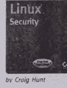
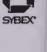
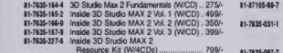

# 发动机故障分析：内燃机故障及其成因


# 引言

欢迎来到*Linux 命令速查手册*！

这是第一本*从头开始*编写的、专为当今 Linux 用户设计的 Linux 命令参考书。这本书不是手册页（man page）或旧的、过时的操作指南的汇编。书中的每一个字都是原创的，并由专业作家撰写，以确保最高的可读性和技术准确性。

## 这本书适合谁？

这本书的结构也是独一无二的，使其成为当今 Linux 用户的完美参考书。

## 按任务而非传统组织

大多数 Linux 命令参考书都按照旧的、传统的 Unix 方式组织命令——也就是说，它们首先列出所有可供用户使用的命令，然后列出仅系统和网络管理员可访问的命令。对于在单用户系统上运行 Linux 的当今 Linux 用户来说，这种组织方式没有意义。Linux 用户身兼两职——既是*用户*，又是*系统管理员*——因此，再按照旧的、受 Unix 影响的方式对 Linux 命令进行分类已无必要。相反，本书按你希望执行的*任务*进行组织，例如导航文件系统、查找难以找到的文件、处理磁盘、刻录 CD-ROM 等。有关涵盖内容和位置的信息，请参阅“A Guide to This Book's Contents”（本书内容指南）部分。

## 关于 Linux 而非 Unix

与大多数同类著作不同，本书并非对陈旧的 Unix 文档的翻版。它是第一本针对当今 Linux 发行版、当今 Linux 实用程序以及当今用户需求进行论述的 Linux 命令参考书。当然，您也会在其中找到对经典实用程序的详细讲解，这些程序已经引入了 Linux 环境，包括 `bash` shell（第 3 章）、文本处理实用程序（如 `gawk` 和 `sed`，第 8 章）以及文本编辑器（如 `vi` 和 `emacs`，第 11 章）。本书还涵盖了诸如 Linux 等新命令，Linux 是一个令人兴奋且富有回报的操作系统，例如用于使用和处理 MP3 音乐文件以及刻录自己的 CD-R 或 CD-RW 光盘的最新实用程序（见第 9 章）、适用于 Linux 系统的最新版本的 Windows 网络软件（见第 13 章），以及使 TrueType 字体在系统上正常所需的软件（见第 10 章）。这是为当今 Linux 用户编写的书籍。

## 面向用户而非黑客

数百万人正在安装 Linux，并学习如何成功使用这个令人兴奋的操作系统。其中很少有人有时间或兴趣成为程序员。而且这是新现象。直到非常近期，几乎所有 Linux 用户都是黑客，这里我是在其积极意义上使用“黑客”一词。（在计算机爱好者中，*hacker* 指的是那些喜欢编写软件，特别是通过“微调”软件以提取最大可能性能的程序员。）与同类其他作品不同，《Linux Command Instant Reference》（Linux 命令速查参考）明确针对非编程用户的需求。因此，本书不试图涵盖那些仅对 Linux 黑客和软件开发者感兴趣的实用程序。这些实用程序只有在你拥有大量背景知识和编程专业知识时才有意义。相反，本书提供了关于当今 Linux *users* 所需的实用程序的快速且信息丰富的参考内容。

为了有效地使用你的 Linux 系统，请将这本书放在电脑旁；你每天都会用到它。

## 为什么要学习 Linux 命令？

本书并不试图记录 X Window System、KDE 和 GNOME 实用程序及应用程序。相反，它直接切入核心：当你面对 Linux 提示符时所使用的命令和实用程序，这在你以纯文本模式运行 Linux 或在 X 会话的终端窗口中时会出现。

诚然，KDE 和 GNOME 等桌面环境越来越多地能够向用户隐藏复杂的命令行环境。那么，为什么要费心去学 Linux 命令呢？

以下是一些极好的理由：

- 大多数 X、KDE 和 GNOME 实用程序都是外观漂亮的前端程序，用于驱动底层的文本模式实用程序。（前端程序为命令行实用程序提供 GUI 接口。）然而，大多数前端程序仅提供底层实用程序能力的一小部分。例如，使用 KDE 和 GNOME 文件管理器没有简单的方法来递归地更改文件的所有权（即在一个整个目录及其所有相关子目录中）。使用 `chmod` 命令（第 5 章），你可以非常快速地完成此操作。熟练的 Linux 用户知道何时使用图形实用程序——以及何时切换到命令行界面。

- 一旦你学会了处理命令行语法，文本模式实用程序就更快了。在命令行上，熟练的 Linux 用户可以在几分钟内完成任务，而如果必须处理图形环境中的一个又一个窗口，这些任务将花费更长的时间。如果图形实用程序能为你完成工作，使用它们并没有错。然而，经常你会发现，在图形环境中工作无法高效地完成事情。使用命令行环境来查找文件、转换字体、处理文件权限以及众多其他任务要快得多且容易得多。有时，没有替代方案！

- 没有比与文本模式实用程序一对一搏斗能更好地让你完全理解你的 Linux 系统的方式了。

得益于其 Unix 传统，Linux 本质上是一个文本模式环境——而这确实是一件好事。例如，Linux 遵循 Unix 的准则，即所有系统配置文件都应使用简洁、可访问的文本编写，以便轻松阅读和修改。随着你深入研究文本模式实用程序并更多地了解你的 Linux 系统的配置方式，你将逐渐对这种复杂而强大的操作系统实际运作的方式形成更准确的图像。当使用 Linux 和 Linux 应用程序时，解决出现的问题，这些知识将证明是无价的。

掌握 Linux 的途径在于明智地结合图形实用程序和强大的文本模式实用程序。你会很快发现，这并不是 Linux 的缺点。相反，这恰恰是这个惊人强大的操作系统的强项。你可以使用图形实用程序进行日常工作，这没问题。但是，当你准备好释放 Linux 的不可思议的力量时，打开一个终端窗口，翻开这本书，踏入隐藏在你系统漂亮外表下的技术。你不会失望的！

## 本书内容指南

*Linux Command Instant Reference*（Linux 命令速查参考）按照任务组织 Linux 命令的世界。以下是本书结构的快速概览：

- **第 1 章，“登录和管理会话”** 在本章中，你将了解用于在 Linux 系统上创建、建立和退出用户会话的命令和实用程序。

- **第 2 章，“获取帮助和确定方位”** 本章涵盖在你迷路或困惑时提供屏幕帮助的命令和实用程序。

- **第 3 章，“学习 Shell 基础”** 本章重点介绍 `bash`，即默认安装在大多数 Linux 版本上的命令行界面（*shell*）。虽然 `bash` shell 表面上类似于 MS-DOS，但它强大得多且更有用。本章涵盖了用户需要理解的所有 `bash` 命令和实用程序，以便有效使用他们的系统。

- **第 4 章，“导航文件系统并查找文件”** 在本章中，重点转向 GNU 项目的文件管理实用程序，这些实用程序默认安装在大多数 Linux 发行版上。你将学习如何遍历文件系统，并以能够精确定位所需数据的方式定位文件。

- **第 5 章，“管理文件和目录”** 继续本书对 GNU 项目文件管理实用程序的讲解，本章侧重于你每天执行的日常管理任务，包括复制、移动和删除文件。你将学习如何充分利用仅通过使用这些实用程序的纯文本模式才能访问的功能。

- **第 6 章，“归档、编码、压缩和加密文件”** 本章涵盖了可用于执行所有这些文件管理任务的众多实用程序，包括以一种可以轻松通过 Internet 甚至与 Windows 和 Macintosh 用户交换的方式归档和压缩文件。

- **第 7 章，“管理磁盘和磁带驱动器”** 在本章中，重点转向软盘、CD-ROM 和磁带驱动器。你将学习如何执行格式磁盘和备份数据等任务。

- **第 8 章，“处理文本文件”** 本章探索了 Linux 文本处理实用程序的奇妙世界，它们使你能以数百种方式执行自动化文本处理任务。你将学习如何查找包含你指定文本的文件，以多种方式对文件进行排序，准备文本文件以便美观打印，甚至生成关键词上下文（KWIC）索引，其中文档中的每个单词都打印在显示其上下文的字母顺序列表中。

- **第 9 章，“处理声音和图形文件”** 本章转向令人兴奋的 Linux 多媒体实用程序世界。你将学习如何从音频音乐 CD-ROM 中“抓取”文件，将它们转换为各种惊人的声音格式，播放

在您的计算机上，以及“刻录”包含音频或计算机数据的 CD-R 光盘。您还将学习如何使用 `ImageMagick` 图形处理实用程序的完整功能集，它可以通过令人惊讶的多种方式来转换图形图像。

## 第 10 章，“字体处理”

继续探讨当今 Linux 用户的需求这一主题，本章讨论了您可以用来使字体在您的系统上正确工作的命令和实用程序，包括 TrueType 字体。您将学习如何安装字体，将字体从一种格式转换为另一种格式，以及解决屏幕字体问题。

## 第 11 章，“使用文本编辑器”


本章转向了一个常常让新 Linux 用户感到困惑的主题：文本编辑器。默认的 Linux 文本编辑器，如 `emacs` 和 `vi`，是专为程序员设计的，因此它们并不是特别用户友好。如果您想尝试这些程序，您会发现本书对其使用的所有方面都有全面的介绍。您还将了解更简单的文本编辑器，如 `joe`；并且您将学习如何更改系统默认设置，使易于使用的编辑器成为默认启动的编辑器。

## 第 12 章，“配置和管理您的系统”

转向系统管理命令和实用程序，本章介绍了 Linux 用户为了有效运行单用户工作站所需的核心知识（区别于管理多用户 Unix 系统所需的更复杂、深奥的命令）。

## 第 13 章，“配置和使用网络及 Internet”

本章概述了 Linux 用户为了将单用户工作站连接到 Internet 并与局域网 (LAN) 上的其他计算机用户共享文件和打印机所需的命令和实用程序。在这里，重点再次放在用户的需求上，而不是专业网络管理员的需求上。例如，关于使用 `Samba` 进行 Windows 网络共享的内容假设您希望学习与 Windows 用户交换文件的方法，而不是实现一个全面、复杂的 Windows NT 服务器仿制方案。

# 本书的特色功能

本书的每个章节都以同样的、有帮助的方式组织。您会发现三个部分：“一目了然”部分、必要的背景信息部分，以及按字母顺序排列的命令参考。

## 一目了然

位于每章的开头，这部分呈现了该章节核心内容，为了方便即时参考而进行汇编和总结。在左侧标题为“如何操作”的列中，您会发现您想要执行的任务。在中间列中，您会发现可以执行此任务的命令和实用程序的名称，以防您想查阅它们。但您可能不需要这样做，因为右侧列提供的示例通常能满足您的确切需求。

## 必要的背景信息

在“一目了然”表格之后，您会发现一个包含本章所涵盖主题必要背景信息的部分。例如，在第 1 章中，这个标题为“Linux 基础”的部分包含一个标题为“必要的输入和编辑技巧”的子部分。这一部分汇编并传达了您成功使用 Linux 所需的信息——这些信息几乎不可能以本书中这种有用的、方便的方式被汇编在一起。

### 按字母顺序排列的命令参考

在背景信息部分之后，您会发现使用 Linux 命令和实用程序所需的有效参考信息。每个命令都附有一个简短的描述，重点关注该命令的用途。

# 嘿！那个命令在我的系统上不存在！

如果您在尝试本书中介绍的某个实用程序后看到“Command not found”（命令未找到）消息，请确保它确实未安装。如果该命令不在当前的 `路径`（shell 默认搜索的目录列表）中，即使该命令实际已安装，您也会收到此消息。要查找命令的位置，请输入 `whereis` 后跟命令名称，然后按 Enter 键。

如果您的系统上没有该命令，您可能能够从您的 Linux 发行版的 CD-ROM 上安装它。查阅您的 Linux 发行版文档，了解如何安装正常安装过程中未安装的软件。

本书中讨论的一些命令并不常随 Linux 一起分发。在适当的情况下，各个条目中包含了提示，告诉您可以从哪些 Internet 归档处获取这些命令。一般来说，您可以在 [http://www.freshmeat.net](http://www.freshmeat.net) 的 Freshmeat、[http://metalab.unc.edu](http://metalab.unc.edu) 的 Metalab、[http://linux.twcows.com](http://linux.twcows.com) 的 Linuxberg 或 [http://www.rpmfind.org](http://www.rpmfind.org) 的 RPMfind 上找到您几乎在寻找的任何东西。此外，请查看您的 Linux 发行版主页，寻找那些不是标准发行版一部分的由社区贡献的命令和实用程序。

# 使用本书的约定

为了从本书中获益最大，请花一点时间研究这一部分。您将学习如何使用“按字母顺序排列的命令参考”部分中的信息。本书使用特定的排版约定来告诉您输入什么。

为什么需要这些约定？要成功使用 Linux 命令，您必须遵循几条规则，称为 `语法`。这些规则规定了命令中某些特定部分的确切位置。它们还告诉您如何输入命令，以便 Linux 能够识别您输入的内容并正确处理命令。

这里有一个例子。在第 4 章中，您将了解 `ls` 命令，其描述如下：

`ls` [`option`] | `shell pattern` |

简而言之，此约定告诉您以下内容：

- `粗体`：每当您看到粗体字时，应原样输入该内容。要使用 `ls` 命令，您输入 `ls`。

- `方括号`：方括号内的任何内容都是可选的。您可以省略它，命令仍然可以运行。在这个例子中，方括号内的第一项是 `option`（选项）。在此，您可以放置一个或多个 `command options`（命令选项），这些选项会改变命令的工作方式。大多数命令都有一个或多个选项，通常有短格式和长格式可用。在短格式中，您输入一个连字符后跟选项字母（如 `-l` 或 `-a`）。大多数命令允许您在一个列表中组合选项（如 `-la`）。在长格式中，您输入两个连字符后跟选项的完整拼写版本（如 `--help`）。请注意，并非所有命令都遵循此惯例，但它被广泛使用。

- `斜体`：当您在 `斜体`（如前例中的 [`shell pattern`]）中看到某些内容时，您应该替换为在命令中有意义的某个内容。

## 表格中使用的约定

| 此类型的条目 | 含义 |
| :--- | :--- |
| `粗体` | 原样输入此项目。 |
| `斜体` | 用`适当的`值替换此项目。 |
| [ 项目 ] | 此项目是可选的。如果使用，请勿输入方括号。 |
| [ 选项 ] | 此命令有您可以使用的选项，但它们不是必需的。大多数选项是单个字母，前面有一个破折号，如 `-a` 或 `-x`。有些命令允许您使用较长的选项名称，这些名称前面必须有两个破折号（例如 `--help` 或 `--version`）。 |
| [ 项目-1 \| 项目-2] | 这些项目是可选的。您可以使用 项目-1 或 项目-2，但不能同时使用两者。请勿输入方括号或竖线字符。 |
| < 项目-1 \| 项目-2 > | 这些项目是必需的。您必须使用 项目-1 或 项目-2，但不能同时使用两者。请勿输入尖括号或竖线字符。 |
| [ 项目-1 \| 项目-2 ] | 这些项目是可选的。您可以使用 项目-1。如果您使用 项目-1，您可以选择使用 项目-2，但 项目-2 不是必需的。请勿输入方括号。 |
| < 项目-1 \| 项目-2 > | 项目-1 是必需的。您可以选择使用 项目-2，但它不是必需的。请勿输入尖括号。 |
| `示例` | 这是一个展示如何使用命令的示例。它不是用来原样输入的，但您可以将示例调整用于自己的用途。 |

## 示例表格中使用的约定

| 命令 | 示例 | 描述 |
| :--- | :--- | :--- |
| `ls [ option ] [ shell_pattern ]` | `ls` | 列出当前目录中的所有文件。注意，选项和 shell 模式的使用不是必需的。 |
| | `ls -R` | 列出当前目录及所有关联目录中的所有文件。 |
| 命令 | 示例 | 描述 |
| --- | --- | --- |
| `Command` | `Example` | `Description` |
| | `ls -R *.jpg` | 列出当前 shell 目录及其所有相关子目录中所有符合指定 shell 模式（`*.jpg`）的文件。 |
| `mdir [ option ] directory` | `mdir junk` | 删除指定的目录。请注意，必须指定一个目录。 |
| `dirs [ +-N\|~N ] [ option ]` | `dirs` | 显示当前记住的目录列表中的所有目录。 |
| | `dirs +5` | 显示记住的目录列表中从顶部数起的第五个目录。请注意，输入数字时指定 `+`（从列表顶部开始）或 `-`（从列表底部开始）。 |
| | `dirs -5 -l` | 显示记住的目录列表中从末尾数起的第五个目录，并显示长列表（`-l`）。 |

### Sybex 技术支持

如果您对本书（或其他 Sybex 书籍）有任何问题或意见，您可以直接联系 Sybex。

#### 为了最快回复

请给我们发送电子邮件或访问 Sybex 网站！您可以访问 http://www.sybex.com 并点击 Support 联系 Sybex。您可能在该网站的 FAQ（常见问题解答）文件中找到您正在寻找的答案。

到达支持页面后，点击 support@sybex.com 向 Sybex 发送电子邮件。您也可以直接通过 support@sybex.com 向 Sybex 发送电子邮件。

请确保在电子邮件中包含以下信息：

- `书名` 相关书籍的完整书名。对于本书，它是 `Linux Command Instant Reference`。

- `页码` 包含您遇到问题的页码。


- **ISBN 号** 出现在书籍封底右下角的 ISBN。这个号码看起来像这样：`0-7821-2478-7`

- **印刷版本** 书籍的印刷版本。您可以在书籍前方的版权页底部找到此信息。您应该看到一排数字，如下所示：`1 0 9 8 7 6 5 4 3 2 1`

告诉我们这排数字中最小的数字是多少。这就是该书的印刷编号。这里的例子表明该书是第一版印刷。

> **注意** ISBN 号和印刷版本对于技术支持非常重要，因为它表明您手中持有的是哪个版本和重印版。不同印刷版本之间可能会发生变化。不要忘记包含此信息！

### 为了快速回复

拨打 Sybex 技术支持电话并留下留言。Sybex 保证会在 24 小时内回拨给您，周末和节假日除外。

技术支持的联系方式为 `(510) 523-8233` 分机 `563`。

拨过分机号后，按 `1` 以留言。Sybex 将在 24 小时内回拨给您。请确保留下一个您可以接听的电话号码！

## 联系 Sybex 的其他途径

您可以通过以下地址通过邮件联系 Sybex：

SYBEX Inc.

收件人：Technical Support

1151 Marina Village Parkway

Alameda, CA 94501

同样，为了加快回复速度，包含以下所有信息非常重要：

- 书名 相关书籍的完整书名。
- ISBN 号 出现在书籍封底右下角的 ISBN，看起来像这样：

  `0-8721-2478-7`
- 印刷版本 书籍的印刷版本。您可以在书籍前方的版权页底部找到此信息。您应该看到一排数字，如下所示：

  `1 0 9 8 7 6 5 4 3 2 1`

告诉我们这排数字中最小的数字是多少。这就是该书的印刷编号。这里的例子表明该书是第一版印刷。
- 页码 包含您遇到问题的页码。

无论您如何联系 Sybex，技术支持都将努力快速且准确地回答您的问题。

#### 章节

登录和管理会话

本章介绍 Linux 的基础知识，以便您理解首次登录时看到的内容。它涵盖了您在 Linux 系统上创建、建立和退出用户会话时使用的命令和实用工具。您还将学习如何重启或关闭计算机。

**警告** 在使用 Linux 运行应用程序之前，请为您的使用创建一个普通用户帐户（参见第 12 章）。在作为 `root` 用户登录时，您不应运行应用程序或使用 Linux 进行其他日常用途。当作为 `root` 用户工作时，Linux 不会阻止您覆盖系统配置和其他关键文件。如果您在不知道如何修复损坏的情况下损坏了其中一个文件，您的系统可能会变得不稳定或无法使用。

#### 概览

| 如何做 | 参见此条目 | 示例 |
| --- | --- | --- |
| 登录到系统？ | `login` | `login susanne` |
| 注销？ | `logout` | `logout` |
| （在 RedHat6 中，也会提示重新登录。） |  |  |
| 登录到局域网上的另一台计算机？ | `rlogin` | `rlogin -l susanne 192.168.100.10` |
| 关闭我的计算机？ | `shutdown` | `shutdown -h now` |
| 重启我的计算机？ | `shutdown` | `shutdown -r now` |
| 显示我当前使用的终端的识别号码？ | `tty` |  |
| 启动一个 X 会话？ | `startx`, `xdm` | `startx -- --bpp32` |

##### 概览（续）

| 如何做 | 参见此条目 | 示例 |
| :--- | :--- | :--- |
| 不注销我的用户帐户就获取 root 用户的权限？ | `su` | `su` |
| 在我的计算机上配置 X Window 系统或更改现有配置？ | `Xconfigurator`（用于 Red Hat 系统），`XF86Setup`（用于其他发行版） | `XF86Setup` |

# Linux 基础

本节介绍以下内容：

- Linux 基础
- Linux 发行版
- 用户和系统管理员
- 登录
- 登录后看到的内容
- 基本的输入和编辑技能
- 虚拟控制台
- X Window 系统

有关 Linux 启动和初始化过程的更多信息，请参阅第 12 章，“配置和管理您的系统。”

# Linux 发行版

Linux 通常通过 Linux 发行版提供。Linux 发行版将功能完整的 Linux 操作系统的许多组件组装成一个一致的包。

可以通过 FTP 下载获取发行版；然而，在 CD-ROM 上获取发行版更为方便。大多数包含在 Linux 发行版中的软件，包括 Linux 内核，都根据 GNU 项目的 *通用公共许可证* (GPL) 进行许可。此许可证授予用户查看、修改和重新分发源代码的自由，只要后续分发不否认他人这些自由（更多信息，请见 http://www.gnu.org）。本节的第一个表格涵盖了主要的 Linux 发行版，而第二个表格定义了构成 Linux 发行版的各个组件。

# 主流 Linux 发行版

**名称** **描述和下载站点**

**Caldera OpenLinux** 功能易用的图形安装工具；默认使用 KDE 桌面。包含几个应用程序的试用版或个人版，包括 WordPerfect 8.0 和 StarOffice 5.1。

支持的平台：Intel x86。

下载站点：http://www.calderasystems.com。

**Corel Linux** 基于 Debian，这个设计精美的发行版默认使用 KDE 桌面，并具备用户友好的安装工具；对于从 Microsoft Windows 或 Mac OS 迁移的新 Linux 用户来说，这是一个不错的选择。不适合较旧的 PC，Corel Linux 的最低系统要求是至少带有 16MB RAM 的 Pentium 级别机器。

支持的平台：Intel Pentium 及更高版本，SPARC，Motorola 680x0，Alpha。

下载站点：http://linux.corel.com。

**Debian GNU/Linux** Linux 的黑客版本。安装和配置需要之前的 Linux 经验和系统管理专业知识。

支持的平台：Intel x86，SPARC，Motorola 680x0，Alpha。

下载站点：http://www.debian.org。

**Linux Mandrake** Red Hat Linux 的版本，默认使用 KDE 桌面。

支持的平台：Intel x86。

下载站点：http://www.linux-mandrake.com。

## 主流 Linux 发行版（续）

| 名称 | 描述及下载站点 |
| :--- | :--- |
| LinuxPPC | 专为 **PowerPC** 系统（包括 iMac）设计的 Linux 版本。支持的平台：基于 PCI 的 Apple Power Macintosh 以及部分 IBM/Motorola **PReP** 工作站。下载站点：`http://www.linuxppc.org` |
| Red Hat Linux | 支持良好的发行版，提供易于使用的图形化安装工具，并默认使用 GNOME 桌面环境。（KDE 可作为选项安装。）支持的平台：Intel x86、Alpha、SPARC。下载站点：`http://www.redhat.com`。 |
| Slackware | 一个技术挑战性的发行版，最适合有经验的用户和开发人员。它旨在成为最“类 UNIX”的发行版。支持的平台：Intel x86。下载站点：`http://www.slackware.org`。 |
| SuSE | 欧洲市场领先的 Linux 发行版；默认使用 KDE 桌面环境。支持的平台：Intel x86。下载站点：`http://www.suse.com`。 |
| TurboLinux | 强调多语言支持，是亚洲市场的领先者。支持的平台：Intel x86 和 PowerPC。下载站点：`http://www.pht.com`。 |

## Linux 系统组件

| 组件 | 描述 |
| :--- | :--- |
| 内核 | Linux 操作系统的核心。*内核*就像一个数字化的主持人。它接收来自程序的请求（称为*系统调用*），并启动执行这些请求的进程。此外，内核管理着系统资源，以确保运行中的进程不会相互冲突或超出系统的处理能力。Linux 内核是一个*多用户操作系统*，能够支持超过 1,000 个同时在线用户。它还是一个*多任务操作系统*，能够全面保护每个运行中的进程免受对其分配内存空间的侵入。 |
| Shell（Shell 脚本/外壳） | 用户与内核之间的接口。*Shell* 作为一个**命令解释器**发挥作用，它接受并处理用户命令。它本身也是一种编程语言；用户可以编写*脚本*来自动化系统功能。用户可以选择他们喜欢的 shell。 |
| 文件系统 | 将文件组织成金字塔式的*目录*层级结构。顶层目录，称为*根目录*，包含所有其他目录。*文件所有权*和*权限*使用户和系统管理员能够防止对敏感数据的未经授权的访问。 |


| 实用工具 | 各种有用的程序，其中许多是由 GNU 项目开发 [http://www.gnu.org]。也称为**命令**。本书中讨论的大多数命令都是实用工具；它们旨在使用户和系统管理员能够配置和维护系统。 |

| 控制台应用程序 | 设计用于在纯文本控制台模式或终端模拟工具中运行的应用程序。 |

| X 应用程序 | 需要 X 窗口系统的应用程序，该系统将在本章后续部分定义。 |

| 窗口管理器 | 一种 X 窗口系统应用程序，使用户能够控制窗口的位置和大小。 |

| 桌面环境 | 运行在 X 窗口系统和窗口管理器之上的软件，为这些组件提供 Microsoft Windows 和 Mac OS 用户熟悉的界面功能，例如支持拖放功能的桌面、可停靠的工具栏以及全套桌面实用工具。领先的桌面环境是 GNOME 和 KDE。 |

| GNOME 和 KDE 应用程序 | 需要 GNOME 或 KDE 桌面的应用程序程序。许多 GNOME 程序可以在 KDE 下运行，许多 KDE 程序也可以在 GNOME 下运行。 |

## 用户与系统管理员

Linux 是一个多用户操作系统，它区分普通用户和系统管理员。

- **用户**：也称为*普通用户*，用户拥有其*主目录*（文件系统中分配给其使用的部分）中文件的所有权，但他们通常不能查看或更改其他用户的文件。此外，他们不能更改*系统配置文件*，这些文件对系统的正常运行至关重要。

- **系统管理员**：也称为*root 用户*或*超级用户*，管理员在整个系统中拥有读写权限，并负责系统配置和维护。在单用户系统上，Linux 用户在这两种角色之间切换。对于日常工作，他们以普通用户身份登录并工作；这样做可以防止他们无意中修改或删除对系统平稳运行至关重要的文件。为了进行系统管理，他们以 root 用户身份登录。

## 登录

当 Linux 启动时，你会在屏幕上看到许多消息。通常，这些消息一闪而过，快到你无法阅读。（你可以使用第 12 章中讨论的 `dmesg` 命令查看这些消息。）当引导和初始化过程结束时，系统会提示你输入用户名和密码。这个过程称为登录。

一些较新的 Linux 发行版允许你在系统安装期间设置用户账户。如果你这样做了，请输入你的用户名并按 Enter。如果在安装时未创建用户账户，你必须以 root 用户身份登录。为此，输入 `root` 并按 Enter。

然后你需要提供密码；仔细输入密码并按 Enter。作为一种安全措施，密码在屏幕上不可见。请注意，Linux 的登录名和密码区分大小写；你必须输入创建密码时使用的确切大小写形式。一旦你成功登录到 Linux 系统，你应该为日常使用创建一个用户账户（参见第 12 章中的 `adduser`）。

## 登录后你看到的内容

你的 Linux 系统可以配置为运行几种不同类型的用户界面：

- **控制台模式**：如果你启动 Linux 时看到文本模式登录提示符，那么你的系统默认配置为运行在*控制台模式*下。这是一个纯文本环境。在控制台模式下，你通过 shell 与你的 Linux 系统交互（参见本章中的 Linux 系统组件表）。虽然你可以使用多种 shell 来使用 Linux（参见本节中的 Linux Shell 表），但最常见的是 Bourne Again Shell (`bash`)。从 shell 中，你还可以运行*控制台*程序，这些程序专为在文本模式环境中工作而设计。你还可以启动 X 窗口系统以及可选的桌面环境，例如 KDE 或 GNOME。

### LINUX SHELLS（Linux Shell）

| 名称 | 描述及下载位置 |

| :--- | :--- |

| bash | 基于 Bourne shell，该 shell 是大多数 Linux 系统上*事实*上的标准 shell。它提供了前所未有的功能水平，包括键盘宏、命令历史、易于使用的命令行编辑工具、简单而优雅的编程语言、作业控制等等。 |

| csh | C shell 的缩写，该 shell 从其设计灵感来源于 C 编程语言，因此自然受到 C 程序员的青睐。与 bash 相比，它提供的功能稍少，但仍被一些人偏爱，因为它可以运行 csh 脚本。 |

| tcsh | csh 的增强版本。 |

| ksh | Korn shell 的缩写，该 shell（与 bash 一样）是 Bourne shell 的另一种衍生版本。 |

X 窗口系统 你的系统可能已配置为默认启动 X 窗口系统。如果是这样，你会在屏幕上看到图形用户界面（GUI），其中应用程序显示在窗口中。简而言之，X（通常的缩写）是一个提供 X 兼容应用程序窗口功能的图形用户界面。许多应用程序需要 X 才能运行。使用 X，你必须运行一个窗口管理器。窗口管理器是一种应用程序，它使你能够启动 X 应用程序并在屏幕上定位窗口。如果你的系统已配置为默认启动 X，你将看到一个基于 GUI 的窗口管理器（参见本章中的 Linux 窗口管理器表）。然而，你的系统可能已配置为除了 X 之外还启动桌面环境，例如 KDE 或 GNOME。桌面环境为 X 环境添加了仅使用 X 窗口系统时不可用的功能。

桌面环境 桌面环境通过提供 X 中缺失或实现不佳的功能来补充 X 窗口系统。这些包括应用程序面板、兼容应用程序的一致外观和感觉、可停靠的工具栏、集成的外语支持、多种拖放格式、3D 支持、系统级的字体和打印支持以及可自定义的菜单。存在多个竞争的桌面环境，包括 K 桌面环境（KDE）和 GNOME，如下表 Linux 桌面环境所示。两者都需要 X 才能运行。你的系统可能已配置为自动运行 KDE 或 GNOME。有关配置系统自动运行桌面环境的信息，请参见第 12 章中的“理解运行级别”部分。

### LINUX DESKTOP ENVIRONMENTS（Linux 桌面环境）

| 名称 | 描述及下载站点 |

| :--- | :--- |

| GNOME | 一个依赖 GTK+ 工具包的桌面环境，该工具包根据 GPL（通用公共许可证）条款提供。它可与多种窗口管理器配合使用，但与 WindowMaker 和 Enlightenment 配合使用效果尤为出色。强调可配置性。提供的应用程序比 KDE 少。<br> 下载站点：http://www.gnome.org。 |

## LINUX 桌面环境（续）

| 名称 | 描述与下载站点 |

| :--- | :--- |

| KDE | 一个依赖 Qt 工具包的桌面环境。虽然 KDE 可以配合某些窗口管理器使用，但最简单且效果最好的方式是使用默认的 KDE 窗口管理器。目前，它提供的兼容应用程序数量是 GNOME 的两倍之多。<br>下载站点：http://www.kde.org。 |

在安装过程中，你的 Linux 系统被配置为默认运行其中一种界面模式。如果系统以控制台模式启动，你可以使用 `startx` 来启动 X 窗口系统。

即使正在运行 X 窗口系统，你仍然可以使用仅文本的控制台模式。要做到这一点，你需要启动一个*终端仿真程序*。此类程序提供一个窗口，在其中显示 shell 提示符。然后，你可以像在控制台模式下工作一样使用 Linux。下表列出了常见的终端仿真器。

## LINUX 终端仿真工具

| 名称 | 描述 |

| :--- | :--- |

| eterm | 专为配合 Enlightenment 窗口管理器设计的 VT102 终端仿真器。 |

| gnome-terminal | 兼容 GNOME 的 xterm 实现，具备 VT102 兼容性。 |

| kterm | xterm 的多语言和彩色版本。 |

| kvt | 兼容 KDE 的 rxvt 实现。 |

| rxvt | xterm 的彩色版本，通过删除 Tektronix 4014 兼容性来减少内存消耗。可以使用 XPM 图形作为窗口背景。 |

| xterm | 单色。模拟 DEC VT102/VT220 以及 Tektronix 4014 及兼容终端。 |

## 基本键入与编辑技巧

如果你正在控制台模式下工作，或正在使用终端仿真工具（如前一节所述），你会看到*系统提示符*。系统提示符告知你 shell 正在运行并准备接受你的命令。

在大多数 Linux 系统中，*bash* shell 是控制台模式的默认 shell。如果你的系统正在运行 *bash* shell，并且你是以普通用户身份登录，系统提示符为 `$`。如果你是以 root 用户身份登录，则为 `#`。

要在控制台模式下使用系统，你需要输入命令。你会发现以下编辑和控制快捷键很有用。第 3 章详细说明了你可以与 *bash* 一起使用的键盘快捷键。

## 编辑与控制快捷键

| 使用此键盘快捷键 | 以执行此操作 |

| :--- | :--- |

| Backspace | 删除前一个字符 |

| Ctrl + h | 删除前一个字符 |

| Delete | 删除当前字符 |

| Ctrl + d | 删除当前字符 |

| Ctrl + u | 删除整行 |

| Ctrl + c | 取消命令 |

| Ctrl + d | 注销 |

| Return | 执行命令 |

| Enter | 执行命令 |

## 使用虚拟控制台


由于 Linux 是一个多用户系统，因此可以同时建立多个用户会话。这一功能可以追溯到计算机非常昂贵的时代。为了降低成本，一台计算机可以由几个人同时使用，每个用户通过`远程终端`（一种具有键盘和显示器但缺乏数据处理或存储能力的输入输出设备）访问系统。尽管很少有 Linux 用户使用远程终端实现多用户系统，但你仍然可以利用系统同时运行多个用户会话的能力。例如，你的系统预配置运行两个或更多虚拟控制台，它们就像独立的计算机。你的系统以默认控制台启动，该控制台称为系统控制台。你的系统可能已配置了五个或更多虚拟控制台。

要在 X 窗口环境下切换到第一个虚拟控制台，请按 Ctrl + Alt + F1。要查看第二个虚拟控制台，请按 Ctrl + Alt + F2，依此类推以查看连续的虚拟控制台。可用的虚拟控制台数量取决于你的系统配置。在 Red Hat 及基于 Red Hat 的系统上，Ctrl + Alt + F7 会返回系统控制台。你也可以使用 `chvt` 命令切换虚拟控制台。

在大多数控制台中，你会看到一个登录提示。你可以登录到其中一个控制台并启动一个独立的用户会话。这种能力提供了一种从 X 切换到控制台模式的便捷方式。如果你正在默认控制台中运行 X，你可以切换到虚拟控制台以启动控制台模式会话。一些系统配置允许你在其中一个虚拟控制台中启动第二个 X 会话，但除非你的系统配备大量内存（128MB 或 256MB），否则不建议这样做。

## X 窗口系统

X 窗口系统为 Linux 系统提供图形用户界面。简称 X，该系统分为两个组件：X 服务器，它响应界面服务请求并控制显示硬件；以及 X 客户端，即请求 X 服务器提供服务的兼容 X 的应用程序。X 服务器被设计用于配合特定品牌和型号的硬件工作，包括视频适配器、鼠标、键盘和监视器。对于基于 Intel 的 Linux 发行版，默认 X 服务器是 `XFree86`（可在 http://www.xfree86.org 下载），这是一系列设计用于配合流行视频适配器和监视器工作的 X 服务器。下表为你提供一些方便的 `XFree86` 键盘快捷键。

## XFREE86 键盘快捷键

| 使用此键盘快捷键 | 以执行此操作 |
| :--- | :--- |
| Ctrl + Alt + Backspace | 终止 X 服务器。`注意`：你将丢失任何打开的应用程序中的工作。 |
| Ctrl + Alt + 小键盘加号 | 切换到 `XFree86` 配置文件中指定的下一个视频模式。 |
| Ctrl + Alt + 小键盘减号 | 切换到 `XFree86` 配置文件中指定的上一个视频模式。 |
| Ctrl + Alt + Fn | 切换到第 *n* 个虚拟终端；例如，Ctrl + Alt + F3 切换到第三个虚拟终端。 |

你的系统中很可能已经安装了 X；大多数 Linux 发行版使用安装实用程序自动配置 X。如果没有，你可以使用本章讨论的 `XF86Setup` 或 `Xconfigurator` 实用程序来配置 X。

`窗口管理器` 是一种特殊类型的 X 客户端。它允许你控制应用程序窗口的大小和位置。大多数窗口管理器提供额外功能，包括一些类似桌面环境的功能。下表列出了最常见的 Linux 窗口管理器。

## LINUX 窗口管理器

| 名称 | 描述与下载站点 |
| :--- | :--- |
| AfterStep | 一个使用 fvwm 代码模拟 NeXT 桌面的窗口管理器。其功能包括应用程序停靠、主题、可固定菜单、渐变渲染的窗口装饰、虚拟桌面、GNOME 兼容性、KDE 兼容性以及对 GNUStep 应用程序的集成支持。下载站点：http://www.afterstep.org。 |

## LINUX 窗口管理器（续）

| 名称 | 描述与下载站点 |
| :--- | :--- |
| Enlightenment | 这是当前 Red Hat Linux 和 Mandrake 发行版的默认窗口管理器。它与 GNOME 高度兼容。它包含 Window Maker 和 AfterStep 的所有功能，外加声音支持、带反别字的 TrueType 支持以及高级图形功能。<br>下载站点：http://www.enlightenment.org/。 |
| fvwm | 在 Linux 发行版中广泛可用，这是一个高度可配置的窗口管理器，具有高级功能，如拖放兼容性、虚拟桌面、工作区切换器和应用程序图标。<br>下载站点：http://www.fvwm.org/。 |
| fvwm '95 | 这是 fvwm 的一个修改版本，外观类似 Microsoft Windows 95，包括任务栏。<br>下载站点：ftp://mitac11.uia.ac.be/html-test/fvwm95.html。 |
| IceWM | 这是一个兼容 GNOME 的窗口管理器，提供多个默认主题，包括 Motif、GTK、OS/2 Warp 和 Windows 95。功能包括虚拟桌面、任务栏、拖放、工作区切换器、主题、应用程序图标和窗口列表菜单。<br>下载站点：http://icewm.sourceforge.net/。 |
| WindowMaker | 一个模拟 NeXT 桌面的窗口管理器，但不使用 fvwm 代码。其功能包括应用程序停靠、主题、可固定菜单、渐变渲染的窗口装饰、虚拟桌面、GNOME 兼容性、出色的配置菜单系统以及对 GNUStep 应用程序的集成支持。<br>下载站点：http://www.windowmaker.org/。 |

### 按字母顺序排列的命令参考

在本节中，您将找到用于执行以下任务的命令：

- 登录、注销、重新启动和关闭系统（`login`, `logout`, `relogin`, `shutdown`）
- 在控制台模式下使用虚拟终端（`chvt`, `tty`）
- 配置 X 窗口系统（`Xconfigurator`, `XF86Setup`）
- 启动图形用户界面（`startx`, `xdm`）
- 使用终端仿真程序（`xterm`, `rxvt`）
- 切换到超级用户，以便执行需要 root 级别权限的任务（`su`）

### chvt

`chvt _terminal_`

将显示切换到指定的虚拟 `terminal`（编号 1-35）。

*另请参阅* `delcvt`, `tty`。

### login

`login [ _username_ ]`

提示用户输入用户名和密码，并在当前终端上建立新的用户会话。此外，该命令还会检查用户是否收到新邮件，启动 `/etc/passwd` 文件中为该用户指定的 shell（默认 shell 为 `bash`），并执行与该用户账户关联的启动 shell 脚本。此命令仅应用于文本模式会话。当 X 正在运行时请勿使用此命令。

### logout

`logout`

退出当前会话并显示登录界面。此命令仅应用于文本模式会话。当 X 正在运行时请勿使用此命令。

### rlogin

`rlogin [ option ] [ _hostname_ ]`

允许您在连接到局域网或 Internet 的另一台计算机上建立用户会话，前提是远程计算机已配置为接受远程登录。

#### OPTION

| 使用此选项 | 执行此操作 |
| :--- | :--- |
| -l _username_ | 使用特定用户名登录 |

##### EXAMPLE

| 此命令 | 执行以下操作 |
| :--- | :--- |
| `rlogin -l suzanne lothlorien.paffenberger.org`<br>或<br>`rlogin -l suzanne 192.168.100.10` | 为名为 suzanne 的用户在 lothlorien.paffenberger.org 上建立远程终端会话。 |

### rxvt

`rxvt [ option ]`

启动 `rxvt` 终端仿真程序。需要 X 窗口系统。某些 `rxvt` 选项是开关式的。若要打开选项，请在选项前加上加号 (+)。若要关闭选项，请在选项前加上减号 (-)。

*另请参阅 xterm。*

##### OPTIONS

| 使用此选项 | 执行此操作 |
| :--- | :--- |
| -bd color | 指定用于窗口边框的颜色 |
| -bg color | 指定用于背景的颜色 |
| -cr color | 指定光标颜色 |
| -fb fontname | 指定用于粗体文本的字体 |
| -fg color | 指定前景颜色 |
| -fm fontname | 指定用于多字符文本的字体 |
| -fn fontname | 指定普通文本的字体 |
| -grk mode | 启用希腊语键盘转换 |
| +-lp | 启用继承父窗口背景位图 |
| -pixmap filename | 指定用作背景的 XPM 图形文件名 |
| -pr color | 指定鼠标指针颜色 |
| +-rv | 通过交换前景和背景颜色来模拟反色显示 |
| +-sb | 保存所有从顶部滚出的行并显示滚动条 |
| -sf | 启用 Sun 功能键 |
| +-si | 在窗口底部结束输出 |


| `+-sk` | 启用滚动时自动重新定位窗口 |
| `-sl n` | 指定保存从屏幕顶部滚出的行数 (`n`) |
| `+-sr` | 将滚动条放置在左侧 |
| `+-st` | 显示无凹槽的普通滚动条 |
| `+-ut` | 禁止 utmp 日志条目 |
| `+-vb` | 启用视觉而非声音铃声 |

### shutdown

```
shutdown [options] time message
```

以保护文件系统完整性不受损的方式关闭您的 Linux 系统。当 X 窗口系统正在运行时，请勿使用此命令；请先退出 X。若要使用 GNOME 或 KDE 关闭系统，请注销当前会话，并使用 GNOME 或 KDE 显示管理器中的菜单选项来停止或重新启动系统。如果您正在使用 X，在关闭之前应退出 X。仅当 X 未运行且您以纯文本模式使用 Linux 系统时，才使用 `shutdown`。在大多数系统中，您需要 root 用户权限才能使用此命令（参见 `su`）。通过选项，您可以指定系统是停止还是重新启动。如果其他用户已登录到系统，您可能希望通过输入加号后接分钟数（例如 `+5`）来指定延迟时间。您也可以输入 `now`，这等同于 `+0`。您还可以指定一条消息，该消息将显示在连接到系统的所有用户的终端上。

#### OPTIONS

| 使用此选项 | 执行此操作 |
|---|---|
| `-f` | 快速重新启动而不检查文件系统完整性。 |
| `-h` | 关闭后停止系统。在大多数最新 PC 上，此选项会自动关闭电源。 |
| `-k` | 发送警告消息而不实际关闭。 |
| `-r` | 重新启动系统。 |

#### EXAMPLES

| 此命令 | 执行以下操作 |
|---|---|
| `shutdown -r now` | 立即重新启动系统，无延迟。 |
| `shutdown -h +2` | 两分钟后停止系统。 |

### startx

`startx [ --option ]`

此 shell 脚本通常随 X11 发行版提供，允许您从当前用户账户启动 X 会话。它是 `xinit` 实用程序的前端。要确定使用哪个窗口管理器或桌面环境，`startx` 会在用户的主目录中查找名为 `.xinitrc` 的文件。该文件的最后一行应包含您首选窗口管理器的名称（例如 Enlightenment 或 fvwm）。如果用户的主目录中不存在此文件，X 将使用默认配置文件（通常为 `/etc/xinitrc`）中指定的默认值。若要指定 `startx` 的选项，必须输入两个破折号 (`--`) 后跟一个空格。如果您的系统已配置为在默认运行级别自动启动 X（如文件 `/etc/inittab` 中所述，参见第 12 章），则无需使用 `startx`。

#### OPTIONS

| 使用此选项 | 执行此操作 |
| :--- | :--- |
| `--allow\ MouseOpenFail` | 即使无法检测或初始化鼠标，也启动服务器。 |
| `-bgamma value` | 将服务器的蓝色伽马校正设置为指定值。必须在 0.1 到 10 的范围内。默认值为 1.0。 |
| `-bpp n` | 以由 `n` 指定的像素位深度启动 X 服务器。合法值为 8、15、16、24 和 32。 |
| `-gamma value` | 将服务器的所有颜色伽马校正设置为指定值。必须在 0.1 到 10 的范围内。默认值为 1.0。 |
| `-ggamma value` | 将服务器的绿色伽马校正设置为指定值。必须在 0.1 到 10 的范围内。默认值为 1.0。 |
| `-probeonly` | 探测设备，但在执行探测后退出。 |
| `-rgamma value` | 将服务器的红色伽马校正设置为指定值。必须在 0.1 到 10 的范围内。默认值为 1.0。 |
| `-showconfig` | 显示服务器的配置信息。 |
| `-vt n` | 使用第 *n* 个虚拟终端，而不是下一个可用的虚拟终端。 |
| `-xrf86config *filename*` | 从指定的 *filename* 读取配置，而不是从默认配置文件读取。 |

#### EXAMPLES

| 此命令 | 执行以下操作 |
| --- | --- |
| `startx -- --bpp 32` | 在 32 位显示模式下启动 X 服务器。需要支持 32 位色深的显卡和显示器。 |

### su

```
su [ *username* ]
```

创建具有不同用户 ID 和权限的新 shell 会话。如果在运行 `su` 时未指定用户名，则创建 `superuser`（超级用户）的 shell；即获得 root 用户权限的用户。系统会提示您输入该用户的密码。要退出 `superuser` shell，请输入 `exit` 并按回车键。

### tty

```
tty
```

显示当前正在使用的终端设备编号。

另请参阅 `chvt`。

### Xconfigurator

`Xconfigurator` [ *option* ]

启动一个菜单驱动的工具，用于配置 XFree86 以在 Red Hat Linux 系统上使用。此工具也可用于 kickstart 模式，该模式会抑制交互式菜单；但是，您必须使用 `--monitor` 选项指定监视器类型。

#### OPTIONS

| 使用此选项 | 执行此操作 |
| :--- | :--- |
| `--help` | 显示可用选项，包括可用显卡和监视器类型列表。 |
| `--expert` | 启用对手动控制配置选项（通常自动设置）的控制。 |
| `--kickstart` | 启用非交互模式。 |
| `--card` *name* | 安装指定的显卡。使用 `--help` 查看有效显卡名称列表。 |
| `--server` *name* | 配置指定的服务器。使用 `--help` 查看有效服务器名称列表。 |
| `--monitor` *name* | 配置指定的监视器。使用 `--help` 查看有效监视器名称列表。 |
| `--hsynch` *frequency* | 使用指定的水平频率配置服务器。 |
| `--vsynch` *frequency* | 使用指定的垂直频率配置服务器。 |

### xdm

`xdm`

启动 X 显示管理器（`xdm`），它提供图形登录 shell 并启动 X 窗口系统。与 `startx` 不同，`xdm` 会参考名为 `.xsession` 的文件来确定用户首选项，包括

### XF86Setup

```
XF86Setup [ option ]
```

启动一个菜单驱动的实用工具，用于配置 XFree86 服务器。此实用工具可用于首次安装服务器或更改默认配置。如果您更换了视频适配器、鼠标、键盘或监视器，则需要进行更改。要使用 `XF86Setup`，您可能需要以下部分或全部信息：您的视频适配器的品牌和型号，视频适配板上安装的显存（VRAM）数量，您的监视器的品牌和型号，以及您正在使用的键盘类型（例如 102 键美国键盘）。

另请参阅 `Xconfigurator`。

#### 选项

| 使用此选项 | 以执行此操作 |
| :--- | :--- |
| `-sync` | 启用与 X 服务器所有通信的同步 |
| `-name appname` | 使用 `appname` 作为配置窗口的名称 |
| `-display n` | 使用第 `n` 个显示器，而不是下一个可用的显示器 |
| `-nodiag` | 抑制基于菜单的交互式系统 |
| `-geometry specification` | 使用指定的窗口几何参数 |
| `-script` | 运行指定的脚本 |

### xterm

```
xterm [ option ]
```

启动 `xterm` 终端仿真程序。需要 X Window System。某些 `xterm` 选项是开关。在此选项前加一个加号（`+`）以开启，或减号（`−`）以关闭。

#### 选项

| 使用此选项 | 以执行此操作 |
| :--- | :--- |
| `+\|-132` | 启用 132 列模式。 |
| `+\|-ah` | 始终高亮显示光标，即使窗口处于非活动状态。 |
| `+\|-ai` | 禁用活动图标支持。 |
| `+\|-aw` | 启用文本换行。 |
| `-b n` | 指定 `n` 像素的边框宽度。 |
| `-bd color` | 指定用于窗口边框的颜色。 |
| `+\|-bdc` | 禁用粗体字符。 |
| `-bw n` | 指定 `n` 像素的窗口边框宽度。 |
| `-C` | 启用窗口接收控制台输出。 |
| `+\|-cb` | 将 VT100 变量 CutToBeginningOfLine 设置为 false。 |
| `+\|-cm` | 禁用 ANSI 颜色更改。 |
| `+\|-cn` | 禁用行模式选择中剪切新行。 |
| `-cr color` | 指定文本光标颜色。 |
| `+\|-cu` | 规避 `more` 程序（见第 8 章）中的 bug，该 bug 会导致当行宽等于窗口宽度时显示行不正确。 |
| `+\|-dc` | 禁用动态颜色。 |


| `-e command` | 在 xterm 窗口中运行指定命令。 |
| `-fb font` | 使用指定的字体。 |
| `-fg color` | 指定前景色。 |
| `-fl fontname` | 设置活动图标的字体。 |
| `-fn font` | 指定用于普通文本的字体。 |
| `-hc color` | 设置用于前景色的颜色。 |
| `+|-le` | 启用检测 `stty` `erase` 值。 |
| `+|-im` | 启用插入模式。 |
| `+|-j` | 启用跳跃滚动。 |
| `-leftbar` | 强制将滚动条置于窗口左侧。 |
| `+|-ls` | 将 shell 启动为登录 shell。 |
| `+|-mb` | 当用户在右侧边框附近输入时，发出边框提示音。 |
| `-mc time` | 指定多击选择之间的最大时间（以毫秒为单位）。 |
| `-ms color` | 指定 `默认` 指针颜色。 |
| `-nb n` | 指定从右侧边框向左的 n 个字符 (`n`)，如果启用提示音，则在此处发出边框提示音。 |
| `+|-nul` | 启用下划线显示。 |
| `+|-pc` | 启用粗体颜色。 |
| `-rightbar` | 强制将滚动条置于窗口右侧边框。 |
| `-rv` | 通过交换前景色和背景色来模拟反色视频。 |
| `+|-rv` | 启用反向换行。 |
| `+|-s` | 启用异步滚动。 |
| `+|-sb` | 保存从顶部滚出的所有行并显示滚动条。 |
| `+|-sf` | 启用 Sun 功能键。 |
| `+|-si` | 在窗口底部结束输出。 |
| `+|-sk` | 启用滚动时自动重新定位窗口。 |
| `-sl n` | 指定要从屏幕顶部滚出并保存的行数 (`n`)。 |
| `+|sp` | 启用 Sun 键盘映射。 |
| `+|t` | 以 Tektronix 模式而非 VT102 模式启动。 |
| `-title string` | 使用指定字符串作为窗口标题。 |
| `-tm keyword` | 指示应使用的终端设置，由关键字指定。选项包括 `intr`, `quit`, `erase`, `kill`, `eof`, `eol`, `swtch`, `start`, `stop`, `brk`, `sup`, `dsup`, `rprnt`, `flush`, `weras` 和 `inext`。 |
| `-tn name` | 指定要使用的终端类型名称。 |
| `+|-ulc` | 禁用带颜色的下划线显示。 |
| `+|-ut` | 跳过在系统日志中创建条目。 |
| `+|-vb` | 启用视觉而非听觉提示音。 |
| `+|-wf` | 等待窗口映射完成后再启用子进程。 |
| `-ziconbeep percentage` | 以指定百分比的音量发出提示音。 |

# 第 2 章

## 获取帮助和定位


在本章中，您将学习用于在 Linux 上获取帮助的命令。您还将学习可以帮助您定位的命令。后一类包括提醒您在 Linux 文件系统中位置的命令，您所属的用户组，以及更多内容——包括一个可以显示或打印当前月份或年份（或任何月份或任何年份）的美观日历的命令。

### 概览

| 我怎么做 | 查看此条目 | 示例 |
| :--- | :--- | :--- |
| 找出哪个 man 页面有我想要的信息？ | `apropos`, `man` | `apropos fonts` |
| 显示或打印日历？ | `cal` | `cal -y 2003 \| 1pr` |
| 查看当前系统日期和时间？ | `date`, `rdate` | `date` |
| 找出网络上谁还在使用计算机？ | `finger`, `rwho` | `finger suzanne` |
| 找出各种 bash shell 命令的作用？ | `help` | `help cd` |
| 显示此系统的 IP 地址？ | `hostname` | `hostname -i` |
| 更改系统日期和时间？ | `hwclock` | `hwclock --set --date='05/21/03 12:56'` |
| 找出我的用户和组名称及 ID？ | `id`, `groups`, `whoami` | `id` |
| 获取关于 GNU 实用工具的信息？ | `info` | `info emacs` |
| 获取关于命令的详细信息？ | `man` | `man cdrecord` |
| 查看当前目录的完整路径名称？ | `pwd` | `pwd` |
| 正确设置时区？ | `tzselect` | `tzselect` |
| 找出我运行的是哪个版本的 Linux 内核？ | `uname` | `uname` |
| 找出我在这次会话中使用 Linux 的时间有多长？ | `uptime` | `uptime` |
| 找出谁还在使用此系统？ | `w`, `who` | `w` |

### 在 Linux 上获取帮助

本节介绍以下内容：

- 在 Linux 上获取帮助
- 在线获取帮助

对于 Linux 命令的帮助，主角是 `man` 命令，它在屏幕上显示命令文档。几乎所有 Linux 命令和实用工具都有手册页，称为 `man pages`。这些文档以标准格式提供关于命令的信息。不太有用的是 `info` 命令，它提供了一个基于文本且相当令人困惑的超文本环境，用于有关 GNU 实用工具的信息；以及 `help` 命令，它提供对 bash shell 内置命令的简短一两句描述。通常，info 中可用的信息也可以在 man 页面中找到。同样，您将在 bash man 页面中找到关于内置 bash 命令的信息——比 `help` 命令提供的信息要多得多。您还可以尝试浏览 `/usr/doc` 目录，其中包含已安装应用程序的额外文档。

**提示** 如果您忘记了命令可以使用哪些选项，请在命令名后输入空格和 `-help`，如下例所示：`cal -help`。并非所有命令都支持此选项，但大多数命令都支持。

除了在使用 Linux 期间可用的命令外，你还可以获取在线帮助。“在线获取帮助的途径”表格为基于 Internet 的 Linux 帮助提供了一些极好的资源。请参阅“主要的 Linux 网站”表格，以获取最新的 Linux 新闻、信息和技巧。

### 在线获取帮助的途径

| 网站 | URL | 描述 |
| :--- | :--- | :--- |
| CNET Linux 帮助 | http://searchlinux.com/ | 提供一个搜索界面，用于搜索成千上万条关于 Linux 的 Usenet 消息。 |
| Linux 常见问题解答 | http://metalab.unc.edu/mdw/FAQ/Linux-FAQ.html | 面向初学 Linux 用户的入门级 FAQ（常见问题解答）。 |
| Linux Gazette 搜索页 | http://www.linuxgazette.com/wg/index.html | 提供一个搜索界面，用于搜索数百篇在线的 Linux Gazette 文章。 |
| Linux 硬件数据库 | http://lhd.datapower.com/start.html | 提供有关硬件和外围设备与 Linux 兼容性的信息。 |
| Linux HOWTO 索引 | http://metalab.unc.edu/mdw/HOWTO/HOWTO-INDEX.html | 在线 HOWTO 文档的索引。 |
| Linux 信息表 | http://metalab.unc.edu/mdw/HOWTO/INFO-SHEET.html | 有关 Linux 操作系统的事实和信息。 |
| Linux Online! | http://www.linux.org/help/irc.html | 列出几十个与 Linux 相关的 Internet 中继聊天（IRC）频道。 |
| Linux 知识库 | http://linuxkb.cheek.com | 提供一个搜索界面，用于搜索关于 Linux 的经审核的讨论。 |
| Linux Online! 邮件列表 | http://www.linux.org/help/lists.html | 列出几十个与 Linux 相关的邮件列表。 |
| Linux Online! 项目指南 | http://www.linux.org/help/projectguide.html | 提供有关 Linux 的全文书籍在线版本的访问权限。 |
| Linux 软件地图 | http://www.execpc.com/~ls/ | 提供一个搜索界面，用于搜索 Linux 软件数据库。 |

### 主要的 Linux 相关网站

| 网站 | URL | 描述 |
| :--- | :--- | :--- |
| Linux Today | http://www.linuxtoday.com | 有关 Linux 的最新新闻，包括指向 Linux 相关新闻文章的链接。 |


| Freshmeat | http://www.freshmeat.net | 关于最新 Linux 应用程序和实用程序的突发新闻。 |
| Linux v2 信息总部 | http://www.linuxHQ.com | 有关最新 Linux 内核的信息。 |
| Linux International | http://www.li.org | Linux International 的主页，这是一个致力于推广 Linux 的领先的非营利组织。 |
| Linux Journal | http://linuxjournal.com | 领先的 Linux 印刷杂志的网站。其特色包括行业新闻和在线文章。 |
| Linux.com | http://www.linux.com | 主要的 Linux 门户网站。它提供新闻、聊天组、新闻稿、精选文章、链接以及更多内容。 |
| LinuxMall.com | http://www.linuxmall.com | Linux 发行版和 Linux 好物的购物网站。 |
| Slashdot | http://slashdot.org | 面向 Linux 黑客的新闻和讨论网站。 |

### 按字母排序的命令参考

在本节中，您将找到用于执行以下任务的命令：

- 在线阅读程序文档（`apropos`、`help`、`info`、`man`、`whatis`、`who`、`whoami`）
- 显示和设置日期和时间（`cal`、`date`、`hwclock`、`rdate`、`tzselect`）
- 向其他用户提供关于您自己的信息（`chfn`、`finger`）
- 显示用户信息（`groups`、`id`、`rwho`、`users`、`w`）
- 获取有关您系统的信息并了解您的位置（`hostname`、`pwd`、`uname`、`uptime`）

#### apropos

`apropos string`

搜索 `man` 手册页面标题和描述的数据库，并返回包含指定 `string` 的 `man` 页面列表，该 `string` 可以出现在页面的条目中的任何位置，包括描述和标题。使用 `whatis` 仅返回那些与指定标题完全匹配的页面。例如，`apropos lookup` 返回包含 `lookup` 在其标题或描述中的所有 `man` 页面列表。

##### 示例

- **此命令**
  `apropos fonts`
- **执行以下操作**
  显示其标题或简要描述中包含单词 `fonts` 的 `man` 页面列表。

#### cal

`cal [ option ] [ month ] [ year ]`

在未输入选项的情况下，显示当前月份的格式化日历。可用的选项使您能够以多种格式显示和打印日历。

##### 选项

- **使用此选项**
  `-j`
  **执行此操作**
  使用儒略日期显示日历，日期从 1（1 月 1 日）顺序编号到年底
- **使用此选项**
  `-y`
  **执行此操作**
  显示整个年度的日历

##### 示例

- **此命令**
  `cal`
  **执行以下操作**
  显示当前月份的日历。
- **此命令**
  `cal -y`
  **执行以下操作**
  显示整个当前年度的日历。
- **此命令**
  `cal -y 2005`
  **执行以下操作**
  显示 2005 年全年的日历。
- **此命令**
  `cal 06 2003`
  **执行以下操作**
  显示 2003 年 6 月的日历。
- **此命令**
  `cal -y 2003 | lpr`
  **执行以下操作**
  打印 2003 年的日历。

#### chfn

`chfn [ option ]`

在未输入选项的情况下，`chfn` 提示您提供由 `finger` 提供的信息，包括全名、办公室房间号、办公室电话和家庭电话。您可以使用选项在命令行中指定其中一项或多项。为确保某个字段为空，例如家庭电话号码，请使用键盘输入 "none。"

另请参阅 `finger`。

##### 选项

- `--full-name full name`：指定您的全名
- `--office office number`：指定您的办公室房间号
- `--home-phone home phone number`：指定您的家庭电话号码
- `--office-phone office phone number`：指定您的办公室电话号码
- `--help`：列出可用选项
- `--version`：显示版本号

##### 示例

| 此命令 | 执行以下操作 |
| :--- | :--- |
| `chfn` | 进入 `chfn` 的交互模式，以便您可以针对实用程序的查询提供所有信息。 |

#### date

`date [ option ] [ date ]`

在未输入选项的情况下，显示由 `system clock` Linux 内核中的一个实用程序跟踪的当前日期和时间。要从局域网或 Internet 上的另一台计算机获取日期和时间，请参阅 `rdate`。

> **警告** 不要使用 `date -s` 更改系统时钟。始终使用本章中描述的 `hwclock`，然后重启您的系统以同步系统时钟和硬件时钟。如果您在时间依赖进程正在运行时更改系统时钟，您的系统可能会崩溃。

##### 选项

| 使用此选项 | 执行此操作 |
| :--- | :--- |
| `-u, -utc` | 以协调世界时（UTC）显示日期和时间，也称为格林尼治标准时间（GMT）。 |
| `-s date` | 设置日期（需要 root 用户权限）。不要使用此选项；请参阅本章稍后描述的 `hwclock`。 |

##### 示例

| 此命令 | 执行以下操作 |
| :--- | :--- |
| `date` | 显示当前日期和时间。 |
| `date -u` | 显示协调世界时（UTC）。 |

#### finger

`finger [ options ] username`

显示 `username` 中指定的用户的数据，包括用户的全名、办公室房间号、电话号码、电子邮件状态以及存储在用户的 `.plan` 和 `.project` 文件中的信息。在局域网和 Internet 中，可以通过指定 `username` 使用格式 `user@remote-host` 来获取远程用户的信息。`finger` 实用程序依赖于 `finger` 守护程序，许多系统管理员默认禁用了该守护程序。要填写您自己的基本 `finger` 信息，请参阅 `chfn`。您可能还希望在主目录中创建并保存 `.plan` 和 `.project` 文件。

> 一些组织使用 `FINGER` 来提供专业化信息。输入 `finger quake@gdls.crussgs.gov` 可查看最近地震的列表。

##### 选项

| 使用此选项 | 执行此操作 |
| :--- | :--- |
| `-l` | 以长（详细）格式列出可用信息 |

#### groups

`groups [username]`

在未输入用户名的情况下，`groups` 显示当前用户所属的用户组。要查看有关您自己的所有用户和组 ID 信息，请使用 `id`。

### help

`help` [ `command name` ]

显示默认 Linux shell `bash` 中可用命令的帮助信息。如果在输入时未指定命令名称，则会显示所有可提供帮助的 `bash` 命令列表。若要查找关于这些命令的更多详细信息，请输入 `man bash`。

### hostname

`hostname` [ `option` ] [ `host name` ]

如果在输入时未指定选项，`hostname` 会显示系统的网络标识名称 `主机名`。如果您拥有 root 权限，可以通过指定有效的主机名来更改主机名。

##### OPTIONS

| 使用此选项 | 用于执行此操作 |
| --- | --- |
| `–a, ––alias` | 显示主机名的别名 |
| `–i, ––ip-address` | 显示主机的互联网（IP）地址 |
| `–d, ––domain` | 显示主机所属的域名 |
| `–h, ––help` | 列出所有选项 |

##### EXAMPLES

| 此命令 | 执行以下操作 |
| --- | --- |
| `hostname –i` | 查找系统的当前互联网地址（IP 地址）。 |


| `hostname –a` | 查找系统的主机名别名。 |

### hwclock

`hwclock` \[ *options* \]

显示或设置系统的 *hardware clock*（硬件时钟），这是在系统关闭时用于追踪日期和时间的计时电路。如果在输入时未指定选项（或使用 `--show` 选项），此命令将显示当前的时间和日期设置。硬件时钟与 *system clock*（系统时钟）不同，系统时钟是 Linux 内核的一部分，是一个计时例程。尽管在启动系统时两者是同步的，但两种计时机制的变化和异常可能会导致系统时钟和硬件时钟设置之间的差异。若要重置日期和时间，请使用 `hwclock`——不要使用带有 `-s` 开关的 `date` 命令——然后重启系统以同步硬件时钟和系统时钟。使用此命令更改时间需要 root 用户权限（参见第 1 章中的 `su`）。

另请参阅 `date`、`rdate` 和 `tzselect`。

#### OPTIONS

| 使用此选项 | 用于执行此操作 |
| :--- | :--- |
| `--hctosys` | 将系统时钟设置为当前的硬件时钟时间。**注意：** 请勿使用此选项；相反，请设置硬件时钟（使用 `--set --date=datestring`）并重启系统。 |
| `--set --date=datestring` | 更改硬件日期和时间。使用以下语法表示 datestring：`MM`/`DD`/`YY` `hh:mm:ss`，其中 `MM` 为月份（表示为 01 到 12 的数字），`DD` 为日期（表示为 01 到 31 的数字），`YY` 为年份的后两位数字，`hh` 为小时（表示为 01 到 24 的数字），`mm` 为分钟（表示为 01 到 60 的数字）。可选地，您也可以表示秒数。 |
| `--show` | 显示当前的硬件时钟设置。显示的日期和时间是本地时间。 |
| `--systohc` | 将硬件时钟设置为当前的系统时间。 |
| `--utc` | 指定硬件时钟应按协调世界时（GMT）追踪时间。 |
| `--version` | 显示版本号。 |

#### EXAMPLES

| 此命令 | 执行以下操作 |
| :--- | :--- |
| `hwclock` | 显示当前的硬件时钟设置。 |
| `hwclock --set --date='05/21/03 12:56'` | 将硬件时钟的本地时间设置为 2003 年 5 月 21 日 12:56。 |

### id

`id` \[ *option* \] \[ *username* \]

如果在输入时未指定选项或参数，`id` 会显示您自身的用户 ID 信息，包括您的用户和组 ID 名称及编号。如果您只对组 ID 感兴趣，请使用 `groups`。

#### OPTIONS

| 使用此选项 | 用于执行此操作 |
| :--- | :--- |
| `-g, --group` | 仅显示组 ID |
| `-G, --groups` | 显示附加组 |
| `--help` | 列出所有选项 |
| `-u, --user` | 仅打印用户 ID |
| `--version` | 显示版本号 |

#### EXAMPLES

| 此命令 | 执行以下操作 |
|---|---|
| `id` | 显示当前用户的所有信息，包括用户 ID、组 ID 和附加组 ID。 |

### info

`info` \[ *options* \] \[ *node* \]

显示基于文本的超文本帮助系统，用于 GNU 实用程序，包括 bash shell、cpio 归档工具、emacs 文本编辑器、GNU 文件实用程序以及 GNU 编程语言，例如 gcc 和 awk。除非您熟悉 emacs 文本编辑器，否则您可能会发现 `info` 的操作逻辑不符合直觉，且使用起来有些困难。几乎所有可用的信息也可以通过 `man` 访问，而 man 更容易使用。有关在交互模式下可使用的命令键，请参阅 Commands 表。

#### OPTIONS

| 使用此选项 | 用于执行此操作 |
|---|---|
| `-d directory, --directory directory` | 将指定目录添加到 `info` 应搜索 info 文件的目录列表中 |
| `-f filename, --file filename` | 显示指定的 info 文件 |
| `--help` | 列出所有选项 |
| `-n nodename, --node nodename` | 显示 `info` 文件中指定的节点 |
| `-o filename, --output filename` | 将输出重定向到指定文件，而不是在屏幕上显示 |
| `--subnodes` | 显示子主题列表 |
| `--version` | 显示版本号 |

#### COMMANDS

| 按此键 | 用于执行此操作 |
|---|---|
| ? | 显示所有命令 |
| b | 前往节点开头 |
| Ctrl + A | 前往行首 |
| Ctrl + L | 取消上一个命令 |
| Ctrl + B | 向前移动一个字符 |
| Ctrl + E | 前往行尾 |
| Ctrl + F | 前往行首 |
| Ctrl + H | 显示帮助窗口 |
| Ctrl + N | 前往下一行 |
| Ctrl + P | 前往上一行 |
| Ctrl + R | 在列表中向上搜索 |
| Ctrl + S | 在列表中向下搜索 |
| Ctrl + X, B | 显示历史记录列表 |
| d | 显示顶级目录 |
| Delete | 向上滚动 |
| e | 前往节点末尾 |
| Esc + s | 在当前节点内向上搜索 |
| f | 跟随交叉引用 |
| i | 在索引中搜索字符串 |
| l | 在历史记录列表中后退 |
| m | 选择一个菜单项 |
| n | 移动到下一个节点 |
| p | 移动到上一个节点 |
| q | 退出 info |
| s | 在当前节点内向下搜索 |
| Spacebar | 向下滚动 |
| t | 移动到顶级节点 |
| Tab | 跳转到下一个超链接 |
| u | 向上移动 |

#### EXAMPLES

| 此命令 | 执行以下操作 |
| :--- | :--- |
| `info` | 启动 info 并显示顶级菜单。 |
| `info file` | 显示文件实用程序的顶级菜单。 |
| `info file disk` | 显示文件实用程序中的磁盘使用情况节点。 |

### man

`man` \[ *options* \] \[ *section* \] \[ *title* \]

使用 `less` 文本阅读器显示纯文本手册（man）页（参见第 8 章）。遵循标准标题格式，man 页提供了获取系统中大多数已安装实用程序信息的快速方法。Man 页还包含程序员感兴趣的信息，包括有关系统调用和库调用的详细信息。Man 页组织在不同的目录中，称为节（参见 Sections 表）。要使用 man，请输入 `man`，后接您正在查找的 man 页标题。您也可以使用几个命令选项。在使用 `-K` 选项进行搜索时，请务必通过指定您想要的节来限制搜索范围（例如，对于实用程序和 shell 命令，使用第 1 节）。

*另请参阅 `info`, `less` (第 8 章).*

#### SECTIONS

| 节号 | 主题 |
| :--- | :--- |
| 1 | 实用程序和 shell 命令 |
| 2 | 系统调用 |
| 3 | 库调用 |
| 4 | 设备和其他特殊文件 |
| 5 | 文件格式 |
| 6 | 游戏 |
| 7 | 宏包 |
| 8 | 系统管理命令 |
| 9 | 内核例程 |

#### OPTIONS

| 使用此选项 | 用于执行此操作 |
| :--- | :--- |
| `–a title` | 列出与指定标题匹配的所有 man 页 |
| `–d` | 显示调试信息 |
| `–f title` | 列出与指定标题匹配的所有 man 页的简短描述 |
| `–h` | 列出所有选项 |
| `–k string` | 列出与指定字符串匹配的所有 man 页的简短描述 |
| `–K string` | 查找并显示包含指定字符串的所有页面 |
| `–M directory` | 在目录中查找 man 页，而不是在默认的 man 目录中查找 |
| `–P program` | 使用指定程序显示 man 页 |

#### EXAMPLES

| 此命令 | 执行以下操作 |
| :--- | :--- |
| `man du` | 显示 du（磁盘使用情况）的 man 页。 |
| `man –a less` | 显示所有标题为 less 的 man 页。 |


| `man –f file` | 显示包含标题为 file 的所有 man 页的简短描述列表。 |
| `man 1 –K file` | 显示第 1 节（可执行命令和实用程序）中包含单词 file 的所有 man 页。 |

#### pwd

`pwd`

显示当前目录的完整路径名。如果你忘记了当前目录是哪个，输入 `pwd` 并按下回车键即可查看该目录的路径名。

#### rdate

```
rdate [ option ] host_name
```

从局域网或 Internet 上的另一台计算机获取日期和时间。对于主机名，请指定计算机的名称（例如 `frodo.paffenberger.org`）或 IP 地址（`192.168.100.14`）。如果你拥有 root 用户权限，可以使用 `-s` 开关利用导入的信息设置系统的日期和时间。

另请参阅 `date`。

##### OPTIONS

| 使用此选项 | 执行此操作 |
| :--- | :--- |
| `-s` | 使用从网络上的另一台计算机获取的信息设置日期和时间 |

##### EXAMPLES

| 该命令 | 执行以下操作 |
| :--- | :--- |
| `rdate frodo.paffenberger.org` | 从局域网或 Internet 上的另一台计算机获取日期和时间。 |
| `rdate -s frodo.paffenberger.org` | 使用从指定计算机导入的信息设置当前系统的日期和时间（需要 root 用户权限）。 |

#### rwho

`rwho [option]`

列出局域网中其他活动用户的用户名。出于安全或隐私原因，如果系统或网络管理员禁用了此功能，则可能无法获取这些信息。

##### OPTIONS

| 使用此选项 | 执行此操作 |
| :--- | :--- |
| `-a` | 显示所有用户，包括空闲时间超过一小时的 |

#### tzselect

`tzselect`

启动一个交互式实用工具，允许你指定时区。

#### uname

`uname`

提供关于你正在使用的系统的丰富信息。单独输入 `uname` 会返回操作系统的名称（Linux）。使用选项可以查看其他类型的信息。

##### OPTIONS

| 使用此选项 | 执行此操作 |
| :--- | :--- |
| `-a, --all` | 显示所有可用信息 |
| `-help` | 列出所有选项 |
| `-m, --machine` | 显示正在使用的处理器类型 |
| `-n, --nodename` | 显示计算机的主机名 |
| `-p, --processor` | 显示正在使用的处理器名称 |
| `-r, --release` | 显示操作系统的版本号 |
| `--version` | 显示该实用工具的版本号 |

#### uptime

`uptime`

显示当前时间、系统在当前登录会话中已运行的时长、当前登录到系统的用户数以及平均 CPU 负载。

#### users

`users`

简要列出当前登录到系统的用户。若要获取更详细的信息，请使用 `who`。

*另请参阅* `id`, `w`.

#### w

`w [ username ]`

如果不带参数输入，`w` 将显示所有当前登录到系统的用户的详细信息，包括他们正在使用哪个终端、登录时间、空闲时间量以及关于其 CPU 使用情况的详细信息。若要查看仅关于一个用户的信息，请输入 `w` 后跟一个用户名。

*另请参阅* `users`, `who`.

#### whatis

```
whatis title
```

搜索 man 页数据库，并列出每个标题与指定标题匹配的 man（手册）页的简要描述。例如，输入 `whatis finger` 可查看标题为 `finger` 的 man 页的简要描述。使用 `apropos` 来匹配 man 页标题列表以及简要描述中的单词。

#### who

```
who [ option ]
```

显示当前登录到系统的用户列表。如果你在没有选项的情况下输入 `who`，你将看到用户名、他们使用的终端以及他们登录的时间。对于更简洁的报告，请参阅 `user`。

另请参阅 `w`。

##### OPTIONS

| 使用此选项 | 执行此操作 |
| :--- | :--- |
| `-H, --heading` | 显示列标题 |
| `--help` | 列出可用选项 |

#### whoami

```
whoami
```

显示当前登录到此终端会话的用户名。

# 第 3 章

学习 Shell 基础

## 3.1 Shell 简介

Shell 充当你和 Linux *内核*（操作系统核心）之间的中介。了解 shell 后，你可以比使用图形实用工具更快地执行许多任务。此外，对于图形实用工具不支持的任务，shell 提供了唯一可用的手段。因此，了解 shell 对所有 Linux 用户来说都是必不可少的。

Linux 允许你使用多个 shell。迄今为止最流行的是 *GNU Bourne Again Shell* (`bash`)，它是大多数 Linux 发行版的默认 shell。一些用户更喜欢 *C Shell* (`csh`)，它使用 C 编程语言的语法。还有一些人更喜欢 `tcsh`，这是 C Shell 的扩展版本。这三种常用 shell 彼此非常相似，许多基本的 shell 命令和 shell 语法的要点在所有三种 shell 中的工作方式都相同。本章涵盖了 `bash` shell 使用的基础知识。

> **提示** 你可以通过查看终端窗口中的默认提示符来判断你正在使用哪个 shell；`bash` 使用 `$`，而 `csh` 和 `tcsh` 使用 `%`。或者，输入 `echo $SHELL` 并按下回车键；你将在下一行看到当前 shell 的名称。

#### 概览

| 我该如何... | 参见此条目 | 示例 |
| :--- | :--- | :--- |
| 为那些枯燥难打输入复杂命令创建简单的别名（昵称）？ | `alias` | `alias newfiles='ls -t1'` |
| 在一行中输入多个命令？ | 本章后面的“命令序列和组”部分 | `gunzip ballisticic.tar.gz; tar -xvf ballistic.tar` |
| 保存有关命令路径的信息，以便我不必每次都输入完整的路径名？ | `hash` | `hash cdrecord bladeanc` |
| 通过管道将输出重定向到另一个命令？ | 本章后面的“输入/输出重定向”部分 | `cat readme.txt \| less` |
| 将命令输出重定向到文件？ | 本章后面的“输入/输出重定向”部分 | `dir > listing.txt` |
| 记录键盘宏？ | 本章后面的“Shell 键盘快捷键”部分 | `Ctrl + x` |
| 回放我刚记录的键盘宏？ | 本章后面的“Shell 键盘快捷键”部分 | `Ctrl + x e` |
| 将键盘宏分配给一个键？ | `bind` | `bind "\cb" : "/home/suzanne/books"`<br>Tab |
| 完成文件名、用户名和变量，而无需输入整个名称？ | 本章后面的“Shell 键盘快捷键”部分 | *(empty)* |
| 重复我上一次的命令，而无需重新输入？ | 本章后面的“Shell 键盘快捷键”部分，`history`, `fc` | `Up arrow, fc -s` |
| 终止不再响应我输入的过程？ | `kill`, `killall` | `kill 5076` |
| 创建我自己的变量并在我的命令中使用它们？ | 本章后面的“参数扩展”部分 | `dcsdri~/home/suzanne/creative-stuff/documents`<br>`cd $dcsdri` |
| 查看运行过程列表？ | `ps` | `ps -a` |
| 找出哪些进程占用了最多的内存或 CPU 时间？ | `ps`, `top` | `ps -el` `-sort - -size` |
| 选择 shell 模式，包括一种称为 noclobber 的模式，该模式防止我使用输出重定向时覆盖文件？ | `set` | `set -o noclobber` |
| 将命令输出重定向到文件，同时在屏幕上显示？ | `tee` | `dir \| tee > listing.txt` |
| 进入我的主目录或当前目录，而无需输入完整的路径名？ | 参见本章后面的“波浪号扩展”部分 | `cd ~`<br>`cd "/mp3s` |
| 导出应用程序所需的变量？ | `export` | `export MYFILES=~/home/suzanne/essays` |
| 在工作目录中运行可执行程序或脚本，即使该目录不在路径上？ | 本章后面的特殊字符表 | `./cdrecord` |
| 向路径添加目录，而不清除现有路径？ | `export` | `export PATH=$PATH:/home/suzanne/essays` |

### Shell 基础

本节讨论以下主题：

- Shell 的作用
- Shell 配置文件


# Shell 概览

- Shell 键盘快捷键
- Shell 命令语法概述
- 特殊字符和引用
- 命令序列和组
- 输入/输出重定向
- 花括号扩展
- 波浪号扩展
- 命令替换
- 历史记录扩展
- 参数扩展
- Shell 函数
- 作业控制
- 信号

## Shell 的作用

Linux Shell 使你能够执行以下任务：

**发出命令**

当你输入命令并按下回车键时，Shell 会通过解释特殊字符来处理该命令。然后执行该命令。你使用 Shell 来启动本书中讨论的各种实用程序和程序。你还可以使用 Shell 来启动 Shell 的*内置实用程序*，这是一组在 Shell 运行时始终可用的命令。有关内置实用程序的更多信息，请参见本章后面部分的“字母顺序命令参考”部分。

**控制进程**

正在运行的程序称为*进程*。每个进程都有一个标识号，称为*进程 ID*。通过 Shell，你可以以多种方式控制正在运行的进程，包括同时运行多个进程、在后台运行进程、挂起正在运行的进程，以及终止不再响应命令的无响应进程。

**自定义你的会话**

当你登录到你的用户账户时，Linux 会启动 `bash`。反过来，`bash` 会查阅你主目录中名为 `~/.bash_profile` 的文件。你可以修改此文件以改变 `bash` 的行为和屏幕上的外观。

**创建 Shell 脚本**

*Shell 脚本*是一个简单的程序，包含 Shell 和其他 Linux 命令。利用 Linux Shell 内置的编程能力，你可以创建 Shell 脚本来自动化那些原本会很繁琐的任务。

本章涵盖了发出命令和控制进程所需的 `bash` 知识。与自定义、编程和 Shell 脚本相关的 Shell 功能将在第 12 章中讨论。

## Shell 配置文件

Bash 依赖于许多*启动文件*，其中包含 `bash` 命令。Shell 执行这些命令时，就像它们是在键盘上输入的一样。这些文件包括以下内容（注意，波浪号 `[~]` 代表你的主目录）：

- `/etc/profile`

  每次登录到 `bash` Shell 时都会执行此文件。它包含向系统中所有用户提供的命令。

- `~/.bash_profile`、`~/.bash_login` 和 `~/.profile`

  每次登录到你的用户账户时都会执行这些文件。它包含仅向当前用户提供的命令。

- `~/.bashrc`

  此文件仅在你启动交互式非登录 Shell 时执行；例如，当你使用 X 登录后启动终端仿真程序时。

- `~/.bash_logout`

  此文件在你注销 `bash` 会话时执行。

除了上述文件外，`bash` 还查阅以下内容：

- `/etc/inputrc`

  此文件包含向所有用户提供的默认键绑定（参见 *bind*）。

- `~/.inputrc`

  此文件包含仅向当前用户提供的键绑定。

### 启动文件的执行顺序

如果你以交互式登录 Shell 的方式启动 `bash`，则按以下列表所示顺序执行以下文件：

1. `/etc/profile`
2. `~/.bash_profile`
3. `~/.bash_login`
4. `~/.profile`

如果你以交互式非登录 Shell 的方式启动 `bash`，`bash` 会查阅 `~/.bashrc`。

> **提示**
>
> 当你以交互式非登录 Shell 的方式启动 `bash`（例如，在登录后启动终端仿真程序时）时，`bash` 只查阅一个启动文件：`~/.bashrc`。然而，大多数 Linux 发行版都配置为无论 Shell 如何启动，都会执行放置在 `~/.bashrc` 中的命令。这是通过在 `~/.bash_profile` 中放置以下命令来实现的，该命令强制 Shell 加载并执行 `~/.bashrc` 文件：

```bash
export ENV="$HOME/.bashrc"
if [ -f "$HOME/.bashrc" ]; then source ~/.bashrc; fi
```

## Shell 键盘快捷键

默认情况下，`bash` 使用类似于 emacs 文本编辑器的键盘快捷键（参见第 11 章“使用文本编辑器”）。但是，可以使用 `bind` 命令更改这些快捷键；如果你使用的不是自己的系统，系统管理员可能已经修改了键盘绑定（参见 `bind`）。如果本节列出的快捷键不起作用，请尝试 vi 快捷键（参见第 11 章）。

在下面的表格中，你可以找到 `bash` 的默认快捷键，用于执行以下操作：

- 移动光标
- 编辑命令行上的文本
- 自动补全系统已知的命令名称、文件名、主机名和其他名称
- 从历史记录列表（一个存储的之前输入过的命令列表）中重新输入之前的命令
- 创建和使用键盘宏（记录的按键）
- 在你完成输入后执行命令

> **提示**
>
> 许多这些快捷键使用所谓的元键（meta key）。元键是一个通用描述符，旨在促进 Linux 在多种系统上的使用。对于 Intel 硬件，Linux 发行版将 Alt 键映射为 meta。例如，要在基于 Intel 的系统上使用 meta + b 键盘快捷键，请按 Alt + b。

### 移动光标

| 使用此键盘快捷键 | 执行此操作 |
| :--- | :--- |
| 左箭头, Ctrl + b | 向后移动一个字符 |
| Meta + b | 向后移动一个单词 |
| Ctrl + f | 向前移动一个字符 |
| Meta + f | 向前移动一个单词 |
| Home, Ctrl + a | 移动到行首 |
| End, Ctrl + e | 移动到行尾 |

### 编辑命令行上的文本

| 使用此键盘快捷键 | 执行此操作 |
| :--- | :--- |
| Meta + l | 将单词转换为小写 |
| Meta + u | 将单词转换为大写 |
| Delete, Ctrl + d | 删除当前字符 |
| Ctrl + u | 删除一个单词 |
| Ctrl + k | 删除从光标到行尾的内容 |
| Meta + \ | 删除单词周围的所有水平空格 |
| Backspace, Ctrl + h | 删除前一个字符 |
| Meta Ctrl + h | 删除前一个单词 |
| Ctrl + x, Ctrl + v | 显示版本号 |
| Meta + c | 将单词的第一个字符大写 |
| Ctrl + t | 交换字符位置 |
| Meta + t | 交换单词位置 |
| Ctrl + x, Ctrl + u | 撤销最后一次更改 |

### 使用补全快捷键

| 键盘快捷键 | 执行此操作 |
| :--- | :--- |
| Esc, { | 补全花括号 |
| Esc, Tab | 从历史记录列表中补全行 |
| Esc, 1 | 补全现有命令的名称 |
| Tab, Ctrl + i | 在输入足以识别现有文件、目录、变量、主机或命令的字符后，补全其名称 |
| Esc, / | 补全现有文件名的名称 |
| Esc, @ | 补全现有主机的名称 |
| Esc, ~ | 补全现有用户的名称 |
| Esc, $ | 补全现有变量的名称 |
| Esc, ? | 显示可能的补全选项 |
| Ctrl + x/ | 显示可能的文件名补全选项 |
| Ctrl + x@ | 显示可能的主机名补全选项 |
| Ctrl + x~ | 显示可能的用户名补全选项 |
| Ctrl + x$ | 显示可能的变量补全选项 |

### 使用历史记录列表

| 键盘快捷键 | 执行此操作 |
| :--- | :--- |
| 下箭头, Ctrl + n | 转到历史记录列表中的下一项 |
| 上箭头, Ctrl + p | 转到历史记录列表中的上一项 |
| Ctrl + r | 在历史记录列表中向前搜索 |
| Meta + < | 转到历史记录列表的开头 |
| Meta + > | 转到历史记录列表的末尾 |

### 使用键盘宏

| 使用此键盘快捷键 | 以执行此操作 |
|---------------------------|-------------|
| Ctrl + x e | 重放上一个键盘宏 |
| Ctrl + x { | 开始记录键盘宏 |
| Ctrl + x } | 停止记录键盘宏 |

### 执行命令

| 使用此键盘快捷键 | 以执行此操作 |
|---------------------------|-------------|
| Ctrl + g | 取消命令 |
| Ctrl + l | 清屏 |
| Return | 执行命令 |
| Ctrl + j | |
| Ctrl + m | |

## Shell 命令语法概述

你可以通过输入命令名称，后跟空格以及你希望使用的选项和参数来输入大多数命令。要创建更复杂的命令，你需要学习 `bash` 语法的 fundamentals，即明确规定如何构造此类命令的规则：


## 特殊字符和引号

某些字符对 `bash` 具有特殊含义。如果你希望以不同于 `bash` 解释的方式使用这些字符，你必须将它们用引号括起来。例如，你可能希望文件名以井号（`#`）开头。然而，`bash` 将此字符解释为非执行注释的开始。如果你希望将井号用于注释开始以外的目的，你必须将井号用引号括起来。

`元字符` 是一种特殊字符，其功能相当于`单词分隔符`，就像一个空格一样。然而，并非所有特殊字符都是元字符。某些特殊字符除非在其前面加上空格，否则无法发挥其预期的功能。

### 命令序列和组

你可以在单行中输入多个命令，以便它们按照从左到右的指定顺序一起执行。若要更改默认执行顺序，你可以将命令分组，以便括号或方括号内的命令优先执行。

### 输入/输出重定向

默认情况下，`bash` 从标准输入（键盘）读取数据，并将输出写入标准输出（显示器）；或者，在发生错误的情况下，写入标准错误（同样也是显示器）。通过输入/输出重定向，你可以将输出重定向到另一个命令或文件。你还可以指示命令从文件获取输入。

你还应该了解 `bash` 如何使用扩展，这是一种从简写表达式生成更长条目的方法。要使用扩展，你需要使用特殊的扩展字符。按下 Enter 后，`bash` 读取（解析）你的命令；检测扩展字符，并根据你的指示生成长度较长的命令。你可以使用以下类型的扩展：

- **花括号扩展**：此 shell 功能允许你从单个条目生成多个输出模式。
- **波浪号扩展**：此 shell 功能为你提供快速输入目录名称的方法。
- **命令替换**：此 shell 功能允许你通过插入命令输出来构造命令。此功能的一个常见用途是 `$pwd`，这是一个命令替换，用于插入 `pwd` 命令的输出（参见第 2 章）。此命令的输出是当前目录。
- **历史扩展**：shell 通过创建历史记录列表来跟踪你输入的命令。通过历史扩展，你可以重用之前输入的命令。
- **参数扩展**：参数是命名字符，例如变量。你可以定义自己的变量，并使用参数扩展插入其值。此外，你还可以利用许多内置变量。

`Shell 函数` 使用`shell 函数`，你可以将两个或更多命令分组，并将其分配给你选择的名称。

`作业控制` 只要进程可以在无需干预的情况下运行，你就可以使用 shell 将冗长的进程置于后台。此类作业的一个示例是编译大型程序。后台程序具有`作业 ID`，并且可以通过 `bash` 命令将其带回前台或挂起。

### 特殊字符和引号

某些字符对 `bash` 具有特殊含义。如果你希望将它们用于此处未指示的目的，你必须使用引号字符进行保护。请注意，这些特殊字符中的一些是`元字符`，即使省略空格，它们也会分隔单词；然而，其他字符不执行单词分隔功能。例如，括号是元字符，但花括号不是。如果你使用花括号创建命令，且未在每对花括号前后输入空格，该命令将不会起作用。

**提示** 在引用时，最安全的方法是使用单引号而不是双引号，除非你有特殊原因使用双引号。双引号保留了几个字符的特殊含义，例如 `*`、`$` 和 `` ` ``。

以下表格详细说明了有关特殊字符和引号的信息：

- **特殊字符** 表显示了所有对 `bash` 具有特殊含义的字符。
- **引号字符** 表显示了你可用于防止 `bash` 处理特殊字符的标点符号。
- **元字符** 表显示也是单词分隔符的特殊字符。

#### 特殊字符

| 特殊字符 | 用途 |
| :--- | :--- |
| `` ` `` | 引用所有被括起来的文本，防止任何扩展或替换。 |
| `!` | 命令序列中的逻辑 NOT。 |
| `"` | 引用被括起来的文本，但变量扩展和命令替换除外。 |
| `#` | 插入注释；`bash` 忽略该行的其余部分。 |
| `$` | 插入命名字符。也用于命令和算术替换。 |
| `&` | 当附加到命令名称后，在后台执行命令。 |
| `&&` | 命令序列中的逻辑 AND。 |
| `()` | 将命令分组供子 shell 执行。也用于标识函数。 |
| `*` | 在 shell 模式中代表零个或任意字符。 |
| `./` | 当放在行首时，执行不在当前路径上但位于工作目录中的命令。 |
| `:` | 空命令。 |
| `?` | 在 shell 模式中代表任意单个字符。 |
| `[]` | 在 shell 模式中定义字符类。 |
| `\` | 引用下一个字符。 |
| `""` | 指示命令替换。 |
| `{}` | 对命令进行分组。这些也用于花括号扩展。 |
| `\|` | 将命令输出重定向到第二个命令。 |
| `\|\|` | 命令序列中的逻辑 OR。 |
| `<` | 从文件而非键盘获取输入。 |
| `<<` | 使用标准输入，但仅限于指定文本。 |
| `>` | 将命令输出重定向到文件。 |
| `>>` | 将命令输出追加到文件。 |
| `%` | 指示作业编号。 |

#### 引号字符

| 引号字符 | 用途 |
| :--- | :--- |
| `\` | 此字符称为`转义字符`。它保留下一个字符的字面意思，换行符除外。 |
| `' '`（单引号） | 保留单引号内所有字符的字面意思。 |
| `" "`（双引号） | 保留引号内所有字符的字面意思，但触发变量扩展（$）和命令替换（）的字符除外。 |

#### 元字符

| 元字符 | 用途 |
| :--- | :--- |
| `\|` | 管道 |
| `&` | 命令替换 |
| `;` | 命令分隔符 |
| `( )` | 用于在子 shell 中执行的命令分组 |
| `< >` | 重定向运算符 |

#### 示例

| 此命令 | 执行以下操作 |
| :--- | :--- |
| `cat 'income $ expenses.doc'` | 显示 `income $ expenses.doc` 的文本。如果使用单引号，shell 会将美元符号（$）解释为变量替换。 |
| `dir '$pwd/chapter (overview)'` | 指定使用命令替换（$pwd）显示的目录。双引号保护括号不被 shell 解释，但允许使用命令替换。 |

#### 示例

`gunzip essay1.tar.gz;tar -xvf essay1.tar`

`find essay* ; find paper* ; | less`

解压 `essay1.tar.gz` 并从归档中提取文件。分号周围不需要空格，因为它是元字符。

定位所有以 *essay* 和 *paper* 开头的文件，并将输出通过管道传递给 `less` 命令（参见第 8 章）。花括号前需要空格，但竖线字符前不需要。与花括号不同，竖线字符是元字符。

### 命令序列和组

使用`命令序列和组`，你可以在单行命令行中输入多个命令。下表概述了创建命令序列和组的几种方式。

| 命令形式 | 含义 |
|---|---|
| `command1 ; command2` | 执行 *command1*，然后执行 *command2*。 |
| `[command1 ; command2]` | 在子 shell 中，执行 *command1*，然后执行 *command2*。 |
| `\{ command1 ; command2 \}` | 在当前 shell 中，执行 *command1*，然后执行 *command2*。 |
| `command1 && command2` | 仅当 *command1* 成功时，才执行 *command2*。 |
| `command1 \|\| command2` | 仅当 *command1* 失败时，才执行 *command2*。 |

#### 示例

| 此命令 | 执行以下操作 |
| :--- | :--- |
| `gunzip ballistic.tar.gz; tar -xvf ballistic.tar` | 解压缩 `ballistic.tar.gz` 并从归档中提取文件。 |
| `find readme.txt && cat readme.txt` | 仅当 `find` 命令成功时，显示 `readme.txt`（参见第 4 章）。 |
| `find readme.bak \|\| cp readme.txt readme.bak` | 仅当 `find` 命令失败时，对 `readme.txt` 进行备份（参见第 4 章）。 |

### 输入/输出重定向

使用输入/输出重定向，你可以将来自标准输出（显示屏）的输出重定向到文件。你可以写入新文件或追加输出到现有文件。你还可以告知命令从文件而不是标准输入（键盘）接收输入。

#### 命令形式

| 命令形式 | 含义 |
| :--- | :--- |
| `command1 \| command2` | 将 `command1` 的输出通过管道传递给 `command2`。 |
| `command > filename` | 将 `command` 的输出直接写入由 `filename` 指定的文件。 |


| `filename < command` | 将 `filename` 用作 `command` 的输入。 |
| `command >> filename` | 将 `command` 的输出追加到由 `filename` 指定的文件；如有必要，创建该文件。 |
| `command <> filename` | 将 `filename` 同时用作 `command` 的输入和输出。 |
| `command >! filename` | 将 `command` 的输出直接写入由 `filename` 指定的文件，如果文件存在则覆盖。 |
| `command << text` | 将 `command` 的标准输入仅限制到指定的 `text` 为止。 |

### 示例

| 此命令 | 执行以下操作 |
| --- | --- |
| `dir > listing.txt` | 将 `dir` 命令的输出（参见第 4 章）直接写入指定文件（`listing.txt`）。 |
| `cat readme.txt \| less` | 读取文件 `readme.txt` 并将输出通过管道传递给 `less` 实用工具。 |
| `dir \| lpr` | 将 `dir` 命令的输出直接发送到打印机（参见第 4 章）。 |
| `dir >> listing.txt` | 将 `dir` 命令的输出追加到指定文件（`listing.txt`）。 |
| `listing.txt < less` | 将 `listing.txt` 用作 `less` 命令的输入（参见第 8 章）。 |

### 花括号展开

使用*花括号展开*，你可以从单个输入命令生成两个或多个命令。当 `bash` 遇到花括号字符时，它会从左到右读取花括号内的逗号分隔列表。它逐个使用花括号内的字符串来形成一系列命令。例如，假设你输入此命令：

`mkdir expenses/{Jan,Feb,Mar}`

这等同于输入：

```
mkdir expenses/Jan
mkdir expenses/Feb
mkdir expenses/Mar
```

### 波浪号展开

使用*波浪号展开*，你可以快速输入目录名。下表“波浪号前缀”列出了使用波浪号输入目录名的方法。

#### 波浪号前缀

| 使用前缀 | 执行此操作 |
| :--- | :--- |
| ~ | 插入当前用户的主目录 |
| ~/subdirectory | 插入以用户主目录开始并包含 `subdirectory` 的路径名 |
| ~+ | 插入当前目录的名称 |
| ~- | 插入前一个目录的名称 |

#### 示例

| 此命令 | 执行以下操作 |
| :--- | :--- |
| `dir ~` | 显示当前用户主目录的内容。 |
| `dir ~+` | 显示当前目录的内容。 |

### 命令替换

使用*命令替换*，你可以将某个命令的输出插入到你正在创建的命令中。你可以使用下表所示的两种替代命令替换语法形式之一。

#### 命令替换语法

| 命令形式 | 含义 |
| :--- | :--- |
| `$(command)` | 插入 `command` 的输出 |
| `` `command` `` | 插入 `command` 的输出 |

#### 示例

| 此命令 | 执行以下操作 |
| --- | --- |
| `dir $(pwd)` | 显示当前目录的内容。 |
| `dir \`pwd\`` | 显示当前目录的内容。 |

### 历史扩展

Shell 会跟踪你输入的命令。它是通过创建一个*历史列表*来实现的，其中每个命令都被赋予一个唯一的识别编号。尽管这种功能在 shell 脚本中最有用，但你可以使用历史列表扩展来插入历史列表中的命令。此表显示了你可以使用的历史扩展命令形式。

#### 历史扩展语法

| 命令形式 | 含义 |
| --- | --- |
| `!n` | 输入历史列表中的第 *n* 个命令。 |
| `!!` | 输入上一个命令。 |
| `!-n` | 输入从当前命令往回数第 *n* 个命令。 |
| `!string` | 输入以 *string* 开头的最近命令。 |
| `!?string?` | 输入包含 *string* 的最近命令。 |
| `!?string%` | 输入包含 *string* 的最近参数。 |
| `!$` | 输入上一个命令的最后一个参数。 |
| `!!string` | 输入上一个命令并追加 *string*。 |
| `!n string` | 输入历史列表中的第 *n* 个命令并追加 *string*。 |
| `!(string1)string2` | 输入以 *string1* 开头的最近命令并追加 *string2*。 |
| `^string1^string2^` | 将上一个命令中的 *string1* 更改为 *string2*，并执行该命令。 |

### 参数扩展

`shell` 参数是存储一个值（可以是空值）的实体。各种类型的 `shell` 参数包括*变量*。你可以创建自己的变量并为其赋值（参见本节中的*创建和使用变量*表）。你还可以利用一些内置变量（参见*内置变量*表）。按照惯例，局部变量以小写字母键入。相比之下，导出的*变量*（参见 `export`）以大写字母键入。

#### 创建和使用变量

| 命令形式 | 含义 |
| :--- | :--- |
| `name = value` | 创建一个名为 `name` 的变量，并将 `value` 赋值给该变量。 |
| `$name` | 插入 `name` 的值。 |

#### 内置变量

| 变量 | 值 |
| :--- | :--- |
| `$BASH` | `bash` 的位置 |
| `$BASH_ENV` | 当前正在使用的 `.bashrc` 文件的位置 |
| `$BASH_VERSION` | `bash` 的版本号 |
| `$CDPATH` | 使用 `CD` 时要搜索的路径 |
| `$DIRSTACK` | 包含目录栈当前内容的数组变量（参见第 4 章中的 `dirs`） |
| `$EUID` | 当前用户的数字有效用户 ID |
| `$FCEEDIT` | `fc` 命令默认使用的文本编辑器 |
| `$FIGNORE` | 执行文件名补全时要忽略的后缀的冒号分隔列表 |
| `$GLOBIGNORE` | 执行文件名补全时要忽略的文件名的冒号分隔列表 |
| 变量 | 值 |
| :--- | :--- |
| `$GROUPS` | 列出当前用户所属组的数组变量 |
| `$HISTFILE` | 当前正在使用的 `bash` 历史文件的位置 |
| `$HISTFILESIZE` | 当前历史文件的最大尺寸 |
| `$HOME` | 当前用户的主目录 |
| `$HOSTNAME` | 系统的主机名 |
| `$HOSTTYPE` | 计算机类型 |
| `$LANG` | 当前默认语言 |
| `$MAIL` | 当前用户邮箱的位置 |
| `$MAILCHECK` | 检查邮件的时间间隔（分钟） |
| `$OLDPWD` | 前一个目录 |
| `$PATH` | 用于搜索可执行文件的目录 |
| `$PS1` | 用于定义 `bash` 提示符的值和文本 |
| `$PWD` | 当前目录 |
| `$RANDOM` | 随机数 |
| `$SECONDS` | 自 `bash` 启动以来的秒数 |
| `$SHELL` | 当前 `shell` |
| `$SHELLOPTS` | 已启用的 `shell` 选项的冒号分隔列表（参见 `set`） |
| `$SHLVL` | 新 `shell` 启动的次数 |
| `$UID` | 当前用户的数字 ID |
| `$USER` | 当前用户的名称 |

### Shell 函数

`Shell` 函数是一个具有你指定名称的新命令。`Shell` 函数执行花括号内列出的所有命令。`Shell` 函数语法表显示了用于创建的命令形式函数。请注意，必须在每个花括号的前后插入一个空格，并且命令列表必须以分号结尾。

#### SHELL 函数语法

| 命令形式 | 含义 |
|---|---|
| `[ function ] name { command1; command2; ... ;}` | 创建名为 `name` 的函数，其中包含指定的命令。 |
| `name () { command1; command2; ... ;}` | 创建名为 `name` 的函数，其中包含指定的命令。 |

#### 示例

| 此命令 | 执行以下操作 |
|---|---|
| `list () { ls -Sh \| less; }` | 创建一个名为 `list` 的 `shell` 函数，该函数执行 `ls` 命令并将其输出通过管道传递给 `less`。 |
| `detar () { gunzip *.doc.tar.gz ; tar -xvf *.doc.tar }` | 创建一个 `shell` 函数，该函数解压缩所有 `*.doc.tar.gz` 文件，并从解压缩后的 `*.doc.tar` 归档中提取文件。 |

### 作业控制


通常情况下，进程在`前台`执行，这意味着在运行期间它们会接管当前的 shell 会话。如果你启动了一个特别耗时的进程，例如编译一个很长的程序，你可能希望将作业置于`后台`。通过这样做，你可以重新获得对 shell 会话的控制权，而进程则在后台不可见地执行。要将作业置于后台，你需要使用 `bg` 命令。你还需要为作业指定一个`作业 ID`，语法如以下表所示。

### 指定作业 ID

| 使用此作业 ID | 以引用此作业 |
|---|---|
| `%n` | 作业 n |
| `%string` | 使用名称以 `string` 开头的命令的作业 |
| `%?string` | 使用名称包含 `string` 的命令的作业 |
| `%%` | 当前作业 |
| `%+` | 上一个作业 |
| `%-` | 前一个作业 |

#### 示例

| 此命令 | 执行以下操作 |
|---|---|
| `make &` | 开始编译程序并将该进程置于后台。 |
| `stop %%` | 挂起当前进程。 |
| `Ctrl + z` | 挂起当前进程。 |

### 信号

Linux 进程之间可以相互发送`信号`，每个信号都有一个标识号和一个固定的消息。例如，要杀死一个进程，你使用 `kill` 命令，该命令向进程发送 `SIGKILL` 信号（标识号为 9）。下表列出了可用的信号、它们的 ID 号以及每个信号发送的消息的简要说明。

### 可用信号

| 信号 | 编号 | 消息 |
| :--- | :--- | :--- |
| EXIT | 0 | 退出 shell。 |
| SIGHUP | 1 | 注销后继续执行。 |
| SIGINT | 2 | 中断处理（相当于 Ctrl + z）。 |
| SIGQUIT | 3 | 退出。 |
| SIGILL | 4 | 非法指令。 |
| SIGTRAP | 5 | 跟踪陷阱。 |
| SIGIOT | 6 | 中止。 |
| SIGBUS | 7 | 未使用。 |
| SIGFPE | 8 | 浮点异常。 |
| SIGKILL | 9 | 杀死进程。 |
| SIGUSR1 | 10 | 用户定义的消息。 |
| SIGSEGV | 11 | 无效的内存。 |
| SIGUSR2 | 12 | 用户定义的消息。 |
| SIGPIPE | 13 | 向管道写入。 |
| SIGALRM | 14 | 报警超时。 |
| SIGTERM | 15 | 终止。 |
| SIGJUNK | 16 | 协处理器堆栈故障。 |
| SIGCHLD | 17 | 终止子进程。 |
| SIGCONT | 18 | 继续处理。 |
| SIGSTOP | 19 | 停止。 |
| SIGTSTP | 20 | 在终端上输入停止。 |
| SIGTTIN | 21 | 后台进程有 tty 输入。 |
| SIGTTOU | 22 | 后台进程有 tty 输出。 |
| SIGURG | 23 | 输入/输出错误。 |
| SIGXCPU | 24 | 超过 CPU 时间限制。 |
| SIGXFSZ | 25 | 超过文件大小限制。 |
| SIGVTALRM | 26 | 虚拟闹钟。 |
| SIGPROF | 27 | 性能剖析。 |
| SIGWINCH | 28 | 窗口大小改变。 |
| SIGIO | 29 | 发生输入/输出事件。 |
| SIGPWR | 30 | 电源故障。 |

#### 按字母顺序排列的命令参考

本节介绍与发出命令、控制进程和管理历史记录列表相关的 bash 命令和 Linux 实用程序。请注意，此处列出的命令是`内置命令`，除非该条目特别指出该命令是普通实用程序（即从一个文件执行的实用程序）。内置实用程序由 shell 在内存中提供。

在本节中，你将找到用于执行以下任务的命令：

- 更方便地处理命令（`alias`、`chroot`、`fc`、`function`、`hash`、`history`、`script`、`source`、`tee`、`unalias`）。
- 管理进程（`bg`、`jobs`、`kill`、`killall`、`nice`、`nohup`、`ps`、`renice`、`suspend`、`times`、`top`、`trap`、`type`）。
- 自定义你的环境（`bash`、`bind`、`csh`、`export`、`set`、`ulimit`）。
- 创建和处理变量（`declare`、`echo`、`env`、`printenv`、`readonly`、`set`）。

#### alias

`alias name=command`

为命令创建替代名称。要创建别名，输入你选择的名称，后跟等号（=）和一个可执行命令或程序的名称，如果需要，再加上选项或参数（使用引号，以便 bash 正确处理选项和参数）。如果你在没有参数的情况下输入 alias，你将看到你已定义的所有别名的列表（如果有的话）。

`另请参阅 unaliases。`

**示例**

| 此命令 | 执行以下操作 |
|---|---|
| `alias bigfiles='ls -Shl'` | 按大小排序列出文件，首先显示最大的文件。 |
| `alias newfiles='ls -tl'` | 按最后修改时间排序列出文件，首先显示最近修改的文件。 |
| `alias oldfiles='ls -Rtlr'` | 使用倒序时间顺序（最旧的文件在前），列出当前目录及所有相关子目录中的所有文件。 |

#### bash

`bash [ option ] [ filename ]`

启动 bash shell。如果你指定了文件名，bash 将从指定的文件中读取命令。

**选项**

| 使用此选项 | 以执行此操作 |
|---|---|
| `-c string` | 从指定的字符串读取命令。 |
| `-i` | 以交互式 shell 启动 bash |
| `-login` | 通过读取在登录 bash 启动后咨询的所有启动文件来启动 bash |
| `-nobraceexpansion` | 禁用花括号扩展 |
| `-nolineediting` | 禁用行编辑 |
| `-noprofile` | 不执行登录启动文件 |
| `--norc` | 不执行非登录启动文件 |
| `-P` | 不执行当前用户的任何启动文件 |
| `--posix` | 启用 POSIX 兼容性 |
| `--rc *filename*` | 执行指定的文件名，而不是 `~/ .bashrc`。 |
| `-S` | 从标准输入读取命令（默认） |
| `--version` | 显示版本号并退出 |

#### bg

```
bg [ *job ID* ]
```

将 `job ID` 指定的进程置于后台，就好像你通过追加一个 & 符号启动了该进程一样。

#### bind

```
bind [ *option* ]
```

显示或调整 bash 使用的默认键绑定，bash 使用 readline 程序来指定键绑定。为了确定键绑定，bash 在启动时读取一个名为 `/etc/inputrc` 的配置文件。当你登录到用户账户时，它读取 `~/ .inputrc`（主目录中名为 `.inputrc` 的文件）。你可以通过在 `/etc/inputrc` 中添加条目（使更改对所有用户可用）或在 `~/ .inputrc` 中添加条目（使更改仅对该目录所属的用户可用）来更改默认键绑定。你必须使用键映射代码来指定键绑定，并且必须将键映射代码链接到 readline 函数之一。有关这些函数的列表，请参见本节的默认键绑定表。键映射代码的示例有 `\c` (Ctrl)、`\M` (Meta) 和 `\v` (Escape)。要查看键盘上任何键的键映射代码，请按 Ctrl + v，然后输入你想查看代码的键。你还可以使用 bind 将键分配给函数和宏。有关向这些文件添加条目时使用的正确语法，请参见本节的示例。

> **提示** 在基于 Intel 的系统上，大多数 Linux 发行版都被配置为将 Esc 键绑定（由 `\e` 代码表示）映射到 Meta 键，而 Meta 键又映射到 Alt 键。要确定键盘上任何键的键映射代码，请使用 Ctrl + q、Ctrl + v，然后按下该键。

**选项**

| 使用此选项 | 以执行此操作 |
| :--------- | :--------- |
| `-m keymap` | 更改会话其余部分的默认键映射。替代方案包括以下内容：emacs、emacs-standard、emacs-meta、emacs-ctlx、vi、vi-move、vi-command 和 vi-insert。 |
| `-I` | 显示所有 readline 函数的名称。 |
| `-v` | 显示当前键绑定。 |
| `-f filename` | 从指定的文件名读取键绑定。 |


| `-q` `function` | 显示绑定到指定功能的键（如果有）。 |

## 默认键绑定

| Readline 函数 | 默认键绑定 |
| :----------- | :----------- |
| abort | ^C-g |
| | ^C-^X^C-g |
| | \e^C-g |
| accept-line | ^C-j |
| | ^C-m |
| backward-char | ^C-b |
| | ^H^OD |
| | \e[D |

### 默认按键绑定（续）

| Readline 功能 | 默认按键绑定 |
| :--- | :--- |
| backward-delete-char | `\C-h` |
| | `\C-?` |
| backward-kill-line | `\C-x\C-?` |
| backward-kill-word | `\M-C-h` |
| | `\M-C-?` |
| backward-word | `\M-0d` |
| | `\M-b` |
| beginning-of-history | `\M-<` |
| | `\M-[5--` |
| beginning-of-line | `\C-a` |
| | `\M-[1-` |
| | `\M-lh` |
| call-last-kbd-macro | `\C-xe` |
| capitalize-word | `\M-c` |
| clear-screen | `\C-l` |
| complete | `\C-i` |
| | `\M-C-i` |
| complete-command | `\M-!` |
| complete-filename | `\M-/` |
| complete-hostname | `\M-@` |
| complete-into-braces | `\M-(` |
| complete-username | `\M-~` |
| complete-variable | `\M-$` |
| delete-char | `\C-d` |
| | `\M-[3--` |
| delete-horizontal-space | `\M\` |
| digit-argument | `\M-` |
| | `\M-1` |
| | `\M-2` |
| | `\M-3` |
| | `\M-4` |
| display-shell-version | `\C-x\C-v` |
| do-lowercase-version | `\C-xA` |
| downcase-word | `\C-xB` |
| dynamic-complete-history | `\C-xC` |
| end-kbd-macro | `\C-xD` |
| end-of-history | `\C-xE` |
| end-of-line | `\el` |
| forward-char | `\elC-i` |
| forward-search-history | `\C-x)` |
| forward-word | `\e>` |
| history-expand-line | `\e[6~` |
| insert-last-argument | `\C-e` |
| kill-line | `\el[4-` |
| kill-word | `\el` |
| next-history | `\C-f` |
| non-incremental-forward-search-history | `\e0C` |
| non-incremental-reverse-search-history | `\elC` |
| operate-and-get-next | `\C-s` |
| possible-command-completions | `\e0c` |
| possible-completions | `\ef` |
| possible-filename-completions | `\e^` |
| possible-host-name-completions | `\e.` |
| possible-username-completions | `\e_` |
| possible-variable-completions | `\C-k` |
| previous-history | `\ed` |
| quoted-insert | `\C-n` |
| re-read-init-file | `\eOB` |
| reverse-search-history | `\elB` |
| self-insert | `\en` |
| shell-expand-line | `\ep` |
| start-kbd-macro | `\C-o` |

### 示例

| 此命令 | 执行以下操作 |
| :--- | :--- |
| `bind '\em\er' : start-keyboard-macro'` | 在 `/etc/inputrc` 或 `~/.inputrc` 中，将 Alt + m、Alt + r 分配给指定的 readline 功能（`start-keyboard-macro`）。使用文本编辑器将此行添加到这些文件之一中。 |
| `bind '\em\er' : start-keyboard-macro'` | 在当前会话期间，将 Alt + m、Alt + r 分配给指定的 readline 功能（`start-keyboard-macro`）。注意整个参数周围的单引号标点符号。 |
| `bind '\cb' : bigfiles'` | 将 Ctrl + b 分配给指定功能。 |
| `bind '\cp' : '/home/suzanne/documents/pix''` | 将 Ctrl + p 分配给指定的宏（插入引号内的文本）。 |

### chroot

`chroot` *路径名* [ *命令* ]

该实用工具会在当前会话默认设置以外的根目录下执行指定命令。需要超级用户状态（参见第 1 章中的 `su`）。

### chsh

`chsh` [ *选项* ] [ *用户名* ]

更改登录 Shell。要查看可用 Shell 列表，请使用 `-l` 选项。

#### 选项

| 使用此选项 | 执行此操作 |
| :--- | :--- |
| `-l, --list-shells` | 显示可用 Shell 列表 |
| `-s shell, --shell shell` | 切换到指定的 Shell |
| `-u, --help` | 显示可用选项 |
| `-v, --version` | 显示版本号 |

### declare

`declare` [选项 ] [ 名称 [= 值] ]

显示或更改变量。在未使用选项或参数时，打印当前已分配的所有变量及其值的列表。要创建或重置变量，请指定名称和值。

#### 选项

| 使用此选项 | 执行此操作 |
| :--- | :--- |
| `-f` | 仅显示函数名称 |
| `-r` | 将变量创建为只读 |
| `-x` | 标记变量以用于导出 |
| `-i` | 将值限制为整数 |

### 示例

| 此命令 | 执行以下操作 |
| :--- | :--- |
| `declare` | 显示当前变量和值。 |
| `declare docs='/home/bryan/Documents'` | 创建指定变量（`docs`）并赋值 `/home/bryan/Documents`。 |

### echo

`echo` [ 选项 ] [ 字符串 ]

在显示设备上显示指定字符串。此命令还可用于显示变量和函数的值。

#### 选项

| 使用此选项 | 执行此操作 |
| :--- | :--- |
| `-n` | 不在输出中添加换行符 |
| `-e` | 启用对转义字符的解释 |
| `-E` | 禁用对转义字符的解释 |

### 示例

| 此命令 | 执行以下操作 |
| :--- | :--- |
| `echo $USER` | 显示当前用户名。 |

### env

`env` [ 选项 ] [ 变量=值 ] [ 命令 ]

此实用工具显示或设置指定变量。如果在没有选项或参数的情况下输入此命令，它将显示当前所有变量及其值。如果指定了命令，则将在更改后的环境中执行该命令。

#### 选项

| 使用此选项 | 执行此操作 |
| :--- | :--- |
| `-u variable, --unset variable` | 取消设置指定变量 |
| `-i, --ignore-environment` | 忽略当前环境 |

### 示例

| 此命令 | 执行以下操作 |
| :--- | :--- |
| `env` | 显示当前变量和值。 |
| `env mood=bad` | 将变量 `mood` 设置为值 `bad`。 |


| `env mood=bad joy` | 在 `mood` 为 `bad` 的环境中执行名为 `joy` 的程序。 |
| `env -u mood` | 取消设置指定变量（`mood`）。 |

#### export

`export [ 选项 ] [ 变量 ] [ 名称 = [ 值 ] ]`

使指定变量在整个当前 `bash` 环境中可用。在未使用参数的情况下，此命令列出当前由 Shell 导出的变量。如果变量不存在，可以通过指定名称并赋值来创建它。按照惯例，导出变量使用大写字母输入。

##### 选项

| 使用此选项 | 执行此操作 |
| :--- | :--- |
| `-o` | 定义所有后续字符串为参数而非选项 |
| `-f` | 导出函数而非变量 |
| `-n` | 取消导出指定变量 |
| `-p` | 列出由 Shell 导出的变量 |

#### 示例

| 此命令 | 执行以下操作 |
| :--- | :--- |
| `export` | 显示当前导出到 Shell 的变量。 |
| `export PATH=$PATH:/usr/local/Office51/bin` | 向路径导出一个新目录，同时不擦除之前的 `PATH` 值。请注意，现有变量的值被整合到了新变量定义中。 |
| `export PATH=$PATH:/usr/sbin:/usr/local/bin:/usr/local/Office51/bin:/usr/local/ballistic/bin` | 导出所有指定的目录。请注意，它们由冒号分隔。 |

#### fc

`fc -l [ 选项 ] [ 第一项 ] [ 最后一项 ] [ 命令 ]`

`fc -s [ 旧字符串=新_字符串 ] [ 命令 ]`

此命令有两种形式。第一种显示历史记录列表中从 `first_item` 开始到 `last_item` 结束的命令范围。要输入项目编号，请使用历史记录列表中的命令编号。

您也可以将字符串作为 `first_item` 和 `last_item` 输入。如果这样做，`fc` 将执行子字符串搜索并返回所有命令的列表。如果省略 `first_item` 和 `last_item`，您将看到最后 16 个命令。该命令的第二种形式在将 `old_string` 替换为 `new_string` 后重新执行指定命令。在未使用参数的情况下，`fc -s` 将重新执行您上次输入的命令。

##### 选项

| 使用此选项 | 执行此操作 |
| :--- | :--- |
| `-e [ 编辑器名称 ]` | 打开默认编辑器（或 `editor_name` 指定的编辑器），以便您可以直接编辑历史记录列表 |
| `-n` | 抑制历史记录项目编号 |
| `-r` | 反转历史记录列表的顺序 |

#### 示例

| 此命令 | 执行以下操作 |
| :--- | :--- |
| `fc -l` | 以带编号的列表显示最近 16 个命令，最旧的位于顶部。 |
| `fc -s` | 重新执行您上次输入的命令。 |

#### function

```text
function name (
    command1
    command2
    command3...)
```

使用指定名称定义一个 Shell 函数。输入开括号后，按 Enter，并在各自行中键入每个命令。通过键入闭括号并按 Enter 来完成该函数。

#### 示例

| 此命令 | 执行以下操作 |
| :--- | :--- |
| `function untar { gunzip *.tar.gz; tar -xvf *.tar}` | 创建一个名为 `untar` 的函数，它解压当前目录中所有的 `.tar.gz` 文件，并从 `tar` 归档中提取文件（参见第 6 章）。 |

#### hash

`hash [ 选项 ] 命令`

在指定命令名称与命令位置之间创建关联，使得 Shell 不再需要搜索路径来定位该命令。在未使用选项或参数的情况下，此命令将列出当前已哈希的命令（如果有）。

##### 选项

| 使用此选项 | 以执行此操作 |
| :--- | :--- |
| `-r` | 删除已哈希的命令 |

#### 示例

| 此命令 | 执行以下操作 |
| :--- | :--- |
| `hash tmkfdir cdrecord blaedenc` | 为指定的命令创建哈希条目。 |
| `hash` | 显示当前已哈希命令的列表。 |

### 历史记录

`history [ 选项 ] [ 行数 ]`

显示本次及先前会话中使用的命令的编号列表。可以指定要显示的最大行数。如果历史记录列表包含的行数超过指定值，则会显示最近使用的命令。

##### 选项

| 使用此选项 | 以执行此操作 |
| :--- | :--- |
| `-a` | 将当前会话的命令写入 `.bash_history` |
| `-n` | 将尚未列在历史记录列表中的命令添加到 `.bash_history` |
| `-r` | 使用 `.bash_history` 作为历史记录列表，丢弃当前会话中使用的命令 |
| `-w` | 用此会话中使用的命令覆盖 `.bash_history` |

#### 示例

| 此命令 | 执行以下操作 |
| :--- | :--- |
| `history \| less` | 显示当前历史记录列表并通过 `less` 管道以便阅读。 |
| `history -n` | 将此会话的新命令添加到 `.bash_history`。 |

### 任务

```
jobs [ 选项 ] [ 任务 ID ]
```

列出所有正在运行或暂停的任务。

##### 选项

| 使用此选项 | 以执行此操作 |
| :--- | :--- |
| `-l` | 列出任务 ID 和进程 ID |
| `-n` | 仅列出自上次使用该命令以来发生更改的任务 |
| `-p` | 仅列出进程 ID |
| `-x command` | 将正在使用的命令替换为指定的命令 |

### 杀死

```
kill [ 选项 ] id
```

终止由 `id` 指定的进程。要杀死进程，必须是进程所有者或具有超级用户状态（参见第 1 章中的 `su`）。信号和信号 ID 列表请参见本章中的“信号”部分。

##### 选项

| 使用此选项 | 以执行此操作 |
| :--- | :--- |
| `-signal n` | 使用由 `n` 指定的信号。要查看数字列表，请使用 `kill -I`。 |
| `-I` | 列出可用的信号名称和数字。 |
| `-s signal` | 按名称指定信号。 |

#### 示例

| 此命令 | 执行以下操作 |
| :--- | :--- |
| `kill 5047` | 杀死指定的进程。 |

### killall

`killall [ 选项 ] [ 名称 ]`

此实用程序通过名称或文件名（而不是通过 ID 号，参见 `kill`）来终止进程。在命令中，`name` 可以指代一个命令，或者如果前面带有斜杠，则指代一个文件。无论哪种情况，此命令都会终止所有使用指定名称或文件的进程。

##### 选项

| 使用此选项 | 以执行此操作 |
| :--- | :--- |
| `-signal` | 向进程发送指定的信号。列表请参见本章中的“信号”部分。 |
| `-e` | 要求长名称（超过 15 个字符的名称）必须精确匹配。默认情况下，`killall` 将终止所有名称在 15 个字符内匹配的进程。 |
| `-i` | 在终止进程前要求确认。 |
| `-I` | 列出信号名称和 ID 号。 |
| `-q` | 隐藏程序消息。 |
| `-v` | 显示所有程序消息。 |
| `-w` | 在退出前等待被终止的进程结束。 |

### 优先级

`nice [ 选项 ] [ 命令 [ 参数] ]`

显示或调整作业的计划优先级。在不指定命令的情况下使用时，`nice` 显示当前的计划优先级。范围从最高优先级（−20）到最低优先级（19）。如果指定了带有 −ADJUST 选项的命令，`nice` 将以优先级 10 执行该命令。使用负优先级需要超级用户权限。

另请参阅 `renice`。

##### 选项

| 使用此选项 | 以执行此操作 |
| :--- | :--- |
| `−ADJUST` | 以优先级 10 执行指定的命令 |
| `-n` | 以优先级 `n` 执行指定的命令 |

### 不挂起

```
nohup 命令
```

此实用程序执行指定命令，使其忽略 `SIGHUP`（挂起）信号。即使注销当前用户会话后，命令仍可在后台继续执行。

### 打印环境变量

```
printenv [ 变量]
```

在不指定变量的情况下使用时，此实用程序显示当前环境中所有变量的值。要查看此实用程序的某个值，请指定一个变量。

### 进程状态

```
ps [ 选项 ] [ 排序键 ] [ 输出字段 ]
```

显示正在运行的进程列表。为了使命令输出更容易阅读，可以指定排序键表中列出的排序键之一。也可以使用输出字段表中列出的输出字段之一。

##### 选项

| 使用此选项 | 以执行此操作 |


| :--- | :--- |

| `-a` | 显示当前终端上的所有进程，包括其他用户的进程。 |
| `-A` | 显示所有进程（与 `-e` 相同）。 |
| `-C name` | 显示指定名称的进程。 |
| `-d` | 显示所有进程，但省略会话领导者。 |
| `-e` | 显示所有进程（与 `-A` 相同）。 |
| `-f` | 使用完整列表。 |
| `-G group ID` | 显示由指定组 ID（名称或编号）拥有的进程。 |
| `-g name` | 显示由会话领导者或由 name 指定的组名称拥有的进程。 |
| `-H` | 显示进程层次结构。 |
| `-help` | 显示可用命令。 |
| `-j` | 使用任务格式。 |
| `-l` | 使用长格式。 |
| `-p process ID` | 显示由进程 ID 指定的进程。 |
| `-r` | 将输出限制为正在运行的进程。 |
| `-sort -key` | 使用指定的排序键对输出进行排序（参见排序键表）。使用排序键的长格式。在键前指定减号以反转默认排序顺序。 |
| `-s session ID` | 显示由会话 ID 指定的进程。 |
| `-T` | 显示此终端上的所有进程。 |
| `-t tty` | 显示在指定 tty 上运行的进程。 |
| `-U user ID` | 显示由指定用户 ID（名称或编号）拥有的进程。 |
| `-V` | 显示版本号。 |
| `-W` | 使用宽输出。 |
| `-X` | 显示在没有终端的情况下运行的进程。 |

### 排序键

| 短格式 | 长格式 | 描述 |
| :--- | :--- | :--- |
| `p` | `pid` | 进程 ID 号 |
| `c` | `cmd` | 可执行文件的名称 |
| `C` | `cmdline` | 标志 |
| `g` | `pgrp` | 进程的组所有者 ID |
| `G` | `tgid` | 控制 tty 进程的组所有者 ID |
| `j` | `cutime` | 累积用户时间 |
| `J` | `cstime` | 累积系统时间 |
| `k` | `utime` | 用户时间 |
| `K` | `stime` | 系统时间 |
| `m` | `min_flt` | 次要缺页中断次数 |
| `M` | `maj_flt` | 主要缺页中断次数 |
| `n` | `cmin_flt` | 累积次要缺页中断次数 |
| `N` | `cmaj_flt` | 累积主要缺页中断次数 |
| `o` | `session` | 会话 ID |
| `P` | `ppid` | 父进程的进程 ID |
| `r` | `rss` | 常驻集大小 |
| `R` | `resident` | 常驻页 |
| `s` | `size` | 以 K（千字节）为单位的内存使用量 |
| `S` | `share` | 共享内存页数 |
| `t` | `tty` | tty 设备的 ID 号 |
| `T` | `start_time` | 进程启动的时间 |
| `U` | `uid` | 进程所有者的 ID 号 |
| `u` | `user` | 进程所有者的用户名 |
| `v` | `vszie` | 以 K（千字节）为单位的虚拟内存使用量 |
| `y` | `priority` | 内核调度优先级 |

### 输出字段

| 字段 | 描述 |
| :--- | :--- |
| `F` | 显示以下过程标志之一： |
| | `001` | 对齐警告。 |
| | `002` | 正在创建。 |
| | `004` | 正在关闭。 |
| | `010` | 正在跟踪。 |
| | `020` | 正在跟踪系统调用。 |
| | `040` | 已分叉但未 exec。 |
| | `100` | 由超级用户运行。 |
| | `200` | 已转储核心。 |
| | `400` | 已杀死。 |
| `S, STAT` | 显示状态代码： |
| | `<` | 较高优先级进程。 |
| | `D` | 不可中断睡眠。 |
| | `L` | 页锁定在内存中。 |
| | `N` | 较低优先级进程。 |
| | `R` | 可运行。 |
| | `S` | 睡眠。 |
| | `T` | 被跟踪或停止。 |
| | `W` | 无常驻内存页。 |
| | `Z` | 僵尸进程（停滞）。 |
| `UID` | 显示用户 ID。 |
| `PPID` | 显示父进程 ID。 |
| `PRI` | 显示进程调度优先级。 |
| `NI` | 显示 `nice` 值。 |
| `SZ` | 显示的物理内存使用量。 |
| `VSZ` | 显示的虚拟内存使用量。 |
| `RSS` | 显示常驻集内存大小。 |
| `WCHAN` | 显示相关的内核函数。 |
| `TTY` | 显示此进程正在使用的终端名称。 |
| `TIME` | 显示累积执行时间。 |
| `CMD` | 显示可执行文件的名称。 |

#### 示例

| **此命令** | **执行以下操作** |
| :--- | :--- |
| `ps` | 显示当前终端上每个正在运行的进程的列表。 |
| `ps -e` | 显示所有正在运行的进程的列表。 |
| `ps -eH` | 显示所有正在运行的进程的列表，并显示父子进程之间的关系。 |
| `ps -el - -sort -size` | 按内存使用量排序，显示所有正在运行的进程的详细列表。内存占用最大的排在最前面。 |

### 只读

```
readonly [ `变量` ]
```

将指定的 `变量` 设为只读，使其值无法被更改。在不指定 `变量` 名称的情况下使用时，显示所有当前只读变量。

#### renice

`renice [priority] [option] target`

指定目标（Target）的调度优先级。当从普通用户账户使用该实用程序时，优先级范围必须从 0（中等优先级）到 20（低优先级）。root 用户或超级用户可以指定更高的优先级，使用负数（至 -20，具体取决于系统配置）。目标可以是进程 ID、进程组 ID 或用户。

**选项**

| 使用此选项 | 执行此操作 |
|---|---|
| `-g` | 设置进程组 ID 的优先级。 |
| `-p` | 设置进程 ID 的优先级。这是默认选项。 |
| `-u` | 设置用户的优先级。 |

#### script

`script [option] filename`

此实用程序将终端的所有输出写入由 *filename* 指定的文件。如果未指定文件名，输出将写入名为 *typescript* 的文件。若要停止写入文件，请按 Ctrl + d。

**选项**

| 使用此选项 | 执行此操作 |
|---|---|
| `-a` | 如果文件已存在，则追加到文件而非覆盖 |

#### set

`set [option] [argument 1, argument 2, argument 3, ...]`

若不带任何选项或参数使用，此命令会显示当前所有变量的列表。此命令常用于脚本中，以将值分配给*位置参数*。例如，如果您为 `argument 1` 指定了一个值，bash 会将该值分配给 `$1`。您还可以使用此命令为当前运行环境选择*Shell 模式*，包括 `noclobber`，它可防止 bash 在使用输出重定向时覆盖文件。

##### 选项

| 使用此选项 | 执行此操作 |
| :--- | :--- |
| `--o` `shell` `mode` | 启用以下 Shell 模式之一（`-o`）或禁用 Shell 模式（`+o`）。（前述并非误印；您使用 `-` 来开启选项，使用 `+` 来关闭选项。）下列列出了可用的 Shell 模式。典型的默认设置在括号中指示。 |
| `+o` `shell` `mode` | `allexport` `(off)` 自动导出变量。 |
| | `braceexpand` `(on)` 启用花括号扩展。 |
| | `emacs` `(on)` 使用 `emacs` 作为默认编辑器。 |
| | `errexit` `(off)` 如果命令遇到错误，则退出。 |
| | `histexpand` `(on)` 启用历史扩展。 |
| | `ignoreeof` `(off)` 在文件末尾时不退出。 |
| | `interactive-comments` `(on)` 将 `#` 视为注释字符。 |
| | `monitor` `(on)` 启用作业控制。 |
| | `noclobber` `(off)` 在使用输出重定向时不覆盖文件。 |
| | `noexec` `(off)` 不执行命令。 |
| | `noglob` `(off)` 不使用文件名扩展。 |
| | `nohash` `(off)` 不使用命令哈希。 |
| | `notify` `(off)` 在退出时显示有关后台作业的消息。 |
| | `nunset` `(off)` 在替换中将未设置的变量视为错误。 |
| | `physical` `(off)` 作为对 `pwd` 的响应打印绝对路径名。 |


| | `posix` `(off)` 使用 POSIX 标准。 |

| | `privileged` `(off)` 作为超级用户启动；不处理用户配置文件。 |

| | `verbose` `(off)` 在读取时显示每个 Shell 命令。 |

| | `vi` `(off)` 使用 `vi` 作为默认编辑器。 |

| | `xtrace` `(off)` 在命令执行时显示命令和参数。 |

#### 选项（续）

| 使用此选项 | 执行此操作 |

| :--- | :--- |

| `-a` | 等同于 `-o allexport` |

| `-b` | 等同于 `-o notify` |

| `-C` | 等同于 `-o noclobber` |

| `-d` | 等同于 `-o nohash` |

| `-e` | 等同于 `-o errexit` |

| `-f` | 等同于 `-o noglob` |

| `-h` | 等同于 `-o nohash` |

| `-k` | 无论变量在命令行中的位置如何，都启用变量的赋值 |

| `-l` | 在 `for` 命令使用变量后恢复变量的原始值 |

| `-m` | 等同于 `-o monitor` |

| `-n` | 等同于 `-o noexec` |

| `-P` | 等同于 `-o physical` |

| `-t` | 在执行一条命令后退出 |

| `-u` | 等同于 `-o unset` |

| `-v` | 等同于 `-o verbose` |

| `-x` | 等同于 `-o xtrace` |

| `-H` | 启用 `!` 和 `!!` 命令（默认开启） |

#### 示例

| 此命令 | 执行以下操作 |

| :--- | :--- |

| `set` | 显示所有当前变量。 |

| `set -o` | 显示 Shell 模式的当前设置。 |

| `set -o noclobber` | 开启 noclobber Shell 模式。 |

| `set +o noclobber` | 关闭 noclobber Shell 模式。 |

#### source

`source` `filename`

从由 `filename` 指定的文本文件中读取命令。

#### suspend

`suspend`

挂起命令（等同于 Ctrl + z）。

#### tee

`command | tee [ option ]` `filename`

在管道中使用，此实用程序接受指定命令的输出，并将输出“拆分”到标准输出（终端）和指定的文件名中。

选项

| 使用此选项 | 执行此操作 |

| :--- | :--- |

| `-a`, `--append` | 如果文件已存在，则追加到文件而非覆盖它 |

| `--help` | 显示可用选项 |

| `-i`, `--ignore-interrupts` | 忽略中断信号 |

| `--version` | 显示当前版本 |

#### times

`times`

显示系统和当前用户的累计进程运行时间。

#### top

`top [option]`

启动一个交互式程序，使您能够跟踪正在运行的进程。有关 `top` 运行时可以使用的命令，请参阅 `交互式命令` 表。此实用程序突出显示占用 CPU 时间最多的进程，并提供大量附加信息。有关 `top` 命令列标题的解释，请参阅本节中的 `输出字段` 表。

##### 选项

| 使用此选项 | 执行此操作 |

| :--- | :--- |

| `-c` | 显示完整命令行，而不仅仅是命令名称 |

| `-d n` | 指定刷新之间的延迟为 `n` 秒 |

| `-l` | 不显示空闲或僵死进程 |

| `-q` | 无延迟刷新 |

| `-s` | 禁用危险命令 |

| `-S` | 显示累计 CPU 时间 |

| `-n n` | 刷新显示 `n` 次然后退出 |

### 交互式命令

| 使用此命令 | 执行此操作 |

| :--- | :--- |

| `c` | 切换显示命令名称或完整命令行。 |

| `Ctrl + l` | 重绘屏幕。 |

| `h`, `?` | 显示可用命令。 |

| `k` | 杀死进程。系统将提示您输入进程 ID。 |

| `l` | 切换显示空闲和僵死进程。 |

| `n`, `#` | 指定要显示的进程数量。系统将提示您输入数量。默认情况下，`top` 显示尽可能多的进程，以适合显示。 |

### 交互式命令（续）

| 使用此命令 | 执行此操作 |

| :--- | :--- |

| `q` | 退出 top。 |

| `r` | 重新调整进程优先级（Re-nice）。系统将提示您输入 `nice` 值（参见 `nice`）。 |

| `S` | 切换累计模式。 |

| `s` | 更改更新之间的延迟。系统将提示您输入以秒为单位的延迟时间。输入 0（零）以强制连续更新。默认为 5 秒。 |

| `f`, `O` | 在显示中添加或删除字段。 |

| `o`, `O` | 更改显示字段的顺序。 |

| `l` | 切换负载平均值和正常运行时间信息的显示。 |

| `m` | 切换内存信息的显示。 |

| `t` | 切换进程和 CPU 状态信息的显示。 |

| `N` | 按进程 ID 对任务进行排序。 |

| `A` | 按年龄对任务进行排序，最新的显示在前。 |

| `P` | 按 CPU 使用率对任务进行排序。这是默认排序顺序。 |

| `M` | 按驻留内存使用量对任务进行排序。 |

| `T` | 按累计时间对任务进行排序。 |

| `W` | 将当前设置写入 top 配置文件。 |

### 输出字段

| 字段 | 描述 |

| :--- | :--- |

| PID | 显示进程 ID。 |

| USER | 显示任务所有者的用户名。 |

| NI | 显示 `nice` 值。 |

### 输出字段（续）

| 字段 | 描述 |

| :--- | :--- |

| SIZE | 显示代码大小加上数据加上堆栈空间，单位为 K（千字节）。 |

| RSS | 显示物理内存的总大小，单位为 K（千字节）。 |

| SHARE | 显示共享内存的量，单位为 K（千字节）。 |

| STAT | 显示以下状态代码之一： |

| `<` | 高优先级进程。 |

| D | 不可中断睡眠。 |

| L | 页面锁定在内存中。 |

| N | 低优先级进程。 |

| R | 可运行。 |

| S | 睡眠中。 |

| T | 正在跟踪或已停止。 |

| W | 无驻留内存页。 |

| Z | 僵死进程（停滞）。 |

| LIB | 显示使用的库页大小，单位为 K（千字节）。 |

| %CPU | 显示此进程使用的总 CPU 时间的百分比。 |

| %MEM | 显示此进程使用的总物理内存的百分比。 |

| TIME | 显示自进程启动以来使用的总 CPU 时间。 |

| COMMAND | 显示进程的命令行名称。 |

#### 示例

| 此命令 | 执行以下操作 |

| :--- | :--- |

| `top -1s` | 启动 `top`，隐藏僵死和空闲进程，并禁用危险命令。 |

| M | 在交互模式下，按内存使用量排序，以便先显示占用内存最多的进程。 |

### trap

`trap [ 选项 ] [ 命令 信号]`

如果接收到指定的信号，则执行该命令。

##### 选项

| 使用此选项 | 以实现此功能 |

|---|---|

| `-I` | 列出可用信号 |

### type

`type [ 选项 ] 命令`

显示指定命令的绝对路径名，并指示该命令是否已被哈希化。

另请参阅 `hash`。

##### 选项

| 使用此选项 | 以实现此功能 |

|---|---|

| `-a`, `--all` | 显示指定命令的所有实例 |

| `-p`, `--path` | 显示指定命令的哈希值 |

| `-t`, `--type` | 指示指定文件的类型 |

### typeset

请参阅 `declare`。

### ulimit

`ulimit [ 选项 ] [ n ]`

显示资源限制。如果指定了 `n`，则设置该限制。

##### 选项

| 使用此选项 | 以实现此功能 |

| :-------------- | :--------- |

| `-a` | 显示所有当前限制 |

| `-H` | 设置硬限制 |

| `-S` | 设置软限制（默认） |

| `-c` | 显示或设置核心文件大小的限制，单位为 K（千字节） |

| `-d` | 显示或设置进程数据段大小的限制，单位为 K（千字节） |

| `-f` | 显示或设置 Shell 创建文件大小限制，单位为 K（千字节） |

| `-m` | 显示或设置最大常驻集大小，单位为 K（千字节） |

| `-s` | 显示或设置最大堆栈大小，单位为 K（千字节） |

| `-t` | 显示或设置最大 CPU 时间，单位为秒 |


| `-u` | 显示或设置最大用户进程数 |
| `-v` | 显示或设置虚拟内存的最大大小，单位为 K（千字节） |

### unalias

`unalias [ 选项 ] [ 名称 ]`

删除你创建的一个别名（请参阅 `alias`）。如果你在没有提供名称的情况下使用 `-a` 选项，bash 将删除你创建的所有别名。


#### 导航文件系统并查找文件

本章提供了你需要导航 Linux 文件系统并快速定位文件的参考信息。有关在文件中查找信息的信息，请参阅第 8 章，“处理文本文件”。

### 一览

| 我该如何... | 参见此条目 | 示例 |
| :--- | :--- | :--- |
| 按大小列出文件，首先显示最大的文件？ | `dir`, `ls` | `ls -S-1` |
| 按最后修改时间列出文件，首先显示最近修改的文件？ | `dir`, `ls` | `ls -c-1` |
| 显示目录及其相关子目录中与指定模式匹配的所有文件？ | `dir`, `ls` | `ls -R *.jpg` |
| 查找过去两小时内已更改的所有文件？ | `find` | `find /home/suzanne -ctime -2` |
| 列出当前目录中属于特定用户的所有文件？ | `find` | `find /home/suzanne -user 'mike'` |
| 在当前目录中查找一个自你上次修改另一个文件以来已发生更改的文件？ | `find` | `find /home/suzanne -newer 'essay1.doc'` |
| 定位你在当前目录中几分钟前保存的文件？ | `find` | `find /home/suzanne -cm5-10` |
| 显示目录中具有特定权限设置（例如 755）的所有文件？ | `find` | `find /home/suzanne -perm 755` |
| 在整个文件系统中搜索包含指定单词的文件？ | `find` | `find / -print0 | xargs -0 grep -I happiness` |
| 快速定位系统上所有具有 .doc 扩展名的文件？ | `locate`, `locate` | `slocate doc` |
| 创建一个文件名数据库，以便快速定位文件？ | `slocate` | `slocate -u` |
| 在两个目录之间来回切换，以免你不得不反复输入相同的名称？ | `pushd` | `pushd /home/suzanne/essays` 或 `pushd /home/suzanne/poetry` 或 `pushd` |

#### Linux 文件系统

本节讨论以下主题：

- 文件名
- 目录和标准目录结构
- Shell 模式

#### 文件名

在标准的 Linux 文件系统中，第二扩展文件系统（e2fs），你可以创建长达 255 个字符的文件名。请注意，Linux 文件名区分大小写：`essay-1.DOC` 和 `essay-1.doc` 是两个不同的文件。在命名文件时，请避免使用下表“非法字符”中列出的非法字符。最好仅使用字母 a–z（或 A–Z）、数字 0–9 和下划线（`_`）。某些实用程序和应用在处理包含空格的文件名时可能会遇到问题。

Linux 不要求使用后缀，也称为扩展名。后缀是文件名中点号后的部分。如果你使用后缀，请使用符合标准或通行做法的后缀（请参阅本节的“常用后缀”表）。以点号开头的文件名称为隐藏文件，它们不会出现在默认的 `ls` 目录列表中。使用 `ls -a` 可以查看所有文件，包括隐藏文件。

> **提示** 如果文件缺少后缀，输入 `file` 后跟一个空格和文件名，然后按 Enter。你将看到文件中包含的数据类型的简要描述。

##### 非法字符

| 字符 | 功能 |
|---|---|
| `#` | 插入注释；bash 忽略该行剩余部分。 |
| `&` | 插入命名变量。 |
| `* ? [ ] !` | 构建 Shell 模式。 |
| `< >` | 重定向输入和输出。 |
| `\`` | 插入指定命令的输出。 |
| `;` | 在同一行开始新命令。 |
| `( )` | 将命令分组以便在子 Shell 中执行。分组命令在其他命令之前执行。 |
| `{ }` | 将命令分组以便它们在其他命令之前执行。 |

##### 常用后缀

| 扩展名 | 描述 |
|---|---|
| `.afm` | Type1 字体度量文件 |
| `.aif`, `.aiff` | Amiga 或 Macintosh 音频文件 |
| `.arj` | 使用 `arj` 实用程序压缩的文件 |
| `.au` | Sun/NeXT 音频文件 |
| `.avi` | Windows AVI 视频文件 |
| `.bak` | 备份文件 |
| `.bmp` | Windows 位图图形文件 |
| `.c` | C 源代码 |
| `.cf`, `.cfg`, `.cong`, `.config` | 配置文件 |
| `.cgi` | 通用网关接口脚本 |
| `.cgm` | 计算机图形元文件图形文件 |
| `.chr` | 字符映射 |
| `.cron` | cron 实用程序的配置文件 |
| `.dat` | 数据文件 |
| `.db` | 数据库文件 |
| `.doc` | 文档文件 |
| `.dot` | Microsoft Word 模板文件 |
| `.elm` | Elm 文本文件 |
| `.err` | 错误日志 |
| `.fli` | FLI 动画 |
| `.gif` | GIF 图形文件 |
| `.gz` | Gzip 压缩文件 |
| `.h` | C 头文件 |
| `.hqx` | BINHEX 编码文件 |
| `.htm`, `.html` | 网页 |
| `.icb` | Targa 位图图形文件 |
| `.idf` | MIDI 乐器驱动程序文件 |
| `.img` | 位图图形文件 |
| `.jpg`, `.jpeg`, `.jpe`, `.jfif` | JPEG 图形文件 |
| `.js` | JavaScript 源代码 |
| `.kar` | Karaoke MIDI 文件 |
| `.lock` | 防止在可执行文件运行期间访问该文件的锁文件 |
| `.log` | 日志文件 |
| `.mid`, `.midi` | MIDI 文件 |
| `.mod` | MOD 声音文件 |
| `.mov` | QuickTime 电影 |
| `.mp3` | Mp3 音频文件 |
| `.mpg`, `.mpe` | MPEG 视频文件 |
| `.o` | 目标代码 |
| `.pbm` | X 可移植位图图形文件 |
| `.pcm` | CD 音频文件 |
| `.pdf` | 可移植文档格式（Adobe Acrobat）文件 |
| `.pfa` | Type 1 ASCII 打印机字体 |
| `.pfb` | Type 1 ASCII 打印机字体 |
| `.pfm` | Type 1 打印机字体度量文件 |
| `.pgm` | X 可移植灰度图形文件 |
| `.pid` | 进程 ID 文件 |
| `.png` | 可移植网络图形文件 |
| `.pnm` | X 可移植任意映射图形文件 |
| `.ps` | Postscript 文件 |
| `.qt` | QuickTime 视频 |
| `.ra`, `.ram` | RealAudio 文件 |
| `.rpm` | Red Hat 包管理器包 |
| `.rtf` | 富文本格式文件 |
| `.sda` | StarOffice 绘图 |
| `.sdc` | StarOffice 电子表格 |
| `.sdd` | StarOffice 演示文稿 |
| `.sds` | StarOffice 图表 |
| `.sdw` | StarOffice 文本 |
| `.snd` | Macintosh 声音文件 |
| `.tar` | Tar 归档 |
| `.tgz`, `.tar.gz` | 使用 gyp 压缩的 Tar 归档 |
| `.tif`, `.tiff` | 带标签图像格式文件 |
| `.tmp` | 临时文件 |
| `.ttf` | TrueType 字体 |
| `.txt` | 文本文件 |
| `.vcf` | VCARD 文件 |
| `.vcs` | VCalendar 文件 |
| `.vrm1` | VRML 世界 |
| `.wav` | Windows WAV 声音文件 |
| `.wp` | WordPerfect 文件 |
| `.xbm` | X 位图图形文件 |
| `.xpm` | X 像素图图形文件 |
| `.Z` | 使用 `compress` 实用程序压缩的文件 |
| `.zip` | 使用 `pkzip` 压缩实用程序压缩的文件 |

#### 目录和标准目录结构


Linux 文件系统被组织成目录的层次结构，根目录（`/`）位于顶部。目录结构不绑定于特定的存储设备。它可以跨越两个或更多物理磁盘驱动器，还可以包括网络中其他计算机的目录。在任何给定时间，只有一个目录，即工作目录，是当前的。该目录在目录结构中的位置由其绝对路径名指定，例如 `/home/suzanne/Documents/Essays`。请参阅本节的“目录名称和符号”表以了解标准命名法。

在工作目录中，你也可以使用相对路径名。例如，在 `/home/suzanne/Documents/` 中，你可以输入 `cd Essays` 更改到 `/home/suzanne/Documents/Essays` 目录。符合标准的 Linux 系统使用一种标准方法组织顶级目录（请参阅本节的“标准目录结构”表）。

### 目录名称与符号

| 示例 | 描述 |
| :--- | :--- |
| `.` | 当前或工作目录 |
| `..` | 父目录 |
| `~` | 当前用户的家目录 |
| `/` | 根目录（非 `/root`） |
| `../directory` | 指向同一父目录下的另一个目录 |
| `/home/suzanne/Documents/Essays` | 绝对路径名 |
| `Essays` | 相对路径名 |

### 标准目录结构

| 目录 | 用途 |
| :--- | :--- |
| `/` | 根目录。存储必要的启动文件，并作为整个目录结构的最顶层目录。请勿与 `/root` 混淆。 |
| `/bin` | 单用户模式下使用的启动程序和命令。 |
| `/boot` | 用于启动系统的文件。 |
| `/dev` | 代表系统设备和设备驱动程序的专用文件。 |
| `/etc` | 系统级配置文件和脚本。 |
| `/home` | 用户的家目录。 |
| `/lib` | 共享库文件。 |
| `/mnt` | 临时文件系统的挂载点。 |
| `/opt` | 商业软件的安装目录。 |
| `/proc` | 用于内核和进程信息的虚拟文件系统。 |
| `/root` | `root` 用户的家目录。请勿与根目录 (`/`) 混淆。 |
| `/sbin` | 用于启动系统的关键系统实用工具。 |
| `/tmp` | 临时文件的存储空间。 |
| `/usr` | 存储需要全系统可用的文件的空间，包括用户实用工具和程序（`/usr/bin`）；文档（`/usr/doc`）；用户安装程序使用的库（`/usr/lib`）；用户安装的软件（`/usr/local`）；手册页（`/usr/man`）；非关键系统管理实用工具（`/usr/sbin`）；以及其他共享项目，如字体和图标（`/usr/share`）。 |
| `/var` | 可变长度数据文件，包括邮件和打印的存根目录。 |

### Shell 模式

Shell 模式在显示目录内容（参见 `dir`、`ls`）或搜索文件（参见 `find`、`locate`）时非常有用。请参阅本节的 Shell 模式字符表，了解您在 shell 模式搜索中可使用的通配符和其他表达式。

#### SHELL 模式字符

| 使用此模式 | 执行此操作 |
| :--- | :--- |
| `*` | 匹配一个或多个字符 |
| `?` | 匹配任意单个字符 |
| `[characters]` | 匹配其中的任意一个字符 |
| `[character1-character2]` | 匹配 `character1` 到 `character2` 范围内的任意一个字符。 |
| `[!characters]` | 不匹配其中的任何字符 |

#### 示例

| 模式 | 描述 |
| :--- | :--- |
| `*.jpg` | 匹配具有 `.jpg` 扩展名的任何文件。 |
| `essay?.doc` | 匹配 `essay1`、`essay8` 等。 |
| `essay[0-9].doc` | 匹配 `essay1.doc`、`essay2.doc`、`essay3.doc` 等。 |
| `[Aa]utobiography.doc` | 匹配 `Autobiography.doc` 或 `autobiography.doc`。 |

## 字母顺序命令参考

在本节中，您将找到用于执行以下操作的命令：

- 处理目录（`cd`、`dir`、`dirs`、`ls`、`popd`、`pushd`、`vdir`）
- 处理 Macintosh 文件（`hcd`、`hdir`、`hls`、`hmkdir`、`hpwd`、`hrmdir`）
- 查找文件（`find`、`locate`、`updatedb`、`xargs`）
- 确定系统中可用内存的数量（`free`）
- 确定文件的内容（`file`）

### `cd`

```
cd [directory | path name]
```

更改当前目录。如果您输入 `cd` 而未指定参数，该命令将切换到当前用户的家目录。这是 shell 的内置命令之一，而不是基于磁盘的实用工具。

#### 示例

| 此命令 | 执行以下操作 |
| :--- | :--- |
| `cd` | 切换到用户的家目录。 |
| `cd ..` | 切换到父目录（上一级目录）。 |
| `cd documents` | 切换到当前目录下名为 `documents` 的子目录。 |
| `cd /usr/share/pixmaps` | 切换到由路径名指定的目录。 |

### `dir`

```
dir [ options ] [ pattern ]
```

以区分大小写的字母顺序，使用列格式列出当前目录中的文件。如果您指定了模式，该命令仅列出匹配 shell 模式（参见第 3 章）的文件。在 Linux 发行版中通常提供的 GNU 文件实用程序中，此命令等同于 `ls`。

*另见 `vdir`。*

#### 选项

| 使用此选项 | 执行此操作 |
| :--- | :--- |
| `--l` | 使用每个文件名一行来列出条目。 |
| `--a, --all` | 显示所有文件，包括以句点开头的隐藏文件。 |
| `--A, --almost-all` | 列出目录中的所有文件，包括隐藏文件，但隐藏当前目录（`.`）和父目录（`..`）符号的显示。 |
| `--B, --ignore-backups` | 隐藏备份文件，即文件名以 `~` 开头的文件。 |
| `--c` | 按文件状态的最后修改时间对文件进行排序。使用 `-cl` 显示时间。等同于 `--sort=time`。 |
| `--C` | 使用列来列出条目。 |
| `--color` | 如果当前终端支持颜色输出，则使用不同的颜色显示文件类型。 |
| `--d, --directory` | 列子目录的名称，但不列出其内容。 |
| `--F` | 通过在文件名输出后附加字符来显示文件类型：<br>`*` 可执行文件。<br>`/` 目录。<br>`=` 套接字。<br>`\|` 命名管道 FIFO（`/`）。<br>`@` 符号链接。 |
| `--h, --human-readable` | 使用基于 2 的计算（1K = 1,024 字节）以 KB、MB 或 GB 显示文件大小。需与 `--l` 一起使用。 |
| `--H, --si` | 使用基于 10 的计算（1K = 1,000 字节）以 KB、MB 或 GB 显示文件大小。需与 `--l` 一起使用。 |
| `--help` | 显示可用选项。 |
| `-I=pattern, --ignore=pattern` | 忽略文件名匹配指定模式的文件。 |
| `--i, --inode` | 显示文件 inode 号。 |
| `--l, --format=long, --format=verbose` | 使用详细（长）显示格式列出条目。 |
| `--L, --dereference` | 对于符号链接，显示符号链接所指向文件的信息。 |
| `--m, --format=commas` | 以逗号分隔列表列出文件。 |
| `--p, --file-type` | 通过在文件名输出后附加字符来显示文件类型。等同于 `--F`；除了可执行文件不标记外。 |
| `--R, --recursive` | 列子目录的内容。 |
| `--r, --reverse` | 反转排序顺序。 |
| `--s` | 以块为单位显示每个文件的大小。 |
| `--S, --sort=size` | 按大小对文件进行排序，首先显示最大的项目。使用 `--Sl` 显示文件大小。 |
| `--sort=sort type` | 按以下任何类型对文件进行排序：扩展名、大小、时间、版本、状态、atime（最后访问时间）、access（最后访问时间）或 use。 |
| `--t, --sort=time` | 按最后修改时间对文件进行排序。使用 `--tl` 显示时间。等同于 `--c`。 |
| `-T cols, -tabssize=cols` | 对于列输出，指定以字符为单位的列宽（`cols`）。 |


| `-time=time type` | 按以下任何类型对文件进行排序：`atime`、`access`、`use`、`ctime` 或 `status`。 |

| `-u`, `-sort=time` | 按最后访问时间对文件进行排序。使用 `-ul` 列出时间。 |

| `-v` | 按版本对文件进行排序。 |

| `--version` | 显示版本号。 |

| `-w cols`, `-width=cols` | 指定以字符为单位的屏幕宽度（`cols`）。 |

| `-X` | 逐行列出条目，而不是按列。 |

| `-X` | 按扩展名排序。等同于 `--sort=extension`。 |

### 示例

| 此命令 | 执行以下操作 |

| :--- | :--- |

| `dir` | 以区分大小写的字母顺序列出当前目录中的文件和目录。 |

| `dir *.doc` | 仅列出具有 `.doc` 扩展名的文件。 |

| `dir -R *.jpg` | 列出当前目录及所有相关子目录中所有具有 `*.jpg` 扩展名的文件。 |

| `dir -Sl` | 按大小列出文件，首先显示最大的文件。 |

| `dir -Sh1` | 按大小列出文件，首先显示最大的文件，并以人类可读的形式显示大小。 |

| `dir -tl`, `dir -cl` | 按最后修改时间列出文件，首先显示最近修改的文件。 |

| `dir -Rtlr *.doc` | 使用逆时间顺序（首先显示最旧的文件），列出当前目录及所有相关子目录中所有具有 `*.doc` 扩展名的文件。 |

| `dir -F` | 显示带有指示文件类型的附加字符的文件名，例如可执行文件 (`*`) 或目录 (`/`)。 |

### `dirs`

```
dirs [ option ]
```

显示您添加到*目录栈*（一组被记住的目录名列表）中的目录。要将目录添加到栈中，请使用*`pushd`*。要将目录从栈中移除，请使用*`popd`*。

#### OPTIONS

| 使用此选项 | 作用 |

|---|---|

| `+n` | 显示栈中第 *n* 个目录的名称（从零开始计数） |

| `–n` | 显示列表末尾第 *n* 个目录的名称 |

| `-l` | 以绝对路径名显示条目 |

### `file`

```
file [ option ] filename
```

显示文件包含的内容类型（文本、可执行文件或数据）。对于某些数据文件，此工具可以提供详细信息，包括*创建*该数据的工具名称。

#### OPTIONS

| 使用此选项 | 作用 |

|---|---|

| `-b` | 简洁地显示结果，省略文件名 |

| `-t filename` | 从指定的 `filename` 中获取要检查的文件名 |

| `-L` | 跟随符号链接至其指向的目标 |

| `-M filename` | 从指定的 `filename` 中获取*魔数*（代表各种数据类型的代码）列表 |

| `-s` | 读取块或字符特殊文件 |

| `-v` | 显示版本号 |

| `-z` | 处理压缩文件 |

### `find`

```
find [ path_name ] [ option ] [ [ test ] [ action ] ]
```

在其简单形式（`find pattern`）中，此命令在当前目录中搜索名称匹配指定 shell 模式的文件（参见第 3 章）。如果您指定了路径名，`find` 将从指定目录开始搜索，如果存在相关的子目录，也会搜索所有子目录。您也可以指定测试和操作来执行更高级的搜索。默认测试是 `--name`，默认操作是 `--print`（显示符合指定测试的文件名称）。当您指定需要数字参数（`n`）的测试时，可以输入 `n+` 表示大于或等于 `n`，`-n` 表示小于或等于 `n`，或 `n` 表示恰好等于 `n`。例如，`find -ctime -1` 搜索在过去一个小时内被更改过的文件。当您指定路径名时，不能使用命令的短格式指定测试；必须使用 `--text 'filename.'`。

> *另见 `locate`。*

#### OPTIONS

| 使用此选项 | 作用 |

| :--- | :--- |

| `-daystart` | 当与各种时间测试（`-amin`, `-atime`, `-cmin`, `-ctime`, `-min` 和 `-mtime`）一起使用时，从当天开始而不是 24 小时前计算时间。 |

| `-depth` | 在处理目录本身之前，先处理每个目录的内容。 |

| `-follow` | 显示符号链接指向的文件，而不是链接本身。 |

| `-help`, `- –help` | 显示可用的选项、测试和操作。 |

| `-maxdepth levels` | 指定从当前级别向下遍历目录树的层级数。使用非零整数（整数）来指定 `levels`。 |

| 使用此选项 | 作用 |

| --- | --- |

| `--mindepth levels` | 从当前目录下方指定级别开始处理测试和操作。使用非零整数（整数）来指定 `levels`。 |

| `--mount`, `--xdev` | 不搜索其他已挂载的文件系统上的目录。 |

| `--noleaf` | 在搜索非 Unix 文件系统（如 CD-ROM 或 MS-DOS 磁盘）时使用此选项。 |

| `--version`, `--version` | 显示版本号。 |

#### TESTS

| 使用此测试 | 作用 |

| --- | --- |

| `--amin n` | 匹配 `n` 分钟前最后被访问的文件 |

| `--anewer filename` | 匹配在指定的 `filename` 被修改后访问过的文件 |

| `--atime n` | 匹配 `n` 小时前最后被访问的文件 |

| `--cmin n` | 匹配 `n` 分钟前最后被更改的文件 |

| `--cnewer filename` | 匹配在指定的 `filename` 被修改后更改过的文件。 |

| `--ctime n` | 匹配 `n` 小时前最后被更改的文件 |

| `--empty` | 匹配内容为 0 字节的文件。 |

| `--fstype type` | 匹配存储在指定类型文件系统（如 `msdos` 或 `vfat`）上的文件。 |

| `--gid n` | 匹配由 `n` 指定的数字组 ID 拥有的文件。 |

| `--ilname shell pattern` | 匹配具有指定 `shell pattern` 的符号链接。将 `shell pattern` 用引号括起来。此搜索不区分大小写。 |

| `-i\name shell pattern` | 匹配文件名符合 `shell pattern` 中指定的文件的文件。将 `shell pattern` 用引号括起来。此搜索不区分大小写。 |

| `-i\name shell pattern` | 匹配具有指定 `shell pattern` 的符号链接。将 `shell pattern` 用引号括起来。 |

| `-\name shell pattern` | 匹配文件名符合 `shell pattern` 中指定的文件的文件。将 `shell pattern` 用引号括起来。此搜索区分大小写。 |

| `-inum n` | 匹配具有指定 inode 编号 `n` 的文件。 |

| `-ipath shell pattern` | 匹配路径符合指定 `shell pattern` 的文件。将 `shell pattern` 用引号括起来。此搜索不区分大小写。 |

| `-iregex regular expression` | 匹配文件名符合 `regular expression` 中指定的文件的文件。此搜索不区分大小写。 |

| `-ilinks n` | 匹配具有 `n` 个符号链接的文件。 |

| `-immin n` | 匹配 `n` 分钟前最后被修改的文件。 |

| `-imtime n` | 匹配 `n` 小时前最后被修改的文件。 |

| `-inewer filename` | 匹配比 `filename` 中指定的文件更新的文件。 |

| `-iowner` | 匹配未分配所有者的文件。 |

| `-igroup` | 匹配未分配组所有者的文件。 |

| `-ipath shell pattern` | 匹配路径符合指定 `shell pattern` 的文件。将 `shell pattern` 用引号括起来。 |

| `-perm permissions` | 匹配具有指定权限（八进制或符号）的文件。 |

| `-regex regular expression` | 匹配文件名符合 `regular expression` 中指定的文件的文件。 |

| `-size n \| b \| c \| w` | 匹配大小由 `n` 指定的文件。默认情况下，`n` 指的是以 512 字节块为单位的文件大小（`-size nb`）。您还可以指定字节（`-size nc`）、千字节（`-size nk`）或 2 字节字（`-size nw`）。 |


### 文件类型匹配

| `-type \| b \| c \| d \| f \| l \| p \| s` | 匹配指定类型的文件：<br>- `-b` 缓冲块。<br>- `-c` 非缓冲字符。<br>- `-d` 目录。<br>- `-f` 常规文件（默认）。<br>- `-l` 符号链接。<br>- `-p` 命名管道（FIFO）。<br>- `-s` 套接字。 |

| `-uid n` | 匹配属于数字 ID 由 `n` 指定的用户的文件。 |

| `-used n` | 匹配在其任何属性最后更改 `n` 天后最后被访问的文件。 |

| `-user username` | 匹配属于 `username` 指定用户的文件。 |

| `-xtype \| b \| c \| d \| f \| l \| p \| s` | 匹配指定类型的符号链接：<br>- `-b` 缓冲块。<br>- `-c` 非缓冲字符。<br>- `-d` 目录。<br>- `-f` 常规文件（默认）。<br>- `-l` 符号链接。<br>- `-p` 命名管道（FIFO）。<br>- `-s` 套接字。 |

### ACTIONS

| 使用此选项 | 作用 |
|---|---|
| `-exec command'';` | 运行由 `command` 指定的工具。使用 `''` 回显您正在使用的测试中指定的文件名。使用 `';'` 终止命令。请注意，`''` 和 `';'` 必须用单引号括起来，以便 shell 不解释它们。 |
| `-fls filename` | 将检索到的文件内容写入由 `filename` 指定的文件。 |
| `-fprint filename` | 将检索到的文件名写入由 `filename` 指定的文件。 |
| `-ls` | 使用 `ls -dis` 显示检索到的文件名。 |
| `-print` | 显示检索到的文件名。这是默认操作。 |
| `-print0` | 以允许 `xargs` 处理包含空格的文件名的格式显示检索到的文件名。 |

### EXAMPLES

| 此命令 | 执行以下操作 |
|---|---|
| `find *.jpg` | 查找当前目录中所有扩展名为 `.jpg` 的文件。 |
| `find /home/suzanne -name \*.doc\*` | 查找指定目录（`/home/suzanne`）及其所有相关子目录中扩展名为 `.doc` 的文件。 |
| `find /home/suzanne -ctime -2` | 查找指定目录（`/home/suzanne`）中在过去两个小时内被更改过的文件。 |
| `find /home/suzanne -newer 'essay1.doc' .` | 查找指定目录（`/home/suzanne`）中比 `essay1.doc` 更新的文件 |

124 Linux 命令即时参考

#### 示例

| 此命令 | 执行以下操作 |
| :--- | :--- |
| `find /home/suzanne -size +1000k` | 查找指定目录（`/home/suzanne`）中所有大于 1,000 KB 的文件。 |
| `find /home/suzanne -user 'bryan'` | 查找指定目录（`/home/suzanne`）中所有由用户 `bryan` 拥有的文件。 |
| `find -name 'proposal.txt' -exec less '{}' ';'` | 查找 `proposal.txt` 并使用 `less` 命令显示该文件（参见第 8 章）。 |
| `find -amin +5 -amin -10` | 查找当前目录中所有最近一次访问时间介于 5 分钟以前（含）到 10 分钟以前（含）之间的文件。 |
| `find / -name '*.doc' -ctime -24` | 搜索整个文件系统，查找所有扩展名为 `.doc` 且在过去 24 小时内创建或修改过的文件。 |
| `find -name '*.doc' -ctime -24 -print0 \| xargs -0 cp /home/suzanne/backup` | 定位当前目录中所有在过去 24 小时内创建或修改过的扩展名为 `.doc` 的文件，并将它们复制到 `/home/suzanne/backup`（参见 `xargs`）。 |
| `find / -name '*.doc' -print0 \| xargs -0 grep -l proposal` | 在整个文件中搜索包含单词 `proposal` 的 `.doc` 扩展名文件（参见第 8 章的 `xargs` 和 `grep`）。 |

### free

```
free [ 选项 ]
```

显示关于可用 RAM 内存的以下数值（以 KB 为单位）：可用内存总量、当前使用的内存、空闲内存、共享内存、内核缓冲区使用的内存、缓存内存、交换文件大小、当前使用的交换文件以及空闲交换文件。

#### 选项

| 使用此选项 | 执行此操作 |
| :--- | :--- |
| `-b` | 以字节为单位显示内存大小，而不是 KB |
| `-k` | 以 KB 为单位显示内存大小（默认） |
| `-m` | 以 MB 为单位显示内存大小 |
| `-o` | 不显示缓冲区调整行 |
| `-s n` | 每 `n` 秒检查一次内存使用率 |
| `-t` | 在输出底部显示一行总计 |
| `-V` | 显示当前版本号 |

#### 示例

| 此命令 | 执行以下操作 |
| :--- | :--- |
| `free` | 以 KB 为单位显示可用内存和已用内存。 |
| `free -m` | 以 MB 为单位显示可用内存和已用内存。 |
| `free -mot` | 以 MB 为单位显示可用内存和已用内存，隐藏缓冲区调整行，并在底部显示一行总计。 |

### hcd

```
hcd 目录
```

在已挂载的 Macintosh (HFS) 文件系统中更改目录（参见第 7 章的 `hmount`）。此命令是 `macutils` 包的一部分，可从 `ftp://sunsite.unc.edu/pub/Linux/distributions/debian/source/otherosfs` 下载。

另请参阅 `hdir`, `hls`, `hmkdir`, `hpwd`, `hmdir`。

### hdir

```
hdir [ 目录 ]
```

显示已挂载的 Macintosh (HFS) 文件系统中目录的内容（参见第 7 章的 `hmount`）。此命令等效于带有 `-1` 选项的 `hls`。它是 `macutils` 包的一部分，可从 `ftp://sunsite.unc.edu/pub/Linux/distributions/debian/source/otherosfs` 下载。

另请参阅 `hcd`, `hpwd`。

### hls

```
hls [ 选项 ] [ 目录 ]
```

显示已挂载的 Macintosh (HFS) 文件系统中目录的内容（参见第 7 章的 `hmount`）。此命令是 `macutils` 包的一部分，可从 `ftp://sunsite.unc.edu/pub/Linux/distributions/debian/source/otherosfs` 下载。

另请参阅 `hdir`, `hpwd`。

#### 选项

| 使用此选项 | 执行此操作 |
| :--- | :--- |
| `-1` | 逐行显示输出。 |
| `-a` | 显示所有文件和目录，包括不可见的文件。 |
| `-b` | 使用转义（反斜杠）表示法显示特殊字符，而不是使用问号。 |
| `-c` | 按文件创建日期而不是文件修改日期对条目进行排序。 |
| `-C` | 以列格式显示条目，条目按垂直方向排序。 |
| `-d` | 列出目录条目，但不列出其内容。 |
| `-f` | 不排序目录内容。 |
| `-F` | 显示条目类型。目录后跟冒号。应用程序后跟星号。 |
| `-I` | 显示每个条目的目录 ID。 |
| `-l` | 以长格式显示条目。 |
| `-m` | 以逗号分隔列表显示条目。 |
| `-N` | 原样显示文件名，不使用转义字符或问号。 |
| `-q` | 用问号替换特殊字符和不可打印字符（默认）。 |
| `-Q` | 用双引号将所有文件名括起来。 |
| `-r` | 反向顺序显示条目。 |
| `-R` | 显示工作目录及其所有关联子目录的内容（递归显示）。 |
| `-s` | 以 1K 为单位显示文件大小。 |
| `-t` | 按最后修改时间而不是名称对条目进行排序。 |
| `-U` | 不排序目录内容。 |
| `-w n` | 将输出宽度设置为 `n` 个字符。 |
| `-x` | 以列格式显示条目，按行水平排序。 |

### hmkdir

```
hmkdir [ 目录 ]
```


在已挂载的 Macintosh (HFS) 文件系统中创建目录。此命令是 `macutils` 包的一部分，可从 `ftp://sunsite.unc.edu/pub/Linux/distributions/debian/source/otherosfs` 下载。

另请参阅 `hmdir`, `hmount`（第 7 章）。

### hpwd

`hpwd`

显示已挂载的 Macintosh (HFS) 文件中当前目录的完整路径（参见第 7 章的 `hmount`）。此命令是 `macutils` 包的一部分，可从 `ftp://sunsite.unc.edu/pub/Linux/distributions/debian/source/otherosfs` 下载。

另请参阅 `hcd`, `hdir`, `hls`, `hmkdir`, `hmdir`。

### hmdir

`hmdir [ 目录 ]`

删除已挂载的 Macintosh (HFS) 文件系统中的空目录。此命令是 `macutils` 包的一部分，可从 `ftp://sunsite.unc.edu/pub/Linux/distributions/debian/source/otherosfs` 下载。

另请参阅 `hmkdir`, `hmount`（第 7 章）。

### locate

`locate [ 选项 ] [ shell 模式 ]`

通过搜索文件名数据库而不是实际的目录树来快速定位文件。要创建数据库，请使用 `locatedb`。与 `slocate` 不同，`locate` 不安全，因为它允许用户查看属于其他用户的文件。因此，大多数发行版现在提供 `locate`，并将此命令符号链接到其更新、更安全的替代方案。默认情况下，`locate` 使用子串搜索，因此不需要使用通配符来搜索文件名中包含指定 shell 模式的一个或多个文件。请注意，数据库不反映自系统管理员上次更新数据库以来发生的文件系统变更。您可以使用 `cron`（参见第 12 章）在指定的间隔内自动更新数据库。

另请参阅 `updatedb`。

注意 在大多数 Linux 发行版中，`locate` 是指向 `slocate` 的符号链接，这是该程序的更安全的版本。请在命令提示符下输入 `slocate` 以确定是否安装了更安全的版本。如果是，请忽略此处讨论的命令语法和选项；请参见 `slocate`。

#### 选项

| 使用此选项 | 执行此操作 |
| :--- | :--- |
| `-u` | 从根目录 (`/`) 开始创建 `locate` 数据库。要使用此选项，必须以 root 用户身份登录。 |
| `-U directory` | 从指定目录开始创建 `locate` 数据库。要使用此选项，必须以 root 用户身份登录。 |
| `-e directory1,directory2,...` | 将指定目录排除在 `locate` 数据库之外。要使用此选项，必须以 root 用户身份登录。 |
| `-f type` | 将指定的文件系统类型（如 msdos 或 vfat）排除在 `locate` 数据库之外。要使用此选项，必须以 root 用户身份登录。 |
| `-l < 0 \| 1 >` | 指定安全级别：`0` 关闭安全检查。`1` 开启安全检查（默认）。 |
| `-n n` | 将显示的搜索结果数量限制为 n（整数）。 |
| `q` | 隐藏非必要的消息。 |
| `-r regular expression` | 使用指定的正则表达式搜索数据库。 |

#### 示例

| 此命令 | 执行以下操作： |
| :-- | :-- |
| `locate -u` | 从根目录开始创建一个 `slocate` 数据库。需要超级用户权限（参见第 1 章中的 `su`）。 |
| `locate -U /home/suzanne` | 从指定目录开始创建一个 `slocate` 数据库。需要超级用户权限（参见第 1 章中的 `su`）。 |
| `locate jpg` | 在 `slocate` 数据库中找到所有文件名包含字符 `jpg` 的文件。 |

### ls

```
ls[选项][模式]
```

按大小写敏感的顺序以列格式列出当前目录中的文件。如果指定了模式，该命令仅列出匹配 shell 模式的文件（参见第 3 章）。在通常随 `Linux` 发行版提供的 `GNU` 文件实用程序中，此命令与 `dir` 相同。

另请参阅 `vdir`。

请参见 `dir`。

#### 示例

| 此命令 | 执行的操作 |
| :-- | :-- |
| `ls` | 按大小写敏感的顺序列出当前目录中的文件和目录。 |
| `ls *.doc` | 仅列出扩展名为 `.doc` 的文件。 |
| `ls -R *.jpg` | 列出当前目录及所有关联子目录中所有扩展名为 `*.jpg` 的文件。 |
| `ls -Sl` | 按大小排序列出文件，最大的文件排在前面，并以人类可读的形式显示大小。 |
| `ls -t -1, ls -c -1` | 按最后修改时间排序列出文件，最近修改的文件排在前面。 |
| `ls -R -t -1 -r *.doc` | 使用逆序时间顺序（最旧的文件在前），列出当前目录及所有关联子目录中所有扩展名为 `*.doc` 的文件。 |
| `ls -F` | 在文件名后附加表示文件类型的字符，例如可执行文件（`*`）或目录（`/`）。 |

### popd

```
popd [ 选项 ]
```

当不带选项使用时，此命令从目录栈中移除顶层目录（参见 `dirs`），并使其成为当前目录。当带选项使用时，此命令从栈中移除指定的目录，并使其成为当前目录。

#### 选项

| 使用此选项 | 以执行此操作 |
| :-- | :-- |
| `+n` | 循环目录栈，使 *第 n 个* 目录位于栈顶 |
| `-n` | 循环目录栈，使从栈底数起的 *第 n 个* 目录位于栈顶 |

### pushd

```
pushd [ 选项 ] [ 目录 ]
```

当不带选项或目录说明使用时，此命令交换栈顶的两个目录，并使新的顶层目录成为当前目录。指定一个目录可将其添加到栈顶，并使其成为当前目录。

另请参阅 `dirs`、`popd`。

#### 选项

| 使用此选项 | 以执行此操作 |
| :-- | :-- |
| `+n` | 循环目录栈，使 *第 n 个* 目录位于栈顶 |
| `-n` | 循环目录栈，使从栈底数起的 *第 n 个* 目录位于栈顶 |

#### 示例

| 此命令 | 执行的操作 |
| :-- | :-- |
| `pushd /home/suzanne/essays` | 将指定目录添加到栈顶并切换到该目录。 |
| `pushd` | 交换栈顶两个目录的位置并切换到栈顶目录。您可以使用此命令在栈顶的两个目录之间来回切换。 |

### slocate

```
slocate [ 选项 ] [ shell 模式 ]
```

通过搜索文件名数据库而非实际的目录树来快速定位文件。与 `locate` 不同，`slocate` 是安全的，因为它不允许用户查看属于其他用户的文件。默认情况下，`slocate` 使用子字符串搜索，因此不需要使用通配符来搜索文件名中包含指定 shell 模式的一个或多个文件。

请注意，数据库不反映自系统管理员上次更新数据库以来发生的变化。您可以使用 `cron`（参见第 12 章）在指定的间隔自动更新数据库。

#### 选项

| 使用此选项 | 以执行此操作 |
| :-- | :-- |
| `-u` | 从根目录 (`\/`) 开始创建 `slocate` 数据库。必须登录为 root 用户才能使用此选项。 |
| `-U directory` | 从指定目录开始创建 `slocate` 数据库。必须登录为 root 用户才能使用此选项。 |
| `-e directory_1, directory_2,...` | 从 `slocate` 数据库排除指定的目录。必须登录为 root 用户才能使用此选项。 |
| `-f type` | 从 `slocate` 数据库排除指定的文件系统类型（如 msdos 或 vfat）。必须登录为 root 用户才能使用此选项。 |
| `-l <0> or <1>` | 指定安全级别：<br>0 关闭安全检查。<br>1 开启安全检查（默认）。 |
| `-n n` | 将显示的结果数量限制为 *n*（一个整数）。 |
| `-r regular expression` | 使用指定的正则表达式搜索数据库。 |

#### 示例

| 此命令 | 执行的操作 |
| :-- | :-- |
| `slocate -u` | 从根目录开始创建一个 `slocate` 数据库。需要超级用户权限（参见第 11 章中的 `su`）。 |


| `slocate -U /home/suzanne` | 从指定目录开始创建一个 `slocate` 数据库。需要超级用户权限（参见第 1 章中的 `su`）。 |

| `slocate jpg` | 在 `slocate` 数据库中找到所有文件名包含字符 *jpg* 的文件。 |

##### updatedb

```
updatedb
```

更新 `locate` 数据库。如果安装了 `slocate`，此命令是 `slocate -u` 命令的符号链接。

##### vdir

```
vdir [ 选项 ] [ 模式 ]
```

当不带选项或参数使用时，按大小写敏感的顺序列出当前目录中的文件，并带有详细的列式显示（相当于 `dir -l` 或 `ls -l`）。有关可用选项，请参见 `dir`。

另请参阅 `ls`。

##### xargs

```
xargs [ 选项 ] [ 命令 [ 初始参数 ] ]
```

主要用于配合 `find` 的管道输出，`xargs`（发音为“X-args”）接受一个文件名列表，并对每个文件运行指定的命令。为了让 `xargs` 能够处理包含空格的文件名，请务必使用带有 `-print0` 选项的 `find`，并使用带有 `-0` 选项的 `xargs`。

##### 选项

| 使用此选项 | 以执行此操作 |

| :-- | :-- |

| `-0, --null` | 处理包含空格的输入文件名。 |

| `-x, --exit` | 如果超过 `-s` 选项指定的大小，则停止处理。 |

| `--version` | 显示版本号。 |

| `-t, --verbose` | 在执行每个命令之前显示该命令。 |

| `-P n` | 同时运行多达 *n* 个进程。默认为 1。 |

| `-l n` | 每个命令行使用 *n* 个非空白输入行。默认为 1。 |

| `-n n` | 每个命令行使用 *n* 个参数。默认为 1。 |

| `-p, --interactive` | 在执行每个命令前提示用户确认。 |

| `-r` | 如果输入为空，则不运行命令。 |

| `-s n` | 每个命令行使用的字符数不超过 *n*。默认限制设置为 20K 个字符。 |

| `-i string` | 将初始参数中 *string* 的出现替换为从标准输入读取的名称。默认为 `'{}'`（任何名称都用于替换）。 |

| `--help` | 显示命令选项。 |

#### 示例

| 此命令 | 执行的操作 |

| :-- | :-- |

| `find /usr/doc/ballistic \ -name *README* -print0 \| xargs -0 \| less` | 在 `/usr/doc/ballistic` 目录中搜索所有文件名包含字符串 **"README"** 的文件，并使用 `less` 显示它们。 |


# 第 5 章


### 管理文件和目录

本章详细说明了用于管理文件和目录的命令，包括复制、移动、重命名以及删除文件或目录。还介绍了用于更改文件所有权和设置权限的命令。

#### 概览

| 我如何 | 参见此条目 | 示例 |

| :-- | :-- | :-- |

| 确保我的文件不能被其他用户修改？ | `chmod` | `chmod o-w` |

| 将文件的所有权分配给不同的用户组？ | `chgrp` | `chgrp authors proposal.doc` |

| 将文件的所有权设置为数字权限模式 755？ | `chmod` | `chmod 755 welcome.html` |

| 修改文件，使其在执行时设置 set user ID (SUID) 位？ | `chmod` | `chmod u+s ballistic` |

| 设置工作目录中所有文件的权限，使用户拥有读写权限，组所有者拥有读权限，其他人没有任何权限？ | `chmod` | `chmod u=rw,g=r` |

| 更改文件的拥有者？ | `chown` | `chown suzanne proposal.doc` |

| 更改整个目录中所有文件的所有权？ | `chown` | `chown -R suzanne *` |

### 速览（续）

| 我如何 | 查看此条目 | 示例 |

| :--- | :--- | :--- |

| 复制一个或多个文件？ | `cp` | `cp -ivb essay1.doc essay1.bak` |

| 复制整个目录及其所有相关子目录？ | `cp` | `cp -ivbR /home/suzanne/docs /home/suzanne/backup` |

| 将文件作为符号链接复制？ | `cp` | `cp -ivbs essay?.doc /home/suzanne/essays` |

| 为文件创建一个别名（符号链接），以便我将其放置在不同的目录中？ | `ln` | `ln -s essay1.doc /home/suzanne/essays/first-essay.doc` |

| 查看文件的权限和其他属性？ | `ls`, `stat` | `stat essay1.doc` |

| 创建一个新目录？ | `mkdir` | `mkdir essays` |

| 删除一个现有的空目录？ | `rmdir` | `rmdir big-ideas` |

| 重命名一个文件？ | `mv` | `mv essay1.doc new-essay1.doc` |

| 将一个文件移动到新位置？ | `mv` | `mv essay1.doc /home/suzanne/dead-stuff/essay1.doc` |

| 删除一个文件？ | `rm` | `rm essay1.doc` |

| 删除工作目录及所有相关目录中所有符合指定 Shell 模式的文件？ | `rm` | `rm -R *.tmp` |

| 删除文件，以便在删除出错时能够恢复？ | `safedelete` | `safedelete essay1.doc` |

| 将文件的最后访问时间和修改时间更改为 2000 年 12 月 15 日？ | `touch` | `touch -t 1215073500 essay1.doc` |

| 更改系统默认权限，该权限会自动分配给新文件？ | `umask` | `umask 022` |

| 查找文件中的单词数？ | `wc` | `wc essay1.doc` |

### 文件管理基础

本节为以下主题提供基本背景信息和参考资料：

- 块大小
- 文件所有权
- 权限
- 链接
- 文件类型
- 日期和时间表达式

###### 块大小

几种文件实用程序允许您选择 *块大小*（文件大小）显示偏好。在以人类可读的形式查看时，使用以下后缀来表示块大小的倍数。

#### 指定块大小

| 后缀 | 含义 |

|---|---|

| c | 1 个字符 |

| w | 1 个单词（2 字节） |

| b | 512 字节块 |

| kD | 1,000 字节 |

| k | 千字节（1,024 字节） |

| MD | 1,000,000 字节 |

| M | 兆字节（1,048,576 字节） |

| GD | 1,000,000,000 字节 |

| G | 吉字节（1,073,741,824 字节） |

| TD | 1,000,000,000,000 字节 |

| T | 太字节（1,099,511,627,776 字节） |

| PD | 1,000,000,000,000,000 字节 |

| P | 拍字节（1,125,899,906,842,624 字节） |

| ED | 1,000,000,000,000,000,000 字节 |

| E | 艾字节（1,152,921,504,606,846,976 字节） |

| ZD | 1,000,000,000,000,000,000,000 字节 |

| Z | 泽字节（1,180,591,620,717,411,303,424 字节） |

| YD | 1,000,000,000,000,000,000,000,000 字节 |

| Y | 尧字节（1,208,925,819,614,629,174,706,176 字节） |

### 文件所有权

任何希望访问文件的用户都属于下表中显示的文件所有者类型表中的四种用户类型之一。默认情况下，创建文件的用户是该文件的所有者。由于大多数用户都属于组，因此文件也属于用户的组。相应地，组的成员是组所有者。另外两种用户类型是隐式的：其他（既不是所有者也不是所有者组成员的任何用户）和所有（所有用户，包括所有者、所有者组的其他成员以及其他）。在使用涉及所有权的命令（例如 `chown` 和 `chmod`）时，您将使用下表中显示的缩写。


## 文件所有者类型

| 缩写 | 含义 |
|--------------|---------|
| u | 所有者（用户） |
| g | 组 |
| o | 其他 |
| a | 所有 |

## 权限

权限指定不同类型的用户：所有者、组和其他的访问权限。

### 权限类型

三种基本的权限类型是读取（文件可以被读取但不能被修改或删除）、写入（文件可以被修改或删除）和执行（如果是程序或脚本，则文件可以被执行）。

文件所有者、组用户和其他人的权限可能不同。例如，文件所有者可能拥有读取和写入权限，而组用户仅被限制为读取权限，其他则完全被拒绝访问。

### 目录的权限

对于目录，权限的含义与文件不同：执行位（`x`）控制指定用户是否可以列出和搜索目录内的文件名。要访问目录的内容，给定用户必须拥有读取和执行权限。需要写入权限才能修改或删除目录内的文件。

### 设置权限

对于新文件，系统范围的 `umask` 命令指定默认权限。这些设置可以由系统管理员更改。

要更改文件的权限，您必须是文件的所有者或超级用户（请参阅第 1 章中的 `su`）；使用 `chown` 命令更改权限。要为给定文件或文件组指定权限，可以使用 `chmod` 命令，该命令要求使用两种可能的权限描述模式之一来指定权限：符号模式和数字模式。

**符号模式** 权限使用缩写来指定权限级别。要使用符号模式设置权限，您使用代表所有者类型（请参阅上一节中的文件所有者类型表）、您要更改的权限类型（请参阅本节中的权限类型表）以及您要执行的操作（请参阅本节中的操作表）的缩写。您可以添加到现有权限（`chmod a+rw`），设置权限（`chmod a=rw`），或从现有权限中移除（`chmod o-w`）。

**数字模式** 权限（也称为绝对模式权限）使用一种表示法，其中每个四位数字（例如 `4755`）中的每一位独立指定权限级别。最右边的数字（`0005`）指定其他人可用的权限。下一个数字（`0050`）指定组用户可用的权限，而右边起第三个数字（`0700`）指定所有者的权限。最左边的数字（`4000`）指定特殊权限，包括设置用户 ID（执行时将用户权限设置为文件所有者的权限）和设置组用户 ID（执行时将用户权限设置为文件组的权限）。第三种特殊权限将程序映像保存在系统的交换设备上，以便在执行时加载得更快。这种权限称为粘滞位。要了解基本数字模式的概述，请参阅数字模式概述表。请参阅权限模式参考表获取所有可能权限模式的符号和数字模式规范，不包括特殊权限。

> 注意：在使用数字模式指定权限时，不需要输入前导零。

### 权限类型

| 缩写 | 权限类型 |
|---|---|
| r | 读取 |
| w | 写入 |
| x | 执行 |
| X | 仅当文件是目录时执行 |
| s | 执行时设置用户或组 ID（suid 或 guid） |
| t | 在交换上保存程序文本（粘滞位） |
| u | 现有用户的权限 |
| g | 现有组用户的权限 |
| o | 现有其他用户的权限 |

#### 操作

| 缩写 | 操作 |
|---|---|
| + | 将指定权限添加到现有权限 |
| = | 将权限设置为指定级别，擦除所有现有权限 |
| - | 从现有权限中移除指定权限 |

### 数字模式概述

| 使用此模式 | 以指示此权限 |
|---|---|
| 1 | 其他用户可以执行 (`o=x`)。 |
| 2 | 其他用户可以写入 (`o=w`)。 |
| 4 | 其他用户可以读取 (`o=r`)。 |
| 6 (2 + 4) | 其他用户可以写入和读取 (`o=wr`)。 |
| 7 (1 + 2 + 4) | 其他用户可以执行、写入和读取 (`o=wrx`)。 |
| 10 | 组用户可以执行 (`g=x`)。 |
| 20 | 组用户可以写入 (`g=w`)。 |
| 40 | 组用户可以读取 (`g=r`)。 |
| 60 (20 + 40) | 组用户可以写入和读取 (`g=wr`)。 |
| 70 (10 + 20 + 40) | 组用户可以写入、读取和执行 (`g=wrx`)。 |
| 100 | 文件所有者可以执行 (`u=x`)。 |
| 200 | 文件所有者可以写入 (`u=w`)。 |
| 400 | 文件所有者可以读取 (`u=r`)。 |
| 600 (200 + 400) | 文件所有者可以写入和读取 (`u=wr`)。 |
| 700 (100 + 200 + 400) | 文件所有者可以写入、读取和执行 (`u=wrx`)。 |
| 1000 | 在交换设备上保存文本映像。 |
| 2000 | 执行时设置组 ID (`u=s`)。 |
| 4000 | 执行时设置用户 ID (`u=s`)。 |

### 权限模式参考

| 数字模式 | 符号模式 | 在文件列表中显示的权限 |
| :--- | :--- | :--- |
| | | *所有者* | *组* | *其他* |
| 1 | o=x | - – – | - – – | - – x |
| 2 | o=w | - – – | - – – | - – w- |
| 4 | o=r | - – – | - – – | r – – |
| 5 | o=r*x | - – – | - – – | r – x |
| 6 | o=rw | - – – | - – – | rw – |
| 7 | o=rwx | - – – | - – – | rwx |
| 10 | g=x | - – – | - – x | - – – |
| 11 | go=x | - – – | - – x | - – x |

### 权限模式参考（续）

| 数值模式 | 符号模式 | 文件列表中显示的权限 |
|---|---|---|
| 12 | g=x, 0=w | - - - \| -X \| -W- |
| 14 | g=x, 0=r | - - - \| -X \| r-- |
| 15 | g=x, 0=rx | - - - \| -X \| r-X |
| 16 | g=x, 0=rw | - - - \| -X \| rw- |
| 17 | g=x, 0=rwx | - - - \| -X \| rwx |
| 20 | g=w | - - - \| -W \| - - - |
| 21 | g=w, 0=x | - - - \| -W \| - - X |
| 22 | go=w | - - - \| -W \| -W- |
| 24 | g=w, 0=r | - - - \| -W \| r-- |
| 25 | g=w, 0=rx | - - - \| -W \| r-X |
| 26 | g=w, 0=rw | - - - \| -W \| rw- |
| 27 | g=w, 0=rwx | - - - \| -W \| rwx |
| 40 | g=r | - - - \| r-- \| - - - |
| 41 | g=r, 0=x | - - - \| r-- \| - - X |
| 42 | g=r, 0=w | - - - \| r-- \| -W- |
| 44 | go=4 | - - - \| r-- \| r-- |
| 45 | g=r, 0=rx | - - - \| r-- \| r-X |
| 46 | g=r, 0=rw | - - - \| r-- \| rw- |
| 47 | g=r, 0=rwx | - - - \| r-- \| rwx |
| 50 | g=rx | - - - \| r-X \| - - - |
| 51 | g=rx, 0=x | - - - \| r-X \| - - X |
| 52 | g=rx, 0=w | - - - \| r-X \| -W- |
| 54 | g=rx, 0=r | - - - \| r-X \| r-- |
| 55 | go=rx | - - - \| r-X \| r-X |
| 56 | g=rx, 0=rw | - - - \| r-X \| rw- |
| 57 | g=rx, 0=rwx | - - - \| r-X \| rwx |
| 60 | g=rw | - - - \| rw- \| - - - |
| 61 | g=rw, 0=x | - - - \| rw- \| - - X |
| 62 | g=rw, 0=w | - - - \| rw- \| -w- |
| 64 | g=rw, 0=r | - - - \| rw- \| r-- |
| 65 | g=rw, 0=rx | - - - \| rw- \| r-x |
| 66 | go=rw | - - - \| rw- \| rw- |
| 67 | g=rw, 0=rwx | - - - \| rw- \| rwx |
| 70 | g=rwx | - - - \| rwx \| - - - |
| 71 | g=rwx, 0=x | - - - \| rwx \| --x |


| 72 | g=rwx, 0=w | - - - \| rwx \| -w- |
| 74 | g=rwx, 0=wr | - - - \| rwx \| r- - |
| 75 | g=rwx, 0=rx | - - - \| rwx \| r-x |
| 76 | g=rwx, 0=rw | - - - \| rwx \| rw- |
| 77 | go=rwx | - - - \| rwx \| rwx |
| 100 | u=x | --x \| - - - \| - - - |
| 101 | uo=x | --x \| - - - \| --x |
| 102 | u=x, 0=w | --x \| - - - \| --w- |
| 104 | u=x, 0=r | --x \| - - - \| r-- |
| 105 | u=x, 0=rx | --x \| - - - \| r-x |
| 106 | u=x, 0=rw | --x \| - - - \| rw- |
| 107 | u=x, 0=rwx | --x \| - - - \| rwx |
| 110 | ug=x | --x \| -x- \| --x |
| 111 | a=x | --x \| -x- \| - -x |
| 112 | ug=x, 0=w | --x \| -x- \| --w- |
| 114 | ug=x, 0=r | --x \| -x- \| r-- |
| 115 | ug=x, 0=rx | --x \| -x- \| r-x |
| 116 | ug=x, 0=rw | --x \| -x- \| rw- |
| 117 | ug=x, 0=rwx | --x \| -x- \| rwx |
| 120 | u=x, g=w | --x \| --w- |
| 122 | u=x, go=w | --- \| -W \| -W- |
| 124 | u=x, g=w, o=r | --- \| -W \| r- - |
| 125 | u=x, g=w, o=rx | --- \| -W \| r-x |
| 126 | u=x, g=w, o=rw | --- \| -w \| -W- |
| 127 | u=x, g=w, o=rwx | --- \| -w \| -wx |
| 140 | u=x, g=r | --- \| r-- \| - - - |
| 141 | u=x, g=rx | --- \| r-x \| - - - |
| 142 | u=x, g=rw | --- \| rw- \| - - - |
| 144 | u=x, go=r | --- \| r-- \| r-- |
| 145 | u=x, g=rx, o=r | --- \| r-x \| r-- |
| 146 | u=x, g=rw, o=r | --- \| rw- \| r-- |
| 147 | u=x, g=rwx, o=rw | --- \| rwx \| rw- |
| 150 | u=x, g=rx | --- \| r-x \| - - - |
| 151 | u=x, g=rx, o=x | --- \| r-x \| ---X |
| 152 | u=x, g=rx, o=w | --- \| r-x \| -w- |
| 154 | u=x, g=rx, o=r | --- \| r-x \| r-- |
| 155 | u=x, go=rx | --- \| r-x \| r-x |
| 156 | u=x, g=rx, o=rw | --- \| r-x \| rw- |
| 157 | u=x, g=rx, o=rwx | --- \| r-x \| rwx |
| 160 | u=x, g=rw | --- \| rw- \| - - - |
| 161 | u=x, g=rw, o=x | --- \| rw- \| ---X |
| 162 | u=x, g=rw, o=w | --- \| rw- \| -w- |
| 164 | u=x, g=rw, o=r | --- \| rw- \| r-- |
| 165 | u=x, g=rw, o=rx | --- \| rw- \| r-x |
| 166 | u=x, go=rw | --- \| rw- \| rw- |
| 167 | u=x, g=rw, o=rwx | --- \| rw- \| rwx |
| 170 | u=x, g=rwx | --- \| rwx \| - - - |
| 171 | u=x, g=rwx, o=x | --- \| rwx \| ---X |
| 172 | u=sx, g=rwx, o=w | - - x \| rwx \| -w- |
| 174 | u=x, g=rwx, o=r | - - x \| rwx \| r- - |
| 175 | u=x, g=rwx, o=rx | - - x \| rwx \| r-x |
| 176 | u=x, g=rwx, o=rw | - - x \| rwx \| rw- |
| 177 | u=x, g=o=rwx | - - x \| rwx \| rwx |
| 200 | u=w | -w- \| - - - \| - - - |
| 201 | u=w, o=x | -w- \| - - - \| - - x |
| 202 | uo=w | -w- \| - - - \| -w- |
| 204 | u=w, o=r | -w- \| - - - \| r- - |
| 205 | u=w, o=rx | -w- \| - - - \| r-x |
| 206 | u=w, o=rw | -w- \| - - - \| rw- |
| 207 | u=x, o=rwx | -w- \| - - - \| rwx |
| 210 | u=w, g=x | -w- \| - - x \| - - - |
| 211 | u=w, g, o=x | -w- \| - - x \| - - x |
| 212 | uo=w, g=x | -w- \| - - x \| - - x |
| 214 | u=w, g=x, o=r | -w- \| - - x \| r- - |
| 215 | u=w, g=x, o=rx | -w- \| - - x \| r-x |
| 216 | u=w, g=x, o=rw | -w- \| - - x \| rw- |
| 217 | u=w, g=x, o=rwx | -w- \| - - x \| rwx |
| 220 | u=w, g=w | -w- \| - - w \| - - x |
| 221 | u=g=w, o=x | -w- \| - - w \| - - x |
| 222 | g=w | -w- \| -w- \| -w- |
| 224 | ug=w, o=r | -w- \| - - w \| r- - |
| 225 | ug=w, o=rx | -w- \| - - w \| r-x |
| 226 | ug=w, o=rw | -w- \| - - w \| rw- |
| 227 | ug=w, o=rwx | -w- \| - - w \| rwx |
| 240 | u=w, g=r | -w- \| r- - \| - - - |
| 241 | u=w, g=r, o=x | -w- \| r- - \| - - x |
| 242 | u=w, g=r, o=w | -w- \| r- - \| -w- |
| 244 | u=w, g=o=w | -w- \| -w- \| -w- |
| 245 | u=w, g=r, o=rx | -w- \| r- - \| r-x |
| 246 | u=w, g=r, o=rw | -w- \| r- - \| rw- |
| 247 | u=w, g=r, o=rwx | -w- \| r- - \| rwx |
| 250 | u=w, g=rx | -w- \| r-x \| - - - |
| 251 | u=w, g=rx, o=x | -w- \| r-x \| - - X |
| 252 | u=w, g=rx, o=w | -w- \| r-x \| -w- |
| 254 | u=w, g=rx, o=r | -w- \| r-x \| r- - |
| 255 | u=w, g=o=rx | -w- \| r-x \| r-x |
| 256 | u=w, g=rx, o=rw | -w- \| r-x \| rw- |
| 257 | u=w, g=rx, o=rwx | -w- \| r-x \| rwx |
| 260 | u=w, g=rw | -w- \| rw- \| - - - |
| 261 | u=w, g=rw, o=x | -w- \| rw- \| - - X |


| 262 | u=w, g=rw, o=w | -w- \| rw- \| -w- |
| 264 | u=w, g=rw, o=r | -w- \| rw- \| r- - |
| 265 | u=w, g=rw, o=rx | -w- \| rw- \| r-x |
| 266 | u=w, go=rw | -w- \| rw- \| rw- |
| 267 | u=w, g=rw, o=rwx | -w- \| rw- \| rwx |
| 270 | u=w, g=rwx | -w- \| rwx \| - - - |
| 271 | u=w, g=rwx, o=x | -w- \| rwx \| - - X |
| 272 | u=w, g=rwx, o=w | -w- \| rwx \| -w- |
| 274 | u=w, g=rwx, o=r | -w- \| rwx \| r- - |
| 275 | u=w, g=rwx, o=rx | -w- \| rwx \| r-x |
| 276 | u=w, g=rwx, o=rw | -w- \| rwx \| rw- |
| 277 | u=w, go=rwx | -w- \| rwx \| rwx |
| 400 | u=r | r-- \| - - - \| - - - |
| 401 | u=r, o=x | r-- \| - - - \| - - X |
| 402 | u=r, o=w | r-- \| - - - \| -w- |
| 404 | uo=r | r-- \| - - - \| r-- |
| 405 | u=r, o=rx | r-- \| - - - \| r-x |
| 406 | u=r, o=rw | r-- \| - - - \| rw- |
| 407 | u=r, o=rwx | r-- \| - - - \| rwx |
| 410 | u=r, g=x | r-- \| - - - \| - - - |
| 411 | u=r, go=x | r-- \| - - - \| - - X |
| 412 | u=r, g=x, o=w | r-- \| - - - \| -w- |
| 414 | u=r, g=x, o=r | r-- \| - - - \| r-- |
| 415 | u=r, g=x, o=rx | r-- \| - - - \| r-x |
| 416 | u=r, g=x, o=rw | r-- \| - - - \| rw- |
| 417 | u=r, g=x, o=rwx | r-- \| - - - \| rwx |
| 420 | u=r, g=w | r-- \| -w- \| - - - |
| 421 | u=r, g=w, o=x | r-- \| -w- \| - - X |
| 422 | u=r, go=w | r-- \| -w- \| -w- |
| 424 | u=g=w, o=r | r-- \| -w- \| r- - |
| 425 | u=g=w, o=rx | r-- \| -w- \| r-x |
| 426 | u=g=w, o=rw | r-- \| -w- \| rw- |
| 427 | u=g=w, o=rwx | r-- \| -w- \| rwx |
| 440 | ug=r | r-- \| r-- \| - - - |
| 441 | u=g=r, o=x | r-- \| r-x \| - - X |
| 442 | u=g=r, o=w | r-- \| rw- \| -w- |
| 444 | u=go=r | r-- \| r-- \| r-- |
| 445 | u=g=r, o=rx | r-- \| r-x \| r-x |
| 446 | u=g=r, o=rw | r-- \| rw- \| rw- |
| 447 | u=g=r, o=rwx | r-- \| rwx \| rwx |
| 450 | u=r, g=rx | r-- \| r-x \| - - - |
| 451 | u=r, g=rx, o=x | r-- \| r-x \| - - X |
| 452 | u=r, g=rx, o=w | r-- \| r-x \| -w- |
| 454 | uo=r, g=rx | r-- \| r-x \| r-x |
| 455 | u=r, go=rx | r-- \| r-x \| r-x |
| 456 | u=r, g=rx, o=rw | r-- \| r-x \| rw- |
| 457 | u=r, g=rx, o=rwx | r-- \| r-x \| rwx |
| 460 | u=r, g=rw | r-- \| rw- \| - - - |
| 461 | u=r, g=rw, o=x | r-- \| rw- \| - - X |
| 462 | u=r, g=rw, o=w | r-- \| rw- \| -w- |
| 464 | u=r, g=rw, o=r | r-- \| rw- \| r-- |
| 465 | u=r, g=rw, o=rx | r-- \| rw- \| r-x |
| 466 | u=r, go=rw | r-- \| rw- \| rw- |
| 467 | u=r, g=rw, o=rwx | r-- \| rw- \| rwx |
| 470 | u=r, g=rwx | r-- \| rwx \| - - - |
| 471 | uo=r, g=rwx | r-- \| rwx \| - - X |
| 472 | u=r, g=rwx, o=w | r-- \| rwx \| -w- |
| 474 | uo=r, g=rwx | r-- \| rwx \| r-- |
| 475 | u=r, g=rwx, o=rx | r-- \| rwx \| r-x |
| 476 | u=r, g=rwx, o=rw | r-- \| rwx \| rw- |
| 477 | u=r, go=rwx | r-- \| rwx \| rwx |
| 500 | u=rx | r-x \| - - - \| - - - |
| 501 | u=rx, o=x | r-x \| - - - \| - - X |
| 502 | u=rx, o=w | r-x \| - - - \| -w- |
| 504 | u=rx, o=r | r-x \| - - - \| r-- |
| 505 | uo=rx | r-x \| - - - \| r-x |
| 506 | u=rx, o=rw | r-x \| - - - \| rw- |
| 507 | u=rx, o=rwx | r-x \| - - - \| rwx |
| 510 | u=rx, g=x | r-x \| - - X \| - - - |
| 511 | u=rx, go=x | r-x \| - - X \| - - X |

### 权限模式参考（续）

| 数字模式 | 符号模式 | 文件列表中显示的权限 |
| :--- | :--- | :--- |
| 512 | u=rx, g=x, o=w | r-x --x --w- |
| 514 | u=rx, g=x, o=r | r-x --x r-- |
| 515 | uo=rx, g=x | r-x --x r-x |
| 516 | u=rx, g=x, o=rw | r-x --x rw- |
| 517 | u=rx, g=x, o=rwx | r-x --x rwx |
| 520 | u=rx, g=w | r-x --w --- |
| 521 | u=rx, g=w, o=x | r-x --w --x |
| 522 | u=rx, go=w | r-x --w -w- |
| 524 | u=rx, g=w, o=r | r-x --w r-- |
| 525 | uo=rx, g=w | r-x --w r-x |
| 526 | u=rx, go=rw | r-x --w rw- |
| 527 | u=rx, g=w, o=rwx | r-x --w rwx |
| 540 | u=rx, g=r | r-x --- --- |
| 541 | u=rx, g=r, o=x | r-x --- --x |
| 542 | u=rx, g=r, o=w | r-x --- --w |
| 544 | u=rx, go=r | r-x --- r-- |
| 545 | uo=rx, g=r | r-x --- r-x |
| 546 | u=rx, g=r, o=rw | r-x --- rw- |
| 547 | u=rx, g=r, o=rwx | r-x --- rwx |
| 550 | ug=rx | r-x r-x --- |
| 551 | ug=r, x, o=x | r-x r-x --x |


| 552 | ug=rx, o=w | r-x r-x --w |
| 554 | ug=rx, o=r | r-x r-x r-- |
| 555 | a=rx | r-x r-x r-x |
| 556 | ug=rx, o=rw | r-x r-x rw- |
| 557 | ug=rx, o=rwx | r-x r-x rwx |
| 560 | u=rx, g=rw | r-x rw- --- |
| 561 | u=rx, g=rw, o=x | r-x rw- --x |
| 562 | u=rx, g=rw, o=w | r-x rw- --w |
| 564 | u=rx, g=rw, o=r | r-x rw- r-- |
| 565 | uo=rx, g=rw | r-x rw- r-x |
| 566 | u=rx, go=rw | r-x rw- rw- |
| 567 | u=rx, g=rw, o=rwx | r-x rw- rwx |
| 570 | u=rx, g=rwx | r-x rwx --- |
| 571 | u=rx, g=rwx, o=x | r-x rwx --x |
| 572 | u=rx, g=rwx, o=w | r-x rwx --w |
| 574 | u=rx, g=rwx, o=r | r-x rwx r-- |
| 575 | uo=rx, g=rwx | r-x rwx r-x |
| 576 | u=rx, g=rwx, o=rw | r-x rwx rw- |
| 577 | u=rx, go=rwx | r-x rwx rwx |
| 600 | u=rw | rw- --- --- |
| 601 | u=rw, o=x | rw- --- --x |
| 602 | u=rw, o=w | rw- --- --w |
| 604 | u=rw, o=r | rw- --- r-- |
| 605 | uo=rw | rw- --- r-x |
| 606 | u=rw, go=r | rw- --- rw- |
| 607 | u=rw, o=rwx | rw- --- rwx |
| 610 | u=rw, g=x | rw- --- --x |
| 611 | u=rw, go=x | rw- --x --x |
| 612 | u=rw, g=x, o=w | rw- --x --w |
| 614 | u=rw, g=x, o=r | rw- --x r-- |
| 615 | u=rw, o=r, g=x | rw- --x r-x |
| 616 | uo=rw, g=x | rw- --x rw- |
| 617 | u=rw, g=x, o=rwx | rw- --x rwx |
| 620 | u=rw, g=w | rw- --w --- |
| 621 | u=rw, g=w, o=x | rw- --w --x |
| 622 | u=rw, go=w | rw- --w --w |
| 624 | u=rw, g=w, o=r | rw- --w r-- |
| 625 | u=rw, g=w, o=rx | rw- --w r-x |
| 626 | uo=rw, g=w | rw- --w rw- |
| 627 | u=rw, g=w, o=rwx | rw- --w rwx |
| 640 | u=rw, g=r | rw- r-- --- |
| 641 | u=rw, g=r, o=x | rw- r-- --x |
| 642 | u=rw, g=r, o=w | rw- r-- --w |
| 644 | u=rw, go=r | rw- r-- r-- |
| 645 | u=rw, g=r, o=rx | rw- r-- r-x |
| 646 | uo=rw, g=r | rw- r-- rw- |
| 647 | u=rw, g=r, o=rwx | rw- r-- rwx |
| 650 | u=rw, g=rx | rw- r-x --- |
| 651 | u=rw, g=rx, o=x | rw- r-x --x |
| 652 | u=rw, g=rx, o=w | rw- r-x --w |
| 654 | u=rw, g=rx, o=r | rw- r-x r-- |
| 655 | a=rx | rw- r-x r-x |
| 656 | ug=rx, o=rw | rw- r-x rw- |
| 657 | ug=rx, o=rwx | rw- r-x rwx |
| 660 | ug=rw | rw- rw- --- |
| 661 | u=rw, g=rw, o=x | rw- rw- --x |
| 662 | u=rw, g=rw, o=w | rw- rw- --w |
| 664 | ug=rw, o=r | rw- rw- r-- |
| 665 | ug=rw, o=rx | rw- rw- r-x |
| 666 | a=rw | rw- rw- rw- |
| 667 | ug=rw, o=rwx | rw- rw- rwx |
| 670 | u=rw, g=rwx | rw- rwx --- |
| 671 | u=rw, g=rwx, o=x | rw- rwx --x |
| 672 | u=rw, g=rwx, o=w | rw- rwx --w |
| 674 | u=rw, g=rwx, o=r | rw- rwx r-- |
| 675 | u=r, g=rw, o=r | r-x rwx r-- |
| 676 | uo=rw, g=rwx | r-x rwx rw- |
| 677 | u=rw, go=rwx | rwx rwx rwx |
| 700 | u=rwx | rwx --- --- |
| 701 | u=rwx, o=x | rwx --- --x |
| 702 | u=rwx, o=w | rwx --- --w |
| 704 | u=rwx, o=r | rwx --- r-- |
| 705 | uo=r | rwx --- r-x |
| 706 | u=rwx, o=rw | rwx --- rw- |
| 707 | uo=rwx | rwx --- rwx |
| 710 | u=rwx, g=x | rwx --x --- |
| 711 | u=rwx, go=x | rwx --x --x |
| 712 | u=rwx, g=x, o=w | rwx --x --w |
| 714 | u=rwx, g=x, o=r | rwx --x r-- |
| 715 | u=rwx, o=r, g=x | rwx --x r-x |
| 716 | u=rwx, o=r, g=x | rwx --x rw- |
| 717 | uo=rwx, g=x | rwx --x rwx |
| 720 | u=rwx, g=w | rwx --w --- |
| 721 | u=rwx, g=w, o=x | rwx --w --x |
| 722 | u=rwx, go=w | rwx --w --w |
| 724 | u=rwx, g=w, o=r | rwx --w r-- |
| 725 | u=rwx, g=w, o=r | rwx --w r-x |
| 726 | u=rwx, g=w, o=rw | rwx --w rw- |
| 727 | uo=rwx, g=w | rwx --w rwx |
| 740 | u=rwx, g=r | rwx r-- --- |
| 741 | u=rwx, g=r, o=x | rwx r-- --x |
| 742 | u=rwx, g=r, o=w | rwx r-- --w |
| 744 | u=rwx, g=r, o=r | rwx r-- r-- |
| 745 | u=rwx, g=r, o=rx | rwx r-- r-x |
| 746 | u=rwx, o=rw, g=r | rwx r-- rw- |
| 747 | u=rwx, go=r | rwx r-- rwx |
| 750 | u=rwx, g=rx | rwx r-x --- |
| 751 | u=rwx, g=rx, o=x | rwx r-x --x |
| 752 | u=rwx, g=rx, o=w | rwx r-x --w |
| 754 | u=rwx, g=r, o=- | rwx r-x --- |
| 755 | u=rwx, g=rx | rwx r-x r-x |
| 756 | u=rwx, g=rx, o=rw | rwx r-x rw- |
| 757 | u=rwx, g=rx, o=rwx | rwx r-x rwx |
| 760 | u=rwx, g=rw | rwx rw- ---


| 761 | u=rwx, g=rw, o=x | rwx rw- --x |
| 762 | u=rwx, g=rw, o=w | rwx rw- --w |
| 764 | u=rwx, g=rw, o=r | rwx rw- r-- |
| 765 | u=rwx, g=rw, o=rx | rwx rw- r-x |
| 766 | u=rwx, go=rw | rwx rw- rw- |
| 767 | u=rwx, g=rw | rwx rw- rwx |
| 770 | u=rwx | rwx rwx --- |
| 771 | u=rwx, o=x | rwx rwx --x |
| 772 | u=rwx, o=w | rwx rwx --w |
| 774 | u=rwx, o=r | rwx rwx r-- |
| 775 | u=rwx, o=rx | rwx rwx r-x |
| 776 | u=rwx, o=rw | rwx rwx rw- |
| 777 | u=rwx | rwx rwx rwx |

### 查看权限

在详细的目录列表（例如由 `ls -l` 生成的列表）中，权限通过一个九位数的符号表达式显示，如下所示：

```
rwx  r-x  r--
```

从左到右，每组三个符号分别指定：所有者权限（读取、写入和执行）、组所有者权限（读取和执行）、以及其他用户权限（读取）。请参阅 *权限类型* 表格以获取完整的权限类型列表。

请参阅 *权限模式参考* 表格以获取所有可能权限的完整列表，包括其符号、数字及列表显示等效形式。

> **警告** 在符号模式下使用设置权限操作（由等号指定）时要谨慎，例如 `chmod o=rw myfile.txt`。该命令授予其他用户读取和写入权限，但会清除所有现有权限，并且文件的所有者将完全无法访问！

#### 链接

你可以使用 *链接* 为文件创建别名。Linux 允许你使用两种类型的链接：硬链接和符号链接。（符号链接也称为软链接和 symlinks。）这两种链接都指向一个目标，称为 *目标*（target）。

* **硬链接** 仅仅是对同一底层文件的另一个目录项。如果同一底层文件存在两个硬链接，它们是无法区分的。如果你删除其中一个，另一个也会消失。你不能创建指向目录的硬链接。此外，硬链接不能跨越文件系统边界。

* **符号链接** 本身是一个文件，虽然非常小。它指向第二个文件。与硬链接相比，使用符号链接更安全。如果你删除符号链接，删除操作不会影响第二个文件。软链接也更方便，因为它们可以跨越文件系统边界。

#### 文件类型

在详细目录列表（例如由 `ls -l` 生成的列表）中，你会看到以下文件类型符号，如“文件类型符号”表所示。

##### 文件类型符号

| 符号 | 说明 |
| :--- | :--- |
| - | 普通文件 |
| * | 可执行文件（程序或脚本） |
| / | 目录 |
| = | 套接字 |
| p | FIFO（命名管道） |
| @ | 符号链接 |

### 日期和时间表达式

某些命令要求你指定日期或时间。你可以使用以下约定来描述日历日期、星期几和时间，如“日历日期”表所示。

#### 日历日期

| 使用以下任一字符串 | 指定该日期 |
| :--- | :--- |
| 2002-09-21 | 2002年9月21日 |
| 9/21/02 |  |
| 21 September 2002 |  |
| 21 Sept 02 |  |
| 21 Sep 02 |  |
| Sep 21, 2002 |  |
| 21-sep-02 |  |
| 21sep02 |  |

#### 星期

| 使用以下任一字符串 | 指示 |
| :--- | :--- |
| monday, mon | 星期一 |
| tuesday, tue | 星期二 |
| wednesday, wed | 星期三 |
| thursday, thu | 星期四 |
| friday, fri | 星期五 |
| saturday, sat | 星期六 |

##### 时间

| 使用以下任一字符串 | 指定该时间 |
| :--- | :--- |
| 20:02:00 | 下午 8:02 |
| 20:02 | 下午 8:02 |
| 8:02pm | 下午 8:02 |
| 20:02-0500 | 下午 8:02 美东标准时间 |

### 按字母排序的命令参考

本节详细说明了用于以下目的的命令：

- 查看和修改所有权、权限及其他文件属性（`chgrp`, `chmod`, `chown`, `mc`, `lsattr`, `stat`, `touch`, `umask`, `wc`）
- 复制、移动、重命名和删除文件（`cp`, `dd`, `mc`, `mv`, `rm`, `sfdeldelete`, `undelete`）
- 创建和维护硬链接及符号链接（`ln`, `mc`, `symlinks`）
- 创建和删除目录（`mc`, `mkdir`, `rmdir`）
- 创建特殊文件（`mkfifo`, `mknod`）

#### chgrp

```
chgrp [ option ] group file
```

更改指定文件的所有权至指定组。要指定组所有者，你可以提供组名称或ID号。此命令需要超级用户状态（参见第1章中的 `su`）。

另见 `chown`。

##### 选项

| 使用此选项 | 执行此操作 |
| :--- | :--- |
| -c, --changes | 仅在发生更改时显示消息 |
| -f, --silent, --quiet | 隐藏消息 |
| -h, --no-dereference | 更改符号链接本身，而不是符号链接指向的文件 |
| --help | 显示可用选项 |
| -R, --recursive | 更改当前目录及其所有关联子目录中的所有权 |
| --reference=filename | 使用指定参考文件名的组 |
| -v, --verbose | 显示有关所有已处理文件的消息 |
| --version | 显示版本号 |

#### 示例

| 此命令 | 执行以下操作 |
| :--- | :--- |
| `chgrp games puzzle` | 将指定组 (`games`) 设置为 `puzzle` 的所有者。 |
| `chgrp -R authors *.doc` | 将指定组 (`authors`) 设置为当前目录及其所有关联目录中所有具有 `.doc` 扩展名的文件的组所有者。 |

#### chmod

```
chmod [ option ] mode filename
```

将 `filename` 的权限设置更改为 `mode`。要指定 `mode`，你可以使用符号模式或数字模式。有关模式规范的更多信息，请参见“设置权限”部分。若要更改其他用户文件的权限，需要超级用户状态（参见第1章中的 `su`）。要查看文件的当前权限，请使用 `stat`。要更改所有权，请使用 `chown`。

##### 选项

| 使用此选项 | 执行此操作 |
| :--- | :--- |
| -c, --changes | 仅在发生更改时显示消息 |
| -f, --silent, --quiet | 隐藏消息 |
| -v, --verbose | 显示有关所有已处理文件的消息 |
| -R, --recursive | 更改当前目录及其所有关联子目录中的权限 |
| --reference=filename | 使用指定参考文件名的模式 |
| --help | 显示可用选项 |
| --version | 显示版本号 |

#### 示例

| 此命令 | 执行以下操作 |
| :--- | :--- |
| `chmod 755 welcome.html` | 将指定文件 (`welcome.html`) 的权限设置为数字权限模式 0755。 |
| `chmod u+x ballistic` | 增加指定文件 (`ballistic`) 的权限，以便用户可以执行该文件。 |
| `chmod o-w my-doctoral-thesis.doc` | 减少指定文件 (`my-doctoral-thesis.doc`) 的权限，以便其他人无法写入该文件。 |
| `chmod u=rw,go=r info.txt` | 设置指定文件 (`info.txt`) 的权限，使文件所有者 (`user`) 可以读写，但组所有者和其他人仅限于读取该文件。 |
| `chmod a=rw *.doc` | 设置所有符合指定 shell 模式的文件（参见第4章）的权限，使所有用户都可以读写该文件。 |
| `chmod -R u+rw *` | 增加指定目录中所有文件的权限，必要时还包括其所有关联子目录中的文件，使用户同时具有读取和写入权限。 |
| `chmod u+s ballistic` | 为指定可执行文件 (`ballistic`) 添加设置用户ID特殊权限。 |
| `chmod u-s ballistic` | 从指定可执行文件 (`ballistic`) 中移除设置用户ID特殊权限。 |


| `chmod o+t ballistic` | 在交换设备上保存程序的副本，以便其加载速度更快。 |

#### chown

```text
chown [ option | user [.group] ] file
```

将指定文件的所有权更改为指定用户。要更改组所有权，请在用户名后输入一个点号，然后输入组名称或ID，中间不要有空格。要指定所有者或组，你可以提供用户或组名称或ID号。此命令需要超级用户状态（参见第1章中的 `su`）。

另见 `chgrp`。

##### 选项

| 使用此选项 | 执行此操作 |
| :--- | :--- |
| `-c, --changes` | 仅在发生更改时显示消息 |
| `--dereference` | 更改目标的所有权，而不是符号链接的所有权 |
| `-f, --silent, --quiet` | 隐藏消息 |
| `-h, --no-dereference` | 更改符号链接本身，而不是符号链接指向的文件 |
| `--help` | 显示可用选项 |
| `-R, --recursive` | 更改当前目录及其所有关联子目录中的所有权 |
| `--reference=filename` | 使用指定文件名的所有者和组 |
| `-v, --verbose` | 显示有关所有已处理文件的消息 |
| `--version` | 显示版本号 |

#### 示例

| 此命令 | 执行以下操作 |
| :--- | :--- |
| `chown suzanne autobiography.doc` | 将指定用户 (`suzanne`) 设置为 `autobiography.doc` 的所有者。 |
| `chown suzanne.authors essay1.doc` | 将指定用户 (`suzanne`) 和指定组 (`authors`) 设置为 `essay1.doc` 的所有者。 |
| `chown -R mike.games *` | 将指定用户 (`mike`) 和指定组 (`games`) 设置为当前目录及其所有关联子目录中所有文件的所有者。 |

#### cp

```text
cp [ option ] [ source ] [ destination ]
```

将一个源文件 (`source`) 复制到目标文件 (`destination`)，或将多个源文件复制到必须是一个现有目录的目标。当你复制多个文件时，可以使用 shell 模式来指定源（参见第4章中的“Shell 模式”部分）。另见 `dd`。

##### 选项

| 使用此选项 | 执行此操作 |
| :--- | :--- |
| `-a, --archive` | 创建由 `source` 指定的文件的归档副本（等同于 `-dpR`）。 |
| `-b, --backup` | 为将被复制操作删除的现有目标文件制作备份副本。 |
| `-d, --no-dereference` | 将符号链接作为符号链接复制，而不是复制它们指向的文件。 |
| `-f, --force` | 删除现有目标文件，而不提示确认。 |
| `--help` | 显示可用选项。 |
| `-i, --interactive` | 在覆盖现有目标文件之前提示。 |
| `-l, --link` | 创建硬链接而不是目标文件。 |
| `-p, --preserve` | 如果可能，保留文件属性。 |
| `-P path name, --parents=path name` | 为每个目标文件将指定目录信息添加到目标目录，并在必要时创建所需的子目录。 |
| `-r directory` | 从当前目录及其所有关联子目录递归复制指定目录。此选项试图复制 FIFO 和特殊文件，以及常规文件。如有必要，此选项会在目标目录中创建子目录。 |

#### 选项（续）

| 使用此选项 | 用于执行以下操作 |
| :--- | :--- |
| `-R` | 递归复制指定的目录，即复制当前目录及其所有相关子目录。此选项不会尝试复制 FIFO 和特殊文件。如有必要，此选项会在目标目录中创建子目录。 |
| `-s, --symbolic-link` | 创建符号链接，而不是复制文件。 |
| `-S extension, --suffix=extension` | 使用指定的扩展名替代默认的备份后缀 `~`，该后缀会被附加到文件名中。 |
| `--sparse=type` | 从二进制文件中移除空白数据，移除类型由指定参数决定：<br> `Auto`：如果源文件包含足够长的零字节序列，则创建稀疏文件。<br> `Always`：始终创建稀疏文件。<br> `Never`：永不创建稀疏文件。 |
| `-u, --update` | 仅当源文件比目标文件新，或者目标文件缺失时，才创建副本。 |
| `-v, --verbose` | 显示说明命令正在执行的操作的消息。 |
| `--version` | 显示版本号。 |
| `-V type, --version-control=type` | 指定要使用的备份后缀类型。可用类型有：<br> `t, numbered`：编号备份。<br> `nil, existing`：如果存在编号备份，则使用编号。<br> `never, simple`：始终使用 `~`。 |
| `-x, --one-file-system` | 仅在当前文件系统上执行操作。 |

#### 示例

| 此命令 | 执行以下操作 |
| :--- | :--- |
| `cp -ivb essay1.doc essay1.bak` | 将名为 `essay1.doc` 的源文件复制到名为 `essay1.bak` 的目标文件。 |
| `cp -ivb *.doc /home/suzanne/backup` | 将当前目录中所有扩展名为 `.doc` 的文件复制到 `/home/suzanne/backup` 目录。 |
| `cp -ivbR /home/suzanne/docs /home/suzanne/backup` | 将指定的源目录（`/home/suzanne/docs`）及其所有相关子目录（如果有）复制到指定的目标目录（`/home/suzanne/backup`）。 |
| `cp -ivRu /home/suzanne/docs /home/suzanne/backup` | 将指定的源目录（`/home/suzanne/docs`）及其所有相关子目录（如果有）复制到指定的目标目录（`/home/suzanne/backup`），但仅当源文件比目标文件新时才执行。 |

##### dd

```
dd [ option ]
```

复制文件并同时执行各种转换。默认情况下，此命令从标准输入接受输入，并产生标准输出。你必须使用 `-if` 和 `-of` 选项来从文件读取并写入文件。要在选项中指定字节数（例如 `–bs`），你可以使用块大小后缀（参见本章中“块大小”部分）。

*另请参阅* `cp`、`install`（第 12 章）。

##### 选项

| 使用此选项 | 用于执行以下操作 |
| :--- | :--- |
| `bs`=`bytes` | 指定输入和输出位流的字节大小。 |
| `cbs`=`bytes` | 指定每次转换的字节数。 |
| `conv`=`type` | 执行以下一种或多种类型的转换：<br> `ascii`：从 EBCDIC 转换为 ASCII。<br> `ebcdic`：从 ASCII 转换为 EBCDIC。<br> `ibm`：从 ASCII 转换为替代 EBCDIC。<br> `block`：将换行符结尾的记录填充至 `cbs` 指定的块大小。<br> `unblock`：将 `cbs` 大小记录中的空白替换为换行符。<br> `ucase`：将小写转换为大写。<br> `lcase`：将大写转换为小写。<br> `notrunc`：不截断输出文件。<br> `swab`：交换每对输入字节。<br> `noerror`：即使遇到错误也继续执行。<br> `sync`：将每个输入块填充至 `ibs` 指定的大小。 |
| `count`=`n` | 仅复制 `n` 个输入块。 |
| `ibs`=`bytes` | 每次读取指定数量的字节。 |
| `if`=`filename` | 从 `filename` 读取数据。 |
| `obs`=`bytes` | 每次写入指定数量的字节。 |
| `of`=`filename` | 写入到由 `filename` 指定的文件。 |
| `seek`=`n` | 在输出开始时跳过 `n` 个 `obs` 大小的块。 |
| `skip`=`n` | 在输入开始时跳过 `n` 个 `ibs` 大小的块。 |
| `--help` | 显示可用选项。 |
| `--version` | 显示版本号。 |

#### 示例

| 此命令 | 执行以下操作 |


| `dd if=message.txt of=message-1c.txt conv=ucase` | 将小写文本转换为大写。 |

### ln

```
ln [ option ] target [ link name ]
```

创建指向指定目标文件的硬链接。当与 `-s` 选项一起使用时，此命令创建指向指定目标文件的软链接。如果你指定了两个文件名，此命令将创建第二个文件（链接名）并将其链接到第一个文件（目标）。如果你为链接名指定了目录名，此命令将为指定目录中匹配目标中给定模式的每个文件创建链接。注意，你不能为目录创建硬链接。此外，你不能为当前文件系统之外的文件创建硬链接。但是，你可以为当前文件系统之外的目录或文件创建符号链接。要查看和修复符号链接，请使用 `symlinks`。

> **警告** 请注意，不同的 Linux shell 对指向目录的符号链接处理方式不同。如果你使用 `bash` 创建指向目录的符号链接，然后 `cd` 到该链接（而不是实际目录），`pwd` 将显示链接名称而不是实际目录。相比之下，在 `tcsh` 中，`pwd` 显示目标目录的名称。

#### 选项

| 使用此选项 | 用于执行以下操作 |
| :--- | :--- |
| `−b, −−backup` | 为本命令将覆盖或删除的文件创建备份副本。 |
| `−d, −F, −−directory` | 为目录创建硬链接。需要超级用户权限。 |
| `−f, −−force` | 删除现有的目标文件。 |
| `−−help` | 显示可用选项。 |
| `−i, −−interactive` | 在删除目标文件前进行提示。 |
| `--n, --no-dereference` | 当创建一个指向目标（该目标本身又是指向目录的符号链接）的符号链接时，将目标视为普通文件。 |
| `-s, --symbolic` | 创建符号链接，而不是默认的硬链接。 |
| `-S extension, --suffix=extension` | 使用指定的扩展名替代默认的备份后缀 `~`，该后缀会被附加到文件名中。 |
| `-v, --verbose` | 在创建链接前显示每个目标的名称。 |
| `-V type, --version-control=type` | 指定要使用的备份后缀类型。可用类型有：<br> `t, numbered`：编号备份。<br> `nil, existing`：如果存在编号备份，则使用编号。<br> `never, simple`：始终使用 `~`。 |
| `-x, --one-file-system` | 仅在当前文件系统上执行操作。 |
| `--version` | 显示版本号。 |

#### 示例

| 此命令 | 执行以下操作 |
| :--- | :--- |
| `ln /home/suzanne/dissertation.doc /home/suzanne/backup/copy-of-dissertation.doc` | 在目标文件（`/home/suzanne/dissertation.doc`）和链接名（`/home/suzanne/backup/copy-of-dissertation.doc`）之间创建硬链接。这两个名称指向同一个底层文件。只有当两个文件名都被删除时，文件才会被删除。 |
| `ln -s /usr/share/icons/icon.xpm /home/suzanne/icon.xpm` | 在目标文件（`/usr/share/icons/icon.xpm`）和链接名（`/home/suzanne/icon.xpm`）之间创建符号链接。链接名文件由此命令创建。 |
| `ln -s /usr/share/icons /home/suzanne/icons` | 在目标目录（`/usr/share/icons`）和链接名（`/home/suzanne/icons`）之间创建符号链接。链接名文件由此命令创建。 |

### lsattr

```
lsattr [ option ] file
```

显示第二个 Linux 扩展文件系统上文件的属性。

*另请参阅* `stat`。

#### 选项

| 使用此选项 | 用于执行以下操作 |
| :--- | :--- |
| `-a` | 显示所有文件，包括隐藏文件 |
| `-d` | 像显示文件一样显示目录，而不显示其内容 |
| `-R` | 列出目录及其所有相关子目录的属性 |
| `-V` | 显示程序版本 |
| `-v` | 列出文件版本 |

### mc

```
mc [ option ] [ dir1 ] [ dir2 ]
```

启动 Midnight Commander（午夜指挥官），这是一个文本模式的文件管理实用工具，让人联想到 MS-DOS 上开发的类似工具。Midnight Commander 易于使用，并能让 Linux 新手迅速掌控 Linux 文件管理的各个方面。如果您指定了 `dir1`，程序将在双面板显示区的左侧面板中显示指定的目录。如果您指定了 `dir2`，程序将在右侧面板中显示指定的目录。其功能包括鼠标支持、双面板显示、快捷键（参见本节中的“Midnight Commander 键盘快捷键”表）、直接访问 shell 命令行、命令菜单、内置文件查看器、内置文件编辑器，以及虚拟文件系统（VFS），后者允许您浏览 tar 归档、FTP 站点和 Samba 文件系统。

#### OPTIONS

| 使用此选项 | 执行此操作 |
| :--- | :--- |
| `-a` | 禁用用于绘制线条的图形字符。 |
| `-b` | 以黑白模式显示 Midnight Commander。 |
| `-c` | 强制使用彩色模式。 |
| `-C` *color setting* | 使用指定的颜色设置。 |
| `-d` | 禁用鼠标支持。 |
| `-f` | 显示 Midnight Commander 文件的搜索路径。 |
| `-k` | 当功能键无法工作时，将 HP 终端上的软键重置为默认值。 |
| `-I` *filename* | 将 FTP 日志路径保存到指定的文件名中。 |
| `-P` | 退出时打印最后的工作目录。 |
| `-s` | 启用慢速终端模式。不要使用划线字符。 |
| `-t` | 如果可用，使用 TERMCAP 变量的值。 |
| `-u` | 如果该支持已编译到程序中，则禁用并发 shell 的使用。 |
| `-U` | 如果该支持已编译到程序中，则启用并发 shell 的使用。 |
| `-v` *filename* | 在文件查看器中显示指定的文件名。 |
| `-V` | 显示当前版本号。 |
| `-x` | 强制 *xterm* 模式。 |

#### MIDNIGHT COMMANDER KEYBOARD SHORTCUTS

| 按下此键 | 执行此操作 |
| :--- | :--- |
| `\` | 取消工作目录中的文件标记 |
| `Alt + !` | 过滤视图 |
| `Alt + ?` | 搜索文件 |
| `Alt + >` | 将选择栏移动到面板中的第一个条目 |
| `Alt + b` | 在输入字段或命令行中，将光标向左移动一个单词 |
| `Alt + c` | 更改目录 |
| `Alt + Enter` | 将选定的条目复制到命令行 |
| `Alt + f` | 在输入字段或命令行中，将光标向右移动一个单词 |
| `Alt + h` | 显示当前输入行的历史记录 |
| `Alt + n` | 显示命令历史中的下一项 |
| `Alt + p` | 显示命令历史中的上一项 |
| `Alt + s` | 在工作目录中搜索文件 |
| `Alt + t` | 显示下一个目录列表模式 |
| `Alt + Tab` | 在命令行上执行文件名、命令、变量、用户名或主机名补全 |
| `Alt + u` | 移动到历史记录列表中的下一个目录 |
| `Alt + v` | 将选择栏向上移动一页 |
| `Alt + v` | 将选择栏移动到面板中的上一页 |
| `Alt + y` | 更改为历史记录列表中的上一个目录 |
| `Backspace` | 删除前一个字符 |
| `Ctrl + @` | 设置剪切标记 |
| `Ctrl + \` | 显示目录热键列表 |
| `Ctrl + 1` | 将选择栏移动到面板中的第一个条目 |
| `Ctrl + a` | 在输入字段或命令行中，将光标移动到行首 |
| `Ctrl + b` | 在输入字段或命令行中，将光标向左移动一个字符 |
| `Ctrl + d` | 删除当前字符 |
| `Ctrl + e` | 在输入字段或命令行中，将光标移动到行尾 |
| `Ctrl + Enter` | 将选定的条目复制到命令行 |
| `Ctrl + f` | 在输入字段或命令行中，将光标向右移动一个字符 |
| `Ctrl + h` | 删除前一个字符 |
| `Ctrl + i` | 切换到下一个面板 |


| `Ctrl + k` | 从光标处删除到行尾的内容 |
| `Ctrl + l` | 刷新显示 |
| `Ctrl + n` | 将选择栏向下移动到下一个条目 |
| `Ctrl + o` | 显示上一条命令的输出 |
| `Ctrl + p` | 将选择栏向上移动到上一个条目 |
| `Ctrl + PgDn` | 更改为选定的目录 |
| `Ctrl + PgUp` | 更改为父目录 |
| `Ctrl + s` | 在工作目录中搜索文件 |
| `Ctrl + t` | 标记文件或取消标记已标记的文件 |
| `Ctrl + v` | 将选择栏向下移动一页 |
| `Ctrl + w` | 删除光标和标记之间的文本（通过 `Ctrl + @` 设置），并将删除内容存储在 kill 缓冲区中 |
| `Ctrl + x, c` | 更改选定文件的权限 |
| `Ctrl + x, h` | 将工作目录添加到热键列表 |
| `Ctrl + x, i` | 在另一个面板中显示与选定文件相关的信息 |
| `Ctrl + x, l` | 为选定文件创建硬链接 |
| `Ctrl + x, o` | 更改选定文件的所有者 |
| `Ctrl + x, p` | 将当前路径名复制到命令行 |
| `Ctrl + x, q` | 在另一个面板中快速查看选定文件 |
| `Ctrl + x, s` | 为选定文件创建软链接 |
| `Ctrl + x, t` | 将标记的文件复制到命令行 |
| `Ctrl + y` | 从 kill 缓冲区中恢复删除的内容 |
| `Delete` | 删除当前字符 |
| `Down arrow` | 将选择栏向下移动 |
| `End` | 将选择栏移动到面板中的最后一个条目 |
| `F1` | 显示 Midnight Commander 的帮助 |
| `F10` | 退出 Midnight Commander |
| `F2` | 激活菜单栏 |
| `F3` | 查看选定文件 |
| `F4` | 编辑选定文件 |
| `F5` | 复制选定文件 |
| `F6` | 重命名或移动选定文件 |
| `F7` | 创建目录 |
| `F8` | 删除选定文件 |
| `Home` | 将选择栏移动到面板中的第一个条目 |
| `Insert` | 标记文件或取消标记已标记的文件 |
| `Keypad +` | 标记工作目录中的文件 |
| `PgDn` | 将选择栏移动到面板中的下一页 |
| `PgUp` | 将选择栏移动到面板中的上一页 |
| `Tab` | 切换到下一个面板 |
| `Up arrow` | 将选择栏向上移动 |

### mkdir

`mkdir` [`option`] `directory`

创建指定的目录。若要删除目录，请使用 `rmdir`。

#### OPTIONS

| 使用此选项 | 执行此操作 |
| :--- | :--- |
| `--help` | 显示可用选项。 |
| `-m` `mode`, `--mode=``mode` | 以指定的权限创建目录。有关模式的信息，请参见本章节中的“Permissions”部分。 |
| `-p`, `--parents` | 根据需要创建父目录。 |
| `--verbose` | 为每个创建的目录打印一条消息。 |
| `--version` | 显示版本号。 |

#### EXAMPLES

| 此命令 | 执行以下操作 |
| :--- | :--- |
| `mkdir` `essays` | 在当前目录中创建指定的目录（`essays`）。如果当前目录是 `/home/suzanne`，则创建的目录为 `/home/suzanne/essays`。 |
| `mkdir -p` `essays/english101` | 在 `essays` 目录中创建指定的目录（`english101`）。如果 `essays` 目录（`english101` 的父目录）不存在，此命令将创建它。 |

### mkfifo

`mkfifo` [`option`] `name`

创建具有指定名称的管道。

#### OPTIONS

| 使用此选项 | 执行此操作 |
| :--- | :--- |
| `--help` | 显示可用选项。 |
| `-m` `mode`, `--mode=``mode` | 以指定的权限创建管道。有关模式的信息，请参见本章节中的“Permissions”部分。 |
| `--version` | 显示版本号。 |

### mknod

`mknod` [`option`] `name type`

创建具有指定 `name` 和 `type` 的特殊文件，其中 `type` 为 p（FIFO）、b（块特殊文件）或 c（字符特殊文件）。当使用此命令创建块或字符特殊文件时，必须提供主设备和次设备编号。系统管理员在系统首次设置时使用此命令。

#### OPTIONS

| 使用此选项 | 执行此操作 |
| :--- | :--- |
| `--help` | 显示可用选项。 |
| `-m` `mode`, `--mode=``mode` | 以指定的权限创建特殊文件。有关模式的信息，请参见本章节中的“Permissions”部分。 |
| `--version` | 显示版本号。 |

### mv

`mv` [`option`] [`source`] [`destination`]

将源文件重命名或移动到目标文件，或者将多个源文件移动到一个必须为现有目录的目标。移动多个文件时，您可以使用 shell 模式来指定源（参见第 4 章中的“Shell Patterns”部分）。

#### 选项

| 使用此选项 | 用于执行此操作 |
| --- | --- |
| `-b`, `-backup` | 在删除源文件之前，为其制作一个备份副本。 |
| `-f`, `-force` | 删除已存在的目标文件，且不提示确认。 |
| `-help` | 显示可用的选项。 |
| `-i`, `-interactive` | 在覆盖已存在的目标文件之前进行提示。 |
| `-S extension`, `-suffix=extension` | 使用指定的扩展名代替默认附加到文件名的备份后缀 ~。 |
| `-u`, `-update` | 仅当源文件（而非目录）比目标文件更新时，才创建副本。 |
| `-v`, `-verbose` | 显示解释该命令正在执行的操作的消息。 |
| `-version` | 显示版本号。 |
| `-V type`, `-version-control=type` | 指定要使用的备份后缀类型。可用的类型有： |
| - `t`, `numbered` | 编号备份。 |
| - `nil`, `existing` | 如果存在编号备份，则使用编号。 |
| - `never`, `simple` | 始终使用 ~。 |
| - `none`, `off` | 从不制作备份。 |
| `-x`, `-one-file-system` | 仅在当前文件系统上执行操作。 |

#### 示例

| 此命令 | 执行以下操作 |
| --- | --- |
| `mv -ivb essay1.doc essay1.bak` | 将源文件（`essay1.doc`）重命名为 `essay1.bak`。 |
| `mv -ivb essay1.doc /home/suzanne/backup/` | 将源文件（`essay1.doc`）移动到 `/home/suzanne/backup`。 |
| `mv -ivb essay1.doc /home/suzanne/backup/essay1.bak` | 将源文件（`essay1.doc`）移动到 `/home/suzanne/backup` 并将其重命名为 `essay1.bak`。 |
| `mv -ivb *.doc /home/suzanne/backup` | 将当前目录下所有 `.doc` 扩展名的文件移动到 `/home/suzanne/backup` 目录。 |
| `mv -iub *.doc /home/suzanne/backup` | 将当前目录下所有 `.doc` 扩展名的文件移动到 `/home/suzanne/backup` 目录，但仅当源文件比目标文件更新或目标文件不存在时才执行。 |

### rm

```
rm [ option ] [ file ]
```

删除指定的文件。当您复制多个文件时，可以使用 shell 模式来指定文件（参见第 4 章“Shell 模式”部分）。当与 `-R` 选项一起使用时，递归删除目录内容（删除当前目录及其所有相关子目录中的文件）。

#### 选项

| 使用此选项 | 用于执行此操作 |
| --- | --- |
| `-d`, `--directory` | 即使目录非空也解除链接。需要超级用户权限。 |


| `-f, --force` | 忽略不存在的文件，并且不进行提示。 |
| `--help` | 显示可用的选项。 |
| `-i, --interactive` | 在覆盖已存在的目标文件之前进行提示。 |
| `-r, -R, --recursive` | 删除当前目录及其所有相关子目录的内容。 |
| `--v`, `--verbose` | 显示解释该命令正在执行的操作的消息。 |
| `--version` | 显示版本号。 |

#### 示例

| 此命令 | 执行以下操作 |
| --- | --- |
| `rm -iv essay1.doc` | 删除 **essay1.doc**。 |
| `rm -iv *.doc` | 删除当前目录中所有 `.doc` 扩展名的文件。 |
| `rm -iv *` | 删除当前目录中的所有文件。 |
| `rm -R /home/suzanne/junk` | 删除指定目录及其所有相关子目录，包括这些目录中包含的任何文件。 |

### rmdir

`rmdir [ option ] directory`

删除指定的目录，但仅限于该目录为空的情况。若要删除包含文件的目录，请参阅 `rm`。

#### 选项

| 使用此选项 | 用于执行此操作 |
| --- | --- |
| `--ignore-fail-on-non-empty` | 即使一个或多个指定的目录包含文件，也继续处理 |
| `-p`, `--parents` | 如果当前的命令使关联的父目录变空，则删除这些父目录 |
| `--verbose` | 显示有关每个被处理的目录的消息 |
| `--help` | 显示可用的选项 |

#### 示例

| 此命令 | 执行以下操作 |
| --- | --- |
| `rmdir /home/suzanne/junk` | 如果指定的目录为空，则将其删除。 |

### safedlete

`safedlete [ option ] file`

将指定的文件删除到 `safedlete` 目录，并在永久删除之前保留指定时间段。您可以使用 shell 模式来指定文件名（参见第 4 章“Shell 模式”部分）。您可以使用 `alias`（参见第 3 章），以便使用 `safedlete` 而不是 `rm`。若要恢复已删除的文件，请使用 `undelete`。如果您的 Linux 发行版中没有包含此实用程序，您可以从 `http://metalab.unc.edu/pub/Linux/utils/shell/` 获取源代码。

另请参阅 `undelete`。

#### 选项

| 使用此选项 | 用于执行此操作 |
| --- | --- |
| `-i, -interactive` | 在删除文件之前提示用户 |
| `-v, -verbose` | 在删除每个文件之前打印其名称 |
| `-f, -force` | 忽略不存在的文件，并且不提示用户 |
| `-r, -R, -recursive` | 删除当前目录及其所有相关子目录中的所有文件 |
| `--help` | 显示命令选项 |
| `--version` | 显示命令版本 |

#### 示例

| 此命令 | 执行以下操作 |
| --- | --- |
| `safedlete my-doctoral-thesis.doc` | 删除指定的文件 (`my-doctoral-thesis.doc`)。 |
| `safedelete -R *` | 删除当前目录及其所有相关子目录中的所有文件。 |

### stat

```
stat *file*
```

显示关于指定文件的所有可用信息，包括大小、已分配的 512K 块数、文件类型、权限（数值模式和符号模式）、所有者、特殊权限（设置用户 ID 和设置组 ID）、inode 号、链接数、最后访问时间、最后修改时间以及最后状态改变时间。

### symlinks

```
symlinks [ options ] *directory*
```

显示指定目录中或工作目录中（如果未指定目录）的符号链接信息。此实用程序可以确定以下链接特性：

- **相对链接**: 这种类型的符号链接通过相对路径名表示，例如 `../books/backup`。
- **悬空链接**: 这种类型的链接不再有目标。
- **绝对链接**: 这种类型的符号链接通过绝对路径名表示，例如 `/home/suzanne/books/backup`。
- **混乱链接**: 链接信息中包含不必要的斜杠或点。
- **冗长链接**: 包含通向目标的不必要迂回路径。
- **Other_fs**: 这些链接现在位于目标最初所在文件系统之外的文件系统中。

#### 选项

| 使用此选项 | 用于执行此操作 |
| --- | --- |
| -c | 将绝对路径名转换为相对路径名 |
| -d | 删除悬空链接 |
| -r | 检查工作目录及其所有相关子目录内的符号链接 |
| -s | 缩短冗长的链接 |
| -v | 显示所有符号链接，包括默认不显示的相对链接 |

### touch

```
touch [ option ] filename
```

如果未使用选项，则更改指定文件名的最后访问时间或修改时间为当前时间。您可以使用选项指定其他时间。您可以使用 shell 模式指定两个或更多文件（参见第 4 章“Shell 模式”部分）。如果指定的文件名不存在，此命令将创建该文件。当您使用 `-t` 选项更改日期和时间时，请使用格式 `mmdhhhhmm[yy]`。例如，`0521073002` 对应于 2002 年 5 月 21 日 7:30 AM。当您使用 `-d` 选项更改日期和时间时，可以使用本章前面“日期和时间表达式”部分中列出的任何有效日期和时间格式。

#### 选项

| 使用此选项 | 用于执行此操作 |
| --- | --- |
| -a, --time=atime, | 更改访问时间，但不更改其他时间。 |
| -m, --time=mtime, |  |
| --time=use |  |
| -c, -no-create | 不创建任何文件。 |

#### 选项（续）

| 使用此选项 | 用于执行以下操作 |
| :--- | :--- |
| -d *string*，-date=*_string_* | 使用指定的字符串替代当前时间。对于 _string_，您可以使用本章“日期和时间表达式”部分中列出的任何有效的日期或时间格式。 |
| -m，-time=*_mtime_*，-time=modify | 更改修改时间，但不更改其他时间。 |
| -r *filename*，-reference *filename* | 使用指定文件名的时间替代当前时间。 |
| -t *time* | 使用指定时间替代当前时间。使用格式 [[cc]yy]mmddhhmm[.ss] 指定时间。 |
| -time=*_type_* | 设置指定类型的时间，使用以下类型：<br>• access, atime：访问时间<br>• modify, mtime：修改时间 |
| --help | 显示可用选项。 |
| --version | 显示版本号。 |

#### 示例

| 此命令 | 执行以下操作 |
| :--- | :--- |
| `touch newfile.txt` | 创建具有指定文件名（newfile.txt）的文件。 |
| `touch -d="05/21/04" newfile.txt` | 将 newfile.txt 的访问时间和修改时间设置为 2004 年 5 月 21 日。 |
| `touch -t 200405211427 newfile.txt` | 将 newfile.txt 的访问时间和修改时间设置为 2004 年 5 月 21 日 下午 2:27。 |
| `touch - -time=atime -t 200405211427 newfile.txt` | 将 newfile.txt 的访问时间设置为 2004 年 5 月 21 日，但保持最后修改时间不变。 |
| `touch *` | 将工作目录中所有文件的访问时间和修改时间更改为当前日期和时间。 |

### umask

`umask [ 选项 ] [ nnn ]`

显示或设置*文件创建掩码*，即自动应用于新文件的权限。要确定文件创建掩码，您需要指定一个三位数，例如 022。该数字会从最高可能的权限级别 777 中减去。`umask` 为 022 会生成权限级别 755，相当于符号模式 `u=rwX, g=rX, o=rX`。

#### 选项

| 使用此选项 | 用于执行以下操作 |
| :--- | :--- |
| -S | 使用符号模式显示当前文件权限列表 |

### undelele

`undelele [ 选项 ] [ filename ]`


恢复使用 `safedele` 命令删除的文件。被恢复的文件将返回其原始位置，并且所有原始属性（包括权限和时间戳）都会恢复。要指定文件名，您可以使用通配符（`*` 和 `?`）。当显示已删除文件列表时，您可以使用命令（关于 `undelele` 命令，请参阅本节的命令表）。如果您的 Linux 发行版中不包含此实用程序，您可以从 [http://meta.lab.unc.edu/pub/Linux/utils/shell1/](http://meta.lab.unc.edu/pub/linux/utils/shell1/) 获取源代码。

另见 `safedele`。

### 选项

| 使用此选项 | 用于执行以下操作 |
| :--- | :--- |
| `-i`, `-info` | 显示有关该文件的信息。 |
| `-l`, `-list` | 显示可以恢复的已安全删除文件列表。 |

### 选项（续）

| 使用此选项 | 用于执行以下操作 |
| :--- | :--- |
| `-f`, `--file` | 显示每个已安全删除文件的**安全删除**文件名。必须与 `–l` 一起使用。 |
| `-p shell_pattern`, `–pattern shell_pattern` | 搜索符合指定 shell 模式的已安全删除文件（请参阅第 4 章中的“Shell 模式”部分）。您必须用双引号括起模式。 |
| `–s`, `–subdir` | 扫描子目录以查找与指定模式匹配的文件名。必须与 `–p` 一起使用。 |

### 命令

| 此命令 | 执行以下操作 |
| :--- | :--- |
| `a` | 选择全部。 |
| `d` | 将选择条向下移动。 |
| 下箭头 | 将选择条向下移动。 |
| `i` | 显示有关所选文件的信息。 |
| `n` | 恢复所选文件到新的文件名或目录。 |
| `q` | 退出 `undeleste`。 |
| `r` | 从显示中移除所选文件。 |
| `s` | 恢复所选文件。 |
| `u` | 将选择条向上移动。 |
| 上箭头 | 将选择条向上移动。 |

### WC

`wc [ 选项 ] [ filename ]`

显示指定文件名的行数、单词数和字符数。您可以使用 shell 模式（请参阅第 4 章）指定多个文件；如果这样做，您将看到每个匹配文件的逐行列表以及所有文件的总计。

#### 选项

| 使用此选项 | 用于执行以下操作 |
| :--- | :--- |
| `-c`, `--bytes`, `--chars` | 仅显示字符数 |
| `--help` | 显示可用选项 |
| `-L`, `--max-line-length` | 显示文件中最长一行的长度 |
| `-l`, `--lines` | 仅显示行数 |
| `--version` | 显示版本号 |
| `-w`, `--words` | 仅显示单词数 |

### 示例

| 此命令 | 执行以下操作 |
| :--- | :--- |
| `wc essay1.txt` | 显示指定文件（essay1.txt）的行数、单词数和字符数。 |
| `wc -w essay1.txt` | 仅显示指定文件（essay1.txt）的单词数。 |
| `wc *.txt` | 显示工作目录中所有 *.txt 文件的行数、单词数和字符数，并提供总计。 |

# 第 6 章

归档、编码、压缩和加密文件

本章描述了您可以用于归档文件（将两个或更多文件放入单个文件中）、压缩文件（减少文件大小以占用更少的磁盘空间）、编码文件（将二进制文件转换为 ASCII 文件以便通过互联网传输）以及加密文件（扰乱文件内容，使除预期收件人外任何人都无法读取文件）的 Linux 实用程序。

本章中包含的一些实用程序可能未安装在您的系统上。有关从互联网下载站点获取这些实用程序的信息，请参阅引言。

## 一瞥

| 我该如何做 | 参见此条目 | 示例 |
| :--- | :--- | :--- |
| 使用能最大程度减小文件大小的压缩方法压缩文件？ | `bzip2`, `gzip`, `zip` | `gzip --best massivefile.txt`, `bzip2 -9 massivefile.txt`, `zip -9 massivefile.txt` |
| 从备份归档中提取仅符合我指定的 shell 模式的文件？ | `cpio` | `cpio -iv '*.doc' < archive.cpio` |
| 从备份归档中提取文件并将它们写入目录结构中的原始位置？ | `cpio` | `cpio -ivd < archive.cpio` |
| 创建主目录中所有文件的备份副本？ | `cpio` | `find /home/suzanne -print -depth \| cpio -ov > home-directory.cpio` |
| 创建工作目录中所有文件的备份归档？ | `cpio` | `ls l cpio -ov > this_directory` |

### 一瞥（续）

| 我该如何做 | 参见此条目 | 示例 |
| :--- | :--- | :--- |
| 创建用于加密文件和电子邮件消息的密钥对（公钥和私钥）？ | `gpg` | `gpg --gen-key` |
| 压缩指定目录及其所有相关子目录中的所有文件？ | `gzip` | `gzip -r /home/suzanne/documents` |
| 加密文件，使除非知道口令否则无人能读取，并压缩它以占用尽可能小的存储空间？ | `mcrypt` | `mcrypt -uz mysecrets.txt` |
| 创建一个包含主目录中所有 `*.sdw` 扩展名文件的 `tar` 归档？ | `tar` | `find /home/suzanne -name '*.sdw' -print \| xargs tar -cvf backup.tar` |
| 通过仅添加归档中尚未存在的文件来更新现有的 `tar` 归档？ | `tar` | `tar -uvf backup.tar /home/suzanne` |
| 从我从互联网下载的压缩 tar 包（`*.tgz` 或 `*.tar.gz`）中提取文件？ | `tar` | `tar -xvzf kdatabase.tgz` |

## 确定使用哪个实用程序

本节讨论以下内容：

- 选择用于归档、压缩、编码或加密文件的实用程序
- 选择用于解码、解压缩、解密或提取文件的实用程序

### 为输入文件选择合适的实用程序

下表列出了用于归档、压缩、编码或加密文件的优先实用程序。如果列出了两个实用程序，第一个在用户偏好中更具优势。

#### 输入文件的实用程序

| 目的 | 优先实用程序 |
| :--- | :--- |
| 使文件可供 Macintosh 用户使用。 | `binhex` |
| 编码文件以便在仅 ASCII 网络（如互联网）上传输。 | `mimencode`, `uuencode` |
| 将文件压缩到最小可能尺寸。 | `bzip2` |
| 归档文件以备份。 | `cpio`, `tar` |
| 加密文件以便通过互联网或电子邮件交换。 | `gpg` |
| 加密文件以便本地存储和检索。 | `mcrypt`, `gpg` |
| 归档文件以便轻松交换。 | `tar`, `cpio` |
| 使压缩文件可供 MS-DOS 或 Windows 用户使用。 | `zip` |

### 为输出文件选择合适的实用程序

要处理已归档、压缩、编码或加密的文件，您需要使用知道如何处理这些文件类型的实用程序。通常，您可以通过检查文件的后缀来确定文件类型
(extension). 下表列出了实用工具在处理文件后自动添加的后缀。你也可以使用 `file` 命令（见第 4 章）来确定文件的内容。

#### 默认后缀

| 要处理带有此后缀的输出文件 | 使用此命令 |
| :--- | :--- |
| `.bin` | `macunpack` |
| `.bz2` | `bunzip2` |
| `.enc` | `mdecrypt` |
| `.gpg` | `gpg` |
| `.hqx` | `hexbin` |
| `.tar` | `tar` |
| `.tar.gz` | `gunzip`, `tar` |
| `.tgz` | `gunzip`, `tar` |
| `.uue` | `uudecode` |
| `.z` | `gunzip` |
| `.Z` | `uncompress` |
| `.zip` | `unzip` |

## 按字母顺序排列的命令参考

本节详细介绍了用于以下任务的命令：

- 归档文件 (`cpio`, `tar`)
- 压缩和解压文件 (`bzip2`, `bzip2recover`, `bunzip2`, `compress`, `gunzip`, `gzexe`, `gzip`, `unarj`, `uncompress`, `unzip`, `zip`, `zipnote`, `zipinfo`, `zipsplit`, `zforce`, `znew`)


# 编码和解码文件 (`binhex`, `hexbin`, `macunpack`, `mimencode`, `uudecode`, `uuenode`)

# 加密和解密文件 (`gpg`, `mencrypt`, `mdecrypt`)

## `binhex`

`binhex` [`option`] `filename`

使用 BinHex 格式（常用于 Macintosh 系统）对指定的 `filename` 进行编码。如果 `filename` 是目录名，该实用工具将递归处理：它会编码指定目录及其所有关联子目录中的所有文件。默认情况下，程序将输出路由到标准输出。使用输出重定向将输出写入磁盘。此实用工具是 MacUtils 包的一部分，可从 `metlab.unc.edu/pub/linux/utils/compress` 下载。

### 选项

| 使用此选项 | 执行此操作 |
| :--- | :--- |
| `-c` `creator` | 使用指定的创建者标记文件（与 `-r`、`-d`、`-v` 或 `-V` 配合使用） |
| `-d` | 创建创建者为 MACA 且类型为 TEXT 的 Macintosh 文本文件 |
| `-H` | 显示可用选项 |
| `-i` | 提供关于文件的信息，但不进行处理 |
| `-l` | 在处理时列出文件和目录 |
| `-q` | 在处理每个文件之前进行确认 |
| `-r` | 创建创建者为 RSED 且类型为 RSRC 的 Macintosh 资源文件 |
| `-t` `type` | 当与 `-d` 或 `-r` 一起使用时，使用 `type` 指定文件类型 |
| `-u`, `-U` | 创建创建者为 MACA 且类型为 TEXT 的 Macintosh 文本文件，但不编辑换行符字符 |
| `-V` | 显示程序版本 |

## `bunzip2`

`bunzip2` [`option`] `filename`

使用一种比 `gzip` 使用的算法快多达 30% 的复杂算法来解压指定的 `filename`。对于 `filename`，你可以使用 shell 模式（见第 4 章中的“Shell 模式”一节）或空格分隔的文件列表。默认情况下，`bunzip2` 不会覆盖现有的输出文件。使用 `--force` 选项来覆盖此设置。但是，程序默认会删除输入文件（使用 `--keep` 来覆盖此设置），并以 `.bz2` 扩展名写入压缩文件。

使用 `bzip2` 利用相同的算法压缩文件。使用 `bzip2recover` 从损坏的 `bzip2` 文件中恢复数据。

另请参阅 `bcat`（第 8 章）。

### 选项

| 使用此选项 | 执行此操作 |
| :--- | :--- |
| `--` | 将所有后续参数视为文件名。此选项允许你处理以破折号开头的文件。 |
| `-c`, `--stdout` | 将输出路由到标准输出。 |
| `-C`, `--compress` | 强制 bunzip2 压缩文件。这与运行 bzip2 相同。 |
| `-f`, `--force` | 强制覆盖输出文件。 |
| `-k`, `--keep` | 保留输入文件。通常它们会被删除。 |
| `-L`, `--license`, `-V`, `--version` | 显示软件版本、许可条款和条件。 |
| `-q` `--quiet` | 抑制大多数程序消息，除了有关输入和输出错误的消息。 |
| `-s` `--small` | 最小化压缩期间的内存使用量，代价是降低压缩速度。 |
| `-t`, `--test` | 测试文件以查看它们是否有效且可解压。 |
| `-v`, `--verbose` | 在处理每个文件时显示消息。 |

### 示例

| 此命令 | 执行以下操作 |
| :--- | :--- |
| `bunzip2 kdeapp.tar.bz2` | 解压指定文件。 |
| `bunzip2 -keep kdeapp.tar.bz2` | 解压指定文件，但不删除输入文件。 |

## `bzip2`

`bzip2` [`option`] `filename`

使用一种比 `gzip` 使用的算法快多达 30% 的复杂算法来压缩指定的 `filename`。对于 `filename`，指定要归档的文件或文件的名称。你可以使用 shell 模式（见 `第 4 章` 中的“Shell 模式”一节）或空格分隔的文件列表。默认情况下，`bzip2` 不会覆盖现有的输出文件。（使用 `--force` 选项来覆盖此设置。）但是，程序默认会删除输入文件（使用 `--keep` 来覆盖此设置），并以 `.bz2` 扩展名写入压缩文件。

使用 `bunzip2` 解压缩用 `bzip2` 压缩的文件。使用 `bzip2recover` 从损坏的 `bzip2` 文件中恢复数据。

### 选项

| 使用此选项 | 执行此操作 |
| :--- | :--- |
| `--` | 将所有后续参数视为文件名，这允许你处理以破折号开头的文件。 |
| `-1`, `-2`, `-3`, `-4`, `-6`, `-7`, `-8`, `-9` | 将块大小设置为指定数字乘以 100,000 字节。默认为 100,000 字节。如果你有足够的 RAM，请尝试使用 -2 或 -3 来提高 `bzip2` 的性能。 |
| `-c`, `--stdout` | 将输出路由到标准输出。 |
| `-d`, `-decompress` | 强制 bzip2 解压文件。这与运行 bunzip2 相同。 |
| `-f`, `-force` | 强制覆盖输出文件。 |
| `-k`, `-keep` | 保留输入文件。通常它们会被删除。 |
| `-L`, `-license`, `-V`, `-version` | 显示软件版本、许可条款和条件。 |
| `-q` `-quiet` | 抑制大多数程序消息，除了有关输入和输出错误的消息。 |
| `-s`, `-small` | 最小化压缩期间的内存使用量，代价是降低压缩速度。 |
| `-t`, `-test` | 测试文件以查看它们是否有效且可解压。 |
| `-v`, `-verbose` | 在处理每个文件时显示消息。 |

### 示例

| 此命令 | 执行以下操作 |
| :--- | :--- |
| `bzip2 database.dat` | 压缩指定文件 (`database.dat`)。 |
| `bzip2 -keep database.dat` | 压缩指定文件 (`database.dat`)，但不覆盖输入文件。 |

## `bzip2recover`

`bzip2recover` `filename`

尝试从用 `bzip2` 压缩的损坏文件中恢复数据。如果文件包含任何可救数据的块，每个块都将写入一个名称如 `rec0001file.bz2`、`rec0002file.bz2` 等的文件。

## `compress`

`compress` [`option`] `filename`

使用 LZW 压缩算法压缩指定的 `filename`。你可以使用 shell 模式（见第 4 章中的“Shell 模式”一节）或使用空格分隔的列表来指定 `filename`。默认情况下，程序将每个输入文件替换为带有 `.Z` 后缀的压缩文件。要解压 `.Z` 文件，请使用 `uncompress` 或 `gunzip`。由于底层压缩算法拥有专利，因此不鼓励使用此实用工具。

> **提示** 使用 `znew` 将 .Z 文件重新压缩为无专利的 `gzip` 格式 (.gz)。

另请参阅 `bzip2`、`zip`。

### 选项

| 使用此选项 | 执行此操作 |
| :--- | :--- |
| `-f` | 无需确认即可覆盖文件。 |
| `-c` | 写入标准输出。 |
| `-r` | 压缩工作目录及其所有关联子目录中的文件。 |
| `-V` | 显示版本号。 |
| `-b` | 指定用于压缩的最大位数 (`n`)。有效范围是 9 到 16。 |

## `cpio`

`cpio -o` [`option`] [`< name list | > archive`]

`cpio -i` [`option` | [`shell pattern`] [`< archive`]]

`cpio -p` [`option`] `directory` `< name-list`

创建归档或从归档中提取文件；另一种模式是从一个目录树复制文件到另一个目录树。与 `tar` 不同，此命令默认使用标准输入和标准输出；因此，你必须使用文件或管道为程序提供要处理的文件名列表（`name list`）。使用输出重定向来指定输出的去向。

此实用工具有三种不同的命令模式。


### 复制出模式
在复制出模式（`cpio -o`）中，`cpio` 根据名称列表创建指定的归档。因为程序默认将输出路由到标准输出（显示），所以你应该使用输出重定向来创建归档，归档可以由文件名或设备名表示。`find` 命令（见第 4 章）通常用于生成名称列表。

### 复制入模式
在复制入模式（`cpio -i`）中，`cpio` 使用指定的归档作为输入并提取文件。你可以使用 shell 模式（见第 4 章中的“Shell 模式”一节）来提取仅符合你指定标准的文件。文件将恢复到其原始目录位置，但这仅在原始目录仍然存在时有效。如果原始目录不存在，请使用 `-d` 选项创建所需的目录。这不是默认行为。除非使用 `-u` 选项，否则该实用工具不会覆盖现有文件，也不会覆盖日期相同或比归档文件更晚的文件。

### 直通模式
在直通模式（`cpio -p`）中，实用工具将完整的目录树复制到指定目录。与复制出模式一样，你可以使用 `find` 命令（见第 4 章）来创建名称列表。

##### 选项

| 使用此选项 | 以执行此操作 |
| :--- | :--- |
| `-a, --reset-access-time` | 读取文件时不调整文件的访问时间戳。模式：Copy-out，pass-through。 |
| `-A, --append` | 追加到现有的磁盘文件归档中。与 `-O` 配合使用。模式：仅 Copy-out。 |
| `-b, --swap` | 在大端和小端数据表示格式之间转换数据。模式：仅 Copy-in。 |
| `-B` | 将块大小设置为 5120 字节。默认值为 512 字节。模式：Copy-out，copy-in。 |
| `-block-size=n` | 将块大小设置为 $n$，其中 $n$ 是 512 的倍数。模式：Copy-out，copy-in。 |
| `-c` | 使用便携式 ASCII 存储格式。模式：Copy-out，copy-in。 |
| `-C $n$, `--io-size=n` | 将块大小设置为 $n$ 字节。模式：Copy-out，copy-in。 |
| `-d, --make-directories` | 创建所需的目录。模式：Copy-in，pass-through。 |
| `-E filename`, `--pattern-file=filename` | 从指定的文件名中读取文件名模式。模式：仅 Copy-in。 |
| `-f, --nonmatching` | 仅复制不匹配任何指定模式的文件。模式：仅 Copy-in。 |
| `-F filename`, `--file=filename` | 使用指定的文件名作为归档。 |
| `-force-local` | 不使用非本地主机上的归档。模式：Copy-out，copy-in。 |
| `-H string, --format=string` | 使用 `string` 指定的归档格式。在 copy-in 模式下，格式会自动检测。在 copy-out 模式下，默认格式为 `bin`。模式：Copy-out，copy-in。可用选项：<br> - `bin` cpio 的二进制数据存储格式（已弃用）。<br> - `crc` 带有 CRC 校验的 SVR4 便携式格式。<br> - `hbin` HP-UX cpio 二进制格式（已弃用）。<br> - `hpmc` HP-UX 便携式格式。<br> - `newc` SVR4 便携式格式。<br> - `odc` POSIX.1 便携式格式（已弃用）。<br> - `tar` 已弃用的 tar 格式。<br> - `ustar` POSIX.1 tar 格式（与 GNU tar 兼容）。 |
| `-i, --extract` | 使用 copy-in 模式。 |
| `-i filename` | 使用指定的文件名而不是标准输入。模式：Copy-in。 |
| `--link` | 创建符号链接而不是复制文件。模式：Pass-through。 |
| `-L, --dereference` | 不复制符号链接；相反，复制它们指向的文件。模式：Pass-through。 |
| `-m, --preserve-modification-time` | 不更改文件的修改时间戳。模式：Copy-out，pass-through。 |
| `-M string`, `--message=string` | 当达到介质卷末尾时，显示 `string` 以提示用户插入下一个卷。模式：Copy-out，copy-in。 |
| `-n`, `--numeric-uid-gid` | 使用数字 ID 显示用户和组所有权。模式：Copy-in，pass-through。 |
| `--no-absoloute-filenames` | 即使文件名包含路径信息，也在工作目录中创建所有文件。模式：Copy-in。 |
| `--no-preserve-owner` | 不更改文件的所有权。模式：Copy-in，pass-through。 |
| `-O, --create` | 使用 copy-out 模式。 |
| `-O filename` | 使用指定的文件名而不是标准输出。模式：Copy-out。 |
| `--only-verify-crc` | 验证归档中每个文件的循环冗余检查结果。不提取文件。模式：Copy-in。 |
| `-p`, `--pass-through` | 使用 pass-through 模式。 |
| `--quiet` | 不显示消息。模式：Copy-in，copy-out，pass-through。 |
| `-r, --rename` | 交互式重命名文件。模式：仅 Copy-in。 |
| `-R [user[:][group]]`, `--owner [user[:][group]]` | 将文件所有权更改为指定的用户或组，或两者。需要超级用户状态（见第 1 章中的 `su`）。您可以使用点号而不是冒号来分隔用户和组。如果您使用分隔符但未指定组，则组所有权将设置为用户的主组。模式：Copy-in，pass-through。 |
| `-s, --swap-bytes` | 交换每对字节的字节。模式：Copy-in。 |
| `-S, --swap-halfwords` | 交换每个字的半字。模式：Copy-in。 |
| `--sparse` | 使用稀疏文件格式来减少包含大量零块的文件的尺寸。模式：Copy-out，pass-through。 |
| `-t, --list` | 显示文件名列表而不是复制文件。模式：Copy-out，copy-in，pass-through。 |
| `-u, --unconditional` | 未经确认替换所有现有文件。模式：Copy-in，pass-through。 |
| `-v, --verbose` | 在处理文件时显示文件名。模式：Copy-out，copy-in，pass-through。 |
| `-V, --dot` | 显示使用点号表示每个已处理文件的进度条。模式：Copy-out，copy-in，pass-through。 |
| `--version` | 显示版本号。模式：Copy-in，copy-out，pass-through。 |

#### 示例

| 此命令 | 执行以下操作 |
| :--- | :--- |
| `ls \| cpio -ov > my_directory` | 创建一个具有指定文件名（`my_directory`）的归档，该归档包含工作目录中的所有文件。 |
| `find /home/suzanne -print -depth \| cpio -ov > home-directory.cpio` | 创建一个具有指定文件名（`home-directory.cpio`）的归档，该归档包含指定主目录及其所有相关子目录中的所有文件。 |
| `cpio -iv < archive.cpio` | 从指定归档中提取所有文件，并将它们写入其原始目录位置（如果这些目录仍然存在）；否则，文件将放置在工作目录中。 |
| `cpio -ivd < archive.cpio` | 从指定归档中提取所有文件，并将它们写入其原始目录位置。如果目录不再存在，则创建它们。 |
| `cpio -iv '*.doc' < archive.cpio` | 从指定归档中提取所有扩展名为 `*.doc` 的文件。 |

#### crypt
参见 `mcrypt`。

#### gpg
`gpg [ 选项 ] 命令`


使用 GNU Privacy Guard 加密和解密数据，这是 Pretty Good Privacy（`PGP`）的无专利、GPL 许可版本。此程序使用公钥加密技术创建一个 `密钥对`，由 `私钥`（您必须妥善保护）和 `公钥`（您可以自由分给他人）组成。您的通信者可以使用您的公钥向您发送加密消息。没有您的私钥，这些消息无法解密。由于公钥加密的特性，您不仅必须拥有自己的私钥和公钥，还必须拥有他人的公钥。因此，您必须维护一个 `密钥环`，其中包含您通信者的公钥。除了加密和解密功能外，GNU Privacy Guard 还允许您创建 `数字签名`，这使您的通信者能够确定某条消息很可能源自您以及它在传输过程中是否被篡改。

GNU Privacy Guard 依赖于 `信任网` 模型，在该模型中，您为他人签名分配信任级别；虽然您通常使用的是基于 GUI 的工具，例如 `Gekimais`（GNU Privacy Guard 的 KDE 前端）或 GPG 兼容的电子邮件程序。要在纯文本模式下使用 GNU Privacy Guard，您必须指定本节中列出的命令之一（参见此条目的命令表）。要获取副本，请访问 `http://www.gnupg.org`。

*另请参阅 `mcrypt`。*

## 选项

| 使用此选项 | 以执行此操作 |
| :--- | :--- |
| `-a, --armor` | 创建 ASCII 加锁输出。 |
| `--always-trust` | 跳过密钥验证并信任所有密钥。仅当您正在使用外部验证方案时才使用此选项。 |
| `--batch` | 不允许交互式命令。 |
| `--charset encoding` | 使用指定的编码作为默认字符集，并转换为 UTF-8 编码。编码选项为 `iso-8859-1`、`iso-8859-2` 和 `koi8-r`。 |
| `--cipher-algo algorithm` | 使用指定的算法。要查看受支持的算法列表，请使用 `gpg --version`。 |
| `--comment string` | 在明文数字签名中包含指定的字符串。 |
| `--completes-needed n` | 指定引入新签名所需的受信任用户数量（`$n$`）。默认为 1。 |

### 选项（续）

| 使用此选项 | 以实现以下功能 |
| :--- | :--- |
| `--compress-algo algorithm` | 使用指定的压缩算法。您可以从以下选项中选择：1（PGP 使用的 zlib 版本）或 2（RFC 1950 压缩）。默认值为 2。 |
| `--default-comment` | 使用默认注释而不是 `--comment` 指定的注释。 |
| `--default-key user ID` | 使用指定的用户 ID 进行数字签名。否则，默认为私钥环中找到的第一个用户。 |
| `--default-recipient user ID` | 使用指定的用户 ID 作为默认收件人（被 `--recipient` 覆盖）。 |
| `--default-recipient-self` | 如果未使用 `--recipient` 选项，则使用私钥环中的第一个密钥作为默认收件人。 |
| `--digest-algo algorithm` | 使用指定算法作为消息摘要，而不是默认的 OpenPGP 兼容 160 位哈希。 |
| `--disable-cipher-algo algorithm` | 不使用指定的算法。要查看可用算法列表，请使用 `--version`。 |
| `--disable-pubkey-algo algorithm` | 不使用指定的算法作为公钥算法。要查看可用算法列表，请使用 `--version`。 |
| `--emit-version` | 在明文数字签名中写入版本字符串。 |
| `--encrypt-to user ID` | 为指定的用户 ID 加密数据，但不执行信任检查。 |
| `--escape-from-lines` | 防止电子邮件程序在明文签名中进行更改。 |
| `--fast-list-mode` | 通过省略空白部分来提高列表模式的性能。 |
| `--force-v3-sigs` | 强制使用版本 3 数字签名。 |
| `--homedir directory` | 使用指定的目录代替默认目录（`~/`、`~gnupg`）。 |
| `--honor-http-proxy URL` | 使用指定的 URL 作为代理服务器来访问密钥服务器。 |
| `-i`, `--interactive` | 在覆盖任何文件之前提示确认。 |
| `--keyring filename` | 将指定的文件名添加到密钥环列表中。 |
| `--keyserver URL` | 使用指定的 URL 访问密钥服务器。此选项与 `--send-keys` 配合使用。要查看密钥服务器列表，请使用 `host -l pgp.net grep www.keys`。 |
| `--load-extension module name` | 加载具有指定模块名称的扩展模块。 |
| `--lock-multiple` | 每次不再需要锁时释放锁。 |
| `--lock-once` | 在首次请求锁时锁定数据库，并在进程终止前不释放锁。 |
| `--logger-fd filename` | 将日志输出写入指定的文件名，而不是标准错误输出。 |
| `--marginals-needed n` | 设置引入新密钥签名者所需的边缘可信用户数（`n`）。默认值为 3。 |
| `--max-cert-depth n` | 设置认证链的最大深度（`n`）。默认值为 5。 |
| `-N, --notation-data name=value` | 将名称值对作为注释数据放入数字签名中。 |
| `--no` | 在交互模式下对大多数问题回答“否”。 |
| `--no-armor` | 假设输入数据不是 ASCII 装甲格式。 |
| `--no-batch` | 如果已从配置文件启用批处理模式，则禁用批处理模式。 |
| `--no-comment` | 跳过写入注释包。 |
| `--no-default-keyring` | 不将默认密钥环添加到密钥环列表中。 |
| `--no-default-recipient` | 如果这些选项已由配置文件启用，则清除 `--default-recipient` 和 `--default-recipient-self`。 |
| `--no-encrypt-to` | 禁用所有 `--encrypt-to` 密钥的使用。 |
| `--no-greeting` | 抑制初始版权信息。 |
| `--no-options` | 抑制使用选项文件。 |
| `--no-secmem-warning` | 抑制关于使用不安全内存的警告。 |
| `--no-dash-escaped` | 对补丁文件使用明文数字签名。 |
| `--no-verbose` | 抑制程序消息。 |
| `--no-version` | 在明文数字签名中省略版本字符串。 |
| `-o filename, --output file filename` | 将输出写入指定的文件名。 |
| `--openpgp` | 符合 OpenPGP 标准。 |
| `--options filename` | 从指定的文件名读取选项。 |
| `-q, --quiet` | 抑制程序消息。 |
| `-r user ID` | 为指定的用户 ID 加密。 |
| `-r rfc1991` | 符合 PGP 2.x。 |
| `-s2k-cipher-algo algorithm` | 使用指定的算法保护私钥。默认密码是 `BLOWFISH`。 |
| `-s2k-digest-algo algorithm` | 使用指定的算法作为用于混淆密码的摘要算法。默认算法是 `RIPEMD-160`。 |
| `-s2k-mode n` | 使用 `n` 指定的密码混淆方法。您可以使用以下方法：<br> - 0 普通密码。<br> - 1 在密码中添加盐值。<br> - 3 迭代过程几次。 |
| `--secret-keyring filename` | 将指定的文件名添加到私钥环列表中。 |
| `--set-filename string` | 使用字符串作为存储在消息中的文件名。 |
| `--skip-verify` | 跳过数字签名验证步骤。 |
| `-t, --textmode` | 对 PGP 使用文本模式。 |
| `--throw-keyid` | 不将密钥 ID 放入加密包中。 |
| `-u, --local-user user ID` | 使用指定的用户 ID。 |
| `--utf8-strings` | 对命令参数使用 UTF-8 编码文本。 |
| `-v, --verbose` | 显示所有可用选项。 |
| `-version` | 显示版本号。 |


| `--warranty` | 显示许可证信息。 |

| `--with-colons` | 显示以冒号分隔的密钥列表。 |

| `--with-key-data` | 显示以冒号分隔的密钥列表并打印公钥数据。 |

| `--yes` | 对大多数问题回答“是”。 |

| `-z n` | 将压缩级别设置为 `n`，其中 `n` 是 0（禁用压缩）到 9（最大压缩）之间的数字。 |

| `--no-utf8-strings` | 使用 `--charset` 选项指定的字符编码。 |

#### 命令

| 使用此命令 | 以实现以下功能 |
| :--- | :--- |
| `-b, --detach-sign` | 创建分离的数字签名。 |
| `-c, --symmetric` | 使用对称密码进行加密。 |
| `--check-sigs [username]` | 列出并验证所有用户或由 `username` 指定的用户的数字签名。 |
| `--clearsign` | 创建明文签名。 |
| `--decrypt filename` | 解密指定的文件名，验证签名（如果有），并将其写入标准输出。使用 `--output` 选项将输出写入文件。 |
| `--delete-key name` | 从公钥环中删除密钥。 |
| `--delete-secret-key name` | 从私钥环和公钥环中删除密钥。 |
| `-e filename, --encrypt filename` | 加密指定的文件名。 |
| `--edit-key name` | 启动一个交互工具，使您可以管理密钥。 |
| `-export [user ID]` | 导出所有密钥环或指定用户 ID 的密钥环。 |
| `-export-all [user ID]` | 导出所有密钥环或指定用户 ID 的密钥环，包括那些与 OpenPGP 不兼容的密钥。 |
| `-export-ownertrust` | 显示分配的拥有者信任值。 |
| `-export-secret-keys [user ID]` | 导出所有私钥或指定用户 ID 的私钥。此选项存在安全风险，通常不应使用。 |
| `-fingerprint [user ID]` | 列出所有密钥及其指纹或具有指定用户 ID 的指纹。 |
| `-gen-key` | 启动一个交互工具，生成新的密钥对。 |
| `-gen-revoke user ID` | 为指定用户的用户 ID 生成完整的吊销证书。 |
| `-h, -help` | 显示可用选项。 |
| `-import [filename]` | 将指定文件名中的密钥添加到密钥环中。 |
| `-fast-import [filename]` |  |
| `-import-ownertrust [filename]` | 使用 `filename` 中指定的设置更新信任数据库。 |
| `-list-keys [user ID]` | 显示指定密钥环上的密钥，或仅显示由指定用户 ID 拥有的密钥。 |
| `-list-public-keys [user ID]` |  |
| `-list-secret-keys [user ID]` | 显示指定私钥环上的密钥，或仅显示由指定用户 ID 拥有的密钥。 |
| `-list-sigs [user ID]` | 显示指定密钥环上的密钥和签名，或仅显示由指定用户 ID 拥有的密钥和签名。 |

### 命令（续）

| 使用此命令 | 功能 |
|---|---|
| `--lsign-key` *名称* | 使用您的签名对公钥进行签名，但将其标记为不可导出。 |
| `-s`，`--sign` | 创建数字签名。 |
| `--send-keys` \{ *用户 ID* \} | 将所有公钥或指定用户 ID 的公钥发送到密钥服务器。使用 `--keyserver` 指定密钥服务器。 |
| `--sign-key` *用户 ID* | 使用您的私钥对公钥进行签名。 |
| `--verify` \[ *文件名* \] | 验证指定文件名中的数字签名。 |
| `--version` | 显示版本号。 |
| `--warranty` | 显示保修信息。 |

#### 示例

| 此命令 | 执行以下操作 |
|---|---|
| `gpg --gen-key` | 生成新的密钥对。 |
| `gpg --clearsign` *我的签名* | 创建明文签名。 |
| `gpg -e` *自传.doc* | 加密指定文件。系统会提示输入目标用户 ID。 |
| `gpg --list-keys` | 显示当前密钥环上的所有公钥。 |
| `gpg --decrypt` *自传.doc.gpg* | 解密指定文件。系统会提示输入密码短语。 |

#### gunzip

`gunzip [ 选项 ] 文件名`

解压指定的**文件名**。对于*文件名*，您可以使用 shell 模式（参见第 4 章中的"Shell 模式"部分）或空格分隔的文件列表。此实用程序可以解压由以下实用程序创建的文件：**compress (.Z)、gzip (.gz、.t2g)**以及**zip (.zip)**。默认情况下，**gzip** 不会覆盖现有的输出文件。使用 **--force** 选项可覆盖此设置。

另见 **zcat**（第 8 章）。

##### 选项

| 使用此选项 | 功能 |
|---|---|
| **-c、--stdout、--tostdart** | 将输出路由到标准输出 |
| **-f、--force** | 强制覆盖输出文件 |
| **-h、--help** | 显示可用选项 |
| **-L、--license、** | 显示软件版本及许可条款和条件 |
| **-l、--list** | 对于每个压缩文件，列出压缩大小、未压缩大小、压缩比以及未压缩文件的名称 |
| **-n、--noname** | 跳过保存原始文件的名称和时间戳 |
| **-N、--name** | 保存原始文件的名称和时间戳 |
| **-q、--quiet** | 抑制大多数程序消息，但有关输入和输出错误的消息除外 |
| **-r、--recursive** | 压缩所有指定目录及其所有关联的子目录 |
| **-t、--test** | 测试文件是否有效且可解压 |
| **-v、--verbose** | 在处理每个文件时显示消息 |
| **-V、--version** | 显示版本号 |

#### gzexe

`gzexe [ 文件名 ]`

压缩由 *filename* 指定的可执行文件，以便在运行时自动解压并执行。虽然以这种方式压缩可执行文件可以节省磁盘存储空间，但可执行文件的启动时间会更长。程序会自动使用 `~` 后缀备份原始文件。当确定压缩后的可执行文件运行正常时，您可以删除此备份文件。

##### 选项

| 使用此选项 | 功能 |
|---|---|
| `-d` | 解压可执行文件 |

#### 示例

| 此命令 | 执行以下操作 |
|---|---|
| `gzexe /usr/local/Office51/bin/soffice` | 压缩指定的可执行文件，使其占用更少的磁盘空间。 |

#### gzip

`gzip [ 选项 ] *文件名*`

使用无专利压缩算法（LZ77）压缩指定的 *filename*。对于 *filename*，指定要归档的文件或文件的名称。您可以使用 shell 模式（参见第 4 章中的"Shell 模式"部分）、空格分隔的文件列表或目录名称。使用 `-r` 选项，您可以快速压缩目录树中的所有文件。默认情况下，gzip 不会覆盖现有的输出文件（使用 `--force` 选项可覆盖此设置），但程序会用具有 `.gz` 扩展名的压缩文件替换输入文件。要解压文件，请使用 gunzip。

另见 compress、bzip2。

##### 选项

| 使用此选项 | 功能 |
|---|---|
| **-1、-2、-3、-4、-5、-6、-7、-8、-9** | 指定 1 到 9 之间的连续压缩性能，其中 1 提供最佳*速度*但压缩比最差（相当于 `--fast`），9 提供最慢的速度但最佳压缩比（相当于 `--best`）。默认值为 **-6**。 |
| **--best** | 以执行速度为代价，压缩至可能的最小文件大小。 |
| **-c、--stdout、--to-stdout** | 将输出路由到标准输出。 |
| **-d、--decompress、--uncompress** | 强制 gzip 解压文件。这与运行 gunzip 相同。 |
| **-f、--force** | 强制覆盖输出文件。 |
| **-fast** | 以较大的压缩文件大小为代价进行快速压缩。 |
| **--help** | 显示可用选项。 |
| **-L、--license** | 显示许可条款和条件。 |
| **-n、--no-name** | 跳过报告原始文件的名称和时间戳。 |


| `-N`、`--name` | 保存原始文件名和时间戳。这是默认设置。 |
| `-q`、`--quiet` | 抑制大多数程序消息，但有关输入和输出错误的消息除外。 |
| `-r`、`--recursive` | 压缩指定目录及其所有关联的子目录。 |
| `-S` *后缀*、`--suffix` *后缀* | 使用指定的后缀代替程序默认值（`.gz`）。 |
| `-v`、`--verbose` | 在处理每个文件时显示消息。 |
| `-V`、`--version` | 显示版本号。 |

### 示例

| 此命令 | 执行以下操作 |
|---|---|
| `gzip massivefile.txt` | 压缩指定文件（`massivefile.txt`）。 |
| `gzip --best massivefile.txt` | 使用能产生最大尺寸缩减的压缩方法压缩指定文件（`massivefile.txt`）。 |
| `gzip -r /home/suzanne/documents` | 压缩指定目录及其所有关联子目录中的所有文件。 |

### hexbin

`hexbin [ 选项 ] 文件名`

从 Macintosh binhex（`*.bin`、`*.hqx*`）归档中提取文件。默认情况下，程序从指定的 *filename* 中提取文件并将输出写入工作目录。此实用程序是 MacUtils 包的一部分，可在以下 ftp 站点获取：`metalab.unc.edu/pub/linux/utils/compress`。

另见 `macunpack`、`hexbin`。

#### 选项

| 使用此选项 | 功能 |
|---|---|
| `–3` | 以叉格式（info、data 和 rsrc）写入文件。 |
| `–a` | 在有效的 AppleShare 文件夹中以 AppleShare 格式保存。 |
| `–c` | 跳过检查以确保所有行长度相等。 |
| `–d` | 仅写入数据叉。 |
| `–f` | 以叉格式写入文件，但跳过空的数据和资源叉。 |
| `–H` | 显示可用选项。 |

#### 选项（续）

| 使用此选项 | 功能 |
|---|---|
| `-i` | 仅提供信息。 |
| `-l` | 列出有关正在提取的文件的信息。 |
| `-n` *文件名* | 使用指定的文件名。 |
| `-q` | 在提取文件前请求确认。 |
| `-r` | 仅写入资源叉。 |
| `-s` | 以 MacBinary 格式将提取的文件写入标准输出。 |
| `-u` | 仅写入数据叉，但使用 Linux 换行约定，并将文件命名为 .text 后缀。 |
| `-U` | 仅写入数据叉，但使用 Linux 换行约定。不添加后缀。 |
| `-v` | 显示所有可用消息。 |
| `-V` | 显示版本号。 |

### macunpack

`macunpack [ 选项 ] 文件名`

从 Macintosh MacBinary 归档（通常以 `.bin` 后缀保存）中提取文件。默认情况下，程序将文件提取到工作目录，并在需要时创建子目录以保存带有路径信息的文件。此实用程序是 Macutils 包的一部分，可在以下 ftp 站点获取：`metalab.unc.edu/pub/linux/utils/compress`。

另见 `hexbin`。

#### 选项

| 使用此选项 | 功能 |
|---|---|
| `-3` | 以叉格式（info、data 和 rsrc）写入文件。 |
| `-a` | 在有效的 AppleShare 文件夹中以 AppleShare 格式保存。 |
| `-d` | 仅写入数据叉。 |

#### 选项（续）

| 使用此选项 | 以实现此功能 |
| :--- | :--- |
| `-f` | 以分叉格式写入文件，但跳过空的数据和资源分叉。 |
| `-H` | 显示可用选项。 |
| `-i` | 仅仅提供信息。 |
| `-I` | 列出有关正在提取的文件的信息。 |
| `-q` | 在提取文件之前询问确认。 |
| `-r` | 仅写入资源分叉。 |
| `-s` | 以 MacBinary 格式将提取的文件写入标准输出。 |
| `-u` | 仅写入数据分叉，但使用 Linux 换行约定，并为文件添加 `.text` 后缀。 |
| `-U` | 仅写入数据分叉，但使用 Linux 换行约定。不添加后缀。 |
| `-v` | 显示所有可用消息。 |
| `-V` | 显示版本号。 |

### mcrypt

```bash
mcrypt [ 选项 ] [ 文件名 ]
```

加密指定的文件名。默认情况下，程序在工作目录中创建一个带有 `.enc` 扩展名的新文件。要删除原始文件，请使用 `-u` 选项。如果没有指定文件，程序将接受标准输入作为输入。系统会要求您提供一个有效的密码短语（必须包含大写字母、小写字母和数字）。不要忘记您的密码短语！要解密文件，请参阅 `mdecrypt`。要获取此实用程序的副本，请访问 `http://mcrypt.hellug.gr`。

#### 选项

| 使用此选项 | 以实现此功能 |
| :--- | :--- |
| `-a algorithm`, `--algorithm algorithm` | 使用指定的算法进行加密。有效选项包括 ABCFOUR、BLOWFISH-448、BLOWFISH-256、BLOWFISH-192、BLOWFISH-128、TWOFISH-128、TWOFISH-192、TWOFISH-256、DES、DES-COMPAT、3DES、3-WAY、GOST、MARS、RC2-128、RC2-256、RC2-1024、RC6-128、RC6-192、RC6-256、RIJDAEL-128、RIJDAEL-192、RIJDAEL-256、SERPENT-128、SERPENT-192、SERPENT-256、IDEA、SAFER-SK64、SAFER-SK128、SAFER+、CAST-128、CAST-256、LOKI97、xTEA、RC4 和 WAKE。 |
| `-b`, `--bare` | 省略有关算法、模式、位模式和校验和的信息。 |
| `-c filename`, `--config filename` | 使用指定的文件名作为配置文件。 |
| `-d`, `--decrypt` | 强制解密。这与 `mdcrypt` 相同。 |
| `-f`, `--force` | 强制输出到标准输出，而不是文件系统。 |
| `-f filename`, `--keyfile filename` | 使用指定的文件名作为关键字来源。 |
| `-h`, `--help` | 显示可用选项。 |
| `-h algorithm`, `--hash-algorithm algorithm` | 使用指定的哈希算法。 |
| `--hashlist` | 列出所有哈希算法。 |
| `--keymodelist` | 列出所有支持的关键模式。 |
| `-L`, `--license` | 显示程序许可证。 |
| `--list` | 列出所有支持的算法。 |
| `-m mode`, `--mode mode` | 使用指定的加密模式。有效选项包括 ECB、CFB、OFB、nOFB 和 CBC。 |
| `-o keymode`, `--keymode keymode` | 使用指定的关键模式。 |
| `-p`, `--bzip2` | 在加密之前使用 `bzip2` 压缩文件。 |

#### 选项（续）

| 使用此选项 | 以实现此功能 |
| :--- | :--- |
| `-q`, `--quiet` | 隐藏程序消息。 |
| `-r`, `--random` | 使用随机数生成器（如果可用），该生成器需要按键或鼠标移动。 |
| `-s n`, `--keysize n` | 使用指定的密钥大小。使用 `--list` 来确定最大密钥大小。 |
| `-u`, `--unlink` | 删除输入文件。在删除之前，文件会被零覆盖。 |
| `-z`, `--gzip` | 在加密之前使用 `gzip` 压缩文件。 |

#### 示例

| 此命令 | 执行以下操作 |
| :--- | :--- |
| `mcrypt -u mysecret.doc` | 加密指定文件，然后在向文件写入零之后删除输入文件。系统将提示您输入密码短语。 |
| `mcrypt -z mysecret.doc` | 使用 `gzip` 压缩指定文件并加密该文件。系统将提示您输入密码短语。 |

### mdecrypt

```bash
mdcrypt [ 选项 ] [ 文件名 ]
```


解密由 `mcrypt` 加密的文件名（带有 `.enc` 后缀）。默认情况下，程序在工作目录中创建一个带有 `.enc` 扩展名的新文件。要删除原始文件，请使用 `-d` 选项。如果没有指定文件，程序将接受标准输入作为输入。系统会要求您提供一个有效的密码短语（必须包含大写字母、小写字母和数字）。不要忘记您的密码短语！要加密文件，请参阅 `mcrypt`。要获取此实用程序的副本，请访问 `http://mcrypt.hellug.gr`。

## 选项

| 使用此选项 | 以实现此功能 |
| :--- | :--- |
| `-c filename`, `--config filename` | 使用指定的文件名作为配置文件。 |
| `-F`, `--force` | 强制输出到标准输出，而不是文件系统。 |
| `-h`, `--help` | 显示可用选项。 |
| `-L`, `--license` | 显示程序许可证。 |
| `-q`, `--quiet` | 隐藏程序消息。 |

## 示例

| 此命令 | 执行以下操作 |
| :--- | :--- |
| `mdcrypt mysecret.doc.enc` | 解密指定文件。您需要提供创建文件时使用的密码短语。 |

## mimencode

```bash
mimencode [ 选项 ] [ 输入文件名 | -o 输出文件名 ]
```

将 *输入文件名* 指定的二进制文件编码为多用途互联网邮件编码（MIME）标准定义的 ASCII 编码格式之一。该实用程序默认使用 base64 编码并写入标准输出。要写入文件，请使用 `-o` 选项。使用 `-u` 选项解码 MIME 编码的输入。

*另见* `uencode`。

### 选项

| 使用此选项 | 以实现此功能 |
| :--- | :--- |
| `-q` | 使用 quoted-printable 编码。 |
| `-u` | 从标准输入或指定的输入文件名解码。 |
| `-o filename` | 将输出写入指定的文件名。 |

### 示例

| 此命令 | 执行以下操作 |
| :--- | :--- |
| `mimencode -o interior.mime interior.jpg` | 编码指定文件（`interior.jpg`）并将编码输出保存到 `interior.mime`。 |

## tar

```bash
tar -必选选项 [选项] [ -f 归档 | ] [文件名]
```

将两个或更多文件放入新的或现有的归档中，或从现有归档中提取文件。归档用于备份目的，也用于通过网络方便地传输文件。对于必选选项，请指定本节必选选项表中列出的选项之一。对于 *归档*，请指定归档或磁带设备的名称。对于 *文件名*，请指定要归档的文件名。要指定文件名，您可以使用 shell 模式（请参阅第 4 章中的“Shell 模式”）。如果您指定目录名，`tar` 将归档相关目录中以及指定目录中的所有文件。

### 必选选项

| 使用此选项 | 以实现此功能 |
| :--- | :--- |
| `-A`, `--catenate`, `--concatenate` | 将指定文件附加到现有归档。 |
| `-c`, `--create` | 创建新归档。 |
| `-d`, `--diff`, `--compare` | 将归档与文件系统进行比较。 |
| `--delete` | 从归档中删除。此选项不能用于磁带。 |
| `-r`, `--append` | 将指定文件追加到现有归档的末尾。 |
| `-t`, `--list` | 列出归档的内容。 |
| `-u`, `--update` | 将指定文件追加到现有归档，但仅当它们比归档中已有的文件更新时。 |
| `-x`, `--extract`, `--get` | 从现有归档中提取文件。 |

### 选项

| 使用此选项 | 以实现此功能 |
| :--- | :--- |
| `--atime-preserve` | 保留现有的文件访问时间。 |
| `-b, --block-size n` | 指定块大小，以 512 字节的倍数表示。默认值为 *n*=20。 |
| `-B`, `--read-full-blocks` | 在读取时进行重新分块，适用于 BSD 版本 4.2 管道。 |
| `-C directory`, `--directory directory` | 更改到指定目录。在读取归档时打印目录名称。 |
| `-f filename`, `--file filename` | 使用指定的归档文件。可以使用 *hostname:filename* 格式指定外部位置。即使指定了外部位置，也使用本地归档文件。 |
| `--force-local` |  |
| `-filename`, `--info-script filename`, `--new-volume-script filename` | 在每卷磁带结束时运行脚本。 |
| `-G`, `--incremental` | 使用旧式 GNU 格式增量备份。 |
| `-g filename`, `--listed-incremental filename` | 使用新式 GNU 格式增量备份。 |

### 选项（续）

| 使用此选项 | 以实现此操作 |
| --- | --- |
| `-h, --dereference` | 不归档符号链接；相反，归档它们指向的文件。 |
| `-l, --bzip2` | 使用 `bzip2` 进行压缩和解压缩。 |
| `-i, --ignore-zeroes` | 忽略归档中的全零块。 |
| `--ignore-failed-read` | 遇到不可读的文件时不退出。 |
| `-k, --keep-old-files` | 从归档恢复时，不覆盖现有文件。 |
| `-K filename, --starting-file filename` | 从归档中指定的文件名开始。 |
| `-l, --one-file-system` | 停留在当前文件系统内。 |
| `-L n, --tape-length n` | 写入 `n` 千字节数据后更换磁带。 |
| `-m, --modification-time` | 不提取文件的修改时间。 |
| `-M, --multivolume` | 处理多卷归档。 |
| `-N date, --after-date date, -newer date` | 仅归档比指定日期新的文件。 |
| `-O, --to-stdout` | 将文件提取到标准输出。 |
| `-o, --old-archive, --portability` | 写入 V7 格式归档，而不是默认的 ANSI 格式。 |
| `-p, --same-permissions, --preserve-permissions` | 保留现有的权限。 |
| `-P, --absolute-paths` | 不从文件名中移除路径信息。 |
| `-preserve` | 等同于 `-ps`。 |
| `-R, --record-number` | 显示归档中的记录编号。 |
| `--remove-files` | 在将文件添加到归档后删除这些文件。 |
| `-s, --same-order, --preserve-order` | 对要提取的文件名称列表进行排序，以匹配归档中的名称。 |
| `--same-owner` | 以相同的拥有权创建提取的文件。 |
| `-S, --sparse` | 正确处理稀疏文件。 |
| `-T filename, --files-from filename` | 参考指定文件名中列出的名称来确定要提取的文件。 |
| `--null` | 读取以 null 结尾的名称。 |
| `--totals` | 显示使用 `--create` 写入的总字节数。 |
| `-v, --verbose` | 显示正在处理的文件名称。 |
| `-V, --label name` | 使用指定的卷标签名称创建归档。 |
| `--version` | 显示版本号。 |
| `-w, --interactive, --confirmation` | 对每个操作请求确认。 |
| `-W, --verify` | 创建归档后进行验证。 |
| `--exclude filename` | 排除指定的文件名。您可以使用 shell 模式（参见第 4 章中的“Shell 模式”）。 |
| `-X filename, --exclude-from filename` | 排除指定 *filename* 中列出的文件。 |
| `-Z, --compress, --uncompress` | 使用 `compress` 程序压缩或解压缩文件。 |
| `-z, --gzip, --ungzip` | 使用 `gzip` 程序压缩或解压缩文件。 |
| `--use-compress-program filename` | 使用指定的压缩程序。 |
| `--block-compress` | 不对路由到磁带设备的文件进行压缩。 |

#### 示例


| 此命令 | 执行以下操作 |
| --- | --- |
| `tar -cvf backup.tar /home/suzanne/documents` | 使用指定的文件名（`backup.tar`）创建一个新归档，并包含`/home/suzanne/documents`中的所有文件，包括所有相关子目录中的文件。 |
| `tar -xvf backup.tar` | 从指定归档中提取文件。默认情况下，提取的文件将放置在其归档来源的目录中。 |
| `tar -cvf /dev/ftape /home/suzanne` | 在指定的磁带设备（`/dev/ftape`）上创建新归档。包含`/home/suzanne`中的所有文件，包括所有相关子目录中的文件。 |
| `tar -xvzf kdbase.tgz` | 解压缩指定的压缩归档（`kdbase.tgz`）并提取文件。 |
| `tar -uvf backup.tar /home/suzanne` | 通过仅添加`/home/suzanne`及所有相关子目录中尚未存在于归档中的文件来更新指定归档（`backup.tar`）。 |
| `find /home/suzanne -name '*.sdw' -print \| xargs tar -cvf backup.tar` | 查找`/home/suzanne`中所有的 StarWriter (`*.sdw`) 文件，并将它们添加到名为`backup.tar`的新归档中。 |

#### unarj

`unarj [ 选项 ] _archive_`

解压缩或列出指定 ARJ 归档的内容。ARJ 是一种 MS-DOS 压缩格式。在没有选项的情况下使用时，`unarj`会列出归档的内容。选项前不需要加连字符。

另请参见`unzip`。

##### 选项

| 使用此选项 | 以实现此操作 |
| :------------------ | :---------------- |
| `e` | 将文件从归档提取到工作目录 |
| `t` | 测试归档的完整性 |
| `x` | 如果所需的子目录存在，则将文件从归档提取到其原始位置 |

#### uncompress

`uncompress [ 选项 ] filename`

解压缩由`filename`指定的`compress` (`.Z`) 压缩文件。您可以通过使用 shell 模式（参见第 4 章中“Shell 模式”一节）或空格分隔的列表来指定文件名。默认情况下，程序在覆盖现有文件之前会提示用户。您可以使用`-f`选项抑制确认。由于底层压缩算法拥有专利，因此不鼓励使用此实用程序。您可以使用`gunzip`来解压缩`.Z`文件。

##### 选项

| 使用此选项 | 以实现此操作 |
| :------------------ | :---------------- |
| `-c` | 写入标准输出 |
| `-f` | 覆盖文件而不请求确认 |
| `-V` | 显示版本号 |

#### unzip

`unzip [ 选项 ] [ archive ] [ filename ]`

解压缩并从由 Linux `zip`实用程序、`PKZIP` (MS-DOS) 或`WinZip` (Microsoft Windows) 创建的归档中提取文件。对于`archive`，请指定您要解压缩的`zip`归档的名称。

该实用程序会自动提供`.zip`后缀。您可以通过指定`filename`来选择性地从归档中提取文件，该`filename`可以是归档中其中一个文件的名称、shell 模式（参见第 4 章中的“Shell 模式”一节）或空格分隔的文件列表。默认情况下，`unzip`在覆盖现有文件之前会请求确认。要抑制确认，请使用`-o`选项。要压缩文件，请使用`zip`。要查看`zip`归档中文件的信息，请参见`zipinfo`。

提示：如果使用 shell 模式，请务必用双引号将表达式括起来，以便 shell 不会扩展或修改该表达式。

另请参见`compress`, `bunzip2`, `gunzip`。

##### 选项

| 使用此选项 | 以实现此操作 |
| :----- | :----- |
| `-$` | 如果工作介质是可移动磁盘，则恢复卷标签。 |
| `-a` | 自动转换 MS-DOS 和 Macintosh 文本文件，使其符合 Linux 换行符约定。 |
| `-b` | 将所有文件视为二进制文件。省略文本文件的自动转换。 |
| `-c` | 将文件提取到标准输出，并在提取时显示每个文件的名称。 |
| `-C` | 使用不区分大小写的文件名匹配。 |
| `-d directory` | 将文件提取到指定目录，而不是工作目录。 |
| `-f` | 通过仅从归档中提取比工作目录中文件新的文件来更新工作目录中的文件。 |
| `-j` | 将归档中的所有文件提取到工作目录。忽略路径名称信息。 |
| `-l` | 使用短格式显示归档内容。 |
| `-L` | 将所有文件名转换为小写。 |
| `-M` | 使用文本分页实用程序在屏幕上显示输出。 |
| `-n` | 跳过对现有文件的确认消息。绝不覆盖它们。 |
| `-o` | 覆盖现有文件而不提示。 |
| `-p` | 将文件提取到标准输出，而不显示文件名。 |
| `-q` | 隐藏程序消息。 |
| `-s` | 将文件名中的空格转换为下划线。 |
| `-T` | 将归档文件的设置时间戳设置为归档中最新文件的时间戳。 |
| `-t` | 通过执行校验和来测试归档文件的完整性。 |
| `-u` | 仅当归档文件比归档中的文件更新时，才更新工作目录中现有的文件；还提取工作目录中不存在的所有文件。 |
| `-v` | 显示所有程序消息。 |
| `-X` | 恢复文件拥有权和权限。 |
| `-x *filename*` | 仅提取由`*filename*`指定的文件。您可以使用一个文件名、空格分隔的文件名列表或 shell 模式（参见第 4 章中的“Shell 模式”一节）。将此选项放在命令的末尾。 |
| `-z` | 仅显示归档注释。不提取文件。 |

#### 示例

**此命令**

`unzip documents`

**执行以下操作**

解压缩指定归档 (`documents.zip`) 中的所有文件，并将它们写入工作目录；如果归档包含路径名称信息，则写入工作目录及其相关子目录。

### 示例（续）

| 该命令 | 执行以下操作 |
| :--- | :--- |
| `unzip -j documents` | 解压指定归档文件（`*documents.zip*`）中的所有文件，并将其写入当前工作目录。它会忽略归档中的路径名称信息。 |
| `unzip -f documents` | 通过仅提取归档中比目录中文件更新的文件来刷新工作目录。 |
| `unzip -u documents` | 通过仅提取归档中比目录中文件更新的文件来刷新工作目录。它还会提取工作目录中不存在的任何文件。 |
| `unzip documents "*.doc"` | 解压指定归档文件（`*documents.zip*`）中所有后缀为`*.doc`的文件。 |
| `unzip documents -x "*.txt"` | 解压指定归档文件（`*documents.zip*`）中的所有文件，但排除后缀为`*.txt`的文件。 |
| `unzip -L fonts` | 解压指定归档文件（`*fonts.zip*`）中的所有文件，并在必要时将所有文件名转换为小写。 |

### uudecode

`uudecode [ option ] [ filename ]`

解码由`*filename*`指定的`uuencode`编码文件。默认情况下，此实用程序将输出写入标准输出。使用`-o`选项可将输出写入文件。

*另请参阅`uuencode`*。

##### 选项

| 使用该选项 | 执行以下操作 |
| :--- | :--- |
| `-o filename` | 将输出写入指定的文件名，而不是标准输出。 |

#### 示例

| 该命令 | 执行以下操作 |
| --- | --- |
| `uudecode -o interior.jpg interior.uue` | 解码指定文件（`*interior.uue*`）并将编码输出保存为`*interior.jpg*`。 |

### uunocode

`uunocode [ option ] [ input fileName ] name > output filename`

编码由`*fileName*`指定的二进制文件，使其可以通过不支持非 ASCII 字符的介质进行传输。`*Name*`是编码中包含的文件的名称。默认情况下，此实用程序将输出写入标准输出。使用输出重定向写入输出文件名。

> **提示** 别忘了包含内部文件的名称；这是必需的。

另请参阅`mimencode`, `uudecode`。

##### 选项

| 使用该选项 | 执行以下操作 |
| --- | :--- |
| `-m` | 使用 base-64 编码 |

#### 示例

| 该命令 | 执行以下操作 |
| --- | --- |


| `uunocode interior.jpg interior.jpg > interior.uue` | 编码指定文件（`interior.jpg`）并将编码输出保存为 `interior.uue`。该 `uunocode` 文件表明文件名是 `interior.jpg`。 |

### zforce

`zforce [filename]`

为当前工作目录中所有使用 zip 压缩但缺少 `.gz` 扩展名的文件，或指定的文件名，添加 `.gz` 扩展名。此实用程序可防止 zip 对文件进行重复压缩。

### zip

`zip [option] [archive] [filename]`

使用与 PKZIP 和 WinZip 兼容的格式对文件进行归档和压缩，这两种是 MS-DOS 和 Microsoft Windows 上最流行的归档和压缩实用程序。与 Linux 或 UNIX 压缩和归档实用程序不同，`zip` 将归档（将文件合并为一个）和压缩（减小文件大小）结合起来。对于 `archive`，指定要使用或创建的 zip 归档名称。该实用程序会自动添加 `.zip` 后缀。对于 `filename`，指定要归档的文件或文件的名称。您可以使用 bash shell 模式（参见第 4 章中的“Shell 模式”部分）、空格分隔的文件列表或目录名称。使用 `-R` 选项时，您可以快速压缩当前工作目录及其所有相关子目录中的所有文件。默认情况下，`zip` 不会删除输入文件（若要删除，请使用 `-m` 选项）。要解压文件，请使用 `unzip`。

另请参阅 `compress`, `bzip2`, `gzip`, `zipcloak`, `zipnote`, `zipsplit`。

##### 选项

| 使用该选项 | 执行以下操作 |
| :--- | :--- |
| `-b pathname` | 为临时 zip 归档使用指定的路径名称。 |
| `-c` | 为每个文件添加单行注释。在文件操作完成后，系统会提示您添加注释。 |
| `-d` | 从现有归档中删除指定的文件名。 |
| `-D` | 从归档中省略目录名称。 |
| `-e` | 指定密码。 |
| `-f` | 通过仅包含比归档中已有文件更新的文件来刷新现有归档。与 `-u` 不同，此选项*不会*向归档中添加新文件。 |
| `-F` | 如果可能，修复损坏的归档。 |
| `-g` | 追加到现有归档。 |
| `-h` | 显示可用选项。 |
| `-i filename` | 与 `-r` 或 `-R` 一起使用时，仅包含 `filename` 指定的文件。您可以使用一个文件名、空格分隔的文件名列表或 shell 模式（参见第 4 章中的“Shell 模式”部分）。将此选项放在命令末尾。 |
| `-I` | 从归档文件名称中省略路径信息。仅存储文件名。 |
| `-J` | 从归档中剥离前置数据。 |
| `-k` | 尝试将名称和路径转换为符合 MS-DOS 约定。 |
| `-l` | 在文本文件中，将 Unix 行尾字符 LF 转换为符合 MS-DOS 约定（CR + LF）的形式。 |
| `-ll` | 将 MS-DOS 行尾格式（CR LF）转换为 Unix 格式（仅 LF）。此选项仅适用于文本文件。 |
| `-L` | 显示程序许可证。 |
| `-m` | 创建归档后删除输入文件。注意：使用 `-T` 确保归档有效。 |
| `-n suffix` | 归档具有指定后缀的文件，但不压缩它们。若要指定多个后缀，请用冒号或分号分隔后缀。 |
| `-o` | 将最后修改时间设置为指定文件名中最旧的时间。 |
| `-q` | 隐藏程序消息。 |
| `-r directory` | 归档指定目录及其所有相关子目录中的所有文件。 |
| `-R` | 归档当前工作目录及其所有相关子目录中的所有文件。 |
| `-t time` | 跳过在指定时间之前修改的文件。指定时间时，使用 `mmddyyyy` 格式。例如，2002 年 5 月 21 日即为 `05212002`。 |
| `-tt time` | 跳过在指定时间之后修改的文件。指定时间时，使用 `mmddyyyy` 格式。例如，2002 年 5 月 21 日即为 `05212002`。 |
| `-T` | 验证新创建的 `zip` 归档的有效性。如果测试失败，现有归档（如果有）不会被更改。如果与 `-m` 选项一起使用，则不会删除输入文件。 |
| `-u` | 仅当输入文件比归档中的文件更新或归档中不存在该文件时，才更新归档中的现有条目。 |
| `-v` | 显示所有程序消息。 |
| `-x filename` | 与 `-r` 或 `-R` 一起使用时，*排除* `filename` 指定的文件。您可以使用一个文件名、空格分隔的文件名列表或 shell 模式（参见第 4 章中的“Shell 模式”部分）。将此选项放在命令末尾。 |
| `-X` | 省略所有权和时间戳信息。 |
| `-y` | 归档符号链接，而不是它们指向的文件。 |
| `-z` | 提示用户为整个归档提供多行注释。按 Ctrl + d 完成注释。 |
| `-#` | 指定 1 到 9 之间连续值上的压缩性能，其中 1 表示速度最快但压缩率最低（等效于 `-fast`），9 表示速度最慢但压缩率最高（等效于 `-best`）。默认值为 `-6`。 |
| `-@` | 从标准输入接收数据。将此选项放在命令末尾。 |

#### 示例

| 该命令 | 执行以下操作 |
| :--- | :--- |
| `zip documents *` | 创建指定的归档文件（`documents.zip`），其中包含当前工作目录中的所有文件。 |
| `zip documents *.sdw` | 创建指定的归档文件（`documents.zip`），其中包含当前工作目录中所有 `*.sdw` 文件。 |
| `zip -f documents *` | 通过仅添加比现有归档中文件更新的文件来刷新现有归档（`documents.zip`）。仅当归档中已存在旧文件时，才会添加新文件。 |
| `zip -u documents *` | 通过仅添加比现有归档中文件更新的文件，或尚未列在现有归档中的文件，来更新现有归档（`documents.zip`）。 |
| `zip -g documents essays/*` | 将指定子目录（`essays/*`）中的所有文件追加到现有归档（`documents.zip`）。 |
| `zip -mT documents *` | 将当前工作目录中的所有文件移动到指定的归档文件（`documents.zip`）并删除输入文件。但是，如果归档未能通过完整性测试（由 `-T` 指定），则不执行删除操作。 |
| `zip -r documents *` | 归档指定目录及其所有相关目录中的所有文件。 |
| `zip -R *` | 归档当前工作目录及其所有相关子目录中的所有文件。 |
| `zip -R archive * -x *.doc` | 归档当前工作目录及其所有相关子目录中的所有文件，排除带有 `*.doc` 后缀的文件。 |
| `find . -name '*.doc' \| zip documents -@` | 查找当前工作目录（`.`）及其所有相关子目录中带有 `*.doc` 后缀的所有文件。将文件列表通过管道传递给 `zip`，该程序从标准输入（`-@`）接收文件列表并创建指定的归档文件（`documents.zip`）。 |

#### zipinfo

`zipinfo [ 选项 ] 存档 | 文件名`

显示存储在一个 `zip` 存档中的文件信息。如果您指定了文件名，该实用程序将显示关于指定文件的信息。要指定文件名，您可以使用 shell 模式（参见第 4 章中的“Shell 模式”部分）。

> *另请参阅* `zipnote`。

##### 选项

| 使用此选项 | 执行此操作 |
| :--- | :--- |
| `-1` | 仅列出文件名。 |
| `-2` | 列出文件名、头部、尾部以及注释。 |
| `-h` | 仅列出头部行，其中显示存档名称、字节大小以及文件总数。 |
| `-l` | 以长格式列出信息。 |
| `-M` | 使用内部分页程序显示所有输出。 |
| `-m` | 以类似于 `ls -l` 的格式列出信息（这是默认设置），但省略压缩百分比。 |
| `-s` | 以类似于 `ls -l` 的格式列出信息。这是默认设置。 |
| `-T` | 以可排序格式列出文件日期和时间。 |
| `-t` | 仅列出总计。 |
| `-v` | 以详细的多页格式列出信息。 |
| `-z` | 显示注释（如果有）。 |

#### zipnote

`zipnote [ 选项 ] 存档`

显示或允许您编辑附加到 `zip` 存档中文件名的注释。

> *另请参阅* `zipinfo`。

##### 选项

| 使用此选项 | 执行此操作 |
| :--- | :--- |
| `-b 路径名` | 将临时 `zip` 文件写入指定的路径名 |
| `-h` | 显示可用选项 |


| `-v` | 显示版本号 |

| `-w` | 为每个文件创建注释 |

| 此命令 | 执行以下操作 |

| :--- | :--- |

| `ziptnote interior.zip > interior.tmp` | 将注释写入临时文件。 |

| `joe interior.tmp` | 在`joe`编辑器中打开注释进行编辑（参见第 11 章）。 |

| `ziptnote -w interior.zip < interior.tmp` | 将编辑后的注释添加到存档中。 |

#### `ziplist`

`ziplist [ 选项 ] [ -b 路径名 ] 存档`

将 zip 存档分割成足够小的段，以便可以写入可移动媒体（例如软盘），并将文件输出到指定的设备名称。

##### 选项

| 使用此选项 | 执行此操作 |

| :--- | :--- |

| `-b 设备名` | 将输出文件写入指定的设备名称。 |

| `-h` | 显示可用选项。 |

| `-i` | 创建索引文件。 |

| `-L` | 显示程序许可证。 |

| `-n 大小` | 创建不大于指定字节数的 zip 文件。默认值为 36000。 |

| `-p` | 在文件之间暂停，以便可以移除并插入磁盘。 |

| `-r n` | 在每个输出磁盘上留出 n 个字节的空间。 |

| `-S` | 执行顺序分割。 |

| `-t` | 显示实际需要多少个文件，而不实际进行分割或输出。 |

| `-v` | 显示版本号。 |

#### `znew`

`znew [ 选项 ] 文件名`

使用无专利的`gzip`格式重新压缩指定的文件名。该文件必须是使用`compress`实用程序创建的压缩文件。

##### 选项

| 使用此选项 | 执行此操作 |

| :--- | :--- |

| `-f` | 覆盖现有的输出文件 |

| `-g` | 使用最慢的压缩方法以获得最佳压缩率 |

| `-K` | 如果原始 .Z 文件比 .gz 文件小，则保留原始 .Z 文件 |

| `-P` | 使用管道进行转换，以减少使用的磁盘空间 |

| `-t` | 在删除原始文件之前测试新的 .gz 文件 |

| `-v` | 显示正在处理的每个文件的信息 |

# 第 7 章

### 管理和磁带驱动器


本章详细介绍了您在使用硬盘、软盘、CD-ROM 驱动器、磁带驱动器和其他块设备所需的 Linux 知识。块设备与其他设备的区别在于，它们以称为块的多个字符单位存储数据。

#### 概览

| 如何操作 | 参见此条目 | 示例 |

| :--- | :--- | :--- |

| 在没有数据的新硬盘上创建分区？ | cfdisk, fdisk | `fdisk /dev/hdb` |

| 显示所有挂载文件系统的剩余磁盘空间？ | df | `df -h` |

| 找出目录消耗了多少空间，包括其所有相关子目录？ | du | `du -h /home/suzanne/` |

| 弹出未挂载的音频 CD？ | eject | `eject /dev/cdrom` |

| 格式化驱动器 fd0 中的高密度 3.5 英寸软盘？ | fdformat | `fdformat /dev/fd0H1440` |

| 修复在启动过程中检测到错误后以只读方式挂载的 Linux 文件系统？ | fsck, ext2ck | `fsck -t ext2 -a` |

| 挂载 Macintosh 软盘？ | hmount | `hmount /dev/fd0` |

| 在格式化的软盘上创建 Linux 文件系统？ | mkfs2fs | `mkfs2fs -c /dev/fd0` |

| 挂载 MS-DOS 软盘？ | mount | `mount -t msdos /dev/fd0 /mnt/floppy` |

| 挂载 CD-ROM 磁盘？ | `mount` | `mount -t iso9660 /dev/cdrom /mnt/cdrom` |

| 倒带磁带驱动器？ | `mt` | `mt /dev/tape rewind` |

| 创建紧急软盘启动磁盘？ | `dd` | `dd if=/boot/vmlinuz of=/dev/fd0 bs=8192` |

| 将文件系统缓冲区的内容写入磁盘，以使磁盘使用统计尽可能准确？ | `sync` | `sync` |

| 卸载软盘以便安全移除？ | `umount` | `umount /dev/fd0` |

### 块设备基础知识

本节详细介绍了有关块设备的以下信息：

- 典型的块设备

- 块设备配置文件

### 典型的块设备

下表中显示的块设备通常位于 `/dev` 目录中。某些驱动程序会安装额外的设备。

#### /DEV 目录中的典型块设备

| 设备 | 描述 |

| :--- | :--- |

| `/dev/cdrom` | 指向已安装的 CD-ROM 设备的符号链接。 |

| `/dev/fdn` | 软盘驱动器 n 的独立驱动器，自动检测介质格式和容量，其中 n=0 到 7（fd0、fd1 等）。 |

| `/dev/fdnD1040` | 3.5 英寸，双密度驱动器（1040K）。 |

| `/dev/fdnD1120` | 3.5 英寸，双密度驱动器（1120K）。 |

| `/dev/fdnD360` | 5.25 英寸，双密度驱动器（360K）。 |

| `/dev/fdnD720` | 3.5 英寸，双密度驱动器（720K）。 |

| `/dev/fdnD800` | 3.5 英寸，双密度驱动器（800K）。 |

| `/dev/fdnE2880` | 3.5 英寸，超高密度驱动器（2880K）。 |

| `/dev/fdnE3200` | 3.5 英寸，超高密度驱动器（3200K）。 |

| `/dev/fdnE3520` | 3.5 英寸，超高密度驱动器（3520K）。 |

| `/dev/fdnE3840` | 3.5 英寸，超高密度驱动器（3840K）。 |

| `/dev/fdnECompaQ` | 3.5 英寸，超高密度驱动器（2880K）。 |

| `/dev/fdnH1200` | 5.25 英寸，高密度驱动器（1200K）。 |

| `/dev/fdnH1440` | 5.25 英寸，高密度驱动器（1440K）。 |

| `/dev/fdnH1440` | 3.5 英寸，高密度驱动器（1440K）。 |

| `/dev/fdnH1476` | 5.25 英寸，高密度驱动器（1476K）。 |

| `/dev/fdnH1494` | 5.25 英寸，高密度驱动器（1494K）。 |

| `/dev/fdnH1600` | 5.25 英寸，高密度驱动器（1600K）。 |

| `/dev/fdnH1600` | 3.5 英寸，高密度驱动器（1600K）。 |

| `/dev/fdnH1680` | 3.5 英寸，高密度驱动器（1680K）。 |

| `/dev/fdnH1722` | 3.5 英寸，高密度驱动器（1722K）。 |

| `/dev/fdnH1760` | 3.5 英寸，高密度驱动器（1760K）。 |

| `/dev/fdnH1840` | 3.5 英寸，高密度驱动器（1840K）。 |

| `/dev/fdnH1920` | 3.5 英寸，高密度驱动器（1920K）。 |

| `/dev/fdnH360` | 5.25 英寸，高密度驱动器（360K）。 |

| `/dev/fdnH410` | 5.25 英寸，高密度驱动器（410K）。 |

| `/dev/fdnH420` | 5.25 英寸，高密度驱动器（420K）。 |

| `/dev/fdnH720` | 5.25 英寸，高密度驱动器（720K）。 |

| `/dev/fdnH820` | 3.5 英寸，高密度驱动器（820K）。 |

| `/dev/fdnH830` | 3.5 英寸，高密度驱动器（830K）。 |

| `/dev/fdnH880` | 5.25 英寸，高密度驱动器（880K）。 |

| `/dev/floppy` | 指向已安装软盘驱动器的符号链接。 |

| `/dev/ftn` | 连接到软盘驱动器控制器的磁带设备 n，其中 n=0 到 7。 |

| `/dev/hda` | IDE 硬盘，主控制器上的主驱动器。 |

| `/dev/hdb` | IDE 硬盘，主控制器上的从驱动器。 |

| `/dev/hdc` | IDE 硬盘，副控制器上的主驱动器。 |

| `/dev/hdd` | IDE 硬盘，副控制器上的从驱动器。 |

| `/dev/hdxn` | IDE 硬盘 hdx 上的分区 n（/dev/hda1、/dev/hda2、/dev/hda3 等）。 |

| `/dev/nrftn` | 连接到软盘驱动器控制器的非倒带磁带设备 n，其中 n=0 到 7。 |


| `/dev/nstn` | 非倒带 SCSI 磁带设备 n，其中 n=0 到 7。 |

| `/dev/null` | 空设备。定向到此设备的输出会消失。 |

| `/dev/scdn` | SCSI CD-ROM 驱动器，其中 n=0 到 7。根据安装的驱动程序，可能还有其他可用设备。 |

| `/dev/sdx` | SCSI 驱动器 x（/dev/sda、/dev/sdb、/dev/sdc 等） |

| `/dev/sdxn` | SCSI 驱动器 sdx 上的分区 n（/dev/sda1、/dev/sda2、/dev/sda3 等）。 |

| `/dev/stn` | SCSI 磁带设备 n，其中 n=0 到 7。 |

| `/dev/tape` | 指向已安装磁带设备的符号链接。 |

### 配置文件

两个重要的配置文件，`/etc/fstab` 和 `/etc/mtab`，控制块设备。

### /etc/fstab

`/etc/fstab` 是 Linux 系统上最重要的配置文件之一。它以列形式列出当前可用的块设备（参见“/etc/fstab 中的字段”表格）。该文件指定了块设备驱动程序，指示挂载点，指定文件系统类型（参见“文件系统类型”表格），并指示要执行的挂载类型（参见“挂载选项”表格）。以下是 `/etc/fstab` 的一个示例：

```
/dev/hda8 / ext2 defaults 1 1
/dev/hda5 /home ext2 defaults 1 2
/dev/hda1 /home/bryan/ auto defaults 0 0
/dev/hda7 /usr ext2 defaults 1 2
/dev/hda9 /usr/local ext2 defaults 1 2
/dev/hda6 swap swap defaults 0 0
/dev/fd0 /mnt/floppy ext2 noauto, user 0 0
/dev/cdrom /mnt/cdrom iso9660 user,noexec, nodev, suid,rw 0 0
none /proc proc defaults 0 0
none /dev/pts devpts gid=5, mode=620 0 0
```

#### /etc/fstab 中的字段

| 使用此字段 | 用于指示 | 示例 |

| :-- | :-- | :-- |

| fs_spec | 块特殊设备或远程文件系统。 | 硬盘：`/dev/hda1`<br>CD-ROM 驱动器：`/dev/cdrom`<br>软盘驱动器：`/dev/fd0`<br>NFS 挂载（主机名：目录）：lothlorien.mymdomain.org: /home/suzanne<br>Proc 文件系统：proc |

| fs_file | 指定文件系统的挂载点。 | 交换分区：指定 none<br>根文件系统：/<br>CD-ROM 驱动器：`/mnt/cdrom`<br>软盘驱动器：`/mnt/floppy` |

| fs_vfstype | 文件系统类型。有关可用选项，请参见本节的“文件系统类型”表格。 | Linux 文件系统：ext2<br>MS-DOS 文件系统：MsdOS<br>Windows 95/98 文件系统：vfat |

| fs_mntops | 以逗号分隔的列表形式的挂载选项。有关可用选项，请参见本节的“挂载选项”表格。 | 硬盘：defaults<br>软盘驱动器：user, owner, exec, dev, suid, rw, noauto<br>CD-ROM 驱动器：user, owner, exec, dev, suid, ro, noauto |

| fs_freq | 转储频率。<br>0 不转储。<br>1 启用转储。 | 硬盘：1<br>CD-ROM 驱动器：0<br>软盘驱动器：0 |

| fs_passno | 启动时文件系统检查的顺序。<br>0 不检查。<br>1 首先检查。<br>2 稍后检查。 | 根分区：1<br>其他分区：2<br>CD-ROM 驱动器：0<br>软盘驱动器：0 |

#### 文件系统类型

| 使用此类型 | 用于挂载此类型的文件系统 |

| :--- | :--- |

| adfs | Acorn 高级磁盘文件系统 |

| affs | Amiga 快速文件系统 |

| auto | 用户挂载的软盘（自动检测文件系统） |

| ext2 | Linux 扩展文件系统 2 |

| hfs | OS/2 文件系统 |

| iso9660 | CD-ROM 文件系统 |

| msdos | MS-DOS 磁盘或分区 |

| ncdfs | Novell NetWare 文件系统 |

| nfs | 网络文件系统 |

| ntfs | Windows NT 磁盘或分区 |

| proc | 用于系统设备的 Proc 文件系统 |

| smbfs | Windows NT 服务器文件系统 |

| smbfs | Samba 共享 |

| sysv | UNIX System V 文件系统 |

| umsdos | 位于 MS-DOS 分区上的 Linux |

| vfat | Windows 95/98 磁盘或分区 |

#### 挂载选项

| 使用此选项 | 用于执行此操作 |

| :--- | :--- |

| async | 在不同时间执行输入和输出操作。 |

| atime | 更新每次访问的访问时间。这是默认设置。 |

| auto | 允许文件系统通过 `mount -a` 命令进行挂载，该命令常见于启动脚本中。 |

| defaults | 使用以下默认选项：`async`、`auto`、`dev`、`exec`、`nouser`、`rw`、`suid`。 |

| dev | 解释字符或块特殊设备。 |

| exec | 启用二进制文件的执行。 |

| noatime | 跳过在每次访问时更新访问时间。此选项可提高新闻或邮件服务器的文件系统性能。 |

| noauto | 要求手动挂载文件系统。此选项不会通过 `mount -a` 进行挂载。 |

| nodev | 跳过字符或块特殊设备。 |

| noexec | 防止执行二进制文件。 |

| nosuid | 防止使用设置用户 ID 或设置组 ID 权限。 |

| nouser | 防止普通用户挂载文件系统。 |

| remount | 尝试重新挂载已挂载的文件系统。 |

| ro | 以只读方式挂载文件系统。 |

| rw | 以读写方式挂载文件系统。 |

| suid | 允许在指定设备上使用设置用户 ID 和设置组 ID 权限。 |

| sync | 同时执行输入和输出操作。 |

| user | 允许普通用户挂载文件系统。 |

### /etc/mtab

`/etc/mtab`（称为挂载表）由 `mount` 和相关实用程序自动更新，显示系统中当前挂载的块设备。其中显示了设备名称、文件系统类型和设置。以下是 `/etc/mtab` 文件部分内容的一个示例：

```
/dev/hda8      /         ext2    rw   0 0
none           /proc     proc    rw   0 0
/dev/hda5      /home     ext2    rw   0 0
/dev/hda1      /home/bryan ext2   rw   0 0
/dev/hda7      /usr      ext2    rw   0 0
/dev/hda9      /usr/local ext2   rw   0 0
```

#### 按字母顺序排列的命令参考

本节详细说明了用于以下任务的命令：

- 分析和修复 Linux ext2 文件系统（`badblocks`, `debugfs`, `e2fsck`, `fsck`, `tune2fs`）

- 创建紧急启动软盘（`dd`, `rdev`）

- 显示可用磁盘空间和磁盘使用信息（`df`, `du`, `dump2fs`, `sync`）

- 挂载和卸载文件系统（`hmount`, `humount`, `mount`, `umount`）

- 为使用准备新的硬盘（`cfdisk`, `fdisk`, `mke2fs`）

- 处理软盘、CD-ROM 和磁带驱动器（`autorun`, `eject`, `fdformat`, `hformat`, `mt`, `setfdprm`）

#### autorun

`autorun [ 选项 ] [ 设备 ]`

自动识别当前系统中所有可用的 CD-ROM 驱动器，在插入磁盘时将其挂载，并可选地执行指定的应用程序，例如音频 CD-ROM 播放器。要使用 `autorun`，必须在 `/etc/fstab` 中的 CD-ROM 驱动器条目中添加挂载选项 `user` 和 `exec`。

**选项**

| 使用此选项 | 用于执行此操作 |

| --- | --- |

| -a 命令 | 如果 CD-ROM 发生变化，则运行指定的命令。 |

| -c 命令 | 如果插入音频 CD-ROM，则运行指定的命令。 |


| `-i` 时间 | 指定检查之间等待的时间（以毫秒为单位）。 |

| `-l` | 锁定已挂载的介质，使其必须手动卸载。 |

| `-m` | 仅执行挂载和卸载操作。不执行命令。 |

| `-n` 字符串 | 如果 CD-ROM 发生变化，则显示指定的字符串。 |

| `-t` 字符串 | 如果插入 CD-ROM，则显示指定的字符串。 |

| `-e` 字符串 | 如果弹出 CD-ROM，则显示指定的字符串。 |

| `-q` | 隐藏所有输出。 |

| `-v` | 显示所有消息。 |

| `-7`, `-help` | 显示可用选项。 |

| `-usage` | 显示简短的使用说明消息。 |

| `-V` | 显示程序版本。 |

#### badblocks

```
badblocks [ 选项 ] 设备
```

扫描指定设备中的损坏段，也称为*坏扇区*。

**选项**

| 使用此选项 | 用于执行此操作 |

| :--- | :--- |

| `-b size` | 指定默认块大小。默认为 512。 |

| `-o filename` | 将坏块列表写入指定的文件名。 |

| `-s` | 显示命令的进度。 |

| `-v` | 显示消息。 |

**示例**

| 此命令 | 执行以下操作 |

| :--- | :--- |

| `badblocks -s /dev/sda1` | 扫描指定设备中的坏扇区并显示进度指示器。 |

#### cfdisk

```
cfdisk [ 选项 ] [ 设备 ]
```

启动文本模式的交互式硬盘分区实用程序（不需要 X）。需要 root 用户状态（参见第 1 章中的 `su`）。需要块大小。

> **警告** 不要在对包含有价值数据的磁盘上运行此实用程序。

**选项**

| 使用此选项 | 用于执行此操作 |

|:----------------|:-----------|

| `-a` | 使用光标突出显示当前分区，而不是使用反色 |

| `-c` *n* | 指定柱面数（*n*） |

| `-h` *n* | 指定磁头数（*n*） |

| `-s` *n* | 指定扇区数（*n*） |

| `-Z` | 不读取当前分区表 |

| `-P` <*r* \| *s* \| *t*> | 指定格式：<br>- r 原始数据<br>- s 扇区顺序<br>- t 格式化的原始数据 |

**命令**

| 使用此命令 | 用于执行此操作 |

|:-----------------|:-----------|

| 上箭头（↑）、下箭头（↓） | 在分区之间移动 |

| `b` | 切换引导标志 |

| `d` | 删除分区 |

| `g` | 指定新的磁盘几何参数（柱面、磁头或扇区） |

| `h` | 显示可用选项 |

| `m` | 使用最大可用空间 |

| `n` | 创建新分区 |

| `p` | 显示分区表 |

| `q` | 不保存分区信息并退出 |

| `t` | 指定新的文件系统类型 |

| `u` | 更改分区大小单位 |

| `W` | 保存分区信息 |

##### dd

```
dd [ option ]
```

根据一个或多个选项指定的转换规则复制文件。使用 `if` 指定输入文件，使用 `of` 指定输出文件。若需指定要求设置块大小的选项，可以使用本节“块大小”表中列出的缩写。请注意，除了 `--help` 和 `--version` 之外，选项不需要前导连字符。此外，请注意等号是必需的。您可以使用此实用程序创建紧急启动磁盘（更多详情请参见示例）。

另请参阅 `rdev`。

##### 选项

| 使用此选项 | 执行此操作 |

| :--- | :--- |

| `bs=n` | 强制输入和输出位流（参见 `ibs` 和 `obs`）每次读取或写入 n 个字节。 |

| `cbs=n` | 每次转换 n 个字节。 |

| `conv=keywords` | 使用逗号分隔列表表示的指定关键字转换文件。参见本节中的关键字表。 |

| `count=n` | 仅复制 n 个输入块。 |

| `--help` | 显示可用选项。 |

| `ibs=n` | 每次读取 n 个字节。 |

| `if=filename` | 使用指定的文件名作为输入文件。 |

| `obs=n` | 每次写入 n 个字节。 |

| `of=filename` | 使用指定的文件名作为输出文件。 |

| `seek=n` | 跳过输出开头的 n 个块。使用 `obs` 指定块大小。 |

| `skip=n` | 跳过输入开头的 n 个块。使用 `ibs` 指定块大小。 |

| `--version` | 显示版本号。 |

###### 块大小

| 使用此缩写 | 指定此块大小 |

| :--- | :--- |

| `c` | 1 字节 |

| `w` | 2 字节 |

| `b` | 512 字节 |

| `kD` | 1,000 字节 |

| `k` | 1,024 字节 |

| `MD` | 1,000,000 字节 |

| `M` | 1,048,576 字节 |

| `GD` | 1,000,000,000 字节 |

| `G` | 1,097,741,824 字节 |

###### 关键字

| 使用此关键字 | 执行此操作 |

| :--- | :--- |

| `ascii` | 从 EBCDIC 转换为 ASCII |

| `block` | 用空格填充以换行符结尾的记录，直至达到由 `cbs` 指定的块大小 |

| `ebcdic` | 从 ASCII 转换为交替 EBCDIC |

| `ibm` | 从 ASCII 转换为交替 EBCDIC |

| `lcase` | 将大写字母转换为小写字母 |

| `noerror` | 即使生成错误也继续处理 |

| `notrunc` | 跳过截断输出文件 |

| `swab` | 交换每对输入字节 |

| `sync` | 将每个输入块填充至由 `lbs` 指定的块大小 |

| `ucase` | 将小写字母转换为小写字母。在填充至由 `cbs` 指定的块大小的记录中，将尾随空格替换为换行符 |

| `unblock` | |

#### 示例

| 此命令 | 执行以下操作 |

| :--- | :--- |

| `dd if=/boot/vmlinuz of=/dev/fd0 bs=8192` | 创建一个紧急启动磁盘。 |

| `dd if=uppercase.txt of=lowercase.txt conv=lcase` | 将 `uppercase.txt` 中的所有大写字母更改为小写字母，并将结果写入 `lowercase.txt`。 |

##### debugfs

```
debugfs [ [ option ] device ]
```

启动一个交互式实用程序，可用于对指定设备上的 ext2 文件系统执行精细的检查修复。此实用程序需要超级用户状态（参见第 1 章中的 `su`），且仅应由经验丰富的系统管理员使用。关于可在该程序交互模式下使用的命令，请参见本节中的命令表。

##### 选项

| 使用此选项 | 执行此操作 |

| :--- | :--- |

| `-w` | 以读写模式打开文件系统 |

| `-V` | 显示版本号 |

#### 命令

| 使用此命令 | 执行此操作 |

| :--- | :--- |

| `cat filename` | 将指定文件名的内容写入标准输出。 |

| `cd directory` | 切换到指定目录。 |

| `chroot directory` | 切换到指定目录，并将其设置为该实用程序的根目录。 |

| `close` | 关闭当前打开的文件系统。 |

| `ctrl filename` | 清除该文件的 inode 内容。 |

| `dump [–p] filename1 filename2` | 将 `filename1` 的内容写入 `filename2`。 |

| `expand_dir directory` | 扩展指定目录。 |

| `find_free_block goal` | 从指定的 `goal` 开始查找第一个空闲块。 |

| `find_free_inode [ directory [ mode ] ]` | 查找一个空闲 inode 并将其分配。您可以指定目录并设置权限模式。 |

| `freeb block` | 将指定块标记为未分配。 |

| `freel filename` | 释放与指定 `filename` 关联的 inode。 |

| `help` | 显示可用选项。 |

| `ichkck block number` | 打印使用指定块编号的 inode 列表。 |

| `initialize device size` | 使用指定的 `size` 在指定设备上创建 ext2 文件系统。 |

| `kill_file filename` | 取消分配与指定 `filename` 关联的 inode。 |


## 命令列表

| `ln filename target` | 将指定的 `filename` 链接到指定的 `target`。 |
| `ls directory` | 列出指定 `directory` 中的文件。 |
| `modify_inode filename` | 修改与指定 `filename` 关联的 inode。 |
| `mkdir directory` | 创建指定目录。 |
| `mknod filename` | 创建设备文件。 |
| `ncheck inode` | 显示哪个文件与指定 inode 关联。 |
| `open device` | 打开指定 `device` 上的文件系统。 |
| `pwd` | 显示当前工作目录。 |
| `quit` | 退出此程序。 |
| `rm path name` | 解除指定路径名的链接。 |
| `rmdir directory` | 删除指定目录。 |
| `setb block` | 将指定块标记为已分配。 |
| `seti filename` | 将指定文件名标记为使用中。 |
| `show_super_stats` | 显示有关超级块的信息。 |
| `stat filename` | 显示关于指定文件名的 inode 信息。 |
| `testb block` | 确定指定块是否已分配。 |
| `testi inode` | 确定指定 inode 是否已分配。 |
| `unlink path name` | 移除由 `path name` 指定的 inode 链接。 |
| `write filename1 filename2` | 将 `filename1` 写入 `filename2`。 |

## df

```
df [ option ] [ filename]
```

显示所有已挂载文件系统的磁盘空间使用量和剩余量。如果您指定了 `filename`，`df` 将报告包含该指定文件的设备的信息。在大多数系统中，`df` 默认以 1K（1,024 字节）为单位显示块大小。使用 `-h` 选项可以以人类可读的形式显示块大小。

### 选项

| 使用此选项 | 执行此操作 |
| :--- | :--- |
| `-a, --all` | 包含所有文件系统，包括不含数据的文件系统。 |
| `--block-size=size` | 使用指定的大小替代默认值。 |
| `-h` | 以人类可读的格式显示大小，例如 1.5K、2M 或 3.5G。 |
| `-H` | 使用 10 的幂以人类可读的格式显示大小。 |
| `-i` | 列出 inode 而不是块使用情况。 |
| `-k` | 以千字节（K）为单位显示块大小。此选项等同于 `--block-size=1024`。 |
| `-l` | 将列表限制为本计算机上的文件系统。 |
| `-m` | 以兆字节（M）为单位显示块大小。此选项等同于 `--block-size=1048576`。 |
| `--no-sync` | 在获取使用情况信息之前不运行 sync。 |
| `-P, --portability` | 使用 POSIX 输出格式。 |
| `--sync` | 在获取使用情况信息之前运行 sync。 |
| `-t type, --type=type` | 将列表限制为指定类型的文件系统。 |
| `-T, --print-type` | 显示文件系统类型。 |
| `-x type, --exclude-type=type` | 跳过指定类型的文件系统。 |
| `--help` | 显示可用选项。 |
| `--version` | 显示版本号。 |

### 示例

| 此命令 | 执行以下操作 |
| :--- | :--- |
| `df -h` | 使用人类可读的块大小（如千字节、兆字节或千兆字节）显示所有已挂载文件系统上已使用和可用的磁盘空间量。同时显示已用空间的百分比以及每个设备当前的挂载点。 |
| `df -h -sync` | 运行 `sync` 在确定磁盘使用情况之前将缓冲数据写入磁盘。此示例提供最准确的结果。 |

## du

```
du [ option ] [ filename ]
```

不带参数使用时，此命令显示当前目录中使用的磁盘空间量。默认情况下，块大小以 1K（1,024）为单位报告。您可以通过指定选项来更改此设置。如果您指定了 `filename`，`du` 将报告指定文件使用的空间量。要了解目录使用了多少空间（包括其所有关联的子目录），请输入目录名而不是文件名。要了解设备上剩余多少空闲空间，请参见 `df`。

### 选项

| 使用此选项 | 执行此操作 |
| :--- | :--- |
| `-a, --all` | 显示单个文件的大小。 |
| `-c, --total` | 在处理完所有参数后，打印总计。 |
| `-D, --dereference-args` | 不包括符号链接指示的路径。 |
| `-h, --human-readable` | 以人类可读的格式显示大小，例如 1.5K、2M 或 3.5G。 |
| `-H, --si` | 使用 10 的幂以人类可读的格式显示大小。 |
| `--help` | 显示可用选项。 |
| `-k, --kilobytes` | 以千字节（K）为单位显示块大小。此选项等同于 `--block-size=1024`。 |
| `-L, --dereference` | 不包括符号链接指向的文件的大小。 |

### 选项（续）

| 使用此选项 | 以执行此操作 |
|---|---|
| `-m, -megabyte` | 以兆字节 (M) 显示块大小。此选项与 `--block-size=1048576` 相同。 |
| `--max-depth=n` | 仅当目录总计在当前目录下方 `n` 层或更浅时显示。 |
| `-S, -separate-dirs` | 不包含子目录的大小。 |
| `-s, -summarize` | 仅为每个参数显示总计。 |
| `--version` | 显示版本号。 |
| `-X, -one-file-system` | 跳过当前文件系统之外的文件系统上的目录。 |
| `-X filename, --exclude-from=filename` | 排除与指定文件名匹配的文件。您可以使用 shell 模式（参见第 4 章）。 |

### 示例

| 此命令 | 执行以下操作 |
|---|---|
| `du -h` | 使用人类可读的块大小（如千字节、兆字节或吉字节）显示当前目录中使用的磁盘空间量。 |
| `du -h autobiography.doc` | 显示指定文件 (`autobiography.doc`) 使用的磁盘空间量。 |
| `du -h *.doc` | 显示当前目录中所有 .doc 文件使用的磁盘空间量。 |
| `du -h /home/suzanne/` | 显示 `/home/suzanne` 目录及其所有相关子目录使用的磁盘空间量。 |

## dumpe2fs

```
dumpe2fs [ option ] device
```

显示指定设备的超级块和块信息。

### 选项

| 使用此选项 | 以执行此操作 |
| :--- | :--- |
| `-b` | 打印标记为坏块且未被文件系统使用的块列表 |
| `-ob superblock` | 使用指定的超级块 |
| `-ob block size` | 在检查文件系统时使用指定的块大小 |
| `-V` | 显示版本号 |

### 示例

| 此命令 | 执行以下操作 |
| :--- | :--- |
| `dumpe2fs -b /dev/hda8` | 显示指定设备 (`/dev/hda8`) 上标记为坏块的块列表。 |

## e2fsck

```
e2fsck [ option ] device
```

对 Linux ext3fs 文件系统的完整性进行分析，并可选地修复遇到的错误。有关程序退出消息的说明，请参见本部分的“退出代码”表。

> **警告** 切勿在已挂载的文件系统上运行 `e2fsck`。请先卸载文件系统（参见 `umount`）。

另请参阅 `fsck`。

### 选项

| 使用此选项 | 以执行此操作 |
| :--- | :--- |
| `-a` | 自动修复文件系统。此选项与 `-p` 相同。 |
| `-b superblock` | 使用指定的超级块，而不是默认的超级块。 |

### 选项（续）

| 使用此选项 | 以执行此操作 |
| :--- | :--- |
| `-B size` | 使用指定大小，而不是尝试自动确定块大小。 |
| `-c` | 运行 `badblocks` 实用工具。 |
| `-C filename` | 将完成信息写入 `filename` 指定的文件。 |
| `-f` | 即使文件系统看起来是干净的，也强制进行检查。 |
| `-F` | 在执行检查之前刷新文件系统的缓冲缓存。 |


| `-l filename` | 将坏块列表写入 `filename` 指定的文件。 |

| `-n` | 以只读方式打开文件系统，并对所有提示回答“否”。 |

| `-p` | 自动修复文件系统。 |

| `-s` | 对指定的文件系统执行字节交换，使其使用 Intel 基于系统所需的标准小端字节序。如果文件系统已经是小端模式，此选项没有效果。 |

| `-S` | 强制执行字节交换为小端顺序，即使文件系统已经使用小端顺序。 |

| `-v` | 显示消息。 |

| `-V` | 显示版本号。 |

| `-y` | 对所有问题回答“是”。 |

#### 退出代码

| 此代码 | 表示以下含义 |

| :--- | :--- |

| 0 | 没有错误。 |

| 1 | 遇到错误但均已纠正。 |

| 2 | 遇到错误但均已纠正。如果文件系统已挂载，请重启系统。 |

| 4 | 遇到错误但未纠正。 |

#### 退出代码（续）

| 此代码 | 表示以下含义 |

|---|---|

| 8 | 程序错误。 |

| 16 | 使用或语法错误。 |

| 128 | 共享库错误。 |

#### 示例

| 此命令 | 执行以下操作 |

|---|---|

| `e2fsck -p /dev/sda1` | 自动修复指定文件系统（在本例中为 `/dev/sda1`）上的错误。 |

##### eject

`eject [ option ] device`

弹出指定设备中的媒体，该设备可以是 CD-ROM 驱动器、SCSI 设备、可移动软盘设备或磁带驱动器。如果设备已挂载，`eject` 在弹出之前会先卸载该设备。

##### 选项

| 使用此选项 | 以执行此操作 |

|---|---|

| `-h, --help` | 显示可用选项。 |

| `-v, --verbose` | 显示消息。 |

| `-d, --default` | 显示默认设备名称。 |

| `-a setting, --auto setting` | 启用或禁用某些设备支持的自动弹出模式。当模式启用时，设备在文件系统卸载时会自动弹出。可用的设置为 |

| | 1 (on) 启用自动弹出模式。 |

| | 0 (off) 禁用自动弹出模式。 |

#### 选项（续）

| 使用此选项 | 以执行此操作 |

| :--- | :--- |

| `-c` `slot number`, `- -changer` `slot number` | 从 ATAPI/IDE CD-ROM 换盘器中选择一个插槽。 |

| `-t, - -trayclose` | 关闭 CD-ROM 托盘。 |

| `-r, - -cdrom` | 弹出 CD-ROM。 |

| `-s, - -scsi` | 弹出 SCSI 设备。 |

| `-f, - -floppy` | 弹出可移动软盘设备。 |

| `-q, - -tape` | 弹出磁带驱动器。 |

#### 示例

| 此命令 | 执行以下操作 |

| :--- | :--- |

| `eject /dev/cdrom` | 从 CD-ROM 驱动器中弹出媒体。 |

| `eject /dev/sda1` | 从指定的 SCSI ZIP 驱动器 (`/dev/sda1`) 中弹出 ZIP 磁盘。 |

| `eject -c0 /dev/cdrom` | 从多盘 CD-ROM 换盘器中弹出第一张盘。 |

##### fdformat

`fdformat [ option ] device`

格式化指定设备中包含的软盘。有关常用设备名称，请参见“设备”表。有关完整列表，请参见本章早些时候的“`/dev` 目录中的典型块设备”表。

#### 设备

| 使用此设备名称 | 以格式化此类型磁盘 |

| :--- | :--- |

| `/dev/fd0d360` | 驱动器 `fd0` 中的双密度 5.25 英寸磁盘 (360K) |

| `/dev/fd0D720` | 驱动器 `fd0` 中的双密度 3.5 英寸磁盘 (720K) |

#### 设备（续）

| 使用此设备名称 | 以格式化此类型磁盘 |

| :--- | :--- |

| `/dev/fd0H1440` | 驱动器 `fd0` 中的高密度 3.5 英寸磁盘 (1440K) |

| `/dev/fd0E2880` | 驱动器 `fd0` 中的额外密度 3.5 英寸磁盘 (2880K) |

| `/dev/fd1d360` | 驱动器 `fd1` 中的双密度 5.25 英寸磁盘 (360K) |

| `/dev/fd1d720` | 驱动器 `fd1` 中的双密度 3.5 英寸磁盘 (720K) |

| `/dev/fd1H1440` | 驱动器 `fd1` 中的高密度 3.5 英寸磁盘 (1440K) |

| `/dev/fd1E2880` | 驱动器 `fd1` 中的额外密度 3.5 英寸磁盘 (2880K) |

##### 选项

| 使用此选项 | 以执行此操作 |

| :--- | :--- |

| `-r` | 跳过格式验证 |

#### 示例

| 此命令 | 执行以下操作 |

| :--- | :--- |

| `fdformat /dev/fd0H1440` | 格式化驱动器 `fd0` 中的高密度 3.5 英寸软盘。 |

##### fdisk

`fdisk [ option ] device`

启动一个菜单驱动的程序，用于对硬盘进行分区。

> **警告** 重新划分硬盘分区将破坏其中包含的所有数据。除非您正在安装新的硬盘驱动器，否则请勿运行此程序。

##### 选项

| 使用此选项 | 以执行此操作 |

| :--- | :--- |

| `-1 device` | 列出指定设备的当前分区表 |

| `-u` | 在列分区时，以扇区而不是柱面指定大小 |

| `-s partition` | 显示指定分区的大小 |

| `-v` | 显示版本号 |

#### 示例

| 此命令 | 执行以下操作 |

| :--- | :--- |

| `fdisk -1 /dev/hda1` | 列出指定设备 (`/dev/hda1`) 的当前分区。 |

##### fsck

`fsck [ option ] [-t type ] [-a|-r] device`

对指定设备进行分析，并可选地修复错误。此命令基本上是其他实用工具（如 `e2fsck`）的前端，这些实用工具对指定类型的文件系统执行分析和修复。

> **警告** 切勿在已挂载的文件系统上运行 `fsck`。请先卸载文件系统（参见 `umount`）。

*另请参阅* `e2fsck`。

##### 选项

| 使用此选项 | 以执行此操作 |

| :--- | :--- |

| `-a` | 自动修复文件系统。此选项与 `-p` 相同。 |

#### 选项（续）

| 使用此选项 | 以执行此操作 |

| :--- | :--- |

| `-A` | 尽可能检查 `/etc/fstab` 中列出的所有文件系统。 |

| `-C` | 尽可能显示进度条。 |

| `-N` | 显示将执行的操作，而不实际执行它们。 |

| `-r` | 交互式地修复文件系统。 |

| `-R` | 跳过根文件系统，该文件系统可能已挂载为可读可写。 |

| `-t type` | 指定文件系统类型。可用类型列在 `/proc/filesystems` 中。 |

| `-V` | 显示消息。 |

#### 退出码

| 此代码 | 指示以下内容 |

| :--- | :--- |

| 0 | 无错误。 |

| 1 | 遇到错误，但均已修复。 |

| 2 | 遇到错误，但均已修复。如果文件系统已挂载，请重启系统。 |

| 4 | 遇到错误，但未修复。 |

| 8 | 程序错误。 |

| 16 | 用法或语法错误。 |

| 128 | 共享库错误。 |

#### 示例

| 此命令 | 执行以下操作 |

| :--- | :--- |

| `fsck -a /dev/sda1` | 自动修复指定文件系统 (`/dev/sda1`) 上的错误。 |

##### hformat

```
hformat [ option | device ]
```

在指定设备 (`/dev/fd0` 或 `/dev/fd1`) 上创建 Macintosh 分层文件系统 (HFS)。必须首先使用 `fdformat` 执行低级格式化。此命令是 HFS 实用程序包 (`hfstis`) 的一部分，该包未随大多数 Linux 版本分发。若要获取副本，请访问 HFS 实用程序主页：http://www.mars.org/home/rob/proj/hfs。

另请参阅 `hmount`。

##### 选项

| 使用此选项 | 以执行此操作 |

| :--- | :--- |

| `-l string` | 使用指定的字符串创建卷标签 |

##### hmount

```
hmount device
```


将 Macintosh 软盘挂载到指定设备（`/dev/fd0` 或 `/dev/fd1`）。此命令是 HFS 实用程序包 (`hfstis`) 的一部分，该包未随大多数 Linux 版本分发。若要获取副本，请访问 HFS 实用程序主页：http://www.mars.org/home/rob/proj/hfs。

另请参阅 `hformat`、`humount`。

### humount

```
humount device
```

从指定设备（`/dev/fd0` 或 `/dev/fd1`）卸载 Macintosh 软盘。此命令是 HFS 实用程序包 (`hfstis`) 的一部分，该包未随大多数 Linux 版本分发。若要获取副本，请访问 HFS 实用程序主页：http://www.mars.org/home/rob/proj/hfs。

### mke2fs

```
mke2fs [ option ] device
```

在指定设备（如磁盘分区或软盘）上创建 Linux e2fs 文件系统。

> **警告** 此命令将擦除指定设备上的所有数据。

#### 选项

| 使用此选项 | 以执行此操作 |
| :--- | :--- |
| `-b size` | 以字节为单位指定块大小。默认为 512。 |
| `-c` | 在创建文件系统之前检查设备中的坏块。 |
| `-f size` | 以字节为单位指定碎片大小。 |
| `-i size` | 指定每个 inode 使用的字节数。 |
| `-N n` | 手动设置预留给文件系统的 inode 数量。 |
| `-l filename` | 从指定的文件名读取坏块列表。 |
| `-m n` | 将预留给超级用户的块百分比设置为整数 `n`。默认为 5。 |
| `-o type` | 手动设置创建者操作系统的名称。 |
| `-q` | 隐藏所有消息。 |
| `-s setting` | 设置稀疏超级块标志，以节省大型文件系统的空间。请勿在 2.2 版本之前的内核上使用。可用设置为 0（关）和 1（开）。 |

#### 选项（续）

| 使用此选项 | 以执行此操作 |
| :--- | :--- |
| `-F` | 强制运行 `mke2fs`。 |
| `-L string`，`-volume-label string` | 使用不超过 16 个字符的字符串设置文件系统的卷标签。 |
| `-M`，`-last-mounted-directory` | 手动设置最后一次挂载的目录。 |
| `-r` | 设置文件系统版本。 |
| `-R stride=n` | 设置 RAID 条带中的块数（`n`，一个整数）。 |
| `-T type` | 设置预期使用类型，以便 `mke2fs` 可以优化文件系统。唯一的可用类型是 `news`。 |
| `-V` | 显示版本号。 |

#### 示例

| 此命令 | 执行以下操作 |
| :--- | :--- |
| `mke2fs -c /dev/fd0` | 检查驱动器 `fd0` 中格式化的软盘中的坏块，并在磁盘上创建 Linux 文件系统。 |

### mlabel

```
mlabel [ option ] drive: string
```

在已挂载的 MS-DOS 文件系统上使用时，将指定驱动器（A 或 B）的卷标签设置为指定字符串。

#### 选项

| 使用此选项 | 以执行此操作 |
| :--- | :--- |
| `-c` | 清除现有标签而不替换它 |
| `-s` | 显示现有标签而不替换它 |

### mount

`mount` [ *option* ] *device* | *directory*

将设备连接到指定目录，该目录将作为文件系统的挂载点。此命令要成功，目录必须存在。需要超级用户状态（请参阅第 1 章中的 `su`）才能挂载除在 `/etc/fstab` 中指定了用户选项的设备以外的所有设备。

*另请参阅 `umount`。*

#### 选项

| 使用此选项 | 以执行此操作 |
| :--- | :--- |
| `-a` | 挂载 `/etc/fstab` 中列出的所有文件系统，`noauto` 设置的除外。 |
| `-f` | 执行 `mount` 过程并生成所有相关消息，但不实际挂载设备。 |
| `-r` | 将设备挂载为只读。 |
| `-w` | 将设备挂载为可读可写。这是默认设置。 |
| `-L *label*` | 挂载具有指定标签的设备。 |
| `-t *type*` | 使用指定 *type* 的文件系统类型挂载设备（参阅文件系统类型表）。 |
| `-h` | 显示可用选项。 |
| `-v` | 显示版本号。 |

#### 示例

| 此命令 | 执行以下操作 |
| :--- | :--- |
| `mount -a` | 挂载 `/etc/fstab` 中列出的所有设备。 |
| `mount -t iso9660 /dev/cdrom /mnt/cdrom` | 将 CD-ROM 驱动器中的磁盘挂载到指定挂载点（`/mnt/cdrom`）。要将此设备挂载到指定挂载点，目录 `/mnt/cdrom` 必须存在。 |
| `mount -t msdos /dev/fd0 /mnt/fd0` | 将驱动器 `fd0` 中的 MS-DOS 软盘挂载到指定挂载点（`/mnt/fd0`）。要将此设备挂载到指定挂载点，目录 `/mnt/fd0` 必须存在。 |
| `mount /dev/cdrom` | 将 CD-ROM 驱动器中的磁盘挂载到 `/etc/fstab` 中给出的挂载点。 |
| `mount /dev/fd0` | 将软盘驱动器中的磁盘挂载到 `/etc/fstab` 中给出的挂载点。 |

### mt

`mt [ option ] operation`

指示磁带驱动器执行指定操作。更改设备默认值的操作需要超级用户状态（请参阅第 1 章中的 `su`）。

#### 操作

| 使用此操作 | 以执行此操作 |
| :--- | :--- |
| `asf n` | 将磁带定位到第 `n` 个文件的开头。 |
| `bsfm n` | 回退 `n` 个文件并将磁带定位到下一个文件的第一块。 |
| `bsf n` | 回退 `n` 个文件并将磁带定位到上一个文件的最后一块。 |
| `bsr n` | 向后移动 `n` 个记录。 |
| `bss n` | 向后移动 `n` 个分界点。此操作仅适用于 SCSI 磁带。 |
| `compression` | 如果驱动器支持，则启用数据压缩。 |
| `datacompression n` | 设置由 `n` 指定的压缩状态。 |

#### 操作（续）

| 使用此操作 | 以执行此操作 |
| :--- | :--- |
| `defblksize n` | 将块大小设置为 `n` 字节。此操作仅适用于 SCSI 驱动器。 |
| `defcompression compression` | 设置由 `compression` 指定的默认压缩。此操作仅适用于 SCSI 驱动器。 |
| `defdensity n` | 设置由 `n` 指定的密度。此操作仅适用于 SCSI 驱动器。 |
| `defdrvbugger n` | 设置由 `n` 指定的驱动器缓冲代码。此操作仅适用于 SCSI 驱动器。 |
| `densities` | 显示一些常见的密度代码。 |
| `drvbuffer n` | 将磁带驱动器缓冲器设置为由 `n` 指定的值。 |
| `eod`，`seed` | 移至有效数据末尾。 |
| `erase` | 擦除磁带。 |
| `fsfm n` | 向前移动 `n` 个文件并将磁带定位到上一个文件的最后一块。 |
| `fsf n` | 向前移动 `n` 个文件并将磁带定位到下一个文件的第一块。 |
| `fsr n` | 向前移动 `n` 个记录。 |
| `fss n` | 向前移动 `n` 个分界点。此操作仅适用于 SCSI 磁带。 |
| `load` | 加载磁带。此操作仅适用于 SCSI 驱动器。 |
| `lock` | 锁定磁带驱动器门。此操作仅适用于 SCSI 驱动器。 |
| `mkpartition [ size ]` | 不带参数使用时，使用一个分区格式化磁带。当指定以兆字节为单位的 `size` 时，使用两个分区格式化磁带，并使第二个分区为指定的大小。 |
| `offline`，`rewofl` | 卷绕磁带并卸载。 |
| `partseek n` | 将位置设置为指定分区中的第 `n` 块。 |

#### 操作（续）

| 使用该操作 | 执行此操作 |
|---|---|
| `retention` | 回带并保留。 |
| `rewind` | 回带。 |
| `seek *n*` | 定位到第 *n* 个块。此操作仅适用于 SCSI 磁带。 |
| `setblk *n*` | 将驱动器的块大小设置为每记录 *n* 字节。 |


| `setdensity` `n` | 将磁带密度代码设置为 `n` 指定的数字。 |
| `setpartition` `n` | 切换到 `n` 指定的分区。 |
| `status` | 显示状态信息。 |
| `stclearoptions` `option` | 清除指定选项（参见本节中的驱动程序选项表）。此操作仅适用于 SCSI 驱动器。 |
| `stlongtimeout` `n` | 将长超时设置为 `n` 指定的秒数。 |
| `stopoptions` `option` | 启用指定选项（参见本节中的驱动程序选项表）。此操作仅适用于 SCSI 驱动器。 |
| `stsetoptions` `option` | 启用指定选项（参见本节中的驱动程序选项表）。此操作仅适用于 SCSI 驱动器。 |
| `sttimeout` `n` | 将设备超时设置为 `n` 指定的秒数。 |
| `stwrthreshold` `n` | 将写入阈值设置为 `n` 千字节。此操作仅适用于 SCSI 驱动器。 |
| `tell` | 显示当前块号。 |
| `unlock` | 解锁磁带驱动器舱门。此操作仅适用于 SCSI 驱动器。 |
| `weof` `n` | 在当前位置写入 `n` 个文件结束（EOF）标记。 |
| `wset` `n` | 在当前位置写入 `n` 个集合标记。此操作仅适用于 SCSI 磁带。 |

#### 驱动程序选项

| 使用该选项 | 执行此操作 |
| :--- | :--- |
| `async-writes` | 启用异步写入 |
| `auto-lock` | 自动锁定驱动器舱门 |
| `buffer-writes` | 启用缓冲写入 |
| `can-bsr` | 指定该驱动器也可以向后间隔（space backward） |
| `can-partitions` | 指定驱动器可以处理分区磁带 |
| `debug` | 关闭调试 |
| `def-writes` | 设置写入的块大小和密度 |
| `fast-eod` | 将目录定位到 eod（设备结束） |
| `no-blklimits` | 指定驱动器不支持读取块限制 |
| `read-ahead` | 启用预读 |
| `scsilo2logical` | 使用 SCSI-2 逻辑块地址而不是设备依赖地址 |
| `sysv` | 启用 System V 语义 |
| `two-fms` | 文件关闭时写入两个文件标记 |

##### rdev

`rdev [ 选项 ] [ 映像 ] [ 值 ]`

在不使用任何选项或参数的情况下，显示当前 Linux (ext2) 文件系统的信息。当由经验丰富的系统管理员使用时，此命令还可以用于更改默认 RAM 磁盘大小并更改其他内核参数。当您使用 `rdev` 将映像设置为您 Linux 系统的根设备（通常为 `/boot/vmlinuz`）后，您可以使用此命令指定根设备的位置。然后，您可以使用 `cp`（在第 5 章中讨论）来创建用于紧急启动的启动软盘。

*另请参阅 `dd`。*

#### 示例

| 此命令 | 执行以下操作 |
|---|---|
| `rdev /boot/vmlinuz /dev/hda5` | 将根设备 (`/boot/vmlinuz`) 设置为指定的启动设备 (`/dev/hda5`)。 |
| `dd if=/boot/vmlinuz of=/dev/fd0 bs=8192` | 创建紧急软盘启动盘。 |

##### setfdprm

`setfdprm [ 选项 ] 设备 [ 名称 ] [ 参数 ]`

设置指定设备的参数，该设备是自动检测的软盘驱动器设备（`/dev/fd0` 或 `/dev/fd1`）。您可以使用选项手动指定参数，或者指定对应于 `/etc/fdprm` 中某一行的名称（例如 `720/1440`）。

##### 选项

| 使用该选项 | 执行此操作 |
|---|---|
| `-c` | 清除当前参数。 |
| `-n` | 禁用格式化配置消息。 |
| `-P` | 设置指定参数（dev、size、sec、heads、tracks、stretch、gap、rate、spec1 或 fmt_gap）。有关这些值，请参见 `/etc/fdprm`。您可以在空白、空格分隔的列表中指定多个参数。 |
| `-Y` | 启用格式化配置消息。 |

##### sync

`sync [ 选项 ]`

刷新文件系统缓冲区。`sync` 运行后，磁盘使用统计数据将是准确的。

*另请参阅 `df`, `du`。*

##### tune2fs

```
tune2fs [ 选项 ] 设备
```

调整 Linux ext2 文件系统上的文件系统设置。

> **警告** 此命令仅应由经验丰富的系统管理员使用。*不要在已挂载的文件系统上运行此命令。*

*另请参阅 `dumpe2fs`, `e2fsck`。*

##### 选项

| 使用该选项 | 执行此操作 |
| :--- | :--- |
| `-c` `n` | 指定在发生强制文件系统检查之前允许的挂载次数。 |
| `-e` `type` | 指定以下某种错误处理行为类型： |
| `continue` | 继续正常操作。 |
| `remount-ro` | 将文件系统重新挂载为只读。 |
| `panic` | 引发内核恐慌。 |
| `-g` `group` | 指定可以使用保留块的组。您可以使用组名称或数字 ID 指定该组。 |
| `-I` `interval` | 指定强制文件系统检查之间的以下某个时间间隔，其中 `n` 为整数： |
| `nd` | 天。 |
| `nm` | 月。 |
| `nw` | 周。 |
| *要禁用定期强制检查，请使用* `-I 0`。 | |

#### 选项（续）

| 使用该选项 | 执行此操作 |
|---|---|
| `-1` | 显示文件系统超级块的内容。 |
| `-m` `n` | 调整预留给保留块的设备百分比。 |
| `-r` `n` | 指定保留块的数量。 |
| `-s` `setting` | 设置稀疏超级块标志，这可以节省大型文件系统的空间。不要在内核版本 2.2 之前的内核上使用。可用设置为 0（关）和 1（开）。 |
| `-u` `user`, `--user` `user` | 指定可以使用保留块的用户。您可以使用用户名或数字 ID 指定用户。 |
| `-C` `n`, `--mount-count` `n` | 手动设置文件系统被挂载的次数。 |
| `-L` `string`, `--volume-label` `string` | 使用不超过 16 个字符的字符串设置文件系统的卷标签。 |
| `-M`, `--last-mounted-directory` | 手动设置最后挂载的目录。 |
| `-U` `uuid` | 手动设置文件系统 ID (`uuid`)。 |

##### umount

```
umount [ 选项 ] 设备 | 目录
```

卸载由设备名称或作为文件系统挂载点的目录指定的文件系统。

*另请参阅 `mount`。*

##### 选项

| 使用该选项 | 执行此操作 |
|---|---|
| `-a` | 卸载 `/etc/mtab` 中列出的所有文件系统 |
| `-f` | 强制卸载 |

#### 选项（续）

| 使用该选项 | 执行此操作 |
| :--- | :--- |
| `-h` | 显示可用选项 |
| `-n` | 卸载而不更改 `/etc/mtab` |
| `-r` | 如果卸载失败，尝试重新挂载为只读 |
| `-t` `type` | 仅卸载指定文件系统类型 |
| `-V` | 显示版本号 |

#### 示例

| 此命令 | 执行以下操作 |
| :--- | :--- |
| `umount -t vfat /dev/hda3` | 卸载包含在 `/dev/hda3` 上并挂载在 `/mnt/windoze` 的 vfat 文件系统。 |
| `umount /dev/cdrom` | 通过指定设备名称卸载 CD-ROM 驱动器。 |
| `umount /mnt/cdrom` | 通过指定挂载点卸载 CD-ROM 驱动器。 |

## 第 8 章


#### 处理文本文件

本章详细说明了您可以用于对文本文件执行操作的众多命令，包括查看其内容、在文件中搜索文本、总结文本文件的内容、对排序文件执行各种处理操作、检查拼写、格式化文本文件以便打印，以及将文件发送到打印机。本章还讨论了*正则表达式*，它允许您编写高度特定的搜索字符串，这些字符串用于本章讨论的许多实用工具中。您还将找到 `gawk` 的参考文档，`gawk` 是 AWK 文本处理语言的 GNU 版本。

#### 概览

| 我该如何 | 参见此条目 | 示例 |
| :--- | :--- | :--- |


| 在屏幕上查看文件内容并翻页输出？ | `cat`, `less`, `more` | `cat example.txt \| less` |

| 快速比较两个文件以查看它们之间是否存在任何差异？ | `cmp` | `cmp first-draft.txt second-draft.txt` |

| 比较两个排序文件并查看每个文件独有的行？ | `comm` | `comm file-1.txt file-2.txt \| less` |

| 比较两个排序文件并查看它们之间的差异及其周围上下文？ | `diff` | `diff -i first-draft.txt second-draft.txt` |

| 在工作目录中的所有文件中搜索包含两个单词之一的行？ | `egrep` | `egrep 'winner \| loser' *` |

| 将文本文件转换为 PostScript？ | `enscribe` | `enscribe -p bug-form.ps bug-form.txt` |

### 概览（续）

| 我如何做到 | 相关命令 | 示例 |

| :--- | :--- | :--- |

| 在工作目录中搜索包含指定单词的所有文件行，并在屏幕上查看匹配的行？ | `grep`, `egrep`, `fgrep` | `grep "winner" *` |

| 在工作目录中搜索包含指定单词的所有文件行，并仅显示文件名？ | `grep`, `egrep`, `fgrep` | `grep -l 'winner' *` |

| 搜索整个目录树中包含指定单词的文件，并仅显示文件名？ | `grep`, `egrep`, `fgrep` | `grep -r1 "winner" /home/suzanne` |

| 查看工作目录中所有 .txt 文件的前 10 行？ | `head` | `head *.txt \| less` |

| 检查文本文件的拼写？ | `ispell` | `ispell magic.txt` |

| 快速查找排序文件中以指定字符串开头的行？ | `look` | `look 'Secret #47' secrets.txt` |

| 查看打印队列的状态？ | `lpq` | `lpq` |

| 使用默认打印作业监视器打印文件？ | `lpr` | `cat example.ps \| lpr` |

| 停止打印用户的所有作业？ | `lprm` | `lprm -` |

| 对文本文件的行进行编号？ | `nl` | `nl magic.txt > magic-numbered.txt` |

| 将可移植文档格式（PDF）文件转换为 PostScript？ | `pdf2ps` | `pdf2ps resume.pdf resume.ps` |

| 准备带有页眉和页码的文本文件以进行打印？ | `pr` | `pr magic.txt > lpr` |

| 创建文本文件的上下文关键词（KWIC）索引？ | `ptx` | `ptx memory.txt > memory.ptx` |

| 按字典顺序对文本文件的行进行排序？ | `sort` | `sort list.txt > sorted-list.txt` |

| 将文本文件中的所有大写字母转换为小写？ | `tr` | `cat uppercase.txt \| tr '[A-Z]' '[a-z]'` |

| 从两个已排序的文本文件中去除重复行？ | `uniq` | `uniq dupes.txt nodupes.txt` |

| 在屏幕上查看压缩文件？ | `zcat` | `zcat bibliography.gz \| less` |

### 使用正则表达式

本节讨论以下内容：

- 基本字符匹配
- 边界运算符
- 重复运算符
- 括号运算符
- 表达式连接
- 命名字符类

#### 基本字符匹配

用于基本字符匹配的特殊字符与其 shell 模式中的对应字符有所不同（参见第 4 章中的“Shell 模式”部分）。例如，星号 (`*`) 代表前一个字符的零次或多次重复。

**基本字符匹配的特殊字符**

| 特殊字符 | 描述 | 示例 | 匹配结果 |

| :--- | :--- | :--- | :--- |

| `.` | 匹配任何单个字符。 | `essay1` | `essay1`, `essay2`, `essay3` 等 |

| `*` | 匹配前一个字符的零次或多次出现。 | `hmm*` | `hmm`, `hmmm`, `hmmmm` |

| `\` | 取消其后一个字符的特殊含义。 | `essay\*` | `essay*` |

| `.*` | 匹配任何字符的零次或多次出现。这等同于 shell 中的 `regexp` `*`。 | `essay.*` | `essay1`, `essay2`, `essay3`, `essay4` |

#### 边界运算符

边界运算符允许你创建与行或单词的开始或结束相关联的正则表达式。这些特殊字符在括号表达式中失去其含义。

**边界运算符的特殊字符**

| 边界运算符 | 描述 | 示例 | 匹配结果 |

| :--- | :--- | :--- | :--- |

| `^` | 匹配一行的开头。 | `^Dear` | 仅当 Dear 出现在行首时匹配 |

| `\<` | 匹配一个单词的开头（仅适用于 `ex` 和 `vi`）。 | `\<location` | *location* 但不包括 *dislocation* |

| `\>` | 匹配一个单词的结尾（仅适用于 `ex` 和 `vi`）。 | `social\>` | *social* 但不包括 *socialism* |

| `$` | 匹配一行的结尾。 | `water-front$` | 仅当 *waterfront* 出现在行尾时匹配 |

#### 重复运算符

重复运算符允许你搜索一个字符或匹配表达式的零次或多次重复。在使用 `awk` 和 `grep` 时，不需要用反斜杠转义括号字符（`\(, \)`）。`?` 和 `+` 运算符仅在识别*扩展正则表达式*的工具中可用（`awk`, `grep -E` 和 `egrep`），扩展正则表达式是正则表达式标准的一个超集。

**重复的特殊字符**

| 重复运算符 | 描述 | 示例 | 匹配结果 |

| :--- | :--- | :--- | :--- |

| `?` | 前一项是可选的，最多匹配一次（仅限扩展正则表达式）。 | `do?r` | *dor*, *door* |

| `+` | 前一项将匹配一次或多次（仅限扩展正则表达式）。 | `do+r` | *door*, *dooor*, *dooor* 等 |

| `\(n\)` | 前一项将精确匹配 $n$ 次。 | `do\(1,\)`r | door |

| `\(n,\)` | 前一项将匹配 $n$ 次或更多次。 | `do\(1,\)`r | door, door, door |

| `\(,n\)` | 前一项是可选的，最多匹配一次。 | `do\(,1\)` | dor, door |

#### 括号运算符

*括号运算符*允许你指定替代字符和字符范围以匹配任意一个字符。

**括号运算符的特殊字符**

| 括号运算符 | 描述 | 示例 | 匹配结果 |

| :--- | :--- | :--- | :--- |

| `[ ]` | 匹配括号内*任意一个*字符 | `essay[123]` | essay1, essay2, essay3 |

| `[^ ]` | 匹配*除*括号内字符以外的任何内容。 | `essay[^123]` | essay4, essay5, essay6 等 |

| `[- ]` | 匹配字符*范围*内的任意字符。 | `essay[1-5]` | essay1, essay2, essay3, essay4, essay5 等 |

#### 表达式连接

在 `egrep` 中，表达式可以按以下表格所示进行组合：

**表达式连接方法**

| 连接运算符 | 描述 | 示例 | 匹配结果 |

| :--- | :--- | :--- | :--- |

| `expr1 expr2` | 匹配任何一个表达式（expression）的一次或多次实例。 | `[12] [21]` | 11, 12, 21, 22 |

| `expr1 \| expr2` | 匹配两个表达式中的任意一个。 | `fish \| fowl` | fish, fowl |

#### 命名字符类

命名字符类由一组预定义的括号表达式组成。它们允许你比其括号对应物更方便地指定常见的字符类。例如，`[alpha]` 等同于 `[A-Za-z]`。

**字符类**

| 类 | 描述 |

| :--- | :--- |

| `[:alpha:]` | abcdefghijklmnopqrstuvwxyz, ABCDEFGHIJKLMNOPQRSTUVWXYZ |


| `[:cntrl:]` | 以下任意一个：BEL, BS, CR, FF, HT, NL, 或 VT |
| `[:alnum:]` | 以下任意一个：`[:digit:]`, `[:alpha:]` |
| `[:punct:]` | 以下任意一个：! " # $ % & ' ( ) * + , - . / : ; < = > ? @ [ \ ] ^ _ ` { \| } ~ |
| `[:digit:]` | 以下任意一个：0, 1, 2, 3, 4, 5, 6, 7, 8, 9 |
| `[:xdigit:]` | 以下任意一个：a, b, c, d, e, f, A, B, C, D, E, F, 0, 1, 2, 3, 4, 5, 6, 7, 8, 9 |
| `[:lower:]` | 以下任意一个：a, b, c, d, e, f, g, h, i, j, k, l, m, n, o, p, q, r, s, t, u, v, w, x, y, z |
| `[:upper:]` | 以下任意一个：A, B, C, D, E, F, G, H, I, J, K, L, M, N, O, P, Q, R, S, T, U, V, W, X, Y, Z |
| `[:space:]` | 以下任意一个：CR, FF, HT, NL, VT, SPACE |
| `[:graph:]` | `[:alnum:]` 或 `[:punct:]` 中的任意一个 |

### 按字母顺序排列的命令参考

本节详细说明了用于执行以下任务的命令：

- 检查拼写 (`ispell`)
- 比较文件 (`cmp`, `diff`, `sdif`)
- 创建和使用字符串数据库 (`fortune`, `strfile`, `unstr`)
- 格式化文件内容 (`column`, `eqn`, `fmt`, `fold`, `grops`, `groff`, `nroff`, `pr`, `rev`)
- 操作字符 (`tr`, `expand`, `unexpand`)
- 操作行内的字段 (`cut`, `paste`, `join`)
- 操作已排序的文件 (`comm`, `ptx`, `sort`, `uniq`)
- 打印 (`lpr`, `lpq`)
- 在文件中搜索文本 (`egrep`, `grep`, `fgrep`, `awk`, `gawk`, `zgrep`, `zfgrep`)
- 概括文件内容 (`cksum`, `md5sum`, `sum`)
- 查看和处理压缩文件 (`zcat`, `zcmp`, `zdiff`, `zmore`)
- 查看文件的片段 (`head`, `split`, `tail`)
- 查看文本文件的输出 (`cat`, `head`, `less`, `more`, `nl`, `od`, `tac`, `tail`)
- 处理 PostScript 和可移植文档格式文件 (`enscript`, `pdf2ps`, `pdftotext`)

#### awk

参见 `gawk`。

#### cat

```
cat [ option ] [ filename ]
```

在标准输出中显示指定的文件名。如果未指定文件名，该命令将从标准输入读取。您也可以单独使用一个减号（`-`）来指定从标准输入获取。您可以在空格分隔的列表中指定多个文件名，或者使用 shell 模式（参见第 4 章中的“Shell 模式”部分）。如果您将输出重定向到一个文件，此命令将连接输入文件（参见本节中的示例表）。

> 提示 要查看占据多屏显示空间的文本文件，请将输出通过管道传递给 `less`，例如，`cat README | less`。

##### OPTIONS

| 使用此选项 | 执行此操作 |
| :--- | :--- |
| -e | 显示控制字符和非打印字符（换行符和制表符除外），并在每行末尾显示 $（与 -vE 相同） |
| -E, --show-ends | 在每行末尾显示 $ |
| --help | 显示可用选项 |
| -n, --number | 为所有输出行编号，包括空行 |
| -s, --squeeze-blank | 只显示一行空行 |
| -t | 显示控制字符和非打印字符（换行符除外）（与 -vT 相同） |
| -T, --show-tabs | 将制表符显示为 \^I |
| -v, --show-nonprinting | 显示控制字符和非打印字符（换行符和制表符除外） |
| --version | 显示版本号 |
| --b, --number-nonblank | 为输出行编号，除非它们是空行 |

##### EXAMPLES

| 此命令 | 执行以下操作 |
| :--- | :--- |
| `cat example.txt` | 显示指定的文件（`example.txt`）。如果文件太长而无法在一屏中方便地查看，请使用 `less` 或 `more`，如下例所示。 |
| `cat example.txt \| less` | 使用 `less` 实用程序显示指定的文件（`example.txt`）。 |
| `cat example.txt \| more` | 使用 `more` 实用程序显示指定的文件（`example.txt`）。 |
| `cat -s example.txt \| less` | 使用 `less` 实用程序显示指定的文件（`example.txt`）并抑制空行。 |
| `cat -n example.txt \| less` | 使用 `less` 实用程序显示指定的文件（`example.txt`）并为行编号。 |
| `cat file1.txt file2.txt > file3.txt` | 连接两个输入文件（`file1.txt` 和 `file2.txt`）并将输出写入第三个文件（`file3.txt`）。 |

#### cksum

```
cksum [ filename ]
```

对指定的文件名执行循环冗余检查（CRC），以确定文件是否已被修改或损坏。您可以在空格分隔的列表中指定多个文件名，或者使用 shell 模式（参见第 4 章中的“Shell 模式”部分）。此命令的输出由唯一标识文件内容的标识代码组成；文件中任何一个字符的变化都会导致代码不同。

##### EXAMPLES

| 此命令 | 执行以下操作 |
| :--- | :--- |
| `cksum *.txt` | 对工作目录中的所有 `.txt` 文件执行 CRC 检查；输出由 CRC 代码和以列形式列出的文件名组成。 |
| `cksum article.doc > article.crc` | 将指定文件（`article.doc`）的校验和写入文件（`article.crc`）。 |

#### cmp

```
cmp [ option ] filename1 filename2
```

快速比较两个指定文件（`filename1` 和 `filename2`），以确定是否存在差异。如果文件相同，程序将退出而不显示任何消息。

另请参阅 `diff`。

##### OPTIONS

| 使用此选项 | 执行此操作 |
| :--- | :--- |
| `-l, --verbose` | 打印每个差异的字节编号，并显示不同的值（以八进制表示法） |
| `-s, --silent, --quiet` | 除了生成以下退出代码外，不指示任何内容：0（文件相同）或 1（文件不同） |
| `-c, --char` | 将不同的字节作为字符打印 |

##### EXAMPLE

| 此命令 | 执行以下操作 |
| :--- | :--- |
| `cmp first-draft.txt second-draft.txt` | 显示两个文件之间遇到的第一个差异（如果有）。 |

#### column

```
column [ option ] [ filename ]
```

将 *filename* 指定的输入文本格式化为五列列表，优先填充行。您可以使用 *-c* 选项更改列数，并使用 *-x* 选项优先填充列。默认分隔符是空白字符。输入文件必须是已排序的文本文件（参见 *sort*）。默认情况下，实用程序写入标准输出。使用输出重定向将其写入文件。

##### OPTIONS

| 使用此选项 | 执行此操作 |
| :--- | :--- |
| -cn | 输出格式化为宽度为 *n* 列的显示 |
| -s character | 指定一个字符，用于在 -t 选项中分隔列 |
| -t | 创建一个表格，列由空白或 -s 选项指定的字符分隔 |
| -x | 在填充行之前填充列 |

##### EXAMPLES

| 此命令 | 执行以下操作 |
| :--- | :--- |
| `column list.txt > list-table.txt` | 将 *list.txt* 中的行组织成列，并将结果写入 *list-table.txt*。 |
| `column -x list.txt > list-table.txt` | 与上述相同，但在填充行之前填充列。 |


## comm

```
comm [ option ] filename1 filename2
```

比较 `filename1` 和 `filename2` 中常见的行。输出显示三列。在第 1 列中，您会看到 `filename1` 特有的行。在第 2 列中，您会看到 `filename2` 特有的行。在第 3 列中，您会看到两个文件共有的行。

另请参阅 `cmp`、`diff`、`diff3`、`uniq`。

### OPTIONS

| 使用此选项 | 执行此操作 |
| :--- | :--- |
| `--1` | 省略第 1 列 |
| `--2` | 省略第 2 列 |
| `--3` | 省略第 3 列 |
| `--help` | 显示可用选项 |
| `--version` | 显示版本号 |

### EXAMPLE

| 此命令 | 执行以下操作 |
| :--- | :--- |
| `comm file-1.txt file-2.txt \| less` | 显示 `file-1.txt` 和 `file-2.txt` 特有的行以及两个文件共有的行。在屏幕上显示结果。 |

## cut

```
cut [ option ] [ filename ]
```

显示指定文件名中一定范围内的字符。您可以在空格分隔的列表中指定多个文件名，或者使用 shell 模式（参见第 4 章中的“Shell 模式”部分）。如果省略文件名，实用程序将从标准输入获取输入。

### OPTIONS

| 使用此选项 | 执行此操作 |
| :--- | :--- |
| `-b range`, `--bytes=range` | 仅输出由 range 指定的字节（参见本节的 Ranges 表）。 |
| `-c range`, `--characters=range` | 仅输出由 range 指定的字符（参见本节的 Ranges 表）。 |
| `-d`, `--delimiter=character` | 使用 character 而不是制表符作为字段分隔符。 |
| `-f range`, `--fields=range` | 仅输出由 range 指定的字段（参见本节的 Ranges 表）。 |
| `--help` | 显示此帮助并退出。 |
| `--output-delimiter=string` | 使用 string 作为输出分隔符。默认是使用输入分隔符。 |
| `-s`, `--only-delimited` | 仅打印包含分隔符的行。 |
| `--version` | 显示版本号。 |

### RANGES

| 范围 | 描述 |
| :--- | :--- |
| n | 第 n 个字节、字符或字段 |
| -m | 从第一个到第 m 个字节、字符或字段的范围 |
| n- | 从第 n 个字节、字符或字段到行末尾的范围 |
| n-m | 从第 n 个到第 m 个字节、字符或字段的范围 |

## diff

```
diff [ option ] filename1 filename2
```

比较 `filename1` 和 `filename2` 指定的两个文本文件。默认情况下，输出以上下文形式显示每个更改，`filename1` 的文本前有一个 `<`，`filename2` 的文本前有一个 `>`。您也可以比较目录。如果指定两个目录而不是文件，`diff` 仅比较具有相同名称的文件。

另请参阅 `cmp`、`diff3`。

### OPTIONS

| 使用此选项 | 执行此操作 |
| :--- | :--- |
| `-p`, `--show-c-function` | 显示每个更改所在的 C 编程函数。 |
| `-t`, `--expand-tabs` | 在输出文件中将制表符扩展为空格。 |
| `-e`, `--ed` | 生成一个脚本，可以使用 ed 编辑器将第一个文件转换为第二个文件。 |
| `-b`, `--ignore-space-change` | 忽略空白数量的变化。 |
| `-i`, `--ignore-case` | 忽略大小写变化。 |
| `-B`, `--ignore-blank-lines` | 忽略插入或删除空行的变化。 |
| `-I regexexp` | 忽略插入或删除 regexexp（正则表达式）的变化。 |
| `-w`, `--ignore-all-space` | 在比较行时忽略空白。 |
| `-N`, `--new-file` | 在目录比较中，如果文件仅在一个目录中找到，则将其视为存在于但为空在另一个目录中。 |

### 选项（续）

- `-X filename`, `--exclude-from=filename`: 在目录比较中，忽略指定文件中通过基本名称指定的文件和目录。
- `--exclude=shell regexp`: 在目录比较中，忽略由 `shell 正则表达式` 指定的文件和目录（参见第 4 章中的“Shell 模式”部分）。
- `-F regexp`, `--show-function-line=regexp`: 在上下文和统一格式中，显示 `regexp`（正则表达式）之前的行片段。
- `-T`, `--initial-tab`: 在 normal 或 context 格式中，在行的文本前显示制表符而不是空格。
- `-q`, `--brief`: 仅报告文件是否不同，而不报告差异的细节。
- `-s`, `--report-identical-files`: 当两个文件相同时进行报告。
- `-l`, `--paginate`: 通过 `pr` 将输出分页处理。
- `-v`, `--version`: 显示版本号。
- `-H`, `--speed-large-files`: 加速处理包含许多分散小更改的大文件。
- `-a`, `--text`: 将所有文件视为文本并逐行比较。
- `-C [n]`, `--context [=n]`: 使用上下文输出格式，显示 `n` 行（整数）的上下文。默认值为三行。
- `-y`, `--side-by-side`: 使用并排输出格式。
- `-L string`, `--label=string`: 在上下文和统一格式头部中使用 `string` 代替文件名。

| 使用此选项 | 执行此操作 |
| :--- | :--- |
| `-U [n]`, `--unified[=n]` | 使用统一输出格式（在块中显示旧行和新行），带有 `n` 行上下文。默认值为三行。 |
| `-x regexp` | 在比较目录时，忽略基本名称匹配 `regexp` 的文件和子目录。 |
| `-r`, `--recursive` | 在比较目录时，递归比较找到的任何子目录。 |
| `-S filename`, `--starting-file=filename` | 在比较目录时，从指定的文件名开始。 |
| `-r`, `--recursive` | 比较目录及其所有关联的子目录。 |

### 示例

| 此命令 | 执行以下操作 |
| :--- | :--- |
| `diff -i first-draft.txt second-draft.txt` | 比较两个指定的文件并显示它们之间的差异，忽略所有涉及空格的更改。 |

### diff3

```
diff3 [ option ] filename1 filename2 filename3
```

比较 `filename1`、`filename2` 和 `filename3` 指定的三个文件，并显示哪些文件不同。由等号组成的行（=）表示所有三个文件都相同。由等号组成的行后跟数字 1、2 或 3 表示三个文件中哪一个与其他两个不同。此实用程序还可以查找在两个较新的文件（`filename1` 和 `filename3`）中相对于这两个文件的原始版本（`filename2`）所做的更改。它可以将其中一个较新文件中的差异合并到另一个较新文件中。如果所有三个文件在同一位置不同，该实例称为 `重叠`。

另请参阅 `cmp`、`comm`、`diff`。

### 选项

| 使用此选项 | 执行此操作 |
| :--- | :--- |
| `-3` | 创建一个将 `filename2`（原始文件）和 `filename3` 之间的所有更改合并到 `filename1` 中的 `ed` 脚本，但仅在非重叠情况下进行修改。 |
| `-A`, `--show-all` | 合并所有更改，并用括号行包围所有冲突。 |
| `-a`, `--text` | 将所有文件视为文本并逐行比较。 |
| `-e`, `--ed` | 创建一个将 `filename2`（原始文件）和 `filename3` 之间的所有更改合并到 `filename1` 中的 `ed` 脚本。 |
| `-E`, `--show-overlap` | 创建一个将 `filename2`（原始文件）和 `filename3` 之间的所有更改合并到 `filename1` 中的 `ed` 脚本，并用括号显示重叠冲突。 |


| `-m`, `--merge` | 直接将`filename2`（原始文件）和`filename3`之间的所有更改合并到`filename1`中，而不创建`ed`脚本。 |
| `-T`, `--initial-tab` | 在每行前显示制表符。 |
| `-v`, `--version` | 显示版本号。 |
| `-X` | 创建一个将所有重叠冲突合并到`filename1`中的`ed`脚本，并用括号显示重叠冲突。 |
| `-x`, `--overlap-only` | 创建一个将所有重叠冲突合并到`filename1`中的`ed`脚本。 |

### egrep

```
egrep [ option ] regexp filename
```

在指定的文件名中搜索`regexp`（正则表达式）。与 `grep` 不同，`egrep` 支持扩展正则表达式字符：`+`、`?`、`|` 和 `()`。您可以通过空格分隔的列表或使用 shell 模式指定多个文件名（参见第 4 章中的“Shell 模式”部分）。

*另请参阅* `fgrep`。

#### 选项

| **使用此选项** | **执行此操作** |
| :--- | :--- |
| `-A n`, `--after-context=n` | 在匹配行后显示`n`行尾部上下文。 |
| `-b`, `--byte-offset` | 在每行输出前显示输入文件内的字节偏移量。 |
| `-B n`, `--before-context=n` | 在匹配行前显示`n`行头部上下文。 |
| `-c`, `--count` | 显示每个输入文件的匹配行计数，并隐藏正常输出。 |
| `-C n`, `--context=n` | 显示`n`行输出上下文。默认值为两行。 |
| `-d action`, `--directories=action` | 在目录搜索中执行指定操作。有效选项为 `read`（使用此目录）、`recurse`（等同于 `-r`）或 `skip`。 |
| `-e regexp`, `--regexp=regexp` | 使用`regexp`（正则表达式）。此选项用于您需要执行以连字符开头的搜索的情况。 |
| `-F`, `--fixed-strings` | 强制 `grep` 表现得像 `fgrep`（使用标准正则表达式进行搜索）。 |
| `-f filename`, `--file=filename` | 从指定的文件名获取正则表达式，每行一个。 |
| `-G`, `--basic-regexp` | 强制 `egrep` 表现得像 `grep`（使用基本正则表达式进行搜索）。 |
| `-h`, `--no-filename` | 在搜索期间隐藏文件名的显示。 |
| `-i`, `--ignore-case` | 忽略`regexp`和输入文件中的大小写区别。 |
| `-l`, `--files-with-matches` | 仅显示匹配文件的名称，而不显示匹配内容。搜索在第一次匹配时停止。 |
| `-L`, `--files-without-match` | 仅显示不匹配的文件的名称。 |
| `-n` | 显示`n`行头部和尾部上下文。 |
| `-n`, `--line-number` | 显示行号。 |
| `-q`, `--quiet`, `--silent` | 隐藏消息。 |
| `-r`, `--recursive` | 搜索目录中及所有关联子目录中的所有文件。 |
| `-s`, `--no-messages` | 抑制关于不存在或不可读文件的错误消息。 |
| `-v`, `--invert-match` | 显示不匹配的行而不是匹配的行。 |
| `-V`, `--version` | 显示版本号。 |
| `-w`, `--word-regexp` | 仅匹配完整单词。 |
| `-x`, `--line-regexp` | 仅匹配整行。 |

#### 示例

| **此命令** | **执行以下操作** |
| :--- | :--- |
| `egrep "(money \| cash)" *.txt` | 在工作目录中搜索所有 `*.txt` 文件，查找包含单词`money`或`cash`的文件。 |
| `egrep "9+50" *.txt` | 在工作目录中搜索所有 .txt 文件，查找包含 950、9950、99950 等的文件。 |
| `egrep -r "([Ss]uzanne \| [Ll]ydia)" .` | 搜索工作目录（`.`）及所有关联子目录，查找包含 Suzanne、suzanne、Lydia 或 lydia 的文件。 |

### enscript

```
enscript [ option ] [ filename ]
```

将 `filename` 指定的文本文件转换为 PostScript。输出可以定向到打印机或文件。您可以通过空格分隔的列表或使用 shell 模式指定多个文件名（参见第 4 章中的“Shell 模式”部分）。

#### 选项

| **使用此选项** | **执行此操作** |
| :--- | :--- |
| `-n` | 打印每页 `n` 份副本。 |
| `-1`, `-2`, `-columns=n` | 在每页上使用 1、2 或 `n` 列。 |
| `-A n`, `-file-align=n` | 将输入文件对齐到由 `n` 指定的页数。 |
| `-a pages`, `-pages=pages` | 使用 `pages` 的以下设置之一指定打印哪些页面：<br>- `begin-end`: 从 `begin` 打印到 `end`。<br>- `-end`: 从 0 打印到 `end`。<br>- `n`: 打印第 `n` 页。<br>- `odd`: 打印奇数页。<br>- `even`: 打印偶数页。 |
| `-B`, `--no-header` | 省略页眉。 |

#### 选项（续）

##### 使用此选项

- `-b string`，`-header=string`

  将`string`用作页眉。默认的页眉由文件名和最后修改时间构成。

- `-c`，`-truncate-lines`

  对于无法适配页面的行，将其截断而不是换行。默认行为是换行。

- `-C [n]`，`-line-numbers [ = n ]`

  显示行号。可选地在第`n`行开始显示行号。

- `--color[= color ]`

  将预格式化的颜色模型设置为`color`。

- `-D key[.value]`，`-setpagedevice=key[.value ]`，`-download-font=font`

  将页面设备定义传递给生成的 PostScript 输出。在输出中包含`font`的字体描述文件（`*.pfa` 或 `*.pfb` 文件）。

- `-d printer`

  将输出通过打印队列发送到`printer`。

- `-e [ character]`，`-escapes[= character ]`

  为`character`启用转义解释。

- `-E [ lang ]`，`-pretty-print[ = lang ]`

  美观地打印源代码。您可以选择性地指定编程语言（`lang`）。

- `-f font`，`-font=font`

  使用指定的字体作为正文文本的字体。

- `-F font`，`-header-font=font`

  使用指定的字体作为页眉文本的字体。

- `--filter-stdin=name`

  指定`stdin`如何显示给输入过滤器。

- `-G`

  打印精美的页眉。

- `-g`，`-print-anyway`

  即使文件包含二进制数据也进行打印。

- `-h`，`-no-job-header`

  禁止打印作业页眉页。

- `-H[n]`，`--highlight-bars[=n]`

  打印高亮条，其高度为两行（默认）或`n`行。

- `--h-column-height=points`

  将水平列高度设置为指定的点数。

- `--help`

  显示可用的选项。

- `--help-pretty-print`

  描述所有支持的预格式化语言和文件格式。

- `--highlight-bar-gray=level`

  指定打印高亮条时使用的灰度级别。

- `-I filter`，`--filter=filter`

  通过输入过滤器读取所有输入文件。

- `-I n`，`--indent=n`

  将每一行缩进`n`个字符。

- `-J`，`--borders`

  在列周围打印边框。

- `-J string`

  将`string`用作标题。

- `-K`，`--no-page-prefeed`

  禁用页面预进纸，这是默认行为。

- `-k`，`--page-prefeed`

  启用页面预进纸。


### 选项

- `-L`，`--lineprinter`

  模拟行式打印机。此选项是`--lines-per-page=66`和`--no-header`选项的快捷方式。

- `--list-media`

  列出所有已知输出介质的名称。

- `--list-options`

  列出所有选项及其当前值。

- `-L n`，`--lines-per-page=n`

  每页仅打印*n*行。

- `-m`，`--mail`

  打印作业完成时向用户发送电子邮件通知。

- `--margins=points:points:points:points`

  将左边距、右边距、上边距和下边距设置为指定的点数。

- `--mark-wrapped-lines{=style}`

  以指定样式标记换行的行。`style`的有效值如下：

  - `none` 不进行标记。这是默认值。
  - `plus` 在每个换行行的末尾打印加号（`+`）字符。
  - `box` 在每个换行行的末尾打印一个黑色方框。
  - `arrow` 在每个换行行的末尾打印一个小箭头。

- `-M name`，`--media=name`

  选择输出介质名称。默认为`Letter`（信纸尺寸）。

- `-N character`，`--newline=character`

  选择换行符。对于`character`，使用以下之一：

  - `n` Linux 换行符。
  - `r` Mac 换行符。

- `-n n`，`--copies=n`

  打印每页*n*份副本。

- `--non-printable-format=format`

  指定不可打印字符的格式。`format`的有效值如下：

  - `caret` 插入符（尖括号）表示法。
  - `octal` 八进制表示法。这是默认值。
  - `questionmark` 用问号（`?`）替换不可打印字符。
  - `space` 用空格替换不可打印字符。

- `--nup-xpad=points`

  将页面 x 填充设置为指定的点数。默认为 10。

- `--nup-ypad=points`

  将页面 y 填充设置为指定的点数。默认为 10。

- `-O`，`--missing-characters`

  打印不可打印字符代码列表。

- `-o filename`

  打印并同时将输出保存到指定的`filename`。

- `--page-label-format=format`

  将页标签格式设置为指定格式。`format`的有效值如下：

  - `short` 打印当前页码。
  - `long` 打印当前文件名和页码。

- `-p filename`，`--output=filename`

  将输出重定向到由`filename`指定的文件。

- `-P printer`，`--printer=printer`

  使用指定的打印机进行打印。

- `--printer-options=options`

  向打印命令传递额外的选项。

- `--ps-level=level`

  设置 PostScript 语言级别（1 或 2）。

- `-q`，`--quiet`，`--silent`

  禁止显示消息。

- `-r`，`--landscape`

  以横向模式打印。

- `-R`，`--portrait`

  以纵向模式打印。这是默认值。

- `--rotate-even-pages`

  将每个偶数页旋转 180 度。

- `-S key[:value]`，`--statustsdic=key[:value]`

  将 statusdict 定义传递给生成的 PostScript 输出。

- `--slice=n`

  打印垂直切片*n*。

- `-s n`，`--baselineskip=n`

  指定基线间距为*n*个 PostScript 点。

- `-T n`，`--tabsize=n`

  将制表位宽度设置为*n*。默认为 8。

- `--toc`

  打印目录。

- `-t string`，`--title=string`

  将横幅页的作业标题设置为`string`。

- `--ul string`，`--underlay=string`

  在每一页下方打印`string`。您可以使用以下选项更改文本属性：`--ul-angle`、`--ul-font`、`--ul-gray`、`--ul-position` 和 `--ul-style`。

- `--ul-angle=angle`

  设置底纹文本的角度。

- `--ul-font=name`

  选择底纹文本的字体。

- `--ul-gray=value`

  以 0 到 1 之间的灰度值打印底纹文本。

- `--ul-position=position_spec`

  根据`position_spec`设置底纹文本的起始位置。

- `--ul-style=style`

  将底纹文本的样式设置为`style`。`style`的有效值如下：

  - `outline` 打印轮廓底纹文本。这是默认值。
  - `filled` 打印填充底纹文本。

- `--ul n`，`--nup=n`

  在每个输出页上打印*n*个逻辑页面。

- `-v`，`--verbose=level`

  显示消息。

- `-V`，`--version`

  显示版本号。

- `-W format`，`--language=format`

  以指定格式生成输出。`format`的有效值如下：

  - `PostScript` PostScript 输出。
  - `html` HTML 输出。
  - `overstrike` 重叠击打（Overstrike）输出。
  - `rtf` 富文本格式（Rich Text Format）输出。

- `--word-wrap`

  换行长行。

- `-X encoding`，`--encoding=encoding`

  使用字符编码。`encoding`的有效值如下：

  - `88591`，`latin1` ISO-8859-1（ISO Latin1）。
  - `88592`，`latin2` ISO-8859-2（ISO Latin2）。
  - `88593`，`latin3` ISO-8859-3（ISO Latin3）。
  - `88594`，`latin4` ISO-8859-4（ISO Latin4）。
  - `88595`，`cyrillic` ISO-8859-5（ISO Cyrillic）。
  - `88597`，`greek` ISO-8859-7（ISO Greek）。
  - `ascii` 7 位 ascii。
  - `asciifss`，`asciifi`，`asciise` 带有一些斯堪的纳维亚（fi, se）扩展的 7 位 ascii。
  - `asciidkno`，`asciidk`，`asciino` 带有一些斯堪的纳维亚（dk, no）扩展的 7 位 ascii。
  - `ibmpc`，`pc`，`dos` IBM PC 字符集。
  - `mac` Mac 字符集。
  - `vms` VMS 多国字符集。
  - `hp8` HP Roman-8 字符集。
  - `koi8` Adobe 标准西里尔字体 KOI8 字符集。
  - `ps`，`PS` PostScript 字体的默认编码。
  - `pslatin1`，`ISOLatin1Encoding` PostScript 解释器的 ISO Latin 1 编码。

- `-z`，`--no-formfeed`

  关闭分页符解释。

- `-Z`，`--pass-through`

  未经任何修改直接通过所有 PostScript 和 PCL 文件。

#### 示例

| 此命令 | 执行的操作 |
|---|---|
| `enscript -p bug-form.ps` | 将输入文件（`bug-form.txt`）转换为 PostScript 并写入输出文件（`bug-form.ps`）。 |

### eqn

`eqn [ 选项 ] [ 文件名 ]`

将 troff 输入文件名中的方程描述编译为 troff 可识别的命令。你可以使用空格分隔的列表或 shell 模式指定多个文件名（参见第 4 章中的“Shell Patterns”部分）。尽管 GNU 版本的 `eqn` 与 Unix 版本非常相似，但其输出文件需要 GNU 版本的 troff。该工具默认的配置文件为 `/usr/lib/groff/tmac/eqnrc`。

##### 选项

| 使用此选项 | 用于执行此操作 |
|---|---|


| `-C` | 即使跟在非空格或换行符后的字符后面，也识别 `.EQ` 和 `.EN`。 |

| `-N` | 禁止在定界符内使用换行符。 |

| `-v` | 显示版本号。 |

| `-r` | 减少一个字号。 |

| `-m points` | 将最小字号设置为 `points`。 |

| `-T device` | 将输出路由到 `device`。默认为 `ps`。 |

| `-M directory` | 在搜索默认目录之前，在指定目录中搜索 `eqnrc`。 |

| `-R` | 在运行期间不参考配置文件。 |

| `-f font` | 使用指定的字体 `font`。 |

| `-p points` | 使用比周围文本小指定点数（`points`）的字号来格式化和上下标。 |

### expand

`expand [ 选项 ] *filename*`

将指定 `*filename*` 中的制表符转换为空格，并写入标准输出。若要写入文件，请使用输出重定向。你可以使用空格分隔的列表或 shell 模式指定多个 `*filename*`（参见第 4 章中的“Shell Patterns”部分）。如果你用连字符 `-` 指定 `*filename*`，该工具将从标准输入接受数据。

#### 选项

| 使用此选项 | 用于执行此操作 |
|---|---|
| `-l, --initial` | 除了空白以外的任何字符后面出现的制表符不进行转换 |
| `-t, --tabs=n` | 使用 `n` 个空格作为默认制表宽度 |
| `-t, --tabs=list` | 将制表位设置在逗号分隔列表中指定的位置 |
| `--help` | 显示可用选项 |
| `--version` | 显示版本号 |

### fgrep

`fgrep [ 选项 ] *string-list* *filename*`

在指定的 `*filename*` 中搜索与 `*string-list*` 中列出的一个或多个字符串匹配的行，`*string-list*` 是以换行符分隔的列表形式输入的。你可以使用空格分隔的列表或 shell 模式指定多个 `*filename*`（参见第 4 章中的“Shell Patterns”部分）。

*另见* `egrep`, `grep`。

#### 选项

| 使用此选项 | 用于执行此操作 |
|---|---|
| `--A n, --after-context=n` | 在匹配行后显示 `n` 行后续上下文。 |
| `-b, --byte-offset` | 在每行输出前显示输入文件中的字节偏移量。 |
| `--B n, --before-context=n` | 在匹配行前显示 `n` 行前导上下文。 |
| `-C n, --context n` | 显示 `n` 行输出上下文。默认为 2。 |
| `-c, --count` | 显示每个输入文件中匹配行的计数，并隐藏正常输出。 |
| `-d action, --directories=action` | 在目录搜索中执行指定操作。有效选项为 `read`（使用此目录）、`recurse`（等同于 `-r`）或 `skip`。 |
| `--e regexp, --regexp=regexp` | 使用 `regexp`（正则表达式）。提供此选项是为了以防你需要执行以连字符开头的搜索。 |
| `-f filename, --file=filename` | 从指定的 `filename` 获取正则表达式，每行一个。 |
| `-h, --no-filename` | 在搜索期间隐藏文件名的显示。 |
| `-i, --ignore-case` | 在 `regexp` 和输入文件中忽略大小写区分。 |
| `-l, --files-with-matches` | 仅显示匹配文件的名称，而不显示匹配内容。搜索在首次匹配时停止。 |
| `-L, --files-without-match` | 仅显示不匹配的文件的名称。搜索在首次匹配时停止。 |
| `-n` | 显示 `n` 行前导和后续内容。 |
| `-n, --line-number` | 显示行号。 |
| `-q, --quiet, --silent` | 隐藏消息。 |
| `-r, --recursive` | 搜索目录中所有文件及其所有相关子目录。 |
| `-s, --no-messages` | 抑制关于不存在或不可读文件的错误消息。 |
| `-v, --revert-match` | 显示不匹配的行而非匹配的行。 |
| `-V, --version` | 显示版本号。 |
| `-w, --word-regexp` | 仅匹配整个单词。 |
| `-x, --line-regexp` | 仅匹配整行。 |
| `-G, --basic-regexp` | 强制 `fgrep` 像 `grep` 一样行为（使用标准正则表达式进行搜索）。 |
| `-E, --extended-regexp` | 强制 `fgrep` 像 `grep` 一样行为（使用扩展正则表达式进行搜索）。 |

### fmt

`fmt [ 选项 ] filename`

重新格式化指定 `*filename*` 中的每一行，使行填充到指定宽度，并写入标准输出。你可以使用空格分隔的列表或 shell 模式指定多个 `*filename*`（参见第 4 章中的“Shell Patterns”部分）。如果你用短划线 `-` 指定 `*filename*`，该工具将从标准输入接受数据。

#### 选项

| 使用此选项 | 用于执行此操作 |
|---|---|
| `-c, --crown-margin` | 保留缩进。 |
| `-p, --prefix=*string*` | 合并以 `*string*` 开头的行。 |
| `-s, --split-only` | 换行长行而不重新换行。 |
| `-t, --tagged-paragraph` | 第一行的缩进不同于第二行。 |
| `-u, --uniform-spacing` | 单词之间放一个空格，句子之间放两个空格。 |
| `-w n, --width=n` | 指定 `n` 列的最大行长度。默认为 75 列。 |
| `--help` | 显示可用选项。 |
| `--version` | 显示版本号。 |

#### 示例

| 此命令 | 执行的操作 |
|---|---|
| `fmt -w 65 notes.txt > notes_formatted.txt` | 格式化指定的输入文件（`notes.txt`），使行长度不超过 65 个空格。将输出写入 `notes_formatted.txt`。 |

### fold

`fold [选项] [filename]`

将指定 `filename` 中的行换行至 `-w` 选项指定的宽度。你可以使用空格分隔的列表或 shell 模式指定多个 `filename`（参见第 4 章中的“Shell Patterns”部分）。

#### 选项

| 使用此选项 | 用于执行此操作 |
|---|---|
| `-b, --bytes` | 以字节而非列设置宽度 |
| `-s, --spaces` | 在空格处创建换行 |
| `-w n, --width=n` | 将宽度设置为 `n` 列 |
| `--help` | 显示可用选项 |
| `--version` | 显示版本号 |

#### 示例

| 此命令 | 执行的操作 |
|---|---|
| `fold -w 45 example.txt > example-narrow.txt` | 以 45 列的行长度重新格式化指定的输入文件（`example.txt`），并将结果写入 `example-narrow.txt`。 |

### fortune

`fortune [ 选项 ]`

从一系列涵盖多种主题（包括儿童、文学、爱情、魔法、宠物、星际迷航等）的文本数据库显示引言、格言、诗句、笑话和妙语。

*另见* `strfile`。

#### 选项

| 使用此选项 | 用于执行此操作 |
|---|---|
| `-e` | 认为所有 `fortune` 文件大小相等。 |
| `-f` | 打印可用 `fortune` 文件列表。 |
| `-l` | 仅显示长 `fortune`。 |
| `-m regexp` | 打印包含与 `regexp`（基本正则表达式）匹配的所有 `fortune`。 |
| `-n length` | 设置短 `fortune` 的最大字符长度。默认为 160 个字符。 |
| `-s` | 仅打印短 `fortune`。 |
| `-i` | 在 `-m` 搜索中忽略大小写。 |
| `-w` | 终止前等待。 |

#### 示例

| 此命令 | 执行的操作 |
|---|---|
| `fortune` | 打印一个随机 `fortune`。 |
| `fortune -m lonely` | 找到所有匹配字符串 `"lonely"` 的 `fortune`。 |

### gawk

```
gawk [ 选项 ] -f 程序文件 [--] 文件名
```


```
gawk [ 选项 ] [ --] '语句' 文件名
```

启动 AWK 编程语言程序解释器的 GNU 版本。请注意，此条目并非旨在教授 AWK 编程的基础知识；它仅用于参考目的。

`Gawk` 使用由 `-f` 程序文件指定的程序文件或键入在命令行并用单引号括起来的语句。然后，它在指定的文件名上执行模式扫描和处理。你可以使用空格分隔的列表或 shell 模式指定多个文件名（参见第 4 章中的“Shell Patterns”部分）。`AWK` 允许你编写程序，在输入文件名中搜索与模式匹配的行，然后对行执行操作。`AWK` 程序的基本语法是单行语句，例如以下所示：

```
模式 { 操作 }
```

### 语句说明

在此语句中，`pattern` 指定要匹配的文字（参见本节的“模式”表），而 `action` 是本节“操作”表中描述的可用操作之一。当 `gawk` 读取文本文件时，它将每一行文本视为一个记录。内置变量 `RS` 指定记录应如何被分割为按顺序编号的字段（`$1`, `$2`, `$3`, ...）。内置变量 `$0` 指代整个记录。

### 选项

| 使用此选项 | 以执行此操作 |
| --- | --- |
| `-F string`, `--field-separator string` | 使用 `string` 作为输入字段分隔符。您也可以使用正则表达式。 |
| `-v variable=value` | 创建变量并分配指定的值。 |
| `-i filename`, `--file filename` | 从 `filename` 而非第一个命令行参数读取 `AWK` 程序源代码。 |
| `-mf n`, `-mr n` | 将 `mf` 或 `mr` 内存标志设置为 `n`。 |
| `-W traditional`, `-W compat`, `--traditional`, `--compat` | 在 `UNIX-AWK` 兼容模式下运行。 |
| `-W copyright`, `-W copyright`, `--copyright`, `--copyright` | 显示程序许可证。 |
| `-W help`, `-W usage`, `--help`, `--usage` | 显示可用选项。 |
| `-W lint`, `-lint` | 提供关于那些不可移植到其他 `AWK` 版本的结构或代码的警告。 |
| `-W lint-old`, `-lint-old` | 提供关于那些不可移植到 `AWK` 原始 `Unix` 版本的结构或代码的警告。 |
| `-W posix`, `-posix` | 启用 `POSIX` 兼容模式。 |
| `-W re-interval`, `-re-interval` | 启用在正则表达式匹配中使用区间表达式。 |
| `-W source program text`, `--source program text` | 将 `program text` 用作 `AWK` 程序源代码。 |
| `-W version`, `-version` | 显示版本号。 |
| `--` | 指示选项结束。 |

### 模式

| 模式类型和示例 | 描述 |
| --- | --- |
| 正则表达式：`/[Aa]bout/` | 一个扩展正则表达式。注意，`^` 和 `$` 可以分别用于锚定记录的开头和结尾。示例指定搜索 *About* 或 *about*。 |
| 关系表达式：`$2 > 11219` | 一个将一个字符串或数值与另一个进行比较的表达式。参见本节的“运算符”表以获取有效运算符符号的列表。示例指定在字段 2 中包含一个大于 `$11,219$` 的值进行搜索。 |
| 带引号的字符串：`"Sea Foam"` | 要精确匹配的字符串。示例指定搜索 *Sea Foam*。 |
| 拼接表达式：`$3 ~ /^sloop$/ && $4 > 80000` | 由逻辑运算符连接的两个或多个表达式。您可以使用 `||` (或)、`&&` (与) 或 `!` (非)。示例指定搜索字段 3 中包含 *sloop* 且字段 4 大于 `$80,000$` 的记录。 |

### 操作

| 使用此操作 | 以执行此操作 |
| --- | --- |
| `atan2(y,x)` | 返回 `y/x` 的反正切值（弧度制）。 |
| `break` | 从 `for` 或 `while` 循环中退出。 |
| `close(filename)` | 关闭指定的 `filename` 或管道。 |
| `continue` | 开始循环的下一次迭代（见本表中的 `for` 和 `while`）。 |
| `cos(x)` | 返回 `x` 的余弦值。 |
| `delete(array, element)` | 删除指定的数组，或者可选地删除其中的一个元素。 |
| `do command while(condition)` | 当指定的条件保持为真时，执行指定的 `command`。 |
| `exit` | 跳过剩余指令并停止读取输入。 |
| `exp(x)` | 返回 `x` 的自然指数。 |
| `fflush(filename)` | 将输出写入指定的 `filename`。 |
| `for(lower; upper [; increment]) command` | 当变量 `i` 位于由 `lower` 和 `upper` 指定的范围内时，执行指定的 `command`。使用关系表达式指定 `lower` 和 `upper`，例如：`i*>15`; `i*<29`。您还可以指定增量。使用 `++` 增加变量值或使用 `--` 减少变量值，例如 `i*++`。 |
| `for(item in array) command` | 对于 `array` 中的每个 `item`，执行指定的 `command`。 |
| `gensub(regexp, substitute string, action [, string])` | 在目标字符串（如果省略 `string` 则为整个记录）中搜索 `regexp`（正则表达式）。如果 `action` 是以 `g` 或 `G` 开头的字符串，则用 `substitute string` 替换该字符串；否则，替换仅在输出中发生且只替换一次（见本表中的 `gsub`）。对于 `action`，您还可以指定一个数字以指示替换第几个匹配项。 |
| `getline variable [< filename]` | 将指定的 `variable` 设置为下一个输入记录。如果您指定了 `filename`，此操作使用该文件中的下一个输入记录。 |
| `gsub(regexp, substitute string [, string])` | 搜索指定字符串（如果省略 `string` 则为整个记录）中 `regexp`（正则表达式）的所有匹配项，并将它们替换为指定的 `substitute string`。与本表中的 `sub` 进行比较。 |
| `if (condition) command1 [ \| else command2]` | 执行条件执行：如果条件为真，则执行 `command1`。您可以可选地指定一个在条件不满足时执行的命令（`command2`）。使用关系表达式（见本节的“运算符”表）指定条件。 |
| `index(substring, string)` | 返回 `substring` 在 `string` 中的位置，如果字符串不存在则返回 0。 |
| `int(x)` | 将 `x` 截断为整数。例如，`int(3.9)` 产生 3。 |
| `length [ (string )]` | 返回 `string` 的长度，如果省略 `string` 则返回 `$0`（整个记录）的长度。 |
| `log(x)` | 返回 `x` 的自然对数。 |
| `match(string, regexp)` | 返回 `regexp` 在 `string` 中开始的位置，并设置 `RSTART` 和 `RLENGTH` 的值。 |
| `next` | 停止处理当前输入记录并转到下一个。 |
| `nextfile` | 停止处理当前输入文件并转到下一个。 |
| `print [ expression \| > filename ]` | 如果未指定 `expression`，则打印当前记录。使用输出重定向将输出发送到指定的 `file-name`。对于 `expression`，您可以使用以下一项或多项：要在屏幕上显示的带引号的文本；要显示的逗号分隔的字段列表，例如 `$1`, `$2`, 等。（字段将按指定顺序显示，并由 `OFS` 变量指定的字符分隔。默认情况下，这是一个空格。）；变量名。 |
| `print [ format [ expression ] ] [ > filename ]` | 使用 C 编程语言 print 语句的约定生成格式化输出。 |
| `rand()` | 返回 0 到 1 之间的随机数。 |
| `sin(x)` | 返回 `x` 的正弦值，其中 `x` 以弧度为单位。 |
| `split(string, array [, regex])` | 在 `regex`（正则表达式）的位置将指定的字符串分割到指定的数组中，并返回 `fields` 的数量。如果省略 `regex`，`gawk` 使用“`FS` 的当前值”。默认情况下，该值为空格。 |


| `sprint(fmt, expr-list)` | 使用 C 编程语言 print 语句的约定生成格式化输出，但不打印结果字符串；相反，它作为退出值返回。 |

| `sqrt(x)` | 返回 *x* 的平方根。 |

| `srand [ string ]` | 使用 *string* 作为随机数生成器的新种子。如果未指定 *string*，则使用当前时间。 |

| `strftime [ format [, time ] ]` | 根据 *format* 中的规范格式化时间。这些规范使用 C 编程语言 strftime 语句的约定。 |

| `sub(regex, substitute string [, string])` | 搜索指定的 *string*（如果省略 *string* 则为整个记录）中 *regex*（正则表达式）的第一个匹配项，并将其替换为指定的替代字符串。与本表中的 `gsub` 进行比较。 |

| `substr(string, i [, n])` | 返回指定字符串中从字符位置 *i* 开始到位置 *n* 结束的子字符串。如果省略 *n*，结束位置定义为字符串的末尾。 |

#### 操作（续）

| 使用此操作 | 用于执行 |

|:---|:---|

| `systemtime()` | 返回自时间起点（Unix 定义的 1970 年 1 月 1 日 UTC 午夜）以来的秒数，作为当前一天中的时间。 |

| `tolower(*string*)` | 返回指定字符串的全小写副本。 |

| `toupper(*string*)` | 返回指定字符串的全大写副本。 |

##### 运算符

| 运算符 | 描述 |

|:---|:---|

| `$n` | 第 `n` 个字段。`$0` 指代整条记录。 |

| `++ --` | 自增或自减。 |

| `^` | 幂运算。 |

| `+ - !` | 一元加、一元减和逻辑非。 |

| `* / %` | 乘法、除法和取模。 |

| `+ -` | 加法和减法。 |

| `space` | 字符串连接。 |

| `< > <= >= ==` | 关系运算符。 |

| `~ !~` | 正则表达式匹配、否定匹配。 |

| `in` | 数组成员检测。 |

| `&&` | 逻辑与。 |

| `\|\|` | 逻辑或。 |

| `?:` | C 语言条件表达式。 |

#### 运算符（续）

| 运算符 | 描述 |

| :--- | :--- |

| `=` | 赋值运算符。 |

| `+=` | |

| `-=` | |

| `*=` | |

| `/=` | |

| `%=` | |

| `^=` | |

#### 内置变量

| 变量 | 描述 |

| :--- | :--- |

| `ARGC` | 命令行参数的数量。 |

| `ARGIND` | 正在处理的当前文件在 `ARGV` 中的索引。 |

| `ARGV` | 命令行参数数组。 |

| `CONVFM` | 数字的转换格式。 |

| `ENVIRON` | 包含当前环境变量的数组。 |

| `ERRNO` | 最后一个错误。 |

| `FIELDWIDTHS` | 字段宽度的空白分隔列表。 |

| `FILENAME` | 当前输入文件的名称。 |

| `FNR` | 当前输入文件中的输入记录号。 |

| `FS` | 输入字段分隔符。默认为空格。 |

| `IGNORECASE` | 大小写敏感度设置。 |

| `NF` | 当前输入记录中的字段数。 |

| `NR` | 到目前为止看到的输入记录总数。 |

| `OFMT` | 数字的输出格式，默认为 `%.6g`。 |

| `OFS` | 输出字段分隔符，默认为空格。 |

| `ORS` | 输出记录分隔符，默认为换行符。 |

| `RS` | 输入记录分隔符，默认为换行符。 |

| `RT` | 记录终止符。 |

| `RSTART` | 由 `match()` 匹配的第一个字符的索引。 |

| `RLENGTH` | 由 `match()` 匹配的字符串长度。 |

| `SUBSEP` | 用于分隔数组元素中多个下标的字符，默认为 `\034`。 |

#### 示例

**此命令**

- `gawk '/Rich/ { print $0 }' *.txt`

- `gawk '/Rich/ { print $0 } /Laura/ { print $0 } /Lydia/ { print $0 } *.txt`

- `gawk '$1 ~/Astronomy/ { print $0 }' dissertation.doc`

- `gawk '$4 ~ /B/ { print "Students receiving a B were:" $1, $2 }' grades.txt`

- `gawk '$1 ~ /Zapf/ { print "File:" FILENAME " Line:" NR " = " $0 }' *.txt`

**执行以下操作**

- 搜索工作目录中所有扩展名为 `.txt` 的文件，查找包含 *Rich* 的行，并在屏幕上显示这些行。

- 搜索工作目录中所有扩展名为 `.txt` 的文件，查找包含 *Rich、Laura 或 Lydia* 的行。在屏幕上显示这些行。每条 AWK 语句必须单独输入一行，后跟一个换行符（Enter）。

- 搜索 *dissertation.doc* 中所有以 *Astronomy* 开头的行，并在屏幕上显示这些行。

- 在 *grades.txt* 中搜索第四个字段（`$4`）包含 *B* 的行，并打印前两个字段（`$1` 和 `$2`），附带消息“获得 B 等次的学生有：......”。

- 找出工作目录中所有文本（`*.txt`）文件中以 *Zapf* 开头的行，并以类似以下格式打印：`File: fonts.txt Line: 443 Zapf Dingbats`

#### grep

```
grep [ 选项 ] 正则表达式 [ 文件名 ]
```

搜索 *filename*（文件名）中与 *regexp*（正则表达式）匹配的行。该程序有三个版本：`grep -G`（使用基本正则表达式；这是默认值）、`grep -E`（使用扩展正则表达式；类似于 egrep）以及 `grep -F`（使用固定字符串而不是正则表达式；类似于 `fgrep`）。默认输出包含包含匹配的文件名，后跟一个冒号和包含匹配的行文本。

##### 选项

| 使用此选项 | 用于执行 |

| :--- | :--- |

| `-A n`, `--after-context=n` | 在匹配行之后显示 *n* 行后续上下文。 |

| `-b`, `--byte-offset` | 显示输出每一行之前输入文件中的字节偏移量。 |

| `-B n`, `--before-context=n` | 在匹配行之前显示 *n* 行前导上下文。 |

| `-C [n]`, `--context[=n]` | 显示 *n* 行输出上下文。默认值为 2。 |

| `-c`, `--count` | 显示每个输入文件的匹配行数计数，并隐藏常规输出。 |

| `-d action`, `--directories=action` | 在目录搜索中，执行指定操作。*action* 的有效选项如下：`read`（使用此目录）、`recurse`（等同于 `-r`）或 `skip`。 |

| `-E`, `--extended-regexp` | 使用扩展正则表达式进行搜索。 |

| `-e regexp`, `--regexp=regexp` | 使用 *regexp*（正则表达式）。提供此选项是因为您可能需要执行以连字符开头的搜索。 |

| `-F`, `--fixed-strings` | 匹配字符串而非正则表达式。 |

| `-f filename`, `--file=filename` | 从 *filename*（文件名）获取正则表达式，每行一个。 |

| `-h`, `--no-filename` | 在搜索期间隐藏文件名的显示。 |

| `-i`, `--ignore-case* | 在 *regexp* 和输入文件中忽略大小写区别。 |

| `-l`, `--files-with-matches` | 仅显示匹配文件的名称，而不显示匹配内容。搜索在第一次匹配时停止。 |

#### 选项（续）

| 使用此选项 | 用于执行 |

| :--- | :--- |

| `-L`, `--files-without-match` | 仅显示不匹配的文件的名称。搜索在第一次匹配时停止。 |

| `-n` | 显示行号。 |

| `-q`, `--quiet`, `--silent` | 隐藏消息。 |

| `-r`, `--recursive` | 搜索目录中的所有文件及其相关子目录。 |

| `-s`, `--no-messages` | 抑制关于不存在或无法读取的文件的错误消息。 |

| `-v`, `--invert-match` | 显示非匹配行而非匹配行。 |

| `-V`, `--version` | 显示版本号。 |


| `-W`, `--word-regexp` | 仅匹配完整单词。 |

| `-x`, `--line-regexp` | 仅匹配整行。 |

#### 示例

| 此命令 | 执行以下操作 |
| :--- | :--- |
| `grep hello *` | 搜索工作目录中所有包含含 *hello* 字样的行的文件。显示包含该单词的文件名称以及包含该单词的行文本。 |
| `grep -l [Cc]ash *` | 搜索工作目录中所有包含 *Cash* 或 *cash* 的文件。显示包含这两个单词之一的文件名，但不显示上下文。 |

#### groff

```
groff [ 选项 ] 文件名
```

运行 `troff` 程序和后置处理器以生成输出。`groff` 默认使用 PostScript 设备。

##### 选项

| 使用此选项 | 用于执行 |
| :--- | :--- |
| `-a` | 生成 ASCII 输出。 |
| `-e` | 使用 `eqn` 进行预处理。 |
| `-h` | 打印帮助消息。 |
| `-i` | 将输出发送到打印机。 |
| `-L arg` | 将 `arg` 传递给打印机。 |
| `-N` | 禁止 `eqn` 定界符处的换行。 |
| `-P` | 使用 `pic` 进行预处理。 |
| `-P arg` | 将 `arg` 传递给打印机。 |
| `-R` | 使用 `refer` 进行预处理。 |
| `-s` | 使用 `soelim` 进行预处理。 |
| `-S` | 安全模式。 |
| `-t` | 使用 `tbl` 进行预处理。 |
| `-T dev` | 为设备 `dev` 准备输出。默认设备是 `ps`。 |
| `-v` | 打印由 `groff` 运行的程序的版本号。 |
| `-V` | 打印到标准输出而不是打印设备。 |
| `-X` | 使用查看器工具进行预览（需要 X）。 |
| `-z` | 抑制 `troff` 输出。 |
| `-Z` | 跳过后置处理。 |

#### gs

```
gs [ 选项 ] [ 文件名 ]
```

启动一个交互式实用程序，该程序读取指定的 `文件名` 并将文件作为 PostScript 程序执行。随后，该实用程序保持可用状态，以便从标准输入读取命令。

根据 `文件名` 中的指令，`gs` 可能会打开一个原始查看器。如果您正在使用 X、GNOME 或 KDE，请使用功能更强的查看器（如 `ghostview`）来查看文件。输入 `quit` 并按回车键可退出命令解释器。

##### 选项

| 使用此选项 | 以执行此操作 |
| :--- | :--- |
| `-` | 从标准输入接受数据 |
| `-dDISK-fonts` | 首次遇到时从磁盘加载字符轮廓 |
| `-Dname=*string*` | 将 `*string*` 定义为系统字典中的名称 |
| `-Dname`, `-dname` | 在系统字典中定义一个名称，其 `*value*` 为 null |
| `-dNOPAUSE` | 禁用每个页面末尾的提示和暂停 |
| `-dNOPLAT-fonts` | 禁用系统字体的使用 |
| `-dSAFER` | 禁用可能重写、重命名或删除文件的功能 |
| `-dWRITE-systemdict` | 保留系统字典的可写状态 |
| `--*filename* *filename*` | 执行 `*filename*` 并退出到 shell |
| `-g*value1* x *value2*` | 将宽度设置为 `*value1*`，高度设置为 `*value2*` |
| `-I*directory*` | 将 `*directory*` 添加到库文件的搜索路径中 |
| `-q` | 隐藏消息 |
| `-r*value1* x *value2*` | 将 X 分辨率设置为 `*value1*`，Y 分辨率设置为 `*value2*` |
| `-sDEVICE=*device*` | 使用指定的输出设备 |
| `-sname=*string*` | 将 `*string*` 定义为系统字典中的值 |
| `-sOutputFile=*filename*` | 将输出写入 `*filename*` |
| `-rresolution` | 使用以像素/英寸为单位的指定分辨率 |
| `-dBATCH` | 在处理完最后一个文件后退出 |

#### 示例

| 此命令 | 执行以下操作 |
| :--- | :--- |
| `gs bug--form.ps` | 在默认的 Ghostscript 查看器中显示该文件 (`bug--form.ps`)。按回车键翻页浏览文档。输入 `quit` 并按回车键退出查看器。 |

##### head

```
head [ option ] filename
```

将 `filename` 的前 10 行显示到标准输出。您可以在空格分隔的列表中指定多个文件名，或者使用 shell 模式（参见第 4 章中的“Shell 模式”部分）。当显示多个文件时，每个文件的输出前都会带有该文件的名称。

##### 选项

| 使用此选项 | 以执行此操作 |
| :--- | :--- |
| `-c bytes`, `--bytes=bytes` | 打印文件中指定数量的前几个字节。 |
| `--help` | 显示可用选项。 |
| `-n n`, `--lines=n` | 打印 `n` 行。默认值为 10。 |
| `-q`, `--quiet`, `--silent` | 不显示文件名。 |
| `-v`, `--verbose` | 始终显示文件名。 |
| `--version` | 显示版本号。 |

#### 示例

| 此命令 | 执行以下操作 |
| :--- | :--- |
| `head *.txt \| less` | 显示工作目录中所有 `.txt` 文件的前 10 行。 |

##### ispell

```
ispell [ option ] filename
```

启动一个交互式实用程序，用于检查 `filename` 的拼写。您可以在空格分隔的列表中指定多个文件名，或者使用 shell 模式（参见第 4 章中的“Shell 模式”部分）。在交互模式下，您可以使用本节“命令”表中列出的命令。

##### 选项

| 使用此选项 | 以执行此操作 |
| :--- | :--- |
| `-b` | 创建备份文件。 |
| `-B *n*` | 将连写的单词标记为错误。 |
| `-C` | 跳过连写的单词。 |
| `-d *filename*` | 使用备用字典。 |
| `-L *n*` | 显示 `*n*` 行上下文。 |
| `-m` | 创建字典中不存在的词根/词缀组合。 |
| `-M` | 显示迷你菜单。 |
| `-n` | 使用 `nroff/troff` 输入文件。 |
| `-N` | 抑制迷你菜单。 |
| `-P` | 跳过生成词根/词缀组合。 |
| `-p *filename*` | 使用个人字典。 |
| `-S` | 按猜测的正确可能性对列表进行排序。 |
| `-t` | 使用 TeX 或 LaTeX 输入文件。 |
| `-T *type*` | 假设所有文件具有给定的格式化器类型。 |
| `-w *characters*` | 指定可以作为单词一部分的额外字符。 |
| `-W *n*` | 指定始终合法的单词长度（`*n*` 个字符）。 |
| `-x` | 跳过备份文件。 |

#### 命令

| 使用此选项 | 以执行此操作 |
| :--- | :--- |
| `R` | 完全替换拼错的单词 |
| `I` | 逃回 shell |
| `Ctrl + L` | 重绘屏幕 |
| `Ctrl + Z` | 挂起 `ispell` |
| `?` | 显示可用命令 |
| `n` | 用第 `n` 个建议单词替换 |
| `A` | 接受该单词，适用于当前 `ispell` 会话的其余部分 |
| `I` | 接受该单词，保持其在文件中的大写形式，并更新私人字典 |
| `L` | 在系统字典中查找单词（由 WORDS 编译选项控制） |
| `Q` | 立即退出并保持文件不变 |
| 空格 | 仅在本次接受该单词 |
| `U` | 接受该单词并将未大写版本添加到私人字典 |
| `X` | 写入该文件的剩余部分，忽略拼写错误，并开始下一个文件 |

#### 示例

| 此命令 | 执行以下操作 |
| :--- | :--- |
| `ispell magic.txt` | 检查指定文件 (`magic.txt`) 的拼写。 |

##### join

```
join [ option ] filename1 filename2
```

连接指定文件中连接字段文本相同的行。默认的连接字段是第一个字段。字段默认由空白字符分隔。

##### 选项

| 使用此选项 | 以执行此操作 |
| :--- | :--- |
| `-i`, `--ignore-case` | 比较两个文件时忽略大小写差异 |
| `-t separator` | 使用指定的分隔符来识别字段边界 |
| `-1 n` | 使用 `filename1` 的第 `n` 个字段进行连接 |


| -2 n | 使用 `filename2` 的第 `n` 个字段进行连接 |

### less

`less [ option ] [ filename ]`

在屏幕上显示指定的文件名，并允许您轻松翻页浏览。您可以在空格分隔的列表中指定多个文件名，或者使用 shell 模式（参见第 4 章中的“Shell 模式”部分）。如果省略文件名，该实用程序将从标准输入接受数据；`less` 经常以此方式用作管道的目的地（参见本节中的“示例”表）。在交互模式下，您可以使用本节“命令”表中列出的命令。

另请参阅 `more`。

### 选项

| 使用此选项 | 以执行此操作 |
| :--- | :--- |
| `-7`, `--help` | 显示可用选项。 |
| `-` | 标记选项结束。`-` 之后的项被解释为文件名。 |
| `+command` | 启动 `less` 并执行 `command`（参见本节中的“命令”表）。 |
| `-, --title` | 抑制使用波浪号来显示文件末尾的空白行。 |
| `--window=n` | 将默认滚动窗口大小更改为 `n` 行。 |

| 使用此选项 | 以执行此操作 |
| :--- | :--- |
| `-a`, `--search-skip-screen` | 从屏幕最后一行之后开始搜索。 |
| `-b *n*`, `--buffers=*n*` | 使用 `*n*` 个缓冲区。 |
| `-B`, `--auto-buffers` | 禁用自动内存缓冲区。 |
| `-` *character*, `--quotes=*character* | 使用 `*character*` 进行文件引用。 |
| `-c`, `--clear-screen` | 从顶部到底部重绘屏幕。 |
| `-C`, `--CLEAR-SCREEN` | 清除屏幕，然后从顶部到底部重绘屏幕。 |
| `-o`, `--quit-at-eof` | 在两次遇到文件末尾后退出。 |
| `-E`, `--QUIT-AT-EOF` | 在遇到文件末尾后退出。 |
| `-f`, `--force` | 打开目录和设备文件。 |
| `-g`, `--hilitse-search` | 高亮显示搜索遇到的下一个匹配字符串，而不是所有匹配字符串。 |
| `-G`, `--HILITE-SEARCH` | 抑制搜索中的字符串高亮显示。 |
| `-h *n*`, `--max-back-scroll=*n*` | 向后滚动不超过 `*n*` 行。 |
| `-i`, `--ignore-case` | 在搜索中忽略大小写。 |
| `-I`, `--IGN-ORE-CASE` | 即使搜索表达式包含大写字母，也在搜索中忽略大小写。 |
| `-j *n*`, `--jump-target=*n*` | 跳转到行号 `*n*`。屏幕的第一行是第 1 行。 |
| `-k *filename*`, `--lesskey-file=*filename*` | 使用 `*filename*` 作为 `lesskey` 文件。 |
| `-m`, `--long-prompt` | 使用信息更丰富的提示符。 |
| `-M`, `--LONG-PROMPT` | 使用信息最丰富的提示符。 |
| `-n`, `--line-numbers` | 抑制显示行号。 |
| `-N`, `--LINE-NUMBERS` | 显示行号。 |

| 使用此选项 | 以执行此操作 |
| :--- | :--- |
| `-o filename`, `--log-file=filename` | 将日志写入 `*filename*`。 |
| `-O filename`, `--LOG-FILE=filename` | 将日志写入 `*filename*` 并覆盖现有文件，无需确认。 |
| `-p pattern`, `--pattern=pattern` | 从 `*pattern*` 开始显示文件。 |
| `-P prompt string`, `--prompt=prompt string` | 为 `*prompt*` 使用指定的字符串。对于 `*prompt*`，请从以下选项中选择：<br>s 短提示符。这是默认设置。<br>m 中等提示符。<br>M 长提示符。<br>h 帮助提示符。<br>= = 命令提示符。<br>除了字符串之外，您还可以使用本节“提示扩展”表中详述的特殊转义序列。 |
| `-q`, `--quiet`, `--silent` | 在大多数情况下静音终端蜂鸣器。 |
| `-Q`, `--QUIET`, `--SILENT` | 在所有情况下静音终端蜂鸣器。 |
| `-r`, `--raw-control-chars` | 显示原始控制字符。 |
| `-S`, `--chop-long-lines` | 截断长行，而不是换行。 |
| `-s`, `--squeeze-blank-lines` | 将连续的空白行合并为单个空白行。 |
| `-t tag`, `--tag=tag` | 打开包含 `*tag*` 的文件。 |
| `-T tagfile`, `--tag-file=tagfile` | 指定使用 `tags` 文件代替 ``tags''。 |
| `-u`, `--underline-special` | 将退格符和回车符显示为控制字符。 |
| `-U`, `--UNDERLINE-SPECIAL` | 将退格符、制表符和回车符显示为控制字符。 |

#### 选项（续）

| 使用此选项 | 以执行此操作 |
| :--- | :--- |
| `-V`, `--version` | 显示 `less` 的版本号。 |
| `-w`, `--hiltle-unread` | 高亮滚动后第一行新内容。 |
| `-W`, `--HILITE-UNREAD` | 高亮任何向前移动后第一行新内容。 |
| `-X` *n*, `--tabs=`*n* | 每隔 `*n*` 个空格设置制表位。默认为 8。 |
| `-X`, `--no-init` | 省略 `termcap` 的初始化和反初始化字符串。 |
| `-Y` *n*, `--max-fs=`*n*, `w-scroll=`*n* | 向前滚动不超过 `*n*` 行。 |

### 命令

| 使用此命令 | 以执行此操作 |
| :--- | :--- |
| `--` | 使用长选项形式启用 `*option*`（参见本节的选项表）。 |
| `-1` | 使用长选项形式反转 `*option*` 的设置。 |
| `_option` | 显示当前选项设置（参见本节的选项表）；使用长选项形式指定该选项。 |
| `_option` | 显示当前选项设置（参见本节的选项表）；使用短选项形式（单个字母）指定该选项。 |
| `+command` | 每次打开新文件时执行 `*command*`。 |
| `--->option` | 将 `*option*` 重置为默认值（参见本节的选项表）；使用短选项形式（单个字母）指定该选项。 |
| `+->option` | 将 `*option*` 重置为默认值（参见本节的选项表）；使用短选项形式（单个字母）指定该选项。 |

| 使用此命令 | 以执行此操作 |
| :--- | :--- |
| `=`, `Ctrl + G`, `.f` | 显示文件信息。 |
| ` `, `Ctrl + XX` | 跳转到标记位置。 |
| `\| *macro* *shell command*` | 将当前屏幕上从第一行到标记位置之间的文件部分通过管道传输到 shell 命令。使用 `^` 指示文件开头，或使用 `$` 指示文件结尾。按 Enter 发送当前屏幕内容。 |
| `*regexp*` | 向前搜索 `*regexp*`（正则表达式）的下一个匹配项。您可以在 `*regexp*` 的开头输入以下内容来修改搜索： |
- `^N` 或 `!` 搜索不匹配模式的行。
- `^E` 或 `*` 搜索多个文件。
- `^F` 或 `^@` 从命令行列表中第一个文件的第一行开始搜索。
- `^K` 高亮显示匹配项，但不移动光标位置。
- `^R` 忽略正则表达式元字符。

某些字符在 `**` 命令中是特殊的。
- `^N` 或 `!` 搜索不匹配模式的行。
- `^E` 或 `*` 搜索多个文件。即，如果搜索到达当前文件开头而未找到匹配项，搜索将继续在命令行列表中前一个文件中执行。
- `^F` 或 `^@` 无论当前屏幕上显示什么，也不管 `-*` 或 `-!` 选项的设置如何，都从命令行列表中最后一个文件的最后一行开始搜索。
- `^K` 与向前搜索相同。
- `^R` 与向前搜索相同。
- **Esc** `/+pattern` 与 `"/*."` 相同。
- **Esc** `?+pattern` 与 `"?*."` 相同。

| 使用此命令 | 以执行此操作 |
| :--- | :--- |
| `:d` | 从文件列表中移除当前文件。 |
| `:e`, `Ctrl + XV`, `E` | 查看新文件。 |
| `:n` | 查看下一个文件。 |
| `:p` | 查看上一个文件。 |
| `:x` | 查看命令行列表中第一个文件。 |


`?regexp` 向后搜索 *regexp*（正则表达式）的下一个匹配项。您可以在 *regexp* 的开头输入以下内容来修改搜索：

- `^N` 或 `I` 搜索不匹配模式的行。
- `^E` 或 `*` 搜索多个文件。
- `^F` 或 `@` 从命令行列表中第一个文件的第一行开始搜索。
- `^K` 高亮显示匹配项，但不移动光标位置。
- `^R` 忽略正则表达式元字符。

### 使用此命令

| 使用此命令 | 以执行此操作 |
| :--- | :--- |
| `(` | 当左括号出现在第一行时，查找右括号。 |
| `)` | 当右括号出现在最后一行时，查找左括号。 |
| `[` | 当左中括号出现在第一行时，查找右中括号。 |
| `]` | 当右中括号出现在最后一行时，查找左中括号。 |
| `{` | 当左花括号出现在第一行时，查找右花括号。 |
| `}` | 当右花括号出现在最后一行时，查找左花括号。 |
| `b`, `Ctrl + B`, `Esc +v` | 向后滚动一屏。 |
| `d`, `Ctrl + D` | 向前滚动半屏。 |
| `Enter`, `Ctrl + N`, `e`, `Ctrl + E`, `]`, `Ctrl + J`, 下箭头 (↓) | 向前滚动一行。 |
| `:v?` | 滚动到上一个可视区域的末尾。 |
| `:v?` | 在同一列中滚动到上一个可视区域的末尾。 |
| `Esc` +←, 左箭头 (←) | 向左滚动八个字符。 |
| `Esc` +→, 右箭头 (→) | 向右滚动八个字符。 |
| `Esc` + `Ctrl + B` | 提示输入两个配对的字符。当第二个字符位于底部行时，向后搜索第一个字符的下一个实例。 |
| `Esc` + `Ctrl + F` | 提示输入两个配对的字符。当第一个字符位于顶部行时，向前搜索第二个字符的下一个实例。 |
| `Esc` + `π` | 重复上一次搜索，并在文件列表中向前移动。 |
| `Esc` + `N` | 重复上一次搜索，并在文件列表中向后移动。 |
| `Esc` + `s` | 向前滚动一屏。 |
| `Esc` + `u` | 取消搜索高亮。 |
| `F` | 向前滚动，并在到达文件末尾时继续尝试读取。 |
| `g`, `.` `,` `<`, `Esc + <` | 跳转到文件的第一行。 |
| `G`, `>`, `Esc + >` | 跳转到文件的最后一行。 |
| `h`, `H` | 显示可用命令。 |
| `m *mark*` | 用 *mark*（一个小写字母）标记当前位置。 |
| `–n` | 将默认滚动行数设置为 *n*。这会影响所有通常滚动一屏的滚动命令的行为。 |
| `n` | 重复上一次搜索。 |
| `N` | 重复上一次搜索，但方向相反。 |
| `-l *option*` | 使用短选项形式（单个字母）反转 *option* 的设置。 |
| `–*option*` | 使用短选项形式（单个字母）启用 *option*（参见本节的选项表）。 |

### 使用此命令

| 使用此命令 | 以执行此操作 |
| :--- | :--- |
| `p`, `%` | 跳转到文件 *n* 百分比的位置。 |
| `q`, `Q`, `:q`, `ZZ` | 退出。 |
| `R` | 重绘屏幕。 |
| `r`, `Ctrl + R`, `Ctrl + L` | 重绘屏幕。 |
| `s *filename*` | 将管道输入保存至 *filename*。 |
| `! *shell command*` | 运行指定的 shell 命令。您可以使用以下符号进行扩展： |
- `%` 当前文件的名称。
- `#` 上一个文件的名称。
- `!!` 重复上一次的 shell 命令。 |

### 使用此命令

| 使用此命令 | 以执行此操作 |
| :--- | :--- |
| `%`, `!` | （参见上文） |
| `SPACE`, `Ctrl + V`, `f`, `Ctrl + F` | 向前滚动一屏。 |
| `u`, `Ctrl + U` | 向后滚动半屏。 |
| `v` | 编辑当前文件。 |
| `V` | 显示版本号。 |
| `y`, `Ctrl + Y`, `Ctrl + P`, `k`, `Ctrl + K`, 上箭头 (↑) | 向后滚动一行。 |

### 提示符展开

### 使用此选项

| 使用此选项 | 以执行此操作 |
| :--- | :--- |
| `%b< *t \| m \| b \| B \| j* >` | 在当前输入文件的以下某一行显示字节偏移量： |
- `t` 顶部行。
- `m` 中间行。
- `b` 底部行。
- `B` 底部行之后的下一行。
- `j` 由 -j 指定的目标行。 |

### 使用此选项

| 使用此选项 | 以执行此操作 |
| :--- | :--- |
| `%B` | 显示当前输入文件的大小。 |
| `%D` | 显示输入文件的页数，或者等效地，显示输入文件最后一行的页码。 |

### 使用此选项

| 使用此选项 | 以执行此操作 |
| :--- | :--- |
| `%d< *t \| m \| b \| B \| j* >` | 显示输入文件以下某一行或页码： |
- `t` 顶部行。
- `m` 中间行。
- `b` 底部行。
- `B` 底部行之后的下一行。
- `j` 目标行（由 -j 指定）。 |

### 使用此选项

| 使用此选项 | 以执行此操作 |
| :--- | :--- |
| `%E` | 显示编辑器名称。 |
| `%f` | 显示当前输入文件的名称。 |
| `%i` | 显示当前文件在输入文件列表中的索引。 |
| `%L` | 显示输入文件最后一行的行号。 |
| `%d< *t \| m \| b \| B \| j* >` | 显示输入文件以下某一行的行号： |
- `t` 顶部行。
- `m` 中间行。
- `b` 底部行。
- `B` 底部行之后的下一行。
- `j` 由 -j 指定的目标行。 |

### 使用此选项

| 使用此选项 | 以执行此操作 |
| :--- | :--- |
| `%m` | 显示输入文件的总数。 |
| `%p< *t \| m \| b \| B \| j* >` | 显示当前输入文件在以下某一行所处的百分比位置： |
- `t` 顶部行。
- `m` 中间行。
- `b` 底部行。
- `B` 底部行之后的下一行。
- `j` 由 -j 指定的目标行。 |

### 使用此选项

| 使用此选项 | 以执行此操作 |
| :--- | :--- |
| `%s` | 显示当前输入文件的大小。这与 `%B` 相同。 |
| `%t` | 去除尾部空格。 |
| `%x` | 显示列表中下一个输入文件的名称。 |

#### look

#### 示例

| 此命令 | 执行以下操作 |
| :--- | :--- |
| `less magic.txt` | 在 less 分页工具中显示指定的文件 (`magic.txt`)。 |
| `sort magic.txt \| less` | 对指定文件 (`magic.txt`) 的行进行排序，并在屏幕上显示输出结果。 |
| `pr magic.txt \| less` | 将指定文件 (`magic.txt`) 格式化为打印格式，并在屏幕上查看输出结果。 |

`look [ 选项 ] 字符串 [ 文件名 ]`

显示文件名中以字符串开头的行。该文件必须已排序。如果未指定文件名，该工具将使用默认的 ispell 词典。

##### 选项

| 使用此选项 | 执行以下操作 |
| :--- | :--- |
| `-a` | 使用备用词典 |
| `-d` | 仅搜索字母数字字符 |
| `-f` | 忽略大小写 |
| `-t 字符` | 在指定字符处停止搜索字符串 |

#### 示例

| 此命令 | 执行以下操作 |
| :--- | :--- |
| `look mus` | 显示默认 ispell 词典中所有以 mus 开头的单词。 |
| `look 'Secret #47' secrets.txt` | 显示 `secrets.txt` 中以 Secret #47 开头的行。 |

##### lpq

```
lpq [ 选项 ] [ 作业# ] [ 用户 ]
```

报告打印队列的状态。您可以选择指定作业编号 (带 job#) 和用户名。

另请参阅 `lpr`。

##### 选项

| 使用此选项 | 执行以下操作 |
| --- | --- |
| `-P *打印机*` | 使用 *打印机* 而非默认设置 |
| `-l` | 列出打印机队列信息 |

#### 示例

| 此命令 | 执行以下操作 |
| --- | --- |
| `lpq` | 显示当前打印队列的状态，包括如果有等待作业则显示其作业编号。 |

##### lpr

```
lpr [ 选项 ] *文件名*
```

打印 *文件名*。使用打印作业调度守护程序临时存储文件，直到设施可用。

##### 选项

| 使用此选项 | 执行以下操作 |
| --- | --- |
| `-#*n*` | 打印 *n* 份副本 |


| `-C` *字符串* | 将指定字符串作为作业分类打印在突发页上 |
| `-h` | 抑制打印突发页 |
| `-i\[ n\]` | 缩进 n 列 |
| `-J` 字符串 | 将字符串用作突发页上的作业名称 |
| `-l` | 允许打印控制字符 |
| `-m` | 完成后发送邮件 |
| `-P` 设备 | 使用设备作为输出 |
| `-P` | 使用 `pr` 格式化文件 |
| `-r` | 打印完成时删除文件 |
| `-s` | 使用符号链接在临时目录中创建副本 |
| `-T` 字符串 | 将字符串用作 `pr` 输出的标题 |
| `-U` 用户 | 在突发页上打印指定的用户名 |
| `-wn` | 将页宽设置为 n |

#### 示例

| 此命令 | 执行以下操作 |
| :--- | :--- |
| `cat example.ps \| lpr` | 读取指定文件 (`example.ps`) 并将输出发送到默认打印调度。 |
| `pr database.txt \| lpr` | 将指定文件 (`database.txt`) 格式化为带页码和标题的格式，并将输出发送到默认打印调度。 |

##### `lprm`

`lprm [ 选项 ] [-] 作业# [ 用户 ]`

从打印机队列中移除作业#。要确定作业编号，请使用 `lpq -l`。

*另请参阅* `lpr`。

##### 选项

| 使用此选项 | 执行以下操作 |
|---|---|
| `-P` *打印机* | 使用指定的打印机队列而非默认队列。 |
| `-` | 移除用户的所有打印作业。 |

##### `md5sum`

```
md5sum [ 选项 ] [ *文件名* ]
```

显示或检查指定 *文件名* 的 MD5 校验和。在不带参数使用时，此工具从标准输入读取。

##### 选项

| 使用此选项 | 执行以下操作 |
|---|---|
| `-b, --binary` | 以二进制模式读取文件。 |
| `-c, --check` | 根据 *文件名* 中给出的列表检查 MD5 校验和。 |
| `-t, --text` | 以文本模式读取文件。这是默认设置。 |
| `--help` | 显示可用选项。 |
| `--version` | 显示版本号。 |

##### `more`

```
more [ 选项 ] [ *文件名* ]
```

在屏幕上显示 *文件名*，并允许您轻松翻页。您可以指定多个 *文件名*，以空格分隔的列表形式或使用 shell 模式（参见第 4 章中“Shell 模式”一节）。在交互模式下，您可以使用本节中“命令”表中列出的命令。

另请参阅 *less*。

##### 选项

| 使用此选项 | 执行以下操作 |
|---|---|
| `-n` | 使用 n 行的屏幕大小 |
| `+/` | 指定搜索字符串 |
| `+n` | 从第 n 行开始 |
| `-c` | 从顶部重绘屏幕，而不是滚动 |
| `-d` | 当按下非法键时，向用户提示消息 "[按空格键继续，按 'q' 退出。]" 和 "[按 'h' 查看说明。]" |
| `-f` | 计数实际（未折叠）行数，而不是屏幕行数 |
| `-I` | 遇到分页符字符 (^I) 后不暂停 |
| `-P` | 清除整个屏幕并显示文本，而不是滚动 |
| `-s` | 将多个空行压缩为一个 |
| `-u` | 抑制下划线 |

#### 命令

| 使用此命令 | 执行以下操作 |
|---|---|
| `h, ?` | 显示这些命令的摘要。如果您忘记了其他所有命令，请记得这一个。 |
| `!<cmd> , :! <cmd>` | 在子 shell 中执行 `<cmd>`。 |
| `=` | 显示当前行号。 |
| `Ctrl+L` | 重绘屏幕。 |
| `'` | 转到上次搜索开始的位置。 |
| `.` | 重复上一个命令。 |
| `[ n ] /regexp` | 搜索正则表达式 regexp 的第 n 次出现。默认出现次数为 1。 |
| `:f` | 显示当前文件名和行号。 |
| `[ n ] :n` | 转到下一个第 n 个文件。n 的默认设置为 1。 |
| `[ n ] :p` | 转到上一个第 n 个文件。n 的默认设置为 1。 |
| `[ n] b, [ n] Ctrl + B` | 向后跳过 $n$ 屏文本。$n$ 的默认设置为 1。 |
| `[ n] d, [ n] Ctrl +D` | 滚动 $n$ 行。默认是当前滚动大小，初始为 11。如果您指定不同的滚动大小，它将变为新的当前滚动大小。 |
| `[ n] f` | 向前跳过 $n$ 屏文本。$n$ 的默认设置为 1。 |
| `[ n] n` | 搜索上次搜索的正则表达式的第 $n$ 次出现。$n$ 的默认设置为 1。 |
| `q, Q` | 退出。 |
| `[ n] Enter` | 显示下一部分 $n$ 行文本。默认为 1。参数将成为新的默认值。 |
| `[ n] s` | 向前跳过 $n$ 行文本。默认为 1。 |
| `[ n] Spacebar` | 显示下一部分 $n$ 行文本。默认为当前屏幕大小。 |
| `v` | 在当前行启动 `/usr/bin/vi`。 |
| `[ n] z` | 显示下一部分 $n$ 行文本。默认为当前屏幕大小。参数将成为新的默认值。 |

#### 示例

| 此命令 | 执行以下操作 |
|---|---|
| `more magic.txt` | 在 less 分页工具中显示指定文件 (`magic.txt`)。 |
| `sort magic.txt | more` | 对指定文件 (`magic.txt`) 的行进行排序，并在屏幕上显示输出结果。 |
| `pr magic.txt | more` | 将指定文件 (`magic.txt`) 格式化为打印格式，并在屏幕上查看输出结果。 |

##### `nl`

```
nl [ 选项 ] [ 文件名 ]
```

对文件名的行进行编号。您可以指定多个文件名，以空格分隔的列表形式或使用 shell 模式（参见第 4 章中"Shell 模式"一节）。默认情况下，该工具写入标准输出。使用输出重定向将输出保存到文件。如果未指定文件名，该工具从标准输入接受输入。

##### 选项

| 使用此选项 | 执行以下操作 |
|---|---|
| `-b style, -body-numbering=style` | 使用 style 为正文行编号。（参见本节中的“样式”表。） |
| `-d style, -section-delimiter=charchar` | 使用 charchar（两个字符）分隔逻辑页。 |
| `-f style, -footer-numbering=style` | 使用 style 为页脚行编号。（参见本节中的“样式”表。） |
| `-h style, -header-numbering=style` | 使用 style 为页眉行编号。（参见本节中的“样式”表。） |
| `--help` | 显示可用选项。 |
| `-i n, -page-increment=n` | 使用由 n 指定的行号增量。 |
| `-l n, -join-blank-lines=n` | 将 n 个空行计为一个。 |
| `-n format, -number-format=format` | 根据指定格式插入行号。 |
| `-p, -no-renumber` | 不在逻辑页处重置行号。 |
| `-s, -number-separator=string` | 使用 string 作为数字分隔符。 |
| `-v, -first-page=n` | 使用 n 作为每个逻辑页的第一个行号。 |
| `--version` | 显示版本号。 |
| `-w, -number-width=n` | 使用 n 列作为行号宽度。 |

### 样式

| 使用此样式 | 执行此操作 |
| :--- | :--- |
| `a` | 对每一行进行编号 |
| `t` | 仅对非空行进行编号 |
| `p*正则表达式*` | 仅对包含*正则表达式*匹配项的行进行编号 |
| `n` | 不对任何行进行编号 |

### 格式

| 使用此选项 | 创建此格式 |
| :--- | :--- |
| `ln` | 左对齐，无前导零 |
| `m` | 右对齐，无前导零 |
| `rz` | 右对齐，有前导零 |

#### 示例

| 此命令 | 执行以下操作 |
| :--- | :--- |
| `nl magic.txt > magic-numbered.txt` | 对 *magic*.txt 的行进行编号，并将输出写入 *magic-numbered.txt*。 |
| `nl -bp magic magic.txt \| less` | 仅对包含指定正则表达式 (*magic*) 的行进行编号，并在屏幕上显示输出。 |

### `nroff`

参见 `groff`。

### `od`

`od [ 选项 ] [ *文件名* ]`

将 *文件名* 以八进制和其他格式写入标准输出。当未指定文件名时，该实用程序从标准输入接受输入。

##### 选项

| 使用此选项 | 执行此操作 |
|---|---|


| -A radix, --address-radix=radix | 使用 `radix` 作为文件偏移量。对于 `radix`，您可以使用 `d` 表示十进制，`o` 表示八进制，`x` 表示十六进制，或 `n` 表示无。 |

| --help | 显示可用选项。 |

| -J n, --skip-bytes=n | 在每个文件开头跳过 `n` 个字节。 |

| -N n, --read-bytes=n | 每个文件处理不超过 `n` 个字节。 |

| -s [n], --strings[=n] | 输出 `n` 个图形字符组成的字符串。 |

| -t type, --format=type | 使用指定的输出格式类型（参见本节中的输出类型表）。 |

| --traditional | 接受预 POSIX 形式的参数。 |

| -V, --output-duplicates | 抑制使用星号标记行抑制功能。 |

| --version | 输出版本信息并退出。 |

| -w n, --width[=n] | 每输出行写入 `n` 个字节。 |

#### 输出类型

| 名称 | 描述 |
|---|---|
| a | 命名字符 |
| c | ·ASCII 字符或反斜杠转义 |
| d \| n \| | 每整数 `n` 字节的有符号十进制 |
| f \| n \| | 每整数 `n` 字节的浮点数 |
| o \| n \| | 每整数 `n` 字节的八进制 |
| u \| n \| | 每整数 `n` 字节的无符号十进制 |
| x \| n \| | 每整数 `n` 字节的十六进制 |

### paste

```
paste [ 选项 ] [ filename1 filename2 ]
```

将 `*filename1*` 和 `*filename2*` 的对应行合并为制表符分隔的列。如果您愿意，可以合并两个以上的文件。如果未指定 `*文件名*`，该实用程序从标准输入接受输入。

##### 选项

| 使用此选项 | 执行此操作 |
|:----------------|:-----------|
| `-d list, --delimiters=list` | 使用 `*list*` 中的字符代替制表符 |
| `-s, --serial` | 一次粘贴一行 |
| `--help` | 显示可用选项 |
| `--version` | 显示版本号 |

#### 示例

| 此命令 | 执行以下操作 |
|:-------------|:-----------------|
| `paste first.txt second.txt > combined.txt` | 将两个文件 (`*first.txt*` 和 `*second.txt*`) 合并为一个文件 (`*combined.txt*`) 并将输出写入磁盘。 |

### pdf2ps

```
pdf2ps filename output file
```

将便携式文档文件 (`*filename*`) 转换为 PostScript (`*outputfile*`)。

#### 示例

| 此命令 | 执行以下操作 |
|:-------------|:-----------------|
| `pdf2ps resume.pdf resume.ps` | 将 PDF 文件 (`*resume.pdf*`) 翻译为 PostScript 文件 (`*resume.ps*`) 并将结果写入磁盘。 |

### pdftotext

```
pdftotext [ 选项 ] [ 文件名 [ 输出文件 ] ]
```

将便携式文档文件 (`filename`) 转换为纯文本。除非您指定了输出文件，否则写入标准输入。

#### 示例

| 此命令 | 执行以下操作 |
| :--- | :--- |
| `pdftotext resume.pdf resume.txt` | 将 PDF 文件 (`resume.pdf`) 翻译为文本文件 (`resume.txt`) 并将结果写入磁盘。 |

### pr

```
pr [ 选项 ] [ 文件名 ]
```

通过添加分页和列来格式化文本文件，以便进行打印。您可以在空格分隔的列表中指定多个文件名，或使用 shell 模式（参见第 4 章中“Shell 模式”一节）。

##### 选项

| 使用此选项 | 执行此操作 |
| :--- | :--- |
| --pages=first:last | 从第一页开始打印，可选地在最后一页停止。 |
| -a, --across | 横向打印列，而非纵向。 |
| -c, --show-control-chars | 显示控制字符。 |
| -n, --columns=n | 每页使用 `n` 列。 |
| -d, --double-space | 输出双行间距。 |
| -a[_字符_(_n_)], --expand-tabs[=_字符_(_n_)] | 将 `_字符_` 的宽度扩展到默认制表位宽度 (8 个空格) 或 `_n_` 个空格。 |
| -F, _f_, --form-feed | 使用换页符代替换行符来分隔页面。 |
| --help | 显示可用选项。 |
| -h _字符串_, --header=_字符串_ | 使用 `_字符串_` 作为居中标题，而不是文件名。 |
| -l[_字符_(_n_)], --output-tabs[=_字符_(_n_)] | 用 `_字符_` 替换空格，达到默认制表位宽度 (8 个空格) 或 `_n_` 个空格。 |
| -J, --join-lines | 合并完整行。 |
| -l _n_, --length=_n_ | 将页长设置为 `_n_` 行。 |
| -m, --merge | 并排打印所有文件。 |
| -n[_字符_(_n_)], --number-lines[=_字符_(_n_)] | 对行进行编号。可选地，使用 `_字符_` 代替制表符，并使用 `_n_` 个空格代替默认的八个空格。 |
| -N _n_, --first-line-number=_n_ | 从 `_n_` 开始计数。 |
| -o _n_, --indent=_n_ | 每行缩进 `_n_` 个空格。 |
| -r, --no-file-warnings | 当文件无法打开时省略警告。 |
| -s[_字符_], --separator[_字符_] | 使用 `_字符_` 分隔列。 |
| -S[_字符串_], --sep-string=[_字符串_] | 使用 `_字符串_` 分隔列。 |
| -t, --omit-header | 省略页眉和页脚。 |
| -T, --omit-pagination | 省略页眉和页脚。 |
| -V, --show-nonprinting | 显示非打印字符。 |
| --version | 显示版本号。 |
| -W _n_, --page-width=_n_ | 将页面宽度设置为 `_n_` 个字符。 |
| -w _n_, --width=_n_ | 仅针对多列输出将页面宽度设置为 `_n_` 个字符。 |

#### 示例

| 此命令 | 执行以下操作 |
| :--- | :--- |
| `pr magic.txt > lpr` | 准备指定文件 (`magic.txt`) 进行打印，并将输出发送到默认打印队列。 |
| `pr -2 magic.txt > lpr` | 准备指定文件 (`magic.txt`) 以双列文本格式进行打印，并将输出发送到默认打印队列。 |

### ptx

```bash
ptx [ 选项 ] [ 文件名 ]
```

读取输入文件名并生成*置换索引*（显示在上下文中的关键词列表，也称为关键词上下文 [KWIC]）。除非使用 `-G` 选项，否则您可以通过使用 shell 模式指定多个文件名（参见第 4 章中“Shell 模式”一节）。

##### 选项

| 使用此选项 | 执行此操作 |
| :--- | :--- |
| `-A, --auto-reference` | 在每行开头显示文件名和行号 |
| `-b` *filename*, `--break-file=*filename*` | 从 `*filename*` 获取单词断字符 |
| `-C, --copyright` | 显示程序许可协议 |
| `-F, --flag-truncation=*string*` | 使用 `*string*` 标记行截断 |
| `-i, --ignore-case` | 合并大写和小写以便排序 |
| `-g` *n*, `--gap-size=*n*` | 在输出的列之间使用 `*n*` 个空格 |
| `-G, --traditional` | 禁用 GNU 扩展 |
| `--help` | 显示可用选项 |
| `-i *filename*`, `--ignore-file=*filename*` | 从 `*filename*` 读取忽略词列表 |
| `-M *string*`, `--macro-name=*string*` | 使用 `*string*` 作为宏名称，而不是 `xx` |
| `-O *off*`, `--format=*off*` | 生成 `*off*` 指令的输出 |


| `-o *filename*`, `--only-file=*filename*` | 从指定的 `filename` 读取仅用词列表 |
| `-r`, `--references` | 使用每行的第一个字段作为引用 |
| `-R`, `--right-side-refs` | 将引用放置在右侧 |
| `-S *regexp*`, `--sentence-regexp=*regexp*` | 搜索 `regexp` 以确定行或句子的结尾 |
| `-T`, `--format=*tex*` | 生成 `tex` 指令的输出 |
| `-w *n*`, `--width *n*` | 使用 `n` 列进行输出 |
| `--version` | 显示版本号 |
| `-W`, `--word-regexp=*regexp*` | 使用 `regexp` 匹配关键词 |

#### 示例

| 此命令 | 执行以下操作 |
| :--- | :--- |
| `ptx memory.txt >memory.ptx` | 为指定文件 (`memory.txt`) 创建置换索引（关键词上下文），并将输出写入 (`memory.ptx`)。 |
| `ptx -A *.txt >memory.ptx` | 为工作目录中的所有 `*.txt` 文件创建置换索引（关键词上下文）。每一行以文件名和出现关键词的行号开头。将输出写入 (`memory.ptx`)。 |

##### rev

`rev` [ `文件名` ]

反转指定文件名中每行字符出现的顺序。您可以通过空格分隔的列表或通过使用 shell 模式（参见第 4 章中“Shell 模式”一节）指定多个文件名。

*另见* `tac`。

##### sdiff

`sdiff` [ `选项` ] `文件1 文件2`

启动一个交互式实用工具，使您可以比较两个已排序的文件（`文件1` 和 `文件2`）。有关排序文件的信息，请参见 `sort`。该程序在并排的两个列中显示两个文件之间的差异。要比较非排序文本文件，请使用 `diff`。

*另见* `cmp`、`comm`、`diff`、`diff3`。

##### 选项

| 使用此选项 | 执行此操作 |
| --- | --- |
| `-a` | 将所有文件视为文本并逐行比较 |
| `-B`, `--ignore-blank-lines` | 忽略插入或删除空行的更改 |
| `-b`, `--ignore-space-change` | 忽略涉及空白字符的更改 |
| `-i`, `--ignore-case` | 忽略大小写更改 |
| `-I 正则表达式`, `--ignore-matching-lines=正则表达式` | 忽略插入或删除匹配 `正则表达式` 的行的更改 |
| `-l`, `--left-column` | 仅显示两行公共内容的左列 |
| `-o 文件名 --output=文件名` | 指定输出文件名 |
| `-s`, `--suppress-common-lines` | 省略显示两个文件共有的行 |
| `-t`, `--expand-tabs` | 在输出中使用空格代替制表符 |
| `-v --version` | 显示版本号 |
| `-W`, `--ignore-all-space` | 在比较行时忽略水平空白 |
| `-w n --width=n` | 使用 `n` 列作为输出宽度 |

#### 示例

| 此命令 | 执行以下操作 |
| --- | --- |
| `sdiff -o drafts-compared.txt draft-1.txt draft-2.txt` | 比较两个指定文件（`draft-1.txt` 和 `draft-2.txt`），并将结果写入 `drafts-compared.txt`。 |
| `sdiff -s -o drafts-compared.txt draft-1.txt draft-2.txt` | 与前面的示例相同，但在输出中抑制公共行。 |

##### sort

```
sort [ option ] [ filename ]
```

按字符顺序逐行排序指定的文件名。您可以通过空格分隔的列表或通过使用 shell 模式（参见第 4 章中“Shell 模式”一节）指定多个文件名。该实用工具将指定文件的行合并到排序后的输出中。使用 `-o` 选项或输出重定向（参见本节中的示例表）保存结果。

##### 选项

| 使用此选项 | 执行此操作 |
| --- | --- |
| `-b` | 忽略排序字段或键中的前导空格。 |
| `-c` | 检查文件是否已经排序；如果没有，您将看到一条消息，提供在文件中找到的无序类型的示例。 |
| `-d` | 在键中仅使用字母数字字符。 |
| `-f` | 将键中的小写转换为大写字符。 |
| `-g` | 根据通用数值进行比较。 |
| `--help` | 显示可用选项。 |
| `-i` | 在键中使用 ASCII 40 到 176 之间的字符。 |
| `-k pos1, pos2` | 从 `pos1` 开始键，在 `pos2` 结束。 |
| `-m` | 合并但不排序已排序的文件。 |
| `-o filename` | 将输出写入 `filename`。 |
| `-r` | 反转比较的结果。 |
| `-s` | 通过禁用最后手段比较来重新稳定排序。 |
| `-T directory` | 使用 `directory` 作为临时文件。 |
| `-t character` | 使用 `character` 作为空白转换。 |
| `-u` | 与 `-c` 一起使用时，检查严格顺序。与 `-m` 一起使用时，仅输出相等序列的第一个。 |
| `--version` | 显示版本号。 |
| `-z` | 以 `find` 兼容的方式结束行（参见第 4 章）。 |

#### 示例

| 此命令 | 执行以下操作 |
| --- | --- |
| `sort file1.txt > file1.sort` | 对指定文件（`file1.txt`）的行进行排序，并将结果写入 `file1.sort`。 |
| `sort *.txt > allfiles.sort` | 对工作目录中所有 `*.txt` 文件的行进行排序，并将结果写入 `allfiles.sort`。 |

##### split

```
split [ option ] [ filename [ prefix ] ]
```

将 `filename` 分成若干部分。默认前缀是 `x`。指定前缀以更改此设置。如果您省略 `filename`，该实用工具将从标准输入读取。

##### 选项

| 使用此选项 | 执行此操作 |
| --- | --- |
| `-b n`, `--bytes=n` | 将 `n` 个字节写入每个输出文件 |
| `-C n`, `--line-bytes=n` | 向每个输出文件写入不超过 `n` 个字节的行 |
| `--help` | 显示可用选项 |
| `-l n`, `--lines=n` | 每个输出文件写入 `n` 行 |
| `-n` | 每个输出文件写入 `n` 行 |
| `--verbose` | 显示所有消息 |
| `--version` | 显示版本号 |

##### strfile

```
strfile [ option ] [ input filename [ output filename ] ]
```

此命令随控制台游戏包一起安装。它将基于字符的数据存储在随机访问文件中，以便快速访问存储的数据。输入文件名包含由百分号（%）分隔的行组。输出文件名包含一个数据结构，可快速访问这些行组。这是 `fortune` 使用的数据存储格式。

另见 `unstr`。

##### 选项

| 使用此选项 | 执行此操作 |
| --- | --- |
| `-c character` | 将分隔符从百分号更改为指定字符 |
| `-i` | 在对字符串进行排序时忽略大小写 |
| `-o` | 按字母顺序对字符串进行排序 |
| `-r` | 随机化对字符串的访问 |
| `-s` | 隐藏程序消息 |
| `-x` | 使用 ROT-13 加密 |

#### 示例

| 此命令 | 执行以下操作 |
| --- | --- |
| `strfile my-quotes.txt my-quotes.dat` | 将文件 `my-quotes.txt`（一个引文由 `%` 符号分隔的文件）转换为 `fortune` 可访问的数据库（`my-quotes.dat`）。 |

##### sum

```
sum [ option ] [ filename ]
```

打印每个 `filename` 的校验和和块计数。您可以通过空格分隔的列表或通过使用 shell 模式（参见第 4 章中“Shell 模式”一节）指定多个文件名。该实用工具在文本之前打印每个文件的名称。如果您省略文件名，该实用工具将从标准输入接受输入。

##### 选项

| 使用此选项 | 执行此操作 |
| --- | --- |
| `-r` | 使用 1K 块的 BSD 求和算法 |
| `--help` | 显示可用选项 |
| `-s`, `--sysv` | 使用 512 字节块的 System V 求和算法 |
| `--version` | 显示版本号 |

#### 示例

| 此命令 | 执行以下操作 |


| --- | --- |

| `sum *.txt` | 显示工作目录中所有 `.txt` 文件的校验和及块计数。 |

### tac

```
tac [ option ] [ filename ]
```

以反向行顺序显示 *filename*，从最后一行开始（与 `cat` 相反）。

另见 `rev`。

#### 选项

| 使用此选项 | 执行此操作 |
| --- | --- |
| `-b, --before` | 将分隔符附加在前面而不是后面 |
| `--help` | 显示可用选项 |
| `-r, --regex` | 将分隔符解释为正则表达式 |
| `-s, --separator=string` | 使用 `string` 作为分隔符而不是换行符 |
| `--version` | 显示版本号 |

### tail

```
tail [ option ] [ filename ]
```

将每个文件的最后十行打印到标准输出。您可以通过空格分隔的列表或通过使用 shell 模式（参见第 4 章中“Shell 模式”一节）指定多个 *filename*。该实用工具在文本之前打印每个文件的名称。如果您省略 *file-name*，该实用工具将从标准输入接受输入。

#### 选项

| 使用此选项 | 执行此操作 |
| --- | --- |
| `--retry` | 继续尝试打开文件。 |
| `-c, --bytes=n` | 输出最后 `n` 个字节。 |
| `-f, --follow[ = {name\|descriptor} ]` | 随着文件增长，输出追加的数据。`-f`、`--follow` 和 `--follow=` 等效。 |
| `--help` | 显示可用选项。 |
| `-n, --lines=n` | 输出最后 `n` 行，而不是最后 10 行。 |
| `--pid=pid` | 在 `pid` 终止后终止。 |
| `-q, --quiet, --silent` | 抑制显示文件名。 |
| `-s, --sleep-interval=n` | 在每次迭代后休眠 `n` 秒。 |
| `-v, --verbose` | 始终显示文件名。 |
| `--version` | 显示版本号。 |

#### 示例

| 此命令 | 执行以下操作 |
| --- | --- |
| `tail *.txt` | 打印工作目录中所有 `.txt` 文件的最后 10 行。在每个文件的输出之前显示文件名。 |

### tr

```
tr [ option ] expression1 [ expression2 ]
```

从标准输入接受文本，查找与 *expression1* 匹配的角色并根据 *expression2* 进行转换。使用括号语句或字符类形成表达式。您还可以使用此处列出的特殊字符（参见本节中的特殊字符表）。

#### 选项

| 使用此选项 | 执行此操作 |
| :--- | :--- |
| `-c, --complement` | 补集 `expression1` |
| `-d, --delete` | 删除 `expression1` 定义的字符 |
| `-s, --squeeze-repeats` | 将 `expression1` 定义的两个或更多连续字符替换为一个字符 |
| `--help` | 显示可用选项 |
| `--version` | 显示版本号 |

#### 特殊字符

| 字符 | 描述 |
| :--- | :--- |
| `\a` | 响铃 |
| `\b` | 退格 |
| `\f` | 换页 |
| `\n` | 换行 |
| `\r` | 回车 |
| `\t` | 制表符 |
| `\v` | 垂直制表符 |
| `\nnn` | 八进制值为 `nnn` 的字符 |
| `\\` | 字面反斜杠 |
| `char1-char2` | 从八进制 `char1` 到八进制 `char2` 的字符范围 |

#### 示例

| 此命令 | 执行以下操作 |
| :--- | :--- |
| `cat uppercase.txt \| tr '[A-Z]' '[a-z]'` 或 `cat uppercase.txt \| tr '[::upper:]' '[::lower:]'` | 将文件 (`uppercase.txt`) 中的大写字母转换为小写字母。 |
| `cat tabs.txt \| tr -d '\t' > notabs.txt` | 从 `tabs.txt` 中移除制表符，并将输出写入 `notabs.txt`。 |

### troff

参见 `groff`。

### unexpand

`unexpand [ 选项 ] [ 文件名 ]`

将指定 *文件名* 中的空格转换为制表符，并写入标准输出（参见 `expand`）。你可以在空格分隔的列表或通过使用 shell 模式指定多个 *文件名*（参见 *第 4 章* 中的“Shell 模式”部分）。该实用程序在文本之前打印每个文件的名称。如果省略 *文件名*，该实用程序从标准输入接受输入。

#### 选项

| 使用此选项 | 执行此操作 |
| :--- | :--- |
| `-a, --all` | 转换所有空白，而不仅仅是初始空白 |
| `--help` | 显示可用选项 |
| `-t *列表*, --tabs=*列表*` | 使用逗号分隔的制表位列表 |
| `-t *n*, --tabs=*n*` | 将默认制表宽度设置为 *n* 个空格 |
| `--version` | 显示版本号 |

### uniq

`uniq [ 选项 ] [ 输入文件 [ 输出文件 ] ]`

从排序的输入文件中删除重复行并写入输出文件。

另见 `sort`。

#### 选项

| 使用此选项 | 执行此操作 |
| --- | --- |
| `-c, --count` | 在行前加上出现次数 |
| `-d, --repeated` | 打印重复行但不打印唯一行 |
| `-f *n*, --skip-fields=*n*` | 跳过前 *n* 个字段 |
| `--help` | 显示可用选项 |
| `-i, --ignore-case` | 忽略大小写 |
| `-n` | 跳过前 *n* 行 |
| `+*n*, -s, --skip-chars=*n*` | 跳过前 *n* 个字符 |
| `-u, --unique` | 仅打印唯一行而不打印重复行 |
| `--version` | 显示版本号 |
| `-W *n*, --check-chars=*n*` | 仅比较每行的前 *n* 个字符 |

#### 示例

| 此命令 | 执行以下操作 |
| --- | --- |
| `uniq dupes.txt nodupes.txt` | 从 `dupes.txt`（一个排序文件）中删除重复行并写入 `nodupes.txt`。 |

### unstr

`unstr [ 选项 ] [ *数据文件* ] [ *输出文件* ]`

通过将在数据文件中存储的字符串打印到输出文件，来反转 `strfile` 的工作。

*另见 fortune。*

### zcat

```
zcat filename
```

在屏幕上显示 *filename*（一个 `gzip` 压缩文件），而不解压缩文件。有关 `gzip` 的更多信息，请参见第 6 章。

另见 `zmore`。

#### 示例

| 此命令 | 执行以下操作 |
| --- | --- |
| `zcat bibliography.gz \| less` | 在屏幕上显示压缩文件 *bibliography.gz*，并将输出管道传输到 `less`。 |

### zcmp

```
zcmp [ 选项 ] filename1 [ filename2]
```

比较 *filename1* 和 *filename2*，这两个文件都是用 `gzip` 创建的压缩文件（参见第 6 章）。有关可用选项，请参见 `cmp`。

### zdiff

```
zdiff [ 选项 ] filename1 [ filename2]
```

比较 *filename1* 和 *filename2*，这两个文件都是用 `gzip` 创建的压缩文件（参见第 6 章）。有关可用选项，请参见 `diff`。

### zgrep

```
zgrep [ 选项 ] regexp filename
```

在指定的 *filename* 中搜索 *regexp*（一个扩展正则表达式），其中 *filename* 是用 `gzip` 创建的压缩文件（参见第 6 章）。你可以在空格分隔的列表或通过使用 shell 模式指定多个文件名（参见第 4 章中的“Shell 模式”部分）。有关可用选项，请参见 `egrep`。

### zfgrep

`zfgrep [ 选项 ] string filename`


在指定的 `filename` 中搜索指定的 `string`（一个由换行符分隔的一个或多个搜索词列表），其中 `filename` 是用 `gzip` 创建的压缩文件（参见第 6 章）。你可以在空格分隔的列表或通过使用 shell 模式指定多个文件名（参见第 4 章中的“Shell 模式”部分）。有关可用选项，请参见 `fgrep`。

### zgrep

`zgrep [ 选项 ] regexp filename`

在指定的 `filename` 中搜索 `regexp`（一个基本正则表达式），其中 `filename` 是用 `gzip` 创建的压缩文件（参见第 6 章）。你可以在空格分隔的列表或通过使用 shell 模式指定多个文件名（参见第 4 章中的“Shell 模式”部分）。有关可用选项，请参见 `grep`。

### zmore

`zmore filename`

显示 `filename`（一个用 `gzip` 或 `compress` 创建的压缩文件），而不解压缩文件。（有关 `gzip` 和 `compress` 的更多信息，请参见第 6 章。）你可以在空格分隔的列表或通过使用 shell 模式指定多个文件名（参见第 4 章中的“Shell 模式”部分）。如果省略 `filename`，该实用程序从标准输入接受输入。

#### 选项

| 使用此选项 | 执行此操作 |
| :--- | :--- |
| `=` | 显示当前行号。 |
| `.` | 重复上一条命令。 |
| `:q`, `:Q`, `q`, `Q` | 退出。 |
| `[ *n* ] regexp` | 搜索 `regexp`（正则表达式）的第 `n` 次出现。默认情况下，`n` 为 1，因此搜索找到下一次出现。 |
| `[ *n* ] Ctrl + D`, `[ *n* ] d` | 显示 `n` 更多行。默认值为 11。 |
| `! command` | 运行指定的 shell 命令。 |
| `*n*` | 显示 `n` 更多行。在输入数字后按下空格键。 |
| `*nf*` | 跳过 `n` 屏并打印一屏的行。 |
| `*nn*` | 搜索最后输入的正则表达式的第 `n` 次出现。 |
| `*ns*` | 跳过 `n` 行并打印一屏的行。 |
| `s` | 跳到下一个文件。 |

# 第 9 章


处理声音和图形文件

本章涵盖了能够处理声音和图形文件的实用程序。这些实用程序可以制作 CD-ROM 音频轨道的磁盘录音，播放 MP3 和 MIDI 音频文件，将几乎所有类型的计算机图形文件转换为另一种图形格式，等等。

> 提示 本章讨论的一些命令在大多数 Linux 发行版中默认未安装。有关从互联网下载这些命令的信息，请参见简介。

#### 概览

| 如何操作 | 参见此条目 | 示例 |
| :--- | :--- | :--- |
| 将图形文件从一种格式转换为另一种格式？ | `convert` | `convert jpeg image1.bmp image1.jpg` |
| 创建工作目录中所有图形文件的缩略图索引？ | `convert` | `convert \`vid:*\.jpg\` catalog.jpg` |
| 为刚刚刻录的 CD-ROM 创建印刷版珠宝盒标签？ | `cdlabelgen` | `cdlabelgen -c \`My Favorites\` -s \`2000\` -i \`Blues%Jazz%Rock%Alternative Rock%Techno%Industrial\` -e images/mp3.eps > cover.ps` |
| 播放音频 CD-ROM？ | `cdp` | `cdp` |
| 对音频 CD-ROM 上的所有音频轨道制作 WAV 录音？ | `cdparanoia` | `cdparanoia -B \`1\`` |
| 使用特效创建两个或更多图形文件的合成图像？ | `combine` | `combine -compose bumpmap image1.jpg image2.jpg combined.jpg` |
| 查看图形文件的详细信息？ | `identify` | `identify -verbose image1.jpg` |

### 声音和图形文件

本节详细介绍以下内容：

- 声音文件类型
- 图形文件类型

### 声音文件类型

下表列出了你通常在 Linux 系统上遇到的声音文件类型，按后缀（扩展名）组织。

#### 常见声音文件格式

| 扩展名 | 描述 |
| :--- | :--- |
| `.aiff` | Apple/Silicon Graphics AIFF 声音 |
| `.au` | Sun/NeXT AU 声音 |
| `.cdr` | RAIW，CD-ROM 音频的无符号样本 |
| `.cvs` | 连续可变斜率调制，用于语音压缩 |
| `.voc` | Sound Blaster VOC 声音 |
| `.wav` | Microsoft WAV 声音 |
| `.mp3` | MP3 压缩数字音频 |
| `.mid .midi` | MIDI 声音 |

### 图形文件类型

下表列出了你在 Linux 系统上可能会遇到的图形文件格式，按后缀（扩展名）排列。

#### 常见图形文件格式

| 扩展名 | 描述 |
| :--- | :--- |
| `.bmp`, `.dib` | Microsoft Windows 位图图像文件 |
| `.cgm` | 计算机图形元文件 |
| `.eps` | Adobe 封装的 PostScript 文件 |
| `.gif` | CompuServe 图形交换格式 |
| `.hpgl` | 惠普（Hewlett Packard）绘图仪文件 |
| `.ico` | Microsoft Windows 图标 |
| `.jpg`, `.jpeg`, `.jfif` | 联合图像专家组 JFIF 格式 |
| `.pbm` | 可移植位图格式文件 |
| `.pcd` | 柯达（Kodak）光碟文件 |
| `.pcx` | PC Paintbrush 文件 |
| `.pgm` | 可移植灰度图格式（灰度） |
| `.pict` | Apple Macintosh QuickDraw/PICT 文件 |
| `.png` | 可移植网络图形 |
| `.pnm` | 可移植任意图 |
| `.tga` | Truevision Targa 图像文件 |
| `.tiff` | 标记图像文件格式 |
| `.xbm` | X Windows 系统位图 |
| `.xpm` | X Windows 系统点画文件 |
| `.xwd` | X Windows 系统窗口转储文件 |

### 字母顺序命令参考

本节详细介绍用于以下任务的命令：

- 播放、录制和操作声音文件（`aumix`, `mikmod`, `mpg123`, `play`, `playmidi`, `rec`, `sox`）。
- 播放音频 CD（`cdp`）。
- 转换和处理图形文件（`combine`, `convert`, `identify`, `mogrify`, `montage`）。
- 将 CD 音轨录制为 WAV 文件（`cdda2wav`, `cdparanoia`）。
- 为 CD 珠宝盒创建标签（`cdlabelgen`）。

#### aumix

`aumix [选项]`

如果不带参数输入此命令，它将启动一个基于文本的交互式程序，用于控制音频设备的各种设置。请参阅本节的命令表，了解你在交互模式下可以使用的命令。

##### 选项

| 使用此选项 | 目的 |
| :--- | :--- |
| `-b[ + | - ] [ n ]` | 设置低音增益。指定以下任一选项：+ 增加一级，- 降低一级，`n` 设置特定级别（10–100）。 |
| `-C filename` | 指定包含颜色方案的 `filename`。 |
| `-cl[ + | - ] [ n ]` | 设置 CD 增益。指定以下任一选项：+ 增加一级，- 降低一级，`n` 设置特定级别。 |
| `-d device` | 使用指定的设备而不是默认设备。 |
| `-f filename` | 将设置保存到指定的 `filename`。 |
| `-i[ + | - ] [ n ]` | 设置线路输入增益。指定以下任一选项：+ 增加一级，- 降低一级，`n` 设置特定级别（10–100）。 |
| `-l[ + | - ] [ n ]` | 设置线路增益。指定以下任一选项：+ 增加一级，- 降低一级，`n` 设置特定级别（10–100）。 |
| `-L` | 从 `$HOME/.aumixrc` 加载设置，如果前者不可访问，则从 `/etc/aumixrc` 加载。 |
| `-m [+\|-][n]` | 设置麦克风级别。指定以下任一选项：+ 增加一级，- 降低一级，`n` 设置特定级别（10-100）。 |
| `-o [+\|-][n]` | 设置线路输出级别。指定以下任一选项：+ 增加一级，- 降低一级，`n` 设置特定级别（10-100）。 |


### 选项

| `-p [+|-][n]` | 设置 PC 扬声器级别。指定以下任一选项：`+` 增加一级，`-` 降低一级，`n` 设置特定级别（10-100）。 |
| `-q` | 查询所有设备并打印其设置。 |
| `-s [+|-][n]` | 设置合成器级别。指定以下任一选项：`+` 增加一级，`-` 降低一级，`n` 设置特定级别（10-100）。 |
| `-S [+|-][n]` | 将设置保存到 `$HOME/.aumixrc`。 |
| `-t [+|-][n]` | 设置高音级别。指定以下任一选项：`+` 增加一级，`-` 降低一级，`n` 设置特定级别（10-100）。 |
| `-v n` | 将主音量设置为所需的百分比（`n`）。 |
| `-w [+|-][n]` | 设置 PCM 级别。指定以下任一选项：`+` 增加一级，`-` 降低一级，`n` 设置特定级别（10-100）。 |
| `-x [+|-][n]` | 设置 imix 级别。指定以下任一选项：`+` 增加一级，`-` 降低一级，`n` 设置特定级别（10-100）。 |

#### 命令

| 使用此命令 | 目的 |
| :--- | :--- |
| `+`, 右箭头 (`→`) | 将选定通道的级别增加 3%。 |
| `-`, 左箭头 (`←`) | 将选定通道的级别降低 3%。 |
| `[` | 将选定通道的级别设置为 0%。 |
| `]` | 将选定通道的级别设置为 100%。 |
| `1` | 将选定通道的级别设置为 10%。 |
| `2` | 将选定通道的级别设置为 20%。 |
| `3` | 将选定通道的级别设置为 30%。 |
| `4` | 将选定通道的级别设置为 40%。 |
| `5` | 将选定通道的级别设置为 50%。 |
| `6` | 将选定通道的级别设置为 60%。 |
| `7` | 将选定通道的级别设置为 70%。 |
| `8` | 将选定通道的级别设置为 80%。 |
| `9` | 将选定通道的级别设置为 90%。 |
| `Q`, `q` | 结束程序。 |
| `K`, `k` | 显示按键功能的描述并返回到“级别/平衡”屏幕。 |
| `L`, `l` | 从 `$HOME/.aumixrc` 加载设置，如果 `$HOME/.aumixrc` 不可用，则从 `/etc/aumixrc` 加载。 |
| `M`, `m` | 静音或取消静音。 |
| `O`, `o` | 除了当前通道外，静音所有通道。使用 `U` 或 `u` 返回主屏幕。 |
| `PgDn`, 下箭头 (`↓`) | 选择下方的下一个控件。 |
| `PgUp`, 上箭头 (`↑`) | 选择上方的下一个控件。 |
| `S`, `s` | 将设置保存到 rc 文件。 |
| `U`, `u` | 撤销任何静音状态。 |
| `Tab`, `Enter`, `<`, `>`, 逗号和句点 (`.`) | 在级别和平衡控制之间切换。 |

#### 示例

| 此命令 | 执行以下操作 |
| :--- | :--- |
| `aumix` | 在交互模式下启动音量控制实用程序。 |

### cdda2wav

`cdda2wav [ 选项 ] [ *文件名* ]`

读取音频 CD 的音轨并将数据写入 WAV 文件。如果你没有指定文件名，该实用程序会将数据写入当前工作目录中的 `audio.wav`。默认情况下，程序使用 44,100 赫兹每秒的采样率，对 CD 音频进行立体声采样。

> **提示** 从 RPM 下载后有效。

另见 `cdparanoia`。

#### 选项

| 使用此选项 | 目的 |
| :--- | :--- |
| `-D *device*` `-device` | 使用指定的设备（如 `/dev/cdrom`）。对于 SCSI 驱动器，使用 generic_scsi 接口（参见 `-l`），并指示 SCSI 总线编号、ID 和 LUN。使用以下语法：`-D0, 4, 0`（总线 0，ID 4，LUN 0）。 |
| `-A *auxdevice*` `-auxdevice *auxdevice*` | 使用 `*auxdevice*` 作为用于 cooked ioctl 使用的 CD 驱动器。 |
| `-a *divider*` `-divider *divider*` | 将速率设置为 44100Hz / `*divider*`。 |
| `-B*` `-bulk` | 将每个音轨复制到单独的文件中。 |
| `-b *bits*` `-bits-per-sample *bits*` | 设置每通道的采样位数（8、12 或 16）。 |
| `-c *channels*` `-channels *channels*` | 指定要使用的通道数，如下所示：<br>- `1` 单声道录音。<br>- `2` 立体声录音。<br>- `s` 两个通道互换的立体声录音。 |
| `-C endianness, --cdrom-endianness endianness` | 将 CD 设备的字节序（位序）设置为小端（LSB）、大端（MSB）或猜测。 |
| `-d duration, --duration` | 以秒为单位设置录音持续时间。使用 0 代表整个音轨。 |
| `-e, --echo` | 在录音时将音频数据复制到声音设备。 |
| `-E endianness, --output-endianness endianness` | 将输出设备的字节序（位序）设置为小端（LSB）或大端（MSB）。 |
| `-F, --find-extremes` | 查找样本中的极端振幅。 |
| `-G, --find-mono` | 确定输入样本是否为单声道。 |
| `-H, --no-infifo` | 跳过写入 info 和 cddb 文件。 |
| `-i index, --index index` | 从指定的索引开始。 |
| `-I interface, --interface interface` | 将 CD 访问接口设置为 generic, scsi 或 cooked, ioctl。对于 Linux 上的 SCSI CD 驱动器，使用 generic, scsi 接口。 |
| `-J, --info-only` | 提供关于磁盘的信息，而不实际写入任何信息。 |
| `-l n, --buffers-in-ring n` | 使用总共有 n 个缓冲区的环形缓冲区。 |
| `-m, --mono` | 进行单声道录音。 |
| `-M n --md5 n` | 计算从音轨开头开始 n 个字节的 MD-5 校验和。 |
| `-n n, --sectors-per-request n` | 每次请求读取 n 个扇区。 |
| `-O type, --output-format type` | 指定输出类型（WAV, SUN, CDR 或 RAW）。 |
| `-o n --offset n` | 从起始音轨后方 n 个偏移扇区处开始。 |

#### 选项（续）

| 使用此选项 | 执行此操作 |
| :--- | :--- |
| `-p, percentage` -- `set-pitch percentage` | 按指定百分比改变音调。 |
| `-P n, -set-overlap n` | 设置用于抖动的校正重叠扇区数 (`n`)。 |
| `-q, -quiet` | 隐藏消息。 |
| `-R, -dump-rates` | 显示可能的转储速率。 |
| `-r n, -rate n` | 将采样率设置为每秒 n 个样本。 |
| `-s, -stereo` | 以立体声录制。 |
| `-S n, -speed-select n` | 将 CD-ROM 设置为速度 n。 |
| `-T, -deemphasize` | 消除输入样本中的预加重效果。 |
| `-t start track[ +end track ], -track start track[ +end track ]` | 指定起始曲目，以及可选的结束曲目。 |
| `-v n, -verbose-level n` | 设置详细程度，从 0（隐藏消息）到 63（最大）。 |
| `-V, -verbose-SCSI` | 启用控制台中的 SCSI 命令日志记录。 |
| `-w, -wait` | 在录制前等待信号。 |
| `-x, -max` | 设置最高 CD-ROM 质量。 |

#### 示例

| 此命令 | 执行以下操作 |
| :--- | :--- |
| `cdda2wav -I generic_scsi -D0,4,0 -t1+5` | 读取指定 SCSI CD-ROM 驱动器（总线 0，ID 4，LUN 0）上的曲目 1 到 5，并将 WAV 文件写入工作目录。 |

### cdlabelgen

`cdlabelgen -c title -s subtitle [ option ]`

创建用于打印 CD-ROM 宝石盒前面板和托盘卡的 PostScript 文件。此实用程序需要 Perl 5.003 或更高版本。

#### 选项

| 使用此选项 | 执行此操作 |
| :--- | :--- |


## cdlabelgen

| `-c string` | 使用指定的字符串设置 CD-ROM 的分类。 |
| `-b` | 抑制托盘卡上铭牌的打印，以便为超过 192 项直至 256 项留出空间。 |
| `-t template` | 指定要使用的模板。 |
| `-D` | 抑制日期打印。 |
| `-d \| string` | 将日期设置为今天，或使用指定的字符串。 |
| `-a filename` | 使用指定的文件名（.eps 文件）在封面上打印。 |
| `-E filename` | 使用指定的文件名（.eps 文件）在托盘卡上打印。 |
| `-f filename` | 使用 `filename` 作为项目名称的来源。 |
| `-h` | 显示可用选项。 |
| `-l list` | 在 CD 的托盘卡上打印项目列表。该列表应由以百分比（%）分隔符分隔的项目组成。 |
| `-o filename` | 打印到指定的文件名。 |
| `-S n` | 将封面图形文件缩放到比例 `n`。 |
| `-s string` | 指定 CD-ROM 的子类别。 |
| `-T n` | 将托盘卡图形文件缩放到比例 `n`。 |
| `-w` | 启用托盘卡上打印项目的自动换行。 |

### 示例

| 此命令 | 执行以下操作 |
| :--- | :--- |
| `cdlabelgen -c 'My Favorites' -s '2000' -l 'Blues%Jazz%Rock%Alternative Rock%Techno%Industrial' -e images/mp3.eps > cover.ps` | 创建一个名为 `cover.ps` 的文件，其中包含 `cdlabelgen` 的指定输出。 |

## cdp

```
cdp [ option ] [ play track ]
```

启动音频 CD-ROM 的交互式文本模式播放器。要使用此实用程序，必须将 CD-ROM 设备配置为可通过 `/dev/cdrom` 访问。如有必要，请切换到 `/dev` 并创建一个指向实际 CD-ROM 设备的符号链接（参见第 5 章中的 `ln -s`）。要使用此实用程序，请按下 NumLock 键，并使用数字小键盘命令（参见本节中的命令表）控制音频 CD-ROM。通过添加 `play` 后跟一个曲目编号（整数），可以立即开始播放。该实用程序将从指定曲目开始播放。

### 选项

| 使用此选项 | 执行此操作 |
| :--- | :--- |
| `-h` | 显示可用选项。 |
| `-l` | 在开始之前等待初始化。 |
| `-n` | 抑制自动播放模式。 |

### 命令

| 使用此命令 | 执行此操作 |
| :--- | :--- |
| `9` | 播放。 |
| `0` | 退出而不停止播放。 |
| `1` | 在当前曲目内后退。 |
| `2` | 退出并停止播放。 |
| `3` | 在当前曲目内前进。 |
| `4` | 转到上一曲目。 |
| `5` | 再次播放。 |
| `6` | 转到下一曲目。 |
| `7` | 停止播放。 |
| `8` | 暂停或恢复播放。 |
| `c` | 编辑 CD-ROM 名称。按 Enter 键恢复菜单。 |
| `Enter` | 编辑当前曲目的名称。 |
| `Right arrow (→)` | 转到下一个项目。 |
| `Left arrow (←)` | 转到上一个项目。 |
| `Up arrow (↑)` | 暂停。 |
| `Down arrow (↓)` | 退出。 |

### 示例

| 此命令 | 执行以下操作 |
| :--- | :--- |
| `cdp` | 打开交互式 CD-ROM 音频播放器。 |
| `cdp play 5` | 打开交互式 CD-ROM 音频播放器并开始在曲目 5 上播放。 |

## cdparanoia

`cdparanoia [option] span [filename]`

从音频 CD-ROM 读取音频轨道，并将数据写入 WAV、AIFF、AIFF-C 或 RAW 格式文件。如果未指定文件名，该实用程序将在工作目录中写入自动命名的文件。默认情况下，程序以立体声采样 CD-ROM 音频，采样率为每秒 44,100 个周期。对于 `span`，使用 `begin` [hh:mm:ss:sectors]-`end` [hh:mm:ss:sectors] 格式指定轨道，其中 `begin` 和 `end` 是曲目编号，hh:mm:ss:sectors 对应于轨道计时（hh:mm:ss）和扇区。要录制整个光盘，指定 `span` 为 1-（1 后跟连字符）。

另请参阅 `cdda2wav`。

### 选项

| 使用此选项 | 执行此操作 |
| :--- | :--- |
| `-a, --output-aifc` | 以非压缩的 Apple AIFFC 格式输出数据。 |
| `-B, --batch` | 在轨道边界处拆分多个轨道的输出。 |
| `-C, --force-cdrom-big-endian` | 将 CD-ROM 驱动器视为大端设备。 |
| `-c, --force-cdrom-little-endian` | 将 CD-ROM 驱动器视为小端设备。 |
| `-d device, --force-cdrom-device device` | 从指定设备读取，而不是从遇到的第一个驱动器读取。 |
| `-e, --stderr-progress` | 强制将进度信息输出到 stderr。 |
| `-f, --output-aiff` | 以 Apple AIFF 格式输出数据。 |
| `-g device, --force-generic-device device` | 与 `-d` 一起使用以指定设备。 |
| `-h, --help` | 显示可用选项。 |
| `-n, --force-default-sectors n` | 强制接口后端每次读取 `n` 个扇区进行原子读取。 |
| `-p, --output-raw` | 以 RAW 格式输出无头数据，为主机字节顺序的交错采样 16 位 PCM 数据。 |
| `-Q, --query` | 检测 CD-ROM 驱动器并报告信息。 |
| `-q, --quiet` | 隐藏程序消息。 |
| `-R, --output-raw-big-endian` | 以 RAW 格式输出无头数据，为大端（MSB 优先）字节顺序的交错采样 16 位 PCM 数据。 |
| `-r, --output-raw-little-endian` | 以 RAW 格式输出无头数据，为小端（LSB 优先）字节顺序的交错采样 16 位 PCM 数据。 |
| `-S n, -force-read-speed n` | 使用速度 `n` 读取 CD-ROM 驱动器。 |
| `-s, -search-for-drive` | 强制搜索 CD-ROM 驱动器。 |
| `-v, -verbose` | 显示所有消息。 |
| `-V, -version` | 显示版本号。 |
| `-W, -disable-scratch-repair` | 禁用划痕补偿。 |
| `-w, -output-wav` | 以 WAV 格式输出数据。 |
| `-X, -disable-scratch-detection` | 在验证期间禁用划痕补偿。 |
| `-Y, -disable-extra-paranoia` | 禁用读内数据验证。 |
| `-Z, -disable-paranoia` | 禁用数据验证和纠错功能。 |

### 示例

| 此命令 | 执行以下操作 |
| :--- | :--- |
| `cdparanoia -B "1-"` | 从曲目 1 开始，将整张 CD-ROM 音频光盘制作为 WAV 文件。将每个曲目放入其自己的磁盘文件中。 |
| `cdparanoia -B "-4"` | 将曲目 1 到 4 制作为 WAV 文件（-4 表示实用程序应从 CD-ROM 开始处启动）。将每个曲目放入其自己的磁盘文件中。 |
| `cdparanoia -B "5-8"` | 将曲目 5 到 8 制作为 WAV 文件。将每个曲目放入其自己的磁盘文件中。 |

## combine

`combine [ option ] source image1 source image2 [ mask ] combined image`

将两个或多个图形文件（由 `source image1`、`source image2` 指定）合并为一个合成图像（`combined image`）。可以指定多种组合类型并添加特殊效果。使用 `-compose` 选项指定组合效果。要创建包含两个或更多独立图块的合成图像，请参阅 `montage`。此实用程序是 ImageMagick 软件包的一部分，可在 http://www.imagemagick.org 下载。


另请参阅 `convert`、`identify`、`mogrify`。

### 选项

| 使用此选项 | 执行此操作 |
| :--- | :--- |
| `-blend percentage` | 按指定百分比混合两个图像。 |
| `-colors n` | 在图像中使用 `n` 种颜色。 |
| `-colorspace type` | 指定颜色空间类型。有效值为 `GRAY`、`OHTA`、`RGB`、`Transparent`、`XYZ`、`YCbCr`、`YIQ`、`YPbPr`、`YUV` 或 `CMYK`。默认为 `RGB`。 |
| `-comment "string"` | 使用指定字符串注释图像。务必用双引号包围字符串。 |
| `-compose type` | 指定组合类型。有效值为： |
| | - `add`：图像数据之和加上溢出回绕。 |
| | - `atop`：源图像 2 遮挡源图像 1，但合成图像被修剪为源图像 1 的大小。 |
| | - `bumpmap`：源图像 1 由相同图像着色。 |
| | - `difference`：源图像 2 减去源图像 1 的结果。 |
| | - `in`：源图像 2 遮挡源图像 1。 |
| | - `minus`：源图像 2 减去源图像 1。 |

### 选项（续）

| 使用此选项 | 以执行此操作 |
| :--- | :--- |
| `-compose` `_type_` | `out`：从源图像 1 中切割出源图像 2 的形状。<br>`over`：两个图像的并集。<br>`plus`：图像数据的总和。<br>`replace`：用源图像 2 替换源图像 1。<br>`subtract`：源图像 2 减去源图像 1，并带有下溢回绕。<br>`xor`：仅显示重叠区域之外的图像数据。重叠区域为空白。 |
| `-compress` `_type_` | 设置压缩类型。选项包括 `None`、`BZip`、`Fax`、`Group4`、`JPEG`、`LZW`、`RunlengthEncoded` 或 `Zip`。 |
| `-density` `_width x height_` | 设置垂直和水平分辨率（以像素为单位）。 |
| `-displace` `_horizontal scale x vertical scale_` | 根据位移图定义移动图像像素。 |
| `-dispose` `_type_` | 使用指定的 GIF 处理类型。选项包括：<br>0 无处理。<br>1 帧间不处理。<br>2 用背景色覆盖帧。<br>3 用前帧覆盖。 |
| `-dither` | 对图像应用 Floyd/Steinberg 误差扩散。 |
| `-font` `_font_` | 设置普通文本的字体。 |
| `-geometry` `_width x height [% \| !]_` | 设置图像的宽度和高度（以像素为单位）。附加百分号可按百分比调整宽度和高度。附加感叹号可强制指定确切尺寸。 |
| `-gravity` `_type_` | 设置图像的倾斜方向。选项包括 `NorthWest`（西北）、`North`（北）、`NorthEast`（东北）、`West`（西）、`Center`（中）、`East`（东）、`SouthWest`（西南）、`South`（南）、`SouthEast`（东南）。 |
| `-interlace` `_type_` | 设置交织方案类型。选项包括 `None`、`Line`、`Plane` 或 `Partition`。 |
| `-label` "string" | 使用该字符串作为标签。请务必用双引号将字符串括起来。 |
| `-matte` | 如果图像包含 alpha 通道，则存储 alpha 通道信息。 |
| `-monochrome` | 将图像转换为黑白。 |
| `-negate` | 将每个像素替换为其互补色。 |
| `-page` `_width x height [% \| !]_` | 设置图像画布的宽度和高度（以像素为单位）。附加百分号可按百分比调整宽度和高度。附加感叹号可强制指定确切尺寸。对于 PostScript 页面，可用的宽度和高度对应以下页面大小。 |

#### 页面大小

| 页面大小 | 宽度 | 高度 |
| :--- | :--- | :--- |
| 11x17 | 792 | 1224 |
| A0 | 2380 | 3368 |
| A1 | 1684 | 2380 |
| A2 | 1190 | 1684 |
| A3 | 842 | 1190 |
| A4 | 595 | 842 |
| A4Small | 595 | 842 |
| A5 | 421 | 595 |
| A6 | 297 | 421 |
| A7 | 210 | 297 |
| A8 | 148 | 210 |
| A9 | 105 | 148 |
| A10 | 74 | 105 |
| ArchA | 648 | 864 |
| ArchB | 864 | 1296 |
| ArchC | 1296 | 1728 |
| ArchD | 1728 | 2592 |
| ArchE | 2592 | 3456 |
| B0 | 2836 | 4008 |
| B1 | 2004 | 2836 |
| B2 | 1418 | 2004 |
| B3 | 1002 | 1418 |
| B4 | 709 | 1002 |
| B5 | 501 | 709 |
| C0 | 2600 | 3677 |
| C1 | 1837 | 2600 |
| C2 | 1298 | 1837 |
| C3 | 918 | 1298 |
| C4 | 649 | 918 |
| C5 | 459 | 649 |
| C6 | 323 | 459 |
| F1sa | 612 | 936 |
| F1se | 612 | 936 |
| HalfLetter | 396 | 612 |
| Ledge | 1224 | 792 |
| Legal | 612 | 1008 |
| Letter | 612 | 792 |
| LetterSmall | 612 | 792 |

| 使用此选项 | 以执行此操作 |
| :--- | :--- |
| `-quality` `_value_` | 设置 JPEG、MIFF 或 PNG 压缩级别。 |
| `-size` `_width x height [% \| !]_` | 设置未知尺寸的 RAW 图像的宽度和高度。附加百分号可按百分比调整宽度和高度。附加感叹号可强制指定确切尺寸。 |
| `-stegano` | 在图像中隐藏水印。 |
| `-stereo` | 结合两个图像以创建立体红蓝图像。 |
| `-tile` | 在图像上重复复合操作。 |
| `-treedepth` 0 \| 1 | 将树深度设置为 0 或 1。还必须使用 `-colors` 选项。 |
| `-verbose` | 显示所有消息。 |

### 示例

- **此命令**

  组合 `compose bumpmap image1.jpg image2.jpg combined.jpg`

- **执行以下操作**

  将指定的输入文件（`image1.jpg` 和 `image2.jpg`）组合成一个复合图像（`combined.jpg`），其中 `image1.jpg` 以透明方式给 `image2.jpg` 着色。

### convert

`convert [ option ] input file output file`

将指定的输入文件（图形文件）转换为指定的输出文件。此实用工具会自动识别多种图像格式。要指定转换后文件的格式，请在输出文件名后附加已识别的后缀（例如 `.jpg` 或 `.bmp`）。此实用工具是 ImageMagick 包的一部分，可从 `http://www.imagemagick.org` 下载。

另请参阅 `combine`、`identify`、`montage`。

#### 选项

| 使用此选项 | 以执行此操作 |
| :--- | :--- |
| `despeckle` | 减少图像中的斑点。 |
| `–dispose` `_type_` | 使用指定的 GIF 处理类型。选项包括：<br>0 无处理。<br>1 帧间不处理。<br>2 用背景色覆盖帧。<br>3 用前帧覆盖。 |
| `–dither` | 对图像应用 Floyd/Steinberg 误差扩散。 |
| `–draw` `_string_` | 用一个或多个图元注释图像。图元包括：`circle`（圆）、`color`（颜色）、`ellipse`（椭圆）、`fillCircle`（填充圆）、`fillEllipse`（填充椭圆）、`fillPolygon`（填充多边形）、`fillRectangle`（填充矩形）、`image`（图像）、`line`（线）、`matte`（遮罩）、`point`（点）、`polygon`（多边形）、`rectangle`（矩形）和 `text`（文本）。 |


| `–edge` _factor_ | 使用指定的增强因子（百分比）检测图像中的边缘。 |
| `–enhance` | 增强有噪声的图像。 |
| `–equalize` | 执行直方图均衡化。 |
| `-filter` _type_ | 使用 `-geometry` 调整图像大小时，使用指定的滤波器类型。可用的滤波器包括：Bessel、Blackman、Box、Catrom、Cubic、Gaussian、Hamming、Hanning、Hermite、Lanczos（默认值）、Mitchell、Point、Quadratic、Sinc、Triangle。 |
| `-flip` | 通过垂直反转扫描线创建镜像图像。 |
| `-flop` | 通过水平反转扫描线创建镜像图像。 |
| `-font` _font_ | 设置普通文本的字体。 |
| `-frame` _width x height + outer-bevel width + inner-bevel width_ | 使用指定的宽度、高度、外部斜面宽度和内部斜面宽度的装饰性边框。 |
| `-fuzz` _distance_ | 合并指定距离内的颜色。 |
| `-gamma` _n_ | 使用指定的伽马校正级别（n），其中 n 是 0.8 到 2.3 之间的级别。 |
| `-geometry` _width x height [% \| !]_ | 创建具有指定最大宽度和高度的图像，同时保持原始图像的宽高比。附加 `%`（百分号）可按百分比调整宽度和高度。要强制使用指定尺寸，请附加 `!`（感叹号）。 |
| `-gravity` _type_ | 设置图像的倾斜方向。选项包括 NorthWest（西北）、North（北）、NorthEast（东北）、West（西）、Center（中）、East（东）、SouthWest（西南）、South（南）、SouthEast（东南）。 |
| `-implode` _factor_ | 按指定因子使图像像素向中心收缩。选项包括收缩（0-99.9%）或膨胀（-99.9-0%）。 |
| `-interlace` _type_ | 设置交织方案类型。选项包括 None、Line、Plane 或 Partition。 |
| `--label` "string" | 使用指定的字符串作为标签。请务必用双引号将字符串括起来。 |
| `--layer` _type_ | 设置图层类型。选项包括 Red（红）、Green（绿）、Blue（蓝）或 Matte（遮罩）。 |
| `--linewidth` _n_ | 将线宽设置为 _n_ 像素。 |
| `--loop` _n_ | 重复 GIF 动画 _n_ 次。指定 0 表示无限循环。 |
| `--map` _filename_ | 从指定文件名获取颜色集。 |
| `--matte` | 如果图像包含 alpha 通道，则存储 alpha 通道信息。 |
| `--modulate` _brightness, saturation, hue_ | 通过指定百分比的增加或减少来改变亮度、饱和度和色调。省略百分号。 |
| `--monochrome` | 将图像转换为黑白。 |
| `--morph` _image sequence_ | 对图像序列进行变形。 |
| `--negate` | 将每个像素替换为其互补色。 |
| `--noise` _type_ | 使用指定的滤波器类型添加或减少噪声。选项包括 Uniform（均匀）、Gaussian（高斯）、Multiplicative（乘法）、Impulse（脉冲）、Laplacian（拉普拉斯）和 Poisson（泊松）。 |
| `--normalize` | 转换图像并通过跨越全色值范围来增强对比度。 |
| `--opaque` _color_ | 使用指定颜色作为画笔颜色（参见 `--pen`）。 |
| `--page` _width x height [% \| !]_ | 设置图像画布的宽度和高度（以像素为单位）。附加百分号可按百分比调整宽度和高度。附加感叹号可强制指定确切尺寸。对于 PostScript 页面，可用的宽度和高度对应以下页面大小： |

##### 页面大小（续）

| 页面大小 | 宽度 | 高度 |
| :--- | :--- | :--- |
| 11x17 | 792 | 1224 |
| A0 | 2380 | 3368 |
| A1 | 1684 | 2380 |
| A2 | 1190 | 1684 |

#### 选项（续）

| 使用此选项 | 用于执行此操作 |
|---|---|
| `-paint` *半径* | 使用指定半径的圆形笔触模拟油画效果。 |

#### 选项（续）

| 使用此选项 | 用于执行此操作 |
|---|---|
| `-pen` *颜色* | 设置字体颜色或不透明颜色。 |
| `-pointsize` *字号* | 对 PostScript 字体使用指定的字号。 |
| `-preview` *类型* | 使用以下图像预览类型：添加噪声、模糊、亮度、木炭画、去噪点、变暗、边缘检测、伽马值、灰度、色调、脉冲、JPEG（默认）、油画、量化、凸起、减少噪声、滚动、旋转、饱和度、分割、阴影、锐化、错切、增光、扩散、漩涡、阈值和波浪。 |
| `-profile` *字符串* | 通过指定的字符串为图像添加 ICC 颜色或 IPTC 新闻专线信息配置文件。 |
| `-quality` *值* | 设置 JPEG、MIFF 或 PNG 的压缩级别。 |
| `-raise` *宽度 x 高度* | 使用指定的宽度和高度创建 3D 效果。 |
| `-region` *宽度 x 高度* | 将选项应用于由宽度和高度指定的图像区域。 |
| `-roll` *x 偏移量 y 偏移量* | 通过指定的 x 偏移量和 y 偏移量垂直滚动图像。 |
| `-rotate` *度数* `<` 或 `>` | 将图像向左（`<`）或向右（`>`）旋转指定的度数。 |
| `-sample` *宽度 x 高度* `[%]` `![` ]` | 使用像素采样法将图像缩放到指定的最大宽度和高度，同时保持原始图像的宽高比。添加 `%`（百分号）可按百分比调整宽度和高度。添加 `!`（感叹号）可强制使用您指定的尺寸。 |
| `-scene` *n* | 指定图像场景编号 *n*。 |
| `-seed` *值* | 使用指定的值作为伪随机数生成器的种子。 |
| `-segment` *聚类阈值* *平滑阈值* | 使用指定的聚类阈值和平滑阈值对图像进行分割。 |
| `-shade` *方位角* *x* *仰角* | 使用位于指定方位角和仰角的远程光源为图像着色。 |
| `-sharpen` *因子* | 通过指定的因子（0.0 – 99.9%）锐化图像。 |
| `-shear` *x 度数* *x y 度数* | 沿 x 或 y 轴以指定的错切角度错切图像。 |
| `-solarize` *因子* | 取反所有高于指定因子（0–99.9%）所确定的阈值水平的像素。 |
| `-spread` *n* | 将图像像素偏移 *n* 个像素。 |
| `-swirl` *度数* | 围绕中心以指定的度数旋转图像像素。 |
| `-texture` *文件名* | 使用在指定 *文件名* 中找到的纹理作为图像背景。 |
| `-threshold` *值* | 创建二级图像，其中仅显示超过指定值的像素。 |
| `-transparent` *颜色* | 使指定颜色透明。 |
| `-treedepth` *0* | 设置树深度为 0 或 1。 |
| `-units` *类型* | 指定图像分辨率的类型。选项为：未定义、PixelsPerInch（每英寸像素数）或 PixelsPerCentimeter（每厘米像素数）。 |
| `-verbose` | 显示所有消息。 |
| `-view` *字符串* | 使用由 *字符串* 指定的 FlashPix 查看参数。 |
| `-wave` *振幅* *波长* | 沿正弦波改变图像，使用指定的振幅和波长。 |

| 示例 | 执行以下操作 |
|---|---|
| `convert mypicture.gif mypicture.jpg` | 将指定的输入文件（`mypicture.gif`）转换为 JPEG 图形。 |

#### identify

`identify` *文件名*

确定由 *文件名* 指定的图形文件的格式和特征，并检查图像是否不完整或损坏。您可以使用 shell 模式指定多个文件名（参见第 4 章中的“Shell 模式”部分）。使用 `--verbose` 选项可以查看有关每个图形文件的详细信息。此实用程序是 ImageMagick 包的一部分，可从 http://www.imagemagick.org 下载。

另请参阅 `combine`、`convert`、`mogrify`、`montage`。

##### 选项


| 使用此选项 | 用于执行此操作 |
|---|---|
| `--ping` | 高效地确定图像特征 |
| `--verbose` | 显示有关图像的详细信息 |

#### 示例

| 此命令 | 执行以下操作 |
|---|---|
| `identify -verbose image1.jpg` | 显示有关指定图形文件（`image1.jpg`）的信息。 |

#### mikmod

`mikmod` [ *选项* ] [ *模块* | *播放列表* ]

启动一个交互式基于文本的实用程序，可播放多种 SoundTracker 及 SoundTracker 衍生的模块格式。同时也支持播放列表。支持的模块格式包括 IT、XM、MOD、MTM、S3M、STM、ULT、FAR、MED、DSM、AMF、IMG 和 669。关于在交互模式下可使用的命令，请参阅本节中的命令表。

##### 选项

| 使用此选项 | 用于执行此操作 |
|---|---|
| `-a`, `--panning` | 处理声像效果。这是默认设置。 |
| `-c`, `--curious` | 查找模块中隐藏的模式。 |
| `-d n`, `--driver n` | 使用指定的设备驱动程序进行输出。默认值为 0。 |
| `-f 频率`, `--frequency 频率` | 设置混音频率（以赫兹为单位）。 |
| `-F`, `--fadeout` | 在模块的最后一个模式期间渐出音量。 |
| `-h`, `--help` | 显示可用选项。 |
| `-hq`, `--hqmixer` | 使用高质量软件混音器。 |
| `-i` | 显示版本号。 |
| `-I`, `--Interpolate` | 使用插值混音。 |
| `-L`, `--loops` | 启用模块内的向后循环。 |
| `--nocurious` | 禁用查找模块中隐藏的模式。这是默认设置。 |
| `--nofadeout` | 禁用模块最后一个模式期间的音量渐出。这是默认设置。 |
| `--nohqmixer` | 跳过使用高质量混音器。这是默认设置。 |
| `--nointerpolate` | 跳过插值混音。这是默认设置。 |
| `--noloops` | 禁用模块内的反向循环。这是默认设置。 |
| `--nopanning` | 跳过处理声像效果。 |
| `--noProtracker` | 禁用 ProTracker 扩展速度效果。 |
| `--noRealtime` | 跳过重新调度 MixMod 以获取实时优先级。这是默认设置。 |
| `--norenice` | 跳过将 nice 值重新设置为 -20。这是默认设置。 |
| `--nosurround` | 跳过使用环绕声混音。这是默认设置。 |
| `--nocr` | 跳过使用默认存储在用户主目录中的 `.mikmodrc` 配置文件。该文件默认被使用，并在您退出此实用程序时更新以存储您的配置设置。 |

#### 命令

| 使用此命令 | 用于执行此操作 |
|---|---|
| H, F1 | 显示屏幕帮助 |
| →, 右箭头 (→) | 跳至下一个模式 |
| > | 增加音量 |
| ←, 左箭头 (←) | 重新开始当前模式或跳至上一个模式 |
| : ; | 切换插值混音 |
| ( | 加快模块播放速度 |
| ) | 减慢模块播放速度 |
| { | 使用较慢的节奏 |
| } | 使用较快的节奏 |
| < | 降低音量 |
| C, F6 | 显示配置面板 |
| Ctrl+L | 刷新屏幕 |
| 0–9 | 将音量设置为 10%（数字 1）到 100%（数字 0） |
| End | 转至面板末尾 |
| Home | 转至面板顶部 |
| I, F3 | 显示乐器面板 |
| L, F5 | 显示播放列表面板 |
| M, F4 | 如果模块中存在歌曲消息面板，则显示该面板 |
| N | 切换到播放列表中的下一个模块 |
| P | 切换到播放列表中的上一个模块 |
| PgUp, PgDn | 快速滚动面板 |
| Q | 退出 MiKMod |
| R | 重新播放当前模块 |
| S, F2 | 显示采样面板 |
| space | 切换暂停 |
| Up, Down | 滚动面板 |

#### 示例

| 此命令 | 执行以下操作 |
|---|---|
| `mikmod` | 在交互模式下启动模块播放器。 |

#### mogrify

`mogrify` [ *选项* ] *文件名*

转换由 *文件名* 指定的图形文件并覆盖原始文件。使用 `convert` 将输入文件转换为新的输出文件，而不会覆盖原始输入文件。此实用程序是 `ImageMagick` 包的一部分，可从 `http://www.imagemagick.org` 下载。

*另请参阅 combine、identify、montage。*

##### 选项

| 使用此选项 | 用于执行此操作 |
|---|---|
| `–antialias` | 消除像素锯齿。 |
| `–blur` *因子* | 通过指定的因子（0.0–99.9%）模糊图像。 |
| `–border` *宽度* *高度* | 用指定的宽度和高度的边框包围图像。 |
| `–bordercolor` *颜色* | 设置边框颜色。 |
| `–box` *颜色* | 设置注释边界框的颜色。 |
| `–charcoal` *因子* | 使用指定的因子（0.0–99.9%）模拟木炭画。 |
| `–colorize` *百分比* | 使用画笔颜色和指定的因子（0.0–99.9%）为图像上色。 |
| `–colorspace` *类型* | 设置颜色空间类型。选项如下：CMYK、GRAY、OHTA、RGB、Transparent、XYZ、YCbCr、YIQ、YPbPr 和 YUV。 |
| `–colors` *n* | 指定图像中首选的颜色数量（*n*）。 |

#### 选项（续）

| 使用此选项 | 以执行此操作 |
|---|---|
| `–comment string` | 使用指定的字符串为图像添加注释。你可以使用以下扩展符号：`%b` 文件大小。`%d` 目录。`%e` 文件扩展名。`%f` 文件名。`%h` 高度。`%m` 魔术（Magic，指通过文件头识别出的格式类型）。`%p` 页码。`%s` 场景编号。`%t` 文件名的上半部分。`%w` 宽度。`%x` X 分辨率。`%y` Y 分辨率。`\n` 换行符。`\r` 回车符。 |
| `–compress type` | 设置图像压缩的类型。选项如下：B2zip、Fax、Group4、JPEG、LZW、RunlengthEncoded、None 和 Zip。 |
| `–contrast` `+contrast` | 增强（`–contrast`）或减弱（`+contrast`）图像对比度。 |
| `–crop width x height` | 按照指定的宽度和高度裁剪图像。 |
| `–cycle n` | 将图像色位移开指定量（*n*）。 |
| `–density width x height` | 将图像的垂直和水平分辨率设置为指定的像素宽度和高度。 |
| `–depth value` | 设置图像的颜色深度（8 或 16）。 |
| `–despeckle` | 减少图像中的斑点。 |
| `–dispose type` | 使用指定类型的 GIF 处置方法。选项如下：`0` 不处置。`1` 帧之间不处置。`2` 用背景色覆盖该帧。`3` 用前一帧覆盖。 |
| `-dither` | 对图像应用 Floyd/Steinberg 误差扩散（抖动）。 |
| `-draw string` | 使用一个或多个图形图元为图像添加注释。图元包括：circle（圆）、color（颜色）、fillCircle（填充圆）、fillEllipse（填充椭圆）、fillPolygon（填充多边形）、fillRectangle（填充矩形）、image（图像）、line（直线）、matte（半透明通道）、point（点）、polygon（多边形）、rectangle（矩形）和 text（文本）。 |
| `-edge factor` | 使用指定的增强因子（百分比）检测图像内的边缘。 |
| `-emboss` | 对图像进行浮雕处理。 |
| `-enhance` | 增强噪波图像。 |
| `-equalize` | 执行直方图均衡化。 |


# 图像处理选项

## `-filter type`

使用 `-geometry` 调整图像大小时，使用指定的滤波器类型。可用滤波器包括：`Bessel`、`Blackman`、`Box`、`Catrom`、`Cubic`、`Gaussian`、`Hamming`、`Hanning`、`Hermite`、`Lanczos`（默认值）、`Mitchell`、`Point`、`Quadratic`、`Sinc` 和 `Triangle`。

## `-flip`

通过垂直翻转扫描线创建镜像图像。

## `-flop`

通过水平翻转扫描线创建镜像图像。

## `-font font`

设置普通文本的字体。

## `-format type`

使用以下之一将图像格式设置为指定类型：

### 支持的格式

`AVS`  
AVS X 图像文件。

`BIE`  
联合双位图像专家组（Bilevel Image Experts Group）文件交换格式。

`BMP`  
Microsoft/Windows 位图图像文件。

`BMP24`  
Microsoft/Windows 24 位位图图像文件。

`CGM`  
计算机图形元文件。

`CMYK`  
RAW 青色、品红色、黄色和黑色字节。

`DCX`  
ZSoft IBM PC 多页 Paintbrush 文件。

`DIB`  
Microsoft Windows 位图图像文件。

`DICOM`  
医学图像文件。

`EPDF`  
封装式便携式文档格式。

`EPI`  
Adobe 封装式 PostScript 交换格式。

`EPS`  
Adobe 封装式 PostScript 文件。

`EPS2`  
Adobe Level II 封装式 PostScript 文件。

`EPSF`  
Adobe 封装式 PostScript 文件。

`EPSI`  
Adobe 封装式 PostScript 交换格式。

`EPT`  
带有 TIFF 预览的 Adobe 封装式 PostScript 交换格式。

`FAX`  
Group 3（第3组）。

`FIG`  
TransFig 图像格式。

`FITS`  
灵活图像传输系统。

`FPX`  
FlashPix 格式。

`GIF`  
CompuServe 图形交换格式。8 位颜色。

`GIF87`  
CompuServe 图形交换格式。8 位颜色（版本 87a）。

`GRAY`  
RAW 灰色字节。

`GRADATION`  
从一种色调逐渐过渡到另一种色调。使用文件名指定所需的着色（例如，`gradation:red blue`）。

`GRANITE`  
花岗岩纹理。

`HDF`  
分层数据格式。

`HISTOGRAM`  
直方图数据格式。

`HPGL`  
HP GL 绘图仪语言。

`HTML`  
带有客户端图像地图的超文本标记语言。

`JBIG`  
联合双位图像专家组（Bilevel Image Experts Group）文件交换格式。

`JPEG`  
联合照片专家组（JPEG）JFIF 格式，压缩后的 24 位颜色。

`ICO`  
Microsoft 图标。

`LABEL`  
文本图像。

`MAP`  
颜色映射强度及索引。

`MIFF`  
Magick 图像文件格式。

`MNG`  
多图像网络图形。

`MONO`  
最低有效位（LSB）优先顺序的双位位图。

`MPEG`  
运动图像专家组文件交换格式。

`MTV`  
MTV 光栅化数据格式。

`M2V`  
运动图像专家组文件交换格式（版本 2）。

`NETSCAPE`  
Netscape 216 色立方体。

`NULL`  
空图像。

`PBM`  
便携式位图格式（黑白）。

`PCD`  
Photo CD-ROM。写入的最大分辨率为 512x768 像素。

`PCDS`  
Photo CD-ROM。使用 sRGB 颜色表进行解码。

`PCL`  
页面控制语言。

`PCX`  
ZSoft IBM PC Paintbrush 文件。

`PDF`  
便携式文档格式。

`PGM`  
便携式灰度图格式（灰度）。

`PICT`  
Apple Macintosh QuickDraw/PICT 文件。

`PIX`  
Alias/Wavefront RLE 图像格式。

`PLASMA`  
等离子体分形图像。将基础颜色作为文件名指定（例如，`plasma:gray`）。使用 `fractal` 初始化为随机值（例如，`plasma:fractal`）。

`PNG`  
便携式网络图形。

`PNM`  
便携式任意图。

`PPM`  
便携式像素图格式（彩色）。

`PS`  
Adobe PostScript 文件。

`PSD`  
Adobe Photoshop 位图文件。

`PS2`  
Adobe Level II PostScript 文件。

`RAD`  
Radiance 图像文件。

`RGB`  
RAW 红色、绿色和蓝色字节。

`RGBA`  
RAW 红色、绿色、蓝色和半透明通道字节。

`RLA`  
Alias/Wavefront 图像文件，只读。

`RLE`  
Utah 游程编码图像文件，只读。

`SGI`  
Irix RGB 图像文件。

`SHTML`  
带有客户端图像地图的超文本标记语言。

`SUN`  
SUN Rasterfile。

`TEXT`  
RAW 文本文件，只读。

`TGA`  
Truevision Targa 图像文件。

`TIFF`  
带标签图像文件格式。

`TIFF24`  
24 位带标签图像文件格式。

`TILE`  
使用纹理平铺图像。

`TIM`  
PSX TIM 文件。

`TTF`  
TrueType 字体文件。

`UIL`  
X Motif UIL 表格。

`UYVY`  
交错 YUV。

`VICAR`  
只读。

`VID`  
可视图像目录。

`VIFF`  
Khros 可视化图像文件。

`WIN`  
从计算机屏幕选择图像或将图像显示到计算机屏幕。

`X`  
从 X 服务器屏幕选择图像或将图像显示到 X 服务器屏幕。

`XC`  
X 服务器颜色的恒定图像。将图像颜色作为文件名指定（例如，`xc:yellow`）。

`XBM`  
X Windows 系统位图，仅支持黑白。

`XPM`  
X Windows 系统像素图文件（彩色）。

`XWD`  
X Windows 系统窗口转储文件（彩色）。

`YUV`  
CCIR 601 4:1:1 文件。

## `-frame` `width x height + outer bevel width + inner bevel width`

使用指定的宽度、高度、外部斜角宽度和内部斜角宽度添加装饰性边框。

## `-fuzz` `distance`

合并指定距离内的颜色。

## `-gamma` `n`

使用指定级别（`n`）的伽马校正，其中 `n` 是 0.8 到 2.3 之间的级别。

## `-geometry` `width x height [! | % | 1]`

在保持原始图像宽高比的同时，创建具有指定最大宽度和高度的图像。添加 `%`（百分号）以百分比调整宽度和高度。若要强制使用指定尺寸，请添加 `1`（感叹号）。

## `-gravity` `type`

设置图像重力方向：`NorthWest`（西北）、`North`（北）、`NorthEast`（东北）、`West`（西）、`Center`（中心）、`East`（东）、`SouthWest`（西南）、`South`（南）、`SouthEast`（东南）。

## `-implode` `factor`

围绕中心按指定因子向内（implode）或向外（explode）图像像素。选项为向内收缩（0–99.9%）或向外膨胀（–99.9–0%）。

## `-interlace` `type`


设置交错扫描方案类型。选项为 `None`（无）、`Line`（行）、`Plane`（平面）或 `Partition`（分区）。

- `-label` `string`

  使用字符串作为标签。

- `-layer` `type`

  设置图层类型。选项为 `Red`（红）、`Green`（绿）、`Blue`（蓝）或 `Matte`（半透明通道）。

- `-linewidth` `n`

  将线宽设置为 `n` 像素。

- `-loop` `n`

  重复 GIF 动画 `n` 次。指定 `0` 表示无限循环。

- `-map` `filename`

  从指定文件名获取颜色集。如果图像有半透明通道信息，则存储该信息。

- `-matte`

  -

- `-modulate` `brightness, saturation, hue`

  通过指定百分比的增加或减少来改变亮度、饱和度和色相。省略百分号。

- `-monochrome`

  将图像转换为黑白。

### 选项（续）

| 使用此选项 | 以执行此操作 |
| :--- | :--- |
| `--negate` | 将每个像素替换为其互补色。 |
| `--noise` *type* | 使用指定的滤波器类型添加或减少噪声。可选值有：均匀分布、高斯分布、乘性、脉冲、拉普拉斯、泊松。 |
| `--normalize` | 通过扩展完整的颜色值范围来转换图像并增强对比度。 |
| `-opaque` *color* | 为画笔使用指定的颜色（参见 `--pen`）。 |
| `-page` *宽 x 高* `[ % ] | !` | 设置图像画布的宽度和高度（像素）。附加 `%`（百分号）可按百分比调整宽度和高度。附加 `!`（感叹号）可强制设置确切尺寸。 |

Postscript 页面的选项为

| 页面尺寸 | 宽度 | 高度 |
| :--- | :--- | :--- |
| `11x17` | `792` | `1224` |
| `A0` | `2380` | `3368` |
| `A1` | `1684` | `2380` |
| `A2` | `1190` | `1684` |
| `A3` | `842` | `1190` |
| `A4` | `595` | `842` |
| `A4Small` | `595` | `842` |
| `A5` | `421` | `595` |
| `A6` | `297` | `421` |
| `A7` | `210` | `297` |
| `A8` | `148` | `210` |
| `A9` | `105` | `148` |
| `A10` | `74` | `105` |
| `ArchA` | `648` | `864` |
| `ArchB` | `864` | `1296` |
| `ArchC` | `1296` | `1728` |
| `ArchD` | `1728` | `2592` |
| `ArchE` | `2592` | `3456` |
| `B0` | `2836` | `4008` |
| `B1` | `2004` | `2836` |
| `B2` | `1418` | `2004` |
| `B3` | `1002` | `1418` |
| `B4` | `709` | `1002` |
| `B5` | `501` | `709` |
| `C0` | `2600` | `3677` |
| `C1` | `1837` | `2600` |
| `C2` | `1298` | `1837` |
| `C3` | `918` | `1298` |
| `C4` | `649` | `918` |
| `C5` | `459` | `649` |
| `C6` | `323` | `459` |
| `Flsa` | `612` | `936` |
| `Flse` | `612` | `936` |
| `HalfLetter` | `396` | `612` |
| `Ledger` | `1224` | `792` |
| `Legal` | `612` | `1008` |
| `Letter` | `612` | `792` |
| `LetterSmall` | `612` | `792` |

| 使用此选项 | 以执行此操作 |
| :--- | :--- |
| `+paint radius` | 使用指定半径的圆形笔触模拟油画效果。 |
| `+pen color` | 设置字体或不透明色的颜色。 |
| `+pointsize point` | 使用指定的点大小作为 PostScript 字体大小。 |
| `+quality n` | 设置 JPEG、MIFF 或 PNG 的压缩级别。对于 JPEG 图形，质量范围从 0（最差）到 100（最佳）。默认值为 75。 |
| `+raise width x height` | 使用指定的宽度和高度创建 3D 效果。 |
| `+region width x height[+ | - x 偏移量] [+ | - y 偏移量]` | 将选项应用于由宽度和高度指定的图像区域。 |
| `+roll x 偏移量 y 偏移量` | 按指定的 x 偏移量和 y 偏移量在垂直方向滚动图像。 |
| `+rotate 度数 < | >` | 按指定的度数向左 (`<`) 或向右 (`>`) 旋转图像。 |
| `+sample 宽 x 高 [ % | ! ]` | 使用像素采样将图像缩放到指定的最大宽度和高度，同时保持原始图像的宽高比。附加 `%`（百分号）可按百分比调整宽度和高度。要强制使用指定的尺寸，请附加 `!`（感叹号）。 |
| `–scene n` | 指定图像场景编号 *n*。 |
| `–seed value` | 使用指定的值作为伪随机数生成器的种子。 |
| `–segment 簇阈值 x 平滑阈值` | 使用指定的簇阈值和平滑阈值对图像进行分割。 |
| `–shade 方位角 x 仰角` | 使用指定方位角和仰角的远距离光源对图像进行着色。 |
| `–sharpen 系数` | 按指定的系数（0.0–99.9%）锐化图像。 |
| `–shear x 度数 x y 度数` | 沿 x 轴或 y 轴按指定的剪切角对图像进行剪切。 |
| `–solarize 系数` | 取反所有高于由系数（0–99.9%）指定的阈值水平的像素。 |
| `–spread n` | 将图像像素移动 *n* 个像素。 |
| `–swirl 度数` | 围绕中心按指定的度数旋涡图像像素。 |
| `–texture 文件名` | 使用指定*文件名*中找到的纹理作为图像背景。 |
| `–threshold n` | 创建二值图像，其中仅显示超过指定值的像素。 |
| `–transparency color` | 使指定的颜色透明。 |
| `–treedepth n` | 为颜色减少算法的最优树深度设置树深度 0 或 1。这是默认设置。指定 2 到 8 之间的整数以尝试计算量更大的树深度渲染。此选项需要 `–colors` 或 `–monochrome` 选项。 |
| `–units type` | 指定图像分辨率的类型。可选值有：未定义、PixelsPerInch（每英寸像素数）或 PixelsPerCentimeter（每厘米像素数）。 |
| `–verbose` | 显示所有消息。 |
| `–view string` | 使用由 *string* 指定的 FlashPix 查看参数。 |
| `–wave 振幅 波长` | 按指定的振幅和波长沿正弦波改变图像。 |

### 示例

| 此命令 | 执行以下操作 |
| :--- | :--- |
| ```<br> mogrify -format jpeg <br> image1.bmp image1.jpg <br>``` | 将 *image1.bmp* 转换为 *image1.jpg*。 |
| ```<br> mogrify 'vid:* .jpg' <br> catalog.jpg <br>``` | 创建工作目录中所有 *.jpg* 文件的可视化目录，并将输出写入 *catalog.jpg*。 |

### montage（镶嵌组合）

```
montage [ 选项 ] 输入文件名 输出文件
```

将两个或多个输入文件名转换为合成图像，其中源图像在独立的瓦片中显示（对比 *combine*）。此实用程序是 ImageMagick 包的一部分，可从 [http://www.imagemagick.org](http://www.imagemagick.org) 下载。

> 另请参阅 *convert*、*identify*、*mogrify*。

#### 选项

| 使用此选项 | 以执行此操作 |
| :--- | :--- |
| `-adjoin` | 将图像合并到单个多图像文件中。 |
| `-blur 系数` | 按指定的系数（0.0–99.9%）模糊图像。 |
| `-colorspace type` | 设置颜色空间类型。可选值有：CMYK、GRAY、OHTA、RGB、Transparent、XYZ、YCbCr、YIQ、YPbPr 和 YUV。 |
| `--colors n` | 将首选颜色深度设置为 *n*（8 或 16）。 |
| `--comment string` | 使用指定的 *string* 为图像添加注释。可以使用以下扩展符号： |


| `%b` | 文件大小。 |
| `%d` | 目录。 |
| `%e` | 文件扩展名。 |
| `%f` | 文件名。 |
| `%h` | 高度。 |
| `%m` | Magick。 |
| `%p` | 页码。 |
| `%s` | 场景编号。 |
| `%t` | 文件名顶部。 |
| `%w` | 宽度。 |
| `%x` | X 分辨率。 |
| `%y` | Y 分辨率。 |
| `\n` | 换行符。 |
| `\r` | 回车符。 |
| `--compress type` | 设置图像压缩类型。可选值有：BZip、Fax、Group4、JPEG、LZW、RunlengthEncoded、None、Zip。 |
| `--contrast`，`+contrast` | 增强 (`--contrast`) 或降低 (`+contrast`) 图像对比度。 |
| `--crop 宽 x 高` | 在指定的宽度和高度处裁剪图像。 |
| `--cycle n` | 按指定量（*n*）移动图像颜色映射。 |
| `--density <宽>x<高>` | 设置图像的垂直和水平分辨率（像素）。 |
| `--density 宽 x 高` | 将图像的垂直和水平分辨率设置为指定的宽度和高度（像素）。 |
| `--depth value` | 设置图像的颜色深度（8 或 16）。 |
| `--despeckle` | 减少图像中的斑点。 |
| `-dispose type` | 使用指定类型的 GIF 处置。可选值有：<br>0 无处置。<br>1 帧之间不处置。<br>2 用背景色覆盖帧。<br>3 用前一帧覆盖。 |
| `-draw string` | 用一个或多个图元为图像添加注释。图元包括以下项：circle、color、ellipse、fillCircle、fillEllipse、fillPolygon、fillRectangle、image、line、matte、point、polygon、rectangle 和 text。 |
| `-font 字体` | 设置普通文本的字体。 |
| `-frame 宽 × 高 + 外部斜边宽度 + 内部斜边宽度` | 使用带有指定宽度、高度、外部斜边宽度和内部斜边宽度的装饰性边框。 |
| `-gamma n` | 使用指定级别（*n*）的伽马校正，其中 *n* 是从 0.8 到 2.3 的级别。 |
| `-geometry 宽 × 高 [ % | ! | +− × 偏移量 | +− − y 偏移量 ]` | 按指定的最大宽度和高度创建图像，同时保持原始图像的宽高比。附加 `%`（百分号）可按百分比调整宽度和高度。要强制使用指定的尺寸，请附加 `!`（感叹号）。 |
| `-gravity type` | 设置图像引力朝向的方向。可选值有：NorthWest、North、NorthEast、West、Center、East、SouthWest、South 和 SouthEast。 |
| `-interlace type` | 设置交织方案类型。可选值有：None、Line、Plane 或 Partition。 |
| `-label string` | 使用 *string* 作为标签。 |
| `-matte` | 如果图像具有 matte 通道信息，则存储该信息。 |

#### 选项（续）

| 使用此选项 | 以执行此操作 |
| :--- | :--- |
| `--mode type` | 设置蒙太奇类型。选项包括 Frame、Unframe（默认）或 Concatenate。 |
| `-monochrome` | 将图像转换为黑白。 |
| `-page width x height [ % \ ! ]` | 设置图像画布的像素宽度和高度。追加百分号以按百分比调整宽度和高度。追加感叹号以强制使用确切尺寸。Postscript 页面的可选尺寸如下： |

| 页面尺寸 | 宽度 | 高度 |
| :--- | :--- | :--- |
| 11x17 | 792 | 1224 |
| A0 | 2380 | 3368 |
| A1 | 1684 | 2380 |
| A2 | 1190 | 1684 |
| A3 | 842 | 1190 |
| A4 | 595 | 842 |
| A4Small | 595 | 842 |
| A5 | 421 | 595 |
| A6 | 297 | 421 |
| A7 | 210 | 297 |
| A8 | 148 | 210 |
| A9 | 105 | 148 |
| A10 | 74 | 105 |
| ArchA | 648 | 864 |
| ArchB | 864 | 1296 |
| ArchC | 1296 | 1728 |
| ArchD | 1728 | 2592 |
| ArchE | 2592 | 3456 |
| B0 | 2836 | 4008 |
| B1 | 2004 | 2836 |
| B2 | 1418 | 2004 |
| B3 | 1002 | 1418 |
| B4 | 709 | 1002 |
| B5 | 501 | 709 |
| C0 | 2600 | 3677 |
| C1 | 1837 | 2600 |
| C2 | 1298 | 1837 |
| C3 | 918 | 1298 |
| C4 | 649 | 918 |
| C5 | 459 | 649 |
| C6 | 323 | 459 |
| Fisa | 612 | 936 |
| Fise | 612 | 936 |
| HalfLetter | 396 | 612 |
| Ledger | 1224 | 792 |
| Legal | 612 | 1008 |
| Letter | 612 | 792 |
| LetterSmall | 612 | 792 |

##### 选项

- `-pen color`
  - 设置字体颜色或不透明颜色。
- `-pointsize point`
  - 为 PostScript 字体使用指定的磅值（point）。
- `-quality value`
  - 设置 JPEG、MIFF 或 PNG 的压缩级别。
- `-rotate degrees < | >`
  - 向左（<）或向右（>）旋转图像指定的度数。
- `-scene n`
  - 指定图像场景编号 n。
- `-shadow`
  - 在磁贴下方添加阴影以模拟深度。
- `-sharpen factor`
  - 按指定系数（0.0–99.9%）锐化图像。
- `-size width x height`
  - 当无法自动获取时，设置图像的宽度和高度。
- `-texture filename`
  - 使用指定文件名中找到的纹理作为图像背景。
- `-tile width x height`
  - 设置合成图像中磁贴的宽度和高度。
- `-transparency color`
  - 使指定颜色透明。
- `-treedepth 0 | 1`
  - 将树深度设置为 0 或 1。
- `-verbose`
  - 显示所有消息。

#### 示例

| 此命令 | 执行以下操作 |
| :--- | :--- |
| `montage image1.jpg image2.jpg` | 创建包含 `image1.jpg` 和 `image2.jpg` 的蒙太奇。 |

#### mpg123

`mpg123 [ option | filename | URL ]`

在默认音频设备上播放由 *filename* 或 *URL*（网络地址）指定的 MP3 音频文件。对于 *filename*，您可以指定由空格分隔的文件列表、shell 模式（参见第 4 章中的“Shell Patterns”部分）或 URL。要停止播放当前文件并跳至下一个，请按下 `Ctrl + C`。要停止播放并退出，请快速连续按下两次 `Ctrl + C`。要播放 WAV、AU 和其他采样声音，请参阅 `play`。要播放 MIDI 声音，请参阅 `playmidi`。

##### 选项

| 使用此选项 | 以执行此操作 |
| :--- | :--- |
| `-t`, `-test` | 测试模式（无音频输出）。 |
| `@ filename`, `-list filename` | 从指定的 filename 获取输入，该 filename 可以是文件名、shell 模式（参见第 4 章中的“Shell Patterns”部分）或 URL。 |
| `-0`, `-single0`, `-1`, `-single1` | 仅播放左声道（0）或右声道（1）。仅适用于 MPEG 流。 |
| `-2`, `-2to1`, `-4`, `-4to1` | 按指定系数降低采样率。 |
| `--8bit` | 强制 8 位输出。 |


| `-a device`, `-audiodevice device` | 指定要使用的音频设备。 |
| `-b n`, `-buffer size n` | 使用大小为 `n` 千字节（K）的音频输出缓冲区。 |
| `-c`, `-check` | 检查滤波器范围违规。 |
| `-d n`, `--doublespeed n` | 播放每第 `n` 帧，跳过其他帧。 |
| `-f factor`, `--scale factor` | 更改缩放系数。默认为 32768。 |
| `-g gain`, `--gain gain` | 将输出音量设置为指定增益。 |
| `-h n`, `--halfspeed n` | 每帧播放 `n` 次。 |
| `-k n`, `--skip n` | 跳过前 `n` 帧。 |
| `-m`, `--singlemix` | 混合两个声道。仅适用于 MPEG 流。 |
| `-n n`, `--frames n` | 仅解码 `n` 帧。默认情况下，解码完整流。 |
| `-o h`, `--headphones` | 将音频输出直接导向耳机连接器。 |
| `-o l`, `--lineout` | 将音频输出直接导向线路输出连接器。 |
| `-o s`, `--speaker` | 将音频输出直接导向扬声器。 |
| `-p URL\|none`, `--proxy URL\|none` | 使用指定的 URL 作为 HTTP 请求的代理。 |
| `-q`, `--quiet` | 抑制消息。 |
| `--reopen` | 每首歌曲后重新打开音频设备。 |
| `-r rate`, `--rate rate` | 将采样设置为指定速率。 |
| `-s`, `--stdout` | 写入标准输出而非音频设备。 |
| `--stereo` | 强制立体声输出。 |
| `-u password`, `--auth password` | 强制指定密码进行 HTTP 身份验证。 |
| `-v`, `--verbose` | 显示更多程序消息。 |
| `-y`, `--resync` | 如果发生错误，继续解码。 |
| `-z`, `--shuffle` | 随机播放曲目。 |

### 示例

| 此命令 | 执行以下操作 |
| :--- | :--- |
| `mpg123 "mp3"` | 播放工作目录中的所有 MP3 文件。 |
| `mpg123 --auth mypassword http://www.sounds.org/sample.mp3` | 播放可从互联网 `http://www.sounds.org` 获取的指定 MP3 文件 (`sample.mp3`)，并提供指定密码 (`mypassword`)。 |

### play

`play [ option ] filename | effect`

播放由 `filename` 指定的音频文件。通常，实用程序会自动检测声音文件类型和其他文件参数，因此，除非实用程序未能正确检测文件类型，否则您不需要使用选项。您还可以使用 `sox` 部分中效果表指定的效果之一。此实用程序是 `sox` 实用程序的前端。

要播放 MIDI 声音，请参阅 `playmidi`。要播放 MP3，请参阅 `mpg123`。

#### 选项

| 使用此选项 | 以执行此操作 |
| :--- | :--- |
| `-c *n*, --channels=*n*` | 定义文件的通道数 (`n`)。 |
| `-d *device*, --device=*device*` | 指定除默认输出设备以外的设备。 |
| `-f *format*, --format=*format*` | 指定采样的位格式。可用选项如下： |
|  | - `a` ADPCM。 |
|  | - `A` Alaw（对数）。 |
|  | - `g` GSM。 |
|  | - `s` 有符号线性（二进制补码）。 |
|  | - `U` Ulaw（对数）。 |
|  | - `u` 无符号线性。 |
| `-h, --help` | 显示可用选项。 |
| `-r rate, --rate=rate` | 使用指定的采样率解码音频数据。 |
| `-s size, --size=size` | 使用指定大小描述采样大小。可用选项如下： |
|  | - `b` 字节。 |
|  | - `d` 64 位双精度浮点数。 |
|  | - `D` 80 位 IEEE 浮点数。 |
|  | - `f` 32 位浮点数。 |
|  | - `l` 32 位字。 |
|  | - `w` 16 位字。 |
| `-t type, --type=type` | 指定要使用的音频文件格式类型，如下所示： |
|  | - `8svx` Amiga 乐器描述格式。 |
|  | - `aiff` Apple/Silicon Graphics AIFF 声音。 |
|  | - `au` Sun/NEXT AU 声音。 |
|  | - `auto` 自动检测声音文件类型（默认）。 |
|  | - `cdr` RAW，CD-ROM 音频的无符号采样。 |
|  | - `cvs` 用于语音压缩的连续斜率调制。 |
|  | - `dat` 包含采样数据文本表示的文本数据文件。 |
|  | - `gsm` 用于语音压缩的全球移动通信系统 (GSM) 电信文件。 |
|  | - `hcom` Macintosh 压缩音频文件。 |
|  | - `maud` Amiga 声音文件。 |
|  | - `ossssp` OSS 设备驱动程序。 |
|  | - `sb` 有符号字节 RAW 声音文件。 |
|  | - `sf` 由 CSound 和 MixView 应用程序使用的 IRCAM 声音文件。 |
|  | - `smp` Turtle Beach SampleVision 声音。 |
|  | - `sna` Sun/NeXT AU 声音文件。 |
|  | - `txw` Yamaha TX-16W 采样器。 |
|  | - `ub` 无符号字节 RAW 声音文件。 |
|  | - `ul` ULaw RAW 声音文件。 |
|  | - `uw` 无符号字声音文件。 |
|  | - `vms` 压缩语音文件。 |
|  | - `voc` Sound Blaster VOC 声音。 |
|  | - `wav` Microsoft WAV 声音。 |
| `-v volume, --volume=volume` | 将音频输出更改为指定音量（小于 1.0 降低，大于 1.0 增加）。 |
| `--version` | 显示 `play/rec` 的版本。 |
| `-X, --xinu` | 反转样品的字节顺序。 |

#### 示例

| 此命令 | 执行以下操作 |
| :--- | :--- |
| `play mysound.wav` | 播放指定的声音文件 (`mysound.wav`)。 |
| `play mysound.wav echo 40 12` | 播放指定的声音文件 (`mysound.wav`) 并带有回声效果（40 毫秒延迟和 12 毫秒衰减）。 |

### playmidi

`playmidi [ option ] [ filename ]`

播放由 `filename` 指定的 MIDI 文件。可用选项允许您播放或抑制指定的 MIDI 通道（参见本节中的 MIDI 通道表）。要播放 WAV、AU 和其他波形表声音，请参阅 `play`。要播放 MP3，请参阅 `mpg123`。

注意 在编写本文时，`playmidi` 的 2.3 版本是当前版本，且与 Awe 32 SoundBlaster 驱动程序不兼容。

#### 选项

- `-S` 使用 8 位补丁用于 Gravis Ultrasound 声卡
- `-C n` 指定用于播放的 MIDI 通道（使用 `n`，一个十六进制数）
- `-C n` 将初始合唱级别设置为 `n`（0–127）
- `-d` 静音定义为打击乐轨道的轨道（参见 `-m`）
- `-E n` 指定输出到外部 MIDI 设备的 MIDI 通道（使用 `n`，一个十六进制数）
- `-f` 将输出发送到 FM 合成器，这对于缺乏波表合成的声卡是必需的。
- `-F n` 指定输出到 FM 合成设备的 MIDI 通道（使用 `n`，一个十六进制数）
- `-g` 使用 Gravis UltraSound 声卡
- `-G n` 指定输出到 Gravis UltraSound 声卡的 MIDI 通道（使用 `n`，一个十六进制数）
- `-i` 显示可用 MIDI 通道的列表
- `-i n` 指定要忽略的 MIDI 通道（使用 `n`，一个十六进制数）
- `-m n` 将指定的 MIDI 通道（使用 `n`，一个十六进制数）定义为打击乐轨道
- `-P n` 将打击乐通道重映射到由 `n`（一个十六进制数）指定的通道上进行播放
- `-r` 显示播放图形
- `-R n` 将混响级别设置为 `n` 指定的值（0–127）


`-t n` 通过 `n` 指定的浮点数因子改变速度

`-V n, velocity` 设置通道 `n` 中所有音符的 `velocity`（力度）

`-X n` 抑制由 `n` 指定的通道

### MIDI 通道

| 通道 | 十六进制 | 通用 MIDI 乐器 | PlayMIDI 乐器名称 |
| :--- | :--- | :--- | :--- |
| 1 | 001 | 原声钢琴 | acpiano |
| 2 | 002 | 明亮原声钢琴 | britepno |
| 3 | 003 | 电钢琴 | synpiano |
| 4 | 004 | 叮当钢琴 | honky |
| 5 | 005 | 电钢琴 1 | epiano1 |
| 6 | 006 | 电钢琴 2 | epiano2 |
| 7 | 007 | 羽管键琴 | hrpschrd |
| 8 | 008 | 克拉维琴 | clavinet |
| 9 | 009 | 钢片琴 | celeste |
| 10 | 00A | 钟琴 | glocken |
| 11 | 00B | 音乐盒 | musicbox |
| 12 | 00C | 颤音琴 | vibes |
| 13 | 00D | 马林巴 | marimba |
| 14 | 00E | 木琴 | xylophone |
| 15 | 00F | 管钟 | tubebell |
| 16 | 010 | 扬琴 | santur |
| 17 | 011 | 抽屉琴 | homeorg |
| 18 | 012 | 打击乐手风琴 | perorg |
| 19 | 013 | 摇滚手风琴 | rockorg |
| 20 | 014 | 教堂手风琴 | church |
| 21 | 015 | 簧管风琴 | reedorg |
| 22 | 016 | 手风琴 | accordn |
| 23 | 017 | 口琴 | harmonca |
| 24 | 018 | 探戈手风琴 | conctrna |
| 25 | 019 | 原声吉他（尼龙弦） | nyyguitar |
| 26 | 01A | 原声吉他（钢弦） | acguitar |
| 27 | 01B | 电吉他（爵士） | jazzgtr |
| 28 | 01C | 电吉他（清音） | cleangtr |
| 29 | 01D | 电吉他（弱音） | mutegtr |
| 30 | 01E | 过载吉他 | ogdguitar |
| 31 | 01F | 失真吉他 | distgtr |
| 32 | 020 | 吉他泛音 | gtrharm |
| 33 | 021 | 原声贝斯 | acbass |
| 34 | 022 | 电贝斯（指弹） | fngbass |
| 35 | 023 | 电贝斯（拨片） | pickbass |
| 36 | 024 | 无品贝斯 1 | fretless |
| 37 | 025 | 拍击贝斯 1 | slapbass1 |
| 38 | 026 | 拍击贝斯 2 | slapbass2 |
| 39 | 027 | 合成贝斯 1 | synbass1 |
| 40 | 028 | 合成贝斯 2 | synbass2 |
| 41 | 029 | 小提琴 | violin |
| 42 | 02A | 中提琴 | viola |
| 43 | 02B | 大提琴 | cello |
| 44 | 02C | 低音提琴 | contraba |
| 45 | 02D | 颤音弦乐 | marcato |
| 46 | 02E | 拨弦弦乐 | pizzicato |
| 47 | 02F | 管弦乐队竖琴$^{a}$ | harp |
| 48 | 030 | 定音鼓 | timpani |
| 49 | 031 | 弦乐合奏 | slowstr |
| 50 | 032 | 弦乐合奏 | slowstr |
| 51 | 033 | 合成弦乐$^{a}$ | synstr1 |
| 52 | 034 | 合成弦乐$^{b}$ | synstr2 |
| 53 | 035 | 合唱啊 | choir |
| 54 | 036 | 人声呜 | ooh |
| 55 | 037 | 合成人声 | voices |
| 56 | 038 | 管弦乐打击$^{c}$ | orhhit |
| 57 | 039 | 小号 | trumpet |
| 58 | 03A | 长号 | trombone |
| 59 | 03B | 大号 | tuba |
| 60 | 03C | 弱音小号 | mutetrum |
| 61 | 03D | 圆号 | frenchrn |
| 62 | 03E | 铜管组 | hitbrass |
| 63 | 03F | 合成铜管 | synbrass1 |
| 64 | 040 | 合成铜管 | synbrass2 |
| 65 | 041 | 高音萨克斯 | spmosax |
| 66 | 042 | 中音萨克斯 | altosax |
| 67 | 043 | 次中音萨克斯 | tenorsax |
| 68 | 044 | 低音萨克斯 | barisax |
| 69 | 045 | 双簧管 | oboe |
| 70 | 046 | 英国管 | englhorn |
| 71 | 047 | 巴松管 | bassoon |
| 72 | 048 | 单簧管 | clarinet |
| 73 | 049 | 短笛 | piccolo |
| 74 | 04A | 长笛 | flute |
| 75 | 04B | 竖笛 | recorder |
| 76 | 04C | 排箫 | woodflut |
| 77 | 04D | 吹瓶 | bottie |
| 78 | 04E | 尺八 | shakazul |
| 79 | 04F | 口哨 | whistle |
| 80 | 050 | 陶笛 | ocarina |
| 81 | 051 | 主奏 1（方波） | sqrwave |
| 82 | 052 | 主奏 2（锯齿波） | sawwave |
| 83 | 053 | 主奏 3（卡里奥普琴） | calliope |
| 84 | 054 | 主奏 4（短促） | chiflead |
| 85 | 055 | 主奏 5（夏朗琴） | charang |
| 86 | 056 | 主奏 6（人声） | voxlead |
| 87 | 057 | 主奏 7（五度音） | lead5th |
| 88 | 058 | 主奏 8（贝斯 + 主奏） | basslead |
| 89 | 059 | 垫音 1（新纪元） | fantasia |
| 90 | 05A | 垫音 2（温暖） | warm pad |
| 91 | 05B | 垫音 3（多合成器） | polysyn |
| 92 | 05C | 垫音 4（合唱） | ghostie |
| 93 | 05D | 垫音 5（弓弦） | bowglass |
| 94 | 05E | 垫音 6（金属） | metalpad |
| 95 | 05F | 垫音 7（高低） | halopad |
| 96 | 060 | 垫音 8（扫弦） | sweeper |
| 97 | 061 | 特效 1（雨声） | aurora |
| 98 | 062 | 特效 2（电影配乐） | soundtrack |
| 99 | 063 | 特效 3（水晶） | crystal |
| 100 | 064 | 特效 4（氛围） | atmospher |
| 101 | 065 | 特效 5（明亮） | freshair |
| 102 | 066 | 特效 6（地精） | unicorn |
| 103 | 067 | 特效 7（回声） | sweeper |
| 104 | 068 | 特效 8（科幻） | startrek |
| 105 | 069 | 西塔琴 | sita |
| 106 | 06A | 班卓琴 | banjo |
| 107 | 06B | 三味线 | shamisen |
| 108 | 06C | 筝 | koto |
| 109 | 06D | 卡林巴琴 | kalimba |
| 110 | 06E | 风笛 | bagpipes |
| 111 | 06F | 小提琴 | fiddle |
| 112 | 070 | 山奈 | shanai |
| 113 | 071 | 叮当铃 | carillon |
| 114 | 072 | 双铃 | agogo |
| 115 | 073 | 钢鼓 | steeldrm |
| 116 | 074 | 木鱼 | woodblk |
| 117 | 075 | 太鼓 | taiko |
| 118 | 076 | 旋律小鼓 | toms |


| 119 | 077 | 合成鼓 | syntom |
| 120 | 078 | 逆向镲 | revcym |
| 121 | 079 | 吉他品丝噪声 | fx-fret |
| 122 | 07A | 呼吸声 | fx-blow |
| 123 | 07B | 海岸声 | seashore |
| 124 | 07C | 鸟叫 | jingle |
| 125 | 07D | 电话铃声 | telephon |
| 126 | 07E | 直升机 | helicptr |
| 127 | 07F | 掌声 | applause |
| 128 | 080 | 枪声 | ringwhsl |

此命令执行以下操作：

```bash
playmidi sample.midi
```

播放指定的 MIDI 文件。

#### rec

```bash
rec [ option ] filename [ effect ]
```

将麦克风输入录制到由 `filename` 指定的音频文件中。

使用 `-type` 选项指定声音类型。您还可以使用“sox”部分中“特效表”中指定的特效之一。此实用程序是 `sox` 实用程序的前端。

##### 选项

| 使用此选项 | 执行此操作 |
| :--- | :--- |
| `-c n`, `--channels=n` | 定义文件的通道数（n）。 |
| `-d device`, `--device=device` | 指定除默认输入设备之外的设备。 |
| `-f format`, `--format=format` | 指定样本的位格式。可用选项如下：<br>• A: ADPCM。<br>• A: Alaw（对数）。<br>• g: GSM。<br>• s: 有符号线性（二进制补数）。<br>• U: Ulaw（对数）。<br>• u: 无符号线性。 |
| `-h`, `--help` | 显示可用选项。 |
| `-r rate`, `--rate=rate` | 使用指定的采样率解码音频数据。 |
| `-s size`, `--size=size` | 使用指定的大小来描述样本大小。可用选项如下：<br>• b: 字节。<br>• d: 64 位双精度浮点数。<br>• D: 80 位 IEEE 浮点数。<br>• f: 32 位浮点数。<br>• l: 32 位字。<br>• w: 16 位字。 |
| `-t type`, `--type=type` | 指定要使用的音频文件格式类型。选项如下：<br>• `8svx`: Amiga 乐器描述格式。<br>• `aiff`: Apple/Silicon Graphics AIFF 声音。<br>• `au`: Sun/NeXT AU 声音。<br>• `auto`: 自动检测声音文件类型。这是默认设置。<br>• `cdr`: RAW，CD-ROM 音频的无符号样本。<br>• `cvs`: 连续可变斜率调制；用于语音压缩。<br>• `dat`: 包含样本数据文本表示的文本数据文件。 |

#### 选项（续）

| 使用此选项 | 执行此操作 |
| :--- | :--- |
| `gsm` | 用于语音压缩的全局移动通信标准（GSM）电信文件。 |
| `hcom` | Macintosh 压缩音频文件。 |
| `maud` | Amiga 声音文件。 |
| `ossdsp` | OSS 设备驱动程序 |
| `sb` | 有符号字节 RAW 声音文件。 |
| `sf` | IRCAM 声音文件，用于 Csound 和 Mix/View 应用程序。 |
| `smp` | Turtle Beach SampleVision 声音。 |
| `sunau` | Sun/NeXT AU 声音文件。 |
| `txw` | Yamaha TX-16W 采样器。 |
| `ub` | 无符号字节 RAW 声音文件。 |
| `ul` | Ulaw RAW 声音文件。 |
| `uw` | 无符号字声音文件。 |
| `vms` | 压缩语音文件。 |
| `voc` | Sound Blaster VOC 声音。 |
| `wav` | Microsoft WAV 声音。 |
| `-v` *volume* | 将音频输出更改为指定音量。 |
| `--volume=`*volume* | （小于 1.0 减小，大于 1.0 增大）。 |
| `--version` | 显示 `play/rec` 的版本。 |
| `-x`, `--xinu` | 反转样本的字节顺序。 |

#### 示例

| 此命令 | 执行以下操作 |
| :--- | :--- |
| `rec - -format gsm mygreeting.gsm` | 使用 GSM 声音格式将麦克风输入录制到指定文件（*mygreeting.gsm*）中。 |

#### SOX

`sox [选项] 输入文件 输出文件 [效果]`

将输入文件指定的采样声音格式转换为另一种格式，并存储到输出文件中，可附带可选效果。此命令最常用于 shell 脚本中，或作为两个其他命令之间的过滤器。要播放采样声音，请使用 `play`。要播放 MP3，请使用 `mpg123`。要播放 MIDI 文件，请使用 `playmidi`。

##### 选项

| 使用此选项 | 执行此操作 |
| :--- | :--- |
| `-a` | 将数据格式类型设置为 ADPCM。 |
| `-A` | 将数据格式类型设置为 Alaw（对数）。 |
| `-b` | 使用字节来描述样本的大小。 |
| `-c n`, `--channels=n` | 定义文件的通道数（n）。 |
| `-d` | 使用 64 位双浮点记法来描述样本的大小。 |
| `-D` | 使用 80 位 IEEE 浮点记法来描述样本的大小。 |
| `-f` | 使用 32 位浮点记法来描述样本的大小。 |
| `-f format`, `--format=format` | 指定样本的位格式。可用选项有：<br> **a** ADPCM。<br> **A** Alaw（对数）。<br> **g** GSM。<br> **s** 有符号线性（二进制补码）。<br> **U** Ulaw（对数）。<br> **u** 无符号线性。 |
| `-g` | 将数据格式类型设置为 GSM。 |
| `-h`, `--help` | 显示可用选项。 |
| `-I` | 使用 32 位字来描述样本的大小。 |
| `-P` | 以预览模式运行。 |

#### 选项（续）

| 使用此选项 | 执行此操作 |
| :--- | :--- |
| `-r rate`, `--rate=rate` | 使用指定的采样率解码音频数据。 |
| `-S` | 将数据格式类型设置为有符号线性（二进制补码）。 |
| `-t type` | 指定要使用的音频文件格式类型。选项有：<br> **8svx** Amiga 乐器描述格式。<br> **aiff** Apple/Silicon Graphics AIFF 声音。<br> **au** Sun/NeXT AU 声音。<br> **auto** 自动检测声音文件类型。这是默认值。<br> **cdr** RAW，CD-ROM 音频的无符号样本。<br> **cvs** 连续可变斜率调制；用于语音压缩。<br> **dat** 包含样本数据文本表示的文本数据文件。<br> **gsm** 用于语音压缩的全局移动通信标准（GSM）电信文件。<br> **hcom** Macintosh 压缩音频文件。<br> **maud** Amiga 声音文件。<br> **ossdsp** OSS 设备驱动程序。<br> **sb** 有符号字节 RAW 声音文件。<br> **sf** IRCAM 声音文件，用于 Csound 和 Mix/View 应用程序。<br> **smp** Turtle Beach SampleVision 声音。<br> **sunau** Sun/NeXT AU 声音文件。<br> **txw** Yamaha TX-16W 采样器。<br> **ub** 无符号字节 RAW 声音文件。<br> **ul** Ulaw RAW 声音文件。<br> **uw** 无符号字声音文件。<br> **vms** 压缩语音文件。<br> **voc** Sound Blaster VOC 声音。<br> **wav** Microsoft WAV 声音。 |
| `-U` | 将数据格式类型设置为无符号线性。 |

#### 选项（续）

| 使用此选项 | 执行此操作 |
| :--- | :--- |
| `-U` | 将数据格式类型设置为 Ulaw（对数）。 |
| `-V` | 打印详细的程序消息。 |


| `-W` | 使用 16 位字来描述样本的大小。 |

| `-x`, `-Xinu` | 反转样本的字节顺序。 |

#### 效果

| 使用此效果 | 执行此操作 |
| :--- | :--- |
| `avg [l \| r]` | 对通道取平均值，或者可选地复制左通道（l）或右通道（r）。 |
| `band [~n] center [width]` | 应用带通滤波器。可选地指定噪声因子（n）和下降斜率的宽度。 |
| `deemph` | 使用高音衰减搁架滤波器衰减高音。 |
| `echo *delay decay*` | 以指定的延迟和衰减（均以毫秒为单位）为声音样本添加**回声**。 |
| `flanger *delay decay speed*` | 以指定的延迟、衰减和速度（以毫秒为单位）为声音样本添加**扫频效果**。 |
| `highp *center*` | 应用具有指定中心频率的高通滤波器。 |
| `lowp *center*` | 应用具有指定中心频率的低通滤波器。 |
| `mask` | 向信号添加掩蔽噪声。 |
| `phaser *delay decay speed*` | 以指定的延迟、衰减和速度（以毫秒为单位）为声音样本添加移相器。 |
| `reverb *delay*` | 以指定的延迟为声音样本添加混响。 |

#### 效果（续）

| 使用此效果 | 执行此操作 |
| :--- | :--- |
| `reverse` | 通过倒放声音消息来检测其中可能存在的撒旦主义潜意识信息。 |
| `split` | 将单声道输入转换为模拟立体声。 |
| `vibro *speed depth*` | 以指定的速度和深度为声音添加 Fender Vibro-Champ 效果。 |


#### 处理字体

本章详述了有助于在 X 窗口系统环境中使用字体的实用工具。它将讨论从二进制发行版安装新字体以及将 TrueType 字体转换为 X 服务器可以显示的 PostScript 字体的实用工具。还将介绍安装新字体并使其可供 X 服务器使用所需的基本实用工具。

#### 概览

| 如何操作 | 参见此条目 | 示例 |
| :--- | :--- | :--- |
| 如何将二进制发行版格式（BNF）字体转换为 X 服务器可用的格式？ | `bdtopcf` | `bdtopcf -o myfont.pcf myfont.bdf` |
| 如何让新字体对 X 服务器可用？ | `mkfontdir`, `ttmkdir` | `mkfontdir -e > fonts.dir` |
| 如何将 Type 1 PFB 字体转换为 Type 1 PFA 字体？ | `t1ascii` | `t1ascii myfont.pfa myfont.pfb` |
| 如何将 Type 1 PFA 字体转换为 Type 1 PFB 字体？ | `t1binary` | `t1binary myfont.pfb myfont.pfa` |
| 如何将 TrueType 字体转换为 Type 1 字体，以便无需运行 TrueType 字体服务器即可使用？ | `ttf2pt1` | `ttf2pt1 -A myfont.ttf` <br> `ttf2pt1 -e myfont.ttf` |
| 如何让 TrueType 字体对字体服务器可用？ | `ttmkdir` | `ttmkdir -o fonts.scale` |
| 如何查看和搜索当前可供 X 服务器使用的字体列表？ | `xlsfonts` | `xlsfonts` |
| 如何向 X 服务器路径添加新的字体目录？ | `chkfontpath`, `xset` | `xset fp+ '/usr/fonts/newfonts'` |

#### 字体基础

本节涵盖以下内容：

- X 环境中的字体名称
- 字体别名
- Linux 系统中发现的字体类型
- 字体编码
- Linux 发行版通常提供的位图字体
- Linux 发行版通常提供的可缩放字体

##### 字体名称

为了被 X 字体服务器识别，字体必须通过有效的字体名称完整描述，该名称由 X 逻辑字体描述（XLFD）标准定义。符合 XLFD 的名称看起来如下：

`-b&h-lucida-medium-r-normal-sans-20-140-100-100-p-114-is08859-1`

此名称由固定数量的字段组成，字段之间用连字符分隔，用于描述以下类型的信息（从左到右）：

Family 设计该字体的公司或组织。

Family 当前字体所属字体家族的名称，例如 Helvetica 或 Times Roman。

Weight 字体的黑度。设置包括 light、medium、bold、demibold 和 extra bold。

Slant 字体的垂直方向。设置包括 -r（roman，垂直方向）、-o（oblique，像*斜体*一样倾斜，但倾斜方向向左）和 -i（italic）。

Set Width 字符的相对宽度。设置包括*超窄*（非常窄）、*窄*（窄）、*正常*（正常宽度）、*宽*（宽）和*超宽*（非常宽）。

#### 其他样式

某些字体在此字段中包含附加信息，例如 sans（无衬线字体）或 serif（衬线字体）。此字段使用频率较低。

#### 像素大小

字体字符的像素大小。

#### 磅大小

从基线测量的字体最高字符的高度，以印刷磅（72 磅/英寸）为单位。对于可缩放字体，大小通常用 0 表示。对于位图字体，大小以磅数乘以 10 表示。例如，大小为 140 表示 14 磅。

#### X 轴分辨率

字体的水平分辨率（像素）。

#### Y 轴分辨率

字体的垂直分辨率（像素）。

#### 间距

字体使用的间距类型。选项包括 -c（字符单元格），这是一种用于终端显示的间距方法；-m（等宽，字体中的所有字符宽度完全相同）；以及 -p（比例，字母 m 和 w 等比字母 l 或 i 宽）。

#### 平均宽度

字体中字符的平均像素宽度。

#### 字符集注册表和编码

用于编码字体以支持外语的方法（参见“字体编码”部分）。字体名称的这一部分由两部分组成：注册表（如 iso-8859）和语言编码（如 1 这样的整数）。

### 字体别名

由于 X11 字体名称输入繁琐，您可以创建字体别名。要做到这一点，创建一个名为 `fonts.alias` 的文件，并将其放在包含字体的同一目录中。该文件的每一行应包含一个别名，后跟 X11 字体名称，如下例所示：

```
lucidasans-bolditalic-8 -b&h-lucida-bold-i-normal-sans-11-80-100-100-p-69-iso8859-1
```

在此示例中，`lucidasans-bolditalic-8` 是 `-b&h-lucida-bold-i-normal-sans-11-80-100-100-p-69-iso8859-1` 的别名。一旦定义了别名，您即可使用别名代替输入完整的字体名称。

#### 字体类型

Linux 发行版通常包含多种字体类型，它们分为两大类：

- **位图字体**：单个字体文件包含该字体在某一种字体大小下的表示形式。
- **可缩放字体**：单个字体文件包含在任何大小（最高 127 磅）下表示该字体所需的信息。

除了这种基本区别外，X 窗口系统与*字符单元格字体*（也称为*终端字体*）配合工作效果最佳，在这些字体中，每个字符的宽度已调整以适配标准的屏幕字符单元格。

字体还根据其存储在磁盘上所使用的格式进行区分。下表描述了大多数 Linux 系统上找到的字体类型。

##### 常见 Linux 字体

| 字体类型 | 描述 |
| :--- | :--- |
| 便携式编译字体 (PCF) | X 系统上字图字体的标准格式。通常提供两种分辨率（75x75dpi 和 100x100dpi）。PCF 字体通常使用 gzip 压缩（参见第 6 章）。XFree86 可以实时解压缩 `.pcf.gz` 文件。 |
| Speedo (SPD) | 可缩放字体的位流格式。 |
| Type 1 ASCII（十六进制）字体 (PFA) | Type 1（PostScript）字体的 ASCII 编码版本。当通过具有相同基本名称的相应 AFM 文件提供给 X 服务器时，X 服务器可以显示此类型的字体。 |
| Type 1 二进制字体 (PFB) | 设计用于下载到 PostScript 打印机的 Type 1（PostScript）字体的二进制版本。需要具有相同基本名称的配套 AFM 文件。 |


| Type 1 字体度量 (AFM) | 可缩放 Type 1（PostScript）字体的字体度量文件。这些文件指定字符宽度以及精确表示字体所需的其他信息。要使用 Type 1 字体，您的系统必须在同一目录中拥有一个 AFM 文件和具有相同基本名称的相应 PFA 或 PFB 文件。 |

| 位图分发格式 (BDF) | 分发位图字体的格式。在使用这些字体之前，必须将它们转换为 PCF 字体。 |

### 字体编码

Linux 发行版提供的大多数字体符合国际标准化组织（ISO）关于 8 位字符集的规范。然而，一些字体使用专有的编码方案，例如由 Apple Computer、Microsoft Corporation、DEC 和 Hewlett-Packard 设计的方案。向 `Unicode` 的过渡正在进行中，`Unicode` 是一种通用字符集，能够表示大多数人类语言的字符。

#### 常见编码

| 编码 | 描述 |

| :--- | :--- |

| GB2312-80 | 中文 |

| HP-ROMAN8 | 惠普罗马字符集 |

| ISO-10646 | 通用字符集 (Unicode) |

| ISO-646 | ASCII |

| ISO-8859-1 | ISO Latin1（西欧） |

| ISO-8859-10 | ISO 北欧（冰岛语、北欧、波罗的海） |

| ISO-8859-11 | ISO 泰语 |

| ISO-8859-13 | 波罗的海沿岸 |

| ISO-8859-14 | 凯尔特 |

| ISO-8859-15 | 包含欧元符号的更新版 Latin-1 字符集 |

| ISO-8859-2 | ISO Latin2（东欧） |

| ISO-8859-3 | ISO Latin3（南欧） |

| ISO-8859-4 | ISO Latin4（北欧） |

| ISO-8859-5 | ISO 西里尔文（俄语） |

| ISO-8859-6 | ISO 阿拉伯文（拉丁字母表示） |

| ISO-8859-7 | ISO 希腊文 |

| ISO-8859-8 | ISO 希伯来文（拉丁字母表示） |

| ISO-8859-9 | ISO 土耳其文 |

| JIS-X201 | 日文（片假名） |

| JIS-X208 | 日文 |

| KSC5601.1987 | 韩文 |

| MACINTOSH | Macintosh 字符集 |

| MICROSOFT-CP1250 | Microsoft Windows 字符集（东欧语言） |

| MICROSOFT-CP1251 | Microsoft Windows 字符集（西里尔文） |

| MICROSOFT-CP1252 | Microsoft Windows 字符集（西欧语言） |

| MICROSOFT-CP1253 | Microsoft Windows 字符集（希腊文） |

| MICROSOFT-CP1254 | Microsoft Windows 字符集（土耳其文） |

| MICROSOFT-CP1255 | Microsoft Windows 字符集（希伯来文） |

| MICROSOFT-CP1256 | Microsoft Windows 字符集（阿拉伯文） |

| MICROSOFT-CP1257 | Microsoft Windows 字符集（波罗的海） |

| UTF-7 | ASCII 的 Unicode 版本 |

| UTF-8 | ISO-8859-1（Latin-1）的 Unicode 版本 |

### 位图字体

本节列出了通常随 Linux 发行版提供的位图字体，并按以下部分进行分类：

- 75dpi 等宽字体（位图）
- 100dpi 等宽字体（位图）
- 75dpi 字符单元格字体（位图）
- 100dpi 字符单元格字体（位图）
- 75dpi 和 100dpi 比例间距字体（位图）

#### 75dpi 等宽字体（位图）

| 制造厂 | 字体族 | 字重 | 倾斜 | 设定宽度 | 磅大小 | 字符集 |

| :--- | :--- | :--- | :--- | :--- | :--- | :--- |

| adobe | courier | bold | oblique | normal | 8, 10, 12, 14, 18, 24 | iso8859-1 |

| adobe | courier | bold | roman | normal | 8, 10, 12, 14, 18, 24 | iso8859-1 |

| adobe | courier | medium | oblique | normal | 8, 10, 12, 14, 18, 24 | iso8859-1 |

| adobe | courier | medium | roman | normal | 8, 10, 12, 14, 18, 24 | iso8859-1 |

| b&h | lucida typewriter | bold | roman | normal | 8, 10, 12, 14, 18, 19, 24 | iso8859-1 |

| b&h | lucida typewriter | medium | roman | normal | 8, 10, 12, 14, 18, 19, 24 | iso8859-1 |

#### 100dpi 等宽字体（位图）

| 制造厂 | 字体族 | 字重 | 倾斜 | 设定宽度 | 其他样式 | 磅大小 | 字符集 |

| :--- | :--- | :--- | :--- | :--- | :--- | :--- | :--- |

| adobe | courier | bold | oblique | normal | | 8, 10, 12, 14, 18, 24 | iso8859-1 |

| adobe | courier | bold | roman | normal | | 8, 10, 12, 14, 18, 24 | iso8859-1 |

| adobe | courier | medium | oblique | normal | | 8, 10, 12, 14, 18, 24 | iso8859-1 |

| adobe | courier | medium | roman | normal | | 8, 10, 12, 14, 18, 24 | iso8859-1 |

| b&h | lucida typewriter | bold | roman | normal | sans | 8, 10, 12, 14, 18, 19, 24 | iso8859-1 |

| b&h | lucida typewriter | medium | roman | normal | sans | 8, 10, 12, 14, 18, 19, 24 | iso8859-1 |

#### 75dpi 字符单元格字体（位图）

| 制造厂 | 字体族 | 字重 | 倾斜 | 设定宽度 | 磅大小 | 字符集 |

| :--- | :--- | :--- | :--- | :--- | :--- | :--- |

| msc | fixed | medium | roman | semicondensed | 11 | iso646.1991-1 |

| msc | fixed | medium | roman | semicondensed | 11, 12 | iso8859-1 |

| jjs | fixed | medium | roman | normal | 11, 15, 16, 23 | iso208.1983-0 |

| msc | fixed | medium | roman | semicondensed | 12 | iso8859-8 |

| msc | fixed | medium | roman | normal | 12 | iso8859-8 |

| msc | fixed | medium | roman | normal | 12 | iso8859-15 |

| msc | fixed | bold | roman | normal | 12 | iso8859-15 |

| msc | fixed | medium | roman | normal | 13 | jisx0208.1983-0 |

#### 75DPI 点阵字符单元格字体（位图字体）（续）

| 字体厂 | 字体族 | 字重 | 倾斜 | 字宽 | 磅值 | 字符集 |

| :--- | :--- | :--- | :--- | :--- | :--- | :--- |

| misc | fixed | medium | roman | normal | 13 | jxs0201.1976-0 |

| dec | terminal | medium | roman | normal | 14 | iso8859-1 |

| dec | terminal | bold | roman | normal | 14 | iso8859-1 |


| dec | terminal | medium | roman | normal | 14 | dec-detexch |
| dec | terminal | bold | roman | normal | 14 | dec-detexch |
| sony | fixed | medium | roman | normal | 15, 23 | jxs0201.1976-0 |
| sony | fixed | medium | roman | normal | 15, 23 | iso8859-1 |
| isas | song ti | medium | roman | normal | 16 | gb2312.1980-0 |
| isas | fangsong ti | medium | roman | normal | 16 | gb2312.1980-0 |
| misc | nil | medium | roman | normal | 2 | misc-fontspecific |
| isas | song ti | medium | roman | normal | 24 | gb2312.1980-0 |
| schumacher | clean | medium | roman | normal | 6, 8, 10, 12, 13, 14, 15, 16 | iso8859-1 |
| schumacher | clean | medium | roman | normal | 6, 8, 10, 12, 14, 15, 16 | iso646.1991-ivr |
| misc | fixed | medium | roman | normal | 7, 8, 9, 10, 12, 13, 14, 20 | iso8859-1 |
| misc | fixed | bold | roman | semicondensed | 7, 8, 9, 10, 12, 13, 14, 20 | iso8859-1 |
| schumacher | clean | bold | roman | normal | 8, 10, 12, 13, 14, 15, 16 | iso646.1991-ivr |
| schumacher | clean | medium | italic | normal | 8, 12 | iso646.1991-ivr |
| misc | fixed | medium | roman | normal | 8, 9 | iso646.1991-ivr |

### 100DPI 点阵字符单元格字体（位图字体）

| 字体厂 | 字体族 | 字重 | 倾斜 | 字宽 | 磅值 | 字符集 |
| :--- | :--- | :--- | :--- | :--- | :--- | :--- |
| bitstream | terminal | bold | roman | normal | 14 | dec-detectxh |
| bitstream | terminal | medium | roman | normal | 14 | dec-detectxh |
| bitstream | terminal | medium | roman | normal | 14 | iso8859-1 |
| daewoo | gothic | medium | roman | normal | 12 | ksc5601.1987-0 |
| daewoo | mincho | medium | roman | normal | 12, 17 | ksc5601.1987-0 |
| misc | fixed | bold | roman | normal | 10, 12 | iso8859-1 |
| misc | fixed | bold | roman | semicondensed | 10 | iso8859-1 |
| misc | fixed | medium | roman | normal | 5, 6, 7, 8, 9, 10, 11, 12, 14 | iso8859-1 |
| misc | fixed | medium | roman | semicondensed | 10 | iso8859-8 |
| sony | fixed | medium | roman | normal | 12, 17 | iso8859-1 |
| sony | fixed | medium | roman | normal | 12, 17 | jxs0201.1976-0 |

### 75DPI 和 100DPI 点阵比例间距字体（位图字体）

| 字体厂 | 字体族 | 字重 | 倾斜 | 字宽 | 附加样式 | 磅值 | 字符集 |
| :--- | :--- | :--- | :--- | :--- | :--- | :--- | :--- |
| adobe | helvetica | bold | oblique | normal | | 8, 10, 12, 14, 18 | iso8859-1 |
| adobe | helvetica | bold | roman | normal | | 8, 10, 12, 14, 18 | iso8859-1 |
| adobe | helvetica | medium | oblique | normal | | 8, 10, 12, 14, 18 | iso8859-1 |
| adobe | helvetica | medium | roman | normal | | 8, 10, 12, 14, 18 | iso8859-1 |
| adobe | new century schoolbook | bold | roman | normal | | 8, 10, 12, 14, 18, 24 | iso8859-1 |

### 75DPI 和 100DPI 点阵比例间距字体（位图字体）（续）

| 字体厂 | 字体族 | 字重 | 倾斜 | 字宽 | 附加样式 | 磅值 | 字符集 |
| :--- | :--- | :--- | :--- | :--- | :--- | :--- | :--- |
| adobe | new century schoolbook | bold | italic | normal | | 8, 10, 12, 14, 18, 24 | iso8859-1 |
| adobe | new century schoolbook | bold | roman | normal | | 8, 10, 12, 14, 18, 24 | iso8859-1 |
| adobe | new century schoolbook | bold | italic | normal | | 8, 10, 12, 14, 18, 24 | iso8859-1 |
| adobe | new century schoolbook | medium | roman | normal | | 8, 10, 12, 14, 18, 24 | iso8859-1 |
| adobe | new century schoolbook | medium | italic | normal | | 8, 10, 12, 14, 18, 24 | iso8859-1 |
| adobe | new century schoolbook | medium | roman | normal | | 8, 10, 12, 14, 18, 24 | iso8859-1 |
| adobe | new century schoolbook | medium | italic | normal | | 8, 10, 12, 14, 18, 24 | iso8859-1 |
| adobe | times | bold | italic | normal | | 8, 10, 12, 14, 18 | iso8859-1 |
| adobe | times | bold | roman | normal | | 8, 10, 12, 14, 18 | iso8859-1 |
| adobe | times | medium | italic | normal | | 8, 10, 12, 14, 18 | iso8859-1 |
| adobe | times | medium | roman | normal | | 8, 10, 12, 14, 18 | iso8859-1 |

### 75DPI 和 100DPI 点阵比例间距字体（位图字体）（续）

| 字体厂 | 字体族 | 字重 | 倾斜 | 字宽 | 附加样式 | 磅值 | 字符集 |
| :--- | :--- | :--- | :--- | :--- | :--- | :--- | :--- |
| adobe | utopia | regular | italic | normal | | 8, 10, 12, 14, 18 | iso8859-1 |


| adobe | utopia | regular | roman | normal | | 8, 10, 12, 14, 18 | iso8859-1 |

| b&h | lucida | bold | italic | normal | sans | 8, 10, 12, 14, 18 | iso8859-1 |

| b&h | lucida | bold | roman | normal | sans | 8, 10, 12, 14, 18 | iso8859-1 |

| b&h | lucida | medium | italic | normal | sans | 8, 10, 12, 14, 18 | iso8859-1 |

| b&h | lucida | medium | roman | normal | sans | 8, 10, 12, 14, 18 | iso8859-1 |

| b&h | lucidabright | demibold | italic | normal | | 8, 10, 12, 14, 18 | iso8859-1 |

| b&h | lucidabright | demibold | roman | normal | | 8, 10, 12, 14, 18 | iso8859-1 |

| b&h | lucidabright | medium | italic | normal | | 8, 10, 12, 14, 18 | iso8859-1 |

| b&h | lucidabright | medium | roman | normal | | 8, 10, 12, 14, 18 | iso8859-1 |

| bitstream | charter | medium | italic | normal | | 8, 10, 12, 14, 18, 24 | iso8859-1 |

| bitstream | charter | medium | roman | normal | | 8, 10, 12, 14, 18, 24 | iso8859-1 |

### 可缩放字体

本节列出了通常随 Linux 发行版提供的位图字体，并按以下部分进行组织：

- 75dpi 等宽字体（可缩放）
- 100dpi 等宽字体（可缩放）
- 75dpi 字符单元格字体（可缩放）
- 100dpi 字符单元格字体（可缩放）
- 75dpi 和 100dpi 比例间距字体（可缩放）

#### 75DPI 等宽字体（可缩放）

| 字体厂 | 字体族 | 字重 | 倾斜 | 字宽 | 字符集 |
| :--- | :--- | :--- | :--- | :--- | :--- |
| adobe | courier | bold | oblique | normal | iso8859-1 |
| adobe | courier | medium | oblique | normal | iso8859-1 |
| adobe | courier | bold | roman | normal | iso8859-1 |
| adobe | courier | medium | roman | normal | iso8859-1 |
| b&h | lucida typewriter | bold | roman | normal | iso8859-1 |

#### 100DPI 等宽字体（可缩放）

| 字体厂 | 字体族 | 字重 | 倾斜 | 字宽 | 字符集 |
| :--- | :--- | :--- | :--- | :--- | :--- |
| adobe | courier | bold | oblique | normal | iso8859-1 |
| adobe | courier | bold | roman | normal | iso8859-1 |
| adobe | courier | medium | roman | normal | iso8859-1 |
| adobe | courier | medium | oblique | normal | iso8859-1 |

#### 75DPI 字符单元格字体（可缩放）

| 字体厂 | 字体族 | 字重 | 倾斜 | 字宽 | 字符集 |
| :--- | :--- | :--- | :--- | :--- | :--- |
| dec | terminal | bold | roman | normal | dec-decctech |
| dec | terminal | bold | roman | normal | iso8859-1 |
| dec | terminal | medium | roman | normal | dec-decctech |
| dec | terminal | medium | roman | normal | iso8859-1 |
| isas | fangsong ti | medium | roman | normal | gb2312.1980-0 |
| isas | song ti | medium | roman | normal | gb2312.1980-0 |
| jis | fixed | medium | roman | normal | jisx0208.1983-0 |
| misc | fixed | bold | roman | normal | iso8859-1 |
| misc | fixed | bold | roman | semicondensed | iso8859-1 |
| misc | fixed | bold | roman | normal | iso8859-15 |
| misc | fixed | medium | roman | normal | iso646.1991-0 |
| misc | fixed | medium | roman | semicondensed | iso646.1991-0 |
| misc | fixed | medium | roman | normal | iso8859-1 |
| misc | fixed | medium | roman | semicondensed | iso8859-1 |
| misc | fixed | medium | roman | normal | iso8859-15 |
| misc | fixed | medium | roman | normal | iso8859-8 |
| misc | fixed | medium | roman | semicondensed | iso8859-8 |
| misc | fixed | medium | roman | normal | jxs0201.1976-0 |
| misc | fixed | medium | roman | normal | jisx0208.1983-0 |
| misc | nil | medium | roman | normal | misc-fontsspecific |
| schumacher | clean | bold | roman | normal | iso646.1991-irv |
| schumacher | clean | medium | italic | normal | iso646.1991-irv |
| schumacher | clean | medium | roman | normal | iso646.1991-irv |

#### 100DPI 字符单元格字体（可缩放）

| 字体厂商 | 字体系 | 字重 | 斜体 | 设定宽度 | 字符集 |
| --- | --- | --- | --- | --- | --- |
| bitstream | terminal | 粗体 | 罗马 | 常规 | iso8859-1 |
| bitstream | terminal | 粗体 | 罗马 | 常规 | iso8859-1 |
| bitstream | terminal | 粗体 | 罗马 | 常规 | dec-detecth |
| bitstream | terminal | 中等 | 罗马 | 常规 | iso8859-1 |
| bitstream | terminal | 中等 | 罗马 | 常规 | dec-detecth |
| daewoo | gothic | 中等 | 罗马 | 常规 | ksc5601.1987-0 |
| daewoo | mincho | 中等 | 罗马 | 常规 | ksc5601.1987-0 |
| sony | fixed | 中等 | 罗马 | 常规 | iso8859-0 |
| sony | fixed | 中等 | 罗马 | 常规 | jisx0201.1976-0 |

#### 75DPI 和 100DPI 比例间距字体（可缩放）


| 字体厂商 | 字体系 | 字重 | 斜体 | 设定宽度 | 附加样式 | 字符集 |
| --- | --- | --- | --- | --- | --- | --- |
| adobe | helvetica | 粗体 | 斜体 | 常规 |  | iso8859-1 |
| adobe | helvetica | 粗体 | 罗马 | 常规 |  | iso8859-1 |
| adobe | helvetica | 中等 | 斜体 | 常规 |  | iso8859-1 |
| adobe | helvetica | 中等 | 罗马 | 常规 |  | iso8859-1 |
| adobe | new century schoolbook | 粗体 | 斜体 | 常规 |  | iso8859-1 |
| adobe | new century schoolbook | 粗体 | 罗马 | 常规 |  | iso8859-1 |
| adobe | new century schoolbook | 粗体 | 斜体 | 常规 |  | iso8859-1 |
| adobe | new century schoolbook | 粗体 | 罗马 | 常规 |  | iso8859-1 |
| adobe | new century schoolbook | 中等 | 罗马 | 常规 |  | iso8859-1 |
| adobe | new century schoolbook | 中等 | 斜体 | 常规 |  | iso8859-1 |
| adobe | new century schoolbook | 中等 | 罗马 | 常规 |  | iso8859-1 |
| adobe | new century schoolbook | 中等 | 斜体 | 常规 |  | iso8859-1 |
| adobe | symbol | 中等 | 罗马 | 常规 |  | adobe-font-specific |
| adobe | times | 粗体 | 罗马 | 常规 |  | iso8859-1 |
| adobe | times | 中等 | 斜体 | 常规 |  | iso8859-1 |
| adobe | utopia | 常规 | 斜体 | 常规 |  | iso8859-1 |
| adobe | utopia | 常规 | 罗马 | 常规 |  | iso8859-1 |
| b&n | lucida | 粗体 | 斜体 | 常规 | 无衬线 | iso8859-1 |
| b&n | lucida | 粗体 | 罗马 | 常规 | 无衬线 | iso8859-1 |
| b&n | lucida | 中等 | 斜体 | 常规 | 无衬线 | iso8859-1 |
| b&n | lucida | 中等 | 罗马 | 常规 | 无衬线 | iso8859-1 |
| b&n | lucidabright | 半粗体 | 斜体 | 常规 |  | iso8859-1 |
| b&n | lucidabright | 半粗体 | 罗马 | 常规 |  | iso8859-1 |
| b&n | lucidabright | 中等 | 斜体 | 常规 |  | iso8859-1 |
| b&n | lucidabright | 中等 | 罗马 | 常规 |  | iso8859-1 |
| bitstream | charter | 中等 | 斜体 | 常规 |  | iso8859-1 |
| bitstream | charter | 中等 | 罗马 | 常规 |  | iso8859-1 |

#### 字体配置文件

为了使 X 服务器能够使用字体，目录中至少必须包含一个由 `mkfontdir` 创建的 `fonts.dir` 文件。对于可缩放字体，目录还必须包含 `fonts.scale` 文件。此文件被 `mkfontdir` 引用，因此必须在 `fonts.dir` 文件之前创建。如果字体包含 X 服务器默认无法识别的编码，你必须使用 `mkfontdir -e` 创建 `fonts.dir` 文件，这将创建 `fonts.encoding` 文件。你还可以创建一个 `fonts.alias` 文件，以便使用更短的名称引用字体。

你还必须通过指示包含字体的目录的位置来配置 X 服务器。在 XFree86 中，此信息包含在 `XF86Config` 文件（在大多数系统的 `/etc` 目录下）中，形式为 `FontPath` 指令处的一组逗号分隔的路径名。你可以使用 `xset` 命令向此列表添加路径名。在运行字体服务器（例如 `Xfs`）的系统上，如 Red Hat Linux 6.0 及更高版本，此信息在字体服务器的配置文件中提供，例如 `/etc/X11/fs/config`。下表列出了 Linux 系统中常见的配置文件。

##### 字体目录中的配置文件

| 文件名 | 说明 |
| :--- | :--- |
| encodings.dir | 列出可用的字符编码。由带有 `-e` 选项的 `mkfontdir` 创建。如果目录中任何字体使用的编码未被 X 服务器默认识别，则需要此文件。 |
| fonts.alias | 列出冗长字体名称的别名。 |
| fonts.dir | 列出目录中可用的字体。由 `mkfontdir` 创建。 |
| fonts.scale | 列出目录中可缩放的字体。手动或通过 `type1inst` 创建。`mkfontdir` 会自动将内容添加到 `fonts.dir` 中。 |
| Fontmap | 列出当前目录中可用的字体。Ghostscript 需要此文件。 |

### 字母顺序命令参考

本节详细说明了用于以下任务的命令：

- 将字体从一种格式转换为另一种格式（`bdftopcf`、`t1ascii`、`t1binary`、`t1unmac`、`t1asm`、`t1dasm`、`tf2pt1`）
- 在字体目录中安装字体并创建必要的配置文件，如 `fonts.dir` 和 `fonts.scale`（`mkfontdir`、`mkfdir`、`type1inst`、`xset`、`chkfontpath`）
- 查看字体信息（`xlsfonts`）

##### bdftopcf

```
bdftopc[ option ] -o pcf file bdf file
```

将指定的 BDF 文件（二进制分发格式字体文件）转换为 PCF 文件（X 服务器可使用的便携式编译格式位图字体）。

##### 选项

| 使用此选项 | 执行此操作 |
|---|---|
| `-I` | 抑制墨度指标的常规计算 |
| `-l` | 将字体位顺序设置为最低有效位（LSB）优先 |
| `-L` | 将字体字节顺序设置为最低有效位优先 |
| `-m` | 将字体位顺序设置为最高有效位（MSB）优先 |
| `-M` | 将字体字节顺序设置为最高有效位优先 |
| `-o filename` | 写入指定的文件名 |
| `-pn` | 将字体字形填充设置为 n 字节的倍数，其中 n 为 1、2、4 或 8 |
| `-t` | 尽可能将字体转换为字符单元格字体，也称为终端字体 |
| `-un` | 设置字体扫描线单位 |

##### chkfontpath

```
chkfontpath[ option ]
```

在 Red Hat 6.0 及更高版本系统以及 Red Hat 衍生系统上，此实用程序用于添加、删除或列出可访问 xfs 字体服务器的包含字体的目录。

另见 `xset`。

##### 选项

| 使用此选项 | 执行此操作 |
| :--- | :--- |
| `-add directory` | 将指定目录添加到字体路径 |
| `--help` | 显示可用选项 |
| `--list directory` | 列出 X 字体服务器可用的目录 |
| `--remove directory` | 从字体路径中移除指定目录 |

##### mkfontdir

```
mkfontdir [ option ]
```

在工作目录中创建一个 `fonts.dir` 文件（如果存在 `fonts.scale` 文件，则包含该文件），列出此目录中可用的有效 Type 1 位图字体。如果同一目录中存在 `fonts.scale` 文件，则其中列出的字体将自动包含在 `fonts.dir` 文件中。

*另见 `type1inst`、`ttmkdir`。*

##### 选项

| 使用此选项 | 执行此操作 |
| :--- | :--- |
| `--` | 结束选项 |
| `-e directory` | 指定包含编码文件的目录 |
| `-P` | 指定在将编码文件的路径名写入 `encodings.dir` 文件时预置的前缀 |
| `-r` | 在写入 `encodings.dir` 文件时，保留非绝对编码目录的相对形式 |

#### 示例

| 此命令 | 执行以下操作 |


| :--- | :--- |

| `mkfontdir` | 创建列出工作目录中 Type 1 位图文件的 `fonts.dir` 文件。 |

| `mkfontdir -e /usr/share/enscript` | 创建列出指定目录（`/usr/share/enscript`）中发现的所有字体编码的 `encodings.dir` 文件。 |

### t1ascii

```
t1ascii [ input [ output ]]
```

将 `input` 指定的 Type 1 PFB 字体转换为 PFA（ASCII）格式的字体文件（`output`）。此实用程序是 Type 1 Utilities 包的一部分，可从 <http://www.lcdf.org/~eddtwo/type/> 获取。

另见 `t1binary`。

#### 选项

| 使用此选项 | 执行此操作 |

|:---|:---|

| `--line-length=n`, `-l n` | 将输出中加密行的最大长度设置为 `n` |

### t1asm

```
t1asm [ input [ output ] ]
```

将指定的输入文件（人类可读形式的 Type 1 字体程序）转换为 PFA（十六进制）或 PFB（二进制）格式的输出文件。此实用程序是 Type 1 Utilities 包的一部分，可从 <http://www.lcdf.org/~eddtwo/type/> 获取。

另见 `t1disasm`。

#### 选项

| 使用此选项 | 执行此操作 |

| :--- | :--- |

| `--block-r*=num, -l num` | 将最大输出块长度设置为 `n`（仅限 PFB 文件）。 |

| `--line-length*=n, -l *n*` | 将输出中加密行的最大长度设置为 `n`（仅限 PFA 文件）。 |

| `--pfa, -a` | 以 PFA（ASCII）格式输出。 |

| `--pfb, -b` | 以 PFB（二进制）格式输出。这是默认设置。 |

### t1binary

```
t1binary [ 选项 | [ input.pfa [ output.pfb ] ] ]
```

将由 `input.pfa` 指定的 Type 1 PFA（ASCII）字体转换为 PFB（二进制）格式的字体文件（`output.pfb`）。此实用程序是 Type 1 Utilities 软件包的一部分，该软件包可在 http://www.1cdf.org/~eddtwo/type/ 获取。另请参阅 `tlascii`。

#### 选项

| 使用此选项 | 执行此操作 |

| :--- | :--- |

| `--block-length*=n, -l *n*` | 将 PFB 输出中部分的最大长度设置为 `n`。默认设置为尽可能大地输出部分。 |

#### 示例

| 此命令 | 执行以下操作 |

| :--- | :--- |

| `t1binary myfont.pfa myfont.pfb` | 将 `myfont.pfa`（ASCII 格式）转换为 `myfont.pfb`（二进制格式）。 |

### t1disasm

```
t1disasm [ input [ output ] ]
```

将指定的输入文件（PFA 或 PFB 格式的 Type 1 字体文件）转换为包含人类可读字体程序的输出文件。此实用程序是 Type 1 Utilities 软件包的一部分，该软件包可在 `http://www.1cdf.org/~eddi2/tpc` 获取。

另请参阅 `t1asm`。

### t1unmac

```
t1unmac macintosh font [ output ]
```

转换 Macintosh 字体（以下任一格式的 Macintosh Type 1 字体文件：MacBinary I 或 II、AppleSingle、BinHex、AppleDouble，或原始资源分支）。该实用程序创建 PFA（十六进制）或 PFB（二进制）格式的输出文件。默认输出为 PFB。此实用程序是 Type 1 Utilities 软件包的一部分，该软件包可在 `http://www.1cdf.org/~eddi2/tpc/` 获取。

#### 选项

| 使用此选项 | 执行此操作 |

|---|---|

| `-a, --pfa` | 以 PFA（ASCII）格式输出。 |

| `--appledouble` | 指示输入是 AppleDouble 文件。 |

| `--applesingle` | 指示输入是 AppleSingle 文件。 |

| `-b, --pfb` | 以 PFB（二进制）格式输出。 |

| `-binhex` | 指示输入是 BinHex 文件。 |

| `-macbinary` | 指示输入是 MacBinary 文件。这是默认设置。 |

| `-r, --raw` | 指示输入是原始资源分支。 |

### ttf2pt1

```
ttf2pt1 [ 选项 | truetype font type] font
```

将指定的 TrueType 字体转换为 Type 1 字体文件（PFA 或 PFB 格式）。要获取 `ttf2pt1`，请访问 http://www.netspace.net.au/~mheath/ttf2pt1。

#### 选项

| 使用此选项 | 执行此操作 |

| :--- | :--- |

| `-A` | 创建字体度量（AFM）文件。 |

| `-b` | 创建 PFB 文件。 |

| `-e` | 创建 PFA 文件。 |

| `-f` | 跳过尝试猜测 ForceBold 参数。 |

| `-h` | 禁用提示（hints）的自动生成。 |

| `-l language` | 提取指定语言的字符。您可以使用以下选项：latin1, latin2, latin4, latin5, bulgarian, and russian。 |

| `-o` | 禁用轮廓代码优化。 |

| `-r` | 禁用轮廓 di_action 反转。 |

| `-s` | 禁用轮廓平滑。 |

| `-t` | 禁用自动缩放。 |

| `-v n` | 将字体重新缩放到指定大小（`n`）的大写字母。 |

| `-w` | 尝试更正字形宽度。 |

#### 示例

| 此命令 | 执行以下操作 |

| :--- | :--- |

| `ttf2pt1 myfont.ttf myfont.pfa` | 将指定的 TrueType 字体（`myfont.ttf`）转换为 Type 1 字体（`myfont.pfa`）。 |

### ttmkfdir

```
ttmkfdir [ 选项 ] –o fonts.scale
```

创建 `fonts.scale` 文件，列出当前工作目录中可用的 TrueType 字体。TrueType 字体文件名不得包含大写字母。使用此实用程序后，请运行 `mkfontdir`。XFree86 无法直接处理 TrueType 字体。要在系统中使用 TrueType 字体，必须安装并运行 TrueType 字体服务器。如果不想安装 TrueType 兼容的字体服务器，可以通过将 TrueType 字体转换为 Type 1（PostScript）字体来使用它们。

另请参阅 `ttf2pt1`。

#### 选项

| 使用此选项 | 执行此操作 |

| :--- | :--- |

| `–c` | 对编码表使用较不严格的完整性测试。 |

| `–d directory` | 扫描指定目录中的 TrueType 文件，如果未指定目录，则扫描当前工作目录。 |

| `–f name` | 对未知字体供应商使用指定的 foundry 名称。默认为 misc。 |

| `–m n` | 指定每个编码的最大缺失字符数（`n`）。默认为 5。 |

| `–o filename` | 将输出写入指定的文件名。使用 `fonts.scale`。 |

| `–P` | 使用 panose 信息。 |

#### 示例

| 此命令 | 执行以下操作 |

| :--- | :--- |

| `ttmkfdir –o fonts.scale` | 创建包含当前工作目录中 TrueType 字体信息的 `fonts.scale` 文件。 |

### type1inst

```
type1inst [ 选项 ]
```

在包含可缩放 Type 1 字体的目录中运行时，创建 X 服务器所需以处理这些字体的 `fonts.scale` 文件。此实用程序还生成 `fonts.dir` 文件。您可以从该实用程序的官方分发站点获取 `type1inst` 的副本，该站点位于 http://metalab.unc.edu/pub/Linux/X11/utls。

另请参阅 `mkfontdir`, `ttmkfdir`。

#### 选项

| 使用此选项 | 执行此操作 |

|---|---|

| `-no` | 跳过创建 `fontmap` 文件 |


| `-log` | 跳过创建日志文件 |

| `-nox` | 跳过创建 `fonts.scale` 文件 |

| `-q`, `-silent`, `-quiet` | 隐藏程序消息 |

| `-samples` | 为当前工作目录中的 Type 1 字体创建样本 |

| `-v`, `-version` | 显示当前版本 |

#### 示例

| **此命令** | **执行以下操作** |

|---|---|

| `type1inst` | 创建列出当前工作目录中所有可缩放 Type 1 字体的 `fonts.scale` 文件。 |

##### xlsfonts

`xlsfonts [ *选项* ] [ -fn pattern ]`

列出当前 X 服务器可用且匹配指定模式的字体。默认情况下，如果未指定模式，该实用程序将列出所有可用字体。您可以使用通配符；\* 匹配任何字符，而 ? 匹配一个字符。请务必对这些字符进行引用。

##### 选项

| 使用此选项 | 执行此操作 |

| :--- | :--- |

| `-1` | 使用单列。 |

| `-C` | 使用多列。 |

| `-fn pattern` | 匹配指定的模式。您可以在搜索中使用 shell 通配符。 |

| `-l` | 显示字体属性。 |

| `-II` | 显示字体属性和属性。 |

| `-III` | 显示字体属性、属性和字符度量。 |

| `-m` | 显示每个字体的最小和最大边界。 |

| `-n n` | 使用 n 列显示字体信息。 |

| `-u` | 跳过对输出进行排序。 |

| `-w n` | 使用 n 列作为输出宽度。默认为 79。 |

#### 示例

| 此命令 | 执行以下操作 |

| :--- | :--- |

| `xlsfonts | less` | 列出当前 X 服务器可用的所有字体。 |

| `xlsfonts -fn *utopia* | less` | 仅显示匹配指定字符串（utopia）的字体。 |

##### xset

`xset [ 选项 ]`

设置 X 显示的各种特征，包括字体。要使用此命令，必须以 root 用户登录或切换到超级用户状态（参见第 1 章中的 `su`）。另请参阅 `chkfontpath`。

**提示** 在 Red Hat 6.0 及更高版本的系统中，字体由名为 `xfs` 的字体服务器控制；要控制字体特征，请使用 Red Hat 提供的名为 `chkfontpath` 的实用程序。`xset` 实用程序在 Red Hat 及基于 Red Hat 的系统上无法正常工作。

##### 选项

| 使用此选项 | 执行此操作 |

|---|---|

| `+fp` list, `fp+` list | 在字体列表开头（`+fp`）或末尾（`fp+`）添加字体。列表必须是有效 X 字体名称的逗号分隔列表。 |

| `fp=path` list | 提供路径列表，指示 X 服务器可以查找字体的所有目录（逗号分隔列表）。 |

| `fp default` | 将字体路径恢复为服务器的默认设置。 |

| `-fp, fp-` | 从字体列表开头（`-fp`）或末尾（`fp-`）移除字体。列表必须是有效 X 字体名称的逗号分隔列表。 |

| `fp rehash` | 将字体路径重置为其当前值，导致服务器重新读取当前字体路径中的字体数据库。这通常仅用于在运行 `mkfontdir` 重新创建字体数据库后向字体目录添加新字体时。 |

| `q` | 显示当前设置。 |

#### 示例

| 此命令 | 执行以下操作 |

|---|---|

| `xset fp+ '/usr/fonts/newfonts'` | 将指定的路径名（`/usr/fonts/newfonts`）添加到 XConfig 文件。 |

# 第 1 章


### 编辑文本编辑器

本章提供了一份参考指南，介绍了 Linux 系统上最常见的文本编辑器中最广泛使用的功能，范围从 `joe` 和 `pico` 等简单易用的编辑器，到 `emacs` 和 `vi` 等高度复杂的编辑器，后者专为程序员设计。虽然 Linux 系统通常配置为使用 `emacs` 或 `vi` 作为默认编辑器，但你可能会更喜欢使用 `joe` 等更用户友好、更简单的编辑器来编辑简单的文本文件（例如配置文件）（参见本章中“指定默认编辑器”一节）。

请注意，本章讨论的一些文本编辑器提供许多用于高级用途的选项，包括脚本和编程，这些选项并未在此列出。此处包含的是旨在用于文本编辑应用程序的命令。有关这些高级命令的更多信息，请参阅该程序的文档。

> **提示** 本章描述的一些键盘快捷键需要用户在按住 Ctrl 键的同时再按下另外两个键。为了表示这种类型的快捷键，使用逗号来连接两个 Ctrl 键快捷键。例如，`Ctrl + k, Ctrl + e` 表示“按住 Ctrl 键，并在按住的同时依次按下 k 和 e。” 某些其他命令要求你输入一个 Ctrl 键快捷键，松开 Ctrl 键，然后输入第二个键。为了表示这种类型的快捷键，使用逗号来将一个 Ctrl 键快捷键与第二个键连接起来。例如，`Ctrl + h, b` 表示“按住 Ctrl 键，松开 Ctrl 键，输入第一个字母（在此情况下为 h），然后输入第二个字母（b）。” 本章讨论的键盘快捷键通常区分大小写；`Ctrl + L` 与 `Ctrl + l` 不同。

### 快速一览

| 如何操作 | 示例 |

| :--- | :--- |

| 检查拼写？ | `emacs`: Alt + $<br>`joe`: Ctrl + [ , n<br>`pico`: Ctrl + t |

| 关闭光标所在窗口？ | `emacs`: Ctrl + x, 0<br>`vi`: Ctrl + w, q |

| 创建一个新文件？ | `emacs`: Ctrl + x, Ctrl + f<br>`joe`: Ctrl + k, e<br>`vi`: :x |

| 删除一行？ | `emacs`: Ctrl + k<br>`joe`: Ctrl + j<br>`pico`: Ctrl + k<br>`vi`: dd |

| 标记一块文本？ | `emacs`: Ctrl + 空格键<br>`joe`: Ctrl + k, b<br>`pico`: Ctrl + ^ |

| 移动到文件开头？ | `emacs`: Home<br>`pico`: Ctrl + w, Ctrl + y 或 1G (1, shift 6) |

| 移动到文件末尾？ | `emacs`: End<br>`pico`: Ctrl + w, Ctrl + v |

| 打开一个文件？ | `emacs`: Ctrl + x, Ctrl + v<br>`joe`: Ctrl + k, e<br>`pico`: Ctrl + r<br>`vi`: :e |

| 退出编辑器？ | `emacs`: Ctrl + x, Ctrl + c<br>`joe`: Ctrl + k, X<br>`pico`: Ctrl + x<br>`vi`: :x 或 :q! |

| 在编辑更改后重新格式化文本？ | `emacs`: Alt + q<br>`joe`: Ctrl + r<br>`pico`: Ctrl + j |

| 保存一个文件？ | `emacs`: Ctrl + x, Ctrl + s<br>`joe`: Ctrl + k, d<br>`pico`: Ctrl + o<br>`vi`: :w |

| 向下滚动？ | `emacs`: PgDn<br>`joe`: PgDn<br>`pico`: Ctrl + n<br>`vi`: PgDn 或 j 或 向下箭头 |

| 向上滚动？ | `emacs`: PgUp<br>`joe`: PgUp<br>`pico`: Ctrl + p<br>`vi`: PgUp 或 k 或 向上箭头 |

| 搜索文本？ | `emacs`: Ctrl + s<br>`joe`: Ctrl + k, f<br>`pico`: Ctrl + #w<br>`vi`: /模式 |

| 在屏幕上查看程序的键盘快捷键？ | `emacs`: F1<br>`joe`: Ctrl + k, h<br>`pico`: Ctrl + g<br>`vi`: F1 |

| 将屏幕分为两个窗口？ | `emacs`: Ctrl + x, 3<br>`joe`: Ctrl + k, o<br>`vi`: :sp |

| 撤销编辑更改？ | `emacs`: Ctrl + _<br>`joe`: Ctrl + _<br>`vi`: u |

### 指定默认编辑器

要确定当前正在使用的默认编辑器，请输入 `echo $EDITOR` 并按回车键；如果有默认编辑器，你将看到其路径名。如果你希望更改默认编辑器，请执行以下操作：

1. 在你的主目录中，使用文本编辑器打开名为 `.bash_profile` 的文件。

2. 添加以下行：


```bash
EDITOR=pathname
export EDITOR
```

在此语法中，`pathname` 是你想要使用的编辑器的路径名。例如，若要使用 Joe 作为默认编辑器，请输入以下内容：

`EDITOR=/usr/bin/joe`

假设 Joe 位于 `/usr/bin/joe`。要确定 Joe 的位置，请输入 `whereis joe` 并按回车键。

> **提示** 要使默认编辑器更改生效，请注销当前会话并重新登录。

### 字母顺序命令参考

本节讨论以下类型的编辑器：

- 面向程序员的完整功能编辑器 (`emacs`, `vi`)
- 易于用于更改文本文件的编辑器 (`joe`, `pico`)
- 面向流的自动文本文件处理编辑器 (`sed`)

#### emacs

```bash
emacs [ option ] [ filename ]
```

在 X 终端窗口中，此命令启动 GNU Emacs 文本编辑器。在控制台上，它启动同一实用程序的文本模式版本。这两个实用程序使用相同的命令快捷键，在本节中进行了描述（要快速概览，请参阅“Emacs 基础知识”一节）。可选地，你可以通过指定文件名或使用空格分隔的文件名列表来打开一个或多个文件。

此处记录的是 GNU Emacs v. 20.3.1。有关更多信息和下载，请访问 [http://www.gnu.org](http://www.gnu.org)。如果你以前从未使用过 Emacs，请务必从精心制作的教程开始。要启动它，请按 `Ctrl + h, t`。

Emacs 是一个庞大且复杂的程序，具有许多用于专门目的的可选模块。因此，本节仅涵盖 Emacs 的基础知识。未涵盖的内容包括用于 *缩写*（可展开为较长字符串的用户定义代码）的命令、累积文本、ASCII 图片、二进制文件编辑、日历、日记、目录编辑、电子邮件、格式化（使用 Postscript、Tex 和 troff）、*帧*（在多个窗口中运行相同的 Emacs 会话）、缩进（用于编写程序）、基本（默认）模式以外的模式、*矩形* 以及 Usenet。请注意，Emacs 提供 X Window System 版本，该版本随大多数 Linux 版本分发，并允许你使用菜单命令来执行本节讨论的大多数（但并非所有）键盘命令。

> **提示** 如果你在文本模式下运行 Emacs（通过启动控制台或带有 `-nw` 选项的程序启动），你可能会发现 Backspace 或 Delete 键被映射到 Emacs 的帮助功能。要修复此问题，请在你的主目录中创建或修改一个名为 `.emacs` 的文件。向此文件添加以下行：

```lisp
(keyboard-translate ?\C-h ?\C-?)
(keyboard-translate ?\C-\\ ?\C-h)
```

进行此更改后，你需要按 `Ctrl + \`（反斜杠）而不是 `Ctrl + h` 来访问各种帮助命令。

##### 选项

| 使用此选项 | 执行此操作 |
| :--- | :--- |
| `+n` | 打开文件后将光标定位到第 *n* 行 |
| `-bd *color*` | 将边框设置为指定颜色 |
| `-bg *color*` | 将背景设置为指定颜色 |
| `-b *n*` | 将边框宽度设置为指定的 *n* 个像素 |
| `-cr color` | 将文本光标设置为指定颜色 |
| `-d display name` | 在指定的显示名称上创建 Emacs 窗口 |
| `-fg color` | 将前景设置为指定颜色 |
| `-font font name` | 使用指定的字体名称作为默认字体 |
| `-geometry geometry` | 以指定的几何形状创建窗口 |
| `-i` | 当 Emacs 窗口最小化时使用特殊图标 |
| `-ib n` | 将内部边框宽度设置为指定的 *n* 个像素 |
| `-ms color` | 将鼠标光标设置为指定颜色 |
| `-name name` | 以指定的名称创建窗口 |
| `-nw` | 在 X 终端窗口中以文本模式运行 Emacs |
| `-q` | 跳过加载初始化文件 |
| `-r` | 以反转视频显示窗口 |
| `-t filename` | 使用指定的文件名作为终端设备，而不是标准终端 (tty) |
| `-u user` | 使用指定用户的初始化文件 |

##### Emacs 基础知识

Emacs 命令映射到 `Ctrl` 和 `Meta` 键。在基于 Intel 的 Linux 系统上，`Meta` 键映射到 `Alt` 键，因此下表显示所有映射到 `Meta` 的键盘快捷键，但列出的为 `Alt` 键而非 `Meta`。如果你正在一台没有 `Alt` 键的计算机上使用 Linux，你可以按 `Esc` 键代替。例如，你可以按 `Esc, q` 来填充当前段落，而不是按 `Alt + q`。

你可以使用鼠标操作 Emacs。有关基本鼠标操作的更多信息，请参阅本节中的表格“使用鼠标操作 Emacs”。

##### 在 Emacs 中使用鼠标

| 执行此操作 | 以实现以下功能 |
| :--- | :--- |
| 单击左键。 | 将光标移动至指针位置 |
| 单击中键。 | 在光标位置粘贴文本 |
| 单击右键，或按住 Shift 键并单击中键。 | 将标记的文本复制到剪切缓冲区 |
| 按住 Ctrl 键并单击中键或右键。 | 将标记的文本剪切到剪切缓冲区（删除标记的文本） |
| 按住 Shift 键，并单击鼠标右键。 | 在光标位置粘贴文本 |

##### Emacs 命令

以下表格详细列出了执行以下操作的键盘快捷键：

- 获取帮助
- 使用缓冲区
- 滚动
- 移动光标
- 管理文件
- 管理窗口
- 插入文本
- 填充文本
- 强调文本
- 交换文本
- 检查拼写
- 删除文本
- 标记文本
- 更改大小写
- 复制文本
- 删除文本
- 撤销编辑更改
- 查找文本
- 替换文本

**提示**：请记住，`Ctrl + h, h` 和 `Ctrl + h, h, h` 之间是有区别的。在前者中，你按住 `Ctrl` 键并按两次 `h`。在后者中，你按下 `Ctrl + h`，松开 `Ctrl` 键并输入 `h`。不要输入逗号。

##### 获取帮助

| 使用此键盘快捷键 | 以实现以下功能 |
| :--- | :--- |
| `Ctrl + h, q` | 关闭帮助窗口 |
| `Ctrl + h, Ctrl + h` | 显示在查看帮助屏幕时可用的选项 |
| `Ctrl + h, ?` | 显示在查看帮助屏幕时可用的选项 |
| `Ctrl + x, =` | 显示当前光标位置 |
| `Ctrl + h, w` | 显示你指定的命令名称的当前键绑定 |
| `Ctrl + h, F` | 显示 Emacs 常见问题解答 (FAQ) |
| `Ctrl + h, z` | 将当前框架最小化 |
| `F1` | 打开帮助窗口 |
| `Ctrl + h, i` | 打开 GNU 信息实用程序 |
| `Ctrl + h, b` | 显示当前键绑定 |
| `Ctrl + h, c` | 显示下一个命令的帮助 |
| `Ctrl + h, Ctrl + k` | 显示 Emacs 的信息帮助页面 |
| `Ctrl + h, Ctrl + f` | 显示命令的信息帮助页面 |
| `Ctrl + h, a` | 显示匹配你指定的正则表达式的命令列表 |
| `Ctrl + h, k` | 显示你指定的键的文档 |
| `Ctrl + h, n` | 查看 Emacs 新闻 |
| `Ctrl + h, h` | 查看 *hello* 文件，该文件展示了各种语言的脚本 |
| `Ctrl + h, l` | 查看你输入的最近 100 个字符 |

##### 使用缓冲区

| 使用此键盘快捷键 | 以实现以下功能 |
| :--- | :--- |
| `Ctrl + x, k` | 删除当前缓冲区 |
| `Ctrl + x, 4, 0` | 删除当前缓冲区和窗口 |
| `Ctrl + x, Ctrl + b` | 列出当前缓冲区 |
| `Ctrl + h, m` | 显示当前缓冲区的模式 |
| `Ctrl + x, b` | 切换到你指定的缓冲区，或输入一个新的缓冲区名称以创建缓冲区 |
| `Ctrl + x, Ctrl + q` | 切换缓冲区的只读状态 |

##### 滚动

| 使用此键盘快捷键 | 以实现以下功能 |
| :--- | :--- |
| `PgUp` 或 `Alt + v` | 向上滚动一个窗口 |
| `PgDn` 或 `Ctrl + v` | 向下滚动一个窗口 |
| `Alt + v, n` | 向上滚动你指定的行数 (*n*) |
| `Ctrl + v, n` | 向下滚动你指定的行数 (*n*) |

###### 移动光标

| 使用此键盘快捷键 | 以实现以下功能 |
| :--- | :--- |
| `Ctrl + b` 或左箭头 | 向后移动一个字符 |
| `Ctrl + f` 或右箭头 | 向前移动一个字符 |


| `Ctrl + 左箭头` 或 `Alt + 左箭头` | 向后移动一个单词 |
| `Ctrl + 右箭头` 或 `Alt + 右箭头` | 向前移动一个单词 |
| `Ctrl + a` | 移动到行首 |
| `Ctrl + e` | 移动到行末 |
| `Ctrl + p` 或上箭头 | 向上移动一行 |
| `Ctrl + n` 或下箭头 | 向下移动一行 |
| `Alt + a` | 移动到句首 |
| `Alt + e` | 移动到句末 |
| `Ctrl + 上箭头` | 向上移动一段 |
| `Ctrl + 下箭头` | 向下移动一段 |
| `Ctrl + x, [` | 向上移动一页 |
| `Ctrl + x, ]` | 向下移动一页 |
| `Home` 或 `Alt + <` | 移动到缓冲区开头 |
| `End` 或 `Alt + >` | 移动到当前缓冲区末尾 |

### 管理文件

| 使用此键盘快捷键 | 以实现以下功能 |
| :--- | :--- |
| `Ctrl + x, i` | 在光标位置插入你指定的文件 |
| `Ctrl + x, Ctrl + d` | 列出你指定的目录 |
| `Ctrl + x, Ctrl + v` | 打开除上次打开的文件以外的其他文件 |
| `Ctrl + x, Ctrl + r` | 按名称打开你指定的文件，并将其显示为只读 |
| `Ctrl + x, Ctrl + f` | 按名称打开你指定的文件 |
| `Ctrl + x, Ctrl + c` | 保存所有打开的缓冲区并退出 Emacs |
| `Ctrl + x, s` | 仅保存那些包含未保存更改的缓冲区 |
| `Ctrl + x, Ctrl + s` | 将当前缓冲区保存到与其关联的文件名 |
| `Ctrl + x, Ctrl + w` | 将当前缓冲区保存到你指定的文件名 |

### 管理窗口

| 使用此键盘快捷键 | 以实现以下功能 |
| :--- | :--- |
| `Ctrl + x, +` | 平衡分配给所有打开窗口的空间 |
| `Ctrl + x, 0` | 关闭当前窗口 |
| `Ctrl + x, ^` | 扩大当前窗口 |
| `Ctrl + x, ]` | 水平扩大当前窗口 |
| `Ctrl + x, 1` | 删除所有其他窗口 |
| `Ctrl + x, o` | 使另一个窗口处于活动状态 |
| `Ctrl + x, {` | 水平缩小窗口大小 |
| `Esc Ctrl + i` | 重新定位当前窗口 |
| `Esc Ctrl + v` | 滚动另一个窗口 |
| `Ctrl + x, 3` | 水平分割窗口 |
| `Ctrl + x, 2` | 垂直分割窗口 |

### 插入文本

| 使用此键盘快捷键 | 以实现以下功能 |
| :--- | :--- |
| `Insert` | 切换插入和覆盖模式 |
| `Ctrl + Alt + /` | 通过搜索当前缓冲区中的所有单词来显示当前单词的完成建议 |
| `Alt + /` | 插入当前单词的最近完成建议 |
| `Esc (` | 插入一对括号 |
| `Esc ;` | 插入一个缩进的注释 |
| `Alt + Tab` | 从拼写字典中找到的单词完成当前单词 |
| `Tab` | 缩进一个制表位 |
| `Esc Ctrl + \` | 缩进标记区域 |

### 填充文本

| 使用此键盘快捷键 | 以实现以下功能 |
| :--- | :--- |
| `Alt + x, auto-fill-mode` | 自动填充文本 |
| `Alt + q` | 填充当前段落 |
| `Ctrl + x, f` | 设置填充列 |
| `Alt + x, fill-region` | 填充区域中的每个段落 |
| `Alt + s` | 居中对齐一行 |
| `Alt + j, l` | 将选定区域对齐至左端（仅限增强模式） |
| `Alt + j, r` | 将选定区域对齐至右端（仅限增强模式） |
| `Alt + j, f` | 将选定区域两端对齐（仅限增强模式） |
| `Alt + j, c` | 居中对齐选定区域（仅限增强模式） |
| `Alt + j, u` | 取消选定区域的两端对齐（仅限增强模式） |

### 强调文本

| 使用此键盘快捷键 | 以实现以下功能 |
| :--- | :--- |
| `Alt + g, i` | 将字体样式设置为粗体 |
| `Alt + g, b` | 将字体样式设置为粗体 |
| `Alt + g, l` | 将字体样式设置为粗斜体 |
| `Alt + g, d` | 将字体样式设置为默认字体 |
| `Alt + g, u` | 将字体样式设置为下划线 |
| `Alt + g` | 显示字体样式菜单 |
| `Alt + g, o` | 使用你指定的字体样式 |

### 交换文本

| 使用此键盘快捷键 | 以实现以下功能 |
| :--- | :--- |
| `Ctrl + t` | 交换字符 |
| `Ctrl + x, Ctrl + t` | 交换行 |
| `Alt + t` | 交换单词 |

### 检查拼写

| 使用此键盘快捷键 | 以实现以下功能 |
| :--- | :--- |
| `Alt + x flyspell-mode` | 在屏幕上实时突出显示拼写错误的单词 |
| `Alt + $` | 检查选定单词的拼写 |

### 删除文本

| 使用此键盘快捷键 | 以实现以下功能 |
| :--- | :--- |
| `Ctrl + d` | 删除下一个字符 |
| `Delete` 或 `Backspace` | 删除前一个字符 |
| `Alt + d` | 删除下一个单词 |
| `Alt + Delete` 或 `Ctrl + Delete` | 删除前一个单词 |
| `Ctrl + x, Ctrl + o` | 删除缓冲区中的所有空行 |

### 标记文本

| 使用此键盘快捷键 | 功能 |
|---|---|
| `Ctrl + 空格键` | 标记区域的开始或结束位置 |
| `Esc h` | 标记当前段落 |
| `Esc @` | 标记下一个单词 |
| `Ctrl + x, h` | 标记整个缓冲区 |
| `Ctrl + x, Ctrl + p` | 标记整个页面 |
| `Alt + x, transient-mark-mode` | 切换区域高亮的开启与关闭 |
| `ESC =` | 统计标记区域内的行数 |

### 更改大小写

| 使用此键盘快捷键 | 功能 |
|---|---|
| `Alt + u` | 将下一个单词更改为大写 |
| `Alt + l` | 将下一个单词更改为小写 |

### 复制文本

| 使用此键盘快捷键 | 功能 |
|---|---|
| `Alt + W` | 复制标记的区域 |

### 删除文本

| 使用此键盘快捷键 | 功能 |
|---|---|
| `Ctrl + k` | 从光标位置删除至句尾 |
| `Ctrl + k, Ctrl + k` | 从光标位置删除至句尾，删除换行符，并消除空白间隙 |
| `Alt + k` | 从光标位置删除至当前句尾 |
| `Ctrl + w` | 删除所选区域 |

### 撤销编辑更改

| 使用此键盘快捷键 | 功能 |
|---|---|
| `Ctrl + u` | 撤销上一次的编辑更改 |

### 粘贴文本

| 使用此键盘快捷键 | 功能 |
|---|---|
| `Ctrl + y` | 恢复最近一次删除的文本 |
| `Alt + y` | 恢复之前删除的文本 |
| `Ctrl + insert` | 保存 `kill ring`（已删除文本块列表） |

### 查找文本

| 使用此键盘快捷键 | 功能 |
|---|---|
| `Esc Ctrl + s` | 向下查找指定的 `正则表达式` |
| `Ctrl + s, Enter, *字符串*, Enter` | 向下查找指定的字符串 |
| `Esc Ctrl + r` | 向上查找指定的 `正则表达式` |
| `Ctrl + r, Enter, *字符串*, Enter` | 向上查找指定的字符串 |
| `Ctrl + s` | 开始向下查找与您输入字符匹配的内容 |
| `Ctrl + r` | 开始向上查找与您输入字符匹配的内容 |

### 查找并替换文本

| 使用此键盘快捷键 | 功能 |
|---|---|
| `Esc %` | 查找并替换指定的文本，带有确认功能 |
| `Esc Ctrl + %` | 使用 `正则表达式` 查找并带有确认地替换 |

第 11 章 · 使用文本编辑器 471

### 查找并替换文本（续）

| 使用此键盘快捷键 | 功能 |
|---|---|
| `Alt + x, replace-string, 字符串1, Enter, 字符串2, Enter` | 查找 `字符串1` 并替换为 `字符串2`，无需确认 |
| `Alt + x, replace-regexp, 正则表达式1, Enter, 正则表达式2, Enter` | 查找 `正则表达式1` 并替换为 `正则表达式2`，无需确认 |

### Emacs 键盘快捷键


下表列出了本节中讨论的所有 Emacs 键盘快捷键。若要查看当前所有 Emacs 键位绑定列表，请打开 Emacs，并依次按下 `Ctrl + h` 和 `b`。

## 选定的键盘快捷键

| 使用此键盘快捷键 | 功能 |
|---|---|
| Alt + S | 检查所选单词的拼写 |
| Alt + / | 插入当前单词最近似的补全内容 |
| Alt + a | 移动到句首 |
| Alt + d | 删除下一个单词 |
| Alt + Delete 或 Ctrl + Delete | 删除前一个单词 |
| Alt + e | 移动到句尾 |
| Alt + g | 显示字体样式菜单 |
| Alt + g, b | 将字体样式设为粗体 |
| Alt + g, d | 将字体样式设为默认字体 |
| Alt + g, i | 将字体样式设为斜体 |
| Alt + g, l | 将字体样式设为粗斜体 |
| Alt + g, o | 使用您指定的字体样式 |
| Alt + g, u | 将字体样式设为下划线 |
| Alt + j, c | 居中显示所选区域（仅限富文本模式） |

### 选定的键盘快捷键（续）

| 使用此键盘快捷键 | 功能 |
|---|---|
| Alt + j, f | 对选定的区域进行两端对齐格式化（仅限富文本模式） |
| Alt + j, l | 对选定的区域进行左对齐格式化（仅限富文本模式） |
| Alt + j, r | 对选定的区域进行右对齐格式化（仅限富文本模式） |
| Alt + j, u | 取消选定区域的对齐方式（仅限富文本模式） |
| Alt + k | 从光标位置删除至当前句尾 |
| Alt + l | 将下一个单词更改为小写 |
| Alt + q | 填充当前段落 |
| Alt + s | 将某行居中 |
| Alt + t | 交换两个相邻单词的位置 |
| Alt + Tab | 根据拼写词典中的单词补全当前单词 |
| Alt + u | 将下一个单词更改为大写 |
| Alt + v, n | 按照您指定的行数 (n) 向上滚动 |
| Alt + W | 复制标记的区域 |
| Alt + x, auto-fill-mode | 自动填充文本 |
| Alt + x, fill-region | 填充选定区域内的每个段落 |
| Alt + x, replace-regexp, 正则表达式1, Enter, 正则表达式2, Enter | 查找*正则表达式1*并替换为*正则表达式2*，无需确认 |
| Alt + x, replace-string, 字符串1, Enter, 字符串2, Enter | 查找*字符串1*并替换为*字符串2*，无需确认 |
| Alt + x, transient-mark-mode | 切换区域高亮的开启与关闭 |
| Alt + x, flyspell-mode | 实时高亮显示屏幕上的拼写错误单词 |
| Alt + y | 恢复之前删除的文本 |
| Ctrl + a | 移动到行首 |
| Ctrl + / | 通过搜索当前缓冲区中的所有单词来显示当前单词的补全建议 |
| Ctrl + b 或 左方向键 | 向左移动一个字符 |
| Ctrl + d | 删除下一个字符 |
| Ctrl + 下方向键 | 向下移动一个段落 |
| Ctrl + e | 移动到行尾 |
| Ctrl + f 或 右方向键 | 向右移动一个字符 |
| Ctrl + h, ? | 显示在查看帮助屏幕时可用的选项 |
| Ctrl + h, a | 显示匹配您指定的正则表达式的命令列表 |
| Ctrl + h, b | 显示当前的键位绑定 |
| Ctrl + h, c | 显示下一条命令的帮助信息 |
| Ctrl + h, Ctrl + f | 显示某条命令的信息帮助页面 |
| Ctrl + h, Ctrl + h | 显示在查看帮助屏幕时可用的选项 |
| Ctrl + h, Ctrl + k | 显示 Emacs 的信息帮助页面 |
| Ctrl + h, F | 显示 Emacs 常见问题解答 (FAQ) |
| Ctrl + h, h | 查看 hello 文件，该文件展示了多种语言的脚本 |
| Ctrl + h, i | 打开 GNU 信息实用程序 |
| Ctrl + h, k | 显示您指定的键的文档 |
| Ctrl + h, l | 查看您最近输入的 100 个字符 |
| Ctrl + h, m | 显示当前缓冲区的模式 |
| Ctrl + h, n | 查看 Emacs 新闻 |
| Ctrl + h, q | 关闭帮助窗口 |
| Ctrl + h, w | 显示您指定的命令名称的当前键位绑定 |
| Ctrl + insert | 保存 kill ring（已删除文本块列表） |
| Ctrl + k | 从光标位置删除至句尾 |
| Ctrl + k, Ctrl + k | 从光标位置删除至句尾，删除换行符，并消除空白间隙 |
| Ctrl + 左方向键 或 Alt + 左方向键 | 向左移动一个单词 |
| Ctrl + n 或 下方向键 | 向下移动一行 |
| Ctrl + p 或 上方向键 | 向上移动一行 |
| Ctrl + r, Enter, 字符串, Enter | 向上查找指定的字符串 |
| Ctrl + 右方向键 或 Alt + 右方向键 | 向右移动一个单词 |
| Ctrl + s | 开始向下查找与您输入字符匹配的内容 |
| Ctrl + s, Enter, 字符串, Enter | 向下查找指定的字符串 |
| Ctrl + 空格键 | 标记区域的开始或结束位置 |
| Ctrl + t | 交换两个相邻字符的位置 |
| Ctrl + 上方向键 | 向上移动一个段落 |
| Ctrl + v, n | 按照您指定的行数 (n) 向下滚动 |
| Ctrl + w | 删除所选区域 |
| Ctrl + x + | 平衡所有打开的窗口所占空间 |
| Ctrl + x x = | 显示当前光标位置 |
| Ctrl + x, ^ | 扩大当前窗口 |
| Ctrl + x, [ | 向上移动一页 |
| Ctrl + x, ] | 向下移动一页 |
| Ctrl + x, { | 水平缩小窗口大小 |

### 选定的键盘快捷键（续）

| 使用此键盘快捷键 | 执行此操作 |
| :------------------------ | :----------------------- |
| Ctrl + x, ) | 水平放大当前窗口 |
| Ctrl + x, 0 | 关闭当前窗口 |
| Ctrl + x, 1 | 终止所有其他窗口 |
| Ctrl + x, 2 | 垂直分割窗口 |
| Ctrl + x, 3 | 水平分割窗口 |
| Ctrl + x, 4, 0 | 终止当前缓冲区及窗口 |
| Ctrl + x, b | 切换到指定的缓冲区，或输入新的缓冲区名称以创建缓冲区 |
| Ctrl + x, Ctrl + b | 列出当前缓冲区 |
| Ctrl + x, Ctrl + d | 列出指定的目录 |
| Ctrl + x, Ctrl + f | 通过名称打开指定文件 |
| Ctrl + x, Ctrl + o | 删除缓冲区中的所有空行 |
| Ctrl + x, Ctrl + p | 标记整页 |
| Ctrl + x, Ctrl + q | 切换缓冲区的只读状态 |
| Ctrl + x, Ctrl + r | 通过名称打开指定文件并以只读格式显示 |
| Ctrl + x, Ctrl + t | 转置行 |
| Ctrl + x, Ctrl + w | 将当前缓冲区保存到指定的文件名 |
| Ctrl + x, f | 设置填充列 |
| Ctrl + x, h | 标记整个缓冲区 |
| Ctrl + x, i | 在光标位置插入指定文件 |
| Ctrl + x, k | 终止当前缓冲区 |
| Ctrl + x, o | 使其他窗口处于活动状态 |
| Ctrl + x, s | 仅保存包含未保存更改的缓冲区 |
| Ctrl + x, Ctrl + c | 保存所有打开的缓冲区并退出 Emacs |
| Ctrl + x, Ctrl + s | 将当前缓冲区保存为与其关联的文件名 |


| `Ctrl + x`, `Ctrl + v` | 打开除最后一次打开的文件外的其他文件 |
| `Ctrl + y` | 恢复最近终止的文本 |
| `Ctrl + z` | 图标化当前框架 |
| `Ctrl -r` | 向上搜索与输入字符匹配的内容 |
| `Delete` 或 `Backspace` | 删除前一个字符 |
| `End` 或 `Alt + >` | 移动到当前缓冲区的末尾 |
| `Esc %` | 搜索并替换指定的文本，需确认 |
| `Esc =` | 计算标记区域内的行数 |
| `Esc @` | 标记下一个单词 |
| `Esc ;` | 插入缩进的注释 |
| `Esc (` | 插入一对括号 |
| `Esc Ctrl + %` | 使用正则表达式搜索并替换，需确认 |
| `Esc Ctrl + \` | 缩进标记区域 |
| `Esc Ctrl + I` | 重新定位当前窗口 |
| `Esc Ctrl + r` | 向上搜索指定的正则表达式 |
| `Esc Ctrl + s` | 向下搜索指定的正则表达式 |
| `Esc Ctrl + v` | 滚动其他窗口 |
| `Esc h` | 标记当前段落 |
| `F1` | 打开帮助窗口 |
| `Home` 或 `Alt + <` | 移动到缓冲区开头 |
| `Insert` | 切换插入键和覆盖写入模式 |
| `PgDn` 或 `Ctrl + V` | 向下滚动一个窗口 |
| `PgUp` 或 `Alt + V` | 向上滚动一个窗口 |
| `Tab` | 缩进一个制表位 |

## joe

```
joe [ option | [file option]] filename]
```

启动一个易于使用的基于文本的编辑器，允许您直接在屏幕上编辑文本，而无需从命令模式切换到编辑模式。您可以选择指定一个文件名以随程序加载。文件选项（参见本节的“文件选项”表）必须位于文件名之前。有关程序启动后可使用的键盘快捷键，请参见“joe 命令”部分的表格。此处记录了 2.8 版本最常用到的功能。该程序的下载站点是：`ftp://ftp.std.com/src/editors`。

### 选项

| 使用此选项 | 执行此操作 |
| :--- | :--- |
| `-asis` | 显示代码高于 128 的字符 |
| `-backup directory` | 将备份文件存储在指定目录中 |
| `-beep` | 出错时发出铃声 |
| `-columns nnn` | 设置屏幕列数 |
| `-csmode` | 默认重复上一次的搜索 |
| `-exask` | 在写入前验证文件名 |
| `-force` | 如有必要，在文件末尾插入换行符 |
| `-help` | 启动编辑器时显示帮助窗口 |
| `-keepup` | 立即更新列和行信息，而不是延迟一秒 |
| `-lightoff` | 在执行块命令后隐藏块高亮显示 |
| `-lines n` | 在屏幕上显示 n 行 |
| `-marking` | 高亮显示第一个标记和光标之间的文本 |
| `-mid` | 向右滚动以便查看长行 |
| `-nobackups` | 防止创建备份文件 |
| `-nonotice` | 防止显示版权声明 |
| `-nosta` | 隐藏状态行 |
| `-pg n` | 在滚动后保留 *n* 行之前查看过的内容 |

#### 文件选项

| 使用此选项 | 执行此操作 |
| :--- | :--- |
| `+n` | 从第 *n* 行开始显示文件 |
| `-autoindent` | 按下回车键后，在下一行复制缩进 |
| `-crif` | 使用 DOS 风格换行符 |
| `-linums` | 显示行号 |
| `-lmargin n` | 将左边界设置为 *n* 列 |
| `-overwrite` | 使用覆盖模式 |
| `-rdonly` | 以只读格式打开文件 |
| `-rmargin n` | 将右边界设置为 *n* 列 |
| `-tab n` | 将制表位宽度设置为 *n* 列 |
| `-wordwrap` | 对长行使用自动换行 |

### joe 命令

下表详细列出了执行以下操作的键盘快捷键：

- 获取帮助
- 选择程序模式
- 重新格式化并刷新
- 退出和挂起
- 滚动
- 移动光标
- 管理文件
- 拼写检查
- 删除文本
- 标记文本
- 复制和移动文本
- 撤销和重做编辑更改
- 搜索文本
- 替换文本

#### 获取帮助

| 使用此键盘快捷键 | 执行此操作 |
| :--- | :--- |
| `Ctrl + k, h` | 打开或关闭帮助窗口 |

#### 选择程序模式

| 使用此键盘快捷键 | 执行此操作 |
| :--- | :--- |
| `Ctrl + t, t` | 在覆盖模式和缩进模式之间切换 |
| `Ctrl + t, w` | 切换自动换行的开/关 |
| `Ctrl + t, i` | 切换自动缩进功能的开/关 |

#### 重新格式化和刷新

| 使用此键盘快捷键 | 执行此操作 |
| :--- | :--- |
| `Ctrl + r` | 刷新屏幕 |
| `Ctrl + k, j` | 重新格式化文本 |

#### 退出和挂起

| 使用此键盘快捷键 | 执行此操作 |
| :--- | :--- |
| `Ctrl + k, x` | 退出程序，并可选择保存未保存的编辑 |
| `Ctrl + k, z` | 挂起编辑器（输入 `fg` 并按回车键即可返回到 `joe`） |

#### 滚动

| 使用此键盘快捷键 | 执行此操作 |
| :--- | :--- |
| `PgUp` 或 `Ctrl + u` | 向上滚动一个窗口 |
| `PgDn` 或 `Ctrl + v` | 向下滚动一个窗口 |

#### 移动光标

| 使用此键盘快捷键 | 执行此操作 |
| :--- | :--- |
| `Ctrl + b` 或左箭头 | 向后移动一个字符 |
| `Ctrl + z` | 向后移动一个单词 |
| `Ctrl + n` 或下箭头 | 向下移动一行 |
| `Ctrl + f` 或右箭头 | 向前移动一个字符 |
| `Ctrl + x` | 向前移动一个单词 |
| `Ctrl + k, l` | 移动到指定的行号 |
| `Ctrl + k, u` | 移动到文件开头 |
| `Ctrl + a` | 移动到行首 |
| `Ctrl + k, v` | 移动到当前文件末尾 |
| `Ctrl + e` | 移动到行尾 |
| `Ctrl + p` 或上箭头 | 向上移动一行 |

#### 管理文件

| 使用此键盘快捷键 | 执行此操作 |
| :--- | :--- |
| `Ctrl + k, e` | 打开文件 |
| `Ctrl + k, r` | 在光标位置插入文件 |
| `Ctrl + k, d` | 保存文件 |

#### 管理窗口

| 使用此键盘快捷键 | 执行此操作 |
| :--- | :--- |
| `Ctrl + k, i` | 关闭当前窗口 |
| `Ctrl + k, g` | 放大当前窗口 |
| `Ctrl + k, n` | 移动到最底部的窗口 |
| `Ctrl + k, p` | 移动到最顶部的窗口 |
| `Ctrl + k, i` | 仅显示光标所在的窗口 |
| `Ctrl + k, t` | 缩小当前窗口 |
| `Ctrl + k, o` | 将屏幕分割为两个窗口 |

#### 拼写检查

| 使用此键盘快捷键 | 执行此操作 |
| :--- | :--- |
| `Ctrl + l, n` | 检查整个文件的拼写 |
| `Ctrl + l, l` | 检查选中单词的拼写 |

#### 删除文本

| 使用此键盘快捷键 | 执行此操作 |
| :--- | :--- |
| `Ctrl + d` | 删除下一个字符 |
| `Delete` 或 `Backspace` | 删除前一个字符 |
| `Ctrl + w` | 删除下一个单词 |
| `Ctrl + o` | 删除前一个单词 |
| `Ctrl + j` | 删除该行 |
| `Ctrl + k, y` | 删除标记的块 |

#### 标记文本

| 使用此键盘快捷键 | 执行此操作 |
| :--- | :--- |
| `Ctrl + k, b` | 标记块的开始 |
| `Ctrl + k, k` | 标记块的结束 |

#### 复制和移动文本

| 使用此键盘快捷键 | 执行此操作 |
| :--- | :--- |
| `Ctrl + k, c` | 复制标记区域 |
| `Ctrl + k, m` | 移动标记区域 |
| `Ctrl + k, w` | 将标记区域保存到文件 |
| `Ctrl + k, /`（要从 shell 返回，请按 `Ctrl + C`） | 通过 Linux 命令过滤标记文本 |

#### 撤销和重做编辑更改

| 使用此键盘快捷键 | 执行此操作 |
| :--- | :--- |


| `Ctrl + -` | 撤销上一次的编辑更改 |
| `Ctrl + ^` | 重做上一次的编辑更改 |

### 搜索和替换

| 使用此键盘快捷键 | 执行此操作 |
| :--- | :--- |
| `Ctrl + k, f string` | 向下搜索您指定的字符串 |
| `Ctrl + k, f string, b` | 向上搜索您指定的字符串 |
| `Ctrl + k, f string, i` | 对您指定的字符串执行不区分大小写的搜索 |
| `Ctrl + k, f string, n` | 搜索您指定的字符串的第 `n` 次出现 |
| `Ctrl + k, f string, r, Enter, replacement` | 将指定的字符串替换为您指定的替换内容 |
| `Ctrl + l` | 查找搜索字符串的下一次出现 |

### joe 键盘快捷键

本节详细介绍了 joe 的键盘快捷键，按字母顺序排列。

#### 键盘快捷键

| 使用此键盘快捷键 | 执行此操作 |
| :--- | :--- |
| `Ctrl + -` | 撤销上一次的编辑更改。 |
| `Ctrl + ^` | 重做上一次的编辑更改。 |
| `Ctrl + L, l` | 检查所选单词的拼写。 |
| `Ctrl + L, n` | 检查整个文件的拼写。 |
| `Ctrl + a` | 移动到行首。 |
| `Ctrl + b` 或左箭头 | 后退一个字符。 |
| `Ctrl + d` | 删除下一个字符。 |
| `Ctrl + e` | 移动到行尾。 |
| `Ctrl + f` 或右箭头 | 前进一个字符。 |
| `Ctrl + j` | 删除该行。 |
| `Ctrl + k, /` | 通过 Linux 命令过滤标记文本。 |
| `Ctrl + k, b` | 标记块的开始。 |
| `Ctrl + k, c` | 复制标记区域。 |
| `Ctrl + k, d` | 保存文件。 |
| `Ctrl + k, e` | 打开文件。 |
| `Ctrl + k, g` | 放大当前窗口。 |
| `Ctrl + k, h` | 打开或关闭帮助窗口。 |
| `Ctrl + k, i` | 关闭当前窗口。 |
| `Ctrl + k, i` | 仅显示光标所在的窗口。 |
| `Ctrl + k, j` | 重新格式化文本。 |
| `Ctrl + k, k` | 标记块的结束。 |
| `Ctrl + k, l` | 移动到您指定的行号。 |
| `Ctrl + k, m` | 移动标记区域。 |
| `Ctrl + k, n` | 移动到底部窗口。 |
| `Ctrl + k, o` | 将屏幕分割为两个窗口。 |
| `Ctrl + k, p` | 移动到顶部窗口。 |
| `Ctrl + k, r` | 在光标位置插入文件。 |
| 使用此键盘快捷键 | 执行此操作 |
| :--- | :--- |
| `Ctrl + k, t` | 缩小当前窗口。 |
| `Ctrl + k, u` | 移动到文件开头。 |
| `Ctrl + k, v` | 移动到当前文件末尾。 |
| `Ctrl + k, w` | 将标记区域保存到文件。 |
| `Ctrl + k, x` | 退出程序，并可选择保存任何未保存的编辑。 |
| `Ctrl + k, y` | 删除标记块。 |
| `Ctrl + k, z` | 挂起编辑器。输入 `fg` 并按 `Enter` 返回 joe。 |
| `Ctrl + l` | 查找搜索字符串的下一次出现。 |
| `Ctrl + n` 或下箭头 | 向下移动一行。 |
| `Ctrl + o` | 删除上一个单词。 |
| `Ctrl + p` 或上箭头 | 向上移动一行。 |
| `Ctrl + r` | 刷新屏幕。 |
| `Ctrl + t, i` | 切换自动缩进的开和关。 |
| `Ctrl + t, t` | 在替换模式和插入模式之间切换。 |
| `Ctrl + t, w` | 切换自动换行的开和关。 |
| `Ctrl + w` | 删除下一个单词。 |
| `Ctrl + x` | 前进一个单词。 |
| `Ctrl + z` | 后退一个单词。 |
| `Ctrl + k, f string` | 向下搜索您指定的字符串。 |
| `Ctrl + k, f string, b` | 向上搜索您指定的字符串。 |
| `Ctrl + k, f string, i` | 对您指定的字符串执行不区分大小写的搜索。 |
| `Ctrl + k, f string, n` | 搜索您指定的字符串的第 `n` 次出现。 |
| `Ctrl + k, f string, r, Enter, replacement` | 将指定的字符串替换为您指定的替换内容。 |
| `Delete` 或 `Backspace` | 删除上一个字符。 |
| 使用此键盘快捷键 | 执行此操作 |
| :--- | :--- |
| `PgDn` 或 `Ctrl + v` | 向下移动一个窗口。 |
| `PgUp` 或 `Ctrl + u` | 向上移动一个窗口。 |

#### pico

```
pico [ option ] [ filename ]
```

启动一个简单的、易于使用的文本编辑器，基于 Pine 电子邮件程序的消息编写器。此工具是编辑配置文件和其他简单文本文件的良好选择。有关编辑时您可以使用的命令，请参见“Pico 命令”部分中的表格。欲了解更多信息，请访问 http://www.washington.edu/pine 上的 Pine 主页。此处记录了版本 3.5 中最常用的功能。

##### 选项

| 使用此选项 | 执行此操作 |
| :--- | :--- |
| `+n` | 从第 `n` 行开始 |
| `-b` | 搜索时启用替换选项 |
| `-d` | 重新绑定 Delete 键，使其删除当前字符 |
| `-e` | 启用文件名补全 |
| `-f` | 启用功能键命令 |
| `-h` | 显示可用选项 |
| `-m` | 启用鼠标功能（仅限 X 版本） |
| `-o directory` | 指定默认目录 |
| `-rn` | 将右边界设置为距左侧 `n` 列处 |
| `-s spell-checker` | 指定拼写检查时使用的备用拼写检查器 |
| `-v` | 以只读格式查看文件 |
| `-w` | 禁用自动换行 |
| `-x` | 禁用屏幕底部的 Key 菜单 |

##### Pico 命令

以下表格详细介绍了以下命令的键盘快捷键：
- 获取帮助
- 重新格式化和刷新
- 退出程序
- 滚动
- 移动光标
- 管理文件
- 检查拼写
- 删除文本
- 标记文本
- 复制和移动文本
- 搜索文本

> **提示** 要使用本节中讨论的功能键命令，请使用 `-f` 选项启动 `pico`。

##### 获取帮助

| 使用此键盘快捷键 | 执行此操作 |
| :--- | :--- |
| `Ctrl + g` 或 `F1` | 打开帮助窗口 |
| `Ctrl + x` | 关闭帮助窗口 |

###### 重新格式化

| 使用此键盘快捷键 | 执行此操作 |
| :--- | :--- |
| `Ctrl + j` 或 `F4` | 重新格式化文本 |

###### 退出程序

| 使用此键盘快捷键 | 执行此操作 |
| :--- | :--- |
| `Ctrl + x` 或 `F2` | 退出程序，并可选择保存任何未保存的编辑 |

##### 滚动

| 使用此键盘快捷键 | 执行此操作 |
| :--- | :--- |
| `Ctrl + y` 或 `F7` 或 `PgUp` | 向上滚动一个窗口 |
| `Ctrl + v` 或 `F8` 或 `PgDn` | 向下滚动一个窗口 |
| `Ctrl + w, Ctrl + y` | 滚动到文件的第一行 |
| `Ctrl + w, Ctrl + v` | 滚动到文件的最后一行 |

###### 移动光标

| 使用此键盘快捷键 | 执行此操作 |
| :--- | :--- |
| `Ctrl + b` 或左箭头 | 后退一个字符 |
| `Ctrl + n` 或下箭头 | 向下移动一行 |
| `Ctrl + f` 或右箭头 | 前进一个字符 |
| `Ctrl + k, l` | 移动到您指定的行号 |
| `Ctrl + a` | 移动到行首 |
| `Ctrl + e` | 移动到行尾 |
| `Ctrl + p` 或上箭头 | 向上移动一行 |

###### 管理文件

| 使用此键盘快捷键 | 执行此操作 |
| :--- | :--- |
| `Ctrl + r` 或 `F5` | 在光标位置插入文件 |
| `Ctrl + o` 或 `F3` | 保存文件 |

###### 检查拼写

| 使用此键盘快捷键 | 执行此操作 |
| :--- | :--- |
| `Ctrl + t` 或 `F12` | 检查整个文件的拼写 |

##### 删除文本

| 使用此键盘快捷键 | 执行此操作 |
| :--- | :--- |
| `Ctrl + d` | 删除下一个字符 |
| `Delete` 或 `Backspace` | 删除上一个字符 |
| `Ctrl + k` | 删除该行 |


| `Ctrl + k` | 删除标记块 |

###### 标记文本

| 使用此键盘快捷键 | 执行此操作 |
| :--- | :--- |
| `Ctrl + ^` | 标记块的开始 |

###### 复制和移动文本

| 使用此键盘快捷键 | 执行此操作 |
| :--- | :--- |
| `Ctrl + u` 或 `F10` | 在光标位置插入剪切块 |
| `Ctrl + k, w` | 将标记区域保存到文件 |

##### 搜索文本

| 使用此键盘快捷键 | 执行此操作 |
| :--- | :--- |
| `F6` 或 `Ctrl + w string` | 向下搜索您指定的字符串 |

##### PICO 命令参考

本节详细介绍了 `pico` 的键盘快捷键，按字母顺序排列。

###### PICO 键盘快捷键

| 使用此键盘快捷键 | 以执行此操作 |
|:--------------------------------|:---------------------------------------|
| 退格键 (Backspace) | 删除前一个字符 |
| `Ctrl + ^` | 标记块状区域的开始 |
| `Ctrl + a` | 移动到行首 |
| `Ctrl + b` | 向后移动一个字符 |
| `Ctrl + d` | 删除下一个字符 |
| `Ctrl + e` | 移动到行尾 |
| `Ctrl + f` | 向前移动一个字符 |
| `Ctrl + g` | 打开帮助窗口 |
| `Ctrl + j` | 重新格式化文本 |
| `Ctrl + k` | 删除该行或标记的块状区域 |
| `Ctrl + k, l` | 移动到您指定的行号 |
| `Ctrl + k, w` | 将标记的区域保存到文件 |
| `Ctrl + n` | 向下移动一行 |
| `Ctrl + o` | 保存文件 |
| `Ctrl + p` 或 上箭头 | 向上移动一行 |
| `Ctrl + r` | 在光标位置插入一个文件 |
| `Ctrl + t` | 检查整个文件的拼写 |
| `Ctrl + u` | 在光标位置插入一个剪切块 |
| `Ctrl + v` | 向下滚动一屏 |
| `Ctrl + w, Ctrl + v` | 滚动到文件的最后一行 |
| `Ctrl + w, Ctrl + y` | 滚动到文件的第一行 |
| `Ctrl + x` | 退出程序，并可选择保存未保存的编辑 |
| `Ctrl + x` | 关闭帮助窗口 |
| `Ctrl + y` | 向上滚动一屏 |
| `Ctrl + w + 字符串` | 向下搜索您指定的字符串 |
| Delete 或 退格键 | 删除前一个字符 |
| 下箭头 | 向下移动一行 |
| `F1` | 打开帮助窗口 |
| `F10` | 在光标位置插入一个剪切块 |
| `F12` | 检查整个文件的拼写 |
| `F2` | 退出程序，并可选择保存未保存的编辑 |
| `F3` | 保存文件 |
| `F4` | 重新格式化文本 |
| `F5` | 在光标位置插入一个文件 |
| `F6 + 字符串` | 向下搜索您指定的字符串 |
| `F7` | 向上滚动一屏 |
| `F8` | 向下滚动一屏 |
| `F9` | 删除该行或标记的块状区域 |
| 左箭头 | 向后移动一个字符 |
| `PgDn` | 向下滚动一屏 |
| `PgUp` | 向上滚动一屏 |
| 右箭头 | 向前移动一个字符 |
| 上箭头 | 向上移动一行 |

#### sed

```bash
sed [ 选项 | '命令' ] 文件名
```

启动一个非交互式编辑器，对 *filename* 指定的文件执行指定命令。您可以使用空格分隔的列表列出两个或更多文件。或者，您可以使用 `-f` 选项指定的文件中列出的命令。有关 `sed` 命令的信息，请参阅本节的“命令”表格。此处记录的是版本 3.02。

> **提示** 这里提供的参考信息并非旨在教授 `sed` 的基础知识或用法，也非旨在全面覆盖。此处概述的信息对于已掌握 `sed` 基础知识并需要常用选项和命令提示的用户会很有用。

##### 选项

| 使用此选项 | 以执行此操作 |
|---|---|
| `-V`, `--version` | 显示版本号。 |
| `-e script`, `-expression=script` | 使用指定脚本中的命令。务必用引号将脚本标记括起来。 |
| `-f filename`, `--file=filename`, `FILE*` | 使用指定文件中的命令。 |
| `-h`, `--help` | 显示可用的选项。 |
| `-n`, `--quiet`, `--silent` | 隐藏大多数消息。 |

###### sed 命令

`sed` 命令使用以下语法：

```bash
[ 地址 ] [ ! ] 命令 [ 参数 ]
```

您可以指定零到两个地址。地址可以是行号、由正斜杠括起来的正则表达式，或者表示最后一行的 `$`。命令仅应用于您指定的地址。如果省略地址，命令将应用于所有行。如果您指定两个用逗号分隔的地址，`sed` 会将其解释为一个范围，命令将应用于从第一个到第二个地址之间的所有行。如果包含感叹号 `!`，命令将应用于除匹配地址外的所有行。

花括号用于将一个地址嵌套在另一个地址内，或将多个命令应用于同一地址。右花括号应单独占一行，且后面没有其他空格。左花括号必须结束该行，且后面没有尾随空格。

以下表格涵盖了使用 `sed` 命令进行的操作：

- 插入文本
- 删除文本
- 替换文本
- 复制、剪切和移动文本
- 打印匹配行
- 控制执行

####### 插入文本

| 使用此命令 | 以执行此操作 |
| --- | --- |
| `a \text` | 在行后追加指定文本。仅接受一个地址。 |
| `c \text` | 用指定文本替换块状区域。 |
| `i \text` | 在行前插入指定文本。仅接受一个地址。 |
| `r filename` | 在行后插入指定文件名的内容。仅接受一个地址。 |

##### 删除文本

| 使用此选项 | 以执行此操作 |
| --- | --- |
| `d` | 删除该行 |
| `D` | 删除至下一个换行符 |

####### 替换文本

| 使用此选项 | 以执行此操作 |
| :--- | :--- |
| `s/pattern/replacement/[ 选项 ]` | 在匹配行中，搜索指定的模式并将其替换为 *replacement*。您可以使用以下选项：<br>`n` 替换每个匹配行中模式的 *nth* 次出现。默认为 1。<br>`g` 替换每个匹配行中模式的所有实例。<br>`p` 如果成功执行替换，则打印该行。<br>`w` *filename* 如果执行了替换，则将该行写入指定的 *filename*。 |
| `y/character1/character2` | 在匹配行中，搜索 *character1* 并将其替换为 *character2*。 |

####### 复制、剪切和移动文本

| 使用此选项 | 以执行此操作 |
| :--- | :--- |
| `h` | 将匹配行复制到缓冲区，清除缓冲区的内容 |
| `H` | 将匹配行附加到缓冲区 |
| `g` | 删除匹配行并插入缓冲区的内容 |
| `G` | 将缓冲区的内容附加在匹配行下方 |
| `x` | 将匹配行复制到缓冲区 |

####### 打印匹配行

| 使用此选项 | 以执行此操作 |
| :--- | :--- |
| `p` | 打印匹配的行。使用 `-n` 选项以消除重复。 |
| `P` | 打印由 `N` 命令匹配的多个行。 |
| `=` | 打印匹配行的行号。仅接受一个地址。 |

####### 控制执行

| 使用此选项 | 以执行此操作 |
| :--- | :--- |
| `b` | 遇到匹配时，跳转到脚本中标记为 *label* 的行。请注意，*label* 前必须有一个冒号。 |
| `n` | 遇到匹配时，跳过该行并转到下一行。 |
| `q` | 遇到第一个匹配时退出。此选项仅接受一个地址。 |
| `t` *label* | 确定是否在匹配行上进行了替换；如果是，则跳转到命令脚本中标记为 *label* 的行。请注意，*label* 前必须有一个冒号。 |

#### 示例

| 此命令 | 执行以下操作 |
| :--- | :--- |
| `sed -n '10p' test.txt` | 显示输入文件 (**test.txt**) 的第 10 行。 |
| `sed -n '10p' test.txt > test-out.txt` | 显示输入文件 (**test.txt**) 的第 10 行，并将输出写入指定文件 (**test-out.txt**)。务必在大括号符号 (>) 的两侧放置空格。 |
| `sed -n '10,20p' test.txt` | 显示输入文件 **test.txt** 的第 10 行到第 20 行。 |


`sed -n '/essay/p' test.txt` | 显示输入文件 `test.txt` 中包含 `essay` 的所有行。

`sed -n '/[Ee]ssay/p' test.txt` | 显示输入文件 `test.txt` 中匹配正则表达式 (`/[Ee]ssay/`) 的所有行。

`sed -n 's/essay/dissertation/p' test.txt` | 在输入文件 `test.txt` 中找到所有包含 `essay` 的行，将该词的第一个实例更改为 `dissertation`，并显示替换结果。

### vi

```bash
vi [ 选项 ] [ 文件名 ]
```

在大多数 Linux 系统上，此命令启动 VIM (VI Improved)，它是经典 Unix 文本编辑器 vi 的扩展版本。如果您指定了文件名，VIM 会在当前缓冲区中打开该文件。您可以在空格分隔的列表中指定多个文件名。默认情况下，程序在命令模式下启动，在此模式下无法直接编辑文本。要对文件进行更改，您必须执行以下操作之一：进入插入模式（参见“使用插入模式”部分）或在命令模式下使用编辑命令（参见“使用命令模式”部分）。

此处记录的是 VIM 版本 5.4。有关升级、文档和常见问题解答，请访问 http://www.vim.org。

> **提示** 与 Emacs 类似，VIM 是一个庞大且复杂的程序，包含许多旨在满足特定用途的命令。因此，本节仅涵盖用于基本编辑操作的基本 VIM 命令。要查看所有可用的 VIM 命令，请输入 `help`。

#### 选项

| 使用此选项 | 以执行此操作 |
| :--- | :--- |
| +*n* | 将光标定位在第 *n* 行。 |
| +/ *pattern* | 将光标定位在指定模式的第一个实例处。 |
| -b | 以二进制模式编辑文件。 |
| -C | 在 vi 兼容模式下启动 VIM。 |
| -g | 在 GUI 模式下启动 VIM；如果程序编译时已启用此功能。 |
| -m | 防止修改文件。 |
| -n | 在不创建交换文件的情况下运行。这会导致在编辑过程中发生系统故障时无法恢复。 |

#### 选项（续）

| 使用此选项 | 以执行此操作 |
| :--- | :--- |
| -o [n] | 为每个指定的文件名打开一个窗口，或者如果包含 *n*，则打开 *n* 个窗口。 |
| -R | 以只读模式显示文件。 |

#### vi 基础

本节详细说明了用于执行以下操作的键盘快捷键：

- 获取帮助
- 滚动和移动光标
- 处理文件
- 处理窗口
- 处理缓冲区

##### 获取帮助

| 使用此键盘快捷键 | 以执行此操作 |
| :--- | :--- |
| :help 或 F1 | 获取关于 `vi` 命令的帮助 |
| Ctrl + ] | 跳转到标记主题 |
| Ctrl + t | 在跳转到标记主题后返回 |

##### 滚动

| 使用此键盘快捷键 | 以执行此操作 |
| :--- | :--- |
| Ctrl + e 或向下箭头 | 向下移动一行 |
| 向左箭头 或 h | 向左移动一个字符 |
| b | 向左移动一个单词 |
| 向右箭头 或 l | 向右移动一个字符 |
| w | 向右移动一个单词 |
| Home | 移动到行首 |
| End | 移动到行末 |
| Ctrl + y 或向上箭头 或 k | 向上移动一行 |
| z 或 Ctrl + L | 重新绘制屏幕，将当前行置于窗口顶部 |
| Ctrl + f | 向下滚动一屏 |
| Ctrl + d 或 PgDn | 向下滚动一窗口 |
| Ctrl + u 或 PgUp | 向上滚动半屏 |
| Ctrl + b | 向上滚动一屏 |

##### 处理文件

| 使用此键盘快捷键 | 以执行此操作 |
| :--- | :--- |
| :w >> filename | 追加到指定的文件名 |
| :qall | 关闭所有缓冲区并退出 vi |
| :q | 如果不存在其他缓冲区，则关闭当前缓冲区并退出 vi |
| :e filename | 打开指定的文件名 |
| :x | 仅当有更改时保存当前文件并退出 |
| :wq | 保存当前文件并退出 |
| :x filename | 仅当有更改时将当前文件保存到指定的文件名并退出 |
| :w | 保存到当前文件 |
| :w filename | 保存到指定的文件名 |
| :n | 当打开两个或更多文件时，编辑下一个文件 |

##### 处理窗口

| 使用此键盘快捷键 | 以执行此操作 |
| :--- | :--- |
| :sp | 将屏幕分割为两个窗口 |
| Ctrl + w, q | 关闭当前窗口 |
| Ctrl + w, k | 移动到上方窗口 |
| Ctrl + w, j | 移动到下方窗口 |
| Ctrl + w, = | 使所有窗口高度相等 |
| Ctrl + w, - | 减小当前窗口高度 |
| Ctrl + w, + | 增加当前窗口高度 |

##### 处理缓冲区

| 使用此键盘快捷键 | 以执行此操作 |
| :--- | :--- |
| :buffers | 显示所有缓冲区 |
| :bunload *buffer* | 从内存中移除指定的缓冲区 |
| :buffer *buffer* | 跳转到指定的缓冲区 |
| :bnext | 跳转到下一个缓冲区 |
| :bprevious | 跳转到上一个缓冲区 |

##### 使用插入模式

要在当前文档中插入文本，可以使用切换到插入模式的命令之一（参见“开始插入模式”表）。然后，你可以使用仅在此模式下可用的删除命令（参见“在插入模式下删除文本”表）。

###### 开始插入模式

| 使用此键盘快捷键 | 以执行此操作 |
| :--- | :--- |
| a | 在光标后追加文本 |
| A | 在当前行末尾追加文本 |
| i | 在光标前插入文本 |
| I | 在行首插入文本 |
| o | 在当前行下方打开新行 |
| O | 在当前行上方打开新行 |
| R | 开始覆盖光标处的文本 |
| s | 替换一个字符 |
| S | 替换整行 |
| Esc | 退出插入模式 |

###### 在插入模式下删除文本

| 使用此键盘快捷键 | 以执行此操作 |
| :--- | :--- |
| Backspace | 删除前一个字符 |
| Delete | 删除当前字符 |

##### 使用命令模式

下表详细说明了你可以在命令模式下用于编辑文本的命令，包括以下操作：

- 更改文本
- 将文本复制（暂存）和删除到缓冲区（寄存器）
- 粘贴（放置）文本
- 撤销编辑更改
- 重复编辑更改
- 删除文本

###### 更改文本

| 使用此命令 | 以执行此操作 |
| :--- | :--- |
| `cw` | 更改当前单词 |
| `cc` | 更改当前行 |
| `p` | 在光标前插入最后删除的文本 |
| `P` | 在光标后插入最后删除的文本 |
| `rcharacter` | 用 character 替换当前字符 |
| `Rstring` | 从光标处开始替换字符串 |
| `s` | 替换当前字符 |
| `S` | 替换整行 |
| `~` | 更改选中字符的大小写 |

###### 将文本复制（暂存）和删除到缓冲区（寄存器）

| 使用此命令 | 以执行此操作 |
| :--- | :--- |
| `"register name` | 创建一个名为 `register name` 的寄存器（仅使用一个字符）来存储下一个删除或暂存（复制）操作 |
| `Y` | 将当前行复制到当前寄存器 |
| `:reg register name` | 显示指定寄存器的内容 |
| `:reg` | 显示所有寄存器的内容 |
| `"register nameY` | 将当前行删除到 `register name` |

###### 粘贴（放置）文本

| 使用此命令 | 以执行此操作 |
| :--- | :--- |
| `p` | 在光标后插入当前寄存器的内容 |
| `P` | 在光标前插入当前寄存器的内容 |
| `"register namep` | 在光标后插入指定寄存器名称的内容 |

###### 撤销编辑更改

| 使用此命令 | 以执行此操作 |
| :--- | :--- |
| u | 撤销最后一次更改 |
| U | 恢复当前行 |

###### 重复编辑更改

| 使用此命令 | 以执行此操作 |
| :--- | :--- |
| . | 重复最后一次更改 |

###### 删除文本

| 使用此命令 | 以执行此操作 |
| :--- | :--- |
| dd | 删除当前行 |
| D | 删除该行剩余部分 |
| dw | 删除当前单词 |


### 删除操作

| D) | 删除到下一段 |
| d^ | 删除到行首 |
| d/string | 删除到指定字符串的下一个出现位置 |
| d/pattern | 删除到当前行上指定的模式（包含该模式） |
| d/pattern | 删除到当前行上指定的模式之前（不包含该模式） |
| dL | 删除到屏幕上的最后一行 |
| dG | 删除到文件末尾 |
| x | 删除当前字符 |
| X | 删除前一个字符 |

### 搜索文本

| 使用此命令 | 以执行此操作 |
| :--- | :--- |
| `/string` | 向前搜索指定的字符串 |
| `?string` | 向后搜索指定的字符串 |
| `/` | 重复向前搜索 |
| `?` | 重复向后搜索 |

### vi 键盘快捷键

本节按字母顺序列出了本节中讨论的 vi 命令的键盘快捷键。

#### VI 键盘快捷键

| 使用此键盘快捷键 | 以执行此操作 |
| :--- | :--- |
| `~` | 更改选中字符的大小写。 |
| `.` | 重复最后一次更改。 |
| `/` | 重复向前搜索。 |
| `/string` | 向前搜索指定的字符串。 |
| `:bnext` | 跳转到下一个缓冲区。 |
| `:bprevious` | 跳转到上一个缓冲区。 |
| `:buffer buffer` | 跳转到指定的缓冲区。 |
| `:buffers` | 显示所有缓冲区。 |
| `:bunload buffer` | 从内存中移除指定的缓冲区。 |
| `:e filename` 或 `:r filename` | 打开指定的文件名。 |
| `:help` 或 `F1` | 获取关于 `vi` 命令的帮助。 |
| `:n` | 当打开两个或更多文件时，编辑下一个文件。 |
| `:q` | 如果不存在其他缓冲区，则关闭当前缓冲区并退出 `vi`。 |
| `:qall` | 关闭所有缓冲区并退出 `vi`。 |
| `:reg` | 显示所有寄存器的内容。 |
| `:reg register name` | 显示指定寄存器的内容。 |
| `:w` | 保存到当前文件。 |
| `:w >> filename` | 追加到指定的文件名。 |
| `:w filename` | 保存到指定的文件名。 |
| `:wq` | 保存当前文件并退出。 |
| `:x` | 如果已进行更改，则保存当前文件并退出。 |
| `:x filename` | 如果已进行更改，则将当前文件保存到指定的文件名并退出。 |
| `?` | 重复向后搜索。 |
| `?string` | 向后搜索指定的字符串。 |
| `a` | 在光标后追加文本。 |
| `A` | 在当前行末尾追加文本。 |
| `Backspace` | 删除前一个字符。 |
| `cc` | 更改当前行。 |
| `Ctrl + ]` | 跳转到标记主题。 |
| `Ctrl + b` | 向上滚动一屏。 |
| `Ctrl + d` 或 `PgDn` | 向下滚动一窗口。 |
| `Ctrl + e` 或 `down arrow` 或 `j` | 向下移动一行。 |
| `Ctrl + f` | 向下滚动一屏。 |
| `Ctrl + t` | 在跳转到标记主题后返回。 |
| `Ctrl + u` 或 `dd` | 删除当前行。 |
| `Ctrl + u` 或 `U` | 向上滚动半屏。 |
| `Ctrl + w, q` | 关闭当前窗口。 |
| `Ctrl + w, -` | 减小当前窗口高度。 |
| `Ctrl + w, +` | 增加当前窗口高度。 |
| `Ctrl + w, =` | 使所有窗口高度相等。 |
| `Ctrl + w, j` | 移动到下方窗口。 |
| `Ctrl + w, k` | 移动到上方窗口。 |

### 六、键盘快捷键（续）

| 使用此键盘快捷键 | 执行此操作 |
| :------------------------ | :--------- |
| `Ctrl + w, q` | 关闭当前窗口。 |
| `Ctrl + y` 或上箭头或 `k` | 上移一行。 |
| `cw` | 更改当前单词。 |
| `D` | 删除该行剩余部分。 |
| `d^` | 删除至行首。 |
| `d/string` | 删除至指定字符串的下一个出现位置。 |
| `D)` | 删除至下一个段落。 |
| `dd` | 删除当前行。 |
| `Delete` | 删除当前字符。 |
| `df pattern` | 删除至并包含当前行中指定模式的位置。 |
| `dG` | 删除至文件末尾。 |
| `dL` | 删除至屏幕上的最后一行。 |
| `dt pattern` | 删除至但不包括当前行中指定模式的位置。 |
| `dw` | 删除当前单词。 |
| `End` | 移动到行尾。 |
| `Esc` | 退出插入模式。 |
| `Home` | 移动到行首。 |
| `i` | 在光标前插入文本。 |
| `I` | 在行首插入文本。 |
| `左箭头` 或 `h` | 左移一个字符。 |
| `o` | 在当前行下方打开新行。 |
| `O` | 在当前行上方打开新行。 |
| `p` | 在光标后插入当前寄存器内容。 |
| `P` | 在光标前插入当前寄存器内容。 |
| `R` | 开始覆盖光标处的文本。 |
| `r*字符*` | 用*字符*替换当前字符。 |
| `*寄存器名` | 创建寄存器名称（*寄存器名*）以存储下一个删除或提取（复制）操作。*寄存器名*仅使用一个字符。 |
| `*寄存器名p` | 在光标后插入指定寄存器名的内容。 |
| `*寄存器名Y` | 将当前行删除到*寄存器名*中。 |
| `右箭头` | 右移一个字符。 |
| `R*字符串*` | 替换从光标处开始的字符串。 |
| `s` | 替换当前字符。 |
| `S` | 替换整行。 |
| `B` 或 `b` | 左移一个单词。 |
| `W` 或 `w` | 右移一个单词。 |
| `u` | 撤销最后一次更改。 |
| `U` | 恢复当前行。 |
| `x` | 删除当前字符。 |
| `X` | 删除前一个字符。 |
| `Y` | 将当前行复制到当前寄存器。 |
| `z` 或 `Ctrl + L` | 重新绘制屏幕，使当前行位于窗口顶部。 |


### 章节

#### 配置和管理您的系统

本章详述了 Linux 系统配置的基本要素，包括引导过程、系统初始化（`init`）进程、`XFree86`、打印机、自动化进程以及系统日志。它还记录了用于调度进程、管理用户、加载和卸载内核模块、建立和配置磁盘配额、从源代码编译软件、从 RPM 包安装软件等命令。本章面向中高级读者，讨论了通常需要在 root 用户状态下才能成功使用的程序和实用工具，且需要大量的背景知识。然而，某些实用工具（如 `crontab`、`make`、`mkpasswd`、`passwd` 和 `rpm`）可以被 Linux 初学者安全地使用。

#### 一览

| 我如何 | 参见此条目 | 示例 |
|---|---|---|
| 添加一个新用户？ | `useradd` | `useradd -p k49dxGt ernie` |
| 检查密码数据库以确保其中没有错误？ | `grcpk, pwck` | `grcpk` <br> `pwck` |
| 从源代码编译软件？ | `make` | `./configure` <br> `make` <br> `make install` |
| 在已启用配额的文件系统上创建配额文件（`quota.user` 和 `quota.group`）？ | `quotacheck` | `quotacheck -av` |
| 删除用户并移除该用户的主目录和文件？ | `userdel` | `userdel -r ernie` |
| 编辑个人或组用户的配额？ | `edquota` | `edquota suzanne` |
| 为用户和组账户生成高质量密码？ | `mkpasswd, pwgen` | `pwgen -6` |

#### 一览（续）

| 我如何 | 参见此条目 | 示例 |
|---|---|---|
| 安装 Red Hat RPM 包？ | `rpm` | `rpm -ivh newprogram-1.0.rpm` |
| 加载模块并指定正确安装该模块所需的参数（模块参数）？ | `insmod, modprobe` | `insmod aha152x='0x340,12,7,5'` <br> `modprobe aha152x` |
| 从内核中移除模块？ | `rmmod` | `rmmod aha152x` |
| 移除不需要的 RPM 包？ | `rpm` | `rpm -e unwanted` |


| 调度进程在特定时间或时间间隔运行？ | “使用 `cron` 调度自动化进程”，`crontab` | `crontab -e` |
| 在互联网上搜索包含某个单词或部分单词的软件包？ | `rpmfind` | `rpmfind --aprosos mail` |
| 启用用户配额？ | `quotaon` | `quotaon /home` |
| 升级 Red Hat RPM 包？ | `rpm` | `rpm -Uvh newprogram-2.0.rpm` |
| 查看当前用户的磁盘使用配额？ | `quota` | `quota susanne` |
| 查看系统启动时飞速滚动的系统消息？ | `dmesg` | `dmesg | less` |

## 系统配置基础

本节详述了以下系统配置程序：

- 使用 LILO 配置引导过程
- 配置 init 进程
- 配置 XFree86
- 配置打印机
- 使用 cron 调度自动化进程
- 轮转系统日志
- 启用磁盘使用配额

## 使用 LILO 配置引导过程

大多数 Linux 发行版中包含的安装实用工具默认安装 `LILO` (Linux Loader) 实用工具。`LILO` 使 Linux 能够从硬盘自动引导。不太方便的替代方案是从软盘引导。`LILO` 允许你选择多种引导配置选项，包括引导多个版本的 Linux 内核或多个操作系统的能力。此处记录的是 `LILO` 版本 2.1。请注意，某些 Linux 发行版会对 `LILO` 进行一定程度的自定义，甚至显著地自定义。此处讨论的是 Red Hat 及 Red Hat 衍生发行版上找到的 `LILO` 版本。

### 主引导记录和引导加载程序

当 PC 启动时，第一个加载的程序是 BIOS（基本输入输出系统），它从计算机的只读存储器（ROM）中加载。该程序的功能之一是搜索并加载 *boot loader*（引导加载程序），这是一个小程序，用于启动加载操作系统的其余部分。由于 Linux 文件系统尚未加载，引导加载程序通常位于硬盘活动分区的第一扇区。这个扇区被称为 *master boot record*（主引导记录，MBR）。MBR 还包含分区表。当 BIOS 检测到并加载引导加载程序时，你会在屏幕上看到 `LILO` 提示符（LILO boot:）。默认情况下，如果你不选择任何选项，`LILO` 将在预定秒数后引导 Linux。要查看可用选项，请按 Tab 键。要选择非默认选项，请输入选项名称并按 Enter 键。

**警告** 不要在安装 Linux 之后安装其他操作系统，如 Microsoft Windows。大多数操作系统会在不请求确认的情况下覆盖主引导记录。结果，你将无法启动 Linux。你可以通过使用 *rescue disk*（救援磁盘）来解决这个问题，这是大多数 Linux 安装实用工具在安装 Linux 到你的系统时自动创建的一个软盘。如果你在安装过程中跳过了这一步，请参阅你的 Linux 发行版文档以了解制作救援磁盘的细节。

`LILO` 使用配置文件 `/etc/lilo.conf` 来让你指定引导选项。你可以修改 `/etc/lilo.conf` 来确定 `LILO` 如何运行。你可以通过直接编辑该文件或使用系统管理实用工具（如 `Linuxconf`）来修改此文件。在修改 `/etc/lilo.conf` 后，运行 `LILO` 可执行文件 `/sbin/lilo` 以重写引导加载程序；`Linuxconf` 会自动执行此操作。

**提示** 如果 Linux 未能正常启动，请重新启动你的系统。在 `LILO` 提示符处，输入 `linux single` 并按 Enter 键。此命令启动单用户模式。在此模式下，引导过程加载最小编集的驱动程序和实用工具集。如果问题涉及 `fsck` 在其自动模式下无法修复的磁盘错误（该模式在你启动系统时自动运行），你可以以手动模式运行该实用工具，使其能够解决自动模式无法处理的问题。如果你刚刚在重启前修改了配置文件，问题很可能源于该文件中的错误。在单用户模式下，你可以运行文本编辑器并修复错误。当你解决了问题后，输入 `exit` 并按 Enter 键以重新启动你的系统。

### LILO 配置文件

`LILO` 配置文件 `/etc/lilo.conf` 以一个 *Global section*（全局段）开始，其中包含影响所有引导替代方案的选项。跟随全局段的是至少一个 *Per-image section*（每映像段），该
定义了一种特定的启动过程，用于两个或多个*启动映像*（即设计为由 `LILO` 加载的 Linux 内核版本）。如果存在多个 Per-image（按映像）部分，您可以通过在 `LILO` 提示符下输入标签来选择默认使用哪一个。如果您配置了系统以同时运行 Microsoft Windows 98 和 Linux，请在 `LILO` 提示符下按 Tab 键，以查看启动 Windows 时需要输入的内容。

Global（全局）部分包含控制所有 Per-image 部分的选项。此部分必须以指定主引导记录（MBR）位置的 boot 条目开头。以下示例展示了 `/etc/lilo.conf` 中的一个 Global 部分：

```
#### Global section
boot=/dev/hda
map=/boot/map
install=/boot/boot.b
prompt
timeout=50
default=linux
```

此示例仅用于说明；各种命令必须与您系统上存在的分区、目录和启动映像相对应。下表“Global Options”解释了您可以放在此部分的条目。

### 全局选项

| 使用此条目 | 执行此操作 |
| :--- | :--- |
| backup=fname | 将原始引导扇区复制到指定的备份文件名。 |
| boot=device | 指定包含引导扇区的设备名称。 |
| compact | 尝试合并扇区读取请求，这可以缩短从软盘启动时的加载时间。 |
| default=name | 使用指定的映像名称作为默认启动映像。 |
| delay=time | 设置从第一个映像启动前的延迟时间（以秒为单位）。 |
| force-backup=filename | 将原始引导扇区复制到指定的备份文件名。覆盖旧的备份副本。 |
| ignore-table | 忽略损坏的分区表。 |
| install=filename | 将指定的文件名安装为新的引导扇区。 |
| linear | 生成线性扇区地址，而不是扇区/磁头/柱面地址。 |
| lock | 启用自动记录启动命令行，作为后续启动的默认值。 |
| map=filename | 指定映射文件的位置。 |
| message=filename | 指定包含将在启动提示符之前显示的消息的文件名。 |
| nowarn | 禁用关于潜在未来危险的警告。 |
| optional | 对所有映像应用 Per-image 选项 optional。 |
| password=password | 对所有映像应用 Per-image 选项 password。 |
| prompt | 除非设置了 timeout，否则强制手动启动引导过程。 |
| restricted | 对所有映像应用 Per-image 选项 restricted。 |
| serial=port, bps, [parity] [bits] | 启用串行线控制。您必须指定串行端口，并可选地指定每秒位数（bps）、校验（n 表示无校验，e 表示偶校验，或 o 表示奇校验）以及每个字符的位数（7 或 8）。 |
| timeout=seconds | 指定键盘输入的超时时间。如果没有收到输入，启动过程将使用默认设置开始。 |
| verbose=level | 通过 1（低报告）到 5（高报告）的级别来控制进度报告的数量。 |

### 按映像选项

每个 Per-image 部分定义了一种特定的启动过程，可以通过输入其标签来启动（参见下表中的 label）。

以下示例展示了一个用于启动 Linux 的 Per-image 部分：

```
image=/boot/vmlinuz-2.2.12-20
label=linux
initrd=/boot/initrd-2.2.12-20.img
read-only
root=/dev/hda1
```

Linux 的 Per-image 部分必须以 image 条目开头。此条目指定在哪里可以找到 Linux 启动映像。

此 Per-image 部分展示了一个 Windows 98 的启动替代方案：

```
other=/dev/hda1
label=windows
loader=/boot/chain.b
table=/dev/hda
```

Windows、DOS 或 OS/2 部分必须以 other 条目开头，该条目指定在哪里可以找到替代操作系统。

Linux 和其他操作系统的选项有所不同。以下表格解释了每个系统可用的选项。

#### Linux 的按映像选项

| 使用此条目 | 执行此操作 |
| :--- | :--- |


| `alias=name` | 为此映像指定第二个名称。 |

| `append=string` | 将指定的字符串传递给内核。 |

| `image=path name` | 指定包含 Linux 内核启动映像的文件或设备的路径名。如果您正在配置设备，还必须指定范围。 |

| `label=name` | 显示此名称以标识映像。 |

| `literal=string` | 将指定的字符串传递给内核，并移除所有其他选项。 |

| `lock` | 启用自动记录启动命令，作为下次启动的默认值。 |

| `optional` | 如果在创建映射时映像不可用，则省略该映像。 |

| `password=password` | 启动映像时需要输入指定的密码。 |

| `ramdisk=size` | 指定可选 RAM 磁盘的大小。 |

| `range=start end` | 指定映像的开始和结束扇区；仅当 `image` 选项指向设备而不是文件名时才需要。 |

| `read-only` | 以只读模式挂载文件系统。 |

| `read-write` | 以读写模式挂载文件系统。 |

| `restricted` | 仅当在命令行上指定启动参数时才需要密码。 |

| `root=device` | 将指定的设备挂载为根。 |

| `vga=mode` | 选择启动时使用的 VGA 模式。可用选项有：<br>`normal`：选择标准的 80x25 文本模式。<br>`extended`：选择 80x50 文本模式。<br>`ask`：在启动时询问用户输入。 |

### 非 Linux 操作系统的按映像选项

| 使用此条目 | 执行此操作 |

| :--- | :--- |

| `alias=name` | 为此映像指定第二个名称。 |

| `label=name` | 显示此名称以标识映像。 |

| `loader=loader` | 指定要使用的加载器。 |

| `lock` | 启用自动记录启动命令，作为下次启动的默认值。 |

| `optional` | 如果在创建映射时映像不可用，则省略该映像。 |

| `other=path name` | 指定替代操作系统的路径名。 |

| `password=password` | 启动映像时需要输入指定的密码。 |

| `restricted` | 仅当在命令行上指定启动参数时才需要密码。 |

| `table=device` | 指定包含分区表的设备。 |

### 配置初始化过程

启动过程开始后，一个名为 `init` 的脚本会自动开始运行。此脚本首先读取默认的启动配置文件，即 `/etc/inittab`。此文件中的一个重要配置选项涉及默认运行级别（run level）。运行级别是一个整体配置，它确定 Linux 系统是否连接到网络以及 X 窗口系统是否自动启动。一旦确定了默认运行级别，`init` 就会将系统交给一个名为 `getty` 的系统实用程序。此实用程序打开终端连接并显示登录提示符。然后 `getty` 将系统交给另一个名为 `login` 的实用程序，该实用程序接受用户的登录名和密码。除了 `getty` 和 `login` 之外，只要默认运行级别是自动启动 X 的那一个，`init` 还会启动 X 服务器。

通常，Linux 发行版都带有预配置的 `init`、`getty` 和 `login` 实用程序，因此您无需担心它们。大多数 Linux 安装实用程序允许您选择默认运行级别。但是，您可能会希望稍后更改默认运行级别，因此了解您的 Linux 发行版如何定义各种运行级别是明智的，如下一节所述。

### 理解运行级别

在文件 `/etc/inittab` 中，您会找到一个包含类似以下行的部分：

```
id:5:initdefault:
```

此语句通过一个数字（本例中为 5）指定默认运行级别设置。下表“运行级别”解释了这些数字的含义。例如，如果您将 5 替换为 3，Linux 将以控制台模式启动。运行级别 0、1、2、3 和 6 在各个 Linux 发行版之间都有相当标准的定义。然而，一些发行版使用 4 自动启动 X，而另一些则使用 5。请查阅您的 Linux 系统文档或 `/etc/inittab` 中的注释，以确定您所使用发行版中哪个运行级别启动 X。

> **警告**：除了更改运行级别数字外，不要对 `/etc/inittab` 进行任何更改！如果这样做，您的系统可能无法启动。此外，请注意，您不应选择运行级别 0 或 6 作为默认运行级别：您不希望系统一启动就停止或重启。

#### 运行级别

| 运行级别 | 描述 |

| :--- | :--- |

| 0 | 停止系统。 |

| 1 | 单用户模式（适用于故障排除）。 |

| 2 | 多用户系统（控制台模式），不支持网络文件系统（NFS）。 |

| 3 | 完全的多用户控制台模式（仅文本）。 |

| 4 | 自动启动 X 窗口系统或未使用。 |

| 5 | 自动启动 X 窗口系统或未使用。 |

| 6 | 重启。 |

### 配置 XFree86

`XFree86` 是大多数基于 Intel 的 Linux 发行版中 X Window 系统的默认实现。大多数用户应使用配置工具来配置 `XFree86`，例如 `XFree86setup`（参见第 1 章）。在 Red Hat 和基于 Red Hat 的系统上，提供了一个名为 `Xconfigurator` 的工具（参见第 1 章）。这些工具通过探测系统视频硬件并写入配置文件 `XF86Config`，大大降低了配置 `XFree86` 的难度。然而，为了获得所需的性能，通常仍需手动修改此配置文件。因此，本系统介绍了修改 `XF86Config` 所需的信息。本文档记录的是仍被广泛分发的 3.3.6 版本；有关新特性和变更的信息，请参阅本节后面的“XF86 第 4 版”。要获取 `XFree86` 的最新信息（包括更新版本），请访问 http://www.xfree86.org。

### XF86Config：整体结构

`XF86Config` 配置文件 `XF86Config` 的位置因所使用的发行版而异。在 Red Hat 系统中，您可以在 `/etc/X11` 目录中找到该文件，它组织为以下各个部分：

- `Files`：指定字体和 X 程序模块的默认路径。
- `Module`：指定在 X 服务器启动时要加载的模块（如果有的话）。
- `ServerFlags`：指定某些服务器选项。
- `Keyboard`：定义系统的默认键盘配置。
- `Pointer`：定义系统的默认鼠标配置。
- `Monitor`：定义系统的默认监视器配置。
- `Device`：定义系统的视频适配器配置。
- `Screen`：指定使用当前视频适配器可能实现的一个或多个视频显示模式。
- `Xinput`：定义某些输入设备，如摇杆和绘图板。此部分是可选的。

每个部分以一个 `Section` 语句开始，以一个 `EndSection` 语句结束。这些语句用于区分不同的部分。在每个部分中，您可以使用列出的条目。其中许多条目允许您指定一个值或名称（例如 `Load "xf86Jstk.so"`）；请务必用引号将字符串（字母数字表达式）括起来。

#### Files 部分

`Files` 部分指定字体、X 系统颜色和 X 程序模块的默认路径。以下示例展示了该部分的外观：

```
Section "Files"
    RgbPath "/usr/X11R6/lib/X11/rgb"
    FontPath "/usr/X11R6/lib/X11/fonts/Local", \
             "/usr/X11R6/lib/X11/fonts/misc", \
             "/usr/X11R6/lib/X11/fonts/75dpi:unscaled", \
             "/usr/X11R6/lib/X11/fonts/100dpi:unscaled", \
             "/usr/X11R6/lib/X11/fonts/Type1", \
             "/usr/X11R6/lib/X11/fonts/Speedo", \
             "/usr/X11R6/lib/X11/fonts/75dpi", \
             "/usr/X11R6/lib/X11/fonts/100dpi/" 
    ModulePath "/usr/X11R6/lib/modules"
EndSection
```

下表显示了您可以在 `Files` 部分中使用的选项。

##### FILES 部分条目

| 使用此条目 | 以执行此操作 |

|---|---|

| `FontPath` `路径名` | 以逗号分隔列表的形式指定可用系统字体的路径名。注意：Red Hat 6.x 和衍生系统（包括 Mandrake 6.x 和 7.x）通过 `xfs` 字体服务器提供字体支持。字体路径名列表应列在 `xfs` 配置文件 `/etc/X11/fs/config` 的 `Catalogue` 部分中。 |


| `ModulePath` `路径名` | 指定用于搜索处理扩展输入设备的程序模块的路径名。 |

| `RGBPath` `路径名` | 指定 RGB 颜色数据库的路径名。 |

### Module 部分

此部分指定在 X 服务器启动时要加载的模块（如果有的话）。以下是 Module 部分的一个示例：

```
Section "Module"  
  Load "xf86jstk.so"  
EndSection
```

此部分加载摇杆驱动程序。要使用此驱动程序，您还必须在 Xinput 部分中指定驱动程序的特性。

#### MODULE 部分条目

| 使用此条目 | 以执行此操作 |

|---|---|

| `Load` `模块` | 指示服务器加载指定的模块。模块的位置必须通过 `ModulePath` 选项（参见“Files 部分”一节）指定。受支持的模块包括双按钮摇杆；Elographics 和 Microtouch 触摸屏；Wacom 手写笔；光标；橡皮擦；Summasketch、AceCad 和 CalComp DrawingBoard 图形板；Switch 虚拟设备；以及 SGI 按钮盒。 |

### ServerFlags 部分

`ServerFlags` 部分允许您指定某些服务器选项。以下是该部分的一个示例：

```
Section "ServerFlags"  
  DontZoom  
EndSection
```

#### SERVERFLAGS 部分条目

| 使用此条目 | 以执行此操作 |

|---|---|

| `AllowMouseOpenFail` | 指示服务器即使鼠标无法打开或初始化也要启动。 |

| `AllowNonLocalModInDev` | 允许来自其他主机的用户修改键盘和鼠标设置。默认情况下，不允许此类修改。 |

| `AllowNonLocalXvidtune` | 允许 xvdtune 客户端从另一个主机连接。默认情况下，不允许此类连接。 |

| `DisableModInDev` | 禁用输入设备设置的动态修改。 |

| `DisableVidMode` | 防止 xvidtune 更改视频模式，因为这可能会损坏某些监视器。 |

| `DontZap` | 防止使用 Ctrl + Alt + Backspace 组合键终止服务器。 |

| `DontZoom` | 防止使用 Ctrl + Alt + 小键盘加号和 Ctrl + Alt + 小键盘减号组合键。 |

| `NoTrapSignals` | 指示服务器在遇到错误时退出，而无需尝试跟踪错误来源。此选项仅对调试目的有用。 |

### Keyboard 部分

此部分定义系统的键盘。以下是 Keyboard 部分的一个示例：

```
Section "Keyboard"
Protocol "Standard"
AutoRepeat 500 5
XkbKeyCodes "xfree86"
XkbTypes "default"
XkbCompat "default"
XkbSymbols "us(pc101)"
XkbGeometry "pc"
XkbRules "xfree86"
XkbModel "pc101"
XkbLayout "us"
EndSection
```

#### KEYBOARD 部分条目

| 使用此条目 | 以执行此操作 |

|---|---|

| `AltGr` `键` | 将右侧 Alt 键映射到以下键之一：Compose、ModeShift、ModeLock、ScrollLock 或 Control。默认情况下，该键映射到 Meta。请注意，AltGr 是 RightAlt 的同义词。 |

| `AutoRepeat` `延迟 速率` | 以毫秒为单位设置键盘自动重复的延迟速率。请注意，此选项在并非所有受支持的硬件上都能正常工作。 |

| `LeftAlt` `键` | 将左侧 Alt 键映射到以下之一：Compose、ModeShift、ModeLock、ScrollLock 或 Control。默认情况下，该键映射到 Meta。 |

| `Protocol` `键盘协议` | 指定 SVR3 或 SVR4 上事件驱动队列驱动使用的键盘协议（Standard 或 Xqueue）。 |

| `RightAlt` `键` | 将右侧 Alt 键映射到以下键之一：Compose、ModeShift、ModeLock、ScrollLock 或 Control。默认情况下，该键映射到 Meta。请注意，RightAlt 是 AltGr 的同义词。 |

| `RightCtl` `键` | 将右侧 Ctrl 键映射到以下键之一：Meta、Compose、ModeShift、ModeLock、ScrollLock 和 Control。默认情况下，该键映射到 Control。 |

| `ScrollLock` `键` | 将 ScrollLock 键映射到以下键之一：Meta、Compose、ModeShift、ModeLock、ScrollLock 或 Control。默认情况下，该键映射到 Compose。 |

| `ServerNumLock` | 启用应用程序使用数字键盘。 |

| `VTinit` `命令` | 在终端打开后运行指定的 shell 命令。 |

| `VTSysReq` | 在支持虚拟终端切换的非 System V 系统（包括 Linux）上启用 System V 虚拟终端切换序列。 |

| `XkbDisable` | 关闭 XKEYBOARD 扩展。 |

| `XkbKeyCodes` `按键码` | 指定给定键盘模型的按键码映射（参见本表中的 XkbModel）。默认值为 XFree86。要查看可用选项，请参阅 `/usr/lib/X11/xkb/keycodes`。 |

| `XkbSymbols` `符号` | 指定给定键盘布局上由符号键输入的符号。要查看可用选项，请参阅 `/usr/lib/X11/xkb/symbols`。 |

| `XkbGeometry` `几何形状` | 指定您正在使用的键盘模型的几何形状。要获取可用几何形状的列表，请查阅 `/usr/lib/X11/xkb/geometry` 中的键盘几何文件。 |

| `XkbLayout` `布局` | 指定键盘布局。可用选项包括：be（比利时）、bg（保加利亚）、br（巴西）、ca（加拿大）、cs（捷克斯洛伐克）、de（德国）、de-CH（瑞士德语）、dk（丹麦）、en-US（ISO9995-3 标准的美国英语）、es（西班牙）、fi（芬兰）、fr（法国）、fr-CH（瑞士法语）、gb（英国）、hu（匈牙利）、it（意大利）、jp（日本）、nec jp（PC-98xx 系列）、no（挪威）。 |

#### 键盘部分条目（续）

`XkbOptions` `_variant_` 指定键盘变体。下表列出了常见的变体及其描述：

| 使用此条目 | 以执行此操作 |

| :--- | :--- |

| pl | 波兰语。 |

| pt | 葡萄牙语。 |

| ru | 俄语。 |

| se | 瑞典语。 |

| th | 泰语。 |

| us | 美式英语。 |

| us_intl | 带无响键的美式英语。 |

`XkbModel` `_model_` 指定键盘型号。默认值为 pc101。选项包括以下内容：

- `abnt2`: ABNT2。
- `dell101`: Dell 101 键 PC。
- `everex`: Everex STEFnote。
- `flexpro`: Keytronic FlexPro。
- `jp106`: 106 键日语版。
- `microsoft`: Microsoft Natural。
- `omniskey101`: OmniKey 101。
- `pc101`: 通用 101 键 PC。
- `pc102`: 通用 102 键（国际版）PC。
- `pc104`: 通用 104 键 PC。
- `pc105`: 通用 105 键（国际版）PC。
- `pc98`: PC-98xx 系列。
- `winbook`: Winbook Model XP5。

`XkbOptions` `_option_` 指定以下某个键盘映射选项：

- `grp:switch`: 按住时右 Alt 键激活 Shift 锁定。
- `grp:toggle`: 右 Alt 键切换 Shift 锁定。
- `grp:shift_toggle`: 同时按两个 Shift 键切换 Shift 锁定。
- `grp:ctrl_shift_toggle`: Control+Shift 切换 Shift 锁定。
- `grp:ctrl_alt_toggle`: Alt + Control 切换 Shift 锁定。
- `ctrl:nocaps`: 将 CapsLock 变为额外的 Ctrl 键。


进入配置说明。

`ctrl:swapcaps`: 交换 Ctrl 和 Caps Lock 的功能。

`XkbRules` `rule` 指定用于链接特定键盘型号、键码集和几何形状的规则集。默认为 XFree86。或者，你可以独立指定 `XkbModel`、`XkbKeycodes` 和 `XkbGeometry`。有关可用规则的列表，请参阅 X11 目录中的 `xkb/rules`。

`XkbType` `type` 指定键盘类型。有关可用类型的列表，请参阅 `/usr/lib/X11/xkb/types/`。

`XkbVariant` `variant` 指定键盘变体。唯一可用的变体是 nodeadkeys。

`XLeds` `led` 使键盘 LED 灯对客户端可用。

## 指针部分

此部分定义连接到系统的鼠标。以下是指针部分的示例：

```
Section "Pointer"
    Protocol "PS/2"
    Device "/dev/mouse"
    Emulate3Buttons
    Emulate3Timeout 50
EndSection
```

### 指针部分条目

| 使用此条目 | 以执行此操作 |
| :--- | :--- |
| `BaudRate` `rate` | 设置串行鼠标的波特率。 |
| `Buttons` `n` | 指定鼠标上实际存在的按钮数量 (`n`)。 |
| `ChordMiddle` | 启用使用中间按钮按下时同时发送左和右事件的鼠标，例如 Logitech Mousenav。 |
| 使用此条目 | 以执行此操作 |
| :--- | :--- |
| `ClearDTR` | 启用使用 MouseSystems 协议。 |
| `ClearRTS` | 启用使用 MouseSystems 协议。 |
| `Device` `device` | 指定服务器应打开用于指针输入的设备，例如 `/dev/tty00` 或 `/dev/mouse`。 |
| `Emulate3Buttons` | 启用双按钮鼠标模拟三按钮鼠标。要使用第三个按钮，请同时按下两个按钮。 |
| `Emulate3Timeout` `timeout` | 设置启用三按钮模拟时，服务器在判断是否同时按下了两个按钮之前等待的时间（以毫秒为单位）。默认超时时间为 50 毫秒。 |
| `Port` `device` | 与此表中的 `Device` 条目相同。 |
| `Protocol` `type` | 指示协议类型。可用选项包括 Auto, BusMouse, GlidePoint, GlidePoint/PS2, IntelliPoint, IMPS/2, MIMHITab, MMSeries, Mouseman, MouseMan/PS/2, MouseSystems, NetMouse/PS/2, NetScrollPS/2, OSMouse, PS/2, SysMouse, ThinkingMouse, ThinkingMouse/PS/2, 和 Xqueue。 |
| `Resolution` `count` | 设置设备的分辨率（以每英寸计数为单位）。 |
| `SampleRate` `rate` | 设置鼠标每秒发送的运动和按钮事件数。 |
| `ZAxisMapping` `button1 button2` | 将滚轮鼠标的输出映射到指定的鼠标按钮，例如 1, 2 或 3。要模拟负向移动的鼠标按钮按压，请指定按钮 1。要指定正向移动的鼠标按钮按压，请指定按钮 2。 |
| `ZAxisMapping` `X` | 将滚轮鼠标的输出映射到 x（垂直）轴。 |
| `ZAxisMapping` `Y` | 将滚轮鼠标的输出映射到 y（水平）轴。 |

## 显示器部分

此部分定义连接到系统的显示器。XFree86 3.3.6 版本一次只能与一张显卡协同工作；然而，你可以在此部分定义多个显示器。每个显示器定义必须以 `Identifier` 条目开始。对于每个定义的显示器，你可以定义一个或多个视频模式，每个模式指定屏幕分辨率（例如 1024 × 768）。

你可以用两种不同的方式定义模式。第一种类型模式定义以 `Mode` 语句开始，以 `End Mode` 语句结束，如下例所示：

```
Section "Monitor"
    Identifier "Generic Monitor"
    VendorName "Unknown"
    ModeName "Unknown"
    HorizSync   30-64
    VertRefresh 50-100
    Mode "640x480"
        DotClock    25.175
        HTimings    640 664 760 800
        VTimings    480 491 493 525
    EndMode
    Mode "1024x768i"
        DotClock    45
        HTimings    1024 1048 1208 1264
        VTimings    768 776 784 817
        Flags       "Interlace"
    EndMode
EndSection
```

第二种类型模式定义采用单行 `Modeline` 语句，如下所示：

```
Section "Monitor"
    Identifier "Generic Monitor"
    VendorName "Unknown"
    ModeName "Unknown"
    HorizSync   30-64
    VertRefresh 50-100
    Modeline "640x480" 25.175 640 664 760 800 480 491 493 525
    Modeline "1024x768" 45 1024 1048 1208 1264 768 776 784 817 interlace
EndSection
```

> **警告** 输入高于显示器容量的同步率可能会损坏某些显示器。切勿猜测同步率！请参阅显示器的文档以确定要输入的正确同步值。

### 显示器部分条目

- `DotClock` `rate` — 如果未通过 `Modeline` 条目指定，请指定点时钟（像素）速率。
- `Flags` `option` — 除非已通过 `Modeline` 条目指定，否则指定显示器选项。可用选项包括 `Interlace`, `DoubleScan`, `+HSync`, `-HSync`, `+VSync`, `-VSync`, 和 `Composite`。
- `HorizSync` `rate` — 使用逗号分隔的离散值或数值范围列表指定显示器的水平同步率。
- `HTimings` `hdisp hsyncstart hsyncend htotal` — 如果未通过 `Modeline` 条目指定，请指定水平计时参数（水平位移、水平同步开始、水平同步结束和水平总周期）。
- `Identifier` `string` — 指定用于在其他条目中识别此显示器的字符串。
- `Modeline` `name mode description` — 以单行格式指定视频模式，该格式由名称和一个空格分隔的模式描述条目列表组成：像素时钟速率、水平计时参数（hdisp, hsyncstart, hsyncend, htotal）、垂直计时参数（vdisp, vsyncstart, vsyncend, vtotal）以及可选设置。注意：对于支持的显示器，你可以在系统 X11 目录中的 `doc/Monitors` 文件中找到所有支持分辨率的正确 `Modeline` 语句。

| 使用此条目 | 以执行此操作 |
| :--- | :--- |
| `ModelName` `name` | 指定显示器的型号名称。此行是可选的。 |
| `Mode` `name` | 如果未通过 `Modeline` 条目完成，请指定模式名称。该部分以 `EndMode` 条目终止。 |
| `VendorName` `name` | 指定显示器的制造商名称。 |
| `VertRefresh` `rate` | 使用逗号分隔的离散值或数值范围列表指定垂直刷新率。 |
| `VTimings` `vdisp vsyncstart vsyncend vtotal` | 如果未通过 `Modeline` 条目指定，请指定垂直计时参数（垂直位移、垂直同步开始、垂直同步结束和垂直总周期）。 |

## 设备部分

*设备部分* 指定连接到系统的显卡特性。虽然可以一次安装多块显卡（例如两块位于 PCI 总线上，或一块位于 PCI 总线上另一块位于 AGP 插槽中），但 XFree86 3.x 版本无法同时使用多块显卡。据报道，4.0 版本将能够支持两块显卡，从而支持双显示器。


通常，最好使用其中一个 X 配置实用程序（如 `XF86Setup` 或 `Xconfigurator`，在第 1 章中讨论过）来定义设备。这些实用程序可以探测显卡以确定其特性。它们还可以确定应安装几个可用的 X 服务器中的哪一个。（有关当前所有受支持的显卡/服务器组合的列表，请参阅 http://www.xfree86.org/card1.html。）使用这些实用程序之一后，你可能希望通过对该部分进行“微调”并启用特定于服务器的选项来优化配置。有关你所使用的服务器可用选项的具体信息，请参阅 http://www.xfree86.org/3.6/index.html。

下面是一个设备段的示例，该段必须以 `Identifier` 条目开头：

```
Section "Device"
    Identifier "MagicGraph NM2160"
    VendorName "Unknown"
    BoardName "Unknown"
    VideoRam 2048
    Chipset "NM2160"
    IOBase 0xfea00000
    MemBase 0xfd000000
    DacSpeed 90
    Option "intern_disp"
EndSection
```

### 设备段条目

| 使用此条目 | 用于执行此操作 |
| :--- | :--- |
| `BIOSBase` *地址* | 如果视频 BIOS 的基础地址不是默认的 0xC0000，请指定其基础地址。 |
| `BoardName` *名称* | 指定图形适配器的名称。要查看支持的图形设备列表，请参见 X11 目录中的 `/usr/lib/X11/Cards`。 |
| `Chipset` *芯片组* | 如果服务器探测未能确定，请指定图形适配器使用的芯片组。 |
| `COPBase` *地址* | 指定协处理器的基础地址，某些服务器需要此项。请查阅服务器的文档。 |
| `DACBase` *地址* | 指定 DAC 的基础地址，某些服务器需要此项。请查阅服务器的文档。 |
| `Instance` *n* | 指示视频电路是否位于主板上，某些服务器需要此项。请查阅服务器的文档。 |
| `IOBase` *地址* | 指定视频 I/O 的基础地址，某些服务器需要此项。请查阅服务器的文档。 |
| `Option` *字符串* | 此可选条目允许用户选择驱动程序提供的特定选项。可以给出多个选项条目。选项字符串的支持值在相应的 X 服务器手册页或特定芯片组的 README 文件中给出。 |
| `POSBase` *地址* | 指定 POS 的基础地址，某些服务器需要此项。请查阅服务器的文档。 |
| `VendorName` *供应商* | 此可选条目指定图形设备的制造商。 |
| `VGBase` *地址* | 指定 VGA 内存的基础地址，某些服务器需要此项。请查阅服务器的文档。 |
| `VideoRam` *n* | 指定安装在适配器上的视频 RAM 数量（以 K 为单位），某些服务器需要此项。请查阅服务器的文档。 |

### 屏幕段

屏幕段将之前输入到监视器段和设备段中的规格整合在一起。它定义一个或多个 `Display` 子段，指定使用系统时可用的视频模式。

以下是屏幕段的示例：

```
Section  "Screen"
Driver     "accel"
Device     "MagicGraph  NM2160"
Monitor    "LCD  Panel 1024x768"
Subsection  "Display"
Depth  16
Modes  "800 x 600"
Viewport 0 0
Virtual  1024  786
EndSubsection  
Subsection "Display"  
Depth 16  
Modes "1024x768"  
ViewPort0 0  
EndSubsection  
EndSection
```

> **提示**
>
> 如果您定义了多个 `Display` 子段，可以通过按 `Ctrl + Alt + 数字键盘加号` 或 `Ctrl + Alt + 数字键盘减号` 在视频模式之间切换。

### 屏幕段条目

| 使用此条目 | 用于执行此操作 |
| :--- | :--- |
| `Driver` *名称* | 开始一个屏幕段并指定驱动程序，该驱动程序对每个段必须是唯一的。可用的选项包括 `Accel`、`Mono`、`SVGA`、`VGA2` 和 `VGA16`。 |
| `BlankTime` *时间* | 设置屏幕保护程序空白状态的不活动时间（以分钟为单位）。默认为 10 分钟。 |
| `DefaultColorDepth` *深度* | 指定颜色深度。可用的选项为 8、16、24 和 32。 |
| `Depth` *深度* | 当存在多个 `Display` 子段时，指定默认颜色深度（8、16、24 或 32）。 |
| `Device` *描述* | 指定图形设备描述。 |
| `Monitor` *名称* | 指定监视器名称，该名称必须与监视器段中的名称匹配。 |
| `OffTime` *超时* | 设置 DPMS 模式的不活动超时时间（以分钟为单位）。默认为 40。 |
| `Option` *字符串* | 指定一个字符串以启用特定服务器提供的选项。详情请查阅服务器文档。 |
| `StandByTime` *超时* | 设置 DPMS 模式待机阶段的不活动超时时间（以分钟为单位）。默认为 20。 |
| `SuspendTime` *超时* | 设置 DPMS 模式挂起阶段的不活动超时时间（以分钟为单位）。默认为 30 分钟。 |
| `ViewPort` *x y* | 设置初始显示左上角的 x 和 y 坐标（以像素为单位）。仅当虚拟屏幕分辨率与初始视频模式的分辨率不同时使用。 |
| `Virtual` *x y* | 指定大于物理显示分辨率的虚拟屏幕分辨率。对于大多数彩色 X 服务器，x 和 y 必须是 8 或 16 的倍数；对于单色服务器，必须是 32 的倍数。 |
| `Visual` *类型* | 指定根视觉类型。可用的选项包括 `StaticGray`、`GrayScale`、`StaticColor`、`PseudoColor`、`TrueColor` 和 `DirectColor`。 |

### Xinput 段

`Xinput` 段是可选的。它允许您定义某些输入设备，如摇杆和绘图板。下面的 `Xinput` 示例展示了摇杆的定义：

```
Section "XInput"
  SubSection "Joystick"
    Port "/dev/joY0"
    DeviceName "Joystick"
    TimeOut 10
    MinimumXPosition 100
    MaximumXPosition 1300
    MinimumYPosition 100
    MaximumYPosition 1100
    CenterX 700
    CenterY 600
    Delta 20
  EndSubSection
EndSection
```

要使用在此段中定义的设备，必须告知 X 服务器加载相应的模块。您可以通过 `Modules` 段中的条目来实现这一点，该段在前面已经讨论过。

下表讨论了用于定义摇杆子段的可使用条目。

### 摇杆子段选项

| 使用此条目 | 用于执行此操作 |
| :--- | :--- |
| `AlwaysCore` | 启用核心指针共享 |
| `CenterX` *值* | 设置摇杆空闲时的 X 轴中心 |
| `CenterY` *值* | 设置摇杆空闲时的 Y 轴中心 |
| `Delta` *值* | 设置最大值 |
| `DeviceName` *名称* | 指定设备名称 |
| `MaximumXPosition` *值* | 设置 X 轴最大值 |
| `MaximumYPosition` *值* | 设置 Y 轴最大值 |
| `MinimumXPosition` *值* | 设置 X 轴最小值 |
| `MinimumYPosition` *值* | 设置 Y 轴最小值 |
| `Port` *路径* | 指定设备驱动程序的路径 |
| `TimeOut` *超时* | 设置两次轮询设备驱动程序之间的时间间隔（以毫秒为单位） |

### XFree86 第 4 版

`XFree` 86 的最新版本即第 4 版，目前正在 Linux 发行版中提供，并在本书付印之际发布；未来版本将完整记录第 4 版的配置文件。本节重点介绍了从第 3.3 版到第 4 版的最重要变更：


### XFree86 配置变更

- **单一二进制文件**：XFree86 的早期版本使用了多个独立的二进制文件，旨在适用于各种类的视频驱动程序和显示器。在第 4 版中，只有一个 XFree86 二进制文件；它被设计为与可加载模块协同工作，因此在更改视频驱动程序时无需卸载该二进制文件（随后安装不同的二进制文件）。
- **选项标志**：第 4 版更广泛地使用选项标志，通过在子段中键入 Option 一词后跟用引号括起来的名称来指定特定选项。某些选项还允许指定数值；同样，这些值必须用引号括起来。
- **模块段**：在此段中，不要使用 `.so` 扩展名来指定模块名称。务必加载 extmod 模块（`Load "extmod"`），该模块默认未加载但包含基本代码。TrueType 支持通过 `Load "freetype"` 启用。
- **键盘、指针和 Xinput 段**：这些段已组合到 `InputDevice` 段中。配置文件可以包含一个或多个 `InputDevice` 段，每个段通过选项标志定义给定的输入设备，如键盘或鼠标。
- **在启动时指定颜色深度**：旧的 `-bpp` 选项已被 `-depth n` 取代，其中 n 是所需的颜色深度（8、15、16 或 24）。

监视器段、设备段和屏幕段保持不变，仅有少数细微例外。关于 XF86 第 4 版的更多信息，请参见该程序的首页 http://www.xf86.org。

### 配置打印机


您可能在安装 Linux 发行版时已经配置了打印机。大多数发行版现在都包含交互式引导您完成此过程的实用工具。如果您升级到新的打印机，则需要更改打印机设置。为此，最好使用发行版提供的打印机配置实用工具。例如，Red Hat 控制面板实用工具提供的 printtool。只有当您的发行版缺少打印机配置实用工具时，才应尝试手动配置打印机。

#### 打印守护进程

Linux 发行版使用不同的方法来支持打印机，但迄今为止最常见的是源自 Berkeley Software Distribution (BSD) 的打印假脱机守护进程，称为 `/lpd`。该进程由一个在系统每次启动时自动运行的脚本启动。`/lpd` 首先会扫描一个名为 `/etc/printcap` 的文件。此文件包含打印机定义，必须严格按照语法规则输入。随后，`/lpd` 等待打印服务请求。当收到此类请求时，`/lpd` 会将文件临时写入 `/var/spool`，并开始向打印机馈送数据。如果 `/lpd` 在第一个作业完成之前收到额外的打印请求，该守护进程会创建一个打印队列，即等待打印的文件列表。

#### 打印机配置文件

打印机定义存储在 `/etc/printcap` 中。虽然你可以手动编辑此文件，但如果该文件是由打印机配置实用程序创建的，你不应该这样做。如果需要更改打印机配置，请重新运行该实用程序。`Linuxconf` 是本章讨论的一个系统管理实用程序，其中包含打印机配置实用程序。只有当你希望使用打印机配置实用程序不支持的某种特殊打印机功能时，才应直接编辑此文件。

`/etc/printcap` 中的条目必须遵守以下规则：

- 每个打印机定义只能在一行内输入。为了提高文件的可读性，你可以使用反斜杠 (`\`) 换行。请确保不要在反斜杠后输入空格或 Tab 字符。
- 第一个字段包含打印机的名称。
- 其他字段用冒号分隔，并以 printcap 变量开头（参见本节中的 printcap 变量表）。
- 某些变量是布尔变量，如果它们出现在文件中则被赋值。其他变量是赋值变量，需要等号，例如 `sd=/var/spool/lpd/lp`。还有一些是数值变量，需要数值运算符 (`#`)，如本例所示：`mx#0`。
- 名为 `lp` 的打印机是默认打印机。

以下是默认打印机 `lp` 的有效条目示例。其中描述了一台可通过网络访问的 LaserJet 打印机。

```
lp: \
:sd=/var/spool/lpd/lp: \
:mx#0: \
:sh: \
:rm=192.168.100.3: \
:rp=raw: \
:if=/var/spool/lpd/lp/filter:
```

##### PRINTCAP 变量

| 使用此变量 | 执行此操作 |
| :--- | :--- |
| `af=filename` | 指定会计文件的文件名。 |
| `br#rate` | 指定串行打印机的数据传输速率。 |
| `fcl#n` | 指定串行打印机的清除标志位 (n)。 |
| `ff=string` | 如果打印机使用默认的换页字符串 (^F) 之外的字符串，则为其分配该换页字符串。 |
| `fo` | 在打印文件之前发送换页符。这是一个布尔变量。 |
| `fsf#n` | 指定串行打印机的设置标志位 (n)。 |
| `if=filename` | 指定输入过滤器的文件名，该过滤器在每次打印文件时启动 (*另见 `of`*)。 |
| `lf=filename` | 指定用于错误消息的日志文件的文件名。 |
| `lf=filename` | 指定锁文件的文件名。 |
| `ls=filename` | 指定锁文件的文件名。 |
| `lo=device` | 指定用作本地打印机的设备。 |
| `mx#n` | 设置最大文件大小（以块为单位）。指定 `mx#0` 表示无限制大小。 |
| `of=filename` | 指定仅在打印队列开始时应用的过滤器文件名 (*另见 `if`*)。 |
| `pc#cost` | 指定每页成本，以美分的百分之一为单位 (500 = 5 美分)。默认值为 200。 |
| `pl#lines` | 指定每页的行数。默认值为 66。 |
| `pw#width` | 指定最小页面宽度（以字符数计）。默认值为 132。 |
| `px=#width` | 指定页面宽度（以像素计）。 |
| `py=#length` | 指定页面长度（以像素计）。 |
| `rg=group` | 将对此打印机的访问权限限制为指定用户组的成员。 |
| `rm=host` | 指定用于远程打印的主机地址。此选项用于 LaserJet 网络适配器。 |
| `rp=name` | 指定使用 `rm` 命令访问的远程打印机或打印队列的名称。对于使用 LaserJet 的 PostScript 打印，使用 `rp=raw`。 |
| `rs` | 将远程用户限制为此机器上有账户的用户。这是一个布尔变量。 |
| `rw` | 启用与打印机的双向通信。这是一个布尔变量。 |
| `sb` | 打印简短的横幅页。这是一个布尔变量。 |
| `sc` | 防止打印多份副本。这是一个布尔变量。 |
| `sd=directory` | 指定打印假脱机目录。 |
| `sf` | 抑制在打印运行结束时发送给打印机的换页符。这是一个布尔变量。 |
| `sh` | 防止打印突发页头。这是一个布尔变量。 |
| `st=filename` | 指定状态文件名。 |
| `tr=string` | 指定队列完成时要打印的字符串。 |

### 使用 `cron` 调度自动进程

大多数 Linux 发行版默认安装的 `cron` 守护进程每分钟“醒来”一次，查看系统管理员或用户是否已为该守护进程安排了任何作业。如果有，守护进程将运行所需的作业（一个 shell 命令或脚本）。

系统管理员（root 用户）可以通过在 `/etc/crontab` 中放置一行指令来安排作业。该指令由包含六个字段的语句组成（参见本节中的“Crontab 文件中的字段”表），字段之间用空格分隔，例如：

```
0  23  *  *  *  tar  -uf backup.tar  /home/suzanne
```

此命令每晚 11 点运行指定的 `tar` 命令。除了“Crontab 文件中的字段”表中列出的允许值外，你还可以使用星号表示未设置值的字段、用连字符指定的范围（如 mon-fri），或用逗号分隔的值列表（如 5, 7, 9）。

如果你的 Linux 发行版使用 Vixie cron 系统，`/etc/crontab` 文件可能包含如下命令：

```
59  *  *  *  *  root   run-parts /etc/cron.hourly
*  22  *  *  *  root   run-parts /etc/cron.daily
*  23  *  *  sun  root   run-parts /etc/cron.weekly
*  20  *  2  *  root   run-parts /etc/cron.monthly
```

这些命令指示 `cron` 运行 `run-parts` 脚本，该脚本默认位于 `/usr/sbin` 中。此脚本在指定的配置文件（如 `/etc/cron.hourly`）中查找要按给定间隔（如每日或每小时）运行的命令。

用户可以通过运行 `crontab` 实用程序来设置自己的 crontab 文件，该文件位于其主目录中。

##### CRONTAB 文件中的字段

| 字段 | 描述 |
|---|---|
| 1 | 分钟 (0 到 59) |
| 2 | 小时 (0 到 23) |
| 3 | 月份中的日期 (1 到 31) |
| 4 | 月份 (1 到 12 或月份名称的前三个字母) |


| 5 | 星期 (0 到 6，其中 0 代表星期日，或星期名称的前三个字母) |

| 6 | 在指定时间执行的命令 |

#### 示例

| 此命令 | 执行以下操作 |

| :--- | :--- |

| `59 * * * * rm /home/suzanne /core` | 每小时（在第 59 分钟）擦除指定目录中的核心转储文件。 |

| `0 23 * * * tar -uf backup.tar /home/suzanne/documents/* .sdw` | 每晚正好 11 点更新备份归档。 |

| `0 23 * * mon-fri tar -uf backup.tar /home/suzanne/documents/* .sdw` | 每周除周六和周日外的每一天晚上 11 点更新备份归档。 |

#### 轮换系统日志

你的 Linux 系统生成各种系统日志，记录由内核和各种系统实用程序生成的消息。其中一个日志是 `/var/log/messages`。这些文件中的某些文件随时间推移可能会变得非常大，导致难以阅读。如果任其无限制地增长，`/var/log/messages` 可能会增长到数千行。本章讨论的 `logrotate` 命令通过将自上次轮换以来添加的所有新消息复制到备份文件中，然后从原文件中删除这些数据，从而保持这些文件的小巧。此操作称为截断文件。

一个通常称为 `/etc/logrotate.conf` 的配置文件允许你指定如何轮换系统日志文件。该文件以全局命令开头（适用于所有系统日志文件的命令）。后续部分包含针对特定日志文件的命令。在这两个部分中，你都可以使用本节 Logrotate 命令选项表中列出的命令。任何以井号 (`#`) 开头的行都将被忽略。以下示例展示了 `/etc/logrotate.conf` 中典型的全局命令部分：

```
#Global commands
#Rotate log files daily
daily
#Keep 5 days' worth of backlogs
```

### 压缩旧日志文件

`compress`

### 如果某些日志文件缺失，不要提示

`missingok`

此全局部分指示 `logrotate` 每日轮转日志文件，在删除前保留五天的旧日志，压缩这些旧日志，并且在如果一个或多个日志文件缺失时省略错误消息。

特定日志文件的配置节以日志文件的名称开头。命令必须用花括号括起来，如下例所示：

```
/var/log/messages {
    nocompress
    rotate 7
}
```

#### LOGROTATE 命令选项

| 使用此命令 | 以实现此功能 |

| :--- | :--- |

| `compress` | 使用 `gzip` 压缩旧日志文件 |

| `copytruncate` | 如果无法关闭日志文件，则将其截断 |

| `create *mode* *owner* *group*` | 以指定的权限（如使用 `chmod` 指定的数字权限模式，见第 5 章）、`所有者` 和 `组` 创建日志文件 |

| `daily` | 每日轮转日志文件 |

| `delaycompress` | 将前一个日志文件的压缩推迟到下一个 `logrotate` 周期 |

| `errors *address*` | 将错误邮件发送至指定的电子邮件地址 |

| `extension *suffix*` | 轮转后创建带有指定扩展名的日志文件 |

| `ifempty` | 即使日志文件为空也进行轮转 |

| `include *filename*` | 将指定的文件名包含在轮转后的日志中 |

| `mail *address*` | 当日志文件被轮转掉时，将其邮件发送至指定的电子邮件地址 |

| `mailfirst` | 邮件发送刚刚轮转过的文件，而不是即将过期的文件 |

| `maillast` | 邮件发送即将过期的文件，而不是刚刚轮转过的文件 |

| `missingok` | 即使日志文件缺失，也继续轮转日志 |

| `monthly` | 每月轮转日志文件 |

| `nocompress` | 存储旧日志文件时不进行压缩 |

| `nocopytruncate` | 在复制完成后跳过对日志文件的截断 |

| `nocreate` | 省略新日志文件的创建 |

| `weekly` | 每周轮转日志文件 |

| `nodelaycompress` | 立即压缩轮转后的日志，而不是等待下一个日志周期 |

| `nomail` | 跳过邮件发送日志 |

| `nomissingok` | 如果日志缺失，显示错误消息 |

| `noopdir` | 在与原始日志相同的目录中创建轮转后的日志 |

| `notifempty` | 如果日志为空，跳过该日志 |

| `olddir *directory*` | 将轮转后的日志写入指定的目录 |

| `rotate *n*` | 在删除日志文件前轮转 `n` 次 |

| `size *n*` | 当日志大小超过 `n` 字节时进行轮转 |

### 启用磁盘配额

如果您正在管理一个由多人使用的系统，您可能需要考虑设置磁盘配额。简而言之，*磁盘配额* 限制了用户可消耗的磁盘空间块数量（默认为 1K 大小的块）。限制分为两种类型：软限制和硬限制。当用户达到软限制时，会生成一条警告消息，并给用户一段宽限期来减少文件使用量。当用户达到硬限制时，无法写入任何额外数据。由于用户如果超过硬限制可能会丢失数据，您可能希望保持硬限制未定义。

当用户超过软限制时，仍会收到警告，大多数用户会采取措施减少其磁盘使用量。

要启用磁盘配额，您必须通过向 `/etc/fstab` 文件的第四列添加以下一个或两个挂载选项来修改该文件：

- `usrquota` 此选项启用用户配额。

- `grpquota` 此选项启用组配额。

以下是一个示例，展示了在其中一个文件系统中启用了用户配额的 `/etc/fstab`：

```
/dev/hda8 / ext2 defaults 1 1
/dev/hda5 / home ext2 defaults,usrquota 1 2
```

在将配额选项添加到 `/etc/fstab` 之后，运行 `quotacheck` 以生成 `quota.user` 和 `quota.group` 文件，这些文件必须位于每个启用配额的文件系统的根目录中。要为特定的用户和组建立和设置配额，请使用 `edquota`。然后可以使用 `quotaon` 命令开启配额。要关闭配额，请使用 `quotaoff`。

#### 按字母顺序排列的命令参考

本节详细列出了用于以下任务的命令：

- 调度进程 (`crontab`)

- 管理内核模块 (`depmod`, `insmod`, `modprobe`, `rmmod`)

- 启动打印 spooling 守护进程 (`lpd`)

- 选择运行级别 (`runlevel`)

- 查看和管理系统日志 (`dmesg`, `klogd`, `logrotate`, `tmpwatch`)

- 建立和管理磁盘使用配额 (`edquota`, `quota`, `quotacheck`, `quotaoff`, `quotaon`, `repquota`)

- 管理用户和组账户 (`adduser`, `groupadd`, `groupdel`, `groupmod`, `useradd`, `userdel`, `usermod`)

- 管理密码 (`grpck`, `mkpasswd`, `passwd`, `pwck`, `pwgen`)

- 编译和安装软件 (`install`, `ldconfig`, `ldd`, `make`, `rpm`, `rpmbuild`)

##### adduser

参见 `useradd`。

##### crontab

```
crontab [ option ]
```

启动默认文本编辑器，您可以使用它创建或编辑用户的 `cron` 设置。关于输入 `cron` 语句时使用的语法，请参阅“使用 cron 配置自动化进程”一节。

> **提示** 不要尝试直接编辑用户的 `crontab` 文件；这样做不会有任何效果。 `crontab` 实用程序的作用不仅仅是允许您配置用户的 `crontab` 文件。它还会修改系统，使得列在用户 `crontab` 文件中的命令能够被执行。

##### 选项

| 使用此选项 | 以实现此功能 |

| :--- | :--- |

| -e | 编辑当前用户的 `crontab` 设置。 |

| -l | 列出当前用户的 `crontab` 设置。 |

| -r | 删除当前用户的 `crontab` 设置。 |

##### depmod

`depmod [ option ] [ module ]`


创建一个依赖文件（**`modules.dep`**），该文件安装在默认模块目录 **`/lib/modules/kernel_version`** 中，其中 *`kernel_version`* 是当前安装的 Linux 内核的名称。该文件通过扫描所有可用模块构建，指示哪些模块依赖于其他模块才能正常工作。一旦依赖文件创建完成，您就可以使用 **`modprobe`** 加载模块。如果该模块需要其他一个或多个模块才能正常工作，它们将被自动加载。此实用程序通常由初始化脚本运行。

*另见* **`modprobe`**。

##### 选项

| **使用此选项** | **以实现此功能** |
| :--- | :--- |
| **`-a`**, **`--all`** | 检查所有可用模块 |
| **`-e`** | 显示未解决的依赖项 |
| **`-m`** *`filename`*, **`--system-map`** *`filename`* | 使用指定文件名中的依赖信息 |
| **`-s`**, **`--system-log`** | 将错误输出到系统日志，而不是终端。 |
| **`-v`**, **`--verbose`** | 显示所有消息 |
| **`-V`**, **`--version`** | 显示版本号 |

##### dmesg

**`dmesg [ option ]`**

显示由内核生成的系统消息。这些消息包括您在启动 Linux 系统时屏幕上显示的消息，以及之后可能生成的其他消息。

**提示** 使用 **`dmesg`** 配合 **`less`**（输入 **`dmesg | less`**），这样消息就不会滚动得如此之快以至于无法阅读。

##### 选项

| **使用此选项** | **以实现此功能** |
| :--- | :--- |
| `-c` | 清除缓冲区内容。 |
| `-s` *`n`* | 选择要查看的缓冲区大小（以字节为单位）。默认值为 8196。 |
| `-n` *`level`* | 设置日志记录级别。 |

##### edquota

**`edquota [ option ] name`**

启动默认文本编辑器，并显示指定用户名或组名的当前磁盘配额的 ASCII 表示。如果要处理多个用户或组，请在空格分隔的列表中指定两个或多个名称。要使用磁盘配额，您必须首先通过为每个希望使用配额的文件系统添加所需的挂载选项（**`usrquota`** 和 **`grpquota`**）来启用配额。

*另见* **`quota check, quotaoff, quotaon`**。

##### 选项

| **使用此选项** | **以实现此功能** |
| :--- | :--- |
| `-g` | 编辑组配额。 |
| `-P` | 基于典型值建立指定用户的配额。 |

#### 选项（续）

| 使用此选项 | 用于执行 |
| :--- | :--- |
| `-t` | 编辑每个文件系统的软时间限制。如果时间限制为零，则使用 `<linux/quota.h>` 中的默认时间限制。可以识别秒、分钟、小时、天、周和月等单位。时间限制会以最大可能的时间单位显示，使得该值大于或等于 1。 |
| `-u` | 编辑用户配额。这是默认行为。 |

##### grouppass

**`grouppass [ 选项 ] 组名`**

创建具有指定组名的用户组。

*另请参阅 groupdel。*

##### 选项

| 使用此选项 | 用于执行 |
| :--- | :--- |
| `-g` *`gid`* | 使用指定的组 ID (*`gid`*) 创建该组 |
| `-r` | 创建系统账户 |
| `-f` | 即使组已存在也强制创建该组 |

##### groupdel

**`groupdel 组名`**

删除具有指定组名的组。您不能使用此命令删除现有用户的主组。

*另请参阅 groupmod。*

##### groupmod

**`groupmod [ 选项 ] 组名`**

修改由 *`组名`* 指定的用户组的设置。

##### 选项

| 使用此选项 | 用于执行 |
| :--- | :--- |
| `-g` *`gid`* | 使用指定的组 ID (*`gid`*) 创建该组 |
| `-n` *`组名`* | 将组名更改为指定的组名 |

##### grpck

**`grpck [ 选项 ]`**

验证默认组密码文件（`/etc/group` 和 `/etc/gshadow`）中条目的完整性。如果发现错误，此实用程序将提示用户删除不正确的条目。

*另请参阅 pwck。*

##### 选项

| 使用此选项 | 用于执行 |
| :--- | :--- |
| `-r` | 在只读模式下验证，此时无法对条目进行更改 |

##### insmod

**`insmod [ 选项 ] 模块 [ 参数 ]`**

在当前运行的内核中安装一个可加载的内核模块。此操作仅影响当前的内核会话。您可以选择性地指定影响模块配置的参数（例如 I/O 端口和 IRQ 号）。一个较新的实用程序 **`modprobe`** 为 **`insmod`** 提供了一个功能强大的前端，并提供了额外的功能。

*另请参阅 rmod。*

##### 选项

| 使用此选项 | 用于执行 |
| :--- | :--- |
| `-f` | 即使内核版本和架构不匹配，也要加载模块。 |
| `-k` | 删除一段时间未使用的模块。默认时间为 1 分钟。 |
| `-m` | 输出加载地图以用于调试。 |
| `-o` | 命名模块，而不是从对象文件中推导名称。 |
| `-p` | 探查模块以确定是否可以安全加载。 |
| `-s` | 将输出发送到内核日志（syslog）。 |
| `-v` | 显示所有消息。 |

##### install

**`install [ 选项 ] [ 源 ] [ 目标 ]`**

将源文件复制到目标文件，或将多个源文件复制到目标目录，并允许您指定权限和所有权。使用此命令需要超级用户状态（参见第 1 章中的 su）。

*另请参阅 cp, dd。*

##### 选项

| 使用此选项 | 用于执行 |
| :--- | :--- |
| `-b`, `-backup` | 对将被复制操作删除的现有目标文件进行备份。 |
| `-d`, `--directory` | 在复制时创建所需的目录和子目录，并将文件权限和所有权设置为指定的设置或默认设置。 |
| `--help` | 显示可用选项。 |
| `-g` *`组名`*, `--group=`*`组名`* | 将复制的文件和目录的组所有权设置为指定的组名。您可以使用组名或数字组 ID。 |
| `-o` *`属主名`*, `--owner=`*`属主名`* | 将复制的文件和目录的文件所有权设置为指定的属主名。您可以使用属主名或数字属主 ID。 |
| `-m` *`模式`*, `--mode=`*`模式`* | 将复制的文件和目录的权限设置为指定的模式。您可以使用八进制数或符号模式规范（参见第 5 章中的 **`chmod`**）。默认模式为 0755。 |
| `-p`, `--preserve-timestamps` | 复制时保留源文件的时间戳。默认情况下，复制文件的最后访问时间和最后修改时间被设置为安装时的时间。 |
| `-s`, `--strip` | 从已安装的二进制可执行文件中移除符号表。 |
| `-S` *`扩展名`*, `--suffix=`*`扩展名`* | 与 **`-b`** 一起使用时，应用指定的扩展名而不是默认的备份后缀 **`~`**（该后缀附加到文件名中）。 |
| `--version` | 显示版本号。 |
| `-V` *`类型`*, `--version-control=`*`类型`* | 指定与 **`-b`** 一起使用的备份后缀类型。可用类型如下： |
| `-t` | 编号备份。 |
| `-n, existing` | 如果存在编号备份，则使用编号。 |

#### 示例

| 该命令 | 执行以下操作 |
| :--- | :--- |
| `install -o mike -g users -m 0755 ballistic /home/mike/games` | 在 `/home/mike/games` 中安装指定文件 (`ballistic`)，指定属主 (`mike`)、组 (`users`) 和权限 (`0755`)。 |

##### klogd

**`klogd [ 选项 ]`**

启动内核日志守护进程。通常，此守护进程由初始化脚本启动。在大多数配置中，默认情况下守护进程不显示任何消息。使用 `-c` 选项更改默认消息级别（参见本节中的消息级别表）。

##### 选项

| 使用此选项 | 用于执行 |
| :--- | :--- |
| `-c` *`n`* | 将默认消息级别设置为 *`n`*。（参见本节中的消息级别表。） |
| `-f` *`文件名`* | 将日志消息记录到指定的 *`文件名`*，而不是系统日志。 |
| `-n` | 避免自动转入后台。 |
| `-o` | 读取并记录内核消息，然后退出。 |
| `-p` | 每当遇到错误时，加载内核模块符号信息。 |
| `-s` | 强制 **`klogd`** 使用系统调用接口访问内核消息缓冲区。 |


| `-k` `文件名` | 使用指定的 `文件名` 作为内核符号信息的来源。 |

| `-v` | 显示版本信息。 |

### 消息级别

| 消息级别 | 描述 |

| :--- | :--- |

| 0 | 仅显示紧急消息 |

| 1 | 显示警告消息 |

| 2 | 显示严重错误 |

| 3 | 显示错误 |

| 4 | 显示警告 |

| 5 | 显示关于应检查的情况的通知 |

| 6 | 显示信息 |

| 7 | 显示调试消息 |

### ldconfig

`ldconfig` [ `选项` ]

通过检查默认库目录（`/usr/lib` 和 `/lib`，以及 `/etc/ld.so.conf` 中指定的目录）中找到的库来配置共享程序库。此命令通常由启动脚本执行，并且需要 root 用户状态。

#### 选项

| 使用此选项 | 用于执行 |

| :--- | :--- |

| `-C` `缓存` | 使用指定的缓存，而不是 `/etc/ld.so.cache` |

| `-D` | 在调试模式下运行 |

| `-f` `文件名` | 使用指定的文件名作为配置文件，而不是 `/etc/ld.so.conf` |

| `-n` | 仅处理命令行上指定的目录。 |

| `-N` | 跳过重建缓存，但更新链接，除非同时指定了 `-X` |

| `-p` | 显示当前缓存中列出的目录 |

| `-q` | 隐藏程序消息 |

| `-r` `目录` | 使用指定的目录作为根目录 |

| `-v` | 显示所有消息 |

| `-X` | 跳过链接更新，但更新缓存，除非同时指定了 `-N` |

### ldd

`ldd` [ `选项` ] `程序` | `库`

显示指定程序或库所需的共享库。

#### 选项

| 使用此选项 | 用于执行 |

| :--- | :--- |

| `-v` | 显示版本号 |

| `-V` | 显示动态链接器实用程序（`ld.so`）的版本号 |

### logrotate

`logrotate` [ `选项` ] [ `文件名` ]

启动一个实用程序，该实用程序对系统日志进行备份，否则日志可能会变得体积庞大，占用所有可用的磁盘空间。轮转计划涉及将日志移动到备份文件，这些文件将保留指定的轮转周期数。在轮转结束时，备份文件将被删除。`logrotate` 通常由 root 用户的 `crontab` 文件（`/etc/crontab`）中指定的命令运行。（参见“使用 cron.”）默认情况下，logrotate 根据在 `/etc/logrotate.conf` 中找到的命令来执行轮转。（参见“轮转系统日志”部分。）

#### 选项

| 使用此选项 | 用于执行此操作 |

| :--- | :--- |

| `-d` | 以调试模式运行 logrotate。 |

| `-f`, `--force` | 强制进行轮转，即使未检测到当前日志文件中的更改。 |

| `-s filename`, `--state filename` | 使用指定的文件名，而非默认的状态文件（`/var/lib/logrotate .status`）。 |

| `--usage` | 显示命令选项、版本号以及版权信息。 |

### lpd

```
lpd [ option ]
```

启动打印队列守护进程。通常，这是由系统初始化脚本完成的，但用户也可以启动它。当守护进程启动时，它会查阅默认配置文件（通常是 `/etc/printcap`）；随后，它在后台运行，等待打印请求。

#### 选项

| 使用此选项 | 用于执行此操作 |

| :--- | :--- |

| `-L logfile` | 使用指定的日志文件记录错误和调试信息。 |

| `-F` | 强制服务器在前台运行。默认情况下，它在后台运行。 |

| `-V` | 显示版本信息。 |

### make

```
make [ option ] [ target ]
```

根据指定目标中的指令，从源代码编译程序。如果你省略了目标，该命令会在当前工作目录中查找名为 `Makefile` 或 `makefile` 的文件。大多数程序作者都会提供一个配置脚本（通常称为 `configure`），该脚本会根据你系统的特性生成所需的目标。要安装以源代码形式提供的程序，通常只需按照以下说明即可完成安装：

1. 使用 `tar` 实用程序从源代码归档文件中提取文件。

2. 切换到 `tar` 在提取文件时创建的目录。

3. 输入 `./configure` 并按 Enter 键。

4. 输入 `make` 并按 Enter 键。

5. 通过输入 `su` 并按 Enter 键切换到 root 用户。

6. 输入 `make install` 并按 Enter 键。

> **提示** 如果这些说明不起作用，请确保你已经安装了所有所需的开发工具。如果不确定，请再次运行你的 Linux 安装实用程序，并选择安装开发支持的安装选项。即使你的系统已配备所需的开发库，如果这些说明仍然失败，请检查 `readme` 和 `install` 文件，看看安装是否有特殊要求。

#### 选项

| 使用此选项 | 用于执行此操作 |

| :--- | :--- |

| `-C directory` | 在读取 make 文件或执行其他任何操作之前，切换到指定目录。 |

| `-d` | 除通常的信息外，还显示调试信息。 |

| `-e` | 如果可能，使用当前的环境变量，而非 `make` 文件中指定的变量。 |

| `-i filename` | 使用指定的文件名作为 `make` 文件。 |

| `-i` | 忽略由 `make` 文件启动的实用程序生成的错误，并继续处理 `make` 文件。 |

| `-i directory` | 在指定目录中搜索包含的 `make` 文件。 |

| `-j n` | 同时运行 n 个任务。 |

| `-k` | 如果可能，在出现错误后继续执行。 |

| `-L n` | 如果平均负载超过指定的负载级别（n），则延迟新任务。 |

| `-n` | 显示但不会执行将被执行的命令。 |

| `-p` | 显示规则及变量规则，然后执行它们。 |

| `-q` | 检查目标是否已更新。如果是，则不进行修改直接退出。 |

| `-r` | 忽略内置的隐式规则。 |

| `-s` | 隐藏程序消息。 |

| `-t` | 将目标文件标记为最新状态，而不实际更改它们。 |

| `-v` | 显示版本号并继续处理。 |

| `-w` | 显示工作目录。 |

### mkpasswd

```
mkpasswd [ option ] [ username ]
```

生成高质量密码，默认由九个字符组成，包含至少两个大写字母、两个数字和两个小写字母。

#### 选项

| 使用此选项 | 用于执行此操作 |

| :--- | :--- |

| `-2` | 创建一个在输入时需要交替使用右手和左手的密码，从而对试图通过观察用户输入来确定密码内容的窥探者提供一定的防护。 |

| `-c n` | 创建一个包含至少 n 个小写字母的密码。默认值为 2。 |

| `-C n` | 创建一个包含至少 n 个大写字母的密码。默认值为 2。 |

| `-d n` | 创建一个包含至少 n 个数字的密码。默认值为 2。 |

| `-l n` | 创建一个包含 n 个字符的密码。默认值为 9。 |

| `-v` | 在屏幕上显示密码设置交互过程。默认情况下，它是隐藏的。 |

### modprobe

```
modprobe [ option ] [ module [ option=value ] ] [ pattern ]
```

加载指定模块以及默认模块依赖文件 `module.dep` 中指示的所有必需依赖项（参见 `depmod`）。你可以指定模块选项，例如 IRQ 或 DMA 设置。当与模式一起使用时，此实用程序会尝试加载所有匹配指定模式（或使用 `-t` 选项指定的模块类型）的模块，直到找到一个可用的模块。如果你指定的模块名称或别名与 `/etc/conf.modules`（也称为 `/etc/modules.conf`）中的条目匹配，modprobe 将使用在此文件中找到的选项和命令。

另见 `insmod`。

#### 选项

| 使用此选项 | 用于执行此操作 |

| :--- | :--- |

| `-r` | 从内核中移除指定模块 |

| `-l pattern` | 列出所有匹配指定模式的模块 |

| `-t type` | 仅加载指定类型的模块 |

| `-c` | 显示当前模块配置 |

| `-I` | 列出当前可用的模块 |

| `-v` | 显示所有消息 |

| `-V` | 显示版本信息 |

| `-a` | 加载所有模块，直到找到一个可用的模块 |

#### 示例

| 此命令 | 执行以下操作 |

| :--- | :--- |

| `modprobe -c` | 显示当前模块配置。 |

| `modprobe -a -t sound` | 尝试加载所有类型为 sound 的模块，直到找到一个可用的模块。 |


| `modprobe aha152x aha152x='0x340,12,7,5'` | 加载名为 `aha152x` 的模块，并将选项（`aha152x`）设置为指定的值（`'0x340,12,7,5'`）。 |

### passwd

```
passwd [ option ] username
```

允许由 `username` 指定的用户更改当前分配给该账户的密码。具有 `root` 权限的用户可以使用此命令更改任何用户的密码。

#### 选项

| 使用此选项 | 用于执行此操作 |
| :--- | :--- |
| `-k` | 仅更新过期的密码。 |
| `-l` | 锁定此账户，使其仅对 `root` 用户可访问。需要 `root` 用户状态。 |
| `-u` | 解锁账户，使其对不具有 `root` 权限的用户开放使用。需要 `root` 用户状态。 |
| `-d` | 通过移除密码来禁用账户的密码。需要 `root` 用户状态。 |
| `-S` | 显示账户状态。需要 `root` 用户状态。 |

### pwck

```
pwck [-r]
```

检查默认密码文件（`/etc/passwd` 和 `/etc/shadow`）中的所有密码，以确保它们不包含错误。如果找到错误，系统将提示用户更正。使用 `-r` 选项以测试模式运行该命令（不修改密码文件）。

### pwgen

```
pwgen length [ count ]
```

生成高质量密码（结合大写字母、小写字母以及数字），该密码可能易于发音，因此也易于记忆。通过输入数字来指定长度。你应该创建一个至少包含六个字符的密码。可选地，指定一个计数（数字）以生成多个密码。如果你的系统未安装 `pwgen`，你可以从 `http://metalab.unc.edu/pub/Linux/system/security` 获取副本。

### quota

```
quota [ option ] name
```

显示指定用户或组名的当前磁盘使用情况限制。查看其他用户的配额需要 `root` 用户状态。要查看配额信息，必须启用配额（参见 `edquota`）。

另见 `repquota`, `quotacheck`, `quotaoff`, `quotaon`。

#### 选项

| 使用此选项 | 执行此操作 |
| :--- | :--- |
| `-g` | 显示组配额 |
| `-q` | 使用简洁的显示格式 |
| `-v` | 显示未分配存储的文件系统的配额 |

### quotacheck

`quotacheck` [ *选项* ] [ *文件系统* ]

扫描 `/etc/fstab` 中启用磁盘配额的文件系统，并输出指定文件系统的配额文件。或者，使用 `-a` 选项时，它会输出所有启用配额的文件系统。这些文件名为 `quota.user`（用于用户配额）和 `quota.group`（用于组配额）。它们位于每个启用配额的文件系统的顶层目录中。要为用户启用配额，请在 `/etc/fstab` 的第四列（挂载选项）中添加 `usrquota`。要为组启用配额，请添加 `grpquota`。

*另请参阅* `edquota`、`repquota`、`quotacheck`、`quotaoff`、`quotaon`。

#### 选项

| 使用此选项 | 执行此操作 |
| :--- | :--- |
| `-g` | 扫描组配额并创建 `quota.group`。默认情况下，除非使用 `-a` 选项，否则 `quotacheck` 仅扫描用户配额。 |
| `-a`, `-all[R]` | 扫描 `/etc/fstab` 中启用用户或组配额的所有文件系统，并为每个启用配额的文件系统创建 `quota.user` 和 `quota.group`。要排除根文件系统，请使用 `-aR` 选项。 |
| `-v` | 显示所有可用消息。 |

##### 示例

| 此命令 | 执行以下操作 |
| :--- | :--- |
| `quotacheck -av` | 扫描所有用户和组的磁盘使用情况，并为每个启用配额的文件系统创建 `quota.user` 和 `quota.group`。 |
| `quotacheck -v /home` | 扫描指定文件系统（`/home`）中所有用户的磁盘使用情况，如果该文件系统启用了配额，则为其创建 `quota.user`。 |

### quotaoff

`quotaoff [ 选项 ] 文件系统`

禁用指定文件系统的用户和组文件存储配额。需要 `root` 用户权限。

另请参阅 `repquota`、`quota`、`quotacheck`、`quotaoff`、`quotaon`。

#### 选项

| 使用此选项 | 执行此操作 |
| :--- | :--- |
| `-a` | 禁用 `/etc/fstab` 中列为只读或可读写的文件系统中的配额 |
| `-g` | 仅禁用组配额 |
| `-u` | 仅禁用用户配额 |
| `-v` | 显示所有消息 |

### quotaon

`quotaon [ 选项 ] 文件系统`

根据在二进制配置文件中找到的配置信息，启用指定文件系统的用户和组文件存储配额。这些文件是使用 `edquota` 创建的。必需的二进制配额文件（`quota.user` 和 `quota.group`）必须位于指定文件系统的根目录中。需要 `root` 用户权限。

另请参阅 `repquota`、`quota`、`quotacheck`、`quotaoff`、`quotaon`。

#### 选项

| 使用此选项 | 执行此操作 |
| :--- | :--- |
| `-a` | 启用 `/etc/fstab` 中标记为只读或可读写的文件系统中的配额 |
| `-g` | 仅启用组配额。 |
| `-u` | 仅启用用户配额。这是默认设置。 |
| `-v` | 显示所有消息。 |

### repquota

```
repquota [ 选项 ] [ 文件系统 ]
```

显示指定文件系统的磁盘使用情况和配额。或者，使用 `-a` 选项时，显示 `/etc/fstab` 中标记为只读或可读写的文件系统。查看除用户自身外的配额需要 `root` 用户权限。

另请参阅 `edquota`、`quota`、`quotacheck`、`quotaoff`、`quotaon`。

#### 选项

| 使用此选项 | 执行此操作 |
| :--- | :--- |
| `-a` | 报告所有只读或可读写的文件系统 |
| `-g` | 报告组配额 |
| `-v` | 显示所有配额，即使没有使用量 |

### rmmod

```
rmmod [ 选项 ] 模块
```

从内核中移除指定的模块。

#### 选项

| 使用此选项 | 执行此操作 |
| :--- | :--- |
| `-a` | 移除所有未使用的模块 |
| `-r` | 移除指定的模块以及由模块依赖项数据库链接的所有模块 |
| `-s` | 将输出路由到系统日志而不是显示器 |

### rpm

```
rpm [ 选项 ] [ 软件包 ]
```

启动 Red Hat 包管理器，这是一个实用工具，可以安装、查询、验证、更新和卸载后缀为 `.rpm` 且已使用此实用工具准备好的软件包。尽管 `rpm` 专为 Red Hat 系统设计，但其代码是开源的，并用于其他几个发行版。参见“基本选项概览”表，以了解用于安装、升级、查询和卸载软件包的基本命令摘要。更多选项可在通用选项、安装选项、查询选项、信息选择选项、验证选项和卸载选项表中找到。此实用工具还可用于从源代码构建 RPM 软件包（参见“构建选项”表）。此处记录的是 3.04 版本。该实用工具的主页位于 `http://www.rpm.org`。

#### 基本选项概览

| 使用此选项 | 执行此操作 |
| :--- | :--- |
| `-b`, `-t` | 构建软件包 |
| `-e`, `--erase` | 卸载软件包 |
| `-F`, `--freshen` | 升级软件包，但仅当已安装前一个版本时 |
| `-i`, `--install` | 安装软件包 |
| `-q`, `--query` | 查询软件包 |
| `-U`, `--upgrade` | 升级软件包 |
| `-v` | 在程序运行时显示消息 |
| `-V`, `-y`, `--verify` | 验证软件包 |

#### 通用选项

| 使用此选项 | 执行此操作 |
| :--- | :--- |
| `--dbpath` *路径名* | 使用 *路径名* 中的 RPM 数据库。 |
| `--ftpport` *端口* | 使用指定端口进行 FTP 或 Web 连接。 |
| `--httpport` *端口* | 使用指定端口进行 HTTP 连接。 |
| `--ftpproxy` *主机* | 使用指定主机进行 FTP 或 Web 连接。 |
| `--httpproxy` *主机* | 使用指定主机进行 HTTP 连接。 |
| `--help` | 显示可用选项。 |


| `--justdb` | 更新数据库但不更新文件系统。 |

| `--pipe` *命令* | 将输出通过管道传递给指定命令。 |

| `--quiet` | 隐藏大多数消息。 |

| `--rcfile` *文件名* | 从指定文件名获取配置信息。默认文件列表为 `/usr/lib/rpm/rpmrc`:`/etc/rpmrc`:` .rpmrc`。 |

| `--root` *目录* | 在指定目录中为所有操作使用系统根目录。 |

| `--version` | 显示版本号。 |

| `-v` | 显示调试信息。 |

### 安装选项

| 使用此选项 | 执行此操作 |

| :--- | :--- |

| `--allfiles` | 安装软件包中缺失的所有文件。 |

| `--badreloc` | 即使软件包不可重定位，也强制进行重定位。 |

| `--excludedocs` | 从安装中排除文档文件。 |

| `--excludepath` *路径名* | 排除以 *路径名* 开头的文件。 |

| `--force` | 强制安装。这与使用 `--replacepkgs`、`--replacefiles` 和 `--oldpackage` 相同。 |

| `-h`, `--hash` | 显示进度条。 |

| `--ignorearch` | 即使系统架构不匹配，也继续安装。 |

| `--ignoreos` | 即使软件包的操作系统与当前系统不匹配，也继续安装。 |

| `--ignoresize` | 省略对足够磁盘空间的搜索。 |

| `--includedocs` | 安装文档文件。这是默认设置。 |

| `--nodeps` | 跳过依赖项检查。 |

| `--noorder` | 跳过安装前对文件重新排序。 |

| `--noscripts` | 跳过预安装和后安装脚本。 |

| `--notriggers` | 省略执行软件包中包含的脚本。 |

| `--oldpackage` | 用较旧的软件包替换较新的软件包。 |

| `--percent` | 以百分比形式显示进度。 |

| `--prefix` *目录* | 在指定目录中安装软件包。 |

| `--relocate` *旧目录 新目录* | 将原本用于旧目录的软件包安装到新目录。 |

| `--replacefiles` | 即使文件已存在也进行替换。 |

| `--replacepkgs` | 即使某些软件包已安装在此系统上，也安装所有软件包。 |

| `--test` | 检查并报告潜在冲突。 |

| `-U` | 将软件包升级到新版本。 |

### 查询选项

| 使用此选项 | 执行此操作 |

| :--- | :--- |

| `--a`, `--all` | 查询所有已安装的软件包。 |

| `--c`, `--configfiles` | 仅列出配置文件。 |

| `--changelog` | 显示软件包的更改信息。 |

| `--d`, `--docfiles` | 仅列出文档文件。 |

| `--dump` | 显示以下信息：路径名、文件大小、修改时间、MD5 校验和、模式、所有者、组、iconfig、isdoc、redev 和符号链接。与以下选项之一配合使用：`-l`、`-c` 和 `-d`。 |

| `-f filename`, `---file filename` | 查询拥有指定文件名的软件包。 |

| `--filesby pkg` | 列出每个软件包中的所有文件。 |

| `-g group`, `--group group` | 查询具有指定组的软件包。 |

| `-l`, `-list` | 列出软件包中的文件。 |

| `-last` | 首先安装最新的软件包。 |

| `package` | 查询该软件包。 |

| `--provides` | 列出该软件包提供的功能。 |

| `-p package` | 查询指定的软件包文件。 |

| `-querybnumber n` | 查询第 n 个数据库目录。 |

| `-R`, `--requires` | 列出该软件包依赖的软件包。 |

| `-s`, `--state` | 显示软件包中文件的状态。 |

| `--scripts` | 列出在安装和卸载过程中使用的特定于软件包的 shell 脚本。 |

| `--specfile spec file` | 解析并查询指定的 spec 文件，如同其是一个软件包一样。 |

| `--triggeredby package` | 查询指定的软件包。 |

| `--triggers`, `--triggerscripts` | 显示触发器脚本。 |

| `--triggerscripts` | 显示所选软件包的所有触发器脚本。 |

| `--whatprovides virtual` | 查询所有提供该虚拟功能的软件包。 |

| `--whatrequires capability` | 查询所有需要该功能才能正常工作的软件包。 |

### 验证选项

| 使用此选项 | 执行此操作 |

| :--- | :--- |

| `--nofiles` | 在验证时忽略缺失的文件 |

| `--nomd5` | 在验证时忽略 MD5 校验和错误 |

| `--nopgp` | 在验证时忽略 PGP 检查错误 |

| `--checksig package` | 检查指定软件包的数字签名 |

### 卸载选项 (-e)

| 使用此选项 | 执行此操作 |

| :--- | :--- |

| `--allmatches package` | 移除所有匹配该软件包的版本 |

| `--nodeps` | 省略依赖检查 |

| `--noscripts` | 跳过预卸载和后卸载脚本 |

| `--notriggers` | 跳过由软件包移除触发的脚本 |

| `--test` | 测试卸载而不实际删除文件 |

### 构建选项 (-b)

| 使用此选项 | 执行此操作 |

| :--- | :--- |

| `--ba` | 构建二进制和源代码软件包 |

| `--bb` | 构建二进制软件包 |

| `--bc` | 基于 spec 文件构建软件包 |

| `--bi` | 基于 spec 文件安装软件包 |

| `--bl` | 检查以确保所有必需的文件都存在 |

| `--bp` | 执行 spec 文件中的准备阶段 |

| `--bs` | 构建源代码软件包但不构建二进制文件 |

| `--buildroot directory` | 使用指定的目录代替默认的 BuildRoot 目录 |

| `--clean` | 在软件包制作完成后移除构建树 |

| `--rebuild` | 重新构建源代码软件包 |

| `--recompile` | 安装源代码软件包并进行完整重新编译 |

| `--rmsource` | 在构建后移除源文件和 spec 文件 |

| `--short-circuit` | 直接跳转到指定阶段 |

| `--sign` | 使用 GPG 签名签署软件包 |

| `--target architecture vendor OS` | 为指定的体系结构、供应商和操作系统（OS）创建软件包 |

| `--test` | 测试而不实际构建 |

| `--timecheck n` | 指定正在打包的文件的最大年龄 n（以秒为单位） |

### 重建数据库选项

| 使用此选项 | 执行此操作 |

| :--- | :--- |

| `rpm --initdb` | 构建新数据库 |

| `rpm --rebuilddb` | 重建现有数据库 |

### 示例

| 此命令 | 执行以下操作 |

| :--- | :--- |

| `rpm -ivh newpackage.rpm` | 安装指定的软件包 (`newpackage.rpm`)，该软件包之前从未被安装过。 |

| `rpm -Uvh newversion.rpm` | 升级指定的软件包 (`newversion.rpm`)，或者如果未找到之前的版本则安装该软件包。 |

| `rpm -Fvh newversion.rpm` | 仅当存在之前版本时，升级指定的软件包 (`newversion.rpm`)。 |

| `rpm -ivh --nodeps new-package.rpm` | 安装指定的软件包 (`newpackage.rpm`)，忽略软件包依赖。 |

| `rpm -ivh --force new-package.rpm` | 安装指定的软件包 (`newpackage.rpm`)，必要时覆盖软件包和文件。 |

| `rpm -e unwanted` | 卸载指定的软件包 (`unwanted`)。 |


`rpm -Uvh --oldversion installed-program oldpackage.rpm` 将当前已安装的软件包 (`installed-program`) 降级到更早的版本 (`oldpackage.rpm`)。

`rpm -q installed-program` 显示指定已安装软件包 (`installed-program`) 的版本号。

`rpm -qa` 显示所有已安装软件包的列表。

`rpm -qa | grep -i string` 显示仅包含指定字符串的已安装软件包列表。

### rpmfind

`rpmfind [ option ] package`

在可访问互联网的 RPM 软件包数据库中搜索指定的软件包。默认情况下，该实用程序搜索 http://rpmfind.org。您可以使用 `-s` 选项指定不同的服务器。此处记录的版本为 1.4。如果您的系统未安装此实用程序，您可以从 http://www.rpm.org 获取最新版本。

#### 选项

| 使用此选项 | 执行此操作 |
| :--- | :--- |
| `--apropos keyword` | 浏览 RPM 数据库，查找描述标签中包含指定关键字的所有软件包 |
| `--auto` | 在不确认的情况下执行传输 |
| `-h` | 列出所有可用选项 |
| `--latest` | 获取最新可用的软件包 |
| `--source` | 查找源代码软件包 |
| `-s URL` | 将默认服务器更改为指定的 URL |
| `--upgrade` | 建议升级所需的软件包及其所有依赖项 |
| `-v` | 显示可用消息 |

#### 示例

| 此命令 | 执行以下操作 |
| :--- | :--- |
| `rpmfind --apropos gqview` | 显示其描述中任何位置都包含指定字符串 (`gqview`) 的所有软件包。 |
| `rpmfind --latest ghostview` | 显示指定软件包 (`ghostview`) 的最新可用版本。 |
| `rpmfind --upgrade ghostview` | 如果可用，则为指定软件包 (`ghostview`) 查找升级包。 |

#### runlevel

`runlevel [ filename ]`

报告当前系统运行级别，如默认运行级别配置文件 (`/var/run/utmp`) 或指定的配置文件名所显示。

#### tmpwatch

`tmpwatch [ option ] [ n ] [ directory ]`

如果指定目录中的文件在 *n* 小时内未被访问，则删除所有文件。此命令清理临时目录（例如 `/tmp` 中的目录），防止它们占用过量的磁盘空间。

##### 选项

| 使用此选项 | 执行此操作 |
| :--- | :--- |
| `-u, --atime` | 使用最后访问时间来决定是否删除文件。这是默认设置。 |
| `-m, --mtime` | 使用最后修改时间来决定是否删除文件。 |
| `-a, --all` | 删除所有文件类型，而不仅仅是常规文件和目录。 |
| `-f, --force` | 即使 root 没有写入权限也删除文件。 |
| `--test` | 显示将被删除的文件，而不实际删除它们。 |
| `-v` | 显示所有消息。 |

#### useradd

`useradd [ option ] username`

`useradd --D [ option ] username`

使用指定的用户名创建新用户（或更新现有用户）。创建新的用户帐户时，此命令会自动配置适当的系统文件并复制 `/etc/skel` 中的文件。使用 `-m` 选项创建新的主目录（命名为 `/home/username`）。有关创建新帐户时可用选项，请参阅“帐户创建选项”表。

当使用 `--D` 选项时，此命令允许你更新现有的用户账户。有关在此模式下可使用的选项，请参阅“账户更新选项”表。

另请参阅 `userdel`。

**提示** 要了解你的系统是否默认创建用户的家庭目录，请在运行 `useradd` 时检查 `/etc/login.defs`。如果你看到 `CREATE_HOME` yes 这一行，`useradd` 将为每个新用户自动创建一个新的家庭目录，并会将 `/etc/skel` 中找到的所有文件复制到该目录。

##### 账户创建选项

| 使用此选项 | 以执行此操作 |
|---|---|
| `-c comment` | 在用户配置文件中插入指定的注释。 |
| `-d directory` | 使用指定的目录名称创建用户的家庭目录，而不是使用默认的 `/home/username`。 |
| `-e date` | 在指定的日期使账户过期。日期格式为 `YYYYMMDD`。 |
| `-f days` | 在密码未活动期间经过指定天数后禁用账户。 |
| `-G group` | 将用户添加到指定的初始登录组。 |
| `-G group` | 将用户添加到指定的附加组。要将用户添加到多个组，请以逗号分隔的列表输入组名。 |
| `-m` | 如果此选项未在 `/etc/login.defs` 中默认配置，则创建用户的家庭目录，并将 `/etc/skel` 中找到的文件复制到该目录。 |
| `-M` | 即使 `/etc/login.defs` 中默认启用了自动创建家庭目录，也跳过创建家庭目录。 |
| `-n` | 跳过创建与新用户同名的组。 |
| `-r` | 创建系统账户，其数值用户 ID 低于 `/etc/login.defs` 中指定的用户账户 ID 的最小值。 |
| `-p password` | 使用指定的密码。如果省略此选项，`useradd` 将创建账户但不会启用它。 |
| `-s shell` | 默认将指定的 shell 分配给用户。如果省略此选项，账户将使用系统默认 shell。 |
| `-u uid` | 创建具有指定数值用户 ID (`uid`) 的账户。 |

##### 账户更新选项

| 使用此选项 | 以执行此操作 |
|---|---|
| `-b prefix` | 使用指定的目录前缀为用户创建新的家庭目录。 |
| `-e date` | 在指定的日期使账户过期。 |
| `-f days` | 在密码过期后的指定天数后禁用账户。 |
| `-g group` | 将用户添加到指定的初始登录组。 |
| `-s shell` | 默认将指定的 shell 分配给用户。如果省略此选项，账户将使用系统默认 shell。 |

#### userdel

```
userdel [-r] username
```

删除具有指定用户名的用户。使用 `-r` 选项删除用户的家庭目录及其内的所有文件。

另请参阅 `usermod`。

#### usermod

```
usermod [ option ] username
```

修改由 `username` 指定的用户的设置。

另请参阅 `userdel`.

##### 选项

| 使用此选项 | 以执行此操作 |
| --- | --- |
| `-b prefix` | 使用指定的目录前缀为用户创建新的家庭目录。 |
| `-c comment` | 在用户配置文件中插入指定的注释。 |
| `-d directory` | 使用指定的目录名称创建用户的家庭目录，而不是使用默认的 (`/home/username`)。 |
| `-e date` | 在指定的日期使账户过期。 |
| `-f days` | 在密码过期后的指定天数后禁用账户。 |
| `-g group` | 将用户添加到指定的初始登录组。 |
| `-L` | 锁定用户密码，使其无法使用。 |
| `-p password` | 使用指定的密码。如果省略此选项，`useradd` 将创建账户但不会启用它。 |
| `-s shell` | 默认将指定的 shell 分配给用户。如果省略此选项，账户将使用系统默认 shell。 |
| `-U` | 解锁用户密码，使其可以再次使用。 |
| `-u uid` | 创建具有指定数值用户 ID (`uid`) 的账户。 |

## 第 3 章

### 配置和使用

网络与互联网


本章涵盖通过拨号 PPP 或以太网 (`LAN`) 连接将 Linux 工作站连接到互联网所需的基本概念和命令。本章还涵盖了网络文件系统 (`NFS`) 和 Samba 网络的概念和命令。


虽然本章提供了手动配置互联网 (TCP/IP) 设置的信息，但请注意，不同的 Linux 发行版记录基本配置信息的方式各不相同。它们还使用不同的脚本来启动所需的网络守护进程。因此，你应该使用你的 Linux 发行版的网络配置实用程序，例如 Red Hat 版本的 `linuxconf`，来配置你的互联网连接。你可能在安装 Linux 发行版时已经使用过此实用程序。如果没有，请参阅你的发行版手册以确定安装后如何运行该实用程序。尽管如此，其中一些实用程序可能需要对底层配置文件进行一些调整，才能使连接正常工作。即使你选择不手动配置互联网连接，本章中的信息在需要此类修改时也会很有用。

本章中的许多命令都有特别冗长的选项列表，但其中许多选项只对程序员或专业 TCP/IP 管理员感兴趣。因此，本章仅列出对本书目标读者有用的选项，即通过拨号或 LAN 连接连接到互联网的单一用户工作站上的 Linux 用户。

### 一览

| 我要怎么做 | 参见此条目 | 示例 |
|---|---|---|
| 查看所有活动网络接口的当前配置？ | `iconfig` | `iconfig` |
| 显示所有当前运行中的 TCP/IP 套接字的信息？ | `netstat` | `netstat -a` |
| 查找域名对应的数值地址？ | `nslookup` | `nslookup www.yahoo.com` |
| 确定外部互联网服务是否可用？ | `ping` | `ping www.yahoo.com` |
| 将文件复制到远程服务器（我有适当权限）？ | `rpc` | `rcp essay1.doc essay1.bak@lothlorien:/home/suzanne/Documents/Backup` |
| 确定 NFS 守护进程是否正在运行？ | `rpcinfo` | `rpcinfo -p` |
| 查看可用的 NFS 共享？ | `showmount` | `showmount -a` |
| 在远程系统上挂载 Samba 共享？ | `smbmount` | `smbmount //lothlorien/suzanne /home/suzanne/lothlorien` |
| 显示 Samba 网络的状态？ | `smbstatus` | `smbstatus -d` |
| 卸载远程 Samba 共享？ | `smbumount` | `smbumount //lothlorien/suzanne /home/suzanne/lothlorien` |
| 连接到远程 Telnet 服务？ | `telnet` | `telnet lothlorien.myetwork.org` |

### 配置网络和互联网设置

Linux 包含 TCP/IP 协议套件的一个完整实现，这是公共互联网运行所依赖的通信标准。你还可以使用 TCP/IP 设置内部网络（称为局域网或 LAN），这些网络使用相同的协议。要将 Linux 系统连接到使用 TCP/IP 的计算机网络，你需要一个网络接口设备，例如以太网适配器或调制解调器。快速的互联网服务，如 ISDN、有线服务和数字用户线 (DSL)，通常使用看起来像以太网适配器的适配器。通过配置 Linux 系统，就好像你正在连接到启用了互联网的以太网一样，你可以轻松连接到这些服务。

本节首先简要介绍 TCP/IP 网络的基本概念。然后转向在系统中配置 TCP/IP 网络的具体内容，包括使用网络文件系统 (NFS) 与其他 Linux 或 Unix 系统交换文件，以及使用 Samba (SMB 网络) 与 Microsoft Windows 系统交换文件。下一节详细介绍了网络接口的具体方面。

> 提示 Linux 发行版以不同方式配置基本的 TCP/IP 设置。大多数允许你在安装发行版时提供 TCP/IP 网络设置。安装 Linux 后，你可以使用供应商提供的工具（如 `netcfg`，Red Hat Linux 和其他发行版提供的实用程序）来修改配置。请咨询你的 Linux 发行版的文档，了解使用哪个实用程序来配置你系统中的 TCP/IP 网络。

### TCP/IP 基本概念

本节介绍了在 Linux 环境中实现的 TCP/IP 网络的基本概念，包括 IP 地址、地址类别、子网掩码和网络地址、广播和网关地址、域名系统和 DNS 服务器、网络接口、服务和端口。这里的目的是为配置 Linux 工作站之目的提供这些基本知识的简明陈述。对于 TCP/IP 网络管理，需要进一步研究 TCP/IP 路由和路由协议。

#### IP 地址

每个完全连接到互联网的设备都被称为**主机**，并且每个此类设备必须拥有一个唯一的互联网地址（也称为**IP 地址**）。IP 地址是一个四字节数字，称为*点分十进制*，使用十进制等价物表示，每个数字之间用一个点分隔，例如 192.168.100.44。

每个 IP 地址都以网络内所有*主机共享*的一部分开头；这部分称为*网络部分*。IP 地址的剩余部分用于标识网络内的唯一主机。这部分称为*主机部分*。

#### 地址类别

互联网地址为了管理目的被划分为*类别*。**A 类**网络的 IP 地址以小于 128 的数字开头。**B 类**网络的 IP 地址以 128 到 191 之间的数字开头。**C 类**网络的 IP 地址以 192 到 223 之间的数字开头。这些网络能容纳的主机数量各不相同。例如，A 类网络可以有数百万个主机，而 B 类网络最多可以有 65,534 个主机，C 类网络则限制为 254 个主机。

某些 IP 地址被保留用于特殊用途。在所有网络类别中，主机编号 0 保留用于*网络地址*，而主机编号 255 保留用于*广播地址*。此外，以下地址也被保留：

- 127.0.0.1 此地址称为*环回地址*，被保留以便主机可以引用自身。
- 10.0.0.0 此网络地址保留用于可容纳数百万主机的私有内部网络。
- 172.16.0.0 此网络地址保留用于可容纳数千主机的私有内部网络。
- 192.168.0.0 此网络地址保留用于最多可容纳 254 个主机的私有内部网络。

##### 子网掩码和网络地址

网络部分在哪里结束，主机部分又从哪里开始？为了确定这一点，您需要知道*子网掩码*。子网掩码是另一个四字节数字；与 IP 地址类似，它由四个以点分隔的十进制数字组成。然而，子网掩码只能包含两个数字：0 和 255。数字 255 用于指定地址中构成网络部分的那些部分，而 0 用于指定地址中构成主机部分的那些部分。如果子网掩码是 255.255.255.0，且 IP 地址是 192.168.100.44，则网络部分是 192.168.100，而主机部分是地址中四个数字中的最后一个。此外，*网络地址*是网络中可用的最低主机地址。在前面的示例中，网络地址是 192.168.100.0。

##### 广播地址

除了上面提到的地址外，给定网络还有一个*广播地址*。这是网络中每个工作站都会监视的地址。按照惯例，广播地址通常是网络地址的最终十进制值为 255 的形式。对于地址为 192.168.100.0 的网络，其广播地址是 192.168.100.255。

##### 网关地址

如果您的计算机连接到具有外部互联网访问权限的局域网，或连接到另一个私有网络，您将需要了解另一种类型的 IP 地址：*网关地址*。网关地址是提供外部网络访问权限的设备的 IP 地址。例如，假设您的局域网通过 ISDN 适配器和路由器连接到外部互联网，这使得您网络上的所有计算机都能访问外部互联网。该设备的 IP 地址是 192.168.100.7。这是您网络的*网关地址*。为了访问外部互联网，您需要配置网络上的每台机器，使其知道网关地址。有关配置 Linux 系统使用网关地址的更多信息，请参见“`/etc/sysconfig/network`”章节。

#### 域名系统 (DNS) 和域名

如上一节所述，每个连接到 TCP/IP 网络的主机都有自己唯一的 IP 地址。然而，IP 地址对人类来说难以处理。此外，如果机器连接到不同的网络，其地址可能会改变。*域名系统 (DNS)* 通过将用户友好的*域名*（如 *www.yahoo.com*）映射到特定的 IP 地址来解决这一问题。

*域名系统*是一项全球性服务，涉及多个层级的服务器使用。然而，对您而言最重要的 DNS 服务器是您网络的默认 DNS 服务器。如果您通过拨号（调制解调器）连接连接到互联网，您需要知道您的互联网服务提供商的 DNS 服务器的 IP 地址。如果您连接到私有内部网络，您需要知道在本地运行 DNS 服务的计算机的 IP 地址。

##### 网络接口


要将您的 Linux 系统连接到 TCP/IP 网络，您需要为`网络接口`分配 IP 地址。简而言之，网络接口是一种设备，例如以太网卡或调制解调器，它使您的计算机能够连接到 TCP/IP 网络。在 Linux 中，网络接口是由支持相应设备的模块创建的。例如，当 `modprobe` 检测到以太网卡时，它会为第一个检测到的卡分配网络接口 `eth0`，为第二个检测到的卡分配 `eth1`，以此类推。类似地，如果您通过运行 PPP 协议的调制解调器连接到互联网，支持您调制解调器的软件会为第一个检测到的调制解调器分配网络接口 `ppp0`，为第二个分配 `ppp1`，以此类推。

尽管支持网络外设的软件会自动分配网络接口，您仍需将每个网络接口与一个 IP 地址关联。地址分配方式有两种：`静态`或`动态`。在静态寻址中，您输入网络接口将使用的 IP 地址。在动态寻址中，IP 地址由 `bootp` 或 `dhcp` 等服务自动确定。如果您计划将 Linux 系统连接到局域网 `LAN`，请咨询网络管理员应使用哪种类型的地址。如果您使用 PPP 协议连接到互联网服务提供商，您可能使用动态寻址。

### 网络服务和端口

TCP/IP 采用客户端/服务器设计，其中网络应用程序需要两种不同类型的程序。用户使用客户端程序获取特定类型的数据，例如 `FTP`（用于位于网络上的文件）、网页或电子邮件。服务器向客户端提供特定类型的信息。虽然在同一台机器上运行客户端和服务器是完全可能的，但更常见的安排是用户在他们的机器上运行客户端，并通过联系运行在其他机器上的服务器从网络获取数据。通常通过后台运行的守护进程提供，服务器软件提供特定类型的 TCP/IP 服务。如果您运行 `FTP`、`Web` 和邮件服务器，那么您的计算机上就提供了这三种服务。

为了让 TCP/IP 能够正确路由传入和传出信号到各种服务，TCP/IP 将给定类型的网络服务与一个众所周知的端口关联，该端口代表一个虚拟电子接口。例如，`FTP` 关联到端口 `21`，而 Web 服务器关联到端口 `80`。名为 `/etc/services` 的文件列出了在您的系统上定义的所有用于使用的端口。

### 禁用不必要的服务器

由于 Linux 附带了多种功能强大的内置服务器，它因此在寻找低成本服务器解决方案的组织中理所当然地广受欢迎。然而，本书的大多数读者没有运行服务器软件的需求。尽管如此，Linux 发行版可能会安装并启用各种服务器，而且这些服务器可能在用户未察觉的情况下运行。配置不当或过时的服务器可能会给潜在入侵者提供未经授权访问 Linux 系统的途径。因此，确定哪些 TCP/IP 服务器正在您的系统上运行是一个良好的做法。此外，您应该禁用任何您不需要的服务。

要确定系统上是否正在运行任何 TCP/IP 服务，请切换至超级用户，输入 `ps -A`，然后按 Enter。你可能会发现系统中确实正在运行某些服务器守护进程，例如 `sysstat`、`netstat`、`fpd` `FTP`、`telnetd` `Telnet`、`httpd` `Web`、`sendmail` 电子邮件 或 `named` `DNS`。如果你不需要这些服务，最好将其禁用。一些 Linux 发行版提供了用于此目的的工具，例如 Red Hat Linux 中的控制中心。

或者，你可以通过在 `/etc/inetd.conf` 中对应条目前添加井号 `#` 来禁用单个网络服务，该文件的一部分如下所示：

```
#
#### These are standard services.
#
ftp stream tcp nowait root /usr/sbin/in.ftpd -l -a
telnet stream tcp nowait root /usr/sbin/in.telnetd
finger stream tcp nowait nobody /usr/sbin/in.fingerd
```

请注意，此文件中启用了多个 TCP/IP 服务，包括 Telnet、FTP 和 finger。如果你希望禁用其中任何一项服务，请在该服务配置所在行的开头输入井号，保存文件，并重启系统。在做出此更改后，要重启 TCP/IP 服务，请输入 `killall -HUP inetd` 并按 Enter。

### 基本 TCP/IP 配置

正如本章开头所强调的，为计算机配置 TCP/IP 网络的最佳方法是使用随 Linux 发行版提供的网络配置实用程序。如果 TCP/IP 支持已启用，你可以通过修改我们接下来将讨论的配置文件来手动配置 TCP/IP。如果由于某种原因配置实用程序未能正确配置你的系统，你也可能希望手动配置 TCP/IP。如果你的系统具有不寻常或独特的配置，你也可能希望这样做。

#### 所需信息

为了正确配置你的计算机，你应向网络管理员或互联网服务提供商获取以下信息：

- **域名**：这是你正在连接的域的注册名称。例如，如果你连接到名为 `cstone.net` 的 ISP，你的域名就是 `cstone.net`。如果你连接到弗吉尼亚大学的局域网，你的域名就是 `virginia.edu`。
- **主机名**：你应该分配给计算机的名称。该名称应由两部分组成，中间用点号分隔。第一部分是一个唯一名称，未被你所连接的网路上的任何其他计算机占用。第二部分是网络`域名`。一个有效的域名示例是 `bpmac.seas.virginia.edu`。
- **IP 地址**：如果你的计算机需要静态 IP 地址，请获取该地址；你需要将其提供给各种配置文件。如果你通过调制解调器连接到互联网服务提供商，你很可能会在每次连接到 ISP 计算机时获得一个动态 IP 地址。
- **网关设备**：如果你连接到使用网关设备（如网桥、路由器、ISDN 路由器或其他设备）的局域网，你需要该设备的 IP 地址。
- **搜索域和 DNS 服务器**：`搜索域`定义了用于搜索 IP 地址的默认域。通常，这与域名相同。你可能会收到两个 DNS 服务器地址，分别对应`主要名称服务器`和`次要名称服务器`的 IP 地址。
- **子网掩码**：如果你连接到 C 类网络，默认子网掩码是 `255.255.255.0`。B 类网络的默认值是 `255.255.0.0`。在由专业人员管理的大型局域网中，你可能会收到非默认的子网掩码。这种子网掩码用于内部目的，以建立子网，即网络中作为单独单元划分的部分。

#### 网络接口 `/etc/sysconfig`

在大多数 Linux 发行版中，网络接口由放置在 `/etc/sysconfig/network-scripts` 目录中的脚本定义。例如，下面的脚本（称为 `ifcfg-eth0`）定义了 `eth0`（检测到的第一个以太网卡）的网络接口。它通过指定启动协议（选项为 `static`、`bootp` 或 `dhcp`）、广播地址、适配器的 IP 地址、默认子网掩码、网络地址以及启动选项（`yes` 表示在系统启动时自动激活接口）来实现这一点：

```
DEVICE=eth0
BOOTPROTO=static
BROADCAST=192.168.100.255
IPADDR=192.168.100.10
NETMASK=255.255.255.0
NETWORK=192.168.100.0
ONBOOT=yes
```

虽然你可以手动编辑此类脚本，但你最好的行动方案是使用你的 Linux 发行版默认的网络配置实用程序来定义基本网络接口。

#### `/etc/sysconfig/network`

最基本的 TCP/IP 配置文件 `/etc/sysconfig/network` 启用 TCP/IP 网络并定义基本网络设置。在某些 Linux 发行版中，此文件可能位于 `/etc/sysconfig` 以外的目录中。典型的 `/etc/sysconfig/network` 文件包含以下内容：

```
NETWORKING=yes
FWD_IPV4=no
HOSTNAME=lothlorien.mydomain.org
GATEWAY=192.168.100.7
GATEWAYDEV=
```

此文件的第一行指定已启用 TCP/IP 网络，但第二行关闭了 IP 转发。这些设置适用于连接到局域网或外部互联网的单用户工作站。`HOSTNAME` 行指定了该计算机在 TCP/IP 目的下的名称。`GATEWAY` 行包含用于访问外部互联网的网关设备（如有）的 IP 地址。如果你通过调制解调器访问互联网，则不需要此行。

#### `/etc/hosts`

`/etc/hosts` 是几个关键的 TCP/IP 配置文件之一，它指示计算机循环接口和默认网络接口的 IP 地址。典型的 `/etc/hosts` 文件看起来如下：

```
127.0.0.1     localhost.localdomain   localhost
192.168.100.10 lothlorien.mydomain.org lothlorien
```

对于每一行，第一列指示 IP 地址（例如 `127.0.0.1`）。第二列指示正在定义的主机完全限定域名 `FQDN`（对于循环接口，`localhost.localdomain` 是默认值）。第三列指示可用于引用此主机的别名。


如果你正在设置小型内部网络，且不希望运行 DNS 服务器，你可以通过在此文件中添加网络上所有机器的 IP 地址、FQDN 和别名来配置你的网络。以下定义了一个除本地主机外还有五个主机的网络：

```
127.0.0.1     localhost.localdomain   localhost
192.168.100.10 lothlorien.mydomain.org lothlorien
192.168.100.11 rivendell.mydomain.org rivendell
192.168.100.12 gondor.mydomain.org   gondor
192.168.100.13 mordor.mydomain.org   mordor
192.168.100.14 laserjet.mydomain.org laserjet
```

### `/etc/HOSTNAME`

此文件应包含你的计算机的完全限定域名（FQDN），该名称应与 `/etc/hosts` 中的条目匹配。例如，如果 `/etc/hosts` 将 `lothlorien.mydomain.org` 分配给位于 192.168.100.10 的机器，那么 `/etc/HOSTNAME` 必须包含 `lothlorien.mydomain.org`。

### `/etc/host.conf`

另一个关键的 TCP/IP 配置文件 `/etc/host.conf` 定义了 TCP/IP 尝试解析域名的顺序。在域名解析中，TCP/IP 软件试图找到完全限定域名的数值 IP 地址等效值，例如 `www.yahoo.com`，或别名，例如 `rivendell`。典型的 `/etc/host.conf` 文件包含以下内容，这对大多数系统都足够：

```
order hosts,bind
multi on
```

这些行告诉 TCP/IP 软件先检查 `/etc/hosts` 文件。如果在那里找不到所需信息，软件将使用域名服务（DNS）。此外，软件检索请求主机的所有可用地址，而不仅仅是遇到的第一个地址。

### `/etc/resolv.conf`

如果你的网络将访问外部互联网，或者你正在连接运行域名服务的局域网，你需要告诉系统域名服务器的地址。为此，将所需信息添加到 `/etc/resolv.conf`。例如，假设你正在通过拨号连接到互联网服务提供商（ISP）。你的 ISP 告诉你应该配置系统以访问主要名称服务器（206.205.42.2）和次要名称服务器（206.205.42.254）。你还被告知你的搜索域，即 TCP/IP 用于寻找协助解析 IP 地址的域，是 cstone.net。你的 `/etc/resolv.conf` 文件将如下所示：

```
domain cstone.net
search cstone.net
nameserver 206.205.42.2
nameserver 206.205.42.254
```

### `/etc/hosts.allow` 和 `/etc/hosts.deny`

为了防止未授权的入侵进入您的系统，您应该配置名为 `/etc/hosts.allow` 的文件，以确保只有连接到您的内部网络的主机（如果有）才允许访问您计算机上的 TCP/IP 服务。您可以通过本章所述的方式修改 `/etc/hosts.allow` 和 `/etc/hosts.deny` 来实现这一点。
名为 `/etc/hosts.allow` 的文件列出了允许访问您计算机上 TCP/IP 服务的主机名称。如果您连接到一个局域网，且该网络中的所有其他用户都是可信的，您可以通过输入网络 IP 地址的前三个值，后跟一个点，使您的计算机对网络上的所有主机可用，如下例所示：

```
192.168.100.
```

连接到该网络的任何机器都可以访问您计算机上的 TCP/IP 服务。当您定义 `/etc/hosts.allow` 时，别忘了授予本地主机访问权限。为此，在缩写网络地址后输入一个空格，一个冒号，另一个空格，以及 127，如下例所示：

```
192.168.100. : 127.
```

名为 `/etc/hosts.deny` 的文件列出了被明确拒绝访问在您计算机上运行的 TCP/IP 服务的主机。配置此文件的最安全方法是输入以下内容：

```
ALL:ALL
```

此配置拒绝所有主机的访问权限，除非在 `/etc/hosts.allow` 中明确授予了权限。

### 网络文件系统（NFS）配置

网络文件系统（NFS）是 Linux 原生的网络系统。NFS 允许 Linux 系统通过网络共享目录和文件。从用户的角度来看，结果是一个单一、无缝的文件系统，其中远程目录看起来像是用户系统上物理存在的文件系统的自然延伸。但是，请注意 NFS 有几个缺点。如果配置不当，NFS 可能会打开安全漏洞，使熟练的入侵者得以利用。此外，NFS 并没有提供一种简单的方法来集成 Microsoft Windows 95/98/NT 系统；如果您希望将 Windows 机器包含在您的网络中，请参阅本章稍后的“配置 Samba 网络”部分。

#### 配置 NFS：概述

为了让 NFS 成功工作，您必须执行以下操作：
- 1. 确保客户端和服务器系统上的用户和组 ID 匹配。
- 2. 在服务器上，修改 `/etc/hosts.allow` 和 `/etc/hosts.deny`，以便服务器接受来自您网络中客户端的 portmap 请求。
- 3. 在服务器上，创建或修改文件 `/etc/exports`，以便服务器将指定目录提供给网络上的其他机器。
- 4. 在客户端上，修改 `/etc/fstab`，以便客户端在启动时自动加载导出的目录。

#### 用户和组 ID

如果两个系统上的用户和组名称及数字 ID 不一致，NFS 将无法顺利（或根本无法）工作。如果存在差异，您必须在继续之前修正它们。有关更改用户 UID 和 GID 的信息，请参见 `usermod`（第 12 章）。有关递归更改用户目录中文件所有权的信息，请参见 `chmod`（第 5 章）。

> **提示** 如果您更改用户的 ID，则必须修改该用户的所有文件（使用第 5 章中讨论的 `chmod`），以匹配新的用户和组 ID。

#### Portmap 安全限制

为了安全地使用 NFS，您应该修改 `/etc/hosts.allow` 和 `/etc/hosts.deny` 文件，以便在使用 NFS 时获得一定的保护。通过添加以下行来修改 `/etc/hosts.deny`：

```
portmap: ALL
```

现在，通过添加类似以下的一行来修改 `/etc/hosts.allow`：

```
portmap: 192.168.100.10/255.255.255.0
```

该行指定指定的客户端（192.168.100.10）有权访问 portmap 实用程序。注意，斜杠和子网掩码（255.255.255.0）是必需的。如果您不确定客户端的 IP 地址和子网掩码是什么，请转到客户端，打开终端窗口，输入 `ifconfig eth0`，然后按 Enter 键。

#### NFS 服务所需的守护进程

为了使用 NFS，您需要以下守护进程（内存驻留程序）在服务器和客户端上运行：
- 1. `portmap` 接受对信息的远程请求，并将这些请求引导至适当的端口。
- 2. `rpc.mountd` 此守护进程使系统能够挂载和卸载远程 NFS 目录。
- 3. `nfsd` 这是 NFS 守护进程本身。

您应该配置网络上的所有机器，使它们在每次会话开始时启动这些守护进程。在 Red Hat 系统上，您使用 `/usr/sbin/setup` 实用程序来执行此操作，这是一个文本模式实用程序，允许您指定要运行的系统服务。确保您的系统正在运行以下服务：netfs, nfs, nfslock, portmap, rstatd, 和 ruserd。如果 Setup Program 菜单上没有这些选项中的任何一个，您需要安装这些服务的 RPM 软件包。其他发行版提供不同的方式来指定在启动时自动运行哪些服务；请查阅您的发行版文档以了解要运行哪个实用程序。

为了确保您正在运行所需的实用程序，您可以使用 status 选项运行启动脚本。以下是操作方法：
- 切换到存储网络脚本的目录。在 Red Hat 及类似系统中，该目录是 `/etc/rc.d/init.d`。
- 输入 `./portmap status` 并按 Enter。您应该看到一条消息，表明 portmap 正在运行。如果没有，输入 `./portmap start` 并按 Enter。
- 现在，输入 `./nfs status` 并按 Enter。您应该看到一条消息，告知您 `rpc.mountd` 和 `nfsd` 正在运行。如果没有，输入 `./nfs start` 并按 Enter。
- 输入 `/usr/sbin/rpcinfo -p` 并按 Enter。您应该看到所有正在运行的守护进程的列表，包括它们的版本号以及它们使用的协议。


如果您看到诸如“Can't contact portmapper”、“Connection refused”或“Prog not registered”之类的错误消息，则 `portmap` 未运行，或者您的 `/etc/hosts.deny` 和 `/etc/hosts.allow` 文件未正确配置。检查您的配置，然后重新启动您的系统并再次尝试上述步骤。

### 配置 `/etc/exports`

下一步涉及修改服务器上的 `/etc/exports` 文件，以便 NFS 知道要“导出”哪些目录，即向客户端提供哪些目录。要指定要导出的目录，输入您要导出的目录名称，后跟一个空格，以及您要向其提供该目录的客户端的 IP 地址。在 IP 地址之后，将您想要导出的选项放在括号内。这里有一个例子：

```
/home/suzanne 192.168.100.33(rw)
/mnt/cdrom 192.168.100.*(ro)
```

此示例将 `/home/suzanne`（服务器用户 `suzanne` 拥有的目录）导出到 Suzanne 的计算机 (`192.168.100.33`)，在那里她可以通过 NFS 访问它。选项 `(rw)` 指定该目录应以读写权限导出。

第二行将服务器的 CD-ROM 驱动器 (`/mnt/cdrom`) 以只读权限导出到网络上的所有客户端。

> **警告** 在 NFS 可以使用您所做的修改之前，您必须使用 `exportfs` 实用程序更新导出目录数据库 `/var/lib/nfs/mtab`（或根据版本而定为 `/var/lib/nfs/xtab`）。远程挂载守护进程需要此数据库；如果不准确，客户端将无法挂载导出目录。要同步 `/etc/exports` 和数据库，请输入 `exportfs -rv` 并按 Enter。

### 在客户端上配置 `/etc/fstab`

现在您需要配置客户端，使它们能够自动访问导出的目录。为此，请遵循以下步骤：

- 1. 在客户端系统上，创建您希望挂载远程目录的目录。如果您正在创建用户目录的挂载点，请务必从该用户的账户执行此操作，以确保具有正确的权限。
- 2. 在客户端系统的 `/etc/fstab` 中添加挂载信息。

以下示例加载目录 `/home/public` 和 `/home/suzanne`，这些目录物理存在于名为 `rivendell` 的服务器上：

```
rivendell:/home/public /home/suzanne/public nfs rsize=8192,wsize=8192,user
rivendell:/home/suzanne /home/suzanne/rivendell nfs rsize=8192,wsize=8192,user
```

这些行将指定目录挂载到分别命名为 `/home/suzanne/public` 和 `/home/suzanne/rivendell` 的本地目录。附加选项指定文件系统类型 (`nfs`)、比默认更大（且更快）的读写块大小，以及至关重要的 `user` 选项，该选项允许普通用户挂载和卸载远程目录，而无需切换到超级用户（如您已知晓的，这将使他们变成无名氏）。

请确保服务器正在运行，并重启客户端。如果您看到诸如“程序未注册”之类的错误消息，则表明客户端系统上未运行所需的 NFS 守护进程。如果您看到诸如“权限被拒绝”的消息，则表明服务器端存在问题。您可能忘记运行 `exports`（请参见本节前面的“配置 `/etc/exports/`”部分）。

## 配置 Samba 网络

Samba 是 Windows 网络中使用的服务器消息块（SMB）协议的 Linux 实现。借助 Samba，您可以轻松创建点对点网络（类似于 Windows 95/98/NT 中的“网上邻居”概念），从而实现 Linux 和 Windows 系统之间的无缝文件交换。在点对点网络中，用户可以选择在网络中共享某些目录。可供网络访问的目录称为 *共享*。此外，用户可以指定给定共享的访问级别。在 *共享级访问* 中，共享对所有网络用户开放，但也可以用密码保护该共享。在 *用户级访问* 中，共享仅向与本地共享所有者具有相同用户名的网络用户开放。无论是共享级还是用户级访问，共享都可以设置为只读，或具有完整的读写权限。

在仅使用 Windows 的环境中，需要 Microsoft Windows NT Server 才能使 Windows 用户使用用户级访问。然而，可以使用 Samba 来模拟 Windows NT Server 的行为，从而使用户级访问（以及其他高级网络功能）对网络用户可用，即使网络中未运行 Windows NT Server。不过，配置 Samba 以仿真 Windows NT 需要更高的专业知识——包括熟悉 Windows NT Server。根据本书侧重于单用户 Linux 系统和小型网络的内容，本节重点介绍如何为最多约十几台计算机的小型网络配置 Samba 以实现点对点网络。

要使用 Samba，必须配置 Linux 系统以自动启动 Samba 软件。最佳方法是在安装 Linux 发行版时选择 Samba 选项。如果安装 Linux 时未启用 Samba，可以通过升级到较新版本的 Linux 发行版来实现，这将确保您获得最新（且更安全）的 Samba 软件版本。如果您希望继续使用当前的发行版，请查阅该发行版的手册，以确定如何在您的系统上启用 Samba 服务。

### 配置 `/etc/smb.conf`

Samba 发行版通常包含一个示例 `smb.conf` 文件，该文件安装在 `/etc` 目录中。通过对该文件进行一些简单更改，您可以快速启用点对点网络。这样做后，Windows 用户将能够访问在 Linux 系统上可用的文件。

下表讨论了在 Linux 和 Windows 系统之间建立点对点网络所需的 `smb.conf` 选项。

> **提示** 若要使用 Samba 启用用户级共享，必须在两个系统——Windows 和 Linux——上建立共享相同用户名的用户账户。例如，假设 Suzanne 使用的是用户名为 `suzanne` 的 Windows 98 系统。为了访问她在运行 Samba 的 Linux 系统上的目录，该 Linux 系统必须识别一个名为 `suzanne` 的用户。之所以需要这样做，是因为 Windows 系统在请求 SMB 连接时会自动提供当前用户的名称。这两个账户不需要具有相同的密码。

启用 `smb.conf` 中的这些必要选项并重启系统后，Samba 服务器将把 Windows 用户的 Linux 目录提供给具有相同用户名的 Windows 用户。这些 Linux 目录将显示在该 Windows 用户的“网上邻居”（Windows 95/98/NT 的网络功能）中。只要这些共享已开放供网络共享，这些相同的选项也允许 Linux 用户访问其在 Windows 系统上的共享。（请参阅您的 Windows 手册，了解如何在 Windows 中启用文件共享的信息。）

Samba 配置文件（`/etc/smb.conf`）分为几个部分，包括全局（Global）、主目录（Home）和打印机（Printers）。下表（全局部分配置、主目录部分配置和打印机部分配置）仅讨论与点对点网络相关的选项。在示例 `/etc/smb.conf` 中，您可能会看到一些使用分号（`;`）或井号（`#`）注释掉的附加选项；请保持这些选项不变。

### 配置全局部分选项

全局部分包含控制 Samba 服务器通用行为的选项。您可以对这部分进行一些简单更改，以快速启用点对点网络，如全局部分配置表所述。您可能会在示例 `/etc/smb.conf` 配置文件中看到其他选项；请保持它们被注释状态。

#### 全局部分配置

| 使用此选项 | 目的 |
| :--- | :--- |
| `encrypt passwords=[ yes \| no ]` | 指定 Samba 是否应预期并发送加密密码。请注意，加密密码在 Windows 98 和 Windows NT 4.0 SP3 及更高版本中默认启用。如果您使用的是 Windows 95 或更早版本的 NT，请选择 **no**。若要使用 Samba 启用加密密码，必须使用本章中讨论的 `smbpasswd` 实用工具定义 Samba 用户。 |
| `hosts allow=[IP address]` | 指定有权访问此机器上 Samba 共享的客户端 IP 地址列表，列表项以逗号、空格或制表符分隔。 |
| `load printers=[ yes \| no ]` | 选择是否使本地打印机对 Samba 用户可用。 |
| 使用此选项 | 目的 |
| :--- | :--- |


## Samba 配置选项

| `security= user | share` | 指定 Samba 服务器启用的是用户级还是共享级访问。在用户级访问中，远程用户只能访问 Linux 系统上由相同用户名拥有的文件。在共享级访问中，即使远程用户没有与 Linux 文件所有者相同的用户名，也可以访问共享目录。选择用户级访问以通过网络连接将特定用户的 Linux 目录仅提供给该用户。选择共享级访问以将 Linux 目录提供给所有网络用户，前提是他们知道访问这些目录所需的密码。如果您希望启用不需要密码的来宾账户，也应选择共享级访问。 |

| `server string=string` | 使用指定的字符串向网络用户描述 Samba 服务器。 |

| `smb passwd file=filename` | 指定 Samba 密码文件的位置，如果使用加密密码，则必须指定此文件。（请参阅本表中的 `encrypt passwords`。）默认值为 `/etc/smbpasswd`。 |

| `workgroup=WORKGROUP` | 指定 Windows 工作组名称。按照惯例，这以大写字母输入。此设置必须与 Microsoft Windows 网络控制面板中指定的工作组名称相对应。 |

### 主目录部分配置

在主目录部分，您指定 Samba 服务器如何使远程用户的主目录对他们可用。默认情况下，用户名与 Linux 系统上有效用户名对应的远程用户将被授予访问该用户主目录的权限。

| 使用此选项 | 目的 |
| :--- | :--- |
| `available=[ yes | no ]` | 使服务可用（yes）或不可用（no）。 |
| `browseable=[ yes | no ]` | 在由非共享所有者用户生成的共享列表中显示（yes）或隐藏（no）此共享。 |
| `comment=string` | 描述共享。此文本可供浏览网络上可用共享的用户使用。 |
| `writable=[ yes | no ]` | 使共享可读写（yes）或只读（no）。 |

### 打印机部分配置

打印机部分定义了对本地打印机的网络访问。

| 使用此选项 | 目的 |
| :--- | :--- |
| `browseable=[ yes | no ]` | 指定当远程用户浏览可用共享时，是否使本地打印机可见。 |
| `comment=string` | 在网络浏览工具的注释列中显示指定的字符串。 |
| `guest ok=[ yes | no ]` | 指定是否启用来宾访问。 |
| `printable=[ yes | no ]` | 启用（yes）或禁用（no）打印。 |
| `public=[ yes | no ]` | 允许来宾用户打印（yes）或禁止来宾用户打印。 |

## 配置 PPP 拨号连接

点对点协议（PPP）是在个人计算机和互联网服务提供商（ISP）之间建立拨号连接的标准方法。大多数 Linux 发行版依赖于一个名为 `pppd` 的实用工具来建立 PPP 连接。通常，Linux 发行版会配置有脚本以启动此实用工具。它们还可能附带基于菜单的实用工具，使你能够轻松配置 PPP。

如果你希望手动配置你的 PPP 连接，可以按照以下步骤进行操作：

- 1. 运行 `vdialconf` 以检测你的调制解调器，确定其特性，并写入 `vdial` 配置文件的初始工作副本，即 `/etc/vdial.conf`。
- 2. 修改 `vdial` 配置文件（`/etc/vdial.conf`）以拨打你的 ISP 并建立连接。

配置文件 `/etc/vdial.conf` 包含两个或更多部分。第一部分，Dialer Defaults，由 `vdialconf` 自动生成。请勿更改此部分中的设置。第二部分，其名称以 Dialer 开头，指定了给定 PPP 连接的设置，包括电话号码、用户名和密码。如果需要，你可以创建两个或更多这样的部分。

以下示例展示了 `/etc/vdial.conf` 中典型的 `vdial` 配置：

```text
[Dialer Defaults]
Modem = /dev/ttyS1
Baud = 115200
Init1 = ATZ
Init2 = ATQ0 V1 E1 S0=0 &C1 &D1 S11=55
SetVolume = 1
Dial Command = ATDT

[Dialer MyConnection]
Username = suzanne
Password = iw2mfc
Phone = 555-1212
Dial Prefix = 9,,
Area Code = 800
```

此配置会拨号 9，等待两秒，然后拨打 800-555-1212。当 ISP 响应时，它会提供用户名 *suzanne* 和密码 *iw2mfc*，并使用 ISP 首选的身份验证方法建立连接。

## 按字母顺序排列的命令参考

本节详细介绍以下内容：

- 使用网络文件系统（`exports`, `rpc`, `rpcinfo`, `showmount`）
- 使用 Samba 网络（`smbclient`, `smbmount`, `smbstatus`, `smbmounnt`）
- 使用电子邮件（`fetchmail`, `fetchmailconf`, `mail`）
- 使用 FTP、Web 及其他互联网服务（`ftp`, `lynx`, `telnet`）
- 通过拨号（PPP）连接访问互联网（`vdial`, `vdialconf`）
- 确定 TCP/IP（互联网）信息（`ifconfig`, `netstat`, `nslookup`, `ping`）

### exports

`exports [ 选项 ] [ 客户端:路径 ]`

在对网络文件系统（NFS）导出配置文件（`*etc/exports*`）进行修改之后，使用此实用工具可以创建位于 `/var/lib/nfs/xtab` 的导出文件系统表。此文件由 NFS 挂载守护进程（`rpc.mountd`）读取，如果要使挂载成功，该文件必须是最新的。

**选项**

| 使用此选项 | 以执行此操作 |
| :--- | :--- |
| `-a` | 导出在 `/etc/exports` 中列出的所有文件系统 |
| `-o 选项` | 以在 `/etc/exports` 中键入选项相同的方式指定一个或多个挂载选项 |
| `-i` | 忽略 `/etc/exports` 文件 |
| `-r` | 重新导出在 `/etc/exports` 中列出的所有文件系统，并确保导出数据库（`/var/lib/nfs/xtab`）完全复制 `/etc/exports` |
| `-u 目录` | 取消导出指定目录 |
| `-v` | 显示所有消息 |

**示例**

| 此命令 | 执行以下操作 |
| :--- | :--- |
| `exportfs -av` | 导出在 `/etc/exports` 中列出的所有文件系统并显示所有消息。 |
| `exportfs -rv` | 重新导出在 `/etc/exports` 中列出的所有文件系统，确保导出数据库正确，并显示所有消息。 |

### fetchmail

`fetchmail [ 选项 ] [ 服务器 ]`

启动一个在后台运行并从指定服务器检索邮件并将其转发到本地（客户端）投递系统的实用工具，该服务器可以是 POP2、POP3、IMAP2bis、IMAP4 或 IMAPPrevl 邮件服务器。在运行 `fetchmail` 之前，请使用 `fetchmailconf` 创建 `fetch-mail` 配置文件（`~/.fetchmailrc`）。如果系统中没有 `fetchmailconf`，你可以从互联网分发站点（如 `http://www.freshmeat.net`）下载一份副本。此处列出了基本 `fetchmail` 用法可用的选项。对于中级和高级功能，还有更多选项可用。

**选项**

| 使用此选项 | 以执行此操作 |
| :--- | :--- |
| `-a, --all` | 从服务器获取所有消息。 |
| `-b n, --batchlimit n` | 获取最多 n 条消息。 |
| `-B n, --fetchlimit n` | 在单次轮询中获取最多 n 条消息。 |
| `--bsmtp 文件名` | 将获取的邮件追加到 BSMTP 文件。 |
| `-F, --flush` | 从 POP3 或 IMAP 服务器删除已读消息。 |
| `-k, --keep` | 保留在服务器上的已检索消息，而不是删除它们（删除是默认行为）。 |
| `-l n, --limit n` | 指定要下载的消息的最大尺寸（以字节为单位）。大于此尺寸的消息将被跳过。 |
| `-p 协议, --protocol 协议` | 在连接到邮件服务器时使用指定的协议。如果不指定协议，fetchmail 会尝试自动检测协议。 |
| `-s, --silent` | 隐藏程序消息。 |
| `--ssl` | 如果服务器支持，则使用加密。 |


| `-t n, --timeout n` | 将服务器无响应时间设置为 `n` 秒。 |

| `-u 用户名, --username 用户名` | 使用指定的用户名登录。 |

| `-v, --verbose` | 显示所有消息。 |

##### fetchmailconf

`fetchmailconf`

启动一个交互式编辑器，用于创建 `fetchmail` 实用工具的配置文件（`/.fetchmailrc`）。如果系统中没有 `fetchmailconf`，你可以从互联网分发站点（如 `http://www.freshmeat.net`）下载一份副本。

##### ftp

`ftp` [ *选项* ] [ *主机* ]

与指定主机建立文件传输协议（FTP）连接，并启动一个交互式实用工具，使你能够从 FTP 服务器下载（`get`）或上传（`put`）文件（假设你具有适当的权限）。请参阅命令表，了解你可以在交互式会话中使用的命令。

**选项**

| 使用此选项 | 以执行此操作 |
| :--- | :--- |
| `-d` | 启用调试 |
| `-e` | 禁用命令编辑和历史记录支持 |
| `-g` | 禁用文件名通配符扩展 |
| `-l` | 在多个文件传输期间关闭交互式提示 |
| `-n` | 在初始连接时不尝试自动登录 |
| `-p` | 使用被动模式进行数据传输 |
| `-v` | 显示远程服务器的所有响应并报告数据传输统计信息 |

**命令**

| 使用此命令 | 以执行此操作 |
| :--- | :--- |
| `$ macro [ 参数 ]` | 执行使用 `macrodef` 命令定义的宏。 |
| `? [ 命令 ]` | 显示指定命令的帮助。 |
| `! [ 命令 [ 参数 ] ]` | 在本地机器上启动交互式 shell。可选地，你可以指定一个参数。 |
| `account [ 密码 ]` | 在主登录成功完成后开始辅助登录。你可以选择指定一个密码。 |
| `append 本地文件名 [ 远程文件名 ]` | 将指定的本地文件名追加到远程机器上的文件中。如果不指定远程文件名，将在远程机器上创建一个与本地文件名相同的文件，但字符和行终止设置会根据远程机器的设置（如果有）进行更改。 |
| `ascii` | 将文件传输类型设置为 ASCII。这是默认设置。 |
| `bell` | 在每个文件成功传输后发出铃声。 |
| `binary` | 将文件传输类型设置为二进制。 |
| `bye` | 关闭 FTP 会话并退出 `ftp` 实用工具。 |
| `case` | 切换大小写映射的开或关。默认情况下大小写映射是关闭的。当大小写映射开启时，远程大写字母文件名在本地系统中以小写字母写入。 |
| `cd 目录` | 更改到指定目录。 |
| `cdup` | 更改到父目录。 |
| `chmod 模式 文件名` | 将远程文件名的权限更改为指定模式。 |
| `close` | 终止与远程服务器的 FTP 会话，但不退出 `ftp` 实用工具。另请参阅此表中的 `bye`。 |
| `cr` | 切换 ASCII 模式回车符剥离功能的开或关。默认为开。 |
| `delete 文件名` | 删除远程机器上的指定文件名。 |
| `dir [ 目录 \| 文件名 ]` | 显示目录内容。可选地，保存到指定文件名。 |
| `disconnect` | 终止与远程服务器的 FTP 会话，但不退出 `ftp` 实用工具。与 `close` 相同。另请参阅 `bye`。 |

#### 命令

- **使用此选项**：`format format`
  - 将文件传输类型设置为指定格式。选项为 `ascii` 和 `binary`。
- `get remote filename [ local filename ]`
  - 获取远程文件，并可选地使用指定的本地文件名将其存储在本地。
- `glob`
  - 切换 `mdelete`、`mget` 和 `mput` 的文件名扩展功能。默认状态为开启。
- `hash`
  - 切换 1024 字节数据块传输时显示哈希符号。
- `help [ command ]`
  - 显示所有命令的列表，或显示指定命令的帮助信息。
- `idle [ seconds ]`
  - 将远程服务器的不活动计时器设置为 `seconds` 秒。
- `lcd [ directory ]`
  - 将本地系统的工作目录更改为指定目录；如果未指定目录，则更改为用户的主目录。
- `ls [ remote directory ] [ local filename ]`
  - 显示指定目录的内容，并可选地将其保存到本地文件。
- `mdelete filename`
  - 删除远程机器上的 `filename`。
- `mget filename`
  - 获取远程机器上由文件名指定的多个文件，除非 `glob` 被关闭，否则可以使用文件名扩展。
- `mkdir directory`
  - 在远程机器上创建目录。
- `mode mode`
  - 将文件传输模式设置为指定模式。默认为 `stream`。
- `mtime filename`
  - 显示远程机器上该文件名的最后修改时间。
- `mput filename`
  - 在远程机器上放置由文件名指定的多个文件，除非 `glob` 被关闭，否则可以使用文件名扩展。
- `newer remote filename [ local filename ]`
  - 仅当远程文件的修改时间比本地文件新时，才获取该远程文件。
- `open hostname [ port ]`
  - 连接到 `hostname`。可选使用指定端口。
- `prompt`
  - 切换交互式提示。
- `put local filename [ remote filename ]`
  - 将本地文件存储在远程机器上，可选使用远程文件名。
- `pwd`
  - 显示远程机器当前工作目录的名称。
- `quit`
  - 关闭 FTP 会话并退出 `ftp` 实用程序。
- `rget remote filename [ local filename ]`
  - 如果远程文件大于本地文件，则恢复 `remote filename` 的中断下载。
- `remotehelp [ command ]`
  - 请求远程 FTP 服务器的帮助。
- `remotestatus [ filename ]`
  - 显示远程机器的状态。可选显示指定文件名的状态。
- `rename [ old filename ] [ new filename ]`
  - 将远程机器上的旧文件名重命名为新文件名。
- `reset`
  - 清除响应队列。
- `restart marker`
  - 在指定的 `marker`（文件内的字节偏移量）处重新开始 `get` 或 `put` 操作。
- `rmdir directory`
  - 删除远程机器上的指定目录。
- `runique`
  - 切换远程机器上使用唯一文件名存储文件。
- `send local filename [ remote filename ]`
  - 将本地文件存储在远程机器上，可选使用远程文件名。
- `sendport`
  - 切换使用端口命令，这可以防止在执行多个文件传输时出现延迟。
- `size filename`
  - 显示远程机器上指定文件名的大小。
- `status`
  - 显示 `ftp` 实用程序的当前状态。
- `struct [ structure ]`
  - 将文件传输结构设置为 `structure`。默认结构为 `stream`。
- `sunique`
  - 切换远程机器上使用唯一文件名存储文件。
- `system`
  - 显示远程机器上运行的操作系统类型。
- `trace`
  - 切换数据包跟踪。
- `type [ mode ]`
  - 将文件传输类型设置为指定模式。默认为 ASCII。
- `umask [ mask ]`
  - 显示远程系统上的当前 `umask`。可选将远程 `umask` 设置为指定掩码。
- `user [ password [ account ] ]`
  - 登录到远程系统。可选指定密码和账户。
- `verbose`
  - 切换详细模式。

##### ifconfig

`ifconfig [ interface ] [ option ] [ address ]`

显示网络接口的信息。此实用程序也可用于配置网络接口。它在启动脚本中用于在启动系统时配置网络硬件。对于用户而言，`ifconfig` 在不带选项调用时最有用。它提供了一种快速查看当前网络接口设置（包括 IP 地址和子网掩码）的方法。此处列出了基本 `ifconfig` 用法中可用的选项。中级和高级功能还有更多可用选项。

##### 选项


| 使用此选项 | 执行此操作 |
| :--- | :--- |
| `broadcast address` | 设置此接口的广播地址 |
| `down` | 禁用接口 |
| `io_addr address` | 指定接口设备的 I/O 地址 |
| `irq address` | 指定接口设备的 IRQ 线路 |
| `media type \| port` | 指定设备使用的物理端口或介质类型（如果设备允许进行此类更改） |
| `mem_start addr` | 设置此设备使用的共享内存的起始地址 |
| `mtu n` | 设置接口的最大传输单元 (MTU) |
| `netmask address` | 指定此接口的子网掩码地址 |
| `txqueuelen length` | 设置设备的发送队列长度 |
| `up` | 启用接口 |

### 示例

| 此命令 | 执行以下操作 |
| :--- | :--- |
| `ifconfig eth0` | 显示指定网络接口（eth0）的当前配置。 |
| `ifconfig` | 显示所有活动网络接口的当前配置。 |


#### lynx

`lynx [ option ] [ path | URL ]`

启动文本模式 Web 浏览器，并可选显示指定的路径或 URL。一旦启动 `lynx`，您可以使用命令（参见本节中的命令表）来控制浏览器。此处列出了基本 `lynx` 用法中可用的选项。中级和高级功能还有更多可用选项。

#### 选项

| 使用此选项 | 执行此操作 |
| :--- | :--- |
| `--accept_all_cookies` | 接受所有 Cookie。 |
| `--anonymous` | 应用匿名账户的限制。 |
| `--assume_charset=*字符集*` | 对于未指定字符集的文档，使用指定的字符集。 |
| `--assume_local_charset=*字符集*` | 对于本地文档，使用指定的字符集。 |
| `--assume_unrec_charset=*字符集*` | 对于未识别的字符集，使用指定的字符集。 |
| `--auth=*登录名*:**密码**` | 对于受密码保护的文档，使用指定的登录名和密码。 |
| `-book` | 启动 `lynx` 时显示书签页面。 |
| `-cache=*n*` | 在内存中缓存 *n* 个文档。默认为 10。 |
| `-case` | 启用区分大小写的字符串搜索。 |
| `-cfg=*文件名*` | 指定除默认以外的配置文件。 |
| `-color` | 如果可用，则使用彩色模式。 |
| `-cookies` | 切换处理 Set-Cookie 头。 |
| `-cookie_file=*文件名*` | 将 Cookie 存储在指定的文件名中。 |
| `-core` | 切换强制核心转储。 |
| `-dont_wrap_pre` | 禁止 `<pre>` 标签内文本的换行。 |
| `-editor=*编辑器*` | 使用指定的编辑器进行外部编辑。 |
| `-emacskeys` | 启用类似 emacs 的按键移动。 |
| `-enable_scrollback` | 切换与通信程序回滚按键的兼容性。 |
| `-error_file=*文件名*` | 将错误写入指定的文件名。 |
| `-force_html` | 强制将第一个文档解释为 HTML。 |

#### 选项（续）

- `-help`
  - 显示屏幕上的帮助信息。
- `-homepage=_URL_`
  - 使用指定的 URL 作为选中“主页”时显示的页面。
- `-image_links`
  - 切换图像链接的显示状态。
- `-index=_URL_`
  - 将默认索引文件设置为指定的 URL。
- `-justify`
  - 使屏幕上的文本两端对齐。
- `-localhost`
  - 禁用指向远程主机的 URL。
- `-mime_header`
  - 显示远程文档的 MIME 头。
- `-nbold`
  - 隐藏粗体文本。
- `-nobrowse`
  - 禁用目录浏览功能。
- `-nocolor`
  - 关闭颜色模式。
- `-nopause`
  - 禁用状态行消息的强制暂停。
- `-noprint`
  - 禁用大多数打印功能。
- `-noredir`
  - 防止自动重定向，并打印包含新 URL 链接的消息。
- `-noreferrer`
  - 禁用 Referer 头的传输。
- `-noreverse`
  - 禁用反显视频属性。
- `-no__status`
  - 禁用获取状态消息。
- `-nounderline`
  - 禁用下划线视频属性。
- `-number_fields`
  - 为链接和表单输入字段编号。
- `-number_links`
  - 仅为链接编号，不为表单输入字段编号。
- `-partial`
  - 在加载过程中显示部分页面。
- `partial_thres=_n_`
  - 在重绘显示之前渲染 _n_ 行。
- `-auth=_id_:_password_`
  - 使用指定的用户名和密码登录。
- `-prettysrc`
  - 显示带有 HTML 元素颜色标记的 HTML 源代码。
- `-use_mouse`
  - 如果可用，启用鼠标支持。

#### 命令

| 使用此命令 | 执行此操作 |
| :--- | :--- |
| `-` | 查看文档的上一页 |
| `#` | 转到当前文档的工具栏或横幅 |
| `*` | 切换将所有图像作为链接处理的状态 |
| `+` | 查看文档的下一页 |
| `<` | 向上移动页面到上一个链接 |
| `=` | 显示当前文档和链接的信息 |
| `>` | 向下移动页面到另一个链接 |
| `\` | 切换当前文档的源码/呈现模式 |
| `'` | 切换最小化注释解析与有效注释解析模式 |
| `,` | 查看文档的下一页 |
| `/` | 在当前文档中搜索 |
| `;` | 如果当前会话已启动，则查看跟踪日志 |
| `?` | 显示使用浏览器的帮助 |
| `?` | 显示可用选项 |
| `(` | 在文档中回退半页 |
| `)` | 在文档中前进半页 |
| `1` | 转到当前文档的末尾 |
| `2` | 使下一个链接成为当前链接 |
| `3` | 查看文档的下一页 |
| `4` | 返回上一个文档 |
| `6` | 转到当前链接指定的文档 |
| `7` | 转到当前文档的开头 |
| `8` | 使上一个链接成为当前链接 |
| `9` | 查看文档的上一页 |
| `a` | 添加到个人书签列表 |
| `b` | 返回 |
| `c` | 向作者发送评论 |
| `Ctrl + A` | 转到当前文档的开头 |
| `Ctrl + B` | 查看文档的上一页 |
| `Ctrl + D` | 无条件退出浏览器 |
| `Ctrl + E` | 转到当前文档的末尾 |
| `Ctrl + F` | 查看文档的下一页 |
| `Ctrl + H` | 显示当前挂起文档的堆栈 |
| `Ctrl + J` | 转到当前链接指定的文档 |
| `Ctrl + K` | 查看 Cookie |
| `Ctrl + L` | 刷新屏幕 |
| `Ctrl + N` | 向下移动两行 |
| `Ctrl + P` | 向上移动两行 |
| `Ctrl + R` | 重新加载当前文档 |
| `Ctrl + T` | 切换浏览器操作跟踪状态 |
| `Ctrl + V` | 在两种 HTML 解析方式之间切换 |
| `Ctrl + W` | 刷新屏幕以清除乱码文本 |
| `d` | 下载当前链接 |
| `Delete` | 显示当前挂起文档的堆栈 |
| `Down arrow` | 向下移动下一个超链接 |
| `e` | 编辑当前文档 |
| `E` | 编辑当前链接 |
| `End` | 转到当前文档的末尾。 |
| `f` | 显示文件操作菜单 |
| `F1` | 显示帮助 |
| `g` | 转到指定的 URL |
| `G` | 编辑当前文档的 URL 并转到编辑后的 URL |
| `h` | 显示使用浏览器的帮助 |
| `H` | 显示可用选项 |
| `Home` | 转到当前文档的开头。 |
| `i` | 显示可能有用的文档索引 |
| `j` | 转到目标文档或操作 |
| `k` | 显示当前的按键绑定 |
| `K` | 显示按键映射。 |
| `l` | 列出当前文档中的链接 |
| `m` | 返回第一屏 |
| `n` | 转到下一个匹配项 |
| `o` | 显示选项设置 |
| `p` | 打印当前文档 |


## 键盘快捷键

| PgDn | 查看文档的下一页 |
| PgUp | 查看文档的上一页 |
| q | 退出浏览器 |
| Q | 强制退出浏览器 |
| r | 删除书签。 |
| Return | 跟随选定的超链接 |
| Right arrow | 跟随选定的超链接 |
| s | 在索引中搜索 |
| Space | 查看文档的下一页 |
| t | 为链接标记以便稍后操作 |
| Tab | 转到下一个链接或文本区域 |
| u | 返回上一个文档 |
| Up arrow | 向上移动下一个超链接 |
| v | 查看书签列表 |
| V | 列出当前会话中访问过的链接 |
| x | 强制提交链接或表单，不使用缓存 |
| z | 中断网络连接 |

### mail

```
mail [ option ] address
```

启动一个交互式实用工具，使您可以发送或阅读电子邮件。要发送邮件，请指定收件人地址，输入您的消息，然后按 `Ctrl + d`。要阅读邮件，请输入 `mail`，不带任何选项或地址。输入 `+` 向前移动，输入 `-` 向后移动。要删除消息，请输入 `d`。输入 `u` 取消删除消息。要回复消息，请输入 `r`。要退出实用工具，请输入 `q`。

#### 选项

| 使用此选项 | 执行此操作 |
| :--- | :--- |
| `-b list` | 向列表发送盲副本，列表为逗号分隔的名称 |
| `-c list` | 向列表发送副本，列表为逗号分隔的名称 |
| `-f` | 读取邮件箱的内容 |
| `-i` | 忽略 tty 中断信号 |
| `-I` | 以交互模式运行 |
| `-n` | 启动时跳过读取 `/etc/mail.rc` |
| `-N` | 读取邮件或编辑邮件文件夹时，跳过初始的消息头显示 |
| `-s subject` | 使用指定的主题 |
| `-u` | 读取用户的默认邮件箱 |
| `-v` | 显示所有消息 |

### netstat

```
netstat [ option ]
```

显示有关 Linux 网络子系统的信息。如果在没有选项的情况下运行 `netstat`，您将看到当前 TCP/IP 套接字的列表。此处列出了基本 `netstat` 使用可用的选项。

对于中级和高级功能，还有更多可用选项。

#### 选项

| 使用此选项 | 执行此操作 |
| :--- | :--- |
| `-a, --all` | 显示有关所有套接字的信息，包括监听服务器套接字。 |
| `-c, --continuous` | 显示连续输出，直到使用 `Ctrl + c` 中断。 |
| `-e, --extend` | 显示扩展信息。 |
| `-l, --listening` | 仅显示有关监听服务器套接字的信息。 |
| `-n, --numeric` | 显示数值 IP 地址，而不是尝试解析域名。 |
| `-p, --programs` | 显示每个活跃进程的过程、名称和 PID。需要 root 用户权限。 |
| `-v, --verbose` | 显示所有消息。 |

#### 示例

| 此命令 | 执行以下操作 |
| :--- | :--- |
| `netstat -a` | 显示当前所有正在操作的 TCP/IP 套接字的信息。 |

### nslookup

```
nslookup [ option ][ host [ server ] ]
```

通过查询默认的互联网域名服务器或指定的服务器，查找指定主机的数值 IP 地址。如果在不带选项或参数的情况下启动 `nslookup`，实用工具将进入交互模式，在此模式下您可以使用本节中命令表列出的`命令`。在交互模式下，您可以获取有关互联网主机的海量信息。 使用 `set` 选项指定的值将保存到用户的 `.nslookuprc` 文件中。

#### 命令

| 使用此选项 | 执行此操作 |
| :--- | :--- |
| `host [server]` | 查找指定主机的信息。可选地，从指定服务器获取此信息。 |
| `lserver server` | 更改默认服务器。 |
| `root` | 更改域名空间根的默认服务器。默认值为 `ns.internic.com`。 |
| `ls [option]` | 列出指定域名的可用主机名和 IP 地址。可选地，将输出追加到指定文件名。您可以使用以下选项： |
| `-t querytype` | 列出指定查询类型的所有记录。 |
| `-a` | 列出域名中主机别名。 |
| `-d` | 列出该域名的所有记录。 |
| `-h` | 列出该域名的 CPU 和操作系统类型。 |
| `help, ?` | 显示可用命令。 |
| `exit` | 退出 `nslookup`。 |
| `set keyword` | 更改查找方法。可用的 `keyword = value` 选项如下： |
| `all` | 显示设置选项的当前值。 |
| `class = value` | 将查询类别更改为 IN、CHAOS、HESIOD 或 ANY。 |
| `domain = name` | 更改到指定的默认域。默认情况下使用当前主机的域。 |
| `srchlist = list` | 使用逗号分隔的域名列表进行搜索。 |
| `port = n` | 将默认 DNS 端口更改为 *n*。默认端口为 53。 |
| `querytype = query type` | 使用本节后面“查询类型”表格中列出的其中一种查询类型。默认为类型 A。 |
| `recurse` | 如果默认服务器没有该信息，则查询其他服务器。这是默认设置。使用 `no recurse` 可关闭此功能。 |
| `set keyword` | `retry = n` 如果服务器不可用，重试 *n* 次。默认为重试四次。 |
| | `root = host` 将根服务器名称设置为 *host*。默认为 `ns.internic.net`。 |
| | `timeout = n` 将超时设置为 *n* 秒。默认为五秒。 |

#### 查询类型

| 使用此查询类型 | 查看以下信息 |
|---|---|
| A | 主机互联网地址 |
| CNAME | 别名的规范名称 |
| HINFO | 主机 CPU 和操作系统类型 |
| MINFO | 邮箱或邮件列表信息 |
| MX | 邮件交换器 |
| NS | 指定命名区域的名服务器 |
| PTR | 如果查询是互联网地址，则为主机名；否则为指向其他信息的指针 |
| SOA | 域名的“授权起始”信息 |
| TXT | 文本信息 |
| UINFO | 用户信息 |
| WKS | 支持知名服务 |

#### 示例

| 此命令 | 执行以下操作 |
|---|---|
| `nslookup www.yahoo.com` | 显示雅虎的数值 IP 地址。 |
| `nslookup` | 进入交互模式，在该模式下您可以使用可用命令。 |

### ping

`ping` [ 选项 ] host

向指定主机发送互联网数据包，以查看主机是否在线并能够交换数据。`ping` 常用于验证系统是否确实已连接到互联网，并且能够与其他互联网主机交换数据。

*另请参阅 `netstat`, `nslookup`。*

#### 选项

| 使用此选项 | 执行此操作 |
|-----------------|------------|
| -c n | 在接收 n 个数据包后停止。 |
| -i n | 在发送每个数据包之间等待 n 秒。默认为一秒。 |
| -f | 尽可能多地发送数据包。需要 root 或超级用户状态。 |
| -n | 仅显示数值 IP 地址。 |
| -P pattern | 使用最多 16 字节的指定模式填充输出。 |
| -q | 隐藏消息。 |
| -r | 不通过路由表直接 ping 主机。 |
| -R | 记录路由。 |
| -s n | 在每个数据包中发送 n 字节数据。默认为 56，当添加头部数据时转换为 64 字节。 |
| -v | 显示所有消息。 |

#### 示例

| 此命令 | 执行以下操作 |
|--------------|--------------------|
| `ping 207.46.131.30` | Ping 指定的 IP 地址。 |
| `ping www.yahoo.com` | Ping 指定的域名。 |

### rcp

```
rcp [ 选项 ] source file destination file
```


将指定的源文件复制到目标文件。源文件目标文件可以位于本地或远程机器上，并且可以引用文件或目录。要指示本地文件，键入文件名。如果文件不位于工作目录中，您也可以指定路径名。要指示远程文件，键入文件名后跟 `@`、主机名称以及该主机上的路径名（参见本节后面“示例”）。

### 选项

| 使用此选项 | 执行此操作 |
|---|---|
| `-p` | 如果可能，保留源文件的原始修改时间和权限模式 |
| `-r` | 复制指定目录及所有关联子目录（递归模式） |

### 示例

| 此命令 | 执行以下操作 |
|---|---|
| `rcp essay1.doc essay1.bak@lothlorien:/home/suzanne/Documents/Backup` | 将指定文件（`essay1.doc`）复制到远程机器（`lothlorien`），并将其写入名为 `/home/suzanne/Documents/Backup/essay1.bak` 的文件。 |
| `rcp -r Poems Poems@lothlorien:/home/suzanne/Documents` | 将指定目录（`Poems`）及所有关联子目录复制到远程机器（`lothlorien`）。如有必要，在 `/home/suzanne/Documents` 目录内创建名为 `Poems` 的新目录。 |

### rpcinfo

```
rpcinfo [ 选项 ] [ host ]
```

显示有关网络文件系统（NFS）的信息。此实用工具提供了一种有用的方法，用于检查所有必需的 NFS 守护程序是否已正确安装并正在运行。

#### 选项

| 使用此选项 | 执行此操作 |
| --- | --- |
| `-n n` | 显示由 `n` 指定的端口号的相关信息 |
| `-u host n` | 显示在指定主机上运行的程序号 `n` 的相关信息 |
| `-P [ host ]` | 显示当前系统或指定主机上运行的 NFS 守护程序的相关信息 |

#### 示例

| 此命令 | 执行以下操作 |
| --- | --- |
| `rpcinfo -p` | 显示当前正在运行的所有 NFS 守护程序的列表（如果有的话）。 |

### showmount

```
showmount [ 选项 ] [ host ]
```

显示可用的网络文件系统（NFS）挂载。可选地，显示指定主机上可用的挂载。

#### 选项

| 使用此选项 | 执行此操作 |
| --- | --- |
| `-a, -all` | 以 `host:dir` 格式列出客户端主机名和已挂载目录 |
| `-d, --directories` | 仅列出已挂载目录 |
| `-e, --exports` | 显示 NFS 服务器的导出列表 |
| `-h, --help` | 显示可用选项 |
| `-v, --version` | 显示版本号 |

#### 示例

| 此命令 | 执行以下操作 |
| :--- | :--- |
| `showmount -a` | 显示所有可用的 NFS 挂载。 |
| `showmount lothlorien` | 显示从指定服务器（`lothlorien`）可用的挂载。 |
| `showmount -e` | 显示从此系统的 NFS 服务器可用的导出。 |

### smbclient

`smbclient` `service` [ `option` ]

启动一个交互式的 Samba 实用工具，其功能与 `ftp` 非常相似。使用此实用工具，您可以在远程 Samba 目录上传输文件并执行其他文件相关操作。有关可以在该实用工具的交互模式中使用命令，请参见“命令”表格。

*另请参阅* `smbmount`。

#### 选项

| 使用此选项 | 执行此操作 |
| :--- | :--- |
| `-B` `size` | 将传输/发送缓冲区更改为指定的字节数大小。 |
| `-h` | 显示可用选项。 |
| `-I` `address` | 连接到指定的 IP 地址。 |
| `-L` | 查看服务器上可用的选项。 |
| `-l` `filename` | 将操作数据记录到指定文件名中。 |
| `-N` | 抑制不需要密码的服务的密码提示。 |
| `-n` `name` | 使用指定的名称代替本地机器的主机名。 |
| `-p` `port` | 使用指定端口连接到服务器。默认为 139。 |
| `-s` `filename` | 使用指定文件名作为 Samba 配置文件。 |
| `-T` `option` | 创建 `tar` 备份。可用选项如下： |
| `-U` `username` | 使用指定的用户名。 |
| `-W WORKGROUP` | 使用指定的 WORKGROUP（以大写键入）代替 `smb.conf` 中定义的默认工作组。 |

#### 命令

| 使用此命令 | 执行此操作 |
| ? [ `command` ] | 显示帮助选项或显示指定命令的帮助信息。 |

### 命令（续）

`cd` `目录`

切换到指定目录。

`del` `文件名`

删除指定的文件。可以使用 shell 模式通配符。

`dir` [ `文件名` ]

显示当前工作目录中的文件。可选地，仅显示与指定文件名匹配的文件。可以使用 shell 模式通配符。

`exit`

终止与服务器的连接并退出程序。

`get` `远程文件名` [ `本地文件名` ]

从远程服务器获取指定的远程文件名并将其复制到运行客户端的系统中。可选地，使用指定的本地文件名在本地写入文件。

`help` [ `命令` ]

显示帮助选项或显示指定命令的帮助。

`lcd` `目录`

切换到本地系统上的指定目录。

`lowercase`

在使用 `get` 和 `mget` 命令时，切换文件名的自动大写转小写功能。

`ls` [ `文件名` ]

显示工作目录中的文件。可选地，仅显示与指定文件名匹配的文件。可以使用 shell 模式通配符。

`md` `目录`

在远程系统上创建指定目录。

`mget` `文件名`

从远程系统获取匹配指定文件名的多个文件，并将它们复制到本地系统。可以使用 shell 模式通配符。

`mkdir` `目录`

在远程系统上创建指定目录。

`mput` `文件名`

将匹配指定文件名的多个文件从本地系统复制到远程系统。可以使用 shell 模式通配符。

`print` `文件名`

打印指定的文件。

`printmode` `graphics | text`

使用指定的打印模式（`graphics` 或 `text`）。

`prompt`

在 `mget` 和 `mput` 操作期间提示输入文件名。

| 使用此命令 | 以执行此操作 |
| :--- | :--- |
| `put` `本地文件名` `远程文件名` | 将指定的本地文件名从本地系统复制到远程系统。可选地，使用远程文件名对复制的文件进行重命名。 |
| `queue` | 显示打印队列。 |
| `quit` | 终止与远程服务器的连接并退出程序。 |
| `rd` `目录` | 删除远程服务器上的指定目录。 |
| `recurse` | 切换 `mget` 和 `mput` 命令的目录递归功能。 |
| `rm` `文件名` | 删除远程工作目录中匹配 `文件名` 的文件。可以使用 shell 模式通配符。 |
| `rmdir` `目录` | 删除远程服务器上的指定目录。 |

### smbmount

```
smbmount service mountpoint [-o option]
```

在指定的挂载点挂载远程 Samba 服务。在运行此实用程序之前，必须创建挂载点（一个目录）。

另见 `smbmount`。

#### 选项

| 使用此选项 | 以执行此操作 |
| :--- | :--- |
| `dmask`=`mask` | 设置挂载在本地文件系统中的远程目录的权限掩码。默认值基于当前 umask。 |
| `fmask`=`mask` | 设置挂载在本地文件系统中的远程文件的权限掩码。默认值基于当前 umask。 |
| `gid`=`gid` | 设置挂载文件的组用户 ID (GID)。可以指定组名或数字 ID。 |
| `guest` | 跳过密码提示。 |
| `ip`=`address` | 指定目标主机名或 IP 地址。 |
| `netbiosname`=`string` | 指定源 NetBIOS 名称。默认设置为本地主机名。 |
| `password`=`password` | 指定密码。如果省略此选项，除非使用了 `guest` 选项，否则实用程序将提示您输入密码。 |
| `port`=`n` | 将远程端口号设置为 `n`。默认为 139。 |
| `ro` | 将共享挂载为只读。 |
| `rw` | 将共享挂载为可读写。 |


| `uid`=_uid_ | 使用指定的用户 ID 挂载文件。可以使用用户名或数字用户 ID。 |

| `username`=_username_ | 使用指定的用户名连接。默认为当前用户。 |

| `workgroup`=_n_ | 指定工作组名称。 |

#### 示例

| 此命令 | 执行以下操作 |

| :--- | :--- |

| `smbmount //lothlorien/suzanne /home/suzanne/lothlorien` | 将共享（//lothlorien/suzanne）挂载在指定的挂载点（/home/suzanne/lothlorien）。 |

### `smbstatus`

```
smbstatus [ option ]
```

显示当前的 Samba 连接。

##### 选项

| 使用此选项 | 以执行此操作 |

| :--- | :--- |

| `-b` | 显示简洁输出 |

| `-d` | 显示详细输出 |

| `-L` | 仅列出锁 |

| `-P` | 列出正在运行的进程并退出 |

| `-S` | 仅列出共享 |

| `-s` _filename_ | 使用指定的配置文件名 |

| `-u` _username_ | 显示指定用户名的信息 |

#### 示例

| 此命令 | 执行以下操作 |

| :--- | :--- |

| `smbstatus -d` | 显示有关 Samba 网络的详细状态信息。 |

### `smbumount`

```
smbumount mountpoint
```

卸载指定的 Samba 挂载点。

*另见 `smbdmount`。*

#### 示例

| 此命令 | 执行以下操作 |

| :--- | :--- |

| `smbumount //lothlorien/suzanne /home/suzanne/lothlorien` | 卸载指定挂载点（/home/suzanne/lothlorien）上的共享（//lothlorien/suzanne）。 |

### `telnet`

```
telnet [ option ] host
```

在远程主机上打开一个终端窗口并启动交互式会话。有关会话开始后您可以使用的选定命令，请参阅本节的命令表。

##### 选项

| 使用此选项 | 以执行此操作 |

| --- | --- |

| `-a` | 尝试自动登录 |

| `-c` | 禁用使用 `.telnetrc` 配置文件 |

| `-l user` | 尝试使用当前用户的用户名登录 |

| `-x` | 如果可能，开启数据流的加密 |

#### 命令

| 使用此命令 | 以执行此操作 |

| --- | --- |

| `close` | 关闭与远程服务器的会话，但不退出 `telnet`（参见 `quit`） |

| `open server` | 打开与指定服务器的连接 |

| `quit` | 终止连接并退出 `telnet` 实用程序 |

| `status` | 显示 `telnet` 的当前状态 |

#### 示例

| 此命令 | 执行以下操作 |

| --- | --- |

| `telnet lothlorien.mynet.org` | 连接到指定的服务器（lothlorien.mynet.org）。 |

| `telnet 192.168.100.10` | 连接到由数字 IP 地址指定的服务器。 |

### `wvdial`

**`wvdial`**

使用实用程序配置文件 `/etc/wvdial.conf` 中指定的设置发起 PPP 拨号连接（有关 `/etc/wvdial.conf` 的更多信息，请参阅本章前面的“配置 PPP 拨号连接”部分）。

另见 `wvdialconf`。

### `wvdialconf`

**`wvdialconf`**

探测连接到系统的调制解调器，如果找到调制解调器，则检测其连接的端口、首选初始化字符串及其最大数据传输速率。此信息会自动写入文件 `/etc/wvdial.conf`。需要 root 用户或超级用户状态。

另见 `wvdial`。

公司

公司，一家制造商

及市场

公司的产品

包括

公司的增长

公司的战略

财务

公司的财务状况

包括

公司的增长

公司的战略

财务

公司的财务状况

包括

### 索引

读者注：在整个索引中，粗体页码表示主题的定义或主要讨论。

### 符号

- `+`

- `$` 默认提示符，50

- `%` 默认提示符，50

- `/`（根目录），111

### A

- 关于本书

  - 书中使用的约定，xviii–xxix

  - 示例表格，xx–xxxi

  - 组织结构，xxii

  - 表格，xxix–xxx

- 绝对模式权限，143

- 绝对路径名，111, 112

- 操作

  - 用于 `find` 命令，123–124

  - 用于 `gawk` 命令，316–320

  - 用于权限，144

- 添加

  - 组，547

  - 新用户，508, 571–573

- 地址类别，579

- 地址

  - 广播，580

  - 网关，580

  - IP

    - 配置，584

    - 查找特定主机的，614–616

    - 保留，579

    - 查看当前设置，606–607

  - 查找域名数字地址，577

  - 环回，579, 586

  - 网络掩码及相关，580

- `addruser` 命令。参见 `useradd` 命令

- AfterStep 窗口管理器，13

- `alias` 命令，50, 74–75

- `apropos` 命令，28, 32–33

- 归档文件。另见提取文件

  - 使用 `tar` 向归档添加和提取文件，191, 222–226

  - 命令，193

  - 使用 `cpio` 命令，199–204

  - 定义，190

  - 显示 `zip` 归档的信息，236

  - 选择实用程序，192

  - 使用 `zip` 命令，190, 232–235

- AU 文件，412–414

- 音频 CD-ROM 光盘

  - 弹出未挂载的，240, 261–262

  - 制作 WAV 录音，368, 371, 379–381

  - 播放，368, 378–379

  - 读取音轨并写入 WAV 文件，374–376

- `aumix` 命令，371–373

- `autotun` 命令，248

- Awe 32 SoundBlaster 驱动程序，415

- `awk` 命令。参见 `gawk` 命令

#### B

- 备份文件

  - 轮换系统日志，553–554

  - 使用 `cpio` 命令，190

- `badblocks` 命令，249

- `bash`（GNU Bourne Again Shell）

  - `alias` 命令，50, 74–75

  - `bash` 命令，75–76

  - `bg` 命令，76

  - `bind` 命令，81, 76–81

  - `chroot` 命令，81

  - `chsh` 命令，81–82

  - 命令概览，50–52

#### D
`declare` 命令，82

确定类型，50

`echo` 命令，83

`env` 命令，83–84

启动文件的执行顺序，55

`export` 命令，52，84–85

`fc` 命令，85–86

`function` 命令，86

`hash` 命令，51，86–87

`history` 命令，87–88

`jobs` 命令，88

`kill` 命令，52，88–89

`killall` 命令，52，89

`nice` 命令，90

`nohup` 命令，90

概述，59–61

流行度，50

`priority` 命令，90

`ps` 命令，52，91–94

`readonly` 命令，94

`renice` 命令，95

`script` 命令，95

`set` 命令，52，95–97

`source` 命令，98

特殊字符和引号，59，61–64

- 元字符，59，63–64

- 引号字符，63

- 特殊字符，62

以交互式非登录 shell 身份启动，55

启动文件，54–55

`suspend` 命令，98

语法

- 花括号扩展，60，68

- 命令序列和组，60，64–65

- 命令替换，60，67–68

- 历史记录扩展，60，68

- 输入/输出重定向，51，60，65–66

- 作业控制，61，71–72

- 概述，59–61

- 参数扩展，60，69–70

- shell 函数，61，70–71

- 信号，72–74

- 特殊字符和引号，59，61–64

- 波浪号扩展，60，66–67

Shell 执行的任务，50，53–54

`tee` 命令，52，98

`times` 命令，98

`top` 命令，52，99–101

`trap` 命令，102

`type` 命令，102

`ulimit` 命令，103

`unalias` 命令，103

#### B

BDF 文件，445

`bdotopf` 命令，428，445

`bp` 命令，76

二进制文件


# 索引

- 将 Type 1 PFA 字体转换为 PFB，428，448

- MIME 格式编码，221–222

- 使用 `uuencode` 命令进行编码，231

`bind` 命令，51，76–81

从 Macintosh 提取 `binhex` 归档文件，216–217

`binhex` 命令，192，194

位图字体，434–439

- 75DPI 和 100DPI 比例间距，437–439

- 75DPI 字符单元格，435–436

- 75DPI 等宽字体，434–435

- 100dpi 字符单元格，437

- 定义，431

块设备

- 通过 `/etc/fstab` 配置文件控制，244–247

- 通过 `/etc/mtab` 配置文件控制，247

- 定义，240

- 显示超级块和块信息，258–259

- 弹出介质，240，261–262

- 扫描损坏段，249

- 典型示例，241–243

块大小，140–141

引导加载程序，510–511

引导过程，510–516

- LILIO 配置文件的全局选项，512–514

- LILIO 配置文件，511–516

- 主引导记录及引导加载程序，510–511

- 单镜像选项，514–516

边界运算符，283–284

Bourne Again Shell。参见 `bash`

花括号扩展，60，68

方括号运算符，285

广播地址，580

缓冲区

- 为文件系统刷新，241，274

- 在 Emacs 中使用，464

- 在 vi 中，498，500

`bash` shell 的内置命令，74

内置变量

- 用于 `bash` shell，69–70

- 用于 `gawk` 命令，321–322

`bunzip2` 命令，195–196

`bzip2` 命令

- 使用它压缩文件，190，196–197

- 从用该命令压缩的受损文件中恢复数据，198

`bzip2recover` 命令，198

#### C

`c` 命令，28，33

Caldera OpenLinux，4

日历

- 描述日历日期的惯例，159

- 显示，33

大写

- 更改

    - 在 Emacs 中，469

    - 在文本文件中，282，359–360

- Linux 文件名的敏感性，107

- 文本编辑器键盘快捷键，456

`cat` 命令，280，289–290

`cd` 命令，114

`cdda2wav` 命令，374–376

`cdplayer` 命令，368，371，377–378

`cdp` 命令，368，374–379

`cdparanoia` 命令，368，379–381

CD-ROM 光盘

- 创建印刷 Jewel Case 标签，368，371，377–378

- 弹出未挂载的音频，240，261–262

- 启动文本模式播放器播放音频，378–379

- 制作音频的 WAV 录音，368，371，379–381

- 挂载，241，269–270

- 播放音频，368，379–381

CD-ROM 驱动器。另请参见磁盘和磁带驱动器管理

- 挂载，248

`cfdisk` 命令，240，249–250

字符单元格字体

- 位图，435–436，437

- 定义，431

- 可缩放，441

正则表达式的字符匹配，283

字符。另请参见特殊字符

- `bash` 特殊字符和引号，59，61–64

- 基本匹配，283

- 从指定文件显示范围，293–294

- 非法文件名，108

- 命名字符类，286–287

- 反转顺序，353

- 按字符顺序对文件排序，354–355

- 在文本文件中将大写转换为小写，282，359–360

检查

- 可用字体，445–446

- 文本文件完整性，290–291

- 密码数据库准确性，508，548，559

`chfn` 命令，34，34

`chfontpath` 命令，454

`chgrp` 命令，138，161

`chktexpath` 命令，428，445–446

`chmod` 命令，138，162–163

`chown` 命令，138，163–164

`chroot` 命令，81

`chsh` 命令，81–82

`chvt` 命令，15

`cksum` 命令，290–291

类

- 地址类，579

- 命名字符类，286–287

客户端

- 配置 `/etc/ftab`，592–593

- 启动 Samba，620–623

- 用于 TCP/IP 网络，582

`cmp` 命令，280，291

`column` 命令，292

`combine` 命令，369，382–385

`comm` 命令，280，293

“Command not found”消息，xxxiii

命令概述

- 关于，xxvii

- 用于归档、编码、压缩和加密文件，190–191

- 用于磁盘和磁带驱动器管理，240–241

- 用于获取帮助，28–29

- 用于记录和管理会话，2–3

- 用于管理文件和目录，138–140

- 用于导航和查找文件，106–107

- 用于网络和 Internet 配置，576–577

- 用于 Shell，50–52

- 用于声音和图形文件，368–369

- 用于系统配置和管理，508–509

- 用于文本文件，280–282

命令。另请参见具体命令名称

- 用于 `aumix` 命令，372–373

- `bash` 中的命令序列和组，60，64–65

- 输入命令替换语法，60，67–68

- 用于 `ftp` 命令，602–606

- 学习 Linux，xxii–xxiv

- 用于 `less` 命令，333–337

- 列出选项 `--help`，29

- 用于 `lynx`，610–612

- 用于 `more` 命令，343–344

- 用于 `nslookup` 命令，615–616

- 执行快捷键，51，59

- `sed` 的语法，491–492

- 通过历史记录扩展跟踪，60，68

- 用于处理命令，74

比较

- 使用 `gzip` 创建的压缩文件，363

- 检查文件差异，280，291

- 检查文件和查看带上下文的差异，280，295–297

- 检查排序文件并查看每个文件的唯一行，280，293

- 比较三个文件并显示差异，297–298

- 比较两个排序文件，353–354

将方程描述编译为 Troff 命令，308

编译软件

- 命令，544

- 从源代码，508，555

完成 shell 条目，58

复合图形图像。另请参见图形文件

- 使用特殊效果创建，369，382–385

- 将两个或多个文件转换为，405–410

`compress` 命令，198–199

压缩文件，190，191。*另请参见* 解压缩文件

- 自动解压缩和执行，214

- 使用 `bzip2` 命令，190，196–197

- 命令，193

- 定义，190

- 显示而不解压缩，364–365

- 使用 `gzip` 命令，190，191，214–216

- 重新压缩为 zip 格式，238

- 搜索使用 `gzip` 创建的压缩文件，364

- 选择实用程序，192

- 使用 `compress` 命令，198–199

- 在屏幕上查看压缩文件，282，363

- 使用 `zip` 命令，190，232–235

配置文件

- `/etc/fstab`，244–247

- `/etc/exports`，591–592

- `/etc/conf`，244–247

- `/etc/host.conf` 文件，587

- `/etc/HOSTNAME` 文件，587

- `/etc/hosts` 文件，586

- `/etc/initab`，516，517

- `/etc/lilo`，511–516

- `/etc/logrotate.conf`，540–542

- `/etc/mtab`，247

- `/etc/printcap`，536–538

- `/etc/resolv.conf` 文件，587

- `/etc/sysconfig/network`，585–586

- `/etc/X11`，518–519

- 用于字体，443–444

连接

- 显示当前 Samba，624–625

- PPP，598–599，627

- 到远程 Telnet 服务，577，626

控制台应用程序，6

控制台模式，8

书中使用的惯例，xxviii–xxix

`convert` 命令，368，368–391

转换

- BDF 到 PCF 文件，445

- 用于 X 服务器使用的 BNF 字体，428

- 字体

    - 转换为人类可读程序，449

    - 用于 Macintosh，449

    - 转换为新格式，444

- 图形文件转换为新格式，368，386–391

- PDF 文件

    - 转换为纯文本，349

    - 转换为 PostScript，281，348

- 采样声音转换为另一种文件格式，423–426

- 空格到制表符，361

- 制表符到空格，309

- 文本文件转换为 PostScript，280，301–308

- True Type 字体转换为 Type 1，450


- Type 1 PFA 字体转换为 Type 1 PFB 字体，428，447–448

- Type 1 PBF 字体转换为 Type 1 PFA 字体，428，447–448

- 在文本文件中将大写字母转换为小写，282，359–360

复制入模式 (`cpio` 命令)，199

复制

- 文件到远程服务器，577

- 并对文件执行转换，167–168

- 源文件到目标文件，139，164–167，549–551，618

`printx`

- 在 Emacs 中，469

- 在 pico 中，488

- 在 sed 中，493

- 在 vi 中，500

复制出模式 (`cpio` 命令)，199

Corel Linux，4

`cp` 命令，139，164–167

`cpio` 命令，190–204

`cron` 守护进程，538–540

`crontab` 命令，509，544

`crypt` 命令。*参见* `mcrypt` 命令

`csh` (C Shell)。*另请参见* Shell

- 关于，8，50

#### C

##### 当前目录

- 显示路径，44

- 显示到 Macintosh 的路径，128

- 列出其中的文件，106, 130–131

- 使目录栈的顶部目录，131

- 作为工作目录，111

##### 光标

- 移动其所在的窗口，457

- 在 Emacs 中移动，457, 465

- 在 joe 中，480

- 键盘快捷键，56–57

- 在 pico 中，457, 487

##### 自定义

- shell 环境，74

- shell 会话，54

##### 剪切

- `cut` 命令，293–294

- 在 `sed` 文本编辑器中剪切文本，493

#### D

##### 守护进程

- `cron`，538–540

- 确定 NFS 正在运行的哪些守护进程，577

- 内核日志，551–552

- `lpd` 打印假脱机，536, 543, 554

- NFS 服务所需的，590–591

- 在 TCP/IP 网络中，582

#### 数据库

- 用于重建的 `rpm` 命令选项，568–569

- 搜索文件名，107, 132–134

- 为 `locate` 命令更新，134

##### 日期和时间

- 命令，28, 35

- 用于显示和设置的命令，32

- 从远程计算机获取，44

- 使用 `hwclock` 命令重置，38–39

- 指定时区，45

- 日期和时间表达式，159–160

##### `dd` 命令

- 用于创建紧急软盘启动盘，241, 247, 251–253

- 用于文件复制和转换，167–168

##### Debian GNU/Linux, 4

##### `debugfs` 命令，253–255

##### `declare` 命令，82

##### 解码文件

- 另见 编码文件

- 用于此操作的命令，193

- 选择实用程序，192–193

- 使用 `udecode` 命令，230–231

##### 解压文件

- 另见 压缩文件

- 使用 `bunzip2` 命令，195–196

- 用于此操作的命令，193

- 使用 `gunzip` 命令，213

- 选择实用程序，192–193

- 用于特定的 ARJ 归档，226–227

- 自动执行的文件，214

- 使用 `unzip` 命令，227–230

- 使用 `uncompress` 命令，227

##### 解密文件

- 另见 加密文件

- 用于此操作的命令，193

- 使用 `mcrypt` 加密的，220–221

- 使用 GNU 隐私卫士 (`GPG`)，204–205

- 选择实用程序，192–193

##### 默认

- 子网掩码，584–585

- X 窗口系统的 路径，519–520

- 权限，143

- 打印假脱机，281, 340–341

- `bash`, `csh`, 和 `tcsh` shell 的 提示符，50

##### 默认运行级别，516, 517

##### 默认文本编辑器

- 更改后登录，459

- 指定，458–459

##### 删除

- 删除到 `sdelete` 目录的文件，139, 181–182

- 删除组，547

- 删除文本，457

    - 在 Emacs 中，457, 468

    - 在 pico 中，457, 488

    - 在 `sed` 中，492

    - 在 `vi` 中，457, 499, 500, 501

- 删除用户，508, 573

##### `depmod` 命令，545

##### 桌面环境

- 定义，6

- GNOME，6, 9

- KDE，6, 10

##### `df` 命令，240, 255–257

##### `diff3` 命令，297–298

##### `diff` 命令，280, 295–297

##### 数字签名，205

##### 目录，111–113

- 另见 管理和文件及目录

- 将块设备挂载到目录，269–270

- 更改

    - 使用 `cd` 命令，114

    - 对于 Macintosh 文件系统，125

- 用于操作的命令，114

- 在字体目录中的配置文件，444

- 创建

    - 字体，其中列出的比例文件，451

    - 指定的，176

- 删除到 `sfdirtte` 的文件，139, 181–182

- 确定系统是否创建用户的家目录，572

- 显示

    - 添加到目录栈的目录，118

    - 目录的磁盘空间，240, 257–258

    - 已挂载的 Macintosh 目录，126

    - 当前目录的路径，44

    - 到当前 Macintosh 的路径，128

- 列表

    - 使用 `dir` 命令，106, 115–117

    - 当前目录中的文件，106, 130–131

    - 使用 `vdir` 命令，134

- 名称和符号，112

- 权限，142

- 预览其中的文本文件，281, 327

- 移除，139, 180–181

    - 空的 Macintosh 目录，128

    - 已删除用户的家目录和文件，573

- 搜索

    - 搜索配对单词，280, 299–301

    - 搜索指定单词，281

- 结构，111, 112–113

- 顶部，131–132

- 使用 shell 模式显示内容，113–114

##### 目录栈

- 显示添加的目录，118

- 使目录栈的顶部目录成为当前目录，131

##### `dirs` 命令，118

##### 禁用不必要的网络服务器，582–583

##### 磁盘配额

- 检查文件系统中的配额，508, 560–561

- 用于管理的命令，543

- 显示文件系统磁盘使用和配额，562

- 编辑，508, 546–547

- `quota` 命令，509, 559–560

- `quota check` 命令，508, 560–561

- `quotan` 命令，509, 561–562

- 启用，509, 542–543

- 查看用户的磁盘使用量，509

##### 磁盘空间

- 另见 磁盘配额

- 用于显示的命令，247

- 显示

    - 目录的，240, 257–258

    - 文件系统的，240, 255–257

##### 磁盘和磁带驱动器管理，240–277

- `autotun` 命令，248

- `badblocks` 命令，249

##### 磁盘设备

- 使用 `/etc/mtab` 配置文件控制，244–247

- 定义，240

- 典型的，241–243

- `cfdisk` 命令，240, 249–250

- 命令概览，240–241

- `dd` 命令，241, 247, 251–253

- `debugfs` 命令，253–255

- `df` 命令，240, 255–257

- `du` 命令，240, 257–258

- `dump2fs`，258–259

- `e2fsck` 命令，240, 259–261

- `eject` 命令，240, 261–262

- `fdformat` 命令，240, 262–263

- `fsck` 命令，263–264

- `fsck` 命令，240, 264–265

- `hformat` 命令，266

- `hmount` 命令，266

- `mke2fs` 命令，240, 267–268

- `mlabel` 命令，268

- `mount` 命令，240, 241, 269–270

- `mt` 命令，241, 270–273

- `rdev` 命令，273–274

- `sfdisk` 命令，274

- `sync` 命令，241, 274

- `tune2fs` 命令，275–276

- `umount` 命令，241, 276–277

##### 显示

- 精确的磁盘使用统计信息，241, 274

- 可用内存，114, 124–125

- 日历，33

- 命令选项，29

- 当前 Samba 连接，624–625

- 目录


- 添加到目录栈的，118
- 使用 `dir` 命令，106, 115–117
- 使用 `vdir` 命令，134
- 磁盘使用和磁盘配额，562
- 文件属性，171
- 文件内容，118
- 文件创建掩码，185
- 文件统计信息，139, 182
- 文件
  - 当前目录中的，106, 130–131
  - 按反向行顺序，358
  - 不解压的情况下，364–365
- X 服务器可用的字体，452–453
- 趣闻和幽默，313–314
- 到当前 Macintosh 的完整路径，128
- 隐藏文件，108
- 关于以下内容的信息
  - 可用的 NFS 挂载，577, 619
  - Linux 网络子系统，613–614
  - 网络接口，606–607
  - 操作系统，45–46
  - 符号链接，182–183
  - TCP/IP 套接字，577
- 内核系统消息，545–546
- md5 校验和，342
- 已挂载的 Macintosh 目录，126
- 在屏幕上分页浏览文件，342–344
- 当前目录的路径，44
- 共享库，583
- Samba 网络状态，577
- 终端 ID 号，20
- 文件的单词和字符计数，140, 186–187

##### `dmesg` 命令，509, 545–546

##### DNS (域名服务)
- 简介，581
- 域名，577, 581, 584, 586
- DNS 服务器，581

##### 美元符号 (`$`)
- 默认提示符，50

##### 域名
- 关于 DNS 和域名，581
- 配置，584
- 完全限定的，586
- 查找数字地址，577
- 点分四元组，579

##### 驱动程序
- 用于 Ave 32 SoundBlaster，415
- 磁带驱动器，273

##### `du` 命令，240, 257–258

##### `dumpe2fs`，258–259

#### E

##### e2fs 文件系统
- 调整设置，275–276
- 分析和修复错误，240, 259–261
- 创建，267–268

##### `e2fsck` 命令，240, 259–261

##### `ed` 命令，83

##### 编辑
- 另见 特定文本编辑器
- 账户密码，558–559
- 附加到 zip 归档的注释，236–237
- 配置设置
  - 对于组，548
  - 对于用户，574
- 磁盘配额，508, 546–547
- Linux 的基本技能，11
- 编辑的键盘快捷键，11
- 在 vi 中重复更改，501
- 编辑 shell 命令行的快捷键，57
- vi 中的文本，500
- 撤销更改
  - 在 Emacs 中，458, 470
  - 在 joe 中，478, 482
  - 在 vi 中，479, 501

##### `edquota` 命令，508, 546–547

##### `egrep` 命令
- 简介，281, 299–301
- 其中的表达式连接，286
- 与 `grep` 的比较，299

##### `eject` 命令，240, 261–262

##### Emacs 文本编辑器，459–476
- 更改大小写，469
- 关闭光标所在的窗口，457
- 复制文本，469
- 创建新文件，457
- 删除文本，457, 468
- 强调文本，467–468
- 填充文本，467
- 查找文本，458, 470
- 以及替换，470–471
- 获取帮助，463–464
- 在此映射到 Backspace 和 Delete 键的帮助功能，460
- 插入文本，466–467
- 键盘快捷键
  - 关于 Ctrl，463
  - 按字母顺序列出，471–476
  - 在屏幕上查看，458
- 终止文本，469
- 管理
  - 文件，463–466
  - 窗口，466
- 标记文本，457, 469
- Meta 和 Ctrl 键，461
- 移动光标，465
- 移动到文件开头，457
- 打开文件，457
- 选项，460–461
- 概览，459–460
- 退出，457
- 重新格式化文本，457
- 保存文件，457
- 滚动，458, 464
- 拼写检查，456, 468
- 将屏幕分割为两个窗口，458
- 交换文本，468
- 撤销编辑更改，458, 470
- 使用缓冲区，464
- 使用鼠标，462
- 粘贴文本，470

##### 电子邮件
- 另见 邮件

##### 紧急软盘启动盘，241, 247, 251–253

##### 强调文本，467–468

##### 启用磁盘配额，509, 542–543

##### 编码文件
- 另见 解码文件
- 二进制 MIME 格式，221–222
- 用于此操作的命令，193

#### E
定义，190
选择实用工具，192
使用 `uuencode` 命令，231

##### 加密文件
191. *另见* 使用 `mcrypt` 按指定名称解密文件，191，218–220
相关命令，193
定义，190
使用 GNU 隐私守护程序，204–205
`gpg` 相关命令，191，204–212
秘密密钥和公钥，204
选择实用工具，192

##### Enlightenment 窗口管理器
13

##### `enscript` 命令
280，301–308

##### `env` 命令
83–84

##### `eqn` 命令
308

##### `/etc/contab` 文件
自动进程，538–539
字段，539–540

##### `/etc/exports` 文件
591–592

##### `/etc/fstab` 文件
244–247
客户端配置，592–593
字段，244–245
文件系统类型，245–246
挂载选项，246–247

##### `/etc/host.conf` 文件
587

##### `/etc/HOSTNAME` 文件
587

##### `/etc/hosts.allow` 文件
588

##### `/etc/hosts.deny` 文件
588

##### `/etc/hosts` 文件
586

##### `/etc/initab` 文件
修改时的注意事项，517
默认运行级别，516，517

##### `/etc/lilo` 文件
511–516

##### `/etc/logrotate.conf` 文件
540–542

##### `/etc/mtab` 文件
247

##### `/etc/printcap` 文件
536–538

##### `/etc/resolv.conf` 文件
587

##### `/etc/smb.conf` 文件
594–595

##### `/etc/sysconfig/network` 文件
585–586

##### `/etc/x11` 文件
518–519

##### 示例表格
xxx–xxxi

##### 执行权限
142

##### shell 启动文件的执行顺序
55

##### `expand` 命令
309

##### 扩展
花括号扩展，60，68
历史扩展，60，68
参数扩展，60，69–70
波浪号扩展，60，66–67
bash 的扩展类型，60–61

##### `export` 命令
52，84–85

##### `exportfs` 命令
599–600

##### 表达式连接
286

##### 扩展正则表达式
*另见* 正则表达式
定义，284
在文件中搜索，363

##### 扩展名
*另见* 文件扩展名；后缀

##### 提取文件
*另见* 归档文件
从归档中提取，190
使用 shell 模式，228
从压缩 tar 包中提取，191
使用 `cpio` 命令，199–204
从 Macintosh 归档中提取
`binhex`，216–217
`MacBinary`，217–218
选择实用工具，192–193
使用 `unzip` 命令，227–230

#### F

##### `fc` 命令
85–86

##### `fdformat` 命令
240，262–263

##### `fdisk` 命令
263–264

##### `fetchmail` 命令
600–601

##### `fetchmcal` 命令
601

##### `grep` 命令
281，309–311

##### 字段
*etc/contab 文件*中的字段，539–540
*etc/fstab 文件*中的字段，244–245
输出
`ps` 命令的输出，93–94
`top` 命令的输出，100–101

##### `file` 命令
108，118
文件创建掩码，185

#### 文件扩展名


# 文件

- 为使用 `gzip` 压缩的文件添加 `.gz` 扩展名，232
- 图形文件格式，370
- 声音文件格式，369

## 文件格式

- 将图形文件转换为新格式，368，386-391
- 在 MIME 中编码二进制文件，221-222
- 使用 `SoundTracker` 播放文件，392-395
- 在 `gzip` 中重新压缩文件，238
- 将采样声音转换为另一种格式，423-426

## 文件所有者

*另见* 文件所有权

## 文件类型

159

## 文件名

107-111

- Linux 的大小写敏感性，107
- 常用后缀，108-111
- 在输出中显示，280，289-290
- 非法字符，108

## 文件

*另见* 文件系统；图形文件；管理和创建文件及目录；声音文件；文本文件

- `/etc/fstab`，244-247
- `/etc/mtab`，247
- 为使用 `gzip` 压缩的文件添加 `.gz` 扩展名，232
- 归档，193
    - 相关命令，193
    - 使用 `cpio` 命令，199-204
    - 显示 `zip` 归档的信息，236
    - 选择实用工具，192
    - 使用 `tar` 命令，191，222-226
    - 使用 `zip` 命令，190，232-235
- 检查
    - 文本完整性，290-291
    - 文本拼写，281，328-329
    - 搜索文本的命令，281
- 比较
    - 压缩的 `gzip` 文件，363
    - 文件差异，280，291
    - 排序文件并查看唯一行，280，293
    - 三个文件并显示差异，297-298
- 压缩，190，191，193
    - 用于自动解压和执行，214
    - 使用 `bzip2` 命令，190，196-197
    - 相关命令，193
    - 使用 `compress` 命令，198-199
    - 使用 `gzip` 命令，190，191，214-216
    - 在 `gzip` 格式中重新压缩，238
    - 选择实用工具，192
    - Z 文件，198
    - 使用 `zip` 命令，190，232-235
- 转换
    - BDF 转 PCF，445
    - 空格转制表符，361
    - 制表符转空格，309
    - 文本文件转 PostScript，280，301-308
- 复制
    - 到远程服务器，577
    - 从源到目标，139，164-167，549-551，618
    - 在执行转换的同时复制，167-168
- 创建
    - 使用链接创建别名，158
    - 依赖关系，545
    - `fonts.dir`，428，443，446-447
    - `fonts.scale`，451，452
    - 指向目标的硬链接，139，169-171
    - 文本的 KWIC 语料库，282，351-352
    - 新的文本编辑器，457
    - 使用指定名称和类型创建，177
- 解码
    - 相关命令，193
    - 选择实用工具，192–193
    - 使用 `uudecode` 命令，230–231
- 解压，193
    - 使用 `bunzip2` 命令，195–196
    - 相关命令，193
    - 使用 `gunzip` 命令，213
    - 选择实用工具，192–193
    - 针对指定的 ARJ 归档，226–227
    - 自动执行的文件，214
    - 使用 `unzip` 命令，227–230
    - 使用 `uncompress` 命令，227
- 解密
    - 相关命令，193
    - 由 `mcrypt` 加密的文件，220–221
    - 使用 GNU 隐私守护程序，204–205
    - 选择实用工具，192–193
- 删除到 `safedele` 目录，139，181–182
- 确定内容，114
- 显示
    - 在第二扩展文件系统上显示属性，171
    - 显示内容，118
    - 按反向行序显示，358
    - 统计信息，139，182
    - 不解压直接显示，364–365
    - 单词和字符计数，140，186–187
- 编码
    - 二进制 MIME 格式，221–222
    - 相关命令，193
    - 选择实用工具，192
    - 使用 `uudecode` 命令，231
- 加密
    - 使用 `mcrypt` 按指定名称加密，191，218–220
    - 相关命令，193
    - 使用 GNU 隐私守护程序，204–205
    - `gpg` 相关命令，191，204–212
    - 秘密密钥和公钥，204
    - 选择实用工具，192
- `/etc/exports`，591–592
- `/etc/fstab`，244–247
- `/etc/hosts.conf`，587
- `/etc/HOSTNAME`，587
- `/etc/hosts`，586
- `/etc/initab`，516，517
- `/etc/lilo`，511–516
- `/etc/logrotate.conf`，540–542
- `/etc/mtab`，247
- `/etc/printcap`，536–538
- `/etc/resolv.conf`，587
- `/etc/sysconfig/network`，585–586
- `/etc/X11`，518–519
- Shell 启动的执行顺序，55
- 查找，114
- 字体配置，443–444
- 字体相关，443–444

### 图形

- 相关命令概述，368–369
- 转换文件以创建合成图形，405–410
- 转换和处理，371
- 转换为新格式，368，386–391
- 转换而不覆盖原文件，395–405
- 文件类型，370
- 创建合成图像的特殊效果，369，382–385
- 查看详细相关信息，369，392

- 隐藏文件，108
- 安装和创建字体配置，444
- 列出当前目录，106，130–131
- 在 Emacs 中管理，465–466
- 在 `joe` 中，480–481
- 在 `pico` 中，487
- 将对应行合并为列，348

### 移动

光标移动，457

源文件移动，139，177–179

### 命名

107–111

### 对文本进行行编号

281，345–346

### 打开文本编辑器

457

### 所有权

关于，141–142

更改，138，161，163–164

### 在屏幕上进行分页

342–344

### 权限

操作，144

针对目录，142

数字模式概述，144–145

权限模式概述，145–157

设置，143–144

类型，142，144

查看，158

### 播放

音频 CD-ROM 光盘，368，378–379

使用 `SoundTracker` 文件格式播放文件，392–395

MP3 音频，410–412

声音，370，412–414

### 准备打印

282，349–351

### 打印

校验和，357–358

最后十行，358–359

使用默认打印后台程序，281，340–341

### 作为 PostScript 读取和执行

325–327

### 将麦克风输入记录为音频

420–422

### 从损坏文件中恢复数据

使用 `bzip2` 压缩的文件，198

### 重排文本格式

指定宽度，311–312

在文本编辑器中，457

### 删除

从指定时间内未访问的目录中删除，571

从两个排序文本中删除重复行，282，361–362

### 恢复使用 `safedeltext` 命令删除的文件

185–186

### 保存文本编辑器

457

### 搜索

搜索使用 `gzip` 创建的压缩文件，364

搜索扩展正则表达式，363–364

搜索使用 `gzip` 创建的文件中的正则表达式，364

使用 `find` 命令搜索，106，107，119–124

搜索匹配指定正则表达式的行，281，322–324

使用 `locate` 命令搜索，107，128–130

搜索正则表达式，299–301

使用 `slocate` 命令搜索，107，129，132–134

Shell 启动，54–55

### 排序

按字符顺序逐行排序，354–355

按字典顺序对文本文件排序，282，354–355

### 声音

转换为其他格式，423–426

文件扩展名，369


### MIDI
414–420

录音，370，420–422

### WAV
368，371，374–376，379–381

指定块大小，140–141

分割，356

将文本中的大写字母转换为小写字母，282, 359–360

### 查看
- 屏幕上的内容，280
- 无后缀文件的描述和数据类型，108
- 在 `vi` 中操作，497
- 换行文本，312–313
- 以八进制格式将文本文件写入输出，346–347

### XFree86 v. 3.3.6 的文件部分
519–520

### 文件系统
另请参见 Macintosh 调整 `e2fs` 设置，275–276；检查磁盘配额，508, 560–561；创建 `e2fs`，267–268；已格式化软盘上的文件系统，240；配额文件，508；导出表，599–600
- 定义，5
- 显示磁盘使用情况和磁盘配额，562
- 当前文件系统信息，273–274

### e2fs
- 调整设置，275–276
- 分析和修复错误，240, 259–261
- 创建，267–268
- 刷新缓冲区，241, 274
- Macintosh HFS，125, 126, 127, 128, 266
- 导航和查找文件，106–136
  - `cd` 命令，114
  - 命令概览，106–107
  - `dir` 命令，115–117
  - 目录和标准目录结构，111–113
  - `dirs` 命令，118
  - `file` 命令，118
  - 文件名，107–111
  - `find` 命令，106, 107, 119–124
  - `free` 命令，114, 124–125
  - `fd` 命令，125
  - `hdtr` 命令，126
  - `hls` 命令，126–127
  - `hmkdir` 命令，127
  - `hpwd` 命令，128
  - `hrmdir` 命令，128
  - `locate` 命令，107, 128–130
  - `ls` 命令，106, 130–131
  - `popd` 命令，131
  - `pushd` 命令，107, 131–132
  - `shell` 模式，113–114
  - `slocate` 命令，107, 129, 132–134
  - `update` 命令，134
  - `vdir` 命令，134
  - `xargs` 命令，135–136
- 修复 Linux ext2，247
  - 使用 `debugfs` 命令，253–255
  - 以只读方式挂载的文件系统，240, 259–265
  - 类型，245–246
- 卸载，241, 276–277

### 在 Emacs 中填写文本
467

### find 命令
106, 107, 119–124
- 执行的操作，123–124
- 选项，119–120
- 测试条件，120–122

### 查找压缩文件
- 使用 `gzip` 创建的，364
- 使用 `gzip` 为正则表达式创建的文件，364
- 用于正则表达式，299–301
- 以字符串开头的行，281, 309–311, 339
- X 服务器上可用字体列表，428

### man 页面
- 配合 `whats` 命令使用，47
- 替换 Emacs 文本，470–471
- Internet 上的 `rpm` 包，509, 569–570

### 文本
- 在 Emacs 中，458, 470
- 在 `joe` 中，458, 482
- 在 `pico` 中，458, 488
- 在 `vi` 中，458, 502

### finger 命令
- 获取帮助，28, 35–36
- 检索特定信息，36

### 软盘
另请参见磁盘和磁带驱动器管理
- 创建，已格式化软盘上的文件系统，240, 267–268
- 弹出，240, 261–262
- 应急软盘启动盘，241, 247, 251–253
- 格式化，240, 262–263
- 挂载
  - Macintosh，240, 266
  - MS-DOS，240
- 卸载，241, 276–277
- 软盘驱动器参数，274

### fmt 命令
311–312

### fold 命令
312–313

### 字体别名
430–431

### 字体编码
432–433

### 字体
428–454。另请参见 PostScript；TrueType 字体；Type 1 字体
- 别名，430–431
- `atopcf` 命令，428, 445
- 位图字体，434–439
  - 75DPI 和 100DPI
    - 比例间距，437–439
    - 75DPI 字符单元，435–436
    - 75DPI 等宽，434–435
    - 100dpi 字符单元，437
- `chkfontpath` 命令，428, 445–446
- 配置文件，443–444
- 转换
  - 对于 Macintosh，449
  - 从新格式转换，444
- 字体编码，432–433
- `mkfontdir` 命令，428, 443, 446–447
- X 环境中的名称，429–430
- 在 Red Hat 系统上，454
- 可缩放字体，440–443
  - 75DPI 和 100DPI
    - 比例间距，441–443
    - 75DPI 字符单元，441
    - 75DPI 等宽，440
    - 100DPI 字符单元，441
    - 100DPI 等宽，440
- `t1ascii` 命令，428, 447
- `t1asm`，447–448
- `t1binary` 命令，428, 448
- `t1diasic` 命令，449
- `t1unacc` 命令，449
- `ttf2p1` 命令，428, 450
- `ttmkfdir` 命令，428, 451
- `typelist` 命令，452
- 类型，431–432
- 查看信息，428, 444, 452–453
- `xlsfonts` 命令，428, 444, 452–453
- `xset` 命令，428, 453–454

### fonts.dir 文件
428, 443, 446–447

### fonts.scale 文件
446, 451, 452

### 前台/后台作业进程
71–72

### 格式化
- 软盘，240, 262–263
- 将文本文件转换为 5 列列表，292

### fortune 命令
313–314

### FQDN（完全限定域名）
586, 587

### free 命令
114, 124–125

### fsck 命令
240, 264–265

### ftp 命令
602–606

### function 命令
86

### 函数，shell
61, 70–71

### fvwm/fvwm '95 窗口管理器
13

### G

### 网关地址
580, 584

### gawk 命令
314–322
- 执行的操作，316–320
- 内置变量，321–322
- 运算符，320–321
- 选项，315
- 模式，316

### 获取帮助
28–47
- `apropos` 命令，28, 32–33
- `cal` 命令，28, 33
- `chin` 命令，34
- 命令概览，28–29
- `date` 命令，28, 35
- 对于 Emacs，463–464
- `finger` 命令，28, 36
- `groups` 命令，28, 36
- `help` 命令，28, 29, 37
- `hostname` 命令，28, 37
- `hwclock` 命令，28, 35, 38–39
- `id` 命令，28, 39–40
- `info` 命令，28, 29, 40–42
- 对于 `joe`，479
- Linux 相关网站，31–32
- 列出命令选项，29
- `man` 命令，28, 29, 42–43
- 在线，30–31
- 概览，29–30
- 在 `pico` 中，486
- `pwd` 命令，28, 44
- `rdate` 命令，28, 44
- `rwho` 命令，28, 45
- 来自 Sybex 技术支持，xxxi–xxxiii
- `tzselect` 命令，28, 45
- `uname` 命令，28, 45–46
- `uptime` 命令，29, 46
- `users` 命令，46
- 在 `vi` 中，496
- `w` 命令，28, 46
- `whatis` 命令，47
- `who` 命令，28, 47
- `whoami` 命令，28, 47

### getty 实用工具
516

### 全局选项
- LILo 配置文件，512–514
- Samba 网络，595–596

### GNOME 桌面
6, 9

### GNU Bourne 再 Shell
参见 `bash`

### GNU 隐私卫士 (gpg 命令)
191, 204–212
- 配合使用的命令，210–212


## 选项，205–210

## 图形文件，368–426
- `combine` 命令，369, 382–385
- 命令概览，368–369
- `convert` 命令，368, 386–391
- 转换
  - 不覆盖地转换为文件，395–405
  - 将文件转换为合成图像，405–410
  - 转换为新格式，368, 386–391
- 和处理，371
- 文件扩展名，370
- `identify` 命令，369, 392
- `mogrify` 命令，395–405
- `montage` 命令，405–410
- 用于创建合成图像的特殊效果，369, 382–385
- 查看信息，369, 392

## `grep` 命令
- 关于，281, 322–324
- `egrep` 与之相比，299

## `groff` 命令，325

## `groupadd` 命令，547

## `groupdel` 命令，547

## `groupmod` 命令，548

## 组
- 用于管理的命令，544
- 创建，547
- 删除，547
- 编辑配额，508
- 生成密码，508, 556–557, 559
- 修改设置，548
- 验证密码完整性，508, 548, 559
- `groups` 命令，28, 36
- `gzipck` 命令，508, 548
- `gs` 命令，325–327
- `gnupz` 命令
  - 关于，213
  - 与 `bunzip2` 命令相比，195
  - `gzex` 命令，214
- `gzip` 命令
  - 关于，190, 191, 214–216
  - 为使用此命令压缩的文件添加 `.gz` 扩展名，232
  - 与 `bzip2` 命令相比，196
  - 比较使用此命令创建的压缩文件，363
  - 搜索
    - 查找使用此命令创建的压缩文件，364
    - 查找使用 `gzip` 创建的文件以进行正则表达式匹配，364
  - `help` 选项，29
- `hexbin` 命令，216–217
- `hformat` 命令，266
- 隐藏文件，108
- 历史记录扩展，87–88
- 历史记录扩展，60, 68
- 历史记录列表，快捷方式，58
- `his` 命令，126–127
- `hmknld` 命令，127
- `hmcount` 命令，266
- `host`
  - 检查在线状态，617
  - 配置，584
  - 定义，579
  - IP 地址的主机部分，579
- `hostname` 命令，28, 37
- `hpwd` 命令，128
- `hrmdir` 命令，128
- `hmcount` 命令，266
- `hwclock` 命令
  - 修改系统时钟，35
  - 获取帮助，28, 38–39

# i
- `iceWM` 窗口管理器，13
- `id` 命令，28, 39–40
- `identify` 命令，369, 392
- `ifconfig` 命令，606–607
- 文件名中的非法字符，108
- `ImageMagick` 包，395, 405
- `infogrep` 命令，576
- `info` 命令，28, 29, 40–42
- `init` 进程，516–517
- 输入设备，533–534
- `bash` shell 中的输入/输出重定向，51, 60, 65–66
- 插入文本
  - 在 `Emacs` 中，466–467
  - 在 `sed` 中，492
  - 在 `vi` 插入模式下，498–499
- `insmod` 命令，509, 548–549
- `install` 命令，549–551

# H
- 黑客，xxii
- 停止计算机，18
- 硬盘。参见磁盘和磁带驱动器管理
- 硬链接
  - 创建指向目标文件的链接，139, 169–171
  - 定义，158
- 硬件时钟，与系统时钟相比，38
- `hash` 命令，51, 86–87
- `hcd` 命令，125
- `hdor` 命令，126
- `head` 命令，281, 327
- 标题，带标题的文本文件打印，282, 349–351
- `help` 命令，28, 29, 37

#### 安装
- 编译软件，544
- X 窗口系统的字体配置文件，444
- 内核中的可加载模块，509, 548–549
Red Hat RPM，111
交互式命令编辑器
`top` 命令，99–100

#### 互联网
另见 TCP/IP 协议套件
- 关于网络和互联网设置，577–578
- 检查主机是否在线，617
- 确定可用的服务，577
##### `ftp` 命令，602–606
##### `lynx` 浏览器，607–612
##### PPP 拨号连接，598–599
##### 在上面搜索 `rpm` 包，509, 569–570
##### `telnet` 命令，577, 626
##### 使用 `ping` 命令，577, 617
##### 提供缺失 Linux 命令的网站，xxxviii

#### IP 地址
- 配置，584
- 查找特定主机的 IP 地址，614–616
- 保留地址，579
- 查看当前设置，606–607

#### `ispell` 命令，281, 328–329

#### J
- 作业控制，61, 71–72
- 作业 ID，72
- `jobs` 命令，88
- Joe 文本编辑器，477–485
  - 选择程序模式，479
  - 关闭光标所在的窗口，457
  - 在其中创建新文件，457
  - 光标移动，480
  - 删除文本，457, 481
  - 查找文本，458, 482
  - 获取帮助，479

#### 键盘快捷键
- 字母表列出的快捷键，483–485
- 在屏幕上查看，458
- 管理文件，480–482
- 标记文本，457, 481–482
- 在其中打开文件，457
- 选项，477–478
- 概述，477
- 退出和挂起，457, 479–480
- 重新格式化和刷新，457, 479
- 在其中保存文件，457
- 滚动，458, 480
- 拼写检查，456, 481
- 将屏幕分割为两个窗口，458
- 撤销和重做编辑更改，458, 482
- `join` 命令，329–330
- 摇杆，533–534

#### K
- KDE 桌面，6, 10
- 内核
  - 管理它的命令，543
  - 定义，5
  - 显示它生成的系统消息，545–546
  - 安装可加载模块，509, 548–549
  - 从中移除模块，509, 562–563
- 内核日志守护进程，551–552
- 按键绑定，77–81
- 密钥对，204
- 密钥环，205
- 键盘快捷键
  - 用于编辑，11
  - 用于 `Emacs`
    - 字母表列出的快捷键，471–476
    - 按功能分类，459–471
  - 用于 `joe`
    - 字母表列出的快捷键，483–485
    - 按功能分类，477–482
  - 用于 Midnight Commander，173–175
  - 用于 `pico`，489–490
  - `shell` 中的快捷键，56–59
  - 用于命令执行，51, 59
  - 完成条目，58
  - 用于在命令行上编辑文本，57
  - 用于宏，59
  - 用于移动光标，56–57
  - 使用历史记录列表，58
  - 用于 `vi`
    - 字母表列出的快捷键，502–505
    - 按功能分类，495–502
  - 在文本编辑器中在屏幕上查看，458
  - XFREE86，13

#### 按键
- `Emacs` 的 Meta 和 Ctrl 键，461, 463
- 映射到 `Emacs` Backspace 和 Delete 的 Help，460
- `ps` 命令排序，92–93
- 公钥和私钥，204

#### `kill` 命令，52, 88–89

#### `killall` 命令，52, 89

#### 在 `Emacs` 中删除文本，469

#### `klogd` 命令，551–552

#### 文本文件的 KWIC 索引，282, 351–352

#### L
局域网 (LANs)。参见 网络和互联网配置与操作

#### `lconfig` 命令，552–553

#### `ldd` 命令，553

#### 学习 Linux 命令，xxxii–xxxiv

#### `less` 命令，280, 330–339
- 相关命令，333–337
- 选项，330–333
- 提示符扩展，337–339

#### 库，共享库，552–553

#### Linux 发行版的许可，4

#### LILO (Linux Loader)，510–516
- 简介，510


### 全局选项，512–514

### LILO 配置文件，511–516

### 主引导记录与引导加载程序，510–511

### 每个映像的选项，514–516

#### 链接

- 简介，158
- 硬链接，139, 158, 169–171
- 符号链接，158, 169, 182–183

#### Linux

- 必备的打字和编辑技能，11
- 文件名，107–111
- 学习命令，xxiii–xxiv
- Linux 发行版与系统组件，3, 3–6
- 用户界面，8–10
- 虚拟控制台，11–12
- 网站，xxvii, 31–32
- X 窗口系统，12–14

`Linux Loader`。参见 `LILO`

`Linux Mandrake`，4

`LinuxPFO` 实用程序，536

`LinuxPCK`，5

列表。参见 显示

#### `ln` 命令，139, 169–171

#### 加载模块，509, 548–549

#### `locate` 命令，107, 128–130

- 与 `slocate` 命令的区别，129, 132
- 更新数据库，134

定位文件。参见 导航和查找文件

记录和管理会话。参见 会话

#### `login` 命令，15

#### `logout` 命令，16

#### `logrotate` 命令

- 简介，553–554
- `/etc/logrotate.conf` 文件的选项，541–542
- 轮转系统日志，540–541

#### `look` 命令，281, 339

#### 回环地址，579, 586

#### `lpr` 命令，554

#### `lpd` 打印进程管理守护进程，536, 543, 554

#### `lqq` 命令，281, 340

#### `lpr` 命令，281, 340–341

#### `lpmm` 命令，281, 341–342

#### `ls` 命令，106, 108, 130–131

#### `lstat` 命令，171

#### `lynx`，607–612

#### LZ77 压缩算法，214

#### M

#### Macintosh

- 字体转换，449
- 使用 BinHex 格式编码文件，192
- 提取文件
    - 从 binhex 归档文件提取，216–217
    - 从 MacBinary 归档文件提取，217–218
- HFS 文件系统
    - 更改目录，125
    - 创建，266
    - 创建目录，127
    - 显示挂载目录的内容，126
    - 显示当前目录的完整路径，128
    - 删除空目录，128
    - 挂载和卸载软盘，240, 266
- 宏快捷键，51, 59
- `macunpack` 命令，217–218

#### 邮件

- 通过邮件联系 Sybex，xxxi–xxxi
- 为 `fetchmail` 实用程序创建配置文件，601
- 启动发送或阅读邮件的实用程序，613
- 检索和转发，600–601

#### `mail` 命令，613

#### `make` 命令，508, 555–556

#### `man` 命令

- 简介，28, 29, 42–43
- 与 `info` 命令的区别，40

#### 管理文件和目录，138–187

另见 目录；文件

- 块大小，140–141
- `chgrp` 命令，138, 161
- `chmod` 命令，138, 162–163
- `chown` 命令，138, 163–164
- 命令概述，138–140
- `cp` 命令，139, 164–167
- 日期和时间表达式，159–160
- `dd` 命令，167–168
- 文件所有权，141–142
- 文件类型，159
- 链接，158
- `ln` 命令，139, 169–171
- `lstat` 命令，171
- `mc` 命令，172–175
- `mkdir` 命令，139, 176
- `mkfifo` 命令，176–177
- `mknod` 命令，177
- `mv` 命令，139, 177–179
- 权限，142–158
    - 相关操作，144
    - 目录权限，142
    - 数字模式概述，144–145
    - 权限模式概述，145–157
    - 设置，143–144
    - 类型，142, 144
    - 查看，158
- `rm` 命令，139, 179–180
- `rm dir` 命令，139, 180–181
- `safedirectory` 命令，139, 181–182
- `stat` 命令，139, 182
- `symlinks` 命令，182–183
- `touch` 命令，140, 183–184
- `umask` 命令，140, 143, 185
- `unleaste` 命令，185–186
- `wc` 命令，140, 186–187
- 在 shell 中管理进程，73
- 管理会话。参见 会话

标记文本，457

- 在 Emacs 中，457, 469
- 在 joe 中，457, 481–482
- 在 pico 中，457, 488

#### 主引导记录 (MBR)，510–511

#### `mc` 命令 (Midnight Commander)，172–175

#### `mcypt` 命令

- 简介，191, 218–220
- 解密由其加密的文件，220–221

#### `md5sum` 命令，342

#### `mdcrypt` 命令，220–221

#### 内存，114, 124–125

#### Meta 键

- 定义，56
- 在 Emacs 中，461
- bash shell 语法中的元字符，59, 63–64

#### MIDI 文件，414–420

#### Midnight Commander (`mc` 命令)，172–175

- 键盘快捷键，173–175
- 选项，172–173

#### `mikmod` 命令，392–395

#### `mimencode` 命令，221–222

#### `mkdir` 命令，139, 176

#### `mke2fs` 命令，240, 267–268

#### `mkfifo` 命令，176–177

#### `mkfontdir` 命令，428, 443, 446–447

#### `mknod` 命令，177

#### `mkpasswd` 命令，508, 556–557

#### `mlab` 命令，268

#### `modprobe` 命令，509, 557–558

#### 模块

- 管理模块的命令，543
- 加载，509, 557–558
- 从内核中移除，509, 562–563
- 在 X 服务器中指定加载，520

#### `modify` 命令，395–405

#### 显示器

- 在 X 窗口系统中定义，527–529
- 同步速率，528

#### 等宽字体

- 双映射，434–435
- 可缩放，440

#### `montage` 命令，405–410

#### `more` 命令，280, 342–344

- 命令，343–344
- 选项，343

#### `mount` 命令，240, 241, 269–270

#### 挂载表，247

#### 挂载

- CD-ROM 磁盘，241, 269–270
- CD-ROM 驱动器，248
- 文件系统的命令，248
- 显示挂载的 Macintosh 目录内容，126
- 软盘
    - Macintosh，240, 266
    - MS-DOS，240, 269–270
- 纯文本配置文件的挂载选项，246
- 远程 SMPx 服务，577, 623–624
- 修复已挂载的只读 Linux 文件系统，240, 259–251, 264–265

#### 鼠标

- 在 X 窗口系统中定义特性，525–526
- 在 Emacs 中使用，462
- 滚动
    - 在 Emacs 中，458, 464
    - 在 joe 中，458, 480
    - 在 pico 中，458, 487
    - 在 vi 中，458, 496–497

#### 移动

- 光标，在 pico 中，457, 487
- 文本
    - 在 pico 中，488
    - 在 sed 中，493

#### MP3 音频文件，410–412

#### `mpg123` 命令，410–412

#### MS-DOS

- 挂载格式化为 MS-DOS 的软盘，240, 269–270
- 设置 MS-DOS 文件系统的卷标，268

#### `mt` 命令，241, 270–273

#### `mv` 命令，139, 177–179

#### 网络与互联网配置及操作

##### 命名字符类

- 命名字符类, 286–287

##### 目录的名称和符号

- 目录的名称和符号, 112

##### 导航与查找文件

- 导航与查找文件, 106–136
  - `cd` 命令, 114


- 命令概述, 106–107

- `dir` 命令, 106, 115–117

- 目录与标准目录结构, 111–113

  - `dirs` 命令, 118

  - `file` 命令, 118

  - 文件名, 107–111

- `find` 命令, 106, 107, 119–124

- `free` 命令, 114, 124–125

- `hcd` 命令, 125

- `hdir` 命令, 126

- `hls` 命令, 126–127

- `hmkdir` 命令, 127

- `hpwd` 命令, 128

- `hrmkdir` 命令, 128

- `locate` 命令, 107, 128–130

- `popd` 命令, 106, 130–131

- `ppopd` 命令, 131

- `pushd` 命令, 107, 131–132

- Shell 模式, 113–114

- `slocate` 命令, 107, 129, 132–134

- `updatefb` 命令, 134

- `vdir` 命令, 134

- `xargs` 命令, 135–136

##### 子网掩码

- 关于网络地址及其子网掩码, 580

- 默认值, 584–585

- 查看当前设置, 606–607

##### 网络命令和工具

- `netstat` 命令, 577, 613–614

- 网络与互联网配置及操作, 576–627

  - 关于网络和互联网设置, 577–578

  - 命令概述, 576–577

  - 禁用不必要的服务器, 582–583

  - `exports` 命令, 599–600

  - `fetchmail` 命令, 600–601

  - `fetchmailconf` 命令, 601

  - `frp` 命令, 602–606

  - `ifconfig` 命令, 576, 606–607

  - `lynx`, 607–612

  - `mail` 命令, 613

  - `netstat` 命令, 577, 613–614

  - `thslookup` 命令, 577, 614–616

    - 相关命令, 615–616

    - 查询类型, 616

  - `ping` 命令, 577, 617

  - PPP 拨号连接, 598–599

  - `rpc` 命令, 577, 618

  - `rpcinfo` 命令, 577, 619

  - `showmount` 命令, 577, 619–620

  - `smbclient` 命令, 620–623

  - `smbmount` 命令, 577, 623–624

  - `smbstatus` 命令, 577, 624–625

  - `smbunmount` 命令, 577, 625

##### NFS 配置

- NFS 配置, 588–593

  - 配置 `/etc/exports`, 591–592

  - 在客户端上配置 `/etc/fstab`, 592–593

  - 概述, 588–589

  - postmap 安全限制, 590

  - NFS 服务所需守护进程, 590–591

  - 用户和组 ID, 589

##### Samba 网络

- Samba 网络, 593–597

  - 配置 `/etc/smb.conf` 文件, 594–595

  - 配置全局段选项, 595–596

  - 配置远程用户的家目录, 597

  - 定义对本地打印机的网络访问, 597

  - 概述, 593–594

##### TCP/IP

- TCP/IP, 578–588

  - 地址类, 579

  - 广播地址, 580

  - DNS 和域名, 581

  - 输入所需信息, 584–585

  - 网关地址, 580

  - IP 地址, 579

  - 子网掩码和网络地址, 580

  - 网络接口, 581–582, 585–588

  - 网络服务和端口, 582

  - 概述, 583–584

  - `telnet` 命令, 577, 626

  - `twdial` 命令, 627

  - `twdialconf` 命令, 627

##### 网络文件系统 (NFS)

- 网络文件系统 (NFS), 588–593

  - 配置

    - `/etc/exports`, 591–592

    - 客户端上的 `/etc/fstab`, 592–593

  - 确定正在运行的守护进程, 577

  - 显示

    - 关于 NFS 的信息, 577, 619

    - 可用于 NFS 的挂载点, 619

  - 概述, 588–589

  - postmap 安全限制, 590

  - NFS 服务所需守护进程, 590–591

  - 用户和组 ID, 589

##### 网络接口

- 网络接口, 585–588

  - 定义, 581–582

  - `/etc/host.conf` 文件, 587

  - `/etc/HOSTNAME` 文件, 587

  - `/etc/hosts.allow` 和 `/etc/hosts.deny`, 588

  - `/etc/hosts` 文件, 586

  - `/etc/resolv.conf` 文件, 587

  - 在 `/etc/sysconfig` 目录中, 585

  - `/etc/sysconfig/network` 文件, 585–586

##### 其他网络相关条目

- IP 地址的网络部分, 579

- 网络服务和端口, 582

- NFS。请参见 网络文件系统

- `nslookup` 命令, 90

- `nl` 命令, 281, 345–346

  - 选项, 345

  - 样式和格式, 346

- `nohup` 命令, 90

- `nroff` 命令。请参见 `groff` 命令

- `nsl` 查找命令, 577, 614–616

  - 数字, 615–616

  - 查询类型, 616

- 为文本文件编号, 281, 345–346

- 数字模式权限, 144–145

#### O

- `od` 命令, 346–347

- 在线资源

  - 寻求帮助, 30–31

  - Linux 相关网站, 31–32

  - 缺失 Linux 命令的网站, xviii

- 打开文本编辑器文件, 457

#### P

##### 操作系统

- 操作系统

  - 列出相关信息, 45–46

  - 在 Linux 之后安装时覆盖主引导记录, 511

  - 其他映像的选项, 516

##### 操作

- 磁带驱动器的操作, 270–272

##### 运算符

- 运算符

  - 界定符, 283–284

  - 括号运算符, 285

  - `gawk` 命令的运算符, 320–321

  - 重复运算符, 284–285

##### 选项

- 选项

  - `aumix` 命令, 371–372

  - `cdda2wav` 命令的选项, 374–376

  - `d` 命令的选项, 115–117

  - `find` 命令的选项, 119–120

  - `free` 命令的选项, 125

  - `ftp` 命令的选项, 602

  - `gawk` 命令的选项, 315

  - `his` 命令的选项, 127

  - `joe` 文本编辑器的选项, 477–478

  - `less` 命令的选项, 330–333

  - `listing` 命令, 29

  - `lynx` 的选项, 608–610

  - `more` 命令的选项, 343

  - `pico` 的选项, 485

  - `ps` 命令的选项, 91–92

  - `rpm` 命令的选项, 509, 563–569

    - 基本, 563–564

    - 构建, 567–568

    - 通用, 564

    - 安装, 564–565

    - 查询, 566–567

    - 重建数据库, 568–569

    - 卸载, 567

    - 验证, 567

  - `sed` 的选项, 491

  - `top` 命令的选项, 99

  - `vi` 的选项, 495–496

##### P 字母通用条目

- 本书的组织结构, xxi

- 输出字段

  - `ps` 命令的输出字段, 93–94

  - `top` 命令的输出字段, 100–101

- 文件的所有权

  - 关于所有权, 141–142

  - 更改所有权, 138, 161, 163–164

- 文本文件的页码, 282, 349–351

- 在屏幕上翻阅文件, 342–344

- 参数扩展, 60, 69–70

- 分区

  - 使用 `cfdisk`, 240, 249–250

  - 在其上创建 ext2s 文件系统, 267–268

  - 使用 `fdisk` 命令, 263–264

- 直通模式 (`cpio` 命令), 199

- `passwd` 命令, 558–559

- 密码


- 更改账户密码, 558–559
- 检查完整性, 508, 548, 559
- 管理密码的命令, 544
- 为用户和组生成密码, 508, 556–557, 559
- 输入, 7–8
- `paste` 命令, 348
- 在 `vi` 中粘贴文本, 500
- 路径
  - X 窗口系统字体、颜色和管理模块的默认路径, 519–520
  - 显示
    - 当前目录的路径, 44
    - 当前 Macintosh 目录的完整路径, 128
    - 绝对路径和相对路径的名称, 111, 112
- 模式
  - `gawk` 命令的模式, 316
  - Shell 模式, 113–114, 228
- PCF 文件, 445
- `pdf2ps` 命令, 281, 348
- `pdftotext` 命令, 349
- 百分号 (%) 默认提示符, 50
- LiLO 的每个映像选项, 514–516
- 权限模式参考表, 145–157
- 权限, 142–158
  - 权限的操作, 144
  - 将文件名设置更改为模式, 162–163
  - 目录的权限, 142
  - 数字模式概述, 144–145
  - 权限模式概述, 145–157
  - 设置权限, 143–144
  - 权限类型, 142, 144
  - 查看权限, 158
- 允许的索引, 351
- `pico` 文本编辑器
  - 复制和移动文本, 488
  - 删除文本, 457, 488
  - 查找文本, 458, 488
  - 获取帮助, 486
  - 键盘快捷键
    - 按字母顺序列出, 489–490
    - 在屏幕上查看, 458
  - 管理文件, 487
  - 标记文本, 457, 488
  - 移动光标, 457, 487
  - 在其中打开文件, 457
  - 其选项, 485
  - 概述, 485
  - 退出, 457, 487
  - 重新格式化文本, 457, 486
  - 在其中保存文件, 457
  - 滚动, 458, 487
  - 拼写检查, 456, 488
- `ping` 命令, 577, 617
- 管道，创建指定名称的管道, 176-177
- PKZip。请参见 `unzip` 命令；`zip` 命令
- `play` 命令, 412-414
- 播放
  - 音频 CD-ROM 光盘, 368, 378-379
  - CD-ROM 光盘, 371
  - MP3 音频文件, 410-412
  - 和录制声音文件, 370
  - 声音文件, 412-414
- `playmidi` 命令, 414-420
- X 窗口系统中的指针, 525-526
- `popd` 命令, 131
- 端口，知名端口, 582
- `postmap` 安全限制, 590
- PostScript
  - 将 PDF 文件转换为 PostScript, 281, 348
  - 将文本文件转换为 PostScript, 280, 301-308
  - 为 CD-ROM 水晶盒创建打印文件, 368, 371, 377-378
  - 启动实用程序以读取并执行作为 PostScript 的文件, 325-327
- PPP (点对点协议) 拨号
  - 连接, 598-599
  - 检测和初始化调制解调器连接, 627
  - 发起, 627
- `pr` 命令, 282, 349-351
- 良好隐私 (PGP), 204
- 主要名称服务器, 587
- 打印队列
  - 从中删除作业, 281, 341-342
  - 报告状态, 281, 340
  - 查看状态, 281, 340
- `printenv` 命令, 90
- 打印机, 535-538
  - `/etc/printcap` 配置文件, 536-538
  - `lpd` 打印 spooling 守护进程, 536, 543, 554
    - 概述, 535
- 打印
  - 文件校验和, 357-358
  - 使用默认打印 spooler 打印文件, 281, 340-341
  - 为分页和列格式化文本文件, 349-351
  - CD-ROM 水晶盒标签, 368, 371, 377-378
  - 每个文件的最后十行, 358-359
  - 在 `sed` 中匹配的行, 493
  - 从队列中删除作业, 281, 341-342
  - 报告队列状态, 281, 340
  - 停止所有用户作业, 281, 341-342
  - 带有标题和页码的文本文件, 282, 349-351
  - 查看打印队列状态, 281, 340
- 进程 ID, 54
- 进程
  - 配置引导, 510-516
  - 定义, 54
  - 前台/后台作业, 71-72
  - 调度, 509, 538-540
  - 信号, 72-74
- io 的编程模式, 479
- `less` 命令的提示符扩展, 337-339
- 比例间隔字体
  - bitmapmed, 437-439
  - 可缩放, 441-443
- `ps` 命令, 52, 91-94
  - 其选项, 91-92
  - 其输出字段, 93-94
  - 其排序键, 92-93
- `ptx` 命令, 282, 351-352
- 公钥, 204
- `pushd` 命令, 107, 131–132
- `pvmk` 命令, 508, 559
- `pwd` 命令, 28, 44
- `pquen` 命令, 508, 559
- Q
- `nslookup` 命令的查询类型, 616
- queue。参见 print queue
- 退出
  - 在 Emacs 中, 457
  - 在 `joe` 中, 457, 479–480
  - 在 `pico` 中, 457, 487
  - 在 `vi` 中, 457
- `quota` 命令, 509, 559–560
- `quotaclcheck` 命令, 508, 560–561
- `quotacheck` 命令, 508, 560–561
- `quotoall` 命令, 543, 561
- `quotoan` 命令, 509, 561–562
- quotoS。参见 disk quotas
- bash shell 中的引用字符, 59, 63
- R
- `rcp` 命令, 577, 618
- `rdote` 命令, 28, 44
- Read 命令, 273–274
- 读取权限, 142
- 在线阅读程序文档, 32
- `readony` 命令, 94
- `rec` 命令, 420–422
- 重新压缩文件
  - `gzip` 格式, 238
  - `.Z` 文件, 198
- 录制
  - 麦克风输入到音频文件, 420–422
  - 声音文件, 370
- Red Hot Linux。另参见 `rpm` 命令
  - 控制其字体, 454
  - 描述及下载站点, 5
  - 安装 Red Hot RPM, 509
  - 在互联网上搜索特定 rpm 软件包, 509, 569–570
  - 升级 Red Hat RPM, 509
- 重新格式化文本
  - 在 Emacs 中, 457
  - 在 `joe` 中, 457, 479
  - 在 `pico` 中, 457, 486
  - 到指定宽度, 311–312
  - 在 `vi` 中, 457
- 在 `joe` 中刷新屏幕, 457, 479
- 正则表达式, 282–287
  - 基本字符匹配, 283
  - 界定符操作符, 283–284
  - 括号操作符, 285
  - 定义, 280
  - 表达式拼接, 286
  - 扩展, 284, 363
  - 命名字符类, 286–287
  - 重复操作符, 284–285
  - 在其中搜索文件, 299–301
- 相对路径名, 111, 112
- 移除
  - 目录, 139, 180–181
  - 两个已排序文本文件中的重复行, 282, 361–362
  - 空的 Macintosh 目录, 128
  - 指定时间内未访问的目录中的文件, 571
  - 已删除用户的家目录和文件, 508
  - 打印队列中的作业, 281, 341–342
  - 内核中的模块, 509, 562–563
  - 不需要的 RPM 软件包, 509
- `renice` 命令, 95
- 修复 Linux ext2 文件系统, 247
  - 使用 `debugfs` 命令, 253–255
- 修复已挂载的只读 Linux, 240, 258–259, 264–265
- 重复操作符, 284–285
- 在 `sed` 中替换文本, 493
- `requotas` 命令, 562
- 救援盘, 511
- 恢复使用 `safedelete` 命令删除的文件, 185–186


- 检索和转发邮件, 600–601
- `rev` 命令, 353
- 逆序
  - 以逆序显示文件, 358
  - 以逆序对文件中的字符进行排序, 353
- 卷绕，磁带驱动器, 240, 270–273
- `rlogin` 命令, 16
- `rm` 命令, 139, 179–180
- `rmdir` 命令, 139, 180–181
- `rmmod` 命令, 509, 562–563
- root 用户。另参见 system administrator
  - 定义, 7
- 轮转系统日志
  - 关于, 553–554
  - `logrotate` 命令选项, 541–542
  - 概述, 540–541
- `rcinfo` 命令, 577, 619
- `rpm` 命令, 509, 563–569
  - 基本选项, 563–564
  - 构建选项, 567–568
  - 通用选项, 564
  - 安装选项, 564–565
  - 安装 Red Hat RPM, 509
  - 查询选项, 566–567
  - 重建数据库选项, 568–569
  - 卸载选项, 567
  - 升级 Red Hat RPM, 509
  - 验证选项, 567
- `rpmfind` 命令, 509, 569–570
- 运行级别
  - 选择, 543
  - `/etc/inittab` 的默认值
    - 配置文件, 516, 517
    - 定义, 516
    - 报告, 570
    - 理解, 517
- `runelevel` 命令, 570
- `rwho` 命令, 28, 45
- `rxvt` 命令, 16–17
- S
- `safdlete` 命令
  - 关于, 139, 181–182
  - 恢复使用该命令删除的文件, 185–186
- Samba 网络, 593–597
  - 配置
    - `/etc/smb.conf` 文件, 594–595
    - 全局节选项, 595–596
    - 远程用户的家目录, 597
  - 定义对本地打印机的网络访问, 597
  - 显示
    - 当前连接, 624–625
    - 网络状态, 577
  - 挂载远程系统上的共享, 577, 623–624
  - 概述, 593–594
  - `smbclient` 命令, 620–623
  - 卸载远程共享, 577, 625
- 保存文本编辑器文件, 457
- 可伸缩字体, 440–443
  - 75DPI 和 100DPI 比例间距, 441–443
  - 75DPI 字符单元格, 441
  - 75DPI 等宽, 440
  - 100DPI 字符单元格, 441
  - 100DPI 等宽, 440
  - 定义, 431
- 使用以下方式调度自动化进程
  - `cron`, 538–540
  - `crontab` 文件中的字段, 539–540
  - 概述, 538–539
- 调度进程, 509
- `script` 命令, 95
- 网络接口的脚本, 585–588
- 滚动
  - 在 Emacs 中, 458, 464
  - 在 jo 文本编辑器中, 458, 480
  - 在 pico 中, 458, 487
  - 在 vi 中, 458, 496–497
- `sdiff` 命令, 353–354
- 搜索域
  - 定义, 584
  - 存储在 `/etc/resolv.conf` 文件中, 587
- 搜索。参见 finding
  - 配置次要名称服务器, 587
- 密钥，定义, 204
- `sed` 文本编辑器, 459, 490–494
  - 控制执行, 494
  - 复制、剪切和移动文本, 493
  - 删除文本, 492
  - 插入文本, 492
  - 选项, 491
  - 概述, 490–491
  - 打印匹配行, 493
  - 替换文本, 493
  - 命令语法, 491–492
- 服务器。另参见 client；X servers
  - 将文件复制到远程服务器, 577
  - 禁用未使用的网络, 582–583
  - DNS, 584
  - 主要和次要名称服务器, 587
  - 用于 TCP/IP 网络, 582
- 服务器，禁用未使用的网络, 582–583
- 会话, 2–25
  - 关于用户和系统管理员, 7
  - `chvt` 命令, 15
  - 命令概述, 2–3
  - X 的命令, 19–22
  - 自定义 shell, 54
  - 基本键入和编辑技能, 11
  - Linux 发行版和系统组件, 3–6
  - 登录
    - 关于, 7–8
    - 更改默认文本编辑器后, 459
    - 使用 `login` 实用程序, 516
  - `login` 命令, 15
  - `logout` 命令, 16
  - `rlogin` 命令, 16
  - `rtxt` 命令, 16–17
  - `shutdown` 命令, 18
  - `startx` 命令, 19–20
  - `su` 命令, 20
  - `try` 命令, 20
  - 用户界面, 8–10
  - 虚拟控制台, 11–12
  - X Window System, 12–14
  - `Xconfigurator` 命令, 21
  - `xdm` 命令, 21–22
  - `XF86Setup` 命令, 22
  - `xterm` 命令, 23–25
- `set` 命令, 52, 95–97
- `set` user ID, 143
- `setfdprm` 命令, 274
- 共享库, 552–553
- `shell` 函数, 61, 70–71
- `shell` 参数，定义, 69
- `shell` 模式
  - 使用它显示目录内容, 113–114
  - 使用它从归档中提取文件, 228
- `shell` 脚本, 54
- `shells`, 50–103
  - `alias` 命令, 50, 74–75
  - `bash` 命令, 75–76
  - `bg` 命令, 76
  - `bind` 命令, 51, 76–81
  - `chroot` 命令, 81
  - `chsh` 命令, 81–82
  - 命令概述，对于, 50–52
  - `declare` 命令, 82
  - 定义, 5
  - 确定其类型, 50
  - `echo` 命令, 83
  - `env` 命令, 83–84
  - 启动文件的执行顺序, 55
  - `export` 命令, 52, 84–85
  - `fc` 命令, 85–86
  - `function` 命令, 86
  - `hash` 命令, 51, 86–87
  - `history` 命令, 87–88
  - `jobs` 命令, 88
  - 键盘快捷键, 51, 56-59
    - 用于命令执行, 51, 59
    - 完成条目, 58
    - 用于编辑命令行文本, 57
    - 用于宏, 59
    - 用于移动光标, 56-57
    - 使用历史列表, 58
  - `kill` 命令, 52, 88-89
  - `killall` 命令, 52, 89
  - `nice` 命令, 90
  - `nohup` 命令, 90
  - 概述, 59-61
  - `printenv` 命令, 90
  - `ps` 命令, 52, 91-94
  - `readly` 命令, 94
  - `renice` 命令, 95
  - `script` 命令, 95
  - `set` 命令, 52, 95-97
  - `source` 命令, 98
  - 用于它的启动文件, 54-55
  - `suspend` 命令, 99
  - 语法
    - 花括号扩展, 60, 68
    - 命令序列和组, 60, 64-65
    - 命令替换, 60, 67-68
    - 历史扩展, 60, 68
    - 输入/输出重定向, 51, 60, 65-66
    - 作业控制, 61, 71-72
    - 参数扩展, 60, 69-70
    - `shell` 函数, 61, 70-71
    - 信号, 72-74
    - 特殊字符和引用, 59, 61-64
    - 波浪号扩展, 60, 66-67
  - 执行的任务, 50, 53-54
  - `tee` 命令, 52, 98
  - `times` 命令, 98
  - `top` 命令, 52, 99-101
  - `trap` 命令, 102
  - `type` 命令, 102
  - 类型, 8-9
  - `ulimit` 命令, 103
  - `unalias` 命令, 103
  - 其中各种符号链接处理方法, 169
- `showmount` 命令, 577, 619-620
- `shutdown` 命令, 18


- 信号, 72-74

- Slackware, 5

- `slocate` 命令, 107, 129, 132-134

  - `locate` 命令, 129, 132

  - 选项, 133-134

- `smbclient` 命令, 620-623

- `smbmount` 命令, 577, 623-624

- `smbstat` 命令, 577, 624-625

- `sbumount` 命令, 577, 625

- 套接字, TCP/IP, 577

- 软件

  - 从源代码编译, 508, 555

  - 编译和安装, 544

- `sort` 命令, 282, 354-355

  - `ps` 命令的排序键, 92-93

- 已排序文件

  - 比较, 353-354

  - 比较并查看每个文件的唯一行, 280, 293

  - 从两个文件中移除重复行, 282, 361-362

- 对文件排序

  - 按字符顺序, 354-355

  - 按字典顺序, 282, 354-355

- 声音文件, 368-426。另参见 audio CD-ROM disks

  - `auxmix` 命令, 371-373

  - 命令, 372-373

  - 选项, 371-372

  - `cdda2wav` 命令, 374-376

  - `cdlabelgen` 命令, 368, 371, 377-378

  - `cdp` 命令, 368, 378-379

  - `cdparanoia` 命令, 368, 379-381

### C

- 命令概览，for，368–369

- 控制音频设备设置，371–373

- 将采样声音转换为其他格式，423–426

- `mikmod` 命令，392–395

- `mpeg123` 命令，410–412

- `play` 命令，412–414

- 播放，412–414

- 音频 CD-ROM 光盘，368, 378–379

- 具有 SoundTracker 文件格式的文件，392–395

- MP3 音频文件，410–412

- 以及录音，370

- 采样声音，412–414

- `playmidi` 命令，414–420

- midi 通道，416–420

- 选项，415

- `rec` 命令，420–422

- 录音，370

- 麦克风输入到，420–422

- `sox` 命令，423–426

- 转换为另一种文件格式，423–426

- 类型，369

- WAV，368, 371, 374–376, 379–381

- SoundTracker，392–395

- `source` 命令，98

- `sox` 命令，423–426

### S

#### 特殊字符

- 对于 `bash`，59, 61–64

- 元字符，59, 63–64

- 引号字符，63

- 特殊字符，62

- 用于基本字符匹配，283

- 用于边界运算符，283–284

- 用于方括号运算符，255

- 用于重复，284–285

#### 拼写检查

- 281, 328–329

- Emacs，456, 468

- 在 joe 中，456, 481

- 在 pico 中，456, 488

#### Split 命令

- 356

#### 启动

- 将 `bash` 作为交互式非登录 shell 启动，55

- 与 LILO 启动过程，510–516

- `lpd` 打印假脱机守护进程，543

- shell 的启动文件，54–55

- `starx2` 命令，19–20

- `stat` 命令，139, 182

- 粘滞位权限，143

#### Strfile 命令

- 关于，356–357

- 逆转其工作，362

#### 字符串

- 查找以指定内容开头的行，281, 309–311, 339

#### Su 命令

- 20

- 357–358

#### 后缀

- 根据输出文件确定文件实用程序，193

- 文件，108–111

#### Superscan

- 7

#### SuSE

- 5

#### Suspend 命令

- 9

#### Sybex 技术支持

- xxxi–xxxiii

#### 符号链接

- 定义，158

- 显示关于的信息，182–183

- shell 的各种处理方法，169

#### 符号模式权限

- 143

#### 文件类型符号

- 159

#### Symlinks 命令

- 182–183

#### Sync 命令

- 241, 274

#### 监视器的同步率

- 528

#### 语法

- 对于 `bash`

  - 花括号展开，60, 68

  - 命令序列和组，60, 64–65

  - 命令替换，60, 67–68

  - 历史展开，60, 68

  - 输入/输出重定向，51, 60, 65–66

  - 作业控制，61, 71–72

  - 匹配字符，59, 63–64

  - 概览，59–61

  - 参数展开，60, 69–70

  - shell 函数，61, 70–71

  - 信号，72–74

  - 特殊字符和引号，59, 61–64

  - 波浪号展开，60, 66–67

  - 书中用于描述的约定，xviii–xxix

- 用于描述日期和时间，159–160

- 用于 `sed` 命令，491–492

#### 系统管理员

- 功能，7

- 使用 `cron` 安排作业，538–539

#### 系统时钟

- 使用 `hwclock` 命令更改，35

- 硬件时钟与，38

#### 系统组件

- 5–6

#### 系统配置和管理

- 508–574

- 命令概览，508–509

- 使用 LILO 配置启动过程，510–516

- LILO 配置文件的全球选项，512–514

- LILO 配置文件，511–516

- 主引导记录和引导加载程序，510–511

- 每映像选项，514–516

- `contab` 命令，549

- `depmod` 命令，549

- `dmseg` 命令，509, 545–546

- `e2quota` 命令，508, 546–547

- 启用磁盘配额，509, 542–543

- 系统管理员的功能，7

- `groupadd` 命令，547

- `groupdel` 命令，547

- `grouppmod` 命令，548

- `grepck` 命令，508, 548

- `init` 过程，516–517

- `insmod` 命令，509, 548–549

- `install` 命令，549–551

- `klogd` 命令，551–552

- `ldcinf` 命令，552–553

- `ltd` 命令，553

- `lograte` 命令，553–554

- `lpd` 命令，554

- `make` 命令，508, 555–556

- `mkpasswd` 命令，508, 556–557

- `modprobe` 命令，509, 557–558

- `passwd` 命令，558–559

- 用于打印机，535–538

- `/etc/printcap` 配置文件，536–538

- `lpd` 打印假脱机守护进程，536, 543, 554

- 概览，535

- `pwcck` 命令，508, 559

- `pwgen` 命令，508, 559

- `quota` 命令，509, 559–560

- `quotacheck` 命令，508, 560–561

- `quotaoff` 命令，561

- `quotaon` 命令，509, 561–562

- `requota` 命令，562

- `rmmod` 命令，509, 562–563

- 轮转系统日志，540–542

- `lograte` 命令选项，541–542

- 概览，540–541

- `rpm` 命令，509, 563–569

- 基本选项，563–564

- 构建选项，567–568

- 一般选项，564

- 安装选项，564–565

- 查询选项，566–567

- 重建数据库选项，567–568

- 卸载选项，567

- 验证选项，567

- `rmpfind` 命令，509, 569–570

- `runlevel` 命令，570

- 安排自动过程

  - 使用 `cron`，538–540

  - `crontab` 文件中的字段，539–540

  - 概览，538–539

  - `tmpwatch`，571

- `useradd` 命令，508, 571–573

  - 账户创建选项，572–573

  - 账户更新选项，573

- `userdel` 命令，508, 573

- `usermod` 命令，574

#### XFree86 v. 3

- 518–534

- Devices 部分，529–531

- Files 部分，519–520

- Joystick 子部分，533–534

- Keyboard 部分，521–525

- Module 部分，520

- Monitor 部分，527–529


- 概览，518
- Pointer 部分，525–526
- Screen 部分，531–533
- ServerFlags 部分，520–521
- XFree 配置文件结构，518–519
- Xinput 部分，533–534

##### XFree v. 4
- 534–535

##### 系统控制台
- 12

##### 系统信息
- 32

##### 系统日志
- `logrotate` 命令选项，541–542
- 概览，540–541
- 轮转，553–554
- 查看和管理，543

#### T
- `t1ascii` 命令，428, 447
- `t1asm` 命令，447–448
- `t1binary` 命令，428, 448
- `t1dissasm` 命令，449
- `tlunac` 命令，449
- `tac` 命令，358
- `tail` 命令，358–359

##### 磁带驱动器
- `另见` 磁盘和磁带驱动器管理
- 弹出磁带，240, 261–262
- 为指定操作提供指令，270–273
- 卷绕，240, 270–273

##### Tar 命令
- 关于，191, 222–226
- 与 `cpio` 命令对比，199

##### TCP/IP 协议套件
- 578–582, 583–588
- Free，577–578
  - 地址类别，579
  - 广播地址，580
  - 显示套接字信息，577
  - DNS 和域名，581
  - 输入必需信息，584–585
  - 网关地址，580
  - IP 地址，579
    - 配置，584
    - 查找特定主机，614–616
    - 保留，579
    - 查看当前设置，606–607
  - 修改安装 Linux 后的设置，578
  - 子网掩码和网络地址，580
  - 网络接口，581–582, 585–588
  - 网络服务和端口，582
  - 概览，583–584

##### Tcsd shell
- `另见` shells
- 关于，8, 50
- 技术支持，Sybex，xxxx–xxxii

##### Tee 命令
- 52, 98

##### Telnet 命令
- 577, 626

### 终端仿真实用程序
- 10

##### 文本
- `另见` 文本编辑器
- 更改，`vi`，500
- 复制
- 使用 `sed` 剪切和移动，493
- 删除文本到缓冲区，500
- 在 Emacs 中，469
- 在 `pico` 中移动，488
- 删除
  - 在 Emacs 中，457, 468
  - 在 `pico` 中，457, 488
  - 在 `sed` 中，492
  - 在 `vi` 中，457, 501
- 在 Emacs 中强调，467–468
- 在 Emacs 中填充，467
- 查找
  - 在 Emacs 中，458, 470
  - 在 `joe` 中，458, 482
  - 在 `pico` 中，458, 488
  - 在 `vi` 中，458, 502
- 查找和替换
  - 在 Emacs 中，470–471
  - 在 `joe` 中，482
- 获取帮助
  - Emacs，463–464
  - `joe`，479
  - 在 `pico` 中，486
  - `pico`，486
  - `vi`，496
- 插入
  - 在 Emacs 中，466–467
  - 在 `sed` 中，492
- 在 Emacs 中杀死，469
- 标记
  - 在 Emacs 中，457, 469
  - 在 `pico` 中，457, 488
- 在 `vi` 粘贴，500
- 重新格式化
  - 在 `joe` 文本编辑器中，457, 479
  - 在 `pico` 中，457, 486
  - 在 `vi` 中，457
- 重新格式化 `vi` 中的编辑更改，501
- 在 `sed` 中替换，493
- 滚动
  - 在 Emacs 中，458, 464
  - 在 `joe` 中，458, 480
- 编辑 shell 命令行的快捷键，57
- 拼写检查，456
- 撤销编辑更改
  - 在 Emacs 中，458, 470
  - 在 `joe` 中，458, 482
  - 在 `vi` 中，458, 488
- 在 Emacs 中引用，470

##### 文本编辑器
- 456–505。`另见` Emacs 文本编辑器；`joe` 文本编辑器；`pico` 文本编辑器；`vi` 文本编辑器
- 关于，456
- Emacs，459–476
- 关于 Ctrl 快捷键，463
- 快捷键字母表列表，471–476
- 更改大小写，469
- 关闭光标定位的窗口，457
- 复制文本，469
- 在其中创建新文件，457
- 删除文本，457, 468
- 强调文本，467–468
- 填充文本，467
- 查找文本，458, 470–471
- 获取帮助，463–464
- 映射到 Backspace 和 Delete 键的 Help 功能，460
- 插入文本，466–467
- 杀死文本，469
- 管理文件，465–466
- 管理窗口，466
- 标记文本，457, 469
- Meta 和 Ctrl 键，461
- 移动光标，457, 465
- 在其中打开文件，457
- 选项，460–461
- 概览，459–460
- 退出，457
- 重新格式化文本，457
- 在其中保存文件，457
- 滚动，458, 464
- 其中的拼写检查，456, 468
- 将屏幕分割为两个窗口，458
- 换置文本，468
- 撤销编辑更改，458, 470
- 使用缓冲区，464
- 配合鼠标使用，462
- 在屏幕上查看键盘快捷键，458
- 剪切文本，470

###### Joe，477-485
- 快捷键按字母顺序列表，483-485
- 选择程序模式，479
- 关闭光标所在窗口，457
- 在其中创建新文件，457
- 光标移动，480
- 删除文本，457, 481
- 查找文本，458
- 查找并替换文本，458, 482
- 获取帮助，479
- 文件管理，480-481
- 标记文本，457, 481-482
- 在其中打开文件，457
- 选项，477-478
- 概述，477
- 退出和挂起，479-480
- 重新格式化文本，457, 479
- 在其中保存文件，457
- 滚动，458, 480
- 拼写检查，456, 481
- 将屏幕分割为两个窗口，458
- 撤销编辑更改，458, 482
- 在屏幕上查看键盘快捷键，458
- 键盘快捷键，456

###### Pico，485-490
- 快捷键按字母顺序列表，489-490
- 复制和移动文本，488
- 删除其中的行，457
- 删除文本，488
- 查找文本，458, 488
- 获取帮助，486
- 文件管理，487
- 标记文本，457, 488
- 移动光标，457, 487
- 在其中打开文件，457
- 选项，485
- 概述，485
- 退出，487
- 重新格式化文本，457, 486
- 在其中保存文件，457
- 滚动，458, 487
- 拼写检查，456, 488
- 在屏幕上查看键盘快捷键，458

###### Sed，459, 490-494
- 控制执行，494
- 复制、剪切和移动文本，493
- 删除文本，492
- 插入文本，492
- 选项，491
- 概述，490-491
- 打印匹配行，493
- 替换文本，493
- 命令语法，491-492
- 指定默认值，458-459
- 拼写检查，456

###### Vi，495-505
- 快捷键按字母顺序列表，502-505
- 更改文本，500
- 关闭光标所在窗口，457
- 在其中创建新文件，457
- 删除其中的行，457
- 删除文本，501
- 查找文本，458, 502
- 获取帮助，496
- 在其中打开文件，457
- 选项，495-496
- 概述，495
- 粘贴文本，500
- 退出，457
- 重复编辑更改，501
- 在其中保存文件，457
- 滚动，458, 496-497
- 将屏幕分割为两个窗口，458
- 撤销编辑更改，458, 501
- 使用插入模式，498-499
- 在屏幕上查看键盘快捷键，458
- 使用缓冲区，498, 500
- 处理文件，497
- 处理窗口，498

##### 文本文件，280-366
- `cat` 命令，280, 289-290
- `ccksum` 命令，290-291
- `cmp` 命令，280, 291
- `column` 命令，292
- `comm` 命令，280, 293
- 命令概述，280-282
- `cut` 命令，293-294
- `diff3` 命令，297-298
- `diff` 命令，280, 295-297
- `dgrep` 命令，281, 299-301


- `enscript` 命令，280, 301-308
- `eon` 命令，308
- `expand` 命令，309
- `fgeq` 命令，281, 309-311
- `fmt` 命令，311-312
- `fold` 命令，312-313
- `fortune` 命令，313-314
- `gawk` 命令，314-322
  - 动作，316-320
  - 内置变量，321-322
  - 运算符，320-321
  - 选项，315
  - 模式，316
- `grep` 命令，281, 322-324
- `groff` 命令，325
- `gs` 命令，325-327
- `head` 命令，281, 327
- `ispell` 命令，281, 328-329
- `join` 命令，329-330
- `less` 命令，280, 330-339
  - 命令，333-337
  - 选项，330-333
  - 提示符扩展，337-339
- `look` 命令，281, 339
- `lpr` 命令，281, 340
- `lpq` 命令，281, 340-341
- `lprm` 命令，281, 341-342
- `md5sum` 命令，342
- `more` 命令，280, 342-344
  - 命令，343-344
  - 选项，343
- `nl` 命令，281, 345-346
  - 选项，345
  - 样式和格式，346
- `od` 命令，346-347
- `paste` 命令，348
- `pdf2ps` 命令，281, 348
- `pdftotext` 命令，349
- `pr` 命令，282, 349-351
- `px` 命令，282, 351-352
- 正则表达式，282-287
  - 基本字符匹配，283
  - 边界运算符，283-284
  - 括号运算符，285
  - 定义，280
  - 表达式连接，286
  - 命名字符类，286-287
  - 重复运算符，284-285
- `rev` 命令，353
- `sdiff` 命令，353-354
- `sort` 命令，282, 354-355
- `split` 命令，356
- `strfile` 命令，356-357
- `sum` 命令，357-358
- `tac` 命令，358
- `tail` 命令，358-359
- `tc` 命令，282, 359-360
- `unexpand` 命令，361
- `uniq` 命令，282, 361-362
- `unstar` 命令，362
- `zczt` 命令，282, 363
- `zcnp` 命令，363
- `zdiff` 命令，363
- `zegrep` 命令，363-364
- `zzgrep` 命令，364
- `zzgrep` 命令，364
- `zmore` 命令，364-365
- 缩略图，368, 386-391
- 波浪号扩展，60, 66-67

##### 时间
- 显示和设置时间的命令，32
- 日期和时间表达式，159-160
- 获取正在运行的信息，46
- 从远程计算机获取，44
- 移除目录中的文件
  - 在指定时间内访问的，571
- 使用 `hwclock` 命令重置，38-39
- 指定时区，45

##### `times` 命令，98

##### `tmpwatch`，571

##### `top` 命令，52, 99-101
- 交互式命令，99-100
- 选项，99
- 输出字段，100-101

##### `touch` 命令，183-184

##### `tr` 命令，282, 359-360

##### `trap` 命令，102

##### `troff` 命令。参见 `groff` 命令

##### `troff` 程序，325

##### 故障排除
- 使用 `make` 命令的安装，555
- 使用 `debgfs` 命令修复 ext2 文件系统，253-255
- 扫描块设备中的损坏段，249
- 使用 LILO 启动，511

##### True Type 字体
- 转换
  - 转换为 Type 1 字体，450
- 在没有运行 True Type 字体服务器的情况下使用，428
- 在工作目录中创建 `fonts.scale` 文件列表，451
- 使其对字体服务器可用，428

##### `ttf2pt1` 命令，428, 450

##### `ttmkdir` 命令，428, 451

##### `try` 命令，20

##### `tune2fs` 命令，275-276

##### TurboLinux，5

##### 开启磁盘配额，509, 542-543, 561-562

##### 关闭磁盘配额，543, 561

##### `type1inst` 命令，452

##### Type 1 字体
- 转换 PFA 和 PFB，428, 447-448
- 将 True Type 字体转换为该类型，450
- 为其创建 `fonts.scale` 文件，452

##### `type` 命令，102

##### 字体类型，431-432

##### `typeset` 命令。参见 `declare` 命令

##### 输入密码，7-8

##### `tzselect` 命令，28, 45

#### U

##### `ulimit` 命令，103

##### `umask` 命令，140, 143, 185

##### `umount` 命令，241, 276-277

##### `unalias` 命令，103

##### `uname` 命令，28, 45-46

##### `unarj` 命令，226-227

##### `undelete` 命令，185-186

##### 撤销编辑更改
- 在 Emacs 中，458, 470
- 在 Joe 中，458, 482
- 在 vi 中，458, 501

##### `unexpand` 命令，361

##### Unicode 字符集，432

##### `uniq` 命令，282, 361-362

##### 卸载
- 文件系统命令，248
- 弹出未挂载的音频 CD，240, 261-262
- 文件系统，241, 276-277
- 在运行 `e2fsck` 命令之前，259-261
- 用于 Macintosh 的软盘，240, 266

##### `unstr` 命令，362

##### `unzip` 命令，227-230

##### `upateb` 命令，134
- 更新 `locate` 命令数据库，134

##### `uptime` 命令，29, 46

##### 用户界面，8-10。*另见* shells
- `bash` shell，8
- `csh` shell，8
- 桌面环境，9-10
- `ksh` shell，8
- `tcsh` shell，8
- X Window System，9

##### `useradd` 命令，508, 571-573
- 账户创建选项，572-573
- 账户更新选项，573

##### `userdel` 命令，508, 573

##### `usermod` 命令，574

##### 用户
- 关于，7
- 账户更新选项，573
- 添加新用户，508, 571-573
- 检查密码完整性，508, 548, 559
- 管理账户的命令，544
- 自定义 shell 会话，54
- 删除用户，508, 573
- 显示其他用户的信息，32, 45, 46, 47
- 编辑配额，508
- 生成密码，508, 556-557, 559
- 修改账户，574
- 创建账户时的选项，572-573
- 向其他用户提供自己的信息，32

##### `users` 命令，46

##### 实用工具。*另见* 归档文件；压缩文件；编码文件；加密文件
- 关于，6
- 用于归档、编码、压缩和加密文件
- `binhex` 命令，192, 194
- `bunzip2` 命令，195-196
- `bzip2` 命令，190, 196-197
- `bzip2recover` 命令，198
- `compress` 概述，190-191
- `compress` 命令，198-199
- `cpio` 命令，190, 199-204
- 确定实用工具，192-193
- `gpg` 命令，191, 204-212
- `gunzip` 命令，213
- `gzexe` 命令，214
- `gzip` 命令，190, 191, 214-216
- `hexbin` 命令，216-217
- `macunpack` 命令，217-218
- `mcrypt` 命令，191, 218-220
- `mdecrypt` 命令，220-221
- `mimencode` 命令，221-222
- `tar` 命令，191, 222-226
- `unarj` 命令，226-227
- `uncompress` 命令，227
- `unzip` 命令，227-230
- `uudecode` 命令，230-231
- `uuencode` 命令，231
- `zforce` 命令，232
- `zip` 命令，190, 232-235


#### V

##### `/var/log/messages` 文件，540

##### 变量

- 内置 `bash` shell，69-70
- 内置 `gawk`，321-322
- 创建和处理的命令，74

##### `vdtr` 命令，134

#### ver

验证组密码的完整性，548

`XFree86` 的版本，518

`vi` 文本编辑器，495–505

- 修改文本，500
- 删除文本，457, 501
- 文件
  - 创建新文件，457
  - 打开，457
  - 保存，457
  - 操作，497
- 查找文本，458, 502
- 获取帮助，496
- 键盘快捷键
  - 字母列表，502–505
  - 在屏幕上查看，458
- 选项，495–496
- 概述，495
- 粘贴文本，500
- 退出，457
- 重新格式化文本，457
- 重复编辑更改，501
- 滚动，458, 496–497
- 撤销编辑更改，458, 501
- 使用插入模式，498–499
- 窗口
  - 关闭光标所在的窗口，457
  - 将屏幕一分为二，458
  - 操作，498
- 操作缓冲区，498, 500

查看

- 可用的 NFS 共享，577
- 屏幕上的压缩文件，282, 363
- 活动网络接口的当前配置，576
- 屏幕上的文件内容，280
- 工作目录中前五行文本文件的前十行，281, 327
- 字体信息，428, 444, 452–453
- 权限，158
- 打印队列的状态，281, 340
- 启动时的系统消息，509
- 屏幕上的文本编辑器键盘快捷键，458

`VIM`（增强版 VI）。参见 `vi` 文本编辑器

虚拟控制台，11–12

#### W

`w` 命令，28, 46

`WAV` 文件

- 制作音频 CD-ROM 光盘的 WAV 录音，368, 371, 379–381
- 播放，412–414
- 读取 CD-ROM 音频轨道并写入，374–376

`We` 命令，140, 186–187

网站

- Linux 相关，31–32
- 用于查找缺失的 Linux 命令，xviii

信任网络隐私模型，205

`whatis` 命令，47

`who` 命令，28, 47

`whoami` 命令，28, 47

`Window Maker` 窗口管理器，13

窗口管理器

- 定义，5, 13
- 描述及下载站点，13–14

窗口。另见 X Window 系统

- 关闭带有活动光标的窗口，457
- 管理。Emacs，466
- 将文本编辑器屏幕一分为二，458
- 在 `vi` 中操作，498

`WinZip`。参见 `unzip` 命令；`zip` 命令

工作目录

- 创建列出 `fonts.scale` 文件的列表，451
- 作为当前目录，111
- 查看其中的文本文件的前十行，281, 327

换行文本行，312–313

写入权限，142

`wwdial` 命令，627

`wwdialconf` 命令，627

#### X

`X` 应用程序，6

`X` 客户端，12, 13

`X` 服务器，12。另见 字体

- 转换 BNF 字体以供其使用，428
- 列出可用字体，452–453
- 使新字体可供其使用，428
- 指定模块加载，520
- `XF86` 配置文件 `ServerFlags` 部分的选项，520–521

`X` 会话

- `startx` 命令，19–20
- `xdm` 命令，21–22

`X` 窗口系统。另见 字体

- 简介，12–13
- 位图字体，434–439
- 字体配置文件，443–444
- 将字体转换为新格式，444
- 定义
  - 设备，529–531
  - 输入设备，533–534
  - 键盘选项，521–525
  - 监视器和视频模式，527–529
  - 鼠标和指针规范，525–526
- 字体别名，430–431
- 字体编码，432–433
- 其中的字体名称，429–430
- 安装并创建字体配置文件，444
- 登录时，9
- 可扩展字体，440–443
- 设置屏幕规范，531–533
- 指定字体、颜色和模块的默认路径，519–520
- 字体类型，431–432
- 查看字体信息，428, 444, 452–453

`Xconfigurator` 命令，21

`XF86Setup` 命令，22

`xargs` 命令，135–136

`Xconfigurator` 命令，21

`xdm` 命令，21–22

`XF86Setup` 命令，22

`XFree86` v. 3.3.6，518–534

- `Devices` 部分，529–531
- `Files` 部分，519–520
- `Xinput` 部分的 `Joystick` 子部分，533–534
- `Keyboard` 部分，521–525
- 键盘快捷键，13
- `Module` 部分，520
- `Monitor` 部分，527–529
- 概述，518
- `Pointer` 部分，525–526
- `Screen` 部分，531–533
- `ServerFlags` 部分，520–521
- `XF86` 配置文件结构，518–519
- `Xconfigurator` 命令，21
- `XF86Setup` 命令，22
- `Xinput` 部分，533–534

`XFree` v. 4，534–535

`xlf fonts` 命令，428, 444, 452–453

`xset` 命令，428, 453–454

`xterm` 命令，23–25

#### Y

在 Emacs 中曳出文本，470

#### Z

`.Z` 文件压缩与再压缩，198

`zcat` 命令，282, 363

`zcmp` 命令，363

`zdff` 命令，363

`zgrep` 命令，363–364

`zigrep` 命令，364

`zlrc` 命令，232

`zgrep` 命令，364

`zip` 归档

- 创建时的命令选项，190, 232–235
- 显示文件信息，236
- 使用 `zipsplit` 命令分割，237–238
- 编辑附加到文件的注释，236–237

`zip` 命令，190, 232–235

`zipinfo` 命令，236

`zpipe` 命令，236–237

`zipsplit` 命令，237–238

`zmore` 命令，364–365

`znew` 命令，198, 238

#### Notes


#### The Craig Hunt Linux Library

- 在著名的 Linux 和 TCP/IP 专家 Craig Hunt 的指导下编写
- 专门为在 Linux 环境中工作的网络专业人士开发
- 提供针对 Linux 管理员关键主题的最先进且最集中的讲解

Craig Hunt 是一位著名的 TCP/IP 和 Linux 专家，经常在 NetWorld/Interop、ComNet 和其他网络贸易展上就这些主题进行讲座。他的其他书籍包括 Sybex™ 出版的最畅销书 *Linux Network Servers 24-Hour Power Programming* 以及 O'Reilly & Associates 出版的经典著作 *TCP/IP Network Administration*。




书架上的 Linux 标准。



| ISBN | 书名 | 价格 |
| :--- | :--- | :--- |
| 1-7556-185-1 | 80386/80486 & HARDWARE Microprocessors Data Handbook Revised Edition | 270/ |
| 1-7520-608-3 | Modern A1 About Hard Disk drive | 150/ |


#### ISBN 书名 价格

| 1-7520-607-0 | Modern A1 About Floppy | 120/ |
| 1-7520-700-1 | Disk & Drives | 120/ |
| 1-7520-701-0 | Modern A1 About Mother Board | 150/ |
| 1-7520-710-2 | Modern A1 About Keyboard & Mouse | 120/ |

### >3D STUDIO MAX
| 1-7856-552-3 | Mastering 3d Studio MAX3 (WCD) | 299/ |
| 1-7856-561-9 | Mastering Max5pro and the SOK for 3D Studio MAX (WCD) | 225/ |
| 1-7856-562-0 | Learning 3D Studio MAX/Viz 3.0 - A tutorial Approach (WCD) | 180/ |

### >A- CERTIFICATION PROGRAMME
| 1-7856-639-8 | As Study Guide: Core Module (WCD) | 299/ |
| 1-7856-638-0 | As Study Guide: DOS/Windows (WCD) | 299/ |
| 1-7856-658-5 | As Exam Notes: Core Module | 99/ |
| 1-7856-655-1 | As Exam Notes: DOS/Windows | 99/ |

### >REMOTE ACCESS
| 1-7856-155-3 | Remote Access - 24sevens | 165/ |

### >ACCESS 97
| 1-7829-824-9 | ACCESS 97 Developers' Handbook (W/CD-ROM) | 499/ |
| 1-7829-903-8 | ACCESS 97 No Exp. Required | 150/ |
| 1-7829-853-0 | ACCESS 97- Training Guide | 60/ |
| 1-7829-018-3 | Mastering Access 97 for Win 95/NT (WCD/PCM) | 450/ |
| 1-7829-866-9 | Teach Yourself Access 97 For Windows | 180/ |

### >ACCESS 2000
| 1-7856-084-7 | Access 2000 - No Exp. Required | 150/ |
| 1-7856-063-4 | Mastering Access 2000 (WCD) | 399/ |
| 1-7856-165-1 | Access 2000 Fast & Easy | 150/ |
| 1-7856-000-4 | MS Access 2000 Training Guide | 60/ |
| 1-7856-112-3 | Access 2000 Developer's Handbook Vol. I: Desktop Edition (WCD) | 399/ |
| 1-7856-115-9 | Access 2000 Developer's Handbook Vol. II: Enterprise Edition (WCD) | 399/ |

### >ACTIVE SERVER PAGE 3
| 1-7856-259-3 | Mastering Active Server Pages 3 (WCD) | 360/ |
| 1-7856-292-0 | ASP 3 Instant Reference | 90/ |
| 1-7856-610-2 | Practical ASP (WCD) | 225/ |

### >ACTIVE X
| 1-7829-604-6 | Active X - No Exp. Required | 180/ |
|  | Mastering ActiveX and COM ActiveX (WCD) | 2001年2月 |

### >ANIMATION Graphics Programming & Animation
| 1-7615-512-1 |  | 180/ |

### >ARTIFICIAL INTELLIGENCE
| 1-7829-305-2 | Knowledge Engineering 5 | 90/ |
|  | Expert Systems |  |
| 1-7929-379-2 | Neuro-Intelligent Systems | 150/ |

### >ACCOUNTING - TALLY
| 1-7856-036-7 | Accounting with Tally Vers. 4.5 | 150/ |
| 1-7856-144-4 | Implementing Tally Version 5 | 180/ |
| 1-7856-354-3 | Tally Tutorial- Vol. 1 - Acccntg. cts | 150/ |

### >MAIN- A5/400
| 1-7829-462-3 | AS/400 Disk Saving Tips & Techniques | 120/ |
| 1-7829-415-3 | AS/400 Company | 90/ |
| 1-7829-838-5 | Navigating the AS/400 A Hands on Guide | 180/ |
| 1-7856-064-6 | Secrets of RPG/400 | 270/ |

### >ASSEMBLER
| 1-7829-472-8 | Learn MS-Assembler in a day | 45/ |
| 1-7829-479-0 | Teach Yourself Assembly (W/D) | 180/ |

### >ASSEMBLY LANGUAGE
| 1-7829-001-5 | Assembly Language Techniques for IBM PC | 150/ |

### >AUTOCAD 14
| 1-7829-958-9 | AUTOCAD 14 Instant Reference | 54/ |
| 1-7829-813-4 | Mastering AutoCAD 14- (WCD) | 450/ |
| 1-7829-844-9 | Mastering AutoCAD 14 for Mechanical Engineers (WCD) | 499/ |
| 1-7829-863-1 | AUTOCAD 14 - No Exp. Required | 180/ |

### >AUTOCAD 2000
| 1-7856-081-3 | AutoCAD 2000 Instant Reference | 54/ |
| 1-7856-084-0 | AutoCAD 2000 - No Exp. Required | 150/ |
| 1-7856-081-1 | Mastering AutoCAD 2000 (WCD) | 450/ |
| 1-7856-181-2 | Mastering AutoCAD 2000 for Mechanical Engineers (WCD) | 450/ |
|  | Mastering AutoCAD 2000 Objecta (WCD) | 2001年2月 |

### >AUTOLISP
| BFP 1001 | ABCs of AUTOLISP | 120/ |
| BFP 1003 | Illustrated AUTOLISP | 120/ |

### >BAR CODES
| 1-7829-403-8 | Understanding BAR CODES | 120/ |

### >C
| 1-7829-018-8 | C - Data Base Development | 120/ |
| 1-7829-859-6 | C Pointe | 150/ |
| 1-7829-255-4 | C Projects (W/D) | 300/ |
| 1-7856-054-9 | C under DOS Text | 54/ |
| 1-7829-123-4 | C with Assembly Language | 150/ |
| 1-7856-167-8 | C - In Depth | 150/ |
| 1-7829-643-4 | Data Structure Using C Lab Worktext (W/D) | 150/ |
| BFP 613 | Encyclopedia of C | 495/ |
| BFP 615 | Exploring C | 150/ |


- 81-7029-9555 | Do C | ₹ 120
- GP 2200 | 图形指南 C | ₹ 95
- 81-7029-1187 | C 语言图形编程 | ₹ 370
- 81-7029-9515 | C 语言编程插图 | ₹ 120
- 81-7029-1531 | C 语言图像处理（含磁盘） | ₹ 350
- 81-7029-1194 | 33 天学会 C | ₹ 55
- 81-756-6695 | 让我们学 C - 第 3 修订版 | ₹ 165
- 81-7029-9595 | C++ 编程 | ₹ 120
- BPF 009C | 让 C 发挥作用 | ₹ 130
- 81-7029-9587 | QBasic 在 Unix C 编程基础中 | ₹ 96
- 81-7029-0157 | C 语言奥德赛 - 第一卷 DOS | ₹ 250
- 81-7029-9572 | 自学 C | ₹ 95
- 81-756-6603 | C 语言奥德赛 - 第二卷 C | ₹ 250
- 81-7029-9589 | 测试你的 C 语言技能 | ₹ 150
- BFS 200XJ | 理解 C | ₹ 90
- 81-7029-9519 | 理解协议（及 | ₹ 150
- （修订版）
- 81-7029-9572 | 通过 C 理解 DOS | ₹ 195
- BPF 10001 | 在 C & C++ 中工作 用于 DOS - | ₹ 250
- & B 级 | ₹ 150
- 81-7029-9203 | 通过 C 编写 TSPL | ₹ 225
- BPF 10001 | C 语言奥德赛 - 第一卷 DOS | ₹ 250
- BPF 10004 | C 语言奥德赛 - 第二卷高级 | 
- DOS | ₹ 250
- BPF 10010 | C 语言奥德赛 - 第三卷 UNIX | ₹ 250
- BPF 10006 | C 语言奥德赛 - 第四卷网络 & | ₹ 250
- RISMS
- BPF 10007 | C 语言奥德赛 - 第五卷 C & 图形 | ₹ 250
- BPF 10008 | C 语言奥德赛 - 第六卷 Windows | ₹ 250
- BPF 10003 | C 语言奥德赛 - 第七卷 DosX | ₹ 250
- | 完整的 ANSI C | ₹ 552

### ISBN 书名 价格
- 81-156-145.7- | 思科 150 | ₹ 150
- CCNA，核心入门网络 & | 
- 互连网络基础
- 81-156-0573 | CCNP：高级思科路由器 & | 
- 交换 | ₹ 498
- | CCSP：思科学习指南（含 CD） | ₹ 399
- 81-156-6117 | CCSP：思科局域网交换配置 | ₹ 399
- 学习指南（含 CD）
- 81-156-6502 | CCSP：CCNA 学习指南（含 CD） | ₹ 499
- 81-156-0503 | CCSP：思科互连网络故障排除 | ₹ 399
- 学习指南（含 CD）
- 81-156-1734 | 思科考试笔记：思科互连网络 | ₹ 300
- 故障排除 | ₹ 150
- 81-156-3152 | CDP 远程访问学习指南 | ₹ 398
- 1n CDP：考试 640-902
- 81-156-3447 | CCNP 技能测试 思科学习指南（含 CD） | ₹ 699

### C++/C++
- 81-7029-9224 | C++ 综合指南 | ₹ 99
- 81-7029-9283 | 高级图形 C++ 编程 | ₹ 1000
- 在 C 与 C++ 中
- 81-7029-9007 | C++ 编程 | ₹ 250
- 81-7029-1459 | 黑带 C++ 大师合集 | ₹ 350
- 为程序员
- 81-7029-3030 | C 元素：C 与 C++ 的 C++ 风格 | ₹ 90
- 81-7029-1584 | C++ - 无需经验 | ₹ 165
- 81-7029-1515 | C++ 程序员指南（含磁盘） | ₹ 240
- 81-7029-9542 | C++ 通信工具 | ₹ 300
- C++ 为有经验的 C | 
- 程序员的介绍 | ₹ 75
- BPF 403 | C++ 概念与算法（含磁盘） | ₹ 300
- 81-7029-1459 | C++ 数据库开发（含磁盘） | ₹ 252
- 81-7029-1459 | C++ 神经网络 & | ₹ 300
- 模糊逻辑（含磁盘） | ₹ 300
- 81-756-1583 | C++ 编程基础 使用 C++ | ₹ 225
- 面向对象编程
- 81-7029-1595 | 设计（含磁盘） | ₹ 225
- 81-7029-1545 | 学习 MFC++ 类（含磁盘） | ₹ 180
- 81-7029-1544 | 学习 C++ | ₹ 130
- 81-7029-1954 | 精通 C++ 从 C 到 C++ | ₹ 250
- 两周精通（含磁盘）
- 81-7029-0449 | C++ 中的面向对象编程 | ₹ 120
- 81-7029-2850 | 使用 C++ 帮助进行 C++ 编程 | ₹ 250
- 81-7029-1583 | 自学 C++（含磁盘） 修订版 | ₹ 150
- 81-7029-1755 | 使用 C++ 编写你自己的 | 
- 编程语言
- 81-7029-3615 | 你的第一本 C++ & 程序（含磁盘） | ₹ 180

### ISBN 书名 价格
- 81-156-1724 | 思科考试笔记：高级思科 | ₹ 300
- 路由器配置 | ₹ 150
- 81-156-2810 | 精通思科路由器 | ₹ 297
- 81-156-2771 | 精通思科 | ₹ 245
- 81-156-2810 | 思科路由器 & | ₹ 245
- 思科 2.0
- | CCNA 思科认证网络 | 
- 助理学习指南（含 CD）第 2 | 
- 版（考试 640-507） | ₹ 690

### C++/C++
- 81-7029-1584 | 精通 ColdFusion 4（含 CD） | ₹ 399
- 81-156-2861 | 精通 ColdFusion 4 & 5（含 CD） | ₹ 399

### ColdFusion
- 第一部分 简易网络 | 
- 开发（含 CD） | ₹ 180

### 客户端/服务器
- 81-7029-4625 | 客户端/服务器计算 Sybase SQL Server | ₹ 225
- 81-7029-3855 | 使用 Oracle 进行客户端/服务器计算 | ₹ 225
- BPF 510 | 交付客户端计算应用程序 | ₹ 275
- 81-7029-3883 | 客户端/服务器数据库指南 | 
- （第 2 版） | ₹ 180
- 81-7029-7281 | 精通 Oracle 7 和 SQL Server | 
- 计算（含 CD） | ₹ 345
- 81-7029-4084 | Novell 的客户端/服务器应用程序 & | ₹ 350
- 体系结构

### Clipper
- 81-7029-1563 | Clipper S 5 S.I 函数（含磁盘） | ₹ 150
- BPF 108 | CLIPPER S S 5.1 编程指南 | ₹ 105
- 81-7029-1584 | CLIPPER 5 S 5.1 & 5 开发指南 | ₹ 450
- BPF 403 | CLIPPER 5 S 5.1 开发指南 | ₹ 45
- 81-7029-1584 | CLIPPER 5.2 高级编程（含磁盘） | ₹ 250
- 81-7029-1584 | CLIPPER 应用程序 | ₹ 250
- BPF 408 | CLIPPER 编程指南 | 
- （98 年夏季） | ₹ 180

### 计算机教材
- 81-7029-7753 | 计算机 | 
- 科学入门课程（从 5 年级到 B.Sc. 到 12 年级） | ₹ 120
- 81-7029-6145 | 计算机 Dont Bye：初学者的 | 
- 理解计算机指南 | ₹ 40
- 81-7029-9181 | 计算机基础 | ₹ 40
- 81-7029-455X | 计算机概念与事实 | ₹ 380
- 81-7029-1512 | 计算机实验手册 | ₹ 380

### 计算机教材
- BB8 320 | 计算机基础 | ₹ 93
- BB8 333 | 基础计算 - 书 A | ₹ 33
- BB8 334 | 基础计算 - 书 B | ₹ 33
- BB8 335 | 基础计算 - 书 C | ₹ 33
- BB8 336 | 基础计算 - 书 D | ₹ 33
- BB8 337 | 基础计算 - 书 E | ₹ 33
- BB8 338 | 基础计算 - 书 F | ₹ 33


- BB8 339 | 计算机计算原理 | ₹ 54

- 81-7020-4269 | 组装你自己的计算机 | ₹ 54

- 81-7029-767.2 | 计算机基础与 C++ | 

- 81-7656-841.6 | 编程 第 1 卷 (C/C/MS-X) - 150/- | 

- 计算机基础与 C++ | 

- 编程 第 1 卷 (C/C/MS-X) | ₹ 150

- 81-7029-754.0 | 与计算机乐趣 第一卷 | ₹ 38

- 81-7029-755.9 | 与计算机乐趣 第二卷 | ₹ 38

- 81-7029-756.7 | 与计算机乐趣 第三卷 | ₹ 38

- 81-7029-757.5 | 与计算机乐趣 第四卷 | ₹ 38

- 81-7029-758.4 | 与计算机乐趣 第五卷 | ₹ 38

- 81-7029-759.2 | 与计算机乐趣 第六卷 | ₹ 38

- 81-7556-807.2 | 信息学实践 第 1 卷 | 

- 81-7566-110-X | 信息学实践 第 2 卷 | ₹ 150 | (C/COSE - 12 年级代码 065)

- WP9 1019 | 计算机入门 - 第一部分 修订版 | ₹ 39

- WP9 1020 | 计算机入门 - 第二部分 修订版 | ₹ 39

- WP9 1021 | 计算机入门 - 第三部分 修订版 | ₹ 39

- 81-7029-1058.5 | 计算机科学导论 | 

- 81-7029-1058.5 | 第二卷 | ₹ 99

- 81-7029-3096 | 让我们学习 - 计算机 - 第 6 版 | ₹ 45

- 81-7029-4075 | Pascal 编程 - 第 1 卷 | ₹ 75

- 81-7029-409.3 | Pascal 编程 - 第 2 卷 | ₹ 60

- 81-7029-4095 | 计算机问答 | ₹ 32 | 1204-80

- WP9 2005 | 理解计算机系统 | 

- 体系结构 | ₹ 150

- 81-7029-521.7 | 我们可以使用计算机 - A | ₹ 33

- 81-7029-522.5 | 我们可以使用计算机 - B | ₹ 33

- 81-7029-523.4 | 我们可以使用计算机 - C | ₹ 33

- 81-7029-524.2 | 我们可以使用计算机 - D | ₹ 33

- 81-7029-525.0 | 我们可以使用计算机 - E | ₹ 33

- 81-7029-526.2 | 我们可以使用计算机 - F | ₹ 33

#### COREL DRAW 4.5-6.5-7.9

- WP9 2022 | 一天学会 CoreDRAW | ₹ 45

- 81-7029-535.3 | 使用 CoreDRAW (4.5) 看起来很棒 | ₹ 150

- 81-7029-535.2 | 自学 CoreDRAW 5.0 | ₹ 120

- 81-7029-535.1 | 自学 CoreDRAW 6.0 | ₹ 135

- 81-7029-51.71 | 精通 CoreDRAW 7（含 CD） | ₹ 450

- 81-7029-535.4 | 精通 CoreDRAW 8（含 CD） | ₹ 450

- 81-7029-11.21 | 精通 CoreDRAW 9（含 CD） | ₹ 350

#### CORBA

- 81-7556-303.1 | 使用 Java 进行 CORBA 网络（含 CD） | ₹ 180

#### CD 可记录盘

- 81-7029-878.1 | CD 可记录硬盘（含 CD） | ₹ 399

- 81-7029-378.9 | 完整的可记录 CD（含 CD） | ₹ 390 | (WCD-FOM)

#### COM & COM+

- 81-7556-181.9 | Visual Basic 开发者 COM & COM+ 指南 | ₹ 270

- 81-7556-183.5 | COM & COM+ | ₹ 180

- 81-7556-253.7 | Com & ATL 3.0 开发者工作坊（含 CD） | ₹ 270

#### CRYSTAL REPORTS 8

- 81-7029-281.5 | Prima 的 Seagate Crystal Reports 8 指南 | ₹ 360

#### DREAMWEAVER 3

- 81-7029-212.4 | 2D/3D Macromedia Dreamweaver 3 | ₹ 299 | (MCD)

#### 数据库

- BP9 8001 | 关系型数据库 - 理论与实践 | 

- MTP 00003 | 数据库词典 | ₹ 99 | ₹ 150

#### 数据处理

- 81-7029-994.2 | 数据处理与信息技术 | ₹ 135

#### DCOM

- 81-7556-301.3 | 使用 Java 1.4 & 6.0 进行 DCOM 网络（含 CD） | ₹ 180

#### DELPHI 5

- 81-7556-215.7 | 精通 DELPHI 5 | ₹ 450

#### 词典

- BP9 419 | 计算机词典 | ₹ 38

- 81-7029-723.5 | PC 用户袖珍词典 | ₹ 60

- 81-7029-845.2 | 网络词典 | ₹ 75

- 81-7029-174.4 | 计算与数字媒体词典 | ₹ 150

#### 桌面出版

- 81-7029-873.3 | PC 桌面出版 | ₹ 399

- 81-7029-535.2 | PC 桌面出版 - 印地语版 | ₹ 90

#### EXCEL 7 / WIN 95

- 81-7029-705.2 | 学习 Windows 95/98 下的 MS EXCEL 9.0 | ₹ 95 | ₹ 100

- 81-7029-406.X | PCLL-教授 Windows 95 下的 EXCEL 7.0（含 CD） | ₹ 165 | 逐步进行

- 81-7029-473.3 | 自学 Windows 95 下的 Excel 7.0（含 CD） | ₹ 150

#### EXCEL 97

- 81-7029-805.2 | EXCEL 97 精髓 | ₹ 120

- 81-7556-51.66 | 精通 EXCEL 97 | ₹ 399

- 81-7556-61.2 | EXCEL 97 - 培训指南 | ₹ 60

- 81-7556-11.24 | 学习 Windows 下的 EXCEL 97 逐步进行 | ₹ 150

#### EXCEL 2000

- 81-7556-08.36 | 精通 EXCEL 2000 - 高级版 | ₹ 399 | (WCD)

- 81-7556-803.9 | MS Excel 2000 - 无需经验 | ₹ 390

- 81-7556-11.42 | MS EXCEL 2000 - 培训指南 | ₹ 60

- 81-7556-122.3 | EXCEL 2000 开发者手册 | ₹ 399 | (WCD)

- 81-7556-152.8 | 必备的 EXCEL 2000 书籍 | ₹ 225

- 81-7556-157.3 | Excel 2000 快速入门 | ₹ 150

- 81-7556-260.3 | 学习 MS Excel 2000 VBA 编程（含 CD） | ₹ 180

#### **EXCHANGE SERVER 5.5**

- 01-7080-082-6 精通 MS Exchange 服务器 5.4
  - 价格：450/-
- 01-7080-084-6 Exchange 服务器 5.5 24-40人...
  - 价格：270/-
- 01-7080-006-8 精通 MS Exchange 服务器 5.5
  - 价格：360/-

#### **FRONT PAGE 2000**

- 81-7085-000-2 Front Page 2000...
  - 价格：297/-
- 81-7106-100-2 精通 Front Page 2000
  - 价格：150/-
- 81-7085-104-9 Front Page 2000 快速与简单...
  - 价格：150/-
- MS Front Page 2000 培训指南...
  - 价格：60/-

#### **EXCHANGE SERVER 2000**

- 01-7080-304-3 精通 MS Exchange 2000 服务器
  - 价格：450/-

#### **E-COMMERCE**

- 01-7085-011-6 使用 ASP 和 SQL 服务器的电子商务 Visual Basic 开发者指南 (WCD)。
  - 价格：297/-

#### **FLOPPY DISK**

- 01-7085-094-6 软盘 - 插页广告
  - 价格：54/-
- 01-7085-051-9 McAfee 'A 软盘驱动器...
  - 价格：120/-

#### **FORTRAN-77**


### 01-7085-066-7 通过 FORTRAN 77 编程 - 实用方法...

- 价格：165/-

## FOXPRO

- 01-7080-399-6 Foxpro 2.2
- 01-7080-314-6 DOS 版 FOXPRO 2.5 速览...
  - 价格：60/-
- 01-7080-527-3 一天学会 Foxpro 2.5 & WINDOWS...
  - 价格：45/-
- 88 10199 Foxpro 2.5 完整语言参考...
  - 价格：90/-
- 01-7080-396-3 PCL's - Techfoxs Windows 版 Foxpro 2.5 (WID)
  - 价格：150/-

## FOXPRO - 2.5/2.6/6.0

- 01-7028-048-9 开发与设计的 FOXPRO 2.5/ 2.6. 2/6. 应用 (WCD)。
  - 价格：99/-
- 01-7080-139-1 精通 Foxpro 2.5 & 2.5 特别版。
  - 价格：345/-
- 01-7080-036-4 编程 Foxpro 2.5 & 2.6 (WID)。
  - 价格：400/-
- 01-7085-331-3 Foxpro 2.5 & 2.6 程序员指南 (WID)。
  - 价格：375/-
- FOXPRO 2.6 代码书...
  - 价格：180/-

## FIREWALL

- 01-7080-196-7 防火墙 24 岁以上...
  - 价格：150/-

## FLASH 5

- 01-7008-308-4 Flash 5 - Visual Jump_Start (WCD)...
  - 价格：150/-

## VISUAL - FOXPRO - 5

- 01-7009-064-4 自学 Windows 版 Visual Foxpro 5.0 (WID)
  - 价格：195/-

## VISUAL - FOXPRO - 6

- 01-7008-579-5 Visual Foxpro 6 企业开发 (WCD)
  - 价格：270/-

## FRACTALS

- 01-7009-377-1
- 01-7009-621-7 C 语言高级分形编程
  - 价格：325/-
- 01-7029-351-2 分形趣味 (WID)...
  - 价格：275/-

## FRONT PAGE 97

- 01-7029-071-3 Microsoft Front Page 97 ABCs
  - 价格：150/-
- 01-7029-471-7 学习 MS FRONT PAGE 97 (WCD)...
  - 价格：99/-
- 01-7029-044-9 精通 FRONT PAGE 97 (WCD)
  - 价格：450/-

## FRONT PAGE 98

- 01-7028-332-6 Front Page 98 - 无需经验
  - 价格：450/-

## FIREWORKS

- 81-7059-206-5 Fireworks 快速与简单 Web 开发 (WCD)
  - 价格：180/-

## GRAPHICS

- 81-7023-007-8 计算机图形学秘密与解决方案...
  - 价格：120/-
- 81-7023-080-6 为 Windows 设计 GUI 应用程序...
  - 价格：225/-

## HARD DISK

- 81-7023-080-3 Modea AI 关于硬盘驱动器...
  - 价格：150/-
- 81-7023-180-8 硬盘生存指南 (WID)...
  - 价格：225/-
- 81-7023-036-9 硬盘技术指南 (WCD)...
  - 价格：450/-

## HTML

- 81-7029-001-6 动态 HTML：掌握基础知识
  - 价格：240/-
- 81-7029-024-0 HTML 4.0-完整指南...
  - 价格：160/-
- 81-7029-080-8 HTML 示例书
  - 价格：150/-
- HTML 完整版（第二版）...
  - 价格：199/-
- 17/05/12-7/4 动手学 HTML (WCD)...
  - 价格：297/-
- 81-7085-200-4 使用 DHTML 学习高级 HTML, (WCD).
  - 价格：270/-
- 81-7085-313-2 精通 HTML & HTML ED, (WCD)
  - 价格：490/-
- 81-7085-700-2 使用 HTML, DHTML, Javascipt, Pet GCI (WCD) 开发 Web 启用商业应用程序 - 修订版
  - 价格：300/-

## SERVICING

- 81-7023-058-6 组装你自己的计算机 - 第二版
  - 价格：54/-
- 81-701-044-2 探索与升级你的 PC...
  - 价格：309/-
- PC 升级与维护：无需经验... 第二版...
  - 价格：150/-
- 81-7080-104-6 完整 PC 升级与维护
- 完整 PC 升级与维护第 10 版 (W) & ZDS)。
  - 价格：597/-
- 1-70/86-201/4 完整 PC 升级与维护实验手册
  - 价格：150/-

## GENERAL - INTERNET

- 81-7029-011-6 Internet ABCs - 第二修订版
  - 价格：99/-
- 81-7029-045-5 Internet 基础知识参考从 A 到 Z...
  - 价格：99/-
- 81-7029-009-0 Internet 词典...
  - 价格：99/-
- 81-7029-217-4 Internet 参考书（第三版）...
  - 价格：500/-
- 81-7029-724-0 Internet 路线图...
  - 价格：94/-
- 81-7029-835-4 儿童 Internet...
  - 价格：54/-
- 81-7029-740-7 学习使用 INTERNET
  - 价格：120/-
- 81-7029-525-7 INIERNET - 无需经验（第二修订版）...
  - 价格：150/-
- 81-7029-047-4 学习 INTERNET 中继聊天
  - 价格：60/-
- 81-7029-975-0 学习 Internet
  - 价格：225/-
- 81-7029-471-7 精通 INTERNET (WCD)...
  - 价格：450/-
- 81-7029-785-5 精通 Web 设计 (WCD)...
  - 价格：450/-
- 81-7028-755-3 精通 NEICE FAST TRACE 服务器
  - 价格：225/-
- 81-7028-733-8 使用 NETSCAPE NAVIGATOR 2 (WCD) 浏览 INTERNET...
  - 价格：150/-

## INTERNET

- 81-7029-760-5 使用 Netscape Navigator 3 (WCD) 浏览 Internet
  - 价格：240/-
- 81-7066-278-5 Internet & Web 设计
  - 价格：150/-
- 81-7066-300-9 INTERNET 完整版 - 第二版
  - 价格：193/-
- 81-7066-121-9 INTERNET 随身行
  - 价格：38/-
- 81-7066-223-5 黑客攻击 (WCD)
  - 价格：195/-

## INTERNET EXPLORER

- 81-7029-761-4 MS Internet Explorer 3 ABCs
  - 价格：99/-
- 81-7029-283-2 MS Internet Explorer 4 ABCs
- 81-7029-918-4 免费 MS I.E.4.0 CD ABCs
- 81-7029-927-5 精通 Internet Explorer 4
  - 价格：150/-
- （附带免费 MS.I.E.4.0 CD）
  - 价格：450/-

## IT Primer

- 81-7066-189-4 IT 小蜜蜂（第二版）
  - 价格：45/-

## IIS

- 81-7029-790-7 精通 MS Internet 信息服务器
  - 价格：399/-
- 81-7029-900-9 MCSE: Internet 信息服务器 3 学习指南 (WCD)
  - 价格：450/-
- 81-7029-406-5 MCSE: Internet 信息服务器 4 学习指南 (W/CD/3)


- 价格：450/-

- `81-7066-141-X` IIS 4 和代理服务器 2

  - 价格：180/-

## INTRANET

- `81-7029-675-X` 局域网 ABCs

  - 价格：120/-

- `81-7029-437-7` 在 NETware 和 Solaris 上构建局域网

  - 价格：399/-

- `81-7029-430-X` 精通 Win 95 NT 版局域网 (WCD-ROM)

  - 价格：450/-

- `81-7029-436-6` 使用 Web 的局域网客户端服务器应用程序实用指南 (WCD)

  - 价格：225/-

## ISDN

- `81-7029-774-6` 精通 ISDN

  - 价格：300/-

## JAVA

- `81-7029-434-2` JAVA 1.1 开发者手册 (WCD)

  - 价格：450/-

- `81-7029-864-7` JAVA 1.1 & 1.2 Exps. Required (WCD)

  - 价格：225/-

- `81-7029-786-9` Java 工作坊编程 (WD)

  - 价格：150/-

- `81-7029-877-5` 精通 JAVA 1.1 (W/CD) 第二修订版

  - 价格：450/-

## JAVA SCRIPT

- `81-7029-425-1` JAVA Script ABCs

  - 价格：150/-

- `81-7029-307-3` 学习高级 Java Script

  - 价格：399/-

- `81-7066-075-8` 精通 Java Script & Java 编程 (W/CD)

  - 价格：399/-

## JAVA 2

- `81-7066-337-4` Java 2 考试笔记

  - 价格：99/-

- `81-7066-077-4` Java 2 - 完整版

  - 价格：199/-

- `81-7066-156-8` 精通 Java 2 (W/CD)

  - 价格：499/-

- `81-7066-155-X` Java 2 开发者手册 (W/CD)

  - 价格：450/-

- `81-7066-025-5` JAVA 2 - 快速入门 (W/CD)

  - 价格：190/-

- `81-7066-302-X` 使用 Java 2 开发 Web 启用商业应用程序 (W/CD)

  - 价格：240/-

- `81-7066-320-X` 完整 Java 2 认证学习指南 (W/CD) 第二版

  - 价格：399/-

## JAVA SERVERS & JSP

- `81-7066-351-8` Java 开发者服务器 & JSP 指南

  - 价格：360/-

## JAVA BEANS

- `81-7028-80-1` 精通 Java Beans (W/CD)

  - 价格：390/-

- `81-7066-280-7` 动手学 Java Beans (WCD)

  - 价格：225/-

## LINUX

- `81-7028-809-4` 完整 LINUX 套件 (W/CD)

  - 价格：450/-

- `81-7028-850-3` LINUX 配置与安装（包括 Slackware） (W/CD/3)

  - 价格：300/-

- `81-7066-219-2` 精通 GNOME (WCD)

  - 价格：297/-

- `81-7066-779-3` LINUX Free 95

  - 价格：449/-

- `81-7066-131-2` 精通 LINUX 高级版 (W/CD) (3)

  - 价格：150/-

- `81-7066-147-8` （附带免费 MS.I.E.4.0 CD）

  - 价格：450/-

- `81-7066-238-0` LINUX 网络服务器

  - 价格：549/-

- `81-7066-526-8` 学习 Red Hat Linux 服务器技巧 (WCD)

  - 价格：150/-

- `81-7066-160-4` Red Hat Linux 6 快速与简单 (3)

  - 价格：150/-

- `81-7066-187-2` RHCE: Red Hat 认证工程师学习指南 (WCD) (考试 RH02)

  - 价格：309/-

- `81-7066-933-4` Linux 命令 - 即时参考

  - 价格：99/-

- `81-7066-359-9` Linux DNS 服务器管理

  - 价格：225/-

- `81-7066-303-2` 学习 Red Hat Unix OS 技巧 (WCD)

  - 价格：180/-

- `81-7066-328-5` Windows NT/2000 版 Linux 管理 (W/CD)

  - 价格：270/-

- `81-7066-332-3` 学习 Red Hat Linux 安全性 (WCD)

  - 价格：240/-

- `81-7066-343-9` Linux Samba 服务器管理

  - 价格：270/-

- `81-7066-342-0` Linux Apache Web 管理

  - 价格：270/-

## LOTUS SMARTSUITE MILLENNIUM

- `81-7066-207-4` 精通 Lotus SmartSuite 千年版 Rel. 9.5

  - 价格：390/-

## LOTUS NOTES 4.5 & DOMINO

- `81-7029-479-6` LOTUS NOTES 4.5 基础知识

  - 价格：120/-

- `81-7029-478-9` 学习 LOTUS DOMINO (W/CD)

  - 价格：90/-

- `81-7029-882-2` Lotus Notes 4.5 管理员指南

  - 价格：300/-

- `81-7029-885-5` LOTUS Notes 开发者指南（使用 Psl 4 & 4.5） (W/CD)

  - 价格：700/-

- `81-7029-649-5` Lotus Notes 简明扼要

  - 价格：180/-

- `81-7029-727-9` 精通 Lotus Notes 4 (W/CD)

  - 价格：390/-

- `81-7029-835-0` 精通 Lotus Notes 4.5 & DOMINO (W/CD)

  - 价格：450/-

- `81-7029-865-2` 自学 Lotus Notes 4.5 (WD)

  - 价格：225/-

## LOTUS NOTES 5

- `81-7066-109-5` 精通 Lotus Notes 5 (W/CD)

  - 价格：390/-

## MIS

- `81-7029-995-3` 管理信息系统（第五版）

  - 价格：99/-

## MACROMEDIA DIRECTOR

- `81-7029-829-4` 精通 Macromedia Director 5 (W/CD)

  - 价格：450/-

- `81-7066-395-3` 精通 Macromedia Director 6

  - 价格：450/-

## MATHEMATICS

- BPP 422 计算机相关数学

  - 价格：120/-

- `81-7066-320-X` 计算机专业数学

  - 价格：120/-

## MICROPROCESSORS

- `81-7066-433-4` 微处理器与微编程

  - 价格：180/-

- `81-7066-372-6` 微处理器与微处理器

ISBN 标题 价格

`81-7656-281-1` M$SE 2000—学习指南

M$SE：Windows 2000 专业版学习指南（WCID）（考试 70-210）……450

`81-7659-311-0` M$SE：Windows 2000 网络基础设施管理学习指南（WCID）（考试 70-216）……450

`81-7659-315-1` M$SE：Windows 2000 目录服务设计学习指南（WCID）（考试 70-217）……450

`81-7656-267-1` M$SE：Windows 2000 目录服务/管理学习指南（WC20）（考试 70-217）……450

`81-7658-315-3` M$SE：Windows 2000 网络基础设施设计学习指南（WCID）（考试 70-221）……450

`81-7656-259-3` M$SE：Windows 2000 服务器学习指南（WC20）（考试 70-215）……450

`81-7656-259-5` M$SE：Windows 2000 网络安全设计学习指南（WCID）（考试 70-220）……450

`81-7656-323-4` M$SE：Windows 2000 加速学习指南（WCID）（考试 70-240）……450

`81-7658-214-5` M$SE：Windows 2000 专业手册（WCID）……399

### MP3


81-7656-154-1 MP3！我没想到你能做到这些（WC2D）……150

81-7656-312-3 MP3 完整指南……190

### JAVA
81-7656-257-0 精通 Java 完整 2（WCID）……450

### 硬核 - 键盘和鼠标
81-7629-719-2 现代人工智能 Aa Aard 键盘和鼠标……120

### 硬核 - 调制解调器
81-7629-564-3 一天学会使用你的调制解调器……60
81-7629-581-8 调制解调器技术指南……450
学习你的调制解调器……150

### 硬核 - 显示器
81-7629-563-3 调制解调器 - 一切关于显示器……60
81-7629-542-9 调制解调器 - 显示器电路与故障排查：
发现第 1 卷……45
BP 242 调制解调器 - 显示器电路与故障排查：
发现第 2 卷……54
81-7629-544-2 调制解调器 - 显示器电路与故障排查：
发现第 3 卷……54
81-7629-705-1 现代彩色和图形显示器（M-Tek - Valtron）……60
81-7629-564-4 मोडम वर्जुल वॉजर मोलर सर्विंग
手册……45
81-7629-554-1 एकड वर्जुल वर्जुल वरचिंग रूटरियन (T.R. - DUAL)……45
81-7629-554-4 मोडम वरजुल वरचिंग रूटरियन भेरियर
(M-Tek - DUAL)……45
BP 6033 程序员指南：EVGA/DA SunnyStar……275

### 硬核 - 开关电源 (SMPS)
81-7629-814-4 个人电脑开关电源 (SMPS) 完整指南
（硬件与软件）……45
81-7628-655-2 硬核 - 开关电源
现代电脑开关电源维修
手册 Power Power. TSE (修订版 45)………45
81-7628-655-4 现代电脑开关电源维修
手册 Vector, Microtek, Bull Power
(B+)……45
BPR 3026 现代电脑开关电源电路与
故障查找 第 1 卷……45

### 多媒体/声卡/ROM
81-7624-219-3 选择和使用你的第一个 CD/ROM
驱动器-(WCID)……350
81-7629-341-4 个人电脑多媒体（WID）………120
81-7628-572-3 多媒体杂志。（WCID）………270
81-7628-572-3 声卡手册………300

### 网络
BPR 1027 局域网 ABCs……99
81-7626-669-3 网络术语字典………75
81-7636-074-8 精通网络社会（WCID）………399
81-7629-963-4 局域网导论（修订版）………150
81-7656-805-9 精通局域网………360
81-7629-239-4 LAN 指导手册（WID）………225
81-7629-239-4 LAN 故障排除手册（WID）………240
81-7656-818-8 局域网 - 第 3 修订版………120
81-7629-829-9 多协议网络与设计………450
81-7629-837-8 故障排除
与网络………450
BPR 6022 网络概念与体系结构………150
81-7629-563-3 PC MacGyver - 连接性指南………225
81-7629-857-1 网络技术指南（WID）………450
81-7658-184-2 网络完全指南………199
81-7656-197-5 网络 + 实验手册………99
81-7656-234-4 帧中继互联网络………150

### 网络布线
81-7636-264-8 布线：完整指南
网络布线完全版………450

### NETWARE 5
81-7656-115-6 精通 NetWare 5………599
81-7656-221-1 NetWare 5 - 245earen………150

### NT SERVER
81-7656-937-4 NT 网络安全（WCD）………450
81-7658-163-2 NT Server 4 - 5eewaren………195

### NT 级别 - 教科书
81-7629-941-2 Quan 教材 'A 级 第 1 卷………123
81-7629-897-3 Quan 教材 'A 级 第 1I 卷………123
81-7656-189-6 数据通信与网络
（2000 年修订版）………180


### O' LEVEL- 教科书
（2000 年修订课程）
- 78-155-254 Q' Level 模块 (MT) - 互联网
- 网页设计 ... 150/-
- 78-155-2992 O' Level 电子 - 模块 - (M-1)
- 信息技术（包括
- 问答） ... 150/-
- 78-155-3610 O' Level 模块 - 第一部分 - 个人电脑软件 ... 165/-
- 78-155-2750 C' Level 模块 - 14.3 - 通过 Visual
- Basic 进行编程和解决问题 ... 180/-
- 78-155-1509 C' Level 模块简易版 - I - 信息
- 技术 ... 150/-
- 78-155-2284 C' Level 模块简易版 - II 第 1 卷
- 个人电脑软件 ... 150/-
- 78-155-3198 C' Level 模块简明版 - II 第 2 卷 -
- 个人电脑软件 ... 180/-
- 78-155-3173 C' Level 模块简明版 - I
- 互联网与网页设计 ... 180/-
- 78-155-1850 C' Level 模块简明版 - III 第 1 卷
- 业务系统 ... 150/-
- 78-155-1787 C' Level 模块简明版 - III 第 2 卷
- 业务系统 ... 180/-
- 78-155-2769 信息技术概念 - I-II -
- 业务系统 ... 180/-
- 78-155-2648 म्यूरन कलपन ... 75/-
- 78-155-2531 नया वा सहयता ... 150/-

### 面向对象
- 78-155-4479 C++ 面向对象编程 - 120/-
- 78-155-3458 面向对象编程：一种
- 新的思维方式 ... 75/-

### MS - OFFICE 97
- 78-155-8404 MS Office 97 专业版 ABC ... 150/-
- 78-155-8404 通过 Windows 自学 Office 97 ... 360/-
- 78-155-8854 我学 MS Office 97 (WD) ... 180/-
- 78-155-8857 精通 MS Office 97 第 7
- 版 ... 360/-
- 78-155-9163 精通 MS Office 97 专业版 ... 399/-
- 78-155-9162 精通 MS Office 97 互联网
- 版 (W7DCE) ... 570/-
- 78-155-980-3 MS Office 97 - 无需经验
- 要求 ... 240/-
- 78-155-9003 Microsoft Office 97 用户认证
- 学习指南 (WCD) ... 399/-
- 78-155-9056 Office 97 - 新手进阶课程
... 54/-
- 78-155-6111 Office 97 - 培训指南 ... 60/-

### MS - OFFICE 2000
- 78-155-9192 MS OFFICE 2000 - 无需经验
- 要求 ... 195/-
- 78-155-1185 MS Office 2000
- 快速参考指南 ... 54/-
- 78-155-1540 Office 2000 必备培训书 ... 225/-
- 78-155-3923 MS Office 2000 培训指南 ... 60/-
- 78-155-1649 Office 2000 快速轻松 ... 240/-
- 78-155-1950 高级 MS Office 2000 (WCD) ... 399/-
- 78-155-9663 精通 MS Office 2000
- 专业版 ... 399/-

### MS - OFFICE 2000
- 81-7836-2829 学习 MS Office 2000 (WCD) ... 240/-
- 81-7836-9952 精通 Office 2000 完整
- 版 ... 199/-

### 操作系统
操作系统 - 第 3 版


### 81-7836-8128 C- 操作系统 8 - 6 - 7 - 8
- 教程
- 81-7836-3552 导师系列：使用 Oracle 进行编译 ... 255/-
- PBF 5004 Oracle：构建高性能
- 联机系统 ... 150/-
- 81-7836-0773 SQL Plus - ORACLE 的编程
- 语言 - 第 2
- 修订版 ... 240/-
- 81-7836-3119 Oracle 8 - 5 - 6 - 食谱 ... 240/-
- 81-7829-5467 ORACLE 7 - 完整参考书 ... 180/-
- 81-7829-5879 ORACLE 8 / 7 SQL 书籍编写 / 1R-16/-
- ORACLE 8 / 7 PL/SQL 书籍编写 / 1R-16/-
- 81-7829-8765 Oracle 烹饪书 (VIO) ... 225/-
- 81-7828-4905 使用 ORACLE Developer 2000 开发商业应用程序
- Forms 5.0 ... 240/-
- BPF 20007 理解 ORACLE ... 250/-
- 81-7828-4767 精通 ORACLE 7 & 客户机/服务器
- 计算（WID）第 2 版 ... 345/-
- 81-7829-3897 使用 ORACLE Developer 2000 和
- VCC++ 6.0 开发商业应用程序 ... 240/-
- BPF 702 - 迈向 ORACLE 的第一步 ... 75/-
- 81-7836-9144 Oracle, 个人 ORACLE 8.0
- 带 Power Objects 2.0 ... 195/-

#### ORACLE 8i
- 81-7836-8454 使用 Visual Basic 进行 Oracle 编程 - 297/-
- 81-7836-4378 Oracle 8i
- 学习实验室 ... 195/-
- 81-7836-8224 OC4 Oracle 8i DBA 性能调优
- 和网络管理学习指南 (WCD) 考试 1Z0-024 &
- 1Z0-026 ... 399/-
- 81-7856-5328 OC4 Oracle 8i DBA 体系结构
- 管理以及备份与恢复
- 学习指南 (WCD) 考试 1Z0-023 &
- 1Z0-026 ... 450/-
- 81-7856-5242 OC4 Oracle 8i DBA SQL, PL/SQL &
- PL/SQL 工作 (WCD) 考试 1Z0-011 ... 450/-


- 81-7829-4604 2. 学习 MS Office 2000 198/-
- 81-7836-2278 学习 MS Office 2000 225/-
- 81-7836-9952 199/-

##### MS-2
- 81-7829-4604 精通 Office 2 (WID) 180/-
- 81-7836-2378 使用 VCC++ 6.0 进行
- 数据库开发学习 ... 180/-

##### OUTLOOK 97
- 81-7829-8512 Outlook 97 ABCs ... 120/-

##### OUTLOOK 2000
- 81-7836-9054 必备 MS Outlook 2000 - 无需经验
- 要求 ... 150/-
- 81-7836-9841 精通 MS Outlook 2000 ... 297/-
- 81-7829-1831 Office 2000 快速轻松 ... 195/-
- 81-7829-2051 MS Outlook 2000 培训指南 ... 60/-

#### PALM（掌上电脑）
- 《精通 Palm 掌上电脑》（附光盘）：2001 年 2 月出版

#### PAGEMAKER
- 81-7029-130-3 一日学会 PageMaker 5.0 for Windows ..... 540
- 81-7029-251-1 精通 PageMaker 5.0 for Windows ..... 300
- 81-7029-379-A 实例讲解 PageMaker 5.0（附光盘）：345
- 81-7029-714-7 精通 PageMaker 6 for Windows 95（附光盘）：399
- 81-7029-905-5 自学 PageMaker 6.5 for WIN 9 & MAC（附光盘）：240

#### PC TOOLS（PC 工具）
- 81-762-303-5 一日学会 PC Tools ..... 45
- BPF 804 PC Tools 5.7.1 ..... 35
- 81-7566-214-6 PC 升级与维护完全实验手册 ..... 150

#### PC CONFIDENTIAL（PC 机密）
- 81-7566-249-1 PC 机密（附光盘） ..... 150

#### PERL
- 81-7029-065-0 精通 PERL 5 ..... 399

#### PERL / CGI
- 81-7029-494-3 PERL/CGI：零经验起步 ..... 150
- 81-7566-296-3 PERL、CGI 和 JavaScript 完全指南 ..... 199

#### PFS: FIRST CHOICE
- 801-3091-88-1 理解 PFS: First Choice ..... 150

#### PHOTOSHOP（图像处理软件）
- 81-7566-217-3 精通 Web 版 Photoshop 5.5 ..... 279

#### PHOTO DRAW 2000（PhotoDraw 2000）
- 81-7566-192-3 精通 MS PhotoDraw 2000 ..... 270
- 81-7566-192-4 MS PhotoDraw 2000 快速入门 ..... 150

#### POWER BUILDER 6 & 7
- 81-7566-135-1 PowerBuilder：可视化（附光盘）：修订版（涵盖版本 7） ..... 450

#### POWER POINT（演示文稿软件）
- 81-7029-718-4 一日学会 MS POWER POINT 7 for Win 95 ..... 45
- 81-7029-481-5 精通 POWER POINT 4 for Windows ..... 150
- 81-7029-879-4 自学 POWER POINT for Windows 95 ..... 199

#### POWER POINT 2000
- 81-7566-113-5 MS POWER POINT 2000 培训指南：45
- 81-7566-132-4 精通 POWERPOINT 2000 ..... 150
- 81-7566-193-5 Powerpoint 2000 快速入门 ..... 150

#### PUBLISHER（版式处理软件）
- 81-7566-141-4 Publisher 2000 快速入门 ..... 150

#### PRINTER（打印机）
- 81-7029-569-3 充分利用您的 HP LASERJET（附光盘） ..... 150
- 81-7029-859-5 通用激光打印机 ..... 150
- 81-7029-714-4 关于打印机的现代艺术 ..... 150
- 81-7029-493-1 Win 95, 98：价格圣经（附光盘） ..... 450

#### PROGRAMMING（编程）
- 81-7029-165-9 有线编程（附光盘）：255
- 81-7029-144-4 PC 编程技术...
- 81-7029-673-0 即插即用编程（附光盘）：180
- 81-7029-192-1 实用面向对象编程至面向对象编程：120
- 81-7029-320-4 编程入门（附光盘）：180

#### PROJECT 2000
- 81-7566-244-0 精通 Microsoft Project 2000 ..... 299

#### PHP 4
- 81-7566-273-4 PHP 4 基础 ..... 180
- BPF 10032 SIS 232 解决方案 ..... 150

#### SAP
- 81-7029-893-3 使用 ABAP/4 开发 SAP R/3 应用程序（附光盘）：499
- 81-7566-004-6 SAP R/3 系统管理：SAP 官方指南（附光盘） ..... 399
- 81-7566-035-B 使用 ASAP 实施 SAP R/3（附光盘）：SAP 官方指南 ..... 399


### SAP R/3 性能优化（附光盘）：SAP 官方指南
- `81-7566-145-0` SAP R/3 性能优化（附光盘）：SAP 官方指南 ..... 399
- `81-7566-220-5` SAP R/3 变更与传输管理：SAP 官方指南 ..... 450

### SGML FILTERS
- `4-7029-318-1` 实用 SGML 到 SGML 过滤器（含磁盘 Z）：180

### SQL 7
- `81-7566-094-5` MS SQL Server 7 - 极速入门：245
- `81-7566-101-2` SQL Server 7 极速入门：SQL Server 7 管理员指南（附光盘） ..... 360
- `81-7566-175-4` 学习 MS SQL Server 7（附光盘） ..... 240

### SQL SERVER 2000
- `81-7566-321-8` 精通 SQL Server 2000 ..... 450

### SYBASE
- `81-7029-842-2` 客户端/服务器计算：SYBASE SQL Server ..... 225

### SYSTEM ANALYSIS & DESIGN（系统分析与设计）
- `81-7029-672-X` 系统分析入门 - NCC：90
- `BPF 1022` 系统设计入门 - NCC：90

### SYSTEM MANAGEMENT SERVER 2
- `81-7029-261-9` MS Windows NT Server 2：系统管理服务器 2：150
- `81-7566-216-5` 系统管理服务器 2 - z 版本：240

### TCP/IP & SNA
- `81-7029-292-4` 揭秘 TCP/IP：30
- `81-7029-872-X` TCP/IP 故障排除：299
- `81-7566-144-7` TCP/IP - 精通：150
- `81-7566-239-5` TCP/IP 快速启动：150

### T-SQL
- `81-7029-398-8` Turbo 适用于 Win 95 现在 ..... 90
- `81-7029-542-3` 使用 Turbo C 编写 C 语言

### TURBO C
- `BPF 3014` 精通 TURBO C

### TURBO C++
| ISBN | 标题 | 价格 |
| :--- | :--- | :--- |
| BP 10039 | > TURBO C | |
| TBP 10 | TURBO C 编程技术 1988... | 1409- |
| TBP 110 | 编程代码到 TURBO C+....... | 1449- |
| BPF 1008 | 图解 Turbo C++ | 1509- |
| B1-7029-011-3 | Turbo C++ 技术与应用.... | 1509- |

### UNIX / ATTIX
| ISBN | 标题 | 价格 |
| :--- | :--- | :--- |
| BPF 1029 | UNIX，程序员指南 | 1809- |
| BPF 1004 | 高级 UNIX 视觉版 V. | 1909- |
| BPF 101 | XENIX 内部揭秘 | 909- |
| B1-7029-557-3 | Peter Norton 的 UNIX 指南 | 1909- |
| B1-7029-567-7 | 自学 UNIX | 909- |
| B1-7029-428-7 | 测试你的 UNIX 技能 | 819- |
| B1-7029-250-5 | SCC Unix 书 | 909- |
| B1-7029-275-2 | UNIX - 电源 . . . . . . . . . . . . . . . | 1209- |
| BPF 20008 | UNIX C SHELL 桌面参考 | 1209- |
| B1-7029-741-8 | UNIX 桌面参考 - UNIX Linux BSD 最新版本的命令与概念指南 | 1350- |
| B1-7029-829-3 | UNIX 快速入门 ! | 909- |
| B1-7029-797-4 | 理解 UNIX | 2709- |
| BPF 2010 | 在 80286/80386 上的 UNIX 编程 | 3509- |
| B1-7029-992-7 | UNIX 实用工具 (VIXID-ROM) | 3859- |
| BPF 2001 | UNIX Shell Bourne/Korn-C | 1509- |
| B1-7029-752-0 | UNIX Shell 编程 | 1759- |
| B1-7029-326-7 | 使用 UNIX | 1509- |
| B1-7069-058 | UNIX 完全指南 | 1999- |

### UNI
| ISBN | 标题 | 价格 |
| :--- | :--- | :--- |
| B1-7061-114-6 | 精通 Unix，结合 Rational Rose (WICD) | 3909- |
| B1-7069-302-4 | 迭代式 UNIX 开发 | 3009- |
| B1-7069-306-0 | 使用 Visual Basic 6.0 (WICD) | 1665- |
| B1-7069-306-8 | 迭代式 UNIX 开发 | 1809- |
| | 使用 Visual C+ 6.0 (WICD) | |

### VIRTUAL
| ISBN | 标题 | 价格 |
| :--- | :--- | :--- |
| BPF 10002 | 计算机虚拟保护手册 (WID) | 1809- |
| B1-7029-904-9 | 病毒与疫苗科学 (V2 DISK$) | 3009- |

### VIRTUAL BASIC
| ISBN | 标题 | 价格 |
| :--- | :--- | :--- |
| B1-7029-302-8 | 可视化工具 (WID) | 2409- |
| B1-7029-458-1 | Visual Basic 编程 | 759- |
| B1-7029-376-3 | 自学 Visual Basic 3.0 (WICD) | 1909- |
| B1-7056-117-5 | Visual Basic 开发者指南 | 3009- |
| | 至 ASP 和 IIS | |
| B1-7056-159-2 | Visual Basic 开发者 ADO 指南 | 1809- |
| B1-7056-158-5 | Visual Basic 开发者 COM & COM+ 指南 | 1809- |
| B1-7056-150-3 | Visual Basic 开发者 WIN32 API 指南 | 2259- |
| B1-7056-527-9 | Visual Basic 语言开发者手册 (S-WICD) | 9999- |
| B1-7056-668-1 | Visual Basic 开发者 SQL Server 指南 | 2259- |
| B1-7056-270-0 | Oracle 和 Visual Basic 开发者手册 (WID) | 3999- |
| B1-7056-969-6 | Visual Basic 开发者 UML 和设计模式指南 | 1959- |

### VBA
| ISBN | 标题 | 价格 |
| :--- | :--- | :--- |
| B1-7056-219-7 | 精通 VBA 6 | 3489- |
| B1-7056-616-3 | VBA 开发者手册 (WICD) | 4959- |
| B1-7056-351-0 | VBA 开发者手册 (WICD) | 4459- |
| | Windows 安装程序 | 1809- |

### VISUAL BASIC 5 & 6
| ISBN | 标题 | 价格 |
| :--- | :--- | :--- |
| B1-7029-854-5 | Visual Basic 5 (WID) | 4509- |
| B1-7029-853-0 | Visual Basic 5：零经验起步 | 1359- |
| B1-7029-855-1 | Visual Basic 5 开发者 | 4509- |
| B1-7029-540-3 | 三天学会 Visual Basic 5.0 (WID) | 6609- |
| B1-7056-809-2 | Visual Basic 6 完全指南 | 1599- |
| B1-7056-518-4 | 精通 Visual Basic 6 (WICD) | 4509- |
| B1-7056-199-1 | 使用 Visual Basic 6 精通数据库编程 (WICD) | 2999- |
| B1-7056-805-5 | Visual Basic 6 极速入门 | 2759- |


| B1-7056-801-5 | Visual Basic 6 专家指南 (WICD) | 3999- |
| B1-7056-756-3 | 实战 Visual Basic 6 (WICD) | 1509- |
| B1-7069-198-3 | Visual Basic 6 | 2979- |
| B1-7069-199-2 | 实战 Visual Basic 6 (WICD) | 1509- |

#### C-VISUAL C++
| ISBN | 标题 | 价格 |
| :--- | :--- | :--- |
| B1-7056-192-2 | 使用 Visual C++ 6 学习 ActiveX C++ 开发 (WICD) | 2259- |
| B1-7056-884-3 | Visual C++ 与项目 (WICD) | 2709- |
| B1-7056-200-8 | VC++、COM 及更多 (WICD) | 3259- |
| B1-7056-178-6 | 使用 Visual C++ 6 学习 ActiveX 模板库开发 | 1809- |
| B1-7056-179-0 | 使用 Visual C++ 6 学习 MS 事务服务器开发 | 2259- |
| B1-7029-386-2 | MS Visual C++ 5 零经验起步 | 1809- |
| B1-7029-977-3 | Visual C++ 编程 | 2409- |
| B1-7029-202-9 | 精通 MS Visual C++ 4 (WICD) | 4509- |
| B1-7029-718-1 | 自学 Visual C++ 4 | 1809- |

#### C-VISUAL C++
| ISBN | 标题 | 价格 |
| :--- | :--- | :--- |
| B1-7029-764-4 | Visual C++ 与开发者指南 (WID) | 2259- |
| B1-7029-527-0 | 使用 Visual C++ 编写 Visual Basic 控件 | 1809- |
| B1-7056-052-7 | 精通 VISUAL C++ 6 (WICD) | 3999- |
| B1-7056-027-8 | Visual C++ 6 极速入门 | 2259- |
| B1-7056-110-8 | 使用 Visual C++ 6 的 MFC 编程实用指南 (W2 DISKS) | 1809- |
| B1-7056-127-8 | 使用 Visual C++ 6.0 学习 MFC DSV 开发 (WICD) | 1809- |

#### VISUAL J++
| ISBN | 标题 | 价格 |
| :--- | :--- | :--- |
| B1-7029-831-0 | Visual J++ 1.1 (WICD) | 4509- |
| B1-7029-832-0 | Visual J++ 1.1 零经验起步 | 1359- |

#### WORLD WIDE WEB DESIGN
| ISBN | 标题 | 价格 |
| :--- | :--- | :--- |
| B1-7029-781-8 | 万维网圣经 (WICD) | 3999- |
| B1-7029-056-8 | 精通 WEB 设计 (WICD) | 4509- |
| B1-7056-156-7 | Marketing.com | 1509- |
| B1-7056-756-1 | 网页工作坊 (WID) | 1509- |
| B1-7056-754-0 | 构建商业网站 (WICD) | 4509- |
| B1-7056-555-9 | 网站升级与维护完全指南 (WICD) | 4509- |

#### WIN FAX
| ISBN | 标题 | 价格 |
| :--- | :--- | :--- |
| B1-7029-641-1 | 仅传真：关于 WIN FAX 的一切 | 1509- |

#### WINDOWS
- ISBN: BPF 10018 | 书名：Windows 3.1 入门指南 | 价格：.99/
- ISBN: BPF 1001B | 书名：Windows、Word 与 Excel 简明指南 | 价格：.180/
- ISBN: 81-7029-505-3 | 书名：创建 Windows 应用程序帮助文档 (WD) | 价格：.99/
- ISBN: 81-7029-508-4 | 书名：设计 Windows GUI 应用程序 (WD) | 价格：.225/
- ISBN: 81-7029-258-1 | 书名：图解 Windows 3.1 PC 计算与自定义 | 价格：.150/
- ISBN: 1.58.76-018-1 | 书名：精通 Windows 3.1 指南 | 价格：.180/
- 书名：PC 计算与自定义 | 价格：.180/
- 书名：一日学会 Windows | 价格：.45/
- ISBN: 81-7029-143-2 | 书名：使 Windows 应用程序协同工作 (WD) | 价格：.240/
- ISBN: 81-7029-128-2 | 书名：精通 Windows 3.1 特别版 | 价格：.250/
- ISBN: 81-7029-281-6 | 书名：Microsoft Windows 速览 | 价格：.60/
- ISBN: 81-7029-294-7 | 书名：PCLL-学习 Windows 3.1 (WD) | 价格：.150/
- ISBN: 81-7029-45A-0 | 书名：Windows 编程 | 价格：.45/
- ISBN: 81-7029-304-9 | 书名：自学 Windows 3.1 | 价格：.120/

##### Windows 编程实战系列（共 7 册）
- ISBN: 81-7026-558-4 | 书名：第 1 册 - Windows 编程入门 (WD) | 价格：.99/
- ISBN: 81-7026-559-6 | 书名：第 2 册 - 子窗口 (WD) | 价格：.99/
- ISBN: 81-7026-560-4 | 书名：第 3 册 - 屏幕绘制 (WD) | 价格：.99/
- ISBN: 81-7029-581-8 | 书名：第 7 册 - 在 Windows 之间传输数据 (WD) | 价格：.99/
- ISBN: 81-7029-562-0 | 书名：第 4 册 - 鼠标、计时器与键盘 | 价格：.99/
- ISBN: 81-7029-563-7 | 书名：第 5 册 - 特殊字体、菜单与打印 (WD) | 价格：.99/
- ISBN: 81-7029-647-4 | 书名：第 7 册 - 应用程序工作室图形编辑器 (WD) | 价格：.99/
- ISBN: BPF 40002 | 书名：Windows 问题解答者 | 价格：.150/
- ISBN: 81-7029-360-2 | 书名：Windows 3.1 快速上手 | 价格：.225/
- ISBN: 81-7029-402-2 | 书名：Windows 3.1 快速参考 | 价格：.54/
- ISBN: BPF 40001 | 书名：Windows 3.0/3.1 测试 | 价格：.54/
- ISBN: 81-7029-333-5 | 书名：Windows 3.1 开发者指南 (WD) | 价格：.345/
- ISBN: 81-7029-391-1 | 书名：Windows 3.1 图形编程 (WD) | 价格：.225/
- ISBN: 81-7029-474-4 | 书名：使用 Borland C++ 进行 Windows 3 编程 (WD) | 价格：.300/
- ISBN: 81-7029-359-3 | 书名：Windows 快速应用程序开发 (WD) | 价格：.275/
- ISBN: 81-7029-330-0 | 书名：Windows 自定义控件 | 价格：.225/
- ISBN: 81-7029-471-1 | 书名：从头到尾编写 Windows 应用程序 (WD2) | 价格：.350/
- ISBN: 81-7029-143-4 | 书名：精通 Windows 实用工具 | 价格：(缺失)
- ISBN: 81-7029-835-2 | 书名：使用 C++ 编程 (WD) | 价格：.525/
- ISBN: 81-7029-945-2 | 书名：Windows 客户端管理 | 价格：.180/

##### WINDOWS 95
- ISBN: 81-7029-648-7 | 书名：自学 Windows 95 | 价格：.135/
- ISBN: 81-7029-4357 | 书名：Windows 95 学习指南 | 价格：.120/
- ISBN: 81-7029-5372 | 书名：Windows 95 快速参考 - 64 | 价格：.60/


## WINDOWS 95
- ISBN: 81-7029-80-X | 书名：Windows 95 - 无需经验 | 价格：.150/

## WINDOWS 98
- ISBN: 81-7029-98-1 | 书名：Windows 98 入门指南 | 价格：.155/
- ISBN: 81-7029-84-9 | 书名：学习指南第 8 版 (含光盘) | 价格：.399/
- ISBN: 81-7029-64-1 | 书名：学习活动桌面编程 | 价格：.199/
- 书名：Windows 98 | 价格：.225/
- ISBN: 81-7029-99X-0 | 书名：精通 Windows 98 高级版 (含光盘) | 价格：.630/
- ISBN: 81-7029-992-6 | 书名：升级至 Windows 98 | 价格：.180/
- ISBN: 81-7029-950-8 | 书名：Windows 98 完全指南 | 价格：.249/
- ISBN: 81-7029-980-9 | 书名：Windows 98 开发者手册 (含光盘) | 价格：.509/
- ISBN: 81-7029-983-9 | 书名：Windows 98 快速参考 | 价格：.54/
- ISBN: 81-7029-98-1 | 书名：Windows 98 - 无需经验 | 价格：.150/
- ISBN: 81-7029-812-X | 书名：Windows 98 - 培训指南 | 价格：.60/

## WINDOWS 2000 - 专业版
- ISBN: 81-7029-223-8 | 书名：Windows 2000 专业版 | 价格：.150/
- ISBN: 81-7029-222-X | 书名：精通 Windows 2000 专业版 | 价格：.399/
- ISBN: 81-7029-223-5 | 书名：Windows 2000 快速参考 | 价格：.75/
- ISBN: 81-7029-225-2 | 书名：精通使用 VC++ 进行 Windows 2000 编程 (含光盘) | 价格：.299/
- ISBN: 81-7029-247-5 | 书名：Windows 2000 完全指南 | 价格：.199/

## WINDOWS 2000 - 服务器版
- ISBN: 81-7029-231-9 | 书名：精通 Windows 2000 服务器版 | 价格：.499/
- ISBN: 81-7029-234-4 | 书名：精通 Windows 2000 注册表 | 价格：.297/

## WINDOWS NT
- ISBN: 81-7029-967A | 书名：NT 网络安全 (含光盘) | 价格：.50/
- ISBN: 81-7029-267-6 | 书名：NT 网络一日精通 | 价格：.54/
- ISBN: 81-7029-735-4 | 书名：精通 Windows NT Server 3.51 / 399 | 价格：.399/
- ISBN: 81-7029-403-4 | 书名：Windows NT 注册表专家指南 (WD) | 价格：.399/

## WINDOWS NT 4.0 服务器版
- ISBN: 81-7029-832-6 | 书名：NT 4.0 / Windows 95 开发者手册 (含光盘) | 价格：.499/
- ISBN: 81-7029-105-7 | 书名：NT Server 4.0 - 24500Wd | 价格：.195/
- ISBN: 81-7029-816-4 | 书名：精通 Windows NT Server 4.0 | 价格：.499/
- ISBN: 81-7029-849-X | 书名：Windows NT Server 4 - 无需经验 | 价格：.150/
- ISBN: 81-7029-105-3 | 书名：Windows NT Server 4 完全指南 | 价格：.199/
- 书名：注册表 (WD)

## WINDOWS NT 4.0 工作站
- ISBN: 81-7029-797-3 | 书名：Windows NT 4.0 工作站入门指南 | 价格：.99/
- ISBN: 81-7029-795-5 | 书名：精通 Windows NT 4.0 工作站 | 价格：.399/

## WORD 6 / 7 WIN
- ISBN: 81-7029-465-7 | 书名：一日学会 Windows 版 Word 6 | 价格：.45/
- ISBN: 81-7029-595-5 | 书名：PCLL-教学 Word 6 | 价格：.150/
- ISBN: 81-7029-289-0 | 书名：精通 Windows 版 Word 6 | 价格：.350/
- ISBN: 81-7029-647-5 | 书名：自学 Word | 价格：.180/
- ISBN: 81-7029-267-2 | 书名：Windows 版 Word 6 快速参考 | 价格：.54/

## WORD 7 / Win 95
- ISBN: 81-7028-707-9 | 书名：一日学会 Windows 95 版 MS Word 7.0 | 价格：150/-
- ISBN: 81-7229-4811 | 书名：PCLL-教学 Windows 95 版 Word (含光盘)

## WORD 97
- ISBN: 81-7513-935-9 | 书名：Word 97 入门指南 | 价格：120/-
- ISBN: 81-7529-895-0 | 书名：精通 Word 97 | 价格：399/-
- ISBN: 81-7526-6710 | 书名：Word 97 - 培训指南 | 价格：60/-

## WORD 2000
- ISBN: 81-7656-068-9 | 书名：精通 Word 2000 - 高级版 (含光盘) | 价格：399/-
- ISBN: 81-7656-101-0 | 书名：MS Word 2000 - 无需经验 | 价格：150/-
- ISBN: 81-7656-117-7 | 书名：学习 MS Word 2000 (含光盘) | 价格：195/-
- ISBN: 81-7656-138-4 | 书名：MS Word 2000 基础教程 (含光盘) | 价格：225/-
- ISBN: 81-7836-186-5 | 书名：Word 2000 快速轻松学 | 价格：150/-
- ISBN: 81-7836-284-5 | 书名：Word 2000 培训指南 | 价格：60/-

## XML
- ISBN: 81-7556-055-3 | 书名：XML - 在有限时间内 | 价格：180/-
- ISBN: 81-7656-191-6 | 书名：精通 XML (含光盘) | 价格：399/-
- ISBN: 81-7556-307-2 | 书名：XML：技巧与技术 | 价格：165/-
- ISBN: 81-7656-317-3 | 书名：开发者手册 (含光盘) | 价格：240/-
- ISBN: 81-7656-300-5 | 书名：带有 XML 的 CORBA 开发者指南 | 价格：180/-

## XHTML
- ISBN: 81-7656-271-8 | 书名：XHTML - 快速轻松的 Web 开发 (含光盘) | 价格：180/-

## X-WINDOW
- ISBN: 81-7829-305-5 | 书名：X-WINDOW 应用程序编程 第 4 & 5 版 | 价格：225/-



## 3D STUDIO MAX / 动画
- ISBN: 81-7519-005-0 | 书名：3D Studio Max 内部解析 第 2 卷 (含光盘) | 价格：350/-
- ISBN: 81-7519-004-2 | 书名：3D Studio Max 2 内部解析 第 2 卷 (含光盘) | 价格：399/-
- ISBN: 81-7519-007-9 | 书名：3D STUDIO 初学者指南 (含光盘) | 价格：240/-
- ISBN: 81-7513-251-4 | 书名：3D 图形与动画 从启动到脱颖而出 (含光盘) | 价格：399/-

## 3D STUDIO MAX 2
- ISBN: 81-7656-144-4 | 书名：3D Studio Max 2 基础教程 (含光盘) | 价格：275/-
- ISBN: 81-7656-145-1 | 书名：3D Studio Max 2 内部解析 第 1 卷 (含光盘) | 价格：405/-
- ISBN: 81-7656-146-0 | 书名：3D Studio Max 2 内部解析 第 2 卷 (含光盘) | 价格：350/-
- ISBN: 81-7656-147-8 | 书名：3D Studio Max 2 内部解析 第 3 卷 (含光盘) | 价格：399/-


- ISBN: 81-7656-073-5 | 书名：3D Studio Max 2 资源包 (含 4 张光盘) | 价格：799/-
- ISBN: 81-7656-141-5 | 书名：14 天自学 3D Studio Max 2 (含光盘) | 价格：225/-

## 3D STUDIO MAX 3
- ISBN: 81-7656-322-1 | 书名：3D Studio Max 3 基础教程 (含光盘) | 价格：275/-
- ISBN: 81-7656-344-5 | 书名：3D Studio Max 3 内部解析 - 建模、材质与渲染 (含光盘) | 价格：270/-
- ISBN: 81-7656-409-0 | 书名：3D Studio Max 3 专业动画 (含光盘) | 价格：240/-
- ISBN: 81-7656-446-0 | 书名：3D Studio Max 3 工作坊 (含光盘) | 价格：195/-
- ISBN: 81-7656-445-2 | 书名：24 小时自学 3D Studio Max 3 | 价格：225/-

## ABAP4
- ISBN: 81-7656-182-8 | 书名：21 天自学 ABAP/4 (含光盘) | 价格：297/-

## ACTIVE SERVER PAGES
- ISBN: 81-7535-299-3 | 书名：24 小时自学 Active Server Pages 2.0 | 价格：165/-

## ACTIVE SERVER PAGES 2.0
- ISBN: 81-7535-198-8 | 书名：21 天自学 Active Server Pages 2.0 | 价格：270/-
- ISBN: 81-7535-316-7 | 书名：Active Server Pages：2.0 完全掌握 (含光盘) | 价格：399/-

## ACTIVE SERVER PAGES 3.0
- ISBN: 81-7535-401-5 | 书名：21 天自学 Active Server Pages 3.0 | 价格：225/-
- ISBN: 81-7535-442-2 | 书名：24 小时自学使用 ASP 进行 Web 开发 (2 册套装) (含光盘) | 价格：399/-
    - 24 小时自学 ASP | 价格：165/-
    - 24 小时自学 Visual InetDev 6 (含光盘) | 价格：165/-

## ACTIV X
- ISBN: 81-4787-05-8-7 | 书名：21 天自学 ACTIV X 编程 (含光盘) | 价格：270/-
- ISBN: 81-7535-031-6 | 书名：21 天自学使用 VISUAL BASIC 5 进行 ACTIV E 控件编程 (含光盘) | 价格：275/-
- ISBN: 81-7535-087-3 | 书名：使用 Visual Basic 5 开发 COM/ActiveX 组件 (含光盘) | 价格：450/-

## VISUAL BASIC 6
- ISBN: 81-7535-061-2 | 书名：使用 Visual Basic 6 开发 COM/ActiveX 组件 (含光盘) | 价格：450/-

## ACCESS 97
- ISBN: 81-7785-52-1 | 书名：Peter Norton's 指南 ACCESS 97 | 价格：399/-
- 书名：编程 (含光盘)
- ISBN: 81-7535-065-6 | 书名：Access Basic 精通 ACCESS 97 开发 - 第 2 版 (含光盘) | 价格：399/-
- ISBN: 81-7535-005-2 | 书名：24 小时自学 Access 97 | 价格：135/-

## ACCESS 2000
- ISBN: 81-7535-288-8 | 书名：24 小时自学 MS Access 2000 (含光盘) | 价格：165/-
- ISBN: 81-7535-300-0 | 书名：MS ACCESS 2000 高级编程 (含光盘) | 价格：450/-
- ISBN: 81-7535-317-5 | 书名：精通 MS ACCESS 2000 开发 (含光盘) | 价格：450/-
- ISBN: 81-7535-306-4 | 书名：MS ACCESS 2000 开发完全掌握 (含光盘) | 价格：450/-
- ISBN: 81-7535-332-9 | 书名：21 天自学 Access 2000 (含光盘) | 价格：240/-
- ISBN: 81-7535-285-2 | 书名：24 小时自学 Access 2000 编程 (含光盘) | 价格：165/-
- ISBN: 81-7535-351-5 | 书名：Peter Norton's 指南 ACCESS 2000 编程 | 价格：297/-

| 书号 | 书名 | 价格 |
| :--- | :--- | :--- |
| 81-7835-1113-0 | Adobe FAQ 常见问题解答 (WCD) | 450/- |
| 81-7835-3965 | Adobe InDesign - 课堂用书 (WCD) | 240/- |
| 81-7835-4193 | Apache Server 全攻略 (WCD) - 第2版 | 290/- |
| 81-7835-4104 | 21天自学 APL 编程 | 195/- |
| 81-7835-0062 | AutoCAD 14 基础 | 195/- |
| 81-7835-7170-1 | 深入剖析 AutoCAD 14 (WCD) | 450/- |
| 81-7835-3310 | AutoCAD 2000 (WCD) | 395/- |
| 81-7835-0192 | Microsoft BackOffice 全攻略 (WCD) - 第2版 (涵盖 NT SERVER 4.0, SQL SERVER 6.5, TRANSACTION SERVER 1.0, EXCHANGE SERVER 5.0, IIS 3.0, PROXY SERVER 1.0) | 499/- |
| 81-7835-4244 | 理解 BizTalk | 240/- |
| 81-7835-4759 | 21天自学 Allaire ColdFusion 2 (WCD) | 270/- |
| 81-7705-394-4 | C++ 互动课程 (WCD) | 399/- |
| 81-7835-1781-1 | C++ Primer Plus - MWSS (第3修订并更新版) | 330/- |
| 81-7835-1972 | C++ 全攻略 (WCD) | 399/- |
| 81-7835-0214 | 21天自学 ANSI C++ | 399/- |
| 81-7835-5218 | 21天自学 C++ - 第2修订版 | 270/- |
| 81-7835-2453 | 24小时自学 C++ (WCD) - (入门套件 第1修订版) | 180/- |
| 81-7835-2422 | C++ 入门指南 (WCD) - Wate 组 | 270/- |
| 81-7835-4992 | C++ 足迹、性能与优化 | 150/- |
| 81-7835-4627 | C# 展示 | 150/- |
| 81-7705-89-2 | 24小时自学 C# (WCD) | 165/- |
| 81-7835-0644 | 24天自学 C# | 225/- |
| 81-7835-1522 | ANSI C 编程 - 修订版 | 120/- |
| 81-7835-1784 | C Primer Plus - 第三版 - MWSS | 270/- |
| 81-7835-1148 | 使用 Turbo C++ 进行 C 编程 (WCD) 第2版 | 195/- |
| 81-7835-3949 | 21天自学用于 Linux 编程的 C (WCD) | 270/- |
| 81-7835-4732 | C 全攻略 (WCD) | 450/- |
| 81-7835-5303 | CGI 入门指南 (WCD) - Wate 组 | 399/- |
| 81-7835-0109 | 一周自学 CGI 专业 PERL (WCD) | 275/- |
| 81-7835-0768 | 一周自学 CGI 编程 | 150/- |
| 81-7835-4493 | 24小时自学 CGI | 165/- |

| 书号 | 书名 | 价格 |
| :--- | :--- | :--- |
| 81-7835-3413-0 | Cisco ACAP 考试认证指南 | 499/- |
| 81-7835-3414-0 | Cisco CCIE 职业发展 高级 IP 网络设计 | 399/- |
| 81-7835-3042 | Cisco 互连故障排除 | 499/- |


| 81-7835-3182 | Cisco 培训指南 CCNA 思科认证网络助理工程师 | 499/- |
| 81-7835-3100 | Cisco CCIE 基础：网络设计案例研究 | 799/- |
| 81-7835-3642 | Cisco CCIE 局域网交换 | 499/- |
| 81-7835-1083 | Cisco CCIE 职业发展 路由方向 | 499/- |
| 81-7835-2094 | Cisco CCNA 思科路由器配置入门 | 505/- |
| 81-7835-1833 | Cisco ICND2.1 网络安全 | 399/- |
| 81-7835-455-3 | Cisco 互联网路由架构 - 第二版 | 599/- |
| 81-7135-210-1 | 互连网络故障排除手册 | 499/- |
| 81-7835-1108 | Cisco IOS 桥接与 IBM 网络解决方案 | 999/- |
| 81-7835-3544 | Cisco IOS 12.0 互连配置 | 410/- |
| 81-7835-3914 | Cisco IOS 12.0 配置基础 | 699/- |
| 81-7835-2794 | Cisco IOS 12.0 多媒体应用 | 399/- |
| 81-7835-2780 | Cisco IOS 12.0 服务质量 | 297/- |
| 81-7835-2802 | Cisco IOS 12.0 交换服务 | 399/- |
| 81-7835-2812 | Cisco IOS 12.0 广域网解决方案 | 599/- |
| 81-7835-3067 | Cisco 系统网络学院 第一年 协调指南 (WCD) | 499/- |
| 81-7835-3394 | Cisco IOS 12.0 桥接和 IBM 网络解决方案 | 589/- |
| 81-7835-3453 | Cisco IOS 12.0 数据解决方案 | 589/- |
| 81-7835-3460 | Cisco IOS 12.0 网络安全 | 589/- |
| 81-7835-4481 | Cisco 网络基础库 (WCD) - 4本书套装 网络基础 (WCD) - 499/- + 网络基础 第2卷 (WCD) | 999/- |
| 81-7835-358-3 | Cisco IOS 12.0 网络协议解决方案 第2卷 | 599/- |
| 81-7835-3373 | Cisco 互联协议，协议 第2卷 | 589/- |
| 81-7835-2515-3 | Cisco 互联 ZNA 与 Cisco 解决方案 | 399/- |
| 81-7835-1853 | Cisco IOS 配置基础 | 589/- |
| 81-7835-1314 | Cisco IOS 数据解决方案 | 589/- |
| 81-7835-1849 | Cisco 网络安全 | 499/- |
| 81-7835-184 | 网络协议数据解决方案 第1卷 | 699/- |
| 81-7835-1823 | Cisco IOS 网络协议解决方案 第1卷 - BRX, WAN | 799/- |
| 81-7835-1824 | Cisco IOS 广域网解决方案 | 599/- |
| 81-7835-1709 | Cisco OSPF 网络设计解决方案 | 499/- |
| 81-7835-1820 | Cisco 路由器配置与故障排除 | 450/- |
| 81-7835-2527 | Cisco 路由器配置与故障排除 | 589/- |
| 81-7835-2621 | Cisco 自顶向下网络设计 | 323/- |
| 81-7835-2620 | 设计 Cisco 网络 | 599/- |
| 81-7835-3074 | 互连网络技术手册-第2版 | 540/- |
| 81-7835-6834 | 家庭宽带 | 495/- |
12
| 书号 | 书名 | 价格 | 书号 | 书名 | 价格 |
| :--- | :--- | :--- | :--- | :--- | :--- |
| | ✦ CSCO 认证 | | | ✦ 数据通信 | |
| | ✦ CCNA (640-057) | 499/- | | 理解数据通信 - 第六版 (涵盖 PDA, ISDN, SNMP, TCP/IP) | 399/- |
| 81-7635-444-4 | Cisco 互连思科网络设备 | 499/- | 81-7635-319-9 | | |
| 81-7635-445-2 | CCNA 考试认证指南 (640-507) (WCD) 修订版 | 499/- | | | |
| 81-7635-446-0 | CSCO CCNA 准备库 - 3本书套装 (WCD) | 1275/- | 81-7635-500-6 | ✦ 数据库设计 | 450/- |
| | ✦ CCNA 考试认证指南 (WCD) | 499/- | 81-7635-337-3 | ✦ DIRECTX 7 24小时自学 DirectX 7 | 225/- |
| | ✦ Cisco 互连思科网络设备 | 499/- | | | |
| | ✦ 互连网络技术手册 | 540/- | 81-7635-293-4 | ✦ 数据结构与算法 24小时自学数据结构与算法 (WCD) | 156/- |
| | ✦ CCDA | | | | |
| 81-7635-447-3 | Cisco CCDA 准备库 (3本书 - CCD) | 1275/- | 81-47105-22-4 | ✦ DOS Peter Norton’s 完整的 DOS 6.22 指南 | 399/- |
| | ✦ CCDA 考试认证指南 (WCD) | 599/- | | | |
| | ✦ 互连网络技术手册 | 540/- | | | |
| 81-7635-448-1 | ✦ 设计 Cisco 网络 | 599/- | 81-47105-48-2 | ✦ DB2 开发者指南 (也涵盖 V4 和 V5) (WCD) - 第3版 | 495/- |
| 81-7635-448-4 | CCDA 考试认证指南 (WCD) 新大纲 | 599/- | 81-7635-175-1 | 21天自学 DB2 Universal Database (WCD) | 240/- |
| | ✦ CCNP / CCDP | | 81-47105-11-3 | ✦ DIRECTOR 6 - MACROMEDIA 深入剖析 Macromedia Director 6 与 Lingo (WCD) | 450/- |
| 81-7635-130-7 | Cisco CCDP / CCDP 高级 CISCO 路由器配置 | 599/- | 81-7635-438-2 | ✦ DIRECTOR 7 - MACROMEDIA Macromedia Director 工作坊 - 涵盖 7.0 版本 (WCD) | 195/- |
| 81-7635-810-8 | Cisco CCNPC/CCDP 构建 Cisco 多层交换网络 | 699/- | 81-7635-432-8 | ✦ DREAMWEAVER 3 深入剖析 Macromedia Dreamweaver 3.0 (24小时) | 150/- |
| 81-7635-614-1 | Cisco CCNPC/CCDP 构建 Cisco 帧中继接入网络 | 699/- | 81-7635-433-6 | ✦ 简装版 Macromedia Dreamweaver 5 | 99/- |
| 81-7635-613-3 | Cisco CCNPC/CCDP 构建可扩展的 Cisco 网络 | 699/- | | | |
| | ✦ 客户端 / 服务器 | | 81-7635-436-5 | ✦ 电子商务 21天自学使用 ASP 的电子商务编程 - 实现电子商业应用 | 210/- |
| 81-7635-417-4 | 客户端 / 服务器 全攻略 (WCD) | 399/- | 81-7635-401-3 | 服务提供商 | 225/- |
| | ✦ COBOL | | | | |
| 81-7635-164-7 | COBOL 全攻略 (WCD) | 450/- | 81-7635-45-1 | ✦ ERWIN 使用 EREWIN 进行数据建模 | 360/- |
| 81-7635-410-4 | 21天自学 COBOL | 300/- | | | |
| 81-7635-206-2 | 24小时自学 COBOL | 240/- | 81-47105-34-8 | ✦ EXCHANGE SERVER 21天自学 SERVER 5.5 全攻略 (WCD) | 450/- |
| | 入门套件 B (WCD) | 165/- | | | |


| | ✦ CORBA | | 81-7635-236-4 | ✦ EXCHANGE SERVER 5.5 21天自学 MS Exchange Server 5.5 (WCD) | 399/- |
| 81-7635-235-2 | 14天自学 CORBA | 165/- | | | |
| | CORBA 编程 全攻略 (WCD) | 297/- | 81-7635-266-7 | | |
| | ✦ COM / DCOM | | | | |
| 81-7635-234-6 | COM / DCOM Primer Plus (WCD) | 270/- | | | |

# 国际标准书号 | 书名 | 价格

| 国际标准书号 | 书名 | 价格 |
|---|---|---|

| 81-7635-471-4 | Flash 4 魔法（附光盘） | 180. |
| | Flash 网页设计与动态图形艺术 | 240. |

## Flash 5

| 国际标准书号 | 书名 | 价格 |
|---|---|---|

| 81-7635-506-2 | 24小时自学 Macromedia Flash 5 | 195. |

## FrontPage 98

| 国际标准书号 | 书名 | 价格 |
|---|---|---|

| 81-7635-044-1 | 一周自学 MS FrontPage 98 阅读 | 180. |

## FrontPage 2000

| 国际标准书号 | 书名 | 价格 |
|---|---|---|

| 81-7635-292-5 | 24小时自学 MS FrontPage 2000 | 150. |
| | 简版 MS FrontPage 2000 | 75. |
| | 21天自学 MS FrontPage 2000（附光盘） | 240. |

## 通用计算

| 国际标准书号 | 书名 | 价格 |
|---|---|---|

| 81-7635-404-8 | 计算机工作原理 • 千禧年修订版（附光盘） | 540. |
| 81-7635-285-2 | 构建卓越软件 | 240. |
| 81-7635-447-4 | 24小时自学计算机基础 | 120. |
| 81-7635-432-6 | 面向对象思维过程 | 195. |

## GTK+

| 国际标准书号 | 书名 | 价格 |
|---|---|---|

| 81-7635-406-6 | 21天自学 GTK+ 编程 | 240. |

## 主页（Homepage）

| 国际标准书号 | 书名 | 价格 |
|---|---|---|

| 81-87105-68-8 | 24小时自学创建主页 | 180. |

## HTML

| 国际标准书号 | 书名 | 价格 |
|---|---|---|

| 81-7635-284-1 | HTML 4 揭秘 - 第2修订版 | 450. |
| 81-7635-098-4 | HTML 4 入门指南（附光盘） • Wall 集团 | 390. |
| 81-7635-944-1 | 一周自学动态 HTML（1994） | 150. |
| 81-7635-381-2 | 21天使用 HTML 自学网络发布 - 修订版 | 270. |
| 81-7635-004-6 | 动态 HTML 揭秘 | 300. |
| 81-7635-920-2 | 24小时自学 HTML 4 - 修订版 | 150. |
| 81-7635-206-7 | 简版 HTML 4 | 75. |

## Illustrator 8

| 国际标准书号 | 书名 | 价格 |
|---|---|---|

| 81-7635-202-0 | 24小时自学 Illustrator 8 | 150. |
| 81-7635-203-9 | Adobe Illustrator 8 课堂案例教程（附光盘） | 270. |

## Illustrator 9

| 国际标准书号 | 书名 | 价格 |
|---|---|---|

| 81-7635-459-9 | 24小时自学 Adobe Illustrator 9 | 180. |

## Informix

| 国际标准书号 | 书名 | 价格 |
|---|---|---|

| 81-87105-37-2 | Informix 揭秘（附光盘） | 499. |

## 互联网安全

| 国际标准书号 | 书名 | 价格 |
|---|---|---|

| 81-7635-016-8 | 互联网安全专业参考（附光盘） | 499. |
| 81-7635-035-7 | 最大安全 保护您的互联网站点和网络的黑名单黑客指南（附光盘） | 499. |

## 内联网

| 国际标准书号 | 书名 | 价格 |
|---|---|---|

| 81-7635-032-0 | 内联网揭秘（附光盘） | 499. |

## 互联网

| 国际标准书号 | 书名 | 价格 |
|---|---|---|

| 81-7635-291-5 | 网站工作原理 • 千禧年版 | 540. |
| 81-7635-097-1 | 24小时自学互联网蜘蛛工具包（附光盘） | 180. |

## Internet Explorer 5

| 国际标准书号 | 书名 | 价格 |
|---|---|---|

| 81-7635-271-4 | 24小时自学 MS Internet Explorer 5（附光盘） • 入门工具包 | 180. |

## Internet Information Services 5

| 国际标准书号 | 书名 | 价格 |
|---|---|---|

| 81-7635-405-9 | MS IIS 5 管理 | 240. |

## Java

| 国际标准书号 | 书名 | 价格 |
|---|---|---|

| 81-7635-186-6 | Java 数据结构与算法（附光盘） | 270. |
| 81-71705-614-5 | 强力实用 JAVA 编程指南 | 450. |
| 81-7635-082-3 | Java 揭秘 Springer（附光盘） | 450. |
| 81-7635-223-3 | 受扰的 Java 对象（附光盘） | 450. |
| 81-7635-483-6 | Java 面向对象编程（附光盘） | 450. |
| 81-7635-185-9 | Java 面向对象设计（附光盘） | 270. |

## Java 1.1

| 国际标准书号 | 书名 | 价格 |
|---|---|---|

| 81-71705-38-36 | Java 1.1 互动课程（附光盘） | 495. |
| 81-7635-086-9 | 最大 Java 1.1（附光盘） | 450. |
| 81-7635-071-0 | 21天自学 Adobe Java 1.1 | 165. |
| 81-7635-079-8 | 21天自学 Java 1.1 | 325. |

## Java 1.2

| 国际标准书号 | 书名 | 价格 |
|---|---|---|

| 81-7635-231-4 | JAVA 1.2 - 入门指南（附光盘） | 360. |
| 81-7635-288-7 | Java 1.2 类库（揭秘）（附光盘） | 390. |
| 81-7635-140-0 | 24小时自学 Java 1.2 | 150. |

## Java 2

| 国际标准书号 | 书名 | 价格 |
|---|---|---|

| 81-7635-243-3 | 21天自学 Java 2 平台 - 专业参考版（附光盘） | 450. |
| 81-7635-507-7 | 24小时自学 Java 2e（涵盖 SDK 1.3） | 180. |
| 81-7635-318-3 | 专业开发者的 Java 2 | 399. |
| 81-7635-304-3 | Java 2 平台揭秘（附光盘） | 499. |
| 81-7635-355-3 | Java 多线程编程 | 150. |
| 81-7635-379-5 | 纯 Java 2 - 代码密集型高级参考（附光盘） | 360. |

## Java 企业级

| 国际标准书号 | 书名 | 价格 |
|---|---|---|

| 81-7635-443-6 | 使用 JEE5 构建 Java 企业系统（附光盘） | 570. |

## JavaScript

| 国际标准书号 | 书名 | 价格 |
|---|---|---|

| 81-7635-30-9 | Java 脚本互动课程（附光盘） | 450. |
| 81-7635-287-2 | 纯 Java 脚本 | 270. |
| 81-7635-480-2 | Java 脚本揭秘（附光盘）第3版 | 399. |

## JavaScript 1.1

| 国际标准书号 | 书名 | 价格 |


## JavaScript 1.5

| 国际标准书号 | 书名 | 价格 |
|---|---|---|
| 81-7635-294-2 | 24小时自学 Java 脚本 1.1 | 150. |
| 81-7635-487-3 | 24小时自学 Java 脚本 1.5 | 150. |

## Java Servlets

| 国际标准书号 | 书名 | 价格 |
|---|---|---|
| 81-7635-325-4 | 开发 Java Servlets | 180. |

## Java 安全

| 国际标准书号 | 书名 | 价格 |
|---|---|---|
| 81-7635-489-3 | Java 安全手册 | 270. |

## Java GUI

| 国际标准书号 | 书名 | 价格 |
|---|---|---|
| 81-7513-513-9 | Java 图形用户界面开发 | 240. |

## Java Beans

| 国际标准书号 | 书名 | 价格 |
|---|---|---|
| 81-7513-512-5 | Java Beans 揭秘 | 290. |

## Java 认证

| 国际标准书号 | 书名 | 价格 |
|---|---|---|
| 81-7513-3212 | JAVA C2 认证培训指南（附光盘） | 395. |
|  | 电子考试：310, 025, 27 | 395. |

## JDBC

| 国际标准书号 | 书名 | 价格 |
|---|---|---|
| 81-7513-2154-6 | 21天使用 JDBC 自学数据库编程（附光盘） | 275. |

## JFC

| 国际标准书号 | 书名 | 价格 |
|---|---|---|
| 81-7513-2121-7 | JFC 揭秘（附光盘）第2版 | 405. |
| 81-7513-2121-7 | 纯 JFC Swing | 240. |
| 81-7513-356-5 | 纯 JFC 2D 图形与图像处理 | 150. |

## Java Server Pages

| 国际标准书号 | 书名 | 价格 |
|---|---|---|
| 81-7513-555-1 | JSP: JSPs | 240. |
| 81-7513-555-1 | Java 服务器页面应用 | 240. |

## JDK 1.1

| 国际标准书号 | 书名 | 价格 |
|---|---|---|
| 81-7513-274-8 | 24小时自学 JDK 1.1（附光盘） • 入门工具包 | 180. |

## Linux

| 国际标准书号 | 书名 | 价格 |
|---|---|---|
| 81-7513-255-6 | 使用 GTK+ 与 GDK 开发 LINUX 应用 | 240. |
| 81-7513-290-0 | LINUX 揭秘 - 全面解决方案（附2张光盘）第2版 | 450. |
| 81-7513-353-9 | 彼得·诺顿 Linux 指南 | 240. |
| 81-7513-353-9 | Linux 揭秘 第2版 | 240. |
| 81-7513-459-1 | Red Hat Linux 系统管理揭秘（附光盘） | 450. |
| 81-7513-385-1 | 24小时自学 Linux（附光盘） • 入门工具包（第2版） | 225. |
| 81-7513-379-7 | OMP 基本参考 | 150. |
| 81-7513-379-7 | Linux 防火墙 | 195. |
| 81-7513-350-2 | 办公室 Linux 网络（附光盘） | 240. |
| 81-7513-360-5 | Linux 上的 Java 编程（附光盘） | 360. |
| 81-7513-375-2 | 最大 Linux 安全（附光盘） | 297. |
| 81-7513-377-1 | Linux 系统管理 | 180. |
| 81-7513-377-1 | Linux 系统管理员生存指南 • 第2版 | 180. |
| 81-7513-394-6 | 21天自学用于 Linux 编程的 C 语言（附光盘） | 270. |

## Linux 硬件手册

| 国际标准书号 | 书名 | 价格 |
|---|---|---|
| 81-7513-454-3 | R•Red Hat Linux 7 | 425. |
| 81-7513-303-6 | Red Hat Linux 7 揭秘（附3张光盘） | 425. |

## Live Motion

| 国际标准书号 | 书名 | 价格 |
|---|---|---|
| 81-7513-450-5 | LIVE MOTION 24小时 Adobe LiveMotion | 195. |

## Lotus Notes

| 国际标准书号 | 书名 | 价格 |
|---|---|---|
| 81-7513-472-0 | LOTUS NOTES & DOMINO 服务器 4.5 揭秘（附光盘） | 450. |
| 81-7513-021-9 | 14天自学 LOTUS NOTES 4.5 | 195. |

## Lotus Notes R5

| 国际标准书号 | 书名 | 价格 |
|---|---|---|
| 81-7513-370-6 | Lotus Notes & Domino R5 开发揭秘（附光盘） | 399. |
| 81-7513-371-5 | 21天自学 Lotus Notes & Domino R5 开发 | 225. |
| 81-7513-320-8 | 自学 Lotus Notes R5 | 150. |

## Lotus SmartSuite • 千禧年

| 国际标准书号 | 书名 | 价格 |
|---|---|---|
| 81-7513-143-0 | 学习 Lotus Notes SmartSuite | 150. |

## LDAP

| 国际标准书号 | 书名 | 价格 |
|---|---|---|
| 81-7513-556-3 | 使用轻量级目录访问协议进行 LADP 编程以开发目录启用应用 | 499. |

## MFC

| 国际标准书号 | 书名 | 价格 |
|---|---|---|
| 81-7513-559-7 | 微软基础类 4 发布版（附光盘） | 499. |
| 81-7513-556-3 | 24小时自学 MFC（附光盘） | 180. |

## MSCD

| 国际标准书号 | 书名 | 价格 |
|---|---|---|
| 81-7513-373-5 | MScD Visual Basic 6（培训指南）考试 70-173, 70-178（附光盘） | 399. |
| 81-7513-574-3 | MScD 过往科目 Visual Basic 6 培训指南（考试 70-101） | 399. |

## MSCD • 快速入门系列

| 国际标准书号 | 书名 | 价格 |
|---|---|---|
| 81-7513-574-3 | MScD 过往科目 Visual Basic 6 设计与实现分布式应用 • 考试 70-175 | 120. |
| 81-7513-571-0 | MScD 过往科目 Visual Basic 6 设计与实现桌面应用 • 考试 70-176 | 120. |
| 81-7513-347-3 | MScD 解决方案架构 | 120. |

## MCSE

| 国际标准书号 | 书名 | 价格 |
|---|---|---|
| 81-7513-570-8 | 网络基础 - 培训指南（附光盘） • 下一代 | 425. |
| 81-7513-542-0 | Windows NT Server 4 - 培训指南（附光盘） • 下一代 | 425. |
| 81-7513-545-5 | Windows NT Server 4 企业版 • 培训指南（附光盘） 重访版 • 下一代 | 425. |
| 81-7513-576-4 | Windows NT Workstation 4 • 培训指南（附光盘） • 下一代理 | 425. |
| 81-7513-552-7 | SQL Server 5 数据库设计培训指南（附光盘）（考试 70-029） | 425. |
| 81-7513-552-7 | SQL Server 7 管理培训指南（附光盘）考试 70-009 | 425. |
| 81-7513-545-5 | Windows 95 • 培训指南（附光盘） | 425. |

## MSCE Windows 2000

| 国际标准书号 | 书名 | 价格 |
|---|---|---|
| 81-7513-540-5 | MScD: Windows 2000 专业版培训指南（附光盘） | 299. |


| 81-7513-540-5 | Windows 2000 服务器版培训指南（附光盘） | 299. |
| 81-7513-540-5 | Windows 2000 安全访问培训指南（附光盘） | 299. |
| 81-7513-572-7 | Windows 2000 网络基础架构培训指南（附光盘） | 299. |

## MSCE Windows 2000 核心要求

- （4本书促销 • 4张光盘）1095
- 81-7513-573-5 SQL Windows 2000 专业版（70-210）399
- 81-7513-573-5 SQL Windows 2000 服务器版（70-215）299
- 81-7513-573-5 SQL Windows 2000 网络 299

### MCSE：Windows 2000

- 81-7135-476-1 MCSE：Windows 2000 网络基础架构设计培训指南 (WICD) 299/-
- 81-7135-478-3 Windows 2000 目录服务设计培训指南 299/-
- 81-7135-477-6 Windows 2000 目录服务管理培训指南 299/-
- 81-7135-494-5 Windows 2000 速成课程 (WICD) 145/-
- 81-7135-469-4 培训指南 (Elam #48) 450/-

### MCSE：自学系列

- 81-7135-102-4 14天自学 MCSE TCP/IP 195/-
- 81-7135-606-0 14天自学 MCSE Windows NT Server 4.0 195/-
- 81-7135-661-5 14天自学 MCSE Windows NT Workstation 195/-
- 81-7135-206-7 14天自学 MCSE Windows 98 150/-

### MCSE：学习指南系列

- 81-7105-43-7 MCSE：学习指南 Windows 95 与网络基础 (WICD) 425/-
- 81-7105-054-1 MCSE：学习指南 TCP/IP 系统管理服务器 (WICD) 425/-

### MCSE：快速通道系列

- 81-7135-158-1 Windows NT Server 4 120/-
- 81-7135-161-9 Windows NT Workstation 4 120/-
- 81-7135-165-0 Internet 信息服务 4 120/-
- 81-7135-156-3 Windows NT Server 4 企业版 120/-
- 81-7135-177-0 TCP/IP 120/-
- 81-7135-114-8 Windows 98 120/-
- 81-7135-276-5 SQL Server 7 管理 120/-
- 81-7135-267-8 SQL Server 7 数据库设计 120/-

### MS-OFFICE 4.3/97

- 81-7106-201-2 Windows 版 MS-OFFICE 4.3 专业版深入解析 (WICD) 450/-
- 81-7106-473-8 MS-OFFICE 97 WIN 95 399/-
- 81-7106-481-8 MS OFFICE 97 完全精通 (WICD) 399/-
- 81-7135-134-4 24小时自学 MS OFFICE 97 - 第2版 150/-

### MS-OFFICE 2000

- 81-7135-312-6 Peter Norton 的 MS Office 2000 完整指南 287/-
- 81-7135-234-5 24小时自学 MS Office 2000 150/-
- 81-7135-313-3 21天自学 MS Office 2000 (WICD) 150/-
- 81-7135-196-5 MS OFFICE 2000 VBA 完全精通 (WICD) 450/-

### MY SQL

- 81-7130-391-4 My SQL 297/-

### NETSCAPE COMMUNICATOR 4

- 81-7105-464-3 24小时自学 Netscape Communicator 4 150/-

### NETWORKING

- 81-7135-205-6 24小时自学网络 120/-
- 81-7130-264-1 网络基础完全精通 399/-
- 81-7135-227-6 24小时自学网络故障排除 120/-
- 81-7135-248-9 24小时自学 Windows 网络 180/-
- 81-7135-325-4 网络是如何工作的 (论坛版) 390/-
- 81-7135-254-5 Peter Norton 的网络完整指南 270/-
- 81-7135-356-2 Peter Norton 的网络安全基础 150/-
- 81-7135-415-2 理解网络 (WICD) 180/-

### NETWORKING COMPUTING

- 81-7135-614-4 NC：网络计算机开发策略指南 499/-
- 81-7135-301-9 OLAP Microsoft OLAP 完全精通 (WICD) 360/-

### OPEN GL

- 81-7135-387-3 Open GL 超级圣经 - 第2版 (WICD) 297/-

### ODBC

- 81-7135-029-3 21天自学 ODBC 编程 225/-

### OLE DB & ADO

- 81-7135-614-6 21天自学 OLE DB 和 ADO (WICD) 275/-

### ORACLE

- 81-7105-402-8 使用 ORACLE Developer 2000 开发客户端/服务器应用程序 (WICD) 423/-
- 81-7135-846-9 21天自学 ORACLE 8 199/-
- 81-7135-348-1 OCP：Oracle DBA 培训指南 (WICD) 390/-
- 81-7135-846-1 21天自学 PLS/SQL (WICD) 270/-

### ORACLE 7/8

- 81-7178-353-2 开发 Windows 95 版个人 ORACLE 7 应用程序 (WICD) - 第2版 360/-
- 81-7130-030-9 ORACLE 7 & 8 开发者指南 (WICD) 599/-
- 81-7178-409-7 ORACLE 7 完全精通 (WICD) - 第2修订版。亦涵盖 Oracle 8 599/-
- 81-7105-739-9 21天自学 ORACLE 与数据库开发 (WICD) 270/-

### ORACLE DB & Data Warehousing

- 81-7178-407-0 ORACLE DBA：完全精通 450/-
- 81-7105-070-0 ORACLE DBA 生存指南 (WICD) 399/-
- 81-7135-402-3 ORACLE：数据库表单技术 ORACLE 开发完全精通 - 第3版 (WICD) 150/-
- 81-7135-014-3 ORACLE 实战指南 (WICD) 375/-
- 81-7135-037-0 ORACLE 数据仓库与优化 (WICD) 450/-
- 81-7135-037-0 ORACLE 电子资源包 For Oracle 450/-
- 81-7135-126-1 ORACLE 8 服务器完全精通 - 卷 1 CDA 350/-
- 81-7178-335-2 Oracle 8 & 实战指南 - White Group 300/-

### ORACLE 8i

- 81-7135-301-9 24小时在 Windows NT 中自学 ORACLE 8 180/-
- 81-7135-353-3 迁移到 Oracle 8i 140/-

### PETER NORTON E - ADOBE

- 81-7135-185-2 Adobe Premiere 5.0 - 一本教材 (WICD) 270/-

### PAGEMAKER

- 81-7105-362-1 PageMaker 6.5 完整版 360/-

### PROGRAMMING LANGUAGE

- 81-7635-122-9 编程语言手册 – HPL 卷 1 - 面向对象编程 399/-
- 81-7635-123-7 卷 2 - 继承编程 339/-
- 81-7635-124-5 卷 3 - 小型语言 249/-
- 81-7635-125-3 卷 4 - 与工具兼容的语言 300/-
- 81-7635-126-1 卷 5 - 函数式及逻辑编程语言 210/-

### PC - SERVICING / HARDWARE

- 81-7635-522-1 Pentel 笔记：PC 入门指南 270/-
- 81-7635-552-9 24小时自学 PC 150/-


- 81-7635-260-8 Pentel 笔记：PC 升级与维修完整指南 (修订版) 240/-
- 81-8705-252-2 Wim's 网络硬件圣经 (WCD) 450/-
- 81-7635-152-0 24小时自学 PC 升级与修复 135/-

### PERL
- 81-8705-79-4 PERL 生活指南 (WCD) 399/-
- 81-8705-61-8 PERL S 互动课程 (WCD) 499/-
- 81-7635-583-2 21天自学 Perl (修订版) 240/-
- 81-7635-580-4 24小时自学 Perl 150/-
- 81-7635-580-1 入门套件 (WCD) 150/-

### PHOTO DRAW 2000
- 81-7635-630-1 MS. PhotoDRAW 2000 快速指南 ...... 75/-

### ADOBE PHOTOSHOP
- 81-8705-482-0 Adobe Photoshop 4 - ADOBE 499/-
- 81-8705-500-2 Adobe PhotoShop 4 互动版 499/-
- 81-8705-156-7 Adobe Photoshop 4 深入解析 (WCD) 399/-
- 81-8705-150-0 PhotoShop 4 完整版 (WCD) 450/-
- 81-8705-152-4 PhotoShop 4 工作室指南 (WCD) 199/-
- 81-8705-158-4 24小时自学 Photoshop 4 120/-
- 81-7635-089-9 14天自学 Photoshop 4 (WCD) 180/-

### PHOTO SHOP 5 - ADOBE
- 81-7635-714-4 Adobe PhotoShop 5.5 - Adobe 入门 (WCD) 399/-
- 81-7635-242-9 Adobe PhotoShop 5.5 499/-
- 81-7635-372-8 Adobe PhotoShop 5.5 快速指南 399/-
- 81-7635-367-4 24小时自学 Adobe PhotoShop 5.5 150/-
- 81-7635-492-4 Adobe PhotoShop 5.5 基础 - In ImageReady2 (WCD) 195/-
- 81-7635-482-6 Adobe PhotoShop 5.5 课堂版 - In A Book (WCD) 275/-
- 81-7635-452-0 Adobe Photoshop 5.5 深入解析 (WCD) 399/-

### PHOTO SHOP 6 - ADOBE
- 81-7635-500-0 24小时自学 Photoshop 6 165/-

### PHP 4
- 81-7635-454-2 24小时自学 PHP 4 399/-
- 81-7635-461-8 Web 应用程序开发 270/-

### POWERBUILDER
- 81-8705-503-5 Power Builder 5 未发布版 (WCD) 450/-
- 81-8705-143-4 Power Builder 5 实战指南 (WCD) 399/-
- 81-8705-504-3 POWERBUILDER 6.0 450/-
- 81-7635-594-9 PowerBuilder 6.0 未发布版 (WCD) 450/-
- 81-7635-591-7 PowerBuilder 7.0 未发布版 (WCD) 499/-

### POWERPOINT
- 81-7635-504-4 自学 MS Power Point 97 135/-
- 81-7635-287-5 自学 MS Power Point 2000 165/-

### PL / SQL
- 81-7635-074-1 21天自学 PLUSQL (WCD) - 第2版 270/-

### PUBLISHER 2000
- 81-7635-305-5 自学 MS Publisher 2000 150/-

### PROJECT
- 81-7635-179-2 24小时自学 MS Project 98 150/-
- 81-7635-682-2 24小时自学 MS Project 2000 225/-

### QUARK XPRESS 4
- 81-7635-573-2 24天自学 Quark XPRESS 4 (WCD) 180/-

### SAMBA
- 81-7635-272-1 24小时自学 Samba (WCD) - 入门套件 180/-

### SAP R/3
- 81-7635-119-0 SAP R/3 实施 390/-
- 81-7635-117-4 24小时自学 SAP R/3 165/-

### SOFTWARE TESTING
- 81-7635-480-0 软件测试 450/-

### SOLARIS
- 81-7635-414-7 Solaris 2.6 管理员认证培训指南 第一部分 (WCD) 150/-
- 81-7635-415-5 Solaris 2.6 管理员认证培训指南 第二部分 (WCD) 150/-
- 81-7635-460-1 Solaris 7 管理认证培训指南 (卷 I & II) (WCD) 390/-

### SMS
- 81-7635-412-2 SMS 第2版管理 150/-

### SYBASE
- 81-8705-575-5 Sybase SQL Server 11 完全精通 (WCD) 495/-
- 81-8705-584-0 Sybase SQL Server 11 完全精通 (WCD) 400/-

### SQL
- 81-7635-434-2 SQL 完全精通 (WCD) 300/-
- 81-7635-346-7 21天自学 SQL - 修订版 165/-

### MS SQL SERVER
- 81-7635-590-9 SQL Server 5 未发布版 (WCD) 450/-
- 81-7635-516-1 MS SQL Server 6.5 完全精通 (WCD) - 21天自学 MS SQL Server 6.5 196/-

### SQL SERVER 7 - MICROSOFT
- 81-7635-211-X SQL Server 7 系统管理 300/-

| ISBN | 标题 | 价格 |
|---|---|---|
| 81-7832-119-5 | SQL SERVER 7 - MICROSOFT | |
| 81-7832-119-5 | 自学 MS SQL Server 7（21天）(WCD) | 225 |
| 81-7832-373-4 | 自学 SQL Server（24天） | 150 |
| 81-7832-253-0 | MS SQL Server 7 数据库管理员生存指南 (WCD) | 450 |
| 81-7832-366-3 | MS SQL Server 7 编程秘籍 | 399 |
| 81-7832-297-7 | MS SQL Server 7 全解 (WCD) | 360 |
| 81-7832-456-6 | SQL SERVER 2000 - MICROSOFT | |
| 81-7832-456-6 | MS SQL Server 2000 存储过程编写（傻瓜入门） | 240 |
| 81-7832-505-3 | 自学 SQL Server 2000（21天）(WCD) | 270 |
| 81-7832-017-7 | TRANSACT - SQL | |
| 81-7832-017-7 | 自学 TRANSACT - SQL（21天） | 225 |
| 81-7832-005-0 | TCP/IP | |
| 81-7832-005-0 | TCP/IP 详解 - 第3版 | 300 |
| 81-7832-005-0 | 使用 Microsoft TCP/IP 进行网络配置 (WCD) | 450 |
| 81-7832-109-3 | 自学 TCP/IP（14天）（第二版） | 150 |
| 81-7832-432-5 | 自学 TCP/IP（24小时）(WCD) | 335 |
| 81-7832-335-1 | 自学 TCP/IP 网络管理（21天） | 195 |
| 81-7832-506-4 | TCP/IP 全解 | 399 |
| 81-7832-324-0 | TURBO C++ | |
| 81-7832-324-0 | 自学 Turbo C++ 4.5 for WINDOWS（21天） | 270 |
| 81-7832-135-4 | TC/ITK | |
| 81-7832-135-4 | 自学 TC/ITK（24小时） | 180 |
| 81-7832-078-9 | UNIX | |
| 81-7832-078-9 | 探索 UNIX 系统 - 第三修订版 | 150 |


| 81-7832-220-3 | 自学 UNIX（24小时）- 增强版 | 180 |
| 81-7832-113-3 | 自学 UNIX SHELL 编程（24天） | 165 |
| 81-7832-335-4 | 自学 Shell 编程（24小时） | 150 |
| 81-7832-344-X | 自学 UNIX 系统管理（21天） | 297 |
| 81-7832-309-2 | UNIX 导论，加量版 - 第3版 | 150 |
| 81-7832-073-3 | UNIX 系统 V - 导论 - Wale 团队 | 499 |
| 81-7832-258-1 | UNIX 全解 - 互联网版 (WCD) | 450 |
| 81-7832-411-0 | UNIXWARE 7 - 系统 | |
| 81-7832-411-0 | 系统管理 - SCS | 225 |
| 81-7832-411-0 | 高级 UNIX 编程 | 225 |
| 81-7832-314-0 | XML | |
| 81-7832-314-0 | 自学 XML（24小时）(WCD) | 150 |
| 81-7832-391-0 | 使用 UML 设计灵活的面向对象系统 | 195 |
| 81-7832-412-0 | UML 设计模式语言 | 150 |
| 81-7832-412-0 | VISUAL BASIC 5 | |
| 81-7832-085-0 | MS VISUAL BASIC 5 中的 Dobby 对象 (WCD) | 360 |
| 81-7832-575-9 | VISUAL BASIC 5 | |
| 81-7832-575-9 | （24小时）(WCD) | 180 |
| 81-7832-575-9 | 自学 VISUAL BASIC 5（21天） | 270 |
| 81-7832-109-1 | 自学 VISUAL BASIC 5（21天）(WCD) 卷 II | 210 |
| 81-7832-567-9 | 使用 Visual Basic 5 自学数据库编程（21天）(WCD) | 330 |
| 81-7832-159-5 | 进阶 VISUAL BASIC 5 自学（21天） | 195 |
| 81-7832-032-2 | Visual Basic 5 应用限定版 (WCD)（涵盖 Office 97, 互联网, Active X） | 399 |
| 81-7832-454-3 | Visual Basic 5 互联网课程 (WCD) | 450 |
| 81-7832-544-3 | Active X | 399 |
| 81-7832-244-0 | Visual Basic 5 开发者指南 (WCD) | 399 |
| 81-7832-633-2 | 如何做到 (WCD) | 375 |
| 81-7832-547-3 | Visual Basic 5 开发者指南 (WCD) | 300 |
| 81-7832-547-3 | Visual Basic 5 实战技巧 (WCD) | 375 |
| 81-7832-633-2 | Visual Basic 5 开发者指南 (WCD) | 300 |
| 81-7832-866-5 | VISUAL BASIC 5 程序员 WIN 32 API 指南 (WCD) | 599 |
| 81-7832-72-0 | VISUAL BASIC 5 基础全解 (WCD) | 360 |
| 81-7832-222-5 | VISUAL BASIC 6 | |
| 81-7832-222-5 | 使用 Visual Basic 6 的数据库开发者指南 (WCD) | 499 |
| 81-7832-224-4 | 使用 Visual Basic 6 调试 Visual Basic 6 数据库访问 | 399 |
| 81-7832-487-2 | 与 Visual Basic 6 集成 (WCD) | 399 |
| 81-7832-276-4 | MFS 使用 Visual Basic 编程 - 权威解决方案 (WCD) | 270 |
| 81-7832-145-9 | 彼得·诺顿 Visual Basic 6 指南 (WCD) | 270 |
| 81-7832-273-9 | 纯粹的 Visual Basic | 135 |
| 81-7832-173-9 | 使用 Visual Basic 6 自学数据库编程（21天） | 170 |
| 81-7832-207-1 | 使用 Visual Basic 6 自学数据库编程（24小时） | 165 |
| 81-7832-522-0 | 使用 Visual Basic 6 自学互联网编程（21天） | 195 |
| 81-7832-133-3 | 进阶 Visual Basic 6 自学（21天） | 240 |
| 81-7832-160-4 | 自学 Visual Basic 6（21天）(WCD) | 180 |
| 81-7832-413-9 | 自学 Visual Basic 6（24小时）(WCD) | 180 |
| 81-7832-190-3 | Visual Basic 6 客户端/服务器实战技巧 (WCD) | 399 |
| 81-7832-177-4 | Visual Basic 6 - 实战技巧 (WCD) | 399 |
| 81-7832-166-6 | Visual Basic 6 - 全解 (WCD) | 375 |
| 81-7832-209-9 | Visual Basic 6 源代码库 (WCD) | 399 |
| 81-7832-269-1 | Visual Basic 6 - 超级圣经 (WCD) | 575 |
| 81-7832-345-6 | Visual Basic 6 强化课程 (WCD) | 499 |
| 81-7832-181-4 | Visual Basic 6 数据库 - 实战技巧 (WCD) | 399 |
| 81-7832-180-4 | 使用 VB 实现 Visual Basic 6 面向对象编程（21天）(WCD) | 225 |
| 81-7832-428-4 | 使用 Visual Basic 开发安全应用程序 | 225 |

| ISBN | 标题 | 价格 |
|---|---|---|
| 81-8735-555-0 | VSCRIPIT 交换格式 | |
| 81-8735-557-2 | V/DMS 98 / NT-1 进阶指南 (Uniscd) (WCD) | 399 |
| 81-8735-600-3 | VISUAL C++ 5 | |
| 81-8735-600-3 | 自学 Visual C++ 5（24小时） | 450 |
| 81-8735-647-2 | V | |
| 81-8735-647-2 | 自学 Micro Windows 98（14天） | 350 |
| 81-8735-858-5 | V | |
| 81-8735-858-5 | 自学 Visual C++ 5（21天） | 270 |
| 81-8735-135-5 | V | |
| 81-8735-135-5 | 自学 Visual C + S 完全指南 & 开发者指南 | 450 |
| 81-8735-137-3 | V | |
| 81-8735-137-3 | 自学从 Windows 98 到 Windows 98 | 225 |
| 81-8735-166-4 | V | |
| 81-8735-166-4 | 自学 Visual C++ 5 Unised (WCD) | 450 |
| 81-8735-320-4 | V | |
| 81-8735-320-4 | Windows 98 电子书 | 399 |
| 81-8735-166-8 | VISUAL C++ 6 | |
| 81-8735-166-8 | 自学 C++ (WCCD) | 270 |
| 81-8735-282-1 | V | |
| 81-8735-282-1 | 彼得·诺顿 Windows 98 最大化指南：系统管理 | 257 |
| 81-8735-150-5 | V | |
| 81-8735-150-5 | 自学 Visual C++ 6（21天） | 270 |
| 81-8735-312-0 | V | |
| 81-8735-312-0 | M&CSE Windows 98 快速入门 | 120 |
| 81-8735-158-5 | V | |
| 81-8735-158-5 | 自学 Visual C++ 6（24小时） | 135 |
| 81-8735-154-9 | V | |
| 81-8735-154-9 | 保罗·麦克费德斯 Windows 98 管理指南 | 450 |
| 81-8735-859-4 | V | |
| 81-8735-859-4 | 自学 Windows NT 4.0：故障排除 | 159 |


| 81-8735-861-1 | V | |
| 81-8735-861-1 | 自学 Windows 98 管理：Windows 2000 内幕： | 450 |
| 81-8735-875-3 | V | |
| 81-8735-875-3 | 自学 Windows 98 管理： | 150 |
| 81-8735-903-3 | Windows 2000 - 服务器 | |
| 81-8735-903-3 | 自学 Windows 2000 服务器（24小时）： | 159 |
| 81-8735-936-1 | V | |
| 81-8735-936-1 | 自学 Windows 2000 服务器（24小时）： | 450 |
| 81-8735-941-3 | V | |
| 81-8735-941-3 | 彼得·诺顿 Windows 2000 服务器指南： | 240 |
| 81-8735-948-0 | V | |
| 81-8735-948-0 | Windows 2000 服务器 Unised： | 299 |
| 81-8735-948-1 | WINDOWS 2000 专业版 | |
| 81-8735-948-1 | Windows 2000: M&CSE Windows 2000 专业版 Unised (WCDS): | 270 |
| 81-8735-980-4 | V | |
| 81-8735-980-4 | 彼得·诺顿 MS Windows 2000 开发者完全指南： | 240 |
| 81-8735-982-6 | WINDOWS 2000 Active Directory | |
| 81-8735-982-6 | V | 159 |
| 81-8735-984-1 | V | |
| 81-8735-984-1 | Windows 2000 DNS: | 120 |
| 81-8735-984-4 | V | |
| 81-8735-984-4 | Windows 2000 API 超级圣经 (WCD): | 599 |
| 81-8735-984-4 | V | |
| 81-8735-984-4 | Windows 2000 TCP/IP: | 450 |
| 81-8735-984-5 | WINDOWS 98 网络管理 | |
| 81-8735-984-5 | 自学 Windows 98 网络管理编程（21天）(WCD): | 270 |
| 81-8735-975-3 | WINDOWS 98 | |
| 81-8735-975-3 | 自学 Windows ME（24小时）- 百万富翁版： | 150 |
| 81-8735-975-8 | WINDOWS NT | |
| 81-8735-975-8 | Windows NT - 服务器与工作站全解 (WCD): | 450 |
| 81-8735-977-3 | V | |
| 81-8735-977-3 | 自学 Windows NT 服务器与客户端 | 399 |
| 81-8735-978-2 | V | |
| 81-8735-978-2 | Windows NT：象形文字管理 | 270 |
| 81-8735-981-2 | V | |
| 81-8735-981-2 | Windows NT DNS: | 399 |
| 81-8735-984-4 | V | |
| 81-8735-984-4 | Windows NT TCP/IP: | 399 |
| 81-8735-981-4 | V | |
| 81-8735-981-4 | Windows NT 域架构 | 270 |
| 81-8735-981-7 | V | |
| 81-8735-981-7 | Windows NT 终端服务器与客户端 | 300 |
| 81-8735-981-8 | V | |
| 81-8735-981-8 | Windows NT 故障排除与配置： | 450 |
| 81-8735-985-9 | V | |
| 81-8735-985-9 | Windows NT：新观点 - 权威解决方案： | 399 |
| 81-8735-994-4 | V | |
| 81-8735-994-4 | Windows NT 象形文字网络： | 399 |
| 81-8735-994-5 | V | |
| 81-8735-994-5 | Windows NT 性能：监控、基准测试与调优： | 399 |
| 81-8735-994-6 | V | |
| 81-8735-994-6 | Windows NT：客户端解决方案： | 399 |
| 81-8735-975-8 | V | |
| 81-8735-975-8 | Windows NT Win 2 API 超级圣经 (WCD): | 570 |

#### 最大规模的 CD、书籍和软件

#### 正在销售和展示于

### BPP 出版社

- B-14, 康诺特广场, 新德里-110001
- 电话: 3325700, 3722531
- 传真: 011-33215856

### BPP 出版社

- 2号店铺
- F-39, 南部扩展区, 帕提, 新德里-110049
- 电话: 4691268, 4694141

### BPP 出版社

- G-2, 西达尔塔大厦, 内胡广场, 新德里-110019
- 电话: 6433428, 6451092

#### 条款与条件

- 邮寄额外收费：每本书 10 卢比
- 价格可能有变动，恕不另行通知
- 订单随附 100% 汇票（DD），付款地点为德里
- 所有标题均可供应。额外费用：500/75，概不退款，不换货

**如需更多信息，请联系我们的**主要经销商**

- 海得拉巴：德干代理商（4-4-329），扎里街，海得拉巴 - 5000175, # 5785527, 4755560
- 孟买：微型媒体 5-166, Sen. S. 穆赫杰委员会, 150 D. 路, **紧邻 Capital 影院, ST, (C)ST** # 37524354 • 6402349 * 673626322 * 625626527 * 680627001 # 邮箱 log@mumbooksonline.in
- BPP 商店: 65/2A, 内雷万, 奥布里路站, 奥伯罗伊路, (南) 路, (南) 内雷, 411527, 5674359
- 班加罗尔：AGRIMEDIA 部门商店（3楼/3路, 411503 # 2575787
- 昌迪加尔：365 计算机书中心, C/94, 6区, 潘朱拉 - 153017 # 541213, 5675198
- 古吉拉特邦 古吉拉特邦 业务促进局 #41, 黎氏街, 蒙道路, 古吉拉特邦 - 600005 # 8358035

#### Windows NT

##### WINDOWS NT 4 - 服务器

- 81-7635-403-4 Windows NT WIN 32 Perl 编程：标准扩展 398/-
- 81-7635-355-5 Windows NT 注册表 - 入门参考 359/-
- 81-7635-079-1 Windows NT 集群蓝图 270/-
- 81-7635-068-0 深入解析 Windows NT 服务器 4 (WICD) 450/-
- 81-7635-020-0 14 天自学 Windows NT 服务器 4 255/-
- 81-7635-358-9 21 天自学 Windows NT 服务器 4 270/-
- 81-7049-593-2 彼得·诺顿：最大化 Windows NT 服务器 4 398/-

##### WINDOWS NT 4 - 工作站

- 81-7049-430-3 彼得·诺顿：Windows NT 4 工作站完全指南 450/-
- 81-7635-062-1 24 小时自学 NT 工作站 4 165/-

##### WINDOWS NT / 2000

- 81-7638-457-0 Windows NT/2000 瘦客户端解决方案 240/-
- 81-7638-430-8 Windows NT / 2000 ADSI 系统管理脚本 359/-
- 81-7635-402-1 Windows 2000 网络安全 195/-

##### 无线局域网

- 81-7635-009-3 无线局域网手册 439/-

##### 万维网

- 81-7049-767-0 14 天自学如何成为网站管理员 (WICD) 210/-
- 81-7635-409-7 24 小时自学创建网页 - 入门套件 (WICD) 165/-
- 81-7635-025-0 21 天自学动态 Web 数据库编程 (WICD) 399/-
- 81-78705-98-0 创建命令式 Web 页面 (WICD) 450/-
- 81-78705-98-4 Adobe Web 设计与发布无极限 (WICD) 450/-
- 81-7635-063-2 设计交互式网站 (WICD) 270/-


- `81-78705-85-2` 最受欢迎的网站 (WICD) 480/-

- `81-78705-97-7` Win 95 网站构建套件 (WICD) 270/-

- `81-78702-442-9` HTML 4, 动态 HTML, 样式表, JavaScript, VBScript, JScript, Netscape Navigator 4 选项卡, Internet Explorer 4 标签 450/-

- `81-78702-442-9` 多媒体网络发布 - 无极限 (WICD) 450/-

- `81-7835-251-6` 动态网络发布无极限 - (HTML, Java, Script, Java, CGI, 样式表) 第二版 300/-

- `81-78705-85-2` 万维网目录 (WICD) 450/-

- `81-78705-404-4` 世界网络 WEIB 黄页 (WICD) 450/-

### WEB 创作

- `81-78705-565-6` Web 创作桌面参考 450/-

### XML

- `81-7835-293-3` 21 天自学 XML 165/-

- `81-7835-386-9` XML 无极限 (WICD) 399/-

- `81-7855-417-6` 24 小时自学 XML 165/-

- `81-78705-477-7` 应用 XML 解决方案 (WICD) 180/-

- `81-7835-501-1` 使用 Java 2 进行 XML 开发 (WICD) 270/-

- `81-7635-500-4` 深入解析 XML 399/-


**BPP 出版社**

亚洲最大的计算机与电子书出版商


#### 邂逅亚洲最大的计算机与电子书出版商

随便问一个与计算机领域沾边的人：BPB 是什么？你会得到答案：知识的宝库。欢迎加入 BPP 出版社的大家庭！这是一个拥有约 5000 万人口的大家庭，成员分布在整个印度次大陆乃至更远的地方。这是一个由具备计算机素养的人组成的家庭，他们通过 BPP 对卓越不懈的追求而获得了智慧和专业知识。拥有 2500 种出版物、历年售出约 5000 万本书籍以及同等数量的读者群，BPP 的图书被印度大多数领先的学校、学院和大学指定为标准教材也就不足为奇了。43 年来，BPP 一直是软件程序员、开发人员、硬件技术人员、IT 专业人士和学生在 IT 世界取得成就的朋友、哲学家和向导。BPP 已在计算机教育领域证明了其成功，任何计算机和电子专业的毕业生都使用过 BPP 的书籍。毫无疑问，BPP 已经触达并改变了数百万人的生活。在印度和亚洲各地，其努力在于做得更多。


### BPP 出版社

追求卓越

计算机图书 • CD-ROM • IT 门户

`www.bpbonline.com`

#### Linux 命令

##### 即时参考

《Linux 命令即时参考》是首本着眼于当今 Linux 系统从零编写的 Linux 参考书。你将找到所有基本内容，以及使使用 Linux 变得乐趣无穷的实用工具的全面覆盖。你可以使用 `cdparanoia` 提取和刻录 CD-ROM，使用 `Samba` 将 Linux 和 Windows 系统进行网络互连，使用 `ImageMagick` 生成世界级图形，等等。无论你是 Linux 初学者还是经验丰富的专家，你都会发现这本书是任何 Linux 发行版的完美伴侣。

- 广泛覆盖 Linux 命令
- 按任务组织，便于导航
- 通过实际示例将命令置于上下文中
- 适合任何从 Windows 迁移或首次尝试 Linux 的人
- 对专家来说也是不可或缺的

##### 快速查找以下命令：

- 管理登录、用户和会话
- 保持系统平稳运行
- 使用 Bash Shell
- 处理多媒体
- 提取和刻录 CD-ROM
- 安装新软件
- 处理图形和文本
- 连接互联网
- 配置和使用 NFS 和 Samba 网络

#### 关于作者

Bryan Pfaffenberger，Linux 专家和开源软件倡导者，是 Symbex 出版的《掌握 GNOME》及其他多本 Linux 相关书籍的作者。他是 Linux 杂志（`linuxjournal.com`）和 Linux Republic（`techrepublic.com`）的定期专栏作家，Bryan 也是弗吉尼亚大学媒体研究系的教授，在那里他教授全校性的计算机素养课程。

用户级别：所有级别

书籍类型：参考书

类别：LINUX


