# AIX 版本4 发布1 和 Linux on pSeries 版本4 发布1 的工程与科学子程序库：指南与参考

## 注意：

## 关于本书

工程和科学子例程库 (`ESSL`) 是一组高性能数学子例程。`ESSL` 提供为两个运行时库，运行在 IBM® `pSeries`™ 和 `RS/6000`®、`POWER3`™、`POWER3-II`、`POWER4`™ 和 `POWER4+` 处理器上。`ESSL` 可与在 `AIX`® 和 `Linux` 操作系统下运行的 `Fortran`、`C` 和 `C++` 程序一起使用。

本书是使用 `ESSL` 进行应用程序编程的指南和参考手册。它包括：

- `ESSL` 的概述以及设计、编码和处理程序、迁移现有程序以及诊断问题的指导信息
- 用于编码每个 `ESSL` 调用序列的参考信息

本书面向广泛的 `ESSL` 用户：科学家、数学家、工程师、统计学家、计算机科学家和系统程序员。它假设读者具备 `ESSL` 计算领域的基础数学知识。还假设用户熟悉 `Fortran`、`C` 和 `C++` 编程。

## 如何使用本书

前置内容包括目录和前言。使用这些内容在书中查找或解释信息。

第 1 部分。“指导信息”提供了使用 `ESSL` 的指导信息。它涵盖了以用户为中心的任务：学习、设计、编码、迁移、处理和诊断。在执行这些任务中的任意一项时，请使用以下章节：

- 第 1 章，“了解 `ESSL`” 介绍了 `ESSL`，提供亮点和一般信息。首先阅读本章以确定您想使用的 `ESSL` 方面。
- 第 2 章，“设计您的程序” 提供了有助于您设计程序的 `ESSL` 特定信息。在设计程序之前阅读本章。
- 第 3 章，“设置您的数据结构” 描述了所有类型的数据结构，例如向量、矩阵和序列。在设计或编码程序时使用这些信息。
- 第 4 章，“编码您的程序” 告诉您如何编码标量和数组数据，如何在 `Fortran`、`C` 和 `C++` 程序中对 `ESSL` 进行调用编码，以及如何编码以处理错误所需的代码。在编码程序时使用这些信息。
- 第 5 章，“处理您的程序” 描述了如何在您的硬件上您的特定操作系统下处理您的程序。在已编码程序并准备运行后使用此信息。
- 第 6 章，“迁移您的程序” 解释了迁移到 `ESSL`、此版本的 `ESSL`、不同处理器以及未来版本和未来处理器的所有方面。在开始设计程序之前阅读本章。
- 第 7 章，“处理问题” 提供了用于分析所有 `ESSL` 问题的诊断程序。遇到问题时，使用本章开头的症状索引引导您找到适当的诊断程序。

第 2 部分。“参考信息” 提供了您对 `ESSL` 调用序列进行编码所需的参考信息。它涵盖了 `ESSL` 的各个数学领域以及工具子例程。每章以介绍开头，随后是子例程描述。每个介绍适用于该章中的所有子例程，并且在规划子例程的使用和避免问题时尤为重要。要理解子例程描述中的信息，请参阅第 xiv 页的“如何解释子例程描述”。在编码程序时使用适当的章节：

- 第 8 章，“线性代数子例程”
- 第 9 章，“矩阵运算”
- 第 10 章，“线性代数方程”
- 第 11 章，“特征系统分析”
- 第 12 章，“傅里叶变换、卷积和相关性及相关计算”
- 第 13 章，“排序和搜索”
- 第 14 章，“插值”
- 第 15 章，“数值积分”
- 第 16 章，“随机数生成”
- 第 17 章，“工具”

附录 A。基本线性代数子例程提供了 `ESSL` 中包含的 1 级、2 级和 3 级基本线性代数子例程 (`BLAS`) 列表。

附录 B。`LAPACK` 提供了 `ESSL` 中包含的 `LAPACK` 子例程列表。

术语表包含本书中使用的术语定义。

参考文献提供了与 `ESSL` 相关的出版物信息。当您需要超出本书提供的更多信息时，请使用它。

## 如何查找子例程描述

如果您想定位子例程描述并且知道子例程名称，您可以在索引中单独找到它，或者在“子例程，`ESSL`”条目下找到它。

## 在哪里查找相关出版物

如果您对 IBM 集群服务器、`PSSP` 或相关产品有疑问，第 10 页表 5 中列出的在线资源使您可以轻松找到您正在寻找的信息。

所有 `ESSL` 出版物列表，以及相关编程和硬件出版物，都列在本书的参考文献中。还包括您可能认为有用的数学背景出版物列表，以及从独立来源订购所需的信息。请参阅第 999 页的“参考文献”。

## 如何查阅文献参考

本书中多次提及可通过 IBM、出版商或其他公司获取的数学背景出版物和软件库。所有这些内容都在参考文献中有详细描述。引用这些内容时，使用带方括号的数字。该数字指代参考文献列表中对应编号的条目。例如，参考文献 `[1]` 引用的是参考文献列表中列出的第一项。

## 专用术语

本书使用标准的数据处理和数学术语。术语总体上与用于 `Fortran` 的术语保持一致。本书中使用的术语定义请参见《术语表》。

## 短精度和长精度

由于 `ESSL` 可搭配多种编程语言使用，因此使用术语 `short precision`（短精度）和 `long precision`（长精度），而不是 `Fortran` 中的术语 `single precision`（单精度）和 `double precision`（双精度）。

## 子例程和子程序

`ESSL` `子例程`是 `ESSL` 产品库中由调用引发执行的一组命名指令序列。子例程可以在一个或多个用户程序中被调用，并且在每个程序中可以在一个或多个时刻被调用。在线性子程序领域，`ESSL` 子例程被称为 `子程序`。之所以使用“子程序”这一术语，是因为它与 `BLAS`（基本线性代数子程序）保持一致。许多线性子程序与 `BLAS` 相对应；这些内容列于附录 A《基本线性代数子程序 (`BLAS`)》（第 987 页）。

## 如何解释带有下划线前缀的子例程名称

在本书中，带有下划线 `_` 前缀的名称（例如 `_GEMUL`）指代具有该名称的子例程的所有版本。要获取该名称所指代的完整子例程列表，请将每个子例程版本的首字母替换下划线。例如，`_GEMUL` 指代矩阵乘法子例程的所有版本：`GEMUL`、`DGEMUL`、`CGEMUL` 和 `ZGEMUL`。在编写程序中 `ESSL` 子例程的名称时，您不使用下划线。您编写完整的名称，例如 `SGEMUL`。有关这些名称的详细信息，请参见第 4 页的《数学函数的多样性》。

## 缩写名称

本书中使用的缩写名称定义如下。

| 缩写名称 | 完整名称 |
|---|---|
| `AIX` | Advanced Interactive Executive |
| `BLAS` | Basic Linear Algebra Subprograms |
| `ESSL` | IBM Engineering and Scientific Subroutine Library |
| `HTML` | Hypertext Markup Language |
| `IBM @server Cluster 1600` | 一款捆绑式集群产品，由以下组件组成：<br> - IBM @server pSeries POWER4 处理器服务器<br> - 行业标准或 IBM 高性能集群互连的选择<br> - 集群管理软件<br> - 可选集群软件 |
| `LAPACK` | Linear Algebra Package |
| `POWER3, POWER3-II, POWER4, and POWER4+ processors` | IBM @server pSeries 和 RS/6000 处理器 |
| `SL_MATH` | Subroutine Library—Mathematics |
| `SMP` | Symmetric Multi-Processing |
| `SSP` | Scientific Subroutine Package |

## 字体

本书使用多种特殊字体以区分许多数学和编程项目。这些字体定义如下。

| 特殊字体 | 示例 | 描述 |
|---|---|---|
| 无下标斜体 | `$m, inc1x, aux, iopt$` | 调用序列参数或数学变量 |
| 带下标斜体 | `$x_{ij}, a_{mnp}, X_{j1,j2}$` | 向量、矩阵或序列的元素 |
| 粗斜体小写 | `$x, y, z$` | 向量或序列 |
| 粗斜体大写 | `$A, B, C$` | 矩阵 |
| 哥特体大写 | `$\mathfrak{A}, B, C, A\mathfrak{B}$` | 数组 |
|  | `IM=ISMAX(4,X,2)` | `Fortran` 语句 |

## 特殊符号和约定

本节解释本书中用于描述各种类型数据的特殊符号和约定。

## 标量数据

以下是本书示例中用于标量数据项的特殊符号。这些符号用于简化示例，并不暗示使用任何精度。关于 `Fortran`、`C` 和 `C++` 中标量数据的定义，请参见第 107 页的第四章《编码您的程序》。

| 数据项 | 示例 | 描述 |
|---|---|---|
| 字符项 | ‘T’ | 单引号内的字符 |
| 十六进制字符串 | X’97FA80C1’ | 4 位十六进制字符字符串 |
| 逻辑项 | .TRUE. .FALSE. | 指示为真或假的逻辑值 |
| 整数数据 | 1 | 没有小数点的数字 |
| 实数数据 | 1.6 | 带有小数点的数字 |


| 复数数据 | (1.0,-2.9) | 实部后跟虚部 |
| 循环小数 | 1.6666̅ | 延续最后一位数字（1.666666... 等） |

#### 向量

向量表示为用方括号括起来的带下标元素的单行或单列。下指标指向量内的元素位置：

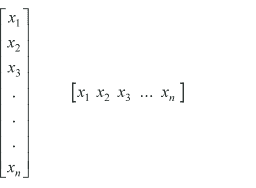

有关向量的定义，请参见第 55 页的《向量》。

#### 矩阵

矩阵表示为用方括号括起来的一块元素。下标分别指代行和列的位置：

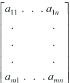

有关矩阵的定义，请参见第 61 页的《矩阵》。

##### 序列

序列用于排序、搜索、傅里叶变换、卷积和相关等领域。有关序列的定义，请参见第 101 页的《序列》。

###### 一维序列

一维序列表示为用括号括起来的一系列元素。下标指代序列内的元素位置：$(x_1, x_2, x_3, …, x_n)$

###### 二维序列

二维序列表示为一系列元素列。（它们的表示方式与没有方括号的矩阵相同。）

下标分别指代第一维和第二维内的元素位置：
```
a11 a12 . . . a1n
a21 a22       a2n
.   .   .   .
.   .   .   .
.   .   .   .
.   .   .   .
am1 am2 . . . amn
```

###### 三维序列

三维序列表示为一系列元素块。下标分别指代第一维、第二维和第三维内的元素位置：
```
a111 a121 . . . a1n1 a112 a122 . . . a1n2 a11p a12p . . . a1np
a211 a221       a2n1 a212 a222       a2n2 a21p a22p       a2np
.   .   .   .   .   .   .   .   . ... .   .   .   .   .
.   .   .   .   .   .   .   .   .     .   .   .   .   .
.   .   .   .   .   .   .   .   .     .   .   .   .   .
am11 am21 . . . amn1 am12 am22 . . . amn2 am1p am2p . . . amnp
```

## 数组

数组包含向量、矩阵或序列。有关数组的定义，请参见第 29 页的《如何设置数组？》。

###### 一维数组

一维数组表示为用括号括起来的单行数字元素：
```
(1.0, 2.0, 3.0, 4.0, 5.0)
```

对于计算不重要的元素通常不在数组中显示。每个未显示的元素显示一个点。在以下数组中，有五个元素对计算很重要，且每两个显示的元素之间都存在两个未用于计算的元素：
```
(1.0, . . , 2.0, . . , 3.0, . . , 4.0, . . , 5.0)
```

这种符号用于显示数组内的向量元素。

###### 二维数组

二维数组表示为用方括号括起来的一块数字元素：
```
[ 1.0  11.0  5.0  25.0
  2.0  12.0  6.0  26.0
  3.0  13.0  7.0  27.0
  4.0  14.0  8.0  28.0 ]
```

对于计算不重要的元素通常不在数组中显示。每个未显示的元素显示一个点。以下数组包含未用于计算的三行和两列：
```
          [    .    .    .    .  
            1.0  2.0  5.0  4.0  
            2.0  3.0  6.0  3.0  
            3.0  4.0  7.0  2.0  
            4.0  5.0  8.0  1.0  
          .    .    .    .   ]
```

这种符号用于显示数组内的矩阵元素。

###### 三维数组

三维数组表示为由省略号分隔的一系列元素块。每个块看起来都像二维数组：
```
[ 1.0 11.0 5.0 25.0      [ 10.0 111.0 15.0 125.0     [100.0 11.0 15.0  25.0
 2.0 12.0 6.0 26.0       20.0 112.0 16.0 126.0      200.0 12.0 16.0  26.0
 ...                      ...                         300.0 13.0 17.0  27.0
 4.0 14.0 8.0 28.0      40.0 114.0 18.0 128.0      400.0 14.0 18.0  28.0
```

对于计算不重要的元素通常不在数组中显示。每个未显示的元素显示一个点，正如二维数组中一样。

## 特殊字符、符号、表达式和缩写

本书使用的数学和编程符号与传统数学和编程用法保持一致。以下解释了这些约定，以及与其特定值相关的特殊缩写。

| 项目 | 描述 |
| :--- | :--- |
| 希腊字母：*σ, ω, Ω* | 符号化标量值 |
| |*a*| | *a* 的绝对值 |
| **a**•**b** | **a** 和 **b** 的点积 |
| *x*_{*i*} | 向量 *x* 的第 *i* 个元素 |
| *c*_{*ij*} | 矩阵 **C** 第 *i* 行第 *j* 列的元素 |
| *x*_{1} … *x*_{*n*} | 从 *x*_{1} 到 *x*_{*n*} 的元素 |
| *i* = 1, *n* | *i* 被赋予 1 到 *n* 的值 |
| **y** ← **x** | 向量 **y** 被向量 **x** 替换 |
| *xy* | 向量 *x* 乘以向量 *y* |
| *AX*≡*B* | *AX* 恒等于 *B* |
| *a*^{*k*} | *a* 的 *k* 次方 |
| *e*^{*x*} | *x* 的指数函数 |
| *A*^{*T*}, *x*^{*T*} | 矩阵 *A* 的转置；向量 *x* 的转置 |
| **x**-, **A**- | 向量 *x* 的共轭复数；矩阵 *A* 的共轭复数 |

### 符号说明

| 项目 | 描述 |
| :--- | :--- |
| $\overline{x}_i; \overline{c}_{jk}$ | 复数向量元素 $x_j$ 的共轭，其中： **如果** $x_i = \langle a_i, b_i \rangle$， **那么** $\overline{x}_i = \langle a_i, -b_i \rangle$ |
| | 复数矩阵元素 $c_{jk}$ 的共轭 |
| $\mathbf{x}^{*t}$; $\mathbf{A}^{*t}$ | 向量 $\mathbf{x}$ 的共轭转置；矩阵 $\mathbf{A}$ 的共轭转置 |
| $\sum_{i=1}^{n} x_i$ | 元素 $x_1$ 到 $x_n$ 的总和 |
| $\sqrt{a+b}$ | $a+b$ 的平方根 |
| $\int_{a}^{b} f(x)\ dx$ | $f(x)\ dx$ 从 $a$ 到 $b$ 的积分 |
| $\|\mathbf{x}\|_2$ | 向量 $\mathbf{x}$ 的欧几里得范数，定义为：$\sqrt{\sum_{j=1}^{n} |\mathbf{x}_j|^2}$ |
| $\|\mathbf{A}\|_1$ | 矩阵 $\mathbf{A}$ 的一范数，定义为：$\max \left\{ \sum_{i=1}^{m} |a_{ij}|,\ 1 \le j \le n \right\}$ |
| $\|\mathbf{A}\|_2$ | 矩阵 $\mathbf{A}$ 的谱范数，定义为：$\max\{\|\mathbf{A}\mathbf{x}\|_2\ :\ \|\mathbf{x}\|_2 = 1\}$ |
| $\|\mathbf{A}\|_F$ | 矩阵 $\mathbf{A}$ 的弗罗贝尼乌斯范数，定义为：$\sqrt{\sum_{i=1}^{m}\sum_{j=1}^{n} |a_{ij}|^2}$ |
| $\mathbf{A}^{-1}$ | 矩阵 $\mathbf{A}$ 的逆矩阵 |
| $\mathbf{A}^{-T}$ | $\mathbf{A}$ 的逆矩阵的转置 |
| $|\mathbf{A}|$ | 矩阵 $\mathbf{A}$ 的行列式 |
| $m$ 乘 $n$ 矩阵 $\mathbf{A}$ | 矩阵 $\mathbf{A}$ 有 $m$ 行和 $n$ 列 |
| $\sin a$ | $a$ 的正弦值 |
| $\cos b$ | $b$ 的余弦值 |
| SIGN ($a$) | $a$ 的符号；结果为 $+$ 或 $-$ |
| address $\{a\}$ | $a$ 的存储地址 |


| `max(x)` | 向量 `x` 中的最大元素 |
| `min(x)` | 向量 `x` 中的最小元素 |
| `ceiling(x)` | 大于或等于 `x` 的最小整数 |
| `floor(x)` | 不超过 `x` 的最大整数 |
| `int(x)` | 小于或等于 `x` 的最大整数 |
| `x mod(m)` | `x` 模 `m`；即 `x` 除以 `m` 的余数 |
| `∞` | 无穷大 |
| `π` | 圆周率，3.14159265... |

## 如何解释子程序描述

本节解释了如何解读本书第 2 部分中子程序描述里的信息。

### 描述

每个子程序描述都以对子程序功能简要说明开始。当我们将多个版本的子程序描述合并时，我们提供足够的信息以便您轻松区分各个子程序之间的差异。差异通常发生在执行的功能或每个子程序所需的数据类型上。

### 语法

此处展示了 Fortran、C 和 C++ 调用语句的语法：

| 语言 | 语法 |
| :--- | :--- |
| Fortran | `CALL NAME-1 \| NAME-2 \| ... \| NAME-1 (arg-1, arg-2, ..., arg-m, ...)` |
| C 和 C++ | `name-1 \| name-2 \| ... \| name-n (arg-1, ..., arg-m);` |

语法表示：

- 编程语言（Fortran、C 或 C++）
- 调用序列中您可以编码的每个可能的子程序名称。每个名称之间用 `|`（或）符号分隔。您在调用序列中仅指定这些名称中的一个。（您在调用序列中不编码 `|`。）
- 参数，按您在调用序列中编码的顺序列出。您必须在调用序列中编码所有这些参数。

您可以通过查看“进入时”（On Entry）和“返回时”（On Return）部分来区分输入参数和输出参数。用于输入和输出的参数同时在“进入时”和“返回时”部分中描述。在这种情况下，参数的输入值会被输出值覆盖。

参数的名称指示了您应该为参数指定的数据类型；例如：

- 以字母 i 到 n 开头的名称，如 `m`、`inx`、`iopt` 和 `isign`，表示您需要指定整数数据。
- 以字母 a 到 h 以及 o 到 z 开头的名称，如 `b`、`t`、`alpha`、`sigma` 和 `omega`，表示您需要指定实数或复数数据。

#### 进入时

此处列出了输入参数，即传递给 ESSL 子程序的参数。每个参数描述首先给出参数的含义，然后给出参数所需的数据形式。（为了帮助您避免错误，输出参数也会列出，并引用“返回时”部分。）

#### 返回时

此处列出了输出参数，即从 ESSL 子程序传回给您程序的参数。每个参数描述首先给出参数的含义，然后给出传回给您程序的参数数据形式。

#### 注释

注释说明了适用于参数或参数数据的任何编程注意事项和限制。可能会引用本书的其他部分以获取更多信息。

#### 功能

这是对子程序执行的功能或数学描述。**它解释执行的是何种计算，而不是实现方式。** 它解释了根据输入参数不同，计算的变化情况。在适当的地方，会引用参考文献中列出的数学背景书籍。参考文献以方括号中的数字表示，该数字对应参考文献中该数字下列出的条目。例如，参考文献 `[1]` 引用的是列出的第一项。

### 特殊用法

这些是您在应用中可以使用的子程序独特方法。在大多数情况下，本书不会涉及 ESSL 子程序的应用；然而，在某些特殊情况下，遵循特定使用规则可以扩展子程序的功能特性，这些规则将在此部分中描述。

#### 错误条件

这些是可能在子程序中发生的所有 ESSL 运行时错误。它们分为三个标题下：计算错误、输入参数错误和资源错误。还会解释由此产生的返回代码值。

#### 示例

示例展示了如何从 Fortran 程序中调用子程序。它们展示了子程序的多种用途。除了在某些情况下需要展示不同版本的子程序在用法上的差异外，示例中通常使用子程序的最简版本。在大多数情况下，这是子程序的短精度实数版本。每个示例都提供了对示例重要功能的描述，随后是 Fortran 调用序列、输入数据和结果输出数据。

## 变更摘要

本节概述了对 ESSL 所做的所有更改。

### ESSL 版本 4 发行版 1 的新增功能

- ESSL 现在可以运行在 pSeries 的 SuSE Linux Enterprise Server 8（SLES8）操作系统上。
- ESSL 库针对 POWER4+ 进行了调优。
- 稠密线性代数方程子程序现在包括这些新的 LAPACK 子程序：
  - `SGESV`、`DGESV`、`CGESV` 和 `ZGESV`；参见第 440 页关于通用矩阵分解和多重右侧求解的子程序描述。
  - `SPPSV` 和 `DPPSV`；参见第 468 页关于正定实对称矩阵分解和多重右侧求解的子程序描述。
  - `SPOSV`、`DPOSV`、`CPOSV` 和 `ZPOSV`；参见第 472 页关于正定实对称或复厄米特矩阵分解和多重右侧求解的子程序描述。
  - `SPPTRF` 和 `DPPTRF`；参见第 477 页关于正定实对称矩阵分解的子程序描述。
  - `SPPTRS` 和 `DPPTRS`；参见第 488 页关于正定实对称矩阵多重右侧求解的子程序描述。
  - `CGETRI` 和 `ZGETRI`；参见第 519 页关于通用矩阵求逆的子程序描述。
  - `CPOTRI` 和 `ZPOTRI`；参见第 526 页关于正定复厄米特矩阵求逆的子程序描述。
  - `CTRTRI`、`ZTRTRI`、`CTPPRI` 和 `ZTPPRI`；参见第 548 页关于三角矩阵求逆的子程序描述。
- 当计算单个大型变换时，`SCFT` 和 `DCFT` 子程序已增加对 SMP（对称多处理）的支持。
- 子程序描述的手册页现在可用。
- 不再随产品分发文档。您可以查看或下载第 10 页表 5 中列出的 URL 上的文档。
- ESSL 软件许可协议现在通过电子方式分发、查看和接受。（详情请参见 `ESSL 安装指南`。）

### 未来迁移

如果您担心向 ESSL 可能的未来发行版或可能的未来硬件迁移，请阅读第 165 页的“计划未来迁移”。该部分解释了您 **现在可以做什么** 以防止未来出现迁移问题。

### 第一部分 指南信息

本书的这一部分分为以下章节，提供了关于如何使用 ESSSL 的指导信息。其组织结构如下：

- 了解 ESSSL
- 设计您的程序
- 设置数据结构
- 编写程序
- 处理您的程序
- 迁移您的程序
- 处理问题

## 第 1 章 简介与要求

本章向您介绍工程和科学子例程库（ESSL）。

### ESSL 概览

本节概述了 ESSL 的功能和需求。

ESSL 是一个先进的子例程集合，为许多不同的科学和工程应用提供广泛的数学功能。其主要特点是性能、功能性和易用性。

#### 性能与功能

分布在九个计算领域的数学子例程针对 RS/6000 进行了性能调优。这些计算领域包括：

- 线性代数子程序
- 矩阵运算
- 线性代数方程
- 特征系统分析
- 傅里叶变换、卷积和相关性，以及相关的计算
- 排序和搜索
- 插值
- 数值积分
- 随机数生成

ESSL 提供两个运行时库：

- **`ESSL 对称多处理 (SMP) 库`** 提供 ESSL 子例程的线程安全版本，可用于所有 SMP（例如 p690）处理器。此外，这些子例程的子集也是多线程版本；即，它们支持共享内存并行处理编程模型。您无需修改调用 ESSL 的现有应用程序即可利用使用 SMP 处理器带来的性能提升；您只需重新链接现有的应用程序即可。要查看 ESSL SMP 库中多线程子例程的列表，请参阅第 26 页的表 24。
- **`ESSL 串行库`** 提供 ESSL 子例程的线程安全版本，可用于所有处理器。您可以使用此库开发自己的多线程应用程序。

所有库均旨在为计算密集型工作提供高性能。所有版本提供数学上等效的结果。

**ESSL 串行库** 和 **ESSL SMP 库** 支持 32 位环境和 64 位环境应用程序。

ESSL 子例程可以从用 Fortran、C 和 C++ 编写的应用程序中调用。ESSL 在 AIX 和 Linux 操作系统下运行。

#### 易用性

ESSL 专为易用性设计：

- 它具有易于调用的接口。
- 如果您的现有应用程序使用 ESSL 串行库，您只需重新链接您的程序即可利用 ESSL SMP 库带来的性能提升。
- 它支持 64 位环境。

用于 64 位环境的数据模型称为 LP64。该数据模型支持 32 位整数和 64 位指针。根据 LP64 数据模型，除 `ERRSET` 的 `iusadr` 参数外，所有 ESSL 整数参数均保持为 32 位。请参阅第 958 页的“`ERRSET`—用于 ESSL 的 ESSL ERRSET 子例程”。


它具备信息丰富的错误处理能力，使您可以计算辅助存储大小和转换长度。

有一本在线手册，可以使用超文本标记语言（HTML）文档浏览器显示，可用于 ESSL。

### 数学函数的多样性

本节描述了 ESSL 中包含的数学函数。

#### 应用领域

ESSL 为许多不同类型的科学和工程应用提供了多种数学函数。使用这些应用的一些行业包括：航空航天、汽车、电子、石油、金融、公用事业和研究。这些行业中应用的示例包括：

- 结构分析
- 计算化学
- 流体动力学分析
- 地震分析
- 油藏建模
- 定量分析
- 时间序列分析
- 计算技术
- 数学分析
- 动态系统仿真
- 核工程
- 电子电路设计

#### ESSL 提供的内容

ESSL 中提供的子例程，如表 1 所述，分为以下几组：

- 九个主要的数学计算领域，提供上述行业应用常用的计算
- 实用程序，执行通用功能

为了帮助您选择满足您对性能、精度、存储等需求的 ESSL 子例程，请参阅第 25 页的“选择 ESSL 子例程”。

### 表 1. ESSL 子例程摘要

| ESSL 计算领域 | 整数<br>子例程 | 短精度<br>子例程 | 长精度<br>子例程 |
| :--- | :---: | :---: | :---: |
| **线性代数子程序：** | | | |
| 向量-标量 | 0 | 41 | 41 |
| 稀疏向量-标量 | 0 | 11 | 11 |
| 矩阵-向量 | 1 | 32 | 32 |
| 稀疏矩阵-向量 | 0 | 0 | 3 |
| **矩阵运算：** | | | |
| 加法、减法、乘法、rank-k 更新、rank-2k 更新和矩阵转置 | 0 | 25 | 26 |
| **线性代数方程：** | | | |
| 稠密线性代数方程 | 3 | 49 | 54 |
| 带状线性代数方程 | 0 | 18 | 18 |
| 稀疏线性代数方程 | 0 | 0 | 11 |
| 线性最小二乘法 | 0 | 3 | 5 |
| **特征系统分析：** | | | |
| 代数特征系统分析问题和广义特征系统分析问题的解 | 0 | 8 | 8 |
| **信号处理计算：** | | | |
| 傅里叶变换 | 0 | 15 | 11 |
| 卷积和相关性 | 0 | 10 | 2 |
| 相关计算 | 0 | 6 | 6 |
| **排序和搜索：** | | | |
| 排序、带索引的排序，以及二分法和顺序搜索 | 5 | 5 | 5 |
| **插值：** | | | |
| 多项式和三次样条插值 | 0 | 4 | 4 |
| **数值积分：** | | | |
| 在点集或函数上的数值积分 | 0 | 6 | 6 |
| **随机数生成：** | | | |
| 生成均匀分布和正态分布随机数的向量 | 0 | 3 | 3 |
| **实用程序：** | | | |
| 通用服务操作 | 8 | 0 | 3 |
| **ESSL 子例程总数** | 13 | 236 | 249 |

## ESSL—处理能力

ESSL 提供两个运行时库，即 ESSL SMP 库和 ESSL 串行库。这些库旨在为 IBM eServer pSeries 和 RS/6000 处理器上的计算密集型工作提供高性能。

订购 ESSL 时，请指定以下其中一个程序号：

- **AIX 版 ESSL**
  - `5765-F82`
- **Linux 版 ESSL**
  - `5765-G17`

大多数子例程调用与 ESSL/370 产品中的调用兼容。

### 计算的精度

ESSL 提供的精度与使用等效算法和相同精度格式的库相当。在 ESSL 的大多数领域中，均提供了子例程的短精度和长精度实数版本。在某些领域中，还提供短精度和长精度复数版本，偶尔还提供整数版本。短精度、长精度和整数字例程版本操作的数据类型是 ANSI/IEEE 32 位和 64 位二进制浮点格式，以及 32 位整数。有关更多详细信息，请参阅 *ANSI/IEEE 标准 二进制浮点算术，ANSI/IEEE 标准 754–1985*。（针对使用 ANSI/IEEE 标准在工作站处理器上进行的计算结果，存在适用于 ESSL 的具体规则。有关详细信息，请参阅第 44 页的“ESSL 使用什么数据类型标准，您应该知道哪些例外情况？”）

有关精度的更多信息，请参阅第 43 页的“获取最佳精度”。

### ESSL 的高性能

*算法：* ESSL 子例程的设计旨在提供高性能。（参见参考文献 [32]、[43] 和 [44]。）为实现此性能，子例程使用根据硬件特定操作特性（如缓存大小、转换后援缓冲区 (TLB) 大小和页大小）量身定制的先进算法。

大多数子例程使用以下技术来优化性能：

- 高效管理缓存和 TLB，以最大化命中率；即，数据被分块，以便在其计算过程中保留在缓存或 TLB 中。
- 访问连续存储的数据——即使用步长-1 计算。
- 利用大量可用的浮点寄存器。
- 使用最小化页面交换的算法。
- 在 SMP 处理器上：
  - ESSL SMP 库旨在利用 SMP 处理器的处理能力和共享内存。此外，ESSL SMP 子例程的一个子集已编码以利用多线程（并行）编程技术带来的性能提升。要查看 ESSL SMP 库中多线程子例程的列表，请参阅第 26 页的表 24。
  - 线程数量的选择取决于问题规模、被调用的特定子例程以及您正在运行的物理处理器数量。为了实现最佳性能，实验是必要的；然而，将线程数量选择为等于在线处理器数量在大多数情况下通常能提供良好的性能。在某些情况下，如果将线程数量选择为小于在线处理器数量，性能可能会提高。

应使用 XL Fortran `XLSMPOPTS` 或 `OMP_NUM_THREADS` 环境变量来指定要创建的线程数。

- 在 POWER4 和 POWER4+ 处理器上：
  - 结构化 ESSL 子程序，使得在适用的情况下，编译后的代码充分利用双浮点执行单元。由于每个周期可以执行两条乘加指令，若忽略开销，则每个周期可执行四次浮点运算。
  - 结构化 ESSL 子程序，使得在适用的情况下，编译后的代码充分发挥硬件数据预取的优势。
- 在 POWER3 和 POWER3-II 处理器上：
  - 结构化 ESSL 子程序，使得在适用的情况下，编译后的代码充分利用双浮点执行单元。由于每个周期可以执行两条乘加指令，若忽略开销，则每个周期可执行四次浮点运算。
  - 结构化 ESSL 子程序，使得在适用的情况下，编译后的代码充分发挥硬件数据预取的优势。

### 数学技术

ESSL 的所有领域均采用最先进的数学技术来实现高性能。例如，矩阵-向量线性代数子程序操作于更高级别的数据结构，即矩阵-向量而非向量-标量。因此，它们直接优化您程序的性能，并间接通过使用该子程序的 ESSL 子程序进行优化。

### 子程序的 Fortran 语言接口

ESSL 子程序遵循标准的 Fortran 调用约定，并且必须在 Fortran 运行时环境中运行。当从 Fortran 以外的语言（如 C 或 C++）中的程序调用 ESSL 子程序时，必须使用 Fortran 约定。这适用于接口的所有方面，例如链接约定和数据约定。例如，数组顺序必须与 Fortran 数组顺序技术保持一致。各语言的数据和链接约定在第 107 页的“第 4 章，编写您的程序”中给出。

### 可与 ESSL 一起使用的软件和硬件产品

本节描述可与 ESSL 一起使用的硬件和软件产品，以及用于安装 ESSL 和显示联机文档的产品。它分为以下几个部分：

- “ESSL for AIX—硬件和软件”
- “ESSL for Linux—硬件和软件”见第 8 页

### ESSL for AIX—硬件和软件

本节描述可与 ESSL for AIX 一起使用的硬件和软件产品。

#### ESSL for AIX—硬件

ESSL for AIX 运行在受 AIX 操作系统支持的 IBM @server pSeries 和 RS/6000 处理器上。

64 位应用程序需要 64 位硬件。

#### ESSL for AIX—操作系统

ESSL for AIX 在以下操作系统环境中得到支持：

- AIX 5L™ Version 5.2 配合 5200-01 推荐维护包（产品编号 `5765-E62`）

#### ESSL for AIX—软件产品

ESSL for AIX 需要表 2 中列出的软件产品用于编译和运行。

为协助 C 和 C++ 用户，提供了一个 ESSL 头文件。此文件的使用在第 124 页的“*C 程序*”和第 140 页的“*C++ 程序*”中进行了描述。


| 用于编译 | 用于链接、加载或运行 |
| :--- | :--- |


| XL Fortran for AIX, Version 8.1 或更高版本（程序编号 5765-F70） *–或–* | XL Fortran Run-Time Environment for AIX, Version 8.1 或更高版本（程序编号 5765-F71） –**和**– |

| IBM Visual Age C++ Professional for AIX, Version 6.0（程序编号 5765-F56） *–或–* | C 库¹ |

| C for AIX, Version 6.0（程序编号 5765-F57） | |

¹ AIX 产品包含 Application Development Toolkit 中的 C 库和数学库。

#### ESSL for AIX—安装和定制产品

ESSL for AIX 许可程序以 CD 形式分发。*ESSL Installation Guide* 提供了安装 ESSL 所需的详细信息。

ESSL for AIX 产品根据 AIX 指南进行打包，如 *AIX General Programming Concepts: Writing and Debugging Programs* 手册中所述。该可以使用 `smit` 命令进行安装，如 *AIX System Management Guide: Operating System and Devices* 手册中所述。

### ESSL for Linux—硬件和软件

本节描述可与 ESSL for Linux 一起使用的硬件和软件产品。

#### ESSL for Linux—硬件

ESSL for Linux 运行在受 Linux 操作系统支持的 IBM @server pSeries 和 RS/6000 处理器上。

64 位应用程序需要 64 位硬件。

#### ESSL for Linux—操作系统

ESSL for Linux 在以下操作系统环境中得到支持：

- SuSE Linux Enterprise Server 8 for pSeries (SLES8)

#### ESSL for Linux—软件产品

ESSL for Linux 需要表 3 第 9 页中列出的软件产品用于编译和运行。

为协助 C 和 C++ 用户，提供了一个 ESSL 头文件。此文件的使用在第 124 页的“*C 程序*”和第 140 页的“*C++ 程序*”中进行了描述。

#### 表 3. *与 ESSL for Linux 一起使用所需的软件产品*

| 用于编译 | 用于链接、加载或运行 |

|---|---|

| XL Fortran for Linux on pSeries, Version 8.1 或更高版本（程序编号 5765-F70） *或* IBM Visual Age C++ Professional for Linux on pSeries, Version 6.0（程序编号 5765-F56） | XL Fortran Run-Time Environment for Linux, Version 8.1 或更高版本（程序编号 5765-F71） –和– GCC 32 位和/或 64 位库，Version 3.2 或更高版本，可以在以下包中找到： **32 位库** `glibc` **64 位库** `cross-ppc64-glibc` **注释:** 1. 以下包是构建应用程序所需的： **32 位应用程序** `binutils` **64 位应用程序** `cross-ppc64-binutils` 2. 以下包是构建 C 和 C++ 应用程序所需的： **32 位应用程序** `gcc` **64 位应用程序** `cross-ppc64-gcc` |

#### ESSL for Linux—安装和定制产品

ESSL for Linux 许可程序以 CD 形式分发。*ESSL for Linux Installation Guide* 提供了安装 ESSL for Linux 所需的详细信息。

ESSL for Linux 产品打包为 RPM 包。可以使用 `rpm` 命令安装该产品，如以下 URL 中所述：`http://www.rpm.org/`

### 用于显示 ESSL 文档的软件产品

显示 ESSL 联机信息所需的软件产品列于表 4 中。

#### 表 4. *显示各种格式 ESSL 联机信息所需的软件*

| 联机信息格式 | 所需软件 |

|---|---|

| HTML | HTML 文档浏览器（如 Microsoft® Internet Explorer） |

| PDF | Adobe Acrobat Reader，可从 Adobe 网站免费下载：`http://www.adobe.com` |

| Manpages | 无需额外软件。要显示特定的 manpage，请按照以下方式使用 `man` 命令：`man subroutine-name` |

| | **注意:** 这些 manpages 将安装在以下目录中： **On AIX** `/usr/share/man/cat3` **On Linux** `/usr/share/man/man3` LAPACK 提供的 manpages 安装在 `/usr/share/man/man3` 目录中。默认情况下，会显示 ESSL manpages 而不是同名 BLAS 或 LAPACK manpages。若要访问 BLAS 或 LAPACK manpages，必须设置 `MANPATH` 环境变量。请参阅 `man` 命令的文档。 |

### ESSL 互联网资源

ESSL 文档以及其他相关信息可以从表 5 中列出的 URL 在互联网上显示或下载。

#### 表 5. ESSL 相关信息的在线资源

| 网站 | 提供的信息类型 | 可用文件格式 |

|---|---|---|

| | | PDF | HTML |

| IBM @server Cluster Resource Center: `http://publib.boulder.ibm.com/clresctr` | 最新发布的 pSeries 和集群服务器软件产品的文档 | 是 | 是 |

| IBM @server pSeries Resource Library: `http://www-1.ibm.com/servers/eserver/pseries/1ibrary/sp_books/index.html` | 多个发布的 pSeries 和 RS/6000 SP 硬件和软件产品的文档 | 是 | 是 |

| IBM Publications Center: `http://w3.ohone.ibm.com/public/applications/publications/csbin/pbi.cgi` | IBM 产品的文档 | 是 | 否 |

### 加入 ESSL 邮件列表

可以通过加入 ESSL 邮件列表获取 ESSL 的最新信息。此外，邮件列表上的用户将收到有关新 ESSL 功能的信息，并可能收到客户满意度调查和需求调查，以便向 ESSL 开发部门提供关于产品和用户需求的反馈。

您可以通过向以下任一对象发送请求，询问加入 ESSL 邮件列表，从而被加入邮件列表：

International Business Machines Corporation

### ESSL 开发

第 85BA 部门

邮件地址 P963

2455 South Rd.

纽约州波基普西（Poughkeepsie, N.Y. 12601-5400）

电子邮箱：`essl@us.ibm.com`

注：如果您希望从 ESSL 邮件列表中移除，请向我们发送电子邮件。

在请求加入邮件列表或提出任何问题时，请提供以下信息：

- 您的姓名

- 您所在公司的名称

- 您的邮寄地址

- 您的互联网地址

- 您的电话号码

### ESSL 子例程列表

本节概述了 ESSL 各个领域中的子例程。

附录 A，“基本线性代数子例程 (BLAS),” 位于第 987 页，列出了包含在 ESSL 中的 1 级、2 级和 3 级基本线性代数子例程 (BLAS)。

附录 B，“LAPACK,” 位于第 989 页，列出了包含在 ESSL 中的线性代数包 (LAPACK) 子例程。

### 线性代数子例程

线性代数子例程包括：

- 向量-标量线性代数子例程（表 6）

- 稀疏向量-标量线性代数子例程（表 7）

- 矩阵-向量线性代数子例程（表 8）

- 稀疏矩阵-向量线性代数子例程（表 9）

注：

1. 术语**子例程**的使用与基本线性代数子例程 (BLAS) 保持一致，因为许多这些子例程对应于 BLAS。

2. 部分线性代数子例程是根据 1 级和 2 级 BLAS 事实标准设计的。如果这些子例程不符合已批准的标准，IBM 将考虑对其进行更新以符合标准。如果 IBM 更新这些子例程，更新可能需要修改调用应用程序。

#### 向量-标量线性代数子例程

向量-标量线性代数子例程包含 1 级 BLAS 标准集的一个子集。关于 BLAS 的详细信息，请参见参考文献 [81]。其余的向量-标量线性代数子例程是为您的应用程序提供的常用计算。提供了子例程的实数和复数版本。


## 表 6. 向量-标量线性代数子例程列表

| 描述性名称 | 短精度子例程 | 长精度子例程 | 页码 |
| :--- | :--- | :--- | :--- |
| 向量中具有最大幅值的元素首次或最后出现的位置 | `ISMAX*` `ICAMAX*` | `IDAMAX*` `IZAMAX*` | 195 |
| 向量中具有最小绝对值的元素首次或最后出现的位置 | `ISAMIN¹` | `IDAMIN¹` | 198 |
| 向量中具有最大值的元素首次或最后出现的位置 | `ISMAX²` | `IDMAX²` | 201 |
| 向量中最小值的元素首次或最后出现的位置 | `ISMIN²` | `IDMIN²` | 204 |
| 向量中元素的幅值之和 | `ISASUM*²` `SCASUM*²` | `DSASUM*²` `ZASUM*²` | 207 |
| 将向量 X 乘以标量，加到向量 Y 上，并存储在向量 Y 中 | `SAXPY²` `CAXPY²` | `DAXPY²` `ZAXPY²` | 210 |
| 复制向量 | `SCOPY²` `CCOPY²` | `DCOPY²` `ZCOPY²` | 213 |
| 两个向量的点积 | `SDOT²*` `CDOTU²*` `CDOTC²*` | `ZDOT²*` `ZDOTU²*` `ZDOTC²*` | 216 |
| 计算 N 次 SAXPY 或 DAXPY | `SNAXPY` | `DNAXPY` | 220 |
| 计算 N 次特殊点积 | `SNDOT` | `DNDOT` | 225 |
| 带有输入缩放以避免破坏性下溢和上溢的向量欧几里得长度 | `SNRM2²*` `SCNRM2²*` | `DNRM2²*` `DZNRN2²*` | 230 |
| 无输入缩放的向量欧几里得长度 | `SNORM2²` `CNORM2²` | `DNORM2²` `ZNORM2²` | 233 |
| 构造给文平面旋转 | `SROTG²` `CROTG²` | `DROTG²` `ZROTG²` | 236 |
| 应用平面旋转 | `SROT²` `CROT²` `CSROT²` | `DROT²` `ZROT²` `ZDROT²` | 242 |
| 将向量 X 乘以标量并存储在向量 X 中 | `SSCAL²` `CSCAL²` | `DSCAL²` `ZSCAL²` | 246 |
| 交换两个向量的元素 | `SSWAP²` `CSWAP²` | `DSWAP²` `ZSWAP²` | 249 |
| 将向量 X 加到向量 Y 上并存储在向量 Z 中 | `SVEA` `CVEA` | `DVEA` `ZVEA` | 252 |
| 从向量 X 中减去向量 Y 并存储在向量 Z 中 | `SVES` `CVES` | `DVES` `ZVES` | 256 |
| 将向量 X 乘以向量 Y 并存储在向量 Z 中 | `SVEM` `CVEM` | `DVEM` `ZVEM` | 260 |
| 将向量 X 乘以标量并存储在向量 Y 中 | `SYAX` `CYAX` `CSYAX` | `DYAX` `CYAX` `ZDYAX` | 264 |
| 将向量 X 乘以标量，加到向量 Y 上，并存储在向量 Z 中 | `SZAXPY` `CZAXPY` | `DZAXPY` `ZZAXPY` | 267 |

¹ 此子例程在 Fortran 程序中作为函数调用。

² 1 级 BLAS

## 稀疏向量-标量线性代数子例程

稀疏向量-标量线性代数子例程作用于稀疏向量；也就是说，只存储向量的非零元素。这些子例程提供与向量-标量子例程类似的功能。这些子例程代表参考文献 [31] 中描述的 1 级 BLAS 稀疏扩展的子集。提供了子例程的实数和复数版本。

## 表 7. 稀疏向量-标量线性代数子例程列表

| 描述性名称 | 短精度子例程 | 长精度子例程 | 页码 |
| :--- | :--- | :--- | :--- |
| 将压缩向量存储模式下的稀疏向量 X 的元素分散到全向量存储模式下的稀疏向量 Y 的指定元素中 | `SSCTR¹` `DSCTR¹` | `DSCTR¹` `DSCTR¹` | 271 |
| | `CSCTR¹` | `ZSCTR¹` | |
| 将全向量存储模式下的稀疏向量 Y 的指定元素聚集到压缩向量存储模式下的稀疏向量 X 中 | `SGTTHR` | `DGTTHR` | 274 |
| | `CGTTHR` | `ZGTTHR` | |
| 将全向量模式下的稀疏向量 Y 的指定元素聚集到压缩向量模式下的稀疏向量 X 中，并将 Y 的相同指定元素置零 | `SGTTHRZ` | `DGTTHRZ` | 277 |
| | `CGTTHRZ` | `ZGTTHRZ` | |
| 将压缩向量存储模式下的稀疏向量 X 乘以标量，加到全向量存储模式下的稀疏向量 Y 上，并存储在向量 Y 中 | `SAXPYI` | `DAXPYI` | 280 |
| | `CAXPYI` | `ZAXPYI` | |
| 压缩向量存储模式下的稀疏向量 X 与全向量存储模式下的稀疏向量 Y 的点积 | `SDOTI†` | `DDOTI†` | 283 |
| | `CDOTCI†` | `ZDOTCI†` | |
| | `CDOTUI†` | `ZDOTUI†` | |

† 此子例程在 Fortran 程序中作为函数调用。

### 矩阵-向量线性代数子例程

矩阵-向量线性代数子例程操作于更高级的数据结构——矩阵-向量而非向量-标量——使用优化算法以提高性能。这些子例程包含 2 级 BLAS 标准集的一个子集。关于 2 级 BLAS 的详细信息，请参见 [36] 和 [37]。提供了子例程的实数和复数版本。

## 表 8. 矩阵-向量线性代数子例程列表

| 描述性名称 | 短精度子例程 | 长精度子例程 | 页码 |
| :--- | :--- | :--- | :--- |
| 一般矩阵、其转置或其共轭转置的矩阵-向量积 | `SGEMV•` | `DGEMV•` | 287 |
| | `CGEMV•` | `ZGEMV•` | |
| | `SGEMX•` | `DGEMX•` | |
| | `SGEMTX•` | `DGEMTX•` | |
| 一般矩阵的秩一更新 | `SGER•` | `DGER•` | 297 |
| | `CGERU•` | `ZGERU•` | |
| | `CGERC•` | `ZGERC•` | |
| 实对称矩阵或复 Hermitian 矩阵的矩阵-向量积 | `SSPMV•` | `DSPMV•` | 304 |
| | `SHPMV•` | `ZHPRMV•` | |
| | `SSYMV•` | `DSYMV•` | |
| | `CHEMV•` | `ZHEMV•` | |
| | `SSLMX•` | `DSLMX•` | |
| 实对称矩阵或复 Hermitian 矩阵的秩一更新 | `SSPR•` | `DSPR•` | 312 |
| | `CHPR•` | `ZHPR•` | |
| | `SSYR•` | `DSYR•` | |
| | `CHER•` | `ZHER•` | |
| | `SSLR1•` | `DSLR1•` | |

## 表 8. 矩阵-向量线性代数子例程列表（续）

| 描述性名称 | 短精度子例程 | 长精度子例程 | 页码 |
| :--- | :--- | :--- | :--- |
| 实对称矩阵或复 Hermitian 矩阵的秩二更新 | `SSPR2*` `CHP R2*` `SSYR2*` `CHER2*` `SSLR2$` | `DSPR2*` `ZHPR2*` `DSYR2*` `ZHER2*` `DSLR2$` | 319 |
| 一般带状矩阵、其转置或其共轭转置的矩阵-向量积 | `SGBMV*` `CGBMV*` | `DGBMV*` `ZGBMV*` | 327 |
| 实对称带状矩阵或复 Hermitian 带状矩阵的矩阵-向量积 | `SSBMV*` `CHBMV*` | `DSBMV*` `ZHB MV*` | 333 |
| 三角矩阵、其转置或其共轭转置的矩阵-向量积 | `STRMV*` `CTRMV*` `STPMV*` `CTPMV*` | `DTRMV*` `ZTRMV*` `DTPMV*` `ZT PMV*` | 338 |
| 三角带状矩阵、其转置或其共轭转置的矩阵-向量积 | `STBMV*` `C TB MV*` | `DTBMV*` `ZTB MV*` | 344 |

* 2 级 BLAS

$ 此子程序仅为从 ESSL 早期版本迁移而提供，不打算用于新程序中。

### 稀疏矩阵-向量线性代数子例程

稀疏矩阵-向量线性代数子例程操作于稀疏矩阵；也就是说，只存储矩阵的非零元素。这些子例程提供与矩阵-向量子例程类似的功能。

## 表 9. 稀疏矩阵-向量线性代数子例程列表

| 描述性名称 | 长精度子例程 | 页码 |
| :--- | :--- | :--- |
| 压缩矩阵存储模式下稀疏矩阵的矩阵-向量积 | `DSMMX` | 350 |
| 转置压缩矩阵存储模式下的稀疏矩阵 | `DSMTM` | 353 |
| 压缩对角线存储模式下稀疏矩阵或其转置的矩阵-向量积 | `DSD MX` | 357 |

### 矩阵操作

部分矩阵操作子程序是根据 3 级 BLAS 事实标准设计的。如果这些子程序不符合已批准的标准，IBM 将考虑对其进行更新以符合标准。如果 IBM 更新这些子程序，更新可能需要修改调用应用程序。关于 3 级 BLAS 的详细信息，请参见参考文献 [34]。矩阵操作子程序还包括常用的矩阵操作：加法、减法、乘法和转置。

## 表 10. 矩阵操作子程序列表


| 描述性名称 | 短精度子程序 | 长精度子程序 | 页码 |
| :--- | :--- | :--- | :--- |
| 一般矩阵或其转置的矩阵加法 | SG EADD CG EADD | DG EADD ZG EADD | 365 |

#### 表 10. 矩阵运算子程序列表（续）

| 描述性名称 | 短精度子程序 | 长精度子程序 | 页码 |
| :--- | :--- | :--- | :--- |
| 一般矩阵或其转置的矩阵减法 | SGESUB<br>CGESUB | DGESUB<br>ZGESUB | 371 |
| 一般矩阵、其转置或共轭转置的矩阵乘法 | SGEMUL<br>CGEMUL | DGEMUL<br>ZGEMUL<br>DGEMUL<sup>a</sup> | 377 |
| 使用 Winograd 变体 Strassen 算法计算一般矩阵、其转置或共轭转置的矩阵乘法 | SGEMMS<br>CGEMMS | DGEMMS<br>ZGEMMS | 386 |
| 一般矩阵、其转置或共轭转置的矩阵乘法与加法组合 | SGEMM\*\*<br>CGEMM\*\* | DGEMM\*\*<br>ZGEMM\*\* | 391 |
| 其中一个矩阵为实对称、复对称或复埃尔米特矩阵的矩阵-矩阵乘积 | SSYMM\*\*<br>CSYM\*\*<br>CHEMM\*\* | DSYMM\*\*<br>CSYM\*\*<br>ZHEMM\*\* | 399 |
| 三角矩阵-矩阵乘积 | STRMM\*\*<br>CTRM M\*\* | DTRMM\*\*<br>ZTRMM\*\* | 406 |
| 实对称、复对称或复埃尔米特矩阵的秩-K 更新 | SSYRK\*\*<br>CSYRK\*\*<br>CHERK\*\* | DSYRK\*\*<br>ZSYRK\*\*<br>ZHERK\*\* | 412 |
| 实对称、复对称或复埃尔米特矩阵的秩-2K 更新 | SSYR2K\*\*<br>CSYR2K\*\*<br>CHE R2K\*\* | DSYR2K\*\*<br>ZSYR2K\*\*<br>ZHER2K\*\* | 418 |
| 一般矩阵转置（原地） | SGETMI<br>CGETMI | DGETMI<br>ZGETMI | 425 |
| 一般矩阵转置（非原地） | SGETMO<br>CGETMO | DGETMO<br>ZGETMO | 428 |

\* 3 级 BLAS

<sup>a</sup> 此子程序仅用于从早期版本 ESSL 迁移，不打算用于新程序中。

### 线性代数方程

- 线性代数方程包括：
  - 稠密线性代数方程（表 11）
  - 带状线性代数方程（表 12）
  - 稀疏线性代数方程（表 13）
  - 线性最小二乘法（表 14）

> 注意：某些线性代数方程是根据 2 级 BLAS、3 级 BLAS 以及 LAPACK 事实标准设计的。如果这些子程序不符合批准的标准，IBM 将考虑对其进行更新以使其符合。如果 IBM 更新了这些子程序，更新可能需要对调用应用程序进行修改。有关 2 级和 3 级 BLAS 的详细信息，请参阅 [34] 和 [36]。有关 LAPACK 的详细信息，请参阅 [8]。

### 稠密线性代数方程

稠密线性代数方程子程序为实和复一般矩阵及其转置、正定实对称和复埃尔米特矩阵、实对称不定矩阵以及三角矩阵的线性方程组提供解。这些子程序中的某些对应于参考文献 [34]、[36] 和 [8] 中描述的 2 级 BLAS、3 级 BLAS 和 LAPACK 例程。

#### 表 11. 稠密线性代数方程子程序列表

| 描述性名称 | 短精度子程序 | 长精度子程序 | 页码 |
| :--- | :--- | :--- | :--- |
| 一般矩阵分解和多个右端项求解 | SGE<sup>‡</sup><br>CGES<sup>‡</sup> | DGES<sup>‡</sup><br>ZGES<sup>‡</sup> | 440 |
| 一般矩阵分解 | SGET<sup>†</sup><br>CGET<sup>†</sup> | DGET<sup>†</sup><br>ZGET<sup>†</sup> | 444 |
| | SGES<br>CGES | DGES<br>ZGES | 452 |
| | DGEF<br>ZGEF<br>DGEFF<sup>a</sup> | | |
| 一般矩阵、其转置或其共轭转置<br>多个右端项求解 | SGES<sup>‡</sup><br>CGES<sup>‡</sup> | DGES<sup>‡</sup><br>ZGES<sup>‡</sup> | 448 |
| | SGESM<br>CGESM | DGESM<br>ZGESM | 459 |
| 一般矩阵、其转置或其共轭转置求解 | SGES<br>CGES | DGES<br>ZGES | 455 |
| 一般矩阵分解、条件数倒数和行列式 | SGEFCD | DGEFCD | 464 |
| 正定实对称矩阵分解和<br>多个右端项求解 | SPPSV<sup>‡</sup> | DPYSV<sup>‡</sup> | 468 |
| 正定实对称或复埃尔米特矩阵<br>分解和多个右端项求解 | SPOSV<sup>‡</sup><br>CPOSV<sup>‡</sup> | DPOSV<sup>‡</sup><br>ZPOSV<sup>‡</sup> | 472 |
| 正定实对称或复埃尔米特矩阵<br>分解 | SPOT<sup>†</sup><br>CPOT<sup>†</sup><br>SPOF<br>CPPTRF<sup>‡</sup><br>SPPF | DPOF<sup>†</sup><br>ZPOF<sup>†</sup><br>DPOF<br>ZPOF<br>DPPTRF<sup>‡</sup><br>DPFF<br>DPPFP<sup>a</sup> | 477 |
| 正定实对称或复埃尔米特矩阵<br>多个右端项求解 | SPOTS<sup>‡</sup><br>CPOSS<sup>‡</sup><br>SPOSM<br>CPOSM<br>SPPTRS<sup>‡</sup> | DPOTS<sup>‡</sup><br>ZPOTS<sup>‡</sup><br>DPOSM<br>ZPOSM<br>DPPTRS<sup>‡</sup> | 488 |
| 正定实对称矩阵求解 | SPPS | DPPS | 495 |
| 正定实对称矩阵分解、条件<br>数倒数和行列式 | SPPFCD<br>SPOFCD | DPPFCD<br>DPOFCD | 498 |
| 对称不定矩阵分解和多个<br>右端项求解 | | DBSSV | 504 |
| 对称不定矩阵分解 | | DBSTRF | 510 |
| 对称不定矩阵多个右端项求解 | | DBSTRS | 515 |
| 一般矩阵逆、条件数倒数和<br>行列式 | SGET<sup>†</sup><br>CGET<sup>†</sup><br>SQEIC | DGET<sup>†</sup><br>ZGET<sup>†</sup><br>DGEICD | 519 |
| 正定实对称或复埃尔米特矩阵<br>逆、条件数倒数和行列式 | SPOT<sup>†</sup><br>CPO<sup>†</sup><br>SPPICD<br>SPOICD | DPOT<sup>†</sup><br>ZPO<sup>†</sup><br>DPPICD<br>DPOICD | 526 |

#### 表 11. 稠密线性代数方程子程序列表（续）

| 描述性名称 | 短精度子程序 | 长精度子程序 | 页码 |
| :--- | :--- | :--- | :--- |
| 具有单个右端项的三角方程组求解 | STRSV\*\*<br>CTRSV\*\*<br>STPSV\*\*<br>CTPSV\*\* | DTRSV\*\*<br>ZTRSV\*\*<br>DTPSV\*\*<br>ZTPSV\*\* | 535 |
| 具有多个右端项的三角方程组求解 | STRSM\*\*<br>CTRSM\*\* | DTRSM\*\*<br>ZTRSM\*\* | 541 |
| 三角矩阵逆 | STRTRI<sup>◆</sup><br>CTRTRI<sup>◆</sup><br>STPTRI<sup>◆</sup><br>CTPPRI<sup>◆</sup><br>STRI<sup>§</sup><br>CTRI<sup>§</sup><br>STPI<sup>§</sup> | DTRTRI<sup>◆</sup><br>ZTRTRI<sup>◆</sup><br>DTPTRI<sup>◆</sup><br>ZTPTRI<sup>◆</sup><br>DTPI<sup>§</sup><br>ZTPI<sup>§</sup> | 548 |


**2 级 BLAS**
**3 级 BLAS**
◆ LAPACK
§ 此子程序仅用于从早期版本 ESSL 迁移，不打算用于新程序中。此子程序的文档不再提供。

### 带状线性代数方程

带状线性代数方程子程序为实一般带状矩阵、正定实对称带状矩阵、实或复一般三对角矩阵、正定实对称三对角矩阵以及实或复三角带状矩阵的线性方程组提供解。

#### 表 12. 带状线性代数方程子程序列表

| 描述性名称 | 短精度子程序 | 长精度子程序 | 页码 |
| :--- | :--- | :--- | :--- |
| 一般带状矩阵分解 | `SGBF` | `DGBF` | 557 |
| 一般带状矩阵求解 | `SGBS` | `DGBS` | 561 |
| 正定对称带状矩阵分解 | `SPBF`<br>`SPBCHF` | `DPBF`<br>`DPBCHF` | 563 |
| 正定对称带状矩阵求解 | `SPBS`<br>`SPBCHS` | `DPBS`<br>`DPBCHS` | 566 |
| 一般三对角矩阵分解 | `SGTF` | `DGTF` | 569 |
| 一般三对角矩阵求解 | `SGTS` | `DGTS` | 572 |
| 一般三对角矩阵无旋转的组合分解和求解 | `SGTNP`<br>`CGTNP` | `DGTNP`<br>`ZGTNP` | 574 |
| 一般三对角矩阵无旋转分解 | `SGTNP`<br>`CGTNP` | `DGTNP`<br>`ZGTNP` | 577 |
| 一般三对角矩阵无旋转求解 | `SGTNS`<br>`CGTNS` | `DGTNS`<br>`ZGTNS` | 580 |
| 正定对称三对角矩阵分解 | `SPTF` | `DPTF` | 583 |
| 正定对称三对角矩阵求解 | `SPTS` | `DPTS` | 585 |
| 三角带状方程求解 | `STBSV**`<br>`CTBSV**` | `DTBSV**`<br>`ZTBSV**` | 587 |

#### 稀疏线性代数方程

稀疏线性代数方程子程序为一般稀疏矩阵及其转置矩阵以及稀疏对称矩阵的线性方程组提供直接法和迭代法求解。

表 13. 稀疏线性代数方程子程序列表

| 描述性名称 | 长精度子程序 | 页码 |
| :--- | :--- | :--- |
| 使用索引、行或列存储的一般稀疏矩阵分解 | `DGSF` | 593 |
| 使用索引、行或列存储的一般稀疏矩阵或其转置的求解 | `DGSS` | 599 |
| 使用天际线存储模式的一般稀疏矩阵或其转置的分解、行列式及求解 | `DGKFS` `DGKFSP` ${ }^{\S}$ | 603 |
| 使用天际线存储模式的对称稀疏矩阵分解、行列式及求解 | `DSKFS` `DSKFSP` ${ }^{\S}$ | 620 |
| 按行存储的一般或对称稀疏矩阵迭代线性方程组求解器 | `DSRI S` | 637 |
| 使用压缩矩阵存储模式的稀疏正定或负定对称矩阵迭代求解 | `DSMCG` ${ }^{\ddagger}$ | 647 |
| 使用压缩对角存储模式的稀疏正定或负定对称矩阵迭代求解 | `DSDCG` | 654 |
| 使用压缩矩阵存储模式的一般稀疏矩阵迭代求解 | `DSMCG` ${ }^{\ddagger}$ | 661 |
| 使用压缩对角存储模式的一般稀疏矩阵迭代求解 | `DSDCG` | 668 |

${ }^{\S}$ 此子程序仅用于从早期版本的 ESSL 迁移，不适用于新程序。此子程序的文档不再提供。
${ }^{\ddagger}$ 此子程序仅用于从早期版本的 ESSL 迁移，不适用于新程序。请改用 `DSRI S`。

#### 线性最小二乘法

线性最小二乘子程序为实一般矩阵的线性方程组提供最小二乘解。提供了三种方法：一种使用奇异值分解；一种使用带列主元变换的 QR 分解；另一种使用不带列主元变换的 QR 分解。这些子程序中的某些对应于参考文献 [8] 中描述的 LAPACK 例程。

| 描述性名称 | 短精度子程序 | 长精度子程序 | 页码 |
| :--- | :--- | :--- | :--- |
| 一般矩阵的奇异值分解 | `SGESVF` | `DGESVF` | 675 |
| 使用奇异值分解的一般矩阵线性最小二乘解 | `SGESVS` | `DGESVS` | 682 |
| 一般矩阵 QR 分解 | | `DGEQRF` | 686 |
| 一般矩阵线性最小二乘解 | | `DGELS` | 690 |
| 带列主元变换的一般矩阵线性最小二乘解 | `SGELLS` | `DGELLS` | 697 |

LAPACK

#### 特征系统分析

特征系统分析子程序提供代数特征系统分析问题 `Az = λ z` 和广义特征系统分析问题 `Az = λ Bz` 的解（表 15）。许多特征系统分析子程序使用 Wilkinson 和 Reinsch 的《*线性代数*》[102] 中介绍的算法，或使用 EISPACK 例程的改编版本，如参考文献 [60] 中 *EISPACK Guide Lecture Notes in Computer Science* 所述。（EISPACK 可从参考文献 [51] 中列出的来源获取。）

| 描述性名称 | 短精度子程序 | 长精度子程序 | 页码 |
| :--- | :--- | :--- | :--- |
| 一般矩阵的特征值以及可选的全部或选定特征向量 | `SGEV^C GEV^C` | `DGEV^Z GEV^Z` | 705 |
| 实对称矩阵或复厄米矩阵的特征值以及可选的特征向量 | `SSEV^C HPEV^C` | `DSPEV^Z HPEV^Z` | 716 |
| 实对称矩阵或复厄米矩阵的极端特征值以及可选的特征向量 | `SSSV^C HPSV^C` | `DSSV^Z HPSV^Z` | 724 |
| 广义实特征系统 `Az=λ Bz` 的特征值以及可选的特征向量，其中 A 和 B 为实一般矩阵 | `SGEVG` | `DGEVG` | 731 |
| 广义实对称特征系统 `Az=λ Bz` 的特征值以及可选的特征向量，其中 A 为实对称矩阵且 B 为实对称正定矩阵 | `SSYGV` | `DSYGV` | 736 |

非 LAPACK。尽管此子程序与现有的 LAPACK 子程序同名，但其调用序列参数和功能与该 LAPACK 子程序不同。

#### 傅里叶变换、卷积与相关以及相关计算

该信号处理领域提供：
- 傅里叶变换子程序（表 16）
- 卷积和相关子程序（表 17）
- 相关计算子程序（表 18）

##### 傅里叶变换

傅里叶变换子程序在一维、二维和三维中执行混合基数变换。

表 16. 傅里叶变换子程序列表

| 描述性名称 | 短精度子程序 | 长精度子程序 | 页码 |
| :--- | :--- | :--- | :--- |
| 复傅里叶变换 | `SCFT` | `DCFT` | 751 |
| | `SCFTP^8` | | |
| 实到复傅里叶变换 | `SRCFT` | `DRCFT` | 759 |
| 复到实傅里叶变换 | `SCRFT` | `DCRFT` | 766 |
| 余弦变换 | `SCOSF` | `DCOSF` | 773 |
| | `SCOSFT^8` | | |
| 正弦变换 | `SSINF` | `DSINF` | 780 |
| 二维复傅里叶变换 | `SCFT2` | `DCFT2` | 787 |
| | `SCFT2P^8` | | |
| 二维实到复傅里叶变换 | `SRCFT2` | `DRCFT2` | 793 |
| 二维复到实傅里叶变换 | `SCRFT2` | `DCRFT2` | 800 |
| 三维复傅里叶变换 | `SCFT3` | `DCFT3` | 807 |
| | `SCFT3P^8` | | |
| 三维实到复傅里叶变换 | `SRCFT3` | `DRCFT3` | 812 |
| 三维复到实傅里叶变换 | `SCRFT3` | `DCRFT3` | 817 |

$^8$ 此子程序仅用于从早期版本的 ESSL 迁移，不适用于新程序。此子程序的文档不再提供。

##### 卷积与相关

卷积和相关子程序提供使用傅里叶方法或直接方法的选择。傅里叶方法子程序包含高性能混合基数功能。还有几个直接方法子程序提供抽取输出。

表 17. 卷积和相关子程序列表

| 描述性名称 | 短精度子程序 | 长精度子程序 | 页码 |
| :--- | :--- | :--- | :--- |
| 一个序列与一个或多个序列的卷积或相关 | `SCON^8` | | 824 |
| | `SCOR^8` | | |
| 使用直接方法的一个序列与另一个序列的卷积或相关 | `SCOND` | | 830 |
| | `SCORD` | | |
| 使用混合基数傅里叶方法的一个序列与一个或多个序列的卷积或相关 | `SCONF` | | 835 |
| | `SCORF` | | |
| 使用直接方法具有抽取输出的卷积或相关 | `SDCON` | `DDCON` | 844 |
| | `SDCOR` | `DDCOR` | |
| 一个或多个序列的自相关 | `SACOR^8` | | 848 |


| 使用混合基数傅里叶方法的一个或多个序列的自相关 | `SACORF` | | 852 |

$^8$ 这些子程序仅用于从早期版本的 ESSL 迁移，不适用于新程序。

### 相关计算

相关计算子程序由一组可用于一般信号处理应用程序的计算组成。它们类似于 IBM 3638 阵列处理器上提供的功能；然而，ESSL 子程序通常解决更广泛的问题范围。

| 描述性名称 | 短精度子程序 | 长精度子程序 | 页码 |
| :--- | :--- | :--- | :--- |
| 多项式求值 | `SPOLY` | `DPOLY` | 858 |
| 第 I 个过零点 | `SIZC` | `DIZC` | 861 |
| 时变递归滤波器 | `STREC` | `DTREC` | 864 |
| 二次插值 | `SQINT` | `DQINT` | 867 |
| 维纳-列文逊滤波器系数 | `SWLEV`<br>`CWLEV` | `DWLEV`<br>`ZWLEV` | 871 |

### 排序和搜索

排序和搜索子程序操作三种类型的数据：整数、短精度实数和长精度实数（表 19）。排序子程序执行带有或不带有索引指定的排序。搜索子程序执行二分搜索或顺序搜索。

| 描述性名称 | 整数子程序 | 短精度子程序 | 长精度子程序 | 页码 |
| :--- | :--- | :--- | :--- | :--- |
| 排序序列元素 | `ISORT` | `SSORT` | `DSORT` | 879 |
| 排序序列元素并记录原始元素位置 | `ISORTX` | `SSORTX` | `DSORTX` | 881 |
| 使用稳定排序排序序列元素并记录原始元素位置 | `ISORTS` | `SSORTS` | `DSORTS` | 884 |
| 在排序序列 Y 中二分搜索序列 X 的元素 | `IBSRCH` | `SBSRCH` | `DBSRCH` | 887 |
| 在序列 Y 中顺序搜索序列 X 的元素 | `ISSRCH` | `SSSRCH` | `DSSRCH` | 891 |

### 插值

插值子程序提供多项式插值、局部多项式插值以及一维和二维三次样条插值的功能（表 20）。

| 描述性名称 | 短精度子程序 | 长精度子程序 | 页码 |
| :--- | :--- | :--- | :--- |
| 多项式插值 | `SPINT` | `DPINT` | 897 |
| 局部多项式插值 | `TTPINT` | `DTTPINT` | 901 |
| 三次样条插值 | `SCSINT` | `DCSINT` | 904 |
| 二维三次样条插值 | `SCSIN2` | `DCSIN2` | 909 |

### 数值积分

数值积分子程序提供高斯积分方法，用于对有限、半无限或无限积分区域上的表列函数和用户提供的函数进行积分（表 21）。

### 表 21. *数值积分子程序列表*

| 描述性名称 | 短精度子程序 | 长精度子程序 | 页码 |
| :--- | :--- | :--- | :--- |
| 在点集上执行数值积分 | `SPTNQ` | `DFTNQ` | 917 |
| 使用 Gauss-Legendre 积分法对函数执行数值积分 | `SGLNQ`† | `DGLNQ`† | 920 |
| 在矩形域上使用二维 Gauss-Legendre 积分法对函数执行数值积分 | `SGLNQ2`† | `DGLNQ2`† | 922 |
| 使用 Gauss-Laguerre 积分法对函数执行数值积分 | `SGLGQ`† | `DGLGQ`† | 928 |
| 使用 Gauss-Rational 积分法对函数执行数值积分 | `SGRAQ`† | `DGRAQ`† | 931 |
| 使用 Gauss-Hermite 积分法对函数执行数值积分 | `SGHMQ`† | `DGHMQ`† | 935 |

† 此子程序在 Fortran 程序中作为函数调用。

### 随机数生成

随机数生成子程序生成均匀分布的随机数或正态分布的随机数（表 22）。

### 表 22. *随机数生成子程序列表*

| 描述性名称 | 短精度子程序 | 长精度子程序 | 页码 |
| :--- | :--- | :--- | :--- |
| 生成均匀分布随机数向量 | `SURAND` | `DURAND` | 941 |
| 生成正态分布随机数向量 | `SNRAND` | `DNRAND` | 944 |
| 生成长周期均匀分布随机数向量 | `SURXOR` | `DURXOR` | 947 |

### 实用程序

实用程序子程序执行支持 ESSL 的一般服务功能，而不是数学计算（表 23）。

### 表 23. *实用程序子程序列表*

| 描述性名称 | 子程序 | 页码 |
| :--- | :--- | :--- |
| ESSL 错误信息处理子程序 | `EINFO` | 954 |
| ESSL 的 ERRSAV 子程序 | `ERRSAV` | 957 |
| ESSL 的 ERRSET 子程序 | `ERRSET` | 958 |
| ESSL 的 ERRSTR 子程序 | `ERRSTR` | 960 |
| 设置 ESSL/370 标量库的向量段大小（VSS） | `IVSSET`§ | |
| 设置 ESSL/370 标量库的扩展向量操作指示符 | `IEVOPS`§ | |
| 确定已安装的 ESSL 级别 | `IESSL` | 961 |
| 确定指定傅里叶变换子程序的最佳性能步长值 | `STRIDE` | 963 |
| 将稀疏矩阵从按行存储模式转换为压缩矩阵存储模式 | `DSRSM` | 972 |
| 对于通用稀疏矩阵，在 Diagonal-Out 和 Profile-In 天际线存储模式之间进行转换 | `DGKTRN` | 976 |
| 对于对称稀疏矩阵，在 Diagonal-Out 和 Profile-In 天际线存储模式之间进行转换 | `DSKTRN` | 981 |

### 第 2 章. 规划您的程序

本章提供了您在规划程序时需要了解的关于 ESSL 的信息。其目的是帮助您在执行以下任务：
- 选择 ESSL 子程序
- 避免与导出的内部 ESSL 例程名称发生冲突
- 设置您的数据
- 设置您的 ESSL 调用序列
- 在 ESSL 中使用辅助存储
- 向 ESSL 提供正确的变换长度
- 获得最佳精度
- 获得最佳性能
- 处理使用 ESSL 时出现的错误

#### 选择 ESSL 子程序

您选择使用哪个 ESSL 子程序主要基于您程序的功能需求。然而，您有很多子程序的多种变体可供选择。此外，在某些情况下，某些子程序不能使用。本节描述了这些变体和限制。请参阅下方适用于您的每个问题的答案。

#### 您希望使用哪个 ESSL 库？

ESSL 提供两个运行时库：
- `ESSL SMP 库` 提供 ESSL 子程序的线程安全版本，可用于所有 SMP 处理器。此外，这些子程序的一个子集也是多线程版本；即，它们支持共享内存并行处理编程模型。关于 ESSL SMP 库中多线程子程序的列表，请参阅第 26 页的表 24。
- `ESSL 串行库` 提供 ESSL 子程序的线程安全版本，可用于所有处理器。如果您决定开发调用线程安全 ESSL 子程序的多线程程序，则可以选择使用此库。

您选择使用的线程数取决于问题规模、被调用的特定子程序以及您正在运行的物理处理器数量。为了实现最佳性能，实验是必要的；然而，通常情况下，将线程数设置为在线处理器数一般能提供良好的性能。在某些情况下，如果您选择使线程数少于在线处理器数，性能可能会有所提高。有关线程概念的更多信息，请参阅 AIX *通用编程概念：编写和调试程序* 以及参考文献 [86]。

`ESSL 串行库` 和 `ESSL SMP 库` 均支持 32 位和 64 位环境应用程序。详细信息请参阅第 107 页的第 4 章“编写您的程序”和第 157 页的第 5 章“处理您的程序”。

#### 表 24. 多线程 ESSL SMP 子程序

| 子程序名称 |
| :--- |
| `向量-标量线性代数子程序：`<br>`SASUM`, `DASUM`, `SCASUM`, `DZASUM`<br>`SAXPY`, `DAXPY`, `CAXPY`, `ZAXPY`<br>`SCOPY`, `DCOPY`, `CCOPY`, `ZCOPY`<br>`SDOT`, `DDOT`, `CDOTU`, `ZDOTU`, `CDOTC`, `ZDOTC`<br>`SNDDOT`, `DNDDOT`<br>`SNORM2`, `DNORM2`, `CNORM2`, `ZNORM2`<br>`SROT`, `DROT`, `CROT`, `ZROT`, `CSROT`, `ZDROT`<br>`SCAL`, `DSCAL`, `CSCAL`, `ZSCAL`, `CSSCAL`, `ZDSCAL`<br>`SSWAP`, `DSWAP`, `CSWAP`, `ZSWAP`<br>`SVEA`, `DVEA`, `CVEA`, `ZVEA`<br>`SVES`, `DVES`, `CVES`, `ZVES`<br>`SVEM`, `DVEM`, `CVEM`, `ZVEM`<br>`SAX`, `DYAX`, `CYAX`, `ZYAX`, `CSYAX`, `ZDYAX`<br>`SZAXPY`, `DZAXPY`, `CZAXPY`, `ZZAXPY` |


# 矩阵-向量线性代数子程序

`SGEMV`, `DGEMV`, `CGEMV`, `ZGEMV`
`SGER`, `DGER`, `CGERU`, `ZGERU`, `CGERC`, `ZGERC`
`SSPMV`, `DSPMV`, `CHPMV`, `ZHPMV`
`SSYMV`, `DSYMV`, `CHEMV`, `ZHEMV`
`SSPR`, `DSPR`, `CHPR`, `ZHPR`
`SSYR`, `DSYR`, `CHER`, `ZHER`
`SSPR2`, `DSPR2`, `CHPR2`, `ZHPR2`
`SSYR2`, `DSYR2`, `CHER2`, `ZHER2`
`SGBMV*`, `DGBMV*`
`CGBMV*`, `ZGBMV*`
`SSBMV*`, `DSBMV*`
`CHBMV*`, `ZHBMV*`
`STRMV`, `DTRMV`, `CTRMV`, `ZTRMV`
`STPMV`, `DTPMV`, `CTPMV`, `ZTPMV`
`STBMV*`, `DTBMV*`
`CTBMV*`, `ZTBMV*`

# 矩阵操作

`SGEADD`, `DGEADD`, `CGEADD`, `ZGEADD`
`SGESUB`, `DGESUB`, `CGESUB`, `ZGESUB`
`SGEMUL`, `DGEMUL`, `CGEMUL`, `ZGEMUL`
`SGEMM`, `DGEMM`, `CGEMM`, `ZGEMM`
`SSYMM`, `DSYMM`, `CSYMM`, `ZSYMM`, `CHEMM`, `ZHEMM`
`STRMM`, `DTRMM`, `CTRMM`, `ZTRMM`
`SSYRK`, `DSYRK`, `CSYRK`, `ZSYRK`, `CHERK`, `ZHERK`
`SSYR2K`, `DSYR2K`, `CSYR2K`, `ZSYR2K`, `CHER2K`, `ZHER2K`
`SGETMI`, `DGETMI`, `CGETMI`, `ZGETMI`
`SGETMO`, `DGETMO`, `CGETMO`, `ZGETMO`

# 稠密线性代数方程组

`SGESV`, `DGESV`, `CGESV`, `ZGESV`
`SGEE`, `DGEF`, `CGEE`, `ZGEE`
`SGES`, `DGES`, `CGES`, `ZGES`
`SGE2RE`, `DGE2RE`, `CGE2RE`, `ZGE2RE`
`SGE2RS`, `DGE2RS`, `CGE2RS`, `ZGE2RS`
`SP2SV`, `DP2SV`
`SP2F`, `DP2F`, `SP2TF`, `DP2TF`, `DP2OF`, `DP2TTF`
`SP2TRS`, `DP2TRS`
`SP2SV`, `DP2SV`, `CP2SV`, `ZP2SV`
`SP2SM`, `DP2SM`, `CP2SM`, `ZP2SM`
`SP2PCD`, `DP2PCD`, `CP2PCD`, `ZP2PCD`
`STR2SV`, `DTR2SV`, `CTR2SV`, `ZTR2SV`
`STR2PSV`, `DTR2PSV`, `CTR2PSV`, `ZTR2PSV`
`STR2SM`, `DTR2SM`, `CTR2SM`, `ZTR2SM`
`STR2I`, `DTR2I`, `CTR2I`, `ZTR2I`

# 稀疏线性代数方程组

`DSRI`^a^

许多稠密线性代数方程组和特征值系统分析子程序会调用本表中所示的矩阵-向量线性代数和矩阵操作子程序的多线程版本。`SCOSF`、`DCOSF`、`SSINF` 和 `DSINF` 会调用本表中所示的傅里叶变换子程序的多线程版本。这些子程序受益于 ESSL SMP 子程序多线程版本的性能提升。

通过设置以下环境变量，您的性能可能会得到改善：

- **ESSL for AIX** | `export MALLOCMULTIHEAP=true`

- 以及

- `export XLSMPOPTS="spins=0; yields=0"`

- **ESSL for Linux** | `export XLSMPOPTS="spins=0; yields=0"`

更多信息，请参阅 AIX 性能管理指南和 XLF 手册。

- * 仅当 `1PARM(4) = 1` 或 `2` 时，`DSRIS` 才使用多个线程。
- * 第二级带状 BLAS 仅当带宽足够大时使用多个线程。
- * 在因子或逆运算中使用多个线程。

## 您的程序正在处理什么类型的数据？

您选择的 ESSL 子程序版本应与您使用的数据相匹配。ESSL 提供了其大多数子程序的短精度和长精度版本，分别处理短精度和长精度数据。在少数情况下，它也提供处理整数数据或仅返回整数数据的整数版本。子程序名称根据以下字母区分，带有一个或两个字母的前缀：

- `S` 代表短精度实数
- `D` 代表长精度实数
- `C` 代表短精度复数
- `Z` 代表长精度复数
- `I` 代表整数

您数据的精度会影响结果的精度。这在第 43 页的“获得最佳精度”中有所讨论。有关这些数据类型的描述，请参阅第 29 页的“如何设置您的标量数据？”。

## 您的数据结构如何？您使用什么存储技术？

某些子程序处理特定的数据结构，例如稀疏向量和矩阵或稠密和带状矩阵。此外，这些数据结构可以使用各种存储技术进行存储。您应根据您拥有的数据结构类型和您想要使用的存储技术来选择正确的子程序。如果可能，您应使用节省存储空间并潜在提高性能的存储技术。有关存储技术的更多信息，请参阅第 29 页的“设置您的数据”。

## 性能与准确性如何？

ESSL 为其部分子程序提供了变体。在决定使用哪个子程序时，您应考虑性能和准确性。请仔细研究每个子程序说明中的“功能”部分。这有助于您确切了解每个子程序的作用，并帮助您确定最适合您的子程序。例如，某些子程序会执行某类多次计算。与逐个执行每次计算的子程序相比，这可能为您提供更好的性能。在其他情况下，一个子程序可能执行缩放，而另一个则不执行。如果您的数据不需要缩放，使用不带缩放的子程序将获得更好的性能。

## 避免与已导出的内部 ESSL 例程名称冲突

不要将与您自己的子程序、函数和全局变量相同的名称用于 ESSL 导出的名称。所有导出的内部 ESSL 例程名称均以 `ES7V` 前缀开头，因此您应避免在自己的名称中使用此前缀。

## 设置数据

本节介绍如何设置标量和数组数据，并指引您查找更多详细信息的位置。

### 如何设置您的标量数据？

标量项是单个数据项，无论是常量、变量还是数组元素。ESSL 假设您的标量数据符合相应的标准，如下所述。每种编程语言下标量数据类型以及如何编码它们，列在第 4 章“编码您的程序”第 107 页中各语言部分的“编码您的标量数据”下。

#### 内部表示

从所有类型的程序（包括 Fortran、C 和 C++）传递给 ESSL 的标量数据应符合 ANSI/IEEE 32 位和 64 位二进制浮点格式，如《*ANSI/IEEE 二进制浮点算术标准，ANSI/IEEE 标准 754–1985*》所述。

### 如何设置您的数组？

数组表示您程序中的一块存储区域，包含存储在一组位置中的数据。数组具有单个名称。它由一个或多个同类型的标量数据组成。这些是数组的元素。它可以作为输入传递给 ESSL 子程序，作为输出返回到您的程序中，或者同时用作输入和输出，在这种情况下，原始内容会被覆盖。

数组可以包含概念性（数学）数据结构，如向量、矩阵或序列。有许多不同类型的结构。每种数据结构都要求数组中数据有独特的排列，且不一定包含数组的所有元素。此外，这些数据结构的元素在数组存储中并不总是连续的。传递给 ESSL 子程序的步长（Stride）和主维度（Leading dimension）参数定义了向量、矩阵和序列元素在数组存储中的分隔。数据结构的所有这些方面都在第 3 章“设置您的数据结构”第 55 页中进行了描述。为了完全理解数据结构、步长和主维度的概念，特别是如果您以非常规方式使用它们时，您必须首先理解数组存储技术。

ESSL 子程序假设传递给它们的所有数组都使用 Fortran 数组存储技术（按列优先顺序）存储，并相应地处理您的数据。详情参见第 108 页的“在 Fortran 中设置数组”。另一方面，C 和 C++ 程序按行优先顺序存储数组。有关您可以采取的措施的详细信息，请参见：

- 对于 C，参见第 128 页的“在 C 中设置数组”。
- 对于 C++，参见第 145 页的“在 C++ 中设置数组”。

### 您的数组数据应如何对齐？

无论数据类型如何，所有数组都应双字边界对齐以确保最佳性能；但是，在 POWER2 处理器上运行时，最好将长精度数组对齐到四字边界。有关您的编程语言如何对齐数据的信息，请参见您的编程语言手册。

### 您的数据应使用哪种存储模式？

数组使用的存储量以及数组中数据的存储排列会影响整体程序性能。因此，ESSL 提供了操作不同类型数据结构（使用各种存储模式存储）的子程序。您应该选择一种节省存储并潜在提高性能的存储模式。有关各种数据结构及其相应存储模式的定义，请参见第 3 章“设置您的数据结构”第 55 页。在适用情况下，您还可以在每个子程序说明的“注意事项”部分中找到特殊的存储考虑事项。

### 如何从一种存储模式转换到另一种？

本节描述了如何从一种存储模式转换到另一种。

#### 转换子程序

ESSL 提供了几个子程序，帮助您从一种存储模式转换到另一种：


- `DSRSM` 用于将现有程序从按行存储的稀疏矩阵迁移到以压缩矩阵存储模式存储的稀疏矩阵。这将矩阵转换为与某些 ESSL 稀疏矩阵子程序（如 `DSMXM`）的输入要求兼容的存储格式。

- `DGKTRN` 和 `DSKTRN` 用于在调用子程序 `DGKFS`/`DGKFSP` 或 `DSKFS`/`DSKFSP` 之前（如果需要）将您的稀疏矩阵从一种天际线存储模式转换到另一种。

### 示例程序

此外，第 3 章“设置您的数据结构”第 55 页中的许多存储模式描述都附有示例程序。您可以通过将这些示例程序适配到应用程序来将数据转换为所需的存储模式。

### 设置您的 ESSL 调用序列

本节给出了设置 ESSL 调用序列的一般规则。这里提供的信息适用于在所有环境中运行的所有类型的程序。有关如何在特定的编程语言中编码 ESSL 调用序列的描述和示例，请参见以下部分：

- 第 107 页的“Fortran 程序”
- 第 124 页的“C 程序”
- 第 140 页的“C++ 程序”

有关本书中用于描述调用序列语法的约定的详细信息，请参见第 xix 页的“如何解释子程序说明”。它描述了如何在调用序列中指示必需参数和可选参数，以及用于不同数据类型的命名约定。

#### 什么是输入-输出参数？

某些参数既用作输入又用作输出。返回到您的程序时，输入参数的内容会被输出值覆盖。请注意，在调用 ESSL 子程序之前保存您需要保留的任何数据。

#### 在指定参数数据时应遵循哪些一般规则？

您应遵循子程序说明中“On Entry”（进入时）部分为每个参数给出的语法规则。指定输入参数时可能会发出输入参数错误消息，并且您的程序可能会终止。例如：

- 传递给 ESSL 的数据必须是正确类型：整型、字符型、实型、复数型、短精度或长精度。没有数据转换。假设您正在 C 和 C++ 程序中使用 ESSL 头文件，您需要先定义以下内容：
  - C 程序中的复数和逻辑数据，使用第 127 页给出的指南。
  - C++ 程序中的短精度复数和逻辑数据，使用第 143 页给出的指南。
- 字符值必须是指定的值之一。例如，它可能是 ‘N’、‘T’ 或 ‘C’。
- 数值必须在该参数的正确范围内。例如，数值可能需要大于或等于 0，或者必须是非零值。
- 数组必须正确定义；即它们必须具有正确的维度，或者维度必须在正确的范围内。例如，输入和输出矩阵可能需要是可符合的（conformable），或者矩阵的行数必须小于或等于指定的主维度。（ESSL 假设所有数组都按列优先顺序存储。）

#### 当 n 的值为 0 时会发生什么？

对于大多数 ESSL 子程序，如果您指定处理向量中的元素数量或矩阵阶数（通常是参数 `n`）为 0，则不执行任何计算。在检查输入参数错误后，子程序立即返回，且不返回任何结果。在其他子程序中，可能会发出错误消息。

#### 如何在 ESSL 调用序列中指定数据结构的起始位置？

当您在调用序列中指定向量、矩阵或序列时，它们不一定需要从数组的开头开始。它们可以从数组中的任意位置开始。例如，如果您希望向量 `$x$` 从数组 `$A$` 的第 3 个元素开始（其中 `$A$` 被声明为 `$A(1:12)$`），请在参数 `$x$` 的调用序列中指定 `$A(3)$`，例如在您的 Fortran 程序中的以下 `SASUM` 调用序列中：

```
      N     X     INCX
          |    |      |
      X = SASUM(  4 , A(3) ,  2  )
```

同样，例如，如果您希望矩阵 `$A$` 从数组 `$A$` 的第二行和第三列开始（其中 `$A$` 被声明为 `$A(0:10,2:8)$`），请在参数 `$a$` 的调用序列中指定 `$A(1,4)$`，例如在您的 Fortran 程序中的以下 `SG EADD` 调用序列中：

```
      A          LDA     TRANSa B    LDB    TRANSb C   LDC    M     N
       |           |       |     |       |      |      |       |     |     |
      CALL  GGEADD( A(1,4) , 11 , 'N' ,  B , 4 , 'N' ,  C , 4 ,  4 ,  3  )
```

有关指定向量和矩阵的更多示例，请参见第 3 章“设置数据结构”（第 55 页）。

#### 在 ESSL 中使用辅助存储

对于表 25 中列出的 ESSL 子程序，您需要提供额外的工作存储来执行计算。本节描述了使用动态分配在 ESSL 中提供辅助存储的方法，以及在动态分配不是选项的情况下，如何通过公式或 ESSL 提供的错误处理能力来计算所需的辅助存储量。

辅助存储或工作存储通过 ESSL 子程序调用序列中的一个或多个参数提供，例如 `$aux$`。**如果工作存储在子程序调用后不需要保留，建议您使用动态分配。** 例如，在傅里叶变换子程序中，您可以动态分配 `$aux2$`，但不能动态分配 `$aux1$`。有关详细信息和变体，请参见本书第 2 部分中的子程序描述。

**表 25. 需要辅助工作存储的 ESSL 子程序**

| 子程序名称 |
| :--- |
| **线性代数子程序：** |
| D$^{+}$SMTM |
| **矩阵运算：** |
| \_\_GE$^{+}$MMS |
| **稠密线性代数方程：** |
| \_GE$^{+}$FC$\_\$ \_PP$^{+}$FC$\_\$ \_GE$^{+}$IC$\_\$ \_PPIC$\_\$ \_POFC$\_\$ |
| \_PO$^{+}$C$\_\$ DG$^{+}$EF$\_\$ DP$^{+}$PF$^{+}$ |
| **稀疏线性代数方程：** |
| DG$^{+}$SF DGSS DGKFS DGKFS$^{+}\$ DSKFS DSKFS$^{+}\$ |
| DS$^{+}$RIS DSMC$\_\$ D$^{+}$DCG D$^{+}$SMC$\_\$ D$^{+}$D$^{+}$CG |
| **线性最小二乘：** |
| \_GE$^{+}$SV$\_\$ \_GE$^{+}$LS$\_\$ |
| **特征值系统分析：** |
| \_GE$^{+}$EV$\_\$ \_SPE$\_\$ $\_\_$HPEV SP$^{+}$SV \_HP$^{+}$SV |
| \_GE$^{+}$GV$\_\$ \_SY$^{+}$GV |
| **傅里叶变换：** |
| _CFT _RCFT _CRFT _COSF _SINF |
| SCOSFT$^a$ _CFIT2 _RCFT2 _CRFT2 _CFT3 |
| _RCFT3 _CRFT3 _SCFTP$^a$ _SCFTP2$^a$ _SCFT3P$^a$ |
| **卷积和相关：** |
| SCONF _SCORF _SACORF |
| **相关计算：** |
| _WLEV |
| **插值：** |
| _TPINT _CSIN2 |
| **随机数生成：** |
| _NRAND |
| **工具程序：** |
| DGKTRN _DSKTRN |

$^a$ 不再提供此子程序的文档。该子程序的 aux 和 nux 参数的指定方式与相应的串行 ESSL 子程序相同。

##### 辅助存储的动态分配

当错误 2015 不可恢复且 `nux=0` 时，执行辅助存储的动态分配。有关允许动态分配的 `aux` 参数的详细信息，请参见本书第 2 部分中的子程序描述。

##### 当不使用动态分配时设置辅助存储

您在程序中设置存储区域并通过参数将其传递给 ESSL，并在 `nux` 参数中指定 `aux` 工作区域的大小。

##### 谁负责计算大小？您还是 ESSL？

您有两种方法可以确定应指定多少辅助存储：

- 使用子程序描述中提供的公式推导出**足够的值**，以满足您当前和未来的需求。如果将**迁移到未来机器和未来 ESSL 版本的便利性**作为主要考虑因素，请使用此方法。有关详细信息，请参见“如何使用公式计算大小？”。
- 使用 ESSL 错误处理功能返回您当前正在运行的特定处理器所需的**最小值**。（值因平台而异。）如果将**节省存储**作为主要考虑因素，请使用此方法。有关详细信息，请参见第 34 页的“如何获取 ESSL 使用 ESSL 错误处理来计算大小？”。

##### 如何使用公式计算大小？

用于计算 `nux` 的公式指明了所需的**足够**的辅助存储量，在大多数情况下，这比 ESSL 错误处理返回的最小值要大。公式有两种类型：

- **简单公式**：在 `nux` 参数语法描述中给出。通常，这些公式得出所需的最小值，但在少数情况下，它们会提供高估值。
- **处理器无关公式**：在子程序描述中的独立部分中给出。通常，这些公式会提供高估值。

这两类公式提供的值对于所有处理器都足够。因此，您可以迁移到其他任何处理器以及未来版本的 ESSL，而无需担心必须增加 `aux` 的存储量。当然，您需要权衡存储需求与使用此较大值的便利性。


要使用公式计算存储量，您必须为特定变量（如 `$n`、`$m`、`$n1$` 或 `$n2$`）代入值。这些变量是在 ESSL 调用序列中指定的参数或从调用序列中的参数推导出来的。

## 如何获取 ESSL 使用 ESSL 错误处理来计算大小？

本节描述如何获取 ESSL 来计算辅助存储。

### 这里有两种方法

请问您更喜欢通过以下哪种方式从 ESSL 获取信息：

- **通过使错误 2015 不可恢复**，您可以从输入参数错误消息中获取 *nux* 所需的最小值，但您的程序将终止。
- **通过使错误 2015 可恢复**，您可以从输入参数错误消息中获取 *nux* 所需的最小值，并让更新后的 *nux* 参数返回到您的程序中。

对于这两种技术，ESSL 错误处理功能返回的量是在**您当前正在运行的特定处理器**上成功运行程序所需的**最小**辅助存储量。ESSL 错误处理能力通常返回的值比使用子程序列出的公式推导出的值更小。这是因为公式提供了良好的估算，但 ESSL 可以根据您的数据精确计算所需的大小。

ESSL 错误处理返回的值**可能不适用于未来的处理器**。如果您计划在未来处理器上运行程序，则不应使用这些值。只有在您关心最小化程序使用的辅助存储量时，才应使用这些值。

#### 第一种方法

在这种情况下，您从错误消息中获取 *nux* 所需的最小值，但您的程序将终止。以下描述假设未选择动态分配作为选项。

保持错误 2015 不可恢复，不通过 `EINFO` 和 `ERRSET` 进行调用。以小于子程序在您正在运行的特定处理器上所需的 *nux* 值运行您的程序。作为一般准则，指定小于公式中列出的值的数值。但是，如果在语法中指定了下限（仅适用于傅里叶变换、卷积和相关子程序中的几个 *nux1* 参数），您不应低于该下限。ESSL 错误监视器在输入参数错误消息中返回必要的 *nux* 存储区域大小。然而，当遇到错误时，这确实会终止您的程序。（如果您意外地指定了足够的

ESSL 子例程以执行计算；错误处理不会发出错误消息，处理将继续正常进行。）图 1 说明了当错误 2015 不可恢复时发生了什么。

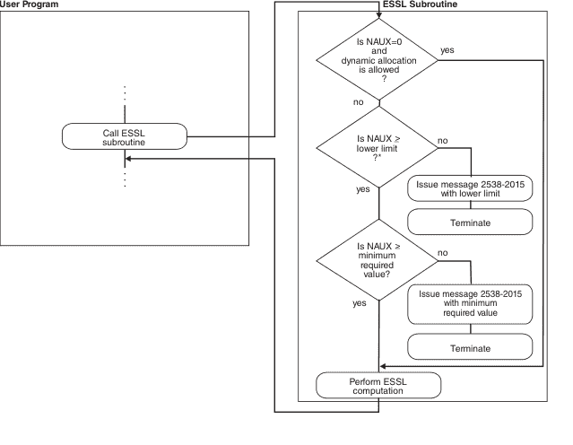

- 此检查仅适用于傅里叶变换、卷积和相关性子例程中的几个 `NAUX1` 参数。

> 图 1. 如何从错误消息中获取 NAUX 值，但终止程序

#### 第二种方法

在这种情况下，你从错误消息和返回给你程序的更新 *naux* 参数中获取 *naux* 的最小必需值。

使用 `EINFO` 和 `ERRSET` 配合 ESSL 错误退出例程 `ENOTRM`，使错误 2015 可恢复。这允许你在程序中动态确定辅助工作存储区（由 *naux* 参数指定）所需的最小尺寸。运行程序时，*naux* 值的设置应小于子例程在特定处理器上运行所要求的值。一般准则是，指定比公式中列出的值更小的值。但是，如果语法中规定了下限（仅适用于傅里叶变换、卷积和相关性子例程中的几个 *naux1* 参数），则不应低于该限制。当发生此错误时，ESSL 错误监视器会在输入参数错误消息中返回辅助存储区所需的大小，并将返回代码传回你的程序，表明更新后的值也会返回在 *naux* 参数中。然后，你可以在程序运行期间对这些更新值做出反应。当发生此错误时，ESSL 不执行任何计算。有关如何执行此操作的详细信息，请参见第 107 页的第 4 章“编码你的程序”。（如果你不小心为 ESSL 子例程指定了足够的存储以执行计算，错误处理不会发出错误消息，处理将正常继续。）图 2 说明了当错误 2015 可恢复时发生了什么。

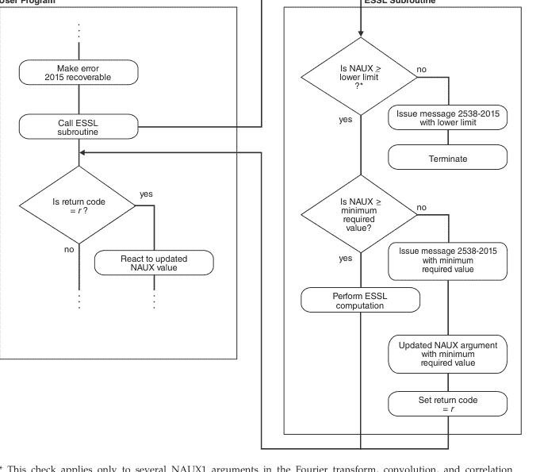

- 此检查仅适用于傅里叶变换、卷积和相关性子例程中的几个 `NAUX1` 参数。

图 2. 如何从错误消息和你的程序中获取 NAUX 值

##### 以下是使用这两种技术时发生情况的一个示例

下面的示例说明了 ESSL 错误处理设施对可恢复输入参数 *naux* 的每个可能值所采取的所有操作。这里的一个关键点是，如果你希望将更新后的参数值返回到你的程序中，你必须使错误 2015 可恢复，然后指定大于或等于 20 且小于 300 的 *naux* 值。对于该范围之外的值，错误恢复机制不生效。（*naux* 的值 20 和 300 仅用于本示例的目的，与任何 ESSL 子例程无关。）

- `NAUX`: `NAUX` 值的含义
- `20`: 在 ESSL 中使用可恢复输入参数错误处理设施所需的 *naux* 下限。（这仅适用于傅里叶变换、卷积和相关性子例程中的几个 *naux1* 参数。你可以在 *naux1* 参数的语法描述中找到下限。子例程列表见第 32 页的表 25。）
- `300`: 成功运行所需的 *naux* 最小值（在运行程序的处理器上）。

表 26 描述了 ESSL 针对本示例中给定值的每种可能情况所采取的操作。

**表 26.** *辅助存储大小的输入参数错误恢复示例*

| NAUX 值 | 当 2015 为不可恢复输入参数错误时的操作 | 当 2015 为可恢复输入参数错误时的操作 |
| :--- | :--- | :--- |
| *naux* < 20 | 发出输入参数错误消息。错误消息中的值为下限 20。应用程序停止。 | 发出输入参数错误消息。错误消息中的值为下限 20。应用程序停止。 |
| 20 $\leq$ *naux* < 300 | 发出输入参数错误消息。错误消息中的值为最小必需值 300。应用程序停止。 | ESSL 将 *naux* 值 300 返回给应用程序，并发出输入参数错误消息。错误消息中的值为最小必需值 300。ESSL 不进行任何计算，控制权返回给应用程序。 |
| *naux* $\geq$ 300 | 你的应用程序成功运行。 | 你的应用程序成功运行。 |

## 如何在程序中编码实现

如果你让错误 2015 保持不可恢复，那么你**在程序中不编码任何内容**。只需查看错误消息以获取辅助存储的大小。另一方面，如果你想使错误 2015 可恢复，以便在程序中动态获取辅助存储大小，你需要**在程序中增加一些编码语句**。有关如何在每种编程语言中编码这些语句的详细信息，请参阅以下示例：

- Fortran，见第 116 页
- C，见第 134 页
- C++，见第 150 页

你可能希望提供一个单独的子例程，以便在需要时计算辅助存储大小。第 38 页的图 3 展示了如何编码一个单独的 Fortran 子例程。在程序中调用 `SCFT` 之前，调用这个计算最小尺寸并将其存储在 *naux* 参数中的子例程 `SCFT`。返回后，你的程序检查返回代码。如果非零，*naux* 参数按计划已更新。此时应确保有足够的可用存储并调用 `SCFT`。另一方面，如果返回代码为零，则未调用错误处理，*naux* 参数未更新，并且已为 `SCFT` 执行了初始化步骤。

```fortran
SUBROUTINE SCFT
C     ... (Assumed arguments based on context, correcting OCR truncation for syntax validity where possible, keeping original intent)
      REAL*4 X(0:*), Y(0:*), SCALE
      REAL*8 AUX1(7), AUX2(0:*)
      INTEGER*4 INIT, INC1X, INC2X, INC1Y, INC2Y, N, M, ISIGN, NAUX1, NAUX2
      CHARACTER*8 ENOTRM
C
C     SETUP VARIABLES FOR ERRSET
C
      CALL EINFO(0)
      CALL ERSAV(2015, S2015)
      CALL ERRSET(2015, 0, -1, 1, ENOTRM, 0)
C
C     SETS NAUX1 AND NAUX2 TO THE MINIMUM VALUES REQUIRED TO USE
C     THE RECOVERABLE INPUT-ARGUMENT ERROR-HANDLING FACILITY
C
      NAUX1 = 7
      NAUX2 = 0
C
      CALL SCFT (INIT, X, INC1X, INC2X, Y, INC1Y, INC2Y,
     .           N, M, ISIGN, SCALE, AUX1, NAUX1, AUX2, NAUX2, *10)
C
      CALL ERRSTR(2015, S2015)
      RETURN
C
10    CONTINUE
      CALL ERRSTR(2015, S2015)
      RETURN 1
C
      END
```

图 3. 计算辅助存储大小的 Fortran 子例程

## 向 ESSL 提供正确的变换长度

本节描述了如何使用 ESSL 提供的公式或错误处理功能来计算变换长度。

### 哪些 ESSL 子例程需要变换长度？


对于表 27 中列出的 ESSL 子例程，你需要提供一个或多个变换长度来进行傅里叶变换计算。这些变换长度通过调用 ESSL 子例程时序列中的一个或多个参数提供，例如 `n`、`n1`、`n2` 和 `n3`。仅允许使用特定长度的变换进行计算。

### 表 27. 需要变换长度的 ESSL 子例程

| 子例程名称 |
| :--- |
| 傅里叶变换： |
| `_CFT`, `_RCFT`, `_CRFT`, `_COSF`, `_SINF` |
| `_SCOSFT`, `_CFT2`, `_RCFT2`, `_CRFT2`, `_CFT3` |
| `_RCFT3`, `_CRFT3`, `_SCFTP`, `SCFT2P`, `SCFT3P` |

### 你想让谁来计算长度？你或 ESSL？

你有两种方法来确定 ESSL 可处理的变换的允许长度：

- 使用第 743 页“变换的可接受长度”中的公式或大型表格来确定可接受的长度。详细信息请参见第 39 页的“如何使用表格或公式计算长度？”
- 使用 ESSL 错误处理设施返回可接受的长度。详细信息请参见第 39 页的“如何使用 ESSL 错误处理让 ESSL 计算长度？”

### 如何使用表格或公式计算长度？

傅里叶变换子程序接受的变换长度 ESSL 列于第 743 页的“可接受的变换长度”部分。您应该使用该部分的表格来查找您的长度所落在的两个值之间。然后，您指定较大的长度作为您的变换长度。如果您发现完美匹配，您可以使用该值而无需更改。该部分提供的公式表达了如何计算表格中列出的可接受值。如有必要，您可以使用公式在程序中动态检查长度。

### 如何让 ESSL 计算长度？

本节描述了如何让 ESSL 计算变换长度。

#### 以下是两种方法

请自问您更喜欢以下哪种方式从 ESSL 获取信息：

- 通过让错误 2030 不可恢复，您可以从输入参数错误消息中获取 `n` 的可接受值，但您的程序将终止。
- 通过让错误 2030 可恢复，您从输入参数错误消息中获取 `n` 的可接受值，并且更新的 `n` 参数会返回给您的程序。

由于傅里叶变换子程序仅允许特定的变换长度，ESSL 提供了这种错误处理功能，将可接受的长度返回给您的程序。它通过变换长度参数返回它们。ESSL 返回的值是基于您在 `n` 参数中指定的长度确定的下一个较大的可接受变换长度。

#### 第一种方法

在这种情况下，您从错误消息中获取 `n` 的可接受值，但您的程序将终止。

将错误 2030 保留为不可恢复，不调用 `EINFO` 和 `ERRSET`。运行您的程序时使用您想要使用的变换长度的近似值。如果这恰好不是一个可接受的长度，ESSL 错误监视器会在输入参数错误消息中返回变换的可接受长度。然而，当遇到错误时，这将终止您的程序。（如果您恰好指定了变换的可接受长度，错误处理不会发出错误消息，处理将正常继续。）第 40 页的图 4 说明了当错误 2030 不可恢复时发生的情况。

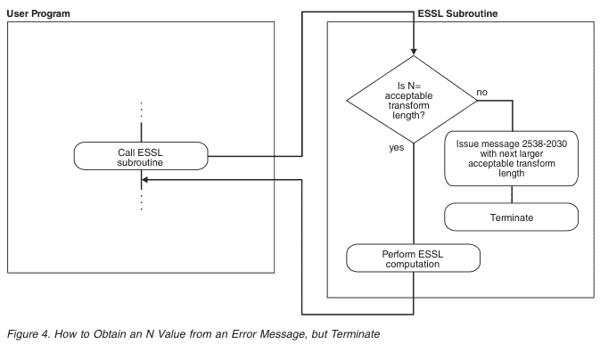

#### 第二种方法

在这种情况下，您从错误消息以及返回给您的程序的更新后的 `n` 参数中获取 `n` 的可接受值。

使用带有 ESSL 错误退出例程 `ENOTRM` 的 `EINFO` 和 `ERRSET` 使错误 2030 可恢复。这允许您在程序中动态确定在 `n` 参数中指定的变换的可接受长度。运行您的程序时使用您想要使用的变换长度的近似值。如果这恰好不是一个可接受的长度，ESSL 错误监视器会在输入参数错误消息中返回变换的可接受长度，并且一个返回码会传回给您的程序，表明更新后的值也会返回在 `n` 参数中。然后，您可以针对这些更新值在程序运行期间做出反应。ESSL 在此错误发生时不执行任何计算。有关如何执行此操作的详细信息，请参阅第 107 页的第四章“编码您的程序”。（如果您恰好指定了变换的可接受长度，错误处理不会发出错误消息，处理将正常继续。）第 41 页的图 5 说明了当错误 2030 可恢复时发生的情况。

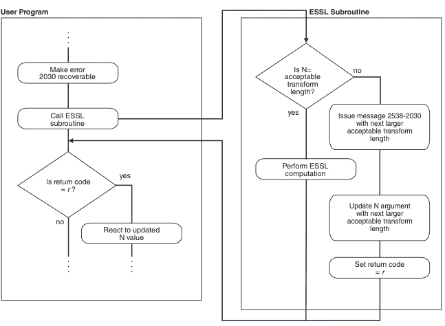

*图 5. 如何从错误消息及程序中获取 N 值*

### 以下是使用这两种技术时发生的情况示例

以下示例说明了 ESSL 错误处理设施对可恢复输入参数 `n` 的每种可能值所采取的所有操作。示例中使用的 `n` 值如下：

| N | N 值的含义 |
| :--- | :--- |
| 7208960 | 可接受的变换长度，成功计算傅里叶变换所必需 |
| 7340032 | 下一个较大的可接受变换长度，成功计算傅里叶变换所必需 |

第 42 页的表 28 描述了 ESSL 在此示例中给定值的每种可能情况下采取的操作。

| N 值 | 当 2030 为不可恢复输入参数错误时的操作 | 当 2030 为可恢复输入参数错误时的操作 |
| :--- | :--- | :--- |
| n = 7208960 | 您的应用程序运行成功。 | 您的应用程序运行成功。 |
| n = 7340032 | | |
| 7208960 < n < 7340032 | 发出输入参数错误消息。错误消息中的值为 7340032。应用程序停止。 | ESSL 将 `n` 的值作为 7340032 返回给应用程序，并发出输入参数错误消息。错误消息中的值为 7340032。ESSL 不进行任何计算，控制权返回给应用程序。 |

### 以下是如何在程序中编码

如果您将错误 2030 保留为不可恢复，您**不编码任何内容**在程序中。您只需查看错误消息来获取变换长度。另一方面，如果您希望使错误 2030 可恢复，以便在程序中动态获取变换长度，您需要**添加一些编码语句**到您的程序中。有关如何在每种编程语言中编码这些语句的详细信息，请参阅以下示例：

- 对于 Fortran，请参阅第 116 页
- 对于 C，请参阅第 134 页
- 对于 C++，请参阅第 150 页

您可能希望提供一个单独的子程序，在需要时计算变换长度。图 6 展示了如何编码一个单独的 Fortran 子程序。在程序中调用 `SCFT` 之前，您调用这个子程序，`SCFT` 计算正确的长度并将其存储在 `n` 中。返回后，您的程序检查返回码。如果非零，`n` 参数已按计划更新。然后您执行必要的数据设置并调用 `SCFT`。另一方面，如果返回码为零，则未调用错误处理，`n` 参数未更新，并且已为 `SCFT` 执行了初始化步骤。

```fortran
      SUBROUTINE SCFT
C     N, M, ISIGN, SCALE, AUX1, AUXI, AUX2, NAUX2
      REAL*4 X(0:),Y(0:), SCALE
      REAL*8 AUX1(7),AUX2(0:)
      INTEGER*4 INIT,INC1X,INC2X,INC1Y,INC2Y,N,M,ISIGN,NAUX1,NAUX2
      EXTERNAL ENOTRM
      CHARACTER*8 S2030
      CALL EINFO(0)
      CALL ERRSAV(2030,S2030)
      CALL ERRSET(2030,0,-1,0,ENOTRM,0)
      CALL SCFT(INIT,X,INC1X,INC2X,Y,INC1Y,INC2Y,
     &          N,M,ISIGN,SCALE,AUX1,NAUX1,AUX2,NAUX2,0,+10)
      CALL ERRSTR(2030,S2030)
      RETURN
   10 CONTINUE
      CALL ERRSTR(2030,S2030)
      RETURN 1
      END
```

您可能希望将辅助存储大小的请求与变换长度的请求合并。第 43 页的图 7 展示了如何编码一个单独的 Fortran 子程序来合并这两个请求。它合并了第 38 页图 3 和第 42 页图 6 中子程序执行的功能。


```fortran
      SUBROUTINE SCFT
C     N, M, ISIGN, SCALE, AUX1, AUXI, AUX2, NAUX2
      REAL*4 X(0:*), Y(0:*), SCALE
      REAL*8 AUX1(7), AUX2(0:*)
      INTEGER*4 INIT, INC1X, INC2X, INC1Y, INC2Y, N, M, ISIGN, NAUX1, NAUX2
      EXTERNAL ENOTRM
      CHARACTER*8 $2015, $2030
      CALL EINFO(0)
      CALL ERRSAV(2015, $2015)
      CALL ERRSAV(2030, $2030)
      CALL ERRSET(2015, 0, -1, 1, ENOTRM, 0)
      CALL ERRSET(2030, 0, -1, 1, ENOTRM, 0)
C     SETS NAUX1 AND NAUX2 TO THE MINIMUM VALUES REQUIRED TO USE
C     THE RECOVERABLE INPUT-ARGUMENT ERROR-HANDLING FACILITY
      NAUX1 = 7
      NAUX2 = 0
      CALL SCFT(INIT, X, INC1X, INC2X, Y, INC1Y, INC2Y,
     &          N, M, ISIGN, SCALE, AUX1, NAUX1, AUX2, NAUX2, 0,*10)
      CALL ERRSTR(2015, $2015)
      CALL ERRSTR(2030, $2030)
      RETURN
   10 CONTINUE
      CALL ERRSTR(2015, $2015)
      CALL ERRSTR(2030, $2030)
      RETURN 1
      END
```

*图 7. 计算辅助存储大小和变换长度的 Fortran 子程序*

## 获取最佳精度

本节解释了在各种情况下结果精度可能受到的影响，以及您可以做什么以实现最佳可能的精度。

### ESSL 子程序在哪些精度上运行？

在 ESSL 的大多数领域中，都提供了子程序的短精度和长精度实数版本。在某些领域中，还提供了短精度和长精度复数版本，偶尔还提供整数版本。子程序名称通过基于以下字母的一或两个字母前缀来区分：

- `S` 代表短精度实数
- `D` 代表长精度实数
- `C` 代表短精度复数
- `Z` 代表长精度复数
- `I` 代表整数

有关这些数据类型的描述，请参阅第 29 页的“如何设置标量数据？”。标量数据类型以及您应为每种编程语言编码的方式列在第 4 章“编码您的程序”（第 107 页）中每个语言部分的“编码您的标量数据”下。

### ESSL 计算的特性如何影响精度？

在执行诸如复制和交换等操作的过程中，数据精度不受影响。在执行涉及对数组数据进行数学运算的计算时，结果精度可能会受到以下因素的影响：

- 算法，该算法可能因计算中的值或数组大小或所用线程数量的不同而有所差异。
- 矩阵和向量的大小

因此，ESSL 子例程**没有**用于计算误差的封闭公式。换句话说，没有一种公式可以计算每个子例程中的计算误差。

短精度子例程有时通过以长精度累积中间结果来提高结果的精度。这一点也记录在每个子例程的功能描述中。

对于 RS/6000 POWER 和 POWER2，短精度浮点操作数由硬件以长精度值的形式存储在浮点寄存器中，因此所有算术运算都以长精度执行。在适用情况下，ESSL 子例程使用乘加（Multiply-Add）指令，该指令将乘法和加法操作结合，中间没有舍入操作。

对于 ESSL *串行库* 和 *ESSL SMP 库*，使用相同的 ESSL 库的 32 位环境和 64 位环境应用程序获得的结果在数学上是等价的，但可能不完全位相同。

### ESSL 使用哪些数据类型标准？有哪些异常需要注意？

子例程的短精度、长精度和整数版本所操作的数据类型是 ANSI/IEEE 32 位和 64 位二进制浮点格式，以及 32 位整数。更多详情请参见*《二进制浮点算术 ANSI/IEEE 标准，ANSI/IEEE 标准 754-1985》*。

对于使用 ANSI/IEEE 标准进行计算的结果，适用特定的 ESSL 规则。在运行程序时，在某些情况下，NaN（“非数字”）与标量零相乘的结果在 ESSL 子例程中可能与您期望的结果不同。

通常，当 NaN 乘以标量零时，结果是 NaN；然而，在一些执行缩放的 ESSL 子例程中，结果可能为零。例如，在计算 `α A` 时，其中 `α` 是标量，`A` 是矩阵，如果 `α` 为零且 `A` 的一个（或多个）元素为 NaN，则使用该元素得到的缩放结果可能是零，而不是 NaN。为了避免问题，在设计程序时应考虑这一点。

### 如何处理下溢？

ESSL 不屏蔽下溢。如果您的程序发生大量未屏蔽的下溢，其整体性能会降低。对于 RS/6000，*浮点异常捕获* 默认是禁用的。因此，除非您更改了默认设置，否则您不必屏蔽下溢。

### 在哪里可以找到有关精度的更多信息？

有关精度的信息可以在以下位置找到：

- 关于不同版本、平台等之间结果精度的迁移注意事项在第 6 章“迁移您的程序”第 165 页中有描述。
- 关于 ESSL 每个领域的具体精度信息在第二部分的每章引言中的“性能和精度注意事项”中给出。
- 每个子例程下“功能”中的功能描述解释您需要了解的有关计算精度的内容。有时使用不同的实现技术来提高性能。为了让了解精度如何受到影响，功能描述可能会以一般术语解释计算中使用的不同技术。

## 获取最佳性能

本节描述如何从 ESSL 子例程中获得尽可能好的性能。

### 可以使用哪些通用编码技术来提高性能？

有许多方法可以提高程序的性能。以下是其中一些方法：

- 按最佳性能顺序使用基本线性代数子程序和矩阵运算：矩阵-矩阵计算、矩阵-向量计算和向量-标量计算。当数据以矩阵或向量形式提供，而不是向量或标量时，单个 ESSL 子例程可以执行多个操作。
- 尽可能使用执行多个计算的子例程，如 `SNDOT` 和 `SNAXPY`，而不是单个计算，如 `SDOT` 和 `SAXPY`。
- 在计算中为数据使用步长为 1。如果存储中的向量元素不是连续访问的，会降低性能。存储中的向量元素彼此越接近，性能越好。有关步长的解释，请参阅第 58 页的“步长在向量中的使用”。
- 不要将数组的 leading dimension (`lda`) 或向量的步长 (`inc`) 指定为等于或接近以下倍数的值：
  - 对于长精度数组为 128
  - 对于短精度数组为 256
- 不要将一维数组的大小指定为 128 的倍数。当向 ESSL 子例程传递多个一维数组时，这一点尤为重要。（这种倍数可能导致性能问题，否则可能不会发生。）
- 对于小规模问题，避免为矩阵使用较大的 leading dimension (`lda`)。
- 一般而言，无论数据类型如何，都应将数组对齐到双字边界；然而，在 POWER2 处理器上运行时，最好将长精度数组对齐到四字边界。有关编程语言如何对齐数据的信息，请参阅您的编程语言手册。
- 一个子例程可能执行缩放，而另一个则不执行。如果您的数据不需要缩放，使用不带缩放的子例程可以获得更好的性能。`SNORM2` 和 `DNORM2` 是不执行缩放的子例程示例，而 `SNRM2` 和 `DNRM2` 是执行缩放的子例程。
- 在使用任何傅里叶变换子例程（`RCFT` 和 `CRT` 除外）时，使用 `STRIDE` 子例程来计算输入或输出数据的最佳步长值。对数据使用这些步长值可以使傅里叶变换子例程达到最大性能。首先从 `STRIDE` 获取最佳步长值，为每个所需的步长值调用一次。然后使用这些步长值排列数据。数据设置好后，调用傅里叶变换子例程。有关 `STRIDE` 子例程及其在每个傅里叶变换子例程中用法的详细信息，请参阅第 963 页的“`STRIDE`——确定指定傅里叶变换子例程中最佳性能的步长值”。有关更多信息，请参阅第 746 页的“设置您的数据”。

### 在哪里可以找到有关性能的更多信息？

- ESSL 用于实现最佳性能的许多技术在第 6 页的“ESSL 的高性能”中描述。
- 有关性能的迁移注意事项在第 6 章“迁移您的程序”第 165 页中描述。
- 关于 ESSL 每个领域的具体性能信息在第二部分的每章引言中的“性能和精度注意事项”中给出。
- 选定子例程的详细性能信息可以在参考文献 [32]、[43]、[44] 中找到。

### 使用 ESSL 时如何处理错误

- 程序异常
- ESSL 输入参数错误
- ESSL 计算错误
- ESSL 资源错误
- ESSL 注意消息

在运行时，可能会遇到与 ESSL 子例程使用相关的不同类型的错误或消息：

本节解释如何处理所有这些情况。

#### 如何处理程序异常？


在 ESSL 中可能遇到的程序异常在《二进制浮点算术 ANSI/IEEE 标准，ANSI/IEEE 标准 754-1985》中描述。

# 如何处理 ESSL 输入参数错误？

本节概述了如何处理输入参数错误。

## 所有输入参数错误

ESSL 检查大多数输入参数的有效性。如果发现任何参数无效，它会发出适当的错误消息。此外，除了以下描述的三种可恢复错误外，它会终止您的程序。您应该使用标准的编程技术来诊断和修复不可恢复的输入参数错误，如第 169 页的第 7 章“处理问题”中所述。

您可以通过查看本书第二部分中子例程描述下的“错误条件”来确定子例程中可能出现的输入参数错误。所有输入参数错误的错误消息列在第 176 页的“输入参数错误消息 (2001-2099)”中。

## 可恢复错误 2015、2030 和 2200 可在 `NAUX`、`N` 和 `NSEINFO` 参数中返回更新值

对于 Fortran、C 和 C++ 程序中的三个输入参数错误 2015、2030 和 2200，您可以选择继续运行，并让更新后的输入参数值返回到您的程序中供后续使用。这些被称为可恢复错误。这种可恢复的错误处理能力为您在确定参数的正确值方面提供了灵活性。您可以：

- 使用错误 2015 来确定辅助工作区的正确大小。关于是否希望使用此功能以及如何使用的详细信息，请参见第 32 页的“在 ESSL 中使用辅助存储”。
- 使用错误 2030 来确定变换的正确长度。关于是否希望使用此功能以及如何使用的详细信息，请参见第 38 页的“向 ESSL 提供正确的变换长度”。
- 使用错误 2200 来确定 `DBSTRF` 和 `DBSSV` 中数组 `AP` 的最小大小。关于是否希望使用此功能的决策辅助，请参见第 510 页的“`DBSTRF`—对称不定矩阵分解”和第 504 页的“`DBSSV`—对称不定矩阵分解及多重右端向量求解”。

如果您选择保持错误 2015、2030 和 2200 为不可恢复状态，则无需对程序进行任何编码更改。终止时会发出输入参数错误消息，其中包含本可指定以使程序成功运行的更新值。然后您在程序中进行必要的修正并重新运行。

如果您选择使错误 2015、2030 和 2200 可恢复，您需要调用 `ERRSET` 子例程来设置 ESSL 错误出口例程 `ENOTRM`，然后调用 ESSL 子例程。当发生这些错误中的一个或多个时，会发出包含更新值的输入参数错误消息。此外，更新值会随非零返回代码一起返回到您的程序中位于错误消息中指定的输入参数里，并且处理将继续进行。与这些可恢复错误相关的返回代码值在第 2 部分中每个 ESSL 子例程的“错误条件”下进行了描述。

关于如何在程序中编写必要语句以使 2015、2030 和 2200 可恢复的详细信息，请参见以下各节：

- 第 114 页的“Fortran 中的输入参数错误”
- 第 131 页的“C 中的输入参数错误”
- 第 147 页的“C++ 中的输入参数错误”

# 您能如何处理 ESSL 计算错误？

本节概述了如何处理计算错误。

## 所有计算错误

ESSL 计算错误是发生在计算数据中的错误，例如在您的向量和矩阵中。您可以通过查阅本书第 2 部分中子例程描述下的“错误条件”来确定子例程中可能发生的计算错误。除非采取预防措施，否则这些错误会导致您的程序异常终止。输出中还会提供一条消息，包含有关该错误的信息。消息列表见第 182 页的“计算错误消息 (2100-2199)”。

当发生计算错误时，应假设结果是不可预测的。只有在未发生错误的情况下，计算结果才是有效的。在这种情况下，将返回零返回代码。

图 8 展示了发生计算错误时的情形。

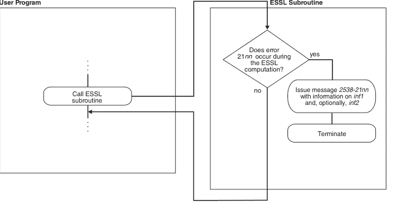

*图 8. 如何从错误消息中获取计算错误信息，但终止程序*

## 可恢复的计算错误可通过 `EINFO` 返回值

在 Fortran、C 和 C++ 程序中，您可以使某些计算错误变为可恢复，并让有关错误的信息返回到您的程序中。可恢复的计算错误列于第 954 页的表 179 中。首先，在程序开始时调用 `EINFO` 以初始化 ESSL 错误选项表。然后调用 `ERRSET` 以重置您感兴趣的计算错误代码的允许错误数量。当发生计算错误时，每个计算错误都会返回一个非零返回代码。与这些错误相关的返回代码值在被子例程描述中的“错误条件”下进行了描述。根据返回代码，您的程序可以分支到适当的语句，调用 ESSL 错误信息处理子例程 `EINFO`，以获取有关涉及错误的数据的具体信息。这些信息通过 `EINFO` 输出参数 `info1` 和可选的 `info2` 返回。然后您可以检查返回的信息，如果选择，可以继续处理。`EINFO` 的语法在第 954 页的“`EINFO`—ESSL 错误信息处理子例程”中进行了描述。您还会在输出中针对遇到的每个计算错误获得一条包含错误信息的消息。`EINFO` 子例程在消息中提供的信息与其提供给程序的信息相同。

关于如何在程序中编写必要语句以获取计算错误具体信息的详细信息，请参见以下各节：

- 第 117 页的“Fortran 中的计算错误”
- 第 136 页的“C 中的计算错误”
- 第 152 页的“C++ 中的计算错误”

第 49 页的图 9 展示了如果将计算错误设为可恢复时的情形。

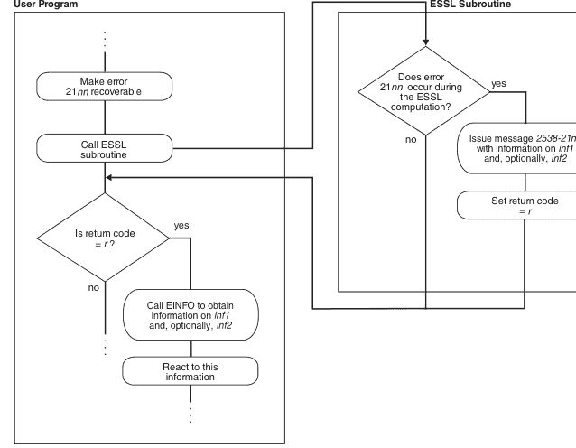

*图 9. 如何在错误消息和您的程序中获取计算错误信息*

# 您能如何处理 ESSL 资源错误？

本节概述了如何处理资源错误。

## 所有资源错误

当尝试分配工作区失败时，ESSL 返回资源错误并终止您的程序。一些 ESSL 子例程尝试为其内部使用分配工作区。其他 ESSL 子例程尝试在用户通过调用序列参数（如 `aux` 和 `naux`）请求时动态分配辅助存储。关于如何在重新运行应用程序之前减少系统内存约束或增加可用内存量的信息，请参见第 172 页的“ESSL 资源错误消息”。

您可以通过查阅本书第 2 部分中子例程描述下的“错误条件”来确定子例程中可能发生的资源错误。所有资源错误的错误消息列于第 184 页的“资源错误消息 (2400-2499)”。

# 您能如何处理 ESSL 关注消息？

本节概述了如何处理关注消息。

## 所有关注消息

ESSL 返回关注消息以描述发生的状况；然而，ESSL 能够继续处理。关于如何减少系统内存约束或增加可用内存量的信息，请参见第 172 页的“ESSL 资源错误消息”。

例如，当有足够的工作空间继续处理，但不是最初请求的数量时，可能会发出关注消息。会发出关注消息以指示性能可能会降级。

关于可能生成关注消息的子例程列表，请参见第 174 页的表 35。关于关注消息的列表，请参见第 184 页的“信息和关注错误消息 (2600-2699)”。

# 如何通过在 ESSL 错误选项表中设置值来控制错误处理？

本节解释了使用 ESSL 错误选项表的所有方面。

## ESSL 错误选项表中设置了哪些值？

ESSL 错误选项表包含告知 ESSL 在每次遇到 ESSL 生成的错误时如何处理的信息。表 29 显示了在 ESSL 安装时表中建立的默认值。

*表 29. ESSL 错误选项表默认值*

| 错误消息范围（从–至） | 允许的错误数量 (`ALLOW`) | 打印的消息数量 (`PRINT`) | 可修改的表条目 (`MODENT`) |
| :--- | :--- | :--- | :--- |
| 2538–2000 | 无限制 | 255 | 否 |
| 2538–2001 至 2538–2073 | 无限制 | 255 | 是 |
| 2538–2074 | 无限制 | 5 | 是 |
| 2538–2075 至 2538–2098 | 无限制 | 255 | 是 |
| 2538–2099 | 1 | 255 | 是 |
| 2538–2100 至 2538–2101 | 1 | 255 | 是 |
| 2538–2102 | 无限制 | 255 | 是 |
| 2538–2103 至 2538–2113 | 1 | 255 | 是 |
| 2538–2114 | 无限制 | 255 | 是 |
| 2538–2115 至 2538–2122 | 1 | 255 | 是 |
| 2538–2123 至 2538–2124 | 无限制 | 255 | 是 |
| 2538–2125 至 2538–2126 | 1 | 255 | 是 |
| 2538–2127 | 无限制 | 255 | 是 |
| 2538–2128 至 2538–2137 | 1 | 255 | 是 |
| 2538–2138 至 2538–2143 | 无限制 | 255 | 是 |
| 2538–2144 至 2538–2145 | 1 | 255 | 是 |
| 2538–2146 至 2538–2149 | 无限制 | 255 | 是 |
| 2538–2150 | 1 | 255 | 是 |


| 2538–2151 | 无限制 | 255 | 是 |

| 2538–2152 至 2538–2198 | 1 | 255 | 是 |

| 2538–2199 | 1 | 255 | 是 |

## 表 29. ESSIL 错误选项表默认值（续）

| 错误消息范围（从–到） | 允许错误数 (ALLOW) | 打印消息数 (PRINT) | 可修改表项 (MODENT) |
| :--- | :--- | :--- | :--- |
| 2538–2200 至 2538–2299 | 无限制 | 255 | 是 |
| 2538–2400 至 2538–2499 | 1 | 255 | 否 |
| 2538–2600 至 2538–2699 | 无限制 | 255 | 否 |
| 2538–2700 至 2538–2799 | 1 | 255 | 否 |

## 如何更改错误选项表中的值？

您可以通过在程序中调用 `ERRSET` 子程序来更改 ESSIL 错误选项表中的任意值。这会在运行时动态更改值。您还可以分别使用 `ERRSAV` 和 `ERRSTR` 子程序来保存和恢复表中的条目。有关 `ERRSET`、`ERRSAV` 和 `ERRSTR` 子程序的说明，请参见第 17 章“Utilities/”第 951 页。

## 何时更改错误选项表中的值？

由于您可以更改错误选项表中的信息，因此您可以控制任何 ESSIL 错误发生时发生的情况。在以下几种情况下，您可能希望执行此操作：

- **自定义错误处理环境：** 您可能只是想调整错误允许发生的次数，在此之后您的程序将终止。您可以使用 `ERRSET` 中可用的任何功能。
- **获取辅助存储大小和变换长度：** 您可能希望使 ESSIL 输入参数错误 2015 或 2030 可恢复，以便 ESSIL 分别向您的程序返回更新的辅助存储大小或变换长度。有关更详细的讨论，请参见第 46 页的“如何处理 ESSIL 输入参数错误？”。有关如何使用 `ERRSET` 实现此目的，请参见第 4 章“Coding Your Program”中针对您的编程语言的部分，第 107 页。
- **获取 DBSTRF 和 DBSSV 中数组 AP 的最小大小：** 您可能希望使 ESSIL 输入参数错误 2200 可恢复，以便 ESSIL 向您的程序返回更新的大小。有关更详细的讨论，请参见第 46 页的“如何处理 ESSIL 输入参数错误？”。有关如何使用 `ERRSET` 实现此目的，请参见第 4 章“Coding Your Program”中针对您的编程语言的部分，第 107 页。
- **获取更多关于计算错误的信息：** 您可能希望 ESSIL 将有关计算错误的信息返回给您的程序。有关更详细的讨论，请参见第 47 页的“如何处理 ESSIL 计算错误？”。有关如何使用 `ERRSET` 实现此目的，请参见第 4 章“Coding Your Program”中针对您的编程语言的部分，第 107 页。
- **允许应用程序的某些部分拥有独特的错误处理环境：** 如果您的程序是大型应用程序的一部分，您可能希望动态保存和恢复错误选项表中已被 `ERRSET` 修改的条目。这确保了当应用程序中的多个程序使用错误选项表时其完整性。有关更详细的讨论，请参见“如何通过保存和恢复错误选项表中的条目来控制大型应用程序中的错误处理？”。有关如何使用 `ERRSAV` 和 `ERRSTR`，请参见第 4 章“Coding Your Program”中针对您的编程语言的部分，第 107 页。

## 如何通过保存和恢复错误选项表中的条目来控制大型应用程序中的错误处理？

当您的程序是较大应用程序的一部分时，您应考虑可能发生以下情况之一：

- 如果您在程序中使用 `ERRSET` 重新设置任何 ESL 输入参数错误或计算错误对应的错误选项表中的任意值，应用程序中的其他程序可能会受到不利影响。它们可能期望使用原始值。
- 如果应用程序中的其他程序使用 `ERRSET` 重新设置任何 ESL 输入参数错误或计算错误对应的错误选项表中的任意值，您的程序可能会受到不利影响。您可能需要错误选项表中的某个特定值，而应用程序可能已重新设置该值。

如果大型应用程序中每个使用 `ERRSET` 的程序也都使用 `ERRSAV` 和 `ERRSTR` 功能，则可以避免这些情况。对于特定的错误编号，`ERRSAV` 将错误选项表中的条目保存到您的程序可访问的区域。然后，`ERRSTR` 将条目从存储区域存储回错误选项表中。对于您使用 `ERRSET` 重新设置错误选项表中值的每个输入参数错误编号和计算错误编号，您需要编码一个 `ERRSAV` 和 `ERRSTR`。在您调用 `EINFO` 之后、程序开始时调用 `ERRSAV`，然后在所有 ESL 计算完成后、程序结束时调用 `ERRSTR`。这会在您的程序以不同值运行期间保存错误选项表的原始内容，并在程序完成后将其恢复为原始内容。有关如何在程序中编码这些语句的详细信息，请参见第 4 章“Coding Your Program”，第 107 页。

## 在多线程环境中错误处理是如何工作的？

当您的应用程序或 Fortran 首次创建线程时，ESL 将错误选项表信息初始化为表 29（第 50 页）中显示的默认设置。您可以通过从每个线程调用相应的错误处理子程序（`ERRSET`、`ERRSAV` 或 `ERRSTR`）来更改每个已创建线程的默认设置。如何在多线程应用程序中初始化错误选项表并更改默认设置的示例显示在第 122 页的“多线程应用程序中处理错误的示例”中。

ESL 在多线程环境中按发生顺序发出错误消息。来自任何现有线程的错误消息将按照其发生的顺序写入标准输出。

当任何现有线程上发生终止条件时（例如，超过允许的错误数），ESL 将终止您的应用程序。总是打印与终止线程对应的一组摘要信息。与其他线程对应的摘要信息也可能被打印。

## 在哪里可以找到更多关于错误的信息？

有关错误及其处理方法的信息可以在以下位置找到：

- 如何编码程序以使用 ESSL 错误处理设施在第 4 章“Coding Your Program”第 107 页中有描述。
- 所有 ESSL 错误消息都列在“Messages”（第 176 页）下。
- 与每个 ESSL 子程序相关的错误和返回代码列在第 2 部分每个子程序说明的“Error Conditions”下。
- 第 7 章“Handling Problems”第 169 页提供了所有类型的 ESSL 编程和文档问题的完整诊断程序，以及如何收集信息和报告问题。

### 第 3 章 设置数据结构

本章提供了设置数据结构所需的信息，包括向量、矩阵和序列。这些技术适用于所有编程语言中的程序。

#### 概念

向量、矩阵和序列是包含在数组中的概念性数据结构。在许多情况下，ESSL 使用步长（stride）或前导维（leading dimension）从数组中选择向量、矩阵或序列的元素。在其他情况下，ESSL 使用特定的映射或存储布局来标识数组中向量、矩阵或序列的元素，有时需要多个数组来帮助定义映射。从数组中选择的这些元素构成了概念性数据结构。

当您调用 ESSL 子程序时，它假定您在传入的数组中已正确设置了数据结构。如果没有，结果将不可预测。ESSL 还将这些相同的存储布局用于传回给程序的 pass 数据结构。

本书中向量、矩阵和序列术语的使用与标准数学定义一致，其表示与数学文本中使用的约定一致。本书中描述向量、矩阵和序列的特殊符号和约定在第 xiv 页的“Special Notations and Conventions”中有解释。

**重叠数据结构**：大多数子程序不允许向量、矩阵或序列重叠。如果发生这种情况，结果将不可预测。在适用的情况下，这会在每个子程序说明的“Notes”中解释。这意味着数据结构的元素不能与其他任何数据结构的元素位于相同的存储位置。然而，只要通过大于 1 的步长交错存储，就可以使不同数据结构的元素位于同一数据中。例如，使用步长为 2 的向量 `x` 和 `y`，其中 `x` 从 `A(1)` 开始，`y` 从 `A(2)` 开始，元素在数组 `A` 中按 `x1, y1, x2, y2, x3, y3, ...` 的顺序驻留，依此类推。

使用此技术时，您应该注意为数组中包含的每个数据结构指定不同的起始位置。

#### 向量

向量是一维有序数字集合。它可以是列向量，代表 n 乘 1 的有序集合，也可以是行向量，代表 1 乘 n 的有序集合。

列向量的符号表示如下：

`x = [ x1, x2, x3, ..., xn ]`

行向量的符号表示如下：

`x = [ x1 x2 x3 ... xn ]`

向量可以包含实数或复数。当它们包含实数时，有时被称为实向量。当它们包含复数时，被称为复向量。

#### 向量的转置

向量的转置将列向量变为行向量，或者反过来：

`x = [ x1, x2, x3, ..., xn ] xT = [ x1 x2 x3 ... xn ] (xT)T = [ x1, x2, x3, ..., xn ]`

ESSL 子程序按照计算中 intended 的列向量或行向量使用向量；因此，无需移动数据。


在本书第 2 部分“参考信息”中提供的子程序描述示例中，两种类型的向量均以相同方式表示，展示构成向量 `x` 的数组元素，如下所示：`(1.0, 2.0, 3.0, 4.0, 5.0, 6.0)`

### 向量的共轭转置

包含复数的向量 `x` 的共轭转置用 `xH` 表示，表达式如下：

`x = [ x1, x2, x3, ..., xn ]` `xH = [ x1*, x2*, x3* ... xn* ]`

与向量转置一样，向量的共轭转置也无需移动数据。

### 存储

向量通常存储在一维或二维数组中。其元素按顺序存储在数组中，但不一定连续。

向量在数组中的`位置`由 ESSL 调用序列中向量的参数指定。它可以用多种方式指定。例如，如果 `A` 是长度为 12 的数组，并且你想指定向量 `x` 从数组 `A` 的第一个元素开始，则指定 `A` 作为参数，例如：

```
X = SASUM (4, A, 2)
```

其中待求和的向量元素个数为 4，向量的位置为 `A`，步长为 2。

如果你想指定向量 `x` 从声明为 `A(1:12)` 的数组 `A` 中的第 3 个元素开始，请指定：

```
X = SASUM (4, A(3), 2)
```

如果 `A` 声明为 `A(-1:8)`，请对第 3 个元素指定以下内容：

```
X = SASUM (4, A(1), 2)
```

如果 `A` 是二维数组，声明为 `A(1:4,1:10)`，并且你希望向量 `x` 从 `A` 的第二行第三列开始，请指定以下内容：

```
X = SASUM (4, A(2,3), 2)
```

ESSL 调用序列中指定的`步长`用于遍历数组以选择向量元素。从数组中选择向量元素的方向（即从前往后或从后往前）由步长的符号（`+` 或 `−`）指示。步长的绝对值给出从数组中选择的每个元素之间的间隔。

要计算数组中向量所需的总元素数，你可以使用以下公式，该公式考虑了数组中的元素数量 `n` 以及为向量指定的步长 `inc`：

```
1+(n−1)│inc│
```

> 数组可能比它包含的向量大得多；也就是说，数组中向量后面可能有许多元素，向量前面也可能有元素。

有关向量如何在数组中存储的完整描述，请参见第 58 页的“步长如何用于向量”。

对于复向量，使用特殊的存储排列来容纳数组中每个复数 `(a+bi)` 的两个部分 `a` 和 `b`。对于每个复数，数组中需要两个连续存储位置。因此，复向量和矩阵所需的存储量恰好是相同精度实向量和矩阵的两倍。有关实数和复数描述的详细信息，请参见第 29 页的“如何设置你的标量数据？”，有关实数和复数数据如何在数组中存储的描述，请参见第 29 页的“如何设置你的数组？”。

### 步长如何用于向量

向量的步长是一个增量，用于遍历数组存储以从数组中选择向量元素。为了确切定义数组中哪些元素成为概念上的向量，以下各项共同使用：

- 向量在数组中的位置
- 向量的步长
- 要处理的元素数量 `n`

步长可以为正、负或 0。对于正步长和负步长，如果你指定超出数组范围的向量元素，你的结果将不可预测，并且可能会出现程序错误。

本节解释三种类型的步长如何用于从数组中选择向量元素。

#### 正步长

当为向量指定正步长时，向量参数指定的位置是向量中第一个元素 `x₁` 的位置。向量 `x` 在数组中是正向顺序：`(x₁, x₂, ..., xₙ)`。例如，如果你为向量 `x` 指定 `X(1)`，其中 `x` 声明为 `X(0:12)` 并定义为：

```
X = {1.0, 2.0, 3.0, 4.0, 5.0, 6.0, 7.0, 8.0, 9.0, 10.0, 11.0, 12.0, 13.0}
```

那么处理从 `X` 中的第二个元素开始，即 2.0。

要找到每个后续元素，步长会累积添加到向量 `x` 在数组中的起点。在这种情况下，起点是 `X(1)`。如果为向量 `x` 指定的步长为 3，且要处理的元素数量为 4，则从 `X` 中为向量 `x` 选择的元素为：`X(1)`, `X(4)`, `X(7)` 和 `X(10)`。

向量 `x` 为：

```
{2.0, 5.0, 8.0, 11.0}
```

如本例所示，向量不必延伸到数组的末尾。元素从数组的第二个到第十一个元素中选择，之后的数组元素不被使用。

这种元素选择可以用一般术语表达。使用数组 `X` 中的起点 `BEGIN` 和步长 `inc`，结果从数组中选择以下元素：

```
X(BEGIN)
X(BEGIN+inc)
X(BEGIN+(2)inc)
X(BEGIN+(3)inc)
.
.
.
X(BEGIN+(n-1)inc)
```

以下通用公式可用于计算一维数组中每个向量元素的位置：

```
xi = X(BEGIN + (i-1)(inc)) for i = 1, n
```

当使用多维数组时，你应该了解数组元素的存储方式，以确保元素被正确选择。有关数组存储的描述，请参见第 108 页的“在 Fortran 中设置数组”。你应该记住，数组元素按其存储顺序选择，与数组中定义的维度数量无关。步长用于遍历数组存储，直到选择 `$n$` 个元素。ESSL 处理在该点停止。例如，给定以下声明为 `A(1:7, 1:4)` 的二维数组：

矩阵 `A` 为：

$$ \begin{bmatrix} 1.0 & 8.0 & 15.0 & 22.0 \\ 2.0 & 9.0 & 16.0 & 23.0 \\ 3.0 & 10.0 & 17.0 & 24.0 \\ 4.0 & 11.0 & 18.0 & 25.0 \\ 5.0 & 12.0 & 19.0 & 26.0 \\ 6.0 & 13.0 & 20.0 & 27.0 \\ 7.0 & 14.0 & 21.0 & 28.0 \end{bmatrix} $$

为向量 `$x$` 指定 `A(3,1)`，步长为 2，要处理的元素数量为 12，则得到的向量 `$x$` 为：`$(3.0,\ 5.0,\ 7.0,\ 9.0,\ 11.0,\ 13.0,\ 15.0,\ 17.0,\ 19.0,\ 21.0,\ 23.0,\ 25.0)$`

这不是数组的常规用法，使用此技术时应非常谨慎。

#### 零步长

当为向量指定零步长时，向量的起点是计算中唯一使用的元素。向量的起点在向量参数指定的位置，就像你指定了正步长一样。例如，如果你为向量 `$x$` 指定 `X`，其中 `X` 定义为：`$$x=(5.0,\ 4.0,\ 3.0,\ 2.0,\ 1.0)$$`

并指定要处理的元素数量 `$n$` 为 6，则处理从第一个元素开始，即 5.0。该元素用于向量 `$x$` 中的每个元素。

这使概念向量 `$x$` 表现为：`$(5.0,\ 5.0,\ 5.0,\ 5.0,\ 5.0,\ 5.0)$`

以下通用公式显示如何计算一维数组中每个向量的位置：`$$x_{i}=X(\text{BEGIN}) \text{ for } i=1, n$$`

#### 负步长

当为向量指定负步长时，为向量指定的位置实际上是向量中最后一个元素的位置。换句话说，向量在数组中是反向顺序：`$(x_{n}, x_{n-1}, \ldots, x_{1})$`。你指定向量的末尾 `$(x_{n})$`。ESSL 然后使用以下参数计算起点 `$(x_{1})$` 的位置：

- 向量在数组中的位置
- 向量的步长 `$inc$`
- 要处理的元素数量 `$n$`

如果你在数组 `X` 中位置 `X(BEGIN)` 指定向量 `$x$`，使用负步长 `$inc$` 和 `$n$` 个要处理的元素，则以下公式给出向量 `$x$` 在数组中的起点：`$$X(\text{BEGIN}+( -n+1)(inc))$$`

例如，如果你为向量 `$x$` 指定了 `X(2)`，其中 `X` 被声明为 `X(1:9)` 并定义为：

`X = (1.0, 2.0, 3.0, 4.0, 5.0, 6.0, 7.0, 8.0, 9.0)`

并且如果你指定步长为 `−2`，处理四个元素，则处理从 `X` 中的以下元素开始：

`X(2+(-4+1)(-2)) = X(8)`

其中元素 `X(8)` 的值为 8.0。

为了找到数组中 `$n$` 个连续元素位置中的每一个，你成功地将步长加到起始点 `$n-1$` 次。假设公式计算出的起始点为 `X(SP)`；被选择的元素为：

- `X(SP)`
- `X(SP+inc)`
- `X(SP+(2)inc)`
- `X(SP+(3)inc)`
- `...`
- `X(SP+(n-1)inc)`

在上述示例中，为向量 `$x$` 从 `X` 中选择的元素结果是 `X(8)`、`X(6)`、`X(4)` 和 `X(2)`。这使得结果向量 `$x$` 看起来如下：

`(8.0, 6.0, 4.0, 2.0)`

以下通用公式可用于计算一维数组中每个向量元素的位置：

`$x_{i} = X(BEGIN+(-n+i)(inc))$`，其中 `$i = 1, n$`

### 稀疏向量

稀疏向量是具有相对少量非零元素的向量。

以下作为示例展示了一个具有 `$n$` 个元素的稀疏向量 `$x$`，其中 `$n$` 为 11，且向量 `$x$` 为：

`(0.0, 0.0, 1.0, 0.0, 2.0, 3.0, 0.0, 4.0, 0.0, 5.0, 0.0)`

#### 在存储中

有两种适用于稀疏向量的存储模式：完整向量存储模式和压缩向量存储模式。当稀疏向量以`完整向量存储模式`存储时，其所有元素（包括零元素）都存储在数组中。


例如，稀疏向量 $x$ 以完整向量存储模式存储在一维数组 $X$ 中，如下所示：

$X$ = (0.0, 0.0, 1.0, 0.0, 2.0, 3.0, 0.0, 4.0, 0.0, 5.0, 0.0)

当稀疏向量以**压缩向量存储模式**存储时，它不存储零元素。它由两个一维数组组成，每个数组的长度为 $n_{2}$，其中 $n_{2}$ 是向量 $x$ 中非零元素的数量：

- 第一个数组包含稀疏向量 $x$ 的非零元素，并在数组中连续存储。
- 第二个数组包含一系列整数，指示以完整向量存储模式存储的稀疏向量 $x$ 的非零元素的元素位置（索引）。这被称为索引数组。

**注意：** ESSL 子例程不会检查所有元素是否均为非零。如果任何元素为零，你也不会收到错误。

例如，上述展示的稀疏向量 $x$ 可能将其五个非零元素按升序存储在长度为 5 的数组 `X` 中，如下所示：

`X` = (1.0, 2.0, 3.0, 4.0, 5.0)

在这种情况下，同样长度为 5 的索引数组 `INDEX` 包含：

`INDEX` = (3, 5, 6, 8, 10)

如果稀疏向量 $x$ 的元素以随机顺序存储在数组 `X` 中，例如：

`X` = (5.0, 3.0, 4.0, 1.0, 2.0)

则数组 `INDEX` 包含：

`INDEX` = (10, 6, 8, 3, 5)

一般而言，这种存储技术可以表达如下：

- 对于每个 $x_i \neq 0$，对于 $j = 1, n$
  - 存在 $i$，使得 $1 \le i \le nz$，
  - 满足 `X(i) = x_i` 且 `INDEX(i) = j`。

其中：

- $x_1, ..., x_n$ 是稀疏向量 $x$ 的 $n$ 个元素，以完整向量存储模式存储。
- `X` 是包含稀疏向量 $x$ 的 $nz$ 个非零元素的数组；即，向量 $x$ 以压缩向量存储模式存储。
- `INDEX` 是包含 $nz$ 个索引的数组，指示元素位置。

为避免使用 `INDEX` 数组访问其他目标向量中的元素时出现错误，目标向量的长度必须大于或等于 $\max(INDEX(i))$，其中 $i = 1, nz$。

### 矩阵

矩阵，也称为通用矩阵，是 $m$ 行 $n$ 列有序数字集合。它符号表示为：

$$
A = \begin{bmatrix} 
a_{11} & \cdots & a_{1n} \\
\cdots & \cdots & \cdots \\
a_{m1} & \cdots & a_{mn}
\end{bmatrix}
$$

其中矩阵命名为 `A`，具有 m 行和 n 列。矩阵的元素为 $a_{ij}$，其中 $i = 1, ..., m$ 且 $j = 1, ..., n$。

矩阵可以包含实数或复数。包含实数的称为实矩阵；包含复数的称为复矩阵。

#### 矩阵的转置

矩阵 `A` 的转置是一个由 `A` 交换行和列形成的矩阵，使得矩阵 `A` 的第 $i$ 行变成转置矩阵的第 $i$ 列。`A` 的转置用 $A^T$ 表示。`A` 中的每个元素 $a_{ji}$ 变成 $A^T$ 中的元素 $a_{ij}$。如果 `A` 是 $m$ 行 $n$ 列的矩阵，那么 $A^T$ 是 $n$ 行 $m$ 列的矩阵。以下代表一个矩阵及其转置：

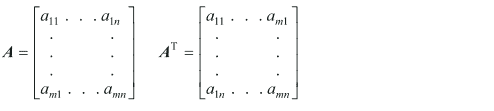

ESSL 假设所有矩阵均以未转换格式存储，例如上述所示的矩阵 `A`。在处理转置矩阵时，你的应用程序不需要移动数据。当调用序列中的参数表明要在计算中使用转置矩阵时，ESSL 子例程会调整它们从矩阵中选择的元素。对此的一个示例是用于 `SGEADD`（矩阵加法）指定的 `transa` 和 `transb` 参数。

#### 矩阵的共轭转置

矩阵 `A` 的共轭转置，包含复数，用 $A^{H}$ 表示，并表达如下：

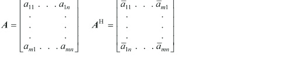

与矩阵的转置一样，矩阵的共轭转置以未转换格式存储。在你的程序中不需要移动数据。

##### 在存储中

矩阵通常存储在一个二维数组中。其元素在数组中依次存储。矩阵的每一列在数组中依次存储。前导维度参数用于从数组的每个连续列中选择矩阵元素。矩阵在数组中的起始点被指定为 ESSL 调用序列中矩阵的参数。例如，如果矩阵 `A` 包含在数组 `A` 中，并从 `A` 的第一行第一列的第一个元素开始，你应该指定 `A` 作为矩阵 `A` 的参数，例如：

```
CALL Sgemx (5,2,1.0, A,6,x,1,y,1)
```

其中，在矩阵向量乘积中，矩阵 `A` 的行数为 5，矩阵 `A` 的列数为 2，缩放常数为 1.0，矩阵的位置为 `A`，前导维度为 6，矩阵向量乘积中使用的向量为 `X` 和 `Y`，且它们的步长为 1。

如果矩阵 `A` 包含在数组 `BIG` 中，声明为 `BIG(1:20,1:30)`，并从 `BIG` 的第二行第三列开始，你应该指定 `BIG(2,3)` 作为矩阵 `A` 的参数，例如：

```
CALL SGE MX (5,2,1,0, BIG(2,3), 6, X, 1, Y, 1)
```

有关矩阵在数组中存储的完整描述，请参阅“矩阵前导维度的用法”。

对于复数矩阵，采用特殊的存储安排来适应数组中每个复数 $(a+bi)$ 的两个部分 $a$ 和 $b$。对于每个复数，在数组中需要两个顺序存储位置。因此，与相同精度的实矩阵相比，复数矩阵所需的存储空间正好是一倍。有关实数和复数的描述，请参阅第 29 页的“如何设置你的标量数据？”，有关实数据和复数据在数组中存储的描述，请参阅第 29 页的“如何设置你的数组？”。

##### 矩阵前导维度的用法

二维数组的前导维度是一个增量，用于在数组的每个连续列中找到矩阵元素的起始点。为了确切定义哪些元素成为数组中的概念矩阵，以下项目一起使用：

- 矩阵在数组中的位置
- 前导维度
- 要在数组中处理的行数 $m$
- 要在数组中处理的列数 $n$

前导维度必须始终为正。它必须始终大于或等于 $m$，即要处理的矩阵的行数。对于声明为 `A(E1:E2, F1:F2)` 的数组 `A`，前导维度等于：$\lvert E2 - E1 + 1 \rvert$

从数组中选择矩阵元素的起始点位于 ESSL 调用序列中矩阵参数指定的位置。例如，如果你为一个 4x4 矩阵 `A` 指定 `A(3,0)`，其中 `A` 被声明为 `A(1:7, 0:4)`：

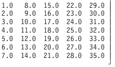

那么处理从数组 `A` 中第 3 行第 0 列的元素开始，该元素值为 3.0。

前导维度用于在数组的 $n$ 个连续列中的每一列找到矩阵元素的起始点。ESSL 子例程假设数组按列主序存储，如第 29 页“如何设置你的数组？”中所述，它们将前导维度（乘以元素的字节大小）加到起始点。它们这样做 $n-1$ 次。这在数组的 $n$ 列中的每一列找到了起始点。

在上面的示例中，主维度（leading dimension）为：

`E2-E1+1 = 7-I+1 = 7`

如果待处理的列数 n 为 4，则起点分别为：`A(3,0)`、`A(3,1)`、`A(3,2)` 和 `A(3,3)`。这些元素分别对应 `a_11`、`a_12`、`a_13` 和 `a_14`，其值分别为 3.0、10.0、17.0 和 24.0。

一般地，矩阵中每一列的起始位置计算如下：

`A(BEGINI, BEGINJ)`

`A(BEGINI, BEGINJ+1)`

`A(BEGINI, BEGINJ+2)`

...

`A(BEGINI, BEGINJ+n-1)`

要找到数组中每一列的元素，需依次在列的起点上加上 1，直到选出 m 个元素为止。这就是为什么主维度必须大于或等于 m；否则，会超出数组每个维度的末端。在上面的示例中，如果每列待处理的元素数 n 为 4，则从数组 `A` 中为矩阵的第一列选取以下元素：`A(3,0)`、`A(4,0)`、`A(5,0)` 和 `A(6,0)`。这些元素分别为 3.0、4.0、5.0 和 6.0，分别对应矩阵元素 `a_11`、`a_21`、`a_31` 和 `a_41`。

列元素的选择也可以用一般形式表示。以数组中的 `A(BEGINI,BEGINJ)` 作为起点，从数组的每一列中选取的元素如下：

`A(BEGINI, BEGINJ)`

`A(BEGINI+1, BEGINJ)`

`A(BEGINI+2, BEGINJ)`

...

`A(BEGINI+m-1, BEGINJ)`

将此方法与前述查找数组中每一起点位置的技巧结合，示例中得到的矩阵为：

**矩阵方程：**

`A = [a_11 ... a_14`

`.....`

`.... a_44] = [3.0 10.0 17.0 24.0`

`4.0 11.0 18.0 25.0`

`5.0 12.0 19.0 26.0`

`6.0 13.0 20.0 27.0]`

如本例所示，矩阵并不一定需要包含数组的所有列和行。矩阵 `A` 的元素是从数组的第 3 行至第 6 行、第 0 列至第 3 列中选取的。数组中的第 1、2、7 行和第 4 列未被使用。

##### 对称矩阵


如果矩阵 `A` 具有性质 $A = A^T$，则该矩阵为对称矩阵，这意味着：

- 其行数等于列数；即它有 $n$ 行和 $n$ 列。
- 主对角线一侧的每个元素 $a_{ij}$ 的值等于另一侧其镜像元素 $a_{ji}$ 的值：对于 $1 \leq i \leq n$ 和 $1 \leq j \leq n$，有 $a_{ij} = a_{ji}$。

下面的矩阵展示了一个 $n$ 阶对称矩阵；即它有 $n$ 行和 $n$ 列。对角线两侧的下标看起来相同，以表明哪些元素是相等的：

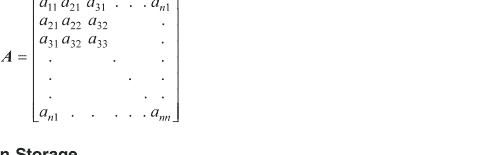

## 存储方式

用于存储对称矩阵的四种存储模式在以下各节中描述：

- “下三角紧凑存储模式”`Lower-Packed Storage Mode`
- 第 66 页的“上三角紧凑存储模式”`Upper-Packed Storage Mode`
- 第 67 页的“下三角存储模式”`Lower Storage Mode`
- 第 68 页的“上三角存储模式”`Upper Storage Mode`

应使用的存储技术取决于所使用的 ESSL 子程序，并在每个子程序说明中的“注释”部分给出。

### 下三角紧凑存储模式

当对称矩阵以下三角紧凑存储模式存储时，对称矩阵的下三角部分（包括对角线）被存储在一个一维数组中。下三角按列进行紧凑排列。`这等效于按行紧凑排列上三角。`矩阵按列顺序依次紧凑排列在一维数组的 $n(n+1)/2$ 个元素中。使用下三角紧凑技术计算矩阵 `A` 中每个元素 `a_{ij}` 在数组 `AP` 中的位置，请使用以下公式：

```
AP(i + ((2n−i)(j−1)/2)) = a_{ij}    where i ≥ j
```

这导致对称矩阵 `A` 的元素在数组 `AP` 中的存储排列如下：

- `AP(1)` = $a_{11}$（第一列开始）
- `AP(2)` = $a_{21}$
- `AP(3)` = $a_{31}$
- ...
- `AP(n)` = $a_{n1}$
- `AP(n+1)` = $a_{22}$（第二列开始）
- `AP(n+2)` = $a_{32}$
- `AP(2n-1)` = $a_{n2}$
- `AP(2n)` = $a_{33}$（第三列开始，以此类推）
- `AP(2n+1)` = $a_{43}$
- `AP(n(n+1)/2)` = $a_{nn}$

以下是一个对称矩阵的示例，该示例使用元素值来展示矩阵元素在数组中存储的顺序。

给定以下矩阵 `A`：

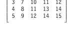

该数组为：

`AP = (1, 2, 3, 4, 5, 6, 7, 8, 9, 10, 11, 12, 13, 14, 15)`

**注意：** 某些 ESSL 子程序需要在数组中额外的工作存储空间；例如，在同时线性代数方程子程序 `SPPE`、`DPPE`、`SFPS` 和 `DPFS` 中。详细信息请参见第 2 部分“参考信息”中这些子程序的说明。

以下是一个将对称矩阵转换为下三角紧凑存储模式的示例：

```
K = 0  
DO 1 J=1,N  
DO 2 I=J,N  
K = K+1  
AP(K)=A(I,J)  
2 CONTINUE  
1 CONTINUE
```

### 上三角紧凑存储模式

当对称矩阵以上三角紧凑存储模式存储时，对称矩阵的上三角部分（包括对角线）被存储在一个一维数组中。上三角按列进行紧凑排列。`这等效于按行紧凑排列下三角。`矩阵按列顺序依次紧凑排列在一维数组的 $n(n+1)/2$ 个元素中。使用上三角紧凑技术计算矩阵 `A` 中每个元素 `a_{ij}` 在数组 `AP` 中的位置，请使用以下公式：

$AP((j(j-1))/2+i) = a_{ij} \quad \text{where } j \geq i$

这导致对称矩阵 `A` 的元素在数组 `AP` 中的存储排列如下：

- `AP(1)` = $a_{11}$（第一列开始）
- `AP(2)` = $a_{12}$（第二列开始）
- `AP(3)` = $a_{22}$
- `AP(4)` = $a_{13}$（第三列开始）
- `AP(5)` = $a_{23}$
- `AP(6)` = $a_{33}$
- `AP(7)` = $a_{14}$（第四列开始）
- ...
- `AP(j((j-1)/2+1))` = $a_{1j}$（第 $j$ 列开始）
- `AP(j((j-1)/2+2))` = $a_{2j}$
- `AP(j((j-1)/2+3))` = $a_{3j}$
- ...
- `AP(j((j-1)/2+j))` = $a_{jj}$（第 $j$ 列结束）
- ...
- `AP(n(n+1)/2)` = $a_{nn}$

以下是一个对称矩阵的示例，该示例使用元素值来展示矩阵元素在数组中存储的顺序。给定以下矩阵 `A`：

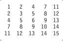

该数组为：

$$ AP = (1,\ 2,\ 3,\ 4,\ 5,\ 6,\ 7,\ 8,\ 9,\ 10,\ 11,\ 12,\ 13,\ 14,\ 15) $$

以下是一个将对称矩阵转换为上三角紧凑存储模式的示例：

```
K = 0
DO 1 J=1,N
   DO 2 I=1,J
      K = K+1
      AP(K)=A(I,J)
2  CONTINUE
1  CONTINUE
```

### 下三角存储模式

当对称矩阵以下三角存储模式存储时，对称矩阵的下三角部分（包括对角线）被存储在一个二维数组中。这些元素以与矩阵中相同的方式存储在数组中。矩阵的上三角部分不需要存储在数组中。

以下是一个 5 阶对称矩阵 `A` 的示例，以及它如何存储在数组 `AL` 中。

给定以下矩阵 `A`：

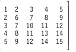

该数组为：

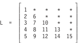

其中 "*" 表示您无需在数组的该位置存储数值。然而，这些存储位置是必需的。

### 上三角存储模式

当对称矩阵以上三角存储模式存储时，对称矩阵的上三角部分（包括对角线）被存储在一个二维数组中。这些元素以与矩阵中相同的方式存储在数组中。矩阵的下三角部分不需要存储在数组中。

以下是一个 5 阶对称矩阵 `A` 的示例，以及它如何存储在数组 `AU` 中。

给定以下矩阵 `A`：

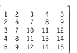

该数组为：

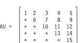

其中 "*" 表示您无需在数组的该位置存储数值。然而，这些存储位置是必需的。

## 正定或负定对称矩阵

实对称矩阵 `A` 是正定的，当且仅当对于所有非零向量 `x`，`x^T A x` 为正。

实对称矩阵 `A` 是负定的，当且仅当对于所有非零向量 `x`，`x^T A x` 为负。

### 存储方式

正定或负定对称矩阵的存储方式与对称矩阵相同。有关此存储技术的描述，请参见第 64 页的“对称矩阵”。

## 对称不定矩阵

实对称矩阵 `A` 是不定的，当且仅当对于某些非零向量 `x` 和 `y`，(`x^T A x`) (`y^T A y`) < 0。

### 存储方式

对称不定矩阵的存储方式与对称矩阵相同。有关此存储技术的描述，请参见第 64 页的“对称矩阵”。

## 复数埃尔米特矩阵

如果一个复数矩阵等于其共轭转置矩阵，则称该矩阵为埃尔米特矩阵：

```
H = H†
```

### 存储方式

复数埃尔米特矩阵使用与对称矩阵相同的四种技术进行存储：

- 下三角形打包存储模式，描述见第 65 页的“下三角形打包存储模式”。`复数埃尔米特矩阵不是对称矩阵；因此，下三角形打包存储模式并不等同于按行打包上三角形，这与对称矩阵的情况不同。`
- 上三角形打包存储模式，描述见第 66 页的“上三角形打包存储模式”。`复数埃尔米特矩阵不是对称矩阵；因此，上三角形打包存储模式并不等同于按行打包下三角形，这与对称矩阵的情况不同。`
- 下三角形存储模式，描述见第 67 页的“下三角形存储模式”。
- 上三角形存储模式，描述见第 68 页的“上三角形存储模式”。

以下是一个 5 阶复数埃尔米特矩阵 `H` 的示例。

给定以下矩阵 `H`：

$$

\begin{bmatrix}

 (11, 0) & (21, -1) & (31, 1) & (41, -1) & (51, -1) \\ 

 (21, 1) & (22, 0) & (32, -1) & (42, -1) & (52, 1) \\ 


(31, -1) & (32, 1) & (33, 0) & (43, -1) & (53, -1) \\ 

(41, 1) & (42, 1) & (43, 1) & (44, 0) & (54, -1) \\ 

(51, 1) & (52, -1) & (53, 1) & (54, 1) & (55, 0)

\end{bmatrix}

$$

它被存储在一个包含 *n(n+1)/2 = 15* 个元素的一维数组 `HP` 中，方法如下：

- 在下三角形打包存储模式下：

```
HP = ((11, *), (21, 1), (31, -1), (41, 1), (51, 1), 
     (22, *), (32, 1), (42, 1), (52, -1), (33, *), 
     (43, 1), (53, 1), (44, *), (54, 1), (55, *))
```

- 在上三角形打包存储模式下：

$$

\begin{array}{r}

\mathrm{HP}=\left(\left\{11, *\right\},\left\{21, -1\right\},\left\{22, *\right\},\left\{31, -1\right\},\left\{32, -1\right\},\right. \\

\left.\left\{33, *\right\},\left\{41, -1\right\},\left\{42, -1\right\},\left\{43, -1\right\},\left\{44, *\right\},\right. \\

\left.\left\{51, -1\right\},\left\{52, 1\right\},\left\{53, -1\right\},\left\{54, -1\right\},\left\{55, *\right\}\right)

\end{array}

$$

或者存储在一个二维数组 `HP` 中，方法如下：

- 在下三角形存储模式下：

$$

\begin{array}{llllll}

\mathrm{HP}= \left[\begin{array}{lllll}

\left\{11, *\right\} & * & * & * & * \\

\left\{21, 1\right\} \left\{22, *\right\} & * & * & * \\

\left\{31, -1\right\} \left\{32, 1\right\} \left\{33, *\right\} & * & * \\

\left\{41, 1\right\} \left\{42, 1\right\} \left\{43, 1\right\} \left\{44, *\right\} & * \\

\left\{51, 1\right\} \left\{52, -1\right\} \left\{53, 1\right\} \left\{54, 1\right\} \left\{55, *\right\}

\end{array}\right]

\end{array}

$$

- 在上三角形存储模式下：

$$

\begin{array}{llllll}

\mathrm{HP}= \left[\begin{array}{rrrrr}

\left\{11, *\right\} & \left\{21, -1\right\} & \left\{31, 1\right\} & \left\{41, -1\right\} & \left\{51, -1\right\} \\

* & \left\{22, *\right\} & \left\{32, -1\right\} & \left\{42, -1\right\} & \left\{52, 1\right\} \\

* & * & \left\{33, *\right\} & \left\{43, -1\right\} & \left\{53, -1\right\} \\

* & * & * & \left\{44, *\right\} & \left\{54, -1\right\} \\

* & * & * & * & \left\{55, *\right\}

\end{array}\right]

\end{array}

$$

其中“\( * \)”表示你无需在数组的该位置存储值。复数埃尔米特矩阵对角线元素的虚部始终为 0，因此你不需要设置这些值。ESSL 子程序始终假设这些位置中的值为 0。

##### 正定或负定复数埃尔米特矩阵

复数埃尔米特矩阵 `A` 是正定的，当且仅当对于所有非零向量 `x`，`x^{H} Ax` 为正。

复数埃尔米特矩阵 `A` 是负定的，当且仅当对于所有非零向量 `x`，`x^{H} Ax` 为负。

###### 存储方式

正定或负定复数埃尔米特矩阵的存储方式与复数埃尔米特矩阵相同。有关此存储技术的描述，请参见第 69 页的“复数埃尔米特矩阵”。

##### 正定或负定对称托普利茨矩阵

一个 `n` 阶正定或负定对称矩阵 `A` 也是托普利茨矩阵，当且仅当：

\[ a_{ij}=a_{i-1,j-1} \text { 对于 } i=2, n \text { 且 } j=2, n \]

托普利茨矩阵每条对角线上的元素具有恒定值。有关正定或负定对称矩阵的定义，请参见第 69 页的“正定或负定对称矩阵”。

下面的矩阵展示了一个 `n` 阶对称托普利茨矩阵；也就是说，它有 `n` 行和 `n` 列：

$$

\begin{align*}

A = \begin{bmatrix}

a_{11} & a_{21} & a_{31} & . & . & . & a_{n1} \\

a_{21} & a_{11} & a_{21} & . & . & . & . \\

a_{31} & a_{21} & a_{11} & . & . & . & . \\

. & . & . & . & . & . & . \\

. & . & . & . & . & . & a_{31} \\

. & . & . & . & . & . & a_{21} \\

a_{n1} & . & . & . & . & a_{31} & a_{21} & a_{11}

\end{bmatrix}

\end{align*}

$$

`n` 阶对称托普利茨矩阵由一个长度为 `$n$` 的向量 `x` 表示，其中包含矩阵第一列的元素（或第一行的元素），使得 `x_i = a_{i1}`，其中 `i = 1, n`。

以下向量表示上面所示的矩阵 `A`：

$$

\begin{align*}

\mathbfit{x} = \begin{bmatrix}

a_{11} \\

a_{21} \\

a_{31} \\

. \\

. \\

a_{n1}

\end{bmatrix}

\end{align*}

$$

###### 存储方式

表示正定对称托普利茨矩阵的向量 `x` 的元素按顺序存储在一个数组中。这被称为打包对称托普利茨存储模式。以下是一个正定对称托普利茨矩阵 `A` 及其在数组 `x` 中的存储方式的示例。

给定以下矩阵 `A`：

|  99 | 12 | 13 | 14 | 15 | 16 |

|-----|----|----|----|----|----|

| 12 | 99 | 12 | 13 | 14 | 15 |

| 13 | 12 | 99 | 12 | 13 | 14 |

| 14 | 13 | 12 | 99 | 12 | 13 |

| 15 | 14 | 13 | 12 | 99 | 12 |

| 16 | 15 | 14 | 13 | 12 | 99 |

该数组为：

`x = <99, 12, 13, 14, 15, 16>`

##### 正定或负定复数埃尔米特托普利茨矩阵

一个 `n` 阶正定或负定复数埃尔米特矩阵 `A` 也是托普利茨矩阵，当且仅当：

`a_{ij} = a_{i-1,j-1}`，其中 `i = 2, n` 且 `j = 2, n`

托普利茨矩阵对角线元素的实部必须具有恒定值。对角线元素的虚部必须为零。

有关正定或负定复数埃尔米特矩阵的定义，请参见第 70 页的“正定或负定复数埃尔米特矩阵”。

下面的矩阵展示了一个 `n` 阶复数埃尔米特托普利茨矩阵；也就是说，它有 `n` 行和 `n` 列：

$$

A= 

\begin{bmatrix} 

a_{11} & a_{12} & a_{13} & \cdots & \cdots & a_{1n} \\ 

\overline{a_{12}} & a_{11} & a_{12} & \cdots & & \cdots \\ 

\overline{a_{13}} & \overline{a_{12}} & a_{11} & \cdots & & \cdots \\ 


\cdots & \cdots & \cdots & \cdots & & \overline{a_{13}} \\ 

\cdots & \cdots & \cdots & & \cdots & \overline{a_{12}} \\ 

\overline{a_{1n}} & \cdots & \cdots & \overline{a_{13}} & \overline{a_{12}} & a_{11} 

\end{bmatrix}

$$

n 阶复数埃尔米特托普利茨矩阵由一个长度为 \(n\) 的向量 \(\mathbf{x}\) 表示，其中包含矩阵第一行的元素。

以下向量表示上面所示的矩阵 \(A\)。

$$

\mathbf{x}=\begin{bmatrix} 

a_{11} \\ 

a_{12} \\ 

a_{13} \\ 

\cdots \\ 

\cdots \\ 

a_{1n} 

\end{bmatrix}

$$

### 存储方式

表示正定复数埃尔米特托普利茨矩阵的向量 \(\mathbf{x}\) 的元素按顺序存储在一个数组中。这被称为打包埃尔米特托普利茨存储模式。以下是一个正定复数埃尔米特托普利茨矩阵 \(A\) 及其在数组 \(\mathbf{x}\) 中的存储方式的示例。

给定以下矩阵 \(A\)：

$$

\begin{bmatrix} 

(10.0, 0.0) & (2.0, -3.0) & (-3.0, 1.0) & (1.0, 1.0) \\ 

(2.0, 3.0) & (10.0, 0.0) & (2.0, -3.0) & (-3.0, 1.0) \\ 

(-3.0, -1.0) & (2.0, 3.0) & (10.0, 0.0) & (2.0, -3.0) \\ 

(1.0, -1.0) & (-3.0, -1.0) & (2.0, 3.0) & (10.0, 0.0) 

\end{bmatrix}

$$

该数组为：

$x = \{ (10.0, 0.0), (2.0, -3.0), (-3.0, 1.0), (1.0, 1.0) \}$

## 三角形矩阵

有两种类型的三角矩阵：上三角矩阵和下三角矩阵。三角矩阵的行数与列数相同；也就是说，它们有 \(n\) 行和 \(n\) 列。

如果矩阵 \(U\) 的非零元素仅出现在矩阵的上三角形中（包括主对角线），则称其为上三角矩阵；即：

$u_{ij} = 0 \quad 如果 \ i > j$

如果矩阵 \(L\) 的非零元素仅出现在矩阵的下三角形中（包括主对角线），则称其为下三角矩阵；即：

$l_{ij} = 0 \quad 如果 \ i < j$

以下矩阵 **U** 和 **L** 分别展示了 $n$ 阶的上三角矩阵和下三角矩阵：

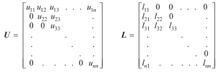

单位三角矩阵是一种所有对角线元素值均为 1 的三角矩阵；即：

- 对于上三角矩阵，当 $i = j$ 时，$u_{ij} = 1$。
- 对于下三角矩阵，当 $i = j$ 时，$l_{ij} = 1$。

以下矩阵 **U** 和 **L** 分别展示了 $n$ 阶的上单位实三角矩阵和下单位实三角矩阵：

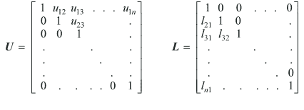

### 存储方式

用于存储三角矩阵的四种存储模式在下节中描述：

- “上三角压缩存储模式”
- 第 74 页的“下三角压缩存储模式”
- 第 74 页的“上三角存储模式”
- 第 75 页的“下三角存储模式”

**需要注意的是，由于单位三角矩阵的对角线元素始终为 1，因此在这四种存储模式中，您不需要在数组中设置这些值。ESSL 始终假设这些位置上的值为 1。**

**上三角压缩存储模式：** 当上三角矩阵采用上三角压缩存储模式存储时，矩阵的上三角部分（包括对角线）存储在三维数组中。上三角部分按列进行压缩。元素按列顺序依次存入一维数组中的 $n(n+1)/2$ 个元素里。要计算三角矩阵中每个元素在数组中的位置，请使用第 66 页“上三角压缩存储模式”中描述的技术。

下面是一个 5 阶上三角矩阵 **U** 的例子，展示了如何将其存储在数组 UP 中。它通过元素值展示了元素在一维数组中的存储顺序。

给定矩阵 \(U\)：

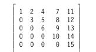

数组为：

```
UP = (1, 2, 3, 4, 5, 6, 7, 8, 9, 10, 11, 12, 13, 14, 15)
```

**下三角压缩存储模式：** 当下三角矩阵采用下三角压缩存储模式存储时，矩阵的下三角部分（包括对角线）存储在一维数组中。下三角部分按列进行压缩。元素按列顺序依次存入一维数组中的 \(n(n+1)/2\) 个元素里。要计算三角矩阵中每个元素在数组中的位置，请使用第 65 页“下三角压缩存储模式”中描述的技术。

下面是一个 5 阶下三角矩阵 \(L\) 的例子，展示了如何将其存储在数组 LP 中。它通过元素值展示了元素在一维数组中的存储顺序。

给定矩阵 \(L\)：

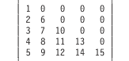

数组为：

```
LP = (1, 2, 3, 4, 5, 6, 7, 8, 9, 10, 11, 12, 13, 14, 15)
```

**上三角存储模式：** 三角矩阵以二维数组形式采用上三角存储模式存储。仅矩阵上三角部分（包括对角线）的元素存储在数组的上三角区域。

下面是一个 5 阶上三角矩阵 \(U\) 的例子，展示了如何将其存储在数组 UTA 中。

给定矩阵 \(U\)：

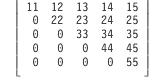

数组为：

```
UTA = (11, 12, 13, 14, 15,
       22, 23, 24, 25,
       33, 34, 35)
```

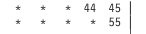

其中，“*” 表示您无需在数组的该位置存储值。

**下三角存储模式：** 三角矩阵以二维数组形式采用下三角存储模式存储。仅矩阵下三角部分（包括对角线）的元素存储在数组的下三角区域。

下面是一个 5 阶下三角矩阵 $L$ 的例子，展示了如何将其存储在数组 LTA 中。

给定矩阵 $L$：

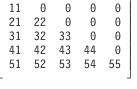

数组为：

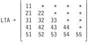

其中，“*” 表示您无需在数组的该位置存储值。

### 一般带状矩阵

一般带状矩阵的非零元素均匀分布在对角线附近，满足：

$a_{ij}=0 \quad if\ (i-j) > ml \ or\ (j-i) > mu$

其中 $ml$ 和 $mu$ 分别是下带宽和上带宽，$ml+mu+1$ 为总带宽。

以下矩阵展示了一个 $n$ 阶的**方形**一般带状矩阵，其带宽分别为 $ml=q-1$ 和 $mu=p-1$：

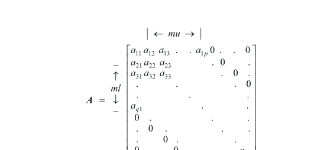

带状矩阵的某些特殊类型包括：

- 三对角矩阵：$ml = mu = 1$
- 9-对角矩阵：$ml = mu = 4$

以下两个矩阵展示了 $m$ 乘以 $n$ 的**矩形**一般带状矩阵，其带宽分别为 $ml = q-1$ 和 $mu = p-1$。对于这两个矩阵，主对角线元素为 $a_{11}, a_{22}, a_{33}, ..., a_{nn}$。以下是一个 $m > n$ 的一般带状矩阵：


以下是一个 $m < n$ 的一般带状矩阵：

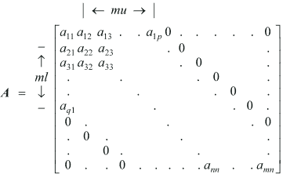

### 存储方式

用于存储一般带状矩阵的两种存储模式在下节中描述：

- “一般带状存储模式”
- 第 79 页的“BLAS-一般带状存储模式”

**一般带状存储模式：**（此存储模式仅用于方形矩阵。）在一般带状存储模式中，仅存储一般带状矩阵的带状元素。必须提供额外的存储空间用于填充（fill-in）。一般带状存储模式按列将矩阵元素压缩存入二维数组中，使得矩阵的每条对角线在压缩数组中表现为一行。

对于阶数为 $n$、带宽为 $ml$ 和 $mu$ 的矩阵 $A$，数组的首维大小 $lda$ 必须大于或等于 $2ml+mu+16$。第二维的大小至少为 $n$，即矩阵的列数。

使用声明为 `AGB(2ml+mu+16, n)` 的数组 `AGB`，矩阵 $A$ 的元素列在数组 `AGB` 的每一列中按如下方式存储，其中 $a_{11}$ 存储在 `AGB(ml+mu+1, 1)` 位置：


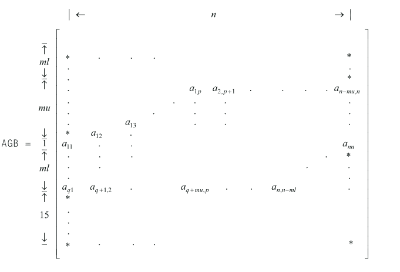

其中，“*” 表示您无需在数组的该位置存储元素。

在 ESSL 子程序计算中，数组中标记为“*”的一些位置用于填充。其他位置可能完全不被访问。

以下是一个 9 阶带状矩阵 `A` 的例子，其带宽分别为 `ml = 2` 和 `mu = 3`。

给定矩阵 `A`：

\begin{bmatrix}

11 & 12 & 13 & 14 & 0 & 0 & 0 & 0 & 0 \\

21 & 22 & 23 & 24 & 25 & 0 & 0 & 0 & 0 \\

31 & 32 & 33 & 34 & 35 & 36 & 0 & 0 & 0 \\

0 & 42 & 43 & 44 & 45 & 46 & 47 & 0 & 0 \\

0 & 0 & 53 & 54 & 55 & 56 & 57 & 58 & 0 \\

0 & 0 & 0 & 64 & 65 & 66 & 67 & 68 & 69 \\

0 & 0 & 0 & 0 & 75 & 76 & 77 & 78 & 79 \\

0 & 0 & 0 & 0 & 0 & 86 & 87 & 88 & 89 \\

0 & 0 & 0 & 0 & 0 & 0 & 97 & 98 & 99

\end{bmatrix}

您以一般带状存储模式将其存储在 23 乘以 9 的数组 `AGB` 中，如下所示，其中 `a11` 存储在 `AGB(6,1)` 中：

\begin{bmatrix}

\ast & \ast & \ast & \ast & \ast & \ast & \ast & \ast & \ast \\

\ast & \ast & \ast & \ast & \ast & \ast & \ast & \ast & \ast \\

\ast & \ast & \ast & 14 & 25 & 36 & 47 & 58 & 69 \\

\ast & 13 & 24 & 35 & 46 & 57 & 68 & 79 & \ast \\

\ast & 12 & 23 & 34 & 45 & 56 & 67 & 78 & 89 \\

11 & 22 & 33 & 44 & 55 & 66 & 77 & 88 & 99 \\

21 & 32 & 43 & 54 & 65 & 76 & 87 & 98 & \ast

\end{bmatrix}

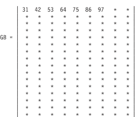

以下是一个将阶数为 `n` 的一般带状矩阵转换为一般带状存储模式的示例：

```fortran
MD=ML+MU+1
DO 1 J=1,N
DO 1 I=MAX(J-MU,1),MIN(J+ML,N)
AGB(I+J+MD,J)=A(I,J)
1 CONTINUE
```

## BLAS-一般带状存储模式：

（此存储模式用于方形和矩形矩阵。）在 BLAS-一般带状存储模式中，仅存储一般带状矩阵的带状元素。该存储模式按列将矩阵元素压缩存入二维数组中，使得矩阵的每条对角线在压缩数组中表现为一行。

对于 `$m$` 乘以 `$n$` 的矩阵 `A`，其带宽分别为 `ml` 和 `mu`，数组 `AGB` 的首维大小 `lda` 必须大于或等于 `ml+mu+1`。第二维的大小至少为 `n`，即矩阵的列数。

使用声明为 `AGB(ml+mu+1, n)` 的数组 `AGB`，矩阵 `A` 的元素列在数组 `AGB` 的每一列中按如下方式存储，其中 `$a_{11}$` 存储在 `$AGB(mu+1, 1)$` 位置：

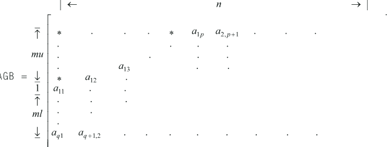

其中“/∗/”表示您无需在数组的该位置存储元素。这些位置不会被 ESSL 访问。数组中未使用的位置始终出现在

数组的左上三角形，但在数组的右下三角形中可能不会出现，从本文给出的示例中可以看出。

以下是一个 `$m > n$` 的示例，其中一般带状矩阵 `$A$` 的大小为 9 乘 8，带宽为 `$ml = 2$` 和 `$mu = 3$`。

给定以下矩阵 `$A$`：

\[

\begin{bmatrix}

11 & 12 & 13 & 14 & 0 & 0 & 0 & 0 \\

21 & 22 & 23 & 24 & 25 & 0 & 0 & 0 \\

31 & 32 & 33 & 34 & 35 & 36 & 0 & 0 \\

0 & 42 & 43 & 44 & 45 & 46 & 47 & 0 \\

0 & 0 & 53 & 54 & 55 & 56 & 57 & 58 \\

0 & 0 & 0 & 64 & 65 & 66 & 67 & 68 \\

0 & 0 & 0 & 0 & 75 & 76 & 77 & 78 \\

0 & 0 & 0 & 0 & 0 & 86 & 87 & 88 \\

0 & 0 & 0 & 0 & 0 & 0 & 97 & 98

\end{bmatrix}

\]

将其存储在数组 `$\texttt{AGB}$` 中，该数组声明为 `$\texttt{AGB}(6,8)$`，具体存储方式如下，其中 `$a_{11}$` 存储在 `$\texttt{AGB}(4,1)$` 中：

$$\texttt{AGB} = \begin{bmatrix}

* & * & * & 14 & 25 & 36 & 47 & 58 \\

* & * & 13 & 24 & 35 & 46 & 57 & 68 \\

* & 12 & 23 & 34 & 45 & 56 & 67 & 78 \\

11 & 22 & 33 & 44 & 55 & 66 & 77 & 88 \\

21 & 32 & 43 & 54 & 65 & 76 & 87 & 98 \\

31 & 42 & 53 & 64 & 75 & 86 & 97 & *

\end{bmatrix}$$

以下是一个 `$m < n$` 的示例，其中一般带状矩阵 `$A$` 的大小为 7 乘 9，带宽为 `$ml = 2$` 和 `$mu = 3$`。

给定以下矩阵 `$A$`：

\[

\begin{bmatrix}

11 & 12 & 13 & 14 & 0 & 0 & 0 & 0 & 0 \\

21 & 22 & 23 & 24 & 25 & 0 & 0 & 0 & 0 \\

31 & 32 & 33 & 34 & 35 & 36 & 0 & 0 & 0 \\

0 & 42 & 43 & 44 & 45 & 46 & 47 & 0 & 0 \\

0 & 0 & 53 & 54 & 55 & 56 & 57 & 58 & 0 \\

0 & 0 & 0 & 64 & 65 & 66 & 67 & 68 & 69 \\

0 & 0 & 0 & 0 & 75 & 76 & 77 & 78 & 79

\end{bmatrix}

\]

将其存储在数组 `$\texttt{AGB}$` 中，该数组声明为 `$\texttt{AGB}(6,9)$`，具体存储方式如下，其中 `$a_{11}$` 存储在 `$\texttt{AGB}(4,1)$` 中，并且主对角线未能填满整行：

$$\texttt{AGB} = \begin{bmatrix}

* & * & * & 14 & 25 & 36 & 47 & 58 & 69 \\

* & * & 13 & 24 & 35 & 46 & 57 & 68 & 79 \\

* & 12 & 23 & 34 & 45 & 56 & 67 & 78 & * \\

11 & 22 & 33 & 44 & 55 & 66 & 77 & * & * \\

21 & 32 & 43 & 54 & 65 & 76 & * & * & * \\

31 & 42 & 53 & 64 & 75 & * & * & * & *

\end{bmatrix}$$

其中 `"*"` 表示在该数组位置不存储任何元素。

以下是如何将一般带状矩阵转换为 BLAS5 一般带状存储模式的示例，适用于 `$m$` 和 `$n$` 的所有值：

```fortran
DO 20 J=1,N
   K=MU+1-J
   DO 10 I=MAX(1,J-MU),MIN(M,J+ML)
      AGB(K+I,J)=A(I,J)
   10 CONTINUE
   20 CONTINUE
```

### 对称带状矩阵

对称带状矩阵是一种对称矩阵，其非零元素均匀排列在对角线附近，满足以下条件：

\[ a_{ij}=0 \quad \text{如果} \ \ \ |i-j|>k \]

其中 `k` 是半带宽。

以下矩阵展示了一个 `$n$` 阶对称带状矩阵，其半带宽 `$k=n-1$`：

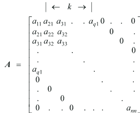

#### 存储方式

用于存储对称带状矩阵的两种存储模式在下文中描述：

-   “上带状紧凑存储模式”

-   第 82 页的“下带状紧凑存储模式”

**上带状紧凑存储模式：** 对于上带状紧凑存储模式，仅存储对称带状矩阵上半三角形部分的带状元素（包括主对角线）。


对于 `$n$` 阶矩阵 `$A$`，半带宽为 `$k$`，数组的主维 `lda` 必须大于或等于 `$k+1$`，且第二维的大小至少为 `$n$`。

使用声明为 `ASB(lda,n)` 的数组 `ASB`，其中 `$p=lda=k+1$`，对称带状矩阵的元素存储方式如下：

`$ASB = \begin{bmatrix} \ast & & & & \ast & a_{IP} & a_{2,P+1} & \cdots & \ast & a_{n-k,n} \\ \ast & & \ast & & & & & & & \\ & & & & \ast & a_{I3} & a_{24} & \cdots & \ast & \\ a_{II} & \ast & \ast & a_{I2} & a_{23} & \cdots & & & \\ a_{22} & \ast & & & & & & & a_{nn} \end{bmatrix}$`

其中 `*` 表示在该数组位置不存储任何元素。

以下是一个 6 阶对称带状矩阵 `$A$` 的示例，其半带宽为 3。

给定以下矩阵 `$A$`：

`\[ \begin{bmatrix} 11 & 12 & 13 & 14 & 0 & 0 \\ 12 & 22 & 23 & 24 & 25 & 0 \\ 13 & 23 & 33 & 34 & 35 & 36 \\ 14 & 24 & 34 & 44 & 45 & 46 \\ 0 & 25 & 35 & 45 & 55 & 56 \\ 0 & 0 & 36 & 46 & 56 & 66 \end{bmatrix} \]`

将其以上带状紧凑存储模式存储在声明为 `$ASB(4,6)$` 的数组 `ASB` 中，具体方式如下：

`$ASB = \begin{bmatrix} \ast & \ast & \ast & 14 & 25 & 36 \\ \ast & \ast & 13 & 24 & 35 & 46 \\ \ast & 12 & 23 & 34 & 45 & 56 \\ 11 & 22 & 33 & 44 & 55 & 66 \end{bmatrix}$`

以下是如何将对称带状矩阵转换为上带状紧凑存储模式的示例：

```fortran
DO 20 J=1,N
   M=N+1-J
   DO 10 I=MAX(1,J-K),J
      ASB(M+I,J)=A(I,J)
   10 CONTINUE
   20 CONTINUE
```

### 下带状紧凑存储模式

对于下带状紧凑存储模式，仅存储对称带状矩阵下半三角形部分的带状元素（包括主对角线）。

对于 `$n$` 阶矩阵 `$A$`，半带宽为 `$k$`，数组的主维 `lda` 必须大于或等于 `$k+1$`，且第二维的大小至少为 `$n$`。

使用声明为 `$ASB(lda,n)$` 的数组 `ASB`，其中 `$q=lda=k+1$`，对称带状矩阵的元素存储方式如下：

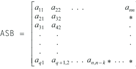

其中 "*" 表示在该数组位置不存储任何元素。

以下是一个 6 阶对称带状矩阵 `$A$` 的示例，其半带宽为 2。

给定以下矩阵 A：

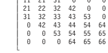

将其以下带状紧凑存储模式存储在声明为 `ASB(3,6)` 的数组 `ASB` 中，具体方式如下：

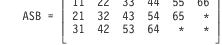

以下是如何将对称带状矩阵转换为下带状紧凑存储模式的示例：

```fortran
DO 20 J=1,N
   DO 10 I=J,MIN(J+K,N)
      ASB(1-J+I,J)=A(I,J)
   10 CONTINUE
   20 CONTINUE
```

### 正定对称带状矩阵

实对称带状矩阵 `$A$` 是正定的，当且仅当对于所有非零向量 `$x$`，`$x^TAx$` 均为正数。

#### 存储方式

正定对称带状矩阵的存储方式与对称带状矩阵相同。有关此存储技术的说明，请参见第 81 页的“对称带状矩阵”。

### 复数埃尔米特带状矩阵

如果复数带状矩阵等于其共轭转置，则它是埃尔米特矩阵：

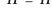

#### 存储方式

复数埃尔米特带状矩阵使用与对称带状矩阵相同的两种技术进行存储：

- 下带状紧凑存储模式，如第 82 页“下带状紧凑存储模式”中所述
- 上带状紧凑存储模式，如第 81 页“上带状紧凑存储模式”中所述

以下是一个 5 阶复数埃尔米特带状矩阵 `$H$` 的示例，其半带宽为 2。

给定以下矩阵 `$H$`：

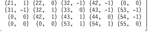

将其存储在二维数组 `HP` 中，具体方式如下：

- 以下带状紧凑存储模式：

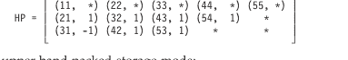

- 以上带状紧凑存储模式：

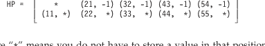

其中 "*" 表示无需在该数组位置存储值。复数埃尔米特带状矩阵的对角线元素的虚部始终为 0，因此您无需设置这些值。ESSL 子程序始终假设这些位置中的值为 0。

### 三角带状矩阵

有两种类型的三角带状矩阵：上三角带状矩阵和下三角带状矩阵。三角带状矩阵的行数与列数相同；即，它们有 `$n$` 行和 `$n$` 列。它们具有上带宽或下带宽 `$k$`。

如果带状矩阵 `$U$` 的非零元素仅位于矩阵的上三角部分（包括主对角线），则它是上三角带状矩阵；即：

`$u_{ij} = 0 \text{ 如果 } i > j$`

其带状元素在矩阵的上三角部分均匀排列在对角线附近，满足：

`$u_{ij} = 0 \text{ 如果 } j - i > k$`

以下矩阵 `$U$` 展示了一个 `$n$` 阶上三角带状矩阵，其上带宽 `$k = q-1$`：

如果单位三角带状矩阵的所有对角线元素的值都为 1，则它也可以是一个单位三角带状矩阵。关于单位三角矩阵的示例，请参阅第 72 页的“Triangular Matrix”。

#### 在存储中

以下部分描述了用于存储三角带状矩阵的两种存储模式：

- 第 86 页的“Upper-Triangular-Band-Packed Storage Mode”
- 第 87 页的“Lower-Triangular-Band-Packed Storage Mode”

需要注意的是，由于单位三角带状矩阵的对角线元素始终为 1，因此在这两种存储模式下，您无需在数组中设置这些值。ESSL 始终假定这些位置中的值为 1。

##### 上三角带状打包存储模式

在上三角带状打包存储模式中，仅存储上三角带状矩阵的上三角部分的带状元素，包括主对角线。

对于阶数为 `$n$`、上带宽为 `$k$` 的矩阵 `$\mathbf{U}$`，数组的先行维度（leading dimension），`lda`，必须大于或等于 `$k+1$`，且第二维的大小必须（至少）为 `$n$`。

使用声明为 `UTB(lda,n)` 的数组 `UTB`，其中 `$p = lda = k+1$`，上三角带状矩阵的元素存储方式如下：

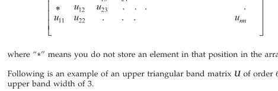

其中 “$*$” 表示您在数组中的该位置不存储元素。

下面是一个阶数为 6、上带宽为 3 的上三角带状矩阵 `$\mathbf{U}$` 的示例。

给定矩阵 `$\mathbf{U}$` 如下：

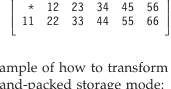

您将其存储在上三角带状打包存储模式下的数组 `UTB`（声明为 `$UTB(4,6)$`）中，方式如下：

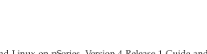

下面是一个将上三角带状矩阵转换为上三角带状打包存储模式的示例：

```fortran
DO 20 J=1,N
    M=K+1-J
    DO 10 I=MAX(1,J-K),J
        UTB(M+I,J)=U(I,J)
    10 CONTINUE
20 CONTINUE
```

##### 下三角带状打包存储模式

在下三角带状打包存储模式中，仅存储下三角带状矩阵的下三角部分的带状元素，包括主对角线。

> **注意：** 作为该存储模式的替代方案，您可以以特殊方式指定子程序中的参数，以便 ESSL 正确选择矩阵元素，同时您可以保持矩阵以全矩阵存储模式存储。详情见本书第 2 部分子程序描述中的注意事项。

对于阶数为 `$n$`、下带宽为 `$k$` 的矩阵 `$L$`，数组的先行维度，`lda`，必须大于或等于 `$k + 1$`，且第二维的大小必须（至少）为 `$n$`。

使用声明为 `LTB(lda,n)` 的数组 `LTB`，其中 `$q = lda = k + 1$`，下三角带状矩阵的元素存储方式如下：


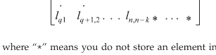

其中 `*` 表示您在数组中的该位置不存储元素。

下面是一个阶数为 6、下带宽为 2 的下三角带状矩阵 $L$ 的示例。

给定矩阵 $L$ 如下：

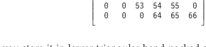

您将其存储在下三角带状打包存储模式下的数组 `LTB`（声明为 `LTB(3,6)`）中，方式如下：

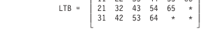

下面是一个将下三角带状矩阵转换为下三角带状打包存储模式的示例：

```fortran
DO 20 J=1,N
    M=1-J
    DO 10 I=J,MIN(N,J+K)
        LTB(M+I,J)=L(I,J)
    10 CONTINUE
20 CONTINUE
```

### 一般三对角矩阵

一般三对角矩阵是指非零元素仅出现在矩阵的对角线、次对角线和超对角线上的矩阵；即：

$$ a_{ij} = 0 \quad \text{if} \ |i-j| > 1 $$

下面的矩阵示例展示了一个阶数为 $n$ 的一般三对角矩阵：

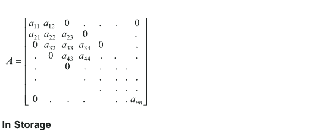

#### 在存储中

一般三对角矩阵的对角线、次对角线和超对角线元素被存储。这被称为三对角存储模式。阶数为 $n$ 的一般三对角矩阵 $A$ 的元素存储在三个长度为 $n$ 的一维数组 `C`、`D` 和 `E` 中，其中数组 `C` 包含次对角线元素，存储方式如下：

$$ \text{C} = (\ast, a_{21}, a_{32}, a_{43}, \dots, a_{n,n-1}) $$

数组 `D` 包含主对角线元素，存储方式如下：

$$ \text{D} = (a_{11}, a_{22}, a_{33}, \dots, a_{nn}) $$

数组 `E` 包含超对角线元素，存储方式如下：

$$ \text{E} = (a_{12}, a_{23}, a_{34}, \dots, a_{n-1,n}, \ast) $$

其中 `*` 表示您在数组中的该位置不存储元素。

下面是一个阶数为 5 的一般三对角矩阵 $A$ 的示例：

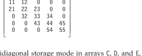

您将其存储在三对角存储模式下的数组 `C`、`D` 和 `E` 中，每个数组的长度均为 5，方式如下：

$$ \text{C} = (\ast, 21, 32, 43, 54) $$

$$ \text{D} = (11, 22, 33, 44, 55) $$

$$ \text{E} = (12, 23, 34, 45, \ast) $$

**注意：** 一些 ESSL 子程序提供选项，允许在数组 `C`、`D` 和 `E` 的末尾指定至少 $n$ 个额外位置。这些额外位置由 ESSL 子程序用作工作存储。选择此选项的原因在子程序描述中均有说明。

### 对称三对角矩阵

当且仅当非零元素仅出现在矩阵的对角线、次对角线和超对角线上，且其次对角线元素与超对角线元素相等时，三对角矩阵 $A$ 才是对称的；即：

$(a_{ij} = 0 \quad \text{if} \quad |i-j| > 1) \quad \text{and} \quad (a_{ij} = a_{ji} \quad \text{if} \quad |i-j|=1)$

下面的矩阵示例展示了一个阶数为 $n$ 的对称三对角矩阵：

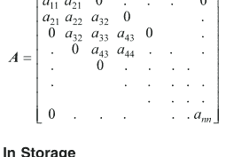

#### 在存储中

仅存储正定对称三对角矩阵的对角线和次对角线元素。这被称为对称三对角存储模式。阶数为 $n$ 的对称三对角矩阵 $A$ 的元素存储在两个长度为 $n$ 的一维数组 `C` 和 `D` 中，其中数组 `C` 包含次对角线元素，存储方式如下：

C = $(*, a_{21}, a_{32}, a_{43}, \ldots, a_{n,n-1})$

其中 `*` 表示您在数组中的该位置不存储元素。然后数组 `D` 包含主对角线元素，存储方式如下：

D = $(a_{11}, a_{22}, a_{33}, \ldots, a_{nn})$

下面是一个阶数为 5 的对称三对角矩阵 $A$ 的示例：

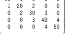

您将其存储在对称三对角存储模式下的数组 `C` 和 `D` 中，每个数组的长度均为 5，方式如下：

C = $(*, 1, 2, 3, 4)$

D = $(10, 20, 30, 40, 50)$

> 注意：一些 ESSL 子程序提供选项，允许在数组 `C` 和 `D` 的末尾指定至少 $n$ 个额外位置。这些额外位置由 ESSL 子程序用作工作存储。选择此选项的原因在子程序描述中均有说明。

### 正定对称三对角矩阵

实对称三对角矩阵 $A$ 是正定的，当且仅当对于所有非零向量 $x$，$x^T A x$ 为正。

#### 在存储中

正定对称三对角矩阵的存储方式与对称三对角矩阵相同。关于此存储技术的描述，请参阅第 89 页的“Symmetric Tridiagonal Matrix”。

### 稀疏矩阵

稀疏矩阵是具有相对较少的非零元素的矩阵。

以下是一个稀疏矩阵 A 的示例：

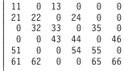

#### 在存储中

稀疏矩阵可以存储在**全矩阵存储模式**或打包存储模式中。当稀疏矩阵存储在**全矩阵存储模式**中时，其所有元素（包括零元素）都存储在数组中。

以下部分描述了用于存储稀疏矩阵的七种打包存储模式：

-   “Compressed-Matrix Storage Mode”
-   第 91 页的“Compressed-Diagonal Storage Mode”
-   第 94 页的“Storage-by-Indices”
-   第 95 页的“Storage-by-Columns”
-   第 95 页的“Storage-by-Rows”
-   第 97 页的“Diagonal-Out Skyline Storage Mode”
-   第 99 页的“Profile-In Skyline Storage Mode”

> **注意：** 当稀疏矩阵的元素使用这些存储模式中的任何一种进行存储时，ESSL 子程序不会检查所有元素是否均非零。如果存在零元素，不会报错。

**压缩矩阵存储模式：** 以压缩矩阵存储模式存储的稀疏矩阵 A 使用两个二维数组来定义稀疏矩阵存储，即 `A C` 和 `K A`。参见参考文献 [75]。给定一个 $m$ 行 $n$ 列的稀疏矩阵 A，每行最多有 $n z$ 个非零元素：

-   `A C` 定义为 `AC(lda,nz)`，其中先行维度 `lda` 必须大于或等于 `m`。数组 `A C` 的每一行包含矩阵 `A` 对应行的非零元素。对于矩阵 `A` 中非零元素少于 `n z` 的行，数组 `A C` 中对应的行将以零填充。每行中的元素可以按任意顺序存储。
-   `K A` 是定义为 `KA(lda,nz)` 的整型数组，其中先行维度 `lda` 必须大于或等于 `m`。它包含存储在数组 `A C` 对应位置中的矩阵 `A` 元素的列号。对于矩阵 `A` 中非零元素少于 `n z` 的行，数组 `K A` 中对应的行将以 1 到 `n` 之间的任意值填充。**由于该数组用于 ESSL 子程序在计算中访问其他目标向量，您必须遵守这些所需值以避免错误。**

除非稀疏矩阵 $A$ 的每一行都包含大致相同数量的非零元素，否则这种存储模式需要大量的存储空间。这将降低使用此存储模式所能获得的性能。

以下以一个 $6 \times 6$ 的稀疏矩阵 $A$ 为例，其中每行最多有四个非零元素。它展示了矩阵 $A$ 如何存储在数组 $AC$ 和 $KA$ 中。

给定如下矩阵 $A$：


数组为：


其中 `*` 表示您可以在数组该位置存储 1 到 6 之间的任何值。

对称稀疏矩阵使用与非对称稀疏矩阵相同的存储技术；也就是说，对称矩阵 $A$ 的所有非零元素都必须存储在数组 $AC$ 中，而不仅仅是矩阵 $A$ 上三角部分和对角线上的元素。

从一般意义上来说，这种存储技术可以表示如下：

对于每个 $a_{ij} \neq 0$，其中 $i=1$, $m$ 和 $j=1$, $n$

存在 $k$，其中 $1 \leq k \leq nz$，

使得 `AC(i,k) = a_{ij}` 且 `KA(i,k) = j`。

对于 `AC` 和 `KA` 的所有其他元素，


$AC(i,k)=0$ 且 $1 \leq KA(i,k) \leq n$

其中：

- $a_{ij}$ 是 $m$ 乘 $n$ 矩阵 $A$ 的元素，该矩阵每行最多有 $nz$ 个非零元素。
- 数组 `AC` 定义为 `AC(lda,nz)`，其中 `lda` $\geq m$。
- 数组 `KA` 定义为 `KA(lda,nz)`，其中 `lda` $\geq m$。

## 压缩对角线存储模式

用于存储方形稀疏矩阵的压缩对角线存储模式有两种变体，具体取决于矩阵是一般稀疏矩阵还是对称稀疏矩阵。本节将解释这两种变体。不过，本节首先解释矩阵中对角线编号所使用的约定，这些约定适用于存储描述。

$n$ 阶矩阵 $A$ 有 $2n-1$ 条对角线。由于沿每条对角线上的元素 $a_{ij}$ 中 $k = j-i$ 是常数，因此可以为每条对角线分配一个对角线编号 $k$，其取值范围从 $1-n$ 到 $n-1$。然后可以将这些对角线称为 $d_{k}$，其中 $k = 1-n, n-1$。

以下矩阵展示了每条对角线 $d_{k}$ 的起始位置：


对于**一般**（方形）稀疏矩阵 $A$，压缩对角线存储模式使用两个数组来定义稀疏矩阵的存储，即 `AD` 和 `LA`。使用上述对角线编号约定，给定稀疏矩阵 $A$ 包含 $nd$ 条含有非零元素的对角线，数组 `AD` 和 `LA` 的设置如下：

- `AD` 定义为 `AD(lda, nd)`，其中主维数 `lda` 必须大于或等于 $n$。矩阵 $A$ 中至少包含一个非零元素的每条对角线都存储在数组 `AD` 的一列中。对角线的所有元素（包括其零元素）以在对角线中出现的顺序，存储在数组中 $n$ 个连续的位置中。需要按以下方式填充零以填满数组 `AD` 每列中的 $n$ 个位置：

  - 每条超对角线 $(k > 0)$，包含 $n-k$ 个元素，需填充 $k$ 个尾部零。
  - 主对角线 $(k = 0)$，包含 $n$ 个元素，无需填充。
  - 每条次对角线 $(k < 0)$，包含 $n-|k|$ 个元素，需填充 $|k|$ 个头部零。

  对角线可以存储在数组 `AD` 的任意列中。

- `LA` 是一个长度为 $nd$ 的一维整数数组，包含存储在数组 `AD` 每个对应列中的对角线的对角线编号 $k$。

**由于此存储模式要求存储整个对角线，如果矩阵 $A$ 中的非零元素没有集中在少数几条对角线上，则此存储模式需要大量的存储空间。这将降低使用此存储模式所能获得的性能。**

以下以一个 $6 \times 6$ 的一般稀疏矩阵 $A$ 为例，该矩阵有 5 条非零对角线，展示了它是如何存储在数组 `AD` 和 `LA` 中的。

给定如下矩阵 $A$：


$\begin{matrix} 0 & 0 & 43 & 44 & 0 & 46 \\ 51 & 0 & 0 & 0 & 54 & 55 & 0 \\ 61 & 62 & 0 & 0 & 65 & 66 \end{matrix}$

数组为：

$AD= \begin{matrix} 11 & 13 & 0 & 0 & 0 \\ 22 & 24 & 21 & 0 & 0 \\ 33 & 35 & 42 & 0 & 0 \\ 44 & 46 & 43 & 0 & 0 \\ 55 & 0 & 54 & 51 & 0 \\ 66 & 0 & 65 & 62 & 61 \end{matrix}$

$LA=(0, 2, -1, -4, -5)$

对于**对称**稀疏矩阵，其中每条超对角线 $k$ 等于次对角线 $-k$，压缩对角线存储模式使用与一般稀疏矩阵相同的存储技术，只是在设置数组 `AD` 和 `LA` 时，仅使用非零主对角线以及每对非零对角线 $k$ 和 $-k$ 中的一条对角线。您可以存储每对中的上对角线或下对角线。

以下以一个 6 阶对称稀疏矩阵为例，展示它是如何仅使用矩阵中的三条非零对角线存储在数组 `AD` 和 `LA` 中的。

给定如下矩阵 A：

$\begin{matrix} 11 & 0 & 13 & 0 & 51 & 0 \\ 0 & 22 & 0 & 24 & 0 & 62 \\ 13 & 0 & 33 & 0 & 35 & 0 \\ 0 & 24 & 0 & 44 & 0 & 46 \\ 51 & 0 & 35 & 0 & 55 & 0 \\ 0 & 62 & 0 & 46 & 0 & 66 \end{matrix}$

数组为：

$AD= \begin{matrix} 11 & 13 & 0 \\ 22 & 24 & 0 \\ 33 & 35 & 0 \\ 44 & 46 & 0 \\ 55 & 0 & 51 \\ 66 & 0 & 62 \end{matrix}$

$LA=(0, 2, -4)$

从一般意义上来说，这种存储技术可以表示如下：

对于每个 $d_{k} \neq (0, ..., 0)$，其中 $k=1- n, n-$ 适用于

**一般**方形稀疏矩阵，

或对于每个唯一的 $d_{k} \neq (0, ..., 0)$，其中 $k=1- n, n-$ 适用于

**对称**稀疏矩阵，

存在 $l$，其中 $1 \leq l \leq nd$，使得 `LA(l) = k` 且数组 `AD` 中的第 $l$ 列包含 `dp_k`

其中：

- 数组 `AD` 定义为 `AD(lda, nd)`，其中 `lda` $\geq n$，且 `nd` 是存储在数组 `AD` 中的非零对角线 $d_k$ 的数量。
- 数组 `LA` 有 $nd$ 个元素。
- $k$ 是每条对角线 $d_k$ 的对角线编号，其中 $k = i-j$。
- `dp_k` 是带有填充的对角线 $d_k$，它由稀疏矩阵 A 的元素 $a_{ij}$（$i, j = 1, n$）按如下方式构建：

  - 对于超对角线 ($k > 0$)，`dp_k` 有 $k$ 个尾部零：`dp_k = (a_{1,k+1}, a_{2,k+2}, ..., a_{n-k,n}, 0_1, ..., 0_k)`
  - 对于主对角线 ($k = 0$)，`dp_k` 没有填充：`dp_0 = (a_{11}, a_{22}, ..., a_{nn})`
  - 对于次对角线 ($k < 0$)，`dp_k` 有 $|k|$ 个头部零：`dp_k = (0_1, ..., 0_{|k|}, a_{|k|+1,1}, a_{|k|+2,2}, ..., a_{n, n-|k|})`

## 基于索引的存储

对于稀疏矩阵 A，基于索引的存储使用三个一维数组来定义稀疏矩阵的存储，即 `AR`、`IA` 和 `JA`。给定具有 $ne$ 个非零元素的 $m \times n$ 稀疏矩阵 A，数组的设置如下：

- 长度（至少）为 $ne$ 的 `AR` 包含稀疏矩阵 A 的 $ne$ 个非零元素，以任意顺序连续存储。
- `IA`，一个长度（至少）为 $ne$ 的整数数组，包含矩阵 A 中每个非零元素 $a_{ij}$ 对应的行号。
- `JA`，一个长度（至少）为 $ne$ 的整数数组，包含矩阵 A 中每个非零元素 $a_{ij}$ 对应的列号。

以下以一个 $6 \times 6$ 的稀疏矩阵 A 为例，展示它是如何存储在数组 `AR`、`IA` 和 `JA` 中的：

给定如下矩阵 A：

```
11  0  13  0   0   0
21  22  0   24  0   0
0   32  33  0   35  0
0   0   43  44  0   46
0   0   0   0   0   0
61  62  0   0   65  66
```

数组为：

```
AR = (11, 22, 32, 33, 13, 21, 43, 24, 66, 46, 35, 62, 61, 65, 44)
IA = (1, 2, 3, 3, 1, 2, 4, 2, 6, 4, 3, 6, 6, 6, 5, 4)
JA = (1, 2, 2, 3, 3, 1, 3, 4, 6, 6, 5, 2, 1, 5, 4)
```

从一般意义上来说，这种存储技术可以表示如下：对于每个 $a_{ij} \neq 0$，其中 $i = 1, m$ 和 $j = 1, n$，存在 $k$，其中 $1 \leq k \leq ne$，使得：`AR(k) = a_{ij}`；`IA(k) = i`；`JA(k) = j`

其中：

- $a_{ij}$ 是 $m \times n$ 稀疏矩阵 A 的元素。
- 数组 `AR`、`IA` 和 `JA` 各有 $ne$ 个元素。

### 按列存储

对于稀疏矩阵 $A$，按列存储使用三个一维数组来定义稀疏矩阵的存储结构：`AR`、`IA` 和 `JA`。给定一个具有 $ne$ 个非零元素的 $m$ 行 $n$ 列稀疏矩阵 $A$，数组设置如下：


## 按列存储

- 长度为（至少）$ne$ 的 `AR` 包含稀疏矩阵 $A$ 的 $ne$ 个非零元素，且这些元素连续存储。矩阵 $A$ 的列从第 1 列到第 $n$ 列依次连续存储在 `AR` 中。矩阵 $A$ 每列中的元素可以以任何顺序存储在 `AR` 中。

- `IA` 是一个长度为（至少）$ne$ 的整型数组，包含矩阵 $A$ 中每个非零元素 $a_{ij}$ 对应的行号。

- `JA` 是一个长度为（至少）$n+1$ 的整型数组，包含矩阵 $A$ 每一列在数组 `AR` 中的相对起始位置；也就是说，列指针数组中的每个元素 `JA(j)` 指示第 $j$ 列在数组 `AR` 中的开始位置。如果第 $j$ 列中的所有元素均为零，则 `JA(j) = JA(j+1)`。最后一个元素 `JA(n+1)` 指示数组 `AR` 中最后一个元素之后的位置，即 $ne+1$。

以下是一个 6x6 稀疏矩阵 $A$ 如何存储在数组 `AR`、`IA` 和 `JA` 中的示例。

给定矩阵 A：


数组为：

```
AR = (11, 61, 21, 62, 32, 22, 13, 33, 43, 44, 24, 46, 66)
IA = (1, 6, 2, 6, 3, 2, 1, 3, 4, 4, 2, 4, 6)
JA = (1, 4, 7, 10, 12, 12, 14)
```

从一般意义上讲，这种存储技术可以表示如下：

```
For each a_ij ≠ 0, for i = 1, m and j = 1, n
there exists k, where 1 ≤ k ≤ ne, such that
AR(k) = a_ij
IA(k) = i
And for j = 1, n,
JA(j) = k, where a_ij in AR(k), is the first element stored in AR for column j
JA(j) = JA(j+1), where all a_ij = 0 in column j
JA(n+1) = ne+1
```

其中：

- $a_{ij}$ 是 $m$ 行 $n$ 列稀疏矩阵 $A$ 的元素。
- 数组 `AR` 和 `IA` 各有 $ne$ 个元素。
- 数组 `JA` 有 $n+1$ 个元素。

## 按行存储

用于按行存储的稀疏矩阵存储模式有三种变体，具体取决于该矩阵是一般稀疏矩阵还是对称稀疏矩阵。本节将解释这些变体。

### 一般稀疏矩阵按行存储

对于**一般**稀疏矩阵 $A$，按行存储使用三个一维数组来定义稀疏矩阵的存储结构：`AR`、`IA` 和 `JA`。给定一个具有 $ne$ 个非零元素的 $m$ 行 $n$ 列稀疏矩阵 $A$，数组设置如下：

- 长度为（至少）$ne$ 的 `AR` 包含稀疏矩阵 $A$ 的 $ne$ 个非零元素，且这些元素连续存储。矩阵 $A$ 的行从第 1 行到第 $m$ 行依次连续存储在 `AR` 中。矩阵 $A$ 每行中的元素可以以任何顺序存储在 `AR` 中。

- `IA` 是一个长度为（至少）$m+1$ 的整型数组，包含矩阵 $A$ 每一行在数组 `AR` 中的相对起始位置；也就是说，行指针数组中的每个元素 `IA(i)` 指示第 $i$ 行在数组 `AR` 中的开始位置。如果第 $i$ 行中的所有元素均为零，则 `IA(i) = IA(i+1)`。最后一个元素 `IA(m+1)` 指示数组 `AR` 中最后一个元素之后的位置，即 $ne+1$。

- `JA` 是一个长度为（至少）$ne$ 的整型数组，包含矩阵 $A$ 中每个非零元素 $a_{ij}$ 对应的列号。

以下是一个 6x6 一般稀疏矩阵 $A$ 如何存储在数组 `AR`、`IA` 和 `JA` 中的示例。

给定矩阵 A：


数组为：

```
AR = (11, 13, 24, 22, 21, 32, 33, 44, 43, 46, 61, 62, 66)
IA = (1, 3, 6, 8, 11, 11, 14)
JA = (1, 3, 4, 2, 1, 2, 3, 4, 3, 6, 1, 2, 6)
```

### 对称稀疏矩阵按行存储

对于阶数为 $m$ 的对称稀疏矩阵，按行存储使用与一般稀疏矩阵相同的存储技术，不同之处在于，在设置数组 `AR`、`IA` 和 `JA` 时，仅使用上三角或下三角以及对角元素。

以下是一个 6 阶对称稀疏矩阵 $A$ 如何在使用上三角按行存储（即仅存储上三角和对角元素）的情况下存储在数组 `AR`、`IA` 和 `JA` 中的示例。

给定矩阵 A：


数组为：

```
AR = (11, 13, 22, 24, 23, 33, 35, 46, 44, 55)
IA = (1, 3, 6, 8, 10, 11, 11)
JA = (1, 3, 2, 3, 4, 3, 5, 4, 6, 5)
```

使用相同的对称矩阵 *A*，以下是一个示例，展示如何在使用下三角按行存储（即仅存储下三角和对角元素）的情况下将其存储在数组 `AR`、`IA` 和 `JA` 中：

```
AR = (11, 22, 23, 33, 13, 24, 44, 55, 35, 46)
IA = (1, 2, 3, 6, 8, 10, 11)
JA = (1, 2, 2, 3, 1, 2, 4, 5, 3, 4)
```

从一般意义上讲，这种存储技术可以表示如下：

- 对于每个 $a_{ij} \neq 0$：
  - 对于一般稀疏矩阵，$i = 1, m$ 且 $j = 1, n$
  - 对于使用下三角的对称稀疏矩阵，$i = 1, m$ 且 $j = i, m$
  - 对于使用上三角的对称稀疏矩阵，$i = 1, m$ 且 $j = 1, i$
  - 存在 $k$，其中 $1 \leq k \leq ne$，使得：
    - `AR(k) = a_ij`
    - `JA(k) = j`
  - 对于 $i = 1, m$：
    - `IA(i) = k`，其中 `AR(k)` 中的 $a_{ij}$ 是存储在 `AR` 中第 $i$ 行的第一个元素
    - `IA(i) = IA(i+1)`，当第 $i$ 行中所有 $a_{ij} = 0$ 时
    - `IA(m+1) = ne+1`

其中：

- $a_{ij}$ 是稀疏矩阵 *A* 的元素，该矩阵要么是 $m$ 行 $n$ 列的一般稀疏矩阵，要么是阶数为 $m$ 的对称稀疏矩阵，均包含 $ne$ 个非零元素。
- 数组 `AR` 和 `JA` 各有 $ne$ 个元素。
- 数组 `IA` 有 $m+1$ 个元素。

## 对角线外出天际线存储模式

用于稀疏矩阵的对角线外出天际线存储模式有两种变体，具体取决于该矩阵是一般稀疏矩阵还是对称稀疏矩阵。这里将解释这两种变体。

### 一般稀疏矩阵

对于**一般**稀疏矩阵 *A*，对角线外出天际线存储模式使用四个一维数组来定义稀疏矩阵的存储结构：`AU`、`IDU`、`AL` 和 `IDL`。给定一个阶数为 *n* 的稀疏矩阵 *A*，其上轮廓和左轮廓下方包含 *nu* + *nl* – *n* 个元素，数组设置如下：

- 长度为（至少）*nu* 的 `AU` 包含稀疏矩阵 *A* 的上三角部分，其中列从第 1 列到第 *n* 列依次连续存储在 `AU` 中，方式如下。对于每一列，从对角元素开始到该列最上方的非零元素结束的元素连续存储在 `AU` 中。存储的元素可以包含零元素和非零元素。如果待存储列中的所有元素均为零，则该列的对角元素 $a_{ii}$（值为零）将存储在 `AU` 中。*A* 的上三角部分共存储 *nu* 个元素。

- `IDU` 是一个长度为（至少）*n*+1 的整型数组，包含矩阵 *A* 每个对角元素在数组 `AU` 中的相对位置；也就是说，对角线指针数组中的每个元素 `IDU(i)` 指示对角元素 $a_{ii}$ 在数组 `AU` 中的存储位置。采用一元基（One-origin），因此 `IDU` 的第一个元素始终为 1。最后一个元素 `IDU(n+1)` 指示数组 `AU` 中最后一个元素之后的位置，即 *nu*+1。

- 长度为（至少）*nl* 的 `AL` 包含稀疏矩阵 *A* 的下三角部分，其中行从第 1 行到第 *n* 行依次连续存储在 `AL` 中，方式如下。对于每一行，从对角元素开始到该行最左侧的非零元素结束的元素连续存储在 `AL` 中。存储的元素可以包含零元素和非零元素。如果待存储行中的所有元素均为零，则该行的对角元素 $a_{ii}$（值为零）将存储在 `AL` 中。*A* 的下三角部分共存储 *nl* 个元素。对角元素的值没有意义，因此可以在 `AL` 的相应位置存储任何值。


`IDL` 是一个长度为（至少）*n*+1 的整型数组，包含矩阵 *A* 每个对角元素在数组 `AL` 中的相对位置；也就是说，对角线指针数组中的每个元素 `IDL($i$)` 指示对角元素 $a_{ii}$ 在数组 `AL` 中的存储位置。采用一元基，因此 `IDL` 的第一个元素始终为 1。最后一个元素 `IDL($n$+1)` 指示数组 `AL` 中最后一个元素之后的位置，即 *nl*+1。

以下是一个 6x6 一般稀疏矩阵 *A* 如何存储在数组 `AU`、`IDU`、`AL` 和 `IDL` 中的示例。

给定矩阵 A：

|   | 1 | 2 | 3 | 4 | 5 | 6 |
|---|---|---|---|---|---|---|
| 1 | 0 | 12| 13| 0 | 0 | 0 |
| 2 | 21| 22| 0 | 24| 0 | 0 |
| 3 | 31| 0 | 33| 34| 0 | 36|
| 4 | 41| 42| 43| 44| 45| 0 |
| 5 | 0 | 0 | 0 | 54| 55| 56|
| 6 | 0 | 0 | 63| 0 | 65| 66|

数组为：

```
AU = (0, 22, 12, 33, 0, 13, 44, 34, 24, 55, 45, 66, 56, 0, 36)
IDU = (1, 2, 4, 7, 10, 12, 16) where nu=15
AL = (*, *, 21, *, 0, 31, *, 43, 42, 41, *, 54, *, 65, 0, 63)
IDL = (1, 2, 4, 7, 11, 13, 17) where nl=16
```

其中“*”表示您不必在数组的该位置存储一个值。但是，这些存储位置是必需的。

对于阶数为 *n* 的对称稀疏矩阵，对角线外出天际线存储模式使用与一般稀疏矩阵的上三角和对角元素相同的存储技术；因此，只需要 `AU` 和 `IDU` 数组。

以下是一个 6 阶对称稀疏矩阵 *A* 如何存储在数组 `AU` 和 `IDU` 中的示例。

给定矩阵 A：

|   | 1 | 2 | 3 | 4 | 5 | 6 |
|---|---|---|---|---|---|---|
| 1 | 0 | 12| 13| 0 | 0 | 0 |
| 2 | 12| 22| 0 | 24| 0 | 0 |
| 3 | 13| 0 | 33| 34| 0 | 36|
| 4 | 0 | 24| 34| 44| 45| 0 |
| 5 | 0 | 0 | 0 | 45| 55| 56|
| 6 | 0 | 0 | 36| 0 | 56| 66|

数组为：

### 配置-天际线存储模式

用于稀疏矩阵的配置-天际线存储模式有两种变体，具体取决于该矩阵是一般稀疏矩阵还是对称稀疏矩阵。下文将解释这两种变体。

对于一般稀疏矩阵 $A$，配置-天际线存储模式使用四个一维数组来定义稀疏矩阵存储：`AU`、`IDU`、`AL` 和 `IDL`。给定一个 $n$ 阶稀疏矩阵 $A$，其上轮廓和左轮廓下方包含 $nu$+$nl$–$n$ 个元素，数组设置如下：

- 长度（至少为）$nu$ 的 `AU` 包含稀疏矩阵 $A$ 的上三角部分，其中列在 `AU` 中从 1 到 $n$ 连续存储，方式如下。对于每一列，从该列最顶部的非零元素开始，到对角元素结束的元素在 `AU` 中连续存储。存储的元素可能包括与非零元素并存的零元素。如果要存储的列中所有元素均为零，则该列的对角元素 $a_{ii}$（值为零）将存储在 `AU` 中。$A$ 的上三角部分总共存储 $nu$ 个元素。

- `IDU` 是一个长度（至少为）$n$+1 的整数数组，包含矩阵 $A$ 中每个对角元素在数组 `AU` 中的相对位置；也就是说，对角指针数组的每个元素 `IDU($i$)` 指示对角元素 $a_{ii}$ 在数组 `AU` 中的存储位置。采用单基（one-origin）计数，因此 `IDU` 的第一个元素始终为 1。最后一个元素 `IDU($n$+1)` 指示数组 `AU` 中最后一个元素之后的位置，即 $nu$+1。

- 长度（至少为）$nl$ 的 `AL` 包含稀疏矩阵 $A$ 的下三角部分，其中行在 `AL` 中从 1 到 $n$ 连续存储，方式如下。对于每一行，从该行最左边的非零元素开始，到对角元素结束的元素在 `AL` 中连续存储。存储的元素可能包括与非零元素并存的零元素。如果要存储的行中所有元素均为零，则该行的对角元素 $a_{ii}$（值为零）将存储在 `AL` 中。$A$ 的下三角部分总共存储 $nl$ 个元素。对角元素的值无意义，因此您可以将任意值存储在 `AL` 中的这些位置。

- `IDL` 是一个长度（至少为）$n$+1 的整数数组，包含矩阵 $A$ 中每个对角元素在数组 `AL` 中的相对位置；也就是说，对角指针数组的每个元素 `IDL($i$)` 指示对角元素 $a_{ii}$ 在数组 `AL` 中的存储位置。采用单基（one-origin）计数，因此 `IDL` 的第一个元素始终为 1。最后一个元素 `IDL($n$+1)` 指示数组 `AL` 中最后一个元素之后的位置，即 $nl$+1。

以下示例展示了一个 6x6 的一般稀疏矩阵 A 及其在数组 `AU`、`IDU`、`AL` 和 `IDL` 中的存储方式。

给定以下矩阵 A：


数组为：

```
AU = (0, 12, 22, 13, 0, 33, 24, 34, 44, 45, 55, 36, 0, 56, 66)
IDU = (1, 3, 6, 9, 11, 15, 16) where nu=15
AL = (*, 21, *, 31, 0, *, 41, 42, 43, *, 54, *, 63, 0, 65, *)
IDL = (1, 3, 6, 10, 12, 16, 17) where nl=16
```

其中 "*" 表示您无需在数组的该位置存储数值。但是，这些存储位置是必需的。

对于 $n$ 阶对称稀疏矩阵，配置-天际线存储模式使用与一般稀疏矩阵的上三角和对角元素相同的存储技术；因此，只需要 `AU` 和 `IDU` 数组。

以下示例展示了一个 6 阶对称稀疏矩阵 A 及其在数组 `AU` 和 `IDU` 中的存储方式。

给定以下矩阵 A：


数组为：

```
AU = (0, 12, 22, 13, 0, 33, 24, 34, 44, 45, 55, 36, 0, 56, 66)
IDU = (1, 3, 6, 9, 11, 15, 16) where nu=15
```

通常，该存储技术可以表示如下：

对于一般稀疏矩阵和对称稀疏矩阵：

对于每个 $a_{ij}$（其中 $j = 1, n$ 且 $i = j, k$），其中 $a_{kj}$ 是每列 $j$ 中最顶部的 $a_{ij} \neq 0$，存在 $m$（其中 $1 \leq m \leq nu$），使得：

$$
\begin{aligned}
&\mathrm{AU}(m+j-1) = a_{ij} \\
&\mathrm{IDU}(j) = m \text{ for each } a_{ij} \\
&\mathrm{IDU}(n+1) = nu+1
\end{aligned}
$$

此外，对于一般稀疏矩阵：

对于每个 $a_{ij}$（其中 $i = 1, n$ 且 $j = k, i$），其中 $a_{ik}$ 是每行 $i$ 中最左边的 $a_{ij} \neq 0$，存在 $m$（其中 $1 \leq m \leq nl$），使得：

$$
\begin{aligned}
&\mathrm{AL}(m+i-1) = a_{ij} \\
&\mathrm{IDL}(i) = m \text{ for each } a_{ij} \\
&\mathrm{IDL}(n+1) = nl+1
\end{aligned}
$$

其中：

- $a_{ij}$ 是 $n$ 阶稀疏矩阵 $A$ 的元素。
- 数组 `AU` 有 $nu$ 个元素。
- 数组 `AL` 有 $nl$ 个元素。
- 数组 `IDU` 和 `IDL` 各有 $n+1$ 个元素。

#### 序列

序列是一组有序的数字。它可以是一维、二维或三维序列。序列用于排序、搜索、傅里叶变换、卷积和相关等领域。

##### 存储中的实部和复部

序列可以包含实数或复数数据。对于包含复数数据的序列，使用特殊的存储布局来容纳每个复数 $a+b i$ 的两个部分 $a$ 和 $b$。对于每个复数，数组中需要两个连续的存储位置。因此，与相同精度的实数序列相比，复数序列所需的存储空间正好是两倍。有关实数和复数的描述，请参阅第 29 页的*“如何设置您的标量数据？”*；有关实数和复数数据在数组中的存储方式，请参阅第 29 页的*“如何设置您的数组？”*。

##### 一维序列

一维序列在符号上表示如下，其中下标指示序列中的元素位置：

$(x_{1}, x_{2}, x_{3}, \ldots, x_{n})$

**在存储中**


一维序列使用步长（`stride`）存储在数组中，方式与向量使用步长相同。有关详细信息，请参阅第 58 页的“步长如何用于向量”。

## 二维序列

二维序列在符号上表示为一系列元素列。（它们的表示方式与矩阵相同，但没有方括号。）两个下标分别指示第一维和第二维中的元素位置：

$$
\begin{array}{ccc}
\alpha_{0,0} & \alpha_{0,1} & \cdots & \alpha_{0,n-1} \\
\alpha_{1,0} & \alpha_{1,1} & \cdots & \alpha_{1,n-1} \\
\vdots & \vdots & & \vdots \\
\vdots & \vdots & & \vdots \\
\alpha_{m-1,0} & \alpha_{m-1,1} & \cdots & \alpha_{m-1,n-1}
\end{array}
$$

### 在存储中

二维序列使用第二维的步长存储在数组中，方式与矩阵使用主维度（`leading dimension`）相同。它使用步长 1 用于第一维。有关详细信息，请参阅第 63 页的“主维度如何用于矩阵”。（在傅里叶变换领域，二维序列可以以转置形式存储在数组中。在这种情况下，第二维的步长为 1，第一维的步长为数组的主维度。）

## 三维序列

三维序列表示为一系列元素块。每个块相当于一个二维序列。块的数量指示第三维的长度。三个下标分别指示第一、第二和第三维中的元素位置：

### 平面 0：

```
$ a_{0,0,0} $   $\cdots$   $ a_{0,n-1,0} $
$ a_{1,0,0} $   $\cdots$   $ a_{1,n-1,0} $
$\vdots$           $\vdots$
$ a_{m-1,0,0} $   $\cdots$   $ a_{m-1,n-1,0} $
```

### 平面 1：

```
$ a_{0,0,1} $   $\cdots$   $ a_{0,n-1,1} $
$ a_{1,0,1} $   $\cdots$   $ a_{1,n-1,1} $
$\vdots$           $\vdots$
$ a_{m-1,0,1} $   $\cdots$   $ a_{m-1,n-1,1} $
$\vdots$
$\vdots$
```

### 平面 ($ p - 1 $)：

```
$ a_{0,0,p-1} $   $\cdots$   $ a_{0,n-1,p-1} $
$ a_{1,0,p-1} $   $\cdots$   $ a_{1,n-1,p-1} $
$\vdots$           $\vdots$
$ a_{m-1,0,p-1} $   $\cdots$   $ a_{m-1,n-1,p-1} $
```

### 在存储中

三维序列中的每一块元素在数组中依次存储。第三维的步长（`stride`）用于选择数组中每块连续元素的元素。三维序列的起始点在 ESSL 调用语句中作为序列的参数指定。例如，如果三维序列包含在声明为 `Big(1:20,1:30,1:10)` 的数组 `BIG` 中，且起始点位于 `BIG` 数组第一维的第二个元素、第二维的第三个元素和第三维的第一个元素，则应将 `Big(2,3,1)` 指定为序列的参数，例如：

```
CALL SCAF3 (BIG(2,3,1),20,600,3,32,2056,16,20,10,1,1,0.0,AUX,30000)
```

请参阅第 104 页的“三维序列中步长的使用”以获取有关三维序列如何使用步长在数组中存储的详细描述。

## 三维序列中步长的使用

三维序列的元素可以定义为 $a_{ijk}$，其中 $i = 1$, $m$，$j = 1$, $n$，以及 $k = 1$, $p$。前两个下标 $i$ 和 $j$ 定义了序列前两个维度中的元素，第三个下标 $k$ 定义了第三维中的元素。利用这种三维序列的定义，本节解释了如何使用步长的概念将这些元素映射到数组中。（请记住，元素 $a_{ijk}$ 是概念数据结构的元素，即由 ESSL 处理的三维序列。序列不需要包含数组中的所有元素。步长被 ESSL 子程序用于选择要在数组中处理的所需元素。）

前两个维度中的序列元素以矩阵或二维序列映射到数组的方式映射到数组。它使用第 63 页“矩阵中前导维度的使用”中列出的所有项目，如起始点、行数和列数以及前导维度。三维序列第一维的步长 `inc1` 假设为 1，与矩阵相同。三维序列第二维的步长 `inc2` 等价于矩阵的前导维度。

第三维的步长 `inc3` 用于定义构成三维序列第三维的数组元素。第三维的步长用作增量，以便遍历数组找到数组中每块连续 $p$ 个元素块的起始点。步长 `inc3` 必须始终为正。它必须始终大于或等于要在前两个维度中处理的元素数量；即 `inc3 ≥ (inc2)(n)`。

三维序列通常存储在一维、二维或三维数组中；然而，为了讨论方便，此处使用三维数组。对于声明为 `A(E1:E2,F1:F2,G1:G2)` 的数组 `A`，第一、第二和第三维的步长分别为：

```
inc1 = 1
inc2 = (E2-E1+1)
inc3 = (E2-E1+1)(F2-F1+1)
```

给定一个声明为 `A(1:7,1:3,0:3)` 的数组 `A`，其中第一、第二和第三维的长度分别为 7、3 和 4，则产生的步长为 `inc1 = 1`, `inc2 = 7`, 和 `inc3 = 21`。

数组中三维序列的起始点位于 ESSL 调用语句中序列参数指定的位置。使用上述数组 `A`，如果为三维序列指定 `A(2,2,1)`，其中 `A` 的定义如下，分为四个块，分别对应平面 0 - 3：

```
1.0  8.0  15.0      22.0  29.0  36.0      43.0  50.0  57.0      64.0  71.0  78.0
2.0  9.0  16.0      23.0  30.0  37.0      44.0  51.0  58.0      65.0  72.0  79.0
3.0  10.0  17.0      24.0  31.0  38.0      45.0  52.0  59.0      66.0  73.0  80.0
4.0  11.0  18.0      25.0  32.0  39.0      46.0  53.0  60.0      67.0  74.0  81.0
5.0  12.0  19.0      26.0  33.0  40.0      47.0  54.0  61.0      68.0  75.0  82.0
6.0  13.0  20.0      27.0  34.0  41.0      48.0  55.0  62.0      69.0  76.0  83.0
7.0  14.0  21.0      28.0  35.0  42.0      49.0  56.0  63.0      70.0  77.0  84.0
```

那么处理从数组 `A` 中第 2 行第 2 列的第二个元素块开始，该值为 30.0。然后使用第三维的步长来找到数组中接下来 $p - 1$ 个连续元素块的每个起始点。步长 `inc3` 被添加到起始点 $p - 1$ 次。在这个例子中，第三维的步长是 21，要处理的元素块数 $p$ 是 3，因此数组 `A` 中的起始点是 `A(2, 2, 1)`，`A(2, 2, 2)` 和 `A(2, 2, 3)`。这些分别是元素 30.0、51.0 和 72.0。这些数组元素分别对应序列元素 $a_{111}$，$a_{112}$ 和 $a_{113}$。

从一般意义上说，这导致了数组中元素块的以下起始位置：

```
A(BEGINI, BEGINJ, BEGINK)
A(BEGINI, BEGINJ, BEGINK+1)
A(BEGINI, BEGINJ, BEGINK+2)
.
.
A(BEGINI, BEGINJ, BEGINK+p-1)
```

使用 $m=4$，$n=2$ 和 $p=3$ 来定义此例子中三维数据结构的元素，产生的三维序列定义如下，分为三个块，分别对应平面 0-2：

| 符号平面 0 | 符号平面 1 | 符号平面 2 | 数值平面 0 | 数值平面 1 | 数值平面 2 |
| :--- | :--- | :--- | :--- | :--- | :--- |
| $a_{000}$ $a_{010}$ | $a_{001}$ $a_{011}$ | $a_{002}$ $a_{012}$ | 30.0 37.0 | 51.0 58.0 | 72.0 79.0 |
| $a_{100}$ $a_{110}$ | $a_{101}$ $a_{111}$ | $a_{102}$ $a_{112}$ | 31.0 38.0 | 52.0 59.0 | 73.0 80.0 |
| $a_{200}$ $a_{210}$ | $a_{201}$ $a_{211}$ | $a_{202}$ $a_{212}$ | 32.0 39.0 | 53.0 60.0 | 74.0 81.0 |


| $a_{300}$ $a_{310}$ | $a_{301}$ $a_{311}$ | $a_{302}$ $a_{312}$ | 33.0 40.0 | 54.0 61.0 | 75.0 82.0 |

如本例所示，三维序列不需要包含数组中的所有元素块。在这种情况下，三维序列仅包含数组中从第二个到第四个元素块。第一个块未被使用。无论数组中定义了多少个维度，数组元素都是按照其在存储中的排列方式被选择的。因此，当使用一维或二维数组来存储你的三维序列时，你应该了解你的数组元素是如何存储的，以确保元素被正确选择。请参阅第 108 页的“在 Fortran 中设置数组”以获取有关数组存储的描述。

**注意：** 三维傅里叶变换子程序使用三维序列。通过为 `$inc2$` 和 `$inc3$` 指定某些步长值并声明你的数组具有特定数量的维度，你可以在这些子程序中获得最佳性能。请参阅第 746 页的“设置你的数据”以及每个子程序说明中的“注意事项”部分。

### 第 4 章. 编码你的程序

本章提供了你编码 Fortran、C 和 C++ 程序所需的信息。

#### Fortran 程序

本节描述如何使用任意 ESSL 运行时库来编码你的 Fortran 程序。

##### 在 Fortran 中调用 ESSL 子程序和函数

在 Fortran 程序中，大多数 ESSL 子程序使用 `CALL` 语句调用：

```
CALL subroutine-name (argument-I, . . . , argument-n)
```

`SAXPY` 子程序调用序列的一个示例可能如下：

```
CALL SAXPY (5.,A,X,1.,INC,Y,1)
```

其余的 ESSL 子程序通过编码函数引用作为函数调用。你首先需要声明函数返回值的类型：短精度或长精度实数、短精度或长精度复数，或整数。然后，你将函数引用作为语句中表达式的一部分进行编码。声明和调用 `DASUM` 函数的一个示例可能如下：

```
DOUBLE PRECISION DASUM,SUM,X

...

SUM = DASUM (N,X,INCX)
```

ESSL 子程序和函数的返回值方式不同。对于子程序，计算结果通过调用序列中指定的参数返回。在上面的 `CALL` 语句中，结果通过参数 `Y` 返回。对于函数，结果作为函数的值返回。在上面的赋值语句中，结果被赋值给 `SUM`。

关于如何编码 `CALL` 语句和函数引用的详细信息，请参阅 Fortran 出版物。

##### 在 Fortran 中为 ESSL 设置用户提供的子程序

某些 ESSL 数值积分子程序调用一个在 ESSL 调用序列中标识的用户提供子程序 `subf`。如果你调用数值积分子程序是用 Fortran 编码的，你必须遵守以下编码规则：

- 你必须在你的程序中将 `subf` 声明为 `EXTERNAL`。
- 你应该根据第 914 页“`SUBF` 子程序的编程考虑因素”中给出的规范来编码 `subf` 子程序。有关在 Fortran 中编码 `subf` 子程序的示例，请参阅该章节中的子程序描述。

##### 在 Fortran 中设置标量数据

表 30 列出了 ESSL 使用的 Fortran 标量数据类型。仅列出 ESSL 使用的类型和长度。

###### 表 30. Fortran 程序中的标量数据类型

| ESSL 使用的术语 | Fortran 等效项 |
| :--- | :--- |
| 字符项¹ | `CHARACTER*1` |
| 'N'、'T'、'C' 或 'n'、't'、'c' | 'N'、'T'、'C' |
| 逻辑项 | `LOGICAL` |
| .TRUE.、.FALSE. | .TRUE.、.FALSE. |
| 32 位环境整数 | `INTEGER` 或 `INTEGER*4` |
| 12345、-12345 | 12345、-12345 |
| 64 位环境整数² | `INTEGER*8`³ |
| 12345、-12345 | 12345_8、-12345_8 |
| 短精度实数⁴ | `REAL` 或 `REAL*4` |
| 12.345 | 0.12345E2 |
| 长精度实数⁴ | `DOUBLE PRECISION` 或 `REAL*8` |
| 12.345 | 0.12345D2 |
| 短精度复数⁴ | `COMPLEX` 或 `COMPLEX*8` |
| (123.45, -54321.0) | (123.45E0, -543.21E2) |
| 长精度复数⁴ | `COMPLEX*16` |
| (123.45, -54321.0) | (123.45D0, -543.21D2) |

注释：

1. ESSL 在其调用序列中接受大写或小写字符数据。
2. 根据 LP64 数据模型，除了 `ERRSET` 的 `*iusadr*` 参数外，所有 ESSL 整数参数均保持为 32 位。
3. 如果您指定编译器选项 `-qintsize=8`，则可以使用 `INTEGER`。
4. 书中短精度和长精度数字的外观相同。

##### 在 Fortran 中设置数组

在 Fortran 中，通过指定数组名称、维度数量以及每个维度的范围，并使用 `DIMENSION` 语句或显式数据类型语句（如 `REAL`、`DOUBLE PRECISION` 等）来声明数组。

###### 实数和复数数组元素

每个数组元素可以是短精度或长精度的实数或复数数据项。数组的类型决定了元素存储位置的大小。短精度数据需要 4 个字节，长精度数据需要 8 个字节。复数数据需要两个存储位置，每个位置分别为 4 或 8 个字节，分别对应短精度或长精度，以容纳复数的两部分：$c = a+bi$。因此，对于相同精度的实数数据，复数数据所需的存储量正好是两倍。有关实数和复数的描述，请参见第 29 页的“如何设置标量数据？”。

尽管复数数据项需要两个存储位置，但数组中的元素数量与实数数据相同。引用包含复数数据的数组中的元素（例如，$C(3)$）将给出完整的复数；也就是说，它包含 $a$ 和 $b$，其中复数表示如下：

- 对于一维数组，$C(1)*(a_{1,1}, b_{1,1})$
- 对于二维数组，$C(1,J,K)*(a_{i,j,k}, b_{i,j,k})$
- 对于三维数组，$C(I,J,K)*(a_{i,j,k}, b_{i,j,k})$

###### 一维数组

对于 Fortran 77 中的一维数组，您可以编写代码：

```fortran
DIMENSION A(E1:E2)
```

其中 `A` 是数组名称，`E1` 是数组单一维度的下界，`E2` 是上界。如果未指定下界，例如 `A(E2)`，则假设值为 1。必须指定上界。

一维数组按以下顺序存储在升序存储位置中（相对于某个基存储地址）：

| 相对位置 | 数组元素 |
| :--- | :--- |
| 1 | A(E1) |
| 2 | A(E1+1) |
| 3 | A(E1+2) |
| ... | ... |
| ... | ... |
| ... | ... |
| E2−E1+1 | A(E2) |

例如，在 `DIMENSION` 语句中指定为 `A(0:3)` 且包含以下元素的长度为 4 的数组 `A`：

```fortran
A = (1, 2, 3, 4)
```

其元素在存储中排列如下：

| 相对位置 | 数组元素值 |
| :--- | :--- |
| 1 | 1 |
| 2 | 2 |
| 3 | 3 |
| 4 | 4 |

###### 二维数组

对于 Fortran 77 中的二维数组，您可以编写代码：

```fortran
DIMENSION A(E1:E2,F1:F2)
```

其中 `A` 是数组名称。`E1` 和 `F1` 分别是第一维和第二维的下界，`E2` 和 `F2` 分别是第一维和第二维的上界。如果未指定任一低界，例如 `A(E2, F1:F2)`，则假设值为 1。对于每个维度，始终必须指定上界。有关 Fortran 77 用法的示例，请参见第 287 页的“`SGEMV`、`DGEMV`、`CGEMV`、`ZGEMV`、`SGEMX`、`DGEMX`、`CGEMX` 和 `DGEMTX`——通用矩阵、其转置或其共轭转置的矩阵-向量乘积”。

二维数组的元素按列优先顺序存储；也就是说，它们存储在以下升序存储位置中（相对于某个基存储地址），第一个（行）下标表达式的值增加得最快，第二个（列）下标表达式的值增加得最慢。数组中元素的位置如下：

| 相对位置 | 数组元素 |
| :--- | :--- |
| 1 | A(E1,F1) (从第 1 列开始) |
| 2 | A(E1+1,F1) |
| ... | ... |
| E2−E1+1 | A(E2,F1) |
| (E2−E1+1)+1 | A(E1,F1+1) (从第 2 列开始) |
| (E2−E1+1)+2 | A(E1+1,F1+1) |
| ... | ... |
| (E2−E1+1)(2) | A(E2, F1+1) |
| (E2−E1+1)(2)+1 | A(E1,F1+2) (从第 3 列开始) |
| (E2−E1+1)(2)+2 | A(E1+1,F1+2) |


| ... | ... |

| `(E2−E1+1)(F2−F1)` | `A(E2,F2−1)` |

| `(E2−E1+1)(F2−F1)+1` | `A(E1,F2)` (从第 `F2−F1+1` 列开始) |

| `(E2−E1+1)(F2−F1)+2` | `A(E1+1,F2)` |

| ... | ... |

| `(E2−E1+1)(F2−F1+1)` | `A(E2,F2)` |

例如，在 `DIMENSION` 语句中指定为 `$A(2:4,1:4)$` 且包含以下元素的 3 乘 4 数组 `$A$`：

$$
A = \begin{bmatrix} 11 & 12 & 13 & 14 \\ 21 & 22 & 23 & 24 \\ 31 & 32 & 33 & 34 \end{bmatrix}
$$

其元素在存储中排列如下：

| 相对位置 | 数组元素值 |
| :--- | :--- |
| 1 | 11 (从第 1 列开始) |
| 2 | 21 |
| 3 | 31 |
| 4 | 12 (从第 2 列开始) |
| 5 | 22 |
| 6 | 32 |
| 7 | 13 (从第 3 列开始) |
| 8 | 23 |
| 9 | 33 |
| 10 | 14 (从第 4 列开始) |
| 11 | 24 |
| 12 | 34 |

数组 `$A$` 的每个元素 `$A(I,J)$`，声明为 `$A(1:n, 1:m)$`，包含实数或复数数据，占据由以下公式给出的地址的存储位置：

```
address {A(I,J)} = address {A} + (I−1) + n(J−1)f
```

其中：

- `$I = 1, n$`
- `$J = 1, m$`

其中：

- 对于短精度实数，`f = 4`
- 对于长精度实数，`f = 8`
- 对于短精度复数，`f = 8`
- 对于长精度复数，`f = 16`

### 三维数组

对于 Fortran 77 中的三维数组，您可以编写代码：

```fortran
DIMENSION A(E1:E2,F1:F2,G1:G2)
```

其中 `$A$` 是数组名称。`$E1$`、`$F1$` 和 `$G1$` 分别是第一、第二和第三维的下界，`$E2$`、`$F2$` 和 `$G2$` 分别是第一、第二和第三维的上界。如果未指定任一低界，例如 `A(E1:E2,F1:F2,G2)`，则假设值为 1。对于每个维度，始终必须指定上界。有关 Fortran 77 用法的示例，请参见第 807 页的“SCFT3——三维复数傅里叶变换”。

三维数组的元素可以被视为一组二维数组，按顺序存储在数组的升序存储位置中。每个二维数组中的元素按前一部分定义的方式存储。在三维数组中，第一个（行）下标表达式的值增加得最快，第二个（列）下标表达式的值增加得较慢，第三个下标表达式（行和列的集合）增加得最慢。数组中元素的位置如下：

| 相对位置 | 数组元素 |
| :--- | :--- |
| 1 | `A(E1,F1,G1)` (从第一个集合开始) |
| 2 | `A(E1+1,F1,G1)` |
| . | . |
| . | . |
| `(E2-E1+1)(F2-F1+1)` | `A(E2,F2,G1)` |
| `(E2-E1+1)(F2-F1+1)+1` | `A(E1,F1,G1+1)` (从第二个集合开始) |
| `(E2-E1+1)(F2-F1+1)+2` | `A(E1+1,F1,G1+1)` |
| . | . |
| . | . |
| . | . |
| . | . |
| . | . |
| `(E2-E1+1)(F2-F1+1)(2)` | `A(E2,F2,G1+1)` |
| `(E2-E1+1)(F2-F1+1)(2)+1` | `A(E1,F1,G1+2)` (从第三个集合开始) |
| `(E2-E1+1)(F2-F1+1)(2)+2` | `A(E1+1,F1,G1+2)` |
| . | . |
| . | . |
| . | . |
| . | . |
| `(E2-E1+1)(F2-F1+1)(G2-G1)` | `A(E2,F2,G2-1)` |
| `(E2-E1+1)(F2-F1+1)(G2-G1)+1` | `A(E1,F1,G2)` (从最后一个集合开始) |
| `(E2-E1+1)(F2-F1+1)(G2-G1)+2` | `A(E1+1,F1,G2)` |
| . | . |
| . | . |
| . | . |
| `(E2-E1+1)(F2-F1+1)(G2-G1+1)` | `A(E2,F2,G2)` |

* 最后一组是 `G2-Gl+1` 组。

例如，在 `DIMENSION` 语句中指定为 *A*(:, : , : , : : 5) 且包含以下行列元素组的 3 乘 2 乘 4 数组 *A*：

```
    A = \begin{bmatrix} 111&121 \\ 211&221 \\ 311&321 \end{bmatrix} \begin{bmatrix} 112&122 \\ 212&222 \\ 312&322 \end{bmatrix} \begin{bmatrix} 113&123 \\ 213&223 \\ 313&323 \end{bmatrix} \begin{bmatrix} 114&124 \\ 214&224 \\ 314&324 \end{bmatrix}
```

其元素在存储中的排列方式如下：

| 相对位置 | 数组元素值 |
| :--- | :--- |
| 1 | 111（第一组开始） |
| 2 | 211 |
| 3 | 311 |
| 4 | 121 |
| 5 | 221 |
| 6 | 321 |
| 7 | 112（第二组开始） |
| 8 | 212 |
| 9 | 312 |
| 10 | 122 |
| 11 | 222 |
| 12 | 322 |
| 13 | 113（第三组开始） |
| 14 | 213 |
| 15 | 313 |
| 16 | 123 |
| 17 | 223 |
| 18 | 323 |
| 19 | 114（第四组开始） |
| 20 | 214 |
| 21 | 314 |
| 22 | 124 |
| 23 | 224 |
| 24 | 324 |

数组 *A* 的每个元素 *A*(*I,J,K*)，其中 *A* 声明为 *A*(*1:n, 1:m, 1:p*) 且包含实数或复数数据，占据由以下公式给出的地址的存储位置：

```
address [*A*(*I,J,K*)] = address [*A*] + (*I*- 1 + *n*(*J*-1) + *mn*(*K*-1))*f*
```

其中：

- *I*= 1, *n*
- *J*= 1, *m*
- *K*= 1, *p*

并且：

- *f*= 4 用于单精度实数
- *f*= 8 用于双精度实数
- *f*= 8 用于单精度复数
- *f*= 16 用于双精度复数

#### 在 Fortran 程序中创建多个线程并调用 ESSL

以下示例展示了如何创建最多八个线程，其中每个线程调用 `DURAND` 和 `DGEICD` 子程序。

**注意：** 务必使用 `xlf_r` 命令和 `-qnosave` 选项编译此程序。


```
program matinv_example
   implicit none
   ! program to invert n mnx random matrices
   !
   real(8), allocatable :: A(:,:,:), det(:,:), rcond(:)
   real(8)              :: dummy_aux, seed=1998, sd
   integer              :: rc, i, m=8, n=500, nopt=3, naux=0
   !
   ! allocate storage
   !
   allocate(A(n,n,m),stat=rc)
   call error_exit(rc,"Allocation of matrix A")
   allocate(det(2,m),stat=rc)
   call error_exit(rc,"Allocation of det")
   allocate(rcond(m),stat=rc)
   call error_exit(rc,"Allocation of rcond")
   !
   ! Calculate inverses in parallel
   !
   $OMP$ parallel do private(i,sd), schedule(static),
   $OMP$    share(n,a,i,opt,rcond,det,dummy_aux,naux)
   do i=1,m
      sd = seed + 100*i
      call durand(sd,n,n,A(i,1,i))
      call dgeicd(A(i,1,1),n,n,i,opt,rcond(i),det(1,i),
            & dummy_aux,naux)
      enddo
   !
   write(*,*) 'Reciprocal condition numbers of the matrices are:'
   write(*,'(4E12.4)') rcond
   !
   deallocate(A,stat=rc)
   call error_exit(rc,"Dealloc of matrix A")
   deallocate(det,stat=rc)
   call error_exit(rc,"Dealloc of det")
   deallocate(rcond,stat=rc)
   call error_exit(rc,"Dealloc of rcond")
   stop
   contains
      subroutine error_exit(error_code,string)
      character(*)    :: string
      integer          :: error_code
      if(error_code.eq. 0 ) return
      write(0,*)string,": failing return code was ",error_code
      stop 1
      end subroutine error_exit
   end
```

## 在 Fortran 程序中处理错误

ESSL 为您提供了处理输入参数错误和计算错误的灵活性：

- 对于输入参数错误 2015、2030 和 2200（这些是可选可恢复的错误），ESSL 允许您获取修正后的输入参数值并在运行时做出反应。

- `注意：` 在错误 2015 不可恢复的情况下，您有选项对大多数 `aux` 参数进行动态分配。详情见本书第二部分的子程序描述。

- 对于计算错误，ESSL 提供返回代码和额外信息，以帮助您分析程序中的问题并在运行时做出反应。

第 117 页的“Fortran 中的输入参数错误”和“Fortran 中的计算错误”通过描述您必须在程序中编码的额外语句来解释如何使用这些功能。

对于多线程应用程序，如果您想要初始化错误选项表并更改输入参数错误和计算错误的默认设置，您需要对调用 ESSL 的每个线程实施第 117 页中“Fortran 中的输入参数错误”和“Fortran 中的计算错误”所示的步骤。一个示例见第 122 页的“多线程应用程序中处理错误的示例”。

### Fortran 中的输入参数错误

要在 Fortran 程序中获得修正后的输入参数值，并避免程序在可选可恢复的输入参数错误 2015、2030 和 2200 时终止，请将以下步骤中的语句添加到您的程序中。第 3 步和第 7 步分别针对 `ERRSAV` 和 `ERRSTR` 是可选的。添加这些步骤会使调用 `ERRSET` 的效果变为暂时的。

#### 第 1 步：将 `ENOTRM` 声明为外部：

```
EXTERNAL ENOTRM
```

这将在您的程序中将 ESSL 错误退出例程 `ENOTRM` 声明为外部引用。这应编码在程序开头，在以下任何语句之前。

#### 第 2 步：调用 `EINFO` 进行初始化：

```
CALL EINFO (0)
```

这调用 `EINFO` 子程序，使用值为 0 的一个参数来初始化 ESSL 错误选项表。只有在您的程序中调用 `ERRSET` 时才需要此操作。它只在程序开头编码一次，在所有调用 `ERRSET` 之前。有关 `EINFO` 的描述，见第 954 页的“`EINFO`—ESSL 错误信息处理子程序”。

#### 第 3 步：调用 `ERRSAV`：

```
CALL ERRSAV (ierr_o,tabent)
```

这调用 `ERRSAV` 子程序，该子程序将错误编号 `$ierr_o$` 的错误选项表条目存储在一个 8 字节的存储区域 `$tabent$` 中，该区域可被您的程序访问。`ERRSAV` 必须对每个要保存的条目进行调用。此步骤与第 7 步一起用于 `ERRSTR`。有关是否应使用 `ERRSAV` 和 `ERRSTR` 的信息，见第 52 页的“如何通过保存和恢复错误选项表中的条目来控制大型应用程序中的错误处理？”。示例见第 121 页的“示例 3”，其用法与计算错误相同。

#### 第 4 步：调用 `ERRSET`：

```
CALL ERRSET (ierr o inoal,inomes,itrace,iusadr,irange)
```

这调用 `ERRSET` 子程序，该子程序允许您动态修改错误发生时采取的操作。对于可选可恢复的 ESL 输入参数错误，仅当您希望避免终止程序且希望在错误发生时为该错误关联的输入参数分配正确值时，才需要调用 `ERRSET`。对于一个错误 `$ierr_o$` 或一个错误范围 `irange`，您可以指定：

- 每个错误在终止执行前可以发生多少次 `inoal`

- 每条错误消息可以打印多少次 `inomes`

- 要针对指示的错误调用的 ESL 退出例程 `ENOTRM` `iusadr`

`ERRSET` 必须对每个要指示为可恢复的错误代码进行调用。对于 ESL，`$ierr_o$` 的值应为 2015、2030 或 2200。如果您想消除错误消息，则应为 `inomes` 指定负数；否则，应为该参数指定 0。所有其他 `ERRSET` 参数应指定为 0。

有关在 ESL 错误选项表中设置的默认值列表，见第 50 页的表 29。有关输入参数错误的描述，见第 176 页的“输入参数错误消息(2001-2099)”。有关 `ERRSET` 的描述，见第 951 页的第 17 章“实用程序”。

#### 第 5 步：调用 ESL：

```
CALL name (arg - 1, ..., arg - n, yyy, zzz, . . .)
```

这调用 ESL 子程序并指定在一个或多个返回码值上进行分支，其中：

- `name` 指定 ESL 子程序。

- `arg - 1`，...，`arg - n` 是输入和输出参数。

- `yyy`, `zzz` 以及任何其他带有 "*" 前缀的语句编号，是指定当获得非零返回码时希望分支到的 Fortran 语句编号。每个编号对应不同的 ESL 值。当非零返回码值为时，控制流转到相应的语句编号。

在 `CALL` 语句中返回。返回代码值的说明见本书第二部分中每个 ESSL 子程序描述中的“错误条件”部分。

#### 第 6 步。执行所需操作：

这些语句对应于第 5 步中 `CALL` 语句里显示的语句编号 `yyy` 或 `zzz`，且其前带有 “*s*”。控制跳转到的语句对应于该错误的返回代码值。

当可恢复错误发生时，这些语句执行任何所需的操作。这些语句可以检查在输入参数中设置的新值，以确定是否有足够的程序存储空间，然后决定是否继续或终止程序。否则，这些语句可以检查工作存储数组的大小或变换的长度是否与程序中的其他数据一致。程序还可以存储此更正后的输入参数值以供将来参考。

#### 第 7 步。调用 `ERRSTR`：

```
CALL ERRSTR (ierno,tabent)
```


（这是一个可选步骤。）这调用了 `ERRSTR` 子程序，该子程序从您的程序可访问的 8 字节存储区 `tabent` 中，为错误编号 `ierno` 在错误选项表中存储一个条目。对于您想要存储的每个条目，都必须调用 `ERRSTR`。此步骤与第 3 步一起用于 `ERRSAV`。关于是否应使用 `ERRSAV` 和 `ERRSTR` 的信息，请参见第 52 页的“如何通过保存和恢复错误选项表中的条目来控制大型应用程序中的错误处理？”关于示例，请参见第 121 页的“示例 3”，其用法与计算错误相同。

## 示例

此示例展示了错误代码 2015，如果指定在工作区 `aux`（由 `naux` 指定）的值太小，它会重置该工作区的大小。它还指示不应发出任何错误消息。

```
C DECLARE ENOTRM AS EXTERNAL
C EXTERNAL ENOTRM
C
C INITIALIZE THE ESSL ERROR
C OPTION TABLE
C
C
C
C MAKE ERROR CODE 2015 A RECOVERABLE
C ERROR AND SUPPRESS PRINTING ALL
C ERROR MESSAGES FOR IT
C
C CALL ERRSET(2015,0,-1,0,ENOTRM,2015)
C
C CALL ESSL ROUTINE SWEV.
C IF THE NAUX INPUT
C ARGUMENT IS TOO SMALL, ERROR
C 2015 OCCURS. THE MINIMUM VALUE
C REQUIRED IS STORED IN THE NAUX
C INPUT ARGUMENT AND CONTROL GOES
C TO LABEL 400.
C
C CALL SWEV(X,INCX,U,1,INCJ,V,1,INCR,N,NAUX,NAUX,NAUX,400)
C
C CHECK THE RESULTING INPUT ARGUMENT
C VALUE IN NAUX AND TAKE THE
C DESIRED ACTION
400
```

### Fortran 中的计算错误

要在 Fortran 程序中获取关于 ESSL 计算错误的信息，请将以下各步骤中的语句添加到您的程序中。第 2 步和第 7 步分别对应 `ERRSAV` 和 `ERRSTR`，均为可选步骤。添加这些步骤会使调用 `ERRSET` 的效果变为临时性的。要查看哪些计算错误会返回信息以及这些步骤适用于哪些错误，请参见第 954 页的“`EINFO`—ESSL 错误信息处理子程序”。

#### 第 1 步。调用 `EINFO` 进行初始化：

```
CALL EINFO (0)
```

这调用了带有值为 0 的一个参数的 `EINFO` 子程序，以初始化 ESSL 错误选项表。仅当您在程序中调用 `ERRSET` 时才需要此操作。它仅在程序开始处编码一次，且在调用任何 `ERRSET` 之前。关于 `EINFO` 的描述，请参见第 954 页的“`EINFO`—ESSL 错误信息处理子程序”。

#### 第 2 步。调用 `ERRSAV`：

```
CALL ERRSAV (ierno,tabent)
```

（这是一个可选步骤。）这调用了 `ERRSAV` 子程序，该子程序将错误编号 `ierno` 的错误选项表条目存储在您的程序可访问的 8 字节存储区 `tabent` 中。对于您想要保存的每个条目，都必须调用 `ERRSAV`。此步骤与第 7 步一起用于 `ERRSTR`。关于是否应使用 `ERRSAV` 和 `ERRSTR` 的信息，请参见第 52 页的“如何通过保存和恢复错误选项表中的条目来控制大型应用程序中的错误处理？”

#### 第 3 步。调用 `ERRSET`：

```
CALL ERRSET (ierno,inool, nometes, itrace,iusadr,irange)
```

这调用了 `ERRSET` 子程序，该子程序允许您动态修改发生错误时采取的操作。对于 ESSL 计算错误，仅当您想要更改 ESSL 错误选项表中的默认值时才需要调用 `ERRSET`。对于单个错误 `ierno` 或一组错误 `irange`，您可以指定：

- 每个错误发生多少次后终止执行 `inool`
- 每条错误消息可以打印多少次 `inomes`

对于您想要更改默认值的每个错误代码，都必须调用 `ERRSET`。对于 ESSL，`ierno` 应设置为第 954 页表 179 中列出的符合条件的值之一。若要允许程序在指定范围内发生错误后继续运行，`inool` 必须设置为大于 1 的值。对于 ESSL，在 32 位环境中，`iusadr` 应指定为 0 或 1（在 64 位环境中为 0_8 或 1_8），因此不会进行用户退出。

要查看 ESSL 错误选项中设置的默认值列表，请参见第 50 页的表 29。关于计算错误的描述，请参见第 182 页的“计算错误消息 (2100-2199)”。关于 `ERRSET` 的描述，请参见第 951 页的第 17 章“实用程序”。

#### 第 4 步。调用 ESSL：

```
CALL name (arg-1,...,arg-n,*yyy,*zzz,...)
```

这调用了 ESSL 子程序，并指定在一个或多个返回代码值上进行分支，其中：

- `name` 指定 ESSL 子程序。
- `arg-1`..., `arg-n` 是输入和输出参数。
- `yyy`、`zzz` 以及任何其他前带有 “*” 的语句编号，是指示在获取非零返回代码时希望分支到的位置的 Fortran 语句编号。每个编号对应不同的 ESSL 值。当 `CALL` 语句返回非零返回代码值时，控制跳转到相应的语句编号。返回代码值的说明见本书第二部分中每个 ESSL 子程序描述中的“错误条件”部分。

#### 第 5 步。调用 `EINFO` 获取信息：

```
nmbr  CALL EINFO (icode, inf1)
-or-
nmbr  CALL EINFO (icode, inf1, inf2)
```

这调用了 `EINFO` 子程序，该子程序返回关于某些计算错误的信息，其中：

- `nmbr` 是第 4 步 `CALL` 语句中 `yyy`、`zzz` 或任何其他前带有 *“k”* 的语句编号，对应于此错误代码的返回代码值。
- `icode` 是感兴趣的错误代码。
- `inf1` 和 `inf2` 是用于接收信息的整数变量，其中 `inf1` 对所有错误都分配了一个值，而 `inf2` 仅对某些错误分配了值。关于 `EINFO` 的描述，请参见第 954 页的“`EINFO`—ESSL 错误信息处理子程序”。

#### 第 6 步。检查信息接收器中的值：

这些语句检查在输出参数信息接收器 `inf1` 和 `inf2` 中返回的值，其中包含有关计算错误的信息。

#### 第 7 步。调用 `ERRSTR`：

```
CALL ERRSTR (ierno, tabent)
```

（这是一个可选步骤。）这调用了 `ERRSTR` 子程序，该子程序从您的程序可访问的 8 字节存储区 `tabent` 中，为错误编号 `ierno` 在错误选项表中存储一个条目。对于您想要存储的每个条目，都必须调用 `ERRSTR`。此步骤与第 2 步一起用于 `ERRSAV`。关于是否应使用 `ERRSAV` 和 `ERRSTR` 的信息，请参见第 52 页的“如何通过保存和恢复错误选项表中的条目来控制大型应用程序中的错误处理？”

## 示例 1

此 32 位环境示例展示了错误代码 2104，它返回一条信息：最后一个非正对角线元素的索引 `11`。

```
..
.. INITIALIZE THE ESSL ERROR
.. OPTION TABLE
CALL EINFO(0)
.. 
..
.. 
ALLOW 100 ERRORS FOR CODE 2104
CALL ERRSET(2104,100,0,0,0,2104)
..
.. 
CALL ESSL ROUTINE DPPF.
IF THE INPUT MATRIX IS NOT
POSITIVE DEFINITE, CONTROL GOES TO
LABEL 400
I OPT=0
CALL DPPF(APP,N,I OPT,400)
..
..
.
CALL THE INFORMATION-HANDLER
ROUTINE FOR ERROR CODE 2104 TO
RETURN ONE PIECE OF INFORMATION
IN VARIABLE II, THE INDEX OF THE
LAST NONPOSITIVE DIAGONAL FOUND
BY ROUTINE DPPF
CALL EINFO(2104,II)
.. 
.
```

## 示例 2

此 32 位环境示例展示了错误代码 2103，它返回一条信息：由 `DGEF` 找到的零对角线元素的索引 `I1`。

### C 程序

#### 在 C 中调用 ESSL 子例程和函数

本节展示了如何在您的 C 程序中调用 ESSL 子例程和函数。

##### 调用 ESSL 之前


要在您的 C 程序中调用 ESSL 子例程，您的系统中必须已安装相应的 ESSL 头文件。ESSL 头文件允许您按照本节描述来编写函数调用。它包含所有 ESSL 子例程的条目。ESSL 头文件随 ESSL 软件包分发。要与 C 编译器一起使用的 ESSL 头文件名为 `essl.h`。您应咨询您的系统支持组，以验证是否已安装适当的 ESSL 头文件。

在程序开头，在调用任何 ESSL 子例程之前，您必须为 ESSL 头文件编写以下语句：

```c
#include <essl.h>
```

如果您计划为 ESSL 线程安全或 SMP 库创建自己的线程，则必须将 `pthread.h` 头文件作为 C 程序中的第一个包含文件。示例请参见第 129 页的“创建多个线程并从您的 C 程序调用 ESSL”。

### 编写调用序列

在 C 程序中，不返回函数值的 ESSL 子例程使用以下类型的语句进行调用：

```c
subroutine-name(argument-1, ..., argument-n);
```

SAXPY 的调用序列示例可能如下：

```c
saxpy (5,a,x,incx,y,1);
```

返回函数值的 ESSL 子例程使用以下类型的语句进行调用：

```c
function-value-name = subroutine-name(argument-1, ..., argument-n);
```

调用 DASUM 的一个示例可能如下：

```c
sum = dasum(n,x,incx);
```

关于如何编写函数调用的详细信息，请参见 C 出版物。

### 在 C 中传递参数

本节描述了如何在您的 C 程序中传递参数。

#### 关于本书中显示的语法

本书中显示的参数语法假设您已安装并正在使用 ESSL 头文件。更多详细信息，请参见第 124 页的*在 C 中调用 ESSL 子例程和函数*。

#### 没有可选参数

在 C 的 ESSL 调用序列中，不像某些编程语言那样有可选参数。您必须编写语法中列出的所有参数。

#### 必须按值传递的参数

在 ESSL 调用序列中，所有不被修改的标量参数都必须按值传递。（这指的是仅输入的标量参数，如 `incx`、`m` 和 `lda`。）

#### 必须按引用传递的参数

在 ESSL 调用序列中，您需要按引用（作为指针）传递参数的情形如下：

- 数组：作为数组的参数通常按引用传递。
- 子例程名称：某些 ESSL 子例程会调用用户提供的子例程。该名称是 ESSL 调用序列的一部分。它必须按引用传递。
- 输出标量参数：当输出参数是标量数据项时，必须按引用传递。这对所有标量数据类型都适用：实数、复数等。当发生这种情况时，它会在本书第 2 部分每个子例程描述的注意事项中列出。
- 字符参数：字符参数必须作为字符串按引用传递。在 ESSL 调用序列中，您指定字符（大写或小写）时使用双引号包围它，例如 `"t"`。以下是如何调用 `SGEADD` 的示例，指定 `transa` 和 `transb` 参数分别为字符串 `n` 和 `t`：`sgeadd (a,5,"n",b,3,"t",c,4,4,3);`
- 使用错误处理时修改的参数：如果在您的 C 程序中使用 ESSL 错误处理（如第 131 页“在您的 C 程序中处理错误”中所述），您必须按引用传递所有可能被 ESSL 错误处理修改的参数。这适用于您在编写第 1 步中所示的 `#define` 语句之后编码的所有 ESSL 调用语句，该语句位于“输入参数

#### 示例 3

此 32 位环境示例显示了错误代码 2101，该代码返回两条信息：在指定的（12）次迭代后未能收敛的特征值（I1）。它使用 `ERRSAV` 和 `ERRSTR` 来隔离该程序对此错误 2101 的错误处理的影响。

```fortran
      CHARACTER*8 SAV2101
C     DECLARE AN AREA TO SAVE THE
C     ERROR OPTION TABLE INFORMATION
C     FOR ERROR CODE 2101

C     INITIALIZE THE ESSL ERROR
C     OPTION TABLE
      CALL EINFO(0)
C     SAVE THE EXISTING ERROR OPTION
C     TABLE ENTRY FOR ERROR CODE 2101
      CALL ERRSAV(2101,SAV2101)
C     ALLOW 255 ERRORS FOR CODE 2101
      CALL ERRSET(2101,255,0,0,0,2101)
C     CALL ESSL SUBROUTINE DGEEV.
C     IF THE EIGENVALUE FAILED TO
C     CONVERGE, CONTROL GOES TO LABEL 400
      CALL DGEEV(IOPT,A,LDA,N,Z,LDZ,SELECT,N,AUX,NAUX,*400)
C     CALL THE INFORMATION-HANDLER
C     ROUTINE FOR ERROR CODE 2101 TO
C     RETURN TWO PIECES OF INFORMATION.
C     VARIABLE I1 CONTAINS THE EIGENVALUE
C     THAT FAILED TO CONVERGE. VARIABLE
C     I2 CONTAINS THE NUMBER OF ITERATIONS.
  400   CALL EINFO(2101,I1,I2)
C     RESTORE THE PREVIOUS ERROR OPTION
C     TABLE ENTRY FOR ERROR CODE 2101.
C     ERROR PROCESSING RETURNS TO HOW IT
C     WAS BEFORE IT WAS ALTERED BY THE ABOVE
C     ERRSET STATEMENT.
      CALL ERRSTR(2101,SAV2101)
```

#### 在多线程应用程序中处理错误的示例

此 32 位环境示例展示了如何修改第 113 页“创建多个线程并从您的 Fortran 程序调用 ESSL”中的 `MATINV_EXAMPLE` 程序，以包含对 ESSL 错误处理子例程的调用。从每个线程调用 ESSL 错误处理子例程以执行以下操作：初始化错误选项表，保存输入参数错误 2015 和计算错误 2105 的当前错误选项表值，更改错误 2015 和 2105 的默认值，然后恢复错误 2015 和 2105 的原始默认值。


```fortran
program matin_example
implicit none
! program to invert m nxn random matrices
real (8), allocatable::A ( : , : , :), det ( : , :), rcond (
real (8)      :: dummy_aux, seed = 1998, sd
integer       :: rc, 1, m=8, n=500, iopt = 3, naux = 0
integer       :: infl (8)
character (8) :: sav2015(8)
character (8) :: sav2105(8)
integer       :: ENOTRM
external ENOTRM
! allocate storage
allocate (A(n, n, m), stat=rc)
call error_exit (rc, "Allocation of matrix A ")
allocate (det (2, m), stat=rc)
call error_exit (rc, "Allocation of det")
allocate (rcond (m), stat=rc)
call error_exit (rc, "Allocation of rcond")
! Calculate inverses in parallel
!$ SMP parallel do private (i, sd), schedule (static),
!$ SMP shared (n, m, a, iopt, rcond, det, dummy_aux, naux, sav2015, sav2105, infl)
       do i=1,m
       ! initialize error handling
       call einfo (0)
       ! Save existing option table values for error 2015
       call errsav (2015, sav2015 (i))
       ! Set Error 2015 to be non-recoverable so dgeicd will dynamically
       ! allocate the work area.
       call errset (2015, 100, 100, 0, 1, 2015)
       ! Save existing option table values for error 2105
       call errsav (2105, sav2105 (i))
       ! Set Error 2105 to be recoverable
       call errset (2105, 100, 100, 0, ENOTRM, 2105)
       sd = seed + 100 * i
       call durumnd (sd, m, n, A (1, 1, i))
       call dgeicd (A (1, 1, i), n, n, iopt, rcond (i), det (1, i),
       &             dummy_aux, naux, *, 10, *, 20)
       goto 30
       ! Catch singular matrix returned by dgeicd.
  300   CALL EINFO (2105, infl (i))
       WRITE (*, *) "ERROR: Zero pivot found at location ', infl (i)
       ! Restore the error option table entries
       continue
       call errstr (2015, SAV2015 (i))
       call errstr (2105, SAV2105 (i))
       enddo
!$ SMP end parallel
      write(*,*)'Reciprocal condition numbers of the matrices are:'
      write(*,*)'(4E12.4)' rcond
!
      deallocate(A,stat=rc)
      call error_exit(rc,"Deallocation of matrix A")
      deallocate(det,stat=rc)
      call error_exit(rc,"Deallocation of det")

      deallocate(rcond,stat=rc)
      call error_exit(rc,"Deallocation of rcond")
      stop
contains
      subroutine error_exit(error_code,string)
      character(*)      :: string
      integer           :: error_code
      if(error_code .eq. 0) return
      write(0,*)string,":: failing return code was ",error_code
      stop 1
      end subroutine error_exit
end program matin_example
```

第 131 页的“C 中的错误”和第 136 页“C 中的计算错误”中的步骤 1。 ESSL 参数的两种类型为：

- 用于辅助存储的 `naux` 参数
- 用于变换长度的 `n` 参数

### 在 C 中设置用户提供的 ESSL 子例程

某些 ESSL 数值积分子例程会调用用户提供的子例程 `subf`，该子例程在 ESSL 调用序列中标识。如果你调用数值积分子例程的程序是用 C 语言编写的，则必须遵循以下 `subf` 子例程的编码规则：

- 你可以仅使用 C 或 Fortran 来编写 `subf` 子例程。
- 你必须在你的应用程序中将 `subf` 声明为外部子例程。
- 你应该按照第 914 页“SUBF 子例程的编程注意事项”中给出的规范来编写 `subf` 子例程。关于在 C 中编写 `subf` 子例程的示例，请参见第 924 页的“示例 1”。

### 在 C 中设置标量数据

表 31 列出了在 ESSL 中使用的 C 语言标量数据类型。仅列出 ESSL 使用的那些类型和长度。


表 31. C 程序中的标量数据类型（续）

| ESSL 使用的术语 | C 对应项 |
|---|---|
| **注意：** | ¹ ESSL 在其调用序列中接受大写或小写的字符数据。 |
| | ² C 中没有逻辑型和复数型数据的对应数据类型。这些需要特殊过程。有关详情，请参阅引用的章节。 |
| | ³ 根据 LP64 数据模型，除 `ERRSET` 的 `iusad` 参数外，所有 ESSL 整数参数仍保持 32 位。 |
| | ⁴ 短精度数和长精度数在本书中看起来是一样的。 |

### 在 C 中设置复数数据类型

复数数据类型不属于 C 语言的一部分；然而，某些 ESSL 子例程需要这些数据类型的参数。

#### 复数数据

ESSL 提供了用于复数数据类型的标识符 `cmplx` 和 `dcmplx`，定义在 ESSL 头文件中，以及两个宏定义 `RE` 和 `IM`，用于处理复数的实部和虚部：

```c
#ifdef _CMPX
    #ifdef _REIM
    #define _REIM 1
    #endif
    typedef union { struct { float _re, _im; }
                    _data; double _align;} cmplx;
    #endif

#ifdef _DCMPX
    #ifdef _REIM
    #define _REIM 1
    #endif
    typedef union { struct { double _re, _im; }
                    _data; double _align;} dcmplx;
    #endif

#ifdef _REIM
    #define RE(x) ((x)._data._re)
    #define IM(x) ((x)._data._im)
#endif
```

因此，为了使用这些定义，你必须在程序开头处编写 ESSL 头文件的包含（`include`）语句。有关详情，请参阅第 124 页“在 C 中调用 ESSL 子例程和函数”。


假设你正在使用 ESSL 头文件，如果你将数据项声明为 `cmplx` 或 `dcmplx` 类型，则可以分别将它们作为短精度和长精度复数数据传递给 ESSL。你可能希望编写一个 `CSET` 宏来初始化复数变量，使用 ESSL 头文件中提供的 `RE` 和 `IM` 宏。以下是如何使用 `CSET` 宏初始化复数变量 `alpha` 的示例：

```c
#include <essl.h>
#define CSET(x,a,b) (RE(x)=a, IM(x)=b)

main()
{
    cmplx alpha,t[3],s[5];
    .
    .
    .
    CSET (alpha,2.0,3.0);
    caxpy (3,alpha,s,1,t,2);
}
```

如果你选择使用自己定义的复数数据，而不是 ESSL 头文件中提供的那些，你可以使用以下 `#define` 语句在程序中分别定义 `_CMPLEX` 和 `_DCMPLEX` 来表示短精度和长精度复数数据。这些语句需与你的全局声明一起编写在程序开头，且必须编写在 ESSL 头文件的 `#include` 语句之前。

```
#define _CMPLEX
#define _DCMPLEX
```

如果你更喜欢在编译时定义复数数据，可以使用第 157 页第 5 章“处理你的程序”中描述的工作处理过程。

### 在 C 中使用逻辑数据

逻辑数据类型不属于 C 语言的一部分；然而，某些 ESSL 子例程需要这些数据类型的参数。

通过在你的程序中编写以下简单的宏定义，然后你就可以在给传递给 ESSL 的任何逻辑参数赋值或指定任何值时使用 `TRUE` 或 `FALSE`：

```
#define FALSE 0
#define TRUE 1
```

### 在 C 中设置数组

C 数组按行优先顺序存储在内存中。这意味着最后一个下标表达式增加最快，倒数第二个下标表达式增加较慢，依此类推，第一个下标表达式增加最慢。 ESSL 子例程要求作为参数传递的数组采用列优先顺序。这是 Fortran 使用的数组存储约定，在第 108 页“在 Fortran 中设置数组”中有描述。为了将数组从你的 C 程序传递给 ESSL，以便 ESSL 正确处理数据，并获取适合你的 C 程序的结果形式，你可以执行以下任何操作：

- 从逻辑上转置矩阵来构建和处理矩阵，并在必要时转置结果。
- 在 ESSL 调用之前，转置输入数组。然后，在 ESSL 调用之后，转置作为输出更新的任何数组。
- 如果 ESSL 调用序列中有参数指示数组是以正常形式还是转置形式处理，例如 `_GEMM` 子例程中的 `transa` 和 `transb` 参数，请使用这些参数结合矩阵等价规则，以避免在单独的操作中转置数据。有关更多详情，请参阅第 386 页“SGEMMS, DGEMMS, CGEMMS, 和 ZGEMMS—使用 Winograd 对 Strassen 算法的变体进行一般矩阵、其转置或共轭转置的矩阵乘法”。

### 创建多个线程并从你的 C 程序调用 ESSL

下面显示的示例展示了如何创建两个线程，其中每个线程都调用 `ISAMAX` 子例程。要使用 AIX pthreads 库，必须指定 `pthread.h` 头文件作为程序中的第一个包含文件。

注意：请确保使用 `cc_r` 命令编译此程序。

```c
#include <pthread.h>
#include <stdio.h>
#include <unistd.h>
#include <essl.h>

/* Create structure for argument list */
typedef struct {
    int         n;
    float    *x;
    int     incx;
} arg_list;

/* Define prototype for thread routine */
void *Thread(void *v);

int main()
{
    float  sx1[9] = { 1., 2., 7., -8., -5., -10., -9., 10., 6. };
    float  sx2[8] = { 1., 12., 7., -8., -5., -10., -9., 19.};
    pthread_t first_th;
    pthread_t second_th;
    int rc;
    arg_list a_1,b_1;

    /* Creating argument list for the first thread */
    a_1.n = 9;
    a_1.incx = 1;
    a_1.x = sx1;

    /* Creating argument list for the second thread */
    b_1.n = 8;
    b_1.incx = 1;
    b_1.x = sx2;

    /* Creating first thread which calls the ESSL subroutine ISAMAX */
    rc = pthread_create(&first_th, NULL, Thread, (void *) &a_1);
    if (rc) exit(-1);

    /* Creating second thread which calls the ESSL subroutine ISAMAX */
    rc = pthread_create(&second_th, NULL, Thread, (void *) &b_1);
    if (rc) exit(-1);

    sleep(1);
    exit(0);
}

/* Thread routine which call ESSL routine ISAMAX */
void *Thread(void *v)
{
    arg_list *a1;
    float *x;
    int n,incx;
    int i;

    a1 = (arg_list *)(v);
    x = a1->x;
    n = a1->n;
    incx = a1->incx;

    /* Calling the ESSL subroutine ISAMAX */
    i = isamax(n,x,incx);
    if ( i == 8)         
       printf("max for sx2 should be 8 = %d\n",i);
    else
       printf("max for sx1 should be 6 = %d\n",i);
}
```

### 在你的 C 程序处理中处理错误

ESSL 为处理输入参数错误和计算错误提供了灵活性：

- 对于输入参数错误 2015、2030 和 2200，这些是可选可恢复错误，ESSL 允许你获取更正后的输入参数值并在运行时做出反应。
- **注意：** 在错误 2015 不可恢复的情况下，你可以选择为大多数 `*aux*` 参数使用动态分配。有关详情，请参阅本书第 2 部分的子例程描述。
- 对于计算错误，ESSL 提供返回代码和附加信息，帮助你分析程序中的问题并在运行时做出反应。

*第 136 页的“C 中的输入参数错误”和“C 中的计算错误”通过描述你必须在程序中编写的额外语句，解释了如何使用这些功能。*

对于多线程应用程序，如果你想要初始化错误选项表并更改输入参数错误和计算错误的默认设置，你需要在每个调用 ESSL 的线程上实施 *C 中的输入参数错误* 和 *C 中的计算错误*（第 136 页）中显示的步骤。

#### C 中的输入参数错误

要在 C 程序中获取更正后的输入参数值并避免可选可恢复的输入参数错误 2015、2030 和 2200 导致程序终止，请将以下步骤中的语句添加到你的程序中。步骤 4 和 8 分别对应 `ERRSAV` 和 `ERRSTR`，是可选的。添加这些步骤会使对 `ERRSET` 调用的效果变为暂时的。

**步骤 1. 编写用于 ESSL 错误处理的全局语句：**

```c
/* Code two underscores */
/* before the letters ESVER */
#define __ESVERR
#include <essl.h>
extern int enotrm();
```

这些语句与你的全局声明一起编写在程序开头。`#define` 必须编写在 ESSL 头文件的 `#include` 语句之前。 *extern* 语句将 ESSL 错误退出例程 `ENOTRM` 声明为你程序中的外部引用。 **在你编写这些语句的位置之后，你必须以引用方式传递所有可能被 ESSL 错误处理更改的 ESSL 调用序列参数。这适用于你的所有 ESSL 调用语句。参数的两种类型为：**

- 用于辅助存储的 `*aux*` 参数
- 用于变换长度的 `*n*` 参数

#### 步骤 2. 声明变量：


```c
int (*iusadr)();
int ierno, inoal, inomes, itrace, irange, irc, dummy;
char storarea[8];
```

这声明了一个指针 `iusadr`，用于 ESSL 错误退出例程 `ENOTRM`。其中还包含用于 ESSL 和 Fortran 错误处理子例程的变量声明。请注意，`storarea` 必须是 8 个字符长。这些声明应该编入你的程序开头，位于以下任何语句之前。

### 步骤 3. 为 ESSL 执行初始化：

```c
iusadr = enotrm;
einfo(0, &dummy, &dummy);
```

第一个语句将函数指针 `iusadr` 设置为 `ENOTRM`，即 ESSL 错误退出例程。最后一个语句调用 `EINFO` 子例程以初始化 ESSL 错误选项表，其中 `dummy` 是一个声明的整型变量，用作占位符。关于 `EINFO` 的说明，请参见第 954 页的“`EINFO`——ESSL 错误信息处理子例程”。这些语句应该在程序开头只编入一次，位于对 `ERRSET` 的调用之前。

### 步骤 4. 调用 `ERRSAV`：

```c
errsav( &ierno, storarea);
```

（这是一个可选步骤。）此调用执行 `ERRSAV` 子例程，它将在你的程序可访问的 8 字节存储区 `storarea` 中存储错误编号 `ierno` 的错误选项表项。对于你想保存的每个表项都必须调用 `ERRSAV`。此步骤与步骤 8 一起用于 `ERRSTR`。关于是否应该使用 `ERRSAV` 和 `ERRSTR` 的信息，请参见第 52 页的“如何通过保存和恢复错误选项表中的项来控制大型应用程序中的错误处理？”。关于示例，请参见第 138 页的“示例 1”，因为其用法与计算错误相同。

### 步骤 5. 调用 `ERRSET`：

```c
errset( &ierno, &inoal, &inomes, &itrace, &iusadr, &irange);
```

此调用执行 `ERRSET` 子例程，它允许你动态修改发生错误时采取的操作。对于可选可恢复的 ESSL 输入参数错误，只有当你希望避免终止程序并且希望在发生错误时为该错误关联的输入参数赋予正确值时，才需要调用 `ERRSET`。对于单个错误 `ierno` 或一系列错误 `irange`，你可以指定：

- 在执行终止之前每个错误可以发生的次数 `inoal`
- 每个错误消息可以打印的次数 `inomes`
- 将为所指示错误调用的 ESSL 退出例程 `ENOTRM` `iusadr`

对于你想指示为可恢复的每个错误代码，都必须调用 `ERRSET`。对于 ESSL，`ierno` 的值应为 2015、2030 或 2200。如果你想消除错误消息，应该为 `inomes` 指示一个负数；否则，应该为此参数指定 0。`ERRSET` 的所有其他参数都应指定为 0。

关于在 ESSL 错误选项表中设置的默认值列表，请参见第 50 页的表 29。关于输入参数错误的说明，请参见第 176 页的“输入参数错误消息(2001-2099)”。关于 `ERRSET` 的说明，请参见第 951 页的第 17 章“实用程序”。

### 步骤 6. 调用 ESSL：

```c
irc = name (arg1,...,argn); if irc = rc1 { · · · }
```

此调用执行 ESSL 子例程并指定对一个或多个返回代码值进行分支，其中：

- `name` 指定 ESSL 子例程。
- `arg1,...,argn` 是输入和输出参数。如步骤 1 中所述，所有可能由错误处理修改的参数都必须按引用编码。
- `irc` 是包含由 ESSL 子例程执行的计算所产生的返回代码的整型变量。
- `rc1`、`rc2` 等是可以从 ESSL 子例程传回 C 的可能返回代码值。值可以是 0、1、2 等。返回代码值在本书第 2 部分每个 ESSL 子例程说明的“错误条件”下描述。

### 步骤 7. 执行所需操作：

这些是跟在步骤 6 中每个返回代码值的测试之后的语句。这些语句在可恢复错误发生时执行任何所需的操作。这些语句可以检查设置在输入参数中的新值，以确定是否有足够的程序存储可用，然后决定是否继续或终止程序。否则，这些语句可以检查工作存储数组的大小或变换长度是否与程序中的其他数据一致。程序还可以存储此修正后的输入参数值以供将来参考。

### 步骤 8. 调用 `ERRSTR`：

```c
errstr (kierno, storarea);
```

（这是一个可选步骤。）此调用执行 `ERRSTR` 子例程，它将在你的程序可访问的 8 字节存储区 `storarea` 中从错误编号 `ierno` 的错误选项表项中存储一个表项。对于你想存储的每个表项都必须调用 `ERRSTR`。此步骤与步骤 4 一起用于 `ERRSAV`。关于是否应该使用 `ERRSAV` 和 `ERRSTR` 的信息，请参见第 52 页的“如何通过保存和恢复错误选项表中的项来控制大型应用程序中的错误处理？”。关于示例，请参见第 138 页的“示例 1”，因为其用法与计算错误相同。

### 示例 1

此示例展示了一个错误代码 2015，如果 `nax` 中指定的工作区 `aux` 的大小值太小，则重置其大小。它还指示不应发出任何错误消息。

```c
.
/.
/*GLOBAL STATEMENTS FOR ESSL ERROR HANDLING*/
#define __ESVERR
#include <essl.h>
extern int enotrm();
.
/.
/*DECLARE THE VARIABLES*/
main ()
{
int (*iusadr) ();
int ierno,noal,inomes,itrace,irc,dummy;
int naux;
.
/.
/*INITIALIZE THE POINTER TO THE ENOTRM ROUTINE*/
iusadr = enotrm;
.
/.
/*INITIALIZE THE ESSL ERROR OPTION TABLE*/
einfo (0,&dummy,&dummy);
.
/.
/*MAKE ERROR CODE 2015 A RECOVERABLE ERROR AND
SUPPRESS PRINTING ALL ERROR MESSAGES FOR IT*/
ierno = 2015;
noal = 0;
inomes = -1;
itrace = 0;
irange = 2015;
errset (&ierno,&inoal,&inomes,&itrace,&iusadr,&irange);
.
/.
/*CALL ESSL SUBROUTINE SWLEV. NAUX IS PASSED BY
REFERENCE. IF THE NAUX INPUT IS TOO SMALL,
ERROR 2015 OCCURS. THE MINIMUM VALUE REQUIRED
IS STORED IN THE NAUX INPUT ARGUMENT, AND THE
RETURN CODE OF 1 IS SET IN IRC.*/
irc = swlev (x,incx,u,incu,y,incy,n,aux,&naux);
if irc == 1
{
/*CHECK THE RESULTING INPUT ARGUMENT VALUE
IN NAUX AND TAKE THE DESIRED ACTION*/
.
/.
.
}
.
/.
.
}
```

#### C 语言中的计算错误

要在 C 程序中获取关于 ESSL 计算错误的信息，请将以下步骤中的语句添加到你的程序中。步骤 4 和步骤 9 分别用于 `ERRSAV` 和 `ERRSTR`，是可选的。添加这些步骤会使对 `ERRSET` 调用的效果变为临时性的。关于返回信息且这些步骤适用的那些计算错误列表，请参见第 954 页的“`EINFO`——ESSL 错误信息处理子例程”。

##### 步骤 1. 编码 ESSL 错误处理的全局语句：

```c
/* Code_two_undercores */
/* before the letters ESVERR */
#define __ESVERR
#include <essl.h>
```

这些语句在你的程序前部的全局声明中编码。`#define` 必须在 ESSL 头文件的 `#include` 语句之前编码。在你程序中编码这些语句的位置之后，你必须按引用传递所有可能由 ESSL 错误处理修改的 ESSL 调用序列参数。这适用于你所有的 ESSL 调用语句。参数有两种类型：

- 用于辅助存储的 `naux` 参数
- 用于变换长度的 `n` 参数

##### 步骤 2. 声明变量：

```c
int ierno,inoal,inomes,itrace,iusodr,irange,irc;
int infi1,inf2,dummy;
char storea[8];
```


这些语句包含用于 ESSL 和 Fortran 错误处理子例程的变量声明。请注意，`storea` 必须是 8 个字符长。这些声明应该编入你的程序开头，位于以下任何语句之前。

### 步骤 3. 为 ESSL 执行初始化

```c
einfo (0,&dummy,&dummy);
```

此语句调用 `EINFO` 子例程以初始化 ESSL 错误选项表，其中 `dummy` 是一个声明的整型变量，用作占位符。关于 `EINFO` 的说明，请参见第 954 页的“`EINFO`——ESSL 错误信息处理子例程”。这些语句应该在程序开头只编入一次，位于对 `ERRSET` 的调用之前。

### 步骤 4. 调用 `ERRSAV`

```c
errsav (&ierno,storea);
```

（这是一个可选步骤。）此调用执行 `ERRSAV` 子例程，它将在你的程序可访问的 8 字节存储区 `storea` 中存储错误编号 `ierno` 的错误选项表项。

### 第 5 步。调用 `ERRSET`

```
errset (&ierno,&inoal,&inomes,&itrace,&iusadr,&irange);
```

此操作调用 `ERRSET` 子例程，允许您动态修改发生错误时所执行的操作。对于 ESSL 计算错误，只有当您希望更改 ESSL 错误选项表中的默认值时，才需要调用 `ERRSET`。对于单个错误 `ierno` 或一系列错误 `irange`，您可以指定：

- 在执行终止之前，每个错误可以发生的次数 `inoal`
- 每条错误消息可以打印的次数 `inomes`

对于希望更改默认值的每个错误代码，都必须调用 `ERRSET`。对于 ESSL，`ierno` 应设置为第 954 页表 179 中列出的某个有效值之一。若要在指定范围内发生错误后允许程序继续执行，`inoal` 必须设置为大于 1 的值。在 ESSL 中，`iusadr` 在 32 位环境中应指定为 0 或 1（在 64 位环境中为 0L 或 1L），从而避免进入用户出口。

有关 ESSL 错误选项表中设置的默认值列表，请参阅第 50 页的表 29。有关计算错误的描述，请参阅第 182 页的“计算错误消息 (2100-2199)”。有关 `ERRSET` 的描述，请参阅第 951 页第 17 章“实用程序”。

### 第 6 步。调用 ESSL

```
irc = name (arg1,...,argn);
if irc == rc1
{
.
.
.
}
if irc == rc2
{
.
.
.
}
```

此操作调用 ESSL 子例程，并根据一个或多个返回代码值指定分支，其中：

- `name` 指定 ESSL 子例程。
- `arg1`...`argn` 是输入和输出参数。如第 1 步中所述，所有可能因错误处理而被修改的参数都必须通过引用进行编码。
- `irc` 是包含由 ESSL 子例程执行计算所得到的返回代码的整型变量。
- `rc1`、`rc2` 等是 ESSL 子例程可能传回给 C 的返回代码值。这些值可以是 0、1、2 等。各 ESSL 子例程描述中的“错误状态”部分对返回代码值进行了说明（位于本书第 2 部分）。

每个返回代码测试之后的语句可以执行任何所需的操作。这包括调用 `EINFO` 以获取更多关于错误的信息，如第 7 步所述。

#### 第 7 步。调用 `EINFO` 获取信息

```
einfo (&ierno,&inf1,&inf2);
```

此操作调用 `EINFO` 子例程，该子例程返回有关特定计算错误的信息，其中：

- `ierno` 是感兴趣的错误代码。
- `inf1` 和 `inf2` 是用于接收信息的整型变量，其中 `inf1` 对所有错误均赋值，而 `inf2` 仅对某些错误赋值。由于 C 语言中没有可选参数，因此必须指定这两个参数。因为它们是输出标量参数，所以必须通过引用传递。有关 `EINFO` 的描述，请参阅第 954 页的“`EINFO`—ESSL 错误信息处理子例程”。

#### 第 8 步。检查信息接收器中的值

这些语句检查在输出参数信息接收器 `inf1` 和 `inf2` 中返回的值，它们包含有关计算错误的信息。

#### 第 9 步。调用 `ERRSTR`

```
errstr (&ierno,storea);
```

（此步骤是可选的。）此操作调用 `ERRSTR` 子例程，该子例程从可被程序访问的 8 字节存储区 `storea` 中存储错误编号 `ierno` 在错误选项表中的条目。对于要存储的每个条目，都必须调用 `ERRSTR`。此步骤与第 4 步一起用于 `ERRSAV`。关于是否应使用 `ERRSAV` 和 `ERRSTR` 的信息，请参阅第 52 页的“如何通过保存和恢复错误选项表中的条目来控制大型应用程序中的错误处理？”。有关示例，请参阅“示例 1”。

### 示例 1

此 32 位环境示例展示了错误代码 2105，它返回一条信息：导致因子分解失败的接近零的支元下标 `i`。它使用 `ERRSAV` 和 `ERRSTR` 来隔离本程序对错误 2105 的错误处理影响。

```c
/* ESSL 错误处理的全局语句 */
#define __ESVERR
#include <essl.h>

/* 声明变量 */
main ()
{
    int ierno, inoal, inomes, itrace, iusadr, irange, irc;
    int inf1, inf2, dummy;
    char sav2105[8];

    /* 初始化 ESSL 错误选项表 */
    einfo (0, &dummy, &dummy);

    /* 保存错误代码 2105 的现有错误选项表条目 */
    ierno = 2105;
    errsav (&ierno, sav2105);

    /* 使错误代码 2101 至 2105 成为可恢复错误，并抑制打印
       它们的所有错误消息。这展示了如何为一系列错误
       编码 ERRSET 参数。 */
    ierno = 2101;
    inoal = 0;
    inomes = 0; /* 一个虚参数 */
    itrace = 0; /* 一个虚参数 */
    iusadr = 0; /* 一个虚参数 */
    irange = 2105;
    errset (&ierno, &inoal, &inomes, &itrace, &iusadr, &irange);

    /* 调用 ESSL 子例程 DGEICD。如果输入矩阵
       是奇异的或接近奇异的，则发生错误 2105。
       在 IRC 中设置返回代码 2。 */
    irc = dgeicd (a, lda, n, iopt, &rcond, det, aux, &naux);
    if (irc == 2)
    {
        /* 调用错误代码 2105 的信息处理例程，在变量
           INF1 中返回一条信息，即导致因子分解失败的
           接近零的支元下标。INF2 未使用，但必须指定。
           因为它们是输出标量参数，所以 INF1 和 INF2
           均通过引用传递。 */
        ierno = 2105;
        einfo (&ierno, &inf1, &inf2);

        /* 检查变量 INF1 中的值并采取所需操作 */
        ...
    }
    ...
    /* 恢复错误代码 2105 的先前错误选项表条目。错误处理
       恢复为被上述 ERRSAV 语句修改前的状态 */
    ierno = 2105;
    errstr (&ierno, sav2105);
}
```

### C++ 程序

本节描述如何编写您的 C++ 程序。

#### 在 C++ 中调用 ESSL 子例程和函数

本节演示如何从您的 C++ 程序中调用 ESSL 子例程和函数。

##### 调用 ESSL 之前

在从 C++ 程序中调用 ESSL 子例程之前，您必须在系统上安装相应的 ESSL 头文件。ESSL 头文件允许您按照本节所述的方式编码函数调用。它包含所有 ESSL 子例程的条目。ESSL 头文件随 ESSL 软件包分发。用于 C++ 编译器的 ESSL 头文件名为 `essl1.h`。

在程序的开头，在调用任何 ESSL 子例程之前，您必须为 ESSL 头文件编码以下语句：

```cpp
#include <essl1.h>
```

如果您正在为 ESSL 线程安全库或 SMP 库创建自己的线程，则必须在 C++ 程序中包括 `pthread.h` 头文件。有关示例，请参阅第 145 页的“创建多个线程并从您的 C++ 程序中调用 ESSL”。

##### 编码调用序列

在 C++ 程序中，不返回函数值的 ESSL 子例程使用以下类型的语句进行调用：


```cpp
subroutine-name (argument-1, . . . , argument-n);
```

SAXPY 调用序列的一个示例可能是：

```cpp
saxpy (5, a, x, incx, y, 1);
```

返回函数值的 ESSL 子例程使用以下类型的语句进行调用：

```cpp
function-value-name = subroutine-name (argument-1, . . . , argument-n);
```

调用 DASUM 的一个示例可能是：

```cpp
sum = dasum (n, x, incx);
```

有关如何编码函数调用的详细信息，请参阅 C++ 出版物。

## 在 C++ 中传递参数

本节描述如何在 C++ 程序中传递参数。

### 关于本书中显示的语法

本书中显示的参数语法假设您已安装并正在使用 ESSL 头文件。有关更多详细信息，请参阅第 140 页的“在 C++ 中调用 ESSL 子例程和函数”。

### 无可选参数

在 C++ 的 ESSL 调用序列中，不像某些编程语言那样，没有可选参数。您必须编码语法中列出的所有参数。

### 必须按值传递的参数

所有未被修改的标量参数在 ESSL 调用序列中必须按值传递。（这指的是仅输入的标量参数，例如 `incx`、`m` 和 `lda`。）

### 必须按引用传递的参数

以下是在 ESSL 调用序列中按引用（作为指针）传递参数的实例：

- 数组：数组参数通常按引用传递。
- 子例程名称：某些 ESSL 子例程会调用用户提供的子例程。名称是 ESSL 调用序列的一部分。它必须按引用传递。
- 输出标量参数：当输出标量参数是标量数据项时，必须如下所示按引用传递。这对于所有标量数据类型均适用：实数、复数等。

ESSL 头文件支持两种替代方案：

- 在函数原型中，参数声明为引用类型。这是默认设置。以下是使用此替代方案调用 `DURAND` 的示例：

```
durand (seed, n, x);
```

- 在函数原型中，参数声明为指针。如果您希望使用此替代方案，必须使用以下方法之一定义 `_ESVC PTR`：

  - 使用 `#define` 语句在程序中定义 `_ESVC PTR`，如下所示：

    ```
    #define _ESVC PTR
    ```

    此语句与全局声明一起编码，并且必须在 ESSL 头文件的 `#include` 语句之前编码。

  - 使用第 159 页“C++ 程序过程”中描述的作业处理过程在编译时定义 `_ESVC PTR`。

以下是使用此替代方案调用 `DURAND` 的示例：

```
durand (&seed, n, x);
```

- 字符参数：字符参数必须作为字符串按引用传递。在 ESSL 调用序列中，您指定字符（大写或小写），并用双引号将其括起来，例如 `"t"`。以下是调用 `SGEADD` 的示例，其中 `transa` 和 `transb` 参数分别指定为字符串 `n` 和 `t`：

```
sgeadd (a, 5, "n", b, 3, "t", c, 4, 4, 3);
```

## 在 C++ 中为 ESSL 设置用户提供的子例程

某些 ESSL 数值积分子例程会调用在 ESSL 调用序列中指定的用户提供的子例程 `subf`。如果您调用数值积分子例程的程序是用 C++ 编写的，则 `subf` 子例程必须遵循一些编码规则：

- 您可以仅使用 C、C++ 或 Fortran 来编码 `subf` 子例程。
- 您必须在应用程序中将 `subf` 声明为外部子例程。
- 您应按照第 914 页“SUBF 子例程的编程注意事项”中给出的规格说明来编码 `subf` 子例程。有关在 C++ 中编码 `subf` 子例程的示例，请参阅第 924 页的“示例 1”。

## 在 C++ 中设置标量数据

表 32 列出了 C++ 中用于 ESSL 的标量数据类型。仅列出 ESSL 使用的类型和长度。

### 表 32. C++ 程序中的标量数据类型

| ESSL 使用的术语 | C++ 等价物 |
| :--- | :--- |
| 字符项¹ | `char *` |
| 'N', 'T', 'C' 或 'n', 't', 'c' | `"n", 't', 'c'` |
| 逻辑项 | `int` |
| .TRUE., .FALSE. | 有关更多信息，请参阅第 145 页“在 C++ 中使用逻辑数据”。² |
| 32 位环境整数 | `int` |
| 12345, −12345 |  |
| 64 位环境整数³ | `long` |
| 12345L, −12345L |  |
| 短精度实数⁴ | `float` |
| 12.345 |  |
| 长精度实数⁴ | `double` |
| 12.345 |  |
| 短精度复数⁴ | `complex <float>`⁵，或如第 143 页“在 AIX 上——如果您在 C++ 中使用 IBM Open Class 复数数学库，则设置短精度复数数据类型”中所述。 |
| (123.45, −54321.0) |  |
| 长精度复数⁴ | `complex <double>`⁵ 或 `complex`⁶ |
| (123.45, −54321.0) |  |

**注释：**

1. ESSL 接受其调用序列中的大写或小写字符数据。
2. C++ 中没有等效的逻辑数据类型。这些需要特殊过程。有关详细信息，请参阅引用的章节。
3. 根据 LP64 数据模型，除 ERRSET 的 `*iusadr*` 参数外，所有 ESSL 整数参数均保持为 32 位。
4. 短精度和长精度数字在本书中看起来相同。
5. 此数据类型定义在文件 `<complex>` 中。
6. 此数据类型定义在文件 `<complex.h>` 中（仅支持 AIX）。

## 在 C++ 中使用复数数据

在 AIX 上，ESSL 头文件支持 IBM Open Class® 复数数学库（`<complex.h>`）和用于复数算术的标准数值库设施（`<complex>`）。在 Linux 上，仅支持标准数值库。

以下章节解释了如何处理 AIX 上可用的两个选择。

### 在 AIX 上——选择 `<complex>` 或 `<complex.h>` 头文件

虽然头文件 `<complex>` 和 `<complex.h>` 在目的上相似，但它们相互不兼容，不能同时使用。

如果您希望使用用于复数算术的标准数值库设施，必须执行以下操作之一：

- 在编码 ESSL 头文件的 `#include` 语句之前，在程序中编码用于复数算术的标准数值库设施（`#include <complex>`）的 `#include` 语句。
- 使用以下方法之一定义 `_ESV_COMPLEX_`：

  - 使用 `#define` 语句在程序中定义 `_ESV_COMPLEX_`，如下所示：

    ```
    #define _ESV_COMPLEX_
    ```

    此语句与全局声明一起编码，并且必须在 ESSL 头文件的 `#include` 语句之前编码。

  - 使用第 5 章“处理您的程序/”中描述的作业处理过程在编译时定义 `_ESV_COMPLEX_`。

如果您未采取上述任何步骤，ESSL 头文件将使用 IBM Open Class 复数数学库。如果您执行以下操作，ESSL 头文件也将使用 IBM Open Class 复数数学库：

- 在编码 ESSL 头文件的 `#include` 语句之前，在程序中编码用于 IBM Open Class 复数数学库（`#include <complex.h>`）的 `#include` 语句。

### 在 AIX 上——如果您在 C++ 中使用 IBM Open Class 复数数学库，则设置短精度复数数据类型

短精度复数数据类型不是 C++ 语言的一部分；然而，某些 ESSL 子例程需要这些数据类型的参数。

**短精度复数数据：** ESSL 为短精度复数数据类型提供标识符 `cplx`（定义在 ESSL 头文件中），以及用于处理短精度复数实部和虚部的两个成员函数 `sreal` 和 `simag`：

```
#define _CPLX
class cplx
{
  private:
    float _re,_im;
  public:
    cplx() { _re = 0.0; _im = 0.0; }
    cplx(float r, float i = 0.0) { _re = r; _im = i; }
    friend inline float sreal(const cplx& a) { return a._re; }
    friend inline float simag(const cplx& a) { return a._im; }
};
#endif
```

因此，您必须在程序开头编码 ESSL 头文件的包含语句才能使用这些定义。有关详细信息，请参阅第 140 页“在 C++ 中调用 ESSL 子例程和函数”。


假设您正在使用 ESSL 头文件，如果您将数据项声明为 `cplx` 或 `complex` 类型，则可以分别将其作为短精度或长精度复数数据传递给 ESSL。以下是如何编码程序的示例：

```c
#include <complex.h>
#include <essL.h>
main()
{

cmplx alpha,t[3],s[5];
complex beta,td[3],sd[5];

.
.

alpha = cmplx(2.0,3.0);
caxpy (3,alpha,s,1,t,2);
.
.

beta = complex(2.0,3.0);
zaxpy (3,beta,sd,1,td,2);
.
.

}
```

如果您选择使用自己定义的短精度复数数据，而不是 ESSL 头文件中提供的那一个，您的定义必须符合以下规则：

- 定义必须包含两个类型为 `float` 的变量，代表短精度复数数据的实部和虚部。例如：

  `struct cplx { float _re,_im; };`

- 定义不能包含显式析构函数。

此外，您必须执行以下操作之一：

- 使用 `#define` 语句在程序中定义 `_CPLX`。此语句与程序开头的全局声明一起编码，并且必须在 ESSL 头文件的 `#include` 语句之前编码，如下所示：

  `#define _CPLX`

### 在 C++ 中使用逻辑数据

逻辑数据类型不是 C++ 语言的一部分；但是，某些 ESSL 子例程需要这些数据类型作为参数。

通过在您的程序中编码以下简单的宏定义，您就可以将 `TRUE` 或 `FALSE` 用于分配给 ESSL 的任何逻辑参数的值或指定：

```c
#define FALSE 0
#define TRUE 1
```

### 在 C++ 中设置数组

C++ 数组按行主序（row-major order）在内存中排列。这意味着最后一个下标表达式增长得最快，倒数第二个下标表达式增长得较慢，依此类推，第一个下标表达式增长得最慢。ESSL 子例程要求作为参数传递的数组必须是列主序（column-major order）。这是 Fortran 使用的数组存储约定，描述见第 108 页的“在 Fortran 中设置数组”。为了将数组从您的 C++ 程序传递给 ESSL，以便 ESSL 正确处理数据，并获得适合您的 C++ 程序的结果形式，您可以执行以下任何操作：

- 从一开始就构建并处理逻辑转置的矩阵，并在必要时转置结果。

- 在 ESSL 调用之前转置输入数组。然后，在 ESSL 调用之后，转置任何作为输出更新的数组。

- 如果 ESSL 调用序列中有参数表明数组是按正常形式还是转置形式处理的，例如 `*GEMM` 子例程中的 `*transa` 和 `*transb` 参数，请结合矩阵等价规则使用这些参数，以避免在单独的操作中转置数据。有关更多细节，请参见第 386 页的“SGEMMS、DGEMMS、CGEMMS 和 ZGEMMS——使用 Strassen 算法 Winograd 变体进行一般矩阵、其转置或共轭转置的矩阵乘法”。

### 创建多个线程并从您的 C++ 程序中调用 ESSL

下面显示的示例展示了如何创建两个线程，其中每个线程都调用 `ISAMAX` 子例程。为了使用 pthreads 库，您必须记得在您的 C++ 程序中编写 `pthread.h` 头文件。

**注意：** 请务必使用 `xlc_r` 命令编译此程序。

```cpp
#include "essl.h"
#ifdef __linux
#include <iostream>
#else
#include <iostream.h>
#endif

/* 定义线程例程的原型 */
void *Thread(void *v);

/* 定义线程库例程的原型，该例程位于 C 中 */
extern "C" {
#include <pthread.h>
#include <stdlib.h>
int pthread_create(pthread_t *tid, const pthread_attr_t *attr,
 void *(*start_routine)(void *), void *arg);
}
extern "C" int isamax(const int &, float *, const int &);

/* 创建参数列表结构 */
struct arg_list {
 int n;
 float *x;
 int incx;
};

void main()
{
 float sx1[9] = { 1., 2., 7., -8., -5., -10., -9., 10., 6. };
 float sx2[8] = { 1., 12., 7., -8., -5., -10., -9., 19.};
 pthread_t first_th;
 pthread_t second_th;
 int rc;
 struct arg_list a_l, b_l;

 a_l.n = 9;
 a_l.incx = 1;
 a_l.x = sx1;

 b_l.n = 8;
 b_l.incx = 1;
 b_l.x = sx2;

 /* 为第一个线程创建参数列表 */
 rc = pthread_create(&first_th, NULL, Thread, (void *) &a_l);
 if (rc) exit(-1);

 /* 为第二个线程创建参数列表 */
 rc = pthread_create(&second_th, NULL, Thread, (void *) &b_l);
 if (rc) exit(-1);

 sleep(20);
 exit(0);
}

/* 调用 ESSL 子例程 ISAMAX 的线程例程 */
void* Thread(void *v)
{
 struct arg_list *al;
 float *t;
 int n, incx;
 int i;

 al = (struct arg_list *)v;
 t = al->x;
 n = al->n;
 incx = al->incx;

 /* 调用 ESSL 子例程 ISAMAX */
 i = isamax(n, t, incx);
 if ( i == 8)
    cout << "sx2 的最大值应为 8 = " << i << "\n";
 else
    cout << "sx1 的最大值应为 6 = " << i << "\n";
 return NULL;
}
```

### 处理 C++ 程序中的错误

ESSL 为您提供了处理输入参数错误和计算错误的灵活性：

- 对于输入参数错误 2015、2030 和 2200，这些是可选可恢复错误，ESSL 允许您获取更正后的输入参数值并在运行时做出反应。

**注意：** 在错误 2015 不可恢复的情况下，您可以选择对大多数 `*aux` 参数进行动态分配。详情请参阅本书第 2 部分的子例程描述。

- 对于计算错误，ESSL 提供返回代码和附加信息，以帮助您分析程序中的问题并在运行时做出反应。

第 152 页的“C++ 中的输入参数错误”和“C++ 中的计算错误”通过描述您必须在程序中编码的额外语句来解释如何使用这些功能。

对于多线程应用程序，如果您想要初始化错误选项表并更改输入参数错误和计算错误的默认设置，您需要在每个调用 ESSL 的线程上实施第 152 页“C++ 中的输入参数错误”和“C++ 中的计算错误”中显示的步骤。

#### C++ 中的输入参数错误

为了在 C++ 程序中获取更正后的输入参数值，并避免程序因可选可恢复的输入参数错误 2015、2030 和 2200 而终止，请将以下步骤中的语句添加到您的程序中。针对 `ERRSAV` 和 `ERRSTR` 的第 4 步和第 8 步是可选的。添加这些步骤将使对 `ERRSET` 的调用效果变为临时性的。

##### 第 1 步。编码 ESSL 错误处理的全局语句：

```cpp
/* 在字母 ESVERR 前编码一个下划线 */
#define _ESVERR
#ifdef __linux
#include <iostream>
#else
#include <iostream.h>
#endif
#include <stdio.h>
#include <essl.h>
extern "C" int enotrm(int &, int &);
extern "C" typedef int (*fn) (int &, int &);
```

这些语句与您的程序前部中的全局声明一起编码。`#define` 必须在 ESSL 头文件的 `#include` 语句之前编码。`extern` 语句用于在您的程序中将 ESSL 错误例程 `ENOTRM` 作为外部引用进行调用。

##### 第 2 步。声明变量：

```cpp
fn iusadr;
int ierno, inoai, inomes, itrace, irange, irc, dummy;
char storarea[8];
```


这声明了一个指针 `iusadr`，用于 ESSL 错误例程 `ENOTRM`。还包括了 ESSL 和 Fortran 错误处理子例程使用的变量的声明。请注意，`storarea` 必须为 8 个字符长。这些应在任何后续语句之前编码在程序的开头。

## 第 3 步。执行 ESSL 初始化：

```cpp
iusadr = enotrm;
dummy = 0;
einfo(0, dummy, dummy);
```

第一条语句将函数指针 `iusadr` 设置为 `ENOTRM`（ESSL 错误例程）。最后一条语句调用 `EINFO` 子例程来初始化 ESSL 错误选项表，其中 `dummy` 是一个声明的整数，充当占位符。有关 `EINFO` 的描述，请参见第 954 页的“EINFO—ESSL 错误信息处理子例程”。这些语句应在程序开头仅编码一次，位于 `ERRSET` 调用之前。

## 第 4 步。调用 `ERRSAV`：

```cpp
errsav(ierno, storarea);
```

（这是一个可选步骤。）这调用了 `ERRSAV` 子例程，该子例程将错误编号 `ierno` 的错误选项表条目存储在 8 字节存储区 `storarea` 中，该区域可被您的程序访问。必须对想要保存的每个条目调用 `ERRSAV`。此步骤与第 8 步一起用于 `ERRSTR`。有关是否应使用 `ERRSAV` 和 `ERRSTR` 的信息，请参见第 52 页的“如何通过保存和恢复错误选项表中的条目来控制大型应用程序中的错误处理？”。有关示例，请参见第 154 页的“示例”，其用法与计算错误相同。

## 第 5 步。调用 `ERRSET`：

```cpp
errset(ierno, inoai, inomes, itrace, iusadr, irange);
```

这调用了 `ERRSET` 子例程，允许您动态修改发生错误时所采取的操作。对于可选可恢复的 ESSL 输入参数错误，您只有在希望避免程序终止，并且希望在该错误发生时将与此错误相关的输入参数在您的程序中分配正确值时，才需要调用 `ERRSET`。对于单个错误 `ierno` 或一系列错误 `irange`，您可以指定：

- 每个错误在终止执行之前可以发生多少次 `inoai`
- 每条错误消息可以打印多少次 `inomes`
- 要为指示的错误调用的 ESSL 例程 `ENOTRM` `iusadr`

必须对希望标记为可恢复的每个错误代码调用 `ERRSET`。对于 ESSL，`ierno` 的值应为 2015、2030 或 2200。如果您希望消除错误消息，应为 `inomes` 指定负数；否则，应为该参数指定 0。所有其他 `ERRSET` 参数应指定为 0。

有关在 ESSL 错误选项表中设置的默认值列表，请参见第 50 页的表 29。有关输入参数错误的描述，请参见第 176 页的“输入参数错误消息 (2001-2099)”。有关 `ERRSET` 的描述，请参见第 17 章“实用程序”，第 951 页。

## 第 6 步。调用 ESSL：

```cpp
irc = name(arg1, ..., argn);
if (irc == rc1)
{
  .
  .
  .
}
if (irc == rc2)
{
  .
  .
  .
}
```

这调用了 ESSL 子例程，并指定了一个或多个返回代码值的分支，其中：

- `name` 指定 ESSL 子例程。
- `arg1` ... `argn` 是输入和输出参数。
- `irc` 是包含由 ESSL 子例程执行计算所得到的返回代码的整型变量。

`rc1`、`rc2` 等等是从 ESSL 子程序返回到 C++ 的可能返回代码值。这些值可以是 0、1、2 等等。返回代码值在本书第 2 部分每个 ESSL 子程序描述中的“错误条件”下进行了说明。

### 步骤 7. 执行所需操作：
这些是跟随每个返回代码值测试之后的语句，该值在步骤 6 中通过 `irc` 返回。这些语句在执行可恢复错误发生时执行所需的任何操作。这些语句可能会检查输入参数中设置的新值，以确定是否有足够的程序存储空间，然后决定是否继续或终止程序。否则，这些语句可能会检查工作存储数组的大小或变换长度是否与程序中的其他数据一致。程序还可以存储此更正后的输入参数值以备将来参考。

### 步骤 8. 调用 `ERRSTR`：

```
errstr(ierrno, storarea);
```

（这是一个可选步骤。）这调用了 `ERRSTR` 子程序，它从 8 字节存储区域 `storarea` 中为错误编号 `ierrno` 在错误选项表中存储一个条目，该区域对你的程序是可访问的。对于你想存储的每个条目，都必须调用 `ERRSTR`。此步骤与步骤 4 一起用于 `ERRSAV`。关于是否应使用 `ERRSAV` 和 `ERRSTR` 的信息，请参阅第 52 页的“如何通过保存和恢复错误选项表中的条目来控制大型应用程序中的错误处理？”。示例请参见第 154 页的“示例”，因为其用法与计算错误相同。

## 示例

此示例显示错误代码 2015，如果 `naux` 中指定的工作区 `naux` 值过小，则重置其大小。它还指示不应发出任何错误消息。

```c
/* GLOBAL STATEMENTS FOR ESSL ERROR HANDLING */
#define _ESVERR
#if _LINUX
#include <iostream>
#else
#include <iostream.h>
#endif
#include <stdio.h>
#include <ess1.h>

extern "Fortran" int enotrm(int &ierrno, int &inomes);
extern "Fortran" void (*FN)(int &ierrno, int &inomes);

/* DECLARE THE VARIABLES */
int main()
{
    FN iusradr;
    int ierrno, inoall, inomes, itrace, irc, dummy;
    int naux;

    /* INITIALIZE THE POINTER TO THE ENOTRM ROUTINE */
    iusradr = enotrm;

    /* INITIALIZE THE ESSL ERROR OPTION TABLE */
    dummy = 0;
    einfo(0, dummy, dummy);

    /* MAKE ERROR CODE 2015 A RECOVERABLE ERROR AND
       SUPPRESS PRINTING ALL ERROR MESSAGES FOR IT */
    ierrno = 2015;
    inoall = 0;
    inomes = -1;
    itrace = 0;
    irange = 2015;
    errset(ierrno, inoall, inomes, itrace, iusradr, irange);

    /* CALL ESSL SUBROUTINE S1EV1L. NAUX IS PASSED BY
       REFERENCE. IF THE NAUX INPUT IS TOO SMALL,
       ERROR 2015 OCCURS. THE MINIMUM VALUE REQUIRED
       IS STORED IN THE NAUX INPUT ARGUMENT, AND THE
       RETURN CODE OF 1 IS SET IN IRC */
    irc = s1ev1l(x, incx, u, incu, y, incy, n, aux, naux);
    if (irc == 1)
    {
        /* CHECK THE RESULTING INPUT ARGUMENT VALUE
           IN NAUX AND TAKE THE DESIRED ACTION */
    }
}
```

### C++ 中的计算错误

要在 C++ 程序中获取有关 ESSL 计算错误的信息，请将以下步骤中的语句添加到你的程序中。对于 `ERRSAV` 和 `ERRSTR`，步骤 4 和 9 是可选的。添加这些步骤会使对 `ERRSET` 的调用效果变为临时性的。有关返回信息且适用于这些步骤的计算错误列表，请参阅第 954 页的“EINFO—ESSL 错误信息处理子程序”。

#### 步骤 1. 编写 ESSL 错误处理的全局语句：

```c
/* Code one underscore */
/* before the letters ESSL */
#define _ESVERR
#if _LINUX
#include <iostream>
#else
#include <iostream.h>
#endif
#include <stdio.h>
#include <ess1.h>
```


这些语句应随你程序前面的全局声明一起编写。`#define` 必须在 ESSL 头文件的 `#include` 语句之前编写。

## 步骤 2. 声明变量：

```c
int $ierrno$, $inoall$, $inomes$, $itrace$, $iusadr$, $irange$, $irc$;
int $inf1$, $inf2$, $dummy$;
char $storarea$[8];
```

这些语句包括 ESSL 和 Fortran 错误处理子程序使用的变量的声明。请注意，`storarea` 必须为 8 个字符长。这些语句应编写在程序开始处，在任何后续语句之前。

## 步骤 3. 进行 ESSL 初始化：

```c
$dummy$ = 0;
$einfo$(0, $dummy$, $dummy$);
```

最后一条语句调用 `EINFO` 子程序以初始化 ESSL 错误选项表，其中 `dummy` 是一个已声明的整数，用作占位符。有关 `EINFO` 的描述，请参阅第 954 页的“`EINFO`—ESSL 错误信息处理子程序”。这些语句应仅在程序开始处编写一次，位于调用 `ERRSET` 之前。

## 步骤 4. 调用 ERRSAV：

```c
$ersav$($ierrno$, $storarea$);
```

（这是一个可选步骤。）这调用了 `ERRSAV` 子程序，它将错误编号 `ierno` 的错误选项表条目存储在一个 8 字节存储区域 `storarea` 中，该区域对你的程序是可访问的。对于你想保存的每个条目，都必须调用 `ERRSAV`。此步骤与步骤 8 一起用于 `ERRSTR`。关于是否应使用 `ERRSAV` 和 `ERRSTR` 的信息，请参阅第 52 页的“如何通过保存和恢复错误选项表中的条目来控制大型应用程序中的错误处理？”。示例请参见第 154 页的“示例”。

## 步骤 5. 调用 ERRSET：

```c
errset(*ierno*, *inoall*, *inomes*, *itrace*, *iusadr*, *irange*);
```

这调用了 `ERRSET` 子程序，它允许你动态修改错误发生时采取的操作。对于 ESSL 计算错误，只有在你想要更改 ESSL 错误选项表中的默认值时才需要调用 `ERRSET`。对于单个错误 `ierno` 或一系列错误 `irange`，你可以指定：

- 每个错误在终止执行前可以发生的次数 `inoall`
- 每条错误消息可以打印的次数 `inomes`

对于你想更改默认值的每个错误代码，都必须调用 `ERRSET`。对于 ESSL，`ierno` 应设置为第 954 页表 179 中列出的某个合格值。允许程序在指定范围内发生错误后继续执行，`inoall` 必须设置为大于 1 的值。对于 ESSL，在 32 位环境中 `iusadr` 应指定为 0 或 1（在 64 位环境中为 0 或 1），因此不会触发用户出口。

有关在 ESSL 错误选项中设置的默认值列表，请参阅第 50 页的表 29。有关计算错误的描述，请参阅第 182 页的“计算错误消息 (2100-2199)”。有关 `ERRSET` 的描述，请参阅第 17 章“实用程序”，第 951 页。

## 步骤 6. 调用 ESSL：

```c
irc = name(arg1,...,argn);
if (irc == rc1)
{
   ...
}
if (irc == rc2)
{
   ...
}
```

这调用了 ESSL 子程序，并指定了一个或多个基于返回代码值的分支，其中：

- `name` 指定 ESSL 子程序。
- `arg1` ... `argn` 是输入和输出参数。
- `irc` 是包含由 ESSL 子程序执行的计算所得结果的返回代码的整型变量。
- `rc1`、`rc2` 等等是从 ESSL 子程序返回到 C++ 的可能返回代码值。这些值可以是 0、1、2 等等。返回代码值在本书第 2 部分每个 ESSL 子程序描述中的“错误条件”下进行了说明。

每个返回代码测试后的语句可以执行任何所需操作。这包括如步骤 7 所述调用 `EINFO` 以获取有关错误的更多信息。

## 步骤 7. 调用 EINFO 获取信息：

```c
einfo(ierno, inf1, inf2);
```

这调用了 `EINFO` 子程序，它返回某些计算错误的信息，其中：

- `ierno` 是感兴趣的错误代码。
- `inf1` 和 `inf2` 是用于接收信息的整型变量，其中 `inf1` 对所有错误都分配一个值，而 `inf2` 对某些错误分配一个值。你必须指定这两个参数，因为 C 没有可选参数。有关 `EINFO` 的描述，请参阅第 954 页的“`EINFO`—ESSL 错误信息处理子程序”。

## 步骤 8. 检查信息接收器中的值：

这些语句检查输出参数信息接收器 `inf1` 和 `inf2` 中返回的值，其中包含有关计算错误的信息。

## 步骤 9. 调用 ERRSTR：

```c
errstr(ierno, storarea);
```

（这是一个可选步骤。）这调用了 `ERRSTR` 子程序，它从 8 字节存储区域 `storarea` 中为错误编号 `ierno` 在错误选项表中存储一个条目，该区域对你的程序是可访问的。对于你想存储的每个条目，都必须调用 `ERRSTR`。此步骤与步骤 4 一起用于 `ERRSAV`。关于是否应使用 `ERRSAV` 和 `ERRSTR` 的信息，请参阅第 52 页的“如何通过保存和恢复错误选项表中的条目来控制大型应用程序中的错误处理？”。示例请参见“示例”。

## 示例

此 32 位环境示例显示错误代码 2105，它返回一条信息：接近零的主元元素索引 `i`，导致分解失败。它使用 `ERRSAV` 和 `ERRSTR` 来隔离此程序对错误 2105 的错误处理影响。

### 1. ESSL 错误处理示例代码

以下代码演示了如何处理 ESSL 错误，特别是调用 `dgeicd` 子程序时发生的错误代码 2105（奇异矩阵）。


```c
/*GLOBAL STATEMENTS FOR ESSL ERROR HANDLING*/
#define _ESLVER
#include <essl.h>

#define __linux
#include <iostream>
#else
#include <iostream.h>
#endif
#include <stdio.h>


/*DECLARE THE VARIABLES*/
main()
{
int ierno, inoal, inomes, itrace, iusadr, irange, irc;
int infl, inf2, dummy;
char sav2105[8];


/*INITIALIZE THE ESSL ERROR OPTION TABLE*/
dummy = 0;
einfo (0,dummy,dummy);

/*SAVE THE EXISTING ERROR OPTION TABLE ENTRY
FOR ERROR CODE 2105*/
ieno = 2105;
err sav (ieno,sav2105); // Note: 'err sav' likely means 'errsav' based on context of saving error options

/*MAKE ERROR CODES 2101 THROUGH 2105 RECOVERABLE
ERRORS AND SUPPRESS PRINTING ALL ERROR MESSAGES
FOR THEM. THIS SHOWS HOW YOU CODE THE
ESLSET ARGUMENTS FOR A RANGE OF ERRORS. */
ieno = 2101;
inoal = 0;
inomes = 0; /*A DUMMY ARGUMENT*/
itrace = 0; /*A DUMMY ARGUMENT*/
iusadr = 0; /*A DUMMY ARGUMENT*/
irange = 2105;
eslset (ieno,inoal,inomes,itrace, iusadr,irange);


/*CALL ESSL SUBROUTINE DGEICD. IF THE INPUT MATRIX
IS SINGULAR OR NEARLY SINGULAR, ERROR 2105
OCCURS. A RETURN CODE OF 2 IS SET IN IRC.*/
irc = dgeicd (a,lda,n,ioptr,rcnd,det,aux,naux);
if irc == 2
{

/*CALL THE INFORMATION-HANDLER ROUTINE FOR ERROR
CODE 2105 TO RETURN ONE PIECE OF INFORMATION
IN VARIABLE INFL. THE INDEX OF THE PIVOT ELEMENT
NEAR ZERO, CAUSING FACTORIZATION TO FAIL.
INF2 IS NOT USED, BUT MUST BE SPECIFIED.
BOTH INFL AND INF2 ARE PASSED BY REFERENCE.
BECAUSE THEY ARE OUTPUT SCALAR ARGUMENTS.*/
ieno = 2105;
einfo (ieno,infl,inf2);

/*CHECK THE VALUE IN VARIABLE INFL AND TAKE THE
APPROPRIATE ACTION*/

/*RESTORE THE PREVIOUS ERROR OPTION TABLE ENTRY
FOR ERROR CODE 2105. ERROR PROCESSING
RETURNS TO HOW IT WAS BEFORE IT WAS ALTERED BY
THE ABOVE ERRSAV STATEMENT*/
ierno = 2105;
errsav (ierno,sav2105);
}
}
```

## 2. 第 5 章：处理您的程序

本节描述了为了编译、链接和运行您的程序，需要对作业流程进行的 **ESSL 特定更改**。

只要进行了 ESSL 所需的必要修改，您可以使用目前用于编译、链接和运行 Fortran、C 和 C++ 程序的任意流程。

### 2.1. 在 AIX 上处理您的程序

以下说明适用于在 AIX 上处理您的程序。

**注意：**

1. ESSL 库的默认搜索路径为：`/usr/lib`。（注意 `lib` 是 `/usr/lib` 的符号链接。）

    - 如果库安装在其他位置，请将该目录的路径名添加到 `LIBPATH` 环境变量的开头，并注意保留路径中的 `/usr/lib`。链接和运行程序时都需要正确的 `LIBPATH` 设置。

    - 例如，如果您将 ESSL 库安装在 `/home/me/lib`，则可以发出类似以下 `ksh` 命令来编译和链接程序：

        ```bash
        LIBPATH=~/home/me/lib:/usr/lib
        export LIBPATH
        xl -o myprog myprog.f -lessl
        ```

    - 设置 `LIBPATH` 命令后，`/home/me/lib` 目录将首先被搜索以查找必要的库。在编译/链接时和运行时都使用此相同的搜索标准。

2. 对于 ESSL SMP 库，可以使用 XL Fortran `XLSMPOPTS` 或 `OMP_NUM_THREADS` 环境变量来指定影响 SMP 执行的选项。详情请参见 Fortran 出版物。

3. 如果您从 64 位环境程序中访问 ESSL，必须添加 `-q64` 编译器选项。

4. ESSL 支持 XL Fortran 编译时选项 `-qextname`。详情请参见 Fortran 手册。

5. Fortran 90 程序员可能感兴趣的是 `-qessl` 编译器选项，它允许使用 ESSL 例程代替 Fortran 90 内部过程。详情请参见 Fortran 手册。

6. 在您的作业流程中，必须仅使用第 8 页表 2 中列出的允许编译器和库。

#### 2.1.1. 动态链接与静态链接

仅支持使用 ESSL 的程序进行动态链接。

#### 2.1.2. Fortran 程序流程

使用 ESSL 时，无需修改现有的 Fortran 编译流程。

在链接和运行程序时，必须修改现有的 ESSL 作业流程以设置必要的库。

如果您从 Fortran 程序中访问 ESSL，可以使用下表中显示的命令进行编译和链接。

| ESSL 库名称 | 位架构 | 命令 |
| :--- | :--- | :--- |
| SMP | 32 位 | `xlfr -O -qnosave xyz.f -lesslsmp` |
| | 64 位 | `xlfr -O -qnosave -q64 xyz.f -lesslsmp` |
| Serial | 32 位 | `xlfr -O -qnosave xyz.f -lessl` |
| | 64 位 | `xlfr -O -qnosave -q64 xyz.f -lessl` |
| Serial | 32 位 | `xlf -O xyz.f -lessl` |
| | 64 位 | `xlf -O -q64 xyz.f -lessl` |

*注意：`xyz.f` 是您的 Fortran 程序名称。通常使用 `-O` 进行优化，而不是 `-0`。*

ESSL 支持 XL Fortran 编译时选项 `-qextname`。详情请参见 Fortran 手册。

#### 2.1.3. C 程序流程

用于 C 和 C++ 程序的 ESSL 头文件 `essl.h` 安装在 `/usr/include` 目录中。使用 ESSL 时，除非您希望指定自己的复数数据类型定义，否则无需修改现有的 C 编译流程。

如果您希望指定短精度和长精度复数数据自己的定义，请分别在编译和链接命令中添加 `-D_CPLX` 和 `-D_DCPLX`。否则，您将自动使用 ESSL 头文件中提供的短精度和长精度复数数据定义（如下表所示）。

在链接和运行程序时，必须修改现有的 ESSL 作业流程以设置必要的库。

如果您从 C 程序中访问 ESSL，也可以使用下表中显示的命令进行编译和链接。

| ESSL 库名称 | 位架构 | 命令 |
| :--- | :--- | :--- |
| SMP | 32 位 | `cc_r -O xyz.c -lesslsmp` |
| | | `cc_r -O -D_CPLX -D_DCPLX xyz.c -lesslsmp` |
| | 64 位 | `cc_r -O -q64 xyz.c -lesslsmp` |
| | | `cc_r -O -D_CPLX -D_DCPLX -q64 xyz.c -lesslsmp` |


| Serial | 32 位 | `cc_r -O xyz.c -lessl` |

| | | `cc_r -O -D_CPLX -D_DCPLX xyz.c -lessl` |

| | 64 位 | `cc_r -O -q64 xyz.c -lessl` |

| | | `cc_r -O -D_CPLX -D_DCPLX -q64 xyz.c -lessl` |

| Serial | 32 位 | `cc -O xyz.c -lessl` |

| | | `cc -O -D_CPLX -D_DCPLX xyz.c -lessl` |

| | 64 位 | `cc -O -q64 xyz.c -lessl` |

| | | `cc -O -D_CPLX -D_DCPLX -q64 xyz.c -lessl` |

### 2.1.4. C++ 程序流程

用于 C 和 C++ 程序的 ESSL 头文件 `essl.h` 安装在 `/usr/include` 目录中。使用 ESSL 时，必须指定编译器选项 `-qnocinc=/usr/include/essl`。

如果您使用 IBM Open Class Complex Mathematics Library，您将自动使用 ESSL 头文件中提供的短精度复数数据定义。如果您更喜欢指定自己的短精度复数数据定义，请在您的命令中添加 `-D_CPLX`（如下表所示）。否则，ESSL 将使用 IBM Open Class Complex Mathematics Library 或 Standard Numerics Library，如第 143 页“在 AIX 上—选择 `<complex>` 或 `<complex.h>` 头文件”中所述。

如果您更喜欢明确指定使用 Standard Numerics Library 功能进行复数运算，请在您的命令中添加 `-D_ESV_COMPLEX`，如下表所示。

ESSL 头文件支持声明标量输出参数的两种替代方式。默认情况下，参数被声明为引用类型。如果您更喜欢将它们声明为指针，请在您的命令中添加 `-D_ESLCPTP`，如下表所示。

在链接和运行程序时，必须修改现有的 ESSL 作业流程以设置必要的库。

如果您从 C++ 程序中访问 ESSL，可以使用下表中显示的命令进行编译和链接。

| ESSL 库名称 | 位架构 | 命令 |
| :--- | :--- | :--- |
| SMP | 32 位 | `xlC_r -O xyz.c -lesslsmp -qnocinc=/usr/include/essl` |
| | | `xlC_r -O -D_CPLX xyz.c -lesslsmp -qnocinc=/usr/include/essl` |
| | | `xlC_r -O -D_ESV_COMPLEX xyz.c -lesslsmp -qnocinc=/usr/include/essl` |
| | | `xlC_r -O -D_ESLCPTP xyz.c -lesslsmp -qnocinc=/usr/include/essl` |
| | 64 位 | `xlC_r -O -q64 xyz.c -lesslsmp -qnocinc=/usr/include/essl` |
| | | `xlC_r -O -D_CPLX -q64 xyz.c -lesslsmp -qnocinc=/usr/include/essl` |
| | | `xlC_r -O -D_ESV_COMPLEX -q64 xyz.c -lesslsmp -qnocinc=/usr/include/essl` |
| | | `xlC_r -O -D_ESLCPTP -q64 xyz.c -lesslsmp -qnocinc=/usr/include/essl` |

### 在 Linux 上处理您的程序

以下说明适用于在 Linux 上处理您的程序。

**注意：**

1. ESSL 库的默认搜索路径如下：

   - 32 位库：默认搜索路径为：`/usr/lib`
   - 64 位库：默认搜索路径为：`/usr/lib64`

   如果库安装在其他位置，您需要设置链接时和运行时的库搜索路径。设置这些搜索路径有两种方式：

   - 使用以下其中一个编译/链接选项：
     - `-R`（或 `-rpath`）：将指定的运行时库搜索路径写入可执行程序。
     - `-L`：在链接时搜索库搜索路径，但不会将其作为运行时库搜索路径写入可执行文件。
   —或者—
   - 使用以下其中一个环境变量：
     - `LD_LIBRARY_PATH`：指定运行时搜索库的目录。
     - `LD_RUN_PATH`：指定在链接和运行时均搜索库的目录。

   例如，如果您将 ESSL 32 位库安装在 `/home/me/lib`，则您需要发出类似于以下 ksh 命令来编译和链接程序：

   ```bash
   LD_LIBRARY_PATH=/home/me/lib:$LD_LIBRARY_PATH
   LD_RUN_PATH=/home/me/lib:$LD_RUN_PATH
   export LD_LIBRARY_PATH
   export LD_RUN_PATH
   xlf_r -O myprog myprog.f -lessl
   ```

   结果是，`/home/me/lib` 目录成为链接时和运行时进行搜索的目录。

   有关链接选项和环境变量的更多信息，请参阅 `ld` 命令的手册页（manpage）。

2. 对于 ESSL SMP 库，您可以使用 XL Fortran 环境变量 `XLSMPOPTS` 或 `OMP_NUM_THREADS` 来指定影响 SMP 执行的选项。详情请参阅 Fortran 出版物。

3. 如果您是从 64 位环境程序访问 ESSL，则必须添加 `-q64` 编译器选项。

4. ESSL 支持 XL Fortran 编译时选项 `-qextname`。详情请参阅 Fortran 手册。

5. Fortran 90 程序员可能对 `-qessl` 编译器选项感兴趣，该选项允许使用 ESSL 例程来替代 Fortran 90 固有过程。详情请参阅 Fortran 手册。

6. 下表中的命令假设您将 IBM 编译器安装在默认目录 `/opt/ibmpcmp` 中，并将 64 位支持安装在默认目录 `/opt/cross` 中。如果您使用了不同的目录，则需要对 `-L` 和 `-R` 选项进行相应的修改。

7. 在您的作业过程中，您必须仅使用第 9 页表 3 中列出的允许使用的编译器和库。

### Fortran 程序过程

使用 ESSL 时，您不需要修改现有的 Fortran 编译过程。

在链接和运行程序时，您必须为 ESSL 修改现有的作业过程，以设置必要的库。

如果您是从 Fortran 程序访问 ESSL，可以使用下表所示的命令进行编译和链接。

| ESSL 库名称 | 命令 |
| :--- | :--- |
| **SMP** | **32 位** |
| | `xlf_r -O -qnosave -qsmpl xyz.f -lesslsmp` |
| | `xlf_r -O -qnosave xyz.f -lesslsmp -lxlf90_r -lxlsm` |
| | **64 位** |
| | `xlf_r -O -qnosave -q64 -qsmpl xyz.f -lesslsmp` |
| | `xlf_r -O -qnosave -q64 xyz.f -lesslsmp -lxlf90_r -lxlsm` |
| **串行 (Serial)** | **32 位** |
| | `xlf_r -O -qnosave xyz.f -lessl` |
| | **64 位** |
| | `xlf_r -O -qnosave -q64 xyz.f -lessl` |

其中 `xyz.f` 是您的 Fortran 程序名称。

ESSL 支持 XL Fortran 编译时选项 `-qextname`。详情请参阅 Fortran 手册。

### C 程序过程

用于 C 和 C++ 程序的 ESSL 头文件 `essl.h` 安装在 `/usr/include` 目录中（用于 32 位支持）以及 `/opt/cross/powerpc64-linux/include` 目录中（用于 64 位支持）。

使用 ESSL 时，您不需要修改现有的 C 编译过程，除非您想指定复数数据自定义定义。如果您确实希望指定短精度和长精度复数数据的自定义定义，请分别向您的编译和链接命令中添加 `-D_CCMPLX` 和 `-D_DCCMPLX`。否则，您将自动使用 ESSL 头文件中提供的短精度和长精度复数数据的定义。

在链接和运行程序时，您必须为 ESSL 修改现有的作业过程，以设置必要的库。

如果您是从 C 程序访问 ESSL，可以使用下表所示的命令进行编译和链接。

| ESSL 库名称 | 命令 |


| :--- | :--- |
| **SMP** | **32 位** |
| | `cc_r -O xyz.c -lesslsmp -lxlf90_r -lxlsm -lxlfmath` |
| | `-L/opt/ibmcmp/xlf/8.1/lib -R/opt/ibmcmp/xlf/8.1/lib` |
| | **64 位** |
| | `cc_r -O -q64 xyz.c -lesslsmp -lxlf90_r -lxlsm -lxlfmath` |
| | `-L/opt/ibmcmp/xlf/8.1/lib64 -R/opt/ibmcmp/xlf/8.1/lib64` |
| **串行 (Serial)** | **32 位** |
| | `cc_r -O xyz.c -lessl -lxlf90_r -lxlfompsr -lxlfmath` |
| | `-L/opt/ibmcmp/xlf/8.1/lib -R/opt/ibmcmp/xlf/8.1/lib` |
| | **64 位** |
| | `cc_r -O -q64 xyz.c -lessl -lxlf90_r -lxlfompsr -lxlfmath` |
| | `-L/opt/ibmcmp/xlf/8.1/lib64 -R/opt/ibmcmp/xlf/8.1/lib64` |

### C++ 程序过程

用于 C 和 C++ 程序的 ESSL 头文件 `essl.h` 安装在 `/usr/include` 目录中（用于 32 位支持）以及 `/opt/cross/powerpc64-linux/include` 目录中（用于 64 位支持）。

ESSL 头文件支持两种声明标量输出参数的替代方案。默认情况下，参数被声明为引用类型。如果您希望它们被声明为指针，请向您的命令中添加 `-D_ESSVCPR`。

在链接和运行程序时，您必须为 ESSL 修改现有的作业过程，以设置必要的库。

如果您是从 C++ 程序访问 ESSL，可以使用下表所示的命令进行编译和链接。

| ESSL 库名称 | 命令 |
| :--- | :--- |
| **SMP** | **32 位** |
| | `xlc_r -O xyz.C -lesslsmp -lxlf90_r -lxlsmp -lxlfmath` |
| | `-L/opt/ibmcmp/xlf/8.1/lib -R/opt/ibmcmp/xlf/8.1/lib` |
| | **64 位** |
| | `xlc_r -O -q64 xyz.C -lesslsmp -lxlf90_r -lxlsmp -lxlfmath` |
| | `-L/opt/ibmcmp/xlf/8.1/lib64 -R/opt/ibmcmp/xlf/8.1/lib64` |
| **串行 (Serial)** | **32 位** |
| | `xlc_r -O xyz.C -lessl -lxlf90_r -lxlfompsr -lxlfmath` |
| | `-L/opt/ibmcmp/xlf/8.1/lib -R/opt/ibmcmp/xlf/8.1/lib` |
| | **64 位** |
| | `xlc_r -O -q64 xyz.C -lessl -lxlf90_r -lxlfompsr -lxlfmath` |
| | `-L/opt/ibmcmp/xlf/8.1/lib64 -R/opt/ibmcmp/xlf/8.1/lib64` |

### 第 6 章。迁移您的程序

本章解释了将您的应用程序迁移到使用 ESSL 子例程的诸多方面。它涵盖了：

- 将 ESSL 3 版程序迁移到 4.1 版
- 规划未来的迁移
- 在 IBM pSeries 和 R5/6000 处理器之间迁移
- 从其他库迁移到 ESSL

#### 将 ESSL 3 版 3 发行版程序迁移到 4 版 1 发行版

对称不定矩阵分解和多元右端项求解子例程 `DBSSV` 已修改，使得在 *n* 大于零且 `nrhs` 为零的情况下对矩阵进行分解。以前，这是快速返回条件，且不对矩阵进行分解。（请参阅第 504 页的子例程说明。）

对于所有其他子例程，如果您是从 ESSL 3 版 3 发行版迁移到 ESSL 4 版 1 发行版，则不需要对您的应用程序进行任何更改。

> **注意：** 如果您是从早于 ESSL 3 版 3 发行版的版本迁移，请参阅以下 IBM 网站上的 ESSL 3 版 3 发行版文档：
>
> http://www-1.ibm.com/servers/eserver/pseries/library/sp_books/essl.html

#### ESSL 子例程

ESSL 3 版 3 发行版和 ESSL 4 版 1 发行版中子例程的调用序列是相同的。

#### 规划未来迁移

关于未来规划，如果工作存储在子例程调用后不需要持久保留，您应该使用动态分配。否则，您应该使用与处理器无关的公式或简单公式来计算 ESSL 调用序列中 `naux` 参数的值。可能会发生以下两件事，导致 ESSL 错误处理返回的 `naux` 最小值在未来增加：

- 如果对 ESSL 子例程进行了修改以提高性能
- 如果需要支持未来的处理器

这些公式允许您指定足够大的辅助存储，以适应 ESSL 的任何未来改进以及任何未来的处理器。如果您未提供至少这些数量的存储，您的程序将来可能无法运行。

您应该遵循以下经验法则：为了保护您的应用程序在未来因辅助存储需求可能增加而无需重新编码，如果可能，请使用动态分配。如果工作存储在子例程调用后必须持久保留，则您应该在当前应用程序中提供尽可能多的存储。在确定要指定多少时，您应该权衡存储约束与将来进行修改的便利性。

未来的变更，然后指定你认为最佳的选择。如果可能，你应该提供更大容量的存储空间，以防止未来的迁移问题。

#### 在 IBM @server pSeries 和 RS/6000 处理器之间迁移

本节介绍了在 PowerPC®、POWER、POWER2、POWER3、POWER3-Il 和 POWER4 处理器之间（双向）迁移 ESSL 应用程序的所有方面。

#### 辅助存储

ESSL 错误处理返回的最小辅助存储量可能因 IBM @server pSeries 和 RS/6000 处理器之间的以下子程序而异：所有傅里叶变换子程序、`SCONF`、`SCORE` 和 `SACORF`。因此，为了确保你的应用程序始终可以从任何平台迁移到任何其他平台，你应该使用与处理器无关的公式来确定要使用的辅助存储量。

#### 按位相同的结果

由于硬件和 ESSL 设计上的差异，当你从一个 ESSL 库迁移到另一个 ESSL 库时，获得的结果可能不是按位相同的。然而，结果在数学上是等价的。

#### 从其他库迁移到 ESSL

本节介绍了一些从 IBM 或非 IBM 工程科学库迁移到 ESSL 的通用方面。

##### 从 ESSL/370 迁移

ESSL/370 和 ESSL for AIX 之间具有很高的兼容性。但是，你可能需要对某些子程序进行一些编码更改。

##### 从其他 IBM 子程序库迁移

如果你正在从其他 IBM 库产品（例如具有与 ESSL 类似功能的子程序库—数学（SL MATH）或科学子程序包（SSP））迁移，那么 ESSL 的调用序列与你当前使用的调用序列不同。你的程序必须经过修改，以添加 ESSL 调用序列并进行其他与 ESSL 相关的编码更改。

如果你正在从随 RS/6000 基本操作系统提供的基本线性代数子程序库迁移，你的调用序列无需更改。

##### 从 LAPACK 迁移

ESSL 包含一些符合 LAPACK 接口的子程序。如果你正在使用这些子程序，迁移到 ESSL 时无需进行编码更改。

**注意：** 你应该意识到，有一些 ESSL 子程序的名称与现有的 LAPACK 子程序名称匹配，但其调用序列参数和功能与那些 LAPACK 子程序不同。（参见第 989 页的附录 B，“LAPACK”。）

此外，你可能有兴趣使用随 LAPACK 提供的调用转换接口（CCI）。每当 ESSL 子程序提供功能或近似功能等价时，CCI 会用 ESSL 子程序的调用替代 LAPACK 子程序的调用。使用 CCI 可以让 LAPACK 用户针对 LAPACK 子程序的额外子集获得 ESSL 的优化性能。有关详细信息，请参见参考文献 [42]。

##### 从非 IBM 子程序库迁移

如果你正在使用非 IBM 库，ESSL 可能提供与你当前使用的子程序对应的子程序。你可以选择迁移你的程序，以受益于 ESSL 子程序提供的性能提升。在这种情况下，你可能需要重新编码你的程序以使用 ESSL 调用序列，因为 ESSL 使用的名称和参数可能与非 IBM 库使用的不同。另一方面，如果你使用的是与 ESSL 子程序对应的任何标准 Level 1、2 和 3 BLAS 或 LAPACK 例程，则无需重新编码调用序列。ESSL 调用序列与公共领域代码相同。

### 第 7 章. 处理问题

本章提供以下信息供你在处理错误时使用：

- 如何获得 IBM 支持。
- 如何处理 NLS（自然语言支持）问题。


对 ESSL 中可能发生的不同类型的错误进行描述。它解释了发生错误时发生的情况，以及在某些情况下如何使用错误处理机制获取更多信息。

所有 ESSL 错误消息都归类为不同的错误类型。还提供了错误消息格式的描述。

### 在哪里查找有关错误的更多信息

与每个 ESSL 子程序相关的具体错误在本书第 3 部分每个子程序描述的“错误条件”下列出。

### 从 IBM 支持获取帮助

如果你需要 IBM 帮助解决 ESSL 问题，请报告它并提供以下信息（如果可用且合适）：

1. 你的客户编号

2. ESSL 程序编号：

   - **ESSL for AIX**：5765-F82

   - **ESSL for Linux**：5765-G17

   这是重要信息，可加快正确路由你的呼叫。

3. 你正在运行的操作系统的版本和发行版。

   - **在 AIX 上**：输入以下命令：

     ```
     oslevel
     ```

   - **在 Linux 上**：输入以下命令：

     ```
     uname -a
     ```

   这是重要信息，可加快正确路由你的呼叫。

4. 正在运行的关键产品的名称和版本。

   - **在 AIX 上**：输入以下命令：

     ```
     lslpp -h product
     ```

     其中 *product* 的适当值列于表 33。

| 产品文件集 | 描述性名称 |
|-------------------|------------------|
| essl.*            | ESSL             |
| xlfrte            | XL Fortran 运行时环境 |
| xlsmp.rte         | SMP 运行时环境 |
| xlcmp             | XL Fortran 编译器 |

表 33. ESSL for AIX 的产品文件集名称

| 产品文件集 | 描述性名称 |
|---|---|
| vac.C | C for AIX 编译器 |
| vacpp.cmp.C | VisualAge C++ Professional for AIX 编译器 |

   - **在 Linux 上**：输入以下命令：`rpm -q *package*`

     其中 *package* 的适当值列于表 34。

表 34. ESSL for Linux 的包名称

| 产品包 | 描述性名称 |
|---|---|
| essl.rte | ESSL |
| xlf.rte | XL Fortran 运行时环境 |
| xlsmp.rte | SMP 运行时环境 |
| xlf.cmp | XL Fortran 编译器 |
| vac.cmp | C for Linux 编译器 |
| vacpp.cmp | VisualAge C++ Professional for Linux 编译器 |

5. 检测到错误时返回的消息。

6. 与核心转储相关的任何错误消息。

7. 编译器列表，包括生效的编译器选项以及生成的任何运行时列表

8. 与之前成功运行相比所做的程序更改

9. 使用最少语句和变量的小型测试用例来演示问题，包括输入数据

如需更多协助，请咨询你的 IBM 服务代表。

### 自然语言支持

对于自然语言支持（NLS），所有 ESSL 子程序显示位于外部化消息目录中的消息。消息目录的英文版本随产品一起提供，但你的站点可能正在使用自己的翻译消息目录。环境变量 `NLSPATH` 由各个 ESSL 子程序使用，以查找适当的消息目录。`NLSPATH` 指定一个目录列表，用于搜索消息目录。按列出的顺序搜索这些目录以定位消息目录。在解析消息目录的路径时，`NLSPATH` 受环境变量 `LC_MESSAGES` 和 `LANG` 值的影响。

ESSL 消息目录为英文，位于以下目录中：

- **在 AIX 上**

  - `/usr/lib/nls/msg/C`

  - `/usr/lib/nls/msg/En_US`

  - `/usr/lib/nls/msg/en_US`

- **在 Linux 上**

  - `/usr/share/locale/en_US/LC_MESSAGES`

  - `/usr/share/locale/C`

如果你的站点正在使用自己的消息目录翻译，请咨询你的系统管理员以获取 `NLSPATH` 或 `LANG` 的适当值。有关 NLS 和消息目录的更多信息，请参阅 AIX General Programming Concepts: Writing and Debugging Programs。

### 处理错误

在运行时，你可能会遇到一些与使用 ESSL 子程序特别相关的不同类型的错误：

- 程序异常

- 输入参数错误 (2001-2099) 和 (2200-2299)

- 计算错误 (2100-2199)

- 资源错误 (2401-2499)

- 信息和注意消息 (2600-2699)

- 其他错误 (2700-2799)

#### 程序异常

你可以在 ESSL 中遇到的程序异常在 ANSI/IEEE 二进制浮点算术标准 ANSI/IEEE 标准 754-1985 中描述。

#### ESSL 输入参数错误消息

如果你收到形式为 2538-20nn 或 2538-22nn 的错误消息，说明你在 ESSL 子程序的调用序列中存在输入参数错误。你的程序在此处终止，除非你执行了以下操作之一：

- 指定 ESSL 用户出口例程 `ENOTRM`，并使用 `ERRSET` 来确定你的程序中可选项可恢复的 ESSL 错误 2015、2030 或 2200 的正确输入参数值。有关如何执行此操作的详细信息，请参见第 107 页的第 4 章“编码你的程序”。

- 在 ESSL 安装期间或在你的程序中使用 `ERRSET` 重置允许的错误数量 (2099)。不建议对输入参数错误这样做。

**注意：** 对于许多需要辅助存储的 ESSL 子程序，你可以通过允许 ESSL 为你动态分配辅助存储来避免因错误 2015 导致程序终止。你通过设置 `nux = 0` 并使错误 2015 不可恢复来实现这一点。有关哪些 `nux` 参数允许动态分配以及如何指定此操作的详细信息，请参见本书第 2 部分的子程序描述。

检测到错误的 ESSL 子程序的名称作为消息的一部分列出。涉及错误的参数编号出现在消息文本中。参见第 176 页的“输入参数错误消息(2001-2099)”，以获取每条消息包含信息的完整描述以及指示哪些消息对应于可选项可恢复错误的说明。无论消息中的名称是用户可调用的 ESSL 子程序还是内部 ESSL 例程，消息文本及其唯一部分都适用于用户可调用的 ESSL 子程序。返回代码值在本书第 2 部分的每个 ESSL 子程序的“错误条件”下描述。

你可能会得到不止一条错误消息，因为 ESSL 在每次调用子程序期间都会检查大多数参数是否可能存在错误。ESSL 子程序返回与检测到的错误数量相同数量的消息。结果，诊断你的程序所需的运行次数更少。

修正错误，重新编译、重新链接并重新运行您的程序。

##### ESSL 计算错误消息

如果您收到形式为 2538-21*nn* 的错误消息，则表示您在 ESSL 子程序中遇到了计算错误。计算错误是指在 ESSL 子程序中使用计算数据（即标量和数组数据）时发生的任何错误。检测到错误的 ESSL 子程序名称将作为消息的一部分列出。无论消息中的名称是用户可调用的 ESSL 子程序还是内部 ESSL 例程，消息文本及其唯一部分均适用于用户可调用的 ESSL 子程序。当 ESSL 子程序遇到计算错误时，将返回非零返回码。有关每条消息中信息的完整描述，请参阅第 182 页的“计算错误消息 (2100-2199)”。各 ESSL 子程序在本书第 2 部分“错误条件”中描述了返回码的值。

对于某些计算错误，除非您已调用 `ERRSET` 来重置该特定错误的允许错误数量且该数量未被超过，否则您的程序将终止。每个计算错误都会发出消息。您应使用消息来确定错误在程序中的发生位置。

如果您已调用 `ERRSET` 且未达到您设置的错误数量上限，您可以检查返回码。如果它不为 0，您应该调用 `EINFO` 子程序以获取有关涉及错误的数据的信息。`EINFO` 提供的信息与消息中提供的信息相同；然而，它是提供给您的程序的，以便您的程序可以在运行时检查该信息。根据您想要执行的操作，您可能选择在错误发生后继续处理或终止您的程序。有关如何在程序中修改以重置允许的错误数量、如何诊断错误以及如何决定是继续还是终止程序的信息，请参阅第 107 页的第 4 章“编写您的程序”。

如果您无法解决问题，请报告问题并提供以下信息（如果可用且合适）：

- 消息编号以及检测到错误的模块

- 该作业的系统转储、系统错误代码和系统日志

- 编译器列表，包括生效的编译器选项以及生成的任何运行时列表

- 与以前成功运行相比所做的程序更改

- 使用最少语句和变量（包括输入数据）演示该问题的小型测试用例

- 问题的简要描述


## ESSL 资源错误消息

如果您收到形式为 `2538-24*nn*` 的消息，则表示 ESSL 发出了资源错误消息。

当缓冲区存储分配请求在 ESSL 子程序中失败时，就会发生资源错误。通常，ESSL 子程序会根据需要动态分配内部辅助存储。如果没有足够的存储，子程序无法完成计算。

当缓冲区存储分配请求失败时，会发出资源错误消息，并且应用程序将被终止。您需要减少系统的内存约束或增加可用的内存量，然后才能重新运行应用程序。

以下方法可能减少内存约束：

- 调查您的进程负载并在更专用的环境中运行。
- 增加处理器的分页空间。
- 选择具有更多内存的机器。
- 对于 32 位环境应用程序，在链接程序时考虑指定 `-bmaxdata` 绑定器选项。有关详细信息，请参阅 Fortran 出版物。
- 检查您的用户 ID 的用户限制 (`ulimit`) 设置。（请参阅 AIX 命令参考。）

## ESSL 信息性和注意消息

如果您收到形式为 `2538-26*nn*` 的消息，则表示 ESSL 发出了信息性或注意消息。

### 信息消息

当您收到信息消息时，请检查您的应用程序以确定检测到此状态的原因。

### ESSL 注意消息

注意消息用于描述已发生的状况。ESSL 能够继续处理，但性能可能会降低。

产生注意消息的一种状况是，虽然有足够的可用工作区来继续处理，但未达到最初请求的数量。ESSL 不会终止您的应用程序，但性能可能会降低。如果您希望减少系统上的内存约束或增加可用的内存量以消除注意消息，请参阅第 172 页“ESSL 资源错误消息”中的建议。有关可能生成此类注意消息的子程序列表，请参阅第 174 页的表 35。

**表 35. 可能生成注意消息的 ESSL 子程序**

| 子程序类别 | 子程序名称 | 参见页码： |
| :--- | :--- | :--- |
| 矩阵-向量线性代数子程序 | `_GBMV` | 327 |
| | `_GEMV` | 287 |
| | `_GER` | 297 |
| | `_GERC` | 297 |
| | `_GERU` | 297 |
| | `_HEMV` | 304 |
| | `_HER` | 312 |
| | `_HER2` | 319 |
| | `_HPMV` | 304 |
| | `_HPR` | 312 |
| | `_HPR2` | 319 |
| | `_SBMV` | 333 |
| | `_SPMV` | 304 |
| | `_SYMV` | 304 |
| | `_SPR` | 312 |
| | `_SYR` | 312 |
| | `_SPR2` | 319 |
| | `_SYR2` | 319 |
| | `_TBMV` | 344 |
| | `_TPMV` | 338 |
| | `_TRMV` | 338 |
| 矩阵运算 | `_GEMM` | 386 |
| | `_GEMUL` | 377 |
| | `_HEMM` | 399 |
| | `_HER2K` | 418 |
| | `_SYMM` | 399 |
| | `_SYR2K` | 418 |
| | `_TRMM` | 406 |
| 密集线性代数方程组 | `_GEICD` | 519 |
| | `_GETRI` | 519 |
| | `_POF` | 477 |
| | `_POSV` | 472 |
| | `_GESV` | 440 |
| | `_POICD` | 526 |
| | `_POTRF` | 477 |
| | `_POTRI` | 526 |
| | `_PPF` | 477 |
| | `_PPFCD` | 498 |
| | `_PPICD` | 526 |
| | `_PPSV` | 468 |
| | `_PPTRF` | 477 |
| | `_PPTRS` | 488 |
| | `_TPI` | 548 |
| | `_TPSV` | 535 |
| | `_TPTRI` | 548 |
| | `_TRI` | 548 |
| | `_TRSM` | 541 |
| | `_TRSV` | 535 |
| | `_TRTRI` | 548 |
| 带状线性代数方程组 | `STBSV` 和 `DTBSV` | 587 |
| 线性最小二乘法 | `_GESVS` | 682 |
| 傅里叶变换： | `_CFT` | 751 |
| | `_CFT3` | 807 |
| | `_CRFT` | 766 |
| | `_CRFT3` | 817 |
| | `_RCFT` | 759 |
| | `_RCFT3` | 812 |

## ESSL 其他错误消息

如果您收到形式为 `2538-27**nn**` 的消息，则表示 ESSL 发出了其他错误消息。

其他错误是指不属于任何其他类别的错误。

当 ESSL 检测到其他错误时，您将收到包含如何处理步骤信息的错误消息，并且您的应用程序将被终止。

## 消息

本节解释了 ESSL 消息使用的约定，并列出了所有 ESSL 消息。有关四种 ESSL 消息类型各自的描述，请参阅第 171 页的“处理错误”。

### 消息约定

本节描述了 ESSL 产品的消息约定。

#### 关于大写和小写

字面量，如 `‘N’`、`‘T’`、`‘U’` 等，在本书的以消息形式显示时为大写；然而，您可以在 ESSL 调用序列中使用大写或小写来指定它们，例如 `‘n’`、`‘t’` 和 `‘u’`。

#### 消息格式

ESSL 消息以以下格式出现在您的输出中：

```
   rtn-name : 2538-mmmn
   message-text
```


ESSL 消息的各个部分如下：

- `rtn-name` 给出遇到错误的 ESSL 子程序名称。
- `2538` 是 ESSL 组件标识号。
- `mmn` 指示 ESSL 错误消息的类型：
  - 20—输入参数错误消息
  - 21—计算错误消息
  - 22—输入参数错误消息
  - 24—资源错误消息
  - 26—信息和注意消息
  - 27—其他错误消息
- `nn` 是消息标识号。
- `message-text` 描述错误的性质。当针对特定的 ESSL 错误可能发出几个不同的 `message-text` 时，它们在本书中用 “or” 连接列出。可能的唯一部分是：
  - 涉及错误的每个参数的参数编号包含在消息描述中，格式为 `(ARG NO. _)`
  - 消息中包含有关错误的附加信息。该信息在消息中的位置显示为 `(_)`

### 输入参数错误消息 (2001-2099)

`RTN_NAME : 2538-2001` 向量中的元素数量 `(ARG NO. _)` 必须大于或等于零。

`RTN_NAME : 2538-2002` 向量的步长 `(ARG NO. _)` 必须是非零的。

`RTN_NAME : 2538-2003` 矩阵中的行数 `(ARG NO. _)` 必须大于或等于零。

`RTN_NAME : 2538-2004` 矩阵中的列数 `(ARG NO. _)` 必须大于或等于零。

#### 2538-2005 到 2538-2070

- `RTN_NAME : 2538-2005` 数组的前导维（`ARG NO. _`）的大小必须大于零。
- `RTN_NAME : 2538-2006` 矩阵的行数（`ARG NO. _`）必须小于或等于其数组的前导维（`ARG NO. _`）的大小。
- `RTN_NAME : 2538-2007` 多项式的阶数（`ARG NO. _`）必须大于或等于零。
- `RTN_NAME : 2538-2008` 要扫描的元素数量（`ARG NO. _`）必须大于或等于 2。
- `RTN_NAME : 2538-2009` 要处理的向量中的元素数量（`ARG NO. _`）必须大于或等于 3。
- `RTN_NAME : 2538-2010` 变换长度（`ARG NO. _`）必须是 2 的幂。
- `RTN_NAME : 2538-2011` 插值中使用的点数（`ARG NO. _`）必须大于或等于零且小于或等于数据点数（`ARG NO. _`）。
- `RTN_NAME : 2538-2012` 变换长度（`ARG NO. _`）必须小于或等于 `()`。
- `RTN_NAME : 2538-2013` 变换长度（`ARG NO. _`）必须大于或等于 `()`。
- `RTN_NAME : 2538-2014` 例程必须用当前值（`ARG NO. _`）进行初始化。
- `RTN_NAME : 2538-2015` 工作数组中的元素数量（`ARG NO. _`）必须大于或等于 `()`。
- `RTN_NAME : 2538-2016` 矩阵的形式（`ARG NO. _`）必须是 `'N'` 或 `'T'`。或者矩阵的形式（`ARG NO. _`）必须是 `'N'`、`'T'` 或 `'C'`。或者矩阵的形式（`ARG NO. _`）必须是 `'N'` 或 `'C'`。
- `RTN_NAME : 2538-2017` 矩阵的维数（`ARG NO. _`）必须大于或等于零。


## 错误消息列表

- `RTN_NAME` : 2538-2018 矩阵形式由（`ARG NO. _`）指定。因此，其数组的前导维（`ARG NO. _`）必须大于或等于其行数（`ARG NO. _`）。

- `RTN_NAME` : 2538-2019 序列的数量（`ARG NO. _`）必须大于零。

- `RTN_NAME` : 2538-2020 （`ARG NO. _`）必须非零。

- `RTN_NAME` : 2538-2021 存储控制开关（`ARG NO. _`）必须是 1、2、3 或 4。

- `RTN_NAME` : 2538-2022 （`ARG NO. _`）必须小于 ()。

- `RTN_NAME` : 2538-2023 外层循环增量（`ARG NO. _`）必须大于或等于零。

- `RTN_NAME` : 2538-2024 向量的步长（`ARG NO. _`）必须大于或等于零。

- `RTN_NAME` : 2538-2025 向量的步长（`ARG NO. _`）必须大于零。

- `RTN_NAME` : 2538-2026 向量的步长（`ARG NO. _`）必须大于或等于 ()。

- `RTN_NAME` : 2538-2027 矩阵的阶数（`ARG NO. _`）必须大于或等于零。

- `RTN_NAME` : 2538-2028 作业选项参数（`ARG NO. _`）必须是 0、1 或 2。或者作业选项参数（`ARG NO. _`）必须是 0、1、2 或 3。或者作业选项参数（`ARG NO. _`）必须是 0、1、2、10、11 或 12。或者作业选项参数（`ARG NO. _`）必须是 0、1、10 或 11。或者作业选项参数（`ARG NO. _`）必须是 0、1、20 或 21。或者作业选项参数（`ARG NO. _`）必须是 0、1、10、11、20、21、30 或 31。或者作业选项参数（`ARG NO. _`）必须是 0、1、2、3 或 4。

- `RTN_NAME` : 2538-2029 作业选项参数（`ARG NO. _`）必须是 0 或 1。

- `RTN_NAME` : 2538-2030 变换长度（`ARG NO. _`）不是允许的值。下一个较高的允许值是 (_)。

- `RTN_NAME` : 2538-2031 由 `ARG NO. 10` = (_)、`ARG NO. 11` = (_)、`ARG NO. 13` = (_) 和 `ARG NO. 14` = (_) 得到的卷积结果长度必须小于 (_)。

- `RTN_NAME` : 2538-2032 矩阵的前导维（`ARG NO. _`）的大小必须大于或等于 (_)，即带宽约束。

- `RTN_NAME` : 2538-2033 下带宽（`ARG NO. _`）必须大于或等于零。

- `RTN_NAME` : 2538-2034 上带宽（`ARG NO. _`）必须大于或等于零。

- `RTN_NAME` : 2538-2035 半带宽（`ARG NO. _`）必须大于或等于零。

- `RTN_NAME` : 2538-2036 下带宽（`ARG NO. _`）必须小于矩阵的阶数（`ARG NO. _`）。

- `RTN_NAME` : 2538-2037 上带宽（`ARG NO. _`）必须小于矩阵的阶数（`ARG NO. _`）。

- `RTN_NAME` : 2538-2038 半带宽（`ARG NO. _`）必须小于矩阵的阶数（`ARG NO. _`）。

- `RTN_NAME` : 2538-2039 （`ARG NO. _`）必须大于零。

- `RTN_NAME` : 2538-2040 为正定求解分配的存储空间不足。需要额外 (_) 字节。

- `RTN_NAME` : 2538-2041 由 `ARG NO. 8` = (_) 和 `ARG NO. 10` = (_) 得到的相关结果长度必须小于 (_)。

- `RTN_NAME` : 2538-2042 （`ARG NO. _`）必须大于或等于零。

- `RTN_NAME` : 2538-2043 （`ARG NO. _`）必须大于 (_)。

- `RTN_NAME` : 2538-2044 已初始化系数的数量（`ARG NO. _`）不得超过系数向量（`ARG NO. _`）的大小。

- `RTN_NAME` : 2538-2045 指定的阶数（`ARG NO. _`）不受此求积方法支持。最近的支持阶数是 (_)。

- `RTN_NAME` : 2538-2046 对于此求积方法，缩放参数（`ARG NO. _`）必须大于零。

- `RTN_NAME` : 2538-2047 对于此求积方法，缩放参数（`ARG NO. _`）必须非零。

- `RTN_NAME` : 2538-2048 对于此求积方法，（`ARG NO. _`）和（`ARG NO. _`）之和必须非零。

- `RTN_NAME` : 2538-2049 为了执行数值求积，数据点数（`ARG NO. _`）必须大于 1。

- `RTN_NAME` : 2538-2050 用于以压缩矩阵模式存储矩阵的数组指定的列数（`ARG NO. _`）必须大于或等于 (_)。

- `RTN_NAME` : 2538-2051 用于以压缩模式存储稀疏矩阵的矩阵指定的列数（`ARG NO. _`）必须大于零。

- `RTN_NAME` : 2538-2052 按行存储的输入稀疏矩阵的非零元素总数（从行指针数组（`ARG NO. _`）的元素 (_) 获得）必须大于或等于零。

- `RTN_NAME` : 2538-2053 从行指针数组（`ARG NO. _`）获得的第 (_) 行中的非零元素数量小于零。

- `RTN_NAME` : 2538-2054 用于以压缩对角线模式存储稀疏矩阵的矩阵指定的对角线数量（`ARG NO. _`）必须大于零。

- `RTN_NAME` : 2538-2055 用于存储对角线编号（`ARG NO. _`）的向量中的元素 (_) 与稀疏矩阵的阶数（`ARG NO. _`）不兼容。

- `RTN_NAME` : 2538-2056 由于非零元素的数量（`ARG NO. _`）为零，矩阵是奇异的。

- `RTN_NAME` : 2538-2057 整型参数数组（`ARG NO. _`）中的元素 (_) 必须大于或等于零。

- `RTN_NAME` : 2538-2058 整型参数向量（`ARG NO. _`）中的元素 (_) 必须是 ()、() 或 (_)。

- `RTN_NAME` : 2538-2059 实型参数向量（`ARG NO. _`）中的元素 (_) 必须大于零。

- `RTN_NAME` : 2538-2060 数组的前导维（`ARG NO. _`）的大小必须大于或等于（`ARG NO. _`）和（`ARG NO. _`）中的最大值。

- `RTN_NAME` : 2538-2061 指定输入稀疏矩阵（`ARG NO. _`）和 `ARG NO.` _) 列数的参数（`ARG NO. _`）必须大于或等于 (_)。

- `RTN_NAME` : 2538-2062 生成的随机数数量（`ARG NO. _`）必须是偶数且大于或等于零。

- `RTN_NAME` : 2538-2063 `SIDE`（`ARG NO. _`），指定三角输入矩阵（`ARG NO. _`）出现在另一个输入矩阵的左侧还是右侧，必须是 ‘L’ 或 ‘R’。

- `RTN_NAME` : 2538-2064 `UPLO`（`ARG NO. _`），指定输入矩阵（`ARG NO. _`）是上三角还是下三角，必须是 ‘U’ 或 ‘L’。

- `RTN_NAME` : 2538-2065 `DIAG`（`ARG NO. _`），指定输入矩阵（`ARG NO. _`）是否为单位三角，必须是 ‘U’ 或 ‘N’。

- `RTN_NAME` : 2538-2066 鉴于已分配给 `SIDE`（`ARG NO. _`）的值，三角输入矩阵的前导维（`ARG NO. _`）必须大于或等于（`ARG NO. _`）。

- `RTN_NAME` : 2538-2067 `TRANSa`（`ARG NO. _`）指定是否使用输入矩阵（`ARG NO. _`）、其转置或其共轭转置。`TRANSa` 必须是 ‘N’、‘T’ 或 ‘C’。

- `RTN_NAME` : 2538-2068 数组的前导维（`ARG NO. _`）的大小必须大于或等于零。

- `RTN_NAME` : 2538-2070 （`ARG NO. _`）中的元素 (_) 必须是 0 或 1。或者（`ARG NO. _`）中的元素 (_) 必须大于零。或者（`ARG NO. _`）中的元素 (_) 必须大于或等于零。或者（`ARG NO. _`）中的元素 (_) 必须

## 输入参数错误消息

- （`ARG NO. _`）中的元素（_）必须大于或等于零，且小于或等于 1。

- （`ARG NO. _`）中的元素（_）必须大于前一个元素。

- （`ARG NO. _`）中的元素（_）必须大于或等于 1，且小于或等于 n。

- （`ARG NO. _`）中的元素（_）必须为 -1 或 1。

- （`ARG NO. _`）中的元素（_）必须为非零值。

- （`ARG NO. _`）中的元素（_）必须为 0、1、2、10 或 11。

- （`ARG NO. _`）中的元素（_）必须为 0、1、2、10、11、100、102 或 110。

- （`ARG NO. _`）中的元素（_）必须为 0。

- （`ARG NO. _`）中的元素（_）必须为 1。

- （`ARG NO. _`）中的元素（_）必须为 0、1、2、10、11、100、101、102、110 或 111。

- （`ARG NO. _`）中的元素（_）必须为 1、2、3 或 4。


### 输入参数错误消息

- （`ARG NO.` _）中的元素（_）必须为 1、2、3、4 或 5。

`RTN_NAME` : 2538-2071 特征值的数量（`ARG NO.` _）必须小于或等于矩阵的阶数（`ARG NO.` _）。

`RTN_NAME` : 2538-2072 工作区（`ARG NO.` _）不包含有效的向量种子。必须使用非零的 `ISEED` 值（`ARG NO.` _）调用该例程。

`RTN_NAME` : 2538-2073 （`ARG NO.` _）必须是双精度整数，大于或等于 1.0 且小于 2147483647.0。

`RTN_NAME` : 2538-2074 使用更大的工作数组可以提高性能。为了获得最佳性能，请将工作数组中的元素数量（`ARG NO.` _）指定为大于或等于（_）。

`RTN_NAME` : 2538-2075 数据类型参数（`ARG NO.` _）必须为 ‘S’、‘D’、‘C’ 或 ‘Z’。

`RTN_NAME` : 2538-2076 （`ARG NO.` _）必须大于或等于（_）且小于（_）。

`RTN_NAME` : 2538-2077 矩阵是奇异的。由（`ARG NO.` _）、（`ARG NO.` _）和（`ARG NO.` _）指定的矩阵中，第（_）列为空。

`RTN_NAME` : 2538-2078 矩阵是奇异的。由（`ARG NO.` _）、（`ARG NO.` _）和（`ARG NO.` _）指定的矩阵中，第（_）行为空。

`RTN_NAME` : 2538-2079 由（`ARG NO.` _）、（`ARG NO.` _）和（`ARG NO.` _）指定的矩阵中，第（_）行至少包含一个重复的列索引。

`RTN_NAME` : 2538-2080 （`ARG NO.` _）中的元素（_）必须大于或等于（_）且小于或等于（_）。

或者

（`ARG NO.` _）中的元素（_）必须大于或等于（_）且小于或等于（`ARG NO.` _）。

或者

（`ARG NO.` _）中的元素（_）必须大于或等于元素（_）且小于或等于（_）。

或者

（`ARG NO.` _）中的元素（_）必须为零或大于或等于（_）。

`RTN_NAME` : 2538-2081 （`ARG NO.` ）中的元素（ ）必须小于或等于（ ）。

`RTN_NAME` : 2538-2082 （`ARG NO.` ）中的元素（ ）可能导致不正确或误导性的结果。建议使用绝对值小于或等于 1 的非零数字。

`RTN_NAME` : 2538-2083 主元容差（（`ARG NO.` ）中的元素（ ））可能导致不正确或误导性的结果。建议使用大于或等于 0 且小于或等于 1 的数字。

`RTN_NAME` : 2538-2084 数组（`ARG NO.` ）的维度（`ARG NO.` ）必须大于或等于（ ）。

`RTN_NAME` : 2538-2085 广义最小二乘残差法重启后的步数，即（`ARG NO.` ）中的元素（ ），必须大于 0。

`RTN_NAME` : 2538-2086 当使用 SSOR 预条件器时，加速参数，即（`ARG NO.` ）中的元素（ ），必须大于 0。

`RTN_NAME` : 2538-2087 指定用于表示输入稀疏矩阵的存储变体的 `STOR`（`ARG NO.` ）必须为 ‘G’、‘L’ 或 ‘U’。

`RTN_NAME` : 2538-2088 指定要执行的计算类型的 `INIT`（`ARG NO.` ）必须为 ‘I’ 或 ‘S’。

`RTN_NAME` : 2538-2089 （`ARG NO.` ）中的元素（ ）必须大于或等于（ ）。

或者

（`ARG NO.` ）中的元素（ ）必须大于或等于元素（ _ ）。

`RTN_NAME` : 2538-2090 对于第（ ）级，维度（ ）的网格点数量必须为大于 1 的奇数。

`RTN_NAME` : 2538-2091 由于此处的网格间距（`ARG NO.` ）不是常数，必须使用二阶延拓方法。即，（`ARG NO.` ）的元素（ ）必须为（ ）。

或者

（`ARG NO.` ）中的元素（ ）可能导致不正确或误导性的结果。建议使用小于或等于 1 的正数。

`RTN_NAME` : 2538-2092 进入（`ARG NO.` ）的索引超出范围。该索引是（`ARG NO.` ）的元素（_，_）。

`RTN_NAME` : 2538-2093 进入（`ARG NO.` ）的索引超出范围。该索引是（`ARG NO.` ）的元素（_，_）。

`RTN_NAME` : 2538-2094 对于第（ ）级上的维度（ ），必须将网格间距更改为正值。

`RTN_NAME` : 2538-2095 （`ARG NO.` ）中的多余空间已减少，可能不足。为避免这种情况，请将粗网格矩阵指定为此参数的最后一项。

`RTN_NAME` : 2538-2096 对于第（ ）级，矩阵类型、求解器和预条件器不兼容。

`RTN_NAME` : 2538-2097 第（ ）级请求的求解器需要方阵。（`ARG NO.` ）中的元素（ _ ）和（ _ ）必须相等。

`RTN_NAME` : 2538-2098 （`ARG NO.` ）的元素（ _ ）必须大于或等于（ ）。

`RTN_NAME` : 2538-2099 输入参数错误报告结束。有关更多信息，请参阅《工程与科学子例程库指南和参考》（`SA22-7904`）。

注意：在第 184 页的“输入参数错误消息（2200-2299）”中列出了更多的输入参数错误消息。

### 计算错误消息（2100-2199）

`RTN_NAME` : 2538-2100 向量的计算索引超出范围（_）到（_）。

`RTN_NAME` : 2538-2101 特征值（_）在（_）次迭代后未收敛。

`RTN_NAME` : 2538-2102 特征向量（_）在（_）次迭代后未收敛。

`RTN_NAME` : 2538-2103 矩阵（`ARG NO.` _）是奇异的。检测到零对角元素（_）。

`RTN_NAME` : 2538-2104 矩阵（`ARG NO.` _）不是正定的。最后一个非正值对角元素为（_）。

`RTN_NAME` : 2538-2105 由于接近零的主元（_），因式分解失败。

`RTN_NAME` : 2538-2106 在 `ESSL` 标量库中检测到向量边界不对齐。

`RTN_NAME` : 2538-2107 奇异值（_）在（_）次迭代后未收敛。

`RTN_NAME` : 2538-2108 由（`ARG NO.` _）和（`ARG NO.` _）指定的矩阵不是定号的，因为对角线符号不恒定。

`RTN_NAME` : 2538-2109 由（`ARG NO.` _）和（`ARG NO.` _）指定的矩阵不是定号的，迭代过程在第（_）次迭代停止。

`RTN_NAME` : 2538-2110 已执行允许的最大迭代次数，即（`ARG NO.` _）的第（_）个元素，但根据停止过程，迭代过程未收敛到解。

`RTN_NAME` : 2538-2111 因式分解矩阵（`ARG NO.` _）与由（`ARG NO.` _）和（`ARG NO.` _）指定的稀疏矩阵不一致。

`RTN_NAME` : 2538-2112 由（`ARG NO.` _）和（`ARG NO.` _）指定的稀疏矩阵的不完全因式分解不稳定。

`RTN_NAME` : 2538-2113 在 `ESSL` 标量例程中检测到意外的非零向量掩码。请联系您的 IBM 服务代表。

`RTN_NAME` : 2538-2114 特征值（_）在（_）次迭代后未收敛。

`RTN_NAME` : 2538-2115 矩阵（`ARG NO.` _）不是正定的。阶数为（_）的首个顺序主子式的行列式非正。

`RTN_NAME` : 2538-2116 由（`ARG NO.` _）和（`ARG NO.` _）指定的矩阵是奇异的。

`RTN_NAME` : 2538-2117 第（_）列中的主元元素小于（`ARG NO.` _）中的第一个元素。

`RTN_NAME` : 2538-2118 第（_）行中的主元元素小于（`ARG NO.` _）中的第一个元素。

`RTN_NAME` : 2538-2119 由（`ARG NO.` _）指定的存储空间不足。

`RTN_NAME` : 2538-2120 矩阵是奇异的。矩阵中最后处理的行是第（_）行。

`RTN_NAME` : 2538-2121 矩阵是奇异的。最后处理的列是第（_）列。

`RTN_NAME` : 2538-2122 因式分解失败。在活动子矩阵中未找到主元元素。

`RTN_NAME` : 2538-2123 通过为（`ARG NO.` _）指定更大的值可以提高性能。执行了（_）次压缩。

`RTN_NAME` : 2538-2124 `AUXI`（`ARG NO.` _）中包含的数据是针对不同算法计算的。

`RTN_NAME` : 2538-2126 第（_）行的主元值基于主元标准（（`ARG NO.` _）和（`ARG NO.` _））不可接受。此主元无法应用修复。矩阵（`ARG NO.` _）可能是奇异的或不定号的。

`RTN_NAME` : 2538-2127 第（_）行的主元值已被（`ARG NO.` _）中的元素（_）替换。矩阵（`ARG NO.` _）可能是奇异的或不定号的。

`RTN_NAME` : 2538-2128 内部 `ESSL` 错误，请联系您的 IBM 服务代表。

`RTN_NAME` : 2538-2129 由（`ARG NO.` _）、（`ARG NO.` _）和（`ARG NO.` _）指定的矩阵不是定号的，因为对角线符号不恒定或某些对角元素为零。


`RTN_NAME` : 2538-2130 由（`ARG NO. _`）、（`ARG NO. _`）和（`ARG NO. _`）指定的稀疏矩阵的不完全因式分解不稳定。
`RTN_NAME` : 2538-2131 由（`ARG NO. _`）、（`ARG NO. _`）和（`ARG NO. _`）指定的矩阵是奇异的。
`RTN_NAME` : 2538-2132 （`ARG NO. _`）中的元素（_）表明因式分解是在上一次调用中完成的。传入的数据不是先前有效因式分解的结果。
`RTN_NAME` : 2538-2133 在由（`ARG NO. _`）指定的用户提供的子例程的第（_）级上发生错误。
`RTN_NAME` : 2538-2134 （`ARG NO. _`）中包含的数据与由（`ARG NO. _`）、（`ARG NO. _`）和（`ARG NO. _`）指定的稀疏矩阵不一致。
`RTN_NAME` : 2538-2135 对于第（_）级，由于输入矩阵（（`ARG NO. _`）的元素（._））不合适，最小残差求解器中发生了正交性损失。请选择其他非对称求解器之一。
`RTN_NAME` : 2538-2136 对于第（_）级，矩阵第（_）行的主对角元素为 0。
`RTN_NAME` : 2538-2145 输入矩阵（`ARG NO. _`）是奇异的。发现为精确零的第一个对角元素位于第（_）列。
`RTN_NAME` : 2538-2146 输入矩阵（`ARG NO. _`）是奇异的。发现为精确零的第一个对角元素位于第（_）列。
`RTN_NAME` : 2538-2147 矩阵（`ARG NO. _`）是奇异的。检测到零对角元素（_）。
`RTN_NAME` : 2538-2148 矩阵（`ARG NO. _`）不是正定的。阶数为（_）的首个顺序主子式的行列式非正。
`RTN_NAME` : 2538-2149 由于接近零的主元（_），因式分解失败。
`RTN_NAME` : 2538-2150 无法计算矩阵（`ARG NO. _`）的逆。发现为精确零的因式分解矩阵的第一个对角元素位于第（_）列。
`RTN_NAME` : 2538-2151 无法计算矩阵（`ARG NO. _`）的逆。发现为精确零的因式分解矩阵的第一个对角元素位于第（_）列。
`RTN_NAME` : 2538-2199 计算错误报告结束。有关更多信息，请参阅《工程与科学子例程库指南和参考》（`SA22-7904`）。

## 输入参数错误消息 (2200-2299)

`RTN_NAME` : 2538-2200 数组 (`ARG NO. _`) 的维度 (`ARG NO. _`) 必须大于或等于 (_)。
`RTN_NAME` : 2538-2201 工作数组 (`ARG NO. _`) 中的元素数量 (`ARG NO. _`) 必须为零（表示动态分配）、减一（表示工作空间查询），或者如果在提供工作数组，则必须大于或等于 (_)。

## 资源错误消息 (2400-2499)

`RTN_NAME` : 2538-2400 由于内存不足，内部缓冲区分配失败。

## 信息性提示及警告错误消息 (2600-2699)

`RTN_NAME` : 2538-2600 由于可用缓冲区空间有限，性能可能会降低。
(`ARG NO. _`) 或 `INC3X` (`ARG NO. _`) 不等于 2 倍的 `INC3Y` (`ARG NO. _`)。
`RTN_NAME` : 2538-2601 由于错误编号 (_) 的错误计数，执行终止。消息摘要：消息编号 - 计数
`RTN_NAME` : 2538-2607 正在执行串行处理，因为输入数组等于输出数组，且满足以下任一条件：
- `INC2X` (`ARG NO. _`) 不等于 `INC2Y` (`ARG NO. _`)
- 或 `INC3X` (`ARG NO. _`) 不等于 `INC3Y` (`ARG NO. _`)。
`RTN_NAME` : 2538-2602 用户错误纠正例程已进入。用户已采取纠正措施。执行继续。
`RTN_NAME` : 2538-2603 已采取标准纠正措施。执行继续。
`RTN_NAME` : 2538-2608 使用更大的工作数组可能会提高性能。为了获得最佳性能，请指定工作数组中的元素数量 (`ARG NO. _`) 大于或等于 (_)。
`RTN_NAME` : 2538-2604 由于错误编号 _ 的错误计数，执行终止。
`RTN_NAME` : 2538-2605 消息摘要：_ - _
`RTN_NAME` : 2538-2609 通过指定 (`ARG NO. _`) 的更大值，可能会提高性能。执行了 (_) 次压缩。
`RTN_NAME` : 2538-2606 正在执行串行处理，因为输入数组等于输出数组，且满足以下任一条件：
- `INC2X` (`ARG NO. _`) 不等于 2 倍的 `INC2Y` (`ARG NO. _`)
- 或 `INC3X` (`ARG NO. _`) 不等于 `INC3Y` (`ARG NO. _`)。

## 其他错误消息 (2700-2799)

`RTN_NAME` : 2538-2700 内部 `ESSIL` 错误编号 (_)。请联系您的 IBM 服务代表。
`RTN_NAME` : 2538-2703 内部 `ESSIL` 错误：请求的消息编号 (_) 超出有效范围。请联系您的 IBM 服务代表。
`RTN_NAME` : 2538-2799 无法定位消息编号 ()。请参阅 `ESSIL` 指南和参考 (`SA22-7904`) 中题为“使用错误处理”的章节以获取完整消息文本。

## 第 2 部分。参考信息

本书的这一部分分为十个领域，提供用于编码 `ESSL` 调用序列的参考信息。其组织如下：
- 线性代数子例程
- 矩阵运算
- 线性代数方程
- 特征系统分析
- 傅里叶变换、卷积和相关、以及相关计算
- 排序和搜索
- 插值
- 数值积分
- 随机数生成
- 实用程序

### 第 8 章。线性代数子例程

本章描述了提供的四个领域的线性代数子例程。

#### 线性代数子例程概述

本节描述了四个线性代数子例程领域中的每个子例程：
- 向量-标量线性代数子例程（表 36）
- 稀疏向量-标量线性代数子例程（表 37）
- 矩阵-向量线性代数子例程（表 38）
- 稀疏矩阵-向量线性代数子例程（表 39）

注意：
1. 使用术语 `subprograms`（子例程）以保持与基本线性代数子程序（`BLAS`）的一致性，因为许多这些子例程对应于 `BLAS`。
2. 某些线性代数子例程是根据 Level 1 和 Level 2 `BLAS` 的事实标准设计的。如果这些子例程不符合已批准的标准，IBM 将考虑更新它们以使其符合。如果 IBM 更新这些子例程，更新可能需要对调用应用程序进行修改。

#### 向量-标量线性代数子例程

向量-标量线性代数子例程包括 Level 1 `BLAS` 标准集的一个子集。有关 `BLAS` 的详细信息，请参见参考文献 [81]。其余的向量-标量线性代数子例程是为您的应用程序提供的常用计算。提供了子例程的实数版本和复数版本。

表 36. 向量-标量线性代数子例程列表

| 描述性名称 | 短精度子例程 | 长精度子例程 | 页码 |
|:-----------------|:-----------------------------|:---------------------------|:----:|
| 向量中最大幅度元素首次或末次出现的位置 | `ISAMAX*`<sup>i</sup> `IZAMAX*`<sup>j</sup> | `IDAMAX*`<sup>i</sup> `IZAMAX*`<sup>j</sup> | 195 |
| 向量中最小绝对值元素首次或末次出现的位置 | `ISAMIN*`<sup>1</sup> | `IDAMIN*`<sup>1</sup> | 198 |
| 向量中最大值元素首次或末次出现的位置 | `ISMAX*`<sup>1</sup> | `IDMAX*`<sup>1</sup> | 201 |
| 向量中最小值元素首次或末次出现的位置 | `ISMIN*`<sup>1</sup> | `IDMIN*`<sup>1</sup> | 204 |
| 向量中元素幅度的和 | `SASUM*`<sup>2</sup> `SCASUM*`<sup>2</sup> | `DASUM*`<sup>2</sup> `DCZASUM*`<sup>2</sup> | 207 |
| 将向量 X 乘以标量，加到向量 Y，并存储在向量 Y 中 | `SAXPY*`<sup>3</sup> `CAXPY*`<sup>3</sup> | `DAXPY*`<sup>3</sup> `ZAXPY*`<sup>3</sup> | 210 |
| 复制向量 | `SCOPY*`<sup>4</sup> `CCOPY*`<sup>4</sup> | `DCOPY*`<sup>4</sup> `ZCOPY*`<sup>4</sup> | 213 |
| 两个向量的点积 | `SDOT*` | `DDOT*` | 216 |
| | `CDOTU*` | `ZDOTU*` | |
| | `CDOTC*` | `ZDOTC*` | |
| 计算 `SAXPY` 或 `DAXPY` N 次 | `SNAXPY` | `DNAXPY` | 220 |
| 计算特殊点积 N 次 | `SDOT` | `DNDOT` | 225 |


## Level 1 BLAS

| 带输入缩放以避免破坏性下溢和上溢的向量欧几里得长度 | `SNRM2*` | `DNRM2*` | 230 |
| | `SCNRM2*` | `DZNRM2*` | |

| 无输入缩放的向量欧几里得长度 | `SNORM2*` | `DNORM2*` | 233 |
| | `CNORM2*` | `ZNORM2*` | |

| 构造吉文斯平面旋转 | `SROTG*` | `DROTG*` | 236 |
| | `CROTG*` | `ZROTG*` | |

| 应用平面旋转 | `SROT*` | `DROT*` | 242 |
| | `CROT*` | `ZROT*` | |
| | `CSROT*` | `CZROT*` | |

| 将向量 X 乘以标量并存储在向量 X 中 | `SSCAL*` | `DSCAL*` | 246 |
| | `CSCAL*` | `ZSCAL*` | |
| | `CSSCAL*` | `ZDSCAL*` | |

| 交换两个向量的元素 | `SSWAP*` | `DSWAP*` | 249 |
| | `CSWAP*` | `ZSWAP*` | |

| 将向量 X 加到向量 Y 并存储在向量 Z 中 | `SVEA` | `DVEA` | 252 |
| | `CVEA` | `ZVEA` | |

| 从向量 X 中减去向量 Y 并存储在向量 Z 中 | `SVES` | `DVES` | 256 |
| | `CVES` | `ZVES` | |

| 将向量 X 乘以向量 Y 并存储在向量 Z 中 | `SVEM` | `DVEM` | 260 |
| | `CVEM` | `ZVEM` | |

| 将向量 X 乘以标量并存储在向量 Y 中 | `SYAX` | `DYAX` | 264 |
| | `CYAX` | `ZYAX` | |
| | `CSYAX` | `CZYAX` | |

| 将向量 X 乘以标量，加到向量 Y，并存储在向量 Z 中 | `SZAXPY` | `DZAXPY` | 267 |
| | `CZAXPY` | `ZZAXPY` | |

* 此子例程作为函数在 Fortran 程序中调用。

### 稀疏向量-标量线性代数子例程

稀疏向量-标量线性代数子例程使用优化的存储技术操作稀疏向量；也就是说，只存储向量的非零元素。这些子例程提供与向量-标量子例程类似的功能。这些子例程代表了参考文献 [31] 中描述的 Level 1 BLAS 稀疏扩展的一个子集。提供了子例程的实数版本和复数版本。

表 37. 稀疏向量-标量线性代数子例程列表

| 描述性名称 | 短精度子例程 | 长精度子例程 | 页码 |
| :--- | :--- | :--- | :--- |
| 将压缩向量存储模式下的稀疏向量 X 的元素散布到全向量存储模式下的稀疏向量 Y 的指定元素中 | `SSCTR` | `DSCTR` | 271 |
| | `CSCTR` | `ZSCTR` | |
| 描述性名称 | 短精度子程序 | 长精度子程序 | 页码 |
| --- | --- | --- | --- |
| 将全向量存储模式下的稀疏向量 Y 的指定元素聚集到压缩向量存储模式下的稀疏向量 X 中 | `SGTHR` | `DGTHR`<br>`ZGTHR` | 274 |
| 将全向量模式下的稀疏向量 Y 的指定元素聚集到压缩向量模式下的稀疏向量 X 中，并将 Y 的相同指定元素置零 | `SGTHRZ`<br>`CGTHRZ` | `DGTHRZ`<br>`ZGTHRZ` | 277 |
| 将压缩向量存储模式下的稀疏向量 X 乘以标量，加到全向量存储模式下的稀疏向量 Y 上，并将结果存储在向量 Y 中 | `SAXPYI`<br>`CAXPYI` | `DAXPYI`<br>`ZAXPYI` | 280 |
| 压缩向量存储模式下的稀疏向量 X 与全向量存储模式下的稀疏向量 Y 的点积 | `SDOTI†` | `DZDOTI†` | 283 |
| | `CDOTCI†` | `ZDOTCI†` | |
| | `CDOTUI†` | `ZDOTUI†` | |

† 此子程序在 Fortran 程序中作为函数调用。

### 矩阵-向量线性代数子程序

矩阵-向量线性代数子程序操作于更高层级的数据结构——矩阵-向量而非向量-标量——并使用优化算法以提升性能。这些子程序是参考 [36] 和 [37] 中描述的 2 级 BLAS 的一个子集。提供了子程序的实数和复数版本。

| 描述性名称 | 短精度子程序 | 长精度子程序 | 页码 |
| --- | --- | --- | --- |
| 一般矩阵、其转置或其共轭转置的矩阵-向量乘积 | `SGEMV*` | `DGEMV*` | 287 |
| | `CGEMV*` | `ZGEMV*` | |
| | `SGEM^{\S}` | `DGEM^{\S}` | |
| | `CGEMT^{\S}` | `DGMT^{\S}` | |
| 一般矩阵的秩一更新 | `GGER*` | `DGER*` | 297 |
| | `CGERU*` | `ZGERU*` | |
| | `CGERC*` | `ZGERC*` | |
| 实对称矩阵或复 Hermitian 矩阵的矩阵-向量乘积 | `SSPMV*` | `DSPMV*` | 304 |
| | `SSPMV*` | `DSPMV*` | |
| | `SSHMV*` | `DSHMV*` | |
| | `SSHMV*` | `DSHMV*` | |
| | `SSMLMX^{\S}` | `DSLMX^{\S}` | |
| 实对称矩阵或复 Hermitian 矩阵的秩一更新 | `SSPPR*` | `DSPPR*` | 312 |
| | `SSUPR*` | `DSUPR*` | |
| | `SSYR*` | `DSYR*` | |
| | `CSHER*` | `DZHER*` | |
| | `CSRLR1^{\S}` | `DSLR1^{\S}` | |
| 实对称矩阵或复 Hermitian 矩阵的秩二更新 | `SSPR2*` | `DSPR2*` | 319 |
| | `SSUPR2*` | `DSUPR2*` | |
| | `SSYR2*` | `DSYR2*` | |
| | `CSHER2*` | `DZHER2*` | |
| | `CSRLR2^{\S}` | `DSLR2^{\S}` | |
| 一般带状矩阵、其转置或其共轭转置的矩阵-向量乘积 | `SGBMV*` | `DGBMV*` | 327 |
| | `CGBMV*` | `ZGBMV*` | |

表 38. 矩阵-向量线性代数子程序列表（续）

| 描述性名称 | 短精度子程序 | 长精度子程序 | 页码 |
|---|---|---|---|
| 实对称矩阵或复 Hermitian 带状矩阵的矩阵-向量乘积 | `SSBMV$^{a}$, CHBMV$^{a}$` | `DSBMV$^{a}$, ZHBMV$^{a}$` | 333 |
| 三角矩阵、其转置或其共轭转置的矩阵-向量乘积 | `STRMV$^{a}$, CTRMV$^{a}$, STPMV$^{a}$, CTPMV$^{a}$` | `ZTRMV$^{a}$, DTPMV$^{a}$, ZTPMV$^{a}$` | 338 |
| 三角带状矩阵、其转置或其共轭转置的矩阵-向量乘积 | `STBMV$^{a}$, CTBMV$^{a}$` | `DTBMV$^{a}$, ZTBMV$^{a}$` | 344 |

$^{a}$ 2 级 BLAS

$^{b}$ 这些子程序仅用于从早期版本的 ESSL 迁移，不打算用于新程序中。

### 稀疏矩阵-向量线性代数子程序

稀疏矩阵-向量线性代数子程序使用优化的存储技术操作稀疏矩阵；即，只存储向量的非零元素。这些子程序提供与矩阵-向量子程序类似的功能。

表 39. 稀疏矩阵-向量线性代数子程序列表

| 描述性名称 | 长精度子程序 | 页码 |
|---|---|---|
| 压缩矩阵存储模式下稀疏矩阵的矩阵-向量乘积 | `DSMXX` | 350 |
| 转置压缩矩阵存储模式下的稀疏矩阵 | `DSMmT` | 353 |
| 压缩对角存储模式下稀疏矩阵或其转置的矩阵-向量乘积 | `DSDMX` | 357 |

### 使用注意事项

如果您的程序使用了按行存储的稀疏矩阵，如第 95 页的“按行存储”中所定义，您应首先使用第 972 页的子程序 `DSRSM` 将稀疏矩阵转换为压缩矩阵存储模式。`DSRSM` 将矩阵转换为压缩矩阵存储模式。要将您的稀疏矩阵转换为压缩对角存储模式，您需要在调用 ESSL 子程序之前在应用程序中执行此转换。

### 性能和精度注意事项

1. 在 ESSL 中，`SSCAL` 和 `DSCAL` 子程序提供了清零连续（步长为 1）数组的最快速度，通过指定 `incx = 1` 和 `α = 0`。
2. 在可能的情况下，使用矩阵-向量线性代数子程序而非向量-标量子程序，以优化性能。由于数据以矩阵而非向量形式呈现，单个 ESSL 子程序可以执行多次运算。
3. 在可能的情况下，使用执行多重计算的子程序，如 `SDOT` 和 `SNAXPY`，而不是单个计算，如 `SDOT` 和 `SAXPY`。您将获得更好的性能。
4. 许多短精度子程序通过以长精度累加结果来提供更高的精度。这在每个子程序的功能描述中都有注明。
5. 在某些子程序中，由于实现技术的不同以优化性能，不同数组大小的结果精度可能会有所不同。在这些子程序中，其功能描述中给出了实现技术的一般描述。


6. 为了选择具有最佳性能的稀疏矩阵子程序，您必须考虑矩阵中数据的布局。由此，您可以确定稀疏矩阵最有效的存储模式。ESSL 提供了其每个稀疏矩阵-向量子程序的两种版本，您可以使用它们。一种操作压缩矩阵存储模式存储的稀疏矩阵，另一种操作压缩对角存储模式存储的稀疏矩阵。这两种存储模式在第 90 页的“稀疏矩阵”中有描述。

压缩矩阵存储模式通常适用。当矩阵的每一行包含大约相同数量的非零元素时，应使用此模式。然而，如果矩阵具有特殊形式——即非零元素集中在少数对角线上——压缩对角存储模式可以提高性能。

7. 有些 ESSL 特定规则适用于使用 ANSI/IEEE 标准在工作站处理器上进行的计算结果。详情见第 44 页的“ESSL 使用哪种数据类型标准，您应知道哪些例外情况？”。

#### ISAMAX, IDAMAX, ICAMAX, 和 IZAMAX

##### 向量-标量子程序

本节包含向量-标量子程序的描述。

###### ISAMAX, IDAMAX, ICAMAX, 和 IZAMAX——具有最大幅值的向量元素的第一或最后一次出现的位置

`ISAMAX` 和 `IDAMAX` 查找具有最大绝对值的向量元素的第一或最后一次出现的位置 *i*。`ICAMAX` 和 `IZAMAX` 查找向量元素的实部和虚部绝对值之和最大的向量元素的第一或最后一次出现的位置 *i*。

通过分别为向量 **x** 指定正或负步长，您可以获得元素第一或最后一次出现的位置。无论步长如何，位置 *i* 始终相对于在调用序列中为向量 **x**（在参数 *x* 中）指定的位置。

*表 40. 数据类型*

| x | 子程序 |
| --- | --- |
| 短精度实数 | `ISAMAX` |
| 长精度实数 | `IDAMAX` |
| 短精度复数 | `ICAMAX` |
| 长精度复数 | `IZAMAX` |

### 语法

|  |  |
| --- | --- |
| **Fortran** | `ISAMAX` \| `IDAMAX` \| `ICAMAX` \| `IZAMAX` (*n*, *x*, *incx*) |
| **C 和 C++** | `isamax` \| `idamax` \| `icamax` \| `izamax` (*n*, *x*, *incx*); |

###### 入口处：

- *n* 是向量 **x** 中的元素数量。指定为：全字整数；*n* ≥ 0。
- *x* 是长度为 *n* 的向量 **x**。指定为：长度至少为 1+(n−1)|incx| 的一维数组，包含表 40 中指示的数据类型的数字。
- *incx* 是向量 **x** 的步长。指定为：全字整数。它可以具有任何值。

###### 返回处：

*函数值*

- 是数组中元素的位置 *i*，其中：
  - 如果 *incx* ≥ 0，*i* 是第一出现的位置。
  - 如果 *incx* < 0，*i* 是最后出现的位置。
  - 返回为：全字整数；0 ≤ *i* ≤ *n*。

### 注意

在您的程序中声明 `ISAMAX`, `IDAMAX`, `ICAMAX` 和 `IZAMAX` 函数时，应使其返回全字整数值。

### 功能

`ISAMAX` 和 `IDAMAX` 查找第一个元素 *x<sub>k</sub>*，其中 *k* 定义为满足以下条件的最小索引 *k*：

###### ISAMAX、IDAMAX、ICAMAX 和 IZAMAX

$|x_{k}| = \text{max} \{ |x_{j}| \text{ for } j = 1, n\}$

`ICAMAX` 和 `IZAMAX` 查找第一个元素 $x_{v}$，其中 $k$ 定义为满足以下条件的最小下标 $k$：

$|a_{k} \cdot l + b_{k}| = \text{max} \{ |a_{j} \cdot l + b_{j}| \text{ for } j = 1, n\}$

其中 $x_{k} = (a_{k}, b_{k})$

通过为向量 $x$ 指定正步长或负步长，可以分别查找数组中的第一次出现位置或最后一次出现位置。作为函数返回值的位置 $l$ 始终相对于调用序列中为向量 $x$ 指定的位置（即参数 $x$）进行计算。因此，取决于为 $incx$ 指定的步长，$i$ 具有以下值：

- 当 $incx \geq 0$ 时，$i = k$
- 当 $incx < 0$ 时，$i = n - k + 1$

参见参考文献 [81]。结果作为函数值返回。如果 $n$ 为 0，则返回 0 作为函数值。

### 错误条件

计算错误：无

输入参数错误：$n < 0$

### 示例 1

此示例展示了一个步长为 1 的向量 $x$。

**函数引用和输入：**

```
N X INCX
| | |
IMAX = ISAMAX( 9 , X , 1 )

X = (1.0, 2.0, 7.0, -8.0, -5.0, -10.0, -9.0, 10.0, 6.0)
```

输出：

```
IMAX = 6
```

### 示例 2

此示例展示了一个步长大于 1 的向量 $x$。

**函数引用和输入：**

```
N X INCX
| | |
IMAX = ISAMAX( 5 , X , 2 )

X = (1.0, . , 7.0, . , -5.0, . , -9.0, . , 6.0)
```

输出：

```
IMAX = 4
```

### 示例 3

此示例展示了一个步长为 0 的向量 $x$。

**函数引用和输入：**

```
N X INCX
| | |
IMAX = ISAMAX( 9 , X , 0 )

X = (1.0, . , . , . , . , . , . , . , . )
```

输出：

```
IMAX = 1
```

### 示例 4

此示例展示了一个具有负步长的向量 $x$。处理从元素 $x(15)$ 开始，其值为 2.0。

**函数引用和输入：**

```
    N     X     INCX
     |     |      |
IMAX = ISAMAX( 8, X, -2   )
X          = (3.0, ., 5.0, ., -8.0, ., 6.0, ., 8.0, .,
           4.0, ., 8.0, ., 2.0)
```

**输出：**

```
IMAX = 7
```

### 示例 5

此示例展示了一个包含复数且步长为 1 的向量 $x$。

**函数引用和输入：**

```
    N     X     INCX
     |     |      |
IMAX = ICAMAX( 5, X, 1   )
X          = ((9.0, 2.0), (7.0, -8.0), (-5.0, -10.0), (-4.0, 10.0),
           (6.0, 3.0))
```

**输出：**

```
IMAX = 2
```

###### ISAMIN 和 IDAMIN

####### ISAMIN 和 IDAMIN——具有最小绝对值的向量元素的第一次或最后一次出现位置

这些子程序查找具有最小绝对值的向量元素的第一次或最后一次出现位置 $i$。

通过分别为向量 $\mathbf{x}$ 指定正步长或负步长，即可获取元素的第一次或最后一次出现位置。无论步长如何，位置 $i$ 始终相对于调用序列中为向量 $\mathbf{x}$ 指定的位置（即参数 $x$）进行计算。

### 表 41. 数据类型

|  |$\mathbf{x}$|子程序|
|---|---|---|
| |短精度实数|`ISAMIN`|
| |长精度实数|`IDAMIN`|

### 语法

| | | |
|---|---|---|
|**Fortran**| |`ISAMIN` \| `IDAMIN` $(n, x, incx)$|
|**C 和 C++**| |`isamin` \| `idamin` $(n, x, incx)$;

###### 入口参数：

$n$ 是向量 $\mathbf{x}$ 中的元素数量。指定为：双字整数；$n \ge 0$。

$\mathbf{x}$ 是长度为 $n$ 的向量 $\mathbf{x}$。指定为：至少长度为 $1+(n-1)| incx|$ 的一维数组，包含表 41 中指示的数据类型的数值。

$incx$ 是向量 $\mathbf{x}$ 的步长。指定为：双字整数。它可以取任何值。

###### 出口参数：

*函数值* 是数组中元素的位置 $i$，其中：

- 如果 $incx \ge 0$，$i$ 是第一次出现的位置。
- 如果 $incx < 0$，$i$ 是最后一次出现的位置。
- 返回为：双字整数；$0 \le i \le n$。

###### 备注

在程序中声明 `ISAMIN` 和 `IDAMIN` 函数，使其返回双字整数值。

### 功能

这些子程序查找第一个元素 $x_{j_k}$，其中 $k$ 定义为满足以下条件的最小下标 $k$：


$|x_k| = \min\{|x_j|\ for\ j = 1, n\}$

通过为向量 $\mathbf{x}$ 指定正步长或负步长，可以分别查找数组中的第一次出现位置或最后一次出现位置。作为函数返回值的位置 $i$ 始终相对于调用序列中为向量 $\mathbf{x}$ 指定的位置（即参数 $\mathbf{x}$）进行计算。因此，取决于为 `incx` 指定的步长，$i$ 具有以下值：

- 当 `incx ≥ 0` 时，`i = k`
- 当 `incx < 0` 时，`i = n - k + 1`

参见参考文献 [81]。结果作为函数值返回。如果 `n` 为 0，则返回 0 作为函数值。

### 错误条件

- 计算错误：无
- 输入参数错误：`n < 0`

### 示例 1

此示例展示了一个步长为 1 的向量 $\mathbf{x}$。

**函数引用和输入：**

```
N X INCX
I I I
IMIN = ISAMIN( 6 , X , 1 )
X = (3.0, 4.0, 1.0, 8.0, 1.0, 3.0)
```

**输出：**

```
IMIN = 3
```

### 示例 2

此示例展示了一个步长大于 1 的向量 $\mathbf{x}$。

**函数引用和输入：**

```
N X INCX
I I I
IMIN = ISAMIN( 4 , X , 2 )
X = (-3.0, ., -9.0, ., -8.0, ., 3.0)
```

**输出：**

```
IMIN = 1
```

### 示例 3

此示例展示了一个具有正步长且有两个元素具有最小绝对值的向量 $\mathbf{x}$。返回的是第一次出现的位置。

**函数引用和输入：**

```
N X INCX
I I I
IMIN = ISAMIN( 4 , X , 2 )
X = (2.0, ., -1.0, ., 4.0, ., 1.0)
```

**输出：**

```
IMIN = 2
```

### 示例 4

此示例展示了一个具有负步长且有两个元素具有最小绝对值的向量 $\mathbf{x}$。返回的是最后一次出现的位置。处理从元素 `x(7)` 开始，其值为 1.0。

**函数引用和输入：**

```
N       X       INCX
|       |       |
IMIN = ISAMIN( 4, X, -2)
X        = (2.0, ., -1.0, ., 4.0, ., 1.0)
```

**输出：**

```
IMIN = 4
```

### ISMAX 和 IDMAX

#### ISMAX 和 IDMAX——具有最大值的向量元素的第一次或最后一次出现位置

这些子程序查找具有最大值的向量元素的第一次或最后一次出现位置 `i`。

通过分别为向量 `x` 指定正步长或负步长，即可获取元素的第一次或最后一次出现位置。无论步长如何，位置 `i` 始终相对于调用序列中为向量 `x` 指定的位置（即参数 `x`）进行计算。

#### 表 42. 数据类型

| `x` | 子程序 |
|---|---|
| 短精度实数 | `ISMAX` |
| 长精度实数 | `IDMAX` |

#### 语法

| Fortran | `ISMAX | IDMAX(n, x, incx)` |
|---|---|
| C 和 C++ | `ismax | idmax(n, x, incx);` |

##### 入口参数：

- `n` 是向量 `x` 中的元素数量。指定为：双字整数；`n ≥ 0`。
- `x` 是长度为 `n` 的向量 `x`。指定为：至少长度为 `1+(n-1) | incx |` 的一维数组，包含表 42 中指示的数据类型的数值。
- `incx` 是向量 `x` 的步长。
  - 指定为：双字整数。它可以取任何值。

##### 出口参数：

函数值

- 是数组中元素的位置 `i`，其中：
  - 如果 `incx ≥ 0`，`i` 是第一次出现的位置。
  - 如果 `incx < 0`，`i` 是最后一次出现的位置。
  - 返回为：双字整数；`0 ≤ i ≤ n`。

##### 备注

在程序中声明 `ISMAX` 和 `IDMAX` 函数，使其返回双字整数值。

#### 功能

这些子程序查找第一个元素 `x_k`，其中 `k` 定义为满足以下条件的最小下标 `k`：

`x_k = max{x_j for j=1, n}`

通过为向量 `x` 指定正步长或负步长，可以分别查找数组中的第一次出现位置或最后一次出现位置。作为函数返回值的位置 `i` 始终相对于调用序列中为向量 `x` 指定的位置（即参数 `x`）进行计算。

#### ISMAX 和 IDMAX

这些子程序用于查找向量元素中具有最大值的首次或末次出现的索引 `i`。

通过分别为向量 `x` 指定正步长或负步长，您可以获取元素首次或末次出现的索引。无论步长如何，索引 `i` 始终相对于调用序列中为向量 `x`（在参数 `x` 中）指定的位置进行计算。因此，根据为 `incx` 指定的步长，`i` 具有以下值：

- 如果 `incx ≥ 0`，则 `i = k`
- 如果 `incx < 0`，则 `i = n-k+1`

参见参考文献 [81]。结果作为函数值返回。如果 `n` 为 0，则函数值返回 0。

#### 错误条件

- 计算错误：无
- 输入参数错误：`n < 0`

#### 示例 1

此示例显示了一个步长为 1 的向量 `x`。

**函数引用和输入：**

```
N   X   INCX
|   |   |
IMAX = ISMAX( 6, X, 1 )

X       = (3.0, 4.0, 1.0, 8.0, 1.0, 8.0)
```

**输出：**

```
IMAX    =  4
```

#### 示例 2

此示例显示了一个步长大于 1 的向量 `x`。

**函数引用和输入：**

```
N   X   INCX
|   |   |
IMAX = ISMAX( 4, X, 2 )

X       = (-3.0, . , 9.0, . , -8.0, . , 3.0)
```

**输出：**

```
IMAX    =  2
```

#### 示例 3

此示例显示了一个具有正步长且有两个元素具有最大值的向量 `x`。返回首次出现的索引。

**函数引用和输入：**

```
N   X   INCX
|   |   |
IMAX = ISMAX( 4, X, 2 )

X       = (2.0, . , 4.0, . , 4.0, . , 1.0)
```

**输出：**

```
IMAX    =  2
```

#### 示例 4

此示例显示了一个具有负步长且有两个元素具有最大值的向量 `x`。返回末次出现的索引。处理从元素 `X(7)` 开始，其值为 `1.0`。

**函数引用和输入：**

```
N   X   INCX
|   |   |
IMAX = ISMAX( 4, X, -2 )

X       = (2.0, . , 4.0, . , 4.0, . , 1.0)
```

**输出：**

```
IMAX    =  3
```

#### ISMIN 和 IDMIN

这些子程序用于查找向量元素中具有最小值的首次或末次出现的索引 `i`。

通过分别为向量 `x` 指定正步长或负步长，您可以获取元素首次或末次出现的索引。无论步长如何，索引 `i` 始终相对于调用序列中为向量 `x`（在参数 `x` 中）指定的位置进行计算。

**表 43. 数据类型**

| x | 子程序 |
| :--- | :---: |
| 短精度实数 | `ISMIN` |
| 长精度实数 | `IDMIN` |

#### 语法

| Fortran | `ISMIN | IDMIN(n, x, incx)` |
| :--- | :--- |
| C 和 C++ | `ismin | idmin(n, x, incx);` |

**进入时（On Entry）：**

- `n` 是向量 `x` 中元素的数量。指定为：全字整数；`n ≥ 0`。
- `x` 是长度为 `n` 的向量 `x`。指定为：长度至少为 `1+(n-1)|incx|` 的一维数组，包含表 43 中指示数据类型的数字。
- `incx` 是向量 `x` 的步长。指定为：全字整数。它可以取任何值。

**返回时（On Return）：**

**函数值**是数组中元素的索引 `i`，其中：

- 如果 `incx ≥ 0`，则 `i` 是首次出现的索引。
- 如果 `incx < 0`，则 `i` 是末次出现的索引。


返回为：全字整数；`$0 \leq i \leq n$`。

# ISMIN / IDMIN

## 注意

在程序中，请声明 `ISMIN` 和 `IDMIN` 函数返回全字整数值。

## 函数功能

这些子程序查找第一个元素 `$x_{k}$`，其中 `k` 定义为满足以下条件的最小索引 `k`：

$$x_{k} = \min\{x_{j} \text{ 其中 } j = 1, n\}$$

通过为向量 `x` 指定正步长或负步长，分别在数组中查找首次或末次出现的元素。作为函数值返回的索引 `i` 始终相对于调用序列中为向量 `x`（在参数 `x` 中）指定的位置进行计算。因此，根据为 `incx` 指定的步长，`i` 具有以下值：

- 如果 `incx \geq 0`，则 `i = k`
- 如果 `incx < 0`，则 `i = n-k+1`

参见参考文献 `[81]`。结果作为函数值返回。如果 `n` 为 0，则函数值返回 0。

## 错误条件

- 计算错误：无
- 输入参数错误：`$n < 0$`

## 示例 1

此示例显示了一个步长为 1 的向量 `$x$`。

**函数引用和输入：**

```
N   X   INCX
|   |   |
IMIN = ISMIN( 6, x, 1 )
X     = (3.0, 4.0, 1.0, 8.0, 1.0, 3.0)
```

**输出：**

```
IMIN    =  3
```

## 示例 2

此示例显示了一个步长大于 1 的向量 `$x$`。

**函数引用和输入：**

```
N   X   INCX
|   |   |
IMIN = ISMIN( 4, x, 2 )
X     = (-3.0, . , -9.0, . , -8.0, . , 3.0)
```

**输出：**

```
IMIN    =  2
```

## 示例 3

此示例显示了一个具有正步长且有两个元素具有最小值的向量 `$x$`。返回首次出现的索引。

**函数引用和输入：**

```
N   X   INCX
|   |   |
IMIN = ISMIN( 4, x, 2 )
X     = (2.0, . , 1.0, . , 4.0, . , 1.0)
```

**输出：**

```
IMIN    =  2
```

## 示例 4

此示例显示了一个具有负步长且有两个元素具有最小值的向量 `$x$`。返回末次出现的索引。处理从元素 `x(7)` 开始，其值为 `1.0`。

**函数引用和输入：**

```
N   X   INCX
|   |   |
IMIN = ISMIN( 4, x, -2 )
X     = (2.0, . , 1.0, . , 4.0, . , 1.0)
```

**输出：**

```
IMIN    =  4
```

# SASUM, DASUM, SCASUM 和 DZASUM

`SASUM` 和 `DASUM` 计算向量 `x` 中元素绝对值的总和。`SCASUM` 和 `DZASUM` 计算向量 `x` 中元素实部和虚部绝对值的总和。

## 表 44. 数据类型

| x | 结果 | 子程序 |
| :--- | :--- | :--- |
| 短精度实数 | 短精度实数 | `SASUM` |
| 长精度实数 | 长精度实数 | `DASUM` |
| 短精度复数 | 短精度实数 | `SCASUM` |
| 长精度复数 | 长精度实数 | `DZASUM` |

## 语法

| Fortran | `SASUM \| DASUM \| SCASUM \| DZASUM (*n*, *x*, *incx*)` |
| :--- | :--- |
| C 和 C++ | `sasmus \| dasum \| scasum \| dzasum (*n*, *x*, *incx*);` |

**进入时（On Entry）：**

- `$n$` 是向量 `x` 中元素的数量。指定为：全字整数；`$n \geq 0$`。
- `$x$` 是长度为 `n` 的向量 `x`。指定为：长度至少为 `1+(n-1)|incx|` 的一维数组，包含表 44 中指示数据类型的数字。
- `incx` 是向量 `x` 的步长。指定为：全字整数。它可以取任何值。

**返回时（On Return）：**

**函数值**是求和的结果。返回为：表 44 中指示数据类型的数字。

## 注意

在程序中，请声明此函数返回表 44 中指示类型的值。

## 函数功能

`SASUM` 和 `DASUM` 计算 `x` 中元素绝对值的总和，表达式如下：


`SCASUM` 和 `DZASUM` 计算 `x` 中元素实部和虚部绝对值的总和，表达式如下：

$$ \sum_{j=1}^{n} (|a_{j}| + |b_{j}|) = (|a_{1}| + |b_{1}|) + (|a_{2}| + |b_{2}|) + ... + (|a_{n}| + |b_{n}|) $$

其中 `$x_{j}=(a_{j}, b_{j})$`

参见参考文献 `[81]`。结果作为函数值返回。如果 `n` 为 0，则函数值返回 `0.0`。对于 `SASUM` 和 `SCASUM`，中间结果以长精度累加。

## 错误条件

- 计算错误：无
- 输入参数错误：`$n < 0$`

## 示例 1

此示例显示了一个步长为 1 的向量 `x`。

**函数引用和输入：**

```
N   X   INCX
|   |   |
SUMM = SASUM( 7, X, 1 )
X    = (1.0, -3.0, -6.0, 7.0, 5.0, 2.0, -4.0)
```

**输出：**

```
SUMM    =  28.0
```

## 示例 2

此示例显示了一个步长大于 1 的向量 `x`。

**函数引用和输入：**

```
N   X   INCX
|   |   |
SUMM = SASUM( 4, X, 2 )
X    = (1.0, . , -6.0, . , 5.0, . , -4.0)
```

**输出：**

```
SUMM    =  16.0
```

## 示例 3

此示例显示了一个具有负步长的向量 `x`。处理从元素 `X(7)` 开始，其值为 `-4.0`。

**函数引用和输入：**

```
N   X   INCX
|   |   |
SUMM = SASUM( 4, X, -2 )
X    = (1.0, . , -6.0, . , 5.0, . , -4.0)
```

**输出：**

```
SUMM    =  16.0
```

## 示例 4

此示例展示了一个步进为 0 的向量 `χ`。`Σ` 中的结果是 `π χ_{1}`。

函数引用及输入：

```
          N    X    INCX
           |    |     |
SUMM  =  SASUM( 7 , X , 0   )

X        = (-2.0,. ,. ,. ,. ,. ,.)
```

输出：

```
SUMM     =  14.0
```

## 示例 5

此示例展示了一个包含复数且步进为 1 的向量 `χ`。

函数引用及输入：

```
          N    X    INCX
           |    |     |
SUMM  =  SCASUM( 5 , X , 1   )

X        = ((1.0, 2.0), (-3.0, 4.0), (5.0, -6.0 ), (-7.0, -8.0),
           (9.0, 10.0))
```

输出：

```
SUMM     =  55.0
```

# SAXPY, DAXPY, CAXPY 和 ZAXPY——将向量 X 乘以标量，加到向量 Y 上，并存入向量 Y

这些子程序使用标量 `α` 和向量 `x` 以及 `y` 执行以下计算：

`y ← y + α x`

## 表 45. 数据类型

| `alpha`，`x`，`y` | 子程序 |
|---|---|
| 短精度实数 | `SAXPY` |
| 长精度实数 | `DAXPY` |
| 短精度复数 | `CAXPY` |
| 长精度复数 | `ZAXPY` |

## 语法

|  |  |
|---|---|
| Fortran | `CALL SAXPY \| DAXPY \| CAXPY \| ZAXPY (n, alpha, x, incx, y, incy)` |


| C 和 C++ | `saxpy` | `daxpy` | `caxpy` | `zaxpy` (`n`, `alpha`, `x`, `incx`, `y`, `incy`); |

### 进入时（On Entry）：

- `n` 是向量 `x` 和 `y` 中的元素数量。
  - 指定为：一个全字长整数；`n >= 0`。
- `alpha` 是标量 `alpha`。
  - 指定为：表 45 中指示数据类型的数值。
- `x` 是长度为 `n` 的向量 `x`。指定为：长度至少为 `1 + (n - 1)|incx|` 的一维数组，包含表 45 中指示数据类型的数值。
- `incx` 是向量 `x` 的步进。
  - 指定为：一个全字长整数。它可以取任何值。
- `y` 是长度为 `n` 的向量 `y`。指定为：长度至少为 `1 + (n - 1)|incy|` 的一维数组，包含表 45 中指示数据类型的数值。
- `incy` 是向量 `y` 的步进。
  - 指定为：一个全字长整数。它可以取任何值。

### 返回时（On Return）：

- `y` 是向量 `y`，包含计算 `y + alpha x` 的结果。返回为：一个包含表 45 中指示数据类型的数值的一维数组。

#### 注意事项

1. 如果你为 `x` 和 `y` 指定了同一个向量，则 `incx` 和 `incy` 必须相等；否则，结果不可预测。
2. 如果你为 `x` 和 `y` 指定了不同的向量，则它们不得有公共元素；否则，结果不可预测。参见第 55 页的“概念”。

计算表示如下：


参见参考文献 [81]。如果 `alpha` 或 `n` 为零，则不执行计算。对于 `CAXPY`，中间结果以长精度累积。

#### 错误条件

- 计算错误：无
- 输入参数错误：`n<0`

#### 示例 1

此示例展示了具有正步进的向量 `x` 和 `y`。

**调用语句及输入：**

```
     N   ALPHA   X   INCX   Y   INCY
     |	|	|	|	|	|
CALL SAXPY( 5 , 2.0 , X , 1 , Y , 2  )
X = (1.0, 2.0, 3.0, 4.0, 5.0)
Y = (1.0, . , 1.0, . , 1.0, . , 1.0, . , 1.0)
```

**输出：**

```
     Y       = (3.0, . , 5.0, . , 7.0, . , 9.0, . , 11.0)
```

#### 示例 2

此示例展示了具有相反符号步进的向量 `x` 和 `y`。对于具有负步进的 `y`，处理从元素 `Y(5)` 开始，其值为 1.0。

**调用语句及输入：**

```
     N   ALPHA   X   INCX   Y   INCY
     |	|	|	|	|	|
CALL SAXPY( 5 , 2.0 , X , 1 , Y , -1 )
X = (1.0, 2.0, 3.0, 4.0, 5.0)
Y = (5.0, 4.0, 3.0, 2.0, 1.0)
```

**输出：**

```
     Y       = (15.0, 12.0, 9.0, 6.0, 3.0)
```

#### 示例 3

此示例展示了一个步进为 0 的向量 `x`。向量 `x` 被视为一个长度为 `n` 的向量，其所有元素均与 `x` 中的单个元素相同。

**调用语句及输入：**

```
N ALPHA X INCX Y INCY
CALL SAXPY( 5 , 2.0 , X , 0 , Y , 1 )
X = (1.0)
Y = (5.0, 4.0, 3.0, 2.0, 1.0)
```

**输出：**

```
Y = (7.0, 6.0, 5.0, 4.0, 3.0)
```

#### 示例 4

此示例展示了如何使用 `SAXPY` 计算标量值。在这种情况下，向量 `x` 和 `y` 包含标量值，且两个向量的步进均为 0。要处理的元素数量 `n` 为 1。

**调用语句及输入：**

```
N ALPHA X INCX Y INCY
CALL SAXPY( 1 , 2.0 , X , 0 , Y , 0 )
X = (1.0)
Y = (5.0)
```

**输出：**

```
Y = (7.0)
```

#### 示例 5

此示例展示了如何使用 `CAXPY`，其中向量 `x` 和 `y` 包含复数。在这种情况下，向量 `x` 和 `y` 具有正步进。

**调用语句及输入：**

```
N ALPHA X INCX Y INCY
CALL CAXPY( 3 ,ALPHA, X , 1 , Y , 2 )
ALPHA = (2.0, 3.0)
X = ((1.0, 2.0), (2.0, 0.0), (3.0, 5.0))
Y = ((1.0, 1.0), . , (0.0, 2.0), . , (5.0, 4.0))
```

**输出：**

```
Y = ((-3.0, 8.0), . , (4.0, 8.0), . , (-4.0, 23.0))
```

### SCOPY, DCOPY, CCOPY 和 ZCOPY——复制向量

这些子例程将向量 `x` 复制到另一个向量 `y`：

#### 表 46. 数据类型

| x, y | 子程序 |
| :--- | :--- |
| 短精度实数 | `SCOPY` |
| 长精度实数 | `DCOPY` |
| 短精度复数 | `CCOPY` |
| 长精度复数 | `ZCOPY` |

#### 语法

|  |  |
| :--- | :--- |
| Fortran | `CALL SCOPY | DCOPY | CCOPY | ZCOPY(n, x, incx, y, incy)` |
| C 和 C++ | `scopy | dcopy | ccopy | zcopy(n, x, incx, y, incy);` |

### 进入时（On Entry）：

- `n` 是向量 `x` 和 `y` 中的元素数量。
  - 指定为：一个全字长整数；`n >= 0`。
- `x` 是长度为 `n` 的向量 `x`。指定为：长度至少为 `1+(n-1) | incx |` 的一维数组，包含表 46 中指示数据类型的数值。
- `incx` 是向量 `x` 的步进。
  - 指定为：一个全字长整数。它可以取任何值。
- `y` 参见“返回时”。
- `incy` 是向量 `y` 的步进。指定为：一个全字长整数。它可以取任何值。

### 返回时（On Return）：

- `y` 是长度为 `n` 的向量 `y`。返回为：长度至少为 `1+(n-1) | incy |` 的一维数组，包含表 46 中指示数据类型的数值。

#### 注意事项

1. 如果你为 `x` 和 `y` 指定了同一个向量，则 `incx` 和 `incy` 必须相等；否则，结果不可预测。
2. 如果你为 `x` 和 `y` 指定了不同的向量，则它们不得有公共元素；否则，结果不可预测。参见第 55 页的“概念”。

#### 功能

复制操作表示如下：


参见参考文献 [81]。如果 `n` 为 0，则不执行复制。

#### 错误条件

- 计算错误：无
- 输入参数错误：`n < 0`

#### 示例 1

此示例展示了具有正步进的输入向量 `x` 和输出向量 `y`。

**调用语句及输入：**

```
N   X   INCX  Y   INCY
|   |    |     |    |
CALL SCOPY(  5 , X ,  1  , Y ,  2  )
X        = (1.0, 2.0, 3.0, 4.0, 5.0)
```

**输出：**

```
Y = {1.0, , 2.0, , 3.0, , 4.0, , 5.0}
```

#### 示例 2

此示例展示了如何通过为输入向量 `x` 和输出向量 `y` 指定绝对值相同但符号相反的步进，来获得输入向量 `x` 的反向副本。对于具有负步进的 `y`，结果从元素 `Y(5)` 开始存储。

**调用语句及输入：**


```
N   X   INCX  Y   INCY
|   |    |     |    |
CALL SCOPY(  5 , X ,  1  , Y , -1  )
X        = (1.0, 2.0, 3.0, 4.0, 5.0)
```

**输出：**

```
Y = {5.0, 4.0, 3.0, 2.0, 1.0}
```

## 示例 3

此示例展示了一个步进为 0 的输入向量 $x$。向量 $x$ 被视为一个长度为 $n$ 的向量，其所有元素均与 $x$ 中的单个元素相同。这是一种复制向量元素的技术。

**调用语句及输入：**

```
N   X   INCX  Y   INCY
|   |    |     |    |
CALL SCOPY(  5 , X ,  0  , Y ,  1  )
X        = (13.0)
```

**输出：**

```
Y = (13.0, 13.0, 13.0, 13.0, 13.0)
```

## 示例 4

本示例展示了输入向量 $x$ 和输出向量 $y$，其中包含复数且具有正步长。

**调用语句和输入：**

```
N   X    INCX    Y    INCY
|   |      |      |     |
CALL CCOPY( 4 , X , 1 , Y , 2 )
```

X = ((1.0, 1.0), (2.0, 2.0), (3.0, 3.0), (4.0, 4.0))

**输出：**

```
Y = ((1.0, 1.0),  , (2.0, 2.0),  , (3.0, 3.0),  ,
    (4.0, 4.0))
```

### `SDOT`, `DDOT`, `CDOTU`, `ZDOTU`, `CDOTC` 和 `ZDOTC`——两个向量的点积

`SDOT`、`DDOT`、`CDOTU` 和 `ZDOTU` 计算向量 $x$ 和 $y$ 的点积：

$$x \bullet y$$

`CDOTC` 和 `ZDOTC` 计算向量 $x$ 的共轭复数与向量 $y$ 的点积：

$$\bar{x} \bullet y$$

#### 表 47. 数据类型

| x, y, 结果 | 子程序 |
| :--- | :--- |
| 短精度实数 | `SDOT` |
| 长精度实数 | `DDOT` |
| 短精度复数 | `CDOTU` 和 `CDOTC` |
| 长精度复数 | `ZDOTU` 和 `ZDOTC` |

## 语法

| | |
| :--- | :--- |
| Fortran | `SDOT \| DDOT \| CDOTU \| ZDOTU \| CDOTC \| ZDOTC (n, x, incx, y, incy)` |
| C 和 C++ | `sdot \| ddot \| cdotu \| zdotu \| cdotc \| zdotc (n, x, incx, y, incy);` |

**入口参数：**

- `n` 是向量 $x$ 和 $y$ 中的元素数量。

  指定为：全字整数；`n >= 0`。
- `x` 是长度为 `n` 的向量 $x$。

  指定为：一个一维数组，长度（至少）为 `1+(n-1)|incx|`，包含表 47 中指示的数据类型的数字。
- `incx` 是向量 $x$ 的步长。

  指定为：全字整数。它可以取任何值。
- `y` 是长度为 `n` 的向量 $y$。

  指定为：一个一维数组，长度（至少）为 `1+(n-1)|incy|`，包含表 47 中指示的数据类型的数字。
- `incy` 是向量 $y$ 的步长。

  指定为：全字整数。它可以取任何值。

**返回结果：**

- 函数值是点积计算的结果。

  返回为：表 47 中指示的数据类型的一个数字。

**注意：**

在程序中声明此函数时，应使其返回表 47 中指示的数据类型的值。

### `SDOT`, `DDOT`, `CDOTU`, `ZDOTU`, `CDOTC`, `ZDOTC`

**功能**

`SDOT`、`DDOT`、`CDOTU` 和 `ZDOTU` 计算向量 $x$ 和 $y$ 的点积，表达如下：

$$x \bullet y = x_1 y_1 + x_2 y_2 + \dots + x_n y_n$$

`CDOTC` 和 `ZDOTC` 计算向量 $x$ 的共轭复数与向量 $y$ 的点积，表达如下：

$$\bar{x} \bullet y = \overline{x_1} y_1 + \overline{x_2} y_2 + \dots + \overline{x_n} y_n$$

参见参考文献 [81]。结果作为函数值返回。如果 `n` 为 0，则返回函数值为零。

对于 `SDOT`、`CDOTU` 和 `CDOTC`，中间结果以长精度累加。

**错误条件**

- 计算错误：无
- 输入参数错误：`n < 0`

## 示例 1

本示例展示了如何计算两个步长为 1 的向量 $x$ 和 $y$ 的点积。

**函数引用和输入：**

```
            N  X  INCX  Y  INCY
            |  |  |  |  |  |
DOTT = SDOT( 5 , X , 1 , Y , 1 )
X         = (1.0, 2.0, -3.0, 4.0, 5.0)
Y         = (9.0, 8.0, 7.0, -6.0, 5.0)
```

**输出：**

```
DOTT    = (9.0 + 16.0 - 21.0 - 24.0 + 25.0) = 5.0
```

## 示例 2

本示例展示了如何计算步长为 1 的向量 $x$ 与步长大于 1 的向量 $y$ 的点积。

**函数引用和输入：**

```
            N  X  INCX  Y  INCY
            |  |  |  |  |  |
DOTT = SDOT( 5 , X , 1 , Y , 2 )
X         = (1.0, 2.0, -3.0, 4.0, 5.0)
Y         = (9.0, . , 7.0, . , 5.0, . , -3.0, . , 1.0)
```

**输出：**

```
DOTT    = (9.0 + 14.0 - 15.0 - 12.0 + 5.0) = 1.0
```

## 示例 3

本示例展示了如何计算具有负步长的向量 $x$ 与步长大于 1 的向量 $y$ 的点积。对于 $x$，处理从元素 `X(5)` 开始，其值为 `5.0`。

**函数引用和输入：**

```
N X INCX Y INCY  
5 x -1 y 2  
DOTI = SDOT( 5 , x , -1 , y , 2 )

X = (1.0, 2.0, -3.0, 4.0, 5.0)  
Y = (9.0, , 7.0, , 5.0, , -3.0, , 1.0)
```

**输出：**

```
DOTI = (45.0 + 28.0 - 15.0 - 6.0 + 1.0) = 53.0
```

## 示例 4

本示例展示了如何计算步长为 0 的向量 $x$ 与步长为 1 的向量 $y$ 的点积。`DOTI` 中的结果为 $x_{1}(y_{1} + \ldots + y_{n})$。

**函数引用和输入：**

```
N X INCX Y INCY  
5 x 0 y 1  
DOTI = SDOT( 5 , x , 0 , y , 1 )

X = (1.0, , , , , )  
Y = (9.0, 8.0, 7.0, -6.0, 5.0)
```

**输出：**

```
DOTI = (1.0) × (9.0 + 8.0 + 7.0 - 6.0 + 5.0) = 23.0
```

## 示例 5

本示例展示了如何计算两个步长均为 0 的向量 $x$ 和 $y$ 的点积。`DOTI` 中的结果为 $n x_{1} y_{1}$。

**函数引用和输入：**

```
N X INCX Y INCY  
5 x 0 y 0  
DOTI = SDOT( 5 , x , 0 , y , 0 )

X = (1.0, , , , , )  
Y = (9.0, , , , , )
```

**输出：**

```
DOTI = (5) × (1.0) × (9.0) = 45.0
```

## 示例 6

本示例展示了如何计算两个包含复数的向量 $x$ 和 $y$ 的点积，其中 $x$ 的步长为 1，$y$ 的步长大于 1。

**函数引用和输入：**


```
N X INCX Y INCY  
3 x 1 y 2  
DOTI = CDOTU( 3 , x , 1 , y , 2 )

X = ((1.0, 2.0), (3.0, -4.0), (-5.0, 6.0))  
Y = ((10.0, 9.0), , (-6.0, 5.0), , (2.0, 1.0))
```

**输出：**

```
DOTT  =  ({10.0 - 18.0 - 10.0} - {18.0 - 20.0 + 6.0},
      {9.0 + 15.0 - 5.0} + {20.0 + 24.0 + 12.0})
      =  (-22.0, 75.0)
```

# 示例 7

本示例展示了如何计算包含复数的向量 $x$ 的共轭复数与同样包含复数的向量 $y$ 的点积，其中 $x$ 的步长为 1，$y$ 的步长大于 1。

**函数引用和输入：**

```
      N     X      INCX    Y      INCY
        |      |     |       |       |
DOTT  =  CDOTC( 3 ,  X ,  1  ,  Y ,  2  )

X       =  ((1.0, 2.0), (3.0, -4.0), (-5.0, 6.0))
Y       =  ((10.0, 9.0), ., (-6.0, 5.0), ., (2.0, 1.0))
```

**输出：**

```
DOTT  =  ({10.0 - 18.0 - 10.0} + {18.0 - 20.0 + 6.0},
      {9.0 + 15.0 - 5.0} - {20.0 + 24.0 + 12.0})
      =  (-14.0, -37.0)
```

## SNAXPY 和 DNAXPY——计算 N 次 SAXPY 或 DAXPY

这些子程序分别计算 $n$ 次 SAXPY 或 DAXPY：

$$y_{i} \leftarrow y_{i} + \alpha x_{i} \quad \text{其中} \ i = 1, \dots, n$$

其中每个 $\alpha_{i}$ 是标量值，包含在向量 $\boldsymbol{a}$ 中，每个 $\boldsymbol{x}_{i}$ 和 $\boldsymbol{y}_{i}$ 是向量，分别包含在向量（或矩阵）$\boldsymbol{x}$ 和 $\boldsymbol{y}$ 中。有关 SAXPY 和 DAXPY 计算的说明，请参见第 210 页的“SAXPY, DAXPY, CAXPY 和 ZAXPY——将向量 X 乘以标量，加到向量 Y 上，并存储到向量 Y 中”。

### 表 48. 数据类型

| $\boldsymbol{a}, \boldsymbol{x}, \boldsymbol{y}$ | 子程序 |
| :--- | :--- |
| 短精度实数 | SNAXPY |
| 长精度实数 | DNAXPY |

## 语法

| | |
| :--- | :--- |
| Fortran | `CALL SNAXPY \| DNAXPY ($n$, $m$, $\mathbf{a}$, inca, $\mathbf{x}$, incx, incxo, $\mathbf{y}$, incy, incey)` |
| C 和 C++ | `snaxpy \| dnaxpy ($n$, $m$, $\mathbf{a}$, inca, $\mathbf{x}$, incx, incxo, $\mathbf{y}$, incy, incey);` |

**入口参数：**

- * **$n$** 是将要执行的 SAXPY 或 DAXPY 计算次数，也是向量 $\boldsymbol{a}$ 中的元素数量。

  指定为：全字整数；$n \geq 0$。
- * **$m$** 是每次 SAXPY 或 DAXPY 计算中向量 $\boldsymbol{x}_{i}$ 和 $\boldsymbol{y}_{i}$ 的元素数量。

  指定为：全字整数；$m \geq 0$。
- * **$\boldsymbol{a}$** 是长度为 $n$ 的向量 $\boldsymbol{a}$，包含在每次计算 $\boldsymbol{y}_{i}+\alpha \boldsymbol{x}_{i}$ 中使用的标量值 $\alpha_{i}$。

  指定为：一个一维数组，长度（至少）为 $1+(n-1)|\text{inca}|$，包含表 48 中指示的数据类型的数字。
- * **$\text{inca}$** 是向量 $\boldsymbol{a}$ 的步长。

  指定为：全字整数。它可以取任何值。
- * **$\boldsymbol{x}$** 是向量（或矩阵）$\boldsymbol{x}$，包含长度为 $m$ 的 $\boldsymbol{x}_{i}$ 向量，用于 $n$ 次 $\boldsymbol{y}_{i}+\alpha \boldsymbol{x}_{i}$ 计算。

  指定为：一个一维或二维数组，长度（至少）为 $(1+(n-1)|\text{incx}|)+(m-1)|\text{incxo}|$，包含表 48 中指示的数据类型的数字。
- * **$\text{incx}_{i}$** 是内循环中 $\boldsymbol{x}$ 的步长——即标识每个向量 $\boldsymbol{x}_{i}$ 中元素的步长。

  指定为：全字整数。它可以取任何值。
- * **$\text{incx}_{o}$** 是外循环中 $\boldsymbol{x}$ 的步长——即标识 $\boldsymbol{x}$ 中每个向量 $\boldsymbol{x}_{i}$ 的步长。

  指定为：全字整数；$\text{incx}_{o} \geq 0$。
- * **$\boldsymbol{y}$** 是向量（或矩阵）$\boldsymbol{y}$，包含长度为 $m$ 的 $\boldsymbol{y}_{i}$ 向量，用于 $n$ 次 $\boldsymbol{y}_{i}+\alpha \boldsymbol{x}_{i}$ 计算。

  指定为：一个一维或二维

### SNAXPY 和 DNAXPY

`y` 是一个一维或二维数组，其长度至少为 `(1+(n-1)(incyo))+(m-1)|incy|`，包含第 220 页表 48 中指示的数据类型的数值。

- *incyi* 是 *y* 在内层循环中的步长——即标识 *y* 中每个向量 *y*_i 的元素的步长。规范如下：全字整数；*incyi* > 0 或 *incyi* < 0。
- *incyo* 是 *y* 在外层循环中的步长——即标识 *y* 中每个向量 *y*_i 的步长。规范如下：全字整数；*incyo* ≥ 0。

### 返回时

*y* 是向量（或矩阵）*y*，包含长度为 *m* 的 *y*_i 向量，这些向量包含了 *n* 次 SAXPY 或 DAXPY 计算的结果，即 *y*_i + *α*_i *x*_i，其中 *i* = 1, *n*。返回形式为：一个一维或二维数组，包含第 220 页表 48 中指示的数据类型的数值。

## 注意

向量 *y* 必须与向量 *a* 或向量 *x* 没有公共元素；否则，结果不可预测。参见第 55 页的“概念”。

## 功能

SAXPY 或 DAXPY 的计算：

$$
y \leftarrow y + \alpha x
$$

执行 *n* 次。这表示如下：

$$
y_{i} \leftarrow y_{i} + \alpha_{i}x_{i} \quad \text{ 对于 } i = 1, n
$$

其中每个 *α*_i 是一个标量值，包含在向量 *a* 中，每个 *x*_i 和 *y*_i 是向量，分别包含在向量（或矩阵）*x* 和 *y* 中。

第 210 页上对 SAXPY 或 DAXPY 的每次计算都使用 *x*_i 和 *y*_i 向量的长度 *n*_i 作为其输入参数 *n*。它还将内层循环的步长 *incx*_i 和 *incy*_i 分别用作其参数 *incx* 和 *incy*。参见第 211 页的“功能”，了解计算执行方式的描述。

SNAXPY 或 DNAXPY 计算的外层循环使用 *inca*、*incxo* 和 *incyo* 的步长来定位 *a* 中以及 *x* 和 *y* 中的向量元素，用于第 *i* 次计算。这些元素为：

```
For i = 1, n:
a_{((i-1)inca+1)}  对于 inca ≥ 0
a_{((i-n)inca+1)}  对于 inca < 0
x_{((i-1)incx+1)}
y_{((i-1)incyo+1)}
```

如果 *m* 或 *n* 为 0，则不执行任何计算。

## 错误条件

**计算错误：** 无

**输入参数错误：**


1. `n` < 0

2. `m` < 0

3. `incxo` < 0

4. `incyi` = 0

5. `incyo` < 0

## 示例 1

此示例展示了包含在矩阵中的向量，其内层循环步长 `incx` 和 `incy` 等于 1。

### 调用语句和输入

```fortran
              N   M   A   INCA   X   INCXI  INCXO   Y   INCYI  INCYO
CALL  SNAXPY( 3 , 4 ,  A ,  1 ,  X ,  1 ,  10 ,  Y ,  1 ,   5  )
```

`A` = (3.0, 2.0, 4.0)

```
X = 1.0  4.0  3.0
     2.0  3.0  4.0
     3.0  2.0  2.0
     4.0  1.0  1.0
     .    .    .
     .    .    .
     .    .    .
     .    .    .
     .    .    .
```

```
Y = 4.0  1.0  3.0
     3.0  2.0  4.0
     2.0  3.0  2.0
     1.0  4.0  1.0
     .    .    .
```

### 输出

```
Y = 7.0  9.0  15.0
     9.0  8.0  20.0
    11.0  7.0  10.0
    13.0  6.0   5.0
     .    .    .
```

## 示例 2

此示例展示了包含在矩阵中的向量，其内层循环步长 `incx` 大于 1。

### 调用语句和输入

```fortran
              N   M   A   INCA   X   INCXI  INCXO   Y   INCYI  INCYO
CALL  SNAXPY( 3 , 4 ,  A ,  1 ,  X ,  2 ,  10 ,  Y ,  1 ,   5  )
```

`A` = (3.0, 2.0, 4.0)

```
X = 1.0  4.0  3.0
     .    .    .
     2.0  3.0  4.0
     .    .    .
     3.0  2.0  2.0
     .    .    .
     4.0  1.0  1.0
     .    .    .
     .    .    .
```

```
Y = 4.0  1.0  3.0
     3.0  2.0  4.0
     2.0  3.0  2.0
     1.0  4.0  1.0
     .    .    .
```

### 输出

`Y` = (与示例 1 中的输出 `Y` 相同)

## 示例 3

此示例展示了包含在矩阵中的向量，其内层循环步长 `incy` 为负值。

### 调用语句和输入

```fortran
              N   M   A   INCA   X   INCXI  INCXO   Y   INCYI  INCYO
CALL  SNAXPY( 3 , 4 ,  A ,  1 ,  X ,  1 ,  10 ,  Y , -1 ,  5  )
```

`A` = (3.0, 2.0, 4.0)

```
X = 1.0  4.0  3.0
     2.0  3.0  4.0
     3.0  2.0  2.0
     4.0  1.0  1.0
     .    .    .
     .    .    .
     .    .    .
     .    .    .
     .    .    .
     .    .    .
     .    .    .
     .    .    .
     .    .    .
```

```
Y = 1.0  4.0  1.0
     2.0  3.0  2.0
     3.0  2.0  4.0
     4.0  1.0  3.0
     .    .    .
```

### 输出

```
Y = 13.0 6.0 5.0
     11.0 7.0 10.0
      9.0 8.0 20.0
      7.0 9.0 15.0
     .    .    .
```

## 示例 4

此示例展示了包含在矩阵中的向量，向量 `a` 的步长 `inca` 为负值。对于向量 `a`，处理从元素 `A(5)` 开始，其值为 3.0。

### 调用语句和输入

```fortran
              N   M   A   INCA   X   INCXI  INCXO   Y   INCYI  INCYO
CALL  SNAXPY( 3 , 4 ,  A , -2 , X ,  1 ,  10 ,  Y ,  1 ,  5  )
```

`A` = (4.0, . , 2.0, . , 3.0)

```
X = 1.0  4.0  3.0
     2.0  3.0  4.0
     3.0  2.0  2.0
     4.0  1.0  1.0
     .    .    .
     .    .    .
     .    .    .
     .    .    .
     .    .    .
```

```
Y = 4.0  1.0  3.0
     3.0  2.0  4.0
     2.0  3.0  2.0
     1.0  4.0  1.0
     .    .    .
```

### 输出

`Y` = (与示例 1 中的输出 `Y` 相同)

### `SNDOT` 和 `DNDOT`——计算特殊点积 `N` 次

这些子程序计算以下某种特殊点积 `n` 次：

- $s_i \leftarrow x_i^* \cdot y_i$  存储正点积

- $s_i \leftarrow -x_i^* \cdot y_i$  存储负点积

- $s_i \leftarrow s_i + x_i^* \cdot y_i$  累加正点积

- $s_i \leftarrow s_i - x_i^* \cdot y_i$  累加负点积

- 对于 $i = 1, n$

其中每个 $s_i$ 是向量 `s` 中的一个元素，每个 $x_i$ 和 $y_i$ 是分别包含在向量（或矩阵）`x` 和 `y` 中的向量。

#### 表 49. 数据类型

| `s`, `x`, `y` | 子程序 |
| :--- | :--- |
| 短精度实数 | `SNDOT` |
| 长精度实数 | `DNDOT` |

## 语法

| 语言 | 语法 |
| :--- | :--- |
| Fortran | `CALL SNDOT \| DNDOT` (`n`, `m`, `s`, `isu`, `x`, `incx`, `y`, `incy`, `isu`) |
| C 和 C++ | `sndot \| dndot` (`n`, `m`, `s`, `isu`, `x`, `incx`, `y`, `incy`, `isu`); |

### 进入时

- `n` 是要执行的点积计算次数以及向量 `n` 中的元素数量。规范如下：全字整数；`n` ≥ 0。

- `m` 是每次点积计算中向量 $x_i$ 和 $y_i$ 的元素数量。规范如下：全字整数；`m` ≥ 0。

- `s` 是向量 `s`，包含 `n` 个标量值 $s_i$，其中：

  - 如果 `isu` = 1 或 2，`s` 不用于计算（未指定输入值）。

  - 如果 `isu` = 3 或 4，$s_i$ 用于计算（指定了输入值）。

  - 规范如下：一个一维数组，长度至少为 $1+(n-1)\, \mathrm{incs}$，包含表 49 中指示的数据类型的数值。

- `incs` 是向量 `s` 的步长。规范如下：全字整数；`incs` > 0 或 `incs` < 0。

- `isu` 指示要执行的计算类型，取决于指定的值：

  - 如果 `isu` = 1，$s_i \leftarrow x_i^* \cdot y_i$

  - 如果 `isu` = 2，$s_i \leftarrow -x_i^* \cdot y_i$

  - 如果 `isu` = 3，$s_i \leftarrow s_i + x_i^* \cdot y_i$

  - 如果 `isu` = 4，$s_i \leftarrow s_i - x_i^* \cdot y_i$

  - 其中 $i = 1, n$

  - 规范如下：全字整数。其值必须为 1、2、3 或 4。

- `x` 是向量（或矩阵）`x`，包含长度为 `m` 的 $x_i$ 向量，用于 `n` 次点积计算。规范如下：一个一维或二维数组，长度至少为 $(1+(n-1)(*incx*o))+(*m*-1)*incx*i$，包含第 225 页表 49 中指示的数据类型的数值。


- `incx_i` 是 `x` 在内层循环中的步长——即标识每个向量 `x_i` 中元素的步长。规范如下：全字整数。它可以取任何值。
- `incx_o` 是 `x` 在外层循环中的步长——即标识 `x` 中每个向量 `x_i` 的步长。规范如下：全字整数；`incx_o` ≥ 0。
- `y` 是向量（或矩阵）`y`，包含长度为 `m` 的 `y_i` 向量，用于 `n` 次点积计算。规范如下：一个一维或二维数组，长度至少为 $(1+(n-1)(`incy_o`)) + (m-1)`incy_i`$，包含第 225 页表 49 中指示的数据类型的数值。
- `incy_i` 是 `y` 在内层循环中的步长——即标识每个向量 `y_i` 中元素的步长。规范如下：全字整数。它可以取任何值。
- `incy_o` 是 `y` 在外层循环中的步长——即标识 `y` 中每个向量 `y_i` 的步长。规范如下：全字整数；`incy_o` ≥ 0。

### 返回时

- `s` 是长度为 `n` 的向量 `s`，包含 `n` 次点积计算的结果。点积计算的类型取决于为 `isu` 指定的值。
  - 如果 `isu` = 1，$s_i = x_i^* \cdot y_i$
  - 如果 `isu` = 2，$s_i = -x_i^* \cdot y_i$
  - 如果 `isu` = 3，$s_i = s_i + x_i^* \cdot y_i$
  - 如果 `isu` = 4，$s_i = s_i - x_i^* \cdot y_i$
  - 其中 `i` = 1, `n`
  - 返回形式为：一个一维数组，包含第 225 页表 49 中指示的数据类型的数值。

### 功能

这些子程序可以执行的四种可能的计算是：
- $s_i = x_i^* \cdot y_i$  存储正点积
- $s_i = -x_i^* \cdot y_i$  存储负点积
- $s_i = s_i + x_i^* \cdot y_i$  累加正点积
- $s_i = s_i - x_i^* \cdot y_i$  累加负点积
- 对于 `i` = 1, `n`

其中每个 `s_i` 是长度为 `n` 的向量 `s` 中的一个标量元素，每个长度为 `m` 的 `n` 个 `x_i` 和 `y_i` 向量分别包含在向量（或矩阵）`x` 和 `y` 中。每次计算都使用点积，表示为：

$$
x_i^* \cdot y_i = u_1v_1 + u_2v_2 + ... + u_mv_m
$$

其中 $u_{i}$ 和 $v_{i}$ 分别是 $x_{i}$ 和 $y_{i}$ 的元素。为了找到用于计算的元素，它使用：
- 内层循环的步长，`incxi` 和 `incyI`，分别用于定位向量 $x_{i}$ 和 $y_{i}$ 中的元素。
- 外层循环的步长，`incs`、`incx0` 和 `incy0`，分别用于定位向量 `s` 中的元素 `s_i` 以及向量（或矩阵）`x` 和 `y` 中的向量 `x` 和 `y`。

如果 `m` 或 `n` 为 0，则不执行任何计算。对于 `SNDOT`，中间结果以长精度累加。

### 错误条件

**计算错误：** 无

**输入参数错误：**
1. $n < 0$
2. $m < 0$
3. `incs` = 0
4. `isw` $< 1$ 或 `isw` $> 4$
5. `incx0` $< 0$
6. `incy0` $< 0$

### 示例 1

本示例展示了一个使用正步长向量进行存储型正点积计算。

```
调用语句和输入：

N M S INCS ISW X INCXI INCXO Y INCYI INCYO
CALL SNDOT( 3 , 4 , S , 1 , 1 , X , 1 , 4 , Y , 1 , 4 )
```

```
X = \begin{bmatrix} 1.0 & 2.0 & 3.0 \\ 2.0 & 3.0 & 4.0 \\ 3.0 & 4.0 & 5.0 \\ 4.0 & 5.0 & 6.0 \end{bmatrix}
```

```
Y = \begin{bmatrix} 4.0 & 3.0 & 2.0 \\ 3.0 & 2.0 & 1.0 \\ 2.0 & 1.0 & 4.0 \\ 1.0 & 4.0 & 3.0 \end{bmatrix}
```

**输出：**

S = (20.0, 36.0, 48.0)

### 示例 2

本示例展示了一个使用正步长和负步长向量进行存储型负点积计算。

```
调用语句和输入：

N M S INCS ISW X INCXI INCXO Y INCYI INCYO
CALL SNDOT( 3 , 4 , S , -1 , 2 , X , 2 , 10 , Y , -1 , 6 )
```

```
\begin{bmatrix} 1.0 & 2.0 & 3.0 \\ \ldots & \ldots & \ldots \end{bmatrix}
```

**输出：**

S = (-42.0, -34.0, -30.0)

### 示例 3

本示例展示了一个使用正步长和负步长向量进行累加型正点积计算。

**调用语句和输入：**

```
N M S INCS ISW X INCXI INCXO Y INCYI INCYO
|
|
|
|
CALL SNDOT( 3 , 4 , S , 1 , 3 , X , -2 , 10 , Y , 2 , 10 )
```

S = (2.0, 5.0, 8.0)

**输出：**

S = (32.0, 39.0, 50.0)

### 示例 4

本示例展示了一个使用正步长和负步长向量进行累加型负点积计算。

**调用语句和输入：**

```
N M S INCS ISW X INCXI INCXO Y INCYI INCYO
|
| | |
CALL SMDOT( 3, 4, S, -1, 4, X, 1, 6, Y, 2, 10 )
```

S = (3.0, 6.0, 9.0)

```
X = [ 1.0 2.0 3.0
2.0 3.0 4.0
3.0 4.0 5.0
4.0 5.0 6.0
... ... ...
... ... ...
]
```

```
Y = [ 4.0 3.0 2.0
.
.
3.0 2.0 1.0
2.0 1.0 4.0
.
.
1.0 4.0 3.0
... ... ... ... ... ... ... ... ... ... ... ... ...]
```

**输出：**

S = (-45.0, -30.0, -11.0)

### SNRM2, DNRM2, SCNRM2 和 DZNRM2——带有输入缩放以避免破坏性下溢和上溢的向量欧几里得长度

这些子程序计算向量 `x` 的欧几里得长度（$l_2$ 范数），并对输入进行缩放，以避免破坏性的下溢和上溢。

**表 50. 数据类型**

| `x` | 结果 | 子程序 |
|---|---|---|
| 短精度实数 | 短精度实数 | `SNRM2` |
| 长精度实数 | 长精度实数 | `DNRM2` |
| 短精度复数 | 短精度实数 | `SCNRM2` |
| 长精度复数 | 长精度实数 | `DZNRM2` |

**注意：** 如果您的数据可能导致计算发生上溢或下溢，您应该使用这些子程序而不是 `SNORM2`、`DNORM2`、`CNORM2` 和 `ZNORM2`，因为中间计算结果可能会超过机器的最大或最小限值。第 233 页的“注释”解释了如何估计您的数据是否会导致上溢或下溢。

### 语法

|  |  |
|---|---|
| **Fortran** | `SNRM2` \| `DNRM2` \| `SCNRM2` \| `DZNRM2` $n, x, incx$ |
| **C 和 C++** | `snrm2` \| `dnrm2` \| `scnrm2` \| `dznrn2` $(n, x, incx)$; |

**输入时：**
- $n$ 是向量 `x` 中元素的个数。指定为：全字整数；$n \geq 0$。
- `x` 是长度为 `n` 的向量 `x`，需要计算其欧几里得长度。指定为：一维数组，长度至少为 $1 + (n-1)|incx|$，包含表 50 中所示数据类型的数值。
- `incx` 是向量 `x` 的步长。指定为：全字整数。它可以取任何值。

**返回时：**

*函数值* 是向量 `x` 的欧几里得长度（$l_2$ 范数）。返回为：表 50 中所示数据类型的数值。

**注意**

在您的程序中声明此函数，使其返回表 50 中所示数据类型的值。

**功能**

向量 `x` 的欧几里得长度（$l_2$ 范数）表达如下，通过对输入进行缩放来避免破坏性的下溢和上溢：

$$\sqrt{|x_{1}|^{2}+|x_{2}|^{2}+...+|x_{n}|^{2}}$$

参见参考文献 [81]。结果作为函数值返回。如果 n 为 0，则返回 0.0 作为函数值。


对于 `SNRM2` 和 `SCNRM2`，元素绝对值的平方和以长精度累加。然后计算该长精度总和的平方根，必要时进行非缩放处理。

虽然这些子程序消除了破坏性下溢，但如果输入元素的数量级差异很大，可能会发生非破坏性下溢。这不会影响精度，但会降低性能。系统默认值屏蔽下溢，从而提高了这些子程序的性能。

## 错误条件

**计算错误：** 无

**输入参数错误：** `$n < 0$`

### 关于以下示例的重要信息

工作站使用工作站架构精度：ANSI/IEEE 32 位和 64 位二进制浮点格式。范围如下：

- 对于短精度：`$3.37\times10^{-38}$` 到 `$3.37\times10^{38}$`
- 对于长精度：`$1.67\times10^{-308}$` 到 `$1.67\times10^{308}$`

## 示例 1

本示例显示了一个向量 `x`，其元素必须经过缩放以防止上溢。

**函数引用和输入：**

```
            N      X     INCX
DNORM = DNRM2( 6 , x , 1 )
```

`X = (0.68056D+200, 0.25521D+200, 0.34028D+200,`

`     0.85071D+200, 0.25521D+200, 0.85071D+200)`

**输出：**

`DNORM = 0.1469D+201`

## 示例 2

本示例显示了一个向量 `x`，其元素必须经过缩放以防止破坏性下溢。

**函数引用和输入：**

```
            N      X     INCX
DNORM = DNRM2( 4 , x , 2 )
```

`X = (0.10795D-200, , 0.10795D-200, , 0.10795D-200,`

`     , 0.10795D-200)`

**输出：**

`DNORM = 0.2159D-200`

## 示例 3

本示例显示了一个步长为 0 的向量 `x`。`SNORM` 中的结果是：

`$\sqrt{n x_i^2}$`

**函数引用和输入：**

```
N    X    INCX
 |    |    |
SNORM = SNRM2( 4 , X , 0 )
X         = (4,0)
```

**输出：**

```
SNORM    = 8.0
```

## 示例 4

本示例显示了一个包含复数的向量 `x`，其元素必须经过缩放以防止上溢。

**函数引用和输入：**

```
N    X    INCX
 |    |    |
DZNORM = DZNRM2( 3 , X , 1 )
X      = ((0.68056D+200, 0.25521D+200), (0.34028D+200, 0.85071D+200),
          (0.25521D+200, 0.85071D+200))
```

**输出：**

```
DZNORM   = 0.1469D+201
```

## 示例 5

本示例显示了一个包含复数的向量 `x`，其元素必须经过缩放以防止破坏性下溢。

**函数引用和输入：**

```
N    X    INCX
 |    |    |
DZNORM = DZNRM2( 2 , X , 2 )
X      = ((0.10795D-200, 0.10795D-200) , . ,
          (0.10795D-200, 0.10795D-200))
```

**输出：**

```
DZNORM   = 0.2159D-200
```

### `SNORM2`, `DNORM2`, `CNORM2` 和 `ZNORM2`——不带输入缩放的向量欧几里得长度

这些子程序计算向量 `$x$` 的欧几里得长度（`$l_2$` 范数），且不对输入进行缩放。

表 51. 数据类型

| x | 结果 | 子程序 |
| --- | --- | --- |
| 短精度实数 | 短精度实数 | `SNORM2` |
| 长精度实数 | 长精度实数 | `DNORM2` |
| 短精度复数 | 短精度实数 | `CNORM2` |
| 长精度复数 | 长精度实数 | `ZNORM2` |

## 语法

| Fortran | `SNORM2` | `DNORM2` | `CNORM2` | `ZNORM2 $(n, x, incx)$` |
| --- | --- | --- | --- | --- |
| C 和 C++ | `snorm2` | `dnorm2` | `cnorm2` | `znorm2 $(n, x, incx)$;` |

**输入时：**

`$n$`

是向量 `$x$` 中元素的个数。指定为：全字整数；`$n \ge 0$`。

`$x$`

是长度为 `$n$` 的向量 `$x$`，需要计算其欧几里得长度。

指定为：一维数组，长度至少为 `1+(n-1) \cdot incx`，包含表 51 中所示数据类型的数值。

`$incx$`

是向量 `$x$` 的步长。

指定为：全字整数。它可以取任何值。

**返回时：**

`$Function\ value$`

是向量 `$x$` 的欧几里得长度（`$l_2$` 范数）。返回为：表 51 中所示数据类型的数值。

## 注释

1. 如果向量 `$x$` 中元素的值符合以下条件，此子程序不会发生下溢或上溢。如果违反这些条件，可能会发生上溢或破坏性下溢：
   - 对于短精度数值：
     - 任何有效的短精度数值。
   - 对于长精度数值：
     - 对于 `i = 1, n`，`$|x_i| = 0$` 或 `$0.10010E-145 < |x_i| < 0.13408E+155$`
2. 在您的程序中声明此函数，使其返回表 51 中所示数据类型的值。

## 功能

向量 `$x$` 的欧几里得长度（`$l_2$` 范数）在不进行输入缩放的情况下表达如下：

### `SNORM2`, `DNORM2`, `CNORM2` 和 `ZNORM2`

`$$ \sqrt{|x_1|^2+|x_2|^2+...+|x_n|^2} $$`

参见参考文献 [81]。结果作为函数值返回。如果 `$n$` 为 0，则返回 0.0 作为函数值。

对于 `SNORM2` 和 `CNORM2`，元素绝对值的平方和以长精度累加。然后计算此长精度平方和的平方根。

如果向量 `$\mathbf{x}$` 中的值不符合第 233 页“备注”中给出的限制，则不应使用此子程序。

## 错误条件

- 计算错误：无
- 输入参数错误：`$n < 0$`

## 示例 1

此示例展示了一个步长为 1 的向量 `$\mathbf{x}$`。

**函数引用和输入：**

```
N X INCX
| | |
SNORM = SNORM2( 6 , x , 1 )

x = (3.0, 4.0, 1.0, 8.0, 1.0, 3.0)
```

**输出：**

```
SNORM = 10.0
```

## 示例 2

此示例展示了一个步长大于 1 的向量 `$\mathbf{x}$`。

**函数引用和输入：**

```
N X INCX
| | |
SNORM = SNORM2( 6 , x , 2 )

x = (3.0, . , 4.0, . , 1.0, . , 8.0, . , 1.0, . , 3.0)
```

**输出：**

```
SNORM = 10.0
```

## 示例 3

此示例展示了一个步长为 0 的向量 `$\mathbf{x}$`。`SNORM` 中的结果为：

`$$ \sqrt{n x_1^2} $$`

**函数引用和输入：**

```
N X INCX
| | |
SNORM = SNORM2( 4 , x , 0 )

x = (4.0)
```

**输出：**

```
SNORM   =  8.0
```

## 示例 4

此示例展示了一个包含复数且步长为 1 的向量 `$x$`。

**函数引用和输入：**

```
N     X     INCX
|     |     |
CNORM = CNORM2( 3 , X , 1 )

X     = ((3.0, 4.0), (1.0, 8.0), (-1.0, 3.0))
```

**输出：**

```
CNORM   = 10.0
```

### `SROTG`, `DROTG`, `CROTG` 和 `ZROTG`——构建吉文斯平面旋转

`SROTG` 和 `DROTG` 构建实吉文斯平面旋转，而 `CROTG` 和 `ZROTG` 构建复吉文斯平面旋转。计算使用旋转消除参数 `$a$` 和 `$b$`。返回 `$r$` 的值，以及旋转角度的余弦 `$c$` 和正弦 `$s$`。`SROTG` 和 `DROTG` 还返回 `$z$` 的值。

**注意：** 在整个说明中，符号 `$r$` 和 `$z$` 用于表示为此计算返回的两个输出值。需要注意的是，`$r$` 和 `$z$` 的值实际上是在输入输出参数 `$a$` 和 `$b$` 中分别返回的，覆盖了传入 `$a$` 和 `$b$` 的原始值。

*表 52. 数据类型*


| a, b, r, s | c | z | 子程序 |
|---|---|---|---|
| 短精度实数 | 短精度实数 | 短精度实数 | `SROTG` |
| 长精度实数 | 长精度实数 | 长精度实数 | `DROTG` |
| 短精度复数 | 长精度实数 | (无返回值) | `CROTG` |
| 长精度复数 | 长精度实数 | (无返回值) | `ZROTG` |

## 语法

| Fortran | `CALL SROTG | DROTG | CROTG | ZROTG ($a$, $b$, $c$, $s`) |
|---|---|---|
| C 和 C++ | `srotg | drotg | crotg | zrotg ($a$, $b$, $c$, $s`) |

**进入时（On Entry）：**

- `$a` 是旋转消除参数 `a`。
  指定为：表 52 中指示的数据类型的数字。
- `$b` 是旋转消除参数 `b`。
  指定为：表 52 中指示的数据类型的数字。
- `$c` 参见“返回时（On Return）”。
- `$s` 参见“返回时（On Return）”。

**返回时（On Return）：**

- `$a` 是计算出的 `r` 的值。
  对于 `SROTG` 和 `DROTG`：
  $$ r = \sigma \sqrt{a^{2}+b^{2}} $$
  其中：
  - $\sigma = \operatorname{SIGN}(a)$ 如果 $|a| > |b|$
  - $\sigma = \operatorname{SIGN}(b)$ 如果 $|a| \leq |b|$
  对于 `CROTG` 和 `ZROTG`：
  $$ r = \Psi\sqrt{|a|^{2}+|b|^{2}} \quad \text{如果 } |a| \neq 0 $$
  $$ r = b \qquad \text{如果 } |a| = 0 $$
  其中：
  $$ \Psi = a/|a| $$
  返回为：第 236 页表 52 中指示的数据类型的数字。
- `$b` 是计算出的 `z` 的值。
  对于 `SROTG` 和 `DROTG`：
  $$ z = s \qquad \text{如果 } |a| > |b| $$
  $$ z = 1/c \qquad \text{如果 } |a| \leq |b| \text{ 且 } c \neq 0 \text{ 且 } r \neq 0 $$
  $$ z = 1 \qquad \text{如果 } |a| \leq |b| \text{ 且 } c = 0 \text{ 且 } r \neq 0 $$
  $$ z = 0 \qquad \text{如果 } r = 0 $$
  对于 `CROTG` 和 `ZROTG`：无返回值，且输入值不变。
  返回为：第 236 页表 52 中指示的数据类型的数字。
- `$c` 是 (吉文斯) 旋转角的余弦 `c`。对于 `SROTG` 和 `DROTG`：
  $$ c = a/r \qquad \text{如果 } r \neq 0 $$
  $$ c = 1 \qquad \text{如果 } r = 0 $$
  对于 `CROTG` 和 `ZROTG`：
  $$ c = \frac{|a|}{\sqrt{|a|^{2}+|b|^{2}}} \qquad \text{如果 } |a| \neq 0 $$
  $$ c = 0 \qquad \text{如果 } |a| = 0 $$
  返回为：第 236 页表 52 中指示的数据类型的数字。
- `$s` 是 (吉文斯) 旋转角的正弦 `s`。
  对于 `SROTG` 和 `DROTG`：
  $$ s = b/r \qquad \text{如果 } r \neq 0 $$
  $$ s = 0 \qquad \text{如果 } r = 0 $$
  对于 `CROTG` 和 `ZROTG`：
  $$ s = \frac{\Psi\bar{b}}{\sqrt{|a|^{2}+|b|^{2}}} \qquad \text{如果 } |a| \neq 0 $$
  $$ s = (1.0,0.0) \qquad \text{如果 } |a| = 0 $$
  其中 $\Psi = a/|a|$
  返回为：第 236 页表 52 中指示的数据类型的数字。

### 备注

在你的 C 程序中，参数 `a`、`b`、`c` 和 `s` 必须按引用传递。

## 功能

**`SROTG` 和 `DROTG`：** 通过计算 `r`、`c`、`s` 和 `z` 的值，为数值 `a` 和 `b` 构建实吉文斯平面旋转，其中：
$$ r = \sigma \sqrt{a^2 + b^2} $$
其中：
$$ \sigma = \mathrm{SIGN}(a) \qquad \mathrm{如果} |a| > |b| $$
$$ \sigma = \mathrm{SIGN}(b) \qquad \mathrm{如果} |a| \le |b| $$
$$ c = a/r \qquad \mathrm{如果} r \ne 0 \quad c = 1 \qquad \mathrm{如果} r = 0 $$
$$ s = b/r \qquad \mathrm{如果} r \ne 0 \quad s = 0 \qquad \mathrm{如果} r = 0 $$
$$ z = s \qquad \mathrm{如果} |a| > |b| $$
$$ z = 1/c \qquad \mathrm{如果} |a| \le |b| \mathrm{且} c \ne 0 \mathrm{且} r \ne 0 $$
$$ z = 1 \qquad \mathrm{如果} |a| \le |b| \mathrm{且} c = 0 \mathrm{且} r \ne 0 $$
$$ z = 0 \qquad \mathrm{如果} r = 0 $$
参见参考文献 [81]。

以下是关于该计算的一些要点：

1. `c`、`s` 和 `r` 的数值满足：
$$
\begin{bmatrix} c & s \\ -s & c \end{bmatrix} \begin{bmatrix} a \\ b \end{bmatrix} = \begin{bmatrix} r \\ 0 \end{bmatrix}
$$

2. 在必要时，使用缩放以避免在计算 `r` 时发生溢出和破坏性下溢，其表达式如下：
$$
r = \sigma \big( |a| + |b| \big) \sqrt{\left( \frac{a}{|a|+|b|} \right)^2 + \left( \frac{b}{|a|+|b|} \right)^2}
$$

3. $\sigma$ 对于吉文斯旋转矩阵的计算并非必不可少，但其使用允许随后从仅存储的一个数字 `z` 稳定地重建 `c` 和 `s`。参见参考文献 [94]。`c` 和 `s` 从 `z` 重建如下：
对于 `z = 1`，`c = 0` 且 `s = 1`
对于 `|z| < 1`，`c = \sqrt{1 - z^2}` 且 `s = z`
对于 `|z| > 1`，`c = 1/z` 且 `s = \sqrt{1 - c^2}`

**`CROTG` 和 `ZROTG`：** 通过计算 `r`、`c` 和 `s` 的值，为数值 `a` 和 `b` 构建复吉文斯平面旋转，其中：
$$ r = \psi \sqrt{|a|^2 + |b|^2} \quad \text{ 如果 } |a| \neq 0 $$
$$ r = b \quad \text{ 如果 } |a| = 0 $$
其中：
$$ \psi = a/|a| $$
$$ c = \frac{|a|}{\sqrt{|a|^2 + |b|^2}} \quad \text{ 如果 } |a| \neq 0 $$
$$ c = 0 \quad \text{ 如果 } |a| = 0 $$
$$ s = \frac{\psi \bar{b}}{\sqrt{|a|^2 + |b|^2}} \quad \text{ 如果 } |a| \neq 0 $$
$$ s = (1,0,0,0) \quad \text{ 如果 } |a| = 0 $$
参见参考文献 [81]。

1. `c`、`s` 和 `r` 的数值满足：
$$ \begin{bmatrix} c & s \\ -\bar{s} & c \end{bmatrix} \begin{bmatrix} a \\ b \end{bmatrix} = \begin{bmatrix} r \\ 0 \end{bmatrix} $$


## 在必要时，使用缩放以避免在计算 `$r$` 时发生溢出和破坏性下溢，其表达式如下：

$$ r = \psi \left( |a| + |b| \right) \sqrt{\left|\frac{a}{|a| + |b|}\right|^2 + \left|\frac{b}{|a| + |b|}\right|^2} $$

### 错误条件

- 计算错误：无
- 输入参数错误：无

### 示例 1

此示例展示了实吉文斯平面旋转的构建，其中 *r* 为 0。

```
Call Statement and Input:

    A     B     C     S
    |     |     |     |
    +--------------------------------+
    CALL SROTG( 0.0 , 0.0 , C , S )
```

```
Output:

A        =  0.0
B        =  0.0
C        =  1.0
S        =  0.0
```

### 示例 2

此示例展示了实吉文斯平面旋转的构建，其中 *c* 为 0。

```
Call Statement and Input:

    A     B     C     S
    |     |     |     |
    +--------------------------------+
    CALL SROTG( 0.0 , 2.0 , C , S )
```

```
Output:

A        =  2.0
B        =  1.0
C        =  0.0
S        =  1.0
```

### 示例 3

此示例展示了实吉文斯平面旋转的构建，其中 $|b| > |a|$。

```
Call Statement and Input:

    A     B     C     S
    |     |     |     |
    +--------------------------------+
    CALL SROTG( 6.0 , -8.0 , C , S )
```

```
Output:

A        = -10.0
B        = -1.666
C        = -0.6
S        =  0.8
```

### 示例 4

此示例展示了实吉文斯平面旋转的构建，其中 $|a| > |b|$。

```
Call Statement and Input:

    A     B     C     S
    |     |     |     |
    +--------------------------------+
    CALL SROTG( 8.0 , 6.0 , C , S )
```

```
Output:
```

### 示例 5

此示例展示了复 Givens 平面旋转的构造，其中 $| a | = 0$。

**调用语句和输入：**

```
         A   B   C   S
         ↓   ↓   ↓   ↓
CALL CROTG( A , B , C , S )

A        =  (0.0, 0.0)
B        =  (1.0, 0.0)
```

**输出：**

```
A        =  (1.0, 0.0)
C        =  0.0
S        =  (1.0, 0.0)
```

### 示例 6

此示例展示了复 Givens 平面旋转的构造，其中 $| a | \neq 0$。

**调用语句和输入：**

```
         A   B   C   S
         ↓   ↓   ↓   ↓
CALL CROTG( A , B , C , S )

A        =  (3.0, 4.0)
B        =  (4.0, 6.0)
```

**输出：**

```
A        =  (5.26, 7.02)
C        =  0.57
S        =  (0.82, -0.05)
```

### `SROT`, `DROT`, `CROT`, `ZROT`, `CSROT` 和 `ZDROT`——应用平面旋转

`SROT` 和 `DROT` 对实向量应用实平面旋转；`CROT` 和 `ZROT` 对复向量应用复平面旋转；而 `CSROT` 和 `ZDROT` 对复向量应用实平面旋转。平面旋转应用于 `$n$` 个点，其中待旋转的点包含在向量 `$\mathbf{x}$` 和 `$\mathbf{y}$` 中，且旋转角的余弦和正弦分别为 `$c$` 和 `$s$`。

表 53. 数据类型

| `$\mathbf{x}, \mathbf{y}$` | `$c$` | `$s$` | 子程序 |
| :--- | :--- | :--- | :--- |
| 短精度实数 | 短精度实数 | 短精度实数 | `SROT` |
| 长精度实数 | 长精度实数 | 长精度实数 | `DROT` |
| 短精度复数 | 短精度实数 | 短精度复数 | `CROT` |
| 长精度复数 | 长精度实数 | 长精度复数 | `ZROT` |
| 短精度复数 | 长精度实数 | 短精度实数 | `CSROT` |
| 长精度复数 | 长精度实数 | 长精度实数 | `ZDROT` |

### 语法

| | |
| :--- | :--- |
| Fortran | `CALL SROT \| DROT \| CROT \| ZROT \| CSROT \| ZDROT ($n$, $\mathbf{x}$, $incx$, $\mathbf{y}$, $incy$, $c$, $s$)` |
| C 和 C++ | `srot \| drot \| crot \| zrot \| csrot \| zdrot ($n$, $\mathbf{x}$, $incx$, $\mathbf{y}$, $incy$, $c$, $s`); |

进入参数：

- `$n$` 是待旋转点的数量——即向量 `$\mathbf{x}$` 和 `$\mathbf{y}$` 中的元素数量。
  *指定为：* 全字整数；`$n \geq 0$`。
- `$\mathbf{x}$` 是长度为 `$n$` 的向量 `$\mathbf{x}$`，包含待旋转点的 `$x_i$` 坐标。
  *指定为：* 长度至少为 `1+(n-1)|incx|` 的一维数组，包含表 53 中所示数据类型的数字。
- `$incx$` 是向量 `$\mathbf{x}$` 的步长。
  *指定为：* 全字整数。它可以具有任何值。
- `$\mathbf{y}$` 是长度为 `$n$` 的向量 `$\mathbf{y}$`，包含待旋转点的 `$y_i$` 坐标。
  *指定为：* 长度至少为 `1+(n-1)|incy|` 的一维数组，包含表 53 中所示数据类型的数字。
- `$incy$` 是向量 `$\mathbf{y}$` 的步长。
  *指定为：* 全字整数。它可以具有任何值。
- `$c$` 是旋转角的余弦 `$c$`。
  *指定为：* 表 53 中所示数据类型的数字。
- `$s$` 是旋转角的正弦 `$s$`。
  *指定为：* 表 53 中所示数据类型的数字。

返回参数：

**x** 是长度为 `$n$` 的向量 `$x$`，包含旋转后的 `$x_i$` 坐标，其中：

$$ x_i \leftarrow cx_i+sy_i \qquad \text{for } i = 1, n $$

返回为：一维数组，包含第 242 页表 53 中所示数据类型的数字。

**y** 是长度为 `$n$` 的向量 `$y$`，包含旋转后的 `$y_i$` 坐标，其中：

对于 `SROT`、`DROT`、`CSROT` 和 `ZDROT`：

$$ y_i \leftarrow -sx_i+cy_i \qquad \text{for } i = 1, n $$

对于 `CROT` 和 `ZROT`：

$$ y_i \leftarrow \bar{s}x_i + cy_i \qquad \text{for } i = 1, n $$

返回为：一维数组，包含第 242 页表 53 中所示数据类型的数字。

**注意**

向量 `$x$` 和 `$y$` 不能有公共元素；否则，结果不可预测。参见第 55 页的“概念”。

**功能**

对 `$n$` 个点应用平面旋转，其中待旋转的点包含在向量 `$x$` 和 `$y$` 中，表达如下，其中 `$c$` 和 `$s$` 分别是旋转角的余弦和正弦。对于 `SROT`、`DROT`、`CSROT` 和 `ZDROT`：

$$ \left[ \begin{array}{l} x_i \\ y_i \end{array} \right] \leftarrow \left[ \begin{array}{cc} c & s \\ -s & c \end{array} \right] \left[ \begin{array}{l} x_i \\ y_i \end{array} \right] \qquad \text{for } i = 1, n $$

对于 `CROT` 和 `ZROT`：


$$ \left[ \begin{array}{l} x_i \\ y_i \end{array} \right] \leftarrow \left[ \begin{array}{cc} c & s \\ -\bar{s} & c \end{array} \right] \left[ \begin{array}{l} x_i \\ y_i \end{array} \right] \qquad \text{for } i = 1, n $$

参见参考文献 [59] 和 [81]。如果 $n$ 为 0，或者 $c$ 为 1.0 且 $s$ 为 0，则不执行计算。对于 `SROT`、`CROT` 和 `CSROT`，中间结果以长精度累加。

### 错误条件

- 计算错误：无
- 输入参数错误：$n < 0$

### 示例 1

此示例展示了如何对具有正步长的实向量 $x$ 和 $y$ 应用实平面旋转。

**调用语句和输入：**

```
N  X  INCX Y  INCY   C     S
   |  |   |  |   |    |     |
CALL SROT( 5 , X , 1 , Y , 2 , 0.5 , S )

X = (1.0, 2.0, 3.0, 4.0, 5.0)
Y = (-1.0, , , -2.0, , , -3.0, , , -4.0, , , -5.0)
```

$$ S = \frac{\sqrt{3.0}}{2.0} $$

**输出：**

```
X = (-0.366, -0.732, -1.098, -1.464, -1.830)
Y = (-1.366, -2.732, -4.098, -5.464, -6.830)
```

### 示例 2

此示例展示了如何对具有相反符号步长的实向量 $x$ 和 $y$ 应用实平面旋转。

**调用语句和输入：**

```
        N   X   INCX  Y   INCY    C     S
         |   |   |     |   |       |     |
CALL  SROT(  5 , X , 1 , Y , -1 , 0.5 , S  )

X       = (1.0, 2.0, 3.0, 4.0, 5.0)
Y       = (-5.0, -4.0, -3.0, -2.0, -1.0)
```

$$ S = \frac{\sqrt{3.0}}{2.0} $$

**输出：**

```
X = (与示例 1 中的输出 X 相同)
Y = (-6.830, -5.464, -4.098, -2.732, -1.366)
```

### 示例 3

此示例展示了如何通过指定 0 步长并设要处理的元素数量 $n$ 为 1，来处理向量 $x$ 和 $y$ 中的标量值。

**调用语句和输入：**

```
        N   X   INCX  Y   INCY    C     S
         |   |   |     |   |       |     |
CALL  SROT(  1 , X , 0 , Y , 0 , 0.5 , S  )

X       = (1.0)
Y       = (-1.0)
```

$$ S = \frac{\sqrt{3.0}}{2.0} $$

**输出：**

```
X = (-0.366)
Y = (-1.366)
```

### 示例 4

此示例展示了如何对具有正步长的复向量 $x$ 和 $y$ 应用复平面旋转。

**调用语句和输入：**

```
    N   X   INCX Y   INCY  C    S
      |   |     |    |     |    |
CALL CROT( 3, x, 1, y, 2, .5, s )

X    = ( (1.0, 2.0), (2.0, 3.0), (3.0, 4.0))
Y    = ( (-1.0, 5.0), ., (-2.0, 4.0), ., (-3.0, 3.0))
S    = (.075, 0.50)
```

**输出：**

```
X    = ( (-2.750, 4.250), (-2.500, 3.500), (-2.250, 2.750))
Y    = ( (-2.250, 1.500), ., (-4.000, 0.750), .,
          (-5.750, 0.000))
```

### 示例 5

此示例展示了如何对具有正步长的复向量 $x$ 和 $y$ 应用实平面旋转。

**调用语句和输入：**

```
    N   X   INCX Y   INCY  C    S
      |   |     |    |     |    |
CALL CSROT( 3, x, 1, y, 2, .5, s )

X    = ( (1.0, 2.0), (2.0, 3.0), (3.0, 4.0))
Y    = ( (-1.0, 5.0), ., (-2.0, 4.0), ., (-3.0, 3.0))
```

$$ S = \frac{\sqrt{3.0}}{2.0} $$

**输出：**

```
X    = ( (-0.366, 5.330), (-0.732, 4.964), (-1.098, 4.598))
Y    = ( (-1.366, 0.768), ., (-2.732, -0.598), .,
          (-4.098, -1.964))
```

### `SSCAL`、`DSCAL`、`CSCAL`、`ZSCAL`、`CSSCAL` 和 `ZDSCAL`——将向量 X 乘以标量并存储回向量 X

这些子程序使用标量 $\alpha$ 和向量 $x$ 执行以下计算：

$x \leftarrow \alpha x$

#### 表 54. 数据类型

| $\alpha$ | $x$ | 子程序 |
|:---:|:---:|:---:|
| 短精度实数 | 短精度实数 | `SSCAL` |
| 长精度实数 | 长精度实数 | `DSCAL` |
| 短精度复数 | 短精度复数 | `CSCAL` |
| 长精度复数 | 长精度复数 | `ZSCAL` |
| 短精度实数 | 短精度复数 | `CSSCAL` |
| 长精度实数 | 长精度复数 | `ZDSCAL` |

### 语法

| Fortran | `CALL SSCAL \| DSCAL \| CSCAL \| ZSCAL \| CSSCAL \| ZDSCAL (n, alpha, x, incx)` |
|:---|:---:|
| C 和 C++ | `sscal \| dscal \| cscal \| zscal \| cscal \| zdscl (n, alpha, x, incx);` |

- **入口处：**
    - $n$ 是向量 $x$ 中的元素数量。指定为：全字整数；$n \geq 0$。
    - $\alpha$ 是标量 $\alpha$。指定为：数据类型见表 54 中的数值。
    - $x$ 是长度为 $n$ 的向量 $x$。指定为：长度为（至少）$1+ (n-1) |incx|$的一维数组，包含数据类型见表 54 中的数值。
    - $incx$ 是向量 $x$ 的步长。指定为：全字整数。它可以取任何值。

- **返回处：**
    - $x$ 是长度为 $n$ 的向量 $x$，包含计算 $\alpha x$ 的结果。返回为：一维数组，包含数据类型见表 54 中的数值。

> **注意**：在 ESSL 中，将连续的（步长为 1）数组置零的最快方法是调用 `CSSCAL` 或 `DSCAL`，并指定 `incx = 1` 和 $\alpha = 0$。

### 功能

该计算表示如下：


参见参考文献 [81]。如果 $n$ 为 0，则不执行计算。对于 `CSCAL`，中间结果以长精度累积。

### 错误条件

- 计算错误：无
- 输入参数错误：$n < 0$

### 示例 1

此示例展示了一个步长为 1 的向量，$x$。

**调用语句和输入：**

```text
N ALPHA X INCX
CALL SSCAL( 5 , 2.0 , X , 1 )
X = (1.0, 2.0, 3.0, 4.0, 5.0)
```

**输出：**

```text
X = (2.0, 4.0, 6.0, 8.0, 10.0)
```

### 示例 2

此示例展示了步长大于 1 的向量，$x$。

**调用语句和输入：**

```text
N ALPHA X INCX
CALL SSCAL( 5 , 2.0 , X , 2 )
X = (1.0, ., 2.0, ., 3.0, ., 4.0, ., 5.0)
```

**输出：**

```text
X = (2.0, ., 4.0, ., 6.0, ., 8.0, ., 10.0)
```


## 示例 3

此示例说明了当两个类似计算（示例 1 和示例 3）的步长绝对值相同但符号相反时，输出结果是相同的。此示例与示例 1 相同，除了向量 `$x$` 的步长为负（-1）。出于性能原因，最好指定正步长。对于 `$x$`，处理从元素 `X(5)` 开始，该值为 `5.0`，结果也从同一元素开始存储。

**调用语句和输入：**

```text
N ALPHA X INCX
CALL SSCAL( 5 , 2.0 , X , -1 )
X = (1.0, 2.0, 3.0, 4.0, 5.0)
```

**输出：**

```text
X = {2.0, 4.0, 6.0, 8.0, 10.0}
```

## 示例 4

此示例展示了如何使用 `SSCAL` 计算标量值。在这种情况下，输入向量 `*x*` 包含一个标量值，且步长为 0。要处理的元素数量，`*n*`，为 1。

**调用语句和输入：**

```text
N  ALPHA  X  INCX
 |   |      |   |
CALL SSCAL( 1, 2.0, X, 0 )
X = {1.0}
```

**输出：**

```text
X = {2.0}
```

## 示例 5

此示例展示了一个标量 `*α*` 和一个包含复数的向量 `*x*`，其中向量 `*x*` 的步长为 1。

**调用语句和输入：**

```text
N  ALPHA  X  INCX
 |    |     |   |
CALL CSCAL( 3, ALPHA, X, 1 )
ALPHA = {2.0, 3.0}
X = {{1.0, 2.0}, {2.0, 0.0}, {3.0, 5.0}}
```

**输出：**

```text
X = {{-4.0, 7.0}, {4.0, 6.0}, {-9.0, 19.0}}
```

## 示例 6

此示例展示了一个包含实数的标量 `*α*` 和一个包含复数的向量 `*x*`，其中向量 `*x*` 的步长为 1。

**调用语句和输入：**

```text
N  ALPHA  X  INCX
 |   |      |   |
CALL CSSCAL( 3, 2.0, X, 1 )
X = {{1.0, 2.0}, {2.0, 0.0}, {3.0, 5.0}}
```

**输出：**

```text
X = {{2.0, 4.0}, {4.0, 0.0}, {6.0, 10.0}}
```

### `SSWAP`、`DSWAP`、`CSWAP` 和 `ZSWAP`——交换两个向量的元素

这些子程序交换向量 `$x$` 和 `$y$` 的元素。

`$y \leftrightarrow x$`

#### 表 55. 数据类型

| x, y | 子程序 |
| :--- | :--- |
| 短精度实数 | `SSWAP` |
| 长精度实数 | `DSWAP` |
| 短精度复数 | `CSWAP` |
| 长精度复数 | `ZSWAP` |

## 语法

| Fortran | `CALL SSWAP \| DSWAP \| CSWAP \| ZSWAP (n, x, incx, y, incy)` |
|:---|:---|
| C 和 C++ | `sswap \| dswap \| cswap \| zswap (n, x, incx, y, incy);` |

- **入口处：**
    - `$n$` 是向量 `$x$` 和 `$y$` 中的元素数量。指定为：全字整数；`$n \geq 0$`。
    - `$x$` 是长度为 `$n$` 的向量 `$x$`。指定为：长度为（至少）`$1+(n-1) |incx|$`的一维数组，包含数据类型见表 55 中的数值。
    - `$incx$` 是向量 `$x$` 的步长。指定为：全字整数。它可以取任何值。
    - `$y$` 是长度为 `$n$` 的向量 `$y$`。指定为：长度为（至少）`$1+(n-1) |incy|$`的一维数组，包含数据类型见表 55 中的数值。
    - `$incy$` 是向量 `$y$` 的步长。指定为：全字整数。它可以取任何值。

- **返回处：**
    - `$x$` 是长度为 `$n$` 的向量 `$x$`，包含从向量 `$y$` 交换过来的元素。返回为：一维数组，包含数据类型见表 55 中的数值。
    - `$y$` 是长度为 `$n$` 的向量 `$y$`，包含从向量 `$x$` 交换过来的元素。返回为：一维数组，包含数据类型见表 55 中的数值。

- **注意：**
    1. 如果为 `$x$` 和 `$y$` 指定相同的向量，则 `$incx$` 和 `$incy$` 必须相等；否则，结果不可预测。
    2. 如果为 `$x$` 和 `$y$` 指定不同的向量，它们必须没有公共元素；否则，结果不可预测。参见第 55 页的“概念”。

## 功能

向量 `**x**` 和 `**y**` 的元素按如下方式交换：


参见参考文献 [81]。如果 `*n*` 为 0，则没有元素被交换。

## 错误条件

- 计算错误：无
- 输入参数错误：`*n*` < 0

## 示例 1

此示例展示了具有正步长的向量 `**x**` 和 `**y**`。

**调用语句和输入：**

```text
N ALPHA X INCX
CALL SSWAP( 5, X, 1, , Y, 2 )
X = (1.0, 2.0, 3.0, 4.0, 5.0)
Y = (-1.0, , -2.0, , -3.0, , -4.0, , -5.0)
```

**输出：**

```text
X = (-1.0, -2.0, -3.0, -4.0, -5.0)
Y = (1.0, , 2.0, , 3.0, , 4.0, , 5.0)
```

## 示例 2

此示例展示了如何获得输入向量 `**y**` 和 `**x**` 的反向副本作为输出向量 `**x**` 和 `**y**`。必须指定绝对值相同但符号相反的步长。对于步长为负的 `**y**`，处理从元素 `Y(5)` 开始，该值为 -5.0，交换结果也从同一元素开始存储。

**调用语句和输入：**

```text
N ALPHA X INCX
CALL SSWAP( 5, X, 1, , Y, -1 )
X = (1.0, 2.0, 3.0, 4.0, 5.0)
Y = (-1.0, -2.0, -3.0, -4.0, -5.0)
```

**输出：**

```text
X = (-5.0, -4.0, -3.0, -2.0, -1.0)
Y = (5.0, 4.0, 3.0, 2.0, 1.0)
```

## 示例 3

此示例展示了如何通过指定 0 步长并将要处理的元素数量设为 1，使用 `SSWAP` 来交换向量 `**x**` 和 `**y**` 中的标量值。

**调用语句和输入：**

```text
N      X      INCX      Y      INCY
         |        |           |        |
CALL SSWAP( 1 , X , 0 , Y , 0 )
X         =      (1.0)
Y         =      (-4.0)
```

**输出：**

```text
X         =      (-4.0)
Y         =      (1.0)
```

## 示例 4

此示例展示了包含复数且具有正步长的向量 `$x$` 和 `$y$`。

**调用语句和输入：**

```text
N      X      INCX      Y      INCY
         |        |           |        |
CALL CSWAP( 4 , X , 1 , Y , 2 )
X         =      ((1.0, 6.0), (2.0, 7.0), (3.0, 8.0), (4.0, 9.0))
Y         =      ((-1.0, -1.0), . , (-2.0, -2.0), . , (-3.0, -3.0), . ,
                   (-4.0, -4.0))
```

**输出：**

```text
X         =      ((-1.0, -1.0), (-2.0, -2.0), (-3.0, -3.0), (-4.0, -4.0))
Y         =      ((1.0, 6.0), . , (2.0, 7.0), . , (3.0, 8.0), . ,
                   (4.0, 9.0))
```

### `SVEA`、`DVEA`、`CVEA` 和 `ZVEA`——将向量 X 加到向量 Y 并将结果存储在向量 Z 中

这些子程序使用向量 `*x*`、`*y*` 和 `*z*` 执行以下计算：

$$z = x + y$$

#### 表 56. 数据类型

| x, y, z | 子程序 |
| :--- | :--- |
| 短精度实数 | `SVEA` |
| 长精度实数 | `DVEA` |


| 短精度复数 | `CVEA` |
| 长精度复数 | `ZVEA` |

# 语法

**Fortran**

`CALL SVEA | DVEA | CVEA | ZVEA (n, x, incx, y, incy, z, incz)`

**C 和 C++**

`svea | dvea | cvea | zvea (n, x, incx, y, incy, z, incz);`

# 入口

- `n` 是向量 `x`、`y` 和 `z` 中的元素数量。

  指定为：全字整数；`n` ≥ 0。
- `x` 是长度为 `n` 的向量 `x`。

  指定为：一个一维数组，长度至少为 `1+(n-1)|incx|`，包含表 56 中指示数据类型的数字。
- `incx` 是向量 `x` 的步长。

  指定为：全字整数。它可以取任意值。
- `y` 是长度为 `n` 的向量 `y`。

  指定为：一个一维数组，长度至少为 `1+(n-1)|incy|`，包含表 56 中指示数据类型的数字。
- `incy` 是向量 `y` 的步长。

  指定为：全字整数。它可以取任意值。
- `z` 参见“出口”。
- `incz` 是向量 `z` 的步长。

  指定为：全字整数。它可以取任意值。

# 出口

- `z` 是长度为 `n` 的向量 `z`，包含计算结果。

  返回为：一个一维数组，长度至少为 `1+(n-1)|incz|`，包含表 56 中指示数据类型的数字。

## 备注

1. 如果为 `x` 和 `z` 指定同一个向量，则 `incx` 和 `incz` 必须相等；否则，结果不可预测。`y` 和 `z` 也是如此。
2. 如果为 `x` 和 `z` 指定不同的向量，它们必须没有公共元素；否则，结果不可预测。`y` 和 `z` 也是如此。参见第 55 页的“概念”。

# 功能

计算表达式如下：

$$
\begin{bmatrix} z_1 \\ . \\ . \\ z_n \end{bmatrix} \longleftarrow \begin{bmatrix} x_1 \\ . \\ . \\ x_n \end{bmatrix} + \begin{bmatrix} y_1 \\ . \\ . \\ y_n \end{bmatrix}
$$

如果 `n` 为 0，则不执行任何计算。

# 错误条件

**计算错误：** 无

**输入参数错误：** `n` < 0

# 示例 1

此示例展示了步长为正的向量 `x`、`y` 和 `z`。

**调用语句和输入：**

```fortran
          N    X    INCX Y    INCY Z    INCZ
   CALL SVEA( 5,  X,  1,  Y,  2,  Z,  1 )

   X       = (1.0, 2.0, 3.0, 4.0, 5.0)
   Y       = (1.0, . , 1.0, . , 1.0, . , 1.0, . , 1.0)
```

**输出：**

```
   Z       = (2.0, 3.0, 4.0, 5.0, 6.0)
```

# 示例 2

此示例展示了具有相反符号步长的向量 `x` 和 `y`，以及具有正步长的输出向量 `z`。对于步长为负的 `y`，处理从元素 `Y(5)` 开始，其值为 1.0。

**调用语句和输入：**

```fortran
          N    X    INCX Y    INCY Z    INCZ
   CALL SVEA( 5,  X,  1,  Y, -1,  Z,  2 )

   X       = (1.0, 2.0, 3.0, 4.0, 5.0)
   Y       = (5.0, 4.0, 3.0, 2.0, 1.0)
```

**输出：**

```
   Z       = (2.0, . , 4.0, . , 6.0, . , 8.0, . , 10.0)
```

# 示例 3

此示例展示了步长为 0 的向量 `x` 和步长为负的向量 `z`。`x` 被视为一个长度为 `n` 的向量，其所有元素都与 `x` 中的单个元素相同。对于向量 `z`，结果从元素 `Z(5)` 开始存储。

**调用语句和输入：**

```fortran
N     X     INCX    Y     INCY    Z     INCZ
              |       |       |       |
CALL SVEA( 5 , x , 0 , y , 1 , z , -1 )

X         = (1.0)
Y         = (5.0, 4.0, 3.0, 2.0, 1.0)
```

**输出：**

```
Z         = (2.0, 3.0, 4.0, 5.0, 6.0)
```

# 示例 4

此示例展示了步长为 0 的向量 `y`。`y` 被视为一个长度为 `n` 的向量，其所有元素都与 `y` 中的单个元素相同。

**调用语句和输入：**

```fortran
N     X     INCX    Y     INCY    Z     INCZ
              |       |       |       |
CALL SVEA( 5 , x , 1 , y , 0 , z , 1 )

X         = (1.0, 2.0, 3.0, 4.0, 5.0)
Y         = (5.0)
```

**输出：**

```
Z         = (6.0, 7.0, 8.0, 9.0, 10.0)
```

# 示例 5

此示例展示了步长为 0 的输出向量 `z`，其中向量 `x` 具有正步长，向量 `y` 具有步长 0。要处理的元素数量 `n` 大于 1。

**调用语句和输入：**

```fortran
N     X     INCX    Y     INCY    Z     INCZ
              |       |       |       |
CALL SVEA( 5 , x , 1 , y , 0 , z , 0 )

X         = (1.0, 2.0, 3.0, 4.0, 5.0)
Y         = (5.0)
```

**输出：**

```
Z         = (10.0)
```

# 示例 6

此示例展示了步长为 0 的输出向量 `z`，其中向量 `x` 具有步长 0，向量 `y` 具有负步长。要处理的元素数量 `n` 大于 1。

**调用语句和输入：**

```fortran
N     X     INCX    Y     INCY    Z     INCZ
              |       |       |       |
CALL SVEA( 5 , x , 0 , y , -1 , z , 0 )

X         = (1.0)
Y         = (5.0, 4.0, 3.0, 2.0, 1.0)
```

**输出：**

```
Z         = (6.0)
```

# 示例 7

此示例展示了如何使用 `SVEA` 计算标量值。在此情况下，向量 `x` 和 `y` 包含标量值。所有向量 `x`、`y` 和 `z` 的步长均为 0。要处理的元素数量 `n` 为 1。

**调用语句和输入：**

```fortran
      N  X  INCX  Y  INCY  Z  INCZ
      |  |  |     |  |     |  |
CALL SVEA( 1 , X , 0 , Y , 0 , Z , 0 )

X   =  (1.0)
Y   =  (5.0)
```

**输出：**

```
Z   =  (6.0)
```

# 示例 8

此示例展示了包含复数且具有正步长的向量 `x` 和 `y`。

**调用语句和输入：**

```fortran
      N  X  INCX  Y  INCY  Z  INCZ
      |  |  |     |  |     |  |
CALL CVEA( 3 , X , 1 , Y , 2 , Z , 1 )

X   =  ((1.0, 2.0), (3.0, 4.0), (5.0, 6.0))
Y   =  ((7.0, 8.0), . , (9.0, 10.0), . , (11.0, 12.0))
```

**输出：**

```
Z   =  ((8.0, 10.0), (12.0, 14.0), (16.0, 18.0))
```

## `SVES`, `DVES`, `CVES`, 和 `ZVES`

### `SVES`、`DVES`、`CVES` 和 `ZVES`——从向量 `X` 中减去向量 `Y` 并将结果存储在向量 `Z` 中

这些子程序使用向量 `x`、`y` 和 `z` 执行以下计算：

$$z = x - y$$


# 表 57. 数据类型

| x, y, z | 子程序 |
| :--- | :--- |
| 短精度实数 | `SVES` |
| 长精度实数 | `DVES` |
| 短精度复数 | `CVES` |
| 长精度复数 | `ZVES` |

## 语法

**Fortran**

`CALL SVES | DVES | CVES | ZVES (n, x, incx, y, incy, z, incz)`

**C 和 C++**

`sves | dves | cves | zves (n, x, incx, y, incy, z, incz);`

## 入口

1. **`n`** 是向量 `x`、`y` 和 `z` 中的元素数量。

   指定为：全字整数；`n` ≥ 0。

2. **`x`** 是长度为 `n` 的向量 `x`。

   指定为：一个一维数组，长度至少为 1+(n-1)|`incx`|，包含表 57 中指示数据类型的数字。

3. **`incx`** 是向量 `x` 的步长。

   指定为：全字整数。它可以取任意值。

4. **`y`** 是长度为 `n` 的向量 `y`。

   指定为：一个一维数组，长度至少为 1+(n-1)|`incy`|，包含表 57 中指示数据类型的数字。

5. **`incy`** 是向量 `y` 的步长。

   指定为：全字整数。它可以取任意值。

6. **`z`** 参见出口。

7. **`incz`** 是向量 `z` 的步长。

   指定为：全字整数。它可以取任意值。

## 出口

1. **`z`** 是长度为 `n` 的向量 `z`，包含计算结果。

   返回为：一个一维数组，长度至少为 1+(n-1)|`incz`|，包含表 57 中指示数据类型的数字。

### 备注

1. 如果为 `x` 和 `z` 指定同一个向量，则 `incx` 和 `incz` 必须相等；否则，结果不可预测。`y` 和 `z` 也是如此。

2. 如果为 `x` 和 `z` 指定不同的向量，它们必须没有公共元素；否则，结果不可预测。`y` 和 `z` 也是如此。参见第 55 页的“概念”。

## 功能

计算表达式如下：


如果 `$n$` 为 0，则不执行任何计算。

## 错误条件

- **计算错误：** 无
- **输入参数错误：** `$n < 0$`

## 示例 1

此示例展示了具有正步进（strides）的向量 `x`、`y` 和 `z`。

**调用语句和输入：**

```
N   X    INCX  Y   INCY  Z   INCZ
CALL SVES( 5 , X , 1 , Y , 2 , Z , 1 )

X    =  (1.0, 2.0, 3.0, 4.0, 5.0)
Y    =  (1.0, . , 1.0, . , 1.0, . , 1.0, . , 1.0)
```

**输出：**

```
Z    =  (0.0, 1.0, 2.0, 3.0, 4.0)
```

## 示例 2

此示例展示了具有相反符号步进的向量 `x` 和 `y`，以及具有正步进的输出向量 `z`。对于具有负步进的 `y`，处理从元素 Y(5) 开始，该值为 1.0。

**调用语句和输入：**

```
N   X    INCX  Y   INCY  Z   INCZ
CALL SVES( 5 , X , 1 , Y , -1 , Z , 2 )

X    =  (1.0, 2.0, 3.0, 4.0, 5.0)
Y    =  (5.0, 4.0, 3.0, 2.0, 1.0)
```

**输出：**

```
Z    =  (0.0, . , 0.0, . , 0.0, . , 0.0, . , 0.0)
```

## 示例 3

此示例展示了具有 0 步进的向量 `x`，以及具有负步进的向量 `z`。`x` 被视为长度为 `n` 的向量，其所有元素均与 `x` 中的单个元素相同。对于向量 `z`，结果从元素 Z(5) 开始存储。

**调用语句和输入：**

```
N X INCX Y INCY Z INCZ
| | | | | |
CALL SVES( 5, X, 0 , Y, 1 , Z, -1 )

X = (1.0)
Y = (5.0, 4.0, 3.0, 2.0, 1.0)
```

**输出：**

```
Z = (0.0, -1.0, -2.0, -3.0, -4.0)
```

## 示例 4

此示例展示了具有 0 步进的向量 `y`。`y` 被视为长度为 `n` 的向量，其所有元素均与 `y` 中的单个元素相同。

**调用语句和输入：**

```
N X INCX Y INCY Z INCZ
| | | | | |
CALL SVES( 5, X, 1 , Y, 0 , Z, 1 )

X = (1.0, 2.0, 3.0, 4.0, 5.0)
Y = (5.0)
```

**输出：**

```
Z = (-4.0, -3.0, -2.0, -1.0, 0.0)
```

## 示例 5

此示例展示了具有 0 步进的输出向量 `z`，其中向量 `x` 具有正步进，向量 `y` 具有 0 步进。要处理的元素数量 `n` 大于 1。

**调用语句和输入：**

```
N X INCX Y INCY Z INCZ
| | | | | |
CALL SVES( 5, X, 1 , Y, 0 , Z, 0 )

X = (1.0, 2.0, 3.0, 4.0, 5.0)
Y = (5.0)
```

**输出：**

```
Z = (0.0)
```

## 示例 6

此示例展示了具有 0 步进的输出向量 `z`，其中向量 `x` 具有 0 步进，向量 `y` 具有负步进。要处理的元素数量 `n` 大于 1。

**调用语句和输入：**

```
N X INCX Y INCY Z INCZ
| | | | | |
CALL SVES( 5, X, 0 , Y, -1 , Z, 0 )

X = (1.0)
Y = (5.0, 4.0, 3.0, 2.0, 1.0)
```

**输出：**

```
Z = (-4.0)
```

## 示例 7

此示例展示了如何使用 `SVES` 计算标量值。在这种情况下，向量 `x` 和 `y` 包含标量值。所有向量 `x`、`y` 和 `z` 的步进均为 0。要处理的元素数量 `n` 为 1。

**调用语句和输入：**

```
N   X   INCX   Y   INCY   Z   INCZ
|   |      |    |      |    |      |
CALL SVES( 1, X, 0 , Y, 0 , Z, 0 )

X      = (1.0)
Y      = (5.0)
```

**输出：**

```
Z      = (-4.0)
```

## 示例 8

此示例展示了包含复数且具有正步进的向量 `x` 和 `y`。

**调用语句和输入：**

```
N   X   INCX   Y   INCY   Z   INCZ
|   |      |    |      |    |      |
CALL CVES( 3, X, 1 , Y, 2 , Z , 1 )

X      = ((1.0, 2.0), (3.0, 4.0), (5.0, 6.0))
Y      = ((7.0, 8.0), ., (9.0, 10.0), ., (11.0, 12.0))
```

**输出：**

```
Z      = ((-6.0, -6.0), (-6.0, -6.0), (-6.0, -6.0))
```

### `SVEM`, `DVEM`, `CVEM`, 和 `ZVEM`

`SVEM`, `DVEM`, `CVEM`, 和 `ZVEM` — 将向量 `X` 乘以向量 `Y` 并存储在向量 `Z` 中

这些子程序使用向量 `x, y,` 和 `z` 执行以下计算：

$$z \gets xy$$

#### 表 58. 数据类型

| $x, y, z$ | 子程序 |
| :--- | :--- |
| 短精度实数 | `SVEM` |
| 长精度实数 | `DVEM` |
| 短精度复数 | `CVEM` |
| 长精度复数 | `ZVEM` |

## 语法

| Fortran | C 和 C++ |
| :--- | :--- |
| `CALL SVEM \| DVEM \| CVEM \| ZVEM ($n, x, incx, y, incy, z, incz$)` | `svem \| dvem \| cvem \| zvem ($n, x, incx, y, incy, z, incz$);` |

## 入口时：

- `$n$` 是向量 `$x, y,$` 和 `$z$` 中的元素数量。

  指定为：全字整数；`$n \geq 0$`。


- `$x$` 是长度为 `$n$` 的向量 `$x$`。

指定为：至少长度为 `1+(n-1) |incx|` 的一维数组，包含表 58 中所示数据类型的数字。

- `$incx$` 是向量 `$x$` 的步进。

指定为：全字整数。它可以取任何值。

- `$y$` 是长度为 `$n$` 的向量 `$y$`。

指定为：至少长度为 `1+(n-1) |incy|` 的一维数组，包含表 58 中所示数据类型的数字。

- `$incy$` 是向量 `$y$` 的步进。

指定为：全字整数。它可以取任何值。

- `$z$` 参见“出口时”。

- `$incz$` 是向量 `$z$` 的步进。

指定为：全字整数。它可以取任何值。

## 出口时：

- `$z$` 是长度为 `$n$` 的向量 `$z$`，包含计算结果。

返回为：至少长度为 `1+(n-1) |incz|` 的一维数组，包含表 58 中所示数据类型的数字。

## 注意事项

- 1. 如果您为 `$x$` 和 `$z$` 指定了同一个向量，则 `$incx$` 和 `$incz$` 必须相等；否则，结果不可预测。`$y$` 和 `$z$` 也是如此。

- 2. 如果您为 `$x$` 和 `$z$` 指定了不同的向量，它们必须没有公共元素；否则，结果不可预测。`$y$` 和 `$z$` 也是如此。参见第 55 页的“概念”。

## 功能

计算表达式如下：

$$z_i \leftarrow x_i y_i \quad \mathrm{for} \ i = 1, n$$

如果 `$n$` 为 0，则不执行任何计算。对于 `CVEM`，中间结果以长精度累加（先进行短精度乘法，然后进行长精度加法），最终结果截断为短精度。

## 错误条件

- **计算错误：** 无

- **输入参数错误：** `$n < 0$`

## 示例 1

此示例展示了具有正步进的向量 `$x$`、`$y$` 和 `$z$`。

**调用语句和输入：**

```
N X INCX Y INCY Z INCZ
| | | | | |
5, X, 1, Y, 2, Z, 1
CALL SVEM( 5 , X , 1 , Y , 2 , Z , 1 )

X = (1.0, 2.0, 3.0, 4.0, 5.0)
Y = (1.0, . , 1.0, . , 1.0, . , 1.0, . , 1.0)
```

**输出：**

```
Z = (1.0, 2.0, 3.0, 4.0, 5.0)
```

## 示例 2

此示例展示了具有相反符号步进的向量 `$x$` 和 `$y$`，以及具有正步进的输出向量 `$z$`。对于具有负步进的 `$y$`，处理从元素 `Y(5)` 开始，该值为 1.0。

**调用语句和输入：**

```
N X INCX Y INCY Z INCZ
| | | | | |
5, X, 1, Y, -1, Z, 2
CALL SVEM( 5 , X , 1 , Y , -1 , Z , 2 )

X = (1.0, 2.0, 3.0, 4.0, 5.0)
Y = (5.0, 4.0, 3.0, 2.0, 1.0)
```

**输出：**

```
Z = (1.0, . , 4.0, . , 9.0, . , 16.0, . , 25.0)
```

## 示例 3

此示例展示了具有 0 步进的向量 `$x$`，以及具有负步进的向量 `$z$`。`$x$` 被视为长度为 `$n$` 的向量，其所有元素均与 `$x$` 中的单个元素相同。对于向量 `$z$`，结果从元素 `Z(5)` 开始存储。

**调用语句和输入：**

```
N X INCX Y INCY Z INCZ
| | | | | |
5, X, 0, Y, 1, Z, -1
CALL SVEM( 5 , X , 0 , Y , 1 , Z , -1 )

X = (1.0)
Y = (5.0, 4.0, 3.0, 2.0, 1.0)
```

**输出：**

```
Z = (1.0, 2.0, 3.0, 4.0, 5.0)
```

## 示例 4

本示例展示了一个步长为 0 的向量 `$y$`。`$y$` 被视为一个长度为 `$n$` 的向量，其所有元素都与 `$y$` 中的单个元素相同。

调用语句和输入：

```text
    N   X  INCX Y  INCY Z   INCZ
    |   |    |  |    |   |    |
CALL SVEM( 5 ,  X , 1  , Y , 0  ,  Z , 1  )

X       =  (1.0,  2.0,  3.0,  4.0,  5.0)
Y       =  (5.0)
```

输出：

```text
Z       =  (5.0,  10.0,  15.0,  20.0,  25.0)
```

## 示例 5

本示例展示了步长为 0 的输出向量 `$z$`，其中向量 `$x$` 具有正步长，向量 `$y$` 的步长为 0。要处理的元素数量 `$n$` 大于 1。

调用语句和输入：

```text
    N   X  INCX Y  INCY Z   INCZ
    |   |    |  |    |   |    |
CALL SVEM( 5 ,  X , 1  , Y , 0  ,  Z , 0  )

X       =  (1.0,  2.0,  3.0,  4.0,  5.0)
Y       =  (5.0)
```

输出：

```text
Z       =  (25.0)
```

## 示例 6

本示例展示了步长为 0 的输出向量 `$z$`，其中向量 `$x$` 的步长为 0，向量 `$y$` 具有负步长。要处理的元素数量 `$n$` 大于 1。

调用语句和输入：

```text
    N   X  INCX Y  INCY Z   INCZ
    |   |    |  |    |   |    |
CALL SVEM( 5 ,  X , 0  , Y , -1 ,  Z , 0  )

X       =  (1.0)
Y       =  (5.0,  4.0,  3.0,  2.0,  1.0)
```

输出：

```text
Z       =  (5.0)
```

## 示例 7

本示例展示了如何使用 `SVEM` 计算标量值。在这种情况下，向量 `$x$` 和 `$y$` 包含标量值。所有向量 `$x$`、`$y$` 和 `$z$` 的步长均为 0。要处理的元素数量 `$n$` 为 1。

调用语句和输入：

```text
    N   X  INCX Y  INCY Z   INCZ
    |   |    |  |    |   |    |
CALL SVEM( 1 ,  X , 0  , Y , 0  ,  Z , 0  )

X       =  (1.0)
Y       =  (5.0)
```

输出：

```text
Z       =  (5.0)
```

## 示例 8

本示例展示了包含复数且具有正步长的向量 `$\boldsymbol{x}$` 和 `$\boldsymbol{y}$`。

调用语句和输入：

```text
N     X    INCX   Y     INCY   Z    INCZ
    |    |       |      |       |    |
CALL  CVEA( 3 ,  X ,  1  ,  Y ,  2  ,  Z ,  1  )
```

```text
X          =  ((1.0, 2.0), (3.0,  4.0), (5.0,  6.0))
Y          =  ((7.0, 8.0), . , (9.0, 10.0), . , (11.0, 12.0))
```

输出：

```text
Z = ((-9.0, 22.0), (-13.0,  66.0), (-17.0, 126.0))
```

### SYAX, DYAX, CYAX, ZYAX, CSYAX 和 ZDYAX

#### 将向量 X 乘以标量并存入向量 Y

这些子程序使用标量 `$\alpha$` 以及向量 `$\mathbf{x}$` 和 `$\mathbf{y}$` 执行以下计算：

`$y \leftarrow \alpha x$`

## 表 59. 数据类型

| `$\alpha$` | x, y | 子程序 |
| :--- | :--- | :--- |
| 短精度实数 | 短精度实数 | `SYAX` |
| 长精度实数 | 长精度实数 | `DYAX` |
| 短精度复数 | 短精度复数 | `CYAX` |
| 长精度复数 | 长精度复数 | `ZYAX` |
| 短精度实数 | 短精度复数 | `CSYAX` |
| 长精度实数 | 长精度复数 | `ZDYAX` |

## 语法

| 语言 | 语句 |
| :--- | :--- |
| Fortran | `CALL SYAX \| DYAX \| CYAX \| ZYAX \| CSYAX \| ZDYAX (n, alpha, x, incx, y, incy)` |


| C 和 C++ | `syax | dyax | cyax | zyx | csyx | zdyx (n, alpha, x, incx, y, incy);` |

### 入口处：

- `n` 是向量 `x` 和 `y` 中的元素数量。
  - 指定为：全字整数；`n >= 0`。
- `alpha` 是标量 `α`。
  - 指定为：表 59 中指示数据类型的数值。
- `x` 是长度为 `n` 的向量 `x`。
  - 指定为：长度至少为 `1+(n-1)|incx|` 的一维数组，包含表 59 中指示数据类型的数值。
- `incx` 是向量 `x` 的步长。
  - 指定为：全字整数。它可以具有任意值。
- `y`
  - 参见“返回时”。
- `incy` 是向量 `y` 的步长。
  - 指定为：全字整数。它可以具有任意值。

### 返回时：

- `y` 是长度为 `n` 的向量 `y`，包含计算 `α x` 的结果。
  - 返回为：长度至少为 `1+(n-1)|incy|` 的一维数组，包含表 59 中指示数据类型的数值。

### 备注

1. 如果您为 `x` 和 `y` 指定相同的向量，则 `incx` 和 `incy` 必须相等；否则，结果不可预测。
2. 如果您为 `x` 和 `y` 指定不同的向量，它们必须没有公共元素；否则，结果不可预测。参见第 55 页的“概念”。

### 功能

计算表达如下：


参见参考文献 [81]。如果 `n` 为 0，则不执行任何计算。对于 `CYAX`，中间结果以长精度累加。

### 错误条件

**计算错误：** 无

**输入参数错误：** `n<0`

### 示例 1

本示例展示了具有正步长的向量 `x` 和 `y`。

调用语句和输入：

```text
      N    ALPHA    X     INCX    Y    INCY
      |        |      |       |    |      |
CALL SYAX( 5 , 2.0 , X , 1 , Y , 2  )
X       =  (1.0, 2.0, 3.0, 4.0, 5.0)
```

输出：

```text
Y       =  (2.0, , 4.0, , 6.0, , 8.0, , 10.0)
```

### 示例 2

本示例展示了具有相反符号步长的向量 `x` 和 `y`。对于具有负步长的 `y`，结果从元素 `Y(5)` 开始存储。

调用语句和输入：

```text
      N    ALPHA    X     INCX    Y    INCY
      |        |      |       |    |      |
CALL SYAX( 5 , 2.0 , X , 1 , Y , -1  )
X       =  (1.0, 2.0, 3.0, 4.0, 5.0)
```

输出：

```text
Y       =  (10.0, 8.0, 6.0, 4.0, 2.0)
```

### 示例 3

本示例展示了步长为 0 的向量 `x`。`x` 被视为一个长度为 `n` 的向量，其所有元素都与 `x` 中的单个元素相同。

调用语句和输入：

```text
      N    ALPHA    X     INCX    Y    INCY
      |        |      |       |    |      |
CALL SYAX( 5 , 2.0 , X , 0 , Y , 1  )
X       =  (1.0)
```

输出：

```text
Y = {2.0, 2.0, 2.0, 2.0, 2.0}
```

### 示例 4

本示例展示了如何使用 `SYAX` 计算标量值。在这种情况下，向量 `x` 和 `y` 都包含标量值，且两个向量的步长均为 0。要处理的元素数量 `n` 为 1。

调用语句和输入：

```text
N   ALPHA X   INCX Y   INCY
1   |       |       |       |       |
CALL SYAX( 1, 2.0, X, 0, Y, 0 )
```

```text
X = {1.0}
```

输出：

```text
Y = {2.0}
```

### 示例 5

本示例展示了包含复数的标量 `α` 以及向量 `x` 和 `y`，其中两个向量的步长均为 1。

调用语句和输入：

```text
N   ALPHA X   INCX Y   INCY
3   |       |       |       |       |
CALL CYAX( 3, ALPHA, X, 1, Y, 1 )
```

```text
ALPHA = {2.0, 3.0}
X     = {{1.0, 2.0}, {2.0, 0.0}, {3.0, 5.0}}
```

输出：

```text
Y = {{-4.0, 7.0}, {4.0, 6.0}, {-9.0, 19.0}}
```

### 示例 6

本示例展示了包含实数的标量 `α` 以及包含复数的向量 `x` 和 `y`，其中两个向量的步长均为 1。

调用语句和输入：

```text
N   ALPHA X   INCX Y   INCY
3   |       |       |       |       |
CALL CSYAX( 3, 2.0, X, 1, Y, 1 )
```

```text
X = {{1.0, 2.0}, {2.0, 0.0}, {3.0, 5.0}}
```

输出：

```text
Y = {{2.0, 4.0}, {4.0, 0.0}, {6.0, 10.0}}
```

### SZAXPY, DZAXPY, CZAXPY 和 ZZAXPY

#### 将向量 X 乘以标量，加到向量 Y 上，并存入向量 Z

这些子程序使用标量 `α` 以及向量 `x, y` 和 `z` 执行以下计算：

`z ← y + α x`

### 表 60. 数据类型

| `α, x, y, z` | 子程序 |
| :--- | :--- |
| 短精度实数 | `SZAXPY` |
| 长精度实数 | `DZAXPY` |
| 短精度复数 | `CZAXPY` |
| 长精度复数 | `ZZAXPY` |

### 语法

| 语言 | 语句 |
| :--- | :--- |
| Fortran | `CALL SZAXPY | DZAXPY | CZAXPY | ZZAXPY (n, alpha, x, incx, y, incy, z, incz)` |
| C 和 C++ | `szaxpy | dzaxpy | czaxpy | zzaxpy (n, alpha, x, incx, y, incy, z, incz);` |

### 入口处：

- `n` 是向量 `x, y` 和 `z` 中的元素数量。
  - 指定为：全字整数；`n >= 0`。
- `alpha` 是标量 `α`。
  - 指定为：表 60 中指示数据类型的数值。
- `x` 是长度为 `n` 的向量 `x`。
  - 指定为：长度至少为 `1 + (n - 1)|incx|` 的一维数组，包含表 60 中指示数据类型的数值。
- `incx` 是向量 `x` 的步长。
  - 指定为：全字整数。它可以具有任意值。
- `y` 是长度为 `n` 的向量 `y`。
  - 指定为：长度至少为 `1 + (n - 1)|incy|` 的一维数组，包含表 60 中指示数据类型的数值。
- `incy` 是向量 `y` 的步长。
  - 指定为：全字整数。它可以具有任意值。
- `z`
  - 参见“返回时”。
- `incz` 是向量 `z` 的步长。
  - 指定为：全字整数。它可以具有任意值。

### 返回时：

- `z` 是长度为 `n` 的向量 `z`，包含计算 `y + α x` 的结果。
  - 返回为：长度至少为 `1 + (n - 1)|incz|` 的一维数组，包含表 60 中指示数据类型的数值。

### 备注

1. 如果您为 `x` 和 `z` 指定相同的向量，则 `incx` 和 `incz` 必须相等；否则，结果不可预测。`y` 和 `z` 的情况也是如此。

### SZAXPY、DZAXPY、CZAXPY 和 ZZAXPY


- 2. 如果为 `x` 和 `z` 指定了不同的向量，它们必须没有公共元素；否则，结果不可预测。`y` 和 `z` 的情况也是如此。请参见第 55 页的“基本概念”。

## 功能

计算表达如下：


参见参考文献 [81]。如果 `n` 为 0，则不执行任何计算。对于 `CZAXPY`，中间结果以长精度进行累加。

## 错误条件

- *计算错误*：无
- *输入参数错误*：`n` < 0

### 示例 1

此示例展示了具有正步长的向量 `x` 和 `y`。

**调用语句和输入：**

```
N ALPHA X INCX Y INCY Z INCZ
|      |      |    |
CALL SZAXPY( 5 , 2.0 , x , 1 , y , 2 , z , 1 )

X      = (1.0, 2.0, 3.0, 4.0, 5.0)
Y      = (1.0, ., 1.0, ., 1.0, ., 1.0, ., 1.0)
```

**输出：**

```
Z      = (3.0, 5.0, 7.0, 9.0, 11.0)
```

### 示例 2

此示例展示了步长符号相反的向量 `x` 和 `y`，以及一个具有正步长的输出向量 `z`。对于具有负步长的 `y`，处理从元素 `Y(5)` 开始，其值为 1.0。

**调用语句和输入：**

```
N ALPHA X INCX Y INCY Z INCZ
|      |      |    |
CALL SZAXPY( 5 , 2.0 , x , 1 , y , -1 , z , 2 )

X      = (1.0, 2.0, 3.0, 4.0, 5.0)
Y      = (5.0, 4.0, 3.0, 2.0, 1.0)
```

**输出：**

```
Z      = (3.0, ., 6.0, ., 9.0, ., 12.0, ., 15.0)
```

### 示例 3

此示例展示了步长为 0 的向量 `x` 和步长为负的向量 `z`。`x` 被视为长度为 `n` 的向量，其中所有元素都与 `x` 中的单个元素相同。对于向量 `z`，结果从元素 `Z(5)` 开始存储。

**调用语句和输入：**

```
N ALPHA X INCX Y INCY Z INCZ
| | | | | | | |
CALL SZAXPY( 5 , 2.0 , X , 0 , Y , 1 , Z , -1 )
X = (1.0)
Y = (5.0, 4.0, 3.0, 2.0, 1.0)
```

**输出：**

```
Z = (3.0, 4.0, 5.0, 6.0, 7.0)
```

### 示例 4

此示例展示了步长为 0 的向量 `y`。`y` 被视为长度为 `n` 的向量，其中所有元素都与 `y` 中的单个元素相同。

**调用语句和输入：**

```
N ALPHA X INCX Y INCY Z INCZ
| | | | | | | |
CALL SZAXPY( 5 , 2.0 , X , 1 , Y , 0 , Z , 1 )
X = (1.0, 2.0, 3.0, 4.0, 5.0)
Y = (5.0)
```

**输出：**

```
Z = (7.0, 9.0, 11.0, 13.0, 15.0)
```

### 示例 5

此示例展示了如何使用 `SZAXPY` 计算标量值。在这种情况下，向量 `x` 和 `y` 包含标量值。所有向量 `x`、`y` 和 `z` 的步长均为 0。要处理的元素数量 `n` 为 1。

**调用语句和输入：**

```
N ALPHA X INCX Y INCY Z INCZ
| | | | | | | |
CALL SZAXPY( 1 , 2.0 , X , 0 , Y , 0 , Z , 0 )
X = (1.0)
Y = (5.0)
```

**输出：**

```
Z = (7.0)
```

### 示例 6

此示例展示了包含复数且具有正步长的向量 `x` 和 `y`。

**调用语句和输入：**

```
N ALPHA X INCX Y INCY Z INCZ
| | | | | | | |
CALL CZAXPY( 3 ,ALPHA, X , 1 , Y , 2 , Z , 1 )
ALPHA = (2.0, 3.0)
X = ((1.0, 2.0), (2.0, 0.0), (3.0, 5.0))
Y = ((1.0, 1.0), . , (0.0, 2.0), . , (5.0, 4.0))
```

**输出：**

```
Z = ((-3.0, 8.0), (4.0, 8.0), (-4.0, 23.0))
```

## 稀疏向量-标量子程序

本节包含稀疏向量-标量子程序的说明。

### SSCTR、DSCTR、CSCTR 和 ZSCTR

这些子程序将存储在压缩向量存储模式下的稀疏向量 `x` 的元素散布到存储在全向量存储模式下的指定稀疏向量 `y` 的元素中。

#### 表 61. 数据类型

| `x`、`y` | 子程序 |
| --- | --- |
| 短精度实数 | `SSCTR` |
| 长精度实数 | `DSCTR` |
| 短精度复数 | `CSCTR` |
| 长精度复数 | `ZSCTR` |

## 语法

| Fortran | C 和 C++ |
| --- | --- |
| `CALL SSCTR \| DSCTR \| CSCTR \| ZSCTR (nz, x, indx, y)` | `ssctr \| dsctr \| csctr \| zsctr (nz, x, indx, y);` |

### 入口参数：

- `nz` 是存储在压缩向量存储模式下的稀疏向量 `x` 的元素数量。指定为：全字整数；`nz ≥ 0`。
- `x` 是包含 `nz` 个元素的稀疏向量 `x`，存储在一个称为 `x` 的数组中，采用压缩向量存储模式。指定为：长度（至少）为 `nz` 的一维数组，包含表 61 中指示的数据类型数字。
- `indx` 是包含 `nz` 个索引的数组，称为 `INDX`，这些索引指示稀疏向量 `x` 在全向量存储模式下元素的位置。它们也指示元素被复制到向量 `y` 中的位置。指定为：长度（至少）为 `nz` 的一维数组，包含全字整数。
- `y` 参见“出口参数”。

### 出口参数：

- `y` 是存储在采用全向量存储模式下的稀疏向量 `y`，长度（至少）为 `max(INDX(i))`（其中 `i = 1, nz`），向量 `x` 的 `nz` 个元素被复制到由索引数组 `INDX` 指示的位置。返回为：长度（至少）为 `max(INDX(i))`（其中 `i = 1, nz`）的一维数组，包含表 61 中指示的数据类型数字。

### 备注

- 1. 数组 `INDX` 中指定的每个值必须唯一；否则，结果不可预测。
- 2. 向量 `x` 和 `y` 必须没有公共元素；否则，结果不可预测。请参见第 55 页的“基本概念”。
- 3. 有关稀疏向量存储方式的说明，请参见第 60 页的“稀疏向量”。

## 功能

复制操作表达如下：

`y_IND X(i) ← x_i, 其中 i = 1, nz`

其中：

- `x` 是存储在压缩向量存储模式下的稀疏向量。
- `INDX` 是稀疏向量 `x` 的索引数组。
- `y` 是存储在全向量存储模式下的稀疏向量。

参见参考文献 [31]。如果 `nz` 为 0，则不执行复制操作。

## 错误条件

- **计算错误：** 无
- **输入参数错误：** `nz < 0`

### 示例 1

此示例展示了如何使用 `SSCTR` 将长度为 5 的稀疏向量 `x` 复制到以下向量 `y` 中，其中数组 `INDX` 的元素按升序排列：

`Y = (6.0,  2.0,  4.0,  7.0,  6.0,  10.0,  -2.0,  8.0,  9.0,  0.0)`

**调用语句和输入：**

```
           NZ     X      INDX      Y
             |    |       |        |
CALL SSCTR( 5 , X , INDX , Y )

X           = (1.0, 2.0, 3.0, 4.0, 5.0)
INDX        = (1, 3, 4, 7, 10)
```

**输出：**

`Y = (1.0,  2.0,  2.0,  3.0,  6.0,  10.0,  4.0,  8.0,  9.0,  5.0)`

### 示例 2

此示例展示了如何使用 `SSCTR` 将长度为 5 的稀疏向量 `x` 复制到以下向量 `y` 中，其中数组 `INDX` 的元素按随机顺序排列：


$Y = (6.0, \ 2.0, \ 4.0, \ 7.0, \ 6.0, \ 10.0, \ -2.0, \ 8.0, \ 9.0, \ 0.0)$

### 调用语句和输入：

```
           NZ     X      INDX      Y
             |    |       |        |
CALL SSCTR( 5 , X , INDX , Y )

X           = (1.0, 2.0, 3.0, 4.0, 5.0)
INDX        = (4, 3, 1, 10, 7)
```

### 输出：

$Y = (3.0,\ 2.0,\ 2.0,\ 1.0,\ 6.0,\ 10.0,\ 5.0,\ 8.0,\ 9.0,\ 4.0)$

## 示例 3

此示例展示了如何使用 `CSCTR` 将长度为 3 的稀疏向量 `$x$` 复制到以下向量 `$y$` 中，其中数组 `INDX` 的元素按随机顺序排列：

$Y = ((6.0, \ 5.0), \ (-2.0, \ 3.0), \ (15.0, \ 4.0), \ (9.0, \ 0.0))$

### 调用语句和输入：

```
              NZ  X    INDX  Y
              |   |     |     |
              |   |     |     |
          CALL CSCTR( 3 , X , INDX , Y )

X    = ((1.0, 2.0), (3.0, 4.0), (5.0, 6.0))
INDX = (4, 1, 3)
```

### 输出：

`Y`    = ((3.0, 4.0), (−2.0, 3.0), (5.0, 6.0), (1.0, 2.0))

### SGTHR、DGTHR、CGTHR 和 ZGTHR

这些子程序将存储在采用全向量存储模式下的向量 `y` 的指定元素收集到存储在采用压缩向量存储模式下的稀疏向量 `x` 中。

*表 62. 数据类型*

## 语法

**Fortran**

`CALL SGTHR | DGTHR | CGTHR | ZGTHR (nz, y, idx)`

**C 和 C++**

`sgthr | dgthr | cgthr | zgthr (nz, y, idx);`

### 入口参数：

- `nz` 是存储在压缩向量存储模式下的稀疏向量 `x` 的元素数量。*指定为*：全字整数；`nz` ≥ 0。
- `y` 是存储在采用全向量存储模式下的稀疏向量 `y`，长度（至少）为 `max(INDX(i))`（其中 `i = 1, nz`），从中复制 `nz` 个元素，复制的位置由索引数组 `INDX` 指示。

*指定为*：长度（至少）为 `max(INDX(i))`（其中 `i = 1, nz`）的一维数组，包含表 62 中指示的数据类型数字。
- `x` 参见“出口参数”。
- `idx` 是包含 `nz` 个索引的数组，称为 `INDX`，这些索引指示稀疏向量 `x` 在全向量存储模式下元素的位置。它们也指示元素被复制自向量 `y` 的位置。

*指定为*：长度（至少）为 `nz` 的一维数组，包含全字整数。

### 出口参数：

- `x` 是包含 `nz` 个元素的稀疏向量 `x`，存储在称为 `x` 的数组中，采用压缩向量存储模式，从中复制向量 `y` 的元素，复制的位置由索引数组 `INDX` 指示。

*返回为*：长度（至少）为 `nz` 的一维数组，包含表 62 中指示的数据类型数字。

### 备注

- 1. 向量 `x` 和 `y` 必须没有公共元素；否则，结果不可预测。请参见第 55 页的“基本概念”。
- 2. 有关稀疏向量存储方式的说明，请参见第 60 页的“稀疏向量”。

### SGTHR、DGTHR、CGTHR 和 ZGTHR

## 功能

复制操作表示如下：

```
xᵢ ← y_IND₍ᵢ₎    for i = 1, nz
```

其中：

- `x` 是一个稀疏向量，以压缩向量存储模式存储。
- `INDX` 是稀疏向量 `x` 的索引数组。
- `y` 是一个稀疏向量，以全向量存储模式存储。

参见参考文献 [31]。如果 `nz` 为 0，则不执行复制操作。

## 错误条件

计算错误：无

输入参数错误：`nz` < 0

## 示例 1

此示例展示了如何使用 `SGTHR` 将向量 `y` 的指定元素复制到长度为 5 的稀疏向量 `x` 中，其中数组 `INDX` 的元素按升序排列。

调用语句和输入：

```
NZ    Y    X    INDX
|     |     |     |
CALL SGTHR( 5 , Y , X , INDX )
```

```
Y     = (6.0, 2.0, 4.0, 7.0, 6.0, 10.0, -2.0, 8.0, 9.0, 0.0)
INDX  = (1, 3, 4, 7, 9)
```

输出：

```
X     = (6.0, 4.0, 7.0, -2.0, 9.0)
```

## 示例 2

此示例展示了如何使用 `SGTHR` 将向量 `y` 的指定元素复制到长度为 5 的稀疏向量 `x` 中，其中数组 `INDX` 的元素按随机顺序排列。（请注意，输出向量 `x` 中出现了元素 0.0。这不会产生错误。）

调用语句和输入：

```
NZ    Y    X    INDX
|     |     |     |
CALL SGTHR( 5 , Y , X , INDX )
```

```
Y     = (6.0, 2.0, 4.0, 7.0, 6.0, 10.0, -2.0, 8.0, 9.0, 0.0)
INDX  = (4, 3, 1, 10, 7)
```

输出：

```
X     = (7.0, 4.0, 6.0, 0.0, -2.0)
```

## 示例 3

此示例展示了如何使用 `CGTHR` 将向量的指定元素 `y` 复制到长度为 3 的稀疏向量 `x` 中，其中数组 `INDX` 的元素按随机顺序排列。

调用语句和输入：

```
CALL CGTHR(3, Y, X, INDX)
Y = ((6.0, 5.0), (-2.0, 3.0), (15.0, 4.0), (9.0, 0.0))
INDX = (4, 1, 3)
```

输出：

```
X = ((9.0, 0.0), (6.0, 5.0), (15.0, 4.0))
```

### SGTHRZ、DGTHRZ、CGTHRZ 和 ZGTHRZ——将全向量模式稀疏向量 y 中的指定元素聚集到压缩向量模式稀疏向量 x 中，并将 y 中相同的指定元素置零

这些子程序将全向量存储模式存储的稀疏向量 `y` 的指定元素聚集到压缩向量存储模式存储的稀疏向量 `x` 中，并将向量 `y` 中相同的指定元素置零。

**表 63. 数据类型**

| 数据类型 | 子程序 |
| :--- | :---: |
| 短精度实数 | SGTHRZ |
| 长精度实数 | DGTHRZ |
| 短精度复数 | CGTHRZ |
| 长精度复数 | ZGTHRZ |

## 语法

| 语言 | 语法 |
| :--- | :--- |
| Fortran | `CALL SGTHRZ \| DGTHRZ \| CGTHRZ \| ZGTHRZ (nz, y, x, idx)` |
| C 和 C++ | `sgthrz \| dgthrz \| cgthrz \| zgthrz (nz, y, x, idx);` |

**输入时：**

- `nz`：是压缩向量存储模式存储的稀疏向量 `x` 中的元素数量。指定为：全字长整数；`nz` ≥ 0。
- `y`：是全向量存储模式存储的稀疏向量 `y`，长度至少为 `max(INDX(i))` (`i = 1, nz`)，从中复制 `nz` 个元素，位置由索引数组 `INDX` 指示。指定为：一维数组，长度至少为 `max(INDX(i))` (`i = 1, nz`)，包含表 63 中指示数据类型的数值。
- `x`：参见“返回时”。
- `idx`：是包含 `nz` 个索引的数组，称为 `INDX`，指示稀疏向量 `x` 在全向量存储模式下的元素位置。它们还指示在向量 `y` 中复制元素然后置零的位置。指定为：一维数组，长度至少为 `nz`，包含全字长整数。

**返回时：**

- `y`：是全向量存储模式存储的稀疏向量 `y`，长度至少为 `max(INDX(i))` (`i = 1, nz`)，其在索引数组 `INDX` 指示的位置的元素被置零。返回为：一维数组，包含表 63 中指示数据类型的数值。
- `x`：是包含 `nz` 个元素的稀疏向量 `x`，以压缩向量存储模式存储在称为 `x` 的数组中，向量 `y` 中由索引数组 `INDX` 指示位置的元素被复制到该数组中。返回为：一维数组，长度至少为 `nz`，包含表 63 中指示数据类型的数值。

## 注意事项


1. 数组 `INDX` 中指定的每个值必须唯一；否则，结果不可预测。

2. 向量 `x` 和 `y` 不能有公共元素；否则，结果不可预测。参见第 55 页的“概念”。

3. 有关稀疏向量存储方式的描述，请参见第 60 页的“稀疏向量”。

# 功能

复制操作表示如下：

```
$x_{i} \leftarrow y_{INDX(i)}$
$y_{INDX(i)} \leftarrow 0.0$ (for SGTHRZ and DGTHRZ)
$y_{INDX(i)} \leftarrow (0.0,0.0)$ (for CGTHRZ and ZGTHRZ)
for $i=1,nz$
```

其中：

- `x` 是一个稀疏向量，以压缩向量存储模式存储。
- `INDX` 是稀疏向量 `x` 的索引数组。
- `y` 是一个稀疏向量，以全向量存储模式存储。

参见参考文献 [31]。如果 `nz` 为 0，则不执行计算。

# 错误条件

**计算错误**：无

**输入参数错误**：`nz < 0`

# 示例 1

此示例展示了如何使用 `SGTHRZ` 将向量 `y` 的指定元素复制到长度为 5 的稀疏向量 `x` 中，其中数组 `INDX` 的元素按升序排列。

**调用语句和输入：**

```
NZ    Y    X    INDX
|     |     |     |
CALL SGTHRZ( 5 , Y , X , INDX )
```

```
Y = (6.0, 2.0, 4.0, 7.0, 6.0, 10.0, -2.0, 8.0, 9.0, 0.0)
INDX = (1, 3, 4, 7, 9)
```

**输出：**

```
Y = (0.0, 2.0, 0.0, 0.0, 6.0, 10.0, 0.0, 8.0, 0.0, 0.0)
X = (6.0, 4.0, 7.0, -2.0, 9.0)
```

# 示例 2

此示例展示了如何使用 `SGTHRZ` 将向量 `y` 的指定元素复制到长度为 5 的稀疏向量 `x` 中，其中数组 `INDX` 的元素按随机顺序排列。（请注意，输出向量 `x` 中出现了元素 0.0。这不会产生错误。）

**调用语句和输入：**

```
NZ    Y    X    INDX
|     |     |     |
CALL SGTHRZ( 5 , Y , X , INDX )
```

```
Y = (6.0, 2.0, 4.0, 7.0, 6.0, 10.0, -2.0, 8.0, 9.0, 0.0)
INDX = (4, 3, 1, 10, 7)
```

**输出：**

```
Y = (0.0, 2.0, 0.0, 0.0, 6.0, 10.0, 0.0, 8.0, 9.0, 0.0)
X = (7.0, 4.0, 6.0, 0.0, -2.0)
```

# 示例 3

此示例展示了如何使用 `CGTHRZ` 将向量 `y` 的指定元素复制到长度为 3 的稀疏向量 `x` 中，其中数组 `INDEX` 的元素按随机顺序排列。

**调用语句和输入：**

```
NZ    Y    X    INDX
|     |     |     |
CALL CGTHRZ( 3 , Y , X , INDX )
```

```
Y = ((6.0, 5.0), (-2.0, 3.0), (15.0, 4.0), (9.0, 0.0))
INDX = (4, 1, 3)
```

**输出：**

```
Y = ((0.0, 0.0), (-2.0, 3.0), (0.0, 0.0), (0.0, 0.0))
X = ((9.0, 0.0), (6.0, 5.0), (15.0, 4.0))
```

## `SAXPYI`、`DAXPYI`、`CAXPYI` 和 `ZAXPYI`——将压缩向量存储模式稀疏向量 X 乘以标量，加到全向量存储模式稀疏向量 Y 上，并存储在向量 Y 中

这些子程序将压缩向量存储模式存储的稀疏向量 `x` 乘以标量 `α`，加到全向量存储模式存储的稀疏向量 `y` 上，并将结果存储在向量 `y` 中。

**表 64. 数据类型**

| 数据类型 | 子程序 |
| :--- | :---: |
| 短精度实数 | `SAXPYI` |
| 长精度实数 | `DAXPYI` |
| 短精度复数 | `CAXPYI` |
| 长精度复数 | `ZAXPYI` |

# 语法

| 语言 | 语法 |
| :--- | :--- |
| Fortran | `CALL SAXPYI \| DAXPYI \| CAXPYI \| ZAXPYI (nz, alpha, x, idx, y)` |
| C 和 C++ | `saxpyi \| daxpyi \| caxpyi \| zaxpyi (nz, alpha, x, idx, y);` |

**输入时：**

- `nz` 是压缩向量存储模式存储的稀疏向量 `x` 中的元素数量。指定为：全字长整数；`nz` ≥ 0。
- `alpha` 是标量 `α`。指定为：表 64 中指示数据类型的数值。
- `x` 是包含 `nz` 个元素的稀疏向量 `x`，以压缩向量存储模式存储在称为 X 的数组中。指定为：一维数组，长度至少为 `nz`，包含表 64 中指示数据类型的数值。
- `indx` 是包含 `nz` 个索引的数组，称为 `INDX`，指示稀疏向量 `x` 在全向量存储模式下的元素位置。它们还指示在计算中使用的向量 `y` 中元素的位置。指定为：一维数组，长度至少为 `nz`，包含全字长整数。
- `y` 是全向量存储模式存储的稀疏向量 `y`，长度至少为 max(`INDX(i)`) (`i` = 1, `nz`)。指定为：一维数组，长度至少为 max(`INDX(i)`) (`i` = 1, `nz`)，包含表 64 中指示数据类型的数值。

**返回时：**

- `y` 是全向量存储模式存储的稀疏向量 `y`，长度至少为 max(`INDX(i)`) (`i` = 1, `nz`)，包含计算结果，存储在索引数组 `INDX` 指示的位置。返回为：一维数组，包含表 64 中指示数据类型的数值。

### `SAXPYI`、`DAXPYI`、`CAXPYI` 和 `ZAXPYI`

# 注意事项

1. 数组 `INDX` 中指定的每个值必须唯一；否则，结果不可预测。
2. 向量 `x` 和 `y` 不能有公共元素；否则，结果不可预测。参见第 55 页的“概念”。
3. 关于稀疏向量存储方式的说明，参见第 60 页的“稀疏向量”。

# 功能

计算表达如下：

```
$y_{\text{INDX}(i)} \leftarrow y_{\text{INDX}(i)} + \alpha x_{i}$ for $i = 1, nz$
```

其中：

* `x` 是一个稀疏向量，采用压缩向量存储模式存储。
* `INDX` 是稀疏向量 `x` 的索引数组。
* `y` 是一个稀疏向量，采用全向量存储模式存储。

参见参考文献 [31]。如果 `α` 或 `nz` 为零，则不执行计算。对于 `SAXPYI` 和 `CAXPYI`，中间结果以长精度累积。

# 错误条件

**计算错误：** 无

**输入参数错误：** `nz < 0`

# 示例 1

此示例展示了如何使用 `SAXPYI` 执行计算，使用长度为 5 的稀疏向量 `x`，其中数组 `INDX` 的元素按升序排列。

### 调用语句和输入：

```
        NZ ALPHA X INDX Y
        |   |     |   |
CALL SAXPYI ( 5 , 2.0 , X , INDX , Y )

X       = (1.0, 2.0, 3.0, 4.0, 5.0)
INDX    = (1, 3, 4, 7, 10)
Y       = (1.0, 5.0, 4.0, 3.0, 6.0, 10.0, -2.0, 8.0, 9.0, 0.0)
```

**输出：**

```
Y       = (3.0, 5.0, 8.0, 9.0, 6.0, 10.0, 6.0, 8.0, 9.0, 10.0)
```

# 示例 2

此示例展示了如何使用 `SAXPYI` 执行计算，使用长度为 5 的稀疏向量 `x`，其中数组 `INDX` 的元素按随机顺序排列。

### 调用语句和输入：

```
        NZ ALPHA X INDX Y
        |   |     |   |
CALL SAXPYI ( 5 , 2.0 , X , INDX , Y )

X       = (1.0, 2.0, 3.0, 4.0, 5.0)
INDX    = (4, 3, 1, 10, 7)
Y       = (1.0, 5.0, 4.0, 3.0, 6.0, 10.0, -2.0, 8.0, 9.0, 0.0)
```

**输出：**


```
Y       = (7.0, 5.0, 8.0, 5.0, 6.0, 10.0, 8.0, 8.0, 9.0, 8.0)
```

## 示例 3

此示例展示了如何使用 `CAXPYI` 执行计算，使用长度为 3 的稀疏向量 *x*，其中数组 `INDX` 的元素按随机顺序排列。

### 调用语句和输入：

```
NZ ALPHA X INDX Y

|   |   |

CALL CAXPYI( 3 , ALPHA , X , INDX , Y )

ALPHA   = (2.0, 3.0)
X       = ((1.0, 2.0), (3.0, 4.0), (5.0, 6.0))
INDX    = (4, 1, 3)
Y       = ((6.0, 5.0), (-2.0, 3.0), (15.0, 4.0), (9.0, 0.0))
```

**输出：**

```
Y  =  ((0.0, 22.0), (-2.0, 3.0), (7.0, 31.0), (5.0, 7.0))
```

### SDOTI、DDOTI、CDOTUI、ZDOTUI、CDOTCI 和 ZDOTCI——压缩向量存储模式下的稀疏向量 $oldsymbol{x}$ 与全向量存储模式下的稀疏向量 $oldsymbol{y}$ 的点积

`SDOTI`、`DDOTI`、`CDOTUI` 和 `ZDOTUI` 计算存储在压缩向量存储模式中的稀疏向量 $\boldsymbol{x}$ 与存储在全向量存储模式中的全向量 $\boldsymbol{y}$ 的点积。

`CDOTCI` 和 `ZDOTCI` 计算存储在压缩向量存储模式中的稀疏向量 $\boldsymbol{x}$ 的共轭复数与存储在全向量存储模式中的全向量 $\boldsymbol{y}$ 的点积。

#### 表 65. 数据类型

| $\boldsymbol{x}$, $\boldsymbol{y}$, 结果 | 子程序 |
|---|---|
| 短精度实数 | `SDOTI` |
| 长精度实数 | `DDOTI` |
| 短精度复数 | `CDOTUI` |
| 长精度复数 | `ZDOTUI` |
| 短精度复数 | `CDOTCI` |
| 长精度复数 | `ZDOTCI` |

### 语法

| 语言 | 定义 |
|---|---|
| Fortran | `SDOTI \| DDOTI \| CDOTUI \| ZDOTUI \| CDOTCI \| ZDOTCI (nz, x, idx, y)` |
| C 和 C++ | `sdoti \| ddoti \| cdotui \| zdotui \| cdotci \| zdotci (nz, x, idx, y);` |

#### 进入时：

- `nz`：是存储在压缩向量存储模式中的稀疏向量 $\boldsymbol{x}$ 的元素数量。指定为：整数字；`nz >= 0`。
- `x`：是包含 `nz` 个元素的稀疏向量 $\boldsymbol{x}$，以压缩向量存储模式存储在数组中，称为 `X`。指定为：长度为 `nz`（至少）的一维数组，包含表 65 中指示的数据类型的数字。
- `idx`：是称为 `INDX` 的数组，包含 `nz` 个索引，指示全向量存储模式下稀疏向量 $\boldsymbol{x}$ 元素的位置。它们也指示在计算中使用的向量 $\boldsymbol{y}$ 中元素的位置。指定为：长度为 `nz`（至少）的一维数组，包含整数字。
- `y`：是存储在全向量存储模式中的稀疏向量 $\boldsymbol{y}$，长度为 `max(INDX(i))`（至少）对于 `i = 1, nz`。指定为：长度为 `max(INDX(i))`（至少）对于 `i = 1, nz` 的一维数组，包含表 65 中指示的数据类型的数字。

#### 返回时：

- `函数值`
  - 是点积计算的结果。
  - 返回为：第 283 页表 65 中指示的数据类型的数字。

### 注释

1. 在您的程序中声明此函数，使其返回第 283 页表 65 中指示的数据类型的值。
2. 关于稀疏向量存储方式的说明，参见第 60 页的“稀疏向量”。

### 功能

对于 `SDOTI`、`DDOTI`、`CDOTUI` 和 `ZDOTUI`，点积计算表达如下：


对于 `CDOTCI` 和 `ZDOTCI`，点积计算表达如下：


其中：

- *x* 是一个稀疏向量，采用压缩向量存储模式存储。
- $\bar{x}$ 是一个稀疏向量的共轭复数，采用压缩向量存储模式存储。
- *INDX* 是稀疏向量 *x* 的索引数组。
- *y* 是一个稀疏向量，采用全向量存储模式存储。

参见参考文献 [31]。结果作为函数值返回。如果 *nz* 为 0，则返回零作为函数值。

对于 `SDOTI`、`CDOTUI` 和 `CDOTCI`，中间结果以长精度累积。

### 错误条件

**计算错误：** 无

**输入参数错误：** `nz < 0`

### 示例 1

此示例展示了如何使用 `SDOTI` 计算点积，使用长度为 5 的稀疏向量 *x*，其中数组 `INDX` 的元素按升序排列。

**函数引用和输入：**

```
    NZ X    INDX    Y
      | |      |      |
      | |      |      |
      | |      |      |
DOTI = SDOTI( 5, X, INDX, Y)

X = {1.0, 2.0, 3.0, 4.0, 5.0}
INDEX = {1, 3, 4, 7, 10}
Y = {1.0, 5.0, 4.0, 3.0, 6.0, 10.0, -2.0, 8.0, 9.0, 0.0}
```

**输出：**

`DOTI = (1.0 + 8.0 + 9.0 -8.0 + 0.0) = 10.0`

### 示例 2

此示例展示了如何使用 `SDOTI` 计算点积，使用长度为 5 的稀疏向量 *x*，其中数组 `INDEX` 的元素按随机顺序排列。

**函数引用和输入：**

```
    NZ X INDEX Y
      | |  |  |
DOTI = SDOTI( 5 , X , INDEX , Y )

X = {1.0, 2.0, 3.0, 4.0, 5.0}
INDEX = {4, 3, 1, 10, 7}
Y = {1.0, 5.0, 4.0, 3.0, 6.0, 10.0, -2.0, 8.0, 9.0, 0.0}
```

**输出：**

`DOTI = (3.0 + 8.0 + 3.0 + 0.0 -10.0) = 4.0`

### 示例 3

此示例展示了如何使用 `CDOTUI` 计算点积，使用长度为 3 的稀疏向量 *x*，其中数组 `INDEX` 的元素按升序排列。

**函数引用和输入：**

```
    NZ X INDEX Y
      | |  |  |
DOTI = CDOTUI( 3 , X , INDEX , Y )

X = {{1.0, 2.0}, (3.0, 4.0), (5.0, 6.0)}
INDEX = {1, 3, 4}
Y = {(6.0, 5.0), (-2.0, 3.0), (15.0, 4.0), (9.0, 0.0)}
```

**输出：**

`DOTI = (70.0, 143.0)`

### 示例 4

此示例展示了如何使用 `CDOTCI` 计算点积，使用长度为 3 的稀疏向量 *x* 的共轭复数，其中数组 `INDEX` 的元素按随机顺序排列。

**函数引用和输入：**

```
    NZ X INDEX Y
      | |  |  |
DOTI = CDOTCI( 3 , X , INDEX , Y )

X = {{1.0, 2.0}, (3.0, 4.0), (5.0, 6.0)}
INDEX = {4, 1, 3}
Y = {(6.0, 5.0), (-2.0, 3.0), (15.0, 4.0), (9.0, 0.0)}
```

**输出：**

`DOTI = (146.0, -97.0)`

#### 矩阵-向量子程序

本节包含矩阵-向量子程序的说明。

##### SGEMV、DGEMV、CGEMV、ZGEMV、SGEMX、DGEMX、SGETX 和 DGETX

`SGEMV` 和 `DGEMV` 计算实数一般矩阵或其转置的矩阵-向量乘积，使用标量 `α` 和 `β`、向量 `x` 和 `y`，以及矩阵 `A` 或其转置：

\[


\boldsymbol{y} \leftarrow \beta \boldsymbol{y}+\alpha \boldsymbol{A} \boldsymbol{x}

\]

\[

\boldsymbol{y} \leftarrow \beta \boldsymbol{y}+\alpha \boldsymbol{A}^{\mathrm{T}} \boldsymbol{x}

\]

`CGEMV` 和 `ZGEMV` 计算复数一般矩阵、其转置或其共轭转置的矩阵-向量乘积，使用标量 $\alpha$ 和 $\beta$、向量 $\boldsymbol{x}$ 和 $\boldsymbol{y}$，以及矩阵 $\boldsymbol{A}$、其转置或其共轭转置：

\[

\boldsymbol{y} \leftarrow \beta \boldsymbol{y}+\alpha \boldsymbol{A} \boldsymbol{x}

\]

\[

\boldsymbol{y} \leftarrow \beta \boldsymbol{y}+\alpha \boldsymbol{A}^{\mathrm{T}} \boldsymbol{x}

\]

\[

\boldsymbol{y} \leftarrow \beta \boldsymbol{y}+\alpha \boldsymbol{A}^{\mathrm{H}} \boldsymbol{x}

\]

`SGEMX` 和 `DGEMX` 计算实数一般矩阵的矩阵-向量乘积，使用标量 $\alpha$、向量 $\boldsymbol{x}$ 和 $\boldsymbol{y}$，以及矩阵 $\boldsymbol{A}$：

\[

\boldsymbol{y} \leftarrow \boldsymbol{y}+\alpha \boldsymbol{A} \boldsymbol{x}

\]

`SGETX` 和 `DGETX` 计算实数一般矩阵转置的矩阵-向量乘积，使用标量 $\alpha$、向量 $\boldsymbol{x}$ 和 $\boldsymbol{y}$，以及矩阵 $\boldsymbol{A}$ 的转置：

\[

\boldsymbol{y} \leftarrow \boldsymbol{y}+\alpha \boldsymbol{A}^{\mathrm{T}} \boldsymbol{x}

\]

**表 66. 数据类型**

| $\alpha$、$\beta$、$\boldsymbol{x}$、$\boldsymbol{y}$、$\boldsymbol{A}$ | 子程序 |
|:--------------------------:|:-------------------------:|
| 短精度实数 | `SGEMV`、`SGEMX` 和 `SGETX` |
| 长精度实数 | `DGEMV`、`DGEMX` 和 `DGETX` |
| 短精度复数 | `CGEMV` |
| 长精度复数 | `ZGEMV` |

**注意：** `SGEMV` 和 `DGEMV` 是 2 级 BLAS 子例程。建议使用这些子例程代替 `SGEMX`、`DGEMX`、`SGETX` 和 `DGETX`，后者仅为与早期 ESSL 版本兼容而提供。

## 语法

- **Fortran**

  - `CALL SGEMV | DGEMV | CGEMV | ZGEMV (transa, m, n, alpha, a, lda, x, incx, beta, y, incy)`
  - `CALL SGEMX | DGEMX | SGETX | DGETX (m, n, alpha, a, lda, x, incx, y, incy)`

- **C 和 C++**

  - `sgemv | dgemv | cgemv | zgemv (transa, m, n, alpha, a, lda, x, incx, beta, y, incy);`
  - `sgemx | dgemx | sgetx | dgetx (m, n, alpha, a, lda, x, incx, y, incy);`

### 入口处：

- `transa` 指示在计算中使用的矩阵 $\boldsymbol{A}$ 的形式，其中：
  - 如果 `transa` = '`N`'，则使用 $\boldsymbol{A}$ 进行计算。
  - 如果 `transa` = '`T`'，则使用 $\boldsymbol{A}^{\mathrm{T}}$ 进行计算。
  - 如果 `transa` = 'C'，则使用 $A^{H}$ 进行计算。
  - 指定为：单个字符。必须是 'N'、'T' 或 'C'。

- `m` 是矩阵 `A` 的行数，并且：
  - 对于 `SGEMV`、`DGEMV`、`CGEMV` 和 `ZGEMV`：
    - 如果 `transa` = 'N'，它是向量 `y` 的长度。
    - 如果 `transa` = 'T' 或 'C'，它是向量 `x` 的长度。
  - 对于 `SGEMX` 和 `DGEMX`，它是向量 `y` 的长度。
  - 对于 `SGEMTX` 和 `DGEMTX`，它是向量 `x` 的长度。
  - 指定为：全字整数；$0 \le m \le 1da$。

- `n` 是矩阵 `A` 的列数，并且：
  - 对于 `SGEMV`、`DGEMV`、`CGEMV` 和 `ZGEMV`：
    - 如果 `transa` = 'N'，它是向量 `x` 的长度。
    - 如果 `transa` = 'T' 或 'C'，它是向量 `y` 的长度。
  - 对于 `SGEMX` 和 `DGEMX`，它是向量 `x` 的长度。
  - 对于 `SGEMTX` 和 `DGEMTX`，它是向量 `y` 的长度。
  - 指定为：全字整数；$n \ge 0$。

- `alpha` 是缩放常数 $\alpha$。
  - 指定为：数据类型如第 287 页的表 66 中所示的数值。

- `a` 是 `m` 乘 `n` 的矩阵 `A`，其中：
  - 对于 `SGEMV`、`DGEMV`、`CGEMV` 和 `ZGEMV`：
    - 如果 `transa` = 'N'，使用 `A` 进行计算。
    - 如果 `transa` = 'T'，使用 $A^{T}$ 进行计算。
    - 如果 `transa` = 'C'，使用 $A^{H}$ 进行计算。
  - 对于 `SGEMX` 和 `DGEMX`，使用 `A` 进行计算。
  - 对于 `SGEMTX` 和 `DGEMTX`，使用 $A^{T}$ 进行计算。
  - **注意：** 不应移动数据以形成 $A^{T}$ 或 $A^{H}$，即矩阵 `A` 应始终以未转置的形式存储。
  - 指定为：`lda` 乘（至少）`n` 的数组，包含数据类型如第 287 页的表 66 中所示的数值。

- `lda` 是为 `a` 指定的数组的前导维。
  - 指定为：全字整数；$1da > 0$ 且 $1da \ge m$。

- `x` 是向量 `x`，其中：
  - 对于 `SGEMV`、`DGEMV`、`CGEMV` 和 `ZGEMV`：
    - 如果 `transa` = 'N'，其长度为 `n`。
    - 如果 `transa` = 'T' 或 'C'，其长度为 `m`。
  - 对于 `SGEMX` 和 `DGEMX`，其长度为 `n`。
  - 对于 `SGEMTX` 和 `DGEMTX`，其长度为 `m`。
  - 指定为：一维数组，包含数据类型如 *第 287 页的表 66* 中所示的数值，其中：
    - 对于 `SGEMV`、`DGEMV`、`CGEMV` 和 `ZGEMV`：
      - 如果 `transa` = 'N'，必须至少有 $1 + (n-1)|incx|$ 个元素。
      - 如果 `transa` = 'T' 或 'C'，必须至少有 $1 + (m-1)|incx|$ 个元素。
    - 对于 `SGEMX` 和 `DGEMX`，必须至少有 $1 + (n-1)|incx|$ 个元素。
    - 对于 `SGEMTX` 和 `DGEMTX`，必须至少有 $1 + (m-1)|incx|$ 个元素。

- `incx` 是向量 `x` 的步长。
  - 指定为：全字整数；可以取任何值。

- `beta` 是缩放常数 *β*。
  - 指定为：数据类型如 *第 287 页的表 66* 中所示的数值。

- `y` 是向量 `y`，其中：
  - 对于 `SGEMV`、`DGEMV`、`CGEMV` 和 `ZGEMV`：
    - 如果 `transa` = 'N'，其长度为 `m`。
    - 如果 `transa` = 'T' 或 'C'，其长度为 `n`。
  - 对于 `SGEMX` 和 `DGEMX`，其长度为 `m`。
  - 对于 `SGEMTX` 和 `DGEMTX`，其长度为 `n`。
  - 指定为：一维数组，包含数据类型如 *第 287 页的表 66* 中所示的数值，其中：
    - 对于 `SGEMV`、`DGEMV`、`CGEMV` 和 `ZGEMV`：
      - 如果 `transa` = 'N'，必须至少有 $1 + (n-1)|incy|$ 个元素。


### 参数要求
- 如果 `transa` = 'T' 或 'C'，必须至少有 $1 + (n-1)|incy|$ 个元素。
- 对于 `SGEMX` 和 `DGEMX`，必须至少有 $1 + (m-1)|incy|$ 个元素。
- 对于 `SGEMTX` 和 `DGEMTX`，必须至少有 $1 + (n-1)|incy|$ 个元素。
- `incy` 是向量 `y` 的步长。
  - 指定为：全字整数；`incy` > 0 或 `incy` < 0。

### 返回时
- `y` 是向量 `y`，包含计算结果，其中：
  - 对于 `SGEMV`、`DGEMV`、`CGEMV` 和 `ZGEMV`：
    - 如果 `transa` = 'N'，其长度为 `m`。
    - 如果 `transa` = 'T' 或 'C'，其长度为 `n`。
  - 对于 `SGEMX` 和 `DGEMX`，其长度为 `m`。
  - 对于 `SGEMTX` 和 `DGEMTX`，其长度为 `n`。
  - 返回为：一维数组，包含数据类型如 *第 287 页的表 66* 中所示的数值。

### 备注
1. 对于 `SGEMV` 和 `DGEMV`，如果您为 `transa` 参数指定 'C'，它将被视为指定了 'T' 进行解释。
2. `SGEMV`、`DGEMV`、`CGEMV` 和 `ZGEMV` 子例程接受 `transa` 参数的小写字母。
3. 在 `SGEMV`、`DGEMV`、`CGEMV` 和 `ZGEMV` 子例程中，`incx` = 0 是有效的；然而，2 级 BLAS 标准认为 `incx` = 0 是无效的。参见参考文献 [36] 和 [37]。
4. 向量 `y` 必须不与矩阵 `A` 或向量 `x` 有共同元素；否则，结果不可预测。参见第 55 页的“概念”。

### 功能
这些子例程可以执行的可能计算在以下部分中描述。为了提高性能，采用了不同的实现技术进行此计算。因此，计算结果的精度可能因不同计算而异。

对于 `SGEMV`、`CGEMV`、`SGEMX` 和 `SGEMTX`，中间结果以长精度累积。偶尔，出于性能原因，这些中间结果会被存储。

参见参考文献 [36]、[37]、[40]、[48] 和 [81]。如果 `m` 或 `n` 为 0，或者如果 `\alpha` 为零且 `\beta` 为一，则不执行任何计算。

#### 一般矩阵
对于 `SGEMV`、`DGEMV`、`CGEMV` 和 `ZGEMV`，一般矩阵的矩阵-向量乘积：

`\y`←`\beta y`+`\alpha Ax`

表达如下：


对于 `SGEMX` 和 `DGEMX`，实数一般矩阵的矩阵-向量乘积：

`\y`←`\y`+`\alpha Ax`

表达如下：


在这些表达式中：
- `$\y$` 是长度为 `m` 的向量。
- `$\alpha$` 是标量。
- `$\beta$` 是标量。

#### 一般矩阵的转置
对于 `SGEMV`、`DGEMV`、`CGEMV` 和 `ZGEMV`，一般矩阵转置的矩阵-向量乘积：

`y \leftarrow \beta y + \alpha A^T x`

表示如下：


对于 `SGEMTX` 和 `DGEMTX`，实一般矩阵转置的矩阵-向量乘积：

`y \leftarrow y + \alpha A^T x`

表示如下：


在这些表达式中：
- `y` 是一个长度为 `n` 的向量。
- `$\alpha$` 是一个标量。
- `$\beta$` 是一个标量。
- `$A^T$` 是矩阵 `A` 的转置，其中 `A` 是一个 `m` 乘以 `n` 的矩阵。
- `x` 是一个长度为 `m` 的向量。

#### 一般矩阵的共轭转置
对于 `CGEMV` 和 `ZGEMV`，一般矩阵共轭转置的矩阵-向量乘积：

`y \leftarrow \beta y + \alpha A^{H} x`

表示如下：


其中：
- `y` 是一个长度为 `n` 的向量。
- `$\alpha$` 是一个标量。
- `$\beta$` 是一个标量。
- `$A^{H}$` 是矩阵 `A` 的共轭转置，其中 `A` 是一个 `m` 乘以 `n` 的矩阵。
- `x` 是一个长度为 `m` 的向量。

### `SGEMV`, `DGEMV`, `CGEMV`, `ZGEMV`, `SGEMX`, `DGEMX`, `SGEMTX` 和 `DGEMTX`

### 错误条件
**资源错误：** 无法分配内部工作区（针对 `SGEMV`、`DGEMV`、`CGEMV` 和 `ZGEMV`）。

**计算错误：** 无

**输入参数错误：**
1. `transa` $\neq$ 'N', 'T' 或 'C'
2. `$m < 0$`
3. `$m > lda$`
4. `$n < 0$`
5. `$lda \le 0$`
6. `$incy = 0$`

### 示例 1
本示例展示了 `TRANSA` 等于 'N' 时的计算，其中实一般矩阵 `A` 被用于计算中。由于 `lda` 为 10 且 `n` 为 3，数组 `A` 必须声明为 `A(E1:E2,F1:F2)`，其中 `E2-E1+1=10` 且 `F2-F1+1` $\ge$ 3。在本示例中，数组 `A` 被声明为 `A(1:10,0:2)`。

**调用语句和输入：**

```fortran
      TRANSA M    N   ALPHA      A       LDA  X  INCX BETA  Y   INCY
             |      |    |      |       |      |     |      |     |
   CALL SGEMV('N',  4,   3,   1.0, A(1,0), 10,  X, 1,   1.0, Y,  2)
```

$A = \begin{bmatrix} 1.0 & 2.0 & 3.0 \\ 2.0 & 2.0 & 4.0 \\ 3.0 & 2.0 & 2.0 \\ 4.0 & 2.0 & 1.0 \\ \cdot & \cdot & \cdot \\ \cdot & \cdot & \cdot \\ \cdot & \cdot & \cdot \\ \cdot & \cdot & \cdot \\ \cdot & \cdot & \cdot \\ \cdot & \cdot & \cdot \end{bmatrix}$

$X = (3.0, 2.0, 1.0)$

$Y = (4.0, \ .\ , 5.0, \ .\ , 2.0, \ .\ , 3.0)$

**输出：**

```fortran
Y = (14.0,  . , 19.0,  . , 17.0,  . , 20.0)
```

### 示例 2
本示例展示了 `TRANSA` 等于 'T' 时的计算，其中实一般矩阵 `A` 的转置被用于计算中。数组 `A` 必须遵循示例 1 中给出的相同规则。在本示例中，数组 `A` 被声明为 `A(-1:8,1:3)`。

**调用语句和输入：**

```fortran
      TRANSA M    N   ALPHA      A       LDA  X  INCX BETA  Y   INCY
             |      |    |      |       |      |     |      |     |
   CALL SGEMV('T',  4,   3,   1.0, A(-1,1), 10,  X, 1,   2.0, Y,  2)
```

A = (与示例 1 中的输入 A 相同)

X = (3.0, 2.0, 1.0, 4.0)

Y = (1.0, ., 2.0, ., 3.0)

**输出：**

```fortran
Y = (28.0, ., 24.0, ., 29.0)
```

### 示例 3
本示例展示了 `TRANSa` 等于 'N' 时的计算，其中复一般矩阵 `A` 被用于计算中。

**调用语句和输入：**

```fortran
TRANSa M N ALPHA A LDA X INCX BETA Y INCY
| | | | | | | | | | | |
CALL CGEMV('N', 5, 3, ALPHA, A, 10, X, 1, BETA, Y, 1)

ALPHA = (1.0, 0.0)
```

A = [

(1.0, 2.0) (3.0, 5.0) (2.0, 0.0)

(2.0, 3.0) (7.0, 9.0) (4.0, 8.0)

(7.0, 4.0) (1.0, 4.0) (6.0, 0.0)

(8.0, 2.0) (2.0, 5.0) (8.0, 0.0)


(9.0, 1.0) (3.0, 6.0) (1.0, 0.0)

. . .

. . .

. . .

. . .

. . .

]

`X = ((1.0, 2.0), (4.0, 0.0), (1.0, 1.0))`

`BETA = (1.0, 0.0)`

`Y = ((1.0, 2.0), (4.0, 0.0), (1.0, -1.0), (3.0, 4.0),`

`(2.0, 0.0))`

**输出：**

`Y = ((12.0, 28.0), (24.0, 55.0), (10.0, 39.0), (23.0, 50.0),`

`(22.0, 44.0))`

## 示例 4

本示例展示了 `TRANSa` 等于 `'T'` 时的计算，其中复一般矩阵 `A` 的转置被用于计算中。由于 `β` 为零，计算结果为 `α A^{T}x`。

**调用语句和输入：**

```fortran
TRANSa M N ALPHA A LDA X INCX BETA Y INCY
| | | | | | | | | | | |
CALL CGEMV('T', 5, 3, ALPHA, A, 10, X, 1, BETA, Y, 1)

ALPHA = (1.0, 0.0)
A = (与示例 3 中的输入 A 相同)
X = ((1.0, 2.0), (4.0, 0.0), (1.0, 1.0), (3.0, 4.0),
(2.0, 0.0))
BETA = (0.0, 0.0)
Y = (无关)
```

**输出：**

`Y = ((42.0, 67.0), (10.0, 87.0), (50.0, 74.0))`

## 示例 5

本示例展示了 `TRANS(A)` 等于 `'C'` 时的计算，其中复一般矩阵 *A* 的共轭转置被用于计算中。

**调用语句和输入：**

```fortran
CALL CGEMV( 'C' , 5 , 3 , ALPHA , A , 10 , X , 1 , BETA , Y , 1 )
```

```fortran
ALPHA       = (-1.0, 0.0)
A           =(与示例 3 中的输入 A 相同)
X           = ((1.0, 2.0), (4.0, 0.0), (1.0, 1.0), (3.0, 4.0),
              (2.0, 0.0))
BETA        = (1.0, 0.0)
Y           = ((1.0, 2.0), (4.0, 0.0), (1.0, -1.0))
```

**输出：**

```fortran
Y           = ((-73.0, -13.0), (-74.0, 57.0), (-49.0, -11.0))
```

## 示例 6

本示例展示了一个包含在更大数组 `A` 中的矩阵 *A*。向量 `x` 和 `y` 的步长为正。由于 *lda* 为 10 且 *n* 为 3，数组 `A` 必须声明为 `A(E1:E2,F1:F2)`，其中 `E2-E1+1` ≥ 10 且 `F2-F1+1` ≥ 3。对于本示例，数组 *A* 被声明为 *A*(1:10,0:2)。

**调用语句和输入：**

```fortran
M  N ALPHA   A       LDA X  INCX  Y  INCY
CALL SGEMX( 4 , 3 , 1.0 , A(1,0) , 10 , X , 1 , Y , 2 )
```

```fortran
A =  [ 1.0  2.0  3.0
       2.0  2.0  4.0
       3.0  2.0  2.0
       4.0  2.0  1.0
       .    .    .
       .    .    .
       .    .    .
       .    .    .
       .    .    .
       .    .    . ]
X       = (3.0, 2.0, 1.0)
Y       = (4.0, . , 5.0, . , 2.0, . , 3.0)
```

**输出：**

```fortran
Y       = (14.0, . , 19.0, . , 17.0, . , 20.0)
```

## 示例 7

本示例展示了一个包含在更大数组 `A` 中的矩阵 *A*。向量 `x` 和 `y` 的步长符号相反。对于具有负步长的 `y`，处理从元素 `Y(7)` 开始，该值为 4.0。数组 `A` 必须遵循示例 6 中给出的相同规则。对于本示例，数组 *A* 被声明为 *A* (-1:8,1:3)。

**调用语句和输入：**

```fortran
M  N  ALPHA   A      LDA  X  INCX  Y  INCY
CALL SGEMX( 4 , 3 , 1.0 , A(-1,1) , 10 , X , 1 , Y , -2 )
```

`A`          = (与示例 6 中的输入 `A` 相同)

`X`          = { 3.0, 2.0, 1.0}

`Y`          = { 3.0, ., 2.0, ., 5.0, ., 4.0}

**输出：**

`Y`          = { 20.0, ., 17.0, ., 19.0, ., 14.0}

## 示例 8

本示例展示了一个包含在更大数组 `A` 中的矩阵 `A`，且矩阵的第一个元素不是数组的第一个元素。数组 `A` 必须遵循示例 6 中给出的相同规则。对于本示例，数组 `A` 被声明为 `A(1:10,1:3)`。

**调用语句和输入：**

```fortran
M   N   ALPHA   A   LDA   X   INCX   Y   INCY
CALL SGEMX( 4 , 3 , 1.0 , A(5,1) , 10 , X , 1 , Y , 1  )
```

```fortran
A = [ . . .
   . . .
   . . .
   . . .
   1.0 2.0 3.0
   2.0 2.0 4.0
   3.0 2.0 2.0
   4.0 2.0 1.0
   . . .
   . . . ]
```

`X`          = { 3.0, 2.0, 1.0}

`Y`          = { 4.0, 5.0, 2.0, 3.0}

**输出：**

`Y`          = { 14.0, 19.0, 17.0, 20.0}

## 示例 9

本示例展示了一个矩阵 `A` 和一个具有相同行数的数组 `A`。对于这种情况，`m` 和 `lda` 相等。由于 `lda` 为 4 且 `n` 为 3，数组 `A` 必须声明为 `A(E1:E2,F1:F2)`，其中 `E2-E1+1=4` 且 `F2-F1+1` ≥ 3。对于本示例，数组 `A` 被声明为 `A(1:4,0:2)`。

**调用语句和输入：**

```fortran
M   N   ALPHA   A   LDA   X   INCX   Y   INCY
CALL SGEMX( 4 , 3 , 1.0 , A(1,0) , 4 , X , 1 , Y , 1  )
```

```fortran
A = [ 1.0 2.0 3.0
   2.0 2.0 4.0
   3.0 2.0 2.0
   4.0 2.0 1.0 ]
```

`X`          = { 3.0, 2.0, 1.0}

`Y`          = { 4.0, 5.0, 2.0, 3.0}

**输出：**

`Y`          = { 14.0, 19.0, 17.0, 20.0}

## 示例 10

本示例展示了一个矩阵 *A* 和一个具有相同行数的数组 *A*。对于这种情况，*n* 和 *lda* 相等。由于 *lda* 为 4 且 *n* 为 3，数组 *A* 必须声明为 $A(f1: e2, f1: f2)$，其中 $E2 - E1 + 1 \ge 4$ 且 $F2 - F1 + 1 \ge 3$。对于本示例，数组 *A* 被声明为 $A(1: 4, 0: 2)$。

**调用语句和输入：**

```fortran
M        N        ALPHA     A         LDA    X    INCX    Y    INCY
|        |        |           |          |      |       |      |     |
CALL SGEMTX ( 4 , 3 , 1.0 , A(1,0) , 4 , X , 1 , Y , 1 )
```

`A = 1.0  2.0  3.0`

`     2.0  2.0  4.0`

`     3.0  2.0  2.0`

`     4.0  2.0  1.0`

`X = (3.0, 2.0, 1.0, 4.0)`

`Y = (1.0, 2.0, 3.0)`

**输出：**

```fortran
Y = (27.0, 22.0, 26.0)
```

## 示例 11


本示例展示了一个 `alpha` 大于 1 的计算。数组 `A` 必须遵循示例 10 中给出的相同规则。对于本示例，数组 `A` 被声明为 $A( -1: 2, 1: 3)$。

### 调用语句和输入：

```fortran
M        N        ALPHA     A         LDA    X    INCX    Y    INCY
|        |        |           |          |      |       |      |     |
CALL SGEMTX ( 4 , 3 , 2.0 , A(-1,1) , 4 , X , 1 , Y , 1 )
```

```fortran
A = (与示例 10 中的输入 A 相同)
X = (3.0, 2.0, 1.0, 4.0)
Y = (1.0, 2.0, 3.0)
```

### 输出：

```fortran
Y = (53.0, 42.0, 49.0)
```

### SGER、DGER、CGERU、ZGERU、CGERC 和 ZGERC——通用矩阵的秩一更新

`SGER`、`DGER`、`CGERU` 和 `ZGERU` 使用标量 `alpha`、矩阵 `A`、向量 `x` 以及向量 `y` 的转置，计算通用矩阵的秩一更新：

$$A \leftarrow A + \alpha x y^T$$

`CGERC` 和 `ZGERC` 使用标量 `alpha`、矩阵 `A`、向量 `x` 以及向量 `y` 的共轭转置，计算通用矩阵的秩一更新：

$$A \leftarrow A + \alpha x y^{H}$$

#### 表 67. 数据类型

| 类型 | 子程序 |
| :--- | :--- |
| 短精度实数 | `SGER` |
| 长精度实数 | `DGER` |
| 短精度复数 | `CGERU` 和 `CGERC` |
| 长精度复数 | `ZGERU` 和 `ZGERC` |

**注意：** 为了与早期版本的 ESSL 保持兼容，您可以分别使用名称 `SGER1` 和 `DGER1` 来代替 `SGER` 和 `DGER`。

### 语法

**Fortran:**

`CALL SGER | DGER | CGERU | ZGERU | CGERC | ZGERC (m, n, alpha, x, incx, y, incy, a, lda)`

**C 和 C++:**

`sger | dger | cgeru | zgeru | cgerc | zgerc (m, n, alpha, x, incx, y, incy, a, lda);`

#### 在入口处：

- `m` 是矩阵 `A` 的行数，也是向量 `x` 的元素数量。
  - 指定为：一个字长整数；`0 ≤ m ≤ lda`。
- `n` 是矩阵 `A` 的列数，也是向量 `y` 的元素数量。
  - 指定为：一个字长整数；`n ≥ 0`。
- `alpha` 是缩放常数 `alpha`。
  - 指定为：表 67 中指示数据类型的数值。
- `x` 是长度为 `m` 的向量 `x`。
  - 指定为：一个一维数组，长度至少为 `1+(m-1)|incx|`，包含表 67 中指示数据类型的数值。
- `incx` 是向量 `x` 的步长。
  - 指定为：一个字长整数。它可以取任何值。
- `y` 是长度为 `n` 的向量 `y`，在计算中使用了其转置或共轭转置。
  - **注意：** 不应移动数据以形成 `y^T` 或 `y^H`；也就是说，向量 `y` 应始终以未转置的形式存储。
  - 指定为：一个一维数组，长度至少为 `1+(n-1)|incy|`，包含表 67 中指示数据类型的数值。
- `incy` 是向量 `y` 的步长。
  - 指定为：一个字长整数。它可以取任何值。
- `a` 是 `m` 乘以 `n` 的矩阵 `A`。
  - 指定为：一个 `lda` 乘以（至少）`n` 的数组，包含第 297 页表 67 中指示数据类型的数值。
- `lda` 是为 `a` 指定的数组的先行维度大小。
  - 指定为：一个字长整数；`lda > 0` 且 `lda ≥ m`。

#### 在返回时：

- `a` 是 `m` 乘以 `n` 的矩阵 `A`，包含计算结果。
  - 返回为：一个二维数组，包含第 297 页表 67 中指示数据类型的数值。

### 注释

1. 在这些子程序中，`incx = 0` 和 `incy = 0` 是有效的；然而，Level 2 BLAS 标准认为 `incx = 0` 和 `incy = 0` 是无效的。参见参考文献 [36] 和 [37]。
2. 矩阵 `A` 不能与向量 `x` 和 `y` 有共同元素；否则，结果将不可预测。参见第 55 页的“概念”。

### 功能

`SGER`、`DGER`、`CGERU` 和 `ZGERU` 计算通用矩阵的秩一更新：

$A \leftarrow A + \alpha x y^T$

其中：
- `A` 是一个 `m` 乘以 `n` 的矩阵。
- `alpha` 是一个标量。
- `x` 是一个长度为 `m` 的向量。
- `y^T` 是长度为 `n` 的向量 `y` 的转置。

表示如下：


也可以表示为：


`CGERC` 和 `ZGERC` 计算通用矩阵的略有不同的秩一更新：

$A \leftarrow A + \alpha x y^H$

其中：
- `A` 是一个 `m` 乘以 `n` 的矩阵。
- `alpha` 是一个标量。
- `x` 是一个长度为 `m` 的向量。
- `y^H` 是长度为 `n` 的向量 `y` 的共轭转置。

表示如下：


也可以表示为：


参见参考文献 [36]、[37] 和 [81]。如果 `m`、`n` 或 `alpha` 为零，则不执行任何计算。对于 `CGERU` 和 `CGERC`，中间结果以长精度累加。对于 `SGER`，在某些平台上中间结果以长精度累加。

### 错误条件

1. 资源错误：无法分配内部工作区。
2. 计算错误：无
3. 输入参数错误：
   - `m < 0`
   - `n < 0`
   - `lda ≤ 0`
   - `m > lda`

### 示例 1

此示例显示了一个包含在较大数组 `A` 中的矩阵 `A`。向量 `x` 和 `y` 的步长为正。由于 `lda` 为 10 且 `n` 为 3，数组 `A` 必须声明为 `A(E1:E2,F1:F2)`，其中 `E2-E1+1=10` 且 `F2-F1+1 ≥ 3`。在此示例中，数组 `A` 被声明为 `A(1:10,0:2)`。

#### 调用语句和输入：

```fortran
CALL SGER( 4 , 3 , 1.0 , X , 1 , Y , 2 , A(1,0) , 10 )

X    =  (3.0, 2.0, 1.0, 4.0)
Y    =  (1.0, . , 2.0, . , 3.0)
```

#### 输出：


```text
                              [ 1.0  2.0  3.0
                                2.0  2.0  4.0
                                3.0  2.0  2.0
                                4.0  2.0  1.0

A  =                             .  .  .
                              .  .  .
                              .  .  .
                              .  .  .
                              .  .  .
                              .  .  .
                              .  .  .
                              .  .  .]

                              [ 4.0  8.0  12.0
                                4.0  6.0  10.0
                                4.0  4.0   8.0
                                8.0  10.0  13.0

A  =                             .  .  .
                              .  .  .
                              .  .  .
                              .  .  .
                              .  .  .
                              .  .  .
                              .  .  .
                              .  .  .]
```

######## 示例 2

此示例显示了一个包含在较大数组 *A* 中的矩阵 *A*。向量 *x* 和 *y* 的步长符号相反。对于具有负步长的 *y*，处理从元素 `Y(5)` 开始，其值为 `1.0`。数组 *A* 必须遵循示例 1 中给出的相同规则。在此示例中，数组 *A* 被声明为 `A(-1:8,1:3)`。

**调用语句和输入：**

```fortran
               M    N  ALPHA    X     INCX     Y     INCY    A      LDA
            |
            |
CALL SGER( 4 , 3 , 1.0 , X , 1 , Y , -2 , A(-1,1) , 10 )

X    =   ( 3.0,  2.0,  1.0,  4.0 )
Y    =   ( 3.0,  . ,  2.0,  . ,  1.0 )
A    =(same as input A in Example 1)
```

**输出：**

```text
A    =(same as input A in Example 1)
```

*注意：示例 2 源文本中的输出部分与输入描述相同，或者原文/OCR 中存在笔误，因为它写着“same as input A”。但是，严格遵循保留信息的指令，我们保留原文不变。查看下一个示例，输出结构如下所示。*

实际上，回顾示例 2 的源文本，“输出”部分仅说 `A =(same as input A in Example 1)`。这很可能是原文或 OCR 中的错误，但我将保留所提供的文本。

######## 示例 3

此示例显示了一个矩阵 *A*，包含在较大的数组 *A* 中，并且矩阵的第一个元素不是数组的第一个元素。数组 *A* 必须遵循示例 1 中给出的相同规则。在此示例中，数组 *A* 被声明为 `A(1:10,1:3)`。

**调用语句和输入：**

```fortran
               M    N  ALPHA    X     INCX     Y     INCY    A      LDA
            |
            |
CALL SGER( 4 , 3 , 1.0 , X , 3 , Y , 1 , A(4,1) , 10 )

X    =   ( 3.0,  . ,  . ,  2.0,  . ,  . ,  1.0,  . ,  . ,  4.0 )
Y    =   ( 1.0,  2.0,  3.0 )
```

**输出：**

$A=$ $\left[\begin{array}{ccc} . & . & . \\ . & . & . \\ . & . & . \\ . & . & . \\ 4.0 & 8.0 & 12.0 \\ 4.0 & 6.0 & 10.0 \\ 4.0 & 4.0 & 8.0 \\ 8.0 & 10.0 & 13.0 \\ . & . & . \\ . & . & . \\ . & . & . \\ . & . & . \end{array}\right]$

*注意：示例 3 输出的 OCR 文本使用了带有小数点和数字的 LaTeX 数组。我已将其转换为上述更可读的表示形式，保留了数值。*

######## 示例 4

此示例显示了一个矩阵 *A* 和一个数组 *A*，它们具有相同数量的行。在这种情况下，*m* 和 *lda* 相等。由于 *lda* 为 4 且 *n* 为 3，数组 *A* 必须声明为 $A(E1:E2,F1:F2)$，其中 $E2-E1+1=4$ 且 $F2-F1+1 \geq 3$。在此示例中，数组 *A* 被声明为 $A(1:4,0:2)$。

**调用语句和输入：**

```fortran
M  N  ALPHA  X   INCX   Y   INCY   A    LDA
|
|
|
|
|
|
|  |
CALL SGER(  4,  3,  1.0,  X,   1,   Y,   1,  A(1,0),  4  )

X    = (3.0,  2.0,  1.0,  4.0)
Y    = (1.0,  2.0,  3.0)
```

$A=$ $\left[\begin{array}{ccc}1.0 & 2.0 & 3.0 \\ 2.0 & 2.0 & 4.0 \\ 3.0 & 2.0 & 2.0 \\ 4.0 & 2.0 & 1.0 \end{array}\right]$

**输出：**

$A=$ $\left[\begin{array}{ccc}4.0 & 8.0 & 12.0 \\ 4.0 & 6.0 & 10.0 \\ 4.0 & 4.0 & 8.0 \\ 8.0 & 10.0 & 13.0 \end{array}\right]$

######## 示例 5

此示例显示了一个计算，其中 *alpha* 的标量值大于 1。数组 *A* 必须遵循示例 4 中给出的相同规则。在此示例中，数组 *A* 被声明为 $A(-1:2,1:3)$。

**调用语句和输入：**

######## SGER, DGER, CGERU, ZGERU, CGERC, ZGERC

######## 示例 5

M N ALPHA X INCX Y INCY A LDA

```
CALL  SGER(
4 , 3 , 2.0 ,
X , 1 ,
Y , 1 ,
A(-1,1) , 4
)
```

X = (3.0, 2.0, 1.0, 4.0)

Y = (1.0, 2.0, 3.0)

A =（与示例 4 中的输入 A 相同）

输出：

A =

| 7.0 | 14.0 | 21.0 |

| 6.0 | 10.0 | 16.0 |

| 5.0 | 6.0 | 8.0 |

| 12.0 | 18.0 | 25.0 |

######## 示例 6

本示例展示了一个秩一更新，其中所有数据项都包含复数，并且在计算中使用了转置 $y^{H}$。矩阵 $A$ 包含在一个更大的数组 $A$ 中。向量 $x$ 和 $y$ 的步长为正。数组 $A$ 的 Fortran `DIMENSION` 语句必须遵循示例 1 中给出的相同规则。在此示例中，数组 $A$ 声明为 $A(1:10,0:2)$。

**调用语句和输入：**

M N ALPHA X INCX Y INCY A LDA

```
CALL  CGERU(
5 , 3 , ALPHA ,
X , 1 ,
Y , 1 ,
A(1,0) , 10
)
```

ALPHA = (1.0, 0.0)

X = {(1.0, 2.0), (4.0, 0.0), (1.0, 1.0), (3.0, 4.0),

(2.0, 0.0)}

Y = {(1.0, 2.0), (4.0, 0.0), (1.0, -1.0)}

A =


| (1.0, 2.0) | (3.0, 5.0) | (2.0, 0.0) |
| (2.0, 3.0) | (7.0, 9.0) | (4.0, 8.0) |
| (7.0, 4.0) | (1.0, 4.0) | (6.0, 0.0) |
| (8.0, 2.0) | (2.0, 5.0) | (8.0, 0.0) |
| (9.0, 1.0) | (3.0, 6.0) | (1.0, 0.0) |
| ... | ... | ... |
| ... | ... | ... |
| ... | ... | ... |
| ... | ... | ... |

输出：

A =

| (-2.0, 6.0) | (7.0, 13.0) | (5.0, 1.0) |
| (6.0, 11.0) | (23.0, 9.0) | (8.0, 4.0) |
| (6.0, 7.0) | (5.0, 8.0) | (8.0, 0.0) |
| (3.0, 12.0) | (14.0, 21.0) | (15.0, 1.0) |
| (11.0, 5.0) | (11.0, 6.0) | (3.0, -2.0) |
| ... | ... | ... |
| ... | ... | ... |
| ... | ... | ... |
| ... | ... | ... |

# 示例 7

本示例展示了一个秩一更新，其中所有数据项都包含复数，并且在计算中使用了共轭转置 $y^{H}$。矩阵 $A$ 包含在一个更大的数组 `A` 中。向量 `x` 和 `y` 的步长为正。数组 `A` 的 Fortran `DIMENSION` 语句必须遵循示例 1 中给出的相同规则。在此示例中，数组 `A` 声明为 `A(1:10,0:2)`。

**调用语句和输入：**

`M` `N` `ALPHA` `X` `INCX` `Y` `INCY` `A` `LDA`

```
CALL CGERC( 5, 3, ALPHA, X, 1, Y, 1, A(1,0), 10 )
```

`ALPHA` = (1.0, 0.0)

`X` = ((1.0, 2.0), (4.0, 0.0), (1.0, 1.0), (3.0, 4.0), (2.0, 0.0))

`Y` = ((1.0, 2.0), (4.0, 0.0), (1.0, -1.0))

`A` =（与示例 6 中的输入 `A` 相同）

**输出：**

A =

| (6.0, 2.0) | (7.0, 13.0) | (1.0, 3.0) |
| (6.0, -5.0) | (23.0, 9.0) | (8.0, 12.0) |
| (10.0, 3.0) | (5.0, 8.0) | (6.0, 2.0) |
| (19.0, 0.0) | (14.0, 21.0) | (7.0, 7.0) |
| (11.0, -3.0) | (11.0, 6.0) | (3.0, 2.0) |
| ... | ... | ... |
| ... | ... | ... |
| ... | ... | ... |
| ... | ... | ... |

## SSPMV, DSPMV, CHPMV, ZHPMV, SSYMV, DSYMV, CHEMV, ZHEMV, SSLMX 和 DSLMX——实对称或复数埃尔米特矩阵的矩阵-向量乘积

`SSPMV`、`DSPMV`、`CHPMV`、`ZHPMV`、`SSYMV`、`DSYMV`、`CHEMV` 和 `ZHEMV` 使用标量 $\alpha$ 和 $\beta$、矩阵 $\boldsymbol{A}$ 以及向量 $\boldsymbol{x}$ 和 $\boldsymbol{y}$，计算实对称矩阵或复数埃尔米特矩阵的矩阵-向量乘积：

$y \leftarrow \beta y + \alpha A x$

`SSLMX` 和 `DSLMX` 使用标量 $\alpha$、矩阵 $\boldsymbol{A}$ 以及向量 $\boldsymbol{x}$ 和 $\boldsymbol{y}$，计算实对称矩阵的矩阵-向量乘积：

$y \leftarrow y + \alpha A x$

使用以下存储模式：

- 对于 `SSPMV`、`DSPMV`、`CHPMV` 和 `ZHPMV`，矩阵 $\boldsymbol{A}$ 存储在上部打包存储模式或下部打包存储模式中。
- 对于 `SSYMV`、`DSYMV`、`CHEMV` 和 `ZHEMV`，矩阵 $\boldsymbol{A}$ 存储在上部存储模式或下部存储模式中。
- 对于 `SSLMX` 和 `DSLMX`，矩阵 $\boldsymbol{A}$ 存储在下部打包存储模式中。

| $\alpha, \beta, A, x, y$ | 子程序 |
| --- | --- |
| 短精度实数 | `SSPMV`、`SSYMV` 和 `SSLMX` |
| 长精度实数 | `DSPMV`、`DSYMV` 和 `DSLMX` |
| 短精度复数 | `CHPMV` 和 `CHEMV` |
| 长精度复数 | `ZHPMV` 和 `ZHEMV` |

**注意：** `SSPMV` 和 `DSPMV` 是 Level 2 BLAS 子程序。您应使用这些子程序，而不是 `SSLMX` 和 `DSLMX`，后者仅提供以保持与早期版本 ESSL 的兼容性。

### 语法

Fortran：

```fortran
CALL SSPMV | DSPMV | CHPMV | ZHPMV (uplo, n, alpha, ap, x, incx, beta, y, incy)
CALL SSYMV | DSYMV | CHEMV | ZHEMV (uplo, n, alpha, a, lda, x, incx, beta, y, incy)
CALL SSLMX | DSLMX (n, alpha, ap, x, incx, y, incy)
```

C 和 C++：

```c
sspmv | dspmv | chpmv | zhpmv (uplo, n, alpha, ap, x, incx, beta, y, incy);
ssymv | dsymv | chesmv | zhsmv (uplo, n, alpha, a, lda, x, incx, beta, y, incy);
sslmx | dslmx (n, alpha, ap, x, incx, y, incy);
```

**进入时：**

- `$uplo$` 指示矩阵 $A$ 使用的存储模式，其中：
  - 如果 `$uplo$` = 'U'，$A$ 存储在上部打包或上部存储模式中。
  - 如果 `$uplo$` = 'L'，$A$ 存储在下部打包或下部存储模式中。
  - 指定为：单个字符。必须是 'U' 或 'L'。
- `$n$` 是向量 $\boldsymbol{x}$ 和 $\boldsymbol{y}$ 中的元素数量以及矩阵 $A$ 的阶数。
  - 指定为：全字整数；$n \geq 0$。
- `$\alpha$` 是缩放常数 $\alpha$。
  - 指定为：第 304 页表 68 中指示的数据类型的数字。
- `$ap$` 的含义如下：
  - 对于 `SSPMV` 和 `DSPMV`，$ap$ 是阶数为 $n$ 的实对称矩阵 $A$，存储在上部或下部打包存储模式中。
  - 对于 `CHPMV` 和 `ZHPMV`，$ap$ 是阶数为 $n$ 的复数埃尔米特矩阵 $A$，存储在上部或下部打包存储模式中。
  - 对于 `SSLMX` 和 `DSLMX`，$ap$ 是阶数为 $n$ 的实对称矩阵 $A$，存储在下部打包存储模式中。
  - 指定为：长度至少为 $n(n+1)/2$ 的一维数组，包含第 304 页表 68 中指示的数据类型的数字。
- `$a$` 的含义如下：
  - 对于 `SSYMV` 和 `DSYMV`，$a$ 是阶数为 $n$ 的实对称矩阵 $A$，存储在上部或下部存储模式中。
  - 对于 `CHEMV` 和 `ZHEMV`，$a$ 是阶数为 $n$ 的复数埃尔米特矩阵 $A$，存储在上部或下部存储模式中。
  - 指定为：$lda$ 乘以（至少）$n$ 的数组，包含第 304 页表 68 中指示的数据类型的数字。
- `$lda$` 是为 $a$ 指定的数组的先行维数。
  - 指定为：全字整数；$lda > 0$ 且 $lda \geq n$。
- `$x$` 是长度为 $n$ 的向量 $x$。
  - 指定为：长度至少为 $1+(n-1)|incx|$ 的一维数组，包含第 304 页表 68 中指示的数据类型的数字。
- `$incx$` 是向量 $x$ 的步长。
  - 指定为：全字整数，其中：
    - 对于 `SSPMV`、`DSPMV`、`CHPMV`、`ZHPMV`、`SSYMV`、`DSYMV`、`CHEMV` 和 `ZHEMV`，$incx < 0$ 或 $incx > 0$。
    - 对于 `SSLMX` 和 `DSLMX`，$incx$ 可以是任何值。
- `$\beta$` 是缩放常数 $\beta$。
  - 指定为：第 304 页表 68 中指示的数据类型的数字。
- `$y$` 是长度为 $n$ 的向量 $y$。
  - 指定为：长度至少为 $1+(n-1)|incy|$ 的一维数组，包含第 304 页表 68 中指示的数据类型的数字。


- `$incy$` 是向量 `$y$` 的步长。
  - 指定为：全字整数；`$incy > 0$` 或 `$incy < 0$`。
**返回时：**
- `$y$` 是长度为 `$n$` 的向量 `$y$`，包含计算结果。
  - 返回为：一维数组，包含第 304 页表 68 中指示的数据类型的数字。

# 注释

1. 所有子程序都接受 `uplo` 参数的小写字母。
2. 向量 `$\boldsymbol{y}$` 不得与向量 `$\boldsymbol{x}$` 或矩阵 `$A$` 拥有公共元素；否则，结果不可预测。参见第 55 页的“概念”。
3. 在输入时，假定复数埃尔米特矩阵 `$A$` 的对角线元素的虚部为零，因此您无需设置这些值。
4. 有关对称矩阵如何存储在上部或下部打包存储模式以及上部或下部存储模式中的描述，参见第 64 页的“对称矩阵”。有关复数埃尔米特矩阵如何存储在上部或下部打包存储模式以及上部或下部存储模式中的描述，参见第 69 页的“复数埃尔米特矩阵”。

# 功能

这些子程序执行以下两部分中描述的计算。参见参考文献 [36]、[37] 和 [81]。对于 `SSPMV`、`DSPMV`、`CHPMV`、`ZHPMV`、`SSYMV`、`DSYMV`、`CHEMV` 和 `ZHEMV`，如果 `$n$` 为零，或者 `$\alpha$` 为零且 `$\beta$` 为一，则不执行计算。对于 `SSLMX` 和 `DSLMX`，如果 `$n$` 或 `$\alpha$` 为零，则不执行计算。

对于 `SSLMX`、`SSPMV`、`SSYMV`、`CHPMV` 和 `CHEMV`，中间结果以长精度累积。然而，对于向量 `$y$` 的每个元素，可能会发生多次中间存储。

## 对于 `SSPMV`、`DSPMV`、`CHPMV`、`ZHPMV`、`SSYMV`、`DSYMV`、`CHEMV` 和 `ZHEMV`：

这些子程序计算实对称矩阵或复数埃尔米特矩阵的矩阵-向量乘积：

`$y \leftarrow \beta y + \alpha A x$`
- 其中：
  - `$y$` 是长度为 `$n$` 的向量。
  - `$\alpha$` 是一个标量。
  - `$\beta$` 是一个标量。
  - `$A$` 是阶数为 `$n$` 的实对称或复数埃尔米特矩阵。
  - `$x$` 是长度为 `$n$` 的向量。

其表达式如下：

$$
\begin{bmatrix} y_{1} \\ . \\ . \\ . \\ y_{n} \end{bmatrix} \leftarrow \beta\begin{bmatrix} y_{1} \\ . \\ . \\ . \\ y_{n} \end{bmatrix} + \alpha\begin{bmatrix} a_{11} & ... & a_{1n} \\ . & & . \\ . & & . \\ . & & . \\ a_{n1} & ... & a_{nn} \end{bmatrix}\begin{bmatrix} x_{1} \\ . \\ . \\ . \\ x_{n} \end{bmatrix}
$$

## 对于 `SSLMX` 和 `DSLMX`：

这些子程序计算存储在下部打包存储模式中的实对称矩阵的矩阵-向量乘积：

`$y \leftarrow y + \alpha A x$`
- 其中：
  - `$y$` 是长度为 `$n$` 的向量。
  - `$\alpha$` 是一个标量。
  - `$A$` 是阶数为 `$n$` 的实对称矩阵。
  - `$x$` 是长度为 `$n$` 的向量。

### `SSPMV` `DSPMV` `CHPMV` `ZHPMV` `SSYMV` `DSYMV` `CHEMV` `ZHEMV` `SSLMX` `DSLMX`

其表达式如下：


# 错误条件

- 计算错误：无
- 输入参数错误：
  - 1. `uplo` ≠ `'L'` 或 `'U'`
  - 2. `n` < 0
  - 3. `lda` < `n`
  - 4. `lda` ≤ 0
  - 5. `incx` = 0
  - 6. `incy` = 0

# 示例 1

此示例展示了具有正步长的向量 `x` 和 `y`，以及一个存储在 lower-packed 存储模式中的 3 阶实对称矩阵 `A`。矩阵 `A` 为：


## 调用语句及输入：

```
           UPLO  N ALPHA  AP   X    INCX BETA    Y    INCY
       S CALL SSPMV( 'L', 3, 1.0, AP, X, 1, 1.0, Y, 2 )

       AP       =  (8.0, 4.0, 2.0, 6.0, 7.0, 3.0)
       X        =  (3.0, 2.0, 1.0)
       Y        =  (5.0, ., 3.0, ., 2.0)
```

## 输出：

Y = (39.0, ., 34.0, ., 25.0)

# 示例 2

此示例展示了步长符号相反的向量 `x` 和 `y`。对于具有负步长的 `x`，处理从元素 `X(5)` 开始，该元素的值为 1.0。3 阶实对称矩阵 `A` 存储在 upper-packed 存储模式中。它使用的是与示例 1 相同的输入矩阵 `A`。

## 调用语句及输入：

```
           UPLO  N ALPHA  AP   X    INCX BETA    Y    INCY
       S CALL SSPMV( 'U', 3, 1.0, AP, X, -2, 2.0, Y, 1 )

       AP       =  (8.0, 4.0, 6.0, 2.0, 7.0, 3.0)
       X        =  (4.0, ., 2.0, ., 1.0)
       Y        =  (6.0, 5.0, 4.0)
```

## 输出：

Y = (36.0, 54.0, 36.0)

# 示例 3

此示例展示了具有正步长的向量 `$\mathbf{x}$` 和 `$\mathbf{y}$`，以及一个存储在 lower-packed 存储模式中的 3 阶复 Hermitian 矩阵 `$A$`。矩阵 `$A$` 为：


注意：输入时，假设复 Hermitian 矩阵 `$A$` 的对角元素的虚部为零，因此您无需设置这些值。

## 调用语句及输入：

```
UPLO N ALPHA AP X INCX BETA Y INCY
   | | | | | | |
CALL CHPMV( 'L' , 3 , ALPHA , AP , X , 1 , BETA , Y , 2 )
ALPHA = (1.0, 0.0)
AP = ((1.0, . ) , (3.0, -5.0), (2.0, 3.0), (7.0, . ),
     (4.0, 8.0), (6.0, . ) )
X = ((1.0, 2.0), (4.0, 2.0), (3.0, 4.0))
BETA = (1.0, 0.0)
Y = ((1.0, 0.0), . , (2.0, -1.0), . , (2.0, 1.0))
```

## 输出：

```
Y = ((32.0, 21.0), . , (87.0, -8.0), . , (32.0, 64.0))
```

# 示例 4

此示例展示了步长符号相反的向量 `$\mathbf{x}$` 和 `$\mathbf{y}$`。对于具有负步长的 `$\mathbf{x}$`，处理从元素 `$\mathbf{x}(5)$` 开始，其值为 (1.0, 2.0)。3 阶复 Hermitian 矩阵 `$A$` 存储在 upper-packed 存储模式中。它使用的是与示例 3 相同的输入矩阵 `$A$`。

注意：输入时，假设复 Hermitian 矩阵 `$A$` 的对角元素的虚部为零，因此您无需设置这些值。

## 调用语句及输入：

```
UPLO N ALPHA AP X INCX BETA Y INCY
   | | | | | | |
CALL CHPMV( 'U' , 3 , ALPHA , AP , X , -2 , BETA , Y , 2 )
ALPHA = (1.0, 0.0)
AP = ((1.0, . ), (3.0, 5.0), (7.0, . ), (2.0, -3.0),
     (4.0, -8.0), (6.0, . ) )
X = ((3.0, 4.0), . , (4.0, 0.0), . , (1.0, 2.0))
BETA = (0.0, 0.0)
Y = (not relevant)
```

## 输出：

```
Y = ((31.0, 21.0), . , (85.0, -7.0), . , (30.0, 63.0))
```

# 示例 5


此示例展示了具有正步长的向量 `x` 和 `y`，以及一个存储在 `lower` 存储模式中的 3 阶实对称矩阵 `A`。它使用的是与示例 1 相同的输入矩阵 `A`。

### 调用语句及输入：

```
        UPLO   N    ALPHA   A     LDA  X    INCX BETA Y INCY
         |      |     |       |     |     |      |     |   |
   CALL SSYMV( 'L' , 3 , 1.0 , A , 3 , X , 1 , 1.0 , Y , 2 )
```

$A = \begin{bmatrix} 8.0 & . & . \\ 4.0 & 6.0 & . \\ 2.0 & 7.0 & 3.0 \end{bmatrix}$

$X = (3.0,\ 2.0,\ 1.0)$

$Y = (5.0,\ .,\ 3.0,\ .,\ 2.0)$

### 输出：

$Y = (39.0,\ .,\ 34.0,\ .,\ 25.0)$

## 示例 6

此示例展示了步长符号相反的向量 `x` 和 `y`。对于具有负步长的 `x`，处理从元素 `X(5)` 开始，该元素的值为 1.0。3 阶实对称矩阵 `A` 存储在 `upper` 存储模式中。它使用的是与示例 1 相同的输入矩阵 `A`。

### 调用语句及输入：

```
        UPLO   N    ALPHA   A     LDA  X    INCX BETA Y INCY
         |      |     |       |     |     |      |     |   |
   CALL SSYMV( 'U' , 3 , 1.0 , A , 4 , X , -2 , 2.0 , Y , 1 )
```

$A = \begin{bmatrix} 8.0 & 4.0 & 2.0 \\ . & 6.0 & 7.0 \\ . & . & 3.0 \\ . & . & . \end{bmatrix}$

$X = (4.0,\ .,\ 2.0,\ .,\ 1.0)$

$Y = (6.0,\ 5.0,\ 4.0)$

### 输出：

$Y = (36.0,\ 54.0,\ 36.0)$

## 示例 7

此示例展示了具有正步长的向量 `x` 和 `y`，以及一个存储在 `lower` 存储模式中的 3 阶复 Hermitian 矩阵 `A`。它使用的是与示例 3 相同的输入矩阵 `A`。

**注意：** 输入时，假设复 Hermitian 矩阵 `A` 的对角元素的虚部为零，因此您无需设置这些值。

### 调用语句及输入：

```
        UPLO   N    ALPHA   A     LDA  X    INCX BETA Y INCY
         |      |     |       |     |     |      |     |   |
   CALL CHEMV( 'L' , 3 , ALPHA , A , 3 , X , 1 , BETA , Y , 2 )
```

$ALPHA = (1.0,\ 0.0)$

$A = \begin{bmatrix} (1.0, & . & ) & (7.0, & . & ) & . \\ (3.0, & -5.0) & & . \\ (2.0, & 3.0) & (4.0, & 8.0) & (6.0, & . & ) \end{bmatrix}$

$X = ((1.0, 2.0), (4.0, 0.0), (3.0, 4.0))$

$BETA = (1.0, 0.0)$

$Y = ((1.0, 0.0), ., (2.0, -1.0), ., (2.0, 1.0))$

**输出：**

$Y = ((32.0, 21.0), ., (87.0, -8.0), ., (32.0, 64.0))$

## 示例 8

此示例展示了步长符号相反的向量 `x` 和 `y`。对于具有负步长的 `x`，处理从元素 `X(5)` 开始，其值为 (1.0, 2.0)。3 阶复 Hermitian 矩阵 `A` 存储在 `upper` 存储模式中。它使用的是与示例 3 相同的输入矩阵 `A`。

> **注意：** 输入时，假设复 Hermitian 矩阵 `A` 的对角元素的虚部为零，因此您无需设置这些值。

### 调用语句及输入：

```
            UPLO      N       ALPHA     A     LDA  X    INCX BETA  Y INCY
              |         |         |       |         |        |    |   |
CALL CHEMV( 'U' ,  3 , ALPHA , A ,  3 , X , -2 , BETA , Y ,  2 )

ALPHA = (1.0, 0.0)
```

$A = \begin{bmatrix} (1.0, & . & ) & (3.0, & 5.0) & (2.0, & -3.0) \\ . & (7.0, & . & ) & (4.0, & -8.0) \\ . & . & (6.0, & . & ) \end{bmatrix}$

$X = ((3.0, 4.0), ., (4.0, 0.0), ., (1.0, 2.0))$

$BETA = (0.0, 0.0)$

$Y = (not relevant)$

**输出：**

$Y = ((31.0, 21.0), ., (85.0, -7.0), ., (30.0, 63.0))$

## 示例 9

此示例展示了具有正步长的向量 `x` 和 `y`，以及一个 3 阶实对称矩阵 `A`。矩阵 `A` 为：

$\begin{bmatrix} 8.0 & 4.0 & 2.0 \\ 4.0 & 6.0 & 7.0 \\ 2.0 & 7.0 & 3.0 \end{bmatrix}$

### 调用语句及输入：

```
            N       ALPHA  AP  X  INCX Y  INCY
              |       |      |  |     |  |   |
CALL SSLMX(  3 ,  1.0 , AP , X ,  1 , Y ,  2 )
```

```
AP   = (8.0, 4.0, 2.0, 6.0, 7.0, 3.0)   
X    = (3.0, 2.0, 1.0)   
Y    = (5.0, ., 3.0, ., 2.0)   
```

输出：

```
Y    = (39.0, ., 34.0, ., 25.0)
```

### SSPR, DSPP, CHPR, ZHPR, SSYR, DSYR, CHER, ZHER, SSLR1, and DSLR1 — 实对称或复 Hermitian 矩阵的一秩更新

`SSPR`, `DSPP`, `SSYR`, `DSYR`, `SSLR1` 和 `DSLR1` 使用标量 `α`、矩阵 `A`、向量 `x` 及其转置 `x^T` 计算实对称矩阵的一秩更新：

$A \leftarrow A + \alpha xx^T$

`CHPR`, `ZHPR`, `CHER` 和 `ZHER` 使用标量 `α`、矩阵 `A`、向量 `x` 及其共轭转置 `x^H` 计算复 Hermitian 矩阵的一秩更新：

$A \leftarrow A + \alpha xx^H$

使用以下存储模式：

- 对于 `SSPR`, `DSPP`, `CHPR` 和 `ZHPR`，矩阵 `A` 存储在 `upper-packed` 或 `lower-packed` 存储模式中。
- 对于 `SSYR`, `DSYR`, `CHER` 和 `ZHER`，矩阵 `A` 存储在 `upper` 或 `lower` 存储模式中。
- 对于 `SSLR1` 和 `DSLR1`，矩阵 `A` 存储在 `lower-packed` 存储模式中。

#### 表 69. 数据类型

| A, x | `α` | 子程序 |
|---|---|---|
| 短精度实数 | 短精度实数 | `SSPR`, `SSYR` 和 `SSLR1` |
| 长精度实数 | 长精度实数 | `DSPP`, `DSYR` 和 `DSLR1` |
| 短精度复数 | 短精度实数 | `CHPR` 和 `CHER` |
| 长精度复数 | 长精度实数 | `ZHPR` 和 `ZHER` |

> 注意：`SSPR` 和 `DSPP` 是 Level 2 BLAS 子例程。您应使用这些子例程，而不是 `SSLR1` 和 `DSLR1`，后者仅为与早期版本的 ESSL 保持兼容而提供。

### 语法

| Fortran |
|---|
| `CALL SSPR / DSPP / CHPR / ZHPR (uplo, n, alpha, x, incx, ap)` |


# CALL SSYR / DSYR / CHER / ZHER (uplo, n, alpha, x, incx, a, lda)

# CALL SSLR1 / DSLR1 (n, alpha, x, incx, ap)

# C 和 C++

|---|
| `sspr` / `dspr` / `chpr` / `zhpr` (`uplo`, `n`, `alpha`, `x`, `incx`, `ap`); |
| `ssyr` / `dsyr` / `cher` / `zher` (`uplo`, `n`, `alpha`, `x`, `incx`, `a`, `lda`); |
| `sslr1` / `dslr1` (`n`, `alpha`, `x`, `incx`, `ap`); |

## 参数

### `uplo`
指示矩阵 `A` 使用的存储模式，其中：

- 如果 `uplo` = `'U'`，则 `A` 存储在 upper-packed 或 upper 存储模式中。
- 如果 `uplo` = `'L'`，则 `A` 存储在 lower-packed 或 lower 存储模式中。
- 指定为：单个字符。必须是 `'U'` 或 `'L'`。

### `n`
是向量 `x` 的元素个数，也是矩阵 `A` 的阶数。

#### SSPR、DSPR、CHPR、ZHPR、SSYR、DSYR、CHER、ZHER、SSLR1 和 DSLR1

指定为：全字整数；`$n \geq 0$`。

### `alpha`
是缩放常数 `alpha`。

指定为：数据类型如第 312 页表 69 中所示的数值。

### `x`
是长度为 `n` 的向量 `x`。

指定为：一维数组，长度（至少）为 `1 + (n-1) × incx`，包含数据类型如第 312 页表 69 中所示的数值。

### `incx`
是向量 `x` 的步长。

指定为：全字整数，其中：

- 对于 `SSPR`、`DSPR`、`CHPR`、`ZHPR`、`SSYR`、`DSYR`、`CHER` 和 `ZHER`，`incx < 0` 或 `incx > 0`。
- 对于 `SSLR1` 和 `DSLR1`，`incx` 可以取任意值。

### `ap`
具有以下含义：

- 对于 `SSPR` 和 `DSPR`，`ap` 是阶数为 `n` 的实对称矩阵 `A`，存储在上或下打包存储模式中。
- 对于 `CHPR` 和 `ZHPR`，`ap` 是阶数为 `n` 的复埃尔米特矩阵 `A`，存储在上或下打包存储模式中。
- 对于 `SSLR1` 和 `DSLR1`，`ap` 是阶数为 `n` 的实对称矩阵 `A`，存储在下打包存储模式中。

指定为：一维数组，长度（至少）为 `n(n+1)/2`，包含数据类型如第 312 页表 69 中所示的数值。

### `a`
具有以下含义：

- 对于 `SSYR` 和 `DSYR`，`a` 是阶数为 `n` 的实对称矩阵 `A`，存储在上或下存储模式中。
- 对于 `CHER` 和 `ZHER`，`a` 是阶数为 `n` 的复埃尔米特矩阵 `A`，存储在上或下存储模式中。

指定为：`lda` 乘（至少）`n` 的数组，包含数据类型如第 312 页表 69 中所示的数值。

### `lda`
是为 `a` 指定的数组的前导维度。

指定为：全字整数；`lda > 0` 且 `lda ≥ n`。

## 返回

`ap` 是阶数为 `n` 的矩阵 `A`，包含计算结果。返回为：一维数组，包含数据类型如第 312 页表 69 中所示的数值。

`a` 是阶数为 `n` 的矩阵 `A`，包含计算结果。返回为：二维数组，包含数据类型如第 312 页表 69 中所示的数值。

## 注释

- 所有子程序都接受小写字母作为 `uplo` 参数。
- 向量 `x` 必须与矩阵 `A` 没有公共元素；否则，结果不可预测。请参阅第 55 页的“概念”。
- 在输入时，复埃尔米特矩阵 `A` 的对角线元素的虚部假设为零，因此您不需要设置这些值。在输出时，如果 `alpha ≠ 0.0`，它们被设置为零。
- 关于对称矩阵如何存储在上或下打包存储模式以及上或下存储模式中的描述，请参阅第 64 页的“对称矩阵”。关于复埃尔米特矩阵如何存储在上或下打包存储模式以及上或下存储模式中的描述，请参阅第 69 页的“复埃尔米特矩阵”。

## 功能

这些子程序执行下面两个部分中描述的运算。参见参考文献 [36]、[37] 和 [81]。如果 `n` 或 `a` 为 0，则不执行任何计算。

对于 `CHPR` 和 `CHER`，中间结果以长精度累加。对于 `SSPR`、`SSYR` 和 `SSLR1`，在某些平台上中间结果以长精度累加。

### 对于 SSPR、DSPR、SSYR、DSYR、SSLR1 和 DSLR1
这些子程序计算实对称矩阵的秩一更新：`A ← A + alpha xx^T`，其中：

- `A` 是阶数为 `n` 的实对称矩阵。
- `alpha` 是一个标量。
- `x` 是长度为 `n` 的向量。
- `x^T` 是向量 `x` 的转置。

其表达式如下：


### 对于 CHPR、ZHPR、CHER 和 ZHER
这些子程序计算复埃尔米特矩阵的秩一更新：`A ← A + alpha xx^H`，其中：

- `A` 是阶数为 `n` 的复埃尔米特矩阵。
- `alpha` 是一个标量。
- `x` 是长度为 `n` 的向量。
- `x^H` 是向量 `x` 的共轭转置。

其表达式如下：


## 错误条件

**计算错误：** 无

**输入参数错误：**

- `uplo ≠ 'L'` 或 `'U'`
- `n < 0`
- `incx = 0`
- `lda ≤ 0`
- `lda < n`

## 示例 1

此示例展示了一个具有正步长的向量 `x` 和一个阶数为 3 的实对称矩阵 `A`，存储在下打包存储模式中。矩阵 `A` 为：


**调用语句和输入：**

```
          UPLO      N       ALPHA X       INCX    AP
                 |       |       |       |       |
CALL SSPR( 'L' , 3 , 1.0 , X , 1 , AP )

X             = (3.0, 2.0, 1.0)
AP            = (8.0, 4.0, 2.0, 6.0, 7.0, 3.0)
```

**输出：**

```
AP            = (17.0, 10.0, 5.0, 10.0, 9.0, 4.0)
```

## 示例 2

此示例展示了一个具有负步长的向量 `x` 和一个阶数为 3 的实对称矩阵 `A`，存储在上打包存储模式中。它使用与示例 1 相同的输入矩阵 `A`。

**调用语句和输入：**

```
          UPLO      N       ALPHA X       INCX    AP
                 |       |       |       |       |
CALL SSPR( 'U' , 3 , 1.0 , X , -2 , AP )

X             = (1.0, . , 2.0, . , 3.0)
AP            = (8.0, 4.0, 6.0, 2.0, 7.0, 3.0)
```

**输出：**

```
AP            = (17.0, 10.0, 10.0, 5.0, 9.0, 4.0)
```

## 示例 3

此示例展示了一个具有正步长的向量 `x` 和一个阶数为 3 的复埃尔米特矩阵 `A`，存储在下打包存储模式中。矩阵 `A` 为：


> **注意：** 在输入时，复埃尔米特矩阵 `A` 的对角线元素的虚部假设为零，因此您不需要设置这些值。在输出时，如果 `alpha ≠ 0.0`，它们被设置为零。

**调用语句和输入：**


### 示例 4

此示例展示了一个具有负步长的向量 *x* 和一个阶数为 3 的复埃尔米特矩阵 *A*，存储在上打包存储模式中。它使用与示例 3 相同的输入矩阵 *A*。

**注意：** 在输入时，复埃尔米特矩阵 *A* 的对角线元素的虚部假设为零，因此您不需要设置这些值。在输出时，如果 *α* ≠ 0.0，它们被设置为零。

**调用语句和输入：**

```
UPLO    N      ALPHA    X      INCX     AP
   |     |      |      |      |       |
CALL CHPR( 'U', 3, 1.0, X, -2, AP )
```

```
X      = ((3.0, 4.0), . , (4.0, 0.0), . , (1.0, 2.0))
AP     = ((1.0,  . ), (3.0, 5.0), (7.0,  . ), (2.0, -3.0),
         (4.0, -8.0), (6.0,  . ))
```

**输出：**

```
AP     = ((6.0, 0.0), (7.0, 13.0), (23.0, 0.0), (13.0, -1.0),
         (16.0, -24.0), (31.0, 0.0))
```

### 示例 5

此示例展示了一个具有正步长的向量 *x* 和一个阶数为 3 的实对称矩阵 *A*，存储在下存储模式中。它使用与示例 1 相同的输入矩阵 *A*。

**调用语句和输入：**

```
UPLO    N      ALPHA    X      INCX     A      LDA
   |     |      |      |      |       |      |
CALL SSYR( 'L', 3, 1.0, X, 1, A, 3 )
```

```
X      = (3.0, 2.0, 1.0)

A      = [ 8.0  .    .  ]
         [ 4.0  6.0  .  ]
         [ 2.0  7.0  3.0]
```

**输出：**

```
A      = [ 17.0  .    .   ]
         [ 10.0 10.0  .   ]
         [ 5.0  9.0  4.0 ]
```

### SSPR、DSPP、CHPR、ZHPR、SSYR、DSYR、CHER、ZHER、SSLR1 和 DSLR1

#### 示例 6

本示例展示了一个具有负跨距的向量 **x** 和一个按上存储模式存储的 3 阶实对称矩阵 **A**。它使用了与示例 1 相同的输入矩阵 **A**。

调用语句和输入：

```
UPLO N ALPHA X INCX A LDA
     | |  |   |   |  |
CALL SSR( 'U' , 3 , 1.0 , X , -2 , A , 4  )
```

```
X = (1.0, ., 2.0, ., 3.0)

A =
```
[ 8.0  4.0  2.0  ]
[  .  6.0  7.0  ]
[  .    .   3.0  ]
[  .    .     .  ]
```

输出：

A =
```
[17.0 10.0  5.0 ]
[  . 10.0  9.0 ]
[  .    .   4.0 ]
[  .    .     . ]
```

#### 示例 7

本示例展示了一个具有正跨距的向量 **x** 和一个按下存储模式存储的 3 阶复埃尔米特矩阵 **A**。它使用了与示例 3 相同的输入矩阵 **A**。

> 注意：在输入时，假设复埃尔米特矩阵 **A** 的对角元素的虚部为零，因此您无需设置这些值。在输出时，如果 $\alpha \neq 0.0$，这些值将被设为零。

调用语句和输入：

```
UPLO N ALPHA X INCX A LDA
     |  |   |  |  |  |
CALL CHER( 'L', 3 , 1.0 , X , 1 , A , 3 )
```

```
X = ((1.0, 2.0), (4.0, 0.0), (3.0, 4.0))

A =
```
[ (1.0,  .)    .            .   ]
[ (3.0, -5.0) (7.0,  .)    .   ]
[ (2.0,  3.0) (4.0, 8.0)  (6.0,  .) ]
```

输出：

A =
```
[ (6.0, 0.0)   .                  .      ]
[ (7.0, -13.0) (23.0, 0.0)       .      ]
[ (13.0, 1.0)  (16.0, 24.0)  (31.0, 0.0) ]
```

#### 示例 8

本示例展示了一个具有负跨距的向量 **x** 和一个按上存储模式存储的 3 阶复埃尔米特矩阵 **A**。它使用了与示例 3 相同的输入矩阵 **A**。

注意：在输入时，假设复埃尔米特矩阵 *A* 的对角元素的虚部为零，因此您无需设置这些值。在输出时，如果 *α* ≠ 0.0，这些值将被设为零。

调用语句和输入：

```
UPLO N ALPHA X INCX A LDA
     |  |   |  |  |  |
CALL CHER( 'U' , 3 , 1.0 , X , -2 , A , 3 )
```

```
X = ((3.0, 4.0), ., (4.0, 0.0), ., (1.0, 2.0))

A =
```
[  (1.0,   .)   (3.0, 5.0)   (2.0, -3.0)
   .        (7.0,   .)   (4.0, -8.0)
   .             .        (6.0,   .)  ]
```

输出：

A =
```
[  (6.0, 0.0)   (7.0, 13.0)   (13.0, -1.0)
   .        (23.0, 0.0)   (16.0, -24.0)
   .             .        (31.0, 0.0)  ]
```

#### 示例 9

本示例展示了一个具有正跨距的向量 *x* 和一个按下打包存储模式存储的 3 阶实对称矩阵 *A*。它使用了与示例 1 相同的输入矩阵 *A*。

调用语句和输入：

```
N ALPHA X INCX AP
 |  |   |    |
CALL SSLR1( 3 , 1.0 , X , 1    , AP )
```

```
X = (3.0, 2.0, 1.0)

AP = (8.0, 4.0, 2.0, 6.0, 7.0, 3.0)
```

输出：

```
AP = (17.0, 10.0, 5.0, 10.0, 9.0, 4.0)
```

### SSPR2, DSPR2, CHPR2, ZHPR2, SSYR2, DSYR2, CHER2, ZHER2, SSLR2, and DSLR2

**SSPR2, DSPR2, CHPR2, ZHPR2, SSYR2, DSYR2, CHER2, ZHER2, SSLR2 和 DSLR2——实对称或复埃尔米特矩阵的秩二更新**

`SSPR2`, `DSPR2`, `SSYR2`, `DSYR2`, `SSLR2` 和 `DSLR2` 使用标量 `α`、矩阵 `A`、向量 `x` 和 `y` 及其转置 `x^T` 和 `y^T` 计算实对称矩阵的秩二更新：

$$A \leftarrow A + \alpha xy^T + \alpha yx^T$$

`CHPR2`, `ZHPR2`, `CHER2` 和 `ZHER2` 使用标量 `α`、矩阵 `A`、向量 `x` 和 `y` 及其共轭转置 `x^{H}` 和 `y^{H}` 计算复埃尔米特矩阵的秩二更新：

$$A \leftarrow A + \alpha xy^{H} + \bar{\alpha}yx^{H}$$

使用以下存储模式：

- 对于 `SSPR2`, `DSPR2`, `CHPR2` 和 `ZHPR2`，矩阵 `A` 以按上或按下打包存储模式存储。
- 对于 `SSYR2`, `DSYR2`, `CHER2` 和 `ZHER2`，矩阵 `A` 以按上或按下存储模式存储。


对于 `SSLR2` 和 `DSLR2`，矩阵 $A$ 以按下打包存储模式存储。

### 表 70. 数据类型

| | 子程序 |
| :-- | :-- |
| $\alpha, A, x, y$ | |
| 短精度实数 | `SSPR2`, `SSYR2` 和 `SSLR2` |
| 长精度实数 | `DSPR2`, `DSYR2` 和 `DSLR2` |
| 短精度复数 | `CHPR2` 和 `CHER2` |
| 长精度复数 | `ZHPR2` 和 `ZHER2` |

> **注意：** `SSPR2` 和 `DSPR2` 是 2 级 BLAS 子例程。您应该使用这些子例程，而不是 `SSLR2` 和 `DSLR2`，后者仅为兼容早期版本的 ESSL 而提供。

## 语法

| Fortran | `CALL SSPR2 | DSPR2 | CHPR2 | ZHPR2 (*uplo, n, alpha, x, incx, y, incy, ap*)` |
| :-- | :-- |
| | `CALL SSYR2 | DSYR2 | CHER2 | ZHER2 (*uplo, n, alpha, x, incx, y, incy, a, lda*)` |
| | `CALL SSLR2 | DSLR2 (*n, alpha, x, incx, y, incy, ap*)` |
| C 和 C++ | `sspr2 | dspr2 | chpr2 | zhpr2 (*uplo, n, alpha, x, incx, y, incy, ap*);` |
| | `ssyr2 | dsyr2 | chyr2 | zher2 (*uplo, n, alpha, x, incx, y, incy, a, lda*);` |
| | `sslr2 | dsrlr2 (*n, alpha, x, incx, y, incy, ap*);` |

## 入口时：

`*uplo*` 指示矩阵 $A$ 使用的存储模式，其中：

如果 `*uplo*` = 'U'，则 $A$ 以按上打包或按上存储模式存储。

如果 `*uplo*` = 'L'，则 $A$ 以按下打包或按下存储模式存储。

`n` 是向量 **x** 和 **y** 中的元素数量，也是矩阵 **A** 的阶数。

指定为：全字整数；$n \geq 0$。

`alpha` 是缩放常数 $\alpha$。

指定为：表 70（第 319 页）中指示的数据类型的数值。

`x` 是长度为 $n$ 的向量 **x**。

指定为：长度至少为 $1+(n-1)\lvert incx\rvert$ 的一维数组，包含表 70（第 319 页）中指示的数据类型的数值。

`incx` 是向量 **x** 的跨距。

指定为：全字整数，其中：

对于 `SSPR2`, `DSPR2`, `CHPR2`, `ZHPR2`, `SSYR2`, `DSYR2`, `CHER2` 和 `ZHER2`，$incx < 0$ 或 $incx > 0$。

对于 `SSLR2` 和 `DSLR2`，`incx` 可以取任何值。

`y` 是长度为 $n$ 的向量 **y**。

指定为：长度至少为 $1+(n-1)\lvert incy\rvert$ 的一维数组，包含表 70（第 319 页）中指示的数据类型的数值。

`incy` 是向量 **y** 的跨距。

指定为：全字整数，其中：

对于 `SSPR2`, `DSPR2`, `CHPR2`, `ZHPR2`, `SSYR2`, `DSYR2`, `CHER2` 和 `ZHER2`，$incy < 0$ 或 $incy > 0$。

对于 `SSLR2` 和 `DSLR2`，`incy` 可以取任何值。

`ap` 具有以下含义：

对于 `SSPR2` 和 `DSPR2`，`ap` 是以按上或按下打包存储模式存储的 $n$ 阶实对称矩阵 **A**。

对于 `CHPR2` 和 `ZHPR2`，`ap` 是以按上或按下打包存储模式存储的 $n$ 阶复埃尔米特矩阵 **A**。

对于 `SSLR2` 和 `DSLR2`，`ap` 是以按下打包存储模式存储的 $n$ 阶实对称矩阵 **A**。

指定为：长度至少为 $n(n+1)/2$ 的一维数组，包含表 70（第 319 页）中指示的数据类型的数值。

`a` 具有以下含义：

对于 `SSYR2` 和 `DSYR2`，`a` 是以按上或按下存储模式存储的 $n$ 阶实对称矩阵 **A**。

对于 `CHER2` 和 `ZHER2`，`a` 是以按上或按下存储模式存储的 $n$ 阶复埃尔米特矩阵 **A**。

指定为：`lda` 行乘以（至少）$n$ 列的数组，包含表 70（第 319 页）中指示的数据类型的数值。

`Lda` 是为 `a` 指定的数组的主维。

指定为：全字整数；$Lda > 0$ 且 $Lda \geq n$。

## 出口时：

### `SSPR2`, `DSPR2`, `CHPR2`, `ZHPR2`, `SSYR2`, `DSYR2`, `CHER2`, `ZHER2`, `SSLR2`, 和 `DSLR2`

- `ap` 是阶数为 $n$ 的矩阵 $A$，包含计算结果。返回形式为：一维数组，包含表 70（第 319 页）中指定的数据类型的数值。

- `a` 是阶数为 $n$ 的矩阵 $A$，包含计算结果。返回形式为：二维数组，包含表 70（第 319 页）中指定的数据类型的数值。

## 说明

1. 所有子例程都接受小写字母作为 `uplo` 参数。

2. 向量 $\mathbf{x}$ 和 $\mathbf{y}$ 不得与矩阵 $A$ 有任何公共元素；否则，结果不可预测。参见第 55 页的“基本概念”。

3. 在输入时，假定复数厄米矩阵 $A$ 的对角元素的虚部为零，因此您无需设置这些值。在输出时，如果 $\alpha \neq$ 零，则对角元素的虚部被设为零。

4. 关于对称矩阵在上部或下部打包存储模式以及上部或下部存储模式下如何存储的描述，参见第 64 页的“对称矩阵”。关于复数厄米矩阵在上部或下部打包存储模式以及上部或下部存储模式下如何存储的描述，参见第 69 页的“复数厄米矩阵”。

## 功能

这些子例程执行以下两部分描述的计算。参见参考文献 [36]、[37] 和 [81]。如果 `n` 或 `alpha` 为零，则不执行任何计算。

对于 `SSPR2`、`SSYR2`、`SSLR2`、`CHPR2` 和 `CHER2`，中间结果以长精度进行累加。

**`SSPR2`, `DSPR2`, `SSYR2`, `DSYR2`, `SSLR2`, 和 `DSLR2`：** 这些子例程计算实对称矩阵的二阶更新：

$$A \leftarrow A + \alpha x y^T + \alpha y x^T$$

其中：

- $A$ 是阶数为 $n$ 的实对称矩阵。
- $\alpha$ 是一个标量。
- $\mathbf{x}$ 是长度为 $n$ 的向量。
- $\mathbf{x}^{\mathrm{T}}$ 是向量 $\mathbf{x}$ 的转置。
- $\mathbf{y}$ 是长度为 $n$ 的向量。
- $\mathbf{y}^{\mathrm{T}}$ 是向量 $\mathbf{y}$ 的转置。

其表达式如下：

$$\begin{bmatrix} a_{11} & \cdots & a_{1n} \\ \vdots & \vdots & \\ \vdots & \vdots & \\ a_{n1} & \cdots & a_{mn} \end{bmatrix} \leftarrow \begin{bmatrix} a_{11} & \cdots & a_{1n} \\ \vdots & \vdots & \\ \vdots & \vdots & \\ a_{n1} & \cdots & a_{mn} \end{bmatrix} + \alpha \begin{bmatrix} x_1 \\ \vdots \\ x_n \end{bmatrix} \begin{bmatrix} y_1 & \cdots & y_n \end{bmatrix} + \alpha \begin{bmatrix} y_1 \\ \vdots \\ y_n \end{bmatrix} \begin{bmatrix} x_1 & \cdots & x_n \end{bmatrix}$$

**`CHPR2`, `ZHPR2`, `CHER2`, 和 `ZHER2`：** 这些子例程计算复数厄米矩阵的二阶更新：

$$\boldsymbol{A} \leftarrow \boldsymbol{A} + \alpha \boldsymbol{x} \boldsymbol{y}^\mathrm{H} + \bar{\alpha} \boldsymbol{y} \boldsymbol{x}^\mathrm{H}$$

其中：

- $A$ 是阶数为 $n$ 的复数厄米矩阵。
- $\alpha$ 是一个标量。
- $\mathbf{x}$ 是长度为 $n$ 的向量。
- $\mathbf{x}^\mathrm{H}$ 是向量 $\mathbf{x}$ 的共轭转置。
- $\mathbf{y}$ 是长度为 $n$ 的向量。
- $\mathbf{y}^\mathrm{H}$ 是向量 $\mathbf{y}$ 的共轭转置。

其表达式如下：


$$\begin{bmatrix} a_{11} & \cdots & a_{1n} \\ \vdots & \vdots & \\ \vdots & \vdots & \\ a_{n1} & \cdots & a_{mn} \end{bmatrix} \leftarrow \begin{bmatrix} a_{11} & \cdots & a_{1n} \\ \vdots & \vdots & \\ \vdots & \vdots & \\ a_{n1} & \cdots & a_{mn} \end{bmatrix} + \alpha \begin{bmatrix} x_1 \\ \vdots \\ x_n \end{bmatrix} \begin{bmatrix} \bar{y}_1 & \cdots & \bar{y}_n \end{bmatrix} + \bar{\alpha} \begin{bmatrix} y_1 \\ \vdots \\ y_n \end{bmatrix} \begin{bmatrix} \bar{x}_1 & \cdots & \bar{x}_n \end{bmatrix}$$

# 错误条件

**计算错误：** 无

**输入参数错误：**

1. $uplo$ ≠ 'L' 或 'U'
2. $n$ < 0
3. $incx$ = 0
4. $incy$ = 0
5. $lda$ ≤ 0
6. $lda$ < $n$

# 示例 1

本示例展示了具有正步长的向量 $\mathit{x}$ 和 $\mathit{y}$，以及一个阶数为 3 的实对称矩阵 $A$，该矩阵存储在下部打包存储模式中。矩阵 $A$ 为：

$$\left[ \begin{array}{c c c} 8.0 & 4.0 & 2.0 \\ 4.0 & 6.0 & 7.0 \\ 2.0 & 7.0 & 3.0 \end{array} \right]$$

调用语句和输入：

```
             UPLO N ALPHA X INCX Y INCY AP
                |   |   |   |  |   |   |
CALL SSPR2(  'L' , 3 , 1.0, X , 1 ,  Y , 2 , AP  )
X            =  (3.0, 2.0, 1.0)
Y            =  (5.0, . , 3.0, . , 2.0)
AP           =  (8.0, 4.0, 2.0, 6.0, 7.0, 3.0)
```

输出：

```
AP =  (38.0, 23.0, 13.0, 18.0, 14.0, 7.0)
```

# 示例 2

本示例展示了步长符号相反的向量 $\mathit{x}$ 和 $\mathit{y}$。对于具有负步长的 $\mathit{x}$，处理从元素 $X(5)$ 开始，其值为 3.0。阶数为 3 的实对称矩阵 $A$ 存储在上部打包存储模式中。它使用与示例 1 相同的输入矩阵 $A$。

调用语句和输入：

```
             UPLO N ALPHA X INCX Y INCY AP
                |   |   |   |   |   |   |
CALL SSPR2(  'U', 3 , 1.0, X , -2 , Y , 2 , AP  )
X            =  (1.0, . , 2.0, . , 3.0)
Y            =  (5.0, . , 3.0, . , 2.0)
AP           =  (8.0, 4.0, 6.0, 2.0, 7.0, 3.0)
```

输出：

```
AP =  (38.0, 23.0, 18.0, 13.0, 14.0, 7.0)
```

# 示例 3

本示例展示了具有正步长的向量 $\mathit{x}$ 和 $\mathit{y}$，以及一个阶数为 3 的复数厄米矩阵 $A$，该矩阵存储在下部打包存储模式中。矩阵 $A$ 为：

$$\left[ \begin{array}{c c c} \left(1.0, 0.0\right) & \left(3.0, 5.0\right) & \left(2.0, -3.0\right) \\ \left(3.0, -5.0\right) & \left(7.0, 0.0\right) & \left(4.0, -8.0\right) \\ \left(2.0, 3.0\right) & \left(4.0, 8.0\right) & \left(6.0, 0.0\right) \end{array} \right]$$

**注意：** 在输入时，假定复数厄米矩阵 $A$ 的对角元素的虚部为零，因此您无需设置这些值。在输出时，如果 $\alpha \neq$ 零，则对角元素的虚部被设为零。

调用语句和输入：

```
             UPLO N ALPHA X INCX Y INCY AP
                |   |   |   |   |   |   |
CALL CHPR2(  'L' , 3 , ALPHA , X , 1 , Y , 2 , AP  )
```

ALPHA = (1.0, 0.0)

X = ((1.0, 2.0), (4.0, 0.0), (3.0, 4.0))

Y = ((1.0, 0.0), . , (2.0, -1.0), . , (2.0, 1.0))

AP = ((1.0, . ), (3.0, -5.0), (2.0, 3.0), (7.0, . ),

(4.0, 8.0), (6.0, . ))

**输出：**

AP = ((3.0, 0.0), (7.0, -10.0), (9.0, 4.0), (23.0, 0.0),

(14.0, 23.0), (26.0, 0.0))

# 示例 4

本示例展示了步长符号相反的向量 x 和 y。对于具有负步长的 x，处理从元素 X(5) 开始，其值为 (1.0,2.0)。阶数为 3 的复数厄米矩阵 A 存储在上部打包存储模式中。它使用与示例 3 相同的输入矩阵 A。

**注意：** 在输入时，假定复数厄米矩阵 A 的对角元素的虚部为零，因此您无需设置这些值。在输出时，如果 $\alpha \neq$ 零，则对角元素的虚部被设为零。

**调用语句和输入：**

```
UPLO N ALPHA X INCX Y INCY AP
|
CALL CHPR2 ('U' , 3 , ALPHA , X , -2 , Y , 2 , AP )
```

ALPHA = (1.0, 0.0)

X = ((3.0, 4.0), . , (4.0, 0.0), . , (1.0, 2.0))

Y = ((1.0, 0.0), . , (2.0, -1.0), . , (2.0, 1.0))

AP = ((1.0, . ), (3.0, 5.0), (7.0, . ), . , (2.0, -3.0),

(4.0, -8.0), (6.0, . ))

**输出：**

AP = ((3.0, 0.0), (7.0, 10.0), (23.0, 0.0), (9.0, -4.0),

(14.0, -23.0), (26.0, 0.0))

# 示例 5

本示例展示了具有正步长的向量 x 和 y，以及一个阶数为 3 的实对称矩阵 A，该矩阵存储在下部存储模式中。它使用与示例 1 相同的输入矩阵 A。

**调用语句和输入：**

```
UPLO N ALPHA X INCX Y INCY A LDA
|
CALL SSYR2('L' , 3 , 1.0 , X , 1 , Y , 2 , A , 3 )
```

```
X = (3.0, 2.0, 1.0)
Y = (5.0, . , 3.0, . , 2.0)
```

```
A = [8.0 . .
4.0 6.0 .
2.0 7.0 3.0]
```

**输出：**

```
A = [38.0 . .
23.0 18.0 .
13.0 14.0 7.0]
```

# 示例 6

本示例展示了向量 *x* 和 *y* 具有相反符号的步长（strides）。对于具有负步长的 *x*，处理从元素 *X*(5) 开始，其值为 3.0。3 阶实对称矩阵 *A* 采用上存储模式。它使用了与示例 1 相同的输入矩阵 *A*。

## 调用语句和输入：

```
UPLO N ALPHA X INCX Y INCY A LDA
I I I I I I I I
CALL SSPR2 ( 'U' , 3 , 1.0 , X , -2 , Y , 2 , A , 4 )

X = ( 1.0 , . , 2.0 , . , 3.0 )
Y = ( 5.0 , . , 3.0 , . , 2.0 )
```

A = 

$$


$$
\left[\begin{array}{ccc} 8.0 & 4.0 & 2.0 \\ . & 6.0 & 7.0 \\ . & . & 3.0 \end{array}\right]
$$

$$
$$

### 输出：

A = 

$$
$$

$$
\left[\begin{array}{ccc} 38.0 & 23.0 & 13.0 \\ . & 18.0 & 14.0 \\ . & . & 7.0 \end{array}\right]
$$

$$
$$

### 示例 7

本示例展示了具有正步长的向量 `x` 和 `y`，以及一个 3 阶复 Hermitian 矩阵 `A`，该矩阵采用下存储模式。它使用了与示例 3 相同的输入矩阵 `A`。

注意：在输入时，假设复 Hermitian 矩阵 `A` 的对角线元素的虚部为零，因此你无需设置这些值。在输出时，如果 `α ≠` 零，则对角线元素的虚部被设为零。

### 调用语句和输入：

```
UPLO N ALPHA X INCX Y INCY A LDA
I I I I I I I I
CALL CHER2 ( 'L' , 3 , ALPHA , X , 1 , Y , 2 , A , 3 )
```

`ALPHA = (1.0, 0.0)`
`X = ((1.0, 2.0), (4.0, 0.0), (3.0, 4.0))`
`Y = ((1.0, 0.0), . , (2.0, -1.0), . , (2.0, 1.0))`

A = 

$$
$$

$$
\left[\begin{array}{ccc} (1.0 , .) & . & . \\ (3.0 , -5.0) & (7.0 , .) & . \\ (2.0 , 3.0) & (4.0 , 8.0) & (6.0 , .) \end{array}\right]
$$

$$
$$

### 输出：

A = 

$$
$$

$$
\left[\begin{array}{ccc} (3.0 , 0.0) & (23.0 , 0.0) & . \\ (7.0 , -10.0) & (14.0 , 23.0) & (26.0 , 0.0) \\ (9.0 , 4.0) & . & . \end{array}\right]
$$

$$
$$

### 示例 8

本示例展示了向量 `x` 和 `y` 具有相反符号的步长。对于具有负步长的 `x`，处理从元素 `X(5)` 开始，其值为 (1.0, 2.0)。3 阶复 Hermitian 矩阵 `A` 采用上存储模式。它使用了与示例 3 相同的输入矩阵 `A`。

> 注意：在输入时，假设复 Hermitian 矩阵 `A` 的对角线元素的虚部为零，因此你无需设置这些值。在输出时，如果 `α ≠` 零，则对角线元素的虚部被设为零。

### 调用语句和输入：

```
UPLO N ALPHA X INCX Y INCY A LDA
I I I I I I I I
CALL CHER2( 'U' , 3 , ALPHA , X , -2 , Y , 2 , A , 3 )
```

`ALPHA = (1.0, 0.0)`
`X    = ((3.0, 4.0) , . , (4.0, 0.0) , . , (1.0, 2.0))`
`Y    = ((1.0, 0.0), . , (2.0, -1.0), . , (2.0, 1.0))`

`A = [  (1.0, .) (3.0, 5.0) (2.0, -3.0)`
`      .        (7.0, .)    (4.0, -8.0)`
`      .        .           (6.0, .)  ]`

### 输出：

`A = [  (3.0, 0.0) (7.0, 10.0) (9.0, -4.0)`

`      .          (23.0, 0.0) (14.0, -23.0)`

`      .          .           (26.0, 0.0)  ]`

### 示例 9

本示例展示了具有正步长的向量 `x` 和 `y`，以及一个 3 阶实对称矩阵 `A`，该矩阵采用下压缩存储模式。它使用了与示例 1 相同的输入矩阵 `A`。

### 调用语句和输入：

```
N ALPHA X INCX Y INCY AP
I I I I I I I
CALL SSPR2( 3 , 1.0 , X , 1 , Y , 2 , AP )
```

`X = (3.0, 2.0, 1.0)`
`Y = (5.0, . , 3.0, . , 2.0)`
`AP = (8.0, 4.0, 2.0, 6.0, 7.0, 3.0)`

### 输出：

`AP = (38.0, 23.0, 13.0, 18.0, 14.0, 7.0)`

## SGBMV, DGBMV, CGBMV, 和 ZGBMV——通用带状矩阵、其转置或共轭转置的矩阵-向量乘积

`SGBMV` 和 `DGBMV` 计算实通用带状矩阵或其转置的矩阵-向量乘积，其中通用带状矩阵采用 BLAS 通用带状存储模式。它使用标量 `α` 和 `β`，向量 `x` 和 `y`，以及通用带状矩阵 `A` 或其转置：

$$y \leftarrow \beta y + \alpha A x$$

$$y \leftarrow \beta y + \alpha A^T x$$

`CGBMV` 和 `ZGBMV` 计算复通用带状矩阵、其转置或共轭转置的矩阵-向量乘积，其中通用带状矩阵采用 BLAS 通用带状存储模式。它使用标量 `α` 和 `β`，向量 `x` 和 `y`，以及通用带状矩阵 `A`、其转置或其共轭转置：

$$y \leftarrow \beta y + \alpha A x$$

$$y \leftarrow \beta y + \alpha A^T x$$

$$y \leftarrow \beta y + \alpha A^{H} x$$

### 表 71. 数据类型

| `α, β, x, y, A` | 子程序 |
|:---:|:---:|
| 单精度实数 | `SGBMV` |
| 双精度实数 | `DGBMV` |
| 单精度复数 | `CGBMV` |
| 双精度复数 | `ZGBMV` |

### 语法

| Fortran | C 和 C++ |
|---|---|
| `CALL SGBMV \| DGBMV \| CGBMV \| ZGBMV (transa, m, n, nl, mu, alpha, a, lda, x, incx, beta, y, incy)` | `sgbmv \| dgbmv \| cgbmv \| zgbmv (transa, m, n, nl, mu, alpha, a, lda, x, incx, beta, y, incy);` |

#### 入口处：

- `transa` 指示计算中使用的矩阵 `A` 的形式，其中：

    - 如果 `transa` = 'N'，则在计算中使用 `A`。
    - 如果 `transa` = 'T'，则在计算中使用 `A^T`。
    - 如果 `transa` = 'C'，则在计算中使用 `A^H`。
    - 指定为：单个字符。必须是 'N'、'T' 或 'C'。

- `m` 是矩阵 `A` 的行数，并且：

    - 如果 `transa` = 'N'，它是向量 `y` 的长度。
    - 如果 `transa` = 'T' 或 'C'，它是向量 `x` 的长度。
    - 指定为：完整字长整数；`m ≥ 0`。

- `n` 是矩阵 `A` 的列数，并且：

    - 如果 `transa` = 'N'，它是向量 `x` 的长度。
    - 如果 `transa` = 'T' 或 'C'，它是向量 `y` 的长度。
    - 指定为：完整字长整数；`n ≥ 0`。

- `nl` 是矩阵 `A` 的下带宽 `nl`。
    - 指定为：完整字长整数；`nl ≥ 0`。

- `mu` 是矩阵 `A` 的上带宽 `mu`。
    - 指定为：完整字长整数；`mu ≥ 0`。

- `alpha` 是缩放常数 `α`。
    - 指定为：表 71 中指示的数据类型的数值。


- `a` 是 `m` 乘 `n` 的通用带状矩阵 `A`，存储在 BLAS 通用带状存储模式中。它具有上带宽 `mu` 和下带宽 `nl`。另外：
  - 如果 `transa` = 'N'，在计算中使用 `A`。
  - 如果 `transa` = 'T'，在计算中使用 `A`ᵀ。
  - 如果 `transa` = 'C'，在计算中使用 `A`ᴴ。
  注意：不应移动数据以形成 `A`ᵀ 或 `A`ᴴ；也就是说，矩阵 `A` 应始终以未转置的形式存储在 BLAS 通用带状存储模式中。
  指定为：`lda` 乘（至少）`n` 的数组，包含表 71 中指示的数据类型的数值，其中 `lda` ≥ `nl+mu+1`。
- `lda` 是为 `a` 指定的数组的前导维数。
  - 指定为：完整字长整数；`lda` > 0 且 `lda` ≥ `nl+mu+1`。
- `x` 是向量 `x`，其中：
  - 如果 `transa` = 'N'，其长度为 `n`。
  - 如果 `transa` = 'T' 或 'C'，其长度为 `m`。
  - 指定为：一维数组，包含表 71 中指示的数据类型的数值，其中：
    - 如果 `transa` = 'N'，它必须至少有 1+(n−1)|incx| 个元素。
    - 如果 `transa` = 'T' 或 'C'，它必须至少有 1+(m−1)|incx| 个元素。
- `incx` 是向量 `x` 的步长。
  - 指定为：完整字长整数；`incx` > 0 或 `incx` < 0。
- `beta` 是缩放常数 β。
  - 指定为：表 71 中指示的数据类型的数值。
- `y` 是向量 `y`，其中：
  - 如果 `transa` = 'N'，其长度为 `m`。
  - 如果 `transa` = 'T' 或 'C'，其长度为 `n`。
  - 指定为：一维数组，包含表 71 中指示的数据类型的数值，其中：
    - 如果 `transa` = 'N'，它必须至少有 1+(m−1)|incy| 个元素。
    - 如果 `transa` = 'T' 或 'C'，它必须至少有 1+(n−1)|incy| 个元素。
- `incy` 是向量 `y` 的步长。
  - 指定为：完整字长整数；`incy` > 0 或 `incy` < 0。

### 返回时：

## SGBMV、DGBMV、CGBMV 和 ZGBMV

是包含计算结果的向量 `y`，其中：
- 如果 `transa` = 'N'，其长度为 `m`。
- 如果 `transa` = 'T' 或 'C'，其长度为 `n`。
- 返回为：一维数组，包含第 327 页表 71 中指示的数据类型的数值。

### 备注

1. 对于 SGBMV 和 DGBMV，如果将 `transa` 参数指定为 'C'，系统将其解释为指定了 'T'。
2. 所有子程序都接受小写字母作为 `transa` 参数。
3. 向量 `y` 不能与矩阵 `A` 或向量 `x` 有公共元素；否则，结果不可预测。参见第 55 页的“概念”。
4. 为了实现最佳性能，请使用 `lda` = `mu+ml+1`。
5. 对于通用带状矩阵，如果指定 `ml` ≥ `m` 或 `mu` ≥ `n`，ESOL 仅出于计算目的假设下带宽为 `m−1` 或上带宽为 `n−1`。但是，ESOL 使用 `ml` 和 `mu` 的原始值来确定数组 `A` 中元素 $a_{11}$ 及其他所有元素的位置，如第 75 页“通用带状矩阵”中所述。关于此技术的示例，请参见第 332 页的“示例 4”。
6. 有关通用带状矩阵在 BLAS-通用带状存储模式中存储在数组中的描述，请参见第 75 页的“通用带状矩阵”。

### 功能

这些子程序可以执行的计算在以下章节中描述。为了提高性能，该计算使用了不同的实现技术。因此，不同计算的准确度可能会有所不同。

在所有计算中，通用带状矩阵 `A` 以未转置的形式存储在数组中，使用 BLAS-通用带状存储模式。

对于 SGBMV 和 CGBMV，中间结果以长精度累积。偶尔，出于性能原因，这些中间结果被截断为短精度并存储。

参见参考文献 [36]、[37]、[40]、[48] 和 [81]。如果 `m` 或 `n` 为 0，或者 α 为零且 β 为一，则不执行任何计算。

**通用带状矩阵：** 对于 SGBMV、DGBMV、CGBMV 和 ZGBMV，通用带状矩阵的矩阵向量乘积表示如下：

$$
y = \beta y + \alpha A x
$$

其中：
- `x` 是长度为 `n` 的向量。
- `y` 是长度为 `m` 的向量。
- α 是标量。
- β 是标量。
- `A` 是一个 `m` 乘 `n` 的通用带状矩阵，下带宽为 `ml`，上带宽为 `mu`。

**通用带状矩阵的转置：** 对于 SGBMV、DGBMV、CGBMV 和 ZGBMV，通用带状矩阵转置的矩阵向量乘积表示为：

$$
y \leftarrow \beta y + \alpha A^{T} x
$$

其中：
- `x` 是长度为 `m` 的向量。
- `y` 是长度为 `n` 的向量。
- α 是标量。
- β 是标量。
- $A^{\mathrm{T}}$ 是 `m` 乘 `n` 通用带状矩阵 `A` 的转置，下带宽为 `ml`，上带宽为 `mu`。

**通用带状矩阵的共轭转置：** 对于 CGBMV 和 ZGBMV，通用带状矩阵共轭转置的矩阵向量乘积表示如下：

$$
y \leftarrow \beta y + \alpha A^{H} x
$$

其中：
- `x` 是长度为 `m` 的向量。
- `y` 是长度为 `n` 的向量。
- α 是标量。
- β 是标量。
- $A^{H}$ 是 `n` 阶 `m` 乘 `n` 通用带状矩阵 `A` 的共轭转置，下带宽为 `ml`，上带宽为 `mu`。

### 错误条件

**计算错误：** 无

**输入参数错误：**
1. `transa` ≠ 'N'、'T' 或 'C'
2. `m` < 0
3. `n` < 0
4. `ml` < 0
5. `mu` < 0
6. `lda` ≤ 0
7. `lda` < `ml + mu + 1`
8. `incx` = 0
9. `incy` = 0

### 示例 1

本示例展示了如何使用 SGBMV 执行计算 $y \leftarrow \beta y + \alpha A x$，其中 TRANS A 等于 'N'，并在计算中使用以下实数通用带状矩阵 `A`。矩阵 `A` 为：


**调用语句和输入：**

```
TRANS A M N ML MU ALPHA A LDA X INCX BETA Y INCY
CALL SGBMV ('N' , 5 , 4 , 3 , 2 , 2.0 , A , 8 , X , 1 , 10.0 , Y , 2 )
```


`A` = 

\begin{bmatrix}

2.0 & 3.0 & 4.0 & 5.0 & \\

& 3.0 & 4.0 & 5.0 & \\

& & 4.0 & 5.0 & \\

& & & & \vdots \\

& & & & \vdots \\

& & & & \vdots

\end{bmatrix}

`X` = (1.0, 2.0, 3.0, 4.0)

`Y` = (1.0, ., 2.0, ., 3.0, ., 4.0, ., 5.0, .)

**输出：**

`Y` = (22.0, ., 60.0, ., 90.0, ., 120.0, ., 140.0, .)

### 示例 2

本示例展示了如何使用 SGBMV 执行计算 $y \leftarrow \beta y + \alpha A^{T} x$，其中 TRANS A 等于 'T'，并在计算中使用实数通用带状矩阵 `A` 的转置。它使用与示例 1 相同的输入。

**调用语句和输入：**

```
TRANS A M N ML MU ALPHA A LDA X INCX BETA Y INCY
CALL SGBMV( 'T' , 5 , 4 , 3 , 2 , 2.0 , A , 8 , X , 1 , 10.0 , Y , 2 )
```

**输出：**

`Y` = (70.0, ., 130.0, ., 140.0, ., 148.0, .)

### 示例 3

本示例展示了如何使用 CGBMV 执行计算 $y \leftarrow \beta y + \alpha A^{H} x$，其中 TRANS A 等于 'C'，并在计算中使用以下通用带状矩阵 `A` 的复共轭。矩阵 `A` 为：


**调用语句和输入：**


```
TRANS A M N ML MU ALPHA A LDA X INCX BETA Y INCY
CALL CGBMV( 'C' , 5 , 4 , 3 , 2 , ALPHA , A , 8 , X , 1 , BETA , Y , 2 )
```

A = 

\begin{bmatrix}

& & & & (1.0, 1.0) & (2.0, 2.0) \\

& & & (1.0, 1.0) & (2.0, 2.0) & (3.0, 3.0) \\

(1.0, 1.0) & (2.0, 2.0) & (3.0, 3.0) & (4.0, 4.0) & & \\

(2.0, 2.0) & (3.0, 3.0) & (4.0, 4.0) & (5.0, 5.0) & & \\

(3.0, 3.0) & (4.0, 4.0) & (5.0, 5.0) & & & \\

(4.0, 4.0) & (5.0, 5.0) & & & & \\

& & & & & \\

& & & & & \\

& & & & &

\end{bmatrix}

X = ((1.0, 2.0), (2.0, 3.0), (3.0, 4.0), (4.0, 5.0), (5.0, 6.0))

ALPHA = (1.0, 1.0)

BETA = (10.0, 0.0)

Y = ((1.0, 2.0), ., (2.0, 3.0), ., (3.0, 4.0), ., (4.0, 5.0), .)

**输出：**

Y = ((70.0, 100.0), ., (130.0, 170.0), ., (140.0, 180.0), ., (148.0, 186.0), .)

# 示例 4

本示例展示了如何使用 `SGBMV` 执行计算 $y \leftarrow \beta y + \alpha A x$，其中 `ml` ≥ `m` 且 `mu` ≥ `n`，`TRANSA` 等于 `'N'`，并在计算中使用以下实数通用带状矩阵 `A`。矩阵 `A` 为：

```
     1.0  1.0  1.0  1.0  1.0
     2.0  2.0  2.0  2.0  2.0
     3.0  3.0  3.0  3.0  3.0
     4.0  4.0  4.0  4.0  4.0
```

**调用语句和输入：**

```
      TRANSA  M    N    ML   MU   ALPHA  A    LDA    X   INCX  BETA   Y    INCY

CALL SGBMV ( 'N' , 4  , 5  , 6  , 5  ,  2.0  , A , 12 , X , 1  , 10.0 , Y , 2  )
```

```
A  =  [   .   .   .   .   .
          .   .   .       1.0
          .   .   .   1.0  2.0
          .   1.0  2.0  3.0
          1.0  2.0  3.0  4.0  .
          1.0  2.0  3.0  4.0  .
          2.0  3.0  4.0  .   .
          3.0  4.0  .   .   .
          4.0  .   .   .   .
          .   .   .   .   .
          .   .   .   .   .
          .   .   .   .   .
          .   .   .   .   .   ]
```

```
X      =  (1.0, 2.0, 3.0, 4.0, 5.0)
Y      =  (1.0, . , 2.0, . , 3.0, . , 4.0, . )
```

**输出：**

```
Y      =  (40.0, . , 80.0, . , 120.0, . , 160.0, . )
```

## SSBMV、DSBMV、CHBMV 和 ZHBMV——实对称或复 Hermitian 带状矩阵的矩阵向量积

`SSBMV` 和 `DSBMV` 计算实对称带状矩阵的矩阵向量积。`CHBMV` 和 `ZHBMV` 计算复 Hermitian 带状矩阵的矩阵向量积。带状矩阵 *A* 存储在上方带状打包存储模式或下方带状打包存储模式中。它使用标量 *α* 和 *β*，向量 *x* 和 *y*，以及带状矩阵 *A*：

*y* ← *β**y* + *αAx*

*y* ← *β**y* + *αAx*

### 表 72. 数据类型

| *α*、*β*、*x*、*y*、*A* | 子程序 |
| :--- | :--- |
| 短精度实数 | `SSBMV` |
| 长精度实数 | `DSBMV` |
| 短精度复数 | `CHBMV` |
| 长精度复数 | `ZHBMV` |

# 语法

| Fortran | C 和 C++ |
| :--- | :--- |
| `CALL SSBMV \| DSBMV \| CHBMV \| ZHBMV (uplo, n, k, alpha, a, lda, x, incx, beta, y, incy)` | `ssbmv \| dsbmv \| chbmv \| zhbmv (uplo, n, k, alpha, a, lda, x, incx, beta, y, incy);` |

**入口：**

- *uplo*

  - 指示矩阵 *A* 使用的存储模式，其中可以存储上三角或下三角：

    - 如果 *uplo* = 'U'，则 *A* 存储在上方带状打包存储模式中。

    - 如果 *uplo* = 'L'，则 *A* 存储在下方带状打包存储模式中。

    - 指定为：单个字符。必须是 'U' 或 'L'。

- *n*

  - 是矩阵 *A* 的阶数以及向量 *x* 和 *y* 中的元素数量。

    - 指定为：全字整数；*n* ≥ 0。

- *k*

  - 是矩阵 *A* 的半带宽 *k*。

    - 指定为：全字整数；*k* ≥ 0。

- *alpha*

  - 是缩放常数 *α*。

    - 指定为：表 72 中指示的数据类型的数值。

- *a*

  - 是阶数为 *n*、半带宽为 *k* 的实对称或复 Hermitian 带状矩阵 *A*，其中：

    - 如果 *uplo* = 'U'，则 *A* 存储在上方带状打包存储模式中。

    - 如果 *uplo* = 'L'，则 *A* 存储在下方带状打包存储模式中。

    - 指定为：一个 *lda* 乘（至少）*n* 的数组，包含表 72 中指示的数据类型的数值，其中 *lda* ≥ *k*+1。

- *lda*

  - 是为 *a* 指定的数组的先行维数。

    - 指定为：全字整数；*lda* > 0 且 *lda* ≥ *k*+1。

- *x*

  - 是长度为 *n* 的向量 *x*。

## SSBMV、DSBMV、CHBMV 和 ZHBMV

- *incx* 是向量 *x* 的步长。

  - 规定为：一个全字整数；*incx* > 0 或 *incx* < 0。

- *beta* 是缩放常数 *β*。

  - 规定为：第 333 页表 72 中所示数据类型的数字。

- *y* 是长度为 *n* 的向量 **y**。

  - 规定为：长度至少为 *n* 的一维数组，包含第 333 页表 72 中所示数据类型的数字。

- *incy* 是向量 *y* 的步长。

  - 规定为：一个全字整数；*incy* > 0 或 *incy* < 0。

返回时：

- *y* 是长度为 *n* 的向量 *y*，包含计算结果。返回形式为：一个一维数组，包含第 333 页表 72 中所示数据类型的数字。

# 注意事项

- 所有子例程都接受 *uplo* 参数的字母。

- 向量 **y** 必须与矩阵 **A** 或向量 *x* 没有公共元素；否则，结果不可预测。请参见第 55 页的“概念”。

- 要在此类子例程中实现最佳性能，请使用 *lda* = *k*+1。

- 假定复 Hermitian 矩阵 **A** 的对角元素的虚部为零，因此您无需设置这些值。

- 对于实对称和复 Hermitian 带状矩阵，如果指定 *k* ≥ *n*，ESSL 会假定矩阵 **A** 的半带宽仅为 *n*-1，**仅用于计算目的**；也就是说，它将 *n* 阶矩阵 **A** 作为（非带状）实对称或复 Hermitian 矩阵进行处理。然而，ESSL 使用原始的 *k* 值**用于查找**数组中为 **A** 指定的元素 *a*_{11} 和所有其他元素的位置，如下一注意事项中引用的存储模式所描述。有关此技术的示例，请参见第 336 页的“示例 3”。

- 有关实对称带状矩阵存储方式的描述，请参见第 81 页的“上带宽打包存储模式”或第 82 页的“下带宽打包存储模式”。有关复 Hermitian 带状矩阵存储方式的描述，请参见第 69 页的“复 Hermitian 矩阵”。

# 功能


这些子例程使用以带宽存储模式存储的实对称或复 Hermitian 带状矩阵 `A`，执行以下矩阵向量积：

```
*y*' * βy + αAx
```

其中：

- `x` 和 `y` 是长度为 `n` 的向量。
- `α` 和 `β` 是标量。
- `A` 是 `n` 阶的实对称或复 Hermitian 带状矩阵，半带宽为 `k`。

对于 `SSBMV` 和 `CHBMV`，中间结果以长精度累加。偶尔，出于性能原因，这些中间结果会被截断为短精度并存储。

参见参考文献 [36]、[40]、[48] 和 [81]。如果 `n` 为 0，或者 `a` 为零且 `β` 为一，则不进行计算。

## 错误条件

计算错误：无

### 输入参数错误：

- `uplo` ≠ 'U' 或 'L'
- `n` < 0
- `k` < 0
- `lda` ≤ 0
- `lda` < `k`+1
- `incx` = 0
- `incy` = 0

## 示例 1

本示例展示了如何使用 `SSBMV` 执行矩阵向量积，其中 7 阶、半带宽为 3 的实对称带状矩阵 `A` 存储在上带宽打包存储模式中。矩阵 `A` 为：


**调用语句和输入：**

```fortran
          UPLO N K ALPHA A LDA X INCX BETA Y INCY
           |    | |    | |  |  |   |  |  |  |
CALL SSBMV( 'U' , 7 , 3 , 2.0 , A , 5 , X , 1 , 10.0 , Y , 2 )
```


```
X = (1.0, 2.0, 3.0, 4.0, 5.0, 6.0, 7.0)
Y = (1.0, . , 2.0, . , 3.0, . , 4.0, . , 5.0, . , 6.0, . , 7.0)
```

**输出：**

```
Y = (30.0, . , 78.0, . , 148.0, . , 244.0, . , 288.0, . , 
316.0, . , 322.0)
```

## 示例 2

本示例展示了如何使用 `CHBMV` 执行矩阵向量积，其中 7 阶、半带宽为 3 的复 Hermitian 带状矩阵 `A` 存储在下带宽打包存储模式中。矩阵 `A` 为：

|   | 1.0 | 1.0+i | 1.0+i | 1.0+i | 0.0 | 0.0 |
|---|---|---|---|---|---|---|
| 1.0-i | 2.0 | 2.0+2i | 2.0+2i | 2.0+2i | 0.0 |
| 1.0-i | 2.0-2i | 3.0 | 3.0+3i | 3.0+3i | 0.0 |
| 1.0-i | 2.0-2i | 3.0-3i | 4.0 | 4.0+4i | 4.0+4i |
| 0.0 | 2.0-2i | 3.0-3i | 4.0-4i | 5.0 | 5.0+5i |
| 0.0 | 0.0 | 3.0-3i | 4.0-4i | 5.0-5i | 6.0 |
| 0.0 | 0.0 | 0.0 | 4.0-4i | 5.0-5i | 6.0-6i |

> **注意：** 复 Hermitian 矩阵对角元素的虚部假定为零，因此您无需设置这些值。

**调用语句和输入：**

```fortran
          UPLO N K ALPHA A LDA X INCX BETA Y INCY
           |    | |    | |  |  |   |  |  |  |
CALL CHBMV( 'L', 7 , 3 , ALPHA, A , 5 , X , 1 , BETA , Y , 2 )
ALPHA = (2.0, 0.0)
BETA = (10.0, 0.0)
```


```
X = ((1.0, 1.0), (2.0, 2.0), (3.0, 3.0), (4.0, 4.0),
     (5.0, 5.0), (6.0, 6.0), (7.0, 7.0))
Y = ((1.0, 1.0), ., (2.0, 2.0), ., (3.0, 3.0), .,
     (4.0, 4.0), ., (5.0, 5.0), ., (6.0, 6.0), .,
     (7.0, 7.0))
```

**输出：**

```
Y = ((48.0, 12.0), ., (124.0, 32.0), ., (228.0, 68.0), .,
     (360.0, 128.0), ., (360.0, 216.0), .,
     (300.0, 332.0), ., (168.0, 476.0))
```

## 示例 3

本示例展示了如何使用 `SSBMV` 执行矩阵向量积，其中 `n` ≥ `k`。矩阵 `A` 是一个 5x5 的实对称带状矩阵，半带宽为 5，存储在上带宽打包存储模式中。矩阵 `A` 为：


**调用语句和输入：**

```fortran
          UPLO N K ALPHA A LDA X INCX BETA Y INCY
           |    | |    | |  |  |   |  |  |  |
CALL SSBMV( 'U', 5 , 5 , 2.0 , A , 7 , X , 1 , 10.0 , Y , 2 )
```


```
X = (1.0, 2.0, 3.0, 4.0, 5.0)

Y = (1.0, . , 2.0, . , 3.0, . , 4.0, . , 5.0, .)
```

**输出：**

```
Y = (40.0, . , 78.0, . , 112.0, . , 140.0, . , 160.0, .)
```

## STRMV、DTRMV、CTRMV、ZTRMV、STPMV、DTPMV、CTPMV 和 ZTPMV——三角矩阵、其转置或其共轭转置的矩阵向量积

`STRMV`、`DTRMV`、`STPMV` 和 `DTPMV` 使用向量 `x` 和三角矩阵 `A` 或其转置计算以下矩阵向量积之一：

- `Ax`
- `A^T x`

`CTRMV`、`ZTRMV`、`CTPMV` 和 `ZTPMV` 使用向量 `x` 和三角矩阵 `A`、其转置或其共轭转置计算以下矩阵向量积之一：

- `Ax`
- `A^T x`
- `A^H x`

矩阵 `A` 可以是上三角矩阵或下三角矩阵，其中：

- 对于 `_TRMV` 子例程，它分别存储在上三角或下三角存储模式中。
- 对于 `_TPMV` 子例程，它分别存储在上三角打包或下三角打包存储模式中。

### 表 73. 数据类型

| `A, x` | `子例程` |
|:---|:---|
| 短精度实数 | `STRMV` 和 `STPMV` |
| 长精度实数 | `DTRMV` 和 `DTPMV` |
| 短精度复数 | `CTRMV` 和 `CTPMV` |
| 长精度复数 | `ZTRMV` 和 `ZTPMV` |

## 语法

**Fortran**

```fortran
CALL STRMV | DTRMV | CTRMV | ZTRMV (uplo, transa, diag, n, a, lda, x, incx)
CALL STPMV | DTPMV | CTPMV | ZTPMV (uplo, transa, diag, n, ap, x, incx)
```

**C 和 C++**

```c
strmv | dtrmv | ctrmv | ztrmv (uplo, transa, diag, n, a, lda, x, incx);
stpmv | dtpmv | ctpmv | ztpmv (uplo, transa, diag, n, ap, x, incx);
```

### 输入参数：

**`uplo`** 指示矩阵 `A` 是上三角矩阵还是下三角矩阵，其中：

- 如果 `uplo` = 'U'，`A` 是上三角矩阵。
- 如果 `uplo` = 'L'，`A` 是下三角矩阵。

规定为：单个字符。必须是 'U' 或 'L'。

**`transa`** 指示在计算中使用的矩阵 `A` 的形式，其中：

- 如果 `transa` = 'N'，在计算中使用 `A`。
- 如果 `transa` = 'T'，在计算中使用 `A^T`。


- 如果 `transa` = 'C'，在计算中使用 `A^H`。

规定为：单个字符。必须是 'N'、'T' 或 'C'。

## STRMV、DTRMV、CTRMV、ZTRMV、STPMV、DTPMV、CTPMV 和 ZTPMV

- `diag` 指示矩阵 $A$ 的对角线特征，其中：

  - 如果 `diag` = 'U'，则 $A$ 是单位三角矩阵。

  - 如果 `diag` = 'N'，则 $A$ 不是单位三角矩阵。

  - 指定为：单个字符。必须为 'U' 或 'N'。

- `n` 是三角矩阵 $A$ 的阶数。

  - 指定为：整字整数；$0 \le n \le lda$。

- `a` 是阶数为 $n$ 的上三角或下三角矩阵 $A$，分别存储在上三角或下三角存储模式中。

  - **注意：** 不应移动数据以形成 $A^T$ 或 $A^H$；也就是说，矩阵 $A$ 应始终以未转置的形式存储。

  - 指定为：一个 `lda` 乘以（至少）`n` 的数组，包含第 338 页表 73 中指示的数据类型的数值。

- `lda` 是为 `a` 指定的数组的前导维度。

  - 指定为：整字整数；`lda > 0` 且 `lda >= n`。

- `ap` 是阶数为 $n$ 的上三角或下三角矩阵 $A$，分别存储在上三角紧凑或下三角紧凑存储模式中。

  - 指定为：一维数组，长度为（至少）`n(n+1)/2`，包含第 338 页表 73 中指示的数据类型的数值。

- `x` 是长度为 $n$ 的向量 $x$。

  - 指定为：一维数组，长度为（至少）`1+(n-1)|inc_x|`，包含第 338 页表 73 中指示的数据类型的数值。

- `incx` 是向量 $x$ 的步长。

  - 指定为：整字整数；`inc_x > 0` 或 `inc_x < 0`。

### 返回时：

- `x` 是长度为 $n$ 的向量 $x$，包含计算结果。

  - 返回为：一维数组，包含第 338 页表 73 中指示的数据类型的数值。

### 注释

1. 这些子程序接受 `uplo`、`transa` 和 `diag` 参数的 lowercase 字母。

2. 对于 STRMV、DTRMV、STPMV 和 DTPMV，如果为 `transa` 参数指定 'C'，则将其解释为指定了 'T'。

3. 矩阵 $A$ 和向量 $x$ 不能有公共元素；否则，结果不可预测。

4. ESSL 假设三角矩阵的某些部分在您的数组中具有特定值。因此，您不需要设置这些值。对于单位三角矩阵，对角线元素在实矩阵中假设为 1.0，在复矩阵中假设为 (1.0, 0.0)。当使用上三角或下三角存储时，分别假设下三角和上三角部分中未被引用的元素为零。

5. 关于三角矩阵的描述以及如何在上三角和下三角存储模式以及上三角紧凑和下三角紧凑存储模式中存储它们，请参见第 72 页的“Triangular Matrix”（三角矩阵）。

### 功能

这些子程序可以使用三角矩阵 A、其转置或其共轭转置执行以下矩阵-向量乘积计算，其中 A 可以是上三角或下三角矩阵：

- `x*Ax`

- `x*A^H x`

- `x*A^T x` （仅适用于 CTRMV、ZTRMV、CTPMV 和 ZTPMV）

其中：

- `x` 是长度为 `n` 的向量。

- `A` 是阶数为 `n` 的上三角或下三角矩阵。对于 `_TRMV`，它分别存储在上三角或下三角存储模式中。对于 `_TPMV`，它分别存储在上三角紧凑或下三角紧凑存储模式中。

参见参考文献 [34] 和 [40]。如果 `n` 为 0，则不执行计算。

### 错误条件

计算错误：无

输入参数错误：

1. `uplo != 'L'` 或 `'U'`

2. `transa != 'T'`、`'N'` 或 `'C'`

3. `diag != 'N'` 或 `'U'`

4. `n < 0`

5. `lda <= 0`

6. `lda < n`

7. `incx = 0`

### 示例 1

此示例展示了计算 `x*Ax`。矩阵 `A` 是一个实数 4 乘 4 下三角矩阵，是单位三角矩阵，存储在下三角存储模式中。向量 `x` 是长度为 4 的向量。矩阵 `A` 为：


注意：由于矩阵 `A` 是单位三角矩阵，对角线元素未被引用。ESSL 假设对角线元素的值为 1.0。

#### 调用语句和输入：

```
UPLO TRANSA DIAG N LDA X INCX
CALL STRMV( ‘L’ , ‘N’ , ‘U’ , 4 , 4 , X , 1 )
```


**输出：**

X = (1.0, 3.0, 11.0, 24.0)

### 示例 2

此示例展示了计算 $\mathbf{x} * A^{T} * \mathbf{x}$。矩阵 $A$ 是一个实数 4 乘 4 上三角矩阵，是单位三角矩阵，存储在上三角存储模式中。向量 $\mathbf{x}$ 是长度为 4 的向量。矩阵 $A$ 为：


注意：由于矩阵 $A$ 是单位三角矩阵，对角线元素未被引用。ESSL 假设对角线元素的值为 1.0。

#### 调用语句和输入：

```
UPLO TRANSA DIAG    N   A   LDA X   INDX
    |     |     |     |   |   |   |    |
CALL STRMV( 'U', 'T', 'U', 4, A, 4, X, 1 )
```


$\mathbf{X} = (5.0, 4.0, 3.0, 2.0)$

#### 输出：

$\mathbf{X} = (5.0, 14.0, 26.0, 41.0)$

### 示例 3

此示例展示了计算 $\mathbf{x} * A^{H} * \mathbf{x}$。矩阵 $A$ 是一个复数 4 乘 4 上三角矩阵，是单位三角矩阵，存储在上三角存储模式中。向量 $\mathbf{x}$ 是长度为 4 的向量。矩阵 $A$ 为：


注意：由于矩阵 $A$ 是单位三角矩阵，对角线元素未被引用。ESSL 假设对角线元素的值为 (1.0, 0.0)。

#### 调用语句和输入：

```
UPLO TRANSA DIAG    N   A   LDA X   INDX
    |     |     |     |   |   |   |    |
CALL CTRMV( 'U', 'C', 'U', 4, A, 4, X, 1 )
```


$\mathbf{X} = ((5.0, 5.0), (4.0, 4.0), (3.0, 3.0), (2.0, 2.0))$

#### 输出：

$\mathbf{X} = ((5.0, 5.0), (24.0, 4.0), (49.0, 3.0), (80.0, 2.0))$

## STPMV、DTPMV、CTPMV 和 ZTPMV

### 示例 4

此示例展示了计算 `x←Ax`。矩阵 `A` 是一个实数 4 乘 4 下三角矩阵，是单位三角矩阵，存储在下三角紧凑存储模式中。向量 `x` 是长度为 4 的向量。矩阵 `A` 为：


**注意**：由于矩阵 `A` 是单位三角矩阵，对角线元素未被引用。ESSL 假设对角线元素的值为 1.0。

**调用语句和输入：**

```
UPLO TRANSA DIAG N    AP   X   INCX
            |' |       | | |       | | |
CALL SPTMV( 'L', 'N', 'U', 4 ,AP, X, 1 )
AP       = ( . , 1.0, 2.0, 3.0, . , 3.0, 4.0, . , 3.0, . )
X        = (1.0, 2.0, 3.0, 4.0)
```

**输出：**

X = (1.0, 3.0, 11.0, 24.0)

### 示例 5

此示例展示了计算 `x←ATx`。矩阵 `A` 是一个实数 4 乘 4 上三角矩阵，不是单位三角矩阵，存储在上三角紧凑存储模式中。向量 `x` 是长度为 4 的向量。矩阵 `A` 为：


**调用语句和输入：**


```
UPLO TRANSA DIAG N    AP   X   INCX
            |' |       | | |       | | |
CALL SPTMV( 'U', 'T', 'N', 4 ,AP, X, 1 )
AP       = (1.0, 2.0, 2.0, 3.0, 2.0, 3.0, 2.0, 5.0, 3.0, 1.0)
X        = (5.0, 4.0, 3.0, 2.0)
```

**输出：**

X = (5.0, 18.0, 32.0, 41.0)

## 示例 6

此示例展示了计算 `x←ATx`。矩阵 `A` 是一个复数 4 乘 4 上三角矩阵，是单位三角矩阵，存储在上三角紧凑存储模式中。向量 `x` 是长度为 4 的向量。矩阵 `A` 为：


**注意**：由于矩阵 `A` 是单位三角矩阵，对角线元素未被引用。ESSL 假设对角线元素的值为 `(1.0, 0.0)`。

**调用语句和输入：**

```
UPLO TRANSA DIAG   N    AP  X    INCX
    |     |     |     |   |   |     |
CALL CTPMV( 'U', 'C', 'U', 4  , AP  , X  ,  1    )

AP       =  (  .  ,  (2.0, 2.0),  .  ,  (3.0, 3.0),  (2.0, 2.0),  .  ,
             (2.0, 2.0),  (5.0, 5.0),  (3.0, 3.0),  .  ,  .  ,  .  ,  .  ,
X        =  ((5.0, 5.0),  (4.0, 4.0),  (3.0, 3.0),  (2.0, 2.0))
```

**输出：**

X        =  ((5.0, 5.0),  (24.0, 4.0),  (49.0, 3.0),  (80.0, 2.0))

## STBMV、DTBMV、CTBMV 和 ZTBMV——三角带状矩阵、其转置或共轭转置的矩阵-向量乘积

`STBMV` 和 `DTBMV` 使用向量 `$x$` 和三角带状矩阵 `$A$` 或其转置计算以下矩阵-向量乘积之一：

- `$x \leftarrow Ax$`
- `$x \leftarrow A^T x$`

`CTBMV` 和 `ZTBMV` 使用向量 `$x$` 和三角带状矩阵 `$A$`、其转置或其共轭转置计算以下矩阵-向量乘积之一：

- `$x \leftarrow Ax$`
- `$x \leftarrow A^T x$`
- `$x \leftarrow A^H x$`

矩阵 `$A$` 可以是上三角或下三角矩阵，并分别存储在上三角带状打包存储模式或下三角带状打包存储模式中。

### 表 74. 数据类型

| A, x | 子程序 |
| :--- | :--- |
| 短精度实数 | `STBMV` |
| 长精度实数 | `DTBMV` |
| 短精度复数 | `CTBMV` |
| 长精度复数 | `ZTBMV` |

## 语法

| 语言 | 语法 |
| :--- | :--- |
| Fortran | `CALL STBMV \| DTBMV \| CTBMV \| ZTBMV (uplo, transa, diag, n, k, a, lda, x, incx)` |
| C 和 C++ | `stbmv \| dtbmv \| ctbmv \| ztbmv (uplo, transa, diag, n, k, a, lda, x, incx);` |

**输入时：**

- **uplo**

  指示矩阵 `$A$` 是上三角带状矩阵还是下三角带状矩阵，其中：

  - 如果 `uplo = 'U'`，`$A$` 是上三角矩阵。
  - 如果 `uplo = 'L'`，`$A$` 是下三角矩阵。
  - 指定为：单个字符。必须是 `'U'` 或 `'L'`。

- **transa**

  指示计算中使用的矩阵 `$A$` 的形式，其中：

  - 如果 `transa = 'N'`，计算中使用 `$A$`。
  - 如果 `transa = 'T'`，计算中使用 `$A^T$`。
  - 如果 `transa = 'C'`，计算中使用 `$A^H$`。
  - 指定为：单个字符。必须是 `'N'`、`'T'` 或 `'C'`。

- **diag**

  指示矩阵 `$A$` 对角线的特性，其中：

  - 如果 `diag = 'U'`，`$A$` 是单位三角矩阵。
  - 如果 `diag = 'N'`，`$A$` 不是单位三角矩阵。
  - 指定为：单个字符。必须是 `'U'` 或 `'N'`。

- **n**

  是三角带状矩阵 `$A$` 的阶数。

  指定为：全字长整数；`$n \geq 0$`。

- **k**

  是矩阵 `$A$` 的上或下带宽宽度。

  指定为：全字长整数；`$k \geq 0$`。

- **a**

  是阶数为 `$n$` 的上三角或下三角带状矩阵 `$A$`，分别存储在上三角带状打包存储模式或下三角带状打包存储模式中。

  **注意：** 不应移动数据以形成 `$A^T$` 或 `$A^H$`；也就是说，矩阵 `$A$` 始终应以其未转置的形式存储。

  指定为：一个 `$lda$` 乘（至少）`$n$` 的数组，包含表 74（第 344 页）中所示数据类型的数字。

- **lda**

  是为 `a` 指定的数组的首维数。

  指定为：全字长整数；`$lda > 0$` 且 `$lda \geq k + 1$`。

- **x**

  是长度为 `$n$` 的向量 `$x$`。

  指定为：一个长度（至少）为 `1 + (n-1) × |incx|` 的一维数组，包含表 74（第 344 页）中所示数据类型的数字。

- **incx**

  是向量 `$x$` 的步长。

  指定为：全字长整数；`$incx > 0$` 或 `$incx < 0$`。

**返回时：**

- **x**

  是长度为 `$n$` 的向量 `$x$`，包含计算结果。

  返回为：一个一维数组，包含表 74（第 344 页）中所示数据类型的数字。

## 注释

1. 这些子程序接受 `uplo`、`transa` 和 `diag` 参数的小写字母。
2. 对于 `STBMV` 和 `DTBMV`，如果 `transa` 参数指定为 `'C'`，则将其解释为指定了 `'T'`。
3. 矩阵 `$A$` 和向量 `$x$` 不能有公共元素；否则，结果不可预测。
4. 为了在这些子程序中实现最佳性能，请使用 `$lda = k + 1$`。
5. 对于单位三角矩阵，假设实矩阵的对角线元素为 `1.0`，复矩阵的对角线元素为 `(1.0, 0.0)`。因此，无需设置这些值。
6. 对于上三角带状矩阵和下三角带状矩阵，如果指定 `$k \geq n$`，ESSL 假设，**仅用于计算目的**，矩阵 `$A$` 的上或下带宽宽度为 `$n-1$`；也就是说，它处理阶数为 `$n$` 的矩阵 `$A$`，就像它处理（非带状）三角矩阵一样。然而，ESSL 使用 `$k$` 的原始值来确定数组 `$A$` 中元素 `$a_{11}$` 和其他所有元素的位置，如第 84 页的“三角带状矩阵”中所述。关于此技术的示例，请参见第 348 页的“示例 4”。
7. 关于三角带状矩阵及其在上三角带状打包存储模式和下三角带状打包存储模式下的存储说明，请参见第 84 页的“三角带状矩阵”。
8. 如果使用的是下三角带状矩阵，您可能希望使用这种替代方法，而不是使用下三角带状打包存储模式。在将矩阵 `$A$` 传递给 ESSL 时，将其保留在全矩阵存储模式中，并将 `lda` 参数指定为 `$lda + 1$`，即矩阵 `$A$` 的首维数加 1。ESSL 随后处理矩阵元素的方式就好像它们已设置在下三角带状打包存储模式中一样。

## 功能

这些子程序可以使用三角带状矩阵 `$A$`、其转置或其共轭转置执行以下矩阵-向量乘积计算，其中 `$A$` 可以是上三角或下三角：

- `$x \leftarrow Ax$`
- `$x \leftarrow A^T x$`
- `$x \leftarrow A^H x$`（仅限 `CTBMV` 和 `ZTBMV`）

其中：

- `$x$` 是长度为 `$n$` 的向量。
- `$A$` 是阶数为 `$n$` 的上三角或下三角带状矩阵，分别存储在上三角带状打包存储模式或下三角带状打包存储模式中。

参见参考文献 [36]、[48] 和 [40]。如果 `$n$` 为 0，则不执行计算。

## 错误条件

**计算错误：** 无

**输入参数错误：**

1. `uplo` 不是 `'L'` 或 `'U'`
2. `transa` 不是 `'T'`、`'N'` 或 `'C'`
3. `diag` 不是 `'N'` 或 `'U'`
4. `$n < 0$`
5. `$k < 0$`
6. `$lda \leq 0$`


7. `$lda < k + 1$`

8. `$incx = 0$`

# 示例 1

此示例展示了计算 `$x \leftarrow Ax$`。矩阵 `$A$` 是一个实数 7 乘 7 上三角带状矩阵，半带宽宽度为 3，不是单位三角矩阵，存储在上三角带状打包存储模式中。向量 `$x$` 是长度为 7 的向量。矩阵 `$A$` 为：

```text
[ 1.0  1.0  1.0  1.0  0.0  0.0  0.0
  0.0  2.0  2.0  2.0  2.0  0.0  0.0
  0.0  0.0  3.0  3.0  3.0  3.0  0.0
  0.0  0.0  0.0  4.0  4.0  4.0  4.0
  0.0  0.0  0.0  0.0  5.0  5.0  5.0
  0.0  0.0  0.0  0.0  0.0  6.0  6.0
  0.0  0.0  0.0  0.0  0.0  0.0  7.0
]
```

**调用语句和输入：**

```fortran
         UPLO TRANSA DIAG N K LDA X INCX
         |    |      |    | | |   |   |
      CALL STBMV( 'U',  'N',  'N', 7, 3, A, 4, X, 1 )
```

*注意：原始 OCR 文本在调用语句块中缺少括号且变量位置错乱。基于矩阵大小 7x7 和带宽宽度 3，`lda` 通常为 `k+1=4`。原始 OCR 显示 `'A , X , 1'`，这意味着 `lda` 缺失或格式错误。标准调用结构为 `(uplo, transa, diag, n, k, a, lda, x, incx)`。给定输入矩阵是打包的，且示例文本说“矩阵 A 为：”，调用语句可能使用特定的 `lda`。在此 IBM ESSL 文档的特定 BLAS 标准示例中，`lda` 通常设置为 `k+1`。让我们看看下面的“矩阵 A =”块。数组 `A` 在第一行有 4 列？不，输入块中 `A` 的第一行有 7 个元素。等等，输入块显示：*

`A = [ . . . 1.0 2.0 3.0 4.0`

`      . . . 1.0 2.0 3.0 4.0 5.0`

`      . . 1.0 2.0 3.0 4.0 5.0 6.0`

`      1.0 2.0 3.0 4.0 5.0 6.0 7.0`

`      . . . . . . .`

这看起来像是打包存储的 4x7 数组表示？或者它是带有零的 7x7 矩阵？文本说“存储在上三角带状打包存储模式”。数组 `a` 的维度为 `lda` 乘 `n`。如果 `k=3`，`lda >= 4`。`A` 的输入块显示 5 行。这表明 `lda=5`？或者可能只是示意性的。让我们坚持提供的文本。

实际上，查看 OCR：

`UPLO TRANSA DIAG N K A LDA X INCX`

`'U' 'N' 'N' 7 , 3 , A , X , 1 )`

调用行中缺少 `LDA` 的值，或者是隐含的。然而，在示例 2 中，调用是 `CALL STBMV( 'L', 'T', 'N', 7, 3, A, 5, X, 1 )`。这里 `LDA=5`。

在示例 1 中，调用语句的 OCR 很混乱。我将尽可能基于标准语法格式化它，并注意 `LDA` 的具体值可能是从上下文推断的或假设的（通常是 `k+1=4`，但示例 2 使用 5）。如果没有 OCR 中示例 1 调用中的特定值，我将将其留作占位符，或者如果它符合“最佳性能”注释则推断为 4，但示例 2 明确使用 5。让我们看看示例 1 中矩阵 `A` 的表示。

第 1 行：`. . . 1.0 2.0 3.0 4.0`（7 个项目？）

很难对齐。我将呈现调用语句，包含最佳识别的参数，如果值模糊则使用变量名 `LDA`，或者仅转录 OCR 的意图。OCR 显示 `A , X , 1`，在 `A` 和 `X` 之间没有显式的 `LDA` 数字，但变量列表中有 `LDA`。OCR 可能漏掉了数字。然而，在示例 2 中它是显式的。我将输出反映可能结构的示例 1 调用语句，如果匹配标准则可能填入 `4`，但如果 OCR 不完整，留下变量更安全。实际上，查看模式，示例 2 使用 `5`。假设示例 1 可能使用 `4` 或 `5`。我将转录可见文本。

*更正*：我只是格式化代码块。

```text
A =
      [  .   .   .   1.0  2.0  3.0  4.0
         .   .   .   1.0  2.0  3.0  4.0  5.0
         .   .   1.0  2.0  3.0  4.0  5.0  6.0
         1.0  2.0  3.0  4.0  5.0  6.0  7.0
         .   .   .   .   .   .   . ]
```

```text
X = (1.0, 2.0, 3.0, 4.0, 5.0, 6.0, 7.0)
```

**输出：**

`X = (10.0, 28.0, 54.0, 88.0, 90.0, 78.0, 49.0)`

# 示例 2

此示例展示了计算 `$x \leftarrow A^T x$`。矩阵 `$A$` 是一个实数 7 乘 7 下三角带状矩阵，半带宽宽度为 3，不是单位三角矩阵，存储在下三角带状打包存储模式中。向量 `$x$` 是长度为 7 的向量。矩阵 `$A$` 为：

```text
1.0 0.0 0.0 0.0 0.0 0.0 0.0
1.0 2.0 0.0 0.0 0.0 0.0 0.0
1.0 2.0 3.0 0.0 0.0 0.0 0.0
1.0 2.0 3.0 4.0 0.0 0.0 0.0
0.0 2.0 3.0 4.0 5.0 0.0 0.0
0.0 0.0 3.0 4.0 5.0 6.0 0.0
0.0 0.0 0.0 4.0 5.0 6.0 7.0
```

**调用语句和输入：**

```fortran
         UPLO TRANSA DIAG N K A LDA X INCX
          |    |      |   | | |  |   |    |
      CALL STBMV( 'L',  'T',  'N', 7, 3, A, 5, X, 1 )
```

```text
A =
      1.0 2.0 3.0 4.0 5.0 6.0 7.0
      1.0 2.0 3.0 4.0 5.0 . .
      1.0 2.0 3.0 4.0 5.0 . .
      1.0 2.0 3.0 4.0 . . .
      . . . . . . .
```

```text
X = (1.0, 2.0, 3.0, 4.0, 5.0, 6.0, 7.0)
```

**输出：**

`X = (10.0, 28.0, 54.0, 88.0, 90.0, 78.0, 49.0)`

# 示例 3

此示例展示了计算 `$x \leftarrow A^H x$`。矩阵 `$A$` 是一个复数 7 乘 7 上三角带状矩阵，半带宽宽度为 3，不是单位三角矩阵，存储在上三角带状打包存储模式中。向量 `$x$` 是长度为 7 的向量。矩阵 `$A$` 为：

```text
(1.0, 1.0) (1.0, 1.0) (1.0, 1.0) (1.0, 1.0) (0.0, 0.0) (0.0, 0.0) (0.0, 0.0)
(0.0, 0.0) (2.0, 2.0) (2.0, 2.0) (2.0, 2.0) (2.0, 2.0) (0.0, 0.0) (0.0, 0.0)
(0.0, 0.0) (0.0, 0.0) (3.0, 3.0) (3.0, 3.0) (3.0, 3.0) (3.0, 3.0) (0.0, 0.0)
(0.0, 0.0) (0.0, 0.0) (0.0, 0.0) (4.0, 4.0) (4.0, 4.0) (4.0, 4.0) (4.0, 4.0)
(0.0, 0.0) (0.0, 0.0) (0.0, 0.0) (0.0, 0.0) (5.0, 5.0) (5.0, 5.0) (5.0, 5.0)
(0.0, 0.0) (0.0, 0.0) (0.0, 0.0) (0.0, 0.0) (0.0, 0.0) (6.0, 6.0) (6.0, 6.0)
(0.0, 0.0) (0.0, 0.0) (0.0, 0.0) (0.0, 0.0) (0.0, 0.0) (0.0, 0.0) (7.0, 7.0)
```

**调用语句和输入：**

```fortran
         UPLO TRANSA DIAG N K A LDA X INCX
          |    |      |   | | |  |   |    |
      CALL CTBMV( 'U',  'C',  'N', 7, 3, A, 5, X, 1 )
```

# STBMV、DTTBMV、CTTBMV 和 ZTTBMV


X = ((1.0, 2.0), (2.0, 4.0), (3.0, 6.0), (4.0, 8.0), (5.0, 10.0), (6.0, 12.0), (7.0, 14.0))

######### 输出：

X = ((1.0, 2.0), (7.0, 9.0), (24.0, 23.0), (58.0, 46.0), (112.0, 79.0), (186.0, 122.0), (280.0, 175.0))

### 示例 4

此示例展示了计算 $x \leftarrow A^T x$，其中 $k > n$。矩阵 $A$ 是一个实数 $4 \times 4$ 上三角带状矩阵，半带宽为 5，且非单位三角矩阵，存储模式为上三角带状打包存储模式。向量 $x$ 是长度为 4 的向量。矩阵 $A$ 为：


#### 调用语句和输入：


X = (1.0, 2.0, 3.0, 4.0)

#### 输出：

X = (1.0, 5.0, 14.0, 30.0)

# 稀疏矩阵向量子程序

本节包含稀疏矩阵向量子程序的描述。

## DSMMX—压缩矩阵存储模式下稀疏矩阵的矩阵向量乘积

该子程序计算存储在压缩矩阵存储模式下的稀疏矩阵 $A$ 的矩阵向量乘积，使用矩阵和向量 $x$ 和 $y$：

$y \leftarrow Ax$

其中 $A$、$x$ 和 $y$ 包含长精度实数。在调用此子程序之前，您可以使用 `DSMTM` 转置矩阵 $A$。此时该子程序执行的计算结果为 $y = A^T x$。

#### 语法

| 语言 | 语法 |
| :--- | :--- |
| Fortran | `CALL DSMMX(m, nz, ac, ka, lda, x, y)` |
| C 和 C++ | `dsmmx(m, nz, ac, ka, lda, x, y);` |

**输入时：**

- $m$ 是稀疏矩阵 $A$ 的行数和向量 $y$ 的元素数量。指定为：全字长整数；$m \ge 0$。
- $nz$ 是稀疏矩阵 $A$ 每行中非零元素的最大数量。指定为：全字长整数；$nz \ge 0$。
- $ac$ 是存储为数组（称为 AC）中压缩矩阵存储模式下的 $m$ 乘 $n$ 稀疏矩阵 $A$。指定为：一个 $lda$ 乘（至少）$nz$ 的数组，包含长精度实数。
- $ka$ 是包含矩阵 $A$ 元素的列号的数组（称为 KA），这些列号存储在数组 AC 中的相应位置。指定为：一个 $lda$ 乘（至少）$nz$ 的数组，包含全字长整数，其中 $1 \le$ (`KA` 的元素) $\le n$。
- $lda$ 是为 `ac` 和 `ka` 指定的数组的先行维大小。指定为：全字长整数；$lda > 0$ 且 $lda \ge m$。
- $x$ 是长度为 $n$ 的向量 $x$。指定为：一个长度（至少）为 $n$ 的一维数组，包含长精度实数。
- $y$ 见“返回时”。

**返回时：**

- $y$ 是长度为 $m$ 的向量 $y$，包含计算结果。返回为：一个长度（至少）为 $m$ 的一维数组，包含长精度实数。

**备注**

1. 矩阵 $A$ 必须与向量 $x$ 和 $y$ 没有公共元素；否则，结果不可预测。
2. 对于 `KA` 数组，如果 `AC` 中没有相应的非零元素，您仍然必须填入 1 到 $n$ 之间的一个数字。请参阅第 351 页的“示例”。
3. 关于稀疏矩阵在压缩矩阵存储模式下的存储方式描述，请参阅第 90 页的“压缩矩阵存储模式”。
4. 如果您的稀疏矩阵是按行存储的（如第 95 页“按行存储”中定义的），您应首先使用 `DSRSM` 实用子程序（描述于第 972 页“DRSRM—将稀疏矩阵从按行存储模式转换为压缩矩阵存储模式”），将您的稀疏矩阵转换为压缩矩阵存储模式。

#### 功能

计算存储在压缩矩阵模式下的稀疏矩阵的矩阵向量乘积：

$y = Ax$

其中：

- $A$ 是存储为数组 `AC` 和 `KA` 中压缩矩阵存储模式下的 $m$ 乘 $n$ 稀疏矩阵。
- $x$ 是长度为 $n$ 的向量。
- $y$ 是长度为 $m$ 的向量。

表达如下：


参见参考文献 [75]。如果 $m$ 为 0，则不执行任何计算；如果 $nz$ 为 0，输出向量 $y$ 被设为零，因为矩阵 $A$ 包含全零。

如果您的程序使用按行存储的稀疏矩阵，并且您想使用此子程序，您应首先使用第 972 页描述的 `DRSRM` 实用子程序“`DRSRM—将稀疏矩阵从按行存储模式转换为压缩矩阵存储模式`”，将您的稀疏矩阵转换为压缩矩阵存储模式。

#### 错误条件

**计算错误：** 无

**输入参数错误：**

1. $m < 0$
2. $lda <= 0$
3. $m > lda$
4. $nz < 0$

#### 示例

此示例展示了为以下存储在数组 `AC` 和 `KA` 中的压缩矩阵存储模式下的稀疏矩阵 $A$ 计算的矩阵向量乘积。矩阵 $A$ 为：


##### 调用语句和输入：

```
M NZ AC KA LDA X Y
CALL DSMX( 6, 4, AC, KA, 6, X, Y )
```

AC =

| 4.0 | 7.0 | 0.0 | 0.0 |
| 4.0 | 3.0 | 2.0 | 0.0 |
| 4.0 | 2.0 | 4.0 | 0.0 |
| 4.0 | 7.0 | 1.0 | 0.0 |
| 4.0 | 1.0 | 3.0 | 0.0 |
| 4.0 | 1.0 | 1.0 | 3.0 |

KA =

| 1 | 3 | 1 | 1 |
| 2 | 1 | 4 | 1 |
| 3 | 2 | 5 | 1 |
| 4 | 3 | 6 | 1 |
| 5 | 1 | 4 | 1 |
| 6 | 1 | 2 | 5 |

X = (1.0, 2.0, 3.0, 4.0, 5.0, 6.0)

##### 输出：

Y = (25.0, 19.0, 36.0, 43.0, 33.0, 42.0)

## DSMTM—转置压缩矩阵存储模式下的稀疏矩阵

该子程序转置存储在压缩矩阵存储模式下的稀疏矩阵 $A$，其中 $A$ 包含长精度实数。

#### 语法

| 语言 | 语法 |
| :--- | :--- |
| Fortran | `CALL DSMTM(m, nz, ac, ka, lda, n, nt, at, kt, ldt, aux, naux)` |
| C 和 C++ | `dsmtm(m, nz, ac, ka, lda, n, nt, at, kt, ldt, aux, naux);` |

**输入时：**

- $m$ 是稀疏矩阵 $A$ 的行数。指定为：全字长整数；$m \ge 0$。
- $nz$ 是稀疏矩阵 $A$ 每行中非零元素的最大数量。指定为：全字长整数；$nz \ge 0$。
- $ac$ 是存储为数组（称为 $AC$）中压缩矩阵存储模式下的 $m$ 乘 $n$ 稀疏矩阵 $A$。指定为：一个 $lda$ 乘（至少）$nz$ 的数组，包含长精度实数。
- $ka$ 是包含矩阵 $A$ 元素的列号的数组（称为 $KA$），这些列号存储在数组 $AC$ 中的相应位置。指定为：一个 $lda$ 乘（至少）$nz$ 的数组，包含全字长整数，其中 $1 \le$ ($KA$ 的元素) $\le n$。
- $lda$ 是为 `ac` 和 `ka` 指定的数组的先行维大小。指定为：全字长整数；$lda > 0$ 且 $lda \ge m$。
- $n$ 是稀疏矩阵 $A$ 的列数。指定为：全字长整数；$0 \le n \le ldt$ 且 $n \ge$ ($KA$ 中的最大列索引)。
- $nt$ 是输出数组 `AT` 和 `KT` 中可用的列数。指定为：全字长整数；$nt > 0$。
- $at$ 见“返回时”。
- $kt$ 见“返回时”。
- $ldt$ 是为 `at` 和 `kt` 指定的数组的先行维大小。指定为：全字长整数；$ldt > 0$ 且 $ldt \ge n$。
- $aux$ 具有以下含义：
    - 如果 `naux = 0` 且错误 `015` 不可恢复，则忽略 `aux`。
    - 否则，它是该子程序使用的存储工作区。其大小由 `naux` 指定。
    - 指定为：一个存储区域，包含长精度实数。它们可以是任何值。
- $naux$ 是由 `aux` 指定的工作区大小——即 `aux` 中的元素数量。指定为：全字长整数，其中：


- 如果 `$naux = 0$` 且错误 `$015$` 不可恢复，`DSMTM` 动态分配该子程序使用的工作区。在控制权返回到调用程序之前，工作区被释放。
- 否则，`$naux \ge n$`。

### 返回时：

- `$n$` 是转置矩阵 `$A^{\top}$` 的行数。返回为：全字长整数；`$n =$ (KA 中的最大列索引)`。
- `$nt$` 是转置矩阵 `$A^{\top}$` 每行中非零元素的最大数量，`$nt$`。返回为：全字长整数；`$nt \leq m$`。
- `$at$` 是转置矩阵 `$A^{\top}$` 的 `$n$` 乘（至少）`$m$` 稀疏矩阵，存储在数组（称为 `AT`）中的压缩矩阵存储模式下。返回为：一个 `$ldt$` 乘（至少）`$nt$` 的数组，包含长精度实数。
- `$kt$` 是包含转置矩阵 `$A^{\top}$` 元素列号的数组（称为 `KT`），存储在数组 `AT` 中的相应位置。返回为：一个 `$ldt$` 乘（至少）`$nt$` 的数组，包含全字长整数，其中 `1 ≤` (`KT` 的元素) `≤ m`。

### 备注

1. 在您的 `C` 程序中，参数 `$n$` 和 `$nt$` 必须按引用传递。
2. 输入参数 `$nt$` 指定的值应大于或等于您估计的转置稀疏矩阵 `$A^{\top}$` 每行中的非零元素数量。输出值小于或等于您指定的输入值。
3. 对于 `KA` 数组，如果 `AC` 中没有相应的非零元素，您仍然必须填入 1 到 `$n$` 之间的一个数字。请参阅第 355 页的“示例”。
4. 关于稀疏矩阵在压缩矩阵存储模式下的存储方式描述，请参阅第 90 页的“压缩矩阵存储模式”。
5. 如果您的稀疏矩阵是按行存储的（如第 95 页“按行存储”中定义的），您应首先使用 `DSRSM` 实用子程序（描述于第 972 页“`DSRSM`—将稀疏矩阵从按行存储模式转换为压缩矩阵存储模式”），将您的稀疏矩阵转换为压缩矩阵存储模式。
6. 您可以选择让程序动态返回 `naux` 所需的最小值。有关详细信息，请参阅第 32 页的“在 `ESSL` 中使用辅助存储”。

## 功能

存储在数组 `AC` 和 `KA` 中的压缩矩阵存储模式下的稀疏矩阵 `$A$` 被转置，形成 `$A^{\top}$`，并存储在数组 `AT` 和 `KT` 中的压缩矩阵存储模式下。参见参考文献 [75]。此子程序在您想使用转置矩阵 `$A^{\top}$` 进行矩阵向量乘积时提供。首先，您使用此子程序转置矩阵 `$A$`，然后使用转置矩阵 `$A^{\top}$` 调用 `DSMMX`。这将执行以下计算：`$y = A^{\top}x$`。

如果您的程序使用按行存储的稀疏矩阵，并且您想使用此子程序，您应首先使用第 972 页描述的 `DSRSM` 实用子程序“`DSRSM`—将稀疏矩阵从按行存储模式转换为压缩矩阵存储模式”，将您的稀疏矩阵转换为压缩矩阵存储模式。

## 错误条件

**资源错误：** 错误 `015` 不可恢复，`naux = 0`，且无法分配工作区。

**计算错误：** 无。

**输入参数错误：**

1. `$m < 0$`
2. `$n < 0$`

### 错误条件

- 2. `\( l da < 1 \)`
- 3. `\( l dt < 1 \)`
- 4. `\( l da < m \)`
- 5. `\( l dt < n \)`
- 6. `\( nz < 0 \)`
- 7. `$n$` 小于 `KA` 中的最大列索引。
- 8. `$nt$` 或 `$l dt$` 太小。
- 9. 当发生以下两个错误时，数组 `AT`、`KT` 和 `AUX` 会被覆盖：

  ```
  \begin{aligned}
  & n aux < n \\
  & n t \leq 0
  \end{aligned}
  ```
- 10. 错误 `2015` 可恢复或 `$n aux = 0$`，且 `$n aux$` 过小——即小于所需的最小值。如果错误 `2015` 可恢复，则返回代码 `1`。

## 示例

本示例展示了如何转置如下 5 乘以 4 的稀疏矩阵 `A`，该矩阵以压缩矩阵存储模式存储在数组 `AC` 和 `KA` 中。矩阵 `A` 为：

```
\begin{bmatrix}
11.0 & 0.0 & 0.0 & 0.0 \\
21.0 & 0.0 & 23.0 & 0.0 \\
0.0 & 0.0 & 33.0 & 34.0 \\
0.0 & 42.0 & 0.0 & 44.0 \\
51.0 & 0.0 & 53.0 & 0.0
\end{bmatrix}
```

得到的 4 乘以 5 的转置矩阵 `$A^T$`，以压缩矩阵存储模式存储在数组 `AT` 和 `KT` 中，如下所示。矩阵 `$A^T$` 为：

```
\begin{bmatrix}
11.0 & 21.0 & 0.0 & 0.0 & 51.0 \\
0.0 & 0.0 & 0.0 & 42.0 & 0.0 \\
0.0 & 23.0 & 33.0 & 0.0 & 53.0 \\
0.0 & 0.0 & 34.0 & 44.0 & 0.0
\end{bmatrix}
```

如图所示，`N` 的值大于矩阵 `A` 的实际列数。在输出时，转置矩阵的确切行数通过输出参数 `N` 返回。

在输出时，子程序不会访问或修改 `AT` 和 `KT` 的第 6 行。第 4 列和第 5 行会被访问和修改。由于 `NT = 3` 且 `M = 4`，这些行/列对后续计算无用，也不会被使用。

### 调用语句和输入：

```fortran
M   NZ   AC   KA   LDA   N   NT   AT   KT   LDT   AUX   NAUX
CALL DSMTM( 5 , 2 , AC , KA , 5 , 5 , 4 , AT , KT , 6 , AUX , 5 )
```

**`AC`** =

```
\begin{bmatrix}
11.0 & 0.0 \\
21.0 & 23.0 \\
33.0 & 34.0 \\
42.0 & 44.0 \\
51.0 & 53.0
\end{bmatrix}
```

**`KA`** =

```
\begin{bmatrix}
1 & 1 \\
1 & 3 \\
3 & 4 \\
2 & 4 \\
1 & 3
\end{bmatrix}
```

**输出：**

`N = 4`

`NT = 3`

**`AT`** =

```
\begin{bmatrix}
11.0 & 21.0 & 51.0 & 0.0 \\
42.0 & 0.0 & 0.0 & 0.0 \\
33.0 & 23.0 & 53.0 & 0.0 \\
34.0 & 44.0 & 0.0 & 0.0 \\
0.0 & 0.0 & 0.0 & 0.0 \\
. & . & . & .
\end{bmatrix}
```

**`KT`** =

```
\begin{bmatrix}
1 & 2 & 5 & 1 \\
4 & 1 & 1 & 1 \\
3 & 2 & 5 & 1 \\
3 & 4 & 1 & 1 \\
1 & 1 & 1 & 1 \\
. & . & . & .
\end{bmatrix}
```

## `DSDMX`—压缩对角存储模式下的稀疏矩阵或其转置的矩阵-向量乘法

该子程序计算存储在压缩对角存储模式下的方阵稀疏矩阵 `$A$` 的矩阵-向量积，使用矩阵本身或其转置，以及向量 `$x$` 和 `$y$`：

```
\begin{array}{c}
y = Ax \\
y = A^T x
\end{array}
```

其中 `$A$`、`$x$` 和 `$y$` 包含长精度实数。

### 语法

| Fortran | C 和 C++ |
| :------- | :--------- |
| `CALL DSDMX (iopt, n, nd, ad, lda, trans, la, x, y)` | `dsdmx (iopt, n, nd, ad, lda, trans, la, x, y);` |

#### 入口参数：

**`iopt`**

指示用于以压缩对角存储模式存储的稀疏矩阵 `$A$` 的存储变体，其中：

如果 `*iopt* = 0`，矩阵 `$A$` 是通用稀疏矩阵，矩阵 `$A$` 中的所有非零对角线都用于设置存储数组。

如果 `*iopt* = 1`，矩阵 `$A$` 是对称稀疏矩阵，仅使用非零主对角线以及每个唯一的非零对角线中的一条来设置存储数组。

指定为：全字整数；`*iopt* = 0` 或 `1`。

**`n`**

是稀疏矩阵 `$A$` 的阶数，也是向量 `$x$` 和 `$y$` 中的元素数量。指定为：全字整数；`$n \ge 0$`。

**`nd`**

是数组 `AD` 的列中存储的对角线数量，也是 `AD` 的列数和数组 `LA` 中的元素数量。

指定为：全字整数；`$nd \ge 0$`。

**`ad`**

是以压缩对角存储形式存储在称为 `AD` 的数组中的 `n` 阶稀疏矩阵 `$A$`。`*iopt*` 参数指示用于存储矩阵 `$A$` 的存储变体。`*trans*` 参数指示以下内容：

如果 `*trans* = 'N'`，在计算中使用 `$A$`。


如果 `trans` = 'T'，在计算中使用 $A^T$。

**注意：** 不应移动数据以形成 $A^T$；也就是说，矩阵 $A$ 始终应以其未转置的形式存储。

指定为：一个 `$lda$` 乘以（至少）`$nd$` 的数组，包含长精度实数；`$lda \ge n$`。

### `lda`

是 `ad` 指定数组的前导维大小。指定为：全字整数；`$lda > 0$` 且 `$lda \ge n$`。

### `trans`

指示在计算中使用的矩阵 $A$ 的形式，其中：

如果 `trans` = 'N'，在计算中使用 $A$。

如果 `trans` = 'T'，在计算中使用 $A^T$。

指定为：单个字符；`trans` = 'N' 或 'T'。

### `la`

是包含对角线号 k 的数组，称为 LA，对应于数组 AD 中每列存储的对角线。（关于对角线号如何分配的说明，请参见第 91 页的“压缩对角存储模式”）。

指定为：长度（至少）为 `nd` 的一维数组，包含全字整数；`$1 - n \le LA(i) \le n - 1$`。

### `x`

是长度为 `$n$` 的向量 `x`。指定为：包含长精度实数的一维数组。

### `y`

参见“出口参数”。

#### 出口参数：

### `y`

是长度为 `$n$` 的向量 `y`，包含计算结果。返回为：包含长精度实数的一维数组。

#### 备注

- 1. 所有子程序都接受 `trans` 参数的小写字母。
- 2. 矩阵 $A$ 必须与向量 `x` 和 `y` 没有共同元素；否则，结果不可预测。
- 3. 关于稀疏矩阵如何在压缩对角存储模式中存储的说明，请参见第 91 页的“压缩对角存储模式”。

### 功能

计算以压缩对角存储模式存储的方阵稀疏矩阵或其转置的矩阵-向量积：

\[
\begin{aligned}
y &= Ax \\
y &= A^T x
\end{aligned}
\]

其中：

$A$ 是以压缩对角存储模式存储在 AD 和 LA 中的 n 阶稀疏矩阵，使用通用或对称稀疏矩阵的存储变体，由 `iopt` 参数指示。

`x` 和 `y` 是长度为 `$n$` 的向量。

对于 `yAx`，表达式如下：


对于 `yA^Tx`，表达式如下：


如果 `n` 为 0，则不执行计算；如果 `nd` 为 0，则输出向量 `y` 被设为零，因为矩阵 `A` 包含全零。

### 错误条件

**计算错误：** 无

**输入参数错误：**

- 1. `iopt` \( \neq \) 0 或 1
- 2. `n` < 0
- 3. `lda` \( \leq \) 0
- 4. `n` > `lda`
- 5. `trans` \( \neq \) 'N' 或 'T'
- 6. `nd` < 0
- 7. `LA(j)` \( \leq \) - `n` 或 `LA(j)` \( \geq \) `n`，对于任意 `j` = 1, `n`

### 示例 1

本示例展示了使用 `trans` = 'N' 计算的矩阵-向量积，针对如下 6 阶稀疏矩阵 `A` 进行计算。该矩阵以压缩矩阵存储模式存储在数组 AD 和 LA 中，使用通用稀疏矩阵的存储变体，存储所有非零对角线。矩阵 `A` 为：


#### 调用语句和输入：

```fortran
            IOPT   N   ND   AD LDA TRANS      LA X   Y
             |     |    |    |     |          |  |   |
CALL DSMX(  0   , 6  , 5  , AD ,  6 , 'N' , LA, X , Y )
```

```fortran
AD      =     [ 4.0  0.0  0.0  0.0  7.0
              4.0  0.0  0.0  3.0  2.0
              4.0  0.0  0.0  2.0  4.0
              4.0  0.0  0.0  7.0  1.0
              4.0  0.0  1.0  3.0  0.0
              4.0  1.0  1.0  3.0  0.0]
LA      =     (0, -5, -4, -1, 2)
X       =     (1.0, 2.0, 3.0, 4.0, 5.0, 6.0)
```

**输出：**

Y     =     (25.0, 19.0, 36.0, 43.0, 33.0, 42.0)

### 示例 2

本示例展示了使用 `trans` = 'N' 计算的矩阵-向量积，针对如下 6 阶稀疏矩阵 `A` 进行计算。该矩阵以压缩矩阵存储模式存储在数组 AD 和 LA 中，使用对称稀疏矩阵的存储变体，存储非零主对角线和唯一的非零对角线中的一条。矩阵 `A` 为：


## DSDMX


#### 调用语句和输入：


#### 输出：


### 示例 3

本示例与示例 1 相同，只是演示了使用 `trans` = 'T' 对矩阵进行转置的矩阵-向量乘积。它使用如下 6 阶稀疏矩阵 $A$ 的转置进行计算，该矩阵以压缩矩阵存储模式存储在数组 AD 和 LA 中，采用适用于一般稀疏矩阵的存储变体，存储所有非零对角线。它使用的矩阵 $A$ 与示例 1 中的相同。

#### 调用语句和输入：


#### 输出：


# 第 9 章. 矩阵运算

本章介绍了矩阵运算子程序。

## 矩阵运算子程序概述

部分矩阵运算子程序是根据 Level 3 BLAS 的事实标准设计的。如果这些子程序不符合已批准的标准，IBM 将考虑对其进行更新以使其符合标准。如果 IBM 更新这些子程序，更新可能需要对调用应用程序进行修改。有关 Level 3 BLAS 的详细信息，请参阅参考文献 [34]。矩阵运算子程序还包括常用的矩阵运算：加法、减法、乘法和转置（表 75）。

### 表 75. 矩阵运算子程序列表

| 描述性名称 | 短精度子程序 | 长精度子程序 | 页码 |
| :--- | :--- | :--- | :--- |
| 一般矩阵或其转置的矩阵加法 | SGEMM*<br>SGEADD | DGEMM*<br>DGEADD | 365 |
| 一般矩阵或其转置的矩阵减法 | SGESUB<br>CGESUB | DGESUB<br>CGESUB | 371 |
| 一般矩阵、其转置或共轭转置的矩阵乘法 | SGMUL<br>CGMUL | DGMUL<br>CGMUL<br>DGEMM* | 377 |
| 使用 Winograd 的 Strassen 算法变体进行一般矩阵、其转置或共轭转置的矩阵乘法 | SGEMMS<br>CGEMMS | DGEMMS<br>CGEMMS | 386 |
| 一般矩阵、其转置或共轭转置的矩阵乘法与加法组合 | SGRM*<br>CGRM* | DGRM*<br>CGRM* | 391 |
| 其中一个矩阵为实对称或复对称或复 Hermitian 矩阵的矩阵-矩阵乘积 | SSYM*<br>CHMM* | DSYMM*<br>CHMM* | 399 |
| 三角矩阵-矩阵乘积 | STRM*<br>CTRM* | DTRM*<br>CTRM* | 406 |
| 实对称或复对称或复 Hermitian 矩阵的秩 K 更新 | SRRK*<br>CSRRK*<br>CHRRK* | DSRRK*<br>CSRRK*<br>CHRRK* | 412 |


| 实对称或复对称或复 Hermitian 矩阵的秩 2K 更新 | `SRR2K*`<br>`CSRR2K*`<br>`CHRR2K*` | `DSRR2K*`<br>`CSRR2K*`<br>`CHRR2K*` | 418 |

| 一般矩阵转置（原地） | `SGETMI`<br>`CGETMI` | `DGETMI`<br>`CGETMI` | 425 |

| 一般矩阵转置（非原地） | `SGETMO`<br>`CGETMO` | `DGETMO`<br>`CGETMO` | 428 |

* Level 3 BLAS

^ 此子程序仅用于从早期版本的 ESSL 迁移，不打算用于新程序。不再提供此子程序的文档。

### 使用注意事项

本节介绍了使用矩阵运算子程序的一些要点。

#### 指定正常、转置或共轭转置输入矩阵

在每次调用时，矩阵运算子程序可以使用输入矩阵 `$A$` 和 `$B$` 的不同形式执行多种可能的计算之一。对于子程序的实数版本和复数版本，根据为 `transa` 和 `transb` 参数指定的字符，分别有四种和九种组合：

- `'N'` 正常形式
- `'T'` 转置形式
- `'C'` 共轭转置形式

四种和九种可能的组合定义如下：

| 实数组合 | 复数组合 |
|---|---|
| `$AB$` | `$AB$` |
| `$A^T B$` | `$A^T B$` |
| | `$A^H B$` |
| `$AB^T$` | `$AB^T$` |
| `$A^T B^T$` | `$A^T B^T$` |
| | `$A^H B^T$` |
| | `$A B^H$` |
| | `$A^T B^H$` |
| | `$A^H B^H$` |

#### 转置或共轭转置

本节介绍了使用转置矩阵和共轭转置矩阵的一些要点。

##### 输入

在任何情况下，矩阵、其转置或其共轭转置的输入数组都应存储为原始的未转置形式。然后，您在 `transa` 或 `transb` 参数中指定要在计算中使用的矩阵的期望形式。有关矩阵转置和矩阵共轭转置的描述，请参见第 61 页的“矩阵”。

##### 输出

如果要计算矩阵运算的转置或共轭转置——即存储在矩阵 `$C$` 中的输出——您应使用每个子程序描述中的特殊用法中描述的矩阵恒等式。子程序描述中提供了示例，展示如何使用这些矩阵恒等式。这将转置或共轭转置作为乘法操作的一部分来完成。

### 性能和精度注意事项

本节介绍了矩阵运算子程序中性能和精度的一些要点。

#### 一般说明

- 矩阵运算子程序使用针对其运行的工作站处理器专门调优的算法。这些技术涉及使用几种计算方法中的任意一种，基于特定的运算次数和数据大小。
- 短精度乘法子程序通过部分在长精度中累加结果来提高准确性。
- Strassen 方法对于输入矩阵 *A* 和 *B* 的某些行或列缩放是不稳定的。因此，对于指数值发散的矩阵 *A* 和 *B*，Strassen 方法可能给出不准确的结果。对于这些情况，您应使用 `_GEMUL` 或 `_GEMM` 子程序。
- 使用 ANSI/IEEE 标准在工作站处理器上执行计算的 ESSL 特定规则适用于计算结果。有关详细信息，请参见第 44 页的“ESSL 使用哪些数据类型标准，您应该知道哪些例外？”

#### 大矩阵

如果在矩阵乘法操作中使用大的方阵，使用 `SGEMMS`、`DGEMMS`、`CGEMMS` 和 `ZGEMMS` 可获得更好的性能。这些子程序对实数和复数矩阵都使用 Winograd 的 Strassen 算法变体。

#### 组合操作

如果要执行带缩放的矩阵乘法与加法组合，`SGEMM`、`DGEMM`、`CGEMM` 和 `ZGEMM` 比在程序中分开执行计算的部分提供更好性能。请参阅参考文献 [34] 和 [37]。

## `SGEADD`, `DGEADD`, `CGEADD` 和 `ZGEADD`

### 矩阵运算子程序

本节包含矩阵运算子程序描述。

### `SGEADD`, `DGEADD`, `CGEADD` 和 `ZGEADD`—一般矩阵或其转置的矩阵加法

这些子程序可以使用矩阵 `$A$` 和 `$B$` 或其转置以及矩阵 `$C$` 执行以下任何矩阵加法：`$C \leftarrow A + B$` `$C \leftarrow A^{T} + B$` `$C \leftarrow A + B^{T}$` `$C \leftarrow A^{T} + B^{T}$`

#### 表 76. 数据类型

| `$A$`, `$B$`, `$C$` | 子程序 |
| :--- | :--- |
| 短精度实数 | `SGEADD` |
| 长精度实数 | `DGEADD` |
| 短精度复数 | `CGEADD` |
| 长精度复数 | `ZGEADD` |

#### 语法

| Fortran | `CALL SGEADD | DGEADD | CGEADD | ZGEADD (a, lda, transa, b, ldb, transb, c, ldc, m, n)` |
| :--- | :--- |
| C 和 `C+` | `sgeadd | dgeadd | cgeadd | zgeadd (a, lda, transa, b, ldb, transb, c, ldc, m, n);` |

#### 入口时

`a` 是矩阵 `$A$`，其中：

如果 `transa = 'N'`，则在计算中使用 `$A$`，且 `$A$` 有 `m` 行和 `n` 列。

如果 `transa = 'T'`，则在计算中使用 `$A^{T}$`，且 `$A$` 有 `n` 行和 `m` 列。

**注意：** 不应移动数据以形成 `$A^{T}$`；即，矩阵 `$A$` 应始终存储为未转置形式。

指定为：二维数组，包含表 76 中指示的数据类型的数字，其中：

如果 `transa = 'N'`，其大小必须为 `lda` 乘以（至少）`n`。

如果 `transa = 'T'`，其大小必须为 `lda` 乘以（至少）`m`。

`lda` 是为 `a` 指定的数组的前导维度。

指定为：全字整数；`lda > 0` 且：

如果 `transa = 'N'`，`lda >= m`。

如果 `transa = 'T'`，`lda >= n`。

`transa` 指示在计算中使用的矩阵 `$A$` 的形式，其中：

如果 `transa = 'N'`，在计算中使用 `$A$`。

如果 `transa = 'T'`，在计算中使用 `$A^{T}$`。

指定为：单个字符；`transa = 'N'` 或 `'T'`。

`b` 是矩阵 `$B$`，其中：

## `SGEADD`, `DGEADD`, `CGEADD` 和 `ZGEADD`

如果 `transb` = `'N'`，则计算中使用 `B`，且 `B` 有 `m` 行和 `n` 列。

如果 `transb` = `'T'`，则计算中使用 `B^T`，且 `B` 有 `n` 行和 `m` 列。

**注意：** 不应移动数据以形成 `B^T`；也就是说，矩阵 `B` 始终应以未转置的形式存储。

指定为：二维数组，包含第 365 页表 76 中指示的数据类型的数字，其中：

- 如果 `transb` = `'N'`，其大小必须为 `ldb` 乘以（至少）`n`。
- 如果 `transb` = `'T'`，其大小必须为 `ldb` 乘以（至少）`m`。

`ldb` 是为 `b` 指定的数组的前导维度。

指定为：完整字整数；`ldb` > 0 并且：

- 如果 `transb` = `'N'`，`ldb >= m`。
- 如果 `transb` = `'T'`，`ldb >= n`。

`transb` 指示在计算中使用的矩阵 `B` 的形式，其中：

- 如果 `transb` = `'N'`，计算中使用 `B`。
- 如果 `transb` = `'T'`，计算中使用 `B^T`。

指定为：单个字符；`transb` = `'N'` 或 `'T'`。

参见“返回时”。

`c`

参见“返回时”。

`ldc` 是为 `c` 指定的数组的前导维度。

指定为：完整字整数；`ldc` > 0 且 `ldc >= m`。

`m` 是矩阵 `C` 中的行数。

指定为：完整字整数；`0 <= m <= ldc`。

`n` 是矩阵 `C` 中的列数。

指定为：完整字整数；`0 <= n`。

#### 返回时

`c` 是 `m` 乘以 `n` 的矩阵 `C`，包含计算结果。返回为：`ldc` 乘以（至少）`n` 的数组，包含第 365 页表 76 中指示的数据类型的数字。

**备注**

- 所有子程序接受 `transa` 和 `transb` 参数的小写字母。
- 矩阵 `C` 必须与矩阵 `A` 或 `B` 没有公共元素。然而，如果 `transa` = `'N'`，`C` 可以（完全）与 `A` 重合；如果 `transb` = `'N'`，`C` 可以（完全）与 `B` 重合。否则，结果不可预测。参见第 55 页的“概念”。

**功能**

矩阵和表示如下，其中 `a_ij`, `b_ij` 和 `c_ij` 分别是矩阵 `A`, `B` 和 `C` 的元素：


```
c_ij = a_ij + b_ij    for C=A+B
c_ij = a_ij + b^T_ij  for C=A+B^T
c_ij = a^T_ij + b_ij  for C=A^T+B
c_ij = a^T_ij + b^T_ij  for C=A^T+B^T
for i=1, m and j=1, n
```

如果 `$m$` 或 `$n$` 为 0，则不执行计算。

### 特殊用法

您可以使用以下矩阵恒等式计算第 366 页“功能”下列出的四种计算中每一个的转置 `C^T`：

```
(A + B)^T = A^T + B^T
(A + B^T)^T = A^T + B
(A^T + B)^T = A + B^T
(A^T + B^T)^T = A + B
```

请注意，接收 `C^T` 的输出数组维度必须足够大，以容纳转置矩阵。参见第 369 页的“示例 4”。

## 错误条件

计算错误：无

输入参数错误：

1. `lda`, `ldb`, `ldc` <= 0

2. `m`, `n` < 0

3. `m` > `ldc`

4. `transa`, `transb` != 'N' 或 'T'

5. `transa` = 'N' 且 `m` > `lda`

6. `transa` = 'T' 且 `n` > `lda`

7. `transb` = 'N' 且 `m` > `ldb`

8. `transb` = 'T' 且 `n` > `ldb`

### 示例 1

此示例展示了计算 `C←A+B`，其中 `A` 和 `C` 分别包含在较大的数组 `A` 和 `C` 中，而 `B` 与其包含它的数组 `B` 大小相同。

调用语句和输入：

```
A   LDA   TRANS   B   LDB   TRANS   C   LDC   M   N
    |       |       |         |         |       |   |     |
CALL SGEADD( A , 6 , 'N' , B , 4 , 'N' , C , 5 , 4 , 3 )
```

A = 

| 110000.0 | 120000.0 | 130000.0 |

| 210000.0 | 220000.0 | 230000.0 |

| 310000.0 | 320000.0 | 330000.0 |

| 410000.0 | 420000.0 | 430000.0 |

| ...      | ...      | ...      |

B = 

| 11.0 | 12.0 | 13.0 |

| 21.0 | 22.0 | 23.0 |

| 31.0 | 32.0 | 33.0 |

| 41.0 | 42.0 | 43.0 |

输出：

C = 

| 110011.0 | 120012.0 | 130013.0 |

| 210021.0 | 220022.0 | 230023.0 |

| 310031.0 | 320032.0 | 330033.0 |

| 410041.0 | 420042.0 | 430043.0 |

| ...      | ...      | ...      |

### 示例 2

此示例展示了计算 `$C \leftarrow A^T + B$`，其中 `$A$`、$B$ 和 $C$ 与其包含它们的数组 `$A$`、$B$ 和 $C$ 大小相同。

调用语句和输入：

```
          A     LDA   TRANSa    B     LDB    TRANSb   C     LDC    M     N
CALL SGEADD( A , 3 , 'T' , B , 4 , 'N' , C , 4 , 4 , 3 )
```

A = 

| 110000.0 | 120000.0 | 130000.0 | 140000.0 |

| 210000.0 | 220000.0 | 230000.0 | 240000.0 |

| 310000.0 | 320000.0 | 330000.0 | 340000.0 |

B = 

| 11.0 | 12.0 | 13.0 |

| 21.0 | 22.0 | 23.0 |

| 31.0 | 32.0 | 33.0 |

| 41.0 | 42.0 | 43.0 |

输出：

C = 

| 110011.0 | 210012.0 | 310013.0 |

| 120021.0 | 220022.0 | 320023.0 |

| 130031.0 | 230032.0 | 330033.0 |

| 140041.0 | 240042.0 | 340043.0 |

### 示例 3

此示例展示了计算 `$C \leftarrow A + B^T$`，其中 `$A$` 包含在较大的数组 `$A$` 中，而 `$B$` 和 `$C$` 与其包含它们的数组 `$B$` 和 `$C$` 大小相同。

调用语句和输入：

```
          A     LDA   TRANSa    B     LDB    TRANSb   C     LDC    M     N
CALL SGEADD( A , 5 , 'N' , B , 3 , 'T' , C , 4 , 4 , 3 )
```

A = 

| 110000.0 | 120000.0 | 130000.0 |

| 210000.0 | 220000.0 | 230000.0 |

| 310000.0 | 320000.0 | 330000.0 |

| 410000.0 | 420000.0 | 430000.0 |

| ...      | ...      | ...      |

B = 

| 11.0 | 12.0 | 13.0 | 14.0 |

| 21.0 | 22.0 | 23.0 | 24.0 |

| 31.0 | 32.0 | 33.0 | 34.0 |

输出：

C = 

| 110011.0 | 120021.0 | 130031.0 |

| 210012.0 | 220022.0 | 230032.0 |

| 310013.0 | 320023.0 | 330033.0 |

| 410014.0 | 420024.0 | 430034.0 |

### 示例 4

此示例展示了如何生成第 368 页“示例 3”中执行的计算 `$C \leftarrow A + B^T$` 结果的转置，该计算使用的调用序列为：

```
CALL SGEADD( A , 5 , 'N' , B , 3 , 'T' , C , 4 , 4 , 3 )
```

相反，您可以编写用于 `$C^T \leftarrow A^T + B$` 的调用序列，如下所示，其中输出数组 `$CT$` 中的结果矩阵 `$C^T$` 是示例 3 中输出数组 `$C$` 中矩阵的转置。请注意，数组 `$CT$` 的维度足够大，可以接收转置矩阵。有关所有矩阵恒等式的描述，参见第 367 页的“特殊用法”。

调用语句和输入：

```
          A    LDA  TRANS   B    LDB  TRANS    C    LDC    M    N
         |      |     |      |      |     |      |      |     |    |
CALL SGEADD( A , 5 , 'T' , B , 3 , 'N' , CT , 4 , 3 , 4 )
```


输出：


### 示例 5

此示例展示了计算 `$C \leftarrow A^T + B^T$`，其中 `$A, B$` 和 `$C$` 与其包含它们的数组 `$A, B$` 和 `$C$` 大小相同。

调用语句和输入：

```
          A    LDA  TRANS   B    LDB  TRANS    C    LDC    M    N
         |      |     |      |      |     |      |      |     |    |
CALL SGEADD( A , 3 , 'T' , B , 3 , 'T' , C , 4 , 4 , 3 )
```


输出：

C = 

| 110011.0 | 210021.0 | 310031.0 |

| 120012.0 | 220022.0 | 320032.0 |

| 130013.0 | 230023.0 | 330033.0 |


| 140014.0 | 240024.0 | 340034.0 |

# 示例 6

此示例展示了计算 $C \leftarrow A + B$，其中 $A$、$B$ 和 $C$ 分别包含在较大的数组 $A$、$B$ 和 $C$ 中，并且数组包含复数数据。

**调用语句和输入：**

```
A    LDA    TRANS      B    LDB    TRANS      C    LDC    M    N
  |      |      |           |       |             |      |     |     |
CALL CGEADD( A , 6 , 'N' , B , 5 , 'N' , C , 5 , 4 , 3 )
```

A = 

| (1.0, 5.0) | (9.0, 2.0) | (1.0, 9.0) |
| (2.0, 4.0) | (8.0, 3.0) | (1.0, 8.0) |
| (3.0, 3.0) | (7.0, 5.0) | (1.0, 7.0) |
| (6.0, 6.0) | (3.0, 6.0) | (1.0, 4.0) |
| ...        | ...        | ...        |

B = 

| (1.0, 8.0) | (2.0, 7.0) | (3.0, 2.0) |
| (4.0, 4.0) | (6.0, 8.0) | (6.0, 3.0) |
| (6.0, 2.0) | (4.0, 5.0) | (4.0, 5.0) |
| (7.0, 2.0) | (6.0, 4.0) | (1.0, 6.0) |
| ...        | ...        | ...        |

**输出：**

C = 

| (2.0, 13.0) | (11.0, 9.0) | (4.0, 11.0) |
| (6.0, 8.0)  | (14.0, 11.0) | (7.0, 11.0) |
| (9.0, 5.0)  | (11.0, 10.0) | (5.0, 12.0) |
| (13.0, 8.0) | (9.0, 10.0) | (2.0, 10.0) |
| ...         | ...         | ...         |

# SGESUB、DGESUB、CGESUB 和 ZGESUB——一般矩阵或其转置的矩阵减法

这些子程序可以使用矩阵 $A$ 和 $B$ 或其转置以及矩阵 $C$ 执行以下任一矩阵减法：

- $C := A-B$
- $C := A^T-B$
- $C := A-B^T$
- $C := A^T-B^T$

## 表 77. 数据类型

| $A, B, C$ | 子程序 |
|---|---|
| 短精度实数 | `SGESUB` |
| 长精度实数 | `DGESUB` |
| 短精度复数 | `CGESUB` |
| 长精度复数 | `ZGESUB` |

# 语法

**Fortran**

`CALL SGESUB | DGESUB | CGESUB | ZGESUB ($a, lda, transa, b, ldb, transb, c, ldc, m, n$)`

**C 和 C++**

`sgesub | dgesub | cgesub | zgesub ($a, lda, transa, b, ldb, transb, c, ldc, m, n$);`

### 输入参数：

`*a*` 是矩阵 $A$，其中：

如果 `*transa*` = 'N'，则在计算中使用 $A$，且 $A$ 有 $m$ 行和 $n$ 列。

如果 `*transa*` = 'T'，则在计算中使用 $A^T$，且 $A$ 有 $n$ 行和 $m$ 列。

**注意：** 不应移动数据以形成 $A^T$；也就是说，矩阵 $A$ 始终应以其未转置的形式存储。

指定为：一个二维数组，包含表 77 中指示的数据类型的数字，其中：

如果 `*transa*` = 'N'，其大小必须为 `lda` 乘（至少）$n$。

如果 `*transa*` = 'T'，其大小必须为 `lda` 乘（至少）$m$。

`*lda*` 是为 `*a*` 指定的数组的首维（leading dimension）。

指定为：一个全字整数；`lda` > 0 且：

如果 `*transa*` = 'N'，`lda` ≥ $m$。

如果 `*transa*` = 'T'，`lda` ≥ $n$。

`*transa*` 指示在计算中使用的矩阵 $A$ 的形式，其中：

如果 `*transa*` = 'N'，在计算中使用 $A$。

如果 `*transa*` = 'T'，在计算中使用 $A^T$。

指定为：单个字符；`*transa*` = 'N' 或 'T'。

`*b*` 是矩阵 $B$，其中：

如果 `*transb*` = 'N'，在计算中使用 `*B*`，且 `*B*` 有 `*m*` 行和 `*n*` 列。

如果 `*transb*` = 'T'，在计算中使用 $B^T$，且 `*B*` 有 `*n*` 行和 `*m*` 列。

**注意：** 不应移动数据以形成 $B^T$；也就是说，矩阵 `*B*` 始终应以其未转置的形式存储。

指定为：一个二维数组，包含表 76 中指示的数据类型的数字，其中：

如果 `*transb*` = 'N'，其大小必须为 `*ldb*` 乘（至少）`*n*`。

如果 `*transb*` = 'T'，其大小必须为 `*ldb*` 乘（至少）`*m*`。

`*ldb*` 是为 `*b*` 指定的数组的首维。

指定为：一个全字整数；`*ldb*` > 0 且：

如果 `*transb*` = 'N'，`*ldb*` ≥ `*m*`。

如果 `*transb*` = 'T'，`*ldb*` ≥ `*n*`。

`*transb*` 指示在计算中使用的矩阵 `*B*` 的形式，其中：

如果 `*transb*` = 'N'，在计算中使用 `*B*`。

如果 `*transb*` = 'T'，在计算中使用 $B^T$。

指定为：单个字符；`*transb*` = 'N' 或 'T'。

`*c*` 是矩阵 $C$，其中：

参见“输出参数”。

`*ldc*` 是为 `*c*` 指定的数组的首维。

指定为：一个全字整数；`*ldc*` > 0 且 `*ldc*` ≥ `*m*`。

`*m*` 是矩阵 `*C*` 的行数。

指定为：一个全字整数；0 ≤ `*m*` ≤ `*ldc*`。

`*n*` 是矩阵 `*C*` 的列数。

指定为：一个全字整数；0 ≤ `*n*`。

### 输出参数：

`*c*` 是 `*m*` 乘 `*n*` 矩阵 `*C*`，包含计算结果。返回为：一个 `*ldc*` 乘（至少）`*n*` 的数组，包含表 77 中指示的数据类型的数字。

# 注意事项

- 所有子程序都接受 `*transa*` 和 `*transb*` 参数的小写字母。
- 矩阵 `*C*` 不得与矩阵 `*A*` 或 `*B*` 具有公共元素。然而，如果 `*transa*` = 'N'，`*C*` 可以（完全）与 `*A*` 重合；如果 `*transb*` = 'N'，`*C*` 可以（完全）与 `*B*` 重合。否则，结果不可预测。参见“概念”。

# 功能

矩阵减法表示如下，其中 $a_{ij}$、$b_{ij}$ 和 $c_{ij}$ 分别是矩阵 `*A*`、`*B*` 和 `*C*` 的元素：

$$
\begin{gathered} 
c_{ij} = a_{ij} - b_{ij} \quad \text{对于 } C \leftarrow A-B \\ 
c_{ij} = a_{ij} - b_{ji} \quad \text{对于 } C \leftarrow A-B^T \\ 
c_{ij} = a_{ji} - b_{ij} \quad \text{对于 } C \leftarrow A^T-B \\ 
c_{ij} = a_{ji} - b_{ij} \quad \text{对于 } C \leftarrow A^T-B^T 
\end{gathered}
$$

如果 `*m*` 或 `*n*` 为 0，则不执行计算。

# 特殊用法

你可以使用以下矩阵恒等式计算在“功能”下列出的四个计算中每一个的转置 $C^{T}$：

$$
\begin{aligned} 
(A - B)^{T} &= A^{T} - B^{T} \\ 
(A - B^{T})^{T} &= A^{T} - B \\ 
(A^{T} - B)^{T} &= A - B^{T} \\ 
(A^{T} - B^{T})^{T} &= A - B 
\end{aligned}
$$

请小心，接收 $C^{T}$ 的输出数组尺寸必须足够大，以容纳转置矩阵。参见“*示例 5*”。

# 错误条件

**计算错误：** 无

**输入参数错误：**

1. $lda, ldb, ldc \le 0$
2. $m, n < 0$
3. $m > ldc$
4. $transa, transb \ne $‘N’ 或 ‘T’
5. $transa = $‘N’ 且 $m > lda$
6. $transa = $‘T’ 且 $n > lda$


7. `$transb = $‘N’` 且 `$m > ldb`

8. `$transb = $‘T’` 且 `$n > ldb`

## 示例 1

此示例展示了计算 `$C \leftarrow A - B$`，其中 `A` 和 `C` 分别包含在较大的数组 `Â` 和 `C` 中，而 `B` 的大小与其所在的数组 `B` 相同。

**调用语句和输入：**

```
A    LDA   TRANSA   B   LDB   TRANSB   C   LDC   M   N
|     |        |     |     |         |     |     |   |
CALL SGESUB( Â , 6 , ‘N’ , B , 4 , ‘N’ , C , 5 , 4 , 3 )
```

$$
A = \begin{bmatrix} 
110000.0 & 120000.0 & 130000.0 \\ 
210000.0 & 220000.0 & 230000.0 \\ 
310000.0 & 320000.0 & 330000.0 \\ 
410000.0 & 420000.0 & 430000.0 \\ 
\vdots & \vdots & \vdots 
\end{bmatrix}
$$

$$
B = \begin{bmatrix} 
-11.0 & -12.0 & -13.0 \\ 
-21.0 & -22.0 & -23.0 \\ 
-31.0 & -32.0 & -33.0 \\ 
-41.0 & -42.0 & -43.0 
\end{bmatrix}
$$

**输出：**

$$
\begin{bmatrix} 
110011.0 & 120012.0 & 130013.0 \\ 
210021.0 & 220022.0 & 230023.0 \\ 
310031.0 & 320032.0 & 330033.0 \\ 
410041.0 & 420042.0 & 430043.0 
\end{bmatrix}
$$

## 示例 2

此示例展示了计算 `$C \leftarrow A^{T} - B$`，其中 `A`、`B` 和 `C` 的大小与其所在的数组 `Â`、`B̂` 和 `Ĉ` 相同。

**调用语句和输入：**

```
A    LDA    TRANS A    B    LDB    TRANS B    C    LDC    M    N
|     |        |     |     |         |     |     |   |
CALL SGESUB ( A , 3 , 'T' , B , 4 , 'N' , C , 4 , 4 , 3 )
$$

$$
A = \begin{bmatrix} 
110000.0 & 120000.0 & 130000.0 & 140000.0 \\ 
210000.0 & 220000.0 & 230000.0 & 240000.0 \\ 
310000.0 & 320000.0 & 330000.0 & 340000.0 
\end{bmatrix}
$$

$$
B = \begin{bmatrix} 
-11.0 & -12.0 & -13.0 \\ 
-21.0 & -22.0 & -23.0 \\ 
-31.0 & -32.0 & -33.0 \\ 
-41.0 & -42.0 & -43.0 
\end{bmatrix}
$$

**输出：**

$$
C = \begin{bmatrix} 
110011.0 & 210021.0 & 310031.0 \\ 
120012.0 & 220022.0 & 320032.0 \\ 
130013.0 & 230023.0 & 330033.0 \\ 
140014.0 & 240024.0 & 340034.0 
\end{bmatrix}
$$

## 示例 3

此示例展示了计算 `$C \leftarrow A - B^{T}$`，其中 `A` 包含在较大的数组 `Â` 中，而 `B` 和 `C` 的大小与其所在的数组 `B̂` 和 `Ĉ` 相同。

**调用语句和输入：**

```
A    LDA    TRANS A    B    LDB    TRANS B    C    LDC    M    N
|     |        |     |     |         |     |     |   |
CALL SGESUB ( A , 5 , 'N' , B , 3 , 'T' , C , 4 , 4 , 3 )
$$

$$
A = \begin{bmatrix} 
110000.0 & 120000.0 & 130000.0 \\ 
210000.0 & 220000.0 & 230000.0 \\ 
310000.0 & 320000.0 & 330000.0 \\ 
410000.0 & 420000.0 & 430000.0 
\end{bmatrix}
$$

$$
B = \begin{bmatrix} 
-11.0 & -12.0 & -13.0 & -14.0 \\ 
-21.0 & -22.0 & -23.0 & -24.0 \\ 
-31.0 & -32.0 & -33.0 & -34.0 
\end{bmatrix}
$$

**输出：**

$$
C = \begin{bmatrix} 
110011.0 & 120021.0 & 130031.0 \\ 
210012.0 & 220022.0 & 320032.0 \\ 
310013.0 & 320023.0 & 330033.0 \\ 
410014.0 & 420024.0 & 430034.0 
\end{bmatrix}
$$

## 示例 4

此示例展示了计算 `$C = A^{T} - B^{T}$`，其中 `$A$`、`$B$` 和 `$C$` 的大小与其所在的数组 `$A$`、`$B$` 和 `$C$` 相同。

**调用语句和输入：**

```
A    LDA    TRANS A    B    LDB    TRANS B    C    LDC    M    N
|     |        |     |     |         |     |     |   |
CALL SGESUB( A , 3 , 'T' , B , 3 , 'T' , C , 4 , 4 , 3 )
$$

$$
A = \begin{bmatrix} 
110000.0 & 120000.0 & 130000.0 & 140000.0 \\ 
210000.0 & 220000.0 & 230000.0 & 240000.0 \\ 
310000.0 & 320000.0 & 330000.0 & 340000.0 
\end{bmatrix}
$$

$$
B = \begin{bmatrix} 
-11.0 & -12.0 & -13.0 & -14.0 \\ 
-21.0 & -22.0 & -23.0 & -24.0 \\ 
-31.0 & -32.0 & -33.0 & -34.0 
\end{bmatrix}
$$

**输出：**

$$
C = \begin{bmatrix} 
110011.0 & 210021.0 & 310031.0 \\ 
120012.0 & 220022.0 & 320032.0 \\ 
130013.0 & 230023.0 & 330033.0 \\ 
140014.0 & 240024.0 & 340034.0 
\end{bmatrix}
$$

## 示例 5

此示例展示了如何生成“示例 4”中执行的计算 `$C = A^{T} - B^{T}$` 的转置，该计算使用了以下调用序列：

```
CALL SGESUB( A , 3 , 'T' , B , 3 , 'T' , C , 4 , 4 , 3 )
```

你改为编写 `$C^{T} = A - B$` 的调用序列，如下所示，其中结果矩阵 `$C^{T}$` 位于输出数组 `CT` 中，它是示例 4 中输出数组 `C` 中矩阵的转置。请注意，数组 `CT` 的尺寸足够大，可以接收转置矩阵。有关所有矩阵恒等式的描述，参见“特殊用法”。

**调用语句和输入：**

```
A    LDA    TRANS A    B    LDB    TRANS B    CT   LDC    M    N
|     |        |     |     |         |     |     |   |
CALL SGESUB( A , 3 , 'N' , B , 3 , 'N' , CT , 3 , 3 , 4 )
$$

$$
A = \begin{bmatrix} 
110000.0 & 120000.0 & 130000.0 & 140000.0 \\ 
210000.0 & 220000.0 & 230000.0 & 240000.0 \\ 


310000.0 & 320000.0 & 330000.0 & 340000.0 

\end{bmatrix}

$$

$$

B = \begin{bmatrix} 

-11.0 & -12.0 & -13.0 & -14.0 \\ 

-21.0 & -22.0 & -23.0 & -24.0 \\ 

-31.0 & -32.0 & -33.0 & -34.0 

\end{bmatrix}

$$

**输出：**

$$

CT = \begin{bmatrix} 

110011.0 & 120012.0 & 130013.0 & 140014.0 \\ 

210021.0 & 220022.0 & 230023.0 & 240024.0 \\ 

310031.0 & 320032.0 & 330033.0 & 340034.0 

\end{bmatrix}

$$

# SGESUB, DGESUB, CGESUB, 和 ZGESUB

## 示例 6

本示例展示了计算 $C \leftarrow A-B$ 的过程，其中 $A$、$B$ 和 $C$ 分别包含在更大的数组 $A$、$B$ 和 $C$ 中，并且这些数组包含复数数据。

**调用语句和输入：**

```
CALL CGESUB( A , 6 , 'N' , B , 5 , 'N' , C , 5 , 4 , 3 )
```

$$

\begin{array}{ll}

A &= \begin{bmatrix}

(1.0, 5.0) & (9.0, 2.0) & (1.0, 9.0) \\

(2.0, 4.0) & (8.0, 3.0) & (1.0, 8.0) \\

(3.0, 3.0) & (7.0, 5.0) & (1.0, 7.0) \\

(6.0, 6.0) & (3.0, 6.0) & (1.0, 4.0) \\

\cdot & \cdot & \cdot

\end{bmatrix}

\end{array}

$$

$$

\begin{array}{ll}

B &= \begin{bmatrix}

(1.0, 8.0) & (2.0, 7.0) & (3.0, 2.0) \\

(4.0, 4.0) & (6.0, 8.0) & (6.0, 3.0) \\

(6.0, 2.0) & (4.0, 5.0) & (4.0, 5.0) \\

(7.0, 2.0) & (6.0, 4.0) & (1.0, 6.0) \\

\cdot & \cdot & \cdot

\end{bmatrix}

\end{array}

$$

**输出：**

$$

\begin{array}{ll}

C &= \begin{bmatrix}

(0.0, -3.0) & (7.0, -5.0) & (-2.0, 7.0) \\

(-2.0, 0.0) & (2.0, -5.0) & (-5.0, 5.0) \\

(-3.0, 1.0) & (3.0, 0.0) & (-3.0, 2.0) \\

(-1.0, 4.0) & (-3.0, 2.0) & (0.0, -2.0) \\

\cdot & \cdot & \cdot

\end{bmatrix}

\end{array}

$$

# SGEMUL, DGEMUL, CGEMUL, 和 ZGEMUL——通用矩阵、其转置或共轭转置的矩阵乘法

`SGEMUL` 和 `DGEMUL` 可以使用矩阵 $A$ 和 $B$ 或其转置以及矩阵 $C$ 执行以下任一矩阵乘法：

- $C \leftarrow A B$
- $C \leftarrow A^{T} B$
- $C \leftarrow A B^{T}$
- $C \leftarrow A^{T} B^{T}$

`CGEMUL` 和 `ZGEMUL` 可以使用矩阵 $A$ 和 $B$、其转置或共轭转置以及矩阵 $C$ 执行以下任一矩阵乘法：

- $C \leftarrow A B$
- $C \leftarrow A^{H} B$
- $C \leftarrow A^{H} B^{H}$
- $C \leftarrow A B^{T}$
- $C \leftarrow A^{T} B^{T}$
- $C \leftarrow A^{H} B^{T}$
- $C \leftarrow A B^{H}$
- $C \leftarrow A^{T} B^{H}$
- $C \leftarrow A^{H} B^{H}$

表 78. 数据类型

|  | A, B, C | 子程序 |
|---|---|---|
|  | 单精度实数 | `SGEMUL` |
|  | 双精度实数 | `DGEMUL` |
|  | 单精度复数 | `CGEMUL` |
|  | 双精度复数 | `ZGEMUL` |

## 语法

| Fortran | `CALL SGEMUL \| DGEMUL \| CGEMUL \| ZGEMUL (a, lda, transa, b, ldb, transb, c, ldc, l, m, n)` |
|---|---|
| C 和 C++ | `sgemul \| dgemul \| cgemul \| zgemul (a, lda, transa, b, ldb, transb, c, ldc, l, m, n);` |

### 进入时：

`a` 是矩阵 $A$，其中：

- 如果 `transa` = 'N'，计算中使用 $A$，且 $A$ 有 $l$ 行和 $m$ 列。
- 如果 `transa` = 'T'，计算中使用 $A^T$，且 $A$ 有 $m$ 行和 $l$ 列。
- 如果 `transa` = 'C'，计算中使用 $A^H$，且 $A$ 有 $m$ 行和 $l$ 列。

**注意：** 不应移动数据以形成 $A^T$ 或 $A^H$；即，矩阵 $A$ 始终以非转置形式存储。

指定为：一个二维数组，包含表 78 中所示数据类型的数字，其中：

- 如果 `transa` = 'N'，其大小必须为 `lda` 乘以（至少）$m$。
- 如果 `transa` = 'T' 或 'C'，其大小必须为 `lda` 乘以（至少）$l$。

`lda` 是指定给 `a` 的数组的前导维度。

指定为：一个全字整数；`lda > 0` 且：

- 如果 `transa` = 'N'，`lda ≥ 1`。
- 如果 `transa` = 'T' 或 'C'，`lda ≥ m`。

`transa` 指示在计算中使用的矩阵 $A$ 的形式，其中：

- 如果 `transa` = 'N'，计算中使用 $A$。
- 如果 `transa` = 'T'，计算中使用 $A^{T}$。
- 如果 `transa` = 'C'，计算中使用 $A^{H}$。

指定为：单个字符；对于 `SGEMUL` 和 `DGEMUL`，`transa` = 'N' 或 'T'；对于 `CGEMUL` 和 `ZGEMUL`，`transa` = 'N'、'T' 或 'C'。

`b` 是矩阵 $B$，其中：

- 如果 `transb` = 'N'，计算中使用 $B$，且 $B$ 有 $m$ 行和 $n$ 列。
- 如果 `transb` = 'T'，计算中使用 $B^{T}$，且 $B$ 有 $n$ 行和 $m$ 列。
- 如果 `transb` = 'C'，计算中使用 $B^{H}$，且 $B$ 有 $n$ 行和 $m$ 列。

**注意：** 不应移动数据以形成 $B^{T}$ 或 $B^{H}$；即，矩阵 $B$ 始终以非转置形式存储。

指定为：一个二维数组，包含表 78（第 377 页）中所示数据类型的数字，其中：

- 如果 `transb` = 'N'，其大小必须为 `ldb` 乘以（至少）$n$。
- 如果 `transb` = 'T' 或 'C'，其大小必须为 `ldb` 乘以（至少）$m$。

`ldb` 是指定给 `b` 的数组的前导维度。

指定为：一个全字整数；`ldb > 0` 且：

- 如果 `transb` = 'N'，`ldb ≥ m`。
- 如果 `transb` = 'T' 或 'C'，`ldb ≥ n`。

`transb` 指示在计算中使用的矩阵 $B$ 的形式，其中：

- 如果 `transb` = 'N'，计算中使用 $B$。
- 如果 `transb` = 'T'，计算中使用 $B^{T}$。
- 如果 `transb` = 'C'，计算中使用 $B^{H}$。

指定为：单个字符；对于 `SGEMUL` 和 `DGEMUL`，`transb` = 'N' 或 'T'；对于 `CGEMUL` 和 `ZGEMUL`，`transb` = 'N'、'T' 或 'C'。

`c` 参见“返回时”（第 379 页）。

`ldc` 是指定给 `c` 的数组的前导维度。

指定为：一个全字整数；`ldc > 0` 且 `ldc ≥ 1`。

`l` 是矩阵 $C$ 的行数。

指定为：一个全字整数；$0 \le l \le ldc$。

`m` 具有以下含义，其中：


- 如果 `$transa$` = 'N'，它是矩阵 `$A$` 的列数。
- 如果 `$transa$` = 'T' 或 'C'，它是矩阵 `$A$` 的行数。

此外：
- 如果 `$transb$` = 'N'，它是矩阵 `$B$` 的行数。
- 如果 `$transb$` = 'T' 或 'C'，它是矩阵 `$B$` 的列数。

`$n$` 是矩阵 `$C$` 的列数。

指定为：一个全字整数；`$n \geq 0$`。

### 返回时：

`$c$` 是 `$l$` 乘以 `$n$` 的矩阵 `$C$`，包含计算结果。返回为：`$ldc$` 乘以（至少）`$n$` 个表 78（第 377 页）中所示数据类型的数字。

### 备注

1. 所有子程序接受 `$transa$` 和 `$transb$` 参数的小写字母。
2. 矩阵 C 不得与矩阵 `$A$` 或 `$B$` 有任何共同元素；否则，结果不可预测。参见“概念”（第 55 页）。

## 功能

矩阵乘法表示如下，其中 `$a_{ik}$`、`$b_{kj}$` 和 `$c_{ij}$` 分别是矩阵 `$A$`、`$B$` 和 `$C$` 的元素：

`$c_{ij} = \sum_{k=1}^{m} a_{ik} \, b_{kj}$` 对应于 `$C \leftarrow A \, B$`

`$c_{ij} = \sum_{k=1}^{m} \overline{a}_{ki} \, b_{kj}$` 对应于 `$C \leftarrow A^{T} \, B$`

`$c_{ij} = \sum_{k=1}^{m} \overline{a}_{ki} \, b_{kj}$` 对应于 `$C \leftarrow A^{H} \, B$`

`$c_{ij} = \sum_{k=1}^{m} a_{ik} \, b_{jk}$` 对应于 `$C \leftarrow A \, B^{T}$`

`$c_{ij} = \sum_{k=1}^{m} a_{ki} \, b_{jk}$` 对应于 `$C \leftarrow A^{T} \, B^{T}$`

`$c_{ij} = \sum_{k=1}^{m} \overline{a}_{ki} \, b_{jk}$` 对应于 `$C \leftarrow A^{H} \, B^{T}$`

`$c_{ij} = \sum_{k=1}^{m} \overline{a}_{ik} \, \overline{b}_{jk}$` 对应于 `$C \leftarrow A \, B^{H}$`

`$c_{ij} = \sum_{k=1}^{m} a_{ki} \, \overline{b}_{jk}$` 对应于 `$C \leftarrow A^{T} \, B^{H}$`

`$c_{ij} = \sum_{k=1}^{m} \overline{a}_{ki} \, \overline{b}_{jk}$` 对应于 `$C \leftarrow A^{H} \, B^{H}$`

对于 `$i = 1$`，`$l$` 和 `$j = 1$`，`$n$`

参见参考文献 [40]。如果 `$l$` 或 `$n$` 为 0，则不执行任何计算。如果 `$l$` 和 `$n$` 大于 0，且 `$m$` 为 0，则返回一个 `$l$` 乘以 `$n$` 的零矩阵。

## 特殊用法

**等价规则：** 通过以下等价规则，您可以计算这些子程序执行的某些计算的转置 `$C^T$` 或共轭转置 `$C^{H}$`：

**转置**

`$(AB)^T = B^T A^T$`

`$(A^T B)^T = B^T A$`

**共轭转置**

`$(AB)^H = B^{H} A^{H}$`

`$(A^H B)^H = B^H A$`

`$(AB^H)^H = BA^H$`

`$(A^H B^{H})^{H} = BA$`

在编写这些情况的调用序列时，请小心按照规则指示的顺序编写矩阵参数和维度参数。另外，请小心您的输出数组（接收 `$C^T$` 或 `$C^{H}$`）的维度足够大，以容纳结果转置或共轭转置矩阵。参见“示例 2”（第 381 页）和“示例 4”（第 383 页）。

## 错误条件

**资源错误：** 无法分配内部工作区（仅适用于 `CGEMUL` 和 `ZGEMUL`）。

**计算错误：** 无

**输入参数错误：**

- `$l da, l db, l dc \geq 0$`
- `$l, m, n < 0$`
- `$l > l dc$`
- 对于 `SGEMUL` 和 `DGEMUL`，`$transa, transb \neq$` 'N' 或 'T'
- 对于 `CGEMUL` 和 `ZGEMUL`，`$transa, transb \neq$` 'N'、'T' 或 'C'
- `$transa =$` 'N' 且 `$l > l da$`
- `$transa =$` 'T' 或 'C' 且 `$m > l da$`
- `$transb =$` 'N' 且 `$m > l db$`
- `$transb =$` 'T' 或 'C' 且 `$n > l db$`

## 示例 1

本示例展示了计算 `$C \leftarrow AB$` 的过程，其中 `$A, B$` 和 `$C$` 分别包含在更大的数组 `$A, B$` 和 `$C$` 中。

**调用语句和输入：**

```text
             A      LDA   TRANSA       B      LDB    TRANSB       C      LDC   L      M      N
             |      |     |            |      |      |            |      |     |      |      |
CALL SGEMUL( A, 8, 'N' , B, 6, 'N' , C, 7, 6, 5, 4 )
```


**输出：**


## 示例 2

本示例展示了如何生成“示例 1”中执行计算 `$C \leftarrow AB$` 的结果的转置，该计算使用的调用序列为：

```text
CALL SGEMUL (A,8,'N',B,6,'N',C,7,6,5,4)
```

您应编码 `$C^T = B^T A^T$` 的调用序列，如下所示，其中输出数组 `CT` 中的结果矩阵 `$C^T$` 是示例 1 中输出数组 C 中矩阵的转置。请注意，数组 `CT` 的维度足够大，可以接收转置矩阵。有关所有矩阵恒等式的说明，请参阅第 380 页的“特殊用法”。

**调用语句和输入：**


**输出：**


## 示例 3

本示例展示了计算 `$C \leftarrow A^T B$` 的过程，其中 A 和 C 分别包含在更大的数组 A 和 C 中，而 B 与其所在的数组 B 大小相同。

**调用语句和输入：**


**输出：**


## 示例 4

本示例展示了如何生成第 382 页“示例 3”中执行计算 `$C = A^T B$` 的结果的转置，该计算使用的调用序列为：

```text
CALL SGEMUL(A,4,'T',B,3,'N',C,5,3,6)
```

您应编码 `$C^T = B^T A$` 的调用序列，如下所示，其中输出数组 `CT` 中的结果矩阵 `$C^T$` 是示例 3 中输出数组 C 中矩阵的转置。请注意，数组 `CT` 的维度足够大，可以接收转置矩阵。有关所有矩阵恒等式的说明，请参阅第 380 页的“特殊用法”。

**调用语句和输入：**

```text
A LDA TRANS A B LDB TRANS B C LDC L M N
CALL SGEMUL(B,3,'T',A,4,'N',CT,8,6,3,3)
```


**输出：**


# 示例 5

本示例展示了计算 $C += AB^T$ 的过程，其中 A 和 C 分别包含在更大的数组 A 和 C 中，而 B 与其所在的数组 B 大小相同。

**调用语句和输入：**

```text
A LDA TRANS A B LDB TRANS B C LDC L M N
CALL SGEMUL(A,4,'N',B,3,'T',C,5,3,2,3)
```

$$
A = \begin{bmatrix} 1.0 & -3.0 \\ 2.0 & 4.0 \\ 1.0 & -1.0 \\ \ddots & \ddots \end{bmatrix}
$$

$$
B = \begin{bmatrix} 1.0 & -3.0 \\ 2.0 & 4.0 \\ 1.0 & -1.0 \end{bmatrix}
$$

**输出：**

$$
C = \begin{bmatrix} 10.0 & -10.0 & 4.0 \\ -10.0 & 20.0 & -2.0 \\ 4.0 & -2.0 & 2.0 \\ \ddots & \ddots & \ddots \end{bmatrix}
$$

# 示例 6

本示例展示了计算 $C \leftarrow A^T B^T$ 的过程，其中 A、B 和 C 与其所在的数组 A、B 和 C 大小相同。（根据矩阵的维度，A 实际上是一个列向量，C 实际上是一个行向量。）

**调用语句和输入：**

```text
A LDA TRANS   B LDB TRANS   C ldc L M N
  |   |     |     |   |     |   |   |   |
CALL SGEMUL( A ,  3  , 'T'  , B ,  3  , 'T'  , C ,  1  ,  3  ,  3  )
```

$$
A = \begin{bmatrix} 1.0 \\ 2.0 \\ 1.0 \end{bmatrix}
$$

$$
B = \begin{bmatrix} 1.0 & -3.0 & 2.0 \\ 2.0 & 4.0 & 0.0 \\ 1.0 & -1.0 & -1.0 \end{bmatrix}
$$

**输出：**

$$
C = \begin{bmatrix} -3.0 & 10.0 & -2.0 \end{bmatrix}
$$

# 示例 7

本示例展示了使用复数数据进行计算 $C \leftarrow A^H B$ 的过程，其中 A、B 和 C 分别包含在更大的数组 A、B 和 C 中。

**调用语句和输入：**

```text
A LDA TRANS   B LDB TRANS   C ldc L M N
  |   |     |     |   |     |   |   |   |
CALL CGEMUL( A ,  6  , 'T'  , B ,  7  , 'N'  , C ,  3  ,  2  ,  3  )
```

$$
A = \begin{bmatrix} (1.0, 2.0) & (3.0, 4.0) \\ (4.0, 6.0) & (7.0, 1.0) \\ (6.0, 3.0) & (2.0, 5.0) \\ \ddots & \ddots \\ \ddots & \ddots \end{bmatrix}
$$

$$
B = \begin{bmatrix} (1.0, 9.0) & (2.0, 6.0) & (5.0, 6.0) \\ (2.0, 5.0) & (6.0, 2.0) & (6.0, 4.0) \\ (2.0, 6.0) & (5.0, 4.0) & (2.0, 6.0) \\ \ddots & \ddots & \ddots \\ \ddots & \ddots & \ddots \\ \ddots & \ddots & \ddots \end{bmatrix}
$$

**输出：**

$$
C = \begin{bmatrix} (-45.0, 85.0) & (20.0, 93.0) & (-13.0, 110.0) \\ (-50.0, 90.0) & (12.0, 79.0) & (3.0, 94.0) \\ \ddots & \ddots & \ddots \\ \ddots & \ddots & \ddots \end{bmatrix}
$$

# 示例 8

本示例展示了使用复数数据进行计算 $C += AB^H$ 的过程，其中 A 和 C 分别包含在更大的数组 A 和 C 中，而 B 与其所在的数组 B 大小相同。

**调用语句和输入：**

```text
A      LDA     TRANS   A    LDB     TRANS   C    LDC     L    M    N
          |
          |
CALL CGEMUL( A, 4 , 'N', B , 3 , 'C' , C , 4 , 3 , 2 , 3 )
```

$$
A = \begin{bmatrix} (1.0, 2.0) & (-3.0, 2.0) \\ (2.0, 6.0) & (4.0, 5.0) \\ (1.0, 2.0) & (-1.0, 8.0) \\ \ddots & \ddots \end{bmatrix}
$$

$$
B = \begin{bmatrix} (1.0, 3.0) & (-3.0, 2.0) \\ (2.0, 5.0) & (4.0, 6.0) \\ (1.0, 1.0) & (-1.0, 9.0) \end{bmatrix}
$$

**输出：**

$$
C = \begin{bmatrix} (20.0, -1.0) & (12.0, 25.0) & (24.0, 26.0) \\ (18.0, -23.0) & (80.0, -2.0) & (49.0, -37.0) \\ (26.0, -23.0) & (56.0, 37.0) & (76.0, 2.0) \\ \ddots & \ddots & \ddots \end{bmatrix}
$$

# SGEMMS, DGEMMS, CGEMMS 和 ZGEMMS——使用 Winograd 改进版 Strassen 算法进行通用矩阵、其转置或共轭转置的矩阵乘法

这些子程序使用 Winograd 改进版的 Strassen 算法来执行实数和复数矩阵的矩阵乘法。`SGEMMS` 和 `DGEMMS` 可以使用矩阵 `A` 和 `B` 或其转置以及矩阵 `C` 执行以下任一矩阵乘法：

*   $C \leftarrow AB$
*   $C \leftarrow AB^T$
*   $C \leftarrow A^T B$
*   $C \leftarrow A^T B^T$

`CGEMMS` 和 `ZGEMMS` 可以使用矩阵 `A` 和 `B`、它们的转置或共轭转置以及矩阵 `C` 执行以下任一矩阵乘法：

*   $C \leftarrow AB$
*   $C \leftarrow AB^T$
*   $C \leftarrow AB^H$
*   $C \leftarrow A^T B$
*   $C \leftarrow A^T B^T$
*   $C \leftarrow A^T B^H$
*   $C \leftarrow A^H B$
*   $C \leftarrow A^H B^T$
*   $C \leftarrow A^H B^H$

### 表 79. 数据类型

| A, B, C | aux | 子程序 |
| :---: | :---: | :---: |
| 短精度实数 | 短精度实数 | SGEMMS |
| 长精度实数 | 长精度实数 | DGEMMS |
| 短精度复数 | 短精度实数 | CGEMMS |
| 长精度复数 | 长精度实数 | ZGEMMS |

# 语法

| Fortran | `CALL SGEMMS \| DGEMMS \| CGEMMS \| ZGEMMS (a, lda, transa, b, ldb, transb, c, ldc, l, m, n, aux, naux)` |
| :--- | :--- |
| C 和 C++ | `sgemms \| dgemms \| cgemms \| zgemms (a, lda, transa, b, ldb, transb, c, ldc, l, m, n, aux, naux);` |

**在入口处：**

`*a*` 是矩阵 `A`，其中：

- 如果 `transa` = 'N'，则使用 `A` 进行计算，且 `A` 有 `l` 行和 `m` 列。
- 如果 `transa` = 'T'，则使用 $A^T$ 进行计算，且 `A` 有 `m` 行和 `l` 列。
- 如果 `transa` = 'C'，则使用 $A^H$ 进行计算，且 `A` 有 `m` 行和 `l` 列。


**注意：** 不应移动数据以形成 $A^T$ 或 $A^H$；也就是说，矩阵 *A* 应始终以其未转置的形式存储。

指定为：一个二维数组，包含表 79 中指示的数据类型的数字，其中：

- 如果 `transa` = 'N'，其大小必须为 `lda` 乘以（至少）`m`。

## SGEMMS、DGEMMS、CGEMMS 和 ZGEMMS

如果 `transa` = 'T' 或 'C'，其大小必须为 `lda` 乘（至少）`l`。

- **`lda`**
  - 是数组 `a` 指定的首维度。
  - 指定为：一个整字整数；`lda` > 0 且：
    - 如果 `transa` = 'N'，则 `lda` ≥ `l`。
    - 如果 `transa` = 'T' 或 'C'，则 `lda` ≥ `m`。

- **`transa`**
  - 指示在计算中使用的矩阵 `A` 的形式，其中：
    - 如果 `transa` = 'N'，则 `A` 用于计算。
    - 如果 `transa` = 'T'，则 $A^T$ 用于计算。
    - 如果 `transa` = 'C'，则 $A^H$ 用于计算。
  - 指定为：单个字符；对于 `SGEMMS` 和 `DGEMMS`，`transa` = 'N' 或 'T'；对于 `CGEMMS` 和 `ZGEMMS`，`transa` = 'N'、'T' 或 'C'。

- **`b`**
  - 是矩阵 `B`，其中：
    - 如果 `transb` = 'N'，则 `B` 用于计算，且 `B` 具有 `m` 行和 `n` 列。
    - 如果 `transb` = 'T'，则 $B^T$ 用于计算，且 `B` 具有 `n` 行和 `m` 列。
    - 如果 `transb` = 'C'，则 $B^H$ 用于计算，且 `B` 具有 `n` 行和 `m` 列。
  - **注意：** 不应移动数据以形成 $B^T$ 或 $B^H$；即，矩阵 `B` 应始终以其非转置形式存储。
  - 指定为：一个二维数组，包含第 386 页表 79 中指示的数据类型的数字，其中：
    - 如果 `transb` = 'N'，其大小必须为 `ldb` 乘（至少）`n`。
    - 如果 `transb` = 'T' 或 'C'，其大小必须为 `ldb` 乘（至少）`m`。

- **`ldb`**
  - 是数组 `b` 指定的首维度。
  - 指定为：一个整字整数；`ldb` > 0 且：
    - 如果 `transb` = 'N'，则 `ldb` ≥ `m`。
    - 如果 `transb` = 'T' 或 'C'，则 `ldb` ≥ `n`。

- **`transb`**
  - 指示在计算中使用的矩阵 `B` 的形式，其中：
    - 如果 `transb` = 'N'，则 `B` 用于计算。
    - 如果 `transb` = 'T'，则 $B^T$ 用于计算。
    - 如果 `transb` = 'C'，则 $B^H$ 用于计算。
  - 指定为：单个字符；对于 `SGEMMS` 和 `DGEMMS`，`transb` = 'N' 或 'T'；对于 `CGEMMS` 和 `ZGEMMS`，`transb` = 'N'、'T' 或 'C'。

- **`c`**
  - 参见第 388 页的“返回时（On Return）”。

- **`ldc`**
  - 是数组 `c` 指定的首维度。
  - 指定为：一个整字整数；`ldc` > 0 且 `ldc` ≥ `l`。

- **`l`**
  - 是矩阵 `C` 的行数。
  - 指定为：一个整字整数；$0 \le l \le ldc$。具有以下含义，其中：
    - 如果 `transa` = 'N'，它是矩阵 `A` 的列数。
    - 如果 `transa` = 'T' 或 'C'，它是矩阵 `A` 的行数。
    - 此外：
      - 如果 `transb` = 'N'，它是矩阵 `B` 的行数。
      - 如果 `transb` = 'T' 或 'C'，它是矩阵 `B` 的列数。

- **`m`**
  - 是矩阵 `C` 的列数。
  - 指定为：一个整字整数；`m` ≥ 0。

- **`n`**
  - 具有以下含义：
  - 指定为：一个整字整数；`n` ≥ 0。

- **`aux`**
  - 如果 `naux` = 0 且错误 2015 不可恢复，则忽略 `naux`。
  - 否则，它是此子程序使用的存储工作区。其大小由 `naux` 指定。
  - 指定为：包含第 386 页表 79 中指示的数据类型数字的存储区。

- **`naux`**
  - 是由 `naux` 指定的工作区大小——即 `aux` 中的元素数量。
  - 指定为：一个整字整数，其中：
    - 如果 `naux` = 0 且错误 2015 不可恢复，`SGEMMS`、`DGEMMS`、`CGEMMS` 和 `ZGEMMS` 会动态分配子程序使用的工作区。在工作区被释放之前不会将控制权返回给调用程序。
    - 否则，
      - 当此子程序使用 Strassen 算法时：
        - 对于 `SGEMMS` 和 `DGEMMS`：
          - 使用 `naux` = max[(n)(l), 0.7m(l+n)]。
        - 对于 `CGEMMS` 和 `ZGEMMS`：
          - 使用 `naux` = max[(n)(l), 0.7m(l+n)+nb1+nb2]，其中：
            - 如果 `l` ≥ `n`，则 `nb1` ≥ (l)(n+20) 且 `nb2` ≥ max[(n)(l), (m)(n+20)]。
            - 如果 `l` < `n`，则 `nb1` ≥ (m)(n+20) 且 `nb2` ≥ max[(n)(l), (l)(n+20)]。
      - 当此子程序使用直接法（`_GEMUL`）时，使用 `naux` ≥ 0。

### 注释

1. 在大多数情况下，这些公式提供了高估。
2. 关于何时此子程序使用直接法与 Strassen 算法的解释，参见第 389 页的“注释（Notes）”。

### 返回时

- **`c`**
  - 是 `l` 乘 `n` 矩阵 `C`，包含计算结果。
  - 返回为：一个 `ldc` 乘（至少）`n` 的数组，包含第 386 页表 79 中指示的数据类型数字。

### 注释

1. 在以下两种情况下，这些子程序使用直接法（`_GEMUL`），而不是使用 Strassen 算法：
   - 当输入矩阵之一或两者较小时
   - 对于 `CGEMMS` 和 `ZGEMMS`，当输入矩阵 `A` 和 `B` 重叠时
   - 在这些使用直接法的情况下，子程序不使用辅助存储，您可以指定 `naux` = 0。
2. 对于 `CGEMMS` 和 `ZGEMMS`，其中一个输入矩阵 `A` 或 `B` 会在计算过程中被重新排列，并在返回时恢复其原始形式。在诊断异常终止时请记住这一点。
3. 所有子程序都接受 `transa` 和 `transb` 参数的小写字母。
4. 矩阵 `C` 必须与矩阵 `A` 或 `B` 没有公共元素；否则，结果不可预测。参见第 55 页的“概念（Concepts）”。
5. 您有选项让 `naux` 所需的最小值动态返回到您的程序中。有关详细信息，参见第 32 页的“在 ESSLL 中使用辅助存储（Using Auxiliary Storage in ESSLL）”。

### 功能

这些子程序执行的矩阵乘法在功能上与 `SGEMUL`、`DGEMUL`、`CGEMUL` 和 `ZGEMUL` 执行的等价。有关执行计算的详细信息，参见第 379 页的“功能（Function）”。

`SGEMMS`、`DGEMMS`、`CGEMMS` 和 `ZGEMMS` 使用 Winograd 对 Strassen 算法的变体，并进行了微调目的的小改动。（参见参考文献 [13] 中的第 45 和 46 页。）这些子程序计算大型实矩阵和复矩阵的矩阵乘法。复矩阵乘法使用一种特殊技术，使用三个实矩阵乘法和五个实矩阵加法。这三个结果矩阵乘法中的每一个都使用 Strassen 算法。

**Strassen 算法：** Strassen 算法的步骤可以由这些子程序重复多达四次，每一步都将矩阵的维度缩小一半。此子程序使用的步骤数量取决于输入矩阵的大小。每一步将操作数减少约 10%（与普通矩阵乘法相比）。另一方面，如果矩阵较小，则执行普通的矩阵乘法而不使用 Strassen 算法，因此不会获得改进。有关小矩阵的详细信息，参见“注释（Notes）”。

**复矩阵乘法：** 复数乘法通过形成输入矩阵的实部和虚部来执行。这些子程序使用三个实矩阵乘法和五个实矩阵加法，而不是通常的四个实矩阵乘法和两个实矩阵加法。仅使用三个实矩阵乘法允许子程序实现矩阵操作高达 25% 的减少，这可能会显著节省大矩阵的计算时间。


精度考虑：Strassen 方法对于输入矩阵 `A` 和 `B` 的某些行或列缩放是不稳定的。因此，对于指数值差异很大的矩阵 `A` 和 `B`，Strassen 方法可能会给出不准确的结果。对于这些情况，您应使用 `_GEMUL` 或 `_GEMM` 子程序。

### 特殊用法

在“特殊用法（Special Usage）”第 380 页中为 `A` 和 `B` 的矩阵乘法定义的等价规则也适用于这些子程序。当您希望转置或共轭转置乘法计算结果时，应使用等价规则。在为这些情况编写调用序列时，请小心按照规则指示的顺序编码矩阵参数和维度参数。另外，请小心您输出的接收 $C^t$ 或 $C^H$ 的数组具有足够大的维度以容纳结果转置或共轭转置矩阵。参见第 381 页的“示例 2（Example 2）”和第 383 页的“示例 4（Example 4）”。

### 错误条件

- 资源错误：错误 2015 不可恢复，`naux` = 0，且无法分配工作区。
- 计算错误：无
- 输入参数错误：
  1. `lda`、`ldb`、`ldc` ≤ 0
  2. `l`、`m`、`n` < 0
  3. `l` > `ldc`
  4. 对于 `SGEMMS` 和 `DGEMMS`，`transa`、`transb` ≠ ‘N’ 或 ‘T’
  5. 对于 `CGEMMS` 和 `ZGEMMS`，`transa`、`transb` ≠ ‘N’、‘T’ 或 ‘C’
  6. `transa` = ‘N’ 且 `l` > `lda`
  7. `transa` = ‘T’ 或 ‘C’ 且 `m` > `lda`
  8. `transb` = ‘N’ 且 `m` > `ldb`
  9. `transb` = ‘T’ 或 ‘C’ 且 `n` > `ldb`
  10. 错误 2015 可恢复或 `naux` ≠ 0，且 `naux` 太小——即小于所需的最小值。如果错误 2015 可恢复，则返回代码 1。

### 示例 1

此示例展示了计算 `C=AB`，其中 `A`、`B` 和 `C` 分别包含在较大的数组 `A`、`B` 和 `C` 中。它展示了如何为 `SGEMMS` 编码调用序列，但不使用 Strassen 算法进行计算。调用序列如下所示。除辅助存储外的输入和输出与第 381 页 `SGEMUL` 的“示例 1”相同。

#### 调用语句和输入

```
A LDA TRANS B LDB TRANS C LDC L M N AUX Naux
CALL SGEMMS ( A, 8, ‘N’, B, 6, ‘N’, C, 7, 6, 5, 4, AUX, 0 )
```

### 示例 2

此示例展示了计算 `C=AB$^{H}$`，其中 `A` 和 `C` 分别包含在较大的数组 `A` 和 `C` 中，且 `B` 的大小与其所在的数组 `B` 相同。数组包含复数数据。此示例展示了如何为 `CGEMMS` 编码调用序列，但不使用 Strassen 算法进行计算。调用序列如下所示。除辅助存储外的输入和输出与第 385 页 `CGEMUL` 的“示例 8”相同。

#### 调用语句和输入

```
A LDA TRANS B LDB TRANS C LDC L M N AUX Naux
CALL CGEMMS ( A, 4, ‘N’, B, 3, ‘C’, C, 4, 3, 2, 3, AUX, 0 )
```

## SGEMM、DGEMM、CGEMM 和 ZGEMM——针对一般矩阵及其转置或共轭转置的矩阵乘法与加法组合运算

`SGEMM` 和 `DGEMM` 可以使用标量 `α` 和 `β`、矩阵 `A` 和 `B` 或它们的转置以及矩阵 `C`，执行以下任意一种组合矩阵运算：

- $C \leftarrow \alpha AB+\beta C$
- $C \leftarrow \alpha AB^T+\beta C$
- $C \leftarrow \alpha A^TB+\beta C$
- $C \leftarrow \alpha A^TB^T+\beta C$

`CGEMM` 和 `ZGEMM` 可以使用标量 `α` 和 `β`、矩阵 `A` 和 `B` 及其转置或共轭转置以及矩阵 `C`，执行以下任意一种组合矩阵运算：

- $C \leftarrow \alpha AB+\beta C$
- $C \leftarrow \alpha AB^T+\beta C$
- $C \leftarrow \alpha AB^{H}+\beta C$
- $C \leftarrow \alpha A^TB+\beta C$
- $C \leftarrow \alpha A^TB^T+\beta C$
- $C \leftarrow \alpha A^TB^{H}+\beta C$
- $C \leftarrow \alpha A^{H}B+\beta C$
- $C \leftarrow \alpha A^{H}B^T+\beta C$
- $C \leftarrow \alpha A^{H}B^{H}+\beta C$

### 表 80. 数据类型

| A, B, C, α, β | 子程序 |
|---|---|
| 短精度实数 | `SGEMM` |
| 长精度实数 | `DGEMM` |
| 短精度复数 | `CGEMM` |
| 长精度复数 | `ZGEMM` |

### 语法

| Fortran | `CALL SGEMM \| DGEMM \| CGEMM \| ZGEMM (transa, transb, l, n, m, alpha, a, lda, b, ldb, beta, c, ldc)` |
|---|---|
| C 和 C++ | `sgemm \| dgem \| cgem \| zgem (transa, transb, l, n, m, alpha, a, lda, b, ldb, beta, c, ldc);` |

进入时：

*transa* 指示在计算中使用的矩阵 `A` 的形式，其中：

- 如果 `transa` = 'N'，则在计算中使用 `A`。
- 如果 `transa` = 'T'，则在计算中使用 $A^{T}$。
- 如果 `transa` = 'C'，则在计算中使用 $A^{H}$。

指定为：单个字符；`transa` = 'N'、'T' 或 'C'。

*transb* 指示在计算中使用的矩阵 `B` 的形式，其中：

- 如果 `transb` = 'N'，则在计算中使用 `B`。
- 如果 `transb` = 'T'，则在计算中使用 $B^{T}$。
- 如果 `transb` = 'C'，则在计算中使用 $B^{H}$。

指定为：单个字符；`transb` = 'N'、'T' 或 'C'。

*l* 是矩阵 `C` 的行数。

指定为：全字整数；$0 \leq l \leq ldc$。

*n* 是矩阵 `C` 的列数。

指定为：全字整数；$n \geq 0$。

*m* 具有以下含义，其中：

- 如果 *transa* = ‘N’，它是矩阵 *A* 的列数。
- 如果 *transa* = ‘T’ 或 ‘C’，它是矩阵 *A* 的行数。

此外：

- 如果 *transb* = ‘N’，它是矩阵 *B* 的行数。
- 如果 *transb* = ‘T’ 或 ‘C’，它是矩阵 *B* 的列数。

指定为：全字整数；$m \geq 0$。

*alpha* 是标量 `α`。

指定为：第 391 页表 80 中指示的数据类型的数值。

*a* 是矩阵 `A`，其中：

- 如果 *transa* = ‘N’，在计算中使用 *A*，且 *A* 有 *l* 行和 *m* 列。
- 如果 *transa* = ‘T’，在计算中使用 $A^{T}$，且 *A* 有 *m* 行和 *l* 列。
- 如果 *transa* = ‘C’，在计算中使用 $A^{H}$，且 *A* 有 *m* 行和 *l* 列。

注意：不应移动数据以形成 $A^{T}$ 或 $A^{H}$；即，矩阵 *A* 始终以未转置的形式存储。

指定为：二维数组，包含第 391 页表 80 中指示的数据类型的数值，其中：

- 如果 *transa* = ‘N’，其大小必须为 *lda* 乘以（至少）*m*。
- 如果 *transa* = ‘T’ 或 ‘C’，其大小必须为 *lda* 乘以（至少）*l*。

*lda* 是为 *a* 指定的数组的先行维。

指定为：全字整数；$lda > 0$ 且：

- 如果 *transa* = ‘N’，$lda \geq l$。
- 如果 *transa* = ‘T’ 或 ‘C’，$lda \geq m$。

*b* 是矩阵 `B`，其中：

- 如果 *transb* = ‘N’，在计算中使用 *B*，且 *B* 有 *m* 行和 *n* 列。


- 如果 `transb` = ‘T’，在计算中使用 $B^{T}$，且 `B` 有 `n` 行和 `m` 列。

- 如果 `transb` = ‘C’，在计算中使用 $B^{H}$，且 `B` 有 `n` 行和 `m` 列。

**注意：** 不应移动数据以形成 $B^{T}$ 或 $B^{H}$；即，矩阵 `B` 始终以未转置的形式存储。

指定为：二维数组，包含第 391 页表 80 中指示的数据类型的数值，其中：

- 如果 `transb` = ‘N’，其大小必须为 `ldb` 乘以（至少）`n`。

- 如果 `transb` = ‘T’ 或 ‘C’，其大小必须为 `ldb` 乘以（至少）`m`。

`ldb` 是为 `b` 指定的数组的先行维。

指定为：全字整数；`ldb` > 0 且：

- 如果 `transb` = ‘N’，`ldb` $\geq$ `m`。

- 如果 `transb` = ‘T’ 或 ‘C’，`ldb` $\geq$ `n`。

`beta` 是标量 $\beta$。

指定为：第 391 页表 80 中指示的数据类型的数值。

`c` 是 `l` 乘以 `n` 的矩阵 `C`。

指定为：二维数组，包含第 391 页表 80 中指示的数据类型的数值。

`ldc` 是为 `c` 指定的数组的先行维。

指定为：全字整数；`ldc` > 0 且 `ldc` $\geq$ `l`。

**返回时：**

`c` 是 `l` 乘以 `n` 的矩阵 `C`，包含计算结果。

返回为：一个 `ldc` 乘以（至少）`n` 的数组，包含第 391 页表 80 中指示的数据类型的数值。

### 注释

1. 所有子程序都接受 `transa` 和 `transb` 参数的小写字母。

2. 对于 `SGEMM` 和 `DGEMM`，如果在 `transa` 或 `transb` 参数中指定 ‘C’，则将其解释为指定了 ‘T’。

3. 矩阵 `C` 不得与矩阵 `A` 或 `B` 具有公共元素；否则，结果不可预测。请参阅第 55 页的“概念”。

### 功能

组合矩阵加法与乘法表示如下，其中 $a_{ik}$、$b_{kj}$ 和 $c_{ij}$ 分别是矩阵 `A`、`B` 和 `C` 的元素：


参见参考文献 [34] 和 [40]。在以下三种情况下，不执行任何计算：

- $l$ 为 0。

- $n$ 为 0。

- $\beta$ 为 1 且 $\alpha$ 为 0。

假设上述条件不存在，如果 $\beta \neq 1$ 且 $m$ 为 0，则返回 $\beta C$。

#### 特殊用法

**等价规则：** 为 `A` 和 `B` 的矩阵乘法在第 380 页的“特殊用法”中定义的等价规则，也适用于此子程序执行的计算中的矩阵乘法部分。当您想要转置或共轭转置计算部分的乘法时，应使用等价规则。在为这些情况编写调用序列时，请注意按照规则指示的顺序编写矩阵参数和维数参数。此外，请注意您的输入和输出数组 `C` 具有足够大的维度以容纳结果矩阵。请参阅第 397 页的“示例 4”。

### 错误条件

**资源错误：** 无法分配内部工作区（仅限 `CGEMM` 和 `ZGEMM`）。

**计算错误：** 无

**输入参数错误：**

1. $lda, ldb, ldc \leq 0$

2. $l, m, n < 0$

3. $l > ldc$

4. `transa, transb` $\neq$ 'N'、'T' 或 'C'

5. `transa` = 'N' 且 $l > lda$

6. `transa` = 'T' 或 'C' 且 $m > lda$

7. `transb` = 'N' 且 $m > ldb$

8. `transb` = 'T' 或 'C' 且 $n > ldb$

### 示例 1

本示例展示了计算 $C \leftarrow \alpha AB + \beta C$，其中 `A`、`B` 和 `C` 分别包含在较大的数组 `A`、`B` 和 `C` 中。

**调用语句和输入：**

```
TRANSA TRANSB L N M ALPHA A LDA B LDB BETA C LDC
CALL SGEMM( 'N' , 'N' , 6 , 4 , 5 , 1.0 , A , 8 , B , 6 , 2.0 , C , 7 )
```

$A =$

$$

\begin{bmatrix}

1.0 & 2.0 & -1.0 & -1.0 & 4.0 \\

2.0 & 0.0 & 1.0 & 1.0 & -1.0 \\

1.0 & -1.0 & -1.0 & 1.0 & 2.0 \\

-3.0 & 2.0 & 2.0 & 2.0 & 0.0 \\

4.0 & 0.0 & -2.0 & 1.0 & -1.0 \\

-1.0 & -1.0 & 1.0 & -3.0 & 2.0 \\

... & ... & ... & ... & ...

\end{bmatrix}

$$

$B =$

$$

\begin{bmatrix}

1.0 & -1.0 & 0.0 & 2.0 \\

2.0 & 2.0 & -1.0 & -2.0 \\

1.0 & 0.0 & -1.0 & 1.0 \\

-3.0 & -1.0 & 1.0 & -1.0 \\

4.0 & 2.0 & -1.0 & 1.0 \\

... & ... & ... & ...

\end{bmatrix}

$$

$C =$

$$

\begin{bmatrix}

0.5 & 0.5 & 0.5 & 0.5 \\

0.5 & 0.5 & 0.5 & 0.5 \\

0.5 & 0.5 & 0.5 & 0.5 \\

0.5 & 0.5 & 0.5 & 0.5 \\

0.5 & 0.5 & 0.5 & 0.5 \\

0.5 & 0.5 & 0.5 & 0.5 \\

... & ... & ... & ...

\end{bmatrix}

$$

**输出：**

$C =$

$$

\begin{bmatrix}

24.0 & 13.0 & -5.0 & 3.0 \\

-5.0 & -4.0 & 2.0 & 4.0 \\

4.0 & 1.0 & 2.0 & 5.0 \\

-2.0 & 6.0 & -1.0 & -9.0

\end{bmatrix}

$$

## SGEMM、DGEMM、CGEMM 和 ZGEMM


### 示例 2

本示例展示了计算 $C \leftarrow \alpha A B^{T} + \beta C$，其中 `A` 和 `C` 分别包含在更大的数组 `A` 和 `C` 中，而 `B` 与其所在的数组 `B` 大小相同。

调用语句和输入：

```
TRANSA TRANSB L N M ALPHA A LDA B LDB BETA C LDC
CALL SGEMM( 'N', 'T', 3, 3, 2, 1.0, A, 4, B, 3, 2.0, C, 5 )
```


输出：


### 示例 3

本示例展示了使用复数数据进行计算 $C \leftarrow \alpha A B + \beta C$，其中 `A`、`B` 和 `C` 分别包含在更大的数组 `A`、`B` 和 `C` 中。

调用语句和输入：

```
TRANSA TRANSB L N M ALPHA A LDA B LDB BETA C LDC
CALL CGEMM( 'N', 'N', 6, 2, 3, ALPHA, A, 8, B, 4, BETA, C, 8 )
ALPHA = (1.0, 0.0)
BETA = (2.0, 0.0)
```


$$\begin{matrix} & & [ \ldots & \ldots & \ldots ] \\ B = & & \begin{matrix} (1.0, \ 8.0) & (2.0, \ 7.0) \\ (4.0, \ 4.0) & (6.0, \ 8.0) \\ (6.0, \ 2.0) & (4.0, \ 5.0) \end{matrix} \\ & & \ldots & & \ldots \end{matrix}$$


$$\begin{matrix} & & \begin{matrix} (0.5, \ 0.0) & (0.5, \ 0.0) \\ (0.5, \ 0.0) & (0.5, \ 0.0) \\ (0.5, \ 0.0) & (0.5, \ 0.0) \end{matrix} \\ C = & & \begin{matrix} (0.5, \ 0.0) & (0.5, \ 0.0) \\ (0.5, \ 0.0) & (0.5, \ 0.0) \\ (0.5, \ 0.0) & (0.5, \ 0.0) \end{matrix} \\ & & \ldots & & \ldots \end{matrix}$$

输出：

$$\begin{matrix} & & \begin{matrix} (-22.0, \ 113.0) & (-35.0, \ 142.0) \\ (-19.0, \ 114.0) & (-35.0, \ 141.0) \end{matrix} \\ C = & & \begin{matrix} (-20.0, \ 119.0) & (-43.0, \ 146.0) \\ (-27.0, \ 110.0) & (-58.0, \ 131.0) \end{matrix} \\ & & \begin{matrix} (8.0, \ 103.0) & (0.0, \ 112.0) \\ (-55.0, \ 116.0) & (-75.0, \ 135.0) \end{matrix} \\ & & \ldots & & \ldots \end{matrix}$$

# 示例 4

本示例展示了如何获得 $AB^{H}$ 的共轭转置。

$$(AB^{H})^{H} = \overline{BA}^{T} = BA^{H}$$

这展示了第 385 页“示例 8”中对 `CGEMUL` 执行的计算的共轭转置，该示例使用以下调用序列：

`CALL CGEMUL(A, 4, 'N', B, 3, 'C', C, 4, 3, 2, 3)`

相反，你应该编写 $C=\beta C+\alpha BA^{H}$ 的调用序列，其中 $\beta = 0$，$\alpha = 1$，且数组 $C$ 具有正确的维度以接收转置矩阵。由于 $\beta$ 为零，$\beta C = 0$。有关所有矩阵恒等式的描述，请参见第 380 页的“特殊用法”。

调用语句和输入：

$$\begin{matrix} TRANS A & TRANS B & L & N & M & ALPHA & A & LDA & B & LDB & BETA & C & LDC \\ CALL \ CGEMN( & ‘N’, & ‘C’, & 3, & 3, & 2, & ALPHA, & B, & 3, & A, & 3, & BETA, & C, & 4 ) \\ ALPHA = & (1.0, \ 0.0) \\ BETA = & (0.0, \ 0.0) \end{matrix}$$

$$\begin{matrix} & & \begin{matrix} (1.0, \ 3.0) & (-3.0, \ 2.0) \\ (2.0, \ 5.0) & (4.0, \ 6.0) \end{matrix} \\ B = & & \begin{matrix} (1.0, \ 1.0) & (-1.0, \ 9.0) \end{matrix} \end{matrix}$$

`A = [ (1.0, 2.0) (-3.0, 2.0) ]`

`[ (2.0, 6.0) (4.0, 5.0) ]`

`[ (1.0, 2.0) (-1.0, 8.0) ]`

`C = (不相关)`

输出：

`C = [ (20.0, 1.0) (18.0, 23.0) (26.0, 23.0) ]`

`[ (12.0, -25.0) (80.0, 2.0) (56.0, -37.0) ]`

`[ (24.0, -26.0) (49.0, 37.0) (76.0, -2.0) ]`

# 示例 5

本示例展示了使用复数数据计算 $C\leftarrow\alpha A^{H}B^{H}+\beta C$，其中 $A$、$B$ 和 $C$ 与其所在的数组 $A$、$B$ 和 $C$ 大小相同。由于 $\beta$ 为零，$\beta C = 0$。（根据矩阵的维度，$A$ 实际上是一个列向量，而 $C$ 实际上是一个行向量。）

调用语句和输入：

```
TRANS$A$ TRANS$B$ L N M ALPHA A LDA B LDB BETA C LDC
CALL CGEMM( 'T' , 'C' , 1 , 3 , 3 , ALPHA , A , 3 , B , 3 , BETA , C , 1 )
ALPHA = (1.0, 1.0)
BETA = (0.0, 0.0)

A = [ (1.0, 2.0) ]
    [ (2.0, 5.0) ]
    [ (1.0, 6.0) ]

B = [ (1.0, 6.0) (-3.0, 4.0) (2.0, 6.0) ]
    [ (2.0, 3.0) (4.0, 6.0) (0.0, 3.0) ]
    [ (1.0, 3.0) (-1.0, 6.0) (-1.0, 9.0) ]

C = (不相关)

输出：
C = [ (86.0, 44.0) (58.0, 70.0) (121.0, 55.0) ]
```

# SSYMM、DSYMM、CSYMM、ZSYMM、CHEMM 和 ZHEMM——其中一个矩阵为实对称或复对称或复埃尔米特的矩阵乘积

这些子程序使用标量 $\alpha$ 和 $\beta$ 以及矩阵 $A$、$B$ 和 $C$ 计算以下矩阵-矩阵乘积之一：

1. $C \leftarrow \alpha AB + \beta C$

2. $C \leftarrow \alpha BA + \beta C$

其中矩阵 $A$ 存储在上半部或下半部存储模式中，且：

- 对于 `SSYMM` 和 `DSYMM`，矩阵 $A$ 是实对称的。
- 对于 `CSYMM` 和 `ZSYMM`，矩阵 $A$ 是复对称的。
- 对于 `CHEMM` 和 `ZHEMM`，矩阵 $A$ 是复埃尔米特的。

### 表 81. 数据类型

| $\alpha, B, \beta, C$ | 子程序 |
| :--- | :--- |
| 单精度实数 | `SSYMM` |
| 双精度实数 | `DSYMM` |
| 单精度复数 | `CSYMM` 和 `CHEMM` |
| 双精度复数 | `ZSYMM` 和 `ZHEMM` |

# 语法

|  |  |
| :--- | :--- |
| Fortran | `CALL SSYMM \| DSYMM \| CSYMM \| ZSYMM \| CHEMM \| ZHEMM (side, uplo, m, n, alpha, a, lda, b, ldb, beta, c, ldc)` |
| C 和 C++ | `ssymm \| dsymm \| csymm \| zsymm \| chemm \| zhemm (side, uplo, m, n, alpha, a, lda, b, ldb, beta, c, ldc);` |

在入口处：

*`side`* 指示矩阵 $A$ 位于用于此计算的方程中矩形矩阵 $B$ 的左侧还是右侧，其中：

如果 `side =` 'L'，$A$ 位于 $B$ 的左侧，得到方程 1。

如果 `side =` 'R'，$A$ 位于 $B$ 的右侧，得到方程 2。

指定为：单个字符。必须是 'L' 或 'R'。

*`uplo`* 指示矩阵 $A$ 使用的存储模式，其中：

如果 `uplo =` 'U'，$A$ 存储在上半部存储模式中。

如果 `uplo =` 'L'，$A$ 存储在下半部存储模式中。

指定为：单个字符。必须是 'U' 或 'L'。

*`m`* 是矩形矩阵 $B$ 和 $C$ 的行数，且：

如果 `side =` 'L'，$m$ 是矩阵 $A$ 的阶数。

指定为：全字整数；$0 \le m \le lb$，$m \le ld_c$，且：

如果 `side =` 'L'，$m \le ld_a$。

*`n`* 是矩形矩阵 $B$ 和 $C$ 的列数，且：

如果 `side =` 'R'，$n$ 是矩阵 $A$ 的阶数。

指定为：全字整数；$n \ge 0$ 且：

如果 *side* = '`R`'，$n \leq lda$。

*`alpha`* 是标量 $\alpha$。

指定为：表 81（第 399 页）中指示数据类型的数值。

*`a`* 是实对称、复对称或复埃尔米特矩阵 $A$，其中：

如果 *side* = '`L`'，$A$ 的阶数为 $m$。

如果 *side* = '`R`'，$A$ 的阶数为 $n$。

且其存储方式如下：

如果 *uplo* = '`U`'，$A$ 存储在上半部存储模式中。

如果 *uplo* = '`L`'，$A$ 存储在下半部存储模式中。

指定为：二维数组，包含表 81（第 399 页）中指示数据类型的数值，其中：


如果 `side` = '`L`'，其大小必须为 $lda$ 乘以（至少）$m$。

如果 `side` = '`R`'，其大小必须为 $lda$ 乘以（至少）$n$。

`lda` 是为 `a` 指定的数组的前导维度。

指定为：全字整数；$lda > 0$ 且：

如果 `side` = '`L`'，$lda \geq m$。

如果 `side` = '`R`'，$lda \geq n$。

`b` 是 $m$ 行 $n$ 列的矩形矩阵 $B$。

指定为：$ldb$ 乘以（至少）$n$ 的数组，包含表 81（第 399 页）中指示数据类型的数值。

`ldb` 是为 `b` 指定的数组的前导维度。

指定为：全字整数；$ldb > 0$ 且 $ldb \geq m$。

`beta` 是标量 $\beta$。

指定为：表 81（第 399 页）中指示数据类型的数值。

`c` 是 $m$ 行 $n$ 列的矩形矩阵 $C$。

指定为：$ldc$ 乘以（至少）$n$ 的数组，包含表 81（第 399 页）中指示数据类型的数值。

`ldc` 是为 `c` 指定的数组的前导维度。

指定为：全字整数；$ldc > 0$ 且 $ldc \geq m$。

### 返回时：

`c` 是 $m$ 行 $n$ 列的矩阵 $C$，包含计算结果。

返回为：$ldc$ 乘以（至少）$n$ 的数组，包含表 81（第 399 页）中指示数据类型的数值。

### 注意事项

1. 这些子程序接受小写字母作为 `side` 和 `uplo` 参数。

2. 矩阵 $A$、$B$ 和 $C$ 不得有公共元素；否则，结果不可预测。

3. 如果矩阵 $A$ 是上三角矩阵（`uplo` = '`U`'），这些子程序仅使用数组上三角部分的数据。如果矩阵 $A$ 是下三角矩阵，

# SSYMM、DSYMM、CSYMM、ZSYMM、CHEMM 和 ZHEMM

（当 `uplo` = '`L`' 时），这些子程序仅使用数组下三角部分的数据。在每种情况下，数组的另一部分会在计算过程中被改变，但在退出前会恢复原状。

- 假设复数 Hermitian 矩阵 A 的对角元素虚部为零，因此您无需设置这些值。

- 关于对称矩阵在上三角和下三角存储模式下的存储方式，请参阅第 64 页的“Symmetric Matrix（对称矩阵）”。关于复数 Hermitian 矩阵在上三角和下三角存储模式下的存储方式，请参阅第 69 页的“Complex Hermitian Matrix（复数 Hermitian 矩阵）”。

### 功能

使用实对称矩阵 `SSYMM` 和 `DSYMM`、复对称矩阵 `CSYMM` 和 `ZSYMM`、复 Hermitian 矩阵 `CHEMM` 和 `ZHEMM` 中的矩阵 A，这些子程序可以执行以下矩阵-矩阵乘法运算：

- $C \leftarrow \alpha AB + \beta C$

- $C \leftarrow \alpha BA + \beta C$

其中：

- $\alpha$ 和 $\beta$ 是标量。

- $A$ 是上述类型的矩阵，存储在上三角或下三角存储模式中。对于方程 1，其阶数为 $m$；对于方程 2，其阶数为 $n$。

- $B$ 和 $C$ 是 $m$ 乘以 $n$ 的矩形矩阵。

参见参考文献 [34] 和 [40]。在以下两种情况下，不执行计算：

- $n$ 或 $m$ 为 0。

- $\beta$ 为 1 且 $\alpha$ 为 0。

### 错误条件

资源错误：无法分配内部工作区。

计算错误：无

输入参数错误：

- $m < 0$

- $m > ldb$

- $m > ldc$

- $n < 0$

- $lda, ldb, ldc \leq 0$

- `side` $\neq$ ‘L’ 或 ‘R’

- `uplo` $\neq$ ‘L’ 或 ‘U’

- `side` = ‘L’ 且 $m > lda$

- `side` = ‘R’ 且 $n > lda$

### 示例 1

此示例展示了计算 $C \leftarrow \alpha AB + \beta C$，其中 $A$ 是存储在上三角存储模式中的 5 阶实对称矩阵，$B$ 和 $C$ 是 5 乘以 4 的矩形矩阵。

```
Call Statement and Input:
SIDE  UPLO  M   N   ALPHA   A   LDA   B   LDB   BETA   C   LDC
 |     |     |   |     |     |   |   |     |   |     |   |   |   |   |
CALL SSYMM( 'L' , 'U' , 5 , 4 , 2.0 , A , 8 , B , 6 , 1.0 , C , 5 )
```

A = [1.0 2.0 -1.0 -1.0 4.0

      0.0 1.0 1.0 -1.0

      . . -1.0 1.0 2.0

      . . . 2.0 0.0

      . . . . -1.0

      . . . . .

      . . . . .

      . . . . .]

B = [1.0 -1.0 0.0 2.0

     2.0 2.0 -1.0 -2.0

     1.0 0.0 -1.0 1.0

     -3.0 -1.0 1.0 -1.0

     4.0 2.0 -1.0 1.0

     . . . .]

C = [23.0 12.0 -6.0 2.0

     -4.0 -5.0 1.0 3.0

     5.0 6.0 -1.0 -4.0

     -4.0 1.0 0.0 -5.0

     8.0 -4.0 -2.0 13.0]

输出：

C = [69.0 36.0 -18.0 6.0

     -12.0 -15.0 3.0 9.0

     15.0 18.0 -3.0 -12.0

     -12.0 3.0 0.0 -15.0

     8.0 -20.0 -2.0 35.0]

### 示例 2

此示例展示了计算 $C = \alpha AB + \beta C$，其中 $A$ 是存储在下三角存储模式中的 3 阶实对称矩阵，$B$ 和 $C$ 是 3 乘以 6 的矩形矩阵。

调用语句和输入：

```
SIDE UPLO M N ALPHA A LDA B LDB BETA C LDC
     'L' 'L' 3 6 2.0 A 4 B 3 2.0 C 5
CALL SSYMM('L', 'L', 3, 6, 2.0, A, 4, B, 3, 2.0, C, 5)
```

A = [1.0 . .

     2.0 4.0 .

     1.0 -1.0 -1.0

     . . .]

B = [1.0 -3.0 2.0 2.0 -1.0 2.0

     2.0 4.0 0.0 0.0 1.0 -2.0

     1.0 -1.0 -1.0 -1.0 -1.0 1.0]

C = [6.0 4.0 1.0 1.0 0.0 -1.0

     9.0 11.0 5.0 5.0 3.0 -5.0

     -2.0 -6.0 3.0 3.0 -1.0 32.0

     . . . . . .

     . . . . . .]

输出：


### 示例 3

此示例展示了计算 $C \leftarrow \alpha BA + \beta C$，其中 $A$ 是存储在上三角存储模式中的 3 阶实对称矩阵，$B$ 和 $C$ 是 2 乘以 3 的矩形矩阵。

调用语句和输入：


输出：


### 示例 4

此示例展示了计算 $C \leftarrow \alpha BA + \beta C$，其中 $A$ 是存储在下三角存储模式中的 3 阶实对称矩阵，$B$ 和 $C$ 是 3 乘以 3 的方阵。

调用语句和输入：


B = [1.0 -3.0 2.0

     2.0 4.0 0.0

     1.0 -1.0 -1.0]

C = [1.0 5.0 -9.0


-3.0 10.0 -2.0

-2.0 8.0 0.0]

输出：

C = [4.0 11.0 15.0

     -13.0 -34.0 -48.0

     0.0 27.0 14.0]

## 示例 5

此示例展示了计算 $C = \alpha BA + \beta C$，其中 $A$ 是存储在上三角存储模式中的 3 阶复对称矩阵，$B$ 和 $C$ 是 2 乘以 3 的矩形矩阵。

### 调用语句和输入：

```
SIDE UPLO M N ALPHA A LDA B LDB BETA C LDC
|
CALL CSYMM('R', 'U', 2 , 3 , ALPHA , A , 4 , B , 3 , BETA , C , 5 )
ALPHA = ( 2.0 , 3.0 )
BETA = ( 1.0 , 6.0 )
```

A = [(1.0, 5.0) (-3.0, 2.0) (1.0, 6.0)

     . (4.0, 5.0) (-1.0, 4.0)

     . (2.0, 5.0)

     . . .]

B = [(1.0, 1.0) (-3.0, 2.0) (3.0, 3.0)

     (2.0, 6.0) (4.0, 5.0) (-1.0, 4.0)

     . . .]

C = [(13.0, 6.0) (-18.0, 6.0) (10.0, 7.0)

     (-11.0, 8.0) (11.0, 1.0) (-4.0, 2.0)

     . . .

     . . .

     . . .]

输出：

C = [(-96.0, 72.0) (-141.0, -226.0) (-112.0, 38.0)

     (-230.0, -269.0) (-133.0, -23.0) (-272.0, -198.0)

     . . .

     . . .

     . . .]

## 示例 6

此示例展示了计算 $C = \alpha BA + \beta C$，其中 $A$ 是存储在下三角存储模式中的 3 阶复 Hermitian 矩阵，$B$ 和 $C$ 是 3 乘以 3 的方阵。

注意：假设复 Hermitian 矩阵的对角元素虚部为零，因此您无需设置这些值。

### 调用语句和输入：

```
SIDE UPLO M N ALPHA A LDA B LDB BETA C LDC 
 I I I I I I I I I I I 
CALL CHEMM( 'R' , 'L' , 2 , 3 , ALPHA , A , 4 , B , 3 , BETA , C , 5 ) 
ALPHA = (2.0, 3.0) 
BETA = (1.0, 6.0)
```

A = [ (1.0, . , 3.0, 2.0) (4.0, . ) . , 

(-1.0, 6.0) (1.0, 4.0) (2.0, . ) . , 

. . . ]

B = [ (1.0, 1.0) (-3.0, 2.0) (3.0, 3.0) 

(2.0, 6.0) (4.0, 5.0) (-1.0, 4.0) 

. . . ]

C = [ (13.0, 6.0) (-18.0, 6.0) (10.0, 7.0) 

(-11.0, 8.0) (11.0, 1.0) (-4.0, 2.0) 

. . . 

. . . 

. . . ]

输出：

C = [ (-137.0, 17.0) (-158.0, -102.0) (-39.0, 141.0) 

(-154.0, -77.0) (-63.0, 186.0) (159.0, 104.0) 

. . . 

. . . 

. . . ]

# STRMM、DTRMM、CTRMM 和 ZTRMM——三角矩阵-矩阵乘积

`STRMM` 和 `DTRMM` 使用标量 `α`、矩形矩阵 `B` 以及三角矩阵 `A` 或其转置，计算以下矩阵-矩阵乘积之一：

- $B \cdot \alpha AB$ 
- $B \cdot \alpha A^T B$
- $B \cdot \alpha BA$ 
- $B \cdot \alpha BA^T$

`CTRMM` 和 `ZTRMM` 使用标量 `α`、矩形矩阵 `B` 以及三角矩阵 `A`、其转置或其共轭转置，计算以下矩阵-矩阵乘积之一：

- $B \cdot \alpha AB$ 
- $B \cdot \alpha A^* B$
- $B \cdot \alpha BA$ 
- $B \cdot \alpha BA^*$
- $B \cdot \alpha A^* B$ 
- $B \cdot \alpha BA^{*T}$

### 表 82. 数据类型

| A, B, `α` | 子程序 |
| :--- | :--- |
| 短精度实数 | `STRMM` |
| 长精度实数 | `DTRMM` |
| 短精度复数 | `CTRMM` |
| 长精度复数 | `ZTRMM` |

## 语法

| Fortran | `CALL STRMM \| DTRMM \| CTRMM \| ZTRMM (side, uplo, transa, diag, m, n, alpha, a, lda, b, ldb)` |
| :--- | :--- |
| **C 和 C++** | `strmm \| dtrmm \| ctrmm \| ztrmm (side, uplo, transa, diag, m, n, alpha, a, lda, b, ldb);` |

### 进入时：

* `side` 指示三角矩阵 $A$ 位于本计算所用等式中矩形矩阵 $B$ 的左侧还是右侧，其中：
    - 如果 `side = 'L'`，则 $A$ 位于等式中 $B$ 的左侧，得出方程 1、2 或 5。
    - 如果 `side = 'R'`，则 $A$ 位于等式中 $B$ 的右侧，得出方程 3、4 或 6。
    指定为：单个字符。必须为 `'L'` 或 `'R'`。

* `uplo` 指示矩阵 $A$ 是上三角矩阵还是下三角矩阵，其中：
    - 如果 `uplo = 'U'`，则 $A$ 是上三角矩阵。
    - 如果 `uplo = 'L'`，则 $A$ 是下三角矩阵。
    指定为：单个字符。必须为 `'U'` 或 `'L'`。

* `transa` 指示在计算中使用的矩阵 $A$ 的形式，其中：
    - 如果 `transa = 'N'`，则在计算中使用 $A$，得出方程 1 或 3。
    - 如果 `transa = 'T'`，则在计算中使用 $A^T$，得出方程 2 或 4。

## STRMM、DTRMM、CTRMM 和 ZTRMM

如果 `transa` = 'C'，计算中将使用 $A^{H}$，结果对应方程 5 或方程 6。

指定为：单个字符。必须是 'N'、'T' 或 'C'。

`diag` 指示矩阵 $A$ 的对角线特征，其中：
- 如果 `diag` = 'U'，则 $A$ 是单位三角矩阵。
- 如果 `diag` = 'N'，则 $A$ 不是单位三角矩阵。

指定为：单个字符。必须是 'U' 或 'N'。

`m` 是矩形矩阵 `B` 的行数，并且：
- 如果 `side` = 'L'，则 `m` 是三角矩阵 `A` 的阶数。

指定为：全字整数，其中：
- 如果 `side` = 'L'，则 $0 \leq m \leq lda$ 且 $m \leq ldb$。
- 如果 `side` = 'R'，则 $0 \leq m \leq ldb$。

`n` 是矩形矩阵 `B` 的列数，并且：
- 如果 `side` = 'R'，则 `n` 是三角矩阵 `A` 的阶数。

指定为：全字整数；$n \geq 0$ 且：
- 如果 `side` = 'R'，则 $n \leq lda$。

`α` 是标量 $a$。

指定为：第 406 页表 82 中指示的数据类型的数值。

`a` 是三角矩阵 `A`，其中仅使用其上三角或下三角部分，其中：
- 如果 `side` = 'L'，则 `A` 的阶数为 `m`。
- 如果 `side` = 'R'，则 `A` 的阶数为 `n`。

> **注意：** 不应移动数据以形成 $A^{T}$ 或 $A^{H}$；也就是说，矩阵 `A` 始终以未转置的形式存储。

指定为：二维数组，包含第 406 页表 82 中指示的数据类型的数值，其中：
- 如果 `side` = 'L'，其大小必须为 `lda` 乘以（至少）`m`。
- 如果 `side` = 'R'，其大小必须为 `ldb` 乘以（至少）`n`。

`lda` 是指定为 `a` 的数组的主维度。

指定为：全字整数；`lda > 0` 且：
- 如果 `side` = 'L'，则 `lda ≥ m`。
- 如果 `side` = 'R'，则 `lda ≥ n`。

`b` 是 `m` 乘 `n` 的矩形矩阵 `B`。


指定为：`$ldb$` 乘以（至少）`$n$` 的数组，包含第 406 页表 82 中指示的数据类型的数值。

`$ldb$` 是指定为 `$b$` 的数组的主维度。

指定为：全字整数；`$ldb > 0$` 且 `$ldb \geq m$`。

### 返回：

`$b$` 是 `$m$` 乘 `$n$` 的矩阵 `$B$`，包含计算结果。返回为：`$ldb$` 乘以（至少）`$n$` 的数组，包含第 406 页表 82 中指示的数据类型的数值。

### 说明

1. 这些子程序接受小写字母作为 `$side$`、`$uplo$`、`$transa$` 和 `$diag$` 参数的值。
2. 对于 `STRMM` 和 `DTRMM`，如果将 `$transa$` 参数指定为 `'C'`，则解释为指定了 `'T'`。
3. 矩阵 `$A$` 和 `$B$` 不能有共同元素；否则，结果不可预测。
4. `ESSL` 假定数组中三角矩阵部分的某些值。因此，无需设置这些值。对于单位三角矩阵，实数矩阵的对角线元素假定为 1.0，复数矩阵的对角线元素假定为 `(1.0, 0.0)`。当使用上三角或下三角存储时，分别假定下三角和上三角部分中未被引用的元素为零。
5. 关于三角矩阵及其存储方式的描述，请参见第 72 页的“三角矩阵”。

## 功能

这些子程序可以使用三角矩阵 `$A$`、其转置或其共轭转置来执行以下矩阵乘法计算，其中 `$A$` 可以是上三角或下三角矩阵：

1. `$B \leftarrow \alpha AB$`
2. `$B \leftarrow \alpha A^{H}B$`
3. `$B \leftarrow \alpha A^{T}B$`（仅适用于 `CTRMM` 和 `ZTRMM`）

   - 其中：
     - `$\alpha$` 是标量。
     - `$A$` 是阶数为 `$m$` 的三角矩阵。
     - `$B$` 是 `$m$` 乘 `$n$` 的矩形矩阵。
4. `$B \leftarrow \alpha BA$`
5. `$B \leftarrow \alpha BA^{T}$`
6. `$B \leftarrow \alpha BA^{H}$`（仅适用于 `CTRMM` 和 `ZTRMM`）

   - 其中：
     - `$\alpha$` 是标量。
     - `$A$` 是阶数为 `$n$` 的三角矩阵。
     - `$B$` 是 `$m$` 乘 `$n$` 的矩形矩阵。

参见参考文献 `[34]` 和 `[40]`。如果 `$n$` 或 `$m$` 为 0，则不执行任何计算。

## 错误条件

**资源错误**：无法分配内部工作区。

**计算错误**：无

**输入参数错误**：

1. `$m < 0$`
2. `$n < 0$`
3. `$lda, ldb \le 0$`
4. `$side \neq \text{'L'} \text{ 或 'R'}$`
5. `$uplo \neq \text{'L'} \text{ 或 'U'}$`
6. `$transa \neq \text{'T', 'N', 或 'C'}$`
7. `$diag \neq \text{'N'} \text{ 或 'U'}$`
8. `$side = \text{'L'}$` 且 `$m > lda$`
9. `$m > ldb$`
10. `$side = \text{'R'}$` 且 `$n > lda$`

### 示例 1

本示例展示了计算 `$B \leftarrow \alpha AB$`，其中 `$A$` 是一个 5 乘 5 的非单位上三角矩阵，`$B$` 是一个 5 乘 3 的矩形矩阵。

**调用语句和输入：**

```fortran
SIDE UPLO TRANS DIAG M N ALPHA A LDA B LDB
| | | | | | | | | |
CALL STRMM( 'L' , 'U' , 'N' , 'N' , 5 , 3 , 1.0 , A , 7 , B , 6 )
```

`A =`

$$
\begin{bmatrix}
3.0 & -1.0 & 2.0 & 2.0 & 1.0 \\
. & -2.0 & 4.0 & -1.0 & 3.0 \\
. & . & -3.0 & 0.0 & 2.0 \\
. & . & . & 4.0 & -2.0 \\
. & . & . & . & 1.0 \\
. & . & . & . & .
\end{bmatrix}
$$

`B =`

$$
\begin{bmatrix}
2.0 & 3.0 & 1.0 \\
5.0 & 5.0 & 4.0 \\
0.0 & 1.0 & 2.0 \\
3.0 & 1.0 & -3.0 \\
-1.0 & 2.0 & 1.0 \\
. & . & .
\end{bmatrix}
$$

输出：

`B =`

$$
\begin{bmatrix}
6.0 & 10.0 & -2.0 \\
-16.0 & -1.0 & 6.0 \\
-2.0 & 1.0 & -4.0 \\
14.0 & 0.0 & -14.0 \\
-1.0 & 2.0 & 1.0 \\
. & . & .
\end{bmatrix}
$$

### 示例 2

本示例展示了计算 `$B \leftarrow \alpha A^{T} B$`，其中 `$A$` 是一个 5 乘 5 的非单位上三角矩阵，`$B$` 是一个 5 乘 4 的矩形矩阵。

**调用语句和输入：**

```fortran
SIDE UPLO TRANS DIAG M N ALPHA A LDA B LDB
| | | | | | | | | |
CALL STRMM( 'L' , 'U' , 'T' , 'N' , 5 , 4 , 1.0 , A , 7 , B , 6 )
```

`A =`

$$
\begin{bmatrix}
-1.0 & -4.0 & -2.0 & 2.0 & 3.0 \\
. & -2.0 & 2.0 & 2.0 & 2.0 \\
. & . & -3.0 & -1.0 & 4.0 \\
. & . & . & 1.0 & 0.0 \\
. & . & . & . & -2.0 \\
. & . & . & . & .
\end{bmatrix}
$$

`B =`

$$
\begin{bmatrix}
1.0 & 2.0 & 3.0 & 4.0 \\
3.0 & 3.0 & -1.0 & 2.0 \\
-2.0 & -1.0 & 0.0 & 1.0
\end{bmatrix}
$$

输出：


### 示例 3

本示例展示了计算 `$B = \alpha BA$`，其中 `$A$` 是一个 5 乘 5 的非单位下三角矩阵，`$B$` 是一个 3 乘 5 的矩形矩阵。

**调用语句和输入：**


输出：


### 示例 4

本示例展示了计算 `$B = \alpha BA$`，其中 `$A$` 是一个 6 乘 6 的单位上三角矩阵，`$B$` 是一个 1 乘 6 的矩形矩阵。

> **注意：** 由于矩阵 `$A$` 是单位三角矩阵，对角线元素未被引用。`ESSL` 假定对角线元素的值为 1.0。

**调用语句和输入：**


`A =`

$$
\begin{bmatrix}
. & . & . & . & 0.0 & -1.0 \\
. & . & . & . & . & 2.0 \\
. & . & . & . & . & . \\
. & . & . & . & . & . \\
. & . & . & . & . & . \\
. & . & . & . & . & .
\end{bmatrix}
$$

`B =`

$$
\begin{bmatrix}
1.0 & 2.0 & 1.0 & 3.0 & -1.0 & -2.0 \\
. & . & . & . & . & .
\end{bmatrix}
$$

输出：

`B =`

$$
\begin{bmatrix}
1.0 & 4.0 & -2.0 & 10.0 & 2.0 & -6.0 \\
. & . & . & . & . & .
\end{bmatrix}
$$

### 示例 5

本示例展示了计算 `$B \leftarrow \alpha A^{H} B$`，其中 `$A$` 是一个 5 乘 5 的非单位上三角矩阵，`$B$` 是一个 5 乘 1 的矩形矩阵。

**调用语句和输入：**


```fortran
SIDE   UPLO   TRANSA   DIAG   M   N   ALPHA      A      LDA    B    LDB

CALL CTRMM( 'L', 'U', 'C', 'N', 5, 1,
            ALPHA, A, 6, B, 6 )
```

`ALPHA` = (1.0, 0.0)

`A` =

$$
\begin{bmatrix}

(-4.0, 1.0) & (4.0, -3.0) & (-1.0, 3.0) & (0.0, 0.0) & (-1.0, 0.0) \\
. & (-2.0, 0.0) & (-3.0, -1.0) & (-2.0, -1.0) & (4.0, 3.0) \\
. & . & (-5.0, 3.0) & (-3.0, -3.0) & (-5.0, -5.0) \\
. & . & . & (4.0, -4.0) & (2.0, 0.0) \\
. & . & . & . & .

\end{bmatrix}
$$

`B` =

$$
\begin{bmatrix}

(3.0, 4.0) \\
(-4.0, 2.0) \\
(-5.0, 0.0) \\
(1.0, 3.0) \\
(3.0, 1.0) \\
.

\end{bmatrix}
$$

输出：

`B` =

$$
\begin{bmatrix}

(-8.0, -19.0) \\
(8.0, 21.0) \\
(44.0, -8.0) \\
(13.0, -7.0) \\
(19.0, 2.0) \\
.

\end{bmatrix}
$$

# SSYRK、DSYRK、CSYRK、ZSYRK、CHERK 和 ZHERK——实对称矩阵、复对称矩阵或复埃尔米特矩阵的秩-K 更新

这些子程序执行以下秩-k 更新之一，其中矩阵 *C* 采用上存储模式或下存储模式进行存储。`SSYRK`、`DSYRK`、`CSYRK` 和 `ZSYRK` 使用标量 $\alpha$ 和 $\beta$，实数或复数矩阵 *A* 或其转置，以及实数或复数对称矩阵 *C*，计算如下：

- 1. $C \leftarrow \alpha A A^{T} + \beta C$

- 2. $C \leftarrow \alpha A^{T} A + \beta C$

`CHERK` 和 `ZHERK` 使用标量 $\alpha$ 和 $\beta$，复数矩阵 *A* 或其复共轭转置，以及复埃尔米特矩阵 *C*，计算如下：

- 3. $C \leftarrow \alpha A A^{H} + \beta C$

- 4. $C \leftarrow \alpha A^{H} A + \beta C$

## 表 83. 数据类型

| A, C | $\alpha$, $\beta$ | 子程序 |
|:---------------------------|:------------------------|:------------|
| 短精度实数 | 短精度实数 | `SSYRK` |
| 长精度实数 | 长精度实数 | `DSYRK` |
| 短精度复数 | 短精度复数 | `CSYRK` |
| 长精度复数 | 长精度复数 | `ZSYRK` |
| 短精度复数 | 短精度实数 | `CHERK` |
| 长精度复数 | 长精度实数 | `ZHERK` |

## 语法

### Fortran

`CALL SSYRK | DSYRK | CSYRK | ZSYRK | CHERK | ZHERK ( uplo, trans, n, k, alpha, a, lda, beta, c, ldc )`

### C 和 C++

`ssyrk | dsyrk | csyrk | zsyrk | cherk | zherk ( uplo, trans, n, k, alpha, a, lda, beta, c, ldc );`

## 进入时（参数说明）

`*uplo*` 指示矩阵 *C* 使用的存储模式，其中：

- 如果 `*uplo*` = 'U'，则 *C* 存储在上存储模式中。

- 如果 `*uplo*` = 'L'，则 *C* 存储在下存储模式中。

指定为：单个字符。它必须是 'U' 或 'L'。

`*trans*` 指示在计算中使用的矩阵 *A* 的形式，其中：

- 如果 `*trans*` = 'N'，则使用 *A*，结果为方程 1 或 3。

- 如果 `*trans*` = 'T'，则使用 $A^{T}$，结果为方程 2。

- 如果 `*trans*` = 'C'，则使用 $A^{H}$，结果为方程 4。

指定为：单个字符，其中：

- 对于 `SSYRK` 和 `DSYRK`，它必须是 'N'、`'T'` 或 'C'。

- 对于 `CSYRK` 和 `ZSYRK`，它必须是 'N' 或 'T'。

- 对于 `CHERK` 和 `ZHERK`，它必须是 'N' 或 'C'。

`*n*` 是矩阵 *C* 的阶数。

指定为：全字整数；$0 \leq n \leq ldc$ 且：

- 如果 `*trans*` = 'N'，则 *n* ≥ `*lda*`。

`*k*` 的含义如下，其中：

- 如果 `*trans*` = 'N'，它是矩阵 *A* 的列数。

- 如果 `*trans*` = 'T' 或 'C'，它是矩阵 *A* 的行数。

指定为：全字整数；`*k*` ≥ 0 且：

- 如果 `*trans*` = 'T' 或 'C'，则 `*k*` ≤ `*lda*`。

`*alpha*` 是标量 $\alpha$。

指定为：第 412 页表 83 中指示数据类型的数值。

`*a*` 是矩形矩阵 *A*，其中：

- 如果 `*trans*` = 'N'，`*A*` 的大小为 *n* 乘 *k*。

- 如果 `*trans*` = 'T' 或 'C'，`*A*` 的大小为 *k* 乘 *n*。

> **注意：** 不应移动数据以形成 $A^{T}$ 或 $A^{H}$；也就是说，矩阵 *A* 始终以未转置的形式存储。

指定为：二维数组，包含第 412 页表 83 中指示数据类型的数值，其中：

- 如果 `*trans*` = 'N'，其大小必须为 `*lda*` 乘（至少）`*k*`。

- 如果 `*trans*` = 'T' 或 'C'，其大小必须为 `*lda*` 乘（至少）`*n*`。

`*lda*` 是为 `*a*` 指定的数组的先行维数（leading dimension）。

指定为：全字整数；`*lda*` > 0 且：

- 如果 `*trans*` = 'N'，`*lda*` ≥ *n*。

- 如果 `*trans*` = 'T' 或 'C'，`*lda*` ≥ `*k*`。

`*beta*` 是标量 $\beta$。

指定为：第 412 页表 83 中指示数据类型的数值。

`*c*` 是阶数为 *n* 的矩阵 *C*，它是实对称、复对称或复埃尔米特矩阵，其中：

- 如果 `*uplo*` = 'U'，`*C*` 存储在上存储模式中。

- 如果 `*uplo*` = 'L'，`*C*` 存储在下存储模式中。

指定为：一个 `*ldc*` 乘（至少）`*n*` 的数组，包含第 412 页表 83 中指示数据类型的数值。

`*ldc*` 是为 `*c*` 指定的数组的先行维数。

指定为：全字整数；`*ldc*` > 0 且 `*ldc*` ≥ *n*。

## 返回时（结果说明）

`*c*` 是阶数为 *n* 的矩阵 *C*，它是实对称、复对称或复埃尔米特矩阵，包含计算结果，其中：

- 如果 `*uplo*` = 'U'，`*C*` 存储在上存储模式中。

- 如果 `*uplo*` = 'L'，`*C*` 存储在下存储模式中。

返回为：一个 `*ldc*` 乘（至少）`*n*` 的数组，包含第 412 页表 83 中指示数据类型的数值。

## 注意事项

- 1. 这些子程序接受 `*uplo*` 和 `*trans*` 参数的小写字母。

- 2. 对于 `SSYRK` 和 `DSYRK`，如果将 `*trans*` 参数指定为 `'C'`，则将其解释为指定了 `'T'`。

- 3. 矩阵 *A* 和 *C* 不能有公共元素；否则，结果不可预测。

- 4. 复埃尔米特矩阵 *C* 的对角元素虚部假定为零，因此无需设置这些值。在输出时，它们被设置为零，除非 $\beta$ 为 1 且 $\alpha$ 或 `*k*` 为 0，在这种情况下不进行计算。

- 5. 有关对称矩阵在上存储和下存储模式中的存储方式描述，请参阅第 64 页的“对称矩阵”。有关复埃尔米特矩阵在上存储和下存储模式中的存储方式描述，请参阅第 69 页的“复埃尔米特矩阵”。

## 功能

这些子程序可以执行以下秩-`*k*` 更新。对于 `SSYRK` 和 `DSYRK`，矩阵 *C* 是实对称的。对于 `CSYRK` 和 `ZSYRK`，矩阵 *C* 是复对称的。它们执行：

- 1. $C \leftarrow \alpha A A^{\dagger} + \beta C$

- 2. $C \leftarrow \alpha A^{\dagger} A + \beta C$

对于 `CHERK` 和 `ZHERK`，矩阵 *C* 是复埃尔米特的。它们执行：

- 3. $C \leftarrow \alpha A A^{\dagger} + \beta C$


- `4. $C \leftarrow \alpha A^{\dagger} A + \beta C$`

其中：

- `$\alpha$` 和 `$\beta$` 是标量。

- `*A*` 是矩形矩阵，对于方程 1 和 3，其大小为 `*n*` 乘 `*k*`；对于方程 2 和 4，其大小为 `*k*` 乘 `*n*`。

- `*C*` 是上述类型的阶数为 `*n*` 的矩阵，存储在上存储或下存储模式中。

参见参考文献 [34] 和 [40]。在以下两种情况下，不进行计算：

- `*n*` 为 0。

- `$\beta$` 为 1，且 `$\alpha$` 为 0 或 `*k*` 为 0。

假设上述条件不存在，如果 `$\beta$` 不为 1，且 `$\alpha$` 为 0 或 `*k*` 为 0，则返回 `$\beta C$`。

### 错误条件

**资源错误：** 无法分配内部工作区。

**计算错误：** 无

**输入参数错误：**

- 1. `*lda*`、`*ldc*` $\leq 0$

- 2. `*ldc*` $< `*n*`

- 3. `*k*`、`*n*` $< 0$

- 4. `*uplo*` $\neq$ 'U' 或 'L'

- 5. 对于 `SSYRK` 和 `DSYRK`，`*trans*` $\neq$ 'N'、'T' 或 'C'

- 6. 对于 `CSYRK` 和 `ZSYRK`，`*trans*` $\neq$ 'N' 或 'T'

- 7. 对于 `CHERK` 和 `ZHERK`，`*trans*` $\neq$ 'N' 或 'C'

- 8. `*trans*` = 'N' 且 `*lda*` $< `*n*`

- 9. `*trans*` = 'T' 或 'C' 且 `*lda*` $< `*k*`

### 示例 1

此示例展示了计算 $C \leftarrow \alpha A A^{T} + \beta C$，其中 $A$ 是一个 $8 \times 2$ 的实数矩形矩阵，$C$ 是一个阶数为 8 的实对称矩阵，存储在上存储模式中。

**调用语句和输入：**

```
UPLO TRANS N K ALPHA A LDA BETA C LDC
    |     |    | |   |     | |   |    | |
  CALL SSYRK( 'U' , 'N' , 8 , 2 , 1.0 , A , 9 , 1.0 , C , 10 )
```

$A = \begin{bmatrix} 0.0 & 8.0 \\ 1.0 & 9.0 \\ 2.0 & 10.0 \\ 3.0 & 11.0 \\ 4.0 & 12.0 \\ 5.0 & 13.0 \\ 6.0 & 14.0 \\ 7.0 & 15.0 \end{bmatrix}$

$C = \begin{bmatrix} 0.0 & 1.0 & 3.0 & 6.0 & 10.0 & 15.0 & 21.0 & 28.0 \\ . & 2.0 & 4.0 & 7.0 & 11.0 & 16.0 & 22.0 & 29.0 \\ . & . & 5.0 & 8.0 & 12.0 & 17.0 & 23.0 & 30.0 \\ . & . & . & 9.0 & 13.0 & 18.0 & 24.0 & 31.0 \\ . & . & . & . & 14.0 & 19.0 & 25.0 & 32.0 \\ . & . & . & . & . & 20.0 & 26.0 & 33.0 \\ . & . & . & . & . & . & 27.0 & 34.0 \\ . & . & . & . & . & . & . & 35.0 \end{bmatrix}$

**输出：**

$C = \begin{bmatrix} 64.0 & 73.0 & 83.0 & 94.0 & 106.0 & 119.0 & 133.0 & 148.0 \\ . & 84.0 & 96.0 & 109.0 & 123.0 & 138.0 & 154.0 & 171.0 \\ . & . & 109.0 & 124.0 & 140.0 & 157.0 & 175.0 & 194.0 \\ . & . & . & 139.0 & 157.0 & 176.0 & 196.0 & 217.0 \\ . & . & . & . & 174.0 & 195.0 & 217.0 & 240.0 \\ . & . & . & . & . & 214.0 & 238.0 & 263.0 \\ . & . & . & . & . & . & 259.0 & 286.0 \\ . & . & . & . & . & . & . & 309.0 \end{bmatrix}$

### 示例 2

此示例展示了计算 $C \leftarrow \alpha A A^{T} + \beta C$，其中 $A$ 是一个 $3 \times 8$ 的实数矩形矩阵，$C$ 是一个阶数为 8 的实对称矩阵，存储在下存储模式中。

**调用语句和输入：**

```
UPLO TRANS N K ALPHA A LDA BETA C LDC
    |     |    | |   |     | |   |    | |
  CALL SSYRK( 'L' , 'T' , 8 , 3 , 1.0 , A , 4 , 1.0 , C , 8 )
```

$A = \begin{bmatrix} 0.0 & 3.0 & 6.0 & 9.0 & 12.0 & 15.0 & 18.0 & 21.0 \\ 1.0 & 4.0 & 7.0 & 10.0 & 13.0 & 16.0 & 19.0 & 22.0 \end{bmatrix}$

# `SSYRK`、`DSYRK`、`CSYRK`、`ZSYRK`、`CHERK` 和 `ZHERK`


输出：


### 示例 3

此示例展示了计算 $C \leftarrow \alpha A^T + \beta C$ 的过程，其中 A 是一个 3 行 5 列的复数矩形矩阵，C 是一个 3 阶复数对称矩阵，存储在上三角存储模式。

**调用语句及输入：**

```fortran
  UPLO TRANS     N    K    ALPHA     A     LDA     BETA     C     LDC
CALL CSYRK ('U', 'N', 3, 5, ALPHA, A, 3, BETA, C, 4 )
ALPHA  = (1.0, 1.0)
BETA   = (1.0, 1.0)
```


输出：


### 示例 4

此示例展示了计算 $C \leftarrow \alpha A^H + \beta C$ 的过程，其中 A 是一个 5 行 3 列的复数矩形矩阵，C 是一个 3 阶复数厄米矩阵，存储在下三角存储模式。

**注意：** 复数厄米矩阵对角线元素的虚部假设为零，因此无需设置这些值。在输出时，它们被设为零。

**调用语句及输入：**

```fortran
       UPLO TRANS      N   K   ALPHA     A   LDA  BETA     C   LDC
         |    |          |   |    |       |   |    |       |   |
CALL CHERK( 'L' , 'C' ,   3 ,  5 ,   1.0 ,  A ,  5 ,  1.0 ,  C ,  4 )
```

```fortran
A = [(2.0, 0.0) (3.0, 2.0) (4.0, 1.0)  
     (3.0, 3.0) (8.0, 0.0) (2.0, 5.0)  
     (1.0, 3.0) (2.0, 1.0) (6.0, 0.0)  
     (3.0, 3.0) (8.0, 0.0) (2.0, 5.0)  
     (1.0, 9.0) (3.0, 0.0) (6.0, 7.0)]
```

```fortran
C = [(6.0, . ) . . 
     (3.0, 4.0) (10.0, . ) . 
     (9.0, 1.0) (12.0, 2.0) (3.0, . ) 
     . . .]
```

**输出：**

```fortran
C = [(138.0, 0.0) . . 
     (65.0, 80.0) (165.0, 0.0) . 
     (134.0, 46.0) (88.0, -88.0) (199.0, 0.0) 
     . . .]
```


# SSYR2K、DSYR2K、CSYR2K、ZSYR2K、CHER2K 和 ZHER2K — 实数或复数对称矩阵或复数厄米矩阵的 2k 阶更新

这些子程序计算以下几种 2k 阶更新之一，其中矩阵 `C` 存储在上三角或下三角存储模式。`SSYR2K`、`DSYR2K`、`CSYR2K` 和 `ZSYR2K` 使用标量 `α` 和 `β`，实数或复数矩阵 `A` 和 `B` 或其转置，以及实数或复数对称矩阵 `C` 来计算：

1. $C \leftarrow \alpha AB^{\mathrm{T}} + \alpha BA^{\mathrm{T}} + \beta C$
2. $C \leftarrow \alpha A^{\mathrm{T}} B + \alpha B^{\mathrm{T}} A + \beta C$

`CHER2K` 和 `ZHER2K` 使用标量 `α` 和 `β`，复数矩阵 `A` 和 `B` 或其共轭转置，以及复数厄米矩阵 `C` 来计算：

3. $C \leftarrow \alpha AB^{\mathrm{H}} + \overline{\alpha} BA^{\mathrm{H}} + \beta C$
4. $C \leftarrow \alpha A^{\mathrm{H}} B + \overline{\alpha} B^{\mathrm{H}} A + \beta C$

## 表 84. 数据类型

| A, B, C, $\alpha$ | $\beta$ | 子程序 |
| :---------------- | :---------------- | :---------------- |
| 短精度实数 | 短精度实数 | `SSYR2K` |
| 长精度实数 | 长精度实数 | `DSYR2K` |
| 短精度复数 | 短精度复数 | `CSYR2K` |
| 长精度复数 | 长精度复数 | `ZSYR2K` |
| 短精度复数 | 短精度实数 | `CHER2K` |
| 长精度复数 | 长精度实数 | `ZHER2K` |

## 语法

| Fortran | `CALL SSYR2K \| DSYR2K \| CSYR2K \| ZSYR2K \| CHER2K \| ZHER2K (uplo, trans, n, k, alpha, a, lda, b, ldb, beta, c, ldc)` |
| :------ | :--------------------------------------------------------------------------------------------------------------------------------- |
| C 和 C++ | `ssyr2k \| dsyr2k \| csyr2k \| zssyr2k \| cher2k \| zher2k (uplo, trans, n, k, alpha, a, lda, b, ldb, beta, c, ldc);` |

## 输入参数

- `uplo`
    - 指示矩阵 `C` 的存储模式，其中：
        - 若 `uplo` = 'U'，则 `C` 存储在上三角存储模式。
        - 若 `uplo` = 'L'，则 `C` 存储在下三角存储模式。
        - 指定为：单个字符。必须为 'U' 或 'L'。
- `trans`
    - 指示计算中使用的矩阵 `A` 和 `B` 的形式，其中：
        - 若 `trans` = 'N'，则使用 `A` 和 `B`，对应公式 1 或 3。
        - 若 `trans` = 'T'，则使用 $A^{T}$ 和 $B^{T}$，对应公式 2。
        - 若 `trans` = 'C'，则使用 $A^{H}$ 和 $B^{H}$，对应公式 4。
        - 指定为：单个字符，其中：
            - 对于 `SSYR2K` 和 `DSYR2K`，必须为 'N'、'T' 或 'C'。
            - 对于 `CSYR2K` 和 `ZSYR2K`，必须为 'N' 或 'T'。
            - 对于 `CHER2K` 和 `ZHER2K`，必须为 'N' 或 'C'。
- `n` 是矩阵 `C` 的阶数。
    - 指定为：全字长整数；$0 \leq n \leq$ `ldc` 且：
        - 若 `trans` = 'N'，则 $n \leq$ `lda` 且 $n \leq$ `ldb`。
- `k` 的含义如下，其中：
    - 若 `trans` = 'N'，它是矩阵 `A` 和 `B` 的列数。
    - 若 `trans` = 'T' 或 'C'，它是矩阵 `A` 和 `B` 的行数。
    - 指定为：全字长整数；$k \geq 0$ 且：
        - 若 `trans` = 'T' 或 'C'，则 $k \leq$ `lda` 且 $k \leq$ `ldb`。
- `alpha` 是标量 $\alpha$。
    - 指定为：表 84 中指示数据类型的数值。
- `a` 是矩形矩阵 `A`，其中：
    - 若 `trans` = 'N'，`A` 为 `n` 行 `k` 列。
    - 若 `trans` = 'T' 或 'C'，`A` 为 `k` 行 `n` 列。
    - 注意：不应移动数据以形成 $A^{T}$ 或 $A^{H}$；也就是说，矩阵 `A` 应始终以未转置的形式存储。
    - 指定为：二维数组，包含表 84 中指示数据类型的数值，其中：
        - 若 `trans` = 'N'，其大小必须为 `lda` 行（至少）`k` 列。
        - 若 `trans` = 'T' 或 'C'，其大小必须为 `lda` 行（至少）`n` 列。
- `lda` 是指定给 `a` 的数组的主维（leading dimension）。
    - 指定为：全字长整数；`lda` $> 0$ 且：
        - 若 `trans` = 'N'，`lda` $\geq n$。
        - 若 `trans` = 'T' 或 'C'，`lda` $\geq k$。
- `b` 是矩形矩阵 `B`，其中：
    - 若 `trans` = 'N'，`B` 为 `n` 行 `k` 列。
    - 若 `trans` = 'T' 或 'C'，`B` 为 `k` 行 `n` 列。
    - 注意：不应移动数据以形成 $B^{T}$ 或 $B^{H}$；也就是说，矩阵 `B` 应始终以未转置的形式存储。
    - 指定为：二维数组，包含表 84 中指示数据类型的数值，其中：
        - 若 `trans` = 'N'，其大小必须为 `ldb` 行（至少）`k` 列。
        - 若 `trans` = 'T' 或 'C'，其大小必须为 `ldb` 行（至少）`n` 列。
- `ldb` 是指定给 `b` 的数组的主维。
    - 指定为：全字长整数；`ldb` $> 0$ 且：
        - 若 `trans` = 'N'，`ldb` $\geq n$。
        - 若 `trans` = 'T' 或 'C'，`ldb` $\geq k$。
- `beta` 是标量 $\beta$。
    - 指定为：表 84 中指示数据类型的数值。
- `c` 是阶数为 `n` 的矩阵 `C`，它是实数对称、复数对称或复数厄米矩阵，其中：
    - 若 `uplo` = 'U'，`C` 存储在上三角存储模式。
    - 若 `uplo` = 'L'，`C` 存储在下三角存储模式。
    - 指定为：`ldc` 行（至少）`n` 列的数组，包含表 84 中指示数据类型的数值。
- `ldc` 是指定给 `c` 的数组的主维。
    - 指定为：全字长整数；`ldc` $> 0$ 且 `ldc` $\geq$ `n`。

## 返回参数

- `c` 是阶数为 `n` 的矩阵 `C`，它是实数对称、复数对称或复数厄米矩阵，包含计算结果，其中：
    - 若 `uplo` = 'U'，`C` 存储在上三角存储模式。
    - 若 `uplo` = 'L'，`C` 存储在下三角存储模式。
    - 返回为：`ldc` 行（至少）`n` 列的数组，包含表 84 中指示数据类型的数值。

## 注意事项

1. 这些子程序接受 `uplo` 和 `trans` 参数的小写字母。
2. 对于 `SSYR2K` 和 `DSYR2K`，若对 `trans` 参数指定 'C'，其解释效果等同于指定 'T'。
3. 矩阵 `A` 和 `B` 不得与矩阵 `C` 有任何公共元素；否则，结果不可预测。


4. 复数厄米矩阵 `C` 的对角线元素的虚部假设为零，因此无需设置这些值。在输出时，它们被设为零，除非 `β` 为 1 且 `α` 为 1 或 `k` 为零，在这种情况下不执行计算。

5. 关于对称矩阵在上三角和下三角存储模式中的存储方式描述，请参见第 64 页的“Symmetric Matrix”（对称矩阵）。关于复数厄米矩阵在上三角和下三角存储模式中的存储方式描述，请参见第 69 页的“Complex Hermitian Matrix”（复数厄米矩阵）。

### 功能

这些子程序可以执行以下 2k 阶更新。对于 `SSYR2K` 和 `DSYR2K`，矩阵 `C` 是实数对称矩阵。对于 `CSYR2K` 和 `ZSYR2K`，矩阵 `C` 是复数对称矩阵。它们执行：

1. `C ← α A B^t + α B A^t + β C`

2. `C ← α A^t B + α B^t A + β C`

对于 `CHER2K` 和 `ZHER2K`，矩阵 `C` 是复数厄米矩阵。它们执行：

### SSYR2K, DSYR2K, CSYR2K, ZSYR2K, CHER2K 和 ZHER2K

3. `C ← α A B^H + \overline{α B} A^H + β C`

4. `C ← α A^H B + \overline{α B^H} A + β C`

其中：

- `α` 和 `β` 是标量。
- `A` 和 `B` 是矩形矩阵，对于方程 1 和 3，其维度为 `n` 乘以 `k`；对于方程 2 和 4，其维度为 `k` 乘以 `n`。
- `C` 是上述指定类型的 `n` 阶矩阵，存储在上三角或下三角存储模式下。

参见参考文献 [34]、[40] 和 [74]。在以下两种情况下，不会执行任何计算：

- `n` 为 0。
- `β` 为 1，且 `α` 为 0 或 `k` 为 0。

假设上述条件不存在，如果 `β` 不为 1，且 `α` 为 0 或 `k` 为 0，则返回 `β C`。

### 错误条件

**资源错误：** 无法分配内部工作区。

**计算错误：** 无

**输入参数错误：**

1. `lda, ldb, ldc ≤ 0`
2. `ldc < n`
3. `k, n < 0`
4. `uplo ≠ 'U' 或 'L'`
5. 对于 `SSYR2K` 和 `DSYR2K`，`trans ≠ 'N'、'T' 或 'C'`
6. 对于 `CSYR2K` 和 `ZSYR2K`，`trans ≠ 'N' 或 'T'`
7. 对于 `CHER2K` 和 `ZHER2K`，`trans ≠ 'N' 或 'C'`
8. `trans ≠ 'N' 且 lda < n`
9. `trans = 'T' 或 'C' 且 lda < k`
10. `trans = 'N' 且 ldb < n`
11. `trans = 'T' 或 'C' 且 ldb < k`

### 示例 1

本示例展示了计算 `C + α A B^T + α B A^T + β C`，其中 `A` 和 `B` 是 8 乘 2 的实数矩形矩阵，`C` 是 8 阶实数对称矩阵，存储在上三角存储模式下。

**调用语句和输入：**

```
UPLO TRANS N K ALPHA A LDA B LDB BETA C LDC
CALL SSYR2K( 'U' , 'N' , 8 , 2 , 1.0 , A , 9 , B , 8 , 1.0 , C , 10 )
```

```
A = [ 0.0  8.0
      2.0  9.0
      3.0 10.0
      4.0 11.0
      5.0 12.0
      6.0 13.0
      7.0 14.0
      8.0 15.0 ]
```

```
B = [ 15.0   7.0
      14.0   6.0
      13.0   5.0
      12.0   4.0
      11.0   3.0
      10.0   2.0
       9.0   1.0
       8.0   0.0
]
```

```
C = [ 0.0    1.0    3.0    6.0    10.0   15.0   21.0   28.0
      .      2.0    4.0    7.0    11.0   16.0   22.0   29.0
      .      .      5.0    8.0    12.0   17.0   23.0   30.0
      .      .      .      9.0   13.0   18.0   24.0   31.0
      .      .      .      .      14.0   19.0   25.0   32.0
      .      .      .      .      .      20.0   26.0   33.0
      .      .      .      .      .      .      27.0   34.0
      .      .      .      .      .      .      .      35.0
]
```

**输出：**

```
C = [ 112.0  127.0  143.0  160.0  178.0  197.0  217.0  238.0
      .      138.0  150.0  163.0  177.0  192.0  208.0  225.0
      .      .      157.0  166.0  176.0  187.0  199.0  212.0
      .      .      .      169.0  175.0  182.0  190.0  199.0
      .      .      .      .      174.0  177.0  181.0  186.0
      .      .      .      .      .      172.0  172.0  173.0
      .      .      .      .      .      .      163.0  160.0
      .      .      .      .      .      .      .      147.0
]
```

### 示例 2

本示例展示了计算 `C + α A^T B + α B^T A + β C`，其中 `A` 和 `B` 是 3 乘 8 的实数矩形矩阵，`C` 是 8 阶实数对称矩阵，存储在下三角存储模式下。

**调用语句和输入：**

```
         UPLO  TRANS   N  K   ALPHA  A   LDA  B   LDB   BETA  C   LDC
           |     |      | |   |      |   |    |   |    |      |   |
CALL SSYR2K( 'L' , 'T' ,  8 , 3 ,  1.0 , A , 4 , B , 5 , 1.0 , C , 8 )
```

```
A = [ 0.0  3.0   6.0   9.0   12.0   15.0   18.0   21.0
      1.0  4.0   7.0   10.0   13.0   16.0   19.0   22.0
      2.0  5.0   8.0   11.0   14.0   17.0   20.0   23.0
]
```

```
B = [ 1.0  2.0   3.0   4.0   5.0   6.0   7.0   8.0
      2.0  3.0   4.0   5.0   6.0   7.0   8.0   9.0
      3.0  4.0   5.0   6.0   7.0   8.0   9.0   10.0
]
```


```
C = [ 0.0    .      .      .      .      .      .      .
      1.0    8.0    .      .      .      .      .      .
      2.0    9.0    15.0   .      .      .      .      .
      3.0    10.0   16.0   21.0   .      .      .      .
      4.0    11.0   17.0   22.0   26.0   .      .      .
      5.0    12.0   18.0   23.0   27.0   30.0   .      .
      6.0    13.0   19.0   24.0   28.0   33.0   34.0   .
      7.0    14.0   20.0   25.0   29.0   32.0   34.0   35.0
]
```

**输出：**

```
C = [ 16.0   .      .      .      .      .      .      .
      38.0   84.0   .      .      .      .      .      .
      60.0   124.0  187.0  .      .      .      .      .
      104.0  204.0  303.0  401.0  498.0  .      .      .
      126.0  244.0  361.0  477.0  592.0  706.0  .      .
      148.0  284.0  419.0  553.0  686.0  818.0  949.0  .
      170.0  324.0  477.0  629.0  780.0  930.0  1079.0 1227.0
]
```

## 示例 3

本示例展示了计算 $C \leftarrow \alpha A B^{T}+\alpha B A^{T}+\beta C$，其中 $A$ 和 $B$ 是 3 乘 5 的复数矩形矩阵，$C$ 是 3 阶复数对称矩阵，存储在下三角存储模式下。

**调用语句和输入：**

```
UPLO TRANS N K ALPHA A LDA B LDB BETA C LDC

CALL CSYR2K( 'L' , 'N' , 3 , 5 , ALPHA , A , 3 , B , 3 , BETA , C , 4 )

ALPHA = (1.0, 1.0)
BETA = (1.0, 1.0)
```

$A = \begin{bmatrix} (2.0, 5.0) & (3.0, 2.0) & (4.0, 1.0) & (1.0, 7.0) & (0.0, 0.0) \\ (3.0, 3.0) & (8.0, 5.0) & (2.0, 5.0) & (2.0, 4.0) & (1.0, 2.0) \\ (1.0, 3.0) & (2.0, 1.0) & (6.0, 5.0) & (3.0, 2.0) & (2.0, 2.0) \end{bmatrix}$

$B = \begin{bmatrix} (1.0, 5.0) & (6.0, 2.0) & (3.0, 1.0) & (2.0, 0.0) & (1.0, 0.0) \\ (2.0, 4.0) & (7.0, 5.0) & (2.0, 5.0) & (2.0, 4.0) & (0.0, 0.0) \\ (3.0, 5.0) & (8.0, 1.0) & (1.0, 5.0) & (1.0, 0.0) & (1.0, 1.0) \end{bmatrix}$

$C = \begin{bmatrix} (2.0, 3.0) & . & . \\ (1.0, 9.0) & (3.0, 3.0) & . \\ (4.0, 5.0) & (6.0, 7.0) & (8.0, 3.0) \\ . & . & . \end{bmatrix}$

**输出：**

$C = \begin{bmatrix} (-101.0, 121.0) & . & . & . \\ (-182.0, 192.0) & (-274.0, 248.0) & . & . \\ (-98.0, 146.0) & (-163.0, 205.0) & (-151.0, 115.0) \\ . & . & . \end{bmatrix}$

## 示例 4

本示例展示了以下计算：

$$C \leftarrow \alpha A^{H} B + \bar{\alpha} B^{H} A + \beta C$$

其中 *A* 和 *B* 是 5 乘 3 的复数矩形矩阵，*C* 是 3 阶复数埃尔米特矩阵，存储在上三角存储模式下。

注意：复数埃尔米特矩阵对角线元素的虚部假设为零，因此您无需设置这些值。在输出时，它们被设置为零。

**调用语句和输入：**

```
UPLO TRANS N K ALPHA A LDA B LDB BETA C LDC
CALL CHER2K( 'U', 'C' , 3 , 5 , ALPHA , A , 5 , B , 5 , 1.0 , C , 4 )
```

`ALPHA = (1.0, 1.0)`

*A* = $\begin{bmatrix} (2.0, 0.0) & (3.0, 2.0) & (4.0, 1.0) \\ (3.0, 3.0) & (8.0, 0.0) & (2.0, 5.0) \\ (1.0, 3.0) & (2.0, 1.0) & (6.0, 0.0) \\ (3.0, 3.0) & (8.0, 0.0) & (2.0, 5.0) \\ (1.0, 9.0) & (3.0, 0.0) & (6.0, 7.0) \end{bmatrix}$

*B* = $\begin{bmatrix} (4.0, 5.0) & (6.0, 7.0) & (8.0, 0.0) \\ (1.0, 9.0) & (3.0, 0.0) & (6.0, 7.0) \\ (3.0, 3.0) & (8.0, 0.0) & (2.0, 5.0) \\ (1.0, 3.0) & (2.0, 1.0) & (6.0, 0.0) \\ (2.0, 0.0) & (3.0, 2.0) & (4.0, 1.0) \end{bmatrix}$

*C* = $\begin{bmatrix} (6.0, \cdot) & (3.0, 4.0) & (9.0, 1.0) \\ \cdot & (10.0, \cdot) & (12.0, 2.0) \\ \cdot & \cdot & (3.0, \cdot) \end{bmatrix}$

**输出：**

*C* = $\begin{bmatrix} (102.0, 0.0) & (56.0, -143.0) & (244.0, -96.0) \\ \cdot & (174.0, 0.0) & (238.0, 78.0) \\ \cdot & \cdot & (363.0, 0.0) \\ \cdot & \cdot & \cdot \end{bmatrix}$

## `SGETMI`, `DGETMI`, `CGETMI` 和 `ZGETMI`——通用矩阵转置（原地）

这些子程序原地转置一个 $n$ 乘 $n$ 矩阵 $A$——也就是说，在矩阵 $A$ 中执行：

$A \leftarrow A^{T}$

**表 85. 数据类型**

| A | 子程序 |
|---|---|
| 短精度实数 | `SGETMI` |
| 长精度实数 | `DGETMI` |
| 短精度复数 | `CGETMI` |
| 长精度复数 | `ZGETMI` |

**语法**

| Fortran | `CALL SGETMI \| DGETMI \| CGETMI \| ZGETMI ($a$, $lda$, $n`)` |
|---|---|
| C 和 C++ | `sgetmi \| dgetmi \| cgetmi \| zgetmi ($a$, $lda$, $n`);` |

**入口：**

- $a$ 是具有 $n$ 行和 $n$ 列的矩阵 $A`。
    - 指定为：一个 $lda$ 乘以（至少）$n$ 的数组，包含表 85 中指示的数据类型的数字。
- $lda$ 是为 $a$ 指定的数组的前导维度。
    - 指定为：全字长整数；$lda > 0$ 且 $lda \geq n$。
- $n$ 是矩阵 $A$ 的行数和列数。
    - 指定为：全字长整数；$n \geq 0$。

**返回：**

- $a$ 是 $n$ 乘 $n$ 的矩阵 $A^{T}$，包含矩阵转置操作的结果。返回为：一个 $lda$ 乘以（至少）$n$ 的数组，包含表 85 中指示的数据类型的数字。

**备注**

1. 为了使这些子程序达到最佳性能，请将 $lda$ 指定为偶数值。奇数值可能会降低性能。
2. 为了使 `CGETMI` 达到最佳性能，请将 $a$ 指定的数组对齐到双字边界。


# SGETMI、DGETMI、CGETMI 和 ZGETMI

## 功能

矩阵 `$A$` 原地转置；也就是说，矩阵 `$A$` 中的 `$n$` 行和 `$n$` 列互换。对于具有元素 `$a_{ij}$` 其中 `$i, j = 1, n$` 的矩阵 `$A$`，原地转置表示为 `$a_{ji} = a_{ij}$` 其中 `$i, j = 1, n$`。

对于以下输入矩阵 `$A$`：


原地矩阵转置操作 `$A \leftarrow A^{T}$` 表示为：


如果 `$n$` 为 0，则不执行计算。

### 错误条件

计算错误：无

输入参数错误：

- 1. `$n < 0$` 或 `$n > \mathbf{lda}$`
- 2. `$\mathbf{lda} \leq 0$`

### 示例

此示例展示了矩阵 `$A$` 的原地矩阵转置，该矩阵有 5 行和 5 列。

**调用语句和输入：**

```
 A LDA N
|
CALL SGETMI( A(2,3) , 10 , 5 )
```


**输出：**


# SGETMO、DGETMO、CGETMO 和 ZGETMO

## SGETMO、DGETMO、CGETMO 和 ZGETMO——通用矩阵转置（非原地）

这些子例程将 `$m$` 乘 `$n$` 的矩阵 `$A$` 进行非原地转置，并将结果返回到矩阵 `$B$` 中：

`$B \leftarrow A^{\mathrm{T}}$`

### 表 86. 数据类型

| A, B | 子例程 |
| :--- | :--- |
| 短精度实数 | `SGETMO` |
| 长精度实数 | `DGETMO` |
| 短精度复数 | `CGETMO` |
| 长精度复数 | `ZGETMO` |

### 语法

| Fortran | `CALL SGETMO \| DGETMO \| CGETMO \| ZGETMO ($a$, $\text{lda}$, $m$, $n$, $b$, $\text{ldb}$)` |
| :--- | :--- |
| C 和 C++ | `sgetmo \| dgetmo \| cgetmo \| zgetmo ($a$, $\text{lda}$, $m$, $n$, $b$, $\text{ldb}$);` |

### 输入时：

- `$a$` 是具有 `$m$` 行和 `$n$` 列的矩阵 `$A$`。
    - 指定为：一个 `$\text{lda}$` 乘（至少）`$n$` 的数组，包含表 86 中指示的数据类型数值。
- `$\text{lda}$` 是为 `$a$` 指定的数组的 leading dimension（首维）。
    - 指定为：一个 fullword（全字长）整数；`$\text{lda} > 0$` 且 `$\text{lda} \geq m$`。
- `$m$` 是矩阵 `$A$` 的行数和矩阵 `$B$` 的列数。
    - 指定为：一个 fullword（全字长）整数；`$m \geq 0$`。
- `$n$` 是矩阵 `$A$` 的列数和矩阵 `$B$` 的行数。
    - 指定为：一个 fullword（全字长）整数；`$n \geq 0$`。
- `$b$` 参见“返回时”。
- `$\text{ldb}$` 是为 `$b$` 指定的数组的 leading dimension（首维）。
    - 指定为：一个 fullword（全字长）整数；`$\text{ldb} > 0$` 且 `$\text{ldb} \geq n$`。

### 返回时：

- `$b$` 是具有 `$n$` 行和 `$m$` 列的矩阵 `$B$`，包含矩阵转置操作的结果，即 `$A^{\mathrm{T}}$`。返回为：一个 `$\text{ldb}$` 乘（至少）`$m$` 的数组，包含表 86 中指示的数据类型数值。

### 注释

- 1. 矩阵 `$B$` 不得与矩阵 `$A$` 有任何共同元素；否则，结果不可预测。请参阅第 55 页的“概念”。
- 2. 为了在 `CGETMO` 中实现最佳性能，请将 `$a$` 和 `$b$` 指定的数组对齐到双字（doubleword）边界。

## 功能

矩阵 `$A$` 进行非原地转置；即，矩阵 `$A$` 中的 `$m$` 行和 `$n$` 列存储在矩阵 `$B$` 的 `$n$` 行和 `$m$` 列中。对于元素为 `$a_{ij}$` 的矩阵 `$A$`，其中 `$i = 1, m$` 且 `$j = 1, n$`，非原地转置表示为 `$b_{ji} = a_{ij}$`，其中 `$i = 1, m$` 且 `$j = 1, n$`。

对于以下输入矩阵 `$A$`：


非原地矩阵转置操作 `$B \leftarrow A^{T}$` 表示为：


如果 `$m$` 或 `$n$` 为 0，则不执行计算。

### 错误条件

计算错误：无

输入参数错误：

- 1. `$m < 0$` 或 `$m > lda$`
- 2. `$n < 0$` 或 `$n > ldb$`
- 3. `$lda \leq 0$`
- 4. `$ldb \leq 0$`

### 示例 1

此示例展示了矩阵 `$A$` 的非原地矩阵转置，该矩阵有 5 行和 4 列，结果存入矩阵 `$B$`。

**调用语句和输入：**

```
CALL SGETMO( A(2,3) , 10 , 5 , 4 , B(2,2) , 6 )
```


**输出：**

```
B = [
       1.0 2.0 3.0 4.0 5.0
       6.0 7.0 8.0 9.0 10.0
       11.0 12.0 13.0 14.0 15.0
       16.0 17.0 18.0 19.0 20.0
     ]
```

### 示例 2

此示例使用与示例 1 相同的输入矩阵 `$A$`，表明只要输入数据和输出数据不重叠，转置可以在同一数组中实现。在输出时，数组中的输入数据不会被覆盖。

**调用语句和输入：**

```
        A    LDA     M     N    B     LDB
        |     |      |     |    |      |
CALL SGETMO( A(2,3), 10, 5, 4, A(7,1), 10 )
```

```
A = [
       . . . . . .
       . . 1.0 6.0 11.0 16.0 .
       . . 2.0 7.0 12.0 17.0 .
       . . 3.0 8.0 13.0 18.0 .
       . . 4.0 9.0 14.0 19.0 .
       . . 5.0 10.0 15.0 20.0 .
       1.0 2.0 3.0 4.0 5.0 . .
       6.0 7.0 8.0 9.0 10.0 . .
       11.0 12.0 13.0 14.0 15.0 . .
       16.0 17.0 18.0 19.0 20.0 . .
     ]
```

# 第 10 章. 线性代数方程

本章描述了提供在四个领域的线性代数方程子例程。

## 线性代数方程子例程概览

本节描述了四个线性代数方程领域中各自的子例程：

- 密集线性代数方程（表 87）
- 带状线性代数方程（表 88）
- 稀疏线性代数方程（表 89）
- 线性最小二乘法（表 90）

**注意：** 某些线性代数方程是根据 Level 2 BLAS、Level 3 BLAS 和 LAPACK 事实标准设计的。如果这些子程序不符合已批准的标准，IBM 将考虑对其进行更新以使其符合。如果 IBM 更新这些子程序，更新可能需要修改调用应用程序。有关 Level 2 和 3 BLAS 的详细信息，请参阅参考文献 [34] 和 [36]。有关 LAPACK 例程的详细信息，请参阅参考文献 [8]。

## 密集线性代数方程子例程

密集线性代数方程子例程为实数和复数通用矩阵及其转置、正定实对称矩阵和复数 Hermitian 矩阵、实对称不定矩阵以及三角矩阵的线性方程组提供解。这些子例程中的一些对应于参考文献 [34]、[36] 和 [8] 中描述的 Level 2 BLAS、Level 3 BLAS 和 LAPACK 例程。

### 表 87. 密集线性代数方程子例程列表

| 描述性名称 | 短精度子例程 | 长精度子例程 | 页码 |
| :--- | :--- | :--- | :--- |


| 通用矩阵分解和多右端向量求解 | `SGESV`<sup>△</sup> | `DGESV`<sup>△</sup> | 440 |
| | `CGESV`<sup>△</sup> | `ZGESV`<sup>△</sup> | |
| 通用矩阵分解 | `SGETRF`<sup>△</sup> | `DGETRF`<sup>△</sup> | 444 |
| | `CGETRF`<sup>△</sup> | `ZGETRF`<sup>△</sup> | |
| | `SGEF` | `DGEF` | 452 |
| | `CGEF` | `ZGEF` | |
| | | `DGEF`<sup>§</sup> | |
| 通用矩阵、其转置或其共轭转置 | `SGGETRS`<sup>△</sup> | `DGGETRS`<sup>△</sup> | 448 |
| 多右端向量求解 | `SGETRS`<sup>△</sup> | `ZGETRS`<sup>△</sup> | |
| | `SGESM` | `DCGESM` | 459 |
| | `CCGESM` | | |
| 通用矩阵、其转置或其共轭转置求解 | `SGES` | `DGES` | 455 |
| | `CGES` | `ZGES` | |
| 通用矩阵分解、条件数倒数和 | `SGEFCD` | `DCGEFCD` | 464 |
| 行列式 | | | |
| 正定实对称矩阵分解和多 | `SPPSV`<sup>△</sup> | `DPPSV`<sup>△</sup> | 468 |
| 右端向量求解 | | | |
| 正定实对称或复数 Hermitian 矩阵分解和多右端向量求解 | `SPOSV`<sup>△</sup> | `DPOSV`<sup>△</sup> | 472 |
| | `CPOSV`<sup>△</sup> | `ZPOSV`<sup>△</sup> | |
| 正定实对称或复数 Hermitian 矩阵分解 | `SPOTRF`<sup>△</sup> | `DPOTRF`<sup>△</sup> | 477 |
| | `CPOTRF`<sup>△</sup> | `ZPOTRF`<sup>△</sup> | |
| | `SPOF` | `DPOF` | |
| | `CPOF` | `ZPOF` | |
| | `SPPTRF`<sup>△</sup> | `DPPTRF`<sup>△</sup> | |
| | `SPPF` | `DPPF` | |
| | | `DPPF`<sup>§</sup> | |
| 正定实对称或复数 Hermitian 矩阵多右端向量求解 | `SPOTRS`<sup>△</sup> | `DPOTRS`<sup>△</sup> | 488 |
| | `CPOTRS`<sup>△</sup> | `ZPOTRS`<sup>△</sup> | |
| | `SPOSM` | `DPOSM` | |
| | `CPOSM` | `ZPOSM` | |
| | `SPPTRS`<sup>△</sup> | `DPPTRS`<sup>△</sup> | |
| 正定实对称矩阵求解 | `SPFS` | `DPFS` | 495 |
| 正定实对称矩阵分解、条件数倒数和行列式 | `SPFFCD` | `DPFFCD` | 498 |
| | `SPOFCD` | `DPOFCD` | |
| 对称不定矩阵分解和多右端向量求解 | | `DBSSV` | 504 |
| 对称不定矩阵分解 | | `DBSTRF` | 510 |
| 对称不定矩阵多右端向量求解 | | `DBSTRS` | 515 |
| 通用矩阵逆、条件数倒数和行列式 | `SGETRI`<sup>△</sup> | `DGETRI`<sup>△</sup> | 519 |
| | `CGETRI`<sup>△</sup> | `ZGETRI`<sup>△</sup> | |
| | `SGEICD` | `DGEICD` | |
| 正定实对称或复数 Hermitian 矩阵逆、条件数倒数和行列式 | `SPOTRI`<sup>△</sup> | `DPOTRI`<sup>△</sup> | 526 |
| | `CPOTRI`<sup>△</sup> | `ZPOTRI`<sup>△</sup> | |
| | `SPFICD` | `DPFICD` | |
| | `SPOICD` | `DPOICD` | |
| 具有单个右端向量的三角方程组求解 | `STRSV*` | `DTRSV*` | 535 |
| | `CTRSV*` | `ZTRSV*` | |
| | `STPSV*` | `DTPSV*` | |
| | `CTPSV*` | `ZTPSV*` | |
| 具有多个右端向量的三角方程组求解 | `STRSM*` | `DTRSM*` | 541 |
| | `CTRSM*` | `ZTRSM*` | |
| 三角矩阵逆 | `STRTRI`<sup>△</sup> | `DTRTRI`<sup>△</sup> | 548 |
| | `CTRTRI`<sup>△</sup> | `ZTRTRI`<sup>△</sup> | |
| | `STPTRI`<sup>△</sup> | `DTPTRI`<sup>△</sup> | |
| | `CTPTRI`<sup>△</sup> | `ZTPTRI`<sup>△</sup> | |
| | `STRI`<sup>§</sup> | `DTRI`<sup>§</sup> | |
| | `STPI`<sup>§</sup> | `DTPI`<sup>§</sup> | |

<sup>*</sup> Level 2 BLAS  
<sup>△</sup> LAPACK  
<sup>§</sup> 此子例程仅提供用于从早期版本的 ESRL 迁移，不用于新程序。不再提供此子例程的文档。

## 带状线性代数方程子程序

带状线性代数方程子程序为实数一般带状矩阵、实数正定对称带状矩阵、实数或复数一般三对角矩阵、实数正定对称三对角矩阵以及实数或复数三角带状矩阵的线性方程组提供解法。

*表 88. 带状线性代数方程子程序列表*

| 描述性名称 | 短精度子程序 | 长精度子程序 | 页码 |
| :--- | :--- | :--- | :--- |
| 一般带状矩阵分解 | `GBGF` | `DGBF` | 557 |
| 一般带状矩阵求解 | `GBSS` | `DGBS` | 561 |
| 正定对称带状矩阵分解 | `SPBF`, `SPBCHIF` | `DPBF`, `DPBCHIF` | 563 |
| 正定对称带状矩阵求解 | `SPBS`, `SPBCHS` | `DPBS`, `DPBCHS` | 566 |
| 一般三对角矩阵分解 | `GTGF` | `DGTG` | 569 |
| 一般三对角矩阵求解 | `GTGS` | `DGTS` | 572 |
| 一般三对角矩阵无选主元联合分解与求解 | `GTGMP`, `CGTNP` | `DGTNP`, `ZGTNP` | 574 |
| 一般三对角矩阵无选主元分解 | `GTGMPF`, `CGTNPF` | `DGTNPF`, `ZGTNPF` | 577 |
| 一般三对角矩阵无选主元求解 | `GTGNS`, `CGTNPS` | `DGTNS`, `ZGTNS` | 580 |
| 正定对称三对角矩阵分解 | `PTFF` | `DTFF` | 583 |
| 正定对称三对角矩阵求解 | `PTFS` | `DTFS` | 585 |
| 三角带状方程求解 | `STBSV*`, `CTBSV*` | `DTBSV*`, `ZTBSV*` | 587 |
| * 二级 BLAS | | | |

## 稀疏线性代数方程子程序

稀疏线性代数方程子程序为一般稀疏矩阵及其转置以及稀疏对称矩阵的线性方程组提供直接解法和迭代解法。

*表 89. 稀疏线性代数方程子程序列表*

| 描述性名称 | 长精度子程序 | 页码 |
| :--- | :--- | :--- |
| 使用索引、行或列存储的一般稀疏矩阵分解 | `DGSR` | 593 |
| 使用索引、行或列存储的一般稀疏矩阵或其转置求解 | `DGSS` | 599 |
| 使用天际线存储模式的一般稀疏矩阵或其转置分解、行列式计算及求解 | `DGKFS` | 603 |
| 使用天际线存储模式的对称稀疏矩阵分解、行列式计算及求解 | `DSKFS` | 620 |
| 按行存储的一般或对称稀疏矩阵的迭代线性方程组求解器 | `DSRS` | 637 |
| 使用压缩矩阵存储模式的稀疏正定或负定对称稀疏矩阵迭代求解 | `DSMCG`$^\S$ | 647 |
| 使用压缩对角存储模式的稀疏正定或负定对称矩阵迭代求解 | `DSDCG` | 654 |
| 使用压缩矩阵存储模式的一般稀疏矩阵迭代求解 | `DSMCG`$^\S$ | 661 |
| 使用压缩对角存储模式的一般稀疏矩阵迭代求解 | `DSDGC` | 668 |

$^\S$ 这些子程序仅用于从早期版本的 ESSL 进行迁移，不旨在用于新程序中。请使用 `DSRIS` 替代。

## 线性最小二乘子程序

线性最小二乘子程序为实数一般矩阵的线性方程组提供最小二乘解。提供了三种方法：一种使用奇异值分解；一种使用带列选主元的 QR 分解；另一种使用不带列选主元的 QR 分解。这些子程序中的一些对应于参考文献 [8] 中描述的 LAPACK 例程。

*表 90. 线性最小二乘子程序列表*

| 描述性名称 | 短精度子程序 | 长精度子程序 | 页码 |


| :--- | :--- | :--- | :--- |
| 一般矩阵的奇异值分解 | `SGESVF` | `DGESVF` | 675 |
| 使用奇异值分解的一般矩阵线性最小二乘解 | `SGESVS` | `DGESVS` | 682 |
| 一般矩阵 QR 分解 | | `DGESRF`$^\Delta$ | 686 |
| 一般矩阵线性最小二乘解 | | `DGEELS`$^\Delta$ | 690 |
| 带列选主元的一般矩阵线性最小二乘解 | `SGELLS` | `DGELLS` | 697 |

$^\Delta$ LAPACK

## 稠密和带状线性代数方程的注意事项

本节提供了一些关于使用稠密和带状线性代数方程子程序的关键要点。

### 使用注意事项

要解一个方程组，你有两个选择：
- 使用你所拥有的矩阵类型对应的联合分解与求解子程序。
- 同时使用你所拥有的矩阵类型对应的分解子程序和解法子程序。这样做时，请注意以下事项：
    - 在你的程序中，每个分解子程序之后应紧跟相应的求解子程序。分解子程序的输出应作为求解子程序的输入。
    - 为了解决具有一个或多个右端项的方程组，在对分解子程序的调用之后，应进行一次或多次求解子程序的调用，或进行一次多重求解子程序的调用。

### 性能和精度注意事项

- 除了少数情况外，`_GTNP`子程序提供的性能优于`_GTNPF`和`_GTNPS`子程序。详情请参阅子程序描述。
- 一般子程序（稠密和带状）为了精度和快速性能，使用部分选主元。
- 短精度子程序通过将中间结果累加为长精度来提高精度。偶尔，出于性能原因，这些中间结果会被存储。
- 有一些 ESSL 特有的规则适用于使用 ANSL/IEEE 标准在工作站处理器上进行的计算结果。详情请参阅第 44 页的“ESSL 使用哪些数据类型标准，以及你应该知道哪些例外？”

## 稀疏矩阵直接求解器的注意事项

本节提供了一些关于使用稀疏矩阵直接求解子程序的关键要点。

### 使用注意事项

- 要用直接方法解稀疏方程组，你必须同时使用分解子程序和解法子程序。在你的程序中，分解子程序之后应紧跟相应的求解子程序；即，分解子程序的输出应作为求解子程序的输入。
- 为了解决具有一个或多个右端项的方程组，在对分解子程序的调用之后，应进行一次或多次求解子程序的调用。
- 数组所需的存储空间量取决于矩阵的稀疏模式。进入`DGST`时要求`lna > 2n2`并不保证程序能成功运行。由于分解过程中产生的填充元素数量庞大，某些程序可能会被终止。程序中产生的填充元素数量取决于每个矩阵的结构。如果在分解矩阵时预计会产生大量填充元素，则`lna`的值应足够大以容纳你的问题。

### 性能和精度注意事项

- 为了使子程序更高效，由所有非零元素组成的输入矩阵是更可取的。详情请参阅每个子程序的语法描述。
- `DGSF`可选择检查输入矩阵的索引和指针的有效性。建议使用此选项；但它可能会影响性能。详情请参阅`DGSF`的语法描述。
- 在`DGSS`中，如果有多个要求解的稀疏右端项，你应该利用稀疏性，为`jopt`选择适当的值（例如`jopt = 10`或`11`）。如果只有一个要求解的右端项，建议不要利用稀疏性。
- 在`DGSF`中，你输入的所有矩阵元素下限的值（`RPARM(1)`）会影响结果的精度。指定较大的数值可以让你获得一些性能提升；但是，解的精度可能会降低。
5. 在`DGSF`中，主元阈值容差（`RPARM(2)`）用于选择主元。接近 0.0 的值意味着接近无选主元（no pivoting）。接近 1.0 的值意味着接近部分选主元（partial pivoting）。0.1 的值在数值稳定性和稀疏性之间被认为是良好的折中方案。
6. 如果 ESSL 子例程执行存储压缩，您将收到一条注意力消息。当发生这种情况时，该子例程的性能会受到影响。您可以通过增加`lna`指定的值来提高性能。
7. 存在一些 ESSL 特有的规则，适用于使用 ANSI/IEEE 标准在工作站处理器上进行的计算结果。详情请参见第 44 页的“ESSL 使用哪些数据类型标准，以及您应该知道哪些例外情况？”。

## 稀疏矩阵天际线求解器注意事项

本节提供了使用稀疏矩阵天际线求解子例程的一些要点。

### 使用注意事项

1. 若要求解具有一个或多个右端项的方程组，且矩阵存储在**天际线存储模式**（skyline storage mode）中，您可以使用以下两种方法之一。这两种方法产生的因式分解输出矩阵是相同的。
   - 调用天际线子例程时选择“因式分解与求解合并”选项。
   - 调用天际线子例程时选择“仅因式分解”选项，然后在您的程序中调用同一子例程的“仅求解”选项。因式分解产生的因式分解输出矩阵应作为输入传递给同一子例程以进行求解。您可以在单次调用或单独的调用中求解右端项。
   您也可以选择执行部分因式分解，此时子例程假设输入矩阵的初始部分已经分解。然后它对剩余的行列进行因式分解。如果需要，您可以使用此选项逐步对非常大的矩阵进行因式分解。
2. 前向消除可以执行也可以不执行对右端项按对角矩阵元素进行的缩放。要执行不带缩放的计算，请调用`DGKFS`时使用常规“仅求解”选项，并将上三角天际线矩阵 (`AU`) 定义为对角矩阵。要执行带缩放的计算，请调用`DGKFS`时使用转置“仅求解”选项，并将下三角天际线矩阵 (`AL`) 定义为对角矩阵。
3. 回代可以执行也可以不执行对右端项按对角矩阵元素进行的缩放。要执行不带缩放的计算，请调用`DGKFS`时使用转置“仅求解”选项，并将上三角天际线矩阵 (`AU`) 定义为对角矩阵。要执行带缩放的计算，请调用`DGKFS`时使用常规“仅求解”选项，并将下三角天际线矩阵 (`AL`) 定义为对角矩阵。

### 性能和精度注意事项

1. 为了获得最佳性能，输入和输出矩阵都应使用**对角线输出天际线存储模式**（diagonal-out skyline storage mode）。如果您对输入矩阵指定了轮廓输入天际线存储模式（profile-in skyline storage mode），并且您不打算使用因式分解输出，或者您只打算进行求解，那么为输出矩阵指定对角线输出天际线存储模式更高效。这些规则适用于所有计算。
   在某些情况下，通过结合因式分解，使用“因式分解与求解合并”选项一次性求解所有右端项，而不是分别进行因式分解和求解，可以显著减少耗时。
   如果您仅执行求解，并且求解多于一个右端项，最高效的方法是调用天际线子例程一次并传入所有右端项，而不是为每个右端项调用一次。
   天际线子例程允许在因式分解阶段对矩阵的主元（对角线）元素的处理进行一定的控制。主元处理由`IPARM(10)`到`IPARM(15)`以及`RPARM(10)`到`RPARM(15)`控制。如果主元出现在被指定为固定的范围内（$IPARM(0) = 1$, $IPARM(10) = 1$），并且相应的元素 $IPARM(11)$ 到 $IPARM(15) = 1$），则用`RPARM(11)`到`RPARM(15)`中相应的元素替换该主元。如果发生此主元修正，您将收到一条注意力消息。此消息表明正在因式分解的矩阵可能不稳定（奇异或非定号）。在此情况下产生的结果可能不准确，您应仔细审查它们。

## 稀疏矩阵迭代求解器注意事项

本节提供了使用稀疏矩阵迭代求解子例程的一些要点。

### 使用注意事项

如果您需要使用预条件算法求解具有不同右端项但矩阵相同的线性方程组，您可以重新使用在第一次调用子例程时计算出的不完全因式分解。

### 性能和精度注意事项

- `DSMCG`和`DSMCGC`子例程是为了从 ESSL 早期版本迁移而提供的。如果使用`DSRIS`子例程，您将获得更好的性能和更广泛的算法选择。
- 要选择提供最佳性能的稀疏矩阵子例程，必须考虑矩阵的稀疏模式。据此，您可以确定针对您的稀疏矩阵最有效的存储模式。ESSL 提供了多个版本的稀疏矩阵迭代求解子例程。它们操作于存储于行式（row-wise）、对角（diagonal）和压缩矩阵（compressed-matrix）存储模式中的稀疏矩阵。这些存储模式在第 90 页的“稀疏矩阵”中进行了描述。
- 行式存储（Storage-by-rows）通常适用。除非您的矩阵已经设置为其他存储模式之一，否则您应该使用此存储模式。然而，如果您的矩阵具有规则的稀疏模式——即非零元素集中在少数几条对角线上——您可能希望使用压缩对角存储模式。这可以节省一些存储空间。压缩矩阵存储模式是为了从 ESSL 早期版本迁移而提供的，不旨在供使用。（如果使用行式存储的`DSRIS`子例程，您将获得更好的性能和更广泛的算法选择。）
- 在稀疏矩阵迭代求解子例程中获得的性能取决于指定的相对精度 $\epsilon$ 的值。详情请参见每个子例程的注意事项。
- 您可以选择用于求解线性方程组的迭代算法。方法包括共轭梯度法 (`CG`)、平方共轭梯度法 (`CGS`)、广义最小残差法 (`GMRES`)、`CGS`方法的更平滑收敛变体 (`Bi-CGSTAB`)，或不需转置的准极小残差法 (`TFQMR`)。
5. 对于一般的稀疏矩阵或正定对称矩阵，迭代算法可能因以下原因之一而未能收敛：
   - $\epsilon$ 的值太小，要求过高的精度。


- 最大迭代次数太小，允许算法收敛的迭代次数太少。
- 矩阵不是正实矩阵；即，对称部分 $(A+A^t)/2$ 不是正定的。
- 矩阵病态（ill-conditioned），这可能会导致计算期间出现溢出。

6. 这些算法倾向于产生下溢（underflows），这可能损害整体性能。系统默认是屏蔽下溢，这可以提高这些子例程的性能。

## 线性最小二乘法注意事项

本节提供了使用线性最小二乘子例程的一些要点。

### 使用注意事项

如果您想使用奇异值分解方法来计算 $AX\cong B$ 的最小范数线性最小二乘解，对 `SGESVF` 或 `DGESVF` 的调用应分别随后调用 `SGESVS` 或 `DGESVS`。

### 性能和精度注意事项

1. 使用奇异值分解获得的最小二乘解比使用带列选主元的 QR 分解获得的解需要更多的存储量和运行时间。然而，奇异值分解方法处理秩亏缺（rank deficiency）时更可靠。
2. 短精度子例程通过在长精度中累加中间结果来提高精度。偶尔，出于性能原因，这些中间结果会被存储。
3. 所产生的奇异值和奇异向量的精度在各子例程的短精度版本和长精度版本之间存在差异。差异的程度取决于矩阵计算的大小和条件。
4. 存在一些 ESSL 特有的规则，适用于使用 ANSI/IEEE 标准在工作站处理器上进行的计算结果。详情请参见“ESSL 使用哪些数据类型标准，以及您应该知道哪些例外情况？”（见第 44 页）。

## 稠密线性代数方程子程序

本节包含稠密线性代数方程子程序的说明。

### SGESV、DGESV、CGESV、ZGESV——通用矩阵分解和多个右端项求解

这些子程序求解线性方程组 $AX = B$ 中的 $X$，其中 $A, B,$ 和 $X$ 是通用矩阵。

矩阵 $A$ 使用带部分选主元的消元法进行分解。

表 91. 数据类型

| A, B | 子程序 |
|---|---|
| 单精度实数 | `SGESV`$^\triangle$ |
| 双精度实数 | `DGESV`$^\triangle$ |
| 单精度复数 | `CGESV`$^\triangle$ |
| 双精度复数 | `ZGESV`$^\triangle$ |

$^\triangle$ LAPACK

#### 语法

| Fortran | C 和 C++ |
|---|---|
| `CALL SGESV \| DGESV \| CGESV \| ZGESV (n, nrhs, a, lda, ipvt, bx, ldb, info)` | `sgesv \| dgesv \| cgesv \| zgesv (n, nrhs, a, lda, ipvt, bx, ldb, info);` |

输入参数：

- `$n$` 是矩阵 $A$ 的阶数 $n$ 以及矩阵 $B$ 的行数。  
  指定为：全字整数；`$n \ge 0$`，`$n \le \text{lda}$`，且 `$n \le \text{ldb}$`。
- `$nrhs$` 是右端项的数量；即矩阵 $B$ 的列数。  
  指定为：全字整数；`$nrhs \ge 0$`。
- `$a$` 是待分解的通用矩阵 $A$。  
  指定为：一个 `$\text{lda}$` 乘以（至少）`$n$` 的数组，包含表 91 中指示数据类型的数值。
- `$\text{lda}$` 是指定为 A 的数组的前导维数。  
  指定为：全字整数；`$\text{lda} > 0$` 且 `$\text{lda} \ge n$`。
- `$\text{ipvt}$` 参见“输出参数”。
- `$\text{bx}$` 是通用矩阵 $B$，包含方程组的 $nrhs$ 个右端项。每个长度为 $n$ 的右端项位于矩阵 $B$ 的列中。  
  指定为：一个 `$\text{ldb}$` 乘以（至少）`$nrhs$` 的数组，包含表 91 中指示数据类型的数值。
- `$\text{ldb}$` 是指定为 $B$ 的数组的前导维数。  
  指定为：全字整数；`$\text{ldb} > 0$` 且 `$\text{ldb} \ge n$`。
- `$\text{info}$` 参见“输出参数”。

输出参数：

- `$a$` 是阶数为 $n$ 的变换后矩阵 $A$，包含分解结果。返回为：一个 `$\text{lda}$` 乘以（至少）`$n$` 的数组，包含表 91 中指示数据类型的数值。
- `$\text{ipvt}$` 是长度为 $n$ 的整数向量，包含主元索引。返回为：一个（至少）长度为 $n$ 的一维数组，包含全字整数，其中 `1 \le \text{ipvt}(i) \le n`。
- `$\text{bx}$` 是矩阵 $X$，包含方程组的 $nrhs$ 个解。每个长度为 $n$ 的解位于 $X$ 的列中。返回为：一个 `$\text{ldb}$` 乘以（至少）`$nrhs$` 的数组，包含表 91 中指示数据类型的数值。
- `$\text{info}$` 具有以下含义：
  - 如果 `$\text{info} = 0$`，子程序成功完成。
  - 如果 `$\text{info} > 0$`，分解不成功且未计算解。`$\text{info}$` 被设置为第一个使得 $\mathbf{U}_{ii}$ 奇异且无法计算其逆的 $i$。
  返回为：全字整数；`$\text{info} \geq 0$`。

#### 注释

1. 在您的 C 程序中，参数 `$\text{info}$` 必须通过引用传递。
2. 此计算中使用的矩阵和向量不能共有元素；否则，结果不可预测。
3. 这些子程序处理奇异性的方式与 LAPACK 不同。这些子程序使用 `$\text{info}$` 参数提供有关 $A$ 奇异性的信息，这与 LAPACK 类似，但同时也提供错误消息。
4. 在输入和输出方面，矩阵 $A$ 和 $B$ 均符合 LAPACK 格式。

#### 功能

这些子程序求解线性方程组 $AX = B$ 中的 $X$，其中 $A, B$ 和 $X$ 是通用矩阵。

矩阵 $A$ 使用带部分选主元的消元法分解，以计算 $A$ 的 LU 分解，其中：

$A = PLU$

并且

- $L$ 是单位下三角矩阵。
- $U$ 是上三角矩阵。
- $P$ 是置换矩阵。

如果 $n$ 为 $0$，则不执行计算，子程序在进行一些参数检查后返回。如果 $n > 0$ 且 $nrhs$ 为 $0$，则不计算解，子程序在分解矩阵后返回。

参见参考文献 [8]、[38] 和 [64]。

#### 错误条件

资源错误：无法分配内部工作区。

计算错误：矩阵 $A$ 奇异。

- 在计算错误消息中，标识了矩阵 $L$ 的第一个对应于 $\mathbf{U}_{ii} = 0$ 对角元素的列 $i$。
- 计算错误消息可能出现多次，每次错误后处理继续，因为在 ESSL 错误选项表中，错误代码 2146 的允许错误数量默认设置为无限制。

输入参数错误：

1. `$n < 0$`
2. `$nrhs < 0$`
3. `$n > lda$`
4. `$lda \le 0$`
5. `$n > ldb$`
6. `$ldb \le 0$`

#### 示例 1

本示例展示了如何求解方程组 $AX = B$，其中：

矩阵 A 与第 445 页 DGETRF 的“示例 1”中使用的输入矩阵相同。

矩阵 B 与第 450 页 DGETRS 的“示例 1”中使用的输入矩阵相同。

调用语句和输入：

```fortran
      N     NRHS  A     LDA   IPTV  BX    LDB   INFO
      -     -     -     -     -     -     -     -

CALL DGESV(  9 ,  5 ,   A ,  9 ,  IPTV,  BX ,  9 ,   INFO)
```

A = (与第 445 页“示例 1”中的输入 A 相同)

BX = (与第 450 页“示例 1”中的输入 BX 相同)

输出：

```
IPIV = ( 9,  9,  9,  9,  9,  9,  9,  9,  9)
```

A:

$$
\begin{pmatrix} 
2.6 & 2.4 & 2.2 & 2.0 & 1.8 & 1.6 & 1.4 & 1.2 & 1.0 \\ 
0.4 & 0.3 & 0.6 & 0.8 & 1.1 & 1.4 & 1.7 & 1.9 & 2.2 \\ 
0.5 & -0.4 & 0.4 & 0.8 & 1.2 & 1.6 & 2.0 & 2.4 & 2.8 \\ 
0.5 & -0.3 & 0.0 & 0.4 & 0.8 & 1.2 & 1.6 & 2.0 & 2.4 \\ 
0.6 & -0.3 & 0.0 & 0.0 & 0.4 & 0.8 & 1.2 & 1.6 & 2.0 \\ 
0.7 & -0.2 & 0.0 & 0.0 & 0.0 & 0.4 & 0.8 & 1.2 & 1.6 \\ 
0.8 & -0.2 & 0.0 & 0.0 & 0.0 & 0.0 & 0.4 & 0.8 & 1.2 \\ 
```


0.8 & -0.1 & 0.0 & 0.0 & 0.0 & 0.0 & 0.0 & 0.4 & 0.8 \\ 

0.9 & -0.1 & 0.0 & 0.0 & 0.0 & 0.0 & 0.0 & 0.0 & 0.4 

\end{pmatrix}

$$

`BX`:

$$

\begin{pmatrix} 

1.0 & 2.0 & 3.0 & 4.0 & 5.0 \\ 

2.0 & 4.0 & 6.0 & 8.0 & 10.0 \\ 

3.0 & 6.0 & 9.0 & 12.0 & 15.0 \\ 

4.0 & 8.0 & 12.0 & 16.0 & 20.0 \\ 

5.0 & 10.0 & 15.0 & 20.0 & 25.0 \\ 

6.0 & 12.0 & 18.0 & 24.0 & 30.0 \\ 

7.0 & 14.0 & 21.0 & 28.0 & 35.0 \\ 

8.0 & 16.0 & 24.0 & 32.0 & 40.0 \\ 

9.0 & 18.0 & 27.0 & 36.0 & 45.0 

\end{pmatrix}

$$

`INFO` = 0

## 示例 2

本示例展示了如何求解方程组 `$AX = B$`，其中：

矩阵 `A` 与第 446 页 `ZGETRF` 的“示例 2”中使用的输入矩阵相同。

矩阵 `B` 与第 451 页 `ZGETRS` 的“示例 2”中使用的输入矩阵相同。

调用语句和输入：

```fortran
      N     NRHS  A     LDA   IPTV  BX    LDB   INFO
      -     -     -     -     -     -     -     -

CALL ZGESV(  9 ,  5 ,   A ,  9 ,  IPTV,  BX ,  9 ,   INFO)
```

`A` = (与第 446 页“示例 2”中的输入 `A` 相同)

`IPVT` = (与第 451 页“示例 2”中的输入 `IPVT` 相同)

`BX` = (与第 451 页“示例 2”中的输入 `BX` 相同)

输出：

`BX` =

$$

\begin{pmatrix} 

1.0+1.0i & 1.0+2.0i & 1.0+3.0i & 1.0+4.0i & 1.0+5.0i \\ 

2.0+1.0i & 2.0+2.0i & 2.0+3.0i & 2.0+4.0i & 2.0+5.0i \\ 

3.0+1.0i & 3.0+2.0i & 3.0+3.0i & 3.0+4.0i & 3.0+5.0i \\ 

4.0+1.0i & 4.0+2.0i & 4.0+3.0i & 4.0+4.0i & 4.0+5.0i \\ 

5.0+1.0i & 5.0+2.0i & 5.0+3.0i & 5.0+4.0i & 5.0+5.0i \\ 

6.0+1.0i & 6.0+2.0i & 6.0+3.0i & 6.0+4.0i & 6.0+5.0i \\ 

7.0+1.0i & 7.0+2.0i & 7.0+3.0i & 7.0+4.0i & 7.0+5.0i \\ 

8.0+1.0i & 8.0+2.0i & 8.0+3.0i & 8.0+4.0i & 8.0+5.0i \\ 

9.0+1.0i & 9.0+2.0i & 9.0+3.0i & 9.0+4.0i & 9.0+5.0i 

\end{pmatrix}

$$

`INFO` = 0

### SGETRF、DGETRF、CGETRF 和 ZGETRF——通用矩阵分解

这些子程序使用带部分选主元的消元法分解通用矩阵 `A`。若要求解具有一个或多个右端项的方程组，请在调用这些子程序之后，分别调用一个或多个 `SGETRS`、`DGETRS`、`CGETRS` 或 `ZGETRS`。若要计算矩阵 `A` 的逆，请在调用这些子程序之后，分别调用 `SGETRI`、`DGETRI`、`CGETRI` 或 `ZGETRI`。

表 92. 数据类型

| A | 子程序 |
|---|---|
| 单精度实数 | `SGETRF`$^\triangle$ |
| 双精度实数 | `DGETRF`$^\triangle$ |
| 单精度复数 | `CGETRF`$^\triangle$ |
| 双精度复数 | `ZGETRF`$^\triangle$ |

$^\triangle$ LAPACK

注意：这些分解子程序的输出仅应作为以下用于执行求解或求逆的子程序的输入：分别为 `SGETRS`、`DGETRS`、`CGETRS`、`ZGETRS`、`SGETRI`、`DGETRI`、`CGETRI` 或 `ZGETRI`。

## 语法

| Fortran | C 和 C++ |
|---|---|
| `CALL SGETRF \| DGETRF \| CGETRF \| ZGETRF (m, n, a, lda, ipvt, info)` | `sgetrf \| dgetrf \| cgetrf \| zgetrf (m, n, a, lda, ipvt, info);` |

输入参数：

- `$m$` 是计算中使用的通用矩阵 `$A$` 的行数。指定为：全字整数；`0 ≤ m ≤ lda`。
- `$n$` 是计算中使用的通用矩阵 `$A$` 的列数。指定为：全字整数；`n ≥ 0`。
- `$a$` 是待分解的 `m` 乘以 `n` 的通用矩阵 `A`。指定为：一个 `lda` 乘以（至少）`n` 的数组，包含表 92 中指示数据类型的数值。
- `$lda$` 是矩阵 `A` 的前导维数。指定为：全字整数；`lda > 0` 且 `lda ≥ m`。
- `$ipvt$` 参见“输出参数”。
- `$info$` 参见“输出参数”。

输出参数：

- `$a$` 是 `m` 乘以 `n` 的变换后矩阵 `A`，包含分解结果。参见第 445 页的“功能”。返回为：一个 `lda` 乘以（至少）`n` 的数组，包含表 92 中指示数据类型的数值。
- `$ipvt$` 是长度为 `min(m,n)` 的整数向量 `ipvt`，包含主元索引。返回为：一个（至少）长度为 `min(m,n)` 的一维数组，包含全字整数，其中 `1 ≤ ipvt(i) ≤ m`。

### SGETRF、DGETRF、CGETRF 和 ZGETRF

`*info*` 具有以下含义：

如果 `*info*` = 0，则通用矩阵 `*A*` 的分解成功完成。

如果 `*info*` > 0，`*info*` 被设置为第一个 `*U*ii` 奇异且其逆矩阵无法计算的位置 `i`。

指定为：整字整数；`*info*` ≥ 0。

#### 备注

- 1. 在您的 C 程序中，参数 `*info*` 必须按引用传递。
- 2. 矩阵 `*A*` 和向量 `*ipvt*` 不得包含任何公共元素；否则结果不可预测。
- 3. 这些子程序处理奇异性的方式与 LAPACK 不同。这些子程序使用 `*info*` 参数来提供有关 `*A*` 奇异性的信息（类似于 LAPACK），但同时也提供错误消息。
- 4. 在输入和输出中，矩阵 `*A*` 均符合 LAPACK 格式。

## 功能

矩阵 `*A*` 使用带部分选主元的 Gaussian 消元法进行分解，以计算 `*A*` 的 `*LU*` 分解，其中：

`*A*` = `*PLU*`

且

`*L*` 是单位下三角矩阵。

`*U*` 是上三角矩阵。

`*P*` 是置换矩阵。

在输出中，变换后的矩阵 `*A*` 在上三角区域（如果 `*m* ≥ *n*`）或上梯形区域（如果 `*m* < *n*`）包含 `*U*`，在严格下三角区域（如果 `*m* ≤ *n*`）或下梯形区域（如果 `*m* > *n*`）包含 `*L*`。`*ipvt*` 包含代表置换 `*P*` 的主元，使得 `*A*` = `*PLU*`。

如果 `*m*` 或 `*n*` 为 0，则不执行任何计算，子程序在执行一些参数检查后返回。参见参考文献 [8]、[38] 和 [64]。

## 错误条件

**资源错误**：无法分配内部工作区。

**计算错误**：矩阵 `*A*` 是奇异的。

- 在计算错误消息中会识别出 `*L*` 的第一列 `i`，其对应的对角元素 `*U*ii` = 0。
- 计算错误消息可能会多次出现，且在每次错误后处理将继续，因为错误代码 2146 的允许错误数量默认值在 ESSL 错误选项表中被设置为无限制。

**输入参数错误**：

- 1. `*m*` < 0
- 2. `*n*` < 0
- 3. `*m*` > `*Lda*`
- 4. `*Lda*` ≤ 0

## 示例 1

此示例展示了一个 9 阶实通用矩阵 `*A*` 的分解。

调用语句和输入：

```fortran
CALL DGETRF( 9 , 9 , A, 9 , IPVT, INFO )
```

`A` = 

1.0 1.2 1.4 1.6 1.8 2.0 2.2 2.4 2.6

1.2 1.0 1.2 1.4 1.6 1.8 2.0 2.2 2.4

1.4 1.2 1.0 1.2 1.4 1.6 1.8 2.0 2.2

1.6 1.4 1.2 1.0 1.2 1.4 1.6 1.8 2.0

1.8 1.6 1.4 1.2 1.0 1.2 1.4 1.6 1.8

2.0 1.8 1.6 1.4 1.2 1.0 1.2 1.4 1.6


### 示例 1

`2.2 2.0 1.8 1.6 1.4 1.2 1.0 1.2 1.4`

`2.4 2.2 2.0 1.8 1.6 1.4 1.2 1.0 1.2`

`2.6 2.4 2.2 2.0 1.8 1.6 1.4 1.2 1.0`

######### 输出：

`A =`

`2.6 2.4 2.2 2.0 1.8 1.6 1.4 1.2 1.0`

`0.4 -0.3 0.6 0.8 1.1 1.4 1.7 1.9 2.2`

`0.5 -0.4 0.4 0.8 1.2 1.6 2.0 2.4 2.8`

`0.5 -0.3 0.0 0.4 0.8 1.2 1.6 2.0 2.4`

`0.6 -0.3 0.0 0.0 0.4 0.8 1.2 1.6 2.0`

`0.7 -0.2 0.0 0.0 0.0 0.0 0.8 1.2 1.6`

`0.8 -0.2 0.0 0.0 0.0 0.0 0.4 0.8 1.2`

`0.8 -0.1 0.0 0.0 0.0 0.0 0.0 0.0 0.4`

`0.9 -0.1 0.0 0.0 0.0 0.0 0.0 0.0 0.4`

```
IPVT = ( 9, 9, 9, 9, 9, 9, 9, 9, 9 )
INFO = 0
```

### 示例 2

此示例展示了一个 9 阶复数通用矩阵 `A` 的分解。

#### 调用语句和输入：

```fortran
CALL ZGETRF( 9 , 9 , A, 9 , IPVT, INFO )
```

`A =`

`2.0, 1.0 2.4,-1.0 2.8,-1.0 3.2,-1.0 3.6,-1.0 4.0,-1.0 4.4,-1.0 4.8,-1.0 5.2,-1.0`

`2.4, 1.0 2.0, 1.0 2.4,-1.0 2.8,-1.0 3.2,-1.0 3.6,-1.0 4.0,-1.0 4.4,-1.0 4.8,-1.0`

`2.8, 1.0 2.4, 1.0 2.0, 1.0 2.4,-1.0 2.8,-1.0 3.2,-1.0 3.6,-1.0 4.0,-1.0 4.4,-1.0`

`3.2, 1.0 2.8, 1.0 2.4, 1.0 2.0, 1.0 2.4,-1.0 2.8,-1.0 3.2,-1.0 3.6,-1.0 4.0,-1.0`

`3.6, 1.0 3.2, 1.0 2.8, 1.0 2.4, 1.0 2.0, 1.0 2.4,-1.0 2.8,-1.0 3.2,-1.0 3.6,-1.0`

`4.0, 1.0 3.6, 1.0 3.2, 1.0 2.8, 1.0 2.4, 1.0 2.0, 1.0 2.4,-1.0 2.8,-1.0 3.2,-1.0`

`4.4, 1.0 4.0, 1.0 3.6, 1.0 3.2, 1.0 2.8, 1.0 2.4, 1.0 2.0, 1.0 2.4,-1.0 2.8,-1.0`

`4.8, 1.0 4.4, 1.0 4.0, 1.0 3.6, 1.0 3.2, 1.0 2.8, 1.0 2.4, 1.0 2.0, 1.0 2.4,-1.0`

`5.2, 1.0 4.8, 1.0 4.4, 1.0 4.0, 1.0 3.6, 1.0 3.2, 1.0 2.8, 1.0 2.4, 1.0 2.0, 1.0`

**输出：**


`IPVT = (9, 9, 9, 9, 9, 9, 9, 9)`

`INFO = 0`

### 示例 3

此示例展示了一个 9 阶实通用矩阵 `$A$` 的分解。

**调用语句和输入：**

```fortran
CALL SGETRF( 9 , 9 , A , 9 , IPVT, INFO)
```


**输出：**


`IPVT = (3, 4, 5, 6, 7, 8, 9, 8, 9)`

## `SGGETRS`、`DGETRS`、`CGETRS` 和 `ZGETRS`

### `SGGETRS`、`DGETRS`、`CGETRS` 和 `ZGETRS`——通用矩阵多右侧求解

`SGGETRS` 和 `DGETRS` 求解以下具有多个右侧的方程组之一：

1. `$AX = B$`
2. `$A^{T}X = B$`

`CGETRS` 和 `ZGETRS` 求解以下具有多个右侧的方程组之一：

1. `$AX = B$`
2. `$A^{T}X = B$`
3. `$A^{H}X = B$`

在上面的公式中：

`A` 表示包含 `LU` 分解的通用矩阵 `A`。

`B` 表示列中包含右侧的通用矩阵 `B`。

`X` 表示列中包含解向量的通用矩阵 `B`。

这些子程序使用矩阵 `A` 的分解结果，该结果由先前对 `SGETRF`、`DGETRF`、`CGETRF` 或 `ZGETRF` 的调用产生。

### 表 93. 数据类型

| A, B | 子程序 |
| :--- | :--- |
| 短精度实数 | `SGGETRS` $^{\triangle}$ |
| 长精度实数 | `DGETRS` $^{\triangle}$ |
| 短精度复数 | `CGETRS` $^{\triangle}$ |
| 长精度复数 | `ZGETRS` $^{\triangle}$ |

$^{\triangle}$ LAPACK

注意：这些求解子程序的输入必须是分解子程序 `SGETRF`、`DGETRF`、`CGETRF` 和 `ZGETRF` 的输出，分别对应。

#### 语法

| Fortran | `CALL SGGETRS \| DGETRS \| CGETRS \| ZGETRS (transa, n, nrhs, a, lda, ipvt, bx, ldb, info)` |
| :--- | :--- |
| C 和 C++ | `sgetrs \| dgetrs \| cgetrs \| zgetrs (transa, n, nrhs, a, lda, ipvt, bx, ldb, info);` |

在输入时：

`transa` 指示在计算中使用的矩阵 `$A$` 的形式，其中：

如果 `transa` = `'N'`，则在计算中使用 `A`，得到解 1。

如果 `transa` = `'T'`，则在计算中使用 `$A^{T}$`，得到解 2。

如果 `transa` = `'C'`，则在计算中使用 `$A^{H}$`，得到解 3。

指定为：单个字符；`transa` = `'N'`、`'T'` 或 `'C'`。

`n` 是分解后矩阵 `A` 的阶数，也是矩阵 `B` 的行数。

指定为：整字整数；`n ≥ 0`。

`nrhs` 是右侧的数量，即计算中使用的矩阵 B 的列数。指定为：整字整数；`nrhs ≥ 0`。

`a` 是矩阵 `A` 的分解，由先前对 `SGETRF`、`DGETRF`、`CGETRF` 或 `ZGETRF` 的调用产生。指定为：`lda` 乘以（至少）`n` 的数组，包含表 93 第 448 页中指示的数据类型的数字。

`lda` 是为 `a` 指定的数组的主维。指定为：整字整数；`lda > 0` 且 `lda ≥ n`。

`ipvt` 是长度为 `n` 的整数向量 `ipvt`，包含由先前对 `SGETRF`、`DGETRF`、`CGETRF` 或 `ZGETRF` 的调用产生的主元索引。指定为：包含整字整数的一维数组（长度至少为 `n`），其中 `1 ≤ ipvt(i) ≤ n`。

`bx` 是包含系统 `nrhs` 个右侧的通用矩阵 `B`。每个长度为 `n` 的右侧位于矩阵 `B` 的列中。指定为：`ldb` 乘以（至少）`nrhs` 的数组，包含表 93 第 448 页中指示的数据类型的数字。

`ldb` 是为 `B` 指定的数组的主维。指定为：整字整数；`ldb > 0` 且 `ldb ≥ n`。

`info` 参见“在返回时”。

在返回时：

`bx` 是矩阵 `X`，包含系统的 `nrhs` 个解。每个长度为 `n` 的解位于 `X` 的列中。返回为：`lda` 乘以（至少）`nrhs` 的数组，包含表 93 第 448 页中指示的数据类型的数字。

`info` `info` 具有以下含义：如果 `info = 0`，则通用矩阵 `A` 的求解成功完成。

##### 备注

- 1. 在您的 C 程序中，参数 `info` 必须按引用传递。
- 2. 这些子程序接受 `transa` 参数的小写字母。
- 3. 对于 `SGETRS` 和 `DGETRS`，如果您为 `transa` 参数指定 `'C'`，它将解释为指定了 `'T'`。
- 4. 为输入参数 `n` 指定的标量数据对于 `_GETRF` 和 `_GETRS` 两者都必须相同。此外，为 `_GETRF` 中的输入参数 `m` 指定的标量数据必须与 `_GETRF` 和 `_GETRS` 中的输入参数 `n` 相同。
    - 但是，如果您不计划在调用 `_GETRF` 之后调用 `_GETRS`，则 `_GETRF` 中的输入参数 `m` 和 `n` 不需要相等。
- 5. 为这些子程序的输入参数 `a` 和 `ipvt` 指定的数组数据必须分别与 `SGETRF`、`DGETRF`、`CGETRF` 和 `ZGETRF` 的对应输出参数相同。
- 6. 在此计算中使用的矩阵和向量不得包含任何公共元素；否则，结果不可预测。参见第 55 页的“概念”。


## SGETRS、DGETRS、CGETRS 和 ZGETRS

- 7. 在输入和输出中，矩阵 `A` 和 `B` 均符合 LAPACK 格式。

### 功能

求解以下任一方程组（具有多个右端项）：

1. `AX = B`
2. `ATX = B`
3. `AHX = B`（仅适用于 `CGETRS` 和 `ZGETRS`）

其中 `A`、`B` 和 `X` 均为一般矩阵。这些子程序使用矩阵 `A` 分解的结果，该结果由先前分别调用 `SGETRF`、`DGETRF`、`CGETRF` 或 `ZGETRF` 生成。有关分解的详细信息，请参阅第 444 页的“`SGETRF`、`DGETRF`、`CGETRF` 和 `ZGETRF`——一般矩阵分解”。

如果 `n = 0` 或 `nrhs = 0`，则不执行任何计算，子程序在进行一些参数检查后返回。请参阅参考文献 [8]、[38] 和 [64]。

### 错误条件

计算错误：无

> 注意：如果 `SGETRF`、`DGETRF`、`CGETRF` 或 `ZGETRF` 执行的分解失败（因为主元为零），则此子程序返回的结果是不可预测的，并且可能会出现除以零的程序异常消息。

输入参数错误：

1. `transa ≠ 'N'`、`'T'` 或 `'C'`
2. `n < 0`
3. `nrhs < 0`
4. `n > lda`
5. `lda ≤ 0`
6. `n > ldb`
7. `ldb ≤ 0`

### 示例 1

本示例演示如何求解方程组 `AX = B`，其中矩阵 `A` 与第 445 页 `DGETRF`“示例 1”中分解的矩阵相同。

调用语句和输入：

```
TRANSAX NRHS A LDA IPVIX BX LDB INFO
CALL DGETRS('N', 9, 5, A, 9, IPV1, BX, 9, INFO)
```

`IPVT = (9, 9, 9, 9, 9, 9, 9, 9, 9)`

`A =`（与第 445 页“示例 1”中输出 `A` 相同）

| 93.0 | 186.0 | 279.0 | 372.0 | 465.0 |
| :--- | :--- | :--- | :--- | :--- |
| 84.4 | 168.8 | 253.2 | 337.6 | 422.0 |
| 76.6 | 153.2 | 229.8 | 306.4 | 383.0 |
| 70.0 | 140.0 | 210.0 | 280.0 | 350.0 |
| 65.0 | 130.0 | 195.0 | 260.0 | 325.0 |
| 62.0 | 124.0 | 186.0 | 248.0 | 310.0 |
| 61.4 | 122.8 | 184.2 | 245.6 | 307.0 |
| 63.6 | 127.2 | 190.8 | 254.4 | 318.0 |
| 69.0 | 138.0 | 207.0 | 276.0 | 345.0 |

输出：


`INFO = 0`

### 示例 2

本示例演示如何求解方程组 `AX = b`，其中矩阵 `A` 与第 446 页 `ZGETRF`“示例 2”中分解的矩阵相同。

调用语句和输入：


输出：


`INFO = 0`

## SGEF、DGEF、CGEF 和 ZGEF——一般矩阵分解

该子程序使用带部分主元的高斯消去法对方阵一般矩阵 `$A$` 进行分解。为求解具有一个或多个右端项的方程组，请在调用这些子程序后，分别调用一个或多个 `SGES`/`SGESM`、`DGES`/`DGESM`、`CGES`/`CGESM` 或 `ZGES`/`ZGESM`。要计算矩阵 `$A$` 的逆矩阵，请在调用这些子程序后，分别调用 `SGEICD` 或 `DGEICD`。

*表 94. 数据类型*

| `$A$` | 子程序 |
| :--- | :--- |
| 短精度实数 | `SGEF` |
| 长精度实数 | `DGEF` |
| 短精度复数 | `CGEF` |
| 长精度复数 | `ZGEF` |

> 注意：这些分解子程序的输出仅应作为输入，用于执行求解或求逆的后续子程序：分别为 `SGES`/`SGESM`/`SGEICD`、`DGES`/`DGESM`/`DGEICD`、`CGES`/`CGESM` 和 `ZGES`/`ZGESM`。

### 语法

| Fortran | `CALL SGEF | DGEF | CGEF | ZGEF ($a$, $lda$, $n$, $ipvt`) |
| :--- | :--- |
| C 和 C++ | `sge|dge|cge|zge ($a$, $lda$, $n$, $ipvt`); |

#### 输入时：

- `$a$` 是要分解的 `n` 乘 `n` 一般矩阵 `A`。
    - 指定为：一个 `lda` 乘（至少）`n` 的数组，包含表 94 中指示的数据类型的数值。
- `$lda$` 是为 `$a$` 指定的数组的主维度。
    - 指定为：全字长整数；`$lda > 0$` 且 `$lda ≥ n$`。
- `$n$` 是矩阵 `A` 的阶数。
    - 指定为：全字长整数；`$0 ≤ n ≤ lda$`。
- `$ipvt$` 参见“返回时”。

#### 返回时：

- `$a$` 是经过变换的 `n` 乘 `n` 矩阵 `A`，包含分解的结果。参见第 453 页的“功能”。返回为：一个 `lda` 乘（至少）`n` 的数组，包含表 94 中指示的数据类型的数值。
- `$ipvt$` 是长度为 `n` 的整数向量 `ipvt`，包含主元索引。返回为：一个长度（至少）为 `n` 的一维数组，包含全字长整数。

### 注释

1. 使用 `$ipvt = 0$` 调用 `SGEFCD` 或 `DGEFCD` 等效于调用 `SGEF` 或 `DGEF`。
2. 在输入和输出中，矩阵 `$A$` 均符合 LAPACK 格式。

### 功能

使用带部分主元的高斯消去法 (`*ipvt*`) 对矩阵 `*A*` 进行分解，以计算 `*A*` 的 `*LU*` 分解，其中 (`*A = PLU*`)：

- `*L*` 是单位下三角矩阵。
- `*U*` 是上三角矩阵。
- `*P*` 是置换矩阵。

在输出中，经过变换的矩阵 `*A*` 的上三角包含 `*U*`，严格下三角包含 `*L*`，其中 `*ipvt*` 包含代表置换 `*P*` 的主元，使得 `*A = PLU*`。

如果 `*n*` 为 0，则不执行任何计算。请参阅参考文献 [38] 和 [40]。

### 错误条件

**资源错误：** 无法分配内部工作区。

**计算错误：** 矩阵 `*A*` 是奇异的。

- `*L*` 的一列或多列以及 `*U*` 对应的对角线包含全零（检查了 `*L*` 的所有列）。在计算错误消息中识别了 `*L*` 中第一个对应的 `*U* = 0` 对角线元素的列 `i`。
- 返回代码设置为 1。
- 可以使用 ESSL 错误处理设施在运行时确定 `i`。要获取此信息，必须使用 `ERRSET` 更改 ESSL 错误选项表中错误代码 2103 的允许错误数量；否则，默认值会导致程序在此错误发生时终止。有关详细信息，请参阅第 47 页的“你能为 ESSL 计算错误做些什么？”

输入参数错误：

1. `*lda* ≤ 0`
2. `*n* < 0`
3. `*n* > *lda*`

### 示例 1

本示例展示了一个 9 阶实一般矩阵 `*A*` 的分解。

**调用语句和输入：**

```
       A   LDA     N     IPVT
         |       |       |
  CALL SGEF( A , 9 , 9 , IPVT )
```

`*A*` =

1.0  1.0  1.0  1.0  0.0  0.0  0.0  0.0  0.0

1.0  1.0  1.0  1.0  1.0  0.0  0.0  0.0  0.0

4.0  1.0  1.0  1.0  1.0  1.0  0.0  0.0  0.0

0.0  5.0  1.0  1.0  1.0  1.0  1.0  0.0  0.0

0.0  0.0  6.0  1.0  1.0  1.0  1.0  1.0  0.0

0.0  0.0  0.0  7.0  1.0  1.0  1.0  1.0  1.0

0.0  0.0  0.0  0.0  8.0  1.0  1.0  1.0  1.0

0.0  0.0  0.0  0.0  0.0  9.0  1.0  1.0  1.0

0.0  0.0  0.0  0.0  0.0  0.0 10.0 11.0 12.0

输出：


```
A = [4.0000  1.0000  1.0000  1.0000  1.0000  1.0000  0.0000  0.0000  0.0000
     [0.0000  5.0000  1.0000  1.0000  1.0000  1.0000  1.0000  0.0000  0.0000
     [0.0000  0.0000  6.0000  1.0000  1.0000  1.0000  1.0000  1.0000  0.0000
     [0.0000  0.0000  0.0000  7.0000  1.0000  1.0000  1.0000  1.0000  1.0000
     [0.0000  0.0000  0.0000  0.0000  8.0000  1.0000  1.0000  1.0000  1.0000
     [0.0000  0.0000  0.0000  0.0000  0.0000  9.0000  1.0000  1.0000  1.0000
     [0.0000  0.0000  0.0000  0.0000  0.0000  0.0000 10.0000 11.0000 12.0000
     [0.2500  0.1500  0.1000  0.0714  0.0536 -0.0694 -0.0306  0.1806  0.3111
     [0.2500  0.1500  0.1000  0.0714 -0.0714 -0.0556 -0.0194  0.9385 -0.0031
```

`IPVT = (3, 4, 5, 6, 7, 8, 9, 8, 9)`

### 示例 2

本示例展示了一个 4 阶复一般矩阵 `A` 的分解。

调用语句和输入：

```
A         LDA     N       IPVT
 |         |       |       |
CALL CGEF( A, 4, 4, IPVT )
```

```
A = [ (1.0, 2.0) (1.0, 7.0) (2.0, 4.0) (3.0, 1.0)
     [ (2.0, 0.0) (1.0, 3.0) (4.0, 4.0) (2.0, 3.0)
     [ (2.0, 1.0) (5.0, 0.0) (3.0, 6.0) (0.0, 0.0)
     [ (8.0, 5.0) (1.0, 9.0) (6.0, 6.0) (8.0, 1.0)
```

输出：

```
A = [ (8.0000, 5.0000) (1.0000, 9.0000) (6.0000, 6.0000) (8.0000, 1.0000)
     [ (0.2022, 0.1236) (1.9101, 5.0562) (1.5281, 2.0449) (1.5056, -0.1910)
     [ (0.2369, -0.0225) (-0.0654, -0.9269) (-0.3462, 6.2692) (-1.6346, 1.3269)
     [ (0.1798, -0.1124) (0.2462, 0.1308) (0.4412, -0.3655) (0.2900, 2.3864)
```

`IPVT = (4, 4, 3, 4)`

## SGES、DGES、CGES 和 ZGES——求解一般矩阵、其转置或其共轭转置

这些子程序求解方程组 $Ax = b$ 中的 $x$，其中 $A$ 是一般矩阵，$x$ 和 $b$ 是向量。通过使用 *i opt* 参数，它们还可以求解实数方程组 $A^{\text{T}}x = b$ 或复数方程组 $A^{\text{H}}x = b$ 中的 $x`。这些子程序使用先前调用 `SGEF`/`SGEFCF`、`DGEF`/`DGEFF`/`DGEFCD`、`CGEE` 或 `ZGEE` 生成的矩阵 $A$ 的分解结果。

**表 95. 数据类型**

| $A$、$b$、$x$ | 子程序 |
| :--- | :--- |
| 短精度实数 | `SGES` |
| 长精度实数 | `DGES` |
| 短精度复数 | `CGES` |
| 长精度复数 | `ZGES` |

**注意：** 这些求解子程序的输入必须是分别来自分解子程序 `SGEF`/`SGEFCF`、`DGEF`/`DGEFF`/`DGEFCD`、`CGEE` 和 `ZGEE` 的输出。

### 语法

| 语言 | 语法 |
| :--- | :--- |
| Fortran | `CALL SGES \| DGES \| CGES \| ZGES (a, lda, n, ipv t, bx, iopt)` |
| C 和 C++ | `sges \| dges \| cges \| zges (a, lda, n, ipv t, bx, iopt);` |

#### 入口参数：

-   ***a*** 是矩阵 $A$ 的分解结果，由先前调用 `SGEF`/`SGEFCF`、`DGEF`/`DGEFF`/`DGEFCD`、`CGEE` 或 `ZGEE` 生成。
    -   指定为：一个 *lda* 行（至少）$n$ 列的数组，包含表 95 中指示的数据类型的数字。
-   ***lda*** 是为 `a` 指定的数组的先行维数。
    -   指定为：一个全字整数；*lda* $> 0$ 且 *lda* $\geq n$。
-   ***n*** 是矩阵 $A$ 的阶数。
    -   指定为：一个全字整数；$0 \leq n \leq \text{lda}$。
-   ***i p v t*** 是长度为 $n$ 的整数向量 *i p v t*，包含由先前调用 `SGEF`/`SGEFCF`、`DGEF`/`DGEFF`/`DGEFCD`、`CGEE` 或 `ZGEE` 生成的枢轴索引。
    -   指定为：一个一维数组，长度至少为 $n$，包含全字整数。
-   ***bx*** 是长度为 $n$ 的向量 $b$，包含方程组的右端项。
    -   指定为：一个一维数组，长度至少为 $n$，包含表 95 中指示的数据类型的数字。
-   ***i o p t*** 确定要执行的操作类型，其中：
    -   如果 *i o p t* $= 0`，在计算中使用 $A$。
    -   如果 *i o p t* $= 1`，在 `SGES` 和 `DGES` 中使用 $A^\text{T}$，在 `CGES` 和 `ZGES` 中使用 $A^\text{H}$。
    -   指定为：一个全字整数；*i o p t* = 0 或 1。

**注意：** 不应移动数据以形成 $A^{T}$ 或 $A^{H}$，也就是说，矩阵 $A$ 始终以未转置的形式存储。

#### 出口参数：

-   ***bx*** 是长度为 $n$ 的解向量 $x`，包含计算结果。
    -   返回为：一个一维数组，包含第 455 页表 95 中指示的数据类型的数字。

### 注释

1.  这些子程序指定的输入参数 *lda* 和 *n* 的标量数据必须分别等于 `SGEF`/`SGEFCF`、`DGEF`/`DGEFP`/`DGEFCD`、`CGEF` 和 `ZGEF` 中指定的相应输入参数。
2.  这些子程序指定的输入参数 *a* 和 *i o p t* 的数组数据必须分别等于 `SGEF`/`SGEFCF`、`DGEF`/`DGEFP`/`DGEFCD`、`CGEF` 和 `ZGEF` 中相应的输出参数。
3.  此计算中使用的向量和矩阵不得有共同元素；否则，结果不可预测。参见第 55 页的“概念”。

### 功能

求解方程组 $Ax = b$ 中的 $x`，其中 $A$ 是一般矩阵，$x` 和 $b` 是向量。使用 *i o p t* 参数，此子程序还可以求解实数方程组 $A^{T}x = b$ 或复数方程组 $A^{H}x = b$ 中的 $x`。这些子程序使用先前调用 `SGEF`/`SGEFCF`、`DGEF`/`DGEFP`/`DGEFCD`、`CGEF` 或 `ZGEF` 生成的矩阵 $A$ 的分解结果。有关 $A` 如何分解的描述，参见第 452 页的“SGEF、DGEF、CGEF 和 ZGEF——一般矩阵分解”。

如果 $n$ 为 0，则不执行计算。参见参考文献 [38] 和 [40]。

### 错误条件

计算错误：无

**注意：** 如果 `SGEF`、`DGEF`、`CGEF`、`ZGEF`、`SGEFCD`、`DGEFCD` 或 `DGEFP` 执行的分解因枢轴元素为零而失败，则此子程序返回的结果不可预测，并且可能会出现除以零的程序异常消息。

输入参数错误：

1.  *lda* $\leq 0$
2.  *n* $< 0$
3.  *n* $> *lda*
4.  *i o p t* $\neq 0$ 或 1

### 示例 1

**第 1 部分：** 此示例部分展示如何求解方程组 $Ax = b`，其中矩阵 $A` 是在 `SGEF` 和 `DGEF` 的“示例 1”（第 453 页）中分解的相同矩阵。

调用语句和输入：

```
          A      LDA   N    IPTV   BX    IOPT
     CALL  SGES(  A  ,  9 ,  9 ,  1PTV ,  BX  ,  0  )
```


IPVT

=
$(3, 4, 5, 6, 7, 8, 9, 8, 9)$

BX

=
$(4.0, 5.0, 9.0, 10.0, 11.0, 12.0, 12.0, 12.0, 33.0)$

A

=
$(same\ as\ output\ A\ in\ "Example\ 1"\ on\ page\ 453)$

**输出：**

```
BX
=
$(1.0, 1.0, 1.0, 1.0, 1.0, 1.0, 1.0, 1.0, 1.0)$
```

### 第 2 部分
此示例部分展示如何求解方程组 $A^{T}x = b`，其中矩阵 $A` 是在 SGEF 和 DGEF 的“示例 1”（第 453 页）中分解的输入矩阵。第 2 部分的大部分输入与第 1 部分相同。

**调用语句和输入：**

```
A    LDA   N    IPVT   BX    IOPT
     |      |    |      |      |
CALL SGES( A, 9, 9, IPVT, BX, 1 )
```

IPVT

=
$(3, 4, 5, 6, 7, 8, 9, 8, 9)$

BX

=
$(6.0, 8.0, 10.0, 12.0, 13.0, 14.0, 15.0, 15.0, 15.0)$

A

=
$(same\ as\ output\ A\ in\ "Example\ 1"\ on\ page\ 453)$

**输出：**

```
BX
=
$(1.0, 1.0, 1.0, 1.0, 1.0, 1.0, 1.0, 1.0, 1.0)$
```

# 示例 2

### 第 1 部分
此示例部分展示如何求解方程组 $Ax = b`，其中矩阵 $A` 是在 CGEF 和 ZGEF 的“示例 2”（第 454 页）中分解的相同矩阵。

**调用语句和输入：**

```
A    LDA   N    IPVT   BX    IOPT
     |      |    |      |      |
CALL CGES( A, 4, 4, IPVT, BX, 0 )
```

IPVT

=
$(4, 4, 3, 4)$

BX

=
$((-10.0, 85.0),\ (-6.0, 61.0),\ (10.0, 38.0),\ (58.0, 168.0))$

A

=
$(same\ as\ output\ A\ in\ "Example\ 1"\ on\ page\ 453)$

**输出：**

```
BX
=
$((9.0, 0.0),\ (5.0, 1.0),\ (1.0, 6.0),\ (3.0, 4.0))$
```

### 第 2 部分
此示例部分展示如何求解方程组 $A^{H}x = b`，其中矩阵 $A` 是在 CGEF 和 ZGEF 的“示例 2”（第 454 页）中分解的输入矩阵。第 2 部分的大部分输入与第 1 部分相同。

**调用语句和输入：**

```
A    LDA   N    IPVT   BX    IOPT
     |      |    |      |      |
CALL CGES( A, 4, 4, IPVT, BX, 1 )
```

IPVT

=
$(4, 4, 3, 4)$

BX

=
$((71.0, 12.0),\ (61.0, -70.0),\ (123.0, -34.0),\ (68.0, 7.0))$

A

=
$(same\ as\ output\ A\ in\ "Example\ 1"\ on\ page\ 453)$

**输出：**

```
BX
=
((9.0, 0.0), (5.0, 1.0), (1.0, 6.0), (3.0, 4.0))
```

# SGESM、DGESM、CGESM 和 ZGESM——求解一般矩阵、其转置或其共轭转置的多个右端项

这些子程序求解具有多个右端项的以下方程组，其中 $A$、$X$ 和 $B` 是一般矩阵。`SGESM` 和 `DGESM` 求解以下之一：

1. $AX = B$

2. $A^{T}X = B$

`CGESM` 和 `ZGESM` 求解以下之一：

1. $AX = B$

2. $A^{T}X = B$

3. $A^{H}X = B$

这些子程序使用先前调用 `SGEF`/`SGEFCD`、`DGEF`/`DGEFP`/`DGEFCD`、`CGEF` 或 `ZGEF` 生成的矩阵 $A$ 的分解结果。

### 表 96. 数据类型

| | $A$、$B$、$X$ | 子程序 |
| :--- | :--- | :--- |
| | 短精度实数 | `SGESM` |
| | 长精度实数 | `DGESM` |
| | 短精度复数 | `CGESM` |
| | 长精度复数 | `ZGESM` |

> **注意：** 这些求解子程序的输入必须是分别来自分解子程序 `SGEF`/`SGEFCD`、`DGEF`/`DGEFP`/`DGEFCD`、`CGEF` 和 `ZGEF` 的输出。

# 语法

| 语言 | 语法 |
| :--- | :--- |
| Fortran | `CALL SGESM \| DGESM \| CGESM \| ZGESM (trans, a, lda, n, ipvt, bx, ldb, nrhs)` |
| C 和 C++ | `sgesm \| dgesm \| cgesm \| zgesm (trans, a, lda, n, ipvt, bx, ldb, nrhs);` |

### 入口参数：

- ***trans*** 指示在计算中使用的矩阵 $A$ 的形式，其中：

  - 如果 `transa = 'N'`，在计算中使用 $A$，得到方程 1。
  - 如果 `transa = 'T'`，在计算中使用 $A^{T}$，得到方程 2。
  - 如果 `transa = 'C'`，在计算中使用 $A^{H}$，得到方程 3。
  - 指定为：单个字符。必须是 `'N'`、`'T'` 或 `'C'`。

- ***a*** 是矩阵 $A$ 的分解结果，由先前调用 `SGEF`/`SGEFCD`、`DGEF`/`DGEFP`/`DGEFCD`、`CGEF` 或 `ZGEF` 生成。

  - 指定为：一个 `lda` 行（至少）`n` 列的数组，包含表 96 中指示的数据类型的数字。

- ***lda*** 是为 `a` 指定的数组的先行维数。

  - 指定为：一个全字整数；`lda > 0` 且 `lda >= n`。

- ***n*** 是矩阵 $A$ 的阶数。

  - 指定为：一个全字整数；`0 <= n <= lda`。

# SGESM, DGESM, CGESM, ZGESM

*ipvt* 是长度为 *n* 的整数向量 *ipvt*，其中包含先前调用 `SGEF`/`SGEFCD`、`DGEF`/`DGEFP`/`DGEFCD`、`CGEF` 或 `ZGEF` 时产生的枢轴索引。

指定为：一个长度至少为 *n* 的一维数组，包含全字长整数。

*bx* 是一般矩阵 *B*，包含该系统的 *nrhs* 个右端项。右端项（每个长度为 *n*）存储在矩阵 *B* 的列中。

指定为：一个 `ldb` 乘以（至少）`nrhs` 的数组，包含表 96（第 459 页）中指示的数据类型的数值。

*ldb* 是为 *b* 指定的数组的先行维度。

指定为：全字长整数；*ldb* > 0 且 *ldb* ≥ *n*。

*nrhs* 是待解系统中右端项的数量。

指定为：全字长整数；*nrhs* ≥ 0。

### 返回时：

*bx* 是矩阵 *X*，包含该系统的 *nrhs* 个解。解（每个长度为 *n*）存储在 *X* 的列中。

指定为：一个 `ldb` 乘以（至少）`nrhs` 的数组，包含表 96（第 459 页）中指示的数据类型的数值。

# 注意事项

1. 对于 `SGESM` 和 `DGESM`，如果您为 *trans* 参数指定 'C'，它将按指定 'T' 进行解释。

2. 这些子程序输入参数 `lda` 和 `n` 指定的标量数据必须分别与 `SGEF`/`SGEFCD`、`DGEF`/`DGEFP`/`DGEFCD`、`CGEF` 和 `ZGEF` 对应的输入参数相同。

3. 这些子程序输入参数 `a` 和 `ipvt` 指定的数组数据必须分别与 `SGEF`/`SGEFCD`、`DGEF`/`DGEFP`/`DGEFCD`、`CGEF` 和 `ZGEF` 对应的输出参数相同。

4. 在此计算中使用的向量和矩阵不得具有公共元素；否则，结果不可预测。请参阅第 55 页的“概念”。

# 功能

求解以下任一具有多个右端项的方程组：

1. *AX* = *B*

2. *A*ᵀ*X* = *B*

3. *A*ᴴ*X* = *B*（仅适用于 `CGESM` 和 `ZGESM`）


其中 `A`、`B` 和 `X` 为一般矩阵。这些子程序使用先前调用 `SGEF`/`SGEFCD`、`DGEF`/`DGEFP`/`DGEFCD`、`CGEF` 或 `ZGEF` 分别产生的矩阵 `A` 的分解结果。关于 `A` 分解方式的描述，请参阅第 452 页的“`SGEF`, `DGEF`, `CGEF` 和 `ZGEF`—一般矩阵分解”。

如果 `n` 或 `nrhs` 为 0，则不执行任何计算。参见参考文献 [38] 和 [40]。

## 错误条件

**计算错误：** 无

**注意：** 如果 `SGEE`、`DGEE`、`CGEE`、`ZGEE`、`SGEECD`、`DGEECD` 或 `DGEEPF` 执行的分解因枢轴元素为零而失败，则此子程序返回的结果不可预测，并且可能会出现除以零的程序异常消息。

输入参数错误：

1. `trans` ≠ ‘N’、‘T’ 或 ‘C’
2. `lda`, `ldb` ≤ 0
3. `n` < 0
4. `n` > `lda`, `ldb`
5. `nrhs` < 0

## 示例 1

**第 1 部分：** 本示例的这一部分展示如何求解两个右端项的系统 `AX = B`，其中矩阵 `A` 与第 453 页 `SGEE` 和 `DGEE`“示例 1”中分解的矩阵相同。

调用语句和输入：

```
TRANS A LDA N IPVT BX LDB NRHS
     |   |   |   |   |   |   |   |
CALL SGESM( ‘N’ , A , 9 , 9 , IPVT , BX , 9 , 2 )
```

`IPVT`    = (3, 4, 5, 6, 7, 8, 9, 8, 9)
`A`       = (same as output A in “Example 1” on page 453)

```
BX  = [ 4.0   10.0
        5.0   15.0
        9.0   24.0
       10.0   35.0
       11.0   48.0
       12.0   63.0
       12.0   70.0
       12.0   78.0
       33.0  266.0 ]
```

输出：

```
BX = [ 1.0  1.0
       1.0  2.0
       1.0  3.0
       1.0  4.0
       1.0  5.0
       1.0  6.0
       1.0  7.0
       1.0  8.0
       1.0  9.0 ]
```

**第 2 部分：** 本示例的这一部分展示如何求解两个右端项的系统 `A^T X = B`，其中矩阵 `A` 是第 453 页 `SGEE` 和 `DGEE`“示例 1”中分解的输入矩阵。

调用语句和输入：

```
TRANS A LDA N IPVT BX LDB NRHS
     |   |   |   |   |   |   |   |
CALL SGESM( ‘T’ , A , 9 , 9 , IPVT , BX , 9 , 2 )
```

`IPVT`       =  (3, 4, 5, 6, 7, 8, 9, 8, 9)
`A`          =  (same as output A in “Example 1” on page 453)

```
BX = [ 6.0   15.0
       8.0   26.0
      10.0   40.0
      12.0   57.0
      13.0   76.0
      14.0   97.0
      15.0  120.0
      15.0  125.0
      15.0  129.0 ]
```

输出：

```
BX = [ 1.0  1.0
       1.0  2.0
       1.0  3.0
       1.0  4.0
       1.0  5.0
       1.0  6.0
       1.0  7.0
       1.0  8.0
       1.0  9.0 ]
```

## 示例 2

**第 1 部分：** 本示例的这一部分展示如何求解两个右端项的系统 `AX = B`，其中矩阵 `A` 与第 454 页 `CGEF` 和 `ZGEF`“示例 2”中分解的矩阵相同。

**调用语句和输入：**

```
       TRANS    A      LDA    N   IPVT    BX    LDB   NRHS
          |        |        |    |        |      |      |
CALL CGESM( 'N' , A , 4 , 4 , IPVT , BX , 4 ,   2   )
```

`IPVT`       =  (4, 4, 3, 4)

`A`          =  (same as output A in “Example 2” on page 454)

```
BX = [ (-10.0,  85.0)   (-11.0,  53.0)
       (-6.0,  61.0)    (-6.0,  54.0)
       (10.0,  38.0)    ( 2.0,  40.0)
       (58.0, 168.0)    (15.0, 105.0) ]
```

输出：

```
BX = [ ( 9.0,  0.0)   ( 1.0,  1.0)
       ( 5.0,  1.0)   ( 2.0,  2.0)
       (10.0,  6.0)   ( 3.0,  3.0)
       ( 3.0,  4.0)   ( 4.0,  4.0) ]
```

**第 2 部分：** 本示例的这一部分展示如何求解两个右端项的系统 `A^T X = B`，其中矩阵 `A` 是第 454 页 `CGEF` 和 `ZGEF`“示例 2”中分解的输入矩阵。

**调用语句和输入：**

```
TRANS  A  LDA  N  IPVT  BX  LDB  NRHS
 'T'  |  |  |   |    |   |  |    |  
CALL CGESM(  'T' , A , 4 , 4 , IPVT , BX , 4 ,   2  )
```

`IPVT`      =   (4, 4, 3, 4)
`A`         =   (same as output A in “Example 2” on page 454)

```
BX = [ (71.0,  12.0)   (18.0,  68.0)
       (61.0, -70.0)  (-27.0,  71.0)
      (123.0, -34.0)  (-11.0,  97.0)
       (68.0,   7.0)   (28.0,  50.0) ]
```

**输出：**

```
BX = [ (9.0, 0.0)   (1.0, 1.0)
       (5.0, 1.0)   (2.0, 2.0)
       (1.0, 6.0)   (3.0, 3.0)
       (3.0, 4.0)   (4.0, 4.0) ]
```

**第 3 部分：** 本示例的这一部分展示如何求解两个右端项的系统 `A^H X = B`，其中矩阵 `A` 是第 454 页 `CGEF` 和 `ZGEF`“示例 2”中分解的输入矩阵。

**调用语句和输入：**

```
TRANS  A  LDA  N  IPVT  BX  LDB  NRHS
 'C'  |  |  |   |    |   |  |    |  
CALL CGESM(  'C' , A , 4 , 4 , IPVT , BX , 4 ,   2  )
```

`IPVT`      =   (4, 4, 3, 4)
`A`         =   (same as output A in “Example 2” on page 454)

```
BX = [ (58.0, -3.0)   (45.0,  20.0)
       (68.0,-31.0)   (83.0, -20.0)
       (89.0,-22.0)   (98.0,   1.0)
       (53.0, 15.0)   (45.0,  25.0) ]
```

**输出：**

```
BX = [ (1.0, 4.0)   (4.0, 5.0)
       (2.0, 3.0)   (3.0, 4.0)
       (3.0, 2.0)   (2.0, 3.0)
       (4.0, 1.0)   (1.0, 2.0) ]
```

# SGEFCD 和 DGEFCD—一般矩阵分解、条件数倒数和行列式

这些子程序使用高斯消去法对一般矩阵 `A` 进行分解。还可以计算矩阵 `A` 的条件数倒数和行列式的估计值。若要求解具有一个或多个右端项的方程组，请在调用这些子程序之后，分别调用一次或多次 `SGES`/`SGESM` 或 `DGES`/`DGESM`。若要计算矩阵 `A` 的逆矩阵，请在调用这些子程序之后，分别调用 `SGEICD` 和 `DGEICD`。

| 数据类型 | 子程序 |
| :--- | :--- |


| 短精度实数 | `SGEFCD` |

| 长精度实数 | `DGEFCD` |

注意：这些分解子程序的输出仅应作为以下子程序的输入，用于执行求解或求逆：分别为 `SGES`/`SGESM`/`SGEICD` 和 `DGES`/`DGESM`/`DGEICD`。

# 语法

| 语言 | 语法 |
| :--- | :--- |
| Fortran | `CALL SGEFCD / DGEFCD (a, lda, n, iopt, rcond, det, aux, naux)` |
| C 和 C++ | `sge fcd / dge fcd (a, lda, n, iopt, rcond, det, aux, naux);` |

## 进入时：

- **`a`** 是阶数为 `$n$` 的一般矩阵 `$A$`，将计算其分解、条件数倒数和行列式。指定为：一个 `lda` 乘以（至少）`n` 的数组，包含表 97 中指示的数据类型的数值。

- **`lda`** 是为 `a` 指定的数组的先行维度。指定为：全字长整数；`lda > 0` 且 `lda >= n`。

- **`n`** 是矩阵 `$A$` 的阶数。指定为：全字长整数；`0 <= n <= lda`。

- **`iopt`** 参见第 465 页的“返回时”。

- **`iopt`** 指示要执行的计算类型，其中：

  - 如果 `iopt = 0`，则对矩阵进行分解。
  - 如果 `iopt = 1`，则对矩阵进行分解，并计算条件数倒数。
  - 如果 `iopt = 2`，则对矩阵进行分解，并计算行列式。
  - 如果 `iopt = 3`，则对矩阵进行分解，并计算条件数倒数和行列式。
  - 指定为：全字长整数；`iopt = 0, 1, 2` 或 `3`。

- **`rcond`** 参见第 465 页的“返回时”。

- **`det`** 参见第 465 页的“返回时”。

- **`aux`** 含义如下：如果 `naux = 0` 且错误 2015 不可恢复，则忽略 `aux`。

`SGEFCFD`, `DGEFCFD`

否则，它是由该子例程使用的存储工作区。其大小由 `naux` 指定。

指定为：一块存储区域，包含表97（第464页）中指示的数据类型的数值。

`naux` 是由 `aux` 指定的工作区大小——即 `aux` 中元素的数量。

指定为：全字整数，其中：

如果 `naux = 0` 且错误1015不可恢复，`SGEFCFD` 和 `DGEFCFD` 将动态分配子例程使用的工作区。在控制权返回给调用程序之前，该工作区将被释放。

否则，`naux >= n`。

### 返回时：

`a` 是阶数为 `n` 的变换矩阵 `A`，包含分解结果。返回为：`lda` 乘以（至少）`n` 的数组，包含表97（第464页）中指示的数据类型的数值。

`ipvt` 是长度为 `n` 的整型向量 `ipvt`，包含枢轴索引。返回为：长度为（至少）`n` 的一维数组，包含全字整数。

`rcond` 是矩阵 `A` 的条件数倒数 `rcond` 的估计值。返回为：表97（第464页）中指示的数据类型的数值；`rcond >= 0`。

`det` 是向量 `det`，包含矩阵 `A` 行列式的两个分量 `det`₁ 和 `det`₂。行列式为：


其中 1 ≤ `det`₁ < 10。返回为：长度为2的数组，包含表97（第464页）中指示的数据类型的数值。

### 备注

- 1. 在您的C程序中，参数 `rcond` 必须通过引用传递。
- 2. 当 `ipvt = 0` 时，这些子例程提供与分别调用 `SGEE` 或 `DGEE` 相同的功能。
- 3. 您可以选择让 `naux` 的最小所需值动态返回到您的程序中。详情请参见第32页的“使用ESSL辅助存储”。
- 4. 在输入和输出时，矩阵 `A` 均符合 `LAPACK` 格式。

# 功能

矩阵 `A` 使用部分枢轴的高斯消元法（`ipvt`）进行分解，以计算 `A` 的 `LU` 分解，其中 (`A` = `PLU`)；

- `L` 是单位下三角矩阵。
- `U` 是上三角矩阵。
- `P` 是置换矩阵。

输出时，变换矩阵 `A` 包含上三角部分的 `U` 和严格下三角部分的 `L`，其中 `ipvt` 包含代表置换 `P` 的枢轴，使得 `A = PLU`。

该子例程还可以计算条件数倒数 `rcond` 和行列式 `det` 的估计值。条件数的估计使用了参考文献[71]和[72]中描述的算法的增强版本。

如果 `n` 为0，则不执行任何计算。参见参考文献[38]。

这些子例程分别调用 `SGEF` 和 `DGEF` 执行分解。`iopt` 是 `SGEF` 和 `DGEF` 的输出向量。它被返回以便解方程子例程 `SGES`/`SGESM` 和 `DGES`/`DGESM` 使用。

# 错误条件

**资源错误：** 错误2015不可恢复，`naux = 0`，且无法分配工作区。

**计算错误：** 矩阵 `A` 是奇异的。

- 如果您的程序未被 `SGEF` 和 `DGEF` 终止，则 `SGEFCD` 和 `DGEFCD` 分别返回 `rcond` 和 `det` 为0。
- `L` 的一个或多个列以及 `U` 的对应对角线全为零（检查 `L` 的所有列）。由 `SGEF` 或 `DGEF` 分别发出的计算错误信息中标识了 `L` 的第一个具有对应 `U = 0` 对角线元素的列 `l`。
- 可以使用 `ESSL` 错误处理设施在运行时确定 `i`。要获取此信息，您必须使用 `ERRSET` 更改 `ESSL` 错误选项表中错误代码2103的允许错误数量；否则，默认值将导致您的程序在此错误发生时被 `SGEF` 或 `DGEF` 分别终止。如果您的程序未被 `SGEF` 或 `DGEF` 分别终止，返回码将被设置为2。详情请参见第47页的“如何处理ESSL计算错误？”。

**输入参数错误：**

1. `lda <= 0`
2. `n < 0`
3. `n > lda`
4. `iopt != 0, 1, 2, 或 3`
5. 错误2015可恢复或 `naux != 0`，且 `naux` 过小——即小于最小所需值。如果错误2015可恢复，则返回返回码1。

# 示例

此示例展示了9阶矩阵 `A` 的分解。输入与 `SGEF` 和 `DGEF` 中使用的相同。参见第453页的“示例1”。还计算了矩阵 `A` 的条件数倒数和行列式。此示例中用于估计条件数倒数的值是通过以下值得到的：

`||A||_1` = max(6.0, 8.0, 10.0, 12.0, 13.0, 14.0, 15.0, 15.0, 15.0) = 15.0

`||A^{-1}||_1` 的估计值 = 1091.87

此估计值等于由 `SGECI` 和 `DGEICI` 计算的实际 `rcond` 5.436($10^{-5}$)。（参见第524页的“示例3”。）输出时，`det` 中的值 `|A|` 等于336。

**调用语句和输入：**

`SGEFC D, DGEFCD`

```fortran
A    LDA    N    IPVT    IOPT    RCOND    DET    AUX    NAUX
CALL DGEFCD( A , 9 , 9 , IPVT , 3 , RCOND , DET , AUX , 9 )
```

`A =` (与第453页“示例1”中的输入 `A` 相同)

**输出：**

- `A =` (与第453页“示例1”中的输出 `A` 相同)
- `IPVT =` (3, 4, 5, 6, 7, 8, 9, 9, 9)
- `RCOND = 0.00005436`
- `DET =` (3.36, 2.00)

# SPPSV和DPPSV——正定实对称矩阵分解及多右端向量求解

这些子例程求解线性方程组 `$AX = B$` 中的 `$X$`，其中 `$A$` 是正定实对称矩阵，`$X$` 和 `$B$` 是一般矩阵。

存储在上存储模式或下存储模式中的矩阵 `$A$`，使用Cholesky分解进行分解。

### 表98. 数据类型

| A, B | 子例程 |
|--------------------------|------------|
| 短精度实数 | `SPPSV`△ |
| 长精度实数 | `DPPSV`△ |
| △LAPACK | |

# 语法

| **Fortran** | `CALL SPPSV | DPPSV (uplo, n, nrhs, ap, bx, ldb, info)` |
| **C和C++** | `sppsv | dppsv (uplo, n, nrhs, ap, bx, ldb, info);` |

### 输入时：

- **`uplo`** 指示矩阵 `$A$` 是存储在上存储模式还是下存储模式中，其中：
  - 如果 `uplo` = 'U'，`$A$` 存储在上存储模式。
  - 如果 `uplo` = 'L'，`$A$` 存储在下存储模式。
  - 指定为：单个字符。必须是 'U' 或 'L'。

- **`n`** 是矩阵 `$A$` 的阶数 `$n$` 以及矩阵 `$B$` 的行数。


- 指定为：全字整数；$n \geq 0$ 且 $n \leq ldb$。

- `nrhs` 是右端向量的数量；即矩阵 $B$ 的列数。

  - 指定为：全字整数；`nrhs` $\geq 0$。

- `ap` 是一个数组，称为AP，其中存储了待分解的矩阵 $A$，采用上存储或下存储模式。

  - 指定为：长度为（至少）$n(n+1)/2$的一维数组，包含表98中指示的数据类型的数值。

- `bx` 是一般矩阵 $B$，包含方程组的 `nrhs` 个右端向量。每个右端向量长度为 $n$，位于 $B$ 的列中。

  - 指定为：`ldb` 乘以（至少）`nrhs` 的数组，包含表98中指示的数据类型的数值。

- `ldb` 是为 $B$ 指定的数组的前导维度。

  - 指定为：全字整数；`ldb` $> 0$ 且 `ldb` $\geq n$。

- `info` 参见“返回时”。

### 返回时：

*`ap`* 是一个数组，称为 *AP*，其中变换矩阵 *A*（阶数为 *n*，包含分解结果）存储在上存储或下存储模式中。

返回为：长度为（至少）$n(n+1)/2$的一维数组，包含表98（第468页）中指示的数据类型的数值。参见“功能”。

*`bx`* 是一般矩阵 *X*，包含方程组的 *`nrhs`* 个解。每个解的长度为 *n*，位于 *X* 的列中。

返回为：*`ldb`* 乘以（至少）*`nrhs`* 的数组，包含表98（第468页）中指示的数据类型的数值。

*`info`* 的含义如下：

如果 *`info`* = 0，子例程成功完成。

如果 *`info`* > 0，分解不成功。*`B`* 被覆盖；即原始输入未被保留。*`info`* 被设置为遇到的第一个具有非正行列式的小子式的阶数 *i*。

指定为：全字整数；*`info`* $\geq 0$。

### 备注

- 1. 这些子例程接受小写字母作为 *`uplo`* 参数。

- 2. 在您的 *C* 程序中，参数 *`info`* 必须通过引用传递。

- 3. 此计算中使用的矩阵必须没有公共元素；否则，结果不可预测。参见第55页的“概念”。

- 4. 关于正定对称矩阵如何存储在上存储或下存储模式数组中的描述，参见第69页的“正定或负定对称矩阵”。

- 5. 在输入和输出时，矩阵 *A*、*B* 和 *X* 均符合 LAPACK 格式。

- 6. 这些子例程处理计算错误的方式与 LAPACK 不同。这些子例程像 LAPACK 一样使用 *`info`* 参数提供有关计算错误的信息，但还提供错误消息。

### 功能

求解系统 $\mathbf{AX} = \mathbf{B}$ 中的 $\mathbf{X}$，其中 $\mathbf{A}$ 是正定实对称矩阵，$\mathbf{X}$ 和 $\mathbf{B}$ 是实一般矩阵。

存储在上存储模式或下存储模式中的矩阵 $A$，使用 Cholesky 分解方法分解，其中 $A$ 表示为 $A = \mathbf{U}^{T}\mathbf{U}$ 或 $A = \mathbf{L}\mathbf{L}^{T}$，其中：

- $\mathbf{U}$ 是上三角矩阵。

- $\mathbf{L}$ 是下三角矩阵。

如果 $n$ 为 0，则不执行任何计算，子例程在执行一些参数检查后返回。如果 $n > 0$ 且 *`nrhs`* 为 0，则不计算解，子例程在分解矩阵后返回。

参见参考文献 [8]、[38] 和 [40]。

### 错误条件

**资源错误：** 无法分配内部工作区。

**计算错误：**

## SPSVS 和 DPPSV

- **计算错误：**

  - 矩阵 $A$ 不是正定的。

  - 计算错误消息中会指出遇到的第一个具有非正行列式的主子式的阶数 $i$。

  - 由于错误代码 2148 的允许错误次数在 ESSL 错误选项表中默认设置为无限制，因此计算错误消息可能会多次出现，并且每次错误后处理都会继续。

- **输入参数错误：**

  1. `uplo` $\neq$ 'U' 或 'L'

  2. `n` $< 0$

  3. `nrhs` $< 0$

  4. `n` $>$ `ldb`

  5. `ldb` $\le 0$

### 示例 1

本示例展示了如何求解线性方程组 $AX = B$，其中矩阵 $A$ 是一个 9 阶正定实对称矩阵，存储在上三角打包存储模式中。

输入时，矩阵 $A$ 为：

$\begin{bmatrix} 1.0 & 1.0 & 1.0 & 1.0 & 1.0 & 1.0 & 1.0 & 1.0 & 1.0 \\ 1.0 & 2.0 & 2.0 & 2.0 & 2.0 & 2.0 & 2.0 & 2.0 & 2.0 \\ 1.0 & 2.0 & 3.0 & 3.0 & 3.0 & 3.0 & 3.0 & 3.0 & 3.0 \\ 1.0 & 2.0 & 3.0 & 4.0 & 4.0 & 4.0 & 4.0 & 4.0 & 4.0 \\ 1.0 & 2.0 & 3.0 & 4.0 & 5.0 & 5.0 & 5.0 & 5.0 & 5.0 \\ 1.0 & 2.0 & 3.0 & 4.0 & 5.0 & 6.0 & 6.0 & 6.0 & 6.0 \\ 1.0 & 2.0 & 3.0 & 4.0 & 5.0 & 6.0 & 7.0 & 7.0 & 7.0 \\ 1.0 & 2.0 & 3.0 & 4.0 & 5.0 & 6.0 & 7.0 & 8.0 & 8.0 \\ 1.0 & 2.0 & 3.0 & 4.0 & 5.0 & 6.0 & 7.0 & 8.0 & 9.0 \end{bmatrix}$

输出时，矩阵 $A$ 的所有元素均为 1.0。

**注意：** `AP` 数组采用三角形排列格式以便于阅读；但是，它实际上存储在上三角打包存储模式中。

**调用语句和输入：**

```
UPLO N NRHS AP BX LDB INFO
|
| |
|
|
| |
CALL SPSVS ( 'U', 9, 2, AP, BX, 9, INFO )
```

- `AP` =（与第 484 页“示例 5”中的输入 `AP` 相同）

- `BX` =（与第 493 页“示例 5”中的输入 `BX` 相同）

**输出：**

```
AP = {
        1.0,
        1.0, 1.0,
        1.0, 1.0, 1.0,
        1.0, 1.0, 1.0, 1.0,
        1.0, 1.0, 1.0, 1.0, 1.0,
        1.0, 1.0, 1.0, 1.0, 1.0, 1.0,
        1.0, 1.0, 1.0, 1.0, 1.0, 1.0, 1.0,
        1.0, 1.0, 1.0, 1.0, 1.0, 1.0, 1.0, 1.0,
        1.0, 1.0, 1.0, 1.0, 1.0, 1.0, 1.0, 1.0, 1.0}

\begin{bmatrix} 1.0 & 1.0 \\ 1.0 & 2.0 \\ 1.0 & 3.0 \end{bmatrix}
```


`INFO` = 0

### 示例 2

本示例展示了如何求解线性方程组 $AX = B$，其中矩阵 $A$ 是一个 9 阶正定实对称矩阵，存储在下三角打包存储模式中。

输入时，矩阵 $A$ 为：


输出时，矩阵 $A$ 的所有元素均为 1.0。

**注意：** `AP` 数组采用三角形排列格式以便于阅读；但是，它实际上存储在下三角打包存储模式中。

#### 调用语句和输入：


- `AP` =（与第 485 页“示例 6”中的输入 `AP` 相同）

- `BX` =（与第 493 页“示例 6”中的输入 `BX` 相同）

#### 输出：


`INFO` = 0

# SPOSV、DPOSV、CPOSV 和 ZPOSV——正定实对称矩阵或复 Hermite 矩阵分解与多右端项求解

这些子程序用于求解线性方程组 $AX = B$ 中的 $X$，其中 $X$ 和 $B$ 为通用矩阵，且：

- 对于 `SPOSV` 和 `DPOSV`，$A$ 是正定实对称矩阵。

- 对于 `CPOSV` 和 `ZPOSV`，$A$ 是正定复 Hermite 矩阵。

矩阵 $A$（存储在上三角或下三角存储模式中）使用 Cholesky 分解进行因式分解。

### 表 99. 数据类型

| $A, B$ | 子程序 |

| :--- | :--- |

| 短精度实数 | `SPOSV` $\triangle$ |

| 长精度实数 | `DPOSV` $\triangle$ |


| 短精度复数 | CPOSV $\triangle$ |

| 长精度复数 | ZPOSV $\triangle$ |

$\triangle$ LAPACK

## 语法

| 语言 | 语法 |
| :--- | :--- |
| Fortran | `CALL SPOSV \| DPOSV \| CPOSV \| ZPOSV (uplo, n, nrhs, a, lda, bx, ldb, info)` |
| C 和 C++ | `sposv \| dposv \| cposv \| zposv (uplo, n, nrhs, a, lda, bx, ldb, info);` |

### 入口处：

- `uplo` 指示矩阵 `A` 是存储在上三角存储模式还是下三角存储模式，其中：
  - 如果 `uplo` = 'U'，则 `A` 存储在上三角存储模式中。
  - 如果 `uplo` = 'L'，则 `A` 存储在下三角存储模式中。
  - 指定方式：单个字符。必须为 'U' 或 'L'。
- `n` 是矩阵 `A` 的阶数 `n` 以及矩阵 `B` 的行数。
  - 指定方式：全字长整数；`n ≥ 0`，`n ≤ lda`，且 `n ≤ ldb`。
- `nrhs` 是右端项的数量；即矩阵 `B` 的列数。
  - 指定方式：全字长整数；`nrhs ≥ 0`。
- `a` 是待分解的正定矩阵 `A`。
  - 指定方式：一个 `lda` 行（至少）`n` 列的数组，包含表 99 中指示的数据类型的数值。参见第 473 页的“注意事项”。
- `lda` 是为 `A` 指定的数组的前导维数。
  - 指定方式：全字长整数；`lda > 0` 且 `lda ≥ n`。
- `bx` 是通用矩阵 `B`，包含方程组的 `nrhs` 个右端项。每个长度为 `n` 的右端项位于 `B` 的列中。
  - 指定方式：一个 `ldb` 行（至少）`nrhs` 列的数组，包含表 99 中指示的数据类型的数值。
- `ldb` 是为 `B` 指定的数组的前导维数。
  - 指定方式：全字长整数；`ldb` > 0 且 `ldb` ≥ `n`。
- `info` 参见“出口处”。

### 出口处：

- `a` 是阶数为 `n` 的变换矩阵 `A`，包含分解结果。
  - 返回方式：一个 `lda` 行（至少）`n` 列的数组，包含第 472 页表 99 中指示的数据类型的数值。参见“功能”。
- `bx` 是通用矩阵 `X`，包含方程组的 `nrhs` 个解。每个长度为 `n` 的解位于 `X` 的列中。
  - 返回方式：一个 `ldb` 行（至少）`nrhs` 列的数组，包含第 472 页表 99 中指示的数据类型的数值。
- `info` 具有以下含义：
  - 如果 `info` = 0，子程序成功完成。
  - 如果 `info` > 0，分解不成功，且未计算解。`info` 设置为遇到的第一个具有非正行列式的主子式的阶数 `i`。
  - 返回方式：全字长整数；`info` ≥ 0。

## 注意事项

1. 在你的 C 程序中，参数 `info` 必须通过引用传递。
2. 所有子程序都接受 `uplo` 参数的小写字母。
3. 输入时，复 Hermite 矩阵 `A` 的对角线元素的虚部假设为零，因此你无需设置这些值。输出时，它们被设置为零。
4. 这些子程序处理计算错误的方式与 LAPACK 不同。这些子程序像 LAPACK 一样使用 `info` 参数提供有关计算错误的信息，但还会提供错误消息。
5. 在输入和输出时，矩阵 `A`、`B` 和 `X` 均符合 LAPACK 格式。
6. 关于矩阵使用的存储模式的描述，请参阅：
   - 对于正定实对称矩阵，参见第 69 页的“正定或负定对称矩阵”。
   - 对于正定复 Hermite 矩阵，参见第 70 页的“正定或负定复 Hermite 矩阵”。
7. 此计算中使用的矩阵不得有公共元素；否则，结果不可预测。参见第 55 页的“概念”。

## 功能

这些子程序用于求解线性方程组 `AX = B` 中的 `X`，其中 `X` 和 `B` 为通用矩阵，且：
- 对于 `SPOSV` 和 `DPOSV`，`A` 是正定实对称矩阵。
- 对于 `CPOSV` 和 `ZPOSV`，`A` 是正定复 Hermite 矩阵。

矩阵 `A` 使用 Cholesky 分解进行因式分解，其中 `A` 表示为：
对于 `SPOSV` 和 `DPOSV`：`A = LL^T` 或 `A = U^H U`
对于 `CPOSV` 和 `ZPOSV`：`A = LL^H` 或 `A = U^H U`

`L` 是单位下三角矩阵。
`U` 是上三角矩阵。

如果 `n` 为 0，则不执行任何计算，子程序在执行一些参数检查后返回。如果 `n > 0` 且 `nrhs` 为 0，则不计算解，子程序在对矩阵进行分解后返回。

参见参考文献 [8]、[38] 和 [72]。

## 错误条件

- **资源错误：** 无法分配内部工作区。
- **计算错误：**
  - 矩阵 `A` 不是正定的。
  - 计算错误消息中会指出遇到的第一个具有非正行列式的主子式的阶数 `i`。
  - 由于错误代码 2148 的允许错误次数在 ESSL 错误选项表中默认设置为无限制，因此计算错误消息可能会多次出现，并且每次错误后处理都会继续。
- **输入参数错误：**
  1. `uplo ≠` 'U' 或 'L'
  2. `n < 0`
  3. `nrhs < 0`
  4. `n > lda`
  5. `lda ≤ 0`
  6. `n > ldb`
  7. `ldb ≤ 0`

## 示例 1

本示例展示了如何求解线性方程组 `AX = B`，其中：
矩阵 `A` 与第 482 页 `SPOTRF` 的“示例 1”中使用的输入相同。
矩阵 `B` 与第 490 页 `SPOTRS` 的“示例 1”中使用的输入相同。

**调用语句和输入：**

```
          UPLO  N   NRHS  A   LDA   BX    LDB     INFO
            |     |     |     |     |     |       |
CALL SPOSV( 'L' ,   9 ,   2 ,   A ,  9 ,  BX ,  9 , INFO)
```

- `A` =（与第 482 页“示例 1”中的输入 `A` 相同）
- `BX` =（与第 490 页“示例 1”中的输入 `BX` 相同）

**输出：**

```
A  = [ 1.0   .    .    .    .    .    .    .    .   
       1.0  1.0   .    .    .    .    .    .    .   
       1.0  1.0  1.0   .    .    .    .    .    .   
       1.0  1.0  1.0  1.0   .    .    .    .    .   
       1.0  1.0  1.0  1.0  1.0   .    .    .    .   
       1.0  1.0  1.0  1.0  1.0  1.0   .    .    .   
       1.0  1.0  1.0  1.0  1.0  1.0  1.0   .    .   
       1.0  1.0  1.0  1.0  1.0  1.0  1.0  1.0   .   
       1.0  1.0  1.0  1.0  1.0  1.0  1.0  1.0  1.0 ]
```

## 示例 2

本示例展示了如何求解系统 `AX = B`，其中：
矩阵 `A` 与第 483 页 `SPOTRF` 的“示例 2”中用作输入的矩阵相同。
矩阵 `B` 与第 491 页 `SPOTRS` 的“示例 2”中用作输入的矩阵相同。

### 调用语句和输入：

```
        UPLO N NRHS A  LDA BX  LDB  INFO
        |    |   |    |   |   |    |    |
   CALL SPOSV( 'U', 9, 2, A, 9, BX, 9, INFO)
```

`A` = (与第 483 页“示例 2”中的输入 `A` 相同)
`BX` = (与第 491 页“示例 2”中的输入 `BX` 相同)

输出：


```
          [ 1.0 1.0 1.0 1.0 1.0 1.0 1.0 1.0 1.0 ]
          [ .   1.0 1.0 1.0 1.0 1.0 1.0 1.0 1.0 ]
          [ .   .   1.0 1.0 1.0 1.0 1.0 1.0 1.0 ]
   A      = [ .   .   .   1.0 1.0 1.0 1.0 1.0 1.0 ]
          [ .   .   .   .   1.0 1.0 1.0 1.0 1.0 ]
          [ .   .   .   .   .   1.0 1.0 1.0 1.0 ]
          [ .   .   .   .   .   .   1.0 1.0 1.0 ]
          [ .   .   .   .   .   .   .   1.0 1.0 ]
          [ .   .   .   .   .   .   .   .   1.0 ]

          [ 1.0 1.0 ]
          [ 1.0 2.0 ]
          [ 1.0 3.0 ]
   BX     = [ 1.0 4.0 ]
          [ 1.0 5.0 ]
          [ 1.0 6.0 ]
          [ 1.0 7.0 ]
          [ 1.0 8.0 ]
          [ 1.0 9.0 ]

   INFO = 0
```

## 示例 3

本示例展示了如何求解系统 $AX = B$，其中：

矩阵 `A` 与第 483 页 `CPOTRF` 的“示例 3”中用作输入的矩阵相同。

矩阵 `BX` 与第 492 页 `CPOTRS` 的“示例 3”中用作输入的矩阵相同。

### 调用语句和输入：

```
        UPLO N NRHS A  LDA BX  LDB  INFO
        |    |   |    |   |   |    |    |
   CALL CPOSV( 'L', 3, 2, A, 3, BX, 3, INFO)
```

`A`  =    [ ( 25.0, 0.0) ( -5.0, -5.0) (10.0,  5.0) ]

       [ (-5.0,  5.0) ( 51.0,  0.0) ( 4.0, -6.0) ]

       [ ( 10.0, -5.0) ( 4.0,  6.0) (71.0,  0.0) ]

`BX` =    [ ( 60.0, -55.0) ( 70.0,  10.0) ]

       [ ( 34.0,  58.0) (-51.0, 110.0) ]

       [ ( 13.0, -152.0) ( 75.0,  63.0) ]

**输出：**

`A`  =    [ ( 5.0,  0.0) (-5.0, -5.0) (10.0,  5.0) ]

       [ (-1.0,  1.0) ( 7.0,  0.0) ( 4.0, -6.0) ]

       [ ( 2.0, -1.0) ( 1.0,  1.0) ( 8.0,  0.0) ]

`BX` =    [ ( 2.0, -1.0) (  2.0,  0.0) ]

       [ ( 1.0,  1.0) ( -1.0,  2.0) ]

       [ ( 0.0, -2.0) (  1.0,  1.0) ]

`INFO` =  0

## 示例 4

本示例展示了如何求解系统 $AX = B$，其中：

矩阵 `A` 与第 484 页 `CPOTRF` 的“示例 4”中用作输入的矩阵相同。

矩阵 `BX` 与第 492 页 `CPOTRS` 的“示例 4”中用作输入的矩阵相同。

### 调用语句和输入：

```
          UPLO N NRHS A LDA  BX  LDB   INFO
CALL CPOSV( 'U', 3 , 2 ,  A , 3 , BX , 3 , INFO)

 A  =    [ (9.0,  0.0) ( 3.0,  3.0) (  3.0, -3.0) ]
       [ (3.0, -3.0) (18.0,  0.0) ( 8.0, -6.0) ]
       [ (3.0,  3.0) ( 8.0,  6.0) (43.0,  0.0) ]

 BX =    [ ( 33.0, -18.0) (15.0,  -3.0) ]
       [ ( 45.0, -45.0) ( 8.0,  -2.0) ]
       [ (152.0,   1.0) (43.0, -29.0) ]
```

**输出：**

**注意：** 不会引用矩阵 `A` 的严格下三角部分。

```
 A  =    [ (3.0,  0.0) (1.0,  1.0) (1.0, -1.0) ]
       [ (3.0, -3.0) (4.0,  0.0) (2.0, -1.0) ]
       [ (3.0,  3.0) (8.0,  6.0) (6.0,  0.0) ]

 BX =    [ ( 2.0, -1.0) ( 2.0,  0.0) ]
       [ ( 1.0, -1.0) ( 0.0,  1.0) ]
       [ ( 3.0,  0.0) ( 1.0, -1.0) ]

 INFO =  0
```

## SPOTRF, DPOTRF, CPOTRF, ZPOTRF, SPOF, DPOF, CPOF, ZPOF, SPptrf, DPptrf, SPpf, and DPpf—正定实对称矩阵或复数厄米矩阵分解

这些子程序按照以下说明对矩阵 `A` 进行分解：

### SPOTRF, DPOTRF, CPOTRF, ZPOTRF, SPOF, DPOF, CPOF, and ZPOF

`SPOTRF`, `DPOTRF`, `CPOTRF`, `ZPOTRF`, `SPOF`, `DPOF`, `CPOF` 和 `ZPOF` 子程序对以**上存储模式**或**下存储模式**存储的矩阵 `A` 进行分解，其中：

- 对于 `SPOTRF`, `DPOTRF`, `SPOF` 和 `DPOF`，`A` 是一个正定实对称矩阵。
- 对于 `CPOTRF`, `ZPOTRF`, `CPOF` 和 `ZPOF`，`A` 是一个正定复数厄米矩阵。

矩阵 `A` 使用 Cholesky 分解进行分解。

若要求解具有一个或多个右侧项的方程组，请在调用 `SPOTRF`, `DPOTRF`, `CPOTRF`, `ZPOTRF`, `SPOF`, `DPOF`, `CPOF` 或 `ZPOF` 之后，分别调用对应的 `SPOTRS`, `DPOTRS`, `CPOTRS`, `ZPOTRS`, `SPOSM`, `DPOSM`, `CPOSM` 或 `ZPOSM`。

若要求矩阵 `A` 的逆矩阵，请在调用 `SPOTRF`, `DPOTRF`, `CPOTRF`, `ZPOTRF`, `SPOF` 或 `DPOF` 之后，分别调用对应的 `SPOTRI`, `DPOTRI`, `CPOTRI`, `ZPOTRI`, `SPOICD` 或 `DPOICD`。

### SPptrf 和 DPptrf

`SPptrf` 和 `DPptrf` 子程序使用 Cholesky 分解对以**上紧凑存储模式**或**下紧凑存储模式**存储的正定实对称矩阵 `A` 进行分解。若要求解具有一个或多个右侧项的方程组，请在调用 `SPptrf` 或 `DPptrf` 之后，分别调用对应的 `SPptrs` 或 `DPptrs`。

### SPpf 和 DPpf

`SPpf` 和 `DPpf` 子程序使用高斯消元法（$LL^T$）或 Cholesky 分解对以**下紧凑存储模式**存储的正定实对称矩阵 `A` 进行分解。若要求解具有一个或多个右侧项的方程组，请在调用这些子程序之后，分别调用一次或多次 `SPPS` 或 `DPPS`。若要求矩阵 `A` 的逆矩阵，请在对这些执行 Cholesky 分解的子程序进行调用之后，分别调用对应的 `SPPICD` 或 `DPPICD`。

| 数据类型 | | 子程序 |
|---|---|---|
| 短精度实数 | `A` | `SPOTRF`$^{\triangle}$, `SPPTRE`$^{\triangle}$, `SPPE` 和 `SPOF` |
| 长精度实数 | `A` | `DPOTRF`$^{\triangle}$, `DPPTRE`$^{\triangle}$, `DPPE` 和 `DPOF` |
| 短精度复数 | `A` | `CPOTRF`$^{\triangle}$ 和 `CPOF` |
| 长精度复数 | `A` | `ZPOTRF`$^{\triangle}$ 和 `ZPOF` |

**注意：** 这些子程序中每一个的输出仅应作为特定其他子程序的输入使用，如下表所示。

| 此子程序的输出 | 仅应作为以下子程序的输入以执行求解或求逆运算 |
|---|---|
| `SPOTRF` | `SPOTRS`, `SPOTRI` |
| `DPOTRF` | `DPOTRS`, `DPOTRI` |
| `CPOTRF` | `CPOTRS`, `CPOTRI` |
| `ZPOTRF` | `ZPOTRS`, `ZPOTRI` |
| `SPOF` | `SPOSM`, `SPOICD` |


| DPOF | DPOSM, DPOICD |

| CPOF | CPOSM |

| ZPOF | ZPOSМ |

| SPptrf | SPptrs |

| DPPTRF | DPPTRS |

| SPPF | SPPS, SPPICD |

| DPPF | DPPS, DPPICD |

# 语法

| Fortran | `CALL SPOTRF | DPOTRF | CPOTRF | ZPOTRF (*uplo*, *n*, *lda*, *info*)` |

|---|---|

| | `CALL SPOF | DPOF | CPOF | ZPOF (*uplo*, *n*, *lda*, *n*)` |

| | `CALL SPptrf | DPPTRF (*uplo*, *n*, *ap*, *info*)` |

| | `CALL SPPF | DPPF (*ap*, *n*, *iOpt*)` |

| C 和 C++ | `spOTrf | dpotrf | cpotrf | zpotrf (*uplo*, *n*, *a*, *lda*, *info*)`; |

| | `spoF | dpoF | cpoF | zpoF (*uplo*, *n*, *lda*, *n*)`; |

| | `spPtrf | dpPtrf (*uplo*, *n*, *ap*, *info*)`; |

| | `sppF | dppF (*ap*, *n*, *iOpt*)`; |

## 进入时：

`*uplo*` 指示矩阵 `A` 是以**上存储模式**还是**下存储模式**存储，其中：

如果 `*uplo*` = ‘U’，`A` 以上存储模式存储。

如果 `*uplo*` = ‘L’，`A` 以下存储模式存储。

指定为：单个字符。必须是 ‘U’ 或 ‘L’。

`*ap*` 是一个数组，称为 `AP`，待分解的矩阵 `*A*` 按以下方式存储于其中：

| 子程序 | 存储模式 |

|---|---|

| `SPptrf` 和 `DPPTRF` | 上紧凑或下紧凑存储模式 |

| `SPPF` 和 `DPPF` | 下紧凑存储模式 |

指定为：一维数组，包含第 477 页表 100 中指示的数据类型的数值。参见第 480 页的“注释”。

**对于 `SPPTRF` 和 `DPPTRF`：**

数组必须至少包含 `$n(n+1)/2$` 个元素。

**对于 `SPPF` 和 `DPPF`：**

如果 `$iopt = 0$` 或 `$10$`，数组必须至少包含 `$n(n+1)/2 + n$` 个元素。

如果 `$iopt = 1$` 或 `$11$`，数组必须至少包含 `$n(n+1)/2$` 个元素。

`*a*` 是待分解的正定矩阵 `A`。

指定为：一个 `lda` 乘以（至少）`n` 的数组，包含第 477 页表 100 中指示的数据类型的数值。

`*lda*` 是为 `a` 指定的数组的首维（leading dimension）。

指定为：全字整数；`lda > 0` 且 `lda >= n`。

`*n*` 是矩阵 `A` 的阶数 `n`。

指定为：全字整数；`n >= 0`。

`*iopt*` 确定要执行计算类型，其中：

如果 `iopt = 0`，矩阵使用 `LDL^T` 方法分解，输出存储在内部格式中。

如果 `iopt = 1`，矩阵使用 Cholesky 分解，输出存储在内部格式中。

如果 `iopt = 10`，矩阵使用 `LDL^T` 方法分解，输出存储在下紧凑存储模式中。

如果 `iopt = 11`，矩阵使用 Cholesky 分解，输出存储在下紧凑存储模式中。

指定为：全字整数；`iopt = 0, 1, 10` 或 `11`。

`*info*` 参见“返回时”。

## 返回时：

`*ap*` 是一个数组，称为 `$Ap$`，其中存储了阶数为 `n` 的变换后矩阵 `A`，包含分解的结果。

**对于 `SPPTRF` 和 `DPPTRF`：**

变换后的矩阵存储在上紧凑或下紧凑存储模式中。

**对于 `SPPF` 和 `DPPF`：**

如果 `iopt = 0` 或 `1`，变换后的矩阵存储在内部格式中，且仅应作为对应求解或求逆子程序的输入。

如果 `iopt = 10` 或 `11`，变换后的矩阵存储在下紧凑存储模式中。

返回为：一维数组，包含第 477 页表 100 中指示的数据类型的数值。

**对于 `SPPTRF` 和 `DPPTRF`：**

数组包含至少 `$n(n+1)/2$` 个元素。

**对于 `SPPF` 和 `DPPF`：**

如果 `iopt = 0` 或 `10`，数组包含 `$n(n+1)/2 + n$` 个元素。

如果 `iopt = 1` 或 `11`，数组包含 `$n(n+1)/2$` 个元素。

# SPOTRE、DPOTRE、CPOTRE、ZPOTRE、SPOF、DPOF、CPOF、ZPOF、SPTRF、DPTRF、SPFF 和 DPFF

参见“说明”和“功能”。

`*a*` 是阶数为 `n` 的变换矩阵 `A`，包含因式分解的结果。参见“功能”。

返回形式：二维数组，包含第 477 页表 100 中指示的数据类型数字。

`*info*` 具有以下含义：

如果 `info = 0`，则因式分解成功完成。

如果 `info > 0`，则 `info` 设置为遇到的第一个具有非正定式的子矩阵的阶数 `i`。

指定为：全字整数；`info >= 0`。

## 说明

1. 在您的 C 程序中，参数 `info` 必须通过引用传递。
2. 所有子例程都接受小写字母作为 `uplo` 参数。
3. 在指定的 `ap` 输入和输出数组中，前 `n*(n+1)/2` 个元素是矩阵元素。当 `i opt = 0 或 10` 时，数组中所需的额外 `n` 个位置由此子例程用作工作存储，并且不应在因式分解和求解子例程之间的调用中被更改。
4. 在输入时，假设复数厄米矩阵 `A` 的对角元素的虚部为零，因此您不必设置这些值。在输出时，它们被设置为零。
5. 如果 `i opt` 为 0 或 1，`SPFF` 和 `DPFF` 在某些情况下会使用基于递归打包存储格式的算法。因此，在输出时，如果 `i opt` 为 0 或 1，则指定给 `AP` 的数组可能存储在这种新格式中，而不是传统的下打包格式。（参见参考文献 [54]、[68] 和 [69]。）

   - 指定给 `AP` 的数组不应在因式分解和求解子例程之间的调用中被更改；否则可能会出现不可预测的结果。
6. `_POTRF` 和 `_PTRF` 子例程处理计算错误的方式与 LAPACK 不同。这些子例程像 LAPACK 一样使用 `info` 参数来提供有关计算错误的信息，但还会提供错误消息。
7. 在输入和输出时，矩阵 `A` 均符合 LAPACK 格式。
8. 有关矩阵使用的存储模式的描述，请参阅：

   - 对于正定对称矩阵，请参阅第 69 页的“正定或负定对称矩阵”。
   - 对于正定复数厄米矩阵，请参阅第 70 页的“正定或负定复数厄米矩阵”。

# 功能

这些子例程的功能在下述各节中描述。

**对于 `SPOTRE`、`DPOTRE`、`CPOTRE`、`ZPOTRE`、`SPOF`、`DPOF`、`CPOF` 和 `ZPOF`**：使用 Cholesky 因式分解对存储在上或下存储模式中的正定矩阵 `A` 进行因式分解，其中 `A` 表示为：

```
A = LLᵀ 或 A = UᵀU （用于 SPOTRE, DPOTRE, SPOF, 和 DPOF）
A = Lᴴ 或 A = UᴴU （用于 CPOTRE, ZPOTRE, CPOF, 和 ZPOF）
```

其中：

- `L` 是下三角矩阵。
- `U` 是上三角矩阵。

如果 `n` 为 0，则不执行计算。参见参考文献 [8] 和 [38]。

**对于 `SPTRF` 和 `DPTRF`**：使用 Cholesky 因式分解对存储在上打包或下打包存储模式中的正定对称矩阵 `A` 进行因式分解，其中 `A` 表示为：

`A = LLᵀ 或 A = UᵀU`

其中：

- `L` 是下三角矩阵。
- `U` 是上三角矩阵。

如果 `n` 为 0，则不执行计算。参见参考文献 [8] 和 [38]。

**对于 `SPPF` 和 `DPPF`**：如果 `opt = 0` 或 10，使用高斯消元法对存储在下打包存储模式中的正定对称矩阵 `A` 进行因式分解，其中 `A` 表示为：

`A = LDLᵀ`

其中：

- `L` 是单位下三角矩阵。
- `D` 是对角矩阵。

如果 `opt = 1` 或 11，使用 Cholesky 因式分解对存储在下打包存储模式中的正定对称矩阵 `A` 进行因式分解，其中 `A` 表示为：

`A = LLᵀ`

其中 `L` 是下三角矩阵。

如果 `n` 为 0，则不执行计算。参见参考文献 [8] 和 [38]。

# 错误条件

资源错误：无法分配内部工作区。

计算错误：

1. 矩阵 `A` 不是正定的（对于 `SPOTRF`、`DPOTRF`、`CPOTRF`、`ZPOTRF`、`SPTRF` 和 `DPTRF`）。


- 计算错误消息中标识了遇到的第一个具有非正定式的子矩阵的阶数 `i`。

- 由于错误代码 `2148` 的允许错误数量的默认值在 ESSL 错误选项表中被设置为无限，因此计算错误消息可能会多次出现，且每次错误后处理会继续进行。

- 2. 矩阵 `A` 不是正定的（当 `opt` = 0 或 10 时，针对 SPPF 和 DPPF）。

  - 处理继续到矩阵的末尾。

  - `D` 的一个或多个元素包含小于或等于 0 的值；检查 `D` 的所有元素。计算错误消息中标识了遇到的**最后一个**非正元素的索引 `i`。

  - 返回代码设置为 1。

  - `i` 可以使用 ESSL 错误处理机制在运行时确定。要获取此信息，必须使用 `ERRSET` 更改 ESSL 错误选项表中错误代码 `2104` 的允许错误数量；否则，默认值会导致程序在此错误发生时终止。有关详细信息，请参阅第 47 页的“您可以如何处理 ESSL 计算错误？”。

- 3. 矩阵 `A` 不是正定的（当 `i`opt = 1 或 11 时，针对 `SPPF` 和 `DPPF`；以及针对 `SPOF`、`DPOF`、`CPOF` 和 `ZPOF`）。

  - 处理在第一次出现非正定对角元素时停止。

  - 计算错误消息中标识了遇到的第一个具有非正定式的子矩阵的阶数 `i`。

  - 返回代码设置为 1。

  - `i` 可以使用 ESSL 错误处理机制在运行时确定。要获取此信息，必须使用 `ERRSET` 更改 ESSL 错误选项表中错误代码 `2115` 的允许错误数量；否则，默认值会导致程序在此错误发生时终止。有关详细信息，请参阅第 47 页的“您可以如何处理 ESSL 计算错误？”。

## 输入参数错误：

- 1. `uplo` ≠ 'U' 或 'L'

- 2. `n` < 0

- 3. `n` > `lda`

- 4. `lda` ≤ 0

- 5. `i`opt ≠ 0、1、10 或 11

### 示例 1

本示例展示了第 486 页“**示例 7**”中使用的同一阶数为 9 的正定对称矩阵 `A` 的因式分解，但存储在下存储模式。

#### 调用语句和输入：


#### 输出：


### 示例 2

本示例展示了第 486 页“示例 7”中使用的同一阶数为 9 的正定对称矩阵 $A$ 的因式分解，但存储在上存储模式。

**调用语句和输入：**

```
UPLO N A LDA INFO
  | | | | | |
CALL SPOTRF( 'U' , 9 , A , 9 , INFO )
```

或

```
UPLO A LDA N
  | | | |
CALL SPOF( 'U' , A , 9 , 9 )
```

或


### 示例 3

本示例展示了阶数为 3 的正定复数厄米矩阵 $A$ 的因式分解，存储在下存储模式，其中输入矩阵 $A$ 为：


**注意：** 在输入时，假设复数厄米矩阵 $A$ 的对角元素的虚部为零，因此您不必设置这些值。在输出时，它们被设置为零。

**调用语句和输入：**

```
UPLO N A LDA INFO
  | | | | | |
CALL CPOTRF( 'L' , 3 , A , 3 , INFO )
```

或

```
UPLO A LDA N
  | | | |
CALL CPOF( 'L' , A , 3 , 3 )
```

`SPOTRF`、`DPOTRF`、`CPOTRF`、`ZPOTRF`、`SPOF`、`DPOF`、`CPOF`、`ZPOF`、`SPTRF`、`DPTRF`、`SPF` 和 `DPFF`

```
A = [ (25.0,  . )
      (-5.0,  5.0) (51.0,  .  )
      (10.0,  -5.0) ( 4.0,  6.0) (71.0,  .  ) ]
```

#### 输出：

```
A = [ ( 5.0,  0.0)
      (-1.0,  1.0) ( 7.0,  0.0)
      ( 2.0,  -1.0) ( 1.0,  1.0) (8.0,  0.0) ]
```

```
INFO = 0
```

### 示例 4

本示例展示了阶数为 3 的正定复数厄米矩阵 `A` 的因式分解，存储在上存储模式，其中输入矩阵 `A` 为：

```
A = [ (9.0,  0.0) (3.0,  3.0) (3.0,  -3.0)
      (3.0,  -3.0) (18.0, 0.0) (8.0,  -6.0)
      (3.0,    3.0) (8.0,  6.0) (43.0,   0.0) ]
```

注意：在输入时，假设复数厄米矩阵 `A` 的对角元素的虚部为零，因此您不必设置这些值。在输出时，它们被设置为零。

#### 调用语句和输入：

```
UPLO  N   A    LDA    INFO
  |    |   |     |      |
CALL CPOTRF( 'U' , 3 , A , 3 , INFO )
or
UPLO   A   LDA     N
  |    |    |      |
CALL CPOF( 'U' , A , 3 , 3 )
```

```
A = [ (9.0,   .  ) (3.0,3.0) ( 3.0,-3.0)
      ( . ,    .  ) (18.0,  .) ( 8.0,-6.0)
      ( . ,    .  ) ( . ,    .) (43.0,   .  ) ]
```

#### 输出：

```
A = [ (3.0,  0.0)  (1.0,  1.0) (1.0,  -1.0)
      ( . ,    .  )  (4.0,  0.0) (2.0,  -1.0)
      ( . ,    .  )  ( . ,    .  ) (6.0,   0.0) ]
```

```
INFO = 0
```

### 示例 5

本示例展示了第 486 页“示例 7”中使用的同一阶数为 9 的正定对称矩阵 `A` 的因式分解（使用 Cholesky 因式分解方法），但存储在上打包存储模式。

注意：`AP` 数组以三角形排列格式显示以增强可读性；然而，它们存储在上打包存储模式。

#### 调用语句和输入：

`SPOTRF`、`DPOTRF`、`CPOTRF`、`ZPOTRF`、`SPOF`、`DPOF`、`CPOF`、`ZPOF`、`SPPTRF`、`DPPTRF`、`SPPF` 和 `DPPF`

```
UPLO N AP INFO
| | | |
CALL SPPTRF( 'U', 9, AP, INFO )
```

```
AP = (                         1.0,
                             1.0, 2.0,
                              1.0, 2.0, 3.0,
                           1.0, 2.0, 3.0, 4.0,
                          1.0, 2.0, 3.0, 4.0, 5.0,
                           1.0, 2.0, 3.0, 4.0, 5.0, 6.0,
                    1.0, 2.0, 3.0, 4.0, 5.0, 6.0, 7.0,
                   1.0, 2.0, 3.0, 4.0, 5.0, 6.0, 7.0, 8.0,
1.0, 2.0, 3.0, 4.0, 5.0, 6.0, 7.0, 8.0, 9.0)
```

**输出：**

```
AP = (                             1.0,
                               1.0, 1.0,
                               1.0, 1.0, 1.0,
                             1.0, 1.0, 1.0, 1.0,
                              1.0, 1.0, 1.0, 1.0, 1.0,
                           1.0, 1.0, 1.0, 1.0, 1.0, 1.0,
                     1.0, 1.0, 1.0, 1.0, 1.0, 1.0, 1.0,
                  1.0, 1.0, 1.0, 1.0, 1.0, 1.0, 1.0, 1.0)
```

```
INFO = 0
```


# 示例 6

本示例展示了对第 486 页“示例 7”中使用的同一个 9 阶正定对称矩阵 `A` 进行分解（使用 Cholesky 分解方法），该矩阵以底部打包存储模式存储。

> 注意： `AP` 数组按三角形排列以便阅读；但是，它们以底部打包存储模式存储。

## 调用语句和输入：

`UPLO` `N` `AP` `INFO`

| | | |

`CALL SPPTRF('L', 9, AP, INFO)`

`AP = (1.0, 1.0, 1.0, 1.0, 1.0, 1.0, 1.0, 1.0, 1.0,`

`2.0, 2.0, 2.0, 2.0, 2.0, 2.0, 2.0, 2.0,`

`3.0, 3.0, 3.0, 3.0, 3.0, 3.0,`

`4.0, 4.0, 4.0, 4.0, 4.0,`

`5.0, 5.0, 5.0, 5.0,`

`6.0, 6.0, 6.0,`

`7.0, 7.0,`

`8.0,`

`9.0)`

**输出：**

`AP = (1.0, 1.0, 1.0, 1.0, 1.0, 1.0, 1.0, 1.0, 1.0,`

`1.0, 1.0, 1.0, 1.0, 1.0, 1.0, 1.0, 1.0,`

`1.0, 1.0, 1.0, 1.0, 1.0, 1.0,`

`1.0, 1.0, 1.0, 1.0, 1.0,`

`1.0, 1.0, 1.0, 1.0,`

`1.0, 1.0,`

`1.0,`

`1.0,`

`1.0)`

`INFO = 0`

`SPOTRF`、`DPOTRF`、`CPOTRF`、`ZPOTRF`、`SPOF`、`DPOF`、`CPOF`、`ZPOF`、`SPPTRF`、`DPPTRF`、`SPPF` 和 `DPPF`

# 示例 7

本示例展示了对 9 阶正定对称矩阵 `A` 进行分解（使用高斯消元法），该矩阵以底部打包存储模式存储，其中输入矩阵 `A` 为：

```
[ 1.0 1.0 1.0 1.0 1.0 1.0 1.0 1.0 1.0 
  1.0 2.0 2.0 2.0 2.0 2.0 2.0 2.0 2.0 
  1.0 2.0 3.0 3.0 3.0 3.0 3.0 3.0 3.0 
  1.0 2.0 3.0 4.0 4.0 4.0 4.0 4.0 4.0 
  1.0 2.0 3.0 4.0 5.0 5.0 5.0 5.0 5.0 
  1.0 2.0 3.0 4.0 5.0 6.0 6.0 6.0 6.0 
  1.0 2.0 3.0 4.0 5.0 6.0 7.0 7.0 7.0 
  1.0 2.0 3.0 4.0 5.0 6.0 7.0 8.0 8.0 
  1.0 2.0 3.0 4.0 5.0 6.0 7.0 8.0 9.0 ]
```

在输出中，该矩阵 `A` 的所有元素均为 1.0。

> 注意： `AP` 数组按三角形排列以便阅读；但是，它们以底部打包存储模式存储。

## 调用语句和输入：

`AP` `N` `IOPT`

| | |

`CALL SPPF(AP, 9, 0)`

`AP = (1.0, 1.0, 1.0, 1.0, 1.0, 1.0, 1.0, 1.0, 1.0,`

`2.0, 2.0, 2.0, 2.0, 2.0, 2.0, 2.0,`

`3.0, 3.0, 3.0, 3.0, 3.0, 3.0, 3.0,`

`4.0, 4.0, 4.0, 4.0, 4.0, 4.0,`

`5.0, 5.0, 5.0, 5.0, 5.0,`

`6.0, 6.0, 6.0, 6.0,`

`7.0, 7.0,`

`8.0, 8.0,`

`9.0,`

`*    .  .  .  .  .  .  .  .  . )`

## 输出：

`AP = (1.0, 1.0, 1.0, 1.0, 1.0, 1.0, 1.0, 1.0, 1.0,`

`1.0, 1.0, 1.0, 1.0, 1.0, 1.0, 1.0,`

`1.0, 1.0, 1.0, 1.0, 1.0, 1.0,`

`1.0, 1.0, 1.0, 1.0,`

`1.0, 1.0,`

`1.0,`

`1.0,`

`1.0, 1.0, 1.0, 1.0, 1.0, 1.0, 1.0)`

# 示例 8

本示例展示了对“示例 7”中使用的同一个 9 阶正定对称矩阵 `A` 进行分解（使用 Cholesky 分解方法），该矩阵以底部打包存储模式存储。

> 注意： `AP` 数组按三角形排列以便阅读；但是，它们以底部打包存储模式存储。

## 调用语句和输入：

`AP` `N` `IOPT`

| | |

`CALL SPPF(AP, 9, 1)`

`AP = (1.0, 1.0, 1.0, 1.0, 1.0, 1.0, 1.0, 1.0, 1.0,`

`2.0, 2.0, 2.0, 2.0, 2.0, 2.0, 2.0, 2.0, 2.0,`

`3.0, 3.0, 3.0, 3.0, 3.0, 3.0, 3.0, 3.0, 3.0,`

`4.0, 4.0, 4.0, 4.0, 4.0, 4.0,`

`5.0, 5.0, 5.0, 5.0, 5.0,`

`6.0, 6.0, 6.0, 6.0,`

`7.0, 7.0,`

`8.0, 8.0,`

`9.0)`

**输出：**

`AP = (1.0, 1.0, 1.0, 1.0, 1.0, 1.0, 1.0, 1.0, 1.0,`

`1.0, 1.0, 1.0, 1.0, 1.0, 1.0, 1.0, 1.0, 1.0,`

`1.0, 1.0, 1.0, 1.0, 1.0, 1.0, 1.0, 1.0, 1.0,`

`1.0, 1.0, 1.0, 1.0, 1.0, 1.0,`

`1.0, 1.0, 1.0, 1.0, 1.0,`

`1.0, 1.0,`

`1.0,`

`1.0)`

## `SPOTRS`、`DPOTRS`、`CPOTRS`、`ZPOTRS`、`SPOSM`、`DPOSM`、`CPOSM`、`ZPOSM`、`SPITRS` 和 `DPPITRS`

### `SPOTRS`、`DPOTRS`、`CPOTRS`、`ZPOTRS`、`SPOSM`、`DPOSM`、`CPOSM`、`ZPOSM`、`SPITRS` 和 `DPPITRS` — 正定实对称或复 Hermitian 矩阵多右端项求解

这些子例程求解系统 `AX = B` 中的 `X`，其中 `X` 和 `B` 是通用矩阵，并且：

- 对于 `SPOTRS`、`DPOTRS`、`SPITRS`、`DPPITRS`、`SPOSM` 和 `DPOSM`，`A` 是正定实对称矩阵。
- 对于 `CPOTRS`、`ZPOTRS`、`CPOSM` 和 `ZPOSM`，`A` 是正定复 Hermitian 矩阵。

`SPOTRS`、`DPOTRS`、`CPOTRS` 和 `ZPOTRS` 使用矩阵 `A` 分解的结果，该结果由之前对 `SPOTRE`、`DPOTRE`、`CPOTRE` 或 `ZPOTRE` 的调用分别产生。

`SPOSM`、`DPOSM`、`CPOSM` 和 `ZPOSM` 使用矩阵 `A` 分解的结果，该结果由之前对 `SPOF/SPOFCD`、`DPOF/DPOFCD`、`CPOF` 或 `ZPOF` 的调用分别产生。

`SPITRS` 和 `DPPITRS` 使用矩阵 `A` 分解的结果，该结果由之前对 `SPITRF` 或 `DPITRF` 的调用分别产生。

### 表 101. 数据类型

| `A`, `B`, `X` | 子例程 |
|---|---|
| 短精度实数 | `SPOTRS`⧄, `SPOSM` 和 `SPITRS`⧄ |
| 长精度实数 | `DPOTRS`⧄, `DPOSM` 和 `DPPITRS`⧄ |
| 短精度复数 | `CPOTRS`⧄ 和 `CPOSM` |
| 长精度复数 | `ZPOTRS`⧄ 和 `ZPOSM` |

⧄`LAPACK`

注意： 这些求解子例程的输入必须是对应分解子例程的输出。

## 语法

Fortran


```
CALL SPOTRS | DPOTRS | CPOTRS | ZPOTRS (uplo, n, nrhs, a, lda, bx, ldb, info)
CALL SPOSM | DPOSM | CPOSM | ZPOSM (uplo, a, lda, n, bx, ldb, nrhs)
CALL SPITRS | DPPITRS (uplo, n, nrhs, ap, bx, ldb, info)
```

C 和 C++

```
spotrs | dpotrs | cspotrs | zspotrs (uplo, n, nrhs, a, lda, bx, ldb, info);
sposm | dpdsm | cpdsm | zpdsm (uplo, a, lda, n, bx, ldb, nrhs);
spptrs | dpdtrs (uplo, n, nrhs, ap, bx, ldb, info);
```

### 入口：

`*uplo*` 指示原始矩阵 `A` 存储在上部存储模式还是底部存储模式，其中：

- 如果 `*uplo*` = `'U'`，则 `A` 存储在上部存储模式。
- 如果 `*uplo*` = `'L'`，则 `A` 存储在底部存储模式。

`SPOTRS`、`DPOTRS`、`CPOTRS`、`ZPOTRS`、`SPOSM`、`DPOSM`、`CPOSM`、`ZPOSM`、`SPITRS` 和 `DPPTRS`

`*指定为*`：单个字符。必须是 `' U'` 或 `'L'`。

`**a_***` 是正定矩阵 **`A`** 的分解，由之前对 `SPOTRE`、`DPOTRE`、`CPOTRE`、`ZPOTRE`、`SPOF/SPOFCD`、`DPOF/DPOFCD`、`CPOF` 或 `ZPOF` 的调用产生。

`*指定为*`：一个 `*lda*` 乘以（至少）`*n*` 的数组，包含第 488 页表 101 中指示的数据类型数字。

`**ap_***` 是一个数组，称为 `*AP*`，其中存储了之前对 `SPPT RF` 或 `DPPT RF` 的调用产生的正定实对称矩阵 **`A`** 的分解，存储在上部打包或底部打包存储模式中。

`*指定为*`：一维数组，包含第 488 页表 101 中指示的数据类型数字。

`**lda_***` 是为 `*a*` 指定的数组的首部维数。

`*指定为*`：全字长整数；`*lda*` > 0 且 `*lda*` > `*n*`。

`**n_***` 是矩阵 **`A`** 的阶数，也是矩阵 **`B`** 的行数。

`*指定为*`：全字长整数；`*n*` > 0，`*n*` < `*lda*`，且 `*n*` < `*ldb*`。

`**bx_***` 是通用矩阵 **`B`**，包含系统的 `*nrhs*` 个右端项。右端项，每个长度为 `*n*`，位于 **`B`** 的列中。

`*指定为*`：一个 `*ldb*` 乘以（至少）`*nrhs*` 的数组，包含第 488 页表 101 中指示的数据类型数字。

`**ldb_***` 是为 `*b*` 指定的数组的首部维数。

`*指定为*`：全字长整数；`*ldb*` > 0 且 `*ldb*` > `*n*`。

`**nrhs_***` 是右端项的数量；即，矩阵 **`B`** 的列数。

`*指定为*`：全字长整数；`*nrhs*` > 0。

`**info_***` 参见“出口”。

### **出口：**

`**bx_***` 是通用矩阵 **`X`**，包含系统的 `*nrhs*` 个解。解，每个长度为 `*n*`，位于 **`X`** 的列中。

`*返回为*`：一个 `*ldb*` 乘以（至少）`*nrhs*` 的数组，包含第 488 页表 101 中指示的数据类型数字。

`**info_***` `*info*` 具有以下含义：

如果 `*info*` = 0，则求解成功完成。

### **备注**

- 1. 在 C 程序中，参数 `*info*` 必须通过引用传递。
- 2. 所有子例程接受 `*uplo*` 参数的小写字母。
- 3. 为这些子例程的输入参数 `*uplo*`、`*lda*` 和 `*n*` 指定的标量数据必须分别等同于为 `SPOTRF/SPOF/SPOFCD/SPOTRE`、`DPOTRF/DPOF/DPOFCD/DPTRE`、`CPOTRF/CPOF` 和 `ZPOTRF/ZPOE` 指定的对应输入参数。
- 4. 为这些子例程的输入参数 `*a*` 指定的数组数据必须分别等同于 `SPOTF/SPOF/SPOFCD`、`DPOTF/DPOF/DPOFCD`、`CPOTF/CPOF` 和 `ZPOTF/ZPOF` 的对应输出参数。

# `SPOTRS`、`DPOTRS`、`CPOTRS`、`ZPOTRS`、`SPOSM`、`DPOSM`、`CPOSM`、`ZPOSM`、`SPPTRS` 和 `DPPTRS`

- 5. 对于这些子例程，为输入参数 `*np*` 指定的数组数据必须分别与 `SPOTRF` 和 `DPOTRF` 对应的输出参数相同。
- 6. 此计算中使用的矩阵必须没有公共元素；否则，结果不可预测。参见第 55 页的“概念”。
- 7. 关于矩阵存储方式的说明：
    - 对于正定实对称矩阵，参见第 69 页的“正定或负定对称矩阵”。
    - 对于正定复 Hermitian 矩阵，参见第 70 页的“正定或负定复 Hermitian 矩阵”。

### 功能

求解系统方程 `$AX = B$` 中的 `$X$`，其中 `$X$` 和 `$B$` 是通用矩阵，`$A$` 对于 `SPOTRS`、`DPOTRS`、`SPOSM`、`DPOSM`、`SPPTRS` 和 `DPPTRS` 是正定实对称矩阵，对于 `CPOTRS`、`ZPOTRS`、`CPOSM` 和 `ZPOSM` 是正定复 Hermitian 矩阵。这些子例程使用分别由先前调用 `SPOTRF/SPOF/SP0CD/SPPTRF`、`DPOTRF/DPOF/DPOCD/DPPTRF`、`CPOTRF/CPOE` 或 `ZPOTRF/ZPOE` 产生的矩阵 `$A$` 的分解结果。关于 `$A$` 分解方式的说明，参见第 477 页的“`SPOTRF`、`DPOTRF`、`CPOTRS`、`ZPOTRS`、`SPOF`、`DPOE`、`CPOE`、`ZPOE`、`SPPT RF`、`DPPT RF`、`SPPT PE` 和 `DPPT PE`—正定实对称或复 Hermitian 矩阵分解”。

如果 `$n$` 或 `$nrhs$` 为 0，则不执行任何计算。参见参考文献 [8] 和 [38]。

### 错误条件

计算错误：无

**注意：** 如果 `\_POTRF`、`\_POF`、`\_POFCD` 或 `\_PP TRF` 执行的分解因为矩阵 `$A$` 不是正定的而失败，那么此子例程返回的结果不可预测，并且可能会出现除以零的程序异常消息。

**输入参数错误：**

- 1. `*uplo*` ≠ `'U'` 或 `'L'`
- 2. `$n < 0$`
- 3. `$nrhs < 0$`
- 4. `$n > lda$`
- 5. `$lda \leq 0$`
- 6. `$n > ldb$`
- 7. `$ldb \leq 0$`

### 示例 1

本示例展示了如何求解具有两个右端项的系统方程 `$AX = B$`，其中矩阵 `$A$` 是 `SPOTRF` 和 `SPOF` 的“示例 1”（第 482 页）中分解的相同矩阵。

**调用语句和输入：**

`UPLO N NRHS A LDA BX LDB INFO`

```fortran
CALL SPOTRS('L', 9, 2, A, 9, BX, 9, INFO )
```

或者

`UPLO A LDA N BX LDB NRHS`

```fortran
CALL SPOSM('L', A, 9, 9, BX, 9, 2 )
```

`A =`（与第 482 页“示例 1”中的输出 `A` 相同）

`$BX = \begin{bmatrix} 9.0 & 45.0 \\ 17.0 & 89.0 \\ 24.0 & 131.0 \\ 30.0 & 170.0 \\ 35.0 & 205.0 \\ 39.0 & 235.0 \\ 42.0 & 259.0 \\ 44.0 & 276.0 \\ 45.0 & 285.0 \end{bmatrix}$`

输出：

`$BX = \begin{bmatrix} 1.0 & 1.0 \\ 1.0 & 2.0 \\ 1.0 & 3.0 \\ 1.0 & 4.0 \\ 1.0 & 5.0 \\ 1.0 & 6.0 \\ 1.0 & 7.0 \\ 1.0 & 8.0 \\ 1.0 & 9.0 \end{bmatrix}$`

`INFO = 0`

### 示例 2

本示例展示了如何求解具有两个右端项的系统方程 `$AX = B$`，其中矩阵 `$A$` 是 `SPOTRF` 和 `SPOF` 的“示例 2”（第 483 页）中输入并分解的矩阵。

**调用语句和输入：**

`UPLO N NRHS A LDA BX LDB INFO`

```fortran
CALL SPOTRS( 'U', 9, 2, A, 9, BX, 9, INFO )
```

或

`UPLO A LDA N BX LDB NRHS`

```fortran
CALL SPOSM( 'U', A, 9, 9, BX, 9, 2 )
```

`A =`（与第 483 页“示例 2”中的输出 `A` 相同）


$BX = \begin{bmatrix} 9.0 & 45.0 \\ 17.0 & 89.0 \\ 24.0 & 131.0 \\ 30.0 & 170.0 \\ 35.0 & 205.0 \\ 39.0 & 235.0 \\ 44.0 & 276.0 \\ 45.0 & 285.0 \end{bmatrix}$

输出：

$BX = \begin{bmatrix} 1.0 & 1.0 \\ 1.0 & 2.0 \\ 1.0 & 3.0 \\ 1.0 & 4.0 \\ 1.0 & 5.0 \\ 1.0 & 6.0 \end{bmatrix}$


`INFO = 0`

## 示例 3

本示例展示了如何求解具有两个右端项的系统方程 $\boldsymbol { A \boldsymbol { X } = \boldsymbol { B } }$，其中矩阵 `A` 是 `CPOTRF` 和 `CPOF` 的“示例 3”（第 483 页）中分解的相同矩阵。

调用语句和输入：

`UPLO` `N` `NRHS` `A` `LDA` `BX` `LDB` `INFO`

```fortran
CALL CPOTRS ( 'L' , 3 , 2 , A , 3 , BX , 3 , INFO )
```

或者

`UPLO` `A` `LDA` `N` `BX` `LDB` `NRHS`

```fortran
CALL CPOSM ('L' , A , 3 , 3 , BX , 3 , 2 )
```

`A` =（与第 483 页“示例 3”中的输出 `A` 相同）


输出：


`INFO = 0`

## 示例 4

本示例展示了如何求解具有两个右端项的系统方程 $\boldsymbol { A \boldsymbol { X } = \boldsymbol { B } }$，其中矩阵 `A` 是 `CPOTRF` 和 `CPOF` 的“示例 4”（第 484 页）中输入并分解的矩阵。

调用语句和输入：

`UPLO` `N` `NRHS` `A` `LDA` `BX` `LDB` `INFO`

```fortran
CALL CPOTRS ( 'U' , 3 , 2 , A , 3 , BX , 3 , INFO )
```

或者

`UPLO` `A` `LDA` `N` `BX` `LDB` `NRHS`

```fortran
CALL CPOSM ('U' , A , 3 , 3 , BX , 3 , 2 )
```

`A` =（与第 484 页“示例 4”中的输出 `A` 相同）


输出：

$BX = \begin{bmatrix} (2.0, -1.0) & (2.0, 0.0) \\ (1.0, -1.0) & (0.0, 1.0) \\ (3.0, 0.0) & (1.0, -1.0) \end{bmatrix}$

`INFO = 0`

## 示例 5

本示例展示了如何求解具有两个右端项的系统方程 $AX = B$，其中矩阵 $A$ 是 `SPPTRF` 的“示例 5”（第 484 页）中分解的相同矩阵。

调用语句和输入：

`UPLO` `N` `NRHS` `AP` `BX` `LDB` `INFO`

```fortran
CALL SPPTRS( 'U', 9, 2 , AP , BX , 9 , INFO )
```

`A` =（与第 484 页“示例 5”中的输出 `A` 相同）

$BX = \begin{bmatrix} 9.0 & 45.0 \\ 17.0 & 89.0 \\ 24.0 & 131.0 \\ 30.0 & 170.0 \\ 35.0 & 205.0 \\ 39.0 & 235.0 \\ 42.0 & 259.0 \\ 44.0 & 276.0 \\ 45.0 & 285.0 \end{bmatrix}$

输出：

$BX = \begin{bmatrix} 1.0 & 1.0 \\ 1.0 & 2.0 \\ 1.0 & 3.0 \\ 1.0 & 4.0 \\ 1.0 & 5.0 \\ 1.0 & 6.0 \\ 1.0 & 7.0 \\ 1.0 & 8.0 \\ 1.0 & 9.0 \end{bmatrix}$

`INFO = 0`

## 示例 6

本示例展示了如何求解具有两个右端项的系统方程 $AX = B$，其中矩阵 $A$ 是 `SPPTRF` 和 `DPPTRF` 的“示例 6”（第 485 页）中输入并分解的矩阵。

调用语句和输入：

`UPLO` `N` `NRHS` `AP` `BX` `LDB` `INFO`

```fortran
CALL SPPTRS( 'L', 9, 2 , AP , BX , 9 , INFO )
```

`A` =（与第 485 页“示例 6”中的输出 `A` 相同）

$BX = \begin{bmatrix} 9.0 & 45.0 \\ 17.0 & 89.0 \\ 24.0 & 131.0 \\ 30.0 & 170.0 \\ 35.0 & 205.0 \\ 39.0 & 235.0 \\ 42.0 & 259.0 \\ 44.0 & 276.0 \\ 45.0 & 285.0 \end{bmatrix}$

输出：

$BX = \begin{bmatrix} 1.0 & 1.0 \\ 1.0 & 2.0 \\ 1.0 & 3.0 \\ 1.0 & 4.0 \\ 1.0 & 5.0 \\ 1.0 & 6.0 \\ 1.0 & 7.0 \\ 1.0 & 8.0 \\ 1.0 & 9.0 \end{bmatrix}$

`INFO = 0`

# SPPS 和 DPPS

正定实对称矩阵求解

这些子例程求解系统方程 $Ax = b$ 中的 $x$，其中 $A$ 是正定对称矩阵，$x$ 和 $b$ 是向量。这些子例程使用分别由先前调用 `SPFF`/`SPFCD` 或 `DPFF`/`DPF`/`DPFCD` 产生的矩阵 $A$ 的分解结果。

### 表 102. 数据类型

| $A, b, x$ | 子例程 |
| :--- | :--- |
| 短精度实数 | `SPPS` |
| 长精度实数 | `DPPS` |

**注意：** 这些求解子例程的输入必须分别是分解子例程 `SPFF`/`SPFCD` 和 `DPFF`/`DPF`/`DPFCD` 的输出。

### 语法

| 语言 | 调用 |
| :--- | :--- |
| Fortran | `CALL SPPS \| DPPS ($ap, n, bx, iopt$)` |
| C 和 C++ | `spps \| dpps ($ap, n, bx, iopt$);` |

## 输入时：

- `ap` 是矩阵 $A$ 的分解结果，由先前分别调用 `SPFF`/`SPFCD` 或 `DPFF`/`DPF`/`DPFCD` 产生。
    - 指定为：一维数组，包含表 102 中指示的数据类型的数字，其中：
        - 如果 `iopt = 0`，数组必须包含 `n(n+1)/2+n` 个元素。
        - 如果 `iopt = 1`，数组必须包含 `n(n+1)/2` 个元素。
- `n` 是用于分解的矩阵 $A$ 的阶数，以及向量 $b$ 和 $x$ 的长度。
    - 指定为：全字长整数；`n >= 0`。
- `bx` 是长度为 `n` 的向量 `b`，包含系统的右端项。
    - 指定为：长度（至少）为 `n` 的一维数组，包含表 102 中指示的数据类型的数字。
- `iopt` 指示对矩阵 $A$ 执行的分解类型，其中：
    - 如果 `iopt = 0`，矩阵使用 `LDL^T` 方法分解。
    - 如果 `iopt = 1`，矩阵使用 Cholesky 分解。
    - 指定为：全字长整数；`iopt = 0` 或 `1`。

### 返回时：

- `bx` 是长度为 `n` 的解向量 `x`，包含计算结果。
    - 指定为：一维数组，包含表 102 中指示的数据类型的数字。

### 注意事项

- 为这些子程序指定的输入参数 `ap` 的数组数据必须与 `SPPE`/`SPPFCD` 和 `DPPF`/`DPPF`/`DPPFCD` 中对应的输出参数相同。
- 为这些子程序指定的输入参数 `n` 的标量数据必须与 `SPPE`/`SPPFCD` 和 `DPPF`/`DPPF`/`DPPFCD` 中指定的相同。
- 如果在调用 `SPPE` 或 `DPPE` 之后调用这些子程序，则输入参数 `iopt` 的值必须如下：

| `SPPE`/`DPPE` 输入 `iopt` | `SPSS`/`DPPS` 输入 `iopt` |
|---|---|
| 0 或 10 | 0 |
| 1 或 11 | 1 |

- 如果在调用 `SPFCD` 或 `DPPFCD` 之后调用这些子程序，则输入参数 `iopt` 的值必须为 0。
- 如果在调用 `DPPPE` 之后调用这些子程序，则输入参数 `iopt` 的值必须为 1。


- 在 `ap` 指定的输入数组中，前 `n`(`n` +1)/2 个元素是矩阵元素。当 `iopt` = 0 时，数组中所需的额外 `n` 个位置被此子程序用作工作存储区，并且不应在分解子程序和求解子程序之间的调用中被修改。
- 在此计算中使用的向量和矩阵不能有公共元素；否则，结果不可预测。参见第 55 页的“概念”。
- 关于正定对称矩阵如何在数组中以下界打包存储模式存储的描述，请参见第 64 页的“对称矩阵”。

## 功能

求解系统 `Ax` = `b` 中的 `x`，其中 `A` 是一个以低打包存储模式存储在数组 `AP` 中的正定对称矩阵，`x` 和 `b` 是向量。这些子程序使用矩阵 `A` 分解的结果，该结果由先前对 `SPPE`/`SPPFCD` 或 `DPPE`/`DPPF`/`DPPFCD` 的调用产生。

如果 `n` 为 0，则不进行计算。参见参考文献 [38] 和 [40]。

## 错误条件

计算错误：无

> 注意：如果对 `SPPE`、`DPPE`、`SPFCD`、`DPPFCD` 或 `DPPF` 的调用导致矩阵非正定，则错误 2104 或 2115，`SPSS` 或 `DPPS` 的结果可能不可预测或数值不稳定。

输入参数错误：

1. `n` < 0
2. `iOpt` ≠ 0 或 1

## 示例 1

此示例展示了解系统 `Ax` = `b`，其中矩阵 `A` 是 `SPPE` 和 `DPPE` 第 486 页“示例 7”中进行分解的相同矩阵。

**调用语句和输入：**

```
AP
N
BX
IOPT
CALL SPSS ( AP , 9 , BX , 0 )
```

`AP` =（与 `SPPF` 和 `DPPF` 第 486 页“示例 7”中的输出 `AP` 相同）

`BX` = (9.0, 17.0, 24.0, 30.0, 35.0, 39.0, 42.0, 44.0, 45.0)

**输出：**

`BX` = (1.0, 1.0, 1.0, 1.0, 1.0, 1.0, 1.0, 1.0, 1.0)

## 示例 2

此示例展示了如何求解与示例 1 相同的系统，其中矩阵 `A` 是 `SPPF` 和 `DPPF` 第 486 页“示例 8”中进行分解的相同矩阵。

**调用语句和输入：**

```
AP N BX IDPT
|
|
|
|
CALL SPPS( AP , 9 , BX , 1 )
```

`AP` =（与 `SPPF` 和 `DPPF` 第 486 页“示例 8”中的输出 `AP` 相同）

`BX` = (9.0, 17.0, 24.0, 30.0, 35.0, 39.0, 42.0, 44.0, 45.0)

**输出：**

`BX` = (1.0, 1.0, 1.0, 1.0, 1.0, 1.0, 1.0, 1.0, 1.0)

## `SPPFCD`, `DPPFCD`, `SPOFCD` 和 `DPOFCD`——正定实对称矩阵分解、条件数倒数和行列式

`SPPFCD` 和 `DPPFCD` 子程序使用高斯消元法（$LL^T$）分解以下界打包存储模式存储的正定对称矩阵 `A`。还可以计算矩阵 `A` 的条件数倒数和行列式。为了解具有一个或多个右端项的方程组，请分别在调用这些子程序后进行一次或多次调用 `SPPS` 或 `DPPS`。

`SPOFCD` 和 `DPOFCD` 子程序使用 Cholesky 分解（$LL^T$ 或 $U^TU$）分解以上界或下界存储模式存储的正定对称矩阵 `A`。还可以计算矩阵 `A` 的条件数倒数和行列式。为了解具有一个或多个右端项的方程组，请分别在调用这些子程序后调用 `SPOM` 或 `DPOSM`。为了求矩阵 `A` 的逆，请分别在调用这些子程序后调用 `SPOICD` 或 `DPOICD`。

### 表 103. 数据类型

| `A`, aux, rcond, det | 子程序 |
|---|---|
| 短精度实数 | `SPPFCD` 和 `SPOFCD` |
| 长精度实数 | `DPPFCD` 和 `DPOFCD` |

注意：`SPPFCD` 和 `DPPFCD` 的输出分解结果仅应分别用作求解子程序 `SPPS` 和 `DPPS` 的输入。`SPOFCD` 和 `DPOFCD` 的输出仅应分别用作执行求解或求逆子程序 `SPOMS`/`SPOICD` 和 `DPOMS`/`DPOICD` 的输入。

## 语法

| Fortran | C 和 C++ |
|---|---|
| `CALL SPPFCD (ap, n, iopt, rcond, det, aux, naux)` | `sppfcd (ap, n, iopt, rcond, det, aux, naux);` |
| `CALL DPPFCD (ap, n, iopt, rcond, det, aux, naux)` | `dppfcd (ap, n, iopt, rcond, det, aux, naux);` |
| `CALL SPOFCD (uplo, a, lda, n, iopt, rcond, det, aux, naux)` | `spofcd (uplo, a, lda, n, iopt, rcond, det, aux, naux);` |
| `CALL DPOFCD (uplo, a, lda, n, iopt, rcond, det, aux, naux)` | `dpofcd (uplo, a, lda, n, iopt, rcond, det, aux, naux);` |

### 输入：

- `uplo` 指示矩阵 `A` 是以上界存储模式还是下界存储模式存储，其中：
    - 如果 `uplo` = 'U'，则 `A` 以上界存储模式存储。
    - 如果 `uplo` = 'L'，则 `A` 以下界存储模式存储。
    - 指定为：单个字符。它必须是 'U' 或 'L'。
- `ap` 是指定为 `AP` 的数组，待分解的矩阵 `A` 以下界打包存储模式存储在该数组中。
    - 指定为：长度至少为 $n(n+1)/2+n$ 的一维数组，包含表 103 中指示的数据类型的数字。
- `a` 是待分解的正定对称矩阵 `A`。
    - 指定为：$lda$ 乘（至少）$n$ 的数组，包含表 103 第 498 页中指示的数据类型的数字。
- `$lda$` 是指定为 `a` 的数组的导数维度。
    - 指定为：全字整数；$lda > 0$ 且 $lda \geq n$。
- `$n$` 是矩阵 `A` 的阶数 `n`。
    - 指定为：全字整数，其中：
    - 对于 `SPPFCD` 和 `DPPFCD`，$n \geq 0$。
    - 对于 `SPOFCD` 和 `DPOFCD`，$0 \leq n \leq lda$。
- `$iopt$` 指示要执行的计算类型，其中：
    - 如果 `$iopt = 0$`，则对矩阵进行分解。
    - 如果 `$iopt = 1$`，则对矩阵进行分解，并计算条件数的倒数。
    - 如果 `$iopt = 2$`，则对矩阵进行分解，并计算行列式。
    - 如果 `$iopt = 3$`，则对矩阵进行分解，并计算条件数的倒数和行列式。
    - 指定为：全字整数；$iopt = 0, 1, 2, \text{ 或 } 3$。
- `$rcond$` 参见“返回”。
- `$det$` 参见“返回”。
- `$aux$` 具有以下含义：
    - 如果 `$naux = 0$` 且错误 2015 不可恢复，则忽略 `$aux$`。
    - 否则，它是这些子程序使用的工作存储区。其大小由 `$naux$` 指定。
    - 指定为：存储区域，包含表 103 第 498 页中指示的数据类型的数字。
- `$naux$` 是由 `$aux$` 指定的工作存储区的大小——即 `$aux$` 中的元素数量。
    - 指定为：全字整数，其中：
    - 如果 `$naux = 0$` 且错误 2015 不可恢复，`SPPFCD`、`DPPFCD`、`SPOFCD` 和 `DPOFCD` 将动态分配子程序使用的工作存储区。在控制权返回到调用程序之前，工作存储区将被释放。
    - 否则，$naux \geq n$。

### 返回：

- `$ap$` 是阶数为 `n` 的变换后矩阵 `A`，包含分解结果。参见第 500 页的“功能”。返回为：长度至少为 $n(n+1)/2+n$ 的一维数组，包含表 103 第 498 页中指示的数据类型的数字。
- `$a$` 是阶数为 `n` 的变换后矩阵 `A`，包含分解结果。参见第 500 页的“功能”。返回为：二维数组，包含表 103 第 498 页中指示的数据类型的数字。
- `$rcond$` 是矩阵 `A` 的条件数倒数估计值 `rcond`。返回为：表 103 第 498 页中指示的数据类型的数字；$rcond \geq 0$。
- `$det$` 是向量 `det`，包含矩阵 `A` 行列式的两个分量 `det_1` 和 `det_2`。行列式为：

```
$det_1(10^{det_2})$
```

其中 $1 \leq det_1 < 10$。返回为：长度为 2 的数组，包含表 103 第 498 页中指示的数据类型的数字。

## 注意事项

1. 所有子程序都接受 `uplo` 参数的小写字母。


2. 在你的 C 程序中，参数 `rcond` 必须通过引用传递。

3. 当 `iopt = 0` 时，`SPPFCD` 和 `DPPFCD` 分别提供与调用 `SPPF` 或 `DPPF` 相同的功能。当 `iopt = 0` 时，`SPOFCD` 和 `DPOFCD` 分别提供与调用 `SPOF` 或 `DPOF` 相同的功能。

4. `SPPFCD` 和 `DPPFCD` 在许多情况下利用基于递归打包存储格式的新算法。结果，在输出时，`AP` 指定的数组可能存储在这种新格式中，而不是传统的下界打包格式。（参见参考文献 [54]、[68] 和 [69]）。

不应在分解子程序和求解子程序之间的调用中修改 `AP` 指定的数组；否则，可能会出现不可预测的结果。

5. 参见第 496 页的“注意事项”，了解在分别调用 `SPPFCD` 和 `DPPFCD` 后，在 `SPPS` 和 `DPPS` 子程序中指定 `iopt` 值的信息。

6. 在 `ap` 指定的输入和输出数组中，前 `n(n+1)/2` 个元素是矩阵元素。数组中的额外 `n` 个位置被此子程序用作工作存储区，不应在分解子程序和求解子程序之间的调用中被修改。

7. 关于正定对称矩阵如何在数组中以下界打包存储模式存储的描述，请参见第 64 页的“对称矩阵”。关于正定对称矩阵如何以上界或下界存储模式存储的描述，请参见第 69 页的“正定或负定对称矩阵”。

8. 你可以选择让 `naux` 的最小要求值动态返回到你的程序中。有关详细信息，请参见第 32 页的“在 ESSL 中使用辅助存储”。

## 功能

这些子程序的功能在以下部分中进行了描述。

对于 `SPPFCD` 和 `DPPFCD`：以下界打包存储模式存储的正定对称矩阵 `A` 使用高斯消元法进行分解，其中 `A` 表示为：

$$ A = LDL^T $$

其中：

- `L` 是一个单位下三角矩阵。
- `L^T` 是矩阵 `L` 的转置。
- `D` 是一个对角矩阵。

此子程序还可以计算条件数倒数 `rcond` 和行列式 `det` 的估计值。条件数的估计使用了参考文献 [71] 和 [72] 中描述的算法的增强版本。

### `SPPFCD`、`DPPFCD`、`SPOFCD` 和 `DPOFCD`

如果 `n` 为 0，则不执行任何计算。参见参考文献 [38] 和 [40]。

这些子程序分别调用 `SPPF` 和 `DPPF`，使用高斯消元法 (`LL^{T}`) 执行分解。如果您想使用 Cholesky 分解方法，必须直接调用 `SPFF` 和 `DPPF`。

对于 `SPOFCD` 和 `DPOFCD`：存储为上存储或下存储模式的正定对称矩阵 `A`，使用 Cholesky 分解进行因式分解，其中 `A` 表示为：

$A = LL^{T}$ 或 $A = U^{T}U$

其中：

- `L` 是下三角矩阵。
- `L^{T}` 是矩阵 `L` 的转置。
- `U` 是上三角矩阵。
- `U^{T}` 是矩阵 `U` 的转置。

如果指定，还可以计算条件数倒数和行列式的估计值。条件数估计使用参考文献 [71] 和 [72] 中描述的算法的增强版本。

如果 `n` 为 0，则不执行任何计算。参见参考文献 [8] 和 [38]。

## 错误条件

**资源错误：** 错误 2015 不可恢复，`nawx = 0`，且无法分配工作区。

**计算错误：**

1. 矩阵 `A` 不是正定的（针对 `SPFFCD` 和 `DPPFCD`）。
   - 如果矩阵 `A` 是奇异的（至少有一个对角元素为 0），则如果您请求了它们，`rcnd` 和 `det` 将被设置为 0。
   - 如果矩阵 `A` 是非奇异的且非正定的（没有对角元素为 0 且至少有一个对角元素为负），则如果您请求了它们，`rcnd` 和 `det` 将被计算。
   - `D` 的一个或多个元素包含小于或等于 0 的值；检查 `D` 的所有元素。在由 `SPPF` 或 `DPPF` 分别发出的计算错误消息中，标识遇到的最后一个非正元素的索引 `i`。
   - `i` 可以在运行时通过 ESSL 错误处理设施确定。要获取此信息，您必须使用 `ERRSET` 来更改 ESSL 错误选项表中错误代码 2104 的允许错误数量；否则，默认值将导致您的程序在发生此错误时由 `SPPF` 或 `DPPF` 终止。如果您的程序未被 `SPPF` 或 `DPPF` 分别终止，则返回代码设置为 2。有关详细信息，请参见第 47 页上的“您可以对 ESSL 计算错误采取什么措施？”

2. 矩阵 `A` 不是正定的（针对 `SPOFCD` 和 `DPOFCD`）。
   - 如果矩阵 `A` 是奇异的（至少有一个对角元素为 0），则如果您请求了它们，`rcnd` 和 `det` 将被设置为 0。
   - 如果矩阵 `A` 是非奇异的且非正定的（没有对角元素为 0 且至少有一个对角元素为负），则如果您请求了它们，`rcnd` 和 `det` 将被计算。
   - 在处理遇到第一个非正定对角元素时停止。
   - 在计算错误消息中，标识遇到的第一个具有非正行列式的小行列式的阶数 `i`。
   - `i` 可以在运行时通过 ESSL 错误处理设施确定。要获取此信息，您必须使用 `ERRSET` 来更改 ESSL 错误选项表中错误代码 2115 的允许错误数量；否则，默认值将导致您的程序在发生此错误时由 `SPPF` 或 `DPPF` 终止。如果您的程序未被 `SPPF` 或 `DPPF` 分别终止，则返回代码设置为 2。有关详细信息，请参见第 47 页上的“您可以对 ESSL 计算错误采取什么措施？”

**输入参数错误：**

1. `uplo` ≠ 'U' 或 'L'
2. `lda` ≤ 0
3. `lda` < `n`
4. `n` < 0
5. `iopt` ≠ 0, 1, 2 或 3
6. 错误 2015 可恢复或 `naux`=0，且 `naux` 太小——即小于最小所需值。如果错误 2015 可恢复，则返回代码 1。

## 示例 1

此示例计算矩阵 `A` 的分解、条件数倒数和行列式。输入与第 486 页 `SPPF` 的“示例 7”中使用的输入相同。

用于估计条件数倒数的值通过以下值得到：

$$
\begin{gathered}
|A|_1 = \max(9.0, 17.0, 24.0, 30.0, 35.0, 39.0, 42.0, 44.0, 45.0) = 45.0 \\
\text{Estimate of } |A| = 4.0
\end{gathered}
$$

在输出中，`det` 中的值，`|A|`，等于 1。

**调用语句和输入：**

```fortran
! AP    N   IOPT  RCOND   DET    AUX   NAUX
!  |    |    |     |       |       |      |
CALL DPPFCD( AP , 9 , 3 , RCOND , DET , AUX , 9 )
! AP            =(same as input AP in “Example 7” on page 486)
```

**输出：**

```text
AP              =(same as output AP in “Example 7” on page 486)
RCOND           = 0.005555
DET             = (1.0, 0.0)
```

## 示例 2

此示例计算矩阵 `A` 的分解、条件数倒数和行列式。输入与第 482 页 `SPOF` 的“示例 1”中使用的输入相同。

用于估计条件数倒数的值通过以下值得到：

$$
\begin{gathered}
|A|_1 = \max(9.0, 17.0, 24.0, 30.0, 35.0, 39.0, 42.0, 44.0, 45.0) = 45.0 \\
\text{Estimate of } |A| = 4.0
\end{gathered}
$$

在输出中，`det` 中的值，`|A|`，等于 1。

**调用语句和输入：**

```fortran
! UPLO  A    LDA  N   IOPT    RCOND     DET      AUX  NAAUX
!  |      |      |   |        |         |       |    |
CALL SPOFCD( 'L', A, A, 9, 9, 3, RCOND, DET, AUX, 9 )
! A                    =(same as input A in “Example 1” on page 482)
```

**输出：**

```text
A                    =(same as output A in “Example 1” on page 482)
RCOND                = 0.0055555
DET                  = (1.0, 0.0)
```

## 示例 3

此示例计算矩阵 `A` 的分解、条件数倒数和行列式。输入与第 483 页 `SPOF` 的“示例 2”中使用的输入相同。


用于估计条件数倒数的值通过以下值得到：

\|A\|$_1$ = max(9.0, 17.0, 24.0, 30.0, 35.0, 39.0, 42.0, 44.0, 45.0) = 45.0

Estimate of \|A\| = 4.0

在输出中，*det* 中的值，\|A\|，等于 1。

### 调用语句和输入：

```fortran
! UPLO  A    LDA  N   IOPT    RCOND     DET      AUX  NAAUX
!  |      |      |   |        |         |       |    |
CALL SPOFCD( 'U', A, A, 9, 9, 3, RCOND, DET, AUX, 9 )
! A                    =(same as input A in “Example 2” on page 483)
```

### 输出：

```text
A                    =(same as output A in “Example 2” on page 483)
RCOND                = 0.0055555
DET                  = (1.0, 0.0)
```

# DBSSV——对称不定矩阵分解和多方程组求解

`DBSSV` 子程序求解线性方程组 **AX = B** 中的 **X**，其中 **A** 是实对称不定矩阵，**X** 和 **B** 是实通用矩阵。

矩阵 *A*，存储在上压缩或下压缩存储模式中，使用 Bunch-Kaufman 对角选主元方法进行分解，其中 *A* 表示为：

- A = *UDU*<sup>T</sup> 或

- A = *LDL*<sup>T</sup>

其中：

- *U* 是置换矩阵和单位上三角矩阵的乘积。

- *L* 是置换矩阵和单位下三角矩阵的乘积。

- *D* 是对称块对角矩阵，由 1 × 1 和 2 × 2 对角块组成。

### 表 104. 数据类型

| A, B | ipvt | 子程序 |
| :--- | :--- | :--- |
| 长精度实数 | 整数 | `DBSSV` |

## 语法

| Fortran | `CALL DBSSV (uplo, n, nrhs, ap, ipvt, bx, ldb, nsinfo)` |
| :--- | :--- |
| C 和 C++ | `dbssv (uplo, n, nrhs, ap, ipvt, bx, ldb, nsinfo);` |

### 输入：

`*uplo*`

指示矩阵 *A* 是存储在上压缩还是下压缩存储模式中，其中：

- 如果 `*uplo*` = 'U'，*A* 存储在上压缩存储模式中。

- 如果 `*uplo*` = 'L'，*A* 存储在下压缩存储模式中。

指定为：单个字符。它必须是 'U' 或 'L'。

`*n*`

是矩阵 *A* 的阶数 *n* 和矩阵 **B** 的行数。

指定为：全字整数；`*n*` ≥ 0。

`*nrhs*`

是右端项的数量；即，矩阵 **B** 的列数。

指定为：全字整数；`*nrhs*` ≥ 0。

`*ap*`

是称为 `AP` 的数组，矩阵 *A*（待分解）存储在上压缩或下压缩存储模式中。

指定为：长度为 `*nsinfo*` 的一维数组，包含表 104 中指示的数据类型的数字。参见第 506 页上的“注释”。

`*ipvt*`

参见第 505 页上的“输出”。

`*bx*`

是矩阵 **B**，包含系统的 `*nrhs*` 个右端项。每个长度为 `*n*` 的右端项位于矩阵 **B** 的列中。

指定为：`*ldb*` 乘以（至少）`*nrhs*` 的数组，包含表 104 中指示的数据类型的数字。

`*ldb*`

是为 **B** 指定的数组的引导维度。

## 指定为：整字 `integer`；`*ldb*` $\gg$ 0 且 `*ldb*` $\ge$ `*n*`。

`*nsinfo*` 是数组 `*AP*` 中的元素数量。

如果 `*n*` $\le$ `*nco*`，则 `*nsinfo*` = `*n*`( `*n*` + 1 ) / 2

其中：

$$nco = \sqrt{2.0(ics)}$$

`*ics*` 是数据缓存的大小（以双字为单位）。可以通过利用以下 C 语言代码片段获取数据缓存的大小：

```c
#include <sys/systemcfg.h>
int ics;
...
ics = _system_configuration.dcache_size/8;
```

否则，为了确定足够的存储空间，请使用以下与处理器无关的公式：

```c
n0 = 100
ns = (n + n0)( n + n0 + 1) / 2 + n(n0)
对于 uplo = ‘L’，
       nsinfo >= ns
对于 uplo = ‘U’，
       n1 = (n + 1) / 2
       nt = n((n + 1) / 2)
       nt1 = n1(n1 + 1)
       ns1 = nt + nt1
       nsinfo >= max(ns, ns1)
```

要确定最小存储空间，请参阅第 506 页的“Notes”。

指定为：整字 `integer`；`*nsinfo*` $>$ 0。

### 返回时：

*   `*ap*` 是阶数为 `*n*` 的转换后矩阵 $A$，包含分解结果。

*   如果 `*nsinfo*` $\ge$ 0 且 `*n*` $>$ `*nco*`，则可以在 `AP`(1) 中存储用于获取最小 `*nsinfo*` 的额外信息。请参阅第 506 页的“Notes”和第 506 页的“Function”。

*   返回为：一维数组，包含第 504 页表 104 中指示的数据类型的数字。

*   `*ipvt*` 是长度为 `*n*` 的整数向量，包含构建 $A$ 分解形式所需的枢轴信息。

*   返回为：长度（至少）为 `*n*` 的一维数组，包含第 504 页表 104 中指示的数据类型的数字。

*   `*bx*` 是矩阵 **X**，包含该方程组的 `*nrhs*` 个解。每个解的长度为 `*n*`，位于 **X** 的列中。

*   返回为：`*ldb*` 乘以（至少）`*nrhs*` 的数组，包含第 504 页表 104 中指示的数据类型的数字。

*   `*nsinfo*` 指示计算结果。

    *   如果 `ninfo = 0`，子程序成功完成。

    *   如果 `ninfo > 0`，分解不成功，数组 `B` 未更新。`ninfo` 被设置为 `i`，其中 `d_i` 恰好为零。

    *   如果 `ninfo < 0`，分解未执行，数组 `AP` 和 `B` 保持不变。`|ninfo|` 是执行分解所需的最小存储空间。除非使用 `ERRSET` 使错误代码 2200 可恢复，否则将发出错误消息 2200 并终止执行。请参阅第 46 页的“What Can You Do about ESSL Input-Argument Errors?”。

    *   指定为：整字 `integer`。

## 注释

- 此子程序接受 `uplo` 参数的字母小写。

- 在您的 C 程序中，参数 `ninfo` 必须通过引用传递。

- 在指定给 `ap` 的输入数组中，前 `n(n+1)/2` 个元素是矩阵元素。数组中所需的额外位置用作工作存储。

- 在此计算中使用的向量和矩阵必须没有公共元素；否则，结果不可预测。请参阅第 55 页的“Concepts”。

- 返回时，如果 `ninfo` $\ge$ 0 且 `n > nco`，`ap` 在 `AP(1)` 中包含额外信息，可用于获取所需的最小 `ninfo`。可以使用以下代码片段访问此信息：

```fortran
REAL*8 AP(NSINFO)
INTEGER AP1(2)
EQUIVALENCE(AP1, AP)
...
NSINFOMIN = AP1(2)
```

- 关于对称矩阵如何以堆叠存储模式（上三角或下三角）存储在数组中的描述，请参阅第 64 页的“Symmetric Matrix”。

## 功能

求解系统 $AX = B$ 中的 X，其中 A 是实对称不定矩阵，X 和 B 是实一般矩阵。

以堆叠存储模式（上三角或下三角）存储的矩阵 A 使用 Bunch-Kaufman 对角枢轴法进行分解，其中 A 表示为：

A = UDUT 或

A = LDLT

其中：

- U 是置换矩阵和单位上三角矩阵的乘积。

- L 是置换矩阵和单位下三角矩阵的乘积。

- D 是对称块对角矩阵，由 1 × 1 和 2 × 2 对角块组成。

如果 `n` 为 0，则不执行任何计算，子程序在执行一些参数检查后返回。如果 `n > 0` 且 `nrhs` 为 0，则不计算解，子程序在对矩阵进行分解后返回。

参见参考文献 [8] 和 [67]。

## 错误条件

### 资源错误

无。

### 计算错误

- 矩阵 A 是奇异的。

- 分解已完成，但块对角矩阵 D 恰好是奇异的。`*nsinfo*` 被设置为 `i`，其中 `d_i` 恰好为零。该对角元素在计算错误消息中识别。


- 计算错误消息可能会发生多次，每次错误后处理继续，因为错误代码 2147 的允许错误数量默认设置为无限制。详情请参阅第 47 页的“What Can You Do about ESSL Computational Errors?”。

### 输入参数错误

1. `uplo` $\neq$ 'U' 或 'L'

2. `n` < 0

3. `n` > `ldb`

4. `ldb` $\le$ 0

5. `nrhs` < 0

6. `nsinfo` < (最小值)。

* 关于最小值，请参阅 `nsinfo` 参数描述。

* 如果错误 2200 可恢复，则返回代码 1。

### 示例 1

此示例展示如何求解系统 `AX = B`，其中包含三个右端项，矩阵 `A` 是阶数为 8 的实对称不定矩阵，以下三角堆叠存储模式存储，`X` 和 `B` 是实一般矩阵。

输入时，矩阵 `A` 为：

$$
A = \begin{array}{cccccccc}
3.0 & 5.0 & -2.0 & 2.0 & 3.0 & -5.0 & -2.0 & -3.0 \\
5.0 & 3.0 & 2.0 & -2.0 & 5.0 & -3.0 & 2.0 & -5.0 \\
-2.0 & 2.0 & 0.0 & 0.0 & -2.0 & 2.0 & 0.0 & 6.0 \\
2.0 & -2.0 & 0.0 & 8.0 & -6.0 & -10.0 & -8.0 & -14.0 \\
3.0 & 5.0 & -2.0 & -6.0 & 12.0 & 6.0 & 8.0 & 6.0 \\
-5.0 & -3.0 & 2.0 & -10.0 & 6.0 & 16.0 & 8.0 & 20.0 \\
-2.0 & 2.0 & 0.0 & -8.0 & 8.0 & 8.0 & 6.0 & 18.0 \\
-3.0 & -5.0 & 6.0 & -14.0 & 6.0 & 20.0 & 18.0 & 34.0
\end{array}
$$

**注意：** `AP` 数组格式化为三角形排列以便阅读；然而，它以下三角堆叠存储模式存储。

#### 调用语句和输入

```fortran
CALL DBSSV ( 'L', 8, 3, AP, IPVT, BX, 8, 36 )
AP = ( 3.0, 5.0, -2.0, 2.0, 3.0, -5.0, -2.0, -3.0,
3.0, 2.0, -2.0, 5.0, -3.0, 2.0, -5.0,
0.0, 0.0, -2.0, 2.0, 0.0, 6.0,
8.0, -6.0, -10.0, -8.0, -14.0,
12.0, 6.0, 8.0, 6.0,
16.0, 8.0, 20.0,
6.0, 18.0,
34.0 )
BX = ( 1.0, -38.0, 47.0,
       7.0, -10.0, 73.0 )
```

#### 输出

$$
BX = \begin{array}{rrr}
1.0 & 1.0 & 8.0 \\
1.0 & 2.0 & 7.0 \\
1.0 & 3.0 & 6.0 \\
1.0 & 4.0 & 5.0 \\
1.0 & 5.0 & 4.0 \\
1.0 & 6.0 & 3.0 \\
1.0 & 7.0 & 2.0 \\
1.0 & 8.0 & 1.0
\end{array}
$$

`NSINFO = 0`

**注意：** `AP` 和 `IPVT` 以内部格式存储。

### 示例 2

此示例展示如何求解系统 `$AX = B$`，其中包含三个右端项，矩阵 `$A$` 是阶数为 8 的实对称不定矩阵，以上三角堆叠存储模式存储，`X` 和 `B` 是实一般矩阵。

输入时，矩阵 `$A$` 为：

$$
A = \begin{array}{rrrrrrrr}
34.0 & 18.0 & 17.0 & 6.0 & -14.0 & 6.0 & -5.0 & -3.0 \\
18.0 & 6.0 & 6.0 & 8.0 & -8.0 & 0.0 & 2.0 & -2.0 \\
17.0 & 6.0 & 9.0 & 9.0 & -8.0 & 0.0 & 2.0 & -2.0 \\
6.0 & 8.0 & 9.0 & 12.0 & -6.0 & -2.0 & 5.0 & 3.0 \\
-14.0 & -8.0 & -8.0 & -6.0 & 8.0 & 0.0 & -2.0 & 2.0 \\
6.0 & 0.0 & 0.0 & -2.0 & 0.0 & 0.0 & 2.0 & -2.0 \\
-5.0 & 2.0 & 2.0 & 5.0 & -2.0 & 2.0 & 3.0 & 5.0 \\
-3.0 & -2.0 & -2.0 & 3.0 & 2.0 & -2.0 & 5.0 & 3.0
\end{array}
$$

**注意：** `AP` 数组格式化为三角形排列以便阅读；然而，它以上三角堆叠存储模式存储。

#### 调用语句和输入

```fortran
UPLO N NRHS AP IPVT BX LDBX NSINFO
CALL DBSSV ( 'U', 8, 3,  AP,  IPVT, BX,  8,   36 )
AP = ( 34.0,
      18.0,  6.0,
      17.0,  6.0,  9.0,
       6.0,  8.0,  9.0, 12.0,
      -14.0,-8.0,-8.0,-6.0,  8.0,
       6.0,  0.0,  0.0,-2.0,  0.0,  0.0,
      -5.0,  2.0,  2.0,  5.0, -2.0,  2.0,  3.0,
      -3.0, -2.0, -2.0,  3.0,  2.0, -2.0,  5.0,  3.0 )
BX = ( 59.0,  52.0, 479.0,
       30.0,  38.0, 232.0,
       33.0,  50.0, 247.0,
       35.0, 114.0, 201.0,
      -28.0, -36.0,-216.0 )
```

# DBSTRF—对称不定矩阵分解

`DBSTRF` 对实对称不定矩阵 `$A$` 进行分解。矩阵 `$A$` 存储在压缩存储模式（上三角或下三角）中，使用 Bunch-Kaufman 对角选主元法进行分解，其中 `$A$` 表示为：

$$ A = UDU^T \text{ 或 } $$

$$ A = LDL^T $$

其中：

- `U` 是置换矩阵和单位上三角矩阵的乘积。

- `L` 是置换矩阵和单位下三角矩阵的乘积。

- `D` 是对称块对角矩阵，由 $1 \times 1$ 和 $2 \times 2$ 的对角块组成。

若要解具有一个或多个右端项的方程组，在调用此子程序后，需调用一次或多次 `DBSTRS`。

## 数据类型

| 参数 | 数据类型 | 子程序 |
|---|---|---|
| `A` | 长精度实数 | `DBSTRF` |
| `ipt` | 整数 | `DBSTRF` |

> **注意：** `DBSTRF` 的输出仅应作为 `DBSTRS` 的输入，用于执行求解。

### 语法

- **Fortran：** `CALL DBSTRF (uplo, n, ap, ipt, nsinfo)`

- **C 和 C++：** `dbstrf (uplo, n, ap, ipt, nsinfo);`

#### 入口参数：

`uplo` 指示矩阵 `$A$` 是存储在上三角压缩存储模式还是下三角压缩存储模式，其中：

- 如果 `uplo` = '**U**'，则 `$A$` 存储在上三角压缩存储模式中。

- 如果 `uplo` = '**L**'，则 `$A$` 存储在下三角压缩存储模式中。

指定为：单个字符。必须为 '**U**' 或 '**L**'。

`n` 是矩阵 `$A$` 的阶数 `n`。

指定为：全字长整数；`n ≥ 0`。

`ap` 是一个数组，称为 `$AP$`，待分解的矩阵 `$A$` 以压缩存储模式（上三角或下三角）存储在其中。

指定为：长度为 `nsinfo` 的一维数组，包含表 105 中指示数据类型的数字。参见第 512 页的“备注”。

`ipt` 参见第 511 页的“返回参数”。

`nsinfo` 是数组 `$AP$` 中的元素数量。

如果 `n ≤ nco`，则 `nsinfo = n(n + 1) / 2`

其中：

$$ nco = \sqrt{2.0(ics)} $$

`ics` 是数据缓存的大小（以双字为单位）。可以通过利用以下 C 语言代码片段获取数据缓存大小：

```c
#include <sys/systemcfg.h>
int ics;
...
ics = _system_configuration.dcache_size/8;
```

否则，要确定足够的存储空间，请使用以下与处理器无关的公式：


```
n0 = 100
ns = (n + n0) (n + n0 + 1) / 2 + n(n0)
对于 uplo = 'L',
nsinfo >= ns
对于 uplo = 'U',
n1 = (n + 1) / 2
nt = n((n + 1) / 2)
nt1 = n1(n1 + 1)
ns1 = nt + nt1
nsinfo >= max(ns, ns1)
```

要确定最小存储空间，参见第 512 页的“备注”。

指定为：全字长整数；`nsinfo` > 0。

## 返回参数：

`ap` 是变换后的矩阵 A，阶数为 `n`，包含分解结果。

如果 `nsinfo` ≥ 0 且 `n` > `nco`，则用于获取最小 `nsinfo` 的附加信息存储在 `AP`(1) 中。参见第 512 页的“备注”和第 512 页的“功能”。

返回为：一维数组，包含第 510 页表 105 中指示数据类型的数字。

`iput` 是一个长度为 `n` 的整数向量，包含构建 A 的分量形式所需的主元信息。

返回为：长度（至少）为 `n` 的一维数组，包含第 510 页表 105 中指示数据类型的数字。

`nsinfo` 指示计算结果。

- 如果 `nsinfo` = 0，分解成功完成。
- 如果 `nsinfo` > 0，分解失败，且 `nsinfo` 被设置为 `i`，其中 $d_{ii}$ 恰好为零。
- 如果 `nsinfo` < 0，分解未发生，数组 `AP` 保持不变。|`nsinfo`| 是执行分解所需的最小存储量。除非使用 ERRSET 将错误代码 2200 设为可恢复，否则将发出错误消息 2200 并终止执行。参见第 46 页的“关于 ESSQL 输入参数错误您可以做什么？”。

指定为：全字长整数。

### 备注

1. 此子程序接受 `uplo` 参数的小写字母。
2. 在您的 C 程序中，参数 `nsinfo` 必须通过引用传递。
3. 在指定给 $ap$ 的输入数组中，前 $n(n+1)/2$ 个元素是矩阵元素。数组中所需的额外位置用作工作存储。
4. 在调用分解子程序和求解子程序之间，指定给 `ap` 的数组不应被修改；否则，可能会出现不可预测的结果。
5. 返回时，如果 `nsinfo` $\geq 0$ 且 $n > nco$，则 `ap` 在 `AP(1)` 中包含可用于获取所需最小 `nsinfo` 的附加信息。可以使用以下代码片段访问此信息：

```fortran
REAL*8 AP(NSINFO)
INTEGER API(2)
EQUIVALENCE(API, AP)
...
NSINFOMIN = API(2)
```

6. 关于对称矩阵如何以压缩存储模式（上三角或下三角）存储在数组中的说明，请参见第 64 页的“对称矩阵”。

### 功能

实对称不定矩阵 $\boldsymbol{A}$ 存储在压缩存储模式（上三角或下三角）中，使用 Bunch-Kaufman 对角选主元法进行分解，其中 $\boldsymbol{A}$ 表示为：

$$ \boldsymbol{A} = \boldsymbol{UDU}^T \text{ 或 } $$

$$ \boldsymbol{A} = \boldsymbol{LDL}^T $$

其中：

- $\boldsymbol{U}$ 是置换矩阵和单位上三角矩阵的乘积。
- $\boldsymbol{L}$ 是置换矩阵和单位下三角矩阵的乘积。
- $\boldsymbol{D}$ 是对称块对角矩阵，由 $1 \times 1$ 和 $2 \times 2$ 的对角块组成。

如果 $n = 0$，则不进行计算，子程序在执行一些参数检查后返回。

参见参考文献 [8] 和 [67]。

### 错误条件

**资源错误：** 无。

**计算错误：** 矩阵 $\boldsymbol{A}$ 是奇异的。

- 分解已完成，但块对角矩阵 $\boldsymbol{D}$ 恰好是奇异的。
  - `nsinfo` 被设置为 `i`，其中 $d_{ii}$ 恰好为零。该对角元素在计算错误消息中被标识。
- 由于错误代码 2147 的允许错误数量默认设置为无限制，计算错误消息可能会多次出现，每次错误后处理继续。有关详细信息，请参见第 47 页的“关于 ESSl 计算错误您可以做什么？”。

**输入参数错误：**

1. `uplo` $\ne$ 'U' 或 'L'
2. `n` < 0
3. `nsinfo` < (最小值)。
   - 有关最小值，请参见 `nsinfo` 参数描述。
   - 如果错误 2200 可恢复，则返回代码 1。

### 示例 1

此示例展示了 8 阶对称不定矩阵 `A` 的分解，该矩阵存储在下三角压缩存储模式中，输入矩阵 `A` 为：


**注意：** `AP` 数组按三角形排列以便阅读；然而，它存储在下三角压缩存储模式中。

#### 调用语句和输入：

```
UPLO     N    AP  IPVT    NSINFO
  |      |    |     |       |
CALL DBSTRF ( 'L', 8, AP, IPVT,  36 )
AP = ( 3.0,   5.0,   -2.0,    2.0,    3.0,   -5.0,   -2.0,   -3.0,
       3.0,   2.0,   -2.0,    5.0,   -3.0,    2.0,   -5.0,
             0.0,    0.0,     2.0,    0.0,    6.0,
                 8.0,   -6.0, -10.0,  -8.0, -14.0,
                     12.0,   6.0,     8.0,    6.0,
                           16.0,   8.0,    20.0,
                                   6.0, 18.0,
                                         34.0 )
```

**输出：** `NSINFO` = 0

**注意：** `AP` 和 `IPVT` 存储在内部格式中，必须原封不动地传递给求解子程序。

### 示例 2

此示例展示了 8 阶对称不定矩阵 `A` 的分解，该矩阵存储在上三角压缩存储模式中，输入矩阵 `A` 为：


**注意：** `AP` 数组按三角形排列以便阅读；然而，它存储在上三角压缩存储模式中。

#### 调用语句和输入：

```
UPLO     N    AP  IPVT    NSINFO
  |      |    |     |       |
CALL DBSTRF ( 'U', 8, AP, IPVT,  36 )
```

# DBSTRF

```
AP = ( 34.0, 
               18.0,  6.0, 
               17.0,  6.0,  9.0, 
               6.0,  8.0,  9.0, 12.0,
               -14.0, -8.0, -8.0, -6.0,  8.0,
               6.0,  0.0,  0.0, -2.0,  0.0,  0.0,
               -5.0,  2.0,  2.0,  5.0, -2.0,  2.0,  3.0,
               -3.0, -2.0, -2.0,  3.0,  2.0, -2.0,  5.0,  3.0 )
```

输出：`NSINFO` = 0

**注意：** `AP` 和 `IPVT` 以内部格式存储，必须原样传递给求解子程序。

# DBSTRS——对称不定矩阵多右端项求解

`DBSTRS` 子程序求解线性方程组 $AX=B$ 中的 $X$，其中 $A$ 是一个实对称不定矩阵，$X$ 和 $B$ 是实数通用矩阵。该子程序使用先前调用 `DBSTRF` 生成的矩阵 $A$ 的分解结果。

*表 106. 数据类型*

| A, B | ipvt | 子程序 |
| --- | --- | --- |
| 长精度实数 | 整数 | DBSTRS |

**注意：** 该求解子程序的输入必须是分解子程序 `DBSTRF` 的输出。

### 语法

| Fortran | C 和 C++ |
| --- | --- |
| CALL DBSTRS (uplo, n, nrhs, ap, ipvt, bx, ldb, info) | dbstrs (uplo, n, nrhs, ap, ipvt, bx, ldb, info); |

#### 入口参数：


*uplo* 指示原始矩阵 $A$ 是存储在上三角打包存储模式还是下三角打包存储模式中，其中：

- 如果 `uplo` = ‘U’，则 $A$ 存储在上三角打包存储模式中。
- 如果 `uplo` = ‘L’，则 $A$ 存储在下三角打包存储模式中。

指定为：单个字符。必须是 ‘U’ 或 ‘L’。

*n* 是分解后的矩阵 $A$ 的阶数 $n$，也是矩阵 $B$ 的行数。

指定为：全字长整数；$n \geq 0$。

*nrhs* 是右端项的数量；即矩阵 $B$ 的列数。

指定为：全字长整数；`nrhs` $\geq 0$。

*ap* 是先前调用 `DBSTRF` 生成的分解后的矩阵 $A$。

指定为：一个长度 $n^{s}\!info$ 的一维数组，包含表 106 中指示的数据类型的数字。参见注意事项和“第 510 页的 `DBSTRF`——对称不定矩阵分解”。

*ipvt* 是一个长度为 $n$ 的整数向量，包含先前调用 `DBSTRF` 生成的构造 $A$ 的分解形式所需的枢轴信息。

指定为：一个长度（至少）为 $n$ 的一维数组，包含表 106 中指示的数据类型的数字。参见注意事项。

*bx* 是通用矩阵 $B$，包含该系统的 $nrhs$ 个右端项。右端项（每个长度为 $n$）位于矩阵 $B$ 的列中。

指定为：一个 `ldb` 乘（至少）`nrhs` 的数组，包含表 106 中指示的数据类型的数字。

*ldb* 是为 $B$ 指定的数组的领先维度。

指定为：全字长整数；`ldb` > 0 且 `ldb` $\geq n$。

*info* 参见返回参数。

## 返回参数：

* `bx` 是矩阵 *X*，包含该系统的 *nrhs* 个解。解（每个长度为 *n*）位于 *X* 的列中。

返回为：一个 `ldb` 乘（至少）`nrhs` 的数组，包含第 515 页表 106 中指示的数据类型的数字。

* `info` 指示计算结果。

- 如果 `info` = 0，子程序成功完成。

返回为：全字长整数。

### 注意事项

1. 该子程序接受 `uplo` 参数的小写字母。
2. 在您的 C 程序中，参数 `info` 必须通过引用传递。
3. 为该子程序的输入参数 `ap` 和 `ipvt` 指定的数组数据必须与 `DBSTRF` 的相应输出参数相同。
4. 为输入参数 `uplo` 和 `n` 指定的标量数据必须与为 `DBSTRF` 指定的数据相同。
5. 此计算中使用的向量和矩阵必须没有公共元素；否则，结果不可预测。参见“第 55 页的概念”。
6. 关于对称矩阵如何在数组中存储为上三角或下三角打包存储模式的描述，参见“第 64 页的对称矩阵”。
7. 要求解 *AX* = *B* 中的 *X*，其中 *B* 和 *X* 是 *n* 乘 *nrhs* 矩阵，请在调用 `DBSTRS` 之前调用 `DBSTRF`。

### 功能

求解系统 *AX* = *B* 中的 *X*，其中 *A* 是实对称不定矩阵，*X* 和 *B* 是实数通用矩阵。该子程序使用先前调用 `DBSTRF` 生成的矩阵 *A* 的分解结果。

如果 `n` 或 `nrhs` 为 0，则不执行计算，子程序在执行一些参数检查后返回。

参见参考文献 [8] 和 [67]。

### 错误条件

**资源错误：** 无。

**计算错误：** 无。

**注意：** 如果 `DBSTRF` 执行的分解失败是因为矩阵 *A* 是奇异的，则此子程序返回的结果不可预测，并且可能会出现除以零的程序异常消息。

**输入参数错误：**

1. `uplo` ≠ 'U' 或 'L'
2. `n` < 0
3. `nrhs` < 0
4. `n` > `ldb`
5. `ldb` ≤ 0

### 示例 1

此示例展示了如何求解具有三个右端项的系统 $AX = B$，其中矩阵 $A$ 是 `DBSTRF`“第 513 页示例 1”中分解的同一矩阵。

#### 调用语句和输入：

```
             UPLO N NRHS AP  IPVT BX LDB INFO
CALL DBSTRS ( 'L', 8, 3, AP, IPVT, BX, 8, INFO )
```

`AP` = （对于此子程序，必须与 `DBSTRF` 的相应输出参数相同。参见 `DBSTRF`“第 513 页示例 1”。）

`IPVT` = （对于此子程序，必须与 `DBSTRF` 的相应输出参数相同。参见 `DBSTRF`“第 513 页示例 1”。）

$$
BX \quad = \left[\begin{array}{rrr} 1.0 & -38.0 & 47.0 \\ 7.0 & -10.0 & 73.0 \\ 6.0 & 52.0 & 2.0 \\ -30.0 & -228.0 & -42.0 \\ 32.0 & 183.0 & 105.0 \\ 34.0 & 297.0 & 9.0 \\ 32.0 & 244.0 & 44.0 \\ 62.0 & 497.0 & 61.0 \end{array}\right]
$$

#### 输出：

$$
BX \quad = \left[\begin{array}{ccc} 1.0 & 1.0 & 8.0 \\ 1.0 & 2.0 & 7.0 \\ 1.0 & 3.0 & 6.0 \\ 1.0 & 4.0 & 5.0 \\ 1.0 & 5.0 & 4.0 \\ 1.0 & 6.0 & 3.0 \\ 1.0 & 7.0 & 2.0 \\ 1.0 & 8.0 & 1.0 \end{array}\right]
$$

`INFO` = 0

### 示例 2

此示例展示了如何求解具有三个右端项的系统 $AX = B$，其中矩阵 $A$ 是 `DBSTRF`“第 513 页示例 2”中分解的同一矩阵。

#### 调用语句和输入：

```
             UPLO N NRHS AP  IPVT BX LDB INFO
CALL DBSTRS ( 'U', 8, 3, AP, IPVT, BX, 8, INFO )
```

`AP` = （对于此子程序，必须与 `DBSTRF` 的相应输出参数相同。参见 `DBSTRF`“第 513 页示例 2”。）

`IPVT` = （对于此子程序，必须与 `DBSTRF` 的相应输出参数相同。参见 `DBSTRF`“第 513 页示例 2”。）

$$
\left[\begin{array}{rrr} 59.0 & 52.0 & 479.0 \\ 30.0 & 38.0 & 232.0 \\ 33.0 & 50.0 & 247.0 \end{array}\right]
$$

#### 输出：

```
BX    =    [ 35.0 114.0 201.0
              -28.0 -36.0 -216.0
              4.0  -4.0  40.0
              12.0 88.0  20.0
              4.0  56.0 -20.0 ]
```

```
BX    =    [ 1.0  1.0  8.0
              1.0  2.0  7.0
              1.0  3.0  6.0
              1.0  4.0  5.0
              1.0  5.0  4.0
              1.0  6.0  3.0
              1.0  7.0  2.0
              1.0  8.0  1.0 ]
INFO  = 0
```

# `SGETRI`, `DGETRI`, `CGETRI`, `ZGETRI`, `SGEICD` 和 `DGEICD`——通用矩阵求逆、条件数倒数及行列式

这些子程序求通用矩阵 *A* 的逆。

子程序 **`SGEICD`** 和 **`DGEICD`** 还求通用矩阵 *A* 的条件数倒数和行列式。

*表 107. 数据类型*

| **A**, **aux**, **rcond**, **det**, **work** | 子程序 |
|:----------------------------------|:---------------------------------------------|
| 短精度实数 | `SGETRI`^ 和 `SGEICD` |
| 长精度实数 | `DGETRI`^ 和 `DGEICD` |
| 短精度复数 | `CGETRI`^ |
| 长精度复数 | `ZGETRI`^ |
| ^ LAPACK | |

**注意：** **`SGETRI`**、**`DGETRI`**、**`CGETRI`** 和 **`ZGETRI`** 的输入必须分别是分解子程序 **`SGTRE`**、**`DGTTRE`**、**`CGTRE`** 和 **`ZGTRE`** 的输出。


如果您调用子程序 `SGEICD` 和 `DGEICD` 且 `iopt` = 4，则输入必须分别是分解子程序 `SGEF`/`SGEFCD`/`SGTRE` 或 `DGEF`/`DGEFCD`/`DGTEF`/`DGTE` 的输出。

# 语法

| Fortran | C 和 C++ |
| --- | --- |
| CALL `SGETRI` \| `DGETRI` \| `CGETRI` \| `ZGETRI` (*n, lda, ipvt, work, lwork, info*) | `sgtri` \| `dgtri` \| `cgetri` \| `zgetri` (*n, lda, ipvt, work, lwork, info*); |
| CALL `SGEICD` \| `DGEICD` (*a, lda, n, iopt, rcond, det, aux, naux*) | `sgiecd` \| `dgeicd` (*lda, n, iopt, rcond, det, aux, naux*); |

## 入口参数：

* `a` 的含义如下，其中：

**对于子程序 `SGETRI`, `DGETRI`, `CGETRI` 和 `ZGETRI`：**

它是阶数为 `n` 的变换矩阵 `A`，由先前分别调用 `SGTRE`、`DGTTRE`、`CGTRE` 或 `ZGTRE` 执行的分解结果得出，计算其逆。

**对于子程序 `SGEICD` 和 `DGEICD`：**

如果 `iopt` = 0, 1, 2 或 3，它是阶数为 `n` 的矩阵 `A`，计算其逆、条件数倒数和行列式。

如果 `iopt` = 4，它是阶数为 `n` 的变换矩阵 `A`，由先前分别调用 `SGEF`/`SGEFCD` 或 `DGEF`/`DGEFCD`/`DGTE` 执行的分解结果得出，计算其逆。

指定为：一个 `lda` 乘（至少）`n` 的数组，包含表 107 中指示的数据类型的数字。

* `lda` 是为 `a` 指定的数组的领先维度。

## `SGETRI`、`DGETRI`、`CGETRI`、`ZGETRI`、`SGEICD` 和 `DGEICD`

`n` 是矩阵 $A$ 的阶数。

指定为：整数字；$0 \le n \le lda$。

`iopt` 指示要执行的计算类型，其中：

- 如果 `iopt` = 0，则计算矩阵 $A$ 的逆。
- 如果 `iopt` = 1，则计算矩阵 $A$ 的逆和条件数的倒数。
- 如果 `iopt` = 2，则计算矩阵 $A$ 的逆和行列式。
- 如果 `iopt` = 3，则计算矩阵 $A$ 的逆、条件数的倒数和行列式。
- 如果 `iopt` = 4，则利用已分解的矩阵 $A$ 计算逆。

指定为：整数字；`iopt` = 0, 1, 2, 3, 4。

`rcond` 参见第 521 页的“返回值”。

`det` 参见第 521 页的“返回值”。

`aux` 具有以下含义，其大小由 `naux` 指定：

- 如果 `iopt` = 0, 1, 2, 或 3，则当 `naux` = 0 且错误 2015 不可恢复时，`aux` 被忽略。否则，它是该子程序使用的存储工作区。
- 如果 `iopt` = 4，`aux` 具有以下含义：
  - 对于 `SGEICD`，`aux` 中的前 `n` 个位置必须包含来自先前调用 `CGEEF`、`SGETRF` 或 `SGEECD` 的结果生成的长度为 `n` 的 `ipvt` 整型向量。
  - 对于 `DGEICD`，`aux` 中的前 $\lceil n/2 \rceil$ 个位置必须包含来自先前调用 `DGEEF`、`DGETRF`、`DGEECD` 或 `DGEEFP` 的结果生成的长度为 `n` 的 `ipvt` 整型向量。

指定为：包含第 519 页表 107 中指示的数据类型的数字的存储区域。

`naux` 是由 `aux` 指定的工作区的大小；即 `aux` 中的元素数量。

指定为：整数字，其中：

- 如果 `iopt` ≠ 4，则当 `naux` = 0 且错误 2015 不可恢复时，`SGEICD` 和 `DGEICD` 动态分配子程序使用的工作区。在控制权返回到调用程序之前，工作区会被释放。
- 否则，`naux` ≥ 100`n`。

注意：在 ESSL 版本 2 发行版 2 之前指定用于 `naux` 的值仍然有效，但您可能无法实现最佳性能。

`ipvt` 是长度为 `n` 的整型向量 `ipvt`，包含来自先前调用 `SGETRF`、`DGETRF`、`CGETRF` 或 `ZGETRF` 的结果生成的主元索引。

指定为：长度（至少）为 `n` 的一维数组，包含整数字，其中 $1 \le ipvt(i) \le n$。

`work` 具有以下含义：

- 如果 `lwork` = 0，`work` 被忽略。
- 如果 `lwork` ≠ 0，`work` 是该子程序使用的工作区，其中：
  - 如果 `lwork` ≠ -1，其长度（至少）为 `lwork`。
  - 如果 `lwork` = -1，其长度（至少）为 1。

指定为：包含第 519 页表 107 中指示的数据类型的数字的存储区域。

`lwork` 是数组 `WORK` 中的元素数量。

指定为：整数字；其中：

- 如果 `lwork` = 0，`SGETRI` / `DGETRI` / `CGETRI` / `ZGETRI` 动态分配此子程序使用的工作区。在控制权返回到调用程序之前，工作区会被释放。此选项是对 LAPACK 标准的扩展。
- 如果 `lwork` = -1，`SGETRI` / `DGETRI` / `CGETRI` / `ZGETRI` 执行工作区查询，并在 `work_1` 中返回 `work` 的最佳大小。不执行任何计算，子程序在错误检查完成后返回。
- 否则，必须满足：
  - `lwork` ≥ max(1, `n`)
  - 为获得最佳性能，`lwork` ≥ 100`n`。

`info` 参见“返回值”。

### 返回值：

`a` 是阶数为 `n` 的矩阵 $A$ 的结果逆矩阵。返回为：`ldb` 乘以（至少）`n` 的数组，包含第 519 页表 107 中指示的数据类型的数字。

`rcond` 是矩阵 $A$ 的条件数倒数 `rcond`。返回为：第 519 页表 107 中指示的数据类型的实数；`rcond` ≥ 0。

`det` 是向量 `det`，包含矩阵 $A$ 的行列式的两个分量 `det_1` 和 `det_2`。行列式为：

$$ \det(A) = det_1 \times 10^{det_2} $$

其中 $1 \le det_1 \le 10$。返回为：长度为 2 的数组，包含第 519 页表 107 中指示的数据类型的数字。

`work` 如果 `lwork` ≠ 0，则是该子程序使用的工作区，其中：

- 如果 `lwork` ≠ 0 且 `lwork` ≠ -1，其长度（至少）为 `lwork`。
- 如果 `lwork` = -1，其长度（至少）为 1。

返回为：存储区域，其中：

- 如果 `lwork` ≥ 1 或 `lwork` = -1，则 `work_1` 被设置为最佳的 `lwork` 值，并包含第 519 页表 107 中指示的数据类型的数字。除 `work_1` 外，`work` 的内容在返回时会被覆盖。

`info` 具有以下含义：

- 如果 `info` = 0，逆运算成功完成。
- 如果 `info` > 0，`info` 被设置为第一个 $U_{ii}$ 恰好为零的 $i$。矩阵是奇异的，无法计算其逆。

指定为：整数字；`info` ≥ 0。

# 注释

1. 在您的 C 程序中，参数 `rcond` 和 `info` 必须按引用传递。

2. `SGETRI`、`DGETRI`、`CGETRI` 和 `ZGETRI` 的输入标量参数必须分别设置为与先前调用 `SGETRF`、`DGETRF`、`CGETRF` 和 `ZGETRF` 中对应的输入参数相同的值。

如果 `iopt` = 4，则 `SGEICD` 和 `DGEICD` 的输入标量参数必须分别设置为与先前调用 `SGEF` /`SGEFC` 或 `DGEF` /`DGECFD` /`DGEFF` 中对应的输入参数相同的值。

3. 您可以选择让 `naux` 的值动态返回到您的程序中。详细信息见第 32 页的“在 ESSL 中使用辅助存储”。

4. `_GETRI` 子程序处理计算错误的方式与 LAPACK 不同。这些子程序使用 `info` 参数提供有关计算错误的信息，就像 LAPACK 一样，但还提供错误消息。

5. 在输入和输出时，矩阵 $A$ 符合 LAPACK 格式。

6. 为获得最佳性能，请指定 `lwork` = 0。

# 功能

**对于子程序 `SGETRI`、`DGETRI`、`CGETRI` 和 `ZGETRI`：**

计算一般方阵 $A$ 的逆。

**对于子程序 `SGEICD` 和 `DGEICD`：**


使用部分选主元法保持精度，计算一般方阵 $A$ 的逆、条件数的倒数和行列式，其中：

- $A^{-1}$ 是矩阵 $A$ 的逆，其中 $AA^{-1} = A^{-1}A = I$，且 $I$ 是单位矩阵。
- $1/(\lVert A\rVert_1\lVert A^{-1}\rVert_1)$ 是条件数的倒数，其中 $\lVert A\rVert_1$ 是矩阵 $A$ 的 1-范数。
- $\lvert A\rvert$ 是矩阵 $A$ 的行列式，其中 $\lvert A\rvert$ 表示为：

$$ \det(A) = det_1 \times 10^{det_2} $$

`iopt` 参数用于确定由该子程序产生的输出项组合：逆、条件数的倒数和行列式。

如果 $n = 0$，则不执行任何计算。参见参考文献 [38]、[40] 和 [46]。

### 错误条件

**资源错误：**

1. 无法分配内部工作区。
2. 如果 `iopt` = 0、1、2 或 3，则错误 2015 不可恢复，`naux` = 0，且无法分配工作区。

**计算错误：** 矩阵 $A$ 是奇异的或接近奇异的。

**对于 `SGETRI`、`DGETRI`、`CGETRI` 和 `ZGETRI`：**

- 在计算错误消息中标识第一个值等于零的主元元素的索引 $i$。
- 计算错误消息可能出现多次，并在每次错误后继续处理，因为错误代码 2149 的允许错误数量默认值在 ESSL 错误选项表中被设置为无限制。

**对于 `SGEICD` 和 `DGEICD`：**

- 在计算错误消息中标识第一个值等于 0 的主元元素的索引 $i$。
- 如果您请求了 $rcond$ 和 $det$，这些子程序将返回 $rcond$ 和 $det$ 为 0。
- 返回码被设置为 2。
- 可以使用 ESSL 错误处理设施在运行时确定 $i$。要获取此信息，您必须使用 `ERRSET` 更改 ESSL 错误选项表中错误代码 2105 的允许错误数量；否则，默认值会导致您的程序在发生此错误时终止。详细信息见第 47 页的“您可以如何处理 ESSL 计算错误？”

**输入参数错误：**

1. `$lda \le 0$`
2. `$n < 0$`
3. `$n > lda$`
4. `$iopt \notin \{0, 1, 2, 3, 4\}$`
5. `$lwork \notin \{0, -1\}$` 且 `$lwork < \max(1, n)$`
6. 错误 2015 可恢复或 `$naux=0$`，且 `$naux$` 太小——即小于所需的最小值。如果错误 2015 可恢复，则返回返回码 1。

### 示例 1

此示例计算矩阵 A 的逆，其中矩阵 A 是第 447 页“示例 3”中由 `SGETRF` 分解的转换矩阵，且 `IPVt` 的输入内容与第 447 页“示例 3”中 `IPVt` 的输出内容相同。

**注意：** 由于 `$lwork$` 为 0，`SGETRI` 动态分配此子程序使用的工作区。

**调用语句和输入：**

```fortran
N    A    LDA    IPVt   WORK    LWORK    INFO
CALL SGETRI(9, A, 9, IPVt, WORK, 0, INFO)

A = (same as output A in “Example 3” on page 447)
IPVt = (same as output IPVt in “Example 3” on page 447)
```

**输出：**

| | 0.333 | -0.667 | 0.333 | 0.000 | 0.000 | 0.000 | 0.042 | -0.042 | 0.000 |
|---|---|---|---|---|---|---|---|---|---|
| 1 | 56.833 | -52.167 | -1.167 | -0.500 | -0.500 | -0.357 | 6.836 | -0.479 | -0.500 |
| 2 | -55.167 | 51.833 | 0.833 | 0.500 | 0.500 | 0.214 | -6.735 | 0.521 | 0.500 |
| 3 | -1.000 | 1.000 | 0.000 | 0.000 | 0.000 | 0.143 | -0.143 | 0.000 | 0.000 |
| 4 | -1.000 | 1.000 | 0.000 | 0.000 | 0.000 | 0.000 | 0.000 | 0.000 | 0.000 |
| 5 | -1.000 | 1.000 | 0.000 | 0.000 | 0.000 | 0.000 | -0.125 | 0.125 | 0.000 |
| 6 | -226.000 | 206.000 | 5.000 | 3.000 | 2.000 | 1.429 | -27.179 | 1.750 | -2.000 |
| 7 | 560.000 | -520.000 | -10.000 | -6.000 | -4.000 | -2.857 | 67.857 | -5.000 | -5.000 |
| 8 | -325.000 | 305.000 | 5.000 | 3.000 | 2.000 | 1.429 | -39.554 | 3.125 | 3.000 |

*注意：第一列代表由矩阵结构暗示的行索引，尽管 OCR 表格标题中没有明确标出。上述表格基于 N=9 假设是一个 9x9 矩阵。*

```fortran
INFO = 0
```

### `SGETRI`, `DGETRI`, `CGETRI`, `ZGETRI`, `SGEICD`, 和 `DGEICD`

### 示例 2

此示例计算矩阵 $A$ 的逆矩阵，其中 $A$ 是第 446 页“示例 2”中由 `ZGETRF` 分解得到的变换矩阵，且 `IPVPT` 的输入内容与第 446 页“示例 2”中 `IPVPT` 的输出内容相同。

注意：由于 `*lwork*` 为 0，`ZGETRI` 将动态分配此子程序使用的计算工作区。

调用语句和输入：

```
N        A      LDA   IPVPT     WORK    LWORK   INFO
           |           |           |            |
CALL ZGETRI( 9 , A , 9 , IPVPT , WORK , 0 , INFO )
```

A = （与第 446 页“示例 2”中的输出 A 相同）

IPVPT = （与第 446 页“示例 2”中的输出 IPVPT 相同）

输出：

A = [(-0.2,-0.4) (-0.1,0.1) (-0.1,0.1) (0.0,0.1) (0.1,0.1) (0.1,0.1) (0.1,0.0) (0.1,0.0) (0.0,-0.3) (0.2,0.4) (0.0,-0.6) (-0.1,0.0) (-0.1,0.0) (-0.1,0.0) (0.0,0.0) (0.0,0.0) (0.0,0.0) (0.1,0.0) (0.0,0.0) (0.2,0.4) (0.0,-0.6) (-0.1,-0.1) (-0.1,0.0) (0.1,0.0) (0.0,0.0) (0.0,0.0) (0.2,-0.4) (0.0,-0.6) (-0.1,0.0) (-0.1,0.0) (-0.1,0.0) (0.0,0.1) (0.0,0.0) (0.0,0.0) (0.0,0.0) (0.2,0.4) (0.2,-0.6) (-0.1,0.0) (-0.1,0.0) (-0.1,0.0) (0.1,0.1) (0.0,0.0) (0.0,0.0) (0.0,0.0) (0.0,0.0) (0.2,0.4) (0.0,-0.6) (-0.1,0.0) (-0.1,0.0) (0.0,0.1) (0.0,0.0) (0.0,0.0) (0.0,0.0) (0.0,0.0) (0.0,0.0) (0.2,0.4) (0.0,-0.6) (-0.1,0.0) (-0.1,0.0) (0.0,0.1) (0.0,0.0) (0.0,0.0) (0.0,0.0) (0.0,0.0) (0.0,0.0) (0.2,0.4) (-0.2,-0.4)]

INFO = 0

### 示例 3

此示例计算矩阵 $A$ 的逆矩阵、条件数的倒数以及行列式。该示例中用于计算条件数倒数所使用的数值基于以下取值：

$\|A\|_2 = \max(6.0, 8.0, 10.0, 12.0, 13.0, 14.0, 15.0, 15.0, 15.0) = 15.0$

$\|A^{-1}\|_1 = 1226.33$

输出时，`*det*` 中的值，$|A|$ ，等于 336。

调用语句和输入：


```
A      LDA  N   IOPT    RCOND     DET       AUX       NAUX
           |             |             |             |             |
CALL DGEICD( A , 9 , 9 , 3 , RCOND , DET , AUX , 293 )
```

`A` = [1.0 1.0 1.0 1.0 0.0 0.0 0.0 0.0 0.0 1.0 1.0 1.0 1.0 1.0 0.0 0.0 0.0 0.0 4.0 1.0 1.0 1.0 1.0 0.0 0.0 0.0 0.0 0.0 5.0 1.0 1.0 1.0 0.0 0.0 0.0 0.0 0.0 6.0 1.0 1.0 1.0 1.0 1.0 0.0 0.0 0.0 0.0 0.0 7.0 1.0 1.0 1.0 1.0 1.0 0.0 0.0 0.0 0.0 0.0 8.0 1.0 1.0 1.0 0.0 0.0 0.0 0.0 0.0 0.0 0.0 9.0 1.0 1.0 0.0 0.0 0.0 0.0 0.0 10.0 11.0 12.0]

**输出：**

`A` = 

\[ \begin{array}{rrrrrrrrrr}

& 0.333 & -0.667 & 0.333 & 0.000 & 0.000 & 0.000 & 0.042 & -0.042 & 0.000 \\

& 56.833 & -52.167 & -1.167 & -0.500 & -0.500 & -0.357 & 6.836 & -0.479 & -0.500 \\

& -55.167 & 51.833 & 0.833 & 0.500 & 0.500 & 0.214 & -6.735 & 0.521 & 0.500 \\

& -1.000 & 1.000 & 0.000 & 0.000 & 0.000 & 0.143 & -0.143 & 0.000 & 0.000 \\

& -1.000 & 1.000 & 0.000 & 0.000 & 0.000 & 0.000 & 0.000 & 0.000 & 0.000 \\

& -1.000 & 1.000 & 0.000 & 0.000 & 0.000 & 0.000 & -0.125 & 0.125 & 0.000 \\

& -226.000 & 206.000 & 5.000 & 3.000 & 2.000 & 1.429 & -27.179 & 1.750 & 2.000 \\

& 560.000 & -520.000 & -10.000 & -6.000 & -4.000 & -2.857 & 67.857 & -5.000 & -5.000 \\

& -325.000 & 305.000 & 5.000 & 3.000 & 2.000 & 1.429 & -39.554 & 3.125 & 3.000

\end{array} \]

`RCOND` = 0.00005436

`DET` = ( 3.36, 2.00 )

## 示例 4

此示例计算矩阵 `A` 的逆矩阵，其中：`iopt` = 4；矩阵 `A` 是第 453 页“示例 1”中由 `SGEF` 分解得到的变换矩阵；且 `AUX` 的输入内容与第 453 页“示例 1”中 `IPVT` 的输出内容相同。

**调用语句和输入：**

```
A LDA N IOPT RCOND DET AUX NAUX
  |   |   |   |    |     |   |   |
CALL SGEICD( A , 9 , 9 , 4 , RCOND , DET , AUX , 300 )
```

`A` = （与第 453 页“示例 1”中的输出 `A` 相同）

`AUX` = （与第 453 页“示例 1”中的输出 `IPVT` 相同）

**输出：**

`A` = 

\[ \begin{array}{rrrrrrrrrr}

& 0.333 & -0.667 & 0.333 & 0.000 & 0.000 & 0.000 & 0.042 & -0.042 & 0.000 \\

& 56.833 & -52.167 & -1.167 & -0.500 & -0.500 & -0.357 & 6.836 & -0.479 & -0.500 \\

& -55.167 & 51.833 & 0.833 & 0.500 & 0.500 & 0.214 & -6.735 & 0.521 & 0.500 \\

& -1.000 & 1.000 & 0.000 & 0.000 & 0.000 & 0.143 & -0.143 & 0.000 & 0.000 \\

& -1.000 & 1.000 & 0.000 & 0.000 & 0.000 & 0.000 & 0.000 & 0.000 & 0.000 \\

& -1.000 & 1.000 & 0.000 & 0.000 & 0.000 & 0.000 & -0.125 & 0.125 & 0.000 \\

& -226.000 & 206.000 & 5.000 & 3.000 & 2.000 & 1.429 & -27.179 & 1.750 & 2.000 \\

& 560.000 & -520.000 & -10.000 & -6.000 & -4.000 & -2.857 & 67.857 & -5.000 & -5.000 \\

& -325.000 & 305.000 & 5.000 & 3.000 & 2.000 & 1.429 & -39.554 & 3.125 & 3.000

\end{array} \]

## SPOTRI, DPOTRI, CPOTRI, ZPOTRI, SPOICD, DPOICD, SPPICD, 和 DPPICD—正定实对称矩阵或复数 Hermitian 矩阵的逆、条件数倒数及行列式

这些子程序利用 Cholesky 分解求出正定实对称矩阵或复数 Hermitian 矩阵 `$A$` 的逆矩阵，其中：

- 对于 `SPOTRI`, `DPOTRI`, `CPOTRI`, `ZPOTRI`, `SPOICD`, 和 `DPOICD`，`$A$` 存储于上三角或下三角存储模式。
- 对于 `SPPICD` 和 `DPPICD`，`$A$` 存储于下三角压缩存储模式。

子程序 `SPOICD`, `DPOICD`, `SPPICD`, 和 `DPPICD` 还计算矩阵 `$A$` 的条件数倒数和行列式。

### 表 108. 数据类型

| `$A, aux, rcond, det$` | 子程序 |
| :--- | :--- |
| 单精度实数 | `SPOTRI` $^{\triangle}$, `SPOICD`, 和 `SPPICD` |
| 双精度实数 | `DPOTRI` $^{\triangle}$, `DPOICD`, 和 `DPPICD` |
| 单精度复数 | `CPOTRI` $^{\triangle}$ |
| 双精度复数 | `ZPOTRI` $^{\triangle}$ |

$^{\triangle}$ LAPACK

> **注意：** 对于 `SPOTRI`, `DPOTRI`, `CPOTRI`, 和 `ZPOTRI`，输入必须分别为分解子程序 `SPOTRE`, `DPOTRE`, `CPOTRE`, 或 `ZPOTRE` 的输出。

如果您调用子程序 `SPOICD`, `DPOICD`, `SPPICD`, 和 `DPPICD` 且 `iopt` = 4，则输入必须分别为在之前执行 Cholesky 分解的分解子程序 `SPPE`, `DPPE`, `SPOe/SPOFCD`, 或 `DPOe/DPOFCD` 的输出。

### 语法

|  |  |
| :--- | :--- |
| **Fortran** | `CALL SPOTRI \| DPOTRI \| CPOTRI \| ZPOTRI (uplo, n, a, lda, info)` `CALL SPOICD \| DPOICD (uplo, n, lda, n, iopt, rcond, det, aux, naux)` `CALL SPPICD \| DPPICD (ap, n, iopt, rcond, det, aux, naux)` |
| **C 和 C++** | `spotri \| dpotri \| c potri \| z potri (uplo, n, a, lda, info);` `spo icd \| dpoicd (uplo, a, lda, n, iopt, rcond, det, aux, naux);` `sp picd \| dp picd (ap, n, iopt, rcond, det, aux, naux);` |

### 入口：

`*uplo*` 指示矩阵 `$A$` 存储于上三角还是下三角存储模式，其中：

- 如果 `*uplo*` = 'U'，`$A$` 存储于上三角存储模式。如果 `*uplo*` = 'L'，`$A$` 存储于下三角存储模式。指定为：单个字符。必须是 'U' 或 'L'。

`*ap*` 是被称为 `$AP$` 的数组，其中：


如果 `iopt` = 0, 1, 2, 或 3，则 `AP` 包含正定实对称矩阵 `A`，将计算其逆矩阵、条件数倒数和行列式，且矩阵 `A` 存储于下三角压缩存储模式。

如果 `iopt` = 4，则 `AP` 包含阶数为 `n` 的变换矩阵 `A`，该矩阵由之前分别调用 `SPFf` 或 `DPFf` 执行的 Cholesky 分解产生，将计算其逆矩阵。

指定为：长度至少为 `n(n+1)/2` 的一维数组，包含第 526 页表 108 中指示的数据类型的数字。

### `a`

含义如下，其中：

**对于 `SPOTRI`, `DPOTRI`, `CPOTRI`, 和 `ZPOTRI`：**

它是阶数为 `n` 的变换矩阵 `A`，包含之前分别调用 `SPOTRE`, `DPOTRE`, `CPOTRE`, 或 `ZPOTRE` 所得分解的结果，将计算其逆矩阵。

**对于 `SPOICD` 和 `DPOICD`：**

如果 `iopt` = 0, 1, 2, 或 3，它是正定实对称矩阵 `A`，将计算其逆矩阵、条件数倒数和行列式，且矩阵 `A` 存储于上三角或下三角存储模式。

如果 `iopt` = 4，它是阶数为 `n` 的变换矩阵 `A`，包含之前分别调用 `SPOf/SPOfCD` 或 `DPOf/DPOfCD` 所得分解的结果，将计算其逆矩阵。

指定为：`lda` 乘以至少 `n` 的数组，包含第 526 页表 108 中指示的数据类型的数字。

### `lda`

是为 `a` 指定的数组的前导维度。

指定为：全字整数；`lda` > 0 且 `lda` ≥ `n`。

### `n`

是矩阵 `A` 的阶数 `n`。

指定为：全字整数；`n` ≥ 0。

### `iopt`

指示要执行的计算类型，其中：

如果 `iopt` = 0，计算矩阵 `A` 的逆矩阵。

如果 `iopt` = 1，计算矩阵 `A` 的逆矩阵和条件数倒数。

如果 `iopt` = 2，计算矩阵 `A` 的逆矩阵和行列式。

如果 `iopt` = 3，计算矩阵 `A` 的逆矩阵、条件数倒数和行列式。

如果 `iopt` = 4，计算（Cholesky）分解矩阵 `A` 的逆矩阵。

指定为：全字整数；`iopt` = 0, 1, 2, 3, 或 4。

### `rcond`

参见第 528 页的“返回”。

### `det`

参见第 528 页的“返回”。

### `aux`

含义如下：

如果 `nax` = 0 且错误 015 不可恢复，`aux` 将被忽略。

否则，它是此子程序使用的存储工作区。其大小由 `nax` 指定。指定为：存储区域，包含第 526 页表 108 中指示的数据类型的数字。

## `SPOTRI`、`DPOTRI`、`CPOTRI`、`ZPOTRI`、`SPOICD`、`DPOICD`、`SPPICD` 和 `DPPICD`

`aux` 是指由 `aux` 指定的工作区大小，即 `aux` 中的元素数量。

指定为：全字整数，其中：

如果 `n_aux` = 0 且错误 2015 不可恢复，则 `SPOICD`、`DPOICD`、`SPPICD` 和 `DPPICD` 将动态分配该子例程使用的工作区。在控制权返回到调用程序之前，工作区将被释放。

否则，`n_aux` ≥ `n`。

`info` 参见“返回时”。

### 返回时：

`ap` 是结果数组，称为 `AP`，包含以下存储模式下的矩阵逆。返回为：一个长度（至少）为 `n(n+1)/2` 的一维数组，其中包含表 108（第 526 页）中所示数据类型的数字。

`a` 是变换后的矩阵 `A`，阶数为 `n`，包含以下或下存储模式下的矩阵逆。返回为：一个二维数组，其中包含表 108（第 526 页）中所示数据类型的数字。

`rcond` 是矩阵 `A` 的条件数的倒数，`rcond`。返回为：表 108（第 526 页）中所示数据类型的实数；`rcond` ≥ 0。

`det` 是向量 `det`，包含矩阵 `A` 的行列式的两个分量 `det_1` 和 `det_2`。行列式为：

```
det = det_1(10^{det_2})
```

其中 `1 ≤ det_1 < 10`。返回为：长度为 2 的数组，其中包含表 108（第 526 页）中所示数据类型的数字。

`info` 具有以下含义：

如果 `info` = 0，求逆成功完成。

如果 `info` > 0，`info` 被设置为第一个 `A_{ii}` 为零的 `i`；矩阵不是正定的，且其逆未能计算完成。

指定为：全字整数；`info` ≥ 0。

### 注释

1. 在您的 C 程序中，参数 `info` 和 `rcond` 必须以引用方式传递。

2. 对于 `SPOICD`、`DPOICD`、`SPPICD` 和 `DPPICD`，当您指定 `iopt` = 4 时，必须执行以下操作：

对于 `SPOICD` 和 `DPOICD`，为矩阵 `A` 指定与之前调用 `SPOF/SPOFCD` 或 `DPOF/DPOFCD` 时指定的存储模式相同的存储模式。

对于 `SPPICD` 和 `DPPICD`，在之前调用 `SPPF` 或 `DPPF` 时分别使用 Cholesky 分解。

3. 这些子例程的输入参数 `uplo`、`lda` 和 `n` 指定的标量数据必须分别与 `SPOTRF/CPOTRF/ZPOTRF/SPOF/SPOFCD` 和 `DPOTRF/ZPOTRF/DPOF/DPOFCD` 中指定的相应输入参数相同。

4. 所有子例程接受小写字母作为 `uplo` 参数。

5. 在某些情况下，`SPPICD` 和 `DPPICD` 利用基于递归打包存储格式算法。（参见参考文献 [54]、[68] 和 [69]）。

6. `*_POTRI` 子例程处理计算错误的方式与 LAPACK 不同。这些子例程像 LAPACK 一样使用 `info` 参数提供关于计算错误的信息，但还会提供错误消息。

7. 在输入和输出时，矩阵 `A` 均符合 LAPACK 格式。

8. 关于正定对称矩阵如何在数组中以下打包存储模式存储的描述，请参见第 64 页的“对称矩阵”。关于正定对称矩阵如何在上或下存储模式中存储的描述，请参见第 69 页的“正定或负定对称矩阵”。

9. 您可以选择让最小必需的 `naux` 值动态返回到您的程序中。有关详细信息，请参见第 32 页的“在 ESSTL 中使用辅助存储”。

### 功能

这些子例程执行以下功能：

#### `SPOTRI`、`DPOTRI`、`CPOTRI` 和 `ZPOTRI`

求正定矩阵 `A` 的逆。

#### `SPOICD`、`DPOICD`、`SPICD` 和 `DPICD`

使用 Cholesky 分解求正定对称矩阵 `A` 的逆、条件数的倒数以及行列式，其中：

`A^{-1}` 是矩阵 `A` 的逆，其中 `AA^{-1} = A^{-1}A = I`，且 `I` 是单位矩阵。

`1/(||A||_3 ||A^{-1}||_3)` 是条件数的倒数，其中 `||A||_3` 是矩阵 `A` 的一范数。

`|A|` 是矩阵 `A` 的行列式，其中 `|A|` 表示为：

```
|A| = det_1(10^{det_2})
```

`iopt` 参数用于确定该子例程产生的输出项组合：逆、条件数的倒数以及行列式。

如果 `n` 为 0，则不执行任何计算。参见参考文献 [38]、[40] 和 [46]。

### 错误条件

**资源错误：**

无法分配内部工作区。

错误 2015 不可恢复，`naux` = 0，且无法分配工作区。

**计算错误：**

对于 `SPOTRI`、`DPOTRI`、`CPOTRI` 和 `ZPOTRI`：

无法计算矩阵 `A` 的逆。

分解矩阵 `A` 的一个或多个对角元素为零。

发现精确为零的第一个对角元素会在计算错误消息中标识并在 `info` 中返回。如果分解矩阵 `A` 的一个或多个对角元素为负，结果不可预测。

由于 ESSL 错误选项表中错误代码 2151 的允许错误数量的默认值设置为无限，因此计算错误消息可能会多次出现，且在每次错误后处理继续。

对于 `SPOICD`、`DPOICD`、`SPICD` 和 `DPICD`：

矩阵 `A` 不是正定的。

这些子例程不执行逆、行列式和条件数倒数的计算。

对于 `iopt` = 1、2 或 3，阶数为 `i` 的前导主子式的行列式非正。阶数 `i` 会在计算错误消息中标识。


- 可以使用 ESSL 错误处理设施在运行时确定 `i`。要获取此信息，必须使用 `ERRSET` 更改错误选项表中错误代码 2115 的允许错误数量；否则，默认值会导致您的程序终止。如果您的程序未终止，则返回代码设置为 2。有关详细信息，请参见第 47 页的“针对 ESSL 计算错误您可以做什么？”。

- 无法计算矩阵 `A` 的逆。

  - 对于 `iopt` = 4，对于 `_POICD` 和 `_PPICD`，分解矩阵 `A` 的一个或多个对角元素为零。`i` 是发现精确为零的第一个对角元素，并在计算错误消息中标识。如果分解矩阵 `A` 的一个或多个对角元素为负，结果不可预测。

    - 可以使用 ESSL 错误处理设施在运行时确定 `i`。要获取此信息，必须使用 `ERRSET` 更改错误选项表中错误代码 2150 的允许错误数量；否则，默认值会导致您的程序终止。如果您的程序未终止，则返回代码设置为 3。有关详细信息，请参见第 47 页的“针对 ESSL 计算错误您可以做什么？”。

### 输入参数错误：

1. `uplo` ≠ ‘U’ 或 ‘L’
2. `n` < 0
3. `lda` ≤ 0
4. `lda` < `n`
5. `iopt` ≠ 0、1、2、3 或 4
6. 错误 2015 可恢复或 `naux` ≠ 0，且 `naux` 过小，即小于最小必需值。如果错误 2015 可恢复，则返回代码 1。

## 示例 1

此示例使用 `SPOTRI` 计算矩阵 `A` 的逆，其中 `iopt` = 4，且矩阵 `A` 是由第 486 页“示例 2”中 `SPOTRF` 分解的变换矩阵。

**调用语句和输入：**

```fortran
    UPL0  N    A    LDA   INFO
      |     |    |     |     |
CALL SPOTRI( ‘U’,  9  , A  ,  9  , INFO )
```

`A` = （与第 483 页 `SPOTRF` 的“示例 2”中的输出 `A` 相同）

**输出：**

```
A = [2.0 -1.0 0.0 0.0 0.0 0.0 0.0 0.0 0.0 
     2.0 -1.0 0.0 0.0 0.0 0.0 0.0 0.0 0.0 
     . . 2.0 -1.0 0.0 0.0 0.0 0.0 0.0 
     . . . 2.0 -1.0 0.0 0.0 0.0 0.0 
     . . . . 2.0 -1.0 0.0 0.0 
     . . . . . . 2.0 -1.0 0.0 
     . . . . . . . . 2.0 -1.0 
     . . . . . . . . . . 2.0 -1.0 
     . . . . . . . . . . . . 1.0]

INFO = 0
```

## 示例 2

此示例使用 `CPOTRI` 计算存储在下存储模式中的矩阵 `A` 的逆。矩阵 `A` 是由第 483 页“示例 3”中 `CPOTRF` 分解的变换矩阵。

**调用语句和输入：**

```fortran
UPLO N A LDA INFO
CALL CPOTRI( ‘L’, 3, A, 3, INFO )
```

`A` = （与第 483 页 `CPOTRF` 的“示例 3”中的输出 `A` 相同）

**输出：**

```
A = [(.05, .00)       .            (.00, -.01) 
      (.02, .00)      (-.01, .00)   (.00, .00) 
      (.02, .00)      .             (.02, .00)]

INFO = 0
```

## 示例 3

此示例使用 `CPOTRI` 计算存储在上存储模式中的矩阵 `A` 的逆。矩阵 `A` 是由第 484 页“示例 4”中 `CPOTRF` 分解的变换矩阵。

**调用语句和输入：**

```fortran
UPLO N A LDA INFO
CALL CPOTRI( ‘U’, 3, A, 3, INFO )
```

`A` = （与第 484 页 `CPOTRF` 的“示例 4”中的输出 `A` 相同）

**输出：**

```
A = [(.13, .00)       (-.02, -.03)  (.00, .01) 
      .               (.07, .00)     (-.01, .01) 
      .               .              (.03, .00)]

INFO = 0
```

## 示例 4

此示例使用 `SPOICD` 计算存储在上存储模式中的矩阵 `A` 的逆、条件数的倒数以及行列式。矩阵 `A` 为：


本示例中用于计算条件数倒数的值由以下数值获得：

$\|A\|_1 = \text{max}(9.0, 17.0, 24.0, 30.0, 35.0, 39.0, 42.0, 44.0, 45.0) = 45.0$

$\|A^{-1}\|_1 = 4.0$

输出中，`det` 中的值 $|A|$ 等于 1，且 `RCOND` = 1/180。

### 调用语句和输入

```
UPLO A LDA N IOPT RCOND DET AUX NAUX
     |
     |
     |
     |
CALL SPOICD( 'U', A , 9 , 9 , 3 , RCOND , DET , AUX , 9 )
```


### 输出


`RCOND` = 0.005555556

`DET` = (1.0, 0.0)

## 示例 5

本示例使用 `SPPICD` 计算与第 531 页“示例 4”中使用的同一矩阵 `A` 的逆矩阵、条件数倒数和行列式值；不过，本示例中矩阵 `A` 采用下三角压缩存储模式存储。

本示例中用于计算条件数倒数的值由以下数值获得：

$\|A\|_1 = \text{max}(9.0, 17.0, 24.0, 30.0, 35.0, 39.0, 42.0, 44.0, 45.0) = 45.0$

$\|A^{-1}\|_1 = 4.0$

输出中，`det` 中的值 $|A|$ 等于 1，且 `RCOND` = 1/180。

**注意：** `AP` 数组按三角形排列以便于阅读；然而，它们是以下三角压缩存储模式存储的。

### 调用语句和输入

```
AP  N  IOPT RCOND  DET  AUX NAUX
CALL SPPICD( AP, 9, 3, RCOND, DET, AUX, 9 )

AP = (1.0, 1.0, 1.0, 1.0, 1.0, 1.0, 1.0, 1.0, 1.0,
      2.0, 2.0, 2.0, 2.0, 2.0, 2.0, 2.0, 2.0,
      3.0, 3.0, 3.0, 3.0, 3.0, 3.0, 3.0,
      4.0, 4.0, 4.0, 4.0, 4.0, 4.0,
      5.0, 5.0, 5.0, 5.0, 5.0,
      6.0, 6.0, 6.0, 6.0,
      7.0, 7.0, 7.0,
      8.0, 8.0,
      9.0)
```

### 输出

```
AP = (2.0, -1.0, 0.0, 0.0, 0.0, 0.0, 0.0, 0.0, 0.0,
      2.0, -1.0, 0.0, 0.0, 0.0, 0.0, 0.0, 0.0,
      2.0, -1.0, 0.0, 0.0, 0.0, 0.0, 0.0,
      2.0, -1.0, 0.0, 0.0, 0.0,
      2.0, -1.0, 0.0, 0.0,
      2.0, -1.0, 0.0,
      2.0, -1.0,
      2.0, -1.0,
      1.0)

RCOND = 0.005556
DET   = (1.0, 0.0)
```

## 示例 6

本示例使用 `SPPICD` 计算矩阵 `A` 的逆矩阵，其中 `iopt` = 4，且矩阵 `A` 是第 486 页“示例 7”中由 `SPPF` 分解得到的变换后矩阵。

**注意：** `AP` 数组按三角形排列以便于阅读；然而，它们是以下三角压缩存储模式存储的。

### 调用语句和输入


```
AP  N  IOPT RCOND  DET  AUX NAUX
CALL SPPICD( AP, 9, 4, RCOND, DET, AUX, 9)

AP     =(与第 486 页 SPPF“示例 8”中的输出 AP 相同)
```

### 输出

```
AP   =   (2.0, -1.0, 0.0, 0.0, 0.0, 0.0, 0.0, 0.0, 0.0,
            2.0, -1.0, 0.0, 0.0, 0.0, 0.0, 0.0, 0.0,
            2.0, -1.0, 0.0, 0.0, 0.0, 0.0, 0.0,
            2.0, -1.0, 0.0, 0.0, 0.0,
            2.0, -1.0, 0.0, 0.0, 0.0,
            2.0, -1.0, 0.0, 0.0,
            2.0, -1.0, 0.0,
            2.0, -1.0,
            1.0)
```

## `STRSV`、`DTRSV`、`CTRSV`、`ZTRSV`、`STPSV`、`DTPSV`、`CTPSV` 和 `ZTPSV`

`STRSV`、`DTRSV`、`STPSV` 和 `DTPSV` 使用向量 `$x$` 和三角矩阵 `$A$` 或其转置，对具有单个右端项的三角方程组执行以下求解之一：

| 解 | 方程 |
| --- | --- |
| 1. $x\leftarrow A^{-1}x$ | $Ax = b$ |
| 2. $x\leftarrow A^{T-1}x$ | $A^{T}x = b$ |

`CTRSV`、`ZTRSV`、`CTPSV` 和 `ZTPSV` 使用向量 `$x$` 和三角矩阵 `$A$`、其转置或共轭转置，对具有单个右端项的三角方程组执行以下求解之一：

| 解 | 方程 |
| --- | --- |
| 1. $x\leftarrow A^{-1}x$ | $Ax = b$ |
| 2. $x\leftarrow A^{T-1}x$ | $A^{T}x = b$ |
| 3. $x\leftarrow A^{H-1}x$ | $A^{H}x = b$ |

矩阵 `$A$` 可以是上三角或下三角矩阵，其中：

- 对于 `_TRSV` 子例程，它分别存储在上三角或下三角存储模式中。
- 对于 `_TPSV` 子例程，它分别存储在上三角压缩或下三角压缩存储模式中。

> **注意：** 上述方程组中使用的术语 `$b$` 代表方程组的右端项。需要注意的是，在这些子例程中，方程的右端项实际上是通过输入/输出参数 `$x$` 提供的。

### 表 109. 数据类型

| $A$、$x$ | 子例程 |
| --- | --- |
| 短精度实数 | `STRSV` 和 `STPSV` |
| 长精度实数 | `DTRSV` 和 `DTPSV` |
| 短精度复数 | `CTRSV` 和 `CTPSV` |
| 长精度复数 | `ZTRSV` 和 `ZTPSV` |

#### 语法

```
Fortran      CALL STRSV | DTRSV | CTRSV | ZTRSV (uplo, transa, diag, n, a, lda, x, incx)
              CALL STPSV | DTPSV | CTPSV | ZTPSV (uplo, transa, diag, n, ap, x, incx)

C 和 C++     strsv | dtrsv | ctrsv | ztrsv (uplo, transa, diag, n, a, lda, x, incx);
             stpsv | dtpsv | ctpsv | ztpsv (uplo, transa, diag, n, ap, x, incx);
```

## 入口条件

*   `$uplo$` 指示矩阵 `$A$` 是上三角矩阵还是下三角矩阵，其中：
    *   如果 `$uplo = 'U'$`，`$A$` 是上三角矩阵。
    *   如果 `$uplo = 'L'$`，`$A$` 是下三角矩阵。
    *   指定为：单个字符。它必须是 `'U'` 或 `'L'`。

*   `$transa$` 指示方程组中使用的矩阵 `$A$` 的形式，其中：
    *   如果 `$transa = 'N'$`，使用 `$A$`，得到解 1。
    *   如果 `$transa = 'T'$`，使用 `$A^T$`，得到解 2。
    *   如果 `$transa = 'C'$`，使用 `$A^H$`，得到解 3。
    *   指定为：单个字符。它必须是 `'N'`、`'T'` 或 `'C'`。

*   `$diag$` 指示矩阵 `$A$` 的对角线特征，其中：
    *   如果 `$diag = 'U'$`，`$A$` 是单位三角矩阵。
    *   如果 `$diag = 'N'$`，`$A$` 不是单位三角矩阵。
    *   指定为：单个字符。它必须是 `'U'` 或 `'N'`。

*   `$n$` 是三角矩阵 `$A$` 的阶数。指定为：全字整数；`$n \ge 0$` 且 `$n \le lda$`。

*   `$a$` 是阶数为 `$n$` 的上三角或下三角矩阵 `$A$`，分别存储在上三角或下三角存储模式中。指定为：一个 `$lda$` 乘以（至少）`$n$` 的数组，包含第 535 页表 109 中指示的数据类型的数值。

*   `$lda$` 是为 `$a$` 指定的数组的领先维数。指定为：全字整数；`$lda > 0$` 且 `$lda \ge n$`。

*   `$ap$` 是阶数为 `$n$` 的上三角或下三角矩阵 `$A$`，分别存储在上三角压缩或下三角压缩存储模式中。指定为：一个长度（至少）为 `$n(n+1)/2$` 的一维数组，包含第 535 页表 109 中指示的数据类型的数值。

*   `$x$` 是长度为 `$n$` 的向量 `$x$`，包含待求解三角方程组的右端项。指定为：一个长度（至少）为 `$1+(n-1)*incx$` 的一维数组，包含第 535 页表 109 中指示的数据类型的数值。

*   `$incx$` 是向量 `$x$` 的步长。指定为：全字整数；`$incx > 0$` 或 `$incx < 0$`。

## 返回条件

`$x$` 是长度为 `$n$` 的解向量 `$x$`，包含计算结果。返回为：一个一维数组，包含第 535 页表 109 中指示的数据类型的数值。

#### 注释

1.  这些子例程接受小写字母作为 `$uplo$`、`$transa$` 和 `$diag$` 参数。
2.  对于 `STRSV`、`DTRSV`、`STPSV` 和 `DTPSV`，如果您为 `$transa$` 参数指定 `'C'`，它将被解释为指定了 `'T'`。
3.  矩阵 `$A$` 和向量 `$x$` 不能有公共元素；否则，结果不可预测。
4.  ESSL 假设您在三角矩阵的部分数组中使用特定值。因此，您不必设置这些值。对于单位对角矩阵，对角线元素假设为 1.0（实矩阵）或 `$(1.0, 0.0)$`（复矩阵）。当使用上三角或下三角存储时，下三角部分和上三角部分中未引用的元素分别假设为零。
5.  有关三角矩阵的描述以及它们在上三角/下三角存储模式和上三角压缩/下三角压缩存储模式中的存储方式，请参阅第 72 页的“三角矩阵”。

#### 功能

这些子例程求解具有单个右端项的三角方程组。解 `$x$` 可以是以下之一，其中使用三角矩阵 `$A$`、其转置或其共轭转置，且 `$A$` 可以是上三角或下三角矩阵：

1.  `$x\leftarrow A^{-1}x$`
2.  `$x\leftarrow A^{-T}x$`
3.  `$x\leftarrow A^{-H}x$`（仅适用于 `CTRSV`、`ZTRSV`、`CTPSV` 和 `ZTPSV`）

其中：

*   `$x$` 是长度为 `$n$` 的向量。
*   `$A$` 是阶数为 `$n$` 的上三角或下三角矩阵。对于 `_TRSV`，它分别存储在上三角或下三角存储模式中。对于 `_TPSV`，它分别存储在上三角压缩或下三角压缩存储模式中。

如果 `$n$` 为 0，则不执行计算。参见参考文献 [34]、[38] 和 [40]。

#### 错误条件

**计算错误：** 无

**输入参数错误：**

1.  `uplo ≠ 'L' 或 'U'`
2.  `transa ≠ 'T'、'N' 或 'C'`
3.  `diag ≠ 'N' 或 'U'`
4.  `$n < 0$`
5.  `$\mathit{lda} \le 0$`
6.  `$\mathit{lda} < n$`
7.  `$\mathit{incx} = 0$`

## 示例 1

本示例展示解 `$x \leftarrow A^{-1}x$`。矩阵 `$A$` 是一个 4 乘 4 的实数下单位三角矩阵，存储在下三角存储模式中。向量 `$x$` 是一个长度为 4 的向量。

**注意：** 由于矩阵 `$A$` 是单位三角矩阵，对角线元素不被引用。ESSL 假设对角线元素的值为 1.0。

### 调用语句和输入


```
UPL0 TRANS\underline{A} DI\underline{A}G N A L\underline{D}A X INC\underline{X}
CALL STRSV('L', 'N', 'U', 4, A, 4, X, 1)
```

$$A = \begin{bmatrix} . & . & . & . \\ 1.0 & . & . & . \\ 2.0 & 3.0 & . & . \end{bmatrix}$$

`STRSV`、`DTRSV`、`CTRSV`、`ZTRSV`、`STPSV`、`DTPSV`、`CTPSV` 和 `ZTPSV`


**输出：**

`X = (1.0, 2.0, 3.0, 4.0)`

## 示例 2

此示例展示了求解 $x \leftarrow A^{-T}x$ 的过程。矩阵 $A$ 是一个 4x4 的实数非单位上三角矩阵，采用上三角存储模式存储。向量 $x$ 是一个长度为 4 的向量。

**调用语句和输入：**

```
            UPLO TRANSI DIAG N A LDA X INCX
                  'U' , 'T' , 'N' , 4 , A , 4 , X , 1
CALL STRSV( )
```


**输出：**

`X = (5.0, 4.0, 3.0, 2.0)`

## 示例 3

此示例展示了求解 $x \leftarrow A^{-H}x$ 的过程。矩阵 $A$ 是一个 4x4 的复数单位上三角矩阵，采用上三角存储模式存储。向量 $x$ 是一个长度为 4 的向量。

注意：由于矩阵 $A$ 是单位三角矩阵，对角线元素未被引用。ESSL 假设对角线元素的值为 (1.0, 0.0)。

**调用语句和输入：**

```
            UPLO TRANSI DIAG N A LDA X INCX
                  'U' , 'C' , 'U' , 4 , A , 4 , X , 1
CALL CTRSV( )
```


**输出：**

`X = ((5.0, 5.0), (4.0, 4.0), (3.0, 3.0), (2.0, 2.0))`

## 示例 4

此示例展示了求解 $x \leftarrow A^{-1}x$ 的过程。矩阵 $A$ 是一个 4x4 的实数单位下三角矩阵，采用下三角压缩存储模式存储。向量 $x$ 是一个长度为 4 的向量。矩阵 $A$ 为：


注意：由于矩阵 A 是单位三角矩阵，对角线元素未被引用。ESSL 假设对角线元素的值为 1.0。

调用语句和输入：


输出：


## 示例 5

此示例展示了求解 $x=A^{-T}x$ 的过程。矩阵 A 是一个 4x4 的实数非单位上三角矩阵，采用上三角压缩存储模式存储。向量 x 是一个长度为 4 的向量。矩阵 A 为：


调用语句和输入：


输出：


## 示例 6

此示例展示了求解 $x=A^{-H}x$ 的过程。矩阵 A 是一个 4x4 的复数单位上三角矩阵，采用上三角压缩存储模式存储。向量 x 是一个长度为 4 的向量。矩阵 A 为：


注意：由于矩阵 A 是单位三角矩阵，对角线元素未被引用。ESSL 假设对角线元素的值为 (1.0, 0.0)。

调用语句和输入：

```
UPLO TRANSI DIAG N AP X INCX
CALL CTPSV( 'U', 'C', 'U', 4, AP, X, 1 )
```

```
AP = ( , , (2.0, 2.0), , , (3.0, 3.0), (2.0, 2.0), , , (2.0, 2.0), (5.0, 5.0), (3.0, 3.0), , )
```

```
X = ((5.0, 5.0), (24.0, 4.0), (49.0, 3.0), (80.0, 2.0))
```

**输出：**

```
X = ((5.0, 5.0), (4.0, 4.0), (3.0, 3.0), (2.0, 2.0))
```

## `STRSM`、`DTRSM`、`CTRSM` 和 `ZTRSM`——求解具有多个右端项的三角方程组

`STRSM` 和 `DTRSM` 使用标量 `alpha`、矩形矩阵 `B` 以及三角矩阵 `A` 或其转置，对具有多个右端项的三角方程组执行以下任一求解操作：

| **解** | **方程** |
|:---|:---|
| 1. $B \leftarrow \alpha (A^{-1})B$ | $AX = \alpha B$ |
| 2. $B \leftarrow \alpha (A^{T})B$ | $A^{T}X = \alpha B$ |
| 3. $B \leftarrow \alpha B(A^{-1})$ | $XA = \alpha B$ |
| 4. $B \leftarrow \alpha B(A^{-T})$ | $XA^{T} = \alpha B$ |

`CTRSM` 和 `ZTRSM` 使用标量 `alpha`、矩形矩阵 `B` 以及三角矩阵 `A`、其转置或其共轭转置，对具有多个右端项的三角方程组执行以下任一求解操作：

| **解** | **方程** |
|:---|:---|
| 1. $B \leftarrow \alpha (A^{-1})B$ | $AX = \alpha B$ |
| 2. $B \leftarrow \alpha (A^{*})B$ | $A^{*}X = \alpha B$ |
| 3. $B \leftarrow \alpha B(A^{-1})$ | $XA = \alpha B$ |
| 4. $B \leftarrow \alpha B(A^{-*})$ | $XA^{*} = \alpha B$ |
| 5. $B \leftarrow \alpha (A^{*})B$ | $A^{*}X = \alpha B$ |
| 6. $B \leftarrow \alpha B(A^{-*})$ | $XA^{*} = \alpha B$ |

**注意：** 上述列出的方程组中使用的术语 $X$ 代表输出解矩阵。需要特别注意的是，在这些子程序中，解矩阵实际上是在输入输出参数 `b` 中返回的。

**表 110. 数据类型**

| A, B, $\alpha$ | 子程序 |
|:---|:---|
| 短精度实数 | `STRSM` |
| 长精度实数 | `DTRSM` |
| 短精度复数 | `CTRSM` |
| 长精度复数 | `ZTRSM` |

## 语法

| 语言 | 语法 |
|:---|:---|
| Fortran | `CALL STRSM \| DTRSM \| CTRSM \| ZTRSM (side, uplo, transa, diag, m, n, alpha, a, lda, b, ldb)` |
| C 和 C++ | `strsm \| dtrsm \| ctrsm \| ztrsm (side, uplo, transa, diag, m, n, alpha, a, lda, b, ldb);` |

- **输入时：**

- `side` 指示三角矩阵 $A$ 在方程组中位于矩形矩阵 $B$ 的左侧还是右侧，其中：

    - 如果 `side` = 'L'，则 $A$ 位于 $B$ 的左侧，执行解 1、2 或 5。

    - 如果 `side` = 'R'，则 $A$ 位于 $B$ 的右侧，执行解 3、4 或 6。

    - 指定为：单个字符。必须是 'L' 或 'R'。

- `uplo` 指示矩阵 $A$ 是上三角矩阵还是下三角矩阵，其中：

    - 如果 `uplo` = 'U'，则 $A$ 是上三角矩阵。

    - 如果 `uplo` = 'L'，则 $A$ 是下三角矩阵。

    - 指定为：单个字符。必须是 'U' 或 'L'。


### 参数说明

- `transa` 指示方程组中使用的矩阵 $A$ 的形式，其中：
  - 如果 `transa` = 'N'，使用 $A$，执行解 1 或 3。
  - 如果 `transa` = 'T'，使用 $A^{T}$，执行解 2 或 4。
  - 如果 `transa` = 'C'，使用 $A^{H}$，执行解 5 或 6。
  - 指定为：单个字符。必须是 'N'、'T' 或 'C'。

- `diag` 指示矩阵 $A$ 对角线的特性，其中：
  - 如果 `diag` = 'U'，则 $A$ 是单位三角矩阵。
  - 如果 `diag` = 'N'，则 $A$ 不是单位三角矩阵。
  - 指定为：单个字符。必须是 'U' 或 'N'。

- `m` 是矩形矩阵 $B$ 的行数，并且：
  - 如果 `side` = 'L'，`m` 是三角矩阵 $A$ 的阶数。
  - 指定为：全字整数，其中：
    - 如果 `side` = 'L'，则 $0 \le m \le lda$ 且 $m \le ldb$。
    - 如果 `side` = 'R'，则 $0 \le m \le ldb$。

- `n` 是矩形矩阵 $B$ 的列数，并且：
  - 如果 `side` = 'R'，`n` 是三角矩阵 $A$ 的阶数。
  - 指定为：全字整数；$n \ge 0$，并且：
    - 如果 `side` = 'R'，则 $n \le lda$。

- `alpha` 是标量 $\alpha$。指定为：表 110 第 541 页所示数据类型中的数值。

- `a` 是三角矩阵 $A$，其中仅使用其上部或下部三角部分，其中：
  - 如果 `side` = 'L'，$A$ 的阶数为 `m`。
  - 如果 `side` = 'R'，$A$ 的阶数为 `n`。
  - 指定为：二维数组，包含表 110 第 541 页所示数据类型中的数值，其中：
    - 如果 `side` = 'L'，其大小必须为 `lda` 乘（至少）`m`。
    - 如果 `side` = 'R'，其大小必须为 `lda` 乘（至少）`n`。

- `lda` 是 `a` 指定数组的主维。
  - 指定为：全字整数；`lda > 0`，并且：
    - 如果 `side` = 'L'，则 `lda \ge m`。
    - 如果 `side` = 'R'，则 `lda \ge n`。

- `b` 是 `m` 乘 `n` 的矩形矩阵 $B$，包含待解三角方程组的右端项。
  - 指定为：大小为 `ldb` 乘（至少）`n` 的数组，包含表 110 第 541 页所示数据类型中的数值。

- `ldb` 是 `b` 指定数组的主维。
  - 指定为：全字整数；`ldb > 0` 且 `ldb \ge m`。

### 返回时

- `b` 是 `m` 乘 `n` 的矩阵 $B$，包含计算结果。
  - 返回为：大小为 `ldb` 乘（至少）`n` 的数组，包含表 110 第 541 页所示数据类型中的数值。

### 注意事项

1. 这些子程序接受 `transa`、`side`、`diag` 和 `uplo` 参数的小写字母。
2. 对于 `STRSM` 和 `DTRSM`，如果您对 `transa` 参数指定 'C'，它将被解释为您指定了 'T'。
3. 矩阵 $A$ 和 $B$ 必须没有公共元素，否则结果不可预测。
4. 如果矩阵 $A$ 是上三角矩阵（`uplo` = 'U'），这些子程序仅引用矩阵的上三角部分。如果矩阵 $A$ 是下三角矩阵（`uplo` = 'L'），这些子程序仅引用矩阵的下三角部分。未引用的元素假设为零。
5. 单位三角矩阵的对角线元素始终为一，因此您无需设置这些值。对于 `STRSM` 和 `DTRSM`，ESSL 子程序始终假设这些位置的值为 1.0；对于 `CTRSM` 和 `ZTRSM`，假设值为 (1.0, 0.0)。
6. 关于三角矩阵及其存储方式的描述，请参见第 72 页的“Triangular Matrix”。

### 功能

这些子程序求解具有多个右端项的三角方程组。解 $B$ 可以是以下任一种形式，其中 $A$ 是三角矩阵，$B$ 是矩形矩阵：

1. $B \leftarrow \alpha (A^{-1})B$
2. $B \leftarrow \alpha (A^{-T})B$
3. $B \leftarrow \alpha B (A^{-1})$
4. $B \leftarrow \alpha B (A^{-T})$
5. $B \leftarrow \alpha (A^{-H})B$（仅限 `CTRSM` 和 `ZTRSM`）
6. $B \leftarrow \alpha B (A^{-H})$（仅限 `CTRSM` 和 `ZTRSM`）

其中：
- $\alpha$ 是一个标量。
- $B$ 是一个 `m` 乘 `n` 的矩形矩阵。
- $A$ 是一个上三角或下三角矩阵，其中：
  - 如果 `side` = 'L'，其阶数为 `m`，执行方程 1、2 或 5。
  - 如果 `side` = 'R'，其阶数为 `n`，执行方程 3、4 或 6。

如果 `n` 或 `m` 为 0，则不执行计算。参见参考文献 [34] 和 [38]。

### 错误条件

- **资源错误：** 无法分配内部工作区。
- **计算错误：** 无
- **输入参数错误：**

注意：如果三角矩阵 $A$ 是奇异的，该子程序返回的结果不可预测，并且可能会出现除以零的程序异常消息。

#### `STRSM`, `DTRSM`, `CTRSM`, 和 `ZTRSM`

1. `m < 0`
2. `n < 0`
3. `lda, ldb \leq 0`
4. `side \neq` 'L' 或 'R'
5. `uplo \neq` 'L' 或 'U'
6. `transa \neq` 'T', 'N', 或 'C'
7. `diag \neq` 'N' 或 'U'
8. `side =` 'L' 且 `m > lda`
9. `m > ldb`
10. `side =` 'R' 且 `n > lda`

### 示例 1

本示例展示了方程 $B = \alpha (A^{-1})B$ 的解，其中 $A$ 是一个非单位上三角的 5 阶 5 阶实矩阵，$B$ 是一个 5 行 3 列的实矩阵。

调用语句及输入：

```fortran
SIDE   UPLO  TRANSA DIAG M N ALPHA A LDA B LDB
CALL STRSM( 'L' , 'U' , 'N' , 'N' , 5 , 3 , 1.0 , A , 7 , B , 6 )
```

$A = \begin{bmatrix} 3.0 & -1.0 & 2.0 & 2.0 & 1.0 \\ . & -2.0 & 4.0 & -1.0 & 3.0 \\ . & . & -3.0 & 0.0 & 2.0 \\ . & . & . & 4.0 & -2.0 \\ . & . & . & . & 1.0 \\ . & . & . & . & . \end{bmatrix}$

$B = \begin{bmatrix} 6.0 & 10.0 & -2.0 \\ -16.0 & -1.0 & 6.0 \\ -2.0 & 1.0 & -4.0 \\ 14.0 & 0.0 & -14.0 \\ -1.0 & 2.0 & 1.0 \\ . & . & . \end{bmatrix}$

输出：

$B = \begin{bmatrix} 2.0 & 3.0 & 1.0 \\ 5.0 & 5.0 & 4.0 \\ 0.0 & 1.0 & 2.0 \\ 3.0 & 1.0 & -3.0 \\ -1.0 & 2.0 & 1.0 \\ . & . & . \end{bmatrix}$

### 示例 2

本示例展示了方程 $B = \alpha (A^{-T})B$ 的解，其中 $A$ 是一个非单位上三角的 5 阶 5 阶实矩阵，$B$ 是一个 5 行 4 列的实矩阵。

调用语句及输入：

```fortran
SIDE   UPLO  TRANSA DIAG M N ALPHA A LDA B LDB
CALL STRSM( 'L' , 'U' , 'T' , 'N' , 5 , 4 , 1.0 , A , 7 , B , 6 )
```

$$A = \begin{bmatrix} -1.0 & -4.0 & -2.0 & 2.0 & 3.0 \\ . & -2.0 & 2.0 & 2.0 & 2.0 \\ . & . & -3.0 & -1.0 & 4.0 \\ . & . & . & 1.0 & 0.0 \\ . & . & . & . & -2.0 \\ . & . & . & . & . \end{bmatrix}$$


$$B = \begin{bmatrix} -1.0 & -2.0 & -3.0 & -4.0 \\ 2.0 & -2.0 & -14.0 & -12.0 \\ 10.0 & 5.0 & -8.0 & -7.0 \\ 14.0 & 15.0 & 1.0 & 8.0 \\ -3.0 & 4.0 & 3.0 & 16.0 \\ . & . & . & . \end{bmatrix}$$

输出：

$$B = \begin{bmatrix} 1.0 & 2.0 & 3.0 & 4.0 \\ 3.0 & 3.0 & -1.0 & 2.0 \\ -2.0 & -1.0 & 0.0 & 1.0 \\ 4.0 & 4.0 & -3.0 & -3.0 \\ 2.0 & 2.0 & 2.0 & 2.0 \\ . & . & . & . \end{bmatrix}$$

## 示例 3

本示例展示了方程 $ B \leftarrow \alpha B (A^{-1}) $ 的解，其中 $ A $ 是一个非单位下三角的 5 阶 5 阶实矩阵，$ B $ 是一个 3 行 5 列的实矩阵。

调用语句及输入：

```fortran
        SIDE UPLO TRANSA DIAG M N ALPHA A LDA B LDB
           |    |    |    |   | |    |    |    |    |
CALL STRSM( 'R' , 'L' , 'N' , 'N' , 3 , 5 , 1.0 , A , 7 , B , 4 )
```

$$A = \begin{bmatrix} 2.0 & . & . & . & . \\ 2.0 & 3.0 & . & . & . \\ 2.0 & 1.0 & 1.0 & . & . \\ 0.0 & 3.0 & 0.0 & -2.0 & . \\ 2.0 & 4.0 & -1.0 & 2.0 & -1.0 \\ . & . & . & . & . \\ . & . & . & . & . \end{bmatrix}$$

$$B = \begin{bmatrix} 10.0 & 4.0 & 0.0 & 0.0 & 1.0 \\ 10.0 & 14.0 & -4.0 & 6.0 & -3.0 \\ -8.0 & 2.0 & -5.0 & 4.0 & -2.0 \\ . & . & . & . & . \end{bmatrix}$$

输出：

$$B = \begin{bmatrix} 3.0 & 4.0 & -1.0 & -1.0 & -1.0 \\ 2.0 & 1.0 & -1.0 & 0.0 & 3.0 \\ -2.0 & -1.0 & -3.0 & 0.0 & 2.0 \\ . & . & . & . & . \end{bmatrix}$$

## 示例 4

本示例展示了方程 $ B \leftarrow \alpha B (A^{-1}) $ 的解，其中 $ A $ 是一个单位上三角的 6 阶 6 阶实矩阵，$ B $ 是一个 1 行 6 列的实矩阵。

注意：由于矩阵 $A$ 是单位三角矩阵，对角线元素不被引用。ESSL 假设对角线元素的值为 1.0。

调用语句及输入：

```fortran
                 SIDE  UPLO TRANSA   DIAG  M  N    ALPHA  A   LDA  B   LDB
                   |     |    |       |   |  |      |      |    |    |     |
CALL STRSM( 'R' , 'U'  , 'N'  , 'U'  , 1 , 6 ,  1.0  , A , 7  , B , 2  )
```

$A = \begin{bmatrix} \ldots & 2.0 & -3.0 & 1.0 & 2.0 & 4.0 \\ \ldots & \ldots & 0.0 & 1.0 & 1.0 & -2.0 \\ \ldots & \ldots & \ldots & 4.0 & -1.0 & 1.0 \\ \ldots & \ldots & \ldots & \ldots & 0.0 & -1.0 \\ \ldots & \ldots & \ldots & \ldots & \ldots & 2.0 \\ \ldots & \ldots & \ldots & \ldots & \ldots & \ldots \end{bmatrix}$

$B = \begin{bmatrix} \ldots & 1.0 & 4.0 & -2.0 & 10.0 & 2.0 & -6.0 \\ \ldots & \ldots & \ldots & \ldots & \ldots & \ldots & \ldots \end{bmatrix}$

输出：

$B = \begin{bmatrix} \ldots & 1.0 & 2.0 & 1.0 & 3.0 & -1.0 & -2.0 \\ \ldots & \ldots & \ldots & \ldots & \ldots & \ldots & \ldots \end{bmatrix}$

## 示例 5

本示例展示了方程 $B \leftarrow \alpha B (A^{-1})$ 的解，其中 $A$ 是一个非单位下三角的 5 阶 5 阶复数矩阵，$B$ 是一个 3 行 5 列的复数矩阵。

调用语句及输入：

```fortran
                 SIDE  UPLO TRANSA   DIAG  M  N    ALPHA  A   LDA  B   LDB
                   |     |    |       |   |  |      |      |    |    |     |
CALL CTRSM( 'R' , 'L'  , 'N'  , 'N'  , 3 , 5 ,  ALPHA , A , 7  , B , 4  )
```

`ALPHA`   = (1.0, 0.0)

$A = \begin{bmatrix} \ldots & (2.0, -3.0) & \ldots & \ldots & \ldots & \ldots \\ \ldots & (2.0, -4.0) & (3.0, -1.0) & \ldots & \ldots & \ldots \\ \ldots & (2.0, 2.0) & (1.0, 2.0) & (1.0, 1.0) & \ldots & \ldots \\ \ldots & (0.0, 0.0) & (3.0, -1.0) & (0.0, 2.0) & (-2.0, 1.0) & \ldots \\ \ldots & (2.0, 2.0) & (4.0, 0.0) & (-1.0, 2.0) & (2.0, -4.0) & (-1.0, -4.0) \\ \ldots & \ldots & \ldots & \ldots & \ldots & \ldots \end{bmatrix}$

$B = \begin{bmatrix} \ldots & (22.0, -41.0) & (7.0, -26.0) & (9.0, 0.0) & (-15.0, -3.0) & (-15.0, 8.0) \\ \ldots & (29.0, -18.0) & (24.0, -10.0) & (9.0, 6.0) & (-12.0, -24.0) & (-19.0, -8.0) \\ \ldots & (-15.0, 2.0) & (-3.0, -21.0) & (-2.0, 4.0) & (-4.0, -12.0) & (-10.0, -6.0) \end{bmatrix}$

输出：

$B = \begin{bmatrix} \ldots & (3.0, 0.0) & (4.0, 0.0) & (-1.0, -2.0) & (-1.0, -1.0) & (-1.0, -4.0) \\ \ldots & (2.0, -1.0) & (1.0, 2.0) & (-1.0, -3.0) & (0.0, 2.0) & (3.0, -4.0) \\ \ldots & (-2.0, 1.0) & (-1.0, -3.0) & (-3.0, 1.0) & (0.0, 0.0) & (2.0, -2.0) \end{bmatrix}$

## 示例 6

本示例展示了方程 $B \leftarrow \alpha B (A^{-H})B$ 的解，其中 $A$ 是一个非单位上三角的 5 阶 5 阶复数矩阵，$B$ 是一个 5 行 1 列的复数矩阵。

调用语句及输入：

```fortran
CALL CTRSM('L', 'U', 'C', 'N', 5, 1, ALPHA, A, 6, B, 6)
ALPHA = (1.0, 0.0)
```


$$A = \begin{bmatrix} (-4.0, 1.0) & (4.0, -3.0) & (-1.0, 3.0) & (0.0, 0.0) & (-1.0, 0.0) \\ . & (-2.0, 0.0) & (-3.0, -1.0) & (-2.0, -1.0) & (4.0, 3.0) \\ . & . & (-5.0, 3.0) & (-3.0, -3.0) & (-5.0, -5.0) \\ . & . & . & (4.0, -4.0) & (2.0, 0.0) \\ . & . & . & . & (2.0, -1.0) \end{bmatrix}$$

$$B = \begin{bmatrix} (-8.0, -19.0) \\ ( 8.0, 21.0) \\ (44.0, -8.0) \\ (13.0, -7.0) \\ (19.0, 2.0) \\ . \end{bmatrix}$$

输出：

$$B = \begin{bmatrix} (3.0, 4.0) \\ (-4.0, 2.0) \\ (-5.0, 0.0) \\ (1.0, 3.0) \\ (3.0, 1.0) \\ . \end{bmatrix}$$

# `STRTRI`, `DTRTRI`, `CTRTRI`, `ZTRTRI`, `SPTRI`, `DPTRI`, `CPTRI` 和 `ZPTRI`——三角矩阵求逆

这些子程序用于计算三角矩阵 $A$ 的逆：

$A \Leftrightarrow A^{-1}$

矩阵 $A$ 可以是上三角或下三角矩阵，其中：

- 对于 `STRTRI`, `DTRTRI`, `CTRTRI`, 和 `ZTRTRI`，它采用上三角或下三角存储模式存储。
- 对于 `SPTRI`, `DPTRI`, `CPTRI`, 和 `ZPTRI`，它采用上三角或下三角打包存储模式存储。

表 111. 数据类型

| A | 子程序 |
|---|---|
| 短精度实数 | `STRTRI`ᶜ 和 `SPTRI`ᶜ |
| 长精度实数 | `DTRTRI`ᶜ 和 `DPTRI`ᶜ |
| 短精度复数 | `CTRTRI`ᶜ 和 `CPTRI`ᶜ |
| 长精度复数 | `ZTRTRI`ᶜ 和 `ZPTRI`ᶜ |

ᶜ LAPACK

## 语法

| Fortran | `CALL STRTRI` `DTRTRI` `CTRTRI` `ZTRTRI` (`uplo`, `diag`, `n`, `a`, `lda`, `info`) | `CALL SPTRI` `DPTRI` `CPTRI` `ZPTRI` (`uplo`, `diag`, `n`, `ap`, `info`) |
|---|---|---|
| C 和 C++ | `strtri` `dtrtri` `ctrtri` `ztrtri` (`uplo`, `diag`, `n`, `a`, `lda`, `info`); | `sptri` `dptri` `cptri` `zptri` (`uplo`, `diag`, `n`, `ap`, `info`); |

## 输入参数说明：

`uplo` 指示矩阵 $A$ 是上三角还是下三角矩阵，其中：

若 `uplo` = 'U'，则 $A$ 是上三角矩阵。

若 `uplo` = 'L'，则 $A$ 是下三角矩阵。

`diag` 指示矩阵 $A$ 对角线的特性，其中：

若 `diag` = 'U'，则 $A$ 是单位三角矩阵。

若 `diag` = 'N'，则 $A$ 不是单位三角矩阵。

`a` 是 $n$ 阶的上三角或下三角矩阵 $A$，分别采用上三角或下三角存储模式存储。指定为：一个 `lda` 乘（至少）$n$ 的数组，包含表 111 中指示的数据类型的数值。

`lda` 是为 `a` 指定的数组的先行维（leading dimension）。

`ap` 是 $n$ 阶的上三角或下三角矩阵 $A$，分别采用上三角或下三角打包存储模式存储。

## 输出参数说明

`n` 是矩阵 $A$ 的阶数。

`a` 是阶数为 $n$ 的上三角或下三角矩阵 $A$ 的逆矩阵，分别存储于上三角或下三角存储模式。返回为：一个 `lda` 行（至少）$n$ 列的数组，包含表 111（第 548 页）中指定的数据类型数值。

`ap` 是阶数为 $n$ 的上三角或下三角矩阵 $A$ 的逆矩阵，分别存储于上三角或下三角紧凑存储模式。返回为：一个长度（至少）为 $n(n+1)/2$ 的一维数组，包含表 111（第 548 页）中指定的数据类型数值。

`info` 具有如下含义：

- 如果 `info` = 0，逆矩阵计算成功完成。
- 如果 `info` > 0，`info` 被设置为第一个使得 $A_{ii}$ 为零的 $i$。矩阵 $A$ 是奇异的，因此无法计算其逆矩阵。

指定为：全字长整数；`info` ≥ 0。

## 注意事项

1. 在 C 程序中，参数 `info` 必须通过引用传递。
2. 这些子程序接受 `uplo` 和 `diag` 参数的小写字母形式。
3. 如果矩阵 `A` 是上三角矩阵（`uplo` = 'U'），这些子程序仅引用矩阵的上三角部分。如果矩阵 `A` 是下三角矩阵（`uplo` = 'L'），这些子程序仅引用矩阵的下三角部分。未被引用的元素假设为零。
4. 单位三角矩阵对角线上的元素始终为一，因此无需设置这些值。
5. `_TRTRI` 和 `_TPTRI` 子程序处理计算错误的方式与 LAPACK 不同。这些子程序像 LAPACK 一样使用 `info` 参数提供关于计算错误的信息，但同时还提供错误消息。
6. 在输入和输出中，矩阵 `A` 均符合 LAPACK 格式。
7. 关于三角矩阵以及它们在上三角存储模式和上三角紧凑存储模式、下三角存储模式和下三角紧凑存储模式下存储方式的说明，请参见第 72 页的“三角矩阵”。

## 功能

这些子程序计算三角矩阵 $A$ 的逆矩阵，其中 $A$ 为上三角或下三角矩阵：

$A \cdot A^{-1}$

其中：

- $A$ 是阶数为 $n$ 的三角矩阵。
- $A^{-1}$ 是阶数为 $n$ 的三角矩阵的逆矩阵。

如果 $n$ 为 0，则不执行任何计算。参见参考文献 [8] 和 [38]。

## 错误情况

**资源错误：** 无法分配内部工作区。

**计算错误：** 矩阵 `A` 是奇异的。

- 矩阵 `A` 的一个或多个对角元素为零。在矩阵 `A` 中首次发现零对角元素的第一列 `i` 将在计算错误消息中识别，并返回在参数 `info` 中。
- 由于 ESSL 错误选项表中错误代码 2146 的允许错误数默认设置为无限制，因此每次错误发生后处理继续，计算错误消息可能会出现多次。

**输入参数错误：**

1. `uplo` ≠ 'U' 或 'L'。
2. `diag` ≠ 'U' 或 'N'。
3. `n` < 0
4. `lda` ≤ 0
5. `lda` < `n`

## 示例 1

本示例展示了如何计算矩阵 `A` 的逆矩阵，其中 `A` 是一个 5x5 的上三角矩阵，不是单位三角矩阵，并且存储于上三角存储模式。

矩阵 `A` 为：


矩阵 $A^{-1}$ 为：


### 调用语句和输入：

```
UPLO DIAG N A LDA INFO
|    |    | |  |
CALL STRTRI( 'U' , 'N' , 5 , A,  5,  INFO )
A = [
    1.00  3.00  4.00  5.00  6.00
    .     2.00  8.00  9.00  1.00
    .     .       4.00  8.00  4.00
    .     .       .     -2.00 6.00
    .     .       .     .     -1.00
]
```

### 输出：


`INFO` = 0

```
A = [
    1.00  -1.50  2.00  3.75  35.00
    .      0.50  -1.00 -1.75 -14.00
    .      .      0.25   1.00   7.00
]
```

## 示例 2

本示例展示了如何计算矩阵 A 的逆矩阵，其中 A 是一个 5x5 的下三角矩阵，是单位三角矩阵，并且存储于下三角存储模式。

矩阵 A 为：


矩阵 `$A^{-1}$` 为：


注意：由于矩阵 `A` 是单位三角矩阵，对角元素未被引用。ESSL 假定对角元素的值为一。

### 调用语句和输入：


### 输出：


`INFO = 0`

## 示例 3

本示例展示了如何计算矩阵 `A` 的逆矩阵，其中 `A` 是一个 5x5 的上三角矩阵，不是单位三角矩阵，并且存储于上三角存储模式。

矩阵 `A` 为：

(Matrix: [[(-4.00, 1.00) (4.00, -3.00) (-1.00, 3.00) (0.00, 0.00) (-1.00, 0.00)],[...

Matrix `$A^{-1}$` 为：

([[(-0.24, -0.06) (-0.56, 0.24) (0.41, 0.09) (-0.22, 0.13) (1.32, 2.12)],[(0.00, 0.00) (-0.50, 0.00) (0.18, 0.21) (-0.22, -0.06) (0.21, 1.87)],[(0.00, 0.00) (0.00, 0.00) (-0.15, -0.09) (0.07, -0.11) (0.02, -0.47)],[(0.00, 0.00) (0.00, 0.00) (0.00, 0.00) (0.12, 0.12) (-0.05, -0.15)],[(0.00, 0.00) (0.00, 0.00) (0.00, 0.00) (0.00, 0.00) (0.40, 0.20)]])

### 调用语句和输入：

```
     UPL0  DIAG   N    A  LDA  INFO
         |
         V
   CALL ZTRTRI ( 'U' , 'N' , 5 , A ,  5 ,  INFO )
```

`$ A $` = `$([[(-4.00, 1.00) (4.00, -3.00) (-1.00, 3.00) (0.00, 0.00) (-1.00, 0.00)],[(...) (...) (-2.00, 0.00) (-3.00, -1.00) (-2.00, 1.00) (4.00, 3.00)],[(...) ... (...) (-5.00, 3.00) (-3.00, -3.00) (-5.00, -5.00)],[(...) ... ... ... (4.00, -4.00) (2.00, 0.00)],[(...) ... ... ... ... (2.00, -1.00)]])$`

### 输出：

`$ A $` = `$([[(-0.24, -0.06) (-0.56, 0.24) (0.41, 0.09) (-0.22, 0.13) (1.32, 2.12)],[(...) (...) (-0.50, 0.00) (0.18, 0.21) (-0.22, -0.06) (0.21, 1.87)],[(...) ... ... (...) (-0.15, -0.09) (0.07, -0.11) (0.02, -0.47)],[(...) ... ... ... ... (0.12, 0.12) (-0.05, -0.15)],[(...) ... ... ... ... ... (0.40, 0.20)]])$`

`INFO = 0`

## 示例 4

本示例展示了如何计算矩阵 `$A$` 的逆矩阵，其中 `$A$` 是一个 5x5 的下三角矩阵，是单位三角矩阵，并且存储于下三角存储模式。

矩阵 `$A$` 为：

(`$[([(1.00, 0.00) (0.00, 0.00) (0.00, 0.00) (0.00, 0.00) (0.00, 0.00)],[(4.00, -3.00) (1.00, 0.00) (0.00, 0.00) (0.00, 0.00) (0.00, 0.00)],[(-1.00, 3.00) (-3.00, -1.00) (1.00, 0.00) (0.00, 0.00) (0.00, 0.00)],[(0.00, 0.00) (-2.00, -1.00) (-3.00, -3.00) (1.00, 0.00) (0.00, 0.00)],[(-1.00, 0.00) (4.00, 3.00) (-5.00, -5.00) (2.00, 0.00) (1.00, 0.00)]])$`)

矩阵 `$A^{-1}$` 为：

$$ \left[ \begin{array}{cccc} \{ \quad 1.00, \quad 0.00\} \{ \quad 0.00, \quad 0.00\} \{ \quad 0.00, \quad 0.00\} \{ \quad 0.00, \quad 0.00\} \{ \quad 0.00, \quad 0.00\} \{ \quad-4.00, \quad 3.00\} \{ \quad 1.00, \quad 0.00\} \{ \quad 0.00, \quad 0.00\} \{ \quad 0.00, \quad 0.00\} \{ \quad 0.00, \quad 0.00\} \{\quad-14.00, \quad 2.00\} \{ \quad 3.00, \quad 1.00\} \{ \quad 1.00, \quad 0.00\} \{ \quad 0.00, \quad 0.00\} \{ \quad 0.00, \quad 0.00\} \{\quad-59.00, \quad-34.00\} \{ \quad 8.00, \quad 13.00\} \{ \quad 3.00, \quad 3.00\} \{ \quad 1.00, \quad 0.00\} \{ \quad 0.00, \quad 0.00\} \{ \quad 64.00, \quad 8.00\} \{\quad-10.00, \quad-9.00\} \{\quad-1.00, \quad-1.00\} \{\quad-2.00, \quad 0.00\} \{ \quad 1.00, \quad 0.00\} \end{array}\right] $$

> **注意：** 由于矩阵 `$A$` 是单位三角矩阵，对角元素未被引用。ESSL 假定对角元素的值为一。

### 调用语句和输入：

```
         UPLO  DIAG  N     A     LDA     INFO
            |     |    |     |     |       |
CALL ZTRTRI('L',  'U',  5 ,  A,  5,   INFO )
```

$$ A \quad=\left[ \begin{array}{cccc} \{ \quad 4.00, \quad-3.00\} \quad \cdot \quad \cdot \quad \cdot \{ \quad-1.00, \quad 3.00\} \{\quad-3.00, \quad 1.00\} \quad \cdot \quad \cdot \quad \cdot \{ \quad 0.00, \quad 0.00\} \{ \quad 2.00, \quad-1.00\} \{\quad-3.00, \quad-3.00\} \quad \cdot \quad \cdot \quad \cdot \{\quad-1.00, \quad 0.00\} \{ \quad 4.00, \quad 3.00\} \{\quad-5.00, \quad-5.00\} \{ \quad 2.00, \quad 0.00\} \quad \cdot \end{array}\right] $$

**输出：**


$$ A \quad=\left[ \begin{array}{cccc} \{\quad-4.00, \quad 3.00\} \quad \cdot \quad \cdot \quad \cdot \{\quad-14.00, \quad 2.00\} \{ \quad 3.00, \quad 1.00\} \quad \cdot \quad \cdot \quad \cdot \{\quad-59.00, \quad-34.00\} \{ \quad 8.00, \quad 13.00\} \{ \quad 3.00, \quad 3.00\} \quad \cdot \quad \cdot \quad \cdot \{ \quad 64.00, \quad 8.00\} \{\quad-10.00, \quad-9.00\} \{\quad-1.00, \quad-1.00\} \{\quad-2.00, \quad 0.00\} \quad \cdot \end{array}\right] $$

`INFO =    0`

## 示例 5

本示例展示了如何计算矩阵 $A$ 的逆矩阵，其中 $A$ 是与第 550 页“示例 1”中所示相同的矩阵，并且存储于上三角紧凑存储模式。在此计算的逆矩阵与第 550 页“示例 1”中所示的逆矩阵相同，并存储于上三角紧凑存储模式。

### 调用语句和输入：

```
         UPLO  DIAG  N     A     AP      INFO
            |     |    |     |     |       |
CALL SPTRTI('U',  'N',  5 ,  A,  AP,   INFO )
AP      =   (1.00, 3.00, 2.00, 4.00, 8.00, 4.00, 5.00, 9.00, 8.00,
             -2.00, 6.00, 1.00, 4.00, 6.00, -1.00)
```

**输出：**

`AP      =   (1.00, -1.50, 0.50, 2.00, -1.00, 0.25, 3.75, -1.75, 1.00,`

`             -0.50, 35.00, -14.00, 7.00, -3.00, -1.00)`

`INFO =    0`

## 示例 6

本示例展示了如何计算矩阵 $A$ 的逆矩阵，其中 $A$ 是与第 551 页“示例 2”中所示相同的矩阵，并且存储于

# STRTRI、DTRTRI、CTRTRI、ZTRTRI、STPTRI、DTPTRI、CTPTRI 和 ZTPTRI

下三角紧凑存储模式。此处计算的逆矩阵与第 551 页“示例 2”中显示的逆矩阵相同，并且以下三角紧凑存储模式存储。

注意：由于矩阵 A 是单位三角矩阵，对角元素未被引用。ESSL 假定对角元素的值为 1。

### 调用语句和输入：

```fortran
        UPLO   DIAG   N    AP    INFO
CALL SPTR1( 'L' , 'U' , N , AP, INFO )
AP  = ( . . 3.0, 4.0, 5.0, 6.0, . . 8.0, 9.0, 1.0, . . 8.0, 4.0, . . 6.0, . . )
```

### 输出：

```fortran
AP  = ( . . -3.0, 20.0, -138.0, 745.0, . . -8.0, 55.0, -299.0, . . -8.0, 44.0, . . -6.0, . . )
INFO = 0
```

## 示例 7

本示例展示了如何计算矩阵 A 的逆矩阵，其中 A 是第 551 页“示例 3”中显示的相同矩阵，并以**上三角紧凑存储模式**存储。此处计算的逆矩阵与第 551 页“示例 3”中显示的逆矩阵相同，并且以上三角紧凑存储模式存储。

### 调用语句和输入：

```fortran
        UPLO   DIAG   N    AP    INFO
CALL ZTPTR1( 'U' , 'N' , 5 , AP, INFO )
AP = ( (-4.00,  1.00),
       (  4.00, -3.00), (-2.00,  0.00),
       (-1.00,  3.00), (-3.00, -1.00), (-5.00,  3.00),
       (  0.00,  0.00), (-2.00, -1.00), (-3.00, -3.00), (4.00, -4.00),
       (-1.00,  0.00), (  4.00,  3.00), (-5.00, -5.00), (2.00,  0.00), (2.00, -1.00) )
```

### 输出：

```fortran
AP = ( (-0.24, -0.06),
       (-0.56,  0.24), (-0.50,  0.00),
       (  0.41,  0.09), (  0.18,  0.21), (-0.15, -0.09),
       (-0.22,  0.13), (-0.22, -0.06), (  0.07, -0.11), (  0.12,  0.12),
       (  1.32,  2.12), (  0.21,  1.87), (  0.02, -0.47), (-0.05, -0.15), (0.40,  0.20) )
INFO =    0
```

## 示例 8

本示例展示了如何计算矩阵 A 的逆矩阵，其中 A 是第 552 页“示例 4”中显示的相同矩阵，并以**下三角紧凑存储模式**存储。此处计算的逆矩阵与第 552 页“示例 4”中显示的逆矩阵相同，并且以下三角紧凑存储模式存储。

注意：由于矩阵 A 是单位三角矩阵，对角元素未被引用。ESSL 假定对角元素的值为 1。

### 调用语句和输入：

```fortran
        UPLO   DIAG     N     AP      INFO
               |      |        |      |       |
CALL ZTPTRI( 'L' , 'U' , 5 , AP, INFO )

AP      = (  ., ( 4.00, -3.00), (-1.00,  3.00), (0.00, 0.00), (-1.00, 0.00),
            ., (-3.00, -1.00), (-2.00, -1.00), (4.00, 3.00),
            ., (-3.00, -3.00), (-5.00, -5.00),
            ., ( 2.00,  0.00),
            .  )
```

### 输出：

```fortran
AP      = (  ., (-4.00,  3.00), (-14.00,  2.00), (-59.00, -34.00), (64.00, 8.00),
            ., ( 3.00,  1.00), ( 8.00, 13.00), (-10.00,  -9.00),
            ., ( 3.00,  3.00), ( -1.00, -1.00),
            ., (-2.00,  0.00),
            .  )

INFO    =     0
```

# 带状线性代数方程子程序

本节包含带状线性代数方程子程序的说明。

# SGBF 和 DGBF——通用带状矩阵分解

这些子程序使用高斯消元法分解以通用带状存储模式存储的通用带状矩阵 `A`。若要求解具有一个或多个右端项的方程组，请分别在调用这些子程序之后，调用一个或多个 `SGBS` 或 `DGBS`。

表 112. 数据类型

| A | 子程序 |
| --- | --- |
| 短精度实数 | `SGBF` |
| 长精度实数 | `DGBF` |

> **注意：** 这些分解子程序的输出应仅用作求解子程序 `SGBS` 和 `DGBS` 的输入。

### 语法

| 语言 | 语法 |
| --- | --- |
| Fortran | `CALL SGBF \| DGBF (agb, lda, n, ml, mu, ipvt)` |
| C 和 C++ | `sgbf \| dgbf (agb, lda, n, ml, mu, ipvt);` |

**进入时：**

- `agb` 是要分解的 `n` 阶通用带状矩阵 `A`，以通用带状存储模式存储。它有一个上带宽度 `mu` 和一个下带宽度 `ml`。指定为：一个 `lda` 乘以（至少）`n` 的数组，包含表 112 中指示的数据类型的数值，其中 `lda` ≥ 2*`ml`*+*`mu`*+16。


- `lda` 是为 `agb` 指定的数组的首维度。指定为：全字长整数；`lda` > 0 且 `lda` ≥ 2*ml*+*mu*+16。
- `n` 是矩阵 `A` 的阶数。指定为：全字长整数；`n` > `ml` 且 `n` > `mu`。
- `ml` 是矩阵 `A` 的下带宽度 `ml`。指定为：全字长整数；0 ≤ `ml` < `n`。
- `mu` 是矩阵 `A` 的上带宽度 `mu`。指定为：全字长整数；0 ≤ `mu` < `n`。
- `ipvt` 参见“返回时”。

### 返回时：

- `agb` 是 `n` 阶变换后的矩阵 `A`，包含分解的结果。参见第 558 页的“功能”。返回为：一个 `lda` 乘以（至少）`n` 的数组，包含表 112 中指示的数据类型的数值。
- `ipvt` 是长度为 `n` 的整数向量 `ipvt`，包含从输出数组 `agb` 中的信息构建矩阵 `L` 所需的枢轴信息。返回为：长度为（至少）`n` 的一维数组，包含全字长整数。

### 注意事项

1. `ipvt` 严格来说并不是一个排列向量。它用于记录由于部分选主元而在 `L` 中发生的列交换，以提高性能。
2. 在调用分解子程序和求解子程序之间，为 `agb` 指定的整个 `lda` 乘以 `n` 的数组必须保持不变。
3. 此子程序可用于三对角矩阵（`ml` = `mu` = 1）；然而，三对角子程序 `SGTf`/`DCGTf` 和 `SGTS`/`DCGTs` 速度更快。
4. 关于如何在数组中以通用带状存储模式存储通用带状矩阵的描述，请参见第 75 页的“通用带状矩阵”。

### 功能

以通用带状存储模式存储的通用带状矩阵 `A`，使用带部分选主元的高斯消元法进行分解，以计算 `A` 的 `LU` 分解，其中：

- `ipvt` 是包含选主元信息的向量。
- `L` 是单位下三角带状矩阵。
- `U` 是上三角带状矩阵。

变换后的矩阵 `A` 以紧凑格式包含 `U`，以及借助 `ipvt` 构建矩阵 `L` 所需的乘数，使得 `A` = `LU`。然后，`SGBS` 或 `DGBS` 可以分别使用此分解来求解方程组。参见参考文献 [40]。

### 错误条件

**资源错误：** 无法分配内部工作区。

**计算错误：** 矩阵 `A` 是奇异的。

- `L` 的一个或多个列以及 `U` 的对应对角线全为零（检查 `L` 的所有列）。具有对应 `U` = 0 对角元素的 `L` 的最后一列 `i` 在计算错误消息中被识别。
- 返回代码被设置为 1。
- 可以通过使用 ESSL 错误处理设施在运行时确定 `i`。要获取此信息，必须使用 `ERRSET` 更改 ESSL 错误选项表中错误代码 2103 的允许错误数；否则，默认值会导致程序在此错误发生时终止。有关详细信息，请参见第 47 页的“你可以如何处理 ESSL 计算错误？”

**输入参数错误：**

1. `lda` ≤ 0
2. `ml` < 0
3. `ml` ≥ `n`
4. `mu` < 0
5. `mu` ≥ `n`
6. `lda` < 2*ml* +*mu* +16

### 示例

本示例展示了对一个 9 阶通用带状矩阵 `A` 的分解，其下带宽度为 2，上带宽度为 3。输入矩阵 `A` 为：


矩阵 $A$ 存储在大小为 $LDA$ 乘以 $N$ 的二维数组 $AGB$ 中，采用通用带状存储模式，其中 $LDA = 2ml+mu+16 = 23$。数组 $AGB$ 声明为 $AGB(1:23,1:9)$。

**注意：** 矩阵 $A$ 与子程序 `SGEE` 和 `DGEF`（见第 453 页“示例 1”）以及 `SGEFCD` 和 `DGEFCD`（见第 466 页“示例”）中示例使用的矩阵相同。

#### 调用语句和输入：

```fortran
AGB    LDA    N     ML    MU    IPT
     |       |       |     |       |     |
CALL SGBF( AGB , 23 , 9 , 2 , 3 , IPT )
```

```fortran
AGB =
{
0.0000 0.0000 0.0000 0.0000 0.0000 0.0000 0.0000 0.0000 0.0000
0.0000 0.0000 0.0000 0.0000 0.0000 0.0000 0.0000 0.0000 0.0000
0.0000 0.0000 0.0000 1.0000 1.0000 1.0000 1.0000 1.0000 1.0000
0.0000 0.0000 1.0000 1.0000 1.0000 1.0000 1.0000 1.0000 1.0000
0.0000 1.0000 0.0000 1.0000 1.0000 1.0000 1.0000 1.0000 1.0000
1.0000 1.0000 1.0000 1.0000 1.0000 1.0000 1.0000 1.0000 12.0000
1.0000 1.0000 1.0000 1.0000 1.0000 1.0000 1.0000 11.0000 0.0000
4.0000 5.0000 6.0000 7.0000 8.0000 9.0000 10.0000 0.0000 0.0000
0.0000 0.0000 0.0000 0.0000 0.0000 0.0000 0.0000 0.0000 0.0000
0.0000 0.0000 0.0000 0.0000 0.0000 0.0000 0.0000 0.0000 0.0000
0.0000 0.0000 0.0000 0.0000 0.0000 0.0000 0.0000 0.0000 0.0000
0.0000 0.0000 0.0000 0.0000 0.0000 0.0000 0.0000 0.0000 0.0000
0.0000 0.0000 0.0000 0.0000 0.0000 0.0000 0.0000 0.0000 0.0000
0.0000 0.0000 0.0000 0.0000 0.0000 0.0000 0.0000 0.0000 0.0000
0.0000 0.0000 0.0000 0.0000 0.0000 0.0000 0.0000 0.0000 0.0000
0.0000 0.0000 0.0000 0.0000 0.0000 0.0000 0.0000 0.0000 0.0000
0.0000 0.0000 0.0000 0.0000 0.0000 0.0000 0.0000 0.0000 0.0000
0.0000 0.0000 0.0000 0.0000 0.0000 0.0000 0.0000 0.0000 0.0000
0.0000 0.0000 0.0000 0.0000 0.0000 0.0000 0.0000 0.0000 0.0000
0.0000 0.0000 0.0000 0.0000 0.0000 0.0000 0.0000 0.0000 0.0000
0.0000 0.0000 0.0000 0.0000 0.0000 0.0000 0.0000 0.0000 0.0000
0.0000 0.0000 0.0000 0.0000 0.0000 0.0000 0.0000 0.0000 0.0000
}
```

## SGBF 和 DGBF

**输出：**


`AGB = [0.0000 0.0000 0.0000 0.0000 0.0000 1.0000 1.0000 1.0000 1.0000
0.0000 0.0000 0.0000 0.0000 1.0000 1.0000 1.0000 1.0000 1.0000
0.0000 0.0000 0.0000 1.0000 1.0000 1.0000 1.0000 1.0000 1.0000
0.0000 0.0000 1.0000 1.0000 1.0000 1.0000 1.0000 1.0000 1.0000
0.0000 1.0000 1.0000 1.0000 1.0000 1.0000 1.0000 1.0000 0.0000
0.2500 0.2000 0.1600 0.1400 0.1250 0.1100 0.1000 0.0000 -325.00
0.0000 0.1500 0.0000 0.0714 0.0000 -0.0556 -0.0306 0.0000 0.0000
0.2500 0.1500 0.1000 0.0714 -0.0714 -0.0694 -0.0194 0.0000 0.0000
0.2500 0.0000 0.1000 0.0000 0.0536 0.0000 0.0000 0.0000 0.0000
0.0000 0.0000 0.0000 0.0000 0.0000 0.0000 0.0000 0.0000 0.0000
0.0000 0.0000 0.0000 0.0000 0.0000 0.0000 0.0000 0.0000 0.0000
0.0000 0.0000 0.0000 0.0000 0.0000 0.0000 0.0000 0.0000 0.0000
0.0000 0.0000 0.0000 0.0000 0.0000 0.0000 0.0000 0.0000 0.0000
0.0000 0.0000 0.0000 0.0000 0.0000 0.0000 0.0000 0.0000 0.0000
0.0000 0.0000 0.0000 0.0000 0.0000 0.0000 0.0000 0.0000 0.0000
0.0000 0.0000 0.0000 0.0000 0.0000 0.0000 0.0000 0.0000 0.0000
0.0000 0.0000 0.0000 0.0000 0.0000 0.0000 0.0000 0.0000 0.0000
0.0000 0.0000 0.0000 0.0000 0.0000 0.0000 0.0000 0.0000 0.0000
0.0000 0.0000 0.0000 0.0000 0.0000 0.0000 0.0000 0.0000 0.0000
0.0000 0.0000 0.0000 0.0000 0.0000 0.0000 0.0000 0.0000 0.0000
0.0000 0.0000 0.0000 0.0000 0.0000 0.0000 0.0000 0.0000 0.0000]`

`IPVT = (2, -65534, -131070, -196606, -262142, -327678, -327678, -327680, -327680)`

# SGBS 和 DGBS—通用带状矩阵求解

这些子程序用于求解方程组 $Ax = b$ 中的 $x$，其中 $A$ 是通用带状矩阵，$x$ 和 $b$ 是向量。它们使用分别由先前调用 `SGBF` 或 `DGBF` 产生的矩阵 $A$ 的分解结果。

| A, b, x | 子程序 |
| :--- | :--- |
| 短精度实数 | `SGBS` |
| 长精度实数 | `DGBS` |

**注意：** 这些求解子程序的输入必须是分别来自分解子程序 `SGBF` 和 `DGBF` 的输出。

## 语法

```fortran
CALL SGBS | DGBS (agb, lda, n, ml, mu, ipt, bx)
```

```c
sghs | dghs (agb, lda, n, ml, mu, ipt, bx);
```

**输入参数：**

-   `$agb$` 是由先前调用 `SGBF` 或 `DGBF` 产生的通用带状矩阵 $A$ 的分解结果。指定为：一个 `$lda$` 乘（至少）$n$ 的数组，包含表 113 中指示的数据类型的数值，其中 `$lda \ge 2ml+mu+16$`。
-   `$lda$` 是 `$agb$` 指定数组的先行维数。指定为：全字整数；`$lda > 0$` 且 `$lda \ge 2ml+mu+16$`。
-   `$n$` 是矩阵 $A$ 的阶数。指定为：全字整数；`$n > ml$` 且 `$n > mu$`。
-   `$ml$` 是矩阵 $A$ 的下带宽 $ml$。指定为：全字整数；`$0 \le ml < n$`。
-   `$mu$` 是矩阵 $A$ 的上带宽 $mu$。指定为：全字整数；`$0 \le mu < n$`。
-   `$ipt$` 是由先前调用 `SGBF` 或 `DGBF` 产生的长度为 $n$ 的整数向量 `$ipt$`。它包含从指定为 `$agb$` 的数组中包含的信息构建矩阵 $L$ 所需的主元信息。指定为：一维数组，长度（至少）为 $n$，包含全字整数。
-   `$bx$` 是长度为 $n$ 的向量 $b$，包含方程组的右端项。指定为：一维数组，长度（至少）为 $n$，包含表 113 中指示的数据类型的数值。

**返回参数：**

-   `$bx$` 是长度为 $n$ 的解向量 $x$，包含计算结果。返回为：一维数组，包含表 113 中指示的数据类型的数值。

### 备注

1.  这些子程序中为输入参数 `$lda$`、`$n$`、`$ml$` 和 `$mu$` 指定的标量数据必须分别等同于为 `SGBF` 和 `DGBF` 指定的标量数据。
2.  这些子程序中为输入参数 `*agb*` 和 `*ipvt*` 指定的数组数据必须分别等同于 `SGBF` 和 `DGBF` 中对应的输出参数数据。
3.  指定为 `*agb*` 的整个 `$lda$` 乘 $n$ 数组在调用分解子程序和求解子程序之间必须保持不变。
4.  此计算中使用的向量和矩阵不得有公共元素；否则，结果不可预测。参见第 55 页的“概念”。
5.  此子程序可用于三对角矩阵（`$ml$ = $mu$ = 1`）；然而，三对角子程序 `SGTG/DGTG` 和 `SGTSS/DGTSS` 速度更快。
6.  关于通用带状矩阵在通用带状存储模式下如何在数组中存储的描述，请参见第 75 页的“通用带状矩阵”。

## 功能

求解实数方程组 *Ax* = *b* 中的 *x*，其中 *A* 是存储于通用带状存储模式下的实数通用带状矩阵，*x* 和 *b* 是向量。这些子程序使用分别由先前调用 `SGBF` 或 `DGBF` 产生的矩阵 *A* 的分解结果。此计算使用的变换矩阵 *A* 由上三角矩阵 *U* 以及使用 `ipvt` 构建 *L* 所需的多项式系数组成，定义见第 558 页的“功能”。参见参考文献 [40]。

## 错误条件

计算错误：

**注意：** 如果由于奇异矩阵参数导致 `SGBF` 或 `DGBF` 执行的分解失败，则此子程序返回的结果不可预测，并且可能存在除以零的程序异常消息。

**输入参数错误：**

1.  `*lda* ≤ 0`
2.  `*ml* < 0`
3.  `*ml* ≥ *n*`
4.  `*mu* < 0`
5.  `*mu* ≥ *n*`
6.  `*lda* < 2*ml* + *mu* + 16`

## 示例

本示例展示了如何求解方程组 *Ax* = *b*，其中通用带状矩阵 *A* 是与第 558 页 `SGBF` 和 `DGBF` “示例”中分解的矩阵相同的矩阵。本示例中 `AGB` 和 `IPVT` 的输入与那个示例中的输出相同。

**调用语句和输入：**

```text
          AGB       LDA       N       ML       MU       IPVT       BX
          |         |         |       |        |        |        |
CALL SGGS(AGB , 23 , 9 , 2 , 3 , IPVT , BX )

IPVT   = ( 2, -65534, -131070, -196606, -262142, -327678, -327678,
           -327680, -327680 )
BX     = ( 4.0000, 5.0000, 9.0000, 10.0000, 11.0000, 12.0000,
           12.0000, 12.0000, 33.0000 )
AGB    = ( same as output AGB in
           “Example” on page 558 )
```

**输出：**

```text
BX     = ( 1.0000, 1.0000, 1.0000, 1.0000, 1.0000, 1.0000, 1.0000,
           0.9999, 1.0001 )
```


## SPBF、DPBF、SPBCHF 和 DPBCHF—正定对称带状矩阵分解

这些子程序用于分解存储于下带状打包存储模式下的正定对称带状矩阵 `A`，使用：

* `SPBF` 和 `DPBF` 使用高斯消元法
* `SPBCHF` 和 `DPBCHF` 使用 Cholesky 分解

为了解决具有一个或多个右端项的方程组，请在调用这些子程序之后，分别调用一次或多次 `SPBS`、`DPBS`、`SPBCHS` 或 `DPBCHS`。

| 表 114. 数据类型 | `A` | 子程序 |
| :--- | :--- | :--- |
| 短精度实数 | `SPBF` 和 `SPBCHF` |
| 长精度实数 | `DPBF` 和 `DPBCHF` |

**备注：**

1. 这些分解子程序的输出应仅用作求解子程序 `SPBS`、`DPBS`、`SPBCHS` 和 `DPBCHS` 的输入，分别对应。
2. 为获得最佳性能：
   * 对于宽带宽，使用 `_PBF`。
   * 对于窄带宽，使用 `_PBH` 或 `_PBC`。对于非常窄的带宽：
     * 使用 `SPBF` 或 `SPBCHF`。
     * 使用 `DPBF`。

### 语法

| 语言 | 语法 |
| :--- | :--- |
| Fortran | `CALL SPBF \| DPBF \| SPBCHF \| DPBCHF (apb, lda, n, m)` |
| C 和 C++ | `spbf \| dpbf \| spbchf \| dpbchf (apb, lda, n, m);` |

## 输入参数：

- `apb` 是待分解的阶数为 `n` 的正定对称带状矩阵 `A`，存储于下带状打包存储模式。其半带宽为 `m`。指定为：一个 `lda` 乘（至少）`n` 的数组，包含表 114 中指示的数据类型的数值。参见第 564 页的“备注”。
- `lda` 是指定为 `apb` 的数组的先行维数。指定为：全字整数；`lda > 0` 且 `lda > m`。
- `n` 是矩阵 `A` 的阶数 `n`。指定为：全字整数；`n > m`。
- `m` 是矩阵 `A` 的半带宽。指定为：全字整数；`0 ≤ m < n`。

## 返回参数：

`apb` 是阶数为 `n` 的变换矩阵 `A`，包含分解结果。参见第 564 页的“功能”。返回为：一个 `lda` 乘（至少）`n` 的数组，包含表 114 中指示的数据类型的数值。更多详情，参见第 564 页的“备注”。

## SPBF、DPBF、SPBCHF 和 DPBCHF

### 备注

- 1. 这些子程序可用于三对角矩阵（`m = 1`）；但是，三对角子程序 `SPTF`/`DPTF` 和 `SPTS`/`DPPTS` 速度更快。
- 2. 对于 `m > 0` 的 `SPBF` 和 `DPBF`，位置 `APB(2, n)` 有时会被设置为 0。
- 3. 有关正定对称带状矩阵在下部带状打包存储模式下的数组存储方式的说明，请参阅第 83 页的“Positive Definite Symmetric Band Matrix”。

### 功能

正定对称带状矩阵 `A`，以下部带状打包存储模式存储，在 `SPBF` 和 `DPBF` 中使用高斯消元法进行分解，在 `SPBCHS` 和 `DPBCHS` 中使用 Cholesky 分解法进行分解。变换后的矩阵 `A` 以打包格式包含分解结果。然后，该分解可由 `SPBS`、`DPBS`、`SPBCHS` 和 `DPBCHS` 分别用于求解方程组。

出于性能考虑，除法是以一种减少 `DPBF` 正常工作的有效指数范围的方式执行的，特别是在处理较窄的带宽时；因此，您可能希望缩放您的问题。

### 错误条件

资源错误：无法分配内部工作区。

计算错误：

- 1. 矩阵 `A` 不是正定的（对于 `SPBF` 和 `DPBF`）。
  - `D` 的一个或多个元素包含小于或等于 0 的值；将检查 `D` 的所有元素。在计算错误消息中，遇到最后一个非正元素的索引 `i` 会被识别。
  - 返回代码设置为 1。
  - 可以在运行时使用 `ESSL` 错误处理机制来确定 `i`。为了获取此信息，必须使用 `ERRSET` 来更改 `ESSL` 错误选项表中错误代码 2104 的允许错误数量；否则，默认值会导致程序在此错误发生时终止。有关详细信息，请参阅第 4 章“Coding Your Program”，第 107 页。
- 2. 矩阵 `A` 不是正定的（对于 `SPBCHS` 和 `DPBCHS`）。
  - 阶数 `i` 的前导主子式具有非正行列式。在计算错误消息中识别阶数 `i`。
  - 返回代码设置为 1。
  - 可以在运行时使用 `ESSL` 错误处理机制来确定 `i`。为了获取此信息，必须使用 `ERRSET` 来更改 `ESSL` 错误选项表中错误代码 2115 的允许错误数量；否则，默认值会导致程序在此错误发生时终止。有关详细信息，请参阅第 4 章“Coding Your Program”，第 107 页。

输入参数错误：

- 1. `lda ≤ 0`
- 2. `m < 0`
- 3. `m ≥ n`
- 4. `m ≥ lda`

### 示例 1

本示例展示了对 9 阶实正定对称带状矩阵 `A` 进行分解，使用高斯消元法，其中输入时，矩阵 `A` 为：

输出时，矩阵 `A` 为：

```
[ 1.0  1.0  1.0  0.0  0.0  0.0  0.0  0.0  0.0]
[ 1.0  1.0  1.0  1.0  0.0  0.0  0.0  0.0  0.0]
[ 1.0  1.0  1.0  1.0  1.0  0.0  0.0  0.0  0.0]
[ 0.0  1.0  2.0  1.0  1.0  0.0  0.0  0.0  0.0]
[ 0.0  0.0  0.0  0.0  1.0  1.0  1.0  1.0  0.0]
[ 0.0  0.0  0.0  0.0  0.0  1.0  1.0  1.0  1.0]
[ 0.0  0.0  0.0  0.0  0.0  0.0  1.0  1.0  1.0]
[ 0.0  0.0  0.0  0.0  0.0  0.0  0.0  1.0  1.0]
```

数组位置 `APB(2,9)` 设置为 0.0。

**调用语句和输入：**

```
APB LDA N M
CALL SPBF( APB , 3 , 9 , 2 )
```

```
APB = [ 1.0  2.0  3.0  3.0  3.0  3.0  3.0  3.0  3.0
         1.0  2.0  2.0  2.0  2.0  2.0  2.0  2.0  .
         1.0  1.0  1.0  1.0  1.0  1.0  1.0  .  . ]
```

**输出：**

```
APB = [ 1.0  1.0  1.0  1.0  1.0  1.0  1.0  1.0  1.0
         1.0  1.0  1.0  1.0  1.0  1.0  1.0  1.0  0.0
         1.0  1.0  1.0  1.0  1.0  1.0  1.0  .  . ]
```

### 示例 2

本示例展示了对示例 1 中使用的同一矩阵进行 Cholesky 分解。

**调用语句和输入：**

```
APB LDA N M
CALL SPBCHF( APB , 3 , 9 , 2 )
```

```
APB = (与示例 1 中的输入 APB 相同)
```

**输出：**

```
APB = [ 1.0  1.0  1.0  1.0  1.0  1.0  1.0  1.0  1.0
         1.0  1.0  1.0  1.0  1.0  1.0  1.0  .  .
         1.0  1.0  1.0  1.0  1.0  1.0  1.0  .  . ]
```

## SPBS、DPBS、SPBCHS 和 DPBCHS—正定对称带状矩阵求解

这些子程序求解方程组 `$Ax=b$` 中的 `$x$`，其中 `$A$` 是正定对称带状矩阵，`$x$` 和 `$b$` 是向量。它们使用矩阵 `$A$` 分解的结果，该结果由分别对 `SPBF`、`DPBF`、`SPBCHS` 和 `DPBCHS` 的先前调用产生，其中：

- `SPBF` 和 `DPBF` 使用高斯消元法。
- `SPBCHS` 和 `DPBCHS` 使用 Cholesky 分解法。

### 表 115. 数据类型

| `$A$`、`$b$`、`$x$` | 子程序 |
| :--- | :--- |
| 短精度实数 | `SPBS` 和 `SPBCHS` |
| 长精度实数 | `DPBS` 和 `DPBCHS` |

**备注：**

- 1. 这些求解子程序的输入必须是分解子程序 `SPBF`、`DPBF`、`SPBCHS` 和 `DPBCHS` 的输出，分别对应。
- 2. 有关性能权衡，请参阅第 563 页的“SPBF、DPBF、SPBCHS 和 DPBCHS—正定对称带状矩阵分解”。

### 语法

| 语言 | 语法 |
| :--- | :--- |


| Fortran | CALL SPBS \| DPBS \| SPBCHS \| DPBCHS (apb, lda, n, m, bx) |
| C 和 C++ | spbs \| dpbs \| spbchs \| dpbchs (apb, lda, n, m, bx); |

### 在入口处：

*apb*

是矩阵 A 的分解，由先前对 SPBF 或 DPBF 的调用产生。指定为：一个 *lda* 乘（至少）*n* 的数组，包含表 115 中指示的数据类型的数字。请参阅“备注”。

*lda*

是 *apb* 指定数组的引行维度。指定为：一个全字整数；*lda* > 0 且 *lda* > *m*。

*n*

是矩阵 A 的阶数 *n*。指定为：一个全字整数；*n* > *m*。

*m*

是矩阵 A 的半带宽。指定为：一个全字整数；0 <= *m* < *n*。

*bx*

是长度为 $n$ 的向量 $b$，包含方程组的右端项。指定为：一个一维数组，长度（至少）为 $n$，包含表 115 中指示的数据类型的数字。

### 在返回时：

*bx*

是长度为 $n$ 的解向量 $x$，包含计算结果。返回为：一个一维数组，包含表 115 中指示的数据类型的数字。

### 备注

- 1. 这些子程序指定的输入参数 *lda*、*n* 和 *m* 的标量数据必须分别与 SPBF、DPBF、SPBCHS 和 DPBCHS 指定的数据相同。
- 2. 这些子程序指定的输入参数 *apb* 的数组数据必须分别与 SPBF、DPBF、SPBCHS 和 DPBCHS 的相应输出参数相同。
- 3. 这些子程序可用于三对角矩阵（*m* = 1）；但是，三对角子程序 SPTF/DPTF 和 SPTS/DPPTS 速度更快。
- 4. 在此计算中使用的向量和矩阵不能有公共元素；否则，结果不可预测。请参阅第 55 页的 *“Concepts”*。
- 5. 有关正定对称带状矩阵在下部带状打包存储模式下的数组存储方式的说明，请参阅第 83 页的 *“Positive Definite Symmetric Band Matrix”*。

#### 功能

求解方程组 $\mathbf{Ax} = \mathbf{b}$ 中的 $\mathbf{x}$，其中 $\mathbf{A}$ 是以下部带状打包存储模式存储的正定对称带状矩阵，$\mathbf{x}$ 和 $\mathbf{b}$ 是向量。这些子程序使用矩阵 $\mathbf{A}$ 分解的结果，该结果由分别对 SPBF、DPBF、SPBCHS 或 DPBCHS 的先前调用产生。

#### 错误条件

计算错误：无

> **注意：** 如果分解子程序导致矩阵非正定，SPBF 和 DPBF 的错误 2104 或 SPBCHS 和 DPBCHS 的错误 2115，这些子程序的结果可能不可预测。

输入参数错误：

- 1. *lda* $\leq$ 0
- 2. *m* $<$ 0
- 3. *m* $\geq$ *n*
- 4. *m* $\geq$ *lda*

#### 示例 1

本示例展示如何求解方程组 $\mathbf{Ax} = \mathbf{b}$，其中矩阵 $\mathbf{A}$ 是使用高斯消元法在第 564 页 *“示例 1”* 中对 SPBF 和 DPBF 进行分解的同一矩阵。

**调用语句和输入：**

```
APB    LDA   N    M    BX
|
|  |
CALL SPBS( APB , 3 , 9 , 2 , BX )
```

```
APB            = (与第 564 页“示例 1”中的输出 APB 相同)
BX             = ( 3.0, 6.0, 9.0, 9.0, 9.0, 9.0, 9.0, 8.0, 6.0 )
```

**输出：**

```
BX             = ( 1.0, 1.0, 1.0, 1.0, 1.0, 1.0, 1.0, 1.0, 1.0, 1.0 )
```

本示例展示如何求解方程组 $\mathbf{Ax} = \mathbf{b}$，其中矩阵 $\mathbf{A}$ 是使用 Cholesky 分解法在第 565 页 *“示例 2”* 中对 SPBCHS 和 DPBCHS 进行分解的同一矩阵。

**调用语句和输入：**

```
APB    LDA   N    M    BX
|
|  |
CALL SPBCHS( APB , 3 , 9 , 2 , BX )
```

## SPBS、DPBS、SPBCHS 和 DPBCHS

APB = （与第 565 页“*示例 2*”中的输出 $APB$ 相同）

BX = ($3.0$, $6.0$, $9.0$, $9.0$, $9.0$, $9.0$, $9.0$, $8.0$, $6.0$)

**输出：**

BX = ($1.0$, $1.0$, $1.0$, $1.0$, $1.0$, $1.0$, $1.0$, $1.0$, $1.0$)

## SGTF 和 DGTF——通用三对角矩阵分解

这些子例程计算带部分选主元的三对角矩阵 *A* 的标准高斯分解，矩阵以三对角存储模式存储。若要解具有一个或多个右端项的三对角方程组，请在调用这些子例程之后，分别调用一个或多个 SGTS 或 DGTS 子例程。

### 表 116. 数据类型

| c, d, e, f | 子例程 |
|---|---|
| 单精度实数 | SGTF |
| 双精度实数 | DGTF |

> **注意：** 这些分解子例程的输出应仅作为相应求解子例程 SGTS 和 DGTS 的输入使用。

#### 语法

| 语言 | 语法 |
|---|---|
| Fortran | CALL SGTF \| DGTF (*n, c, d, e, f, ipvt*) |
| C 和 C++ | `sgtf` \| `dgtf` (*n, c, d, e, f, ipvt*); |

- **输入时：**
    - *n* 是三对角矩阵 *A* 的阶数 *n*。指定为：全字长整数；*n* ≥ 0。
    - *c* 是向量 *c*，在被称为 C 的数组中，从位置 2 到 *n* 包含矩阵 *A* 的下对角线。指定为：长度（至少为）*n* 的一维数组，包含表 116 中指示数据类型的数值。
    - *d* 是向量 *d*，在被称为 D 的数组中，从位置 1 到 *n* 包含矩阵 *A* 的主对角线。指定为：长度（至少为）*n* 的一维数组，包含表 116 中指示数据类型的数值。
    - *e* 是向量 *e*，在被称为 E 的数组中，从位置 1 到 *n*-1 包含矩阵 *A* 的上对角线。指定为：长度（至少为）*n* 的一维数组，包含表 116 中指示数据类型的数值。
    - *f* 参见“输出时”。
    - *ipvt* 参见“输出时”。

- **输出时：**
    - *c* 是向量 *c*，在被称为 C 的数组中，从位置 1 到 *n* 包含矩阵 *A* 分解的一部分。返回为：长度（至少为）*n* 的一维数组，包含表 116 中指示数据类型的数值。
    - *d* 是向量 *d*，在被称为 D 的数组中，包含矩阵 *A* 分解的一部分。返回为：长度（至少为）*n* 的一维数组，包含表 116 中指示数据类型的数值。
    - *e* 是向量 *e*，在被称为 E 的数组中，从位置 1 到 *n* 包含矩阵 *A* 分解的一部分。返回为：长度（至少为）*n* 的一维数组，包含表 116 中指示数据类型的数值。
    - $f$ 是向量 $f$，在被称为 F 的数组中，在前 $n$ 个位置包含矩阵 $A$ 分解的一部分。返回为：长度（至少为）$n$ 的一维数组，包含第 569 页表 116 中指示数据类型的数值。
    - $ipvt$ 是长度为 $n$ 的整型向量 $ipvt$，包含主元信息。返回为：长度（至少为）$n$ 的一维数组，包含全字长整数。

### 说明

1. 关于三对角矩阵存储方式的说明，请参见第 88 页的“General Tridiagonal Matrix”。
2. $ipvt$ 在严格意义上不是排列向量。它用于记录因部分选主元而在三对角矩阵中进行的列交换。
3. 分解矩阵 $A$ 存储为非标准格式。

#### 功能

计算三对角矩阵 $A$ 的带部分选主元的标准高斯消元法。分解结果通过覆盖输入数组 $C$、$D$ 和 $E$，以及写入输出数组 $F$ 来返回，并包含向量 $ipvt$ 中的主元信息。此分解随后可分别由 SGTS 或 DGTS 使用，以解三对角线性方程组。参见参考文献 [45]、[56]、[57] 和 [93]。如果 $n$ 为 0，则不执行任何计算。

#### 错误条件

**计算错误：** 矩阵 $A$ 是奇异的或近似奇异的。

- 某主元元素的值无法取倒数，或者等于 0。该元素的索引 $i$ 将在计算错误消息中标识。
- 返回代码被设置为 1。


- `$i$` 可以通过在运行时使用 ESSL 错误处理设施来确定。要获取此信息，必须使用 `ERRSET` 更改 ESSL 错误选项表中错误代码 `2105` 的允许错误次数；否则，默认值会导致程序在此错误发生时终止。详情参见第 47 页的“What Can You Do about ESSL Computational Errors?”。

**输入参数错误：** `$n < 0$`

## 示例

本示例展示了如何对如下阶数为 4 的三对角矩阵 `$A$` 进行分解：


调用语句和输入：

```fortran
CALL DGTF( 4 , C , D , E , F , IPVT )
```

`C = ( . , 1.0, 1.0, 1.0)`
`D = (2.0, 3.0, 3.0, 3.0)`
`E = (2.0, 2.0, 2.0, .)`

输出：

```text
        C
              = (  .  , -0.5, -0.5, -0.5)
        D
              = (-0.5, -0.5, -0.5, -0.5)
        E
              = (2.0, 2.0, 2.0, .  )
        IPVT
              = (X'00', X'00', X'00', X'00')
```

说明：

1. `F` 以内部格式存储，并原样传递给求解子例程。
2. “.” 表示您无需在数组的该位置存储数值。但是，这些存储位置是必需的，并可能在计算过程中被覆盖。

## SGTS 和 DGTS——通用三对角矩阵求解

这些子例程使用分别由 `SGTF` 或 `DGTF` 生成的、以三对角存储模式存储的三对角矩阵 `A` 的分解，来解三对角线性方程组。

### 表 117. 数据类型

| c, d, e, f, b, x | 子例程 |
| :--------------- | :--------- |
| 单精度实数 | `SGTS` |
| 双精度实数 | `DGTS` |

注意：这些求解子例程的输入必须分别是分解子例程 `SGTF` 和 `DGTF` 的输出。

### 语法

| 语言 | 语法 |
| :-- | :--- |
| Fortran | `CALL SGTS \| DGTS (n, c, d, e, f, ipvt, bx)` |
| C 和 C++ | `sgts \| dgts (n, c, d, e, f, ipvt, bx);` |

### 输入时：

- `n` 是三对角矩阵 `A` 的阶数 `n`。指定为：全字长整数；`n ≥ 0`。
- `c` 是向量 `c`，在被称为 `C` 的数组中，包含分别来自 `SGTF` 或 `DGTF` 的矩阵 `A` 分解的一部分。指定为：长度（至少为）`n` 的一维数组，包含表 117 中指示数据类型的数值。
- `d` 是向量 `d`，在被称为 `D` 的数组中，包含分别来自 `SGTF` 或 `DGTF` 的矩阵 `A` 分解的一部分。指定为：长度（至少为）`n` 的一维数组，包含表 117 中指示数据类型的数值。
- `e` 是向量 `e`，在被称为 `E` 的数组中，包含分别来自 `SGTF` 或 `DGTF` 的矩阵 `A` 分解的一部分。指定为：长度（至少为）`n` 的一维数组，包含表 117 中指示数据类型的数值。
- `f` 是向量 `f`，在被称为 `F` 的数组中，包含分别来自 `SGTF` 或 `DGTF` 的矩阵 `A` 分解的一部分。指定为：长度（至少为）`n` 的一维数组，包含表 117 中指示数据类型的数值。
- `ipvt` 是长度为 `n` 的整型向量 `ipvt`，包含由先前分别调用 `SGTF` 和 `DGTF` 生成的主元信息。指定为：长度（至少为）`n` 的一维数组，包含全字长整数。
- `bx` 是长度为 `n` 的向量 `b`，在被称为 `Bx` 的数组中，在前 `n` 个位置包含方程组的右端项。指定为：长度（至少为）`n+1` 的一维数组，包含表 117 中指示数据类型的数值。关于指定长度的详情，请参见第 573 页的“Notes”。

### 输出时：

- `bx` 是长度（至少为）`n` 的解向量 `x`，在被称为 `Bx` 的数组中，在前 `n` 个位置包含三对角方程组的解。

返回形式为：一个一维数组，长度至少为 `n+1`，包含表 117（第 572 页）中所示数据类型的数值。有关长度的详细信息，请参阅“备注”。

#### 备注

1. 关于三对角矩阵存储方式的说明，请参阅第 88 页的“通用三对角矩阵”。
2. 数组 `BX` 的长度可以是 `n`，前提是内存位置 `BX(n+1)` 是可寻址的——即不在只读保护存储中。如果位于只读保护存储中，数组 `BX` 的长度必须为 `n+1`。在这两种情况下，向量 `b`（作为输入）和向量 `x`（作为输出）都位于数组 `BX` 的第 1 到 `n` 个位置。数组位置 `BX(n+1)` 不会被这些子程序修改。

### 功能

给定由 `SGTF` 或 `DGTF` 分别生成的分解结果，这些子程序使用标准的前向消去法和回代法来求解三对角方程组 `Ax = b`，其中 `A` 是一个通用三对角矩阵。参见参考文献 [45]、[56]、[57] 和 [93]。

### 错误条件

- **计算错误：** 无
- **输入参数错误：** `n < 0`

### 示例

此示例求解三对角方程组 `Ax = b`，其中矩阵 `A` 与第 570 页 `SGTF` 和 `DGTE` 的“示例”中所分解的矩阵相同，且：

```
*b* = (4.0, 6.0, 6.0, 4.0)
*x* = (1.0, 1.0, 1.0, 1.0, 1.0)
```

#### 调用语句和输入：

```
       N    C    D    E    F    IPVT  BX
       |    |    |    |    |    |     |
CALL DGTS( 4 , C , D , E , F , IPVT , BX )
```

`C` =（与第 570 页“示例”中的输出 `C` 相同）

`D` =（与第 570 页“示例”中的输出 `D` 相同）

`E` =（与第 570 页“示例”中的输出 `E` 相同）

`F` =（与第 570 页“示例”中的输出 `F` 相同）

`IPVT` =（与第 570 页“示例”中的输出 `IPVT` 相同）

`BX` = (4.0, 6.0, 6.0, 4.0, . )

#### 输出：

`BX` = (1.0, 1.0, 1.0, 1.0, . )

## SGTN, DGTM, CGGN, 和 ZGTN

### SGTN, DGTM, CGGN, 和 ZGTN—通用三对角矩阵联合分解与求解（无选主元）

这些子程序使用高斯消元法求解三对角方程组 `$Ax = b$`，其中三对角矩阵 `$A$` 存储在三对角存储模式中。

**表 118. 数据类型**

| c, d, e, b, x | 子程序 |
| :---- | :---- |
| 短精度实数 | `SGTNP` |
| 长精度实数 | `DGTM` |
| 短精度复数 | `CGGN` |
| 长精度复数 | `ZGTNP` |

> **注意：** 通常，这些子程序比 `_GTNP` 和 `GTNPS` 子程序提供更高的性能；然而，在以下情况下，使用 `_GTNP` 和 `GTNPS` 可以获得更高的性能：
> - 当 `n` 较小时
> - 当执行单次分解后接多次求解时

### 语法

```
Fortran
CALL SGTNP | DGTM | CGGN | ZGTNP (n, c, d, e, bx)
```

```
C and C++
sgtnp | dgtnp | cgtnp | zgtnp (n, c, d, e, bx);
```

**输入时：**

- `n` 是三对角矩阵 `A` 的阶数 `n`。指定为：全字整数；`n ≥ 0`。
- `c` 是向量 `c`，包含矩阵 `A` 的下次对角线，位于数组 `C` 的第 2 到 `n` 个位置。指定为：一个一维数组，长度至少为 `n`，包含表 118 中所示数据类型的数值。输出时，`C` 被覆盖；即原始输入不被保留。
- `d` 是向量 `d`，包含矩阵 `A` 的主对角线，位于数组 `D` 的第 1 到 `n` 个位置。指定为：一个一维数组，长度至少为 `n`，包含表 118 中所示数据类型的数值。输出时，`D` 被覆盖；即原始输入不被保留。
- `e` 是向量 `e`，包含矩阵 `A` 的上次对角线，位于数组 `E` 的第 1 到 `n–1` 个位置。指定为：一个一维数组，长度至少为 `n`，包含表 118 中所示数据类型的数值。输出时，`E` 被覆盖；即原始输入不被保留。
- `bx` 是向量 `b`，包含方程组的右端项，位于数组 `BX` 的前 `n` 个位置。指定为：一个一维数组，长度至少为 `n`，包含表 118 中所示数据类型的数值。

**返回时：**


`bx` 是长度 `n` 的解向量 `x`，包含三对角方程组的解，位于数组 `BX` 的前 `n` 个位置。返回形式为：一个一维数组，包含第 574 页表 118 中所示数据类型的数值。

### 备注

关于三对角矩阵存储方式的说明，请参阅第 88 页的“通用三对角矩阵”。

### 功能

三对角方程组 `Ax = b` 的解通过高斯消元法计算。

不进行选主元。因此，当需要选主元以维持解的数值精度时，不应使用这些子程序。如果生成较小的主对角线元素，可能会发生上溢。如果生成较大的主对角线元素，可能会发生下溢或精度损失。

出于性能原因，复数除法在未经标度的情况下执行。以这种方式计算逆会限制 `ZGTNP` 子程序正常工作的数值范围。

出于性能原因，除法的方式减少了 `DGSTNP` 和 `ZGTNP` 正常工作的有效指数范围；因此，您可能希望对问题进行标度，使得主对角线元素对于 `DGSTNP` 接近 `1.0`，对于 `ZGTNP` 接近 `(1.0, 0.0)`。

### 错误条件

- **计算错误：** 无
- **输入参数错误：** `n` < 0

### 示例 1

此示例展示了一个 4 阶实三对角矩阵 `A` 的分解：


然后找到三对角方程组 `Ax = b` 的解，其中 `b` 为：`(11.0, 14.0, 17.0, 13.0)`，`x` 为：`(1.0, 1.0, 1.0, 1.0)`

输出时，数组 `C`、`D` 和 `E` 被覆盖。

**调用语句和输入：**

```
   N   C    D    E   BX
    |   |    |    |    |   

CALL DGSTNP( 4 , C , D , E , BX )

C       = ( . , 1.0, 2.0, 3.0)
D       = (7.0, 8.0, 9.0, 10.0)
E       = (4.0, 5.0, 6.0, .)
BX      = (11.0, 14.0, 17.0, 13.0)
```

**输出：**

```
BX        =    (1.0, 1.0, 1.0, 1.0)
```

### 示例 2

此示例展示了一个 4 阶复三对角矩阵 `A` 的分解：

```
\[
\begin{bmatrix}
(7.0, &7.0) &(4.0,&4.0) &(0.0,&0.0) &(0.0,&0.0)\\
(1.0, &1.0) &(8.0,&8.0) &(5.0,&5.0) &(0.0,&0.0)\\
(0.0, &0.0) &(2.0,&2.0) &(9.0,&9.0) &(6.0,&6.0)\\
(0.0, &0.0) &(0.0,&0.0) &(3.0,&3.0) &(10.0,&10.0)
\end{bmatrix}
\]
```

然后找到三对角方程组 `Ax = b` 的解，其中 `b` 为：

```
((-11.0,19.0), (-14.0,50.0), (-17.0,93.0), (-13.0,85.0))
```

且 `x` 为：

```
((1.0,-1.0), (2.0,-2.0), (3.0,-3.0), (4.0,-4.0))
```

输出时，数组 `C`、`D` 和 `E` 被覆盖。

**调用语句和输入：**

```
N C D E BX
|
| |
| |
CALL ZGTNP( 4 , C , D , E , BX )
```

```
C    =    (  , (1.0, 1.0), (2.0, 2.0), (3.0, 3.0))
D    =    ((7.0, 7.0), (8.0, 8.0), (9.0, 9.0), (10.0, 10.0))
E    =    ((4.0, 4.0), (5.0, 5.0), (6.0, 6.0),  , )
BX   =    ((-11.0, 19.0), (-14.0, 50.0), (-17.0, 93.0), (-13.0, 85.0))
```

**输出：**

```
BX        =    ((0.0, 1.0), (1.0, 2.0), (2.0, 3.0), (3.0, 4.0))
```

## `SGTNPF`, `DGTNPF`, `CGTNPF`, 和 `ZGTNPF`—通用三对角矩阵分解（无选主元）

这些子程序使用高斯消元法对存储在三对角存储模式中的三对角矩阵 `$A$` 进行分解。为了解决具有一个或多个右端项的三对角线性方程组，在这些子程序的调用之后，请分别跟随一个或多个对 `SGTNPS`、`DGTNPS`、`CGTNPS` 或 `ZGTNPS` 的调用。

**表 119. 数据类型**

| c, d, e | 子程序 |
|---|---|
| 短精度实数 | `SGTNPF` |
| 长精度实数 | `DGTNPF` |
| 短精度复数 | `CGTNPF` |
| 长精度复数 | `ZGTNPF` |

**备注：**

1. 这些分解子程序的输出仅应作为求解子程序 `SGTNPS`、`DGTNPS`、`CGTNPS` 和 `ZGTNPS` 的输入。
2. 通常，`_GTNP` 子程序比 `_GTNPF` 和 `_GTNPS` 子程序提供更高的性能；然而，在以下情况下，使用 `_GTNPF` 和 `_GTNPS` 可以获得更高的性能。
   - 当 `$n$` 较小时
   - 当执行单次分解后接多次求解时

**语法**

| 语言 | 语句 |
| :---- | :---- |
| Fortran | `CALL SGTNPF \| DGTNPF \| CGTNPF \| ZGTNPF $(n, c, d, e, iopt)$` |
| C and C++ | `sgtnpf \| dgtnpf \| cgtnpf \| zgtnpf $(n, c, d, e, iopt)$;` |

**输入时：**

| 变量 | 描述 |
| :---- | :---- |
| `$n$` | 是三对角矩阵 `$A$` 的阶数 `$n$`。指定为：全字整数，`$n \geq 0$`。 |
| `$c$` | 是向量 `$c$`，包含矩阵 `$A$` 的下次对角线，位于数组 `C` 的第 2 到 `$n$` 个位置。指定为：一个一维数组，长度至少为 `$n$`，包含表 119 中所示数据类型的数值。 |
| `$d$` | 是向量 `$d$`，包含矩阵 `$A$` 的主对角线，位于数组 `D` 的第 1 到 `$n$` 个位置。指定为：一个一维数组，长度至少为 `$n$`，包含表 119 中所示数据类型的数值。 |
| `$e$` | 是向量 `$e$`，包含矩阵 `$A$` 的上次对角线，位于数组 `E` 的第 1 到 `$n-1$` 个位置。指定为：一个一维数组，长度至少为 `$n$`，包含表 119 中所示数据类型的数值。 |
| `$iopt$` | 指示要执行的计算类型，其中：如果 `$iopt = 0$` 或 1，则使用高斯消元法分解矩阵。指定为：全字整数；`$iopt = 0$` 或 1。 |

## `SGTNPF`、`DGTNPF`、`CGTNPF` 和 `ZGTNPF`

### 返回时：

- `c` 是向量 `c`，其中包含矩阵 `A` 在数组位置 1 到 `n` 的因式分解的一部分，称为 `C`。返回内容为：一个长度（至少）为 `n` 的一维数组，包含表 119（第 577 页）中指定的数据类型的数字。
- `d` 是向量 `d`，其中包含矩阵 `A` 在数组中的因式分解的一部分，称为 `D`。返回内容为：一个长度（至少）为 `n` 的一维数组，包含表 119（第 577 页）中指定的数据类型的数字。
- `e` 是向量 `e`，其中包含矩阵 `A` 在数组位置 1 到 `n` 的因式分解的一部分，称为 `E`。返回内容为：一个长度（至少）为 `n` 的一维数组，包含表 119（第 577 页）中指定的数据类型的数字。其长度与输入时的 `E` 相同。

**注意** 有关三对角矩阵存储方式的描述，请参阅第 88 页的“一般三对角矩阵”。

### 功能

对角占优三对角矩阵 `A` 的因式分解使用高斯消元法计算。然后，该因式分解可分别由 `SGTNPS`、`DGTNPS`、`CGTNPS` 或 `ZGTNPS` 用于求解三对角线性方程组。参见参考文献 [79]。

这些子程序不执行选主元（pivoting）。因此，当需要选主元来维持解的数值精度时，不应使用这些子程序。如果生成较小的主对角元素，可能会发生溢出。如果生成较大的主对角元素，可能会发生下溢或精度损失。

出于性能原因，复数除法在未经过缩放的条件下执行。以这种方式计算逆会限制 `ZGTNPF` 正常工作的数值范围。

出于性能原因，除法以减小 `DGTNPF` 和 `ZGTNPF` 正常工作有效指数范围的方式执行；因此，您可能希望对问题进行缩放，使得对于 `DGTNPF` 主对角元素接近 `1.0`，对于 `ZGTNPF` 主对角元素接近 `(1.0, 0.0)`。

### 错误条件

计算错误：无

输入参数错误：

- 1. `n` < 0
- 2. `iopt` ≠ 0 或 1

### 示例 1

本示例展示了一个 4 阶三对角矩阵 `A` 的因式分解：


```
1.0 1.0 0.0 0.0
1.0 2.0 1.0 0.0
0.0 1.0 3.0 1.0
0.0 0.0 1.0 1.0
```

调用语句和输入：

```
N    C    D    E    IOPT
|    |    |    |    |
CALL DGTNPF( 4 , C , D , E , 0    )

C      = ( . , 1.0, 1.0, 1.0)
D      = (1.0, 2.0, 3.0, 1.0)
E      = (1.0, 1.0, 1.0, . )

输出：
C      = ( . , -1.0, -1.0, 1.0)
D      = (-1.0, -1.0, -1.0, -1.0)
E      = (1.0, 1.0, -1.0, . )
```

## 示例 2

本示例展示了一个 4 阶三对角矩阵 $\boldsymbol{A}$ 的因式分解：


调用语句和输入：

```
N    C    D    E    IOPT
|    |    |    |    |
CALL ZGTNPF( 4 , C , D , E , 0    )

C      = ( . , (1.0, 1.0), (2.0, 2.0), (3.0, 3.0))
D      = ((7.0, 7.0), (8.0, 8.0), (9.0, 9.0), (10.0, 10.0))
E      = ((4.0, 4.0), (5.0, 5.0), (6.0, 6.0), . )

输出：
C      = ( . , (-0.142, 0.0), (-0.269, 0.0), (3.0, 3.0))
D      = ((-0.0714, 0.0714), (-0.0673, 0.0673), (-0.0854, 0.0854),
          (-0.05, 0.05))
E      = ((4.0, 4.0), (5.0, 5.0), (-0.6, 0.0), . )
```

备注：

- 1. `.` 表示您无需在该数组位置存储值。然而，这些存储位置是必需的，并可能在计算过程中被覆盖。

## SGTNPS、DGTNPS、CGTNPS 和 ZGTNPS

**SGTNPS、DGTNPS、CGTNPS 和 ZGTNPS——无选主元的一般三对角矩阵求解**

这些子程序利用矩阵 $A$ 的因式分解来求解三对角方程组。该因式分解存储在三对角存储模式中，分别由 `SGTNPF`、`DGTNPF`、`CGTNPF` 或 `ZGTNPF` 生成。

**表 120. 数据类型**

| c, d, e, b, x | 子程序 |

| :--- | :--- |

| 短精度实数 | `SGTNPS` |

| 长精度实数 | `DGTNPS` |

| 短精度复数 | `CGTNPS` |

| 长精度复数 | `ZGTNPS` |

**注意：这些求解子程序的输入必须分别是因式分解子程序 `SGTNPF`、`DGTNPF`、`CGTNPF` 和 `ZGTNPF` 的输出。**

### 语法

| Fortran | `CALL SGTNPS | DGTNPS | CGTNPS | ZGTNPS (n, c, d, e, bx)` |

| :--- | :--- |

| C 和 C++ | `sgtnps | dgttnps | cgttnps | zgttnps (n, c, d, e, bx);` |

### 输入时：

- `n` 是三对角矩阵 `A` 的阶数 `n`。指定为：全字长整数；`n` ≥ 0。

- `c` 是向量 `c`，其中包含分别由 `SGTNPF`、`DGTNPF`、`CGTNPF` 和 `ZGTNPF` 产生的矩阵 `A` 的因式分解的一部分，存储在数组中，称为 `C`。指定为：一个长度（至少）为 `n` 的一维数组，包含表 120 中指定的数据类型的数字。

- `d` 是向量 `d`，其中包含分别由 `SGTNPF`、`DGTNPF`、`CGTNPF` 和 `ZGTNPF` 产生的矩阵 `A` 的因式分解的一部分，存储在数组中，称为 `D`。指定为：一个长度（至少）为 `n` 的一维数组，包含表 120 中指定的数据类型的数字。

- `e` 是向量 `e`，其中包含分别由 `SGTNPF`、`DGTNPF`、`CGTNPF` 和 `ZGTNPF` 产生的矩阵 `A` 的因式分解的一部分，存储在数组中，称为 `E`。指定为：一个长度（至少）为 `n` 的一维数组，包含表 120 中指定的数据类型的数字。

- `bx` 是向量 `b`，其中包含方程组右端项在数组前 `n` 个位置中的值，称为 `BX`。指定为：一个长度（至少）为 `n` 的一维数组，包含表 120 中指定的数据类型的数字。

### 返回时：

- `bx` 是长度为 `n` 的解向量 `x`，其中包含三对角方程组的解，存储在数组前 `n` 个位置中，称为 `BX`。返回内容为：一个长度（至少）为 `n` 的一维数组，包含表 120 中指定的数据类型的数字。

**注意**

有关三对角矩阵存储方式的描述，请参阅第 88 页的“一般三对角矩阵”。

### 功能

三对角方程组 $Ax = b$ 的解利用分别由 `SGTNPF`、`DGTNPF`、`CGTNPF` 或 `ZGTNPF` 生成的因式分解计算得出。该因式分解基于高斯消元法。参见参考文献 [79]。

### 错误条件

**计算错误：** 无

**输入参数错误：** `n` < 0

## 示例 1

本示例求解三对角方程组 $Ax = b$，其中矩阵 $A$ 与“示例 1”（第 578 页）中针对 `SGTNPF` 和 `DGTNPF` 的因式分解矩阵相同。$b$ 为：

$(2.0, 4.0, 5.0, 2.0)$

且 $x$ 为：

$(1.0, 1.0, 1.0, 1.0)$

调用语句和输入：

```
N  C  D  E  BX
   |  |  |  |  |
CALL DGTNPS( 4 , C , D , E , BX )
```

- `C` = （与“示例 1”第 578 页的输出 `C` 相同）

- `D` = （与“示例 1”第 578 页的输出 `D` 相同）

- `E` = （与“示例 1”第 578 页的输出 `E` 相同）

- `BX` = (2.0, 4.0, 5.0, 2.0)

输出：

`BX` = (1.0, 1.0, 1.0, 1.0)

## 示例 2

本示例求解三对角方程组 $Ax = b$，其中矩阵 $A$ 与“示例 2”（第 579 页）中针对 `CGTNPF` 和 `ZGTNPF` 的因式分解矩阵相同。$b$ 为：

$((-11.0,19.0), (-14.0,50.0), (-17.0,93.0), (-13.0,85.0))$

且 $x$ 为：

$((0.0,1.0), (1.0,2.0), (2.0,3.0), (3.0,4.0))$

调用语句和输入：

```
N  C  D  E  BX
   |  |  |  |  |
CALL ZGTNPS( 4 , C , D , E , BX )
```

- `C` = （与“示例 2”第 579 页的输出 `C` 相同）

- `D` = （与“示例 2”第 579 页的输出 `D` 相同）

- `E` = （与“示例 2”第 579 页的输出 `E` 相同）

- `BX` = ((-11.0, 19.0), (-14.0, 50.0), (-17.0, 93.0), (-13.0, 85.0))

输出：

`BX`

= ((0.0, 1.0), (1.0, 2.0), (2.0, 3.0), (3.0, 4.0))

## SPTF 和 DPTF——正定对称三对角矩阵因式分解

这些子程序使用高斯消元法对存储于对称三对角存储模式中的对称三对角矩阵 $A$ 进行因式分解。若要求解具有一个或多个右端项的三对角线性方程组，请依次调用这些子程序，然后分别调用 `SPTS` 或 `DPTS` 一次或多次。

**表 121. 数据类型**

| c, d | 子程序 |

| :--- | :--- |

| 短精度实数 | `SPTF` |

| 长精度实数 | `DPTF` |

**注意：** 这些因式分解子程序的输出应仅分别用作求解子程序 `SPTS` 和 `DPTS` 的输入。

### 语法

| Fortran | `CALL SPTF | DPTF (n, c, d, iopt)` |

| :--- | :--- |

| C 和 C++ | `sptf | dptf (n, c, d, iopt);` |

### 输入时：

- `n` 是三对角矩阵 `A` 的阶数 `n`。指定为：全字长整数；$n \geq 0$。

- `c` 是向量 `c`，其中包含矩阵 `A` 在非对角线位置 2 到 `n` 的数组中的值，称为 `C`。指定为：一个长度（至少）为 `n` 的一维数组，包含表 121 中指定的数据类型的数字。

- `d` 是向量 `d`，其中包含矩阵 `A` 在主对角线位置 1 到 `n` 的数组中的值，称为 `D`。指定为：一个长度（至少）为 `n` 的一维数组，包含表 121 中指定的数据类型的数字。


### *iopt* 指示要执行的计算类型，其中：

- 如果 `iopt` = 0 或 1，则使用高斯消元法对矩阵进行因式分解。
- 指定为：全字长整数；`iopt` = 0 或 1。

### 返回时：

- `c` 是向量 `c`，其中包含矩阵 `A` 在数组中的因式分解的一部分，称为 C。返回内容为：一个长度（至少）为 `n` 的一维数组，包含表 121 中指定的数据类型的数字。
- `d` 是向量 `d`，其中包含矩阵 `A` 在数组位置 1 到 `n` 的因式分解的一部分，称为 D。返回内容为：一个长度（至少）为 `n` 的一维数组，包含表 121 中指定的数据类型的数字。其长度与输入时的 D 相同。

### 注意

有关正定对称三对角矩阵存储方式的描述，请参阅第 89 页的“正定对称三对角矩阵”。

### 功能

使用高斯消元法计算正定对称三对角矩阵 $A$ 的分解。随后，可以分别使用 `SPTS` 或 `DPTS` 求解三对角线性方程组。参见参考文献 [79]。

执行过程中不选主元。因此，当需要选主元以保持解的数值精度时，不应使用这些子程序。如果生成了较小的主元，可能会发生溢出。

出于性能考虑，除法运算的执行方式缩小了 `DPTF` 正常工作的有效指数范围；因此，您可能需要对问题进行缩放，使得 `DPTF` 的对角元素接近 1.0。

### 错误条件

**计算错误：** 无

**注意：** 这些子程序中不包含正定性测试。

**输入参数错误：**

- $n < 0$
- $iopt \neq 0$ 或 $1$

### 示例

此示例展示了 4 阶三对角矩阵 $A$ 的分解：


**调用语句和输入：**

```
       N    C   D   IOPT
       |    |   |    |
CALL DPTF( 4 , C , D , 0 )

C       = ( . , 1.0, 1.0, 1.0)
D       = (1.0, 2.0, 3.0, 1.0)
```

**输出：**

```
C       = ( . , -1.0, -1.0, -1.0)
D       = (-1.0, -1.0, -1.0, -1.0)
```

### 说明

1. $A_{1,1}$ 或 `.` 表示您无需在数组的该位置存储数值。但是，这些存储位置是必需的，并可能在计算期间被覆盖。

## SPTS 和 DPTS—正定对称三对角矩阵求解

这些子程序利用由 `SPTF` 和 `DPTF` 分别生成的矩阵 $A$ 的分解（存储于对称三对角存储模式），求解正定对称三对角方程组。

| `c, d, b, x` | 子程序 |
| --- | --- |
| 短精度实数 | `SPTS` |
| 长精度实数 | `DPTS` |

**注意：** 这些求解子程序的输入必须是分解子程序 `SPTF` 和 `DPTF` 的输出，分别对应。

### 语法

| Fortran | `CALL SPTS \| DPTS ($n, c, d, bx$)` |
| --- | --- |
| C 和 C++ | `spts \| dpts ($n, c, d, bx$);` |

**入口参数：**

- $n$ 是三对角矩阵 $A$ 的阶数 $n$。指定为：全字整数，$n \geq 0$。
- `c` 是向量 `c`，包含由 `SPTF` 或 `DPTF` 分别生成的矩阵 $A$ 分解的一部分，存储在一个被称为 C 的数组中。指定为：长度至少为 `n` 的一维数组，包含表 122 中指示的数据类型的数字。
- `d` 是向量 `d`，包含由 `SPTF` 或 `DPTF` 分别生成的矩阵 $A$ 分解的一部分，存储在一个被称为 D 的数组中。指定为：长度至少为 `n` 的一维数组，包含表 122 中指示的数据类型的数字。
- `bx` 是向量 `b`，包含方程组右端项的前 `n` 个位置，存储在一个被称为 BX 的数组中。指定为：长度至少为 `n` 的一维数组，包含表 122 中指示的数据类型的数字。

**出口参数：**

- `bx` 是长度为 `n` 的解向量 `x`，包含三对角方程组解的前 `n` 个位置，存储在一个被称为 BX 的数组中。返回为：长度至少为 `n` 的一维数组，包含表 122 中指示的数据类型的数字。

**注意**

有关三对角矩阵存储方式的描述，请参见第 69 页的“正定或负定对称矩阵”。

**功能**

利用由 `SPTF` 或 `DPTF` 分别生成的分解，计算正定对称三对角方程组 $Ax = b$ 的解。该分解基于高斯消元法。参见参考文献 [79]。

### 错误条件

计算错误：无

输入参数错误：$n<0$

### 示例

此示例求解三对角方程组 $Ax = b$，其中矩阵 $A$ 与 `SPTF` 和 `DPTF` 第 584 页“示例”中分解的矩阵相同。$b$ 为：

```
(2.0, 4.0, 5.0, 2.0)
```

且 $x$ 为：

```
(1.0, 1.0, 1.0, 1.0)
```

**调用语句和输入：**

```
       N       C       D       BX
       |       |       |       |
CALL DPTS( 4 , C , D , BX )

C     =  (  . , -1.0, -1.0, -1.0 )
D     =  (-1.0, -1.0, -1.0, -1.0 )
BX    =  (2.0, 4.0, 5.0, 2.0)
```

**输出：**

```
BX    =  (1.0, 1.0, 1.0, 1.0)
```

## STBSV, DTBSV, CTBSV 和 ZTBSV—三角带状方程组求解

`STBSV` 和 `DTBSV` 使用向量 `x` 和三角带状矩阵 `A` 或其转置，求解以下具有单个右端项的三角带状方程组之一：

| 解 | 方程 |
| --- | --- |
| 1. $x = A^{-1}b$ | $Ax = b$ |
| 2. $x = A^{-T}b$ | $A^Tx = b$ |

`CTBSV` 和 `ZTBSV` 使用向量 `x` 和三角带状矩阵 `A`、其转置或共轭转置，求解以下具有单个右端项的三角带状方程组之一：

| 解 | 方程 |
| --- | --- |
| 1. $x = A^{-1}b$ | $Ax = b$ |
| 2. $x = A^{-T}b$ | $A^Tx = b$ |
| 3. $x = A^{-H}b$ | $A^Hx = b$ |

矩阵 `A` 可以是上三角或下三角矩阵，并分别存储在上三角带状压缩存储模式或下三角带状压缩存储模式中。

*表 123. 数据类型*

| A, x | 子程序 |
| --- | --- |
| 短精度实数 | `STBSV` |
| 长精度实数 | `DTBSV` |
| 短精度复数 | `CTBSV` |
| 长精度复数 | `ZTBSV` |

### 语法

| Fortran | `CALL STBSV \| DTBSV \| CTBSV \| ZTBSV (*uplo, trans, diag, n, k, a, lda, x, incx*)` |
| --- | --- |
| C 和 C++ | `stbsv \| dtbsv \| ctbsv \| ztbsv (*uplo, trans, diag, n, k, a, lda, x, incx*);` |

**入口参数：**

`uplo` 指示矩阵 `A` 是上三角带状矩阵还是下三角带状矩阵，其中：

1. 如果 `uplo` = 'U'，`A` 是上三角矩阵。
2. 如果 `uplo` = 'L'，`A` 是下三角矩阵。

指定为：单个字符。必须是 'U' 或 'L'。

`trans` 指示方程组中使用的矩阵 `A` 的形式，其中：

1. 如果 `trans` = 'N'，使用 `A`，得到解 1。
2. 如果 `trans` = 'T'，使用 `AT`，得到解 2。
3. 如果 `trans` = 'C'，使用 `A^H`，得到解 3。

指定为：单个字符。必须是 'N'、'T' 或 'C'。

`diag` 指示矩阵 `A` 对角线的特性，其中：

1. 如果 `diag` = 'U'，`A` 是单位三角矩阵。
2. 如果 `diag` = 'N'，`A` 不是单位三角矩阵。

指定为：单个字符。必须是 'U' 或 'N'。

- `n` 是三角带状矩阵 `A` 的阶数。指定为：全字整数；`n` ≥ 0。
- `k` 是矩阵 `A` 的上带状宽度或下带状宽度 `k`。指定为：全字整数；`k` ≥ 0。
- `a` 是阶数为 `n` 的上三角或下三角带状矩阵 `A`，分别存储在上三角带状压缩存储模式或下三角带状压缩存储模式中。指定为：一个 `lda` 乘至少 `n` 的数组，包含第 587 页表 123 中指示的数据类型的数字。
- `lda` 是为 `a` 指定的数组的导数维。指定为：全字整数；`lda` > 0 且 `lda` ≥ `k`+1。


- `x` 是长度为 `n` 的向量 `x`，包含待解的三角方程组右端项。指定为：长度至少为 1+(`n`–1) |`incx`| 的一维数组，包含第 587 页表 123 中指示的数据类型的数字。
- `incx` 是向量 `x` 的步长。指定为：全字整数；`incx` > 0 或 `incx` < 0。

**出口参数：**

`x` 是长度为 `n` 的解向量 `x`，包含计算结果。返回为：一维数组，包含第 587 页表 123 中指示的数据类型的数字。

## 说明

1. 这些子程序接受 `uplo`、`trans` 和 `diag` 参数的小写字母。
2. 对于 `STBSV` 和 `DTBSV`，如果您为 `trans` 参数指定 'C'，它将如同指定 'T' 一样被解释。
3. 矩阵 `A` 和向量 `x` 不得有公共元素；否则，结果不可预测。
4. 对于单位三角矩阵，实矩阵的对角线元素假定为 1.0，复矩阵的对角线元素假定为 (1.0, 0.0)，且您无需在数组中设置这些值。
5. 对于上三角和下三角带状矩阵，如果您指定 `k` ≥ `n`，ESSL **仅为计算目的** 假设矩阵 `A` 的上带状或下带状宽度为 `n`–1；即，它处理阶数为 `n` 的矩阵 `A`，如同它是一个（非带状）三角矩阵。然而，ESSL 使用 `k` 的原始值**为了找到元素 `a`₁₁ 和数组 `A` 中其他所有元素的位置**，如第 84 页的“三角带状矩阵”所述。关于此技术的说明，请参见第 590 页的“示例 3”。
6. 有关三角带状矩阵及其在上三角和下三角带状压缩存储模式中存储方式的描述，请参见第 84 页的“三角带状矩阵”。
7. 如果您使用的是下三角带状矩阵，使用以下替代方法代替下三角带状压缩存储模式可能会为您节省一些程序时间。在将矩阵 `A` 传递给 ESSL 时，保留矩阵 `A` 在全矩阵存储模式中，并指定 `lda` 参数为 `lda`+1，即矩阵 `A` 的导数维加 1。ESSL 随后以与您将其设置在下三角带状压缩存储模式中的相同方式处理矩阵元素。

### 功能

这些子程序用于求解具有单个右端项的三角带状方程组。解 $x$ 可以是以下任一形式，其中使用了三角带状矩阵 $A$、其转置或其共轭转置，且 $A$ 可以是上三角或下三角矩阵：

1. $Ax = b$
2. $A^T x = b$
3. $A^H x = b$ （仅适用于 `CTBSV` 和 `ZTBSV`）

其中：

- $x$ 是长度为 $n$ 的向量。
- $A$ 是阶数为 $n$ 的上三角或下三角带状矩阵，分别存储在上三角带状紧凑存储模式或下三角带状紧凑存储模式中。

参见参考文献 [36]、[48] 和 [40]。如果 $n$ 为 0，则不进行任何计算。

### 错误条件

**计算错误：** 无

**输入参数错误：**

1. $n < 0$
2. $k < 0$
3. `lda` ≤ `n`+1
4. `lda` < `k`+1
5. `incx` = 0
6. `uplo` ∉ 'L' 或 'U'
7. `trans` ∉ 'T', 'N' 或 'C'
8. `diag` ∉ 'N' 或 'U'

### 示例 1

本示例展示了 $Ax = b$ 的求解过程。矩阵 $A$ 是一个实数 9 阶 9 列上三角带状矩阵，上带宽为 2，且不是单位三角矩阵，存储在上三角带状紧凑存储模式中。向量 `x` 是长度为 9 的向量，其中矩阵 $A$ 为：


**调用语句和输入：**

```fortran
            UPLO TRANS DIAG  N   K   A    LDA  X   INCX
                  |     |    |    |     |    |    |    |
       CALL STBSV( 'U' , 'N' , 'N' , 9 , 2 , A , 3 , X , 1 )

       A   =  [  .      1.0   3.0   1.0   2.0   1.0   2.0   0.0
       .       1.0   2.0   1.0   2.0   1.0   2.0   1.0
        1.0    4.0   4.0   4.0   3.0   3.0   3.0   2.0   1.0 ]

       X   =  ( 2.0, 7.0, 1.0, 8.0, 2.0, 8.0, 1.0, 8.0, 3.0 )
```

**输出：**

X = (1.0, 1.0, 0.0, 1.0, 0.0, 2.0, 0.0, 1.0, 3.0)

### 示例 2

本示例展示了 $x = A^{-T}x$ 的求解过程，即求解与示例 1 相同的方程组。矩阵 A 是一个实数 9 阶 9 列下三角带状矩阵，下带宽为 2，且不是单位三角矩阵，存储在下三角带状紧凑存储模式中。向量 `x` 是长度为 9 的向量，其中矩阵 $A$ 为：

```
1.0 0.0 0.0 0.0 0.0 0.0 0.0 0.0 0.0
1.0 4.0 0.0 0.0 0.0 0.0 0.0 0.0 0.0
1.0 2.0 4.0 0.0 0.0 0.0 0.0 0.0 0.0
0.0 3.0 1.0 4.0 0.0 0.0 0.0 0.0 0.0
0.0 0.0 1.0 2.0 3.0 0.0 0.0 0.0 0.0
0.0 0.0 0.0 2.0 1.0 3.0 0.0 0.0 0.0
0.0 0.0 0.0 0.0 1.0 2.0 3.0 0.0 0.0
0.0 0.0 0.0 0.0 0.0 2.0 1.0 2.0 0.0
0.0 0.0 0.0 0.0 0.0 0.0 0.0 2.0 1.0
```

**调用语句和输入：**

```fortran
UPLO TRANS DIAG N K A LDA X INCX
|                |
|                |
CALL STBSV( 'L', 'T', 'N', 9, 2, A, 3, X, 1 )
```

```
1.0 4.0 4.0 4.0 3.0 3.0 3.0 2.0 1.0
1.0 2.0 1.0 2.0 1.0 2.0 1.0 2.0 .
1.0 3.0 1.0 2.0 1.0 2.0 0.0 . .
```

X = (与示例 1 中的输入 X 相同)

**输出：**

X = (与示例 1 中的输出 X 相同)

### 示例 3

本示例展示了 $x = A^{-T}x$ 的求解过程，其中 $k > n$。矩阵 A 是一个实数 4 阶 4 列上三角带状矩阵，上带宽为 3，尽管 $k$ 指定为 5。它不是单位三角矩阵，存储在上三角带状紧凑存储模式中。向量 `x` 是长度为 4 的向量，其中矩阵 $A$ 为：

```
1.0 2.0 3.0 2.0
0.0 2.0 2.0 5.0
0.0 0.0 3.0 3.0
0.0 0.0 0.0 1.0
```

**调用语句和输入：**

```fortran
UPLO TRANS DIAG N K A LDA X INCX
|                |
|                |
CALL STBSV( 'U', 'T', 'N', 4, 5, A, 6, X, 1 )
```

```
. . . .
. . . .
. . . 2.0
. 3.0 5.0
. 2.0 2.0 3.0
```

**输出：**

X = (5.0, 18.0, 32.0, 41.0)

### 示例 4

本示例展示了 $x = A^{-H}x$ 的求解过程。矩阵 $A$ 是一个复数 $7$ 阶 $7$ 列下三角带状矩阵，下带宽为 3，且不是单位三角矩阵，存储在下三角带状紧凑存储模式中。向量 `x` 是长度为 7 的向量。矩阵 $A$ 为：


**调用语句和输入：**

```fortran
UPLO TRANS DIAG N K A LDA X INCX
|    |    |   | | | |   | |   |
CALL CTBSV( 'L', 'T', 'N', 7, 3, A, 4, X, 1 )
```


X = ((2.0, 2.0), (7.0, 1.0), (1.0, 1.0), (8.0, 1.0), (2.0, 0.0), (8.0, 1.0), (1.0, 2.0))

**输出：**

X = ((-12.048, -13.136), (6.304, -1.472), (-1.880, 1.040), (2.600, -1.800), (-2.160, 1.880), (0.800, -1.400), (0.800, 0.600))

## 稀疏线性代数方程子程序

本节包含稀疏线性代数方程子程序的描述。


# DGSF—使用按索引、行或列存储的一般稀疏矩阵分解

该子程序使用高斯消去法对稀疏矩阵 $A$ 进行分解，采用带阈值枢轴选择的修改版 Markowitz 计数法。稀疏矩阵可以按索引、行或列存储。为了求解方程组，在调用此子程序之后，需调用 `DGSS`。

## 语法

| 语言 | 语法 |
|---|---|
| Fortran | `CALL DGSF (i opt, n, n z, a, i a, l n a, i p a r m, r p a r m, o p a r m, a u x, n a u x)` |
| C 和 C++ | `dgsg (i opt, n, n z, a, i a, j a, l n a, i p a r m, r p a r m, o p a r m, a u x, n a u x);` |

## 输入：

- `i opt`
  - 指示稀疏矩阵 $A$ 使用的存储技术，其中：
    - 如果 `i opt = 0`，则按索引存储。
    - 如果 `i opt = 1`，则按行存储。
    - 如果 `i opt = 2`，则按列存储。
  - 指定为：全字整数；`i opt = 0, 1` 或 2。

- `n`
  - 为稀疏矩阵 $A$ 的阶数 $n$。
  - 指定为：全字整数；`n ≥ 0`。

- `n z`
  - 为存储数组中稀疏矩阵 $A$ 的元素数量，该数组称为 `A`。
  - 指定为：全字整数；`n z > 0`。

- `a`
  - 为待分解的稀疏矩阵 $A$，存储在数组中，该数组称为 `A`。
  - 指定为：长度为 `l n a` 的数组，包含长精度实数。

- `i a`
  - 为数组，称为 `IA`，其中：
    - 如果 `i opt = 0`，它包含对应于数组 `A` 中元素的行号。
    - 如果 `i opt = 1`，它包含行指针。
    - 如果 `i opt = 2`，它包含对应于数组 `A` 中元素的行号。
  - 指定为：长度为 `l n a` 的数组，包含全字整数；`I A(i) ≥ 1`。有关存储技术的更多信息，请参见第 90 页的“稀疏矩阵”。

- `j a`
  - 为数组，称为 `JA`，其中：
    - 如果 `i opt = 0`，它包含对应于数组 `A` 中元素的列号。
    - 如果 `i opt = 1`，它包含对应于数组 `A` 中元素的列号。
    - 如果 `i opt = 2`，它包含列指针。
  - 指定为：长度为 `l n a` 的数组，包含全字整数；`J A(i) ≥ 1`。有关存储技术的更多信息，请参见第 90 页的“稀疏矩阵”。

- `l n a`
  - 为指定给 `a`、`ia` 和 `ja` 的数组长度。
  - 指定为：全字整数；`lna > 2n2`。如果未指定足够的数量，将导致错误。参见第 596 页的“错误条件”。
  `lna` 的大小取决于输入矩阵的结构。要求 `lna > 2n2` 并不能保证程序成功运行。如果预计输入矩阵会有很多填充元素，则应设置较大的 `lna`。较大的 `lna` 可能会带来性能提升。
  有关 `lna` 如何与存储压缩相关的详细信息，请参见第 435 页的“性能和精度注意事项”。

- `i p a r m`
  - 为参数数组 `IPARM(i)`，其中：
    - `IPARM(1)` 确定此子程序是否使用 *iparm* 和 *rparm* 的默认值。
      - 如果 `IPARM(1) = 0`，则使用以下默认值：
        - `IPARM(2) = 10`
        - `IPARM(3) = 1`
        - `IPARM(4) = 0`
        - `RPARM(1) = 10^{-12}`
        - `RPARM(2) = 0.1`
      - 如果 `IPARM(1) = 1`，则不使用默认值。
    - `IPARM(2)` 确定检查的最小 Markowitz 计数数量，以确定枢轴。（参见参考文献 [104]。）
    - `IPARM(3)` 具有以下含义，其中：
      - 如果 `IPARM(3) = 0`，此子程序检查数组 `IA` 和 `JA` 中的值。
      - 如果 `IPARM(3) = 1`，此子程序假设数组 `IA` 和 `JA` 中的输入值是正确的。
    - `IPARM(4)` 具有以下含义，其中：
      - 如果 `IPARM(4) = 0`，则不执行此计算。
      - 如果 `IPARM(4) = 1`，此子程序计算：
        - 最小枢轴元素的绝对值
        - `U` 中最大元素的绝对值。
        - 这些值分别存储在 `OPARM(2)` 和 `OPARM(3)` 中。
    - `IPARM(5)` 保留。
  - 指定为：长度至少为 5 的数组，包含全字整数，其中 *iparm* 的值必须为：
    - `IPARM(1) = 0` 或 1
    - `IPARM(2) ≥ 1`
    - `IPARM(3) = 0` 或 1
    - `IPARM(4) = 0` 或 1

- `r p a r m`
  - 为参数数组 `RPARAM(i)`，其中：
    - `RPARAM(1)` 包含矩阵中所有元素绝对值的下限。如果枢轴元素小于此数值，则报告矩阵为奇异矩阵。任何计算出的元素如果其绝对值小于此数值，将被设置为 0。
    - `RPARAM(2)` 是用于控制枢轴选择的阈值枢轴容差。
    - `RPARAM(3)` 保留。
    - `RPARAM(4)` 保留。
    - `RPARAM(5)` 保留。

## DGSGF

规格说明：一个长度至少为 5 的一维数组，包含长精度实数，其中 *rparm* 值必须满足：
`RPARM(1) ≥ 0.0`
`0.0 ≤ RPARM(2) ≤ 1.0`
有关 *rparm* 的更多信息，请参阅第 435 页的“*性能和精度注意事项*”。
*oparm* 请参阅“*返回值*”。
*aux* 是此子例程使用的存储工作区。其大小由 *naux* 指定。
规格说明：存储区域，包含长精度实数。
*naux* 是 *aux* 指定的工作区大小——即 *aux* 中的元素数量。
规格说明：全字长整数；*naux* ≥ 10n+100。

### 返回值：

*`a`* 是转换后的数组，称为 `A`，包含因子分解矩阵 `A`，作为 `DGSS` 的输入所需。返回形式为：长度 `lnd` 的一维数组，包含长精度实数。

*`ia`* 是转换后的数组，称为 `IA`，作为 `DGSS` 的输入所需。返回形式为：长度 `lnd` 的一维数组，包含全字长整数。

*`ja`* 是转换后的数组，称为 `JA`，作为 `DGSS` 的输入所需。返回形式为：长度 `lnd` 的一维数组，包含全字长整数。

*`oparm`* 是一个参数数组，`OPARM(i)`，其中：
- `OPARM(1)` 是算法稀疏处理部分的填充量。
- `OPARM(2)` 包含矩阵最小主元元素的绝对值。此值仅在 `IPARM(4) = 1` 时计算并设置。
- `OPARM(3)` 包含因子分解后 `U` 中遇到的最大元素的绝对值。此值仅在 `IPARM(4) = 1` 时计算并设置。
- `OPARM(4)` 保留。
- `OPARM(5)` 保留。
返回形式为：长度为 5 的一维数组，包含长精度实数。

*`aux`* 是此子例程使用的存储工作区。它包含 `DGSS` 输入所需的信息。
规格说明：存储区域，包含长精度实数。

#### 注意

1. 关于此子例程用于稀疏矩阵的三种存储技术的说明，请参阅第 90 页的“*稀疏矩阵*”。
2. 您可以选择让程序动态返回 *naux* 的最小所需值。详情参见第 32 页的“*在 ESSIL 中使用辅助存储*”。

#### 功能

矩阵 **A** 通过高斯消元法进行因子分解，使用带阈值主元的改进 Markowitz 计数法来计算 **A** 的稀疏 LU 因子分解：
```
LU = PAQ
```
其中：
- **A** 是阶数为 *n* 的一般稀疏矩阵，以索引、列或行存储在数组 **A**、**IA** 和 **JA** 中。
- **L** 是单位下三角矩阵。
- **U** 是上三角矩阵。
- **P** 是置换矩阵。
- **Q** 是置换矩阵。
为了解方程组，在该子例程调用之后调用 `DGSF`。如果 *n* 为 0，则不执行任何计算。参见参考文献 [12]、[49] 和 [96]。

#### 错误条件

1. **计算错误：**
   1. 如果此子例程必须执行存储压缩，则会发出注意消息。当发生这种情况时，此子例程的性能会受到影响。通过增加 *lwa* 的指定值可以提高性能。


2. 此子例程中可能会发生以下错误及其对应的返回代码。如果指示 `i` 的值，可以通过使用 ESSL 错误处理设施在运行时确定。要获取此信息，必须使用 `ERRSET` 更改 ESSL 错误选项表中该特定错误代码的允许错误数量；否则，默认值会导致程序在发生错误时终止。详情参见第 47 页的“如何处理 ESSL 计算错误？”。

- 对于错误 2117，返回代码 2 表示第 `i` 列中的主元元素小于 `RPARM(1)` 中指定的值。
- 对于错误 2118，返回代码 3 表示第 `i` 行中的主元元素小于 `RPARM(1)` 中指定的值。
- 对于错误 2120，返回代码 4 表示因子分解时发现第 `i` 行为空。矩阵是奇异的。
- 对于错误 2121，返回代码 5 表示因子分解时发现某列为空。矩阵是奇异的。
- 对于错误 2119，返回代码 6 表示由 `lwa` 指示的存储空间不足。
- 对于错误 2122，返回代码 7 表示在活跃子矩阵中未找到主元元素。

### 输入参数错误：

1. `iopt` ≠ 0, 1, 或 2
2. `n` < 0
3. `nz` ≤ 0
4. `lwa` ≤ 2*`nz`
5. `IPARM(1)` ≠ 0 或 1
6. `IPARM(2)` ≤ 0
7. `IPARM(3)` ≠ 0 或 1
8. `IPARM(4)` ≠ 0 或 1
9. `RPARM(1)` < 0.0
10. `RPARM(2)` < 0.0 或 `RPARM(2)` > 1.0
11. `iopt` = 1 且 `ia(i)` ≥ `ia(i+1)`, `i` = 1, `n`
12. `iopt` = 2 且 `ja(i)` ≥ `ja(i+1)`, `i` = 1, `n`
13. `iopt` = 0 或 1 且 `ja(i)` < 1 或 `ja(i)` > `n`, `i` = 1, `nz`
14. `iopt` > 0 或 1 且 `ia(i)` < 1 或 `ia(i)` > `n`, `i` = 1, `nz`
15. 输入矩阵的行或列中存在重复的索引。
16. 如果输入矩阵的行或列为空，则矩阵是奇异的。
17. `naux` 太小——即小于最小所需值。如果错误 `2015` 是可恢复的，则返回代码 `1`。

### 示例

本示例对 5x5 稀疏矩阵 `A` 进行因子分解，该矩阵以索引形式存储在数组 `A`、`IA` 和 `JA` 中。本示例展示了三种存储技术，无论使用哪种存储技术，输出都是相同的。矩阵使用带阈值主元的高斯消元法进行因子分解。矩阵 `A` 为：


**注意：** 在此示例中，仅使用非零元素作为矩阵的输入。

#### 调用语句和输入（按索引存储）：

```
IOPT N NZ A IA JA LNA IPARM RPARAM OPARM AUX NAUX
CALL DGSR( 0, 5, 13, A, IA, JA, 27, IPARM, RPARAM, OPARM, AUX, 150)
A = (2.0, 1.0, 1.0, 3.0, 4.0, 1.0, 5.0, 2.0, 2.0, 1.0, 1.0, 4.0, 3.0, ..., ., ., ., .)
IA = (1, 2, 2, 3, 3, 4, 4, 4, 5, 5, 1, 2, ..., ., ., ., .)
JA = (1, 1, 2, 3, 4, 4, 5, 1, 2, 3, 4, 3, 5, ..., ., ., ., .)
IPARM = (1, 3, 1, 1)
RPARAM = (1.D-12, 0.1D0)
```

#### 调用语句和输入（按行存储）：

```
IOPT N NZ A IA JA LNA IPARM RPARAM OPARM AUX NAUX
CALL DGSR( 1, 5, 13, A, IA, JA, 27, IPARM, RPARAM, OPARM, AUX, 150)
A = (2.0, 4.0, 1.0, 1.0, 3.0, 4.0, 2.0, 2.0, 1.0, 4.0, 3.0, 1.0, 5.0, 1.0, 1.0, ..., ., ., ., .)
IA = (1, 3, 6, 8, 12, 14, ..., ., ., ., .)
JA = (1, 3, 1, 2, 5, 3, 4, 1, 2, 4, 5, 3, 4, ..., ., ., ., .)
IPARM = (1, 3, 1, 1)
RPARAM = (1.D-12, 0.1D0)
```

#### 调用语句和输入（按列存储）：

```
IOPT N NZ A IA JA LNA IPARM RPARAM OPARM AUX NAUX
CALL DGSR( 2, 5, 13, A, IA, JA, 27, IPARM, RPARAM, OPARM, AUX, 150)
A = (2.0, 1.0, 2.0, 1.0, 2.0, 4.0, 3.0, 1.0, 4.0, 1.0, 1.0, 3.0, 5.0, ..., ., ., ., .)
IA = (1, 2, 4, 2, 4, 1, 3, 5, 3, 4, 5, 2, 4, ..., ., ., ., .)
JA = (1, 4, 6, 9, 12, 14, . . . . . . . . . . . . . .
      , . . . . . . . . . . . . )
IPARM = (1, 3, 0, 1)
RPARM = (1.D-12, 0.1D0)
```

### 输出：

```
A       = (0.5, . . 0.3, 1.0, . . 1.0, . . 3.0, . . . . , 1.0,
      1.0, . . . . . . . . . . . . -1.7, -0.5, -1.0, -1.0,
      4.0, -3.0, -4.0)
IA      = (0, 0, 0, 0, 0, 0, 0, 0, 0, 0, 0, 0, . . . . . . ,
      . . . . , 2, 1, 1, 3, 5, 5)
JA      = (1, 0, 5, 2, 0, 4, 0, 2, 0, 0, 0, 3, 4, . . . . . . ,
      . . . . , 4, 2, 4, 4, 1, 3, 1)
OPARM   = (1.000000, 0.333333, 3.000000)
```

**注意：** 在输入中，`_` 表示您无需在数组该位置存储值。但是，该存储位置是必需的，并且可能在计算期间被覆盖。在输出中，`_` 表示数组该位置的值没有意义。

## DGSS—通用稀疏矩阵或其转置求解，支持按索引、行或列存储

此子例程求解以下两个方程组之一：

$A\mathbf{x}=\mathbf{b}$

$A^{T} \mathbf{x}=\mathbf{b}$

其中 $\mathbf{A}$ 是稀疏矩阵，$A^{T}$ 是稀疏矩阵 $A$ 的转置，$\mathbf{x}$ 和 $\mathbf{b}$ 是向量。`DGSS` 使用由先前调用 `DGSE` 产生的矩阵 $A$ 的因子分解结果。

> **注意：** 此求解子例程的输入必须是因子分解子例程 `DGSE` 的输出。

### 语法

| Fortran | `CALL DGSS (iopt , n , a , ia , ja , lna , bx , aux , naux )` |
| C and C++ | `dgss (iopt , n , a , ia , ja , lna , bx , aux , naux );` |

### 入口：

- `iopt`

  - 指示要执行的操作类型，其中：
    - 如果 `iopt` = 0，则求解 `Ax = b`，其中右端项不稀疏。
    - 如果 `iopt` = 1，则求解 `A^T x = b`，其中右端项不稀疏。
    - 如果 `iopt` = 10，则求解 `Ax = b`，其中右端项稀疏。
    - 如果 `iopt` = 11，则求解 `A^T x = b`，其中右端项稀疏。
    - 规格说明：全字长整数；`iopt` = 0, 1, 10 或 11。

- `n`

  - 是稀疏矩阵 `A` 的阶数 `n`。规格说明：全字长整数；`n` ≥ 0。

- `a`

  - 是稀疏矩阵 `A` 的因子分解，存储在数组 `a` 中，由先前调用 `DGSE` 产生。
  - 规格说明：长度为 `lna` 的数组，包含长精度实数。

- `ia`

  - 是由先前调用 `DGSE` 产生的数组，称为 `IA`。
  - 规格说明：长度为 `lna` 的数组，包含全字长整数。

- `ja`

  - 是由先前调用 `DGSE` 产生的数组，称为 `JA`。


## 规格说明：长度为 `lna` 的数组，包含全字长整数。

### `lna`

- 是数组 `a`、`IA` 和 `JA` 的长度。在 `DGSS` 中，`lna` 必须与在 `DGSE` 中指定的值相同；否则，结果不可预测。
- 规格说明：全字长整数；`lna > 0`。

### `bx`

- 是长度为 `n` 的向量 `b`，包含方程组的右端项。
- 规格说明：长度至少为 `n` 的一维数组，包含长精度实数。

### `aux`

- 是由先前调用 `DGSE` 传递给此子例程的存储工作区。其大小由 `naux` 指定。
- 规格说明：存储区域，包含长精度实数。

### `naux`

- 是 `aux` 指定的工作区大小——即 `aux` 中的元素数量。

## DGSS

指定为：一个全字整数；`$naux \ge 10n + 100$`。

### 返回时：

`ia` 是转换后的数组，称为 `IA`，可作为后续调用此子程序的输入。这可能会带来性能提升。

指定为：一个长度为 `lna` 的数组，包含全字整数。

`bx` 是长度为 `n` 的解向量 `x`，包含计算结果。

指定为：一维数组，包含长精度实数。

### 注意事项

1. 输入参数 `n`, `lna`, 和 `naux` 必须与 `DGSF` 中指定的值相同。相反，输入参数 `a`, `ia`, `ja`, 和 `aux` 必须是 `DGSF` 输出产生的结果。否则，结果不可预测。
2. 你可以选择让程序动态返回 `naux` 的最小需求值。详情见第 32 页的“使用 `ESSL` 中的辅助存储”。

### 功能

求解系统 $\mathbf{A}\mathbf{x}=\mathbf{b}$ 中的 $\mathbf{x}$，其中 $\mathbf{A}$ 是稀疏矩阵，$\mathbf{x}$ 和 $\mathbf{b}$ 是向量。根据 `jopt` 参数指定的值，`DGSS` 还可以求解系统 $\mathbf{A}^{\mathrm{T}}\mathbf{x}=\mathbf{b}$，其中 $\mathbf{A}^{\mathrm{T}}$ 是稀疏矩阵 $\mathbf{A}$ 的转置。

如果 `jopt` 参数指定的值为 0 或 10，则求解以下方程：

$\mathbf{A}\mathbf{x}=\mathbf{b}$

如果 `jopt` 参数指定的值为 1 或 11，则求解以下方程：

$\mathbf{A}^{\mathrm{T}}\mathbf{x}=\mathbf{b}$

`DGSS` 使用由先前调用 `DGSF` 产生的矩阵 $\mathbf{A}$ 的分解结果。转换后的矩阵 $\mathbf{A}$ 由上三角矩阵 $\mathbf{U}$ 和下三角矩阵 $\mathbf{L}$ 组成。

参见参考文献 [12]、[49] 和 [96]。

### 错误条件

计算错误：无

输入参数错误：

1. `jopt` $\ne 0$、1、10 或 11
2. `n` $< 0$
3. `lna` $\le 0$
4. `naux` 太小——即小于最小需求值。如果错误 015 可恢复，则返回返回码 1。

### 示例 1

本示例展示了如何求解系统 $\mathbf{A}\mathbf{x}=\mathbf{b}$，其中矩阵 $\mathbf{A}$ 是一个 5 乘 5 的稀疏矩阵。右侧项不是稀疏的。

**注意：** 此子程序的输入与 `DGSF` 的输出相同，`*BX*` 除外。

矩阵 `A` 为：

$$

\begin{pmatrix} 

2.0 & 0.0 & 4.0 & 0.0 & 0.0 \\ 

1.0 & 1.0 & 0.0 & 0.0 & 3.0 \\ 

0.0 & 0.0 & 3.0 & 4.0 & 0.0 \\ 

2.0 & 2.0 & 0.0 & 1.0 & 5.0 \\ 

0.0 & 0.0 & 1.0 & 1.0 & 0.0 

\end{pmatrix}

$$

#### 调用语句和输入：

```fortran
            JOPT    N    A    IA   JA    LNA    BX   AUX    NAUX

CALL DGSS( 0 ,  5 , A , IA , JA , 27 ,  BX , AUX , 150 )
```

```fortran
A   =  (0.5, . , 0.3, 1.0, . , 1.0, . , 3.0, . , . , . , 1.0, 
        1.0, . , . , . , . , . , . , . , -1.7, -0.5, -1.0, -1.0, 
        4.0, -3.0, -4.0) 
IA  =  (0, 0, 0, 0, 0, 0, 0, 0, 0, 0, 0, 0, 0, 0, . , . , . , . , . , . , . , . ) , 
JA  =  (1, 0, 5, 2, 0, 4, 0, 2, 0, 0, 0, 3, 4, . , . , . , . , . , 
        1, . , . , . , 4, 2, 4, 4, 1, 3, 1)
BX  =  (1.0, 1.0, 1.0, 1.0, 1.0)
```

#### 输出：

```fortran
IA  =  (0, 0, 0, 0, 0, 0, 0, 0, 0, 0, 0, 0, 0, 0, . , . , . , . , . , . , . , . ) , 
BX  =  ( . , . , . , . , 2, 1, 1, 3, 3, 5, 5)
      =  (-5.500000, 9.500000, 3.000000, -2.000000, -1.000000)
```

**注意：** 在输入时，“ " . " ”表示你不需要在该数组位置存储值。但是，存储位置是必需的，并可能在计算过程中被覆盖。在输出时，“ " . " ”表示该数组位置的值不重要。

### 示例 2

本示例展示了如何求解系统 $A^T x = b$，使用示例 1 中的相同矩阵 $A$。输入也与示例 1 相同，`*jopt*` 参数除外。右侧项不是稀疏的。

#### 调用语句和输入：

```fortran
            JOPT    N    A    IA   JA    LNA    BX   AUX    NAUX

CALL DGSS( 1 ,  5 , A , IA , JA , 27 ,  BX , AUX , 150 )
```

```fortran
BX  =  (1.0, 1.0, 1.0, 1.0, 1.0)
```

#### 输出：

```fortran
IA  =  (0, 0, 0, 0, 0, 0, 0, 0, 0, 0, 0, 0, 0, 0, . , . , . , . , . , . , . , . ) , 
BX  =  ( . , . , . , . , 2, 1, 1, 3, 3, 5, 5)
      = (0.000000, -3.000000, -2.000000, 2.000000, 7.000000)
```

**注意：** 在输入时，“ " . " ”表示你不需要在该数组位置存储值。但是，存储位置是必需的，并可能在计算过程中被覆盖。在输出时，“ " . " ”表示该数组位置的值不重要。

### 示例 3

本示例展示了如何求解系统 $Ax = b$，使用与示例 1 和 2 中相同的矩阵 $A$。输入也与示例 1 和 2 相同，`*jopt*` 和 `*bx*` 参数除外。右侧项是稀疏的。

#### 调用语句和输入：

```fortran
JOPT N A IA JA LNA BX AUX NAUX
|
| |
| |
| |
| |
| |
CALL DGSS( 10 , 5 , A , IA , JA , 27 , BX , AUX , 150 )
```

`BX` = (0.0, 0.0, 0.0, 0.0, 1.0, 0.0)

#### 输出：

`IA` = (1, 4, 2, 5, 3, 5, 2, 0, 0, 0, 0, 0, 0, 0, 0, 0,

0, 2, 1, 1, 3, 3, 5, 5)

`BX` = (0.000000, 3.000000, 0.000000, 0.000000, -1.000000)

**注意：** 在输入时，“ " . " ”表示你不需要在该数组位置存储值。但是，存储位置是必需的，并可能在计算过程中被覆盖。在输出时，“ " . " ”表示该数组位置的值不重要。

### 示例 4

本示例展示了如何求解系统 $ATx = b$，使用与示例 1、2 和 3 中相同的矩阵 $A$。输入也与示例 1、2 和 3 相同，`*jopt*` 参数除外。右侧项是稀疏的。

#### 调用语句和输入：

```fortran
JOPT    N    A    IA   JA    LNA    BX   AUX    NAUX
|
| |
| |
| |
| |
CALL DGSS( 11 , 5 , A , IA , JA , 27 , BX , AUX , 150 )
```

`BX` = (0.0, 0.0, 0.0, 1.0, 0.0)


# 输出：

`IA = (1, 4, 2, 5, 3, 5, 2, 0, 0, 0, 0, 0, 0, 0, 0, 0,`

`0, 2, 1, 1, 3, 3, 5, 5)`

`BX = (0.000000, 0.000000, 1.000000, 0.000000, -3.000000)`

**注意：** 在输入时，“ `.` ”表示你不需要在该数组位置存储值。但是，存储位置是必需的，并可能在计算过程中被覆盖。在输出时，“ `.` ”表示该数组位置的值不重要。

# `DGKFS`—通用稀疏矩阵或其转置的分解、行列式及求解（使用天际线存储模式）

此子程序可以对存储在天际线存储模式下的通用稀疏矩阵 `A` 以及向量 `x` 和 `b` 执行以下功能中的一项或两项：

- 对 `A` 进行分解，并可选地计算 `A` 的行列式。
- 使用在此调用或先前调用此子程序产生的矩阵 `A` 的分解结果，求解系统 `$Ax = b$` 或 `$A^{T}x = b$`。

你还可以选择在输入或输出时，对 `A` 使用 `profile-in`（轮廓输入）或 `diagonal-out`（对角线输出）天际线存储模式。

注意：由此子程序执行的求解的输入必须是由此子程序执行的分解的输出。

# 语法

| 语言 | 代码 |
| :------- | :--- |
| Fortran | `CALL DGKFS (n, au, nu, iau, al, nl, idl, iparm, rparm, aux, naux, bx, ldx, mbx)` |
| C and C++ | `dgkfs (n, au, nu, iau, al, nl, idl, iparm, rparm, aux, naux, bx, ldx, mbx);` |

## 进入时：

`n` 是通用稀疏矩阵 `A` 的阶数。指定为：一个全字整数；`$n \geq 0$`。

`au` 是数组，称为 `AU`，包含通用稀疏矩阵 `A` 的上三角部分的三种形式之一，具体取决于执行的计算类型，其中：

- 如果你正在执行**分解和求解**或**仅分解**，且 `IPARM(3) = 0`，则 `AU` 包含通用稀疏矩阵 `A` 未分解的上三角部分。
- 如果你正在执行**仅分解**，且 `IPARM(3) > 0`，则 `AU` 包含部分分解的上三角部分。矩阵 `A` 上三角中的前 `IPARM(3)` 列已经分解。剩余列在此计算中进行分解。
- 如果你正在执行**仅求解**，则 `AU` 包含通用稀疏矩阵 `A` 已分解的上三角部分，由先前调用此子程序产生。

在每种情况下：

- 如果 `IPARM(4) = 0`，对 `A` 使用对角线输出天际线存储模式。
- 如果 `IPARM(4) = 1`，对 `A` 使用轮廓输入天际线存储模式。

指定为：长度为至少 `nu` 的一维数组，包含长精度实数。

`nu` 是数组 `AU` 的长度。

指定为：一个全字整数；`$nu = 0$` 且 `$nu \geq (IDU(n+1)-1)$`。

`idu` 是数组，称为 `IDU`，包含矩阵 `A`（在其三种形式之一中）的对角元素在数组 `AU` 中的相对位置。

指定为：长度为至少 `n+1` 的一维数组，包含全字整数。

`*AL*` 是数组，称为 `*AL*`，根据所执行计算类型的不同，它包含通用稀疏矩阵 `*A*` 下半部分的三种形式之一，具体说明如下：

- 如果您正在执行**分解并求解**或**仅分解**，且 `IPARM(3) = 0`，则 `*AL*` 包含通用稀疏矩阵 `*A*` 未分解的下三角部分。
- 如果您正在执行**仅分解**，且 `IPARM(3) > 0`，则 `*AL*` 包含通用稀疏矩阵 `*A*` 部分分解的下三角部分。`*A*` 下三角部分的前 `IPARM(3)` 行已经分解。剩余的行在此计算中进行分解。
- 如果您正在执行**仅求解**，则 `*AL*` 包含通用稀疏矩阵 `*A*` 已分解的下三角部分，这是由先前调用此子程序产生的。

> **注意：** 在所有这些情况下，`*AL*` 中对应 `*A*` 对角线元素的值不被假设为具有有意义的数值。

在每种情况下：

如果 `IPARM(4) = 0`，则对 `*A*` 使用对角线外天际线存储模式。

如果 `IPARM(4) = 1`，则对 `*A*` 使用轮廓内天际线存储模式。

指定为：一个一维数组，长度（至少）为 `*nl*`，包含长精度实数。

`*nl*` 是数组 `*AL*` 的长度。

指定为：一个全字整数；`$nl \ge 0$` 且 `$nl \ge (\text{IDL}(n+1) - 1)$`。

`*IDL*` 是数组，称为 `*IDL*`，包含矩阵 `*A*`（以其三种形式之一）的对角线元素在数组 `*AL*` 中的相对位置。

指定为：一个一维数组，长度（至少）为 `n+1`，包含全字整数。

`*IPARM*` 是参数数组，`*IPARM(i)*`，其中：

- `IPARM(1)` 指示是否在此子程序中使用 `iparm` 和 `rparm` 的某些默认值，其中：

  如果 `IPARM(1) = 0`，则使用以下默认值。有关限制，请参见第 610 页的“注释”。

  - `IPARM(2) = 0`
  - `IPARM(3) = 0`
  - `IPARM(4) = 0`
  - `IPARM(5) = 0`
  - `IPARM(10) = 0`
  - `IPARM(11) = −1`
  - `IPARM(12) = −1`
  - `IPARM(13) = −1`
  - `IPARM(14) = −1`
  - `IPARM(15) = 0`
  - `RPARM(10) = $10^{-12}$`

  如果 `IPARM(1) = 1`，则不使用默认值。

- `IPARM(2)` 指示此子程序执行的计算类型。下表给出了每种变体的 `IPARM(2)` 值：

| 计算类型 | $Ax = b$ | $Ax = b$ 和 Determinant($A$) | $A^T x = b$ | $A^T x = b$ 和 Determinant($A$) |
|---|---|---|---|---|
| 分解并求解 | 0 | 10 | 100 | 110 |
| 仅分解 | 1 | 11 | N/A | N/A |
| 仅求解 | 2 | N/A | 102 | N/A |

- `IPARM(3)` 指示对矩阵 `$A$` 执行完整分解还是部分分解，其中：

  - 如果 `IPARM(3) = 0`，并且：

    - 如果您正在执行**分解并求解**或**仅分解**，则对矩阵 `$A$` 的第 `$1$` 行到第 `$n$` 行和第 `$1$` 列到第 `$n$` 列执行完整分解。
    - 如果您正在执行**仅求解**，此参数对计算没有影响，但必须设置为 `$0$`。

  - 如果 `IPARM(3) > 0`，且您正在执行**仅分解**，则对矩阵 `$A$` 执行部分分解。矩阵 `$A$` 中第 `$1$` 行到 `IPARM(3)` 行以及第 `$1$` 列到 `IPARM(3)` 列必须处于分解形式，这是由先前调用此子程序得到的。分解将在第 `IPARM(3)+1` 行到第 `$n$` 行以及第 `IPARM(3)+1` 列到第 `$n$` 列上进行。有关示例，请参见第 610 页的“注释”。

- `IPARM(4)` 指示矩阵 `$A$` 的输入存储模式。这决定了数组 `$AU$`、`$IDU$`、`$AL$` 和 `$IDL$` 在输入时的数据排列，其中：

  - 如果 `IPARM(4) = 0`，则使用对角线外天际线存储模式。
  - 如果 `IPARM(4) = 1`，则使用轮廓内天际线存储模式。

- `IPARM(5)` 指示矩阵 `$A$` 的输出存储模式。这决定了数组 `$AU$`、`$IDU$`、`$AL$` 和 `$IDL$` 在输出时的数据排列，其中：

  - 如果 `IPARM(5) = 0`，则使用对角线外天际线存储模式。
  - 如果 `IPARM(5) = 1`，则使用轮廓内天际线存储模式。

- `IPARM(6)` 到 `IPARM(9)` 保留。

- `IPARM(10)` 具有以下含义，其中：

  - 如果您正在执行**分解并求解**或**仅分解**，则 `IPARM(10)` 指示是否在此子程序中使用 `$iparm$` 和 `$rparm$` 的某些默认值，其中：

    - 如果 `IPARM(10) = 0`，则使用以下默认值。有关限制，请参见第 610 页的“注释”。

      - `IPARM(11) = -1`
      - `IPARM(12) = -1`
      - `IPARM(13) = -1`
      - `IPARM(14) = -1`
      - `IPARM(15) = 0`
      - `RPARM(10) = $10^{-12}$`

    - 如果 `IPARM(10) = 1`，则不使用默认值。

  - 如果您正在执行**仅求解**，则不使用此参数。

- `IPARM(11)` 到 `IPARM(15)` 具有以下含义，其中：


- 如果您正在执行**分解并求解**或**仅分解**，则 `IPARM(11)` 到 `IPARM(15)` 分别控制对出现在区域 1 到 5 中的主元素应用的处理器类型。主元素为 $u_{kk}$，当执行完整分解时 $k = 1, n$；当执行部分分解时 $k = \text{IPARM}(3)+1, n$。主元素所在的区域取决于主元素的符号和大小。区域由 `RPARM(10)` 确定。有关区域和相关主值值的描述，请参见第 610 页的“注释”。对于每个区域 $i$（$i = 1, 5$），如果主元素出现在区域 $i$ 中，则应用给主元素的处理器由 `IPARM(10+i)` 确定，其中：
  - 如果 `IPARM(10+i)` = −1，则主元素被捕获并生成计算错误 2126。请参见第 612 页的“错误条件”。
  - 如果 `IPARM(10+i)` = 0，对于 $i = 1, 2, 4$ 和 $5$，处理正常继续。
  - **注意：** 区域 3 不允许值为 0，因为如果处理继续，将发生除以零异常。
  - 如果 `IPARM(10+i)` = 1，则主元素被替换为 `RPARM(10+i)` 中的值，并且处理正常继续。
- 如果您正在执行**仅求解**，则不使用这些参数。

`IPARM(16)` 到 `IPARM(25)`，请参见第 608 页的“返回时”。

指定为：一个一维数组，长度（至少）为 25，包含全字整数，其中：
- `IPARM(1)` = 0 或 1
- `IPARM(2)` = 0, 1, 2, 10, 11, 100, 102, 或 110
- 如果 `IPARM(2)` = 0, 2, 10, 100, 102, 或 110，则 `IPARM(3)` = 0
- 如果 `IPARM(2)` = 1 或 11，则 $0 \le \text{IPARM}(3) \le n$
- `IPARM(4)`, `IPARM(5)` = 0 或 1
- 如果 `IPARM(2)` = 0, 1, 10, 11, 100, 或 110，则：
  - `IPARM(10)` = 0 或 1
  - `IPARM(11)`, `IPARM(12)` = −1, 0, 或 1
  - `IPARM(13)` = −1 或 1
  - `IPARM(14)`, `IPARM(15)` = −1, 0, 或 1

`*RPARM*` 是参数数组，`RPARM(i)`，其中：
- `RPARM(1)` 到 `RPARM(9)` 保留。
- `RPARM(10)` 具有以下含义，其中：
  - 如果您正在执行**分解并求解**或**仅分解**，`RPARM(10)` 是小主元素的容差值。这设置了主元素区域的界限，其中主元素根据您为 `IPARM(11)` 到 `IPARM(15)` 中的五个区域分别指定的选项进行处理。建议值为 $10^{-15} \le |RPARM(10)| \le 1$。
  - 如果您正在执行**仅求解**，则不使用此参数。
- `RPARM(11)` 到 `RPARM(15)` 具有以下含义，其中：
  - 如果您正在执行**分解并求解**或**仅分解**，`RPARM(11)` 到 `RPARM(15)` 是分别用于区域 1 到 5 中主元素的修复值。对于每个 `IPARM(10+i)`（$i = 1, 5$），如果主元素出现在区域 $i$ 中：
    - 如果 `IPARM(10+i)` = 1，则主元素被替换为 `RPARM(10+i)`，其中 $|RPARM(10+i)|$ 应是一个足够大的非零值，以避免在计算主元素倒数时发生溢出。建议值为 $10^{-15} \le |RPARM(10+i)| \le 1$。
    - 如果 `IPARM(10+i)` ≠ 1，则不使用 `RPARM(10+i)`。
  - 如果您正在执行**仅求解**，则不使用这些参数。

`RPARM(16)` 到 `RPARM(25)`，请参见第 608 页的“返回时”。

指定为：一个一维数组，长度（至少）为 25，包含长精度实数，其中如果 `IPARM(2)` = 0, 1, 10, 11, 100, 或 110，则：

| 参数 | 约束 |
|---|---|
| `RPARM(10)` | $\geq 0.0$ |
| `RPARM(11)` 到 `RPARM(15)` | $\neq 0.0$ |

`aux` 具有以下含义：
- 如果 `aux` = 0 且错误 2015 不可恢复，则忽略 `aux`。
- 否则，它是此子程序使用的存储工作区。其大小由 `nax` 指定。

指定为：一个存储区域，包含长精度实数。

`nax` 是 `aux` 指定的工作区的大小——即 `aux` 中的元素数量。

指定为：一个全字整数，其中：
- 如果 `nax` = 0 且错误 2015 不可恢复，`DGKFS` 动态分配此子程序使用的工作区。在控制权返回调用程序之前，工作区被释放。
- 否则：
  - 如果您正在执行**仅分解**，使用 `nax \geq 5n`。
  - 如果您正在执行**分解并求解**或**仅求解**，使用 `nax \geq 5n + 4mbx`。

`bx` 具有以下含义，其中：
- 如果您正在执行**分解并求解**或**仅求解**，`bx` 是包含系统 `Ax = b` 或 `A^\top x = b` 的 `mbx` 个右端向量 `b` 的数组。每个向量 `b` 的长度为 `n`，并存储在数组的相应列中。
- 如果您正在执行**仅分解**，此参数在计算中不使用。

指定为：一个 `ldbx` 乘（至少）`mbx` 的数组，包含长精度实数。

`ldbx` 具有以下含义，其中：
- 如果您正在执行**分解并求解**或**仅求解**，`ldbx` 是为 `bx` 指定的数组的引导维数。
- 如果您正在执行**仅分解**，此参数在计算中不使用。

指定为：一个全字整数；`ldbx \geq n` 且：
- 如果 `mbx \neq 0`，则 `ldbx > 0`。
- 如果 `mbx = 0`，则 `ldbx \geq 0`。

`mbx` 具有以下含义，其中：
- 如果您正在执行**分解并求解**或**仅求解**，`mbx` 是为 `bx` 指定的数组中右端向量 `b` 的数量。
- 如果您正在执行**仅分解**，此参数在计算中不使用。

指定为：一个全字整数；`mbx \geq 0`。

## 返回参数：

- `au` 为数组，称为 AU，包含一般稀疏矩阵 A 的 LU 分解形式的上三角部分，其中：
  - 如果 `IPARM(5)` = 0，则对 A 使用对角线外（diagonal-out）天空线存储模式。
  - 如果 `IPARM(5)` = 1，则对 A 使用轮廓内（profile-in）天空线存储模式。
  - （如果 `mbx` = 0 且仅进行求解，则输出时 `au` 保持不变。）

  返回形式：一个一维数组，长度至少为 `nu`，包含长精度实数。
- `idu` 为数组，称为 IDU，包含分解输出矩阵 A 在对数 AU 中对角元素的相对位置。
  - （如果 `mbx` = 0 且仅进行求解，则输出时 `idu` 保持不变。）

  返回形式：一个一维数组，长度至少为 `n+1`，包含全字长整数。
- `al` 为数组，称为 AL，包含一般稀疏矩阵 A 的 LU 分解形式的下三角部分，其中：
  - 如果 `IPARM(5)` = 0，则对 A 使用对角线外（diagonal-out）天空线存储模式。
  - 如果 `IPARM(5)` = 1，则对 A 使用轮廓内（profile-in）天空线存储模式。
  - 注意：应假定 AL 中对应 A 对角元素的条目没有有意义的值。
  - （如果 `mbx` = 0 且仅进行求解，则输出时 `al` 保持不变。）

  返回形式：一个一维数组，长度至少为 `nl`，包含长精度实数。
- `idl` 为数组，称为 IDL，包含分解输出矩阵 A 在数组 AL 中对角元素的相对位置。
  - （如果 `mbx` = 0 且仅进行求解，则输出时 `idl` 保持不变。）

  返回形式：一个一维数组，长度至少为 `n+1`，包含全字长整数。
- `iparm` 为参数量数 `IPARM(i)` 的数组，其中：
  - `IPARM(1)` 到 `IPARM(15)` 保持不变。
  - `IPARM(16)` 具有以下含义，其中：
    - 如果正在进行分解并求解，或仅进行分解，且：
      - 如果 `IPARM(16)` = −1，表示分解未成功完成，导致计算错误 2126。
      - 如果 `IPARM(16)` > 0，则表示比值 $a_{kk}/u_{kk}$ 的最大绝对值所在的行号 k，其中：


- 如果 `IPARM(3) = 0`，`k` 可以是全分解中 1 到 `n` 之间的任意一行。
- 如果 `IPARM(3) > 0`，`k` 可以是部分分解中 `IPARM(3)+1` 到 `n` 之间的任意一行。

- 如果仅进行求解，此参数在计算中不被使用且保持不变。

- `IPARM(17)` 到 `IPARM(20)` 为保留项。

- `IPARM(21)` 到 `IPARM(25)` 具有以下含义，其中：

  - 如果正在进行分解并求解，或仅进行分解，则 `IPARM(21)` 到 `IPARM(25)` 分别对应区域 `i` (`i = 1,5`) 具有以下含义：

    - 如果 `IPARM(20+i) = -1`，表示该区域的分解未成功完成，导致计算错误 2126。
    - 如果 `IPARM(20+i) ≥ 0`，则表示矩阵 `A` 中已分解列在区域 `i` 中的主元数量，其中：

      - 如果 `IPARM(3) = 0`，全分解中列 1 到 `n` 已被分解。
      - 如果 `IPARM(3) > 0`，部分分解中列 `IPARM(3)+1` 到 `n` 已被分解。

  - 如果仅进行求解，这些参数在计算中不被使用且保持不变。

返回形式：一个一维数组，长度至少为 25，包含全字长整数。

- *rparm* 为参数量数 `RPARM(i)` 的数组，其中：

  - `RPARM(1)` 到 `RPARM(15)` 保持不变。
  - `RPARM(16)` 具有以下含义，其中：

    - 如果正在进行分解并求解，或仅进行分解，且：

      - 如果 `RPARM(16) = 0.0`，表示分解未成功完成，导致计算错误 2126。
      - 如果 `|RPARM(16)| > 0.0`，则表示行 `k` 的比值 `$a_{kill}/U_{kl}$` 具有最大绝对值。行 `k` 由 `IPARM(16)` 指示，并且：

        - 如果 `IPARM(3) = 0`，该比值对应全分解中 1 到 `n` 之间的某一行。
        - 如果 `IPARM(3) > 0`，该比值对应部分分解中 `IPARM(3)+1` 到 `n` 之间的某一行。

    - 如果仅进行求解，此参数在计算中不被使用且保持不变。

  - `RPARM(17)` 和 `RPARM(18)` 具有以下含义，其中：

    - 如果正在计算矩阵 `A` 的行列式，则 `RPARM(17)` 为尾数 *detbas*，`RPARM(18)` 为 10 的幂 *detpur*，用于表示行列式的值：*detbas*(10^*detpur*)，其中 1 ≤ *detbas* < 10。另外：

      - 如果 `IPARM(3) = 0`，行列式在全分解中针对列 1 到 `n` 计算。
      - 如果 `IPARM(3) > 0`，行列式在部分分解中针对列 `IPARM(3)+1` 到 `n` 计算。

    - 如果未计算矩阵 `A` 的行列式，这些参数在计算中不被使用且保持不变。

  - `RPARM(19)` 到 `RPARM(25)` 为保留项。

返回形式：一个一维数组，长度至少为 25，包含长精度实数。

- *bx* 具有以下含义，其中：

  - 如果正在进行分解并求解，或仅进行求解，*bx* 为包含系统 *Ax* = *b* 或 *A*^(*T*) *x* = *b* 的 *mbx* 个解向量 *x* 的数组。每个向量 *x* 的长度为 *n*，并存储在数组的相应列中。（如果 *mbx* = 0，则输出时 *bx* 保持不变。）
  - 如果仅进行分解，此参数在计算中不被使用且保持不变。

返回形式：一个 *ldbx* 乘（至少）*mbx* 的数组，包含长精度实数。

### 备注

1. 如果设置 `IPARM(1) = 0` 或 `IPARM(19) = 0`，表明希望使用 `IPARM(11)` 到 `IPARM(15)` 和 `RPARM(10)` 的默认值，则：

   - 矩阵 *A* 必须为正定矩阵。
   - 不固定主元，使用 `RPARM(11)` 到 `RPARM(15)` 的值。
   - 不容忍小主元；即，值应满足 `|pivot| > RPARAM(10)`。

2. *iparm* 和 *rparm* 的许多输入和输出参数是为该子程序处理的五个主元区域定义的。区域的界限基于 `RPARM(10)`，如图 11 所示。每个区域中的主元值为：

   - 区域 1: *pivot* < `–RPARM(10)`
   - 区域 2: `–RPARM(10)` ≤ *pivot* < 0
   - 区域 3: *pivot* = 0
   - 区域 4: 0 < *pivot* ≤ `RPARM(10)`
   - 区域 5: *pivot* > `RPARM(10)`


3. `IPARM(4)` 和 `IPARM(5)` 参数允许您为矩阵 *A* 的输入和输出数组指定相同或不同的天空线存储模式。这允许您根据需要更改存储模式。但是，如果您关心性能，在可能的情况下，输入和输出都应使用对角线外天空线存储模式，因为这种方式开销较小。关于稀疏矩阵在天空线存储模式下的存储描述，请参阅第 99 页的“轮廓内天空线存储模式”和第 97 页的“对角线外天空线存储模式”。

4. 以下是当 `IPARM(3) > 0` 时，部分分解中矩阵 *A* 部分的示意图。在这种情况下，子程序假定输入矩阵中 1 到 `IPARM(3)` 的行和列已经被分解，并且在此计算中矩阵 *A* 的 `IPARM(3)+1` 到 *n* 的行和列将被分解。


当出于设计或存储原因必须分阶段分解矩阵 *A* 时，您使用部分分解功能。进行部分分解时，必须使用相同的天空线存储模式来存储矩阵在逐步分解过程中的所有部分。

5. 您的各个数组不得有公共元素；否则，结果不可预测。

6. 您可以选择将 *naux* 的最小需求值动态返回给您的程序。详情见第 32 页的“在 ESSL 中使用辅助存储”。

### 功能

该子程序可以对以天空线存储模式存储的一般稀疏矩阵 *A* 进行分解、计算其行列式并求解。对于所有计算，输入矩阵 *A* 可以存储在对角线外或轮廓内天空线存储模式中。输出矩阵 *A* 也可以存储在这些模式中的任意一种，并且可以与输入使用的模式不同。

矩阵 *A* 使用指定的主元处理分解为以下形式：

$A = LU$

其中：

- *U* 是一个上三角矩阵。
- *L* 是一个下三角矩阵。

被分解为 *LU* 形式的变换矩阵 *A* 以打包格式存储在数组 *AU* 和 *AL* 中。矩阵 *U* 对角线的逆存储在数组 *AU* 的对应元素中。上三角矩阵 *U* 的非对角元素存储在数组 *AU* 的对应非对角元素中。下三角矩阵 *L* 的非对角元素存储在数组 *AL* 的对应非对角元素中。（存储在数组 *AL* 中对角元素没有有意义的值。）

矩阵 *A* 的部分分解，当您指定仅分解选项时可以进行，假定输入矩阵的前 *IPARM*(3) 行和列已经被分解。它分解矩阵 *A* 中剩余的 *n*–*IPARM*(3) 行和列。（图示意图见第 610 页的“备注”。）它仅更新数组 *AU* 和 *AL* 中对应于被分解的矩阵 *A* 部分的元素。

### DGKFS

行列式可以通过任意一种分解计算来求得。

如果使用完全分解，你将得到整个矩阵的行列式。如果使用部分分解，

你只能得到该次计算中被分解的那部分矩阵的行列式。

具有多个右端项的方程组 $A x = b$ 或 $A^{T}x = b$，使用本次调用或后续调用此子程序生成的变换后矩阵 $A$ 来求解 $x$。

参见参考文献 [11]、[14]、[27]、[49] 和 [73]。如果 $n$ 为 0，则不执行任何计算。

如果 $mbx$ 为 0，则不执行求解。

### 错误条件

#### 资源错误

- 错误 1015 是不可恢复的，$naux = 0$，且无法分配工作区。
- 无法分配内部工作区。

#### 计算错误

- 1. 如果在区域 $i$ 处发生主元操作，且 $i = 1, 5$ 并且 `IPARM(10+i) = 1`，则主元值将被 `RPARM(10+i)` 替换，发出注意消息，并继续处理。
- 2. 在矩阵 $A$ 的分解过程中出现了不可接受的主元值。


- `$U$` 的一个或多个对角元素包含不可接受的主元，且没有有效的修复措施适用。第一个不可接受主元元素的行号 `$i$` 将在计算错误消息中指明。

- 返回码设置为 `2`。

- 可以通过使用 `ESSL` 错误处理设施在运行时确定 `$i$`。

- 要获取此信息，必须使用 `ERRSET` 更改 `ESSL` 错误选项表中错误代码 `2126` 的允许错误数量；否则，默认值将导致程序在此错误发生时终止。有关详细信息，请参阅第 47 页的“你可以对 `ESSL` 计算错误做什么？”。

### 输入参数错误

- 1. `$n < 0$`
- 2. `$nu < 0$`
- 3. `$IDU(n+1) > nu+1$`
- 4. 对于 `$i = 1, n$`，有 `$IDU(i+1) \le IDU(i)$`
- 5. 对于 `$i = 1, n$`，有 `$IDU(i+1) > IDU(i)+i$` 且 `$IPARM(4) = 0$`
- 6. 对于 `$i = 2, n$`，有 `$IDU(i) > IDU(i-1)+i$` 且 `$IPARM(4) = 1$`
- 7. `$nl < 0$`
- 8. `$IDL(n+1) > nl+1$`
- 9. 对于 `$i = 1, n$`，有 `$IDL(i+1) \le IDL(i)$`
- 10. 对于 `$i = 1, n$`，有 `$IDL(i+1) > IDL(i)+i$` 且 `$IPARM(4) = 0$`
- 11. 对于 `$i = 2, n$`，有 `$IDL(i) > IDL(i-1)+i$` 且 `$IPARM(4) = 1$`
- 12. `$IPARM(1) \neq 0$` 或 `1`
- 13. `$IPARM(2) \neq 0, 1, 2, 10, 11, 100, 102, \text{或 } 110$`
- 14. `$IPARM(3) < 0$`
- 15. `$IPARM(3) > n$`
- 16. `$IPARM(3) > 0$` 且 `$IPARM(2) \neq 1$` 或 `11`
- 17. `$IPARM(4), IPARM(5) \neq 0$` 或 `1`
- 18. `$IPARM(2) = 0, 1, 10, 11, 100, \text{或 } 110$` 且：
    - `$IPARM(10) \neq 0$` 或 `1`
    - `$IPARM(11), IPARM(12) \neq -1, 0, \text{或 } 1$`
    - `$IPARM(13) \neq -1$` 或 `1`
- 19. `$IPARM(14), IPARM(15) \neq -1, 0, \text{或 } 1$`
- 20. `$RPARAM(10) < 0.0$`
- 21. 对于 `$i = 1, 5$`，有 `$RPARAM(10+i) = 0.0$` 且 `$IPARM(10+i) = 1$`
- 22. `$IPARM(2) = 0, 2, 10, 100, 102, \text{或 } 110$` 且：
    - `$ldbx \leq 0$` 且 `$mbx \neq 0$` 且 `$n \neq 0$`
    - `$ldbx < 0$` 且 `$mbx = 0$`
    - `$ldbx < n$` 且 `$mbx \neq 0$`
    - `$mbx < 0$`
- 23. 错误 `2015` 是可恢复的，或者 `$naux \neq 0$`，且 `$naux$` 过小——即小于最小要求值。如果错误 `2015` 是可恢复的，则返回码为 `1`。

### 示例 1

本示例展示了如何分解一个 9 乘 9 的一般稀疏矩阵 `$A$`，并求解具有三个右端项的方程组 `$A x=b$`。`IPARM` 和 `RPARAM` 使用默认值。输入矩阵 `$A$` 如下所示，存储在对角线外天顶式存储模式中。矩阵 `$A$` 为：


输出矩阵 `$A$` 如下所示，呈 `$LU$` 分解形式，对角线上为 `$U^{-1}$`，存储在对角线外天顶式存储模式中。矩阵 `$B$` 为：


#### 调用语句和输入：

```
       N   AU   NU  IDU   AL   NL   IDL  IPARM  RPARAM  AUX  NAUX  BX  LDBX MBX
       |    |    |   |    |   |    |     |      |     |   |   |   |    |
CALL DGKFS( 9 , AU, 33, IDU, AL, 35, IDL, IPARM, RPARAM, AUX, 57 , BX , 12 , 3 )
```

```
AU   = (2.0, 4.0, 2.0, 6.0, 4.0, 2.0, 6.0, 4.0, 2.0, 4.0, 6.0,
         4.0, 2.0, 6.0, 2.0, 16.0, 10.0, 8.0, 10.0, 4.0, 6.0, 4.0, 2.0, 2.0)
IDU  = (1, 2, 4, 7, 10, 14, 17, 22, 26, 34)
AL   = (0.0, 0.0, 2.0, 0.0, 4.0, 2.0, 8.0, 6.0, 6.0, 2.0, 0.0,
         2.0, 0.0, 8.0, 6.0, 4.0, 2.0, 0.0, 6.0, 4.0, 2.0, 0.0,
         8.0, 6.0, 4.0, 2.0, 0.0, 0.0, 10.0, 10.0, 6.0, 8.0, 6.0,
         4.0, 2.0)
IDL  = (1, 2, 4, 7, 2, 11, 13, 18, 22, 27, 36)
IPARM = (0, ., ., ., ., ., ., ., ., ., ., ., ., ., ., .)
       = (. , . , . , . , . , . , . , . , . , . , . , . , . , . , . , .)
RPARAM =(not relevant)
```

```
BX = 

|  6.00 | 12.00 | 18.00 |
| 16.00 | 32.00 | 48.00 |
| 26.00 | 52.00 | 78.00 |
| 36.00 | 72.00 | 108.00 |
| 48.00 | 40.00 | 60.00 |
| 48.00 | 96.00 | 144.00 |
| 34.00 | 68.00 | 102.00 |
| 38.00 | 76.00 | 114.00 |
| 66.00 | 132.00 | 198.00 |
|   .    |   .    |   .    |
|   .    |   .    |   .    |
```

输出：

```
AU       = ( 0.5, 0.5, 2.0, 0.5, 2.0, 2.0, 0.5, 2.0, 2.0, 0.5,
2.0,          2.0, 2.0, 0.5, 2.0, 2.0, 0.5, 2.0, 2.0, 2.0, 2.0, 0.5,
2.0, 2.0, 2.0, 0.5, 2.0, 2.0, 2.0, 2.0, 2.0, 2.0, 2.0, 2.0 )
IDU      =(same as input)
AL       = ( 0.0, 0.0, 1.0, 0.0, 1.0, 1.0, 0.0, 1.0, 1.0, 1.0, 0.0,
1.0, 0.0, 1.0, 0.0, 1.0, 1.0, 0.0, 1.0, 1.0, 1.0, 0.0,
1.0, 1.0, 1.0, 1.0, 0.0, 1.0, 1.0, 1.0, 1.0, 1.0, 1.0, 1.0 )
IDL      =(same as input)
IPARM    = ( 0, ., ., ., ., ., ., ., ., ., ., ., ., 9, ., ., ., ., ., .,
. , . , . , . , . , . , . , 0 , 0 , 0 , . , 9 )
RPARAM   = ( ., ., ., ., ., ., ., ., ., ., ., ., ., ., ., ., ., .,
. , 8.0, ., ., ., ., ., ., ., ., ., ., ., . )
```

```
BX = 

| 1.00 | 2.00 | 3.00 |
| 1.00 | 2.00 | 3.00 |
| 1.00 | 2.00 | 3.00 |
| 1.00 | 2.00 | 3.00 |
| 1.00 | 2.00 | 3.00 |
| 1.00 | 2.00 | 3.00 |
| 1.00 | 2.00 | 3.00 |
| 1.00 | 2.00 | 3.00 |
| 1.00 | 2.00 | 3.00 |
|   .  |   .   |   .   |
|   .  |   .   |   .   |
|   .  |   .   |   .   |
```

### 示例 2


本示例展示了如何分解示例 1 中的 9 乘 9 一般稀疏矩阵 `$A$`，求解具有三个右端项的方程组 `$Ax = b$`，并计算 `$A$` 的行列式。`IPARM` 使用默认的主元处理值。输入矩阵 `$A$` 存储在天顶式轮廓存储模式中。输出矩阵 `$A$` 呈 `$LU$` 分解形式，对角线上为 `$U^{-1}$`，存储在对角线外天顶式存储模式中。它与示例 1 中的输出矩阵 `$A$` 相同。

## 调用语句和输入：

```
       N AU NU IDU AL NL IDL IPARM RPARAM AUX NAUX BX LDBX MBX
       |  |  |  |  |  |  |     |     |    |    |  |     |  |
CALL DGKFS( 9, AU, 33, IDU, AL, 35, IDL, IPARM, RPARAM, AUX, 57, BX, 12, 3 )
```

`AU = (2.0, 2.0, 4.0, 2.0, 4.0, 6.0, 2.0, 4.0, 6.0, 2.0, 4.0, 6.0, 4.0, 2.0, 4.0, 6.0, 2.0, 4.0, 4.0, 8.0, 8.0, 2.0, 4.0, 6.0, 8.0, 2.0, 4.0, 6.0, 4.0, 10.0, 8.0, 10.0, 16.0)`
`IDU = (1, 3, 6, 9, 13, 16, 21, 25, 33, 34)`
`AL = (0.0, 2.0, 0.0, 2.0, 4.0, 2.0, 4.0, 6.0, 0.0, 2.0, 0.0, 2.0, 4.0, 6.0, 8.0, 0.0, 2.0, 4.0, 6.0, 0.0, 2.0, 4.0, 6.0, 8.0, 0.0, 2.0, 4.0, 6.0, 8.0, 10.0, 8.0, 0.0)`
`IDL = (1, 3, 6, 10, 12, 17, 21, 26, 35, 36)`
`IPARM = (1, 110, 0, 1, 0, * * * * * * * * * * * * 0, * * * * * * * * * * * * 0, * * * * * * * * * * * *)`
`RPARAM = (not relevant)`

`BX =`
```
[ 10.00    20.00    30.00
  20.00    40.00    60.00
  28.00    56.00    84.00
  30.00    60.00    90.00
  40.00    80.00   120.00
  30.00    60.00    90.00
  44.00    88.00   132.00
  28.00    56.00    84.00
  60.00   120.00   180.00
  .        .         .
  .        .         .
  .        .         .
]
```

输出：

```
AU = (same as output AU in Example 1)
IDU = (same as output IDU in Example 1)
AL = (same as output AL in Example 1)
IDL = (same as output IDL in Example 1)
IPARM = (1, 110, 0, 1, 0, * * * * * * * * * * 0, * * * * * * * * * * * 0, * * * * * * * * * * * 0, 0, 0, 0, 9)
RPARM = ( * * * * * * * * * * * * * * * * * * * * * * * * * * * * * * * * * * 8.0, 5.12, 2.0, * * * * * * * * * * )
BX = (same as output BX in Example 1)
```

## 示例 3

本示例展示了如何分解一个 9 乘 9 的负定一般稀疏矩阵 `A`，求解具有三个右端项的方程组 `Ax = b`，并计算 `A` 的行列式。（由于 `A` 是负定的，`IPARM` 不使用默认的主元处理值。）输入矩阵 `A` 如下所示，存储在对角线外天顶式存储模式中：

```
[ -2.0   -2.0   -2.0    0.0    0.0    0.0    0.0    0.0    0.0
  -2.0   -4.0   -4.0   -2.0   -2.0    0.0    0.0    0.0   -2.0
  -2.0   -4.0   -6.0   -4.0   -4.0    0.0   -2.0    0.0   -4.0
  -2.0   -4.0   -6.0   -6.0   -6.0   -2.0   -4.0    0.0   -6.0
   0.0    0.0    0.0   -2.0   -4.0   -4.0   -4.0   -2.0   -4.0
   0.0   -2.0   -4.0   -6.0   -8.0   -6.0   -8.0   -4.0  -10.0
   0.0    0.0    0.0   -2.0   -4.0   -6.0   -8.0   -6.0   -8.0
   0.0    0.0    0.0   -2.0   -4.0   -6.0   -8.0   -8.0  -10.0
  -2.0   -4.0   -6.0   -6.0   -8.0  -10.0   -8.0   -8.0  -16.0
]
```

输出矩阵 `A` 如下所示，呈 `LU` 分解形式，对角线上为 `$U^{-1}$`，存储在对角线外天顶式存储模式中。矩阵 `A` 为：

### DGKFS

`[-0.5 -2.0 -2.0 0.0 0.0 0.0 0.0 0.0]`

`[1.0 -0.5 -2.0 -2.0 -2.0 0.0 0.0 0.0 -2.0]`

`[1.0 1.0 -0.5 -2.0 -2.0 0.0 -2.0 0.0 -2.0]`

`[1.0 1.0 1.0 -0.5 -2.0 -2.0 -2.0 0.0 -2.0]`

`[0.0 0.0 0.0 1.0 0.5 -2.0 -2.0 -2.0 -2.0]`

`[0.0 1.0 1.0 1.0 1.0 -0.5 -2.0 -2.0 -2.0]`

`[0.0 0.0 0.0 1.0 1.0 1.0 0.5 -2.0 -2.0]`

`[0.0 0.0 0.0 1.0 1.0 1.0 1.0 -0.5 -2.0]`

`[1.0 1.0 1.0 1.0 1.0 1.0 1.0 1.0 -0.5]`

#### 调用语句与输入：

`N AU NU IDU AL NL IDL IPARM RPARM AUX NAUX BX LDBX MBX`

`I I I I I I I I I I I I I`

`CALL DGKFS( 9, AU, 33, IDU, AL, 35, IDL, IPARM, RPARM, AUX, 57, BX, 12, 3 )`

`AU = (-2.0, -4.0, -2.0, -6.0, -4.0, -2.0, -6.0, -4.0, -2.0,`

`-4.0, -6.0, -4.0, -2.0, -6.0, -4.0, -2.0, -8.0, -8.0,`

`-4.0, -4.0, -2.0, -8.0, -6.0, -4.0, -2.0, -16.0, -10.0,`

`-8.0, -10.0, -4.0, -6.0, -4.0, -2.0)`

`IDU = (1, 2, 4, 7, 10, 14, 17, 22, 26, 34)`

`AL = (0.0, 0.0, -2.0, 0.0, -4.0, -2.0, 0.0, -6.0, -4.0, -2.0,`

`0.0, -2.0, 0.0, -8.0, -6.0, -4.0, -2.0, 0.0, -6.0, -4.0,`

`-2.0, 0.0, -8.0, 0.0, -6.0, -2.0, 0.0, -8.0, -10.0,`

`-6.0, -8.0, -6.0, -6.0, -4.0, -2.0)`

`IDL = (1, 2, 4, 7, 11, 13, 18, 22, 27, 36)`

`IPARM = (1, 10, 0, 0, 0, ..., 1, 0, -1, -1, -1, -1, ...,`

`...)`

`RPARM = ( ..., 10^-15, ..., ... )`

`BX =(与示例 1 中的输入 BX 相同)`

#### 输出：

`AU = (-0.5, -0.5, -2.0, -0.5, -2.0, -2.0, -0.5, -2.0, -2.0,`

`-0.5, -2.0, -2.0, -2.0, -0.5, -2.0, -2.0, -0.5, -2.0,`

`-2.0, -2.0, -2.0, -0.5, -2.0, -2.0, -2.0, -0.5, -2.0,`

`-2.0, -2.0, -2.0, -2.0, -2.0, -2.0)`

`IDU =(与输入相同)`


`AL` = (0.0, 0.0, 1.0, 0.0, 1.0, 1.0, 0.0, 1.0, 1.0, 1.0, 0.0,

      1.0, 0.0, 1.0, 1.0, 1.0, 1.0, 1.0, 1.0, 1.0, 1.0, 0.0,

      1.0, 1.0, 1.0, 1.0, 0.0, 1.0, 1.0, 1.0, 1.0, 1.0, 1.0,

      1.0, 1.0)

`IDL` =(与输入相同)

`IPARM` = (1, 10, 0, 0, 0, ..., 1, 0, -1, -1, -1, -1, 9,

         ... 9, 0, 0, 0, 0)

`RPARM` = ( ..., 10^-15, ..., ..., ..., ..., ..., ..., 8.0, -5.12, 2.0, ..., ... )

```
BX = [-1.00 -2.00 -3.00
     -1.00 -2.00 -3.00
     -1.00 -2.00 -3.00
     -1.00 -2.00 -3.00
     -1.00 -2.00 -3.00
     -1.00 -2.00 -3.00
     -1.00 -2.00 -3.00
     -1.00 -2.00 -3.00
     -1.00 -2.00 -3.00]
```


## 示例 4

本示例展示了如何对示例 1 中 9x9 一般稀疏矩阵 $A$ 的前六行和前六列（称为矩阵 $AI$）进行因式分解，并计算 $AI$ 的行列式。在此展示的输入矩阵 $AI$ 采用对角向外天空线存储模式。输入矩阵 $AI$ 为：


在此展示的 $AI$ 输出矩阵处于 $LU$ 因式分解形式，其对角线元素为 $U^{-1}$，并采用对角向外天空线存储模式。输出矩阵 $AI$ 为：


### 调用语句与输入：


- `AU` = (与示例 1 中的输入 `AU` 相同)
- `IDU` = (1, 2, 4, 7, 10, 14, 17)
- `AL` = (与示例 1 中的输入 `AL` 相同)
- `IDL` = (1, 2, 4, 7, 11, 13, 18)
- `IPARM` = (1, 11, 0, 0, 0, ..., ..., 0, ... , ..., ...)
- `RPARM` = (不相关)
- `BX` = (不相关)
- `LDBX` = (不相关)
- `MBX` = (不相关)

### 输出：

- `AU` = (0.5, 0.5, 2.0, 0.5, 2.0, 2.0, 0.5, 2.0, 2.0, 0.5, 2.0, 2.0, 0.5, 2.0, 2.0, 8.0, 8.0, 4.0, 4.0, 2.0, 8.0, 6.0, 4.0, 2.0, 16.0, 10.0, 8.0, 10.0, 4.0, 6.0, 4.0, 2.0)
- `IDU` = (与输入相同)
- `AL` = (0.0, 0.0, 1.0, 0.0, 1.0, 1.0, 0.0, 1.0, 1.0, 1.0, 0.0, 1.0, 0.0, 1.0, 1.0, 1.0, 0.0, 6.0, 4.0, 2.0, 0.0, 8.0, 6.0, 4.0, 2.0, 0.0, 8.0, 10.0, 6.0, 8.0, 6.0, 6.0, 4.0, 2.0)
- `IDL` = (与输入相同)
- `IPARM` = (1, 11, 0, 0, 0, ..., ..., ..., 0, ..., ..., ..., 3,

[第 641 页]

## 示例 5

本示例展示了如何对示例 1 中 9x9 一般稀疏矩阵 A 进行部分因式分解，其中前六行和前六列已在示例 4 中进行了因式分解。它对剩余的三行三列进行因式分解，并计算该部分矩阵的行列式。在此展示的输入矩阵（称为 A2）由输出因式分解矩阵 A1 加上矩阵 A 中剩余未因式分解的三行三列组成。矩阵 A2 为：

| 0.5 | 2.0 | 2.0 | 0.0 | 0.0 | 0.0 | 0.0 | 0.0 | 0.0 |
| --- | --- | --- | --- | --- | --- | --- | --- | --- |
| 1.0 | 0.5 | 2.0 | 2.0 | 2.0 | 0.0 | 0.0 | 0.0 | 2.0 |
| 1.0 | 1.0 | 0.5 | 2.0 | 2.0 | 0.0 | 2.0 | 0.0 | 4.0 |
| 1.0 | 1.0 | 1.0 | 0.5 | 2.0 | 2.0 | 4.0 | 0.0 | 6.0 |
| 0.0 | 0.0 | 0.0 | 1.0 | 0.5 | 2.0 | 4.0 | 2.0 | 4.0 |
| 0.0 | 1.0 | 1.0 | 1.0 | 1.0 | 0.5 | 4.0 | 4.0 | 10.0 |
| 0.0 | 0.0 | 0.0 | 2.0 | 4.0 | 6.0 | 8.0 | 6.0 | 8.0 |
| 0.0 | 0.0 | 0.0 | 2.0 | 4.0 | 6.0 | 8.0 | 6.0 | 10.0 |
| 2.0 | 4.0 | 6.0 | 6.0 | 8.0 | 6.0 | 10.0 | 8.0 | 16.0 |

输入矩阵 A2 的两部分均采用对角向外天空线存储模式。

输出矩阵 A2 与示例 1 中的输出矩阵 A 相同，并采用对角向外天空线存储模式。

### 调用语句与输入：

`N` `AU` `NU` `IDU` `AL` `NL` `IDL` `IPARM` `RPARM` `AUX` `NAUX` `BX` `LDBX` `MBX`

| | | | | | | | | | | | | | | |

`CALL DGKFS( 9, AU, 33, IDU, AL, 35, IDL, IPARM, RPARM, AUX, 45, BX, LDBX, MBX )`

- `AU` = (与示例 4 中的输出 `AU` 相同)
- `IDU` = (与示例 1 中的输入 `IDU` 相同)
- `AL` = (与示例 4 中的输出 `AL` 相同)
- `IDL` = (与示例 1 中的输入 `IDL` 相同)
- `IPARM` = ( 1, 11, 6, 0, ..., ..., ..., ..., 0, ..., ..., ..., 9, ..., ... )
- `RPARM` = (不相关)
- `BX` = (不相关)
- `LDBX` = (不相关)
- `MBX` = (不相关)

### 输出：

- `AU` = (与示例 1 中的输出 `AU` 相同)
- `IDU` = (与示例 1 中的输出 `IDU` 相同)
- `AL` = (与示例 1 中的输出 `AL` 相同)
- `IDL` = (与示例 1 中的输出 `IDL` 相同)
- `IPARM` = ( 1, 11, 6, 0, ..., ..., ..., 0, ..., ..., 9, ..., ... )
- `RPARM` = ( ..., ..., 8.0, 8.0, 0.0, ..., ..., ... )

[第 642 页]

- `BX` =(与输入相同)
- `LDBX` =(与输入相同)
- `MBX` =(与输入相同)

## 示例 6

本示例展示了如何求解具有单个右端项的一般稀疏矩阵 $\boldsymbol{A}$ 的系统方程 $\mathbf{A} \mathbf{x} = \mathbf{b}$。此处使用的输入矩阵 $\boldsymbol{A}$ 与示例 1 中的因式分解输出矩阵 $\boldsymbol{A}$ 相同，采用轮廓向内天空线存储模式。此处，输出矩阵 $\boldsymbol{A}$ 在输出时保持不变，并采用轮廓向内天空线存储模式。

### 调用语句与输入：

`N` `AU` `NU` `IDU` `AL` `NL` `IDL` `IPARM` `RPARM` `AUX` `NAUX` `BX` `LDBX` `MBX`

| | | | | | | | | | | | | | | |

`CALL DGKFS( 9, AU, 33, IDU, AL, 35, IDL, IPARM, RPARM, AUX, 49, BX, 9, 1 )`

`AU` = (0.5, 2.0, 0.5, 2.0, 2.0, 0.5, 2.0, 2.0, 0.5, 2.0,

2.0, 2.0, 0.5, 2.0, 2.0, 0.5, 2.0, 2.0, 2.0, 2.0, 0.5, 2.0,

2.0, 2.0, 0.5, 2.0, 2.0, 2.0, 2.0, 2.0, 2.0, 2.0, 0.5)

`IDU` = (1, 3, 6, 9, 13, 16, 21, 25, 33, 34)


`AL` = (0.0, 1.0, 0.0, 1.0, 1.0, 0.0, 1.0, 1.0, 0.0, 1.0,

0.0, 1.0, 1.0, 1.0, 1.0, 0.0, 1.0, 1.0, 1.0, 0.0, 1.0,

1.0, 1.0, 1.0, 0.0, 1.0, 1.0, 1.0, 1.0, 1.0, 1.0, 0.0,

1.0, 0.0)

`IDL` = (1, 3, 6, 10, 12, 17, 21, 26, 35, 36)

`IPARM` = (1, 2, 0, 1, 1, . , . , . , . , . , . , . , . , . , . , . , . )

`RPARM` = (不相关)

`BX` = (12.0, 58.0, 114.0, 176.0, 132.0, 294.0, 240.0, 274.0,

406.0)

######### 输出：

- `AU`         =(与输入相同)
- `IDU`        =(与输入相同)
- `AL`         =(与输入相同)
- `IDL`        =(与输入相同)
- `IPARM`      =(与输入相同)
- `RPARM`      =(不相关)
- `BX`         = (1.0, 2.0, 3.0, 4.0, 5.0, 6.0, 7.0, 8.0, 9.0)

[第 643 页]

# DSKFS—使用天空线存储模式的对称稀疏矩阵因式分解、行列式计算及求解

该子程序可以对采用天空线存储模式的对称稀疏矩阵 $A$ 以及向量 $x$ 和 $b$ 执行以下任一或两项功能：

- 对 $A$ 进行因式分解，并可选地计算 $A$ 的行列式。
- 利用矩阵 $A$ 的因式分解结果（由本次调用或对该子程序的先前调用产生），求解系统方程 $Ax = b$。

您可以选择使用高斯消元法或 Cholesky 分解法。您也可以选择在对 $A$ 进行输入或输出时使用轮廓向内或对角向外天空线存储模式。

**注意：** 由本子程序执行的求解操作的输入必须是由本子程序执行的因式分解操作的输出。

## 语法

| 语言 | 语法 |
| --- | --- |
| Fortran | CALL `DSKFS` ($n$, $a$, $na$, $idiag$, $iparm$, $rparm$, $aux$, $naux$, $bx$, $lbdx$, $mbx$) |
| C 和 C++ | `dskfs` ($n$, $a$, $na$, $idiag$, $iparm$, $rparm$, $aux$, $naux$, $bx$, $lbdx$, $mbx$); |

### 入口处：

`$n$` 是对称稀疏矩阵 $A$ 的阶数。指定为：全字整数；`$n \geq 0$`。

`$a$` 是称为 $A$ 的数组，包含对称稀疏矩阵 $A$ 上三角部分的三种形式之一，具体取决于执行的操作类型，其中：

- 如果您正在执行**因式分解和求解**或仅**因式分解**，且 `IPARM($3$)` = 0，则 $A$ 包含对称稀疏矩阵 $A$ 未因式分解的上三角部分。
- 如果您正在执行仅**因式分解**，且 `IPARM($3$)` > 0，则 $A$ 包含对称稀疏矩阵 $A$ 部分因式分解的上三角部分。$A$ 上三角部分的前 `IPARM($3$)` 列已经过因式分解。剩余列在此计算中进行因式分解。
- 如果您正在执行仅**求解**，则 $A$ 包含由先前调用该子程序产生的稀疏矩阵 $A$ 的因式分解上三角部分。

在每种情况下：

如果 `IPARM($4$)` = 0，则对 $A$ 使用对角向外天空线存储模式。

如果 `IPARM($4$)` = 1，则对 $A$ 使用轮廓向内天空线存储模式。

指定为：长度为（至少）`$na$` 的一维数组，包含长精度实数。

`$na$` 是数组 $A$ 的长度。

指定为：全字整数；`$na \geq 0$` 且 `$na \geq$ (IDIA(${n}$+1)$-1$)`。

`$idiag$` 是称为 `IDIAG` 的数组，包含矩阵 $A$（在其三种形式之一中）的对角线元素在数组 $A$ 中的相对位置。

# DSKFS

规定为：一个长度至少为 `$n+1$` 的一维数组，包含全字长整数。

- **`iparm`** 是一个参数数组，`IPARM($i$)`，其中：

  - `IPARM(1)` 指示此子程序是否使用 *iparm* 和 *rparm* 的某些默认值，其中：

    - 如果 `IPARM(1)` = 0，则使用以下默认值。有关限制，请参见第 626 页的“说明”。

      ```
      IPARM(2) = 0
      IPARM(3) = 0
      IPARM(4) = 0
      IPARM(5) = 0
      IPARM(10) = 0
      IPARM(11) = -1
      IPARM(12) = -1
      IPARM(13) = -1
      IPARM(14) = -1
      IPARM(15) = 0
      RPARM(10) = 10^-12
      ```

    - 如果 `IPARM(1)` = 1，则不使用默认值。

  - `IPARM(2)` 指示此子程序执行的计算类型。下表给出了每种变体的 `IPARM(2)` 值：

    | 计算类型 | 高斯消元法 $Ax = b$ | 高斯消元法 $Ax = b$ 和行列式($A$) | 乔莱斯基分解 $Ax = b$ | 乔莱斯基分解 $Ax = b$ 和行列式($A$) |
    | :--- | :---: | :---: | :---: | :---: |
    | 分解并求解 | 0 | 10 | 100 | 110 |
    | 仅分解 | 1 | 11 | 101 | 111 |
    | 仅求解 | 2 | N/A | 102 | N/A |

  - `IPARM(3)` 指示对矩阵 $A$ 执行完全分解还是部分分解，其中：

    - 如果 `IPARM(3)` = 0，且：

      - 如果您执行**分解并求解**或**仅分解**，则对矩阵 $A$ 在第 1 行到第 $n$ 行和第 1 列到第 $n$ 列上执行完全分解。
      - 如果您执行**仅求解**，此参数对计算没有影响，但必须设置为 0。

    - 如果 `IPARM(3)` > 0，且您执行**仅分解**，则对矩阵 $A$ 执行部分分解。矩阵 $A$ 中第 1 行到 `IPARM(3)` 行和第 1 列到 `IPARM(3)` 列必须处于先前调用此子程序后形成的分解形式。分解在矩阵 $A$ 的第 `IPARM(3)`+1 行到第 $n$ 行和第 `IPARM(3)`+1 列到第 $n$ 列上执行。有关示例，请参见第 626 页的“说明”。

  - `IPARM(4)` 指示矩阵 $A$ 使用的输入存储模式。这决定了输入时数组 $A$ 和 `IDIAG` 中数据的排列，其中：

    - 如果 `IPARM(4)` = 0，则使用对角线输出天棚式存储模式。
    - 如果 `IPARM(4)` = 1，则使用轮廓输入天棚式存储模式。

  - `IPARM(5)` 指示矩阵 $A$ 使用的输出存储模式。这决定了输出时数组 $A$ 和 `IDIAG` 中数据的排列，其中：

    - 如果 `IPARM(5)` = 0，则使用对角线输出天棚式存储模式。
    - 如果 `IPARM(5)` = 1，则使用轮廓输入天棚式存储模式。

  - **`IPARM(6)`** 到 **`IPARM(9)`** 为保留项。

  - **`IPARM(10)`** 具有以下含义，其中：

    - 如果您执行**分解并求解**或**仅分解**，则 **`IPARM(10)`** 指示此子程序是否使用 *iparm* 和 *rparm* 的某些默认值，其中：

      - 如果 `IPARM(10)` = 0，则使用以下默认值。有关限制，请参见第 626 页的“说明”。

        - `IPARM(11)` = −1
        - `IPARM(12)` = −1
        - `IPARM(13)` = −1
        - `IPARM(14)` = −1
        - `IPARM(15)` = 0
        - `RPARM(10)` = 10⁻¹²

      - 如果 `IPARM(10)` = 1，则不使用默认值。

    - 如果您执行**仅求解**，则不使用此参数。

  - **`IPARM(11)`** 到 **`IPARM(15)`** 具有以下含义，其中：


- 如果您执行**分解并求解**或**仅分解**，则 `IPARM(11)` 到 `IPARM(15)` 分别控制应用于出现在区域 1 到区域 5 中的枢轴元素的预处理类型。对于完全分解，枢轴元素是高斯消元法的 $d_{kk}$ 和乔莱斯基分解的 $r_{kk}$，其中 $k = 1, n$；对于部分分解，它们为 $k = IPARM(3)+1, n$。枢轴元素所在的区域取决于枢轴元素的符号和大小。区域由 `RPARM(10)` 决定。关于区域和相关枢轴值的描述，请参见第 626 页的“说明”。对于每个区域 $i$（$i = 1, 5$），如果枢轴出现在区域 $i$，则应用于枢轴元素的处理由 `IPARM(10+$i$)` 决定，其中：

  - 如果 `IPARM(10+$i$)` = −1，则捕捉该枢轴元素并生成计算错误 2126。请参见第 628 页的“错误条件”。
  - 如果 `IPARM(10+$i$)` = 0，则处理正常继续。
    - 注意：区域 3 不允许值为 0，因为如果处理继续，将发生除零异常。此外，如果执行乔莱斯基分解，区域 1 和区域 2 也不允许值为 0，因为将发生平方根异常。
  - 如果 `IPARM(10+$i$)` = 1，则用 `RPARM(10+$i$)` 中的值替换枢轴元素，并且处理正常继续。

- 如果您执行**仅求解**，则不使用这些参数。

- `IPARM(16)` 到 `IPARM(25)`，请参见第 624 页的“返回时”。

规定为：一个长度至少为 25 的一维数组，包含全字长整数，其中：

- `IPARM(1)` = 0 或 1
- `IPARM(2)` = 0, 1, 2, 10, 11, 100, 101, 102, 110 或 111
- 如果 `IPARM(2)` = 0, 2, 10, 100, 102 或 110，则 `IPARM(3)` = 0
- 如果 `IPARM(2)` = 1, 11, 101 或 111，则 $0 \leq \text{IPARM}(3) \leq n$
- `IPARM(4)`, `IPARM(5)` = 0 或 1
- 如果 `IPARM(2)` = 0, 1, 10 或 11，则：
  - `IPARM(10)` = 0 或 1
  - `IPARM(11)`, `IPARM(12)` = −1, 0 或 1
  - `IPARM(13)` = −1 或 1
  - `IPARM(14)`, `IPARM(15)` = −1, 0 或 1
- 如果 `IPARM(2)` = 100, 101, 110 或 111，则：
  - `IPARM(10)` = 0 或 1
  - `IPARM(11)`, `IPARM(12)`, `IPARM(13)` = −1 或 1
  - `IPARM(14)`, `IPARM(15)` = −1, 0 或 1

**rparm** 是一个参数数组，`RPARM(*i*)`，其中：

- `RPARM(1)` 到 `RPARM(9)` 为保留项。
- `RPARM(10)` 具有以下含义，其中：
  - 如果您执行**分解并求解**或**仅分解**，`RPARM(10)` 是小枢轴的容差值。这设置了枢轴区域的界限，其中枢轴根据您为 `IPARM(11)` 到 `IPARM(15)` 中五个区域分别指定的选项进行处理。建议值为 $10^{-15} \leq \text{RPARM}(10) \leq 1$。
  - 如果您执行**仅求解**，则不使用此参数。
- `RPARM(11)` 到 `RPARM(15)` 具有以下含义，其中：
  - 如果您执行**分解并求解**或**仅分解**，`RPARM(11)` 到 `RPARM(15)` 是用于区域 1 到区域 5 中枢轴的修复值。对于每个 `RPARM(10+*i*)`（$i = 1, 5$），如果枢轴出现在区域 *i*：
    - 如果 `IPARM(10+*i*)` = 1，则用 `RPARM(10+*i*)` 替换枢轴，其中 |`RPARM(10+*i*)`| 应为足够大的非零值，以避免在计算枢轴的倒数时发生溢出。对于高斯消元法，建议值为 $10^{-15} \leq |\text{RPARM}(10+i)| \leq 1$。对于乔莱斯基分解，该值必须满足 `RPARM(10+*i*)` > 0。
    - 如果 `IPARM(10+*i*)` ≠ 1，则不使用 `RPARM(10+*i*)`。
  - 如果您执行**仅求解**，则不使用这些参数。
- `RPARM(16)` 到 `RPARM(25)`，请参见第 624 页的“返回时”。

规定为：一个长度至少为 25 的一维数组，包含长精度实数，其中如果 `IPARM(2)` = 0, 1, 10, 11, 100, 101, 110 或 111，则：

- `RPARM(10)` ≥ 0
- 如果 `IPARM(2)` = 0, 1, 10 或 11，则 `RPARM(11)` 到 `RPARM(15)` ≠ 0.0
- 如果 `IPARM(2)` = 100, 101, 110 或 111，则 `RPARM(11)` 到 `RPARM(15)` > 0.0

**aux** 具有以下含义：

如果 *aux* = 0 且错误 2015 不可恢复，则忽略 *aux*。

否则，它是此子程序使用的存储工作区。其大小由 *naux* 指定。

规定为：包含长精度实数的存储区。

**naux** 是 *aux* 指定的工作区大小——即 *aux* 中的元素数量。

规定为：一个全字长整数，其中：

- 如果 `naux` = 0 且错误 1015 不可恢复，`DSKFS` 将动态分配此子程序使用的工作区。工作区将在控制权返回调用程序之前释放。
- 否则，如果您执行仅分解，可以使用 `naux` ≥ `n`；但是，为了获得最佳性能，请使用 `naux` ≥ 3`n`。
- 如果您执行分解并求解或仅求解，请使用 `naux` ≥ 3`n`+4`mbx`。有关错误处理和仅分解特殊情况的更多详细信息，请参见第 626 页的“说明”。

**bx** 具有以下含义，其中：

如果您执行分解并求解或仅求解，`bx` 是包含系统 `Ax = b` 的 `mbx` 个右端向量 `b` 的数组。每个向量 `b` 的长度为 `n`，存储在数组的相应列中。

如果您执行仅分解，则此参数在计算中不使用。

规定为：一个 `ldbx` 乘以（至少）`mbx` 的数组，包含长精度实数。

**ldbx** 具有以下含义，其中：

如果您执行分解并求解或仅求解，`ldbx` 是为 `bx` 指定的数组的先行数。

如果您执行仅分解，则此参数在计算中不使用。

规定为：一个全字长整数；`ldbx` ≥ `n` 且：如果 `mbx` ≠ 0，则 `ldbx` > 0。如果 `mbx` = 0，则 `ldbx` ≥ 0。

**mbx** 具有以下含义，其中：

如果您执行分解并求解或仅求解，`mbx` 是为 `bx` 指定的数组中右端向量 `b` 的数量。

如果您执行仅分解，则此参数在计算中不使用。

规定为：一个全字长整数；`mbx` ≥ 0。

### 返回时：

**a** 是被称为 `h` 的数组，包含对称稀疏矩阵 `A` 在 `LDL^T` 或 `R^TR` 分解形式下的上三角部分，其中：

- 如果 `IPARM(5)` = 0，则对 `A` 使用对角线输出天棚式存储模式。
- 如果 `IPARM(5)` = 1，则对 `A` 使用轮廓输入天棚式存储模式。

（如果 `mbx` = 0 且您执行仅求解，则 `a` 在输出时保持不变。）返回为：一个长度至少为 `na` 的一维数组，包含长精度实数。

**idiag** 是被称为 `IDIAG` 的数组，包含分解后的输出矩阵 `A` 在数组 `h` 中对角线元素的相对位置。

（如果 `mbx` = 0 且您执行仅求解，则 `idiag` 在输出时保持不变。）

返回为：一个长度至少为 `n+1` 的一维数组，包含全字长整数。

## DSKFS

**iparm** 是一个参数数组，`IPARM(i)`，其中：

- `IPARM(1)` 到 `IPARM(15)` 保持不变。
- `IPARM(16)` 具有以下含义，其中：
  - 如果您正在执行**分解并求解**或**仅分解**，且：
    - 如果 `IPARM(16)` = −1，表示您的分解未成功完成，导致计算错误 2126。
    - 如果 `IPARM(16)` > 0，则它是行号 *k*，此时高斯消去法中比值 $a_{kk}/d_{kk}$ 的绝对值最大，或 Cholesky 分解法中比值 $a_{kk}/r_{kk}$ 的绝对值最大，其中：
      - 如果 `IPARM(3)` = 0，*k* 可以是完整分解中 1 到 *n* 之间的任意一行。
      - 如果 `IPARM(3)` > 0，*k* 可以是部分分解中 `IPARM(3)+1` 到 *n* 之间的任意一行。
  - 如果您正在执行**仅求解**，该参数在计算中未使用，且保持不变。
- `IPARM(17)` 到 `IPARM(20)` 为保留项。
- `IPARM(21)` 到 `IPARM(25)` 具有以下含义，其中：
  - 如果您正在执行**分解并求解**或**仅分解**，对于每个区域 *i*（*i* = 1, 5），`IPARM(21)` 到 `IPARM(25)` 具有如下含义：


如果 `IPARM(20+i) = −1`，表示您的分解未成功完成，导致计算错误 2126。

如果 `IPARM(20+i) ≥ 0`，则它是矩阵 $A$ 中已分解列在区域 *i* 中的主元数量，其中：
- 如果 `IPARM(3) = 0`，完整分解中分解了 1 到 *n* 列。
- 如果 `IPARM(3) > 0`，部分分解中分解了 `IPARM(3)+1` 到 *n* 列。

如果您正在执行**仅求解**，这些参数在计算中未使用，且保持不变。

返回形式：一个长度至少为 25 的一维数组，包含全字整数。

**rparm** 是一个参数数组，`RPARM(i)`，其中：

- `RPARM(1)` 到 `RPARM(15)` 保持不变。
- `RPARM(16)` 具有以下含义，其中：
  - 如果您正在执行**分解并求解**或**仅分解**，且：
    - 如果 `RPARM(16) = 0.0`，表示您的分解未成功完成，导致计算错误 2126。
    - 如果 `|RPARM(16)| > 0.0`，则它是行 *k* 的比值，对于高斯消去法为 $a_{kk}/d_{kk}$，对于 Cholesky 分解为 $a_{kk}/r_{kk}$，其绝对值最大。行 *k* 在 `IPARM(16)` 中指示，且：
      - 如果 `IPARM(3) = 0`，该比值对应于完整分解中 1 到 *n* 之间的某一行。
      - 如果 `IPARM(3) > 0`，该比值对应于部分分解中 `IPARM(3)+1` 到 *n* 之间的某一行。
  - 如果您正在执行**仅求解**，该参数在计算中未使用，且保持不变。
- `RPARM(17)` 和 `RPARM(18)` 具有以下含义，其中：
  - 如果您正在**计算矩阵 *A* 的行列式**，则 **RPARM(17)** 是尾数，_detbas_，而 **RPARM(18)** 是 10 的幂次，_detpwr_，用于表示行列式的值：_detbas_ (10^_detpwr_)，其中 1 ≤ _detbas_ < 10。另外：
    - 如果 **IPARM(3)** = 0，行列式是针对完整分解中 1 到 _n_ 列计算的。
    - 如果 **IPARM(3)** > 0，行列式是针对部分分解中 **IPARM(3)**+1 到 _n_ 列计算的。
  - 如果您**未计算矩阵 *A* 的行列式**，这些参数在计算中未使用，且保持不变。
- `RPARM(19)` 到 `RPARM(25)` 为保留项。

返回形式：一个长度至少为 25 的一维数组，包含长精度实数。

*bx* 具有以下含义，其中：
- 如果您正在执行**分解并求解**或**仅求解**，_bx_ 是一个数组，包含系统 _Ax_ = _b_ 的 _mbx_ 个解向量 _x_。每个向量 _x_ 的长度为 _n_，并存储在数组的相应列中。（如果 _mbx_ = 0，则 _bx_ 在输出时保持不变。）
- 如果您正在执行**仅分解**，该参数在计算中未使用，且保持不变。

返回形式：一个 `_ldbx_` 乘以（至少）`_mbx_` 的数组，包含长精度实数。

### 备注

1. 在执行**仅求解**时，您应在 `IPARM(2)` 中指定与之前调用此子程序进行分解时相同的分解方法，即高斯消去法或 Cholesky 分解。

2. 如果您将 `IPARM(1)` = 0 或 `IPARM(10)` = 0，表示您希望使用 `IPARM(11)` 到 `IPARM(15)` 和 `RPARM(10)` 的默认值，那么：
   - 矩阵 *A* 必须是正定的。
   - 使用 `RPARM(11)` 到 `RPARM(15)` 的值不固定任何主元。
   - 不容忍小主元；即，值应满足 |*pivot*| > `RPARM(10)`。

3. `_iparm_` 和 `_rparm_` 的许多输入和输出参数是针对此子程序处理的五个主元区域定义的。区域的界限基于 `RPARM(10)`，如图 12 所示。每个区域的主元值为：
   - 区域 1：_pivot_ < −`RPARM(10)`
   - 区域 2：−`RPARM(10)` ≤ _pivot_ < 0
   - 区域 3：_pivot_ = 0
   - 区域 4：0 < _pivot_ ≤ `RPARM(10)`
   - 区域 5：_pivot_ > `RPARM(10)`


4. `IPARM(4)` 和 `IPARM(5)` 参数允许您为矩阵 *A* 的输入和输出数组指定相同或不同的 skyline 存储模式。这允许您根据需要更改存储模式。然而，如果您关心性能，如果可能，您应同时使用对角线向外（diagonal-out）skyline 存储模式进行输入和输出，因为开销更小。

关于稀疏矩阵在 skyline 存储模式下的存储描述，请参见第 99 页的“Profile-In Skyline Storage Mode”和第 97 页的“Diagonal-Out Skyline Storage Mode”。这些描述使用了与此处不同的数组和变量名称。为了关联这两组名称，请使用下表：

| 此处名称 | 存储描述中的名称 |
| :--- | :--- |
| A | AU |
| *na* | *nu* |
| IDIAG | IDU |

5. 以下图示展示了当 `IPARM(3) > 0` 时，部分分解中矩阵 $A$ 被分解的部分。在这种情况下，子程序假设 1 到 `IPARM(3)` 的行和列已经分解，并且行和列 `IPARM(3)+1` 到 $n$ 将在此计算中分解。


当由于设计或存储原因，您需要分阶段分解矩阵 $A$ 时，使用部分分解功能。在执行部分分解时，对于矩阵逐步分解的所有部分，必须使用相同的 skyline 存储模式。

6. 您的各种数组不能有公共元素；否则，结果不可预测。

7. 您可以选择将 *nAUX* 的最小所需值动态返回到您的程序。有关详细信息，请参见第 32 页的“Using Auxiliary Storage in ESSL”。

### 功能

此子程序可以对以 skyline 存储模式存储的对称稀疏矩阵 $A$ 进行分解、计算行列式以及求解。它可以使用高斯消去法或 Cholesky 分解。对于所有计算，输入矩阵 $A$ 可以存储在对角线向外（diagonal-out）或轮廓向内（profile-in-skyline）skyline 存储模式中。输出矩阵 $A$ 也可以存储在这两种模式中的任意一种，且可以与输入使用的模式不同。

对于高斯消去法，矩阵 $A$ 使用指定的主元处理分解为以下形式：

$A = LDL^{T}$

其中：
- **D** 是对角矩阵。
- **L** 是下三角矩阵。

分解为 $LDL^T$ 形式的变换矩阵 **A** 以紧凑格式存储在数组 $A$ 中，使得对角矩阵 **D** 的逆存储在数组 $A$ 的相应元素中。单位上三角矩阵 $L^T$ 的非对角元素存储在数组 $A$ 的相应非对角元素中。

对于 Cholesky 分解，矩阵 **A** 使用指定的主元处理分解为以下形式：

$A = R^T R$

其中 **R** 是上三角矩阵。

分解为 $R^TR$ 形式的变换矩阵 **A** 以紧凑格式存储在数组 $A$ 中，使得上三角矩阵 **R** 的对角元素的逆存储在数组 $A$ 的相应元素中。矩阵 **R** 的非对角元素存储在数组 $A$ 的相应非对角元素中。

矩阵 **A** 的部分分解（当您指定仅分解选项时执行）假设输入矩阵的前 `IPARM(3)` 行和列已经分解。它分解矩阵 **A** 中剩余的 $n-\text{IPARM}(3)$ 行和列。（插图见第 626 页的“备注”。）它仅更新数组 **A** 中对应于矩阵 **A** 被分解部分的元素。

行列式可以与任何分解计算一起计算。对于完整分解，您获得整个矩阵的行列式。对于部分分解，您仅获得在此计算中分解的那部分矩阵的行列式。

具有多个右端项的系统 $Ax = b$ 使用由此调用或后续调用此子程序产生的变换矩阵 **A** 求解 $x$。

参见参考文献 [11], [14], [27], [49], [73]。如果 $n$ 为 0，则不执行任何计算。如果 $mbx$ 为 0，则不执行求解。

### 错误条件

**资源错误：**
- 错误 2015 不可恢复，$nAUX = 0$，且无法分配工作区。
- 无法分配内部工作区。

**计算错误：**


1. 如果主元出现在区域 `$i$`（`$i = 1, 5$`）且 `IPARM$(10+i) = 1$`，则主元值被 `RPARM$(10+i)$` 替换，发出注意消息，并继续处理。

2. 矩阵 `A` 的分解中出现了不可接受的主元值。

- `D` 或 `R` 的一个或多个对角元素包含不可接受的主元，且没有有效的修正适用。第一个不可接受的主元元素的行号 `i` 在计算错误消息中识别。
- 返回码设置为 `2`。
- `i` 可以通过使用 ESSL 错误处理设施在运行时确定。
- 为了获取此信息，您必须使用 `ERRSET` 更改错误处理的数量

ESSL错误选项表中错误代码`2126`的允许误差；否则，默认值会导致程序在此错误发生时终止。详情请参阅第47页的“如何应对ESSL计算错误？”。

## 输入参数错误：

- 1. `n` < 0
- 2. `na` < 0
- 3. `IDIAG(i+1)` ≤ `IDIAG(i)`，其中 `i` = 1, `n`
- 4. `IDIAG(i+1)` > `IDIAG(i)` 且 `IPARM(4) = 0`，其中 `i` = 1, `n`
- 5. `IDIAG(i)` > `IDIAG(i−1)+i` 且 `IPARM(4) = 1`，其中 `i` = 2, `n`
- 6. `IPARM(1)` ≠ 0 或 1
- 7. `IPARM(2)` ≠ 0, 1, 2, 10, 11, 100, 101, 102, 110, 或 111
- 8. `IPARM(3)` < 0
- 9. `IPARM(3)` > `n`
- 10. `IPARM(3)` > 0 且 `IPARM(2)` ≠ 1, 11, 101, 或 111
- 11. `IPARM(4)`, `IPARM(5)` ≠ 0 或 1
- 12. `IPARM(2)` = 0, 1, 10, 或 11 且：
  - `IPARM(10)` ≠ 0 或 1
  - `IPARM(11)`, `IPARM(12)` ≠ −1, 0, 或 1
  - `IPARM(13)` ≠ −1 或 1
  - `IPARM(14)`, `IPARM(15)` ≠ −1, 0, 或 1
  - `RPARM(10)` < 0.0
  - `RPARM(10+i)` = 0.0 且 `IPARM(10+i)` = 1，其中 `i` = 1, 5
- 13. `IPARM(2)` = 100, 101, 110, 或 111 且：
  - `IPARM(10)` ≠ 0 或 1
  - `IPARM(11)`, `IPARM(12)`, `IPARM(13)` ≠ −1 或 1
  - `IPARM(14)`, `IPARM(15)` ≠ −1, 0, 或 1
  - `RPARM(10)` < 0.0
  - `RPARM(10+i)` ≤ 0.0 且 `IPARM(10+i)` = 1，其中 `i` = 1, 5
- 14. `IPARM(2)` = 0, 2, 10, 100, 102, 或 110 且：
  - `ldb` < 0 且 `mb` ≠ 0 且 `n` ≠ 0
  - `ldb` < 0 且 `mb` = 0
  - `ldb` < `n` 且 `mb` ≠ 0
  - `mb` < 0
- 15. 错误`2015`可恢复或 `nax` ≠ 0，且 `nax` 过小——即小于最小必需值。如果错误`2015`可恢复，则返回代码`1`。

### 示例 1

此示例展示了如何分解一个`9x9`对称稀疏矩阵 `A`，并求解具有三个右端项的系统 `Ax = b`。它使用高斯消元法。`IPARM`和`RPARM`使用默认值。输入矩阵 `A` 如所示，采用对角线向外（diagonal-out）天空线存储模式。矩阵 `A` 为：


#### DSKFS

输出矩阵 `A` 如所示，为 `$LDL^{T}$` 分解形式，其中 `$D^{-1}$` 位于对角线上，并采用对角线向外（diagonal-out）天空线存储模式。矩阵 `A` 为：

| 1.0 | 1.0 | 1.0 | 1.0 | 0.0 | 0.0 | 0.0 | 0.0 | 0.0 |

|---|---|---|---|---|---|---|---|---|

| 1.0 | 1.0 | 1.0 | 1.0 | 0.0 | 0.0 | 0.0 | 0.0 | 0.0 |

| 1.0 | 1.0 | 1.0 | 1.0 | 0.0 | 0.0 | 0.0 | 1.0 | 0.0 |

| 1.0 | 1.0 | 1.0 | 1.0 | 0.0 | 0.0 | 0.0 | 1.0 | 0.0 |

| 0.0 | 1.0 | 1.0 | 1.0 | 0.0 | 0.0 | 0.0 | 1.0 | 0.0 |

| 0.0 | 1.0 | 1.0 | 1.0 | 0.0 | 0.0 | 0.0 | 1.0 | 0.0 |

| 0.0 | 0.0 | 0.0 | 0.0 | 1.0 | 1.0 | 1.0 | 1.0 | 1.0 |

| 0.0 | 1.0 | 1.0 | 1.0 | 1.0 | 1.0 | 1.0 | 1.0 | 1.0 |

| 0.0 | 0.0 | 0.0 | 0.0 | 0.0 | 1.0 | 1.0 | 1.0 | 1.0 |

#### 调用语句与输入：

```
N    A    NA IDIAG IPARM  RPARM  AUX AUXX BX  LDBX MBX
   |    |     |     |       |
CALL DSKFS( 9, A, 33, IDIAG, IPARM, RPARM, AUX, 39, BX, 12, 3 )
```

```
A   = (1.0, 2.0, 1.0, 3.0, 2.0, 1.0, 4.0, 3.0, 2.0, 1.0, 4.0,
     3.0, 2.0, 1.0, 5.0, 4.0, 3.0, 2.0, 1.0, 3.0, 2.0, 1.0,
     7.0, 3.0, 5.0, 4.0, 3.0, 2.0, 1.0, 4.0, 3.0, 2.0, 1.0)
```

```
IDIAG = (1, 2, 4, 7, 11, 15, 20, 23, 30, 34)
IPARM = (0, ., ., ., ., ., ., ., ., ., ., ., ., .,
      ., ., ., ., ., ., ., ., ., ., .)
```

```
RPARM =(无关)
```

```
BX  = [ 4.00   8.00  12.00
        10.00  20.00  30.00
        15.00  30.00  45.00
        19.00  38.00  57.00
        19.00  38.00  57.00
        23.00  46.00  69.00
        11.00  22.00  33.00
        28.00  56.00  84.00
        10.00  20.00  30.00
        ...    ...    ...
```

#### 输出：

```
A   = (1.0, 1.0, 1.0, 1.0, 1.0, 1.0, 1.0, 1.0, 1.0, 1.0,
      1.0,
           1.0, 1.0, 1.0, 1.0, 1.0, 1.0, 1.0, 1.0, 1.0, 1.0, 1.0,
           1.0, 1.0, 1.0, 1.0, 1.0, 1.0, 1.0, 1.0, 1.0, 1.0, 1.0)
```

```
IDIAG =(同输入)
IPARM = (0, ., ., ., ., ., ., ., ., ., ., ., ., ., ., ., ., ., ., ., ., .,
         ., 8, ., ., ., ., ., 0, 0, 0, 0, 0, 9)
RPARM = ( ., ., ., ., ., ., ., ., ., ., ., ., ., ., ., ., ., ., .,
         ., 7.0, ., ., ., ., ., ., ., ., ., ., .)
```

```
BX  = [ 1.00   2.00   3.00
        1.00   2.00   3.00
        1.00   2.00   3.00
        1.00   2.00   3.00
        1.00   2.00   3.00
        1.00   2.00   3.00
        1.00   2.00   3.00
        1.00   2.00   3.00
```


### 示例 2


此示例展示了如何分解示例1中9x9对称稀疏矩阵 `$A$`，求解具有三个右端项的系统 `$Ax = b$`，并计算 `$A$` 的行列式。它使用高斯消元法。`IPARM`使用主元处理的默认值。输入矩阵 `$A$` 采用对角线向内（profile-in）天空线存储模式。输出矩阵 `$A$` 为 `$LDL^\top$` 分解形式，其中 `$D^{-1}$` 位于对角线上，并采用对角线向外（diagonal-out）天空线存储模式。这与示例1中的输出矩阵 `$A$` 相同。

### 调用语句与输入：

```
N A NA IDIAG IPARM RPARM AUX AUX BX LDBX MBX
9, A, 33, IDIAG, IPARM, RPARM, AUX, 39, BX, 12, 3
A = (1.0, 1.0, 2.0, 1.0, 2.0, 3.0, 3.0, 1.0, 2.0, 3.0, 4.0, 1.0,
      2.0, 3.0, 4.0, 1.0, 2.0, 3.0, 3.0, 4.0, 5.0, 1.0, 2.0, 3.0,
      1.0, 2.0, 3.0, 4.0, 5.0, 3.0, 7.0, 1.0, 2.0, 3.0, 4.0)
IDIAG = (1, 3, 6, 10, 14, 19, 22, 29, 33, 34)
IPARM = (1, 10, 0, 1, 0, ..., ..., ..., ..., 0, ..., ...
         0, ..., ..., ..., ..., ..., ..., ..., 0, ..., ...)
RPARM = (无关)
```


#### 输出：

`A` = (同示例1中的输出`A`)

`IDIAG` = (同示例1中的输入`IDIAG`)

`IPARM` = (1, 10, 0, 1, 0, ..., ..., ..., 0, ..., ..., ..., 8,

         ..., ..., ..., 0, 0, 0, 0, 0, 9)

`RPARM` = ( ..., ..., ..., ..., ..., ..., 0, ...)

`BX` = (同示例1中的输出`BX`)

### 示例 3

此示例展示了如何分解一个9x9负定对称稀疏矩阵 `$A$`，求解具有三个右端项的系统 `$Ax = b$`，并计算 `$A$` 的行列式。它使用高斯消元法。（由于 `$A$` 是负定的，`IPARM`不使用主元处理的默认值。）输入矩阵 `$A$` 如所示，采用对角线向外（diagonal-out）天空线存储模式。矩阵 `$A$` 为：


输出矩阵 `A` 如所示，为 `LDL^{T}` 分解形式，其中 `D^{-1}` 位于对角线上，并采用对角线向外（diagonal-out）天空线存储模式。矩阵 `A` 为：


#### 调用语句与输入：

```
N  A  NA IDIAG  IPARM  RPARM AUX  NAUX  BX  LDBX MBX
CALL DSKFS(9, A, 33, IDIAG, IPARM, RPARM, AUX, 39, BX, 12, 3)
A        = (-1.0, -2.0, -1.0, -3.0, -2.0, -1.0, -4.0, -3.0, -2.0,
            -1.0, -4.0, -3.0, -2.0, -1.0, -5.0, -4.0, -3.0, -2.0,
            -1.0, -3.0, -2.0, -1.0, -7.0, -3.0, -5.0, -4.0, -3.0,
            -2.0, -1.0, -4.0, -3.0, -2.0, -1.0)
IDIAG    = (1, 2, 4, 7, 11, 15, 20, 23, 30, 34)
IPARM    = (1, 10, 0, 0, 0, ·, ·, ·, ·, 1, 0, -1, -1, -1, -1, ·,
            ·, ·, ·, ·, ·, ·, ·, ·, ·, ·, ·, ·, ·, ·, ·, ·)
RPARM    = ( ·, ·, ·, ·, ·, ·, ·, ·, ·, ·, ·, 10^{-15}, ·, ·, ·,
            ·, ·, ·, ·, ·, ·, ·, ·, ·, ·, ·, ·, ·, · )
BX       =(同示例1中的输入BX)
```

#### 输出：

```
A        = (-1.0, -1.0, 1.0, -1.0, 1.0, 1.0, -1.0, 1.0,
            1.0, 1.0,
            -1.0, 1.0, 1.0, 1.0, -1.0, 1.0, 1.0, 1.0, -1.0, 1.0,
            1.0, -1.0, 1.0, 1.0, 1.0, 1.0, 1.0, -1.0, 1.0, 1.0,
            1.0)
IDIAG    =(同输入)
IPARM    = (1, 10, 0, 0, 0, ·, ·, ·, ·, 1, 0, -1, -1, -1, 1, 8,
            ·, ·, ·, ·, ·, ·, 9, 0, 0, 0, 0)
RPARM    = ( ·, ·, ·, ·, ·, ·, ·, ·, ·, ·, 10^{-15}, ·, ·, ·,
            ·, ·, ·, ·, ·, 7.0, -1.0, 0.0, ·, ·, ·, ·, ·, · )
BX       = [+1.00 -2.00 -3.00
            +1.00 -2.00 -3.00
            +1.00 -2.00 -3.00
            -1.00 -2.00 -3.00
            -1.00 -2.00 -3.00
            -1.00 -2.00 -3.00
            -1.00 -2.00 -3.00
            -1.00 -2.00 -3.00]
```

### 示例 4

此示例展示了如何分解示例1中9x9对称稀疏矩阵 `$A$` 的前六行和六列（称为矩阵 `$A'$`），并计算 `$A'$` 的行列式。它使用高斯消元法。输入矩阵 `$A'$` 如所示，采用对角线向外（diagonal-out）天空线存储模式。输入矩阵 `$A'$` 为：

$$
\begin{bmatrix}
1.0 & 1.0 & 1.0 & 1.0 & 0.0 & 0.0 \\
1.0 & 2.0 & 2.0 & 2.0 & 1.0 & 1.0 \\
1.0 & 2.0 & 3.0 & 3.0 & 2.0 & 2.0 \\
1.0 & 2.0 & 3.0 & 4.0 & 3.0 & 3.0 \\
0.0 & 1.0 & 2.0 & 3.0 & 4.0 & 4.0 \\
0.0 & 1.0 & 2.0 & 3.0 & 4.0 & 5.0
\end{bmatrix}
$$

输出矩阵 `$A'$` 如所示，为 `$L D L^{T}$` 分解形式，其中 `$D^{-1}$` 位于对角线上，并采用对角线向外（diagonal-out）天空线存储模式。输出矩阵 `$A'$` 为：

$$
\begin{bmatrix}
1.0 & 1.0 & 1.0 & 1.0 & 0.0 & 0.0 \\
1.0 & 1.0 & 1.0 & 1.0 & 1.0 & 1.0 \\
1.0 & 1.0 & 1.0 & 1.0 & 1.0 & 1.0 \\
1.0 & 1.0 & 1.0 & 1.0 & 1.0 & 1.0 \\
0.0 & 1.0 & 1.0 & 1.0 & 1.0 & 1.0 \\
0.0 & 1.0 & 1.0 & 1.0 & 1.0 & 1.0
\end{bmatrix}
$$

#### 调用语句与输入：

```
N   A   NA  IDIAG  IPARM  RPARM  AUX  NAUX  BX   LDBX   MBX
 |   |   |     |      |      |    |     |    |     |
CALL DSKFS ( 6 , A , 33 , IDIAG , IPARM , RPARM , AUX , 27 , BX , LDBX , MBX )
```


```
A     =(同示例1中的输入A)
IDIAG = ( 1, 2, 4, 7, 11, 15, 20 )
IPARM = ( 1, 11, 0, 0, 0, , , , , , 0, , , , , , , , , , ,
        , , , , , , , , , , , , . )
RPARM =(无关)
BX    =(无关)
LDBX  =(无关)
MBX   =(无关)
```

######### 输出：

```
A     = ( 1.0, 1.0, 1.0, 1.0, 1.0, 1.0, 1.0, 1.0, 1.0,
          1.0, 1.0,
          1.0, 1.0, 1.0, 1.0, 1.0, 1.0, 1.0, 3.0, 2.0, 1.0,
          7.0, 3.0, 5.0, 4.0, 3.0, 2.0, 1.0, 4.0, 3.0, 2.0, 1.0 )
IDIAG =(同输入)
IPARM = ( 1, 11, 0, 0, 0, , , , , , 0, , , , , , , , , , 6,
          , , , , , , 0, 0, 0, 0, 6 )
RPARM = ( , , , , , , , , , , , , , , , , , , , , , , , , , ,
          , , 5.0, 1.0, 0.0, , , , , , , , , , . )
BX    =(同输入)
LDBX  =(同输入)
MBX   =(同输入)
```

## 示例 5

本示例展示了如何对示例 1 中的 9 乘 9 对称稀疏矩阵 *A* 进行部分分解，其中前六行和前六列在示例 4 中已完成分解。该示例分解了剩余的三行三列，并计算了矩阵该部分的行列式。它使用高斯消元法。此处显示的输入矩阵，称为 *A2*，由示例 4 的输出分解矩阵 *A1* 加上矩阵 *A* 中剩余未分解的三行三列组成。矩阵 *A2* 为：


输入矩阵 *A2* 的两个部分均以对角线向外（diagonal-out）天际线存储模式存储。

输出矩阵 *A2* 与示例 1 中的输出矩阵 *A* 相同，并以对角线向外天际线存储模式存储。

### 调用语句和输入

```fortran
CALL DSKFS( 9 , A , 33 , IDIAG , IPARM , RPARM , AUX , 27 , BX , LDBX , MBX )
```

- `A` = (与示例 4 的输出 `A` 相同)

- `IDIAG` = (与示例 1 的输入 `IDIAG` 相同)

- `IPARM` = (1, 11, 6, 0, 0, ., ., ., ., 0, ., ., ., ., ., ., ., ., ., ., ., ., ., ., . )

- `RPARM` = (不相关)

- `BX` = (不相关)

- `LDBX` = (不相关)

- `MBX` = (不相关)

### 输出

- `A` = (与示例 1 的输出 `A` 相同)

- `IDIAG` = (与示例 1 的输出 `IDIAG` 相同)

- `IPARM` = (1, 11, 6, 0, 0, ., ., ., ., 0, ., ., ., ., ., ., ., ., ., ., ., ., 8, . . . . ., 0, 0, 0, 3)

- `RPARM` = ( . . . . . . . . . . . . . . . . . . . . . ., 7.0, 1.0, 0.0, 0.0, . . . . . ., . )

- `BX` = (与输入相同)

- `LDBX` = (与输入相同)

- `MBX` = (与输入相同)

## 示例 6

本示例展示了如何求解对称稀疏矩阵 *A* 的单右端项方程组 **Ax = b**。此处使用的输入矩阵 *A* 与示例 1 中的分解输出矩阵 *A* 相同，以轮廓向内（profile-in）天际线存储模式存储。它指定使用高斯消元法，如示例 1 中所示。在此，输出矩阵 *A* 在输出时保持不变，并以轮廓向内天际线存储模式存储。

### 调用语句和输入

```fortran
CALL DSKFS( 9, A, 33, IDIAG, IPARM, RPARM, AUX, 31, BX, 9, 1 )
```

```fortran
A   = ( 1.0,  1.0,  1.0,  1.0,  1.0,  1.0,  1.0,  1.0,  1.0,  1.0,  1.0,
        1.0,
      1.0,  1.0,  1.0,  1.0,  1.0,  1.0,  1.0,  1.0,  1.0,  1.0,  1.0,  1.0,
      1.0,  1.0,  1.0,  1.0,  1.0,  1.0,  1.0,  1.0,  1.0,  1.0,  1.0,  1.0 )
IDIAG = ( 1,  3,  6, 10, 14, 19, 22, 29, 33, 34)
IPARM = ( 1,  2,  0,  1,  1,  .  .  .  .  .  .  .  .  .  .  .  .  .  .  .
      .  .  .  .  .  .  .  .  .  .  .  .  .  .  .  .  .  .  )
RPARM =(不相关)
BX  = ( 10.0,  38.0,  64.0,  87.0, 103.0, 133.0,  80.0, 174.0,  80.0 )
```

### 输出

```fortran
A     =(与输入相同)
IDIAG =(与输入相同)
IPARM =(与输入相同)
RPARM =(与输入相同)
BX  = ( 1.0,  2.0,  3.0,  4.0,  5.0,  6.0,  7.0,  8.0,  9.0 )
```

## 示例 7

本示例展示了如何分解 9 乘 9 对称稀疏矩阵 $A$ 并求解具有四个右端项的方程组 $Ax=b$。它使用 Cholesky 分解。此处显示的输入矩阵 $A$ 以轮廓向内天际线存储模式存储。矩阵 $A$ 为：

```
[ 1.0  1.0  1.0  0.0  1.0   0.0   0.0   0.0  1.0]
[ 1.0  5.0  3.0  0.0  3.0   0.0   0.0   0.0  3.0]
[ 1.0  3.0 11.0  3.0  5.0   3.0   0.0   0.0  5.0]
[ 0.0  0.0  3.0 17.0  5.0   5.0   5.0   0.0  5.0]
[ 1.0  3.0  5.0  5.0 29.0   7.0   7.0   0.0  9.0]
[ 0.0  0.0  3.0  5.0  7.0  39.0   9.0   6.0  9.0]
[ 0.0  0.0  3.0  5.0  7.0   9.0  53.0   8.0 11.0]
[ 0.0  0.0  0.0  0.0  0.0   6.0   8.0  66.0 10.0]
[ 1.0  3.0  5.0  5.0  9.0   9.0  11.0  10.0 89.0]
```

此处显示的输出矩阵 $A$ 采用 $R^{T}R$ 分解形式，其对角线上是 $R$ 的逆矩阵的对角线元素，并以轮廓向内天际线存储模式存储。矩阵 $A$ 为：

```
[ 1.0  1.0  1.0  0.0  1.0   0.0   0.0   0.0  1.0]
[ 1.0  .5   1.0  0.0  1.0   0.0   0.0   0.0  1.0]
[ 1.0  1.0  .333 1.0  1.0   1.0   0.0   0.0  1.0]
[ 0.0  0.0  1.0  .25  1.0   1.0   1.0   0.0  1.0]
[ 1.0  1.0  1.0  1.0  .2    1.0   1.0   0.0  1.0]
[ 0.0  0.0  1.0  1.0  1.0  .167  1.0   1.0  1.0]
[ 0.0  0.0  1.0  1.0  1.0   1.0  .143  1.0  1.0]
[ 0.0  0.0  0.0  0.0  0.0   1.0   1.0  .125  1.0]
[ 1.0  1.0  1.0  1.0  1.0   1.0   1.0   1.0  .111]
```

### 调用语句和输入

```fortran
CALL DSKFS( 9, A, 34, IDIAG, IPARM, RPARM, AUX, 43, BX, 10, 4 )
```


```fortran
A          =  (1.0, 1.0, 5.0, 1.0, 3.0, 11.0, 3.0, 17.0, 1.0, 3.0, 5.0,
               5.0, 29.0, 3.0, 5.0, 7.0, 39.0, 3.0, 5.0, 7.0, 9.0, 53.0,
               6.0, 8.0, 66.0, 1.0, 3.0, 5.0, 5.0, 5.0, 9.0, 9.0, 11.0, 10.0,
               89.0)
IDIAG      =  (1, 3, 6, 10, 14, 19, 22, 29, 34, 35)
IPARM      =  (1, 110, 0, 1, 1, . . . . . . . , 0, . . . . . . . . ,
               . . . . . . . . . . . . . . . . . . . )
RPARM      = (不相关)
BX         =
           \left[\begin{array}{llll}
           5.00& 10.00& 15.00& 20.00\\
           15.00& 30.00& 45.00& 60.00\\
           34.00& 68.00& 102.00& 136.00\\
           40.00& 80.00& 120.00& 160.00\\
           66.00& 132.00& 198.00& 264.00\\
           78.00& 156.00& 234.00& 312.00\\
           96.00& 192.00& 288.00& 384.00\\
           90.00& 180.00& 270.00& 360.00\\
           142.00& 284.00& 426.00& 568.00\\
           .& & & .
           \end{array}\right]
```

### 输出

```fortran
A          =  (1.0, 1.0, .5, 1.0, 1.0, .333, 1.0, .25, 1.0, 1.0,
               1.0,
               1.0, .2, 1.0, 1.0, 1.0, .167, 1.0, 1.0, 1.0, 1.0, .143,
               1.0, 1.0, .125, 1.0, 1.0, 1.0, 1.0, 1.0, 1.0, 1.0,
               .111)
IDIAG      = (与输入相同)
IPARM      =  (1, 110, 0, 1, 1, . . . . . . . , 0, . . . . . . . . ,
               0, . . . . . . . , 0, 0, 0, 0, 9)
RPARM      =  ( . . . . . . . . . . . . . . . . . . . , . ,
               . , 9.89, 1.32, 11.0, . . . . . . . . . . . . . . . )
BX         =
           \left[\begin{array}{llll}
           1.00& 2.00& 3.00& 4.00\\
           1.00& 2.00& 3.00& 4.00\\
           1.00& 2.00& 3.00& 4.00\\
           1.00& 2.00& 3.00& 4.00\\
           1.00& 2.00& 3.00& 4.00\\
           1.00& 2.00& 3.00& 4.00\\
           1.00& 2.00& 3.00& 4.00\\
           1.00& 2.00& 3.00& 4.00\\
           .& & & .
           \end{array}\right]
```

# DSRIS—按行存储的通用或对称稀疏矩阵的迭代线性方程组求解器

此子程序使用迭代算法求解通用或对称稀疏线性方程组，可以带或不带预条件子。方法包括共轭梯度法（CG）、共轭梯度平方（CGS）、广义最小残差法（GMRES）、比 CGS 方法收敛更平滑的变体（Bi-CGSTAB），或者无转置准最小残差法（TFQMR）。预条件子包括不完全 LU 分解、不完全 Cholesky 分解（适用于正定对称矩阵）、对角缩放，或对称逐次超松弛（SSOR），其对角矩阵有两种可能的选择：一种使用输入矩阵绝对值之和，另一种使用 LU 分解得到的对角线。稀疏矩阵对于通用矩阵使用按行存储，对于对称矩阵使用上按行存储或下按行存储。使用矩阵 `$A$` 以及向量 `$x$` 和 `$b$`：

`$A x = b$`

其中 `$A$`、`$x$` 和 `$b$` 包含长精度实数。

## 语法

| 语言 | 语法 |
| :--- | :--- |
| Fortran | `CALL DSRIS (stor, init, n, ar, ja, ia, b, x, iparm, rparm, auxl, naux1, aux2, naux2)` |
| C 和 C++ | `dsris (stor, init, n, ar, ja, ia, b, x, iparm, rparm, auxl, naux1, aux2, naux2);` |

### 入口参数

- **`stor`** 指示稀疏矩阵 `$A$` 的形式和使用的存储模式，其中：
  - 如果 `stor` = 'G'，`$A$` 是通用稀疏矩阵，使用按行存储。
  - 如果 `stor` = 'U'，`$A$` 是对称稀疏矩阵，使用上按行存储。
  - 如果 `stor` = 'L'，`$A$` 是对称稀疏矩阵，使用下按行存储。
  - 指定为：单个字符。必须是 'G'、'U' 或 'L'。

- **`init`** 指示要执行的计算类型，其中：
  - 如果 `init` = 'T'，计算预条件矩阵，生成稀疏矩阵的内部表示，并执行迭代过程。内部格式下的系数矩阵和预条件子保存在 `auxl` 中。
  - 如果 `init` = 'S'，使用存储在 `auxl` 中的内部格式系数矩阵和预条件子执行迭代过程，这些是在前一次以 `init` = T 调用此子程序时创建的。您使用此选项为不同的右端项，`$b$`，求解相同矩阵，从而优化性能。只要不改变 `auxl` 中的系数矩阵和预条件子，就可以以 `init` = 'S' 进行任意次调用。
  - 指定为：单个字符。必须是 'T' 或 'S'。

- **`n`** 是线性方程组 `$A x = b$` 的阶数，也是稀疏矩阵 `$A$` 的行数和列数。
  - 指定为：全字整数；`n` ≥ 0。

## `ar`

`ar` 是存储在数组中的 `n` 阶稀疏矩阵 **`A`**，按行存储，称为 AR。`stor` 参数指示了用于存储矩阵 **`A`** 的存储变体。

- 规格说明：一个一维数组，包含长精度实数。该数组中的元素数量可以通过 `IA(n+1)` 的值减去 1 来确定。

## `ja`

`ja` 是称为 JA 的数组，包含稀疏矩阵 **`A`** 中每个非零元素的列号。

- 规格说明：一个一维数组，包含全字整数；1 ≤ (`JA` 元素) ≤ `n`。该数组中的元素数量可以通过 `IA(n+1)` 的值减去 1 来确定。

## `ia`

`ia` 是行指针数组，称为 IA，包含矩阵 **`A`** 的每一行在数组 AR 中的起始位置以及 AR 数组末尾之后的一个位置。

- 规格说明：一个长度至少为 `n+1` 的一维数组，包含全字整数；对于 `i` = 1, ..., `n`，满足 `IA(i+1)` ≥ `IA(i)`。

## `b`

`b` 是长度为 `n` 的向量 **`b`**，包含矩阵问题的右端项。

- 规格说明：一个长度至少为 `n` 的一维数组，包含长精度实数。

## `x`

`x` 是长度为 `n` 的向量 **`x`**，包含线性方程组解的初始猜测值。

- 规格说明：一个长度至少为 `n` 的一维数组，包含长精度实数。元素可以是任意值，如果没有可用的猜测值，则值可以为零。

## `iparm`

`iparm` 是一个参数数组，`IPARM(i)`，其中：

- `IPARM(1)` 控制迭代次数。
  - 如果 `IPARM(1)` > 0，则 `IPARM(1)` 是允许的最大迭代次数。
  - 如果 `IPARM(1)` = 0，则使用以下默认值：
    ```
    IPARM(1) = 300
    IPARM(2) = 4
    IPARM(4) = 4
    IPARM(5) = 1
    RPARM(1) = 10⁻⁶
    RPARM(2) = 1
    ```
- `IPARM(2)` 是用于选择在此子例程中使用的迭代过程的标志。


## `IPARM`

`IPARM` 的含义如下：

### `IPARM(2)` 方法选择

- 如果 `IPARM(2) = 1`，则使用共轭梯度 `CG` 方法。注意，此算法仅适用于正定对称矩阵。
- 如果 `IPARM(2) = 2`，则使用共轭梯度平方 `CGS` 方法。
- 如果 `IPARM(2) = 3`，则使用在 `k` 步后重启的广义最小残差 `GMRES` 方法。
- 如果 `IPARM(2) = 4`，则使用 `CGS` 方法中收敛更平滑的变体 `Bi-CGSTAB`。
- 如果 `IPARM(2) = 5`，则使用无转置准最小残差方法 `TFQMR`。

### `IPARM(3)` 重启步数

- 如果 `IPARM(2) ≠ 3`，则不使用 `IPARM(3)`。
- 如果 `IPARM(2) = 3`，则 `IPARM(3) = k`，其中 `k` 是广义最小残差方法重启前的步数。对于大多数问题，`k` 在 5 到 10 的范围内是合适的。

### `IPARM(4)` 预条件类型

- 如果 `IPARM(4) = 1`，则不对系统进行预条件。
- 如果 `IPARM(4) = 2`，则系统通过对角矩阵进行预条件。
- 如果 `IPARM(4) = 3`，则系统通过 SSOR 分裂进行预条件，对角线由输入矩阵的绝对值之和给出。
- 如果 `IPARM(4) = 4`，则系统通过不完全 LU 分解进行预条件。
- 如果 `IPARM(4) = 5`，则系统通过 SSOR 分裂进行预条件，对角线由不完全 LU 分解给出。

`注意：` `DSRIS` 的多线程版本仅在 `IPARM(4) = 1` 或 `2` 时才能在多个线程上运行。

### `IPARM(5)` 停止准则

`IPARM(5)` 是用于选择计算中使用的停止准则的标志，以下各项用于定义停止准则：

- `ε` 是期望的相对精度，存储在 `IPARM(1)` 中。
- `x_j` 是第 `j` 次迭代找到的解。
- `r_j` 和 `r_0` 分别是第 `j` 次和第 0 次迭代获得的预条件残差。`第 j 次迭代的残差由 b - Ax_j 给出`

- 如果 `IPARM(5) = 1`，当满足 `‖r_j‖_2 / ‖x_j‖_2 < ε` 时，迭代方法停止。
  `注意：` `IPARM(5) = 1` 是 `ESSSL` 在未指定上述值时假设的默认值；因此，如果你不更新程序以设置 `IPARM(5)` 的值，你默认将使用上述停止准则。
- 如果 `IPARM(5) = 2`，当满足 `‖r_j‖_2 / ‖r_0‖_2 < ε` 时，迭代方法停止。
- 如果 `IPARM(5) = 3`，当满足 `‖x_j - x_{j-1}‖_2 / ‖x_j‖_2 < ε` 时，迭代方法停止。
  `注意：` 停止准则 3 在 `TFQMR` 方法中表现不佳；因此，如果你指定 `TFQMR` `IPARM(2) = 5`，你不应该指定停止准则 3。

### `IPARM(6)`

请参见第 641 页的“On Return”。

### 规格说明

一个长度至少为 6 的数组，包含全字整数，其中：

- `IPARM(1) ≥ 0`
- `IPARM(2) = 1, 2, 3, 4, 或 5`
- 如果 `IPARM(2) = 3`，则 `IPARM(3) > 0`
- `IPARM(4) = 1, 2, 3, 4, 或 5`
- `IPARM(5) = 1, 2, 或 3` `其他值默认为停止准则 1。`

## `rparm`

`rparm` 是一个参数数组，`RPARM(i)`，其中：

- `RPARM(1)` 是停止准则中使用的相对精度 `ε`。请参见第 641 页的“Notes”。
- `RPARM(2)`，请参见第 641 页的“On Return”。
- `RPARM(3)` 的含义如下：
  - 如果 `IPARM(4) ≠ 3`，则不使用 `RPARM(3)`。
  - 如果 `IPARM(4) = 3`，则 `RPARM(3)` 是 SSOR 中使用的加速参数。对于大多数问题，`0.5` 到 `2.0` 范围内的值是合适的。

规格说明：一个长度至少为 3 的一维数组，包含长精度实数，其中：

- `RPARM(1) ≥ 0`
- 如果 `IPARM(4) = 3`，则 `RPARM(3) > 0`

## `aux1`

`aux1` 是此子例程的工作存储，其中：

- 如果 `init = 'T'`，则计算工作存储。它可以包含任何值。
- 如果 `init = 'S'`，则工作存储用于求解线性方程组。它包含在此子例程先前调用中计算出的内部格式系数矩阵和预条件子。

规格说明：一个存储区域，包含 `naux1` 个长精度实数。

## `naux1`

`naux1` 是在 `aux1` 中指定的工作存储中的双字数量。

规格说明：一个全字整数，其中：

在这些公式中，`nw` 具有以下值：

- 如果 `stor = 'G'`，则 `nw = lA((n+1)-1) + n`。
- 如果 `stor = 'U'` 或 `'L'`，则 `nw = 2(lA((n+1)-1))`。

- 如果 `IPARM(4) = 1`，使用 `naux1 = (3/2)nw + (7/2)n + 40`。
- 如果 `IPARM(4) = 2`，使用 `naux1 = (3/2)nw + (9/2)n + 40`。
- 如果 `IPARM(4) = 3, 4, 或 5`，则：
  - 如果 `IPARM(2) ≠ 1`，使用 `naux1 = 3nw + 10n + 60`。
  - 如果 `IPARM(2) = 1`，使用 `naux1 = 3nw + (21/2)n + 60`。

`注意：` 如果你收到注意力消息，说明你未指定足够的辅助存储以实现最佳性能，但足以执行计算。为了获得最佳性能，你需要使用注意力消息中给出的数量。

## `aux2`

`aux2` 的含义如下：

- 如果 `naux2 = 0` 且错误 2015 不可恢复，`aux2` 被忽略。
- 否则，它是此子例程使用的工作存储，可供调用程序在对此子例程的连续调用之间使用。

规格说明：一个存储区域，包含 `naux2` 个长精度实数。

## `naux2`

`naux2` 是在 `aux2` 中指定的工作存储中的双字数量。

规格说明：一个全字整数，其中：

- 如果 `naux2 = 0` 且错误 2015 不可恢复，`DSRIS` 将动态分配此子例程使用的工作区域。在控制权返回到调用程序之前，工作区域会被释放。
- 否则：
  - 如果 `IPARM(2) = 1`，使用 `naux2 ≥ 4n`。
  - 如果 `IPARM(2) = 2`，使用 `naux2 ≥ 7n`。
  - 如果 `IPARM(2) = 3`，使用 `naux2 ≥ (k+2)n + k(k+4) + 1`，其中 `k = 1 - IPARM(3)`。
  - 如果 `IPARM(2) = 4`，使用 `naux2 ≥ 7n`。
  - 如果 `IPARM(2) = 5`，使用 `naux2 ≥ 9n`。

## On Return

### `ar`

`ar` 是 `n` 阶稀疏矩阵 `A`，按行存储在数组中，称为 `AR`。`stor` 参数指示了用于存储矩阵 `A` 的存储变体。`A` 在 `AR` 中每行元素的顺序在输出时可能会改变。

返回说明：一个一维数组，包含长精度实数。该数组中的元素数量可以通过 `IA(n+1)` 的值减去 1 来确定。

### `ja`

`ja` 是称为 `JA` 的数组，包含稀疏矩阵 `A` 中每个非零元素的列号。这些元素对应于 `AR` 内容在输出时的排列方式。

返回说明：一个一维数组，包含全字整数；`1 ≤ (JA 元素) ≤ n`。该数组中的元素数量可以通过 `IA(n+1)` 的值减去 1 来确定。

### `x`

`x` 是长度为 `n` 的向量 `x`，包含系统 `Ax = b` 的解。

返回说明：一个长度至少为 `n` 的一维数组，包含长精度实数。

### `iparm`

`iparm` 是一个参数数组，`IPARM(i)`，其中：

- `IPARM(1)` 至 `IPARM(5)` 保持不变。
- `IPARM(6)` 包含此子例程执行的迭代次数。

返回说明：一个长度为 6 的一维数组，包含全字整数。

### `rparm`

`rparm` 是一个参数数组，`RPARAM(i)`，其中：

- `RPARAM(1)` 保持不变。
- `RPARAM(2)` 包含解的误差估计。如果过程收敛，`RPARAM(2) ≤ ε`。
- `RPARAM(3)` 保持不变。

返回说明：一个长度为 3 的一维数组，包含长精度实数。

### `aux1`


`aux1` 是此子例程的工作存储，包含内部格式的系数矩阵和预条件子，准备在此子例程的后续`调用`中传递。

返回说明：一个存储区域，包含 `naux1` 个长精度实数。

## Notes

1. 如果你想使用相同的预条件子、不同的算法以及每次不同的右端项，多次求解相同的稀疏线性方程组系统，使用以下技术可以获得最佳性能。第一次调用 `DSRIS` 时设置 `init` = T。这将求解系统，然后将系数矩阵和预条件子以内部格式存储在 `aux1` 中。在具有不同右端项的后续 `DSRIS` 调用中，指定 `init` = 'S'。这表明 `DSRIS` 使用 `aux1` 的内容，从而节省将系数矩阵和预条件子转换为内部格式的时间。如果使用此技术，你不应该修改 `DSRIS` 调用之间 `aux1` 的内容。

在某些情况下，当使用 `init = 'S'` 进行调用时，你可以在 `IPARM(2)` 中指定不同的算法。（参见第 644 页的“示例 2”。）然而，`DSRIS` 有时对于不同的算法需要在 `auxI` 中提供不同的信息。当出现这种情况时，`DSRIS` 会发出一个注意信息（attention message），继续处理计算，然后请求 `auxI` 的内容。在这种情况下，你的性能不会得到提升，这在功能上等同于使用 `init = 'T'` 调用 `DSRIS`。

- 如果你使用 CG 方法且 `init = 'T'`，那么在指定 `init = 'S'` 时，你也必须使用 CG 方法。然而，如果你在 `init = 'T'` 时使用了不同的方法，那么在指定 `init = 'S'` 时，你可以使用除 CG 以外的任何其他方法。

- 这些子程序接受小写字母作为 `stor` 和 `init` 参数。

- 矩阵 `A`、向量 `x` 和向量 `b` 必须没有公共元素；否则，结果将不可预测。

- 在此子程序中，允许 `IPARM(1) = 0` 的值，以强制求解器执行恰好 `IPARM(1)` 次迭代。该算法计算一系列近似解向量 `x`，使其收敛到解。迭代过程会在满足所选停止准则或超过最大迭代次数（在 `IPARM(1)` 中定义）时停止。

对于在 `IPARM(5)` 中指定的停止准则，相对精度 `ε`（在 `RPARM(1)` 中）必须合理地指定（$10^{-3}$ 到 $10^{-5}$）。如果你指定了较大的 `ε`，算法需要较少的迭代次数即可收敛到解。如果你指定了较小的 `ε`，算法需要更多的迭代次数和计算机时间，但会收敛到更精确的解。如果你指定的值不合理地小，算法可能无法在允许的迭代次数内收敛。

- 关于按行存储稀疏矩阵的说明，请参见第 95 页的“按行存储”。

- 你可以选择让 `nax` 的最小必需值动态返回到你的程序中。详情参见第 32 页的“在 ESSL 中使用辅助存储”。

### 功能

线性方程组：

$$ Ax = b $$

使用以下方法之一进行求解：共轭梯度法 (CG)、共轭梯度平方 (CGS)、广义最小残差法 (GMRES)、比 CGS 方法收敛更平滑的变体 (Bi-CGSTAB)，或无转置准最小残差法 (TFQMR)，其中：

- `A` 是阶数为 `n` 的稀疏矩阵。该矩阵存储在数组 `AR, IA` 和 `JA` 中。如果是通用矩阵，则按行存储。如果是对称矩阵，可以使用`上三角`或`下三角按行存储`。

- `x` 是长度为 `n` 的向量。

- `b` 是长度为 `n` 的向量。

使用以下前处理器之一：

- 不完全 LU 分解

- 不完全 Cholesky 分解（用于正定对称矩阵）

- 对角缩放

- 对称逐次超松弛 (SSOR)，其对角矩阵有两种可能的选择：

    - 输入矩阵的绝对值之和

    - 来自 LU 分解的对角线

参见参考文献 [38]、[58]、[84]、[89]、[92] 和 [98]。

当你第一次调用此子程序求解系统时，你指定 `init` = 'T'。之后，你可以通过每次调用此子程序并设置 `init` = 'S' 来求解同一系统任意次数。这些后续调用使用以内部格式存储在 `aux1` 中的系数矩阵和前处理器。这样做可以优化性能，因为计算的某些部分已经执行完毕。

### 错误条件

**资源错误：** 错误 2015 是不可恢复的，`naux` = 2，且无法分配工作区。

**计算错误：** 此子程序中可能发生以下错误及其对应的返回代码。有关错误处理的详情，请参见第 47 页的“你能对 ESSL 计算错误做些什么？”。

- 对于错误 2110，返回代码 1 表示子程序在未收敛的情况下超过了 `IPARM(1)` 次迭代。向量 $x$ 包含最后一次迭代计算的近似解。

- 对于错误 2130，返回代码 2 表示 $A$ 的不完全 LU 分解无法完成，因为其中一个主元为 0。

- 对于错误 2124，子程序使用 `init = 'S'` 调用，但 `aux1` 中包含的数据是为不同的算法计算的。会发出一个注意信息。处理继续，并且 `aux1` 的内容会被正确重置。

- 对于错误 2134，返回代码 3 表示 `aux1` 中包含的数据与输入的稀疏矩阵不一致。子程序使用 `init = 'S'` 调用，且 `aux1` 包含由上一次 `init = 'T'` 的子程序调用计算的输入矩阵 $A$ 的不完全分解和内部数据存储。此错误表示 `aux1` 自上次调用子程序以来已被修改，或者输入矩阵与被分解的矩阵不同。如果默认操作已被覆盖，可以使用相同的参数再次调用子程序，除了 `IPARM(4) = 1` 或 4 之外。

- 对于错误 2131，返回代码 4 表示矩阵是奇异的，因为矩阵某一行中的所有元素均为零。

- 对于错误 2129，返回代码 5 表示矩阵不是正定的。

- 对于错误 2128，返回代码 8 表示内部 ESSL 错误。请联系您的 IBM 代表。

**输入参数错误：**

1. $n < 0$

2. `stor` ≠ 'G'、'U' 或 'L'

3. `init` ≠ 'T' 或 'S'

4. `IA(n+1)` $< 1$

5. `IA(i+1)` − `IA(i)` $< 0$，对于任意 $i = 1, n$

6. `IPARM(1)` $< 0$

7. `IPARM(2)` $\neq 1, 2, 3, 4$ 或 5

8. `IPARM(3)` $\leq 0$ 且 `IPARM(2) = 3`

9. `IPARM(4)` $\neq 1, 2, 3, 4$ 或 5

10. `RPARM(1)` $< 0$

11. `RPARM(3)` $\leq 0$ 且 `IPARM(4) = 3`

12. `naux1` 太小——即小于最小必需值。如果错误 2015 是可恢复的，则返回代码 6。

13. 错误 1015 是可恢复的，或 $n_{\text{aux2}} = 0$ 且 $n_{\text{aux2}}$ 太小——即小于最小必需值。对于 $n_{\text{aux2}}$，如果错误 1015 是可恢复的，则返回代码 7。

### 示例 1

本示例针对存储在数组 `AR`、`IA` 和 `JA` 中的稀疏矩阵 `A` 求解线性方程组 `Ax = b`。该系统使用 Bi-CGSTAB 算法求解。当残差的范数小于 `RPARM(1)` 中指定的给定阈值时，迭代停止。算法允许执行 20 次迭代。过程在 9 次迭代后收敛。矩阵 `A` 为：


#### 调用语句和输入：


```fortran
                  STOR  INIT     N      AR      JA      IA     B     X      IPARM    RPARM    AUX1     NAUX1     AUX2     NAUX2
                   |      |       |      |       |       |     |     |      |        |        |        |        |        |
CALL DSRIS( 'G' , 'I' , 9 , AR , JA , IA , B , X , IPARM , RPARM , AUX1 , 98 , AUX2 , 63 )
AR   = (2.0, 2.0, -1.0, 1.0, 2.0, 1.0, 2.0, -1.0, 1.0, 2.0, -1.0,
        1.0, 2.0, -1.0, 1.0, 2.0, -1.0, 1.0, 2.0, -1.0, 1.0, 2.0, 2.0)
JA   = (1, 2, 3, 2, 3, 1, 4, 5, 4, 5, 6, 5, 6, 7, 7, 8, 7, 8,
         9, 8, 9)
IA   = (1, 2, 4, 6, 9, 12, 15, 18, 21, 23)
B    = (2.0, 1.0, 3.0, 2.0, 2.0, 2.0, 2.0, 2.0, 3.0)
X    = (0.0, 0.0, 0.0, 0.0, 0.0, 0.0, 0.0, 0.0, 0.0)
IPARM(1) = 20
IPARM(2) = 4
IPARM(3) = 0
IPARM(4) = 1
IPARM(5) = 10
RPARM(1) = 1.0 D-7
RPARM(3) = 1.0
```

### 输出

```
X          = (1.0, 1.0, 1.0, 1.0, 1.0, 1.0, 1.0, 1.0, 1.0)
IPARM(6)  = 9
RPARM(2)  = 0.29D-16
```

## 示例 2

本示例针对示例 1 中使用的相同稀疏矩阵 \(\boldsymbol{A}\) 求解线性方程组 \(\boldsymbol{Ax} = \boldsymbol{b}\)。它还使用 \(\boldsymbol{b}\) 中相同的右端项和 \(\boldsymbol{x}\) 中相同的初始猜测。然而，该系统使用不同的算法，即共轭梯度平方 `CGS` 进行求解。由于 `INIT` 为 `S`，因此获得了最佳性能。当残差的范数小于 `RPARM(1)` 中指定的给定阈值时，迭代停止。算法允许执行 20 次迭代。过程在 9 次迭代后收敛。

### 调用语句和输入

```
        STOR INIT N   AR   JA   IA   B     X    IPARM   RPARM   AUX1    AUX1      AUX2    NAUX2
         |	  |	  |	  |	  |	  |	   |	  |	   |	  |	    |		 |		   |		 |
CALL  DSRIS( 'G' , 'S' , 9, AR, JA, IA, B , X, IPARM, RPARM , AUX1,  98 , AUX2 , 63 )
```

`AR` = (同示例 1 中的输入 `AR`)

`JA` = (同示例 1 中的输入 `JA`)

`IA` = (同示例 1 中的输入 `IA`)

`B` = (同示例 1 中的输入 `B`)

`X` = (同示例 1 中的输入 `X`)

`IPARM(1)` = 20

`IPARM(2)` = 2

`IPARM(3)` = 0

`IPARM(4)` = 1

`IPARM(5)` = 10

`RPARM(1)` = 1. D-7

`RPARM(3)` = 1. 0

### 输出

```
X		= (1.0, 1.0, 1.0, 1.0, 1.0, 1.0, 1.0, 1.0, 1.0)
IPARM(6)= 9
RPARM(2)= 0.42D-19
```

## 示例 3

本示例求解稀疏矩阵 $A$ 的线性方程组 $A x = b$ 的解，其中矩阵 $A$ 存储在数组 `AR`、`IA` 和 `JA` 中，按行存储。该方程组使用二项共轭梯度法 `CG` 求解，并通过不完全 `LU` 分解进行预条件处理。当残差范数小于在 `RPARM(1)` 中指定的给定阈值时，迭代停止。允许该算法执行 20 次迭代。过程在 1 次迭代后收敛。矩阵 A 为：


### 调用语句输入

```
        STOR INIT N   AR   JA   IA   B     X    IPARM   RPARM   AUX1    AUX1      AUX2    NAUX2
         |	  |	  |	  |	  |	  |	   |	  |	   |	  |	    |		 |		   |		 |
CALL  DSRIS( 'G' , 'I' , 9, AR, JA, IA, B , X, IPARM, RPARM , AUX1,  223 , AUX2 ,  36 )
```

`AR` = (2.0, -1.0, 2.0, -1.0, -1.0, 2.0, -1.0, -1.0, 2.0, -1.0,

			 -1.0, 2.0, -1.0, -1.0, 2.0, -1.0, -1.0, 2.0, -1.0, -1.0,

			 2.0, -1.0, 2.0)

`JA` = (1, 3, 2, 4, 1, 3, 5, 2, 4, 6, 3, 5, 7, 4, 6, 8, 5, 7, 9,

			 6, 8, 7, 9)

`IA` = (1, 3, 5, 8, 11, 14, 17, 20, 22, 24)

`B` = (1.0, 1.0, 0.0, 0.0, 0.0, 0.0, 0.0, 1.0, 1.0)

`X` = (0.0, 0.0, 0.0, 0.0, 0.0, 0.0, 0.0, 0.0, 0.0)

`IPARM(1)`= 20

`IPARM(2)`= 1

`IPARM(3)`= 0

`IPARM(4)` = 4

`IPARM(5)` = 1

`RPARM(1)` = 1.D-7

`RPARM(3)` = 1.0

### 输出

```
X = (1.0, 1.0, 1.0, 1.0, 1.0, 1.0, 1.0, 1.0, 1.0, 1.0)
IPARM(6) = 1
RPARM(2) = 0.16D-15
```

## 示例 4

本示例求解线性方程组 $Ax=b$ 的解，使用的是与示例 3 中相同的稀疏矩阵 $A$。然而，矩阵 $A$ 在数组 `AR`、`IA` 和 `JA` 中使用按行上三角存储方式存储。该方程组使用广义最小残差法 `GMRES` 求解，每 5 步重启一次，并使用 `SSOR` 分裂进行预条件处理。当残差范数小于在 `RPARM(1)` 中指定的给定阈值时，迭代停止。允许该算法执行 20 次迭代。过程在 12 次迭代后收敛。

### 调用语句输入

```
STOR INIT N AR JA IA B X IPARM RPARM AUX1 NAUX1 AUX2 NAUX2
|   |   |   |   |   |   |   |   |   |   |   |   |
CALL DSRIS( 'U', 'I', 9, AR, JA, IA, B, X, IPARM, RPARM, AUX1, 219, AUX2, 109 )
AR = (2.0, -1.0, 2.0, -1.0, 2.0, -1.0, 2.0, -1.0, 2.0, -1.0,
      2.0, -1.0, 2.0, -1.0, 2.0, 2.0)
JA = (1, 3, 2, 4, 3, 5, 4, 6, 5, 7, 6, 8, 7, 9, 8, 9)
IA = (1, 3, 5, 7, 9, 11, 13, 15, 16, 17)
B = (1.0, 1.0, 0.0, 0.0, 0.0, 0.0, 0.0, 1.0, 1.0)
X = (0.0, 0.0, 0.0, 0.0, 0.0, 0.0, 0.0, 0.0, 0.0, 0.0)
IPARM(1) = 20
IPARM(2) = 3
IPARM(3) = 5
IPARM(4) = 3
IPARM(5) = 1
RPARM(1) = 1.D-7
RPARM(3) = 2.0
```

### 输出

```
X = (1.0, 1.0, 1.0, 1.0, 1.0, 1.0, 1.0, 1.0, 1.0, 1.0)
IPARM(6) = 12
RPARM(2) = 0.33D-7
```

## `DSMCG`—使用压缩矩阵存储模式的稀疏正定或负定对称矩阵迭代求解

此子例程使用共轭梯度法求解对称正定或负定线性方程组，可结合或不结合不完全 `Cholesky` 分解进行预条件处理，适用于以压缩矩阵存储模式存储的稀疏矩阵。使用矩阵 `A` 以及向量 `x` 和 `b`：

`Ax = b`


其中 `A`、`x` 和 `b` 包含长精度实数。

### 注意事项：

- 这些子例程仅提供用于迁移目的。如果使用 `DSRIS` 子例程，将获得更好的性能和更广泛的算法选择。
- 如果您的稀疏矩阵按行存储（如第 95 页“按行存储”中定义），您应首先使用实用程序子例程 `DSRSM` 将您的稀疏矩阵转换为压缩矩阵存储模式。参见第 972 页“`DSRSM`—将稀疏矩阵从按行存储转换为压缩矩阵存储模式”

### 语法

| 语言 | 语法 |
| :--- | :--- |
| Fortran | `CALL DSMCG (m, nz, ac, lda, b, x, iparm, rparm, aux1, naux1, aux2, naux2)` |
| C 和 C++ | `dsmcg (m, nz, ac, lda, b, x, iparm, rparm, aux1, naux1, aux2, naux2);` |

### 输入参数：

`m` 是线性方程组 `Ax = b` 的阶数，也是稀疏矩阵 `A` 的行数。

*指定为：* 全字长整数；`m ≥ 0`。

`nz` 是稀疏矩阵 `A` 每行中非零元素的最大数量。

*指定为：* 全字长整数；`nz ≥ 0`。

`ac` 是数组，称为 `AC`，包含存储为压缩矩阵存储模式的稀疏矩阵非零元素的值。

*指定为：* 一个 `lda` 乘（至少）`nz` 的数组，包含长精度实数。

`ka` 是数组，称为 `KA`，包含存储在数组 `AC` 对应位置的矩阵 `A` 元素的列号。

*指定为：* 一个 `lda` 乘（至少）`nz` 的数组，包含全字长整数，其中 `1 ≤ (KA` 的元素) `≤ m`。

`lda` 是为 `ac` 和 `ka` 指定的数组的先行维度。

*指定为：* 全字长整数；`lda > 0` 且 `lda ≥ m`。

`b` 是长度为 `m` 的向量 `b`，包含矩阵问题的右端项。

*指定为：* 一个长度（至少）为 `m` 的一维数组，包含长精度实数。

`x` 是长度为 `m` 的向量 `x`，包含您对线性方程组解的初始猜测值。

*指定为：* 一个长度（至少）为 `m` 的一维数组，包含长精度实数。元素可以具有任何值，如果没有猜测值，该值可以为零。

`iparm` 是参数数组，`IPARM($i$)`，其中：

- `IPARM(1)` 控制迭代次数。
  - 如果 `IPARM(1) > 0`，则 `IPARM(1)` 为允许的最大迭代次数。
  - 如果 `IPARM(1) = 0`，则使用以下默认值：
    - `IPARM(1) = 300`
    - `IPARM(2) = 1`
    - `IPARM(3) = 0`
    - `RPARM(1) = 10^{-6}`
- `IPARM(2)` 是用于选择停止准则的标志。
  - 如果 `IPARM(2) = 0`，则当满足以下条件时，共轭梯度迭代过程停止：
    - `‖r‖_2 / ‖x‖_2 < ε`
    - 其中 `r = b-Ax` 是残差，`ε` 是所需的相对精度。`ε` 存储在 `RPARM(1)` 中。
  - 如果 `IPARM(2) = 1`，则当满足以下条件时，共轭梯度迭代过程停止：
    - `‖r‖_2 / λ‖x‖_2 < ε`
    - 其中 `λ` 是迭代矩阵最小特征值的估计值。`λ` 由该程序自适应计算，并在输出时存储在 `RPARM(2)` 中。
  - 如果 `IPARM(2) = 2`，则当满足以下条件时，共轭梯度迭代过程停止：
    - `‖r‖_2 / λ‖x‖_2 < ε`
    - 其中 `λ` 是迭代矩阵最小特征值的预设估计值。此特征值估计值在输入时存储在 `RPARM(2)` 中，可以通过使用相同矩阵更早调用此子例程获得。
- `IPARM(3)` 是确定是否使用不完全 Cholesky 分解预条件处理的共轭梯度法求解系统的标志，该分解无填充。
  - 如果 `IPARM(3) = 0`，则系统不进行预条件处理。
  - 如果 `IPARM(3) = 10`，则系统使用不完全 Cholesky 分解进行预条件处理。
  - 如果 `IPARM(3) = -10`，则系统使用不完全 Cholesky 分解进行预条件处理，其中分解矩阵是在更早调用此子例程时计算的，并存储在 `aux2` 中。
- `IPARM(4)`，参见第 649 页的“返回时”。

*指定为：* 一个长度（至少）为 4 的数组，包含全字长整数，其中：

```
IPARM(1) ≥ 0
IPARM(2) = 0, 1, 或 2
IPARM(3) = 0, 10, 或 -10
```

`rparm` 是参数数组，`RPARM($i$)`，其中 `ε` 存储在 `RPARM(1)` 中，`λ` 存储在 `RPARM(2)` 中。

### DSMCG 输入参数

- `RPARM(1)` > 0，是用于停止准则的相对精度 `ε`。
- `RPARM(2)` > 0，是迭代矩阵最小特征值 `λ` 的估计值。仅当 `IPARM(2) = 2` 时使用。
- `RPARM(3)`，参见“返回时”。

指定为：一个长度（至少）为 3 的一维数组，包含长精度实数。

### aux1

`aux1` 具有以下含义：

- 如果 `aux1` = 0 且错误 2015 不可恢复，则忽略 `aux1`。
- 否则，它是此子程序使用的存储工作区，在调用此子程序的两次调用之间可供调用程序使用。其大小由 `naux1` 指定。

指定为：一个存储区域，包含长精度实数。

### naux1

`naux1` 是由 `aux1` 指定的工作区大小——即 `aux1` 中的元素数量。

指定为：一个字长整数，其中：

- 如果 `naux1` = 0 且错误 2015 不可恢复，则 `DSMCG` 动态分配此子程序使用的工作区。在控制权返回给调用程序之前，该工作区将被释放。
- 否则，`naux1` 必须至少具有以下值，其中：
  - 如果 `IPARM(2) = 0` 或 2，使用 `naux1 ≥ 3m`。
  - 如果 `IPARM(2) = 1` 且 `IPARM(1) ≠ 0`，使用 `naux1 ≥ 3m+2(IPARM(1))`。*（注意：OCR 可能将 'IPARM(1)' 误写为 '1PARM(1)'）*
  - 如果 `IPARM(2) = 1` 且 `IPARM(1) = 0`，使用 `naux1 ≥ 3m+600`。

### aux2

`aux2` 是此子程序使用的存储工作区。如果 `IPARM(3) = -10`，`aux2` 必须包含矩阵 `A` 的不完全 Cholesky 分解，该分解是在之前调用 `DSMCG` 时计算的。`aux2` 的大小由 `naux2` 指定。

指定为：一个存储区域，包含长精度实数。

### naux2

`naux2` 是由 `aux2` 指定的工作区大小——即 `aux2` 中的元素数量。

指定为：一个字长整数。当 `IPARM(3) = 10` 或 `-10` 时，`naux2` 必须至少具有以下值：`naux2 ≥ m(nz−1)^{1.5}+2(m+6)`。

### 返回时

- `x` 是长度 `m` 的向量 `x`，包含系统 `Ax = b` 的解。

  返回为：一个长度（至少）为 `m` 的一维数组，包含长精度实数。
- `iparm` 是一个参数数组，`IPARM($i$)`，其中：
  - `IPARM(1)` 保持不变。
  - `IPARM(2)` 保持不变。
  - `IPARM(3)` 保持不变。
  - `IPARM(4)` 包含此子程序执行的迭代次数。

  返回为：一个长度为 4 的一维数组，包含字长整数。
- `rparm` 是一个参数数组，`RPARM($i$)`，其中：
  - `RPARM(1)` 保持不变。
  - 如果 `IPARM(2) = 0` 或 2，`RPARM(2)` 保持不变。如果 `IPARM(2) = 1`，`RPARM(2)` 包含 `λ`，即迭代矩阵最小特征值的估计值。
  - `RPARM(3)` 包含解的误差估计。如果过程收敛，则 `RPARM(3) ≤ ε`。

  返回为：一个长度为 3 的一维数组，包含长精度实数；`λ > 0`。
- `aux2` 是此子程序使用的存储工作区。
  - 如果 `IPARM(3) = 10`，`aux2` 包含矩阵 `A` 的不完全 Cholesky 分解。
  - 如果 `IPARM(3) = -10`，`aux2` 保持不变。

  有关 `aux2` 的附加信息，请参阅“说明”。返回为：一个存储区域，包含长精度实数。

## 说明


1. 当 `IPARM(3)` = −10 时，此子程序使用 `aux2` 中在之前调用此子程序时计算的不完全 Cholesky 分解。当 `IPARM(3)` = 10 时，此子程序计算不完全 Cholesky 分解并将其存储在 `aux2` 中。

2. 如果使用预条件算法用不同的右端项多次求解同一稀疏线性方程组，请在第一次调用时指定 `IPARM(3)` = 10。不完全分解将存储在 `aux2` 中。通过设置 `IPARM(3)` = −10，您可以在后续调用中节省计算时间。这样，算法将重新利用第一次计算得到的不完全分解。因此，您不应在调用之间修改 `aux2` 的内容。

3. 矩阵 `A` 必须与向量 `x` 和 `b` 没有公共元素；否则，结果不可预测。

4. 在稀疏矩阵迭代求解器中，必须“合理地”指定相对精度 `epsilon`（`RPARM(1)`）（`10^{-4}` 到 `10^{-8}`）。该算法计算一系列收敛到解的近似解向量 `x`。当残差的范数足够小时，即当满足以下条件时，迭代过程停止：

$$ \lVert b - A\mathbf{x}\rVert_2 / \lambda\lVert\mathbf{x}\rVert_2 < \epsilon $$

其中 `lambda` 是迭代矩阵最小特征值的估计值，该值是通过自适应估计或由用户给定的。因此，如果您指定较大的 `epsilon`，算法收敛到解所需的迭代次数较少。如果您指定较小的 `epsilon`，算法需要更多的迭代次数和计算机时间，但收敛到更精确的解。如果您指定的值不合理地小，算法可能无法在允许执行的迭代次数内收敛。

5. 有关如何在压缩矩阵存储模式下存储稀疏矩阵的描述，请参阅第 90 页的“压缩矩阵存储模式”。

6. 输出时，数组 `AC` 和向量 `b` 在位级别上与其输入时不完全相同，因为在开始迭代过程之前，矩阵 `A` 和右端项被缩放，而在将控制权返回给用户之前进行了去缩放。此外，数组 `AC` 和 `RA` 在输出时可能重新排列，但仍包含矩阵 `A` 中元素的数学等价映射。

7. 您可以选择让程序动态返回 `naux` 的最小必需值。有关详细信息，请参阅第 32 页的“在 ESSL 中使用辅助存储”。

## 功能

求解稀疏正定或负定线性系统：

$$Ax = b$$

其中：

- `A` 是阶数为 `m` 的对称正定或负定稀疏矩阵，以压缩矩阵存储模式存储在 `AC` 和 `KA` 中。
- `x` 是长度为 `m` 的向量。
- `b` 是长度为 `m` 的向量。

该系统使用双项共轭梯度法求解，无论是否使用不完全 Cholesky 分解进行预条件。在这两种情况下，矩阵均按对角线的平方根进行缩放。

参见参考文献 [64] 和 [70]。[38]。

如果您的程序使用按行存储的稀疏矩阵，并希望使用此子程序，请首先使用第 972 页描述的子程序 `DSRSM` 将您的稀疏矩阵转换为压缩矩阵存储模式。

## 错误条件

**资源错误：** 错误 2015 不可恢复，`*naux1*` = 0，且无法分配工作区。

**计算错误：** 此子程序中可能发生以下错误及其对应的返回代码。如果指示了 `i` 的值，可以通过使用 ESSL 错误处理设施在运行时确定。要获取此信息，您必须使用 `ERRSET` 更改 ESSL 错误选项表中该特定错误代码的允许错误数；否则，默认值会导致程序在发生错误时终止。有关详细信息，请参阅第 47 页的“你能对 ESSL 计算错误做什么？”。

- 对于错误 2110，返回代码 1 表示子程序超过了 `IPARM(1)` 次迭代而未收敛。向量 `x` 包含最后迭代时计算的近似解。
- 对于错误 2111，返回代码 2 表示 `aux2` 包含错误的分解。子程序已使用 `IPARM(3)` = -10 调用，并且 `aux2` 包含输入矩阵 `A` 的不完全分解，该分解是在 `IPARM(3)` = 10 时由子程序的先前调用计算的。此错误表示 `aux2` 自上次调用子程序以来已被修改，或者输入矩阵与分解的矩阵不同。如果已覆盖默认操作，可以再次以相同参数调用子程序，除了 `IPARM(3)` = 0 或 10 之外。
- 对于错误 2109，返回代码 3 表示在迭代 `i` 之后的迭代过程中内积 (`y,Ay`) 为负。由于假设输入矩阵是正定或负定的，因此不应发生这种情况。向量 `x` 包含最后迭代的结果。值 `i` 在计算错误消息中识别。
- 对于错误 2108，返回代码 4 表示矩阵不是正定的。`AC` 被部分修改，不代表进入时相同的矩阵。

### 输入参数错误

1. `m` < 0
2. `$lda < 1$`
3. `$lda < m$`
4. `nz` < 0
5. `nz` = 0 且 `m` > 0
6. `IPARM(1)` < 0
7. `IPARM(2)` ≠ 0, 1, 或 2
8. `IPARM(3)` ≠ 0, 10, 或 -10
9. `RPARM(1)` < 0
10. `RPARM(2)` < 0
11. 错误 2015 可恢复，或 `nauxl=0`，且 `naux1` 过小——即小于最小所需值。如果错误 2015 可恢复，则返回代码 5。
12. `naux2` 过小——即小于最小所需值。如果错误 2015 可恢复，则返回代码 5。

## 示例 1

本示例求解线性方程组 `Ax = b`，其中稀疏矩阵 `A` 以压缩矩阵存储模式存储在数组 `AC` 和 `KA` 中。该方程组使用共轭梯度法求解。矩阵 `A` 为：

```
[ 2.0  0.0  0.0  -1.0  0.0  0.0  0.0  0.0  0.0 ]
[ 0.0  2.0 -1.0  0.0  0.0  0.0  0.0  0.0  0.0 ]
[ 0.0 -1.0  2.0  0.0  0.0  0.0  0.0  0.0  0.0 ]
[ -1.0 0.0  0.0  2.0 -1.0  0.0  0.0  0.0  0.0 ]
[ 0.0  0.0  0.0 -1.0  2.0 -1.0  0.0  0.0  0.0 ]
[ 0.0  0.0  0.0  0.0 -1.0  2.0 -1.0  0.0  0.0 ]
[ 0.0  0.0  0.0  0.0  0.0 -1.0  2.0 -1.0  0.0 ]
[ 0.0  0.0  0.0  0.0  0.0  0.0 -1.0  2.0 -1.0 ]
[ 0.0  0.0  0.0  0.0  0.0  0.0  0.0 -1.0  2.0 ]
```

**注意**：对于输入矩阵 `KA`，`.` 表示 1 到 9 之间的任意值。

### 调用语句和输入：

```
CALL DSMCG ( 9 , 3 , AC, KA, 9 , B , X, IPARM, RPARM, AUX1, 27 , AUX2, 0 )
```

```
IPARM(1)  =  20
IPARM(2)  =  0
IPARM(3)  =  0
RPARM(1)  =  1.0-7
```

```
AC  =  [ 2.0  -1.0  0.0
         2.0  -1.0  0.0
         -1.0 2.0  0.0
         +1.0 2.0 -1.0
         -1.0 2.0 -1.0
         -1.0 2.0 -1.0
         -1.0 2.0 -1.0
         -1.0 2.0  0.0 ]
```

```
KA  =  [ 1  4  .
         2  3  .
         2  3  4
         1  4  5
         4  5  6
         5  6  7 ]
```

```
B = (1.0, 1.0, 1.0, 0.0, 0.0, 0.0, 0.0, 0.0, 0.0, 1.0)
X = (0.0, 0.0, 0.0, 0.0, 0.0, 0.0, 0.0, 0.0, 0.0, 0.0)
```

**输出：**

```
X = (1.0, 1.0, 1.0, 1.0, 1.0, 1.0, 1.0, 1.0, 1.0, 1.0)
IPARM(4) = 5
RPARM(2) = 0
RPARM(3) = 0.351D-15
```

## 示例 2

本示例求解线性方程组 `Ax = b`，其中稀疏矩阵 `A` 与示例 1 中相同，以压缩矩阵存储模式存储在数组 `AC` 和 `KA` 中。该方程组使用共轭梯度法求解，并采用不完全 Cholesky 分解进行预条件处理。计算迭代矩阵的最小特征值并用于终止计算。

**注意：** 对于输入矩阵 `KA`，`.` 表示 1 到 9 之间的任意值。

**调用语句和输入：**


```
M  NZ  AC  KA  LDA  B   X   IPARM  RPARM  AUX1  NAUX1  AUX2  NAUX2
\  \  \  \  \  \  \  \  \  \  \  \  \  \  \  \  \  \  \  \  \  \  \  \  \  \
CALL DSMCG( 9 , 3 , AC, KA, 9 , B , X , IPARM, RPARM, AUX1, 67 , AUX2, 74 )
```

```
IPARM(1) = 20
IPARM(2) = 1
IPARM(3) = 10
RPARM(1) = 1.0D-7
AC      =(同示例 1 中的输入 AC)
KA      =(同示例 1 中的输入 KA)
B       = (1.0, 1.0, 1.0, 0.0, 0.0, 0.0, 0.0, 0.0, 1.0)
X       = (0.0, 0.0, 0.0, 0.0, 0.0, 0.0, 0.0, 0.0, 0.0)
```

**输出：**

```
X = (1.0, 1.0, 1.0, 1.0, 1.0, 1.0, 1.0, 1.0, 1.0, 1.0)
IPARM(4) = 1
RPARM(2) = 1
RPARM(3) = 0.100D-15
```

# DSDCG—使用压缩对角存储模式的稀疏正定或负定对称矩阵迭代求解

本子程序使用双项共轭梯度法求解对称正定或负定线性方程组，可选用不完全 Cholesky 分解进行预条件处理，适用于以压缩对角存储模式存储的稀疏矩阵。使用矩阵 $A$ 和向量 $x$ 及 $b$：

$Ax = b$

其中 $A$、$x$ 和 $b$ 包含长精度实数。

## 语法

| 语言 | 代码 |
| :--- | :--- |
| Fortran | CALL `DSDCG` (`iopt`, `m`, `nd`, `ad`, `lda`, `la`, `b`, `x`, `iparm`, `rparm`, `aux1`, `naux1`, `aux2`, `naux2`) |
| C 和 C++ | `dscg` (`iopt`, `m`, `nd`, `ad`, `lda`, `la`, `b`, `x`, `iparm`, `rparm`, `aux1`, `naux1`, `aux2`, `naux2`); |

### 入口参数：

- `$iopt$` 指示所使用的存储类型，其中：

  - 如果 `$iopt = 0$`，稀疏矩阵的所有非零对角线均以压缩对角存储模式存储。
  - 如果 `$iopt = 1$`，以压缩对角存储模式存储的稀疏矩阵是对称的。仅主对角线以及每对相同对角线中的一条存储在数组 `$AD$` 中。
  - 指定为：全字整数；`iopt = 0` 或 `1`。

- `$m$` 是线性方程组 $Ax = b$ 的阶数以及稀疏矩阵 $A$ 的行数。
  - 指定为：全字整数；`m >= 0`。

- `$nd$` 是存储在数组 `$AD$` 列中的非零对角线的数量，即数组 `$AD$` 的列数，以及数组 `$LA$` 的元素数量。
  - 指定为：全字整数；它必须具有以下值，其中：
    - 如果 `m > 0`，则 `nd > 0`。
    - 如果 `m = 0`，则 `nd >= 0`。

- `$ad$` 是包含以压缩对角存储模式存储的稀疏矩阵非零元素值的数组，称为 `$AD$`。
  - 如果 `iopt = 1`，主对角线以及每对相同对角线中的一条存储在此数组中。
  - 指定为：`lda` 乘以（至少）`nd` 的数组，包含长精度实数。

- `$lda$` 是为 `$ad$` 指定的数组的先行维度。
  - 指定为：全字整数；`lda > 0` 且 `lda >= m`。

- `$la$` 是包含数组 `$AD$` 中每个对应列所存储对角线的对角线编号 $k$ 的数组，称为 `$LA$`。关于如何分配对角线编号的说明，请参见第 91 页的“压缩对角存储模式”。
  - 指定为：长度（至少）为 `nd` 的一维数组，包含全字整数，其中 `1-m <=` (`LA` 的元素) `<= m-1`。

- `$b$` 是长度为 `m` 的向量 `b`，包含矩阵问题的右端项。
  - 指定为：长度（至少）为 `m` 的一维数组，包含长精度实数。

- `$x$` 是长度为 `m` 的向量 `x`，包含您对线性方程组解的初始猜测。
  - 指定为：长度（至少）为 `m` 的一维数组，包含长精度实数。元素可以是任意值，如果没有可用的猜测值，值可以设为零。

- `$iparm$` 是参数数组 `IPARM(i)`，其中：

  - `IPARM(1)` 控制迭代次数。
    - 如果 `IPARM(1) > 0`，`IPARM(1)` 是允许的最大迭代次数。
    - 如果 `IPARM(1) = 0`，使用以下默认值：
      ```
      IPARM(1) = 300
      IPARM(2) = 1
      IPARM(3) = 0
      RPARM(1) = 10^{-6}
      ```

  - `IPARM(2)` 是用于选择停止准则的标志。
    - 如果 `IPARM(2) = 0`，当以下条件满足时停止共轭梯度迭代过程：
      $\|r\|_2 / \|x\|_2 < \epsilon$
      其中 $r = b-Ax$ 是残差，$\epsilon$ 是所需的相对精度。$\epsilon$ 存储在 `RPARM(1)` 中。
    - 如果 `IPARM(2) = 1`，当以下条件满足时停止共轭梯度迭代过程：
      $\|r\|_2 / \lambda\|x\|_2 < \epsilon$
      其中 $\lambda$ 是迭代矩阵最小特征值的估计值。$\lambda$ 由本程序自适应计算，并在输出时存储在 `RPARM(2)` 中。
    - 如果 `IPARM(2) = 2`，当以下条件满足时停止共轭梯度迭代过程：
      $\|r\|_2 / \lambda\|x\|_2 < \epsilon$
      其中 $\lambda$ 是预先确定的迭代矩阵最小特征值估计值。此特征值估计值在输入时存储在 `RPARM(2)` 中，并可能由早前对同一矩阵调用本子程序时获得。

  - `IPARM(3)` 是确定是否使用不完全 Cholesky 分解（无填充）预条件的共轭梯度法来求解系统的标志。
    - 如果 `IPARM(3) = 0`，系统不进行预条件处理。
    - 如果 `IPARM(3) = 10`，系统通过不完全 Cholesky 分解进行预条件处理。
    - 如果 `IPARM(3) = -10`，系统通过不完全 Cholesky 分解进行预条件处理，其中分解矩阵是在早前调用本子程序时计算的，并存储在 `aux2` 中。

  - `IPARM(4)`，参见第 656 页的“出口参数”。

# DSDCG

规定为：一个长度至少为 4 的数组，包含全字整数，其中：

- `IPARM(1) = 0`
- `IPARM(2) = 0, 1, 或 2`
- `IPARM(3) = 0, 10, 或 -10`

是一个参数数组 `RPARM(i)`，其中 epsilon 存储在 `RPARM(1)` 中，lambda 存储在 `RPARM(2)` 中。

- `RPARM(1) > 0`，是停止准则中使用的相对精度 epsilon。
- `RPARM(2) > 0`，是迭代矩阵最小特征值 lambda 的估计值。仅当 `IPARM(2) = 2` 时使用。
- `RPARM(3)`，参见“返回时”。

规定为：一个一维数组，长度至少为 3，包含长精度实数。

具有以下含义：

- 如果 `naux1 = 0` 且错误 2015 不可恢复，则忽略 `aux1`。
- 否则，它是此子程序使用的存储工作区，在调用此子程序之间可供调用程序使用。其大小由 `naux1` 指定。

规定为：一个包含长精度实数的存储区域。

是 `aux1` 指定的工作区的大小——即 `aux1` 中的元素数量。

规定为：一个全字整数，其中：

- 如果 `naux = 0` 且错误 2015 不可恢复，`DSDCG` 会动态分配此子程序使用的工作区。在工作区中，控制返回到调用程序之前会解除分配。
- 否则，它必须至少具有以下值，其中：
    - 如果 `IPARM(2) = 0` 或 `2`，使用大于或等于 `3m` 的 `naux1`。
    - 如果 `IPARM(2) = 1` 且 `IPARM(1)` 不等于 `0`，使用大于或等于 `3m+2(IPARM(1))` 的 `naux1`。
    - 如果 `IPARM(2) = 1` 且 `IPARM(1) = 0`，使用大于或等于 `3m+600` 的 `naux1`。

是此子程序使用的存储工作区。如果 `IPARM(3) = -10`，`aux2` 必须包含矩阵 `A` 的不完整 Cholesky 分解，该分解是在之前调用 `DSDCG` 时计算的。其大小由 `naux2` 指定。

规定为：一个包含长精度实数的存储区域。

是 `aux2` 指定的工作区的大小——即 `aux2` 中的元素数量。

规定为：一个全字整数。当 `IPARM(3) = 10` 或 `-10` 时，`naux2` 必须至少具有以下值，其中：


- 如果 `iopt = 0`，使用大于或等于 `m(1.5md+2)1.5+2(m+6)` 的 `naux2`。

- 如果 `iopt = 1`，使用大于或等于 `m(3md+2)+8` 的 `naux2`。

### 返回时：

是长度为 `m` 的向量 `x`，包含方程组 `Ax = b` 的解。

返回为：一个包含长精度实数的一维数组。

`656 ESSL for AIX, Version 4 Release 1, and Linux on pSeries, Version 4 Release 1 Guide and Reference`

`*iparm*` 作为参数数组 `$IPARM(i)$`，其中：

- `IPARM(1)` 保持不变。
- `IPARM(2)` 保持不变。
- `IPARM(3)` 保持不变。
- `IPARM(4)` 包含此子程序执行的迭代次数。

返回为：一个长度 4 的一维数组，包含全字整数。

`*rparm*` 是参数数组 `$RPARM(i)$`，其中：

- `RPARM(1)` 保持不变。
- 如果 `$IPARM(2)=0$` 或 2，`RPARM(2)` 保持不变。如果 `$IPARM(2)=1$`，`RPARM(2)` 包含 `λ`，即迭代矩阵最小特征值的估计值。
- `RPARM(3)` 包含解的误差估计值。如果过程收敛，`$RPARM(3) \leq \epsilon$`。

返回为：一个长度 3 的一维数组，包含长精度实数；`λ>0`。

`*aux2*` 是此子程序使用的存储工作区。

- 如果 `$IPARM(3)=10$`，`*aux2*` 包含矩阵 `A` 的不完整 Cholesky 分解。
- 如果 `$IPARM(3)=-10$`，`*aux2*` 保持不变。

有关 `*aux2*` 的更多信息，请参见“注意事项”。返回为：一个包含长精度实数的存储区域。

## 注意事项

- 1. 当 `$IPARM(3)=-10$` 时，此子程序使用 `*aux2*` 中的不完整 Cholesky 分解，该分解是在之前调用此子程序时计算的。当 `$IPARM(3)=10$` 时，此子程序计算不完整 Cholesky 分解并将其存储在 `*aux2*` 中。
- 2. 如果您使用预处理算法对相同的稀疏线性方程组求解几次，但使用不同的右端项，请在第一次调用时指定 `$IPARM(3)=10$`。不完整分解存储在 `*aux2*` 中。您可以通过设置 `$IPARM(3)=-10$` 来节省后续调用的计算时间。这样，算法可以重新利用第一次计算的不完整分解。因此，您不应在调用之间修改 `*aux2*` 的内容。
- 3. 矩阵 `A` 必须与向量 `x` 和 `b` 没有公共元素；否则，结果不可预测。
- 4. 在稀疏矩阵的迭代求解器中，必须“合理地”指定相对精度 `ε` (`RPARM(1)`)（`10^{-4}` 到 `10^{-5}`）。该算法计算一系列近似解向量 `x`，这些向量收敛于解。当残差的范数足够小时，迭代过程停止——即当：

    $$\|b-\mathbf{Ax}\|_{2} / \lambda\|x\|_{2}<\epsilon$$

    其中 `λ` 是迭代矩阵最小特征值的估计值，该值是通过自适应估计或由用户给出的。因此，如果您指定较大的 `ε`，算法需要较少的迭代次数即可收敛到解。如果您指定较小的 `ε`，算法需要更多的迭代次数和计算机时间，但会收敛到更精确的解。如果您指定的值过小，算法可能无法在允许的迭代次数内收敛。
- 5. 有关如何在压缩矩阵存储模式下存储稀疏矩阵的说明，请参见第 90 页的“压缩矩阵存储模式”。
- 6. 在输出时，数组 \( AD \) 和向量 \( b \) 与输入时的位模式不完全相同，因为矩阵 \( A \) 和右端项在开始迭代过程之前进行了缩放，并在将控制权返回给用户之前进行了非缩放。此外，数组 \( AD \) 和 \( LA \) 在输出时可能会重新排列，但其中仍包含矩阵 \( A \) 中元素的数学等效映射。
- 7. 您有选项可以将 \( nux \) 的最小要求值动态返回到您的程序中。有关详细信息，请参见第 32 页的“在 ESSL 中使用辅助存储”。

## 功能

求解稀疏正定或负定线性系统：

\( Ax = b \)

其中：

- \( A \) 是阶数为 \( m \) 的对称正定或负定稀疏矩阵，存储在压缩对角存储模式的数组 \( AD \) 和 \( LA \) 中。
- \( x \) 是长度为 \( m \) 的向量。
- \( b \) 是长度为 \( m \) 的向量。

该方程组使用双项共轭梯度法求解，可选择是否使用不完整 Cholesky 分解进行预处理。在这两种情况下，矩阵都会根据对角线的平方根进行缩放。

参见参考文献 [64] 和 [70]，[38]。

## 错误条件

资源错误：错误 2015 不可恢复，`naux1 = 0`，且无法分配工作区。

计算错误：此子程序中可能发生以下错误及其对应的返回代码。当指示 \( i \) 的值时，可以使用 ESSL 错误处理设施在运行时确定。要获取此信息，您必须使用 `ERRSET` 更改 ESSL 错误选项表中该特定错误代码的允许错误数量；否则，默认值会在发生错误时终止您的程序。有关详细信息，请参见第 47 页的“如何应对 ESSL 计算错误？”。

- 对于错误 2110，返回代码 1 表示子程序在超过 `IPARM(1)` 次迭代后仍未收敛。向量 `x` 包含最后一次迭代计算的近似解。
- 对于错误 2111，返回代码 2 表示 `aux2` 包含不正确的分解。子程序以 `IPARM(3) = -10` 调用，并且 `aux2` 包含输入矩阵 `A` 的不完整分解，该分解是在之前 `IPARM(3) = 10` 时调用子程序计算的。此错误表明 `aux2` 自上次调用子程序后已被修改，或者输入矩阵与已分解的矩阵不同。如果已覆盖默认操作，子程序可以再次以相同参数调用，但 `IPARM(3) = 0` 或 10 除外。
- 对于错误 2109，返回代码 3 表示在迭代 \( i \) 之后迭代过程中的内积 \( (y, A y) \) 为负。这不应该发生，因为假定输入矩阵是正定的或负定的。向量 `x` 包含最后一次迭代的结果。值 \( i \) 在计算错误消息中被标识出来。
- 对于错误 2108，返回码 4 表示矩阵不是正定的。`AC` 被部分修改，因此与进入时不再代表同一个矩阵。

### 输入参数错误：

- `iopt ≠ 0` 或 1
- `m < 0`
- `lda < 1`
- `lda < m`
- `nd < 0`
- `nd = 0` 且 `m > 0`
- 对于 `i = 1, nd`，`| λ(i) | > m-1`
- `IPARM(1) < 0`
- `IPARM(2) ≠ 0, 1,` 或 `2`
- `IPARM(3) ≠ 0, 10,` 或 `-10`
- `RPARM(1) < 0`
- `RPARM(2) < 0`
- 错误 2015 可恢复或 `naux1#0`，且 `naux1` 太小——即小于所需最小值。如果错误 2015 可恢复，则返回代码 5。
- `naux2` 太小——即小于所需最小值。如果错误 2015 可恢复，则返回代码 5。

## 示例 1

本示例求解稀疏矩阵 \( A \) 的线性方程组 \( A x = b \)，该矩阵以压缩对角存储模式存储在数组 `AD` 和 `LA` 中。该方程组使用双项共轭梯度法求解。在此示例中，`IOPT = 0`。矩阵 `A` 为：


### 调用语句和输入：

```
IOPT M ND AD LDA LA B X IPARM RPARM AUX1 NAUX1 AUX2 NAUX2
| | | | | | | | | | | | |
CALL DSDCG( 0 , 9 , 3 , AD , 9 , LA , B , X , IPARM , RPARM , AUX1 , 283 , AUX2 , 0 )
```

`IPARM(1) = 20`
`IPARM(2) = 0`
`IPARM(3) = 0`
`RPARM(1) = 1.0-7`


`LA = (0, -2, 2)`

`B = (1.0, 1.0, 0.0, 0.0, 0.0, 0.0, 0.0, 1.0, 1.0)`

`X = (0.0, 0.0, 0.0, 0.0, 0.0, 0.0, 0.0, 0.0, 0.0, 0.0)`

输出：


`X = (1.0, 1.0, 1.0, 1.0, 1.0, 1.0, 1.0, 1.0, 1.0, 1.0)`

`IPARM(4) = 5`

`RPARM(2) = 0`

`RPARM(3) = 0.46D-16`

# 示例 2

本示例求解与示例 1 中相同的稀疏矩阵 \( A \) 的线性方程组 `Ax = b`，该矩阵以压缩对角存储模式存储在数组 `AD` 和 `LA` 中。该方程组使用双项共轭梯度法求解。在此示例中，`I OPT = 1`，表示矩阵是对称的，并且数组 `AD` 中仅存储主对角线和每对相同对角线中的一条。

## 调用语句和输入：


`IPARM(1) = 20`

`IPARM(2) = 0`

`IPARM(3) = 10`

`RPARM(1) = 1.D-7`


`LA = (0, -2)`

`B = (1.0, 1.0, 0.0, 0.0, 0.0, 0.0, 0.0, 1.0, 1.0)`

`X = (0.0, 0.0, 0.0, 0.0, 0.0, 0.0, 0.0, 0.0, 0.0, 0.0)`

输出：

`X = (1.0, 1.0, 1.0, 1.0, 1.0, 1.0, 1.0, 1.0, 1.0, 1.0)`

`IPARM(4) = 1`

`RPARM(2) = 0`

`RPARM(3) = 0.89D-16`

# DSMCGC

**使用压缩矩阵存储模式的一般稀疏矩阵迭代求解**

此子程序使用迭代算法（共轭梯度平方法或广义最小残量法，可选带或不带不完全 LU 分解预条件）求解一般稀疏线性方程组。该子程序适用于正实矩阵——即当矩阵的对称部分，\((A+A^{\mathrm{T}})/2\)，是正定时。稀疏矩阵以压缩矩阵存储模式存储。使用矩阵 $A$ 和向量 $x$ 和 $b$：

$$ A x = b $$

其中 $A$、$x$ 和 $b$ 包含长精度实数。

## 注意事项：

- 这些子程序仅提供用于迁移目的。如果您使用 DSRIS 子程序，将获得更好的性能和更广泛的算法选择。
- 如果您的稀疏矩阵按行存储（如第 95 页的“按行存储”中所定义），您应首先使用实用子程序 `DSRSM` 将您的稀疏矩阵转换为压缩矩阵存储模式。参见第 972 页的“`DSRSM`——将稀疏矩阵从按行存储模式转换为压缩矩阵存储模式”。

## 语法

| 语言 | 调用 |
| --- | --- |
| Fortran | `CALL DSMCGC (m, nz, ac, ka, lda, b, x, iparm, rparm, aux1, naux1, aux2, naux2)` |
| C 和 C++ | `dsmgcc (m, nz, ac, ka, lda, b, x, iparm, rparm, aux1, naux1, aux2, naux2);` |

**入口处：**

`m`

是线性方程组 $Ax = b$ 的阶数，也是稀疏矩阵 $A$ 的行数。

*指定为：* 一个全字整数；$m \geq 0$。

`nz`

是稀疏矩阵 $A$ 每行中非零元素的最大数量。

*指定为：* 一个全字整数；$nz \geq 0$。

`ac`

是一个数组，称为 $\overline{AC}$，包含以压缩矩阵存储模式存储的稀疏矩阵非零元素的值。

*指定为：* 一个 `lda` 乘（至少）`nz` 的数组，包含长精度实数。

`ka`

是一个数组，称为 $\overline{KA}$，包含矩阵 $A$ 元素的列号，这些列号对应于数组 $\overline{AC}$ 中相应位置存储的元素。

*指定为：* 一个 `lda` 乘（至少）`nz` 的数组，包含全字整数，其中 $1 \leq$（$\overline{KA}$ 的元素）$\leq m$。

`lda`

是为 `ac` 和 `ka` 指定的数组的先行维数。

*指定为：* 一个全字整数；`lda > 0` 且 `lda \geq m`。

`b`

是长度为 `m` 的向量 `b`，包含矩阵问题的右端项。

*指定为：* 一个（至少）长度为 `m` 的一维数组，包含长精度实数。

**`x`** 是长度为 `m` 的向量 $\mathbf{x}$，包含您对线性方程组解的初始猜测值。

指定为：一个（至少）长度为 `m` 的一维数组，包含长精度实数。元素可以具有任何值，如果没有可用的猜测值，该值可以为零。

**`iparm`** 是一个参数数组 `IPARM(i)`，其中：

- `IPARM(1)` 控制迭代次数。
- 如果 `IPARM(1) > 0`，`IPARM(1)` 是允许的最大迭代次数。
- 如果 `IPARM(1) = 0`，则使用以下默认值：

$$
\begin{aligned}
\text{IPARM(1) } &= 300 \\
\text{IPARM(2) } &= 0 \\
\text{IPARM(3) } &= 10 \\
\text{RPARM(1) } &= 10^{-6}
\end{aligned}
$$

- `IPARM(2)` 是用于选择此子程序中使用的迭代过程的标志。
- 如果 `IPARM(2) = 0`，则使用共轭梯度平方法。
- 如果 `IPARM(2) = k`，则使用在 `k` 步后重启的广义最小残量法。请注意，随着 `k` 的增加，工作区 `aux1` 的大小会变大。对于大多数问题，`k` 在 5 到 10 范围内的值是合适的。
- `IPARM(3)` 是确定系统是否使用无填充的不完全 LU 分解进行预条件的标志。
- 如果 `IPARM(3) = 0`，则不进行预条件。
- 如果 `IPARM(3) = 10`，则系统通过不完全 LU 分解进行预条件。
- 如果 `IPARM(3) = -10`，则系统通过不完全 LU 分解进行预条件，其中分解矩阵是在对此子程序的先前调用中计算的，并存储在 `aux2` 中。
- `IPARM(4)`，参见第 663 页的“返回处”。

指定为：一个（至少）长度为 4 的数组，包含全字整数，其中：

$$
\begin{aligned}
&\text{IPARM(1) } \geq 0 \\
&\text{IPARM(2) } \geq 0 \\
&\text{IPARM(3) } = 0, 10, \text{ 或 } -10
\end{aligned}
$$

**`rparm`** 是一个参数数组 `RPARM(i)`，其中：

`RPARM(1) > 0`，是用于停止准则的相对精度 $\epsilon$。当满足以下条件时，迭代过程停止：

$$
\| \boldsymbol{b} - A \boldsymbol{x} \|_2 \ / \ \| \boldsymbol{x} \|_2 < \epsilon
$$

`RPARM(2)` 是保留的。

`RPARM(3)`，参见第 663 页的“返回处”。

指定为：一个（至少）长度为 3 的一维数组，包含长精度实数。

**`aux1`** 具有以下含义：

如果 `naux1 = 0` 且错误 2015 不可恢复，则忽略 `aux1`。

否则，它是由此子程序使用的存储工作区，在对此子程序的调用之间可供调用程序使用。其大小由 `naux1` 指定。

指定为：一个 *存储* 区域，包含长精度实数。

`naux1` 是由 `aux1` 指定的工作区的大小——即 `aux1` 中的元素数量。

指定为：一个全字整数，其中：

如果 `naux1 = 0` 且错误 2015 不可恢复，`DSMCGC` 动态分配此子程序使用的工作区。在控制权返回调用程序之前，工作区被释放。

否则，它必须至少具有以下值，其中：

- 如果 `IPARM(2) = 0`，使用 `naux1 \geq 7m`。
- 如果 `IPARM(2) > 0`，使用 `naux1 \geq (k+2)m+k(k+4)+1`，其中 `k = IPARM(2)`。

`aux2` 是此子程序使用的存储工作区。如果 `IPARM(3) = -10`，则 `aux2` 必须包含在先前调用 `DSMCGC` 中计算出的矩阵 `A` 的不完全 LU 分解。`aux2` 的大小由 `naux2` 指定。

指定为：一个 *存储* 区域，包含长精度实数。

`naux2` 是由 `aux2` 指定的工作区的大小——即 `aux2` 中的元素数量。

指定为：一个全字整数。当 `IPARM(3) = 10` 时，`naux2` 必须至少具有以下值：`naux2 \geq 3+2m+1.5m2(m)`。

**返回处：**

`x` 是长度为 `m` 的向量 `x`，包含系统 `Ax = b` 的解。返回为：一个（至少）长度为 `m` 的一维数组，包含长精度实数。

`iparm` 是一个参数数组 `IPARM(i)`，其中：

- `IPARM(1)` 不变。
- `IPARM(2)` 不变。
- `IPARM(3)` 不变。
- `IPARM(4)` 包含此子程序执行的迭代次数。


返回为：一个长度为 4 的一维数组，包含全字整数。

`rparm` 是一个参数数组 `RPARM(i)`，其中：

- `RPARM(1)` 不变。
- `RPARM(2)` 是保留的。
- `RPARM(3)` 包含解的误差估计值。如果过程收敛，则 `RPARM(3)` ≤ `RPARM(1)`。

返回为：一个长度为 3 的一维数组，包含长精度实数。

`aux2` 是此子程序使用的存储工作区。如果 `IPARM(3) = 10`，则 `aux2` 包含矩阵 `A` 的不完全 LU 分解。

如果 `$IPARM(3) = -10$`，`aux2` 保持不变。

有关 `aux2` 的更多信息，请参阅“注意事项”。返回值：存储区域，其中包含长精度实数。

## 注意事项

1. 当 `$IPARM(3) = -10$` 时，该子程序使用在 `aux2` 中存储的未完成 `$LU$` 分解，该分解是在之前调用该子程序时计算得出的。当 `$IPARM(3) = 10$` 时，该子程序存储未完成的 `$LU$` 分解并将其存储在 `aux2` 中。
2. 如果使用预处理算法多次求解相同的稀疏线性方程组，但右侧向量不同，请在第一次调用时指定 `$IPARM(2) = 10$`。未完成的分解将存储在 `aux2` 中。您可以通过将 `$IPARM(3)$` 设置为 `-10` 来节省后续调用时的计算时间。这样，算法将重新利用第一次计算得出的未完成分解。因此，在调用之间不应修改 `aux2` 的内容。
3. 矩阵 `$A$` 必须与向量 `$x$` 和 `$b$` 没有公共元素；否则，结果不可预测。
4. 在稀疏矩阵的迭代求解器中，相对精度 `$\epsilon$` (`RPARM(1)`) 必须指定为“合理”的值（`10^{-4}` 到 `10^{-3}`）。算法计算一系列收敛于解的近似解向量 `$x$`。当残差的范数足够小时，迭代过程停止——即当满足以下条件时：`||b - Ax||_2 / ||x||_2 < \epsilon`

因此，如果您指定较大的 `$\epsilon$`，算法需要更少的迭代次数即可收敛到解。如果您指定较小的 `$\epsilon$`，算法需要更多的迭代次数和计算机时间，但会收敛到更精确的解。如果您指定的值过小，算法可能无法在其允许的迭代次数内收敛。
5. 有关稀疏矩阵在压缩矩阵存储模式下的存储方式描述，请参阅第 90 页的“压缩矩阵存储模式”。
6. 在输出时，数组 `$AC$` 与输入时并不按位相同，因为在开始迭代过程前矩阵 `$A$` 会被缩放，而在将控制权返回给用户前会被取消缩放。
7. 您可以选择让程序动态返回 `nux` 的最小必需值。详情参见第 32 页的“在 ESSL 中使用辅助存储”。

## 功能

线性系统：`Ax = b`

使用共轭梯度平方法或广义最小残差法求解，无论是否使用未完成的 `$LU$` 分解作为预处理，其中：

- `$A$` 是一个 `$m$` 阶稀疏矩阵，以压缩矩阵存储模式存储在数组 `$AC$` 和 `$KA$` 中。
- `$x$` 是一个长度为 `$m$` 的向量。
- `$b$` 是一个长度为 `$m$` 的向量。

参见参考文献 [89] 和 [91]。[38]。

如果您的程序使用了按行存储的稀疏矩阵，并希望使用此子程序，请先使用第 972 页描述的子程序 `DSRSM` 将稀疏矩阵转换为压缩矩阵存储模式。

## 错误条件

**资源错误：** 错误 2015 不可恢复，`naux1` = 0，且无法分配工作区域。

**计算错误：** 该子程序可能会发生以下错误及其对应的返回代码。有关错误处理的详细信息，请参阅第 47 页的“您可以如何处理 ESSL 计算错误？”。

- 对于错误 2110，返回代码 1 表示子程序在未收敛的情况下超过了 `IPARM(1)` 次迭代。向量 `$\boldsymbol{x}$` 包含最后一次迭代计算出的近似解。
- 对于错误 2111，返回代码 2 表示 `aux2` 包含错误的分解。子程序以 `IPARM(3) = -10` 调用，且 `aux2` 包含输入矩阵 `$A$` 的未完成分解，该分解是在之前以 `IPARM(3) = 10` 调用子程序时计算得出的。此错误表明自上次调用子程序以来 `aux2` 已被修改，或者输入矩阵与已被分解的矩阵不同。如果默认操作已被覆盖，可以使用除 `IPARM(3) = 0` 或 10 以外的相同参数再次调用子程序。
- 对于错误 2112，返回代码 3 表示矩阵 `$A$` 的未完成 LU 分解未能完成，因为一个主元为 0。
- 对于错误 2116，返回代码 4 表示矩阵是奇异的，因为矩阵中某一行中的所有元素均为 0。数组 `$\mathbf{AC}$` 已被部分修改，不再表示入口时的矩阵。

**输入参数错误：**

1. `$m < 0$`
2. `$lda < 1$`
3. `$lda < m$`
4. `$nz < 0$`
5. `$nz = 0$` 且 `$m > 0$`
6. `IPARM(1) < 0`
7. `IPARM(2) < 0`
8. `IPARM(3) ≠ 0, 10` 或 `-10`
9. `RPARM(1) < 0`
10. `RPARM(2) < 0`
11. 错误 2015 可恢复或 `naux1 ≠ 0`，且 `naux1` 太小——即小于最小必需值。如果错误 2015 可恢复，则返回代码 5。
12. `naux2` 太小——即小于最小必需值。如果错误 2015 可恢复，则返回代码 5。

## 示例 1

此示例求解线性系统 `$A\mathbf{x} = \mathbf{b}$` 的解，其中稀疏矩阵 `$A$` 以压缩矩阵存储模式存储在数组 `$\mathbf{AC}$` 和 `$\mathbf{KA}$` 中。该系统使用共轭梯度平方法求解。矩阵 `$A$` 为：

| 2.0 | 0.0 | 0.0 | 0.0 | 0.0 | 0.0 | 0.0 | 0.0 | 0.0 |
| :--- | :--- | :--- | :--- | :--- | :--- | :--- | :--- | :--- |
| 0.0 | 2.0 | -1.0 | 0.0 | 0.0 | 0.0 | 0.0 | 0.0 | 0.0 |
| 0.0 | 1.0 | 2.0 | 0.0 | 0.0 | 0.0 | 0.0 | 0.0 | 0.0 |
| 1.0 | 0.0 | 0.0 | 2.0 | -1.0 | 0.0 | 0.0 | 0.0 | 0.0 |
| 0.0 | 0.0 | 0.0 | 1.0 | 2.0 | -1.0 | 0.0 | 0.0 | 0.0 |
| 0.0 | 0.0 | 0.0 | 0.0 | 1.0 | 2.0 | -1.0 | 0.0 | 0.0 |
| 0.0 | 0.0 | 0.0 | 0.0 | 0.0 | 1.0 | 2.0 | -1.0 | 0.0 |

### DSMCGG


**注意**：对于输入矩阵 `KA`，(.) 表示 1 到 9 之间的任意值。

**调用语句和输入**：

```
M   NZ   AC    KA    LDA   B     X     IPARM   RPARAM  AUX1    NAUX1   AUX2    NAUX2
|    |     |     |     |     |     |     |       |       |       |       |       |       |
CALL DSMCG( 9 ,  3 , AC , KA ,  9 ,  B , X , IPARM , RPARAM , AUX1 ,  63  , AUX2 ,  0  )

IPARM(1)  =  20
IPARM(2)  =   0
IPARM(3)  =   0
RPARM(1)  = 1.0-7
```


```
B     = (2.0, 1.0, 3.0, 2.0, 2.0, 2.0, 2.0, 2.0, 3.0)
X     = (0.0, 0.0, 0.0, 0.0, 0.0, 0.0, 0.0, 0.0, 0.0)
```

**输出**：

```
X       = (1.0, 1.0, 1.0, 1.0, 1.0, 1.0, 1.0, 1.0, 1.0)
IPARM(4)  =   9
RPARM(3)  = 0.150D-19
```

## 示例 2

此示例求解线性系统 `$\mathbf{A}\mathbf{x} = \mathbf{b}$` 的解，使用的是与示例 1 相同的稀疏矩阵 `$\mathbf{A}$`，该矩阵以压缩矩阵存储模式存储在数组 `$\mathbf{AC}$` 和 `$\mathbf{KA}$` 中。该系统使用广义最小残差法求解，每 5 步重启一次，并使用未完成的 LU 分解进行预处理。大部分输入与示例 1 相同。

**注意**：对于输入矩阵 `KA`，( . ) 表示 1 到 9 之间的任意值。

**调用语句和输入**：


```
M    NZ    AC     KA    LDA    B      X      IPARM    RPARAM   AUX1    NAUX1   AUX2    NAUX2
|     |      |     |      |     |      |      |        |        |       |       |       |       |
CALL DSMCG( 9 ,  3 , AC , KA ,  9 ,  B , X , IPARM , RPARAM , AUX1 ,  109  , AUX2 ,  46  )
```

```
IPARM(1) = 20
IPARM(2) = 5
IPARM(3) = 10
RPARM(1) = 1.0-7
AC = (same as input AC in Example 1)
KA = (same as input KA in Example 1)
B = (2.0, 1.0, 3.0, 2.0, 2.0, 2.0, 2.0, 3.0)
X = (0.0, 0.0, 0.0, 0.0, 0.0, 0.0, 0.0, 0.0)
```

**输出：**

```
X = (1.0, 1.0, 1.0, 1.0, 1.0, 1.0, 1.0, 1.0)
IPARM(4) = 2
RPARM(3) = 0.290D-15
```

# DSDGCG—使用压缩对角线存储模式的通用稀疏矩阵迭代求解

此子程序使用迭代算法（共轭梯度平方法或广义最小残差法）求解通用稀疏线性方程组，无论是否使用未完成的 LU 分解进行预处理。该子程序适用于正实数矩阵——即矩阵的对称部分 `(A+A^T)/2` 正定时。稀疏矩阵以压缩对角线存储模式存储。使用矩阵 `A` 和向量 `x` 及 `b`：`Ax = b`，其中 `A`、`x` 和 `b` 包含长精度实数。

## 语法

| 语言 | 语法 |
| :--- | :--- |
| `Fortran` | `CALL DSDGCG (m, nd, ad, lda, la, b, x, iparm, rparm, aux1, naux1, aux2, naux2)` |
| `C 和 C++` | `dsdgcg (m, nd, ad, lda, la, b, x, iparm, rparm, aux1, naux1, aux2, naux2);` |

### 入口时：

- `m` 是线性系统 `Ax = b` 的阶数，也是稀疏矩阵 `A` 的行数。指定为：全字整数；`m` ≥ 0。
- `nd` 是数组 `AD` 列中存储的非零对角线数量，数组 `AD` 的列数，以及数组 `LA` 中的元素数量。指定为：全字整数；它必须具有以下值，其中：如果 `m` > 0，则 `nd` > 0。如果 `m` = 0，则 `nd` ≥ 0。
- `ad` 是包含稀疏矩阵非零元素值的数组，称为 `AD`，以压缩矩阵存储模式存储。指定为：一个 `lda` 乘以（至少）`nd` 的数组，包含长精度实数。
- `lda` 是指定为 `ad` 的数组的先行维度。指定为：全字整数；`lda` > 0 且 `lda` ≥ `m`。
- `la` 是包含存储在每个对应列中的对角线号 `k` 的数组，称为 `LA`，位于数组 `AD` 中。有关对角线号存储方式的说明，请参阅第 91 页的“压缩对角线存储模式”。指定为：长度（至少）为 `nd` 的一维数组，包含全字整数，其中 1 - `m` ≤ (`LA` 的元素) ≤ (`m`-1)。
- `b` 是长度为 `m` 的向量 `b`，包含矩阵问题的右侧。指定为：长度（至少）为 `m` 的一维数组，包含长精度实数。
- `x` 是长度为 `m` 的向量 `x`，包含您关于线性系统解的初始猜测。

指定为：一个长度至少为 `m` 的一维数组，包含双精度实数。

元素可以取任意值，如果无法提供预估值，则值可以为零。

指定为：参数数组，`IPARM(i)`，其中：

- `IPARM(1)` 控制迭代次数。
  - 如果 `IPARM(1) > 0`，则 `IPARM(1)` 为允许的最大迭代次数。
  - 如果 `IPARM(1) = 0`，则使用以下默认值：

  ```
  IPARM(1) = 300
  IPARM(2) = 0
  IPARM(3) = 10
  RPARM(1) = 10^-6
  ```
- `IPARM(2)` 是用于选择本例程中使用的迭代过程的标志。
  - 如果 `IPARM(2) = 0`，则使用共轭梯度平方方法。
  - 如果 `IPARM(2) = k`，则使用经过 `k` 步后重启的广义极小残差方法。请注意，随着 `k` 的增加，工作区 `aux1` 的大小也会增加。`k` 在 5 到 10 范围内的值适用于大多数问题。
- `IPARM(3)` 是决定系统是否通过无填充的不完全 LU 分解进行预处理的标志。
  - 如果 `IPARM(3) = 0`，则不对系统进行预处理。
  - 如果 `IPARM(3) = 10`，则通过不完全 LU 分解对系统进行预处理。
  - 如果 `IPARM(3) = -10`，则通过不完全 LU 分解对系统进行预处理，其中分解矩阵是在对本例程的早期调用中计算出的，并存储在 `aux2` 中。
- `IPARM(4)`，参见第 670 页的“返回时”。

指定为：一个长度至少为 4 的数组，包含全字整数，其中：

- `IPARM(1)` ≥ 0
- `IPARM(2)` ≥ 0
- `IPARM(3)` = 0, 10, 或 -10

指定为：参数数组，`RPARM(i)`，其中：

- 如果 `RPARM(1) > 0`，则是停止准则中使用的相对精度 `ε`。当满足以下条件时，迭代过程停止：

  $$\|b-Ax\|_2 / \|Ax\|_2 < \epsilon$$
- `RPARM(2)` 保留。
- `RPARM(3)`，参见第 670 页的“返回时”。

指定为：一个长度至少为 3 的一维数组，包含双精度实数。

指定为：一个存储区域，包含双精度实数。

如果 `aux1 = 0` 且错误 2015 不可恢复，则忽略 `aux1`。否则，它是本例程使用的存储工作区，在本例程调用之间可供调用程序使用。其大小由 `naux1` 指定。

### DSDGC

`naux1` 是由 `aux1` 指定的工作区大小——即 `aux1` 中的元素数量。

指定为：全字整数，其中：

- 如果 `naux1 = 0` 且错误 2015 不可恢复，`DSDGC` 动态分配本例程使用的工作区。在控制权返回给调用程序之前，该工作区会被释放。
- 否则，`naux1 > 0` 且必须具有以下最小值，其中：
  - 如果 `IPARM(2) = 0`，使用 `naux1` ≥ `7m`。
  - 如果 `IPARM(2) > 0`，使用 `naux1` ≥ `(k+2)m+(k(k+4)+1)`，其中 `k = IPARM(2)`。

`aux2` 是本例程使用的存储工作区。如果 `IPARM(3) = -10`，`aux2` 必须包含矩阵 `A` 的不完全 LU 分解，该分解是在对 `DSDGC` 的早期调用中计算得出的。`aux2` 的大小由 `naux2` 指定。

指定为：一个存储区域，包含双精度实数。

`naux2` 是由 `aux2` 指定的工作区大小——即 `aux2` 中的元素数量。

指定为：全字整数。当 `IPARM(3) = 10` 或 `-10` 时，`naux2` 必须具有以下最小值：`naux2` ≥ `3+2m+1.5nd(m)`。

### 返回时：

`x` 是长度 `m` 的向量 `x`，包含系统 `Ax = b` 的解。

返回为：一个长度至少为 `m` 的一维数组，包含双精度实数。

`iparm` 是参数数组，`IPARM(i)`，其中：

- `IPARM(1)` 保持不变。
- `IPARM(2)` 保持不变。
- `IPARM(3)` 保持不变。
- `IPARM(4)` 包含本例程执行的迭代次数。

返回为：一个长度为 4 的一维数组，包含全字整数。

`rparm` 是参数数组，`RPARM(i)`，其中：

- `RPARM(1)` 保持不变。
- `RPARM(2)` 保留。
- `RPARM(3)` 包含解的误差估计值。如果过程收敛，则 `RPARM(3)` ≤ `RPARM(1)`。

返回为：一个长度为 3 的一维数组，包含双精度实数。

`aux2` 是本例程使用的存储工作区。


- 如果 `IPARM(3) = 10`，`aux2` 包含矩阵 `A` 的不完全 LU 分解。
- 如果 `IPARM(3) = -10`，`aux2` 保持不变。

有关 `aux2` 的更多信息，请参见第 671 页的“注意事项”。返回为：一个存储区域，包含双精度实数。

## 注意事项

1. 当 `IPARM(3) = -10` 时，本例程使用 `aux2` 中的不完全 LU 分解，该分解是在对本例程的早期调用中计算得出的。当 `IPARM(3) = 10` 时，本例程计算不完全 LU 分解并将其存储在 `aux2` 中。
2. 如果你使用预处理算法多次求解具有不同右端项的相同稀疏线性方程组，请在第一次调用时指定 `IPARM(3) = 10`。不完全分解存储在 `aux2` 中。你可以通过在后续调用中设置 `IPARM(3) = -10` 来节省计算时间。这样，算法可以重新利用第一次计算出的不完全分解。因此，你不应该在调用之间修改 `aux2` 的内容。
3. 矩阵 `A` 不得与向量 `x` 和 `b` 有共同元素；否则，结果不可预测。
4. 在稀疏矩阵的迭代求解器中，相对精度 `epsilon` (`RPARM(1)`) 必须“合理地”指定（$10^{-4}$ 到 $10^{-5}$）。算法计算一系列收敛到解的近似解向量 `x`。当残差的范数足够小——即满足以下条件时——迭代过程停止：

$\|b - Ax\|_2 / \|x\|_2 < \epsilon$

因此，如果你指定较大的 `epsilon`，算法收敛到解所需的迭代次数较少。如果你指定较小的 `epsilon`，算法需要更多的迭代次数和计算机时间，但会收敛到更精确的解。如果你指定的值过小，算法可能无法在允许执行的迭代次数内收敛。
5. 有关稀疏矩阵如何存储在压缩对角线存储模式中的说明，请参见第 91 页的“压缩对角线存储模式”。
6. 在输出时，数组 `AD` 与其输入时并不按位相同，因为矩阵 `A` 在开始迭代过程前会被缩放，并在将控制权返回给用户前被还原。
7. 你选择将 `naux1` 的最小所需值动态返回给你的程序。详情参见第 32 页的“在 ESSL 中使用辅助存储”。

## 功能

线性系统：

$$Ax = b$$

使用共轭梯度平方方法或广义极小残差方法求解，无论是否使用不完全 LU 分解进行预处理，其中：

- `A` 是阶数为 `m` 的稀疏矩阵，以压缩对角线存储模式存储在数组 `AD` 和 `LA` 中。
- `x` 是长度为 `m` 的向量。
- `b` 是长度为 `m` 的向量。

参见参考文献 [89] 和 [91]，[38]。

## 错误条件

**资源错误：**

错误 2015 不可恢复，`naux1` = 0，且无法分配工作区。

**计算错误：**

本例程中可能发生以下错误及其对应的返回代码。有关错误处理的详细信息，请参见第 47 页的“你可以如何处理 ESSL 计算错误？”。

- 对于错误 2110，返回代码 1 表示例程在未收敛的情况下超过了 `IPARM(1)` 次迭代。向量 `x` 包含最后一次迭代计算出的近似解。
- 对于错误 2111，返回代码 2 表示 `aux2` 包含错误的分解。例程以 `IPARM(3) = -10` 调用，且 `aux2` 包含输入矩阵 `A` 的不完全分解，该分解是由之前 `IPARM(3) = 10` 时对例程的调用计算得出的。此错误表示 `aux2` 自上次调用例程以来已被修改，或者输入矩阵与之前分解的矩阵不同。如果已覆盖默认操作，可以再次以相同参数调用例程，但 `IPARM(3)` 除外，此时 `IPARM(3)` 应为 0 或 10。
- 对于错误 2112，返回代码 3 表示无法完成 `A` 的不完全 LU 分解，因为某个主元为 0。
- 对于错误 2116，返回代码 4 表示矩阵是奇异的，因为矩阵中某一行中的所有元素均为 0。数组 `AC` 被部分修改，不再代表进入时的同一矩阵。

**输入参数错误：**

1. `m < 0`
2. `lda < 1`
3. `lda < m`
4. `nd < 0`
5. `nd = 0` 且 `m > 0`
6. `IPARM(1) < 0`
7. `IPARM(2) < 0`
8. `IPARM(3) != 0, 10, 或 -10`
9. `RPARM(1) < 1.0e0`
10. 错误 2015 可恢复或 `naux1` 可恢复，且 `naux1` 过小——即小于最小所需值。如果错误 2015 可恢复，则返回代码 5。
11. `naux2` 过小——即小于最小所需值。如果错误 2015 可恢复，则返回代码 5。

## 示例 1

此示例求解线性系统 `Ax = b` 的解，其中稀疏矩阵 `A` 以压缩对角线存储模式存储在数组 `AD` 和 `LA` 中。该系统使用共轭梯度平方方法求解。矩阵 `A` 为：

| 行 1 | 行 2 | 行 3 | 行 4 | 行 5 | 行 6 | 行 7 | 行 8 | 行 9 |
| :--- | :--- | :--- | :--- | :--- | :--- | :--- | :--- | :--- |
| 2.0, 0.0, -1.0, 0.0, 0.0, 0.0, 0.0, 0.0, 0.0 | 0.0, 2.0, 0.0, -1.0, 0.0, 0.0, 0.0, 0.0, 0.0 | 0.0, 0.0, 2.0, 0.0, 0.0, -1.0, 0.0, 0.0, 0.0 | 0.0, 0.0, 0.0, 2.0, 0.0, -1.0, 0.0, 0.0, 0.0 | 1.0, 0.0, 0.0, 0.0, 0.0, 2.0, 0.0, -1.0, 0.0 | 0.0, 1.0, 0.0, 0.0, 0.0, 2.0, 0.0, -1.0, 0.0 | 0.0, 0.0, 1.0, 0.0, 0.0, 0.0, 0.0, 2.0, 0.0 | 0.0, 0.0, 0.0, 1.0, 0.0, 0.0, 0.0, 0.0, 2.0 | |

**调用语句和输入：**

```fortran
M       ND      AD      LDA     LA      B       X       IPARM     RPARAM    AUX1      NAUX1     AUX2      NAUX2
CALL DSDGC( 9 ,  3  , AD ,  9 , LA , B , X , IPARM , RPARAM , AUX1 ,  63  , AUX2 ,  0  )
```

`IPARM(1) = 20`

`IPARM(2) = 0`

`IPARM(3) = 0`

`RPARM(1) = 1.0-7`

`AD = \begin{bmatrix} 2.0 & -1.0 & 0.0 \\ 2.0 & -1.0 & 0.0 \\ 2.0 & -1.0 & 0.0 \\ 2.0 & -1.0 & 0.0 \\ 2.0 & -1.0 & 1.0 \\ 2.0 & -1.0 & 1.0 \\ 2.0 & -1.0 & 1.0 \\ 2.0 & 0.0 & 1.0 \\ 2.0 & 0.0 & 1.0 \end{bmatrix}`

`LA = (0, 2, -4)`

`B = (1, 1, 1, 1, 2, 2, 2, 3, 3)`

`X = (0, 0, 0, 0, 0, 0, 0, 0, 0)`

**输出：**

`X = (1.0, 1.0, 1.0, 1.0, 1.0, 1.0, 1.0, 1.0, 1.0)`

`IPARM(4) = 8`

`RPARM(3) = 0.308D-17`

## 示例 2

本示例求解线性方程组 `Ax = b` 的解，使用的是与示例 1 中相同的稀疏矩阵 `A`，该矩阵以压缩对角线存储模式存储在数组 `AD` 和 `LA` 中。该方程组使用广义最小残差方法（Generalized Minimum Residual Method, GMRES）求解，每 5 步重启一次，并使用不完全 LU 分解进行预处理。大部分输入与示例 1 相同。

**调用语句和输入：**

```fortran
       M      ND      AD    LDA     LA    B     X     IPARM     RPARM     AUX1    NAUX1     AUX2    NAUX2
       |      |       |     |       |     |     |       |       |       |       |       |       |
CALL DSDGCG( 9 ,    3 ,  AD ,    9 ,  LA ,  B , X , IPARM , RPARM ,  AUX1 ,   109  ,  AUX2 ,    46  )
```


```fortran
IPARM(1) =   20
IPARM(2) =    5
IPARM(3) =   10
RPARM(1) =   1.0D-7
AD       = (与示例 1 中的输入 AD 相同)
LA       = (与示例 1 中的输入 LA 相同)
B        =   (1,  1,  1,  1,  2,  2,  2,  3,  3)
X        =   (0,  0,  0,  0,  0,  0,  0,  0,  0)
```

**输出：**

`X`       =   (1.0,  1.0,  1.0,  1.0,  1.0,  1.0,  1.0,  1.0,  1.0)

`IPARM(4)` =    6

`RPARM(3)` =  0.250D-15

## SGESVF 和 DGESVF

### 线性最小二乘子程序

本节包含线性最小二乘子程序的说明。

### SGESVF 和 DGESVF——一般矩阵的奇异值分解

这些子程序计算一般矩阵 `A` 的奇异值分解，以便为求解线性最小二乘问题做准备。为了计算最小范数线性最小二乘解 `$AX \approx B$`，在调用这些子程序后，应分别调用 `SGESVS` 或 `DGESVS`。

**表 124. 数据类型**

| A, B, s, aux | 子程序 |
| :--- | :--- |
| 短精度实数 | `SGESVF` |
| 长精度实数 | `DGESVF` |

#### 语法

```text
Fortran       CALL SGESVF | DGESVF (i-opt, a, lda, b, ldb, nb, s, m, n, aux, naux)
C 和 C++     sgesvf | dgesvf (i-opt, a, lda, b, ldb, nb, s, m, n, aux, naux);
```

**输入参数：**

`*i-opt*` 指示要执行的计算类型，其中：

- 如果 `*i-opt*` = 0 或 10，则计算奇异值。
- 如果 `*i-opt*` = 1 或 11，则计算奇异值和 `$V$`。
- 如果 `*i-opt*` = 2 或 12，则计算奇异值、`$V$` 以及 `$U^T B$`。

指定为：完整字整数；`*i-opt*` = 0, 1, 2, 10, 11 或 12。

- 如果 `*i-opt*` < 10，则奇异值未按顺序排列。
- 如果 `*i-opt*` ≥ 10，则奇异值按降序排列，并且如果适用，`$V$` 的列和 `$U^T B$` 的行将被交换以对应排序后的奇异值。

`*a*` 是 `$m$` 乘 `$n$` 的一般矩阵 `$A$`，需要计算其奇异值分解。

指定为：一个 `*lda*` 乘（至少）`$n$` 的数组，包含表 124 中指示的数据类型数值。

`*lda*` 是为 `*a*` 指定的数组的引导维度。

指定为：完整字整数；`*lda*` > 0 且 `*lda*` ≥ max(`$m$, $n$`).

`*b*` 具有以下含义，其中：

- 如果 `*i-opt*` = 0, 1, 10 或 11，此参数在计算中不使用。
- 如果 `*i-opt*` = 2 或 12，它是 `$m$` 乘 `$nb$` 矩阵 `$B$`。

指定为：一个 `*ldb*` 乘（至少）`$nb$` 的数组，包含表 124 中指示的数据类型数值。

如果此子程序之后调用了 `SGESVS` 或 `DGESVS`，则 `$B$` 应包含线性最小二乘问题的右侧，即 `$AX \approx B$`。`($B$` 的 `$nb$` 个列向量包含 `$nb$` 个不同的线性最小二乘问题的右侧向量。）然而，如果需要在输出中获得矩阵 `$U^T$`，则 `$B$` 应等于 `$m$` 阶单位矩阵。

`*ldb*` 具有以下含义，其中：

- 如果 `*i-opt*` = 0, 1, 10 或 11，此参数在计算中不使用。
- 如果 `*i-opt*` = 2 或 12，它是为 `*b*` 指定的数组的引导维度。

指定为：完整字整数。它必须具有以下值，其中：

- 如果 `*i-opt*` = 0, 1, 10 或 11，则 `*ldb*` > 0。
- 如果 `*i-opt*` = 2 或 12，则 `*ldb*` > 0 且 `*ldb*` ≥ max(`*m*`, `*n*`).

`*nb*`

- 具有以下含义，其中：
    - 如果 `*i-opt*` = 0, 1, 10 或 11，此参数在计算中不使用。
    - 如果 `*i-opt*` = 2 或 12，它是矩阵 `*B*` 中的列数。
- 指定为：完整字整数；如果 `*i-opt*` = 2 或 12，则 `*nb*` > 0。

`*s*`

- 参见“输出参数”。

`*m*`

- 是矩阵 `*A*` 和 `*B*` 中的行数。
- 指定为：完整字整数；`*m*` >= 0。

`*n*`

- 是矩阵 `*A*` 中的列数以及向量 `*s*` 中的元素个数。
- 指定为：完整字整数；`*n*` >= 0。

`*aux*`

- 具有以下含义：
    - 如果 `*iaux*` = 0 且错误 2015 不可恢复，则忽略 `*aux*`。
    - 否则，它是此子程序使用的存储工作区。其大小由 `*naux*` 指定。
- 指定为：存储区域，包含表 124（第 675 页）中指示的数据类型数值。

`*naux*`

- 是由 `*aux*` 指定的工作区的大小——即 `*aux*` 中的元素数量。
- 指定为：完整字整数，其中：
    - 如果 `*naux*` = 0 且错误 2015 不可恢复，则 `SGESVF` 和 `DGESVF` 动态分配子程序使用的工作区。工作区在控制返回给调用程序之前释放。
    - 否则，它必须具有以下值，其中：
        - 如果 `*i-opt*` = 0 或 10，则 `*naux*` ≥ `*n*` + max(`*m*`, `*n*`).
        - 如果 `*i-opt*` = 1 或 11，则 `*naux*` ≥ 2`*n*` + max(`*m*`, `*n*`).
        - 如果 `*i-opt*` = 2 或 12，则 `*naux*` ≥ 2`*n*` + max(`*m*`, `*n*`, `*nb*`).

**输出参数：**

`*a*`

- 具有以下含义，其中：
    - 如果 `*i-opt*` = 0 或 10，则 `*A*` 被覆盖；即原始输入未被保留。
    - 如果 `*i-opt*` = 1, 2, 11 或 12，则 `*A*` 包含 `$n$` 阶实正交矩阵 `*V*`，位于其前 `*n*` 行和 `*n*` 列中。如果 `*i-opt*` = 11 或 12，如果 `*V*` 的列被交换以对应排序后的奇异值。如果 `*m*` > `*n*`，则数组 `*A*` 的第 `*n*`+1, `*n*`+2, ..., `*m*` 行被覆盖；即原始输入未被保留。
- 返回为：一个 `*lda*` 乘（至少）`*n*` 的数组，包含表 124（第 675 页）中指示的数据类型数值。

`*b*`

- 具有以下含义，其中：
    - 如果 `*i-opt*` = 0, 1, 10 或 11，则 `*B*` 在计算中不使用。
    - 如果 `*i-opt*` = 2 或 12，则 `*B*` 被 `*r*` 乘 `*nb*` 矩阵 `$U^T B$` 覆盖。
    - 如果 `*i-opt*` = 12，则 `$U^T B$` 的行被交换以对应排序后的奇异值。如果 `*m*` > `*n*`，则数组 `*B*` 的第 `*n*`+1, `*n*`+2, ..., `*m*` 行被覆盖；即原始输入未被保留。
- 返回为：一个 `*ldb*` 乘（至少）`*nb*` 的数组，包含表 124（第 675 页）中指示的数据类型数值。

`*s*`

- 是长度为 `*n*` 的向量 `*s*`，包含矩阵 `*A*` 的奇异值。
- 返回为：长度（至少）为 `*n*` 的一维数组，包含表 124（第 675 页）中指示的数据类型数值；`$s_i \geq 0$`，其中：
    - 如果 `*i-opt*` < 10，则 `*s*` 中的奇异值未按顺序排列。
    - 如果 `*i-opt*` ≥ 10，则 `*s*` 中的奇异值按降序排列；即 `$s_1 \geq s_2 \geq \ldots \geq s_n \geq 0$`。如果适用，`*V*` 的列和 `$U^T B$` 的行将被交换以对应排序后的奇异值。

#### 注释

1. 以下项目必须没有公共元素；否则，结果不可预测：矩阵 `**A**` 和 `**B**`、向量 `**s**` 以及为 `*aux*` 指定的数据区域。
2. 当您指定 `*i-opt*` = 0, 1, 10 或 11 时，还必须指定：
    - `*b*` 的虚拟参数
    - `*ldb*` 的正值
    参见第 570 页的“示例”。
3. 您可以选择让 `*naux*` 的最小必需值动态返回到您的程序中。有关详细信息，参见第 32 页的“在 ESSL 中使用辅助存储”。

#### 功能

实数一般矩阵的奇异值分解计算如下：

```text
A = UΣV^T
```

其中：

`$U^T U = V^T V = V V^T = I$`

`**A**` 是 `*m*` 乘 `*n*` 的实数一般矩阵。

`**V**` 是 `*n*` 阶实数一般正交矩阵。在输出时，`**V**` 覆盖 `**A**` 的前 `*n*` 行和 `*n*` 列。

`$U^T B$` 是 `*n*` 乘 `*nb*` 的实数一般矩阵。在输出时，`$U^T B$` 覆盖 `**B**` 的前 `*n*` 行和 `*nb*` 列。


$\Sigma$ 是 *n* 乘 *n* 的实数对角矩阵。$\Sigma$ 的对角元素是 **A** 的奇异值，在向量 **s** 中返回。

如果 *m* 或 *n* 等于 0，则不执行计算。

使用以下算法之一：

1. Golub-Reinsch 算法（参见参考文献 [102] 的第 134 至 151 页。）
   - 使用 Householder 变换将实数一般矩阵 **A** 约化为双对角形式。

### 迭代算法
- b. 使用 QR 算法的变体，迭代地将双对角形式化简为对角形式。

### Chan 算法
（参见参考文献 [15]。）
- a. 使用豪斯霍尔德变换计算矩阵 $A$ 的 QR 分解；即，$A = QR$。
- b. 对矩阵 $R$ 应用 Golub-Reinsch 算法。
  - 若 $R = XWY^{T}$ 是 $R$ 的奇异值分解，则矩阵 $A$ 的奇异值分解由下式给出：


其中：


另请参见参考文献 [15]、[60]、[80] 以及参考文献 [102] 的第 134 至 151 页。这些算法倾向于产生下溢，这可能损害整体性能。系统默认设置是屏蔽下溢，这可以提高这些子例程的性能。

## 错误条件

### 资源错误
错误 2015 是不可恢复的，*n aux* = 0，且无法分配工作区。

### 计算错误
奇异值 $(i)$ 在 $(x)$ 次迭代后未收敛。
- 奇异值 $(s_{j}, j = n, n{-}1, ..., i{+}1)$ 是正确的。如果 *i opt* $< 10$，它们是无序的。否则，它们是有序的。
- $a$ 已被修改。
- 如果 *i opt* $= 2$ 或 12，则 $b$ 已被修改。
- 返回码被设置为 1。
- $i$ 和 $x$ 可以在运行时通过使用 ESSL 错误处理设施来确定。要获取此信息，必须使用 **ERRSET** 更改 ESSL 错误选项表中错误代码 2107 的允许错误数量；否则，默认值会导致程序在发生此错误时终止。参见第 47 页的“关于 ESSL 计算错误您可以做什么？”

### 输入参数错误
1. *i opt* $\neq 0, 1, 2, 10, 11$ 或 12
2. $lda \le 0$
3. $\max(n, n) > lda$
4. $ldb \le 0$ 且 *i opt* $= 2, 12$
5. $\max(n, n) > ldb$ 且 *i opt* $= 2, 12$
6. $nb \le 0$ 且 *i opt* $= 2, 12$
7. $m < 0$
8. $n < 0$
9. 错误 2015 是可恢复的或 `naux=0`，并且 `naux` 太小，即小于最小要求值。如果错误 2015 是可恢复的，则返回码 2。

## 示例 1

本示例展示了如何仅找到实长精度一般矩阵 *A* 的奇异值 *s*，其中：
- *M* 大于 *N*。
- *NAUX* 大于或等于 *N*+max(*M*,*N*) = 7。
- *LDB* 被设置为 1 以避免 Fortran 错误消息。
- *DUMMY* 是参数 *b* 的占位符，在计算中未使用。
- 奇异值返回在 *S* 中。
- 输出时，矩阵 *A* 被覆盖；即，不保留原始输入。

**调用语句和输入：**

```fortran
IOP    A   LDA     B    LDB  NB   S   M    N   AUX NAUX
     |     |    |     |    |    |   |    |   |    |    |
CALL DGESVF( 0  ,  A  , 4  , DUMMY  , 1  , 0  , S  , 4  , 3  , AUX  , 7  )
```


**输出：**

S = (25.462, 1.291, 0.000)

## 示例 2

本示例计算实长精度一般矩阵 *A* 的奇异值 *s* 和矩阵 *V*，其中：
- *M* 等于 *N*。
- *NAUX* 大于或等于 2*N*+max(*M*,*N*) = 9。
- *LDB* 被设置为 1 以避免 Fortran 错误消息。
- *DUMMY* 是参数 *b* 的占位符，在计算中未使用。
- 奇异值返回在 *S* 中。
- 矩阵 *V* 返回在 *A* 中。

**调用语句和输入：**

```fortran
IOP    A   LDA     B    LDB  NB   S   M    N   AUX NAUX
     |     |    |     |    |    |   |    |   |    |    |
CALL DGESVF( 1  ,  A  , 3  , DUMMY  , 1  , 0  , S  , 3  , 3  , AUX  , 9  )
```


**输出：**


S = (4.922, 2.724, 0.597)

## 示例 3

本示例计算奇异值 $s$，并计算矩阵 $V$ 和 $U^{T}B$，以准备求解欠定系统 $AX=B$，其中：
- M 小于 N。
- Naux 大于或等于 $2N+\max(M, N, NB) = 9$。
- 奇异值返回在 S 中。
- 矩阵 $V$ 返回在 A 中。
- 矩阵 $U^{T}B$ 返回在 B 中。

**调用语句和输入：**

```fortran
IOPT A LDA B LDB NB S M N AUX Naux
CALL DGESVF( 2 , A , 3 , B , 3 , 2 , S , 2 , 3 , AUX , 9 )
```

A = 

$$

\begin{bmatrix} 1.0 & 2.0 & 2.0 \\ 2.0 & 4.0 & 5.0 \\ . & . & . \end{bmatrix}

$$

B = 

$$

\begin{bmatrix} 1.0 \\ 4.0 \\ . \end{bmatrix}

$$

**输出：**

A = 

$$

\begin{bmatrix} -0.304 & -0.894 & 0.328 \\ -0.608 & 0.447 & 0.656 \\ -0.733 & 0.000 & -0.680 \end{bmatrix}

$$

B = 

$$

\begin{bmatrix} -4.061 \\ 0.000 \\ -0.714 \end{bmatrix}

$$

S = (7.342, 0.000, 0.305)

## 示例 4

本示例计算奇异值 $s$ 和矩阵 $V$ 和 $U^{T}B$，以准备求解超定系统 $AX=B$，其中：
- M 大于 N。
- Naux 大于或等于 $2N+\max(M, N, NB) = 7$。
- 奇异值返回在 S 中。
- 矩阵 $V$ 返回在 A 中。
- 矩阵 $U^{T}B$ 返回在 B 中。

**调用语句和输入：**

```fortran
IOPT A LDA B LDB NB S M N AUX Naux
CALL DGESVF( 2 , A , 3 , B , 3 , 2 , S , 3 , 2 , AUX , 7 )
```

A = 

$$

\begin{bmatrix} 1.0 & 4.0 \\ 2.0 & 5.0 \\ 3.0 & 6.0 \end{bmatrix}

$$

B = 

$$

\begin{bmatrix} 7.0 & 10.0 \\ 8.0 & 11.0 \\ 9.0 & 12.0 \end{bmatrix}

$$

**输出：**

A = 

$$

\begin{bmatrix} 0.922 & -0.386 \\ -0.386 & -0.922 \\ . & . \end{bmatrix}

$$

B = 

$$

\begin{bmatrix} -1.310 & -2.321 \\ -13.867 & -18.963 \\ . & . \end{bmatrix}

$$

X = (0.773, 9.508)

## 示例 5


本示例计算奇异值 `s` 以及矩阵 `$V$` 和 `$U^{T}B$`，以准备求解超定系统 `$AX=B$`。奇异值按降序排列，并且 `$V$` 的列和 `$U^{T}B$` 的行被交换以对应于排序后的奇异值。

- `M` 大于 `N`。
- `Naux` 大于或等于 `$2N + \max(M, N, NB) = 7$`。
- 奇异值返回在 `S` 中。
- 矩阵 `V` 返回在 `A` 中。
- 矩阵 `$U^{T}B$` 返回在 `B` 中。

**调用语句和输入：**

```fortran
I OP T A L DA B LDB NB S M N AUX NAUX
CALL DGESVF( 12 , A , 3 , B , 3 , 2 , S , 3 , 2 , AUX , 7 )
```

`A = [1.0 4.0; 2.0 5.0; 3.0 6.0]`

`B = [7.0 10.0; 8.0 11.0; 9.0 12.0]`

**输出：**

`A = [-0.386 0.922; -0.922 -0.386; . .]`

`B = [-13.867 -18.963; -1.310 -2.321; . .]`

`S = (9.508, 0.773)`

# SGESVS 和 DGESVS——使用奇异值分解的一般矩阵线性最小二乘解

这些子例程使用由 `SGESVF` 或 `DGESVF` 计算的奇异值分解，计算 `AX= B` 的最小范数线性最小二乘解，其中 `A` 是一个一般矩阵。

**表 125. 数据类型**

| V, UUB, X, S, T | 子例程 |
| :-------------- | :--------- |
| 短精度实数 | SGESVS |
| 长精度实数 | DGESVS |

### 语法

```fortran
Fortran      CALL SGESVS | DGESVS (v, ldv, ub, ldub, nb, s, x, ldx, m, n, tau)

C and C++    sgesv_ | dgesv_(v, ldv, ub, ldub, nb, s, x, ldx, m, n, tau);
```

- 在入口处：

  - `v` 是矩阵 `A` 的奇异值分解中 `n` 阶的正交矩阵 `V`。它由先前调用 `SGESVF` 或 `DGESVF` 产生，其中它对应于输出参数 `a`。
    - 指定为：一个 `ldv` 由（至少）`n` 的数组，包含表 125 中指示数据类型的数字。
  - `ldv` 是为 `v` 指定的数组的前导维度。
    - 指定为：全字整数；`ldv > 0` 且 `ldv ≥ n`。
  - `ub` 是一个 `n` 由 `nb` 的矩阵，包含 `U^T B`。它由先前调用 `SGESVF` 或 `DGESVF` 产生，其中它对应于输出参数 `b`。在输出时，`U^T B` 被覆盖；即，不保留原始输入。
    - 指定为：一个 `ldub` 由（至少）`nb` 的数组，包含表 125 中指示数据类型的数字。
  - `ldub` 是为 `ub` 指定的数组的前导维度。
    - 指定为：全字整数；`ldub > 0` 且 `ldub ≥ n`。
  - `nb` 是矩阵 `X` 和 `U^T B` 中的列数。
    - 指定为：全字整数；`nb > 0`。
  - `s` 是长度为 `n` 的向量 `s`，包含矩阵 `A` 的奇异值。它由先前调用 `SGESVF` 或 `DGESVF` 产生，其中它对应于输出参数 `s`。
    - 指定为：长度（至少）为 `n` 的一维数组，包含表 125 中指示数据类型的数字；`s_i ≥ 0`。
  - `x` 参见第 683 页的“在返回时”。
  - `ldx` 是为 `x` 指定的数组的前导维度。
    - 指定为：全字整数；`ldx > 0` 且 `ldx ≥ n`。
  - `m` 是矩阵 `A` 中的行数。
    - 指定为：全字整数；`m ≥ 0`。
  - `n` 是矩阵 `A` 中的列数，矩阵 `V` 的阶数，数量

# SGESVS 和 DGESVS

向量 `s` 中元素的个数，矩阵 `UB` 的行数，以及矩阵 `X` 的行数。指定为：一个全字整数；`n ≥ 0`。

`tau` 是误差容限 `τ`。在计算矩阵 `X` 时，向量 `s` 中所有小于 `τ` 的奇异值都被视为零。

指定为：数据类型如第 682 页表 125 所示的数值；`τ ≥ 0`。有关 `τ` 取值的更多信息，请参见“注意事项”。

#### 返回时：

`x` 是一个 `n` 乘 `nb` 的矩阵，包含 `AX=B` 的最小范数线性最小二乘解。`X` 的 `nb` 个列向量包含 `nb` 个不同线性最小二乘问题的最小范数解向量。

返回为：一个 `ndx` 乘（至少）`nb` 的数组，包含数据类型如第 682 页表 125 所示的数值。

### 注意事项

- `V`、`X`、`s` 和 `U^T B` 不能拥有任何公共元素；否则结果不可预测。
- 在涉及实验数据的问题中，`τ` 应反映矩阵元素的绝对精度：

$$ \tau \geq \max(|\Delta_{ij}|) $$

其中 $\Delta_{ij}$ 是 $a_{ij}$ 中的误差。在矩阵元素精确已知或仅受舍入误差影响的问题中：

$$ \tau \geq \varepsilon (\sqrt{mn}) \max(s_j) \quad \text{对于 } j = (1, \dots, n) $$

其中：

- 对于 `SGESVS`，$\varepsilon$ 等于 `0.11920 × 10^{-06}`；对于 `DGESVS`，$\varepsilon$ 等于 `0.22204 × 10^{-15}`。
- `s` 是一个包含矩阵 `A` 奇异值的向量。

有关更多信息，请参见参考文献 [15]、[60]、[80] 以及参考文献 [102] 中的第 134 页至第 151 页。

### 功能

`AX=B` 的最小范数线性最小二乘解的计算，其中 `A` 是实数一般矩阵，使用由先前调用 `SGESVF` 或 `DGESVF` 产生的奇异值分解进行计算。来自 `SGESVF` 或 `DGESVF` 的 `A` 的奇异值分解由下式给出：

$$ A = U\Sigma V^T $$

对于 `AX=B` 的线性最小二乘解 `X` 由以下公式给出：

$$ X = V\Sigma^+ U^T B $$

其中：

$\Sigma^+$ 是一个对角矩阵，其元素为 $\sigma_j^+$，其中：

- 如果 $\sigma_j \geq \tau$ 且 $\sigma_j \neq 0$，则 $\sigma_j^+ = 1.0 / \sigma_j$
- 其他所有情况 $\sigma_j^+ = 0$

如果 `m` 或 `n` 等于 0，则不执行任何计算。请参见参考文献 [15]、[60]、[80] 以及参考文献 [102] 中的第 134 页至第 151 页。这些算法倾向于产生下溢，这可能损害整体性能。系统默认设置是屏蔽下溢，这可以提高这些子程序的性能。

### 错误条件

**计算错误：** 无

**输入参数错误：**

1. `$ldv ≤ 0$`
2. `$n > ldv$`
3. `$ldub ≤ 0$`
4. `$n > ldub$`
5. `$ldx ≤ 0$`
6. `$n > ldx$`
7. `$nb ≤ 0$`
8. `$m < 0$`
9. `$n < 0$`
10. `$r < 0$`

### 示例 1

此示例使用 `DGESVF` 计算的奇异值分解，求解欠定系统 `$AX=B$` 的线性最小二乘解。

矩阵 `A` 为：

$$ \begin{bmatrix} 1.0 & 2.0 & 2.0 \\ 2.0 & 4.0 & 5.0 \end{bmatrix} $$

矩阵 `B` 为：

$$ \begin{bmatrix} 1.0 \\ 4.0 \end{bmatrix} $$

输出时，矩阵 `$UTB$` 被覆盖。

注意：此示例对应于第 680 页 `DGESVF` 的示例 3。

**调用语句和输入：**

$$ \text{CALL DGESV( V, 3, UB, 3, 1, S, X, 3, 2, 3, TAU )} $$

$$ V = \begin{bmatrix} -0.304 & -0.894 & 0.328 \\ -0.608 & 0.447 & 0.656 \\ -0.733 & 0.000 & -0.680 \end{bmatrix} $$

$$ UB = \begin{bmatrix} -4.061 \\ 0.000 \\ -0.714 \end{bmatrix} $$

$$ S = (7.342, 0.000, 0.305) $$

$$ TAU = 0.3993 \times 10^{-14} $$

**输出：**

$$ X = \begin{bmatrix} -0.600 \\ -1.200 \\ 2.000 \end{bmatrix} $$

### 示例 2

此示例使用 `DGESVF` 计算的奇异值分解，求解超定系统 `$AX=B$` 的线性最小二乘解。矩阵 `$A$` 为：


其中 $B$ 为：


输出时，矩阵 $U^T B$ 被覆盖。

注意：此示例对应于第 680 页 `DGESVF` 的示例 4。

**调用语句：**

```
CALL DGESV( V, 3, UB, 3, 2, S, X, 2, 3, 2, TAU )
```

**输入：**

$$ V = \begin{bmatrix} 0.922 & -0.386 \\ -0.386 & -0.922 \\ . & . \end{bmatrix} $$

$$ UB = \begin{bmatrix} -1.310 & -2.321 \\ -13.867 & -18.963 \\ . & . \end{bmatrix} $$

$$ S = (0.773, 9.508) $$

$$ TAU = 0.5171 \times 10^{-14} $$

**输出：**

$$ X = \begin{bmatrix} -1.000 & -2.000 \\ 2.000 & 3.000 \end{bmatrix} $$

# DGEQRF—一般矩阵 QR 分解

此子程序计算实数一般矩阵的 $QR$ 分解

$A = QR$，其中：

- $Q$ 是一个正交矩阵。
- 如果 $m \geq n$，$\mathbf{R}$ 是一个上三角矩阵。
- 如果 $m < n$，$\mathbf{R}$ 是一个上梯形矩阵。

## 表 126. 数据类型

| A, tau, work | 子程序 |
| :--- | :--- |
| 长精度实数 | `DGEQRF` $^\triangle$ |

$^\triangle$ LAPACK

## 语法

| Fortran | `CALL DGEQRF(m, n, a, lda, tau, work, lwork, info)` |
| :--- | :--- |
| C 和 C++ | `dgeqrf (m, n, a, lda, tau, work, lwork, info);` |

### 入口时

- $m$ 是计算中使用的矩阵 $\boldsymbol{A}$ 的行数。指定为：一个全字整数；$m \geq 0$。
- $n$ 是计算中使用的矩阵 $\boldsymbol{A}$ 的列数。指定为：一个全字整数；$n \geq 0$。
- $a$ 是一个 $m$ 乘 $n$ 的一般矩阵 $\boldsymbol{A}$，其 $QR$ 分解将被计算。指定为：一个 `lda` 乘（至少）$n$ 的数组，包含数据类型如表 126 所示的数值。
- `lda` 是为 `a` 指定的数组的前导维度。指定为：一个全字整数；`lda > 0` 且 `lda >= m`。
- `tau` 参见返回时。
- `work` 的含义如下：
    - 如果 `lwork = 0`，则忽略 `work`。
    - 如果 `lwork != 0`，`work` 是此子程序使用的工作区，其中：
        - 如果 `lwork != -1`，其大小（至少）为长度 `lwork`。
        - 如果 `lwork = -1`，其大小为长度 1。
    - 指定为：一个包含数据类型如表 126 所示数值的存储区域。
- `lwork` 是数组 `WORK` 中的元素个数。指定为：一个全字整数；其中：
    - 如果 `lwork = 0`，`DGEQRF` 动态分配此子程序使用的工作区。在控制权返回给调用程序之前，工作区将被释放。此选项是 LAPACK 标准的扩展。

### 返回时

- $a$ 是更新后的一般矩阵 $A$，包含计算结果。数组中对角线及上方的元素包含 $\min(m, n) \times n$ 的上梯形矩阵 $R$（如果 $m \geq n$，则 $R$ 为上三角矩阵）。对角线下方带有 $\tau$ 的元素将正交矩阵 $Q$ 表示为 $\min(m, n)$ 个初等反射矩阵的乘积。

    返回为：一个 `lda` 乘（至少）$n$ 的数组，包含数据类型如第 686 页表 126 所示的数值。
- `tau` 是向量 $\boldsymbol{\tau}$，长度为 $\min(m, n)$，包含初等反射矩阵的标量因子。

    返回为：一个长度（至少）为 $\min(m, n)$ 的一维数组，包含数据类型如第 686 页表 126 所示的数值。
- `work` 是当 `lwork != 0` 时此子程序使用的工作区，其中：
    - 如果 `lwork != 0` 且 `lwork != -1`，其大小（至少）为长度 `lwork`。
    - 如果 `lwork = -1`，其大小（至少）为长度 1。

    返回为：一个存储区域，其中：
    - 如果 `lwork >= 1` 或 `lwork = -1`，则 `work_1` 被设置为最优的 `lwork` 值，并包含数据类型如第 686 页表 126 所示的数值。
    - 除了 `work_1` 之外，`work` 的内容在返回时被覆盖。
- `info` 指示计算成功完成。

    返回为：一个全字整数；`info = 0`。

## 注意事项和编码规则

- 在您的 C 程序中，参数 `info` 必须以引用方式传递。
- 计算中使用的向量和矩阵不能拥有任何公共元素；否则，结果不可预测。
- 为了获得最佳性能，请指定 `lwork = 0`。

## 功能

计算实数一般矩阵 $A$ 的 $QR$ 分解。

$A = QR$

其中：

正交矩阵 $Q$ 表示为初等反射矩阵的乘积：

$Q = H_1 H_2 \dots H_k$

其中：

- $k = \min(m, n)$
- 对于每个 $i$：$H_i = I - \tau v v^T$
- $\boldsymbol{\tau}$ 是一个实数标量，返回时存储在 $\mathbf{t}_i$ 中
- $\mathbf{v}$ 是一个实数向量，其中 $v_{1:i-1} = 0$，$v_i = 1$。

$\boldsymbol{v}_{i+1:m}$ 在返回时存储在 $\boldsymbol{A}_{i+1:m, \ i}$ 中

$\boldsymbol{I}$ 是单位矩阵

当 $m \geq n$ 时，$\boldsymbol{R}$ 是上三角矩阵。

当 $m < n$ 时，$\boldsymbol{R}$ 是上梯形矩阵。

如果 $m = 0$ 或 $n = 0$，则不执行任何计算，子程序在执行一些参数检查后返回。

参见参考文献 [54,8,67,52,53]。

## 错误条件

**资源错误：** `lwork = 0` 且无法分配工作空间。

**计算错误：** 无。

**输入参数错误：**

1. $m < 0$
2. $n < 0$
3. `lda <= 0`
4. `lda < m`
5. `lwork != 0, lwork != -1`，且 `lwork < max(1, n)`

## 示例 1

此示例展示了大小为 $6 \times 2$ 的一般矩阵 $\boldsymbol{A}$ 的 $\boldsymbol{Q}\boldsymbol{R}$ 分解。

**注意：** 由于 `lwork = 0`，`DGEQRF` 会动态分配该子程序使用的工作区域。

**调用语句和输入：**

```fortran
        M     N     A     LDA   TAU     WORK    LWORK   INFO
        |     |     |     |     |       |       |       |
CALL DGEQRF ( 6 , 2 , A , 6 , TAU , WORK , 0 , INFO)
```

大小为 $6 \times 2$ 的一般矩阵 $\boldsymbol{A}$：

$\boldsymbol{A} = \left[ \begin{array}{rr} .000000 & 2.000000 \\ 2.000000 & -1.000000 \\ 2.000000 & -1.000000 \\ .000000 & 1.500000 \\ 2.000000 & -1.000000 \\ 2.000000 & -1.000000 \end{array} \right]$

**输出：**

大小为 $6 \times 2$ 的一般矩阵 $\boldsymbol{A}$：


$\boldsymbol{A} = \left[ \begin{array}{rr} -4.500000 & 2.000000 \\ .500000 & 2.500000 \\ .500000 & -.285714 \\ .000000 & -.428571 \\ .500000 & -.285714 \\ .500000 & .285714 \end{array} \right]$

长度为 2 的向量 $\boldsymbol{\tau}$：

`TAU = [1.000000   1.400000]`

`INFO = 0`

## 示例 2

此示例展示了大小为 4x5 的一般矩阵 $A$ 的 $QR$ 分解。

**注意**：由于 `lwork = 0`，`DGEQRF` 会动态分配该子程序使用的工作区域。

**调用语句和输入：**

```fortran
              M     N     A   LDA TAU     WORK    LWORK   INFO
              |     |     |   |   |        |       |       |
CALL DGEQRF (  4,   5,   A,   4, TAU,  WORK,   0,   INFO)
```

大小为 $4 \times 5$ 的一般矩阵 `A`：

```text
A = [ .500000   -.500000    1.207107  .000000   1.707107
      .500000  -1.500000   -.500000    2.414214  .707107
      .500000  -.500000     .207107   .000000    .292893
      .500000  -1.500000   -.500000   -.414214  -.707107]
```

**输出：**

大小为 $4 \times 5$ 的一般矩阵 `A`：

```text
A = [-1.000000   1.000000   -.207107  -1.000000  -1.000000
     .333333     2.000000    1.207107  -1.000000   1.000000
     .333333     -.200000    .707107   .000000     1.000000
     .333333      .400000    .071068   -2.000000  -1.000000]
```

长度为 4 的向量 $\boldsymbol{\tau}$：

```text
TAU = [ 1.500000   1.666667   1.989949   .000000 ]
INFO = 0
```

此子程序使用不带列主元选择的 *QR* 分解，计算一般矩阵 *A* 或其转置的线性最小二乘解，其中假设 *A* 具有满秩。

提供以下选项：

- 如果 `transa` = 'N' 且 `m` ≥ `n`：求解超定系统的最小二乘解；即，求解最小二乘问题：最小化 ||`B` – `A`X||

- 如果 `transa` = 'N' 且 `m` < `n`：求解欠定系统的最小范数解；即，问题为：`A`X = `B`

- 如果 `transa` = 'T' 且 `m` ≥ `n`：求解欠定系统的最小范数解；即，问题为 `A`ᵀX = `B`

- 如果 `transa` = 'T' 且 `m` < `n`：求解超定系统的最小二乘解；即，求解最小二乘问题：最小化 ||`B` – `A`ᵀX||

**表 127. 数据类型**

| `A`, `B`, `work` | 子程序 |
|:----------------:|:----------:|
| 长精度实数 | `DGELS` |

## 语法

| Fortran | `CALL DGELS (transa, m, n, nrhs, a, lda, b, ldb, work, lwork, info)` |
|:--------|:-------------------------------------------------------------|
| C 和 C++ | `dgel(transa, m, n, nrhs, a, lda, b, ldb, work, lwork, info);` |

### 入口处：

`transa` 指示在计算中使用的矩阵 `A` 的形式，其中：  
如果 `transa` = 'N'，则使用矩阵 `A`。  
如果 `transa` = 'T'，则使用矩阵 `A`ᵀ。  
指定为：单个字符；`transa` = 'N' 或 'T'。

`m` 是在计算中使用的矩阵 `A` 的行数。  
指定为：全字整数；`m` ≥ 0。

`n` 是在计算中使用的矩阵 `A` 的列数。  
指定为：全字整数；`n` ≥ 0。

`nrhs` 是右端项的数量；即，在计算中使用的矩阵 `B` 的列数。  
指定为：全字整数；`nrhs` ≥ 0。

`a` 是 `m` 乘 `n` 的系数矩阵 `A`。

**注意：** 不应移动数据以形成 `A`ᵀ；即，矩阵 `A` 始终应以其未转置的形式存储。

指定为：一个 `lda` 乘（至少）`n` 的数组，包含表 127 中指示的数据类型的数值。

`lda` 是为 `a` 指定的数组的首维数。  
指定为：全字整数；`lda` > 0 且 `lda` ≥ `m`。

`b` 是右端项向量矩阵 `B`。  
如果 `transa` = ‘N’，矩阵 `B` 有 `m` 行和 `nrhs` 列。  
如果 `transa` = ‘T’，矩阵 `B` 有 `n` 行和 `nrhs` 列。  
指定为：一个 `ldb` 乘（至少）`nrhs` 的数组，包含表 127 中指示的数据类型的数值。

`ldb` 是为 `b` 指定的数组的首维数。  
指定为：全字整数；`ldb` > 0 且 `ldb` ≥ max(`m`, `n`)。

`work` 具有以下含义：

- 如果 `lwork` = 0，则忽略 `work`。

- 如果 `lwork` ≠ 0，则 `work` 是此子程序使用的工作区域，其中：

  - 如果 `lwork` = -1，其大小（至少）为长度 1。

  - 如果 `lwork` ≥ 1，其大小（至少）为 `lwork`。

指定为：包含表 127 中指示的数据类型的数值的存储区域。

`lwork` 是数组 `work` 中的元素数量。  
指定为：全字整数；其中：

- 如果 `lwork` = 0，则 `DGELS` 动态分配此子程序使用的工作区域。在工作区域被释放之前，控制权不会返回给调用程序。此选项是对 LAPACK 标准的扩展。

- 如果 `lwork` = -1，则 `DGELS` 执行工作区域查询，并在 `work`₁ 中返回 `work` 的最佳大小。不执行计算，子程序在错误检查完成后返回。

- 否则，必须满足：

  `lwork` ≥ max(1, `mn` + max(`mn`, `nrhs`))  
  其中 `mn` = min(`n`, `m`)。

`info` 参见“出口处。”

## 出口处：

`a` 是更新后的一般矩阵 `A`。矩阵 `A` 被覆盖；即，原始输入不被保留。  
返回为：一个 `lda` 乘（至少）`n` 的数组，包含表 127 中指示的数据类型的数值。

`b` 是更新后的一般矩阵 `B`，包含计算结果。`B` 被解向量覆盖，按列存储：

- 如果 `transa` = ‘N’ 且 `m` ≥ `n`，`B` 的第 1 行至 `n` 行包含最小二乘解向量；每列解的残差平方和由该列中第 `n`+1 行至 `m` 行元素的平方和给出。

- 如果 `transa` = ‘N’ 且 `m` < `n`，`B` 的第 1 行至 `n` 行包含最小范数解向量。

- 如果 `transa` = ‘T’ 且 `m` ≥ `n`，`B` 的第 1 行至 `m` 行包含最小范数解向量。

- 如果 `transa` = ‘T’ 且 `m` < `n`，`B` 的第 1 行至 `m` 行包含最小二乘解向量；每列解的残差平方和由该列中第 `m`+1 行至 `n` 行元素的平方和给出。

返回为：一个 `ldb` 乘（至少）`nrhs` 的数组，包含表 127 中指示的数据类型的数值。

`work`  
如果 `lwork` ≠ 0，则是此子程序使用的工作区域，其中：

- 如果 `lwork` ≠ 0 且 `lwork` ≠ −1，其大小（至少）为 `lwork`。

- 如果 `lwork` = −1，其大小（至少）为 1。

返回为：存储区域，其中：

- 如果 `lwork` ≥ 1 或 `lwork` = −1，则 `work`₁ 被设置为最佳 `lwork` 值，并包含表 127 中指示的数据类型的数值。除了 `work`₁ 外，`work` 的内容在返回时被覆盖。

`info`


指示计算成功完成。

返回为：全字整数；`info` = 0。

# 注意事项和编码规则

1. 在你的 C 程序中，参数 `info` 必须按引用传递。
2. 所有子程序都接受小写字母作为 `transa` 参数。
3. 计算中使用的向量和矩阵必须没有公共元素；否则，结果不可预测。
4. 为了获得最佳性能，请指定 `lwork` = 0。

## 功能

此子程序使用不带列主元选择的 `QR` 分解，计算一般矩阵 `A` 或其转置的线性最小二乘解，其中假设 `A` 具有满秩。

提供以下选项：

- 如果 `transa` = 'N' 且 `m` ≥ `n`：求解超定系统的最小二乘解；即，求解最小二乘问题：最小化 ‖`B` − `A X`‖
- 如果 `transa` = 'N' 且 `m` < `n`：求解欠定系统的最小范数解；即，问题为：`A X` = `B`
- 如果 `transa` = 'T' 且 `m` ≥ `n`：求解欠定系统的最小范数解；即，问题为 `A`ᵀ`X` = `B`
- 如果 `transa` = 'T' 且 `m` < `n`：求解超定系统的最小二乘解；即，求解最小二乘问题：最小化 ‖`B` − `A`ᵀ`X`‖

如果 (`m` = 0 且 `n` = 0) 或 `nrhs` = 0，则不执行任何计算，子程序在执行一些参数检查后返回。

参见参考文献 [64]。

## 错误条件

**资源错误：** `lwork` = 0 且无法分配工作空间。

**计算错误：** 无。

**输入参数错误：**

1. `transa` ≠ 'N' 或 'T'
2. `m` < 0
3. `n` < 0
4. `nrhs` < 0
5. `lda` < max(1, `m`)
6. `ldb` < max(1, `m`)
7. `lwork` < max(1, `mn` + max(`mn`, `nrhs`))

# DGELS

4. `nrhs < 0`
5. `lda < m`
6. `lda ≤ 0`
7. `ldb < max(m, n)`
8. `ldb ≤ 0`
9. `lwork ≠ 0`, `lwork ≠ -1`，且 `lwork < max(1, mn + max(mn, nrhs))`，其中 `mn = min(m, n)`

## 示例 1

本示例求解超定系统的最小二乘解；即求解最小二乘问题：最小化 ‖`B-AX`‖。矩阵 `A` 的大小为 `6 × 2`，矩阵 `B` 的大小为 `6 × 3`。

注意：由于 `lwork = 0`，`DGELS` 动态分配该子程序使用的工作区。

### 调用语句和输入：

```
TRANSA       M       N       NRHS      A      LDA       B      LDB     WORK    LWORK     INFO

CALL DGELS( 'N', 6 , 2 , 3 , A , 6 , B, 6 , WORK, 0, INFO )
```

一般矩阵 `A`，大小为 `6 × 2`：

```
A =
[ .000000000 2.000000000
  2.000000000 -1.000000000
  2.000000000 -1.000000000
  .000000000 1.500000000
  2.000000000 -1.000000000
  2.000000000 -1.000000000 ]
```

一般矩阵 `B`，大小为 `6 × 3`：

```
B =
[ 1.000000000 4.000000000 1.000000000
  1.000000000 1.000000000 2.000000000
  1.000000000 -1.000000000 1.000000000
  1.000000000 3.000000000 2.000000000
  1.000000000 1.000000000 1.000000000
  1.000000000 -1.000000000 1.000000000 ]
```

### 输出：

一般矩阵 `A` 被覆盖。

解矩阵 `X` 覆盖 `B`：

```
B =
[ .780000000 1.000000000 1.025000000
  .560000000 2.000000000 -.800000000
  .042857143 -1.285714286 -.250000000
  .185714286 .428571429 1.250000000
  .042857143 -.714285714 -.250000000
  .042857143 -1.285714286 -.250000000 ]

INFO = 0
```

## 示例 2

本示例求解欠定系统 `A^{T}X = B` 的最小范数解。矩阵 `A` 的大小为 `6 × 2`。在输入时，矩阵 `B` 的大小为 `2 × 1`，存储在主元大小为 6 的数组 `b` 中。

注意：由于 `lwork = 0`，`DGELS` 动态分配该子程序使用的工作区。

### 调用语句和输入：

```
TRANS A    M    N    NRHS    A    LDA    B    LDB    WORK    LWORK    INFO
|         |    |    |       |    |      |    |       |       |        |
|         |    |    |       |    |      |    |       |       |        |
|         |    |    |       |    |      |    |       |       |        |
|         |    |    |       |    |      |    |       |       |        |
|         |    |    |       |    |      |    |       |       |        |
|         |    |    |       |    |      |    |       |       |        |
|         |    |    |       |    |      |    |       |       |        |
|         |    |    |       |    |      |    |       |       |        |
|         |    |    |       |    |      |    |       |       |        |
|         |    |    |       |    |      |    |       |       |        |
CALL DGELS('T', 6, 2, 1, A, 6, B, 6, WORK, 0, INFO)
```

一般矩阵 `A`，大小为 `6 × 2`：

$$
A = 
\begin{bmatrix}
 .000000000 & 2.000000000 \\
 2.000000000 & -1.000000000 \\
 2.000000000 & -1.000000000 \\
 .000000000 & 1.500000000 \\
 2.000000000 & -1.000000000 \\
 2.000000000 & -1.000000000
\end{bmatrix}
$$

一般矩阵 `B`，大小为 `2 × 1`：

$$
B = 
\begin{bmatrix}
 1.000000000 \\
 1.000000000
\end{bmatrix}
$$

### 输出：

一般矩阵 `A` 被覆盖。

解矩阵 `X` 覆盖 `B`：

$$
B = 
\begin{bmatrix}
 .480000000 \\
 .125000000 \\
 .125000000 \\
 .360000000 \\
 .125000000 \\
 .125000000
\end{bmatrix}
$$

`INFO` = 0

## 示例 3

本示例求解欠定系统 `AX = B` 的最小范数解。矩阵 `A` 的大小为 `3 × 4`。在输入时，矩阵 `B` 的大小为 `3 × 4`，存储在主元大小为 4 的数组 `b` 中。

注意：由于 `lwork = 0`，`DGELS` 动态分配该子程序使用的工作区。

### 调用语句和输入：


```
TRANS A    M    N    NRHS    A    LDA    B    LDB    WORK    LWORK    INFO
|         |    |    |       |    |      |    |       |       |        |
|         |    |    |       |    |      |    |       |       |        |
|         |    |    |       |    |      |    |       |       |        |
|         |    |    |       |    |      |    |       |       |        |
|         |    |    |       |    |      |    |       |       |        |
|         |    |    |       |    |      |    |       |       |        |
|         |    |    |       |    |      |    |       |       |        |
|         |    |    |       |    |      |    |       |       |        |
|         |    |    |       |    |      |    |       |       |        |
|         |    |    |       |    |      |    |       |       |        |
CALL DGELS('N', 3, 4, 4, A, 3, B, 4, WORK, 0, INFO)
```

一般矩阵 $A$，大小为 $3 \times 4$：

一般矩阵 $B$，大小为 $3 \times 4$：

$$
B =
\begin{bmatrix} 
.5000000000 & .5000000000 & .5000000000 & .5000000000 \\
.5000000000 & -1.5000000000 & .5000000000 & -1.5000000000 \\
1.0000000000 & 1.0000000000 & .0000000000 & 1.0000000000 
\end{bmatrix}
$$

### 输出：

一般矩阵 $A$ 被覆盖。

解矩阵 $X$ 覆盖 $B$：

$$
B =
\begin{bmatrix} 
.5000000000 & .5000000000 & .5000000000 & .5000000000 \\
.5000000000 & -1.5000000000 & .5000000000 & -1.5000000000 \\
1.0000000000 & 1.0000000000 & .0000000000 & 1.0000000000 
\end{bmatrix}
$$

`INFO = 0`

### 示例 4

本示例求解超定系统的最小二乘解；即求解最小二乘问题：最小化 $\| B - A^T X \|$。矩阵 $A$ 的大小为 $3 \times 4$。在输入时，矩阵 $B$ 的大小为 $4 \times 4$。

注意：由于 `lwork = 0`，`DGELS` 动态分配该子程序使用的工作区。

### 调用语句和输入：

```
TRANS A    M    N    NRHS    A    LDA    B    LDB    WORK    LWORK    INFO
' T '      3    4    4       A    3      B    4       WORK   0        INFO
```

`CALL DGELS( 'T', 3, 4, 4, A, 3, B, 4, WORK, 0, INFO )`

一般矩阵 $A$，大小为 $3 \times 4$：

$$
A =
\begin{bmatrix} 
1.0000000000 & 1.0000000000 & 1.0000000000 & .0000000000 \\
1.0000000000 & -1.0000000000 & 2.5000000000 & 1.0000000000 \\
1.0000000000 & 1.0000000000 & 3.0000000000 & .0000000000 
\end{bmatrix}
$$

一般矩阵 $B$，大小为 $4 \times 4$：

$$
B =
\begin{bmatrix} 
.5000000000 & .5000000000 & .5000000000 & .5000000000 \\
.5000000000 & -1.5000000000 & .5000000000 & -1.5000000000 \\
1.207106781 & -.5000000000 & .207106781 & -.5000000000 \\
.0000000000 & .0000000000 & .0000000000 & .0000000000
\end{bmatrix}
$$

### 输出：

一般矩阵 $A$ 被覆盖。

解矩阵 $X$ 覆盖 $B$：

```
B =
[ 1.00000000 1.00000000 1.00000000 .000000000
  1.00000000 -1.00000000 2.00000000 2.414213562
  1.00000000 1.00000000 3.00000000 .000000000
  1.00000000 -1.00000000 4.00000000 -.414213562 ]

INFO = 0
```

`B = `

```
[ 2.00000000 1.00000000 6.121320344 -.500000000
  .000000000 1.000000000  .707106781 -.500000000
  .000000000 .000000000 -2.000000000 .000000000
  .000000000 .000000000  1.414213562 -2.000000000 ]
```

`INFO = 0`

# SGELLS 和 DGELLS—带列主元的一般矩阵线性最小二乘解

这些子程序使用带列主元的 QR 分解计算 $AX=B$ 的最小范数线性最小二乘解。

## 表 128. 数据类型

| 数据类型 | 子程序 |
| :--- | :---: |
| 短精度实数 | SGELLS |
| 长精度实数 | DGELLS |

### 语法

| 语言 | 语法 |
| :--- | :--- |
| Fortran | `CALL SGELLS | DGELLS (iopt, a, lda, b, ldb, x, ldx, rn, tau, m, n, nb, k, aux, naux)` |
| C 和 C++ | `sgells | dgells (iopt, a, lda, b, ldb, x, ldx, rn, tau, m, n, nb, k, aux, naux);` |

### 输入时：

- $iopt$ 指示要执行的计算类型，其中：
  - 如果 $iopt$ = 0，则计算 $X$。
  - 如果 $iopt$ = 1，则计算 $X$ 和残差向量的欧几里得范数。
  - 指定为：全字整数；$iopt$ = 0 或 1。
- $a$ 是 $m$ 乘以 $n$ 的系数矩阵 $A$。在输出时，$A$ 被覆盖；即原始输入未被保留。
  - 指定为：一个 $lda$ 乘以（至少）$n$ 的数组，包含表 128 中指示的数据类型的数字。
- $lda$ 是指定为 $a$ 的数组的主元。
  - 指定为：全字整数；$lda$ > 0 且 $lda$ $\ge$ $m$。
- $b$ 是 $m$ 乘以 $nb$ 的矩阵 $B$，包含线性方程组的右端项。$B$ 的 $nb$ 列向量包含 $nb$ 个不同的线性最小二乘问题的右端项。在输出时，$B$ 被覆盖；即原始输入未被保留。
  - 指定为：一个 $ldb$ 乘以（至少）$nb$ 的数组，包含表 128 中指示的数据类型的数字。
- $ldb$ 是指定为 $b$ 的数组的主元。
  - 指定为：全字整数；$ldb$ > 0 且 $ldb$ $\ge$ $m$。
- $x$ 参见第 698 页的“返回时”。
- $ldx$ 是指定为 $x$ 的数组的主元。
  - 指定为：全字整数；$ldx$ > 0 且 $ldx$ $\ge$ $n$。
- $rn$ 参见第 698 页的“返回时”。


`$tau$` 是容差 `τ`，用于确定在求解中使用的矩阵 `A` 的列子集。
指定为：表 128 中指示的数据类型的数字；`τ` ≥ 0。有关如何选择 `τ` 值的更多信息，参见第 699 页的“注释”。

`m` 是矩阵 `A` 和 `B` 中的行数。
指定为：全字整数；`m` ≥ 0。

`n` 是矩阵 `A` 中的列数和矩阵 `X` 中的行数。
指定为：全字整数；`n` ≥ 0。

`nb` 是矩阵 `B` 和 `X` 中的列数以及向量 `rn` 中的元素数。
指定为：全字整数；`nb` > 0。

`k` 参见“返回时”。

`aux` 具有以下含义：
如果 `naux` = 0 且错误 2015 不可恢复，则 `aux` 被忽略。
否则，它是该子程序使用的工作区。其大小由 `naux` 指定。
指定为：存储区域，包含表 128（第 697 页）中指示的数据类型的数字。在输出时，`aux` 的内容被覆盖。

`naux` 是由 `aux` 指定的工作区的大小——即 `aux` 中的元素数。
指定为：全字整数，其中：
如果 `naux` = 0 且错误 2015 不可恢复，`SGELLS` 和 `DGELLS` 动态分配子程序使用的工作区。工作区在控制权返回到调用程序之前被释放。
否则，它必须具有以下值：
`SGELLS` 的 `naux` ≥ `3n+max(n, nb)`
`DGELLS` 的 `naux` ≥ `[ceiling(2.5n)+max(n, nb)]`

## 返回时：

`x` 是解矩阵 `X`，具有 `n` 行和 `nb` 列，其中：
如果 `k` ≠ 0，`X` 的 `nb` 列向量包含 `nb` 个不同的线性最小二乘问题的最小范数最小二乘解。每个解向量中的元素对应于矩阵 `A` 的原始列。
如果 `k` = 0，`X` 的 `nb` 列向量被设置为 0。
返回为：一个 `ldx` 乘以（至少）`nb` 的数组，包含表 128（第 697 页）中指示的数据类型的数字。

`rn` 是长度为 `nb` 的向量 `rn`，其中：
如果 `iopt` = 0 或 `k` = 0，则 `rn` 未用于计算。
如果 `iopt` = 1，`rn` 是由 `B` 的第 `i` 个列向量定义的线性最小二乘问题的残差向量的欧几里得范数。
返回为：一个（至少）长度为 `nb` 的一维数组，包含表 128（第 697 页）中指示的数据类型的数字。

`k` 是求解中使用的矩阵 `A` 的列数。返回为：全字整数；`k` =（矩阵 `R` 中大小超过 `τ` 的对角线元素的数量）。

## 注释

1. 在您的 C 程序中，参数 `k` 必须通过引用传递。
2. 如果 `ldb` ≥ `max(m, n)`，矩阵 `X` 和矩阵 `B` 可以是同一个矩阵；否则，矩阵 `X` 和矩阵 `B` 不能有任何公共元素，否则结果不可预测。
3. 以下各项不得有公共元素，否则结果不可预测：
   - 矩阵 `A` 和 `X`、向量 `rm`，以及为 `aux` 指定的数据区域。
   - 矩阵 `A` 和 `B`、向量 `rm`，以及为 `aux` 指定的数据区域。
4. 如果矩阵 `B` 的相对不确定度为 `ρ`，则：
   $$\tau \ge p |A| / |_\tau|$$
   关于确定 `τ` 合适取值的更多指导，请参阅参考文献 [46]、[64] 和 [80]。
5. 当指定 `iopt` = 0 时，还必须为 `rm` 指定一个虚参（dummy argument）。更多详细信息，请参阅第 700 页的“示例 1”。
6. 您可以选择将 `naux` 的最小必需值动态返回给您的程序。详细信息，请参阅第 32 页的“在 ESSL 中使用辅助存储”。

## 功能

使用带列主元的 QR 分解计算 `AX=B` 的最小范数线性最小二乘解，其中：
`A` 是一个 `m` 乘以 `n` 的实数一般矩阵。
`B` 是一个 `m` 乘以 `nb` 的实数一般矩阵。
`X` 是一个 `n` 乘以 `nb` 的实数一般矩阵。
可选地，可以计算残差向量的欧几里得范数。以下是寻找 `AX=B` 的最小范数线性最小二乘解所涉及的步骤。使用豪斯霍尔德变换（Householder transformations）和列主元分解，将 `A` 分解为以下形式：
`AP = QR`
其中：
`P` 是置换矩阵。
`Q` 是正交矩阵。
`R` 是上三角矩阵。
`k` 是满足以下条件的第一个索引：
`|r_{k+1,k+1}| ≤ τ`
如果 `k = n`，通过求解 `RX = Q^T B` 并将 `X` 重新排序以对应于 `A` 的原始列，即可得到最小范数线性最小二乘解。
如果 `k < n`，`R` 具有以下形式：
`R = \begin{bmatrix} R_{11} & R_{12} \\ 0 & 0 \end{bmatrix}`
为了找到最小范数线性最小二乘解，必须使用豪斯霍尔德变换将子矩阵 `R_{12}` 置零。请参阅参考文献 [46]、[64] 和 [80]。如果 `m` 或 `n` 等于 0，则不执行任何计算。这些算法倾向于产生下溢（underflows），这可能会损害整体性能。系统默认设置是屏蔽下溢，这可以改进这些子例程的性能。

## 错误条件

- **资源错误：** 错误 2015 不可恢复，`*naux*` = 0，且无法分配工作区。
- **计算错误：** 无
- **输入参数错误：**
  1. `iopt` ≠ 0 或 1
  2. `lda` ≤ 0
  3. `m` > `lda`
  4. `ldb` ≤ 0
  5. `m` > `ldb`
  6. `ldx` ≤ 0
  7. `n` > `ldx`
  8. `m` < 0
  9. `n` < 0
  10. `nb` ≤ 0
  11. `τ` < 0
  12. 错误 2015 可恢复或 `naux`=0，且 `naux` 太小——即小于最小必需值。如果错误 2015 可恢复，则返回代码 1。

## 示例 1

此示例求解欠定方程组 `AX`≡`B`。在输出中，`A` 和 `B` 被覆盖。**DUMMY** 用作参数 `rn` 的占位符，该参数在计算中未使用。

**调用语句和输入：**

```
            IOPT  A  LDA  B  LDB  X  LDX  RN     TAU    M    N   NB    K    AUX   NAUX
               1   2   3   4   5   6   7   8      9     10   11  12   13   14    15
CALL DGLLS( 0 ,  A , 2 ,  B , 2 ,  X , 3 , DUMMY , TAU , 2 , 3 , 1 ,  K ,  AUX , 11 )
```


```
TAU = 0.0
```

**输出：**


```
K = 2
```

## 示例 2

此示例求解超定方程组 `AX=B`。在输出中，`A` 和 `B` 被覆盖。`DUMMY` 用作参数 `rn` 的占位符，该参数在计算中未使用。

**调用语句和输入：**

```
              I OPT  A  LDA  B  LDB  X  LDX  RN  TAU  M  N  NB  K  AUX  NAUX
                   |  |     |  |    |  |     |  |    |  |  |  |   |  |
               CALL DGELLS( 0,  A, 3 , B, 3 , X, 2, DUMMY, TAU, 3, 2 , 2 ,  K,  AUX,  7  )
```

```
     A    =
              [ 1.0  4.0  ]
              [ 2.0  5.0  ]
              [ 3.0  6.0  ]

     B    =
              [  7.0  10.0  ]
              [  8.0  11.0  ]
              [  9.0  12.0  ]

     TAU  =   0.0
```

**输出：**


```
     X    =
              [ -1.000  -2.000  ]
              [  2.000   3.000  ]

     K    =   2
```

### 示例 3

此示例求解超定方程组 $AX=B$ 并计算残差向量的欧几里得范数。在输出中，$A$ 和 $B$ 被覆盖。

**调用语句和输入：**

```
              I OPT  A  LDA  B  LDB  X  LDX  RN  TAU  M  N  NB  K  AUX  NAUX
                   |  |     |  |    |  |     |  |    |  |  |  |   |  |
               CALL DGELLS( 1,  A, 3 , B, 3 , X, 2,  RN , TAU, 3, 2 , 2 ,  K,  AUX,  7  )
```

```
     A    =
              [  1.1  -4.3  ]
              [  2.0  -5.0  ]
              [  3.0  -6.0  ]

     B    =
              [ -7.0  10.0  ]
              [ -8.0  11.0  ]
              [ -9.0  12.0  ]

     TAU  =   0.0
```

**输出：**

```
     X    =
              [  0.543  -1.360  ]
              [  1.785  -2.699  ]

     RN   =
              [  0.196  ]
              [  0.275  ]

     K    =   2
```

# 第 11 章. 特征系统分析

本章描述了特征系统分析子例程。

## 特征系统分析子例程概述

特征系统分析子例程提供了代数特征系统分析问题 $A z = w z$ 和广义特征系统分析问题 $A z = w B z$（表 129）的解。许多特征系统分析子例程使用了 Wilkinson 和 Reinsch 在*线性代数*中提出的算法 [102]，或者使用了 EISPACK 例程的改编版本，如参考文献 [90] 中的*EISPACK 指南：计算机科学讲义*或参考文献 [60] 中的*EISPACK 指南扩展：计算机科学讲义*所述。（EISPACK 可从参考文献 [51] 中列出的来源获取。）

| 描述性名称 | 短精度子例程 | 长精度子例程 | 页码 |
| :--- | :--- | :--- | :--- |
| 一般矩阵的特征值以及可选的全部或选定的特征向量 | `SGEEV`†<br>`CGEEV`† | `DGEEV`†<br>`ZGEEV`† | 705 |
| 实对称矩阵或复厄米矩阵的特征值以及可选的特征向量 | `SSPEV`†<br>`CHPEV`† | `DSPEV`†<br>`ZHPEV`† | 716 |
| 实对称矩阵或复厄米矩阵的极值特征值以及可选的特征向量 | `SSPSV`†<br>`CHPSV`† | `DSSPV`†<br>`ZHPSV`† | 724 |
| 广义实特征系统的特征值以及可选的特征向量，$A z = w B z$，其中 A 和 B 是实一般矩阵 | `SGE GV`† | `DGE GV`† | 731 |
| 广义实对称特征系统的特征值以及可选的特征向量，$A z = w B z$，其中 A 是实对称且 B 是实对称正定 | `SSY GV`† | `DSY GV`† | 736 |

† 非 LAPACK。尽管该子例程与现有的某个 LAPACK 子例程同名，但其调用序列参数和功能与该 LAPACK 子例程不同。

### 性能和精度考虑

1. 所得特征值和特征向量的精度在每个子例程的短精度版本和长精度版本之间有所不同。差异程度取决于矩阵计算的大小和条件。部分子例程有示例说明了这种差异。
2. 短精度子例程通过在长精度下累积中间结果来提高精度。偶尔，出于性能原因，这些中间结果会被存储。
3. 如果您只想计算 10% 或更少的特征值，或者想计算 30% 或更少的特征值和特征向量，使用 `_SSV` 和 `_HPSV` 分别代替 `_SPEV` 和 `_HPEV` 将获得更好的性能。对于所有其他用途，应使用 `_SPEV` 和 `_HPEV`。
4. 有一些 ESSL 特定规则适用于使用 ANSI/IEEE 标准在工作站处理器上进行计算的结果。详细信息，请参阅第 44 页的“ESSL 使用哪些数据类型标准，以及您应该知道哪些例外？”

## `SGEEV`、`DGEEV`、`CGEEV` 和 `ZGEEV`——一般矩阵的特征值及可选的全部或选定特征向量

本节包含特征系分析子程序描述。

`SGEEV` 和 `DGEEV` 计算实数一般矩阵 *A* 的特征值，并可选计算全部或选定的特征向量。`CGEEV` 和 `ZGEEV` 计算复数一般矩阵 *A* 的特征值，并可选计算全部或选定的特征向量。特征值返回在复数向量 *w* 中，特征向量返回在复数矩阵 *Z* 中：

```
Az = wZ
```

### 表 130. 数据类型

| A | w, Z | aux | 子程序 |
| --- | --- | --- | --- |
| 短精度实数 | 短精度复数 | 短精度实数 | `SGEEV4` |
| 长精度实数 | 长精度复数 | 长精度实数 | `DGEEV4` |
| 短精度复数 | 短精度复数 | 短精度实数 | `CGEEV4` |
| 长精度复数 | 长精度复数 | 短精度实数 | `ZGEEV4` |

4 非 LAPACK。虽然此子程序与现有的 LAPACK 子程序同名，但其调用序列参数和功能与该 LAPACK 子程序不同。

### 语法

| 语言 | 语法 |
| --- | --- |
| Fortran | `CALL SGEEV \| DGEEV \| CGEEV \| ZGEEV (iOpt, a, lda, w, z, ldz, select, n, aux, nAux)` |
| C 和 C++ | `sGeev \| dGeev \| cGeev \| zGeev (iOpt, a, lda, w, z, ldz, select, n, aux, nAux);` |

#### 入口处：

`*iOpt*` 指示要执行计算类型，其中：

- 如果 `*iOpt*` = 0，仅计算特征值。
- 如果 `*iOpt*` = 1，计算特征值和特征向量。
- 如果 `*iOpt*` = 2，计算特征值以及对应于选定特征值的特征向量。

指定为：全字整数；`*iOpt*` = 0、1 或 2。

`*a*` 是阶数为 `*n*` 的实数或复数一般矩阵 `*A*`，计算其特征值及可选的特征向量。指定为：一个 `*lda*` 乘以（至少）`*n*` 的数组，包含表 130 中指示的数据类型的数字。在输出时，A 被覆盖；即，不保留原始输入。

`*lda*` 是为 `*a*` 指定的数组的前导维度。

指定为：全字整数；`*lda*` > 0 且 `*lda*` ≥ `*n*`。

`*w*` 参见第 706 页的“返回时”。

`*Z*` 参见第 706 页的“返回时”。

`*ldz*` 具有以下含义，其中：

- 如果 `*iOpt*` = 0，则不参与计算。
- 如果 `*iOpt*` = 1 或 2，则它是为 z 指定的输出数组的前导维度。

指定为：全字整数。它必须具有以下值，其中：

- 如果 `*iOpt*` = 0，`*ldz*` > 0。
- 如果 `*iOpt*` = 1 或 2，`*ldz*` > 0 且 `*ldz*` ≥ `*n*`。

`*select*` 具有以下含义，其中：

- 如果 `*iOpt*` = 0 或 1，则不参与计算。
- 如果 `*iOpt*` = 2，则它是长度为 `*n*` 的逻辑向量 `*select*`，其真元素指示要计算其对应特征向量的那些特征值。

指定为：一个长度（至少）为 `*n*` 的一维数组，包含逻辑数据项。元素值可以为真（.TRUE.）或假（.FALSE.）。

`*n*` 是矩阵 `*A*` 的阶数。

指定为：全字整数；`*n*` ≥ 0。

`*aux*` 具有以下含义：

- 如果 `*naux*` = 0 且错误 2015 不可恢复，则忽略 `*aux*`。
- 否则，它是此子程序使用的存储工作区。其大小由 `*naux*` 指定。

指定为：一个存储区域，包含表 130（第 705 页）中指示的数据类型的数字。在输出时，内容被覆盖。

`*naux*` 是由 `*aux*` 指定的工作区大小——即 `*aux*` 中的元素数量。

指定为：全字整数，其中：

- 如果 `*naux*` = 0 且错误 2015 不可恢复，`SGEEV`、`DGEEV`、`CGEEV` 和 `ZGEEV` 动态分配子程序使用的存储工作区。在控制权返回到调用程序之前，该工作区会被释放。
- 否则，它必须具有以下值，其中：
    - 对于 `SGEEV` 和 `DGEEV`：
        - 如果 `*iOpt*` = 0，`*naux*` ≥ `*n*`。
        - 如果 `*iOpt*` = 1，`*naux*` ≥ 2`*n*`。


- 如果 `iOpt` = 2，`naux` ≥ `n`² + 4*`n`。

- 对于 `CGEEV` 和 `ZGEEV`：

  - 如果 `iOpt` = 0，`naux` ≥ 2*`n`。
  - 如果 `iOpt` = 1，`naux` ≥ 3*`n`。
  - 如果 `iOpt` = 2，`naux` ≥ 2*`n`² + 5*`n`。

### 返回时：

`w` 是长度为 `n` 的向量 `w`，包含 `A` 的特征值。特征值是无序的。对于 `SGEEV` 和 `DGEEV`，共轭复数对连续出现，具有正虚部的特征值在前。

返回为：一个长度（至少）为 `n` 的一维数组，包含表 130（第 705 页）中指示的数据类型的数字。

`z` 具有以下含义，其中：

- 如果 `iOpt` = 0，则不参与计算。
- 如果 `iOpt` = 1，则它是阶数为 `n` 的矩阵 `Z`，包含矩阵 `A` 的特征向量。矩阵 `Z` 中第 `i` 列中的特征向量对应于特征值 `w`_{`i`}。
- 如果 `iOpt` = 2，则它是 `n` 乘以 `m` 的矩阵 `Z`，包含矩阵 `A` 的 `m` 个特征向量，这些特征向量对应于 `w` 中的 `m` 个选定特征值，其中 `m` 是逻辑向量 `select` 中真元素的数量。矩阵 `Z` 中第 `i` 列中的特征向量对应于第 `i` 个选定特征值。任何未收敛的特征向量被设置为 0。

返回为：一个二维数组，包含表 130（第 705 页）中指示的数据类型的数字，其中：

- 如果 `iOpt` = 1，数组必须是 `ldz` 乘以（至少）`n`。
- 如果 `iOpt` = 2，数组必须是 `ldz` 乘以（至少）`m`。

### 注意事项

1. 当指定 `iOpt` = 0 时，还必须指定：
   - `ldz` 的正值。
   - `z` 的虚拟参数（参见第 709 页的“示例 1”）。
   - `select` 的虚拟参数。
2. 当指定 `iOpt` = 1 时，还必须指定 `select` 的虚拟参数。
3. 以下项目不得有公共元素：矩阵 `A`、矩阵 `Z`、向量 `w`、向量 `select` 以及为 `aux` 指定的数据区域；否则，结果不可预测。参见第 55 页的“概念”。
4. 您可以选择让 `naux` 的最小必需值动态返回到您的程序。有关详细信息，参见第 32 页的“在 ESSL 中使用辅助存储”。

### 功能

接下来的两节描述了用于计算实数一般矩阵或复数一般矩阵的特征向量和特征值的方法。有关这些方法的更多信息，参见参考文献 [41]、[45]、[47]、[65]、[90]、[100] 和 [102]。如果 `n` 为 0，则不执行计算。使用短精度和长精度数据的计算结果可能在精度上有所不同。请参阅示例以说明结果之间的差异。

这些算法倾向于产生下溢，这可能会损害整体性能。系统默认值是对下溢进行屏蔽，这可以提高这些子程序的性能。

#### 实数一般矩阵

实数一般矩阵 `A` 的特征值及可选的全部或选定特征向量按如下方式计算。

- 对于 `iOpt` = 0，特征值按如下方式计算：
  1. 对实数一般矩阵 `A` 进行均衡。
  2. 使用正交相似变换将均衡矩阵约简为实数上 Hessenberg 矩阵。
  3. 使用 QR 算法计算实数上 Hessenberg 矩阵的特征值。
  4. 特征值返回在向量 `w` 中。
- 对于 `iOpt` = 1，特征值和特征向量按如下方式计算：
  1. 对实数一般矩阵 `A` 进行均衡。
  2. 使用正交相似变换将均衡矩阵约简为实数上 Hessenberg 矩阵。
  3. 累积将实数均衡矩阵约简为上 Hessenberg 形式时使用的正交相似变换。
  4. 使用 QR 算法计算实数上 Hessenberg 矩阵的特征值以及对应实数均衡矩阵的特征向量。
  5. 将均衡矩阵的特征向量反变换为原始矩阵的特征向量。
  6. 特征值返回在向量 `w` 中，特征向量返回在矩阵 `Z` 中。
- 对于 `iOpt` = 2，特征值和选定特征向量按如下方式计算：
  1. 对实数一般矩阵 `A` 进行均衡。
  2. 使用正交相似变换将均衡矩阵约简为实数上 Hessenberg 矩阵。
  3. 使用 QR 算法计算实数上 Hessenberg 矩阵的特征值。
  4. 使用反迭代计算实数上 Hessenberg 矩阵中对应于逻辑向量 `select` 中指示的选定特征值的特征向量。
  5. 将实数上 Hessenberg 矩阵的特征向量反变换为均衡矩阵的特征向量。
  6. 将均衡矩阵的特征向量反变换为原始矩阵的特征向量。
  7. 特征值返回在向量 `w` 中，特征向量返回在矩阵 `Z` 中。

#### 复数一般矩阵

复数一般矩阵 `A` 的特征值及可选的全部或选定特征向量按如下方式计算。

- 对于 `iOpt` = 0，特征值按如下方式计算：
  1. 对复数一般矩阵 `A` 进行均衡。
  2. 使用酉相似变换将复数均衡矩阵约简为复数上 Hessenberg 矩阵。
  3. 使用带隐式移位的 QR 算法计算复数上 Hessenberg 矩阵的特征值。
  4. 特征值返回在向量 `w` 中。
- 对于 `iOpt` = 1，特征值和特征向量按如下方式计算：
  1. 对复数一般矩阵 `A` 进行均衡。
  2. 使用酉相似变换将复数均衡矩阵约简为复数上 Hessenberg 矩阵。
  3. 累积将复数均衡矩阵约简为复数上 Hessenberg 形式时使用的酉相似变换。
  4. 使用带隐式移位的 QR 算法计算复数上 Hessenberg 矩阵的特征值以及复数均衡矩阵的特征向量。
  5. 将复数均衡矩阵的特征向量反变换为原始矩阵的特征向量。
  6. 特征值返回在向量 `w` 中，特征向量返回在矩阵 `Z` 中。
- 对于 `iOpt` = 2，特征值和选定特征向量按如下方式计算：
  1. 对复数一般矩阵 `A` 进行均衡。
  2. 使用酉相似变换将复数均衡矩阵约简为复数上 Hessenberg 矩阵。
  3. 使用带隐式移位的 QR 算法计算复数上 Hessenberg 矩阵的特征值。
  4. 使用反迭代计算复数上 Hessenberg 矩阵中对应于逻辑向量 `select` 中指示的选定特征值的特征向量。
  5. 将复数上 Hessenberg 矩阵的特征向量反变换为均衡矩阵的特征向量。
  6. 将均衡矩阵的特征向量反变换为原始矩阵的特征向量。
  7. 特征值返回在向量 `w` 中，特征向量返回在矩阵 `Z` 中。
4. 使用逆迭代法，计算对应于逻辑向量 `select` 中指定的选定特征值的复数上 Hessenberg 矩阵的特征向量。
5. 将复数上 Hessenberg 矩阵的特征向量逆转换为复数平衡矩阵的特征向量。
6. 将复数平衡矩阵的特征向量逆转换为原始矩阵的特征向量。
7. 特征值返回在向量 `w` 中，特征向量返回在矩阵 `Z` 中。

### 错误条件

**资源错误：** 错误 2015 不可恢复，`naux` = 0，且无法分配工作区。

**计算错误：**

1. 特征值 (`i`) 在经过 (`xxx`) 次迭代后未收敛。
   - 特征值 (`ω_j, j = n, n-1, ..., i+1`) 是正确的。
   - 如果 `iopt` = 1，则 `z` 会被修改，但没有特征向量是正确的。
   - `a` 会被修改。
   - 返回代码设置为 1。
   - 可以通过使用 ESSL 错误处理设施在运行时确定 `i` 和 `xxx`。要获取此信息，必须使用 `ERRSET` 更改 ESSL 错误选项表中错误代码 2101 的允许错误数量；否则，默认值将导致程序在此错误发生时终止。参见第 47 页的“你可以对 ESSL 计算错误采取什么措施？”。

2. 特征向量 (`yyy`) 在经过 (`zzz`) 次迭代后未收敛。（由于 ESSL 错误选项表中错误代码 2102 的允许错误数量被设置为无限，该计算错误信息可能会多次出现，且在每次错误发生后处理将继续。）
   - 所有特征值都是正确的。
   - 未收敛的特征向量被设置为 0。
   - 未发出此消息的任何选定特征向量都是正确的。
   - `a` 会被修改。
   - 返回代码设置为 2。
   - 可以通过使用 ESSL 错误处理设施在运行时确定最后一次未收敛的特征向量的 `yyy` 和 `zzz`。要获取此信息，必须使用 `ERRSET` 更改 ESSL 错误选项表中错误 2199 的允许错误数量。参见第 47 页的“你可以对 ESSL 计算错误采取什么措施？”。

**输入参数错误：**

1. `iopt` ∉ {0, 1, 2}


2.  `n` < 0

3.  `lda` $\leq$ 0

4.  `n` > `lda`

5.  `ldz` $\leq$ 0 且 `iopt` $\notin$ \{0, 1, 2\}

6.  `n` > `ldz` 且 `iopt` $\notin$ \{0, 1, 2\}

7.  错误 2015 可恢复或 `naux` $\neq$ 0，且 `naux` 过小，即小于最小所需值。如果错误 2015 可恢复，则返回代码 3。

## 示例 1

本示例展示了如何仅寻找一个 4 阶实数短精度一般矩阵 `A` 的特征值，其中：

- `NAUX` 等于 `N`。
- `AUX` 包含 `N` 个元素。
- `LDZ` 被设置为避免错误条件。
- `DUMMY1` 和 `DUMMY2` 用作参数 $z$ 和 `select` 的占位符，这些参数在计算中未被使用。
- 在输出中，$A$ 已被覆盖。

注意：此矩阵用于参考文本 [65] 中的示例 5.5。

**调用语句和输入：**

```fortran
             IOPT    A    LDA   W     Z      LDZ  SELECT     N   AUX   NAUX
CALL SGEEV( 0 , A , 4 , W, DUMMY1 , 1 , DUMMY2 , 4 , AUX , 4  )
```

$$\mathbf{A} = \left[ \begin{array}{cccc} -2.0 & 2.0 & 2.0 & 2.0 \\ -3.0 & 3.0 & 2.0 & 2.0 \\ -2.0 & 0.0 & 4.0 & 2.0 \\ -1.0 & 0.0 & 0.0 & 5.0 \end{array} \right]$$

**输出：**

$$\mathbf{W} = \left[ \begin{array}{cc} (0.999999, & 0.000000) \\ (2.000001, & 0.000000) \\ (2.999996, & 0.000000) \\ (3.999999, & 0.000000) \end{array} \right]$$

## 示例 2

本示例展示了如何寻找一个 3 阶实数短精度一般矩阵 $A$ 的特征值和特征向量，其中：

- `NAUX` 等于 2`N`。
- `AUX` 包含 2`N` 个元素。
- `DUMMY` 用作参数 `select` 的占位符，该参数在计算中未被使用。
- 在输出中，$A$ 已被覆盖。

注意：此矩阵用于参考文本 [65] 中的示例 5.1。

**调用语句和输入：**

```fortran
             IOPT    A    LDA   W     Z      LDZ  SELECT     N   AUX   NAUX
CALL SGEEV( 1 , A , 3 , W, Z, 3 , DUMMY , 3 , AUX , 6  )
```

$$\mathbf{A} = \left[ \begin{array}{ccc} 33.0 & 16.0 & 72.0 \\ -24.0 & -10.0 & -57.0 \\ -8.0 & -4.0 & -17.0 \end{array} \right]$$

**输出：**

$$\mathbf{W} = \left[ \begin{array}{cc} (3.000022, & 0.000000) \\ (1.000019, & 0.000000) \\ (1.999961, & 0.000000) \end{array} \right]$$

$$Z = \begin{bmatrix} (-1.874081, & 0.000000) & (-61.470169, & 0.000000) & (-64.999649, & 0.000000) \\ (-0.624695, & 0.000000) & (-20.489990, & 0.000000) & (-19.999886, & 0.000000) \end{bmatrix}$$

## 示例 3

本示例展示了如何寻找一个 3 阶实数短精度一般矩阵 $A$ 的特征值和特征向量，其中：

- `NAUX` 等于 2`N`。
- `AUX` 包含 2`N` 个元素。
- `DUMMY` 用作参数 `select` 的占位符，该参数在计算中未被使用。
- 在输出中，`A` 已被覆盖。

注意：此矩阵用于参考文本 [65] 中的示例 5.4。

**调用语句和输入：**

```fortran
      IOPT   A   LDA   W   Z   LDZ   SELECT    N   AUX   NAUX
       |     |   |     |   |     |          |   |     |     | 
CALL SGEEV(  1  ,  A , 3 ,  W ,  Z ,  3 , DUMMY ,  3 ,  AUX ,  6  )
```

$A = \begin{bmatrix} 8.0 & -1.0 & -5.0 \\ -4.0 & 4.0 & -2.0 \\ 18.0 & -5.0 & -7.0 \end{bmatrix}$

**输出：**

$W = \begin{bmatrix} (1.999999, & 3.999998) \\ (1.999999, & -3.999998) \\ (0.999997, & 0.000000) \end{bmatrix}$

$Z = \begin{bmatrix} (0.044710, & 0.410578) & (0.044710, & -0.410578) & (1.732048, & 0.000000) \\ (-0.365868, & 0.455287) & (-0.365868, & -0.455287) & (3.464096, & 0.000000) \\ (0.455287, & 0.365868) & (0.455287, & -0.365868) & (1.732049, & 0.000000) \end{bmatrix}$

## 示例 4

本示例展示了如何寻找一个 4 阶实数短精度一般矩阵 $A$ 的特征值和选定特征向量，其中：

- `NAUX` 等于 $N^2+4N$。
- `AUX` 包含 `NAUX` 个元素。
- 选定第一个、第三个和第四个特征向量，它们分别出现在矩阵 $Z$ 的第一、第二和第三列中。
- 在输出中，`A` 已被覆盖。

注意：此矩阵用于参考文本 [65] 中的示例 5.5。

**调用语句和输入：**

```fortran
      IOPT   A   LDA   W   Z   LDZ   SELECT    N   AUX   NAUX
       |     |   |     |   |     |          |   |     |     |
CALL SGEEV(  2  ,  A , 4 ,  W ,  Z ,  4 , SELECT ,  4 ,  AUX , 32  )
```

$A = \begin{bmatrix} -2.0 & 2.0 & 2.0 & 2.0 \\ -3.0 & 3.0 & 2.0 & 2.0 \\ -2.0 & 0.0 & 4.0 & 2.0 \\ -1.0 & 0.0 & 0.0 & 5.0 \end{bmatrix}$

`SELECT` = [

.TRUE.   

.FALSE.   

.TRUE.   

.TRUE.   

]

**输出：**

`W` = [

(0.999999,  0.000000)

(2.000001,  0.000000)

(2.999996,  0.000000)

(3.999999,  0.000000)

]

`Z` = [

(1.000000,  0.000000)   (-0.674014,  0.000000)   (-0.474306,  0.000000)

(0.750000,  0.000000)   (-0.674014,  0.000000)   (-0.474306,  0.000000)

(0.500000,  0.000000)   (-0.674013,  0.000000)   (-0.474306,  0.000000)

(0.250000,  0.000000)   (-0.337006,  0.000000)   (-0.474305,  0.000000)

]

## 示例 5

本示例展示了如何寻找一个 3 阶实数短精度一般矩阵 $A$ 的特征值和选定特征向量，其中：

- `NAUX` 等于 $N^2+4N$。
- `AUX` 包含 `NAUX` 个元素。
- 选定第一个和第二个特征向量，它们分别出现在矩阵 `Z` 的第一和第二列中。
- 在输出中，`A` 已被覆盖。

注意：此矩阵用于参考文本 [65] 中的示例 5.4。

**调用语句和输入：**


```fortran
      IOPT   A   LDA   W   Z   LDZ   SELECT    N   AUX   NAUX
       |     |   |     |   |     |          |   |     |     |
CALL SGEEV(  2  ,  A , 3 ,  W ,  Z ,  3 , SELECT ,  3 ,  AUX , 21 )
```

`A` = [

 8.0  -1.0  -5.0

-4.0   4.0  -2.0

18.0  -5.0  -7.0

]

`SELECT` = [

.TRUE.

.TRUE.

.FALSE.

]

**输出：**

`W` = [

(1.999999,  3.999998)

(1.999999, -3.999998)

(0.999997,  0.000000)

]

`Z` = [

(0.500000,  0.000000)  (0.500000,  0.000000)

(0.500000, 0.500000)  (0.500000, -0.500000)

(0.500000, -0.500000)  (0.500000,  0.500000)

]

# 示例 6

此示例展示了如果矩阵 `A` 是一个实数长精度通用矩阵，示例 5 的结果会有何不同。在输出时，`A` 已被覆盖。

## 调用语句和输入：

```fortran
IOPT   A   LDA   W   Z   LDZ   SELECT   N   AUX   NAUX
|      |     |      |   |      |       |     |      |
CALL DGE EV ( 2 , A , 3 , W , Z , 3 , SELECT , 3 , AUX , 21 )
```

## 输出：

```
W = [ (2.000000, 4.000000)
    (2.000000, -4.000000)
    (1.000000, 0.000000) ]

Z = [ (0.500000, 0.000000)  (0.500000, 0.000000)
    (0.500000, 0.500000)  (0.500000, -0.500000)
    (0.500000, -0.500000) (0.500000, 0.000000) ]
```

# 示例 7

此示例展示了如何仅求 3 阶复数长精度通用矩阵 `A` 的特征值，其中：

- `NAUX` 等于 `2N`。
- `AUX` 包含 `2N` 个元素。
- `LDZ` 被设置以避免错误条件。
- `DUMMY1` 和 `DUMMY2` 用作参数 `z` 和 `select` 的占位符，这些参数在计算中未使用。
- 在输出时，`A` 已被覆盖。

注：此矩阵用于参考文献 [65] 中的示例 6.4。

## 调用语句和输入：

```fortran
IOPT   A   LDA   W   Z   LDZ   SELECT   N   AUX   NAUX
|      |     |      |   |      |       |     |      |
CALL ZGE EV ( 0 , A , 3 , W , DUMMY1 , 1 , DUMMY2 , 3 , AUX , 6 )
```

```
A = [ (1.0, 2.0)  (3.0, 4.0)  (21.0, 22.0)
    (43.0, 44.0) (13.0, 14.0) (15.0, 16.0)
    (5.0, 6.0)  (7.0, 8.0)  (25.0, 26.0) ]
```

## 输出：

```
W = [ (39.776655, 42.995668)
    (-7.477530, 6.880321)
    (6.700876, -7.875989) ]
```

# 示例 8

此示例展示了如何求 4 阶复数长精度通用矩阵 `A` 的特征值和特征向量，其中：

- `NAUX` 等于 `3N`。
- `AUX` 包含 `3N` 个元素。
- `DUMMY` 用作参数 `select` 的占位符，该参数在计算中未使用。
- 在输出时，`A` 已被覆盖。

注：此矩阵用于参考文献 [65] 中的示例 6.5。

## 调用语句和输入：

```fortran
IOPT   A   LDA   W   Z   LDZ   SELECT   N   AUX   NAUX
 |     |     |     |     |         |    |   |
CALL ZGEEV( 1 , A , 4 , W , Z , 4 , DUMMY , 4 , AUX , 12 )
```

`A` = $\begin{bmatrix} (5.0, 9.0) & (5.0, 5.0) & (-6.0, -6.0) & (-7.0, -7.0) \\ (3.0, 3.0) & (6.0, 10.0) & (-5.0, -5.0) & (-6.0, -6.0) \\ (2.0, 2.0) & (3.0, 3.0) & (-1.0, 3.0) & (-5.0, -5.0) \\ (1.0, 1.0) & (2.0, 2.0) & (-3.0, -3.0) & (0.0, 4.0) \end{bmatrix}$

## 输出：

`W` = $\begin{bmatrix} (4.0000000 , 8.0000000) \\ (2.0000000 , 6.0000000) \\ (3.0000000 , 7.0000000) \\ (1.0000000 , 5.0000000) \end{bmatrix}$

`Z` = $\begin{bmatrix} (0.625817 , 0.229776) & (0.333009 , -0.729358) & (-1.535458 , 1.519551) & (0.0000000 , 3.464102) \\ (0.625817 , 0.229776) & (0.666017 , -1.458716) & (-1.535458 , 1.519551) & (0.0000000 , 1.732051) \\ (0.625817 , 0.229776) & (0.333009 , -0.729358) & (0.0000000 , 0.0000000) & (0.0000000 , 1.732051) \\ (0.0000000 , 0.0000000) & (0.333009 , -0.729358) & (-1.535458 , 1.519551) & (0.0000000 , 1.732051) \end{bmatrix}$

# 示例 9

此示例展示了如何求 4 阶复数长精度通用矩阵 `A` 的特征值和选定的特征向量，其中：

- `NAUX` 等于 `$2N^2 + 5N$`。
- `AUX` 包含 `NAUX` 个元素。
- 第 1、3 和 4 个特征向量被选中，并分别出现在矩阵 `Z` 的第 1、2 和 3 列中。
- 在输出时，`A` 已被覆盖。

注：此矩阵用于参考文献 [65] 中的示例 6.5。

## 调用语句和输入：

```fortran
IOPT   A   LDA   W   Z   LDZ   SELECT   N   AUX   NAUX
 |     |     |     |     |         |    |   |
CALL ZGEEV( 2 , A , 4 , W , Z , 4 , SELECT , 4 , AUX , 52 )
```

`A` = $\begin{bmatrix} (5.0, 9.0) & (5.0, 5.0) & (-6.0, -6.0) & (-7.0, -7.0) \\ (3.0, 3.0) & (6.0, 10.0) & (-5.0, -5.0) & (-6.0, -6.0) \\ (2.0, 2.0) & (3.0, 3.0) & (-1.0, 3.0) & (-5.0, -5.0) \\ (1.0, 1.0) & (2.0, 2.0) & (-3.0, -3.0) & (0.0, 4.0) \end{bmatrix}$

`SELECT` = $\begin{bmatrix} .TRUE. \\ .FALSE. \\ .TRUE. \\ .TRUE. \end{bmatrix}$

## 输出：

`W` = $\begin{bmatrix} (4.000000, & 8.000000)\\ (2.000000, & 6.000000)\\ (3.000000, & 7.000000)\\ (1.000000, & 5.000000)\end{bmatrix}$


$Z = \begin{bmatrix} (-0.748331, & 0.000000) & (-0.935414, & 0.000000) & (-1.247219, & 0.000000)\\ (-0.748331, & 0.000000) & (-0.935414, & 0.000000) & (-0.623610, & 0.000000)\\ (-0.748331, & 0.000000) & (0.000000, & 0.000000) & (-0.623610, & 0.000000)\\ (0.000000, & 0.000000) & (-0.935414, & 0.000000) & (-0.623610, & 0.000000)\end{bmatrix}$

# `SSPEV`, `DSPEV`, `CHPEV` 和 `ZHPEV`——实对称矩阵或复共轭对称矩阵的特征值及可选的特征向量

`SSPEV` 和 `DSPEV` 计算实对称矩阵 `$A$` 的特征值，并可选地计算其特征向量，该矩阵存储在下压缩存储模式或上压缩存储模式中。`CHPEV` 和 `ZHPEV` 计算复共轭对称矩阵 `$A$` 的特征值，并可选地计算其特征向量，该矩阵存储在下压缩存储模式或上压缩存储模式中。特征值在向量 `$w$` 中返回，特征向量在矩阵 `$Z$` 中返回：

$Az = \lambda wZ$

其中 $A = A^{T}$ 或 $A = A^{H}$。

## 表 131. 数据类型

| $A, z$ | $w, aux$ | 子例程 |
|---|---|---|
| 短精度实数 | 短精度实数 | `SSPEV`$^{a}$ |
| 长精度实数 | 长精度实数 | `DSPEV`$^{a}$ |
| 短精度复数 | 短精度实数 | `CHPEV`$^{a}$ |
| 长精度复数 | 长精度实数 | `ZHPEV`$^{a}$ |

$^{a}$非 LAPACK。虽然此子例程与现有的 LAPACK 子例程同名，但其调用序列参数和功能与该 LAPACK 子例程不同。

注：为了与早期版本的 SSSL 兼容，您可以分别使用 `SSLEV`、`DSLEV`、`CHLEV` 和 `ZHLEV` 作为 `SSPEV`、`DSPEV`、`CHPEV` 和 `ZHPEV` 的名称。

### 语法

| 语言 | 语法 |
|---|---|
| Fortran | `CALL SSPEV \| DSPEV \| CHPEV \| ZHPEV (i opt, ap, w, z, ldz, n, aux, naux)` |
| C 和 C++ | `sspev \| dspev \| chpev \| zhpev (i opt, ap, w, z, ldz, n, aux, naux);` |

## 入口处

- `$i opt$` 指示要执行的计算类型，其中：
  - 如果 `$i opt = 0$` 或 20，仅计算特征值。
  - 如果 `$i opt = 1$` 或 21，计算特征值和特征向量。
  - 指定为：全字整数；`i opt = 0, 1, 20` 或 21。

- `$ap$` 是 `$n$` 阶实对称或复共轭对称矩阵 `$A$`，计算其特征值以及可选的特征向量。它存储在一个数组中，称为 `AP`，其中：
  - 如果 `$i opt = 0$` 或 1，它存储在下压缩存储模式中。
  - 如果 `$i opt = 20$` 或 21，它存储在上压缩存储模式中。
  - 指定为：一维数组，长度至少为 `$n(n+1) / 2$`，包含表 131 中指示的数据类型的数字。在输出时，对于 `SSPEV` 和 `DSPEV`（当 `$i opt = 0$` 或 20 时）以及 `CHPEV` 和 `ZHPEV`，`AP` 被覆盖；即原始输入不保留。

- `$w$` 参见“返回时”。

- `$z$` 参见“返回时”。

- `$ldz$` 具有以下含义，其中：
  - 如果 `$i opt = 0$` 或 20，它在计算中未使用。
  - 如果 `$i opt = 1$` 或 21，它是为 `Z` 指定的输出数组的先行维数。
  - 指定为：全字整数。它必须具有以下值，其中：
    - 如果 `$i opt = 0$` 或 20，`ldz > 0`。
    - 如果 `$i opt = 1$` 或 21，`ldz > 0` 且 `ldz >= n`。

- `$n$` 是矩阵 `$A$` 的阶数。
  - 指定为：全字整数；`n >= 0`。

- `$aux$` 具有以下含义：
  - 如果 `naux = 0` 且错误 1015 不可恢复，`aux` 被忽略。
  - 否则，它是此子例程使用的存储工作区。其大小由 `naux` 指定。
  - 指定为：存储区域，包含表 131 中指示的数据类型的数字。在输出时，内容被覆盖。

- `$naux$` 是由 `$aux$` 指定的工作区大小——即 `aux` 中的元素数量。
  - 指定为：全字整数，其中：
    - 如果 `naux = 0` 且错误 1015 不可恢复，`SSPEV`、`DSPEV`、`CHPEV` 和 `ZHPEV` 动态分配子例程使用的工作区。工作区在控制权返回调用程序之前被释放。
    - 否则，它必须具有以下值，其中：
      - 对于 `SSPEV` 和 `DSPEV`：
        - 如果 `$i opt = 0$` 或 20，`naux >= n`。
        - 如果 `$i opt = 1$` 或 21，`naux >= 2n`。
      - 对于 `CHPEV` 和 `ZHPEV`：
        - 如果 `$i opt = 0$` 或 20，`naux >= 3n`。
        - 如果 `$i opt = 1$` 或 21，`naux >= 4n`。

### 返回时

- `$w$` 是长度为 `$n$` 的向量 `$w$`，包含 `$A$` 的特征值，按升序排列。返回为：一维数组，长度至少为 `$n$`，包含表 131 中指示的数据类型的数字。

- `$Z$` 具有以下含义，其中：
  - 如果 `$i opt = 0$` 或 20，它在计算中未使用。
  - 如果 `$i opt = 1$` 或 21，它是 `$n$` 阶矩阵 `$Z$`，包含矩阵 `$A$` 的正交特征向量。矩阵 `$Z$` 第 `$i$` 列中的特征向量对应于特征值 `$w_i$`。
  - 返回为：`ldz` 行（至少）`n` 列的数组，包含表 131 中指示的数据类型的数字。

### 备注

1. 当您指定 `$i opt = 0$` 或 20 时，您必须指定：
   - `ldz` 的正值

## `SSPEV`、`DSPEV`、`CHPEV` 和 `ZHPEV`

1. 用于 `z` 的虚拟参数（参见第 719 页的“示例 1”）。
2. 以下各项必须没有公共元素：矩阵 `$A$`、矩阵 `$Z$`、向量 `$\boldsymbol{w}$` 以及为 `aux` 指定的数据区域；否则，结果不可预测。参见第 55 页的“概念”。
3. 在输入时，假设复数 Hermitian 矩阵 `$A$` 的对角元素的虚部为零，因此您无需设置这些值。
4. 关于实对称矩阵如何存储在压缩存储模式的下三角或上三角中，请分别参见第 65 页的“下三角压缩存储模式”或第 66 页的“上三角压缩存储模式”。关于复数 Hermitian 矩阵如何存储在压缩存储模式的下三角或上三角中，请参见第 69 页的“复数 Hermitian 矩阵”。
5. 您可以选择让 `naux` 的最小必需值动态返回到您的程序中。有关详细信息，请参见第 32 页的“在 ESSL 中使用辅助存储”。

### 功能

接下来的两节描述了计算实对称矩阵或复数 Hermitian 矩阵的特征值以及（可选地）特征向量的方法。有关这些方法的更多信息，请参见参考文献 [41]、[45]、[65]、[90]、[100] 和 [102]。如果 `$n$` 为 0，则不执行任何计算。使用单精度和双精度数据进行计算的结果在精度上可能存在差异。参见第 720 页的“示例 3”和第 721 页的“示例 4”以了解结果差异的说明。使用等效 `iopt` 值计算的特征值在数学上是等效的，但不保证按位相同。例如，使用 `iopt=0` 和 `iopt=20` 计算的结果在数学上是等效的，但不一定按位相同。

这些算法倾向于产生下溢，这可能会损害整体性能。系统默认设置是掩蔽下溢，这会提高这些子程序的性能。

#### 实对称矩阵

实对称矩阵 `$A$` 的特征值以及（可选地）特征向量按如下方式计算：

- 对于 `iopt=0` 或 20，特征值的计算方式如下：
  1. 使用正交相似变换将实对称矩阵 `$A$` 约化为实对称三对角矩阵。
  2. 使用隐式 QL 算法计算实对称三对角矩阵的特征值。
  3. 特征值按顺序排列并返回在向量 `$\boldsymbol{w}$` 中。

- 对于 `iopt=1` 或 21，特征值和特征向量的计算方式如下：
  1. 使用正交相似变换将实对称矩阵 `$A$` 约化为实对称三对角矩阵，并累积这些变换。
  2. 使用隐式 QL 算法计算实对称三对角矩阵的特征值以及实对称矩阵的特征向量。
  3. 特征值按顺序排列并返回在向量 `$\boldsymbol{w}$` 中，相应的特征向量返回在矩阵 `$Z$` 中。

#### 复数 Hermitian 矩阵


复数 Hermitian 矩阵 `$A$` 的特征值以及（可选地）特征向量按如下方式计算：

- 对于 `$iopt=0$` 或 20，特征值的计算方式如下：

  1. 使用酉相似变换将复数 Hermitian 矩阵 `$A$` 约化为实对称三对角矩阵。
  2. 使用隐式 QL 算法计算实对称三对角矩阵的特征值。
  3. 特征值按顺序排列并返回在向量 `$\boldsymbol{w}$` 中。

- 对于 `$iopt=1$` 或 21，特征值和特征向量的计算方式如下：

  1. 使用酉相似变换将复数 Hermitian 矩阵 `$A$` 约化为实对称三对角矩阵。
  2. 使用隐式 QL 算法计算实对称三对角矩阵的特征值和特征向量。
  3. 将实对称三对角矩阵的特征向量反向变换回原始复数 Hermitian 矩阵的特征向量。
  4. 特征值按顺序排列并返回在向量 `$\boldsymbol{w}$` 中，相应的特征向量返回在矩阵 `$Z$` 中。

### 错误条件

**资源错误：** 错误 2015 不可恢复，`$n_{aux} = 0$`，且无法分配工作区。

**计算错误：** 特征值 `($i$)` 在经过 `($xxx$)` 次迭代后未能收敛：

- 特征值 `($w_j$, $j = 1, 2, \dots, i-1$)` 是正确的，但未排序。
- 如果 `$iopt = 1$` 或 21，则 `$Z$` 已被修改，但没有正确的特征向量。
- 如果 `SSPEV` 和 `DSPEV` 的 `$iopt = 0$` 或 20，则 `$AP$` 已被修改。
- 对于 `CHPEV` 和 `ZHPEV`，`$AP$` 已被修改。
- 返回码设置为 1。
- 可以通过使用 ESSL 错误处理设施在运行时确定 `$i$` 和 `$xxx$`。要获取此信息，必须使用 `ERRSET` 更改 ESSL 错误选项表中错误代码 2101 的允许错误数量；否则，默认值将导致您的程序在此错误发生时终止。参见第 47 页的“您可以如何处理 ESSL 计算错误？”

**输入参数错误：**

1. `$iopt \neq 0, 1, 20$` 或 21
2. `$n < 0$`
3. `$ldz \leq 0$` 且 `$iopt = 1$` 或 21
4. `$n > ldz$` 且 `$iopt = 1$` 或 21
5. 错误 2015 可恢复或 `$n_{aux} \neq 0$`，且 `$n_{aux}$` 太小——即小于最小必需值。如果错误 2015 可恢复，则返回代码 2。

### 示例 1

此示例展示了如何查找存储在压缩存储模式下三角存储模式中的 3 阶实单精度对称矩阵 `$A$` 的特征值。矩阵 `$A$` 为：


其中：

- `NAUX` 等于 `N`。
- `AUX` 包含 `N` 个元素。
- `LDZ` 设置为 1 以避免错误条件。
- `DUMMY` 用作参数 `$Z$` 的占位符，该参数在计算中未使用。
- 在输出时，`$AP$` 已被覆盖。

**调用语句和输入：**

```fortran
CALL SSPEV(0, AP, W, DUMMY, 1, 3, AUX, 3)
AP = (1.0, -1.0, 0.0, 2.0, -1.0, 1.0)
```

**输出：**

```text
W = [
  0.000000
  1.000000
  3.000000
]
```

### 示例 2

此示例展示了如何查找存储在压缩存储模式的上三角存储模式中的 4 阶实单精度对称矩阵 `$A$` 的特征值和特征向量。矩阵 `$A$` 为：

```text
5.0  4.0  1.0  1.0
4.0  5.0  1.0  1.0
1.0  1.0  4.0  2.0
1.0  1.0  2.0  4.0
```

其中：

- `NAUX` 等于 `$2N$`。
- `AUX` 包含 `$2N$` 个元素。

**注意：** 此矩阵用于参考文献 [65] 中的示例 4.1。

**调用语句和输入：**

```fortran
CALL SSPEV(21, AP, W, Z, 4, 4, AUX, 8)
AP = (5.0, 4.0, 5.0, 1.0, 1.0, 4.0, 1.0, 1.0, 2.0, 4.0)
```

**输出：**

```text
W = [
  1.000000
  2.000000
  5.000000
  9.999999
]

Z = [
  0.707107  0.000000  0.316227  0.632455
 -0.707107  0.000000  0.316228  0.632455
  0.000000 -0.707106 -0.632455  0.316227
  0.000000  0.707107 -0.632455  0.316228
]
```

### 示例 3

此示例展示了如何查找存储在压缩存储模式的下三角存储模式中的实单精度对称矩阵 `$A$` 的特征值和特征向量，该矩阵有一个二重特征值。矩阵 `$A$` 为：

```text
6.0  4.0  4.0  1.0
4.0  6.0  1.0  4.0
4.0  1.0  6.0  4.0
1.0  4.0  4.0  6.0
```

其中：

- `NAUX` 等于 `$2N$`。
- `AUX` 包含 `$2N$` 个元素。

**注意：** 此矩阵用于参考文献 [65] 中的示例 4.2。

**调用语句和输入：**

```fortran
CALL SSPEV(1, AP, W, Z, 4, 4, AUX, 8)
AP = (6.0, 4.0, 4.0, 1.0, 6.0, 1.0, 4.0, 6.0, 4.0, 6.0)
```

**输出：**

```text
W = [-1.000000, 4.999999, 5.000000, 15.000000]
Z = [ -0.500000  0.000000  0.707107  0.500000
      0.500000 -0.707107  0.000000  0.500000
      0.500000 -0.707107  0.000000  0.500000
     -0.500000  0.000000 -0.707107  0.500000 ]
```

### 示例 4

此示例展示了如果矩阵 `$A$` 是实双精度对称矩阵，示例 3 的结果会有何不同。

**调用语句和输入：**

```fortran
CALL DSPEV(1, AP, W, Z, 4, 4, AUX, 8)
```

**输出：**

```text
W = [-1.000000, 5.000000, 5.000000, 15.000000]
Z = [ -0.500000 -0.216773 -0.673060  0.500000
      0.500000  0.673060 -0.216773  0.500000
      0.500000 -0.673060  0.216773  0.500000
     -0.500000  0.216773  0.673060  0.500000 ]
```

### 示例 5

此示例展示了如何查找存储在压缩存储模式的下三角存储模式中的 2 阶复数 Hermitian 矩阵 `$A$` 的特征值和特征向量。矩阵 `$A$` 为：

# `SSPEV`、`DSPeV`、`CHPEV` 和 `ZHPEV`

$$

\begin{bmatrix}

\{1.0, & 0.0\} & \{0.0, & -1.0\} \\

\{0.0, & 1.0\} & \{1.0, & 0.0\}

\end{bmatrix}

$$

其中：

- `NAUX` 等于 4N。
- `AUX` 包含 4N 个元素。
- 在输出时，`AP` 已被覆盖。

**注意：** 此矩阵在参考文献 [65] 中的示例 6.1 中使用了该矩阵。

**调用语句和输入：**

```
IOPT AP W Z LDZ N AUX NAUX
|
|  |
|  |  |  |  |  |  |
CALL ZHPEV( 1 , AP , W , Z , 2 , 2 , AUX , 8  )

AP = ((1.0,  . ), (0.0,  1.0), (1.0,  . ))
```

**输出：**

$$

\mathrm{W} = \left[ \begin{array}{r} 0.000000 \\ 2.000000 \end{array} \right]

$$

$$

\mathrm{Z} = \left[ \begin{array}{rr} \{0.000000, & -0.707107\} & \{0.000000, & -0.707107\} \\ \{-0.707107, & 0.000000\} & \{0.707107, & 0.000000\} \end{array} \right]

$$

### 示例 6

此示例演示了如何仅计算 4 阶复 Hermite 矩阵 `$A$` 的特征值，该矩阵以上堆存储模式存储。矩阵 `$A$` 为：

$$


\left[ \begin{array}{rrrr} \{3.0, & 0.0\} & \{1.0, & 0.0\} & \{0.0, & 0.0\} & \{0.0, & 2.0\} \\ \{1.0, & 0.0\} & \{3.0, & 0.0\} & \{0.0, & -2.0\} & \{0.0, & 0.0\} \\ \{0.0, & 0.0\} & \{0.0, & 2.0\} & \{1.0, & 0.0\} & \{1.0, & 0.0\} \\ \{0.0, & -2.0\} & \{0.0, & 0.0\} & \{1.0, & 0.0\} & \{1.0, & 0.0\} \end{array} \right]

$$

其中：

- `NAUX` 等于 `3N`。
- `AUX` 包含 `3N` 个元素。
- `LDZ` 设置为 `1`，以避免出现错误条件。
- `DUMMY` 用作参数 `$Z$` 的占位符，该参数在计算中不被使用。
- 在输出时，`AP` 已被覆盖。

**注意：** 此矩阵在参考文献 [65] 中的示例 6.6 中使用了该矩阵。

**调用语句和输入：**

```
IOPT AP W Z LDZ N AUX NAUX
| | | | | | | | | |
CALL ZHPEV( 20 , AP , W , DUMMY , 1 , 4 , AUX , 12 )
```

`AP = ((3.0,  . ), (1.0, & 0.0), (3.0,  . ), (0.0, & 0.0), (0.0, -2.0), (1.0,  . ), (0.0, & 2.0), (0.0, & 0.0), (1.0,  0.0), (1.0,  . ))`

**输出：**

$$

\begin{array}{l}

w

\end{array}

=

\left[

\begin{array}{l}

-0.828427\\

0.000000\\

4.000000\\

4.828427

\end{array}

\right]

$$

### 示例 7

此示例演示了如何计算 2 阶复 Hermite 矩阵 `$A$` 的特征值和特征向量，该矩阵以下堆存储模式存储。矩阵 `$A$` 为：


其中：

- `NAUX` 等于 `$4N$`。
- `AUX` 包含 `$4N$` 个元素。
- 在输出时，`AP` 已被覆盖。

**注意：** 此矩阵在参考文献 [65] 中的示例 6.2 中使用了该矩阵。

#### 调用语句和输入：

```
            IOPT    AP     W      Z      LDZ     N      AUX     NAUX
CALL ZHPEV( I ,  AP ,  W ,  Z ,  2 ,  AUX ,  8  )
AP          = ((1.0, . ) , (1.0, 1.0) , (1.0, . ) )
```

#### 输出：

```
w          = [ -0.414214 ]
              [ 2.414214 ]
```


# SSPSV、DPSV、CHPSV 和 ZHPSV——实对称矩阵或复 Hermite 矩阵的极端特征值及（可选的）特征向量

`SSPSV` 和 `DPSV` 计算以下堆或上堆存储模式下存储的实对称矩阵 `A` 的极端特征值及（可选的）特征向量。`CHPSV` 和 `ZHPSV` 计算以下堆或上堆存储模式下存储的复 Hermite 矩阵 `A` 的极端特征值及（可选的）特征向量。极端特征值返回在向量 `w` 中，对应的特征向量返回在矩阵 `Z` 中：

`Az = wZ`

其中 `A = A^T` 或 `A = A^H`。

**表 132. 数据类型**

| A, z | w, aux | 子例程 |
|---|---|---|
| 短精度实数 | 短精度实数 | SSPV† |
| 长精度实数 | 长精度实数 | DPSV† |
| 短精度复数 | 短精度实数 | CHPSV† |
| 长精度复数 | 长精度实数 | ZHPSV† |

†非 LAPACK。虽然此子例程与现有的某个 LAPACK 子例程同名，但其调用序列参数和功能与该 LAPACK 子例程不同。

> **注意：** 如果您只想计算 10% 或更少的特征值，或者想计算 30% 或更少的特征值和特征向量，使用 `_SSPSV_` 和 `_HPSV_` 代替 `_SPEV_` 和 `_HPEV_` 可以获得更好的性能。对于其他所有用途，应使用 `_SPEV_` 和 `_HPEV_`。

### 语法

| Fortran | CALL SSPSV \| DPSV \| CHPSV \| ZHPSV (*i*opt, *ap*, *w*, *z*, *ldz*, *n*, *m*, *aux*, *naux*) |
|---|---|
| C 和 C++ | sspsv \| dpspv \| chpsv \| zhpsv (*i*opt, *ap*, *w*, *z*, *ldz*, *n*, *m*, *aux*, *naux*); |

入口处：

- ***i*opt** 指示要执行的计算类型，其中：
  - 如果 `i*opt = 0` 或 `20`，仅计算 `m` 个最小特征值。
  - 如果 `i*opt = 1` 或 `21`，计算 `m` 个最小特征值及其特征向量。
  - 如果 `i*opt = 10` 或 `30`，仅计算 `m` 个最大特征值。
  - 如果 `i*opt = 11` 或 `31`，计算 `m` 个最大特征值及其特征向量。
  - 指定为：全字整数；`i*opt = 0、1、10、11、20、21、30 或 31`。

- ***ap*** 是 `n` 阶实对称或复 Hermite 矩阵 `A`，用于计算其 `m` 个最小或最大特征值及（可选的）相应特征向量。它存储在一个称为 `AP` 的数组中，其中：
  - 如果 `i*opt = 0、1、10 或 11`，则以下堆存储模式存储。
  - 如果 `i*opt = 20、21、30 或 31`，则以上堆存储模式存储。

指定为：一维数组，长度（至少）为 `$n(n+1)/2$`，包含第 724 页表 132 中所示的数据类型的数值。输出时，`AP` 被覆盖；也就是说，原始输入不被保留。

- `$w$`：参见“返回时”。
- `$z$`：参见“返回时”。
- `$ldz$`：具有以下含义，其中：
  - 如果 `$i\text{opt} = 0, 10, 20$ 或 $30$`，则不在计算中使用。
  - 如果 `$i\text{opt} = 1, 11, 21$ 或 $31$`，则它是为 `$z$` 指定的输出数组的前导维度。
  - 指定为：全字整数。它必须具有以下值，其中：
    - 如果 `$i\text{opt} = 0, 10, 20$ 或 $30$`，`$ldz > 0$`。
    - 如果 `$i\text{opt} = 1, 11, 21$ 或 $31$`，`$ldz > 0$` 且 `$ldz \ge n$`。

- `$n$`：是矩阵 `A` 的阶数。
  - 指定为：全字整数；`$n \ge 0$`。

- `$m$`：是要计算的特征值及（可选的）特征向量的数量。
  - 指定为：全字整数；`$0 \le m \le n$`。

- `$aux$`：具有以下含义：
  - 如果 `$n\text{aux} = 0$` 且错误 2015 不可恢复，则忽略 `$aux$`。
  - 否则，它是此子例程使用的存储工作区。其大小由 `$n\text{aux}$` 指定。
  - 指定为：存储区域，包含第 724 页表 132 中所示的数据类型的数值。输出时，内容被覆盖。

- `$n\text{aux}$`：是 `$aux$` 指定的工作区大小——即 `$aux$` 中的元素数量。
  - 指定为：全字整数，其中：
    - 如果 `$n\text{aux} = 0$` 且错误 2015 不可恢复，`SSPSV`、`DPSV`、`CHPSV` 和 `ZHPSV` 将动态分配子例程使用的工作区。工作区在将控制权返回给调用程序之前被释放。
    - 否则，它必须具有以下值，其中：
      - 对于 `SSPSV` 和 `DPSV`：
        - 如果 `$i\text{opt} = 0, 10, 20$ 或 $30$`，`$n\text{aux} \ge 3n$`。
        - 如果 `$i\text{opt} = 1, 11, 21$ 或 $31$`，`$n\text{aux} \ge 9n$`。
      - 对于 `CHPSV` 和 `ZHPSV`：
        - 如果 `$i\text{opt} = 0, 10, 20$ 或 $30$`，`$n\text{aux} \ge 5n$`。
        - 如果 `$i\text{opt} = 1, 11, 21$ 或 $31$`，`$n\text{aux} \ge 11n$`。

#### 返回时：


- `$w$`：是长度为 `$n$` 的向量 `$w$`，在其前 `$m$` 个位置中包含按升序排列的 `A` 的 `$m$` 个最小特征值，或按降序排列的 `A` 的 `$m$` 个最大特征值。

  - 返回为：一维数组，长度（至少）为 `$n$`，包含第 724 页表 132 中所示的数据类型的数值。

- `$z$`：具有以下含义，其中：

  - 如果 `iOpt` = 0、10、20 或 30，则不在计算中使用。

  - 如果 `iOpt` = 1、11、21 或 31，则它是 `n` 乘 `n` 矩阵 `Z`，包含矩阵 `A` 的 `m` 个标准正交特征向量。矩阵 `Z` 中第 `i` 列的特征向量对应特征值 `w_i`。

  - 返回为：`ldz` 乘（至少）`m` 的数组，包含第 724 页表 132 中所示的数据类型的数值。

## 注释

1. 当您指定 `iOpt` = 0、10、20 或 30 时，必须指定：

   - `ldz` 的正值

   - `z` 的虚参数（参见第 729 页的“示例 4”）

2. 以下各项必须没有公共元素：矩阵 `A`、矩阵 `Z`、向量 `w` 以及为 `aux` 指定的数据区域；否则，结果不可预测。参见第 55 页的“概念”。

3. 在输入时，复 Hermite 矩阵 `A` 的对角元素的虚部被假设为零，因此您无需设置这些值。

4. 有关如何以下堆或上堆存储模式存储实对称矩阵的说明，请分别参见第 65 页的“下堆存储模式”或第 66 页的“上堆存储模式”。

   - 有关如何以下堆或上堆存储模式存储复 Hermite 矩阵的说明，请参见第 69 页的“复 Hermite 矩阵”。

5. 您可以选择将 `nAux` 的最小必需值动态返回到您的程序中。有关详细信息，请参见第 32 页的“在 ESSL 中使用辅助存储”。

## 功能

用于计算实对称矩阵或复 Hermite 矩阵的极端特征值及（可选的）特征向量的方法在下面各步骤中描述。有关这些方法的更多信息，请参见参考文献 [41]、[45]、[65]、[90]、[100] 和 [102]。如果 `n` 或 `m` 为 0，则不执行计算。使用 `短` 精度和 `长` 精度数据进行的计算结果在精度上可能会有所不同。使用等效的 `iOpt` 值计算的特征值在数学上是等效的，但不保证按位相同。例如，使用 `iOpt` = 0 和 `iOpt` = 20 计算的结果在数学上是等效的，但不一定按位相同。

这些算法倾向于产生下溢，这可能损害整体性能。系统默认屏蔽下溢，这可以提高这些子例程的性能。

实对称矩阵 `A` 或复 Hermite 矩阵 `A` 的极端特征值及（可选的）特征向量按以下方式计算：

- 对于 `iOpt` = 0、10、20 或 30，特征值按以下方式计算：

  1. 使用正交相似变换（对于 `SSPSV` 和 `DSPSV`）或酉相似变换（对于 `CHPSV` 和 `ZHPSV`）将实对称矩阵 `A`（对于 `SSPSV` 和 `DSPSV`）或复 Hermite 矩阵 `A`（对于 `CHPSV` 和 `ZHPSV`）约简为实对称三对角矩阵。

  2. 使用带有牛顿修正的 QR 方法的有理变体，计算实对称三对角矩阵的 `m` 个最小特征值或 `m` 个最大特征值。

  3. 特征值在向量 `w` 的前 `m` 个位置中返回，其中 `m` 个最小值按升序放置，或者 `m` 个最大值按降序放置。

### SSPSV、DPSV、CHPSV 和 ZHPSV

- 对于 `i opt = 1, 11, 21,` 或 `31`，特征值和特征向量按以下方式计算：

  1. 使用正交相似变换（针对 `SPSV` 和 `DPSV`）或酉相似变换（针对 `CHPSV` 和 `ZHPSV`），将实对称矩阵 `A`（针对 `SPSV` 和 `DPSV`）或复 Hermitian 矩阵 `A`（针对 `CHPSV` 和 `ZHPSV`）约化为实对称三对角矩阵。

  2. 使用带牛顿修正的 QR 方法理性变体，计算实对称三对角矩阵的 `m` 个最小特征值或 `m` 个最大特征值。

  3. 使用逆迭代法计算实对称三对角矩阵对应的特征向量。

  4. 将实对称三对角矩阵的特征向量逆变换为原始矩阵的特征向量。

  5. 特征值在向量 `w` 的前 `m` 个位置中返回，其中 `m` 个最小特征值按升序排列，或 `m` 个最大特征值按降序排列。对应的特征向量在矩阵 `Z` 中返回。

## 错误条件

**资源错误**：错误 2015 不可恢复，`naux = 0`，且无法分配工作区。

**计算错误**：

1. 特征值 `(i)` 在 `(xxx)` 次迭代后未能收敛。（由于 ESSSL 错误选项表中错误代码 2114 的允许错误数量被设置为无限，计算错误消息可能会多次出现，并且每次错误后处理都会继续。）

   - 特征值 `w_j` 是获得的最佳估计值。未发出此消息的任何特征值都是正确的。

   - `ap` 已被修改。

   - 返回代码设置为 `1`。

   - 可通过使用 ESSSL 错误处理设施在运行时确定 `i` 和 `xxx`。要获取此信息，必须使用 `ERRSET` 更改 ESSSL 错误选项表中错误 2199 的允许错误数量。参见第 47 页上的“你如何处理 ESSL 计算错误？”

2. 特征向量 `(i)` 在 `(xxx)` 次迭代后未能收敛。（由于 ESSSL 错误选项表中错误代码 2102 的允许错误数量被设置为无限，计算错误消息可能会多次出现，并且每次错误后处理都会继续。）

   - 所有特征值都是正确的。

   - 未能收敛的特征向量被设置为零；但是，未发出此消息的任何所选特征向量都是正确的。

   - `ap` 已被修改。

   - 返回代码设置为 2。

   - 可通过使用 ESSSL 错误处理设施在运行时确定 `i` 和 `xxx`。要获取此信息，必须使用 `ERRSET` 更改 ESSSL 错误选项表中错误 2199 的允许错误数量。参见第 47 页上的“你如何处理 ESSL 计算错误？”

**输入参数错误**：

1. `i opt != 0`, 1, 10, 11, 20, 21, 30, 或 31

2. `n < 0`

3. `m < 0`

4. `m > n`

5. `ldz <= 0` 且 `i opt = 1, 11, 21,` 或 31

6. `n > ldz` 且 `i opt = 1, 11, 21,` 或 31

7. 错误 2015 可恢复或 `naux=0`，且 `naux` 太小，即小于最小必需值。如果错误 2015 可恢复，则返回代码 3。

## 示例 1

此示例展示了如何找到一个 4 阶实长精度对称矩阵 `A` 的两个最小特征值和对应的特征向量，该矩阵以上紧凑存储模式存储。矩阵 `A` 为：

```
5.0 4.0 1.0 1.0
4.0 5.0 1.0 1.0
1.0 1.0 4.0 2.0
1.0 1.0 2.0 4.0
```

其中：

- `NAUX` 等于 `9N`。

- `AUX` 包含 `9N` 个元素。

- 在输出时，`AP` 已被覆盖。

注意：此矩阵用于参考文本 [65] 中的示例 4.1。

### 调用语句和输入：

```
IOPT AP W Z LDZ N M AUX NAUX
      CALL DSPSV( 21, AP, W, Z, 4, 4, 2, AUX, 36 )
```

```
AP = (5.0, 4.0, 5.0, 1.0, 1.0, 4.0, 1.0, 1.0, 2.0, 4.0)
```

### 输出：

```
W = [ 1.000000
      2.000000
      .
      ]
```

```
Z = [ -0.707107   0.000000
      0.707107    0.000000
      0.000000    -0.707107
      0.000000     0.707107 ]
```

## 示例 2

此示例展示了如何找到一个 4 阶实长精度对称矩阵 `A` 的三个最大特征值和对应的特征向量，该矩阵以下紧凑存储模式存储，且具有重数为二的特征值。矩阵 `A` 为：

```
6.0 4.0 4.0 1.0
4.0 6.0 1.0 4.0
4.0 1.0 6.0 4.0
1.0 4.0 4.0 6.0
```

其中：

- `NAUX` 等于 `9N`。

- `AUX` 包含 `9N` 个元素。

- 在输出时，`AP` 已被覆盖。

注意：此矩阵用于参考文本 [65] 中的示例 4.2。

### 调用语句和输入：

```
IOPT   AP    W    Z   LDZ   N     M     AUX    NAUX
CALL DSPSV( 11 , AP , W , Z , 8 , 4 , 3 , AUX , 36 )
```

```
AP = ( 6.0, 4.0, 4.0, 1.0, 6.0, 1.0, 4.0, 6.0, 4.0, 6.0)
```

### 输出：

```
W = [ 15.000000
```


```
5.000000

5.000000

.

]
```
`Z` = [ 0.500000  0.707107  0.000000

      0.500000  0.000000 -0.707107

      0.500000  0.000000  0.707107

      0.500000 -0.707107  0.000000

      .        .          .

      .        .          .

      .        .          .

      ]

### 示例 3

此示例展示了如何找到一个 2 阶复 Hermitian 矩阵 `$A$` 的最大特征值及对应的特征向量，该矩阵以下紧凑存储模式存储。矩阵 `$A$` 为：

(1.0, 0.0)  (0.0, -1.0)

(0.0, 1.0)  (1.0, 0.0)

其中：

- `NAUX` 等于 11`N`。
- `AUX` 包含 11`N` 个元素。
- 在输出时，`AP` 已被覆盖。

注意：此矩阵用于参考文本 [65] 中的示例 6.1。

#### 调用语句和输入：

```
IOPT   AP    W    Z   LDZ   N     M     AUX    NAUX
CALL ZHPSV( 11 , AP , W , Z , 2 , 2 , 1 , AUX , 22 )
```

`AP` = ((1.0, . ), (0.0, 1.0), (1.0, . ))

#### 输出：

`W` = [ 2.000000

      .

      ]

`Z` = [ (0.000000, -0.707107)

      (0.707107,  0.000000)

      ]

### 示例 4

此示例展示了如何仅找到一个 4 阶复 Hermitian 矩阵 `$A$` 的两个最小特征值，该矩阵以上紧凑存储模式存储。矩阵 `$A$` 为：


其中：

- `NAUX` 等于 5`N`。
- `AUX` 包含 5`N` 个元素。
- `LDZ` 设置为 1 以避免错误条件。
- `DUMMY` 用作参数 `z` 的占位符，该参数在计算中未使用。
- 在输出时，`AP` 已被覆盖。

注意：此矩阵用于参考文本 [65] 中的示例 6.6。

#### 调用语句和输入：


#### 输出：


## SGEGV 和 DGEGV—广义实特征系统 Az=wBz 的特征值以及（可选的）特征向量，其中 A 和 B 为实一般矩阵

这些子程序计算广义实特征系统的特征值以及（可选的）特征向量，其中 **`A`** 和 **`B`** 为实一般矩阵。特征值 `$w$` 基于在向量 **`α`** 和 **`β`** 中返回的两部分，使得对于 **`β`**$_i$ ≠ 0，$w_i = \alpha_i / \beta_i$，而对于 **`β`**$_i$ = 0，$w_i = \infty$。特征向量在矩阵 **`Z`** 中返回：$\mathbf{Az} = w\mathbf{Bz}$

**表 133. 数据类型**

| **`A`**, **`B`**, **`β`**, _aux_ | **`α`**, **`Z`** | 子程序 |
| :--- | :--- | :--- |
| 短精度实数 | 短精度复数 | `SGEGV`^d |
| 长精度实数 | 长精度复数 | `DGEGV`^d |

> d 非 LAPACK。尽管此子程序与现有 LAPACK 子程序同名，但其调用序列参数和功能与该 LAPACK 子程序不同。

### 语法

| Fortran | `CALL SGEGV \| DGEGV` (_iopt_, _a_, _lda_, _b_, _ldb_, _alpha_, _beta_, _z_, _ldz_, _n_, _aux_, _naux_) |
| :--- | :--- |
| C 和 C++ | `sgegv \| dgegv` (_iopt_, _a_, _lda_, _b_, _ldb_, _alpha_, _beta_, _z_, _ldz_, _n_, _aux_, _naux_); |

### 入口时：

- `_iopt_`

  - 指示要执行的计算类型，其中：
    - 如果 `_iopt_` = 0，则仅计算特征值。
    - 如果 `_iopt_` = 1，则计算特征值和特征向量。
    - 指定为：全字整数；`_iopt_` = 0 或 1。

- `_a_`

  - 为阶数为 `_n_` 的实一般矩阵 **`A`**。
    - 指定为：`_lda_` 乘（至少）`_n_` 的数组，包含表 133 中指示的数据类型的数字。在输出时，**`A`** 被覆盖；即原始输入未保留。

- `_lda_`

  - 为指定用于 `_a_` 的数组的前导维度。
    - 指定为：全字整数；`_lda_` > 0 且 `_lda_` ≥ `_n_`。

- `_b_`

  - 为阶数为 `_n_` 的实一般矩阵 **`B`**。
    - 指定为：`_ldb_` 乘（至少）`_n_` 的数组，包含表 133 中指示的数据类型的数字。在输出时，**`B`** 被覆盖；即原始输入未保留。

- `_ldb_`

  - 为指定用于 `_b_` 的数组的前导维度。
    - 指定为：全字整数；`_ldb_` > 0 且 `_ldb_` ≥ `_n_`。

- `_alpha_`

  - 参见第 732 页的“返回时”。

- `_beta_`

  - 参见第 732 页的“返回时”。

- `_z_`

  - 参见第 732 页的“返回时”。

- `_ldz_`

  - 具有以下含义，其中：
    - 如果 `_iopt_` = 0，则在计算中不使用。

### SGEGV 和 DGEGV

如果 `opt` = 1，它是为输出数组 `z` 指定的行方向元素。

指定为：全字整数。它必须具有以下值，其中：

- 如果 `opt` = 0，则 `ldz` > 0。
- 如果 `opt` = 1，则 `ldz` ≥ 0 且 `ldz` ≥ `n`。

- **`n`** 是矩阵 **`A`** 和 **`B`** 的阶数。
  指定为：全字整数；`n` ≥ 0。

- **`aux`** 的含义如下：
  - 如果 `naux` = 0 且错误 2015 不可恢复，则忽略 `aux`。
  - 否则，它是由此子程序使用的存储工作区。其大小由 `naux` 指定。
  指定为：一个存储区域，包含第 731 页表 133 中指示的数据类型的数字。输出时，内容会被覆盖。

- **`naux`** 是指定由 `aux` 给出的工作区的大小——即 `aux` 中的元素数量。
  指定为：全字整数，其中：
  - 如果 `naux` = 0 且错误 2015 不可恢复，`SGEGV` 和 `DGEGV` 将动态分配子程序使用的工作区。该工作区将在控制权返回调用程序之前释放。
  - 否则，`naux` ≥ 3*`n`*。

#### 返回时：

- **`alpha`** 是长度为 `n` 的向量 **`α`**，包含广义实特征系统 **`Az`** = **`wBz`** 的特征值的分子。返回为：一维数组（长度至少为 `n`），包含第 731 页表 133 中指示的数据类型的数字。

- **`beta`** 是长度为 `n` 的向量 **`β`**，包含广义实特征系统 **`Az`** = **`wBz`** 的特征值的分母。返回为：一维数组（长度至少为 `n`），包含第 731 页表 133 中指示的数据类型的数字。

- **`z`** 的含义如下，其中：
  - 如果 `opt` = 0，则未用于计算。
  - 如果 `opt` = 1，则是阶数为 `n` 的矩阵 **`Z`**，包含广义实特征系统 **`Az`** = **`wBz`** 的特征向量。矩阵 **`Z`** 中第 `i` 列的特征向量对应于使用 `α_i` 和 `β_i` 值计算的特征值 `w_i`。每个特征向量经过归一化，使其最大元素的模为 1。
  返回为：`ldz` 乘（至少）`n` 的数组，包含第 731 页表 133 中指示的数据类型的数字。

### 注意事项

1. 当指定 `opt` = 0 时，必须指定：
   - `ldz` 的正值
   - `z` 的虚拟参数（参见第 734 页的“示例 1”）

2. 矩阵 **`A`**、**`B`** 和 **`Z`**，向量 **`α`** 和 **`β`**，以及为 **`naux`** 指定的工作区不得有公共元素；否则，结果不可预测。参见第 55 页的“概念”。

3. 您可以选择将 `naux` 的最小必需值动态返回到您的程序中。详情参见第 32 页的“在 ESSL 中使用辅助存储”。

### 功能


# 广义实特征系统计算方法

以下步骤描述了用于计算广义实特征系统 `A z = w B z` 的特征值以及可选地计算其特征向量的方法，其中 `A` 和 `B` 是实数一般矩阵。这些方法基于 Moler 和 Stewart 的 QZ 算法。您必须基于在向量 `α` 和 `β` 中返回的两部分来计算结果特征值 `w`。每个特征值的计算方式如下：如果 $\beta_i \neq 0$，则 $w_i = \alpha_i/\beta_i$；如果 $\beta_i = 0$，则 $w_i = *$。除了复共轭对按顺序出现且具有正虚部的特征值在前外，特征值是无序的。

## `iopt` = 0 时的计算

对于 `iopt` = 0，特征值按如下方式计算：

1. 使用正交变换，同时将 `A` 约简为上 Hessenberg 形式，将 `B` 约简为上三角形式。
2. 使用正交变换，在保持 `B` 的上三角形式的同时，将 `A` 从上 Hessenberg 形式约简为准上三角形式。
3. 使用正交变换，计算 `A` 为准上三角形式且 `B` 为上三角形式的广义实特征系统的特征值。
4. 特征值的分子和分母分别返回在向量 `α` 和 `β` 中。

## `iopt` = 1 时的计算

对于 `iopt` = 1，特征值和特征向量按如下方式计算：

1. 使用并累积正交变换，同时将 `A` 约简为上 Hessenberg 形式，将 `B` 约简为上三角形式。
2. 使用并累积正交变换，在保持 `B` 的上三角形式的同时，将 `A` 从上 Hessenberg 形式约简为准上三角形式。
3. 使用并累积正交变换，计算 `A` 为准上三角形式且 `B` 为上三角形式的广义实特征系统的特征值。
4. 使用向后代入法计算 `A` 为准上三角形式且 `B` 为上三角形式的广义实特征系统的特征向量。
5. 特征值的分子和分母分别返回在向量 `α` 和 `β` 中，特征向量返回在矩阵 `Z` 中。

有关这些方法的更多信息，参见参考文献 [41]、[45]、[60]、[85]、[65]、[64]、[90]、[100] 和 [102]。如果 `n` 为 0，则不执行计算。使用短精度和长精度数据进行计算的结果在精度上可能存在差异。

这些算法倾向于产生下溢，这可能损害整体性能。系统默认掩盖下溢，这可以提高这些子程序的性能。

## 错误条件

### 资源错误
错误 2015 不可恢复，`naux` = 0，且无法分配工作区。

### 计算错误
特征值 (i) 在 (xxx) 次迭代后未能收敛：

- 特征值 $w_j$ ($j = i+1, i+2, \dots, n$) 是正确的。
- 如果 `iopt` = 1，则修改了 `Z`，但没有特征向量是正确的。
- `A` 和 `B` 已被修改。
- 返回代码设置为 1。
- 可以通过使用 ESSL 错误处理设施在运行时确定 $i$ 和 $xxx$。要获取此信息，必须使用 `ERRSET` 更改 ESSL 错误选项表中错误代码 2101 的允许错误数量；否则，当发生此错误时，默认值将导致您的程序终止。参见第 47 页的“针对 ESSL 计算错误您可以做什么？”。

### 输入参数错误

1. `iopt` $\not=$ 0 或 1
2. $n < 0$
3. $lda \leq 0$
4. $n > lda$
5. $ldb \leq 0$
6. $n > ldb$
7. $ldz \leq 0$ 且 `iopt` = 1
8. $n > ldz$ 且 `iopt` = 1
9. 错误 2015 可恢复或 $naux=0$，且 `naux` 太小——即小于最小必需值。如果错误 2015 可恢复，则返回代码 2。

## 示例 1

此示例展示了如何仅求解实数广义特征系统问题 `A Z = w B Z` 的特征值，其中：

- `NAUX` 等于 3N。
- `AUX` 包含 3N 个元素。
- 将 `LDZ` 设置为 1 以避免错误条件。
- 使用 `DUMMY` 作为参数 $z$ 的占位符，该参数未用于计算。
- 输出时，矩阵 `A` 和 `B` 会被覆盖。

**注意：** 这些矩阵来自参考文本 [64] 的第 257 页。

### 调用语句和输入

```
IOPT     A      LDA    B      LDB    ALPHA    BETA     Z      LDZ    N      AUX      NAUX

CALL DGEGV( 0 , A , 3 , B , 3 , ALPHA , BETA , DUMMY , 1 , 3 , AUX , 9 )
```

$A = \left[ \begin{array}{ccc} 10.0 & 1.0 & 2.0 \\ 1.0 & 3.0 & -1.0 \\ 1.0 & 1.0 & 2.0 \end{array} \right]$

$B = \left[ \begin{array}{ccc} 1.0 & 2.0 & 3.0 \\ 4.0 & 5.0 & 6.0 \\ 7.0 & 8.0 & 9.0 \end{array} \right]$

### 输出

`ALPHA =` $\left[ \begin{array}{c} (4.778424,\ 0.000000) \\ (-4.760580,\ 0.000000) \\ (2.769466,\ 0.000000) \end{array} \right]$

## 示例 2

本示例展示了如何求解实广义特征值问题 $A Z = w B Z$ 的特征值和特征向量，其中：

- `NAUX` 等于 3N。
- `AUX` 包含 3N 个元素。
- 输出时，矩阵 `A` 和 `B` 会被覆盖。

**注意：** 这些矩阵取自参考文献 [64] 的第 263 页。

### 调用语句和输入

```
I OPT A LDA B LDB ALPHA BETA Z LDZ N AUX NAUX
   1 , A , 5 , B , 5 , ALPHA , BETA , Z , 5 , 5 , AUX , 15
CALL DGE GV
```

$A = \begin{bmatrix} 2.0 & 3.0 & 4.0 & 5.0 & 6.0 \\ 4.0 & 4.0 & 5.0 & 6.0 & 7.0 \\ 0.0 & 3.0 & 6.0 & 7.0 & 8.0 \\ 0.0 & 0.0 & 2.0 & 8.0 & 9.0 \\ 0.0 & 0.0 & 0.0 & 1.0 & 10.0 \end{bmatrix}$

$B = \begin{bmatrix} 1.0 & -1.0 & -1.0 & -1.0 & -1.0 \\ 0.0 & 1.0 & -1.0 & -1.0 & -1.0 \\ 0.0 & 0.0 & 1.0 & -1.0 & -1.0 \\ 0.0 & 0.0 & 0.0 & 1.0 & -1.0 \\ 0.0 & 0.0 & 0.0 & 0.0 & 1.0 \end{bmatrix}$

### 输出

`ALPHA =` $\begin{bmatrix} (7.950050, 0.000000) \\ (-0.277338, 0.000000) \\ (2.149669, 0.000000) \\ (6.720718, 0.000000) \\ (10.987556, 0.000000) \end{bmatrix}$

`BETA =` $\begin{bmatrix} 0.374183 \\ 1.480299 \\ 1.636872 \\ 1.213574 \\ 0.908837 \end{bmatrix}$


Z $= \begin{bmatrix} (1.000000, 0.000000) & (-0.483408, 0.000000) & (0.540696, 0.000000) \\ (0.565497, 0.000000) & (1.000000, 0.000000) & (0.684441, 0.000000) \\ (0.180429, 0.000000) & (-0.661372, 0.000000) & (-1.000000, 0.000000) \\ (0.034182, 0.000000) & (0.180646, 0.000000) & (0.363671, 0.000000) \\ (0.003039, 0.000000) & (-0.017732, 0.000000) & (-0.041865, 0.000000) \end{bmatrix} \begin{bmatrix} (1.000000, 0.000000) & (-1.000000, 0.000000) \\ (0.722065, 0.000000) & (-0.610415, 0.000000) \\ (-0.089003, 0.000000) & (-0.116987, 0.000000) \\ (-0.223599, 0.000000) & (0.038979, 0.000000) \\ (0.050111, 0.000000) & (0.018653, 0.000000) \end{bmatrix}$

# SSYGV 和 DSYGV——实对称广义特征值系统 Az=wBz 的特征值以及可选的特征向量，其中 A 是实对称矩阵，B 是实对称正定矩阵

这些子例程计算广义实对称特征值系统的特征值，以及可选的特征向量，其中 $A$ 是实对称矩阵，$B$ 是实正定对称矩阵。矩阵 $A$ 和 $B$ 均以二维数组的下三角存储模式保存。特征值返回在向量 $w$ 中，特征向量返回在矩阵 $Z$ 中：

$Az = wBz$

其中 $A = A^{T}$，$B = B^{T}$，且 $x^{T}Bx > 0$。

## 表 134. 数据类型

| A, B, w, Z, aux | 子例程 |
|:---|:---:|
| 单精度实数 | `SSYGV`⁴ |
| 双精度实数 | `DSYGV`⁴ |

⁴ 非 LAPACK。虽然此子例程与现有的 LAPACK 子例程同名，但其调用序列参数和功能与那个 LAPACK 子例程不同。

## 语法

| 语言 | 语法 |
|:---|:---|
| Fortran | `CALL SSYGV \| DSYGV (iopt, a, lda, b, ldb, w, z, ldz, n, aux, naux)` |
| C 和 C++ | `ssyg⁴ \ dsysgv (iopt, a, lda, b, ldb, w, z, ldz, n, aux, naux);` |

### 输入参数：

- `iopt` 指示要执行的计算类型，其中：
    - 如果 `iopt = 0`，则仅计算特征值。
    - 如果 `iopt = 1`，则计算特征值和特征向量。
    - 指定为：双字整数；`iopt = 0` 或 `1`。

- `a` 是阶数为 $n$ 的实对称矩阵 $A$。它以`下三角存储模式`保存。
    - 指定为：一个 `lda` 乘以（至少）$n$ 的数组，包含表 134 中指示的数据类型的数字。输出时，$A$ 下三角部分的数据会被覆盖；即原始输入不被保留。

- `lda` 是为 `a` 指定的数组的**首维数**。
    - 指定为：双字整数；`lda > 0` 且 `lda ≥ n`。

- `b` 是阶数为 $n$ 的实正定对称矩阵 $B$。它以`下三角存储模式`保存。
    - 指定为：一个 `ldb` 乘以（至少）$n$ 的数组，包含表 134 中指示的数据类型的数字。输出时，$B$ 下三角部分的数据会被覆盖；即原始输入不被保留。

- `ldb` 是为 `b` 指定的数组的**首维数**。
    - 指定为：双字整数；`ldb > 0` 且 `ldb ≥ n`。

- `w` 参见“输出参数”。
- `z` 参见“输出参数”。

- `ldz` 具有以下含义，其中：
    - 如果 `iopt = 0`，则在计算中不使用。
    - 如果 `iopt = 1`，则它是为 `z` 指定的输出数组的**首维数**。
    - 指定为：双字整数。它必须具有以下值，其中：
        - 如果 `iopt = 0`，`ldz > 0`。
        - 如果 `iopt = 1`，`ldz > 0` 且 `ldz ≥ n`。

- `n` 是矩阵 $A$ 和 $B$ 的阶数。
    - 指定为：双字整数；$n \geq 0$。

- `aux` 具有以下含义：
    - 如果 `naux=0` 且错误 2015 不可恢复，则 `aux` 被忽略。
    - 否则，它是此子例程使用的存储工作区。其大小由 `naux` 指定。
    - 指定为：一个存储区域，包含表 134 中指示的数据类型的数字。输出时，内容会被覆盖。

- `naux` 是由 `aux` 指定的工作区大小——即 `aux` 中的元素个数。
    - 指定为：双字整数，其中：
        - 如果 `naux=0` 且错误 2015 不可恢复，`SSYGV` 和 `DSYGV` 会动态分配子例程使用的工作区。工作区在控制返回到调用程序之前被释放。
        - 否则，它必须具有以下值，其中：
            - 如果 `iopt = 0`，`naux ≥ n`。
            - 如果 `iopt = 1`，`naux ≥ 2n`。

## 输出参数：

- $w$ 是长度为 $n$ 的向量 $w$，包含广义实对称特征值系统 $A \mathbf{z}=w B \mathbf{z}$ 的特征值，按升序排列。返回为：一个（至少）长度为 $n$ 的一维数组，包含表 134 中指示的数据类型的数字。

- `z` 具有以下含义，其中：
    - 如果 `iopt = 0`，则在计算中不使用。
    - 如果 `iopt = 1`，它是阶数为 $n$ 的矩阵 $Z$，包含广义实对称特征值系统 $A \mathbf{z}=w B \mathbf{z}$ 的特征向量。特征向量被归一化，使得 $\mathbf{Z}^{T} B \mathbf{Z}=I$。矩阵 $\mathbf{Z}$ 第 $i$ 列的特征向量对应特征值 $w_{i}$。
    - 返回为：一个 `ldz` 乘以（至少）$n$ 的数组，包含表 134 中指示的数据类型的数字。

## 注意事项

1. 当您指定 `iopt = 0` 时，必须指定：
    - `ldz` 的正值
    - $z$ 的虚拟参数（参见“示例 1”）

2. 矩阵 $A$ 和 $Z$ 可以重合。矩阵 $A$ 和 $B$、向量 $w$ 以及为 `aux` 指定的数据区域必须没有公共元素；否则，结果不可预测。矩阵 $Z$ 和 $B$、向量 $w$ 以及为 `aux` 指定的数据区域也必须没有公共元素；否则，结果不可预测。参见“概念”。

3. 关于实对称矩阵如何以下三角存储模式保存的说明，参见“下三角存储模式”。

4. 您可以选择让程序动态接收 `aux` 所需的最小值。详情请参见“在 ESSL 中使用辅助存储”。

## 功能

以下步骤描述了用于计算广义实对称特征值系统 $Az = wBz$ 的特征值以及可选的特征向量的方法，其中 $A$ 是实对称矩阵，$B$ 是实正定对称矩阵。$A$ 和 $B$ 均以二维数组的下三角存储模式保存。

1. 计算 $B$ 的 Cholesky 分解：
   - $B = LL^T$
   - 关于此计算中使用的方法的说明，参见“SPOTRE, DPOTRE, CPOTRE, ZPOTRE, SPOE, DPOE, CPOE, ZPOE, SPTTRE, DPTTRE, SPPF, and DPF—正定实对称或复 Hermitian 矩阵分解”。

2. 计算 $C$：
   - $C = L^{-1}AL^{-T}$
   - 在此计算中，$C$ 覆盖 $A$。

3. 解实对称特征值系统分析问题，计算特征值 $w$ 和可选的特征向量 $Y$：
   - $CY = wY$
   - 其中：
     - $Y = L^{-1}Z$
   - 关于此计算中使用的方法的说明，参见“实对称矩阵”。在此计算中，$Y$ 覆盖 $Z$。

4. 如果请求特征向量（`iopt=1`），通过求解 $L^{T}Z = Y$ 得到 $Z$，将特征向量 $Y$ 变换为原始系统 $Az = wBz$ 的特征向量 $Z$：
   - $Z = L^{-T}Y$

有关这些方法的更多信息，参见参考文献 [41], [45], [60], [65], [64], [90], [100] 和 [102]。如果 $n$ 为 0，则不执行任何计算。使用单精度和双精度数据的计算结果在精度上可能存在差异。


这些算法容易产生下溢，这可能损害整体性能。系统默认屏蔽下溢，这提高了这些子例程的性能。

## 错误条件

### 资源错误
错误 `2015` 不可恢复，`$aux=0$`，且无法分配工作区。

### 计算错误

1. `$B$` 矩阵不是正定的。前 `$i$` 阶顺序主子式具有非正的行列式。
   - `$B$` 被修改，但特征值或特征向量均不正确。
   - 返回码被设置为 `1`。
   - 可以通过使用 ESSL 错误处理机制在运行时确定 `$i$` 的值。
   - 要获取此信息，必须使用 `ERRSET` 更改 ESSL 错误选项表中错误代码 `2115` 的可允许错误数量；否则，默认值会导致程序在发生此错误时终止。参见第 47 页的“对于 ESSL 计算错误，您可以采取什么措施？”。

2. 特征值 `($i$)` 在 `(xxx)` 次迭代后未收敛：
   - 特征值 `($w_j, j = 1, 2, ..., i-1)$` 是正确的，但未排序。
   - 如果 `$iopt$` = `1`，则 `$z$` 被修改，但特征向量均不正确。
   - `$A$` 和 `$B$` 已被修改。
   - 返回码被设置为 `2`。
   - 可以通过使用 ESSL 错误处理机制在运行时确定 `$i$` 和 `xxx` 的值。
   - 要获取此信息，必须使用 `ERRSET` 更改 ESSL 错误选项表中错误代码 `2101` 的可允许错误数量；否则，默认值会导致程序在发生此错误时终止。参见第 47 页的“对于 ESSL 计算错误，您可以采取什么措施？”。

### 输入参数错误

1. `$iopt \neq 0$` 或 `1`
2. `$n < 0$`
3. `$lda \leq 0$`
4. `$n > lda$`
5. `$ldb \leq 0$`
6. `$n > ldb$`
7. `$ldz \leq 0$` 且 `$iopt = 1$`
8. `$n > ldz$` 且 `$iopt = 1$`
9. 错误 `2015` 是可恢复的或 `*naux*=0`，且 `*naux*` 太小——即小于最小要求值。如果错误 `2015` 是可恢复的，则返回码 `3` 被返回。

## 示例 1

此示例展示了如何仅查找实对称广义特征值问题 `$AZ = wBZ$` 的特征值，其中：

- `NAUX` 等于 `N`。
- `AUX` 包含 `N` 个元素。
- `LDZ` 设置为 `1` 以避免错误条件。
- `DUMMY` 用作参数 `z` 的占位符，`z` 在计算中未被使用。
- 在输出时，`A` 和 `B` 的下三角被覆盖。

**注意：** 这些矩阵用于参考文本 [64] 中的示例 8.6.2。

**调用语句和输入：**

```text
IOPT    A   LDA   B   LDB   W   Z   LDZ    N   AUX   NAUX

CALL DSYGV( 0 , A , 2 , B , 2 , W , DUMMY , 1 , 2 , AUX , 2 )

A   = [ 229.0      .     ]
          [ 163.0  116.0   ]

B   = [  81.0      .     ]
          [  59.0   43.0  ]
```

### SSYGV 和 DSYGV

**输出：**


## 示例 2

此示例展示了如何查找实对称广义特征值问题 `$\boldsymbol{AZ} = w \boldsymbol{BZ}$` 的特征值和特征向量，其中：

- `NAUX` 等于 `$2N$`。
- `AUX` 包含 `$2N$` 个元素。
- 在输出时，`$A$` 和 `$B$` 的下三角被覆盖。

**注意：** 这些矩阵来自参考文本 [60] 的第 67 页。

**调用语句和输入：**


**输出：**


# 第 12 章. 傅里叶变换、卷积与相关，以及相关计算

本章描述了信号处理子例程，它们分为三个领域提供。

## 信号处理子例程概述

本节描述了三个信号处理领域中的子例程：

- 傅里叶变换子例程（表 135）
- 卷积和相关子例程（表 136）
- 相关计算子例程（表 137）

## 傅里叶变换子例程

傅里叶变换子例程执行一维、二维和三维的混基数变换。

**表 135. 傅里叶变换子例程列表**

| 描述名称 | 单精度子例程 | 双精度子例程 | 页码 |
| :---------------- | :-------------------------- | :------------------------- | :--- |
| 复数傅里叶变换 | `SCFT` | `DCFT` | 751 |
|  | `SCFTP` $^{\text{8}}$ |  |  |
| 实数到复数傅里叶变换 | `SRCFT` | `DRCFT` | 759 |
| 复数到实数傅里叶变换 | `SCRFC` | `DCRFT` | 766 |
| 余弦变换 | `SCOSF` | `DCOSF` | 773 |
|  | `SCOSFT` $^{\text{8}}$ |  |  |
| 正弦变换 | `SSINF` | `DSINF` | 780 |
| 二维复数傅里叶变换 | `SCFT2` | `DCFT2` | 787 |
|  | `SCFT2P` $^{\text{8}}$ |  |  |
| 二维实数到复数傅里叶变换 | `SRCFT2` | `DRCFT2` | 793 |
| 二维复数到实数傅里叶变换 | `SCFT2` | `DCFT2` | 800 |
| 三维复数傅里叶变换 | `SCFT3` | `DCFT3` | 807 |
|  | `SCFT3P` $^{\text{8}}$ |  |  |
| 三维实数到复数傅里叶变换 | `SRCFT3` | `DRCFT3` | 812 |
| 三维复数到实数傅里叶变换 | `SCFT3` | `DCRFT3` | 817 |

$^{\text{8}}$ 此子例程仅用于从早期版本的 ESSL 迁移，不适用于新程序。不再提供此子例程的文档。

## 卷积和相关子例程

卷积和相关子例程提供了使用傅里叶方法或直接方法的选择。傅里叶方法子例程包含高性能混基数功能。还有几个直接方法子例程提供抽取输出。

**表 136. 卷积和相关子例程列表**

| 描述名称 | 单精度子例程 | 双精度子例程 | 页码 |
| :---------------- | :-------------------------- | :------------------------- | :--- |
| 一个序列与一个或多个序列的卷积或相关 | `SCONS` | | 824 |
|  | `SCORS` | | |
| 使用直接方法将一个序列与另一个序列进行卷积或相关 | `SCOND` | | 830 |
|  | `SCORD` | | |
| 使用混基数傅里叶方法将一个序列与一个或多个序列进行卷积或相关 | `SCONF` | | 835 |
|  | `SCORF` | | |
| 使用直接方法获得抽取输出的卷积或相关 | `SDCON` | `DDCON` | 844 |
|  | `SDCOR` | `DDCOR` | |
| 一个或多个序列的自相关 | `SACORs` | | 848 |
| 使用混基数傅里叶方法对一个或多个序列进行自相关 | `SACORF` | | 852 |
| * 这些子例程仅用于从早期版本的 ESSL 迁移，不适用于新程序。 | | | |

## 相关计算子例程

相关计算子例程由一组可用于一般信号处理应用的计算组成。它们类似于 IBM 3838 数组处理器上提供的计算；然而，ESSL 子例程通常解决更广泛范围的问题。

**表 137. 相关计算子例程列表**

| 描述名称 | 单精度子例程 | 双精度子例程 | 页码 |
| :---------------- | :-------------------------- | :------------------------- | :--- |
| 多项式求值 | `SPOLY` | `DPOLY` | 858 |
| 第 l 个过零点 | `SZCZ` | `DZCZ` | 861 |
| 时变递归滤波器 | `STREC` | `DTREC` | 864 |
| 二次插值 | `SQINT` | `DQINT` | 867 |
| 维纳-列文逊滤波器系数 | `SWLEV` | `DWLEV` | 871 |
|  | `CWLEV` | `ZWLEV` | |

## 傅里叶变换、卷积和相关的注意事项

本节描述了一些适用于傅里叶变换、卷积和相关子例程的全局信息。

### 使用注意事项


本节提供了有关使用傅里叶变换、卷积和相关子例程的一些要点。

### 理解用于数组数据的术语和约定

这些子例程使用术语“序列”而不是向量和矩阵来描述存储在数组中的数据。用于表示序列的约定在第 xv 页的“序列”中定义。
某些在这些计算中使用的序列使用零原点而不是单一原点。例如，`x_j` 可以用 `j = 0, 1, ..., n-1` 而不是

## 关于变换长度的注意事项

程序中可使用的变换长度取决于处理器的寻址能力限制。

## 确定可接受的变换长度

要确定傅里叶变换子程序中可接受的变换长度，您有多种选择。首先，您可以使用“变换的可接受长度”中提供的公式或数值表来选择一个值。其次，`ESSL` 的输入参数错误恢复机制提供了一种确定可接受变换长度的方法。它使用可选可恢复错误 `2030`。有关详细信息，请参见第 38 页的“向 `ESSL` 提供正确的变换长度”。

## 变换的可接受长度

使用以下公式确定可接受的变换长度：

$$n = (2^h) (3^i) (5^j) (7^k) (11^m) \quad \text{其中} \quad n \leq 37748736$$

其中：

- `h = 1, 2, ..., 25`
- `i = 0, 1, 2`
- `j, k, m = 0, 1`

第 744 页的图 13 列出了傅里叶变换子程序中所有可接受的变换长度值。

| 2 | 4 | 6 | 8 | 10 | 12 | 14 | 16 | 18 |

|---|---|---|---|----|----|----|----|----|

| 20 | 22 | 24 | 28 | 30 | 32 | 36 | 40 | 42 |

| 44 | 48 | 56 | 60 | 64 | 66 | 70 | 72 | 80 |

| 84 | 88 | 90 | 96 | 110 | 112 | 120 | 126 | 128 |

| 132 | 140 | 144 | 154 | 160 | 168 | 176 | 180 | 192 |

| 198 | 210 | 220 | 224 | 240 | 252 | 256 | 264 | 280 |

| 268 | 308 | 320 | 330 | 336 | 352 | 360 | 384 | 396 |

| 420 | 440 | 448 | 462 | 480 | 504 | 512 | 528 | 560 |

| 576 | 616 | 630 | 640 | 660 | 672 | 704 | 720 | 768 |

| 770 | 792 | 840 | 880 | 896 | 924 | 960 | 990 | 1008 |

| 1024 | 1056 | 1120 | 1152 | 1232 | 1260 | 1280 | 1320 | 1344 |

| 1386 | 1408 | 1440 | 1536 | 1540 | 1584 | 1680 | 1760 | 1792 |

| 1848 | 1920 | 1980 | 2016 | 2048 | 2112 | 2240 | 2304 | 2310 |

| 2464 | 2520 | 2560 | 2640 | 2688 | 2772 | 2816 | 2880 | 3072 |

| 3080 | 3168 | 3264 | 3360 | 3520 | 3584 | 3696 | 3840 | 4032 |

| 4096 | 4224 | 4480 | 4608 | 4620 | 4928 | 5040 | 5120 | 5280 |

| 5376 | 5544 | 5632 | 5760 | 6144 | 6160 | 6336 | 6720 | 6930 |

| 7040 | 7168 | 7392 | 7680 | 7920 | 8064 | 8192 | 8448 | 8960 |

| 9216 | 9240 | 9856 | 10080 | 10240 | 10560 | 10752 | 11088 | 11264 |

| 11520 | 12288 | 12320 | 12672 | 13440 | 13860 | 14080 | 14336 | 14784 |

| 15360 | 15840 | 16128 | 16384 | 16896 | 17920 | 18432 | 18480 | 19712 |

| 20160 | 20480 | 21120 | 21504 | 22176 | 22528 | 23040 | 24576 | 24640 |

| 25344 | 26880 | 27720 | 28160 | 28672 | 29568 | 30720 | 31680 | 32256 |

| 32768 | 33792 | 35840 | 36864 | 36960 | 39424 | 40320 | 40960 | 42240 |

| 43008 | 44352 | 45056 | 46080 | 49152 | 49280 | 50688 | 53760 | 55440 |

| 56320 | 57344 | 59136 | 61440 | 63360 | 64512 | 65536 | 6784 | 71680 |

| 73728 | 73920 | 78848 | 80640 | 81920 | 84480 | 86016 | 88704 | 90112 |

| 92160 | 98304 | 98560 | 101376 | 107520 | 110880 | 112640 | 114688 | 118272 |

| 122880 | 126720 | 129024 | 131072 | 135168 | 143360 | 147456 | 147840 | 157696 |

| 161280 | 163840 | 168960 | 172032 | 177408 | 180224 | 184320 | 196608 | 197120 |

| 202752 | 215040 | 221760 | 225280 | 229376 | 236544 | 245760 | 253440 | 258048 |

| 262144 | 270336 | 286720 | 294912 | 295680 | 315392 | 322560 | 327680 | 337920 |

| 344064 | 354816 | 360448 | 368640 | 393216 | 394240 | 405504 | 430080 | 443520 |

| 450560 | 458752 | 473088 | 491520 | 506880 | 516996 | 524288 | 540672 | 573440 |

| 589924 | 591360 | 630784 | 645120 | 655360 | 675840 | 688128 | 709632 | 720896 |

| 737280 | 78432 | 788480 | 811008 | 860160 | 887040 | 901120 | 917504 | 946176 |

| 983040 | 1013760 | 1032192 | 1048576 | 1081344 | 1146880 | 1179648 | 1182720 | 1261568 |

| 1290240 | 1310720 | 1351680 | 1376256 | 1419264 | 1441792 | 1474560 | 1572864 | 157660 |

| 1622016 | 1720320 | 1774080 | 1802240 | 1835008 | 1892352 | 1966080 | 2027520 | 2064384 |

| 2097152 | 2162688 | 2293760 | 2359296 | 2365440 | 2523136 | 2580480 | 2621440 | 2703360 |

| 2752512 | 2835828 | 2883584 | 2949120 | 3145728 | 3153920 | 3244032 | 3440640 | 3548760 |

| 3604480 | 3670016 | 3784704 | 3932160 | 4055040 | 412868 | 4159304 | 4325376 | 4587520 |

| 4718592 | 4730880 | 504572 | 516208 | 5242880 | 5406720 | 5505808 | 5677056 | 5767168 |

| 5899240 | 6291456 | 6307840 | 6480064 | 6881280 | 7096320 | 7208960 | 7340032 | 7569408 |

| 7843200 | 8110080 | 8257536 | 8388608 | 8650752 | 9175040 | 9437184 | 9461760 | 10092544 |


| 10321920 | 10485760 | 10813440 | 11010048 | 11354112 | 11534336 | 11796480 | 12582912 | 12615680 |

| 12976128 | 13762560 | 14192640 | 14417920 | 14680064 | 15138816 | 15728640 | 16220160 | 16515072 |

| 16777216 | 17301504 | 18350080 | 18874368 | 18923520 | 20185088 | 20643840 | 20971520 | 21626880 |

| 22020096 | 22788224 | 2366872 | 23592960 | 25165824 | 25231360 | 25942256 | 25752120 | 28385280 |

| 28835840 | 29360128 | 30277360 | 31457280 | 32440320 | 33030144 | 33554432 | 34603008 | 36700160 |

### 图 13. 变换的可接受长度表

## 理解辅助工作存储需求

傅里叶变换子程序以及 `SCONF`、`SCORF` 和 `SACORF` 子程序需要辅助工作存储。这些存储通过调用序列参数 `aux`、`aux1` 和 `aux2` 提供。这些存储区域的大小分别由调用序列参数 `naux`、`naux1` 和 `naux2` 指定。

- **AUX1：** 当您调用傅里叶变换、卷积或相关子程序进行初始化（$init = 1$）时，`aux1` 数组用于存储表和其他参数。随后，在实际进行计算时，即在后续调用中（$init = 0$），将使用已初始化的 `aux1` 数组。在初始化和计算之间，不应使用该数组。
- **AUX 和 AUX2：** `aux` 和 `aux2` 数组用于子程序运行期间的临时存储，并且在子程序调用之间可供您的程序使用。
- **AUX3：** `aux3` 参数仅提供用于迁移目的，并且会被忽略。

### 初始化辅助工作存储

在许多需要 `aux1` 辅助工作存储的子程序中，需要两次调用子程序。第一次调用初始化子程序的 `aux1` 中的工作存储，第二次执行计算。（有关辅助工作存储的解释，请参见后文的“理解辅助工作存储”。）因此，调用程序不应在两次子程序调用之间使用 `aux1` 中的工作存储。但是，在具有不同参数的子程序中间调用之后，可以重新使用它。

如果您计划使用相同的参数集重复计算多次，您只需对 `aux1` 数组进行一次初始化；也就是说，已初始化的 `aux1` 数组可以保存并在计算中按需重复使用。

如果您计划执行不同的计算，并使用不同的参数集（除了输入参数 `x` 外），您需要为每个不同的计算进行初始化；也就是说，您为不同计算初始化各个 `aux1` 数组，保存并重新使用它们，直到不再需要为止。

### 确定所需的辅助工作存储量

要确定辅助存储的大小，您有多种选择。首先，您可以使用每个子程序说明中提供的公式。其次，`ESSL` 的输入参数错误恢复机制提供了一种确定所需辅助存储最小值的方法。它使用可选可恢复错误 2015。有关详细信息，请参见第 32 页的“在 ESSL 中使用辅助存储”。第三，您可以让 `ESSL` 动态分配 `aux` 和 `aux2`。有关详细信息，请参见第 33 页的“辅助存储的动态分配”。

### 性能和精度考虑

以下章节解释了傅里叶变换、卷积和相关子程序的性能和精度考虑因素。有关性能和精度的更多详细信息，请参见第 25 页的第 2 章“规划您的程序”。

## 在工作站处理器上运行时

使用 ANSI/IEEE 标准在工作站处理器上进行计算时，有一些适用于 `ESLL` 结果的特定规则。有关详细信息，请参见第 44 页的“`ESLL` 使用哪些数据类型标准，您应该了解哪些例外情况？”

## 定义数组

步长参数 `inc1h`, `inc1x`, `inc1y`, `inc2x`, `inc2y`, `inc3x`, 和 `inc3y` 为定义输入和输出数据数组提供了极大的灵活性。然而，数据在存储器中的排列方式可能会影响缓存性能。通过使用步长，数据可能会分散在存储器中。当数据在存储器中紧密排列且序列元素位于连续位置时，可获得最佳性能。`inc1h`, `inc1x`, 和 `inc1y` 的最佳值为 1。

在编写调用程序时，您可能发现将 X 或 Y 声明为二维数组很方便。例如，您可以在 `DIMENSION` 语句中将 X 声明为 `X(INC2X,M)`。

## 傅里叶变换注意事项

本节介绍了一些优化傅里叶变换子程序性能的方法。

### 数据设置

许多傅里叶变换、卷积和相关性子程序提供在一次调用中处理多个序列的功能。对于短序列，例如 1024 个元素或更少，应尽可能使用此功能。与每次只处理一个序列相比，这可以带来更好的性能。

如果可能，您应该使用相同的数组作为输入和输出。此外，每个子程序的注释中了解到了输入和输出数组的步长要求。

为了获得更好的性能，在适用的情况下，应使用较小的 `inc1x` 和 `inc1y` 值，首选 `inc1x = 1` 和 `inc1y = 1`。步长为 1 意味着序列元素是连续存储的。此外，如果可能，序列应彼此紧密存储。对于除 `_RCFT` 和 `_CRFT` 之外的所有傅里叶变换子程序，您应使用 `STRIDE` 子程序来确定输入或输出数据的最佳步长。关于如何对这些子程序中的每一个使用 `STRIDE` 的完整说明包含在第 963 页的“`STRIDE`—确定指定傅里叶变换子程序的最佳性能步长值”中。

为了在三维傅里叶变换子程序中获得最佳性能，您应使用 `STRIDE` 子程序提供的步长 `inc2` 和 `inc3`，并将您的三维数据结构声明为一维数组。三维傅里叶变换子程序假设数组的 `inc1` 为 1。因此，尺寸为 n1 乘 n2 乘 n3 的三维数据结构的每个元素 `x_{jk}`（其中 i = 0, 1, .... n1−1, j = 0, 1, .... n2−1, 以及 k = 0, 1, .... n3−1）存储在一维数组 `X(0:L)` 的位置 `X(L)` 中，其中 L = `i` + `inc2*(j)` + `inc3*(k)`。L 的最小所需值通过在上述方程中插入 `i, j, 和 k` 的最大值来计算，得出 L = (`n1−1`) + `inc2*(n2−1)` + `inc3*(n3−1)`。数组 X 的最小总大小为 L+1。为了确保这种映射是唯一的，即没有两个元素 `x_{jk}` 占用同一个数组元素 `X(L)`，子程序有以下限制：`inc2 ≥ n1` 和 `inc3 ≥ (inc2)(n2)`。这种数组数据在存储器中的排列在数组 `X` 的连续平面之间留下了一些空白空间。通过确定此空间的适当大小并指定最佳的 `inc3` 步长，数组的第三维度不会在 `$3090^{TM}$` 存储层次结构中产生冲突。

如果 `STRIDE` 子程序返回的 `inc3` 步长值是 `inc2` 的倍数，则可以将数组 `X` 声明为三维数组，如 `X(inc2,inc3/inc2,n3)`；否则，它可以声明为一维数组，`X(0:L)`（如上所述），或二维数组 `X(0:inc3−1, 0:n3−1)`，其中 `x(l, k)` 存储在 `X(l,k)` 中，其中 `l` = `l` + (`inc2 * j`/`i`)。

### 使用比例参数

如果您必须将输入或输出序列乘以公共因子，您可以让 `scale` 参数包含该因子，从而避免执行乘法运算。

子程序在初始化期间将正弦和余弦值乘以比例因子。因此，在傅里叶变换计算初始化之后，缩放不再花费时间。

## 傅里叶变换子程序如何实现高性能

`SSL` 库中的快速傅里叶变换（`FFTs`）有两个级别的优化：

- 对于具有较大 2 的幂次长度的序列，我们通过以下方式分解变换长度来提供高效的实现：
  - `$N=N_1N_2N_3...N_p$`
  - 其中每个 `$N_i$` 都是 2 的幂次；使用的 2 的幂次取决于机器型号。
  - 缓存优化包括操作顺序以最大化步长-1 数据访问和预取缓存行。
  - 对于非 2 的幂次的序列长度，使用类似的优化技术，并执行混合基 FFT。许多短序列 FFT 具有特定序列大小优化的。其中一些优化最初是为向量机开发的，并已被改编用于基于缓存的 RISC 机器（参见参考文献 [1]、[5] 和 [7]）。

- `FFT` 子程序中的另一种优化是尽可能高效地处理多个序列。这里的技巧包括将序列分块以适配可用的 CPU 缓存，以及转置序列以确保步长-1 访问。只要可能，当在单次调用中变换多个序列时，可以获得最高的性能。

## 卷积和相关性注意事项

本节介绍了一些优化卷积和相关性子程序性能的方法。

### 子程序之间的性能权衡

子程序 `SCON`, `SCOR`, `SACOR`, `SCOND`, `SCORD`, `SDCON`, `SDCOR`, `DDCON`, 和 `DDCOR` 使用基本上相同的方法计算卷积、相关性和自相关。它们根据估计的时间做出决定，使用两种方法之一：


## 直接方法

- 一种直接方法，当输入序列之一或两者较短时效率最高
- 一种直接方法，当输出序列较短时效率最高

使用此方法具有以下优点：

- 在大多数情况下，直接方法可以实现更好的性能，因为：
  - 不需要初始化。
  - 不需要工作存储或对序列进行填充。
- 在某些情况下，可能具有更高的精度。
- 可以使用负步长。

通常，使用 `SCONF`、`SCORE` 和 `SACORF` 可以提供最佳性能，因为使用了混合基傅里叶变换子程序。但是，如果您可以根据参数确定首选直接方法，则应改用 `SCOND` 和 `SCORD`。这些为直接方法提供了更好的性能，并提供了额外的功能。

在对最佳子程序选择存疑的情况下，请执行计时实验。

## `SCORD` 的特殊用途

子程序 `SCORD` 可以执行 `SCON` 和 `SACOR` 的功能；也就是说，它可以计算卷积和自相关。要计算卷积，必须为 `$h$` 指定负步长（参见 `SCORD` 中的示例 4）。要计算自相关，必须将两个输入序列指定为相同（参见 `SCORD` 中的示例 5）。

## `_DCON` 和 `_DCOR` 的特殊用途

`_DCON` 和 `_DCOR` 子程序分别通过直接方法计算带抽取输出的卷积和相关性。在 `SDCON` 和 `SDCOR` 中将抽取间隔 `$id = 1$` 设置时，分别提供了与 `SCOND` 和 `SCORD` 相同的功能。在 `DDCON` 和 `DDCOR` 中执行相同操作，提供了 `SCOND` 和 `SCORD` 的长精度版本，这些版本通常不可用。

## 使用直接方法时的精度

卷积和相关性子程序使用的直接方法使用向量运算来累加乘积和。乘积以长精度计算和累加。因此，对于某些类型的数据，可以在最终结果中获得更高的精度。例如，如果输入数据仅由整数组成，并且中间和最终数字不会变得太大（对于短精度计算大于 `$2^{24}$−1`，对于长精度计算大于 `$2^{56}$−1`），则结果是精确的。

## 使用傅里叶方法时的精度

卷积和相关性子程序使用的傅里叶方法计算输入数据的傅里叶变换，该数据以短精度算术逐元素相乘。然后计算逆傅里叶变换。傅里叶变换内部会产生舍入误差。参考文献 [99] 和 [88] 表明，对于白噪声数据，傅里叶变换的相对均方根 `RMS` 误差与 `$log_2n$` 成正比，且比例因子非常小。通常，对于随机均匀分布的数据，这优于直接方法的 `RMS` 误差。然而，必须牢记，虽然傅里叶方法可能会产生较小的均方根误差，但可能存在具有较大相对误差的点。因此，有些点，通常是输出序列末端的点，可以通过直接方法获得更大的相对精度。

## 基于傅里叶方法的卷积与互相关

使用傅里叶方法的卷积和互相关子例程确定序列长度 `$n$`，其傅里叶变换通过 ESSL 子例程计算。在 `$iy0 = 0$`（用于卷积）或 `$iy0 = -nh+1$`（用于互相关）的简单情况下，`$n$` 被选为大于或等于以下值，且该值也为傅里叶变换子例程所接受：

- 对于卷积和互相关，`$nt = min(nh+nx-1, ny)$`
- 对于自相关，`$nt = min(nx+nx-1, ny)$`

该值也适用于傅里叶子例程。

## 相关计算注意事项

本节介绍了使用相关计算子例程的一些关键点。

## 精度注意事项

- 许多执行短精度计算的子例程通过以长精度累加结果来提高精度。这在每个子例程的功能描述中都有注明。
- 存在一些针对工作站处理器上使用 ANSI/IEEE 标准进行计算的结果的 ESSL 特定规则。详情参见第 44 页的“ESSL 使用哪些数据类型标准，以及你应该了解哪些例外情况？”

## 傅里叶变换子例程

本节包含傅里叶变换子例程的描述。

## `SCFT` 和 `DCFT`——复数傅里叶变换

这些子例程计算一组 `$m$` 个复数离散 `$n$` 点傅里叶变换的复数数据。

表 138. 数据类型

| X, Y | scale | 子例程 |
| :--- | :--- | :--- |
| 短精度复数 | 短精度实数 | `SCFT` |
| 长精度复数 | 长精度实数 | `DCFT` |

注意：此子例程需要两次调用：一次用于为子例程准备工作存储区，另一次用于执行计算。

### 语法

|  |  |
| :--- | :--- |
| Fortran | `CALL SCFT \| DCFT (init, x, inc1x, inc2x, y, inc1y, inc2y, n, m, isign, scale, aux1, naux1, aux2, naux2)` |
| C 和 C++ | `scft \| dcft (init, x, inc1x, inc2x, y, inc1y, inc2y, n, m, isign, scale, aux1, naux1, aux2, naux2);` |

#### 入口参数：

- `init`
  - 是一个标志，其中：
  - 如果 `$init \neq 0$`，则根据除 `$x$` 以外的其他参数计算三角函数和其他参数，并保存在 `aux1` 中。`$x$` 和 `$y$` 的内容不被使用或改变。
  - 如果 `$init = 0$`，则计算给定序列的离散傅里叶变换。初始化后唯一可能改变的参数是 `$x, y$` 和 `aux2`。所有标量参数必须与子例程以 `$init \neq 0$` 进行初始化调用时相同。
  - 指定为：一个全字整数。它可以取任何值。

- `x`
  - 是数组 `X`，由 `$m$` 个长度为 `$n$` 的序列组成。
  - 指定为：一个长度至少为 `$1 + (n-1)inc1x + (n-1)inc2x$` 的数组，包含表 138 中指示数据类型的数字。

- `inc1x`
  - 是数组 `X` 中每个序列内部元素之间的步长。
  - 指定为：一个全字整数；`$inc1x > 0$`。

- `inc2x`
  - 是数组 `X` 中各序列首元素之间的步长。（如果 `$m = 1$`，则忽略此参数。）指定为：一个全字整数；`$inc2x > 0$`。

- `y`
  - 参见第 752 页的“出口参数”。

- `inc1y`
  - 是数组 `Y` 中每个序列内部元素之间的步长。
  - 指定为：一个全字整数；`$inc1y > 0$`。

- `inc2y`
  - 是数组 `Y` 中各序列首元素之间的步长。（如果 `$m = 1$`，则忽略此参数。）指定为：一个全字整数；`$inc2y > 0$`。

- `n`
  - 是每个待变换序列的长度。
  - 指定为：一个全字整数；`$n \leqslant 37748736$` 且必须是第 743 页“变换可接受长度”中列出的值之一。对于指定小于 37748736 的所有其他值，你可以选择将此参数的下一个更大的可接受值返回，同时在可选恢复错误 2030 中返回。详情参见第 38 页的“向 ESSL 提供正确的变换长度”。

- `m`
  - 是待变换序列的数量。
  - 指定为：一个全字整数；`$m > 0$`。

- `isign`
  - 控制变换方向，确定 `$W_n$` 的指数的符号 `$lsign$`，其中：
  - 如果 `$isign$` = 正值，`$lsign$` = +（从时间域变换到频率域）。
  - 如果 `$isign$` = 负值，`$lsign$` = –（从频率域变换到时间域）。
  - 指定为：一个全字整数；`$isign > 0$` 或 `$isign < 0$`。

- `scale`
  - 是缩放常数 `$scale$`。其用法参见第 754 页的“功能”。
  - 指定为：第 751 页表 138 中指示数据类型的数字，其中 `$scale > 0.0$` 或 `$scale < 0.0$`

- `aux1`
  - 是此子例程的工作存储区，其中：
  - 如果 `$init \neq 0$`，则计算工作存储区。
  - 如果 `$init = 0$`，工作存储区用于傅里叶变换的计算。
  - 指定为：一个存储区域，包含 `$naux1$` 个长精度实数。

- `naux1`
  - 是在 `$aux1$` 中指定的工作存储区的双字数量。
  - 指定为：一个全字整数；`$naux1 > 7$` 且 `$naux1 \geq$`（成功处理所需的最小值）。要确定足够的值，请使用与处理器无关的公式。对于 7 和最小值之间的值，你可以选择在此参数中返回最小值。详情参见第 32 页的“在 ESSL 中使用辅助存储区”。

- `aux2`
  - 具有以下含义：
  - 如果 `$naux2 = 0$` 且错误 2015 不可恢复，则忽略 `$aux2$`。
  - 否则，它是此子例程使用的工作存储区，在主程序调用此子例程之间可供使用。
  - 指定为：一个存储区域，包含 `$naux2$` 个长精度实数。输出时，其内容被覆盖。

- `naux2`
  - 是在 `$aux2$` 中指定的工作存储区的双字数量。
  - 指定为：一个全字整数，其中：


- 如果 `$naux2 = 0$` 且错误 2015 不可恢复，`SCFT` 和 `DCFT` 将动态分配子例程使用的工作区域。在控制权返回给主程序之前，工作区域被释放。

- 否则，`$naux2 \geq$`（成功处理所需的最小值）。要确定足够的值，请使用与处理器无关的公式。对于指定小于最小值的所有其他值，你可以选择在此参数中返回最小值。详情参见第 32 页的“在 ESSL 中使用辅助存储区”。

### 出口参数

#### `y`

- 具有以下含义，其中：

- 如果 `$init \neq 0$`，则不使用此参数，其内容保持不变。

- 如果 `$init = 0$`，这是数组 `$Y$`，由 `$m$` 个离散傅里叶变换的结果组成，每个长度为 `$n$`。

- 返回为：一个长度至少为 `$1+(n-1)incIy+(m-1)inc2y$` 的数组，包含第 751 页表 138 中指示数据类型的数字。此数组必须对齐到双字边界。

- `$aux1$` 是此子例程的工作存储区，其中：

- 如果 `$init \neq 0$`，它包含准备在后续调用此子例程时传递的信息。

- 如果 `$init = 0$`，其内容不变。

- 返回为：内容无关紧要。

### 注释

1. `$aux1$` 不应在 `$init \neq 0$` 和 `$init = 0$` 的此子例程调用之间被主程序使用。但是，在对该子例程进行不同参数的中间调用后，可以重新使用它。

2. 使用 ESSL SMP 库时，为了获得最佳性能，指定的线程数在 `$init \neq 0$` 和 `$init = 0$` 时应该相同。

3. 为了获得最佳性能，`$incIx$` 和 `$incIy$` 的首选值为 1。这意味着序列以步长 1 存储。`$inc2x$` 和 `$inc2y$` 的首选值为 `$n$`。这意味着序列一个接一个地存储，中间没有任何间隙。

可以以转置形式指定序列，即作为二维数组的行。在这种情况下，`$inc2x$`（或 `$inc2y$`）= 1，且 `$incIx$`（或 `$incIy$`）等于数组的前导维。可以通过为步长参数指定适当的值来指定输入、输出或两者都以转置形式。要为 `_CFT` 选择 `$incIx$` 和 `$incIy$` 的最优值，应使用第 963 页的“STRIDE——确定指定傅里叶变换子例程中用于最佳性能的步长值”。`STRIDE` 子例程描述中的示例 1 解释了如何将其用于 `_CFT`。

如果你为 `X` 和 `Y` 指定相同的数组，则 `$incIx$` 和 `$incIy$` 必须相等，且 `$inc2x$` 和 `$inc2y$` 必须相等。在这种情况下，输出将覆盖输入。如果 `$m = 1$`，子例程不使用 `$inc2x$` 和 `$inc2y$` 值。如果你为 `X` 和 `Y` 指定不同的数组，它们必须没有公共元素；否则，结果不可预测。参见第 55 页的“概念”。

### `SCFT` 的 `NAUX1` 和 `NAUX2` 的处理器无关公式

#### `NAUX1` 公式

如果 `$n \leq 8192$`，使用 `$naux1 = 20000$`。

如果 `$n > 8192$`，使用 `$naux1 = 20000+1.14n$`。

#### `NAUX2` 公式

如果 `$n \leq 8192$`，使用 `$naux2 = 20000$`。

如果 `$n > 8192$`，使用 `$naux2 = 20000+1.14n$`。

对于转置情况，其中 `$inc2x = 1$` 或 `$inc2y = 1$`，且 `$n \geq 252$`，将以下内容加到上述存储要求中：

`$(n+256)(\min(64, m))$`。

### `NAUX1` 和 `NAUX2` 的处理器无关 `DCFT` 公式

#### `NAUX1` 公式

如果 `$n \leq 2048$`，使用 `$naux1 = 20000$`。

如果 `$n > 2048$`，使用 `$naux1 = 20000 + 2.28n$`。

#### `NAUX2` 公式

如果 `$n \leq 2048$`，使用 `$naux2 = 20000$`。

如果 `$n > 2048$`，使用 `$naux2 = 20000 + 2.28n$`。

对于转置情况，即 `$inc2x = 1$` 或 `$inc2y = 1$`，且 `$n \geq 252$` 时，在上述存储要求中增加以下内容：`$(2n+256)(\min(64, m))$`。

### 功能

`$m$` 组复数 `$n$` 点离散傅里叶变换（DFT），输入为数组 `X` 中的复数数据，结果存入数组 `Y`，表达式如下：

$$y_{ki} = scale \sum_{j=0}^{n-1} x_{j}W_{n}^{A(isgn)jk}$$

其中：

$$k = 0, 1, ..., n-1$$

$$i = 1, 2, ..., m$$

定义如下：

$$W_{n} = e^{-2\pi(\sqrt{-1})n}$$

并且：

- `$x_{j}$` 是数组 `X` 中序列的元素。

- `$y_{ki}$` 是数组 `Y` 中序列的元素。

- `$isgn$` 为 + 或 –（由参数 `$isgn$` 决定）。

- `$scale$` 是一个标量值。

当 `$scale = 1.0$` 且 `$isgn$` 为正时，得到的是离散傅里叶变换，它是频率的函数。通过设置 `$scale = 1.0/n$` 且 `$isgn$` 为负，可以得到逆傅里叶变换。参见参考文献 [1], [3], [4], [21] 和 [22]。

需要两次调用此子程序：

1. 当 `$init \neq 0$` 时，子程序测试并初始化程序参数，设置 `$aux1$` 工作存储区。

2. 当 `$init = 0$` 时，子程序检查 `$aux1$` 工作存储区中的初始化参数是否与当前参数对应，若对应，则执行傅里叶变换的计算。

### 错误条件

#### 资源错误
错误 2015 不可恢复，`$naux2 = 0$`，且无法分配工作区。

#### 计算错误
无

#### 输入参数错误

1. `$n \succ 37748736$`

2. `*inc1x*`, `*inc2x*`, `*inc1y*` 或 `*inc2y*` `$\leq 0$`

3. `$m \leq 0$`

4. `*isign*` `$= 0$`

5. `*scale*` `$= 0.0$`

6. 子程序尚未使用当前参数进行初始化。

7. `$n$` 的变换长度不是允许的值。如果错误 2030 可恢复，则返回代码 1。

8. `*nAux1*` `$\leq 7$`

9. `*nAux1*` 太小——即小于所需最小值。如果错误 2015 可恢复，则返回代码 1。

10. 错误 2015 可恢复或 `*nAux2*`≠0，且 `*nAux2*` 太小——即小于所需最小值。如果错误 2015 可恢复，则返回代码 1。

### 示例 1

本示例展示了一个输入数组 `$X$`，其中包含四组短精度复数序列：

$$e^{2\pi(-i)jk/n}$$

其中 `$j = 0, 1, \ldots, n-1$`，且 `$n = 8$`，单频分量 `$k = 0, 1, 2$` 和 `$3$`。数组声明如下：

```fortran
    COMPLEX*8    X(0:1023),Y(0:1023)
    REAL*8      AUX1(1693),AUX2(4096)
```

首先，使用下方所示的调用序列，通过设置 `INIT` `$\neq 0$` 来初始化 `AUX1`。然后使用相同的调用序列，设置 `INIT` `$= 0$` 以执行计算。

#### 调用语句和输入

```fortran
INIT X INC1X INC2X Y INC1Y INC2Y N M ISIGN SCALE AUX1 Naux1 AUX2 Naux2
    |   |   |    |    |   |   |   |  |   |     |   |   |    |
CALL SCFT(INIT, X , 1 ,  , 8 , Y , 1 ,  , 8 , 4 , 1 , SCALE, AUX1 , 1693 , AUX2 , 4096)
```

```text
INIT     = 1 (用于初始化)
INIT     = 0 (用于计算)
SCALE    = 1.0
```

`X` 包含以下四个序列：


```text
(1.0000, 0.0000) ( 1.0000, 0.0000) ( 1.0000, 0.0000) ( 1.0000, 0.0000)
(1.0000, 0.0000) (-0.7071, 0.7071) ( 0.0000, 1.0000) (-0.7071, 0.7071)
(1.0000, 0.0000) ( 0.0000, 1.0000) (-1.0000, 0.0000) ( 0.0000, -1.0000)
(1.0000, 0.0000) (-0.7071, -0.7071) ( 0.0000, -1.0000) ( 0.7071, -0.7071)
(1.0000, 0.0000) (-1.0000, -0.0000) ( 1.0000, 0.0000) (-1.0000, 0.0000)
(1.0000, 0.0000) (-0.7071, -0.7071) ( 0.0000, 1.0000) ( 0.7071, -0.7071)
(1.0000, 0.0000) ( 0.0000, -1.0000) (-1.0000, 0.0000) ( 0.0000, 1.0000)
(1.0000, 0.0000) ( 0.7071, -0.7071) ( 0.0000, -1.0000) (-0.7071, -0.7071)
```

输出：`Y` 包含以下四个序列：

```text
(8.0000, 0.0000) (0.0000, 0.0000) (0.0000, 0.0000) (0.0000, 0.0000)
(0.0000, 0.0000) (8.0000, 0.0000) (0.0000, 0.0000) (0.0000, 0.0000)
(0.0000, 0.0000) (0.0000, 0.0000) (8.0000, 0.0000) (0.0000, 0.0000)
(0.0000, 0.0000) (0.0000, 0.0000) (0.0000, 0.0000) (8.0000, 0.0000)
(0.0000, 0.0000) (0.0000, 0.0000) (0.0000, 0.0000) (0.0000, 0.0000)
( 0.0000, 0.0000)    ( 0.0000, 0.0000)    ( 0.0000, 0.0000)    ( 0.0000, 0.0000)
( 0.0000, 0.0000)    ( 0.0000, 0.0000)    ( 0.0000, 0.0000)    ( 0.0000, 0.0000)
( 0.0000, 0.0000)    ( 0.0000, 0.0000)    ( 0.0000, 0.0000)    ( 0.0000, 0.0000)
```

## 示例 2

本示例展示了一个输入数组 `X`，其中包含四组输入尖峰序列，其值等于示例 1 的输出。这展示了如何通过使用负的 `isign` 来计算示例 1 中变换的逆变换，输出结果为示例 1 输入中列出的四个序列。首先，使用下方所示的调用序列，通过设置 `$INIT \neq 0$` 来初始化 `AUX1`。然后使用相同的调用序列，设置 `$INIT = 0$` 以执行计算。

**调用语句和输入：**

```fortran
INIT    X   INC1X INC2X Y   INC1Y INC2Y N     M     ISIGN SCALE   AUX1   NAUX1    AUX2    NAUX2

CALL  SCFT(INIT,  X ,   1 ,    8 ,  Y ,   1 ,    8 ,  8 ,  4 ,  -1 , SCALE ,  AUX1 ,  1693  , AUX2 ,  4096)
```

```text
INIT     =  1  (用于初始化)
INIT     =  0  (用于计算)
SCALE    =  0.125
X        =  (与示例 1 中的输出 Y 相同)
```

输出：

```text
Y          =(与示例 1 中的输入 X 相同)
```

## 示例 3

本示例展示了一个输入数组 `X`，其中包含四组短精度复数序列

$$e^{2\pi i(\sqrt{-1})jk/n}$$

其中 $j = 0, 1,...,n-1$，且 $n = 12$，单频分量 $k = 0, 1, 2$ 和 3。此外，$inc1x = inc1y = m$ 且 $inc2x = inc2y = 1$，以展示输入和输出数组如何以转置形式存储。数组声明如下：

```fortran
COMPLEX*8  X (4,0:11),Y(4,0:11)
REAL*8     AUX1(10000),AUX2(10000)
```

首先，使用下方所示的调用序列，通过设置 `$INIT \neq 0$` 来初始化 `AUX1`。然后使用相同的调用序列，设置 `$INIT = 0$` 以执行计算。

**调用语句和输入：**

```fortran
INIT    X   INC1X INC2X Y   INC1Y INC2Y N     M     ISIGN SCALE   AUX1   NAUX1    AUX2    NAUX2

CALL  SCFT(INIT,  X ,   4 ,    1 ,  Y ,   4 ,    1 ,  12 ,  4 ,  1 , SCALE ,  AUX1 ,  10000 , AUX2 ,  10000)
```

```text
INIT     =  1  (用于初始化)
INIT     =  0  (用于计算)
SCALE    =  1.0
```

`X` 包含以下四个序列：

```text
( 1.0000,  0.0000)    (  1.0000,  0.0000)    (  1.0000,  0.0000)    (  1.0000,  0.0000)
( 1.0000,  0.0000)    (  0.8660,  0.5000)    (  0.5000,  0.8660)    (  0.0000,  1.0000)
( 1.0000,  0.0000)    (  0.5000,  0.8660)    (-0.5000,  0.8660)   (-1.0000,  0.0000)
( 1.0000,  0.0000)    (  0.0000,  1.0000)    (-1.0000,  0.0000)    (  0.0000, -1.0000)
(1.0000, 0.0000) (0.5000, 0.8660) (0.5000, 0.8660) (1.0000, 0.0000)
(1.0000, 0.0000) (0.8660, 0.5000) (0.5000, 0.8660) (0.0000, 1.0000)
(1.0000, 0.0000) (-1.0000, 0.0000) (1.0000, 0.0000) (-1.0000, 0.0000)
(1.0000, 0.0000) (0.8660, 0.5000) (0.5000, 0.8660) (0.0000, -1.0000)
(1.0000, 0.0000) (0.5000, 0.8660) (0.5000, 0.8660) (1.0000, 0.0000)
(1.0000, 0.0000) (0.5000, 1.0000) (-1.0000, 0.0000) (0.0000, 1.0000)
(1.0000, 0.0000) (0.5000, 0.8660) (-0.5000, 0.8660) (-1.0000, 0.0000)
(1.0000, 0.0000) (0.8660, 0.5000) (0.5000, 0.8660) (0.0000, -1.0000)
```

**输出：** `Y` 包含以下四个序列：

```text
(12.0000, 0.0000) (0.0000, 0.0000) (0.0000, 0.0000) (0.0000, 0.0000)
(0.0000, 0.0000) (12.0000, 0.0000) (0.0000, 0.0000) (0.0000, 0.0000)
(0.0000, 0.0000) (0.0000, 0.0000) (12.0000, 0.0000) (0.0000, 0.0000)
(0.0000, 0.0000) (0.0000, 0.0000) (0.0000, 0.0000) (12.0000, 0.0000)
```

## 示例 4

本示例展示了一个输入数组 `X`，其中包含四组输入尖峰序列，其值恰好等于示例 3 的输出。这展示了如何通过使用负的 `isign` 来计算示例 3 中变换的逆变换，输出结果为示例 3 输入中列出的四个序列。首先，使用下方所示的调用序列，通过设置 `INIT ≠ 0` 来初始化 `AUX1`。然后使用相同的调用序列，设置 `INIT = 0` 以执行计算。

**调用语句和输入：**


```fortran
INIT X INC1X INC2X Y INC1Y INC2Y N M ISIGN SCALE AUX1 NAUX1 AUX2 NAUX2
CALL SCFT(INIT, X, 4, 1, Y, 4, 1, 12, 4, -1, SCALE, AUX1, 10000, AUX2, 10000)
```

```text
INIT = 1 (用于初始化)
INIT = 0 (用于计算)
SCALE = 1.0/12.0
X = (与示例 3 中的输出 Y 相同)
```

输出：

```text
Y = (与示例 3 中的输入 X 相同)
```

### 示例 5

本示例展示了如何计算单个长精度复数序列的变换。它使用 `isign` = 1 和 `scale` = 1.0。数组声明如下：

```fortran
COMPLEX*16 X(0:7),Y(0:7)
REAL*8 AUX1(26),AUX2(12)
```

`X` 中的输入是零处的脉冲，`Y` 中的输出在所有频率上均为常数。首先，使用下方所示的调用序列，通过设置 `INIT` ≠ 0 来初始化 `AUX1`。然后使用相同的调用序列，设置 `INIT` = 0 以执行计算。

# SCFT 和 DCFT

调用语句和输入：

```fortran
      INIT X INCIX INC2X Y INCIZ INCZY N M ISIGN SCALE AUX1 NAUX1 AUX2 NAUX2
          |   |   |       |   |     |   |   |   |   |   |
CALL DCFT(INIT, X , 1 , 0 , Y , 1 , 0 , 8 , 1 , 1 , SCALE , AUX1 , 26 , AUX2 , 12)
```

- `INIT` = 1（用于初始化）
- `INIT` = 0（用于计算）
- `SCALE` = 1.0

`X` 包含以下序列：

- (1.0000, 0.0000)
- (0.0000, 0.0000)
- (0.0000, 0.0000)
- (0.0000, 0.0000)
- (0.0000, 0.0000)
- (0.0000, 0.0000)
- (0.0000, 0.0000)
- (0.0000, 0.0000)

输出：

- (1.0000, 0.0000)
- (1.0000, 0.0000)
- (1.0000, 0.0000)
- (1.0000, 0.0000)
- (1.0000, 0.0000)
- (1.0000, 0.0000)
- (1.0000, 0.0000)
- (1.0000, 0.0000)

# SRCFT 和 DRCFT—实数到复数的傅里叶变换

这些子例程计算一组 $n$ 个针对实数数据的复数离散 $n$ 点傅里叶变换。

## 表 139. 数据类型

| $X$, scale | $Y$ | 子例程 |
| :--- | :--- | :--- |
| 单精度实数 | 单精度复数 | SRCFT |
| 双精度实数 | 双精度复数 | DRCFT |

> 注意：此子例程需要调用两次：一次用于准备该子例程的工作存储区，另一次用于执行计算。

### 语法

| Fortran | C 和 C++ |
| :--- | :--- |
| CALL SRCFT (init, x, inc2x, y, inc2y, n, m, isign, scale, aux1, naux1, aux2, naux2, aux3, naux3)<br>CALL DRCFT (init, x, inc2x, y, inc2y, n, m, isign, scale, aux1, naux1, aux2, naux2) | srcft (init, x, inc2x, y, inc2y, n, m, isgn, scale, aux1, naux1, aux2, naux2, aux3, naux3);<br>drcft (init, x, inc2x, y, inc2y, n, m, isgn, scale, aux1, naux1, aux2, naux2); |

### 入口时：

`init` 是一个标志，其中：

如果 $init \neq 0$，则计算三角函数及其他取决于除 $X$ 以外参数的参数，并将其保存在 `aux1` 中。`X` 和 `Y` 的内容未被使用或更改。

如果 $init = 0$，则计算给定序列的离散傅里叶变换。初始化后唯一可能改变的参数是 `X`、`Y` 和 `aux2`。所有标量参数必须与子例程在 $init \neq 0$ 时进行初始化调用的参数相同。

`X` 是数组 `X`，由 $n$ 个长度为 $n$ 的序列组成，这些序列将被变换。假设序列以步长为 1 存储。

`inc2x` 是数组 `X` 中序列首元素之间的步长。（如果 `m = 1`，此参数将被忽略。）指定为：全字整数；`inc2x` ≥ `n`。

`Y` 参见第 761 页的“返回时”。

`inc2y` 是数组 `Y` 中序列首元素之间的步长。（如果 `m = 1`，此参数将被忽略。）指定为：全字整数；`inc2y` ≥ `(n/2)+1`。

`n` 是每个待变换序列的长度。

指定为：全字整数；`n` ≤ 37748736 且必须是第 743 页“可接受的变换长度”中列出的值之一。对于所有其他小于 37748736 的指定值，您可以选择在此参数中返回下一个更大的可接受值。有关详细信息，请参阅第 38 页的“向 ESSL 提供正确的变换长度”。

- `m` 是待变换序列的数量。
- 指定为：全字整数；`m` > 0。
- `isign` 控制变换的方向，确定 $W_n$ 指数的符号 Isgn，其中：
  - 如果 `isign` = 正值，Isgn = +（从时域变换到频域）。
  - 如果 `isign` = 负值，Isgn = -（从频域变换到时域）。
  - 指定为：全字整数；`isign` > 0 或 `isign` < 0。
- `scale` 是缩放常数 `scale`。有关其用法，请参见第 762 页的“功能”。
  - 指定为：第 759 页表 139 中指示的数据类型的数值，其中 `scale` > 0.0 或 `scale` < 0.0。
- `aux1` 是此子例程的工作存储区，其中：
  - 如果 `init` ≠ 0，则计算工作存储区。
  - 如果 `init` = 0，则工作存储区用于傅里叶变换的计算。
  - 指定为：一个存储区域，包含 `naux1` 个双精度实数。
- `naux1` 是 `aux1` 中指定的工作存储区中的双字数量。
  - 指定为：全字整数；`naux1` > 14 且 `naux1` ≥（成功处理所需的最小值）。要确定足够的值，请使用与处理器无关的公式。对于介于 14 和最小值之间的值，您可以选择在此参数中返回最小值。有关详细信息，请参阅第 32 页的“在 ESSL 中使用辅助存储”。
- `aux2` 具有以下含义：
  - 如果 `naux2` = 0 且错误 2015 不可恢复，则忽略 `aux2`。
  - 否则，它是此子例程使用的工作存储区，可供调用程序在此子例程的两次调用之间使用。
  - 指定为：一个存储区域，包含 `naux2` 个双精度实数。输出时，其内容将被覆盖。
- `naux2` 是 `aux2` 中指定的工作存储区中的双字数量。
  - 指定为：全字整数，其中：
    - 如果 `naux2` = 0 且错误 2015 不可恢复，`SRCFT` 和 `DRCFT` 将动态分配子例程使用的工作区。该工作区在控制返回到调用程序之前被释放。
    - 否则，`naux2` ≥（成功处理所需的最小值）。要确定足够的值，请使用与处理器无关的公式。对于所有其他小于最小值的指定值，您可以选择在此参数中返回最小值。有关详细信息，请参阅第 32 页的“在 ESSL 中使用辅助存储”。
- `aux3` 此参数仅为迁移目的提供，将被忽略。
  - 指定为：一个存储区域，包含 `naux3` 个双精度实数。
- `naux3` 此参数仅为迁移目的提供，将被忽略。
  - 指定为：全字整数。

### 返回时：

- `y` 具有以下含义，其中：
  - 如果 $init\neq0$，此参数未被使用，其内容保持不变。
  - 如果 $init=0$，这是数组 `Y`，由 `m` 个复数离散傅里叶变换的结果组成，每个长度为 `n`。序列以步长 1 存储。由于复共轭对称性，输出中仅给出每个序列的前 $(n/2)+1$ 个元素——即 $y_{i\boldsymbol{\textit{kr}}}$ $k=0$，$1,\dots,n/2$，$i=1,2,\dots,m$。
  - 返回为：长度至少为 $n/2+1+(m-1)inc2y$ 的数组，包含第 759 页表 139 中指示的数据类型的数值。该数组必须在双字边界上对齐。（可以声明为 `Y(inc2y,m).`）
- `aux1` 是此子例程的工作存储区，其中：
  - 如果 $init\neq0$，它包含准备好在随后调用此子例程时传入的信息。


- 如果 `$init=0$`，其内容保持不变。
- 返回为：其内容不相关。

### 备注

1. 在 `$init\neq0$` 和 `$init=0$` 期间，调用程序**不应**使用 `aux1`。但是，在具有不同参数的中间调用之后，它可以被重新使用。

2. 当使用 ESSL SMP 库时，为了获得最佳性能，`$init\neq0$` 和 `$init=0$` 指定的线程数应相同。

3. 在这些子例程中，假设 `$x$` 和 `$y$` 中每个序列中的元素存储在使用步长为 1 的连续存储位置中；因此，`inc1x` 和 `inc1y` 值不是参数列表的一部分。为了获得最佳性能，`inc2x` 和 `inc2y` 值应接近各自的最小值，如下所示：

$$
\begin{align}
\min(inc2x)&=n\\
\min(inc2y)&=n/2+1
\end{align}
$$

如果您为 X 和 Y 指定相同的数组，则 `inc2x` 必须等于 `2(inc2y)`。在这种情况下，输出将覆盖输入。如果 `m=1`，子例程不使用 `inc2x` 和 `inc2y` 值。如果您为 X 和 Y 指定不同的数组，它们必须没有公共元素；否则，结果不可预测。参见第 55 页的“概念”。

4. 务必将数组 X 在双字边界上对齐，并尽可能指定 `inc2x` 为偶数。

## SRCFT 的 NAUX1 和 NAUX2 与处理器无关的公式

### NAUX1 公式：

如果 `$n\le16384$`，使用 `n aux1=25000`。

如果 `$n>16384$`，使用 `n aux1=20000+0.82n`。

### NAUX2 公式：

## SRCFT 和 DRCFT

如果 `$n \leq 16384$`，使用 `naux2 = 20000`。

如果 `$n > 16384$`，使用 `naux2 = 20000 + 0.57n`。

### DRCFT 关于 N AUX1 和 N AUX2 的处理器无关公式

**NAUX1 公式：**

如果 `$n \leq 4096$`，使用 `naux1 = 22000`。

如果 `$n > 4096$`，使用 `naux1 = 20000 + 1.64n`。

**NAUX2 公式：**

如果 `$n \leq 4096$`，使用 `naux2 = 20000`。

如果 `$n > 4096$`，使用 `naux2 = 20000 + 1.14n`。

## 功能

设 `X` 数组中包含实数数据，进行 `m` 组 `n` 点复共轭偶数离散傅里叶变换，结果存入数组 `Y`，其表达式如下：

$$ y_{ki} = scale \sum_{j=0}^{n-1} x_{ji} W_n^{(isign)k} $$

其中：

- `k = 0, 1, ..., n-1`
- `i = 1, 2, ..., m`

且：

$$ W_n = e^{-2\pi (\sqrt{-1})/n} $$

并且：

- `x_{ji}` 是数组 `X` 中序列的元素。
- `y_{ki}` 是数组 `Y` 中序列的元素。
- `isign` 为 `+` 或 `-`（由参数 `isign` 决定）。
- `scale` 是一个标量值。

数组 `Y` 中的输出为复数。当 `scale` `= 1.0` 且 `isign` 为正时，得到的是离散傅里叶变换，它是频率的函数。当 `scale` `= 1.0/n` 且 `isign` 为负时，得到的是逆傅里叶变换。参见参考文献 [1]、[4]、[21] 和 [22]。

需要两次调用此子程序：

1. 当 `init` `≠ 0` 时，子程序测试并初始化程序参数，设置 `aux1` 工作存储区。
2. 当 `init` `= 0` 时，子程序检查 `aux1` 工作存储区中的初始化参数是否与当前参数对应，**如果对应**，则执行傅里叶变换的计算。

## 错误状况

**资源错误：** 错误 2015 不可恢复，`naux2` `= 0`，且无法分配工作区。

**计算错误：** 无

**输入参数错误：**

1. `n > 37748736`
2. `m <= 0`
3. `inc2x < n`
4. `inc2y < n/2+1`
5. `isign = 0`
6. `scale = 0.0`
7. 子程序尚未针对当前参数进行初始化。
8. `n` 指定的变换长度不是允许的值。如果错误 2030 可恢复，则返回代码 1。
9. `naux1 <= 14`
10. `naux1` 太小——即小于所需的最小值。如果错误 2015 可恢复，则返回代码 1。
11. 错误 2015 可恢复或 `naux2<=0`，且 `naux2` 太小——即小于所需的最小值。如果错误 2015 可恢复，则返回代码 1。

## 示例 1

此示例展示了一个输入数组 `X`，其中包含一组 `m` 个余弦序列 `cos(2π*kj*/*n*)`，`j` = 0, 1, …, 15，具有单一频率 `k` = 0, 1, 2, 3。频率为 `k` = 0 或 `n*/2` 的余弦序列的傅里叶变换分别在 0 或 `n*/2` 位置具有值 1.0，其余位置为零。对于其他所有 `k`，傅里叶变换在 `k` 位置具有 0.5，其余位置为零。数组声明如下：

```fortran
REAL*4 X(0:65535)
COMPLEX*8 Y(0:32768)
REAL*8 AUX1(41928), AUX2(35344), AUX3(1)
```

首先，使用 `INIT ≠ 0` 按下方所示的调用序列初始化 `AUX1`。然后使用相同的调用序列，将 `INIT` 设为 0 以进行计算。

### 调用语句和输入：

```fortran
INIT  X  INC2X  Y  INC2Y  N  M  ISIGN  SCALE  AUX1  NAUX1  AUX2  NAUX2  AUX3  NAUX3
CALL SRCFT(INIT, X, 16, Y, 9, 8, 1, SCALE, AUX1, 41928, AUX2, 35344, AUX3, 0)
```

```fortran
INIT = 1 (用于初始化)
INIT = 0 (用于计算)
SCALE = 1.0/16
```

X 包含以下四个序列：

```
1.0000 1.0000 1.0000 1.0000
1.0000 0.9239 0.7071 0.3827
1.0000 0.7071 0.0000 -0.7071
1.0000 0.3827 -0.7071 -0.9239
1.0000 0.0000 -1.0000 0.0000
1.0000 -0.3827 -0.7071 0.9239
1.0000 -0.7071 0.0000 0.7071
1.0000 -0.9239 0.7071 -0.3827
1.0000 -1.0000 1.0000 -1.0000
1.0000 -0.9239 0.7071 -0.3827
1.0000 -0.7071 0.0000 0.7071
1.0000 -0.3827 -0.7071 0.9239
1.0000 0.0000 -1.0000 0.0000
1.0000 0.3827 -0.7071 -0.9239
1.0000 0.7071 0.0000 -0.7071
1.0000 0.9239 0.7071 0.3827
```

**输出：** Y 包含以下四个序列：

```
(1.0000, 0.0000) (0.0000, 0.0000) (0.0000, 0.0000) (0.0000, 0.0000)
(0.0000, 0.0000) (0.5000, 0.0000) (0.0000, 0.0000) (0.0000, 0.0000)
(0.0000, 0.0000) (0.0000, 0.0000) (0.5000, 0.0000) (0.0000, 0.0000)
(0.0000, 0.0000) (0.0000, 0.0000) (0.0000, 0.0000) (0.5000, 0.0000)
(0.0000, 0.0000) (0.0000, 0.0000) (0.0000, 0.0000) (0.0000, 0.0000)
(0.0000, 0.0000) (0.0000, 0.0000) (0.0000, 0.0000) (0.0000, 0.0000)
(0.0000, 0.0000) (0.0000, 0.0000) (0.0000, 0.0000) (0.0000, 0.0000)
(0.0000, 0.0000) (0.0000, 0.0000) (0.0000, 0.0000) (0.0000, 0.0000)
```

## 示例 2


此示例展示了另一种变换计算，使用与示例 1 中相同的已初始化数组 `AUX1`，但使用不同的数据。输入同样是一组四个余弦序列 `cos(2πjk/n)`，`j = 0, 1, ..., 15`，具有单一频率 `k = 8, 9, 10, 11`，因此包括中间频率 `k = 8`。中间频率的值为 1.0。对于其他频率，变换结果为零，除了频率 `k` 和 `n - k`。输出中仅给出 `j = n - k` 对应的值。

## 调用语句和输入：

```fortran
INIT  X  INC2X  Y  INC2Y  N  M  ISIGN  SCALE  AUX1  NAUX1  AUX2  NAUX2  AUX3  NAUX3
CALL SRCFT(0, X, 16, Y, 9, 16, 4, 1, SCALE, AUX1, 41928, AUX2, 35344, AUX3, 0)
```

```fortran
SCALE = 1.0/16
```

`X` 包含以下四个序列：

```
1.0000 1.0000 1.0000 1.0000
-1.0000 -0.9239 -0.7071 -0.3827
1.0000 0.7071 0.0000 -0.9239
-1.0000 -0.3827 0.7071 0.9239
1.0000 0.0000 -1.0000 0.0000
-1.0000 0.3827 0.7071 -0.9239
1.0000 -0.7071 0.0000 0.7071
-1.0000 0.9239 -0.7071 0.3827
1.0000 -1.0000 1.0000 -1.0000
-1.0000 0.9239 -0.7071 0.3827
1.0000 -0.7071 0.0000 0.7071
-1.0000 0.3827 0.7071 -0.9239
1.0000 0.0000 -1.0000 0.0000
-1.0000 -0.3827 0.7071 0.9239
1.0000 0.7071 0.0000 -0.7071
-1.0000 -0.9239 -0.7071 -0.3827
```

输出： `Y` 包含以下四个序列：

```
(0.0000, 0.0000) (0.0000, 0.0000) (0.0000, 0.0000) (0.0000, 0.0000)
(0.0000, 0.0000) (0.0000, 0.0000) (0.0000, 0.0000) (0.0000, 0.0000)
(0.0000, 0.0000) (0.0000, 0.0000) (0.0000, 0.0000) (0.0000, 0.0000)
(0.0000, 0.0000) (0.0000, 0.0000) (0.0000, 0.0000) (0.0000, 0.0000)
(0.0000, 0.0000) (0.0000, 0.0000) (0.0000, 0.0000) (0.0000, 0.0000)
(0.0000, 0.0000) (0.0000, 0.0000) (0.0000, 0.0000) (0.5000, 0.0000)
(0.0000, 0.0000) (0.5000, 0.0000) (0.0000, 0.0000) (0.0000, 0.0000)
(1.0000, 0.0000) (0.0000, 0.0000) (0.0000, 0.0000) (0.0000, 0.0000)
```

## 示例 3

此示例使用混合基数功能。数组声明如下：

```fortran
REAL*8 X(0:11)
COMPLEX*16 Y(0:6)
REAL*8 AUX1(50), AUX2(50)
```

通过以下语句使数组 `X` 和 `Y` 等效，使它们占据相同的存储空间：

```fortran
EQUIVALENCE (X,Y)
```

首先，使用 `INIT ≠ 0` 按下方所示的调用序列初始化 `AUX1`。然后使用相同的调用序列，将 `INIT` 设为 0 以进行计算。

## 调用语句和输入：

```fortran
INIT  X  INC2X  Y  INC2Y  N  M  ISIGN  SCALE  AUX1  NAUX1  AUX2  NAUX2
CALL DRCFT (INIT, X, 0, Y, 0, 12, 1, 1, SCALE, AUX1, 50, AUX2, 50)
```

```fortran
INIT     = 1  (用于初始化)
INIT     = 0  (用于计算)
SCALE    = 1.0
X        = (1.0000, 1.0000, 1.0000, 1.0000, 1.0000, 1.0000,
           1.0000, 1.0000, 1.0000, 1.0000, 1.0000, 1.0000)
```

输出： `Y` 包含以下序列：

```
(12.0000, 0.0000)
(0.0000, 0.0000)
(0.0000, 0.0000)
(0.0000, 0.0000)
(0.0000, 0.0000)
(0.0000, 0.0000)
(0.0000, 0.0000)
```

## SCRFT 和 DCRFT

### SCRFT 和 DCRFT——复数到实数的傅里叶变换

这些子程序计算一组 `m` 个实数离散 `n` 点傅里叶变换，针对复共轭偶数数据。

表 140. 数据类型

| X | Y, scale | 子程序 |
|---|---|---|
| 短精度复数 | 短精度实数 | SCRFT |
| 长精度复数 | 长精度实数 | DCRFT |

> 注意：需要两次调用此子程序：一次用于准备子程序的工作存储区，另一次用于执行计算。

#### 语法

| Fortran | CALL SCRFT (*init, x, inc2x, y, inc2y, n, m, *isign, scale, aux1, naux1, aux2, naux2, aux3, naux3*) |
|---|---|
| | CALL DCRFT (*init, x, inc2x, y, inc2y, n, m, *isign, scale, aux1, naux1, aux2, naux2*) |
| C 和 C++ | *scrft* (*init, x, inc2x, y, inc2y, n, m, *isign, *scale, *aux1, *naux1, *aux2, *naux2, *aux3, *naux3*); |
| | *dcrft* (*init, x, inc2x, y, inc2y, n, m, *isign, *scale, *aux1, *naux1, *aux2, *naux2*); |

##### 入口处：

`*init*` 是一个标志，其中：

- 如果 `*init* ≠ 0`，则计算三角函数和其他参数（取决于除 `*x*` 以外的参数），并保存在 `*aux1*` 中。`*x*` 和 `*y*` 的内容不被使用或更改。
- 如果 `*init* = 0`，则计算给定序列的离散傅里叶变换。初始化后可能改变的唯一参数是 `*x, y*` 和 `*aux2*`。所有标量参数必须与子程序在 `*init* ≠ 0` 时进行初始化调用时的参数相同。
- `*x*` 是数组 `*x*`，由 `*m*` 个序列组成。由于复共轭对称性，输入仅包含每个序列的前 (`n/2`)+1 个元素；即 `x_{j,f}`，`j = 0, 1, ..., n/2, i = 1, 2, ..., m`。假设这些序列以步长 1 存储。

  - 指定为：全字整数。它可以具有任何值。指定为：长度为 `n/2+1+(m-1)inc2x` （至少）的数组，包含表 140 中指示的数据类型的数字。该数组必须对齐在双字边界上。（它可以声明为 `X(inc2x,m)`。）
- `*inc2x*` 是数组 `*x*` 中序列首元素之间的步长。（如果 `*m* = 1`，此参数被忽略。）指定为：全字整数；`inc2x` ≥ (`n/2`)+1。
- `*y*` 参见第 768 页的“返回时”。
- `*inc2y*` 是数组 `*Y*` 中序列首元素之间的步长。（如果 `*m* = 1`，此参数被忽略。）指定为：全字整数；`inc2y` ≥ `*n*`。
- `*n*` 是待变换的每个序列的长度。

指定为：全字整数；`*n*` ≤ 37748736，且必须是第 743 页“变换的可接受长度”中列出的值之一。对于所有其他小于 37748736 的指定值，您可以选择在此参数中返回下一个较大的可接受值。详细信息，请参见第 38 页的“向 ESSL 提供正确的变换长度”。

- `***m***` 是要变换的序列数量。

  - 指定为：全字整数；`*m*` > 0。
- `***isign***` 控制变换的方向，决定 `*Wn*` 的指数符号 `*Isign*`，其中：

  - 如果 `*isign*` = 正值，`*Isign*` = +（从时间变换到频率）。
  - 如果 `*isign*` = 负值，`*Isign*` = −（从频率变换到时间）。
  - 指定为：全字整数；`*isign*` > 0 或 `*isign*` < 0。


### `scale` 是缩放常数 `scale`。有关其用法，请参见第 769 页的“功能”。

- 指定为：第 766 页表 140 中指示的数据类型的数值，其中 `scale` > 0.0 或 `scale` < 0.0。

### `aux1` 是此子程序的存储空间，其中：

- 如果 `init` ≠ 0，则计算存储空间。
- 如果 `init` = 0，则存储空间用于计算傅里叶变换。
- 指定为：存储区域，包含 `naux1` 个长精度实数。

### `naux1` 是在 `aux1` 中指定的存储空间中的双字数量。

- 指定为：全字整数；`naux1` > 13 且 `naux1` ≥（成功处理所需的最小值）。要确定足够的值，请使用不依赖处理器的公式。对于 13 和最小值之间的值，您可以选择在此参数中返回最小值。详细信息，请参见第 32 页的“在 ESSL 中使用辅助存储空间”。

### `aux2` 具有以下含义：

- 如果 `naux2` = 0 且错误 2015 不可恢复，则忽略 `aux2`。否则，它是此子程序使用的、可供调用程序在对此子程序的调用之间使用的存储空间。
- 指定为：存储区域，包含 `naux2` 个长精度实数。输出时，内容会被覆盖。

### `naux2` 是在 `aux2` 中指定的存储空间中的双字数量。

- 指定为：全字整数，其中：
  - 如果 `naux2` = 0 且错误 2015 不可恢复，则 `SCRFT` 和 `DCRFT` 动态分配子程序使用的存储区域。存储区域在控制权返回调用程序之前被解除分配。
  - 否则，`naux2` ≥（成功处理所需的最小值）。要确定足够的值，请使用不依赖处理器的公式。对于所有其他小于最小值的指定值，您可以选择在此参数中返回最小值。详细信息，请参见第 32 页的“在 ESSL 中使用辅助存储空间”。

### `aux3` 此参数仅提供用于迁移目的，并被忽略。

- 指定为：存储区域，包含 `naux3` 个长精度实数。

### `naux3` 此参数仅提供用于迁移目的，并被忽略。

- 指定为：全字整数。

### 返回时：

#### `y` 具有以下含义，其中：

- 如果 `init` ≠ 0，此参数未被使用，其内容保持不变。
- 如果 `init` = 0，这是数组 `Y`，由 `m` 个复数共轭偶数据离散傅里叶变换的结果组成，每个长度为 `n`。序列以步长 1 存储。
- 返回为：长度至少为 `n` + (`m` - 1) `inc2y` 的数组，包含第 766 页表 140 中指示的数据类型的数值。更多细节请参见“注意事项”。（可以声明为 `Y(*inc2y*,*m*)`）

#### `aux1` 是此子程序的存储空间，其中：

- 如果 `init` ≠ 0，它包含已准备好在此子程序的后续调用中传入的信息。
- 如果 `init` = 0，其内容不变。
- 返回为：内容无关紧要。

## 注意事项

1. 在对此子程序 `init` ≠ 0 和 `init` = 0 的调用之间，调用程序**不应**使用 `aux1`。但是，在对此子程序具有不同参数的中间调用之后，它可以被重新使用。

2. 使用 ESSL SMP 库时，为了获得最佳性能，指定的线程数在 `init` ≠ 0 和 `init` = 0 时应当相同。

3. 假设 `x` 和 `y` 中每个序列的元素都存储在连续的存储位置中——即步长为 1。因此，`inc1x` 和 `inc1y` 的值不是参数列表的一部分。为了获得最佳性能，`inc2x` 和 `inc2y` 的值应接近其各自的最小值，如下所示：

$$
\text{min}(*\text{inc2y*}) = *n* \\
\text{min}(*\text{inc2x*}) = *n*/2 + 1
$$

如果您为 `X` 和 `Y` 指定了相同的数组，则 `inc2y` 必须等于 2(`inc2x`)。在这种情况下，输出将覆盖输入。如果 `m` = 1，则 `inc2x` 和 `inc2y` 值不被子程序使用。如果您为 `X` 和 `Y` 指定了不同的数组，它们必须没有公共元素；否则，结果不可预测。请参见第 55 页的“概念”。

4. 如有可能，请确保将数组 `Y` 对齐到双字边界，并为 `inc2y` 指定偶数。

## `SCRFT` 的 `NAUX1` 和 `NAUX2` 的不依赖处理器的公式

### `NAUX1` 公式

- 如果 `n` ≤ 16384，使用 `naux1` = 25000。
- 如果 `n` > 16384，使用 `naux1` = 20000 + 0.82`*n*`。

### `NAUX2` 公式

- 如果 `n` ≤ 16384，使用 `naux2` = 20000。
- 如果 `n` > 16384，使用 `naux2` = 20000 + 0.57`*n*`。

## `DCRFT` 的 `NAUX1` 和 `NAUX2` 的不依赖处理器的公式

### `NAUX1` 公式

- 如果 `n` ≤ 4096，使用 `naux1` = 22000。
- 如果 `n` > 4096，使用 `naux1` = 20000 + 1.64`*n*`。

### `NAUX2` 公式

- 如果 `n` ≤ 4096，使用 `naux2` = 20000。
- 如果 `n` > 4096，使用 `naux2` = 20000 + 1.14`*n*`。

## 功能

数组 `X` 中复数共轭偶数据的 `m` 个实数离散 `n` 点傅里叶变换，结果存入数组 `Y`，表达式如下：

$$
y_{ki} = scale \sum_{j=0}^{n-1} x_{jn} W_n^{(isign)jk}
$$

其中：

- $k = 0, 1, ..., n-1$
- $i = 1, 2, ..., m$

其中：

$$
W_n = e^{-2\pi(\sqrt{-1})/n}
$$

并且：

- $x_{jk}$ 是数组 `X` 中序列的元素。
- $y_{ki}$ 是数组 `Y` 中序列的元素。
- $isign$ 是 $+$ 或 $-$（由参数 $isign$ 决定）。
- $scale$ 是一个标量值。

由于对称性，`Y` 具有实数数据。对于 `scale = 1.0` 且 `isign` 为正，您将获得离散傅里叶变换，它是频率的函数。逆傅里叶变换通过 `scale = 1.0/n` 且 `isign` 为负获得。请参见参考文献 [1]、[4]、[21] 和 [22]。

需要两次调用此子程序：

1. 当 $init \neq 0$ 时，子程序测试并初始化程序的参数，设置 `aux1` 存储空间。
2. 当 $init = 0$ 时，子程序检查 `aux1` 存储空间中的初始化参数是否与当前参数对应，如果是，则执行傅里叶变换的计算。

## 错误条件

**资源错误：**

- 错误 2015 不可恢复，`naux2` = 0，且无法分配存储区域。

**计算错误：**

- 无

## `SCRFT` 和 `DCRFT`

**输入参数错误：**

1. `n` > 37748736
2. `m` ≤ 0
3. `inc2x` < `n`/2 + 1
4. `inc2y` < `n`
5. `scale` = 0.0
6. `isign` = 0
7. 子程序未使用当前参数进行初始化。
8. `n` 中的变换长度不是允许的值。如果错误 2030 可恢复，则返回代码 1。
9. `naux1` ≤ 13
10. `naux1` 太小——即小于所需的最小值。如果错误 2015 可恢复，则返回代码 1。
11. 错误 2015 可恢复或 `naux2` ≠ 0，且 `naux2` 太小——即小于所需的最小值。如果错误 2015 可恢复，则返回代码 1。

## 示例 1

此示例使用了混合基数功能，并展示了如何计算单个变换。数组声明如下：

```fortran
COMPLEX*8     X(0:6)
REAL*8       AUX1(50), AUX2(50), AUX3(1)
REAL*4       Y(0:11)
```

首先，使用下面所示的调用序列初始化 `AUX1`，其中 `INIT` ≠ 0。然后使用相同的调用序列，其中 `INIT` = 0 来进行计算。

> **注意：** `X` 显示了计算中使用的 `n`/2 + 1 = 7 个元素。

### 调用语句和输入：


```fortran
         INIT X INCX Y INCY N M ISIGN SCALE AUX1 NAUX1 AUX2 NAUX2 AUX3 NAUX3
         |    |    |    |    |    |    |    |      |      |      |      |      |
CALL SCRFT(INIT, X , Y , 0 , 0 , 12 , 1 , 1 , SCALE, AUX1 , 50 , AUX2 , 50 , AUX3 , 0 )
```

`INIT` =  1 (用于初始化)
`INIT` =  0 (用于计算)
`SCALE` =  1.0

`X` 包含以下序列：

```
(1.0,  0.0)
(0.0,  0.0)
(0.0,  0.0)
(0.0,  0.0)
(0.0,  0.0)
(0.0,  0.0)
(0.0,  0.0)
```

输出：

`Y` = (1.0, 1.0, 1.0, 1.0, 1.0, 1.0, 1.0, 1.0, 1.0, 1.0, 1.0, 1.0)

# 示例 2

此示例展示了使用与示例 1 中相同的已初始化数组 `AUX1` 使用不同数据进行另一种变换计算。

## 调用语句和输入：

```fortran
 CALL SCRFT( 0 , X , 0 , Y , 0 , 12 , 1 , 1 , SCALE, AUX1 , 50 , AUX2 , 50 , AUX3 , 0 )
```

`SCALE` = 1.0

`X` 包含以下序列：

- 1. (1.0, 0.0)
- 2. (1.0, 0.0)
- 3. (1.0, 0.0)
- 4. (1.0, 0.0)
- 5. (1.0, 0.0)
- 6. (1.0, 0.0)
- 7. (1.0, 0.0)
- 8. (1.0, 0.0)

## 输出：

```fortran
Y = (12.0 , 0.0 , 0.0 , 0.0 , 0.0 , 0.0 , 0.0 , 0.0 , 0.0 ,
    0.0 , 0.0 , 0.0 , 0.0 , 0.0)
```

# 示例 3

此示例演示了如何同时计算多个变换。数组声明如下：

```fortran
COMPLEX*8 X(0:8,2)
REAL*8 AUX1(50) , AUX2(16) , AUX3(1)
REAL*4 Y(0:15,2)
```

首先，使用 `INIT` ≠ 0 通过以下显示中的调用序列初始化 `AUX1`。然后使用相同的调用序列，但将 `INIT` 设为 0 以执行计算。

## 调用语句和输入：

```fortran
 CALL SCRFT( INIT , X , 9 , Y , 16 , 2 , 1 , SCALE, AUX1 , 50 , AUX2 , 16 , AUX3 , 0 )
```

`INIT` = 1（用于初始化）
`INIT` = 0（用于计算）
`SCALE` = 1.0

`X` 包含以下两个序列：

- 1. (1.0, 0.0) (0.0, 0.0)
- 2. (1.0, 0.0) (0.0, 0.0)
- 3. (1.0, 0.0) (0.0, 0.0)
- 4. (1.0, 0.0) (0.0, 0.0)
- 5. (1.0, 0.0) (0.0, 0.0)
- 6. (1.0, 0.0) (0.0, 0.0)
- 7. (1.0, 0.0) (0.0, 0.0)
- 8. (1.0, 0.0) (0.0, 0.0)

### 输出：`Y` 包含以下两个序列：

- 1. 16.0 1.0
- 2. 0.0 -1.0
- 3. 0.0 1.0
- 4. 0.0 -1.0
- 5. 0.0 1.0
- 6. 0.0 -1.0
- 7. 0.0 1.0
- 8. 0.0 -1.0
- 9. 0.0 1.0
- 10. 0.0 -1.0
- 11. 0.0 1.0
- 12. 0.0 -1.0
- 13. 0.0 1.0
- 14. 0.0 -1.0
- 15. 0.0 1.0
- 16. 0.0 -1.0

# 示例 4

此示例展示了同一个数组既用作输入又用作输出的情况。数组声明如下：

```fortran
COMPLEX*16  X(0:8,2)
REAL*8       AUX1(50), AUX2(16)
REAL*8       Y(0:17,2)
```

通过以下语句使数组 `X` 和 `Y` 等价，使它们占用相同的存储位置：

```fortran
EQUIVALENCE (X,Y)
```

这需要 `INCY2` = 2(`INCX`)。首先，使用 `INIT` = 0 通过以下显示的调用序列初始化 `AUX1`。然后使用相同的调用序列，但将 `INIT` 设为 0 以执行计算。

## 调用语句和输入：

```fortran
INIT  X INC2X Y  INC2Y  N   M ISIGN SCALE  AUX1  NAUX1 AUX2  NAUX2
  |     |    |     |    |     |    |      |       |      |      |
CALL DCRAFT(INIT, X , 9 , Y , 18 , 16 , 2 , -1 , SCALE, AUX1 , 50 , AUX2 , 16)
```

`INIT` =  1（用于初始化）
`INIT` =  0（用于计算）
`SCALE` =  0.0625

`X` 包含以下两个序列：

```fortran
( 1.0,  0.0) ( 1.0,  0.0)
( 0.0,  1.0) ( 0.0, -1.0)
(-1.0,  0.0) (-1.0,  0.0)
( 0.0, -1.0) ( 0.0,  1.0)
( 1.0,  0.0) ( 1.0,  0.0)
( 0.0,  1.0) ( 0.0, -1.0)
(-1.0,  0.0) (-1.0,  0.0)
( 0.0, -1.0) ( 0.0,  1.0)
( 1.0,  0.0) ( 1.0,  0.0)
```

### 输出：`Y` 包含以下两个序列：

```fortran
0.0  0.0
0.0  0.0
0.0  0.0
0.0  0.0
0.0  1.0
0.0  0.0
0.0  0.0
0.0  0.0
0.0  0.0
0.0  0.0
0.0  0.0
0.0  0.0
0.0  0.0
0.0  0.0
0.0  0.0
1.0  0.0
0.0  0.0
0.0  0.0
0.0  0.0
```

# SCOSF 和 DCOSF — 余弦变换

这些子程序计算一组 *n* 个实偶数 *n* 点离散余弦序列的 *n* 点傅里叶变换，基于实偶数数据。

## 表 141. 数据类型

| X, Y, scale | 子程序 |
| :--- | :--- |
| 短精度实数 | SCOSF |
| 长精度实数 | DCOSF |

注意：该子程序需要调用两次：一次用于准备子程序的工作存储，另一次用于执行计算。

## 语法

| Fortran | CALL SCOSF \| DCOSF (`init, x, inc1x, inc2x, y, inc1y, inc2y, n, m, scale, aux1, naux1, aux2, naux2`) |
| :--- | :--- |
| C 和 C++ | `scosf` \| `dcosf` (`init, x, inc1x, inc2x, y, inc1y, inc2y, n, m, scale, aux1, naux1, aux2, naux2`); |

### 进入时：

- `init`

    是一个标志，其中：

    - 如果 `init` ≠ 0，则根据除 `x` 以外的参数计算三角函数和其他参数，并将它们保存在 `aux1` 中。`x` 和 `y` 的内容不被使用或不更改。
    - 如果 `init` = 0，则计算给定序列的离散傅里叶变换。初始化后可能更改的唯一参数是 `x`、`y` 和 `aux2`。所有标量参数必须与子程序使用 `init` ≠ 0 进行初始化调用时的相同。

- `x`

    是数组 `X`，由长度 `n`/2+1 的 `m` 个序列组成。

    指定为：一个长度（至少）为 1+(`n`/2)*`inc1x`*+(`n`−1)*`inc2x`* 的数组，包含表 141 中指示的数据类型的数字。

- `inc1x`

    是数组 `X` 中每个序列内元素之间的步长。

    指定为：全字整数；`inc1x` > 0。

- `inc2x`

    是数组 `X` 中序列首元素之间的步长。（如果 `m` = 1，则忽略此参数。）指定为：全字整数；`inc2x` > 0。

- `y`

    参见第 774 页的“返回时”。

- `inc1y`

    是数组 `Y` 中每个序列内元素之间的步长。

    指定为：全字整数；`inc1y` > 0。

- `inc2y`


是数组 `Y` 中序列首元素之间的步长。（如果 `m` = 1，则忽略此参数。）指定为：全字整数；`inc2y` > 0。

### `n`

是变换长度。然而，由于对称性，输入和输出中仅给出前 `n`/2+1 个值。

指定为：全字整数；$n \leq 37748736$ 且必须是第 743 页“变换的可接受长度”中列出的值之一。对于所有其他指定小于 37748736 的值，您可以选择在此参数中返回下一个较大的可接受值。有关详细信息，请参阅第 38 页的“向 ESSLL 提供正确的变换长度”。

### `m`

是要变换的序列数量。

指定为：全字整数；$m > 0$。

### `scale`

是缩放常数 `scale`。有关其用法，请参阅第 776 页的“功能”。

指定为：表 141（第 773 页）中指示数据类型的数字，其中 $scale > 0.0$ 或 $scale < 0.0$。

### `aux1`

是该子程序的*工作存储*，其中：

- 如果 $init \neq 0$，则计算工作存储。
- 如果 $init = 0$，则在傅里叶变换的计算中使用工作存储。

指定为：一个存储区域，包含 `naux1` 个长精度实数。

### `naux1`

是在 `aux1` 中指定的工作存储中的双字数量。

指定为：全字整数；`naux1` ≥（成功处理所需的最小值）。要确定足够的值，请使用与处理器无关的公式。对于所有其他指定小于最小值的值，您可以选择在此参数中返回最小值。有关详细信息，请参阅第 32 页的“在 ESSLL 中使用辅助存储”。

### `aux2`

具有以下含义：

- 如果 `naux2` = 0 且错误 2015 不可恢复，则忽略 `aux2`。
- 否则，它是该子程序使用的工作存储，可供调用程序在对该子程序的调用之间使用。

指定为：一个存储区域，包含 `naux2` 个长精度实数。在输出时，内容会被覆盖。

### `naux2`

是在 `aux2` 中指定的工作存储中的双字数量。

指定为：全字整数，其中：

- 如果 `naux2` = 0 且错误 2015 不可恢复，`SCOSF` 和 `DCOSF` 动态分配子程序使用的存储区。在控制返回到调用程序之前，工作区被释放。
- 否则，`naux2` ≥（成功处理所需的最小值）。要确定足够的值，请使用与处理器无关的公式。对于所有其他指定小于最小值的值，您可以选择在此参数中返回最小值。有关详细信息，请参阅第 32 页的“在 ESSLL 中使用辅助存储”。

#### 返回时：

### `y`

具有以下含义，其中：

- 如果 $init \neq 0$，此参数不被使用，其内容保持不变。
- 如果 $init = 0$，这是数组 `Y`，由 `m` 个离散傅里叶变换的结果组成，其中每个傅里叶变换是实数的且长度为 `n`。然而，

774

# `SCOSF` 和 `DCOSF`

由于对称性，输出中仅给出前 $n/2+1$ 个值——即对于每个 $i=1, 2, ... ,m$，给出 $y_{ki}$，其中 $k=0, 1, ... ,n/2$。返回形式为：一个长度至少为 $1+(n/2)inc1y+(m-1)inc2y$ 的数组，包含第 773 页表 141 中指示的数据类型的数值。

`aux1` 是此子程序的工作存储区，其中：

- 如果 $init \neq 0$，它包含准备好在此子程序后续调用中传递的信息。
- 如果 $init = 0$，其内容保持不变。

返回形式为：内容不相关。

## 说明

1. 在 $init \neq 0$ 和 $init = 0$ 两次调用此子程序之间，调用程序**不应**使用 `aux1`。但是，在带有不同参数的此子程序的中间调用之后，可以重新使用它。
2. 当使用 ESL SMP 库时，为了获得最佳性能，$init \neq 0$ 和 $init = 0$ 指定的线程数应当相同。
3. 为了获得最佳性能，`inc1x` 和 `inc1y` 的首选值为 1。这意味着序列以步长 1 存储。此外，`inc2x` 和 `inc2y` 应接近 `n/2+1`。

可以以转置形式指定序列——即作为二维数组的行。在这种情况下，`inc2x`（或 `inc2y`）= 1，且 `inc1x`（或 `inc1y`）等于数组的前导维度。可以通过为步长参数指定适当值，将输入、输出或两者以转置形式指定。对于选择 COSF 的 `inc1x` 和 `inc1y` 的最佳值，应使用第 963 页的“STRIDE——确定指定傅里叶变换子程序中用于最佳性能的步长值”。`STRIDE` 子程序说明中的示例 2 解释了如何将其用于 COSF。

如果为 `X` 和 `Y` 指定相同的数组，则 `inc1x` 和 `inc1y` 必须相等，且 `inc2x` 和 `inc2y` 必须相等。在这种情况下，输出将覆盖输入。如果 `m` = 1，子程序不使用 `inc2x` 和 `inc2y` 的值。如果为 `X` 和 `Y` 指定不同的数组，它们必须没有公共元素；否则，结果不可预测。请参阅第 55 页的“概念”。

## `SCOSF` 中 `NAUX1` 和 `NAUX2` 的处理器无关公式

`NAUX1` 公式：

- 如果 `n` ≤ 16384，使用 `naux1 = 40000`。
- 如果 `n` > 16384，使用 `naux1 = 20000+30n`。

`NAUX2` 公式：

- 如果 `n` ≤ 16384，使用 `naux2 = 25000`。
- 如果 `n` > 16384，使用 `naux2 = 20000+32n`。
- 对于转置情况，即 `inc2x` = 1 或 `inc2y` = 1，且 `n` ≥ 252 时，在上述存储要求中增加以下部分：$(n/4+257)(\min(128, m))$。

## `DCOSF` 中 `NAUX1` 和 `NAUX2` 的处理器无关公式

`NAUX1` 公式：

- 如果 `n` ≤ 16384，使用 `naux1 = 35000`。
- 如果 `n` > 16384，使用 `naux1 = 20000+60n`。

`NAUX2` 公式：

- 如果 `n` ≤ 16384，使用 `naux2 = 20000`。
- 如果 `n` > 16384，使用 `naux2 = 20000+64n`。
- 对于转置情况，即 `inc2x` = 1 或 `inc2y` = 1，且 `n` ≥ 252 时，在上述存储要求中增加以下部分：$(n/2+252)(\min(128, m))$。

### 功能

数组 `X` 中实数据的 `m` 组实偶数离散 `n` 点余弦序列的傅里叶变换，结果存入数组 `Y`，表达如下：

$$y_{ki} = scale \left( .5x_{0j} + .5(-1)^{k}x_{n/2,j} + \sum_{j=1}^{n/2-1}x_{ji}\cos(jk(2\pi/n)) \right)$$

其中：

$k = 0, 1, ..., n/2$

$i = 1, 2, ..., m$

并且：

- `x_{ji}` 是数组 `X` 中序列的元素，其中每个序列包含 `n/2+1` 个实数非冗余数据 `x_{j0}, j = 0, 1, ..., n/2`。
- `y_{ki}` 是数组 `Y` 中序列的元素，其中每个序列包含 `n/2+1` 个实数非冗余数据 `y_{k0}, k = 0, 1, ..., n/2`。
- `scale` 是一个标量值。

可以通过指定 `scale = 4.0/n` 来获得逆余弦变换。因此，如果使用 `scale = 1.0` 的 `X` 输入，并在后续调用中将其输出作为 `scale = 4.0/n` 时的输入，即可得到原始的 `X`。请参阅参考文献 [1]、[4]、[21] 和 [22]。

此子程序需要调用两次：

1. 当 `init` ≠ 0 时，子程序测试并初始化程序参数，设置 `aux1` 工作存储区。
2. 当 `init` = 0 时，子程序检查 `aux1` 工作存储区中的初始化参数是否与当前参数对应，如果对应，则执行傅里叶变换的计算。

这些子程序使用具有混合基能力的傅里叶变换方法。这为您的应用程序提供了最大性能。

### 错误条件

**资源错误：** 错误 2015 是不可恢复的，`naux2` = 0，且无法分配工作区。

**计算错误：** 无

**输入参数错误：**

1. `n` > 37748736
2. `inc1x` 或 `inc1y` ≤ 0
3. `inc2x` 或 `inc2y` ≤ 0
4. `m` ≤ 0
5. `scale` = 0.0
6. 子程序未使用当前参数进行初始化。
7. 变换长度 `n` 不是允许的值。如果错误 2030 可恢复，则返回代码 1。


8. `naux1` 太小——即小于最小所需值。如果错误 2015 可恢复，则返回代码 1。

9. 错误 2015 可恢复或 `naux2`≠0，且 `naux2` 太小——即小于最小所需值。如果错误 2015 可恢复，则返回代码 1。

## 示例 1

本示例展示了一个输入数组 X，包含一组长度为 n/2+1 的四个余弦序列 cos(jk(2π /n))，其中 j = 0, 1, ..., n/2，具有单一频率 k = 0, 1, 2, 3。频率 k = 0 或 n/2 的余弦序列的傅里叶变换分别在第 0 个或第 n/2 个位置具有 n/2，其余位置为零。对于所有其他 k，傅里叶变换在第 k 个位置具有 n/4，其余位置为零。数组声明如下：

```fortran
REAL*4 X(0:71),Y(0:71)
REAL*8 AUX1(414),AUX2(8960)
```

首先，使用 `INIT` ≠ 0 调用下方显示的调用序列来初始化 `AUX1`。然后使用 `INIT` = 0 的相同调用序列进行计算。

**调用语句和输入：**

```fortran
INIT X INCX INCZX Y INCY INCZY N M SCALE AUX1 NAUX1 AUX2 NAUX2
| | | | | | | | | | | | | |
CALL SCOSF(INIT, X , 1 , 18 , Y , 1 , 18 , 32 , 4 , SCALE, AUX1 , 414 , AUX2 , 8960)

INIT = 1 (用于初始化)
INIT = 0 (用于计算)
SCALE = 1.0
```

X 包含以下四个序列：

```text
1.0000    1.0000    1.0000    1.0000
1.0000    0.9808    0.9239    0.8315
1.0000    0.9239    0.7071    0.5827
1.0000    0.8315    0.3827   -0.1951
1.0000    0.7071    0.0000   -0.7071
1.0000    0.5556   -0.3827   -0.9808
1.0000    0.3827   -0.7071   -0.9239
1.0000    0.1951   -0.9239   -0.5556
1.0000    0.0000   -1.0000   -0.0000
1.0000   -0.1951   -0.9239    0.5556
1.0000   -0.3827   -0.7071    0.9239
1.0000   -0.5556   -0.3827    0.9808
1.0000   -0.7071    0.0000    0.7071
1.0000   -0.8315    0.3827    0.1951
1.0000   -0.9239    0.7071    0.3827
1.0000   -0.9808    0.9239   -0.8315
1.0000   -1.0000    1.0000   -1.0000
```

输出：Y 包含以下四个序列：

```text
16.0000    0.0000    0.0000    0.0000
0.0000    8.0000    0.0000    0.0000
0.0000    0.0000    8.0000    0.0000
0.0000    0.0000    0.0000    8.0000
0.0000    0.0000    0.0000    0.0000
0.0000    0.0000    0.0000    0.0000
0.0000    0.0000    0.0000    0.0000
0.0000    0.0000    0.0000    0.0000
0.0000    0.0000    0.0000    0.0000
0.0000    0.0000    0.0000    0.0000
0.0000 0.0000 0.0000 0.0000
0.0000 0.0000 0.0000 0.0000
0.0000 0.0000 0.0000 0.0000
0.0000 0.0000 0.0000 0.0000
0.0000 0.0000 0.0000 0.0000
0.0000 0.0000 0.0000 0.0000
0.0000 0.0000 0.0000 0.0000
. . . .
```

## 示例 2

本示例展示了一个输入数组 $X$，包含一组等于示例 1 输出的四个输入尖峰序列。这说明了如何使用 $scale = 4.0/n$ 计算示例 1 中变换的逆运算，输出为示例 1 输入中列出的四个序列。首先，使用 `INIT` ≠ 0 调用下方显示的调用序列来初始化 `AUX1`。然后使用 `INIT` = 0 的相同调用序列进行计算。

**调用语句和输入：**

```fortran
INIT X INC1X INC2X Y INC1Y INC2Y N M SCALE AUX1 NAUX1 AUX2 NAUX2
|    |   |      |   |    |      |  |  |     |     |      |    |
CALL SCOSF( INIT, X, 1, 1, 18, Y, 1, 1, 18, 32, 4, SCALE, AUX1, 414, AUX2, 8960)

INIT = 1 (用于初始化)
INIT = 0 (用于计算)
SCALE = 4.0/32
X = (与示例 1 中输出 Y 相同的序列)
```

**输出：**

Y = (与示例 1 中输出 X 相同的序列)

## 示例 3

本示例展示了另一个使用示例 1 中初始化的相同参数但使用不同输入序列数据的计算。此示例的数据具有频率 $k = 14, 15, 16, 17$。由于只有序列数据发生了变化，因此无需再次进行初始化。

**调用语句和输入：**

```fortran
INIT X INC1X INC2X Y INC1Y INC2Y N M SCALE AUX1 NAUX1 AUX2 NAUX2
|    |   |      |   |    |      |  |  |     |     |      |    |
CALL SCOSF( 0, X, 1, 1, 18, Y, 1, 1, 18, 32, 4, SCALE, AUX1, 414, AUX2, 8960)

SCALE = 1.0
X 包含以下四个序列：
1.0000 1.0000 1.0000 1.0000
-0.9239 -0.9808 -1.0000 -0.9808
0.7071 0.9239 1.0000 0.9239
-0.3827 -0.8315 -1.0000 -0.8315
0.0000 0.7071 1.0000 0.7071
0.3827 -0.5556 -1.0000 -0.5556
-0.7071 0.3827 1.0000 0.3827
0.9239 -0.1951 -1.0000 -0.1951
-1.0000 0.0000 1.0000 0.0000
0.9239 0.1951 -1.0000 0.1951
-0.7071 -0.3827 1.0000 -0.3827
0.3827 0.5556 -1.0000 0.5556
0.0000 -0.7071 1.0000 -0.7071
-0.3827 0.8315 -1.0000 0.8315
```

## SSINF 和 DSINF—正弦变换

这些子程序计算一组 $m$ 个实偶离散 $n$ 点正弦序列的实偶数据傅里叶变换。

### 表 142. 数据类型

| $x$、$y$、scale | 子程序 |
| --- | --- |
| 短精度实数 | SSINF |
| 长精度实数 | DSINF |

注意：该子程序需要两次调用：一次用于准备子程序的工作存储，另一次用于执行计算。

### 语法

- **Fortran:** `CALL SSINF | DSINF (init, x, inc1x, inc2x, y, inc1y, inc2y, n, m, scale, aux1, naux1, aux2, naux2)`
- **C 和 C++:** `ssinf | dsinf (init, x, inc1x, inc2x, y, inc1y, inc2y, n, m, scale, aux1, naux1, aux2, naux2);`

### 输入参数

- `init` 是一个标志，其中：
  - 如果 `init` ≠ 0，则根据除 `x` 以外的参数计算并保存三角函数和其他参数到 `aux1`。`x` 和 `y` 的内容不被使用或修改。
  - 如果 `init` = 0，则计算给定序列的离散傅里叶变换。初始化后可能改变的唯一参数是 `x`、`y` 和 `aux2`。所有标量参数必须与子程序初始化为 `init` ≠ 0 时相同。
  - 指定为：一个全字整数。它可以取任何值。


### 参数

- `$x$` 是数组 `$X$`，由长度为 `$n/2$` 的 `$m$` 个序列组成。
  - 指定为：一个至少长度为 `1+(n / 2-1)inc1x+(m-1)inc2x` 的数组，包含表 142 中指示数据类型的数字。`$X$` 中的第一个元素必须具有值 `0.0`（否则可能会出现错误结果）。
- `inc1x` 是数组 `$X$` 中每个序列内元素之间的步长。
  - 指定为：一个全字整数；`inc1x > 0`。
- `inc2x` 是数组 `$X$` 中序列首元素之间的步长。（如果 `m = 1`，则忽略此参数。）
  - 指定为：一个全字整数；`inc2x > 0`。
- `$y$` 参见第 781 页的“返回参数”。
- `inc1y` 是数组 `$Y$` 中每个序列内元素之间的步长。
  - 指定为：一个全字整数；`inc1y > 0`。
- `inc2y` 是数组 `$Y$` 中序列首元素之间的步长。（如果 `m = 1`，则忽略此参数。）
  - 指定为：一个全字整数；`inc2y > 0`。
- `$n$` 是变换长度。然而，由于对称性，输入和输出中仅给出前 `$n/2$` 个值。
  - 指定为：一个全字整数；`n ≤ 37748736` 且必须是第 743 页“可接受的变换长度”中列出的值之一。对于其他指定小于 `37748736` 的值，您可以选择在此参数中返回下一个更大的可接受值。有关详细信息，请参阅第 38 页的“为 ESSL 提供正确的变换长度”。
- `$m$` 是要变换的序列数量。
  - 指定为：一个全字整数；`m > 0`。
- `scale` 是缩放常数 `scale`。有关其用法，请参阅第 783 页的“功能”。
  - 指定为：第 780 页表 142 中指示数据类型的数字，其中 `scale > 0.0` 或 `scale < 0.0`。
- `aux1` 是该子程序的工作存储，其中：
  - 如果 `init ≠ 0`，则计算工作存储。
  - 如果 `init = 0`，则在傅里叶变换的计算中使用工作存储。
  - 指定为：一个存储区域，包含 `n aux1` 个长精度实数。
- `n aux1` 是 `aux1` 中指定的工作存储中的双字数量。
  - 指定为：一个全字整数；`n aux1 ≥`（成功处理所需的最小值）。要确定足够的值，请使用与处理器无关的公式。对于其他指定小于最小值的值，您可以选择在此参数中返回最小值。有关详细信息，请参阅第 32 页的“在 ESSL 中使用辅助存储”。
- `aux2` 具有以下含义：
  - 如果 `n aux2 = 0` 且错误 2015 不可恢复，则忽略 `aux2`。
  - 否则，它是该子程序使用的工作存储，可供调用程序在对该子程序的调用之间使用。
  - 指定为：一个存储区域，包含 `n aux2` 个长精度实数。输出时，其内容被覆盖。
- `n aux2` 是 `aux2` 中指定的工作存储中的双字数量。
  - 指定为：一个全字整数，其中：
    - 如果 `n aux2 = 0` 且错误 2015 不可恢复，则 `SSINF` 和 `DSINF` 动态分配子程序使用的工作区。工作区在控制返回到调用程序之前被释放。
    - 否则，`n aux2 ≥`（成功处理所需的最小值）。要确定足够的值，请使用与处理器无关的公式。对于其他指定小于最小值的值，您可以选择在此参数中返回最小值。有关详细信息，请参阅第 32 页的“在 ESSL 中使用辅助存储”。

### 返回参数

- `$y$` 具有以下含义，其中：
  - 如果 `init ≠ 0`，则不使用此参数，其内容保持不变。
  - 如果 `init = 0`，这是数组 `$Y$`，由 `m` 个离散傅里叶变换的结果组成，其中每个傅里叶变换都是实数且长度为 `n`。然而，由于对称性，输出中仅给出前 `n/2` 个值——即对于每个 `i = 1, 2, ..., m`，`y_k` 对应于 `k = 0, 1, ..., n/2−1`。
  - 返回为：一个至少长度为 `1+(n / 2−1) inc1y+ (m−1) inc2y` 的数组，包含第 780 页表 142 中指示数据类型的数字。
- `aux1` 是该子程序的工作存储，其中：
  - 如果 `init ≠ 0`，它包含准备好的信息，可用于该子程序的后续调用。
  - 如果 `init = 0`，其内容保持不变。
  - 返回为：内容无关紧要。

#### 备注

1. 在调用该子程序时，如果 `init ≠ 0` 且 `init = 0` 之间的调用中，调用程序**不应**使用 `aux1`。但是，在具有不同参数的对该子程序的中间调用之后，可以重用 `aux1`。
2. 当使用 ESSL SMP 库时，为了获得最佳性能，指定的线程数在 `init ≠ 0` 和 `init = 0` 时应相同。
3. 为了获得最佳性能，`inc1x` 和 `inc1y` 的首选值为 1。这意味着序列以步长 1 存储。此外，`inc2x` 和 `inc2y` 应接近 `n/2`。

可以指定转置形式的序列——即作为二维数组的行。在这种情况下，`inc2x`（或 `inc2y`）= 1，且 `inc1x`（或 `inc1y`）等于数组的引导维度。可以通过为步长参数指定适当的值，指定转置形式的输入、输出或两者。要为 `_SSINF` 选择 `inc1x` 和 `inc1y` 的最佳值，您应使用第 963 页的“`STRIDE`—确定指定傅里叶变换子程序中最优性能的步长值”。`STRIDE` 子程序描述中的示例 3 解释了如何将其用于 `_SSINF`。

如果您为 `X` 和 `Y` 指定相同的数组，则 `inc1x` 和 `inc1y` 必须相等，且 `inc2x` 和 `inc2y` 必须相等。在这种情况下，输出将覆盖输入。如果 `m = 1`，则子程序不使用 `inc2x` 和 `inc2y` 的值。如果您为 `X` 和 `Y` 指定不同的数组，它们必须没有公共元素；否则，结果不可预测。参见第 55 页的“概念”。

### `SSINF` 的 `NAUX1` 和 `NAUX2` 的与处理器无关的公式

**`NAUX1` 公式：**
- 如果 `n ≤ 16384`，使用 `naux1` = 60000。
- 如果 `n > 16384`，使用 `naux1` = 20000+30n。

**`NAUX2` 公式：**
- 如果 `n ≤ 16384`，使用 `naux2` = 25000。
- 如果 `n > 16384`，使用 `naux2` = 20000+32n。
- 对于转置情况，其中 `inc2x` = 1 或 `inc2y` = 1，且 `n ≥ 252`，在上述存储要求中添加以下内容：`(n/4+257)(min(128, m))`。

### `DSINF` 的 `NAUX1` 和 `NAUX2` 的与处理器无关的公式

**`NAUX1` 公式：**
- 如果 `n ≤ 16384`，使用 `naux1` = 50000。
- 如果 `n > 16384`，使用 `naux1` = 20000+60n。

**`NAUX2` 公式**
- 如果 `n ≤ 16384`，使用 `naux2 = 20000`。
- 如果 `n > 16384`，使用 `naux2 = 20000 + 64n`。
- 对于转置情况，即 `inc2x = 1` 或 `inc2y = 1`，且 `n ≥ 252` 时，在上述存储需求中增加以下内容：`(n/2+257)(min(128, m))`。

### 功能

数组 `$X$` 中实数据正弦序列的 `n` 点实偶离散傅里叶变换的一组 `n` 个变换，结果存入数组 `$Y$`，表示如下：

$$y_{ki} = scale\ \sum_{j=0}^{n/2-1} x_{ji}\ \sin(jk(2\pi\ /n))$$

其中：
`k = 0,1,..., n/2-1`
`i = 1,2,..., m`

其中：
`x_{0i} = 0.0`
`x_{ji}` 是数组 `$X$` 中序列的元素，其中每个序列包含 `n/2` 个实数非冗余数据 `x_{ji} j = 0,1,..., n/2-1`。
`y_{ki}` 是数组 `$Y$` 中序列的元素，其中每个序列包含 `n/2` 个实数非冗余数据 `y_{ki} k = 0,1,..., n/2-1`。
`scale` 是一个标量值。

通过指定 `scale = 4.0/n` 可以获得逆正弦变换。因此，如果使用 `scale = 1.0` 的 `$X$` 输入，并将其输出用作后续调用中 `scale = 4.0/n` 的输入，则可获得原始的 `$X$`。参见参考文献 [1]、[4]、[21] 和 [22]。

需要调用两次此子程序：
1. 当 `init ≠ 0` 时，子程序测试并初始化程序的参数，设置 `aux1` 工作存储。
2. 当 `init = 0` 时，子程序检查 `aux1` 工作存储中的初始化参数是否对应于当前参数，如果是，则执行傅里叶变换的计算。


这些子程序使用具有混合基数功能的傅里叶变换方法。这为您的应用提供了最大的性能。

## 错误条件

资源错误：错误 2015 是不可恢复的，`naux2` = 0，且无法分配工作区域。

计算错误：无

输入参数错误：

- 1. `$n > 37748736$`
- 2. `$inc1x$` 或 `$inc1y$` ≤ 0
- 3. `$inc2x$` 或 `$inc2y$` ≤ 0
- 4. `$m$` ≤ 0
- 5. `scale` = 0.0
- 6. 子程序尚未使用当前参数进行初始化。
- 7. `n` 中变换的长度不是允许的值。如果 `error` 2030 是可恢复的，则返回代码 1。
- 8. `naux1` 太小——即小于最小必需值。如果 `error` 2015 是可恢复的，则返回代码 1。
- 9. `Error` 2015 是可恢复的或 `naux2`≠0，且 `naux2` 太小——即小于最小必需值。如果 `error` 2015 是可恢复的，则返回代码 1。

## 示例 1

此示例展示了输入数组 `X`，它包含一组长度为 `n`/2 的 `n` 个正弦序列，sin(`k*(2π/n)*j`)，j = 0, 1,..., `n`/2−1，具有单一频率 `k` = 1, 2, 3。正弦序列的傅里叶变换在位置 `k` 处为 `n`/4，其他位置为零。数组声明如下：

```
REAL+4      X(0:53),Y(0:53)
REAL+8      AUX1(414),AUX2(8960)
```

首先，使用下方显示的调用序列以 `INIT` ≠ 0 初始化 `AUX1`。然后使用相同的调用序列以 `INIT` = 0 进行计算。

### 调用语句和输入：

```
INIT    X   INCX  INC2Y  Y  INC1Y  INC2Y  N   M  SCALE  AUX1  NAUX1  AUX2  NAUX2
  |     |     |      |      |    |      |      |   |  |    |     |     |      |     |
CALL SSINF(INIT, X , 1 , 18 , Y , 1 , 18 , 32 , 3 , SCALE, AUX1 , 414 , AUX2 , 8960)
```

`INIT` = 1 (用于初始化)
`INIT` = 0 (用于计算)
`SCALE` = 1.0

`X` 包含以下三个序列：

| 0.0000 | 0.0000 | 0.0000 |

|---|---|---|

| 0.1951 | 0.3827 | 0.5556 |

| 0.3827 | 0.7071 | 0.9239 |

| 0.5556 | 0.9239 | 0.9808 |

| 0.7071 | 1.0000 | 0.7071 |

| 0.8315 | 0.9239 | 0.1951 |

| 0.9239 | 0.7071 | −0.3827 |

| 0.9808 | 0.3827 | −0.8315 |

| 1.0000 | 0.0000 | −1.0000 |

| 0.9808 | −0.3827 | −0.8315 |

| 0.9239 | −0.7071 | −0.3827 |

| 0.8315 | −0.9239 | 0.1951 |

| 0.7071 | −1.0000 | 0.7071 |

| 0.5556 | −0.9239 | 0.9808 |

| 0.3827 | −0.7071 | 0.9239 |

| 0.1951 | −0.3827 | 0.5556 |

| :    | :    | :    |

*输出：* `Y` 包含以下三个序列：

| 0.0000 | 0.0000 | 0.0000 |

|---|---|---|

| 8.0000 | 0.0000 | 0.0000 |

| 0.0000 | 8.0000 | 0.0000 |

| 0.0000 | 0.0000 | 8.0000 |

| 0.0000 | 0.0000 | 0.0000 |

| 0.0000 | 0.0000 | 0.0000 |

| 0.0000 | 0.0000 | 0.0000 |

| 0.0000 | 0.0000 | 0.0000 |

| 0.0000 | 0.0000 | 0.0000 |

| 0.0000 | 0.0000 | 0.0000 |

| 0.0000 | 0.0000 | 0.0000 |

## 示例 2

此示例展示了输入数组 `$X$`，它包含一组等于示例 1 输出的三个输入尖峰序列。这展示了如何使用 `$scale = 4.0/n$` 计算示例 1 中变换的逆，输出示例 1 输入中列出的三个序列。首先，使用下方显示的调用序列以 `INIT` = 1 初始化 `AUX1`。然后使用相同的调用序列以 `INIT` = 0 进行计算。

### 调用语句和输入：

```
    INIT X  INC1X INC1Y Y  INC2X INC2Y N  M  SCALE AUX1  NAUX1 AUX2  NAUX2
    |	|  |   	|	|  |	|	| |	|  	|	|
  CALL SSINF( INIT, X , 1 , 18 , Y , 1 , 18 , 32 , 3 , SCALE, AUX1 , 414 , AUX2 , 8960)
```

`INIT` = 1 (用于初始化)
`INIT` = 0 (用于计算)
`SCALE` = 4.0/32
`X` = (与示例 1 中输出 `Y` 相同的序列)

### 输出：

```
    Y       =(与示例 1 中输出 X 相同的序列)
```

## 示例 3

此示例展示了使用在示例 1 中初始化的相同参数以及不同的输入序列数据的另一项计算。此示例的数据频率为 `$k = 14, 15, 17$`。由于只有序列数据发生了变化，因此无需再次初始化。

### 调用语句和输入：

```
    INIT X  INC1X INC1Y Y  INC2X INC2Y N  M  SCALE AUX1  NAUX1 AUX2  NAUX2
    |	|  |   	|	|  |	|	| |	|  	|	|
  CALL SSINF( 0 , X , 1 , 18 , Y , 1 , 18 , 32 , 3 , SCALE, AUX1 , 414 , AUX2 , 8960)
```

`SCALE` = 1.0
`X` 包含以下三个序列：
0.0000    0.0000    0.0000
0.3827   -0.1951   -0.1951
-0.7071   -0.3827   -0.3827
0.9239    0.5556   -0.5556
-1.0000   -0.7071    0.7071
0.9239    0.8315   -0.8315
-0.7071   -0.9239    0.9239
0.3827    0.9808   -0.9808
0.8573   -1.0000    1.0000
-0.3827    0.9808   -0.9808
-0.7071   -0.9239    0.9239
-0.9239    0.8315   -0.8315
1.0000   -0.7071    0.7071
-0.9239    0.5556   -0.5556
0.7071   -0.3827   0.3827
-0.3827    0.1951  -0.1951

### 输出：

`Y` 包含以下三个序列：

```
0.0000   0.0000   0.0000
0.0000   0.0000   0.0000
0.0000   0.0000   0.0000
0.0000   0.0000   0.0000
0.0000   0.0000   0.0000
0.0000   0.0000   0.0000
0.0000   0.0000   0.0000
0.0000   0.0000   0.0000
0.0000   0.0000   0.0000
0.0000   0.0000   0.0000
0.0000   0.0000   0.0000
0.0000   0.0000   0.0000
8.0000   0.0000   0.0000
0.0000   8.0000   -8.0000
0.0000   0.0000   0.0000
...
...
...
```

## SSINF 和 DSINF

*(注意：源文本中此部分标题似乎是一个错误或延续标记，但以下内容属于下一个主要章节 SCFT2/DCFT2)*


## SCFT2 和 DCFT2——二维复数傅里叶变换

这些子程序计算复数数据的二维离散傅里叶变换。

### 表 143. 数据类型

| x, y | scale | 子程序 |
|---|---|---|
| 短精度复数 | 短精度实数 | SCFT2 |
| 长精度复数 | 长精度实数 | DCFT2 |

注意：需要调用两次此子程序：一次用于准备子程序的工作存储，另一次用于执行计算。

### 语法

| | |
|---|---|
| Fortran | `CALL SCFT2 \| DCFT2 (init, x, inc1x, inc2x, y, inc1y, inc2y, n1, n2, isign, scale, aux1, naux1, aux2, naux2)` |
| C 和 C++ | `scft2 \| dcft2 (init, x, inc1x, inc2x, y, inc1y, inc2y, n1, n2, isign, scale, aux1, naux1, aux2, naux2);` |

## 入口

- `init` 是一个标志，其中：
  - 如果 `init ≠ 0`，则计算三角函数以及其他取决于除 `x` 以外的参数的参数，并保存在 `aux1` 中。`x` 和 `y` 的内容不被使用或更改。
  - 如果 `init = 0`，则计算给定数组的离散傅里叶变换。初始化后可能更改的唯一参数是 `x`、`y` 和 `aux2`。所有标量参数必须与子程序在 `init ≠ 0` 时调用初始化时的值相同。

- `x` 是数组 `X`，包含要变换的二维数据，其中每个元素 `X_{j1,j2}`，使用基于零的索引，存储在 `X(j1(inc1x)+j2(inc2x))` 中，其中 `j1 = 0, 1, …, n1-1` 和 `j2 = 0, 1, …, n2-1`。

  指定为：一个全字整数。它可以具有任意值。

  指定为：一个长度（至少）为 `1+(n1-1)inc1x+(n2-1)inc2x` 的数组，包含表 143 中指示的数据类型的数字。此数组必须对齐在双字边界上，并且：
  - 如果 `inc1x = 1`，则输入数组以正常形式存储，且 `inc2x ≥ n1`。
  - 如果 `inc2x = 1`，则输入数组以转置形式存储，且 `inc1x ≥ n2`。

  有关更多详细信息，请参阅第 789 页的“备注”。

- `inc1x` 是数组 `X` 中第一维元素之间的步长。
  - 如果数组以正常形式存储，则 `inc1x = 1`。
  - 如果数组以转置形式存储，则 `inc1x` 是数组的领先维度且 `inc1x ≥ n2`。

  指定为：一个全字整数；`inc1x > 0`。如果 `inc2x = 1`，则 `inc1x ≥ n2`。

- `inc2x` 是数组 `X` 中第二维元素之间的步长。
  - 如果数组以转置形式存储，则 `inc2x = 1`。
  - 如果数组以正常形式存储，则 `inc2x` 是数组的主维数，并且 `inc2x ≥ n1`。

  指定为：整字整数；`inc2x > 0`。如果 `inc1x = 1`，则 `inc2x ≥ n1`。

  请参阅第 789 页的“返回信息”。

- `inc1y` 是数组 `Y` 中第一维元素之间的步长。
  - 如果数组以正常形式存储，则 `inc1y = 1`。
  - 如果数组以转置形式存储，则 `inc1y` 是数组的主维数，并且 `inc1y ≥ n2`。

  指定为：整字整数；`inc1y > 0`。如果 `inc2y = 1`，则 `inc1y ≥ n2`。

- `inc2y` 是数组 `Y` 中第二维元素之间的步长。
  - 如果数组以转置形式存储，则 `inc2y = 1`。
  - 如果数组以正常形式存储，则 `inc2y` 是数组的主维数，并且 `inc2y ≥ n1`。

  指定为：整字整数；`inc2y > 0`。如果 `inc1y = 1`，则 `inc2y ≥ n1`。

- `n1` 是要变换数组中二维数据的第一维长度。

  指定为：整字整数；`n1 ≤ 37748736`，并且必须是“变换的可接受长度”（第 743 页）中列出的值之一。对于所有指定的小于 37748736 的其他值，您可以选择在此参数中返回下一个较大的可接受值。详情请参阅第 38 页的“向 SSL 提供正确的变换长度”。

- `n2` 是要变换数组中二维数据的第二维长度。

  指定为：整字整数；`n2 ≤ 37748736`，并且必须是“变换的可接受长度”（第 743 页）中列出的值之一。对于所有指定的小于 37748736 的其他值，您可以选择在此参数中返回下一个较大的可接受值。详情请参阅第 38 页的“向 SSL 提供正确的变换长度”。

- `isign` 控制变换的方向，确定 `W_{n,1}` 和 `W_{n,2}` 指数的符号 `lSign`，其中：
  - 如果 `isign =` 正值，则 `lSign = +`（时域到频域变换）。
  - 如果 `isign =` 负值，则 `lSign = −`（频域到时域变换）。

  指定为：整字整数；`isign > 0` 或 `isign < 0`。

- `scale` 是缩放常数 `scale`。有关其用法，请参阅第 791 页的“功能”。

  指定为：第 787 页表 143 中所示数据类型的数字，其中 `scale > 0.0` 或 `scale < 0.0`。

- `aux1` 是此子程序的工作存储，其中：
  - 如果 `init ≠ 0`，则计算工作存储。
  - 如果 `init = 0`，则在工作存储中用于计算傅里叶变换。

  指定为：存储区域，包含 `naux1` 个双字精度的实数。

- `naux1` 是在 `aux1` 中指定的工作存储中的双字数。

  指定为：整字整数；`naux1 ≥`（成功处理所需的最小值）。要确定足够的值，请使用与处理器无关的公式。对于所有指定的小于最小值的其他值，您可以选择在此参数中返回最小值。详情请参阅第 32 页的“在 ESSL 中使用辅助存储”。

- `aux2` 具有以下含义：
  - 如果 `naux2 = 0` 且错误 2015 不可恢复，则忽略 `aux2`。
  - 否则，它是此子程序使用的工作存储，可供调用程序在此子程序之间的调用中使用。

  指定为：存储区域，包含 `naux2` 个双字精度的实数。输出时，内容会被覆盖。

- `naux2` 是在 `aux2` 中指定的工作存储中的双字数。

  指定为：整字整数，其中：
  - 如果 `naux2 = 0` 且错误 2015 不可恢复，则 `SCFT2` 和 `DCFT2` 动态分配子程序使用的工作区域。该工作区域在控制权返回给调用程序之前会被解除分配。
  - 否则，`naux2 ≥`（成功处理所需的最小值）。要确定足够的值，请使用与处理器无关的公式。对于所有指定的小于最小值的其他值，您可以选择在此参数中返回最小值。详情请参阅第 32 页的“在 ESSL 中使用辅助存储”。

### 返回信息

- `y` 具有以下含义，其中：
  - 如果 `init ≠ 0`，则此参数未使用，其内容保持不变。
  - 如果 `init = 0`，则此参数是数组 `Y`，包含由 `X` 中数据的二维离散傅里叶变换得出的元素。每个元素 `y_{k1 k2}`，使用基于零的索引，存储在 `Y(k1(inc1y+k2(inc2y)))` 中，其中 `k1 = 0, 1, ..., n1-1`，且 `k2 = 0, 1, ..., n2-1`。

  返回为：长度至少为 `1+(n1-1)inc1y+(n2-1)inc2y` 的数组，包含第 787 页表 143 中所示数据类型的数字。此数组必须对齐到双字边界，并且：
  - 如果 `inc1y = 1`，则输出数组以正常形式存储，并且 `inc2y ≥ n1`。
  - 如果 `inc2y = 1`，则输出数组以转置形式存储，并且 `inc1y ≥ n2`。

  有关更多详细信息，请参阅“注释”。

- `aux1` 是此子程序的工作存储，其中：
  - 如果 `init ≠ 0`，则包含准备在后续调用此子程序时传入的信息。
  - 如果 `init = 0`，则其内容保持不变。

  返回为：内容不相关。

### 注释

- 1. 在 `init ≠ 0` 和 `init = 0` 的子程序调用之间，调用程序不应使用 `aux1`。但是，在对具有不同参数的此子程序的中间调用之后，它可以被重用。
- 2. 在使用 ESSL SMP 库时，为了获得最佳性能，指定的线程数在 `init ≠ 0` 和 `init = 0` 时应该相同。


- 3. 如果您为 `X` 和 `Y` 指定相同的数组，则 `inc1x` 必须等于 `inc1y`，并且 `inc2x` 必须等于 `inc2y`。在这种情况下，输出将覆盖输入。如果您指定不同的数组 `X` 和 `Y`，它们必须没有公共元素；否则，结果不可预测。请参阅第 55 页的“概念”。

- 4. 通过适当指定 `inc` 参数，此子程序允许您指定应使用其数组的两种形式之一：正常未转置形式或转置形式。因此，您无需移动任何数据。相反，子程序为您执行调整。此外，输入数组或输出数组均可以转置形式。FFT 计算对于 `n1` 和 `n2` 是对称的。它们可以互换而不失去一般性。如果互换，以正常形式存储的数组将表现为以转置形式存储的数组，反之亦然。如果出于性能原因输入数组和输出数组的形式不同，则输入数组应指定为正常形式，输出数组应指定为转置形式。这总是可以通过互换 `n1` 和 `n2` 来完成。

- 5. 虽然每个数组的 `inc` 参数可以是任意的，但在大多数情况下，每个数组的一个 `inc` 参数为 1。如果 `inc1` = 1，则数组以正常形式存储；即数组的第一维沿列方向。在这种情况下，`inc2` 是数组的主维数，并且必须至少为 `n1`。相反，如果 `inc2` = 1，则数组以转置形式存储；即数组的第一维沿行方向。在这种情况下，`inc1` 是数组的主维数，并且必须至少为 `n2`。数组的行以等于数组主维数的步长访问。为了最大程度地减少访问行时的缓存干扰，数组的主维数应使用最优值。您应该使用第 963 页的“STRIDE—确定指定傅里叶变换子程序的最优性能步长值”来确定此最优值。`STRIDE` 子程序说明中的示例 4 解释了如何使用它来查找 `inc1` 或 `inc2`。

### SCFT2 的 NAUX1 和 NAUX2 与处理器无关的公式

`naux1` 和 `naux2` 的必需值取决于 `n1` 和 `n2`。

**NAUX1 公式：**

- 如果 `max(n1, n2) ≤ 8192`，使用 `naux1 = 40000`。

- 如果 `max(n1, n2) > 8192`，使用 `naux1 = 40000 + 1.14(n1 + n2)`。

**NAUX2 公式：**

- 如果 `max(n1, n2) < 252`，使用 `naux2 = 20000`。

- 如果 `max(n1, n2) ≥ 252`，使用 `naux2 = 20000 + (r + 256)(s + 1.14)`，其中 `r = max(n1, n2)` 且 `s = min(64, n1, n2)`。

### DCFT2 的 NAUX1 和 NAUX2 与处理器无关的公式

`naux1` 和 `naux2` 的必需值取决于 `n1` 和 `n2`。

**NAUX1 公式：**

- 如果 `max(n1, n2) ≤ 2048`，使用 `naux1 = 40000`。

- 如果 `max(n1, n2) > 2048`，使用 `naux1 = 40000 + 2.28(n1 + n2)`。

**NAUX2 公式：**

- 如果 `max(n1, n2) < 252`，使用 `naux2 = 20000`。

## SCFT2 和 DCFT2

如果 `max(n1, n2) ≥ 252`，请使用 `aux2 = 20000 + (2r+256)(s+2.28)`，其中 `r = max(n1, n2)` 且 `s = min(64, n1, n2)`。

### 功能

数组 `X` 中复数数据的二维离散傅里叶变换，结果存入数组 `Y`，表达式如下：

$$y_{k1,k2} = scale \sum_{j1=0}^{n1-1} \sum_{j2=0}^{n2-1} x_{j1,j2} \ W_{n1}^{(i\sign)j1k1} \ W_{n2}^{(i\sign)j2k2}$$

其中：

```
k1 = 0, 1, ..., n1-1
k2 = 0, 1, ..., n2-1
```

且：

```
W_{n1} = e^{-2\pi(\sqrt{-1})/n1}
W_{n2} = e^{-2\pi(\sqrt{-1})/n2}
```

并且：

- `x_{j1,j2}` 是数组 `X` 的元素。

- `y_{k1,k2}` 是数组 `Y` 的元素。

- `i\sign` 为 + 或 –（由参数 `i\sign` 决定）。

- `scale` 是一个标量值。

当 `scale = 1.0` 且 `i\sign` 为正时，得到的是离散傅里叶变换，它是频率的函数。当 `scale = 1.0/((n1)(n2))` 且 `i\sign` 为负时，得到的是逆傅里叶变换。参见参考文献 [1]、[4] 和 [22]。

调用此子程序需要两次：

1. 当 `init ≠ 0` 时，子程序测试并初始化程序参数，设置 `aux1` 工作存储区。

2. 当 `init = 0` 时，子程序检查 `aux1` 工作存储区中的初始化参数是否与当前参数对应，若对应，则执行傅里叶变换的计算。

### 错误条件

**资源错误：** 错误 2015 不可恢复，`naux2 = 0`，且无法分配工作区。

**计算错误：** 无

**输入参数错误：**

1. `n1 > 37748736`

2. `n2 > 37748736`

3. `inc1x, inc2x, inc1y, inc2y ≤ 0`

4. `scale = 0.0`

5. `i\sign = 0`

6. 子程序尚未针对当前参数进行初始化。

7. `n1` 或 `n2` 中其中一个变换的长度不是允许的值。如果错误 2030 可恢复，则返回代码 1。

8. `naux1` 过小——即小于所需的最小值。如果错误 2015 可恢复，则返回代码 1。

9. 错误 2015 可恢复或 `naux2 = 0`，且 `naux2` 过小——即小于所需的最小值。如果错误 2015 可恢复，则返回代码 1。

### 示例 1

本示例展示了如何计算二维变换，其中输入和输出均以常规形式存储（`incX = incY = 1`）。此外，由于 `inc2x = inc2y`，因此同一数组可用于输入和输出。数组声明如下：

```
COMPLEX*8    X(6,8),Y(6,8)
REAL*8       AUX1(20000), AUX2(10000)
```

通过以下语句使数组 `X` 和 `Y` 等价，使其占据相同的存储区：`EQUIVALENCE (X,Y)`。首先，使用下面所示的调用序列，以 `INIT = 1` 初始化 `AUX1`。然后，使用相同的调用序列，以 `INIT = 0` 执行计算。

#### 调用语句和输入：

```
INIT      X      INCIX  INCX   INCY   INC2Y  N1   N2   ISIGN  SCALE  AUX1   NAUX1   AUX2   NAUX2
\|        \|      \|      \|      \|      \|      \|    \|    \|      \|    \|      \|      \|     \|     \|      \|        \|      \|
CALL  SCFT2(INIT, X , 1 ,  6 , Y , 1 ,  6 , 6 , 8 , 1 , SCALE, AUX1, 20000 , AUX2, 10000)

INIT     =  1 (用于初始化)
INIT     =  0 (用于计算)
SCALE    =  1.0
```

`X` 是一个包含 6 行 8 列的数组，所有位置的值均为 (1.0, 0.0)。

输出：`Y` 是一个包含 6 行 8 列的数组，位置 `Y(1,1)` 的值为 (48.0, 0.0)，其他所有位置的值为 (0.0, 0.0)。

### 示例 2

本示例展示了如何计算二维逆傅里叶变换。在此示例中，`X` 以常规未转置形式存储（`inc2x = 1`），而 `Y` 以转置形式存储（`inc2y = 1`）。数组声明如下：

```
COMPLEX*16  X(6,8),Y(8,6)
REAL*8      AUX1(20000), AUX2(10000)
```

首先，使用下面所示的调用序列，以 `INIT = 1` 初始化 `AUX1`。然后，使用相同的调用序列，以 `INIT = 0` 执行计算。

#### 调用语句和输入：


```
INIT      X      INCIX  INCX   INCY   INC2Y  N1   N2   ISIGN  SCALE  AUX1   NAUX1   AUX2   NAUX2
\|        \|      \|      \|      \|      \|      \|    \|    \|      \|    \|      \|      \|     \|     \|      \|        \|      \|
CALL  DCFT2(INIT, X , 1 ,  6 , Y , 8 , 1 , 6 , 8 , -1 , SCALE, AUX1, 20000 , AUX2, 10000)
```

`INIT`     =  1 (用于初始化)
`INIT`     =  0 (用于计算)
`SCALE`    =  1.0/48.0
`X`        = (与示例 1 中的输出 `Y` 相同)

输出：`Y` 是一个包含 8 行 6 列的数组，所有位置的值均为 (1.0, 0.0)。

# SRCFT2 和 DRCFT2——二维实数到复数的傅里叶变换

这些子程序计算二维数组中实数数据的二维离散傅里叶变换。

| 数据类型 | 子程序 |
|---|---|
| 短精度实数 | 短精度复数 | `SRCFT2` |
| 长精度实数 | 长精度复数 | `DRCFT2` |

**注意：** 调用此子程序需要两次：一次用于准备子程序的工作存储区，另一次用于执行计算。

## 语法

| Fortran | `CALL SRCFT2 (init, x, inc2x, y, inc2y, n1, n2, isign, scale, aux1, naux1, aux2, naux2)` <br> `CALL DRCFT2 (init, x, inc2x, y, inc2y, n1, n2, isign, scale, aux1, naux1, aux2, naux2)` |
|---|---|

| C 和 C++ | `srcf2 (init, x, inc2x, y, inc2y, n1, n2, isign, scale, aux1, naux1, aux2, naux2, aux3, naux3);` <br> `drcf2 (init, x, inc2x, y, inc2y, n1, n2, isign, scale, aux1, naux1, aux2, naux2);` |

### 进入时：

- **`init`** 是一个标志，其中：

    - 如果 `$init \neq 0$`，则计算三角函数和其他参数（取决于除 `$x$` 以外的参数），并将它们保存在 `$aux1$` 中。`$x$` 和 `$y$` 的内容不会被使用或修改。

    - 如果 `$init = 0$`，则计算给定数组的离散傅里叶变换。

    - 初始化后可能改变的参数只有 `$x$`、`$y$` 和 `$aux2$`。所有标量参数必须与在 `$init \neq 0$` 时调用子程序进行初始化时的参数相同。

    - 指定为：全字整数。它可以取任意值。

- **`x`** 是数组 `X`，包含 `$n1$` 行 `$n2$` 列待变换的数据。每列中的数据以步长 1 存储。指定为：一个 `$inc2x$` 乘以（至少）`$n2$` 的数组，包含表 144 中指示的数据类型数值。有关更多细节，请参见第 795 页的“注意事项”。

- **`inc2x`** 是数组 `X` 的前导维度（列之间的步长）。指定为：全字整数；`$inc2x \geq n1$`。

- **`y`** 参见第 795 页的“返回时”。

- **`inc2y`** 是数组 `Y` 的前导维度（列之间的步长）。指定为：全字整数；`$inc2y \geq ((n1)/2)+1$`。

- **`n1`** 是数据行数——即参与计算的数组 `X` 中列的长度。数组 `Y` 中列的长度为 `$(n1)/2+1$`。指定为：全字整数；`$n1 \leq 37748736$` 且必须是第 743 页“变换的可接受长度”中列出的值之一。对于所有小于 37748736 的指定值，您可以选择让下一个较大的可接受值返回到该参数中。有关详细信息，请参见第 38 页的“向 SSL 提供正确的变换长度”。

- **`n2`** 是数据列数——即参与计算的数组 `X` 和 `Y` 中行的长度。指定为：全字整数；`$n2 \leq 37748736$` 且必须是第 743 页“变换的可接受长度”中列出的值之一。对于所有小于 37748736 的指定值，您可以选择让下一个较大的可接受值返回到该参数中。有关详细信息，请参见第 38 页的“向 SSL 提供正确的变换长度”。

- **`isign`** 控制变换的方向，确定 `$W_{n1}$` 和 `$W_{n2}$` 指数的符号 `Isign`，其中：

    - 如果 `$isign = $` 正值，则 `$Isign = +$`（将时间转换为频率）。

    - 如果 `$isign = $` 负值，则 `$Isign = -$`（将频率转换为时间）。

    - 指定为：全字整数；`$isign > 0$` 或 `$isign < 0$`。

- **`scale`** 是缩放常数 `$scale$`。有关其用法，请参见第 796 页的“功能”。指定为：第 793 页表 144 中指示的数据类型的数值，其中 `$scale > 0.0$` 或 `$scale < 0.0$`。

- **`aux1`** 是该子程序的工作存储区，其中：

    - 如果 `$init \neq 0$`，则计算工作存储区。

    - 如果 `$init = 0$`，则在傅里叶变换的计算中使用工作存储区。

    - 指定为：一个存储区，包含 `$naux1$` 个长精度实数。

- **`naux1`** 是在 `$aux1$` 中指定的工作存储区的双字数量。指定为：全字整数；`$naux1 \geq$`（成功处理所需的最小值）。要确定足够的值，请使用与处理器无关的公式。对于所有小于最小值的指定值，您可以选择让最小值返回到该参数中。有关详细信息，请参见第 32 页的“在 SSL 中使用辅助存储区”。

- **`aux2`** 具有以下含义：

    - 如果 `$naux2 = 0$` 且错误 2015 不可恢复，则忽略 `$aux2$`。

    - 否则，它是该子程序使用的工作存储区，在调用该子程序之间的调用程序中可供使用。

    - 指定为：一个存储区，包含 `$naux2$` 个长精度实数。输出时，内容将被覆盖。

- **`naux2`** 是在 `$aux2$` 中指定的工作存储区的双字数量。指定为：全字整数，其中：

    - 如果 `$naux2 = 0$` 且错误 2015 不可恢复，则 `SRCFT2` 和 `DRCFT2` 动态分配子程序使用的工作区。在控制权返回给调用程序之前，工作区将被释放。

    - 否则，`$naux2 \geq$`（成功处理所需的最小值）。要确定足够的值，请使用与处理器无关的公式。对于所有小于最小值的指定值，您可以选择让最小值返回到该参数中。

# SRCFT2 和 DRCFT2

在此参数中返回最小值的选项。有关详细信息，请参阅第 32 页的“在 SSL 中使用辅助存储”。

*`aux3`* 此参数仅为迁移目的而提供，且会被忽略。

指定为：一个包含 *`nux3`* 个长精度实数的存储区。

*`nux3`* 此参数仅为迁移目的而提供，且会被忽略。

指定为：全字整数。

### 返回时：

*`y`* 具有以下含义，其中：

如果 *`init`* ≠ 0，则不使用此参数，其内容保持不变。

如果 *`init`* = 0，则为数组 *`Y`*，包含 *`X`* 的复数离散傅里叶变换结果。输出由 *`n2`* 列数据组成。每列数据以步长 1 存储。由于复共轭对称性，输出仅包含数组的前 ((*`n1`*)/2)+1 行——即 *`yk1,k2`*，其中 *`k1`* = 0, 1, ..., (*`n1`*)/2 且 *`k2`* = 0, 1, ..., *`n2*−1`*。

返回为：一个 *`inc2y`* 乘以（至少）*`n2`* 的数组，包含第 793 页表 144 中指示的数据类型的数值。该数组必须对齐在双字边界上。

*`aux1`* 是此子程序的工作存储，其中：

如果 *`init`* ≠ 0，它包含信息，以便在后续调用此子程序时传入。

如果 *`init`* = 0，其内容保持不变。

返回为：内容不相关。

## 注释

- 1. 在具有 *`init`* ≠ 0 和 *`init`* = 0 的调用之间，调用程序不应使用 *`aux1`*。然而，在带有不同参数的中间调用之后，它可以被重用。

- 2. 当使用 SSL SMP 库时，为了获得最佳性能，指定的线程数在 *`init`* ≠ 0 和 *`init`* = 0 时应该相同。

- 3. 如果你为 *`X`* 和 *`Y`* 指定了相同的数组，那么 *`inc2x`* 必须等于 2(*`inc2y`*)。在这种情况下，输出会覆盖输入。如果你为 *`X`* 和 *`Y`* 指定了不同的数组，它们必须没有公共元素；否则，结果不可预测。参见第 55 页的“概念”。


- 4. 为了为你的输入和输出数组选择最佳步长（或前导维度 `*inc2x*` 和 `*inc2y*`），你应该使用第 963 页的“STRIDE——确定在指定傅里叶变换子程序中的最佳性能步长值”。`STRIDE` 子程序描述中的示例 5 解释了它如何用于这些子程序。

- 5. 务必将数组 `*X*` 对齐在双字边界上，并尽可能指定 `*inc2x*` 为偶数。

# SRCFT2 的 NAUX1 和 NAUX2 处理器独立公式

`*naux1*` 和 `*naux2*` 所需的值取决于 `*n1*` 和 `*n2*`。

## NAUX1 公式：

如果 $\max(n1/2, n2) \leq 8192$，则使用 `*naux1*` = 45000。

如果 $\max(n1/2, n2) > 8192$，则使用 `$naux1 = 40000 + 0.82n1 + 1.14n2$`。

## NAUX2 公式：

如果 `$n1 \leq 16384$` 且 `$n2 < 252$`，则使用 `$naux2 = 20000$`。

如果 `$n1 > 16384$` 且 `$n2 < 252$`，则使用 `$naux2 = 20000 + 0.57n1$`。

如果 `$n2 \geq 252$`，则需在上述存储需求基础上加上：

`$(n2 + 256)(1.14 + s)$`，其中 `$s = \min(64, 1 + n1/2)$`。

# DRCFT2 的 NAUX1 和 NAUX2 处理器独立公式

`$naux1$` 和 `$naux2$` 所需的值取决于 `$n1$` 和 `$n2$`。

## NAUX1 公式：

如果 `$n \leq 2048$`，则使用 `$naux1 = 42000$`。

如果 `$n > 2048$`，则使用 `$naux1 = 40000 + 1.64n1 + 2.28n2$`，其中 `$n = \max(n1/2, n2)$`。

## NAUX2 公式：

如果 `$n1 \leq 4096$` 且 `$n2 < 252$`，则使用 `$naux2 = 20000$`。

如果 `$n1 > 4096$` 且 `$n2 < 252$`，则使用 `$naux2 = 20000 + 1.14n1$`。

如果 `$n2 \geq 252$`，则需在上述存储需求基础上加上：

`$2(n2 + 256)(2.28 + s)$`，其中 `$s = \min(64, 1 + n1/2)$`。

# 功能

数组 `X` 中实数据的二维复共轭偶离散傅里叶变换，结果存入数组 `Y`，表示如下：

$$ y_{k1,k2} = scale \sum_{j1=0}^{n1-1} \sum_{j2=0}^{n2-1} x_{j1,j2} W_{n1}^{(isign)j1k1} W_{n2}^{(isign)j2k2} $$

其中：

$k1 = 0, 1, \dots, n1-1$

$k2 = 0, 1, \dots, n2-1$

其中：

$$ W_{n1} = e^{-2\pi(\sqrt{-1})j1 / n1} $$

$$ W_{n2} = e^{-2\pi(\sqrt{-1})j2 / n2} $$

以及：

`$x_{j1,j2}$` 是数组 `X` 的元素。

`$y_{k1,k2}$` 是数组 `Y` 的元素。

`$isign$` 是 `$+$` 或 `$-$`（由参数 `$isign$` 决定）。

`$scale$` 是一个标量值。

数组 `Y` 中的输出是复数。对于 `$scale = 1.0$` 且 `$isign$` 为正时，你得到的是离散傅里叶变换，即频率的函数。逆傅里叶变换通过设置 `$scale = 1.0 / ((n1)(n2))$` 且 `$isign$` 为负来获得。参见参考文献 [1]、[4]、[21] 和 [22]。

需要两次调用此子程序：

1. 使用 `*init*` ≠ 0，子程序测试并初始化程序参数，设置 `*aux1*` 工作存储。

2. 使用 `*init*` = 0，子程序检查 `*aux1*` 工作存储中的初始化参数是否与当前参数对应，如果是，则执行傅里叶变换的计算。

# 错误条件

**资源错误**：错误 2015 不可恢复，`*naux2*` = 0，且无法分配工作区。

**计算错误**：无

**输入参数错误**：

1. `*n1*` > 37748736

2. `*n2*` > 37748736

3. `*inc2x*` < `*n1*`

4. `*inc2y*` < (`*n1*/2`)+1

5. `*scale*` = 0.0

6. `*isign*` = 0

7. 子程序尚未使用当前参数进行初始化。

8. `*n1*` 或 `*n2*` 中其中一个变换的长度不是允许的值。如果错误 2030 可恢复，则返回代码 1。

9. `*naux1*` 太小——即小于最小要求值。如果错误 2015 可恢复，则返回代码 1。

10. 错误 2015 可恢复或 `*naux2*`≠0，且 `*naux2*` 太小——即小于最小要求值。如果错误 2015 可恢复，则返回代码 1。

# 示例 1

此示例展示了如何计算二维变换。数组声明如下：

```
COMPLEX*8    Y(0:6,0:7)
REAL*4        X(0:11,0:7)
REAL*8        AUX1(1000), AUX2(1000), AUX3(1)
```

首先，使用下方显示的调用序列，设置 `INIT` ≠ 0 来初始化 `AUX1`。然后使用相同的调用序列，设置 `INIT` = 0 来进行计算。

## 调用语句和输入：

| 参数 | 值/描述 |
| :--- | :--- |
| **CALL** | `CALL SRCFT2(INIT, X, 12, Y, 7, 12, 8, 1, SCALE, AUX1, 1000, AUX2, 1000, AUX3, 0)` |
| **INIT** | 1（用于初始化） <br> 0（用于计算） |
| **SCALE** | 1.0 |

`X` 是一个 12 行 8 列的数组，位置 `*X*(0,0)` 为 1.0，其余位置均为 0.0。

**输出：** `Y` 是一个 7 行 8 列的数组，所有位置均为 (1.0, 0.0)。

# 示例 2

此示例展示了使用与示例 1 中相同的已初始化数组 `AUX1` 进行的不同数据的变换计算。

## 调用语句和输入：

| 参数 | 值/描述 |
| :--- | :--- |
| **CALL** | `CALL SRCFT2(0, X, 12, Y, 7, 12, 8, 1, SCALE, AUX1, 1000, AUX2, 1000, AUX3, 0)` |
| **SCALE** | 1.0 |

`X` 是一个 12 行 8 列的数组，所有位置均为 1.0。

**输出：** `Y` 是一个 7 行 8 列的数组，位置 `Y(0,0)` 为 (96.0, 0.0)，其余位置均为 (0.0, 0.0)。

# 示例 3

此示例展示了同一数组用于输入和输出的情况，其中 `$isign = -1$` 且 `$scale = 1 / (\pi)(N2)$`。数组声明如下：

```
COMPLEX*16    Y(0:8,0:7)
REAL*8       X(0:19,0:7)
REAL*8       AUX1(1000) , AUX2(1000) , AUX3(1)
```

通过以下语句使数组 `X` 和 `Y` 等价，使它们占据相同的存储区。

```
EQUIVALENCE (X,Y)
```

这要求 `$inc2x \geq 2(inc2y)$`。首先，使用下方显示的调用序列，设置 `INIT` \neq 0 来初始化 `AUX3`。然后使用相同的调用序列，设置 `INIT` = 0 来进行计算。

## 调用语句和输入：

| 参数 | 值/描述 |
| :--- | :--- |
| **CALL** | `CALL DRCFT2(INIT, X, 20, Y, 9, 16, 8, -1, SCALE, AUX1, 1000, AUX2, 1000, AUX3, 0)` |
| **INIT** | 1（用于初始化） <br> 0（用于计算） |
| **SCALE** | 1.0/128.0 |
| X 数据（第 0-13 行，第 0-7 列） |  |
| :--- |  |
| 2.0  2.0 -2.0 -2.0  2.0  2.0 -2.0 -2.0 |
| 2.0 -2.0 -2.0  2.0  2.0 +2.0 -2.0 -2.0 |
| -2.0  2.0  2.0 -2.0 -2.0 -2.0  2.0  2.0 |
| -2.0  2.0  2.0 -2.0 -2.0  2.0  2.0 -2.0 |
| 2.0  2.0 -2.0 -2.0  2.0  2.0 +2.0 -2.0 |
| 2.0 -2.0 -2.0  2.0  2.0 -2.0 -2.0  2.0 |
| -2.0  2.0  2.0 -2.0 -2.0  2.0  2.0 -2.0 |
| 2.0  2.0 -2.0 -2.0  2.0  2.0 -2.0  2.0 |
| -2.0  2.0  2.0 -2.0 -2.0 -2.0  2.0  2.0 |


| 2.0 -2.0 -2.0  2.0  2.0  2.0 +2.0 -2.0 |
| -2.0  2.0  2.0 -2.0 -2.0 -2.0  2.0  2.0 |
| 2.0  2.0 -2.0 -2.0  2.0  2.0 -2.0  2.0 |
| -2.0 -2.0 -2.0  2.0  2.0 -2.0 -2.0  2.0 |
| .   .   .   .   .   .   .   .   |

输出：$Y$ 是一个具有 9 行和 8 列的数组，其中位置 $Y(4,2)$ 的值为 (1.0, 1.0)，其余所有位置的值均为 (0.0, 0.0)。


## SCRFT2 和 DCRFT2

### SCRFT2 和 DCRFT2——二维复数到实数傅里叶变换

这些子程序计算二维数组中复共轭偶数据的二维离散傅里叶变换。

### 表 145. 数据类型

| X | Y, scale | 子程序 |
|---|---|---|
| 短精度复数 | 短精度实数 | `SCRFT2` |
| 长精度复数 | 长精度实数 | `DCRFT2` |

> 注意：该子程序需要调用两次：一次用于准备子程序的工作存储区，另一次用于执行计算。

### 语法

| 语言 | 语法 |
|---|---|
| Fortran | `CALL SCRFT2 (init, x, inc2x, y, inc2y, n1, n2, isign, scale, aux1, naux1, aux2, naux2, aux3, naux3)`<br>`CALL DCRFT2 (init, x, inc2x, y, inc2y, n1, n2, isign, scale, aux1, naux1, aux2, naux2)` |
| C 和 C++ | `scrft2 (init, x, inc2x, y, inc2y, n1, n2, isign, scale, aux1, naux1, aux2, naux2, aux3, naux3);`<br>`dcrft2 (init, x, inc2x, y, inc2y, n1, n2, isign, scale, aux1, naux1, aux2, naux2);` |

#### 入口参数：

- `init` 是一个标志，其中：
    - 如果 `init ≠ 0`，则根据除 `x` 以外的其他参数计算并存储三角函数和其他参数在 `aux1` 中。`x` 和 `y` 的内容不被使用也不被修改。
    - 如果 `init = 0`，则计算给定数组的离散傅里叶变换。
        - 初始化后可能改变的参数只有 `x`、`y` 和 `aux2`。所有标量参数必须与子程序在 `init ≠ 0` 时进行初始化调用时相同。指定为：一个全字长整数。它可以具有任意值。

- `x` 是数组 `X`，包含 `n2` 列待变换的数据。由于复共轭对称性，输入仅由数组的前 `((n1)/2)+1` 行组成——即 $x_{i,j}$，其中 $j = 0, 1, ..., (n1)/2$ 且 $i = 0, 1, ..., n2-1$。每列中的数据以步长 1 存储。指定为：一个 `inc2x` 乘以（至少）`n2` 的数组，包含表 145 中指示的数据类型的数字。此数组必须在双字边界上对齐。

- `inc2x` 是数组 `X` 的 leading dimension（列之间的步长）。指定为：一个全字长整数；`inc2x ≥ ((n1)/2)+1`。

- `y` 参见第 802 页的“出口参数”。

- `inc2y` 是数组 `Y` 的 leading dimension（列之间的步长）。指定为：一个全字长整数；`inc2y ≥ n1+2`。

- `n1` 是数据的行数——即参与计算的数组 `Y` 中列的长度。数组 `X` 中列的长度为 `(n1)/2+1`。指定为：一个全字长整数；`n1 ≤ 37748736` 且必须是第 743 页“可接受的变换长度”中列出的值之一。对于所有其他小于 37748736 的指定值，您有选项让该参数返回下一个更大的可接受值。有关详情，请参阅第 38 页的“向 ESSL 提供正确的变换长度”。

- `n2` 是数据的列数——即参与计算的数组 `X` 和 `Y` 中行的长度。指定为：一个全字长整数；`n2 ≤ 37748736` 且必须是第 743 页“可接受的变换长度”中列出的值之一。对于所有其他小于 37748736 的指定值，您有选项让该参数返回下一个更大的可接受值。有关详情，请参阅第 38 页的“向 ESSL 提供正确的变换长度”。

- `isign` 控制变换的方向，确定 $W_{n1}$ 和 $W_{n2}$ 指数的符号 *Isign*，其中：
    - 如果 *isgn* = 正值，*Isign* = + （从时域变换到频域）。
    - 如果 *isgn* = 负值，*Isign* = − （从频域变换到时域）。
    指定为：一个全字长整数；`isgn > 0` 或 `isgn < 0`。

- `scale` 是缩放常数 *scale*。关于其用法，请参阅第 803 页的“功能”。指定为：第 800 页表 145 中指示的数据类型的一个数字，其中 `scale > 0.0` 或 `scale < 0.0`。

- `aux1` 是该子程序的工作存储区，其中：
    - 如果 `init ≠ 0`，则计算工作存储区。
    - 如果 `init = 0`，则在计算傅里叶变换时使用工作存储区。
    指定为：一个存储区域，包含 `naux1` 个长精度实数。

- `naux1` 是在 `aux1` 中指定的双字数的工作存储区大小。指定为：一个全字长整数；`naux1 ≥`（成功处理所需的最小值）。要确定足够的值，请使用与处理器无关的公式。对于所有其他小于最小值的指定值，您有选项让该参数返回最小值。有关详情，请参阅第 32 页的“在 ESSL 中使用辅助存储”。

- `aux2` 具有以下含义：
    - 如果 `naux2 = 0` 且错误 2015 不可恢复，则忽略 `aux2`。
    - 否则，它是该子程序使用的工作存储区，可在调用该子程序之间由调用程序使用。
    指定为：一个存储区域，包含 `naux2` 个长精度实数。在输出时，其内容会被覆盖。

- `naux2` 是在 `aux2` 中指定的双字数的工作存储区大小。指定为：一个全字长整数，其中：
    - 如果 `naux2 = 0` 且错误 2015 不可恢复，`SCRFT2` 和 `DCRFT2` 动态分配子程序使用的 workspace。workspace 在控制权返回给调用程序之前被释放。
    - 否则，`naux2 ≥`（成功处理所需的最小值）。要确定足够的值，请使用与处理器无关的公式。对于所有其他小于最小值的指定值，您有选项让该参数返回最小值。有关详情，请参阅第 32 页的“*在 ESSL 中使用辅助存储*”。

- `aux3` 此参数仅用于迁移目的，将被忽略。指定为：一个存储区域，包含 `naux3` 个长精度实数。

- `naux3` 此参数仅用于迁移目的，将被忽略。指定为：一个全字长整数。

#### 出口参数：

- `y` 具有以下含义，其中：
    - 如果 `init` ≠ 0，此参数不被使用，其内容保持不变。
    - 如果 `init` = 0，这是数组 `Y`，包含 `X` 的实数离散傅里叶变换结果的 `n`1 行和 `n`2 列。`Y` 每列中的数据以步长 1 存储。返回为：一个 `inc2y` 乘以（至少）`n`2 的数组，包含第 800 页表 145 中指示的数据类型的数字。更多详情请参见“*注释*”。

- `aux1` 是该子程序的工作存储区，其中：
    - 如果 `init` ≠ 0，它包含准备好传递给该子程序后续调用的信息。
    - 如果 `init` = 0，其内容不变。
    返回为：内容不相关。

### 注释

1. 在调用该子程序时，`aux1` 在 `init` ≠ 0 和 `init` = 0 的调用之间**不应**被调用程序使用。但是，它可以在具有不同参数的该子程序的中间调用后重用。

2. 使用 ESSL SMP 库时，为了获得最佳性能，指定的线程数在 `init` ≠ 0 和 `init` = 0 时应相同。

3. 如果为 `X` 和 `Y` 指定相同的数组，则 `(2*inc2x)` 必须等于 `inc2y`。在这种情况下，输出将覆盖输入。如果为 `X` 和 `Y` 指定不同的数组，它们必须没有公共元素；否则，结果不可预测。有关详情，请参阅第 55 页的“*概念*”。

4. 为了为输入和输出数组选择最佳的步长（或 leading dimensions `inc2x` 和 `inc2y`），您应使用第 963 页的“*STRIDE—确定指定傅里叶变换子程序的最佳性能步长值*”。`STRIDE` 子程序描述中的示例 6 解释了如何为这些子程序使用它。

5. 务必将数组 `Y` 对齐到双字边界，并尽可能为 `inc2y` 指定偶数。


## SCRFT2 的 NAUX1 和 NAUX2 的处理器无关公式

`naux1` 和 `naux2` 所需的值取决于 `n1` 和 `n2`。

### NAUX1 公式

如果 `max(n1/2, n2) ≤ 8192`，使用 `naux1 = 45000`。

如果 `max(n1/2, n2) > 8192`，请使用 `naux1 = 40000+0.82n1+1.14n2`。

### NAUX2 公式

- 如果 `n1 ≤ 16384` 且 `n2 < 252`，请使用 `naux2 = 20000`。
- 如果 `n1 > 16384` 且 `n2 < 252`，请使用 `naux2 = 20000+0.57n1`。
- 如果 `n2 ≥ 252`，请在上述存储要求基础上增加以下内容：
  - `((n2+256)(1.4+s))`
  - 其中 `s = min(64, 1+n1/2)`。

## DCRFT2 用于 NAUX1 和 NAUX2 的处理器无关公式

`naux1` 和 `naux2` 所需的值取决于 `n1` 和 `n2`。

### NAUX1 公式

- 如果 `n ≤ 2048`，请使用 `naux1 = 42000`。
- 如果 `n > 2048`，请使用 `naux1 = 40000+1.64n1+2.28n2`，
  - 其中 `n = max(n1/2, n2)`。

### NAUX2 公式

- 如果 `n1 ≤ 4096` 且 `n2 < 252`，请使用 `naux2 = 20000`。
- 如果 `n1 > 4096` 且 `n2 < 252`，请使用 `naux2 = 20000+1.14n1`。
- 如果 `n2 ≥ 252`，请在上述存储要求基础上增加以下内容：
  - `((2n2+256) (2.28+s))`
  - 其中 `s = min(64, 1+n1/2)`。

## 功能

数组 **X** 中复共轭偶数数据（complex conjugate even data）的二维离散傅里叶变换，其结果存入数组 **Y**，表达式如下：


- 其中：
  - `k1 = 0, 1, ..., n1-1`
  - `k2 = 0, 1, ..., n2-1`

并且：


- 以及：
  - `x_{j1,j2}` 是数组 **X** 的元素。
  - `y_{k1,k2}` 是数组 **Y** 的元素。
  - `isign` 为 + 或 −（由参数 `isign` 决定）。
  - `scale` 是一个标量值。

由于复共轭对称性，数组 **Y** 中的输出为实数。当 `scale = 1.0` 且 `isign` 为正时，得到的是离散傅里叶变换，即频率函数。逆傅里叶变换则通过设置 `scale = 1.0/(n1)(n2)` 且 `isign` 为负获得。参见参考文献 [1]、[4] 和 [22]。

## SCRFT2 和 DCRT2

需要两次调用此子程序：

1. 当 `init ≠ 0` 时，子程序测试并初始化程序的参数，建立 `aux1` 工作存储区。
2. 当 `init = 0` 时，子程序检查 `aux1` 工作存储区中的初始化参数是否与当前参数对应，若对应，则执行傅里叶变换的计算。

## 错误条件

**资源错误：** 错误 2015 不可恢复，`naux2` = 0，且无法分配工作区。

**计算错误：** 无

**输入参数错误：**

1. `n1` > 37748736
2. `n2` > 37748736
3. `inc2x` < (`n1`)/2+1
4. `inc2y` < `n1`+2
5. `scale` = 0.0
6. `isign` = 0
7. 子程序尚未使用当前参数进行初始化。
8. `n1` 或 `n2` 中其中一个变换的长度不是允许的值。如果错误 2030 可恢复，则返回代码 1。
9. `naux1` 过小——即小于最小必需值。如果错误 2015 可恢复，则返回代码 1。
10. 错误 2015 可恢复或 `naux2`<0，且 `naux2` 过小——即小于最小必需值。如果错误 2015 可恢复，则返回代码 1。

## 示例 1

本示例展示了如何计算二维变换。数组声明如下：

```fortran
REAL*4      Y(0:13, 0:7)
COMPLEX*8   X(0:6, 0:7)
REAL*8      AUX1(1000), AUX2(1000), AUX3(1)
```

首先，使用下方所示的调用序列以 INIT ≠ 0 初始化 AUX1。然后使用相同的调用序列并设置 INIT = 0 来进行计算。

### 调用语句和输入

```fortran
INIT      X INC2X  Y  INC2Y  N1  N2  ISIGN SCALE   AUX1  NAUX1  AUX2  NAUX2  AUX3   NAUX3
CALL SCRFT2(INIT, X ,  7  ,  Y , 14  , 12  , 8  , -1, SCALE , AUX1 , 1000 , AUX2 , 1000 , AUX3 ,   0 )
```

```
INIT      = 1 （用于初始化）
INIT      = 0 （用于计算）
SCALE     = 1./96.0
X 是一个 7 行 8 列的数组，所有位置的值均为 (1.0, 0.0)。
```

**输出：**

```
1.0 0.0 0.0 0.0 0.0 0.0 0.0 0.0
0.0 0.0 0.0 0.0 0.0 0.0 0.0 0.0
0.0 0.0 0.0 0.0 0.0 0.0 0.0 0.0
0.0 0.0 0.0 0.0 0.0 0.0 0.0 0.0
0.0 0.0 0.0 0.0 0.0 0.0 0.0 0.0
0.0 0.0 0.0 0.0 0.0 0.0 0.0 0.0
```


## 示例 2

本示例展示了使用示例 1 中已初始化的相同数组 AUX1，使用不同数据进行另一个变换计算。

### 调用语句和输入

```fortran
INIT X INC2X Y INC2Y N1 N2 ISIGN SCALE AUX1 NAUX1 AUX2 NAUX2 AUX3 NAUX3
CALL SCRFT2( 0 , X , 7 , Y , 14 , 12 , 8 , -1 , SCALE , AUX1 , 1000 , AUX2 , 1000 , AUX3 , 0 )
```

`SCALE = 1.0/96.0`

`X` 是一个 7 行 8 列的数组，位置 `X(0,0)` 的值为 `(96.0, 0.0)`，其余所有位置的值均为 `(0.0, 0.0)`。

**输出：**


## 示例 3

本示例展示了使用相同的数组作为输入和输出。数组声明如下：

```fortran
REAL*8            Y(0:17,0:7)
COMPLEX*16        X(0:8,0:7)
REAL*8            AUX1(1000), AUX2(1000), AUX3(1)
```

通过以下语句使数组 `X` 和 `Y` 等效，使它们占用相同的存储空间。

```fortran
EQUIVALENCE (X,Y)
```

这需要 `inc2y = 2(inc2x)`。首先，使用下方所示的调用序列以 `INIT ≠ 0` 初始化 AUX1。然后使用相同的调用序列并设置 `INIT = 0` 来进行计算。

## SCRFT2 和 DCRAFT2

### 调用语句和输入

```fortran
                 INIT  X    INC2X Y  INC2Y N1  N2  ISIGN SCALE    AUX1  NAUX1  AUX2  NAUX2  AUX3  NAUX3
                 |     |     |     |    |     |    |     |       |     |       |      |       |     |
CALL DCRAFT2(INIT, X ,  9  ,  Y , 18 , 16 , 8 , 1 , SCALE , AUX1 , 1000 , AUX2 , 1000 , AUX3 , 0 )
```


```text
INIT    =  1 （用于初始化）
INIT    =  0 （用于计算）
SCALE   =  1.0

X 是一个 9 行 8 列的数组，位置 X(4,2) 的值为 (1.0, 1.0)，其余所有位置的值均为 (0.0, 0.0)。
```

### 输出：

| Y | = |

| :--- | :--- |

| | ```text
2.0   2.0  -2.0  -2.0    2.0   2.0  -2.0  -2.0
2.0  -2.0  -2.0   2.0    2.0  -2.0  -2.0   2.0
-2.0  -2.0   2.0   2.0   -2.0  -2.0   2.0   2.0
-2.0   2.0   2.0  -2.0    2.0   2.0  -2.0  -2.0
2.0   2.0  -2.0  -2.0    2.0   2.0  -2.0  -2.0
2.0  -2.0   2.0   2.0    2.0  -2.0  -2.0   2.0
-2.0  -2.0   2.0   2.0   -2.0  -2.0   2.0   2.0
-2.0   2.0  -2.0  -2.0    2.0   2.0  -2.0  -2.0
2.0   2.0  -2.0  -2.0    2.0   2.0  -2.0  -2.0
2.0  -2.0   2.0   2.0    2.0  -2.0  -2.0   2.0
-2.0   2.0   2.0  -2.0   -2.0   2.0  -2.0   2.0
2.0   2.0   2.0  -2.0    2.0   2.0  -2.0   2.0
2.0  -2.0  -2.0   2.0   -2.0  -2.0   2.0  -2.0
-2.0  -2.0   2.0   2.0   -2.0  -2.0   2.0   2.0
-2.0   2.0   2.0  -2.0    2.0   2.0  -2.0  -2.0
  .   .     .     .      .     .     .     .
  .   .     .     .      .     .     .     .
``` |

## SCFT3 和 DCFT3

### SCFT3 和 DCFT3—三维复数傅里叶变换

这些子程序计算复数数据的三维离散傅里叶变换。

**表 146. 数据类型**

| X, Y | scale | 子程序 |
| :--- | :--- | :--- |
| 短精度复数 | 短精度实数 | `SCFT3` |
| 长精度复数 | 长精度实数 | `DCFT3` |

注意：对于每次使用，只需调用一次此子程序。初始化阶段（准备工作存储区）是总计算量中相对较小的一部分，因此在每次调用时都会执行。

### 语法

**Fortran**

```fortran
CALL SCFT3 | DCFT3 (x, inc2x, inc3x, y, inc2y, inc3y, n1, n2, n3, isgn, scale, aux, naux)
```

**C 和 C++**

```c
scft3 | dcft3 (x, inc2x, inc3x, y, inc2y, inc3y, n1, n2, n3, isgn, scale, aux, naux);
```


### 入口处：

- `x` 是数组 `X`，包含待变换的三维数据。其中，使用零基索引，每个元素 $x_{i1, i2, i3}$ 存储在 $X(i1 + i2(inc2x) + i3(inc3x))$ 中，其中 $i1 = 0, 1, \dots, n1 - 1$，$i2 = 0, 1, \dots, n2 - 1$，且 $i3 = 0, 1, \dots, n3 - 1$。假设第一、第二和第三维元素的步长分别为 1，`inc2x`（$\geq n1$）和 `inc3x`（$\geq (n2)(inc2x)$）。
  - 指定为：一个包含表 146 中所示数据类型的数字的数组。该数组必须对齐到双字边界。如果数组定义为 `X(LDA1, LDA2, LDA3)`，则 `LDA1 = inc2x`，$(LDA1)(LDA2) = inc3x$，且 `LDA3 \geq n3`。关于如何设置此数组的信息，请参见第 746 页的“设置您的数据”。更多详情，请参见第 809 页的“注释”。

- `inc2x` 是数组 `X` 中第二维元素之间的步长。
  - 指定为：一个整字整数；`inc2x \geq n1`。

- `inc3x` 是数组 `X` 中第三维元素之间的步长。
  - 指定为：一个整字整数；`inc3x \geq (n2)(inc2x)`。

- `y` 参见第 808 页的“返回时”。

- `inc2y` 是数组 `Y` 中第二维元素之间的步长。
  - 指定为：一个整字整数；`inc2y \geq n1`。

- `inc3y` 是数组 `Y` 中第三维元素之间的步长。
  - 指定为：一个整字整数；`inc3y \geq (n2)(inc2y)`。

- `n1` 是待变换数组中三维数据的第一维长度。
  - 指定为：一个整字整数；`n1 \leq 37748736` 且必须是第 743 页“变换的可接受长度”中列出的值之一。对于所有其他小于 37748736 的指定值，您可以选择

`n2` 是待变换数组中三维数据的第二维长度。

指定为：全字整数；`n2 \leq 37748736`，且必须是第 743 页“可接受的变换长度”中列出的值之一。对于所有其他指定小于 37748736 的值，您可以选择在此参数中返回下一个较大的可接受值。有关详细信息，请参见第 38 页的“向 ESSL 提供正确的变换长度”。

`n3` 是待变换数组中三维数据的第三维长度。

指定为：全字整数；`n3 \leq 37748736`，且必须是第 743 页“可接受的变换长度”中列出的值之一。对于所有其他指定小于 37748736 的值，您可以选择在此参数中返回下一个较大的可接受值。有关详细信息，请参见第 38 页的“向 ESSL 提供正确的变换长度”。

`isign` 控制变换的方向，确定 `W_{n1}`、`W_{n2}` 和 `W_{n3}` 指数的符号 `lsign`，其中：

- 如果 `isign =` 正值，则 `lsign = +`（从时域变换到频域）。
- 如果 `isign =` 负值，则 `lsign = -`（从频域变换到时域）。
- 指定为：全字整数；`isign > 0` 或 `isign < 0`。

`scale` 是缩放常数 `scale`。有关其用法，请参见第 810 页的“功能”。

指定为：第 807 页表 146 中指示的数据类型的数字，其中 `scale > 0.0` 或 `scale < 0.0`。

`aux` 具有以下含义：

- 如果 `aux = 0` 且错误 2015 不可恢复，则忽略 `aux`。
- 否则，它是该子程序使用的存储工作区。
- 指定为：包含 `nau` 个长精度实数的存储区域。在输出时，内容将被覆盖。

`nau` 是 `aux` 中指定的双字工作存储的数量。

指定为：全字整数，其中：
- 如果 `nau = 0` 且错误 2015 不可恢复，则 `SCFT3` 和 `DCFT3` 动态分配子程序使用的工作区。在控制权返回调用程序之前，工作区将被释放。
- 否则，`nau \geq` （成功处理所需的最小值）。要确定足够的值，请使用与处理器无关的公式。对于所有其他指定小于最小值的值，您可以选择在此参数中返回最小值。有关详细信息，请参见第 32 页的“在 ESSL 中使用辅助存储”。

### 返回值：

`y` 是数组 `Y`，包含对 `X` 中数据进行三维离散傅里叶变换后得到的元素。使用基于零的索引，每个元素 `y_{k1, k2, k3}` 存储在 `Y(k1 + k2(inc2y) + k3(inc3y))` 中，其中 `k1 = 0, 1, \dots, n1-1`，`k2 = 0, 1, \dots, n2-1`，且 `k3 = 0, 1, \dots, n3-1`。假设第一维、第二维和第三维中元素的步长分别为 1、`inc2y`（$\geq n1$）和 `inc3y`（$\geq (n2)(inc2y)$）。

## `SCFT3` 和 `DCFT3`

返回为：包含第 807 页表 146 中指示的数据类型的数组。此数组必须对齐到双字边界。如果数组的维度为 `(LDA1, LDA2, LDA3)`，则 `LDA1 = inc2y`，$(LDA1)(LDA2) = inc3y$，且 `LDA3 = n3`。有关如何设置此数组的信息，请参见第 746 页的“设置数据”。更多详细信息，请参见“注释”。

### 注释

1. 如果为 `X` 和 `Y` 指定相同的数组，则 `inc2x` 必须大于或等于 `inc2y`，并且 `inc3x` 必须大于或等于 `inc3y`。在这种情况下，输出将覆盖输入。当在多线程环境中使用 ESSL SMP 库时，如果 `inc2x > inc2y` 或 `inc3x > inc3y`，这些子程序将在单线程上运行并发出注意消息。
2. 如果为 `X` 和 `Y` 指定不同的数组，它们必须没有公共元素；否则，结果不可预测。请参见第 55 页的“概念”。
3. 您应该使用第 963 页的“STRIDE—确定指定傅里叶变换子程序中的最优性能步长值”来确定输出数组的步长 `inc2y` 和 `inc3y` 的最优值。输入数组的步长不影响性能。`STRIDE` 子程序说明中的示例 7 解释了如何为这些子程序使用它。有关如何设置数据的更多信息，请参见第 746 页的“设置数据”。

### `SCFT3` 用于 `NAUX` 的与处理器无关的公式

使用以下公式计算 `nax`：

1. 如果 `max(n2,n3) < 252` 并且：
   - 如果 `n1 \leq 8192`，使用 `nax = 60000`。
   - 如果 `n1 > 8192`，使用 `nax = 60000 + 2.28n1`。
2. 如果 `n2 \geq 252, n3 < 252`，并且：
   - 如果 `n1 \leq 8192`，使用 `nax = 60000 + \lambda`。
   - 如果 `n1 > 8192`，使用 `nax = 60000 + 2.28n1 + \lambda`，
   - 其中 `\lambda = ((n2+256)(s+2.28))`
   - 且 `s = \min(64,n1)`。
3. 如果 `n2 < 252, n3 \geq 252`，并且：
   - 如果 `n1 \leq 8192`，使用 `nax = 60000 + \psi`。
   - 如果 `n1 > 8192`，使用 `nax = 60000 + 2.28n1 + \psi`，
   - 其中 `\psi = ((n3+256)(s+2.28))`
   - 且 `s = \min(64, (n1)(n2))`。
4. 如果 `n2 \geq 252` 且 `n3 \geq 252`，使用上述情况 2 和 3 中计算出的较大值。

### `DCFT3` 用于 `NAUX` 的与处理器无关的公式

使用以下公式计算 `nax`：

1. 如果 `max(n2,n3) < 252` 并且：
   - 如果 `n1 \leq 2048`，使用 `nax = 60000`。
   - 如果 `n1 > 2048`，使用 `nax = 60000 + 4.56n1`。
2. 如果 `n2 \geq 252, n3 < 252`，并且：
   - 如果 `n1 \leq 2048`，使用 `nax = 60000 + \lambda`。
   - 如果 `n1 > 2048`，使用 `nax = 60000 + 4.56n1 + \lambda`，
   - 其中 `\lambda = ((2)n2+256)(s+4.56)`
   - 且 `s = \min(64,n1)`。
3. 如果 `n2 < 252, n3 \geq 252`，并且：
   - 如果 `n1 \leq 2048`，使用 `nax = 60000 + \psi`。
   - 如果 `n1 > 2048`，使用 `nax = 60000 + 4.56n1 + \psi`，
   - 其中 `\psi = ((2)n3 + 256)(s + 4.56)`
   - 且 `s = \min(64, (n1)(n2))`。
4. 如果 `n2 \geq 252` 且 `n3 \geq 252`，使用上述情况 2 和 3 中计算出的较大值。

### 功能

数组 `X` 中复数数据的三维离散傅里叶变换，结果存入数组 `Y`，表示如下：

$$ y_{k_{1}, k_{2}, k_{3}} = \text{scale} \sum_{j_{1}=0}^{n_{1}-1} \sum_{j_{2}=0}^{n_{2}-1} \sum_{j_{3}=0}^{n_{3}-1} x_{j_{1}, j_{2}, j_{3}} W_{n_{1}}^{([\text{sign}] j_{1} k_{1})} W_{n_{2}}^{([\text{sign}] j_{2} k_{2})} W_{n_{3}}^{([\text{sign}] j_{3} k_{3})} $$

条件为：
$k_{1} = 0, 1, \ldots, n_{1}-1$
$k_{2} = 0, 1, \ldots, n_{2}-1$
$k_{3} = 0, 1, \ldots, n_{3}-1$

其中：

$$ \begin{aligned} W_{n_{1}} &= e^{-2\pi i / n_{1}} \\ W_{n_{2}} &= e^{-2\pi i / n_{2}} \\ W_{n_{3}} &= e^{-2\pi i / n_{3}} \end{aligned} $$

并且其中：
$x_{j_{1}, j_{2}, j_{3}}$ 是数组 `X` 的元素。
$y_{k_{1}, k_{2}, k_{3}}$ 是数组 `Y` 的元素。
`lsign` 是 `+` 或 `-`（由参数 `isign` 决定）。
`scale` 是一个标量值。

当 `scale = 1.0` 且 `isign` 为正时，您获得离散傅里叶变换，这是频率的函数。当 `scale = 1.0 / ((n1)(n2)(n3))` 且 `isign` 为负时，获得逆傅里叶变换。参见参考文献 [1]、[4]、[5]、[21] 和 [22]。

### 错误条件

**资源错误：** 错误 2015 不可恢复，`naux = 0`，且无法分配工作区。

**计算错误：** 无

**输入参数错误：**
1. `n_{1} > 37748736`
2. `n_{2} > 37748736`
3. `n_{3} > 37748736`
4. `inc2x < n_{1}`
5. `inc3x < (n_{2})(inc2x)`
6. `inc2y < n_{1}`
7. `inc3y < (n_{2})(inc2y)`
8. `scale = 0.0`
9. `isign = 0`
10. `n1`、`n2` 或 `n3` 中其中一个变换的长度不是允许的值。如果错误 2030 可恢复，则返回返回代码 1。
11. 错误 2015 可恢复或 `naux=0`，且 `naux` 太小——即小于最小要求值。如果错误 2015 可恢复，则返回返回代码 1。

### 示例

此示例展示了如何计算三维变换。在此示例中，`INC2X \ge INC2Y` 且 `INC3X \ge INC3Y`，因此可以为输入和输出使用相同的数组。调用 `STRIDE` 子程序以选择 `INC2Y` 和 `INC3Y` 步长的良好值。（如下所述，不为 `INC2X` 和 `INC3X` 调用 `STRIDE`。）使用变换长度（`N1=32, N2=64` 和 `N3=40`）以及输出数据类型（短精度复数：‘C’），`STRIDE` 对每个所需的步长调用一次。首先，它被调用以获取 `INC2Y`：

```


`CALL STRIDE(N2,N1,INC2Y,'C',0)`

返回的 `INC2Y` 输出值为 32。然后，再次为 `INC3Y` 调用 `STRIDE`：

```
CALL STRIDE(N3,N2+INC2Y,INC3Y,'C',0)
```

返回的 `INC3Y` 输出值为 2056。由于 `INC3Y` 不是 `INC2Y` 的倍数，`Y` 不声明为三维数组。它被声明为二维数组，`Y(INC3Y,N3)`。

为了使 `X` 和 `Y` 数组等效，需要 `INC2X >= INC2Y` 且 `INC3X >= INC3Y`。因此，将 `INC2X` 设置为等于 `INC2Y(=32)`。此外，要将 `X` 数组声明为三维数组，`INC3X` 必须是 `INC2X` 的倍数。因此，其值设置为 `INC3X = (65)(INC2X) = 2080`。

数组声明如下：

```
COMPLEX*8 X(32,65,40),Y(2056,40)

REAL*8 AUX(30000)
```

通过以下语句使数组 `X` 和 `Y` 等效，使它们占用相同的存储：

```
EQUIVALENCE(X,Y)
```

# 调用语句和输入：

| 参数 | 值 |
| :--- | :--- |
| X | X |
| INC2X | 32 |
| INC3X | 2080 |
| Y | Y |
| INC2Y | 32 |
| INC3Y | 2056 |
| N1 | 32 |
| N2 | 64 |
| N3 | 40 |
| ISIGN | 1 |
| SCALE | SCALE |
| AUX | AUX |
| NAUX | 30000 |

```
CALL SCFT3(X,32,2080,Y,32,2056,32,64,40,1,SCALE,AUX,30000)
```

```
SCALE = 1.0
```


$X$ 在位置 $X(1,1,1)$ 处包含 $(1.0,2.0)$，在其他所有位置包含 $(0.0,0.0)$。

**输出：** $Y$ 在位置 $Y(jj,k)$ 处包含 $(1.0,2.0)$，其中 $jj=1,2048$ 且 $k=1,40$。其他位置保持不变。

## SRCFT3 和 DRCFT3——三维实数到复数傅里叶变换

这些子例程计算三维数组中实数数据的三维离散傅里叶变换。

**表 147. 数据类型**

| $\chi$\_scale | y | 子例程 |
| :--- | :--- | :--- |
| 短精度实数 | 短精度复数 | `SRCFT3` |
| 长精度实数 | 长精度复数 | `DRCFT3` |

**注意：** 对于每次使用，只需调用此子例程一次。初始化阶段（准备工作存储区）在总计算量中占比相对较小，因此在每次调用时都会执行。

### 语法

| Fortran | `CALL SRCFT3 \| DRCFT3 (x, inc2x, inc3x, y, inc2y, inc3y, n1, n2, n3, isign, scale, aux, naux)` |
| :--- | :--- |
| **C 和 C++** | `sref3 \| dref3 (x, inc2x, inc3x, y, inc2y, inc3y, n1, n2, n3, isign, scale, aux, naux);` |

#### 入口参数：

- **$\chi$** 是数组 $\chi$，包含要进行变换的三维数据。其中，每个元素 $\chi_{j1,j2,j3}$（使用基于零的索引）存储于 `X([j1+2(inc2x)+3(inc3x)])`，其中 `j1 = 0, 1, ..., n1-1`，`j2 = 0, 1, ..., n2-1`，`j3 = 0, 1, ..., n3-1`。假设第一、第二和第三维中元素的步长分别为 1、`inc2x`（$\geq n1$）和 `inc3x`（$\geq (n2)(inc2x)$）。

  指定为：一个数组，包含表 147 中所示数据类型的数字。如果数组定义为 `X(LDA1, LDA2, LDA3)`，则 `LDA1 = inc2x`，`(LDA1)(LDA2) = inc3x`，且 `LDA3 ≥ n3`。有关如何设置此数组的信息，请参见第 746 页的“设置数据”。更多详细信息，请参见第 814 页的“注意事项”。

- **`inc2x`** 是数组 $\chi$ 中第二维元素之间的步长。

  指定为：整字长整数；`inc2x ≥ n1`。

- **`inc3x`** 是数组 $\chi$ 中第三维元素之间的步长。

  指定为：整字长整数；`inc3x ≥ (n2)(inc2x)`。

- **`y`** 参见第 813 页的“出口参数”。

- **`inc2y`** 是数组 `y` 中第二维元素之间的步长。

  指定为：整字长整数；`inc2y ≥ n1/2+1`。

- **`inc3y`** 是数组 `y` 中第三维元素之间的步长。

  指定为：整字长整数；`inc3y ≥ (n2)(inc2y)`。

- **`n1`** 是待变换数组中三维数据的第一维长度。

  指定为：整字长整数；`n1 ≤ 37748736`，且必须是第 743 页“变换的可接受长度”中列出的值之一。对于所有小于 37748736 的其他指定值，您可以选择在此参数中返回下一个较大的可接受值。详情参见第 38 页的“向 ESSL 提供正确的变换长度”。

- **`n2`** 是待变换数组中三维数据的第二维长度。

  指定为：整字长整数；`n2` ≤ 37748736，且必须是第 743 页“变换的可接受长度”中列出的值之一。对于所有小于 37748736 的其他指定值，您可以选择在此参数中返回下一个较大的可接受值。详情参见第 38 页的“向 ESSL 提供正确的变换长度”。

- **`n3`** 是待变换数组中三维数据的第三维长度。

  指定为：整字长整数；`n3` ≤ 37748736，且必须是第 743 页“变换的可接受长度”中列出的值之一。对于所有小于 37748736 的其他指定值，您可以选择在此参数中返回下一个较大的可接受值。详情参见第 38 页的“向 ESSL 提供正确的变换长度”。

- **`isign`** 控制变换的方向，确定 `Wn1`、`Wn2` 和 `Wn3` 指数的符号 `Isign`，其中：
  - 如果 `isign` = 正值，则 `Isign` = +（从时域变换到频域）。
  - 如果 `isign` = 负值，则 `Isign` = −（从频域变换到时域）。

  指定为：整字长整数；`isign` > 0 或 `isign` < 0。

- **`scale`** 是缩放常数 `scale`。其用法参见第 815 页的“功能”。

  指定为：第 812 页表 147 所示数据类型的数字，其中 `scale` > 0.0 或 `scale` < 0.0。

- **`aux`** 含义如下：
  - 如果 `naux` = 0 且错误 2015 不可恢复，则忽略 `aux`。
  - 否则，它是此子例程使用的工作存储区。

  指定为：包含 `naux` 个长精度实数的存储区。输出时，其内容将被覆盖。

- **`naux`** 是在 `aux` 中指定的工作存储区中的双字长数量。

  指定为：整字长整数，其中：
  - 如果 `naux` = 0 且错误 2015 不可恢复，则 `SRCFT3` 和 `DRCFT3` 动态分配子例程使用的工作区。在控制权返回到调用程序之前，该工作区将被释放。
  - 否则，`naux` ≥ （成功处理所需的最小值）。为了确定足够的值，请使用与处理器无关的公式。对于所有小于最小值的其他指定值，您可以选择在此参数中返回最小值。详情参见第 32 页的“在 ESSL 中使用辅助存储”。

#### 出口参数：

- **`y`** 是数组 `Y`，包含 `X` 中数据经三维离散傅里叶变换后的结果元素。每个元素 `y k1k2k3`（使用基于零的索引）存储于 `Y(k1+k2(inc2)+k3(inc3))`。其中 `k1 = 0, 1, ..., n1/2`，`k2 = 0, 1, ..., n2−1`，`k3 = 0, 1, ..., n3−1`。由于复共轭对称性，输出仅包含数组第一维的前 `n1/2+1` 个值，其中 `k1 = 0, 1, ..., n1/2`。假设第一、第二和第三维中元素的步长分别为 1、`inc2y`（$\ge n1/2+1$）和 `inc3y`（$\ge (n2)(inc2y)$）。

  返回为：一个数组，包含第 812 页表 147 所示数据类型的数字。此数组必须对齐到双字长边界。如果数组定义为 `Y(LDA1,LDA2,LDA3)`，则 `LDA1 = inc2y`，`LDA1(LDA2) = inc3y`，且 `LDA3 = n3`。有关如何设置此数组的信息，请参见第 746 页的“设置数据”。更多详细信息，请参见“注意事项”。

### 注意事项

- 如果您为 `X` 和 `Y` 指定相同的数组，则 `inc2x` 必须大于或等于 `2(inc2y)`，且 `inc3x` 必须大于或等于 `2(inc3y)`。在这种情况下，输出将覆盖输入。在多线程环境中使用 ESSL SMP 库时，如果 `inc2x > 2(inc2y)` 或 `inc3x > 2(inc3y)`，这些子例程将在单线程上运行并发出注意力消息。
- 如果您为 `X` 和 `Y` 指定不同的数组，它们必须没有公共元素；否则，结果不可预测。参见第 55 页的“概念”。
- 为了获得最佳性能，您应将数组 `X` 对齐到双字长边界，且 `inc2x` 和 `inc3x` 应为偶数。只要输入数组的步长为偶数，就不影响性能。此外，您应使用第 963 页的“`STRIDE`—确定指定傅里叶变换子例程中步长的最佳值”来确定输出数组步长 `inc2y` 和 `inc3y` 的最佳值。`STRIDE` 子例程说明中的示例 8 解释了如何将其用于这些子例程。有关如何设置数据的更多信息，请参见第 746 页的“设置数据”。

### SRCFT3 的 NAUX 处理器无关公式

使用以下公式计算 `n aux`：

1. 如果 `max(n2, n3) < 252` 且：
   - 如果 `n1 ≤ 16384`，使用 `n aux = 65000`。
   - 如果 `n1 > 16384`，使用 `n aux = 60000 + 1.39n1`。
2. 如果 `n2 ≥ 252`，`n3 < 252`，且：
   - 如果 `n1 ≤ 16384`，使用 `n aux = 65000 + λ`。
   - 如果 `n1 > 16384`，使用 `n aux = 60000 + 1.39n1 + λ`，
     其中 `λ = (n2+256)(s+2.28)` 且 `s = min(64, 1+n1/2)`。
3. 如果 `n2 < 252`，`n3 ≥ 252`，且：
   - 如果 `n1 ≤ 16384`，使用 `n aux = 65000 + ψ`。
   - 如果 `n1 > 16384`，使用 `n aux = 60000 + 1.39n1 + ψ`，
     其中 `ψ = (n3+256)(s+2.28)` 且 `s = min(64, (n2)(1+n1/2))`。
4. 如果 `n2 ≥ 252` 且 `n3 ≥ 252`，使用上述情况 2 和 3 中计算出的较大值。

如果 `inc2x` 或 `inc3x` 是奇数，或者数组 `X` 未对齐到双字长边界，您应在上述所有公式中添加以下数值：`n2(1+n1/2)`

### DRCT3 的 NAUX 处理器无关公式

使用以下公式计算 `n aux`：

1. 如果 `max(n2, n3) < 252` 且：
   - 如果 `n1 ≤ 4096`，使用 `n aux = 62000`。
   - 如果 `n1 > 4096`，使用 `n aux = 60000 + 2.78n1`。
2. 如果 `n2 ≥ 252`，`n3 < 252`，且：
   - 如果 `n1 ≤ 4096`，使用 `n aux = 62000 + λ`。

### 3. 如果 `n_2 < 252`，`n_3 ≥ 252`，且：
- 如果 `n_1 ≤ 4096`，使用 `n_aux = 62000 + ψ`
- 如果 `n_1 > 4096`，使用 `n_aux = 60000 + 2.78n_1 + ψ`
- 其中 `ψ = (2)(n_3 + 256)(s + 4.56)`
- 且 `s = min(64, n_2(1 + n_1/2))`

### 4. 如果 `n_2 ≥ 252` 且 `n_3 ≥ 252`，使用上述情形 2 和 3 中计算得出的较大值。

### 功能

数组 `X` 中实数据的三维复共轭偶离散傅里叶变换，结果存入数组 `Y`，其表达式如下：

$$
y_{k1, k2, k3} = scale \sum_{j1=0}^{n1-1} \sum_{j2=0}^{n2-1} \sum_{j3=0}^{n3-1} x_{j1, j2, j3} W_{n1}^{\text{Isign}j1k1} W_{n2}^{\text{Isign}j2k2} W_{n3}^{\text{Isign}j3k3}
$$

其中：
- `k1 = 0, 1, ..., n1 - 1`
- `k2 = 0, 1, ..., n2 - 1`
- `k3 = 0, 1, ..., n3 - 1`

且：

$$
\begin{aligned}
W_{n1} & = e^{-2 \pi i / n1} \\
W_{n2} & = e^{-2 \pi i / n2} \\
W_{n3} & = e^{-2 \pi i / n3}
\end{aligned}
$$

以及：
- `x_{j1, j2, j3}` 是数组 `X` 的元素。
- `y_{k1, k2, k3}` 是数组 `Y` 的元素。
- `Isign` 为 + 或 –（由参数 `isign` 决定）。
- `scale` 是一个标量值。

数组 `Y` 中的输出为复数。当 `scale = 1.0` 且 `isign` 为正时，获得离散傅里叶变换，这是频率的函数。当 `scale = 1.0/((n1)(n2)(n3))` 且 `isign` 为负时，获得逆傅里叶变换。参见参考文献 [1]、[4]、[5]、[21] 和 [22]。

### 错误条件

**资源错误：** 错误 2015 不可恢复，`n_aux = 0`，且无法分配工作区。

**计算错误：** 无

**输入参数错误：**
1. `n1 > 37748736`
2. `n2 > 37748736`
3. `n3 > 37748736`
4. `inc2x < n1`
5. `inc3x < (n2)(inc2x)`
6. `inc2y < n1/2+1`
7. `inc3y < (n2)(inc2y)`
8. `scale = 0.0`
9. `isign = 0`
10. `n1`、`n2` 或 `n3` 中某个变换的长度不是允许的值。如果错误 2030 可恢复，则返回代码 1。
11. 错误 2015 可恢复或 `naux=0`，且 `naux` 太小——即小于所需最小值。如果错误 2015 可恢复，则返回代码 1。

### 示例

本示例展示了如何计算三维变换。在此示例中，`INC2X ≥ (2)(INC2Y)` 且 `INC3X ≥ (2)(INC3Y)`，因此可以使用同一数组作为输入和输出。调用 `STRIDE` 子程序为 `INC2Y` 和 `INC3Y` 步长选择较好的值。使用变换长度（`N1 = 32, N2 = 64, N3 = 40`）以及输出数据类型（短精度复数：`'C'`），针对所需的每个步长各调用一次 `STRIDE`。首先为 `INC2Y` 调用：

```fortran
```


`CALL STRIDE(N2,N1/2+1,INC2Y,'C',0)`

`INC2Y`返回的输出值为 17。（该值等于`N1/2+1`。）然后再次为`INC3Y`调用`STRIDE`：

```fortran
CALL STRIDE (N3,N2+INC2Y,INC3Y,'C',0)
```

`INC3Y`返回的输出值为 1088。由于`INC3Y`是`INC2Y`的倍数——即`INC3Y = (N2)(INC2Y)`——因此`Y`被声明为三维数组`Y(17,64,40)`。（通常，对于更大的数组，`STRIDE`不会返回这类`INC2Y`和`INC3Y`的值，您可能无法将`Y`声明为三维数组。）

为了使数组`X`和`Y`等效，需要`INC2X ≥ (2)(INC2Y)`且`INC3X ≥ (2)(INC3Y)`。因此，设置`INC2X = (2)(INC2Y) = 34`和`INC3X = (2)(INC3Y) = 2176`，并将`X`声明为三维数组`X(34,64,40)`。

数组声明如下：

```fortran
REAL+8      X(34,64,40)
COMPLEX+8   Y(17,64,40)
REAL+8      AUX(32000)
```

通过以下语句使数组`X`和`Y`等效，使它们占据相同的存储区：

```fortran
EQUIVALENCE (X,Y)
```

## 调用语句和输入

```fortran
X     INC2X   INC3X    Y     INC2Y   INC3Y    N1    N2    N3    ISIGN   SCALE     AUX       NAUX
    |     |       |       |      |       |      |     |     |     |       |        |        |
CALL SRCFT3( X , 34 , 2176 , Y , 17 , 1088 , 32 , 64 , 40 , 1 , SCALE , AUX , 32000 )
```

`SCALE = 1.0`

`X`在位置`X(1,1,1)`处为 1.0，在所有其他位置处为 0.0。


输出：Y 在所有位置处均为 `(1.0,0.0)`。

# SCRFT3 和 DCRFT3——三维复数到实数傅里叶变换

这些子程序计算三维数组中复共轭偶数据的三维离散傅里叶变换。

### 表 148. 数据类型

| X | Y, scale | 子程序 |
| :--- | :--- | :--- |
| 短精度复数 | 短精度实数 | `SCRFT3` |
| 长精度复数 | 长精度实数 | `DCRFT3` |

注：每次使用只需调用一次此子程序。初始化阶段，即准备工作存储区，是总计算量中相对较小的一部分，因此在每次调用时都会执行。

## 语法

| Fortran | `CALL` | `SCRFT3` | `DCRFT3` |
| :--- | :--- | :--- | :--- |
| | | `(x, inc2x, inc3x, y, inc2y, inc3y, n1, n2, n3, isign, scale, aux, naux)` | `(x, inc2x, inc3x, y, inc2y, inc3y, n1, n2, n3, isign, scale, aux, naux)` |

| C 和 C++ | `scrft3` | `dcrft3` |
| :--- | :--- | :--- |
| | `(x, inc2x, inc3x, y, inc2y, inc3y, n1, n2, n3, isign, scale, aux, naux);` | `(x, inc2x, inc3x, y, inc2y, inc3y, n1, n2, n3, isign, scale, aux, naux);` |

### 进入时

- **`x`** 是数组 `X`，包含待变换的三维数据，其中每个元素 `$x_{i1,i2,i3}$`（使用零基索引）存储于 `X(i1+2(inc2x)+i3(inc3x))`，其中 `j1 = 0, 1,...,n1/2`，`j2 = 0, 1,...,n2-1`，且 `j3 = 0, 1,...,n3-1`。由于复共轭对称性，输入仅由数组第一维的前 `n1/2+1` 个值组成，即 `j1 = 0, 1,...,n1/2`。假设第一、第二和第三维元素的步长分别为 1、`inc2x`（`>= n1/2+1`）和 `inc3x`（`>= (n2)(inc2x)`）。
  - 指定为：包含表 148 中所示数据类型数字的数组。该数组必须在双字边界上对齐。如果数组维度为 `X (LDA1,LDA2,LDA3)`，则 `LDA1 = inc2x`，`(LDA1)(LDA2) = inc3x`，且 `LDA3 >= n3`。有关如何设置此数组的信息，请参见第 746 页的“设置您的数据”。更多详情请参见第 819 页的“注意事项”。
- **`inc2x`** 是数组 `X` 中第二维元素之间的步长。
  - 指定为：全字整数；`inc2x >= n1/2+1`。
- **`inc3x`** 是数组 `X` 中第三维元素之间的步长。
  - 指定为：全字整数；`inc3x >= (n2)(inc2x)`。
- **`y`** 参见第 818 页的“返回时”。
- **`inc2y`** 是数组 `Y` 中第二维元素之间的步长。
  - 指定为：全字整数；`inc2y >= n1+2`。
- **`inc3y`** 是数组 `Y` 中第三维元素之间的步长。
  - 指定为：全字整数；`inc3y >= (n2)(inc2y)`。
- **`n1`** 是待变换数组中三维数据第一维的长度。
  - 指定为：全字整数；`n1 <= 37748736` 且必须是第 743 页“变换的可接受长度”中列出的值之一。对于小于 37748736 的其他指定值，您可以选择在此参数中返回下一个较大的可接受值。详情请参见第 38 页的“向 ESSL 提供正确的变换长度”。
- **`n2`** 是待变换数组中三维数据第二维的长度。
  - 指定为：全字整数；`n2 <= 37748736` 且必须是第 743 页“变换的可接受长度”中列出的值之一。对于小于 37748736 的其他指定值，您可以选择在此参数中返回下一个较大的可接受值。详情请参见第 38 页的“向 ESSL 提供正确的变换长度”。
- **`n3`** 是待变换数组中三维数据第三维的长度。
  - 指定为：全字整数；`n3 <= 37748736` 且必须是第 743 页“变换的可接受长度”中列出的值之一。对于小于 37748736 的其他指定值，您可以选择在此参数中返回下一个较大的可接受值。详情请参见第 38 页的“向 ESSL 提供正确的变换长度”。
- **`isign`** 控制变换方向，确定 `W_{n1,1}`、`W_{n1,2}` 和 `W_{n1,3}` 指数的符号 `Isign`，其中：
  - 如果 `isign =` 正值，`*Isign* = +`（从时间域变换到频率域）。
  - 如果 `isign =` 负值，`*Isign* = −`（从频率域变换到时间域）。
  - 指定为：全字整数；`isign > 0` 或 `isign < 0`。
- **`scale`** 是缩放常数 `scale`。关于其用法，请参见第 820 页的“功能”。
  - 指定为：第 817 页表 148 中所示数据类型的数字，其中 `scale > 0.0` 或 `scale < 0.0`。
- **`aux`** 具有以下含义：
  - 如果 `naux = 0` 且错误 2015 不可恢复，则忽略 `aux`。
  - 否则，它是此子程序使用的工作存储区。
  - 指定为：存储区，包含 `naux` 个长精度实数。在输出时，内容将被覆盖。
- **`naux`** 是 `aux` 中指定的工作存储区中的双字数。
  - 指定为：全字整数，其中：
    - 如果 `naux = 0` 且错误 2015 不可恢复，`SCRFT3` 和 `DCRFT3` 动态分配子程序使用的工作区。在控制返回到调用程序之前，该工作区会被释放。
    - 否则，`naux >=`（成功处理所需的最小值）。要确定足够的值，请使用与处理器无关的公式。对于小于最小值的其他指定值，您可以选择在此参数中返回最小值。详情请参见第 32 页的“在 ESSL 中使用辅助存储”。

### 返回时

- **`y`** 是数组 `Y`，包含对 `X` 中数据进行三维离散傅里叶变换后产生的元素。每个元素 `y_{k1,k2,k3}`（使用零基索引）存储于 `Y(k1+k2(inc2y)+k3(inc3y))`，其中 `k1 = 0, 1,...`

## SCFFT3 和 DCRFT3

`n1{-1}, k2 = 0,1,...,n2{-1}`，以及 `k3 = 0,1,...,n3{-1}`。假设第一、第二和第三维度中元素的步长分别为 `1`、`inc2y( >= n1{+2})` 和 `inc3y( >= (n2(inc2y)))`。

返回内容：一个数组，包含表 148（第 817 页）中指示的数据类型的数值。如果数组定义为 `Y(LDA1, LDA2, LDA3)`，则 `LDA1 = inc2y`，`(LDA1)(LDA2) = inc3y`，且 `LDA3 >= n3`。有关如何设置此数组的信息，请参阅“数据设置”（第 746 页）。更多详情，请参阅“注释”。

### 注释

- 1. 如果您为 `X` 和 `Y` 指定相同的数组，则 `inc2y` 必须等于 `2(inc2x)`，且 `inc3y` 必须等于 `2(inc3x)`。在这种情况下，输出将覆盖输入。如果您为 `X` 和 `Y` 指定不同的数组，它们必须没有公共元素；否则，结果不可预测。请参阅“概念”（第 55 页）。
- 2. 为了获得最佳性能，应将数组 `Y` 对齐到双字边界，且 `inc2y` 和 `inc3y` 应为偶数。此外，应使用“STRIDE—确定指定傅里叶变换子程序中实现最佳性能的步长值”（第 963 页）来确定输出数组中步长 `inc2y` 和 `inc3y` 的最优值。为了获得最佳性能，应使用 `inc2x = inc2y/2` 和 `inc3x = inc3y/2`。`STRIDE` 子程序描述中的示例 9 解释了如何将这些子程序用于此用途。有关如何设置数据的附加信息，请参阅“数据设置”（第 746 页）。

## 用于计算 NAUX 的 SCFFT3 处理器无关公式

使用以下公式计算 `naux`：

- 1. 如果 `max(n2, n3) < 252` 且：
    - 如果 `n1 <= 16384`，使用 `naux = 65000`。
    - 如果 `n1 > 16384`，使用 `naux = 60000+1.39n1`。
- 2. 如果 `n2 >= 252`，`n3 < 252`，且：
    - 如果 `n1 <= 16384`，使用 `naux = 65000+λ`，
    - 如果 `n1 > 16384`，使用 `naux = 60000+1.39n1+λ`，
    - 其中 `λ = (n2+256)(s+2.28)`
    - 且 `s = min(64, 1+n1/2)`。
- 3. 如果 `n2 < 252`，`n3 >= 252`，且：
    - 如果 `n1 <= 16384`，使用 `naux = 65000+ψ`，
    - 如果 `n1 > 16384`，使用 `naux = 60000+1.39n1+ψ`，
    - 其中 `ψ = (n3+256)(s+2.28)`
    - 且 `s = min(64, (n2)(1+n1/2))`。
- 4. 如果 `n2 >= 252` 且 `n3 >= 252`，使用上述情况 2 和 3 中计算出的较大值。

如果 `inc2y` 或 `inc3y` 是奇数，或者数组 `Y` 未对齐到双字边界，则应在上述所有公式中加上以下数值：`(1+n1/2)(max(n2, n3))`

## 用于计算 NAUX 的 DCRFT3 处理器无关公式

使用以下公式计算 `naux`：

- 1. 如果 `max(n2, n3) < 252` 且：
    - 如果 `n1 <= 4096`，使用 `naux = 62000`。
    - 如果 `n1 > 4096`，使用 `naux = 60000+2.78n1`。
- 2. 如果 `n2 >= 252`，`n3 < 252`，且：
    - 如果 `n1 <= 4096`，使用 `naux = 62000+λ`。
    - 如果 `n1 > 4096`，使用 `naux = 60000+2.78n1+λ`，
    - 其中 `λ = ((2)n2+256)(s+4.56)`
    - 且 `s = min(n4, n1/2)`。
- 3. 如果 `n2 < 252`，`n3 >= 252`，且：
    - 如果 `n1 <= 4096`，使用 `naux = 62000+ψ`。
    - 如果 `n1 > 4096`，使用 `naux = 60000+2.78n1+ψ`，
    - 其中 `ψ = ((2)n3+256)(s+4.56)`
    - 且 `s = min(n4, n2(1+n1/2))`。
- 4. 如果 `n2 >= 252` 且 `n3 >= 252`，使用上述情况 2 和 3 中计算出的较大值。

### 功能

数组 `X` 中复数共轭偶对称数据的三维离散傅里叶变换，结果存入数组 `Y`，表达式如下：

$$
y_{k_1,k_2,k_3} = scale \sum_{j_1=0}^{n_1-1}\sum_{j_2=0}^{n_2-1}\sum_{j_3=0}^{n_3-1} x_{j_1,j_2,j_3} W_{n_1}^{[l_{sign}j_1]k_1} W_{n_2}^{[l_{sign}j_2]k_2} W_{n_3}^{[l_{sign}j_3]k_3}
$$

其中：

- `k1 = 0, 1, ..., n1-1`
- `k2 = 0, 1, ..., n2-1`
- `k3 = 0, 1, ..., n3-1`

定义如下：

$$
\begin{array}{l}
W_{n_1} = e^{-2\pi(\sqrt{-1})/n_1} \\
W_{n_2} = e^{-2\pi(\sqrt{-1})/n_2} \\
W_{n_3} = e^{-2\pi(\sqrt{-1})/n_3}
\end{array}
$$

并且：

- `x_{j1, j2, j3}` 是数组 `X` 的元素。
- `y_{k1,k2,k3}` 是数组 `Y` 的元素。
- `l_{sign}` 为 + 或 −（由参数 `l_{sign}` 决定）。
- `scale` 是一个标量值。

由于复数共轭对称性，数组 `Y` 中的输出为实数。当 `scale = 1.0` 且 `l_{sign}` 为正时，您得到的是离散傅里叶变换，即频率的函数。逆傅里叶变换通过 `scale = 1.0/((n1)(n2)(n3))` 且 `l_{sign}` 为负来获得。参见参考文献 [1]、[4]、[5]、[21] 和 [22]。

### 错误条件

资源错误：错误 2015 不可恢复，`naux = 0`，且无法分配工作区。

计算错误：无

输入参数错误：

- 1. `n1 > 37748736`
- 2. `n2 > 37748736`
- 3. `n3 > 37748736`
- 4. `inc2x < n1/2+1`
- 5. `inc3x < (n2)/(inc2x)`
- 6. `inc2y < n1+2`
- 7. `inc3y < (n2)/(inc2y)`
- 8. `scale = 0.0`
- 9. `isign = 0`
- 10. `n1`、`n2` 或 `n3` 中某个变换的长度不是允许的值。如果错误 2030 可恢复，则返回代码 1。
- 11. 错误 2015 可恢复或 `naux=0`，且 `naux` 过小——即小于最小必需值。如果错误 2015 可恢复，则返回代码 1。

### 示例

此示例展示了如何计算三维变换。在此示例中，`INC2Y = (2)(INC2X)` 且 `INC3Y = (2)(INC3X)`，因此可以使用相同的数组作为输入和输出。调用 `STRIDE` 子程序以选择 `INC2Y` 和 `INC3Y` 步长的良好值。（如下所述，对于 `INC2X` 和 `INC3X` 不调用 `STRIDE`。）使用变换长度（`N1 = 32, N2 = 64` 且 `N3 = 40`）以及输出数据类型（短精度实数：'S'），`STRIDE` 对每个所需的步长调用一次。首先，它为 `INC2Y` 调用：

```fortran
```


```
CALL STRIDE (N2,N1+2,INC2Y,'S',0)
```

为 `INC2Y` 返回的输出值为 34。（该值等于 `N1+2`。）然后，再次调用 `STRIDE` 用于 `INC3Y`：

```fortran
CALL STRIDE (N3,N2+INC2Y,INC3Y,'S',0)
```

为 `INC3Y` 返回的输出值为 2176。由于 `INC3Y` 是 `INC2Y` 的倍数——即 `INC3Y = (N2)(INC2Y)`——`Y` 被声明为三维数组，`Y(34,64,40)`。（通常，对于较大的数组，`STRIDE` 不会返回 `INC2Y` 和 `INC3Y` 的这些类型的值，您可能无法将 `Y` 声明为三维数组。）

`INC2X` 的一个良好步长值是 `INC2Y/2`，`INC3X` 的一个良好步长值是 `INC3Y/2`。此外，要使 `X` 和 `Y` 数组等价，需要 `INC2Y = (2)(INC2X)` 且 `INC3Y = (2)(INC3X)`。因此，设置值 `INC2X = INC2Y/2 = 17` 和 `INC3X = INC3Y/2 = 1088`，并将 `X` 声明为三维数组，`X(17,64,40)`。

数组 `X` 和 `Y` 声明如下：

```fortran
COMPLEX*8 X(17,64,40)
REAL*4 Y(34,64,40)
REAL*8 AUX(32000)
```

通过以下语句使数组 `X` 和 `Y` 等价，使它们占用相同的存储：

```fortran
EQUIVALENCE (X,Y)
```

### 调用语句和输入

```text
X INC2X INC3X Y INC2Y INC3Y N1 N2 N3 ISIGN SCALE AUX NAUX
|       |
CALL SCRFT3( X, 17, 1088, Y, 34, 2176, 32, 64, 40, 1, SCALE, AUX, 32000 )
```


$SCALE = 1.0$
$X$ 在位置 $X(1,1,1)$ 处为 $(1.0, 0.0)$，在所有其他位置为 $(0.0, 0.0)$。

### 输出

$Y$ 在所有位置均为 $1.0$。

## 卷积和相关性子程序

本节包含卷积和相关性子程序的描述。

## SCON 和 SCOR—一个序列与一个或多个序列的卷积或相关

这些子程序使用直接方法计算一个序列与一个或多个序列的卷积和相关。输入和输出序列包含短精度实数。

**注意：** 这些子程序被视为过时。它们仅在 ESSL 中提供，以与早期版本保持兼容。您应该改用 `SCOND`、`SCORD`、`SDCON`、`SDCOR`、`SCONF` 和 `SCORF`，因为它们提供**更好的性能**。有关更多详情，请参阅“卷积和相关性考虑”（第 747 页）。

### 语法

| 语言 | 调用 |
| :--- | :--- |
| Fortran | `CALL SCON1 / SCOR1 (init, h, inc1h, x, inc1x, inc2x, y, inc1y, inc2y, nh, nx, m, iy0, ny, aux1, auxx1, aux2, naux2)` |
| C 和 C++ | `scon1 / scor1 (init, h, inc1h, x, inc1x, inc2x, y, inc1y, inc2y, nh, nx, m, iy0, ny, aux1, auxx1, aux2, naux2);` |

*注意：OCR 文本中包含诸如 "SCON 1" 和 "scor 1" 的拼写错误。根据标准 ESSL 文档，这些很可能是 `SCON1` 和 `SCOR1`。此外 "inclh" 可能是 "inc1h"，"inexx1" 是 "auxx1"。在明显的地方已将其更正为符合标准命名规范，但保留了结构。*

### 入口时：

- **`init`**
  是一个标志，其中：
  - 如果 `$init \neq 0$`，则不执行计算，执行错误检查，并返回到调用程序。
  - 如果 `$init = 0$`，则计算 `h` 中序列与 `x` 中序列的卷积或相关。
  指定为：全字整数。它可以取任何值。

- **`h`**
  是数组 `H`，由长度为 `N_h` 的序列组成，该序列将与数组 `X` 中的序列进行卷积或相关。
  指定为：长度至少为 `1+((N_h-1)\cdot inc1h)` 的数组，包含短精度实数。

- **`inc1h`**
  是数组 `H` 中序列内元素之间的步长。
  指定为：全字整数；`inc1h > 0`。

- **`x`**
  是数组 `X`，由 `m` 个长度为 `N_x` 的输入序列组成，每个序列将与数组 `H` 中的序列进行卷积或相关。
  指定为：长度至少为 `1 + (m-1)\cdot inc2x + (N_x-1)\cdot inc1x` 的数组，包含短精度实数。

- **`inc1x`**
  是数组 `X` 中每个序列内元素之间的步长。
  指定为：全字整数；`inc1x > 0`。

- **`inc2x`**
  是数组 `X` 中序列首元素之间的步长。
  指定为：全字整数；`inc2x > 0`。

- **`y`**
  参见“返回时”（第 825 页）。

- **`inc1y`**
  是输出数组 `Y` 中每个序列内元素之间的步长。
  指定为：全字整数；`inc1y > 0`。

- **`inc2y`**
  是输出数组 `Y` 中每个序列首元素之间的步长。
  指定为：全字整数；`inc2y > 0`。

- `nh` 是数组 `H` 中序列里元素的个数，即 `$N_h$`。
  规定为：全字整数；`$N_h > 0$`。

- `nx` 是数组 `X` 中每个序列里元素的个数，即 `$N_x$`。
  规定为：全字整数；`$N_x > 0$`。

- `m` 是要进行卷积或相关运算的数组 `X` 中序列的个数。
  规定为：全字整数；`m > 0`。

- `iy0` 是要存储在数组 `Y` 中每个序列第一个位置的元素的卷积或相关索引。
  规定为：全字整数。它可以取任意值。

- `ny` 是数组 `Y` 中每个序列里元素的个数，即 `$N_y$`。
  规定为：全字整数；对于 `SCON`，`$N_y > 0$`；对于 `SCOR`，`$N_y \ge -N_h+1$`。

- `aux1` 不再用于计算，但作为虚参（dummy argument）仍需指定（为了从 ESSL 版本 1 迁移的目的）。它可以取任意值。

- `naux1` 不再用于计算，但作为虚参（dummy argument）仍需指定（为了从 ESSL 版本 1 迁移的目的）。它可以取任意值。

- `aux2` 不再用于计算，但作为虚参（dummy argument）仍需指定（为了从 ESSL 版本 1 迁移的目的）。它可以取任意值。

- `naux2` 不再用于计算，但作为虚参（dummy argument）仍需指定（为了从 ESSL 版本 1 迁移的目的）。它可以取任意值。

### 返回时：

`y` 是数组 `Y`，由 `m` 个长度为 `N_y` 的输出序列组成，这些序列是数组 `H` 中的序列与数组 `X` 中的序列进行卷积或相关运算的结果。返回形式为：包含短精度实数的数组，长度至少为 `1 + (m-1)inc2y + (N_y-1)inc1y`。

### 注意事项

1. 输出不应覆盖输入；也就是说，输入数组 `X` 和 `H` 不得与输出数组 `Y` 有任何共同元素。否则，结果不可预测。请参见第 55 页的“概念”部分。
2. 使用 ESSL SMP 库时，为了获得最佳性能，指定 `init` ≠ 0 和 `init` = 0 时的线程数应相同。
3. 不需要辅助存储，但参数 `aux1`、`naux1`、`aux2` 和 `naux2` 仍必须指定。您可以为这些参数分配任意值。

### 功能

数组 `H` 中的序列与数组 `X` 中的一个或多个序列的卷积和相关运算表示如下：

SCON 的卷积：

$$ y_{ki} = \sum_{j = \max(0, k - N_{x} + 1)}^{\min(N_{x} - 1, k)} h_{j}x_{k - j, i} $$

SCOR 的相关：

$$ y_{ki} = \sum_{j = \max(0, -k)}^{\min(N_{h} - 1, N_{x} - 1 - k)} h_{j}x_{k + j, i} $$

其中：

$k = iy0, iy0 + 1, ..., iy0 + N_{y} - 1$

$i = 1, 2, ..., m$

含义如下：

- `$y_{ki}$` 是数组 `$\mathsf{Y}$` 中 `m` 个长度为 `N_y` 的序列的元素。
- `$x_{ki}$` 是数组 `$\mathsf{X}$` 中 `m` 个长度为 `N_x` 的序列的元素。
- `$h_{j}$` 是数组 `$\mathsf{H}$` 中长度为 `N_h` 的序列的元素。
- `$iy0$` 是要存储在数组 `$\mathsf{Y}$` 中每个序列第一个位置的元素的卷积或相关索引。

`min` 和 `max` 分别选择最小值和最大值。

假设定义范围之外的元素为零。参见参考文献 [19] 和 [87]。

只需调用一次此子程序：

1. 无需以 `$init \ne 0$` 调用子程序。但是，如果这样做，子程序将执行错误检查，退出并返回到调用程序，且不执行计算。
2. 当 `$init = 0$` 时，子程序执行卷积或相关运算的计算。

### 错误条件

计算错误：无

**输入参数错误：**

1. `$nh$`、`$nx$`、`$ny$` 或 `$m \le 0$`
2. `$inc1h$`、`$inc1x$`、`$inc2x$`、`$inc1y$` 或 `$inc2y \le 0$`

### 示例 1

本示例展示了如何计算数组 `$\mathsf{H}$`（斜率函数）中一个序列与数组 `$\mathsf{X}$`（三角函数及其循环平移）中三个序列的卷积。它计算了卷积非零值的完整范围以及两个额外的点，这两个点被设为 0。数组声明如下：

```fortran
REAL*4 H(0:4999), X(0:49999), Y(0:49999)
REAL*8 AUX1, AUX2
```

调用语句和输入：

```fortran
INIT H INC1H X INC1X INC2X Y INC1Y INC2Y NH NX NY M IY0 NY AUX1 Naux1 AUX2 Naux2
CALL SCON(INIT, H, 1, X, 1, 1, Y, 1, 15, 4, 10, 3, 0, 15, AUX1, 0, AUX2, 0)
```


`INIT` = `0`（用于计算）
`H` = `(1.0, 2.0, 3.0, 4.0)`

`X` 包含以下三个序列：

1.0 2.0 3.0
2.0 3.0 2.0
3.0 2.0 1.0
4.0 3.0 2.0
5.0 4.0 3.0
6.0 5.0 4.0
5.0 6.0 5.0
4.0 5.0 6.0
3.0 4.0 5.0
2.0 3.0 4.0

**输出：** `Y` 包含以下三个序列：

1.0 2.0 3.0
4.0 5.0 8.0
10.0 10.0 14.0
20.0 18.0 22.0
30.0 20.0 18.0
40.0 30.0 20.0
48.0 40.0 30.0
52.0 48.0 40.0
50.0 52.0 48.0
40.0 50.0 52.0
29.0 38.0 47.0
18.0 25.0 32.0
8.0 12.0 16.0
0.0 0.0 0.0
0.0 0.0 0.0

## 示例 2

本示例展示了当 `NY` 和 `inc2y` 的值为 `10` 而不是 `15` 时，示例 1 的输出如何不同。除了仅包含示例 1 中产生的前 10 个值外，输出是相同的。

**输出：** `Y` 包含以下三个序列：

1.0 2.0 3.0
4.0 5.0 8.0
10.0 10.0 14.0
20.0 18.0 22.0
30.0 20.0 18.0
40.0 30.0 20.0
48.0 40.0 30.0
52.0 48.0 40.0
50.0 52.0 48.0
40.0 50.0 52.0

## 示例 3

本示例展示了如果 `IY0` 的值为 `3` 而不是 `0`，示例 2 的输出如何不同。除了从卷积序列的第 3 个元素开始而不是第 0 个元素外，输出是相同的。

**输出：** `Y` 包含以下三个序列：

20.0 18.0 22.0
30.0 20.0 18.0
40.0 30.0 20.0
48.0 40.0 30.0
52.0 48.0 40.0
50.0 52.0 48.0
40.0 50.0 52.0
29.0 38.0 47.0
18.0 25.0 32.0
8.0 12.0 16.0

## 示例 4

本示例展示了如何计算数组 `H`（斜率函数）中一个序列与数组 `X`（三角函数及其循环平移）中三个序列的相关。它计算了相关非零值的完整范围以及两个额外的点，这两个点被设为 `0`。数组声明如下：

```fortran
REAL*4    H(0:4999), X(0:4999), Y(0:4999)

REAL*8    AUX1, AUX2
```

调用语句和输入：

```fortran
INIT   H   INC1H   X   INC1X   INC2X   Y   INC1Y   INC2Y   NH   NX   M   IY0   NY   AUX1   NAUX1   AUX2   NAUX2

CALL   SCOR(INIT, H , 1 , X , 1 , 10 , Y , 1 , 15 , 4, 10, 3, -3, 15, AUX1 , 0 , AUX2 , 0 )
```

```text
INIT  =  0(用于计算)

H     =  (1.0, 2.0, 3.0, 4.0)
```


X 包含以下三个序列：

1.0   2.0   3.0
2.0   1.0   2.0
3.0   2.0   1.0
4.0   3.0   2.0
5.0   4.0   3.0
6.0   5.0   4.0
5.0   6.0   5.0
4.0   5.0   6.0
3.0   4.0   5.0
2.0   3.0   4.0

**输出：Y** 包含以下三个序列：

4.0    8.0   12.0
11.0   10.0   17.0
20.0   15.0   16.0
30.0   22.0   18.0
40.0   30.0   22.0
50.0   40.0   30.0
52.0   50.0   40.0
48.0   52.0   50.0
40.0   48.0   52.0
30.0   40.0   48.0
16.0   22.0   28.0
7.0    10.0   13.0
2.0    3.0    4.0
0.0    0.0    0.0
0.0    0.0    0.0

### 示例 5

本示例展示了当 `NY` 和 `INC2Y` 的值为 10 而不是 15 时，示例 4 的输出如何不同。除了仅包含示例 4 中产生的前 10 个值外，输出是相同的。

**输出：Y** 包含以下三个序列：

4.0    8.0   12.0
11.0   10.0   17.0
20.0   15.0   16.0
30.0   22.0   18.0
40.0   30.0   22.0
50.0 40.0 30.0
52.0 50.0 40.0
48.0 52.0 50.0
40.0 48.0 52.0
30.0 40.0 48.0

### 示例 6

本示例展示了如果 `IYO` 的值为 0 而不是 −3，示例 5 的输出如何不同。除了从相关序列的第 0 个元素开始而不是第 −3 个元素外，输出是相同的。

**输出：** Y 包含以下三个序列：

30.0 22.0 18.0
40.0 30.0 22.0
50.0 40.0 30.0
52.0 50.0 40.0
48.0 52.0 50.0
40.0 48.0 52.0
30.0 40.0 48.0
16.0 22.0 28.0
7.0 10.0 13.0
2.0 3.0 4.0

## SCOND 和 SCORD——使用直接法将一个序列与另一个序列进行卷积或相关

这些子程序使用直接法计算一个序列与另一个序列的卷积和相关。输入和输出序列包含短精度实数。

### 注意事项

1. 这些子程序使用直接法计算卷积和相关。在大多数情况下，如果您确定 `SCON` 或 `SCOR` 将使用直接法进行计算，那么这些子程序提供**更好的性能**。有关如何做出此判断的信息，请参见参考文献 [4]。
2. 对于长精度数据，您应使用 `DDCON` 或 `DDCXR`，减采样率 *id* 等于 1。

### 语法

| 语言 | 语法 |
| :--- | :--- |
| Fortran | `CALL SCOND \| SCORD (*h, inch, x, incx, y, incy, nh, nx, iy0, ny*)` |
| **C 和 C++** | `scond \| scor (*h, inch, x, incx, y, incy, nh, nx, iy0, ny*;*)` |

进入时：

- *h*
  是数组 *H*，由长度为 *Nh* 的序列组成，该序列将与数组 *X* 中的序列进行卷积或相关运算。

  规定为：包含短精度实数的数组，长度至少为 $1+(N_h-1) |i_{h}|$。

- *inch*
  是数组 *H* 中序列内元素之间的步长（stride）。

  规定为：全字整数；*inch > 0* 或 *inch < 0*。

- *x*
  是数组 *X*，由长度为 *Nx* 的输入序列组成，该序列将与数组 *H* 中的序列进行卷积或相关运算。

  规定为：包含短精度实数的数组，长度至少为 $1+(N_x-1) |i_{x}|$。

- *incx*
  是数组 *X* 中序列内元素之间的步长（stride）。

  规定为：全字整数；*incx > 0* 或 *incx < 0*。

- *y*
  参见第 831 页的“返回时”。

- *incy*
  是输出数组 *Y* 中序列内元素之间的步长（stride）。

  规定为：全字整数；*incy > 0* 或 *incy < 0*。

- *nh*
  是数组 *H* 中序列里元素的个数，即 *Nh*。

  规定为：全字整数；*Nh > 0*。

- *nx*
  是数组 *X* 中序列里元素的个数，即 *Nx*。

  规定为：全字整数；*Nx > 0*。

- *iy0*
  是要存储在数组 *Y* 中序列第一个位置的元素的卷积或相关索引。

  规定为：全字整数。它可以取任意值。

- *ny*
  是数组 *Y* 中序列里元素的个数，即 *Ny*。

  规定为：全字整数；*Ny > 0*。

## SCOND 和 SCORD

### 返回值

$y$ 是长度为 $N_{y}$ 的数组 $Y$，由数组 $H$ 中的序列与数组 $X$ 中的序列进行卷积或相关运算得到的结果序列组成。返回形式为：一个长度至少为 $1+(N_{y}-1)|i n c y|$ 的数组，包含单精度实数。

### 注意事项

- 1. 输出不应覆盖输入——也就是说，输入数组 $X$ 和 $H$ 与输出数组 $Y$ 之间不能有公共元素。否则，结果不可预测。请参阅第 55 页的“概念”。
- 2. 如果 $i y 0$ 和 $n y$ 的设置使得需要超出基本范围的输出（对于 SCOND，基本范围为 $0 \leq k \leq(l n h+n x-2)$；对于 SCORD，基本范围为 $(-n h+l) \leq k \leq(n x-1)$），子程序将使用标量代码存储零。以这种方式存储大量零效率低下。更有效的方法是设置 $i y 0$ 和 $n y$，使输出在 $k$ 值的上述范围内产生。

### 功能

数组 $H$ 中的序列与数组 $X$ 中的序列的卷积和相关表示如下：

SCOND 的卷积：

```latex
$y_{k}=\sum_{j=\max (0, k-N_{x}+1)}^{\min \left(N_{h}-1, k\right)} h_{j} x_{k-j}$
```

SCORD 的相关：

```latex
$y_{k}=\sum_{j=\max (0,-k)}^{\min \left(N_{h}-1, N_{x}-1-k\right)} h_{j} x_{k+j}$
```

其中 $k=i y 0, i y 0+1, \ldots, i y 0+N_{y}-1$，并且：

- $y_{k}$ 是数组 $Y$ 中长度为 $N_{y}$ 的序列的元素。
- $x_{k}$ 是数组 $X$ 中长度为 $N_{x}$ 的序列的元素。
- $h_{j}$ 是数组 $H$ 中长度为 $N_{h}$ 的序列的元素。
- $iy0$ 是存储在数组 $Y$ 中每个序列的第一个位置的元素的卷积或相关索引。
- min 和 max 分别选择最小值和最大值。

假设定义范围之外的元素为零。参见参考文献 [4]。

### 特殊用法

`SCORD` 还可以执行 `SCON` 和 `SACOR` 的功能；也就是说，它可以计算卷积和自相关。要计算卷积，必须为 `H` 指定负步长（参见示例 9）。要计算自相关，必须指定两个输入序列相同（参见示例 10）。实际上，你可以结合使用这两种技术，让两个输入序列相同，并为第一个输入序列指定负步长，从而计算自卷积。

### 错误条件

计算错误：无

输入参数错误：

- 1. `nh, nx, or ny ≤ 0`
- 2. `inch, incx, or incy = 0`

### 示例 1

本示例展示了如何计算 `H` 中序列与 `X` 中序列的卷积，其中两个序列均为斜坡函数。

**调用语句和输入：**

```
H      INCH    X      INCX    Y      INCY     NH    NX    IYO     NY

|

|

CALL SCOND( H , 1    , X , 1    , Y , 1    , 4  , 8  , 0 , 11 )

H      = (1.0, 2.0, 3.0, 4.0)

X      = (11.0, 12.0, 13.0, 14.0, 15.0, 16.0, 17.0, 18.0)
```

**输出：**

```
Y      = (11.0, 34.0, 70.0, 120.0, 130.0, 140.0, 150.0, 160.0,
         151.0, 122.0, 72.0)
```

### 示例 2

本示例展示了当 `IYO` 的值为 -2 而不是 0，且 `NY` 为 15 而不是 11 时，示例 1 的输出有何不同。输出在序列的开头和结尾有两个零，对应于非零输出范围之外的点。

**调用语句和输入：**

```


## 示例 3

本示例展示了当交换 `H` 和 `X` 时，可以获得与示例 1 相同的输出，因为卷积在 `H` 和 `X` 上是对称的。（调用顺序中的参数被交换。）

**调用语句和输入：**

```
H      INCH    X      INCX    Y      INCY     NH    NX    IYO     NY

|

|

CALL SCOND( H , 1    , X , 1    , Y , 1    , 4  , 8  , 0 , 11 )

H      = (1.0, 2.0, 3.0, 4.0)

X      = (11.0, 12.0, 13.0, 14.0, 15.0, 16.0, 17.0, 18.0)
```

**输出：**

```
Y      = (11.0, 34.0, 70.0, 120.0, 130.0, 140.0, 150.0, 160.0,
         151.0, 122.0, 72.0)
```

## 示例 4

本示例展示了当为 `H` 中的序列指定负步长时，示例 1 的输出有何不同。通过反转 `H` 序列，计算相关。

**调用语句和输入：**

```
H   INCH  X   INCX  Y   INCY  NH   NX  IYO   NY

|     |     |      |     |      |      |      |

CALL SCOND( H , -1 , X , 1 , Y , 1 , 4 , 8 , 0 , 11 )

H      = (1.0, 2.0, 3.0, 4.0)

X      = (11.0, 12.0, 13.0, 14.0, 15.0, 16.0, 17.0, 18.0)
```

**输出：**

```
Y      = (44.0, 81.0, 110.0, 130.0, 140.0, 150.0, 160.0, 170.0,
         104.0, 53.0, 18.0)
```

## 示例 5

本示例展示了如何通过让 `H` 和 `X` 的两个输入序列相同来计算序列的自卷积。（`X` 在调用顺序中作为两个参数指定。）

**调用语句和输入：**

```
H   INCH  X   INCX  Y   INCY  NH   NX  IYO   NY

|     |     |      |     |      |      |      |

CALL SCOND( X , 1 , X , 1 , Y , 1 , 4 , 4 , 0 , 7 )

X      = (11.0, 12.0, 13.0, 14.0)
```

**输出：**

```
Y      = (121.0, 264.0, 430.0, 620.0, 505.0, 364.0, 196.0)
```

## 示例 6

本示例展示了如何计算 `H` 中序列与 `X` 中序列的相关，其中两个序列均为斜坡函数。

**调用语句和输入：**

```
H   INCH  X   INCX  Y   INCY  NH   NX   IYO   NY

|     |     |      |     |      |      |       |

CALL SCORD( H , 1 , X , 1 , Y , 1 , 4 , 8 , -3 , 11 )

H      = (1.0, 2.0, 3.0, 4.0)

X      = (11.0, 12.0, 13.0, 14.0, 15.0, 16.0, 17.0, 18.0)
```

**输出：**

```
Y      = (44.0, 81.0, 110.0, 130.0, 140.0, 150.0, 160.0, 170.0,
         104.0, 53.0, 18.0)
```

## 示例 7

本示例展示了当 `IYO` 的值为 `-5` 而不是 `-3`，且 `NY` 为 `15` 而不是 `11` 时，示例 6 的输出有何不同。输出在序列的开头和结尾有两个零，对应于非零输出范围之外的点。

**调用语句和输入：**

```
H   INCH  X   INCX  Y   INCY  NH   NX   IYO   NY

|     |     |      |     |      |      |       |

CALL SCORD( H , 1 , X , 1 , Y , 1 , 4 , 8 , -5 , 15 )

H = {1.0, 2.0, 3.0, 4.0}

X = {11.0, 12.0, 13.0, 14.0, 15.0, 16.0, 17.0, 18.0}
```

**输出：**

```
Y = {0.0, 0.0, 44.0, 81.0, 110.0, 130.0, 140.0, 150.0, 160.0, 170.0, 104.0, 53.0, 18.0, 0.0, 0.0}
```

## 示例 8

本示例展示了当交换 `H` 和 `X`（在调用顺序中）时，示例 6 的输出有何不同。输出序列是示例 6 中序列的反向。要获得完整的输出范围，将 `IY0` 设置为 `-NX+1`。

**调用语句和输入：**

```
H INCH X INCX Y INCY NH NX IY0 NY

| | | | | | | |

CALL SCORD( X, 1 , H, 1 , Y, 1 , 4, 8, -7, 11 )

H = {1.0, 2.0, 3.0, 4.0}

X = {11.0, 12.0, 13.0, 14.0, 15.0, 16.0, 17.0, 18.0}
```

**输出：**

```
Y = {18.0, 53.0, 104.0, 170.0, 160.0, 150.0, 140.0, 130.0, 110.0, 81.0, 44.0}
```

## 示例 9

本示例展示了当为 `H` 中的序列指定负步长时，示例 6 的输出有何不同。通过反转 `H` 序列，计算卷积。

**调用语句和输入：**

```
H INCH X INCX Y INCY NH NX IY0 NY

| | | | | | | |

CALL SCORD( H, -1, X, 1 , Y, 1 , 4, 8, -3, 11 )

H = {1.0, 2.0, 3.0, 4.0}

X = {11.0, 12.0, 13.0, 14.0, 15.0, 16.0, 17.0, 18.0}
```

**输出：**

```
Y = {11.0, 34.0, 70.0, 120.0, 130.0, 140.0, 150.0, 160.0, 151.0, 122.0, 72.0}
```

## 示例 10

本示例展示了如何通过让 `H` 和 `X` 的两个输入序列相同来计算序列的自相关。（`X` 在调用顺序中作为两个参数指定。）

**调用语句和输入：**

```
H INCH X INCX Y INCY NH NX IY0 NY

| | | | | | | |

CALL SCORD( X, 1 , X, 1 , Y, 1 , 4, 4, -3, 7 )

X = {11.0, 12.0, 13.0, 14.0}
```


**输出：**

Y = {154.0, 311.0, 470.0, 630.0, 470.0, 311.0, 154.0}

## SCONF 和 SCORF

### SCONF 和 SCORF——使用混基傅里叶方法将一个序列与一个或多个序列进行卷积或相关

这些子例程使用混基傅里叶方法分别计算一个序列与一个或多个序列的卷积和相关。输入和输出序列包含短精度实数。

**注意：** 调用这些子例程两次是必要的：一次用于准备子例程的工作存储区，另一次用于执行计算。

#### 语法

| 语言 | 语法 |
| :--- | :--- |
| Fortran | `CALL SCONF` 或 `CALL SCORF` (`init`, `h`, `inc1h`, `x`, `inc1x`, `inc2x`, `y`, `inc1y`, `inc2y`, `nh`, `nx`, `m`, `iy0`, `ny`, `aux1`, `nau1x`, `aux2`, `nau2`) |
| C 和 C++ | `sconf` 或 `scorf` (`init`, `h`, `inc1h`, `x`, `inc1x`, `inc2x`, `y`, `inc1y`, `inc2y`, `nh`, `nx`, `m`, `iy0`, `ny`, `aux1`, `nau1x`, `aux2`, `nau2`); |

### 输入参数：

`init` 是一个标志，其中：

- 如果 `init` ≠ 0，则计算并保存在 `aux1` 中三角函数、`h` 中序列的变换以及其他取决于除 `x` 以外参数的参数。`x` 和 `y` 的内容不被使用或更改。
- 如果 `init` = 0，则计算在初始化时位于 `h` 中的序列与 `x` 中序列的卷积或相关。`h` 不被使用或更改。初始化后可能更改的只有参数 `x`、`y` 和 `aux2`。所有标量参数必须与子例程以 `init` ≠ 0 调用进行初始化时相同。

指定为：全字整数。它可以具有任何值。

`h` 是数组 `H`，由长度为 `Nh` 的序列组成，该序列将与数组 `X` 中的序列进行卷积或相关。

指定为：长度至少为 `1+(Nh-1)*|inc1h|` 的数组，包含短精度实数。

`inc1h` 是数组 `H` 中序列内元素之间的步长。

指定为：全字整数；`inc1h` > 0。

`x` 是数组 `X`，由 `m` 个长度为 `Nx` 的输入序列组成，每个序列都要与数组 `H` 中的序列进行卷积或相关。

指定为：长度至少为 `1+(Nx-1)*inc1x+(m-1)*inc2x` 的数组，包含短精度实数。

`inc1x` 是数组 `X` 中每个序列内元素之间的步长。

指定为：全字整数；`inc1x` > 0。

`inc2x` 是数组 `X` 中序列首元素之间的步长。

指定为：全字整数；`inc2x` > 0。

`y` 参见第 836 页的“返回值”。

`inc1y` 是输出数组 `Y` 中每个序列内元素之间的步长。

指定为：全字整数；`inc1y` > 0。

`inc2y` 是输出数组 `Y` 中每个序列首元素之间的步长。

指定为：全字整数；`inc2y` > 0。

`nh` 是数组 `H` 中序列的元素数量，`Nh`。

指定为：全字整数；`Nh` > 0。

`nx` 是数组 `X` 中每个序列的元素数量，`Nx`。

指定为：全字整数；`Nx` > 0。

`m` 是数组 `X` 中需要进行卷积或相关的序列数量。

指定为：全字整数；`m` > 0。

`iy0` 是要存储在数组 `Y` 中每个序列第一个位置的元素的卷积或相关索引。

指定为：全字整数。它可以具有任何值。

`ny` 是数组 `Y` 中每个序列的元素数量，`Ny`。

指定为：全字整数；`Ny` > 0。

`aux1` 是这个子例程的工作存储区，其中：

- 如果 `init` ≠ 0，则计算工作存储区。
- 如果 `init` = 0，则在卷积计算中使用工作存储区。

指定为：存储区域，包含 `naux1` 个长精度实数。

`naux1` 是在 `aux1` 中指定的工作存储区中的双字数量。

指定为：全字整数；`naux1` > 23 且 `naux1` ≥（成功处理所需的最小值）。要确定足够的值，请使用处理器无关的公式。对于 23 和最小值之间的值，您可以选择在此参数中返回最小值。有关详情，请参见第 32 页的“使用 ESSL 中的辅助存储”。

`aux2` 具有以下含义：

- 如果 `naux2` = 0 且错误 2015 无法恢复，则忽略 `aux2`。
- 否则，它是本例程使用的工作存储区，可在调用此例程之间供调用程序使用。

指定为：存储区域，包含 `naux2` 个长精度实数。输出时，内容被覆盖。

`naux2` 是在 `aux2` 中指定的工作存储区中的双字数量。

指定为：全字整数，其中：

- 如果 `naux2` = 0 且错误 2015 无法恢复，`SCONF` 和 `SCORF` 动态分配子例程使用的工作区域。在控制权返回到调用程序之前，该工作区域被释放。
- 否则，`naux2` ≥（成功处理所需的最小值）。要确定足够的值，请使用处理器无关的公式。对于所有其他指定小于最小值的值，您可以选择在此参数中返回最小值。有关详情，请参见第 32 页的“使用 ESSL 中的辅助存储”。

### 返回参数：

`y` 具有以下含义，其中：

- 如果 `init` ≠ 0，则不使用此参数，其内容保持不变。
- 如果 `init` = 0，则这是数组 `Y`，由 `m` 个长度为 `Ny` 的输出序列组成，它们是数组 `H` 中的序列与数组 `X` 中的序列卷积或相关的结果。

返回为：长度至少为 `1+(Ny-1)*inc1y+(m-1)*inc2y` 的数组，包含短精度实数。

`aux1` 是这个子例程的工作存储区，其中：

- 如果 `init` ≠ 0，它包含准备好传递给该子例程后续调用的信息。
- 如果 `init` = 0，其内容不变。

返回为：内容不相关。

#### 备注

- 在调用该子例程时，如果 `init` ≠ 0 和 `init` = 0，调用程序**不应**使用 `aux1`。但是，它可以在使用不同参数的中间调用后重用。
- 使用 ESSL SMP 库时，为了获得最佳性能，`init` ≠ 0 和 `init` = 0 时指定的线程数应相同。
- 如果您为 `X` 和 `Y` 指定相同的数组，则 `inc1x` 和 `inc1y` 必须相等，且 `inc2x` 和 `inc2y` 必须相等。在这种情况下，输出将覆盖输入。
- 如果您为 `X` 和 `Y` 指定不同的数组，它们必须没有公共元素；否则，结果不可预测。参见第 55 页的“概念”。
- 如果 `iy0` 和 `ny` 使得需要基本范围之外的输出，子例程将存储零。这些范围是：`SCONF` 为 `0 ≤ k ≤ Ny+Nh−2`，`SCORF` 为 `1−Nh ≤ k ≤ Ny−1`。

### 傅里叶变换长度的公式

在计算 `aux1` 和 `aux2` 的必要大小之前，您必须确定傅里叶变换的长度 `n`。`n` 的值基于 `nf`。您可以使用两种技术之一来确定 `nf`：

- 使用 `nf = nx+nh−1` 的简单高估。（如果 `iy0 = 0` 且 `ny > nh+nx`，这是实际值，而不是高估。）
- 将参数 `iy0`、`nh`、`nx` 和 `ny` 的值插入以下公式中，以获得变量 `nf` 的值：

```
iyp = max(iy0, 0)

ix0 = max((iyp+1)−nh, 0)

i10 = max((iyp+1)−nx, 0)

nd = ix0+i10

n1 = iyo+ny

nxx = min(n1, nx−ix0)

nh1 = min(n1, nh−i10)

ntt = nxx+nh1−1

nn1 = n1−nd

iyl0 = iyp−nd

n1left = max(0, nh1−iyl0−1)

nzr1 = min(nn1, ntt)−nxx

nf = max(12, nxx+max(n1left, nzr1))
```


使用这两种技术之一计算 `nf` 的值后，请参见第 743 页“变换的可接受长度”中的公式或 `n` 的允许值表，选择等于或大于 `nf` 的值。

### NAUX1 和 NAUX2 的处理器无关公式

`naux1` 和 `naux2` 所需的值取决于第 837 页“傅里叶变换长度的公式”中确定的 `n` 的值。

- **NAUX1 公式：**
  - 如果 `n ≤ 16384`，使用 `naux1 = 58000`。
  - 如果 `n > 16384`，使用 `naux1 = 40000 + 2.14n`。
- **NAUX2 公式：**
  - 如果 `n ≤ 16384`，使用 `naux2 = 30000`。
  - 如果 `n > 16384`，使用 `naux2 = 20000 + 1.07n`。

## 功能

数组 **H** 中的一个序列与数组 **X** 中一个或多个序列的卷积和相关表示如下。

SCONF 的卷积：

$$y_{ki} = \sum_{j = \max(0,k-N_y+1)}^{\min(N_y-1,k)} h_j x_{k-j}$$

SCORF 的相关：

$$y_{ki} = \sum_{j = \max(0,-k)}^{\min(N_h-1,N_y-1-k)} h_j x_{k+j}$$

**其中：**
$k = iy0, iy0 + 1, \dots, iy0 + N_y - 1$
$i = 1, 2, \dots, m$

**定义如下：**

- $y_{ki}$ 是数组 $\mathbf{Y}$ 中 $m$ 个长度为 $N_y$ 序列的元素。
- $x_{ki}$ 是数组 $\mathbf{X}$ 中 $m$ 个长度为 $N_x$ 序列的元素。
- $h_j$ 是数组 $\mathbf{H}$ 中长度为 $N_h$ 序列的元素。
- $iy0$ 是要存储在数组 $\mathbf{Y}$ 中每个序列第一个位置的元素的卷积或相关索引。
- min 和 max 分别选择最小值和最大值。

这些子例程使用具有混基能力的傅里叶变换方法。这为您的应用提供了最大的性能。为了确定 `naux1` 和 `naux2` 的正确大小，您必须计算的变换长度 `n` 与本例程调用的傅里叶变换子例程所使用的长度相同。假设定义范围之外的元素为零。参见参考文献 [19] 和 [87]。

## 错误条件

**资源错误：**
- 错误 1015 是不可恢复的，`n_aux2=0`，并且无法分配工作区。

**计算错误：**
- 无

**输入参数错误：**
1. `nh`、`nx`、`ny` 或 `m ≤ 0`
2. `inc1h`、`inc1x`、`inc2x`、`inc1y` 或 `inc2y ≤ 0`
3. 结果内部傅里叶变换长度 `n` 过大。参见第 749 页的“通过傅里叶方法进行的卷积和相关”。
4. 子程序尚未使用当前参数进行初始化。
5. `n_aux1 ≤ 23`
6. `n_aux1` 过小——即小于最小必需值。如果错误 1015 可恢复，则返回代码 1。
7. 错误 1015 可恢复或 `n_aux2=0`，且 `n_aux2` 过小——即小于最小必需值。如果错误 1015 可恢复，则返回代码 1。

## 示例 1

本示例展示了如何计算 $\mathbb{H}$ 中序列的卷积，其中 $\mathbb{H}$ 和 $\mathbb{X}$ 是斜坡函数。它计算了 $\mathbb{H}$ 和 $\mathbb{X}$ 中序列卷积的所有非零值。数组声明如下：

`REAL*4 H(8), X(10,1), Y(17)`

由于该卷积对于 $\mathbb{H}$ 和 $\mathbb{X}$ 是对称的，您可以互换 $\mathbb{H}$ 和 $\mathbb{X}$ 序列，保持其他所有参数不变，从而获得下方显示的相同输出。首先，使用下方显示的调用序列并通过设置 `INIT ≠ 0` 来初始化 `AUX1`。然后，使用相同的调用序列并设置 `INIT = 0` 进行计算。

**调用语句和输入：**

`INIT H INC1H X INC1X INC2X Y INC1Y INC2Y NY NX M IY0 NY0 AUX1 NAUX1 AUX2 NAUX2`

```fortran
CALL SCONF(INIT, H, 1, X, 1, 1, 1, 1, 8, 10, 1, 0, 17, AUX1, 128, AUX2, 23)
```

`INIT = 1`（用于初始化）

`INIT = 0`（用于计算）

`H = (1.0, 2.0, 3.0, 4.0, 5.0, 6.0, 7.0, 8.0)`

`X = (11.0, 12.0, 13.0, 14.0, 15.0, 16.0, 17.0, 18.0, 19.0, 20.0)`

**输出：**

`Y = (11.0, 34.0, 70.0, 120.0, 185.0, 266.0, 364.0, 480.0, 516.0, 552.0, 567.0, 560.0, 530.0, 476.0, 397.0, 292.0, 160.0)`

## 示例 2

本示例展示了当 `NY` 的值为 21 而不是 17，且 `IY0` 的值为 -2 而不是 0 时，示例 1 的输出有何不同。这导致卷积的两端各产生两个零。

**输出：**

```
Y = {0.0, 0.0, 11.0, 34.0, 70.0, 120.0, 185.0, 266.0, 364.0, 480.0, 516.0, 552.0, 567.0, 560.0, 530.0, 476.0, 397.0, 292.0, 160.0, 0.0, 0.0}
```

## 示例 3

本示例展示了如何通过让两个输入序列与示例 2 相同来计算自卷积。首先，使用下方显示的调用序列并通过设置 `INIT ≠ 0` 来初始化 `AUX1`。然后，使用相同的调用序列并设置 `INIT = 0` 进行计算。

**调用语句和输入：**

```
INIT H INC1H X INC1X INC2X Y INC1Y INC2Y NH NX M IY0 NY AUX1 NAUX1 AUX2 NAUX2
CALL SCONF(INIT, H, 1, X, 1, 1, Y, 1, 1, 8, 10, 1, -2, 21, AUX1, 128, AUX2, 23)
```

`INIT = 1`（用于初始化）

`INIT = 0`（用于计算）

**输出：**

```
Y = {1.0, 4.0, 10.0, 20.0, 35.0, 56.0, 84.0, 120.0, 147.0, 164.0, 170.0, 164.0, 145.0, 112.0, 64.0}
```

## 示例 4

本示例展示了如何计算 `H` 中序列与 `X` 中两个序列卷积的所有非零值。首先，使用下方显示的调用序列并通过设置 `INIT ≠ 0` 来初始化 `AUX1`。然后，使用相同的调用序列并设置 `INIT = 0` 进行计算。

**调用语句和输入：**

```
INIT H INC1H X INC1X INC2X Y INC1Y INC2Y NH NX M IY0 NY AUX1 NAUX1 AUX2 NAUX2
CALL SCONF(INIT, H, 1, X, 1, 10, Y, 1, 17, 8, 10, 2, 0, 17, AUX1, 148, AUX2, 43)
```

`INIT = 1`（用于初始化）

`INIT = 0`（用于计算）

`H = {1.0, 2.0, 3.0, 4.0, 5.0, 6.0, 7.0, 8.0}`

`X` 包含以下两个序列：

```
11.0 12.0
12.0 13.0
13.0 14.0
14.0 15.0
15.0 16.0
16.0 17.0
17.0 18.0
18.0 19.0
19.0 20.0
20.0 11.0
```

**输出：** `Y` 包含以下两个序列：

```
11.0 12.0
34.0 37.0
70.0 76.0
120.0 130.0
185.0 200.0
266.0 287.0
364.0 392.0
480.0 516.0
516.0 552.0
```

## 示例 5

本示例展示了如何计算 `H` 中序列的相关，其中 `H` 和 `X` 是斜坡函数。它计算了 `H` 和 `X` 中序列相关的所有非零值。数组声明如下：

`REAL*4 H(8), X(10,1)`

首先，使用下方显示的调用序列并通过设置 `INIT ≠ 0` 来初始化 `AUX1`。然后，使用相同的调用序列并设置 `INIT = 0` 进行计算。

**调用语句和输入：**

```fortran
INIT H INC1H X INC1X INC2X Y INC1Y INC2Y NH NX M IY0 NY AUX1 NAUX1 AUX2 NAUX2
```


`CALL SCORF(INIT, H, 1, X, 1, 1, Y, 1, 1, 8, 10, 1, -7, 17, AUX1, 128, AUX2, 23)`

- `INIT = 1`（用于初始化）
- `INIT = 0`（用于计算）
- `H =`（与示例 1 中的输入 `H` 相同）
- `X =`（与示例 1 中的输入 `X` 相同）

**输出：**

`Y = (88.0, 173.0, 254.0, 330.0, 400.0, 463.0, 518.0, 564.0, 600.0, 636.0, 504.0, 385.0, 280.0, 190.0, 116.0, 59.0, 20.0)`

### 示例 6

本示例展示了当 `NY` 的值为 21 而不是 17，且 `IY0` 的值为 -9 而不是 0 时，示例 5 的输出有何不同。这导致相关的两端各产生两个零。

**输出：**

`Y = (0.0, 0.0, 88.0, 173.0, 254.0, 330.0, 400.0, 463.0, 518.0, 564.0, 600.0, 636.0, 504.0, 385.0, 280.0, 190.0, 116.0, 59.0, 20.0, 0.0, 0.0)`

### 示例 7

本示例展示了互换 `H` 和 `X` 的效果。它使用与示例 5 相同的输入，但在调用序列中互换了 `H` 和 `X`，并且 `IY0` 的值为 -9。与卷积不同（如示例 1 所述），相关对于 `H` 和 `X` 是不对称的。首先，使用下方显示的调用序列并通过设置 `INIT ≠ 0` 来初始化 `AUX1`。然后，使用相同的调用序列并设置 `INIT = 0` 进行计算。

**调用语句和输入：**

```
INIT H INC1H X INC1X INC2X Y INC1Y INC2Y NH NX M IY0 NY AUX1 NAUX1 AUX2 NAUX2

CALL SCORF(INIT, X, 1, H, 1, 1, Y, 1, 1, 8, 10, 1, -9, 17, AUX1, 128, AUX2, 23)
```

`INIT = 1`（用于初始化）

`INIT = 0`（用于计算）

**输出：**

`Y = (20.0, 59.0, 116.0, 190.0, 280.0, 385.0, 504.0, 636.0, 600.0, 564.0, 518.0, 463.0, 400.0, 330.0, 254.0, 173.0, 88.0)`

### 示例 8

本示例展示了如何通过让两个输入序列相同来计算自相关。首先，使用下方显示的调用序列并通过设置 `INIT ≠ 0` 来初始化 `AUX1`。然后，使用相同的调用序列并设置 `INIT = 0` 进行计算。由于只有一个 `H` 输入序列，因此只能计算一个自相关。此外，这种用法没有利用输出是对称这一事实。因此，您应该使用 `SACORF` 来计算自相关，因为它没有上述任何一个问题。

**调用语句和输入：**

```
INIT H INC1H X INC1X INC2X Y INC1Y INC2Y NH NX M IY0 NY AUX1 NAUX1 AUX2 NAUX2

| | | | | | | | | | | | | | |

CALL SCORF(INIT, H, 1, H, 1, 1, Y, 1, 1, 8, 8, 1, -7, 15, AUX1, 148, AUX2, 43)
```

`INIT = 1`（用于初始化）

`INIT = 0`（用于相关）

**输出：**

`Y = (8.0, 23.0, 44.0, 70.0, 100.0, 133.0, 168.0, 204.0, 168.0, 133.0, 100.0, 70.0, 44.0, 23.0, 8.0)`

### 示例 9

本示例展示了如何计算 `H` 中序列与 `X` 中两个序列相关的所有非零值。首先，使用下方显示的调用序列并通过设置 `INIT ≠ 0` 来初始化 `AUX1`。然后，使用相同的调用序列并设置 `INIT = 0` 进行计算。

**调用语句和输入：**

```
INIT H INC1H X INC1X INC2X Y INC1Y INC2Y NH NX M IY0 NY AUX1 NAUX1 AUX2 NAUX2

| | | | | | | | | | | | | | | | | | | | | | | | | | |

CALL SCORF(INIT, H, 1, X, 1, 10, Y, 1, 17, 8, 10, 2, -7, 17, AUX1, 148, AUX2, 43)
```

`INIT = 1`（用于初始化）

`INIT = 0`（用于计算）

`H =`（与示例 4 中的输入 `H` 相同）

`X =`（与示例 4 中的输入 `X` 相同）

**输出：** `Y` 包含以下两个序列：

```
88.0   96.0
173.0  188.0
254.0  275.0
330.0  356.0
400.0  430.0
463.0  496.0
518.0  553.0
564.0  600.0
600.0  636.0
636.0  592.0
504.0  462.0
385.0  346.0
```


## SCONF 和 SCORF

| 280.0 | 245.0 |
| --- | --- |
| 190.0 | 160.0 |
| 116.0 | 92.0 |
| 59.0 | 42.0 |
| 20.0 | 11.0 |

## SDCON、DDCON、SDCOR 和 DDCOR——使用直接法进行减采样输出的卷积或互相关

这些子程序使用直接法计算一个序列与另一个序列的卷积和互相关，并生成减采样的输出。

| h, x, y | 子程序 |
| :-- | :-- |
| 短精度实数 | `SDCON` |
| 长精度实数 | `DDCON` |
| 短精度实数 | `SDCOR` |
| 长精度实数 | `DDCOR` |

注：当减采样间隔 *id* 等于 1 时，这些子程序是 SCOND 和 SCORD 的短精度和长精度等效版本。由于 SCOND 和 SCORD 没有长精度版本，你可以分别使用减采样间隔 *id* = 1 的 `DDCON` 和 `DDCOR` 来实现相同的功能。

### 语法

- **Fortran**  
  `CALL SDCON | DDCON | SDCOR | DDCOR (h, inch, x, incx, y, incy, nh, nx, iy0, ny, id)`
- **C 和 C++**  
  `sdcon | ddcon | sdc or | ddc or (h, inch, x, incx, y, incy, nh, nx, iy0, ny, id);`

#### 入口参数：

- `h` 是数组 `H`，由长度为 $N_h$ 的序列组成，该序列将与数组 `X` 中的序列进行卷积或互相关。
  - 指定为：一个（至少）长度为 $1+(N_{y}-1)\times inch_l$ 的数组，包含表 149 中所示数据类型的数字。
- `inch` 是数组 `H` 中序列内元素之间的步长。
  - 指定为：全字长整数；$inch > 0$ 或 $inch < 0$。
- `x` 是数组 `X`，由长度为 $N_x$ 的输入序列组成，该序列将与数组 `H` 中的序列进行卷积或互相关。
  - 指定为：一个（至少）长度为 $1+(N_{y}-1)\times incx_l$ 的数组，包含表 149 中所示数据类型的数字。
- `incx` 是数组 `X` 中序列内元素之间的步长。
  - 指定为：全字长整数；$incx > 0$ 或 $incx < 0$。
  - 参见第 845 页的“返回参数”。
- `y` 是数组 `Y`，由长度为 $N_y$ 的输出序列组成。
  - 指定为：一个（至少）长度为 $N_y$ 的数组。
- `incy` 是输出数组 `Y` 中序列内元素之间的步长。
  - 指定为：全字长整数；$incy > 0$ 或 $incy < 0$。
- `nh` 是数组 `H` 中序列的元素数量，$N_h$。
  - 指定为：全字长整数；$N_h > 0$。
- `nx` 是数组 `X` 中序列的元素数量，$N_x$。
  - 指定为：全字长整数；$N_x > 0$。
- `iy0` 是存储在数组 `Y` 中序列第一个位置的元素的卷积或互相关索引。
  - 指定为：全字长整数。它可以取任何值。
- `ny` 是数组 `Y` 中序列的元素数量，$N_y$。
  - 指定为：全字长整数；$N_y > 0$。
- `id` 是数组 `Y` 中输出序列的减采样间隔 *id*；即，生成卷积或互相关的每第 *id* 个值。
  - 指定为：全字长整数；*id* > 0。

### 返回参数：

- `y` 是长度为 $N_y$ 的数组 `Y`，由输出序列组成，该序列是数组 `H` 中的序列与数组 `X` 中的序列进行卷积或互相关的结果，给出卷积或互相关的每第 *id* 个值。
  - 返回为：一个（至少）长度为 $1+(N_y-1)|\text{inc}y|$ 的数组，包含第 844 页表 149 中所示数据类型的数字。

#### 备注

1. 如果你为 `X` 和 `Y` 指定相同的数组，则必须满足以下条件：$\text{inc}x = \text{inc}y$，$\text{inc}x > 0$，$\text{inc}y > 0$，*id* = 1，且对于 `DDCON`，*iy0* = $N_x-1$，对于 `DDCOR`，*iy0* $\geq 0$。在这种情况下，输出会覆盖输入。在其他所有情况下，输出不应覆盖输入；即，输入数组 `X` 和 `H` 必须与输出数组 `Y` 没有公共元素。否则，结果不可预测。参见第 55 页的“概念”。
2. 如果 *iy0* 和 *ny* 使得需要基本范围之外的输出，其中基本范围对于 `SDCON` 和 `DDCON` 是 $0 \leq k \leq (\text{ny} + \text{nx} - 2)$，对于 `SDCOR` 和 `DDCOR` 是 $(-\text{nx}+1) \leq k \leq (\text{nx}-1)$，子程序使用标量代码存储零。以这种方式存储大量零效率不高。如果你预见到这种情况，你可能希望调整 *iy0* 和 *ny*，以便子程序仅计算上述范围内的 $k$ 值，或者使用 ESSL 子程序 `SSCAL` 或 `DSCAL` 来存储零，从而获得更好的性能。

### 功能

数组 `H` 中的序列与数组 `X` 中的序列的卷积和互相关，具有减采样输出，表达如下：

`SDCON` 和 `DDCON` 的卷积：

$$y_k = \sum_{j=\max(0,k-N_x+1)}^{\min(N_x-1,k)} h_jx_{k-j}$$

`SDCOR` 和 `DDCOR` 的互相关：

$$y_k = \sum_{j=\max(0,-k)}^{\min(N_x-1,N_x-1-k)} h_jx_{k+j}$$

其中 $k = \text{iy0}, \text{iy0}+\text{id}, \text{iy0}+(2\text{id}), \ldots, \text{iy0}+(N_y-1)\text{id}$

其中：

- $y_k$ 是数组 $Y$ 中长度为 $N_y$ 的序列的元素。
- $x_k$ 是数组 $X$ 中长度为 $N_x$ 的序列的元素。
- $h_i$ 是数组 $H$ 中长度为 $N_h$ 的序列的元素。
- *i/0* 是存储在数组 $Y$ 中序列第一个位置的元素的卷积或互相关索引。
- min 和 max 分别选择最小值和最大值。

假设定义范围之外的元素为零。参见参考文献 [4]。

### 特殊用法

`SDCON` 和 `DDCON` 也可以执行互相关、自卷积或自相关。要计算互相关，你必须为 `H` 指定负步长。要计算自卷积，你必须指定两个输入序列相同。你也可以通过结合使用这两种技术来计算自相关，让两个输入序列相同，并为第一个输入序列指定负步长。有关示例，请参见第 832 页 `SCOND` 的示例。由于 `SCOND` 和 `SDCON` 功能相同，只要 `SDCON` 的减采样间隔 $id$ = 1，它们的结果就相同。

`SDCOR` 和 `DDCOR` 也可以执行卷积、自相关或自卷积。要计算卷积，你必须为 `H` 指定负步长。要计算自相关，你必须指定两个输入序列相同。你也可以通过结合使用这两种技术来计算自卷积，让两个输入序列相同，并为第一个输入序列指定负步长。有关这些的示例，请参见第 833 页 `SCORD` 的示例。由于 `SCORD` 和 `SDCOR` 功能相同，只要 `SDCOR` 的减采样间隔 $id$ = 1，它们的结果就相同。

### 错误条件

计算错误：无

输入参数错误：
1. $nh$，$nx$，或 $ny \leq 0$
2. $inch$，$incx$，或 $incy$ = 0
3. $id$ $\leq$ 0

### 示例 1

此示例展示了如何计算 `H` 中序列与 `X` 中序列的卷积，其中两个序列都是斜坡函数。它展示了如何获得减采样的输出，使用与第 832 页 `SCOND` 的“示例 1”相同的输入，并使用减采样间隔 `ID` = 2。

注：有关更多使用示例，请参见第 832 页 `SCOND` 的示例。由于 `SCOND` 和 `SDCON` 功能相同，只要 `SDCON` 的减采样间隔 `ID` = 1，它们的结果就相同。

调用语句和输入：

```
H       INCX     NH     NY      ID

CALL SD CON(H, 1, X, 1, Y, 1, 4, 8, 0, 6, 2)

X = (1.0, 2.0, 3.0, 4.0)

H = (11.0, 12.0, 13.0, 14.0, 15.0, 16.0, 17.0, 18.0)
```

输出：

```
Y       =  (11.0, 70.0, 130.0, 150.0, 151.0, 72.0)
```

### 示例 2

此示例展示了如何计算 `H` 中序列与 `X` 中序列的互相关，其中两个序列都是斜坡函数。它展示了如何获得减采样的输出，使用与第 833 页 `SCORD` 的“示例 6”相同的输入，并使用减采样间隔 `ID` = 2。

**注：** 有关更多使用示例，请参见第 833 页 `SCORD` 的示例。由于 `SCORD` 和 `SDCOR` 功能相同，只要 `SDCOR` 的减采样间隔 `ID` = 1，它们的结果就相同。

调用语句和输入：

```
```


H INCH X INCX Y INCY NH NX IYO NY ID

|     |     |     |     |     |     |     |     |     |     |     |     |

`CALL SDCOR( H, 1, X, 1, , Y, 1, , 4, 8, -3, 6, 2 )`

`H`       =  (1.0, 2.0, 3.0, 4.0)

`X`       =  (11.0, 12.0, 13.0, 14.0, 15.0, 16.0, 17.0, 18.0)

```
输出：
```

`Y`       =  (44.0, 110.0, 140.0, 160.0, 104.0, 18.0)

```
```

### 示例 3

此示例展示了如何计算与第 832 页 `SCOND` *示例 1* 中计算相同的函数。输入序列和参数与该示例相同，只是这里为 `SDCON` 指定了减采样间隔 `ID` = 1。

调用语句和输入：

```
H INCH X INCX Y INCY NH NX IYO NY ID

|     |     |     |     |     |     |     |     |     |     |     |     |

CALL SDCON( H, 1, X, 1, , Y, 1, , 4, 8, 0, 11, 1 )

H       =  (1.0, 2.0, 3.0, 4.0)

X       =  (11.0, 12.0, 13.0, 14.0, 15.0, 16.0, 17.0, 18.0)
```

输出：

```
Y       =  (11.0, 34.0, 70.0, 120.0, 130.0, 140.0, 150.0, 160.0, 151.0, 122.0, 72.0)
```

## SACOR—一个或多个序列的自相关

此子例程使用直接法计算一个或多个序列的自相关。输入和输出序列包含短精度实数。

**注意：** 此子例程被认为已弃用。仅在 ESSL 中提供该子例程以保持与早期版本的兼容性。您应改用 `SCORD`、`SDCOR`、`SCORF` 和 `SACORF`，因为它们提供了更好的性能。有关更多详细信息，请参见参考文献 [4]。

### 语法

| 语言 | 语法 |
| :------- | :----- |
| **Fortran** | `CALL SACOR (init, x, inc1x, inc2x, y, inc1y, inc2y, nx, m, ny, aux1, naux1, aux2, naux2)` |
| **C 和 C++** | `sacor (init, x, inc1x, inc2x, y, inc1y, inc2y, nx, m, ny, aux1, naux1, aux2, naux2);` |

### 输入参数

- `init` 是一个标志，其中：
  - 如果 `init ≠ 0`，则不执行计算，而是执行错误检查，并且子例程退出返回到调用程序。
  - 如果 `init = 0`，则计算 `x` 中序列的自相关。
  - 指定为：一个全字整数。它可以取任意值。
- `x` 是数组 `X`，由长度为 `N_x` 的 `m` 个输入序列组成，这些序列将进行自相关计算。指定为：一个长度（至少）为 1+(N_x-1)`inc1x`+(m-1)`inc2x` 的数组，包含短精度实数。
- `inc1x` 是数组 `X` 中每个序列内部元素之间的步长。
  - 指定为：一个全字整数；`inc1x` > 0。
- `inc2x` 是数组 `X` 中序列首元素之间的步长。
  - 指定为：一个全字整数；`inc2x` > 0。
- `y` 参见第 849 页的“返回参数”。
- `inc1y` 是输出数组 `Y` 中每个序列内部元素之间的步长。
  - 指定为：一个全字整数；`inc1y` > 0。
- `inc2y` 是输出数组 `Y` 中每个序列首元素之间的步长。
  - 指定为：一个全字整数；`inc2y` > 0。
- `nx` 是数组 `X` 中每个序列的元素数量，即 `N_x`。
  - 指定为：一个全字整数；`N_x` > 0。
- `m` 是数组 `X` 中需要进行相关计算的序列数量。
  - 指定为：一个全字整数；`m` > 0。
- `ny` 是数组 `Y` 中每个序列的元素数量，即 `N_y`。
  - 指定为：一个全字整数；`N_y` > 0。
- `aux1` 不再用于计算中，但仍必须指定为虚拟参数（用于从 ESSL 版本 1 迁移）。它可以取任意值。
- `naux1` 不再用于计算中，但仍必须指定为虚拟参数（用于从 ESSL 版本 1 迁移）。它可以取任意值。
- `aux2` 不再用于计算中，但仍必须指定为虚拟参数（用于从 ESSL 版本 1 迁移）。它可以取任意值。
- `naux2` 不再用于计算中，但仍必须指定为虚拟参数（用于从 ESSL 版本 1 迁移）。它可以取任意值。

### 返回参数

`y` 是数组 `Y`，由长度为 `N_y` 的 `m` 个输出序列组成，这些序列是数组 `X` 中序列的自相关函数。返回为：一个长度（至少）为 1 + (`N_y` -1) *`inc1y`* + (`m` -1) *`inc2y`* 的数组，包含短精度实数。

### 注意事项

- 输出不应覆盖输入；也就是说，输入数组 `X` 和 `H` 必须与输出数组 `Y` 没有公共元素。否则，结果不可预测。参见第 55 页的“概念”。
- 使用 ESL SMP 库时，为了获得最佳性能，指定的线程数对于 `init` ≠ 0 和 `init` = 0 的情况应该相同。
- 不需要辅助存储空间，但参数 `aux1`、`naux1`、`aux2` 和 `naux2` 仍必须指定。您可以给这些参数分配任意值。

### 功能

数组 `X` 中序列的自相关表示如下：


其中：


`y_{ki}` 是数组 `Y` 中长度为 `N_y` 的 `m` 个序列的元素。
`x_{j}` 和 `x_{j+k,j}` 是数组 `X` 中长度为 `N_x` 的 `m` 个序列的元素。

参见参考文献 [19] 和 [87]。

只需调用此子例程一次即可：

- 您不需要以 `init` ≠ 0 调用该子例程。但如果您这样做，子例程将执行错误检查，退出返回到调用程序，并且不执行任何计算。
- 当 `init` = 0 时，子例程执行卷积或相关的计算。

### 错误条件

**计算错误：** 无

**输入参数错误：**

- `nx, ny, or m` ≤ 0
- `inc1x, inc2x, inc1y, or inc2y` ≤ 0（或不兼容）

### 示例 1

此示例展示了如何计算数组 `X` 中三个短序列的自相关，其中输入序列长度 `NX` 等于输出序列长度 `NY`。这将给出所有非零自相关值。

数组声明如下：

```fortran
REAL*4   X(0:49999), Y(0:49999)

REAL*8   AUX1, AUX2
```

调用语句和输入：

```fortran
CALL SACOR(INIT, X ,  1  ,  7 , Y , 1  ,   7 , 7 , 3 ,  7 , AUX1 ,  0 , AUX2 ,   0)
```

`INIT` = 0（用于计算）

`X` 包含以下三个序列：

```text
1.0  2.0  3.0
2.0  1.0  2.0
3.0  2.0  1.0
4.0  3.0  2.0
4.0  4.0  3.0
3.0  4.0  4.0
2.0  3.0  4.0
```

输出：`Y` 包含以下三个序列：

```text
59.0  59.0  59.0
54.0  50.0  44.0
43.0  39.0  30.0
29.0  27.0  24.0
16.0  18.0  21.0
7.0   11.0  20.0
2.0   6.0   12.0
```

### 示例 2

此示例展示了当 `NY` 和 `INC2Y` 的值为 9 而不是 7 时，示例 1 的输出有何不同。这表明当 `NY` 大于 `NX` 时，输出数组更长，且该部分填充了零。

输出：`Y` 包含以下三个序列：

```text
59.0  59.0  59.0
54.0  50.0  44.0
43.0  39.0  30.0
29.0  27.0  24.0
16.0  18.0  21.0
7.0   11.0  20.0
2.0   6.0   12.0
0.0   0.0   0.0
0.0   0.0   0.0
```


# 示例 3

此示例展示了当 `NY` 的值为 5 而不是 7 时，示例 1 的输出有何不同。此外，`INC1X` 和 `INC1Y` 的值为 3，`INC2X` 和 `INC2Y` 的值为 1 而不是 7。这表明当 `NY` 小于 `NX` 时，输出数组变短。

**输出：** `Y` 包含以下三个序列：

```text
59.0   59.0   59.0

54.0   50.0   44.0

43.0   39.0   30.0

29.0   27.0   24.0

16.0   18.0   21.0
```


## SACORF—使用混合基数傅里叶法计算一个或多个序列的自相关

此子例程使用混合基数傅里叶法计算一个或多个序列的自相关。输入和输出序列包含短精度实数。

**注意：** 需要调用此子例程两次：一次用于为子例程准备工作存储区，另一次用于执行计算。

### 语法

| 语言 | 语法 |
| :------- | :----- |
| **Fortran** | `CALL SACORF (init, x, inc1x, inc2x, y, inc1y, inc2y, nx, m, ny, aux1, naux1, aux2, naux2)` |
| **C 和 C++** | `sacorF (init, x, inc1x, inc2x, y, inc1y, inc2y, nx, m, ny, aux1, naux1, aux2, naux2);` |

### 输入参数

- `init` 是一个标志，其中：
  - 如果 `init` ≠ 0，则计算并保存三角函数和其他参数（取决于除 `x` 以外的参数）到 `aux1` 中。`x` 和 `y` 的内容不会被使用或更改。
  - 如果 `init` = 0，则计算 `x` 中序列的自相关。初始化后可能改变的唯一参数是 `x`、`y` 和 `aux2`。所有标量参数必须与子例程在使用 `init` ≠ 0 进行初始化调用时的参数相同。
  - 指定为：一个全字整数。它可以取任意值。
- `x` 是数组 `X`，由长度为 `N_x` 的 `m` 个输入序列组成，这些序列将进行自相关计算。指定为：一个长度（至少）为 1+(N_x-1)`inc1x`+(m-1)`inc2x` 的数组，包含短精度实数。
- `inc1x` 是数组 `X` 中每个序列内部元素之间的步长。
  - 指定为：一个全字整数；`inc1x` > 0。
- `inc2x` 是数组 `X` 中序列首元素之间的步长。
  - 指定为：一个全字整数；`inc2x` > 0。
- `y` 参见第 853 页的“返回参数”。
- `inc1y` 是输出数组 `Y` 中每个序列内部元素之间的步长。
  - 指定为：一个全字整数；`inc1y` > 0。
- `inc2y` 是输出数组 `Y` 中每个序列首元素之间的步长。
  - 指定为：一个全字整数；`inc2y` > 0。
- `nx` 是数组 `X` 中每个序列的元素数量，即 `N_x`。
  - 指定为：一个全字整数；`N_x` > 0。
- `m` 是数组 `X` 中需要进行相关计算的序列数量。
  - 指定为：一个全字整数；`m` > 0。
- `ny` 是数组 `Y` 中每个序列的元素数量，即 `N_y`。
  - 指定为：一个全字整数；`N_y` > 0。
- `aux1` 是此子例程的工作存储区，其中：
如果 `init` ≠ 0，则计算工作存储区。
如果 `init` = 0，则工作存储区用于自相关计算。
指定为：一个存储区域，包含 `nux1` 个长精度实数。
`nux1` 是 `aux1` 中指定的工作存储区的双字数量。
指定为：一个全字整数；`nux1` > 21 且 `nux1` ≃ （成功处理所需的最小值）。要确定足够的值，请使用处理器无关的公式。对于介于 21 和最小值之间的值，您可以选择在此参数中返回最小值。详情请参见第 32 页的“在 ESSL 中使用辅助存储区”。
`aux2` 具有以下含义：
如果 `nux2` = 0 且错误 2015 不可恢复，则 `aux2` 被忽略。
否则，它是本例程使用的工作存储区，在调用本例程之间可供调用程序使用。
指定为：一个存储区域，包含 `nux2` 个长精度实数。输出时，内容会被覆盖。
`nux2` 是 `aux2` 中指定的工作存储区的双字数量。
指定为：一个全字整数，其中：
如果 `nux2` = 0 且错误 2015 不可恢复，`SACORF` 将动态分配本例程使用的存储区。存储区将在控制权返回调用程序之前被释放。
否则，`nux2` ≃ （成功处理所需的最小值）。要确定足够的值，请使用处理器无关的公式。对于所有小于最小值的其他指定值，您可以选择在此参数中返回最小值。详情请参见第 32 页的“在 ESSL 中使用辅助存储区”。

### 返回时

`y` 具有以下含义，其中：
如果 `init` ≠ 0，则此参数未被使用，其内容保持不变。
如果 `init` = 0，则是数组 `Y`，由 `m` 个长度为 `N_y` 的输出序列组成，这些序列是数组 `X` 中序列的自相关函数。
返回为：一个长度至少为 1+(N_y−1)*incIy*+(m−1)*inc2y* 的数组，包含短精度实数。
`aux1` 是本例程的工作存储区，其中：
如果 `init` ≠ 0，它包含信息，准备在后续调用本例程时传入。
如果 `init` = 0，其内容保持不变。
返回为：内容无关紧要。

### 注意事项

- 在 `init` ≠ 0 和 `init` = 0 的两次调用本例程之间，调用程序**不应**使用 `aux1`。然而，在具有不同参数的中间调用之后，它可以被重用。
- 在使用 ESSL SMP 库时，为了获得最佳性能，指定 `init ≠ 0` 和 `init` = 0 的线程数应相同。
- 如果您为 X 和 Y 指定相同的数组，则 `inc1x` 和 `inc1y` 必须相等，且 `inc2x` 和 `inc2y` 必须相等。在这种情况下，输出将覆盖输入。
- 如果您为 X 和 Y 指定不同的数组，它们必须没有公共元素；否则，结果不可预测。请参见第 55 页的“概念”。
- 如果 `ny` 使得需要基本范围之外的输出，例程将存储零。此范围为：`0 ≤ k ≤ nx−1`。

### 傅里叶变换长度计算公式

在计算 `naux1` 和 `naux2` 的必要大小之前，必须确定傅里叶变换的长度 `n`。为此，您将参数 `nx` 和 `ny` 的值代入以下公式，以获得变量 `nf` 的值。计算 `nf` 后，参考第 743 页“变换的可接受长度”中关于 `n` 的允许值公式或表格，选择等于或大于 `nf` 的值。以下是确定 `nf` 的公式：

$$nf = \text{min}(ny, nx)+nx+1$$

### NAUX1 和 NAUX2 的处理器无关公式

`naux1` 和 `naux2` 所需的值取决于“傅里叶变换长度计算公式”中确定的 `n` 值以及参数 `m`。

#### NAUX1 公式

- 如果 `n ≤ 16384`，使用 `naux1 = 55000`。
- 如果 `n > 16384`，使用 `naux1 = 40000+1.89n`。

#### NAUX2 公式

- 如果 `n ≤ 16384`，使用 `naux2 = 50000`。
- 如果 `n > 16384`，使用 `naux2 = 40000+1.64n`。

### 功能

数组 X 中序列的自相关表示如下：

$$Y_{ki} = \sum_{j = 0}^{N_x - 1 - k} x_{ji}x_{j + k,i}$$

对于：

$$\begin{aligned} & k = 0, 1, \ldots N_y{-}1 \\ & i = 1, 2, \ldots m \end{aligned}$$

其中：
`y_ki` 是数组 Y 中 `m` 个长度为 `Ny` 的序列的元素。
`x_ji` 和 `x_{j+k,i}` 是数组 X 中 `m` 个长度为 `Nx` 的序列的元素。
本例程使用具有混合基数能力的傅里叶变换方法。这为您的应用提供了最大性能。您必须计算的变换长度 `n`，以确定 `naux1` 和 `naux2` 的正确大小，与本例程调用的傅里叶变换例程使用的长度相同。参见参考文献 [19] 和 [87]。
需要两次调用本例程：
1. 当 `init ≠ 0` 时，例程测试并初始化程序参数，设置 `aux1` 工作存储区。
2. 当 $init = 0$ 时，例程检查 $aux1$ 工作存储区中的初始化参数是否与当前参数对应，如果对应，则执行自相关的计算。

### 错误条件

**资源错误：** 错误 2015 不可恢复，$naux2 = 0$，且无法分配存储区。
**计算错误：** 无
**输入参数错误：**
1. $nx$，$ny$，$orm \le 0$
2. $inc1x$，$inc2x$，$inc1y$，$or inc2y \neq 0$（或不兼容）
3. 结果相关性过长。
4. 未使用当前参数初始化例程。
5. $naux1 \le 21$
6. $naux1$ 太小——即小于所需的最小值。如果错误 2015 可恢复，则返回代码 1。
7. 错误 2015 可恢复或 $naux2 \neq 0$，且 $naux2$ 太小——即小于所需的最小值。如果错误 2015 可恢复，则返回代码 1。

### 示例 1

此示例展示了如何计算数组 X 中三个短序列的自相关，其中输入序列长度 $\mathrm{NX}$ 等于输出序列长度 $\mathrm{NY}$。这给出了所有非零的自相关值。数组声明如下：

```
REAL+4 X(0:49999), Y(0:49999)
```


REAL+8 AUX1(30788), AUX2(17105)

首先，使用下面显示的调用序列初始化 `AUX1`，其中 `INIT ≠ 0`。然后使用相同的调用序列，其中 `INIT = 0` 来进行计算。

**调用语句和输入：**

| INIT | X | INC1X | INC2X | Y | INC1Y | INC2Y | NX | M | NY | AUX1 | AUX2 | NAUX1 | NAUX2 |
| :--- | :--- | :--- | :--- | :--- | :--- | :--- | :--- | :--- | :--- | :--- | :--- | :--- | :--- |
| CALL SACORF(INIT, X, 1, 7, Y, 1, 7, 3, 7, AUX1, 2959, AUX2, 4354) | | | | | | | | | | | | | |

*注意：源文件中的 OCR 表格格式错误。基于标准 ESSL 调用约定和提供的参数：*

`CALL SACORF(INIT, X, 1, 7, Y, 1, 7, 3, 7, AUX1, 2959, AUX2, 4354)`

- `INIT = 1`（用于初始化）
- `INIT = 0`（用于计算）

X 包含以下三个序列：

```
1.0 2.0 3.0

2.0 1.0 2.0

3.0 2.0 1.0

4.0 3.0 2.0

4.0 4.0 3.0

3.0 4.0 4.0

2.0 3.0 4.0
```

**输出：** Y 包含以下三个序列：

```
59.0  59.0  59.0

54.0  50.0  44.0

43.0  39.0  30.0

29.0  27.0  24.0

16.0  18.0  21.0

 7.0  11.0  20.0

 2.0   6.0  12.0
```

### 示例 2

此示例展示了当 `NY` 和 `INC2Y` 的值为 9 而不是 7 时，示例 1 的输出有何不同。这表明当 `NY` 大于 `NX` 时，输出数组更长，且该部分填充零。

**输出：** Y 包含以下三个序列：

```
59.0  59.0  59.0

54.0  50.0  44.0

43.0  39.0  30.0

29.0  27.0  24.0

16.0  18.0  21.0

 7.0  11.0  20.0

 2.0   6.0  12.0

 0.0   0.0   0.0

 0.0   0.0   0.0
```

### 示例 3

此示例展示了当 `NY` 的值为 5 而不是 7 时，示例 1 的输出有何不同。此外，`INC1X` 和 `INC1Y` 的值为 3 而不是 1，`INC2X` 和 `INC2Y` 的值为 1 而不是 7。这表明当 `NY` 小于 `NX` 时，输出数组变短。

**输出：** Y 包含以下三个序列：

```
59.0  59.0  59.0

54.0  50.0  44.0

43.0  39.0  30.0

29.0  27.0  24.0

16.0  18.0  21.0
```

# 相关计算子程序

本节包含相关计算子程序的说明。

## SPOLY 和 DPOLY——多项式求值

这些子程序使用系数向量 `u`、输入向量 `x` 和输出向量 `y` 来求值一个 `k` 次多项式：

$$y_i = u_0 + u_1 x_i + u_2 x_i^2 + \dots + u_k x_i^k \quad \text{for } i = 1, 2, \dots, n$$

其中 `u_0`、`x_i` 和 `y_i` 分别是 `u`、`x` 和 `y` 的元素。

### 表 150. 数据类型

| `u`, `x`, `y` | 子程序 |
| :--- | :--- |
| 短精度实数 | SPOLY |
| 长精度实数 | DPOLY |

### 语法

| Fortran | CALL SPOLY \| DPOLY (`u, incu, k, x, incx, y, incy, n`) |
| :--- | :--- |
| C 和 C++ | spoly \| dpoly (`u, incu, k, x, incx, y, incy, n`); |

#### 入口处：

- `u` 是长度为 `k`+1 的系数向量 `u`。它包含元素 `u_0`、`u_1`、`u_2`、`u_3`、...、`u_k`，按此顺序存储。指定为：一个一维数组，长度至少为 1+`k`| `incu`|，包含表 150 中指示数据类型的数字。
- `incu` 是向量 `u` 的步长。指定为：一个字长整数。它可以取任何值。
- `k` 是多项式的次数 `k`。指定为：一个字长整数；`k` ≥ 0。
- `x` 是长度为 `n` 的输入向量 `x`。指定为：一个一维数组，长度至少为 1+(`n`-1)|`incx`|，包含表 150 中指示数据类型的数字。
- `incx` 是向量 `x` 的步长。指定为：一个字长整数。它可以取任何值。
- `y` 参见“返回时”。
- `incy` 是输出向量 `y` 的步长。指定为：一个字长整数。它可以取任何值。
- `n` 是输入向量 `x` 中的元素数量以及输出向量 `y` 中结果元素的数量。指定为：一个字长整数；`n` ≥ 0。

#### 返回时：

- `y` 是长度为 `n` 的输出向量 `y`，包含多项式求值的结果。返回为：一个一维数组，长度至少为 1+(`n`-1)|`incy`|，包含表 150 中指示数据类型的数字。

### 注意

向量 `u`、`x` 和 `y` 不能有公共元素；否则，结果不可预测。参见第 55 页的“概念”。

### 功能

多项式的求值：

$$y_i = u_0 + u_1 x_i + u_2 x_i^2 + \dots + u_k x_i^k \quad \text{for } i = 1, 2, \dots, n$$

表达如下：

$$y_i = u_0 + x_i (u_1 + x_i (u_2 + \dots + x_i (u_{k-1} + x_i u_k) \dots)) \quad \text{for } i = 1, 2, \dots, n$$

关于霍纳法则，参见参考文献 [83]。如果 `n` 为 0，则不进行计算。对于 SPOLY，中间结果以长精度累加。

SPOLY 提供与 IBM 3838 功能 POLY 相同的功能，但去除了限制。DPOLY 提供了一种长精度计算，该计算未包含在 IBM 3838 功能中。参见《*IBM 3838 阵列处理器功能特性*》手册。

### 错误条件

- 计算错误：无
- 输入参数错误：
    1. `k` < 0
    2. `n` < 0

### 示例 1

此示例展示了次数 K 等于 0 的多项式求值。

**调用语句和输入：**

```fortran
        U      INC   K     X     INCX   Y     INCY   N

CALL SPOLY( U,  INC,  0,  x,  INCX,  y,  1,  3 )

        U        =    (4.0)

        INC      =(not relevant)

        X        =(not relevant)

        INCX     =(not relevant)
```

**输出：**

```fortran
        Y        =    (4.0,  4.0,  4.0)
```

### 示例 2

此示例展示了使用向量 `u` 的负步长 `INC` 进行多项式求值。对于 `u`，处理从元素 `U(4)` 开始，其值为 1.0。

**调用语句和输入：**

```fortran
        U      INC   K     X     INCX   Y     INCY   N

CALL SPOLY( U,  -1,  3,  x,  1,  y,  1,  3 )

        U        =    (4.0,  3.0,  2.0,  1.0)

        X        =    (2.0,  1.0,  -3.0)
```

**输出：**

Y = (49.0, 10.0, -86.0)

### 示例 3

此示例展示了使用输入向量 `x` 的步长 `INCX` 为 0 进行多项式求值。

**调用语句和输入：**

```fortran
U INCU K X INCX Y INCY N

|

|

|

|

|

|

|

CALL SPOLY( U , 1 , 3 , X , 0 , Y , 1 , 3 )

U = (4.0, 3.0, 2.0, 1.0)

X = (2.0, . . .)
```


**输出：**

Y = (26.0, 26.0, 26.0)

## 示例 4

此示例展示了使用大于 1 的步长 `$INCX$` 对输入向量 `$x$` 进行多项式求值，并使用负步长 `$INCY$` 对输出向量 `$y$` 进行求值。对于 `$y$`，结果从元素 `Y(5)` 开始存储。

**调用语句和输入：**

```fortran
U INCU K X INCX Y INCY N
|
|
|
|
|
|
|
CALL SPOLY( U , 1 , 3 , X , 2 , Y , -2 , 3 )
U = (4.0, 3.0, 2.0, 1.0)
X = (2.0, . , -3.0, . , 1.0)
```

**输出：**

Y = (10.0, . , -14.0, . , 26.0)

## SIZC 和 DIZC——第 1 次零交叉

这些子程序查找向量 `x` 中第 `i` 次零交叉的位置。这是从正到负或从负到正的第 `i` 次过渡，其中 0 被视为正值。它返回向量 `x` 中检测到第 `i` 次零交叉的元素的索引位置。扫描方向是从第一个元素到最后一个元素，或者从最后一个元素到第一个元素，取决于您为扫描方向参数指定的值。

### 表 151. 数据类型

| `x` | 子程序 |
| :--- | :--- |
| 短精度实数 | `SIZC` |
| 长精度实数 | `DIZC` |

## 语法

| Fortran | `CALL SIZC \| DIZC (x, idrx, n, i, ky)` |
| :--- | :--- |
| C 和 C++ | `sizc \| dizc (x, idrx, n, i, ky);` |

### 入口处：

- `x` 是长度为 `n` 的目标向量 `x`。指定为：一个一维数组，长度至少为 `n`，包含表 151 中指示数据类型的数字。
- `idrx` 指示扫描方向。如果它是正数或 0，则从第一个元素扫描到最后一个元素（1, `n`）。如果它是负数，则从最后一个元素扫描到第一个元素（`n`, 1）。指定为：一个字长整数。它可以取任何值。
- `n` 是向量 `x` 中的元素数量。指定为：一个字长整数；`n` > 1。
- `i` 是要识别的零交叉次数。指定为：一个字长整数；`i` > 0。
- `ky` 参见“返回时”。

### 返回时：

`ky` 是包含元素 `ky1` 和 `ky2` 的长度为 2 的整数向量 `ky`，其中：

如果找到第 `i` 次零交叉：
- `ky1` = `j`，其中 `j` 是在发现第 `i` 次零交叉时元素 `xj` 的位置。位置始终相对于向量的开头，与扫描方向无关。
- `ky2` = `i`

如果未找到第 `i` 次零交叉：
- `ky1` = 0
- `ky2` = 扫描中遇到的零交叉总数。

返回为：一个包含字长整数的数组，长度至少为 2。

## 注意

某些早期版本的 ESSL 所需的 `aux` 和 `naux` 参数不再被这些子程序所要求。如果您的程序仍包含这些参数，您无需更改程序；它将正常运行。它会忽略这些参数。但是，如果您曾针对错误代码 2015 进行程序检查，您可能希望移除它，因为此错误不再发生。（您必须在 C 程序中编写这些参数。）

## 功能

通过扫描向量 `x`，查找以下逻辑表达式为 TRUE 的 `i` 次出现，从而找到向量 `x` 中的第 `i` 次零交叉。此处定义的零交叉是从正值到负值的交叉，或者从负值到正值的交叉，其中 0 被视为正值。如果找到第 `i` 次零交叉，则该点的 `j` 值在 `ky1` 中返回，作为第 `i` 次零交叉的位置，并且 `i` 在 `ky2` 中返回。

如果 `idrx` ≥ 0：  
TRUE= (`xj-1` < 0 且 `xj` ≥ 0) 或 (`xj-1` ≥ 0 且 `xj` < 0)，对于 `j` = 2, `n`

如果 `idrx` < 0：  
TRUE= (`xj+1` < 0 且 `xj` ≥ 0) 或 (`xj+1` ≥ 0 且 `xj` < 0)，对于 `j` = `n`-1, 1

如果未找到第 `i` 次零交叉的位置，则 `ky1` 中返回 0，并且 `ky2` 中返回扫描中遇到的零交叉数量。

`SIZC` 提供与 IBM 3838 功能 NZCP 和 NZCN 相同的功能，但去除了限制。它将这两个功能合并为一个 ESSL 子程序。

`DIZC` 提供了一种长精度计算，该计算未包含在 IBM 3838 功能中。参见《*IBM 3838 阵列处理器功能特性*》手册。

## 错误条件

- 计算错误：无
- 输入参数错误：
    1. `n` ≤ 1
    2. `i` ≤ 0

## 示例 1

此示例展示了从第一个元素到最后一个元素扫描向量 `x`。它正在寻找第五次零交叉，该交叉在位置 9 处遇到。

**调用语句和输入：**

```fortran
    X   IDRX    N     I   KY
    |       |       |       |
CALL SIZC( X , 1 , 12 , 5 , KY )
X = (2.0, -1.0, -3.0, 3.0, 0.0, 8.0, -2.0, 0.0, -5.0, -3.0, 2.0, -9.0)
```

**输出：**

```fortran
KY = (9, 5)
```

## 示例 2

此示例展示了从最后一个元素到第一个元素扫描向量 `x`。它正在寻找第七次零交叉，该交叉在位置 3 处遇到。由于 `IDRX` 为负数，`X` 从最后一个元素 `X(12)` 扫描到第一个元素 `X(1)`。

**调用语句和输入：**

```
X IDRX N I KY
| | | |
CALL SIZC( x, -1, 12, 7, KY )
x = (2.0, -1.0, 3.0, -3.0, 0.0, -8.0, -2.0, 0.0, -5.0, -3.0, 2.0, -9.0)
```

**输出：**

KY = (3, 7)

## 示例 3

此示例展示了当第 `i` 个零交叉未被找到时，对向量 `x` 的扫描过程。它检测到七个零交叉点，并将该值返回到 `KY(2)` 中。

**调用语句和输入：**

```
X IDRX N I KY
| | | |
CALL SIZC( x, 1, 12, 10, KY )
x = (2.0, -1.0, -3.0, 3.0, 0.0, 8.0, -2.0, 0.0, -5.0, -3.0, 2.0, -9.0)
```


**输出：**

`KY = (0, 7)`

## STREC 和 DTREC——时变递归滤波器

这些子程序实现了一阶时变递归方程，使用初始值 `$s$`、目标向量 `$\boldsymbol{u}$` 和 `$\boldsymbol{x}$`，以及输出向量 `$\boldsymbol{y}$`。

**表 152. 数据类型**

| `$s$`、`$\boldsymbol{u}$`、`$\boldsymbol{x}$`、`$\boldsymbol{y}$` | 子程序 |
| :---------------------- | :---------- |
| 单精度实数 | `STREC` |
| 双精度实数 | `DTREC` |

### 语法

| Fortran | `CALL STREC \| DTREC ($s$, $u$, $incu$, $x$, $incx$, $y$, $incy$, $n$, $iopt$)` |
| :-------- | :-------------------------------------------------------------------------------- |
| C 和 C++ | `strec \| dtrec ($s$, $u$, $incu$, $x$, $incx$, $y$, $incy$, $n$, $iopt$);` |

**入口参数：**

- `$s$` 是用于计算 `$y_{1}$` 初始值的标量 `$s$`。
  - 指定为：表 152 中所示数据类型的数字。
- `$u$` 是长度为 `$n$` 的目标向量 `$\boldsymbol{u}$`。
  - 指定为：长度至少为 `1+(n-1)|incu|` 的一维数组，包含表 152 中所示数据类型的数字。
- `$incu$` 是目标向量 `$\boldsymbol{u}$` 的步长。
  - 指定为：全字整数。它可以取任意值。
- `$x$` 是长度为 `$n$` 的目标向量 `$\boldsymbol{x}$`。
  - 指定为：长度至少为 `1+(n-1)|incx|` 的一维数组，包含表 152 中所示数据类型的数字。
- `$incx$` 是目标向量 `$\boldsymbol{x}$` 的步长。
  - 指定为：全字整数。它可以取任意值。
- `$y$` 参见“返回参数”。
- `$incy$` 是输出向量 `$\boldsymbol{y}$` 的步长。
  - 指定为：全字整数；`$incy>0$` 或 `$incy<0$`。
- `$n$` 是向量 `$\boldsymbol{u}$` 和 `$\boldsymbol{x}$` 中元素的个数，也是输出向量 `$\boldsymbol{y}$` 中生成元素的个数。
  - 指定为：全字整数；`$n \geq 0$`。
- `$iopt$` 该参数对计算性能没有影响，但仍必须指定为：全字整数；`$iopt$` = 0 或 1。

**返回参数：**

- `$y$` 是长度为 `$n$` 的向量 `$\boldsymbol{y}$`，包含一阶时变递归方程实现的结果。
  - 返回为：长度至少为 `1+(n-1)|incy|` 的一维数组，包含表 152 中所示数据类型的数字。

**注意**

向量 `$\boldsymbol{u}$`、`$\boldsymbol{x}$` 和 `$\boldsymbol{y}$` 不得有公共元素；否则，结果不可预测。参见第 55 页的“概念”。

### 功能

一阶时变递归表达式如下：

```
y₁ = $ + u₁x₁

y₂ = $u₂y₁ + u₂x₂

$

$

y_i = u_iy_{i-1}+u_ix_i for i = 3, 4, ..., n
```

`STREC` 提供的功能与 IBM 3838 功能 REC 相同，但取消了限制。`DTREC` 提供了不包含在 IBM 3838 功能中的双精度计算。参见*IBM 3838 阵列处理器功能特性手册*。

### 错误条件

计算错误：无

**输入参数错误：**

- 1. `incy = 0`
- 2. `n < 0`
- 3. `iopt ≠ 0 或 1`

### 示例 1

此示例展示了向量 `*u*`、`*x*` 和 `*y*` 的步长 `INCu`、`INCx` 和 `INCy` 均为 1。

**调用语句和输入：**

```
S       U       INCu  X       INCx  Y       INCy  N       Iopt

|       |       |       |       |       |       |       |

CALL STREC( 1.0 , U , 1 , X , 1 , Y , 1 , 8 , 0 )

U       = ( 1.0,  2.0,  3.0,  3.0,  2.0,  2.0,  1.0,  2.0 )

X       = ( 3.0,  2.0,  1.0,  1.0,  2.0,  3.0,  3.0,  2.0 )
```

**输出：**

```
Y       = ( 4.0,  10.0,  31.0,  94.0,  190.0,  193.0,  196.0,  394.0 )
```

### 示例 2

此示例展示了向量 `*u*` 的步长 `INCu` 大于 1。向量 `*x*` 和 `*y*` 的步长 `INCx` 和 `INCy` 均为 1。

**调用语句和输入：**

```
S       U       INCu  X       INCx  Y       INCy  N       Iopt

|       |       |       |       |       |       |       |

CALL STREC( 1.0 , U , 2 , X , 1 , Y , 1 , 4 , 0 )

U       = ( 1.0 , .  , 3.0 , .  , 2.0 , .  , 1.0 , .  )

X       = ( 3.0,  2.0,  1.0,  1.0,  2.0,  3.0,  3.0,  2.0 )
```

**输出：**

```
Y       = ( 4.0,  14.0,  29.0,  30.0 )
```

### 示例 3

此示例展示了向量 `*u*` 的步长 `INCu` 为 1，向量 `*x*` 的步长 `INCx` 大于 1，以及向量 `*y*` 的负步长 `INCy`。对于 `*y*`，结果从元素 `Y(4)` 开始存储。

**调用语句和输入：**

```
S U INCU X INCX Y INCY N IOPT

| | |   | |   | |   | |

CALL STREC( 1.0, U, 1, X, 2, Y, -1, 4, 1 )

U = (1.0, 2.0, 3.0, 3.0, 2.0, 1.0, 1.0, 2.0)

X = (3.0, , 1.0, , 2.0, , 3.0)
```

**输出：**

```
Y = (90.0, 29.0, 9.0, 4.0)
```


## SQINT 和 DQINT——二次插值

这些子程序在向量 `$x$` 的指定点执行二次插值，使用样本中的初始线性位移 `$s$`、样本间隔 `$g$`、输出缩放参数 `$\Omega$` 以及向量 `$t$` 中的样本反射时间。结果在向量 `$y$` 中返回。

**表 153. 数据类型**

| `$x, s, g, \Omega, t, y$` | 子程序 |
| :---: | :--- |
| 单精度实数 | `SQINT` |
| 双精度实数 | `DQINT` |

### 语法

| Fortran | `CALL SQINT \| DQINT $(s, g, \text{omega}, x, incx, n, t, inct, y, incy, m)$` |
| :--- | :--- |
| C 和 C++ | `sqint \| dqint $(s, g, \text{omega}, x, incx, n, t, inct, y, incy, m);` |

### 入口参数：

- `$s$` 是包含样本中初始线性位移的标量 `$s$`。
  - 指定为：表 153 中所示数据类型的数字。
- `$g$` 是包含样本间隔的标量 `$g$`。
  - 指定为：表 153 中所示数据类型的数字；`$g > 0.0$`。
- `$\text{omega}$` 是输出缩放参数 `$\Omega$`。
  - 指定为：表 153 中所示数据类型的数字。
- `$x$` 是长度为 `$n$` 的向量 `$x$`，包含波形数据。
  - 指定为：长度至少为 `$1+(n-1)|incx|$` 的一维数组，包含表 153 中所示数据类型的数字。
- `incx` 是向量 `$x$` 的步长。
  - 指定为：全字整数；`incx > 0` 或 `incx < 0`。
- `n` 是向量 `$x$` 中元素的个数。
  - 指定为：全字整数；`$n \geq 3$`。
- `$t$` 是长度为 `$m$` 的向量 `$t$`，包含要处理的样本反射时间。
  - 指定为：长度至少为 `$1+(m-1)|inct|$` 的一维数组，包含表 153 中所示数据类型的数字。
- `inct` 是向量 `$t$` 的步长。
  - 指定为：全字整数；`inct > 0` 或 `inct < 0`。
- `y` 参见第 868 页的“返回参数”。
- `incy` 是输出向量 `$y$` 的步长。
  - 指定为：全字整数；`incy > 0` 或 `incy < 0`。
- `m` 是向量 `$t$` 中元素的个数，也是输出向量 `$y$` 中元素的个数。
  - 指定为：全字整数；`$m \geq 0$`。

### 返回参数：

- `*y*` 是长度为 `*m*` 的向量 `*y*`，包含二次插值的结果。
  - 返回为：长度至少为 `$1+(m-1)|incy|$` 的一维数组，包含表 153（第 867 页）中所示数据类型的数字。

### 功能

二次插值表达式如下：

```
$y_i = \Omega \left( trace_{k_i}\left(f_i^2 - f_i^\prime\right) + 2 \, trace_{k_i+1}\left(1 - f_i^2\right) + trace_{k_i+2}\left(f_i^2 + f_i^\prime\right) \right)$  

for *i* = 1, 2, ..., *m*
```

使用以下值：

- `*x*` 是包含指定点的向量。
- `*s*` 是样本中的初始线性位移。
- `*g*` 是样本间隔。
- `*Ω*` 是输出缩放参数。
- `*t*` 是包含样本反射时间的向量。

其中 `*trace*`、`*k*`、`*f*` 和 `*w*` 是四个工作向量，`*so*` 是定义如下工作标量：

```
$trace_1 = 3x_1 - 3x_2 + x_3$  

$trace_{i+1} = x_i$ for *i* = 1, 2, ..., *n*  

$so = s + 2.0$  

$w_i = so + t_i \, / \, g$ for *i* = 1, 2, ..., *m*  

$f_i$ = *w*_*i* 的小数部分  

*k*_*i*+1 = *w*_*i* 的整数部分
```

注意：允许 `*k*_*i*+1` 取值为 2 会导致性能下降。如果可能，请避免指定发生此情况时的点。

如果 `*n*` 或 `*m*` 为 0，则不执行计算。

`SQINT` 提供的功能与 IBM 3838 功能 `INT` 相同，但取消了限制。`DQINT` 提供了不包含在 IBM 3838 功能中的双精度计算。参见*IBM 3838 阵列处理器功能特性手册*。

### 错误条件

计算错误：发生了条件 (`*k*_*i*+1 > *n*`) 或 (`*k*_*i*+1 ≤ 2`)，其中 `*n*` 是向量 `*x*` 中元素的个数。关于如何计算 `*k*_*i*`，参见“功能”部分。

- 向量在计算错误消息中识别出的下界 `*l*` 和上界 `*j*`。
- 返回代码设置为 1。
- 可以使用 ESL 错误处理机制在运行时确定向量的范围 `*l*` 和 `*j*`。要获取此信息，必须使用 `ERRSET` 更改 ESL 错误选项表中错误代码 2100 的允许错误数量；否则，默认值将导致程序在此错误发生时终止。有关详细信息，参见第 47 页的“您可以如何处理 ESL 计算错误？”。

输入参数错误：

- 1. `$n<3$`
- 2. `$m<0$`
- 3. `$g \leq 0$`
- 4. `incx = 0`
- 5. `inct = 0`
- 6. `incy = 0`

### 示例 1

本示例展示了一个二次插值过程，使用步长为 1 的向量。

#### 调用语句和输入：

```
S G OMEGA X INCX N T INCT Y INCY M

|   |   |   |   |   |   |   |   |

CALL SQINT( 2.0 , 1.0 , 1.0 , X , 1 , 8 , T , 1 , Y , 1 , 4 )
```

```
X

    = (1.0, 2.0, 3.0, 4.0, 5.0, 6.0, 7.0, 8.0)

T

    = (1.5, 2.5, 3.5, 4.5)
```

#### 输出：

```
Y

    = (9.0, 11.0, 13.0, 15.0)
```

### 示例 2

本示例展示了一个二次插值过程，使用步长为 +1 的正向向量和步长为 −1 的负向向量。

#### 调用语句和输入：

```
S G OMEGA X INCX N T INCT Y INCY M

|   |   |   |   |   |   |   |   |

CALL SQINT( 2.0 , 1.0 , 1.0 , X , -1 , 8 , T , -1 , Y , 1 , 4 )
```

```
X

    = (1.0, 2.0, 3.0, 4.0, 5.0, 6.0, 7.0, 8.0)

T

    = (1.5, 2.5, 3.5, 4.5)
```

#### 输出：

```
Y

    = (3.0, 5.0, 7.0, 9.0)
```

### 示例 3

本示例展示了一个二次插值过程，使用步长大于 1 的正向向量和步长小于 −1 的负向向量。

#### 调用语句和输入：

```
S G OMEGA X INCX N T INCT Y INCY M

|   |   |   |   |   |   |   |   |

CALL SQINT( 2.0 , 1.0 , 1.0 , X , -2 , 8 , T , -1 , Y , 2 , 4 )
```

```
X

    = (1.0, , 3.0, , 5.0, , 7.0, , 9.0, , 11.0, ,

         13.0, , 15.0)

T

    = (1.36, 2.36, 3.36, 4.36)
```

#### 输出：

```
Y

    = (4.56, , 8.56, , 12.56, , 16.56)
```

### 示例 4

本示例展示了一个二次插值过程，使用正向步长向量，且 S 和 G 的值比前几个示例中显示的要大。

#### 调用语句和输入：

```
S G OMEGA X INCX N T INCT Y INCY M 
CALL SQINT( 3.0 , 10.0 , 1.0 , X , 1 , 8 , 1 , 2 , Y , 3 , 4 )

X = (1.0, 2.0, 3.0, 4.0, 5.0, 6.0, 7.0, 8.0)

T = (1.5, . , 2.5, . , 3.5, . , 4.5)
```


Y = (8.3 , . , . , 8.5 , . , . , 8.7 , . , . , 8.9)

## SWLEV、DWLEV、CWLEV 和 ZWLEV——Wiener-Levinson 滤波器系数

这些子程序计算 $n$ 点 Wiener-Levinson 滤波器的系数，使用向量 $\mathbf{x}$（即需要设计滤波器的轨迹数据）和向量 $\mathbf{u}$（系统右端项，用于消除混响或锐化波列）。结果返回在向量 $\mathbf{y}$ 中。

### 表 154. 数据类型

| $\mathbf{x}$, $\mathbf{u}$, $\mathbf{y}$ | aux | 子程序 |
| :--- | :--- | :--- |
| 短精度实数 | 长精度实数 | SWLEV |
| 长精度实数 | 长精度实数 | DWLEV |
| 短精度复数 | 长精度复数 | CWLEV |
| 长精度复数 | 长精度复数 | ZWLEV |

### 语法

| Fortran | `CALL SWLEV \| DWLEV \| CWLEV \| ZWLEV ( (x, incx, u, incu, y, incy, n, aux, naux)` |
| :--- | :--- |
| C 和 C++ | `swlev \| dwlev \| cwlev \| zwlev ( x, incx, u, incu, y, incy, n, aux, naux);` |

### 进入时：

$\mathbf{x}$ 是长度为 $n$ 的向量 $\mathbf{x}$，包含需要为其设计滤波器的轨迹数据。

对于 `SWLEV` 和 `DWLEV`，$\mathbf{x}$ 表示正定或负定对称 Toeplitz 矩阵的第一行（或第一列），该矩阵是为其设计滤波器的自相关矩阵。

对于 `CWLEV` 和 `ZWLEV`，$\mathbf{x}$ 表示正定或负定复数 Hermitian Toeplitz 矩阵的第一行，该矩阵是为其设计滤波器的自相关矩阵。

指定为：一个一维数组，长度（至少）为 $1+(n-1) \times |incx|$ ，包含表 154 中指示的数据类型的数字。

`incx` 是向量 $\mathbf{x}$ 的步长。

指定为：一个全字整数；`incx > 0`。

$\mathbf{u}$ 是长度为 $n$ 的向量 $\mathbf{u}$，包含待求解系统的右端项。

指定为：一个一维数组，长度（至少）为 $1+(n-1) \times |incu|$ ，包含表 154 中指示的数据类型的数字。

`incu` 是向量 $\mathbf{u}$ 的步长。

指定为：一个全字整数。它可以取任何值。

$\mathbf{y}$ 参见第 872 页的“返回时”。

`incy` 是向量 $\mathbf{y}$ 的步长。

指定为：一个全字整数；`incy > 0` 或 `incy < 0`。

`n` 是向量 $\mathbf{x}$、$\mathbf{u}$ 和 $\mathbf{y}$ 中的元素数量。

指定为：一个全字整数；`n ≥ 0`。

`aux` 的含义如下：

如果 `naux` = 0 且错误 2015 不可恢复，则 `aux` 被忽略。否则，它是这些子程序使用的存储工作区。指定为：一个长度 `naux` 的存储区域，包含表 871 页上表 154 指示的数据类型的数字。`naux` 是 `aux` 指定的工作区大小——即 `aux` 中的元素数量。

指定为：一个全字整数，其中：如果 `naux` = 0 且错误 2015 不可恢复，`SWLEV`、`DWLEV`、`CWLEV` 和 `ZWLEV` 将动态分配子程序使用的工作区。在控制权返回到调用程序之前，该工作区会被释放。否则，`naux` > 3*n*。如果需要 `AUX(1)` 中返回的信息，则不能使用动态分配。

### 返回时：

- `y` 是长度为 `n` 的向量 `y`，包含解向量——即 n 点 Wiener–Levinson 滤波器的系数。返回形式为：一个一维数组，长度（至少）为 1+(`n`−1)*lincy*，包含第 871 页表 154 指示的数据类型的数字。
- `aux` 是这些子程序使用的存储工作区，其中如果 `naux` = 0：如果 `AUX(1)` = 0.0，则输入 Toeplitz 矩阵是正定或负定的。如果 `AUX(1)` > 0.0，则输入 Toeplitz 矩阵是不定的（即它既不是正定也不是负定）。`AUX(1)` 中返回的值是矩阵 `A` 中第一个不定子矩阵的阶数。子程序继续处理。有关在何种情况下解向量 `y` 有效的信息，请参阅参考文献 [64]。`aux` 中的所有其他值均被覆盖且无意义。返回形式为：一个长度 `naux` 的存储区域，包含第 871 页表 154 指示的数据类型的数字，其中 `AUX(1)`≥0.0。

### 注释

- 1. 有关正定或负定对称 Toeplitz 矩阵的描述，请参见第 70 页的“正定或负定对称 Toeplitz 矩阵”。
- 2. 有关正定或负定复数 Hermitian Toeplitz 矩阵的描述，请参见第 71 页的“正定或负定复数 Hermitian Toeplitz 矩阵”。
- 3. 您可以选择让 `naux` 所需的最小值动态返回到您的程序中。有关详情，请参见第 32 页的“在 ESSLL 中使用辅助存储”。

### 功能

向量 `y` 中 n 点 Wiener–Levinson 滤波器系数的计算表达为求解以下系统：

```
Ay = u
```

其中：

- 对于 `SWLEV` 和 `DWLEV`，矩阵 `A` 是一个实数对称 Toeplitz 矩阵，其第一行（或第一列）由向量 `x` 表示。
- 对于 `CWLEV` 和 `ZWLEV`，矩阵 `A` 是一个复数 Hermitian Toeplitz 矩阵，其第一行由向量 `x` 表示。
- `u` 是指定系统右侧的向量，用于消除混响或锐化波形。
- `y` 是解向量。

参见参考文献 [64]、[29] 以及 *IBM 3838 数组处理器功能特性*。

如果 `n` 为 0，则不执行计算。对于 `SWLEV` 和 `CWLEV`，中间结果以长精度累积。

`SWLEV` 提供与 IBM 3838 函数 `WLEV` 相同的功能，但移除了限制。参见 *IBM 3838 数组处理器功能特性* 手册。

### 错误条件

**资源错误：** 错误 2015 不可恢复，`naux` = 0，且无法分配工作区。

**计算错误：** 无

**输入参数错误：**

1. `n` < 0
2. `incx` ≤ 0
3. `incy` = 0
4. 错误 2015 可恢复或 `naux`=0，且 `naux` 太小——即小于该参数语法中指定的最小必需值。如果错误 2015 可恢复，则返回代码 1。

### 示例 1

本示例展示如何通过求解系统 `Ay` = `u` 来计算向量 `y` 中的滤波器系数。矩阵 `A` 为：

```
[ 50.0  -8.0   7.0  -5.0 ]
[-8.0  50.0  -8.0   7.0 ]
[  7.0  -8.0  50.0  -8.0 ]
[ -5.0   7.0  -8.0  50.0 ]
```

此输入 Toeplitz 矩阵是正定的，如输出中 `AUX(1)` 的零值所示。

**调用语句和输入：**

```
X INCX U INCU Y INCY N AUX NAUX

   |    |    |    |   |    |    |

CALL SWLEV ( X , 1 , U , 1 , Y , 1 , 4 , AUX , 12 )

X      = ( 50.0, -8.0,  7.0,  -5.0 )

U      = ( 40.0, -10.0, 30.0, 20.0 )

AUX    =(not relevant)
```

**输出：**

```
Y      = ( 0.7667, -0.0663,  0.5745,  0.5778 )

AUX    = ( 0.0, , , , , , , , , , , , , , . )
```

## SWLEV、DWLEV、CWLEV 和 ZWLEV

### 示例 2

本示例展示了如何通过求解系统 $Ay = u$ 来计算向量 **y** 中的滤波器系数。矩阵 $A$ 为：


该输入 Toeplitz 矩阵不是正定的，这由输出中 $AUX(1)$ 的零值所指示。

**调用语句和输入：**

```
CALL SWLEV( X , 1 , 0 , 1 , Y , 1 , 4 , AUX , 12 )
```


`X = (10.0, -8.0, 7.0, -5.0)`

`U = (40.0, -10.0, 30.0, 20.0)`

`AUX = (不相关)`

**输出：**

`Y = (5.1111, 5.5555, 12.2222, 10.4444)`

`AUX = (0.0, . , . , . , . , . , . , . , . , . , . , . , . , . , . , .)`

## 示例 3

本示例展示了一个步长大于 1 的向量 `$x$`，一个步长为负的向量 `$u$`，以及一个步长为 1 的向量 `$y$`。它使用了与示例 2 相同的输入 Toeplitz 矩阵，该矩阵不是正定的。

**调用语句和输入：**

```
CALL SWLEV( X , 2 , 0 , -2 , Y , 1 , 4 , AUX , 12 )
```

`X = (10.0, , -8.0, , 7.0, , -5.0)`

`U = (20.0, , 30.0, , -10.0, , , 40.0)`

`AUX = (不相关)`

**输出：**

`Y = (5.1111, 5.5555, 12.2222, 10.4444)`

`AUX = (0.0, . , . , . , . , . , . , . , . , . , . , . , . , . , . , .)`

## 示例 4

本示例展示了如何通过求解系统 `$Ay = u$` 来计算向量 **`y`** 中的滤波器系数。矩阵 `$A$` 为：


该输入复数 Hermitian Toeplitz 矩阵是正定的，这由输出中 `AUX(1)` 的零值所指示。

**调用语句和输入：**

```
X INCX U INC U Y INCY N AUX NAUX
| | | | | | | |
CALL ZWLEV( X , 1 , U , 1 , Y , 1 , 4 , AUX , 12 )
```

`X = ((10.0, 0.0), (2.0, -3.0), (-3.0, 1.0), (1.0, 1.0))`
`U = ((8.0, 3.0), (21.0, -5.0), (67.0, -13.0), (72.0, 11.0))`
`AUX = (不相关)`

**输出：**

`Y = ((1.0, 0.0), (3.0, 0.0), (5.0, 0.0), (7.0, 0.0))`
`AUX = ((0.0, 0.0), - , - , - , - , - , - , - , - , - , - , - )`

## 示例 5

本示例展示了一个步长大于 1 的向量 `x`，一个步长为负的向量 `*u*`，以及一个步长为 1 的向量 `y`。它使用了与示例 4 相同的输入复数 Hermitian Toeplitz 矩阵。

该输入复数 Hermitian Toeplitz 矩阵是正定的，这由输出中 `AUX(1)` 的零值所指示。

**调用语句和输入：**

```
X INCX U INC U Y INCY N AUX NAUX
| | | | | | | |
CALL ZWLEV( X , 2 , U , -2 , Y , 1 , 4 , AUX , 12 )
```

`X = ((10.0, 0.0), - , (2.0, -3.0), - , (-3.0, 1.0), - , (1.0, 1.0))`
`U = ((72.0, 11.0), - , (67.0, -13.0), - , (21.0, -5.0), - , (8.0, 3.0), - )`
`AUX = (不相关)`

**输出：**

`Y = ((1.0, 0.0), (3.0, 0.0), (5.0, 0.0), (7.0, 0.0))`
`AUX = ((0.0, 0.0), - , - , - , - , - , - , - , - , - , - , - )`

# 第 13 章。排序和搜索

本章描述了排序和搜索子程序。

## 排序和搜索子程序概览

排序和搜索子程序操作于三种类型的数据：整数、短精度实数和长精度实数（表 155）。排序子程序执行带或不带索引标记的排序。搜索子程序执行二分搜索或顺序搜索。

### 表 155. 排序和搜索子程序列表

| 描述性名称 | 整数子程序 | 短精度子程序 | 长精度子程序 | 页码 |
| :--- | :--- | :--- | :--- | :--- |
| 对序列元素进行排序 | `ISORT` | `SSORT` | `DSORT` | 879 |
| 对序列元素进行排序并记录原始元素位置 | `ISORTX` | `SSORTX` | `DSORTX` | 881 |
| 使用稳定排序对序列元素进行排序并记录原始元素位置 | `ISORTS` | `SSORTS` | `DSORTS` | 884 |
| 在排序后的序列 Y 中对序列 X 的元素进行二分搜索 | `IBSRCH` | `SBSRCH` | `DBSRCH` | 887 |
| 在序列 Y 中对序列 X 的元素进行顺序搜索 | `ISSRCH` | `SSSRCH` | `DSSRCH` | 891 |

#### 使用注意事项

在使用这些子程序时，理解序列步长的概念很重要。例如，在排序子程序中，负的步长会导致序列在数组中按降序排序。在搜索子程序中，负的步长会反转搜索方向。请参见第 58 页的“步长在向量中的用法”。

### 性能和精度考虑因素

- 1. 由于搜索算法的性质，二分搜索子程序提供了比顺序搜索子程序更好的性能。然而，二分搜索子程序要求，在调用子程序之前，要搜索的序列必须已按升序排序。因此，如果您的数据已经排序，二分搜索子程序更快。另一方面，如果您的数据是随机顺序且要搜索的元素数量较少，顺序搜索子程序比进行排序和二分搜索更快。
- 2. 在进行多次二分搜索子程序的调用时，减少调用次数并指定较大的搜索元素数组作为参数 `x`，可以从搜索算法中获得更好的整体性能。
- 3. 如果您不需要这些子程序在数组 `RC` 中提供的结果，如果您不请求它，将获得更好的性能。即，对 `iopt` 参数指定 0。

## 排序和搜索子程序

本节包含排序和搜索子程序的描述。

### ISORT、SSORT 和 DSORT——对序列元素进行排序

这些子程序对序列 `*x*` 的元素进行排序。

#### 表 156. 数据类型

| `x` | 子程序 |
| :--- | :--- |
| 整数 | `ISORT` |
| 短精度实数 | `SSORT` |
| 长精度实数 | `DSORT` |

**语法**

| Fortran | C 和 C++ |
| :--- | :--- |
| `CALL ISORT \| SSORT \| DSORT (*x*, *incx*, *n*)` | `isort \| ssort \| dsort (*x*, *incx*, *n*);` |

**在入口处：**

- `*x*` 是长度为 `*n*` 的序列 `*x*`，将被排序。 指定为：一维数组（至少）长度为 1+(*n*-1)*|incx|*，包含表 156 中指示的数据类型的数字。
- `*incx*` 是输入序列 `*x*` 和输出序列 `*x*` 的步长。如果它是正数，元素在数组中按升序排序；如果它是负数，元素在数组中按降序排序。 指定为：全字长整数。它可以取任何值。
- `*n*` 是序列 `*x*` 中元素的数目。 指定为：全字长整数；`*n*` ≥ 0。

**在返回时：**

`*x*` 是长度为 `*n*` 的序列 `*x*`，其元素在数组中按指定顺序排序。返回为：一维数组，包含表 156 中指示的数据类型的数字。

**功能**

输入序列 `*x*` 的元素在原地使用分区排序进行升序排序。输出序列 `*x*` 的元素可以表示如下：

$$x_{1} \leq x_{2} \leq x_{3} \leq ... \leq x_{n}$$

通过为序列 `*x*` 指定负的步长，序列 `*x*` 的元素假设在数组中是反转的，(*x*$_n$, *x*$_{n-1}$, ... , *x*$_{1}$)，从而在数组内产生降序排序。如果 `*n*` 为 0 或 1，或者 `*incx*` 为 0，则不执行排序。参见参考文献 [77]。

**错误条件**

- **资源错误：** 无法分配内部工作区。
- **计算错误：** 无
- **输入参数错误：** `*n*` < 0

#### 示例 1

本示例展示了一个具有正步长的序列 `$\mathbf{x}$`。

**调用语句和输入：**

```
CALL ISORT( $\mathbf{x}, 2, 5$ )
$\mathbf{x} = (2, \cdots, -1, \cdots, 5, \cdots, 4, \cdots, -2)$
```

**输出：**

```
$\mathbf{x} = (-2, \cdots, -1, \cdots, 2, \cdots, 4, \cdots, 5)$
```

#### 示例 2

本示例展示了一个具有负步长的序列 `$\mathbf{x}$`。

**调用语句和输入：**

```
CALL ISORT( $\mathbf{x}, -1, 5$ )
$\mathbf{x} = (2, -1, 5, 4, -2)$
```


$\mathbf{x} = (5, 4, 2, -1, -2)$

## ISORTX、SSORTX 和 DSORTX——对序列元素进行排序并记录元素原始位置

这些子例程对序列 `x` 的元素进行排序。序列 `x` 中元素的原始位置通过索引数组 `INDX` 返回。当输入序列中出现相等元素时，它们在输出序列中不一定保持相同的相对顺序。

> 注意： 如果您需要稳定排序，应使用 `ISORTS`、`SSORTS` 或 `DSORTS` 而不是这些子例程。

### 表 157. 数据类型

| x | 子例程 |
| :--- | :--- |
| 整数 | `ISORTX` |
| 短精度实数 | `SSORTX` |
| 长精度实数 | `DSORTX` |

### 语法

| 语言 | 语法 |
| :--- | :--- |
| Fortran | `CALL ISORTX \| SSORTX \| DSORTX (x, incx, n, indx)` |
| C 和 C++ | `isortx \| ssortx \| dsortx (x, incx, n, indx);` |

### 入口参数

- `x` 是长度为 $n$ 的序列 `x`，将被排序。
  指定为：一个一维数组，长度至少为 $1+(n-1) \mid incx \mid$ 个元素，包含表 157 中所示数据类型的数字。
- `incx` 是输入序列 `x` 和输出序列 `x` 的步长。如果为正，数组中的元素按升序排序；如果为负，数组中的元素按降序排序。
  指定为：全字整数。它可以取任何值。
- `n` 是序列 `x` 中元素的数量。指定为：全字整数；$n \geq 0$。
- `indx` 参见“出口参数”。

### 出口参数

- `x` 是长度为 $n$ 的序列 `x`，其元素在数组中按指定顺序排序。返回为：一个一维数组，包含表 157 中所示数据类型的数字。
- `indx` 是索引数组 `INDX`，包含 $n$ 个索引，指示排序后的输出序列中各元素在输入序列 `x` 中的原始位置。
  > 注意： 需要记住，当指定负步长时，ESSL 假设数组 `X` 中输入和输出序列元素的顺序是相反的；但是，`INDX` 中的元素顺序并不反转。参见第 882 页的“功能”。
  返回为：长度为 $n$ 的一维数组，包含全字整数；$1 \leq (INDX\ \text{元素}) \leq n$。

### 功能

输入序列 `x` 的元素使用分区排序法在原位按升序排序。输出序列 `x` 的元素可以表示如下：

$$x_1\leq x_2\leq x_3\leq...\leq x_n$$

当输入序列中出现相等元素时，它们在输出序列中不一定保持相同的相对顺序。

通过为 `x` 指定负步长，假设输入序列 `x` 的元素在数组中是反转的，$(x_n,\ x_{n-1},\ ...,\ x_1)$，从而在数组内产生降序排序。

此外，`INDX` 数组包含 *n* 个索引，指示排序后的输出序列中各元素在输入序列 `x` 中的原始位置。（这些不是数组中的位置，而是序列中的位置。）对于输入序列中的每个元素 $x_i$，如果它成为输出序列中的元素 $xx_k$，则 `INDX` 中的元素定义如下：

$$\begin{align*}\text{INDX}(k)\ =\ j\ &\text{其中 }j\ =\ 1,\ n\text{ 且 }k\ =\ 1,\ n\\\text{满足 }xx_k\ =\ x_j\end{align*}$$

为了理解指定负步长时的 `INDX`，请记住，输入和输出序列 `x` 都假设在数组 `x` 中是逆序的，但 `INDX` 不受步长影响。`x` 的序列元素假设在您的输入数组中按以下方式存储：

$$\textsf{X}\ =\ \big(x_n,\ x_{n-1},\ ...,\ x_1\big)$$

`x` 的序列元素由 ESSL 在您的输出数组中按以下方式存储：

$$\textsf{X}\ =\ \big(xx_n,\ xx_{n-1},\ ...,\ xx_1\big)$$

其中，元素 $xx_k$ 是在 `x` 中按降序排序后的元素 $x_k$。作为 `INDX` 计算方式的示例，如果 $xx_1\ =\ x_{n-1}$，则 `INDX(1) = n-1`。

如果 *n* 为 0，则不执行任何计算。参见参考文献 [77]。

### 错误条件

- **资源错误：** 无法分配内部工作区。
- **计算错误：** 无
- **输入参数错误：** `n` < 0

### 示例 1

此示例展示了如何通过指定正步长将序列 `x` 按升序排序。

**调用语句和输入：**

```
      X  INCX  N  INDX

      |		|		|		|

      CALL ISORTX( X , 2 , 5 , INDX )

      X		= (2, . , -1, . , 5, . , 1, . , -2)
```

**输出：**

```
      X		= (-2, . , -1, . , 1, . , 2, . , 5)

      INDX		= (5, 2, 4, 1, 3)
```

### 示例 2

此示例展示了如何通过指定负步长将序列 $\mathbf{x}$ 按降序排序。因此，假设输入和输出序列在数组 `X` 中都是反转的。假设输入序列按以下方式存储：
$\mathbf{x} = (x_5, \, x_4, \, x_3, \, x_2, \, x_1) = (2, \, -1, \, 5, \, 1, \, -2)$

输出序列由 ESSL 按以下方式存储：
$\mathbf{x} = (xx_5, \, xx_4, \, xx_3, \, xx_2, \, xx_1) = (5, \, 2, \, 1, \, -1, \, -2)$

结果是，`INDX` 定义如下：
$\mathbf{INDX} = (indx_1, \, indx_2, \, indx_3, \, indx_4, \, indx_5) = (1, \, 4, \, 2, \, 5, \, 3)$

例如，由于输出序列元素 $xx_4 = 2$ 是输入序列元素 $x_5$，因此 `INDX(4) = 5`。

**调用语句和输入：**

```
X          INCX    N     INDX

\|          \|      \|     \|

CALL ISORTX( X , -1 , 5 , INDX )

X          = (2, -1, 5, 1, -2)
```

**输出：**

```
X          = (5, 2, 1, -1, -2)

INDX       = (1, 4, 2, 5, 3)
```


## ISORTS、SSORTS 和 DSORTS——使用稳定排序对序列元素进行排序并记录元素原始位置

这些子例程使用稳定排序对序列 $\mathbf{x}$ 的元素进行排序；也就是说，当输入序列中出现相等元素时，它们在输出序列中保持相同的相对顺序。序列 $\mathbf{x}$ 中元素的原始位置通过索引数组 `INDX` 返回。

> 注意： 如果您需要稳定排序，则应使用这些子例程而不是 `ISORTX`、`SSORTX` 或 `DSORTX`。

**表 158. 数据类型**

| $x$，work | 子例程 |
| :---: | :---: |
| 整数 | `ISORTS` |
| 短精度实数 | `SSORTS` |
| 长精度实数 | `DSORTS` |

### 语法

| 语言 | 语法 |
| :--- | :--- |
| **Fortran** | `CALL ISORTS \| SSORTS \| DSORTS ($x$, incx, n, ind$ x$, work, lwork)` |
| **C 和 C++** | `isorts \| ssorts \| dsorts ($x$, incx, n, ind$ x$, work, lwork);` |

**入口参数：**

- **`$x$`** 是长度为 `$n$` 的序列 $\mathbf{x}$，将被排序。
  指定为：一个一维数组，长度至少为 `1+(n-1)|incx|` 个元素，包含表 158 中所示数据类型的数字。
- **`$incx$`** 是输入序列 $\mathbf{x}$ 和输出序列 $\mathbf{x}$ 的步长。如果为正，数组中的元素按升序排序；如果为负，数组中的元素按降序排序。
  指定为：全字整数。它可以取任何值。
- **`$n$`** 是序列 $\mathbf{x}$ 中元素的数量。指定为：全字整数；`$n \ge 0$`。
- **`$indx$`** 参见“出口参数”。
- **`$work$`** 是该子例程使用的存储工作区。其大小由 `$lwork$` 指定。
  指定为：存储空间，包含表 158 中所示数据类型的数字。
- **`$lwork$`** 是由 `$work$` 指定的工作区大小——即 `$work$` 中的元素数量。
  指定为：全字整数；`$lwork \ge n/2$`。
  **注意：** 这是实现最佳性能的值。无论您为 `$lwork$` 指定什么值，排序都会执行，但您可能会收到一条注意消息。

**出口参数：**

- **`$x$`** 是长度为 `$n$` 的序列 $\mathbf{x}$，其元素已按指定
数组中的顺序。返回形式为：一维数组，包含表158（第884页）中指示的数据类型的数字。
- `indx` 是被称为 `INDEX` 的数组，包含 `$n$` 个索引，这些索引指示排序后输出序列中元素在输入序列 `x` 中的原始位置。

**注意：** 请记住，当您指定负步进（stride）时，ESSL 假设 `X` 数组中输入和输出序列元素的顺序是相反的；但是，`INDEX` 中的元素并不会反转。参见“功能”。

返回形式为：长度为 `$n$` 的一维数组，包含全字整数；`$1 \leqslant$（INDEX 元素）$\leqslant$ $n$`。

### 功能

输入序列 `x` 的元素使用分区排序算法排序为升序。该排序是稳定的；也就是说，当输入序列中出现相等元素时，它们在输出序列中保持相同的相对顺序。输出序列 `x` 的元素可以表示为：

```
$x_1 \preceq x_2 \preceq x_3 \preceq ... \preceq x_n$
```

通过为 `x` 指定负步进，假设输入序列 `x` 的元素在数组中是反向的，`($x_n, x_{n-1}, ..., x_1)$`，从而在数组内产生降序排序。

此外，`INDEX` 数组包含 `$n$` 个索引，这些索引指示排序后输出序列中元素在输入序列 `x` 中的原始位置。（这些不是数组中的位置，而是序列中的位置。）对于输入序列中的每个元素 `$x_i$`，它在输出序列中变为元素 `$xx_{k_i}$`，`INDEX` 中的元素定义如下：

```
INDX(k) = $j$ 当 $j$ = 1, $n$ 且 $k$ = 1, $n$
其中 $xx_k$ = $x_j$
```

为了理解在指定负步进时的 `INDEX`，请记住，输入和输出序列 `x` 都被假设在数组 `X` 中是反向的，但 `INDEX` 不受步进的影响。`x` 的序列元素假设按如下方式存储在您的输入数组中：

```
X = $(x_n, x_{n-1}, ..., x_1)$
```

`x` 的序列元素由 ESSL 按如下方式存储在您的输出数组中：

```
X = $(xx_n, xx_{n-1}, ..., xx_1)$
```

其中元素 `$xx_k$` 是在 `X` 中按降序排列的元素 `$x_j$`。作为 `INDEX` 计算的一个例子，如果 `$xx_1$` = `$x_{n-1}$`，那么 `INDX(1)` = `$n$`–1。

如果 `n` 为 0，则不执行任何计算。参见参考文献 [30] 和 [77]。

### 错误条件

- **资源错误：** 无法分配内部工作区。
- **计算错误：** 无
- **输入参数错误：** `$n$` < 0

## ISORTS, SSORTS, 和 DSORTS

### 示例 1

本示例展示了如何通过指定正步进来将序列 `x` 排序为升序。由于这是稳定排序，−1 元素在输出序列中保持相同的相对顺序，由 `IDX(2)` = 2 和 `IDX(3)` = 4 指示。

**调用语句和输入：**

```
X   INCX  N   IDX    WORK   LWORK
  |     |     |    |      |     |
CALL ISORTS( X , 2 , 5 , IDX , WORK , 5 )
X     = ( 2, . , -1, . , 5, . , -1, . , -2)
```

**输出：**

```
X     = ( -2, . , -1, . , -1, . , 2, . , 5 )
IDX   = ( 5, 2, 4, 1, 3 )
```

### 示例 2

本示例展示了如何通过指定负步进来将序列 `x` 排序为降序。因此，假设输入和输出序列在数组 `X` 中都是反向的。假设输入序列按如下方式存储：

```
X = ( x_5, x_4, x_3, x_2, x_1 ) = ( 2, -1, 5, -1, -2 )
```

输出序列由 ESSL 按如下方式存储：

```
X = ( xx_5, xx_4, xx_3, xx_2, xx_1 ) = ( 5, 2, -1, -1, -2 )
```

结果是，`IDX` 定义如下：

```
IDX = ( idx_x1, idx_x2, idx_x3, idx_x4, idx_x5 ) = ( 1, 2, 4, 5, 3 )
```

例如，因为输出序列元素 `xx_4` = 2 是输入序列元素 `x_5`，所以 `IDX(4)` = 5。此外，由于这是稳定排序，−1 元素在输出序列中保持相同的相对顺序，由 `IDX(2)` = 2 和 `IDX(3)` = 4 指示。

**调用语句和输入：**

```
X   INCX  N   IDX    WORK   LWORK
  |     |     |    |      |     |
CALL ISORTS( X , -1 , 5 , IDX , WORK , 5 )
X     = ( 2, -1, 5, -1, -2 )
```

**输出：**

```
X     = ( 5, 2, -1, -1, -2 )
IDX   = ( 1, 2, 4, 5, 3 )
```


## IBSRCH, SBSRCH, 和 DBSRCH

### IBSRCH, SBSRCH, 和 DBSRCH—在已排序序列 Y 中二进制搜索序列 X 的元素

这些子例程对在已排序序列 *y* 中序列 *x* 元素的位置执行二进制搜索，其中 *y* 已排序为升序。找到每个元素的第一次出现位置。当未找到精确匹配时，指示 *y* 中下一个较大元素的位置。这些位置在索引数组 `INDX` 中返回，并且可选地，指示是否找到精确元素的返回码在数组 `RC` 中返回。

**表159. 数据类型**

| *x*, *y* | 子例程 |
| :--- | :--- |
| 整数 | `IBSRCH` |
| 短精度实数 | `SBSRCH` |
| 长精度实数 | `DBSRCH` |

### 语法

| Fortran | `CALL IBSRCH \| SBSRCH \| DBSRCH (x, incx, n, y, incy, m, idx, rc, iopt)` |
| :--- | :--- |
| C 和 C++ | `ibsrch` \| `sbsrch` \| `dbsrch` (`x, incx, n, y, incy, m, idx, rc, iopt`); |

**入口处：**

- **`x`**
  是长度为 *n* 的序列 *x*，包含要在序列 *y* 中搜索的元素。
  指定为：一维数组，包含表159中指示的数据类型的数字。它必须至少包含 1 + (n − 1)|*incx*| 个元素。
- **`incx`**
  是序列 *x* 的步进。
  指定为：全字整数。它可以取任何值。
- **`n`**
  是序列 *x* 以及数组 `INDX` 和 `RC` 中的元素数量。
  指定为：全字整数；*n* ≥ 0。
- **`y`**
  是长度为 *m* 的序列 *y*，将被搜索，其中 *y* 必须排序为升序。

  **注意：** 在指定序列 *y* 的步进时要小心。负步进会反转搜索方向，因为数组中序列元素的顺序是相反的。

  指定为：长度至少为 1 + (m − 1)|*incy*| 的一维数组，包含表159中指示的数据类型的数字。
- **`incy`**
  是序列 *y* 的步进。
  指定为：全字整数。它可以取任何值。
- **`m`**
  是序列 *y* 中的元素数量。
  指定为：全字整数；*m* ≥ 0。
- **`indx`**
  参见第888页的“返回时”。
- **`rc`**
  参见第888页的“返回时”。
- **`iopt`**
  具有以下含义，其中：

如果 `iopt` = 0，`rc` 参数在计算中不被使用。
如果 `iopt` = 1，`rc` 参数在计算中被使用。
指定为：全字整数；`iopt` = 0 或 1。

### 返回时：

`indx` 是被称为 `INDX` 的数组，包含 *n* 个索引，指示序列 *x* 的元素在序列 *y* 中的位置。在序列 *y* 中找到的元素的第一次出现位置在数组 `INDX` 中指示。当序列 *x* 的元素与序列 *y* 的元素之间未找到精确匹配时，指示序列 *y* 中下一个较大元素的位置。当序列 *x* 中的元素大于序列 *y* 中的所有元素时，数组 `INDX` 中指示 *m*+1。
返回形式为：长度为 *n* 的一维数组，包含全字整数；$1 \leqslant$（`INDX` 元素）$\leqslant$ *m*+1。

`rc` 具有以下含义，其中：
如果 `iopt` = 0，则 `rc` 不被使用，其内容保持不变。
如果 `iopt` = 1，它是被称为 `RC` 的数组，包含 *n* 个返回码，指示序列 *x* 中的元素是否在序列 *y* 中被找到。对于 *i* = 1, *n*，如果 `x_i` 与序列 *y* 中的元素匹配，则 `RC(i)` = 0；如果在序列 *y* 中未找到精确匹配，则 `RC(i)` = 1。
返回形式为：长度为 *n* 的一维数组，包含全字整数；`RC(i)` = 0 或 1。

### 注释

1. *y* 的元素必须排序为升序；否则，结果不可预测。有关如何做到这一点的详细信息，请参阅第879页的“`ISORT, SSORT, 和 DSORT`—排序序列的元素”。
2. 如果您不需要这些子例程在数组 `RC` 中提供的结果，则不请求它会获得更好的性能。也就是说，为 `iopt` 参数指定 0。

### 功能

这些子例程对在另一序列 *y* 中序列 *x* 元素的位置执行二进制搜索，寻找第一次出现（或使用负步进寻找最后一次出现），其中 *y* 在调用此子例程前必须排序为升序。找到每个元素的第一次出现位置。返回两个数组，包含二进制搜索的结果：
- `INDX`，索引数组，包含序列 *x* 的元素在序列 *y* 中的位置。当序列 *x* 和 *y* 中元素的值之间未找到精确匹配时，数组 `INDX` 中指示序列 *y* 中下一个较大元素的位置。
- `RC`，返回码数组，指示序列 *x* 中的每个元素是否在序列 *y* 中找到了精确元素。如果您不需要这些结果，设置 `iopt` = 0 会获得更好的性能。

`INDX` 和 `RC` 数组返回的结果表示如下：

对于 *i* = 1, *n*：
- 对于所有 `y_j` ≥ `x_i`，*j* = 1, *m*，`INDX(i)` = min(*j*)
- 如果所有 `y_j` < `x_i`，*j* = 1, *m*，`INDX(i)` = *m*+1

并且对于 *i* = 1, *n*：
- 如果 `x_i` = `y_INDX(i)`，`RC(i)` = 0
- 如果 `x_i` ≠ `y_INDX(i)`，`RC(i)` = 1

## IBSRCH、SBSRCH 和 DBSRCH

其中：

- $x$ 是一个长度为 $n$ 的序列，包含搜索元素。
- $y$ 是一个长度为 $m$ 的被搜索序列。它必须按升序排序。
- `INDX` 是长度为 $n$ 的索引数组。
- `RC` 是长度为 $n$ 的返回码数组。

参见参考文献 [77]。如果 $n$ 为 0，则不执行搜索。如果 $m$ 为 0，则：

- 当 $i = 1, n$ 时，`INDX(i)` = 1 且 `RC(i)` = 1

需要注意的是，序列 $y$ 的负步长会反转搜索方向，因为序列元素在数组中的顺序是反过来的。有关排序序列的更多详细信息，请参见第 879 页的“功能”部分。

### 错误条件

计算错误：无

输入参数错误：

1. $n < 0$
2. $m < 0$
3. `iOPT` ≠ 0 或 1

### 示例 1

本示例展示了一个搜索过程，其中序列 $x$ 和 $y$ 具有正步长，并且可选的返回码作为输出的一部分返回。

**调用语句和输入：**

```fortran
                X        INCX        N

        |        |        |

CALL IBSRCH( X , 2 , 5 , Y , 1 , 10 , INDX , RC , 1 )
```

`X` = (-3, ., 125, ., 30, ., 20, ., 70)
`Y` = (10, 20, 30, 40, 50, 60, 80, 90, 100)

**输出：**

`INDX` = (1, 11, 3, 2, 8)
`RC` = (1, 1, 0, 0, 1)

### 示例 2

本示例展示了与示例 1 相同的调用序列，除了包含指定为 1 的 `IOPT` 参数。这与使用示例 1 中的调用序列等效，并产生相同的结果。

**调用语句和输入：**

```fortran
                X        INCX        N

        |        |        |

CALL IBSRCH( X , 2 , 5 , Y , 1 , 10 , INDX , RC , 1 )
```

### 示例 3

本示例展示了一个搜索过程，其中序列 $x$ 具有负步长，而序列 $y$ 具有正步长。由于 `IOPT` 指定为 0，未请求可选的返回码。

**调用语句和输入：**

```fortran
                X        INCX        N

        |        |        |

CALL IBSRCH( X , -2 , 5 , Y , 1 , 10 , INDX , RC , 0 )
```


`X`    = (-3, ., 125, ., 30, ., 20, ., 70)
`Y`    = (10, 20, 30, 40, 50, 60, 80, 90, 100)

**输出：**

```
INDX = (8, 2, 3, 11, 1)
RC   = (不相关)
```

### 示例 4

本示例展示了一个搜索过程，其中序列 `$x$` 具有正步长，而序列 `$y$` 具有负步长。如下所示，`$y$` 的元素在数组 `Y` 中按降序排列。由于 `IOPT` 指定为 0，未请求可选的返回码。

**调用语句和输入：**

```fortran
X    INCX  N   Y    INCY  M   INDX  RC  IOPT
|    |     |   |     |
CALL IBSRCH( X , 2 , 5 , Y , -1 , 10 , INDX , RC , 0 )
```

`X`    = (-3, ., 125, ., 30, ., 20, ., 70)
`Y`    = (100, 90, 80, 60, 50, 40, 30, 20, 10)
`RC`   = (不相关)

**输出：**

```
INDX = (1, 11, 3, 2, 8)
```

## `ISSRCH`、`SSSRCH` 和 `DSSRCH`——序列 X 元素在序列 Y 中的顺序搜索

这些子程序执行顺序搜索，以查找序列 `$x$` 的元素在另一序列 `$y$` 中的位置。根据 `$idir$` 参数（搜索方向指示器）的符号，结果索引数组 `IDX` 中标示每个元素第一次或最后一次出现的位置。如果在元素之间未找到精确匹配，则位置标示为 0。

| `$x$`, `$y$` | 子程序 |
| :--- | :--- |
| 整数 | `ISSRCH` |
| 短精度实数 | `SSSRCH` |
| 长精度实数 | `DSSRCH` |

### 语法

| | |
| :--- | :--- |
| Fortran | `CALL ISSRCH \| SSSRCH \| DSSRCH ($x$, incx, n, y, incy, m, idir, idx)` |
| C 和 C++ | `issrch \| sssrch \| dssrch ($x$, incx, n, y, incy, m, idir, idx);` |

#### 入口参数：

-   **`$x$`**
    -   是长度为 `$n$` 的序列 `$x$`，包含要在序列 `$y$` 中搜索的元素。
    -   指定为：一个一维数组，长度至少为 `1+(n-1)|incx|`，包含表 160 中指示的数据类型的数字。

-   **`incx`**
    -   是序列 `$x$` 的步长。
    -   指定为：全字长整数。它可以具有任何值。

-   **`$n$`**
    -   是序列 `$x$` 和数组 `IDX` 中的元素数量。
    -   指定为：全字长整数；`$n \geq 0$`。

-   **`$y$`**
    -   是长度为 `$m$` 的被搜索序列 `$y$`。
    -   **注意：** 在指定序列 `$y$` 的步长时请小心。负步长会反转搜索方向，因为序列元素在数组中的顺序是反过来的。
    -   指定为：一个一维数组，长度至少为 `1+(m-1)|incy|`，包含表 160 中指示的数据类型的数字。

-   **`incy`**
    -   是序列 `$y$` 的步长。
    -   指定为：全字长整数。它可以具有任何值。

-   **`$m$`**
    -   是序列 `$y$` 中的元素数量。
    -   指定为：全字长整数；`$m \geq 0$`。

-   **`idir`**
    -   指示搜索方向，其中：
        -   如果 `$idir \geq 0$`，则序列 `$y$` 从第一个元素搜索到最后一个元素（1, `$m$`），从而找到元素在序列中的第一次出现。
        -   如果 `$idir < 0$`，则序列 `$y$` 从最后一个元素搜索到第一个元素（`$m$`, 1），从而找到元素在序列中的最后一次出现。
    -   指定为：全字长整数。它可以具有任何值。

-   **`idx`**
    -   参见出口参数。

#### 出口参数：

-   **`idx`**
    -   是名为 `INDX` 的数组，包含 `$n$` 个索引，指示序列 `$x$` 的元素在序列 `$y$` 中的位置，其中：
        -   如果 `$idir \geq 0$`，则在数组 `INDX` 中指示在序列 `$y$` 中找到的元素的第一次出现。
        -   如果 `$idir < 0$`，则在数组 `INDX` 中指示在序列 `$y$` 中找到的元素的最后一次出现。
        -   在所有情况下，如果未找到匹配，则在数组 `INDX` 中指示 0。
    -   返回为：一个长度为 `$n$` 的一维数组，包含全字长整数；`0 \leq` (`INDX` 元素) `\leq m`。

### 功能

这些子程序执行顺序搜索，以查找序列 `$x$` 的元素在另一序列 `$y$` 中的第一次出现位置（如果使用负的 `$idir$` 则为最后一次出现位置）。顺序搜索的结果返回在索引数组 `INDX` 中，指示序列 `$x$` 的元素在序列 `$y$` 中的位置。数组 `INDX` 中指示的位置是相对于第一个序列元素位置计算的——即 `$y_1$` 的位置。如果在序列 `$x$` 和 `$y$` 的元素值之间未找到精确匹配，则对于该位置在数组 `INDX` 中指示 0。

返回在数组 `INDX` 中的结果表示如下：

对于 `i = 1, n`

-   对于所有 `$y_j = x_i$`，`$j = 1, m$`
    -   如果 `$idir \geq 0$`，则 `INDX(i)` = min(`$j$`)
    -   如果 `$idir < 0$`，则 `INDX(i)` = max(`$j$`)
-   如果所有 `$y_j \neq x_i$`，`$j = 1, m$`
    -   则 `INDX(i)` = 0

其中：

-   `$x$` 是一个长度为 `$n$` 的序列，包含搜索元素。
-   `$y$` 是一个长度为 `$m$` 的被搜索序列。
-   `INDX` 是长度为 `$n$` 的索引数组。

参见参考文献 [77]。如果 `$n$` 为 0，则不执行搜索。

需要注意的是，序列 `$y$` 的负步长会反转搜索方向，因为序列元素在数组中的顺序是反过来的。

### 错误条件

计算错误：无

输入参数错误：

1.  `$n < 0$`
2.  `$m < 0$`

### 示例 1

本示例展示了一个搜索过程，其中序列 `$x$` 和 `$y$` 具有正步长，且搜索方向指示器 `$idir$` 为正值。

**调用语句和输入：**

```fortran
X INCX N Y INCY M IDIR INDX
|
CALL ISSRCH(X, 1, 3, Y, 2, 8, 1, INDX)
```

`X` = (0, 12, 3)
`Y` = (0, ·, 8, ·, 12, ·, 0, ·, 1, ·, 4, ·, 0, ·, 2)

**输出：**

```
INDX = (1, 3, 0)
```

### 示例 2

本示例展示了一个搜索过程，其中序列 `$x$` 和 `$y$` 具有正步长，且搜索方向指示器 `$idir$` 为负值。

**调用语句和输入：**

```fortran
X INCX N Y INCY M IDIR INDX
|
CALL ISSRCH(X, 2, 3, Y, 2, 8, -1, INDX)
```

`X` = (0, ·, 12, ·, 3)
`Y` = (0, ·, 8, ·, 12, ·, 0, ·, 1, ·, 4, ·, 0, ·, 2)

**输出：**

```
INDX = (7, 3, 0)
```

### 示例 3

本示例展示了一个搜索过程，其中序列 `$x$` 和 `$y$` 具有负步长，且搜索方向指示器 `$idir$` 为正值。

**调用语句和输入：**

```fortran
X INCX N Y INCY M IDIR INDX
|
CALL ISSRCH(X, -1, 3, Y, -2, 8, 1, INDX)
```

`X` = (0, 12, 3)
`Y` = (0, ·, 8, ·, 12, ·, 0, ·, 1, ·, 4, ·, 0, ·, 2)

**输出：**

```
INDX = (0, 6, 2)
```

### 示例 4

本示例展示了一个搜索过程，其中序列 `$x$` 和 `$y$` 具有负步长，且搜索方向指示器 `$idir$` 为负值。

**调用语句和输入：**

```fortran
X INCX N Y INCY M IDIR INDX
|
CALL ISSRCH(X, -2, 3, Y, -1, 8, -1, INDX)
```


```
    X = (0, ·, 12, ·, 3)
    Y = (0, 8, 12, 0, 1, 4, 0, 2)
```
**输出：**
```
    INDX = (0, 6, 8)
```

# ISSRCH、SSSRCH 和 DSSRCH

# 第 14 章。插值

本章介绍了插值子例程。

## 插值子例程概述

插值子例程提供了执行多项式插值、局部多项式插值以及一维和二维三次样条插值的功能（表 161）。

**表 161. 插值子例程列表**

| 描述性名称 | 短精度子例程 | 长精度子例程 | 页码 |
| :--- | :--- | :--- | :--- |
| 多项式插值 | `SPINT` | `DPINT` | 897 |
| 局部多项式插值 | `STPINT` | `DTPINT` | 901 |
| 三次样条插值 | `SCSINT` | `DCSINT` | 904 |
| 二维三次样条插值 | `SCSIN2` | `DCSIN2` | 909 |

### 使用注意事项

多项式插值（`SPINT` 和 `DPINT`）是一种全局方案。随着数据点数量的增加，插值多项式的阶数也会提高；因此，插值多项式的图像倾向于产生振荡。

局部多项式插值（`STPINT` 和 `DTPINT`）是一种局部方案。生成的数据仅受局部分组数据点的影响。局部插值多项式的阶数通常低于全局插值多项式。

### 性能和精度注意事项

1. 除非你了解多项式外推的后果，否则不鼓励使用 `SPINT` 和 `DPINT` 进行外推。
2. 如果性能是首要考虑因素，你应该调查使用通用信号处理子例程 `DQINT` 和 `SQINT`。
3. 有一些 ESSIL 特定规则适用于使用 ANSI/IEEE 标准在工作站处理器上进行计算的结果。有关详细信息，请参见第 44 页的“ESSIL 使用哪种数据类型标准，以及你应该知道哪些例外情况？”

## 插值子例程

本节包含插值子例程的描述。

## SPINT 和 DPINT—多项式插值

这些子例程计算牛顿差分系数，并通过指定横坐标的一组数据点执行多项式插值。

**表 162. 数据类型**

| `$x, y, c, t, s$` | 子例程 |
| :--- | :---: |
| 短精度实数 | `SPINT` |
| 长精度实数 | `DPINT` |

### 语法

| 语言 | 代码 |
| :--- | :--- |
| Fortran | `CALL SPINT \| DPINT ($x, y, n, c, ninit, t, s, m`)` |
| C 和 C++ | `spint \| dpint ($x, y, n, c, ninit, t, s, m);` |

#### 入口处：

`$x$` 是长度为 `$n$` 的向量 **`x`**，包含用于插值的数据点的横坐标。`$x$` 的元素必须不同。规定为：一个至少长度为 `$n$` 的一维数组，包含表 162 中指示的数据类型的数字。

`$y$` 是长度为 `$n$` 的向量 **`y`**，包含用于插值的数据点的纵坐标。规定为：一个至少长度为 `$n$` 的一维数组，包含表 162 中指示的数据类型的数字。

`$n$` 是向量 **`x`**、**`y`** 和 **`c`** 中的元素数量——即数据点的数量。规定为：一个全字整数；`$n \ge 0$`。

`$c$` 是长度为 `$n$` 的向量 **`c`**，其中：
如果 `$ninit \le 0$`，入口处 **`c`** 的所有元素均未定义。
如果 `$ninit > 0$`，**`c`** 包含经过数据点 `($x_j, y_j)`（其中 `$j = 1, ninit$`）的插值多项式的牛顿差分系数，`$c_j$` 对于 `$j = 1, ninit$`。如果 `$ninit < n$`，则 `$c_j$` 的值对于 `$j = ninit+1, n$` 未定义。
规定为：一个至少长度为 `$n$` 的一维数组，包含表 162 中指示的数据类型的数字。

`$ninit$` 指示以下内容：
如果 `$ninit \le 0$`，这是使用 **`x`** 和 **`y`** 中的数据第一次调用此子例程；因此，**`c`** 中的牛顿差分系数尚未初始化。
如果 `$ninit > 0$`，之前曾使用数据点 `($x_j, y_j)`（其中 `$j = 1, ninit$`）调用过此子例程，其中：
- 如果 `$ninit = n$`，**`c`** 中所有的牛顿差分系数均针对数据点计算完毕。在此入口处不会计算额外的系数。
- 如果 `$ninit < n$`，**`c`** 中的前 `$ninit$` 个牛顿差分系数已针对数据点 `($x_j, y_j)`（其中 `$j = 1, ninit$`）计算完毕。在此入口处，针对额外数据点 `($x_j, y_j)`（其中 `$j = ninit+1, n$`）更新系数。

规定为：一个全字整数；`$ninit \leq n$`。

- **`t`** 是长度为 `$m$` 的向量 **`t`**，包含要执行插值的横坐标。
规定为：一个至少长度为 `$m$` 的一维数组，包含第 897 页表 162 中指示的数据类型的数字。
- **`s`** 参见“返回处”。
- **`m`** 是向量 **`t`** 和 **`s`** 中的元素数量——即要执行的插值数量。
规定为：一个全字整数；`$m \geq 0$`。

#### 返回处：

- **`c`** 是长度为 `$n$` 的向量 **`c`**，包含经过数据点 `($x_j, y_j)`（其中 `$j = 1, n$`）的插值多项式的牛顿差分形式系数。返回为：一个至少长度为 `$n$` 的一维数组，包含第 897 页表 162 中指示的数据类型的数字。
- **`ninit`** 是输出向量 **`c`** 中的系数数量，`$n$`。（如果你再次使用相同数据调用此子例程，则应指定此值作为 `$ninit$`。）返回为：一个全字整数；`$ninit = n$`。
- **`s`** 是长度为 `$m$` 的向量 **`s`**，包含插值结果；即每个 `$s_i$` 是插值多项式在 `$t_i$` 处评估的值。返回为：一个至少长度为 `$m$` 的一维数组，包含第 897 页表 162 中指示的数据类型的数字。

#### 注释

1. 在你的 C 程序中，参数 `$ninit$` 必须通过引用传递。
2. 向量 **`x`**、**`y`** 和 **`t`** 必须没有与向量 **`c`** 和 **`s`** 共同的元素，并且向量 **`c`** 必须没有与向量 **`s`** 共同的元素；否则，结果不可预测。
3. 向量 **`x`** 的元素必须不同；即，如果 `$i \neq j$`，则 `$x_i \neq x_j$`，其中 `$i, j = 1, n$`。

#### 功能

在指定横坐标 `$t_i$`（其中 `$i = 1, m$`）处执行多项式插值，位于向量 **`t`** 中，使用牛顿差分法经过数据点：`($x_j, y_j)`（其中 `$j = 1, n$`

其中：
- `$x_j$` 是向量 **`x`** 的元素。
- `$y_j$` 是向量 **`y`** 的元素。

每个 `$t_i$` 处的插值在 `$s_i$`（其中 `$i = 1, m$`）中返回。参见参考文献 [17] 和 [56]。在 **`s`** 中返回的插值是使用牛顿差分系数计算的，如以下部分所定义。

差分系数 `$c_j$`（其中 `$j = 1, n$`）在向量 **`c`** 中返回。随后，可以在对子例程的后续调用中重新使用这些系数，使用相同的数据点 `($x_j, y_j)`，但使用新的 `$t_i$` 值。如果对子例程的调用次数中数据点数量增加，则计算新系数，并更新现有系数（而不是重新计算）。此功能可用于测试通过一组逐渐增大的点序列进行插值的收敛性。

## SPINT 和 DPINT

为 *`ninit`* 和 *`m`* 指定的值指示此子例程执行的功能组合：计算系数、执行插值或两者兼有。如果 *`m`* = 0，仅计算差分系数。不执行插值。如果 *`n`* = 0，不执行任何计算或插值。

对于 **`SPINT`**，牛顿差分和插值以长精度累加。

**牛顿差分和插值：** 以下数据点的牛顿差分：

`($x_{j}, y_{j}$)` 其中 `$j=1, n$`
其中如果 `$j\neq l$`，则 `$x_{j}\neq x_{i}$`，对于 `$j, l=1, n$`

表示为 `$\delta_{k}y_{j}$`，其中 `$k=0, 1, 2, ..., n-1$` 且 `$j=1, 2, ..., n-k$`，定义如下：

```
For k=0 and 1:

δ0yj=yj for j=1, 2, ..., n

δ1yj=(yj+1−yj)/(xj+1−xj) for j=1, 2, ..., n-1

For k=2, 3, ..., n-1:

δkyj=(δk−1yj+1−δk−1yj)/(yj+k−xj) for j=1, 2, ..., n-k
```

插值多项式的牛顿差分形式在横坐标 `$t$` 处评估的值 `$s$` 由下式给出：

```
s = yn + (t−xn) δ1yn−1

+ (t−xn−1)(t−xn) δ2yn−2

+ ... +(t−x2)(t−x3)... (t−xn) δn−1y1
```

因此，在输出时，向量 *`c`* 中的系数如下：

```
cn=yn

cn−1=δ1yn−1

cn−2=δ2yn−2

...

c1=δn−1y1
```


此外，*s* 中的插值用 $c_{i}$ 表示，对于 $i=1, m$ 如下：

```
si = cn + (ti−xn) cn−1
+ (ti−xn−1)(ti−xn) cn−2
+ ...
+ (ti−x2)(ti−x3)... (ti−xn) c1
```

## 错误条件

- 计算错误：无
- 输入参数错误：
  1. *n* < 0
  2. *ninit* > *n*
  3. *m* < 0

## 示例 1

此示例展示了在初始调用时，使用指定数据点进行的二次多项式插值；即，*NINIT* = 0，且 *C* 包含所有未定义的值。在输出时，*NINIT* 和 *C* 会更新为新值。

## SPINT 和 DPINT

### 示例 1

本示例展示了二次多项式插值。

```
Call Statement and Input:

X    Y    N    C     NINIT   T    S    M

|    |    |    |      |       |    |    |

CALL SPINT( X, Y, 3, C, 0, T, S, 2 )

X     = ( -0.50, 0.00, 1.00 )

Y     = ( 0.25, 0.00, 1.00 )

C     = ( -, -, . . . )

T     = ( -0.2, 0.2 )

Output:

C     = ( 1.00, 1.00, 1.00 )

NINIT = 3

S     = ( 0.04, 0.04 )
```

### 示例 2

本示例展示了在后续调用中对二次多项式进行插值，使用的是示例 1 中指定的相同数据点，但使用了 T 中不同的横坐标集合。在这种情况下，NINIT = N = 3，且 C 包含示例 1 输出中定义的数值。在此输出中，NINIT 和 C 中的值保持不变。

```
Call Statement and Input:

X    Y    N    C     NINIT   T    S    M

|    |    |    |      |       |    |    |

CALL SPINT( X, Y, 3, C, 3, T, S, 2 )

X     = ( -0.50, 0.00, 1.00 )

Y     = ( 0.25, 0.00, 1.00 )

C     = ( 1.00, 1.00, 1.00 )

T     = ( -0.10, 0.10 )

Output:

C     = ( 1.00, 1.00, 1.00 )

NINIT = 3

S     = ( 0.01, 0.01 )
```

### 示例 3

本示例与示例 2 相同，区别在于它在对该子程序的后续调用中指定了额外的数据点。在这种情况下，0 < NINIT < N。在此输出中，NINIT 和 C 中的值已更新。插值多项式的次数为 4。

```
Call Statement and Input:

X    Y    N    C     NINIT   T    S    M

|    |    |    |      |       |    |    |

CALL SPINT( X, Y, 5, C, 3, T, S, 2 )

X     = ( -0.50, 0.00, 1.00, -1.00, 0.50 )

Y     = ( 0.25, 0.00, 1.00, 1.10, 0.26 )

C     = ( 1.00, 1.00, 1.00, . . . )

T     = ( -0.10, 0.10 )

Output:

C     = ( 0.04, -0.06, 1.02, -0.56, 0.26 )

NINIT = 5

S     = ( 0.0072, 0.0130 )
```


## STPINT 和 DTPINT——局部多项式插值

这些子程序利用从数据表中选取的数据点，在指定的横坐标处执行多项式插值。

| 参数 | 短精度实数 | 长精度实数 |
| :--- | :--- | :--- |
| 子程序 | `STPINT` | `DTPINT` |
| 语法 | `CALL STPINT(x, y, n, nint, t, s, m, aux, naux)` | `CALL DTPINT(x, y, n, nint, t, s, m, aux, naux)` |
| C 和 C++ | `stpint(x, y, n, nint, t, s, m, aux, naux);` | `dtpint(x, y, n, nint, t, s, m, aux, naux);` |

### 入口参数

- `$x$` 是长度为 `$n$` 的向量 `$x$`，包含用于插值的数据点的横坐标。`$x$` 的元素必须互不相同，并按升序排列。
  - *指定为*：一个长度至少为 `$n$` 的一维数组，包含表 163 中指示的数据类型的数值。
- `$y$` 是长度为 `$n$` 的向量 `$y$`，包含用于插值的数据点的纵坐标。
  - *指定为*：一个长度至少为 `$n$` 的一维数组，包含表 163 中指示的数据类型的数值。
- `$n$` 是向量 `$x$` 和 `$y$` 中的元素数量——即数据点的数量。
  - *指定为*：全字整数；`$n \geq 0$`。
- `$nint$` 是在给定点的插值中使用的数据点数量。
  - *指定为*：全字整数；`$0 \leq nint \leq n$`。
- `$t$` 是长度为 `$m$` 的向量 `$t$`，包含要执行插值的横坐标。为了获得最佳性能，`$t$` 应按升序排列。
  - *指定为*：一个长度至少为 `$m$` 的一维数组，包含表 163 中指示的数据类型的数值。
- `$s$` 参见第 902 页的“返回参数”。
- `$m$` 是向量 `$t$` 和 `$s$` 中的元素数量——即要执行的插值数量。
  - *指定为*：全字整数；`$m \geq 0$`。
- `$aux$` 具有以下含义：
  - 如果 `$naux = 0$` 且错误 015 不可恢复，则忽略 `$aux$`。
  - 否则，它是该子程序使用的存储工作区。其大小由 `$naux$` 指定。
  - *指定为*：一个存储区域，包含表 163 中指示的数据类型的数值。在输出时，内容会被覆盖。
- `$naux$` 是由 `$aux$` 指定的工作区大小——即 `$aux$` 中的元素数量。
  - *指定为*：全字整数，其中：
    - 如果 `$naux = 0$` 且错误 2015 不可恢复，`STPINT` 和 `DTPINT` 将动态分配子程序使用的工作区。工作区会在控制权返回调用程序之前释放。
    - 否则，`$naux \geq nint + m$`。

### 返回参数

- `$s$` 是长度为 `$m$` 的向量 `$s$`，包含结果插值；即每个 `$s_i$` 是在 `$t_i$` 处求值的插值多项式的值。
  - *返回为*：一个长度至少为 `$m$` 的一维数组，包含第 901 页表 163 中指示的数据类型的数值。

### 注意事项

1. 向量 `$x$`、`$y$` 和 `$t$` 不得与向量 `$s$` 或工作区 `$aux$` 有任何共同元素；否则，结果不可预测。参见第 55 页的“概念”。
2. 向量 `$x$` 的元素必须互不相同，并按升序排列；即 `$x_1 < x_2 < ... < x_n$`。否则，结果不可预测。有关如何执行此操作的详细信息，参见第 879 页的“`ISORT`、`SSORT` 和 `DSORT`——对序列元素排序”。
3. 向量 `$t$` 的元素应按升序排列；即 `$t_1 \leq t_2 \leq t_3 \leq ... \leq t_m$`。否则，性能将受到影响。
4. 您可以选择让程序动态返回 `$naux$` 的最小所需值。有关详细信息，参见第 32 页的“在 ESSL 中使用辅助存储”。

### 功能

在向量 `$t$` 中指定的横坐标 `$t_i$` (`$i = 1, m$`) 处执行多项式插值，使用从以下数据中选取的 `$nint$` 个点：

`$(x_j, y_j)$` 对于 `$j = 1, n$`

其中：

- `$x_1 < x_2 < x_3 < ... < x_n$`
- `$x_j$` 是向量 `$x$` 的元素。
- `$y_j$` 是向量 `$y$` 的元素。

在给定横坐标 `$t_i$` 处使用的插值点 `$(x_j, y_j)$` 按以下方式选择，其中 `$k = nint/2$`：

- 对于 `$t_i \leq x_{k+1}$`，使用前 `$nint$` 个点。
- 对于 `$t_i > x_{n-nint+k}$`，使用后 `$nint$` 个点。
- 否则，使用点 `$h$` 到 `$h+nint-1$`，其中：
  - `$x_{h+k-1} < t_i \leq x_{h+k}$`

每个 `$t_i$` 处的插值返回在 `$s_i$` 中 (`$i = 1, m$`)。参见参考文献 [17] 和 [56]。如果 `$n$`、`$nint$` 或 `$m$` 为 0，则不执行计算。有关通过一组数据点执行多项式插值函数的定义，参见第 898 页的“功能”。

对于 `STPINT`，牛顿差分系数和插值值以长精度累积。

### 错误条件

**资源错误：** 错误 2015 不可恢复，`$naux = 0$`，且无法分配工作区。

**计算错误：** 无

**输入参数错误：**
1. `$n < 0$`
2. `$nint < 0$` 或 `$nint > n$`
3. `$m < 0$`
4. 错误 2015 可恢复或 `$naux = 0$`，且 `$naux$` 太小——即小于该参数在语法中指定的最小所需值。如果错误 2015 可恢复，则返回代码 1。

### 示例 1

本示例展示了在每个 `$t_i$` 值处使用两个数据点进行插值——即线性插值。

```
Call Statement and Input:

                 X    Y    N    NINT   T    S    M    AUX    NAUX

                 |    |    |    |      |    |    |    |      |

CALL STPINT( X , Y , 10 , 2 , T , S , 5 , AUX , 7  )

X     = (0.0,  0.4,  1.0,  1.5,  2.1,  2.6,  3.0,  3.4,  3.9,  4.3)

Y     = (1.0,  2.0,  3.0,  4.0,  5.0,  5.0,  4.0,  3.0,  2.0,  1.0)

T     = (-1.0,  0.1,  1.1,  1.2,  3.9)

Output:

S     = (-1.5000,  1.2500,  3.2000,  3.4000,  2.0000)
```

### 示例 2

本示例展示了在每个 `$t_i$` 值处使用三个数据点进行插值——即二次插值。

```
Call Statement and Input:

                 X    Y    N    NINT   T    S    M    AUX    NAUX

                 |    |    |    |      |    |    |    |      |

CALL STPINT( X , Y , 10 , 3 , T , S , 5 , AUX , 8  )

X     = (0.0,  0.4,  1.0,  1.5,  2.1,  2.6,  3.0,  3.4,  3.9,  4.3)

Y     = (1.0,  2.0,  3.0,  4.0,  5.0,  5.0,  4.0,  3.0,  2.0,  1.0)

T     = (-1.0,  0.1,  1.1,  1.2,  3.9)

Output:

S     = (-2.6667,  1.2750,  3.2121,  3.4182,  2.0000)
```


## SCSINT 和 DCSINT—三次样条插值

这些子例程计算通过一组数据点的三次样条系数，并在指定的自变量处对样条函数求值。

| x, y, C, t, s | 子例程 |
| :--- | :--- |
| 短精度实数 | `SCSINT` |
| 长精度实数 | `DCSINT` |

## 语法

| 语言 | 语法 |
| :--- | :--- |
| Fortran | `CALL SCSINT(x, y, c, n, init, t, s, m)` |
| C 和 C++ | `scsint(x, y, c, n, init, t, s, m);` `dcsint(x, y, c, n, init, t, s, m);` |

### 输入时：

- `x` 是长度为 `n` 的向量 `x`，包含定义样条的数据点的自变量。`x` 的元素必须互不相同且按升序排列。
    指定为：一个长度（至少）为 `n` 的一维数组，包含表 164 中指示的数据类型的数值。
- `y` 是长度为 `n` 的向量 `y`，包含定义样条的数据点的纵坐标。
    指定为：一个长度（至少）为 `n` 的一维数组，包含表 164 中指示的数据类型的数值。
- `c` 是矩阵 `C`，其元素 `$c_{jk}$`（`j = 1, n` 且 `k = 1, 4`）包含以下内容：
    - 如果 `init = 0`，输入时 `c` 的所有元素均未定义。
    - 如果 `init = 1`，`$c_{11}$` 包含样条在 `$x_1$` 处的导数。
    - 如果 `init = 2`，`$c_{21}$` 包含样条在 `$x_n$` 处的导数。
    - 如果 `init = 3`，`$c_{11}$` 包含样条在 `$x_1$` 处的导数，且 `$c_{21}$` 包含样条在 `$x_n$` 处的导数。
    - 如果 `init > 3`，`c` 包含先前调用此子例程时针对数据点 `$(x_j, y_j)$`（`j = 1, n`）计算的样条系数。
    指定为：一个 `n` 行（至少）4 列的数组，包含表 164 中指示的数据类型的数值。
- `n` 是向量 `x` 和 `y` 中的元素数量以及矩阵 `C` 中的行数——即数据点的数量。
    指定为：全字整数；`n ≥ 0`。
- `init` 指示以下内容，其中在系数未初始化的那些情况下，这是使用 `x` 和 `y` 中的数据首次调用此子例程：
    - 如果 `init = 0`，系数未初始化。样条在 `$x_1$` 和 `$x_n$` 处的二阶导数被设为零。（这些是自由端条件，也称为自然边界条件。）
    - 如果 `init = 1`，系数未初始化。`$c_{11}$` 中的值被用作样条在 `$x_1$` 处的导数。
    - 如果 `init = 2`，系数未初始化。`$c_{21}$` 中的值被用作样条在 `$x_n$` 处的导数。
    - 如果 `init = 3`，系数未初始化。`$c_{11}$` 中的值被用作样条在 `$x_1$` 处的导数，`$c_{21}$` 中的值被用作样条在 `$x_n$` 处的导数。
    - 如果 `init > 3`，`c` 中的系数是先前调用此子例程时针对数据点 `$(x_j, y_j)$`（`j = 1, n`）计算的。
    指定为：全字整数。它可以取任意值。
- `t` 是长度为 `m` 的向量 `t`，包含样条求值的自变量。
    指定为：一个长度（至少）为 `m` 的一维数组，包含第 904 页表 164 中指示的数据类型的数值。
- `s` 参见“返回时”。
- `m` 是向量 `t` 和 `s` 中的元素数量——即进行样条插值求值的点的数量。
    指定为：全字整数；`m ≥ 0`。

### 返回时：

- `c` 是矩阵 `C`，包含通过数据点 `$(x_j, y_j)$`（`j = 1, n`）的样条系数。
    返回为：一个 `n` 行（至少）4 列的数组，包含第 904 页表 164 中指示的数据类型的数值。
- `init` 是一个指示符，已设置以表明系数已初始化。（如果您再次使用相同的数据调用此子例程，应为 `init` 指定此值。）
    返回为：全字整数；`init = 4`。
- `s` 是长度为 `m` 的向量 `s`，包含样条函数的结果值；即每个 `$s_i$` 是样条在 `$t_i$` 处的求值结果。
    返回为：一个长度（至少）为 `m` 的一维数组，包含第 904 页表 164 中指示的数据类型的数值。

## 注意事项

1. 在您的 C 程序中，参数 `init` 必须按引用传递。
2. 向量 `x`、`y` 和 `t` 不得与矩阵 `C` 和向量 `s` 有公共元素，并且矩阵 `C` 不得与向量 `s` 有公共元素；否则，结果不可预测。
3. 向量 `x` 的元素必须互不相同，且必须按升序排列；即 `$x_1 < x_2 < \ldots < x_n$`。否则，结果不可预测。有关如何执行此操作的详细信息，请参见第 879 页的“`ISORT, SSORT, and DSORT—Sort the Elements of a Sequence`”。

## 功能

使用通过数据点的三次样条函数：
`$(x_j, y_j)$`（`j = 1, n`），在向量 `t` 中指定的自变量 `$t_i$`（`i = 1, m`）处进行插值。

其中：
- `$x_1 < x_2 < x_3 < \ldots < x_n$`
- `$x_i$` 是向量 `x` 的元素。
- `$y_i$` 是向量 `y` 的元素。

每个 `$t_i$`（`i = 1, m`）处的三次样条函数的值在 `$s_i$` 中返回。参见参考文献 [17] 和 [56]。样条系数 `$c_{jk}$`（`j = 1, n` 且 `k = 1, 4`）在矩阵 `C` 中返回。这些系数随后可以在后续调用此子例程时重新使用，使用相同的数据点 `$(x_j, y_j)$`，但使用 `$t_j$` 的新值。在 `s` 中返回的三次样条值使用系数按以下方式计算：

$$s_i = c_{j1} + c_{j2}(x_j - t_i) + c_{j3}(x_j - t_i)^2 + c_{j4}(x_j - t_i)^3 \quad \text{对于 } i = 1, m$$

其中：
- 若 `$t_i \leq x_1$`，则 `j = 1`
- 若 `$x_1 < t_i \leq x_w$` 使得 `$x_{k-1} < t_i \leq x_k$`，则 `j = k`
- 若 `$x_n < t_i$`，则 `j = n`

为 `m` 和 `init` 指定的值决定了此子例程执行哪些函数的组合：
- 如果 `m = 0` 且 `init > 3`，则不进行计算。
- 如果 `m = 0` 且 `init ≤ 3`，则仅计算系数，不执行插值。
- 如果 `m ≠ 0` 且 `init > 3`，则不计算系数，并执行插值。
- 如果 `m ≠ 0` 且 `init ≤ 3`，则计算系数并执行插值。

此外，如果 `n = 0`，则不进行计算。

为 `n` 和 `init` 指定的值决定了样条函数的类型：
- 如果 `n = 1`，构造的样条是常数函数。
- 如果 `n = 2` 且 `init = 0`，构造的样条是穿过这些点的直线。
- 如果 `n = 2` 且 `init = 1`，构造的样条是穿过这些点的三次函数，其在 `$x_1$` 处的导数为 `$c_{11}$`。
- 如果 `n = 2` 且 `init = 2`，构造的样条是穿过这些点的三次函数，其在 `$x_n$` 处的导数为 `$c_{21}$`。
- 如果 `n = 2` 且 `init = 3`，构造的样条是穿过这些点的三次函数，其在 `$x_1$` 处的导数为 `$c_{11}$`，在 `$x_n$` 处的导数为 `$c_{21}$`。

## 错误条件

**计算错误：** 无

**输入参数错误：**
1. `n < 0`
2. `m < 0`

## 示例 1

此示例通过一组未指定导数值的数据点计算样条系数。它还评估在 `T` 中指定的自变量处的样条。在输出中，`INIT` 和 `C` 会更新为新值。

**调用语句和输入：**

```fortran
    X   Y   C   N   INIT   T   S   M

  CALL SCSINT(X, Y, C, 6, 0, T, S, 4)

  X    = (1.000, 2.000, 3.000, 4.000, 5.000, 6.000)

  Y    = (0.000, 1.000, 2.000, 1.100, 0.000, -1.000)

  C    = (不相关)

  T    = (-1.000, 2.500, 4.000, 7.000)
```

**输出：**

```latex
C = \[ \begin{array}{rrrr} 0.000 & -0.868 & 0.000 & -0.132 \\ 1.000 & -1.264 & 0.396 & -0.132 \\ 2.000 & -0.076 & -1.585 & 0.660 \\ 1.100 & 1.267 & 0.243 & -0.609 \\ 0.000 & 1.010 & 0.014 & 0.076 \\ -1.000 & 0.995 & 0.000 & 0.005 \end{array} \]

INIT = 4

S = (-2.792, 1.649, 1.100, -2.000)
```


## 示例 2

此示例通过一组在右端点指定导数值的数据点计算样条系数。它还评估在 `t` 中指定的自变量处的样条。在输出中，`INIT` 和 `C` 会更新为新值。

### 调用语句和输入：

```fortran
X Y C N INIT T S M
| | | | | | | |
CALL SCSINT( X , Y , C , 6 , 2 , T , S , 4 )
```

`X = (1.000, 2.000, 3.000, 4.000, 5.000, 6.000)`

`Y = (0.000, 1.000, 2.000, 1.100, 0.000, -1.000)`

`C = \[ \begin{array}{c} \cdot & \cdot & \cdot & \cdot \\ 0.1 & \cdot & \cdot & \cdot \\ \cdot & \cdot & \cdot & \cdot \\ \cdot & \cdot & \cdot & \cdot \\ \cdot & \cdot & \cdot & \cdot \\ \cdot & \cdot & \cdot & \cdot \end{array} \]`

`T = (-1.000, 2.500, 4.000, 7.000)`
### 输出：

```latex
C = \[ \begin{array}{rrrr} 0.000 & -0.865 & 0.000 & -0.135 \\ 1.000 & -1.270 & 0.405 & -0.135 \\ 2.000 & -0.054 & -1.621 & 0.675 \\ 1.100 & 1.188 & 0.379 & -0.667 \\ 0.000 & 1.303 & -0.494 & 0.291 \\ -1.000 & 0.100 & 1.897 & -0.797 \end{array} \]
```

`INIT = 4`

`S = (-2.810, 1.652, 1.100, 1.794)`

## 示例 3

此示例通过一组在两端点均指定导数值的数据点计算样条系数。它不对任何点进行样条求值。在输出中，`INIT` 和 `C` 会更新为新值。由于参数 `t` 和 `s` 不需要数组，因此在它们的位置指定值 `0`。

### 调用语句和输入：

```fortran
X Y C N INIT T S M
| | | | | | | |
CALL SCSINT( X , Y , C , 6 , 3 , 0 , 0 , 0 )
```

`X = (1.000, 2.000, 3.000, 4.000, 5.000, 6.000)`

`Y = (0.000, 1.000, 2.000, 1.100, 0.000, -1.000)`


# SCSINT 和 DCSINT

`C = \begin{bmatrix} -1.0 & . & . & . \\ 0.1 & . & . & . \\ . & . & . & . \\ . & . & . & . \\ . & . & . & . \\ . & . & . & . \end{bmatrix}`

输出：

`C = \begin{bmatrix} 0.000 & 1.000 & 3.230 & 1.230 \\ 1.000 & -1.770 & -0.460 & 1.230 \\ 2.000 & 0.079 & -1.389 & 0.310 \\ 1.100 & 1.152 & 0.316 & -0.568 \\ 0.000 & 1.312 & -0.476 & 0.264 \\ -1.000 & -0.100 & 1.888 & -0.788 \end{bmatrix}`

`INIT = 4`

## 示例 4

本示例使用示例 3 中获得的系数，在一系列点上求样条函数的值。

### 调用语句和输入：

`X Y C N INIT T S M`
`CALL SCSINT(X, Y, C, 6, 4, T, S, 4)`

`X = (1.000, 2.000, 3.000, 4.000, 5.000, 6.000)`
`Y = (0.000, 1.000, 2.000, 1.100, 0.000, -1.000)`
`C =` (同示例 3 的输出 `C`)
`T = (-1.000, 2.500, 4.000, 7.000)`

输出：

`C =` (同示例 3 的输出 `C`)
`S = (24.762, 1.731, 1.100, 1.776)`
`INIT = 4`

# SCSIN2 和 DCSIN2——二维三次样条插值

这些子程序使用在 $x$-$y$ 平面矩形网格上定义的数据，计算指定点集的插值。

### 表 165. 数据类型

| | `x, y, Z, t, u`, aux, `S` | 子程序 |
|---|---|---|
| | 短精度实数 | `SCSIN2` |
| | 长精度实数 | `DCSIN2` |

### 语法

| Fortran | `CALL SCSIN2 \| DCSIN2` (x, y, z, n1, n2, ldz, t, u, m1, m2, s, lds, aux, naux) |
|---|---|
| C 和 C++ | `scsin2 \| dcsin2` (x, y, z, n1, n2, ldz, t, u, m1, m2, s, lds, aux, naux); |

#### 入口处：

- `$x$` 是长度为 `$n1$` 的向量 `x`，包含定义样条函数的数据点的 $x$ 坐标。`x` 的元素必须互不相同，并按升序排列。
  - 指定为：一个长度（至少为）`n1` 的一维数组，包含表 165 中指定的数据类型中的数值。
- `$y$` 是长度为 `$n2$` 的向量 `y`，包含定义样条函数的数据点的 $y$ 坐标。`y` 的元素必须互不相同，并按升序排列。
  - 指定为：一个长度（至少为）`n2` 的一维数组，包含表 165 中指定的数据类型中的数值。
- `$z$` 是矩阵 `Z`，包含在 `$(x_i, y_j)$` 处（其中 `i = 1, n1` 且 `j = 1, n2`）定义样条函数的数据。
  - 指定为：一个 `ldz` 乘以（至少）`n2` 的数组，包含表 165 中指定的数据类型中的数值。
- `$n1$` 是向量 `x` 中的元素数和矩阵 `Z` 的行数——即定义样条函数的 $x$ 坐标的数量。
  - 指定为：一个全字整数；`n1 >= 0`。
- `$n2$` 是向量 `y` 中的元素数和矩阵 `Z` 的列数——即定义样条函数的 $y$ 坐标的数量。
  - 指定为：一个全字整数；`n2 >= 0`。
- `$ldz$` 是为 `z` 指定的数组的先行维（leading dimension）。
  - 指定为：一个全字整数；`ldz > 0` 且 `ldz >= n1`。
- `$t$` 是长度为 `$m1$` 的向量 `t`，包含要评估样条函数的 $x$ 坐标。
  - 指定为：一个长度（至少为）`m1` 的一维数组，包含表 165 中指定的数据类型中的数值。
- `$u$` 是长度为 `$m2$` 的向量 `u`，包含要评估样条函数的 $y$ 坐标。
  - 指定为：一个长度（至少为）`m2` 的一维数组，包含第 909 页表 165 中指定的数据类型中的数值。
- `$m1$` 是向量 `t` 中的元素数——即评估样条插值的 $x$ 坐标的数量。
  - 指定为：一个全字整数；`m1 >= 0`。
- `$m2$` 是向量 `u` 中的元素数——即评估样条插值的 $y$ 坐标的数量。
  - 指定为：一个全字整数；`m2 >= 0`。
- `$s$` 参见“返回处”。
- `$lds$` 是为 `s` 指定的数组的先行维。
  - 指定为：一个全字整数；`lds > 0` 且 `lds >= m1`。
- `$aux$` 具有以下含义：
  - 如果 `naux = 0` 且错误 2015 不可恢复，则忽略 `aux`。
  - 否则，它是该子程序使用的存储工作区。其大小由 `naux` 指定。
    - 指定为：一个存储区域，包含第 901 页表 163 中指定的数据类型中的数值。输出时，内容会被覆盖。
- `$naux$` 是由 `aux` 指定的工作区大小——即 `aux` 中的元素数。
  - 指定为：一个全字整数，其中：
    - 如果 `naux = 0` 且错误 2015 不可恢复，`SCSIN2` 和 `DCSIN2` 将动态分配子程序使用的工作区。在控制权返回调用程序之前，工作区将被释放。
    - 否则，`naux >= (10)(max(n1, n2)) + (n2+1)(m1) + 2(n2).`

#### 返回处：

- `$s$` 是矩阵 `S`，其元素 `s_uv` 包含在 `$(t_k, u_k)$` 处（其中 `k = 1, m1` 且 `l = 1, m2`）的插值。
  - 返回为：一个 `lds` 乘以（至少）`m2` 的数组，包含第 909 页表 165 中指定的数据类型中的数值。

### 注意事项

1. 该子程序中用于求解方程的循环归约法（cyclic reduction method）可能会在尺度适当的问题上产生下溢（underflows）。这不会影响精度，但可能会降低性能。因此，在调用此子程序之前，您可能希望禁用下溢。
2. 向量 `x`、`y`、`t` 和 `u`、矩阵 `Z` 以及 `aux` 工作区不得与矩阵 `S` 有任何公共元素；否则，结果不可预测。
3. 向量 `x` 和 `y` 中的元素必须互不相同。此外，向量中的元素必须按升序排列；即 `x_1 < x_2 < ... < x_{n1}` 和 `y_1 < y_2 < ... < y_{n2}`。否则，结果不可预测。关于如何执行此操作的详细信息，请参阅第 879 页的“`ISORT, SSORT, and DSORT`—Sort the Elements of a Sequence”（对序列元素进行排序）。
4. 您有选项让 `naux` 的最小必需值动态返回到您的程序中。详细信息，请参阅第 32 页的“Using Auxiliary Storage in ESS”（在 ESS 中使用辅助存储）。

### 功能

在指定的点集处执行插值：

`$(t_k, u_h)$` 对于 `k=1, m1` 且 `h=1, m2`

通过拟合具有自然边界条件的双三次样条函数（bicubic spline functions），使用以下在矩形网格 `$(x_i, y_j)$`（其中 `i=1, n1` 且 `j=1, n2`）上定义的数据集：

`z_{ij}` 对于 `i=1, n1` 且 `j=1, n2`

其中 `t_k`、`u_h`、`x_i`、`y_j` 和 `z_{ij}` 分别是向量 `t`、`u`、`x` 和 `y` 以及矩阵 `Z` 中的元素。在向量 `x` 和 `y` 中，假设元素已按升序排列。

插值涉及两个步骤：

1. 对于从 1 到 `n2` 的每个 `j`，构造单变量三次样条：
   - 具有自然边界条件的 `s_{yj}(x)`，使用以下数据点构造：
   - `$(x_i, z_{ij})$` 对于 `i=1, n1`
   - 然后计算以下插值：
   - `s_{yj}(t_k)` 对于 `k=1, m1`

2. 对于从 1 到 `m1` 的每个 `k`，构造单变量三次样条：
   - 具有自然边界条件的 `s_{tk}(y)`，使用以下数据点构造：
   - `$(y_{j}, s_{yj}(t_{k}))` 对于 `j=1, n2`
   - 然后计算以下插值：
   - `s_{kh} = s_{tk}(u_h)` 对于 `l=1, m2`

参见参考文献 [56] 和 [62]。由于样条使用自然边界条件（在范围末端二阶导数为零），除非基础函数具有这些性质，否则边界附近的插值值可能不如其他地方令人满意。如果 `n1`、`n2`、`m1` 或 `m2` 为 0，则不执行计算。

### 错误条件

**资源错误：** 错误 2015 不可恢复，`*naux* = 0`，且无法分配工作区。

**计算错误：** 无

# 输入参数错误：

- `$nl < 0$` 或 `$nl > ldz$`
- `$n2 < 0$`
- `$m1 < 0$` 或 `$m1 > lds$`
- `$m2 < 0$`
- `$ldz < 0$`
- `$lds < 0$`
- 如果错误 2015 可恢复或 `naux=0`，且 `naux` 太小（即小于该参数语法中指定的最小必需值）。如果错误 2015 可恢复，则返回代码 `1`。

### 示例

此示例使用 `X`、`Y` 和 `Z`，计算由 `T` 和 `U` 指定的指定点集上的插值，该数据点集定义在 $x$-$y$ 平面上的矩形网格上。

#### 调用语句和输入：

```fortran
```


`X`     `Y`     `Z`     `N1`    `N2`    `LDZ`   `T`     `U`     `M1`    `M2`    `S`     `LDS`   `AUX`   `NAUX`

|     |     |     |     |     |     |     |     |     |     |     |     |     |

`CALL SCSIN2(` `X` , `Y` , `Z` , 6 , 5 , 6 , `T` , `U` , 4 , 3 , `S` , 4 , `AUX` , 90 )

`X`       = (0.0, 0.2, 0.3, 0.4, 0.5, 0.7)

`Y`       = (0.0, 0.2, 0.3, 0.4, 0.6)

`Z` = 

$$
\begin{array}{ccccc}
0.000 & 0.008 & 0.027 & 0.064 & 0.216 \\
0.008 & 0.016 & 0.035 & 0.072 & 0.224 \\
0.027 & 0.035 & 0.054 & 0.091 & 0.243 \\
0.064 & 0.072 & 0.091 & 0.128 & 0.280 \\
0.125 & 0.133 & 0.152 & 0.189 & 0.341 \\
0.343 & 0.351 & 0.370 & 0.407 & 0.559
\end{array}
$$

`T`       = (0.10, 0.15, 0.25, 0.35)

`U`       = (0.05, 0.25, 0.45)

######### 输出：

`S`       = 

$$
\begin{array}{ccc}
0.001 & 0.017 & 0.095 \\
0.003 & 0.019 & 0.097 \\
0.016 & 0.031 & 0.110 \\
0.043 & 0.059 & 0.137
\end{array}
$$


# 第 15 章. 数值求积

本章介绍了数值求积子程序。

## 数值求积子程序概述

数值求积子程序提供了高斯求积方法，用于在有限、半无限或无限积分区域上对一个表格化函数和用户提供的函数进行积分（表 166）。

*表 166. 数值求积子程序列表*

| 描述名称 | 短精度子程序 | 长精度子程序 | 页码 |
| :--- | :--- | :--- | :--- |
| 在点集上执行的数值求积 | SPTNQ | DPTNQ | 917 |
| 使用高斯-勒让德求积在函数上执行的数值求积 | SGLNQ$^{\dagger}$ | DGLNQ$^{\dagger}$ | 920 |
| 使用二维高斯-勒让德求积在矩形区域上的函数执行的数值求积 | SGLNQ2$^{\dagger}$ | DGLNQ2$^{\dagger}$ | 922 |
| 使用高斯-拉格朗日求积在函数上执行的数值求积 | SGLGQ$^{\dagger}$ | DGLGQ$^{\dagger}$ | 928 |
| 使用高斯-有理求积在函数上执行的数值求积 | SGRAQ$^{\dagger}$ | DGRAQ$^{\dagger}$ | 931 |
| 使用高斯-埃尔米特求积在函数上执行的数值求积 | SGHMQ$^{\dagger}$ | DGHMQ$^{\dagger}$ | 935 |

$^{\dagger}$ 该子程序在 Fortran 程序中作为函数调用。

### 使用注意事项

本节包含有关使用数值求积子程序的一些要点。

#### 选择方法

关于选择用于积分的方法的理论方面，可以在参考文献 [28]、[63] 和 [95] 中找到。

#### 性能和精度考量

- 对于 *n* 阶方法，需要进行 *n* 次函数求值。由于函数求值在计算时间方面成本高昂，在选择 *n* 的值时，应权衡计算时间和精度的考量。
- 要在 `_GLNQ2` 子程序中获得最佳性能，请指定首先积分的变量为具有更多点的变量。这允许子程序和函数求值都达到最佳性能。有关如何执行此操作的详细信息，请参见第 923 页的“注意事项”。
- 对于使用 ANSI/IEEE 标准在工作站处理器上进行计算的结果，有一些特定的 ESSL 规则。有关详细信息，请参见第 44 页的“ESSL 使用什么数据类型标准，以及您应该知道哪些例外情况？”。

# SUBF 子程序的编程注意事项

本节介绍了如何设计和编码 `subf` 子程序，以便供数值求积子程序使用。

## 设计 SUBF

对于高斯求积子程序，您必须提供一个可由 `ESSL` 调用的独立子程序。您在 `subf` 参数中指定子程序的名称。该子程序名称由您选择。您应该设计 `subf` 子程序，使其接收作为输入的表格化点集，在这些点上评估被积函数，并返回作为输出的在这些点上评估的被积函数值。

根据您使用的数值求积子程序，`subf` 子程序以以下两种方式之一定义：

- 对于 `*_GLNQ`、`*_GLGQ`、`*_GRAQ` 和 `*_GHMQ`，您用三个参数定义 `subf` 子程序：`t`、`y` 和 `n`，其中：
    - `t` 是一个输入数组，称为 T，包含表格化的高斯求积节点，包含 `n` 个实数 `tᵢ`，其中 `tᵢ` 由 `ESSL` 子程序自动提供，并由 `n` 和所选的高斯求积方法确定。
    - `y` 是一个输出数组，称为 Y，包含 `n` 个实数，其中对于被积函数，以下等式成立：`yᵢ` = `f(tᵢ)`，`i` = 1, `n`。
    - `n` 是一个正整数，表示 T 和 Y 中的元素数量。
- 对于 `*_GLNQ2`，您用六个参数定义 `subf` 子程序：`s, n1, t, n2, z` 和 `ldz`，其中：
    - `s` 是一个输入数组，称为 S，包含表格化的高斯求积节点，包含 `n1` 个实数 `sᵢ`，其中 `sᵢ` 由 `ESSL` 子程序自动提供，并由 `n1` 和高斯求积方法确定。
    - `n1` 是一个正整数，表示 S 中的元素数量以及在数组 Z 中使用的行数。
    - `t` 是一个输入数组，称为 T，包含表格化的高斯求积节点，包含 `n2` 个实数 `tᵥ`，其中 `tᵥ` 由 `ESSL` 子程序自动提供，并由 `n2` 和高斯求积方法确定。
    - `n2` 是一个正整数，表示 T 中的元素数量以及在数组 Z 中使用的列数。
    - `z` 是一个 `ldz` 乘以（至少）`n2` 的输出数组，称为 Z，由实数组成，其中对于被积函数，以下等式成立：`zᵢⱼ` = `f(sᵢ, tⱼ)`，`i` = 1, `n1` 且 `j` = 1, `n2`。
    - `ldz` 是一个正整数，表示数组 Z 的*大小*主维。

## 在您的程序中编码和设置 SUBF

对于本章中的每个子程序，都提供了在 Fortran 中编码 `subf` 子程序的示例。在 C 和 C++ 中编码 `subf` 子程序的示例在第 924 页的“*示例 1*”中提供。

取决于您用于调用数值求积子程序编程的语言，您可以选择一种或多种语言来编写 subf。关于在您的程序中设置 subf 的这些规则和其他语言相关的编码规则在以下部分中描述：

- “为 ESSL 在 Fortran 中设置用户提供的子程序”在第 107 页
- “为 ESSL 在 C 中设置用户提供的子程序”在第 126 页
- “为 ESSL 在 C++ 中设置用户提供的子程序”在第 142 页

# SPTNQ 和 DPTNQ

## 数值求积子程序

本节包含数值求积子程序的描述。

## SPTNQ 和 DPTNQ—在点集上执行的数值求积

这些子程序近似计算以表格形式指定的实值函数的积分，$(x_{i}, y_{i})$ 其中 $i=1, n$。对于超过四个点的情况，除了结果值外，还返回误差估计。

**表 167. 数据类型**

| `x, y, xjint, est` | *子程序* |
| :--- | :--- |
| 短精度实数 | SPTNQ |
| 长精度实数 | DPTNQ |

### 语法

| | |
| :--- | :--- |
| **Fortran** | CALL `SPTNQ` \| `DPTNQ` $(x, y, n, xjint, est)$ |
| **C 和 C++** | `sptnq` \| `dptnq` $(x, y, n, xjint, est)$; |

**输入时：**

`x` 是长度 `n` 的向量 **x**，包含要积分的数据点的横坐标。**x** 的元素必须不同，并按升序或降序排序。

指定为：一个长度（至少）为 `n` 的一维数组，包含表 167 中指示的数据类型的数字。

`y` 是长度 `n` 的向量 **y**，包含要积分的数据点的纵坐标。

指定为：一个长度（至少）为 `n` 的一维数组，包含表 167 中指示的数据类型的数字。

`n` 是向量 **x** 和 **y** 中的元素数量——即数据点的数量。`n` 的值决定了该子程序使用的算法。有关详细信息，请参见第 918 页的“功能”。

指定为：*全字* 整数；`n >= 2`。

`xjint` 参见“返回时”。

`est` 参见“返回时”。

**返回时：**

`xjint` 是积分的近似值 `xjint`。返回为：表 167 中指示的数据类型的数字。

`est` 具有以下含义，其中：

如果 `n<5`，它是未定义的，并被设置为 0。

如果 `n >= 5`，它是积分误差的估计值 `est`，其中 `xjint + est` 倾向于比 `xjint` 给出对积分的更好近似。有关详细信息，请参见参考文献 [28] 和 [63]。

返回为：表 167 中指示的数据类型的数字。

### 注意事项

- 在您的 C 程序中，参数 `xjint` 和 `est` 必须按引用传递。

## 向量 x 的元素必须互不相同

向量 `x` 的元素必须互不相同——即对于 `i != j`，`xi != xj`——并且必须按升序或降序排列；否则，结果将无法预测。有关如何执行此操作，请参阅第 879 页的“`ISORT`、`SSORT` 和 `DSORT`——排序序列元素”。

### 功能

该子例程对以表格形式指定的实值函数的积分进行近似计算，形式为 (`xi, yi`)，其中 `i = 1, n`，`xi` 互不相同且按升序或降序排列，`n >= 2`。如果对于 `i = 1, n`，`yi = f(xi)`，则在输出中，`xyint` 是以下形式积分的近似值：

∫x1^xn f(x)dx

此子例程使用的算法基于计算中使用的数据点数量，其中：

- 如果 `n = 2`，使用梯形法则进行积分。
- 如果 `n = 3`，对穿过这三个点的抛物线进行积分。
- 如果 `n >= 4`，使用 Gill 和 Miller 方法（method of Gill and Miller）进行积分。

对于 `n >= 5`，将返回误差估计值 `eest`。对于 Gill 和 Miller 方法，研究表明，将误差估计值 `eest` 加到结果 `xyint` 上，通常比仅使用结果 `xyint` 本身能给出更好的积分近似值。对于 `n < 5`，不返回误差估计值。在这种情况下，`eest` 的返回值为 0。参见参考文献 [63] 和 [28]。

### 错误条件

计算错误：无

输入参数错误：`n < 2`

### 示例 1

本示例展示了积分计算的结果，其中 X 中的横坐标按升序排序。

**调用语句和输入：**


`X`    `Y`    `N`    `XYINT`     `EEST`

      |    |    |        |

`CALL SPTNQ( X , Y , 10 , XYINT , EEST )`

`X`         = (0.0, 0.4, 1.0, 1.5, 2.1, 2.6, 3.0, 3.4, 3.9, 4.3)

`Y`         = (1.0, 2.0, 3.0, 4.0, 5.0, 4.5, 4.0, 3.0, 3.5, 3.3)

**输出：**

```
XYINT     = 15.137

EEST      = -0.003
```

### 示例 2
本示例展示了积分计算的结果，其中 `X` 中的横坐标按降序排序。

**调用语句和输入：**

```
         X    Y    N    XYINT     EEST

           |    |    |        |           |

CALL SPTNQ( X , Y , 10 , XYINT , EEST )
```

`X` = (4.3, 3.9, 3.4, 3.0, 2.6, 2.1, 1.5, 1.0, 0.4, 0.0)
`Y` = (3.3, 3.5, 3.0, 4.0, 4.5, 5.0, 4.0, 3.0, 2.0, 1.0)

**输出：**

`XYINT`   = -15.137
`EEST`    =  0.003

## `SGLNQ` 和 `DGLNQ`——使用高斯-勒让德求积法对函数进行的数值积分
这些函数使用指定阶数的高斯-勒让德求积法（Gauss-Legendre Quadrature method）近似计算实值函数在有限区间上的积分。

**表 168. 数据类型**

| a, b, 结果 | 子例程 |
|---|---|
| 单精度实数 | `SGLNQ` |
| 双精度实数 | `DGLNQ` |

### 语法

| 语言 | 语法 |
|---|---|
| Fortran | `SGLNQ` \| `DGLNQ` (*subf*, *a*, *b*, *n*) |
| C 和 C++ | `sglq` \| `dglq` (*subf*, *a*, *b*, *n*); |

入口参数：

*subf* 是用户提供的子例程，用于计算被积函数。该子例程应定义为具有三个参数：*t*、*y* 和 *n*。有关详细信息，请参阅第 914 页的“`SUBF` 子例程的编程注意事项”。

指定方式：*subf* 必须在应用程序中声明为外部子例程。您可以选择任何名称。

*a* 是积分下限，*a*。

指定方式：表 168 中指示数据类型的数字。

*b* 是积分上限，*b*。

指定方式：表 168 中指示数据类型的数字。

*n* 是要使用的求积方法的阶数。

指定方式：全字整数；*n* = 1, 2, 3, 4, 5, 6, 8, 10, 12, 14, 16, 20, 24, 32, 40, 48, 64, 96, 128 或 256。

出口参数：

*函数值* 是积分的近似值。返回方式：表 168 中指示数据类型的数字。

### 注意事项

1. 在程序中声明 `DGLNQ` 函数，使其返回双精度实数。如有必要，声明 `SGLNQ` 使其返回单精度实数。
2. 在程序中指定的 *subf* 子例程必须声明为外部子例程。此外，*subf* 使用的数据类型必须与本 ESSL 子例程指定的数据类型一致。“功能”部分描述的变量 *x* 以及参数 *n* 分别对应于 *subf* 参数 *t* 和 *n*。有关如何设置子例程的详细信息，请参阅第 914 页的“`SUBF` 子例程的编程注意事项”。

### 功能
该函数使用指定阶数的高斯-勒让德求积法近似计算实值函数在有限区间上的积分。积分区域是从 *a* 到 *b*。阶数为 *n* 的方法在理论上对以下形式的积分是精确的，其中 *f* 是次数小于 2*n* 的多项式：


当被积函数能被形如 *f*(x) 的函数很好地近似时，阶数为 *n* 的方法能给出良好的近似，其中 *f* 是次数小于 2*n* 的多项式。参见参考文献 [28] 和 [95]。结果作为函数值返回。

### 错误条件
**计算错误：** 无

**输入参数错误：** *n* 不是该参数语法中列出的允许值。

### 示例
本示例展示了如何计算函数 *f* 的积分，其中 *f* 由下式给出：


在区间 (0.0, 2.0) 上，使用 10 点的高斯-勒让德方法：


用户提供的子例程 `FUN1`，用于计算被积函数，其 Fortran 代码如下：

```fortran
SUBROUTINE FUN1 (T,Y,N)

INTEGER*4 N

REAL*4 T(*),Y(*)

DO 1 I=1,N
1 Y(I)=T(I)**2+EXP(T(I))

RETURN

END
```

**程序语句和输入：**

```fortran
EXTERNAL FUN1

.

.

.

SUBF A B N
| | | |

XINT = SGLNQ( FUN1 , 0.0 , 2.0 , 10 )

.

.

.

FUN1 = (见上文)
```

**输出：**

```
XINT = 9.056
```


## SGLNQ2 和 DGLNQ2——使用二维高斯-勒让德求积法在矩形区域上对函数进行的数值积分

这些函数使用在每个变量上指定阶数的高斯-勒让德求积法，近似计算二元实值函数在矩形区域上的积分。

### 表 169. 数据类型

| a, b, c, d, Z, 结果 | 子例程 |
|---|---|
| 单精度实数 | `SGLNQ2` |
| 双精度实数 | `DGLNQ2` |

### 语法

| 语言 | 语法 |
|---|---|
| Fortran | `SGLNQ2` \| `DGLNQ2` (`subf`, `a`, `b`, `n1`, `c`, `d`, `n2`, `z`, `ldz`) |
| C 和 C++ | `sglrq2` \| `dglrq2` (`subf`, `a`, `b`, `n1`, `c`, `d`, `n2`, `z`, `ldz`); |

入口参数：

- `subf` 是用户提供的子例程，用于计算被积函数。该子例程应定义为具有六个参数：`s`、`n1`、`t`、`n2`、`z` 和 `ldz`。有关详细信息，请参阅第 914 页的“SUBF 子例程的编程注意事项”。
    - 指定方式：`subf` 必须在应用程序中声明为外部子例程。您可以选择任何名称。
- `a` 是第一个积分变量的积分下限，`a`。
    - 指定方式：表 169 中指示数据类型的数字。
- `b` 是第一个积分变量的积分上限，`b`。
    - 指定方式：表 169 中指示数据类型的数字。
- `n1` 是用于第一个积分变量的求积方法的阶数。
    - 指定方式：全字整数；`n1` = 1, 2, 3, 4, 5, 6, 8, 10, 12, 14, 16, 20, 24, 32, 40, 48, 64, 96, 128 或 256。
- `c` 是第二个积分变量的积分下限，`c`。
    - 指定方式：表 169 中指示数据类型的数字。
- `d` 是第二个积分变量的积分上限，`d`。
    - 指定方式：表 169 中指示数据类型的数字。
- `n2` 是用于第二个积分变量的求积方法的阶数。
    - 指定方式：全字整数；`n2` = 1, 2, 3, 4, 5, 6, 8, 10, 12, 14, 16, 20, 24, 32, 40, 48, 64, 96, 128 或 256。
- `z` 是矩阵 `Z`，包含用于计算被积函数的 `n1` 行和 `n2` 列数据。(`subf` 子例程的输出值将放置在 `Z` 中。)指定方式：一个 `ldz` 乘以（至少）`n2` 的数组，包含表 169 中指示数据类型的数字。

`ldz` 是为 `z` 指定的数组的前导维度大小。指定为：一个全字长整数；`ldz` > 0 且 `ldz` >= `n1`。

#### 返回时：

`函数值` 是积分的近似值。返回为：表169第922页中指示的数据类型的数值。

### 注意事项

- 1. 在程序中声明 `DGLNQ2` 函数，使其返回长精度实数。如有必要，声明 `SGLNQ2` 函数，使其返回短精度实数。
- 2. 为 `subf` 指定的子程序必须在您的程序中声明为外部子程序。此外，`subf` 使用的数据类型必须与本 ESSL 子程序指定的数据类型一致。有关如何设置子程序的详细信息，请参见第914页的“SUBF 子程序的编程注意事项”。

### 功能

积分：


对于两个变量 `s` 和 `t` 的实值函数，在矩形区域上，使用每个变量指定阶数的 Gauss-Legendre 求积法进行近似。积分区域为：
`a`, `b` 对应 `s`
`c`, `d` 对应 `t`
当被积函数能由形式 `f(s, t)` 的函数良好近似时，该方法能提供良好的近似值，其中 `f` 是关于 `s` 阶数小于 `2(n1)` 且关于 `t` 阶数小于 `2(n2)` 的多项式。请参见第920页“SGLNQ2 和 DGLNQ2——使用 Gauss-Legendre 求积法对函数进行数值求积”的功能描述以及参考文献 [28] 和 [95]。结果作为函数值返回。

#### 特殊用法

为了在该子程序及函数求值中实现最佳性能，请将在此子程序中首先积分的变量指定为具有更多点的变量。首先积分的变量是内部积分中的变量。例如，在以下积分中，`x` 是首先积分的变量：


如果 `x` 变量的点数多于 `y` 变量，则这是建议的积分顺序。另一方面，如果 `y` 变量具有更多的点，则应使 `y` 成为首先积分的变量。
由于积分顺序不影响结果的近似值，您可能可以通过反转 `x` 和 `y` 的积分顺序来获得更好的性能。这可以表示为：

$\int_{u1}^{u2} \int_{r1}^{r2} f(x, y) \, dx \, dy \quad = \quad \int_{r1}^{r2} \int_{u1}^{u2} f(x, y) \, dy \, dx$

结果在数学上是等效的。然而，由于算法以不同的方式计算，结果可能不逐位相同。

表170展示了如何将您的变量分配给左侧所示的 $x$-$y$ 积分和右侧所示的 $y$-$x$ 积分的 `_GLNQ2` 和 `subf` 参数。有关如何进行每种操作的示例，请参见第926页的“示例1”和“示例2”。

| _GLNQ2 和 SUBF 参数 | $x$-$y$ 积分的变量 | $y$-$x$ 积分的变量 |
| :--- | :---: | :---: |
| 对于 _GLNQ2:<br>`a`<br>`b`<br>`n1`<br>`c`<br>`d`<br>`n2` | `r1`<br>`r2`<br>($x$ 的阶数)<br>`u1`<br>`u2`<br>($y$ 的阶数) | `u1`<br>`u2`<br>($y$ 的阶数)<br>`r1`<br>`r2`<br>($x$ 的阶数) |
| 对于 subf:<br>`s`<br>`t`<br>`n1`<br>`n2` | `x`<br>`y`<br>($x$ 的阶数)<br>($y$ 的阶数) | `y`<br>`x`<br>($y$ 的阶数)<br>($x$ 的阶数) |

### 错误条件

**计算错误：** 无

**输入参数错误：**
1. `ldz` ≤ 0
2. `n1` > `ldz`
3. `n1` 或 `n2` 不是允许的值，如该参数语法中所列。

### 示例 1

此示例展示了如何计算由以下函数 `f` 给定的积分：

$\ f(x, y) = e^x \sin y$ 

在第一变量 `x` 的区间 `(0.0, 2.0)` 和第二变量 `y` 的区间 `(-2.0, -1.0)` 上，使用在 `x` 变量中采用 10 个点、在 `y` 变量中采用 5 个点的 Gauss-Legendre 方法：

$\int_{-2.0}^{-1.0} \int_{0.0}^{2.0} (e^x \quad \sin y) dx \, dy$

由于变量 `x` 具有更多的点，因此它是首先积分的变量。这使得 `SGLNQ2` 子程序和 `FUN1` 评估能够实现最佳性能。因此，`x` 和 `y` 变量对应于 `FUN2` 子程序中的 `S` 和 `T`。此外，`x` 和 `y` 变量分别对应于 `SGLNQ2` 的 `A`, `B`, `N1` 和 `C`, `D`, `N2` 参数组。

使用 Fortran 作为 SUBF：用户提供的评估被积函数的子程序 `FUN1`，其 Fortran 代码如下所示：

```fortran
SUBROUTINE FUN1 (S,N1,T,N2,Z,LDZ)

INTEGER*4 N1,N2,LDZ

REAL*4 S(*),T(*),Z(LDZ,*)

DO 1 J=1,N2

DO 2 I=1,N1

Z(I,J)=EXP(S(I))*SIN(T(J))

1 CONTINUE

RETURN

END
```

注意：对于此用户提供的子程序 `FUN1`，也可以通过使用 `T1` 和 `T2` 作为临时存储区域，用以下语句代替上述 DO 循环来执行计算：

```fortran
..
DO 1 I=1,N1

T1(I)=EXP(S(I))

DO 2 J=1,N2

T2(J)=SIN(T(J))

DO 3 J=1,N2

DO 4 I=1,N1

Z(I,J)=T1(I)*T2(J)

3 CONTINUE

4 CONTINUE

..
```

在编写应用程序时，这是首选的技术。它减少了执行的求值次数，因此提供了更好的性能。

使用 C 作为 SUBF：用户提供的评估被积函数的子程序 `FUN1`，其 C 代码如下所示：

```c
void fun1(s, n1, t, n2, z, ldx)

float *s, *t, *z;

int *n1, *n2, *ldx;

{

int i, j;

for(j = 0; j < *n2; ++j, z += *ldx)

{

for(i = 0; i < *n1; ++i)

z[i] = exp(s[i]) * sin(t[j]);

}

}
```


使用 C++ 作为 SUBF：用户提供的评估被积函数的子程序 `FUN1`，其 C++ 代码如下所示：

```cpp
void fun1(float *s, int *n1, float *t, int *n2, float *z, int *ldx)
{
int i, j;
for(j = 0; j < *n2; ++j, z += *ldx)
{
for(i = 0; i < *n1; ++i)
z[i] = exp(s[i]) * sin(t[j]);
}
}
```

程序语句和输入：

```fortran
EXTERNAL FUN1
 : 
 : 
 : 
 SUBF | A | B | N1 | C | D | N2 | Z | LDZ |
 SGLNQ2( FUN1 , 0.0 , 2.0 , 10 , -2.0 , -1.0 , 5 , Z , 10 )
 : 
 : 
 : 
 : 
 : 
 FUN1 = (参见上述章节)
 Z = (不相关)
```

**输出：**
`XYINT = -6..1108`

### 示例 2

此示例展示了如何反转变量 `x` 和 `y` 的积分顺序。它计算由 *f* 给定的函数的积分：

*f*(*x*, *y*) = cos *x* sin *y*

在变量 *x* 的区间 (0.0, 1.0) 和变量 *y* 的区间 (0.0, 20.0) 上，使用在 *x* 变量中采用 5 个点、在 *y* 变量中采用 48 个点的 Gauss-Legendre 方法。由于积分顺序不影响近似值：


具有更多点的变量 *y* 是首先积分的变量（执行右侧所示的积分）。这使得 `SGLNQ2` 子程序和 `FUN1` 评估能够实现最佳性能。因此，*x* 和 *y* 变量对应于 `FUN2` 子程序中的 `T` 和 `S`。此外，*x* 和 *y* 变量分别对应于 `SGLNQ2` 的 `C, D, N2` 和 `A, B, N1` 参数组。

用户提供的评估被积函数的子程序 `FUN2`，其 Fortran 代码如下所示：

```fortran
 SUBROUTINE FUN2 (S,N1,T,N2,Z,LDZ)
 INTEGER*4 N1,N2,LDZ
 REAL*4 S(*),T(*),Z(LDZ,*)
 DO 1 J=1,N2
 DO 2 I=1,N1
 2 Z(I,J)=COS(T(J))*SIN(S(I))
 1 CONTINUE
 RETURN
 END
```

> **注意：** 第924页*“示例1*”中提到的实现良好性能的相同编码原则也适用于此用户提供的子程序 `FUN2`。

**程序语句和输入：**
`EXTERNAL FUN2.`
 : 
 : 
 : 
 : 
 `SUBF | A | B | N1 | C | D | N2 | Z | LDZ`

```fortran
XXINT  = SGLNQ2( FUN2 , 0.0 , 20.0 , 48 , 0.0 , 1.0 , 5  , 2 , 48 )
FUN2  = (参见上方)
z  = (不相关)
```


**输出：**
`XXINT` = 0.4981

## SGLGQ 和 DGLGQ——使用 Gauss-Laguerre 求积法对函数进行数值求积

这些函数使用指定阶数的 Gauss-Laguerre 求积法，近似计算半无穷区间上实值函数的积分。

### 表171. 数据类型

| a, b, 结果 | 子程序 |
| :--- | :--- |
| 短精度实数 | `SGLGQ` |
| 长精度实数 | `DGLGQ` |

### 语法

| Fortran | C 和 C++ |
| :--- | :--- |
| `SGLGQ` \| `DGLGQ` (`subf`, `a`, `b`, `n`) | `sglgq` \| `dglgq` (`subf`, `a`, `b`, `n`); |

进入时：

`subf` 是用户提供的评估被积函数的子程序。该子程序应定义为三个参数：`t`、`y` 和 `n`。有关详细信息，请参见第914页的“SUBF 子程序的编程注意事项”。

指定为：`subf` 必须在您的应用程序中声明为外部子程序。它可以是您选择的任何名称。

`a` 具有以下含义，其中：

如果 `b` > 0，它是积分的下限。

如果 `b` < 0，它是积分的上限。

指定为：表171中指示的数据类型的数值。

`b` 是指数函数的缩放常数 `b`。

指定为：表171中指示的数据类型的数值；`b` > 0 或 `b` < 0。

`n` 是所要使用的求积方法的阶数。

指定为：一个全字长整数；`n` = 1, 2, 3, 4, 5, 6, 8, 10, 12, 14, 16, 20, 24, 32, 40, 48 或 64。

返回时：

函数值 是积分的近似值。返回为：表171中指示的数据类型的数值。

### 注意事项

- 1. 在程序中声明 `DGLGQ` 函数，使其返回长精度实数。如有必要，声明 `SGLGQ` 函数，使其返回短精度实数。
- 2. 为 `subf` 指定的子程序必须在您的程序中声明为外部子程序。此外，`subf` 使用的数据类型必须与本 ESSL 子程序指定的数据类型一致。第929页“功能”部分描述的变量 `x`，以及

# SGRAQ 和 DGRAQ——使用 Gauss-Rational 求积法对函数进行数值求积

这些函数使用指定阶数的 Gauss-Rational 求积法，近似计算实值函数在半无限区间上的积分。

## 表 172. 数据类型

| a, b, Result | 子程序 |
| :--- | :---: |
| 短精度实数 | `SGRAQ` |
| 长精度实数 | `DGRAQ` |

### 语法

| Fortran | SGRAQ \| DGRAQ (`subf`, `a`, `b`, `n`) |
| :--- | :--- |
| C 和 C++ | `sgraq` \| `dgraq` (`subf`, `a`, `b`, `n`); |

## 输入参数

- `subf` 是用户提供的子程序，用于计算被积函数。该子程序应定义为具有三个参数：`l`、`y` 和 `n`。详情请参见第 914 页的“SUBF 子程序的编程注意事项”。
  - 指定方式：`subf` 必须在应用程序中声明为外部子程序。它可以使用任何您选择的名称。
- `a`
  - 具有以下含义，其中：
  - 如果 `a+b > 0`，它是积分下限。
  - 如果 `a+b < 0`，它是积分上限。
  - 指定方式：表 172 中指定的数据类型的数值。
- `b`
  - 是被积函数的中心常数 `b`。
  - 指定方式：表 172 中指定的数据类型的数值。
- `n`
  - 是要使用的求积法的阶数。
  - 指定方式：全字整数；`n` = 1, 2, 3, 4, 5, 6, 8, 10, 12, 14, 16, 20, 24, 32, 40, 48, 64, 96, 128, 或 256。

## 返回参数

`函数值` 是积分的近似值。返回方式为：表 172 中指定的数据类型的数值。

## 说明

1. 在您的程序中将 `DGRAQ` 函数声明为返回长精度实数。如有必要，将 `SGRAQ` 函数声明为返回短精度实数。
2. 指定为 `subf` 的子程序必须在您的程序中声明为外部。此外，`subf` 使用的数据类型必须与本 ESSSL 子程序指定的数据类型一致。变量 `x`（在第 932 页的“Function”部分中描述）以及参数 `n` 分别对应于子程序参数 `t` 和 `n`。关于如何设置子程序的详细信息，请参见第 914 页的“SUBF 子程序的编程注意事项”。

### 功能

使用指定阶数的 Gauss-Rational 求积法，近似计算实值函数在半无限区间上的积分。积分区域为：

- $(a, \infty) \quad \text{如果 } a+b > 0$
- $(-\infty, a) \quad \text{如果 } a+b < 0$

对于以下形式的积分，$n$ 阶方法在理论上是精确的，其中 $f$ 是次数小于 $2n$ 的多项式：

- $\int_{a}^{\infty} f \left( \frac{1}{x+b} \right) \frac{1}{(x+b)^2} dx \qquad \text{如果} \; a+b > 0$
- $\int_{-\infty}^{a} f \left( \frac{1}{x+b} \right) \frac{1}{(x+b)^2} dx \qquad \text{如果} \; a+b < 0$

当被积函数能被以下形式的函数良好近似时，$n$ 阶方法是良好的近似，其中 $f$ 是次数小于 $2n$ 的多项式：

$f \left( \frac{1}{x+b} \right) \frac{1}{(x+b)^2}$

参见参考文献 [28] 和 [95]。结果作为函数值返回给 Fortran、C 或 C++ 程序。

### 错误条件

**计算错误：** 无

**输入参数错误：**
1. $a+b=0$
2. $n$ 不是允许的值，如该参数的语法列表中所示。

### 示例 1

此示例展示了如何计算由以下函数 $f$ 的积分：

$f(x) = \left( e^{1.0/x} \right) / x^2$

在区间 $(-\infty, -2.0)$ 上，使用 10 点 Gauss-Rational 方法：

$\int_{-\infty}^{-2.0} \left( \frac{e^{1.0/x}}{x^2} \right) dx$

用户提供的用于计算被积函数的子程序 `FUN1` 的 Fortran 代码如下：

```fortran
SUBROUTINE FUN1 (T,Y,N)

INTEGER*4 N

REAL*4 T(*),Y(*),TEMP

DO 1 I=1,N

 1          TEMP=1.0/T(I)

             Y(I)=EXP(TEMP)*TEMP**2

  RETURN

  END
```

**程序语句和输入：**

```fortran
EXTERNAL FUN1

.

.

.

                 SUBF      A      B      N
                 |         |      |      |

  XINT  = SGRAQ( FUN1 , -2.0 , 0.0 , 10 )

.

.

.

  FUN1      = (如上所示)
```

**输出：**

```
  XINT    = 0.393
```

### 示例 2

此示例展示了如何计算由以下函数 $f$ 的积分：

$f(x) = (x - 3.0)^{-2} + 10(x - 3.0)^{-11}$

在区间 $(4.0, \infty)$ 上，使用 6 点 Gauss-Rational 方法：

$\int_{4.0}^{\infty} \left( (x - 3.0)^{-2} + 10(x - 3.0)^{-11} \right) dx$

用户提供的用于计算被积函数的子程序 `FUN2` 的 Fortran 代码如下：

```fortran
SUBROUTINE FUN2 (T,Y,N)

INTEGER*4 N

REAL*4 T(*),Y(*),TEMP

DO 1 I=1,N

 1          TEMP=1.0/(T(I)-3.0)

             Y(I)=TEMP**2+10.*TEMP**11

  RETURN

  END
```

**程序语句和输入：**

```fortran
EXTERNAL FUN2

.

.

.

                 SUBF      A      B      N
                 |         |      |      |

  XINT  = SGRAQ( FUN2 , 4.0 , -3.0 , 6 )

.

.

.

  FUN2      = (如上所示)
```

**输出：**

```
  XINT    = ...
```


## SGRAQ 和 DGRAQ

`XINT = 2.00`

## SGHMQ 和 DGHMQ—使用 Gauss-Hermite 数值积分法对函数进行数值积分

这些函数使用指定阶数的 Gauss-Hermite 数值积分法来近似实值函数在整个实数轴上的积分。

### 表 173. 数据类型

| $a$、$b$、结果 | 子程序 |
| :---: | :--- |
| 短精度实数 | `SGHMQ` |
| 长精度实数 | `DGHMQ` |

#### 语法

| Fortran | `SGHMQ` \| `DGHMQ` (`subf`, `a`, `b`, `n`) |
| C 和 C++ | `sghmq` \| `dghmq` (`subf`, `a`, `b`, `n`); |

**输入参数：**

- **`subf`** 是用户提供的子程序，用于计算被积函数。子程序应定义为具有三个参数：$t$、$y$ 和 $n$。详见第 914 页的“关于 SUBF 子程序的编程注意事项”。
  指定方式：`*subf*` 必须在应用程序中声明为外部子程序。其名称可以随意指定。
- **`a`** 是指数函数的中心常数 $a$。
  指定方式：表 173 中指示的数据类型的数值。
- **`b`** 是指数函数的缩放常数 $b$。
  指定方式：表 173 中指示的数据类型的数值；`b > 0`。
- **`n`** 是要使用的数值积分方法的阶数。
  指定方式：全字整数；`n = 1, 2, 3, 4, 5, 6, 8, 10, 14, 16, 20, 24, 32, 40, 48, 64` 或 `96`。

**返回结果：**

- *函数值* 是积分的近似值。返回方式：表 173 中指示的数据类型的数值。

#### 注意事项

- 1. 在程序中声明 `DGHMQ` 函数时，应指定其返回长精度实数。如有必要，声明 `SGHMQ` 函数时，应指定其返回短精度实数。
- 2. 指定给 *`subf`* 的子程序必须在程序中声明为外部子程序。此外，*`subf`* 使用的数据类型必须与本 ESSLL 子程序指定的数据类型一致。第 936 页“函数”部分描述的变量 $x$ 和参数 $n$ 分别对应于 *`subf`* 的参数 $t$ 和 $n$。有关设置子程序的详细信息，请参阅第 914 页的“关于 SUBF 子程序的编程注意事项”。

#### 功能

使用指定阶数的 Gauss-Hermite 数值积分法，近似实值函数在整个实数轴上的积分。积分区域是从 $-\infty$ 到 $\infty$。对于以下形式的积分，其中 $f$ 是次数小于 $2n$ 的多项式，$n$ 阶方法在理论上是精确的：

$$\int_{-\infty}^{\infty} f(x)e^{-b(x-a)^2} dx$$

当被积函数可以被以下形式的函数良好近似时，$n$ 阶方法是一个良好的近似，其中 $f$ 是次数小于 $2n$ 的多项式：

$f(x)e^{-b(x-a)^2}$

参见参考文献 [28] 和 [95]。结果作为函数值返回给 Fortran、C 或 C++ 程序。

#### 错误条件

计算错误：无

**输入参数错误：**

- 1. `b <= 0`
- 2. `n` 不是允许的值，如该参数的语法所列。

#### 示例

本示例展示了如何计算函数 $f$ 的积分，其中 $f$ 由下式给出：

$f(x) = x^2 e^{-2(x+5.0)^2}$

在区间 $(-\infty, \infty)$ 上，使用 4 点 Gauss-Hermite 方法：

$$\int_{-\infty}^{\infty} \left(x^2 e^{-2(x+5.0)^2}\right) dx$$

用户提供的子程序 `FUN1`，用于计算被积函数，其 Fortran 代码如下：

```fortran
SUBROUTINE FUN1 (T,Y,N)
INTEGER*4 N
REAL*4 T(*),Y(*)
DO 1 I=1,N
1   Y(I)=T(I)**2*EXP(-2.0*(T(I)+5.0)**2)
RETURN
END
```

**程序语句和输入：**

```fortran
EXTERNAL FUN1
.
.
.
    SUBF     A     B     N
```

`XINT = SGHMQ ( FUN1 , -5.0 , 2.0 , 4 )`
.
.
`FUN1 =` (见上文)

**输出：**
`XINT`     =  31.646

## SGHMQ 和 DGHMQ

## 第 16 章。随机数生成

本章描述了随机数生成子程序。

### 随机数生成子程序概述

随机数生成子程序生成均匀分布的随机数或正态分布的随机数（表 174）。

| 描述性名称 | 短精度子程序 | 长精度子程序 | 页码 |
|---|---|---|---|
| 生成均匀分布随机数向量 | `SURAND` | `DURAND` | 941 |
| 生成正态分布随机数向量 | `SNRAND` | `DNRAND` | 944 |
| 生成长周期均匀分布随机数向量 | `SURXOR` | `DURXOR` | 947 |

#### 使用注意事项

如果您需要极长周期的随机数生成器，应使用 `SURXOR` 和 `DURXOR`，而不是分别使用 `SURAND` 和 `DURAND`。`SURXOR` 和 `DURXOR` 所使用的生成器的极长周期 $2^{1279}-1$ 使其在现代统计模拟中非常有用，因为在单次运行中其他生成器的较短周期可能会耗尽。因此，如果您需要大量随机数，可以使用这些子程序，因为使用该生成器时，您请求的随机数数量仅占生成器整个周期的极小部分。

## SURAND 和 DURAND

### 随机数生成子程序

本节包含随机数生成子程序的描述。

### SURAND 和 DURAND—生成均匀分布随机数向量

这些子程序使用用户指定种子的乘法同余法生成均匀 $(0,1)$ 伪随机数向量 $x$。

**表 175. 数据类型**

| x | seed | 子程序 |
| :--- | :--- | :--- |
| 短精度实数 | 长精度实数 | `SURAND` |
| 长精度实数 | 长精度实数 | `DURAND` |

注意：如果您需要极长周期的随机数生成器，请改用 `SURXOR` 和 `DURXOR`，而不是这些子程序。

**语法**

| Fortran | `CALL SURAND` \| `DURAND` (`seed`, `n`, `x`) |
| :--- | :--- |
| C 和 C++ | `surand` \| `durand` (`seed`, `n`, `x`); |

**输入参数：**

- `$seed$` 是用于生成随机数的初始值。
  指定方式：表 175 中指示的数据类型的数值。它应该是一个整数；即小数部分应为 0。（如果指定混合数，则会被截断。）其值必须满足 `1.0 <= seed < (2147483647.0 = 2^{31}-1)`。
  注意：即使在 `SURAND` 中，`$seed$` 也始终是长精度实数。
- `$n$` 是要生成的随机数数量。
  指定方式：全字整数；`n >= 0`。
- `$x$` 参见“返回结果”。

**返回结果：**

- `$seed$` 是用于在后续调用 `SURAND` 或 `DURAND` 时生成额外随机数的新种子。返回方式：表 175 中指示的数据类型的数值。它是一个整数，其值满足 `1.0 <= seed < (2147483647.0 = 2^{31}-1)`。
- `$x$` 是长度为 `n` 的向量，包含值在 0 和 1 之间的均匀伪随机数。返回方式：长度至少为 `n` 的一维数组，包含表 175 中指示的数据类型的数值。

**注意**

在 C 程序中，参数 `$seed$` 必须以引用方式传递。

**功能**

均匀 $(0,1)$ 伪随机数使用乘法同余法按以下方式生成：

$\begin{gather*} s_i = (a(s_{i-1})) \, \mathrm{mod}(m) = (as_0) \, \mathrm{mod}(m) \\ x_i = s_i/m \, \, \, \mathrm{for} \, \, i = 1, \, 2, \ldots, n \end{gather*}$

其中：

- `$s_i$` 是随机序列。
- `$x_i$` 是随机数。
- `$s_0$` 是调用者提供的初始种子。
- `$a = 7^5 = 16807.0$`
- `$m = 2^{31} - 1 = 2147483647.0$`
- `$n$` 是要生成的随机数数量。

参见参考文献 [78] 和 [82]。如果 `n` 为 0，则不执行计算，初始种子保持不变。

#### 错误条件

计算错误：无

输入参数错误：

- 1. `n < 0`
- 2. `seed < 1.0` 或 `seed >= 2147483647.0`

#### 示例 1

本示例展示了对 `SURAND` 的调用，以生成 10 个随机数。

调用语句和输入：

```fortran
         SEED      N        X
          |       |        |
CALL SURAND( SEED , 10 , X )
```


`SEED`     =   80629.0

```
**注意：** 需要注意的是，即使 X 包含短精度数字，`SEED` 也是一个长精度数字。
```

输出：

```text

SEED     =  759150100.0

X        =  (0.6310323,

             0.7603202,

             0.7015232,

             0.5014860,

             0.4895853,

             0.4602344,

             0.1603608,

             0.1832564,

             0.9899062,

             0.3535068)

```

### 示例 2

本示例展示了对 `DURAND` 的调用，以生成 10 个随机数。

调用语句和输入：

```fortran

         SEED      N        X

          |       |        |

CALL DURAND( SEED , 10 , X )

SEED     =   80629.0

```

输出：

```text

SEED     =  759150100.0

X        =  (0.6310323270182275,

             0.7603201953509451,

             0.7015232633340746,

             0.5014868557925740,

```

## SNRAND 和 DNRAND—生成正态分布随机数向量

这些子例程使用极坐标法（Polar methods）和用户指定的种子，生成均值为 0 且标准差为 1 的正态分布伪随机数向量 **x**。

### 表 176. 数据类型

| *x*, *aux* | *seed* | 子例程 |
| :--- | :--- | :--- |
| 短精度实数 | 长精度实数 | SNRAND |
| 长精度实数 | 长精度实数 | DNRAND |

### 语法

| Fortran | CALL SNRAND \| DNRAND (*seed, n, x, aux, naux*) |
| :--- | :--- |
| C 和 C++ | snrand \| dnrand (*seed, n, x, aux, naux*); |

#### 入口处：

- *seed* 是用于生成随机数的初始值。
  - 指定为：表 176 中指示的数据类型的数值。它必须是一个整数；即小数部分必须为 0。其值必须满足 $1.0 \leq seed < (2147483647.0 = 2^{31} - 1)$。
  - 注意：*seed* 始终是长精度实数，即使在 SNRAND 中也是如此。

- *n* 是要生成的随机数的数量。
  - 指定为：全字整数；*n* 必须是偶数，且 $n \geq 0$。

- *x* 参见“返回处”。

- *aux* 具有以下含义：
  - 如果 *naux* = 0 且错误 2015 不可恢复，则 *aux* 被忽略。
  - 否则，它是此子例程使用的存储工作区。其大小必须大于或等于 *n*/2。
  - 指定为：一个存储区域，包含表 176 中指示的数据类型的数值。它们可以具有任意值。

- *naux* 是 *aux* 指定的工作区的大小。
  - 指定为：全字整数，其中：
    - 如果 *naux* = 0 且错误 2015 不可恢复，SNRAND 和 DNRAND 将动态分配子例程使用的工作区。该工作区在控制权返回到调用程序之前被释放。
    - 否则，*naux* $\geq$ *n*/2。

#### 返回处：

- *seed* 是新的种子，用于在后续调用 SNRAND 或 DNRAND 时生成额外的随机数。
  - 返回为：表 176 中指示的数据类型的数值。它是一个整数，其值满足 $1.0 \leq seed < (2147483647.0 = 2^{31} - 1)$。

- *x* 是长度为 *n* 的向量，包含正态分布的伪随机数。
  - 返回为：长度至少为 *n* 的一维数组，包含表 176 中指示的数据类型的数值。

#### 备注

1. 在您的 C 程序中，参数 *seed* 必须按引用传递。
2. 向量 *x* 必须与为 *aux* 指定的存储区域没有公共元素；否则，结果不可预测。
3. 您可以选择将 *naux* 所需的最小值动态返回到您的程序中。详情请参见第 32 页的“在 ESSLR 中使用辅助存储”。

### 功能

使用极坐标法（Polar methods）和用户指定的种子，生成均值为 0 且标准差为 1 的正态分布伪随机数的过程如下。该技术所基于的极坐标法由 G. E. P. Box、M. E. Muller 和 G. Marsaglia 开发，并描述在参考文献 [78] 中。

1. 使用 *seed*，通过分别调用 SURAND 或 DURAND，生成均匀分布 (0,1) 伪随机数向量 *uᵢ*，其中 *i* = 1, *n*。这些 *uᵢ* 值随后用于后续步骤。
2. 所有 (*yⱼ*, *zⱼ*)，其中 *j* = 1, *n*/2，设置如下，其中每个 (*yⱼ*, *zⱼ*) 是 -1 到 1 之间正方形内的一个点：
   - *yⱼ* = 2*nuⱼ*−1
   - *zⱼ* = 2*n*uⱼ*′−1
3. 所有 *pⱼ*，其中 *j* = 1, *n*/2，设置如下，其中每个 *p* 测量 (*yⱼ*, *zⱼ*) 的半径平方：
   - *pⱼ* = *yⱼ*² + *zⱼ*²
   - 如果 *pⱼ* $\geq$ 1，则丢弃 *pⱼ*，并重复步骤 1 到 3，直到 *pⱼ* < 1。
4. 所有 *xᵢ*，其中 *i* = 1, *n*，设置如下以产生正态分布随机数：
   - *x₂ⱼ₋₁* = *yⱼ*(−2 ln *pⱼ*) / *pⱼ*⁰·⁵
   - *x₂ⱼ* = *zⱼ*(−2 ln *pⱼ*) / *pⱼ*⁰·⁵
   - 对于 *j* = 1, *n*/2

如果 *n* 为 0，则不执行计算，初始种子保持不变。

### 错误条件

- **资源错误：** 错误 15 不可恢复，*naux* = 0，且无法分配工作区。
- **计算错误：** 无。
- **输入参数错误：**
  1. *n* < 0 或 *n* 是奇数。
  2. *seed* < 1.0 或 *seed* ≥ 2147483647.0。
  3. 错误 15 可恢复或 *naux* ≠ 0，且 *naux* 太小——即小于所需的最小值。如果错误 15 可恢复，则返回返回码 1。

### 示例 1

此示例展示了调用 SNRAND 生成 10 个随机数。

**调用语句和输入：**

```
              SEED    N    X    AUX    NAUX

                |      |    |      |      |

CALL SNRAND( SEED , 10 , X , AUX , 5 )
```

```
SEED      =   80629.0
```

**注意：** 值得注意的是，尽管 X 包含短精度数值，但 SEED 是一个长精度数值。

**输出：**

```
SEED      =   48669425.0

X         =   (0.660649538,

              1.312503695,

              1.906438112,

              0.014065863,

              -0.800935328,

              -3.058144093,

              -0.397426069,

              -0.370634943,

              -0.064151444,

              -0.275887042)
```

### 示例 2

此示例展示了调用 DNRAND 生成 10 个随机数。

**调用语句和输入：**

```
              SEED    N    X    AUX    NAUX

                |      |    |      |      |

CALL DNRAND( SEED , 10 , X , AUX , 5 )
```

```
SEED      =   80629.0
```

**输出：**

```
SEED      =   48669425.0

X         =   (0.6606495655963802,

              1.3125037758861060,

              1.9064381379483730,
```


```
              0.01406586828770495,

              -0.8009353318494653,

              -3.0581441239248530,

              -0.3974260845722100,

              -0.3706349643478605,

              -0.0641514443372939,

              -0.2758870630332470)
```

## SURXOR 和 DURXOR—生成长周期均匀分布随机数向量

这些子例程使用 thetausworthe 异或（exclusive-or）算法生成长周期均匀分布 [0,1) 伪随机数向量 `x`。

### 表 177. 数据类型

| `x`, `vseed` | `iseed` | 子例程 |
| :--- | :--- | :--- |
| 短精度实数 | 整数 | `SURXOR` |
| 长精度实数 | 整数 | `DURXOR` |

### 语法

| | |
| :--- | :--- |
| Fortran | `CALL SURXOR \| DURXOR (iseed, n, x, vseed)` |
| C 和 C++ | `surxor \| durxor (iseed, n, x, vseed);` |

#### 入口处：

- `iseed` 具有以下含义，其中：
  - 如果 `iseed` ≠ 0，`iseed` 是用于生成随机数的初始值。在您第一次调用此子例程或在此子例程的调用之间更改 `iseed` 时，指定 `iseed` ≠ 0。
  - 如果 `iseed` = 0，使用 `vseed` 生成随机数，其中 `vseed` 是由对此次子例程的较早调用初始化的。当指定 `iseed` = 0 时，ESSL 假设您在此子例程的调用之间未更改 `vseed`。
  - 指定为：如表 177 所示的全字整数。
- `n` 是要生成的随机数的数量。
  - 指定为：全字整数；`n` ≥ 0。
- `x` 参见“返回处”。
- `vseed` 是此子例程使用的工作区，具有以下含义，其中：
  - 如果 `iseed` ≠ 0，`vseed` 不用于输入。工作区可以包含任何内容。
  - 如果 `iseed` = 0，`vseed` 包含由对此次子例程的前一次调用生成的种子向量。在此计算中使用 `vseed` 生成新的随机数。在此子例程的调用之间不应更改 `vseed`。
  - 指定为：长度至少为 10000 的一维数组，包含表 177 中指示的数据类型的数值。

#### 返回处：

- `iseed` 设置为 0，用于后续调用 `SURXOR` 或 `DURXOR`。
  - 返回为：如表 177 所示的全字整数。
- `x` 是长度为 `n` 的向量，包含具有以下值的均匀伪随机数：0 ≤ `x` < 1。
  - 返回为：长度至少为 `n` 的一维数组，包含表 177 中指示的数据类型的数值。

## SURXOR 和 DURXOR

`vseed` 是这些子程序使用的工作区，包含要在后续调用此子程序时使用的新种子。返回值为：长度至少为 10000 的一维数组，包含数据类型如第 947 页表 177 中所示的数值。

### 注意事项

1. 通过重新开始并指定原始的非零 `iseed` 值，您可以生成相同的随机数向量 `x`。
2. 以混合大小多次调用这些子程序生成的数字序列与一次性调用总长度相同，前提是两种情况下指定的初始 `iseed` 相同。例如，您可以调用此子程序两次并指定 `n` = 10，或者调用此子程序一次并指定 `n` = 20 来生成相同的随机数向量 `x`。在两种情况下，初始调用时必须指定相同的 `iseed`，而在 `n` = 10 的第二次调用中 `iseed` = 0。
3. 向量 `x` 不得与为 `vseed` 指定的存储区域共有元素；否则，结果不可预测。
4. 在您的 C 程序中，参数 `iseed` 必须通过引用传递。

### 功能

在区间 [0,1) 上均匀分布的伪随机数是使用 Taustworthe 异或算法生成的。这基于线性反馈移位寄存器序列。生成器非常长的周期，$2^{129} - 1$，使其在现代统计模拟中非常有用，因为在单次运行中其他生成器的较短周期可能会耗尽。如果您需要大量随机数，可以使用这些子程序，因为使用此生成器时，您请求的数字数量不超过整个生成器周期的一小部分。

该生成器基于两个反馈位置来生成新的二进制位：

$$
\begin{aligned}
\mathbf{z}_k & = \mathbf{z}_{(k-p)} \oplus \mathbf{z}_{(k-q)} \\
\text{其中：} \\
& p > q \\
& k = 1, 2, \dots \\
& \mathbf{z} \text{ 是一个位向量。} \\
& \text{且：} \\
& \oplus \text{ 是按位异或操作。}
\end{aligned}
$$

详细信息，请参阅参考文献 [55]、[76] 和 [97]。`p` 和 `q` 的值是根据参考文献 [103] 中所述的标准选择的。

该算法初始化一个长度为 `p` 的种子向量，从 `iseed` 开始。种子向量存储在 `vseed` 中，以便在 `iseed` = 0 的情况下后续调用此子程序时使用。

如果 `n` 为 0，则不执行任何计算，并且初始种子保持不变。

### 特殊用法

对于某些专门的应用，如果您需要多个随机数源，您可以指定不同的 `vseed` 区域，这些区域在多次调用此子程序时使用不同的种子进行初始化。然后，您将获得多个由生成器提供的随机数序列，这些序列在大多数用途中彼此足够远离。

### 错误条件

计算错误：无。

输入参数错误：

1. `n` < 0
2. `vseed` = 0 且 `vseed` 不包含有效数据。

### 示例 1

此示例展示了调用 `SURXOR` 生成 10 个随机数。

调用语句和输入：

```
ISeed

N

X

VSEED

| | | |

CALL SURXOR( ISeed , 10 , X , VSEED )

ISeed = 137
```

输出：

```
ISeed = 0

X = (0.6440868,

0.5105118,

0.4878680,

0.3209075,

0.6624528,

0.2499877,

0.0056630,

0.7329214,

0.7486335,

0.8050517)
```

### 示例 2

此示例展示了调用 `SURXOR` 生成 10 个随机数。此示例指定 `vseed` = 0 并使用由示例 1 生成的 `vseed` 输出。

调用语句和输入：

```
ISeed

N

X

VSEED

| | | |

CALL SURXOR( ISeed , 10 , X , VSEED )

ISeed = 0
```

输出：

```
ISeed = 0

X = (0.9930249,

0.0441873,

0.6891295,

0.3101060,

0.6324178,

0.3299408,

0.3553145,

0.0100013,

0.0214620,

0.8059390)
```

### 示例 3

此示例展示了调用 `DURXOR` 生成 20 个随机数。生成的数字序列与示例 1 和 2 中生成的序列类似。

调用语句和输入：

```
ISEED       N    X    VSEED

  |         |    |    |

CALL DURXOR( ISEED , 20 , X , VSEED )

ISEED       = 137
```

输出：

```
ISEED       = 0

X           = (0.64408693438956721,

              0.51051182536460882,

              0.48786801310787142,

              0.32090755617007050,

              0.66245283144861666,

              0.24998782843358081,

              0.00566308101257373,

              0.73292147005172925,

              0.74863359794102236,

              0.80505169697755319,

              0.99302499462139138,

              0.04418740640269125,

              0.68912952155409579,

              0.31010611495627916,

              0.63241786342211936,

              0.32994081459690583,
```


```
0.35531452631408911,

0.01001344131325811,

0.02146199494672940,

0.80593898487597615)
```


## 第 17 章。实用工具

本章描述了实用程序子程序。

### 实用程序子程序概述

实用程序子程序执行支持 ESSL 的一般服务功能，而不是数学计算（表 178）。

**表 178。实用程序子程序列表**

| 描述性名称 | 子程序 | 页码 |
|---|---|---|
| ESSL 错误信息处理子程序 | EINFO | 954 |
| ESSL 的 ESSL ERRSAV 子程序 | ERSAV | 957 |
| ESSL 的 ESSL ERRSET 子程序 | ERRSET | 958 |
| ESSL 的 ESSL ERRSTR 子程序 | ERRSTR | 960 |
| 设置 ESSL/370 标量库的向量段大小 (VSS) | IVSSET† | |
| 设置 ESSL/370 标量库的扩展向量操作指示器 | IEOPS† | |
| 确定已安装 ESSL 的级别 | IESSL | 961 |
| 确定指定傅里叶变换子程序中最佳性能对应的跨距值 | STRIDE | 963 |
| 将稀疏矩阵从按行存储转换为压缩矩阵存储模式 | DRSRM | 972 |
| 对于一般稀疏矩阵，在对角线外部和轮廓内部天际线存储模式之间进行转换 | DGKTRN | 976 |
| 对于对称稀疏矩阵，在对角线外部和轮廓内部天际线存储模式之间进行转换 | DSKTRN | 981 |

† 此子程序是为从早期版本的 ESSL 迁移而提供的，不打算在新程序中使用。不再提供此子程序的文档。

### 使用考虑事项

本节描述了使用实用程序子程序的目的。

#### 确定已安装的 ESSL 级别

`IESSL` 获取 ESSL 的级别并将其返回到您的程序中。该级别包括以下内容：版本号、发布号、修改号以及最近安装的 ESSL PTF 的数量。您可以使用此功能来验证您是否在运行或使用期望级别的功能。

#### 查找您的傅里叶变换的最佳跨距

`STRIDE` 用于在使用任何傅里叶变换子程序（`_RCFT` 和 `_CRFT` 除外）时确定傅里叶变换的最佳跨距值。您必须为每个要计算的最佳跨距调用 `STRIDE`。有时，您的输入和输出数据需要单独的跨距。对于三维傅里叶变换，您需要该数组第二个和第三个维度的最佳跨距。`STRIDE` 提供的示例解释了如何为上述每个子程序使用它。

从 `STRIDE` 获得最佳跨距后，您应该使用这些跨距值来组织您的数据。数据设置完成后，调用傅里叶变换子程序。有关如何设置数据的更多信息，请参阅第 746 页的“设置您的数据”。

#### 转换稀疏矩阵存储

`DSRSM` 用于将现有程序从按行存储的稀疏矩阵迁移到压缩矩阵存储模式的稀疏矩阵。这将矩阵转换为与某些 ESSL 稀疏矩阵子程序（如 `DSMX`）的输入要求兼容的存储格式。

`DGKTRN` 和 `DSKTRN` 用于在调用子程序 `DGKFS`/`DGKFSP` 或 `DSKFS`/`DSKFSP`（分别）之前，将您的稀疏矩阵从一种天际线存储模式转换为另一种天际线存储模式（如有必要）。

## 实用程序子例程

本节包含实用程序子例程的描述。

### EINFO—ESSL 错误信息处理子例程

此子例程向您的程序返回有关 ESSL 子例程中发生的计算错误所涉及的数据信息。这与 ESSL 消息中提供的信息相同；然而，它允许您在运行时在程序中检查信息并继续处理。您将感兴趣的计算错误代码通过 `icode` 传递给此子例程，它将返回一个或多个信息片段，位于输出参数 `inf1` 以及可选的 `inf2` 中，如表 179 所定义。**您应仅使用该表中列出的计算错误使用此子例程。它不适用于不返回信息的计算错误。**

对于多线程应用程序，如果您希望此子例程提供的错误处理能力在由您的程序创建的每个线程上都得以实现，则必须从每个线程中调用此子例程。如果您的应用程序创建了多个线程，则调用此子例程所执行的操作仅适用于调用该子例程的线程。示例请参阅第 122 页的“处理多线程应用程序中的错误示例”。

**表 179. 由 EINFO 返回的计算错误信息**

| 错误代码 | 接收者 | 信息类型 |
| :--- | :--- | :--- |
| 2100 | *inf1* | 向量的下限 |
| | *inf2* | 向量的上限 |
| 2101 | *inf1* | 未收敛特征值的索引 |
| | *inf2* | 未收敛前的迭代次数 |
| 2102 | *inf1* | 未收敛的最后一个特征向量的索引 |
| | *inf2* | 未收敛前的迭代次数 |
| 2103 | *inf1* | 值为零的主元索引 |
| 2104 | *inf1* | 值为非正的最后一个主元的索引 |
| 2105 | *inf1* | 导致分解失败的接近零的主元元素的索引 |
| 2107 | *inf1* | 未收敛奇异值的索引 |
| | *inf2* | 未收敛前的迭代次数 |
| 2109 | *inf1* | 确定矩阵非定值时的迭代计数 |
| 2114 | *inf1* | 未收敛的最后一个特征值的索引 |
| | *inf2* | 未收敛前的迭代次数 |
| 2115 | *inf1* | 被发现具有非正行列式的最高级子式阶数 |
| 2117 | *inf1* | 主元值接近零的列号 |
| 2118 | *inf1* | 主元值接近零的行号 |
| 2120 | *inf1* | 分解失败的零行行号 |
| 2121 | *inf1* | 分解失败的零列列号 |
| 2126 | *inf1* | 主元值不可接受的行号 |
| 2145 | *inf1* | 第一个值为零的对角元素 |
| 2150 | *inf1* | 第一个值为零的对角元素 |

**语法**

| 语言 | 语法 |
| :--- | :--- |
| Fortran | `CALL EINFO (icode, inf1, inf2)` |
| C 和 C++ | `einfo (icode, inf1, inf2);` |

**入口参数：**

-   `icode` 的含义如下：
    -   如果 `icode` = 0，表示将初始化 ESSL 错误选项表。（您应在程序开始处指定一次此值，之后在调用 `ERRSET` 之前。）
    -   如果 `icode` 是第 954 页表 179 中列出的任何允许的错误代码值，则这是感兴趣的计算错误代码。（每当需要返回有关计算错误的信息时，请指定其中一个值。）
    -   指定为：全字整数；`icode` = 0 或第 954 页表 179 中指示的错误代码值。
-   `inf1`：参见“出口参数”。
-   `inf2`：参见“出口参数”。

**出口参数：**

-   `inf1` 的含义如下：
    -   如果 `icode` = 0，此参数不用于计算。在这种情况下，`inf1` 是可选参数，但在 C 和 C++ 程序中除外。
    -   如果 `icode` ≠ 0，则 `inf1` 是第一个信息接收者，包含与计算错误相关的数值信息。
    -   返回为：全字整数。
-   `inf2` 的含义如下：
    -   如果 `icode` = 0，此参数不用于计算。
    -   如果 `icode` ≠ 0，则 `inf2` 是第二个信息接收者，包含与计算错误相关的数值信息。当错误代码提供第二项信息且您需要该信息时，应指定此参数。
    -   在这两种情况下，`inf2` 都是可选参数，但在 C 和 C++ 程序中除外。更多详情，请参阅“注释”。
    -   返回为：全字整数。

**注释**

1.  如果 `icode` 不为 0 且不是第 954 页表 179 中指定的错误代码之一，此子例程将返回调用者，且 `inf1` 和 `inf2` 中不返回任何信息。
2.  如果错误有两项信息而您只指定了一个输出参数，则第二项信息不会返回给调用者。
3.  如果错误有一项信息而您指定了两个输出参数，则第二个输出参数不会由此子例程设置。
4.  在 C 和 C++ 程序中，必须编写 `inf1` 和 `inf2` 参数，因为它们不是可选参数。
5.  在 Fortran 程序中，`inf1` 和 `inf2` 是可选参数。这是一个例外，因为其他 ESSL 子例程不允许可选参数。
6.  `EINFO` 的使用示例在第 107 页的“编写您的程序”第 4 章中提供。

### ERRSAV—ESSL 用于 ESSL 的 ERRSAV 子例程

`ERRSAV` 子例程将 ESSL 错误选项表条目复制到可由您的程序访问的 8 字节存储区域中。

对于多线程应用程序，如果您希望此子例程提供的错误处理能力在由您的程序创建的每个线程上都得以实现，则必须从每个线程中调用此子例程。如果您的应用程序创建了多个线程，则调用此子例程所执行的操作仅适用于调用该子例程的线程。示例请参阅第 122 页的“处理多线程应用程序中的错误示例”。

**语法**

| 语言 | 语法 |
| :--- | :--- |
| Fortran | `CALL ERRSAV (ierno, tabent)` |
| C 和 C++ | `errsav (ierno, tabent);` |

**入口参数：**

-   `ierno` 是选项表中的错误编号。选项表中 `ierno` 的条目存储在 8 字节存储区域 `tabent` 中。
    -   指定为：全字整数；`ierno` 必须是选项表中的错误编号之一。这些编号的列表请参阅第 50 页的表 29。

**出口参数：**

-   `tabent` 是存储选项表条目的存储区域。
    -   指定为：长度为 8 字节的存储区域。

**注释**

`ERRSAV` 的使用示例在第 107 页的“编写您的程序”第 4 章中提供。

### ERRSET—ESSL 用于 ESSL 的 ERRSET 子例程

`ERRSET` 子例程允许您在发生错误条件时控制执行过程。它会修改 ESSL 错误选项表中指示的错误编号的信息。对于一系列错误消息，您可以指定以下内容：

-   程序终止前允许特定错误发生的次数
-   打印被抑制前允许打印特定错误消息的次数
-   是否调用 ESSL 错误退出例程

对于多线程应用程序，如果您希望此子例程提供的错误处理能力在由您的程序创建的每个线程上都得以实现，则必须从每个线程中调用此子例程。如果您的应用程序创建了多个线程，则调用此子例程所执行的操作仅适用于调用该子例程的线程。示例请参阅第 122 页的“处理多线程应用程序中的错误示例”。

**语法**

| 语言 | 语法 |
| :--- | :--- |
| Fortran | `CALL ERRSET (ierno, inoal, inomes, itrace, iusadr, irange)` |
| C 和 C++ | `errset (ierno, inoal, inomes, itrace, iusadr, irange);` |

**入口参数：**

-   `ierno` 是选项表中的错误编号。选项表中 `ierno` 的条目根据其他参数的指示进行更新。
    -   指定为：全字整数；`ierno` 必须是选项表中的错误编号之一。这些编号的列表请参阅第 50 页的表 29。
-   `inoal` 表示每次执行终止前允许的错误数量，其中：
    -   如果 `inoal` ≤ 0，则忽略该规格，错误数量选项不变。
    -   如果 `inoal` = 1，则在一个错误后终止执行。
    -   如果 2 ≤ `inoal` ≤ 255，则 `inoal` 指定每次执行终止前允许的错误数量。
    -   如果 `inoal` > 255，则允许无限数量的错误。
    -   指定为：全字整数，其中：
        -   如果 `iusadr` = ENOTRM，则 2 ≤ `inoal` ≤ 255。
-   `inomes` 表示要打印的消息数量，其中：
    -   如果 `inomes` < 0，则抑制所有消息。
    -   如果 `inomes` = 0，则消息数量选项不变。
    -   如果 0 < `inomes` ≤ 255，则 `inomes` 指定要打印的消息数量。
    -   如果 `inomes` > 255，则允许无限数量的错误消息。
    -   指定为：全字整数。
-   `itrace` 此参数将被忽略，但必须指定。

指定为：一个全字整数，其中 *it race* = 0、1 或 2（用于迁移目的）。

*iusadr* 指示是否要调用 ESSL 错误出口例程，其中：

- 如果 *iusadr* 为零，则选项表不被更改。
- 如果 *iusadr* 为一，则选项表被设置为不显示出口例程。因此，在继续执行时将使用标准纠正措施。
- 如果 *iusadr* = ENOTRM，则选项表项被设置为 ESSL 错误出口例程 ENOTRM。因此，在发生指示的错误后，将调用 ENOTRM 子例程。（ENOTRM 必须出现在您程序的 EXTERNAL 语句中。）

指定为：在 32 位环境中为 32 位整数，或子例程的名称；*iusadr* = 0、1 或 ENOTRM。

指定为：在 64 位环境中为 64 位整数，或子例程的名称；*iusadr* = 0_8、1_8 或 ENOTRM。

*irange* 指示要在 ESSL 错误选项表中更新的错误范围，其中：

- 如果 *irange* < *ierrno*，则参数被忽略。
- 如果 *irange* ≥ *ierrno*，则为其他参数指定的选项将应用于 *ierrno* 和 *irange* 所包含的整个错误条件范围。

指定为：一个全字整数。

######## 注意事项

1. 第 4 章“编写您的程序”第 107 页提供了如何使用 `ERRSET` 的示例。
2. 如果您为 *iusadr* 指定 ENOTRM，则 *inoal* 必须在以下范围内：$2 \le noal \le 255$。

## ERRSTR—ESSL ERRSTR 子例程（用于 ESSL）

`ERRSTR` 子例程在 ESSL 错误选项表中存储一个条目。

对于多线程应用程序，如果您希望此子例程提供的错误处理功能在由您的程序创建的每个线程上实现，则必须从每个线程调用此子例程。如果您的应用程序创建多个线程，则通过调用此子例程执行的操作仅适用于调用此子例程的线程。有关示例，请参阅第 122 页的“在多线程应用程序中处理错误的示例”。

######## 语法

| Fortran | CALL ERRSTR (ierno, tabent) |
| :--- | :--- |
| C 和 C++ | errstr (ierno, tabent); |

###### 入口处：

*ier* 是选项表中的错误编号。8 字节存储区域 *tabent* 中的信息被存储到 ESSL 错误选项表中 *ier* 的条目中。

指定为：一个全字整数；*ier* 必须是选项表中的错误编号之一。有关这些编号的列表，请参阅第 50 页的表 29。

*tabent* 是包含表条目数据的存储区域。

指定为：长度为 8 字节的存储区域。

######## 注意

第 4 章“编写您的程序”第 107 页提供了如何使用 `ERRSTR` 的示例。

## IESSL—确定已安装的 ESSL 级别

此功能返回系统中已安装的 ESSL 级别，其中级别由版本号、发布号、修订号以及最近安装的 PTF 的修正号组成。

######## 语法

| Fortran | IESSL () |
| :--- | :--- |
| C 和 C++ | iessI (); |

####### 返回处：

*函数值* 是系统中已安装的 ESSL 级别。它以全字整数的形式 *vwrrmmff* 提供，其中每两位数字代表级别的一部分：

- *vw* 是版本号。
- *rr* 是发布号。
- *mm* 是修订号。
- *ff* 是最近安装的 PTF 的修正号。

返回为：一个全字整数；*vwrrmmff* > 0。

######## 注意事项

1. 要有效使用 `IESSL`，必须按正确的顺序安装 ESSL PTF。作为结果的一部分，`IESSL` 返回**最近**安装的 PTF 的值 *ff*，而不是**最大编号**的 PTF。因此，如果您不按顺序安装 PTF，`IESSL` 返回的 *ff* 值将不反映 ESSL 的实际级别。
2. 在您的程序中声明 `IESSL` 函数，使其返回全字整数值。

######## 功能

`IESSL` 功能使您能够确定系统中当前已安装的 ESSL 级别。当您的程序使用的子例程或功能仅存在于特定级别的 ESSL 中时，此功能对您很有用。当您的程序依赖于对 ESSL 应用某些 PTF 时，此功能也很有用。

######## 示例

本示例展示了使用 `IESSL` 功能的几种方法。最典型的是，您使用 `IESSL` 来检查 ESSL 的版本和发布级别。假设您依赖于 ESSL 中的新功能（例如，在 ESSL 版本 3 中首次提供的新子例程或功能）。您可以在使用新功能之前在程序中添加以下检查：
```


`IF IESSL() > 3010000`

```
```

通过为 `mmff` 指定 `0000`（即修订和修正级别），您将独立于修订和 PTF 的安装顺序。

不太典型的是，您使用 `IESSL` 来检查 ESSL 的 PTF 级别。假设您依赖于在 ESSL 版本 3 系统上安装 PTF 2。您想要知道是否调用不同的用户可调子例程来设置您的数组数据。您可以在进行调用之前在程序中添加以下检查：

`IF IESSL() ≠ 3010002`

如果您的系统支持组按正确的顺序安装了 ESSL PTF，此测试将正常工作；否则，结果是不可预测的。

## STRIDE—确定指定傅里叶变换子例程中实现最佳性能的步长值

此子例程为您确定一个最佳步长值，以便在计算大型行傅里叶变换时使用于您的输入或输出数据，适用于任何傅里叶变换子例程，但 `_RCFT` 和 `_CRFT` 除外。由此子例程确定的步长使您的数组能够舒适地适配您特定处理器上的各种存储层次级别，从而允许您提高运行时性能。

**注意：** 此子例程返回单个步长值。在您需要多个步长的情况下，必须多次调用此子例程；例如，在多维傅里叶变换中，以及当输入和输出数据类型不同时。有关更多详细信息，请参阅第 964 页的“功能”。

### 语法

| Fortran | `CALL STRIDE ($n$, $incd$, $incr$, $dt$, $iopt$)` |
| :--- | :--- |
| C 和 C++ | `stride ($n$, $incd$, $incr$, $dt$, $iopt$);` |

#### 入口处：

`$n$` 是确定最佳步长值的傅里叶变换的长度 `$n$`。对应于 `$n$` 的变换通常是行变换；即，数据元素使用步长值存储。

指定为：一个全字整数；`$n > 0$`。

`$incd$` 是确定最佳步长值的傅里叶变换的最小允许步长。对于每个子例程中的每种情况，计算此最小值的具体方式不同。这在从第 965 页开始的示例中进行了说明。

指定为：一个全字整数；`$incd > 0$` 或 `$incd < 0$`。

`$incr$` 请参阅“返回处”。

`$dt$` 是确定最佳步长值的傅里叶变换的数字的数据类型，其中：

- 如果 `$dt$` = `'S'`，数字是短精度实数。
- 如果 `$dt$` = `'D'`，数字是长精度实数。
- 如果 `$dt$` = `'C'`，数字是短精度复数。
- 如果 `$dt$` = `'Z'`，数字是长精度复数。

指定为：单个字符；`$dt$` = `'S'`、`'D'`、`'C'` 或 `'Z'`。

`$iopt$` 仅用于从 ESSL 版本 1 迁移，不再使用；但是，您仍必须将其指定为虚拟参数。

指定为：一个全字整数；`$iopt$` = 0、1 或 2。

#### 返回处：

`$incr$` 是允许您提高特定处理器上傅里叶变换计算运行时性能的步长。通常，此值因您运行的每个处理器而异。

返回为：一个全字整数；`$incr > 0$` 或 `$incr < 0$`，且 `$|incr| \geq |incd|$`，其中 `$incr$` 与 `$incd$` 具有相同的符号（+ 或 -）。

### 注意事项

1. 在您的 C 程序中，参数 `incr` 必须通过引用传递。
2. 所有子例程都接受 `dt` 参数的小写字母。
3. 对于每个傅里叶变换子例程中的每种情况，计算应指定的 `incd` 参数值都有特定方法。有关如何计算每个值的详细信息见从第 965 页开始的示例。请参阅与您正在使用的傅里叶变换子例程对应的示例。
4. 如果您的傅里叶变换子例程中为输入和输出数据指定了不同的数据类型，请小心在此子例程的 `dt` 参数中指示正确的数据类型。
5. 有关如何设置数据的额外信息，请参阅第 746 页的“设置您的数据”。

### 功能

此子例程为您确定一个最佳步长 `incr`，以便在计算大型行傅里叶变换时使用于您的输入或输出数据。此子例程返回的步长值基于您的变换数据的大小和结构，使用：

- 每个数据项的大小 (`dt`)
- 此变换的最小允许步长 (`incd`)
- 变换的长度 (`n`)

此信息用于确定当前运行的处理器的最佳步长。由此子例程确定的步长使您的数组能够舒适地适配该处理器的各种存储层次级别，从而赋予您提高运行时性能的能力。

每次调用此子例程时，您只得到一个返回的步长值。因此，在许多情况下，您可能需要多次调用此子例程以获取用于傅里叶变换计算的多个步长值：

- 对于使用多个步长的多维傅里叶变换，此子例程必须针对想要获取的每个最佳步长调用一次。连续调用应从较低（较早）的维度到较高（较晚）的维度，因为较低维度的结果用于计算较高维度的 `incd` 值。
- 如果输入和输出数据具有不同的数据类型，并且您想为每种数据类型获取最佳步长，则此子例程必须针对每种数据类型调用一次。

在需要多次调用的情况下，它们在从第 965 页开始的示例中进行了说明。示例还解释了如何计算每次调用的 `incd` 值。共有九个示例涵盖了可以使用 STRIDE 子例程的傅里叶变换子例程。

在调用此子例程并获得最佳步长值后，然后相应地设置您的输入或输出数组。这可能涉及移动输入数组的数据或增加输入或输出数组的大小。为此，您可能希望设置一个独立的子例程，将步长值作为参数传入。然后，您可以将该子例程中的数组维度根据 STRIDE 计算的值进行定义。有关如何设置数据的额外信息，请参阅第 746 页的“设置您的数据”。

### 错误条件

- 计算错误：无
- 输入参数错误：
  1. `n <= 0`
  2. `incd = 0`
  3. `iopt \neq 0, 1, 或 2`
  4. `dt \neq S, D, C, 或 Z`

## 示例 1—SCFT

本示例展示了如何使用 STRIDE 子程序配合 SCFT 子程序来计算一维行变换。

如果 `inc2x` = 1，则输入序列以转置形式作为二维数组 `X( INC1X ,N)` 的行存储。在这种情况下，STRIDE 子程序有助于确定该数组中 `inc1x` 的一个良好取值。`inc1x` 所需的最小值为 `m`，即正在计算的傅里叶变换的数量。要找到 `inc1x` 的一个良好值，请按如下方式使用 STRIDE：

```
          N     INCD    INCR     DT     IOPT

              |       |        |      |      |

CALL STRIDE( N , M , INC1X , 'C' , 0 )
```

这里，参数指的是 SCFT 子程序。在下表中，给出了 `inc1x` 的值（由 STRIDE 子程序获得），对应于 `n` 和 `m` 的某些组合，以及在 POWER3 配备 64KB 一级缓存的情况下：

| N | M | INC1X |
|---|---|-------|
| 128 | 64 | 64 |
| 240 | 32 | 32 |
| 240 | 64 | 65 |
| 256 | 256 | 264 |
| 512 | 60 | 60 |
| 1024 | 64 | 65 |

上述示例也适用于输出序列以转置形式存储（`inc2y` = 1）的情况。在这种情况下，在上述示例中，`inc1x` 被 `inc1y` 替换。

在计算列变换（`inc1x` = `inc1y` = 1）时，`inc2x` 和 `inc2y` 的值并不十分重要。对于这些，可以使用任何大于 `n` 的最小所需值。

## 示例 2—DCOSF

本示例展示了如何使用 STRIDE 子程序配合 DCOSF 子程序来计算一维行变换。

如果 `inc2x` = 1，则输入序列以转置形式作为二维数组 `X(INC1X,N/2+1)` 的行存储。在这种情况下，STRIDE 子程序有助于确定该数组中 `inc1x` 的一个良好取值。`inc1x` 所需的最小值为 `m`，即正在计算的傅里叶变换的数量。要找到 `inc1x` 的一个良好值，请按如下方式使用 STRIDE：

```
          N      INCD     INCR    DT     IOPT

              |        |       |      |      |

CALL STRIDE( N/2+1 , M , INC1X , 'D' , 0 )
```


这里，参数指的是 `DCOSF` 子程序。在下表中，给出了 `inc1x` 的值（由 `STRIDE` 子程序获得），对应于 `n` 和 `m` 的某些组合，以及在 POWER3 配备 64KB 一级缓存的情况下：

| N | M | INC1X |
|---|---|-------|
| 128 | 64 | 64 |
| 240 | 32 | 32 |
| 240 | 64 | 64 |
| 256 | 256 | 264 |
| 512 | 60 | 60 |
| 1024 | 64 | 65 |

上述示例也适用于输出序列以转置形式存储（`inc2y` = 1）的情况。在这种情况下，在上述示例中，`inc1x` 被 `inc1y` 替换。

在计算列变换（`inc1x` = `inc1y` = 1）时，`inc2x` 和 `inc2y` 的值并不十分重要。对于这些，可以使用任何大于 `n`/2+1 的最小所需值。

## 示例 3—DSINF

本示例展示了如何使用 `STRIDE` 子程序配合 `DSINF` 子程序来计算一维行变换。

如果 `inc2x` = 1，则输入序列以转置形式作为二维数组 `X( INC1X, N/2 )` 的行存储。在这种情况下，`STRIDE` 子程序有助于确定该数组中 `inc1x` 的一个良好取值。`inc1x` 所需的最小值为 `m`，即正在计算的傅里叶变换的数量。要找到 `inc1x` 的一个良好值，请按如下方式使用 `STRIDE`：

```
        N     INCD    INCR     DT     IOPT

          |       |       |      |       |

CALL STRIDE( N/2 , M , INC1X , 'D' , 0 )
```

这里，参数指的是 `DSINF` 子程序。在下表中，给出了 `inc1x` 的值（由 `STRIDE` 子程序获得），对应于 `n` 和 `m` 的某些组合，以及在 POWER3 配备 64KB 一级缓存的情况下：

| N | M | INC1X |
|---|---|-------|
| 128 | 64 | 64 |
| 240 | 32 | 32 |
| 240 | 64 | 64 |
| 256 | 256 | 264 |
| 512 | 60 | 60 |
| 1024 | 64 | 65 |

上述示例也适用于输出序列以转置形式存储（`inc2y` = 1）的情况。在这种情况下，在上述示例中，`inc1x` 被 `inc1y` 替换。

在计算列变换（`inc1x` = `inc1y` = 1）时，`inc2x` 和 `inc2y` 的值并不十分重要。对于这些，可以使用任何大于 `n`/2 的最小所需值。

## 示例 4—SCFT2

本示例展示了如何使用 `STRIDE` 子程序配合 `SCFT2` 子程序来计算二维变换。

如果 `inc1y` = 1，则二维输出数组以常规形式存储。在这种情况下，输出数组可以声明为 `Y( INC2Y, N2 )`，其中 `inc2y` 所需的最小值为 `n1`。`STRIDE` 子程序有助于选择 `inc2y` 的一个良好值。要找到 `inc2y` 的一个良好值，请按如下方式使用 `STRIDE`：

```
N     INCD     INCR      DT      IOPT

|       |        |       |        |

CALL STRIDE( N2 , N1 , INC2Y , 'C' , 0 )
```

这里，参数指的是 `SCFT2` 子程序。在下表中，给出了 `inc2y` 的值（由 `STRIDE` 子程序获得），对应于 `n1` = `n2` 的某些二维数组，以及在 POWER3 配备 64KB 一级缓存的情况下：

| N1 | N2 | INC2Y |
| :--- | :--- | :--- |
| 64 | 64 | 64 |
| 128 | 128 | 136 |
| 240 | 240 | 240 |
| 512 | 512 | 520 |
| 840 | 840 | 848 |

如果输入数组以常规形式存储（`inc1x` = 1），则 `inc2x` 的值不重要。但是，如果您希望使用同一个数组作为输入和输出，则应使用 `inc2x` = `inc2y`。

如果 `inc2y` = 1，则二维输出数组以转置形式存储。在这种情况下，输出数组可以声明为 `Y( INC1Y, N1 )`，其中 `inc1y` 所需的最小值为 `n2`。`STRIDE` 子程序有助于选择 `inc1y` 的一个良好值。要找到 `inc1y` 的一个良好值，请按如下方式使用 `STRIDE`：

```
N      INCD     INCR      DT      IOPT

|        |        |       |        |

CALL STRIDE( N1 , N2 , INC1Y , 'C' , 0 )
```

这里，参数指的是 `SCFT2` 子程序。在下表中，给出了 `inc1y` 的值（由 `STRIDE` 子程序获得），对应于 `n1` 和 `n2` 的某些组合，以及在 POWER3 配备 64KB 一级缓存的情况下：

| N1 | N2 | INC1Y |
| :--- | :--- | :--- |
| 60 | 64 | 64 |
| 120 | 128 | 136 |
| 256 | 240 | 240 |
| 512 | 512 | 520 |
| 840 | 840 | 848 |

如果输入数组以转置形式存储（`inc2x` = 1），则 `inc1x` 的值也很重要。可以使用上述示例来找到 `inc1x` 的一个良好值，方法是将 `inc1y` 替换为 `inc1x`。如果两个数组都以转置形式存储，`inc1y` 的一个良好值也是 `inc1x` 的一个良好值。在这种情况下，两个数组也可以被设置为等价。

## 示例 5—SRCFT2

本示例展示了如何使用 `STRIDE` 子程序配合 `SRCFT2` 子程序来计算二维变换。

对于此子程序，输出数组声明为 `Y( INC2Y, N2 )`，其中 `inc2y` 所需的最小值为 `n1`/2+1。`STRIDE` 子程序有助于选择 `inc2y` 的一个良好值。要找到 `inc2y` 的一个良好值，请按如下方式使用 `STRIDE`：

```
N       INCD     INCR      DT      IOPT

|         |        |       |        |

CALL STRIDE( N2 , N1/2 + 1 , INC2Y , 'C' , 0 )
```

这里，参数指的是 `SRCFT2` 子程序。在下表中，给出了 `inc2y` 的值（由 `STRIDE` 子程序获得），对应于 `n1` = `n2` 的某些二维数组，以及在 POWER3 配备 64KB 一级缓存的情况下：

| N1 | N2 | INC2Y |
| :--- | :--- | :--- |
| 240 | 240 | 121 |
| 420 | 420 | 211 |
| 512 | 512 | 257 |
| 840 | 840 | 421 |
| 1024 | 1024 | 513 |
| 2048 | 2048 | 1032 |

对于此子程序，输入数组的前导维度（`inc2x`）并不重要。如果您希望使用同一个数组作为输入和输出，则应使用 `inc2x` ≥ 2(`inc2y`)。

## 示例 6—SCRFC2

本示例展示了如何使用 `STRIDE` 子程序配合 `SCRFC2` 子程序来计算二维变换。

对于此子程序，输出数组声明为 `Y( INC2Y, N2 )`，其中 `inc2y` 所需的最小值为 `n1`+2。`STRIDE` 子程序有助于选择 `inc2y` 的一个良好值。要找到 `inc2y` 的一个良好值，请按如下方式使用 `STRIDE`：

```
N       INCD      INCR      DT      IOPT

CALL STRIDE ( N2 , N1 + 2 , INC2Y , 'S' , 0 )
```


这里，参数指的是 `SCRFC2` 子程序。在下表中，给出了 `inc2y` 的值（由 `STRIDE` 子程序获得），对应于 `n1` = `n2` 的某些二维数组，以及在 `POWER3` 配备 64KB 一级缓存的情况下：

| N1 | N2 | INC2Y |
| :--- | :--- | :--- |
| 240 | 240 | 242 |
| 420 | 420 | 422 |
| 512 | 512 | 514 |
| 840 | 840 | 842 |
| 1024 | 1024 | 1026 |
| 2048 | 2048 | 2064 |

对于此子程序，输入数组的前导维度（`inc2x`）也很重要。通常，`inc2x` = `inc2y`/2 是一个良好的选择。如果您希望使用同一个数组作为输入和输出，这也是必要的要求。

## 示例 7—SCFT3

本示例展示了如何使用 `STRIDE` 子程序配合 `SCFT3` 子程序来计算三维变换。

对于此子程序，输入数组的步长并不重要。它们对于输出数组很重要。`STRIDE` 子程序有助于选择 `inc2y` 和 `inc3y` 的良好值。这需要两次调用 `STRIDE` 子程序，如下所示。首先，您应该找到 `inc2y` 的一个良好值。`inc2y` 的最小可接受值为 `n1`。

```
N       INCD      INCR      DT      IOPT

CALL STRIDE ( N2 , N1 , INC2Y , 'C' , 0 )
```

这里，参数指的是 `SCFT3` 子程序。接下来，您应该找到 `inc3y` 的一个良好值。`inc3y` 的最小可接受值为 (`n2`)(`inc2y`)。

### STRIDE

```fortran
         N       INCD    INCR   DT      IOPT

CALL STRIDE( N3 , N2*INC2Y, INC3Y, 'C', 0 )
```

如果 `inc3y` 恰好是 `inc2y` 的倍数，则可以将 `Y` 声明为三维数组 `Y( INC2Y, INC3Y/INC2Y, N3)`。对于大型问题，这种情况可能不会发生。在这种情况下，您可以将 `Y` 数组声明为二维数组 `Y( 0:INC3Y-1, 0:N3-1)` 或一维数组 `Y( 0:INC3Y*N3-1)`。使用零基索引，元素 `y(k1,k2,k3)` 在这些数组中存储的位置如下：

- 对于二维数组，位置为 `(k1+k2*inc2y,k3)`
- 对于一维数组，位置为 `(k1+k2*inc2y+k3*inc3y)`

在下表中，给出了某些三维数组的 `inc2y` 和 `inc3y` 的值（这些值由 `STRIDE` 子程序获得），其中 `n1` = `n2` = `n3`，且使用的是具有 64KB 一级缓存的 `POWER3` 处理器：

| N1,N2,N3 | INC2Y | INC3Y |
| :--- | :--- | :--- |
| 30 | 30 | 900 |
| 32 | 32 | 1032 |
| 64 | 64 | 4112 |
| 120 | 120 | 14408 |
| 128 | 136 | 17416 |
| 240 | 240 | 57608 |
| 256 | 264 | 67592 |
| 420 | 420 | 176400 |

如前所述，输入数组的步长并不重要。该数组可以声明为三维数组。如果您希望使用同一个数组作为输入和输出，则要求 `inc2x` ≥ `inc2y` 且 `inc3x` ≥ `inc3y`。一个简单的做法是使用 `inc2x` = `inc2y`，并使 `inc3x` 为 `inc2x` 的倍数且不小于 `inc3y`。然后，`X` 可以声明为三维数组 `X( INC2X, INC3X/INC2X, N3)`。

## 示例 8—SRCFT3

本示例展示了在计算三维变换时使用 `SRCFT3` 子程序时，如何利用 `STRIDE` 子程序。

对于此子程序，输入数组的步长并不重要。它们对于输出数组来说才是重要的。`STRIDE` 子程序有助于选择 `inc2y` 和 `inc3y` 的良好值。这需要两次调用 `STRIDE` 子程序，如下所示。首先，您应该为 `inc2y` 找到一个良好的值。`inc2y` 的最小可接受值为 `n1` / 2+1。

```fortran
         N       INCD    INCR   DT      IOPT

CALL STRIDE( N2 , N1/2 + 1 , INC2Y , 'C' , 0 )
```

这里，参数指的是 `SRCFT3` 子程序。接下来，您应该为 `inc3y` 找到一个良好的值。`inc3y` 的最小可接受值为 (`n2`)(`inc2y`)。

```fortran
         N       INCD    INCR   DT      IOPT

CALL STRIDE( N3 , N2*INC2Y, INC3Y , 'C' , 0 )
```

如果 `inc3y` 恰好是 `inc2y` 的倍数，则可以将 `Y` 声明为三维数组 `Y( INC2Y, INC3Y/INC2Y, N3)`。对于大型问题，这种情况可能不会发生。在这种情况下，您可以将 `Y` 数组声明为二维数组 `Y(0:INC3Y-1,0:N3-1)` 或一维数组 `Y(0:INC3Y*N3-1)`。使用零基索引，元素 `y(k1,k2,k3)` 在这些数组中存储的位置如下：

- 对于二维数组，位置为 `(k1+k2*inc2y,k3)`
- 对于一维数组，位置为 `(k1+k2*inc2y+k3*inc3y)`

在下表中，给出了某些三维数组的 `inc2y` 和 `inc3y` 的值（这些值由 `STRIDE` 子程序获得），其中 `n1` = `n2` = `n3`，且使用的是具有 64KB 一级缓存的 `POWER3` 处理器：

| N1,N2,N3 | INC2Y | INC3Y |
| :--- | :--- | :--- |
| 30 | 16 | 480 |
| 32 | 17 | 552 |
| 64 | 33 | 2128 |
| 120 | 61 | 7320 |
| 128 | 65 | 8328 |
| 240 | 121 | 29064 |
| 256 | 129 | 33032 |
| 420 | 211 | 88620 |

如前所述，输入数组的步长并不重要。该数组可以声明为三维数组。如果您希望使用同一个数组作为输入和输出，则要求 `inc2x` ≥ 2(`inc2y`) 且 `inc3x` ≥ 2(`inc3y`)。一个简单的做法是使用 `inc2x` = 2(`inc2y`)，并使 `inc3x` 为 `inc2x` 的倍数且不小于 2(`inc3y`)。然后，`X` 可以声明为三维数组 `X(1:INC2X, INC3X/INC2X, N3)`。

## 示例 9—SCRFT3

本示例展示了在计算三维变换时使用 `SCRFT3` 子程序时，如何利用 `STRIDE` 子程序。

`STRIDE` 子程序有助于选择 `inc2y` 和 `inc3y` 的良好值。这需要两次调用 `STRIDE` 子程序，如下所示。首先，您应该为 `inc2y` 找到一个良好的值。`inc2y` 的最小可接受值为 `n1` + 2。

```fortran
    N       INCD    INCR    DT    IOPT

CALL STRIDE( N2 , N1 + 2 , INC2Y , 'S' , 0 )
```

这里，参数指的是 `SCRFT3` 子程序。接下来，您应该为 `inc3y` 找到一个良好的值。`inc3y` 的最小可接受值为 (`n2`)(`inc2y`)。

```fortran
    N       INCD    INCR    DT    IOPT

CALL STRIDE( N3 , N2*INC2Y , INC3Y , 'S' , 0 )
```


如果 `inc3y` 恰好是 `inc2y` 的倍数，则可以将 `Y` 声明为三维数组 `Y(1:INC2Y,INC3Y/INC2Y,N3)`。对于大型问题，这种情况可能不会发生。在这种情况下，您可以将 `Y` 数组声明为二维数组 `Y(0:INC3Y-1,0:N3-1)` 或一维数组 `Y(0:INC3Y*N3-1)`。使用零基索引，元素 `y(k1,k2,k3)` 在这些数组中存储的位置如下：

- 对于二维数组，位置为 `(k1+k2*inc2y,k3)`
- 对于一维数组，位置为 `(k1+k2*inc2y+k3*inc3y)`

在下表中，给出了某些三维数组的 `inc2y` 和 `inc3y` 的值（这些值由 `STRIDE` 子程序获得），其中 `n1` = `n2` = `n3`，且使用的是具有 64KB 一级缓存的 POWER3 处理器：

| N1,N2,N3 | INC2Y | INC3Y |
| :--- | :--- | :--- |
| 30 | 32 | 976 |
| 32 | 34 | 1104 |
| 64 | 66 | 4256 |
| 120 | 122 | 14640 |
| 128 | 130 | 16656 |
| 240 | 242 | 58128 |
| 256 | 258 | 66064 |
| 420 | 422 | 177240 |

对于此子程序，输入数组的 *步长*（`inc2x` 和 `inc3x`）也是重要的。通常，`inc2x` = `inc2y`/2 和 `inc3x` = `inc3y`/2 是良好的选择。如果您希望使用同一个数组作为输入和输出，这也是其要求。

# DSRSM—将稀疏矩阵从按行存储转换为压缩矩阵存储模式

此子程序将 `m` 行 `n` 列的一般稀疏矩阵 `A` 或阶数为 `n` 的对称稀疏矩阵 `A` 从按行存储转换为压缩矩阵存储模式，其中矩阵 `A` 包含长精度实数。

## 语法

| 语言 | 语法 |
| :--- | :--- |
| Fortran | `CALL DSRSM ( iopt, ar, ja, ia, m, nz, ac, ka, lda )` |
| C 和 C++ | `dsrm ( iopt, ar, ja, ia, m, nz, ac, ka, lda );` |

## 输入参数

- `iopt` 指示用于稀疏矩阵 `A` 按行存储的存储变体：
  - 如果 `iopt` = 0，则矩阵 `A` 是一般稀疏矩阵，矩阵 `A` 中的所有非零元素都用于构建存储数组。
  - 如果 `iopt` = 1，则矩阵 `A` 是对称稀疏矩阵，只有上三角元素和对角元素用于构建存储数组。
  - 指定为：全字整数；`iopt` = 0 或 1。

- `ar` 是按行存储在数组 `AR` 中的稀疏矩阵 `A`。`iopt` 参数指示用于存储矩阵 `A` 的存储变体。
  - 指定为：包含长精度实数的一维数组。该数组中的元素数量 `ne` 可以通过将 `IA(m+1)` 中的值减去 1 来确定。

- `ja` 是包含稀疏矩阵 `A` 中每个非零元素的列号的数组，称为 `JA`。
  - 指定为：包含全字整数的一维数组；1 ≤ (`JA` 元素) ≤ `n`。该数组中的元素数量 `ne` 可以通过将 `IA(m+1)` 中的值减去 1 来确定。

- `ia` 是行指针数组，称为 `IA`，包含矩阵 `A` 在数组 `AR` 中每一行的起始位置以及数组 `AR` 末尾之后的一个位置。
  - 指定为：长度至少为 `m+1` 的一维数组，包含全字整数；对于 `i` = 1, ..., `m`，满足 `IA(i+1)` ≥ `IA(i)`。

- `m` 是稀疏矩阵 `A` 的行数。
  - 指定为：全字整数；`m` ≥ 0。

- `nz` 是可用于输出数组 `AC` 和 `KA` 的列数。
  - 指定为：全字整数；`nz` > 0。

- `ac` 参见“输出参数”。

- `ka` 参见“输出参数”。

- `lda` 是为 `ac` 和 `ka` 指定的数组的先行维大小。
  - 指定为：全字整数；0 < `lda` ≤ `m`。

## 输出参数

- `nz` 是矩阵 `A` 中以压缩矩阵存储模式存储时，每行中非零元素的最大数量 `nz`。
  - 返回为：全字整数；(输入参数) `nz` ≥ (输出参数) `nz`。

`AC` 是存储在数组中的 `m` 行 `n` 列一般稀疏矩阵 `A` 或 `n` 阶对称矩阵 `A`，采用压缩矩阵存储模式，称为 `AC`。返回值为：一个 `lda` 乘至少 (输入参数) `nz` 的数组，包含双精度实数，其中仅使用前 (输出参数) `nz` 列来存储该矩阵。

`KA` 是称为 `KA` 的数组，包含矩阵 `A` 元素在数组 `AC` 中对应位置存储的列号。返回值为：一个 `lda` 乘至少 (输入参数) `nz` 的数组，包含全字长整数，其中仅使用前 (输出参数) `nz` 列来存储这些列号。

## 注意事项

1. 在您的 C 程序中，参数 `nz` 必须通过引用传递。
2. 输入参数 `nz` 指定的值应大于或等于您估计稀疏矩阵 `A` 每行中非零元素的数量。输出参数 `nz` 中返回的值对应于压缩矩阵存储模式中定义的 `nz` 值。此值小于或等于输入参数 `nz` 指定的值。
3. 有关稀疏矩阵存储模式的说明，请参阅第 90 页的“Compressed-Matrix Storage Mode”和第 95 页的“Storage-by-Rows”。

## 功能

稀疏矩阵 `A` 从按行存储模式（使用数组 `AR`、`JA` 和 `IA`）转换为压缩矩阵存储模式（使用数组 `AC` 和 `KA`）。参数 `iopt` 指示输入矩阵 `A` 是按行使用一般稀疏矩阵存储变体存储，还是按对称稀疏矩阵存储变体存储。参见参考文献 [75]。

此子程序旨在用于需要将其稀疏矩阵转换为与某些 ESSL 稀疏矩阵子程序（如 `DSMMX`）兼容的存储模式的现有程序。

## 错误条件

计算错误：无

输入参数错误：

1. `iopt` \neq 0 或 1
2. `m` < 0
3. `lda` < 1
4. `lda` < `m`
5. `nz` ≤ 0
6. `IA(m+1)` < 1
7. `IA(i+1)-IA(i)` < 0，对于任意 `i` = 1, `m`
8. `nz` 太小，无法在数组 `AC` 中存储矩阵 `A`，其中：
    - 如果 `iopt` = 0，则 `AC` 和 `KA` 未被修改。
    - 如果 `iopt` = 1，则 `AC` 和 `KA` 被修改。

## 示例 1

此示例展示了一个一般稀疏矩阵 `A`，它按行存储并被转换为压缩矩阵存储模式，其中稀疏矩阵 `A` 为：


由于 `A` 的每行中最多只有两个非零元素，且参数 `nz` 指定为 5，因此数组 `AC` 和 `KA` 的第 3 到第 5 列未被使用。

### 调用语句和输入：

```fortran
IOPT   AR    JA   IA   M   NZ   AC   KA   LDA

   |    |     |    |    |    |    |    |    |

CALL DSRSM( 0 , AR , JA , IA , 4 , 5 , AC , KA , 4 )

AR       = (11.0, 14.0, 22.0, 24.0, 33.0, 34.0, 44.0)

JA       = (1, 4, 2, 4, 3, 4, 4)

IA       = (1, 3, 5, 7, 8)
```

### 输出：

`NZ` = 2

```text
AC = [ 11.0  14.0 . . .
      22.0  24.0 . . .
      33.0  34.0 . . .
      44.0   0.0 . . .
]
KA = [ 1  4 . . .
      2  4 . . .
      3  4 . . .
      4  4 . . .
]
```

## 示例 2

此示例展示了一个对称稀疏矩阵 `A`，它按行存储并被转换为压缩矩阵存储模式，其中稀疏矩阵 `A` 为：

```text
[ 11.0  0.0  0.0  14.0]
[ 0.0  22.0  0.0  24.0]
[ 0.0  0.0  33.0  34.0]
[ 14.0  24.0  34.0  44.0]
```

由于 `A` 的每行中最多只有四个非零元素，且参数 `nz` 指定为 6，因此数组 `AC` 和 `KA` 的第 5 和第 6 列未被使用。

### 调用语句和输入：

```fortran
IOPT   AR    JA   IA   M   NZ   AC   KA   LDA

   |    |     |    |    |    |    |    |    |

CALL DSRSM( 1 , AR , JA , IA , 4 , 6 , AC , KA , 4 )

AR       = (11.0, 14.0, 22.0, 24.0, 33.0, 34.0, 44.0)
```


`JA` = (1, 4, 2, 4, 3, 4, 4)

`IA` = (1, 3, 5, 7, 8)

### 输出：

`NZ` = 4

```text
AC = [ 11.0  14.0  0.0  0.0 . .
      22.0  24.0  0.0  0.0 . .
      33.0  34.0  0.0  0.0 . .
      44.0  24.0  34.0 14.0 . .
]

KA = [ 1  4  4  4 . .
      2  4  4  4 . .
      3  4  4  4 . .
      4  2  3  1 . .
]
```


## DGKTRN—对于一般稀疏矩阵，在对角线外和轮廓内天际线存储模式之间进行转换

此子程序将 `n` 阶一般稀疏矩阵 `A` 从一种天际线存储模式转换为另一种模式，即在以下两种模式之间进行转换：

- 对角线外天际线存储模式
- 轮廓内天际线存储模式

### 语法

| | |
| :--- | :--- |
| **Fortran** | `CALL DGKTRN (n, au, nu, idu, al, nl, idl, itran, aux, naux)` |
| **C 和 C++** | `dgktrn (n, au, nu, idu, al, nl, idl, itran, aux, naux);` |

**入口处：**

- **n**
  是一般稀疏矩阵 `A` 的阶数。指定为：全字长整数；
  `n ≥ 0`。

- **au**
  是称为 `AU` 的数组，包含一般稀疏矩阵 `A` 的上三角部分，存储方式如下，其中：
  - 如果 `ITRAN(1) = 0`，则 `A` 以对角线外天际线存储模式存储。
  - 如果 `ITRAN(1) = 1`，则 `A` 以轮廓内天际线存储模式存储。
  指定为：长度为（至少）`nu` 的一维数组，包含双精度实数。

- **nu**
  是数组 `AU` 的长度。
  指定为：全字长整数；`nu ≥ 0` 且 `nu ≥ (IDU(n+1)−1)`。

- **idu**
  是称为 `IDU` 的数组，包含矩阵 `A` 的对角线元素在输入数组 `AU` 中的相对位置。
  指定为：长度为（至少）`n+1` 的一维数组，包含全字长整数。

- **al**
  是称为 `AL` 的数组，包含一般稀疏矩阵 `A` 的下三角部分，存储方式如下，其中：
  - 如果 `ITRAN(1) = 0`，则 `A` 以对角线外天际线存储模式存储。
  - 如果 `ITRAN(1) = 1`，则 `A` 以轮廓内天际线存储模式存储。
  **注意：** `AL` 中对应矩阵 `A` 对角线元素的条目假设不具有有意义的值。
  指定为：长度为（至少）`nl` 的一维数组，包含双精度实数。

- **nl**
  是数组 `AL` 的长度。
  指定为：全字长整数；`nl ≥ 0` 且 `nl ≥ (IDL(n+1)−1)`。

- **idl**
  是称为 `IDL` 的数组，包含矩阵 `A` 的对角线元素在输入数组 `AL` 中的相对位置。
  指定为：长度为（至少）`n+1` 的一维数组，包含全字长整数。

- **itran**
  是一个参数字组 `ITRAN(i)`，其中：
  - **`ITRAN(1)`** 指示矩阵 `*A*` 使用的输入存储模式。这决定了输入时数组 `*AU*`、`*IDU*`、`*AL*` 和 `*IDL*` 中数据的排列方式，其中：
    - 如果 `ITRAN(1) = 0`，则使用对角线外天际线存储模式。
    - 如果 `ITRAN(1) = 1`，则使用轮廓内天际线存储模式。
  - **`ITRAN(2)`** 指示矩阵 `*A*` 使用的输出存储模式。这决定了输出时数组 `*AU*`、`*IDU*`、`*AL*` 和 `*IDL*` 中数据的排列方式，其中：
    - 如果 `ITRAN(2) = 0`，则使用对角线外天际线存储模式。
    - 如果 `ITRAN(2) = 1`，则使用轮廓内天际线存储模式。
  - **`ITRAN(3)`** 指示 ESSL 遍历矩阵 `*A*` 的扫描方向，允许您优化性能（参见第 978 页的“Notes”），其中：
    - 如果 `ITRAN(3) = 1`，则矩阵 `*A*` 沿正方向转换，从第 1 行或第 1 列开始，到第 `*n*` 行或第 `*n*` 列结束。
    - 如果 `ITRAN(3) = −1`，则矩阵 `*A*` 沿负方向转换，从第 `*n*` 行或第 `*n*` 列开始，到第 1 行或第 1 列结束。
  指定为：长度为（至少）3 的一维数组，包含全字长整数，其中：
  `ITRAN(1) = 0` 或 `1`
  `ITRAN(2) = 0` 或 `1`
  `ITRAN(3) = −1` 或 `1`

- **aux**
  具有以下含义：
  - 如果 `*naux* = 0` 且错误 2015 不可恢复，则 `*aux*` 被忽略。
  - 否则，它是此子程序使用的存储工作区。其大小由 `*naux*` 指定。
  指定为：包含 `*naux*` 个双精度实数的 `*存储*` 区域。

- **naux**
  是由 `*aux*` 指定的工作区大小——即 `*aux*` 中的元素数量。
  指定为：全字长整数，其中：
  - 如果 `*naux* = 0` 且错误 2015 不可恢复，则 `DGKTRN` 动态分配此子程序使用的工作区。在工作区在控制权返回调用程序之前被释放。
  - 否则，`*naux* ≥ 2*n*`。

### 返回时：

- **au** 是称为 `*AU*` 的数组，包含一般稀疏矩阵 `*A*` 的上三角部分，存储方式如下，其中：
  - 如果 `ITRAN(2) = 0`，则 `*A*` 以对角线外天际线存储模式存储。
  - 如果 `ITRAN(2) = 1`，则 `*A*` 以轮廓内天际线存储模式存储。
  返回值为：长度为（至少）`*nu*` 的一维数组，包含双精度实数。

- **idu** 是称为 `*IDU*` 的数组，包含矩阵 `*A*` 的对角线元素在输出数组 `*AU*` 中的相对位置。
  返回值为：长度为（至少）`*n*+1` 的一维数组，包含全字长整数。

`AL` 是数组 `AL`，用于存储一般稀疏矩阵 `A` 的下三角部分，其存储方式如下：
如果 `ITRAN(2) = 0`，则 `A` 采用**对角线出天际线存储模式**。
如果 `ITRAN(2) = 1`，则 `A` 采用**轮廓入天际线存储模式**。
注意：应当假定 `AL` 中矩阵 `A` 的对角线元素没有有意义的值。
返回值为：一个长度至少为 `nl` 的一维数组，包含双精度实数。

`IDL` 是数组 `IDL`，用于存储矩阵 `A` 的对角线元素在输出数组 `AL` 中的相对位置。返回值为：一个长度至少为 `n+1` 的一维数组，包含全字长整数。

### 注意事项

- 1. 你的各个数组不得包含共同的元素，否则结果不可预测。
- 2. `ITRAN(3)` 参数允许你指定 ESSL 在执行变换时遍历矩阵 `A` 的方向。通过正确指定 `ITRAN(3)`，你可以优化变换的性能，这在处理大型矩阵时尤其有益。
  `ITRAN(3)` 指定的方向应与 `DGKFS` 或 `DGKFSP` 子程序最近一次对矩阵进行访问的方向相反，具体参见下表：

| DGKFS/DGKFSP 执行的最近计算 | DGKFS/DGKFSP 使用的方向 | ITRAN(3) 中指定的方向 |
| :--- | :--- | :--- |
| 分解和求解 | 负向 | 正向 (`ITRAN(3) = 1`) |
| 仅分解 | 正向 | 负向 (`ITRAN(3) = -1`) |
| 仅求解 | 负向 | 正向 (`ITRAN(3) = 1`) |

- 3. 关于稀疏矩阵在天际线存储模式下的存储方式描述，请参见第 99 页的“轮廓入天际线存储模式”和第 97 页的“对角线出天际线存储模式”。
- 4. 你可以选择让 `naux` 的最小必需值动态返回到你的程序中。详细信息请参见第 32 页的“在 ESSL 中使用辅助存储。”

### 功能

存储在**对角线出**或**轮廓入**天际线存储模式下的一般稀疏矩阵 `A`，会被转换为这两种存储模式中的一种。通常，你会将一种模式转换为另一种，但系统也支持将输入和输出指定为相同的存储模式。参数 `ITRAN(3)` 指示你希望对矩阵 `A` 执行变换的方向，从而允许你优化该子程序中的性能。这对于大型矩阵尤其有益。

该子程序旨在与 `DGKFS` 和 `DGKFSP` 配合使用，这两个子程序处理存储在这些天际线存储模式下的矩阵。

### 错误条件

**资源错误：** 错误 2015 不可恢复，`*naux* = 0`，且无法分配工作区。

**计算错误：** 无

**输入参数错误：**

- 1. `*n* < 0`
- 2. `*nu* < 0`
- 3. `IDU(*n*+1) ≤ *nu*+1`
- 4. 当 `*i* = 1` 到 `*n*` 时，`IDU(*i*+1) ≤ IDU(*i*)`
- 5. 当 `*i* = 1` 到 `*n*` 且 `ITRAN(1) = 0` 时，`IDU(*i*+1) > IDU(*i*)+*i*`
- 6. 当 `*i* = 2` 到 `*n*` 且 `ITRAN(1) = 1` 时，`IDU(*i*) > IDU(*i*-1)+*i*`
- 7. `*nl* < 0`
- 8. `IDL(*n*+1) > *nl*+1`
- 9. 当 `*i* = 1` 到 `*n*` 时，`IDL(*i*+1) ≤ IDL(*i*)`
- 10. 当 `*i* = 1` 到 `*n*` 且 `ITRAN(1) = 0` 时，`IDL(*i*+1) > IDL(*i*)-*i*`
- 11. 当 `*i* = 2` 到 `*n*` 且 `ITRAN(1) = 1` 时，`IDL(*i*) > IDL(*i*-1)+*i*`
- 12. `ITRAN(1) ≠ 0` 或 `1`
- 13. `ITRAN(2) ≠ 0` 或 `1`
- 14. `ITRAN(3) ≠ -1` 或 `1`
- 15. 错误 2015 可恢复或 `*naux*≠0`，且 `*naux*` 太小（即小于最小必需值）。如果错误 2015 可恢复，则返回代码 1。

### 示例 1

本示例展示了如何将一个 9 乘 9 的一般稀疏矩阵 `*A*` 从**对角线出天际线存储模式**转换为**轮廓入天际线存储模式**。矩阵 `*A*` 如下：

```


```
[11.0 12.0 13.0 0.0 0.0 0.0 0.0 0.0 0.0  
22.0 23.0 24.0 25.0 0.0 0.0 0.0 0.0 29.0  
31.0 32.0 33.0 34.0 35.0 0.0 37.0 0.0 39.0  
41.0 42.0 43.0 44.0 45.0 46.0 47.0 0.0 49.0  
0.0 0.0 0.0 54.0 55.0 56.0 57.0 58.0 59.0  
0.0 62.0 63.0 64.0 65.0 66.0 67.0 68.0 69.0  
0.0 0.0 0.0 74.0 75.0 76.0 77.0 78.0 79.0  
0.0 0.0 0.0 84.0 85.0 86.0 87.0 88.0 89.0  
91.0 92.0 93.0 94.0 95.0 96.0 97.0 98.0 99.0 ]
```

假设 `DGKFS` 最近对矩阵 *A* 执行了求解操作，则变换方向为正向；即 `ITRAN(3)` 为 1。这在此处提供了最佳性能。

> **注意：** 在输入和输出时，`AL` 中的对角线元素没有有意义的值。

**调用语句和输入：**

```
N         AU     NU     IDU    AL      NL      ITRAN   AUX       NAUX

  |         |      |      |      |       |       |       |

CALL DGKTRN( 9 , AU , 33 , IDU , AL , 35 , IDL , ITRAN , AUX , , 18
```

```
AU  =  (11.0, 22.0, 12.0, 33.0, 23.0, 13.0, 44.0, 34.0, 24.0,
       55.0, 45.0, 35.0, 25.0, 66.0, 56.0, 46.0, 77.0, 67.0,
       57.0, 47.0, 37.0, 88.0, 78.0, 68.0, 58.0, 99.0, 89.0,
       79.0, 69.0, 59.0, 49.0, 39.0, 29.0)  
IDU =  (1, 2, 4, 7, 10, 14, 17, 22, 26, 34)
```

`AL` = ( . , . , . , 21.0, . , . , 32.0, 31.0, . , . , 43.0, 42.0, 41.0, . , . , 54.0, . , . , 65.0, 64.0, 63.0, 62.0, . , . , 76.0, 75.0, 74.0, . , . , 87.0, 86.0, 85.0, 84.0, . , . , 98.0, 97.0, 96.0, 95.0, 94.0, 93.0, 92.0, 91.0)
`IDL` = (1, 2, 4, 7, 11, 13, 18, 22, 27, 36)
`ITRAN` = (0, 1, 1)

输出：

`AU` = (11.0, 12.0, 22.0, 13.0, 23.0, 33.0, 24.0, 34.0, 44.0,
25.0, 35.0, 45.0, 55.0, 46.0, 56.0, 66.0, 37.0, 47.0,
57.0, 67.0, 77.0, 58.0, 68.0, 78.0, 88.0, 29.0, 39.0,
49.0, 59.0, 69.0, 79.0, 89.0, 99.0)
`IDU` = (1, 3, 6, 9, 13, 16, 21, 25, 33, 34)
`AL` = ( . , . , . , 21.0, . , . , 31.0, 32.0, . , . , 41.0, 42.0, 43.0, . , . , 54.0, . , . , 62.0, 63.0, 64.0, 65.0, . , . , 74.0, 75.0, 76.0, . , . , 84.0, 85.0, 86.0, 87.0, . , . , 91.0, 92.0, 93.0, 94.0, 95.0,
96.0, 97.0, 98.0, . )
`IDL` = (1, 3, 6, 10, 12, 17, 21, 26, 35, 36)

###### 示例 2

本示例展示了如何将示例 1 中相同的 9 乘 9 一般稀疏矩阵 `A` 从**轮廓入天际线存储模式**转换为**对角线出天际线存储模式**。

假设 `DGKFS` 最近对矩阵 `A` 执行了分解操作，则变换方向为负向；即 `ITRAN(3)` 为 −1。这在此处提供了最佳性能。

注意：在输入和输出时，`AL` 中的对角线元素没有有意义的值。

######### 调用语句和输入：

```
N        AU     NU     IDU    AL     NL     IDL    ITRAN   AUX   NAUX

 |        |      |      |      |      |      |       |      |

CALL DGKTRN( 9 , AU , 33 , IDU , AL , 35 , IDL , ITRAN , AUX , 18
```

```
AU =(与示例 1 的输出 AU 相同)

IDU =(与示例 1 的输出 IDU 相同)

AL =(与示例 1 的输出 AL 相同)

IDL =(与示例 1 的输出 IDL 相同)

ITRAN =(1, 0, -1)
```

输出：

```
AU =(与示例 1 的输入 AU 相同)

IDU =(与示例 1 的输入 IDU 相同)

AL =(与示例 1 的输入 AL 相同)

IDL =(与示例 1 的输入 IDL 相同)
```

# `DSKTRN`—对于对称稀疏矩阵，在对角线出和轮廓入天际线存储模式之间进行转换

该子程序将 `n` 阶对称稀疏矩阵 `A` 从一种天际线存储模式转换为另一种——即在以下模式之间进行转换：

- 对角线出天际线存储模式
- 轮廓入天际线存储模式

######## 语法

| 语言 | 语法 |
| :--- | :--- |
| Fortran | `CALL DSKTRN (n, a, na, idIag, itr an, aux, n aux)` |
| C and C++ | `dsktrn (n, a, na, idIag, itr an, aux, n aux);` |

###### 入口参数：

`n`
是对称稀疏矩阵 `A` 的阶数。指定为：全字长整数；$n \geq 0$。

`a`
是数组 `A`，用于存储对称稀疏矩阵 `A` 的上三角部分，其存储方式如下：
如果 `ITRAN(1) = 0`，则 `A` 采用**对角线出天际线存储模式**。
如果 `ITRAN(1) = 1`，则 `A` 采用**轮廓入天际线存储模式**。
指定为：一个长度至少为 `na` 的一维数组，包含双精度实数。

`na`
是数组 `A` 的长度。
指定为：全字长整数；$na \geq 0$ 且 $na \geq (IDIAG(n + 1) - 1)$。

`idIag`
是数组 `IDIAG`，用于存储矩阵 `A` 的对角线元素在输入数组 `A` 中的相对位置。
指定为：一个长度至少为 $n + 1$ 的一维数组，包含全字长整数。

`itr an`
是参数数组 `ITRAN(i)`，其中：
- `ITRAN(1)` 指示矩阵 `A` 使用的输入存储模式。这决定了输入时数组 `A` 和 `IDIAG` 中数据的排列，其中：
  - 如果 `ITRAN(1) = 0`，则使用对角线出天际线存储模式。
  - 如果 `ITRAN(1) = 1`，则使用轮廓入天际线存储模式。
- `ITRAN(2)` 指示矩阵 `A` 使用的输出存储模式。这决定了输出时数组 `A` 和 `IDIAG` 中数据的排列，其中：
  - 如果 `ITRAN(2) = 0`，则使用对角线出天际线存储模式。
  - 如果 `ITRAN(2) = 1`，则使用轮廓入天际线存储模式。
- `ITRAN(3)` 指示 `ESSL` 遍历矩阵 `A` 的扫描方向，允许你优化性能（参见第 982 页的“注意事项”），其中：
  - 如果 `ITRAN(3) = 1`，矩阵 `A` 沿正方向进行变换，从第 1 行或列开始，到第 `n` 行或列结束。
  - 如果 `ITRAN(3) = −1`，矩阵 `A` 沿负方向进行变换，从第 `n` 行或列开始，到第 1 行或列结束。

# `DSKTRN`

规定为：一个长度至少为 3 的一维数组，包含全字整数，其中：
```
ITRAN(1) = 0 或 1

ITRAN(2) = 0 或 1

ITRAN(3) = -1 或 1
```


`aux` 的含义如下：
如果 `naux` = 0 且错误 2015 不可恢复，则 `aux` 将被忽略。
否则，它是该子例程使用的存储工作区。其大小由 `naux` 指定。

`naux` 是由 `aux` 指定的工作区大小——即 `aux` 中的元素数量。
规定为：一个全字整数，其中：
如果 `naux` = 0 且错误 2015 不可恢复，`DSKTRN` 会动态分配该子例程使用的工作区。在控制权返回给调用程序之前，工作区会被释放。
否则，`naux` ≥ `n`。

## 返回时

`A` 是指数组，被称为 `A`，包含对称稀疏矩阵 `A` 的上三角部分，其存储方式如下，其中：
如果 `ITRAN(2)` = 0，`A` 采用对角线向外（diagonal-out）的天空线（skyline）存储模式存储。
如果 `ITRAN(2)` = 1，`A` 采用轮廓向内（profile-in）的天空线存储模式存储。
返回为：一个长度至少为 `na` 的一维数组，包含长精度实数。

`idiag` 是指数组，被称为 `IDIAG`，包含矩阵 `A` 的对角元素在输出数组 `A` 中的相对位置。返回为：一个长度至少为 `n`+1 的一维数组，包含全字整数。

## 注意事项

- 1. 您的各个数组不得拥有公共元素；否则，结果将不可预测。
- 2. `ITRAN(3)` 参数允许您指定 ESSL 在变换过程中遍历矩阵 `A` 的方向。通过正确指定 `ITRAN(3)`，您可以优化变换的性能，这对于变换大矩阵尤为有益。
  `ITRAN(3)` 指定的方向应与 `DSKFS` 或 `DSKFSP` 子例程最近一次通过矩阵进行的访问方向相反，如以下表格所示：

| DSKFS/DSKFSP 执行的最近计算 | DSKFS/DSKFSP 使用的方向 | ITRAN(3) 中应指定的方向 |
|:---|:---|:---|
| **因式分解和求解** | 负方向 | 正方向 (`ITRAN(3)` = 1) |
| **仅因式分解** | 正方向 | 负方向 (`ITRAN(3)` = -1) |
| **仅求解** | 负方向 | 正方向 (`ITRAN(3)` = 1) |

- 3. 有关稀疏矩阵在天空线存储模式中如何存储的说明，请参见第 99 页的“Profile-In Skyline Storage Mode”和第 97 页的“Diagonal-Out Skyline Storage Mode”。

- 4. 您可以选择让 `$n_aux$` 所需的最小值动态返回到您的程序中。详情参见第 32 页的“Using Auxiliary Storage in ESSL”。

## 功能

存储在轮廓向内（profile-in）或对角线向外（diagonal-out）天空线存储模式中的对称稀疏矩阵 `$A$` 被转换为这两种相同的存储模式之一。（通常，您会从一种模式转换到另一种模式，但存在指定输入和输出使用相同存储模式的能力。）参数 `ITRAN(3)` 指示您希望对矩阵 `$A$` 执行变换的方向，允许您在该子例程中优化性能。这对大矩阵尤其有益。

该子例程旨在与 `DSKFS` 和 `DSKFSP` 配合使用，后者处理存储在这些天空线存储模式中的矩阵。

## 错误条件

**资源错误：** 错误 2015 不可恢复，`$n_aux$` = 0，且无法分配工作区。

**计算错误：** 无

**输入参数错误：**

- 1. `$n < 0$`
- 2. `$na < 0$`
- 3. `IDIAG($n+1$)` `>` `na+1`
- 4. 对于 `$i = 1, n$`，`IDIAG($i+1$)` `≤` `IDIAG($i$)`
- 5. 对于 `$i = 1, n$`，`IDIAG($i+1$)` `>` `IDIAG($i-1$)+$i$` 且 `ITRAN(1)` `=` 0
- 6. 对于 `$i = 2, n$`，`IDIAG($i$)` `>` `IDIAG($i-1$)+$i$` 且 `ITRAN(1)` `=` 1
- 7. `ITRAN(1)` `≠` 0 或 1
- 8. `ITRAN(2)` `≠` 0 或 1
- 9. `ITRAN(3)` `≠` –1 或 1
- 10. `$n_aux$` 错误 2015 可恢复或 `$n_aux ≠$`0，且过小——即小于所需的最小值。如果错误 2015 可恢复，则返回代码 1。

## 示例 1

此示例展示了如何将一个 9x9 的对称稀疏矩阵 `$A$` 从对角线向外（diagonal-out）天空线存储模式转换为轮廓向内（profile-in）天空线存储模式。矩阵 `$A$` 为：

[11.0 12.0 13.0 14.0 0.0 0.0 0.0 0.0 0.0]
[12.0 22.0 23.0 24.0 25.0 26.0 0.0 0.0 0.0]
[13.0 23.0 33.0 34.0 35.0 36.0 0.0 38.0 0.0]
[14.0 24.0 34.0 44.0 45.0 46.0 0.0 48.0 0.0]
[0.0 25.0 35.0 45.0 55.0 56.0 57.0 58.0 0.0]
[0.0 26.0 36.0 46.0 56.0 66.0 67.0 68.0 69.0]
[0.0 0.0 0.0 0.0 57.0 67.0 77.0 78.0 79.0]
[0.0 28.0 38.0 48.0 58.0 68.0 78.0 88.0 89.0]
[0.0 0.0 0.0 0.0 0.0 69.0 79.0 89.0 99.0]

假设 `DSKFS` 最近对矩阵 `$A$` 执行了因式分解，则变换的方向为负方向；即 `ITRAN(3)` 为 –1。在此情况下，这将提供最佳性能。

调用语句和输入：

```
                  N  A  NA    IDIAG  ITRAN   AUX    NAUX

                  |  |  |      |      |       |       |

   CALL DSKTRN( 9 , A , 33 , IDIAG , ITRAN , AUX , 9  )

   A          = (11.0, 22.0, 12.0, 33.0, 23.0, 13.0, 44.0, 34.0, 24.0,

                 14.0, 55.0, 45.0, 35.0, 25.0, 66.0, 56.0, 46.0, 36.0,

                 26.0, 77.0, 67.0, 57.0, 47.0, 88.0, 78.0, 68.0, 58.0, 48.0,

                 38.0, 28.0, 99.0, 89.0, 79.0, 69.0)

   IDIAG      = (1,  2,  4,  7,  11,  15,  20,  23, 30, 34)

   ITRAN      = (0, 1, -1)
```

输出：

```
   A          = (11.0, 12.0, 22.0, 13.0, 23.0, 33.0, 14.0, 24.0, 34.0,

                 44.0, 25.0, 35.0, 45.0, 55.0, 26.0, 36.0, 46.0, 56.0,

                 66.0, 57.0, 67.0, 77.0, 28.0, 38.0, 48.0, 58.0, 68.0,

                 78.0, 88.0, 69.0, 79.0, 89.0, 99.0)

   IDIAG      = (1,  3,  6, 10, 14, 19, 22, 29, 33, 34)
```

## 示例 2

此示例展示了如何将示例 1 中相同的 9x9 对称稀疏矩阵 `$A$` 从轮廓向内（profile-in）天空线存储模式转换为对角线向外（diagonal-out）天空线存储模式。

假设 `DSKFS` 最近对矩阵 `$A$` 执行了求解，则变换的方向为正方向；即 `ITRAN(3)` 为 1。在此情况下，这将提供最佳性能。

调用语句和输入：

```
                  N  A  NA    IDIAG  ITRAN   AUX    NAUX

                  |  |  |      |      |       |       |

   CALL DSKTRN( 9 , A , 33 , IDIAG , ITRAN , AUX , 9  )

   A          =(same as output A in Example 1)

   IDIAG      =(same as output IDIAG in Example 1)

   ITRAN      = (1,  0,  1)
```

输出：

```
   A          =(same as input A in Example 1)

   IDIAG      =(same as input IDIAG in Example 1)
```


# 第 3 部分 附录

# 附录 A. 基本线性代数子程序（BLAS）

本附录列出了对应于标准 BLAS 子程序集中某个子程序的 ESSL 子程序。

## 一级 BLAS

表 180. ESSL 中包含的一级 BLAS

## 二级 BLAS

表 181. ESSL 中包含的二级 BLAS

| 描述性名称 | 短精度子程序 | 长精度子程序 |
|---|---|---|
| 实对称或复埃尔米特矩阵的秩一更新 | SSPR CHPR SSYR CHER | DSPPR ZHPPR DSYR ZHER |
| 实对称或复埃尔米特矩阵的秩二更新 | SSPR2 CHPR2 SSYR2 CHER2 | DSPPR2 ZHPPR2 DSYR2 ZHER2 |
| 一般带状矩阵、其转置或其共轭转置的矩阵-向量乘积 | SGBMV CGBMV | DGBMV ZGBMV |
| 实对称或复埃尔米特带状矩阵的矩阵-向量乘积 | SSBMV CHBMV | DSBMV ZHBMV |
| 三角矩阵、其转置或其共轭转置的矩阵-向量乘积 | STPMV CTPMV STRMV CTRMV | DTPMV ZTPMV DTRMV ZTRMV |
| 带有单一右端项的三角方程组求解 | STPSV CTPSV STRSV CTRSV | DTPSV ZTPSV DTRSV ZTRSV |
| 三角带状矩阵、其转置或其共轭转置的矩阵-向量乘积 | STBMV CTBMV | DTBMV ZTBMV |
| 三角带状方程求解 | STBSV CTBSV | DTBSV ZTBSV |

## 三级 BLAS

表 182. ESSL 中包含的三级 BLAS。

| 描述性名称 | 短精度子程序 | 长精度子程序 |
|---|---|---|
| 一般矩阵、其转置或共轭转置的矩阵乘法和加法组合 | SGEMM CGEMM | DGEMM ZGEMM |
| 一个矩阵为实或复对称或复埃尔米特的矩阵-矩阵乘积 | SSYMM CSYMM CHEMM | DSYMM ZSYMM ZHEMM |
| 三角矩阵-矩阵乘积 | STRMM CTRMM | DTRMM ZTRMM |
| 实或复对称矩阵或复埃尔米特矩阵的秩-K 更新 | SSYRK CSYRK CHERK | DSYRK ZSYRK ZHERK |
| 实或复对称矩阵或复埃尔米特矩阵的秩-2K 更新 | SSYR2K CSYR2K CHER2K | DSYR2K ZSYR2K ZHERK |
| 带有多个右端项的三角方程组求解 | STRSM CTRSM | DTRSM ZTRSM |

## 附录 B. LAPACK

本附录包含以下两个表格：

- 第 989 页的表 183
- 第 990 页的表 184

### LAPACK 子程序

下表列出了与标准 LAPACK 子程序对应的 ESSL 子程序。

#### 表 183. ESSL 中包含的 LAPACK 子程序

| 描述名称 | 短精度子程序 | 长精度子程序 |
|---|---|---|
| 一般矩阵分解及多右端向量求解 | SGESV, CGESV | DGESV, ZGESV |
| 一般矩阵分解 | CGGETRF, ZGGETRF | DGGETRF, ZGGETRF |
| 一般矩阵、其转置或其共轭转置的多右端向量求解 | SGGETRS, CGGETRS | DGGETRS, ZGGETRS |
| 正定实对称矩阵分解及多右端向量求解 | SPSV | DPSV |
| 正定实对称矩阵或复 Hermitian 矩阵分解及多右端向量求解 | SPOSV, CPOSV | DPOSV, ZPOSV |
| 正定实对称矩阵或复 Hermitian 矩阵分解 | SPOTRF, CPOTRF, SPPTRF | DPOTRF, ZPOTRF, DPPTRF |
| 正定实对称矩阵或复 Hermitian 矩阵多右端向量求解 | SPOTRS, CPOTRS, SPPTRS | DPOTRS, ZPOTRS, DPPTRS |
| 一般矩阵求逆 | SGGETRI, CGGETRI | DGGETRI, ZGGETRI |
| 正定实对称矩阵或复 Hermitian 矩阵求逆 | SPOTRI, CPOTRI | DPOTRI, ZPOTRI |
| 三角矩阵求逆 | STRTRI, STPTRI, CTRTRI, CTPTRI | DTRTRI, DTPTRI, ZTRTRI, ZTPTRI |
| 一般矩阵 QR 分解 | SGGEQRF, CGGEQRF | DGGEQRF, ZGGEQRF |
| 一般矩阵线性最小二乘解 | SGELS, CGELS | DGELS, ZGELS |

### 不符合 LAPACK 标准的子程序

下表列出了每个 ESSL 子程序，其名称与现有的 LAPACK 子程序相同，但其调用序列参数和功能与该 LAPACK 子程序不同。

#### 表 184. ESSL 中名称与现有 LAPACK 子程序匹配但不符合 LAPACK 标准的子程序

| 描述名称 | 短精度子程序 | 长精度子程序 |
|---|---|---|
| 一般矩阵的特征值以及可选的全部或选定特征向量 | SGEEV<br>CGEEV | DGEEV<br>ZGEEV |
| 实对称矩阵或复 Hermitian 矩阵的特征值以及可选的特征向量 | SSTE V<br>CHSEV | DSTEV<br>ZHSEV |
| 实对称矩阵或复 Hermitian 矩阵的极值特征值以及可选的特征向量 | SPSV<br>CHPSV | DSPSV<br>ZHPSV |
| 广义实特征系统 Az = $\lambda$Bz 的特征值以及可选的特征向量，其中 A 和 B 是实一般矩阵 | SGEGV | DGEGV |
| 广义实对称特征系统 Az = $\lambda$Bz 的特征值以及可选的特征向量，其中 A 是实对称矩阵且 B 是实正定对称矩阵 | SSGYV | DSGYV |

## 通知

本信息是为在美国提供产品或服务而开发的。

IBM 可能不会在其他国家提供本文件中讨论的产品、服务或功能。请咨询您的当地 IBM 代表，以获取您所在地区当前可用的产品和服务信息。对 IBM 产品、程序或服务的任何引用并不旨在陈述或暗示只能使用该 IBM 产品、程序或服务。任何功能等效且未侵犯任何 IBM 知识产权的产品、程序或服务均可替代使用。但是，评估和验证任何非 IBM 产品、程序或服务的操作是用户的责任。

IBM 可能拥有涵盖本文件中所述主题的专利或待审专利申请。提供本文件并不授予您这些专利的任何许可。您可以通过书面形式向以下地址发送许可查询：

IBM 许可总监
IBM 公司
North Castle Drive
Armonk, NY 10504-1785
美国

对于涉及双字节字符集（DBCS）信息的许可查询，请联系您所在国家的 IBM 知识产权部门，或以书面形式向以下地址发送查询：

IBM 世界贸易亚洲公司
许可部
2-31 Roppongi 3-chome, Minato-ku
Tokyo 106, 日本

以下段落不适用于英国或任何其他此类规定与当地法律不一致的国家：

INTERNATIONAL BUSINESS MACHINES CORPORATION 按“原样”提供本出版物，不作任何明示或暗示的保证，包括但不限于不侵权、适销性或特定用途适用性的暗示保证。某些州不允许在特定交易中免除明示或暗示保证，因此，本声明可能不适用于您。

本信息可能包含技术不准确之处或印刷错误。此处信息会定期更新；这些更改将纳入出版物的新版中。IBM 随时可以改进和/或更改本出版物中描述的产品和/或程序，无需另行通知。

本信息中对非 IBM 网站的任何引用仅为了方便起见，在任何情况下均不代表对这些网站的认可。这些网站上的材料不属于本 IBM 产品的材料，使用这些网站的风险由您自行承担。

IBM 可以以任何其认为合适的方式使用或分发您提供的任何信息，而不向您承担任何义务。

希望获取有关本程序信息的许可用户，目的是启用：(i) 独立创建的程序与其他程序（包括本程序）之间的信息交换，以及 (ii) 已交换信息的互用，请联系：

IBM 公司
知识产权法部
2455 South Road, P386
Poughkeepsie, New York 12601

此类信息可能会提供，但需符合适当的条款和条件，在某些情况下可能包括支付费用。

本文档中描述的授权程序及其可用的所有授权材料由 IBM 根据 IBM 客户协议、IBM 国际计划许可协议或我们之间的任何等效协议提供。

本信息包含用于日常业务操作的数据和报告示例。为了尽可能完整地说明它们，示例包括个人、公司、品牌和产品名称。所有这些名称均为虚构，与任何实际企业使用的名称和地址的任何相似纯属巧合。

版权许可：

本信息包含源代码语言的示例应用程序，旨在说明各种操作系统平台上的编程技术。您可以复制、修改和以任何形式分发这些示例程序，无需向 IBM 支付费用，用于开发、使用、营销或分发符合示例程序编写之操作系统平台应用程序编程接口的应用程序。这些示例并未在所有条件下经过彻底测试。因此，IBM 不能保证或暗示这些程序的可靠性、可维护性或功能。您可以复制、修改和以任何形式分发这些示例程序，无需向 IBM 支付费用，用于开发、使用、营销或分发符合 IBM 应用程序编程接口的应用程序。

如果您正在查看本信息的软拷贝，照片和彩色插图可能无法显示。

## 商标

以下术语是国际商业机器公司（International Business Machines Corporation）在美国或其他国家或两国的商标：

- 3090
- AIX
- AIX 5L
- IBM
- IBMLink™
- MVS™
- Open Class
- POWER2
- POWER3
- POWER4
- PowerPC
- POWERserver®
- pSeries
- RS/6000
- SP
- System/360™
- System/370™
- System/390®
- VisualAge®

Microsoft 是 Microsoft 公司美国、其他国家或两地的商标。

UNIX® 是 The Open Group 在美国和其他国家的注册商标。

其他公司、产品和服务名称可能是他人的商标或商业标记。

## 软件更新协议

IBM 已对此软件进行了修改。由此产生的软件按“原样”基础提供给您，且不带任何明示或暗示的保证，包括适销性和特定用途适用性的暗示保证。

## 编程接口

本 *ESSL 指南和参考* 手册旨在帮助客户进行应用程序编程。本手册记录了 ESSL 提供的一般用途编程接口和相关指导信息。

一般用途编程接口允许客户编写程序以获取 ESSL 的服务。

# 术语表

本术语表定义了本出版物中使用的术语和缩写。如果您未找到所需的术语，请参阅本书的索引部分。本术语表包含以下来源的术语和定义：

- *IBM Dictionary of Computing*，纽约：McGraw Hill (1-800-2MC-GRAW)，1994年。
- *American National Standard Dictionary for Information Systems*，ANSI X3.172-1990，版权所有1990年美国国家标准学会（ANSI）。可从位于纽约州纽约市西42街11号（邮编10036）的美国国家标准学会购买副本。定义后带有符号 (A) 表示该定义来自此标准。
- *Information Technology Vocabulary*，由国际标准化组织（ISO）和国际电工委员会（IEC）联合技术委员会第1分委员会（ISO/IEC JTC1/SC1）开发。这些词汇表已发布章节中的定义，在定义后带有符号 (I) 进行标识。取自 ISO/IEC JTC1/SC1 正在制定的国际草案标准、委员会草案和工作文件的定义，在定义后带有符号 (T) 进行标识，表明 SC1 的参与国家机构尚未就最终协议达成一致。

**APAR。** 授权程序分析报告（Authorized Program Analysis Report）。针对当前未发布版本中的疑似缺陷所导致问题的报告。

**argument。** 在调用程序与子程序（SUBROUTINE）、函数（FUNCTION）子程序或语句函数之间传递的参数。

**array。** 由单个名称标识的有序数据项集合。

**array element。** 数组中的数据项，通过数组名后跟一个指示其在数组中位置的脚本（下标）来标识。

**array name。** 组成数组的有序数据项集合的名称。

**assignment statement。** 将值分配给变量或数组元素的语句。它由一个变量或数组元素组成，后跟一个等号 ( = )，再后跟一个表达式。该变量、数组元素或表达式可以是字符型、逻辑型或算术型。当处理赋值语句时，等号右侧的表达式会替换等号左侧变量或数组元素的值。

**Basic Linear Algebra Subprograms (BLAS)。** 一组标准的、公域的数学子例程，用于执行线性代数操作。

**BLAS。** 基础线性代数子例程（Basic Linear Algebra Subprograms）。

**cache。** 一种专用缓冲存储，比主存储器更小、更快，用于保存从主存储器获取的指令和数据的副本，这些数据很可能接下来会被处理器使用。(T)

**character constant。** 由一个或多个字母数字字符组成的字符串，用撇号括起来。分隔用的撇号不是常量值的一部分。

**character expression。** 形式为单个字符常量、变量、数组元素、子字符串、函数引用或括号包围的其它表达式的表达式。字符表达式的类型始终是字符型。

**character type。** 用于表示字母数字字符字符串的数据类型；在存储中，每个字符使用一个字节。

**column-major order。** 一种用于存储多维数组的顺序方法，依据数组元素的脚本（下标）进行排序。在此方法中，最左侧的脚本位置变化最快，并在右侧下一个脚本位置递增之前完成一个完整周期。

**complex conjugate even data。** 实部为偶函数且虚部为奇函数的复数数据。

**complex constant。** 由逗号分隔并用括号括起来的有序实数或整数常数组。该常数组中的第一个实数是复数的实部；第二个是虚部。

**complex type。** 用于表示复数数值近似的近似值的数据类型。该类型的数据项由逗号分隔并用括号括起来的有序实数数据对组成。第一个项表示复数的实部；第二个项表示虚部。

**constant。** 不变的量。常量的四个类别指定了数字（算术型）、真值（逻辑型）、字符数据（字符型）和十六进制数据。

**data type。** 数据可能被编程语言直接指定的结构特征、特性和属性；例如，Fortran 中的整数、实数；APL 中的数组；LISP 中的链接列表；SNOBOL 中的字符串。

**decoration。** 形成包含另一个序列中每个 *n* 个元素之一的序列的过程。

**dimension of an array。** 数组脚本（下标）中的一个脚本表达式位置。在 Fortran 中，数组可以有一到七个维度。图形上，第一维度由行表示，第二维度由列表示，第三维度由平面表示。与秩（rank）对比。另见维度的范围（extent of a dimension）。

**direct access storage。** 一种存储设备，其访问时间实际上独立于数据的位置。(A)

**divide-by-zero exception。** 处理器识别的一种条件，由试图除以零的程序运行导致。

**double precision。** 长精度的同义词。

**expression。** 表示值的符号：单独出现的基本量（primary），或基本量和运算符的组合。表达式可以是算术型、字符型、逻辑型或关系型。

**extent of a dimension。** 用于数组脚本中特定维度的脚本表达式可表示的不同整数值数量。

**external function。** 在引用它的程序单元外部定义的函数。它可以在过程子程序或主程序中引用，但不能直接或间接引用自身。与语句函数（statement function）对比。

**function。** 在 Fortran 中，通过在表达式中引用而被调用的过程，并向该表达式提供值。提供的值即为该函数的值。另见外部函数（external function）、内部函数（intrinsic function）和语句函数（statement function）。与子例程（subroutine）对比。

**function reference。** Fortran 源程序对内部函数、外部函数或语句函数的引用。

**general matrix。** 不具有对称性等假设特殊属性的矩阵。矩阵（matrix）的同义词。

**integer constant。** 由不含小数点的十进制数字组成的字符串，表示一个整数。

**integer expression。** 值为整数类型的算术表达式。

**integer type。** 能够表示整数值 的算术数据类型。它可以具有正值、负值或 0 值。它不得包含小数点。

**intrinsic function。** 由 Fortran 提供的，执行数学或字符操作的函数。

**leading dimension。** 对于二维数组，一个增量，用于找到数组中每一成功列中矩阵元素的起始点。

**logical constant。** 可以具有两个值之一的常量：真或假。这些值在 Fortran 中的形式分别为：.TRUE. 和 .FALSE.。

**logical expression。** 单独的逻辑基本量，或逻辑基本量和逻辑运算符的组合。逻辑表达式可以具有两个值之一：真或假。

**logical type。** 数据项类型为真或假，且可对其执行 .NOT. 和 .OR. 等逻辑操作的数据类型。另见“数据类型”（data type）。

**long-precision。** 长度为 8 的实数数据类型。与单精度（single precision）和短精度（short-precision）对比。

**main program。** 在 Fortran 中，一个用于运行的程序单元，它可以调用其他程序单元，但不能被它们调用。

**mask。** 使用字符模式来控制另一个字符模式部分保留或消除的操作。(I)

**matrix。** 按行列排列的元素矩形数组，可根据矩阵代数规则进行操作。(A) (I)

**multithreaded。** 进程中可能存在一个或多个线程，且每个线程由操作系统并发执行。如果一个应用程序并发执行多个线程，则它是多线程的。

**overflow exception。** 由算术操作结果的大小超出最大可能数值而导致的条件。

**platform。** 大型机或工作站。

**primary。** 不可再分的数据单位；单个常量、变量、数组元素、函数引用或括号包围的表达式。

## 程序异常。

处理器识别到的异常状态，源于运行程序时不正确地指定或使用了指令、操作数或控制信息。

## PTF。

Program Temporary Fix（程序临时修复）。由 IBM 诊断出的、源于当前未修改版本程序缺陷的临时解决方案或绕行方法。一份关于由当前未修改版本程序中的疑似缺陷引起的报告。

## pthread。

符合 POSIX 线程编程模型的线程。

## 实数常量。

一串十进制数字，用于表示一个实数。实数常量必须包含小数点或十进制指数，且可同时包含两者。例如，实数常量 0.36819E+2 的值为 +36.819。

## 实数类型。

一种算术数据类型，能够近似实数的值。它可以是正数、负数或 0。

## 行主序。

一种根据数组元素的下标来存储多维数组的排序方法。在此方法中，最右侧的下标位置变化最快，并在下一个左侧下标位置递增之前完成整个循环。

## 标量。

(1) 由单个数字表征的量。
(2) 与向量对比。

## 数组的形状。
数组所有维度的界限按顺序排列。例如，一个具有四行、五列和三个平面的三维数组的形状是 (4,5,3) 或 4 乘 5 乘 3。

## 短精度。
长度为 4 的实数类型数据。与双精度和长精度对比。

## 单精度。
短精度同义词。

## 数组的大小。
数组中的元素数量。这是其各维度界限的乘积。

## SMP。
对称多处理。

## 语句。
(1) 程序的基本单元，它指定了要执行的操作，或要处理的数据的性质和特征，或关于程序本身的信息。语句分为两大类：可执行语句和不可执行语句。

## 语句函数。
由单个语句指定的过程，其形式类似于算术、逻辑或字符赋值语句。该语句必须出现在说明语句之后和第一条可执行语句之前。在程序的其余部分中，它可以作为函数引用。语句函数只能在其定义的程序单元中被引用。与外部函数对比。

## 语句标签。
一个由一至五位十进制数字组成的编号，用于标识语句。语句标签可用于转移控制、定义 DO 的范围，或引用 FORMAT 语句。

## 语句编号。
参见“语句标签”。

## 步长。
用于遍历数组存储以从数组中选择向量或矩阵元素的增量。

## 子程序。
由同一程序中的另一个程序单元调用的程序单元。在 Fortran 中，子程序的第一条语句必须是 FUNCTION、SUBROUTINE 或 BLOCK DATA 语句。

## 下标。
(1) 与集合名称相关联的符号，用于识别特定的子集或元素。
(2) 下标表达式或一组用括号括起来的下标表达式，与数组名一起使用以识别特定的数组元素。

## 下标表达式。
下标中的整数表达式，其值和在下标中的位置决定被引用数组中对应维度的索引号。

## 线程。
线程是被调度的单元，可以为其分配资源，如执行时间、锁和队列。进程中可以有一个或多个线程，每个线程由操作系统并发执行。

## 线程安全。
可以从同一进程的多个线程同时调用的子程序。

## 类型声明。
通过显式类型说明语句显式指定常量、变量、数组或函数的类型。

## 下溢异常。
由算术运算结果的大小小于可能的最小非零数引起的一种状态。

## 变量。
(1) 可以取给定值集中任意值的量。
(2) 由名称标识的数据项，它不是命名常量、数组或数组元素，并且在程序处理过程中不同的时间可以取不同的值。

## 向量。
一维有序数字集合。

## 工作存储。
由应用程序提供供 ESL 子程序使用的存储区域。

## 工作站。
工作站是一种单用户、高性能微型计算机（甚至可以是小型机），它在某些方面经过了专门化，通常用于图形输出。此类机器具有屏幕和键盘，但也能在输入传递给主机之前对输入进行大量处理。同样，主机的响应在传递给屏幕之前也可能经过大量处理。工作站可能足够智能，能够自行完成大部分或全部处理。

# 参考书目

此参考书目列出了您可能需要与 ESSL 一起使用的出版物，并说明了获取方法。

# 参考文献

本节列出了涵盖 ESSL 数学方面的教科书和文章，以及从其他公司获得的若干软件库。它们按字母顺序列如下：

-   出版物按作者姓名排列。*IBM* 出版物（包括订购号）中，除了 *IBM Technical Report*（IBM 技术报告）外，都可以通过订阅图书馆服务系统（SLSS）订购。此处列出的非 IBM 出版物应通过出版社、书店或专业计算组织获取。
-   软件库按其产品名称排列。每个参考文献都包含了可提供这些产品的公司的名称、地址和电话号码。

本书正文中的每个引用都显示为方括号内的一个数字。它表示参考书目中列出的条目的编号。例如，参考文献 [1] 引用了下表中的第一个条目。

1.  Agarwal, R. C. 1984 年 12 月。“混合基数 FFT 算法的高效表述。” *Proceedings of the International Conference on Computers, Systems, and Signal Processing*（国际计算机、系统与信号处理会议论文集）, 769–772. 印度，班加罗尔。
2.  Agarwal, R. C. 1988 年 8 月。“IBM 3090 上 FFT 算法的向量和并行实现。” *Proceedings from the IFIP WG 2.5 (International Federation for Information Processing Working Conference 5)*（IFIP WG 2.5 国际信息处理联合会工作组会议 5 论文集）, 斯坦福大学。
3.  Agarwal, R. C. 1989。“IBM 3090 上 FFT 算法的向量和并行实现。” *Aspects of Computation on Asynchronous Parallel Processors*（异步并行处理器计算方面）, 45–54. M. H. Wright 编辑。Elsevier Science Publishers, 纽约。
4.  Agarwal, R. C.; Cooley, J. W. 1986 年 3 月。“IBM 3090 向量设施的傅里叶变换和卷积子程序。” *IBM Journal of Research and Development*（IBM 研究与发展杂志）, 30(2):145–162 (Order no. G322-0146).
5.  Agarwal, R. C.; Cooley, J. W. 1987 年 9 月。“向量化混合基数离散傅里叶变换算法” *IEEE Proceedings*, 75:1283–1292.
6.  Agarwal, R.; Cooley, J.; Gustavson F.; Shearer J.; Shishman G.; Tuckerman B. 1986 年 3 月。“用于 IBM System /370 的新标量和向量基本函数。” *IBM Journal of Research and Development*, 30(2):126–144 (Order no. G322-0146).
7.  Agarwal, R.; Gustavson F.; Zubair, M. 1994 年 5 月。“3-D FFT NAS 并行基准的高效并行算法。” *Proceedings of IEEE SHPPCC 94*:129–133.
8.  Andersson, E.; Bai, Z.; Bishof, C.; Demmel, J.; Dongarra, J.; DuCroz, J.; Greenbaum, A.; Hammarling, S.; McKenney, A.; Ostrouchov, S.; Sorensen, D. 1995. LAPACK: *A Portable Linear Algebra Library for High-Performance Computers*（高性能计算机的可移植线性代数库） LAPACK User’s Guide (second edition)（LAPACK 用户指南（第二版））, SIAM Publications, 宾夕法尼亚州，费城。
   更多信息，请参阅：
   http://www.netlib.org/lapack/index.html

## 参考文献

- 12. Brayton, R. K.; Gustavson F. G.; Willoughby, R. A.; 1970. "Some Results on Sparse Matrices." *Mathematics of Computation*, 24(112):937–954.

- 13. Borodin, A.; Munro, I. 1975. *The Computational Complexity of Algebraic and Numeric Problems*. American Elsevier, New York, N. Y.

- 14. Carey, G. F.; Oden, J. T. 1984. *Finite Elements: Computational Aspects*, Vol 3, 144–147. Prentice Hall, Englewood Cliffs, N. J.

- 15. Chan, T. F. 1982年3月. "An Improved Algorithm for Computing the Singular Value Decomposition." *ACM Transactions on Mathematical Software* 8(1):72–83.

- 16. Cline, A. K.; Moler, C. B.; Stewart, G. W.; Wilkinson, J. H. 1979. "An Estimate for the Condition Number of a Matrix." *SIAM Journal of Numerical Analysis* 16:368–375.

- 17. Conte, S. D.; DeBoor, C. 1972. *Elementary Numerical Analysis: An Algorithmic Approach* (第二版), McGraw-Hill, New York, N. Y.

- 18. Cooley, J. W. 1976. "Fast Fourier Transform." *Encyclopedia of Computer Sciences* 由 A. Ralston 编辑。Auerbach Publishers.

- 19. Cooley, J. W.; Lewis, P. A. W.; Welch, P. D. 1967年6月. "Application of the Fast Fourier Transform to Computation of Fourier Integrals, Fourier Series, and Convolution Integrals." *IEEE Transactions Audio Electroacoustics* AU-15:79–84.

- 20. Cooley, J. W.; Lewis, P. A. W.; Welch, P. D. 1967年6月. "Historical Notes on the Fast Fourier Transform" *IEEE Transactions Audio Electroacoustics* AU-15:76-79. (另于1967年10月发表于 *Proceedings of IEEE* 55(10):1675–1677。)

- 21. Cooley, J. W.; Lewis, P. A. W.; Welch, P. D. 1969年3月. "The Fast Fourier Transform Algorithm and its Applications." *IEEE Transactions on Education* E12:27–34.

- 22. Cooley, J. W.; Lewis, P. A. W.; Welch, P. D. 1969年6月. "The Finite Fast Fourier Transform." *IEEE Transactions Audio Electroacoustics* AU-17:77–85.

- 23. Cooley, J. W.; Lewis, P. A. W.; Welch, P. D. 1970年7月. "The Fast Fourier Transform: Programming Considerations in the Calculation of Sine, Cosine, and LaPlace Transforms." *Journal of Sound Vibration and Analysis* 12(3):315–337.

- 24. Cooley, J. W.; Lewis, P. A. W.; Welch, P. D. 1970年7月. "The Application of the Fast Fourier Transform Algorithm to the Estimation of Spectra and Cross-Spectra." *Journal of Sound Vibration and Analysis* 12(3):339–352.

- 25. Cooley, J. W.; Lewis, P. A. W.; Welch, P. D. 1977. *Statistical Methods for Digital Computers*. *Mathematical Methods for Digital Computers* 第14章。由 Ensein, Ralston 和 Wilf 编辑，Wiley-Interscience。John Wiley, New York.

- 26. Cooley, J. W.; Tukey, J. W. 1965年4月. "An Algorithm for the Machine Calculation of Complex Fourier Series." *Mathematics of Computation* 19:297.

- 27. Dahlquist, G.; Bjorck, A.; (由 Anderson, N. 翻译), 1974. *Numerical Methods*, Prentice Hall, Englewoods Cliffs, N. J. (关于天空线子程序，参见169–170页)。

- 28. Davis, P. J.; Rabinowitz, P. 1984. *Methods of Numerical Integration*, (第二版), Academic Press, Orlando, Florida.

- 29. Delsarte, P.; Genin, Y. V. 1986年6月. "The Split Levinson Algorithm." *IEEE Transactions on Acoustics, Speech, and Signal Processing* ASSP-34(3):472.

- 30. Di Chio, P.; Filippone, S. 1992年1月. "A Stable Partition Sorting Algorithm." *Report No. ICE-0045 IBM European Center for Scientific and Engineering Computing, Rome, Italy*.

- 31. Dodson, D. S.; Lewis, J. G. 1985年1月. "Proposed Sparse Extensions to the Basic Linear Algebra Subprograms." *ACM SIGNUM Newsletter*, 20(1).

- 32. Dongarra, J. J. 1997年7月. "Performance of Various Computers Using Standard Linear Equations Software." *University of Tennessee*, CS-89-85.

您可以从此处下载该文档：
http://www.netlib.org/benchmark/performance.ps

- 33. Dongarra, J. J.; Bunch, J. R.; Moler C. B.; Stewart, G. W. 1986. *LINPACK User's Guide*, SIAM Publications, Philadelphia, Pa.

更多信息，请参见：
http://www.netlib.org/linpack/index.html

- 34. Dongarra, J. J.; DuCroz, J.; Hammarling, S.; Duff, I. 1990年3月. "A Set of Level 3 Basic Linear Algebra Subprograms." *ACM Transactions on Mathematical Software*, 14(1):1-17.

- 35. Dongarra, J. J.; DuCroz, J.; Hammarling, S.; Duff, I. 1990年3月. "Algorithm 679: A Set of Level 3 Basic Linear Algebra Subprograms: Model Implementation and Test Programs." *ACM Transactions on Mathematical Software*, 16(1):18-28.

- 36. Dongarra, J. J.; DuCroz, J.; Hammarling, S.; Hanson, R. J. 1988年3月. "An Extended Set of Fortran Basic Linear Algebra Subprograms." *ACM Transactions on Mathematical Software*, 14(1):1-17.

- 37. Dongarra, J. J.; DuCroz, J.; Hammarling, S.; Hanson, R. J. 1988年3月. "Algorithm 656: An Extended Set of Basic Linear Algebra Subprograms: Model Implementation and Test Programs." *ACM Transactions on Mathematical Software*, 14(1):18-32.

- 38. Dongarra, J. J.; Duff, I. S.; Sorensen, D. C.; Van der Vorst, H. 1991. Solving Linear Systems on Vector and Shared Memory Computers, SIAM Publications, ISBN 0-89871-270-X.

- 39. Dongarra, J. J.; Eissenstat, S. C. 1983年5月. "Squeezing the Most Out of an Algorithm in Cray Fortran." 技术备忘录 9 Argonne 国家实验室，9700 South Cass Avenue, Argonne, Illinois 60439。

- 40. Dongarra, J. J.; Gustavson, F. G.; Karp, A. 1984年1月. "Implementing Linear Algebra Algorithms for Dense Matrices on a Vector Pipeline Machine." SIAM Review, 26(1).

- 41. Dongarra, J. J.; Kaufman, L.; Hammarling, S. 1985年1月. "Squeezing the Most Out of Eigenvalue Solvers on High-Performance Computers." 技术备忘录 46 Argonne 国家实验室，9700 South Cass Avenue, Argonne, Illinois 60439。

- 42. Dongarra, J. J.; Kolatlis M. 1994年10月. "Call Conversion Interface (CCI) for LAPACK/ESSL." LAPACK 工作笔记 82，田纳西大学计算机科学系，田纳西州诺克斯维尔。

您可以从此处下载该文档：
http://www.netlib.org/lapack/lawns/lawn82.ps

- 43. Dongarra, J. J.; Kolatlis M. 1994年5月. "IBM RS/6000-550 & -590 Performance for Selected Routines in ESSL/LAPACK/NAG/IMSL", LAPACK 工作笔记 71，田纳西大学计算机科学系，田纳西州诺克斯维尔。

您可以从此处下载该文档：
http://www.netlib.org/lapack/lawns/lawn71.ps

- 44. Dongarra, J. J.; Meuer, H. W.; Strohmaier, E. 1997年6月. "Top500 Supercomputer Sites." 田纳西大学，UT-CS-97-365；曼海姆大学，RUM 50/97。

您可以在此处查看该文档：
http://www.netlib.org/benchmark/top500.html

- 45. Dongarra, J. J.; Moler, C. B. 1983年8月. "EISPACK—A Package for Solving Matrix Eigenvalue Problems." 技术备忘录 12 Argonne 国家实验室，9700 South Cass Avenue, Argonne, Illinois 60439。

- 46. Dongarra, J. J.; Moler, C. B.; Bunch, J. R.; Steward, G. W. 1979. LINPACK 用户指南，SIAM，宾夕法尼亚州费城。

- 47. Dubrulle, A. A. 1971. "QR Algorithm with Implicit Shift." IBM 授权程序：PL/MATH。

- 48. Dubrulle, A. A. 1979年11月. "The Design of Matrix Algorithms for Fortran and Virtual Storage." IBM 帕洛阿尔托科学中心技术报告（订购号 G320-3396）。

- 49. Duff, I. S.; Erisman, A. M.; Reid, J. K. 1986. *Direct Methods for Sparse Matrices*. 牛津大学出版社 (Clarendon)，牛津。（关于天空线子程序，参见151-153页。）

- 50. Eissenstat, S. C. 1981年3月. "Efficient Implementation of a Class of Preconditioned Conjugate Gradient Methods." SIAM 科学统计计算期刊, 2(1)。

- 51. EISPACK 软件库；国家能源软件中心，Argonne 国家实验室，9700 South Cass Avenue, Argonne, IL 60439 (312-972-7250)；国际数学和统计库公司，六层，GNB 大楼，7500 Bellaire Boulevard, Houston, Texas 77036 (713-972-1927)

- 52. Elmroth, E.; Gustavson, F. "Applying Recursion to Serial and Parallel QR Factorization Leads to Better Performance." 待发表。IBM 研究与开发杂志 44, 第5期。

- 53. Elmroth, E.; Gustavson, F. "A High-Performance Algorithm for the Linear Least Squares Problem on SMP Systems." 已投稿发表。Lecture Notes in Computer Science Springer-Verlag, Berlin, 2000。

- 54. Elmroth, E.; Gustavson, F. 1998年6月。 "适用于SMP系统的新串行和并行递归QR分解算法。" 应用于并行计算：大规模科学与工程问题，第4次国际研讨会，PARA'98 瑞典于默奥，1998年6月14-17日 论文集:120–128。

- 55. Filippone, S.; Santangelo, P.; Vitaletti M. 1990年11月。 "一种向量化长周期移位寄存器随机数生成方法。" Supercomputing '90 论文集, 676–684, 纽约。

- 56. Forsythe, G. E.; Malcolm, M. A. 1977。 用于数学计算的计算机方法，Prentice Hall, 恩格伍德峭壁，新泽西州。

- 57. Forsythe, G.E.; Moler, C. 1967。 线性代数方程组的计算机求解，Prentice Hall, 恩格伍德峭壁，新泽西州。

- 58. Freund, R. W. 1992年7月28日。 "针对非埃尔米特线性系统的无转置准极小残差方法。" 数值分析手稿 92-07, AT&T 贝尔实验室。（即将发表于 SIAM 科学统计计算杂志, 1993, 第 14 卷）。

- 59. Gans, D. 1969。 变换与几何学，Appleton Century Crofts, 纽约。

- 60. Garbow, B. S.; Boyle, J. M.; Dongarra, J. J.; Moler, C. B. 1977。 "矩阵特征系统例程。" EISPACK 指南扩展 计算机科学讲义，第 51 卷，Springer-Verlag, 纽约，海德堡，柏林。

- 61. George, A.; Liu, J. W. 1981。 "大型稀疏正定系统的计算机求解。" 计算数学系列 Prentice-Hall, 恩格伍德峭壁，新泽西州。

- 62. Gerald, C. F.; Wheatley, P. O. 1985。 应用数值分析（第三版），Addison-Wesley, 雷丁，马萨诸塞州。

- 63. Gill, B. R. Miller, G. R. 1972。 "一种用于积分数值间距不等数据的方法。" 计算机杂志 15:80–83。

- 64. Golub, G. H.; Van Loan, C. F. 1996。 矩阵计算，约翰·霍普金斯大学出版社, 巴尔的摩，马里兰州。

- 65. Gregory, R. T.; Karney, H. L. 1969。 用于测试计算算法的矩阵集合，Wiley-Interscience, 纽约，伦敦，悉尼，多伦多。

- 66. Grimes, R. C.; Kincaid, D. R.; Young, D. M. 1979。 ITPACK 2.0 用户指南，CNA-150。 德克萨斯大学奥斯汀分校数值分析中心。

- 67. Gustavson, Fred.; Alexander Karaiyanov, Minka I. Marinova; Jerzy Wasniewski, Plamen Yalamov。 "针对对称不定矩阵的新块打包存储。" 计算机科学讲义 第五次国际研讨会，挪威卑尔根。

- 68. Gustavson, F.G. 1997年11月。 "递归导致密集线性代数算法的自动变量分块。" IBM 研发杂志，第 41 卷第 6 期:737–755。

- 69. Gustavson, F.; Henriksson, A.; Jonsson, L.; Kagstrom, B.; Ling, P. 1998年6月。 "密集线性代数算法的递归分块数据格式和 BLAS。" 应用于并行计算：大规模科学与工程问题，第4次国际研讨会，PARA '98 瑞典于默奥，1998年6月14-17日 论文集:195–215。

- 70. Hageman, L. A.; Young, D. M. 1981。 应用迭代方法 Academic Press, 纽约，纽约州。

- 71. Higham, N. J. 1996。 数值算法的精度与稳定性，SIAM 出版物, 费城，宾夕法尼亚州。

- 72. Higham, N. J. 1988年12月。 用于估计实矩阵或复矩阵一范数的 Fortran 代码，及其在条件估计中的应用 ACM 数学软件学报, 14(4):381–396。

- 73. Jennings, A. 1977。 面向工程师和科学家的矩阵计算，153–158，John Wiley and Sons, Ltd., 纽约，纽约州。

- 74. Kagstrom, H.; Ling, P.; Van Loan, C. 1993。 "可移植的高性能基于 GEMM 的 3 级 BLAS"，第六届 SIAM 并行处理计算计算会议论文集，339–346。 编辑：R. Sincovep, D. Keyes, M. Leze, L. Tetzold, 和 D. Reed。 SIAM 出版物。

- 75. Kincaid, D. R.; Oppe, E. T.; Respe, J. R.; Young, D. M. 1984。 ITPACKV 2C 用户指南，CNA-191。 德克萨斯大学奥斯汀分校数值分析中心。

- 76. Kirkpatrick, S.; Stoll, E. P. 1981。 "一种非常快速的移位寄存器序列随机数生成方法。" 计算物理杂志, 40:517–526。

- 77. Knuth, D. E. 1973。 *计算机编程艺术，第 3 卷：排序与搜索*，Addison-Wesley, 雷丁，马萨诸塞州。

- 78. Knuth, D. E. 1981。 *计算机编程艺术，第 2 卷：半数值算法*，（第二版），Addison-Wesley, 雷丁，马萨诸塞州。

- 79. Lambiotte, J. J.; Voigt, R. G. 1975年12月。 "在三对角线性系统上 CDC STAR-100 计算机上的求解。" *ACM 数学软件学报* 1(4):308–329。

- 80. Lawson, C. L.; Hanson, R. J. 1974。 *最小二乘问题的求解* Prentice-Hall, 恩格伍德峭壁，新泽西州。

- 81. Lawson, C. L.; Hanson, R. J.; Kincaid, D. R.; Krough, F. T. 1979年9月。 "用于 Fortran 使用的基本线性代数子程序。" *ACM 数学软件学报* 5(3):308–323。

- 82. Lewis, P. A. W.; Goodman, A. S.; Miller, J. M. 1969。 "System/360 的伪随机数发生器。" *IBM 系统杂志*, 8(2)。

- 83. McCracken, D. D.; Dorn, W. S. 1964。 *数值方法与 Fortran 编程*，John Wiley and Sons, 纽约。

- 84. Melhem, R. 1987。 "向向量超级计算机上高效实现预条件共轭梯度法。" *超级计算机应用杂志*, 第 1 卷。

- 85. Moler, C. B.; Stewart, G. W. 1973。 "一种用于广义矩阵特征值问题的算法。" *SIAM 数值分析杂志*, 10:241–256。

- 86. Nichols, B.; Farrell, J.; Buttair, D. 1996。 *Pthreads 编程：使用 POSIX 线程* O'Reilly & Associates, Inc.

- 87. Oppenheim, A. V.; Schafer, R. W. 1975。 *数字信号处理* Prentice-Hall, 恩格伍德峭壁，新泽西州。

- 88. Oppenheim, A. V.; Weinstein, C. 1972年8月. "数字滤波和快速傅里叶变换中有限寄存器长度的影响。" *IEEE 论文集*, AU-17:209–215。

- 89. Saad, Y.; Schultz, M. H. 1986。 "GMRES：一种求解非对称线性系统的广义最小残差算法。" *SIAM 科学统计计算杂志*, 7:856–869。 费城，宾夕法尼亚州。

- 90. Smith, B. T.; Boyle, J. M.; Dongarra, J. J.; Garbow, B. S.; Ikebe, Y.; Klema, V. C.; Moler, C. B. 1976。 "矩阵特征系统例程。" EISPAC 指南 计算机科学讲义，第 6 卷，Springer-Verlag, 纽约，海德堡，柏林。

- 91. Sonneveld; Wesseling; DeZeeuw. 1985。 *多重网格和共轭梯度方法作为积分方程和微分方程多重网格方法中的收敛加速技术*，117–167。 编辑：D. J. Padon 和 M. Holstine。 牛津大学出版社（Claredon），牛津。

- 92. Sonneveld, P. 1989年1月。 "CGS，一种针对非对称线性系统的快速 Lanczos 型求解器。" *SIAM 科学统计计算杂志*, 10(1):36–52。

- 93. Stewart, G. 1973。 *矩阵计算导论* Academic Press, 纽约，纽约州。

- 94. Stewart, G. W. 1976。 "平面旋转的经济存储。" *数值数学*, 25(2):137–139。

- 95. Stroud, A. H.; Secrest, A. 1966。 *高斯求积公式* Prentice-Hall, 恩格伍德峭壁，新泽西州。

- 96. Suhl, U. H.; Aittoniemi, L. 1987。 "计算大规模线性规划基的稀疏 LU 分解。" *报告编号* 58 柏林自由大学。

- 97. Tausworthe, R. C. 1965。 "模二线性递推生成的随机数。" *数学计算*, 第 19 卷。

- 98. Van der Vorst, H. A. 1992。 "Bi-CGSTAB：一种求解非对称线性系统的快速且平滑收敛的 Bi-CG 变体。" *SIAM 科学统计计算杂志*, 13:631–644。

- 99. Weinstein, C. 1969年9月。 "浮点快速傅里叶变换计算中的舍入噪声。" *IEEE 音频电声学学报* AU-17:209–215。

- 100. Wilkinson, J. H. 1965。 *代数特征值问题*，牛津大学出版社（Claredon），牛津。

- 101. Wilkinson, J. H. 1963。 *代数过程中的舍入误差*，Prentice-Hall, 恩格伍德峭壁，新泽西州。

- 102. Wilkinson, J. H.; Reinsch, C. 1971。 *自动计算手册，第 II 卷，线性代数*，Springer-Verlag, 纽约，海德堡，柏林。

103. Zierler, N. 1969. “度为梅森数指数的原始三阶多项式。” *Information and Control*（信息与控制系统），15:67–69。
104. Zlatev, Z. 1980. “关于稀疏技术下高斯消去法中某些关键策略。” *SIAM Journal of Numerical Analysis*（SIAM 数值分析杂志），17(1):18–30。

## ESSL 出版物

本节列出了您执行主要任务时所需的 ESSL 出版物。它们均可在第 10 页的表 5 中列出的网址上通过互联网获取。

### 评估和规划

ESSL 产品综合信息，GA22-7903——提供有关评估和规划 ESSL 及并行 ESSL 的详细有用信息。

### 安装

ESSL 安装指南，GA22-7886——描述如何在 AIX 上安装 ESSL。

### 应用程序编程

ESSL 指南和参考，SA22-7904——包含使用 ESSL 设计、编码和运行程序所需的 ESSL 指导信息。它包含调用 ESSL 子程序的完整参考信息。

并行 ESSL 指南和参考，SA22-7906——包含使用并行 ESSL 设计、编码和运行程序所需的并行 ESSL 指导信息。它包含调用并行 ESSL 子程序的完整参考信息。

### 相关出版物

以下列出的相关出版物在您使用 ESSL 时可能有用。

### AIX

要获取最新更新，请访问位于此网址的 AIX 网站：
http://www.ibm.com/servers/aix1library/techpubs.htm
- *AIX 命令参考*（所有卷）
- *AIX 通用编程概念：编写和调试程序*
- *AIX 性能管理指南*
- *AIX 系统管理指南：操作系统和设备*
- *AIX 系统用户指南：操作系统和设备*

### Linux

有关 Linux 的一般信息和文档，请访问位于以下网址的 Linux 文档项目：
http://www.tl.dp.org/

有关使用 RPM 软件包管理器（RPM）的标准 Linux 安装程序的信息，请访问以下网址：
http://www.rpm.org/

有关 IBM 针对 Linux 的相关产品的信息，请访问位于以下网址的 IBM Linux 主页：
http://www.ibm.com/linux/

### C++

要获取最新更新，请访问位于此网址的 VisualAge C++ 网站：
http://www-3.ibm.com/software/awdtools/vacpp/library/

#### AIX 上的 VisualAge C++

- *VisualAge C++ Professional for AIX, 编译器参考, SC09-4959*
- *VisualAge C++ Professional for AIX, C/C++ 语言参考, SC09-4957*
- *VisualAge C++ Professional for AIX, 标准 C++ 库参考, SC09-4949*
- *VisualAge C++ Professional for AIX, IBM 开放类库过渡指南, SC09-4948*

#### Linux on pSeries 上的 VisualAge C++

- *VisualAge C++ for Linux on pSeries, 编程任务, SC09-7649*
- *VisualAge C++ for Linux on pSeries, C/C++ 语言参考, SC09-7637*
- *VisualAge C++ for Linux on pSeries, 入门指南, SC09-7639*
- *VisualAge C++ for Linux on pSeries, 编译器参考, SC09-7638*

### XL Fortran

要获取最新更新，请访问位于此网址的 XL Fortran 网站：
http://www-3.ibm.com/software/awdtools/fortran/xlfortran/library/

#### AIX 上的 XL Fortran

- *IBM XL Fortran for AIX 用户指南, SC09-2866*
- *IBM XL Fortran for AIX 语言参考, SC09-2867*

#### Linux on pSeries 上的 XL Fortran

- *IBM XL Fortran for Linux on pSeries 用户指南, SC09-7647*
- *IBM XL Fortran for Linux on pSeries 语言参考, SC09-7648*

### IBM 3838 阵列处理器

- *IBM 3838 阵列处理器功能特性, GA24-3639*
- *OS/VS1 和 OS/VS2 MVS 向量处理子系统程序员指南, GC24-5125*

## 索引

### 数值计算

- 3838 阵列处理器
  - 通用信号处理
    - 例程 742
- 3838 阵列处理器出版物 1005

### A

- 缩写
  - 产品名称 xii
  - 术语表中的 995
  - 数学和解读
    - 编程 xvii
- 绝对值
  - 最大值 195
  - 最小值 198
  - 记号 xvii
  - 所有绝对值之和 207
- 精度
  - 稠密和带状矩阵
    - 线性代数方程的考虑 435
  - 特征值系统
    - 分析的考虑 703
  - 傅里叶变换、
    - 卷积和相关性的考虑 745
  - 插值的考虑 895
  - 线性代数
    - 子程序的考虑 192
  - 矩阵
    - 运算的考虑 363
  - 数值
    - 积分的考虑 913
  - 相关
    - 计算的考虑 749
  - 排序和
    - 搜索的考虑 877
  - 计算误差 44
  - 结果的 6, 43
  - 精度 43
  - 精度的含义 43
  - 查找信息的位置 43
- 缩略语
  - 与编程
    - 值相关的 xii
  - 术语表中的 995
  - 产品名称 xiii
- 加法
  - 绝对值 207
  - 通用矩阵或其
    - 转置 365
  - 向量 x 加向量 y 并存入
    - 向量 z 252
- 地址记号 xvii
- ESSL 的优势 3
- AIX
  - 出版物 1004
- 宣布 ESSL 的宣传册 1004
- 术语表中的 ANSI 定义 995
- 应用程序编程，出版物
  - 相关 1004
- 行业中的应用 4
- ESSL 支持的架构。针对 AIX
  - 在工作站上 7
- ESSL 支持的架构。针对 Linux
  - 在工作站上 8
- 参数
  - 编码规则 31
  - 子程序描述中
    - 使用的约定 xi
  - 诊断 ESSL 输入参数
    - 错误 171
  - ESSL 调用的字体 vi
  - ESSL 输入参数
    - 错误列表 176, 184
  - 在 C 程序中传递 125
  - 在 C++ 程序中传递 140
- 数组
  - 在 C 程序中编码 128
  - 在 C++ 程序中编码 145
  - 在 Fortran 程序中编码 108
  - 约定 xvi
  - 定义 29
  - 实数和复数元素 108
  - 在内部设置数据结构 55
  - 存储技术概述 29
- 数组数据
  - 存储和性能权衡 45
- 箭头记号，其含义 xvii
- 数据记号 xvi
- 注意错误消息，
  - 解读 173
- 一个或多个序列的
  - 自相关 848, 852
- 辅助工作存储
  - 计算 33
  - 动态分配 33
  - 使用的替换列表 32
  - 由用户提供 33

### B

- 背景书籍 999
- 带状矩阵
  - 定义 75
  - 存储布局 77, 79, 81, 82, 86, 87
- 带状矩阵子程序，名称 431
- 带状宽度 75, 81
- 带状线性代数方程
  - 子程序 431
    - SCBF 和 DGBF 557
    - SCBS 和 DGBS 561
    - SCTF 和 DCTF 569
    - SCTNP, DGTNP, CGTNP, 和
      - ZGTNP 574
    - SGTNPE, DGTNPE, CGTNPE, 和
      - ZCTNPE 577
    - SCTNPS, DGTNPS, CGTNPS, 和
      - ZCTNPS 580
    - SCTS 和 DGTS 572
- 带状线性代数方程
  - 子程序 *（续）*
    - SPBE, DPBE, SPBCHE, 和
      - DPBCHS 563
    - SPBS, DPBS, SPCHS, 和
      - DPCHS 566
    - SPTF 和 DPTF 583
    - SPTIS 和 DPTIS 585
    - STBSV, DTBSV, CTBSV, 和
      - ZTBSV 587
- 基础程序，处理您的
  - 程序 A157
- 参考文献 999
- 二进制搜索 887
- BLAS（基础线性代数
  - 子程序） 189
    - ESSL 子程序 189, 987
      - 级别 1 987
      - 级别 2 987
      - 级别 3 988
- 从 167 迁移
- 迁移到 ESSL 25
- BLAS-通用-带状存储模式 79
- 粗体字母，用法 xiv
- 书籍 999

### C

- C（C 编程语言）
  - 编码程序 124
  - ESSL 头文件 124, 127
  - 函数参考 124
  - 在您的程序中处理错误 131
  - 如何编码数组 128
  - 修改使用 ESSL 的程序
    - 针对 AIX 158
  - 修改使用 ESSL 的程序
    - 针对 Linux 162
  - 传递字符参数 125
  - 程序调用接口 124
  - 设置复数和逻辑
    - 数据 127
- C++
  - 出版物 1005
- C++（C++ 编程语言）
  - 编码程序 140
  - ESSL 头文件 140, 143
  - 函数参考 140
  - 在您的程序中处理错误 147
  - 如何编码数组 145
  - 修改使用 ESSL 的程序
    - 针对 AIX 159
  - 修改使用 ESSL 的程序
    - 针对 Linux 162
  - 传递字符参数 140
  - 程序调用接口 140
  - 设置复数和逻辑
    - 数据 143
- 计算辅助工作存储
  - 33
- 计算变换长度 38
- CALL 语句 107

## 索引

### A
- 收敛加速 20
- 精度考量 43
- AIX 所需编译器 8
- 算法描述 15
- 对齐要求 43
- 参数说明 31
- 数组数据约定 29
- 数组元素记法 xvii
- 辅助存储计算 32
- 自相关
    - 一个或多个序列的 848
    - 使用直接法 830
    - 使用混合半径傅里叶法 852

### B
- 带状矩阵 83
- 带矩阵 83
- 基本线性代数子程序 327
- 二分搜索 887
- 二分法 887
- blas2 子程序 297
- blas3 子程序 391
- bstrf 子程序 510
- bstrs 子程序 515

### C
- 调用序列
    - 用于 C 程序 124
    - 用于 C++ 程序 140
    - 用于 Fortran 程序 107
- 指定参数 31
- 子程序与函数 107, 124, 140
- 语法描述 xix
- 编目过程，ESSL 157
- CACXY 210
- CACXYP 280
- CCOPY 213
- CDOTC 216
- CDOTCI 283
- CDOTU 216
- CDOTUI 283
- 天花板记法及含义 xvii
- CGBMV 327
- CGEADD 365
- CGEEV 705
- CGER 452
- CGESR 391
- CGEMMS 386
- CGEMUL 377
- CGM 287
- CGERC 297
- CGERU 297
- CGES 455
- CGESM 459
- CGESUB 371
- CGESV 440
- CGETMI 425
- CGETMO 428
- CGETRF 444
- CGETRI 519
- CGETRS 448
- CGTHR 274
- CGTHRZ 277
- CGTNP 574
- CGTNPE 577
- CGTNS 580
- 字符数据约定 xiv, 29
- 字符，特殊用法 xvii
- CHBMV 333
- CHEMM 399
- CHEMV 304
- CHER 312
- CHER2 319
- CHER2K 418
- CHERK 412
- 选择 ESSL 库 25
- 选择 ESSL 子程序 25
- CHPEV 716
- CHPMV 304
- CHPR 312
- CHPZ2 319
- CHPSV 724
- 引用 999
- CNORM2 233
- 编写你的程序
    - ESSL 调用序列中的参数 31
    - C 程序的 CALL 序列 124
    - C++ 程序的 CALL 序列 140
    - Fortran 程序的 CALL 序列 107
    - C 程序中调用 ESSL 124
    - C++ 程序中调用 ESSL 140
    - Fortran 程序中调用 ESSL 107
    - 你的程序中使用的数据类型 29
    - 使用 ERRSET、EINFO、ERRSAV、ERRSTR 和返回码处理错误 114, 131, 147
    - 应用程序的限制 29
    - 影响性能的技术 45
- 列向量 55
- 库的精度比较 6
- 编译器，ESSL 在工作站上用于 AIX 所需的 8
- 编译器，ESSL 在工作站上用于 Linux 所需的 8
- 编译你的程序
    - C 程序 158, 162
    - C++ 程序 159, 162
    - Fortran 程序 157, 161
    - 在 AIX 下 157
- 复数和实数数组元素 xiii
- 复共轭记法 xvii
- 复数数据
    - 约定 xiv, 29
    - 为 C 设置 127
    - 为 C++ 设置 143
- 复数埃尔米特带状矩阵
    - 定义 83
    - 存储布局 83
- 复数埃尔米特矩阵
    - 定义 69
    - 存储布局 69
- 复数埃尔米特 Toeplitz 矩阵
    - 定义 71
- 复数矩阵 61
- 复数向量 55
- 稀疏矩阵的对角压缩存储模式 91
- 稀疏矩阵的压缩矩阵存储模式 90
- 压缩向量，定义及存储模式 60
- 计算错误，概述 4
- 计算错误
    - 诊断 172
    - 消息列表 182
    - 概述 47
- 条件数，倒数
    - 一般矩阵 464, 519
    - 正定复数埃尔米特矩阵 526,
    - 正定实对称矩阵 498, 526
- 共轭记法 xvii
- 共轭转置
    - 矩阵运算结果中乘法相关的 380, 389, 394
    - 矩阵的共轭转置 62
    - 向量的共轭转置 56
- 连续性，数值数据的约定 xiv
- 约定 xiv
    - 用于消息 176
    - 数学和编程记法 xvii
    - 子程序描述 xix
- 卷积和相关
    - 一个或多个序列的自相关 848
    - 直接法
        - 一个序列与另一个序列 830
        - 带抽取输出 844
    - 混合半径傅里叶法
        - 一个或多个序列的自相关 852
        - 一个序列与一个或多个序列 835
        - 一个序列与一个或多个序列 824
- 卷积和相关子程序
    - 精度考量 745
    - 性能和精度考量 747
    - 性能考量 745
    - SACOR 848
    - SACORF 852
    - SCON 和 SCOR 824
    - SCOND 和 SCORD 830
    - SCONF 和 SCORF 835
    - SDCON, DDCON, SDCOR, 和 DDCOR 844
    - 使用考量 742
- 复制向量 213
- 相关 824
- 余弦记法 xvi
- 余弦变换 773
- Courier 字体使用 xiv
- CPOF 477
- CPSOM 488
- CPOSV 472
- CPOTRF 477
- CPOTRI 526
- CPOTRS 488
- CROT 242
- CROTG 236
- CSCAL 246
- CSSIR 271
- CSRDT 242
- CSCAL 246
- CSWAP 249
- CSYAX 264
- CSYM 399
- CSYRZK 418
- CSYRK 412
- CTBMV 344
- CTBSV 387
- CTPMV 338
- CTPSV 535
- CTPTRI 548
- CTRM 406
- CTRMV 338
- CTRSM 541
- CTRSV 535
- CTRTRI 548
- 三次样条插值 904, 909
- 客户服务，IBM 169
- 客户支持，IBM 169

### D
- CVEA 252
- CVEM 260
- CVES 256
- CWLEV 871
- CYAX 264
- CZAXPY 267

- DASUM 207
- 数据
    - 数组数据 29
    - 标量数据的约定 xiv, 29
    - 数据结构（向量和矩阵） 55
- DAXPY 210
- DAXPYI 280
- DBSRCH 887
- DBSVS 504
- DBSTRF 510
- DBSTRS 515
- DCFT 751
- DCFT2 787
- DCFT3 807
- DCOPY 213
- DCOSF 773
- DCRFT 766
- DCRFT2 800
- DCRFT3 812
- DCSIN2 909
- DCSINT 904
- DDCON 844
- DDCOR 844
- DDOT 216
- DDOTI 283
- ESSL 错误选项表中的默认值 50
- 术语表中术语的定义 995
- 稠密和带状子程序
    - 性能和精度考量 435
- 稠密线性代数方程子程序 431
    - CGESV 440
    - CPOSV 472
    - DBSVS 504
    - DBSTRF 510
    - DBSTRS 515
    - DGESV 440
    - DPOSV 472
    - DGEEF, DGEF, CGEEF, 和 ZGEEF 452
    - DGEECD 和 ZGEECD 464
    - DGES, DCES, CCESS, 和 ZCES 455
    - DGESM, DCESM, CCESM, 和 ZCESM 459
    - DGESV 440
    - DGCRTF, DGCRTF, CGCRTF 和 ZGCRTF 444
    - DGCTRI, DGCTRI, CGCTRI, ZGCTRI, SCGICD, 和 ZGEICD 519
    - DGCTRS, DGCTRS, CGCTRS, 和 ZGCTRS 448
    - DPOFCD 和 DPOFCD 498
    - DPOS M, DPOS M, CPOS M, ZPOS M, DPOITS, DPOITS, DPOITS, DPOITS, CPOITS, 和 ZPOITS 488
    - DPOSV 472
- 稠密线性代数方程子程序（续）
    - DPOTRI, DPOTRI, CPOTRI, ZPOTRI, DPOICD, DPOICD, DPPOICD, 和 DPPOICD 526
    - DPFF, DPFF, DPPF RF, DPPF RF, DPOE, DPOE, DPOPE, ZPOPE, DPPO RF, DPPO RF, CPO TRI, ZPO TRI 477
    - DPOFCD 和 DPPOFCD 498
    - DPPS 和 Dpps 495
    - Dppsv, Dppsv 468
    - DTPSV, DTPSV, CTPSV, 和 ZTPSV 535
    - DTRSM, DTRSM, CTRSM, 和 ZTRSM 541
    - DTRSV, DTRSV, CTRSV, 和 ZTRSV 535
    - DTRITR L, DTRITR L, CTRITR L, ZTRITR L, DPPOIT RI, DPOIT RI, CPPOIT RI, ZPOIT RI 548
    - DGESV 440
    - DPOSV 472
- 稠密矩阵，定义 90
- 描述，子程序中使用的约定 xix
- 设计你的程序
    - 结果精度 43
    - 选择 ESSL 库 25
    - 选择 ESSL 子程序 25
    - 错误考量 46
    - 性能考量 45
    - 存储考量 29
- 行列式
    - 一般矩阵 464, 519
    - 一般天空线稀疏矩阵 603
    - 矩阵记法 xvii
    - 正定复数埃尔米特矩阵 526
    - 正定实对称矩阵 498, 526
    - 对称天空线稀疏矩阵 620
- DGESF 557
- DGBMV 327
- DGSS 561
- DGEADD 365
- DGEIV 705
- DGEEF 452
- DGEFCD 464
- DGEIV 731
- DGEECD 519
- DGEls 697
- DGEls 690
- DGEMM 391
- DGEMMS 386
- DGEM TX 287
- DGEMUL 377
- DGEMV 287
- DGEMX 287
- DGEQRF 686
- DGER 297
- DGES 455
- DGESM 459
- DGESUB 371
- DGESV 440
- DGE S F V 675
- DGE S L S 682
- DGTTI 425
- DGTTMO 428
- DGTRRF 444
- DGETRI 519
- DGTRS 448
- DG M HO 935
- DCKFS 603
- DCKITN 976
- DG CGQ 928
- DG L NQ 920
- DG LN Q2 922
- DG RAQ 931
- DG SF 593
- DG SS 599
- DCTI 569
- DG THR 274
- DG THR Z 277
- DG TN P 574
- DG TNP 577
- DG T NS 580
- DG TS 572
- 诊断过程
    - 注意错误消息 173
    - 计算错误 172
    - ESSL 消息，列表 176
    - 在你的程序中 169
    - 信息错误消息 173
    - 初步问题诊断过程（症状索引） 171
    - 输入参数错误 171
    - 杂项错误消息 175
    - 程序异常 171
- 诊断 176
- 对角输出天空线存储模式 97
- 数组诊断
    - 存储布局 108
- 直接法
    - 一般天空线稀疏矩阵 603
    - 一般稀疏矩阵 593
    - 对称天空线稀疏矩阵 620
- 直接稀疏矩阵求解器
    - 使用考量 435
- DREZ 861
- DNAXPY 220
- DN DOT 225
- DN NORM2 233
- DN AND 944
- DN RM2 230
- 文档 999
- 点积
    - 记法 xvii
    - 稠密向量的 216
    - 稀疏向量的 283
    - 特殊（计算 N 倍） 225
- DBFCHF 563
- DPFCH S 566
- DPBF 563
- DPBS 566
- DPINT 897
- DP F 477
- DPO FCD 498
- DPO FCD 526
- DPOL Y 858
- DPOS M 488
- DPOSV 472
- DPOTRF 477
- DPOTRI 526

### E
- DPOTRS 488
- DPPE 477
- DPPCDD 498
- DPPICD 526
- DPPS 495
- DPPSV 468
- DPTRFR 477
- DPTRS 488
- DPTF 583
- DPTNQ 917
- DPTS 585
- DQINT 867
- DRCFT 759
- DRCFT2 793
- DRCFT3 812
- DROT 242
- DROTG 236
- DSBMV 333
- DSCAL 246
- DSCTR 271
- DSDCG 654
- DSDCGC 668
- DSDMX 357
- DSNSF 780
- DSKFS 620
- DSKTRN 981
- DSLMX 304
- DSLRI 312
- DSLRI2 319
- DSMCG 647
- DSMCGC 661
- DSMMX 350
- DSMTM 353
- DSORT 879
- DSORTS 884
- DSORTX 881
- DSPEV 716
- DSPMV 304
- DSPR 312
- DSPR2 319
- DPSVS 774
- DSRS 637
- DSRSM 972
- DSRSCRH 891
- DSWAP 249
- DSYGV 736
- DSYMM 399
- DSYMV 304
- DSYR 312
- DSYR2 319
- DSYR2K 418
- DSYRK 412
- DTRBV 344
- DTRSV 587
- DTPINT 901
- DTPMV 338
- DTPSV 535
- DTPTRI 548
- DTRCE 864
- DTRDM 406
- DTRMV 338
- DTRSM 541
- DTRSV 535
- DTRTRI 548
- DURAND 941
- DURXOR 947
- DVEA 252
- DVEM 260
- DVES 256
- DWLEV 871
- DYAX 264

- 你的程序的效率 45
- 特征值系统分析子程序
    - 性能和精度考量 703
    - SGEEV, DGEIV, CGEEV, 和 ZGEEV 705
    - SGEGV 和 DGEIV 731
    - SPVEV, DSPEV, CHPEV, 和 ZHPEV 716
    - SSPVS, DSPVS, CHPSV, 和 ZHPSV 724
    - SYSGV 和 DSYGV 736
- 特征值和特征向量 705
    - 复数埃尔米特矩阵 716
    - 一般矩阵 705
    - 实一般矩阵 731
    - 实对称矩阵 716, 736
    - 实对称正定矩阵 736
- EINFO, ESSL 错误信息处理器
    - 设计你的程序时的考量 47
    - 使用 EINFO 的诊断过程 172
    - 子程序描述 954
    - 在 C 程序中使用 EINFO 131
    - 在 C++ 程序中使用 EINFO 147
    - 在 Fortran 程序中使用 EINFO 114
- 矩阵元素的记法 xvii
- 向量元素的记法 xvii
- 错误条件，子程序描述中使用的约定 xx
- 错误消息 176
- 错误选项表默认值 50
- 错误处理子程序
    - EINFO 954
    - ERRSAV 957
    - ERRESET 958
    - ERRSTR 960
- 错误
    - 注意错误消息，解读 173
    - 注意消息，概述 49
    - 计算辅助存储 32
    - 计算错误 47, 172
    - EINFO 子程序描述 954
    - 扩展错误处理子程序 22
    - 在你的 C 程序中处理错误 131
    - 在你的 C++ 程序中处理错误 147
    - 辅助工作存储的动态分配 33
    - 动态链接与静态链接 157, 161
- DZASUM 207
- DZAXPY 267
- DZNRM2 230

- 错误（续）
    - 在你的 Fortran 程序中处理错误 114
    - 错误如何影响输出 46
    - 信息错误消息，解读 173
    - 输入参数错误 171
    - 输入参数错误，概述 46
    - 杂项错误消息，解读 175
    - 概述 46
    - 程序异常 46, 171
    - 资源错误消息，解读 172
    - 资源错误，概述 49
    - 你可能会遇到的错误类型 46
    - 使用 ERRSAV 和 ERRSTR 52
    - EINFO 错误代码的返回值 954
    - 何时使用 ERRESET 50
    - 在哪里查找相关信息 46

- ERRSAV
    - 在工作站环境中 22
    - 子程序描述 957
    - 与大型应用程序一起使用 52

- ERSET
    - 使用的诊断过程 172
    - ESSL，默认值 50
    - 在 C 中处理错误 131
    - 在 C++ 中处理错误 147
    - 在工作站环境中 22
    - 子程序描述 958
    - 在 C 程序中使用 EINFO 131
    - 在 C++ 程序中使用 EINFO 147
    - 在 Fortran 程序中使用 EINFO 114
    - 在 C 中使用 ERRESET、EINFO 和返回码 131
    - 在 C++ 中使用 ERRESET、EINFO 和返回码 147
    - 在 Fortran 中使用 ERRESET、EINFO 和返回码 114
    - 何时使用 47, 50
    - 何时将 ERRSAV 和 ERRSTR 与 ERRESET 一起使用 52

- ERRSTR
    - 在工作站环境中 22
    - 子程序描述 960
    - 与大型应用程序一起使用 52

- ESSL（工程和科学子程序库）
    - 优势 3
    - 注意错误消息，解读 173
    - 注意消息，概述 49
    - 编写你的程序 107
    - 计算领域，概述 4
    - 计算错误 47
    - 计算错误，诊断 172
    - 设计你的程序 25
    - ESSL 错误的诊断过程 169
    - 动态链接与静态链接 157, 161
    - 特征值系统分析子程序 703
    - 错误选项表默认值 50

## ESSL（工程和科学子程序库）（续）
- 扩展错误处理子程序 22
- 傅里叶变换、卷积和相关运算以及相关计算子程序 741
- 功能特性 4
- 信息性错误消息的解释 173
- 输入参数错误诊断 171
- 输入参数错误概述 46
- 安装要求 8, 9
- 插值子程序 895
- 简介 3
- 支持的语言 7, 8
- 线性代数子程序 189
- 线性代数方程子程序 431
- 矩阵运算子程序 361
- 消息约定 176
- 消息列表 176
- 从一个 IBM 处理器迁移到另一个处理器 166
- 程序迁移 165
- 迁移到未来版本或未来硬件 165
- 杂项错误消息的解释 175
- 名称 xiii
- 带有下划线的名称解释 xii
- 各领域的子程序数量 4
- 数值积分子程序 913
- 出版物订购 1004
- 概述 3
- 子程序概述 4
- 软件包特性 8, 9
- 工作站上的并行处理子程序 5
- 程序处理 157
- 程序异常 46
- 程序编号 1004
- 出版物概述 1004
- 随机数生成子程序 939
- 参考信息约定 xix
- 相关出版物 1004
- 资源错误消息的解释 172
- 资源错误概述 49
- 设置数据结构 55
- 排序和搜索子程序 877
- 子程序可用性 3
- 实用程序子程序 951
- 编写大型应用程序时 52
- 何时使用 ERSSET 处理 ESSL 错误 50
- ESSL 消息 176
- 从 ESSL/370 迁移 166

## 欧几里得长度
- 223
- 输入无缩放 233
- 输入带缩放 230

## 欧几里得范数表示法
- xvii

## 评估和计划，相关出版物
- 1004

######## 示例
- 矩阵示例 61
- 向量示例 55

## 表达式，子程序说明中使用的约定
- xx

## 指数函数表示法
- xvii

## 表达式的特殊用法
- xvii

## 扩展错误处理子程序
- 在 C 中处理错误 131
- 在 C++ 中处理错误 147
- 在你的 Fortran 程序中处理错误 114
- 工作原理 46, 52
- ESSL 和 Fortran 中的列表 22
- 用于诊断问题 171
- 扩展错误处理子程序，在你的 C 程序中使用 131
- 扩展错误处理子程序，在你的 C++ 程序中使用 147
- 扩展错误处理子程序，在你的 Fortran 程序中使用 114

## 极值特征值和特征向量
- 705, 724, 736
- 复 Hermitian 矩阵 724
- 实对称矩阵 724

## F

## 因式分解
- 复 Hermitian 矩阵 472
- 一般带状矩阵 557
- 一般矩阵 440, 444, 452, 464
- 一般天空线稀疏矩阵 603
- 一般稀疏矩阵 593
- 一般三对角矩阵 569
- 正定复 Hermitian 矩阵 477
- 实对称不定矩阵 510, 515
- 实对称矩阵 468, 477, 498
- 对称带状矩阵 563
- 对称三对角矩阵 583
- 实对称矩阵 472
- 对称天空线稀疏矩阵 620
- 三角矩阵 574, 577

## 快速傅里叶变换（FFT）
- 747

## FFT
- 747

## 取整符号及其含义
- xvii

## 本书使用的字体
- xiv

## 变换长度公式的解释
- 39

## 辅助存储公式的解释
- 33

## Fortran
- ESSL 在工作站上 AIX 系统所需语言 8
- ESSL 在工作站上 Linux 系统所需语言 8
- 修改使用 ESSL 的程序 161
- 修改 AIX 系统上使用 ESSL 的程序 157
- 出版物 1005

## Fortran 注意事项
- 程序编码 107
- 函数参考 189
- 在你的程序中处理错误 114
- Fortran 函数参考 107
- Fortran 程序调用接口 107

##### 傅里叶变换
- 747
- 一维
  - 复数 751
  - 复数转实数 766
  - 余弦变换 773
  - 实数转复数 759
  - 正弦变换 780
- 三维
  - 复数 807
  - 复数转实数 817
  - 实数转复数 812
- 二维
  - 复数 787
  - 复数转实数 800
  - 实数转复数 793

## 傅里叶变换子程序
- SCFT 和 DCFT 751
- SCFT2 和 DCFT2 787
- SCFT3 和 DCFT3 807
- SCT2SF 和 DCSCT2 766
- SCRF 和 DCRTF 766
- SCRF2 和 DCRFT2 800
- SCRF3 和 DCRFT3 812
- SRCFT 和 DRCFT 759
- SRCFT2 和 DRCFT2 793
- SRCFT3 和 DRCFT3 812
- DSIN 和 DSIN 780

## 傅里叶变换子程序
- 精度注意事项 745
- 如何实现高性能 747
- 性能注意事项 745
- 使用的术语 742
- 使用注意事项 742

## Frobenius 范数表示法
- xvii

## 全矩阵存储模式
- 90

## 全向量，定义和存储模式
- 60

## 函数
- C 程序中的调用序列 124
- C++ 程序中的调用序列 140
- Fortran 程序中的调用序列 107
- 函数参考 189

## ESSL 子程序的功能特性
- 4

## 功能描述，子程序说明中使用的约定
- xx

## ESSL 函数
- 189

## 未来迁移注意事项
- 165

## G

## 收集向量元素
- 274, 277

## 高斯求积方法
- Gauss-Hermite 求积 935
- Gauss-Laguerre 求积 928
- Gauss-Legendre 求积 920
- Gauss 有理求积 931
- 二维 Gauss-Legendre 求积 922

## 一般矩阵
- 431

## 一般数学子程序名称
- 431

## 一般三角矩阵
- 定义 88
- 存储布局 88

## 一般带状存储模式
- 77

## 广义特征系统
- 实一般矩阵 731
- 实对称矩阵 736
- 实对称正定矩阵 736

### 随机数生成
- 939

## 构造 Givens 平面旋转
- 236

## 词汇表
- 995

## 希腊字母表示法
- xvii

## 指南信息
- 1

## 问题处理指南
- 169

## H

## H 带宽
- 81

## 错误处理
- 在你的 C 程序中 131
- 在你的 C++ 程序中 147
- 在你的 Fortran 程序中 114

## 硬件
- 工作站所需硬件 7, 8

## C 语言 ESSL 头文件
- 124, 127

## C++ 语言 ESSL 头文件
- 140, 143

## Hermitian 带状矩阵
- 定义 83
- 存储布局 83

## Hermitian 矩阵
- 定义 69
- 定义，复数 71
- 存储布局 69

## 如何使用本书
- xi, xii

## 超文本标记语言，所需产品
- 9

## I

## 第 i 个过零点
- 742, 861

## 从 IBM 产品迁移
- 166

## IBM 出版物
- 1004

## IBSCHR
- 887

## ICAMAX
- 195

## IDAMAX
- 195

## IDAMIN
- 198

## 识别问题
- 171

## IDMAX
- 201

## IDMIN
- 204

## ESSL
- 961

## 行业领域
- 4

## 无穷大符号表示法
- xvii

## 信息性错误消息的解释
- 175

## ESSL 信息性消息
- 176

## 输入参数，子程序说明中使用的约定
- xix

## 输入数据，约定
- 29

## 输入参数错误
- 诊断 171
- 消息列表 176, 184
- 概述 46, 49

## 安装文档，程序目录
- 1004

## 取整符号及其含义
- xvii

## 整型数据
- 约定 xiv, 29

## 积分符号
- xvii

## 交换两个向量的元素
- 249

## ESSL 接口
- 用于 C 程序 124
- 用于 C++ 程序 140
- 用于 Fortran 程序 107

#### 插值
- 三次样条 904
- 局部多项式 901
- 多项式 897
- 二次插值 867
- 二维三次样条 909

## 插值子程序
- 精度注意事项 895
- 性能注意事项 895
- DCSIN2 和 DCSIN2 909
- SCSIN2 和 DCSIN2 904
- SPINT 和 DPINT 897
- STPINT 和 DTPINT 901
- 使用注意事项 895

## ESSL 简介
- 3

## 逆
- 一般矩阵 519
- 矩阵表示法 xv
- 正定复 Hermitian 矩阵 526
- 正定实对称矩阵 526
- 三角矩阵 548

## ISAMAX
- 195

## ISAMIN
- 198

## ISMAX
- 201

## ISMN
- 204

## 词汇表中的 ISO 定义
- 995

## ISORT
- 879

## ISORTS
- 884

## ISORTX
- 881

## ISSCHR
- 891

## 斜体字体用法
- xiv

## 迭代线性系统求解器
- 一般稀疏矩阵 637, 661, 668
- 一般负定对称矩阵 647, 654
- 稀疏正定对称矩阵 647, 654
- 对称稀疏矩阵 637
- 使用注意事项 437

## IZAMAX
- 195

## L

## l/2 范数
- 输入无缩放 233
- 输入带缩放 230

## ESSL 支持的语言
- 7

## ESSL 在 AIX 上支持的语言
- 7

## ESSL 在 Linux 上支持的语言
- 8

## LAPACK
- ESSL 子程序 989

##### 从 LAPACK 迁移
- 166

## 矩阵的主维度
- 在矩阵中的使用 63
- 在三维中的使用 104

## 最小二乘解
- 682, 686

## 字母字体
- xiv

## 一级 BLAS
- 987

## 二级 BLAS
- 987

## 三级 BLAS
- 988

## 获取 ESSL 级别
- 961

## 库
- 从非 IBM 库迁移 167
- 从其他 IBM 库迁移 166
- 从 ESSL 版本 3 发布 3 迁移到版本 4 发布 1 165
- 从 LAPACK 迁移 166
- 概述 4

## ESSL 许可程序规范
- 1004

## 线性代数
- 431

## 线性代数子程序
- 189
- 精度注意事项 192
- 矩阵-向量线性代数子程序列表 191
- 稀疏矩阵-向量线性代数子程序列表 192
- 稀疏向量-标量线性代数子程序列表 190
- 向量-标量线性代数子程序列表 189
- 概述 189
- 性能注意事项 192
- 使用注意事项 192

### 线性代数方程
- 精度注意事项 435
- 带状线性代数方程子程序列表 433
- 稠密线性代数方程列表 431
- 线性最小二乘子程序列表 434
- 稀疏线性代数方程子程序列表 433
- 概述 431
- 性能注意事项 435
- 使用注意事项 434

## 线性最小二乘解
- 准备工作 675
- 带列选主的 QR 分解 697
- QR 分解 690
- 奇异值分解 682

## 线性最小二乘子程序
- 431
- DGEELS 690
- DGGEQR 686
- DGELLS 和 DGELLS 697
- DGESV 和 DGESVF 675
- DGESVS 和 DGESVS 682

## 链接
- 157, 161
- C 程序 158, 162
- C++ 程序 159, 162
- 动态与静态 157, 161
- Fortran 程序 157, 161

## 索引

### L

- 在 AIX 下链接和加载程序 157
- 逻辑数据约定 xiv, 29
  - C 语言设置 127
  - C++ 设置 143
- 长精度
  - 精度声明 6
  - 含义 43
- 下（lower）
  - 带宽 75
  - 存储模式 65, 67
  - 带状打包存储模式 82
  - 打包存储模式 65
  - 对称稀疏矩阵的按行存储 95
- 下三角
  - 存储模式 73, 75
  - 带状打包存储模式 85, 87
  - 打包存储模式 73, 74

### M

- ESSL 客户邮件列表 10
- 掩蔽下溢
  - 为了性能 45
  - 为什么应该这样做 44
- 数学和编程符号 xvii
- 数学背景出版物 999
- 数学表达式，约定 xvii
- 数学函数，概述 4
- 矩阵
  - 带状矩阵 75
  - 复 Hermitian 带状矩阵 83
  - 复 Hermitian Toeplitz 69, 71
  - 复 Hermitian Toeplitz 矩阵 71
    - 约定 61
    - 描述 61
    - 为 x 的 fort xix
  - 全或稠密矩阵 90
  - 一般三角矩阵 88
  - 主维 63
  - 负定复 Hermitian 矩阵 70
  - 负定对称矩阵 69
  - 正定复 Hermitian 矩阵 70
  - 正定对称带状矩阵 83
  - 正定对称矩阵 69
  - 正定对称三对角矩阵 89
  - 稀疏矩阵 90
  - 存储 62
  - 对称带状矩阵 81
  - 对称矩阵 81
  - 对称三对角矩阵 89
  - Toeplitz 矩阵 70
  - 三角带状矩阵 84
  - 三角矩阵 72
- 矩阵运算子例程
  - 精度考虑 363
  - 性能考虑 363
  - 使用考虑 362
  - SGEADD, DGESTO, CGEADD, 和 ZGEADD 365
  - SGEMM, DGEMM, CGEMM, 和 ZGEMM 391
  - SGEMMS, DGEMMS, CGEMMS, 和 ZGEMMS 386
  - SGEMUL, DGEMUL, CGEMUL, 和 ZGEMUL 377
  - SGESUB, DGESUB, CGESUB, 和 ZGESUB 371
  - SGETMI, DGGETMI, CGETMI, 和 ZGETMI 425
  - SGETMO, DGGETMO, CGETMO, 和 ZGETMO 428
  - SSYMM, DSYMM, CSYMM, ZSYMM, CHEMM, 和 ZHEMM 399
  - SSYR2K, DSYR2K, CSYR2K, ZSYR2K, CHEH2K, 和 ZHER2K 418
  - SSYRK, DSYRK, CSYRK, ZSYRK, CHEH, 和 ZHERK 412
  - STRMM, DITRMM, CTRMM, 和 ZTRMM 406
- 矩阵-矩阵乘积
  - 复 Hermitian 矩阵 399
  - 复对称矩阵 399
  - 一般矩阵，其转置，或其共轭转置 391
  - 实对称矩阵 399
  - 三角矩阵 406
- 矩阵-向量线性代数子程序
  - SGIBM, DGIBM, CGIBM, 和 ZGIBM 327
  - SGEMV, DGEMV, CGEMV, DGEMV, CGEMV, 和 ZGEMV 287
  - SGER, DGER, CGGER, ZGER, 和 ZGERC 297
  - SSBMV, DSBMV, CHBMV, 和 ZHBMV 333
  - SSPMV, DSPMV, CHPMV, ZHPMV, SSYMV, DSYMM, CHEMV, ZHEMV, SSLMX 和 DRLMX 304
  - SSPR, DSPR, CHIPR, ZHPR, SSYR, DSYR, CHEER, ZHER, SSLR1, 和 DSLR1 312
  - SSPR2, DSPR2, CHIPR2, ZHPR2, SSYR2, DSYR2, CHIPR2, ZHER2, SSLR2, 和 DSLR2 319
  - STBMV, DTTBMV, CTBMV, 和 ZTTBMV 344
  - STPMV, DITPMV, CTPMV, ZTPMV, STRMV, DITRMV, CTRMV, 和 ZTRMV 338
- 矩阵-向量乘积
  - 复 Hermitian 带状矩阵 333
  - 复 Hermitian 矩阵 304
  - 一般带状矩阵，其转置，或其共轭转置 327
  - 一般矩阵，其转置，或其共轭转置 287
  - 实对称带状矩阵 333
  - 实对称矩阵 304
  - 稀疏矩阵 350
  - 稀疏矩阵或其转置 357
  - 三角带状矩阵，其转置，或其共轭转置 344
  - 三角矩阵，其转置，或其共轭转置 338
- 最大值
  - 符号和含义 xvii
  - 最大绝对值 195
  - 值 201
- 词汇表中单词的含义 995
- 消息
  - ESSL 和注意消息，解释 173
  - ESSL 信息消息，解释 173
  - ESSL 杂项消息，解释 175
  - ESSL 资源消息，解释 172
  - ESSL 消息列表 176, 184
  - 消息约定 176
- 迁移自 ESSL
  - 版本 3 发布 3 到版本 4 发布 1 165
  - 从 ESSL/370 166
  - 从 LAPACK 166
  - 从非 IBM 库 167
  - 从一个 IBM 处理器到另一个 166
  - 从其他 IBM 子例程库 166
  - 未来迁移考虑 165
  - 程序到 ESSL 165
- 最小值
  - 符号和含义 xvii
  - 最小绝对值 198
  - 值 204
- 解释杂项错误消息 175
- 模
  - 符号和含义 xvii
- 获取 ESSL 的修改级别 961
- 监控 C 程序，用于使用 ESSL，对于 AIX 158
- 监控 C++ 程序，用于使用 ESSL，对于 Linux 162
- 监控 C++ 程序，用于使用 ESSL，对于 AIX 159
- 监控 Fortran 程序，用于使用 ESSL 161
- 监控 Fortran 程序，用于使用 ESSL，对于 AIX 157
- 取模符号 xvii
- 乘法
  - 计算 SAXPY 或 DAXPY N 次 220
  - 使用 Strassen 算法的一般矩阵 386
  - 一般矩阵，其转置，或其共轭转置 377
  - 符号 xvii
  - 稀疏向量 x 乘以一个标量，加上稀疏向量 x，并存储在向量 y 中 280
  - 向量 x 乘以一个标量并存储在向量 x 中 246
  - 向量 x 乘以一个标量并存储在向量 y 中 264
  - 向量 x 乘以一个标量，加到向量 y 上，并存储在向量 y 中 210
  - 向量 x 乘以一个标量，加到向量 y 上，并存储在向量 z 中 267
  - 向量 x 乘以向量 y，并存储在向量 z 中 260

### N

- 多线程
  - 定义 996
  - ESSL 子例程 25
- 命名使用限制 29
- ESSL 中以下划线 (_) 为前缀的名称，如何解释 xiii
- 名称
  - 产品和缩写 xii
  - 特征值系统分析子例程 703
  - 傅里叶变换、卷积和相关性，以及相关计算子例程 741
  - 插值子例程 895
  - 线性代数子程序 189
  - 线性代数方程子程序 431
  - 矩阵运算子例程 361
  - 数值积分子例程 913
  - 随机数生成子例程 939
  - 排序和搜索子例程 877
  - 实用性子例程 951
- 国家语言支持 170
- 负定复 Hermitian 矩阵
  - 定义 70
- 负定复 Hermitian Toeplitz 矩阵
  - 定义 71
- 负定 Hermitian 矩阵
  - 存储布局 70
- 负定对称矩阵
  - 定义 69
- 负布局 69
- 负定对称 Toeplitz 矩阵
  - 定义 70
- 负步长，对于向量 59
- NLS，国家语言支持 170
- 非 IBM 库，迁移自 167
- 范数符号 xvii
- 生成正态分布随机数 944
- 符号和约定 xiv
- 注释，子例程描述中使用的约定 xx
- 每个领域的子例程数量 4
- 数字 22
  - 计算的精度 44
  - 计算的精度，对于 ESSL 6
- 数值积分
  - 精度考虑 913
  - 性能考虑 913
  - SUBF 的编程考虑 914
  - 使用考虑 913
  - 在函数上执行
    - 使用 Gauss-Hermite 积分 935
    - 使用 Gauss-Laguerre 积分 928
    - 使用 Gauss-Legendre 积分 920
    - 使用 Gauss 有理积分 931
    - 使用二维 Gauss-Legendre 积分 922
  - 在点集上 917
- 数值积分子例程
  - SCHMQ 和 DGHMQ 935
  - SCLNQ 和 DCLNQ 928
  - SGLNQ 和 DGLNQ 920
  - SGLNQ2 和 DGLNQ2 922
  - SGRAQ 和 DGRAQ 931
  - SPTNQ 和 DPTNQ 917

### O

- 一范数符号 xvii
- 在线文档
  - 在线指南和参考
    - 手册 1004
    - 所需的超文本标记语言产品 9
- 选项表，ESSL 错误的默认值 50
- 出版物的订购号 1004
- 订购 IBM 出版物 1004
- 输出
  - 不同处理器上的精度 6
  - 错误如何影响输出 46
- 输出参数，子例程描述中使用的约定 xx
- 避免上溢 230
- 概述
  - 特征值系统分析 703
  - ESSL 3
  - 傅里叶变换、卷积和相关性，以及相关计算 741
  - 插值 895
  - 线性代数子程序 189
  - 线性代数方程 431
  - 矩阵运算 361
  - 数值积分 913
  - 随机数生成 939
  - 排序和搜索 877
  - 文档 1004
  - 实用性子例程 951

### P

- 打包带状存储模式 77
- 打包 Hermitian Toeplitz 存储模式 72
- 打包对称 Toeplitz 存储模式 71
- 并行处理
  - 简介 5
- 性能
  - 在程序中获得更好的性能 45
  - 工作站上并行处理的方面 5
  - 影响性能的编码技术 45
  - 稠密和带状线性代数方程的考虑 435
  - 特征值系统分析的考虑 703
  - 傅里叶变换、卷积和相关性的考虑 745
  - 插值的考虑 895
  - 线性代数子程序的考虑 192
  - 矩阵运算的考虑 363
  - 数值积分的考虑 913
  - 相关计算的考虑 749
  - 排序和搜索的考虑 877
  - 傅里叶变换如何实现高性能 747
  - 关于 ESSL 运行时性能的信息 46
  - 卷积和相关性子例程的权衡 747
  - 在哪里查找信息 46
- 圆周率符号 xvii
- PL/1 (Programming Language/I)
  - 处理程序中的错误 131, 147
- 平面旋转
  - 应用 242
  - 构造 Givens 236
- 规划你的程序 25
- 规划，出版物 1004
- 多项式
  - 求值 858
  - 插值 897, 901
- 正定复 Hermitian 矩阵
  - 定义 70
- 正定复 Hermitian Toeplitz 矩阵
  - 定义 71
- 正定 Hermitian 矩阵
  - 存储布局 70
- 正定对称带状矩阵
  - 定义 83
  - 存储布局 83
- 正定对称带状矩阵子例程，名称 431
- 正定对称矩阵
  - 定义 69
  - 存储布局 69
- 正定对称矩阵子例程，名称 431

## 正定对称 Toeplitz 矩阵
70

##### 正定对称三对角矩阵
89
- 定义
89
- 存储布局
90

## 向量的正步长
58

## 精度，含义
43

## 精度，短精度和长精度
6

## 问题，处理
169

## 问题，IBM 支持
169

## 处理您的程序
- AIX 工作站上 ESSL 的要求
7
- Linux 工作站上 ESSL 的要求
8
- 涉及步骤
157
- 在工作站上使用并行子例程
5

## 解释辅助存储中处理器无关的公式
33

## 乘积
210

### 矩阵-矩阵
- 复数厄米矩阵
399
- 复数对称矩阵
399
- 一般矩阵、其转置或其共轭转置
391
- 实对称矩阵
399
- 三角矩阵
406

### 矩阵-向量
- 复数厄米带状矩阵
333
- 复数厄米矩阵
304
- 一般带状矩阵、其转置或其共轭转置
327
- 一般矩阵、其转置或其共轭转置
287
- 实对称带状矩阵
333
- 实对称矩阵
304
- 稀疏矩阵
350
- 稀疏矩阵或其转置
357
- 三角带状矩阵、其转置或其共轭转置
344
- 三角矩阵、其转置或其共轭转置
338

## 产品名称，缩写
xiii

## 产品，编程
- 从 LAPACK 迁移
166
- 从其他 IBM 迁移
166
- AIX 工作站上 ESSL 编程要求
8
- Linux 工作站上 ESSL 编程要求
8

## 天空线存储模式下的轮廓
99

## 程序
- 注意事项消息，概述
49
- 编码
107
- 计算错误
47
- 设计
25
- 错误
46
- 在 C 程序中处理错误
131
- 在 C++ 程序中处理错误
147
- 在 Fortran 程序中处理错误
114
- 输入参数错误，概述
46
- C 程序接口
124
- C++ 程序接口
140
- Fortran 程序接口
107
- 迁移到 ESSL
165
- 性能，实现高性能
45
- 处理您的程序
157
- 资源错误，概述
49
- 设置数据结构
55
- 程序中的数据类型
29
- 编码大型应用程序时
52

## 编程概念
- ESSL 描述
46
- 程序异常，诊断
171
- ESSL 程序号
1004
- 数值积分中 SUBF 的编程注意事项
914
- 编程条目，供参考
xiv

## 编程产品
- Linux 工作站上 ESSL 要求
8
- AIX 工作站上 ESSL 要求
8

## 编程出版物
1004

## PTF
- 获取最新级别
applied
961

## 出版物
- ESSL 列表
1004
- 数学背景
999
- 相关
1004

## Q
## 带列选主元的 QR 分解
697

## QR 分解
690

## 二次插值
20, 867

## R
### 随机数生成
- 长周期均匀分布
947
- 正态分布
944
- 均匀分布
941
- 使用注意事项
939

## 随机数生成子例程
- SRNAND 和 DRNAND
944
- SURAND 和 DURAND
941
- SURXOR 和 DURXOR
947

## 秩 2k 更新
- 复数厄米矩阵
418
- 复数对称矩阵
418
- 实对称矩阵
418

## 秩 k 更新
- 复数厄米矩阵
412
- 复数对称矩阵
412
- 实对称矩阵
412

## 秩一更新
- 一般矩阵
297
- 实对称矩阵
312

## 秩二更新
- 复数厄米矩阵
319
- 实对称矩阵
319
- 实数和复数数组元素
108

## 实数数据
- 约定
xiv, 29

## 实一般矩阵特征值分析子例程
703

## 实对称矩阵特征值分析子例程
703

## 条件数的倒数
- 一般矩阵
564, 519
- 正定复数厄米矩阵
526
- 正定实对称矩阵
498, 526

## ESSL 参考，在线
1004

## 参考信息
- ESSL 在线信息
1004
- 数学背景文本和报告
999
- 组织
187
- 每个子例程描述及使用的约定
xiv

## 相关出版物
1004

## 相关计算子例程
- 精度注意事项
749
- CWLEV 和 ZWLEV
871
- 性能注意事项
749
- SIZE 和 DIZE
861
- SPOLY 和 DPOLY
858
- SQINT 和 DQINT
867
- STREC 和 DTREC
864
- SWLEV 和 DWLEV
871

## 获取 ESSL 发行版
961

## 向 IBM 报告问题
169

## 必需的出版物
1004

## 要求
- 辅助工作存储
33
- AIX 工作站产品 ESSL 要求
7
- Linux 工作站产品 ESSL 要求
8
- 工作站上的软件产品
8
- 存储中的变换，长度
38
- 工作站硬件
7, 8

## 解释资源错误消息
172

## 限制，ESSL 编码
29

## 结果
- 不同处理器上的精度
6
- 精度如何受计算性质影响
44
- 在 C 程序中
124
- 在 C++ 程序中
140
- 在 Fortran 程序中
107
- NaN 的乘法
44

## 矩阵乘法结果的转置和共轭转置
380, 389, 394

## 矩阵加法结果的转置
367

## 矩阵减法结果的转置
373

## 返回代码
- 在 C 程序中
131
- 在 C++ 程序中
147
- 在 Fortran 程序中
114
- 在诊断中使用
172

## 旋转
- 应用平面
242
- 构造 Givens 平面
236
- 例程名称
29

## 行向量
55

## 运行时性能
- 在程序中优化
45

## 诊断运行时问题
- 解释注意事项错误消息
173
- 计算错误
172
- 解释信息性错误消息
173
- 输入参数错误
171
- 解释其他错误消息
175
- 解释资源错误消息
172

## 运行您的程序
- C 程序
158, 162
- C++ 程序
159, 162
- Fortran 程序
157, 161

## S
## SACOR
848

## SACORF
852

## SASUM
207

## SAXPY
210

## SAXPYI
280

## SBSCRCH
887

## 标量数据
- 约定
xiv, 29

## 标量项，字体
xiv

## 用于傅里叶变换子例程的比例参数
746

## 缩放，何时使用
45

## SCASUM
207

## 散射向量元素
271

## SCPT
751

## SCFT2
787

## SCFT3
807

## SNRM2
230

## SCON
824

## SCOND
830

## SCONF
835

## SCOPY
213

## SCOR
824

## SCORD
830

## SCORF
835

## SCOSF
773

## SCOSFT，未提供文档
741

## SCFT
766

## SCRTF2
800

## SCRTF3
817

## SCSIN2
909

## SCSINT
904

## SDCON
844

## SDCOR
844

## SDOT
216

## SDOTI
283

## 搜索
- 二进制
887
- 顺序
891

## 选择 ESSL 库
25

## 选择 ESSL 子例程
25

##### 序列
- 约定
xvi
- 描述
101
- 存储布局
101

## 顺序搜索
891

## 服务，IBM
169

## 设置
- AIX 步骤
157
- 设置您的数据
29

## SCGF
557

## SGRBM
327

## SGBS
561

## SGEADD
365

## SGEEV
705

## SGEF
452

## SGEQD
464

## SGEGV
731

## SGEID
519

## SGELLS
697

## SGEMM
391

## SGEMMS
386

## SGEMTX
287

## SGEMUL
377

## SGEMV
287

## SGEMX
287

## SGER
297

## SGES
455

## SGESM
459

## SGESUB
371

## SGESV
440

## SGESVF
675

## SGESVS
682

## SGETMI
425

## SGETMO
428

## SGETRF
444

## SGETRI
519

## SGESRS
448

## SGHMQ
935

## SGLGO
928

## SGLNQ
920

## SGLQO
922

## SGRAQ
931

## SGTF
569

## SGTHR
274

## SGTHRZ
277

## SGTNP
574

## SGTNP
577

## SGTNPS
580

## SGTS
572

## 短精度
- 精度声明
6
- 含义
43

## SIGN 记法和含义
xvii

## 信号处理子例程
742

## 解释辅助存储的简单公式
33

## sin 记法
xvii

## 正弦变换
780

## 一般矩阵的奇异值分解
675, 682

## SIZC
861

## 数组大小
- 向量的要求
57

## 天空线求解器
- 使用注意事项
436

## 稀疏矩阵的天空线存储模式，对角线外部
97

## 稀疏矩阵的天空线存储模式，轮廓内部
99

## SL MATH (子例程库—数学)
- 从...迁移
166

## SLSS (订阅库服务系统)
1004

## SMP
- 定义
997
- ESSL 库，为何使用
25
- ESSL 多线程子例程
25
- 性能
6

## SNAXPY
220

## SNDDOT
225

## SNORM2
233

## SNRAND
944

## SNRM2
230

## 软件产品
- Linux 工作站上 ESSL 要求
8
- AIX 工作站上 ESSL 要求
8
- HyperText Markup Language 要求
9

## 求解
- 一般带状矩阵
561
- 一般矩阵或其转置
448, 455
- 一般天空线稀疏矩阵
603
- 一般稀疏矩阵或其转置
599
- 一般三对角矩阵
572, 574, 580
- 迭代线性方程组求解器
668
- 一般稀疏矩阵
637, 661, 668
- 稀疏负定对称矩阵
647, 654
- 稀疏正定对称矩阵
647, 654
- 对称稀疏矩阵
637
- 多个右端项
  - 一般矩阵、其转置或其共轭转置
  448, 459
  - 正定复数厄米矩阵
  488
  - 正定实对称矩阵
  488
- 三角矩阵
  541
- 正定实对称矩阵
  495
- 对称带状矩阵
  566
- 对称三对角矩阵
  585
- 对称天空线稀疏矩阵
  620
- 三角带状矩阵
  587
- 三角矩阵
  535

## 一些特征向量和特征向量
724

## 排序
- 序列的元素
879
- 索引
881
- 稳定排序
884

排序与搜索子程序
- 精度注意事项 877
- BSRCH、BSBRCH 和 DBSRCH 887
- ISORT、SSORT 和 DSORT 879
- ISORTS、SSORTS 和 DSORTS 884
- ISORTX、SSORTX 和 DSORTX 881
- ISSRCH、SSSRCH 和 DSSRCH 889
- 性能注意事项 877
- 使用注意事项 877

稀疏线性代数方程子程序 431
- DGKFS 603
- DGSE 593
- DGSS 599
- DSDGCC 654
- DSDGCC 668
- DSKFS 620
- DSMCG 647
- DSMCGC 661
- DSRS 637

稀疏矩阵子程序
- 直接求解器 435
- 迭代线性系统求解器 437
- 性能与精度注意事项 435, 436, 437
- 天际线求解器 436

稀疏矩阵-向量线性代数子程序
- DSGMX 357
- DSGMX 350
- DSMTM 353

稀疏矩阵，定义与存储模式 90

稀疏向量-标量线性代数子程序
- SAXPYL、DAXPYL、CAXPYL 和 ZAXPYL 280
- SDOTI、DDOTLI、CDOTUL、ZDOTUL、CDOTCI 和 ZDOTCI 283
- SGTHR、DGTHR、CGTHR 和 ZGTHR 274
- SGTHR2、DGTHR2、CGTHR2 和 ZGTHR2 277
- SSCTR、DSCTR、CSCTR 和 ZSCTR 271

稀疏向量，定义与存储模式 60

SPBCH 563
SPCHS 566
SPFB 563
SPBS 566

特殊用法
- 矩阵加法 367
- 矩阵乘法 380, 389, 394
- 矩阵减法 373

SPNIT 897
SPOF 477
SPOFCD 498
SPOICD 526
SPOLY 858
SPOSIM 488
SPOSV 472
SPOTRF 477
SPOTRI 526
SPOTRS 488
SPPF 477
SPPFCD 498
SPPICD 526
SPPS 495
SPPSV 468
SPPTRF 477
SPPTRS 488
SPPTR 583
SPINTQ 917
SPTS 585
SQINT 867

平方根记号 xvii
SRCFT 759
SRCFT2 793
SRCFT3 812
SROTC 242
SROTCG 236
SSBMV 323
SSCAL 246
SSCTR 271
SSNIF 780

SSLKM 304
SSLRI 312
SSL R2 319
SSORT 879
SSORTS 884
SSORTX 881

SSP（科学子程序包）
- 从 SSP 迁移 166

SSPEV 716
SSPMV 304
SSPR 312
SSPR2 319
SSPSV 724
SSSRCII 891
SSWAP 249
SSYGV 726
SSYMM 399
SSYMV 304
SSYR 312
SSYR2 418
SSYRK 412

稳定排序 884
STBMV 344
STBSV 587

遍历存储
- 用于矩阵 62
- 用于向量 58

存储
- 数组存储技术概述 29
- 辅助工作存储需求 33
- 稀疏矩阵的压缩对角线存储模式 91
- 稀疏矩阵的压缩矩阵存储模式 90
- 设计程序时的注意事项 29
- 稀疏矩阵的对角外天际线存储模式 97
- 用于矩阵 62
- 用于向量 57
- 复数埃尔米特带状矩阵的布局 83
- 复数埃尔米特矩阵的布局 69
- 一般三对角矩阵的布局 88
- 负定埃尔米特矩阵的布局 70
- 负定对称矩阵的布局 69
- 正定埃尔米特矩阵的布局 70
- 正定对称矩阵的布局 69
- 正定对称三对角矩阵的布局 90
- 序列的布局 101, 102, 103
- 正定对称带状矩阵的布局 83
- 对称不定矩阵的布局 69
- 对称三对角矩阵的布局 89
- 托普利茨矩阵的布局 71, 72
- 带状矩阵的布局 77, 79
- 正定对称带状矩阵的布局 83
- 稀疏矩阵的布局 90
- 稀疏向量的布局 60
- 对称带状矩阵的布局 81
- 对称矩阵的布局 65
- 三角带状矩阵的布局 85, 86, 87
- 三角矩阵的布局 73
- 使用辅助存储的子程序列表 32
- 使用变换的子程序列表 38
- Fortran 中的数组列表 108
- 稀疏矩阵的轮廓天际线存储模式 99
- 稀疏矩阵的按列存储 95
- 稀疏矩阵的按索引存储 94
- 稀疏矩阵的按行存储 95
- 输入端的权衡 45
- 变换长度需求 38

存储转换子程序
- 一般天际线稀疏矩阵 976
- 稀疏矩阵 972
- 对称天际线稀疏矩阵 981

STPIVT 901
STPMV 338
STPSV 535
STPTRI 548
STREC 864
STRIDE 963
STRM 406
STRMV 338
STRSM 541
STRSV 535
STRTI 548

数据结构（向量和矩阵） 55

ESSL 的主题代码
- 文档 1004

子程序
- 线性代数 189
- 含义 xii, 189

子程序，定义 xiii

子程序
- C 程序的调用序列格式 124
- C++ 程序的调用序列格式 140
- Fortran 程序的调用序列格式 107
- 选择 25
- 描述中使用的约定 xix
- ESSL 概述 4

子程序，定义 xiii

子程序，ESSL
- CAXPY 210
- CAXPYI 280
- CCOPY 213
- CDOT 216
- CDOTCI 283
- CDOTU 216
- CDOTUI 283
- CGBMV 327
- CGEADD 365
- CGEEV 705
- CGEF 452
- CGEMM 391
- CGEMMS 386
- CGEMUL 377
- CGEMV 287
- CGERC 297
- CGERU 297
- CGES 455
- CGESM 459
- CGESUB 371
- CGESV 440
- CGETMI 425
- CGETMO 428
- CGETFZ 444
- CGEIRR 519
- CGERTS 448
- CGTHR 274
- CGTHR2 277
- CGTNP 574
- CGTNPF 577
- CGTNP S 580
- CHBMV 333
- CHEMM 399
- CHEMV 304
- CHER 312
- CHERZ 319
- CHERZK 418
- CHERM 412
- CHEPV 716
- CHPMV 304
- CHPR 312
- CHPR2 319
- CHPSV 724
- CNORM2 233
- CPDF 477
- CPOSM 488
- CPOSV 472
- CPOTRF 477
- CPOTRI 526
- CPOTRS 488
- CROT 242
- CROTG 236
- CSCAL 246
- CSCYR 271
- CSCRO 242
- CSCCAL 246
- CSWAP 249
- CSXAX 264
- CSYMM 399
- CSYRK 418
- CSYRK 412
- CTBMY 344
- CTBSV 587
- CTPMV 338
- CTPSV 535
- CITPI 548
- CTRRMM 406
- CTRMV 338
- CTRSM 541
- CTRSV 535
- CTRTI 548
- CVEA 252
- CVEM 260
- CVES 256
- CWLEV 571
- CIXAX 264
- CZAXPY 267
- DASUM 207
- DAXPY 210
- DAXPYI 280
- DBSRCH 887
- DBSVS 504
- DBSTRF 510
- DBSTRS 515
- DCFT 751
- DCFT2 787
- DCFT3 807
- DCOPY 213
- DCOSF 773
- DCRFT 766
- DCRFT2 800
- DCRFT3 817
- DCSIN2 909
- DCSIN 904
- DDCON 844
- DDCOR 844
- DDOT 216
- DDOTI 283
- DGBF 557
- DGBMV 327
- DGBS 561
- DGEADD 365
- DGEESV 705
- DGEGF 452
- DGECFD 464
- DGECV 731
- DGECID 519
- DGEILS 697
- DGELS 690
- DGEEM 391
- DGEEM 386
- DGEMTX 287
- DGEMUL 377
- DGEEMV 287
- DGEMX 287
- DGEOF R 686
- DGER 297
- DGES 455
- DGESM 459
- DGESUB 371
- DGESV 440
- DGESVF 675
- DGESVS 682
- DGETMI 425
- DGETMO 428
- DGTFIR 444
- DGTR1 519
- DGTRRS 448
- DGHMO 935
- DGGF S 603
- DGKTRN 976
- DGIGQ 928
- DGILNQ 920
- DGILNQ2 922
- DGIRAQ 931
- DGST 593
- DGSS 599
- DGTF 569
- DGTHR 274
- DGTHRZ 277
- DGTRN 574
- DGXTNP 577
- DGXPNP 580
- DGTS 572
- DIZC 861
- DNAXPY 220
- DNDOVT 225
- DNROR2 233
- DNIRAND 944
- DNIM2 230
- DPCBCH 563
- DPCBCHS 566
- DPBF 563
- DPBS 566
- DPNIT 897
- DPOF 477
- DPOFCD 498
- DPOCD 526
- DPOLY 858
- DPOS M 488
- DPOSV 472
- DPOTRF 477
- DPOTRI 526
- DPOTRS 488
- DPPF 477
- DPPFCD 498
- DPPICD 526
- DPPS 495
- DPPSV 468
- DPPTRF 477
- DPPTRS 488
- DPTE 583
- DPTNQ 917
- DPTS 585
- DQINT 867
- DRCFT 759
- DRCFT2 793
- DRCFT3 812
- DROT 242
- DROTG 226
- DSBMV 333
- DSCAL 246
- DSCTR 271
- DSDCG 654
- DSDCGC 668
- DSDMX 357
- DSIN 780
- DSKRS 620
- DSKTRN 981
- DSLMX 304
- DSLRI 312
- DSL R2 319
- DSMCG 647
- DSMCGC 661
- DSMMX 350
- DSMTM 353
- DSORT 879
- DSORTS 884
- DSORTX 881
- DSPEV 716
- DSPMV 304
- DSPR 312
- DSPR2 319
- DPSV 724
- DSRIS 637
- DSRSM 972
- DSSCHT 891
- DSWAP 249
- DSYGV 736
- DSYMM 399
- DSYMV 304
- DSYR 312
- DSYR2 319
- DSYR2K 418
- DSYRK 412
- DTBMV 344
- DTBSV 587
- DTPINT 901
- DTPMV 338
- DTPSV 535
- DTPTRI 548
- DTREC 864
- DTRMM 406
- DTRMV 338
- DTRSM 541
- DTRSV 535
- DTRIRI 548
- DURAND 941
- DURKOR 947
- DV EA 252
- DVEM 260
- DVES 256
- DWLEV 871
- DYAX 264
- DZASUM 207
- DZAXPY 267
- DZNR M2 230
- EINFO 954
- ERBSAV 957
- ERRES T 958
- ERRESTR 960
- ESSL 961
- IBSRCH 887
- ICAMAX 195
- IDAMAX 195
- IDAMIN 198
- IDMAX 201
- IDMIN 204
- IESSL 961
- ISAMAX 195
- ISAMIN 198
- ISMAX 201
- ISMIN 204
- ISORT 879
- ISORTS 884
- ISORTX 881
- ISSRCH 891
- IZAMAX 195
- SACOR 848
- SACORF 852
- SASUM 207
- SAXPY 280
- SAXPYI 280
- SBSRCH 887
- SCASUM 207
- SCFT 751
- SCFT2 787
- SCFT3 807
- SCNR M2 230
- SCON 824
- SCOND 830
- SCONF 835
- SCOPY 213
- SCOR 824
- SCORD 830
- SCORE 835
- SCO S F 773
- SCRF T 766
- SCRF T2 800
- SCRFT 3 817
- SCSIN2 909
- SCSIN T 904
- SCON 844
- SCOR 844
- SDOT 216
- SDO TI 283
- SGBF 557
- SGBMV 327
- SGBS 561
- SGEAD 365
- SGEEV 705
- S GEF 452
- SGEFC 464
- SGEV 731
- SGE ID 519
- SGEILS 697
- SGEM 391
- SGEMMS 386
- SGEMTX 287
- SGEMUL 377
- SGEMV 287
- SGEMX 287
- SGER 297
- SGES 455
- SGESM 459
- SGESUB 371
- SGESV 440
- SGES V 675
- SGE SV 682
- SGETM1 425
- SGET M O 428
- SGE TIR 444
- SGETRI 519
- SGETRS 448
- SGHM O 935
- SGLC Q 928
- SGL CQ 920
- SGLNQ 922
- SGAQR 931
- SGT F 569
- SGTHR 274
- SGTHZ 277
- SGTNP 574
- SGTNP 577
- SGTNPS 580
- SGTS 572
- SGZC 851
- SNAXPY 220
- SN DOT 225
- SN ORM 2 233
- SNRAND 944
- SNRM 2 230
- SPBCHF 563
- SPBCHS 566
- SPBF 563
- SPBS 566
- SPINT 897
- SPO F 477
- SPOFC D 498
- SPO IC D 526
- SPOLY 858
- SPOS M 488
- SPO SV 472
- SPOTFR 477
- SPOTRI 526
- SPOTRS 488
- SPPC 477
- SPPF ED 498
- SPPID 526
- SPPS 495
- SPPSV 468
- SPPTR F 477
- SPPTS 488
- SP FT 583
- SP TN Q 917
- SPTS 585
- SOINT 867
- S R CFT 759
- S R CFT2 793
- S R CFT3 812
- SROT 242
- SROTG 226
- SRBMV 333
- SSC AL 246
- SSCTR 271
- SSINF 780

索引 1019

## 子例程，ESSL，（续）

- SLLMX 304
- SSLR1 312
- SSLR2 319
- SSORT 879
- SSORTS 884
- SSQRTK 881
- SSFY 716
- SSPMV 304
- SSPFR 312
- SSPR2 319
- SSPSV 724
- SSSRCH 891
- SSWAP 249
- SSYGV 736
- SSYMM 399
- SSYMV 304
- SSYR 312
- SSYR2 319
- SSYRZK 418
- SSYRK 412
- STBMV 344
- STBSV 587
- STPINT 901
- STPMV 338
- STPSV 535
- STPTRI 548
- STREC 864
- STRIDE 963
- STRMM 406
- STRMV 338
- STRSM 541
- TRSV 535
- STKIRI 548
- SURAND 941
- SURXOR 947
- SVEA 252
- SVEM 260
- SVES 256
- SWLEV 871
- SYAX 264
- SZAXPY 267
- ZAXPY 210
- ZAXPYI 280
- ZCOPZ 213
- ZDOTC 216
- ZDOIC 283
- ZDOTIU 216
- ZDOTUI 283
- ZDROT 242
- ZDSCL 246
- ZDXAX 264
- ZGBMV 327
- ZGEADD 365
- ZGEEV 705
- ZGEP 452
- ZGEMM 391
- ZGEMMS 386
- ZGEMUL 377
- ZGEMV 287
- ZGERC 297
- ZGERU 297
- ZGES 455
- ZGESM 459
- ZGESUB 371
- ZGESV 440
- ZGETMI 425

### 子例程，ESSL，（续）

- ZGETMO 428
- ZGETRF 444
- ZGETRI 519
- ZGETRS 448
- ZGTHR 274
- ZGTHRZ 277
- ZGTNP 574
- ZGTNPF 577
- ZGTNPS 580
- ZHBMV 333
- ZHEEM 399
- ZHEMV 304
- ZHER 312
- ZHER2 319
- ZHERZK 418
- ZHERK 412
- ZHEPV 716
- ZHPMV 304
- ZHPFR 312
- ZHPFR2 319
- ZHPSV 724
- ZNORM2 233
- ZPOF 477
- ZPOSM 488
- ZPOSV 472
- ZPOTRF 477
- ZPOTRI 526
- ZPOTRS 488
- ZROT 242
- ZROTG 236
- ZSCAL 246
- ZSCTR 271
- ZSWAP 249
- ZSYMM 399
- ZSYR2K 418
- ZSYRK 412
- ZTBMV 344
- ZTBSV 587
- ZTPMV 338
- ZTPSV 535
- ZTPTRI 548
- ZTRMM 406
- ZTRMV 338
- ZTRSM 541
- ZTRSV 535
- ZTIRI 548
- ZVEA 252
- ZVEM 260
- ZVES 256
- ZWLEV 871
- ZYAX 264
- ZZANP&
267

### 下标记法，其含义
xvii

### 减去
- 一般矩阵或其转置 371
- 从向量 x 中减去向量 y 并将结果存储在向量 z 中 256

### 求和，计算
- 绝对值 207
- 总和 xvii

### 上标记法，其含义
xvii

### 支持，IBM
169

### SURAND
941

### SURXOR
947

### SVEA
252

### SVEM
260

### SVES
256

### 交换两个向量的元素
249

### SWLEV
871

### SYAX
264

### 符号，特殊用法
xvii

##### 对称带状矩阵
- 定义 81
- 存储布局 81

##### 对称不定矩阵
- 定义 69
- 存储布局 69
- 对称不定矩阵 69
- 实对称不定矩阵 504

##### 对称矩阵
- 定义 64
- 存储布局 65

### 对称三对角矩阵 89
- 定义 89
- 存储布局 89

### 对称三对角存储模式
89

### 症状，识别，问题
171

### 语法，调用语句和数据的规则
31

### 语法，子例程描述中使用的约定
xix

### SZAXPY
267

## T

### 表格，ESSL 错误选项的默认值
50

### 终止，程序
- 注意消息 47
- 计算错误 47
- 输入参数错误 46
- 资源错误 49

### 术语表中的术语
995

### 傅里叶变换、卷积和相关性中使用的术语
742

### 术语，产品名称
xiii

### 引用的教科书
999

### 线程安全
- 定义 997
- ESSL 库；使用者 25

### 三维数据结构，步长如何使用
104

### 时变递归滤波器
20, 864

### 乘号，多重
xvii

### 计时，在程序中实现高性能
45

### 托普利茨矩阵
- 70
- 定义 70, 71
- 存储布局 71, 72

### 回溯图，在诊断期间使用
172

### 商标
992

### 变换长度，计算
38

### 转置
- 矩阵的共轭 62
- 向量的共轭 56
- 记法 xvii
- 矩阵的转置 62
- 矩阵逆的记法 xvii
- 向量的转置 56, 57
- 向量或矩阵的记法 xvii

### 转置（续）
- 加法矩阵运算结果的转置 367
- 乘法矩阵运算结果的转置 380, 389, 394
- 减法矩阵运算结果的转置 373

### 转置操作
- 一般矩阵（原地） 425
- 一般矩阵（非原地） 428
- 稀疏矩阵 353

##### 三角带状矩阵
- 存储布局 85

### 三角带状矩阵，上部和下部
- 定义 84

### 三角矩阵
- 存储布局 73

### 三角矩阵，上部和下部
- 定义 72

### 三对角矩阵
- 定义 88
- 存储布局 88

### 三对角存储模式
88

### 截断
- 截断如何影响输出 44

### 字体使用
xiv

### 用法，特殊（续）
- 矩阵加法 367
- 矩阵乘法 380, 389, 394
- 矩阵减法 373

### 用户应用
4

### 使用本书
x, xi

### 实用子例程
- DKGTRN 976
- DSKTRN 981
- DSRSM 972
- EINFO 954
- ERRSAV 957
- ERREST 958
- ERSTR 960
- ESSL 961
- STRIDE 963
- 使用注意事项 951

### 向量标量线性代数子程序（续）
- SZAXPY, DZAXPY, CZAXPY, 和 ZZAXPY 267

### ESSL 版本
271

### 子例程版本
4

## W

### Winer-Levinson 滤波器系数
871

### Winer-Levinson 滤波器系数子例程
20

### 术语表中的词汇
995

### 工作辅助存储，使用它的子例程列表
32

### 带状矩阵的工作存储
77

### 工作站
- 从一个 IBM 处理器迁移到另一个 166
- AIX 版 ESSL 的要求 7
- Linux 版 ESSL 的要求 8

## U

### 下溢
- 避免下溢 230
- 为何掩盖它 44

### 生成均匀分布随机数
941, 947

### 上部带宽
75

### 上部存储模式
65, 68

### 上部带状打包存储模式
81

### 上部打包存储模式
65, 66

### 对称稀疏矩阵的行优先上部存储
95

####### 上三角存储模式
73, 74

####### 上三角带状打包存储模式
85, 86

### 上三角打包存储模式
73

### 子例程的可用性
3

### ESSL 子例程的可用性
3

#### 使用注意事项
- 直接稀疏矩阵求解器 435
- 傅里叶变换、卷积和相关性 742
- 插值 895
- 线性代数子程序 192
- 线性代数方程 434
- 矩阵运算 362
- 数值积分 913
- 随机数生成 939
- 排序和搜索 877
- 实用子例程 951
- 稀疏矩阵子例程（迭代线性系统求解器） 437
- 稀疏矩阵子例程（天空线求解器） 436

### 用法，特殊
- 子例程描述中使用的约定 xx

## V

#### 向量
- 压缩向量 60
- 约定 xv
- 描述 55
- 字体 xiv
- 完整向量 60
- 所需的数组元素数量 57
- 稀疏向量 60
- 存储 57
- 标量 58

### 向量标量线性代数子程序
- ISAXM, ICAMAX, IDAMAX, 和 IZAMAX 195
- ISAMIN 和 IDAMIN 198
- ISMAX 和 IDMAX 201
- ISMIN 和 IDMIN 204
- SASUM, DASUM, CASUM, 和 DZASUM 207
- SAXPY, DAXPY, CAXPY, 和 ZAXPY 210
- SCOPY, DCOPY, CCOPY, 和 ZCOPY 213
- SDOT, DDOT, CDOTU, ZDOTU, CDOTC, 和 ZDOTC 216
- SNAXPY 和 DNAXPY 220
- SNDOT 和 DNDOT 225
- SNORM2, DNORM2, CNORM2, 和 ZNORM2 233
- SNRM2, DNRM2, SCNRM2, 和 DZNRM2 220
- SROT, DROT, CROT, ZROT, CSROT, 和 DZROT 242
- SROTC, DROTC, CROTC, 和 ZROTC 236
- SSCAL, DSCAL, CSCAL, ZSCAL, CSCAL, 和 DZSCAL 246
- SSWAP, DSWAP, CSWAP, 和 ZSWAP 249
- SVEA, DVEA, CVEA, 和 ZVEA 252
- SVEM, DVEM, CVEM, 和 ZVEM 260
- SVES, DVES, CVES, 和 ZVES 256
- SYAX, DYAX, CYAX, ZYAX, CSYAX, 和 DZYAX 264

## Z

### ZAXPY
210

### ZAXPYI
280

### ZCOPPY
213

### ZDOTC
216

### ZDOTCI
283

### ZDOTU
216

### ZDOTUI
283

### ZDOTU
242

### ZDSCL
246

### ZDYAX
264

### 零步长，对于向量
59

### ZGBMV
327

### ZGEMM
365

### ZGEMV
705

### ZGER
452

### ZGEMM
381

### ZGEMMS
396

### ZGEMUL
377

### ZGEMV
287

### ZGERC
297

### ZGERU
297

### ZGES
455

### ZGEM5
459

### ZGESUB
371

### ZGESV
440

### ZGETMI
425

### ZGETMO
428

### ZGETRF
444

### ZGETRI
519

### ZGETRS
448

### ZGITHR
274

### ZGITHRZ
277

### ZGTNP
574

### ZGTNPP
577

### ZGTNPS
580

### ZHBMV
333

### ZHMM
399

### ZHWM
304

### ZHER2
312

### ZHER
319

### ZHERK
412

### ZHPEV
716

### ZHPMV
304

### ZHPR
312

### ZHPR2
319

### ZHP&V
724

### ZNORM2
233

### ZPOF
477

### ZPOSM
488

### ZPOSV
472

### ZPOTRF
477

### ZPOTRI
526

### ZPOTRS
488

### ZROT
242

### ZROTG
236

### ZSCAL
246

### ZSCTR
271

### ZSWAP
249

### ZSYMM
399

### ZSYR2K
418

### ZSYRK
412

### ZTBMV
344

### ZTBSV
587

### ZTPMV
338

### ZTPSV
535

### ZTPTRI
548

### ZTRMM
406

### ZTRMV
338

### ZTRSM
541

### ZTRSV
535

### ZT&TRI
548

### ZVEA
252

### ZVEM
260

### ZVES
256

### ZWLEV
871

### ZYAX
264

### ZZANP&
267


程序编号：5765-F82 和 5765-G17

SA22-7904-01


```
