# Kali Linux 攻击必备指南：网络安全、无线技术与无线黑客攻击


# 第 1 章：黑客攻击简介

这是许多人身上可能发生的最糟糕的事情之一——他们登录银行账户或信用卡，却发现账户余额被完全清空，或者有人一直在大量使用他们的信用卡。这绝对会让许多人陷入生活绝境，不幸的是，在如今，这是一个非常真实的担忧。


如今，货币数据都存储在某个地方。你的银行记录了你的记录证号、卡号以及某人访问这些信息所需的所有其他信息。你可能在某个地方登录以支付万事卡或公用事业账单。

你甚至可能在网上完成大部分购物，包括食物和各种场合的购物。这意味着你自己的数据不断在互联网上被利用。你输入政府支持的退休号码来申请签证。三家主要的信誉机构保留你的数据，并对其进行跟踪和持续更新。你甚至可能在网上申请贷款。这产生了一个严肃的暗示——你所有的基础数据在网络某处都是可访问的。

为了安全起见，这些数据通常被放置在一系列已建立的安全协议之后。这些协议旨在防止你的数据泄露给那些可能想利用你的数据进行恶意目的的人，但就像覆盖一样，通常有一种方法可以克服它。某些框架可能比其他框架更安全，但归根结底，只要投入精力，他们就有机会发现绕过假设的方法。

一旦他们突破了该安全框架，就能接触到所有信息，这些信息随后就可以被传输和出售，最终导致你的身份被盗取。每个人都希望避免这种悲惨的结果，但随着大量数据的出现，伴随着攻击和滥用的风险，这是应该被考虑在内的。

## 什么是黑客攻击？

那么，黑客攻击（Hacking）是指识别计算机或网络安全系统中任何漏洞的行为，然后利用该漏洞获取对防火墙后隐藏任何内容的必要访问权限。例如，一个典型的模型是区分某个组织或记录的秘密密码。该记录随后被利用以获得理想的访问权限。

黑客攻击并不总是出于伤害意——一些人这样做是为了正当手段，例如发现系统中的漏洞并修复它。其他人可能决定这样做来增加自己的乐趣，就像破解复杂的谜题或尝试解决日益复杂的数学问题以测试和提高能力一样。另一些人实际上是为了出于某些原因获取数据，无论是为了金钱利益还是为了破坏他们正在攻击的框架。

黑客攻击有几种结构，例如，欺骗某人点击电子邮件中的链接，该链接将允许访问计算机。在任何其他情况下，其他结构显然需要更专业的技能，培养欺骗并触发框架提供本应受到保护的访问权限和数据的能力。本书将主要讨论与专业能力相关的技术，而不是通过利用卑劣的手段来欺骗他人允许访问权限。基本上，黑客攻击是进入他人系统的演示，尽管黑客攻击的策略可能会有很大变化。

这些行为都发生在各种习惯中并满足不同的需求，但最终结果是类似的——它们都导致数据被获取和利用，或者让项目以其意外的方式被使用。例如，某些人可能会破解他们的电脑游戏控制中心以运行模拟器，允许他们玩各种游戏的 ROM，包括某些可能根根没有被预期在该框架上使用的游戏。其他人则可能利用他们的技能获取数据并将其提供给希望盗取身份的人。总而言之，程序员有多种选择来获取他们想要的所有数据。本部分的其余内容将讨论目前存在的最常见的黑客攻击技术，让你简要了解黑客攻击可能涉及的内容。记住，这个清单并不是详尽的。

## 恶意软件

Malware 是恶意程序的缩写——简称为一个单词。它包括病毒等软件，这些软件是通过你点击允许其下载的内容或你自己下载来安装的，但一旦你允许它进入，你就危及了自己的信息。攻击者很大程度上会使用具有无害特征的连接或电子邮件连接来欺骗你引入隐藏在其中的任何恶意软件。

安装的恶意软件可以引起各种问题，例如监控计算机的使用情况（如击键），这允许黑客访问各种可能是个人或敏感的信息。根据所引入的恶意软件，它还可以提供 PC 的完全访问权限。通常情况下，在大多数时候，PC 客户端应该完成某些触发恶意软件下载的操作。

## 会话劫持

正如以后将检查的，当客户端浏览网页时，客户端的 PC 向网站服务器发送几次交换，允许网站查看是谁正在访问、讨论了什么，并将适当的数据传回给客户端显示。这是通过开关和组织实现的，操作得当，你就可以顺利地访问上述数据，无论你仅仅是在浏览各个位置并点击链接，还是在输入敏感信息。

这些信息应该保持私密，通过一个特定的会话 ID，允许服务器识别谁在使用它以及它如何将明确提到的信息传回给唯一的请求者。尽管如此，在某些情况下，这些信息被拦截了。基本上，发生的情况是另一个人获得了那个独特的 ID。他们可以使用该 ID 在你连接期间像你一样提出请求，允许攻击者看到任何敏感数据。在这里，攻击者不仅仅是注意到并捕获数据，他们还可以装成网站或使用网站的个人，允许攻击者从一个或另一方请求并捕获数据。当这种情况发生时，被称为中间人攻击。

## SQL 注入

SQL（通常读作“Sequel”）是结构化查询语言的缩写。它是根本上用于与数据库通信的编程语言。当网站或组织需要存储敏感和基础数据时（例如患者或财务数据），存储这些数据的服务器通常会使用 SQL 进行管理。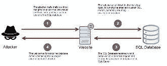那么，SQL 注入尝试使用旨在触发服务器的代码来


提供通常受保护的数据。特别是当服务器持有大量的个人数据时，这可能成为一个重要目标——这些数据既可以被出售，也可以用作勒索的手段。通常，SQL 注入攻击利用了已知的 SQL 漏洞之一，攻击者利用了这一漏洞。这可以通过在搜索栏中嵌入特定代码，或者在任何情况下通过引入代码来触发意外结果来实现。

### 钓鱼攻击
对于那些知道不要打开异常连接或发送给他们的连接的人来说，有不同的技术可以诱导你点击。攻击者可能意识到你不会随意打开一个任意连接，因此他们会使打开该连接的动机变得具有说服力且具有紧迫感。这些人会经常装成其他人来诱导你点击链接。

例如，你可能会收到一封邮件，对方声称在为 `IRS` 工作，并说你在他们那里有一笔巨大的欠款。然而，他们并没有标明金额，而邮件中附带了一个声明，要求你点击它以查看。显然，整个情况是虚假的。并没有什么欠款，而且如果你足够机敏，你会记得每年发出的关于 `IRS` 将如何通过平信与你联系的每条提醒。钓鱼攻击者依赖于你不知道自己在做什么、过度好奇，或者不够留心，在下载文档之前没有仔细检查两次来源。

### 拒绝服务攻击 (DOS)
你是否尝试过离开一个小型社区参加一个大型活动？特别是当只有一条路可以离开时，你可能会在高峰时段的拥堵中停留很长时间。类似的情况也会发生在网站上——通常，服务器只是准备好处理如此大量的流量，如果流量变得非常糟糕，网站就会过载，无法为任何人提供关键位置。有时这种情况是合法的，例如，非常抢手的的门票在特定时间发售并预计会售一空，或者在大规模的限量销售活动期间。

然而，有时，某些个人可能认为他们需要让这种停滞发生。当他们这样做时，会故意向网站注入大量流量——多到网站服务器目前无法处理这些流量，导致任何人都无法访问任何内容。这被称为 `DOS`（拒绝服务），这种攻击通常一次性从单一源发出。然而，偶尔，它会同时来自几个 `IP` 地址，利用不同的电脑进行攻击，这使其更难被追踪和拦截。这被称为 `DDOS`——分布式拒绝服务攻击。

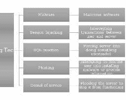

### 黑客行为
最终，黑客背后的解释在不同人之间会有很大差异。有些人是为了获取更多数据。另一些是为了造成破坏。还有人实际上是为了娱乐或仅仅为了弄清楚方法。在目前的主流社会中，将程序员视为网络和在线安全的重大威胁已变得流行。这可以成为故事或电影中一个特别有说服力的反派，但真正的程序员同样具有释放破坏的能力。此外，也有一些策略性或社会驱动的程序员，他们利用黑客行为让自己足够显眼以引起特定关注，或者交付敏感数据——这些人被称为 `hacktivists`（黑客行动主义者）。

无论黑客理由如何，有一点是不疑问的——除非黑客是为了协助建立被攻击的框架以提高安全性，否则黑客是有风险的。它是不安全的。它绝不是玩具。它不是值得去尝试的事情。为了攻击某人或为了已经发生的事情对某人报复，或者你本质上想看世界毁灭，请停止。关上这本书。去培养一个爱好，去做一些可能不会破坏生活的事情。最终，生活曾被程序员摧毁。程序员曾有机会毁灭个人、他们的职业、专业领域，有时甚至是他们的家庭。通过夺取身份或资产，或者通过造成巨大的中断导致组织瘫痪或其他不良后果，黑客行为会伤害个人，并且不应该被轻率对待。这通常就是为什么网络安全是一个快速发展的领域的原因。

通常，人们会有四种动机之一来恶意黑入服务器或计算机：


* 他们寻求经济利益，例如通过盗取信用卡号
* 他们通过黑客行为并在其上留下某种身份标记，在黑客社区内建立声誉
* 他们正在从事企业间谍活动——试图获取竞争的敏感信息以在市场中占据优势
* 他们正在参与政府支持的黑客尝试，以获取国家情报、削弱基础设施或仅仅为了制造混乱。

这些人完全不在乎规则或法律，事实上，他们产生了对网络安全和网络法律的需求，这将在本节的后部分讨论。黑客入侵数据集和服务器促使人们确保这些内容比最近记忆中的任何时候都更安全，从而推动了整个网络安全职业领域的产生。

黑客通常以暗示帽子颜色的称号作为特征。他们可能是黑帽或白帽、红帽或绿色或蓝帽。了解这些颜色可以帮助你更好地掌握为什么人们可能决定黑客，比之前记录的四个原因更具体。它可能还会帮助你解释为什么你想自己通过 `Kali Linux` 学习如何黑客。

#### 黑帽
当你想到一个程序员时，可能是一个黑帽——他们出于邪恶的原因这样做。这些人是经常被发现破解服务器并利用漏洞的人。他们这样做是为了获取并换钱。这些人尽管是犯罪分子，但也在使用学到的最基础的策略。然而他们非常聪明，他们不受不好的手段驱动——他们关心的只有他们将获得的东西。

#### 灰帽
灰帽程序员比黑帽复杂一些。他们黑入是为了获取，但通常在不那么恶劣的情况下。他们可能热于分享文档或破解程序以便在不支付许可费的情况下使用。


他们通常以一种操纵性的方式与服务器和组织合作，但并非真的为了获取其内部数据。在条件同等的情况下，他们将自己的黑客行为更多地视为一种他们欣赏的业余爱好。他们通常不会在发现漏洞时通知网站，但可能会提议收取费用来修复漏洞。基本上，这些人更多是被“看到自己的价值并向他人证明自己的重要性”所激发的。

## 红帽 (Red Hats)
如果我们现在观察这个角色分布图，“红帽”可以被比作动荡不安的大大玩家——他们热衷于制止“黑帽”程序员，但他们并不希望自己被规则和法律所约束。在条件同等的情况下，他们会刻意地破坏任何权力，并按照自己的原则进行他们的活动。假设对方以同样的方式进行反击，红帽将使用喷火器进行战斗——在理清谁是黑帽之后，他们会有力地消除黑帽进入组织的权限，目的是让黑帽完全无法造成任何进一步的伤害。然而，这些人往往与黑客领域的其他部分相较远，他们往往是绝对的现代派，需要按照自己的规则行事。

## 绿帽 (Green Hats)
在黑客领域，“绿帽”是新手。他们通常在努力研究如何进行黑客，并迅速寻求帮助或寻找新知识。

他们被获取和培养自身能力的渴望驱动，激进地追随自己的幻想，本质上并没有任何他们需要遵循的道路。尽管如此，由于他们需要教育经验和专业信息，他们仍然有可能是风险最大的群体，因为他们尚未在学术上准确了解自己的活动会有多危险，也没有足够的知识来扭转他们所造成的伤害。

## 蓝帽 (Blue Hats)
蓝帽关注的是报复。虽然他们可能是恶意的，但通常他们只是将自己的黑客努力指向他们认为侵犯了他们的人。按照规律，他们对黑客活动通常来说有些陌生，可能甚至是知足的青少年，但当糟糕的事情发生时，他们可能会选择有效地利用他们新发现的能力，并出发蓄意且恶意地攻击一个目标。他们宁愿提高自己的能力——他们只需要拥有制造问题的特殊能力即可。

## 脚本小子 (Script Kiddies)
这些人并不出名，但提到他们是至关重要的。这些人通常对获取数据感兴趣，但他们实际上对获取现成的代码并将其注入服务器尝试制造问题感到快乐。他们最可能利用诸如 `DDoS` 等技术来淹没网站，仅仅是为了骚扰人们，而没有任何真正的目的。

## 黑客行动主义者 (Hacktivists)
正如提到的，黑客行动主义者是受政府问题启发的人。他们可能被归类为黑帽，但他们通常通过黑客手段试图发现对他们的目标具有重要意义的东西。他们可能会尝试发布应该被隐藏的数据或记录，或者他们可能会选择为一个组织制造问题。他们甚至可能由于他们出色的工作信息与心理压迫团体战斗。他们正试图推动积极的改变，尽管他们可能正在利用负面技术来实现。他们首先被他们的目标所激发。

## 白帽（道德黑客） (White Hat)
最后一类程序员是白帽——这些人被称为道德程序员。道德白帽程序员经常通过黑客手段尝试加强保护。这些人有意识地尝试黑入产品，以便在识别出漏洞和弱点时帮助组织固化自身的防护。这些人通常出现在网络保护职业中，试图帮助您的敏感数据免受他人试图获取数据行为的威胁。这些人通常具有 IT 安全或软件工程背景，并随后获得 `EC-Council` 的认证。这意味着他们应该完成一门严肃的课程并通过测试，测试通常包括对如何处理最广泛认可和当前的安全领域（带有许多攻击程序和技术）的准备。白帽程序员还应该通过年度学分来维持这些认证的状态。

通常，要成为一名白帽程序员，你热衷于帮助他人。你需要保护个人，并且你需要以一种合法、合理且对所有利益方有利的方式这样做。你想要消除系统内部的漏洞以使其免受伤害，而不是尝试像红帽黑客那样对某人进行执法，红帽黑客初衷可能是正确的，但做事方式与黑帽黑客一样糟糕且具有破坏性。

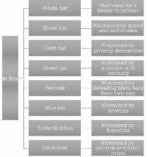

## 什么是网络安全？
如前所述，服务器的发展和程序员的引入也带来了网络保护的产生。网络保护对于那些依赖服务器和数据集的人来说至关重要——没有网络保护，就没有防御框架。网络安全考虑到对任何网络相关框架的保护，这意味着它确保您的设备、程序和信息免受网络攻击。当应该被保护的内容位于任何服务器或数据集上时，有两种不同的方式对其进行保护——实际上防止其受到损坏或删除，并且仔细防止那些试图通过组织访问并获取或破坏受保护信息的人。

因此，网络安全有一个明确的目标：保护 IT 资源免受攻击，以确保存储在 IT 资源中的数据和信息保持安全并为所有人提供帮助。


由于存在这么多信息非常敏感且应该受到保护，因此网络安全非常重要。在执行网络安全实践时，不仅确保了客户的信息得到保护，执行这些实践的组织也在保护自己。由于使用了网络安全，重大泄露的概率降低，负面媒体关注的可能性也随减少。网络安全减少了泄露、勒索软件攻击和大规模欺诈的风险，尽管由于不断变化的技术和 IT 世界，网络安全很难跟上，但跟上具有真正的益处。


遗憾的是，在线防护面临着可能在短期内不会消失的明确问题：由于创新在不断进步和变化，而且考虑到组织、信息规范以及程序员也在发生变化（他们无疑观察到了更多新奇事物/挑战），网络安全是一项永无止境的任务。总会有下一个尝试去发现并修复漏洞；也总会有下一个尝试去获取信息。这意味着网络安全的挑战在短期内可能不会有任何进展。

通常，这些威胁通过将大多数资源集中在保护最关键的部分来被防范，以抵御任何已知的、巨大的风险。然而，这种方法也会导致某些系统处于保护较弱或无防御状态，或者让系统暴露在可能被认为知名度较低或危害性较小的风险之中。

## 网络安全的要素
无论框架如何不断波动和变化，网络安全同样拥有一系列需要跟进的要素。这些要素基本上是网络安全的支柱——它需要具备其中的每一个要素才能被认为是成功的，并真正地保护其受托的信息和框架。这些要素包括：


- 应用安全：这减少了任何未经授权的代码发现漏洞的概率


- 业务连续性计划：这在发生灾难性事件时有助于维护或恢复任何关键功能


- 终端用户教育：教授员工或用户如何行动以保护信息
- 信息安全：保护信息


- 网络安全：通过安全策略、工具和 IT 识别、预防并响应任何威胁


- 运营安全：对信息进行分类并保护它

## 信息安全：CIA 三要素
正如前面提到的，网络安全的要素之一是数据安全。这个特定要素至关重要，以至于值得专门分一个章节讨论。在数据安全内部，有一个被称为 `CIA` 三元组的理念。这个三元组代表机密性、完整性和可用性，它们构成了网络安全中数据安全方面的某种宗旨。

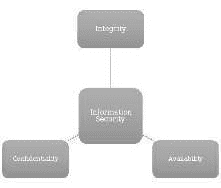
这三元组的每一个部分都至关重要：确保的信息应该是私密的、开放的并保持完整性的。如果没有实现这三个目标中的每一个，数据安全就没有被完全实现。这些是数据安全的基础，并将永远是核心目标。

### 机密性
这是保护数据免受任何形式未经授权访问的能力。当数据被分类后，它不会对任何未经授权的人开放。例如，当你去看医生时，除非你签署了授权书，否则你的病史是私密的。在临床环境中，这些数据受安全措施和直接指南的保护，以防止你的敏感临床数据泄露。在数据安全方面，受保护的数据可以由授权客户访问，而未经授权的客户在未能提供正确证明后自然会被拒绝。例如，考虑一家能够访问你所有数据的机构，从你的政府支持退休号码到你任何信用额度的记录和数量——假设他们的信息不安全，你就面临着身份盗窃的危险。

### 完整性
当数据以准确且可预测的方式保存时，就实现了完整性。这意味着无论对材料进行何种先前的更改，其预期的和独特的设计都能保持。虽然在客户疏忽、使用不当或出现错误的情况下数据可能会发生变化，但只要数据在存储、传输给请求者以及使用过程中未被修改（除非有人有效地且蓄意地更改它），可靠性就能维持。这意味着信息是准确且保持不变的。

例如，想象一下在你去购买另一台电脑之前检查了你的账本，由于即时分期检查应用程序没有如预期那样刷新，或者没有反映你实际支付的情况，你将认为你无法购买那台电脑或其他可能需要的其他物品。


你只需要确保你拥有的确实已被保存。如果你的银行可用性……最后一个目标，**可用性**，指的是数据在被提及和需要时的任何时间、任何地点都能被迅速访问。由于数据在大多数情况下是安全的，因此并不是所有人都能访问，但应该允许那些具备适当资质的人访问。这应当保持在合理预期的范围内——然而，在信息变得关键的情况下，如果没有准备好的访问权限，信息安全在很大并无太大帮助。例如，想象一下你的临床记录正受到保护。假设你的主治医生无法根据要求获取你的临床记录，你将无法获得合法的治疗。

# 第 2 章：网络简介

随着网页的广泛利用，系统管理也随之出现。虽然你可能很容易觉得，你通过网络发送的数据或请求在发射到卫星后基本上会立即显示，特别是当你正在使用交换机进行远程家庭连接时，但实际发生的情况是，你发送的信息通过电缆传输，以便你提到的数据返回给你，这一切都是以极快的速度完成的。这就是网络的构造，无论你是否考虑过，它在当今都是一项巨大的工程，而且你无疑每天都会使用几次。无论你是在检查财务余额，还是用刷卡或 Visa 卡购买东西，你都在通过网络发送数据。


## 什么是网络？

简单来说，网络是指至少两台计算机在各处连接在一起，以共享数据或以某种方式进行协作。计算机并不需要通过电线连接——它们可以通过红外线、无线电波或卫星进行连接，甚至可以通过电线进行连接。尽管如此，它们始终以某种方式关联在一起。

在某些情况下，网络是实现所规划用途的最佳选择。例如，想象你有两台电脑（一台 PC 和一个工作站）、一台平板电脑和一部手机。你经常在家使用这四件设备，并希望连接笔记本电脑上的数据（你主要用它访问和浏览互联网或回复邮件）也能在你性能更强的台式电脑上（可能留用于运行更密集的程序，如玩游戏或编辑大文件或视频）。同样，为了方便起见，你可能希望确保用手机随手拍摄的照片也能从你的不同设备打开。当你需要这种程度的可用性，即从任何地方访问你的每一条记录时，你正在寻找一种网络连接。通过建立这种网络连接，你可以轻松传输这些记录。

显然，网络通过其他方式也变得重要。例如，假设你在一家学校工作，你可能熟悉计算机实验室。在这些实验室里，学生从任何一台电脑输入登录信息来调取相同的记录。教师也可以从该网络上的任何电脑上登录他们的数据，只要他们使用正确的密码和用户名。

## 网络类型

网络本身可以用于传输数据，无论你是在打印报告还是发送电子邮件。至关的一点是，在讨论网络时，你主要在研究两种不同的网络类型之一，不过根据原因还有其他几种。最常被讨论的是 `LAN` 和 `WAN`，`VPN` 是紧邻的第三种。这三种网络有它们特定的应用场景。本部分将为你提供 `LAN`、`WAN` 和 `VPN` 的简要概述，但你将在后面的章节更深入地看到 `VPN`。

### LAN
现代计算机科学中最著名的网络是 `LAN`。这种类型的网络被称为局域网——它将一个小区域或社区内的计算机和低压设备连接在一起。这可能是在单栋建筑内，甚至是几栋需要共享数据的建筑之间。通过使用`交换机`，`LAN` 可以与 `WAN` 连接以快速、安全地传输信息。假设你将在家里建立一个个人网络，它无疑是一个 `LAN`，特别是当有超过一个人在使用它时。

### WAN
`WAN` 代表广域网，它考虑了连接距离较远的计算机。这意味着计算机即使相隔很远，也可以通过某种手段相互连接。这可以是规模较小的，例如一个连接到几个不同 `LAN` 的互联网服务提供商（ISP），将它们串联成一个统一的整体网络。另一种著名的 `WAN` 类型是互联网。互联网考虑了全球范围内计算机的连接。

## VPN
`VPN` 代表虚拟专用网络。它是一种通过互联网扩展的网络，就好像你在访问一个他人无法访问的私有网络一样，但实际上是通过互联网。这些也可以通过远程实现，使用虚拟对等点连接，其中私有地和远程地点可以相互访问。它们通过互联网引导私有网络以传输敏感数据并确保其安全。通常，这是通过对信息进行加密完成的——确保它不会被本就不应该访问它的人有效读取。


说实话，只要你能将请求发送到完美的地方，你甚至可以从一个陆地开始，轻松地经过另一个陆地将信息发送到海外。为了真正开始理解网络位置以及它们如何与黑客攻击、`Kali Linux` 和通用注册相关，你最初应该了解一些核心概念。这部分将引导你理解并刻画枢纽，以及公共和私有的 `IP addresses`（节点）。

### 节点 (Nodes)
节点是组织网络内部唯一的重组点——假设你正在通过邮寄发送东西，那么枢纽就是邮件通过的每一个单一邮政中心。假设你从阿拉巴马州向阿拉斯加州的一个遥远城镇寄送信件，这封信不会直接发往那个遥远的城镇——它会经过几个作为中转站的指定地点。节点也可以指最后的终点。它实际上是信息被发送到的每一个区域，直到它最终到达目的地并被传输到它应该去的地方。

### 主机 (Hosts)
主机是一台与另一台电脑连接并负责发送信息的电脑。主机是一个组织枢纽——它接收和发送数据，并有自己的地址。

这可以作为一个记录数据的服务器，允许其他人访问它。它也可以是个人与个人的主机，你有一台电脑持有所有数据，你从另一台电脑访问这些数据。就像在一个大型派对中，有人是提供娱乐、食物和庆祝的人，这台电脑（主机）提供了所需的所有数据。要被视为主机，该电脑或服务器应该拥有自己的组织地址。

### IP 地址 (IP Address)
`IP addresses` 是你的“网络协议”地址。这是分配给你电脑网络操作的唯一位置。根据组织的邮政站模型，将你的 `IP address` 想象成信封上的回信地址——它考虑了组织以及你访问的网站或服务器，以确保是你的特定电脑在访问，并允许服务器将相应的数据发回给你。如果没有这个地址被妥善安置，尽管数据需要回传，也很可能传回给你。

这些 `IP addresses` 并不是取决于电脑的静态地址；而是由网络访问提供商（ISP）为你提供的。由于 ISP 充当你从局域网（LAN）到互联网的通道，它还会通过分配给你家里或路由的 `IP address` 为你的请求进行标记。它允许电脑与互联网建立该连接并随后让你访问它。它可以通过网络协议进行进一步交互，这将在本节稍后进行讨论。这意味着每当你与另一个网络区域连接时，即使来自同一台电脑，你也会获得另一个 `IP address`。餐厅附近的 Wi-Fi 会给你一个与你在家里或公司处不同的 `IP address`，无论这三处是否是从同一台电脑访问的。这是因为当你处于另一个网络区域时，你从另一个区域访问互联网。你的数据需要根据你的位置通过一条完全独特的路线来联系你。

#### 公共 IP 与私有 IP 地址
`IP` 基本上通常有两种结构——公共和私有。每种结构都以某种相当独特的方式分配，以考虑其应去往位置的基本访问权限。`public IP address` 是前面提到的那个——它是 ISP 提供的允许访问互联网的地址。它是全球唯一的且可以查找到，可以通过使用 `Linux` 系统时通过终端命令或通过网页。只需在网上搜索“我的 IP 地址是多少”就应该得到你的 `public IP address`。

`private IP address` 的作用方式非常相似——它给电脑一个特定的地址，但在这种情况下，它被用于私有空间或组织内部的电脑，而不会暴露该特定设备。想一个局域网（LAN）——你可能在同一个组织上有几台电脑。在这种情况下，连接到你私有组织的单一电脑通常拥有 `private IP addresses`。这些 `IP addresses` 未连接到互联网，但连接点（可能是交换机）可以将数据发送到正确的 `private IP address`。路由器随后获取公共 ID，而连接到路由器的电脑则获得私有 ID。

### 分配 IP 地址 (Assigning an IP address)
还有第三种 `IP address`——`static IP address`（静态 IP）。这种 `IP address` 允许你使用不同的组织服务，而无需期望提供这些服务的框架拥有 `IP address`。这可以通过多种方式实现，例如将 `MAC address` 绑定到 `IP address`，或者在命令行或网络管理器中设置一个。

当你想要从物理上执行此操作时，你应该查看你正在使用的交换机。通常情况下，交换机会使用自己的策略来锁定和绑定 IP 地址，你应该始终检查你正在使用的交换机手册。它的工作原理是简单地将 `MAC address` 限制到 `IP address`。`MAC address` 是介质访问控制地址——它是放置于设备中的标识符，专门用于表征该设备。它是持久的，并属于该特定设备的网络接口控制器（`NIC`）。这意味着无论设备多频繁地进行工厂级重置或更改，它将永远具有相同的 MAC 地址。

当你将 `IP address` 设置为静态时，你所做的简单地将一个特定的 `MAC address` 分配给一个特定的 `IP address`。这种技术不会用于为虚拟机制作静态 IP。

在 `Kali Linux` 中，制作静态 IP 非常简单。你只需直接使用 `Network Manager` 设置。这样做时，你应该去屏幕右上角并点击菜单。然后，点击“Wired Connected”进入“Wired Settings”。这样做之后，会弹出另一个窗口。你应该看到与 Wired 相关的齿轮图标——这将触发另一个窗口，你在其中将选择 `IPv4` 选项卡。你可以将 `IPv4` 方法从自动切换到手动，然后输入你想要实现的理想静态 IP。当你选择理想位置时，记住你选择地址的前七位应与默认网关匹配。也就是说，假设交换机的网关 IP 地址是 `123.456.7.8`，你的选择 IP 应该是 `123.456.7.` 并且你应该在该菜单的 Address 下记录你的选择 IP。你还应该选择掩码——对于大多数人来说，只需输入 `255.255.255.0` 就足够了。然后你应该记录网关，它应该匹配交换机的 IP 地址。在完成位置、掩码和网关的设置后，你可以决定设置任何 DNS 设置（如果你需要），但这并不是强制的。


假设你已经熟悉了 Linux 以及使用它的基本知识，你会意识到 `sudo` 命令是触发框架绕过任何监管限制的指令，前提是你已经被设置为了 `sudo` 客户端。如果你发现自己对这个流程还只是个新手，那么在继续阅读这本书之前，查找一份 Linux 的初级手册可能会大有益处。在输入 `sudo` 命令后，你现在可以停下来仔细查看你本地的 IP 流，以确保你的进展已获取并生效。你可以通过以下命令实现此点：

```
ip a
```

随后你应该会有查看你框架上 IP 地址的选项。如果它与你尝试设置的相，那么在那个时候，你就成功设置了你自己的 IP 地址。

## 协议层
正如之前简要提到的，网络是由约定（惯例）控制的。这种约定由五个特定的层组成，共同构成一个网络协议栈。网络协议栈的前四层包含在 `TCP/IP` 模型中。通过观察这些层是如何运作的，你可以精确地看到个人和框架是如何与网络协作的。这部分将让你熟悉网络的分层以及访问这些层的方法。

### 互联网协议 (IP)
IP 协议 (`IP`) 是指导数据如何在网络上管理通信的核心约定。它阐明了数据报文（你的电脑在请求额外数据时发送的数据）是如何跨组织和界限传输的。它的首要功能是路由信息，这允许信息进行传输，从而创建了整个互联网。

`IP` 负责将数据包（需要通信的小型数据包包）从源主机移动到目标主机。它使用 `IP` 地址来执行此操作，为它们提供数据包头。虽然 `IP` 曾经是无连接的，但也被用作传输控制程序的基础，该程序最终演变成了传输控制协议 (`TCP`)。因此，你偶尔会看到 `IP` 被提及为 `TCP/IP`，将在后续章节中进行解释。

`IP` 起于 `IPv4`（网际协议版本 4），但它正开始被 `IPv6` 取代。

最终，`IP` 负责长长时间的传输。它可以很好地划分为四个特定的能力——应用层、传输层、网络层和链路层。信息和数据包的传输还有第五层——物理层，然而 `TCP/IP` 模型并不包含物理层。

### TCP/IP 模型
`TCP/IP` 模型是 `IP` 的细节之一——它是关于组织内电脑之间应该如何进行通信的权威规则列表。它指导了信息的组织标准，允许所有框架使用相似的原理。基本上，`TCP/IP` 模型考虑了所有框架，无论它们源自何处，以访问相同的互联网。

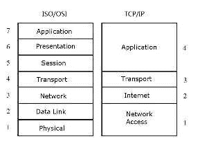

这是通过创建标准数据报文完成的——这些数据报文由两部分组成：头部和有效负载。头部包含了源 `IP` 地址、目标 `IP` 地址以及任何其他为了确保数据完全准确到达它应该去的地方的重要元数据。随后，有效负载就是将交付给需要接收它的源的数据。当有效负载和头部组合成所谓的“数据包（parcel）”时，这种交互被称为封装。

在 `IP` 栈中，如前所述，五个特定的层。前四层与 `TCP/IP` 模型相关。主层，即物理层，负责从一个源到合法的组织通信介质的信息的编码和传输。它利用被称为从物理层发送的帧的信息，目标物理层将接收这些信息。基本上，主层将你输入电脑的信息，通过你控制台按键的位冲和按下转换为位并进行编码。

接下来，你通过数据链路层——在这一层，最近编码的数据包从网络层移动到两个独立的主机。这种数据包的传输有时会受到组织网卡或固件中产品设备驱动程序的限制，不同的协议对于宽带网络有不同的技术，例如，接入需要 `PPPoE` 协议，但附近的有线组织将使用 `Ethernet` 线路。而附近的远程组织则将使用 `IEEE 802.11`。

从数据链路层，你继续进入网络层或网层。这是信息真正从源组织被提取并到达目标的地方。这通常通过将数据包从一个组织传递到另一个组织进行安排来实现，这种循环被称为互连，这就是 `IP` 变得关键的地方。这个过程包括信息从一个源到达目的地。

一旦信息发送到目标，在它被接收之前还有两个额外的层。下一层是传输层——它的职责是考虑要传输的消息。这通常以两种方式之一发生：要么通过传输控制协议或通过用户数据报协议 (`UDP`)。

#### TCP 和 UDP
`TCP` 作为一种通信协议，指的是旨在跨网络进行消息交换的面向连接交换协议。它通常被认为是稳健的，因为它有几种独特的错误检查来确保所有内容都被正确地解释和通信。它首先被分组数据包并编号，然后将数据发送给接收者，并要求发送者返回响应以确认收到消息。如果接收者的响应有任何不准确，则消息将重新发送，以确保正确的数据和包被正确读取。这是互联网中最为人知的通信和信息传输类型。

`UDP` 则考虑更快的传输。遗憾的是，更快的传输包含了一些缺点——准确性。

错误检查被丢弃了，它更多关注尽可能快速地发送信息。由于等待信息的确认可能会浪费时间、导致闲置，或产生请求与执行之间的差距。

## 网络安全威胁
显然，网络的建立也带来了危险。没有任何好的东西可以完全免受破坏或问题，信息和网络安全也不例外。每一个源或枢的扩展都可能导致更脆弱的链接


— 存在更多可能被诱导进入的漏洞。更多失望的可能性。更重要的是，这大程度上正是那些渗透网络、黑客攻击或利用网络的人所所搜寻的。他们对组织安全构成了真正的威胁，了解并感知这一点至关重要。存在几种不同类型的黑客行为和利用创新的尝试，这部分将介绍其中一些。其中一些听起来可能与上一节的内容理成章，而另一些则是新的。尽管如此，这些仍然不是利用或黑入框架的众多可能方法的详尽列表，但它们对于理解至关重要。如果你不理解风险和危险，就实际上无法真正理解组织安全。

## 中间人攻击
如本书之前提到的，中间人攻击是一种攻击者在不知不觉中捕获并在各处调整宿主机与受益者之间通信的攻击。宿主机和受益者认为他们可以毫无保留地传达信息，或者认为他们正在直接交谈，但 `MITM` 正在窃听——他们可以让两次会议感觉完全安全，同时收集可以以后在某处利用、塑造或构造的重要数据。这通常是由于攻击者设法获取一个本应存在于两个终端用户之间唯一的传输 ID 实现的。

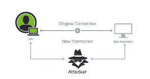

有时，当 Wi-Fi 范围内的某人发现如何让自己嵌入关联并开始阻塞往来数据时，就会发生这种情况。当攻击者能够有效模拟两个端点，确保任何个人或客户端都没有产生任何怀疑时，效果最好。

## 网络攻击
网络攻击是有目的的恶意行为，旨在获取数据或在情况下破坏他人的数据安排。通常，这是因为某人认为故意干预另一个目标具有重大价值。网络攻击背后的个人有时会将其视为快速获利——他们可能会故意黑入框架以索要现金，或者提议花钱修复发现的漏洞。无论情况如何，这些网络攻击无疑是有害的。它们可能会产生真实的经济影响，同时使敏感信息面临危险。这可以通过主动或被动的方式发生。

### 主动网络攻击
主动网络攻击包括某人出于未知原因或为了获取什么而故意尝试进入框架。攻击者故意试图对流向该人员或离开该人员的信息进行更改。这些包括使用伪装攻击，例如假装成一个实际上被授予或授权了更高权限的人员。

### 被动网络攻击
另一方面，被动网络攻击发生在对网络系统进行监控和扫描以发现开放漏洞时。它并不是试图以某种方式更改信息或改变网络，信息只是被用于某种方式监控数据。信息被获取了，但并未被实际修改。如果某人预期通过发布重大数据来勒索或揭露本应保持隐私的内容，就会这样做。想一个黑客活动者，他们可能会乐意利用这些数据来揭露某些事情。

## DOS 和 DDOS
`DOS` 拒绝服务攻击旨在给组织造成重大故障的攻击。这背后的整个动机是淹没特定组织使其崩溃。就像当大量的人出现在一条狭窄到无法考虑容纳他们的街道上时会出现交通拥堵一样，如果组织不够大到可以这样做，它无法同时处理大量的请求。通常，这是通过一个能够运行客户端程序的攻击者机器实现的，该程序随后不断向目标服务器发送 ping 包和请求以使其瘫痪。当组织继续尝试按计划做出反应时，


网络拥堵并反复拥堵，直到最终完全停止。DDOS（分布式拒绝服务）实际上与之非常相似，但它利用了若干台攻击者机器而不是单台机器。通过这种方式，大型机构可能会被破坏并瘫痪。想象一下这种事件的后果——一个本该实用的网站现在无法运行了。一家被禁用且无法处理任何流量的银行可能会导致个人没有获取储备金的选项。一个无法访问和处理患者数据的医疗机构系统将无法查阅记录和临床账户，也无法查看个人近期是否获取了他们的重要药物或其他药物。取决于具体情况，这种攻击可能是完全具有破坏性的。

### MAC 地址欺装
正如你所仔细阅读过的那样，MAC 地址通常是持久的，并被硬编码在设备的 `NIC` 上的。但无论如何，都有方法可以对其进行更改和变动。这被称为 MAC 伪装。当使用 MAC 伪装时，被目标或与之交互的操作系统可以被欺骗，认为该 MAC 地址确实是某个完全唯一的标识。实际上，这考虑到了修改并隐藏 PC 的特征。这通常这样做是因为用户需要绕过访问控制列表。例如，假设他们被某个服务器禁止了，他们可以通过修改列表来绕过限制。他们也可以通过类似手段模仿另一台设备，以获得对框架的未经访问。

MAC 欺装也可以用于隐藏身份——如果你想使用未加密的连接，例如 `IEEE` 加密线路，你将无法防止 Wi-Fi 网络向他人提供该 MAC 地址的访问。当你伪装自己的位置时，你可以尝试让自己不被检测到。你已经隐藏了身份，通过这样做，可以说可以说你是隐形的。你真实的 MAC 地址被掩盖了，因此你可以躲避执法部门的发现。

# 第 3 章：Kali Linux：黑客操作系统
此时，你应该能够意识到网络安全至关重要，并且了解如何通过黑客手段识别框架中的任何漏洞以及如何保护它们免受伤害具有极佳的。这就是 Kali Linux 派上用场的地方。现在在继续之前有一个快速声明：绝不建议你利用这些策略故意伤害或破坏他人或其组织。请勿将 Kali Linux 内的工具用于非法目的。无论如何，假设你决定这样做，请记住你无疑将对自己的行为负责。本书不支持也不鼓励将黑客技术用于恶意目的。如果你选择使用这些技能，那么做的理由应该是你希望确保或保护你自己的安全。

本节将带你正确熟悉 Kali Linux——你首先将了解 Linux 是什么，然后将了解 Kali Linux，即 Linux 的特定实现。你将学习如何介绍 Kali Linux、Kali Linux 自带哪些内容，以及你可能需要的一些常用 Kali Linux 数据和命令。在本部分结束之前，你将获得关于 Kali Linux 是什么以及如何将其引入电脑的实用信息。

## 什么是 Linux？
首先，你应该理解 Linux 本身是什么，因为 Kali Linux 终是一个 Linux 发行版（口语称为 `distro`）。如果你已经熟悉 Linux，可以跳过这部分，因为它可能不会带给你任何其他收获。如果你是 Linux 新手，请仔细阅读这部分，并记住，这不是一个可以戏弄或当作玩具对待的发行版。Kali Linux 是危险的，不应该由那些无法防止实际损害的人拥有。

Linux 本身是一个操作系统——它是开源的。这意味着实际源代码是可以被自由修改并允许分发的。


设计初衷是为了具有适应活性，并准备以多种方式进行更改。该代码是开源的，这意味着更改中央服务器和基础代码非常简单。在许多类型的 Linux 中，只要你已经准备好进入终端，你实际上会想要让它做任何事情——无论你建议它做的操作是否有不利，是否可能导致你安装的整个框架崩溃。

当你学会了如何利用 Linux 时，你就获得了对该框架的自由控制权。尽管如此，Linux 描绘的是实际部分而非真实的运行框架。该部分是考虑 PC 的操作系统来启动设备的基础，并考虑了操作系统和客户端之间的底层协作，从那里开始工作。某些类型的 Linux，如 `Mint` 或 `Ubuntu`，其设计初衷是开箱即用、易于理解，并便于管理和使用。

其他的 Linux 发行版无疑更加专业，要求你具备相当多的编程知识才能真正掌控它们。这些是像 `Gentoo` 这样的发行版，它因一个网络梗而闻名，就像在 `Windows` 中删除 `System 34` 会导致整个崩溃一样。其他形式仍然带有了一些你在其他情况下可能无法访问的工具和功能，例如 `Kali Linux` 的一些渗透测试工具。在将 `Kali Linux` 作为重点介绍之前，你必须真正理解你应该做什么或不该做什么，你自己的能力如何，以及你可能如何与框架进行交互。

如果到目前为止，你对内核和发行版的讨论或对编写自己的程序并命令计算机的想法感到迷茫，请现在停止阅读，并在返回之前寻找一本入门书籍。这些思想意义重大，无论你是否是业余，从现在到可见的未来，对框架拥有某种程度的经验是正常的。记住，如果你在完全不知道自己在做什么的情况下尝试使用这个框架，可能会造成无法挽回的破坏——你应该保持谨慎，以避免陷入自己的灾祸。

## 什么是 Kali Linux?

`Kali Linux` 明确是一个基于 `Debian` 的 Linux 衍生。`Kali Linux` 由 `Offensive Security` 创建，旨在成为数据安全专家的主要训练工具。通过 `Kali Linux` 中使用的工具，如果你知道自己在做什么，就可以轻松地开始黑客攻击——它包含了一些你认为至关重要的工具，并且考虑了培训和认证。坦率说，如果你想成为数据安全专家或精英，你可能需要获得一个根据 `Offensive Security` 教学课程获取的证书。

当你使用 `Kali Linux` 时，你正在访问旨在帮助你完成数据安全任务的设备。你实际上想要参与渗透测试、安全审计，这仅仅是开始。由于 `Kali Linux` 由网络保护领域的主要导师之一 `Offensive Security` 管理和维护，你会发现提供的工具与你未来将面对的相似。

具体来说，这种 Linux 发行版旨在解决渗透测试人员的问题——因为它是面向专家的，所以它假设你已经了解 `Linux` 作为一个工作系统。

`Kali Linux` 展示了一些重要特性，使其在黑客领域非常有用——这些工具对于那些热于出于恶意进行黑客攻击的人以及热于提高整体安全的人来说都很重要。尽管如此，这些特性包含了一些重大陷阱。不过，使用 Linux 发行版的常规优点已被修改以使 `Kali Linux` 成为一个更重要的工具。总而言之，`Linux` 的卓越之处在于它适用于你具备编程能力的任何事物，因此你可以创建一个精确满足你需求的运行框架。现在，让我们停顿一下，回顾这些区别于标准 Linux 发行版的关键变化。

### 单用户 root 访问

记住，`root` 访问指的是某人是否对该设备拥有管理权限。`root` 用户没有保护措施，在任何情况下都不会被告知，并且无法被框架撤销。在许多其他 Linux 框架中，强烈建议你尝试不要使用 root 访问账户，并其次考虑设置另一个具有 `sudo` 权限的账户。无论如何，这在 `Kali Linux` 中是不可能的——操作系统不会认为某些其他用户或 `root` 访问是被废弃的。这意味着运行框架假设你完全不知道自己在做什么，只需要几次错误或由于不知道自己在做什么，就可以被完全摧毁。考虑到 `Kali Linux` 的设备和使用场景，你将要做的的一切都会被视为高价值的，你可能需要持续使用 `sudo` 命令运行框架，或者你必须始终保持在 `root` 用户账户中。由于避免 root 记录会成为负担，`Kali Linux` 已经转向一直保持 root 访问。这是它不是一个面向初者的发行版的另一个解释。

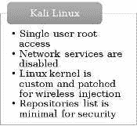

### 网络服务被禁用

虽然网络管理在 Linux 发行版中通常是启用的，但在 `Kali Linux` 内部，框架设置使得网络管理默认处于禁用状态。这是一种安全策略——它考虑了保持服务安全，并确保发行版很少关注引入的包。不同类型的系统管理，如 `Bluetooth`，也被禁用了。

### Linux 内核经过定制

虽然基本上每一个其他 Linux 发行版都通过普通的 Linux 部分连接在一起，但 `Kali Linux` 发行版并不使用那个细致的部分——那个


Kali Linux 中使用的部分已经重写，使其能够修复远程注入，这是它作为渗透测试辅助工具的另一种方式。

存储库列表非常精简。由于 Kali Linux 的设计初衷是安全性，因此允许访问系统的软件源列表非常少。虽然许多人可能觉得需要或倾向于添加未授权或不在存储库列表中的系统，但这样做极有可能导致 Linux 安装系统完全崩溃。

因此，你必须认识到 Kali Linux 并不是一个日常使用的操作系统，而是一个用于训练和非常特定的使用场景的工具。如果你不在这些情景中（例如渗透测试或练习你的技能）中使用它，你将发现这个系统几乎毫无用处。你不会用它来进行日常网页浏览、尝试回复邮件或玩视频游戏——这样做面临着整个系统崩溃的风险。

# 我应该使用 Kali Linux 吗？

你可能预想一本详述 Kali Linux 的书籍会罗列出坦率说来你应该使用这款工具的每一个理由。然而，由于其风险性、该发行版的特殊性和趣味性以及随之而来的限制，有必要梳理一下 Kali Linux 不适合你的原因。

该发行版是专为专业分析师和领域专家设计的。它很难学会，而且不会赋予你执行任何你所需的权限。尽管它是开放的，但它开放得非常彻底——出于安全考虑，该发行版的某些是被锁定的，你无法更改它们。

例如，存储库中的软件包应该经过委员会的认可，并且这些存档是上游的。它们经过了充分测试，开发团队也是值得信任和尊重的。尽管如此，如果你需要一个拥有完全权限的框架，Kali Linux 并不适合你。

是的，它具有一定程度的灵活性，但你不能引入任何插件。如果你希望它们能够立即工作，就应该从精选的存储库列表中引入。如果你尝试引入不在该列表中的东西


简而言之，你将不得不经过重重困难来尝试修复它，即便如此，你仍然很有可能产生比修复的还要多的问题。对于普通的浏览和使用来说，Kali Linux 并不适合你。如果你已经熟悉 Linux，并且目前对网络组织或框架组织有所了解，需要一个工具来获取更多信息，那么这可能是正确的操作系统，但它绝不应被视为 Linux 的主要入门教程。特别是考虑到任何未经授权的进入组织的尝试都可能导致巨大的伤害，并泄露严重的法律或私密事务，因此它应该仅供那些清楚自己在做什么、且不会意外破坏他人组织或访问权限的人员使用。再次强调，由于这一点至关重要，如果你是一个外行，请寻找一个更简单的 Linux 发行版——Ubuntu、Mint 和 Debian 都是非常棒的起点。显然，如果你现在是一名渗透分析师，或者正专注于学习渗透测试，那么 Kali Linux 正是你的不二之选。你无法胜过专家为专家设计的工具，更无法获得这套工具集所提供的免费价值。

## Kali Linux 特性
如果你已经认定 Kali Linux 可能适合你，那么有一些工具可能适用于你。这一部分将引导你了解 Kali Linux 最广为人知的特性，以便你开始更好地判断这是否对你用处。

### 数百渗透测试工具
Kali Linux 拥有一个巨大的工具库，可用于渗透测试，其中所有工具都经过了检查并尝试了保护。每个工具都提供了一个对你进入和控制系统的工作有所帮助的理由。

### 免费
这可能是使用 Kali Linux 最具说服力的理由之一——假设它符合你的用途，它是完全免费的。你永远不需要付费来获取这套工具，这意味着没有持续的许可维护费用。

### 安全
Kali Linux 由一个受信任与商店交流的小社区创建，令人惊讶的是，它有一些约定来帮助确保 Kali Linux 达到预期的安全水平。这意味着任何供下载的包都将由提交并构建它的设计者认可，并考虑在发生任何万一错误时承担责任。

### 可定制
虽然 Kali Linux 有明确且受鼓励的应用场景，且某些框架的用法是被明确反对的，但整个框架被设计得具有适应性。你可以尝试更改 Kali Linux 以适应你的需求，无论这些需求是否与建议的用途冲突。你可能会遇到困难，但你可以尝试做任何你想做的事。

### 多语言支持
与许多其他渗透工具不同，Kali Linux 提供了真正的多语言支持。与其用英语进行工作和学习一切，人们可以使用自己的本地语言使用 Kali Linux。

### 开源 Git 树
所有源代码均供个人查看或根据特定需求进行修改。人们可以跟踪进展和源代码，以确保他们获得确切需要且想要的内容，正如前一节中记录的少数限制。

### 符合 FHS 标准
Kali Linux 采用了一直以来使用的通用文件系统层级标准（Filesystem Hierarchy Standard），以便 Linux 用户查找他们的文档和库。这意味着如果你已经熟悉 Linux，使用它将少一个需要克服的障碍。

### 无线设备支持
Kali Linux 旨在帮助广泛的远程设备，使其能够与 USB 和其他远程设备轻松连接。这可以更方便地访问数据和传输信息。

### 自定义内核
由于渗透分析师应该有权进行远程评估，Kali 内部的 Linux 内核将始终包含每一个底层的补丁，以支持对其他系统的渗透演示。

## 如何安装 Kali Linux
此时，你应该对引入 Kali Linux 是否有所帮助有一个清晰的想法。如果你在浏览了关于该操作系统的所有信息后，认为它确实适合你，那么是时候开始讨论操作系统的安装过程了。安装是使用 Kali Linux 工作系统的第一步，并且可以通过多种方式实现。如果你是以任何非传统的在 PC 上安装 Kali Linux 操作系统的技术来引入 Kali Linux，或者你设想你将运行虚拟机，那么你可能处于一个理想状态，可以去 Kali Linux 官方网站查看他们提供的指南和教程。

### 安装所需
当你准备好安装时，你应该确保你已经拥有了你所需要的一切。这很大取决于你所使用的框架。运行 Linux 的人现在可能已经拥有了所需的一切，但如果你运行的是 macOS X 或 Windows，你将需要确保为特定操作系统安装适当的 `GPG`。


无论如何，万一你访问了 Kali Linux Kali 官方文档库，你实际上会想查看下载官方 Kali Linux 镜像的指南。在页面的靠下部分，提供了两个链接供你下载 `GPG` 的验证器版本。在引入 `GPG` 之后，你需要下载并导入你副本的官方 Kali Linux 密钥。你将使用相应的命令执行此操作：

```bash
wget -q -O - https://archive.kali.org/archive-key.asc | gpg --import
```

相应地，你将获得一个密钥编号。为了检查密钥是否已导入，你应该再尝试一次命令：`gpg --fingerprint 44C6513A8E4FB3D30875F758ED444FF07D8D0BF6`。只要你没有遇到任何提示错误的信息，你就应该看到你拥有一个密钥，以及该密钥的有效期。

### 步骤 1：获取官方 Kali Linux 镜像

当你安装操作系统时，你确实需要一个 ISO 文件——这要求你有一个 USB 闪盘、硬盘或其他与你要安装 Kali Linux 的电脑配合的策略。根据你所使用的框架架构，你应该拥有一个 32 位或 64 位的镜像。当你真正想知道你正在运行什么框架，并且目前正处于 Linux 或 OS X 之一时，你可以在终端中输入命令来获取结果。你将输入：`uname -m` —— 执行此操作后，你将得到所有结果为“x86_64”的响应，意味着你现在正在运行 64 位设计，或者一个“i386”数字架构的响应。

你需要确保你选择的 `ISO` 是正确的版本。

在 Windows 10 框架上，你应该按下开始按钮，然后选择 `设置 > 关于`。在打开设置后，你应该能看到右侧的设备规格。在那里，你应该会有查看你的框架运行的是 32 位还是 64 位系统的选项。你实际上会想要获取所有 `.iso`/`.img` 记录或 `.down` 文件的合法镜像。记住，这样做对于基于 Intel 的电脑是显式要求的。你同样也可以获得允许你在虚拟机或其他不同配置上运行 Kali Linux 的文件。

在你下载 Kali Linux 时，确保你始终从由安全运营运行的 Kali Linux 官方网站下载。除此之外的任何操作都可能导致问题，因为你无法确认当前所处的环境是安全的。你应该确保你下载的文件是安全的，假设你将使用它对你自己的系统进行渗透测试。

### 步骤 2：验证 Kali 镜像

在冒险运行 Kali Linux Live（这很快就会被检查）之前，你真的想双重确保你获得的是真实的、官方的 Kali Linux 镜像，而不是网络其他地方传输的某种被破解过或更改的版本。你可以通过以下三种不同方法之一来实现这一点：


1. 从官方 Kali Linux“下载”镜像站下载 `ISO` 镜像，然后计算 `SHA256` 哈希值，并将其与 Kali Linux 网站上列出的值进行比较。你应该能够很简单地完成此操作——但也可能存在被利用漏洞。


2. 通过种子（torrent）下载 `ISO` 镜像，它也会提供一个带有计算好的 `SHA256` 签名的文件。如果你已经在 Linux 或 OS X 上，你就可以使用 `shasum` 命令，或者使用 Windows 上的工具来验证文件签名是否与下载的其他文件夹中的签名匹配。再次，这存在可能被利用漏洞的风险，因为有人基本上可以为你提供匹配的数字，让它看起来像真实的 Kali Linux ，以确保你被骗。


3. 唯一能够完全确定的方法稍微复杂一点——你需要下载明文签名文件以及用官方私钥签名的文件版本。然后，你必须使用 `GNU Privacy Guard`。这将验证 `SHA256` 组合与明文文件中的是否匹配，然后它将确保带有 `SHA256` 哈希的已签名文件也已使用正确的官方密钥进行了正确签名。

### 步骤 3：创建 Kali Linux 启动 USB 盘

可能是让 Kali 准备就绪的最快方法是使用活动启动 USB。基本上，你正在做的是将 Kali Linux 获取到 USB 闪盘中，然后从该 USB 启动。这带有它自己的优点，例如避免任何形式的破坏或混乱。当你使用它时，你没有对你正在使用的框架进行任何更改——你基本上是从 USB 运行它。这同样突出了它的多功能和可调节性——你实际上想带它去任何地方并从任何电脑启动，你实际上还想在 USB 盘上制作你自己的自定义 Kali ISO，这在这里也会被讨论。

为了制作启动盘，你需要一个经过检查的 `ISO` 副本、一个镜像刻录工具（假设你正在使用 Windows，你可以下载 `Win32 Disk Imager`；或者假设你在 Linux 或 OS X 上，你可能已经有了，你只需使用 `dd` 命令来调用它）以及一个 USB 闪盘或 SD 卡，只要你所使用的框架支持这两种技术即可。你的设备容量应该是 4GB 或更多。

#### 在 Windows 上创建启动 USB

在 Windows 上执行此操作时，你将经历一些与在 Linux 或 OS X 机器上不同的阶段。


将 USB 闪盘插入电脑的任何可用 USB 端口，并记录分配给它的驱动器符号。挂载后，启动 `Win32`。(image_rsrcUF.jpg)

选择你刻录的 Kali Linux `ISO` 文件，并确认你覆盖的是正确的 USB 驱动。当你确认无误后，点击写入按钮。镜像完成后，弹出 USB 闪盘，它现在就可以使用了。

#### 在 Linux 上创建启动 USB

在 Linux 上，方法稍微复杂一些，并且面临着冲突或意外覆盖磁盘驱动器的风险。你必须确保正在使用正确的命令以确保你没有无意中覆盖任何内容。


首先，你必须确定用于将镜像写入 USB 闪盘的设备路径。你需要在不插入 USB 的情况下执行此操作。在终端中，你想输入：

```bash
sudo fdisk - l
```

你应该得到一个显示带有三个分区的单一驱动器的结果。


此时，将你的 USB 插入可用端口，并再次重复之前的命令 `sudo fdisk -l`，你现在应该得到一个类似的输出，其中多出一个之前不存在的设备——这次，就是你的 USB 驱动。

现在，你必须按照下方提供的命令将 ISO 文件镜像到 USB 设备上。该命令假设你的 ISO 镜像命名为 `amd64.iso` 且当前位于运行良好的的注册表中。它同样假设你的 USB 盘名称为 `/dev/sdb`，如有必要，你需要替换记录名称和驱动器名称。如果你想加快速度，可以选择块大小（blocksize），但这是制作可靠镜像最安全的尺寸。这里的命令是：

```
dd if=kali-linux-2017.1-amd64.iso of=/dev/sdb bs=512k
```


镜像过程可能需要 10 分钟以上，有时更长，因此在等待此过程中请保持耐心。在系统完成之前，你不会获得关于该过程的任何反馈。
完成后，你的 USB 设备现在已准备好可以启动。

## 在 OS X 上创建可启动 USB


从拔掉 USB 驱动器开始。打开终端（Terminal）并输入命令：

```
diskutil list
```


你应该看到几个设备路径，就像 Linux 版本一样。你将获得每个分区的信息以及你可能需要的所有信息。

现在，插入 USB 设备并再次运行 `diskutil list`。这样做将为你展示一个新的磁盘驱动器。你现在可以看到一个之前不存在的新磁盘驱动器，这就是你如何指定命令的方法。

现在，卸载驱动器——为了演示，这次我们假设驱动器的名称为 `/dev/disk6`。你的命令将类似于：

```
diskutil unmount /dev/disk6
```


此时，你需要使用类似下面的命令将 Kali ISO 文件镜像到设备：

```
sudo dd if=kali-linux-2017.1-amd.iso of=/dev/disk6 bs=1m
```

请记住，不能保证你自己的记录和驱动器将具有相似的文件名。你应该相应地进行转换。

再次，在驱动器写入完成之前不会有任何输入，所以总而言之，你将获得一个可启动的 USB。此时，你实际上想使用你的任何 USB 驱动器来启动操作系统。你只需要在插上 USB 启动 PC 后调出启动菜单，并确保选择 Kali Linux 即可。

有不同的技术可以进入 Kali Linux，例如将其安装到自己的 PC 上，但最推荐进入该产品的方法可能是使用 USB 驱动器。如果你对将整个框架下载到你的设备上感兴趣，请浏览 Kali Linux 官方网站以获取更多执行此操作的访问权限和数据。

# 第 4 章：基础 Linux 命令

从现在开始，你获得的数据将是有用数据以及你可以以某种方式有效使用数据的混合。本节将专门为你提供开始与 Kali Linux 关联的基础数据。你将获得一份最知名且必要的常用命令清单。

在阅读这些命令时，请尝试深入研究它们。你需要确保了解它们是什么，以及如何最好使用它们来帮助你。假设你能做到这一点，你就确保自己准备好与你的 Linux 发行版协作，无论你选择了哪一个。记住，在 Kali Linux 中，你当然处于 root 客户端，你应该安全起见。当你没有 root 权限时使用这些命令中的某些命令，你会遇到阻止你继续操作的问题。在任何情况下，在 Kali 中，假设你现在处于 root 客户端，命令会立即完成，无论它是否是破坏性的命令。为此，严谨和谨慎的衡量对于培养你的 Kali Linux 能力并精通渗透测试和黑客技术至关重要。

## 终端

如果你了解 Linux 和基础命令，你也理应该熟悉终端（Terminal）。这是你与 Linux 的 shell 连接并告诉它执行你预期操作的方式。


你基本上是在向服务器发送请求，并预期的它会在另一端返回合法的响应。这是最简单的 Linux 命令的原理。为了方便操作，假设已经过去了一段时间，你可以将终端复制到图形化界面中，这样你就可以看到可以阅读和理解的信息与结果了。假设你现在有 Linux 或 OS X，你现在进入终端（Terminal），你也可以引入其他终端。如果你是 Windows，你可能需要引入 `PuTTY`。Kali Linux 内部也包含它自己的终端，你可以轻松访问。

## 命令提示符
当你与终端通信时，你正在使用命令提示符（command prompts）或 shell 提示符（shell prompts）你在阅读不同的指南时可能会反复看到这些术语。当你进入终端时，你会看到一段非常明显的简写。它将包含客户端的用户名、服务器的主机名、你所在的索引以及简写符。很多时候，你看到的简写符是 `$`。实际上，假设你的客户端用户名为 `programmer`，你所处的服务器是 `hacking`，且你目前处于默认主目录，你可能会看到如下默认提示符：`hacker@hacking:~$`

在 Kali Linux 中，你始终登录在单个 root 客户端账户上。你会看到用户名 `root`，而不是 `programmer` 或任何其他可能存在的名称。

## 执行命令
当你想要执行命令时，你必须以系统能够正确处理的方式指定你想要的内容。你可以输入一段内容，一组建议的数据序列，这将触发框架针对特定目标做出响应。你也可以输入你自己的命令。这将是当前部分的大部分内容：关联和排序服务器的方法。

当一个命令运行时，它被称为一次交互（interaction）。当这种交互在前台发生时，你应该等待它完成后才能进行任何其他操作。这是运行程序的默认方法。

你也可以通过两种结构输入你的命令：带参数或不带参数（contentions）。当你输入一个不带参数的命令时，你输入的是一个基础命令，不期望其他任何。这将让电脑精确地发送你确定的内容，或精确地执行你所说的事情。例如，如果你编写 `ls`，你将立即在屏幕上列出之前的所有内容——当前注册表的记录和目录。

然而，参数会尝试合理地调整该命令。通过添加参数，你增加了一个额外的条件——你可能会指示框架列出另一个索引的文档。你可能会指示框架在短时间内关闭而不是立即关闭。它们改变了第一个命令的重要性。当你输入带参数的命令时，你将按照特定的命令顺序输入它，然后是你正在运行内容的规范或位置。

执行命令的另一种常见方式是使用选项（choices）——这意味着它们有一类型遵循的更改。这后面跟着一个 `-` 和一个字母，让框架知道你到底从中想要什么。例如，如果我们回到 `ls`，你可能会决定给它添加另一个东西，比如 `ls -l`，这让你的框架知道你需要它列出更详细的权限列表，显然比通常包含的更多细节。

你也可以混合和匹配，所以你可以将选项和参数结合起来——事实上，将两者合为一运行正确的命令是非常普遍的。

从这里开始，你将获得几个 Linux 内部的命令，你会认为它们是有价值的。这些要么是一个非常棒的额外补充课程，要么你根本不需要这些数据。如果你不需要这些数据，或者你对自己探索 Linux 框架的能力有信心，请直接离开这里并跳到下一节。无论如何，假设你并不完全确定自己探索产品的能力，那么至少花精力阅读给你的这份详尽命令列表可能是明智的。显然，如果你以后在任何时候觉得需要命令并需要确保你确实知道如何使用它们，你也可以随时返回这些数据。

## 存档
此部分中的代码与你框架内的存档文件直接相关。它们将帮助你直接连接文件，无论是访问、移动还是与它们协作。

```
tar cf archive.tar registry
```
这将创建一个包含目录的 tar 包（`archive.tar`）。

```
tar cjf archive.tar.bz2 catalog
```
与上面类似，但 tar 包将使用 `bzip2` 格式进行压缩。

```
tar czf archive.tar.gz index
```
主命令的另一种变体。它将创建一个 `gzip`压缩的 tar 包（`archive.tar.gz`）。

```
tar xf archive.tar
```
这是上述的反命令。它将从 `archive.tar` 中提取数据。

```
tar xjf archive.tar.bz2
```
使用此从 `bzip2` 压缩的 tar 包中提取数据。

```
tar xzf archive.tar.gz
```
从 `gzip` 格式压缩的 tar 包中提取内容的命令。

## 目录导航
这些代码将允许你快速方便地在目录移动。当你这样做时，你可以在空间之间移动，而无需手动一个一个地遍历目录。

通过这种方式导航变得更容易。

```
cd
```
你将回到 `HOME` 目录。

```
cd ..
```
与上面类似，但有两个点。将你移动到上一级。例如，你在目录 2，它位于目录 1。你通过此命令进入目录 1。

```
cd /etc
```
你将进入 `/etc` 目录。

## 磁盘使用
这些特定的命令与磁盘使用直接相关。它们允许你查看有关磁盘的各种信息，当你密切监控系统时是非常必要的。

```
df -h
```
通过此命令你可以查看磁盘的已用可用空间。

```
df -i
```
使用此查看挂载文件系统的已用可用索引节点（inodes）。

```
du -ah
```
以人类可读的格式（字节、兆、吉字节）显示所有对象和目录的大小。

```
du -sh
```
与上面类似，但只会显示当前工作目录的信息。

```
disk -l
```
当你需要查看硬盘的分区大小和类型时，使用此命令。

## 文件和目录命令
本节中的命令将帮助你直接与系统内的文件和目录交互。它们允许你对文件进行各种额外的访问和使用，并让你充分利用系统和效率。

```
cp fileA fileB
```
此命令将文件 A 复制到文件 B。

```
cp -r source_directory destination
```
该命令将递归地将目录复制到指定的目录。如果位置已存在，将复制目录。如果位置不存在，将创建一个包含源目录文件的位置。

```
ls -al
```
命令将以详细格式列出目录中的所有文件。

```
mv fileA fileB
```
将 `fileA` 重命名为 `fileB`。它也可以移动文件。如果 `fileB` 是目录，命令将 `fileA` 移动到该目录。
```


## 文件操作

`rm file` 删除指定的文件。最常见的用法是删除文件。
`rm -f file` “强制”删除文件。执行此命令后不会有确认提示。请确保你确实想要删除此文件。

`rm -r directory` 递归地删除目录及其内容。
`rm -rf directory` 当你想要“强制”递归删除目录及其内容时，使用此命令。同样，请确保这是你想要的操作，因为系统不会进行任何确认。

## 文件传输
这些命令将作为你的指南，帮助你根据需要在不同位置之间移动文件，以确保你始终能够将文件放在你想要的地方。

`rsync -a /home /backups/` 将 /home 目录同步到 `/backups/home`。

`rsync -avz /home server:/backups/` 在本地和远程系统之间对文件或目录进行同步，并启用压缩功能。

`scp file.txt server:/tmp` 将文件（在此例为 `file.txt`）安全地复制到服务器的 `/tmp` 文件夹。

`scp -r server:/var/www /tmp` 递归地从服务器复制所有目录和文件到当前系统的 `/tmp` 目录。

`scp server:/var/www/*.html /tmp` 将服务器上所有的 `.html` 文件复制到本地 `/tmp` 目录。

## 硬件信息命令
这些命令将为你提供有关硬件的各种信息，确保你的硬件运行正常且高效，从而让你确信系统一切正常。

`badblocks -s /dev/sda` 这将检查磁盘 `sda` 上是否存在不可读取的区块（你可以将 `sda` 更改为任何想要检查的磁盘驱动器）。
`cat /proc/cpuinfo` 这将提供当前的 CPU 信息，例如使用率、速度以及运行能力的其他重要方面。
`cat /proc/meminfo` 这将提供内存信息，例如使用率、速度以及运行能力的其他重要方面。
`dmidecode` 这将为你显示来自 BIOS 的相关硬件信息。

`dmesg` 将显示内核环形缓冲区中的消息。
`free -h` 将显示你系统当前空闲和使用的内存空间，特别是以人类易读的形式。你也可以选择用 `m` 代替 `-h` 以 MB 为单位显示，或用 `-g` 以 GB 为单位获取结果。
`hdparm –I /dev/sda` 这将提供有关磁盘 `sda` 的各种信息。

`lspci -tv` 显示当前的 PCI 设备。

`lsusb -tv` 显示你当前的 USB 设备。

## 安装软件包
这些命令都是关于从你的文件安装包，无论是来自 zip 文件、下载的文件或其他格式。

`rpm -i package.rpm` 从本地文件安装包，在此例名为 `package.rpm`。
`tar zxvf sourcecode.tar.gz`

```
cd sourcecode
./configure
make
make install
```
与从软件包安装不同，这将将让你从源码编译安装软件。
`yum info package` 显示你引用的软件包信息。
`yum install package` 安装软件包。
`yum remove package` 卸载（移除）软件包。
`yum search keyword` 使用关键字搜索软件包。

## 网络
这些命令与网络直接相关——允许你查看你自己的网络状况，以及你的网络正在交互的任何内容。
`dig domain` 显示给定域名的 DNS 信息。
`dig -x IP_ADDRESS` 使用此命令对指定的 IP 地址运行反向查找。
`ethtool eth0` 用于查看和更改网络驱动和硬件设置的工具。

`host domain` 显示给定域名的 DNS IP 地址。

`hostname -i` 此命令用于显示“主机名”的网络地址。

`hostname -I` 与上述命令非常相似，但它将显示所有本地 IP 地址。
`ifconfig -a` 将启动所有网络接口及其 IP 地址。
`ifconfig eth0` 显示 `eth0` 地址及其详细信息。
`netstat -nutlp` 将显示任何正在监听的 tcp & udp 端口及其相关程序。

`ping host` 向“host”发送一个 ICMP 回显请求。

`wget http://domain.com/file` 下载给定网络地址上的网络文件。

`whois domain` 显示“domain”的 whois 信息。

## 性能监控
这些命令专门用于确保你能够监控系统的性能。这将确保你的系统运行良好、高效并符合你的偏好，从而确保无需对自己的设置进行进一步优化以达到你的目标或需求。
`htop` 允许你移动到进程查看器的顶部。`iostat 1` 将允许你查看输入/输出统计数据。

`lsof` 允许列出系统中当前存在的所有打开的文件。
`lsof -u [username]` 允许列出指定用户当前打开的文件。

`mpstat 1` 将允许你查看与处理器相关的统计。`tail 100 var/log/messages` 将让你看到最后 100 条系统日志消息。

`tcpdump –i eth0` 将允许你查看列出的特定接口（在此例中为 `eth0`）上的所有包。
`tcpdump –i eth0 ‘port 10'` 将允许你查看该接口上端口为 10 的数据包。`vmstat 1` 将允许你查看虚拟内存统计。

## 进程管理
这些命令专门用于进程管理——它们告诉你正在运行的进程情况，并允许你在前台和后台进程之间切换，以确保你的活动不受影响。
`bg` 显示已停止的任务。

`fg` 此命令将后台进程推回前台。

`fg n` 与上述命令类似，但它会将进程 `n` 推回前台。
`htop` 允许你交互式监控计算机的进程。`kill pid` 使用此结束或“杀死”特定进程，其进程 匹配 `pid`。

`killall processname` 当你想杀死所有特定名称的进程时使用此命令。
`program &` 在后台启动你的程序。`ps` 显示正在运行的进程。`ps -ef` 显示所有运行的进程。
`ps -ef | grep processname` 将显示 `processname` 的信息。
`top` 进程查看器。它比 htop 旧，但功能相同。它的不同之处在于不支持鼠标。

## 搜索
当你需要在系统中查找内容时，这些命令是你的最佳选择。当你使用搜索命令时，你能够轻松找到需要快速访问的文件，并准确学习它们的位置，以便你可以在其他跳转并访问它们。
`find /home -size +25M` 使用此命令查找 /home 中大于 25MB 的文件。

`find /home/mark name ‘prefix*’` 将查找 /home/mark 中以 `prefix` 开头的文件。
`grep pattern file` 在 `file` 中查找模式。

`grep -r pattern directory` 在 `directory` 中递归搜索模式。`locate name` 将根据指定的 `name` 查找文件和目录。

## SSH 登录
`ssh host` 使用你的本地用户名连接到主机。

`ssh user@host` 以 `user` 身份连接到主机。

`ssh -p port user@host` 使用 `port` 连接到主机。


## 系统信息

`cat /etc/redhat-release` 这将向你显示计算机上当前运行的是哪个版本的 redhat。

`date` 这将向你显示你正在使用的系统当前的时间和日期。

`hostname` 这将告诉你系统主机的名称。``hostname -I` 这将为你提供主机的 IP 地址。

`last reboot` 这将显示系统最后一次重启的时间。

`uname -a` 这允许显示存储的 Linux 系统信息。
`uname -r` 这允许输出显示你正在使用的内核版本。

`uptime` 告诉你的系统已经运行了多久，或者加载了多久。
`w` 这将向你显示当前在系统中在线的用户是谁。
`whoami` 这将告诉你当前是以什么用户身份登录到系统的。

## 用户信息与管理命令

这些命令对于你管理用户信息的能力关关。当你掌握了这些控制方法，你就可以从服务器中添加或删除人员。你可以确保某些人拥有特定的权限，等等。这些命令在 Kali Linux 中可能不是那么必要（因为你被设计为使用 root 用户而不是其他用户），但了解并理解它们仍然是非常棒的。

`groupadd group1` 允许在此实例中创建一个新组“group1”。你可以用任何其他组名替换“group1”。
`id` 显示系统上当前用户的用户 ID 和组 ID。
`last` 显示最后几个登录的人员是谁。
`useradd –c “full name” –m “nickname"` 允许创建一个账户，其注释为“full name”（全名），家目录为“nickname”（昵称）。
`userdel “name"` 允许你删除用户“name”。

`usermod –aG group1 “name"` 允许你将用户“name”移动到“group1”组。

# 第二二部分：Kali Linux 黑客攻击

# 第 5 章：Nmap 以及漏洞的检测与利用

到此时，你可能已经非常渴望彻底开始使用 Kali Linux 了。你现在应该已经安装了该操作系统，或者正准备这样做。无论哪种，阅读这一节都能为你提供有价值的信息。在这里，你将开始看到 Kali Linux 的真正威力以及它是如何被使用的。你将开始看到在黑客攻击中可以获得的实力，以及学习如何观察并掌握这种力量；同时你还应该开始看到网络变得毫无保护或毫无防备是多么容易。当这种情况发生时，确保你能发现漏洞并进行修补将符合你的最佳利益。

Nmap 只是 Kali Linux 提供的许多工具之一，本章专门关注它。Nmap 功能非常强大，它允许你收集和识别有用的信息，允许你检测系统上的一切。它主要是一个安全工具，但你应该记住它也可以被用来造成伤害。现在，是时候进入实际攻击过程的开头了。

如果你已经安装了 Kali Linux，请直接打开它——Nmap 默认自带并包含在系统中。

## 什么是 Nmap？

Nmap 是 network mapper（网络映射器）——它是一个非常流行的工具，用于发现你可用的资源。与 Kali Linux 发行版提供的所有工具一样，它是免费且安全的。当你使用 Nmap 时，你可以映射网络，让自己查看资产清单并寻找开放端口。它非常易用——它会弹出一个终端，你可以在其中输入命令和脚本，一旦进入系统，就可以在其中执行任何你想操作。

该工具能够穿透防火墙和路由器，可以绕过 IP 过滤器，并能够导航进入系统。虽然它被设计为能够穿过大型网络，但也可以用于较小规模的操作。它主要用于端口扫描、版本检测、操作系统检测以及使用 ping 扫描（ping sweeps）。它的工作原理非常简单——它使用 IP 包来寻找网络上的主机以及它们运行的程序。只需发现某人的电脑运行着什么，就能获得大量信息。

总的来说，Nmap 非常强大——它允许你执行各种操作并搜索多种漏洞。它不仅收集信息，还可以进行安全扫描，使其成为一个对你大有益的多用途工具。它可以执行此类操作：

* 检测网络上的任何活动主机
* 检测主机上当前存在的任何开放端口
* 检测操作系统、硬件和软件
* 通过 Nmap 脚本检测漏洞

工具本身非常常见，并且同时兼容 CLI（命令行界面）和 GUI（图形界面），这意味着它不仅常见且强大，而且灵活。

## 如何使用 Nmap 理解并利用漏洞

当你准备好使用 Nmap 时，你有几种不同的选项。根据你能够提交的命令，你可以扫描一个目标、有限的目标或多个目标。目标决定了你具体如何执行使用该系统的过程，但归结底，这将需要一些时间。

### 扫描命令

Nmap 最基本的用法可能是通过扫描。当你想要扫描时，你有几种不同的选项。你可以选择你想要的目标，无论是单个人、几个人还是整个目录。想象一下，你想扫描单个单元或系统。你可以使用以下命令进行，并相应地更改 IP 地址。

```
nmap target
### nmap target.com
### nmap 192.143.1.1
```

这将扫描那个特定的系统。如果你想扫描关联的所有子网，你的命令将略有不同。改为：

```
nmap target/cidr
### nmap 192.143.1.1/24
```

如果相反你想扫描多个目标，只需对它们标记并用空格分隔 IP 地址。例如，你可能会写：

```
nmap target1 target2
### nmap 192.143.1.1 192.143.1.2
```

你甚至可以选择连续扫描一系列 IP 地址，而不扫描整个子网。当你只想扫描 50 个关联的 IP 地址而不是整个子网时，你将使用以下命令：

```
nmap target-50
### nmap 192.143.1.1-50
```

这将导致一次性扫描从 192.143.1.1 到 192.143.1.50 的每一个 IP 地址。

你可能还会认为你需要一个正在被扫描的主机列表——在这种情况下，你需要添加适当的参数。在这种情况下，该参数将是 `-sL`：

```
nmap -sL target/cidr
### nmap -sL 192.143.1.1/24
```

然而，有时你可能扫描整个子网，但你知道需要让该子网的部分完全不扫描以避免检测。

特别是当你有一个必须避免的单个 IP 地址时，你可以使用带有排除该 IP 地址的参数来创建代码。这非常简单。你只需要像添加 `-exclude` 参数：

```
nmap 192.143.1.1/24 -exclude 192.143.1.13
```

如果你有一个包含所有排除 IP 地址的单一文件，你甚至可以输入该文件，在排除处插入文件名即可。


你的扫描甚至可以更加具体——如果你拥有正确的代码，你还可以开始精确指定要针对哪些端口。

## 扫描技术与命令

当然，你还可以进行其他类型的扫描。`Nmap` 提供了几种不同的扫描技术，为了能够高效工作，你对了解这些技术是很有必要的。本节将为你提供使用其他几种扫描类型所需的信息。

### TCP SYN 扫描
TCP SYN 扫描通过命令 `-sS` 执行，是一种基础扫描。它通常被称为“半开放”扫描，因为它从远程主机收集信息，而无需完成本书之前讨论过的 TCP 进程过程。

在此类扫描中，`Nmap` 向正确的目标地址发送一个 SYN 数据包，但从不费力去创建或触发会话。最终，目标计算机永远不会记录这种交互，因为计算机从未启动过会话。这正是 TCP SYN 扫描非常有益的之处。虽然它是默认使用的扫描方式，但你需要 root 权限。当然，如果你在 Kali Linux 上进行此操作，那将没有问题，因为你默认就是 root 账户。此类扫描的命令如下：
```
nmap -sS 192.143.1.1
```

### TCP Connect() 扫描
当由于任何原因无法进行 SYN 扫描时，将使用默认扫描方式。通过代码 `-sT` 来利用此扫描，你的系统将完成 TCP 握手过程，这将另一个系统记录该事务。这仅适用于寻找 TCP 端口，而不是其他端口。要使用此代码，你使用的命令如下：
```
nmap -sT 192.143.1.1
```

### UDP 扫描
此扫描寻找目标机器上开放的 UDP 端口。由于目标是 UDP 端口，它不使用 SYN 数据包。然而，如果你结合使用 `-sS` 和 `-sU` 命令，仍然可以提高其效率。

在使用这种扫描方法时，`Nmap` 发送一个 UDP 数据包并等待某种响应。错误消息意味着端口已关闭，但正确的响应将让你知道端口实际上是开放且可的。在这种情况下，你将使用以下命令：
```
nmap -sU 192.143.1.1
```

### FIN 扫描
有时根据你提供的参数，TCP SYN 扫描并不一定是正确选择。通常，防火墙会拦截 SYN 数据包，因此你需要通过另一种方法。发生这种情况时，你可以尝试使用 FIN 扫描——它只发送一个 FIN 标志，这意味着它不需要完成会触发 `Nmap` 检测的 TCP 事务。FIN 扫描的正确命令是 `-sF`，例如：
```
nmap –sF 192.143.1.1
```
这会返回大量信息——它应该提供主机是在线还是离线、延迟是多少以及端口的状态。目标主机不会记录这次扫描，但你可以获取这些信息。

### Ping 扫描
与迄为止讨论的其他形式不同，ping 扫描仅用于确定主机当前是否存活或活跃状态。它不发现端口是否开放。这需要 root 权限，因为存在发送 ICMP 数据包的可能性。在没有授予 root 权限的情况下，它将使用 `connect()` 调用完成命令。ping 扫描的命令是 `-sP`，用法如下：
```
nmap -sP 192.143.1.1
```

### 版本检测
如果你想确定目标计算机或任何端口上使用的是什么软件，就需要此命令。它不检测任何开放端口，尽管它确实需要从任何开放端口获取信息，以便提供关于检测到的软件的信息。这里的第一步是用 TCP SYN 扫描找到一个开放端口，然后将 `-sV` 指向特定的可用端口：
```
nmap –sV 192.143.1.1
```

### 空闲扫描
在空闲扫描中，你可以在扫描时保持你的隐身性。在这种特定技术中，你不会从自己的 IP 地址发送任何真实数据包。而是利用目标网络内部的一个主机来发送数据包。这需要你首先确定该 IP 内的一个开放端口，然后使用“僵尸主机”与目标进行通信。在此代码中，你将首先使用僵尸主机的 IP，然后是目标的 IP，以创建如下命令：
```
nmap -sI 192.143.1.4 192.143.1.1
```
在这种情况下，使用僵尸主机 `192.143.1.4` 与 `192.143.1.1` 通信，而不会被检测到，因为它们属于同一个网络。

## 渗透测试
归根底，渗透测试可以分为七步或阶段——当你能够通过这些阶段时，你可能会发现某些弱点或漏洞。在利用这些阶段时，你会发现自己攻破系统的能力在增长。你更有可能破解成功，这意味着你更有可能识别出你自己的系统中需要修复的任何弱点。

渗透测试的阶段包括：介入前准备、侦察、威胁建模、利用、利用后处理、报告和重测。在本章的这一部分中，你将在指导下完成每一个步骤。

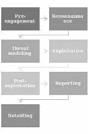

### 介入前准备
这一步骤像是一种预防措施，但它是至关重要的——当你处于介入前准备阶段时，你需要从确定测试范围开始。本质上，你是在寻找尝试渗透网络时的确切目标。你需要确保知道自己正在计划执行什么，以防发生任何无意之外的操作。特别是如果你将此作为一种可能的职业路径，你需要养成列出你将要做什么，以及你被允许和不能做的事情限制的习惯。你需要知道对方期望你做什么，以及你应该在哪些网络上。将所有内容记录下来。如果你是应人的要求破解他人的网络，请确保在法律上保护自己，并获得签署过的文件，证明你是在应其要求并在其条款内工作。因为渗透测试由于其试图削弱安全措施而具有危险性，所以你想要确保在发生灾难性错误时不会被指责，尽管这种情况偶尔会发生。

### 侦察
在此阶段，你将致力于收集信息。虽然你可能倾向于在可行的情况下跳过这一步，但如果你真的知道自己在做什么，准备会更加充分。当你所需的信息整齐地排列在面前时，你就会清楚预预期什么。特别是，你可能想要收集有关目标网络或可能遇到的各种技术类型的信息。你可能想要获取你试图破解的人的个人信息，或者他们的电子邮箱地址。


当你试图潜入一个网络时，你永远不知道哪些信息是有帮助的，哪些是不需要的或必要的。尽可能地收集信息以做好准备，只有在你确认已经收集了所有对你有用的信息后，再进入第 3 步。

## 威胁建模与漏洞识别

第 3 步仍然围绕规划展开——在此时，你希望利用在前几个步骤中收集的所有信息，并开始脑暴网络可能面临的最现实的漏洞和威胁是什么。它是否使用了某种对特定攻击计划特别脆弱的网络类型？他们使用的硬件类型是否存在漏洞利用程序？只要是目标极可能面临的相关威胁，这里任何想法皆可。

此阶段还可以利用漏洞扫描器来扫描网络弱点。这可以发现当前该特定网络中存在的任何漏洞，允许你计算出可能存在的漏洞。当你试图了解如何最好访问你尝试渗透的网络时，这对你来说是一个极佳的资产。幸运的是，`Kali Linux` 自带 `Metasploit`——这是一种可以在特定目标 IP 列表扫描漏洞的方法。`Metasploit` 将在本书后部分详细讨论。

此阶段的另一个常用技术是使用扫描工具和端口扫描器来寻找开放端口或存活主机。通过这种方式，你可能会发现另一个可以利用以获取访问的弱点。这种技术允许你扫描设备，从而获得另一个入口点。

这几乎是侦察 2.0——在这里，你侧重于获取更多关于系统的细节。你应该能够识别出存在哪些系统，它们当前是否处于开启和活动状态，或者是否安装了任何类型的防火墙或防病毒软件。在你识别出漏洞列表后，是时候开始获取更多信息了。

你能通过查看网络上的员工获取任何有价值的信息吗？发现客户数据有价值吗？客户是否有访问症状权限？是否存在窃取财务信息的可能性？如果有，那么你可能想先查看财务信息以外的地方，以力求避开，并制定一个更好的攻击计划，而不是尝试“开火齐射”地直接冲入陷阱或守备森严的区域。考虑这种情况下最可能的情况并给出一个初步的攻击计划，但请记住，随着你获取的信息越来越多，你的测试很可能会不断演变和变化。

## 漏洞利用

此时，是时候开始尝试访问网络了。你应该有几个不同的位置可以用来攻击系统，现在是时候采取行动了。你是否发现了任何可以用于访问的弱点？你可以尝试启动一个 shell，或者尝试获取分配给你的凭据，以便你可以以 `root` 用户身份开始访问。是否有空间可以使用其他计算机的信息来帮助你获得突破？此阶段的主要部分是尝试在不被检测和拦截的情况下，获取尽可能多的访问权限。虽然可能在没有实际获得管理访问和权限的情况下造成大量损害，但大多数情况下，你尝试做的是获得那些权限。

这一阶段在很大程度上取决于你尝试突破的网络，你需要发挥创意。确保你在操作过程中记录哪些是有效的，哪些是无效的，以便开始理清思路。记住，如果你是为了自己或客户这样做，你将希望确切知道哪些是有效的，哪些是无效。当你在这里获取了尽可能的信息后，就是该进入下一个阶段了。

## 渗透后利用

接下来是后利用阶段。此时，你已经完成了测试，可能是因为时间不够，或者达到了你利用能力的极限，或者是没有可供利用的系统。此时，你必须列出所有漏洞并将它们提供给客户。在过程中，你应该对任何有效或无效的操作做了笔记，或者可能截了屏。你应该能够判断你所做的漏洞利用有多大意义——你是进入了主服务器，还是被困在一台对服务器访问权限很小的计算机上？你从系统中获取的信息（如果有的话）有多价值？系统本身的风险有多大？

除外，你还应该考虑如何修复发现的任何漏洞。你能想出一个简单的补丁来解决问题吗？你还能做些其他什么来确保网络更安全？网络可以做得更好吗？哪些效果良好？此外，你还应该确保清理了现场工作。你需要移除植入系统中的任何内容，并将所有设置改回到原来的样子。你要确保你所利用的一切都已被移除。

## 报告

在这个阶段，是时候编写你的报告了。这可能无趣，但如果你是为了帮助他人而进行渗透测试，你就需要确保你的报告写得整齐漂亮。这是你传达任何可能使客户面临风险的弱点漏洞的地方。你将确保告诉他们发生了哪些漏洞利用，以及应该如何修复它们。


这一阶段应该尽可能残酷且诚实——你要让对方确切知道发生了什么以及如何修复。如果他们的系统确实那么容易受到攻击，而且你能够访问所有内容，那就尽管放手去做。用客观但诚实的术语准确地告诉他们问题到底出在哪里。在这个阶段，他们还会获得一份示例性的行动计划，以确保所有漏洞都得到修复。你向客户说明这一阶段得越清晰，你的工作表现就越出色，客户修复问题并保护网络的可能性也越大。

## 重测
作为渗透测试员，这并不是一个每个人都愿意经历的阶段，但如果你想做到尽职，那么它是至关重要的。在这个阶段，你将给客户时间来检查他们自己的漏洞并尝试修复，而你将重新评估他们加强防御的尝试。你基本上将对已修复的部分进行重新测试，以确认他们确实修补了存在的任何漏洞。你并不总是被要求这样做，但如果被要求了，完成它始终是一种诚意的表现。

# 第 6 章：如何成为并保持匿名
如果你希望成为黑客（无论是哪种），匿名性都是至关重要的。如果你不小心，系统只需非常简单地将你的特定 IP 地址列入黑名单，你就再也无法获得访问。你不仅没有成功进入系统或发现任何漏洞，反而会被封禁并无能为力。然而，如果你尝试进行黑客，这不必成为你的命运——你可以掩盖自己的踪迹。

就像许多入为了为了从试图访问的系统中隐藏指纹而戴手套一样，确保戴上自己的虚拟数字手套有助于你保持匿名。这意味着你的信息将是私密的——你可以伪装你自己和你的软件，以确保不使用真实的 IP 地址。

现在，你可能在想，如果使用虚拟机呢？它难道没有数字化的 IP 地址或不会因为整个过程都是数字化的而更加隐蔽吗？是也不是——但是，它的安全性仍然取决于你所使用的网络。这意味着，如果你真的想要真正的匿名，你还需要使用其他东西。你需要添加额外的工具和预防措施，以防止你的 IP 地址被发现。当你能够抵御这种情况时，你更有可能保持匿名。

市上有几种工具可以帮助你实现匿名并保护自己，它们都内置在 Kali Linux 中并已准备就绪。只需要花费时间和精力来配置一切，但这是非常值得的。本章将特别讨论的三种方法是：代理服务器、VPN 和 TOR 的使用。在每个章节中，你将引导了解这些特定方法是什么、工作原理以及如何在 Kali Linux 中使用它们。

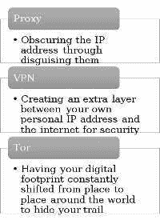

## Proxychains
也许隐藏 IP 地址最简单的方法之一就是使用代理服务器。通过使用代理链，你可以掩盖自己的踪迹，使其更难被追踪。通过增加追踪的难度，你更有可能规避检测。当然，当你使用代理时，该代理会记录你的信息。但是，你也可以绕过这一点——你可以将多个代理串联成一条链。只要至少有一个代理位于目标管辖范围之外，你就应该能够完全避免这个问题。幸运的是，在 Kali 中，你可以使用名为 `Proxychains` 的工具。你可以在目录中找到它，可以使用 `location` 命令查看。它可能位于 `/usr/bin` 目录。

在使用 `Proxychains` 时，你将使用一个非常简单的命令：

```
### proxychains [输入被代理的命令] [添加任何参数]
```

现在，假设你想用它配合 `Nmap` 进行匿名且通过代理的扫描。可能具体来说，你想对 IP 地址 `192.143.1.1` 进行 TCP SYN 扫描，但你想通过该工具利用代理来完成。在这种情况下，你创建一个命令行提示符：

```
### proxychains nmap -sS 192.143.1.1
```


这会触发你通过代理对那个特定的 IP 地址进行 TCP SYN 扫描。在理解语法后，你就可以继续完成配置文件了。与 Linux 中的几乎任何其他东西一样，有被称为配置文件的简单文本文件，它们包含了所有必要的信息。你可以使用你拥有的任何文本编辑器打开这些文件，例如通过 `gedit` 或 `leafpad`。

用你的文本编辑器打开配置文件，你应该会看到一个包含各种信息的文件。在文件中，你会发现其中一个特定区域有一个供你添加代理的位置。你只需要在那个地方输入你正在使用的任何代理的 IP 地址即可。通常情况下，正如你在文件中看到的，`proxychains` 会默认使用 Tor。如果你将使用 Tor，请保持原样。如果你不使用 Tor，你将需要对文件进行适当的编辑。本书将继续使用 Tor 进行。

代理服务器设置好后，是时候测试它了。你可以通过通过代理发送扫描来实现。当你发送扫描时，你应该能看到列出的你选择的 IP 地址，它应该与你的代理地址对齐。然而，不仅是设置代理，你还可以用它做许多其他事情。例如，你可以添加多个代理，然后将它们链起来，以便它们以随机顺序、特定顺序或仅使用部分代理进行链。

再次打开你的 `proxychains` 配置文件。你将查看 `dynamic_chains` 这一行——你可以看到它被注释掉了。这意味着它现在不会被使用。如果你删掉注释标记，在进程运行运行时它就会被激活。你还可以在文件中找到随机链式功能。你可以重新添加 `#` 来注释掉 `dynamic_chains` 行，取而移除 `random_chain` 选项中的 `#`。在任何给定时间你只能使用这两个选项中的一个，所以如果你想使用另一个，就必须回去删除其中一个。

## VPN

你可以为系统添加的另一层安全防护是在使用代理地址的基础上添加 VPN。这是一种常见的做法——它允许对盗版或其他问题提供进一步的保护。它还允许人们绕过（例如）任何在某个国家内可能违法的特定活动。它还允许你在不被检测到的情况下扫描其他网络——这在几个国家也通常被认为是非法的。仅仅是扫描网络就足以导致其被视为非法行为，尽管你可能并没有对其做过任何事情。现在，既然你正在阅读如何最好地执行这一点，你会发现额外的安全防护对于保护你自己至关重要。

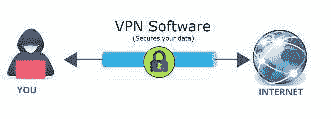

使用 VPN 有几个原因，所有这些理由都极具说服力。VPN 不仅让你隐藏自己的 IP 地址从而保护你，它还允许你在使用任何网络的同时确保仍有加密。此外，当你处于另一个网络时，你可以登录你的敏感信息而无必担心它被劫持。你可以跳过可能安装的任何监控，或访问地区限制的网站。

当然，认识到你的 VPN 不会隐藏一切也是同样重要的——会有一些方法可以识别你的身份。例如，你的常规搜索引擎可能仅仅由于 Cookie 和浏览行为就能识别出你，特别是如果你已经登录了该引擎的账户。尽管有这些缺点，但 VPN 可以帮你隐藏更多信息这一事实意味着你可以依靠它为你提供比通常情况下获得的更多的保护。就像安全带并不是汽车事故中安全的保证一样，VPN 也不是安全的保证——但它是一层在必要时帮助你保持安全的额外屏障。

当你想要在 Kali Linux 上启用 VPN 时，你有一些命令可以使用以及步骤需要遵循，但最终，你为软件添加了额外的保护，这意味着你能够更好地保护自己。

### 第 1 步：启用 VPN

当你使用 Kali Linux 时，VPN 选项通常是默认禁用的，所以你必须继续之前打开它。这将要求你输入自己的命令，例如：

```bash
apt-get install network-manager-openvpn
```

这个特定的命令专门用于启用 VPN。此时此，你可能需要重启网络和 `network-manager`。重启后，你应该会发现 VPN 现在可用了。

### 第 2 步：下载并解压 openvpn

现在，你需要下载 `openvpn.zip` 文件。这并不困难——代码如下：

```bash
wget https://www.privateinternetacess.com/openvpn/openvpn.zip
```

来下载文件。一旦下载并保存，你将需要解压文件并确保它被存放在正确的目录以备后用。你可以使用以下命令执行：

```bash
unzip -q openvpn.zip –d /etc/openvpn
```

你的记录应该已经准备好了，现在是时候继续第 3 步了。

### 第 3 步：配置 Network Manager 使用 PIA VPN

在此阶段，你将设置 Network Manager，使其能够感知并允许你想要设置的 VPN。这将涉及进入 Network Manager，编辑连接，然后切换到 `VPN` 选项卡并选择你想添加它。然后你将点击 `ADD`，在此时，你将类型设置为 `OpenVPN`。然后，点击创建。

如果你进入 `VPN`，你会观察到一些重要的细节，这些细节允许你判断是否真的在使用合法的 VPN。对于这种情况，你应该看到一个名为 `PrivateInternetAccess VPN` 的关联名称、一个靠近你自己的网关、一个你可以设置的用户名、一个你可以保存的密钥，以及 `CA` 证书。

为了获取 `CA` 证书，你应该进入 `/etc/openvpn/` 找到正确的索引，并选择 `ca.crt` 在此阶段使用它。

现在，点击 `Advanced` 并选择靠近 `Use LZO information pressure` 的情况。你然后，在那个点，应该点击 `OK`，然后，在那个点，保存并关闭窗口。


此时，假设你点击 `Network Manager` > `VPN Connections` > `PrivateInternetAccess VPN`，你应该能看到一个黄色的关联标记。你的 VPN 目前已准备就绪。

## Tor 与 Kali Linux
Tor 是安全保护伞中的另一层防护，你可以通过它来确保自己的安全。这仅仅是另一项安全防护措施，但假设你利用了它，你会发现自己真的已经准备好真正保护自己了，特别是当你开始将这些安全技术层层叠加，以在最大范围内确保你的秘密性时。请记住，`Kali Linux` 目前是安全的，但你可以使用其归包中的工具为它添加额外的层。Pinnacle 是 Kali Linux 工具集中自带的这些特定工具之一，可以帮助保障你的安全。Tor 本身是免费软件，它将通过让你的通信在几个不同的组织节点之间有效跳转来确保你的安全。基本上，这是一个由全球志愿者组成的庞大组织。他们帮助不规律地移动你的数据，这样数据实际上无法被无缝地追踪。通过不断将你的数据从一个地方移动到另一个地方，你最终使你的信息变得极其安全。你的经历将不会被有效追踪，你访问的地点也无法准确得知你的物理位置在哪里。实际上，你阻止了自己被发现，因为全世界的人都在不受控地传输你的消息和数据。一个请求可能从美国开始，另一个出现在西班牙，再一个出现在德国。特别是当你将此与最近研究的真实匿名技术相结合时，你变得极其难以追踪。你不仅会有一系列不同的 IP 地址通过，这些 IP 地址还会被你的 VPN 加密和保护，随后你还会确保你的网络访问是通过 Tor 而不是通过你的常规方法。

当你需要在 Kali Linux 机器上使用 Tor 时，你应该手动引入。由于你使用的是 Kali，你作为根客户端是安全的，这意味着你无法使用通常准备使用的简单模式。与其拥有使用任何替代路由的选项，不如你应该手动下载 Tor 安装包。

你可以通过 Tor Project 官网执行操作。你需要从他们的网站获取下载包，然后从 GitHub 下载 `torbrowserlauncher`。确保你下载了适合你设计的文件，并将其保存到你可以访问的地方。然后，利用 `tar` 命令从下载目录解压包。你可以运行以下命令：

```bash
tar –xvf tor
```

请注意，该命令假设你索引目录下以“pinnacle”开头的文档是你的 Tor 下载记录。然后，你需要运行 Tor Browser Bundle。这需要你运行刚刚解压的启动程序脚本：

```bash
./start-tor-browser.desktop
```

执行此操作后，你会看到 Vidalia 启动并与 Tor 关联。在与 Tor 关联后，Firefox 将启动。如果你能使用这三种独特的安全组合，你很快就会发现自己真的准备好极大防御真实网络中的危险了。你能够确保 IP 地址不会被发现，特别是当你尝试某些 Kali Linux 用户感兴趣的特定领域时，例如可能会引起问题的渗透测试。

# 第 7 章：Metasploit 框架
渗透测试在书中已经经过了很好的讨论，但它会被再次提到。在 Kali Linux 中，你被允许访问大量的优秀工具，这些工具可以帮助你的黑客攻击、渗透测试以及寻找漏洞或后门的过程。渗透测试的一种尚未在此检查的设备是名为 Metasploit Framework 的工具。这个特定工具可以使用命令行或 GUI。它也可以作为一种辅助技术，用于各种目的。这台设备非常出色，网络犯罪分子和道德程序员都因为该程序的便利性而使用它。

具体来说，Metasploit 考虑了检查组织或服务器内部的任何有序漏洞，并且它是开源的，这意味着该框架可以轻松调整以适用于任何人和几乎任何操作系统。

## 什么是 Metasploit？
具体来说，Metasploit 指的是被使用的一种特定工具。使用它的渗透测试小组实际上想要使用当时为他们编写的代码，或者他们自己编写并注入组织的自定义代码。通过这样做，特定组织内部的缺陷被发现并被考虑进来。这意味着他们可以处理该组织的缺陷以便进行修复。

实际上，Metasploit 只是另一种利用工具，类似于 `Nmap`，尽管它的用途不同。无论如何，必须认识到实际工具本身并不是邪恶或不可信的。实际工具旨在供道德黑客使用。Metasploit 项目于 2003 年成立，作为一个基于 Perl 的通用框架工具。尽管如此，到 2007 年，它被转换为 Ruby，并随后获得了 Rapid7 的授权并一直保留在那里。Metasploit 系统中的部分工具比 Metasploit 本身大，包含了一些在 Kali Linux 中经常使用的不同工具。这些工具都有不同的用途，而 Metasploit 系统已成为开发和维护的默认选择之一。在此之前，测试通常必须物理执行，使得渗透测试变得异常缓慢、耗时且枯燥。该系统甚至发展到包含一些限制性工具，而不是集成到 Kali Linux 中的免费贡献。这些工具（如 Metasploit Pro 和 Metasploit Express）有它们自己的优势，但如果你不想使用它们，它们也是必要的。

## Metasploit 用户
由于 Metasploit 应用范围之广，它既被那些希望让自己的工作框架和服务器更安全的道德程序员使用，也被那些真正出于恶意目的入侵操作系统的人使用。尽管如此，它仍然非常强大的工具，并不难引入且非常有用。无论你决定使用哪种语言或哪个阶段，Metasploit 都应该可以工作，这也是为什么 Metasploit 在任何情况下都是著名的原因之一。目前，Metasploit 包含了超过 1600 个针对 25 个不同阶段的漏洞，并提供了近 500 个负载。这一切造就了它成为人们真正非常珍惜的惊人资产。部分负载包括：

- 命令 Shell 负载：它们允许人们针对不同的目标或主机运行脚本或命令。
- 动态负载：它们允许渗透测试人员在尝试规避任何杀毒软件时产生独特的负载。


Meterpreter 负载：它们允许接管设备监控器以接管其他会话静态负载：它们能够实现端口转发并在网络之间进行通信。

## Metasploit 模块

Metasploit 内部包含几个模块。这些是核心部分——即具有明确执行任务的程序。它们同样涵盖了你可以在 Metasploit 结构内完成的操作。你可以很快地找到这些模块：你只需找到相应的仓库：`/path/to/metasploit/apps/pro/msf3/modules`

模块类型将取决于特定模块背后的动机，就像该特定模块负责的操作一样。具体来说，有八种值得讨论。它们包括：

 **漏洞 (Exploits)**：漏洞模块旨在执行一系列命令，然后针对在目标系统或应用程序中发现的漏洞。该模块旨在利用任何漏洞以获取对目标系统的访问权限。漏洞模块有多种示例，例如代码注入和 Web 应用程序漏洞。

 **负载 (Payloads)**：负载是指在漏洞成功入侵当前系统后运行的 shell 代码。负载允许你精确决定想要如何连接到 shell，以及在获得控制权后想要对目标执行什么操作。它可能涉及打开一个 Meterpreter 或不同的命令 shell。Meterpreter 是一种特殊的高级负载，它允许写入 DLL 文件，以便根据你的需要创建新功能。

 **编码器 (Encoders)**：编码器是能够将一种代码形式转换为另一种形式的关键工具。

 **监听器 (Listeners)**：设计用于隐身并进行监听的恶意软件。当它们能够监听时，它们能够收集各种重要信息，导致敏感信息（如密码、社会安全号码或其他人们希望私密的信息）泄露。

 **辅助函数 (Auxiliary function)**：用于补充设备其他功能的工具和命令。

 **Shell 码 (Shellcode)**：程序化为在进入目标后立即激活的代码，以实现特定目的，提供一种更隐蔽的进入和激活方式。

 **NOP 生成器 (NOP generator)**：这是一个能够产生一系列随机字节的工具，旨在绕过任何标准 ID 以通过防火墙或重要的拦截。

 **后渗透利用代码 (Post-exploitation code)**：后渗透模块允许你在被利用的目标内部获取更多信息或窃进一步的访问权限。这些包括哈希转储或服务枚举器。

## 使用 Metasploit

当你引入了 Metasploit 并准备好使用时，你只需以某种方式收集数据，无论是通过首次端口过滤，还是追踪漏洞扫描器来寻找进入点。一旦进入，你只需选择一个漏洞利用和一个负载，Metasploit 就会为你完成一切。恰恰，漏洞是指如何在更难防御的网络中识别缺陷的方法。该框架专门设计用于利用各种模型和接口，例如 `msfconsole` 交互式界面等。它可以从 `terminal/cmd` 工作，同样兼容 Metasploit 社区 Web 界面，后者支持渗透测试。

## 安装 Metasploit

在使用 Metasploit 之前，你首先需要引入它。引入它通常要求你最初禁用防火墙和反病毒软件。由于实际记录，当你尝试在运行防火墙和反病毒软件的情况下引入它时，通常被认为是有害的。这会中断你的安装。就此而言，最好是在继续之前直接禁用防火墙和反病毒软件。尽管如此，这意味着你应该确保你的下载源是真实且安全的。如果你不小心，可能会意外下载对你来说真正危险或有风险的东西。

在关闭防火墙和反病毒软件后，确保你还拥有管理员权限。这在 Kali Linux 中不应该是问题，因为你理应已经拥有 root 客户端权限，但假设你由于未知原因没有，或者你正尝试在其他 Linux 发行版上引入 Metasploit，你需要确保自己也拥有该管理员权限。

最后，引入 Metasploit 最明智的选择是从 Rapid7 网站引入。这样做允许你获取适用于你特定工作系统的安装程序。它还将包含一个独立的环境，你可以用于刷新和运行系统。这意味着你真正需要的一切将在底层安装过程中得到处理。当然，如果你决定这样做，你也可以手动物理配置 Metasploit，但该过程是没有意义的，在本书的目标中将被跳过。当你拿到文件后，运行安装程序。它会提示你进入特定的系统。作为 Kali Linux 用户，你应该看到它是预装的，无需进一步操作。

## 管理 Metasploit 数据库

现在，是停下来并在继续之前完成数据集设置了。当你准备好处理你的数据库时，你应该使用 `msfdb` 内容来配置运行 `postgresql` 以将数据集存储在 `~/.msf4/db/` 中。

准备好开始操作时，你将使用以下命令：

```
$ msfdb init
```

这将触发数据集的启动，然后可以使用任何最适合你的命令。这些命令增加了额外的功能，并帮助你处理可访问的空间。在此阶段最广知的命令包括：

`msfdb reinit` 这将使你的数据集被删除并重新初始化以恢复它。

`msfdb erase` 使用此特定命令将提示你的数据集被删除，而不会像之前的命令那样重新初始化。

`msfdb start` 此命令将再次启动数据集，允许其重新运行。

`msfdb stop` 此命令被使用时，将阻止数据集完全运行。


`msfdb status` 此命令将允许终端打印当前数据集的状态，向你显示终端内部所有的基础数据。

## Metasploit 数据存储 (Datastore)

除了为止记录的所有内容外，还有一个数据存储器——这是 Metasploit 系统中另一个经常被忽视的核心部分。这是一系列允许你在 Metasploit 结构内设计任何你想要属性。数据存储器允许接口更改设置，而有效负载可以修复操作码，并利用它可以确定明确的边界。这同样考虑了系统在模块之间进行传递。

具体来说，Metasploit 有两个不同的数据存储：全局数据存储和模块数据存储。你应该熟悉这两者才能有效利用 Metasploit。

全局数据存储可以被所有使用它的模块考虑。当设置了数据存储选项时，所有模块都会访问它。要刻描述全局数据存储选项，你应该使用命令：`setg`

而模块数据存储则被设计为仅让分配的模块实际使用它，而不是所有人。

## Metasploit 工作空间 (Workspaces)

Metasploit 内部的工作区域允许你对数据集中的主机和信息进行划分。这允许你利用工作区域在你想要测试的任何部分之间建立分区。例如，想象你为你协会内的每个子网都需要一个工作区域，因为你需要将主机数量限制在一个预定的范围内。这将导致你创建工作空间，例如每个部门一个。这意味着每个协会的专业部门将拥有自己的工作空间。

当你使用工作区域时，你可以导入信息、控制这些信息，然后将这些信息交换出去，以确保信息可以自然地重用。这同样考虑了类似的工作区域，以便报告关于任何正在锁定的主机的任何信息。这允许漏洞等信息进行传输。

如果你想创建一个工作区域，你应该使用工作区域命令并带有 `-` 选项来这样做。你创建的任何工作区域都会变成当前正在使用的。简单想象一下，你为组织中的 A、B、C 三个部门需要一个。

你会写：
```
msf workspace -a A
msf workspace -a B
msf workspace -a C
```

总的来说，显然，假设你准备好使用 Metasploit，你应该注意到与之交互完全是容易的。你只需要知道如何浏览框架以及如何获取你正在查看的内容。一旦你知道哪些模块是可用的，例如，你实际上会想要选择那些对你有用的模块。因为 Metasploit 已经为你充满了各种信息，这些信息旨在确保你只需少数命令就能完成几乎任何事情，而不需要不断地手动告诉系统你想让它做什么，所以它非常容易理解。这实际上它变得如此受欢迎的原因。最终，你应该能够接受 Linux 附带的免费形式。尽管如此，如果你愿意付费，就有可用的更新，最后，这将取决于你私人的观点，你应该根据你自己的思考和需求进行选择。显然，更新的版本尽管标着惊人的高价，但其目的是为你提供不可思议的绝妙体验。它们专注于那些清楚知道自己在做什么以及想要什么的非常有天赋的渗透测试专家，他们可以证明那个高昂的价格是合理的。然而，你并不需要这样做。

# 第 8 章：数字证书

就像现实世界中，我们需要携带身份证明来证明我们是谁，特别是当我们做重大事情时（例如买车或贷款），你的互联网连接也需要某种程度的身份识别。这就是计算机认证用武的地方。当服务器加载了大量数据时，你可能需要确保你的数据始终尽可能安全——这听起来没问题。然而，你如何确保获取你服务器上数据的人真的是他们所说的人，或者确实被允许访问它？

特别是现在，当我们如此担心信息被窃取或受控时，感到我们的信息处于危险之中并不困难，而且理由充分——事实如此。当你提供了一层计算机认证时，无论如何，你都为你的服务器增加了额外的安全层，或者让你感觉私有数据是安全的。你可以确保，无论你如何使用可能位于公共网络上的目标，你的信息本身是经过认证的。

但如果你有一个局域网 (LAN)，你可能不需要这种在使用公共组织进行信息传输时出现的重大认证。支付这些证书的费用与风险相比可能是多余的。在这些示例中，获取组织的明智计划是使用你本地的 CA 或验证机构——这将对引入局域网内的任何证书进行签名以确保其服务器的安全。

通常，这是通过一个名为 `OpenSSL` 的工具完成的——它是 Kali Linux 预装的。我们将讨论如何在几秒钟内创建认证，但在此之前，我们将首先回到基础数据。

这部分将最初检查什么是计算机认证以及存在的证书专家。从那时起，将引导你如何在基于 Kali Linux 的 Web 服务器上创建高级认证。创建自己的高级认证的能力无疑有其自身的用途，但也伴随着它自己的问题。无论如何，如果你觉得它对你有价值，你可以完全去寻找它。无论如何，这更多


添加到你的技能库中的一种语言，你可以利用它。在最好的情况下，你可能会发现它具有某些实际用途。

## 什么是数字证书？

计算机证书本质上是一种将网络上公钥的责任归属于声称拥有该公钥的人的方法。这些证书用于共享用于加密和确认信息的公钥。当你使用这些工具时，你实际上获得了一种保护数字标记的方法。

在数字证书内部，有几层数据，它们都满足不同的需求——有经过验证的公钥。有标识该公钥所有者的数据。有与数字证书直接相关的元数据，还有一个由证书颁发机构生成的该特定公钥的数字标记。

实际上，公钥成对出现——一个用于锁定需要验证信息的公钥，另一个是由所有者持有的私钥，用于签名和解码受保护的信息。这实际上意味着所有者将公钥传递给数字证书时，其信息经过了加密，以便可以使用随附的私钥进行访问。

如今，大多数主要的浏览器都使用数字证书——这允许用户确认他们看到的内容没有被未经授权的人修改过，并允许对网页内容进行解密和加密。实际上，这仅仅是促进人们在互联网连接中不断寻求的安全性和可靠性的又一种方法。

虽然你可以发行自己的 PKI（公钥基础设施），我们将在几秒钟内讨论这样做，但通常情况下有一种类型的机构专门处理 PKI 的创建和传输。这种机构被称为颁发机构。

### 证书颁发机构

证书颁发机构是一个受信任的第三方，它维护 PKI，颁发数字证书并保护其不受任何形式的攻击或滥用。通过利用第三方来验证网站并确保其安全，网站可以证明它们比人们以某种方式认为的要安全。它们可以证明自己真正关注并维护客户以及其他有效访问网站的人员的安全，因为这些人实际上为这种额外的安全保障付了费用。人们觉得自己的信息得到了更好的保护，这增加了人们再次访问该特定网站的概率。如果他们觉得可以信任来源，他们就会做出努力。

## 证书类型

最终，一个人可以获得几种不同种的证书。这些证书要么来自不同的来源，要么出于不同的原因，并将根据证书的类型接受不同的处理。本部分将检查可以使用的不同证书。这些证书以链的形式相互存在，一个批准另一个。

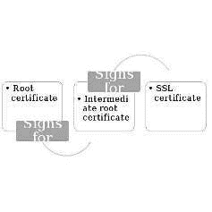

### 根证书

根证书是一种旨在识别根证书颁发机构（根 CA）的公钥认证。任何人都可以生成密钥并对新证书签名，但在被受信任或法的 CA 验证之前，它不被视为有效的。根证书是链的顶端，基本上——它应该由受信任的认证授予。这些通常与你使用的软件相关——例如，如果你使用的是 Microsoft，那么你的根证书可能是由 Microsoft 签名。

实际上，每个证书程序都有自己的一套规则和可用的根证书存储库。这些对一个解释有最严格的规定——如果你拥有其中一种证书，你就被认为是受信任的。根证书对于确保颁发和验证不同的证书至关重要。

### 中间证书

中间证书是位于中间的——认证专家通常不会直接颁发自己的证书。相反，他们更倾向于使用所谓的过渡根。此证书由 CA 用于签名，并允许他们颁发任何客户端 SSL 证书。在此过程中，在最终显示 SSL 证书之前，可能会出现几个中间根停靠。无论如何，你最终会到达客户端，由客户端获得 SSL。

### SSL 证书

最后的证书，即最终产品，是安全套接层——这是一种全球标准技术，考虑了程序和服务器之间加密通信的使用。这些被许多个人和组织用于保护信息免受黑客或欺骗攻击。实际上，SSL 确保客户端和服务器之间的对话保持保密，尽管它发生在公共网络上。这些通常由证书颁发机构颁发，该机构受信任以确保信息确实如承诺的那样得到保护。

SSL 层有几种独特的证书类型——它们可以是领域验证的、组织验证的或扩展验证的。

* **域名验证 SSL 证书** 提供的最少，保证也最少——获取此 SSL 你唯一需要的就是证明你正在使用正确的域名。这表明信息正按计划发送和接收给证书持有者，但绝对无法证明该证书持有者是谁。
*  **组织验证 SSL 证书** 提供了更多的保证——它们确认持有者确实拥有使用特定域名的某种权利或主张，并且经过额外的验证以确保持有证书的人确实拥有该域名。
*  **扩展验证证书**则颁发给申请人，他们可以根据验证他们的任何 CA 的规则证明他们是他们所称的。这种交互需要确认申请认证的个人或元素的存在，同时确保该身份与任何权威记录匹配。实际上，该元素被检查并批准使用该空间和证书。


```
openssl req – new – sha256 – key key.pem – out csr.csr oepnssl req –x509–sha256–days 365 –key key.pem –in csr.csr –out certificate.pem
```

第一个命令触发生成一个 2048 位的 RSA 私钥——这是你的密钥规定的格式，它将在第一条命令时生成。

后续命令触发生成一个标记需求的证书——你可能会在那个随后的命令中收到查询，你必须尽可能准确地回答它们，以确保你被视为可信的。

第三个命令触发一个可以在 Web 服务器上使用的自签名 x509 身份验证。这在很大程度上就是你寻找的东西。

请记住，这些将编码站点并确保你的信息安全，尽管它们并没有真正提供确认方面的益处。它们显然仍然有其用途，例如在初始阶段确保网站，但由于上述提示，你没有必要将其作为你可能的确认类型，除非你预期会有长期流量或者你将处理诸如分期付款或地址之类的任何敏感数据。

最终，你应该弄清楚支付真实的证书对于管理安全警报以防止攻击究竟有多大优势。

# 第 9 章：Bash 和 Python 脚本

`bash` 本身是一个 Shell——它代表 Bourne Again SHell，并填补了一个巨大的需求。它考虑了启动服务器、确认服务器已打开，并尝试保持一切按预期运行。恰恰，框架上的 Shell 旨在接收你通过控制台输入的任何命令以指导工作框架。这曾是与你的 Unix 类框架交互的主要真实方法，但现在，我们采用的方法多得多。你现在可以使用 GUI 替代 CLI，这意味着如果你需要让电脑做某事，你就不真的需要编写代码让它那样做。这就是为什么你不需要编写代码来寻找你的文件，你基本上可以去开始菜单，点击，物理地搜索文档，然后打开它。

不可否认，`bash` 有着历史——它是那些访问原始系统的人最初使用的工具，虽然它在当时绝对有用，但现在对于它是否仍然是交互的最佳方式还存在疑问。它就像一个老同事，一直留在她的特定岗位上拒绝改变，尽管她的方式既不便又浪费，而且真的是重复性的。如果她能转向更简单的版本，大家都会更开心，工作的实用性和简单性也会提高，但她拒绝了。

这种类型的阻塞出现在 `slam` 以及从 `slam` 迁移到另一种语言时，例如 `Python`，它是目前作为替代方案的有力对手之一。

现在的想法是 Shell 可能会变得过时——有更好的方法与你的工作框架协作。具体来说，Shell 有几个令人关注的特性：

- 
- 语法有时晦涩
- 它很慢
- 很容易不小心漏掉关键内容
- Shell 语言的数据结构是字符串
- 在 Shell 上很难进行单元测试

这些每一点都有助于取代 Shell。虽然 Shell 已被当作一种真正的编程语言使用，但它是不够的——它并不是被设计成完整的编程语言，但 `Python` 是。

`Python` 本身是一种解释性的、明确的高级编程语言，旨在是动态的。它是面向对象的，是分层的。它旨在用作脚本语言，甚至作为两个不同应用程序或部分之间的某种胶水。`Python` 非常容易学习，并以提供一个非常清晰的框架为中心，考虑到它比某些可能强调过时的、陈旧的表达式或结构现在基本上只是出于习惯和通用性而使用的复杂语言更易访问。尽管如此，通用性并不总是值得感谢的。在某些地方，比以往任何时候都需要的都是改变，或者通过某种方式进行调整以确保你可以继续发展。这就是 `Python` 和 `slam` 汇合的地方。

实际上，提高生产力的最佳方法就是放弃对 Shell 的使用，转而使用 `Python` 代码。由于 `Python` 更易阅读、速度更快并且考虑了真正的测试，看起来转向它在某种限制范围内基本上是有益的。

有趣的是，`Python` 现在当然被引入了许多主要的 Linux 发行版中。如果你碰好打开命令行界面并输入 `python`，你应该会得到一个 `Python` 解释器。这本身表明在考虑编写脚本时，使用 `Python` 替代 `slam` 是值得的。单从可用性来说，它就能节省时间。

看看从专注于 Shell 内容转向使用 `Python` 作为替代方案的最具说力的理由：

- 
- 它是默认安装的
- 它易于阅读且语法简单
- 它是一门解释型语言
- 它是一门功能全的编程语言
- `Python` 可以访问标准库和大量的第三方库来使用各种工具
- `Python` 的标准库按时间排序，允许你将日期转换为任何格式以与其他日期进行比较

`Python` 是一个更简单的过渡链接

```bash
cd Desktop
mv folder directory
```

注意到这有多滑了吗。现在，在 `Python` 中，它看起来更像：

```python
import os
import glob
for fname in glob.glob (‘folder):os.rename (fname, ‘directory’)
```

无法否认，`Python` 代码是多余地复杂，特别是当接近 `slam` 的那个简单片段时。因此，考虑到一切，让我们结合使用它们，而不是尝试将两者


揭开它们并相互取代其中之一。虽然我们目前已经讨论了在 shell 中运行你的 `Python` 代码是可行的，但同样也可能超出每个人的预期——你不仅可以在 shell 内部展示你的 `Python` 脚本，也可以将你的 shell 脚本嵌入到 `Python` 中。你只需要导入 `OS` 模块即可。

## 集成 Shell 和 Python

假设你这样做了，你实际上可能也想在 `Python` 中利用你的 `shell` 命令——这意味着你已经成功地准备好轻松地混合和协调你的命令。想一下那些在家里用两种方言交流长大的孩子，他们通常可以在同一个句子中无缝地从一种语言切换到另一种，在单一句子中嵌入几种语言的单词，同时交替地嵌入部分不同的方言，这听起来是很困难的，但他们却做得如此轻松。这就是你如何通过嵌入 `shell` 来使用 `Python` 的。

为了将 `shell` 语言带入 `python`，你只需要执行：

```bash
$ python >>>from os import *>>> system (‘sudo apt-get update’)
```

现在你就可以同时处理这两种语言了。你应该完全尝试摆弄这两种方言。假设你对 `Python` 仍然感到好奇，你可能会倾向于学习它——它非常容易上手，而且假设你已经准备好与 `Linux` 对话，那么你也应该有机会理解 `Python`。你所做的只是将曾经用于培养 `Linux` 能力的部分精力投入到获取这个框架中来。你可能会发现，随着实用性的增强，你会很快习惯这种变化。

如果你不确定你的框架上是否已经安装了 `Python`，那么幸运眷临了你——这时，你应该输入以下命令：

```bash
$ python --version
```

你无疑会获得一个更成熟、稳定的 `Python` 版本，这足够了，但你可能需要将该结构更新到最新版本。这个版本在不断变化，所以如果你在读完这本书后检查你可用的版本，将是一件好事——你基本上可以通过在网络上寻找最新版本然后进行更新来完成。

如果你确实选择专门追求 `Python`，你将需要去寻找一些工具和书籍，就像你现在正在阅读的这书一样，以发现你想了解的知识。教程练习和网络示例无疑是你开始探索 `Python` 不同途径的极佳敲门石。最后，当你变得越来越熟练和熟悉时，你可能会选择开始将你的努力结合起来使用。你甚至可能会发现自己更倾向于使用 `Python` 而不是 shell，这也可以。最终，创新的变化之快，到你无法因为害怕改变、发展或转向一个真正的新事物而停滞不前——进步和学习对你完全有利。

## 向前看

现在，随着本章节和本书接近尾，这是你开始思考如何整合一切的理想时机。是时候考虑你是否真的对 `Kali Linux` 感兴趣，或者你是否有机会学习一些不同的东西。毫无疑问的是，你最终应该引导自己和自己的选择，以确保你对所决定要做的事情感到满意。

### 结论

恭喜你——你已经来到了《Kali Linux Hacking》的极限。这本书被设计成一门学习 `Kali Linux` 的速成课程——该操作系统专门为渗透测试专业人员设计，用于发现和修复系统中发现的任何类型的漏洞或利用程序。假设你已经走到了这里，你可能对 `Kali Linux` 的介绍深受启发，或者你将这本书作为辅助工具，无论其中哪一个保持恒不变，感谢你与我共同走这段旅程。

在书中，你获得了关于 `Kali Linux` 的基础知识。再次更新，`Kali Linux` 绝不是一个业余者的 `Linux` 发行版。如果你读了这本书并且在某些主题上完全迷茫，这没关系——但你可能更适合从一本针对新手的书开始，而不是一本为那些知道自己在做什么并渴望改进及更多的人准备的书。

最终，你的下一步完全取决于你自己以及你认为自己需要做什么。你想在真实的 `Kali Linux` 交付中进行练习吗？你可以查阅数据并投入精力引入你自己的副本，以便你可以开始使用和发现它。如果你觉得 `Kali Linux` 不适合你，无论是因为它太难、太不同，还是仅仅是因为你不知道自己在做什么，那么你从更简单的东西开始，如 `Ubuntu` 和 `Mint` 可能会更合适。

是的，这一点被重复了几次，因为它非常重要。即使在读完这本指南后，如果你对自己和自己的能力完全没有信心，那么在建立技能期间暂时放弃 `Kali Linux` 可能会更好——这没关系。

也许现在，你已经接受了本书最后一章节的劝告，并选择了同样探索 `Python`，完善你的规划能力，以便你实际上会更乐意使用你自己的命令。这也是一个极佳的选择，并将有助于引导你的旅程，因为你将拥有多得知识。

无论你立即决定做什么，无论是寻找关于 `Linux` 的更多信息，还是尝试如何最好与你已经引入的 `Kali Linux` 协作，有一件事是不疑问的：你理想地在阅读书中掌握了一些东西。
