# Linux 设备驱动程序必备

## Overview

> "Probably the most wide ranging and complete Linux device driver book I've read."
—Alan Cox, Linux *大师*及**关键内核开发者**

> "Very comprehensive and detailed, covering almost every single Linux device driver type."
—Theodore Ts'o, 北美首位Linux内核开发者及Linux基金会首席平台策略师

## 最实用的Linux设备驱动编写指南

Linux 现在为驱动开发提供了异常健壮的环境：借助当今的内核，过去需要数年开发时间的工作现在可以在几天内完成。在这本实用且以示例驱动的书中，全球最有经验的Linux驱动开发人员之一系统地展示了如何为几乎任何设备开发可靠的Linux驱动。《精解Linux设备驱动》面向具有操作系统和C语言工作知识的任何程序员，包括从未编写过驱动的程序员。Sreekrishnan Venkateswaran专注于核心要点，汇集了所有需要的概念和技术，同时规避了仅在高度专业化场景下才重要的主题。Venkateswaran首先回顾了与驱动开发人员最相关的Linux 2.6内核功能。他介绍了简单的设备类别；然后转向串行总线，如I2C和SPI；外部总线，如PCMCIA、PCI和USB；视频、音频、块设备、网络和无线设备驱动；用户空间驱动；以及嵌入式Linux驱动——这是当今Linux发展最快的领域之一。对于每一部分，Venkateswaran都解释了相关技术，检查相关的内核源文件，并引导完成完整示例的开发。

- 涵盖了其他书籍中未讨论的驱动，包括I2C、视频、音频、PCMCIA和不同类型闪存的驱动
- *揭秘*基本内核服务和设施，包括内核线程和辅助接口
- 教授轮询、异步通知和I/O控制
- 介绍用于嵌入式Linux驱动的内部集成电路协议
- 涵盖使用Linux-Video子系统和Linux-Audio框架的多媒体设备驱动
- 展示Linux如何实现蓝牙、红外、WiFi和蜂窝网络等无线技术的支持
- 描述从调试到维护的整个驱动开发生命周期
- 包含涵盖Linux汇编、BIOS调用和Seq文件的参考附录


# Prentice Hall 开源软件开发丛书

**Arnold Robbins, 丛书主编**

> *"真实应用中的真实代码"*

开源技术已经彻底改变了计算世界。许多大规模项目已在全球生产环境中使用，例如Apache、MySQL和Postgres，程序员们使用包括Perl、Python和PHP在内的Editing language在内的多种语言编写应用。这些技术广泛应用于多种不同系统，从专有系统到Linux系统，从传统UNIX系统到大型机系统。

**Prentice Hall 开源软件开发丛书** 旨在为您呈现这些开源技术中最优秀的部分。您不仅能够学习如何在自己的项目中使用它们，还能够 *从中学习*。通过观察真实应用中的真实代码，您将了解到全球开源开发者的最佳实践。

**目前丛书包括以下书目：**

- *Linux® 调试与性能调优*
  Steve Best
  0131492470, 平装, ©2006 Appliance Science

- *C++ GUI Qt 4编程*
  Jasmin Blanchette, Mark Summerfield
  0132354160, 精装, ©2008

- *Xen 虚拟机监控器权威指南*
  David Chisnall
  013234971X, 精装, ©2008

- *AJAX 深入浅出*
  Joshua Eichorn
  0132216353, 平装, ©2007

- *Linux 程序员工具箱*
  John Fusco
  0132198576, 平装, ©2007

- *深入理解嵌入式 Linux*
  Christopher Hallinan
  0131679848, 平装, ©2007

- *Apache 模块开发指南*
  Nick Kew
  0132409674, 平装, © 2007

- *SELinux 实例详解*
  Frank Mayer, David Caplan, Karl MacMillan
  0131963694, 平装, ©2007

- *UNIX 向 Linux® 移植*
  Alfredo Mendoza, Chakarat Skawratananond,
  Artis Walker
  0131871099, 平装, ©2006

- *TurboGears 快速 Web 应用开发*
  Mark Ramm, Kevin Dangoor, Gigi Sayfan
  0132433885, 平装, © 2007

- *Linux 编程实例*
  Arnold Robbins
  0131429647, 平装, ©2004

- *深入理解 Linux® 内核*
  Claudia Salzberg, Gordon Fischer,
  Steven Smolski
  0131181637, 平装, ©2006

- *Python 和 Qt 快速 GUI 编程*
  Mark Summerfield
  0132354187, 精装, © 2008

- *Linux 设备驱动程序精要*
  Sreekrishnan Venkateswaran
  0132396556, 精装, ©2008

## 丛书新增：数字快捷指南

快捷指南是专门为繁忙的技术专业人士设计的简短、精炼的PDF文档。每一份快捷指南都紧密围绕特定技术或技术问题展开。由行业专家和畅销书作者撰写，快捷指南为您着想——让您快速获取所需的技术信息。

- *深入理解 AJAX：用 XML 和 JSON 消费发送数据*
  Joshua Eichorn
  0132337932, Adobe Acrobat PDF, © 2007

- *嵌入式 Linux 调试*
  Christopher Hallinan
  0131580132, Adobe Acrobat PDF, © 2007

- *BusyBox 使用指南*
  Christopher Hallinan
  0132335921, Adobe Acrobat PDF, © 2007

## 前言

如果您正拿着这本书，您可能会问：为什么还需要"又一本"Linux设备驱动程序书？这类书不是已经有很多了吗？

答案是：本书相较其他同类书籍是一次**质的飞跃**。

首先，本书内容与时俱进，涵盖了近期的2.6内核。其次，更重要的是，本书内容*全面深入*。大多数设备驱动程序书籍仅涵盖标准Unix内核书籍或操作系统书籍中描述的主题，如串口线路、磁盘驱动器和文件系统，如果幸运的话，还会涉及网络协议栈。

本书则更进一步；它不回避现代PC和嵌入式硬件中必须面对的难点问题，如PCMCIA、USB、I²C、视频、音频、闪存、无线通信等等。毫不夸张地说，只要Linux内核能与之为伍，本书就会为您娓娓道来。

事无巨细，无一遗漏；角落无暗，光明普照。

此外，作者久经沙场，功勋卓著：单看他对1990年代末将Linux移植到智能手表上的描述，就足以让人心潮澎湃！

我很高兴也很兴奋能将本书纳入Prentice Hall开源软件开发丛书。它是开源世界中令人振奋之事的杰出典范。我希望您能在这里找到内核工作所需的一切，并同样享受这个过程！

*Arnold Robbins*
*丛书主编*

## 序言

那是1990年代末，在**IBM**我们正将Linux内核移植到智能手表上。目标设备十分小巧，但任务却异常艰巨。内核中尚未有内存技术设备子系统，这意味着在手表闪存上建立文件系统之前，我们必须从零开始开发必要的存储驱动程序。输入事件驱动接口尚未被构想出来。让X Windows在手表的LCD上运行并非易事，因为它与帧缓冲驱动程序配合不佳。如果一款防水的Linux智能手表无法让您在浴缸里接收股票行情，那它还有什么用呢？Linux与蓝牙的集成尚要等待数年，我们花了数月时间将专有蓝牙栈移植到手表上以实现联网。电源管理支持也仅能勉强维持数小时电量；因此在这方面我们也有不少工作要做。Linux红外功能尚不稳定，因此我们必须先调试红外协议栈，才能使用红外键盘进行数据输入。而且由于没有面向消费电子领域的成熟发行版，我们还必须编译编译器并交叉编译紧凑的应用程序集。

时间快进到当下：那只小企鹅已成长为健康的少年。当年需要数千行代码和一年开发时间的工作，如今用上当前内核几天就能完成。但要成为能够神奇地编织解决方案的全能内核工程师，您需要理解Linux如今提供的 myriad 功能和设施。

## 关于本书

在内核源代码树中驻留的各个子系统中，*drivers/* 目录构成了最大的一块，其规模是其他部分的数倍。随着新技术以各种流行形态不断涌现，内核中新设备驱动程序的开发正在稳步加速。最新内核支持超过70个设备驱动程序家族。

本书是关于编写Linux设备驱动程序的。它涵盖了内核支持的主要设备类别的设计与开发，包括我在Linux手表时代错过的那些。对每个驱动程序家族的讨论始于相应技术的介绍，继而开发一个实用示例，最后探讨相关的内核源文件。然而，在踏入设备驱动程序的世界之前，本书将先为您介绍内核，并讨论2.6 Linux的重要特性，重点强调那些对设备驱动程序编写者特别感兴趣的部分。

## 读者对象

本书面向渴望调整内核以支持新设备的**中高级程序员**。您应当具备操作系统概念的工作知识。例如，您应该知道什么是系统调用，以及为什么在编写内核代码时必须考虑并发问题。本书假设您已在系统上下载了Linux，仔细研究过内核源代码，并至少浏览过相关文档。此外，您应当精通C语言。

## 章节概览

前4章为您消化本书其余内容做好准备。随后的16章讨论不同设备家族的驱动程序。接下来的一章介绍设备驱动程序调试技术。倒数第二章提供关于维护和交付的视角。最后，我们通过一份清单来总结当您拿到新设备时，如何着手开始Linux使能工作。

**第1章**，"引言"，开启我们与Linux的邂逅。它将带您快速浏览下载内核源代码、进行简单的代码修改，以及构建可引导的内核镜像。


## 第 2 章：深入内核

第 2 章"深入内核"将带你快速浏览 Linux 内核的内部结构，并教授一些必须掌握的内核概念。首先带你了解启动过程，然后描述与驱动开发特别相关的内核服务，如内核定时器、并发管理和内存分配。

## 第 3 章：内核设施

第 3 章"内核设施"探讨了几种对驱动开发者工具箱十分有用的内核服务。本章首先介绍内核线程——一种在内核中实现后台任务的方式。然后介绍辅助接口，如链表、工作队列、完成函数和通知链。这些辅助工具能够简化你的代码、消除内核中的冗余，并有助于长期维护。

## 第 4 章：打好基础

第 4 章"打好基础"为掌握 Linux 设备驱动编写技术打下基础。通过鸟瞰典型 PC 兼容系统和嵌入式设备的架构，为你介绍设备和驱动的概念。然后探讨基本驱动概念，如中断处理和内核的设备模型。

## 第 5 章：字符驱动

第 5 章"字符驱动"介绍字符设备驱动的架构。本章引入的几个概念，如轮询、异步通知和 I/O 控制，也与后续章节相关，因为本书其余部分讨论的许多设备类都是"超级"字符设备。

## 第 6 章：串口驱动

第 6 章"串口驱动"解释处理串行设备的内核层。

## 第 7 章：输入驱动

第 7 章"输入驱动"讨论内核的输入子系统，该子系统负责为键盘、鼠标和触摸屏控制器等设备提供服务。

## 第 8 章：I²C 协议

第 8 章"I²C 协议"深入剖析连接到系统 I²C 总线或 SMBus 上的 EEPROM 等设备的驱动。本章还介绍其他串行接口，如 SPI 总线和 1-Wire 总线。

## 第 9 章：PCMCIA 和 Compact Flash

第 9 章"PCMCIA 和 Compact Flash"深入探讨 PCMCIA 子系统。教你编写具有 PCMCIA 或 Compact Flash 形式的设备驱动。

## 第 10 章：PCI

第 10 章"PCI"介绍内核对 PCI 及其衍生总线的支持。

## 第 11 章：USB

第 11 章"USB"探索 USB 架构，并解释如何利用 Linux-USB 子系统的服务来编写 USB 设备驱动。

## 第 12 章：视频驱动

第 12 章"视频驱动"探讨 Linux-Video 子系统。它介绍帧缓冲抽象层所提供的优势，并教你编写帧缓冲驱动。

## 第 13 章：音频驱动

第 13 章"音频驱动"描述 Linux-Audio 框架，并解释如何实现音频驱动。

## 第 14 章：块驱动

第 14 章"块驱动"聚焦于硬盘等存储设备的驱动。在本章中，你还将了解 Linux-Block 子系统支持的不同 I/O 调度器。

## 第 15 章：网络接口卡

第 15 章"网络接口卡"专门介绍网络设备驱动。你将了解内核网络数据结构，以及如何将网络驱动与协议层对接。

## 第 16 章：无线 Linux

第 16 章"无线 Linux"介绍驱动各种无线技术，如蓝牙、红外、WiFi 和蜂窝通信。

## 第 17 章：内存技术设备

第 17 章"内存技术设备"讨论嵌入式设备上的 Flash 存储支持。本章最后介绍 PC 系统上固件中心（Firmware Hub）的驱动。

## 第 18 章：嵌入式 Linux

第 18 章"嵌入式 Linux"步入嵌入式 Linux 的世界。带你了解嵌入式解决方案的主要固件组件，如引导加载程序、内核和设备驱动。鉴于 Linux 在嵌入式领域的日益普及，你更有可能运用从本书中学到的设备驱动技术来支持嵌入式系统。

[第 19 章](elinuxdd.com)"用户空间驱动"介绍从用户空间驱动不同类型设备的方法。一些设备驱动，尤其是策略性强而对性能要求不高的驱动，更适合驻留在用户空间。本章还解释 Linux 进程调度器如何影响用户模式驱动的响应时间。

[第 20 章](elinuxdd.com)"更多设备和驱动"概览此前未涉及的各类驱动，如*错误检测与纠正*（EDAC）、FireWire 和 ACPI。

[第 21 章](elinuxdd.com)"调试设备驱动"介绍可用于调试内核代码的不同类型的调试器。在本章中，你还将学习使用跟踪工具、内核探针、崩溃转储和性能分析器。在开发驱动时，请掌握你在本章学到的驱动调试技术。

[第 22 章](elinuxdd.com)"维护与交付"从软件开发生命周期的角度提供指导。

[第 23 章](elinuxdd.com)"结束语"为你提供在启用新设备的 Linux 支持时所需的工作清单。本书最后以*下一步该怎么做？*作为结语。

设备驱动有时需要用汇编语言实现代码片段，因此[附录 A](elinuxdd.com)"Linux 汇编"介绍 Linux 汇编编程的各个方面。x86 系统上的一些设备驱动直接或间接依赖 BIOS，因此[附录 B](elinuxdd.com)"Linux 与 BIOS"教你 Linux 如何与 BIOS 交互。[附录 C](elinuxdd.com)"Seq 文件"描述 seq 文件——这是在 2.6 内核中引入的一种内核辅助接口，设备驱动可以利用它来监控和跟踪数据点。

本书大致按照设备和总线的复杂度进行组织，同时兼顾章节间依赖关系的实际情况。因此，我们从字符、串口和输入等基本设备类开始。接下来介绍 I²C 和 SMBus 等简单串行总线。然后是 PCMCIA、PCI 和 USB 等外部 I/O 总线。视频、音频、块和网络设备通常通过这些 I/O 总线与处理器交互，所以紧接着介绍它们。本书后续部分面向嵌入式 Linux，涵盖无线网络和 Flash 存储等技术。用户空间驱动在书的末尾讨论。

## 内核版本

本书内容基于 2.6.23/2.6.24 内核版本。本书中的大部分代码清单已在 2.6.23 内核上测试通过。如果你使用更新的版本，请查阅 lwn.net 等 Linux 网站，了解自 2.6.23/24 以来的内核变更。

## 本书网站

我在 [elinuxdd.com](elinuxdd.com) 上建立了一个网站，提供本书的更新、勘误及相关信息。

## 使用的约定

源代码、函数名和 shell 命令以 `这种格式` 书写。使用的 shell 提示符为 **`bash>`**。文件名以斜体书写，*如这种格式*。斜体也用于引入新术语。

某些章节在实现代码示例时会修改原始内核源文件。为了清楚地指出更改，新插入的代码行以 `+` 为前缀，删除的代码行以 `-` 为前缀。

有时为了简化，本书使用通用引用。因此，如果文中指向 *arch/your-arch/* 目录，应根据实际情况进行翻译，例如如果你正在为 x86 架构编译内核，则应译为 *arch/x86/*。同样，任何对 *include/asm-your-arch/* 目录的引用，例如如果你正在为 ARM 架构构建内核，应理解为 *include/asm-arm/*。`*` 符号和 `X` 偶尔用作文件名中的通配符。因此，如果某章要求你查看 *include/linux/time*.h，请查看

头文件*time.h*、*timer.h*、*times.h*和*timex.h*位于*include/linux/*目录下。如果某一节谈到*/dev/input/eventX*或*/sys/devices/platform/i8042/serioX/*，*X*是内核在系统配置上下文中分配给设备的接口编号。

➞符号有时被插入到命令或内核输出之间，用于附加解释。

简单的正则表达式偶尔用于简洁地列出函数原型。例如，第10章"外围组件互连"中的"直接内存访问"一节使用`pci_[map|unmap|dma_sync]_single()`，而不是显式地引用`pci_map_single()`、`pci_unmap_single()`和`pci_dma_sync_single()`。

若干章节会引导你查阅用户空间配置文件。例如，描述启动过程的一节打开了*/etc/rc.sysinit*，讨论蓝牙的章节引用了*/etc/bluetooth/pin*。然而，这些文件的确切名称和位置可能会根据你使用的Linux发行版而有所不同。

## 致谢

首先，我要向Prentice Hall的编辑们脱帽致敬：Debra Williams Cauley、Anne Goebel和Keith Cline。没有他们的支持工作，这本书将不会成形的。我感谢Mark Taub对这个项目的兴趣并发起它。

过去十年有许多来源促进了我的学习：我在Linux项目中一起工作的许多队友、强大的内核源码、邮件列表和互联网。所有这些都对我撰写本书有所帮助。

*Linux Magazine*的Martin Streicher在向我提供该杂志的"Gearheads"内核专栏时，将我从一名全职程序员转变为业余时间的撰稿人。我非常感激从他那里学到的技术写作的诸多经验。

我特别感谢我的技术审稿人。Vamsi Krishna耐心地审阅了手稿的每一章。他的众多建议使这本书变得更好。Jim Lieb对几章提供了宝贵的反馈。Arnold Robbins审阅了前几章并提供了富有洞察力的意见。

最后，我感谢我的父母和妻子对我的爱和支持。还要感谢我的宝贝女儿，她那摇摇晃晃的步态与企鹅有着惊人的相似之处，不断提醒我把时间花在书本上。

## 关于作者

**Sreekrishnan Venkateswaran**拥有印度理工学院坎普尔分校的计算机科学硕士学位。在过去12年中，他一直在IBM工作，将Linux移植到各种嵌入式设备上，如手表、手持设备、音乐播放器、VoIP电话、起搏器编程器和远程患者监护系统。Sreekrishnan曾担任*Linux Magazine*的特约编辑和内核专栏作家超过2年。目前，他负责管理IBM印度的嵌入式解决方案部门。

# 第1章 引言

| 本章内容 | |
| --- | --- |
| - 演变 | 2 |
| - GNU 通用公共许可证 | 3 |
| - Kernel.org | 4 |
| - 邮件列表和论坛 | 4 |
| - Linux 发行版 | 5 |
| - 查看源码 | 6 |
| - 构建内核 | 10 |
| - 可加载模块 | 12 |
| - 开始之前 | 14 |

> Linux 具有吸引力。它散发着一种国际主义项目的诱人气氛，在这个项目中，不同国籍、信仰和性别的人相互协作。源代码的免费可获得性以及广为人知的类 UNIX 应用程序编程环境，为其飞速成功做出了贡献。专家们通过互联网即时免费提供的高质量支持，也在凝聚庞大的 Linux 社区方面发挥了重要作用。

开发人员对于在能够访问所有源码的技术上工作感到无比兴奋，因为那样可以让他们创建创新的解决方案。例如，你可以 hack 源码并定制 Linux，使其在几秒钟内在你的设备上启动，这一成就在专有操作系统上是难以实现的。

## 演变

Linux 始于1991年一位名叫 Linus Torvalds 的芬兰大学生的业余爱好，但迅速演变为一种在全球广受欢迎的高级操作系统。从最初针对 Intel 386 处理器的发布开始，内核逐渐变得复杂，以支持众多架构、多处理器硬件和高性能集群。支持的 CPU 完整列表很长，但一些主要支持的架构包括 x86、IA64、ARM、PowerPC、Alpha、s390、MIPS 和 SPARC。Linux 已被移植到围绕这些处理器构建的数百种硬件平台上。内核持续改进，演变正以疯狂的速度推进。

尽管 Linux 最初是作为桌面操作系统诞生的，但它已经渗透到嵌入式和企业领域，并触及我们的日常生活。当你按下手持设备的按钮、将遥控器切换到天气频道，或去医院进行体检时，越来越有可能某些 Linux 代码正在被触发来为你服务。Linux 的免费可获取性对它的促进作用不亚于其技术优势。无论是开发低于100美元的计算机以帮助世界贫困人口，还是消费电子领域的价格压力，Linux 都是当今的首选操作系统，因为专有操作系统有时比计算机本身的预期价格还要高。


## GNU 拷贝左（Copyleft）

GNU 项目（GNU 是 *GNU's Not UNIX* 的递归缩写）早于 Linux 出现，其目标是开发一个自由的类 UNIX 操作系统。一个完整的 GNU 操作系统由 Linux 内核驱动，但也包含库、编译器和工具等组件。因此，基于 Linux 的计算机更准确地说是 GNU/Linux 系统。GNU/Linux 系统的所有组件都是使用自由软件构建的。

自由软件有不同的类别。其中一类称为*公共领域*软件。发布到公共领域的软件不受版权保护，对其使用没有任何限制。你可以免费使用它，对其进行修改，甚至可以限制你修改后源代码的分发。正如你所见，"无限制"条款引入了在下游引入限制的权力。

自由软件基金会作为 GNU 项目的主要赞助者，创建了 *GNU 通用公共许可证*（GPL），也称为*拷贝左*（copyleft），以防止中间商将自由软件转化为专有软件的可能性。那些修改了拷贝左软件的人也被要求将其衍生作品同样置于拷贝左之下。Linux 内核以及 GNU 系统的大多数组件，如 *GNU 编译器套装*（GCC），都是在 GPL 下发布的。因此，如果你对内核进行修改，你必须将更改回馈给社区。本质上，你必须传递拷贝左赋予你的权利。

> Linux 内核以 GPL 第 2 版授权。内核社区中一直存在关于内核是否应该迁移到 GPLv3（GPL 的最新版本）的争论。目前的趋势似乎反对将内核重新授权以采用 GPLv3。

然而，通过系统调用访问内核服务的 Linux 应用程序不被视为衍生作品，因此不会受到 GPL 的限制。类似地，库由一种限制较宽松的许可证覆盖，称为 *GNU 较宽松通用公共许可证*（LGPL）。专有软件被允许与以 LGPL 发布的库进行动态链接。

## Kernel.org

Linux 内核源代码的主要仓库是 [www.kernel.org](www.kernel.org)。该网站包含所有已发布的内核版本。全球有许多网站镜像了 kernel.org 的内容。

除了已发布的内核外，kernel.org 还托管着一线开发者维护的一组*补丁*，作为未来稳定版本的测试平台。补丁是一个文本文件，包含开发树与开发者开始工作时的原始快照之间的源代码差异。kernel.org 上比较有代表性的补丁集是 Andrew Morton（Linux 内核的首席维护者）定期发布的 `-mm` 补丁。你会在 `-mm` 补丁中找到尚未进入主线源代码树的新特性。另一个在 kernel.org 上定期发布的补丁集是 Ingo Molnar 维护的 `-rt`（实时）补丁。一些 `-rt` 特性已经被合并到了主线内核中。

## 邮件列表和论坛

## Linux 发行版

由于 GNU/Linux 系统除了内核之外还包含大量的实用工具、程序、库和工具，获取并正确安装所有部件是一项艰巨的任务。Linux 发行版通过将组件分类并打包成有序的软件包来解救这一困境。一个典型的发行版包含数千个现成的软件包。你无需担心下载正确版本的程序或解决依赖性问题。

由于打包是在 GNU 许可证范围内赚取大量利润的一种方式，如今市场上有许多 Linux 发行版。Red Hat/Fedora、Debian、SuSE、Slackware、Gentoo、Ubuntu 和 Mandriva 等发行版主要面向桌面用户。MontaVista、TimeSys 和 Wind River 等发行版则针对嵌入式开发。嵌入式 Linux 发行版还包含一个可动态配置的精简应用程序集，以根据资源限制调整系统的占用空间。

除了打包之外，发行版还为内核开发提供了增值功能。许多项目基于发行版提供的内核而非 kernel.org 官方发布的内核开始开发。原因包括以下几点：

- 符合设备相关行业领域标准的 Linux 发行版通常是更好的开发起点。*特别兴趣小组*（SIG）已经形成，以在各个领域推广 Linux。*消费电子 Linux 论坛*（CELF），托管于 [www.celinuxforum.org](http://www.celinuxforum.org)，专注于在消费电子设备上使用 Linux。CELF 规范定义了诸如可扩展占用空间、快速启动、原地执行和电源管理等特性的支持级别，这些在消费电子设备上是可取的。*开源开发实验室*（OSDL），托管于 [www.osdl.org](http://www.osdl.org)，其工作重点集中在运营商级设备的独特特性上。OSDL 的 *运营商级 Linux*（CGL）规范将可靠性、高可用性、运行时修补和增强的错误恢复等增值功能编纂成文，这些在电信领域非常重要。
- 即使你的嵌入式控制器基于内核支持的 CPU 核心构建，主线内核也可能不完全支持该控制器。然而，Linux 发行版可能为控制器内部的所有外设模块提供设备驱动程序。
- 你计划在开发过程中使用的调试工具可能不是主线内核的一部分。例如，内核没有内置的调试器支持。如果你想在开发过程中使用内核调试器，你必须单独下载并应用相应的补丁。如果经过测试的补丁不能轻易用于你的内核版本，你会遇到更多麻烦。发行版预先打包了许多有用的调试功能，因此你可以立即开始使用。
- 一些发行版提供法律赔偿，以确保你的公司不会因内核错误引发的诉讼而承担责任。
- 发行版倾向于对他们发布的内核进行大量测试。[^1]
- 你可以从发行版供应商处购买他们所提供内核的服务和支持包。

[^1]: 因为这需要将内核冻结在不是最新的版本上，发行版提供的内核通常包含向后移植的一些在后续官方内核中发布的特性。

## 查看源代码

在我们开始涉猎内核之前，让我们下载源代码，学习如何应用补丁，并查看代码树的结构。

首先，访问 www.kernel.org 获取最新的稳定树。源代码以 *tar* 文件存档，采用 *gzip*（.gz）和 *bzip2*（.bz2）两种压缩格式。通过解压和解包压缩的 tar 包来获取源代码文件。在以下命令中，将 X.Y.Z 替换为最新的内核版本，例如 2.6.23：

```
bash> cd /usr/src
bash> wget www.kernel.org/pub/linux/kernel/vX.Y/linux-X.Y.Z.tar.bz2
...
bash> tar xvfj linux-X.Y.Z.tar.bz2
```

现在，你已经将解压后的源代码树放在系统中的 */usr/src/linux-X.Y.Z/* 目录下了，让我们通过获取相应的 `-mm`（Andrew Morton）补丁，将一些实验性测试特性启用到这个树中：

代码视图：

```
bash> cd /usr/src
bash> wget www.kernel.org/pub/linux/kernel/people/akpm/patches/X.Y/X.Y.Z/X.Y.Z-mm2/X.Y.Z-mm2.bz2
```

应用补丁：

```
bash> cd /usr/src/linux-X.Y.Z/
bash> bzip2 -dc ../X.Y.Z-mm2.bz2 | patch -p1
```

`-dc` 选项要求 bzip2 将指定文件解压缩到标准输出。这通过管道传递给 *patch* 工具，该工具将更改应用到代码树中的每个修改过的文件。

如果你需要应用多个补丁，请按正确的顺序进行。要生成启用了 `X.Y.Z-aa-bb` 补丁的内核，首先下载完整的 `X.Y.Z` 内核源代码，应用 `X.Y.Z-aa` 补丁，然后再应用 `X.Y.Z-aa-bb` 补丁。


 补丁提交

要生成包含您所做更改的内核补丁，请使用 `diff` 命令：

代码视图：

```
bash> diff -Nur /path/to/original/kernel /path/to/your/kernel > changes.patch
```

请注意，在 `diff` 的顺序中，原始内核位于更改版本之前。按照 2.6 内核补丁提交惯例，您还需要在补丁末尾添加一行内容，如下所示：

```
Signed-off-by: Name <Email>
```

通过这种方式，您证明该代码是您亲自编写的，并且您有权将其贡献出去。

现在您已经准备好将补丁发布到相关的邮件列表，例如 LKML。

请查看 *Documentation/SubmittingPatches* 了解创建提交补丁的指南，并查看 *Documentation/applying-patches.txt* 了解应用补丁的教程。

既然您已打好补丁的 */usr/src/linux-X.Y.Z/* 源码树已准备就绪，让我们花点时间观察一下源代码布局是如何组织的。进入源码树的根目录并列出其内容。从代码树根部分支出来的目录如下：

1. **arch**。该目录包含与架构相关的文件。您会在 *arch/* 下看到针对各种处理器的独立子目录，例如 ARM、Motorola 68K、s390、MIPS、Alpha、SPARC 和 IA64。

2. **block**。主要包含块存储设备的 I/O 调度算法实现。

3. **crypto**。该目录实现了密码运算和加密 API，例如某些 WiFi 设备驱动程序用于实现加密算法时会用到。

4. **Documentation**。该目录包含各种内核子系统的简要描述。这可以是您挖掘内核相关问题答案的第一站。

5. **drivers**。众多设备类和外围控制器驱动程序位于此目录中。设备类包括字符设备、串口、*Inter-Integrated Circuit* (I²C)、*Personal Computer Memory Card International Association* (PCMCIA)、*Peripheral Component Interconnect* (PCI)、*Universal Serial Bus* (USB)、视频、音频、块设备、*Integrated Drive Electronics* (IDE)、*Small Computer System Interface* (SCSI)、CD-ROM、网络适配器、*Asynchronous Transfer Mode* (ATM)、蓝牙和 *Memory Technology Devices* (MTD)。这些类别各自位于 *drivers/* 下的独立子目录中。例如，您会在 *drivers/pcmcia/* 目录中找到 PCMCIA 驱动程序源码，在 *drivers/mtd/* 目录中找到 MTD 驱动程序。*drivers/* 下的子目录构成了本书的主要主题。

6. **fs.** 该目录包含 EXT3、EXT4、reiserfs、FAT、VFAT、sysfs、procfs、isofs、JFFS2、XFS、NTFS 和 NFS 等文件系统的实现。

7. **include.** 内核头文件位于此处。以 *asm* 为前缀的子目录包含特定于特定架构的头文件。因此，*include/asm-x86/* 目录包含与 x86 架构相关的头文件，而 *include/asm-arm/* 则保存 ARM 架构的头文件。

8. **init.** 该目录包含高级初始化和启动代码。

9. **ipc.** 包含对*进程间通信* (IPC) 机制的支持，例如消息队列、信号量和共享内存。

10. **kernel.** 基础内核中与架构无关的部分可以在这里找到。

11. **lib.** 通用*内核对象* (kobject) 处理程序和*循环冗余校验* (CRC) 计算函数等库例程位于此处。

12. **mm.** 内存管理实现位于此处。

13. **net.** 网络协议位于该目录下。实现的协议包括 *Internet Protocol version 4* (IPv4)、IPv6、*Internetwork Protocol eXchange* (IPX)、蓝牙、ATM、红外、*Link Access Procedure Balanced* (LAPB) 和 *Logical Link Control* (LLC)。

14. **scripts.** 内核构建期间使用的脚本位于此处。

15. **security.** 该目录包含安全框架。

16. **sound.** Linux 音频子系统位于该目录中。

17. **usr.** 目前包含 *initramfs* 实现。

## 统一的 x86 架构树

从 2.6.24 内核版本开始，i386 和 x86_64（32 位 i386 的 64 位同胞）的架构特定树已统一到一个通用的 *arch/x86/* 目录中。如果您使用的是 2.6.24 之前的内核，请将本书中对 *arch/x86/* 的引用替换为 *arch/i386/*。同样，将任何出现的 *include/asm-x86/* 改为 *include/asm-i386/*。这些目录中的某些文件名也已更改。

在这些庞大的目录中查找符号和其他代码元素可能是一项艰巨的任务。表 1.1 中的工具是您在导航内核源代码树时值得信赖的助手。

## 表 1.1. 辅助源代码树导航的工���

| 工具 | 描述 |
|------|-------------|
| lxr | Linux 交叉引用工具 lxr，可从 http://lxr.sourceforge.net/ 下载，让您通过 Web 浏览器遍历内核树，提供超链接将内核符号与其定义和使用位置连接起来。 |
| cscope | cscope 托管于 http://cscope.sourceforge.net/，从源代码树中的所有文件构建符号数据库，因此您可以快速定位声明、定义、正则表达式等。Cscope 可能不如 lxr 多功能，但它让您能够灵活地使用您喜爱的文本编辑器的搜索功能，而不是浏览器。在内核树的根目录下，执行 `cscope -qkRv` 命令来构建交叉引用数据库。`-q` 选项生成更多索引信息，因此搜索速度会明显加快，代价是额外的初始启动时间。`-k` 选项请求 cscope 调整其行为以适应内核源代码，`-R` 要求递归遍历子目录，`-v` 请求显示详细消息。您可以从 man 页面获取详细的调用语法。 |
| ctags/etags | `ctags` 工具可从 http://ctags.sourceforge.net/ 下载，为多种语言生成交叉引用标签，因此您可以在 vi 等编辑器中定位源代码树中的符号和函数定义。在内核树的根目录下执行 `make tags` 来对所有源文件进行 ctag 标记。etags 工具生成 emacs 编辑器可理解的类似索引信息。执行 `make TAGS` 来对您内核源文件进行 etag 标记。 |
| 实用工具 | 诸如 grep、find、sdiff、strace、od、dd、make、tar、file 和 objdump 等工具。 |
| GCC 选项 | 您可以使用 `-E` 选项让 GCC 生成预处理后的源代码。预处理后的代码包含头文件展开，减少了在嵌套的 include 文件中跳转以展开多级宏的需求。以下是一个使用示例，用于预处理 *drivers/char/mydrv.c* 并将展开后的输出保存到 *mydrv.i*： |
| GCC 选项 | 使用 `-I` 选项指定的包含路径取决于您的代码所包含的头文件。 |
| GCC 选项 | 如果您使用 `-S` 选项，GCC 会生成汇编列表。要为 *drivers/char/mydrv.c* 在 *mydrv.s* 中生成汇编列表，请执行以下操作： |

```
bash> gcc -E drivers/char/mydrv.c -D__KERNEL__ -Iinclude -Iinclude/asm-x86/mach-default > mydrv.i
```

使用 `-I` 选项指定的包含路径取决于您的代码所包含的头文件。

如果您使用 `-S` 选项，GCC 会生成汇编列表。要为 *drivers/char/mydrv.c* 在 *mydrv.s* 中生成汇编列表，请执行以下操作：

```
bash> gcc -S drivers/char/mydrv.c -D__KERNEL__ -Iinclude -Ianother/include/path
```

## 构建内核

现在您已经对源代码树布局有了一定了解，让我们做一个简单的代码更改、编译并运行它。进入顶级 *init/* 目录，尝试对初始化文件 *main.c* 进行小的代码更改。在函数 `start_kernel()` 的开头添加一条打印语句，表达您对北极熊的喜爱：

```
asmlinkage void __init start_kernel(void)
{
    char *command_line;
    extern struct kernel_param __start___param[],
          __stop___param[];

    printk("Penguins are cute, but so are polar bears\n");

    /* ... */

    rest_init();
}
```

现在您可以启动构建过程了。进入源代码树的根目录，从干净的状态开始：

```
bash> cd /usr/src/linux-X.Y.Z/
bash> make clean
```

配置内核。这时您需要挑选和选择构成操作系统一部分的组件。您可以指定每个所需组件是要静态链接还是动态链接到内核：

```
bash> make menuconfig
```

`menuconfig` 是内核配置菜单的文本界面。使用 `make xconfig` 获取图形界面。您选择的配置信息保存在源代码树根目录下名为 *.config* 的文件中。如果您不想从零开始编织配置，可以使用 *arch/your-arch/defconfig*（如果您的架构有多个受支持的平台，则使用 *arch/your-arch/configs/your-machine_defconfig*）作为起点。因此，如果您要为 32 位 x86 架构编译内核，请执行以下操作：

```
bash> cp arch/x86/configs/i386_defconfig .config
```

编译内核并生成压缩的启动镜像：

```
bash> make bzImage
```

内核镜像生成于 *arch/x86/boot/bzImage*。更新您的启动分区：

```
bash> cp arch/x86/boot/bzImage /boot/vmlinuz
```

您可能需要通知引导加载程序新启动镜像的到来。如果您使用的是 GRUB 引导加载程序，它会自动识别；但如果您使用的是 LILO，请发出提醒：


 ```
bash> /sbin/lilo
Added linux *
```

最后，重启机器并引导进入新内核：

```
bash> reboot
```

启动序列中的第一条信息将开启你对北极熊的探索之旅。

## 可加载模块

由于 Linux 运行在各种架构上并支持海量的 I/O 设备，将所有可能的设备支持永久编译进基础内核是不可行的。发行版通常打包一个最小化的内核镜像，并以*内核模块*的形式提供其余功能。在运行时，必要的模块会按需动态加载。

要生成模块，进入内核源码树的根目录并构建：

```
bash> cd /usr/src/linux-X.Y.Z/
bash> make modules
```

要安装生成的模块，执行以下命令：

```
bash> make modules_install
```

这会在 */lib/modules/X.Y.Z/kernel/* 下创建内核源码目录结构，并填入可加载模块对象。这还会调用 depmod 工具，在文件 */lib/modules/X.Y.Z/modules.dep* 中生成模块依赖关系。

以下工具可用于操作模块：*insmod*、*rmmod*、*lsmod*、*modprobe*、*modinfo* 和 *depmod*。前两个是插入和移除模块的工具，而 lsmod 列出当前已加载的模块。modprobe 是 insmod 的更智能版本，它会检查 */lib/modules/X.Y.Z/modules.dep* 的内容，然后插入依赖模块。例如，假设你需要挂载一个 USB 闪存盘上的 *虚拟文件分配表*（VFAT）分区。使用 modprobe 来加载 VFAT 文件系统驱动：

> [2] 这个例子假设模块不会被内核自动加载。如果你在配置时启用了*自动内核模块加载*（`CONFIG_KMOD`），内核检测到缺失子系统时会自动运行带有适当参数的 modprobe。你将在**第 4 章**"奠定基础"中学习模块自动加载。

```
bash> modprobe vfat
bash> lsmod
Module         Size     Used by
vfat           14208    0
fat            49052    1 vfat
nls_base       9728     2 vfat, fat
```

如你在 lsmod 输出中所见，modprobe 插入了三个模块而非一个。modprobe 首先判断需要插入 */lib/modules/X.Y.Z/kernel/fs/vfat/vfat.ko*。但当他查看依赖文件 */lib/modules/X.Y.Z/modules.dep* 时，发现以下行，意识到需要先加载另外两个依赖模块：

```
/lib/modules/X.Y.Z/kernel/fs/vfat/vfat.ko:
/lib/modules/X.Y.Z/kernel/fs/fat/fat.ko
/lib/modules/X.Y.Z/kernel/fs/nls/nls_base.ko
```

然后它在尝试插入 *vfat.ko* 之前，先加载 *fat.ko* 和 *nls_base.ko*，从而自动加载你挂载 VFAT 分区所需的所有模块。

使用 modinfo 工具提取你刚刚加载的模块的详细信息：

```
bash> modinfo vfat
filename:    /lib/modules/X.Y.Z/kernel/fs/vfat/vfat.ko
license:     GPL
description: VFAT filesystem support
...
depends:     fat, nls_base
```

要将内核驱动编译为模块，在配置内核时将对应的菜单选择按钮切换为 <M>。本书中大多数设备驱动示例都实现为内核模块。要从源文件 *mymodule.c* 构建模块 *mymodule.ko*，创建一个单行的 Makefile 并按如下方式执行：

```
bash> cd /path/to/module-source/
bash> echo "obj-m += mymodule.ko" > Makefile
bash> make -C /path/to/kernel-sources/ M=`pwd` modules
make: Entering directory '/path/to/kernel-sources'
  Building modules, stage 2.
  MODPOST
  CC /path/to/module-sources/mymodule.mod.o
  LD [M] /path/to/module-sources/mymodule.ko
make: Leaving directory '/path/to/kernel-sources'
bash> insmod ./mymodule.ko
```

内核模块使内核占用空间更小，开发-构建-测试周期更短。你只需要重新编译特定模块并重新插入它以使更改生效。我们在**第 21 章**"调试设备驱动程序"中介绍模块调试技术。

如果你选择将驱动设计为内核模块，也有一些缺点。与内置驱动不同，模块无法在启动时预留资源，而那时成功或多或少是有保证的。

## 开始之前

Linux 已经历了许多领域的发展，现在是业界最先进的，因此你可以将其作为理解操作系统概念、处理器架构甚至行业领域的工具。当你学习某个设备驱动子系统使用的技术时，深入一层，探究该设计选择背后的根本原因。

除非明确说明，否则文本假定使用 32 位 x86 架构。然而，本书也考虑到这样一个事实：你更可能为嵌入式设备而非传统的 PC 兼容系统编写设备驱动。例如，串口驱动章节探讨两种设备：PC 衍生产品上的触摸控制器和手机上的 UART。或者 I²C 设备驱动章节研究 PC 系统上的 EEPROM 和嵌入式设备上的实时时钟。本书还教你内核为大多数驱动类提供的核心基础设施，它对设备驱动隐藏了架构依赖性。

设备驱动调试技术在本书末尾的第 21 章讨论，因此你在阅读本书的同时开发驱动时，可能会觉得跳到该章节是值得的。

本书基于 2.6 内核，与 2.4 相比有重大变化，涉及所有主要子系统。希望你现在已经在系统上安装了基于 2.6 的 Linux，并开始试验内核源码。每章都会大量地指向相关内核源文件，主要有两个原因：

- 1. 因为内核中的每个驱动子系统都有数万行代码，本书只能采取相对简化的视角。结合本书中的示例代码查看源码中的真实驱动，将给你带来更完整的图景。

- 2. 在开发驱动之前，最好先锁定 *drivers/* 目录中与你需求相似的现有驱动，并以此作为起点。

因此，要从本书中获得最大收益，请通过经常浏览源码树并仔细研读代码来熟悉内核。同时，在探索代码的同时，关注内核邮件列表的动态。

# 第 2 章 内核一瞥

| 节 | 页码 |
|---------|------|
| 启动 | 18 |
| 内核模式和用户模式 | 30 |
| 进程上下文和中断上下文 | 30 |
| 内核定时器 | 31 |
| 内核中的并发 | 39 |
| 进程文件系统 | 49 |
| 内存分配 | 49 |
| 查看源码 | 52 |

> 在我们开始 Linux 设备驱动的神秘世界之旅之前，让我们通过设备驱动开发者的视角，观察几个内核区域来熟悉一些基本内核概念。我们将学习内核定时器、同步机制和内存分配。但让我们从顶层的视角开始我们的探索；让我们快速浏览内核发出的启动信息，并在看到有趣之处时停下来。

## 启动

图 2.1 展示了基于 x86 的计算机上的 Linux 启动序列。基于 x86 的硬件上的 Linux 启动是由 BIOS 从启动设备加载*主引导记录*（MBR）触发的。驻留在 MBR 中的代码查看分区表，并从活动分区读取 Linux 引导加载程序，如 GRUB、LILO 或 SYSLINUX。引导加载程序的最后阶段加载压缩的内核镜像并移交控制权。内核解压自身并启动引擎。

### 图 2.1. 基于 x86 的硬件上的 Linux 启动序列。

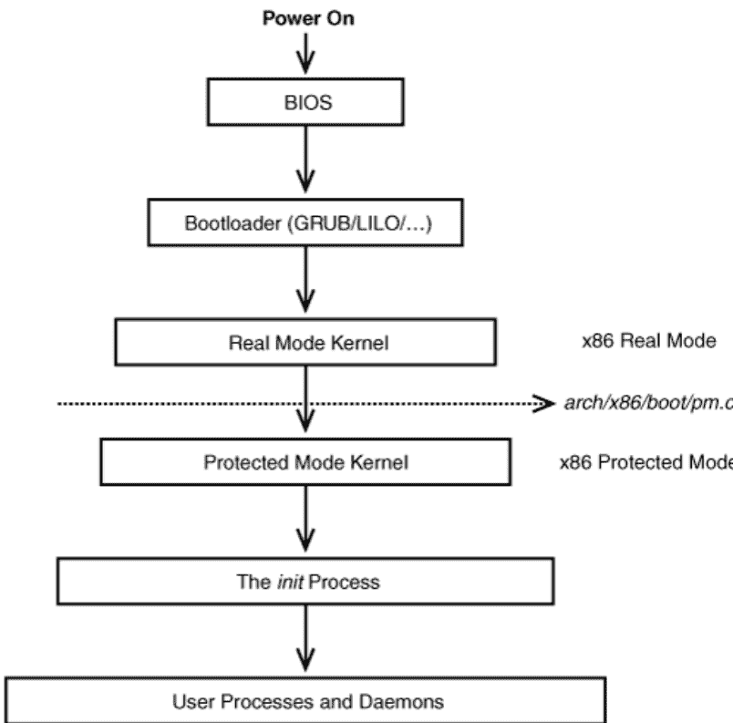

基于 x86 的处理器有两种操作模式，*实模式*和*保护模式*。在实模式下，你只能访问前 1MB 的内存，而且没有任何保护。保护模式更为复杂，让你可以利用处理器的许多高级功能，如分页。CPU 必须经过实模式才能到达保护模式。然而，这条路是单行道。你无法从保护模式切换回实模式。

第一级内核初始化在实模式汇编中完成。后续的启动由在保护模式下执行的 `start_kernel()` 函数执行，该函数定义在你在上一章修改的源文件 *init/main.c* 中。`start_kernel()` 首先初始化 CPU 子系统。内存和进程管理随后就位。外围总线和 I/O 设备接着启动。作为启动序列的最后一步，调用 *init* 程序——所有 Linux 进程的父进程。Init 执行用户空间脚本以启动必要的内核服务。最后，它在控制台上生成终端并显示登录提示。

以下每个节标题都是图 2.2 中基于 x86 的启动过程中生成的一条信息


笔记本电脑上。如果引导的内核运行在其他体系结构上，其语义和消息可能会有所不同。如果本节中的某些解释听起来相当晦涩难懂，不必担心；此处的意图仅是让你从高空100英尺处获得一个概览，并让你初步领略一下内核的风味。此处顺带提及的许多概念后续都会有深入的讲解。

## 图 2.2. 内核引导消息。

```
Code View:
Linux version 2.6.23.1y (root@localhost.localdomain) (gcc version 4.1.1 20061011 (Red
Hat 4.1.1-30)) #7 SMP PREEMPT Thu Nov 1 11:39:30 IST 2007
BIOS-provided physical RAM map:
 BIOS-e820: 0000000000000000 - 000000000009f000 (usable)
 BIOS-e820: 000000000009f000 - 00000000000a0000 (reserved)
 ...
758MB LOWMEM available.
...
Kernel command line: ro root=/dev/hda1
...
Console: colour VGA+ 80x25
...
Calibrating delay using timer specific routine.. 1197.46 BogoMIPS (lpj=2394935)
...
CPU: L1 I cache: 32K, L1 D cache: 32K
CPU: L2 cache: 1024K
...
Checking 'hlt' instruction... OK.
...
Setting up standard PCI resources
...
NET: Registered protocol family 2
IP route cache hash table entries: 32768 (order: 5, 131072 bytes)
TCP established hash table entries: 131072 (order: 9, 2097152 bytes)
...
checking if image is initramfs... it is
Freeing initrd memory: 387k freed
...
io scheduler noop registered
io scheduler anticipatory registered (default)
...
00:0a: ttyS0 at I/O 0x3f8 (irq = 4) is a NS16550A
...
Uniform Multi-Platform E-IDE driver Revision: 7.00alpha2
ide: Assuming 33MHz system bus speed for PIO modes; override with idebus=xx
ICH4: IDE controller at PCI slot 0000:00:1f.1
Probing IDE interface ide0...
hda: HTS541010G9AT00, ATA DISK drive
hdc: HL-DT-STCD-RW/DVD DRIVE GCC-4241N, ATAPI CD/DVD-ROM drive
...
serio: i8042 KBD port at 0x60,0x64 irq 1
mice: PS/2 mouse device common for all mice
...
Synaptics Touchpad, model: 1, fw: 5.9, id: 0x2c6ab1, caps: 0x884793/0x0
...
agpgart: Detected an Intel Delay loop.

```

```
Yenta: CardBus bridge found at 0000:02:00.0 [1014:0560]
...
Non-volatile memory driver v1.2
...
kjournald starting. Commit interval 5 seconds
EXT3 FS on hda2, internal journal
EXT3-fs: mounted filesystem with ordered data mode.
...
INIT: version 2.85 booting
...
```

### BIOS 提供的物理 RAM 映射

内核从 BIOS 汇编系统内存映射，这是你将会看到的最早的引导消息之一：

```
BIOS-provided physical RAM map:
BIOS-e820: 0000000000000000 - 000000000009f000 (usable)
...
BIOS-e820: 00000000ff800000 - 0000000100000000 (reserved)
```

实模式初始化代码使用 BIOS `int 0x15` 服务，功能号为 `0xe820`（因此前面消息中的字符串为 `BIOS-e820`）来获取系统内存映射。内存映射指示了保留和可用的内存范围，随后内核使用它来创建其空闲内存池。我们在附录 B "Linux 和 BIOS" 的 "实模式调用" 一节中讨论了更多关于 BIOS 提供的内存映射的内容。

### 758MB LOWMEM 可用

通常可寻址的内核内存区域（< 896MB）称为*低内存*（*low memory*）。内核内存分配器 `kmalloc()` 从此区域返回内存。超过 896MB 的内存（称为*高内存*，*high memory*）只能通过特殊映射来访问。

在引导期间，内核计算并显示这些内存区域中的总页数。我们在本章后面会更深入地了解内存区域。

## Kernel Command Line: ro root=/dev/hda1

Linux 引导加载程序通常会向内核传递一个命令行。命令行中的参数类似于 C 程序中传递给 `main()` 函数的 `argv[]` 列表，只是它们被传递给了内核。你可以在引导加载程序配置文件中添加命令行参数，或者在运行时从引导加载程序提示符处提供。[1] 如果你使用的是 GRUB 引导加载程序，配置文件根据你的发行版是 */boot/grub/grub.conf* 或 */boot/grub/menu.lst*。如果你是 LILO 用户，配置文件是 */etc/lilo.conf*。下面列出了一个 *grub.conf* 文件的示例（已添加注释）。如果查看 `title kernel 2.6.23` 后面的行，你就能弄清楚前述引导消息的来源：

> [1] 嵌入式设备上的引导加载程序通常比较"精简"，不支持配置文件或等效机制。因此，许多非 x86 体系结构支持一个名为 `CONFIG_CMDLINE` 的内核配置选项，你可以在构建时使用它来提供内核命令行。

```
default 0  #默认引导 2.6.23 内核
```

```
timeout 5  #5 秒时间来修改引导顺序或参数

title kernel 2.6.23    #引导选项 1
  #引导映像位于第一块磁盘的第一个分区
  #的 /boot/ 目录下，名为 vmlinuz-2.6.23。'ro'
  #表示根分区应以只读方式挂载。
  kernel (hd0,0)/boot/vmlinuz-2.6.23 ro root=/dev/hda1

  #参见 "Freeing initrd memory:387k freed" 一节
  initrd (hd0,0)/boot/initrd

#...
```

命令行参数影响引导期间遍历的代码路径。举个简单的例子，假设感兴趣的命令行参数名为 `bootmode`。如果此参数设置为 `1`，你希望在引导期间打印一些调试消息，并在引导结束时切换到运行级别 `3`。（等到 init 进程打印出引导消息后再来了解运行级别的语义。）如果 `bootmode` 设置为 `0`，你更希望引导过程相对简洁，并将运行级别设置为 `2`。因为你已经熟悉 *init/main.c*，让我们在其中添加以下修改：

Code View:

```
static unsigned int bootmode = 1;
static int __init
is_bootmode_setup(char *str)
{
  get_option(&str, &bootmode);
  return 1;
}

// 处理参数 "bootmode="
__setup("bootmode=", is_bootmode_setup);

if (bootmode) {
  /* 打印详细输出 */
  /* ... */
}

/* ... */

/* 如果 bootmode 为 1，选择 init 运行级别 3，否则切换到运行级别 2 */
if (bootmode) {
  argv_init[++args] = "3";
} else {
  argv_init[++args] = "2";
}

/* ... */
```

按照之前的方式重新编译内核并尝试此更改。我们在第 18 章 "嵌入式 Linux" 的 "内存布局" 一节中讨论了更多关于内核命令行参数的内容。

## Calibrating...1197.46 BogoMIPS (lpj=239493 *jiffies* 变量包含自内核启动以来的计时器滴答数，在计时器中断处理程序中递增 */

  while (ticks == jiffies); /* 等待下一个 jiffy 开始 */

  ticks = jiffies;
  /* 延时 */
  __delay(loops_per_jiffy);

  /* 等待是否超过了当前 jiffy？如果没有则继续 */
  ticks = jiffies - ticks;
  if (ticks) break;
}

loops_per_jiffy >>= 1; /* 这固定了最高有效位，是 loops_per_jiffy 的下限 */
```

前面的代码首先假设 `loops_per_jiffy` 大于 `4096`，这大约相当于每秒一百万条指令（MIPS）的处理器速度。然后它等待一个新的 jiffy 开始，并执行延时循环 `__delay(loops_per_jiffy)`。如果延时循环超过了一个 jiffy，则 `loops_per_jiffy` 的先前值（通过将其右移一位获得）固定其*最高有效位*（MSB）。否则，函数继续检查是否通过将 `loops_per_jiffy` 左移来获得 MSB。当内核确定了 `loops_per_jiffy` 的 MSB 后，它处理低阶位并微调其精度，如下所示：

```
loopbit = loops_per_jiffy;

/* 逐渐处理低阶位 */
while (lps_precision-- && (loopbit >>= 1)) {
  loops_per_jiffy |= loopbit;
  ticks = jiffies;
  while (ticks == jiffies); /* 等待下一个 jiffy 开始 */
ticks = jiffies;
```


 ```
/* Delay */
__delay(loops_per_jiffy);

if (jiffies != ticks)      /* longer than 1 tick */
  loops_per_jiffy &= ~loopbit;
}
```

前面的代码片段用于确定当延迟循环跨越一个 jiffy 边界时，`loops_per_jiffy` 低位的精确组合。这个校准后的值用于推导处理器速度的一个非科学度量，称为 *BogoMIPS*。你可以使用 BogoMIPS 评级作为 CPU 运行速度的相对度量。在一台基于 1.6GHz Pentium M 的笔记本电脑上，延迟循环校准得到 `loops_per_jiffy` 的值为 `2394935`，正如前面的启动消息所宣布的那样。BogoMIPS 值的计算方式如下：

BogoMIPS = `loops_per_jiffy` * 1 秒内的 jiffies 数量 * 内部延迟循环消耗的指令数（以百万为单位）

         = (2394935 * HZ * 2) / (1000000)

         = (2394935 * 250 * 2) / (1000000)

         = 1197.46（如前面的启动消息所示）

我们将在本章后面的"**内核定时器**"一节中进一步讨论 `jiffies`、`HZ` 和 `loops_per_jiffy`。

## 检查 HLT 指令

由于 Linux 内核支持多种硬件平台，启动代码会检查与架构相关的错误。验证 *停机*（HLT）指令的正常性就是这样一种检查。

x86 处理器支持的 `HLT` 指令将 CPU 置于低功耗睡眠模式，直到下一个硬件中断发生。内核在希望将 CPU 置于空闲状态时使用 HLT 指令（参见在 *arch/x86/kernel/process_32.c* 中定义的 `cpu_idle()` 函数）。

对于存在问题的 CPU，可以使用 `no-hlt` 内核命令行参数来禁用 HLT 指令。如果启用了 `no-hlt`，内核在空闲时会忙等待，而不是通过将 CPU 置于 HLT 状态来保持其凉爽。

前面的启动消息是在 *init/main.c* 中的启动代码调用定义在 *include/asm-your-arch/bugs.h* 中的 `check_bugs()` 时生成的。

### NET: Registered Protocol Family 2

Linux 套接字层是一个统一接口，用户应用程序通过它访问各种网络协议。每个协议使用分配给自己的唯一族号（定义在 *include/linux/socket.h*）向套接字层注册。前面消息中的 Family 2 代表 `AF_INET`（互联网协议）。

另一个在启动消息中常见的已注册协议族是 `AF_NETLINK`（Family 16）。Netlink 套接字提供了一种在用户进程和内核之间通信的方法。通过 Netlink 套接字实现的功能包括访问路由表和 *地址解析协议*（ARP）表（完整的使用列表参见 *include/linux/netlink.h*）。与系统调用相比，Netlink 套接字更适合完成此类任务，因为它们是异步的、更易于实现，并且可动态链接。

内核中另一个通常启用的协议族是 `AF_UNIX` 或 UNIX 域套接字。X Windows 等程序使用它们在同一系统上进行进程间通信。

### Freeing Initrd Memory: 387k Freed

*Initrd* 是一个由引导加载程序加载到内存中的虚拟磁盘映像。它在内核启动后被挂载为初始根文件系统，用于容纳挂载实际根文件系统所在磁盘分区所需的额外可动态加载模块。由于内核运行在使用不同存储控制器的各种硬件平台上，发行版不可能在基础内核映像中启用所有可能磁盘驱动器的设备驱动程序。特定于系统存储设备的驱动程序被打包在 initrd 中，在内核启动后、根文件系统挂载前加载。要创建 initrd 映像，使用 `mkinitrd` 命令。

2.6 内核包含了一项名为 *initramfs* 的功能，相比 initrd 带来了多项优势。后者模拟磁盘（因此称为 *initramdisk* 或 *initrd*），并承受 Linux 块 I/O 子系统相关的开销，如缓存；而前者本质上将缓存本身挂载为文件系统（因此称为 *initramfs*）。

Initramfs 与其所基于的页缓存一样，可以动态增长和收缩，不像 initrd，因此减少了内存浪费。此外，与 initrd 不同，initramfs 不需要文件系统支持（initrd 需要包含相关的文件系统驱动程序，例如，如果在 initrd 上使用 EXT2 文件系统，则需要 EXT2 驱动程序）。initramfs 代码非常小巧，因为它只是页缓存之上的一个小层。

你可以将初始根文件系统打包到压缩的 *cpio* 归档[2] 中，然后使用 `initrd=` 参数将其传递给内核命令行，或者在 kernel 配置期间使用 `INITRAMFS_SOURCE` 菜单选项将其构建为内核映像的一部分。对于后者，你可以提供 cpio 归档的文件名，或者指向包含 initramfs 布局的目录树的路径名。在启动期间，内核将文件解压到 initramfs 根文件系统（也称为 *rootfs*）中，如果找到顶级 */init* 程序，则执行该程序。这种获取初始 rootfs 的方法对于资源极其有限的嵌入式平台特别有用。要创建 initramfs 映像，使用 `mkinitramfs`。更多文档请参见 *Documentation/filesystems/ramfs-rootfs-initramfs.txt*。

[2] cpio 是一种 UNIX 文件归档格式。可以从 www.gnu.org/software/cpio 下载。

在本例中，我们通过使用 `initrd=` 命令行参数向内核提供初始根文件系统的压缩 cpio 归档来使用 initramfs。将归档内容解压到 rootfs 后，内核释放归档所在的内存（本例中为 387K），并宣布上述启动消息。释放的页面随后被分发给请求内存的内核其他部分。

正如第 18 章所讨论的，initrd 和 initramfs 有时在开发期间用于嵌入式设备上持有实际的根文件系统。

### IO Scheduler Anticipatory Registered (Default)

I/O 调度器的主要目标是通过最小化磁盘寻道时间来提高系统吞吐量，磁盘寻道时间是将磁头从现有位置移动到目标磁盘扇区的延迟。2.6 内核提供了四种不同的 I/O 调度器：*Deadline、Anticipatory、Complete Fair Queuing* 和 *Noop。* 正如前面的内核消息所示，内核将 *Anticipatory* 设置为默认 I/O 调度器。我们将在第 14 章"块驱动程序"中讨论 I/O 调度。

### Setting Up Standard PCI Resources

启动过程的下一阶段探测并初始化 I/O 总线和外设控制器。内核通过遍历 PCI 总线来探测 PCI 硬件，然后初始化其他 I/O 子系统。查看图 2.3 中的启动消息，可以看到关于初始化 SCSI 子系统、USB 控制器、视频芯片（下面消息中的 855 北桥芯片组的一部分）、串口（本例中为 8250 UART）、PS/2 键盘和鼠标、软驱、ramdisk、回环设备、IDE 控制器（本例中为 ICH4 南桥芯片组的一部分）、触摸板、以太网控制器（本例中为 e1000）和 PCMCIA 控制器的公告。相应 I/O 设备的标识用 → 标注。

### 图 2.3. 启动期间初始化总线和外设控制器。

```
Code View:
SCSI subsystem initialized
usbcore: registered new driver hub
agpgart: Detected an Intel 855 Chipset.
[drm] Initialized drm 1.0.0 20040925
PS/2 Controller [PNP0303:KBD,PNP0f13:MOU]
at 0x60,0x64 irq 1,12 serio: i8042 KBD port
serial8250: ttyS0 at I/O 0x3f8 (irq = 4)
is a NS16550A
Floppy drive(s): fd0 is 1.44M
RAMDISK driver initialized: 16 RAM disks
of 4096K size 1024 blocksize
loop: loaded (max 8 devices)
ICH4: IDE controller at PCI slot
0000:00:1f.1
...
input: SynPS/2 Synaptics TouchPad as
/class/input/input1
e1000: eth0: e1000_probe: Intel® PRO/1000
Network Connection
Yenta: CardBus bridge found at
0000:02:00.0 [1014:0560]
...
```

| Device | Label |
|--------|-------|
| SCSI | → |
| USB | → |
| Video | → |
| Keyboard | → |
| Serial Port | → |
| Floppy | → |
| Ramdisk | → |
| Loopback | → |
| Hard Disk | → |
| Touchpad | → |
| Ethernet | → |
| PCMCIA/CardBus | → |

本书在单独的章节中讨论了许多这些驱动子系统。请注意，如果驱动程序以可加载模块的形式动态链接到内核，其中一些消息可能只在启动过程的稍后阶段出现。

### EXT3-fs: Mounted Filesystem

EXT3 文件系统已成为 Linux 上的事实标准文件系统。它在老牌的 EXT2 文件系统之上添加了一个日志层，以便在崩溃后快速恢复。其目的是在不进行耗时的文件系统检查（`fsck`）操作的情况下，恢复一致的文件系统状态。EXT2 仍然是工作引擎，而 EXT3 层在将实际更改提交到磁盘之前，额外将文件事务记录到称为 *journal* 的内存区域中。EXT3 与 EXT2 向后兼容，因此你可以为现有的 EXT2 文件系统添加 EXT3 涂层，或者剥离 EXT3 以恢复原始的 EXT2 文件系统。

| EXT4 |
|------|
| EXT 文件系统系列中的最新版本是 EXT4，它从 2.6.19 版本开始包含在主内核中，标记为"实验性"（experimental），名称为 ext4dev。EXT4 在很大程度上与 EXT3 向后兼容。EXT4 项目的主页位于 www.bullopensource.org/ext4。 |

EXT3 启动一个内核辅助线程（我们将在下一章中深入讨论内核线程）


 # INIT: 版本 2.85 启动中

*Init*，所有 Linux 进程的父进程，是内核完成其启动序列后第一个运行的程序。在 *init/main.c* 的最后几行中，内核搜索不同的位置以尝试定位 init：

```c
if (ramdisk_execute_command) { /* 在 initramfs 中查找 /init */
  run_init_process(ramdisk_execute_command);
}

if (execute_command) { /* 你可以覆盖 init 并要求内核
                           执行一个自定义程序，方法是用
                           "init=" 内核命令行参数。如果
                           你这样做了，execute_command 就指向
                           指定的程序 */
  run_init_process(execute_command);
}

/* 否则在通常的位置搜索 init 或 sh .. */
run_init_process("/sbin/init");
run_init_process("/etc/init");
run_init_process("/bin/init");
run_init_process("/bin/sh");
panic("No init found. Try passing init= option to kernel.");
```

Init 从 */etc/inittab* 接收指令。它首先执行存在于 */etc/rc.sysinit* 中的系统初始化脚本。这个脚本的重要职责之一是激活交换分区，这会触发类似如下的启动消息：

```
Adding 1552384k swap on /dev/hda6
```

让我们更仔细地看看这意味着什么。Linux 用户进程拥有 3GB 的虚拟地址空间（参见"[分配内存](#)"一节）。其中，构成"工作集"的页面被保留在 RAM 中。然而，当有太多程序需要内存资源时，内核会通过将一些已使用的 RAM 页面存储到一个称为*交换空间*（swap space）的磁盘分区来释放它们。根据经验法则，交换分区的大小应该是 RAM 容量的两倍。在本例中，交换空间位于磁盘分区 */dev/hda6*，大小为 1552384K 字节。

接着，Init 运行存在于 */etc/rc.d/rcX.d/* 目录中的脚本，其中 *X* 是 inittab 中指定的运行级别。运行级别是对应于所需启动模式的执行状态。例如，多用户文本模式对应于运行级别 3，而 X Windows 则对应于运行级别 5。因此，如果你看到消息 `INIT: Entering runlevel 3`，说明 init 已经开始执行 */etc/rc.d/rc3.d/* 目录中的脚本。这些脚本启动动态设备命名子系统 udev（我们在[第 4 章](#)"奠定基础"中讨论）以及负责驱动网络、音频、存储等的内核模块：

```
Starting udev: [ OK ]
Initializing hardware... network audio storage [Done]
...
```

Init 最后在虚拟控制台上生成终端。你现在可以登录了。

## 第 2 章. 内核一瞥

| 本章内容 | |
|---|---|
| 启动 | 18 |
| 内核模式和用户模式 | 30 |
| 进程上下文和中断上下文 | 30 |
| 内核定时器 | 31 |
| 内核中的并发 | 39 |
| 进程文件系统 | 49 |
| 分配内存 | 49 |
| 查看源码 | 52 |

> 在我们踏上 Linux 设备驱动程序的神秘世界之前，让我们通过驱动程序开发者的视角来了解几个内核区域，从而熟悉一些基本的内核概念。我们将学习内核定时器、同步机制和内存分配。但让我们从高处俯瞰开始我们的探索；让我们浏览内核发出的启动消息，并在看到有趣的地方时踩下刹车。

## 启动

图 2.1 展示了基于 x86 的计算机上的 Linux 启动序列。当 BIOS 从启动设备加载*主引导记录*（*Master Boot Record*, MBR）时，基于 x86 的硬件上的 Linux 启动就被触发了。存在于 MBR 中的代码查看分区表，并从活动分区读取 Linux 引导加载程序，如 GRUB、LILO 或 SYSLINUX。引导加载程序的最后阶段加载压缩的内核映像并将控制权转交给它。内核自我解压并点火启动。

### 图 2.1. 基于 x86 的硬件上的 Linux 启动序列。

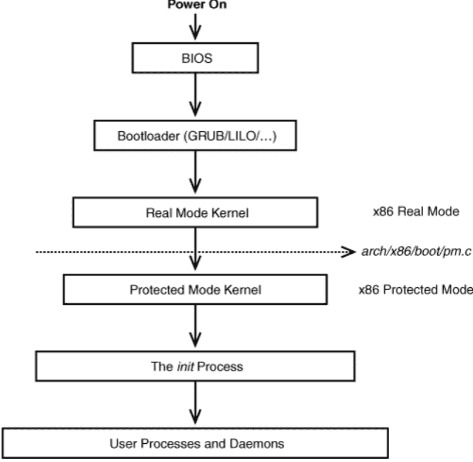

基于 x86 的处理器有两种操作模式，*实模式*（*real* mode）和*保护模式*（*protected* mode）。在实模式中，你只能访问前 1MB 的内存，而且没有任何保护。保护模式更为复杂，让你可以利用处理器的许多高级功能，如分页。CPU 必须经过实模式才能到达保护模式。然而，这条道路是单行道。你无法从保护模式切换回实模式。

第一级内核初始化在实模式汇编中完成。随后的启动由 *init/main.c* 中定义的 `start_kernel()` 函数在保护模式下执行，这个源文件就是你在前一章中修改过的那个。`start_kernel()` 首先初始化 CPU 子系统。内存和进程管理随后就位。外部总线和 I/O 设备接着启动。作为启动序列的最后一步，调用 *init* 程序——所有 Linux 进程的父进程。Init 执行用户空间脚本以启动必要的内核服务。它最后在控制台上生成终端并显示登录提示。

下面每一节的标题都是图 2.2 中在基于 x86 的笔记本电脑上启动过程中生成的消息。如果你在其它架构上启动内核，其语义和消息可能会有所不同。如果本节中的一些解释听起来颇为晦涩，别担心；这里的意图只是给你一个 100 英尺高空的概览，让你初尝内核的滋味。这里顺便提到的许多概念将在后面深入讨论。

### 图 2.2. 内核启动消息。

```
Code View:
Linux version 2.6.23.1y (root@localhost.localdomain) (gcc version 4.1.1 20061011 (Red
Hat 4.1.1-30)) #7 SMP PREEMPT Thu Nov 1 11:39:30 IST 2007
BIOS-provided physical RAM map:
 BIOS-e820: 0000000000000000 - 000000000009f000 (usable)
 BIOS-e820: 000000000009f000 - 00000000000a0000 (reserved)
 ...
758MB LOWMEM available.
...
Kernel command line: ro root=/dev/hda1
...
Console: colour VGA+ 80x25
...
Calibrating delay using timer specific routine.. 1197.46 BogoMIPS (lpj=2394935)
...
CPU: L1 I cache: 32K, L1 D cache: 32K
CPU: L2 cache: 1024K
...
Checking 'hlt' instruction... OK.
...
Setting up standard PCI resources
...
NET: Registered protocol family 2
IP route cache hash table entries: 32768 (order: 5, 131072 bytes)
TCP established hash table entries: 131072 (order: 9, 2097152 bytes)
...
checking if image is initramfs... it is
Freeing initrd memory: 387k freed
...
io scheduler noop registered
io scheduler anticipatory registered (default)
...
00:0a: ttyS0 at I/O 0x3f8 (irq = 4) is a NS16550A
...
Uniform Multi-Platform E-IDE driver Revision: 7.00alpha2
ide: Assuming 33MHz system bus speed for PIO modes; override with idebus=xx
ICH4: IDE controller at PCI slot 0000:00:1f.1
Probing IDE interface ide0...
hda: HTS541010G9AT00, ATA DISK drive
hdc: HL-DT-STCD-RW/DVD DRIVE GCC-4241N, ATAPI CD/DVD-ROM drive
...
serio: i8042 KBD port at 0x60,0x64 irq 1
mice: PS/2 mouse device common for all mice
...
Synaptics Touchpad, model: 1, fw: 5.9, id: 0x2c remote; caps: 0x884793/0x0
...
agpgart: Detected an Intel 855GM Chipset.
...
Intel(R) PRO/1000 Network Driver - version 7.3.20-k2
...
ehci_hcd 0000:00:1d.7: EHCI Host Controller
...
```

```
Yenta: CardBus bridge found at 0000:02:00.0 [1014:0560]
...
Non-volatile memory driver v1.2
...
kjournald starting. Commit interval 5 seconds
EXT3 FS on hda2, internal journal
EXT3-fs: mounted filesystem with ordered data mode.
...
INIT: version 2.85 booting
...
```

### BIOS 提供的物理 RAM 映射

内核从 BIOS 汇编系统内存地图，这是你最早看到的启动消息之一：

```
BIOS-provided physical RAM map:
BIOS-e820: 0000000000000000 - 000000000009f000 (usable)
...
BIOS-e820: 00000000ff800000 - 0000000100000000 (reserved)
```

实模式初始化代码使用 BIOS `int 0x15` 服务，功能号为 `0xe820`（因此前面消息中的字符串是 `BIOS-e820`）来获取系统内存地图。内存地图标明了保留的内存范围和可用的内存范围，内核随后使用这些信息来创建其空闲内存池。我们在附录 B "Linux 与 BIOS" 的 "实模式调用" 一节中更深入地讨论 BIOS 提供的内存地图。

### 758MB LOWMEM 可用

通常可寻址的内核内存区域（< 896MB）称为*低端内存*（*low memory*）。内核内存分配器 `kmalloc()` 从这个区域返回内存。超过 896MB 的内存（称为*高端内存*，*high memory*）只能通过特殊映射来访问。

启动期间，内核计算并显示这些内存区域中的总页数。我们在本章稍后更深入地查看内存区域。

### 内核命令行：ro root=/dev/hda1

Linux 引导加载程序通常向内核传递一个命令行。命令行中的参数类似于传递给 C 程序中 `main()` 函数的 `argv[]` 列表，只不过它们是传递给内核的。你可以将命令行参数添加到引导加载程序配置文件，或在运行时从引导加载程序提示符提供。[1] 如果你使用的是 GRUB 引导加载程序，配置文件根据你的发行版是 *boot/grub/grub.conf* 或 *boot/grub/version-2-single-user.conf*。如果你是 LILO 用户，配置文件是 */etc/lilo.conf*。这里列出了一个示例性的 *grub.conf* 文件（已添加注释）。如果你查看 `title kernel 2.6.23` 后面的那一行，就能明白前述启动消息的由来：

> [1] 嵌入式设备上的引导加载程序通常较为"精简"，不支持配置文件或等效机制。因此，许多非 x86 架构支持一个名为 `CONFIG_CMDLINE` 的内核配置选项，你可以在构建时用它提供内核命令行。

```
default 0  #默认启动 2.6.23 内核
```


 timeout 5  #5秒用于修改启动顺序或参数

title kernel 2.6.23    #启动选项 1
  #引导镜像位于第一个硬盘的第一个分区
  #的 /boot/ 目录下，文件名为 vmlinuz-2.6.23。'ro'
  #表示根分区应以只读方式挂载。
  kernel (hd0,0)/boot/vmlinuz-2.6.23 ro root=/dev/hda1

  #请参阅 "Freeing initrd memory:387k freed" 部分
  initrd (hd0,0)/boot/initrd

#...

命令行参数会影响启动过程中所走的代码路径。举个简单的例子，假设有个名为 `bootmode` 的命令行参数是我们感兴趣的。如果这个参数设置为 `1`，你希望在启动过程中打印一些调试信息，并在启动结束时将运行级别切换到 `3`。（等到 init 进程输出启动信息时，你就会了解运行级别的含义。）如果 `bootmode` 设置为 `0`，你则希望启动过程相对简洁，并将运行级别设置为 `2`。因为你已经熟悉 *init/main.c* 了，让我们在其中添加以下修改：

代码视图：

```
static unsigned int bootmode = 1;
static int __init
is_bootmode_setup(char *str)
{
  get_option(&str, &bootmode);
  return 1;
}

/* 处理参数 "bootmode=" */
__setup("bootmode=", is_bootmode_setup);

if (bootmode) {
  /* 打印详细输出 */
  /* ... */
}

/* ... */

/* 如果 bootmode 为 1，选择 init 运行级别为 3，否则
   切换到运行级别 2 */
if (bootmode) {
  argv_init[++args] = "3";
} else {
  argv_init[++args] = "2";
}

/* ... */
```

像之前一样重新编译内核并尝试这个改动。我们将在第18章"嵌入式 Linux"的"内存布局"一节中更多地讨论内核命令行参数。

### Calibrating Delay...1197.46 BogoMIPS (lpj=2394935)

启动期间，内核会计算处理器在一个 *jiffy* 内能够执行内部延迟循环的次数，jiffy 是系统定时器两次连续滴答之间的时间间隔。如你所料，这个计算必须根据你的 CPU 处理速度进行校准。校准结果存储在一个名为 `loops_per_jiffy` 的内核变量中。内核使用 `loops_per_jiffy` 的一个场景是，当设备驱动程序希望将执行延迟几微秒量级的小段时间时。

要理解延迟循环校准代码，让我们来看看定义在 *init/calibrate.c* 中的 `calibrate_delay()` 函数。这个函数巧妙地利用整数内核推导出了浮点精度。以下代码片段（添加了一些注释）展示了函数中为 `loops_per_jiffy` 获取粗略值的初始部分：

```
loops_per_jiffy = (1 << 12); /* 初始近似值 = 4096 */
printk(KERN_DEBUG "Calibrating delay loop... ");
while ((loops_per_jiffy <<= 1) != 0) {
  ticks = jiffies;  /* 如你在 "内核
                     定时器" 一节中将会发现的，jiffies 变量包含自内核
                     启动以来的定时器滴答数，
                     并在定时器中断处理程序中递增 */

  while (ticks == jiffies); /* 等待直到下一个
                                jiffy 开始 */

  ticks = jiffies;
  /* 延迟 */
  __delay(loops_per_jiffy);

  /* 等待是否超过了当前 jiffy？如果没有则继续 */
  ticks = jiffies - ticks;
  if (ticks) break;
}

loops_per_jiffy >>= 1; /* 这固定了最高有效位，是
                          loops_per_jiffy 的下限 */
```

上述代码开始假设 `loops_per_jiffy` 大于 `4096`，这相当于处理器速度约为每秒一百万条指令（MIPS）。然后它等待一个新的 jiffy 开始，并执行延迟循环 `__delay(loops_per_jiffy)`。如果延迟循环持续的时间超过了一个 jiffy，则 `loops_per_jiffy` 的前一个值（通过将其向右位移一位获得）固定其*最高有效位*（MSB）。否则，函数继续检查是否通过将 `loops_per_jiffy` 向左位移来获得uel 的 MSB。当内核确定了 `loops_per_jiffy` 的 MSB 后，它处理低位并微调其精度，如下所示：

```
loopbit = loops_per_jiffy;

/* 逐步处理低位 */
while (lps_precision-- && (loopbit >>= 1)) {
  loops_per_jiffy |= loopbit;
  ticks = jiffies;
  while (ticks == jiffies); /* 等待直到下一个
                                 jiffy 开始 */
  ticks = jiffies;

  /* 延迟 */
  __delay(loops_per_jiffy);

  if (jiffies != ticks)       /* 超过 1 个滴答 */
    loops_per_jiffy &= ~loopbit;
}
```

上述代码片段在延迟循环跨越 jiffy 边界时，确定了 `loops_per_jiffy` 低位的精确组合。这个校准值用于推导处理器速度的非科学度量，称为 *BogoMIPS*。你可以使用 BogoMIPS 评级作为 CPU 运行速度的相对度量。在一台基于 1.6GHz Pentium M 的笔记本电脑上，延迟循环校准为 `loops_per_jiffy` 产生了值 `2394935`，正如前面的启动消息所宣布的。BogoMIPS 值的计算方法如下：

BogoMIPS = `loops_per_jiffy` * 每秒的 jiffies 数 * 内部延迟循环消耗的指令数，以百万为单位

\= (2394935 * HZ * 2) / (1000000)

\= (2394935 * 250 * 2) / (1000000)

\= 1197.46（如前面启动消息所示）

我们将在本章后面的"[内核定时器](#)"一节中进一步讨论 `jiffies`、`HZ` 和 `loops_per_jiffy`。

### Checking HLT Instruction

由于 Linux 内核支持多种硬件平台，启动代码会检查与架构相关的错误。验证 *halt*（HLT）指令的健全性就是这样一项检查。

x86 处理器支持的 HLT 指令使 CPU 进入低功耗睡眠模式，直到下一个硬件中断发生。内核在希望将 CPU 置于空闲状态时使用 HLT 指令（参见定义在 *arch/x86/kernel/process_32.c* 中的 `cpu_idle()` 函数）。

对于有问题的 CPU，可以使用 `no-hlt` 内核命令行参数来禁用 HLT 指令。如果启用了 `no-hlt`，内核在空闲时会忙等待，而不是通过将 CPU 置于 HLT 状态来保持其冷却。

前面的启动消息是在 *init/main.c* 中的启动代码调用定义在 *include/asm-your-arch/bugs.h* 中的 `check_bugs()` 时生成的。

### NET: Registered Protocol Family 2

Linux 套接字层是一个统一接口，用户应用程序通过它访问各种网络协议。每个协议使用分配给自己的唯一族号（定义在 *include/linux/socket.h* 中）向套接字层注册。前面消息中的 Family 2 代表 `AF_INET`（互联网协议）。

在启动消息中经常出现的另一个注册协议族是 `AF_NETLINK`（Family 16）。Netlink 套接字提供了一种在用户进程和内核之间通信的方法。通过 netlink 套接字实现的功能包括访问路由表和*地址解析协议*（ARP）表（有关完整的使用列表，请参见 *include/linux/netlink.h*）。Netlink 套接字比系统调用更适合完成此类任务，因为它们是异步的、更易于实现，并且可动态链接。

内核中另一个常用的协议族是 `AF_UNIX` 或 UNIX 域套接字。X Windows 等程序使用它们在同一系统上进行进程间通信。

### Freeing Initrd Memory: 387k Freed

*Initrd* 是由引导加载程序加载的驻留内存虚拟磁盘映像。它在内核启动后作为初始根文件系统挂载，用于存放加载实际根文件系统所在的磁盘分区所需的额外动态可加载模块。由于内核运行在使用不同存储控制器的各种硬件平台上，发行版不可能在基础内核映像中启用所有可能的磁盘驱动器设备驱动程序。特定于你系统存储设备的驱动程序被打包在 initrd 中，在内核启动后、根文件系统挂载前加载。要创建 initrd 映像，请使用 `mkinitrd` 命令。

2.6 内核包含了一项名为 *initramfs* 的功能，相比 initrd 带来了多项优势。后者模拟磁盘（因此称为 *initramdisk* 或 *initrd*），并承受 Linux 块 I/O 子系统相关的开销，如缓存；而前者本质上将缓存本身挂载为文件系统（因此称为 *initramfs*）。

Initramfs 与其构建之上的页缓存一样，可以动态增长和收缩，不像 initrd 那样，因此减少了内存浪费。而且，与 initrd 需要包含相关的文件系统驱动程序（例如，如果你的 initrd 上有 EXT2 文件系统，则需要 EXT2 驱动程序）不同，initramfs 不需要文件系统支持。Initramfs 代码很小，因为它只是页缓存之上的一个小层。

^[2]^ cpio 是一种 UNIX 文件归档格式。你可以从 [www.gnu.org/software/cpio](http://www.gnu.org/software/cpio) 下载它。

在这种情况下，我们通过使用 `initrd=` 命令行参数向内核提供一个初始根文件系统的压缩 cpio 归档来使用 initramfs。在将归档内容解包到 rootfs 后，内核释放归档所在的内存（本例中为 387K），并宣布上述启动消息。释放的页面随后被分配给请求内存的内核其他部分。

如 [第18章](#) 所讨论的，在开发过程中，initrd 和 initramfs 有时用于在嵌入式设备上存放实际的根文件系统。

### IO Scheduler Anticipatory Registered (Default)

I/O 调度器的主要目标是通过最小化磁盘寻道时间来提高系统吞吐量，寻道时间是将磁头从现有位置移动到感兴趣的磁盘扇区的延迟。2.6 内核提供了四种不同的 I/O 调度器：*Deadline*、*Anticipatory*、*Complete Fair Queuing* 和 *Noop*。正如前面的内核消息所示，内核将 *Anticipatory* 设置为默认的 I/O 调度器。我们将在 [第14章](#) "块设备驱动程序" 中讨论 I/O 调度。

### Setting Up Standard PCI Resources

启动过程的下一个阶段探测并初始化 I/O 总线和外围控制器。内核通过遍历 PCI 总线来探测 PCI 硬件，然后初始化其他 I/O 子系统。查看 [图 2.3](#) 中的启动消息，了解关于 SCSI 子系统、USB 控制器、视频芯片（以下消息中 855 北桥芯片组的一部分）、串口（本例中为 8250 UART）、PS/2 键盘和鼠标、软盘驱动器、ramdisk、环回设备、IDE 控制器初始化的公告。


（本例中的 ICH4 南桥芯片组）、触摸板、以太网控制器（本例中为 e1000）和 PCMCIA 控制器。对应 I/O 设备的标识标注在  处。

### 图 2.3. 启动期间初始化总线和外设控制器。

```
Code View:
SCSI subsystem initialized
usbcore: registered new driver hub
agpgart: Detected an Intel 855 Chipset.
[drm] Initialized drm 1.0.0 20040925
PS/2 Controller [PNP0303:KBD,PNP0f13:MOU]
at 0x60,0x64 irq 1,12 serio: i8042 KBD port
serial8250: ttyS0 at I/O 0x3f8 (irq = 4)
is a NS16550A
Floppy drive(s): fd0 is 1.44M
RAMDISK driver initialized: 16 RAM disks
of 4096K size 1024 blocksize
loop: loaded (max 8 devices)
ICH4: IDE controller at PCI slot
0000:00:1f.1
...
input: SynPS/2 Synaptics TouchPad as
/class/input/input1
e1000: eth0: e1000_probe: Intel® PRO/1000
Network Connection
Yenta: CardBus bridge found at
0000:02:00.0 [1014:0560]
...
```

- SCSI
- USB
- Video
- Keyboard
- Serial Port
- Floppy
- Ramdisk
- Loop back
- Hard Disk
- Touchpad
- Ethernet
- PCMCIA/CardBus

本书在单独的章节中讨论了其中许多驱动子系统。请注意，如果驱动以内核可加载模块的形式动态链接到内核，其中一些消息可能只会在启动过程的后续阶段出现。

### EXT3-fs: Mounted Filesystem

EXT3 文件系统已成为 Linux 上的事实标准文件系统。它在老牌 EXT2 文件系统之上增加了一个日志层，以便在崩溃后快速恢复。其目的是在不经过耗时的文件系统检查（`fsck`）操作的情况下，重新获得一致的文件系统状态。EXT2 仍然是工作引擎，而 EXT3 层会将文件事务额外记录到一块称为*日志*的内存区域上，然后再将实际更改提交到磁盘。EXT3 与 EXT2 向后兼容，因此你可以为现有的 EXT2 文件系统添加一层 EXT3，也可以剥离 EXT3 以恢复原始的 EXT2 文件系统。

> EXT4

EXT 文件系统系列的最新版本是 EXT4，它从 2.6.19 版本开始被纳入主线内核，带有 "experimental" 标签，名称为 ext4dev。EXT4 在很大程度上与 EXT3 向后兼容。EXT4 项目的主页是 www.bullopensource.org/ext4。

EXT3 启动一个名为 *kjournald* 的内核辅助线程（我们将在下一章深入讨论内核线程）来协助日志记录。当 EXT3 运行时，内核挂载根文件系统并做好业务准备：

```
EXT3-fs: mounted filesystem with ordered data mode
kjournald starting. Commit interval 5 seconds
VFS: Mounted root (ext3 filesystem).
```

## INIT: Version 2.85 Booting

*Init* 是所有 Linux 进程的父进程，是内核完成其启动序列后运行的第一个程序。在 *init/main.c* 的最后几行中，内核尝试在不同的位置查找 init：

```
if (ramdisk_execute_command) { /* Look for /init in initramfs */
  run_init_process(ramdisk_execute_command);
}

if (execute_command) { /* You may override init and ask the kernel
                            to execute a custom program using the
                            "init=" kernel command-line argument. If
                            you do that, execute_command points to the
                            specified program */
  run_init_process(execute_command);
}

/* Else search for init or sh in the usual places .. */
run_init_process("/sbin/init");
run_init_process("/etc/init");
run_init_process("/bin/init");
run_init_process("/bin/sh");
panic("No init found. Try passing init= option to kernel.");
```

Init 从 */etc/inittab* 接收指令。它首先执行 */etc/rc.sysinit* 中的系统初始化脚本。该脚本的重要职责之一是激活交换分区，这会触发如下启动消息：

```
Adding 1552384k swap on /dev/hda6
```

我们来仔细看看这意味着什么。Linux 用户进程拥有 3GB 的虚拟地址空间（参见"分配内存"一节）。其中，构成"工作集"的页面保留在 RAM 中。然而，当有太多程序需要内存资源时，内核会将一些已使用的 RAM 页面存储到一个称为*交换空间*的磁盘分区中来释放内存。根据经验法则，交换分区的大小应该是 RAM 的两倍。在本例中，交换空间位于磁盘分区 */dev/hda6*，大小为 1552384K 字节。

接着，Init 运行 */etc/rc.d/rcX.d/* 目录中的脚本，其中 *X* 是 inittab 中指定的运行级别。运行级别是对应于所需启动模式的执行状态。例如，多用户文本模式对应运行级别 3，而 X Windows 对应运行级别 5。因此，如果你看到消息 `INIT: Entering runlevel 3`，说明 init 已经开始执行 */etc/rc.d/rc3.d/* 目录中的脚本。这些脚本启动动态设备命名子系统 udev（我们在[第4章]"奠定基础"中讨论），并加载负责驱动网络、音频、存储等的内核模块：

```
Starting udev: [ OK ]
Initializing hardware... network audio storage [Done]
...
```

Init 最终在虚拟控制台上生成终端。你现在可以登录了。

## Kernel Mode and User Mode

某些操作系统（如 MS-DOS）始终在单一 CPU 模式下运行，但类 UNIX 操作系统使用双模式来有效实现分时复用。在 Linux 机器上，CPU 要么处于受信任的*内核模式*，要么处于受限的*用户模式*。所有用户进程都在用户模式下执行，而内核本身在内核模式下执行。

内核模式代码对整个处理器指令集以及完整的内存和 I/O 空间具有不受限制的访问权限。如果用户模式进程需要这些特权，它必须通过系统调用经由设备驱动程序或其他内核模式代码来传递请求。然而，用户模式代码允许发生页错误，而内核模式代码则不允许。

在 2.4 及更早版本的内核中，只有用户模式进程可以被切换上下文并由其他进程替换。内核模式代码可能独占处理器，直到发生以下任一情况：

- 它自愿放弃 CPU。

或

- 发生中断或异常。

随着 2.6 版本中内核抢占的引入，大多数内核模式代码也可以被切换上下文了。

## Process Context and **Interrupt Context**

内核通过进程上下文和中断上下文的组合来完成有用的工作。为服务用户应用程序发出的系统调用而运行的内核代码代表相应的应用程序进程执行，被称为在**进程上下文**中运行。另一方面，中断处理程序在**中断上下文**中异步运行。进程上下文与任何中断上下文没有绑定关系，反之亦然。

在内核进程上下文中运行的代码是可抢占的。然而，中断上下文始终运行到完成，不可抢占。因此，从中断上下文可以执行的操作存在限制。从中断上下文执行的代码不能进行以下操作：

- 进入睡眠或放弃处理器
- 获取互斥锁
- 执行耗时的任务
- 访问用户空间虚拟内存

查看[第4章](...)"中断处理"[Interrupt Handing](...)一节，以全面讨论中断上下文。

## Kernel Timers

内核许多部分的工作都严重依赖于时间的流逝。Linux 内核利用硬件提供的不同定时器来提供依赖时间的服务，如忙等待和睡眠等待。处理器在忙等待时会浪费时钟周期，而在睡眠等待时会放弃 CPU。自然地，只有在后者不可行时才采用前者。内核还支持调度希望在指定时间间隔后运行的函数。

我们首先讨论一些重要内核定时器变量的语义，如 `jiffies`、`HZ` 和 `xtime`。接下来，我们使用 Pentium*时间戳计数器*（TSC）在基于 Pentium 的系统上测量执行时间。我们还将了解 Linux 如何使用*实时时钟*（RTC）。

### HZ的各种变体

   集成资源设备版本Can't continuation still maintains 2 sections征兆 
          `HZ` 和 `jiffies`

系统定时器以可编程频率中断处理器（或"触发"）。此频率，即每秒定时器滴答数，包含在内核变量 `HZ` 中。为 `HZ` 选择一个值是一种权衡。较大的 `HZ` 会产生更精细的定时器粒度，从而获得更好的调度分辨率。然而，较大的 `HZ` 值也会导致更大的开销和更高的功耗，因为更多的时钟周期会在定时器中断上下文中被消耗。

`HZ` 的值取决于架构。在 x86 系统上，2.4 内核中 `HZ` 默认设置为 100。到了 2.6，此值改为 1000，但从 2.6.13 起，该值降低到了 250。在基于 ARM 的平台上，2.6 内核将 `HZ` 设置为 100。在当前内核中，你可以在构建时通过配置菜单选择 `HZ` 的值。此选项的默认设置取决于你的发行版。

2.6.21 内核引入了对无节拍内核（`CONFIG_NO_HZ`）的支持，它根据系统负载动态触发定时器中断。无节拍系统的实现超出了本章的范围。

`jiffies` 保存自系统启动以来系统定时器触发的次数。内核每秒将 `jiffies` 变量递增 `HZ` 次。因此，在 `HZ` 值为 100 的内核上，一个 jiffy 是 10 毫秒的时长，而在 `HZ` 设置为 1000 的内核上，一个 jiffy 仅 1 毫秒长。

为了更好地理解 `HZ` 和 `jiffies`，请考虑以下来自 IDE 驱动程序（*drivers/ide/ide.c*）的代码片段，它轮询磁盘驱动器的忙状态：

```
unsigned long timeout = jiffies + (3*HZ);
while (hwgroup->busy) {
  /* ... */
  if (time_after(jiffies, timeout)) {
    return -EBUSY;
  }
  /* ... */
}
return SUCCESS;
```


上述代码在繁忙条件在 3 秒内清除时返回 `SUCCESS`，否则返回 `-EBUSY`。`3*HZ` 是 3 秒内的 jiffies 数量。计算出的超时时间 `(jiffies + 3*HZ)` 因此就是 3 秒超时结束后 `jiffies` 的新值。`time_after()` 宏将当前 `jiffies` 值与请求的超时时间进行比较，并注意处理因溢出而导致的回绕。可用于类似比较的相应函数有 `time_before()`、`time_before_eq()` 和 `time_after_eq()`。

`jiffies` 被定义为 `volatile`，这要求编译器不要优化对该变量的访问。这确保了在每次滴答时被定时器中断处理程序更新的 `jiffies`，在每次循环时都会被重新读取。

要从 jiffies 反向转换为秒，请看 USB 主机控制器驱动程序 *drivers/usb/host/ehci-sched.c* 中的这段代码：

```
if (stream->rescheduled) {
    ehci_info(ehci, "ep%d-iso rescheduled %lu times in %lu
",
              stream->rescheduled,
              ((jiffies - stream->start)/HZ));
}
```

前面的调试语句计算了该 USB 端点流（我们在第 11 章"通用串行总线"中讨论 USB）在多少秒内被重新调度了 `stream->rescheduled` 次。`(jiffies-stream->start)` 是自重新调度开始以来经过的 jiffies 数量。除以 `HZ` 将该值转换为秒。

假设 `HZ` 值为 1000，32 位 `jiffies` 变量大约会在 50 天后溢出。由于系统运行时间可能远超该时长，内核提供了一个名为 `jiffies_64` 的变量来保存 64 位 `(u64)` jiffies。链接器将 `jiffies_64` 定位，使其低 32 位与 `jiffies` 共址。在 32 位机器上，编译器需要两条指令才能将一个 `u64` 变量赋值给另一个，因此读取 `jiffies_64` 不是原子的。为了解决这个问题，内核提供了一个函数 `get_jiffies_64()`。查看定义在 *drivers/cpufreq/cpufreq_stats.c* 中的 `cpufreq_stats_update()` 以获取使用示例。

### 长延迟

在内核术语中，数量级为 jiffies 的延迟被认为是长延迟。实现长延迟的一个可能但非最优的方法是使用忙循环。忙等待的函数有一种"狗占马槽"的态度。它既不使用处理器做有用的工作，也不让别人使用它。以下代码占用处理器 1 秒钟：

```
unsigned long timeout = jiffies + HZ;
while (time_before(jiffies, timeout)) continue;
```

然而，一个更理智的方法是不浪费 CPU 周期，而是睡眠等待指定的时间。为此，使用 `schedule_timeout()`，它会挂起你的进程执行所请求的时间段，然后调用调度器。你的进程并不能保证在你请求的确切时间返回，因为这取决于调度器。在指定的超时期间，调度器可以根据优先级从运行队列中挑选另一个进程。[3]

> [3] 这些调度器属性随着 2.6.23 内核中 CFS 调度器的出现而改变。Linux 进程调度器在第 19 章"用户空间中的驱动程序"中讨论。

另外两个有助于睡眠等待的函数是 `wait_event_timeout()` 和 `msleep()`。它们都是在 `schedule_timeout()` 的帮助下实现的。当你的代码希望在指定条件变为真或发生超时时恢复执行，可以使用 `wait_event_timeout()`。`msleep()` 睡眠指定的毫秒数。

这种长延迟技术只适用于进程上下文。睡眠等待不能在中断上下文中完成，因为中断处理程序不允许 `schedule()` 或睡眠。（参见第 4 章中的"中断处理"，了解在中断上下文中执行的代码的注意事项。）从中断上下文进行短时间的忙等待是可能的，但在该上下文中进行长忙等待被认为是弥天大罪。同样禁忌的是在长忙等待期间禁用中断。

内核还提供了定时器 API，用于在将来某个时间点执行函数。你可以使用 `init_timer()` 动态定义定时器，或使用 `DEFINE_TIMER()` 静态创建定时器。之后，用处理函数地址和参数填充 `timer_list`，并使用 `add_timer()` 注册它：

```
#include <linux/timer.h>

struct timer_list my_timer;

init_timer(&my_timer);           /* 另请参见 setup_timer() */
my_timer.expire = jiffies + n*HZ; /* n 是以秒为单位的超时时间 */
my_timer.function = timer_func;  /* n 秒后执行的函数 */
my_timer.data = func_parameter;  /* 传递给 timer_func 的参数 */
add_timer(&my_timer);            /* 启动定时器 */
```

注意，这是一个单次定时器。如果你想周期性地运行 `timer_func()`，还需要在 `timer_func()` 内部添加上述代码，以便在下一个超时后调度自身：

```
static void timer_func(unsigned long func_parameter)
{
  /* 定期执行的工作 */
  /* ... */

  init_timer(&my_timer);
  my_timer.expire   = jiffies + n*HZ;
  my_timer.data     = func_parameter;
  my_timer.function = timer_func;
  add_timer(&my_timer);
}
```

你可以使用 `mod_timer()` 更改 `my_timer` 的到期时间，使用 `del_timer()` 取消 `my_timer`，并使用 `timer_pending()` 查看 `my_timer` 当前是否正在等待。如果你查看 *kernel/timer.c*，会发现 `schedule_timeout()` 内部使用了这些相同的 API。

诸如 `clock_settime()` 和 `clock_gettime()` 之类的用户空间函数用于从用户空间访问内核定时器服务。用户应用程序可以使用 `setitimer()` 和 `getitimer()` 来控制当指定超时到期时报警信号的递送。

### 短延迟

在内核术语中，小于 jiffy 的延迟属于短延迟。这种延迟通常从进程上下文和中断上下文中请求。由于无法使用基于 jiffy 的方法来实现小于 jiffy 的延迟，因此上一节讨论的睡眠等待方法不能用于小超时。唯一的解决方案是忙等待。

实现短延迟的内核 API 有 `mdelay()`、`udelay()` 和 `ndelay()`，分别支持毫秒、微秒和纳秒延迟。这些函数的实际实现是特定于架构的，可能并非在所有平台上都可用。

短时间的忙等待是通过测量处理器执行一条指令所需的时间，并循环必要的迭代次数来实现的。如本章前面所述，内核在启动期间执行此测量，并将值存储在名为 `loops_per_jiffy` 的变量中。短延迟 API 使用 `loops_per_jiffy` 来决定它们需要忙循环多少次。为了在握手过程中实现 1 微秒的延迟，USB 主机控制器驱动程序 *drivers/usb/host/ehci-hcd.c* 调用 `udelay()`，它在内部使用 `loops_per_jiffy`：

```
do {
  result = ehci_readl(ehci, ptr);
  /* ... */
  if (result == done) return 0;
  udelay(1);     /* 内部使用 loops_per_jiffy */
  usec--;
} while (usec > 0);
```

### Pentium 时间戳计数器

*时间戳计数器*（TSC）是 Pentium 兼容处理器中的一个 64 位寄存器，用于统计自启动以来处理器消耗的时钟周期数。由于 TSC 以处理器周期速度递增，它提供了一个高分辨率定时器。TSC 通常用于性能剖析和代码插桩。它使用 `rdtsc` 指令访问，以微秒精度测量 intervening 代码的执行时间。TSC 滴答数可以通过除以 CPU 时钟速度转换为秒，该速度可从内核变量 `cpu_khz` 读取。

在以下代码片段中，`low_tsc_ticks` 包含 TSC 的低 32 位，而 `high_tsc_ticks` 包含高 32 位。低 32 位取决于处理器速度会在几秒钟内溢出，但对于许多代码插桩目的来说已经足够，如下所示：

```
unsigned long low_tsc_ticks0, high_tsc_ticks0;
unsigned long low_tsc_ticks1, high_tsc_ticks1;
unsigned long exec_time;
rdtsc(low_tsc_ticks0, high_tsc_ticks0); /* 之前的时间戳 */
printk("Hello World\n");              /* 待性能剖析的代码 */
rdtsc(low_tsc_ticks1, high_tsc_ticks1); /* 之后的时间戳 */
exec_time = low_tsc_ticks1 - low_tsc_ticks0;
```

在 1.8GHz 的 Pentium 机器上，`exec_time` 测量值为 871（或半微秒）。


高分辨率定时器支持（`CONFIG_HIGH_RES_TIMERS`）已在 2.6.21 版本中合并到内核。它利用特定硬件的高速定时器为 `nanosleep()` 等 API 提供高精度功能。在奔腾级别机器上，内核利用 TSC 来提供此项功能。

### 实时时钟

RTC（Real Time Clock）在非易失性内存中跟踪绝对时间。在 x86 PC 上，RTC 寄存器构成了由电池供电[4]的*互补金属氧化物半导体*（CMOS）内存小块的顶部几个位置。请参阅第 5 章"字符驱动程序"中的图 5.1，了解 CMOS 在传统 PC 架构中的位置。在嵌入式系统上，RTC 可能在处理器内部，或者通过第 8 章"内部集成电路协议"中讨论的 I²C 或 SPI 总线从外部连接。

> [4] RTC 电池可持续使用多年，通常比计算机的使用寿命更长，因此你永远不需要更换它们。

你可以使用 RTC 执行以下操作：

- 读取和设置绝对时钟，并在时钟更新期间生成中断。
- 生成频率范围从 2HZ 到 8192HZ 的周期性中断。
- 设置闹钟

许多应用程序需要绝对时间或*挂钟时间*的概念。由于 `jiffies` 是相对于系统启动的时间，它不包含挂钟时间。内核在一个名为 `xtime` 的变量中维护挂钟时间。在启动期间，`xtime` 通过读取 RTC 初始化为当前的挂钟时间。当系统停止时，挂钟时间被写回到 RTC。你可以使用 `do_gettimeofday()` 以硬件支持的最高分辨率读取挂钟时间：

```
#include <linux/time.h>
static struct timeval curr_time;
do_gettimeofday(&curr_time);
my_timestamp = cpu_to_le32(curr_time.tv_sec); /* Record timestamp */
```

还有一组可供用户空间代码使用的函数来访问挂钟时间。它们包括以下内容：

- `time()`，返回日历时间，或自纪元（1970年1月1日 00:00:00）以来的秒数
- `localtime()`，以分解格式返回日历时间
- `mktime()`，执行 `localtime()` 的逆操作
- `gettimeofday()`，如果你的平台支持，返回微秒精度的日历时间

从用户空间使用 RTC 的另一种方式是通过字符设备 */dev/rtc*。一次只允许一个进程访问此设备。

我们在[第 5 章](chapter5.html)和[第 8 章](chapter8.html)中讨论了更多关于 RTC 驱动程序的内容。在[第 19 章](chapter19.html)中，我们开发了一个示例用户应用程序，该程序使用 */dev/rtc* 以微秒精度执行周期性工作。

## 内核中的并发

随着多核笔记本电脑的出现，*对称多处理*（SMP）不再局限于高科技用户的领域。SMP 和内核抢占会产生多个执行线程。这些线程可以同时操作共享的内核数据结构。因此，对此类数据结构的访问必须进行串行化。

让我们讨论一下保护共享内核资源免受并发访问影响的基础知识。我们从一个简单的例子开始，逐步引入中断、内核抢占和 SMP 等复杂性。

### 自旋锁和互斥锁

访问共享资源的代码区域称为*临界*区。自旋锁和互斥锁（*mutual exclusion* 的缩写）是内核中用于保护临界区的两个基本机制。让我们逐一了解。

自旋锁确保一次只有一个线程进入临界区。任何其他希望进入临界区的线程都必须在门口自旋，直到第一个线程退出。注意，我们使用术语*线程*来指执行线程，而不是内核线程。

自旋锁的基本用法如下：

```
#include <linux/spinlock.h>
spinlock_t mylock = SPIN_LOCK_UNLOCKED; /* Initialize */

/* Acquire the spinlock. This is inexpensive if there
 * is no one inside the critical section. In the face of
 * contention, spinlock() has to busy-wait.
 */
spin_lock(&mylock);

/* ... Critical Section code ... */

spin_unlock(&mylock); /* Release the lock */
```

与自旋锁在尝试进入繁忙临界区时让线程自旋不同，互斥锁让竞争线程进入睡眠状态，直到轮到它们占用临界区。因为消耗处理器周期来自旋是一件坏事，所以当预计等待时间较长时，互斥锁比自旋锁更适合保护临界区。在互斥锁的术语中，任何超过两次上下文切换的时间都被认为是长的，因为互斥锁必须将竞争线程切换出去睡眠，并在唤醒它时将其切换回来。

因此，在许多情况下，决定使用自旋锁还是互斥锁很容易：

- 如果临界区需要睡眠，你别无选择，只能使用互斥锁。在获取自旋锁之后，调度、抢占或在等待队列上睡眠都是非法的。

- 因为互斥锁在面对竞争时让调用线程睡眠，所以在中断处理程序内部你别无选择，只能使用自旋锁。（你将在第 4 章中了解更多关于中断上下文限制的内容。）

互斥锁的基本用法如下：

```
#include <linux/mutex.h>

/* Statically declare a mutex. To dynamically create a mutex, use mutex_init() */
static DEFINE_MUTEX(mymutex);

/* Acquire the mutex.青凌 This is inexpensive if there
 * is no one inside the critical section. In the face of
 * contention, mutex_lock() puts the calling thread to sleep.
 */
mutex_lock(&mymutex);

/* ... Critical Section code ... */

mutex_unlock(&mymutex);     /* Release the mutex */
```

为了说明并发保护的使用，让我们从一个仅存在于进程上下文中的临界区开始，并按以下顺序逐步引入复杂性：

1. 仅存在于单处理器（UP）机器上运行非抢占内核时的进程上下文中的临界区。
2. 存在于运行非抢占内核的 UP 机器上的进程和中断上下文中的临界区。
3. 存在于运行可抢占内核的 UP 机器上的进程和中断上下文中的临界区。
4. 存在于运行可抢占内核的 SMP 机器上的进程和中断上下文中的临界区。

### 旧的信号量接口

互斥锁接口取代了旧的信号量接口，它起源于 -rt 树，并在 2.6.16 版本的内核中合并到主线。然而，信号量接口仍然存在。信号量接口的基本用法如下：

```
#include <asm/semaphore.h>  /* Architecture dependent
                          header */

/* Statically declare a semaphore. To dynamically
   create a semaphore, use init_MUTEX() */
static DECLARE_MUTEX(mysem);

down(&mysem);   /* Acquire the semaphore */

/* ... Critical Section code ... */

up(&mysem);     /* Release the semaphore */
```

信号量可以配置为允许预定数量的线程同时进入临界区。然而，允许多于一个持有者的信号量很少使用。

### 情况 1：进程上下文，UP 机器，无抢占

这是最简单的情况，不需要锁定，因此我们不再进一步讨论。

### 情况 2：进程和中断上下文，UP 机器，无抢占

在这种情况下，你只需禁用中断即可保护临界区。要理解原因，假设 A 和 B 是进程上下文线程，C 是中断上下文线程，它们都在争用进入同一个临界区，如图 2.4 所示。

#### 图 2.4。临界区内的进程和中断上下文线程。

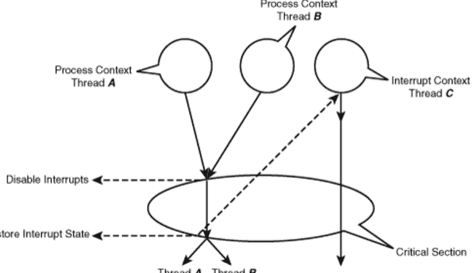

因为线程 C 在中断上下文中执行，并且总是在让出给线程 A 或线程 B 之前运行到完成，所以它不必担心保护。对于线程 A 来说，它不必关心线程 B（反之亦然），因为内核是不可抢占的。因此，线程 A 和线程 B 只需要防范线程 C 在它们处于同一临界区时践踏该临界区的可能性。它们通过在进入临界区之前禁用中断来实现这一点：

点 A：
```
  local_irq_disable();  /* Disable Interrupts in local CPU */
  /* ... Critical Section ...  */
  local_irq_enable();   /* Enable Interrupts in local CPU */
```

然而，如果执行到达点 A 时中断已经被禁用，`local_irq_enable()` 会产生重新启用中断的不良副作用，而不是恢复中断状态。这可以如下修复：

```
unsigned long flags;

Point A:
  local_irq_save(flags);    /* Disable Interrupts */
  /* ... Critical Section ... */
  local_irq_restore(flags);  /* Restore state to what
                                it was at Point A */
```

无论点 A 的中断状态如何，这都能正确工作。

### 情况 3：进程和中断上下文，UP 机器，可抢占

如果启用了抢占，仅仅禁用中断无法保护你的临界区免受践踏。存在多个线程在进程上下文中同时进入临界 embarrass临界区的可能性。在此场景中回顾图 2.4，线程 A 和线程 B 现在除了防范线程 C 之外，还需要相互保护。显然，解决方案是在临界区开始之前禁用内核抢占，并在结束时重新启用它，此外还要禁用/重新启用中断。


为此，线程 A 和线程 B 使用了自旋锁的 *irq* 变体：

```
unsigned long flags;

Point A:
  /* 保存中断状态。
   * 禁用中断——这会隐式地禁用抢占 */
  spin_lock_irqsave(&mylock, flags);

  /* ... 临界区 ... */

  /* 将中断状态恢复到 Point A 时的状态 */
  spin_unlock_irqrestore(&mylock, flags);
```

抢占状态不需要显式恢复到 Point A 时的状态，因为内核会通过一个称为 *抢占计数器* 的变量在内部为你完成这项工作。每当禁用抢占时（使用 `preempt_disable()`），该计数器就会递增；每当启用抢占时（使用 `preempt_enable()`），该计数器就会递减。只有当计数器值为零时，抢占才会生效。

### 案例 4：进程和中断上下文，SMP 机器，抢占

现在我们假设临界区在 SMP 机器上执行。你的内核已配置为启用 `CONFIG_SMP` 和 `CONFIG_PREEMPT`。

到目前为止讨论的场景中，自旋锁原语的作用不过是启用/禁用抢占和中断。实际的锁定功能已被编译掉。在 SMP 存在的情况下，锁定逻辑会被编译进来，自旋锁原语会被处理为 SMP 安全。启用 SMP 后的语义如下：

```
unsigned long flags;

Point A:
  /*
    - 在本地 CPU 上保存中断状态
    - 在本地 CPU 上禁用中断。这会隐式地禁用
      抢占。
    - 锁定该部分以调节其他 CPU 的访问
  */
  spin_lock_irqsave(&mylock, flags);

  /* ... 临界区 ... */

  /*
    - 将本地 CPU 的中断状态和抢占
      恢复到 Point A 时的状态
    - 释放锁
  */
  spin_unlock_irqrestore(&mylock, flags);
```

在 SMP 系统上，获取自旋锁时只有本地 CPU 上的中断被禁用。因此，一个进程上下文线程（比如图 2.4 中的线程 A）可能在一个 CPU 上运行，而中断处理程序（比如图 2.4 中的线程 C）正在另一个 CPU 上执行。因此，非本地处理器上的中断处理程序需要自旋等待，直到本地处理器上的进程上下文代码退出临界区。中断上下文代码调用 `spin_lock()`/`spin_unlock()` 来完成此操作：

```
spin_lock(&mylock);

/* ... 临界区 ... */

spin_unlock(&mylock);
```

与 irq 变体类似，自旋锁也有 *bottom half*（BH）类型。`spin_lock_bh()` 在获取锁时禁用 bottom half，而 `spin_unlock_bh()` 在释放锁时重新启用 bottom half。我们在第 4 章讨论 bottom half。

### `-rt` 树

实时（`-rt`）树，也称为 `CONFIG_PREEMPT_RT` 补丁集，实现了内核的低延迟修改。该补丁集可从 www.kernel.org/pub/linux/kernel/projects/rt 下载，它允许内核的大部分被抢占，部分是通过将许多自旋锁替换为互斥锁实现的。它还集成了高分辨率定时器。有几个 `-rt` 特性已经集成到主线内核中。你可以在项目托管于 http://rt.wiki.kernel.org/ 的 wiki 上找到详细文档。

内核在其工具库中有专门的锁原语，有助于在特定条件下提高性能。使用适合您需求的互斥方案会使您的代码更强大。让我们来看一些专门的互斥机制。

### 原子操作

*原子操作符* 用于执行轻量级的一次性操作，如递增计数器、条件递增和设置位位置。原子操作保证是序列化的，不需要锁来防止并发访问。原子操作符的实现依赖于架构。

在释放内核网络缓冲区（称为 `skbuff`）之前检查是否还有剩余的数据引用，定义在 *net/core/skbuff.c* 中的 `skb_release_data()` 例程执行以下操作：

```
if (!skb->cloned ||
  /* 原子递减并检查返回值是否为零 */
   !atomic_sub_return(skb->nohdr ? (1 << SKB_DATAREF_SHIFT) + 1 :
                       1,&skb_shinfo(skb)->dataref)) {
  /* ... */
  kfree(skb->head);
}
```

在 `skb_release_data()` 执行的同时，另一个线程使用 `skbuff_clone()`（定义在同一文件中）可能正在同时增加数据引用计数器：

```
/* ... */
/* 原子地增加数据引用计数 */
atomic_inc(&(skb_shinfo(skb)->dataref));
/* ... */
```

原子操作符的使用保护了数据引用计数器不被这两个线程破坏。它也消除了使用锁来保护单个整型变量免受并发访问的麻烦。

内核还支持 `set_bit()`、`clear_bit()` 和 `test_and_set_bit在这样的情况下，内核还支持 `set_bit()`、`clear_bit()` 和 `test_and_set_bit()` 等操作符来进行原子位操作。查看 *include/asm-your-arch/atomic.h* 以了解您的架构支持的原子操作符。

### 读写锁

另一种专门的并发调节机制是自旋锁的读写变体。如果临界区的使用方式是各线程要么从共享数据结构读取，要么向其写入，但不会同时进行这两种操作，那么这些锁就很适合。多个读线程可以同时进入临界区域。读自旋锁的定义如下：

```
rwlock_t myrwlock = RW_LOCK_UNLOCKED;

read_lock(&myrwlock);    /* 获取读锁 */
/* ... 临界区域 ... */
read_unlock(&myrwlock);  /* 释放锁 */
```

然而，如果一个写线程进入临界区，则不允许其他读线程或写线程进入。要使用写自旋锁，你需要这样写：

```
rwlock_t myrwlock = RW_LOCK_UNLOCKED;

write_lock(&myrwlock);    /* 获取写锁 */
/* ... 临界区域 ... */
write_unlock(&myrwlock);  /* 释放锁 */
```

查看 *net/ipx/ipx_route.c* 中的 IPX 路由代码，可以找到读写自旋锁的真实示例。名为 `ipx_routes_lock` 的读写锁保护 IPX 路由表免受并发访问。需要查找路由表以转发数据包的线程请求读锁。需要从路由表中添加或删除条目的线程获取写锁。这提高了性能，因为路由表查找的实例通常远多于路由表更新。

与常规自旋锁一样，读写锁也有相应的 irq 变体，即 `read_lock_irqsave()`、`read_lock_irqrestore()`、`write_lock_irqsave()` 和 `write_unlock_irqrestore()`。这些函数的语义与常规自旋锁类似。

序列锁或 *seqlocks*，在 2.6 内核中引入，是一种写者优先于读者的读写锁。如果对变量的写操作远多于读访问，这就很有用。本章前面讨论的 `jiffies_64` 变量就是一个例子。写线程不等待可能在临界区内的读者。因此，读线程可能会发现它们在临界区内的进入已失败，可能需要重试：

```
u64 get_jiffies_64(void) /* 定义在 kernel/time.c 中 */
{
  unsigned long seq;
  u64 ret;
  do {
    seq = read_seqbegin(&time_lock);
    ret = jiffies_64;
  } while (read_seqretry(&time_lock, seq));
  return ret;
}
```

写线程使用 `write_seqlock()` 和 `write_sequnlock()` 保护临界区域。

2.6 内核引入了另一种称为 *Read-Copy Update*（RCU）的机制，在读者远多于写者时能获得更好的性能。基本思想是读线程可以在不加锁的情况下执行。写线程则更复杂。它们对数据结构的副本执行更新操作，并替换读者看到的指针。原始副本在所有 CPU 上发生下一次上下文切换之前一直被维护，以确保所有正在进行的读操作完成。请注意，使用 RCU 比使用迄今为止讨论的原语更复杂，应仅在您确信它是工作的合适工具时才使用。RCU 数据结构和接口函数定义在 *include/linux/rcupdate.h* 中。*Documentation/RCU/** 中有大量文档。

对于 RCU 的使用示例，查看 *fs/dcache.c*。在 Linux 上，每个文件都与目录项信息（存储在称为 *dentry* 的结构中）、元数据信息（存储在 inode 中）和实际数据（存储在数据块中）相关联。每次对文件进行操作时，文件路径中的各组成部分会被解析，并获取相应的目录项。目录项被缓称为 *dcache* 的数据结构中，以加速未来的操作。任何时候，dcache 查找的数量远多于 dcache 更新，因此对 dcache 的引用使用 RCU 原语来保护。

## 调试

与并发相关的问题通常难以调试，因为它们通常难以重现。在编译和测试代码时启用 SMP（`CONFIG_SMP`）和抢占（`CONFIG_PREEMPT`）是个好主意，即使您的生产内核将在禁用抢占的单处理器机器上运行。在 *Kernel hacking* 下有一个称为 *自旋锁和读写锁调试*（`CONFIG_DEBUG_SPINLOCK`）的内核配置选项，可以帮助您捕捉一些常见的自旋锁错误。还有 lockmeter（http://oss.sgi.com/projects/lockmeter/）等工具可用于收集与锁相关的统计信息。

一个常见的并发问题是当您忘记锁定对共享资源的访问时。这会导致不同的线程"竞速"通过该


 # 进程文件系统

进程文件系统（*procfs*）是一种虚拟文件系统，它为内核内部创建了一个窗口。当你浏览 procfs 时看到的数据是由内核即时生成的。procfs 中的文件用于配置内核参数、查看内核结构、收集设备驱动程序的统计信息以及获取常规系统信息。

Procfs 是一种伪文件系统。这意味着驻留在 procfs 中的文件不与硬盘等物理存储设备相关联。相反，这些文件中的数据是由内核中相应的入口点按需动态创建的。因此，procfs 中的文件大小显示为零。Procfs 通常在内核启动期间挂载在 */proc* 目录下；你可以通过执行 `mount` 命令来查看这一点。

要首次了解 procfs 的功能，请检查 */proc/cpuinfo*、*/proc/meminfo*、*/proc/interrupts*、*/proc/tty/driver/serial*、*/proc/bus/usb/devices* 和 */proc/stat* 的内容。某些内核参数可以通过写入 */proc/sys/* 下的文件在运行时更改。例如，你可以通过向 */proc/sys/kernel/printk* 回显一组新值来更改内核 `printk` 日志级别。许多实用程序（如 ps）和系统性能监控工具（如 sysstat）在内部从驻留在 */proc* 下的文件中获取信息。

在 2.6 内核中引入的*序列文件*（*Seq files*）简化了大型 procfs 操作。它们在[附录 C](appendix53194471934682564983974988393300020801_abstract_c)“序列文件”中有所描述。

## 分配内存

某些设备驱动程序必须意识到*内存区域*的存在。此外，许多驱动程序需要内存分配函数的服务。在本节中，让我们简要讨论这两者。

内核将物理内存组织成*页*。页的大小取决于架构。在基于 x86 的机器上，它是 4096 字节。物理内存中的每一页都有一个与之关联的 `struct page`（定义在 *include/linux/mm_types.h* 中）：

```
struct page {
  unsigned long flags; /* Page status */
  atomic_t _count;     /* Reference count */
  /* ... */
  void * virtual;      /* Explained later on */
};
```

在 32 位 x86 系统上，默认的内核配置将可用的 4GB 地址空间划分为 3GB 的用户进程虚拟内存空间和 1GB 的内核空间，如图 2.5 所示。这将内核可处理的物理内存量限制在 1GB。实际上，该限制为 896MB，因为 128MB 的地址空间被内核数据结构占用。你可以在内核配置期间通过更改 3GB/1GB 的分割来增加此限制，但如果你减少用户进程的虚拟地址空间，将会招致内存密集型应用的不满。

**图 2.5  32 位 PC 系统上的默认地址空间分割**

映射低 896MB 的内核地址与物理地址相差一个常量偏移量，称为*逻辑地址*。借助"高端内存"支持，内核可以通过为这些区域生成*虚拟地址*来访问超出 896MB 的内存，使用特殊映射。所有逻辑地址都是内核虚拟地址 memory 地址，但反之则不然。

这引出了以下内核内存区域：

- `ZONE_DMA` (<16MB)，用于*直接内存访问*（DMA）的区域。由于传统的 ISA 设备具有 24 条地址线，只能访问前 16MB，因此内核尝试将此区域 dedicated 给此类设备。

- `ZONE_NORMAL` (16MB 到 896MB)，通常可寻址的区域，也称为低端内存。低端内存页在 `struct page` 中的 "virtual" 字段包含相应的逻辑地址。

- `ZONE_HIGH` (>896MB)，内核只有在将驻留页映射到 `ZONE_NORMAL` 中的区域后（使用 `kmap()` 和 `kunmap()`）才能访问的空间。相应的内核地址是虚拟的，而非逻辑的。如果高端内存页没有被 kmap 映射，则 `struct page` 中的 "virtual" 字段指向 `NULL`。

`kmalloc()` 是一个内存分配函数，它从 `ZONE_NORMAL` 返回连续的内存。其原型如下：

```
void *kmalloc(int count, int flags);
```

其中 `count` 是要分配的字节数，`flags` 是模式说明符。所有支持的标志都列在 *include/linux/gfp.h* 中（gfp 代表 *get free pages*），但这些是常用的几个：

- `GFP_KERNEL` 由进程上下文代码用来分配内存。如果指定了此标志，`kmalloc()` 允许进入睡眠状态并等待页被释放Snapshot 放。

- `GFP_ATOMIC` 由中断上下文代码用来获取内存。在此模式下，`kmalloc()` 不允许睡眠等待空闲页，因此使用 `GFP_ATOMIC` 成功分配的概率低于 `GFP_KERNEL`。

由于 `kmalloc()` 返回的内存保留了其先前存在的内容，如果暴露给用户空间可能会存在安全风险。要获取清零的 kmalloced 内存，请使用 `kzalloc()`。

如果你需要分配大量内存缓冲区，并且不要求内存物理上连续，请使用 `vmalloc()` 而不是 `kmalloc()`：

```
void *vmalloc(unsigned long count);
```

此处 `count` 是请求分配的大小。该函数返回内核虚拟地址。

`vmalloc()` 比 `kmalloc()` 享有更大的分配大小限制，但速度较慢，且不能从中断上下文调用。此外，你不能使用 `vmalloc()` 返回的物理上不连续的内存来执行*直接内存访问*（DMA）。高性能网络驱动程序通常在设备打开时使用 `vmalloc()` 来分配大型描述符环。

内核提供了更复杂的内存分配技术。这些包括*旁路缓冲区*、*slab* 和*内存池*，这些超出了本章的讨论范围。

## 查看源代码

内核启动从 *arch/x86/boot/* 目录中的实模式汇编代码的执行开始。查看 *arch/x86/kernel/setup_32.c* 以了解保护模式内核如何获取由实模式内核收集的信息。

第一条启动消息由驻留在 *init/main.c* 中的代码打印。深入 *init/calibrate.c* 以了解更多关于 BogoMIPS 校准的信息，并查看 *include/asm-your-arch/bugs.h* 以了解架构相关检查的见解。

内核中的定时器服务包括架构相关的部分（位于 *arch/your-arch/kernel/*）和通用部分（实现在 *kernel/timer.c* 中）。对于相关定义，请查看头文件 *include/linux/time.h*。

`jiffies` 定义在 *linux/jiffies.h* 中。`HZ` 的值取决于处理器，可以在 *include/asm-your-arch/param.h* 中找到。

内存管理源代码位于顶级的 *mm/* 目录中。

[表 2.1](#) 包含了本章使用的主要数据结构的摘要及其在源代码树中的定义位置。[表 2.2](#) 列出了本章使用的主要内核编程接口及其定义位置。

| 数据结构 | 位置 | 描述 |
| --- | --- | --- |
| `HZ` | *include/asm-your-arch/param.h* | 系统定时器在 1 秒内滴答次数 |
| `loops_per_jiffy` | *init/main.c* | 处理器在 1 个 jiffy 内执行内部延迟循环的次数 |
| `timer_list` | *include/linux/timer.h* | 用于保存你想在未来某个时间点执行的例程的地址 |
| `timeval` | *include/linux/time.h* | 时间戳 |
| `spinlock_t` | *include/linux/spinlock_types.h* | 一种忙锁定机制，确保只有单个线程进入临界区 |
| `semaphore` | *include/asm-your-arch/semaphore.h* | 一种睡眠锁定机制，允许预定数量的用户进入临界区 |
| `mutex` | *include/linux/mutex.h* | 替代 `semaphore` 的新接口 |
| `rwlock_t` | *include/linux/spinlock_types.h* | 读写自旋锁 |
| `page` | *include/linux/mm_types.h* | 内核表示的物理内存页 |

### 表 2.1  数据结构摘要

### 表 2.2  内核编程接口摘要


 ## 在本章中

- 内核线程
- 辅助接口
- 查看源码

在本章中，让我们看看一些内核机制，它们是驱动程序开发者工具箱中的有用组件。我们首先来看一种与用户进程相似的内核机制；内核线程是面向并发处理的编程抽象。

内核提供了多个辅助接口来简化代码、消除冗余、提高代码可读性，并有助于长期维护。我们将探讨链表、哈希表、工作队列、通知链、完成函数和错误处理辅助工具。这些辅助工具没有漏洞且经过优化，因此你的驱动程序也能*免费*继承这些优势。

## 内核线程

*内核线程*是在内核中实现后台任务的一种方式。该任务可能忙于处理异步事件，或睡眠等待某个事件发生。内核线程与用户进程相似，只是它们运行在内核空间，并能访问内核函数和数据结构。与用户进程一样，由于抢占式调度，内核线程拥有独占处理器的错觉。许多设备驱动程序利用内核线程来实现辅助任务。例如，*khubd*内核线程是Linux USB驱动核心（将在第11章"通用串行总线"中介绍）的一部分，它监控USB集线器并在USB设备热插拔到系统时对其进行配置。

### 创建内核线程

让我们通过一个示例来了解内核线程。在开发示例线程的过程中，你还将学习进程状态、等待队列和用户空间辅助程序等内核概念。当你熟悉内核线程后，可以将其作为测试载体，在内核中进行各种实验。

假设你希望内核在检测到某些关键内核数据结构的健康状况恶化时，异步调用一个用户空间程序来发送电子邮件或传呼机警报。（例如，网络接收缓冲区中的空闲空间已降至低水印以下。）

这是实现为内核线程的候选方案，原因如下：

- 它是一个后台任务，因为它必须等待异步事件。
- 它需要访问内核数据结构，因为事件的实际检测由内核的其他部分完成。
- 它必须调用用户空间辅助程序，这是一个耗时的操作。

### 内置内核线程

要查看你的系统上运行的内核线程（也称为*内核进程*），请运行`ps`命令。内核线程的名称用方括号括起来：

```
bash> ps -ef
UID       PID  PPID  C STIME TTY          TIME CMD
root        1     0  0 22:36 ?        00:00:00 init [3]
root        2     0  0 22:36 ?        00:00:00 [kthreadd]
root        3     2  0 22:36 ?        00:00:00 [ksoftirqd/0]
root        4     2  0 22:36 ?        00:00:00 [events/0]
root       38     2  0 22:36 ?        00:00:00 [pdflush]
root       39     2  0 22:36 ?        00:00:00 [pdflush]
root       29     2  0 22:36 ?        00:00:00 [khubd]
root      695     2  0 22:36 ?        00:00:00 [kjournald]
...
root     3914     2  0 22:37 ?        00:00:00 [nfsd]
root     3915     2  0 22:37 ?        00:00:00 [nfsd]
...
root     4015  3364  0 22:55 tty3     00:00:00 -bash
root     4066  4015  0 22:59 tty3     00:00:00 ps -ef
```

*[ksoftirqd/0]*内核线程是实现*软中断*的辅助机制。软中断由中断处理程序发起，请求对处理程序中可延迟执行的部分进行"下半部"处理。我们将在第4章"奠定基础"中详细介绍下半部和软中断，但这里的基本思路是让中断处理程序中的代码尽可能少。较小的中断处理程序可以减少系统中的关中断时间，从而降低延迟。*Ksoftirqd*的任务是确保大量的软中断既不会饿死软中断，也不会压垮系统。在*对称 Nobel 多处理*（SMP）机器上，多个线程实例可以并行运行在不同的处理器上，因此每个CPU创建一个ksoftirqd实例以提高吞吐量（*ksoftirqd/n*，其中*n*是CPU编号）。

*events/n*线程（其中*n*是CPU编号）帮助实现*工作队列*，这是内核中另一种延迟工作的方式。内核中希望延迟执行工作的部分可以创建自己的工作队列，或使用默认的*events/n*工作线程。工作队列也将在第4章中详细剖析。

*pdflush*内核线程的任务是将脏页从页缓存中刷新出去。页缓存缓冲了对磁盘的访问。为了提高性能，实际的磁盘写入被延迟，直到pdflush守护进程将脏数据写入磁盘。这会在可用空闲内存低于阈值，或页面保持脏状态足够长时间时执行。在2.4内核中，这两项任务分别由单独的内核线程*bdflush*和

| 内核接口 | 位置 | 描述 |
|---|---|---|
| `time_after()`<br>`time_after_eq()`<br>`time_before()`<br>`time_before_eq()` | *include/linux/jiffies.h* | 将当前`jiffies`值与指定的未来值进行比较 |
| `schedule_timeout()` | *kernel/timer.c* | 在指定的超时时间后调度进程运行 |
| `wait_event_timeout()` | *include/linux/wait.h* | 如果指定条件变为真或发生超时，则恢复执行 |
| `DEFINE_TIMER()` | *include/linux/timer.h* | 静态定义一个定时器 |
| `init_timer()` | *kernel/timer.c* | 动态定义一个定时器 |
| `add_timer()` | *include/linux/timer.h* | 在超时时间后调度定时器执行 |
| `mod_timer()` | *kernel/timer.c* | 修改定时器到期时间 |
| `timer_pending()` | *include/linux/timer.h* | 检查定时器当前是否处于等待状态 |
| `udelay()` | *include/asm-your-arch/delay.h*<br>*arch/your-arch/lib/delay.c* | 忙等待指定的微秒数 |
| `rdtsc()` | *include/asm-x86/msr.h* | 获取Pentium兼容处理器上的TSC值 |
| `do_gettimeofday()` | *kernel/time.c* | 获取墙上时间 |
| `local_irq_disable()` | *include/asm-your-arch/system.h* | 在本地CPU上禁用中断 |
| `local_irq_enable()` | *include/asm-your-arch/system.h* | 在本地CPU上启用中断 |
| `local_irq_save()` | *include/asm-your-arch/system.h* | 保存中断状态并禁用中断 |
| `local_irq_restore()` | *include/asm-your-arch/system.h* | 将中断状态恢复为调用匹配`local_irq_save()`时的状态 |
| `spin_lock()` | *include/linux/spinlock.h*<br>*kernel/spinlock.c* | 获取自旋锁 |
| `spin_unlock()` | *include/linux/spinlock.h* | 释放自旋锁 |
| `spin_lock_irqsave()` | *include/linux/spinlock.h*<br>*kernel/spinlock.c* | 保存中断状态，禁用本地CPU上的中断和抢占，并锁定其临界区以限制其他CPU的访问 |
| `spin_unlock_irqrestore()` | *include/linux/spinlock.h*<br>*kernel/spinlock.c* | 恢复中断状态和抢占，并释放锁 |
| `DEFINE_MUTEX()` | *include/linux/mutex.h* | 静态声明互斥锁 |
| `mutex_init()` | *include/linux/mutex.h* | 动态声明互斥锁 |
| `mutex_lock()` | *kernel/mutex.c* | 获取互斥锁 |
| `mutex_unlock()` | *kernel/mutex.c* | 释放互斥锁 |
| `DECLARE_MUTEX()` | *include/asm-your-arch/semaphore.h* | 静态声明信号量 |
| `init_MUTEX()` | *include/asm-your-arch/semaphore.h* | 动态声明信号量 |
| `up()` | *arch/your-arch/kernel/semaphore.c* | 获取信号量 |
| `down()` | *arch/your-arch/kernel/semaphore.c* | 释放信号量 |
| `atomic_inc()`<br>`atomic_inc_and_test()`<br>`atomic_dec()`<br>`atomic_dec_and_test()`<br>`clear_bit()`<br>`set_bit()`<br>`test_bit()`<br>`test_and_set_bit()` | *include/asm-your-arch/atomic.h* | 执行轻量级操作的原子操作符 |
| `read_lock()`<br>`read_unlock()`<br>`read_lock_irqsave()`<br>`read_lock_irqrestore()`<br>`write_lock()`<br>`write_unlock()`<br>`write_lock_irqsave()`<br>`write_lock_irqrestore()` | *include/linux/spinlock.h*<br>*kernel/spinlock.c* | 自旋锁的读写变体 |
| `down_read()`<br>`up_read()`<br>`down_write()`<br>`up_write()` | *kernel/rwsem.c* | 信号量的读写变体 |
| `read_seqbegin()`<br>`read_seqretry()`<br>`write_seqlock()`<br>`write_sequnlock()` | *include/linux/seqlock.h* | 顺序锁操作 |
| `kmWarmalloc()` | *include/linux/slab.h*<br>*mm/slab.c* | 从`ZONE_NORMAL`分配物理上连续的内存 |
| `kzalloc()` | *include/linux/slab.h*<br>*mm/util.c* | 获取清零的kmalloc分配内存 |
| `kfree()` | *mm/slab.c* | 释放kmalloc分配的内存 |
| `vmalloc()` | *mm/vmalloc.c* | 分配虚拟地址连续但不保证物理地址连续的内存 |


### 清单 3.1. 实现内核线程

> *kupdated*。你可能已经在 `ps` 输出中注意到两个 `pdflush` 实例。如果内核检测到现有实例忙于处理磁盘队列，就会创建一个新实例。这提高了吞吐量，特别是当系统有多个磁盘且许多磁盘都很繁忙时。

正如你在前一章所看到的，`kjournald` 是通用的内核日志线程，被 EXT3 等文件系统使用。

Linux 的*网络文件系统*（NFS）服务器是使用一组名为 *nfsd* 的内核线程实现的。

我们示例中的内核线程会释放处理器，直到被内核中负责监控感兴趣数据结构的部分唤醒。当被唤醒时，它会调用用户模式辅助程序，并在环境中传递适当的身份代码。

要创建内核线程，请使用 `kernel_thread()`：

```c
ret = kernel_thread(mykthread, NULL,
        CLONE_FS | CLONE_FILES | CLONE_SIGHAND | SIGCHLD);
```

这些标志指定了父子线程之间要共享的资源。`CLONE_FILES` 指定打开的文件将被共享，`CLONE_SIGHAND` 请求信号处理器被共享。

**清单 3.1** 展示了示例实现。因为内核线程通常充当设备驱动程序的辅助程序，所以它们在驱动程序初始化时被创建。但在这种情况下，示例线程可以从任何合适的地方创建，例如 *init/main.c*。

线程首先调用 `daemonize()`，它执行初始的内务处理并将调用线程的父进程更改为名为 *kthreadd* 的内核线程。每个 Linux 线程都有一个父进程。如果父进程在不等待子进程退出的情况下死亡，子进程将成为*僵尸*进程并浪费资源。将子进程重新挂接到 kthreadd 可以避免这种情况，并确保线程退出时能够正确清理。[1]

> [1] 在 2.6.21 及更早的内核中，`daemonize()` 通过调用 `reparent_to_init()` 将调用线程重新挂接到 init 任务。

因为 `daemonize()` 默认阻止所有信号，如果你的线程希望处理特定信号，请使用 `allow_signal()` 来启用信号传递。内核内部没有信号处理器，因此使用 `signal_pending()` 来检查信号并采取适当的操作。出于调试目的，**清单 3.1** 中的代码请求传递 `SIGKILL`，如果接收到该信号则终止。

`kernel_thread()` 已被弃用，取而代之的是更高级别的 *kthread* API，该 API 构建于前者之上。我们稍后将讨论 kthreads。

```c
static DECLARE_WAIT_QUEUE_HEAD(myevent_waitqueue);
rwlock_t myevent_lock;
extern unsigned int myevent_id;  <!-- removed-tag --="1">  /* Holds the identity of the
                                     troubled data structure.
                                     Populated later on */

static int mykthread(void *unused)
{
  unsigned int event_id = 0;
  DECLARE_WAITQUEUE(wait, current);
  /* Become a kernel thread without attached user resources */
  daemonize("mykthread");

  /* Request delivery of SIGKILL */
  allow_signal(SIGKILL);

  /* The thread sleeps on this wait queue until it's
     woken up by parts of the kernel in charge of sensing
     the health of data structures of interest */
  add_wait_queue(&myevent_waitqueue, &wait);

  for (;;) {
    /* Relinquish the processor until the event occurs */
    set_current_state(TASK_INTERRUPTIBLE);
    schedule();  /* Allow other parts of the kernel to run */
    /* Die if I receive SIGKILL */
    if (signal_pending(current)) break;
    /* Control gets here when the thread is woken up */
    read_lock(&myevent_lock);      /* Critical section starts */
    if (myevent_id) { /* Guard against spurious wakeups */
      event_id = myevent_id;
      read_unlock(&myevent_lock); /* Critical section ends */
      /* Invoke the registered user mode helper and
         pass the identity code in its environment */
      run_umode_handler(event_id); /* Expanded later on */
    } else {
      read_unlock(&myevent_lock);
    }
  }

  set_current_state(TASK_RUNNING);
  remove_wait_queue(&myevent_waitqueue, &wait);
  return 0;
}
```

如果你将其编译为内核的一部分并运行，你可以在 `ps` 输出中看到新创建的线程 *mykthread*：

```bash
bash> ps -ef
  UID        PID  PPID C STIME TTY          TIME CMD
  root         1     0 0 21:56 ?        00:00:00 init [3]
  root         2     1 0 22:36 ?        00:00:00 [ksoftirqd/0]
  ...
  root       111     1 0 21:56 ?        00:00:00 [mykthread]
  ...
```

在我们进一步研究线程实现之前，让我们编写一个代码片段来监控感兴趣数据结构的健康状况，并在检测到问题条件时唤醒 `mykthread`：

```c
/* Executed by parts of the kernel that own the
   data structures whose health you want to monitor */
/* ... */

if (my_key_datastructure looks troubled) {
  write_lock(&myevent_lock);  /* Serialize */
  /* Fill in the identity of the data structure */
  myevent_id = datastructure_id;

  write_unlock(&myevent_lock);

  /* Wake up mykthread */
  wake_up_interruptible(&myevent_waitqueue);
}

/* ... */
```

清单 3.1 在进程上下文中执行，而前面的代码片段则从进程或中断上下文中运行。进程和中断上下文通过内核数据结构进行通信。我们的示例使用 `myevent_id` 和 `myevent_waitqueue` 进行此通信。`myevent_id` 包含有问题的数据结构的标识。对 `myevent_id` 的访问通过锁进行序列化。

请注意，只有在编译时启用了 `CONFIG_PREEMPT`，内核线程才是可抢占的。如果 `CONFIG_PREEMPT` 关闭，或者你仍在运行没有抢占补丁的 2.4 内核，你的线程如果不会休眠，将会冻结系统。如果你在清单 3.1 中注释掉 `schedule()` 并在内核配置中禁用 `CONFIG_PREEMPT`，你的系统将会锁定。

我们将在第 19 章“用户空间驱动程序”中讨论调度策略时，学习如何从内核线程获得软实时响应。

## 进程状态和等待队列

以下是清单 3.1 中让 `mykthread` 在等待事件时休眠的代码区域：

```c
add_wait_queue(&myevent_waitqueue, &wait);
for (;;) {

  /* ... */
  set_current_state(TASK_INTERRUPTIBLE);
  schedule();    /* Relinquish the processor */
  /* Point A */

  /* ... */
}
set_current_state(TASK_RUNNING);
remove_wait_queue(&myevent_waitqueue, &wait);
```

上述代码片段的运作基于两个概念：*等待队列*和*进程状态*。

等待队列持有需要等待事件或系统资源的线程。等待队列中的线程会休眠，直到被另一个线程或负责检测事件的中断处理程序唤醒。入队和出队分别使用 `add_wait_queue()` 和 `remove_wait_queue()` 完成，唤醒排队任务则通过 `wake_up_interruptible()` 完成。

内核线程（或普通进程）可以处于以下任何一种进程状态：*运行*、*可中断*、*不可中断*、*僵尸*、*停止*、*被跟踪* 或 *已死亡*。这些状态在 *include/linux/sched.h* 中定义：

-   处于 **运行** 状态（`TASK_RUNNING`）的进程位于调度器运行队列中，是调度器分配 CPU 时间的候选者。

-   处于 **可中断** 状态（`TASK_INTERRUPTIBLE`）的任务正在等待事件发生，不在调度器运行队列中。当任务被唤醒，或者向其传递信号时，它会重新进入运行队列。

-   **不可中断** 状态（`TASK_UNINTERRUPTIBLE`）类似于 **可中断** 状态，但接收信号不会将任务放回运行队列。

-   **停止** 的任务（`TASK_STOPPED`）由于收到某些信号而停止执行。

-   如果像 `strace` 这样的应用程序正在使用内核中的 ptrace 支持来拦截任务，它将处于 **被跟踪** 状态（`TASK_TRACED`）。

-   处于 **僵尸** 状态（`EXIT_ZOMBIE`）的任务已终止，但其父进程没有等待该任务完成。退出的任务要么处于 `EXIT_ZOMBIE` 状态，要么处于死亡（ probation (`EXIT_DEAD`)。

你可以使用 `set_current_state()` 来设置内核线程的运行状态。

现在让我们回到前面的代码片段。`mykthread` 在等待队列（`myevent_waitqueue`）上休眠，并将其状态更改为 `TASK_INTERRUPTIBLE`，表示它希望退出调度器运行队列。调用 `schedule()` 请求调度器从其运行队列中选择并运行一个新任务。当负责健康监控的代码使用 `wake_up_interruptible(&myevent_waitqueue)` 唤醒 `mykthread` 时，该线程会被放回调度器运行队列。进程状态也会同时更改为 `TASK_RUNNING`，因此即使唤醒发生在任务状态设置为 `TASK_INTERRUPTIBLE` 和调用 `schedule()` 之间，也不会有竞态条件。如果向其传递 `SIGKILL` 信号，该线程也会重新进入运行队列。当调度器随后从运行队列中选取 `mykthread` 时，执行将从 Point A 处恢复。

## 用户模式辅助程序

`mykthread` 在**清单 3.1** 中调用 `run_umode_handler()` 来通知用户空间检测到的事件：

代码视图：

```c
/* Called from Listing 3.1 */
static void
run_umode_handler(int event_id)
{
  int i = 0;
  char *argv[2], *envp[4], *buffer = NULL;
```


```
int value;

argv[i++] = myevent_handler; /* 在 kernel/sysctl.c 中定义 */

/* 填入出问题数据结构对应的 id */
if (!(buffer = kmalloc(32, GFP_KERNEL))) return;
sprintf(buffer, "TROUBLED_DS=%d", event_id);

/* 如果未找到用户模式处理器，则返回 */
if (!argv[0]) return; argv[i] = 0;

/* 为 /path/to/helper 准备环境 */
i = 0;
envp[i++] = "HOME=/";
envp[i++] = "PATH=/sbin:/usr/sbin:/bin:/usr/bin";
envp[i++] = buffer; envp[i]   = 0;

/* 执行用户模式程序 /path/to/helper */
value = call_usermodehelper(argv[0], argv, envp, 0);

/* 检查返回值 */
kfree(buffer);
}
```
内核支持一种请求用户模式程序协助执行某些功能的机制。`run_umode_handler()` 通过调用 `call_usermodehelper()` 来使用此功能。

你必须通过 `/proc/sys/` 目录中的节点注册由 `run_umode_handler()` 调用的用户模式程序。为此，请确保内核配置中启用了 `CONFIG_SYSCTL`（属于 `/proc/sys/` 目录的文件统称为 *sysctl* 接口），并在 *kernel/sysctl.c* 的 `kern_table` 数组中添加一个条目：

```
{
  .ctl_name     = KERN_MYEVENT_HANDLER, /* 在 include/linux/sysctl.h 中定义 */
  .procname     = "myevent_handler",
  .data         = &myevent_handler,
  .maxlen       = 256,
  .mode         = 0644,
  .proc_handler = &proc_dostring,
  .strategy     = &sysctl_string,
},
```
这将在进程文件系统中创建节点 */proc/sys/kernel/myevent_handler*。要注册你的用户模式辅助程序，请执行以下操作：

```
bash> echo /path/to/helper > /proc/sys/kernel/myevent_handler
```
这会导致当 mykthread 调用 `run_umode_handler()` 时，*/path/to/helper* 被执行。

Mykthread 通过环境变量 `TROUBLED_DS` 将出问题的内核数据结构标识传递给用户模式辅助程序。该辅助程序可以是一个简单的脚本，例如以下脚本，它会向你发送一封包含从环境中收集的信息的电子邮件警报：

```
bash> cat /path/to/helper
#!/bin/bash
echo Kernel datastructure $TROUBLED_DS is in trouble | mail -s Alert root
```
`call_usermodehelper()` 必须从进程上下文执行，并以 root 权限运行。它是使用工作队列实现的，我们很快将讨论这一点。

# 第 3 章. 内核设施

## 本章内容

- 内核线程 56
- 辅助接口 65
- 查看源代码 85

在本章中，我们将了解一些对驱动开发者工具箱非常有用的内核设施。本章首先介绍一个类似于用户进程的内核设施；内核线程是面向并发处理的编程抽象。

内核提供了几个辅助接口，可以简化你的代码、消除冗余、提高代码可读性并有助于长期维护。我们将介绍链表、哈希列表、工作队列、通知链、完成函数和错误处理辅助工具。这些辅助工具是经过优化且无 bug 的，因此你的驱动程序也能免费继承这些好处。

## 内核线程

*内核线程* 是在内核中实现后台任务的一种方式。该任务可以忙于处理异步事件，也可以休眠等待事件发生。内核线程类似于用户进程，不同之处在于它们存在于内核空间中，并且可以访问内核函数和数据结构。与用户进程一样，由于抢占式调度，内核线程会产生独占处理器的错觉。许多设备驱动程序利用内核线程的服务来实现辅助或帮助任务。例如，*khubd* 内核线程（Linux USB 驱动程序核心的一部分，在第 11 章“通用串行总线”中介绍）监视 USB 集线器，并在 USB 设备热插入系统时配置它们。

### 创建内核线程

让我们通过一个例子来了解内核线程。在开发示例线程的同时，你还将了解内核概念，例如进程状态、等待队列和用户模式辅助程序。当你熟悉了内核线程后，可以将它们用作在内核内进行各种实验的测试工具。

假设你希望内核在检测到某些关键内核数据结构的健康状况恶化时（例如，网络接收缓冲区的空闲空间低于低水位线），异步调用用户模式程序来向你发送电子邮件或寻呼机警报。

这是一个适合实现为内核线程的候选任务，原因如下：

- 它是一个后台任务，因为它必须等待异步事件。
- 它需要访问内核数据结构，因为实际的事件检测是由内核的其他部分完成的。
- 它必须调用用户模式辅助程序，这是一个耗时的操作。

### 内置内核线程

要查看系统上运行的内核线程（也称为*内核进程*），请运行 `ps` 命令。内核线程的名称被方括号包围：

```
bash> ps -ef
UID       PID  PPID  C STIME TTY          TIME CMD
root        1     0  0 22:36 ?        00:00:00 init [3]
root        2     0  0 22:36 ?        00:00:00 [kthreadd]
root        3     2  0 22:36 ?        00:00:00 [ksoftirqd/0]
root        4     2  0 22:36 ?        00:00:00 [events/0]
root       38     2  0 22:36 ?        00:00:00 [pdflush]
root       39     2  0 22:36 ?        00:00:00 [pdflush]
root       29     2  0 22:36 ?        00:00:00 [khubd]
root      695     2  0 22:36 ?        00:00:00 [kjournald]
...
root     3914     2  0 22:37 ?        00:00:00 [nfsd]
root     3915     2  0 22:37 ?        00:00:00 [nfsd]
...
root     4015  3364  0 22:55 tty3     00:00:00 -bash
root     4066  4015  0 22:59 tty3     00:00:00 ps -ef
```
*[ksoftirqd/0]* 内核线程是用于实现*软中断*的辅助工具。软中断由中断处理程序触发，用于请求处理可以被延迟的处理程序部分，即“下半部”。我们将在[第 4 章](#)“奠定基础”中详细讨论下半部和软中断，但这里的基本思想是尽可能减少中断处理程序中存在的代码量。缩小中断处理程序的规模可以减少系统中的中断关闭时间，从而降低延迟。*Ksoftirqd* 的任务是确保高负载的软中断既不会饿死软中断，也不会压垮系统。在*对称多处理*（SMP）机器上，多个线程实例可以在不同的处理器上并行运行，每个 CPU 创建一个 ksoftirqd 实例以提高吞吐量（*ksoftirqd/n*，其中 *n* 是 CPU 编号）。

*events/n* 线程（其中 *n* 是 CPU 编号）帮助实现*工作队列*，这是内核中延迟工作的另一种方式。希望延迟执行工作的内核部分可以创建自己的工作队列，也可以使用默认的 *events/n* 工作线程。工作队列也在[第 4 章](#)中详细讨论。

*pdflush* 内核线程的任务是将脏页从页面缓存中刷出。页面缓存缓冲对磁盘的访问。为了提高性能，对磁盘的实际写入会延迟到 pdflush 守护进程将脏数据写入磁盘时。当可用空闲内存低于阈值，或者页面保持脏状态的时间足够长时，就会执行此操作。在 2.4 内核中，这两个任务分别由单独的内核线程 *bdflush* 和 *kupdated* 执行。你可能已经注意到 ps 输出中有两个 pdflush 实例。如果内核检测到现有实例在处理磁盘队列时忙不过来，就会创建一个新的实例。这可以提高吞吐量，特别是如果你的系统有多个磁盘并且其中许多都很繁忙。

正如你在上一章中看到的，kjournald 是通用的内核日志线程，被 EXT3 等文件系统使用。

Linux *网络文件系统*（NFS）服务器是使用一组名为 *nfsd* 的内核线程实现的。

我们的示例内核线程会放弃处理器，直到被负责监控相关数据结构的内核部分唤醒。当唤醒时，它会调用用户模式辅助程序，并在其环境中传递适当的标识代码。

要创建内核线程，请使用 `kernel_thread()`：

```
ret = kernel_thread(mythread, NULL,
        CLONE_FS | CLONE_FILES | CLONE_SIGHAND | SIGCHLD);
```
这些标志指定了父子线程之间要共享的资源。`CLONE_FILES` 指定要共享已打开的文件，`CLONE_SIGHAND` 请求共享信号处理程序。

**清单 3.1** 展示了示例实现。因为内核线程通常充当设备驱动程序的辅助工具，所以它们在驱动程序初始化时创建。然而，在这种情况下，示例线程可以从任何合适的位置创建，例如 *init/main.c*。

该线程首先调用 `daemonize()`，执行初始管理任务并将调用线程的父进程更改为名为 *kthreadd* 的内核线程。每个 Linux 线程都有一个单一的父进程。如果父进程在等待其子进程退出之前死亡，子进程将成为*僵尸*进程并浪费资源。将子进程重新设置为 kthreadd 可以避免这种情况，并确保线程退出时得到正确清理。[1]

[1] 在 2.6.21 及更早的内核中，`daemonize()` 通过调用 `reparent_to_init()` 将调用线程重新设置为 init 任务的子进程。

因为 `daemonize()` 默认会阻塞所有信号，所以如果你的线程希望处理特定信号，请使用 `allow_signal()` 来启用信号传递。内核内部没有信号处理程序，因此使用 `signal_pending()` 检查信号并采取适当的操作。出于调试目的，**清单 3.1** 中的代码请求传递 `SIGKILL` 信号，并在接收到该信号时终止。

`kernel_thread()` 已被弃用，取而代之的是更高级的 *kthread* API，它构建在前者之上。我们将在后面讨论 kthreads。

### **清单 3.1. 实现内核线程**
```


如果你将这段代码作为内核的一部分编译并运行，你可以在 ps 输出中看到新创建的线程 *mykthread*：

```
bash> ps -ef
    UID       PID  PPID C STIME TTY      TIME CMD
    root        1     0 0 21:56 ?    00:00:00 init [3]
    root        2     1 0 22:36 ?    00:00:00 [ksoftirqd/0]
    ...
    root      111     1 0 21:56 ?    00:00:00 [mykthread]
    ...
```

在我们深入探讨线程实现之前，让我们编写一段代码片段来监控感兴趣的数据结构的健康状况，并在检测到问题时唤醒 mykthread：

```
/* 由拥有你想要监控其健康状况的
   数据结构的内核部分执行 */
/* ... */

if (my_key_datastructure looks troubled) {
  write_lock(&myevent_lock);  /* 串行化 */
  /* 填写数据结构的标识 */
  myevent_id = datastructure_id;

  write_unlock(&myevent_lock);

  /* 唤醒 mykthread */
  wake_up_interruptible(&myevent_waitqueue);
}

/* ... */
```

**列表 3.1** 在进程上下文中执行，而前面的代码片段可以从进程上下文或中断上下文中运行。进程上下文和中断上下文通过内核数据结构进行通信。我们的示例使用 `myevent_id` 和 `myevent_waitqueue` 进行这种通信。`myevent_id` 包含出现问题的数据结构的标识。对 `myevent_id` 的访问通过锁进行串行化。

注意，内核线程只有在编译时开启 `CONFIG_PREEMPT` 的情况下才是可抢占的。如果 `CONFIG_PREEMPT` 关闭，或者你仍在运行没有抢占补丁的 2.4 内核，你的线程如果不进入睡眠状态将会冻结系统。如果你在 **列表 3.1** 中注释掉 `schedule()` 并在内核配置中禁用 `CONFIG_PREEMPT`，你的系统将会死锁。

当我们讨论 **第 19 章**"用户空间驱动程序"中的调度策略时，你将学习如何从内核线程获得软实时响应。

## 进程状态和等待队列

以下是 **列表 3.1** 中让 mykthread 进入睡眠等待事件的代码区域：

```
add_wait_queue(&myevent_waitqueue, &wait);
for (;;) {

  /* ... */
  set_current_state(TASK_INTERRUPTIBLE);
  schedule();    /* 释放 processor */
  /* 点 A */

  /* ... */
}
set_current_state(TASK_RUNNING);
remove_wait_queue(&myevent_waitqueue, &wait);
```

前面代码片段的操作基于两个概念：*等待队列* 和 *进程状态*。

等待队列持有需要等待事件或系统资源的线程。等待队列中的线程进入睡眠状态，直到被另一个线程或负责检测该事件的中断处理程序唤醒。入队和出队分别使用 `add_wait_queue()` 和 `remove_wait_queue()` 完成，唤醒队列中的任务则通过 `wake_up_interruptible()` 实现。

内核线程（或普通进程）可以处于以下任意一种进程状态：*running（运行）*、*interruptible（可中断）*、*uninterruptible（不可中断）*、*zombie（僵尸）*、*stopped（停止）*、*traced（被跟踪）* 或 *dead（死亡）*。这些状态定义在 *include/linux/sched.h* 中：

- 处于 **running** 状态（TASK_RUNNING）的进程在调度器的运行队列中，是调度器分配 CPU 时间的候选者。

- 处于 **interruptible** 状态（TASK_INTERRUPTIBLE）的任务正在等待某个事件发生，不在调度器的运行队列中。当任务被唤醒，或者有信号送达时，它会重新进入运行队列。

- **uninterruptible** 状态（TASK_UNINTERRUPTIBLE）与 **interruptible** 状态类似，但区别在于收到信号不会将该任务放回运行队列。

- **stopped** 任务（TASK_STOPPED）由于收到某些信号而停止执行。

- 如果 strace 之类的应用程序正在使用内核中的 ptrace 支持拦截某个任务，该任务将处于 **traced** 状态（TASK_TRACED）。

- 处于 **zombie** 状态（EXIT_ZOMBIE）的任务已经终止，但其父进程没有等待该任务完成。正在退出的任务要么处于 EXIT_ZOMBIE 状态，要么处于 dead（EXIT_DEAD）状态。

你可以使用 `set_current_state()` 来设置内核线程的运行状态。

现在让我们回到前面的代码片段。mykthread 在等待队列（myevent_waitqueue）上睡眠，并将其状态改为 TASK_INTERRUPTIBLE，表明它希望退出调度器的运行队列。`schedule()` 的调用请求调度器从其运行队列中选择并运行一个新任务。当负责健康监控的代码使用 `wake_up_interruptible(&myevent_waitqueue)` 唤醒 mykthread 时，该线程被放回调度器的运行队列。进程状态也同时被改为 TASK_RUNNING，因此即使在任务状态被设为 TASK_INTERRUPTIBLE 到调用 `schedule()` 之间发生唤醒，也不会产生竞态条件。如果有 SIGKILL 信号送达该线程，它也会被放回运行队列。当调度器随后从运行队列中选中 mykthread 时，执行从点 A 继续。

## 用户态辅助程序

Mykthread 在 **列表 3.1** 中调用 `run_umode_handler()` 来通知用户空间检测到的：

```
Code View:
/* 从列表 3.1 调用 */
static void
run_umode_handler(int event_id)
{
  int i = 0;
  char *argv[2], *envp[4], *buffer = NULL;
```

```
int value;

argv[i++] = myevent_handler; /* 定义于
                              kernel/sysctl.c */

/* 填入对应出现问题的
   数据结构的 id */
if (!(buffer = kmalloc(32, GFP_KERNEL))) return;
sprintf(buffer, "TROUBLED_DS=%d", event_id);

/* 如果未找到用户态处理程序，返回 */
if (!argv[0]) return; argv[i] = 0;

/* 为 /path/to/helper 准备环境 */
i = 0;
envp[i++] = "HOME=/";
envp[i++] = "PATH=/sbin:/usr/sbin:/bin:/usr/bin";
envp[i++] = buffer; envp[i]   = 0;

/* 执行用户态程序 /path/to/helper */
value = call_usermodehelper(argv[0], argv, envp, 0);

/* 检查返回值 */
kfree(buffer);
```

内核支持一种机制，请求用户态程序协助执行某些功能。`run_umode_handler()` 通过调用 `call_usermodehelper()` 来使用这种机制。

你需要通过 /proc/sys/ 目录中的一个节点来注册由 `run_umode_handler()` 调用的用户态程序。为此，请确保在内核配置中启用了 `CONFIG_SYSCTL`（/proc/sys/ 目录下的文件统称为 *sysctl* 接口），并在 *kernel/sysctl.c* 中的 `kern_table` 数组中添加一个条目：

```
{
  .ctl_name    = KERN_MYEVENT_HANDLER, /* 定义于
                                          include/linux/sysctl.h */

  .procname    = "myevent_handler",
  .data        = &myevent_handler,
  .maxlen      = 256,
  .mode        = 0644,
  .proc_handler = &proc_dostring,
  .strategy    = &sysctl_string,
},
```

这将在进程文件系统中创建节点 */proc/sys/kernel/myevent_handler*。要注册你的用户态辅助程序，执行以下操作：

```
bash> echo /path/to/helper > /proc/sys/kernel/myevent_handler
```

这会导致当 mykthread 调用 `run_umode_handler()` 时执行 */path/to/helper*。


Mykthread 将存在问题的内核数据结构的身份通过环境变量`TROUBLED_DS`传递给用户模式辅助程序。该辅助程序可以是一个简单的脚本，如下所示，它会向你发送一封包含从其环境中获取的信息的电子邮件警报：

```
bash> cat /path/to/helper
#!/bin/bash
echo Kernel datastructure $TROUBLED_DS is in trouble | mail -s Alert root
```

`call_usermodehelper()`必须从进程上下文中执行，并以 root 权限运行。它是通过工作队列实现的，我们很快会讨论到。

## 辅助接口

内核中存在多个实用的辅助接口，旨在让设备驱动程序开发者的工作更加轻松。其中一个例子是双向链表库的实现。许多驱动程序需要维护和操作数据结构的链表。内核的*list*接口例程消除了追逐链表指针和调试与链表维护相关的混乱问题的需要。让我们学习如何使用诸如链表、hlist、工作队列、完成函数、通知器块和 kthread 等辅助接口。

有多种等效方式可以实现辅助功能所提供的功能。例如，你可以实现自己的链表操作例程，而不是使用链表库；或者使用内核线程来延迟工作，而不是将其提交到工作队列。然而，使用标准的内核辅助接口可以简化你的代码，消除内核中的冗余，提高代码可读性，并有助于长期维护。

> 由于内核非常庞大，你总能找到尚未利用这些辅助机制的部分，因此更新那些代码区域可能是开始为内核开发做出贡献的好方法。

## 链表

要编织数据结构的双向链表，请使用*include/linux/list.h*中提供的函数。本质上，你需要将`struct list_head`嵌入到你的数据结构中：

```
#include <linux/list.h>

struct list_head {
  struct list_head *next, *prev;
};

struct mydatastructure {
  struct list_head mylist; /* 嵌入 */
  /* ... */              /* 实际字段 */
};
```

`mylist`是将不同实例的`mydatastructure`链接起来的纽带。如果你在`mydatastructure`中嵌入了多个`list_head`，每一个都构成一个链接，使`mydatastructure`成为一个新链表的成员。你可以使用链表库来添加或删除各个链表的成员。

在进入细节之前先了解全局，让我们总结一下链表库提供的链表编程接口。这在表 3.1 中完成。

**表 3.1. 链表操作函数**

| 函数 | 用途 |
| --- | --- |
| `INIT_LIST_HEAD()` | 初始化链表头 |
| `list_add()` | 在链表头之后添加一个元素 |
| `list_add_tail()` | 在链表尾部添加一个元素 |
| `list_del()` | 从链表中删除一个元素 |
| `list_replace()` | 用另一个元素替换链表中的一个元素 |
| `list_entry()` | 遍历链表中的所有节点 |
| `list_for_each_entry()` / `list_for_each_entry_safe()` | 更简单的链表遍历接口 |
| `list_empty()` | 检查链表中是否有任何元素 |
| `list_splice()` | 将一个链表与另一个链表连接 |

为了说明链表的使用，让我们实现一个示例。该示例也为理解下一节讨论的工作队列概念奠定基础。假设你的内核驱动程序需要从一个入口点执行一个繁重的任务。一个例子是迫使调用线程进入睡眠等待的任务。显然，你的驱动程序不喜欢阻塞到任务完成，因为这会降低依赖它的应用程序的响应速度。因此，每当驱动程序需要执行这项昂贵的工作时，它会通过将相应的例程添加到工作函数链表中来延迟执行。实际的工作由内核线程完成，该线程遍历链表并在后台执行工作函数。驱动程序将工作函数提交到链表尾部，而内核线程从链表头部开始处理，从而确保先排队的工作先完成。当然，驱动程序的其余部分需要设计为适合这种延迟执行的方案玩得方案。然而，在理解这个示例之前，请注意，我们将使用清单 3.5 中的工作队列接口来用更简单的方式实现相同的任务。

首先介绍我们示例中使用的关键驱动程序数据结构：

```
static struct _mydrv_wq {
  struct list_head mydrv_worklist; /* 工作链表 */
  spinlock_t lock;                 /* 保护链表 */
  wait_queue_head_t todo;           /* 同步提交者
                                     和工作者 */
} mydrv_wq;

struct _mydrv_work {
  struct list_head mydrv_workitem; /* 工作链 */
  void (*worker_func)(void *);     /* 要执行的工作 */
  void *worker_data;               /* 传递给 worker_func 的参数 */
  /* ... */                        /* 其他字段 */
} mydrv_work;
```

`mydrv_wq`对所有工作提交是全局的。它的成员包括指向工作链表头部的指针，以及一个用于在提交工作的驱动程序函数和执行工作的内核线程之间通信的等待队列。链表辅助函数不保护对链表成员的访问，因此你需要使用并发机制来序列化同时的指针引用。这是通过自旋锁完成的，该锁也是`mydrv_wq`的一部分。清单 3.2 中的驱动程序初始化例程`mydrv_init()`初始化自旋锁、链表头和工作队列，并启动工作者线程。

### 清单 3.2. 初始化数据结构

```
static int __init
mydrv_init(void)
{
  /* 初始化锁以防止
     对链表的并发访问 */
  spin_lock_init(&mydrv_wq.lock);

  /*无怨无悔的
  init_waitqueue_head(&mydrv_wq.todo);

  /* 初始化链表头 */
  INIT_LIST_HEAD(&mydrv_wq.mydrv_worklist);

  /* 启动工作者线程。参见清单 3.4 */
  kernel_thread(mydrv_worker, NULL,
                CLONE_FS | CLONE_FILES | CLONE_SIGHAND | SIGCHLD);

  return 0;
}
```

在检查执行提交工作的内核线程之前，让我们先看看工作提交本身。清单 3.3 实现了一个内核其他部分可以用来提交工作的函数。它使用`list_add_tail()`将工作函数添加到链表尾部。查看图 3.1 以了解工作链表的物理结构。

### 图 3.1. 工作函数的链表。

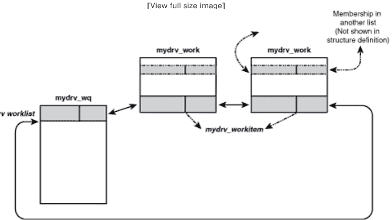

### 清单 3.3. 提交稍后执行的工作

```
int
submit_work(void (*func) (void *data), void *data)
{
  struct _mydrv_work *mydrv_work;

  /* 分配工作结构 */
  mydrv_work = kmalloc(sizeof(struct _mydrv_work), GFP_ATOMIC);
  if (!mydrv_work) return -1;

  /* 填充工作结构 */
  mydrv_work->worker_func = func; /* 工作函数 */
  mydrv_work->worker_data = data; /* 要传递的参数 */
  spin_lock(&mydrv_wq.lock);      /* 保护链表 */

  /* 将你的工作添加到链表尾部 */
  list_add_tail(&mydrv_work->mydrv_workitem,
                &mydrv_wq.mydrv_worklist);

  /* 唤醒工作者线程 */
  wake_up(&mydrv_wq.todo);

  spin_unlock(&mydrv_wq.lock);
  return 0;
}
```

要从驱动程序入口点提交工作函数`void job(void *)`，请执行以下操作：

```
submit_work(job, NULL);
```

提交工作函数后，清单 3.3 唤醒工作者线程。清单 3.4 所示工作者线程的一般结构与上一节讨论的标准内核线程相似。该线程使用`list_entry()`遍历链表中的所有节点。`list_entry()`返回嵌入链表节点的容器数据结构。仔细查看清单 3.4 中的相关行：

```
mydrv_work = list_entry(mydrv_wq.mydrv_worklist.next,
                        struct _mydrv_work, mydrv_workitem);
```

`mydrv_workitem`嵌入在`mydrv_work`内部，因此`list_entry()`返回指向相应`mydrv_work`结构的指针。传递给`list_entry()`的参数是嵌入链表节点的地址、容器结构的类型，以及嵌入链表节点的字段名。

执行完提交的工作函数后，工作者线程使用`list_del()`从链表中移除相应的节点。请注意，在执行提交的工作函数的时间段内，`mydrv_wq.lock`被释放并重新获取。这是因为工作函数可能会进入睡眠，如果新调度的代码尝试获取相同的自旋锁，可能会导致死锁。

### 清单 3.4. 工作者线程


为了简洁起见，示例代码并未进行错误处理。例如，如果清单 3.2 中对 `kernel_thread()` 的调用失败，你需要释放为相应工作结构分配的内存。此外，清单 3.4 中的 `asked_to_die()` 尚未编写。它的基本逻辑是：当检测到已传递的信号，或者收到 `release()` 入口点的通知（告知该模块即将从内核中卸载）时，跳出循环。

在结束本节之前，让我们来看另一个有用的列表库例程 `list_for_each_entry()`。使用这个宏，迭代会变得更简单、更易读，因为你不必在循环内部使用 `list_entry()`。如果你将在循环中删除列表元素，请使用 `list_for_each_entry_safe()` 变体。你可以替换清单 3.4 中的以下代码片段：

```
while (!list_empty(&mydrv_wq.mydrv_worklist)) {
    mydrv_work = list_entry(mydrv_wq.mydrv_worklist.next,
                        struct _mydrv_work, mydrv_workitem);
    /* ... */
}

替换为：

struct _mydrv_work *temp;
list_for_each_entry_safe(mydrv_work, temp,
                        &mydrv_wq.mydrv_worklist,
                        mydrv_workitem) {
    /* ... */
}
```

在这种情况下，你不能使用 `list_for_each_entry()`，因为在清单 3.4 中你在循环内部删除了 `mydrv_work` 指向的条目。`list_for_each_entry_safe()` 通过使用作为第二个参数（`temp`）传入的临时变量保存列表中下一个条目的地址，解决了这个问题。

## 哈希列表

前面讨论的双向链表实现对于希望实现哈希表等链接数据结构的情况并非最优。这是因为哈希表只需要包含单个指针的列表头。为了减少此类应用的内存开销，内核提供了哈希列表（或 *hlists*），这是链表的一种变体。与链表不同，链表对列表头和列表节点使用相同的结构，而 hlists 则有单独的定义：

```
struct hlist_head {
    struct hlist_node *first;
};

struct hlist_node {
    struct hlist_node *next, **pprev;
};
```

为了适配单指针 hlist 头的机制，节点保存的是指向前一个节点的指针的地址，而不是指针本身。

有关示例，请参见 *f*<sub>s</sub>/dcache.c。

## 工作队列

工作队列是内核中延迟执行工作的一种方式。延迟执行工作在许多情况下都非常有用。示例包括：

- 响应错误中断时触发的网络适配器重启
- 文件系统任务，如同步磁盘缓冲区
- 向磁盘发送命令并继续执行存储协议状态机

工作队列的功能类似于清单 3.2 到 3.4 中描述的示例。然而，工作队列可以帮助你以更简单的方式完成相同的任务。

工作队列辅助库向用户暴露两个接口结构：`workqueue_struct` 和 `work_struct`。

| 步骤 | 描述 |
|------|-------------|
| 1 | 创建一个工作队列（或 `workqueue_struct`），并关联一个或多个内核线程。要创建为 `workqueue_struct` 服务的内核线程，使用 `create_singlethread_workqueue()`。要在系统中的每个 CPU 上创建一个工作线程，使用 `create_workqueue()` 变体。内核还有默认的工作线程（events/n，其中 n 是 CPU 编号），你可以分时共享，而无需请求单独的工作线程。根据你的应用，如果没有专用工作线程，可能会带来性能损失。 |
| 2 | 创建工作元素（或 `work_struct`）。`work_struct` 使用 `INIT_WORK()` 进行初始化，该函数将工作函数的地址和参数填入其中。 |
| 3 | 提交工作。`work_struct` 可以使用 `queue_work()` 提交到专用队列，或使用 `schedule_work()` 提交到默认内核工作线程。 |

让我们重写清单 3.2 到 3.4，以利用工作队列接口。这在清单 3.5 中完成。整个内核线程、以及自旋锁和等待队列，都在工作队列内部消失了。如果你使用的是默认内核工作线程，甚至对 `create_singlethread_workqueue()` 的调用也会消失。

### 清单 3.5. 使用工作队列延迟执行工作

```
Code View:
#include <linux/workqueue.h>

struct workqueue_struct *wq;

/* Driver Initialization */
static int __init
mydrv_init(void)
{
  /* ... */
  wq = create_singlethread_workqueue("mydrv");
  return 0;
}
 /* Work Submission. The first argument is the work function, and
    the second argument is the argument to the work function */
 int
 submit_work(void (*func)(void *data), void *data)
 {
   struct work_struct *hardwork;

   hardwork = kmalloc(sizeof(struct work_struct), GFP_KERNEL);

   /* Init the work structure */
   INIT_WORK(hardwork, func, data);

   /* Enqueue Work */
   queue_work(wq, hardwork);
   return 0;
}
```

如果你使用工作队列，除非你将模块声明为在 GPL 许可下授权，否则你会遇到链接器错误。这是因为内核仅将这些函数导出给 GPL 代码。如果你查看内核工作队列的实现，你会看到这种限制体现在如下语句中：

```
EXPORT_SYMBOL_GPL(queue_work);
```

要宣布你的模块在 GPL 下 *copyleft* 授权，请声明以下内容：

```
MODULE_LICENSE("GPL");
```

## 通知链

*通知链* 用于向请求状态变更消息的代码区域发送消息。与硬编码机制不同，通知器提供了一种灵活的技术，用于在感兴趣的事件生成时获得提醒。通知器最初是为了将网络事件传递给内核的相关部分而添加的，但现在用于许多其他目的。内核为重大事件实现了预定义的通知器。此类通知的示例包括：

 - **Die notification**，在内核函数因“oops”、缺页异常或断点触发而陷入陷阱或故障时发送。例如，如果你正在为医疗级板卡编写设备驱动程序，你可能希望注册到 die 通知器，以便在内核恐慌发生时尝试关闭医疗电子设备。
- **Net device notification**，在网络接口启用或禁用时生成。
- **CPU frequency notification**，在处理器频率发生转换时分派。
- **Internet address notification**，在检测到网络接口的 IP 地址发生变化时发送。

使用通知器的一个示例是*高级数据链路控制*（HDLC）协议驱动程序 *drivers/net/wan/hdlc.c*，它注册到网络设备通知器链以感知载波变化。

要将你的代码附加到通知器链，你必须向关联的链注册一个事件处理程序。当相关事件生成时，事件标识符和特定于通知器的参数将作为参数传递给处理程序例程。要定义自定义通知器链，你还必须额外实现基础设施，以便在检测到事件时触发该链。

[Listing 3.6](#) 包含了使用预定义和用户定义通知器的示例。[Table 3.2](#) 简要描述了 [Listing 3.6](#) 使用的通知器链及其传播的事件，因此请同时查看列表和表格。

### **Table 3.2. Notifier Chains and the Events They Propagate**

| Notifier Chain | Description |
|:---|:---|
| **Die Notifier Chain** (`die_chain`) | `my_die_event_handler()` 使用 `register_die_notifier()` 附加到 die 通知器链 `die_chain`。要触发 `my_die_event_handler()` 的调用，在代码中的某个位置引入无效引用，例如以下内容：<br>`int *q = 0;`<br>`*q = 1;`<br><br>当执行此代码片段时，`my_die_event_handler()` 会被调用，你将看到如下消息：<br><br>`my_die_event_handler: OOPs! at EIP=f00350e7`<br><br>die 事件通知器将 `die_args` 结构传递给注册的事件处理程序。此参数包含指向 `regs` 结构的指针，该结构携带故障发生时处理器寄存器内容的快照。`my_die_event_handler()` 打印指令指针寄存器的内容。 |
| **Netdevice Notifier Chain** (`netdev_chain`) | `my_dev_event_handler()` 使用 `register_netdevice_notifier()` 附加到网络设备通知器链 `netdev_chain`。你可以通过更改网络接口（如 Ethernet (`ethX`) 或 loopback (`lo`)）的状态来生成此事件：<br>`bash> ifconfig eth0 up` |

这将导致 `my_dev_event_handler()` 的执行。处理程序被传递一个指向 `struct net_device` 的指针作为参数，其中包含网络接口的名称。`my_dev_event_handler()` 使用此信息产生以下消息：

`my_dev_event_handler: Val=1, Interface=eth0`

`Val=1` 对应于 *include/linux/notifier.h* 中定义的 `NETDEV_UP` 事件。

### User-Defined Notifier Chain

Listing 3.6 还实现了一个用户定义的通知器链 `my_noti_chain`。假设你希望在用户每次读取 procfs 文件系统中的特定文件时生成一个事件。在关联的 procfs `read` 例程中添加以下内容：

`blocking_notifier_call_chain(&my_noti_chain, 100, NULL);`

这将导致每次你从相应的 */proc* 文件读取时调用 `my_event_handler()`，并产生以下消息：

`my_event_handler: Val=100`

`Val` 包含生成事件的标识，此例中为 `100`。函数参数未被使用。

当模块从内核释放时，你必须从通知器链注销事件处理程序。例如，如果在卸载 Listing 3.6 中的代码后你*启用*或*禁用*网络接口，除非你从模块的 `release()` 方法执行 `unregister_netdev_notifier(&my_dev_notifier)`，否则你会被“oops”所困扰。这是因为通知器链仍然认为处理程序代码是有效的，即使它已被从内核中移除。

### Listing 3.6. Notifier Event Handlers

```
Code View:
#include <linux/notifier.h>
#include <asm/kdebug.h>
#include <linux/netdevice.h>
#include <linux/inetdevice.h>

/* Die Notifier Definition */
static struct notifier_block my_die_notifier = {
  .notifier_call = my_die_event_handler,
};
/* Die notification event handler */
int
my_die_event_handler(struct notifier_block *self,
                     unsigned long val, void *data)
{
  struct die_args *args = (struct die_args *)data;

  if (val == 1) { /* '1' corresponds to an "oops" */
    printk("my_die_event: OOPs! at EIP=%lx\n", args->regs->eip);
```

```
  } /* else ignore */
  return 0;
}


/* Net Device notifier definition */
static struct notifier_block my_dev_notifier = {
  .notifier_call = my_dev_event_handler,
};


/* Net Device notification event handler */
int my_dev_event_handler(struct notifier_block *self,
                         unsigned long val, void *data)
{
  printk("my_dev_event: Val=%ld, Interface=%s\n", val,
         ((struct net_device *) data)->name);
  return 0;
}


/* User-defined notifier chain implementation */
static BLOCKING_NOTIFIER_HEAD(my_noti_chain);

static struct notifier_block my_notifier = {
  .notifier_call = my_event_handler,
};

/* User-defined notification event handler */
int my_event_handler(struct notifier_block *self,
                     unsigned long val, void *data)
{
  printk("my_event: Val=%ld\n", val);
  return 0;
}
/* Driver Initialization */
static int __init
my_init(void)
{
  /* ... */

  /* Register Die Notifier */
  register_die_notifier(&my_die_notifier);

  /* Register Net Device Notifier */
  register_netdevice_notifier(&my_dev_notifier);

  /* Register a user-defined Notifier */
  blocking_notifier_chain_register(&my_noti_chain, &my_notifier);

  /* ... */
}
```

Listing 3.6 中的 `my_noti_chain` 0使用 `BLOCKING_NOTIFIER_HEAD()` 声明为阻塞通知器，并通过 `blocking_notifier_chain_register()` 注册。这意味着通知器处理程序始终从进程上下文调用。因此，处理程序函数 `my_event_handler()` 允许进入睡眠状态。如果你的通知器处理程序可能从中断上下文调用，请使用 `ATOMIC_NOTIFIER_HEAD()` 声明通知器链，并通过 `atomic_notifier_chain_register()` 注册。

> The Old Notifier Interface
>
> 2.6.17 之前的内核版本仅支持通用通知器链。通知器注册函数 `notifier_chain_register()` 在内部使用自旋锁保护，但遍历通知器链并向通知器处理程序分派事件的例程（`notifier_call_chain()`）是无锁的。缺乏锁定是因为处理程序函数可能会进入睡眠、在运行时注销自身，或从中断上下文调用。然而，无锁实现引入了竞态条件。新的通知器 API 构建在原始接口之上，旨在克服其局限性。

## Completion Interface

内核的许多部分将某些活动作为单独的执行线程启动，然后等待它们完成。*完成*接口是一种实现此类代码模式的高效且简便的方法。

一些示例使用场景包括：

- 你的驱动程序模块由一个内核线程辅助。如果你执行 rmmod 移除模块，`release()` 方法会在将模块代码从内核空间移除之前被调用。释放例程要求线程自行终止，并阻塞直到线程完成其退出。[Listing 3.7](#) 实现了这种情况。
- 你正在编写块设备驱动程序（在 [Chapter 14](#)“块驱动程序”中讨论）的一部分，该部分向设备排队读请求。这会触发作为单独线程或工作队列实现的状态机更改。驱动程序希望在继续另一项活动之前等待操作完成。参见 *drivers/block/floppy.c* 中的示例。
- 应用程序请求*模数转换器*（ADC）驱动程序提供数据样本。驱动程序启动转换请求，等待中断信号指示转换完成，然后返回数据。

### Listing 3.7. Synchronizing Using Completion Functions

```
Code View:
static DECLARE_COMPLETION(my_thread_exit);     /* Completion */
static DECLARE_WAIT_QUEUE_HEAD(my_thread_wait); /* Wait Queue */
int pink_slip = 0;                              /* Exit Flag */

/* Helper thread */
static int
my_thread(void *unused)
{
  DECLARE_WAITQUEUE(wait, current);

  daemonize("my_thread");
  add_wait_queue(&my_thread_wait, &wait);

  while (1) {
   Varsayılan        /* Relinquish processor until event occurs */
```


 ```
set_current_state(TASK_INTERRUPTIBLE);
schedule();
/* Control gets here when the thread is woken
up from the my_thread_wait wait queue */

/* Quit if let go */
if (pink_slip) {
    break;
}
/* Do the real work */
/* ... */

}

/* Bail out of the wait queue */
__set_current_state(TASK_RUNNING);
remove_wait_queue(&my_thread_wait, &wait);

/* Atomically signal completion and exit */
complete_and_exit(&my_thread_exit, 0);
}

/* Module Initialization */
static int __init
my_init(void)
{
    /* ... */

    /* Kick start the thread */
    kernel_thread(my_thread, NULL,
                CLONE_FS | CLONE_FILES | CLONE_SIGHAND | SIGCHLD);

    /* ... */
}

/* Module Release */
static void __exit
my_release(void)
{
    /* ... */
    pink_slip = 1;                          /* my_thread must go */
    wake_up(&my_thread_wait);              /* Activate my_thread */
    wait_for_completion(&my_thread_exit); /* Wait until my_thread
                                             quits */
    /* ... */
}
```

可以通过 `DECLARE_COMPLETION()` 静态声明完成对象，或使用 `init_completion()` 动态创建。线程可以借助 `complete()` 或 `complete_all()` 来通知完成。调用者可以通过 `wait_for_completion()` 等待完成。

在代码清单 3.7 中，`my_release()` 在唤醒 `my_thread()` 之前通过设置 `pink_slip` 来发出退出请求。然后它调用 `wait_for_completion()` 等待 `my_thread()` 完成退出。而 `my_thread()` 在被唤醒后发现 `pink_slip` 已被设置，便执行以下操作：

1.  向 `my_release()` 通知完成
2.  自行终止

`my_thread()` 使用 `complete_and_exit()` 原子性地完成这两个步骤。使用 `complete_and_exit()` 可以消除模块退出和线程退出之间的时间窗口，而如果分别调用 `complete()` 和 `exit()`，则会产生这个时间窗口。

我们将在第 11 章开发示例遥测驱动程序时使用完成 API。

## Kthread 辅助函数

**Kthread 辅助函数**在原始线程创建例程之上增加了一层封装，简化了线程管理的任务。

代码清单 3.8 使用 kthread 辅助接口重写了代码清单 3.7。`my_init()` 现在使用 `kthread_create()` 而不是 `kernel_thread()`。你可以将线程名称传递给 `kthread_create()`，而不必在线程内部显式调用 `daemonize()`。

Kthread 接口为你免费提供了内置的退出同步机制，该机制使用完成接口实现。因此，正如代码清单 3.8 中的 `my_release()` 所做的那样，你可以直接调用 `kthread_stop()`，而不必费力地设置 `pink_slip`、唤醒 `my_thread()`，并使用 `wait_for_completion()` 等待它完成。同样，`my_thread()` 可以简洁地调用 `kthread_should_stop()` 来检查它是否应该收工了。

### 代码清单 3.8. 使用 Kthread 辅助函数进行同步

```
/* '+' 和 '-' 表示与代码清单 3.7 的差异 */

#include <linux/kthread.h>

/* 辅助线程 */
static int
my_thread(void *unused)
{
    DECLARE_WAITQUEUE(wait, current);
-   daemonize("my_thread");

-   while (1) {
+   /* 如果没有其他线程调用 kthread_stop()，
+    * 则继续工作 */
+   while (!kthread_should_stop()) {
        /* ... */
-       /* Quit if let go */
-       if (pink_slip) {
-           break;
        }
        /* ... */
    }
    __set_current_state(TASK_RUNNING);
    remove_wait_queue(&my_thread_wait, &wait);
```

```
-   complete_and_exit(&my_thread_exit ABI);
+   return 0;
}

+   struct task_struct *my_task;

/* 模块初始化 */
static int __init
my_init(void)
{
    /* ... */
-   kernel_thread(my_thread, NULL,
-               CLONE_FS | CLONE_FILES | CLONE_SIGHAND |
-               SIGCHLD);
+   my_task = kthread_create(my_thread, NULL, "%s", "my_thread");
+   if (my_task) wake_up_process(my_task);

    /* ... */
}

/* 模块释放 */
static void __exit
my_release(void)
{
    /* ... */
-   pink_slip = 1;
-   wake_up(&my_thread_wait);
-   wait_for_completion(&my_thread_exit);
+   kthread_stop(my_task);

    /* ... */
}
```

除了像代码清单 3.8 中那样使用 `kthread_create()` 创建线程并通过 `wake_up_process()` 激活它之外，你还可以使用以下单一调用：

`kthread_run(my_thread, NULL, "%s", "my_thread");`

## 错误处理辅助函数

若干内核函数返回指针值。虽然调用者通常通过将返回值与 `NULL` 比较来检查失败，但他们通常需要更多信息来 decipher 所发生错误的确切性质。由于内核地址有冗余位，它们可以被重载以编码错误语义。这是借助一组辅助例程来实现的。**代码清单 3.9** 实现了一个简单的使用示例。

### 代码清单 3.9. 使用错误处理辅助函数

```
Code View:
#include <linux/err.h>

char *
collect_data(char *userbuffer)
{
  char *buffer;

  /* ... */
  buffer = kmalloc(100, GFP_KERNEL);
  if (!buffer) { /* 内存不足 */
    return ERR_PTR(-ENOMEM);
  }

  /* ... */
  if (copy_from_user(buffer, userbuffer, 100)) {
    return ERR_PTR(-EFAULT);
  }
  /* ... */

  return(buffer);
}

int
my_function(char *userbuffer)
{
  char *buf;

  /* ... */
  buf = collect_data(userbuffer);
  if (IS_ERR(buf)) {
    printk("Error returned is %d!\n", PTR_ERR(buf));
  }
  /* ... */

}
```

如果代码清单 3.9 中的 `collect_data()` 内 `kmalloc()` 失败，你将收到以下消息：

```
Error returned is -12!
```

然而，如果 `collect_data()` 成功，它会返回指向数据缓冲区的有效指针。作为另一个示例，让我们使用 `IS_ERR()` 和 `PTR_ERR()` 为代码清单 3.8 中的线程创建代码添加错误处理：

```
  my_task = kthread_create(my_thread, NULL, "%s", "mydrv");

+ if (!IS_ERR(my_task)) {
+   /* 成功 */
    wake_up_process(my_task);
+ } else {
+   /* 失败 */
    printk("Error value returned=%d\n", PTR_ERR(my_task));
  }
```

## 查看源代码

ksoftirqd、pdflush 和 khudb 内核线程分别位于 *kernel/softirq.c*、*mm/pdflush.c* 和 *drivers/usb/core/hub.c* 中。

`daemonize()` 函数可以在 *kernel/exit.c* 中找到。要了解用户态辅助程序的实现，请查看 *kernel/kmod.c*。

list 和 hlist 库例程位于 *include/linux/list.h* 中。它们在内核中广泛使用，因此你会在大多数子目录中找到使用示例。一个例子是 *include/linux/blkdev.h* 中定义的 `request_queue` 结构，它保存磁盘 I/O 请求的链表。我们将在[第 14 章](#)中查看这个数据结构。

请访问 [www.ussg.iu.edu/hypermail/linux/kernel/0007.3/0805.html](http://www.ussg.iu.edu/hypermail/linux/kernel/0007.3/0805.html) 并关注邮件列表中的讨论线程，了解 Linus Torvalds 和 Andi Kleen 之间关于为 list 库补充 hlist 辅助例程的优缺点的有趣辩论。

内核工作队列实现位于 *kernel/workqueue.c* 中。要了解工作队列的实际使用，请查看 PRO/Wireless 2200 网络驱动程序 *drivers/net/wireless/ipw2200.c*。

内核通知器链实现位于 *kernel/sys.c* 和 *include/linux/notifier.h* 中。查看 *kernel/sched.c* 和 *include/linux/completion.h* 以了解完成接口的内部机制。*kernel/kthread.c* 包含 kthread 辅助函数的源代码，*include/linux/err.h* 包含错误处理辅助函数的定义。

[表 3.3](#) 包含了本章使用的主要数据结构的摘要及其在源代码树中的定义位置。[表 3.4](#) 列出了本章使用的主要内核编程接口及其定义位置。

### 表 3.3. 数据结构摘要

| 数据结构 | 位置 | 描述 |
| --- | --- | --- |
| `wait_queue_t` | *include/linux/wait.h* | 用于希望等待事件或系统资源的线程 |
| `list_head` | *include/linux/list.h* | 内核结构，用于将数据结构编织成双向链表 |
| `hlist_head` | *include/linux/list.h* | 内核结构，用于实现哈希表 |
| `work_struct` | *include/linux/workqueue.h* | 实现工作队列，这是在内核中延迟执行工作的一种方式 |
| `notifier_block` | *include/linux/notifier.h* | 实现通知器链，用于向请求状态更改的代码区域发送通知 |
| `completion` | *include/linux/completion.h* | 用于将活动作为独立线程启动，然后等待它们完成 |

### 表 3.4. 内核编程接口摘要


 | 内核接口 | 位置 | 描述 |
| --- | --- | --- |
| DECLARE_WAITQUEUE() | include/linux/wait.h | 声明一个等待队列。 |
| add_wait_queue() | kernel/wait.c | 将一个任务加入等待队列。该任务进入睡眠状态，直到被另一个线程或中断处理程序唤醒。 |
| remove_wait_queue() | kernel/wait.c | 从等待队列中移除一个任务。 |
| wake_up_interruptible() | include/linux/wait.h kernel/sched.c | 唤醒在等待队列中睡眠的任务，并将其放回调度器运行队列。 |
| schedule() | kernel/sched.c | 放弃处理器，允许内核的其他部分运行。 |
| set_current_state() | include/linux/sched.h | 设置进程的运行状态。状态可以是 TASK_RUNNING、TASK_INTERRUPTIBLE、TASK_UNINTERRUPTIBLE、TASK_STOPPED、TASK_TRACED、EXIT_ZOMBIE 或 EXIT_DEAD 之一。 |
| kernel_thread() | arch/your-arch/kernel/process.c | 创建一个内核线程。 |
| daemonize() | kernel/exit.c | 激活一个内核线程，不附加用户资源，并将调用线程的父进程改为 kthreadd。 |
| allow_signal() | kernel/exit.c | 启用指定信号的传递。 |
| signal_pending() | include/linux/sched.h | 检查是否有信号已传递。内核中没有信号处理程序，因此必须显式检查是否有信号已传递。 |
| call_usermodehelper() | include/linux/kmod.h kernel/kmod.c | 执行一个用户态程序。 |
| 链表库函数 | include/linux/list.h | 见表 3.1。 |
| register_die_notifier() | arch/your-arch/kernel/traps.c | 注册一个 die 通知器。 |
| register_netdevice_notifier() | net/core/dev.c | 注册一个网络设备通知器。 |
| register_inetaddr_notifier() | net/ipv4/devinet.c | 注册一个 inetaddr 通知器。 |
| BLOCKING_NOTIFIER_HEAD() | include/linux/notifier.h | 创建一个用户定义的阻塞通知器。 |
| blocking_notifier_chain_register() | kernel/sys.c | 注册一个阻塞通知器。 |
| `blocking_notifier_call_chain()` | *kernel/sys.c* | 向阻塞通知器链分发事件。 |
| `ATOMIC_NOTIFIER_HEAD()` | *include/linux/notifier.h* | 创建一个原子通知器。 |
| `atomic_notifier_chain_register()` | *kernel/sys.c* | 注册一个原子通知器。 |
| `DECLARE_COMPLETION()` | *include/linux/completion.h* | 静态声明一个完成对象。 |
| `init_completion()` | *include/linux/completion.h* | 动态声明一个完成对象。 |
| `complete()` | *kernel/sched.c* | 宣布完成。 |
| `wait_for_completion()` | *kernel/sched.c* | 等待直到完成对象完成。 |
| `complete_and_exit()` | *kernel/exit.c* | 原子性地发出完成信号并退出。 |
| `kthread_create()` | *kernel/kthread.c* | 创建一个内核线程。 |
| `kthread_stop()` | *kernel/kthread.c* | 请求一个内核线程停止。 |
| `kthread_should_stop()` | *kernel/kthread.c* | 内核线程可以轮询此函数，以检测是否有其他线程通过 `kthread_stop()` 请求它停止。 |
| `IS_ERR()` | *include/linux/err.h* | 判断返回值是否为错误码。 |

# 第 4 章 奠定基础

本章内容

- 设备与驱动程序简介
- 中断处理
- Linux 设备模型
- 内存屏障
- 电源管理
- 查看源代码

| 页码 | 章节 |
|------|------|
| 90 | 设备与驱动程序简介 |
| 92 | 中断处理 |
| 103 | Linux 设备模型 |
| 114 | 内存屏障 |
| 114 | 电源管理 |
| 115 | 查看源代码 |

我们现在距离编写设备驱动程序仅一步之遥。但在那之前，让我们先掌握一些驱动程序的概念。本章开始时，我们先了解本书的问题陈述；我们将查看 PC 兼容系统和嵌入式计算机上典型的设备与 I/O 接口。中断处理是大多数驱动程序不可或缺的一部分，因此我们接下来介绍编写中断处理程序的技巧。随后，我们将注意力转向 2.6 内核引入的新设备模型。该新模型围绕 *sysfs*、*kobjects*、*device classes* 和 *udev* 等抽象构建，这些抽象提取了设备驱动程序的共性。新设备模型还将策略从内核空间剔除，推送到用户空间，从而彻底重塑了 */dev* 节点管理、热插拔、冷插拔、模块自动加载和固件下载等功能。

### 设备与驱动程序简介

用户应用程序无法直接与硬件通信，因为这需要具备执行特殊指令和处理中断等特权。设备驱动程序承担了与硬件交互的重任，并导出接口供应用程序和内核的其他部分使用，以访问设备。应用程序通过 */dev* 目录中的节点操作设备，并通过 */sys* 目录中的节点获取设备信息。[1]

> [1] 稍后将Curriculum你将学到，网络应用程序通过不同的机制将请求路由到底层驱动程序。

图 4.1 展示了典型 PC 兼容系统的硬件框图。如你所见，该系统支持多种设备和接口技术，如内存、视频、音频、USB、PCI、WiFi、PCMCIA、I²C、IDE、以太网、串口、键盘、鼠标、软驱、并口和红外。内存控制器和图形控制器属于 PC 架构中的 *北桥* 芯片组，而外围总线则来源于 *南桥*。

#### 图 4.1 PC 兼容系统的硬件框图。

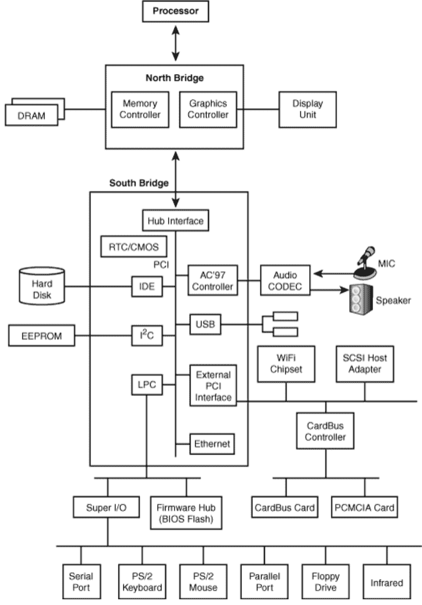

图 4.2 展示了一个假设嵌入式设备的类似框图。该图包含几个 PC 世界不典型的接口，如闪存、LCD、触摸屏和蜂窝调制解调器。

#### 图 4.2 嵌入式系统的硬件框图。

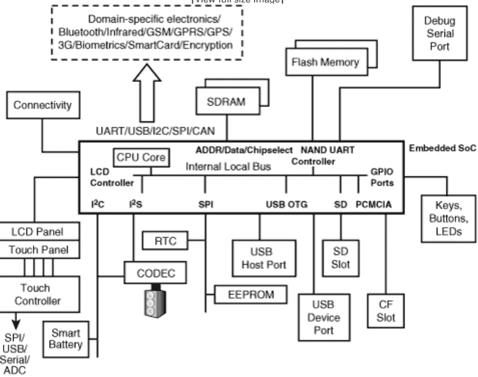

显然，访问外围设备的能力是系统功能的关键部分。设备驱动程序提供了实现这一目标的动力。本书的其余章节将逐个聚焦设备接口，并教你如何编写相应的设备驱动程序。


 [1] 正如你将在后文学到的，网络应用程序使用不同的机制将其请求路由到底层驱动程序。

图 4.1 展示了一个典型 PC 兼容系统的硬件方块图。如你所见，该系统支持多种设备和接口技术，例如内存、视频、音频、USB、PCI、WiFi、PCMCIA、I²C、IDE、以太网、串口、键盘、鼠标、软驱、并口和红外。在 PC 架构中，内存控制器和图形控制器属于*北桥*芯片组的一部分，而外围总线则源自*南桥*。

# 图 4.1. PC 兼容系统的硬件方块图。

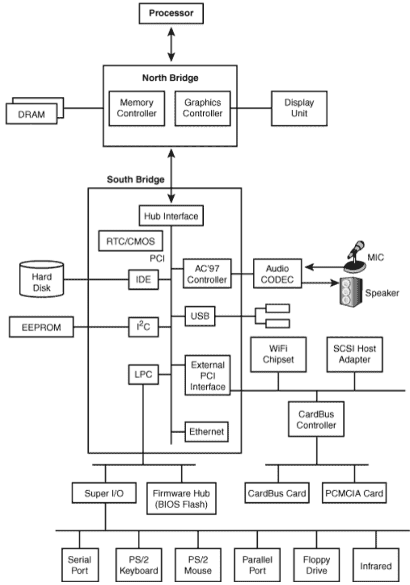

图 4.2 展示了一个假设嵌入式设备的类似方块图。该图包含了一些 PC 领域中不典型的接口，例如闪存、LCD、触摸屏和蜂窝调制解调器。

# 图 4.2. 嵌入式系统的硬件方块图。

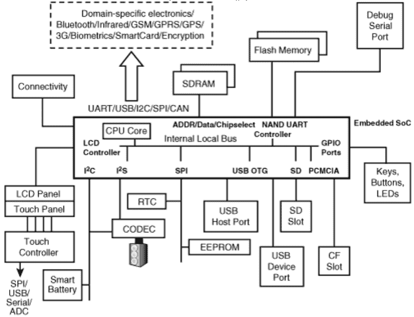

显然，访问外围设备的能力是系统运行的关键部分。设备驱动程序提供了实现这一功能的引擎。本书后续章节将聚焦于设备接口，并教你如何编写相应的设备驱动程序。

## 中断处理

由于 I/O 的不确定性，以及 I/O 设备与处理器之间的速度不匹配，设备通过异步地置位某些硬件信号来请求处理器的关注。这些硬件信号称为*中断*。每个发起中断的设备都被分配一个相关的标识符，称为*中断请求*（IRQ）号。当处理器检测到某个 IRQ 上产生了中断时，它会立即停止正在做的事情，并调用为该 IRQ 注册的*中断服务程序*（ISR）。*中断处理程序*（ISR）在中断上下文中执行。

### 中断上下文

ISR 是与硬件直接交互的关键代码片段。出于系统性能的更大利益，它们被赋予了即时执行的特权。然而，如果 ISR 不够快速和轻量，它们就违背了自己的设计哲学。VIP 享有优待，但他们有责任尽量减少给公众带来的不便。为了弥补粗鲁地打断当前执行线程，ISR 必须在一种称为中断上下文（或*原子上下文*）的受限环境中礼貌地执行。

以下是在中断上下文中执行的代码该做和不该做的事项：

- 如果你的中断上下文代码进入睡眠，那可是要坐牢的罪行。中断处理程序不能通过调用睡眠函数（如 `schedule_timeout()`）来放弃处理器。从中断处理程序中调用内核 API 之前，要深入追踪嵌套的调用链，确保它不会内部触发阻塞等待。例如，`input_register_device()` 从表面上看去无害，但暗地里会调用 `kmalloc()`，并指定 `GFP_KERNEL` 作为参数。正如你在第二章"内核初探"中看到的，如果你系统的空闲内存低于水位线，以这种方式调用 `kmalloc()` 时会睡眠等待内存被交换程序释放。

- 为了保护中断处理程序中的临界区，你不能使用互斥锁，因为它们可能会进入睡眠。请改用自旋锁，而且只在必要时才使用。

- 中断处理程序不能直接与用户空间交换数据，因为它们没有通过进程上下文与用户态相连。这引出了中断处理程序不能睡眠的另一个原因：调度器以进程为粒度工作，所以如果中断处理程序睡眠并被调度出去，它们又如何能重新放入运行队列呢？

- 中断处理程序应该尽快让路，但又期望完成工作。为了化解这一两难困境，中断处理程序通常将工作一分为二。处理程序精简的*上半部*声称已确认并服务了中断，但实际上将所有繁重工作卸载给臃肿的*下半部*。下半部的执行被推迟到稍后的时间点，届时所有中断都已启用。在稍后讨论*软中断*（softirq）和*任务队列*（tasklet）时，你将学会开发下半部。

- 你无需将中断处理程序设计为可重入的。当中断处理程序运行时，对应的 IRQ 会被禁用，直到处理程序返回。因此，与进程上下文代码不同，同一处理程序的不同实例不会同时在多个处理器上运行。

- 中断处理程序可能被具有更高优先级的 IRQ 相关联的处理程序中断。你可以通过专门请求内核将你的中断处理程序视为*快速*处理程序来阻止这种嵌套中断。快速处理程序在本地处理器上所有中断禁用的状态下运行。在禁用中断或将中断处理程序标记为快速之前，要注意中断关闭时间越长，对系统性能越不利。中断关闭时间越多，中断延迟就越大，即产生的中断被服务之前的延迟就越长。中断延迟与系统的实时响应性成反比。

函数可以检查 `in_interrupt()` 返回的值，以确定自己是否正在中断上下文中执行。

与外部硬件产生的异步中断不同，还存在同步到达的中断类别。同步中断之所以如此命名，是因为它们不会意外发生——处理器自身执行指令时产生它们。外部中断和同步中断都使用相同的机制由内核处理。

同步中断的例子包括：

- 异常，用于报告严重的运行时错误
- 软件中断，例如 x86 架构上用于实现系统调用的 `int 0x80` 指令

### 分配 IRQ

设备驱动程序必须将其 IRQ 号与中断处理程序关联起来。为此，它们需要知道自己驱动设备的 IRQ 分配情况。IRQ 分配可能很简单，也可能需要复杂的探测。例如，在 PC 架构中，定时器中断被分配为 IRQ 0，RTC 中断对应 IRQ 8。现代总线技术（如 PCI）足够复杂，能够响应关于其 IRQ 的查询（由 BIOS 在启动时遍历总线分配）。PCI 驱动程序可以探查设备配置空间中的指定区域，从而确定 IRQ。对于旧设备，如*工业标准架构*（ISA）卡，驱动程序可能需要利用硬件特定的知识来探测和解码 IRQ。

查看你系统中的 */proc/interrupts*，可以获取活动 IRQ 的列表。

### 设备示例：滚轮

既然你已经学习了中断处理的基础知识，让我们为一个示例滚轮设备实现中断处理程序。滚轮可以在一些手机和 PDA 上找到，用于方便的菜单导航，能够执行三种动作：顺时针旋转、逆时针旋转和按键按压。我们假设的滚轮接线方式是：任何这些动作都会通过 IRQ 7 中断处理器。处理器的*通用输入/输出*（GPIO）D 端口的三个低位连接到滚轮设备。这些引脚上对应不同滚轮动作所产生的波形如图 4.3 所示。中断处理程序的工作是通过查看端口 D 的 GPIO 数据寄存器来解码滚轮动作。

**图 4.3. 滚轮产生的示例波形。**

驱动程序首先需要请求 IRQ 并将中断处理程序与之关联：

```c
#define ROLLER_IRQ  7
static irqreturn_t roller_interrupt(int irq, void *dev_id);

if (request_irq(ROLLER_IRQ, roller_interrupt, IRQF_DISABLED |
                IRQF_TRIGGER_RISING, "roll", NULL)) {
  printk(KERN_ERR "Roll: Can't register IRQ %d\n", ROLLER_IRQ);
  return -EIO;
}
```

让我们看看传递给 `request_irq()` 的参数。在这个简单情况下，IRQ 号不是通过查询或探测获得的，而是根据硬件连接硬编码为 `ROLLER_IRQ`。第二个参数 `roller_interrupt()` 是中断处理程序例程。其原型指定了 `irqreturn_t` 的返回类型，如果中断成功处理则返回 `IRQ_HANDLED`，否则返回 `IRQ_NONE`。对于 PCI 等 I/O 技术，返回值更为重要，因为多个设备可以共享同一个 IRQ。

`IRQF_DISABLED` 标志指定该中断处理程序应被视为快速处理程序，因此内核


必须在调用处理程序时禁用中断。`IRQF_TRIGGER_RISING`表明滚轮在想要发出中断信号时会在中断线上产生一个上升沿。换句话说，滚轮是一个*边沿触发*设备。有些设备则是*电平触发*的，它们会保持中断线置位，直到CPU为其提供服务。要将中断标记为电平触发，请使用`IRQF_TRIGGER_HIGH`标志。此参数的其他可能值包括`IRQF_SAMPLE_RANDOM`（在第5章"字符驱动程序"的"伪字符驱动程序"一节中使用过）和`IRQF_SHARED`（用于指定该IRQ由多个设备共享）。

下一个参数`"roll"`用于在*/proc/interrupts*等文件生成的数据中标识该设备。最后一个参数在此情况下设置为`NULL`，仅与共享中断处理程序相关，用于标识共享IRQ线的每个设备。

> 从2.6.19内核开始，中断处理程序接口发生了一些变化。中断处理程序过去接受第三个参数（`struct pt_regs *`），该参数包含指向CPU寄存器的指针，但从2.6.19内核开始已被移除。此外，`IRQF_xxx`系列中断标志取代了`SA_xxx`系列。例如，在早期内核中，你必须使用`SA_INTERRUPT`而不是`IRQF_DISABLED`来将中断处理程序标记为快速型。

驱动程序初始化并不是请求IRQ的好地方，因为即使设备未在使用，这也可能占用该宝贵资源。因此，设备驱动程序通常在设备被应用程序打开时请求IRQ。同样，IRQ在应用程序关闭设备时释放，而不是在退出驱动程序模块时释放。释放IRQ的方式如下：

```
`free_irq(int irq, void *dev_id);`
```

#### 清单 4.1. 滚轮中断处理程序

```
Code View:
spinlock_t roller_lock = SPIN_LOCK_UNLOCKED;
static DECLARE_WAIT_QUEUE_HEAD(roller_poll);

static irqreturn_t
roller_interrupt(int irq, void *dev_id)
{
  int i, PA_t, PA_delta_t, movement = 0;

  /* Get the waveforms from bits 0, 1 and 2
     of Port D as shown in Figure 4.3 */
  PA_t = PORTD & 0x07;

  /* Wait until the state of the pins change.
     (Add some timeout to the loop) */
  for (i=0; (PA_t==PA_delta_t); i++){
    PA_delta_t = PORTD & 0x07;
  }

  movement = determine_movement(PA_t, PA_delta_t); /* See below */
  spin_lock(&roller_lock);

  /* Store the wheel movement in a buffer for
     later access by the read()/poll() entry points */
  store_movements(movement);

  spin_unlock(&roller_lock);

  /* Wake up the poll entry point that might have
     gone to sleep, waiting for a wheel movement */
  wake_up_interruptible(&roller_poll);

  return IRQ_HANDLED;
}
int
determine_movement(int PA_t, int PA_delta_t)
{
  switch (PA_t){
    case 0:
      switch (PA_delta_t){
      case 1:
        movement = ANTICLOCKWISE;
        break;
      case 2:
        movement = CLOCKWISE;
        break;
      case 4:
        movement = KEYPRESSED;
        break;
      }
      break;
    case 1:
      switch (PA_delta_t){
      case 3:
        movement = ANTICLOCKWISE;
        break;
      case 0:
        movement = CLOCKWISE;
        break;
      }
      break;
    case 2:
      switch (PA_delta_t){
      case 0:
        movement = ANTICLOCKWISE;
        break;
      case 3:
        movement = CLOCKWISE;
        break;
      }
      break;
    case 3:
      switch (PA_delta_t){
      case 2:
        movement = ANTICLOCKWISE;
        break;
      case 1:
        movement = CLOCKWISE;
        break;
      }
      break;
    case 4:
      movement = KEYPRESSED;
      break;
    }
  }
```

`read()`和`poll()`等驱动程序入口点与`roller_interrupt()`协同工作。例如，当处理程序解读滚轮运动时，它会唤醒任何正在等待的`poll()`线程，这些线程可能因X Windows等应用程序发出的`select()`系统调用而进入睡眠状态。在学习完[第5章](#chapter-5)中字符驱动程序的内部原理后，请重新查看[清单4.1](#listing-4.1)并实现完整的滚轮驱动程序。

[第7章](#chapter-7)"输入驱动程序"中的[清单7.3](#listing-7.3)利用内核的*输入*接口将此滚轮转换为滚轮鼠标。

让我们通过介绍一些函数来结束本节，这些函数用于启用和禁用特定IRQ上的中断。`enable_irq(ROLLER_IRQ)`在滚轮移动时启用中断生成，而`disable_irq(ROLLER_IRQ)`则执行相反操作。`disable_irq_nosync(ROLLER_IRQ)`禁用滚轮中断，但不会等待当前正在执行的`roller_interrupt()`实例返回。这种*非同步*版本的`disable_irq()`速度更快，但可能导致竞态条件。仅当你确定不会存在竞态时才使用此函数。`disable_irq_nosync()`的一个使用示例是*drivers/ide/ide-io.c*，它在初始化期间屏蔽中断，因为某些系统在这方面存在问题。

### 软中断和任务let

如前所述，中断处理程序有两个相互冲突我很高兴为您继续翻译剩余的内容：

### 软中断和任务let

如前所述，中断处理程序有两个相互冲突的需求：它们负责大部分的设备数据处理，但又必须尽快退出。为了解决这一困境，中断处理程序被设计成两部分：一个匆忙而繁忙的上半部分与硬件交互，以及一个轻松的下<在反对与此同时，下半部分则在所有中断都启用的情况下完成大部分处理工作。与中断不同，下半部分是同步的，因为由内核决定何时执行它们。内核中提供了以下机制来将工作延迟到下半部分执行：软中断、任务let和工作队列。

软中断是基本的下半部分机制，具有较强的锁定要求。它们仅被少数对性能敏感的子系统使用，如网络层、SCSI层和内核定时器。任务let构建在软中断之上，更易于使用。建议除非你有严格的可扩展性或速度要求，否则使用任务let。软中断和任务let的一个主要区别是前者可重入而后者不可重入。同一软中断的不同实例可以在不同处理器上同时运行，但任务let则不行。

为了说明软中断和任务let的用法，假设前面示例中的滚轮由于存在活动部件而存在固有硬件问题（比如滚轮偶尔卡住），导致生成不符合规格的波形。卡住的滚轮可能持续产生虚假中断，并可能导致系统冻结。为了解决这个问题，捕获波形流，对其进行分析，如果滚轮看起来卡住了，则动态地从切换，反之亦然。从中断处理程序捕获波形流，并从下半部分执行分析。[清单4.2](#listing-4.2)使用软中断实现了这一点，[清单4.3](#listing-4.3)则使用了任务let。两者都是[清单4.1](#listing-4.1)的简化版本。这将处理程序简化为两个函数：`roller_capture()`从GPIO端口D获取波形片段，以及`roller_analyze()`对波形执行算法分析并在需要时切换到轮询模式。

#### 清单 4.2. 使用软中断从中断处理程序分流工作

```
Code View:
void __init
roller_init()
{
  /* ... */

  /* Open the softirq. Add an entry for ROLLER_SOFT_IRQ in
     the enum list in include/linux/interrupt.h */
  open_softirq(ROLLER_SOFT_IRQ, roller_analyze, NULL);
}


/* The bottom half */
void
roller_analyze()
{
  /* Analyze the waveforms and switch to polled mode if required */
}
/* The interrupt handler */
static irqreturn_t
roller_interrupt(int irq, void *dev_id)
{
  /* Capture the wave stream */
  roller_capture();

  /* Mark softirq as pending */
  raise_softirq(ROLLER_SOFT_IRQ);

  return IRQ_HANDLED;
}
```

要定义软中断，你必须静态地向*include/linux/interrupt.h*中添加一个条目。你无法动态定义软中断。`raise_softirq()`声明相应的软中断处于待执行状态。内核将在下一个可用机会执行它。这可能是在退出中断处理程序时，或通过*ksoftirqd*内核线程。

#### 清单 4.3. 使用任务let从中断处理程序分流工作


 ```markdown
Code View:

```
struct roller_device_struct { /* Device-specific structure */
  /* ... */
  struct tasklet_struct tsklt;
  /* ... */
}

void __init roller_init()
{
  struct roller_device_struct *dev_struct;
  /* ... */

  /* Initialize tasklet */
  tasklet_init(&dev_struct->tsklt, roller_analyze, dev);
}


/* The bottom half */
void
roller_analyze()
{
/* Analyze the waveforms and switch to
   polled mode if required */
}
/* The interrupt handler */
static irqreturn_t
roller_interrupt(int irq, void *dev_id)
{
  struct roller_device_struct *dev_struct;

  /* Capture the wave stream */
  roller_capture();

  /* Mark tasklet as pending */
  tasklet_schedule(&dev_struct->tsklt);

  return IRQ_HANDLED;
}
```

`tasklet_init()`动态初始化一个tasklet。该函数不会为`tasklet_struct`分配内存，而是需要你传递一个已分配结构的地址。`tasklet_schedule()`通知内核相应的tasklet处于待执行状态。与中断类似，内核提供了一组函数来控制多处理器系统上tasklet的执行状态：

- `tasklet_enable()`启用tasklet。
- `tasklet_disable()`禁用tasklet，并等待任何当前正在执行的tasklet实例退出。
- `tasklet_disable_nosync()`的语义与`disable_irq_nosync()`类似。该函数不会等待活跃的tasklet实例完成执行。

你已经看到了中断处理程序和下半部之间的区别，但它们也有一些相似之处。中断处理程序和tasklet都不可重入。而且它们都不能睡眠。此外，中断处理程序、tasklet和softirq都不能被抢占。

工作队列是从中断处理程序中延迟执行工作的第三种方式。它们在进程上下文中执行，允许睡眠，因此可以使用诸如互斥锁等可能阻塞的函数。我们在前一章讨论各种内核辅助设施时已经介绍过工作队列。表4.1比较了softirq、tasklet和工作队列。

| | Softirqs | Tasklets | Work Queues |
|---|---|---|---|
| **执行上下文** | 延迟工作在中断上下文中运行。 | 延迟工作在中断上下文中运行。 | 延迟工作在进程上下文中运行。 |
| **可重入性** | 可在不同CPU上同时运行。 | 不能在不同CPU上同时运行。不过，不同的CPU可以运行不同的tasklet。 | 可在不同CPU上同时运行。 |
| **睡眠语义** | 不能睡眠。 | 不能睡眠。 | 可以睡眠。 |
| **可抢占性** | 不能被抢占/调度。 | 不能被抢占/调度。 | 可以被抢占/调度。 |
| **易用性** | 不易使用。 | 易于使用。 | 易于使用。 |
| **使用场景** | 如果延迟工作不会睡眠，且有关键的可扩展性或速度要求。 | 如果延迟工作不睡眠。 | 如果延迟工作可能睡眠。 |

#### 表4.1. Softirq、Tasklet和工作队列的比较

> 在LKML上，关于是否废除tasklet接口的可行性一直存在争论。Tasklet比进程上下文代码享有更高的优先级，因此会带来延迟问题。而且，正如你所了解的，它们被限制不能睡眠，且必须在同一个CPU上执行。有人建议将所有现有的tasklet根据具体情况转换为softirq或工作队列。

> 第2章中提到的`-rt`补丁集将中断处理移至内核线程，以实现更广泛的抢占覆盖。

## Linux设备模型

新的Linux设备模型引入了类似C++的抽象，将设备驱动程序中的共性提取到总线层和核心层。让我们看看构成设备模型的不同组件，如*udev*、*sysfs*、*kobjects*和*device classes*，以及它们对关键内核子系统的影响，如*/dev*节点管理、热插拔、固件下载和模块自动加载。*Udev*是观察设备模型益处的最佳视角，所以我们从这里开始。

### Udev

多年前，当Linux还年轻时，管理设备节点并不是一件有趣的事情。所有需要的节点（可能多达数千个）必须静态地创建在*/dev*目录下。这个问题实际上可以追溯到最初的UNIX系统。随着2.4版本内核的出现，*devfs*问世，引入了动态设备节点创建。Devfs提供了在内存文件系统中生成设备节点的服务，但命名节点的责任仍然落在设备驱动程序身上。然而，设备命名策略是管理性的，与内核不太协调。策略的归属应该在头文件、内核模块参数或用户空间中。Udev的出现将设备管理推向了用户空间。

Udev依赖以下条件来工作：

1. 内核*sysfs*支持，这是Linux设备模型的重要组成部分。Sysfs是一个在启动时挂载在*/sys*下的内存文件系统（查看*/etc/fstab*中的说明）。我们将在下一节讨论sysfs，但现在，请暂且接受相应的sysfs文件访问。

2. 一组用户空间守护进程和工具，如*udevd*和*udevinfo*。

3. 位于*/etc/udev/rules.d/*目录中的用户指定规则。你可以制定规则来获得设备的一致视图。

要了解如何使用udev，让我们看一个例子。假设你有一个USB DVD驱动器和一个USB CD-RW驱动器。根据热插拔这些设备的顺序，其中一个被分配名称*/dev/sr0*，另一个获得名称*/dev/sr1*。在udev之前的时代，你必须先弄清楚相关的名称才能使用设备。但有了udev，你可以一致地查看DVD（比如说，*/dev/usbdvd*）和CD-RW（比如说，*/dev/usbcdrw*），而不管它们被插入或拔出的顺序如何。

首先，从sysfs中的相应文件提取产品属性。假设（Targus）DVD驱动器被分配了设备节点*/dev/sr0*，而（Addonics）CD-RW驱动器被赋予了名称*/dev/sr1*。使用`udevinfo`收集设备信息：

Code View:

```
bash> udevinfo -a -p /sys/block/sr0

...

looking at the device chain at
'/sys/devices/pci0000:00/0000:00:1d.7/usb1/1-4':
 BUS="usb"
 ID="1-4"
 SYSFS{bConfigurationValue}="1"
 ...
```

```
SYSFS{idProduct}="0701"
SYSFS{idVendor}="05e3"
SYSFS{manufacturer}="Genesyslogic"
SYSFS{maxchild}="0"
SYSFS{product}="USB Mass Storage Device"
...
```

```
bash> udevinfo -a -p /sys/block/sr1
 ...
 looking at the device chain at
 '/sys/devices/pci0000:00/0000:00:1d.7/usb1/1-3':
 BUS="usb"
 ID="1-3"
 SYSFS{bConfigurationValue}="2"
  ...
 SYSFS{idProduct}="0302"
 SYSFS{idVendor}="0dbf"
 SYSFS{manufacturer}="Addonics"
 SYSFS{maxchild}="0"
 SYSFS{product}="USB to IDE Cable"
 ...
```

接下来，让我们使用收集到的产品信息来识别设备并添加udev命名规则。创建一个名为`/etc/udev/rules.d/40-cdvd.rules`的文件，并向其中添加以下规则：

```
BUS="usb", SYSFS{idProduct}="0701", SYSFS{idVendor}="05e3",
KERNEL="sr[0-9]*", NAME="%k", SYMLINK="usbdvd"

BUS="usb", SYSFS{idProduct}="0302", SYSFS{idVendor}="0dbf",
KERNEL="sr[0-9]*", NAME="%k", SYMLINK="usbcdrw"
```

第一条规则告诉udev，每当它发现一个产品ID为0x0701、厂商ID为0x05e3且名称以sr开头的USB设备时，应该在/dev下创建同名节点，并生成一个名为usbdvd的符号链接指向创建的节点。类似地，第二条规则指示为CD-RW驱动器创建名为usbcdrw的符号链接。

要测试规则中的语法错误，可以对`/sys/block/sr*`运行`udevtest`。要开启`/var/log/messages`中的详细消息，在`/etc/udev/udev.conf`中将`udev_log`设置为`"yes"`。要实时用新添加的规则重新填充/dev目录，使用`udevstart`重新启动udev。完成这些后，你的DVD驱动器会始终作为`/dev/usbdvd`出现在系统中，而CD-RW驱动器始终作为`/dev/usbcdrw`出现。你可以使用如下命令从shell脚本中确定性地挂载它们：

```
mount /dev/usbdvd /mnt/dvd
```

设备节点（和网络接口）的一致命名并不是udev的唯一能力。它还演变为Linux热插拔管理器。Udev还负责按需自动加载模块，以及向需要微码的设备下载微码。但在深入了解这些能力之前，让我们先获得对设备模型内部机制的基本理解。

### Sysfs、Kobjects和设备类
```


Sysfs、kobjects 和设备类是设备模型的构建模块，但它们较为低调，倾向于在幕后工作。它们主要用于总线和核心实现层面，隐藏在向设备驱动提供服务的 API 内部。

Sysfs 是内核结构化设备模型在用户空间的体现。它与 procfs 类似，两者都是包含内核数据结构信息的内存文件系统。procfs 是内核内部的通用窗口，而 sysfs 则专用于设备模型。因此，sysfs 并不能替代 procfs。进程描述符、sysctl 参数等信息属于 procfs，而非 sysfs。正如即将看到的那样，udev 的大部分扩展功能都依赖于 sysfs。

Kobjects 引入了对通用对象属性（如使用引用计数）的封装。它们通常嵌入在更大的结构中。以下是 kobject 的主要字段，其定义位于 *include/linux/kobject.h* 中：

- 1. 一个 *kref* 对象，用于执行引用计数管理。`kref_init()` 接口初始化 kref，`kref_get()` 增加与 kref 关联的引用计数，`kref_put()` 减少引用计数，并在没有剩余引用时释放对象。例如，URB 结构（在第 11 章"通用串行总线"中解释）包含一个 kref 来跟踪其引用数量。[2]

> [2] `usb_alloc_urb()` 接口调用 `kref_init()`，`usb_submit_urb()` 调用 `kref_get()`，`usb_free_urb()` 调用 `kref_put()`。

- 2. 指向一个 *kset* 的指针，kset 是该 kobject 所属的对象集合。

- 3. 一个 *kobj_type*，即描述该 kobject 的对象类型。

Kobjects 与 sysfs 紧密交织。内核中实例化的每个 kobject 都有对应的 sysfs 表示。

设备类的概念是设备模型的另一特性，也是驱动程序中更可能使用的接口。类接口抽象了这样一个概念：每个设备都属于更广泛的设备类（或类别）。USB 鼠标、PS/2 键盘和摇杆都属于 *input* 类，在 */sys/class/input/* 下拥有各自的条目。

*图 4.4* 展示了一台连接了外部 USB 鼠标的笔记本电脑上的 sysfs 层次结构。顶级的 *bus*、*class* 和 *device* 目录被展开，以显示 sysfs 如何根据设备类型及其物理连接提供 USB 鼠标的视图。该鼠标是一个输入类设备，但物理上是一个响应两个端点地址的 USB 设备——一个控制端点 *ep00* 和一个中断端点 *ep81*。所涉及的 USB 端口属于总线 2 上的 USB 主机控制器，而该 USB 主机控制器本身则通过 PCI 总线与 CPU 桥接。如果这些细节目前还不太清楚，不必担心；在阅读了讲授输入驱动程序（第 7 章）、PCI 驱动程序（第 10 章"外设组件互连"）和 USB 驱动程序（第 11 章）的章节后，再回到本节来回顾。

#### **图 4.4. USB 鼠标的 Sysfs 层次结构**

代码视图：

```
[/sys]
    +[block]
    -[bus]-[usb]-[devices]-[usb2]-[2-2]-[2-2:1.0]-[usbendpoint:usbdev2.2-ep81]
    -[class]-[input]-[mouse2]-[device]-[bus]-[usbendpoint:usbdev2.2-ep81]
              -[usb_device]-[usbdev2.2]-[device]-[bus]
              -[usb_endpoint]-[usbdev2.2-ep00]-[device]
                             -[usbdev2.2-ep81]-[device]
    -[devices]-[pci0000:00]-[0000:00:1d:1]-[usb2]-[2-2]-[2-2:1.0]
    +[firmware]
    +[fs]
    +[kernel]
    +[module]
    +[power]
```

浏览 /sys 以查找与另一个设备（例如你的网卡）相关联的条目，以便更好地感受其层次化组织。第 10 章"寻址与识别"一节说明了 sysfs 如何反映笔记本电脑上 CardBus 以太网-调制解调器卡的物理连接。

类编程接口构建在 kobjects 和 sysfs 之上，因此这是开始深入理解设备模型组件之间端到端交互的好地方。让我们以 RTC 驱动为例。RTC 驱动程序（drivers/char/rtc.c）是一个杂项（或"misc"）驱动程序。我们在第 5 章讨论字符设备驱动程序时，会详细介绍 misc 驱动程序。

插入 RTC 驱动模块，查看 /sys 和 /dev 下创建的节点：

```
bash> modprobe rtc
bash> ls -lR /sys/class/misc
drwxr-xr-x 2 root root 0 Jan 15 01:23 rtc
/sys/class/misc/rtc:
total 0
-r--r--r-- 1 root root 4096 Jan 15 01:23 dev
--w------- 1 root root 4096 Jan 15 01:23 uevent
bash> ls -l /dev/rtc
crw-r--r-- 1 root root 10, 135 Jan 15 01:23 /dev/rtc
```

/sys/class/misc/rtc/dev 包含分配给该设备的主设备号和次设备号（在下一章中讨论），/sys/class/misc/rtc/uevent 用于冷插拔（在下一节中讨论），/dev/rtc 则由应用程序用来访问 RTC 驱动程序。

让我们理解通过设备模型的代码流程。Misc 驱动程序在初始化期间利用 misc_register() 的服务，如果去掉一些代码，它看起来像这样：

```
/* ... */
dev = MKDEV(MISC_MAJOR, misc->minor);

misc->class = class_device_create(misc_class, NULL, dev,
                                  misc->dev,
                                  "%s", misc->name);
if (IS_ERR(misc->class)) {
  err = PTR_ERR(misc->class);
  goto out;
}
/* ... */
```

图 4.5 继续剥离更多层次，以深入设备建模的底层。它说明了在类、kobjects、sysfs 和 udev 之间产生的过渡，这些过渡导致了前述 /sys 和 /dev 文件的生成。

#### 图 4.5. 连接设备模型的各个部分。

查看并行端口 LED 驱动程序（第 5 章"与并行端口通信"一节中的清单 5.6）和虚拟鼠标输入驱动程序（第 7 章"设备示例：虚拟鼠标"一节中的清单 7.2），了解如何在 sysfs 中创建设备控制文件的示例。

作为设备模型一部分的另一个抽象是总线-设备-驱动编程接口。内核设备支持被清晰地结构化为总线、设备和驱动程序。这使得各个驱动程序实现更加简单和通用。例如，总线实现可以搜索能够处理特定设备的驱动程序。

考虑内核的 I²C 子系统（在第 8 章"内部集成电路协议"中探讨）。I²C 层由核心基础设施、总线适配器设备驱动程序和客户设备驱动程序组成。I²C 核心层使用 `bus_register()` 注册每个检测到的 I²C 总线适配器。当 I²C 客户设备（例如，一个*电可擦可编程只读存储器* [EEPROM] 芯片）被探测和检测到时，其存在通过 `device_register()` 记录。最后，I²C EEPROM 客户驱动程序使用 `driver_register()` 注册自身。这些注册是通过 I²C 核心提供的服务函数间接执行的。

`bus_register()` 向 */sys/bus/* 添加相应的条目，而 `device_register()` 在 */sys/devices/* 下添加条目。`struct bus_type`、`struct device` 和 `struct device_driver` 分别是总线、设备和驱动程序使用的主要数据结构。在 *include/linux/device.h* 中查看它们的定义。

### 热插拔与冷插拔

在系统运行时动态连接的设备被称为*热插拔*，而在系统启动前连接的设备则被认为是*冷插拔*。以前，内核通过调用通过 */proc* 文件系统注册的辅助程序来通知用户空间热插拔事件。但当前内核检测到热插拔时，会通过 netlink 套接字向用户空间分派 uevent。Netlink 套接字是使用套接字 API 在内核空间和用户空间之间进行通信的有效机制。在用户空间端，管理设备节点创建和删除的守护进程 udevd 接收 uevent 并管理热插拔。

要了解热插拔处理最近如何演变，让我们考虑运行不同版本 2.6 内核的 udev 的渐进层次：

- 1. 使用 *udev-039* 软件包和 2.6.9 内核时，当内核检测到热插拔事件时，它会调用注册到 */proc/sys/kernel/hotplug* 的用户空间辅助程序。默认为 */sbin/hotplug*，它以环境变量的形式接收热插拔设备的属性。*/sbin/hotplug* 查看热插拔配置目录（通常为 */etc/hotplug.d/default/*）并运行，例如 */etc/hotplug.d/default/10-udev.hotplug*，在执行 */etc/hotplug/* 下的其他脚本之后。

```
bash> ls -l /etc/hotplug.d/default/
...
lrwxrwxrwx 1 root root 14 May 11 2005 10-udev.hotplug -> /sbin/udevsend
...
```

当 */sbin/udevsend* 被执行时，它将热插拔设备信息传递给 udevd。

- 2. 使用 udev-058 和 2.6.11 内核时，udevsend 工具替代了 */sbin/hotplug*：

```
bash> cat /proc/sys/kernel/hotplug
/sbin/udevsend
```

- 3. 使用最新版本的 udev 和内核时，udevd 完全承担管理热插拔的责任，不再依赖 udevsend。它现在直接通过 netlink 套接字从内核获取热插拔事件（见图 4.4）。*/proc/sys/kernel/hotplug* 不包含任何内容：

```
bash> cat /proc/sys/kernel/hotplug
bash>
```


 ## 微码下载

某些设备在准备就绪之前必须先加载微码。微码由板载微控制器执行。设备驱动程序过去将微码存储在头文件中的静态数组里。但这种方式已难以为继，因为微码通常由设备供应商以专有二进制镜像的形式分发，这与采用 GPL 许可证的内核无法均匀混合。另一个反对将固件与内核源代码混合的原因是它们遵循不同的发布周期。显然，解决方案是在用户空间单独维护微码，并在需要时将其传递给内核。Sysfs 和 udev 提供了实现这一点的基础设施。

让我们以在多款笔记本电脑上使用的英特尔 PRO/Wireless 2100 WiFi mini PCI 卡为例。该卡围绕一个微控制器构建，需要执行外部提供的微码才能正常操作。让我们逐步了解 Linux 驱动程序下载微码到该卡的步骤。假设你已从 <http://ipw2100.sourceforge.net/firmware.php> 获取所需的微码镜像（_ipw2100-1.3.fw_），并将其保存在系统中的 _/lib/firmware/_ 下，且已插入驱动模块 _ipw2100.ko_：

- 1. 在初始化期间，驱动程序调用以下内容：

   `request_firmware(..,"ipw2100-1.3.fw",..);`

- 2. 这将向用户空间分发一个热插拔 uevent，连同所请求微码镜像的标识信息。

- 3. Udevd 接收 uevent 并通过调用 _/sbin/firmware_helper_ 作出响应。为此，它使用 _/etc/udev/rules.d/_ 下某文件中的类似如下规则：

   `ACTION=="add", SUBSYSTEM=="firmware", RUN="/sbin/firmware_helper"`

- 4. _/sbin/firmware_helper_ 在 _/lib/firmware/_ 中查找并定位所请求的微码镜像 _ipw2100-1.3.fw_。它将该镜像转储到 _/sys/class/0000:02:02.0/data_。（此处的 0000:02:02 是该 WiFi 卡的 PCI *总线:设备:功能* 标识符。）

- 5. 驱动程序接收微码并将其下载到设备上。完成后，调用 `release_firmware()` 释放相应的数据结构。

- 6. 驱动程序完成其余的初始化工作，WiFi 适配器开始发送信标信号。

### 模块自动加载

按需自动加载内核模块是 Linux 支持的一项便捷功能。要理解内核如何发出"模块故障"以及 udev 如何处理它，让我们将一张 Xircom CardBus 以太网适配器插入笔记本电脑的 PC Card 插槽：

- 1. 在编译期间，受支持设备的标识信息会作为驱动模块对象的一部分生成。查看支持 Xircom CardBus 以太网组合卡（*drivers/net/tulip/xircom_cb.c*）的驱动程序，找到以下代码片段：

```
static struct pci_device_id xircom_pci_table[] = {
    {0x115D, 0x0003, PCI_ANY_ID, PCI_ANY_ID,},
    {0,},
};

/* Mark the device table */
MODULE_DEVICE_TABLE(pci, xircom_pci_table);
```

这声明该驱动程序可以支持任何 PCI 厂商 ID 为 `0x115D`、PCI 设备 ID 为 `0x0003` 的插卡（更多内容见第 10 章）。当你安装驱动模块时，depmod 工具会查看模块镜像并解析设备表中存在的 ID。然后它向 _/lib/modules/kernel-version/modules.alias_ 添加以下条目：

```
alias pci:v0000115Dd00000003sv*sd*bc*sc*i* xircom_cb
```

其中 `v` 代表 VendorID（厂商 ID），`d` 代表 DeviceID（设备 ID），`sv` 代表 subvendorID（子厂商 ID），`*` 代表通配符匹配。

- 2. 当你将 Xircom 卡热插拔到 CardBus 插槽时，内核生成一个 uevent，宣告新插入设备的身份。你可以使用 udevmonitor 查看生成的 uevent：

```
bash> udevmonitor --env
    ...
    MODALIAS=pci:v0000115Dd00000003sv0000115Dsd00001181bc02sc00i00
    ...
```

- 3. Udevd 通过 netlink 套接字接收 uevent，并使用内核传递给它的上述 MODALIAS 调用 modprobe：

```
modprobe pci:v0000115Dd00000003sv0000115Dsd00001181bc02sc00i00
```

- 4. Modprobe 在步骤 1 创建的 _/lib/modules/kernel-version/modules.alias_ 中找到匹配的条目，并继续插入 _xircom_cb_：

```
bash> lsmod
Module      Size   Used by
xircom_cb   10433  0
...
```

这张网卡现在已准备好上网冲浪。

说实话，看吧。在阅读完第 10 章后，你可能想重新回顾本节内容。

### 嵌入式设备上的 Udev

有一种观点认为，在嵌入式设备上应该使用静态创建的设备节点而非 udev，理由如下：

- Udev 在每次重启时创建 _/dev_ 节点，而静态节点仅在软件安装时创建一次。如果你的嵌入式设备使用闪存存储，前者会导致存放 _/dev"_ 节点的闪存页在每次启动时都经历擦写周期，这会缩短闪存寿命。（闪存将在第 17 章"内存技术设备"中详细讨论。）不过，你可以选择将 _/dev_ 挂载到基于 RAM 的文件系统上。

- Udev 会增加启动时间。

- Udev 的诸如动态创建 _/dev_ 节点和自动加载模块等功能会引入一定程度的不确定性，这是一些解决方案设计者在专用嵌入式设备上希望避免的，尤其是那些不通过热插拔总线与外部交互的设备。根据这种观点，静态节点创建和启动时插入任何模块可以提供对系统更多的控制，并使其更易于测试。

## 内存屏障

许多处理器和编译器会对指令进行重排序以实现最佳执行速度。重排序的方式保证新的指令流在语义上与原指令流等价。然而，例如，如果你正在向 I/O 设备的内存映射寄存器写入数据，指令重排序可能产生意外的副作用。为了防止处理器重排序指令，你可以在代码中插入屏障。`wmb()` 函数插入一个路障，阻止写操作通过它；`rmb()` 提供读屏障，禁止读操作跨越它；`mb()` 则产生一个读写屏障。

除了前述的 CPU 与硬件之间的交互外，内存屏障在 SMP 系统上的 CPU 与 CPU 交互中也很重要。如果你的 CPU 数据缓存正以写回模式运行（数据直到绝对必要时才从缓存复制到内存），你可能希望暂停指令流直到缓存到内存的队列被排空。这在你遇到获取或释放锁的指令时很相关。在此场景中使用屏障是为了在多个 CPU 之间获得一致的认知。

我们将在第 10 章讨论 PCI 驱动程序和第 17 章讨论闪存映射驱动程序时再次回顾内存屏障。在此期间，请查阅 _Documentation/memory-barriers.txt_ 了解不同类型内存屏障的说明。

## 电源管理

电源管理对于使用电池供电的设备（如笔记本电脑和手持设备）至关重要。Linux 驱动程序需要感知电源状态，并响应 *待机*、*休眠* 和 *低电量* 等事件在不同状态间切换。驱动程序在切换到功耗更低的模式时，利用底层硬件支持的节能功能。例如，存储驱动程序让磁盘停转，而视频驱动程序则熄灭显示屏。

设备驱动程序中的电源感知代码只是整体电源管理框架的一部分。电源管理还涉及用户空间守护进程、实用工具、配置文件的参与，以及启动固件的参与。两种流行的电源管理机制是 APM（在附录 B "Linux 与 BIOS" 的"保护模式调用"一节中讨论）和 *高级配置与电源接口*（ACPI）。APM 正在逐渐过时，而 ACPI 已成为 Linux 系统上的事实标准电源管理策略。ACPI 将在第 20 章"更多设备与驱动程序"中进一步讨论。


核心中断处理代码是通用的，位于 *kernel/irq/* 目录下。与架构相关的部分可以在 *arch/your-arch/kernel/irq.c* 中找到。该文件中定义的 `do_IRQ()` 函数是了解内核中断处理机制的一个很好的起点。

内核软中断和 tasklet 的实现位于 *kernel/softirq.c*。该文件还包含了一些额外的函数，它们提供了对软中断和 tasklet 更细粒度的控制。查看 *include/linux/interrupt.h* 可以获取软中断向量枚举和实现中断处理程序所需的原型。关于编写中断处理程序和处理下半部的一个真实示例，可以从 *drivers/net/lib8390.c* 中的处理程序开始，然后追溯进入网络协议栈。

kobject 实现及相关编程接口位于 *lib/kobject.c* 和 *include/linux/kobject.h*。查看 *drivers/base/sys.c* 可以了解 sysfs 的实现。设备类 API 可以在 *drivers/base/class.c* 中找到。通过 netlink 套接字分发热插拔 uevent 的工作由 *lib/kobject_uevent.c* 完成。你可以从 www.kernel.org/pub/linux/utils/kernel/hotplug/udev.html 下载 udev 的源代码和文档。

要更全面地了解 APM 在 x86 Linux 上的实现，请查看内核树中的 *arch/x86/kernel/apm_32.c*、*include/linux/apm_bios.h* 和 *include/asm-x86/mach-default/apm.h*。如果你想知道 APM 如何在 ARM 等无 BIOS 架构上实现，请查看 *include/linux/apm-emulation.h* 及其使用者。内核的 ACPI 实现位于 *drivers/acpi*。

[Table 4.2](...) 包含了本章使用的主要数据结构的摘要及其在源代码树中的定义位置。[Table 4.3](...) 列出了本章使用的主要内核编程接口及其定义位置。

| 数据结构 | 位置 | 描述 |
|---|---|---|
| `tasklet_struct` | *include/linux/interrupt.h* | 管理 tasklet，这是实现下半部的一种方法 |
| `kobject` | *include/linux/kobject.h* | 封装内核对象的公共属性 |
| `kset` | *include/linux/kobject.h* | kobject 所属的对象集合 |
| `kobj_type` | *include/linux/kobject.h* | 描述 kobject 的对象类型 |
| `class` | *include/linux/device.h* | 抽象表示驱动程序属于更广泛的类别 |
| `bus_device` `device_driver` | *include/linux/device.h* | 构成 Linux 设备模型基石的结构体 |

**表 4.2. 数据结构摘要**

| 内核接口 | 位置 | 描述 |
|---|---|---|
| `request_irq()` | *kernel/irq/manage.c* | 请求一个 IRQ 并将中断处理程序与之关联 |
| `free_irq()` | *kernel/irq/manage.c* | 释放一个 IRQ |

**表 4.3. 内核编程接口摘要**

| 内核接口 | 位置 | 描述 |
| --- | --- | --- |
| `disable_irq()` | *kernel/irq/manage.c* | 禁用与所提供 IRQ 相关联的中断 |
| `disable_irq_nosync()` | *kernel/irq/manage.c* | 禁用与所提供 IRQ 相关联的中断，不等待当前正在执行的中断处理程序实例返回 |
| `enable_irq()` | *kernel/irq/manage.c* | 重新启用已通过 `disable_irq()` 或 `disable_irq_nosync()` 禁用的中断 |
| `open_softirq()` | *kernel/softirq.c* | 打开一个软中断 |
| `raise_softirq()` | *kernel/softirq.c* | 标记软中断为待执行状态 |
| `tasklet_init()` | *kernel/softirq.c* | 动态初始化一个 tasklet |
| `tasklet_schedule()` | *include/linux/interrupt.hkernel/softirq.c* | 标记一个 tasklet 为待执行状态 |
| `tasklet_enable()` | *include/linux/interrupt.h* | 启用一个 tasklet |
| `tasklet_disable()` | *include/linux/interrupt.h* | 禁用一个 tasklet |
| `tasklet_disable_nosync()` | *include/linux/interrupt.h* | 禁用一个 tasklet，不等待活动实例完成执行 |
| `class_device_register()` | *drivers/base/class.c* | Linux 设备模型中的一系列函数，用于创建/销毁类、设备类以及相关的 kobject 和 sysfs 文件 |
| `kobject_add()` | *lib/kobject.c* |  |
| `sysfs_create_dir()` | *lib/kobject_uevent.c* |  |
| `class_device_create()` | *fs/sysfs/dir.c* |  |
| `class_device_destroy()` | Wagering   *fs/sysfs/file.c* |  |
| `class_create()` |  |  |
| `class_destroy()` |  |  |
| `class_device_create_file()` |  |  |
| `sysfs_create_file()` |  |  |
| `class_device_add_attrs()` |  |  |
| `kobject_uevent()` |  |  |

这完成了我们对设备驱动程序概念的探索。在开发驱动程序时，你可能需要不时地回顾本章。

# 第五章 字符驱动程序

本章内容

- 字符驱动程序基础
- 设备示例：系统 CMOS
- 感知数据可用性
- 与并行端口通信
- RTC 子系统
- 伪字符驱动程序
- 杂项驱动程序
- 字符驱动程序注意事项
- 查看源代码

> 你现在完全可以开始尝试编写简单但真实的设备驱动程序了。在本章中，让我们看看**字符（或 char）设备驱动程序**的内部工作原理，这是一种顺序访问设备数据的内核代码。字符驱动程序可以从多种设备捕获原始数据：打印机、鼠标、看门狗、磁带、内存、RTC 等。然而，它们不适用于管理驻留在能够随机访问的块设备上的数据，如硬盘、软盘或光盘。

### 字符驱动程序基础

让我们从上到下看一看。要访问字符设备，系统用户需要调用一个合适的应用程序。应用程序负责与设备通信，但为此，它需要获取合适驱动程序的身份信息。驱动程序的联系方式通过 */dev* 目录导出到用户空间：

```
bash> ls -l /dev
total 0
crw-------  1 root root     5,   1 Jul 16 10:02 console
...
lrwxrwxrwx  1 root root        3 Oct 6 10:02  cdrom -> hdc
...
brw-rw----  1 root disk     3,   0 Oct 6 2007   hda
brw-rw----  1 root disk     3,   1 Oct 6 2007   hda1
...
crw-------  1 root tty      4,   1 Oct 6 10:20  tty1
crw-------  1 root tty      4,   2 Oct 6 10:02  tty2
```

`ls` 输出中每行的第一个字符表示驱动程序类型：`c` 表示字符驱动程序，`b` 表示块驱动程序，`l` 表示符号链接。第五列中的数字称为**主设备号**，第六列中的数字是**次设备号**。主设备号大致标识驱动程序，而次设备号精确定位驱动程序所服务的具体设备。例如，IDE 块存储驱动程序 */dev/hda* 的主设备号为 3，负责处理系统上的硬盘，但当你进一步指定次设备号为 1（*/dev/hda1*）时，就缩小范围到第一个磁盘分区。字符驱动程序和块驱动程序占用不同的空间，因此可以将相同的主设备号同时分配给字符驱动程序和块驱动程序。

让我们更进一步，窥探字符驱动程序的内部。从代码流的角度来看，字符驱动程序具有以下特点：

- 一个初始化（或 `init()`）例程，负责初始化设备并通过注册函数将驱动程序无缝地绑定到内核的其他部分。
- 一组入口点（或方法），如 `open()`、`read()`、`ioctl()`、`llseek()` 和 `write()`，它们直接对应于用户应用程序通过关联的 */dev* 节点调用的 I/O 系统调用。
- 中断例程、下半部、定时器处理程序、辅助内核线程和其他支持基础设施。这些对用户应用程序很大程度上是透明的。

从数据流的角度来看，字符驱动程序拥有以下关键数据结构：

1. 每个设备的结构体。这是驱动程序围绕其运转的信息存储库。
2. `struct cdev`，字符驱动程序的内核抽象。这个结构体通常嵌入在前面提到的每个设备的结构体内部。
3. `struct file_operations`，包含所有驱动程序入口点的地址。
4. `struct file`，包含有关关联 */dev* 节点的信息。


 ## 第5章 字符设备驱动程序

## 本章内容

- 字符驱动程序基础
- 设备示例：系统 CMOS
- 感知数据可用性
- 与并口通信
- RTC 子系统
- 伪字符驱动程序
- 杂项驱动程序
- 字符设备注意事项
- 查看源码

现在你已经准备好尝试编写简单但真实可用的设备驱动程序了。在本章中，让我们深入了解字符（或 char）设备驱动程序的内部机制，字符设备驱动程序是一种按顺序从设备访问数据的内核代码。字符驱动程序可以从多种类型的设备捕获原始数据：打印机、鼠标、看门狗、磁带、内存、RTC 等等。然而，它们不适用于管理驻留在支持随机访问的块设备上的数据，例如硬盘、软盘或光盘。

### 字符驱动程序基础

让我们自上而下地审视。要访问字符设备，系统用户需要调用一个合适的应用程序。应用程序负责与设备通信，但为此，它需要确定合适驱动程序的身份。驱动程序的联系方式通过 /dev 目录导出到用户空间：

```
bash> ls -l /dev
total 0
crw-------  1 root root     5,  1 Jul 16 10:02 console
...
lrwxrwxrwx  1 root root        3 Oct  6 10:02  cdrom -> hdc
...
brw-rw----  1 root disk  3, 0 Oct 6 2007 hda
brw-rw----  1 root disk  3, 1 Oct 6 2007 hda1
...
crw-------  1 root tty   4,  1 Oct  6 10:20 tty1
crw-------  1 root tty   4,  2 Oct  6 10:02 tty2
```

`ls` 输出中每行的第一个字符表示驱动程序类型：`c` 表示字符驱动程序，`b` 表示块驱动程序，`l` 表示符号链接。第五列中的数字称为*主设备号*，第六列中的数字是*次设备号*。主设备号大致标识驱动程序，而次设备号精确定位由驱动程序服务的具体设备。例如，IDE 块存储驱动程序 /dev/hda 的主设备号为 3，负责处理系统上的硬盘，但当你进一步指定次设备号为 1（/dev/hda1）时，就缩小到了第一个磁盘分区。字符驱动程序和块驱动程序占用不同的空间，因此你可以将相同的主设备号分配给一个字符驱动程序和一个块驱动程序。

让我们更进一步，窥探字符驱动程序的内部。从代码流的角度来看，字符驱动程序包含以下内容：

- 一个初始化（或 `init()`）例程，负责初始化设备并通过注册函数将驱动程序无缝地绑定到内核的其余部分。
- 一组入口点（或方法），例如 `open()`、`read()`、`ioctl()`、`llseek()` 和 `write()`，它们直接对应于用户应用程序在关联的 /dev 节点上调用的 I/O 系统调用。
- 中断例程、底半部、定时器处理程序、辅助内核线程和其他支持基础设施。这些对用户应用程序来说在很大程度上是透明的。

从数据流的角度来看，字符驱动程序拥有以下关键数据结构：

1. 每个设备的结构体。这是驱动程序围绕其运转的信息存储库。
2. `struct cdev`，内核为字符驱动程序提供的抽象。这个结构体通常嵌入在前面提到的每个设备的结构体中。
3. `struct file_operations`，包含所有驱动程序入口点的地址。
4. `struct file`，包含有关关联 /dev 节点的信息。

### 设备示例：系统 CMOS

让我们实现一个用于访问系统 CMOS 的字符驱动程序。PC 兼容硬件上的 BIOS（参见图 5.1）使用 CMOS 存储启动选项、启动顺序和系统日期等信息，你可以通过 BIOS 设置菜单配置这些内容。我们的 CMOS 示例驱动程序让你可以像访问普通文件一样访问两个 PC CMOS 存储体。应用程序可以操作 *dev/cmos/0* 和 *dev/cmos/1*，并使用 I/O 系统调用从两个存储体访问数据。由于 BIOS 以位级粒度为 CMOS 区域分配语义，因此该驱动程序支持位级访问。所以，`read()` 获取指定数量的位，并将内部文件指针前进读取的位数。

**图 5.1. PC 兼容系统上的 CMOS。**

CMOS 通过两个 I/O 地址访问，一个*索引*寄存器和一个*数据*寄存器，如表 5.1 所示。你必须在索引寄存器中指定所需的 CMOS 内存偏移量，并通过数据寄存器交换信息。

**表 5.1. CMOS 上的寄存器布局**

| 寄存器名称 | 描述 |
|-----------|------|
| CMOS_BANK0_INDEX_PORT | 在此寄存器中指定所需的 CMOS 存储体 0 偏移量。 |
| CMOS_BANK0_DATA_PORT | 从/向 CMOS_BANK0_INDEX_PORT 指定的地址读/写数据。 |
| CMOS_BANK1_INDEX_PORT | 在此寄存器中指定所需的 CMOS 存储体 1 偏移量。 |
| CMOS_BANK1_DATA_PORT | 从/向 CMOS_BANK1_INDEX_PORT 指定的地址读/写数据。 |

由于每个驱动程序方法都有一个应用程序使用的系统调用对应物，我们将同时查看系统调用和匹配的驱动程序方法。

## 驱动程序初始化

驱动程序的 `init()` 方法是注册机制的基石。它负责以下工作：

- 请求分配设备主设备号。
- 为每个设备的结构体分配内存。
- 将入口点（`open()`、`read()` 等）与字符驱动程序的 `cdev` 抽象连接起来。
- 将设备主设备号与驱动程序的 `cdev` 关联起来。
- 在 */dev* 和 */sys* 下创建节点。如第 4 章"奠定基础"中所讨论的，*/dev* 管理从 2.2 内核的静态设备节点，到 2.4 的动态名称，再到 2.6 的用户空间策略守护进程（udevd），经历了曲折的发展。
- 初始化硬件。这对我们的简单 CMOS 来说不适用。

清单 5.1 实现了 CMOS 驱动程序的 `init()` 方法。

### 清单 5.1. CMOS 驱动程序初始化

```
Code View:
#include <linux/fs.h>

/* 每个设备（每个存储体）的结构体 */
struct cmos_dev {
  unsigned short current_pointer; /* 存储体内的当前指针 */
  unsigned int size;            /* 存储体的大小 */
  int bank_number;              /* CMOS 存储体编号 */
  struct cdev cdev;             /* cdev 结构体 */
  char name[10];                /* I/O 区域名称 */
  /* ... */                     /* 互斥锁、自旋锁、等待
                                   队列等 */
} *cmos_devp;

/* 文件操作结构体。定义于 linux/fs.h */
static struct file_operations cmos_fops = {
  .owner    =    THIS_MODULE,    /* 所有者  */
  .open     =    cmos_open,      /* 打开方法 */
  .release  =    cmos_release,   /* 释放方法 */
  .read     =    cmos_read,      /* 读取方法 */
  .write    =    cmos_write,     /* 写入方法 */
  .llseek   =    cmos_llseek,    /* 定位方法 */
  .ioctl    =    cmos_ioctl,     /* Ioctl 方法 */
};

static dev_t cmos_dev_number;   /* 分配的设备号 */
struct class *cmos_class;       /* 与设备模型关联 */
```

```
#define NUM_CMOS_BANKS                2
#define CMOS_BANK_SIZE               (0xFF*8)
#define DEVICE_NAME                 "cmos"
#define CMOS_BANK0_INDEX_PORT      0x70
#define CMOS_BANK0_DATA_PORT       0x71
#define CMOS_BANK1_INDEX_PORT      0x72
#define CMOS_BANK1_DATA_PORT       0x73
```

```
unsigned char addrports[NUM_CMOS_BANKS] = {CMOS_BANK0_INDEX_PORT,
        CMOS_BANK1_INDEX_PORT};
unsigned char dataports[NUM_CMOS_BANKS] = {CMOS_BANK0_DATA_PORT,
        CMOS_BANK1_DATA_PORT};
```

```
/*
 * 驱动程序初始化
 */
int __init cmos_init(void)
{
    int i;

    /* 请求动态分配设备主设备号 */
    if (alloc_chrdev_region(&cmos_dev_number, 0,
        NUM_CMOS_BANKS, DEVICE_NAME) < 0) {
        printk(KERN_DEBUG "Can't register device\n"); return -1;
    }

    /* 填充 sysfs 条目 */
    cmos_class = class_create(THIS_MODULE, DEVICE_NAME);

    for (i=0; i<NUM_CMOS_BANKS; i++) {
        /* 为每个设备的结构体分配内存 */
        cmos_devp = kmalloc(sizeof(struct cmos_dev), GFP_KERNEL);
        if (!cmos_devp) {
            printk("Bad Kmalloc\n"); return 1;
        }

        /* 请求 I/O 区域 */
        sprintf(cmos_devp->name, "cmos%d", i);
        if (!(request_region(addrports[i], 2, cmos_devp->name))) {
            printk("cmos: I/O port 0x%x is not free.\n", addrports[i]);
            return -EIO;
        }

        /* 填入存储体编号，以将该设备与相应的 CMOS 存储体关联 */
        cmos_devp->bank_number = i;

        /* 将文件操作与 cdev 连接 */
        cdev_init(&cmos_devp->cdev, &cmos_fops);
        cmos_devp->cdev.owner = THIS_MODULE;

        /* 将主/次设备号与 cdev 连接 */
        if (cdev_add(&cmos_devp->cdev, (dev_number + i), 1)) {
            printk("Bad cdev\n");
            return 1;
        }

        /* 向 udev 发送 uevent，以便它创建 /dev 节点 */
```


```c
     class_device_create(cmos_class, NULL, (dev_number + i),
                     NULL, "cmos%d", i);
  }

  printk("CMOS Driver Initialized.\n");
  return 0;
}

/* 驱动退出 */
void __exit
cmos_cleanup(void)
{
  int i;

  /* 移除 cdev */
  cdev_del(&cmos_devp->cdev);

  /* 释放主设备号 */
  unregister_chrdev_region(MAJOR(dev_number), NUM_CMOS_BANKS);

  /* 释放 I/O 区域 */
  for (i=0; i<NUM_CMOS_BANKS; i++) {
    class_device_destroy(cmos_class, MKDEV(MAJOR(dev_number), i));
    release_region(addrports[i], 2);
  }
  /* 销毁 cmos_class */
  class_destroy(cmos_class);
  return();
}

module_init(cmos_init);
module_exit(cmos_cleanup);
```

`cmos_init()` 执行的大多数步骤都是通用的，因此如果移除对 CMOS 数据结构的引用，你也可以将**清单 5.1**作为开发其他字符驱动程序的模板。

首先，`cmos_init()` 调用 `alloc_chrdev_region()` 动态请求一个未使用的主设备号。如果调用成功，`dev_number` 包含分配的主设备号。`alloc_chrdev_region()` 的第二个和第三个参数分别指定起始次设备号和支持的次设备数量。最后一个参数是设备名称，用于在 */proc/devices* 中标识 CMOS：

```
bash> cat /proc/devices | grep cmos
253 cmos
```

253 是动态分配给 CMOS 设备的主设备号。在 2.6 之前的时代，不支持动态设备节点分配，因此字符驱动程序调用 `register_chrdev()` 静态请求特定的主设备号。

在继续深入代码路径之前，让我们先看一下**清单 5.1**中使用的数据结构。`cmos_dev` 是前面提到的每设备数据结构。`cmos_fops` 是 `file_operations` 结构，包含驱动程序入口点的地址。`cmos_fops` 还有一个名为 `owner` 的字段，设置为 `THIS_MODULE`，即相关驱动程序模块的地址。知道结构体的所有者身份使内核能够卸除驱动程序的一些内务管理功能，例如在进程打开或释放设备时跟踪使用计数。

如你所见，内核使用一种称为 `cdev` 的抽象在内部表示字符设备。字符驱动程序通常将它们的 `cdev` 嵌入到每设备结构中。在我们的示例中，`cdev` 位于 `cmos_dev` 内部。`cmos_init()` 循环遍历每个支持的次设备（此处为 CMOS 存储体），为相关的每设备结构分配内存，因此也为位于其内的 `cdev` 结构分配内存。`cdev_init()` 将文件操作（`cmos_fops`）与 `cdev` 关联，`cdev_add()` 则将 `alloc_chrdev_region()` 分配的主/次设备号与 `cdev` 连接。

`class_create()` 为此设备填充一个 sysfs 条目，`class_device_create()` 会生成两个 uevent：cmos0 和 cmos1。正如你在 [第 4 章](#)中学到的，udevd 监听 uevent 并在查阅其规则数据库后生成设备节点。将以下内容添加到 udev 规则目录（`/etc/udev/rules.d/`），以便在接收到相应的 uevent（cmos0 和 cmos1）时生成与两个 CMOS 存储体对应的设备节点（`/dev/cmos/0` 和 `/dev/cmos/1`）：

```
KERNEL="cmos[0-1]*", NAME="cmos/%n"
```

需要在一定范围的 I/O 地址上操作的设备驱动程序通过调用 `request_region()` 来声明对这些地址的所有权。这种监管机制确保在占用者通过调用 `release_region()` 释放之前，其他人对同一区域的请求会失败。`request_region()` 通常由 I/O 总线驱动程序（如 PCI 和 ISA）调用，以标记处理器地址空间中板载内存的所有权（更多内容见 [第 10 章](#)，"外围组件互连"）。`cmos_init()` 通过调用 `request_region()` 请求访问每个 CMOS 存储体的 I/O 区域。`request_region()` 的最后一个参数是用于 */proc/ioports* 的标识符，所以如果你查看该文件，会看到以下内容：

```
bash>  grep cmos /proc/ioports
0070-0071  :  cmos0
0072-0073  :  cmos1
```

这完成了注册过程，`cmos_init()` 打印出一条消息表示其运行正常。

## 打开和释放

当应用程序打开相应的设备节点时，内核调用驱动程序的 `open()` 方法。你可以通过以下方式触发 `cmos_open()` 的执行：

```
bash> cat /dev/cmos/0
```

当应用程序关闭已打开的设备时，内核调用 `release()` 方法。因此，当 *cat* 在读取 CMOS 存储体 0 的内容后关闭附加到 */dev/cmos/0* 的文件描述符时，内核调用 `cmos_release()`。

[清单 5ndata-ref="listing-5-2">2](#)展示了 `cmos_open()` 和 `cmos_release()` 的实现。让我们仔细看一下 `cmos_open()`。这里有一些值得注意的地方。第一个是 `cmos_dev` 的提取。作为参数传递给 `cmos_open()` 的 inode 包含初始化期间分配的 `cdev` 结构的地址。如[清单 5.1](#)所示，`cdev` 嵌入在 `cmos_dev` 内部。为了获取容器结构 `cmos_dev` 的地址，`cmos_open()` 使用了内核辅助函数 `container_of()`。

`cmos_open()` 中另一个值得注意的操作是使用 `struct file`（第二个参数）的 `private_data` 字段。你可以使用此字段（`file->private_data`）作为一个占位符，方便地在其他驱动程序方法中关联信息。CMOS 驱动程序使用此字段存储 `cmos_dev` 的地址。查看 `cmos_release()`（以及其余方法）以了解如何使用 `private_data` 直接获取属于相应 CMOS 存储体的 `cmos_dev` 结构的句柄。

### 清单 5.2. 打开和释放

```c
/*
 * 打开 CMOS 存储体
 */
int
cmos_open(struct inode *inode, struct file *file)
{
  struct cmos_dev *cmos_devp;

  /* 获取包含此 cdev 的每设备结构 */
  cmos_devp = container_of(inode->i_cdev, struct cmos_dev, cdev);

  /* 便于从其余入口点访问 cmos_devp */
  file->private_data = cmos_devp;

  /* 初始化一些字段 */
  cmos_devp->size = CMOS_BANK_SIZE;
  cmos_devp->current_pointer = 0;

  return 0;
}

/*
 * 释放 CMOS 存储体
 */
int
cmos_release(struct inode *inode, struct file *file)
{
  struct cmos_dev *cmos_devp = file->private_data;

  /* 重置文件指针 */
  cmos_devp->current_pointer = 0;

  return 0;
}
```

## 数据交换

`read()` 和 `write()` 是负责在用户空间和设备之间交换数据的基本字符驱动程序方法。扩展的 `read()`/`write()` 系列还包含其他几种方法：`fsync()`、`aio_read()`、`aio_write()` 和 `mmap()`。

CMOS 驱动程序操作在一个简单的内存设备上，不必处理普通字符驱动程序面临的一些复杂性：

- CMOS 数据访问例程不需要睡眠等待设备 I/O 完成，而许多字符驱动程序的 `read()` 和 `write()` 方法必须支持阻塞和非阻塞两种操作模式。除非设备文件以非阻塞（`O_NONBLOCK`）模式打开，否则允许 `read()` 和 `write()` 使调用进程睡眠，直到相应操作完成。

- CMOS 驱动程序操作同步完成，不依赖于中断。然而，许多驱动程序的数据访问方法依赖于中断进行数据收集，并且必须通过等待队列等数据结构与中断上下文代码通信。

清单 5.3 包含属于 CMOS 驱动程序的 `read()` 和 `write()` 方法。你不能直接从内核空间访问用户缓冲区，反之亦然，因此为了将 CMOS 内存内容复制到用户空间，`cmos_read()` 使用 `copy_to_user()` 的服务。`cmos_write()` 使用 `copy_from_user()` 执行相反的操作。由于 `copy_to_user()` 和 `copy_from_user()` 可能会在工作中进入睡眠，因此在调用它们时不能持有自旋锁。

如前面所述，访问 CMOS 内存是通过在一对 I/O 地址上进行操作来实现的。为了从 I/O 地址读取不同大小的数据，内核提供了一系列与架构无关的函数：`in[b|w|l|sb|sl]()`。类似地，也有一组例程 `out[b|w|l|sb|sl]()` 可用于向 I/O 区域写入数据。清单 5.3 中的 `port_data_in()` 和 `port_data_out()` 使用 `inb()` 和 `outb()` 进行数据传输。

### 清单 5.3. 读取和写入

```c
Code View:
/*
 * 以位级粒度从 CMOS 存储体读取
 */
ssize_t
cmos_read(struct file *file, char *buf,
           size_t count, loff_t *ppos)
{
  struct cmos_dev *cmos_devp = file->private_data;
  char data[CMOS_BANK_SIZE];
  unsigned char mask;
  int xferred = 0, i = 0, l, zero_out;
  int start_byte = cmos_devp->current_pointer/8;
  int start_bit  = cmos_devp->current_pointer%8;

  if (cmos_devp->current_pointer >= cmos_devp->size) {
      return 0; /*EOF*/
  }

  /* 如果 count 超出 CMOS 存储体末尾，则进行调整 */
  if (cmos_devp->current_pointer + count > cmos_devp->size) {
      count = cmos_devp->size - cmos_devp->current_pointer;
  }

  /* 从 CMOS 获取指定数量的位 */
  while (xferred < count) {
      data[i] = port_data_in(start_byte, cmos_devp->bank_number)
              >> start_bit;
      xferred += (8 - start_bit);
      if ((start_bit) && (count + start_bit > 8)) {
          data[i] |= (port_data_in (start_byte + 1,
                      cmos_devp->bank_number) << (8 - start_bit));
          xferred += start_bit;
      }
      start_byte++;
      i++;
  }
  if (xferred > count) {
```

 ```c
/* 将最后一个数据字节从最高位开始
    清零 (xferrd-count) 个比特 */
zero_out = xferrd - count;
mask = 1 << (8 - zero_out);
for (l=0; l < zero_out; l++) {
  data[i-1] &= ~mask; mask <<= 1;
}
xferrd = count;
}

if (!xferrd) return -EIO;

/* 将读取的比特复制到用户缓冲区 */
if (copy_to_user(buf, (void *)data, ((xferrd/8)+1)) != 0) {
  return -EIO;
}

/* 将文件指针增加 xferrd 比特数 */
cmos_devp->current_pointer += xferrd;
return xferrd; /* 读取的比特数 */
}
```

```c
/*
 * 以比特级粒度写入 CMOS 存储体。'count' 保存
 * 要写入的比特数。
 */
ssize_t
cmos_write(struct file *file, const char *buf,
           size_t count, loff_t *ppos)
{
  struct cmos_dev *cmos_devp = file->private_data;
  int xferred = 0, i = 0, l, end_l, start_l;
  char *kbuf, tmp_kbuf;
  unsigned char tmp_data = 0, mask;
  int start_byte = cmos_devp->current_pointer/8;
  int start_bit  = cmos_devp->current_pointer%8;

  if (cmos_devp->current_pointer >= cmos_devp->size) {
    return 0; /* 文件结束 */
  }
  /* 如果超出 CMOS 存储体末尾，则调整 count */
  if (cmos_devp->current_pointer + count > cmos_devp->size) {
    count = cmos_devp->size - cmos_devp->current_pointer;
  }

  kbuf = kmalloc((count/8)+1,GFP_KERNEL);
  if (kbuf==NULL)
    return -ENOMEM;

  /* 从用户缓冲区获取比特 */
  if (copy_from_user(kbuf,buf,(count/8)+1)) {
    kfree(kbuf);
    return -EFAULT;
  }

  /* 将指定数量的比特写入 CMOS 存储体 */
  while (xferred < count) {
    tmp_data = port_data_in(start_byte, cmos_devp->bank_number);
```

```c
mask = 1 << start_bit;
end_l = 8;
if ((count-xferred) < (8 - start_bit)) {
  end_l = (count - xferred) + start_bit;
}

for (l = start_bit; l < end_l; l++) {
  tmp_data &= ~mask; mask <<= 1;
}
tmp_kbuf = kbuf[i];
mask = 1 << end_l;
for (l = end_l; l < 8; l++) {
  tmp_kbuf &= ~mask;
  mask <<= 1;
}

port_data_out(start_byte,
              tmp_data |(tmp_kbuf << start_bit),
              cmos_devp->bank_number);
xferred += (end_l - start_bit);

if ((xferred < count) && (start_bit) &&
    (count + start_bit > 8)) {
  tmp_data = port_data_in(start_byte+1,
                          cmos_devp->bank_number);
  start_l = ((start_bit + count) % 8);
  mask = 1 << start_l;
  for (l=0; l < start_l; l++) {
    mask >>= 1;
    tmp_data &= ~mask;
  }
  port_data_out((start_byte+1),
                tmp_data |(kbuf[i] >> (8 - start_bit)),
                cmos_devp->bank_number);
  xferred += start_l;
}

start_byte++;
i++;
```

```c
if (!xferred) return -EIO;

/* 将偏移指针向前推进 */
cmos_devp->current_pointer += xferred;
return xferred; /* 返回写入的比特数 */
```

```c
/*
 * 从指定的 CMOS 存储体读取数据
 */
```

```c
unsigned char
port_data_in(unsigned char offset, int bank)
{
  unsigned char data;

  if (unlikely(bank >= NUM_CMOS_BANKS)) {
    printk("Unknown CMOS Bank\n");
```

```c
    return 0;
  } else {
    outb(offset, addrports[bank]); /* 读取一个字节 */
    data = inb(dataports[bank]);
  }
  return data;

}
/*
 * 向指定的 CMOS 存储体写入数据
 */
void
port_data_out(unsigned char offset, unsigned char data,
              int bank)
{
  if (unlikely(bank >= NUM_CMOS_BANKS)) {
    printk("Unknown CMOS Bank\n");
    return;
  } else {
    outb(offset, addrports[bank]); /* 输出一个字节 */
    outb(data, dataports[bank]);
  }
  return;
}
```

如果一个字符驱动程序的 `write()` 方法成功返回，这意味着驱动程序已承担起应用程序传递给它的数据的责任。但这并不能保证数据已成功写入设备。如果应用程序需要这种保证，可以调用 `fsync()` 系统调用。相应的 `fsync()` 驱动程序方法确保应用程序数据从驱动缓冲区刷新并写入设备。CMOS 驱动程序不需要 `fsync()` 方法，因为在这种情况下，驱动程序写入与设备写入是同义的。

如果用户应用程序有数据位于多个缓冲区中，需要发送到设备，它可以请求多次驱动程序写入，但这样做效率低下，原因如下：

- 1. 多次系统调用及相关上下文切换的开销。

- 2. 驱动程序才是 intimately 了解设备的，因此它可能能够更高效地从不同缓冲区收集数据并将其分派到设备。

因此，Linux 和其他 UNIX 版本都支持 `read()` 和 `write()` 的向量化版本。Linux 字符驱动程序基础架构曾经提供两个专门的方法来执行向量操作：`readv()` 和 `writev()`。不过从 2.6.19 内核版本开始，这两个方法已被整合到通用的 *Linux 异步 I/O* (AIO) 层中。Linux AIO 是一个广泛的主题，超出了本文的讨论范围，因此我们仅专注于 AIO 提供的同步向量功能。

向量驱动程序方法的原型如下：

```c
ssize_t aio_read(struct kiocb *iocb, const struct iovec *vector,
                 unsigned long count, loff_t offset);
ssize_t aio_write(struct kiocb *iocb, const struct iovec *vector,
                  unsigned long count, loff_t offset);
```

`aio_read()`/`aio_write()` 的第一个参数描述 AIO 操作，第二个参数是 `iovec` 数组。后者是向量函数使用的主要数据结构，包含持有数据的缓冲区的地址和长度。实际上，这种机制是第 10 章讨论的分散-聚集 DMA 的用户空间等效物。请参阅 *include/linux/uio.h* 了解 `iovec` 的定义，并参考 *drivers/net/tun.c*[^1] 获取向量化字符驱动程序方法的实现示例。

[^1]: 在第 15 章 "网络接口卡" 的边栏 "TUN/TAP 驱动程序" 中讨论。

另一种数据访问方法是 `mmap()`，它将设备内存与用户虚拟内存关联。应用程序可以调用同名的系统调用 `mmap()`，并直接操作返回的内存区域来访问设备驻留内存。并非很多驱动程序实现 `mmap()`，因此我们不会深入探讨。不过，可以查看 *drivers/char/mem.c* 了解 `mmap()` 的实现示例。第 19 章 "用户空间驱动程序" 中的 "[访问内存区域](#)" 一节说明了应用程序如何使用 `mmap()`。我们的示例 CMOS 驱动程序没有实现 `mmap()`。

您可能已经注意到，`port_data_in()` 和 `port_data_out()` 将存储体编号合法性检查包裹在一个名为 `unlikely()` 的宏中。两个宏 `likely()` 和 `unlikely()` 向 GCC 告知相关条件评估成功的概率。GCC 在预测分支时会使用这些信息。由于我们标记存储体合法性检查失败的可能性很低，GCC 会生成智能代码，将 `else{}` 子句与代码流顺序衔接。对于 `if{}` 子句则进行分支。如果使用 `likely()` 而非 `unlikely()`，则情况相反。

## seek

内核使用内部指针来跟踪当前文件访问位置。应用程序使用 `lseek()` 系统调用来请求重新定位此内部文件指针。利用 `lseek()` 的服务，您可以将文件指针重置到文件内的任何偏移位置。`lseek()` 的字符驱动程序对应物是 `llseek()` 方法。`cmos_llseek()` 在 CMOS 驱动程序中实现了这一方法。

如前所述，CMOS 的内部文件指针是按比特而非按字节移动的。如果从 CMOS 驱动程序读取一个字节的数据，文件指针必须移动 8，因此应用程序必须相应地 seek。`cmos_llseek()` 还根据 CMOS 存储体的大小实现了文件结束语义。

要理解 `llseek()` 的语义，让我们首先看看 `lseek()` 系统调用支持的命令：

- 1. `SEEK_SET`，将文件指针设置为提供的固定偏移量。

- 2. `SEEK_CUR`，计算相对于当前位置的偏移量。

- 3. `SEEK_END`，计算相对于文件末尾的偏移量。此命令可以将文件指针移动到文件末尾之外，但不会改变文件大小。如果未显式写入数据，超出文件结束标记的读取返回零。这种技术常用于创建大文件。CMOS 驱动程序不支持 `SEEK_END`。


请查看代码清单 5.4 中的`cmos_llseek()`，并与前面的定义相关联。

### 代码清单 5.4. 定位（Seek）

```
/*
 * Seek to a bit offset within a CMOS bank
 */
static loff_t
cmos_llseek(struct file *file, loff_t offset,
            int orig)
{
  struct cmos_dev *cmos_devp = file->private_data;

  switch (orig) {
    case 0: /* SEEK_SET */
      if (offset >= cmos_devp->size) {
        return -EINVAL;
      }
      cmos_devp->current_pointer = offset; /* Bit Offset */
      break;

    case 1: /* SEEK_CUR */
      if ((cmos_devp->current_pointer + offset) >=
          cmos_devp->size) {
        return -EINVAL;
      }
      cmos_devp->current_pointer = offset; /* Bit Offset */
      break;

    case 2: /* SEEK_END - Not supported */
      return -EINVAL;

    default:
      return -EINVAL;
  }

  return(cmos_devp->current_pointer);
}
```

## 控制

另一个常见的字符驱动程序方法是 I/O 控制（或称 *ioctl*）。该例程用于接收和执行请求设备特定操作的应用程序命令。由于 CMOS 存储器被 BIOS 用于存储关键信息，如启动设备顺序，因此通常通过 *循环冗余校验*（CRC）算法进行保护。为了检测数据损坏，CMOS 驱动程序支持两个 ioctl 命令：

1. *调整校验和*，用于在修改 CMOS 内容后重新计算 CRC。计算出的校验和存储在 CMOS 存储体 1 的预定偏移位置。

2. *验证校验和*，用于检查 CMOS 内容是否正常。这是通过将当前内容的 CRC 与先前存储的值进行比较来完成的。

当应用程序希望请求驱动程序执行校验和操作，它们通过`ioctl()`系统调用将这些命令发送给驱动程序。请查看**代码清单 5.5**中的`cmos_ioctl()`，了解 CMOS 驱动程序`ioctl`方法的实现。`adjust_cmos_crc(int bank, unsigned short seed)`实现了标准 CRC 算法，未在此处列出。

### **代码清单 5.5. I/O 控制**

```
#define CMOS_ADJUST_CHECKSUM 1
#define CMOS_VERIFY_CHECKSUM 2

#define CMOS_BANK1_CRC_OFFSET 0x1E

/*
 * Ioctls to adjust and verify CRC16s.
 */
static int
cmos_ioctl(struct inode *笔记inode, struct file *file,
           unsigned int cmd, unsigned long arg)
{
  unsigned short crc = 0;
  unsigned char buf;

  switch (cmd) {
    case CMOS_ADJUST_CHECKSUM:
      /* Calculate the CRC of bank0 using a seed of 0 */
      crc = adjust_cmos_crc(0, 0);

      /* Seed bank1 with CRC of bank0 */
      crc = adjust_cmos_crc(1, crc);

      /* Store calculated CRC */
      port_data_out(CMOS_BANK1_CRC_OFFSET,
                    (unsigned char)(crc & 0xFF), 1);
      port_data_out((CMOS_BANK1_CRC_OFFSET + 1),
                    (unsigned char) (crc >> 8), 1);
      break;

    case CMOS_VERIFY_CHECKSUM:
      /* Calculate the CRC of bank0 using a seed of 0 */
      crc = adjust_cmos_crc(0, 0);

      /* Seed bank1 with CRC of bank0 */
      crc = adjust_cmos_crc(1, crc);

      /* Compare the calculated CRC with the stored CRC */
      buf = port_data_in(CMOS_BANK1_CRC_OFFSET, 1);
      if (buf != (unsigned char) (crc & 0xFF)) return -EINVAL;

      buf = port_data_in((CMOS_BANK1_CRC_OFFSET+1), 1);
      if (buf != (unsigned char)(crc >> 8)) return -EINVAL;
      break;
    default:
      return -EIO;
  }

  return 0;
}
```

## 感知数据可用性

许多用户应用程序非常复杂，不满足于陈旧的`open()`/`read()`/`write()`/`close()`调用。它们希望获得同步或异步通知，以便在设备有新数据可用或驱动程序准备好接受新数据时提醒它们。在本节中，我们将探讨两个感知数据可用性的字符驱动程序方法：`poll()`和`fasync()`。前者是同步的，而后者是异步的。因为这些机制相对较高级，让我们先了解应用程序如何使用这些特性，然后再探究底层驱动程序如何实现它们。感知数据可用性对于前面讨论的简单 CMOS 存储设备无关紧要，因此让我们从一个流行的用户空间应用程序中选取几个使用场景：X Window 服务器。

### 轮询（Poll）

考虑以下 X Window 源代码树中处理鼠标事件的代码片段（可从 www.xfree86.org 下载）：

```
***xc/programs/Xserver/hw/xfree86/input/mouse/mouse.c:***
case PROT_THINKING:       /* ThinkingMouse */
  /* This mouse may send a PnP ID string, ignore it. */
  usleep(200000); xf86FlushInput(pInfo->fd);
  /* Send the command to initialize the beast. */
  for (s = "E5E5"; *s; ++s) {
    xf86WriteSerial(pInfo->fd, s, 1);
    if ((xf86WaitForInput(pInfo->fd, 1000000) <= 0))
    break;
    xf86ReadSerial(pInfo->fd, &c, 1);
    if (c != *s) break;
  }
  break;
```

本质上，该代码向鼠标发送初始化命令，轮询直到感知到输入数据，并从设备读取响应。如果你剥开之前使用的`xf86WaitForInput()`的外壳，你会发现对`select()`系统调用的调用：

代码视图：

```
***xc/programs/Xserver/hw/xfree86/os-support/shared/posix_tty.c:***
int
xf86WaitForInput(int fd, int timeout)
{
  fd_set readfds;
  struct timeval to;
  int r;

  FD_ZERO(&readfds);
  if (fd >= 0) {
    FD_SET(fd, &readfds);
  }

  to.tv_sec  = timeout / 1000000;
  to.tv_usec = timeout % 1000000;

  if (fd >= 0) {
    SYSCALL (r = select(FD_SETSIZE, &readfds, NULL, NULL, &to));
  } else {
    SYSCALL (r = select(FD_SETSIZE, NULL, NULL, NULL, &to));
  }

  if (xf86Verbose >= 9)
    ErrorF ("select returned %d\n", r);

  return (r);
}
```

你可以向`select()`提供一组文件描述符，并要求它监视它们，直到相关数据状态发生变化。你还可以请求超时来覆盖数据可用性。如果你请求`NULL`超时，`select()`将永远阻塞。有关`select()`的详细文档，请参阅 man 或 info 页面。前面片段中对`select()`的调用促使 X 服务器在超时时间内轮询来自连接鼠标的数据。

Linux 支持另一个系统调用`poll()`，其语义与`select()`相似。2.6 内核支持一个名为`epoll()`的新非 POSIX 系统调用，它是`poll()`更具可扩展性的超集。所有这些系统调用都依赖于同一个底层字符驱动程序方法`poll()`。

大多数 I/O 系统调用符合 POSIX 标准，并非 Linux 特有（毕竟，像 X Window 这样的程序可以在许多 UNIX 变体上运行，而不仅仅是在 Linux 上），但内部驱动程序方法是操作系统特定的。在 Linux 上，`poll()`驱动程序方法是`select()`系统调用的支柱。在前面的 X 服务器场景中 clawback 场景中，鼠标驱动程序的`poll()`方法如下所示：

```
static DECLARE_WAIT_QUEUE_HEAD(mouse_wait); /* Wait Queue */

static unsigned int
mouse_poll(struct file *file, poll_table *wait)
{
  poll_wait(file, &mouse_wait, wait);
  spin_lock_irq(&mouse_lock);

  /* See if data has arrived from the device or
     if the device is ready to accept more data */
  /* ... */
  spin_unlock_irq(&mouse_lock);

  /* Availability of data is detected from interrupt context */
  if (data_is_available()) return(POLLIN | POLLRDNORM);

  /* Data can be written. Not relevant for mice */
  if (data_can_be_written()) return(POLLOUT | POLLWRNORM);

  return 0;
}
```

当`xf86WaitForInput()`调用`select()`时，通用内核轮询实现（定义在*fs/select.c*中）调用`mouse_poll()`。`mouse_poll()`接受两个参数，通常的文件指针（`struct file *`）和一个指向名为`poll_table`的内核数据结构的指针。`poll_table`是由正在轮询数据的设备驱动程序拥有的等待队列表。

`mouse_poll()`使用库函数`poll_wait()`将等待队列（`mouse_wait`）添加到内核`poll_table`并进入睡眠。正如你在第 3 章"内核设施"中看到的，设备驱动程序通常拥有多个等待队列，阻塞直到检测到数据条件的变化。这种变化可能是来自设备的新数据到达、驱动程序向应用程序传递新数据的意愿，或设备（或驱动程序）接受新数据的就绪状态。这种条件通常（但不总是）由驱动程序的中断处理程序检测。当鼠标驱动程序的中断处理程序感知到鼠标移动时，它调用`wake_up_interruptible(&mouse_wait)`来唤醒睡眠中的`mouse_poll()`。

如果数据条件没有变化，`poll()`方法返回`0`。如果驱动程序准备好向应用程序发送至少一个字节的数据，它返回`POLLIN|POLLRDNORM`。如果驱动程序准备好从应用程序接受至少一个字节的数据，它返回`POLLOUT|POLLWRNORM`。[2]因此，如果没有鼠标移动，`mouse_poll()`返回`0`，调用线程被置为睡眠状态。当鼠标中断处理程序感知到设备数据并唤醒`mouse_wait`队列时，内核再次调用`mouse_poll()`。这次，`mouse_poll()`返回`POLLIN|POLLRDNORM`，因此`select()`调用以及`xf86WaitForInput()`返回正值。X 服务器的鼠标处理程序（*xc/programs/Xserver/hw/xfree86/input/mouse/mouse.c*）继续从鼠标读取数据。

[2] 完整的返回代码列表定义在*include/asm-generic/poll.h*中。其中一些仅由网络堆栈使用。

> 轮询驱动程序的用户应用程序通常更关心驱动程序特性而非设备特性。例如，根据其缓冲区的健康状况，驱动程序可能在设备本身准备好之前就已经准备好接受来自应用程序的新数据。

### 异步通知（Fasync）

出于性能原因，某些应用程序希望从设备驱动程序获得异步通知。假设 Linux 心脏起搏器编程设备上的一个应用程序正忙于执行复杂计算，但希望在通过遥测接口从植入式心脏起搏器接收到数据时立即得到通知。在这种情况下，`select()`/`poll()`机制没有用处，因为它会阻塞计算。应用程序需要的是异步事件报告。如果遥测驱动程序可以在检测到来自心脏起搏器的数据时异步发送信号（通常是`SIGIO`），应用程序可以使用信号处理程序捕获它并相应地引导代码流。

对于异步通知的真实世界示例，让我们回到 X 服务器中请求在检测到来自输入设备的数据时发出警报的区域。看看这段来自 X 服务器源代码的片段：

```
代码视图：
*xc/programs/Xserver/hw/xfree86/os-support/shared/sigio.c*:
int xf86InstallSIGIOHandler(int fd, void (*f)(int, void *),
                             void *closure)
{
  struct sigaction sa;
  struct sigaction osa;
```


```
 if (fcntl(fd, F_SETOWN, getpid()) == -1) {
  blocked = xf86BlockSIGIO();

/* O_ASYNC is defined as SIGIO elsewhere by the X server */
if (fcntl(fd, F_SETFL, fcntl(fd, F_GETFL) | O_ASYNC) == -1) {
  xf86UnblockSIGIO(blocked); return 0;
}
sigemptyset(&sa.sa_mask);
sigaddset(&sa.sa_mask, SIGIO);
sa.sa_flags = 0;
sa.sa_handler = xf86SIGIO;
sigaction(SIGIO, &sa, &osa);
/* ... */
return 0;
}

static void
xf86SIGIO(int sig)
{
  /* Identify the device that triggered generation of this
     SIGIO and handle the data arriving from it */
  /* ... */
}
```

从上面的代码片段中你可以看出，X 服务器执行了以下操作：

- 调用 `fcntl(F_SETOWN)`。`fcntl()` 系统调用用于操控文件描述符的行为。`F_SETOWN` 将描述符的所有权设置为调用进程。这一步是必需的，因为内核需要知道将异步信号发送到哪里。对于设备驱动程序来说，这一步是透明的。
- 调用 `fcntl(F_SETFL)`。`F_SETFL` 请求驱动程序在有数据可读或驱动程序准备好接收更多应用数据时，向应用程序发送 `SIGIO`。`fcntl(F_SETFL)` 的调用会触发 `fasync()` 驱动方法的调用。该方法负责向待发送 `SIGIO` 的进程列表中添加或移除条目。为此，`fasync()` 利用了一个名为 `fasync_helper()` 的内核库函数。
- 按照其代码架构实现 `SIGIO` 信号处理程序 `xf86SIGIO()`，并使用 `sigaction()` 系统调用安装它。当底层输入设备驱动程序检测到数据状态变化时，它会向已注册的请求者发送 `SIGIO`，从而触发 `xf86SIGIO()` 的执行。字符驱动程序调用 `kill_fasync()` 向已注册的进程发送 `SIGIO`。要通知读事件，`POLLIN` 作为参数传递给 `kill_fasync()`。要通知写事件，参数为 `POLLOUT`。

> [3] 如果你的信号处理程序为多个设备提供异步事件服务，你将需要额外的机制，例如在处理程序内部调用 `select()`，来确定引发事件的设备身份。

要了解异步通知链的驱动端是如何实现的，让我们来看一个属于输入设备驱动程序的虚构的 `fasync()` 方法：

代码视图：

```
/* 当 X 服务器打开此输入设备并对关联的文件描述符
 * 执行 fcntl(F_SETFL) 时，内核会调用此函数。
 * fasync_helper() 确保如果驱动程序发出 kill_fasync()，
 * 则 SIGIO 会被分发给拥有该设备的应用程序。
 */
static int
inputdevice_fasync(int fd, struct file *filp, int on)
{
  return fasync_helper(fd, filp, on, &inputdevice_async_queue);
}
/* 中断处理程序 */
irqreturn_t
inputdevice_interrupt(int irq, void *dev_id)
{
  /* ... */
  /* 当检测到输入数据时，使用 kill_fasync() 分发 SIGIO。
     输出数据不相关，因为这是一个只读设备 */
  wake_up_interruptible(&inputdevice_wait);
  kill_fasync(&inputdevice_async_queue, SIGIO, POLL_IN);
  /* ... */
  return IRQ_HANDLED;
}
```

要了解 `SIGIO` 的传递可能有多复杂，请考虑 tty 驱动程序的情况（在第 6 章"串行驱动程序"中讨论）。相关应用程序在以下不同场景下会收到通知：

- 如果底层驱动程序没有准备好接受应用程序数据，它会让调用进程进入睡眠状态。当驱动程序中断处理程序随后决定设备可以接受更多数据时，它会唤醒应用程序并调用 `kill_fasync(POLLOUT)`。
- 如果接收到换行符，tty 层会调用 `kill_fasync(POLLIN)`。
- 当驱动程序检测到来自设备的足够数据字节已超过阈值后，唤醒睡眠的读取线程时，它通过调用 `kill_fasync(POLLIN)` 将该信息发送给相关进程。

## 与并口通信

并口是一种无处不在的 25 针接口，常见于 PC 兼容系统。并行端口的能力（它是单向还是双向、是否支持 DMA 等）取决于底层芯片组。查看第 4 章中的图 4.1，了解 PC 架构如何支持并行端口。

*drivers/parport/* 目录包含实现 IEEE 1284 并行端口通信的代码（称为 parport）。连接到并行端口的多个设备（如打印机和扫描仪）使用 parport 的服务。Parport 有一个与架构无关的模块 *parport.ko* 和一个与架构相关的模块（PC 架构为 *parport_pc.ko*），为通过并行端口连接的设备驱动程序提供编程接口。

我们以并行打印机驱动程序 *drivers/char/lp.c* 为例。打印文件需要以下高级步骤：

1. 打印机驱动程序创建字符设备节点 */dev/lp0* 到 */dev/lpN*，每个连接的打印机对应一个。
2. *通用 UNIX 打印系统*（**Common UNIX Printing System**，CUPS）是在 Linux 上提供打印功能的框架。CUPS 配置文件（某些发行版上为 */etc/printers.conf*）将打印机与其字符设备节点（*/dev/lpX*）映射起来。
3. CUPS 工具查阅此文件并将数据流式传输到相应的设备节点。因此，如果在你的系统上第一个并行端口连接了打印机，并且你执行命令 *lpr myfile*，数据会通过 */dev/lp0* 流式传输到打印机驱动程序中定义的 `write()` 方法 `lp_write()`，该方法位于 *drivers/char/lp.c* 中。
4. `lp_write()` 使用 parport 的服务将数据发送到*打印机*。

> Apple Inc. 已收购 CUPS 软件的所有权。该代码继续以 GPLv2 许可授权。

名为 *ppdev*（*drivers/char/ppdev.c*）的字符驱动程序导出 */dev/parportX* 设备节点，使用户应用程序可以直接与并行端口通信。（我们在第 19 章中更多地讨论 ppdev。）

### 设备示例：并口 LED 板

为了学习如何使用 parport 提供的服务，让我们编写一个简单的驱动程序。考虑一块板，上面有八个发光二极管（LED），连接到一个标准的 25 针并行端口连接器。由于 PC 上的 8 位并行端口数据寄存器直接映射到并行端口连接器的引脚 2 到 9，这些引脚连接到板上的 LED。向并行端口数据寄存器写入数据会控制这些引脚的电压电平，从而打开或关闭 LED。清单 5.6 实现了一个字符驱动程序，通过系统并行端口与该板通信。嵌入式注释解释了清单 5.6 使用的 parport 服务例程。

#### 清单 5.6. 并行 LED 板的驱动程序（led.c）

```
代码视图：
#include <linux/fs.h>
#include <linux/cdev.h>
#include <linux/parport.h>
#include <asm/uaccess.h>
#include <linux/platform_device.h>

#define DEVICE_NAME   "led"

static dev_t dev_number;       /* 分配的设备号 */
static struct class *led_class; /* 该设备所属的类 */
struct cdev led_cdev;          /* 关联的 cdev */
struct pardevice *pdev;        /* 并行端口设备 */

/* LED 打开 */
int
led_open(struct inode *inode, struct file *file)
{
  return 0;
}

/* 写入 LED */
ssize_t
led_write(struct file *file, const char *buf,
          size_t count, loff_t *ppos)
{
  char kbuf;

  if (copy_from_user(&kbuf, buf, 1)) return -EFAULT;

  /* 声明端口 */
  parport_claim_or_block(pdev);

  /* 写入设备 */
  parport_write_data(pdev->port, kbuf);

  /* 释放端口 */
  parport_release(pdev);

  return count;
}
/* 释放设备 */
int
led_release(struct inode *inode, struct file *file)
{
  return 0;
}

/* 文件操作 */
static struct file_operations led_fops = {
  .owner = THIS_MODULE,
  .open = led_open,
  .write = led_write,
  .release = led_release,
};

static int
led_preempt(void *handle)
{
  return 1;
}

/* Parport 附加方法 */
static void
led_attach(struct parport *port)
{
  /* 向 parport 注册并行 LED 设备 */
  pdev = parport_register_device(port, DEVICE_NAME,
                                      led_preempt, NULL,
                                      NULL, 0, NULL);

  if (pdev == NULL) printk("Bad register\n");
}

/* Parport 分离方法 */
static void
led_detach(struct parport *port)
{
  /* 什么都不做 */
}

/* Parport 驱动操作 */
static struct parport_driver led_driver = {
  .name   = "led",
  .attach = led_attach,
  .detach = led_detach,
};

/* 驱动程序初始化 */
int __init
led_init(void)
{
  /* 请求动态分配设备主设备号 */
  if (alloc_chrdev_region(&dev_number, 0, 1, DEVICE_NAME)
           < 0) {

    printk(KERN_DEBUG "Can't register device\n");
    return -1;
  }

  /* 创建 led 类 */
  led_class = class_create(THIS_MODULE, DEVICE_NAME);
  if (IS_ERR(led_class)) printk("Bad class create\n");

  /* 将文件操作与 cdev 关联 */
  cdev_init(&led_cdev, &led_fops);

  led_cdev.owner = THIS_MODULE;

  /* 将主/次设备号与 cdev 关联 */
  if (cdev_add(&led_cdev, dev_number, 1)) {
    printk("Bad cdev add\n");
    return 1;
  }

  class_device_create(led_class, NULL, dev_number,
                          NULL, DEVICE_NAME);

  /* 向 parport 注册此驱动程序 */
  if (parport_register_driver(&led_driver)) {
    printk(KERN_ERR "Bad Parport Register\n");
    return -EIO;
  }
```


 ```
printk("LED Driver Initialized.\n");
return 0;
}

/* Driver Exit */
void __exit
led_cleanup(void)
{
unregister_chrdev_region(MAJOR(dev_number), 1);
class_device_destroy(led_class, MKDEV(MAJOR(dev_number), 0));
class_destroy(led_class);
return;
}

module_init(led_init);
module_exit(led_cleanup);

MODULE_LICENSE("GPL");
```

`led_init()`与代码清单5.1中开发的`cmos_init()`类似，但有两点不同：

1. 如你在第4章所见，新的设备模型区分了驱动程序和设备。`led_init()`通过调用`parport_register_driver()`将LED驱动程序注册到并口。当内核在`led_attach()`期间找到LED板时，它通过调用`parport_register_device()`来注册设备。

2. `led_init()`创建设备节点`/dev/led`，你可以用它来单独控制每个LED的状态。

编译并将驱动模块插入内核：

```
bash> make -C /path/to/kerneltree/ M=$PWD modules
bash> insmod ./led.ko
LED Driver Initialized
```

要有选择地驱动某些并口引脚并点亮相应的LED，将适当的值写入`/dev/led`：

```
bash> echo 1 > /dev/led
```

因为字符1的ASCII码是31（即00110001），所以第一个、第五个和第六个LED应该点亮。

上述命令会触发`led_write()`的调用。该驱动程序方法首先通过`copy_from_user()`将用户内存（本例中的值31）复制到内核缓冲区。然后它使用并口接口声明并口、写入数据并释放端口。

与`/dev`相比，sysfs是控制设备状态的更好场所，因此将LED控制交给sysfs文件是个好主意。代码清单5.7包含了实现此功能的驱动程序实现。该清单中的sysfs操作代码也可以作为从其他驱动程序实现设备控制的模板。

#### 代码清单5.7 使用Sysfs控制并行LED板

```
Code View:
#include <linux/fs.h>
#include <linux/cdev.h>
#include <linux/parport.h>
#include <asm/uaccess.h>
#include <linux/pci.h>

static dev_t dev_number;       /* Allotted Device Number */
static struct class *led_class; /* Class Device Model */
struct cdev led_cdev;          /* Character dev struct */
struct pardevice *pdev;        /* Parallel Port device */

struct kobject kobj;           /* Sysfs directory object */

/* Sysfs attribute of the leds */
struct led_attr {
  struct attribute attr;
  ssize_t (*show)(char *);
  ssize_t (*store)(const char *, size_t count);
};

#define glow_show_led(number)                              \
static ssize_t                                             \
glow_led_##number(const char *buffer, size_t count)        \
{                                                          \
  unsigned char buf;                                       \
  int value;                                               \
                                                           \
  sscanf(buffer, "%d", &value);                            \
                                                           \
  parport_claim_or_block(pdev);                            \
  buf = parport_read_data(pdev->port);                     \
  if (value) {                                             \
    parport_write_data(pdev->port, buf | (1<<number));     \
  } else {                                                 \
    parport_write_data(pdev->port, buf & ~(1<<number));    \
  }                                                        \
  parport_release(pdev);                                   \
  return count;                                            \
}                                                          \
                                                           \
static ssize_t                                             \
show_led_##number(char *buffer)                            \
{                                                          \
  unsigned char buf;                                       \
                                                           \
  parport_claim_or_block(pdev);                            \
                                                           \
  buf = parport_read_data(pdev->port);                     \
  parport_release(pdev);                                   \
                                                           \
  if (buf & (1 << number)) {                               \
    return sprintf(buffer, "ON\n");                        \
  } else {                                                 \
    return sprintf(buffer, "OFF\n");                        \
  }                                                        \
}

static struct led_attr led##number =
__ATTR(led##number, 0644, show_led_##number, glow_led_##number);
```

```
glow_show_led(0); glow_show_led(1); glow_show_led(2);
glow_show_led(3); glow_show_led(4); glow_show_led(5);
glow_show_led(6); glow_show_led(7);
```

```
#define DEVICE_NAME "led"
```

```
static int
led_preempt(void *handle)
{
  return 1;
}
```

```
/* Parport attach method */
static void
led_attach(struct parport *port)
{
  pdev = parport_register_device(port, DEVICE_NAME,
                              led_preempt, NULL, NULL, 0,
                              NULL);
  if (pdev == NULL) printk("Bad register\n");
}
```

```
/* Parent sysfs show() method. Calls the show() method
   corresponding to the individual sysfs file */
static ssize_t
l_show(struct kobject *kobj, struct attribute *a, char *buf)
{
  int ret;
  struct led_attr *lattr = container_of(a, struct led_attr,attr);

  ret = lattr->show ? lattr->show(buf) : -EIO;
  return ret;
}
```

```
/* Sysfs store() method. Calls the store() method
   corresponding to the individual sysfs file */
static ssize_t
l_store(struct kobject *kobj, struct attribute *a,
          const char *buf, size_t count)
{
  int ret;
  struct led_attr *lattr = container_of(a, struct led_attr, attr);

  ret = lattr->store ? lattr->store(buf, count) : -EIO;
  return ret;
}
```

```
/* Sysfs operations structure */
static struct sysfs_ops sysfs_ops = {
  .show  = l_show,
  .store = l_store,
};
```

```
/* Attributes of the /sys/class/pardevice/led/control/ kobject.
   Each file in this directory corresponds to one LED. Control
   each LED by writing or reading the associated sysfs file */
static struct attribute *led_attrs[] = {
  &led0.attr,
  &led1.attr,
  &led2.attr,
  &led3.attr,
  &led4.attr,
  &led5.attr,
  &led6.attr,
  &led7.attr,
  NULL
};
```

```
/* This describes the kobject. The kobject has 8 files, one
   corresponding to each LED. This representation is called the
   ktype of the kobject */
static struct kobj_type ktype_led = {
  .sysfs_ops = &sysfs_ops,
  .default_attrs = led_attrs,
};
```

```
/* Parport methods. We don't have a detach method */
static struct parport_driver led_driver = {
  .name = "led",
  .attach = led_attach,
};
```

```
/* Driver Initialization */
int __init
led_init(void)
{
  struct class_device *c_d;
```

```
  /* Create the pardevice class - /sys/class/pardevice */
  led_class = class_create(THIS_MODULE, "pardevice");
  if (IS_ERR(led_class)) printk("Bad class create\n");
```

```
  /* Create the led class device - /sys/class/pardevice/led/ */
  c_d = class_device_create(led_class, NULL, dev_number,
                            NULL, DEVICE_NAME);
```

```
  /* Register this driver with parport */
  if (parport_register_driver(&led_driver)) {
    printk(KERN_ERR "Bad Parport Register\n");
    return -EIO;
  }
```

```
  /* Instantiate a kobject to control each LED
     on the board */
```

```
  /* Parent is /sys/class/pardevice/led/ */
  kobj.parent = &c_d->kobj;
  /* The sysfs file corresponding to kobj is
     /sys/class/pardevice/led/control/ */
  strlcpy(kobj.name, "control", KOBJ_NAME_LEN);
```

```
  /* Description of the kobject. Specifies the list of attribute
     files in /sys/class/pardevice/led/control/ */
  kobj.ktype = &ktype_led;

  /* Register the kobject */
  kobject_register(&kobj);

  printk("LED Driver Initialized.\n");
  return 0;
}

/* Driver Exit */
void
led_cleanup(void)
{
 /* Unregister kobject corresponding to
    /sys/class/pardevice/led/control */
 kobject_unregister(&kobj);

 /* Destroy class device corresponding to
    /sys/class/pardevice/led/ */
 class_device_destroy(led_class, MKDEV(MAJOR(dev_number), 0));

 /* Destroy /sys/class/pardevice */
 class_destroy(led_class);

 return;
}

module_init(led_init);
module_exit(led_cleanup);

MODULE_LICENSE("GPL");
```

代码清单5.7中`glow_show_led()`的宏定义使用了内核源文件中一种流行的技术，用于紧凑地定义多个类似的函数。该定义产生`read()`和`write()`方法（在sysfs术语中称为`show()`和`store()`），附加到八个`/sys`文件，板上每个LED一个。因此，`glow_show_led(0)`将`glow_led_0()`和`show_led_0()`附加到对应第一个LED的`/sys`文件。这些函数分别负责点亮/熄灭第一个LED和读取其状态。`##`将一个值粘合到字符串，因此当编译器处理语句`glow_show_led(0)`时，`glow_led_##number`转换为`glow_led_0()`。

该驱动程序的sysfs感知版本使用kobject来表示一个"control"抽象，它模拟一个软件旋钮来控制LED。每个kobject在sysfs中由一个目录名表示，因此代码清单5.7中的`kobject_register()`会创建`/sys/class/pardevice/led/control/`目录。

ktype描述一个kobject。"control"kobject通过`ktype_led`结构进行描述，该结构包含指向属性数组`led_attrs[]`的指针。此数组包含每个LED的设备属性地址。每个LED的属性通过以下语句绑定在一起：

```
static struct led_attr led##number =
__ATTR(led##number, 0644, show_led_##number, glow_led_##number);
```


这样可以为每个 LED 实例化对应的控制文件*/sys/class/pardevice/led/control/ledX*，其中*X* 为 LED 编号。要更改*ledX* 的状态，向对应的控制文件写入 `1`（或 `0`）即可。要点亮板上的第一个 LED，执行以下命令：

```
bash> echo 1 > /sys/class/pardevice/led/control/led0
```

在模块退出时，驱动程序使用 `kobject_unregister()`、`class_device_destroy()` 和 `class_destroy()` 来注销 kobject 和类。

第七章中的清单 7.2 "[输入驱动程序](#)" 则使用了另一种在 sysfs 中创建文件的方式。

编写字符驱动程序已不再像 2.4 内核时代那样简单。为了开发上面这个简单的 LED 驱动程序，我们使用了六种抽象：cdev、sysfs、kobject、类、类设备和并口。然而，这些抽象带来了诸多优势，如无错误的构建模块、代码重用和优雅的设计。

## RTC 子系统

内核中的 RTC 支持在架构上分为两层：一个硬件无关的顶层字符驱动程序，它实现了内核 RTC API；以及一个硬件相关的底层驱动程序，它与底层总线进行通信。RTC API 定义在 *Documentation/rtc.txt* 中，是一组标准 ioctl 接口，符合规范的应用程序（如 hwclock）通过对 */dev/rtc* 的操作来使用该 API。该 API 还指定了 sysfs（*/sys/class/rtc/*）和 procfs（*/proc/driver/rtc*）中的属性。RTC API 确保用户空间工具与底层平台和 RTC 芯片无关。底层 RTC 驱动程序是总线特定的。在[第八章](dummy) "[设备示例：实时时钟](dummy)" 一节中讨论的嵌入式设备，其 RTC 芯片连接在 I²C 总线上，由 I²C 客户驱动程序驱动。

内核有一个专门的 RTC 子系统，提供顶层字符驱动程序以及核心基础架构，底层 RTC 驱动程序可以利用该基础架构与顶层对接。这个基础架构的主要组成部分是 `rtc_class_ops` 结构体和注册函数 `rtc_device_[register|unregister]()`。分散在不同总线特定目录下的底层 RTC 驱动程序，正在通过该子系统统一到 *drivers/rtc/* 下。

RTC 子系统支持系统中存在多个 RTC 的可能性。它通过导出多个接口来实现这一点：*/dev/rtcN* 和 */sys/class/rtc/rtcN*，其中 *N* 是系统上 RTC 的数量。例如，一些嵌入式系统有两个 RTC：一个内置于微控制器，支持周期性中断生成等复杂操作；另一个是简洁的低功耗电池后备外部 RTC，用于计时。由于支持 RTC 的应用程序通过 */dev/rtc* 进行操作，因此需要设置一个符号链接，使得创建的 */dev/rtcX* 节点之一可以被访问为 */dev/rtc*。

要启用 RTC 子系统，在内核配置期间打开 `CONFIG_RTC_CLASS`。

### 传统 PC RTC 驱动程序

在 PC 系统上，你可以选择绕过 RTC 子系统，使用传统的 RTC 驱动程序 *drivers/char/rtc.c*。该驱动程序为 PC 兼容系统上的 RTC 提供顶层和底层支持，并向用户应用程序导出 */dev/rtc* 和 */proc/driver/rtc*。要启用该驱动程序，在内核配置期间打开 `CONFIG_RTC`。

## 伪字符驱动程序

几种常用的内核功能并未与任何物理硬件相连，它们被优雅地实现为字符设备。*null* 接收器、始终输出 *zero* 的源，以及内核随机数发生器都被视为虚拟设备，通过*伪*字符设备驱动程序访问。

*/dev/null* 字符设备用于接收你不希望在屏幕上显示的数据。因此，如果你需要从 CVS（*Concurrent Versioning System*）仓库检出源代码文件，而不想将文件名铺满屏幕，可以这样做：

```
bash> cvs co kernel > /dev/null
```

这将命令输出重定向到 */dev/null* 驱动程序所属的写入入口点。该驱动程序的 `read()` 和 `write()` 方法分别对得起见和输出的内容均不予理会，只是简单地返回成功。

如果你想用零填充一个映像文件，可以调用 */dev/zero* 来为你效劳：

```
bash> dd if=/dev/zero of=file.img bs=1024 count=1024
```

这从 */dev/zero* 驱动程序所属的 `read()` 方法获取源源不断的零流。该驱动程序没有 `write()` 方法。

内核内置了随机数发生器。为了让希望使用随机序列的内核用户受益，随机数发生器导出了 `get_random_bytes()` 等 API。对于用户模式程序，它导出两个字符接口：*/dev/random* 和 */dev/urandom*。从 */dev/random* 读取的随机性质量要高于从 */dev/urandom* 读取的。当用户程序从 */dev/random* 读取时，它会得到强（或真）随机数，而从 */dev/urandom* 读取则产生伪随机数。*/dev/random* 驱动程序不使用公式来生成强随机数。相反，它收集"环境噪声"（中断间隔、按键点击等）来维持一个称为*熵池*的无序储层，并用其为随机流提供种子。要了解内核的*输入*子系统（在[第七章](#)中讨论）在检测到键盘按下或鼠标移动时如何为熵池做出贡献，可以查看定义于 *drivers/input/input.c* 中的 `input_event()`：

```
void
input_event(struct input_dev *dev, unsigned int type,
            unsigned int code, int value)
{
  /* ... */
  add_input_randomness(type, code, value); /* 为熵池
                                              做出贡献 */
  /* ... */
}
```

要了解核心中断处理层如何将中断间间隔贡献给熵池，可以查看定义于 *kernel/irq/handle.c* 中的 `handle_IRQ_event()`：

```
irqreturn_t handle_IRQ_event(unsigned int irq,
                             struct irqaction *action)
{
  /* ... */
  if (status & IRQF_SAMPLE_RANDOM)
    add_interrupt_randomness(irq); /* 为熵池做出贡献 */
  /* ... */
}
```

强随机数的生成依赖于熵池的大小：

```
bash> od -x /dev/random
0000000 7331 9028 7c89 4791 7f64 3deb 86b3 7564
0000020 ebb9 e806 221a b8f9 af12 cb30 9a0e cc28
0000040 68d8 0bbf 68a4 0898 528e 1557 d8b3 57ec
0000060 b01d 8714 b1e1 19b9 0a86 9f60 646c c269
```

输出在几行后停止，表明熵池已耗尽。要补充熵池并重新启动随机流，可以切换到一个未使用的终端后敲击键盘几次，或者在屏幕上移动鼠标。

然而，*/dev/urandom* 的转储会产生一个永远不会停止的连续伪随机流。

*/dev/mem* 和 */dev/kmem* 是经典的伪字符设备，是让你窥探系统内存的工具。这些字符节点分别导出与物理内存和内核虚拟内存相连的原始接口。要操纵系统内存，你可以对这些节点进行 `mmap()` 并在返回的区域上操作。作为练习，尝试通过访问 */dev/mem* 来更改系统的主机名。

本节讨论的所有字符设备（null、zero、random、urandom、mem 和 kmem）具有不同的次设备号，但相同的静态分配的主设备号 1。查看 *drivers/char/mem.c* 和 *drivers/char/random.c* 了解它们的实现。还有两个伪驱动程序属于同一主设备号家族：*/dev/full*，模拟一个始终已满的设备；以及 */dev/port*，窥探系统 I/O 端口。我们在[第十九章](#)中使用后者。


## 杂项驱动

杂项（Misc，即 miscellaneous）驱动是共享某些共同特征的简单字符驱动程序。内核将这些共性抽象成一个 API（实现在*drivers/char/misc.c*中），从而简化了这些驱动程序的初始化方式。所有杂项设备都被分配主设备号 10，但每个设备可以选择一个独立的次设备号。因此，如果某个字符驱动需要驱动多个设备（如前面讨论的 CMOS 示例），那么它可能不适合作为杂项驱动。

考虑字符驱动执行的一系列初始化步骤：

- 通过`alloc_chrdev_region()`及其相关函数分配主/次设备号
- 使用`class_device_create()`创建设备节点*/dev*和*/sys*
- 使用`cdev_init()`和`cdev_add()`将自己注册为字符驱动

而杂项驱动只需通过一次`misc_register()`调用即可完成上述所有操作：

```c
static struct miscdevice mydrv_dev = {
  MYDRV_MINOR,
  "mydrv",
  &mydrv_fops
};

misc_register(&mydrv_dev);
```

在前面的示例中，`MYDRV_MINOR`是你想要静态分配给你的杂项驱动的次设备号。你也可以请求动态分配次设备号，方法是在`mydrv_dev`结构中指定`MISC_DYNAMIC_MINOR`而不是`MYDRV_MINOR`。

每个杂项驱动都会自动出现在*/sys/class/misc/*下，无需驱动编写者显式操作。由于杂项驱动是字符驱动，前面关于字符驱动入口点的讨论同样适用于杂项驱动。现在让我们来看一个杂项驱动的示例。

### 设备示例：看门狗定时器

看门狗的功能是将无响应的系统恢复到可操作状态。它通过定期检查系统的脉搏来实现这一点，如果检测不到任何脉搏，则发出复位信号[4]。应用软件负责通过定期选通（或称"喂养"）看门狗来注册这个脉搏（或"心跳"），这需要借助看门狗设备驱动的服务。大多数嵌入式控制器都支持内部看门狗模块。外部看门狗芯片也同样存在。一个例子是 Netwinder W83977AF 芯片。

> [4] 看门狗可能会发出可听见的蜂鸣声，而不是系统复位。一种示例场景是当由于电源问题导致超时时发生的情况，假设看门狗电路由电池或超级电容供电备份。

Linux 看门狗驱动是作为杂项驱动实现的，位于*drivers/char/watchdog/*目录下。看门狗驱动与 RTC 驱动类似，向用户空间导出标准设备接口，因此兼容的应用程序不受看门狗硬件内部细节的影响。该 API 在内核源码树的*Documentation/watchdog/watchdog-api.txt*中指定。需要使用看门狗服务的程序操作/dev/watchdog，这是一个具有杂项次设备号 130 的设备节点。

清单 5.9 实现了一个内置于嵌入式控制器中的虚构看门狗模块的设备驱动程序。示例看门狗包含两个主要寄存器，如表 5.2 所示：一个服务寄存器（WD_SERVICE_REGISTER）和一个控制寄存器（WD_CONTROL_REGISTER）。要喂养看门狗，驱动程序向服务寄存器写入特定序列（在本例中为 0xABCD）。要设置看门狗超时时间，驱动程序向控制寄存器中的指定位写入。

表 5.2. 看门狗模块的寄存器布局

| 寄存器名称 | 描述 |
| --- | --- |
| WD_SERVICE_REGISTER | 向此寄存器写入特定序列以喂养看门狗。 |
| WD_CONTROL_REGISTER | 向此寄存器写入看门狗超时时间。 |

喂狗操作通常从用户空间进行，因为设置看门狗的目的是检测和响应应用程序以及内核的挂起。像清单 5.10 中的图形引擎这样的关键应用[5]会打开清单 5.9 中的看门狗驱动，并定期向其写入。如果在看门狗超时时间内没有写入操作（由于应用程序挂起或内核崩溃），看门狗将触发系统复位。就清单 5holm 10 而言，看门狗将在以下情况下重新启动系统：

- 应用程序在 process_graphics() 内挂起
- 内核（以及随之而来的应用程序）崩溃

> [5] 如果你需要监控多个应用程序的运行状况，可以在看门狗设备驱动中实现一个多路复用器。如果任何打开该驱动的进程变得无响应，看门狗将尝试自动纠正系统。

当应用程序打开/dev/watchdog时，看门狗开始计时。关闭此设备节点会停止看门狗，除非你在内核配置期间设置了 CONFIG_WATCHDOG_NOWAYOUT。设置此选项有助于应对看门狗监控进程（如清单 5.10）被信号终止而系统继续运行的可能性。

#### 清单 5.9. 示例看门狗驱动

```c
#include <linux/miscdevice.h>
#include <linux/watchdog.h>

#define DEFAULT_WATCHDOG_TIMEOUT 10 /* 10 秒超时 */
#define TIMEOUT_SHIFT 5 /* 定位到 WD_CONTROL_REGISTER 中的超时字段 */
#define WENABLE_SHIFT 3 /* 定位到 WD_CONTROL_REGISTER 中的看门狗使能字段 */

/* 杂项结构 */
static struct miscdevice my_wdt_dev = {
  .minor = WATCHDOG_MINOR, /* 在 include/linux/miscdevice.h 中定义为 130 */
  .name = "watchdog",     /* /dev/watchdog */
  .fops = &my_wdt_dog  /* 看门狗驱动入口点 */
};

/* 驱动方法 */
struct file_operations my_wdt_dog = {
  .owner = THIS_MODULE,
  .open = my_wdt_open,
  .release = my_wdt_close,
  .write = my_wdt_write,
  .ioctl = my_wdt_ioctl
};

/* 模块初始化 */
static int __init
my_wdt_init(void)
{
  /* ... */
  misc_register(&my_wdt_dev);
  /* ... */
}

/* 打开看门狗 */
static void
my_wdt_open(struct inode *inode, struct file *file)
{
  /* 设置超时时间并启用看门狗 */
  WD_CONTROL_REGISTER |= DEFAULT_WATCHDOG_TIMEOUT << TIMEOUT_SHIFT;
  WD_CONTROL_REGISTER |= 1 << WENABLE_SHIFT;
}

/* 关闭看门狗 */
static int
my_wdt_close(struct inode *inode, struct file *file)
{
  /* 如果在内核配置期间选择了 CONFIG_WATCHDOG_NOWAYOUT，
     即使应用程序希望关闭它，也不要禁用看门狗 */
#ifndef CONFIG_WATCHDOG_NOWAYOUT
  /* 禁用看门狗 */
  WD_CONTROL_REGISTER &= ~(1 << WENABLE_SHIFT);
#endif
  return 0;
}

/* 喂狗 */
static ssize_t
my_wdt_write(struct file *file, const char *data,
             size_t len, loff_t *ppose)
{
  /* 通过向看门狗服务寄存器写入指定字节序列来喂狗 */
  WD_SERVICE_REGISTER = 0xABCD;
}

/* ioctl 方法。有关完整的 ioctl 命令列表，
   请参阅 Documentation/watchdog/watchdog-api.txt。
   这在所有看门狗驱动中是标准的，因此兼容的应用程序
   与硬件无关 */
static int
my_wdt_ioctl(struct inode *inode, struct file *file,
             unsigned int cmd, unsigned long arg)
{
  /* ... */
  switch (cmd) {
    case WDIOC_KEEPALIVE:
      /* 写入看门狗。应用程序可以调用此 ioctl
         而不是向设备写入 */
      WD_SERVICE_REGISTER = 0xABCD;
      break;
    case WDIOC_SETTIMEOUT:
      copy_from_user(&timeout, (int *)arg, sizeof(int));

      /* 通过写入看门狗控制寄存器来设置
         定义无响应状态的超时时间 */
      WD_CONTROL_REGISTER = timeout << TIMEOUT_BITS;
      break;
    case WDIOC_GETTIMEOUT:
      /* 从看门狗获取当前设置的超时时间 */
      /* ... */
      break;
    default:
      return -ENOTTY;
  }
}

/* 模块退出 */
static void __exit
my_wdt_exit(void)
{
  /* ... */
  misc_deregister(&my_wdt_dev);
  /* ... */
}

module_init(my_wdt_init);
module_exit(my_wdt_exit);
```

#### 清单 5.10. 看门狗用户程序

```c
#include <fcntl.h>
#include <asm/types.h>
#include <linux/watchdog.h>

int
main()
{
  int new_timeout;

  int wfd = open("/dev/watchdog", O_WRONLY);

  /* 将看门狗超时时间设置为 20 秒 */
  new_timeout = 20;
  ioctl(fd, WDIOC_SETTIMEOUT, &new_timeout);

  while (1) {
    /* 图形处理 */
    process_graphics();
    /* 喂狗 */
    ioctl(fd, WDIOC_KEEPALIVE, 0);
    /* 或者使用：write(wfd, "\0", 1); */
    fsync(wfd);
  }
}
```

### 外部看门狗

为了确保系统即使在处理器故障时也能尝试恢复，某些监管机构规定使用外部看门狗芯片，即使主处理器拥有像我们示例中那样复杂的内置看门狗模块。由于这一要求，嵌入式设备有时会使用价格低廉、功能简单的看门狗芯片（如 Maxim 的 MAX6730），这类芯片基于简单的硬连线逻辑而非寄存器接口。如果在固定的复位超时时间内未能在输入引脚上检测到电压脉冲，看门狗就会断言*复位*引脚。复位引脚连接到处理器的复位逻辑，输入引脚连接到处理器的 GPIO 端口。软件要防止复位所需要做的，就是定期在看门狗芯片的复位超时时间内向其输入引脚发送脉冲。如果你正在为这样的设备编写驱动程序，`ioctl()`方法并不相关。驱动的`write()`方法会在应用程序软件写入相关设备节点时触发看门狗的输入引脚脉冲。为了辅助制造和现场诊断，看门狗的接线方式使其可以通过翻转处理器 GPIO 引脚来禁用。

这类芯片通常允许较长的初始超时时间来计入启动时间，随后是较短的复位超时时间。

对于不支持硬件看门狗模块的平台，内核实现了一个软件看门狗，也称为*softdog*。Softdog 驱动，*drivers/char/watchdog/softdog.c*，是一个伪杂项驱动，因为它不操作真实硬件。Softdog 驱动必须完成两项普通看门狗驱动无需执行的任务（后者在硬件中完成）：

- 实现超时机制


 - 如果系统不健康，则发起软重启

当应用程序向 softdog 写入时，会延迟定时器处理程序的执行。如果在超时时间内没有对 softdog 进行写入操作，定时器处理程序就会触发并重启系统。

2.6 内核中一项相关的支持是检测*软死锁*，即调度在 10 秒或更长时间内没有发生的情况。一个内核线程 *watchdog/N*（其中 *N* 是 CPU 编号）每秒更新一次每个 CPU 的时间戳。如果该线程超过 10 秒没有更新时间戳，则认为系统已发生死锁。软死锁检测（在 *kernel/softlockup.c* 中实现）将在第 21 章"调试设备驱动程序"的"Kdump"一节中帮助我们调试内核崩溃。

内核中还有其他一些杂项驱动程序。Qtronix 红外键盘驱动程序 *drivers/char/qtronix.c* 是另一个具有杂项外形特征的字符驱动程序示例。在 *drivers/char/* 目录中搜索 `misc_register()`，可以找到内核中存在的其他杂项设备驱动程序。

## 字符设备注意事项

驱动程序方法以及用户应用程序发出的相关系统调用可能会失败或部分成功。您的应用程序必须考虑到这一点，以避免出现意外情况。让我们看一些常见的陷阱：

- `open()` 调用可能因多种原因失败。某些字符驱动程序一次只支持一个用户，因此当应用程序尝试打开已被使用的设备时，会返回 `-EBUSY` 失败。如果打印机缺纸，您发出设备 `open()` 时驱动程序将返回 `-ENOSPC` 失败。

- 成功的 `read()` 或 `write()` 可以返回从 1 字节到请求字节数之间的任何值，因此您的应用程序需要有足够的逻辑来处理这种情况。

- 即使只有单个字节的数据准备好读取或写入，`select()` 调用也会返回成功。

- 某些字符设备（如鼠标和触摸屏）仅支持输入，因此其驱动程序不会支持写方法族（`write()` / `aio_write()` / `fsync()`）。其他设备（如打印机）仅支持输出，其驱动程序不会支持读方法族（`read()` / `aio_read()`）。此外，许多字符驱动程序方法是可选的，因此并非所有驱动程序都会实现所有方法。当某个方法不存在时，相应的系统调用将失败。

## 查看源代码

字符驱动程序并非只存在于 *drivers/char/* 目录中。以下是一些值得特殊对待并拥有独立目录的"超级"字符驱动程序示例：

- 串口驱动程序是管理计算机串行端口的字符驱动程序。然而，它们比简单的字符驱动程序复杂得多，单独存放在 *drivers/serial/* 目录中。下一章将讨论串口驱动程序。

- 输入驱动程序负责键盘、鼠标和操纵杆等设备。它们生活在独立的源代码目录 *drivers/input/* 中，因此获得了一个独立的章节，[第 7 章](chapter-7)。

- 帧缓冲区（* /dev/fb/* ）提供对显存访问，类似于 * /dev/mem* 导出对系统内存的访问。[第 12 章](chapter-12)"视频驱动程序"将介绍帧缓冲区驱动程序。

- 某些设备类别支持少数具有字符接口的硬件。例如，SCSI 设备通常是块设备，但 SCSI 磁带是字符设备。

- 某些子系统导出额外的字符接口，向用户空间呈现原始设备模型。MTD 子系统通常用于在各种类型的闪存之上模拟磁盘，但如果为某些应用程序提供底层闪存的原始视图，它们可能会更好地工作。这是由 MTD 字符驱动程序 *drivers/mtd/mtdchar.c* 完成的，该内容在[第 17 章](chapter-17)"内存技术设备"中讨论。

- 某些内核层通过导出合适的字符接口，提供实现用户空间设备驱动程序的钩子。应用程序可以通过这些接口直接访问设备的内部结构。一个例子是通用 SCSI 驱动程序 *drivers/scsi/sg.c*，用于为 SCSI 扫描仪和 CD 驱动器实现用户空间设备驱动程序。另一个例子是 I²C 设备接口 *i2c-dev*。这类字符接口在[第 19 章](chapter-19)中解释。

同时，在 *drivers/* 目录中对 `register_chrdev` 运行 `grep -r`，以了解字符驱动程序在内核中的普及程度。

[表 5.3](table-5.3) 包含了本章使用的主要数据结构的摘要及其在源代码树中定义的位置。[表 5.4](table-5.4) 列出了本章使用的主要内核编程接口及其定义位置。

### 表 5.3. 数据结构摘要

| 数据结构 | 位置 | 描述 |
| --- | --- | --- |
| cdev | *include/linux/cdev.h* | 字符设备的内核抽象 |
| file_operations | *include/linux/fs.h* | 字符驱动程序方法 |
| dev_t | *include/linux/types.h* | 设备主/次编号 |
| `poll_table` | *include/linux/poll.h* | 驱动程序拥有的、正在被轮询数据的一组等待队列 |
| `pardevice` | *include/linux/parport.h* | 并行端口设备的内核抽象 |
| `rtc_class_ops` | *include/linux/rtc.h* | 顶层与底层 RTC 驱动程序之间的通信接口 |
| `miscdevice` | *include/linux/miscdevice.h* | 杂项设备的表示 |

### 表 5.4. 内核编程接口摘要

| 内核接口 | 位置 | 描述 |
| --- | --- | --- |
| `alloc_chrdev_region()` | *fs/char_dev.c* | 请求动态分配设备主编号 |
| `unregister_chrdev_region()` | *fs/char_dev.c* | `alloc_chrdev_region()` 的反向操作 |
| `cdev_init()` | *fs/char_dev.c* | 将字符驱动程序方法与关联的 `cdev` 连接 |
| `cdev_add()` | *fs/char_dev.c* | 将设备编号与 `cdev` 关联 |
| `cdev_del()` | *fs/char_dev.c* | 移除 `cdev` |
| `container_of()` | *include/linux/kernel.h* | 从结构体成员获取其所属结构体的地址 |
| `copy_from_user()` | *arch/x86/lib/usercopy_32.c* (For i386) | 将数据从用户空间复制到内核空间 |
| `copy_to_user()` | *arch/x86/lib/usercopy_32.c* (For i386) | 将数据从内核空间复制到用户空间 |
| `likely()` `unlikely()` | *include/linux/compiler.h* | 告知 GCC 相关条件评估成功的可能性 |
| `request_region()` | *include/linux/ioport.h* *kernel/resource.c* | 声明对 I/O 区域的所有权 |
| `release_region()` | *include/linux/ioport.h* *kernel/resource.c* | 放弃对 I/O 区域的所有权 |
| `in[b|w|l|sn|sl]()` `out[b|w|l|sn|sl]()` | *include/asm-your-arch/io.h* | 与 I/O 区域交换数据的函数族 |
| `poll_wait()` | *include/linux/poll.h* | 将等待队列添加到内核 `poll_table` |
| `fasync_helper()` | *fs/fcntl.c* | 确保如果驱动程序发出 `kill_fasync()`，则向所属应用程序分发 `SIGIO` |
| `kill_fasync()` | *fs/fcntl.c* | 向所属应用程序分发 SIGIO |
| `parport_register_device()` | *drivers/parport/share.c* | 向 parport 注册并行端口设备 |
| `parport_unregister_device()` | *drivers/parport/share.c* | 注销并行端口设备 |
| `parport_register_driver()` | *drivers/parport/share.c* | 向 parport 注册并行端口驱动程序 |
| `parport_unregister_driver()` | *drivers/parport/share.c* | 注销并行端口驱动程序 |
| `parport_claim_or_block()` | *drivers/parport/share.c* | 声明并行端口 |
| `parport_write_data()` | *include/linux/parport.h* | 向并行端口写入数据 |
| `parport_read_data()` | *include/linux/parport.h* | 从并行端口读取数据 |
| `parport_release()` | *drivers/parport/share.c* | 释放并行端口 |
| `kobject_register()` | *lib/kobject.c* | 注册 kobject 并在 sysfs 中创建关联文件 |
| `kobject_unregister()` | *lib/kobject.c* | kobject_register() 的反向操作 |
| `rtc_device_register()` / `rtc_device_unregister()` | *drivers/rtc/class.c* | 注册/注销底层驱动程序与 RTC 子系统 |
| `misc_register()` | *drivers/char/misc.c* | 注册杂项驱动程序 |
| `misc_deregister()` | *drivers/char/misc.c* | 注销杂项驱动程序 |


 ## 第 6 章 串行驱动程序

**本章内容**

- 分层架构 173
- UART 驱动程序 176
- TTY 驱动程序 192
- 线路规程 194
- 查看源代码 205

串行端口是众多技术和应用使用的基本通信通道。一种称为*通用异步收发传输器*（UART）的芯片通常用于实现串行通信。在 PC 兼容硬件上，UART 是超级 I/O 芯片组的一部分，如图 6.1 所示。

图 6.1. PC 串行端口连接图。

尽管 RS-232 通信通道是常见的串行硬件类型，但内核的串行子系统是以通用方式架构的，以服务多样化的用户。如果你有以下需求，将会接触到串行子系统：

- 通过 RS-232 串行链路运行终端会话
- 通过拨号、蜂窝或软件调制解调器连接到互联网
- 与使用串行传输的设备（如触摸控制器、智能卡、蓝牙芯片或红外适配器）进行接口
- 使用 USB 转串行转换器模拟串行端口
- 通过 RS-485 链路进行通信，这是 RS-232 的多点变体，具有更大的范围和更好的抗噪性

在本章中，让我们了解内核如何构建串行子系统。我们将以 Linux 手机为例来学习底层 UART 驱动程序，并以串行触摸控制器为例来了解更高层线路规程的实现细节。

PC 上常见的 UART 是 National Semiconductor 的 16550，或其他厂商的兼容芯片，因此你会在代码和文档中看到对"16550 型 UART"的引用。8250 芯片是 16550 的前身，因此 Linux 中 PC UART 的驱动程序名为 *8250.c*。

## 分层架构

正如你刚才看到的，串行子系统的用户众多且各不相同。这促使内核开发人员构建了一种分层的串行架构，使用以下构建块：

1. 底层驱动程序，负责 UART 或其他底层串行硬件的内部细节。

2. 与底层驱动程序交互的 tty 驱动程序层。tty 驱动程序将高层与硬件的复杂性隔离开来。

3. 线路规程，用于"处理"与 tty 驱动程序交换的数据。线路规程塑造串行层的行为，并帮助复用较低层以支持不同的技术。

为了帮助自定义驱动程序的实现，串行子系统还提供了核心 API，将这些层的共性抽象出来。

图 6.2 显示了各层之间的连接。`N_TTY`、`N_IRDA` 和 `N_PPP` 是可插拔的线路规程，分别将串行子系统塑造为支持终端、红外和拨号网络。图 6.3 将串行子系统映射到内核源文件。

**图 6.2. 串行子系统中各层之间的连接。**

**图 6.3. 串行层映射到内核源代码。**

[查看完整尺寸图像]

为了说明分层串行架构的优势，让我们使用一个示例。假设你正在使用 USB 转串行适配器在没有串行端口的笔记本电脑上获得串行功能。一种可能的场景是，当你使用 kgdb 从主机笔记本电脑调试目标嵌入式设备上的内核时（kgdb 在第 21 章"调试设备驱动程序"中讨论），如图 6.4 所示。

**图 6.4. 使用 USB 转串行转换器。**

如图 6.3 所示，你首先需要在主机笔记本电脑上有合适的 USB 物理层驱动程序（UART 驱动程序的 USB 对应物）。这在内核 USB 子系统 *drivers/usb/* 中。接下来，你需要一个位于 USB 物理层之上的 tty 驱动程序。*usbserial* 驱动程序（*drivers/usb/serial/usb-serial.c*）是实现 USB 串行转换器通用 tty 的核心层。该驱动程序与转换器驱动程序注册的设备特定 tty 方法（例如，如果你使用 Keyspan 适配器，则是 *drivers/usb/serial/keyspan.c*）协同工作，构成了 tty 层。最后但同样重要的是，你需要 `N_TTY` 线路规程来进行终端 I/O 处理。

tty 驱动程序将线路规程和更高层与 USB 的内部细节隔离开来。事实上，线路规程仍然认为它运行在传统的 UART 上。这是因为 tty 驱动程序从 *USB 请求块*或 URB（在第 11 章"通用串行总线"中讨论）中提取数据，并将其封装为 `N_TTY` 线路规程期望的格式。因此，分层架构使实现更简单——从线路规程向上的所有块都可以不变地复用。

前面的示例使用了特定于技术的 tty 驱动程序和通用线路规程。反向用法也很常见。红外栈（在第 16 章"无线的 Linux"中讨论）使用通用 tty 驱动程序和称为 `N_IRDA` 的特定于技术的线路规程。

正如你可能在图 6.2 和图 6.3 中注意到的，尽管 UART 驱动程序是字符驱动程序，但它们不像我们在前一章中看到的常规字符驱动程序那样直接向内核系统调用暴露接口。相反，UART 驱动程序（如下一章讨论的键盘驱动程序）服务于另一个内核层，即 tty 层。I/O 系统调用从顶层线路规程上方开始其旅程，最终通过 tty 层向下传递到 UART 驱动程序。

在本章的其余部分，让我们仔细看看串行层的不同驱动程序组件。我们从串行堆栈底部的底层 UART 驱动程序开始，然后进入中间层的 tty 驱动程序，最后 proceed to top-level line discipline drivers.

# 第 6 章 串行驱动程序

**本章内容**

- 分层架构 173
- UART 驱动程序 176
- TTY 驱动程序 192
- 线路规程 194
- 查看源代码 205

串行端口是众多技术和应用使用的基本通信通道。一种称为*通用异步收发传输器*（UART）的芯片通常用于实现串行通信。在 PC 兼容硬件上，UART 是超级 I/O 芯片组的一部分，如图 6.1 所示。

图 6.1. PC 串行端口连接图。

尽管 RS-232 通信通道是常见的串行硬件类型，但内核的串行子系统是以通用方式架构的，以服务多样化的用户。如果你有以下需求，将会接触到串行子系统：

- 通过 RS-232 串行链路运行终端会话
- 通过拨号、蜂窝或软件调制解调器连接到互联网
- 与使用串行传输的设备（如触摸控制器、智能卡、蓝牙芯片或红外适配器）进行接口
- 使用 USB 转串行转换器模拟串行端口
- 通过 RS-485 链路进行通信，这是 RS-232 的多点变体，具有更大的范围和更好的抗噪性

在本章中，让我们了解内核如何构建串行子系统。我们将以 Linux 手机为例来学习底层 UART 驱动程序，并以串行触摸控制器为例来了解更高层线路规程的实现细节。

PC 上常见的 UART 是 National Semiconductor 的 16550，或其他厂商的兼容芯片，因此你会在代码和文档中看到对"16550 型 UART"的引用。8250 芯片是 16550 的前身，因此 Linux 中 PC UART 的驱动程序名为 *8250.c*。

## 分层架构

正如你刚才看到的，串行子系统的用户众多且各不相同。这促使内核开发人员构建了一种分层的串行架构，使用以下构建块：

1. 底层驱动程序，负责 UART 或其他底层串行硬件的内部细节。

2. 与底层驱动程序交互的 tty 驱动程序层。tty 驱动程序将高层与硬件的复杂性隔离开来。

3. 线路规程，用于"处理"与 tty 驱动程序交换的数据。线路规程塑造串行层的行为，并帮助复用较低层以支持不同的技术。

为了帮助自定义驱动程序的实现，串行子系统还提供了核心 API，将这些层的共性抽象出来。

图 6.2 显示了各层之间的连接。`N_TTY`、`N_IRDA` 和 `N_PPP` 是可插拔的线路规程，分别将串行子系统塑造为支持终端、红外和拨号网络。图 6.3 将串行子系统映射到内核源文件。

图 6.2. 串行子系统中各层之间的连接。


图 6.3. 串行层映射到内核源代码。

[查看完整尺寸图片]

为了说明分层串行架构的优势，我们来看一个例子。假设你正在使用一个USB转串口适配器来为一台没有串口的笔记本电脑提供串行功能。一种可能的场景是，当你使用kgdb（kgdb在第21章“调试设备驱动程序”中讨论）从主机笔记本电脑调试目标嵌入式设备上的内核时，如图6.4所示。

### 图 6.4. 使用USB转串口转换器。

如图6.3所示，首先需要在主机笔记本电脑上有一个合适的USB物理层驱动程序（UART驱动程序的USB对应物）。它存在于内核的USB子系统*drivers/usb/*中。接下来，需要一个位于USB物理层之上的tty驱动程序。*usbserial*驱动程序（*drivers/usb/serial/usb-serial.c*）是实现通用USB转串口转换器tty的核心层。该驱动程序与转换器驱动程序注册的设备特定tty方法（例如，如果你使用的是Keyspan适配器，则为*drivers/usb/serial/keyspan.c*）一起构成tty层。最后，但同样重要的是，你需要用于终端I/O处理的`N_TTY`线路规程。

tty驱动程序将线路规程和上层与USB内部细节隔离开来。事实上，线路规程仍然认为它运行在一个传统的UART上。这是因为tty驱动程序从USB请求块（URB）中拉取数据（URB在第11章“通用串行总线”中讨论），并将其封装成`N_TTY`线路规程期望的格式。因此，这种分层架构使实现更加简单——从线路规程往上的所有模块都可以原样复用。

前面的示例使用了特定技术的tty驱动程序和通用的线路规程。反向使用也很常见。在第16章“无线Linux”中讨论的红外栈使用了一个通用的tty驱动程序和一个名为`N_IRDA`的特定技术线路规程。

你可能已经在图6.2和图6.3中注意到，尽管UART驱动程序是字符驱动程序，但它们并不像我们在上一章中看到的普通字符驱动程序那样直接向内核系统调用暴露接口。相反，UART驱动程序（与下一章讨论的键盘驱动程序类似）服务于另一个内核层，即tty层。I/O系统调用从顶层线路规程之上开始其旅程，最终通过tty层向下传递到UART驱动程序。

在本章的其余部分，让我们更仔细地了解串行层不同驱动程序组件。我们从串行栈底部的底层UART驱动程序开始，转向中间层的tty驱动程序，然后继续到顶层线路规程驱动程序。

## UART驱动程序

UART驱动程序围绕三个关键数据结构展开。它们都在*include/linux/serial_core.h*中定义：

1. 每个UART驱动程序的结构体，`struct uart_driver`：

```
struct uart_driver {
  struct module  *owner;         /* Module that owns this
                                    struct */
  const char    *driver_name;    /* Name */
  const char    *dev_name;       /* /dev node name
                                    such as ttyS */
  /* ... */
  int            major;          /* Major number */
  int            minor;          /* Minor number */
  /* ... */
  struct tty_driver *tty_driver; /* tty driver */
};
```

每个字段旁边的注释解释了相关的语义。`owner`字段提供的好处与上一章讨论的`file_operations`结构体相同。

2. `struct uart_port`。UART驱动程序拥有的每个端口都存在该结构体的一个实例：

```
struct uart_port {
  spinlock_t    lock;              /* port lock */
  unsigned int  iobase;            /* in/out[bwl]*/
  unsigned char __iomem *membase;  /* read/write[bwl]*/
  unsigned int  irq;               /* irq number */
  unsigned int  uartclk;           /* base uart clock */
  unsigned char fifosize;          /* tx fifo size */
  unsigned char x_char;            /* xon/xoff flow
                                      control */
  /* ... */
};
```

3. `struct uart_ops`。这是每个UART驱动程序必须支持的所有入口点的超集，并描述了对物理硬件可以执行的操作。该结构体中的方法由tty层调用：

```
struct uart_ops {
  uint (*tx_empty)(struct uart_port *);     /* Is TX FIFO empty? */
  void (*set_mctrl)(struct uart_port *,
                    unsigned int mctrl);     /* Set modem control params */
  uint (*get_mctrl)(struct uart_port *);     /* Get modem control params */
  void (*stop_tx)(struct uart_port *);       /* Stop xmission */
  void (*start_tx)(struct uart_port *);      /* Start xmission */

  /* ... */
  void (*shutdown)(struct uart_port *);      /* Disable the port */
  void (*set_termios)(struct uart_port *,
                      struct termios *new,
                      struct termios *old); /* Set terminal interface
                                                params */
  /* ... */
  void (*config_port)(struct uart_port *,
                      int);            /* Configure UART port */
  /* ... */
};
```

UART驱动程序要与内核绑定，需要完成两个重要步骤：

1. 通过调用以下函数注册到串行核心：

`uart_register_driver(struct uart_driver *);`

2. 调用`uart_add_one_port(struct uart_driver *, struct uart_port *)`来注册它支持的每个独立端口。如果你的串行硬件是热插拔的，则端口会从探测设备是否存在的入口点注册到核心。参见第10章“外围组件互连”中清单10.4的CardBus Modem驱动程序，这是一个串行设备被热插拔的示例。请注意，某些驱动程序使用包装器注册函数`serial8250_register_port(struct uart_port *)`，它在内部调用`uart_add_one_port()`。

这些数据结构和注册函数构成了所有UART驱动程序中存在的最小公分母。有了这些结构和例程，让我们开发一个示例UART驱动程序。

### 设备示例：手机

考虑一款围绕嵌入式*片上系统*（SoC）构建的Linux手机。该SoC有两个内置UART，但如图6.5所示，它们都被占用了，一个用于与蜂窝调制解调器通信，另一个用于与蓝牙芯片组接口。由于没有用于调试的空闲UART，手机使用两个USB转串口转换器芯片，一个用于向PC主机提供调试终端，另一个用于获取一个备用端口。正如你在本章前面所看到的，USB转串口转换器允许你将串行设备通过USB连接到PC。我们将在第11章中更多地讨论USB转串口转换器。

#### 图 6.5. Linux手机上的`USB_UART`端口。

[查看完整尺寸图片]

两个USB转串口转换器芯片的串行侧通过一个*复杂可编程逻辑器件*或CPLD（参见第18章“嵌入Linux”中的“CPLD/FPGA”一节）连接到SoC。CPLD通过为每个USB转串口转换器提供三寄存器接口来创建两个虚拟UART（或`USB_UART`），如表6.1所示：一个状态寄存器、一个读数据寄存器和一个写数据寄存器。要向`USB_UART`写入一个字符，需循环等待状态寄存器中的一个位清零，该位在芯片内部发送*先进先出*（FIFO）存储器有空间时清零，然后向写数据寄存器写入字节。要读取一个字符，需等待状态寄存器中的指定位显示接收FIFO中有数据，然后从读数据寄存器读取。

| 寄存器名称 | 描述 | 相对于`USB_UART`内存基址的偏移 |
| `UU_STATUS_REGISTER` | 用于检查发送FIFO是否已满或接收FIFO是否为空的位 | `0x0` |
| `UU_READ_DATA_REGISTER` | 从`USB_UART`读取一个字符 | `0x1` |
| `UU_WRITE_DATA_REGISTER` | 向`USB_UART`写入一个字符 | `0x2` |

**表 6.1.** `USB_UART`的寄存器布局

在PC端，使用适当的Linux *usbserial*驱动程序（例如，如果你在手机上使用的是FT232AM芯片，则为*drivers/usb/serial/ftdi_sio.c*）来创建和管理对应于USB串行端口的*/dev/ttyUSBX*设备节点。你可以在这些设备节点之一上运行终端仿真器（如*minicom*），以从手机获取控制台或调试终端。在手机端，我们需要为`USB_UART`实现一个UART驱动程序。该驱动程序创建并管理*/dev/ttyUUX*节点，负责链路设备端的通信。

图6.5所示的手机可以作为蓝牙设备的智能网关——连接到GSM网络，从而连接到互联网。例如，手机可以将你的蓝牙血压计数据传送到你的医疗保健提供者的互联网服务器上。或者，如果它在与你的支持蓝牙的心率监测器通信时检测到问题，它可以向医生发出警报。蓝牙


第13章"音频驱动"中使用的MP3播放器和第16章中使用的蓝牙药片分发器也是可以利用Linux手机接入互联网的设备示例。

清单6.1实现了`USB_UART`驱动。它被实现为一个*平台驱动*。平台是一种伪总线，通常用于将集成在SoC中的轻量级设备与Linux设备模型连接起来。平台由以下部分组成：

+   1. 平台设备。特定于架构的初始化代码使用`platform_device_register()`或其简化版本`platform_device_register_simple()`来注册平台设备。你也可以使用`platform_add_devices()`一次性注册多个平台设备。在*include/linux/platform_device.h*中定义的`platform_device`结构体表示一个平台设备：

```
struct platform_device {
  const char *name;  /* Device Name */
  u32 id;            /* Use this field to register multiple
                         instances of a platform device. In
                         this example, the two USB_UARTs
                         have different IDs. */
  struct device dev; /* Contains a release() method and
                         platform data */
  /* ... */
};
```

+   2. 平台驱动。平台驱动使用`platform_driver_register()`将自身注册到平台中。同样定义在*include/linux/platform_device.h*中的`platform_driver`结构体表示一个平台驱动：

```
struct platform_driver {
  int (*probe)(struct platform_device *); /*Probe method*/
  int (*remove)(struct platform_device *);/*Remove method*/
  /* ... */
  /* The name field in the following structure should match
     the name field in the associated platform_device
     structure */
  struct device_driver driver;
};
```

关于平台设备和驱动的更多信息，请参阅*Documentation/driver-model/platform.txt*。为简单起见，我们的示例驱动同时注册了平台设备和平台驱动。

在初始化过程中，`USB_UART`驱动首先使用`uart_register_driver()`向串口核心注册自身。完成后，你会在*/proc/tty/drivers*中找到一行以`usb_uart`开头的新条目。接着，驱动使用`platform_device_register_simple()`注册两个平台设备（每个`USB_UART`一个）。如前所述，平台设备的注册通常在启动时的板级设置中完成。此后，驱动使用`platform_driver_register()`注册平台驱动入口点（`probe()`、`remove()`、`suspend()`和`resume()`）。`USB_UART`平台驱动与上述两个平台设备相关联，且具有匹配的名称（`usb_uart`）。完成此步骤后，你会在sysfs中看到两个新目录出现，每个对应一个`USB_UART`端口：*/sys/devices/platform/usb_uart.0/*和*/sys/devices/platform/usb_uart.1/*。

由于Linux设备层检测到与已注册的`USB_UART`平台设备名称匹配的平台驱动，它会为每个`USB_UART`调用一次属于该平台驱动的`probe()`入口点<sup>[1]</sup>（`usb_uart_probe()`）。probe入口点使用`uart_add_one_port()`添加关联的`USB_UART`端口。这会触发`config_port()`入口点（属于前面讨论的`uart_ops`结构体的一部分）的调用，该入口点负责申请和映射`USB_UART`寄存器空间。如果两个`USB_UART`端口都成功添加，串口核心将发出以下内核消息：

> [1] 这类平台设备通常不支持热插拔。`probe()`方法的这种调用语义与你将在后续章节中学到的热插拔设备（如PCMCIA、PCI和USB）有所不同，但驱动入口点的相似结构有助于Linux设备模型对所有设备保持统一和一致的视图。

```
ttyUU0 at MMIO 0xe8000000 (irq = 3) is a USB_UART
ttyUU1 at MMIO 0xe9000000 (irq = 4) is a USB_UART
```

然而，IRQ的申请会被推迟到应用程序打开`USB_UART`端口时才执行。当应用程序关闭`USB_UART`时，IRQ会被释放。表6.2追踪了驱动申请和释放内存区域及IRQ的代码路径。

| | |
|:---|:---|
| **模块插入** | |
| `usb_uart_init()` | |
| `uart_register_driver()` | |
| `usb_uart_probe()` | |
| `uart_add_one_port()` | |
| `usb_uart_config_port()` | |
| **`request_mem_region()`** | |
| **模块卸载** | |
| `usb_uart_exit()` | |
| `usb_unregister_driver()` | |
| `usb_uart_remove()` | |
| `uart_remove_one_port()` | |
| `usb_uart_release_port()` | |
| **`release_mem_region()`** | |
| **打开** /dev/ttyUUX | |
| `usb_uart_startup()` | |
| **`request_irq()`** | |
| **关闭** /dev/ttyUUX | |
| `usb_uart_shutdown()` | |
| **`free_irq()`** | |
| **表6.2. 申请和释放内存与IRQ资源** | |

在发送路径中，驱动从与UART端口关联的循环缓冲区中收集发送数据。数据存在于`port->info->xmit.buf[port->info->xmit.tail]`中，这一点从UART驱动的`start_tx()`入口点`usb_uart_start_tx()`中可以看出。

在接收路径中，驱动使用`tty_insert_flip_char()`和`tty_flip_buffer_push()`将从`USB_UART`收集到的数据推送到关联的tty驱动中。这是在接收中断处理程序`usb_uart_rxint()`中完成的。请在阅读下一节"TTY驱动"后重新审视此例程。

清单6.1使用注释来解释驱动入口点的用途和操作。它省略了`uart_ops`结构体中的一些入口点未实现，以减少额外的细节。

#### 清单6.1. Linux手机的USB_UART驱动

代码视图：

```
#include <linux/console.h>
#include <linux/platform_device.h>
#include <linux/tty.h>
#include <linux/tty_flip.h>
#include <linux/serial_core.h>
#include <linux/serial.h>
#include <asm/irq.h>
#include <asm/io.h>

#define USB_UART_MAJOR       200  /* You've to get this assigned */
#define USB_UART_MINOR_START 70   /* Start minor numbering here */
#define USB_UART_PORTS       2    /* The phone has 2 USB_UARTs */
#define PORT_USB_UART        30   /* UART type. Add this to
                                    include/linux/serial_core.h */

/* Each USB_UART has a 3-byte register set consisting of
   UU_STATUS_REGISTER at offset 0, UU_READ_DATA_REGISTER at
   offset 1, and UU_WRITE_DATA_REGISTER at offset 2 as shown
   in Table 6.1 */
#define USB_UART1_BASE    0xe8000000 /* Memory base for USB_UART1 */
#define USB_UART2_BASE    0xe9000000 /* Memory base for USB_UART2 */
#define USB_UART_REGISTER_SPACE  0x3

/* Semantics of bits in the status register */
#define USB_UART_TX_FULL       0x20  /* TX FIFO is full */
#define USB_UART_RX_EMPTY      0x10  /* TX FIFO is empty */
#define USB_UART_STATUS        0x0F  /* Parity/frame/overruns? */

#define USB_UART1_IRQ          3     /* USB_UART1 IRQ */
#define USB_UART2_IRQ          4     /* USB_UART2 IRQ */
#define USB_UART_FIFO_SIZE     32    /* FIFO size */
#define USB_UART_CLK_FREQ      16000000

static struct uart_port usb_uart_port[]; /* Defined later on */

/* Write a character to the USB_UART port */
static void
usb_uart_putc(struct uart_port *port, unsigned char c)
{
  /* Wait until there is space in the TX FIFO of the USB_UART.
     Sense this by looking at the USB_UART_TX_FULL bit in the
     status register */
  while (__raw_readb(port->membase) & USB_UART_TX_FULL);

  /* Write the character to the data port*/
  __raw_writeb(c, (port->membase+1));
}

/* Read a character from the USB_UART */
static unsigned char
usb_uart_getc(struct uart_port *port)
{
  /* Wait until data is available in the_FREQ */

static struct uart_port usb_uart_port[]; /* Defined later on */

/* Write a character to the USB_UART port */
static void
usb_uart_putc(struct uart_port *port, unsigned char c)
{
  /* Wait until there is space in the TX FIFO of the USB_UART.
     Sense this by looking at the USB_UART_TX_FULL bit in the
     status register */
  while (__raw_readb(port->membase) & USB_UART_TX_FULL);

  /* Write the character to the data port*/
  __raw_writeb(c, (port->membase+1));
}

/* Read a character from the USB_UART */
static unsigned char
usb_uart_getc(struct uart_port *port)
{
  /* Wait until data is available in the RX_FIFO */
  while (__raw_readb(port->membase) & USB_UART_RX_EMPTY);

  /* Obtain the data */
```

```
  return(__raw_readb(port->membase+2));
}
```

```
/* Obtain USB_UART status */
static unsigned char
usb_uart_status(struct uart_port *port)
{
  return(__raw_readb(port->membase) & USB_UART_STATUS);
}
```

```
/*
 * Claim the memory region attached to USB_UART port. Called
 * when the driver adds a USB_UART port via uart_add_one_port().
 */
static int
usb_uart_request_port(struct uart_port *port)
{
  if (!request_mem_region(port->mapbase, USB_UART_REGISTER_SPACE,
                          "usb_uart")) {
    return -EBUSY;
  }
  return 0;
}
```

```
/* Release the memory region attached to a USB_UART port.
 * Called when the driver removes a USB_UART port via
 * uart_remove_one_port().
 */
static void
usb_uart_release_port(struct uart_port *port)
{
  release_mem_region(port->mapbase, USB_UART_REGISTER_SPACE);
}
```

```
/*
 * Configure USB_UART. Called when the driver adds a USB_UART port.
 */
static void
usb_uart_config_port(struct uart_port *port, int flags)
{
  if (flags & UART_CONFIG_TYPE && usb_uart_request_port (port) == 0)
  {
    port->type = PORT_USB_UART;
  }
}
```

```
/* Receive interrupt handler */
static irqreturn_t
usb_uart_rxint(int irq, void *dev_id)
{
  struct uart_port *port = (struct uart_port *) dev_id;
  struct tty_struct *tty = port->info->tty;

  unsigned int status, data;
  /* ... */
  do {
    /* ... */
    /* Read data */
    data   = usb_uart_getc(port);
```


 ```
/* Normal, overrun, parity, frame error? */
    status = usb_uart_status(port);
    /* Dispatch to the tty layer */
    tty_insert_flip_char(tty, data, status);
    /* ... */
  } while (more_chars_to_be_read()); /* More chars */
  /* ... */
  tty_flip_buffer_push(tty);

  return IRQ_HANDLED;
}
```

```
/* 当应用程序打开 USB_UART 时调用 */
static int
usb_uart_startup(struct uart_port *port)
{
  int retval = 0;
  /* ... */
  /* 请求 IRQ */
  if ((retval = request_irq(port->irq, usb_uart_rxint, 0,
                             "usb_uart", (void *)port))) {
    return retval;
  }
  /* ... */
  return retval;
}
```

```
/* 当应用程序关闭 USB_UART 时调用 */
static void
usb_uart_shutdown(struct uart_port *port)
{
  /* ... */
  /* 释放 IRQ */
  free_irq(port->irq, port);

  /* 通过写入适当的寄存器来禁用中断 */
  /* ... */
}
```

```
/* 设置 UART 类型为 USB_UART */
static const char *
usb_uart_type(struct uart_port *port)
{
  return port->type == PORT_USB_UART ? "USB_UART" : NULL;
}
```

```
/* 开始传输字节 */
static void
usb_uart_start_tx(struct uart_port *port)
{
  while (1) {
    /* 从 UART 环形缓冲区获取数据并写入 USB_UART 的 WRITE_DATA 寄存器 */
    usb_uart_putc(port,
                  port->info->xmit.buf[port->info->xmit.tail]);
    /* 调整 UART 缓冲区的尾部 */
    port->info->xmit.tail = (port->info->xmit.tail + 1) &
                            (UART_XMIT_SIZE - 1);
    /* 统计数据 */
    port->icount.tx++;
    /* 如果 UART 缓冲区中没有更多数据则结束 */
    if (uart_circ_empty(&port->info->xmit)) break;
  }
  /* ... */
}
```

```
/* UART 操作结构体 */
static struct uart_ops usb_uart_ops = {
  .start_tx    = usb_uart_start_tx,   /* 开始传输 */
  .startup     = usb_uart_startup,    /* 应用程序打开 USB_UART */
  .shutdown    = usb_uart_shutdown,   /* 应用程序关闭 USB_UART */
  .type        = usb_uart_type,       /* 设置 UART 类型 */
  .config_port = usb_uart_config_port, /* 驱动添加 USB_UART 端口时配置 */
  .request_port = usb_uart_request_port,/* 声明与 USB_UART 端口
                                          关联的资源 */
  .release_port = usb_uart_release_port,/* 释放与 USB_UART 端口
                                          关联的资源 */
#if 0   /* 对于 USB_UART 暂不实现 */
  .tx_empty    = usb_uart_tx_empty,   /* 发送器忙？ */
  .set_mctrl   = usb_uart_set_mctrl,  /* 设置调制解调器控制 */
  .get_mctrl   = usb_uart_get_mctrl,  /* 获取调制解调器控制 */
  .stop_tx     = usb_uart_stop_tx,    /* 停止传输 */
  .stop_rx     = usb_uart_stop_rx,    /* 停止接收 */
  .enable_ms   = usb_uart_enable_ms,  /* 启用调制解调器状态
                                          信号 */
  .set_termios = usb_uart_set_termios, /* 设置 termios */
#endif
};
```

```
static struct uart_driver usb_uart_reg = {
  .owner       = THIS_MODULE,       /* 所有者 */
  .driver_name = "usb_uart",        /* 驱动名称 */
  .dev_name    = "ttyUU",           /* 节点名称 */
  .major       = USB_UART_MAJOR,    /* 主设备号 */
  .minor       = USB_UART_MINOR_START, /* 次设备号起始 */
  .nr          = USB_UART_PORTS,    /* UART 端口数量 */
  .cons        = &usb_uart_console, /* 指向控制台结构的指针。
                                      在第 12 章"视频驱动"中讨论 */
};
```

```
/* 当平台驱动注销时调用 */
static int
usb_uart_remove(struct platform_device *dev)
{
  platform_set_drvdata(dev, NULL);

  /* 从串行核心移除 USB_UART 端口 */
  uart_remove_one_port(&usb_uart_reg, &usb_uart_port[dev->id]);
  return 0;
}
```

```
/* 挂起电源管理事件 */
static int
usb_uart_suspend(struct platform_device *dev, pm_message_t state)
{
	uart_suspend_port(&usb_uart_reg, &usb_uart_port[dev->id]);
	return 0;
}

/* 从之前的挂起恢复 */
static int
usb_uart_resume(struct platform_device *dev)
{
	uart_resume_port(&usb_uart_reg, &usb_uart_port[dev->id]);
	return 0;
}

/* 每个支持的 USB_UART 端口的参数 */
static struct uart_port usb_uart_port[] = {
	{
		.mapbase = (unsigned int) USB_UART1_BASE,
		.iotype   = UPIO_MEM,             /* 内存映射 */
		.irq     = USB_UART1_IRQ,         /* IRQ */
		.uartclk  = USB_UART_CLK_FREQ,    /* 时钟赫兹 */
		.fifosize = USB_UART_FIFO_SIZE,   /* FIFO 大小 */
		.ops      = &usb_uart_ops,        /* UART 操作 */
		.flags    = UPF_BOOT_AUTOCONF,    /* UART 端口标志 */
		.line     = 0,                    /* UART 端口号 */
	},
	{
		.mapbase = (unsigned int) USB_UART2_BASE,
		.iotype  = UPIO_MEM,              /* 内存映射 */
		.irq     = USB_UART2_IRQ,         /* IRQ */
		.uartclk = USB_UART_CLK_FREQ,     /* 时钟赫兹 */
		.fifosize = USB_UART_FIFO_SIZE,   /* FIFO 大小 */
		.ops      = &usb_uart_ops,        /* UART 操作 */
		.flags    = UPF_BOOT_AUTOCONF,    /* UART 端口标志 */
		.line     = 1,                    /* UART 端口号 */
	},
};

/* 平台驱动探测 */
static int __init
usb_uart_probe(struct platform_device *dev)
{
	/*...*/

	/* 添加一个 USB_UART 端口。此函数还会将该设备注册到 tty 层，
	   并触发调用 config_port() 入口点 */
	uart_add_one_port(&usb_uart_reg, &usb_uart_port[dev->id]);
	platform_set_drvdata(dev, &usb_uart_port[dev->id]);
	return 0;
}

static struct platform sec_device *usb_uart_plat_device1;  /* USB_UART 1 的平台设备 */
static struct platform_device *usb_uart_plat_device2;    /* USB-UART 2 的平台设备 */

static struct platform_driver usbervoir_driver = {
	.probe    = usb_uart_probe,    /* 探测方法 */
	.remove   = __exit_p(usb_uart_remove),    /* 分离方法 */
```

```
	.suspend = usb_uart_suspend,      /* 电源挂起 */
	.resume  = usb_uart_resume,       /* 从挂起恢复 */
	.driver  = {
		.name = "usb_uart",            /* 驱动名称 */
	},
};
```

```
/* 驱动初始化 */
static int __init
usb_uart_init(void)
{
```

```
  int retval;

  /* 向串行核心注册 USB_UART 驱动 */
  if ((retval = uart_register_driver(&usb_uart_reg))) {
    return retval;
  }
```

```
  /* 注册 USB_UART 1 的平台设备。通常在架构特定的设置期间调用 */
  usb_uart_plat_device1 =
    platform_device_register_simple("usb_uart", 0, NULL, 0);
  if (IS_ERR(usb_uart_plat_device1)) {
    uart_unregister_driver(&usb_uart_reg);
    return PTR_ERR(usb_uart_plat_device1);
  }
```

```
  /* 注册 USB_UART 2 的平台设备。通常在架构特定的设置期间调用 */
  usb_uart_plat_device2 =
   platform_device_register_simple("usb_uart", 1, NULL, 0);
  if (IS_ERR(usb_uart_plat_device2)) {
    uart_unregister_driver(&usb_uart_reg);
    platform_device_unregister(usb_uart_plat_device1);
    return PTR_ERR(usb_uart_plat_device2);
  }
```

```
  /* 为上面注册的平台设备声明匹配的驱动 */
  if ((retval = platform_driver_register(&usb_uart_driver))) {
    uart_unregister_driver(&usb_uart_reg);
    platform_device_unregister(usb_uart_plat_device1);
    platform_device_unregister(usb_uart_plat_device2);
  }
  return 0;
}
```

```
/* 驱动退出 */
static void __exit
usb_uart_exit(void)
{
```

```
 /* 注销的顺序很重要。在平台驱动之前注销 UART 驱动会导致系统崩溃 */
```

```
 /* 注销平台驱动 */
 platform_driver_unregister(&usb_uart_driver);
```

```
 /* 注销平台设备 */
 platform_device_unregister(usb_uart_plat_device1);
```

```
platform_device_unregister(usb_uart_plat_device2);

/* 注销 USB_UART 驱动 */
uart_unregister_driver(&usb_uart_reg);
}

module_init(usb_uart_init);
module_exit(usb_uart_exit);
```

## RS-485

RS-485 不是像 RS-232 那样的标准 PC 接口，但在嵌入式领域，你可能会遇到使用 RS-485 连接与控制系统进行可靠通信的计算机。RS-485 使用差分信号，使其能够在长达数千英尺的距离上传输数据，而不像 RS-232 那样只有几十英尺的范围。在处理器端，RS-485 接口是以**半双工**模式运行的 UART。因此，在将数据从发送 FIFO 发送到线路之前，UART 设备驱动需要额外启用 RS-485 发送器并禁用接收器，可能通过切换相关的 GPIO 引脚来实现。要从线路获取数据到接收 FIFO，UART 驱动必须执行相反的操作。

你必须在串行层中的正确位置启用/禁用 RS-485 发送器/接收器。如果过早禁用发送器，可能没有足够时间将发送 FIFO 中的最后几个字节排空，这可能导致**数据截断**。另一方面，如果过晚禁用发送器，就会阻止这段时间内的数据接收，这可能导致**接收数据丢失**。

RS-485 支持**多点连接**，因此如果有多个设备连接到总线，高层协议必须实现适当的**寻址机制**。RS-485 不支持使用 *Request To Send* (RTS) 和 *Clear To Send* (CTS) 的硬件流控制。
```


 ## TTY 驱动程序

现在让我们来看看构成 tty 驱动程序核心的结构和注册函数。有三个结构对其操作至关重要：

- 1. `struct tty_struct` 定义于 *include/linux/tty.h* 中。该结构体包含了与已打开的 tty 相关的所有状态信息。它是一个庞大的结构体，但以下是一些重要字段：

```
struct tty_struct {
  int magic;                         /* 魔术标记 */
  struct tty_driver *driver;         /* 指向 tty
                                         驱动程序的指针 */
  struct tty_ldisc ldisc;            /* 附着的线路
                                         规程 */
  /* ... */
  struct tty_flip_buffer flip;       /* 翻转缓冲区。
                                         见下文。 */
  /* ... */
  wait_queue_head_t write_wait;      /* 参见
                                         "线路规程"一节 */
  wait_queue_head_t read_wait;       /* 参见
                                         "线路规程"一节 */
  /* ... */
};
```

- 2. `struct tty_flip_buffer` 或嵌入在 `tty_struct` 内部的*翻转缓冲区*。这是数据收集和处理机制的核心：

```
struct tty_flip_buffer {
  /* ... */
  struct semaphore pty_sem;          /* 串行化 */
  char *char_buf_ptr;                /* 指向翻转
                                         缓冲区的指针 */
  /* ... */
  unsigned char char_buf[2*TTY_FLIPBUF_SIZE]; /* 翻转
                                                     缓冲区 */
  /* ... */
};
```

底层串行驱动程序使用翻转缓冲区的一半来收集数据，而线路规程则使用另一半来处理数据。然后串行驱动程序和线路规程所使用的缓冲区指针会被翻转，这一过程继续进行。请查看 *drivers/char/tty_io.c* 中的 `flush_to_ldisc()` 函数，以观察翻转的实际操作。

在较新的内核中，`tty_flip_buffer` 结构体已被重新设计。现在它由一个缓冲区头部（`tty_bufhead`）和一个缓冲区列表（`tty_buffer`）组成：

```
struct tty_bufhead {
  /* ... */
  struct semaphore pty_sem;               /* 串行化 */
```

```
struct tty_buffer *head, tail, free; /* 见下文 */
  /* ... */
};
```

```
struct tty_buffer {
  struct tty_buffer *next;
  char *char_buf_ptr;     /* 指向翻转缓冲区的指针 */
  /* ... */
  unsigned long data[0];  /* 翻转缓冲区，其内存为
                             动态分配 */
};
```

- 3. `struct tty_driver` 定义于 *include/linux/tty_driver.h* 中。它规定了 tty 驱动程序与上层之间的编程接口：

```
struct tty_driver {
  int magic;            /* 魔术数字 */
  /* ... */
  int major;            /* 主设备号 */
  int minor_start;      /* 起始次设备号 */
  /* ... */
  /* tty 驱动程序与上层之间的接口例程 */
  int  (*open)(struct tty_struct *tty, struct file *filp);
  void (*close)(struct tty_struct *tty, struct file *filp);
  int  (*write)(struct tty_struct *tty,
                const unsigned char *buf, int count);
  void (*put_char)(struct tty_struct *tty,
                   unsigned char ch);
  /* ... */
};
```

与 UART 驱动程序类似，tty 驱动程序需要执行两个步骤才能向内核注册自身：

- 1. 调用 `tty_register_driver(struct tty_driver *tty_d)` 向 tty 核心注册自身。

- 2. 调用

```
tty_register_device(struct tty_driver *tty_d,
                    unsigned device_index,
                    struct device *device)
```

为它所支持的每个 tty 注册单独的 tty 设备。

我们不会开发一个示例 tty 驱动程序，但以下是 Linux 上一些常见的驱动程序：

- - 蓝牙上的串行仿真在**第 16 章**中讨论，它以 tty 驱动程序的形式实现。该驱动程序（*drivers/net/bluetooth/rfcomm/tty.c*）在初始化期间调用 `tty_register_driver()`，并在处理每个传入的蓝牙连接时调用 `tty_register_device()`。

- - 要在 Linux 桌面上使用系统控制台，如果在文本模式下，则需要*虚拟终端*（VT）的服务；如果在图形模式下，则需要*伪终端*（PTY）的服务。VT 和 PTY 均作为 tty 驱动程序实现，分别位于 *drivers/char/vt.c* 和 *drivers/char/pty.c* 中。

- - 用于传统 UART 的 tty 驱动程序位于 *drivers/serial/serial_core.c* 中。

- - USB-串行 tty 驱动程序位于 *drivers/usb/serial/usb-serial.c* 中。

## 线路规程

线路规程提供了一种优雅的机制，让你可以使用相同的串行驱动程序来运行不同的技术。底层物理驱动程序和 tty 驱动程序负责处理与硬件之间的数据传输，而线路规程则负责处理数据，并在内核空间和用户空间之间传输数据。

串行子系统支持 17 种标准线路规程。打开串行端口时附加的默认线路规程是 `N_TTY`，它实现了终端 I/O 处理。`N_TTY` 负责"加工"从键盘接收到的字符。根据用户请求，它将控制字符映射为换行符，将小写转换为大写，展开制表符，并将字符回显到关联的 VT。`N_TTY` 还支持一种*原始*模式，供编辑器使用，该模式将所有前述处理留给用户应用程序。请参阅下一章"输入驱动程序"中的图 7.3，了解键盘子系统如何与 `N_TTY` 连接。上一节"TTY 驱动程序"末尾列出的示例 tty 驱动程序默认使用 `N_TTY`。

线路规程还基于串行传输协议实现网络接口。例如，*点对点协议*（`N_PPP`）和*串行线路互联网协议*（`N_SLIP`）子系统的线路规程负责帧数据包、分配和填充相关的网络数据结构，并将数据传递给相应的网络协议栈。其他线路规程处理*红外数据*（`N_IRDA`）和*蓝牙主机控制接口*（`N_HCI`）。

### 设备示例：触摸控制器

让我们通过为串行触摸屏控制器实现一个简单的线路规程，来深入了解线路规程的内部工作原理。图 6.6 展示了触摸控制器在嵌入式笔记本电脑衍生产品上的连接方式。触摸控制器的*有限状态机*（FSM）适合作为线路规程来实现，因为它可以利用串行层提供的设施和功能。

**图 6.6. PC 衍生产品上触摸控制器的连接示意图。**

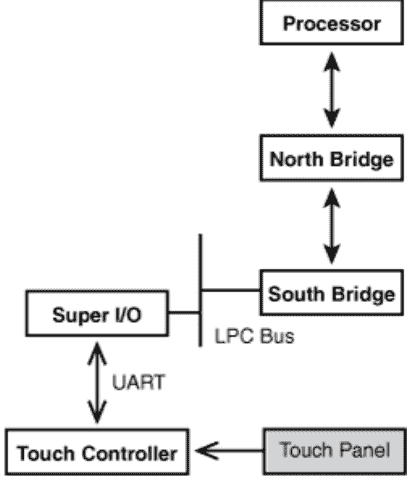

#### 打开和关闭

要创建线路规程，需要定义一个 `struct tty_ldisc` 并向内核注册一组规定的入口点。清单 6.2 包含了一段代码片段，为示例触摸控制器执行了这两项操作。

##### 清单 6.2. 线路规程操作

```
Code View:
struct tty_ldisc n_touch_ldisc = {
  TTY_LDISC_MAGIC,       /* 魔术 */
  "n_tch",               /* 线路规程的名称 */
  N_TCH,                 /* 线路规程 ID 编号 */
  n_touch_open,          /* 打开线路规程 */
  n_touch_close,         /* 关闭线路规程 */
  n_touch_flush_buffer,  /* 清空线路规程的读取
                          缓冲区 */
  n_touch_chars_in_buffer, /* 获取线路规程读取缓冲区中
                          已处理字符的数量 */
  n_touch_read,          /* 当用户空间请求数据时
                          被调用 */
  n_touch_write,         /* 写入方法 */
  n_touch_ioctl,         /* I/O 控制命令 */
  NULL,                  /* 我们没有 set_termios
                          例程 */
  n_touch_poll,          /* 轮询 */
  n_touch_receive_buf,   /* 由底层驱动程序调用
                          将数据传递给用户空间 */
  n_touch_receive_room,  /* 返回线路规程读取
                          缓冲区中剩余的空间 */
  n_touch_write_wakeup   /* 当底层设备驱动程序
                          准备传输更多数据时
                          被调用 */

};

/* ... */

if ((err = tty_register_ldisc(N_TCH, &n_touch_ldisc))) {
  return err;
}
```

在清单 6.2 中，`n_tch` 是线路规程的名称，`N_TCH` 是线路规程标识符编号。你需要在 *include/linux/tty.h* 中指定 `N_TCH` 的值，该头文件包含了所有线路规程的定义。系统中激活的线路规程可以在 */proc/tty/ldiscs* 中找到。

线路规程从其所属的 tty 翻转缓冲区中收集数据，处理数据，并将结果数据复制到本地读取缓冲区。对于 `N_TCH`，`n_touch_receive_room()` 返回读取缓冲区中剩余的内存，而 `n_touch_chars_in_buffer()` 返回读取缓冲区中已处理并准备交付给用户空间的字符数量。`n_touch_write()` 和 `n_touch_write_wakeup()` 不执行任何操作，因为 `N_TCH` 是只读设备。`n_touch_open()` 负责为主要的线路规程数据结构分配内存，如清单 6.3 所示。

##### 清单 6.3. 打开线路规程


 ```
Code View:
/* Private structure used to implement the Finite State Machine
(FSM) for the touch controller. The controller and the processor
communicate using a specific protocol that the FSM implements */
struct n_touch {
  int current_state;     /* Finite State Machine */
  spinlock_t touch_lock; /* Spinlock */
  struct tty_struct *tty; /* Associated tty */
  /* Statistics and other housekeeping */
  /* ... */
} *n_tch;


/* Device open() */
static int
n_touch_open(struct tty_struct *tty)
{
  /* Allocate memory for n_tch */
  if (!(n_tch = kmalloc(sizeof(struct n_touch), GFP_KERNEL))) {
    return -ENOMEM;
  }
  memset(n_tch, 0, sizeof(struct n_touch));

  tty->disc_data = n_tch; /* Other entry points now
                             have direct access to n_tch */
  /* Allocate the line discipline's local read buffer
     used for copying data out of the tty flip buffer */
  tty->read_buf = kmalloc(BUFFER_SIZE, GFP_KERNEL);
  if (!tty->read_buf) return -ENOMEM;

  /* Clear the read buffer */
  memset(tty->read_buf, 0, BUFFER_SIZE);

  /* Initialize lock */
  spin_lock_init(&n_tch->touch_lock);

  /* Initialize other necessary tty fields.
     See drivers/char/n_tty.c for an example */
  /* ... */

  return 0;
}
```

当连接到触摸控制器的串行端口被打开时，你可能希望将`N_TCH`设为默认的行规程（而非`N_TTY`）。请参阅"Changing Line Disciplines"一节，了解如何从用户空间更改行规程。

#### 读取路径

对于中断驱动的设备，读取数据路径通常由两个协同工作的线程组成：

1. 源自请求读取的用户进程的顶层线程

2. 源自中断服务例程的底层线程，负责从设备收集数据

[图 6.7](figure-6.7) 展示了与读取数据流相关的这些线程。中断处理程序将`receive_buf()`方法（在我们的示例中为`n_touch_receive_buf()`）作为任务排队。你可以通过设置`tty->low_latency`标志来覆盖此行为。

##### 图 6.7. 行规程读取路径。

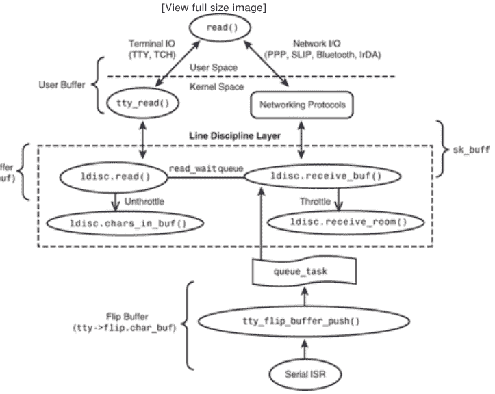

触摸控制器和处理器使用控制器数据手册中描述的特定协议进行通信。如前所述，驱动程序使用有限状态机（FSM）来实现此通信协议。[清单 6.4](listing-6.4) 将此FSM编码为`receive_buf()`入口点`n_touch_receive_buf()`的一部分。

##### 清单 6.4. `n_touch_receive_buf()`方法

```
Code View:
static void
n_touch_receive_buf(struct tty_struct *tty,
                    const unsigned char *cp, char *fp, int count)
{

 /* Work on the data in the line discipline's half of
    the flip buffer pointed to by cp */
 /* ... */

 /* Implement the Finite State Machine to interpret commands/data
    arriving from the touch controller and put the processed data
    into the local read buffer */
/* Datasheet-dependent Code Region */
 switch (tty->disc_data->current_state) {
   case RESET:
     /* Issue a reset command to the controller */
     tty->driver->write(tty, 0, mode_stream_command,
                        sizeof(mode_stream_command));
     tty->disc_data->current_state = STREAM_DATA;
     /* ... */
     break;
   case STREAM_DATA:
     /* ... */
     break;
   case PARSING:
     /* ... */
     tty->disc_data->current_state = PARSED;
     break;
   case PARSED:
     /* ... */
 }

 if (tty->合同中disc_data->current_state == PARSED) {
   /* If you have a parsed packet, copy the collected coordinate
      and direction information into the local read buffer */
   spin_lock_irqsave(&tty->disc_data->touch_lock, flags);
   for (i=0; i < PACKET_SIZE; i++) {
    tty->disc_data->read_buf[tty->disc_data->read_head] =
                          tty->disc_data->current_pkt[i];
    tty->disc_data->read_head =
                (tty->disc_data->read_head + 1) & (BUFFER_SIZE - 1);
    tty->disc_data->read_cnt++;
   }
   spin_unlock_irqrestore(&tty->disc_data->touch_lock, flags);

   /* ... */ /* See Listing 6.5 */

 }
}
```

`n_touch_receive_buf()`处理来自串行驱动程序的数据。它与触摸控制器交换一系列命令和响应，并将接收到的坐标和方向（按下/释放）信息放入行规程的读取缓冲区。对读取缓冲区的访问必须使用自旋锁进行序列化，因为它同时被`ldisc.receive_buf()`和`ldisc.read()`线程使用（在我们的示例中分别为`n_touch_receive_buf()`和`n_touch_read()`）。如清单6.4所示，`n_touch_receive_buf()`通过直接调用串行驱动程序的`write()`入口点来向触摸控制器分发命令。

`n_touch_receive_buf()`还需要做几件事：

1. 图6.7中的顶层`read()`线程在没有数据可用时将使调用进程进入睡眠状态。因此，`n_touch_receive_buf()`必须唤醒该线程，让它读取刚刚处理的数据。

2. 如果行规程的读取缓冲区空间不足，`n_touch_receive_buf()`必须请求串行驱动程序限制从设备到达的数据。当`ldisc.read()`将数据传输到用户空间并释放读取缓冲区中的内存时，它负责请求相应的解除限制。串行驱动程序使用软件或硬件流控制机制来实现限制和解除限制。

清单6.5执行这两个操作。

##### 清单 6.5. 唤醒读取线程和限制串行驱动程序

```
/* n_touch_receive_buf() continued.. */

/* Wake up any threads waiting for data */
if (waitqueue_active(&tty->read_wait) &&
    (tty->read_cnt >= tty->minimum_to_wake))
  wake_up_interruptible(&tty->read_wait);
}
/* If we are running out of buffer space, request the
   serial driver to throttle incoming data */
if (n_touch_receive_room(tty) < TOUCH_THROTTLE_THRESHOLD) {
  tty->driver->throttle(tty);
}
/* ... */
```

等待队列（`tty->read_wait`）用于在`ldisc.read()`和`ldisc.receive_buf()`线程之间进行同步。当`ldisc.read()`找不到要读取的数据时，它会将调用进程添加到等待队列中；而当有数据可供读取时，`ldisc.receive_buf()`会唤醒`ldisc.read()`线程。因此，`n_touch_read()`执行以下操作：

- 如果还没有数据可供读取，将调用进程置于`read_wait`队列中进入睡眠。当数据到达时，`n_touch_receive_buf()`会唤醒该进程。

- 如果数据可用，从本地读取缓冲区（`tty->read_buf`）收集数据。

- 如果在此次读取后读取缓冲区中有足够的空间可用，请请求串行驱动程序解除限制。

#### 网络读取路径

网络行规程通常分配一个`sk_buff`（在第15章"网络接口卡"中讨论的基本Linux网络数据结构）并将其用作读取缓冲区。它们没有`read()`方法，因为相应的`receive_buf()`将接收到的数据复制到分配的`sk_buff`中，并直接将其传递给相关的协议栈。

#### 写入路径

行规程的`write()`入口点执行在将数据传递给底层驱动程序之前所需的任何后处理。

如果底层驱动无法接受行规程提供的所有数据，行规程将使请求线程进入睡眠状态。当驱动程序准备好接收更多数据时，它的中断处理程序会唤醒行规程。为此，驱动程序调用行规程注册的`write_wakeup()`方法。相关的同步使用等待队列（`tty->write_wait`）完成，其操作类似于上一节中描述的`read_wait`队列。

许多网络行规程没有`write()`方法。协议实现直接将帧传输到串行设备驱动程序。然而，这些行规程通常仍然有`write_wakeup()`入口点，以响应串行驱动程序请求更多传输数据。

`N_TCH`也不需要`write()`方法，因为触摸控制器是只读设备。如你在清单6.4中所见，接收路径中的例程在需要向控制器发送命令帧时直接与底层UART驱动程序通信。

#### I/O控制

如第5章"字符驱动程序"中所讨论的，用户程序可以通过`ioctl()`调用向设备发送命令。当应用程序打开串行设备时，它通常可以发出三类ioctl：

- 串行设备驱动程序支持的命令，例如设置调制解调器信息的`TIOCMSET`

- tty驱动程序支持的命令，例如更改所附加行规程的`TIOCSETD`

- 所附加行规程支持的命令，例如在`N_TCH`情况下重置触摸控制器的命令

`N_TCH`的`ioctl()`实现很大程度上是标准的。支持的命令取决于触摸控制器数据手册中描述的协议。

#### 更多操作

另一个行规程操作是`flush_buffer()`，用于刷新读取缓冲区中任何挂起的数据。`flush_buffer()`在行规程关闭时也会被调用。它唤醒任何正在等待更多数据的读取线程，如下所示：

```
if (tty->link->packet){
  wake_up_interruptible(&tty->disc_data->read_wait);
}
```

另一个入口点（`N_TCH`不支持）是`set_termios()`。`N_TTY`行规程支持
```


`set_termios()` 接口，用于设置特定于行规（line discipline）数据处理的选项。例如，你可以使用 `set_termios()` 将行规置于原始模式（raw mode）或" cooked "模式。特定于触摸控制器的一些选项（如更改波特率、奇偶校验位和停止位数量）由底层设备驱动程序的 `set_termios()` 方法实现。

其余入口点如 `poll()` 相当标准，如果你需要帮助，可以返回[第5章](link)查看。

你可以将行规编译为内核的一部分，或作为模块动态加载。如果选择将其编译为模块，当然还必须提供在模块初始化和退出时调用的函数。前者通常与 `init()` 方法相同。后者需要清理私有数据结构并注销行规。注销行规只需一行代码：

```
tty_unregister_ldisc(N_TCH);
```

驱动串行触摸控制器的更简单方法是利用内核的 *input* 子系统和内置的 *serport* 行规提供的服务。我们将在下一章介绍这种技术。

#### 更改行规

当用户空间程序打开连接到触摸控制器的串行端口时，`N_TCH` 会与底层串行驱动绑定。但有时，用户空间应用程序可能希望将不同的行规附加到该设备。例如，你可能希望编写一个程序来转储从触摸控制器接收的原始数据，而不对其进行处理。[清单 6.6](link) 打开触摸控制器并将行规更改为 `N_TTY`，以转储传入的数据。

##### 清单 6.6. 从用户空间更改行规

```
fd = open("/dev/ttySX", O_RDONLY | O_NOCTTY);

/* 此时，N_TCH 已附加到 /dev/ttySX，即触摸控制器使用的串行端口。切换到 N_TTY */
ldisc = N_TTY;
ioctl(fd, TIOCSETD, &ldisc);

/* 将 termios 设置为原始模式并转储传入的数据 */
/* ... */
```

`TIOCSETD` `ioctl()` 关闭当前行规并打开新请求的行规。

### 查看源码

串行核心位于 *drivers/serial/*，但 tty 实现和底层驱动分散在整个源码树中。例如，[图 6.3](#) 中提到的驱动文件分布在四个不同的目录中：*drivers/serial/*、*drivers/char/*、*drivers/usb/serial/* 和 *drivers/net/irda/*。*drivers/serial/* 目录现在也包含 UART 驱动，在 2.4 内核中并不存在；UART 特定代码以前分散在 *drivers/char/* 和 *arch/your-arch/* 目录中。现在的代码划分更为合理，因为 UART 驱动并非唯一访问串行层的部分——USB 转串口转换器和 IrDA 加密狗等设备也需要与串行核心通信。

查看 *drivers/serial/imx.c* 了解一个真实的底层 UART 驱动。它处理属于 Freescale i.MX 系列嵌入式控制器的 UART。

要了解 Linux 支持的行规列表，请参阅 *include/linux/tty.h*。要感受网络行规，请查看 PPP（*drivers/net/ppp_async.c*）、蓝牙（*drivers/bluetooth/hci_ldisc.c*）、红外（*drivers/net/irda/irttty-sir.c*）和 SLIP（*drivers/net/slip.c*）的相应源文件。

[表 6.3](#) 包含本章使用的主要数据结构的摘要及其在源码树中的定义位置。[表 6.4](#) 列出本章使用的主要内核编程接口及其定义位置。

### **表 6.3. 数据结构摘要**

| 数据结构 | 位置 | 描述 |
| -------------- | -------- | ----------- |
| `uart_driver` | *include/linux/serial_core.h* | 底层 UART 驱动的表示。 |
| `uart_port` | *include/linux/serial_core.h* | UART 端口的表示。 |
| `uart_ops` | *include/linux/serial_core.h* | UART 驱动支持的入口点。 |
| `platform_device` | *include/linux/platform_device.h* | 平台设备的表示。 |
| `platform_driver` | *include/linux/platform_device.h* | 平台驱动的表示。 |
| `tty_struct` | *include/linux/tty.h* | tty 的状态信息。 |
| `tty_bufhead`, `tty_buffer` | *include/linux/tty.h* | 这两个结构实现与 tty 关联的翻转缓冲区。 |
| `tty_driver` | *include/linux/tty_driver.h* | tty 驱动与更高层之间的编程接口。 |
| `tty_ldisc` | *include/linux/tty_ldisc.h* | 行规支持的入口点。 |

### **表 6.4. 内核编程接口摘要**

| 内核接口 | 位置 | 描述 |
| --- | --- | --- |
| `uart_register_driver()` | *drivers/serial/serial_core.c* | 向串行核心注册 UART 驱动 |
| `uart_add_one_port()` | *drivers/serial/serial_core.c* | 注册 UART 驱动支持的 UART 端口 |
| `uart_unregister_driver()` | *drivers/serial/serial_core.c* | 从串行核心移除 UART 驱动 |
| `platform_device_register()`<br>`platform_device_register_simple()`<br>`platform_add_devices()` | *drivers/base/platform.c* | 注册平台设备 |
| `platform_device_unregister()` | *drivers/base/platform.c* | 注销平台设备 |
| `platform_driver_register()` /<br>`platform_driver_unregister()` | *drivers/base/platform.c* | 注册/注销平台驱动 |
| `tty_insert_flip_char()` | *include/linux/tty_flip.h* | 向 tty 翻转缓冲区添加字符 |
| `tty_flip_buffer_push()` | *drivers/char/tty_io.c* | 排队请求以将翻转缓冲区推送到行规 |
| `tty_register_driver()` | *drivers/char/tty_io.c* | 向串行核心注册 tty 驱动 |
| `tty_unregister_driver()` | *drivers/char/tty_io.c* | 从串行核心移除 tty 驱动 |
| `tty_register_ldisc()` | *drivers/char/tty_io.c* | 通过注册规定的入口点创建行规 |
| `tty_unregister_ldisc()` | *drivers/char/tty_io.c* | 从串行核心移除行规 |

某些串行数据传输场景较为复杂。你可能需要混合搭配不同的串行层模块，如你在**图 6.3** 中所见。某些情况可能需要数据路径通过多个行规。例如，通过蓝牙建立拨号连接涉及数据通过 HCI 行规以及 PPP 行规的传输。如果可以的话，建立这样的连接并使用内核调试器逐步跟踪代码流程。

# 第 7 章. 输入驱动程序

**本章内容**

- [输入事件驱动程序](#) 210
- [输入设备驱动程序](#) 216
- [调试](#) 230
- [查看源码](#) 231

内核的 *input* 子系统是为了统一处理多种数据输入设备的分散驱动而创建的，这些设备包括键盘、鼠标、轨迹球、操纵杆、滚轮、触摸屏、加速计和平板电脑。输入子系统带来了以下优势：

- 即使物理上不同，功能相似的输入设备也能得到统一处理。例如，所有鼠标，无论是 PS/2、USB 还是蓝牙，都被同等对待。

- 一个易于使用的 *事件* 接口，用于将输入报告分派给用户应用程序。你的驱动程序不必创建和管理 */dev* 节点及相关访问方法。相反，它可以简单地调用输入 API 将鼠标移动、按键按下或触摸事件向上游发送到用户空间。X Windows 等应用程序可以在输入子系统导出的事件接口上无缝工作。

- 从输入驱动中提取公共部分，从而产生抽象，简化驱动并引入一致性。例如，输入子系统提供了一组称为 *serio* 的底层驱动，用于访问输入硬件，如串口和键盘控制器。

图 7.1 说明了输入子系统的工作原理。该子系统包含两类协同工作的驱动：*事件* 驱动和 *设备* 驱动。事件驱动负责与应用程序接口，而设备驱动负责与输入设备的底层通信。鼠标事件生成器 *mousedev*isz'是前者的例子，PS/2 鼠标驱动是后者的例子。事件驱动和设备驱动都可以利用位于输入子系统核心的高效、无缺陷、可复用的核心服务。


图 7.1. 输入子系统。

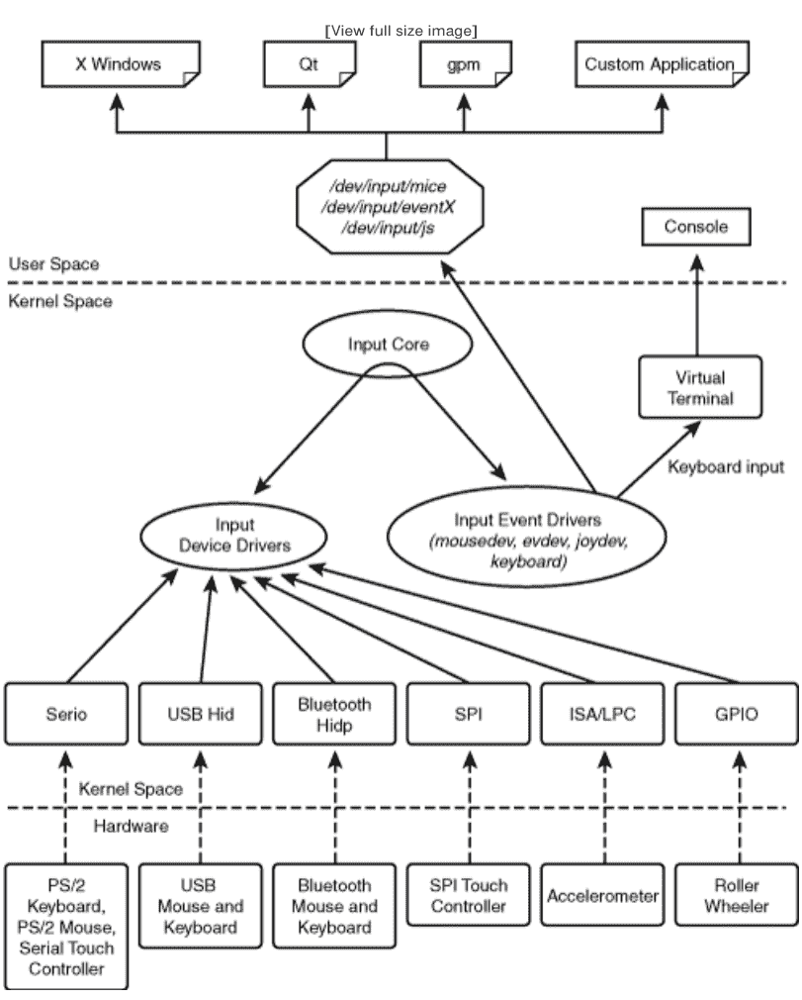

由于事件驱动程序是标准化的，并且对所有输入类别都可用，因此您更可能实现设备驱动程序而非事件驱动程序。您的设备驱动程序可以通过输入核心使用合适的现有事件驱动程序来与用户应用程序交互。请注意，本章使用术语*设备驱动程序*来指代输入设备驱动程序，而非输入事件驱动程序。

## 输入事件驱动程序

输入子系统导出的事件接口已经发展成为许多图形窗口系统都能理解的标准。事件驱动程序提供了与输入设备通信的硬件无关抽象，正如帧缓冲接口（在第 12 章"视频驱动程序"中讨论）提供了与显示设备通信的通用机制。事件驱动程序与帧缓冲驱动程序一起，使*图形用户界面*（GUI）免受底层硬件变化的影响。

### Evdev 接口

*Evdev* 是一个通用的输入事件驱动程序。Evdev 生成的每个事件数据包都具有以下格式，在 *include/linux/input.h* 中定义：

```
struct input_event {
  struct timeval time;  /* 时间戳 */
  __u16 type;           /* 事件类型 */
  __u16 code;           /* 事件代码 */
  __s32 value;          /* 事件值 */
};
```

为了解如何使用 evdev，让我们为虚拟鼠标实现一个输入设备驱动程序。

### 设备示例：虚拟鼠标

我们的虚拟鼠标工作原理如下：一个应用程序（*coord.c*）模拟鼠标移动，并通过 sysfs 节点 */sys/devices/platform/vms/coordinates* 将坐标信息分发给虚拟鼠标驱动程序（*vms.c*）。虚拟鼠标驱动程序（简称 *vms* 驱动程序）通过 evdev 将这些移动向上游传递。图 7.2 显示了详细信息。

**图 7.2. 虚拟鼠标的输入驱动程序。**

[查看完整尺寸图像]

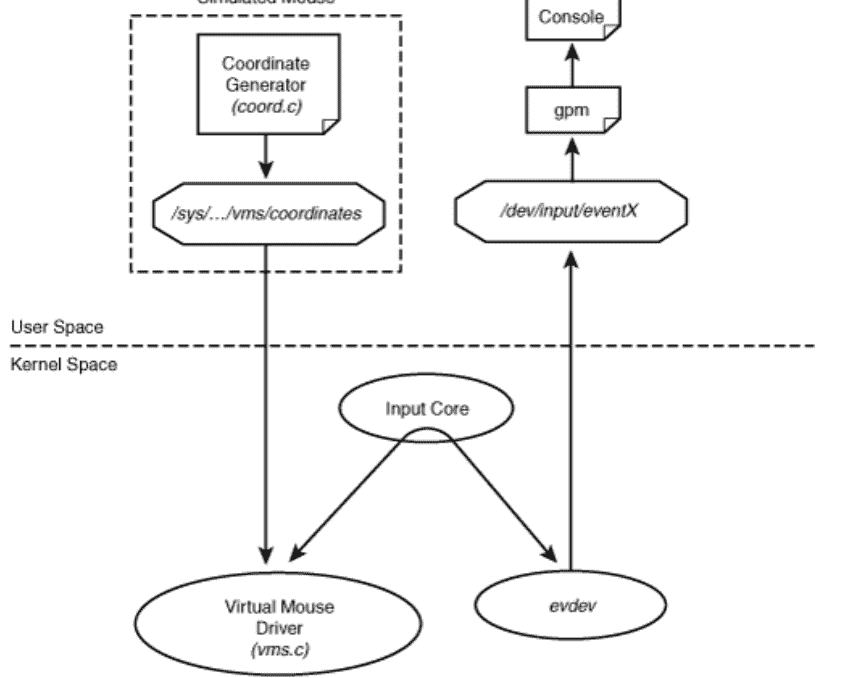

*通用鼠标（gpm）*是一个服务器，可让您在文本模式下使用鼠标，而无需 X 服务器的协助。Gpm 理解 evdev 消息，因此 vms 驱动程序可以直接与它通信。一切准备就绪后，您可以看到光标在屏幕上随着 *coord.c* 流式传输的虚拟鼠标移动而舞动。

清单 7.1 包含 *coord.c*，它连续生成随机的 X 和 Y 坐标。与操纵杆或触摸屏不同，鼠标产生的是相对坐标，*coord.c* 正是这样做的。vms 驱动程序显示在[清单 7.2](#)。

#### 清单 7.1. 模拟鼠标移动的应用程序（coord.c）

```
Code View:
#include <fcntl.h>

int
main(int argc, char *argv[])
{
  int sim_fd;
  int x, y;
  char buffer[10];

  /* 打开 sysfs 坐标节点 */
  sim_fd = open("/sys/devices/platform/vms/coordinates", O_RDWR);
  if (sim_fd < 0) {
    perror("Couldn't open vms coordinate file\n");
    exit(-1);
  }
  while (1) {
    /* 生成随机相对坐标 */
    x = random()%20;
    y = random()%20;
    if (x%2) x = -x; if (y%2) y = -y;

    /* 将模拟坐标传递给虚拟鼠标驱动程序 */
    sprintf(buffer, "%d %d %d", x, y, 0);
    write(sim_fd, buffer, strlen(buffer));
    fsync(sim_fd);
    sleep(1);
  }

  close(sim_fd);
}
```

#### 清单 7.2. 虚拟鼠标的输入驱动程序（vms.c）

```
Code View:
#include <linux/fs.h>
#include <asm/uaccess.h>
#include <linux/pci.h>
#include <linux/input.h>
#include <linux/platform_device.h>

struct input_dev *vms_input_dev;     /* 输入设备的表示 */
static struct platform_device *vms_dev; /* 设备结构 */

                                      /* 向虚拟鼠标驱动程序输入
                                         模拟坐标的 sysfs 方法 */
static ssize_t
write_vms(struct device *dev,
          struct device_attribute *attr,
          const char *buffer, size_t count)
{
  int x,y;
  sscanf(buffer,聊到"%d%d", &x, &y);
```

```
/* 通过事件接口报告相对坐标 */
input_report_rel(vms_input_dev, REL_X, x);
input_report_rel(vms_input_dev, REL_Y, y);
input_sync(vms_input_dev);

return count;
}
```

```
/* 附加 sysfs 写入方法 */
DEVICE_ATTR(coordinates, 0644, NULL, write_vms);

/* 属性描述符 */
static struct attribute *vms_attrs[] = {
  &dev_attr_coordinates.attr,
  NULL
};

/* 属性组 */
static struct attribute_group vms_attr_group = {
  .attrs = vms_attrs,
};
```

```
/* 驱动程序初始化 */
int __init
vms_init(void)
{

  /* 注册平台设备 */
  vms_dev = platform_device_register_simple("vms", -1, NULL, 0);
  if (IS_ERR(vms_dev)) {
    PTR_ERR(vms_dev);
    printk("vms_init: error\n");
  }

  /* 创建 sysfs 节点以读取模拟坐标 */
  sysfs_create_group(&vms_dev->dev.kobj, &vms_attr_group);

  /* 分配输入设备数据结构 */
  vms_input_dev = input_allocate_device();
  if (!vms_input_dev) {
    printk("Bad input_alloc_device()\n");
  }

  /* 声明虚拟鼠标将生成
     相对坐标 */
  set_bit(EV_REL, vms_input_dev->evbit);
  set_bit(REL_X, vms_input_dev->relbit);
  set_bit(REL_Y, vms_input_dev->relbit);

  /* 注册到输入子系统 */
  input_register_device(vms_input_dev);

  printk("Virtual Mouse Driver Initialized.\n");
  return 0;
}
```

```
/* 驱动程序退出 */
void
```

```
vms_cleanup(void)
{

  /* 从输入子系统注销 */
  input_unregister_device(vms_input_dev);

  /* 清理 sysfs 节点 */
  sysfs_remove_group(&vms_dev->dev.kobj, &vms_attr_group);

  /* 注销驱动程序 */
  platform_device_unregister(vms_dev);

  return;
}

module_init(vms_init);
module_exit(vms_cleanup);
```

让我们更仔细地看看清单 7.2。在初始化期间，vms 驱动程序将自己注册为输入设备驱动程序。为此，它首先使用核心 API `input_allocate_device()` 分配一个 `input_dev` 结构：

```
vms_input_dev = input_allocate_device();
```

然后它声明虚拟鼠标生成相对事件：

```
set_bit(EV_REL, vms_input_dev->evbit);  /* 事件类型为 EV_REL */
```

接下来，它声明虚拟鼠标产生的事件代码：

```
set_bit(REL_X, vms_input_dev->relbit); /* 相对 'X' 移动 */
set_bit(REL_Y, vms_input_dev->relbit); /* 相对 'Y' 移动 */
```

如果您的虚拟鼠标还能够生成按钮点击，您需要将这行代码添加到 `vms_init()` 中：

```
set_bit(EV_KEY, vms_input_dev->evbit);  /* 事件类型为 EV_KEY */
set_bit(BTN_0,  vms_input_dev->keybit); /* 事件代码为 BTN_0 */
```

最后，进行注册：

```
input_register_device(vms_input_dev);
```

`write_vms()` 是附加到 */sys/devices/platform/vms/coordinates* 的 sysfs `store()` 方法。当 coord.c 向该文件写入 X/Y 坐标对时，`write_vms()` 执行以下操作：

```
input_report_rel(vms_input_dev, REL_X, x);
input_report_rel(vms_input_dev, REL_Y, y);
input_sync(vms_input_dev);
```

第一条语句生成 `REL_X` 事件，即 X 方向上的相对设备移动。第二条生成 `REL_Y` 事件，即 Y 方向上的相对移动。`input_sync()` 表明此事件已完成，因此输入子系统将这两个事件收集到一个 evdev 数据包中，并通过 */dev/input/eventX* 发送出去，其中 *X* 是分配给 vms 驱动程序的接口编号。读取此文件的应用程序将以先前描述的 `input_event` 格式接收事件数据包。要请求 gpm 连接到此事件接口并相应地追逐屏幕上的光标，请执行以下操作：

```
bash> gpm -m /dev/input/eventX -t evdev
```

ADS7846 触摸控制器驱动程序和第"加速计"部分讨论的加速计驱动程序也是 evdev 的使用者。

### 更多事件接口

vms 驱动程序使用通用的 evdev 事件接口，但键盘、鼠标和触摸控制器等输入设备具有自定义的事件驱动程序。我们将在讨论相应的设备驱动程序时再来看它们。

要编写自己的事件驱动程序并通过 */dev/input/mydev* 将其导出到用户空间，您必须填充一个名为 `input_handler` 的结构，并将其注册到输入核心，如下所示：

Code View:

```
static struct input_handler my_event_handler = {
  .event     = mydev_event,      /* 处理使用此事件驱动程序
                                    服务的输入设备驱动程序
                                    发送的事件报告 */
  .fops      = &mydev_fops,      /* 管理
                                    /dev/input/mydev 的方法 */
  .minor     = MYDEV_MINOR_BASE, /* /dev/input/mydev
                                    的次设备号 */
  .name      = "mydev",          /* 事件驱动程序名称 */
  .id_table  = mydev_ids,        /* 此事件驱动程序可以
                                    处理来自这些 ID 的请求 */
  .connect   = mydev_connect,    /* 如果存在
                                    ID 匹配则调用 */
  .disconnect = mydev_disconnect, /* 驱动程序注销时
                                    调用 */
};

/* 驱动程序初始化 */
static int __init
mydev_init(void)
{
  /* ... */

  input_register_handler(&my_event_handler);

  /* ... */
  return 0;
}
```

有关完整示例，请查看 mousedev 的实现（*drivers/input/mousedev.c*）。


 A. Wu Wenhua, H. Margaret Wu and Stephen M. Collier

信息及发行中心 2010

## 高分子粘弹性导论

## 第三版

聚合物科学经典参考文献的最新版本——高分子粘弹性的入门必读，现引入全新技术与方法

其他现有参考文献，无论是精装书还是手册，都无法与《高分子粘弹性导论》所蕴含的丰富信息相媲美。如今第三版已问世，这部畅销的高分子粘弹性入门教材经过更新，涵盖了最新的技术与方法。

第三版沿用了前两版畅销的简明方法，阐述了粘弹性行为的基本理论与基础知识，回顾了基础概念，并以清晰准确的方式呈现。书中包含了橡胶态和玻璃态聚合物的最新测量技术和数据，以及热力学概念、模拟方法学、各向异性行为、非线性粘弹性、物理老化和断裂的详细描述。本书基于严谨且重点突出的推导，呈现了分子模型和唯象模型，以及监测聚合物粘弹性行为的最新测量技术。《高分子粘弹性导论》的另一个独特之处在于，它揭示了粘弹性与分子运动之间的关系。

="#4ef67180e50e"

# 第 7 章. 输入驱动程序

## 本章内容

- 输入事件驱动程序
- 输入设备驱动程序
- 调试
- 查看源码

内核的 *input* 子系统是为了整合分散的驱动程序而创建的，这些驱动程序处理各种类别的数据输入设备，例如键盘、鼠标、轨迹球、操纵杆、滚轮、触摸屏、加速度计和平板电脑。输入子系统带来了以下优势：

- 对功能上相似的输入设备进行统一处理，即使它们在物理上有所不同。例如，所有鼠标，无论是 PS/2、USB 还是蓝牙，都被同等对待。
- 为向用户应用程序分发输入报告提供了简便的 *event* 接口。您的驱动程序不必创建和管理 */dev* 节点及相关访问方法。相反，它只需调用输入 API 即可将鼠标移动、按键按下或触摸事件向上传递至用户空间。X Windows 等应用程序可以无缝地在输入子系统所导出的接口之上工作。
- 从输入驱动程序中提取公共部分，形成抽象层，从而简化驱动程序并引入一致性。例如，输入子系统提供了一组称为 *serio* 的底层驱动程序，用于访问串行端口和键盘控制器等输入硬件。

图 7.1 展示了输入子系统的工作原理。该子系统包含两类协同工作的驱动程序：*event* 驱动程序和 *device* 驱动程序。事件驱动程序负责与应用程序对接，而设备驱动程序负责与输入设备进行底层通信。鼠标事件生成器 *mousedev* 是前者的例子，PS/2 鼠标驱动程序则是后者的例子。事件驱动程序和设备驱动程序都可以利用一个高效、无错误、可复用的内核核心，该核心位于输入子系统的核心位置。

由于事件驱动程序已标准化，并且可用于所有输入类别，因此您更可能实现设备驱动程序而非事件驱动程序。您的设备驱动程序可以通过输入核心使用合适的现有事件驱动程序来与用户应用程序对接。请注意，本章使用术语 *device driver* 来指代输入设备驱动程序，而非输入事件驱动程序。

## 输入事件驱动程序

输入子系统导出的事件接口已经发展成为许多图形窗口系统所理解的标准。事件驱动程序提供了与输入设备对话的硬件无关抽象，正如帧缓冲接口（在第 12 章"视频驱动程序"中讨论）提供了与显示设备通信的通用机制。事件驱动程序与帧缓冲驱动程序协同工作，将 *graphical user interfaces*（GUI）与底层硬件的复杂差异隔离开来。

### Evdev 接口

*Evdev* 是一个通用的输入事件驱动程序。evdev 生成的每个事件数据包具有以下格式，定义在 *include/linux/input.h* 中：

```
struct input_event {
  struct timeval time;  /* Timestamp */
  __u16 type;           /* Event Type */
  __u16 code;           /* Event Code */
  __s32 value;          /* Event Value */
};
```

为了解如何使用 evdev，让我们为虚拟鼠标实现一个输入设备驱动程序。

### 设备示例：虚拟鼠标

我们的虚拟鼠标工作原理如下：一个应用程序（*coord.c*）模拟鼠标移动，并通过 sysfs 节点 */sys/devices/platform/vms/coordinates* 将坐标信息分发给虚拟鼠标驱动程序（*vms.c*）。虚拟鼠标驱动程序（简称 *vms* 驱动程序）通过 evdev 将这些移动向上传递。图 7.2 展示了详细内容。

**图 7.2. 虚拟鼠标的输入驱动程序。**

[View full size image]

*General-purpose mouse*（*gpm*）是一个服务器，让您可以在没有 X 服务器辅助的情况下在文本模式中使用鼠标。Gpm 理解 evdev 消息，因此 vms 驱动程序可以直接与它通信。当一切就绪后，您可以看到光标随着 *coord.c* 流式传输的虚拟鼠标移动而在屏幕上舞动。

**清单 7.1** 包含 *coord.c*，它持续生成随机的 X 和 Y 坐标。鼠标与操纵杆或触摸屏不同，它产生的是相对坐标，*coord.c* 正是如此实现的。vms 驱动程序如 **清单 7.2** 所示。

#### 清单 7.1. 模拟鼠标移动的应用程序（coord.c）

```
Code View:
#include <fcntl.h>

int
main(int argc, char *argv[])
{
  int sim_fd;
  int x, y;
  char buffer[10];

  /* Open the sysfs coordinate node */
  sim_fd = open("/sys/devices/platform/vms/coordinates", O_RDWR);
  if (sim_fd < 0) {
    perror("Couldn't open vms coordinate file\n");
    exit(-1);
  }

  while (1) {
    /* Generate random relative coordinates */
    x = random()%20;
    y = random()%20;
    if (x%2) x = -x; if (y%2) y = -y;

    /* Convey simulated coordinates to the virtual mouse driver */
    sprintf(buffer, "%d %d %d", x, y, 0);
    write(sim_fd, buffer, strlen(buffer));
    fsync(sim_fd);
    sleep(1);
  }

  close(sim_fd);
}
```

#### 清单 7.2. 虚拟鼠标的输入驱动程序（vms.c）

```
Code View:
#include <linux/fs.h>
#include <asm/uaccess.h>
#include <linux/pci.h>
#include <linux/input.h>
#include <linux/platform_device.h>

struct input_dev *vms_input_dev;    /* Representation of an input device */
static struct platform_device *vms_dev; /* Device structure */

                                   /* Sysfs method to input simulated
                                      coordinates to the virtual
                                      mouse driver */
static ssize_t
write_vms(struct device *dev,
          struct device_attribute *attr,
          const char *buffer, size_t count)
{
  int x,y;
  sscanf(buffer, "%d%d", &x, &y);
```

```
/* Report relative coordinates via the
event interface */
input_report_rel(vms_input_dev, REL_X, x);
input_report_rel(vms_input_dev, REL_Y, y);
input_sync(vms_input_dev);
return count;
}
```

```
/* Attach the sysfs write method */
DEVICE_ATTR(coordinates, 0644, NULL, write_vms);
```

```
/* Attribute Descriptor */
static struct attribute *vms纳秒[] = {
  &dev_attr_coordinates.attr,
  NULL
};
```

```
/* Attribute group */
static struct attribute_group vms_attr_group = {
  .attrs = vms_attrs,
};
```

```
/* Driver Initialization */
int __init
vms_init(void)
{
```

```
/* Register a platform device */
vms_dev = platform_device_register_simple("vms", -1, NULL, 0);
if (IS_ERR(vms_dev)) {
  PTR_ERR(vms_dev);
  printk("vms_init: error\n");
}
```

```
/* Create a sysfs node to read simulated coordinates */
sysfs_create_group(&vms_dev->dev.kobj, &vms_attr_group);
```

```
/* Allocate an input device data structure */
vms_input_dev = input_allocate_device();
if (!vms_input_dev) {
  printk("Bad input_alloc_device()\n");
}
```

```
/* Announce that the virtual mouse will generate
relative coordinates */
set_bit (EV_REL, vms_input_dev->evbit);
set_bit(REL_X, vms_input_dev->relbit);
set_bit (REL_Y, corridors_input_dev->relbit);
```

```
/* Register with the input subsystem */
input_register_device(vms_input_dev);
```

```
printk("Virtual Mouse Driver Initialized.\n");
return 0;
}
```

```
/* Driver Exit */
void
```


 ```c
vms_cleanup(void)
{

  /* Unregister from the input subsystem */
  input_unregister_device(vms_input_dev);

  /* Cleanup sysfs node */
  sysfs_remove_group(&vms_dev->dev.kobj, &vms_attr_group);

  /* Unregister driver */
  platform_device_unregister(vms_dev);

  return;
}

module_init(vms_init);
module_exit(vms_cleanup);
```

让我们更仔细地看看清单 7.2。在初始化期间，vms 驱动程序将自己注册为输入设备驱动程序。为此，它首先使用核心 API `input_allocate_device()` 分配一个 `input_dev` 结构体：

```
vms_input_dev = input_allocate_device();
```

然后，它声明虚拟鼠标生成相对事件：

```
set_bit(EV_REL, vms_input_dev->evbit);  /* Event Type is EV_REL */
```

接着，它声明虚拟鼠标产生的事件代码：

```
set_bit(REL_X, vms_input_dev->relbit); /* Relative 'X' movement */
set_bit(REL_Y, vms_input_dev->relbit); /* Relative 'Y' movement */
```

如果你的虚拟鼠标还能够生成按钮点击事件，你需要在 `vms_init()` 中添加以下内容：

```
set_bit(EV_KEY, vms_input_dev->evbit);  /* Event Type is EV_KEY */
set_bit(BTN_0,  vms_input_dev->keybit); /* Event Code is BTN_0 */
```

最后，进行注册：

```
input_register_device(vms_input_dev);
```

`write_vms()` 是附加到 */sys/devices/platform/vms/coordinates* 的 sysfs `store()` 方法。当 coord.c 向该文件写入 X/Y 坐标对时，`write_vms()` 执行以下操作：

```
input_report_rel(vms_input_dev, REL_X, x);
input_report_rel(vms_input_dev, REL_Y, y);
input_sync(vms_input_dev);
```

第一条语句生成一个 `REL_X` 事件，即 X 方向上的相对设备移动。第二条产生一个 `REL_Y` 事件，即 Y 方向上的相对移动。`input_sync()` 表示此事件已完成，因此输入子系统将这两个事件收集到一个 evdev 数据包中，并通过 */dev/input/eventX* 发送出去，其中 *X* 是分配给 vms 驱动程序的接口编号。读取该文件的应用程序将以之前描述的 `input_event` 格式接收事件数据包。要请求 gpm 附加到此事件接口并相应地跟踪屏幕上的光标，请执行以下操作：

```
bash>  gpm -m /dev/input/eventX -t evdev
```

后面在"触摸控制器"和"加速度计"部分讨论的 ADS7846 触摸控制器驱动程序和加速度计驱动程序也是 evdev 用户。

### 更多事件接口

vms 驱动程序使用通用的 evdev 事件接口，但键盘、鼠标和触摸控制器等输入设备有自定义的事件驱动程序。我们在讨论相应的设备驱动程序时会介绍它们。

要编写你自己的事件驱动程序并通过 */dev/input/mydev* 导出到用户空间，你需要填充一个名为 `input_handler` 的结构体，并将其与输入核心注册，如下所示：

代码视图：

```
static struct input_handler my_event_handler = {
  .event    = mydev_event,      /* Handle event reports sent by
                                  input device drivers that use
                                  this event driver's services */
  .fops     = &mydev_fops,      /* Methods to manage
                                  /dev/input/mydev */
shouldoverrideinnerstrategies## Limits ## Dimensions-should arbitrary restrictions ##禁忌## Coding ## methodology-standardize constraints ##剔除##Penalties## Algorithm-bypass barriers ## Budgets ## Boundaries-rationalize borders ##禁制## Thought-circumvent blocks ## Frameworks ## Boundaries-standardize enclosures | */}
```

查看 mousedev 的实现（*drivers/input/mousedev.c*）以获取完整示例。

## 输入设备驱动程序

让我们将注意力转向键盘、鼠标和触摸屏等常见输入设备的驱动程序。但首先，让我们快速看一下输入驱动程序可用的现成硬件访问工具。

### Serio

*serio* 层提供了访问遗留输入硬件的库例程，例如 i8042 兼容的键盘控制器和串行端口。PS/2 键盘和鼠标与前者接口，而串行触摸控制器连接到后者。要与 serio 服务的硬件通信，例如向 PS/2 鼠标发送命令，请使用 `serio_register_driver()` 向 serio 注册规定的回调例程。

要将新的驱动程序作为 serio 的一部分添加，请使用 `serio_register_port()` 注册 `open()`/`close()`/`start()`/`stop()`/`write()` 入口点。查看 *drivers/input/serio/serport.c* 以获取示例。

正如你在 [图 7.1](#) 中所见，serio 只是访问底层硬件的途径之一。几个输入设备驱动程序反而依赖于 USB 或 SPI 等总线层的底层支持。

### 键盘

键盘有不同的类型——传统 PS/2、USB、蓝牙、红外等等。每种类型都有特定的输入设备驱动程序，但都使用相同的键盘事件驱动程序，从而确保向用户提供一致的接口。然而，键盘事件驱动程序与其他事件驱动程序相比有一个显著特点：它将数据传递给另一个内核子系统（tty 层），而不是通过 */dev* 节点传递到用户空间。

### PC 键盘

PC 键盘（也称为 PS/2 键盘或 AT 键盘）通过 i8042 兼容的键盘控制器与处理器接口。台式机通常有专用的键盘控制器，但在笔记本电脑上，键盘接口是通用嵌入式控制器的职责之一（参见第 20 章"更多设备和驱动程序"中的"嵌入式控制器"一节）。当你在 PC 键盘上按下按键时，它会经过以下路径：

- 1. 键盘控制器（或嵌入式控制器）扫描并解码键盘矩阵，并处理诸如按键消抖等细节。

- 2. 键盘设备驱动程序在 serio 的帮助下，为每次按键和释放从键盘控制器读取原始 *扫描码*。按下和释放的区别在于最高有效位，释放时该位被置位。例如，按下"a"键会产生一对扫描码 `0x1e` 和 `0x9e`。特殊键使用 `0xE0` 转义，所以点击右箭头键会产生序列 (`0xE0 0x4D 0xE0 0xCD`)。你可以使用 *showkey* 工具来观察从控制器发出的扫描码（符号附加了解释）：

```
bash> **showkey -s**
kb mode was UNICODE
[ if you are trying this under X, it might not work since
  the X server is also reading /dev/console ]

press any key (program terminates 10s after last
keypress)...
```

- 0x1e 0x9e → 按下"a"键

3. 键盘设备驱动程序根据输入模式将接收到的扫描码转换为 *键码*。要查看与"a"键对应的键码：

```
bash> showkey
...
keycode 30 press    → 按下"a"键
keycode 30 release  → 释放"a"键
```

为了向上游报告键码，驱动程序生成一个输入事件，该事件将控制权传递给键盘事件驱动程序。

4. 键盘事件驱动程序根据加载的键映射进行键码转换。（参见 *loadkeys* 的 man 手册页以及 */lib/kbd/keymaps* 中的映射文件。）它检查转换后的键码是否与切换虚拟控制台或重启系统等操作相关联。为了在响应 Ctrl+Alt+Del 按下时点亮 `CAPSLOCK` 和 `NUMLOCK` LED 而不是重启系统，请在键盘事件驱动程序 *drivers/char/keyboard.c* 的 Ctrl+Alt+Del 处理程序中添加以下内容：

```
static void fn_boot_it(struct vc_data *vc,
                       struct pt_regs *regs)
{
+  set_vc_kbd_led(kbd, VC_CAPSLOCK);
+  set_vc_kbd_led(kbd, VC_NUMLOCK);
-  ctrl_alt_del();
}
```

5. 对于常规按键，转换后的键码被发送到关联的虚拟终端和 `N_TTY` 线路规程。（我们在第 6 章"串行驱动程序"中讨论了虚拟终端和线路规程。）这是通过 *drivers/char/keyboard.c* 可以这样实现：

```
/* Add the keycode to flip buffer */
tty_insert_flip_char(tty, keycode, 0);
/* Schedule */
con_schedule_flip(tty);
```

`N_TTY` 线路规程处理从键盘接收到的输入，将其回显到虚拟控制台，并让用户空间应用程序从连接到虚拟终端的 */dev/ttyX* 节点读取字符。

图 7.3 展示了从按下键盘按键到在虚拟控制台上回显的数据流。图的左半部分是硬件相关的，右半部分是通用的。根据输入子系统的设计目标，底层硬件接口对键盘事件驱动程序和 tty 层是透明的。因此，输入核心和明确定义的事件接口将输入用户与硬件的复杂性隔离开来。

#### **图 7.3. 从 PS/2 兼容键盘的数据流。**

[查看完整尺寸图像]


USB 和蓝牙键盘

与*人机接口设备*（HID）相关的 USB 规范规定了 USB 键盘、鼠标、数字小键盘和其他输入外围设备用于通信的协议。在 Linux 上，这通过 *usbhid* USB 客户端驱动程序实现，该驱动程序负责 USB HID 类（`0x03`）。Usbhid 本身注册为输入设备驱动程序。它遵循输入 API，并报告与所连接 HID 适配的输入事件。

要理解 USB 键盘的代码路径，请回顾 [图 7.3](figure-7-3) 并修改硬件特定的左半部分。将“输入硬件”框中的键盘控制器替换为 USB 控制器，将 serio 替换为 USB 核心层，并将“输入设备驱动程序”框替换为 usbhid 驱动程序。

对于蓝牙键盘，请将 [图 7.3](figure-7-3) 中的键盘控制器替换为蓝牙芯片组，将 serio 替换为蓝牙核心层，并将“输入设备驱动程序”框替换为蓝牙 hidp 驱动程序。

USB 和蓝牙分别在 [第 11 章](chapter-11) "通用串行总线"和 [第 16 章](chapter-16) "无线 Linux"中详细讨论。

### 鼠标

与键盘一样，鼠标具有不同的功能和不同的接口选项。让我们看看常见的类型。

### PS/2 鼠标

鼠标在 X 和 Y 轴上生成相对移动。它们还具有一个或多个按键。有些还有滚轮。用于 PS/2 兼容传统鼠标的输入设备驱动程序依赖于 serio 层与底层控制器通信。鼠标的输入事件驱动程序称为 *mousedev*，它通过 */dev/input/mice* 向用户应用程序报告鼠标事件。

### 设备示例：滚轮鼠标

为了感受真实的鼠标设备驱动程序，让我们将 [第 4 章](chapter-4) "奠定基础"中讨论的滚轮转换成通用 PS/2 鼠标的一个变体。“滚轮鼠标”在 Y 轴上生成一维移动。滚轮顺时针和逆时针旋转分别产生正和负的相对 Y 坐标（类似于鼠标中的滚轮），而按下滚轮则产生左键鼠标事件。因此，滚轮鼠标非常适合在智能手机、手持设备和音乐播放器等设备中导航菜单。

在 [清单 7.3](listing-7-3) 中实现的滚轮鼠标设备驱动程序与 X Windows 等窗口系统配合工作。查看 `roller_mouse_init()` 以了解驱动程序如何声明其类似鼠标的能力。与 [第 4 章](chapter-4) [清单 4.1](listing-4-1) 中的滚轮驱动程序不同，滚轮鼠标驱动程序不需要 `read()` 或 `poll()` 方法，因为事件是使用输入 API 报告的。滚轮中断处理程序 `roller_isr()` 也相应地发生了变化。为了在中断处理程序中支持 `read()` 和 `poll()` 而使用等待队列、自旋锁和 `store_movement()` 例程完成的内务工作已经消失。

在 [清单 7.3](listing-7-3) 中，开头的 `+` 和 `–` 表示与 [第 4 章](chapter-4) [清单 4.1](listing-4-1) 中实现的滚轮驱动程序的差异。

#### 清单 7.3. 滚轮鼠标驱动程序

```
代码视图：
+  #include <linux/input.h>
+  #include <linux/interrupt.h>
+
+  /* 设备结构 */
+  struct {
+    /* ... */
+	  struct input_dev dev;
+  } roller_mouse;
+
+  static int __init
+  roller_mouse_init(void)
+  {
+   /* 分配输入设备结构 */
+   roller_mouse->dev = input_allocate_device();
```

```
+ /* 可以生成点击和相对移动 */
+ roller_mouse->dev->evbit[0] = BIT(EV_KEY) | BIT(EV_REL);
+
+ /* 只能在 Y 轴上移动 */
+ roller_mouse->dev->relbit[0] = BIT(REL_Y);
+
+ /* 我的点击应被解释为鼠标的
+    左键按下 */
+ roller_mouse->dev->keybit[LONG(BTN_MOUSE)] = BIT(BTN_LEFT);
+
+ roller_mouse->dev->name = "roll";
+
+ /* 用于 /sys/class/input/inputX/id/ 中的条目 */
+ roller_mouse->dev->id.bustype = ROLLER_BUS;
+ roller_mouse->dev->id.vendor = ROLLER_VENDOR;
+ roller_mouse->dev->id.product = ROLLER_PROD;
+ roller_mouse->dev->id.version = ROLLER_VER;
+
+ /* 向输入子系统注册 */
+ input_register_device(roller_mouse->dev);
+}
```

```
/* 全局变量 */
- spinlock_t roller_lock = SPIN_LOCK_UNLOCKED;
- static DECLARE_WAIT_QUEUE_HEAD(roller_poll);
```

```
/* 滚轮中断处理程序 */
static irqreturn_t
roller_interrupt(int irq, void *dev_id)
{
  int i, PA_t, PA_delta_t, movement = 0;

  /* 从端口 D 的第 0、1 和 2 位
     获取波形，如图 7.1 所示 */
  PA_t = PORTD & 0x07;

  /* 等待引脚状态改变。
     （在循环中添加一些超时） */
  for (i=0; (PA_t==PA_delta_t); i++){
    PA_delta_t = PORTD & 0x07;
  }

  movement = determine_movement(PA_t, PA_delta_t);
```

```
- spin_lock(&roller_lock);
-
- /* 将滚轮移动存储在缓冲区中，
-    供 read()/poll() 入口点后续访问 */
- store_movements(movement);
-
- spin_unlock(&roller_lock);
-
- /* 唤醒可能已进入睡眠状态
-    等待滚轮移动的 poll 入口点 */
- wake_up_interruptible(&roller_poll);
```

```
+ if (movement == CLOCKWISE) {
+   input_report_rel(roller_mouse->dev, REL_Y, 1);
+ } else if (movement == ANTICLOCKWISE) {
```

```
+	input_report_rel(roller_mouse->dev, REL_Y, -1);
+	} else if (movement == KEYPRESSED) {
+	input_report_key(roller_mouse->dev, BTN_LEFT, 1);
+	}
+	input_sync(roller_mouse->dev);

	return IRQ_HANDLED;
}
```

### 指点杆

*指点杆*是一种指向设备，集成在几款笔记本电脑的 PS/2 类型键盘上。该设备包括一个位于按键之间的操纵杆和位于空格键下方的鼠标按键。指点杆本质上功能类似于鼠标，因此你可以


 ## 代码视图：
***drivers/input/mouse/psmouse-base.c***：

```
/* 支持的 PS/2 鼠标协议列表 */
static struct psmouse_protocol psmouse_protocols[] = {
 {
   .type    = PSMOUSE_PS2, /* 基础 PS/2 处理器 */
   .name    = "PS/2",
   .alias   = "bare",
   .maxproto = 1,
   .detect  = ps2bare_detect,
 },
/*  ... */
 {
   .type    = PSMOUSE_SYNAPTICS, /*  Synaptics 触摸板协议 */
   .name    = "SynPS/2",
   .alias   = "synaptics",
   .detect  = synaptics_detect,  /* 是否检测到该协议？ */
   .init    = synaptics_init,    /* 初始化协议处理程序 */
 },
  /*  ... */
}
```

***drivers/input/mouse/psmouse.h***：

```
/* 将各种鼠标协议联系在一起的结构体 */
struct psmouse {
  struct input_dev *dev; /* 输入设备 */
  /* ... */

  /* 协议方法 */
  psmouse_ret_t (*protocol_handler)
                (struct psmouse *psmouse, struct pt_regs *regs);
  void (*set_rate)(struct psmouse *psmouse, unsigned int rate);
  void (*set_resolution)
       (struct psmouse *psmouse, unsigned int resolution);
  int (*reconnect)(struct psmouse *psmouse);
  void (*disconnect)(struct psmouse *psmouse);
  /* ... */
};
```

***drivers/input/mouse/synaptics.c***：

```
/* Synaptics 协议的 init() 方法 */
int synaptics_init(struct psmouse *psmouse)
{
  struct synaptics_data *priv;
  psmouse->private = priv = kmalloc(sizeof(struct synaptics_data),
                                    GFP_KERNEL);
  /* ... */

  /* 当检测到鼠标移动时，在中断上下文中调用 */
  psmouse->protocol_handler = synaptics_process_byte;

  /* 更多协议方法 */
  psmouse->set_rate = synaptics_set_rate;
  psmouse->disconnect = synaptics_disconnect;
  psmouse->reconnect = synaptics_reconnect;

  /* ... */
```

```
drivers/input/mouse/synaptics.c:
/* 如果你展开 synaptics_process_byte() 并查看
   synaptics_process_packet()，就能看到输入
   事件通过 mousedev 报告给用户应用程序 */
static void synaptics_process_packet(struct psmouse *psmouse)
{
  /* ... */
  if (hw.z > 0) {
    /* 绝对 X 坐标 */
    input_report_abs(dev, ABS_X, hw.x);
    /* 绝对 Y 坐标 */
    input_report_abs(dev, ABS_Y,
                     YMAX_NOMINAL + YMIN_NOMINAL - hw.y);
  }
  /* 绝对 Z 坐标 */
  input_report_abs(dev, ABS_PRESSURE, hw.z);
  /* ... */
  /* 触摸板左键 */
  input_report_key(dev, BTN_LEFT, hw.left);
  /* 触摸板右键 */
  input_report_key(dev, BTN_RIGHT, hw.right);
  /* ... */
}
```

### USB 和蓝牙鼠标

USB 鼠标由与驱动 USB 键盘相同的输入驱动程序（*usbhid*）处理。同样，实现蓝牙键盘支持的 *hidp* 驱动程序也负责处理蓝牙鼠标。

正如你所期望的，USB 和蓝牙鼠标驱动程序通过 mousedev 传输设备数据。

### 触摸控制器

在**第 6 章**中，我们实现了一个串行触摸控制器的设备驱动程序，形式为名为 `N_TCH` 的行规。输入子系统提供了一种更好、更简单的方式来实现该驱动程序。将 `N_TCH` 中的有限状态机改造为输入设备驱动程序，并进行以下更改：

- 1. Serio 提供了一种名为 *serport* 的行规，用于访问连接到串行端口的设备。使用 serport 的服务与触摸控制器通信。

- 2. 不要将坐标信息传递给 tty 层，而是通过 evdev 生成输入报告，就像你在**清单 7.2** 中对虚拟鼠标所做的那样。

这样，用户空间就可以通过 */dev/input/eventX* 访问触摸屏。实际的驱动程序实现留作练习。

一个不走串行端口接口的触摸控制器示例是 Analog Devices ADS7846 芯片，它通过*串行外设接口*（SPI）通信。该设备的驱动程序使用 SPI 核心而不是 serio 的服务。第 8 章"[*集成电路间协议*](chapter-8-the-inter-integrated-circuit-protocol.md)"中的"[*串行外设接口总线*](chapter-8-the-inter-integrated-circuit-protocol.md#the-serial-peripheral-interface-bus)"一节讨论了 SPI。与大多数触摸驱动程序一样，ADS7846 驱动程序使用 evdev 接口将触摸信息分发给用户应用程序。

一些触摸控制器通过 USB 接口。一个例子是 3M USB 触摸控制器，由 *drivers/input/touchscreen/usbtouchscreen.c* 驱动。

许多 PDA 在其 LCD 上叠加有四线电阻式触摸面板。面板的 X 和 Y 极板（每个轴两根线）连接到模数转换器（ADC），ADC 提供触摸屏幕时产生的模拟电压差的数字读数。输入驱动程序从 ADC 收集坐标并将其分发给用户空间。

由于制造工艺的细微差别，同一触摸面板的不同实例可能会产生略有不同的坐标范围（X 和 Y 方向的最大值）。为了使应用程序免受这种变化的影响，触摸屏在使用前需要进行*校准*。校准通常由 GUI 启动，即在屏幕边界和其他有利位置显示十字标记，并要求用户触摸这些点。如果触摸控制器支持自校准，则将生成的坐标使用适当的命令编程回触摸控制器；否则，用于在软件中缩放坐标流。

输入子系统还包含一个名为 *tsdev* 的事件驱动程序，它根据 Compaq 触摸屏协议生成坐标信息。如果你的系统通过 *tsdev* 报告触摸事件，理解该协议的应用程序可以从 */dev/input/tsX* 获取触摸输入。然而，该驱动程序计划从主线内核中移除，以支持用户空间 *tslib* 库。*Documentation/feature-removal-schedule.txt* 列出了将从内核源代码树中移除的功能。

### 加速度计

加速度计测量加速度。几款 IBM/联想笔记本电脑配有检测突然移动的加速度计。生成的信息用于通过一种称为*硬盘主动保护系统*（HDAPS）的机制来保护硬盘免受损坏，类似于汽车安全气囊保护乘客免受伤害的方式。HDAPS 驱动程序实现为向输入子系统注册的平台驱动程序。它使用 evdev 传输检测到的加速度的 X 和 Y 分量。应用程序可以通过 */dev/input/eventX* 读取加速度事件，以检测震动和振动等条件，并执行防御性操作，例如停放硬盘的磁头。如果你移动笔记本电脑，以下命令会输出结果（假设 event3 分配给 HDAPS）：

```
bash> **od -x** /dev/input/event3
0000000 a94d 4599 1f19 0007 0003 0000 ffed ffff
...
```

加速度计还提供温度、键盘活动和鼠标活动等信息，所有这些都可以从 */sys/devices/platform/hdaps/* 中的文件获取。因此，HDAPS 驱动程序是内核源代码中硬件监控（*hwmon*）子系统的一部分。我们将在下一章的"[使用 LM-Sensors 进行硬件监控](chapter-10-hardware-monitoring-with-lm-sensors.md)"一节中讨论硬件监控。

## 输出事件

一些输入设备驱动程序还处理输出事件。例如，键盘驱动程序可以点亮 CAPSLOCK LED，PC 扬声器驱动程序可以发出蜂鸣声。让我们重点关注后者。在初始化期间，扬声器驱动程序通过设置适当的 *evbits* 并注册一个回调例程来处理输出事件，从而声明其输出能力：

#### 代码视图：
***drivers/input/misc/pcspkr.c:***

```
static int __devinit pcspkr_probe(struct platform_device *dev)
{
  /* ... */

  /* 能力位 */
  pcspkr_dev->evbit[0]  = BIT(EV_SND);
  pcspkr_dev->sndbit[0] = BIT(SND_BELL) | BIT(SND_TONE);

  /* 回调例程 */
  pcspkr_dev->event = pcspkr_event;

  err = input_register_device(pcspkr_dev);
  /* ... */
}

/* 回调例程 */
static int pcspkr_event(struct input_dev *dev, unsigned int type,
                        unsigned int code, int value)
{

  /* ... */

  /* I/O 编程以发出蜂鸣声 */

  outb_p(inb_p(0x61) | 3, 0x61);
  /* 为计数器 2 设置命令，2 字节写入 */
  outb_p(0xB6, 0x43);
  /* 选择所需的 HZ */
  outb_p(count & 0xff, 0x42);
  outb((count >> 8) & 0xff, 0x42);

  /* ... */
}
```

为了使蜂鸣器发声，键盘事件驱动程序生成一个声音事件（`EV_SND`），如下所示：

```
input_event(handle->dev, EV_SND,    /* 类型 */
                        SND_TONE,  /* 代码 */
                        hz         /* 值 */);
```

这会触发回调例程 `pcspkr_event()` 的执行，然后你就能听到蜂鸣声了。


 ## 调试

如果你在开发输入驱动程序，可以使用 *evbug* 模块作为调试辅助工具。它会转储由输入子系统生成的事件对应的 (*type*, *code*, *value*) 元组（参见前面定义的 `struct input_event`）。图 7.4 包含了在操作一些输入设备时由 evbug 捕获的数据：

### 图 7.4. Evbug 输出。

```
Code View:
/* 触摸板移动 */
evbug.c Event. Dev: isa0060/serio0/input0: Type: 3, Code: 28, Value: 0
evbug.c Event. Dev: isa0060/serio0/input0: Type: 1, Code: 325, Value: 0
evbug.c Event. Dev: isa0060/serio0/input0: Type: 0, Code: 0, Value: 0

/* 指点杆移动 */
evbug.c Event. Dev: synaptics-pt/serio0/input0: Type: 2, Code: 0, Value: -1
evbug.c Event. Dev: synaptics-pt/serio0/input0: Type: 2, Code: 1, Value: -2
evbug.c Event. Dev: synaptics-pt/serio0/input0: Type: 0, Code: 0, Value: 0

/* USB 鼠标移动 */
evbug.c Event. Dev: usb-0000:00:1d.1-2/input0: Type: 2, Code: 1, Value: -1
evbug.c Event. Dev: usb-0000:00:1d.1-2/input0: Type: 0, Code: 0, Value: 0
evbug.c Event. Dev: usb-0000:00:1d.1-2/input0: Type: 2, Code: 0, Value: 1
evbug.c Event. Dev: usb-0000:00:1d.1-2/input0: Type: 0, Code: 0, Value: 0

/* PS/2 键盘按键 'a' */
evbug.c Event. Dev: isa0060/serio0/input0: Type: 4, Code: 4, Value: 30
evbug.c Event. Dev: isa0060/serio0/input0: Type: 1, Code: 30, Value: 0
evbug.c Event. Dev: isa0060/serio0/input0: Type: 0, Code: 0, Value: 0

/* USB 键盘按键 'a' */
evbug.c Event. Dev: usb-0000:00:1d.1-1/input0: Type: 1, Code: 30, Value: 1
evbug.c Event. Dev: usb-0000:00:1d.1-1/input0: Type: 0, Code: 0, Value: 0
evbug.c Event. Dev: usb-0000:00:1d.1-2/input0: Type: 1, Code: 30, Value: 0
evbug.c Event. Dev: usb-0000:00:1d.1-2/input0: Type: 0, Code: 0, Value: 0
```

要理解图 7.4 中的转储数据，需要记住：触摸板生成绝对坐标（`EV_ABS`）或事件类型 `0x03`，指点杆产生相对坐标（`EV_REL`）或事件类型 `0x02`，而键盘发出按键事件（`EV_KEY`）或事件类型 `0x01`。事件类型 `0x0` 对应于 `input_sync()` 的调用，该函数执行以下操作：

```
input_event(dev, EV_SYN, SYN_REPORT, 0);
```

这转换为 (*type*, *code*, *value*) 元组 (`0x0`, `0x0`, `0x0`)，并完成每个输入事件。

## 查看源代码

大多数输入事件驱动程序位于 *drivers/input/* 目录中。然而，键盘事件驱动程序位于 *drivers/char/keyboard.c* 中，因为它与虚拟终端相关联，而不是与 */dev/input/* 下的设备节点相关联。

你可以在不同位置找到输入设备驱动程序。传统的键盘、鼠标和游戏杆驱动程序位于 *drivers/input/* 下的各个子目录中。蓝牙输入驱动程序位于 *net/bluetooth/hidp/* 中。你还可以在 *drivers/hwmon/* 和 *drivers/media/video/* 等区域找到输入驱动程序。事件类型、代码和值定义在 *include/linux/input.h* 中。

serio 子系统位于 *drivers/input/serio/* 中。serport 线路规范的源代码位于 *drivers/input/serio/serport.c* 中。*Documentation/input/* 包含有关不同输入接口的更多详细信息。

[表 7.1](#) 总结了本章中使用的主要数据结构及其在源代码树中的位置。[表 7.2](#) 列出了本章中使用的主要内核编程接口及其定义的位置。

| 数据结构 | 位置 | 描述 |
|---|---|---|
| `input_event` | *include/linux/input.h* | evdev 生成的每个事件包都采用这种格式。 |
| `input_dev` | *include/linux/input.h* | 输入设备的表示。 |
| `input_handler` | *include/linux/serial_core.h* | 包含事件驱动程序支持的入口点。 |
| `psmouse_protocol` | *drivers/input/mouse/psmouse-base.c* | 有关支持的 PS/2 鼠标协议驱动程序的信息。 |
| `psmouse` | *drivers/input/mouse/psmouse.h* | PS/2 鼠标驱动程序支持的方法。 |

| 内核接口 | 位置 | 描述 |
|---|---|---|
| `input_register_device()` | *drivers/input/input.c* | 向输入核心注册设备 |
| `input_unregister_device()` | *drivers/input/input.c* | 从输入核心移除设备 |
| `input_report_rel()` | *include/linux/input.h* | 在指定方向生成相对移动 |
| `input_report_abs()` | *include/linux/input.h* | 在指定方向生成绝对移动 |
| `input_report_key()` | *include/linux/input.h* | 生成按键或按钮按下 |

| 内核接口 | 位置 | 描述 |
| --- | --- | --- |
| `input_sync()` | *include/linux/input.h* | 指示输入子系统可以将先前生成的事件收集到 evdev 数据包中，并通过 */dev/input/inputX* 发送到用户空间 |
| `input_register_handler()` | *drivers/input/input.c* | 注册自定义事件驱动程序 |
| `sysfs_create_group()` | *fs/sysfs/group.c* | 创建具有指定属性的 sysfs 节点组 |
| `sysfs_remove_group()` | *fs/sysfs/group.c* | 移除使用 `sysfs_create_group()` 创建的 sysfs 组 |
| `tty_insert_flip_char()` | *include/linux/tty_flip.h* | 向线路规范层发送一个字符 |
| `platform_device_register_simple()` | *drivers/base/platform.c* | 创建一个简单的平台设备 |
| `platform_device_unregister()` | *drivers/base/platform.c* | 注销一个平台设备 |

# 第 8 章. **Inter-Integrated Circuit 协议（I²C）**

| 本章内容 | |
| --- | --- |
| • 什么是 I²C/SMBus？ | 234 |
| • I²C 核心 | 235 |
| • 总线事务 | 237 |
| • 设备示例：EEPROM | 238 |
| • 设备示例：实时时钟 | 247 |
| • I2C-dev | 251 |
| • 使用 LM-Sensors 进行硬件监控 | 251 |
| • 串行外设接口总线 | 251 |
| • 1-Wire 总线 | 254 |
| • 调试 | 254 |
| • 查看源代码 | 255 |

Inter-Integrated Circuit，即 I²C（读作 *I squared C*）总线及其子集 *System Management Bus*（SMBus），是同步串行接口，在桌面和嵌入式设备中无处不在。让我们通过实现访问 I²C EEPROM 和 I²C RTC 的示例驱动程序，来了解内核如何支持 I²C/SMBus 主机适配器和客户端设备。在本章结束之前，我们还将窥探内核支持的另外两种串行接口：*串行外设接口* 或称 SPI（通常读作 *spy*）以及 1-wire 总线。

所有这些串行接口（I²C、SMBus、SPI 和 1-wire）都有两个共同特点：

- 交换的数据量很小。

- 所需的数据传输速率很低。

## 什么是 I²C/SMBus？

I²C 是一种串行总线，广泛用于台式机和笔记本电脑中，用于处理器与 EEPROM、音频编解码器以及用于监测温度和电源电压等参数的专业芯片等设备进行接口。此外，I²C 在嵌入式设备中被广泛用于与 RTC、智能电池电路、多路复用器、端口扩展器、光收发器以及其他类似设备通信。由于 I²C 得到大量微控制器的支持，因此市场上现今有大量廉价的 I²C 设备可供选择。

I²C 和 SMBus 是主从协议，通信发生在 *主机适配器*（或 *主机控制器*）和 *客户端设备*（或 *从设备*）之间。主机适配器通常是台式机上南桥芯片组的一部分，也是嵌入式设备上微控制器的一部分。图 8.1 显示了 PC 兼容硬件上的 I²C 总线示例。

### 图 8.1. PC 兼容硬件上的 I²C/SMBus。

I²C 及其子集 SMBus 是分别由飞利浦（Philips）和英特尔（Intel）开发的 2 线接口。这两根线是 *时钟* 和双向 *数据*，对应的线路称为 *串行时钟*（SCL）和 *串行数据*（SDA）。由于 I²C 总线只需要一对线，因此它在电路板上占用的空间更少。然而，支持的带宽也较低。I²C 标准模式下最高支持 100Kbps，快速模式下最高 400Kbps。（不过，SMBus 最高仅支持 100Kbps。）因此，该总线仅适用于慢速外设。尽管 I²C 支持双向交换，但由于只有一根数据线，通信是半双工的。

I²C 和 SMBus 设备使用 7 位地址。该协议也支持 10 位地址，但许多设备仅响应 7 位寻址，这使得总线上最多可有 127 个设备。由于协议的主从特性，设备地址也称为 *从地址*。


 ## 第8章 **Inter-Integrated Circuit 协议**

本章内容

- 什么是 I²C/SMBus？234
- I²C 核心 235
- 总线事务 237
- 设备示例：EEPROM 238
- 设备示例：实时时钟 247
- I2C-dev 251
- 使用 LM-Sensors 进行硬件监控 251
- 串行外设接口总线 251
- 1-Wire 总线 254
- 调试 254
- 查看源代码 255

Inter-Integrated Circuit，即 I²C（读作 *I squared C*）总线及其子集 *System Management Bus*（SMBus），是同步串行接口，在台式机和嵌入式设备中无处不在。让我们通过实现示例驱动程序来了解内核如何支持 I²C/SMBus 主机适配器和客户端设备，以访问 I²C EEPROM 和 I²C RTC。在本章结束之前，我们还来看看内核支持的另外两种串行接口：*Serial Peripheral Interface* 或 SPI（常读作 *spy*）总线和 1-wire 总线。

所有这些串行接口（I²C、SMBus、SPI 和 1-wire）都具有两个共同特点：

- 交换的数据量很小。
- 所需的数据传输速率很低。

## 什么是 I²C/SMBus？

I²C 是一种串行总线，广泛用于台式机和笔记本电脑中，用于处理器与 EEPROM、音频编解码器以及温度监控、电源电压监控等专用芯片之间的接口。此外，I²C 还广泛用于嵌入式设备中，与 RTC、智能电池电路、多路复用器、端口扩展器、光收发器以及类似设备进行通信。由于大量微控制器支持 I²C，因此市场上现有的 I²C 设备种类繁多且价格低廉。

I²C 和 SMBus 是主从协议，通信发生在*主机适配器*（或*主机控制器*）与*客户端设备*（或*从设备*）之间。主机适配器通常是台式机上南桥芯片组的一部分，也是嵌入式设备上微控制器的一部分。图 8.1 展示了 PC 兼容硬件上的 I²C 总线示例。

**图 8.1. PC 兼容硬件上的 I²C/SMBus。**

 展示了 Linux I²C 子系统。它显示了 I²C 内核模块与 I²C 总线上的主机适配器和客户端设备进行通信。

**图 8.2. Linux I²C 子系统。**

[查看完整尺寸图像]

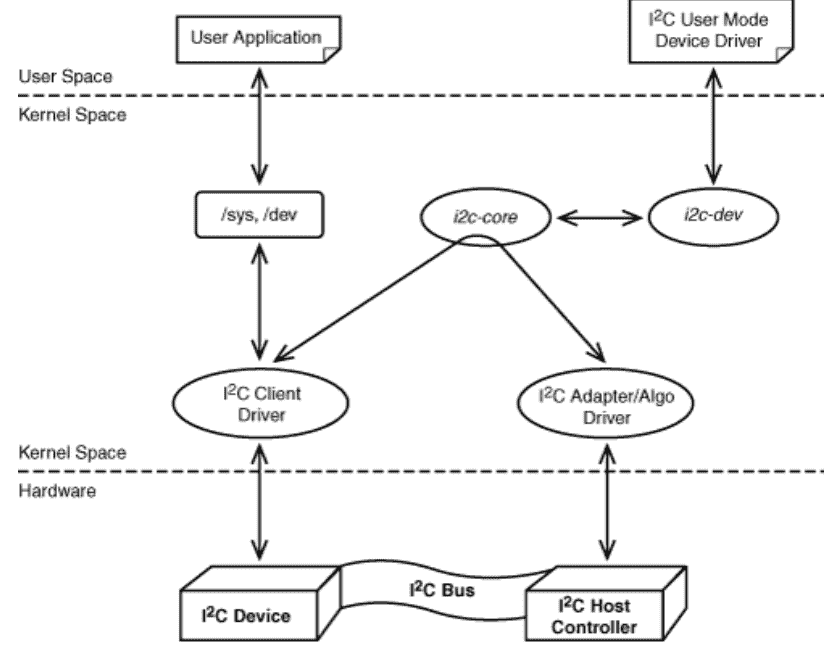

由于 SMBus 是 I²C 的子集，因此仅使用 SMBus 命令与设备通信将生成一个同时适用于 SMBus 和 I²C 适配器的驱动程序。表 8.1 列出了 I²C 核心提供的与 SMBus 兼容的数据传输例程。

### 表 8.1. I²C 核心提供的与 SMBus 兼容的数据访问函数

| 函数 | 用途 |
| --- | --- |
| `i2c_smbus_read_byte()` | 从设备读取单字节，不指定位置偏移量。使用与先前发出的命令相同的偏移量。 |
| `i2c_smbus_write_byte()` | 将单字节发送到设备，使用与先前发出的命令相同的内存偏移量。 |
| `i2c_smbus_write_quick()` | 向设备发送单比特（代替清单 8.1 所示的 Rd/Wr 位）。 |
| `i2c_smbus_read_byte_data()` | 从设备的指定偏移量读取单字节。 |
| `i2c_smbus_write_byte_data()` | 向设备的指定偏移量发送单字节。 |
| `i2c_smbus_read_word_data()` | 从指定偏移量读取 2 字节。 |
| `i2c_smbus_write_word_data()` | 向指定偏移量发送 2 字节。 |
| `i2c_smbus_read_block_data()` | 从指定偏移量读取数据块。 |
| `i2c_smbus_write_block_data()` | 向指定偏移量发送数据块（<= 32 字节）。 |

## 总线事务

在实现示例驱动程序之前，让我们通过放大镜观察线路来更好地了解 I²C 协议。清单 8.1 展示了与 I²C EEPROM 通信的代码片段以及总线上发生的相应事务。这些事务是通过在运行代码片段时连接 I²C 总线分析仪捕获的。该代码使用用户模式 I²C 函数。（我们将在第 19 章"用户空间中的驱动程序"中详细讨论用户模式 I²C 编程。）

### 清单 8.1. I²C 总线上的事务

```
Code View:
/* ... */
/*
 * 连接 EEPROM。0x50 是设备地址。
 * smbus_fp 是指向 SMBus 设备的文件指针。
 */
ioctl(smbus_fp, 0x50, slave);

/* 在 EEPROM 的内存偏移量 0 处写入一个字节 (0xAB) */
i2c_smbus_write_byte_data(smbus_fp, 0, 0xAB);

/*
 * 这是写入后在总线上观察到的相应事务：
 * S 0x50 Wr [A] 0 [A] 0xAB [A] P
 *
 * S 是起始位，0x50 是 7 位从机地址 (0101000b)，
 * Wr 是写入命令 (0b)，A 是从机发送给主机的
 * 接收位（或确认位），0 是要写入字节的从设备上的
 * 地址偏移量，0xAB 是要写入的数据，P 是停止位。
 * [] 内的数据是从设备发送给主机的，而其余的
 * 位是主机发送给从设备的。
 */

/* 从 EEPROM 的偏移量 0 处读取一个字节 */
res = i2c_smbus_read_byte_data(smbus_fp, 0);

/*
 * 这是读取后在总线上观察到的相应事务：
 * S 0x50 Wr [A] 0 [A] S 0x50 Rd [A] [0xAB] NA P
 *
 * 各位的解释与之前相同，不同之处在于
 * Rd 代表读取命令 (1b)，0xAB 是从机接收到的数据，
 * NA 是反向接收位（或主机发送给从机的确认位）。
 */
```

## 设备示例：EEPROM

我们的第一个示例客户端设备是位于 I²C 总线上的 EEPROM，如图 8.1 所示。几乎所有笔记本电脑和台式机都有这样的 EEPROM，用于存储 BIOS 配置信息。示例 EEPROM 有两个存储体。驱动程序导出对应于每个存储体的 /dev 接口：/dev/eep/0 和 /dev/eep/1。应用程序操作这些节点与 EEPROM 交换数据。

每个 I²C/SMBus 客户端设备都被分配一个作为设备标识符的从机地址。示例中的 EEPROM 响应两个从机地址，SLAVE_ADDR1 和 SLAVE_ADDR2，每个存储体一个。

示例驱动程序使用与 SMBus 兼容的 I²C 命令，因此它同时适用于 I²C 和 SMBus EEPROM。

### 初始化

与所有驱动程序类一样，I²C 客户端驱动程序也有一个 `init()` 入口点。初始化包括分配数据结构、向 I²C 核心注册驱动程序，以及与 sysfs 和 Linux 设备模型连接。这在清单 8.2 中完成。

#### 清单 8.2. 初始化 EEPROM 驱动程序

```
Code View:
/* 驱动程序入口点 */
static struct file_operations eep_fops = {
  .owner   = THIS_MODULE,
  .llseek  = eep_llseek,
  .read    = eep_read,
  .ioctl   = eep_ioctl,
  .open    = eep_open,
  .release = eep_release,
  .write   = eep_write,
};

static dev_t dev_number;       /* 分配的设备号 */
static struct class *eep_class; /* 设备类 */

/* 驱动程序支持的每个
 * 存储体的每设备客户端数据结构
 */

struct eep_bank {
  struct i2c_client *client;      /* 此存储体的 I2C 客户端 */
  unsigned int addr;              /* 此存储体的从机地址 */
  unsigned short current_pointer; /* 文件指针 */
  int bank_number;                /* 实际存储体编号 */
  /* ... */                       /* 自旋锁、慢速设备的
                                     数据缓存等 */
};

#define NR_BANKS 2           /* 两个支持的存储体 */
#define BANK_SIZE 2048       /* 每个存储体的大小 */

struct ee_bank *ee_bank_list;  /* 私有数据列表，
                                   每个存储体一个 */
```


 ## 清单 8.2 设备初始化

```c
/*
 * Device Initialization
 */
int __init
eep_init(void)
{

  int err, i;

  /* Allocate the per-device data structure, ee_bank */
  ee_bank_list = kmalloc(sizeof(struct ee_bank)*NUM_BANKS,
                         GFP_KERNEL);
  memset(ee_bank_list, 0, sizeof(struct ee_bank)*NUM_BANKS);
  /* Register and create the /dev interfaces to access the EEPROM
     banks. Refer back to Chapter 5, "Character Drivers" for
     more details */
  if (alloc_chrdev_region(&dev_number, 0,
                          NUM_BANKS, "eep") < 0) {
    printk(KERN_DEBUG "Can't register device\n");
    return -EAXI;
  }

  eep_class = class_create(THIS_MODULE, DEVICE_NAME);
  for (i=0; i < NUM_BANKS;i++) {

    /* Connect the file operations with cdev */
    cdev_init(&ee_bank[i].cdev, &ee_fops);

    /* Connect the major/minor number to the cdev */
    if (cdev_add(&ee_bank[i].cdev, (dev_number + i), 1)) {
      printk("Bad kmalloc\n");
      return 1;
    }
    class_device_create(eep_class, NULL, (dev_number + i),
                        NULL, "eeprom%d", i);
  }

  /* Inform the I2C core about our existence. See the section
     "Probing the Device" for the definition of eep_driver */
  err = i2c_add_driver(&eep_driver);

  if (err) {
    printk("Registering I2C driver failed, errno is %d\n", err);
    return err;
  }

  printk("EEPROM Driver Initialized.\n");
  return 0;
}
```

清单 8.2 开始创建设备节点，但要完成它们的创建，需要将一个适当的规则文件添加到 `/etc/udev/rules.d/` 下：

```
KERNEL:"eeprom[0-1]*", NAME="eep/%n"
```

这会在内核接收到相应的 uevent 时创建 `/dev/eep/0` 和 `/dev/eep/1`。需要读取第 `n` 个存储体（memory bank）的用户态程序随后就可以操作 `/dev/eep/n`。

清单 8.3 实现了 EEPROM 驱动程序的 `open()` 方法。当应用程序打开 `/dev/eep/X` 时，内核调用 `eep_open()`。`eep_open()` 将每个设备的*数据结构存储在*一个私有区域中，以便可以从其他驱动方法直接访问。

#### 清单 8.3 打开 EEPROM 驱动程序

```c
int
eep_open(struct inode *inode, struct file *file)
{

  /* The EEPROM bank to be opened */
  n = MINOR(file->f_dentry->d_inode->i_rdev);

  file->private_data = (struct ee_bank *)ee_bank_list[n];

  /* Initialize the fields in ee_bank_list[n] such as
     size, slave address, and the current file pointer */
  /* ... */
}
```

### 探测设备

I²C 客户机驱动程序与主机控制器驱动程序以及 I²C 核心协同，将自己附加到从设备，步骤如下：

1. 在初始化期间，它注册一个 `probe()` 方法，当检测到相关联的主机控制器时，I²C 核心会调用该方法。在接下来的清单 8.2 中，`eep_init()` 通过调用 `i2c_add_driver()` 注册了 `eep_probe()`：
```c
static struct i2c_driver eep_driver =
{
  .driver = {
    .name         =  "EEP",           /* Name */
  },
  .id              = I2C_DRIVERID_EEP, /* ID */
  .attach_adapter = eep_probe,         /* Probe Method */
  .detach_client  = eep_detach,        /* Detach Method */
};

i2c_add_driver(&eep_driver);
```

驱动标识符 `I2C_DRIVERID_EEP` 对该设备应该是唯一的，且应在 `include/linux/i2c-id.h` 中定义。

2. 当核心调用驱动程序的 `probe()` 方法表示存在主机适配器时，它依次调用 `i2c_probe()`，参数指定驱动程序负责的从设备地址以及一个相关联的 `attach()` 例程。

清单 8.4 实现了 EEPROM 驱动程序的 `probe()` 方法，即 `eep_probe()`。`normal_i2c` 指定 EEPROM 存储体地址，并作为 `i2c_client_address_data` 结构体的一部分被填充。此结构体中的其他字段可用于请求更精细的寻址控制。可以使用 `ignore` 字段要求 I²C 核心忽略某个地址范围。或者使用 `probe` 字段指定 (*适配器*, *从地址*) 对，如果你想将一个从地址绑定到一个特定的主机适配器。这将很有用，例如，如果你的处理器支持两个 I²C 主机适配器，你在总线 1 上有一个 EEPROM，在总线 2 上有一个温度传感器，两者使用相同的从地址。

3. 主机控制器遍历总线，寻找步骤 2 中指定的从设备。为此，它生成一个总线事务，如 `S SLAVE_ADDR Wr`，其中 `S` 是开始位，`SLAVE_ADDR` 是与设备数据表中指定的 7 位从地址，`Wr` 是写命令，如"总线事务"一节所述。如果总线上存在正常工作的从设备，它将发送确认位 (`[A]`) 来响应。

4. 如果主机适配器在步骤 3 中检测到从设备，I²C 核心会调用通过步骤 2 中 `i2c_probe()` 的第三个参数提供的 `attach()` 例程。对于 EEPROM 驱动程序，这个例程是 `eep_attach()`，它注册一个每个设备的客户机数据结构，如清单 8.5 所示。如果你的设备需要一个初始编程序列（例如，I²C 数字视觉接口发送器芯片上的寄存器必须初始化后芯片才能开始工作），请在此例程中执行这些操作。

#### 清单 8.4 探测 EEPROM 存储体的存在

```c
#include <linux/i2c.h>

/* The EEPROM has two memory banks having addresses SLAVE_ADDR1
 * and SLAVE_ADDR2, respectively
 */
static unsigned short normal_i2c[] = {
  SLAVE_ADDR1, SLAVE_ADDR2, I2C_CLIENT_END
};

static struct i2c_client_address_data addr_data = {
  .normal_i2c = normal_i2c,
  .probe      = ignore,
  .ignore     = ignore,
  .forces     = ignore,
};

static int
eep_probe(struct i2c_adapter *adapter)
{
  /* The callback function eep_attach(), is shown
   * in Listing 8.5
   */
  return i2c_probe(adapter, &addr_data, eep_attach);
}
```

#### 清单 8.5 附加客户机

```c
int
eep_attach(struct i2c_adapter *adapter, int address, int kind)
{
  static struct i2c_client *eep_client;

  eep_client = kmalloc(sizeof(*eep_client), GFP_KERNEL);

  eep_client->driver  = &eep_driver; /* Registered in Listing 8.2 */
  eep_client->addr    = address;     /* Detected Address */
  eep_client->adapter = adapter;     /* Host Adapter */
  eep_client->flags   = 0;
  strlcpy(eep_client->name, "eep", I2C_NAME_SIZE);

  /* Populate fields in the associated per-device data structure */
  /* ... */

  /* Attach */
  i2c_attach_client(new_client);
}
```

### 检查适配器功能

每个主机适配器可能有一系列约束限制。一个适配器可能不支持表 8.1 中所有的命令。例如，它可能允许 SMBus `read_word` 命令但不允许 `read_block` 命令。客户机驱动程序必须在使用命令之前检查适配器是否支持该命令。

I²C 核心提供两个函数来完成此功能：

1. `i2c_check_functionality()` 检查是否支持特定的功能。
2. `i2c_get_functionality()` 返回包含所有支持的功能的掩码。

请参阅 `include/linux/i2c.h` 了解可能的功能列表。

### 访问设备

要从 EEPROM 读取数据，首先从与设备节点相关联的私有数据字段中获取有关其调用线程的信息。然后，使用 I²C 核心提供的与 SMBus 兼容的数据访问例程（表 8.1 显示了可用的函数）读取数据。最后，将数据发送到用户空间并递增内部文件指针，以便下一次 `read()`/`write()` 操作从上次结束的地方开始。这些步骤由清单 8.6 执行。为方便起见，该清单省略了健全性检查和错误检查。

#### 清单 8.6 从 EEPROM 读取数据

```c
/* Code View: */
ssize_t
eep_read(struct file *file, char *buf,
		size_t count, loff_t *ppos)
{
 int i, transferred, ret, my_buf[BANK_SIZE];

 /* Get the private client data structure for this bank */
 struct ee_bank *my_bank =
			(struct ee_bank *)file->private_data;

 /* Check whether the smbus_read_word() functionality is
	 supported */
 if (i2c_check_functionality(my_bank->client,
			 I2C_FUNC_SMBUS_READ_WORD_DATA)) {

	/* Read the data */
	while (transferred < count) {
	  ret = i2c_smbus_read_word_data(my_bank->client,
					my_bank->current_pointer+i);

	  my_buf[i++] = (u8)(ret & 0xFF);
	  my_buf[i++] = (u8)(ret >> 8);
	  transferred += 2;
	}

	/* Copy data to user space and increment the internal
	   file pointer. Sanity checks are omitted for simplicity */
	copy_to_user(buffer, (void *)my_buf, transferred);
	my_bank->current_pointer += transferred;
 }

 return transferred;
}
```

对设备进行写操作类似，只是使用 `i2c_smbus_write_XXX()` 函数代替。

某些 EEPROM 芯片具有射频识别（RFID）发射器，可无线传输存储的信息。这用于自动化供应链流程，如库存监控和资产跟踪。此类 EEPROM 通常通过访问保护存储体来实现保护措施，该存储体控制对数据存储体的访问权限。在这种情况下，驱动程序必须先在访问保护存储体中操作相应的位，然后才能对数据存储体进行操作。

要从用户空间访问 EEPROM 存储体，开发操作 */dev/eep/n* 的应用程序。要转储 EEPROM 存储体的内容，请使用 `od`：

```
bash> od -a /dev/eep/0
0000000   3   E   R  #  dc4  ff soh   R   P nul nul nul nulCtl n7 nul
0000020  4f   1   3   R   1   1   5   3   Z   J   1   V   1   L   4   6
0000040   5   1   0   H  sp   1   S   2   8   8   8   7   J   U   9   9
```


 作为练习，尝试修改 EEPROM 驱动程序，为 EEPROM 存储区创建 /sys 接口而非 /dev 接口。你可以重用**第 5 章**中的清单 5.7“使用 Sysfs 控制并行 LED 板”中的代码来协助完成这项工作。

### 更多方法

要获得功能完整的驱动程序，你还需要添加几个剩余的入口点。这些与第 5 章中讨论的普通字符驱动程序几乎没有区别，因此不展示代码清单：

- 为支持 `lseek()` 系统调用（该系统调用为内部文件指针分配新值），需实现 `llseek()` 驱动方法。内部文件指针存储 EEPROM 访问的状态信息。

- 为验证数据完整性，EEPROM 驱动程序可以支持一个 `ioctl()` 方法来调整和验证存储数据的校验和。

- `poll()` 和 `fsync()` 方法对 EEPROM 不适用。

- 如果选择将驱动程序编译为模块，则必须提供一个 `exit()` 方法来注销设备并清理客户端特定的数据结构。从 I2C 核心注销驱动程序只需一行代码：

```c
i2c_del_driver(&eeep_driver);
```

## 设备示例：实时时钟

现在以通过 I²C 总线连接到嵌入式控制器的 RTC 芯片为例。连接图如图 8.3 所示。

### 图 8.3. 嵌入式系统上的 I²C RTC。

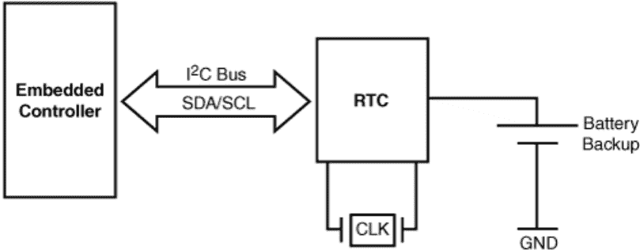

假设 RTC 的 I²C 从地址为 `0x60`，且其寄存器空间组织如表 8.2 所示。

### 表 8.2. I²C RTC 的寄存器布局

| 寄存器名称 | 描述 | 偏移量 |
| --- | --- | --- |
| `RTC_HOUR_REG` | 小时计数器 | `0x0` |
| `RTC_MINUTE_REG` | 分钟计数器 | `0x1` |
| `RTC_SECOND_REG` | 秒钟计数器 | `0x2` |
| `RTC_STATUS_REG` | 标志和中断状态 | `0x3` |
| `RTC_CONTROL_REG` | 启用 RTC | `0x4` |

让我们基于前面讨论的 EEPROM 驱动程序来构建该芯片的驱动程序。我们将 I²C 客户端驱动程序架构、从设备注册和 I²C 核心函数视为已知条件，仅实现与 RTC 通信的代码。

当 I²C 核心在 I²C 总线上检测到具有 RTC 从地址（`0x60`）的设备时，它会调用 `myrtc_attach()`。调用链与清单 8.5 中 `eep_attach()` 的类似。假设你需要在 `myrtc_attach()` 中执行以下芯片初始化：

1. 清除 RTC 状态寄存器（`RTC_STATUS_REG`）。

2. 通过打开 RTC 控制寄存器（`RTC_CONTROL_REG`）中的适当位来启动 RTC（如果它尚未运行）。

为此，我们构建一个 `i2c_msg` 并使用 `i2c_transfer()` 在总线上生成 I²C 事务。这种传输机制是 I²C 特有的，与 SMBus 不兼容。要写入前面提到的两个 RTC 寄存器，你必须构建两个 `i2c_msg` 消息。第一条消息设置寄存器偏移量。在本例中，它是 3，即 `RTC_STATUS_REG` 的偏移量。第二条消息将所需字节数传送到指定偏移量。在此上下文中，它传送 2 个字节，分别写入 `RTC_STATUS_REG` 和 `RTC_CONTROL_REG`。

代码视图：

```c
#include <linux/i2c.h> /* For struct i2c_msg */
int
myrtc_attach(struct i2c_adapter *adapter, int addr, int kind)
{
  u8 buf[2];
  int offset = RTC_STATUS_REG;  /* Status register lives here */
  struct i2c_msg rtc_msg[2];

  /* Write 1 byte of offset information to the RTC */
  rtc_msg[0].addr = addr;     /* Slave address. In our case,
                                  this is 0x60 */
  rtc_msg[0].flags = I2C_M_WR; /* Write Command */
  rtc_msg[0].buf = &offset;    /* Register offset for
                                  the next transaction */
  rtc_msg[0].len = 1;          /* Offset is 1 byte long */

  /* Write 2 bytes of data (the contents of the status and
     control registers) at the offset programmed by the previous
     i2c_msg */
  rtc_msg[1].addr = addr;      /* Slave address */
  rtc_msg[1].flags = I2C_M_WR; /* Write command */
  rtc_msg[1].buf = &buf[0];   /* Data to be written to control
                                  and status registers */
  rtc_msg[1].len = 2;          /* Two register values */
 如此多的费伊曼学习内容致使这没生效.
  buf[0] = 0;                  /* Zero out the status register */
  buf[1] |= ENABLE_RTC;        /* Turn on control register bits
                                  that start the RTC */

  /* Generate bus transactions corresponding to the two messages */
  i2c_transfer(adapter, rtc_msg, 2);

  /* ... */
  printk("My RTC Initialized\n");
}
```

既然 RTC 已经初始化并开始运行，你就可以通过读取 `RTC_HOUR_REG`、`RTC_MINUTE_REG` 和 `RTC_SECOND_REG` 的内容来获取当前时间。具体操作如下：

代码视图：

```c
#include <linux/rtc.h> /* For struct rtc_time */
int
myrtc_gettime(struct i2c_client *client, struct rtc_time *r_t)
{
  u8 buf[3];      /* Space to carry hour/minute/second */
  int offset = 0; /* Time-keeping registers start at offset 0 */
  struct i2c_msg rtc_msg[2];

  /* Write 1 byte of offset information to the RTC */
  rtc_msg[0].addr = addr;      /* Slave address */
  rtc_msg[0].flags = 0;        /* Write Command */
  rtc_msg[0].buf = &offset;    /* Register offset for
                                   the next transaction */
  rtc_msg[0].len = 1;          /* Offset is 1 byte long */

  /* Read current time by getting 3 bytes of data from offset 0
     (i.e., from RTC_HOUR_REG, RTC_MINUTE_REG, and RTC_SECOND_REG) */
  rtc_msg[1].addr = addr;      /* Slave address */
  rtc_msg[1].flags = I2C_M_RD; /* Read command */
  rtc_msg[1].buf = &buf[0];    /* Data to be read from hour, minute
                                  and second registers */
  rtc_msg[1].len = 3;          /* Three registers to read */

  /* Generate bus transactions corresponding to the above
     two messages */
  i2c_transfer(adapter, rtc_msg, 2);
  /* Read the time */
  r_t->tm_hour = BCD2BIN(buf[0]); /* Hour */
  r_t->tm_min  = BCD2BIN(buf[1]); /* Minute */
  r_t->tm_sec  = BCD2BIN(buf[2]); /* Second */
  return(0);
}
```

`myrtc_gettime()` 实现了 RTC 驱动程序的总线特定底层。RTC 驱动程序的顶层应符合内核 RTC API，如第 5 章"RTC 子系统"一节所讨论的那样。这种方案的优势在于，无论 RTC 是位于 PC 南桥内部还是像本例中那样外部连接到嵌入式控制器，应用程序都可以不加修改地运行。

RTC 通常以二进制编码的十进制（BCD）格式存储时间，其中每个半字节代表 0 到 9 之间的数字（而非 0 到 15）。内核提供了 `BCD2BIN()` 宏用于从 BCD 编码转换为十进制，以及 `BIN2BCD()` 用于执行反向操作。`myrtc_gettime()` 在从 RTC 寄存器读取时间时使用了前者。

请参阅 `drivers/rtc/rtc-ds1307.c`，了解处理 Dallas/Maxim DS13XX 系列 I²C RTC 芯片的 RTC 驱动程序示例。

作为两线总线，I²C 总线没有从设备可以置位的中断请求线，但某些 I²C 主机适配器具有中断处理器的能力，以信号数据传输请求的完成。然而，这种中断驱动操作对 I²C 客户端驱动程序是透明的，隐藏于 I²C 核心提供的服务例程中。假设图 8.3 中嵌入式 SoC 的 I²C 主机控制器具有中断处理器的能力，`myrtc_attach()` 中 `i2c_transfer()` 的调用在底层可能执行以下操作：

- 构建对应于 `rtc_msg[0]` 的事务，并使用主机控制器设备驱动程序的服务将其写入总线。

- 等待主机控制器置位发送完成中断，信号 `rtc_msg[0]` 已经在总线上。

- 在中断处理程序内部，查看 I²C 主机控制器状态寄存器，确认是否已收到来自 RTC 从设备的应答。

- 如果主机控制器状态和控制寄存器表明一切不正常，则返回错误。

- 对 `rtc_msg[1]` 重复相同的操作。


 ## I2C-dev

有时，当你需要为大量低速 I²C 设备启用支持时，完全从用户空间驱动它们是合理的。I²C 层支持一个名为 i2c-dev 的驱动程序来实现这一点。请跳至第19章中的“User Mode I²C”一节，查看使用 i2c-dev 实现用户模式 I²C 驱动程序的示例。

## 使用 LM-Sensors 进行硬件监控

*LM-Sensors* 项目托管在 [www.lm-sensors.org](http://www.lm-sensors.org)，为 Linux 带来了硬件监控功能。许多计算机系统使用传感器芯片来监控温度、电源电压和风扇转速等参数。定期跟踪这些参数可能至关重要。CPU 风扇烧毁可能会表现为奇怪且随机的软件问题。想象一下，如果该系统是医疗设备，后果会是如何！

LM-Sensors 提供了救援方案，包括许多传感器芯片的设备驱动程序、一个名为 *sensors* 的用于生成健康报告的工具，以及一个名为 *sensors-detect* 的脚本，用于扫描你的系统并帮助你生成适当的配置文件。

大多数提供硬件监控功能的芯片通过 I²C/SMBus 与 CPU 连接。这类设备的设备驱动程序是普通的 I²C 客户端驱动程序，但它们位于 *drivers/hwmon/* 目录中，而不是 *drivers/i2c/chips/*。一个例子是 National Semiconductor 的 LM87 芯片，它可以监控多个电压、温度和风扇。请查看 *drivers/hwmon/lm87.c* 了解其驱动程序实现。I²C 驱动程序 ID 从 1000 到 1999 保留给传感器芯片（查看 *include/linux/i2c-id.h*）。

一些传感器芯片通过 ISA/LPC 总线而非 I²C/SMBus 与 CPU 连接。其他芯片发出模拟输出，通过 *模数转换器*（ADC）到达 CPU。这类芯片的驱动程序与 I²C 传感器驱动程序共享 *drivers/hwmon/* 目录。一个非 I²C 传感器驱动程序的例子是 *drivers/hwmon/hdaps.c*，它是我们在[第7章](chapter7.html)“输入驱动程序”中讨论的、存在于多款 IBM/Lenovo 笔记本电脑中的加速度计的驱动程序。另一个非 I²C 传感器的例子是 Winbond 83627HF Super I/O 芯片，它由 *drivers/hwmon/w83627hf.c* 驱动。

## 串行外设接口总线

*串行外设接口*（SPI）总线是一种串行主从接口，类似于 I²C，内置于许多微控制器中。它使用四根线（相比 I²C 的两根）：*串行时钟*（SCLK）、*片选*（CS）、*主出从入*（MOSI）和*主入从出*（MISO）。MOSI 用于将数据移入从设备，MISO 用于将数据移出从设备。由于 SPI 总线有专门用于发送和接收数据的线路，它可以全双工模式运行，这与 I²C 总线不同。SPI 的典型运行速度在低兆赫兹范围，而 I²C 的速度在中等千赫兹范围，因此前者提供更高的吞吐量。

当今市场上可用的 SPI 外设包括 *射频*（RF）芯片、智能卡接口、EEPROM、RTC、触摸传感器和 ADC。

内核提供了通过 SPI 总线交换消息的核心 API。典型的 SPI 客户端驱动程序执行以下操作：

- 1. 向 SPI 核心注册 `probe()` 和 `remove()` 方法。可选地注册 `suspend()` 和 `resume()` 方法：

```
#include <linux/spi/spi.h>

static struct spi_driver myspi_driver = {
  .driver  = {
    .name  = "myspi",
    .bus   = &spi_bus_type,
    .owner = THIS_MODULE,
  },
  .probe   = myspidevice_probe,
  .remove  = __devexit_p(myspidevice_remove),
}

spi_register_driver(&myspi_driver);
```

SPI 核心会创建一个与此设备对应的 `spi_device` 结构体，并在调用注册的驱动程序方法时将其作为参数传递。

- 2. 使用诸如 `spi_sync()` 和 `spi_async()` 等访问函数与 SPI 设备交换消息。前者等待操作完成，而后者异步触发调用注册的回调例程，直至消息传输完成。这些数据访问例程从合适的位置调用，例如 SPI 中断处理程序、sysfs 方法或定时器处理程序。以下代码片段说明了 SPI 消息提交：

```
#include <linux/spi/spi.h>

struct spi_device *spi;        /* SPI 设备的
                                  表示 */
struct spi_transfer xfer;      /* 包含传输缓冲区
                                   详情 */
struct spi_message sm;         /* spi_transfer 段
                                   的序列 */
u8 *command_buffer;            /* 要传输的数据 */

int len;                       /* 要传输数据的
                                  长度 */

spi_message_init(&sm);               /* 初始化 spi_message */
xfer.tx_buf = command_buffer;        /* 设备特定数据 */
xfer.len = len;                     scapes:Length of data to be transferred */;
```

对于示例 SPI 设备，考虑我们在第7章中简要讨论的 ADS7846 触摸屏控制器。该驱动程序执行以下操作：

- 1. 使用 `spi_register_driver()` 向 SPI 核心注册 `probe()`、`remove()`、`suspend()` 和 `resume()` 方法。

- 2. `probe()` 方法使用 `input_register_device()` 向输入子系统注册驱动程序，并使用 `request_irq()` 请求 IRQ。

- 3. 驱动程序使用 `spi_async()` 从其中断处理程序收集触摸坐标。此函数触发调用注册的回调例程，直至 SPI 消息传输完成。

- 4. 回调函数反过来通过输入事件接口 */dev/input/eventX* 报告触摸坐标和点击，使用 `input_report_abs()` 和 `input_report_key()`，如第7章所述。X Windows 和 gpm 等应用程序与该事件接口无缝协作，并对触摸输入做出响应。

通过操作 I/O 引脚来使其通信协议的驱动程序称为 *bit-banging* 驱动程序。有关 SPI bit-banging 驱动程序的示例，请查看 *drivers/spi/spi_butterfly.c*，这是一个与 *Butterfly* 板上的 DataFlash 芯片通信的驱动程序，这些板由 Atmel 围绕其 AVR 处理器系列构建。为此，将你的主机系统并行端口通过一个专门制作的加密狗连接到 AVR Butterfly，并使用 *spi_butterfly* 驱动程序进行 bit banging。查看 *Documentation/spi/butterfly* 了解此驱动程序的详细说明。

目前还没有像 i2c-dev 那样的用户空间 SPI 驱动程序支持。你只能选择编写内核驱动程序来与 SPI 设备通信。

> 在嵌入式领域，你可能会遇到处理器使用集成了各种功能的配套芯片的解决方案。一个例子是与基于 ARM9 的 i.MX27 控制器配合使用的 Freescale MC13783 电源管理和音频组件（PMAC）。PMAC 集成了 RTC、电池充电器、触摸屏接口、ADC 模块和音频编解码器。处理器和 PMAC 通过 SPI 通信。SPI 总线不包含中断线，因此 PMAC 能够通过为此目的配置的 GPIO 引脚外部中断处理器。

## 1-Wire 总线

Dallas/Maxim 开发的 *1-wire 协议* 使用一根线（或 *w1*）总线来同时传输电源和信号；返回的接地路径通过其他方式提供。它通过减少空间、成本和复杂性，提供了一种与慢速设备交互的简单方式。使用此协议工作的一个示例设备是 *ibutton*（[www.ibutton.com](www.ibutton.com)），用于感测温度、携带数据或保存唯一 ID。

另一个通过嵌入式控制器的单个端口引脚进行接口的 w1 芯片是 Dallas/Maxim 的 DS2433 4kb 1-wire EEPROM。该芯片的驱动程序 *drivers/w1/slaves/w1_ds2433.c* 通过 sysfs 节点导出对 EEPROM 的访问。

与 w1 设备驱动程序相关的主要数据结构是 `w1_family` 和 `w1_family_ops`，两者都在 *w1_family.h* 中定义。


# ## 查看源码

在 2.4 内核源码树中，所有与 I²C/SMBus 相关的源码都位于单个目录（*drivers/i2c/*）中。2.6 内核中的 I²C 代码按层次结构组织：*drivers/i2c/busses/* 目录包含适配器驱动程序，*drivers/i2c/algos/* 目录包含算法驱动程序，*drivers/i2c/chips/* 目录包含客户端驱动程序。你也可以在源码树的其他区域找到客户端驱动程序。例如，*drivers/sound/* 目录包含使用 I²C 控制接口的音频芯片组驱动程序。查看 *Documentation/i2c/* 目录以获取更多提示和示例。

内核 SPI 服务函数位于 *drivers/spi/spi.c* 中。ADS7846 触摸控制器的 SPI 驱动程序在 *drivers/input/touchscreen/ads7846.c* 中实现。第 17 章"存储技术设备"中讨论的 MTD 子系统实现了 SPI 闪存芯片的驱动程序。一个例子是 *drivers/mtd/devices/mtd_dataflash.c*，用于访问 Atmel DataFlash SPI 芯片的驱动程序。

*drivers/w1/* 目录包含对 w1 协议的内核支持。w1 接口主机控制器端的驱动程序位于 *drivers/w1/masters/* 中，w1 从设备的驱动程序位于 *drivers/w1/slaves/* 中。

表 8.3 总结了本章中使用的主要数据结构及其在内核树中的位置。表 8.4 列出了本章中使用的主要内核编程接口及其定义位置。

# **表 8.3. 数据结构总结**

| 数据结构 | 位置 | 描述 |
| -------- | ---- | ---- |
| `i2c_driver` | *include/linux/i2c.h* | I²C 驱动程序的表示 |
| `i2c_client_address_data` | *include/linux/i2c.h* | I²C 客户端驱动程序负责的从设备地址 |
| `i2c_client` | *include/linux/i2c.h* | 标识连接到 I²C 总线的芯片 |
| `i2c_msg` | *include/linux/i2c.h* | 与要在 I²C 总线上生成的传输操作相关的信息 |
| `spi_driver` | *include/linux/spi/spi.h* | SPI 驱动程序的表示 |
| `spi_device` | *include/linux/spi/spi.h* | SPI 设备的表示 |
| `spi_transfer` | *include/linux/spi/spi.h* | SPI 传输缓冲区的详细信息 |
| `spi_message` | *include/linux/spi/spi.h* | `spi_transfer` 段的序列 |
| `w1_family` | *drivers/w1/w1_family.h* | w1 从设备驱动程序的表示 |
| `w1_family_ops` | *drivers/w1/w1_family.h* | w1 从设备驱动程序的入口点 |

# **表 8.4. 内核编程接口总结**

| 内核接口 | 位置 | 描述 |
| -------- | ---- | ---- |
| `i2c_add_driver()` | *include/linux/i2c.h*<br>*drivers/i2c/i2c-core.c* | 向 I²C 核心注册驱动程序入口点。 |
| `i2c_del_driver()` | *drivers/i2c/i2c-core.c* | 从 I²C 核心移除驱动程序。 |
| `i2c_probe()` | *drivers/i2c/i2c-core.c* | 指定驱动程序负责的从设备地址，以及当 I²C 核心检测到指定地址之一时要调用的相关 `attach()` 例程。 |
| `i2c_attach_client()` | *drivers/i2c/i2c-core.c* | 将新客户端添加到相关 I²C 主机适配器服务的客户端列表中。 |
| `i2c_detach_client()` | *drivers/i2c/i2c-core.c* | 分离活动客户端。通常在客户端驱动程序或相关主机适配器注销时执行。 |
| `i2c_check_functionality()` | *include/linux/i2c.h* | 验证主机适配器是否支持特定功能。 |
| `i2c_get_functionality()` | *include/linux/i2c.h* | 获取包含主机适配器支持的所有功能的掩码。 |
| `i2c_add_adapter()` | *drivers/i2c/i2c-core.c* | 注册主机适配器。 |
| `i2c_del_adapter()` | *drivers/i2c/i2c-core.c* | 注销主机适配器。 |
| 兼容 SMBus 的 I²C 数据访问例程 | *drivers/i2c/i2c-core.c* | 参见表 8.1。 |
| `i2c_transfer()` | *drivers/i2c/i2c-core.c* | 在 I²C 总线上发送 `i2c_msg`。此函数不兼容 SMBus。 |
| `spi_register_driver()` | *drivers/spi/spi.c* | 向 SPI 核心注册驱动程序入口点。 |
| `spi_unregister_driver()` | *include/linux/spi/spi.h* | 注销 SPI 驱动程序。 |
| `spi_message_init()` | *include/linux/spi/spi.h* | 初始化 SPI 消息。 |
| `spi_message_add_tail()` | *include/linux/spi/spi.h* | 将 SPI 消息添加到传输列表。 |
| `spi_sync()` | *drivers/spi/spi.c* | 在 SPI 总线上同步传输数据。此函数会阻塞直到完成。 |
| `spi_async()` | *include/linux/spi/spi.h* | 使用完成回调机制在 SPI 总线上异步传输数据。 |

# 第 9 章. PCMCIA 和 Compact Flash

## 本章内容

- 什么是 PCMCIA/CF？ 258
- Linux-PCMCIA 子系统 260
- 主机控制器驱动程序 262
- PCMCIA 核心 263
- 驱动程序服务 263
- 客户端驱动程序 264
- 整合各部分 271
- PCMCIA 存储 272
- 串行 PCMCIA 272
- 调试 273
- 查看源码 275

> 如今流行的技术，如无线和有线以太网、*通用分组无线服务*（GPRS）、*全球定位系统*（GPS）、微型存储器和调制解调器，都以 PCMCIA（*个人计算机存储卡国际协会*的缩写）或 CF（*Compact Flash*）卡的形式无处不在。大多数笔记本电脑和许多嵌入式设备都支持 PCMCIA 或 CF 接口，从而立即使其能够利用这些技术。在嵌入式系统上，PCMCIA/CF 插槽提供了一条技术升级路径，无需重新设计电路板。例如，一个成本降低的联网设备可以使用 PCMCIA 拨号调制解调器，而高端版本则可以拥有 WiFi。

Linux 内核在多种架构上支持 PCMCIA 设备。在本章中，让我们探索内核中对 PCMCIA/CF 主机适配器和客户端设备的支持。

## 什么是 PCMCIA/CF？

PCMCIA 是一种 16 位数据传输接口规范，最初用于存储卡。CF 卡体积更小，但与 PCMCIA 兼容，常用于掌上电脑（PDA）和数码相机等手持设备中。CF 卡只有 50 个引脚，但可以通过被动的 CF 转 PCMCIA 适配器插入笔记本电脑的 68 引脚 PCMCIA 插槽中。PCMCIA 和 CF 一直局限于笔记本电脑和手持设备领域，尚未进入台式机和高端机器。

PCMCIA 规范现在已经扩展到包括以 32 位 *CardBus* 卡形式提供的更高速支持。术语 *PC 卡* 用于指代 PCMCIA 或 CardBus 设备。CardBus 更接近 PCI 总线，因此内核已将 CardBus 设备的支持从 PCMCIA 层转移到了 PCI 层。PCMCIA 行业标准组织发布的最新技术规范是 *ExpressCard*，它与 *PCI Express* 兼容，这是一种基于 PCI 概念的新型总线技术。我们在下一章讨论 PCI 时再来看 CardBus 和 ExpressCard。

PC 卡按厚度递增分为三种类型：Type **I**（3.3mm）、Type **II**（5mm）和 Type **III**（10.5mm）。

[图 9.1](#) 展示了笔记本电脑上的 PCMCIA 总线连接，[图 9.2](#) 展示了嵌入式设备上的 PCMCIA。如你所见，PCMCIA 主机控制器在 PCMCIA 卡与系统总线之间起桥梁作用。笔记本电脑及其衍生产品通常有一个连接到 PCI 总线的 PCMCIA 主机控制器芯片，而许多嵌入式控制器则在其芯片内部集成了 PCMCIA 主机控制器。该控制器将卡内存映射到主机 I/O 和内存窗口，并将卡产生的中断路由到合适的处理器中断线。

### 图 9.1. 笔记本电脑上的 PCMCIA。


 ## 第 9 章. PCMCIA 与 Compact Flash

| 本章内容 |
|---|
| - 什么是 PCMCIA/CF? | 258 |
| - Linux-PCMCIA 子系统 | 260 |
| - 主机控制器驱动 | 262 |
| - PCMCIA 核心 | 263 |
| - 驱动服务 | 263 |
| - 客户端驱动 | 264 |
| - 整合各组件 | 271 |
| - PCMCIA 存储 | 272 |
| - 串行 PCMCIA | 272 |
| - 调试 | 273 |
| - 查看源代码 | 275 |

- 什么是 PCMCIA/CF?
- Linux-PCMCIA 子系统
- 主机控制器驱动
- PCMCIA 核心
- 驱动服务
- 客户端驱动
- 整合各组件
- PCMCIA 存储
- 串行 PCMCIA
- 调试
- 查看源代码

如今流行的技术，如无线和有线以太网、*通用分组无线服务*（GPRS）、*全球定位系统*（GPS）、微型存储器以及调制解调器，都以 PCMCIA（*个人计算机存储卡国际协会*的缩写）或 CF（*Compact Flash*）卡的形式随处可见。大多数笔记本电脑和许多嵌入式设备都支持 PCMCIA 或 CF 接口，从而使它们能够立即利用这些技术。在嵌入式系统上，PCMCIA/CF 插槽提供了一条技术升级路径，无需重新设计电路板。例如，一款降低成本的互联网设备可以使用 PCMCIA 拨号调制解调器，而高端版本则可以配备 WiFi。

Linux 内核支持多种架构上的 PCMCIA 设备。在本章中，让我们探索内核中对 PCMCIA/CF 主机适配器和客户端设备的支持。

## 什么是 PCMCIA/CF?

PCMCIA 是一种 16 位数据传输接口规范，最初用于存储卡。CF 卡体积更小，但与 PCMCIA 兼容，常用于掌上电脑（PDA）和数码相机等手持设备。CF 卡只有 50 个引脚，但可以通过被动式 CF 转 PCMCIA 适配器插入笔记本电脑的 68 针 PCMCIA 插槽。PCMCIA 和 CF 主要限于笔记本电脑和手持设备领域，尚未进入台式机和高端机器市场。

PCMCIA 规范现已发展到支持更高速度的形式，即 32 位 *CardBus* 卡。术语 *PC 卡* 用于指代 PCMCIA 或 CardBus 设备。CardBus 更接近 PCI 总线，因此内核已将 CardBus 设备的支持从 PCMCIA 层移至 PCI 层。PCMCIA 工业标准组的最新技术规范是 *ExpressCard*，它兼容 *PCI Express*，这是一种基于 PCI 概念的新型总线技术。我们在下一章讨论 PCI 时会介绍 CardBus 和 ExpressCard。

PC 卡按厚度递增分为三种类型：Type **I**（3.3mm）、Type **II**（5mm）和 Type **III**（10.5mm）。

[图 9.1](#) 展示了笔记本电脑上的 PCMCIA 总线连接，[图 9.2](#) 展示了嵌入式设备上的 PCMCIA。如您所见，PCMCIA 主机控制器将 PCMCIA 卡与系统总线桥接起来。笔记本电脑及其衍生产品通常有一个连接到 PCI 总线的 PCMCIA 主机控制器芯片，而许多嵌入式控制器则在其硅片中内置了 PCMCIA 主机控制器。控制器将卡内存映射到主机的 I/O 和内存窗口，并将卡产生的中断路由到合适的处理器中断线。

**图 9.1. 笔记本电脑上的 PCMCIA。**

### 图 9.2. 嵌入式系统上的 PCMCIA。

## Linux-PCMCIA 子系统

Linux-PCMCIA 支持不仅可用于基于 Intel 的笔记本电脑，还可用于 ARM、MIPS 和 PowerPC 等架构。PCMCIA 子系统包括 PCMCIA 主机控制器的设备驱动、不同卡的客户端驱动、辅助热插拔的守护进程、用户模式工具以及一个与所有这些交互的 *卡服务* 模块。

图 9.3 展示了构成 Linux-PCMCIA 子系统的各模块之间的交互。

### 图 9.3. Linux-PCMCIA 子系统。

[查看全尺寸图像]

### 旧的 Linux-PCMCIA 子系统

Linux-PCMCIA 子系统最近经历了一次 overhaul。要在 2.6.13 及更新内核上使 PCMCIA 工作，您需要 *pcmciautils* 软件包（http://kernel.org/pub/linux/utils/kernel/pcmcia/howto.html），它取代了早期内核使用的 *pcmcia-cs* 软件包（http://pcmcia-cs.sourceforge.net）。内部内核编程接口和数据结构也发生了变化。早期内核依赖一个名为 *cardmgr* 的用户空间守护进程来支持热插拔，但新的 PCMCIA 实现使用 *udev* 处理热插拔，就像其他总线子系统一样。因此，对于新设置，您不需要 *cardmgr*，并应确保它不会启动。http://kernel.org/pub/linux/utils/kernel/pcmcia/cardmgr-to-pcmciautils.html 上有一份迁移指南。

[图 9.3](#) 包含以下组件：

- 主机控制器设备驱动，实现与 PCMCIA 主机控制器通信的低级例程。您的手持设备和笔记本电脑有不同的主机控制器，因此使用不同的主机控制器驱动。主机控制器支持的每个 PCMCIA 插槽称为 *插槽*。

- PCMCIA 客户端驱动（[图 9.3](#) 中的 XX_cs），响应插槽事件，如卡插入和弹出。当您尝试为 PCMCIA 卡添加 Linux 支持时，这最可能是您需要实现的驱动。XX_cs 驱动通常与一个通用的非 PCMCIA 特定驱动（[图 9.3](#) 中的 XX）协同工作。相对于 [图 9.3](#)，如果您的设备是 PCMCIA IDE 磁盘，则 XX 是 IDE 磁盘驱动，XX_cs 是 ide_cs 驱动，XX 依赖层是文件系统层，XX 应用程序是访问数据文件的程序。XX_cs 为通用驱动（XX）配置资源，如 IRQ、I/O 基地址和内存窗口。

- PCMCIA 核心，为主机控制器驱动和客户端驱动提供服务。核心提供了一种基础设施，使驱动实现更简单，并增加了一层间接性，使客户端驱动独立于主机控制器。无论您是在基于 XScale 的手持设备还是基于 x86 的笔记本电脑上使用蓝牙 CF 卡，都可以使用相同的客户端驱动。

- *驱动服务*模块（*ds*），为客户端驱动提供注册接口和总线服务。

- *pcmciautils* 软件包，包含 *pccardctl* 等工具，用于控制 PCMCIA 插槽的状态并在不同的卡配置方案之间进行选择。

[图 9.4](#) 在 [图 9.1](#) 之上粘合内核模块，以说明 Linux-PCMCIA 子系统如何与 PC 兼容系统上的硬件交互。

### 图 9.4. PCMCIA 驱动组件与 PC 硬件的关系。

[查看全尺寸图像]

在下面的章节中，让我们更仔细地看看构成 Linux-PCMCIA 子系统的组件。为了更好地理解这些组件的作用及其交互，我们将在 "[整合各组件](#)" 一节中将 PCMCIA WiFi 卡插入笔记本电脑并跟踪代码流程。

### 主机控制器驱动

通用卡驱动（XX）负责处理由卡功能产生的中断（例如，当 PCMCIA 网卡接收数据包时的接收中断），而主机控制器驱动负责处理由事件（如卡插入和弹出）触发的总线特定中断。

图 9.2 显示了围绕具有内置 PCMCIA 支持的嵌入式控制器设计的嵌入式设备的框图。即使您使用的是内核 PCMCIA 层支持的控制器，您可能仍需要调整主机控制器驱动（例如，配置用于检测卡插入事件或切换插槽电源的 GPIO 线），这取决于您电路板的设计。例如，如果您要将内核移植到基于 StrongARM 的手持设备上，请调整 *drivers/pcmcia/sa1100_assabet.c* 以适应您的硬件。

本章不涵盖主机控制器设备驱动的实现。


 PCMCIA 核心

Card Services 是 PCMCIA 核心的主要组成部分。它向客户端驱动程序和主机控制器驱动程序提供一组服务。它包含一个名为 *pccard* 的内核线程，用于轮询与插槽相关的事件。当主机控制器报告事件（如卡插入和卡拔出）时，pccardd 会通知驱动程序服务事件处理程序（在下一节中讨论）。

PCMCIA 核心的另一个组件是一个操作 *Card Information Structure*（CIS）的库，CIS 是 PCMCIA 卡的一部分。PCMCIA/CF 卡有两个内存空间：*Attribute*（属性）内存和 *Common*（通用）内存。属性内存包含 CIS 和卡配置寄存器。例如，PCMCIA IDE 磁盘的属性内存包含其 CIS 和指定扇区计数及柱面数的寄存器。这种情况下，通用内存包含存储磁盘数据的内存阵列。PCMCIA 核心向客户端驱动程序提供 CIS 操作例程，如 `pccard_get_first_tuple()`、`pccard_get_next_tuple()` 和 `pccard_parse_tuple()`。清单 9.2 使用了其中一些函数的帮助。

PCMCIA 核心通过 sysfs 和 udev 将 CIS 信息传递到用户空间。`pccardctl` 等工具（属于 pcmciautils 软件包的一部分）依赖 sysfs 和 udev 进行操作。这简化了早期在内核中缺乏这些设施时依赖自定义基础架构的设计方法。

### 驱动程序服务

驱动程序服务提供了一个提供以下功能的基础架构：

- 一个捕获由 pccardd 内核线程分派的事件警报的处理程序。该处理程序扫描并验证卡的 CIS 空间，并触发加载适当的客户端驱动程序。

- 一个负责与内核总线核心通信的层。为此，驱动程序服务实现了 `pcmcia_bus_type` 和相关的总线操作。

- 客户端驱动程序用于向 PCMCIA 核心注册自己的服务例程，如 `pcmcia_register_driver()`。清单 9.1 中的示例驱动程序使用了其中一些例程。

#### 客户端驱动程序

客户端设备驱动程序（图 9.3 中的 XX_cs）查看卡的 CIS 空间，并根据收集到的信息配置卡。

### 数据结构

在开发示例 PCMCIA 客户端驱动程序之前，让我们了解一些相关的数据结构：

1. PCMCIA 设备由 *include/linux/mod_devicetable.h* 中定义的 `pcmcia_device_id` 结构标识：

```
struct pcmcia_device_id {
  /* ... */
  __u16     manf_id;     /* Manufacturer ID */
  __u16     card_id;     /* Card ID */
  __u8      func_id;     /* Function ID */
  /* ... */
};
```

`manf_id`、`card_id` 和 `func_id` 分别保存卡的制造商 ID、卡 ID 和功能 ID。PCMCIA 核心提供了一个名为 `PCMCIA_DEVICE_MANF_CARD()` 的宏，它从提供给它的制造商 ID 和卡 ID 创建一个 `pcmcia_device_id` 结构。另一个名为 `MODULE_DEVICE_TABLE()` 的内核宏在模块映像中标记支持的 `pcmcia_device_id`，以便在插入卡且 PCMCIA 子系统从卡的 CIS 空间收集匹配的制造商/卡/功能 ID 时，可以按需加载模块。我们在第 4 章"奠定基础"中的"模块自动加载"一节中探讨了这一机制。此过程类似于支持热插拔的另外两个流行 I/O 总线的设备驱动程序所使用的流程：PCI 和 USB。表 9.1 简要介绍了这三种总线技术驱动程序之间的相似性。如果难以理解，不必担心；我们将在接下来的章节中详细讨论 PCI 和 USB。

| | PCMCIA | PCI | USB |
|---|---|---|---|
| 设备 ID 表结构 | `pcmcia_device_id` | `pci_device_id` | `usb_device_id` |
| 创建设备 ID 的宏 | `PCMCIA_DEVICE_MANF_CARD()` | `PCI_DEVICE()` | `USB_DEVICE()` |
| 设备表示 | `struct pcmcia_device` | `struct pci_dev` | `struct usb_device` |
| 驱动程序表示 | `struct pcmcia_driver` | `struct pci_driver` | `struct usb_driver` |
| 热插拔方法 | `probe()` 和 `remove()` | `probe()` 和 `remove()` | `probe()` 和 `disconnect()` |
| 热插拔事件检测 | pccardd 内核线程 | 依赖于 PCI 系列 | khubd 内核线程 |

2. PCMCIA 客户端驱动程序需要将其 `pcmcia_device_id` 表与它们的 `probe()` 和 `remove()` 方法相关联。这种关联由 `pcmcia_driver` 结构实现：

```
struct pcmcia_driver {
  int  (*probe)(struct pcmcia_device *dev);  /* Probe
                                               method */

  void (*remove)(struct pcmcia_device *dev); /* Remove
                                               method */

  /* ... */
  struct pcmcia_device_id *id_table;        /* Device ID
                                               table */

  /* ... */
};
```

3. `struct pcmcia_device` 在内部表示一个 PCMCIA 设备，在 *drivers/pcmcia/ds.h* 中定义如下：

```
struct pcmcia_device {
  /* ... */
  io_req_t io;          /* I/O attributes*/
  irq_req_t irq;        /* IRQ settings */
  config_req_t conf;    /* Configuration */
  /* ... */
  struct device dev;    /* Connection to device model */
  /* ... */
};
```

4. CIS 操作例程使用在 *include/pcmcia/cistpl.h* 中定义的 `tuple_t` 结构来保存 CIS 信息单元。例如，`CISTPL_LONGLINK_MFC` 元组类型包含与多功能卡相关的信息。有关元组的完整列表及其描述，请参见 *include/pcmcia/cistpl.h* 和 http://pcmcia-cs.sourceforge.net/ftp/doc/PCMCIA-PROG.html。

```
typedef struct tuple_t {
  /* ... */
  cisdata_t TupleCode;     /* See
                               include/pcmcia/cistpl.h */

  /* ... */
  cisdata_t DesiredTuple;  /* Identity of the desired
                               tuple */

  /* ... */
  cisdata_t *TupleData;    /* Buffer space */
};
```

5. CIS 包含卡支持的每种配置的配置表项。`cistpl_cftable_entry_t` 在 *include/pcmcia/cistpl.h* 中定义，保存这样一个表项：

```
typedef struct cistpl_cftable_entry_t {
  /* ... */
  cistpl_power_t vcc, vpp1, vpp2;   /* Voltage level */
  cistpl_io_t io;                   /* I/O attributes */
  cistpl_irq_t irq;                 /* IRQ settings */
  cistpl_mem_t mem;                 /* Memory window */
  /* ... */
};
```

6. `cisparse_t` 也在 *include/pcmcia/cistpl.h* 中定义，保存由 PCMCIA 核心解析的元组：

```
typedef union cisparse_t {
    /* ... */
    cistpl_manfid_t manfid;             /* Manf ID */
    /* ... */
    cistpl_cftable_entry_t cftable_entry;   /* Configuration
                                                  table entry */
    /* ... */
} cisparse_t;
```

## 设备示例：PCMCIA 卡

让我们开发一个 skeletal 客户端设备驱动程序（因为太多细节会使讨论过于繁重），以了解 PCMCIA 子系统的工作原理。该实现是通用的，因此无论您的卡实现的是网络、存储还是其他技术，都可以将其用作模板。仅实现了 XX_cs 驱动程序；通用的 XX 驱动程序假定可以直接使用。

如前 discussed，PCMCIA 驱动程序包含 `probe()` 和 `remove()` 方法以支持热插拔。**清单 9.1** 向 PCMCIA 核心注册驱动程序的 `probe()` 方法、`remove()` 方法和 `pcmcia_device_id` 表。当关联的 PCMCIA 卡插入时调用 `XX_probe()`，当卡弹出时调用 `XX_remove()`。

### 清单 9.1. 注册客户端驱动程序

```
Code View:
#include <pcmcia/ds.h> /* Definition of struct pcmcia_device */

static struct pcmcia_driver XX_cs_driver = {
  .owner     = THIS_MODULE,
  .drv       = {
  .name = "XX_cs",           /* Name */
  },
  .probe     = XX_probe,     /* Probe */
  .remove    = XX_remove,    /* Release */
  .id_table   = XX_ids,       /* ID table */
  .suspend   = XX_suspend,   /* Power management */
  .resume    = XX_resume,    /* Power management */
};

#define XX_MANUFACTURER_ID  0xABCD  /* Device's manf_id */
#define XX_CARD_ID          0xCDEF  /* Device's card_id */

/* Identity of supported cards */
static struct pcmcia_device_id XX_ids[] = {
  PCMCIA_DEVICE_MANF_CARD (XX_MANUFACTURER_ID, XX_CARD_ID),
  PCMCIA_DEVICE_NULL,
};

MODULE_DEVICE_TABLE(pcmcia, XX_ids); /* For module autoload */

/* Initialization */
static int __init
init_XX_cs (void)
{
  return pcmcia_register_driver(&XX_cs_driver);
}
```


 ```c
/* Probe Method */
static int
XX_probe(struct pcmcia_device *link)
{
  /* Populate the pcmcia_device structure allotted for this card by
     the core. First fill in general information */
  /* ... */

  /* Fill in attributes related to I/O windows and
     interrupt levels */
  XX_config detalhe of configuration table entry tuple from the card's CIS
- Parse the tuple
- Glean card configuration information such as I/O base addresses and power settings from the parsed tuple
- Request allocation of an interrupt line

It then configures the chipset-specific driver (XX) with the information previously obtained.

### Listing 9.2. 配置通用设备驱动程序

```
Code View:
#include <pcmcia/cistpl.h>
#include <pcmcia/ds.h>
#include <pcmcia/cs.h>
#include <pcmcia/cisreg.h>

/* This makes the XX device available to the system. XX_config()
   is based on airo_config(), defined in
   drivers/net/wireless/airo_cs.c */
static int
XX_config(struct pcmcia_device *link)
{
  tuple_t tuple;
  cisparse_t parse;
  u_char buf[64];

  /* Populate a tuple_t structure with the identity of the desired
     tuple. In this case, we're looking for a configuration table
     entry */
  tuple.DesiredTuple = CISTPL_CFTABLE_ENTRY;
  tuple.Attributes   = 0;
  tuple.TupleData    = buf;
  tuple.TupleDataMax = sizeof(buf);

  /* Walk the CIS for a matching tuple and glean card configuration
     information such as I/O window base addresses */

  /* Get first tuple */
  CS_CHECK(GetFirstTuple, pcmcia_get_first_tuple(link, &tuple));
  while (1){
    cistpl_cftable_entry_t dflt = {0};
    cistpl_cftable_entry_t *cfg = &(parse.cftable_entry);

    /* Read a configuration tuple from the card's CIS space */
    if (pcmcia_get_tuple_data(link, &tuple) != 0 ||
        pcmcia_parse_tuple(link, &tuple, &parse) != 0) {
      goto next_entry;
    }

    /* We have a matching tuple! */
    /* Configure power settings in the pcmcia_device based on
       what was found in the parsed tuple entry */
    if (cfg->vpp1.present & (1<<CISTPL_POWER_VNOM))
      link->conf.Vpp = cfg->vpp1.param[CISTPL_POWER_VNOM]/10000;

    /* ... */

    /* Configure I/O window settings in the pcmcia_device based on
       what was found in the parsed tuple entry */
    if ((cfg->io.nwin > 0) || (dflt.io.nwin > 0)) {
      cistpl_io_t *io = (cfg->io.nwin) ? &cfg->io : &dflt.io;
      /* ... */
      if (!(io->flags & CISTPL_IO_8BIT)) {
        link->io.Attributes1 = IO_DATA_PATH_WIDTH_16;
      }
      link->io.BasePort1 = io->win[0].base;
      /* ... */
    }

    /* ... */
    break;
  next_entry:
    CS_CHECK(GetNextTuple, pcmcia_get_next_tuple(link, &tuple));
  }

  /* Allocate IRQ */
  if (link->conf.Attributes & CONF_ENABLE_IRQ) {
    CS_CHECK(RequestIRQ, pcmcia_request_irq(link, &link->irq));
  }
  /* ... */

  /* Invoke init_XX_card(), which is part of the generic
     XX driver (so, not shown in this listing), and pass
     the I/O base and IRQ information obtained above */
  init_XX_card(link->irq.AssignedIRQ, link->io.BasePort1,
               1, &handle_to_dev(link));

  /* The chip-specific (form factor independent) driver is ready
     to take responsibility of this card from now on! */
}
```

### 将各部分整合到一起

正如您在[图 9.3](link)中所见，PCMCIA 层由多个组件组成。组件之间的数据流路径有时会变得复杂。让我们追踪从插入 PCMCIA 卡到应用程序开始向卡传输数据时的代码路径。假设一块 Cisco Aironet PCMCIA 卡被插入到一台带有 82365 兼容 PCMCIA 主机控制器控制器的笔记本电脑中：

1. PCMCIA 主机控制器驱动程序（*drivers/pcmcia/yenta_socket.c*）通过其中断服务程序检测到插入事件，并使用适当的数据结构记录下来。

2. 属于卡服务（*drivers/pcmcia/cs.c*）的 pccardd 内核线程在一个等待队列上休眠，直到主机控制器驱动程序在步骤 1 中检测到卡插入后将其唤醒。

3. 卡服务向驱动服务（*drivers/pcmcia/ds.c*）派发插入事件。这将触发驱动服务在初始化期间注册的事件处理程序的执行。

4. 驱动服务验证卡的 CIS 空间，确定插入设备的相关信息，如其制造商 ID 和卡 ID，并将设备注册到内核。随后加载相应的客户端设备驱动程序（*drivers/net/wireless/airo_cs.c*）。请回顾我们之前关于 `MODULE_DEVICE_TABLE()` 的讨论，以了解这是如何实现的。

5. 在步骤 4 中加载的客户端驱动程序（*airo_cs.c*）使用 `pcmcia_register_driver()` 进行初始化和注册，如[清单 9.1](link)所示。此注册接口在内部将设备的总线类型设置为 `pcmcia_bus_type`。由驱动服务（*ds.c*）定义的 PCMCIA 总线操作（如 `probe()` 和 `remove()`）也会在内部注册。

6. 内核调用驱动服务在步骤 5 中注册的总线 `probe()` 操作。这反过来调用匹配的客户端驱动程序拥有的 `probe()` 方法（`airo_probe()`），该方法也在步骤 5 中注册。客户端 `probe()` 例程填充诸如 I/O 窗口和中断线之类的设置，并配置通用的芯片组专用驱动程序（*drivers/net/wireless/airo.c*），如[清单 9.2](link)所示。

7. 芯片组驱动程序（*airo.c*）创建一个网络接口（ethX），并从此刻起负责正常操作。正是这个驱动程序处理由卡响应数据包接收和传输完成而生成的中断。设备的物理形式（例如，它是 PCMCIA 卡还是 PCI 卡）对芯片组驱动程序以及在 ethX 上操作的应用程序都是透明的。

## PCMCIA 存储

如今的 PCMCIA/CF 存储支持达到 GB 级别的容量。存储卡有不同的类型：

- 微型 IDE 磁盘驱动器或微硬盘。这些是使用磁性介质的机械硬盘的微型版本。它们的数据传输速率通常高于固态存储器件，但 IDE 驱动器在数据传输之前存在启动和寻道延迟。IDE 卡服务驱动程序 *ide_cs* 与 legacy IDE 驱动程序结合使用，用于与这类存储卡通信。

- 模拟 IDE 的固态存储卡。此类卡没有移动部件，通常基于闪存，由于 IDE 模拟而对操作系统.Packet reception and transmit completion透明。因为这些驱动器实际上是基于 IDE 的，所以相同的 IDE 卡服务驱动程序（ide_cs）可以用于与它们通信。

- 使用闪存但不进行 IDE 模拟的存储卡。*memory_cs* 卡服务驱动程序为这类卡提供块接口和字符接口。块接口用于在卡内存上建立文件系统，而字符接口用于访问原始数据。您也可以使用 memory_cs 来读取任何 PCMCIA 卡的属性内存空间。


## 串行 PCMCIA

许多网络技术，如*通用分组无线服务*（GPRS）、*全球移动通信系统*（GSM）、*全球定位系统*（GPS）和蓝牙，都使用串行传输机制与主机系统进行通信。在本节中，我们将了解 PCMCIA 层如何处理采用这些技术的卡。请注意，本节仅旨在帮助您理解具有 PCMCIA/CF 外形的 GPRS、GSM 和蓝牙卡的**总线接口部分**。这些技术本身将在[第 16 章](https://example.com)"Linux 无线应用"中详细讨论。

通用串行卡服务驱动程序 *serial_cs* 使操作系统的其余部分将 PCMCIA/CF 卡视为串行设备。第一个未使用的串行设备 */dev/ttySX* 被分配给该卡。因此，serial_cs 在 GPRS、GSM 和 GPS 卡上模拟一个串行端口。它还允许使用串行传输的蓝牙 PCMCIA/CF 卡将**主机控制接口**（HCI）数据包传输到蓝牙协议层。

[图 9.5](https://example.com) 说明了实现不同网络技术的内核模块如何与 serial_cs 交互以与其各自的卡进行通信。

### 图 9.5. 使用串行传输的 PCMCIA/CF 卡进行网络通信。

[查看全尺寸图像]

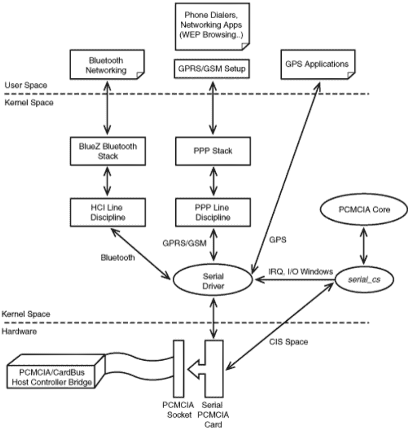

**点对点协议**（PPP）允许 TCP/IP 等网络协议在串行链路上运行。在图 9.5 的上下文中，PPP 使 TCP/IP 应用程序能够通过 GPRS 和 GSM 拨号运行。PPP 守护进程 *pppd* 通过 serial_cs 模拟的虚拟串行端口进行连接。PPP 内核模块——*ppp_generic、ppp_async* 和 *slhc*——必须加载才能使 pppd 工作。按如下方式调用 pppd：

```
bash> pppd ttySX call connection-script
```

其中 *connection-script* 是一个包含 pppd 与服务提供商交换以建立链路的命令序列的文件。连接脚本取决于正在使用的特定卡。GPRS 卡需要在连接脚本中发送上下文字符串，而 GSM 卡可能需要交换密码。第 16 章"GPRS"一节中描述了一个连接脚本示例。

## 调试

要有效调试 PCMCIA/CF 客户端驱动程序，您需要查看 PCMCIA 核心发出的调试消息。为此，在内核配置期间启用 `CONFIG_PCMCIA_DEBUG`（*总线选项* → *PCCARD 支持* → *启用 PCCARD 调试*）。调试输出的详细程度级别可以通过 `pcmcia_core.pc_debug` 内核命令行参数或 `pc_debug` 模块插入参数来控制。

有关 PC 卡客户端驱动程序的信息可在进程文件系统条目 */proc/bus/pccard/drivers* 中找到。查看 */sys/bus/pcmcia/devices/** 以获取特定于卡的信息，如制造商和卡 ID。如果您的系统使用 PCI 到 PCMCIA 桥接器，请查看 */proc/bus/pci/* 以了解更多关于您的 PCMCIA 主机控制器的信息。*/proc/interrupts* 列出了系统上活动的 IRQ，包括 PCMCIA 层使用的 IRQ。

有一个专门用于 Linux-PCMCIA 的邮件列表，地址为 [http://lists.infradead.org/mailman/listinfo/linux-pcmcia](http://lists.infradead.org/mailman/listinfo/linux-pcmcia)。

## 查看源代码

在 Linux 源代码树中，*drivers/pcmcia/* 目录包含卡服务、驱动程序服务和主机控制器驱动程序的源代码。查看 *drivers/pcmcia/yenta_socket.c* 以了解在许多基于 x86 的笔记本电脑上运行的主机控制器驱动程序。*include/pcmcia/* 中的头文件包含与 PCMCIA 相关的结构定义。

客户端驱动程序与属于相关设备类别的其他驱动程序放在一起。因此，您可以在 *drivers/net/pcmcia/* 中找到 PCMCIA 网卡驱动程序。用于模拟 IDE 的 PCMCIA 存储设备的客户端驱动程序是 *drivers/ide/legacy/ide-cs.c*。有关 PCMCIA 调制解调器使用的客户端驱动程序，请参见 *drivers/serial/serial_cs.c*。

[表 9.2](#) 总结了本章中使用的主要数据结构及其在内核树中的位置。[表 9.3](#) 列出了本章中使用的主要内核编程接口及其定义位置。

| 数据结构 | 位置 | 说明 |
|---|---|---|
| `pcmcia_device_id` | *include/linux/mod_devicetable.h* | PCMCIA 卡的身份标识。 |
| `pcmcia_device` | *include/pcmcia/ds.h* | PCMCIA 设备的表示。 |
| `pcmcia_driver` | *include/pcmcia/ds.h* | PCMCIA 客户端驱动程序的表示。 |
| `tuple_t` | *include/pcmcia/cistpl.h* | CIS 操作例程使用 `tuple_t` 结构来保存信息。 |
| `cistpl_cftable_entry_t` | *include/pcmcia/cistpl.h* | CIS 空间中的配置表项。 |
| `cisparse_t` | *include/pcmcia/cistpl.h* | 解析后的 CIS 元组。 |

| 内核接口 | 位置 | 说明 |
|---|---|---|
| `pcmcia_register_driver()` | *drivers/pcmcia/ds.c* | 向 PCMCIA 核心注册驱动程序 |
| `pcmcia_unregister_driver()` | *drivers/pcmcia/ds.c* | 从 PCMCIA 核心注销驱动程序 |
| `pcmcia_get_first_tuple()`<br>`pcmcia_get_tuple_data()`<br>`pcmcia_parse_tuple()` | *include/pcmcia/cistpl.h*<br>*drivers/pcmcia/cistpl.c* | 操作 CIS 空间的库例程 |
| `pcmcia_request_irq()` | *drivers/pcmcia/pcmcia_resource.c* | 为 PCMCIA 卡获取分配的 IRQ |

# 第 10 章. 外设组件互连

## 本章内容

- PCI 家族

- 寻址与识别

- 访问 PCI 区域

- 直接内存访问

- 设备示例：以太网-调制解调器卡

- 调试

- 查看源代码

> 外设组件互连（PCI）是一种无处不在的 I/O 骨干。无论您是在存储服务器上备份数据、从桌面捕获视频，还是在笔记本电脑上浏览网页，PCI 可能以某种形式为您服务。PCI 以及从 PCI 改编或衍生的外形规格，如 Mini PCI、CardBus、PCI Extended、PCI Express、PCI Express Mini Card 和 Express Card，已成为当今计算机上的事实标准外围连接技术。

## PCI 家族

PCI 是一种用于 CPU 与 I/O 设备之间通信的高速总线。PCI 规范支持以 33MHz 或 66MHz 的频率并行传输 32 位数据，峰值吞吐量达 266MBps。

CardBus 是 PCI 的衍生产品，具有 PC 卡的外形规格。CardBus 卡也是 32 位宽，运行频率为 33MHz。尽管 CardBus 和 PCMCIA 卡使用相同的 68 针连接器，但 CardBus 设备支持 32 条数据线，而 PCMCIA 为 16 条，这是通过像 PCI 总线那样复用地址和数据线实现的。

Mini PCI 也是一种 33MHz 的 32 位总线，是在笔记本电脑等小型计算机中找到的另一种 PCI 改编版本。PCI 卡可以通过兼容的连接器通过 Mini PCI 插槽进行通信。

称为 PCI Extended（或 PCI-X）的 PCI 扩展将总线宽度扩展到 64 位，频率提升到 133MHz，吞吐量达到约 1GBps。PCI-X 2.0 是该标准的当前版本。

PCI Express（PCIe 或 PCI-E）是 PCI 家族的当代产品。与并行 PCI 总线不同，PCIe 使用串行协议传输数据。PCIe 最多支持 32 条串行*链路*。每条 PCIe 链路（在常用的规范版本 1.1 中）在每个传输方向上产生 250MBps 的吞吐量，因此产生每个方向上最大 8GBps 的 PCIe 数据速率。PCIe 2.0 是该标准的当前版本，支持更高的数据速率。

由于不存在信号干扰等因素，串行通信比并行数据传输更快、更便宜，因此行业趋势是从并行总线转向串行技术。PCIe 及其改编版本旨在取代 PCI 及其衍生产品，这种转变也是从并行到串行通信方法论变革的一部分。本书中讨论的几种 I/O 接口，如 RS-232、USB、FireWire、SATA、以太网、光纤通道和 InfiniBand，都是串行通信架构。

PCIe 家族中的 CardBus 等价物是 Express Card。Express 卡直接通过 PCIe 链路或 USB 2.0（在下一章讨论）连接到系统总线，绕过 CardBus 控制器等中间环节。Mini PCI 在 PCIe 家族中的表亲是 PCI Express Mini Card。

最近的笔记本电脑支持 Express Card 插槽，而不是（或除此之外）CardBus，以及 PCI Express Mini Card 插槽来替代 Mini PCI。前两者相比后两者具有更小的外形规格和更高的速度。

**表 10.1** 总结了 PCI 的重要相关技术。从内核的角度来看，所有这些技术都是相互兼容的。内核 PCI 驱动程序将与前述所有相关技术配合工作；因此，尽管我们本章的示例代码基于 CardBus 卡，但这些概念也适用于其他 PCI 衍生产品。

### 表 10.1. PCI 的兄弟姐妹、子女和表亲

| 总线名称 | 特性 | 外形规格 |
|---|---|---|
| PCI | 33MHz 或 66MHz 的 32 位总线；最高可达 266MBps。 | 台式机和服务器中的内部插槽。 |
| Mini PCI | 33MHz 的 32 位总线。 | 笔记本电脑中的内部插槽。 |
| CardBus | 33MHz 的 32 位总线。 | 笔记本电脑中的外部 PC 卡插槽。与 PCI 兼容。 |
| PCI Extended (PCI-X) | 133MHz 的 64 位总线，最高可达 1GBps。 | 台式机和服务器中的内部插槽。比 PCI 宽，但 PCI 卡可以插入 PCI-X 插槽。 |
| PCI Express (PCIe) | 每个 PCIe 链路在每个传输方向上 250MBps，每个方向上最高吞吐量可达 8GBps。 | 取代较新系统中的内部 PCI 插槽。PCIe 是串行协议，而原生 PCI 是并行的。 |
| PCI Express Mini Card | 如果接口基于 PCIe 链路，每个方向 250MBps；如果接口基于 USB 2.0，则为 60MBps。 | 作为较新笔记本电脑中的内部插槽取代 Mini PCI。外形规格比 Mini PCI 更小。 |


 第10章 外围组件互连

本章内容

- PCI家族
- 寻址与识别
- 访问PCI区域
- 直接内存访问
- 设备示例：以太网-调制解调器卡
- 调试
- 查看源代码

> 外围组件互连（Peripheral Component Interconnect，PCI）是一种无处不在的I/O骨干架构。无论你是在存储服务器上备份数据、从桌面电脑采集视频，还是用你的笔记本上网冲浪，PCI都可能以某种形式为你服务。PCI以及从PCI演化或衍生而来的各种规格，如Mini PCI、CardBus、PCI Extended、PCI Express、PCI Express Mini Card和Express Card，已成为当今计算机事实上的外设连接技术。

## PCI家族

PCI是一种用于CPU与I/O设备之间通信的高速总线。PCI规范支持以33MHz或66MHz的频率并行传输32位数据，峰值吞吐量可达266MBps。

CardBus是PCI的衍生标准，采用PC卡的物理规格。CardBus卡同样为32位宽，工作频率为33MHz。尽管CardBus和PCMCIA卡使用相同的68针连接器，但CardBus设备支持32条数据线，而PCMCIA仅支持16条，这是通过像PCI总线那样对地址线和数据线进行多路复用来实现的。

Mini PCI也是一种33MHz的32位总线，是PCI的另一种变体，常见于笔记本电脑等紧凑型计算机中。PCI卡可以通过兼容的连接器经由Mini PCI插槽进行通信。

一种名为PCI Extended（或PCI-X）的PCI扩展标准将总线宽度扩展至64位，频率提升至133MHz，吞吐量达到约1GBps。PCI-X 2.0是该标准的当前版本。

PCI Express（PCIe或PCI-E）是PCI家族的现世代标准。与并行PCI总线不同，PCIe使用串行协议传输数据。PCIe最多支持32条串行*链路*。每条PCIe链路（在常用的规范版本1.1中）在每个传输方向上均可达到250MBps的吞吐量，因此每个方向的最大PCIe数据速率为8GBps。PCIe 2.0是该标准的当前版本，支持更高的数据速率。

由于不存在信号干扰等因素，串行通信比并行数据传输更快、成本更低，因此行业趋势是从并行总线向串行技术迁移。PCIe及其衍生标准旨在取代PCI及其衍生标准，这种转变也是从并行到串行通信方法论变革的一部分。本书讨论的多种I/O接口，如RS-232、USB、FireWire、SATA、以太网、Fibre Channel和InfiniBand，都是串行通信架构。

PCIe家族中相当于CardBus的是Express Card。Express Card通过PCIe链路或USB 2.0（将在下一章讨论）直接连接到系统总线，绕过了CardBus控制器等中间件。PCIe家族中相当于Mini PCI的是PCI Express Mini Card。

近年来的笔记本电脑转而支持Express Card插槽（替代或额外提供），以及PCI Express Mini Card插槽来替代Mini PCI。前两者相比后两者具有更小的体积和更高的速度。

**表10.1**总结了PCI的重要相关技术。从内核的角度来看，所有这些技术都是相互兼容的。内核的PCI驱动程序可与上述所有相关技术配合工作；因此，尽管本章的示例代码基于CardBus卡，但其概念同样适用于其他PCI衍生技术。

### 表10.1 PCI的兄弟姐妹、子代和表亲

| 总线名称 | 特性 | 物理规格 |
| --- | --- | --- |
| PCI | 32位总线，33MHz或66MHz；最高可达266MBps。 | 台式机和服务器内部插槽。 |
| Mini PCI | 32位总线，33MHz。 | 笔记本电脑内部插槽。 |
| CardBus | 32位总线，33MHz。 | 笔记本电脑外部PC卡插槽。兼容PCI。 |
| PCI Extended (PCI-X) | 64位总线，133MHz，最高可达1GBps。 | 台式机和服务器内部插槽。比PCI宽，但PCI卡可插入PCI-X插槽。 |
| PCI Express (PCIe) | 每条PCIe链路每个传输方向250MBps，每个方向最大吞吐量8GBps。 | 在新系统中替代内部PCI插槽。PCIe是串行协议，而原生PCI是并行的。 |
| PCI Express Mini Card | 若接口基于PCIe链路，每个方向250MBps；若基于USB 2.0，则为60MBps。 | 在新笔记本电脑中替代Mini PCI作为内部插槽。体积比Mini PCI更小。 |
| Express Card | 若接口基于PCIe链路，每个方向250MBps；若基于USB 2.0，则为60MBps。 | 新笔记本电脑中替代CardBus的薄型外部插槽。通过PCIe或USB 2.0与系统总线连接。 |

基于PCI家族的解决方案可用于极为广泛的硬件领域：

- 网络技术，如千兆以太网、WiFi、ATM、令牌环和ISDN。
- 存储技术的主机适配器，如SCSI。
- I/O总线的主机控制器，如USB、FireWire、IDE、I²C和PCMCIA。在兼容PC的系统中，这些主机控制器充当南桥PCI控制器与其所支持的多种总线技术之间的桥梁。运行*lspci*来验证这一点（稍后讨论）。
- 图形、视频流和数据采集。
- 串口卡和并口卡。
- 声卡。
- 看门狗、支持EDAC的内存控制器和游戏端口等设备。

对于驱动程序开发者而言，PCI家族提供了一项极具吸引力的优势：自动设备配置机制。与旧一代ISA的驱动程序不同，PCI驱动程序无需实现复杂的探测逻辑。在启动期间，类BIOS启动固件（或内核本身，如果如此配置）会遍历PCI总线并分配资源，如中断级别和I/O基地址。设备驱动程序通过查看称为PCI配置空间的内存区域来获取这些分配信息。PCI设备拥有256字节的配置内存。配置空间的高64字节是标准化的，包含状态、中断线和I/O基地址等详细信息的寄存器。PCIe和PCI-X 2.0提供4KB的扩展配置空间。我们稍后将学习如何操作PCI配置空间。

图10.1展示了兼容PC系统中的PCI。集成到南桥中的组件，如USB、IDE、I²C、LPC和以太网的控制器芯片，都位于PCI总线上。其中一些控制器包含内部PCI-to-PCI桥，为相应的I/O技术提供专用的PCI总线。此外，南桥还包含一条外部PCI总线，用于连接CardBus控制器、WiFi芯片组等I/O外设。图10.1还显示了与每个连接子系统相对应的PCI地址元组。当我们接下来学习PCI寻址时，这一点会更加清晰。

> **图10.1 PC南桥内部的PCI。**


 ## 寻址与标识

PCI 设备使用*总线*、*设备*和*功能*号进行寻址，并通过*厂商ID*、*设备ID*和*类代码*来识别。让我们借助 *lspci* 工具来学习这些概念，该工具是 *PCI Utilities* 软件包的一部分，可从 http://mj.ucw.cz/pciutils.shtml 下载。

假设你在一台 Pentium 级别的笔记本电脑上使用 Xircom 以太网-调制解调器多功能 CardBus 卡，该笔记本由 Texas Instruments PCI4510 CardBus 控制器提供服务，如图 10.1 所示。运行 lspci：

代码视图：

**bash>lspci**

`00:00.0 Host bridge: Intel Corporation 82852/82855 GM/GME/PM/GMV Processor to I/O Controller (rev 02)`

`...`

`02:00.0 CardBus bridge: Texas Instruments PCI4510 PC card Cardbus Controller (rev 03)`

`...`

`03:00.0 Ethernet controller: Xircom Cardbus Ethernet 10/100 (rev 03)`

`03:00.1 Serial controller: Xircom Cardbus Ethernet + 56k Modem (rev 03)`

```
bash>lspci
00:00.0 Host bridge: Intel Corporation 82852/82855 GM/GME/PM/GMV Processor to I/O
Controller (rev 02)
...
02:00.0 CardBus bridge: Texas Instruments PCI4510 PC card Cardbus Controller (rev 03)
...
03:00.0 Ethernet controller: Xircom Cardbus Ethernet 10/100 (rev 03)
03:00.1 Serial controller: Xircom Cardbus Ethernet + 56k Modem (rev 03)
```

考虑前面输出中每个条目开头的元组（`XX:YY.Z`）。`XX` 代表 PCI 总线号。一个 PCI 域最多可以承载 `256` 条总线。在前面使用的笔记本电脑中，CardBus 桥接器连接到 PCI 总线 `2`。该桥接器引出另一条编号为 `3` 的 PCI 总线，该总线上连接着 Xircom 卡。

`YY` 是 PCI 设备号。每条总线最多可以连接 32 个 PCI 设备。每个设备又可以实现最多八个由 `Z` 表示的功能。Xircom 卡可以同时执行两个功能。因此，`03:00.0` 寻址的是该卡的以太网功能，而 `03:00.1` 则对应其调制解调器通信功能。执行 `lspci -t` 可以显示系统中 PCI 总线和设备的树状布局：

```
bash> lspci -t
-[0000:00]-+-00.0
           +-00.1
           +-00.3
           +-02.0
           +-02.1
           +-1d.0
           +-1d.1
           +-1d.2
           +-1d.7
           +-1e.0-[0000:02-05]--+-[0000:03]-+-00.0
           |                      |             \-00.1
           |                      \-[0000:02]-+-00.0
           |                                    +-00.1
           |                                    +-01.0
           |                                    \-02.0
           +-1f.0
```

从前面输出（以及图 10.1）中可以看出，要遍历 PCI 总线并到达 Xircom 调制解调器（`03:00.1`）或以太网控制器（`03:00.0`），你必须从 PCI 域（前面输出中标记为 `0000`）开始，穿过一个 PCI-to-PCI 桥接器（00:1e.0），然后跨过一个 PCI-to-CardBus 主机控制器（02:00.0）。PCI 子系统的 sysfs 表示反映了这一布局：

```
bash> ls /sys/devices/pci0000:00/0000:00:1e.0/0000:02:00.0/0000:03:00.0/
...
net:eth2        ->    Ethernet
...
bash> ls /sys/devices/pci0000:00/0000:00:1e.0/0000:02:00.0/0000:03:00.1/
...
tty:ttyS1       ->    Modem
...
```

如前面所述，PCI 设备拥有一个 256 字节的内存区域，用于保存配置寄存器。该空间是识别 PCI 卡的制造商和功能的关键。让我们查看前面使用的 CardBus 控制器和 Xircom 双功能卡的配置空间。Xircom 卡有两个配置空间，每个支持的功能各有一个：

```
Code View:
bash> lspci -x
00:00.0 Host bridge: Intel Corporation 82852/82855 GM/GME/PM/GMV Processor to I/O Controller (rev 02)
00: 86 80 80 35 06 01 90 20 02 00 06 00 00 80 00
10: 08 00 00 00 00 00 00


 代码视图：

```
unsigned long pci_resource_[start|len|end|flags] (struct pci_dev *pdev, int bar);
```

要操作 I/O 区域（如 PCI 显卡上的设备控制寄存器），驱动程序需要执行以下步骤：

**1.** 从配置空间中适当的基地址寄存器（`bar`）获取 I/O 基地址：

```
unsigned long io_base = pci_resource_start(pdev, bar);
```

这里假设该设备的控制寄存器被映射到与 `bar` 关联的内存区域，`bar` 的值范围为 0 到 5，如表 10.2 所示。

**2.** 使用内核的 `request_region()` 监管机制（在第 5 章"字符驱动程序"中讨论过）将该区域标记为已被占用：

```
request_region(io_base, length, "my_driver");
```

这里，`length` 是控制寄存器空间的大小，`my_driver` 标识该区域的所有者。在 */proc/ioports* 中查找包含 `my_driver` 的条目，即可找到该内存区域。

你也可以改用封装函数 `pci_request_region()`，该函数定义在 *drivers/pci/pci.c* 中。

**3.** 将数据手册中获取的寄存器偏移量，与步骤 1 中获得的基地址相加。使用第 5 章讨论的 `inb()` 和 `outb()` 函数族对该地址进行操作：

```
/* 读取 */
register_data = inl(io_base + REGISTER_OFFSET);
/* 使用 */
/* ... */
/* 写入 */
outl(register_data, iobase + REGISTER_OFFSET);
```

要操作内存区域（如上述 PCI 显卡的帧缓冲），请遵循以下步骤：

+   1.  获取与内存区域关联的基地址、长度和标志：

```
unsigned long mmio_base   = pci_resource_start(pdev, bar);
unsigned long mmio_length = pci_resource_length(pdev, bar);
unsigned long mmio_flags  = pci_resource_flags(pdev, bar);
```

这里假设该内存被映射到基地址寄存器 `bar`。

+   2.  使用内核的 `request_mem_region()` 监管机制标记该区域的所有权：

```
request_mem_region(mmio_base, mmio_length, "my_driver");
```

你也可以改用前面提到的封装函数 `pci_request_region()`。

+   3.  获取对步骤 1 中获得的设备内存的 CPU 访问权限。某些内存区域（如存放寄存器的区域）需要防止副作用，因此它们被标记为不可预取（或不可缓存）的。其他区域（如本例中的区域）可以被缓存。根据访问标志，使用适当的函数获取与映射区域对应的内核虚拟地址：

```
void __iomem *buffer;
if (flags & IORESOURCE_CACHEABLE) {
  buffer = ioremap(mmio_base, mmio_length);
} else {
  buffer = ioremap_nocache(mmio_base, mmio_length);
}
```

为了安全起见，并避免执行上述检查，可以使用定义在 *lib/iomap.c* 中的 `pci_iomap()` 服务：

```
buffer = pci_iomap(pdev, bar, mmio_length);
```

## 直接内存访问

*直接内存访问*（DMA）是一种将数据从外设传输到主内存而无需 CPU 干预的能力。DMA 大幅提升了外设的性能，因为它不会消耗 CPU 周期来移动数据。PCI 网卡和 IDE 磁盘驱动器是依赖 DMA 进行数据传输的常见外设示例。

DMA 由 DMA 主控器发起。PC 主板上的南桥包含一个 DMA 控制器，它可以掌控 I/O 总线并对外设发起 DMA 传输。这通常是旧式 ISA 卡的情况。然而，PCI 等总线可以掌控总线并发起 DMA 传输。CardBus 卡与 PCI 类似，也支持 DMA 主控。另一方面，PCMCIA 设备不支持 DMA 主控，但 PCMCIA 控制器通常连接到 PCI 总线，可能具有 DMA 主控能力。

*缓存一致性*问题与 DMA 密切相关。为了获得最佳性能，处理器会缓存最近访问的字节，因此 CPU 和主内存之间的数据流会经过处理器缓存。然而，在 DMA 期间，数据直接在 DMA 控制器和主内存之间传输，因此绕过了处理器缓存。这种规避可能会引入不一致性，因为处理器可能使用缓存中的过期数据。某些架构通过称为*总线监听*的技术自动同步缓存与主内存。然而，许多其他架构依赖软件来实现一致性。在介绍更多主题之后，我们将学习如何执行一致的 DMA 操作。

DMA 可以*同步*或*异步*进行。前者的例子是从系统帧缓冲到 LCD 控制器的 DMA。用户应用程序通过 */dev/fbX* 将像素数据写入 DMA 映射的帧缓冲，而 LCD 控制器在定时间隔内同步使用 DMA 收集这些数据。我们在第 12 章"视频驱动程序"中进一步讨论这一点。异步 DMA 的例子是第 15 章"网络接口卡"中讨论的 CPU 与网卡之间的数据帧收发。

作为 DMA 传输源或目标的系统内存区域称为 DMA 缓冲区。如果总线接口有寻址限制，这会影响可容纳 DMA 缓冲区的内存范围。因此，适用于 24 位总线（如 ISA）的 DMA 缓冲区只能驻留在系统内存底部的 16MB 中，称为 `ZONE_DMA`（参见第 2 章"内核初探"中的"分配内存"一节）。PCI 总线默认是 32 位的，因此在 32 位平台上通常不会遇到此类限制。要通知内核 DMA 可用的缓冲区的任何特殊需求，请使用以下函数：

```
dma_set_mask(struct device *dev, u64 mask);
```

如果该函数返回成功，则可以对 `mask` 位长度的任何地址进行 DMA。例如，e1000 PCI-X 千兆以太网驱动程序（*drivers/net/e1000/e1000_main.c*）执行以下操作：

```
if (!(err = pci_set_dma_mask(pdev, DMA_64BIT_MASK))) {
    /* 系统支持 64 位 DMA */
    pci_using_dac = 1;
} else {
    /* 查看是否支持 32 位 DMA */
    if ((err = pci_set_dma_mask(pdev, DMA_32BIT_MASK))) {
        /* 不支持，中止 */
        E1000_ERR("No usable DMA configuration, aborting\n");
        return err;
    }
    /* 32 位 DMA */
    pci_using_dac = 0;
}
```

I/O 设备通过总线控制器和任何中间的 *I/O 内存管理单元*（IOMMU）来查看 DMA 缓冲区。因此，I/O 设备使用*总线*地址，而不是物理地址或内核虚拟地址。所以，当你告知 PCI 卡 DMA 缓冲区的位置时，必须告诉它该缓冲区的总线地址。DMA 服务例程将 DMA 缓冲区的内核虚拟地址映射到总线地址，以便设备和 CPU 都能访问这些缓冲区。总线地址的类型为 `dma_addr_t`，定义在 *include/asm-your-arch/types.h* 中。

关于 DMA 还有几个值得了解的概念。一是*回弹缓冲区*（bounce buffer）的概念。回弹缓冲区位于 DMA 可用区域中，当向/从非 DMA 可用内存区域请求 DMA 时，它们被用作临时内存。一个例子是：在没有中间 IOMMU 的情况下，从 32 位 PCI 外设向高于 4GB 的地址进行 DMA。数据首先传输到回弹缓冲区，然后复制到最终目的地。第二个概念是称为*散集*（scatter-gather）的 DMA 变体。当需要 DMA 的数据分散在不连续的区域时，散集功能使硬件能够一次性收集分散缓冲区的内容。当数据从卡传输到内存中分散的缓冲区时，则发生相反的操作。散集功能通过消除服务多个 DMA 请求的需求来提升性能。

内核提供了丰富的 API，掩盖了配置 DMA 的许多内部细节。如果你正在为支持总线主控的 PCI 卡编写驱动程序，这个 API 会更加简单。（大多数 PCI 卡都支持。）PCI DMA 例程本质上是通用 DMA 服务例程的封装器，定义在 *include/asm-generic/pci-dma-compat.h* 中。在本章中，我们仅使用 PCI DMA API。

内核向 PCI 驱动程序提供两类 DMA 服务例程：

+   1. **一致性**（或*相干*）DMA 访问方法。这些例程保证在 DMA 活动面前的数据一致性。如果 PCI 设备和 CPU 都可能频繁操作 DMA 缓冲区，一致性至关重要，因此应使用一致 API。代价是一定程度的性能损失。要获取一致的 DMA 缓冲区，请调用以下服务例程：

```
void *pci_alloc_consistent(struct pci_dev *pdev,
                           size_t size,
                           dma_addr_t *dma_handle);
```

该函数分配 DMA 缓冲区，生成其总线地址，并返回关联的内核虚拟地址。前两个参数分别保存 PCI 设备结构（稍后讨论）和请求的 DMA 缓冲区大小。第三个参数 `dma_handle` 是指向函数调用生成的总线地址的指针。以下代码片段分配和释放一致的 DMA 缓冲区：

```
/* 分配 */
void *vaddr = pci_alloc_consistent(pdev, size,
                                   &dma_handle);

/* 使用 */
/* ... */
/* 释放 */
pci_free_consistent(pdev, size, vaddr, dma_handle);
```

+   2. **流式** DMA 访问方法。这些例程不保证一致性，因此速度更快。当 CPU 和 I/O 设备之间不需要大量共享访问时，它们非常有用。当流式缓冲区已被映射供设备访问时，驱动程序必须显式取消映射（或同步）它，然后 CPU 才能可靠地操作它。流式访问例程有两个函数族：`pci_[map|unmap|dma_sync]_single()` 和 `pci_[map|unmap|dma_sync]_sg()`。

第一个函数族映射、取消映射和同步单个预先分配的 DMA 缓冲区。`pci_map_single()` 的原型如下：

```
dma_addr_t pci_map_single(struct pci_dev *pdev, void *ptr,
```


 ```
size_t size, int direction);
```

前三个参数分别保存 PCI 设备结构体、预先分配的 DMA 缓冲区的内核虚拟地址，以及所提供缓冲区的大小。第四个参数 `direction` 可以是以下之一：`PCI_DMA_BIDIRECTION`、`PCI_DMA_TODEVICE`、`PCI_DMA_FROMDEVICE` 或 `PCI_DMA_NONE`。这些名称的含义不言自明，但第一个选项开销较大，而最后一个仅用于调试。稍后我们在开发示例驱动程序时，将进一步讨论流式 DMA 映射。

第二组函数用于映射、取消映射和同步 DMA 缓冲区的散集列表（scatter-gather list）。`pci_map_sg()` 的原型如下：

```
int pci_map_sg(struct pci_dev *pdev,
               struct scatterlist *sgl,
               int num_entries, int direction);
```

散集列表通过第二个参数 `struct scatterlist` 指定，该结构定义在 *include/asm-your-arch/scatterlist.h* 中。`num_entries` 是 `scatterlist` 中的条目数。第一和最后一个参数与 `pci_map_single()` 中描述的相同。该函数返回已映射的条目数：

```
num_mapped = pci_map_sg(pdev, sgl, num_entries,
                        PCI_DMA_TODEVICE);
for (i=0; i<num_mapped; i++) {
  /* sg_dma_address(&sgl[i]) returns the bus address
     of this entry */
  /* sg_dma_len(&sgl[i]) returns the length of this region
   */
}
```

让我们总结一下一致性 DMA 和流式 DMA 的特性，以帮助您确定它们是否适合您的使用场景：

- 一致性映射编码简单但使用开销大。流式映射则具有相反的特性。

- 当 CPU 和 I/O 设备都需要频繁操作 DMA 缓冲区时，优先使用一致性映射。这通常是同步 DMA 的情况。一个例子是前面提到的帧缓冲驱动程序，其中每次 DMA 都在同一个缓冲区上操作。由于 CPU 和视频控制器不断访问帧缓冲区，在这种情况下使用一致性映射是合理的。

- 当 I/O 设备长时间拥有缓冲区时，使用流式映射。流式 DMA 常见于异步操作中，此时每次 DMA 都在不同的缓冲区上操作。一个例子是网络驱动程序，其中承载传输数据包的缓冲区是动态映射和取消映射的。

- DMA 描述符是一致性映射的良好候选对象。DMA 描述符包含有关 DMA 缓冲区的元数据，如其地址和长度，并且被 CPU 和设备频繁访问。动态映射描述符开销很大，因为这意味着频繁的取消映射和重新映射（或同步操作）。

## 设备示例：以太网-调制解调器卡

凭借到目前为止学到的知识，让我们尝试为一个虚构的以太网-调制解调器双功能 CardBus 卡编写一个 skeletal 设备驱动程序，看看它如何用于局域网联网以及建立与互联网服务提供商的拨号连接。本质上，每个支持的功能都需要一个设备驱动程序。假设您已经有一个串口驱动程序（我们在[第 6 章] "串口驱动程序"中学习了如何编写串口驱动程序）和一个以太网驱动程序（我们将在[第 15 章]中学习如何实现网络驱动程序），它们支持卡上使用的芯片组，让我们对这些驱动程序进行一些调整，使它们能与 CardBus 接口配合工作。此处的示例是通用的，但大致基于我们之前使用的 Xircom 卡的内核驱动程序。Xircom 驱动程序的以太网和调制解调器部分分别位于 *drivers/net/tulip/xircom_cb.c* 和 *drivers/serial/8250_pci.c* 中。

### 初始化和探测

PCI 驱动程序使用定义在 *include/linux/mod_devicetable.h* 中的 `pci_device_id` 结构体数组来描述它们支持的卡的身份：

```
struct pci_device_id {
  __u32 vendor, device;       /* Vendor and Device IDs */
  __u32 subvendor, subdevice; /* Subvendor and Subdevice IDs */
  __u32 class, classmask;     /* Class and class mask */
  kernel_ulong_t driver_data; /* Private data */
};
```

`pci_device_id` 中前六个字段的语义符合前面讨论的 PCI 术语。最后一个字段 `driver_data` 是驱动程序私有的，通常用于在驱动程序支持多张卡时关联配置信息。

以太网-调制解调器卡有两个功能，每个功能都有一个设备 ID 和相应的配置空间。由于这两个卡功能是相互独立的，需要单独的 PCI 驱动程序来处理它们。*drivers/net/* 目录是存放以太网驱动程序的好地方，而 *drivers/serial/* 是放置其串口对应部分的正确位置。[清单 10.1] 中的以太网驱动程序支持网络功能，并在其 `pci_device_id` 表中宣布一组相关的 ID。[清单 10.2] 中的串口驱动程序类似，但它负责调制解调器功能。这两个驱动程序都没有指定相关的类代码和类掩码，因为供应商 ID/设备 ID 组合本身就唯一地标识了它们的功能。

PCI 子系统提供了诸如 `PCI_DEVICE()` 和 `PCI_DEVICE_CLASS()` 之类的宏，以简化 `pci_device_id` 表的创建。例如，`PCI_DEVICE()` 根据指定的供应商 ID 和设备 ID 创建一个 `pci_device_id` 元素。因此，您可以按如下方式重写 [清单 10.1] 中的 `network_device_pci_table`：

```
struct pci_device_id network_driver_pci_table[] __devinitdata = {
  {PCI_DEVICE(MY_VENDOR_ID, MY_DEVICE_ID_NET)
   .driver_data = (unsigned long)network_driver_private_data},
  {0},
};
```

[清单 10.1] 和 [清单 10.2] 中的 `MODULE_DEVICE_TABLE()` 宏在模块映像中标记 `pci_device_id` 表。当 CardBus 卡插入时，此信息会按需加载模块。我们在[第 4 章] "奠定基础" 的 "模块自动加载" 一节中探讨了这一机制，并在[第 9 章] "PCMCIA 和 Compact Flash" 的 `pcmcia_device_id` 上下文中使用了它。

当 PCI 热插拔层检测到卡的属性与驱动程序的 `pci_device_id` 表宣布的属性匹配时，它会调用该驱动程序所属的 `probe()` 方法。这为 affiliated 驱动程序提供了认领该卡的机会。显然，PCI 驱动程序需要将它们的三列 `pci_device_id` 表与它们的 `probe()` 方法关联起来。这种关联通过驱动程序在初始化期间向 PCI 子系统注册的 `pci_driver` 结构体来实现。为了执行此注册，驱动程序调用 `pci_register_driver()`。

#### 清单 10.1. 注册网络功能

```
Code View:
#include <linux/pci.h>

#define MY_VENDOR_ID     0xABCD
#define MY_DEVICE_ID_NET 0xEF01

/* 该驱动程序支持的 PCI 卡集合。
   在我们的情况下只有单个条目。查看 include/linux/mod_devicetable.h 以获取
   pci_device_id 的定义 */
struct pci_device_id network_driver_pci_table[] __devinitdata = {
{
  { MY_VENDOR_ID,             /* 接口芯片制造商 ID */
    MY_DEVICE_ID_NET,         /* 网络功能的设备 ID */
    PCI_ANY_ID,               /* 子供应商 ID 通配符 */
    PCI_ANY_ID,               /* 子设备 ID 通配符 */
    0, 0,                     /* 类和类掩码未指定 */
    network_driver_private_data /* 如果驱动程序支持多张卡，使用此项来关联
                                 配置信息。可以是枚举类型。*/
  }, {0},
};

/* struct pci_driver 定义在 include/linux/pci.h 中 */
struct pci_driver network_pci_driver = {
  .name    =  "ntwrk",                /* 唯一名称 */
  .probe   =  net_driver_probe,        /* 参见清单 10.3 */
  .remove  =  __devexit_p(net_driver_remove),/* 参见清单 10.3 */
  .id_table = network_driver_pci_table,   /* 参见上文 */

  /* 实现电源管理的 suspend() 和 resume() 方法
     未被此驱动程序使用 */

};

/* 以太网驱动程序初始化 */
static int __init
network_driver_init(void)
{
  pci_register_driver(&network_pci_driver);
  return 0;
}

/* 以太网驱动程序退出 */
static void __exit
network_driver_exit(void)
{
  pci_unregister_driver(&network_pci_driver);
}
```


 ## 清单 10.2. 注册调制解调器功能

```
Code View:
#include <linux/pci.h>

#define MY_VENDOR_ID    0xABCD
#define MY_DEVICE_ID_MDM 0xEF02

/* 该驱动程序支持的 PCI 卡集合 */
struct pci_device_id modem_driver_pci_table[] __devinitdata = {
{
  { MY_VENDOR_ID,          /* 接口芯片制造商 ID */
   MY_DEVICE_ID_MDM,       /* 调制解调器功能
                             的设备 ID */
   PCI_ANY_ID,             /* 子供应商 ID 通配符 */
   PCI_ANY_ID,             /* 子设备 ID 通配符 */
   0, 0,                   /* class 和 classmask 为
                             未指定 */
   modem_driver_private_data /* 如果驱动程序支持多张卡，
                             使用此项来关联配置信息。
                             可以是枚举类型。 */
  }, {0},
};

struct pci_driver modem_pci_driver = {
   .name    =  "mdm",                    /* 唯一名称 */
   .probe   =  modem_driver_probe,         /* 参见清单 10.4 */
   .remove  =  __devexit_p(modem_driver_remove),/* 参见清单 10.4 */
   .id_table =  modem_driver_pci_table,   /* 参见上文 */
   /* 该驱动程序不使用实现电源管理的
    suspend() 和 resume() 方法 */
};

/* 调制解调器驱动程序初始化 */
static int __init
modem_driver_init(void)
{
  pci_register_driver(&modem_pci_driver);
  return 0;
}

/* 调制解调器驱动程序退出 */
static void __exit
modem_driver_exit(void)
{
  pci_unregister_driver(&modem_pci_driver);
}

module_init(modem_driver_init);
module_exit(modem_driver_exit);
MODULE_DEVICE_TABLE(pci, modem_driver_pci_table);
```

清单 10.3 实现了网络功能的 `probe()` 方法。该过程：

- 启用 PCI 设备
- 发现资源信息，如 I/O 基地址和 IRQ
- 分配并填充与该设备关联的网络数据结构
- 向内核网络层注册自身

清单 10.4 为调制解调器功能执行类似的工作。在这种情况下，驱动程序向内核串行层而不是网络层注册。

清单 10.3 和 10.4 还实现了 `remove()` 方法，当拔出 CardBus 卡或卸载驱动程序模块时调用。`remove()` 是 `probe()` 的逆操作；它释放资源并从相关子系统注销驱动程序。清单 10.1 用于声明 `remove()` 方法的 `__devexit_p()` 宏，如果您未启用热插拔支持且驱动程序不是动态可加载模块，则会在编译时丢弃提供的函数。

PCI 子系统调用 `probe()` 时传入两个参数：

1. 指向 `pci_dev` 的指针，这是描述该 PCI 设备的数据结构。此结构定义在 `include/linux/pci.h` 中，由 PCI 子系统为系统中的每个 PCI 设备维护。

2. 指向 `pci_device_id` 的指针，这是驱动程序的 `pci_device_id` 表中与插入卡的配置空间信息相匹配的条目。

#### 清单 10.3. 探测网络功能

```
Code View:
#include <linux/pci.h>

unsigned long ioaddr;

/* 探测方法 */
static int __devinit
net_driver_probe(struct pci_dev *pdev,
                 const struct pci_device_id *id)
{
  /* net_device 结构体定义在 include/linux/netdevice.h 中。
     请参阅第 15 章"网络接口卡"了解其描述 */
  struct net_device *net_dev;

  /* 要求底层 PCI 代码为此设备启用 I/O 和内存区域。
     查找 PCI 子系统遍历总线时为该设备分配的 IRQ */
  pci_enable_device(pdev);

  /* 在总线主控模式下使用此设备，因为该卡的
     网络功能支持 DMA */
  pci_set_master(pdev);

  /* 分配一个以太网接口并在 net_dev 结构中填入通用值。
     prv_data 是包含缓冲区、锁等的私有驱动程序数据结构。
     此处未定义。请等到第 15 章再了解
     alloc_etherdev() */
  net_dev = alloc_etherdev(sizeof(struct prv_data));

  /* 用网络设备驱动程序方法填充 net_dev */
  net_dev->hard_start_xmit = &mydevice_xmit; /* 参见清单 10.6 */

  /* 更多 net_dev 初始化 */
  /* ... */

  /* 获取此 PCI 区域的 I/O 地址。假设表 10.3 中
     指定的所有卡寄存器都在 bar 0 中 */
  ioaddr = pci_resource_start(pdev, 0);

  /* 申请一个 128 字节的 I/O 区域 */
  request_region(ioaddr, 128, "ntwrk");
  /* 填入从 PCI 层获取的资源信息 */
  net_dev->base_addr = ioaddr;
  net_dev->irq     = pdev->irq;
  /* ... */
  /* 设置 DMA。定义在清单 10.5 中 */
  dma_descriptor_setup(pdev);

  /* 向网络层注册驱动程序。这将分配
     一个未使用的 ethX 接口 */
  register_netdev(net_dev);

  /* ... */
}

/* 移除方法 */
static void __devexit
net_driver_remove(struct pci_dev *pdev)
{
    /* 释放发送和接收 DMA 缓冲区。
       定义在清单 10.5 中 */
    dma_descriptor_release(pdev);

    /* 释放内存区域 */
    /* ... */

    /* 从网络层注销 */
    unregister_netdev(dev);
    free_netdev(dev);
    /* ... */
}
```

#### 清单 10.4. 探测调制解调器功能

```
Code View:
/* 探测方法 */
static int __devinit
modem_driver_probe(struct pci_dev *pdev,
                   const struct pci_device_id *id)
{
  struct uart_port port; /* 参见第 6 章"串行驱动程序" */
  /* 要求底层 PCI 代码为此 PCI 设备
      启用 I/O 和内存区域 */
  pci_enable_device(pdev);

  /* 获取要使用的 PCI IRQ 和 I/O 地址，并用这些资源
     填充 uart_port 结构（参见第 6 章）。在
     include/linux/pci.h 中查看辅助函数 */

  /* ... */

  /* 向串行层注册此信息，并为该卡分配一个
     未使用的 ttySX 端口。有关串行驱动程序的更多信息，
     请参见第 6 章 */
  serial8250_register_port(&port);

  /* ... */
}

/* 移除方法 */
static void __devexit
modem_driver_remove(struct pci_dev *dev)
{
  /* 从串行层注销端口 */
  serial8250_unregister_port(&port);

  /* 禁用设备 */
  pci_disable_device(dev);
}
```

总结一下，让我们追踪从插入 Ethernet-Modem CardBus 卡到分配网络接口（ethX）和串行端口（/dev/ttySX）的代码路径：

1. 对于每个支持的 CardBus 功能，相应的驱动程序初始化例程会注册一个支持的卡的 `pci_device_id` 表和一个 `probe()` 例程。这在清单 10.1 和清单 10.2 中显示。

2. PCI 热插拔代理检测到卡插入，并从卡的 PCI 配置空间中获取每个设备功能的厂商 ID 和设备 ID。

3. 由于 ID 与 SanitizedSpark`probe()` 方法注册的那些匹配，因此调用这些 probe 方法。这导致调用分别在清单 10.3 和清单 10.4 中描述的 `net_driver_probe()` 和 `modem_driver_probe()`。

4. `probe()` 方法使用资源信息配置 PCI 驱动程序的以太网和调制解调器部分。这导致为卡分配网络接口（ethX）和串行端口（ttySX）。从此时起，应用程序数据通过这些接口传输。

### 数据传输

示例 CardBus 设备的网络功能使用以下数据传输策略：该卡期望设备驱动程序为其提供两个接收 DMA 描述符的数组和两个发送 DMA 描述符的数组。每个 DMA 描述符包含关联数据缓冲区的地址、长度和控制字。您可以使用控制字告诉设备描述符是否包含有效数据。对于发送描述符，您还可以对其进行编程，以便在数据传输后请求中断。该卡查找有效的描述符，并将数据 DMA 到/从关联的数据缓冲区。为了适应这个基本方案，示例驱动程序仅使用一致性 DMA 接口。驱动程序一致性地分配一个大型缓冲区，用于保存描述符及其关联的数据缓冲区。接收和发送缓冲区长度为 1536 字节，以匹配以太网帧的*最大传输单元*（MTU）。描述符和缓冲区如图 10.2 所示。图中每个数组的前 24 个字节保存两个 12 字节的 DMA 描述符，其余内存由两个 1536 字节的 DMA 缓冲区占用。图中所示的 12 字节描述符布局假设与卡的 datasheet 中指定的格式匹配。

#### 图 10.2. CardBus 设备的 DMA 描述符和缓冲区。


表 10.3 显示了该卡网络功能的寄存器布局。

| 寄存器名称 | 描述 | I/O 空间偏移量 |
|---|---|---|
| DMA_RX_REGISTER | 保存接收 DMA 描述符数组（dma_bus_rx）的总线地址 | 0x0 |
| DMA_TX_REGISTER | 保存发送 DMA 描述符数组（dma_bus_tx）的总线地址 | 0x4 |
| CONTROL_REGISTER | 控制字，用于命令该卡启动 DMA、停止 DMA 等操作 | 0x8 |

#### 清单 10.5. 设置 DMA 描述符和缓冲区

```
Code View:
/* 以太网功能专用的设备数据结构 */
struct device_data {
    struct pci_dev *pdev;      /* PCI 设备结构体 */
    struct net_device *ndev;   /* 网络设备结构体 */
    void *dma_buffer_rx;       /* 接收描述符的内核虚拟地址 */
```

```
    dma_addr_t dma_bus_rx;    /* 接收描述符的总线地址 */
  void *dma_buffer_tx;      /* 发送描述符的内核虚拟地址 */
  dma_addr_t dma_bus_tx;    /* 发送描述符的总线地址 */

  /* ... */
  spin_lock_t device_lock;  /* 串行化 */
} *mydev_data;
```

```
/* 与 DMA 相关的卡上寄存器 */
#define DMA_RX_REGISTER_OFFSET  0x0 /* 保存 RX 描述符
                                      总线地址的寄存器偏移量 */
#define DMA_TX_REGISTER_OFFSET  0x4 /* 保存 TX 描述符
                                      总线地址的寄存器偏移量 */
#define CONTROL_REGISTER        0x8 /* 控制寄存器偏移量 */
```

```
/* 控制寄存器定义 */
#define INITIATE_XMIT           0x1
```

```
/* 描述符控制字定义 */
#define FREE_FLAG               0x1 /* 空闲描述符 */
#define INTERRUPT_FLAG          0x2 /* DMA 完成后触发中断 */
```

```
/* 由清单 10.3 调用 */
static void
dma_descriptor_setup(struct pci_dev *pdev)
{
  /* 分配接收 DMA 描述符和缓冲区 */
  mydev_data->dma_buffer_rx =
      pci_alloc_consistent(pdev, 3096, &mydev_data->dma_bus_rx);
```

```
  /* 按照图 10.2 所示填充两个接收描述符 */
  /* RX 描述符 1 */
  mydev_data->dma_buffer_rx[0] = cpu_to_le32((unsigned long)
              (mydev_data->dma_bus_rx + 24));  /* 缓冲区地址 */
  mydev_data->dma_buffer_rx[1] = 1536;          /* 缓冲区长度 */
  mydev_data->dma_buffer_rx[2] = FREE_FLAG;     /* 描述符空闲 */
```

```
  /* RX 描述符 2 */
  mydev_data->dma_buffer_rx[3] = cpu_to_le32((unsigned long)
              (mydev_data->dma_bus_rx + 1560)); /* 缓冲区地址 */
  mydev_data->dma_buffer_rx[4] = "\u96c6";          /* 缓冲区长度 */
  mydev_data->dma_buffer_rx[5] = FREE_FLAG;     /* 描述符空闲 */
```

```
  wmb(); prone /* 写内存屏障 */
  /* 将接收描述符的地址写入该卡中相应的
      寄存器。I/O 基地址 ioaddr 已在清单 10.3 中填充 */
  outl(cpu_to_le32((unsigned long)mydev_data->dma_bus_rx),
                          ioaddr + DMA_RX_REGISTER_OFFSET);
```

```
  /* 分配发送 DMA 描述符和缓冲区 */
  mydev_data->dma_buffer_tx =
      pci_alloc_consistent(pdev, 3096, &mydev_data->dma_bus_tx);
```

```
  /* 按照图 10.2 所示填充两个发送描述符 */
  /* TX 描述符 1 */
```

```
  mydev_data->dma_buffer_tx[0] = cpu_to_le32((unsigned long)
            (mydev_data->dma_bus_tx + 24));   /* 缓冲区地址 */
  mydev_data->dma_buffer_tx[1] = 1536;       /* 缓冲区长度 */
  /* 有效描述符。DMA 完成后
     生成中断 */
  mydev_data->dma_buffer_tx[2] = (FREE_FLAG | INTERRUPT_FLAG);
  /* TX 描述符 2 */
  mydev_data->dma_buffer_tx[3] = cpu_to_le32((unsigned long)
            (mydev_data->dma_bus_tx + 1560)); /* 缓冲区地址 */
  mydev_data->dma_buffer_tx[4] = 1536;       /* 缓冲区长度 */
  mydev_data->dma_buffer_tx[5] = (FREE_FLAG | INTERRUPT_FLAG);

  wmb(); /* 写内存屏障 */
  /* 将发送描述符的地址写入该卡中相应的
    寄存器。I/O 基地址 ioaddr 已在
    清单 10.3 中填充 */
  outl(cpu_to_le32((unsigned long)mydev_data->dma_bus_tx),
            ioaddr + DMA_TX_REGISTER_OFFSET);
}

/* 由清单 10.3 调用 */
static void
dma_descriptor_release(struct pci_dev *pdev)
{
  pci_free_consistent(pdev, 3096, mydev_data->dma_bus_tx);
  pci_free_consistent(pdev, 3096, mydev_data->dma_bus_rx);
}
```

清单 10.5 通过调用 `wmb()` 强制实施写屏障，以防止 CPU 在填充 DMA 描述符之前对 `outl()` 进行重排序。在 x86 处理器上，`wmb()` 简化为 NOP，因为 Intel CPU 按程序顺序强制写入。当将 DMA 描述符地址写入该卡时，以及在 DMA 描述符中填充缓冲区的总线地址时，驱动程序使用 `cpu_to_le32()` 将原生字节序转换为 PCI 小端格式。在 Intel CPU 上，这同样没有实际效果，因为 PCI 和 Intel 处理器都采用小端通信。在几种其他架构上，例如以大端模式运行的 ARM9 CPU，`wmb()` 和 `cpu_to_le32()` 都具有重要意义。

现在，您已经将描述符和缓冲区映射并准备就绪，是时候了解系统和 CardBus 设备之间如何交换数据了，如清单 10.6 所示。我们不会深入讨论网络接口和网络数据结构，因为第 15 章将专门介绍这些内容。

#### 清单 10.6. 接收和发送数据

```
/* 中断处理程序 */
static irqreturn_t
mydevice_interrupt(int irq, void *devid)
{
  struct sk_buff *skb;
  /* ... */
  /* 如果是接收中断，收集数据包并传递给
      更高层。查看每个 RX DMA 描述符中的控制字，
      以确定它是否包含数据。为方便起见，假设该卡
      使用第一个 RX 描述符来
```

```
  对该接收到的数据包进行 DMA */

  packet_size = mydev_data->dma_buffer_rx[1];
  /* 在实际驱动程序中，sk_buff 是预先分配的、流式映射的，
     并在设置 FREE_FLAG 后提供给该卡
     在设备打开时。接收到的数据直接
     DMA 到该 sk_buff，而不是像这里执行的 memcpy()，
     正如您将在第 15 章中学到的。该卡在 DMA 之前
     清除 FREE_FLAG */
  skb = dev_alloc_skb(packet_size); /* 参见第 15 章的图 15.2 */
  skb->dev = mydev_data->ndev;    /* 拥有者网络设备 */
  memcpy(skb, mydev_data->dma_buffer_rx[24], packet_size);
  /* 将接收到的数据传递给更高层协议 */
  skb_put(skb, packet_size);
  netif_rx(skb);
  /* ... */
  /* 使描述符再次可供该卡使用 */
  mydev_data->dma_buffer_rx[2] |= FREE_FLAG;
}
```

```
/* 此函数在清单 10.3 中注册，并从
   网络层调用。有关网络设备接口的更多信息，请参见
   第 15 章 */
static int
mydevice_xmit(struct sk_buff *skb, struct net_device *dev)
{
  /* 使用有效的 TX 描述符。参见图 10.2 */
  /* 为简单起见，已省略锁 */
  if (mydev_data->dma_buffer_tx[2] & FREE_FLAG) {
    /* 使用第一个 TX 描述符 */
    /* 在实际情况下，DMA 直接从 sk_buff 发生，
       正如您稍后将会学到的！ */
    memcpy(mydev_data->dma_buffer_tx[24], skb->data, skb->len);
    mydev_data->dma_buffer_tx[1] = skb->len;
    mydev_data->dma_buffer_tx[2] &= ~FREE_FLAG;
    mydev_data->dma_buffer_tx[2] |= INTERRUPT_FLAG;
  } else if (mydev_data->dma_buffer_tx[5] & FREE_FLAG) {
    /* 使用第二个 TX 描述符 */
    memcpy(mydev_data->dma_buffer_tx[1560], skb->data, skb->len);
    mydev_data->dma_buffer_tx[4] = skb->len;
    mydev_data->dma_buffer_tx[5] &= ~FREE_FLAG;
    mydev_data->dma_buffer_tx[5] |= INTERRUPT_FLAG;
  } else {
    return -EIO; /* 向调用者发出错误信号 */
  }
  wmb(); /* 不要在该屏障之后对写入进行重排序 */

  /* 要求该卡启动 DMA。ioaddr 在
     清单 10.3 中定义 */
  outl(INITIATE_XMIT, ioaddr + CONTROL_REGISTER);
}
```

当 CardBus 设备接收到以太网数据包时，它会通过 DMA 将其传输到空闲的 RX 描述符，并中断 CPU。中断处理程序 `mydevice_interrupt()` 从接收 DMA 缓冲区收集数据包，将其复制到网络数据结构（`sk_buff`），然后传递给更高层协议。


 发送例程 `my_device_xmit()` 负责在相反方向启动 DMA。它将发送数据包 DMA 传输到网卡内存。为此，`my_device_xmit()` 选择一个未被网卡使用的 TX DMA 描述符（或其 `FREE_FLAG` 已设置），并使用相关联的发送缓冲区进行数据传输。随后 `FREE_FLAG` 被清除，表明该描述符现已归属网卡。当网卡在完成发送后触发中断时，该描述符在中断处理程序中释放（`FREE_FLAG` 再次设置）（未在清单 10.6 中展示）。

此示例驱动程序使用一种简化的缓冲区管理方案，对性能不敏感。高速网络驱动程序实现更复杂的方案，采用一致性 DMA 映射和流式 DMA 映射的组合。它们维护发送和接收描述符的链表，并实现空闲和使用中池用于缓冲区管理。它们的接收和发送数据结构如下所示：

代码视图：

```
/* 接收缓冲区环 */
struct rx_list {
  void *dma_buffer_rx;        /* 发送描述符的
                                  内核虚拟地址 */
  dma_addr_t dma_bus_rx;       /* 发送描述符的
                                  总线地址 */
  unsigned int size;           /* 缓冲区大小 */
  struct list_head next_desc;  /* 指向下一个元素的指针 */
  struct sk_buff *skb;         /* 网络数据包 */
  dma_addr_t sk_bus;          /* 网络数据包的总线地址 */
} *rxlist;

/* 发送缓冲区环 */
struct tx_list {
  void *dma_buffer_tx;         /* 接收描述符的
                                  内核虚拟地址 */
  dma_addr_t dma_bus_tx;       /* 发送描述符的
                                  总线地址 */
  unsigned int size;           /* 缓冲区大小 */
  struct list_head next_desc;  /* 指向下一个元素的指针 */
  struct sk_buff *skb;         /* 网络数据包 */
  dma_addr_t sk_bus;          /* 网络数据包的总线地址 */
} *txlist;
```

接收和发送 DMA 描述符（`rxlist->dma_buffer_rx` 和 `txlist->dma_buffer_tx`）被映射为一致性映射，如清单 10.5 所示。然而，载荷缓冲区（`rxlist->skb->data` 和 `txlist->skb->data`）使用流式 DMA 映射。接收缓冲区在设备打开期间预先分配并流式映射到空闲池中，而发送缓冲区则按需映射。这避免了 `mydevice_interrupt()` 从一致性映射的接收 DMA 缓冲区复制到网络缓冲区的额外数据拷贝（以及 `mydevice_xmit()` 在相反方向执行的额外拷贝）。

代码视图：

```
/* 预分配/补充接收缓冲区。另见第 15 章中“缓冲区
   管理与并发控制”一节 */
/* ... */
struct sk_buff *skb = dev_alloc_skb();
skb_reserve(skb, NET_IP_ALIGN);
/* 使用流式 DMA 映射 */
rxlist->sk_bus = pci_map_single(pdev, rxlist->skb->data,
                                rxlist->skb->len, PCI_DMA_TODEVICE);
```

```
/* 分配一个 DMA 描述符并用上述映射的地址填充它。
   将该描述符添加到接收描述符环中 */
/* ... */
```

## 调试

在内核配置菜单中启用 *Bus Options* → *PCI Support* → *PCI Debugging*，以请求 PCI 核心输出调试消息。查看 */proc/bus/pci/devices* 和 */sys/devices/pciX:Y/* 以获取系统中 PCI 设备的信息，例如本章讨论的 CardBus 以太网-调制解调器卡。*/proc/interrupts* 列出了系统上活动的 IRQ，包括 PCI 层使用的 IRQ。

如您所见，`lspci` 收集有关系统中所有 PCI 总线和设备的信息。您还可以使用它来转储 PCI 卡的配置空间。

PCI 总线分析仪可以帮助调试底层问题并调整性能。

## 查看源代码

PCI 核心和总线访问例程位于 *drivers/pci/*。要获取 PCI 子系统提供的辅助例程列表，请在此目录中搜索 `EXPORT_SYMBOL`。有关 PCI 层的定义和原型，请查看 *include/linux/pci.h*。

您可以在 *drivers/net/*、*drivers/scsi/* 和 *drivers/video/* 下的子目录中找到多个 PCI 设备驱动程序。要定位所有 PCI 驱动程序，请在 *drivers/* 树中递归搜索 `pci_register_driver()`。

如果您找不到开发自定义 PCI 网络驱动程序的良好起点，请从骨架型 PCI 网络驱动程序 *drivers/net/pci-skeleton.c* 开始。有关 PCI 编程的简要教程，请查看 *Documentation/pci.txt*。有关 PCI DMA API 的描述，请阅读 *Documentation/DMA-mapping.txt*。

[表 10.4](#) 总结了本章使用的主要数据结构。[表 10.5](#) 列出了本章使用的主要内核编程接口及其定义位置。

| 数据结构 | 位置 | 描述 |
| --- | --- | --- |
| `pci_dev` | *include/linux/pci.h* | PCI 设备的表示 |
| `pci_driver` | *include/linux/pci.h* | PCI 驱动程序的表示 |
| `pci_device_id` | *include/linux/mod_devicetable.h* | PCI 卡的标识 |
| `dma_addr_t` | *include/asm-your-arch/types.h* | DMA 缓冲区的总线地址 |
| `scatterlist` | *include/asm-your-arch/scatterlist.h* | DMA 缓冲区的散集列表 |
| `sk_buff` | *include/linux/skbuff.h* | 主要网络数据结构（更多说明见[第 15 章](#)） |

| 内核接口 | 位置 | 描述 |
| --- | --- | --- |
| `pci_read_config_byte()`<br>`pci_read_config_word()`<br>`pci_read_config_dword()`<br>`pci_write_config_byte()`<br>`pci_write_config_word()`<br>`pci_write_config_dword()` | *include/linux/pci.h*<br>*drivers/pci/access.c* | 操作 PCI 配置空间的例程。 |
| `pci_resource_start()`<br>`pci_resource_len()`<br>`pci_resource_end()`<br>`pci_resource_flags()` | *include/linux/pci.h* | 这些例程操作 PCI I/O 和内存区域，以获取基地址、长度、结束地址和控制标志。 |
| `pci_request_region()` | *drivers/pci/pci.c* | 保留 PCI I/O 或内存区域。 |

| 内核接口 | 位置 | 查漏 |
| --- | --- | --- |
| `ioremap()`<br>`ioremap_nocache()`<br>`pci_iomap()` | *include/asm-your-arch/io.h*<br><br>*arch/your-arch/mm/ioremap.c*<br><br>*lib/iomap.c* | 获取对设备内存的 CPU 访问。 |
| `pci_set_dma_mask()` | *drivers/pci/pci.c* | 如果此函数返回成功，您可以在指定为参数的掩码范围内的任何地址进行 DMA。 |
| `pci_alloc_consistent()` | *include/asm-generic/pci-dma-compat.h*<br>*include/asm-your-arch/dma-mapping.h* | 获取缓存一致性 DMA 缓冲区映射。 |
| `pci_free_consistent()` | *include/asm-generic/pci-dma-compat.h*<br>*include/asm-your-arch/dma-mapping.h* | 取消缓存一致性 DMA 缓冲区映射。 |
| `pci_map_single()` | *include/asm-generic/pci-dma-compat.h*<br>*include/asm-your-arch/dma-mapping.h* | 获取流式 DMA 缓冲区映射。 |
| `pci_unmap_single()` | *include/asm-generic/pci-dma-compat.h*<br>*include/asm-your-arch/dma-mapping.h* | 取消流式 DMA 缓冲区映射。 |
| `pci_dma_sync_single()` | *include/asm-generic/pci-dma-compat.h*<br>*include/asm-your-arch/dma-mapping.h* | 同步流式 DMA 缓冲区，以便 CPU 可以可靠地操作它。 |
| `pci_map_sg()`<br>`pci_unmap_sg()`<br>`pci_dma_sync_sg()` | *include/asm-generic/pci-dma-compat.h*<br>*include/asm-your-arch/dma-mapping.h* | 映射/取消映射/同步流式 DMA 缓冲区的散集列表。 |
| `pci_register_driver()` | *include/linux/pci.h*<br>*drivers/pci/pci-driver.c* | 向 PCI 核心注册驱动程序。 |
| `pci_unregister_driver()` | *drivers/pci/pci-driver.c* | 从 PCI 核心注销驱动程序。 |
| `pci_enable_device()` | *drivers/pci/pci.c* | 请求底层 PCI 代码启用此设备的 I/O 和内存区域。 |

| 内核接口 | 位置 | 描述 |
| --- | --- | --- |
| `pci_disable_device()` | *drivers/pci/pci.c* | `pci_enable_device()` 的反向操作。 |
| `pci_set_master()` | *drivers/pci/pci.c* | 将设备设置为 DMA 总线主控模式。 |


 ## 第 11 章 通用串行总线

| 本章内容 | |
| --- | --- |
| - USB 体系结构 | 312 |
| - Linux-USB 子系统 | 317 |
| - 驱动数据结构 | 317 |
| - 枚举 | 324 |
| - 设备示例：遥测卡 | 324 |
| - 类驱动 | 338 |
| -  gadget 驱动 | 348 |
| - 调试 | 349 |
| - 查看源代码 | 351 |

> 通用串行总线（USB）是当今计算机中事实上的外部总线标准。USB 支持热插拔、通用类驱动和多样化的数据传输模式，是消费电子产品领域中引入各种技术到计算机系统的通常途径。其广泛的普及性和随之而来的规模经济，在推动全球计算机外设技术的采用和认可方面发挥了重要作用。

## USB 体系结构

USB 是一种主从协议，其中主机控制器与客户端设备进行通信。图 11.1 展示了 PC 环境中的 USB。USB 主机控制器是南桥芯片组的一部分，通过 PCI 总线与处理器通信。

**图 11.1. PC 环境中的 USB。**

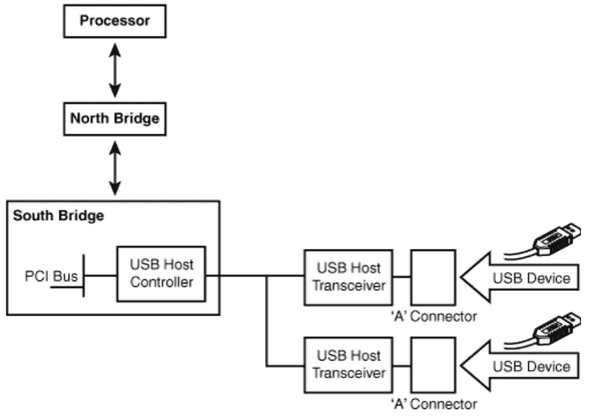

图 11.2 说明了嵌入式设备上的 USB。图中的 SoC 内置了 USB 控制器硅片，支持四条总线和三种操作模式：

- 总线 1 运行在主机模式下，通过 USB 收发器连接到一个 A 型插座（参见边栏"USB 插座和收发器"）。你可以将 USB 闪存盘或键盘连接到此端口。

- 总线 2 同样工作在主机模式下，但相关的收发器连接到一个内部 USB 设备，而非插座。内部 USB 设备的例子包括生物识别扫描仪、加密引擎、打印机、*Disk-On-Chips*（DOC）、触摸控制器和遥测卡。

- 总线 3 运行在设备模式下，通过收发器连接到一个 B 型插座。B 型插座通过 B-to-A 线缆连接到主机计算机。在这种模式下，嵌入式设备充当例如 USB 闪存盘的角色，向外界导出存储分区。MP3 播放器和手机等嵌入式设备比 PC 系统更有可能处于 USB 的设备端，因此许多嵌入式 SoC 除了支持主机控制器外还支持 USB 设备控制器。

- 总线 4 由 *On-The-Go*（OTG）控制器驱动。你可以使用此端口，例如，将闪存盘连接到你的系统，或者将你的系统变成一个闪存盘并连接到主机。与总线 1 到 3 不同，总线 4 使用智能收发器，通过 I²C 与处理器交换控制信息。该收发器连接到一个 Mini-AB OTG 插座。如果两个嵌入式设备都支持 OTG，它们可以直接通信，无需主机计算机的干预。

**图 11.2. 嵌入式系统上的 USB。**

[查看全尺寸图像]

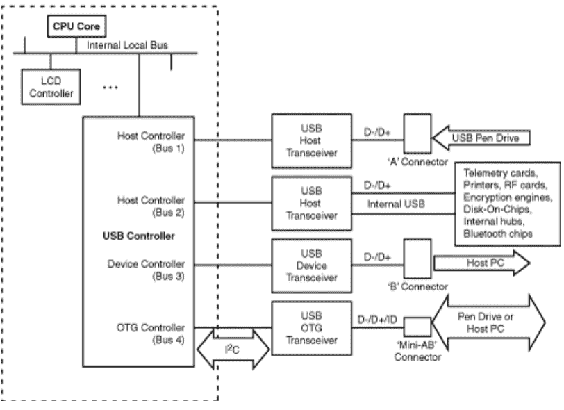

本章大部分内容是从位于 USB 主机端的系统角度撰写的。我们在"<Gadget Drivers>"一节中简要介绍了设备端功能。主流的*主机控制器驱动*（HCD）已经可用，因此在本章中，我们进一步将自己限制在 USB 设备驱动（也称为*客户端驱动*）的范围内。

### USB 插座和收发器

USB 主机使用四针 A 型矩形插座，而 USB 设备则通过四针 B 型方形插座连接。在这两种情况下，四个引脚分别是差分数据信号 D+ 和 D-、电压线 VBUS 和地线。VBUS 用于从 USB 主机向 USB 设备供电。因此，VBUS 在 A 连接器上被拉高，但在 B 连接器上接收电源。USB OTG 控制器连接到有更小外形的五针 Mini-AB 矩形插座。Mini-AB 的四个引脚与我们之前讨论的相同；第五个是 ID 引脚，用于检测连接的外设是主机还是设备。

同一收发器芯片（如德州仪器的 TUSB1105）可用于 USB 主机和设备。因此，你可以选择将同一收发器部件用于图 11.2 中的总线 1 到 3。然而，OTG 需要专用收发器芯片（如飞利浦半导体的 ISP1301）。

### 总线速度

USB 支持三种运行速度。最初的 USB 1.0 规范支持 1.5MBps，称为低速 USB。USB 1.1 是规范的下一代版本，处理 12MBps，称为全速 USB。当前规范的水平是 USB 2.0，支持 480MBps，即高速 USB。USB 2.0 向后兼容规范的早期版本。USB 键盘和鼠标等外设是低速设备的例子，USB 存储驱动器是全速和高速设备的例子。当今的 PC 系统符合 USB 2.0 标准，允许所有三种目标速度，但一些嵌入式控制器遵循 USB 1.1，仅支持全速和低速操作模式。

### 主机控制器

USB 主机控制器符合以下几种标准之一：

- **通用主机控制器接口（UHCI）：**UHCI 规范由英特尔发起，因此如果你的 PC 基于英特尔平台，很可能拥有这种控制器。

- **开放主机控制器接口（OHCI）：**OHCI 规范源于康柏和微软等公司。与 UHCI 相比，OHCI 兼容控制器在硬件中内置了更多智能，因此 OHCI HCD 相对 UHCI HCD 更简单。

- **增强型主机控制器接口（EHCI）：**这是支持高速 USB 2.0 设备的控制器。EHCI 控制器通常有一个 UHCI 或 OHCI 配套控制器来处理较慢的设备。

- **USB OTG 控制器：**它们在嵌入式微控制器中越来越受欢迎。有了 OTG 支持，每个通信端都可以充当*双角色设备*（DRD）。通过使用*主机协商协议*（HNP）发起对话，DRD 可以根据所需功能将自己切换到主机模式或设备模式。

除了这些主流 USB 主机控制器外，Linux 还支持一些其他控制器。一个例子是用于 ISP116x 芯片的 HCD。

主机控制器有一个内置的硬件组件，称为*根集线器*。根集线器是一个虚拟集线器，提供 USB 端口。这些端口又可以连接外部或内部物理集线器，提供更多端口，从而形成树形拓扑结构。

### 传输类型

与 USB 设备的数据交换可以是以下四种类型之一：

- 控制传输，用于传输配置和控制信息

- 批量传输，传输大量对时间不敏感的数据

- 中断传输，交换少量对时间敏感的数据

- 等时传输，用于可预测比特率的实时数据

例如，USB 存储驱动器使用控制传输来发出磁盘访问命令，使用批量传输来交换数据。键盘使用中断传输来在可预测的延迟内传输按键信息。需要实时传输音频数据的设备使用等时传输。USB 蓝牙设备的四种传输类型的职责在第 16 章"无线的 Linux"中的"设备示例：USB 适配器"一节中讨论。

### 寻址

USB 设备中每个可寻址单元称为*端点*。分配给端点的地址称为*端点地址*。每个端点地址都有一个相关的数据传输类型。如果端点负责批量数据传输，例如，它被称为*批量端点*。端点地址 0 专门用于设备配置。控制管道连接到此端点，用于设备枚举（参见"枚举"一节）。

端点可以与上游或下游数据传输相关联。从设备向上游传输的数据称为 `IN` 传输，而向下游流向设备的数据是 `OUT` 传输。`IN` 和 `OUT` 传输拥有独立的地址空间。因此，你可以让批量 `IN` 端点和批量 `OUT` 端点响应同一地址。

USB 在某些方面类似于 I²C，在其他方面类似于 PCI，如表 11.1 总结的那样。USB 的设备寻址与 I²C 相似，而它支持热插拔则像 PCI。USB 设备地址与标准 I²C 一样，不占用 CPU 地址空间的一部分。相反，它们驻留在从 1 到 127 的私有空间中。

**表 11.1. USB 与 I²C 和 PCI 的相似之处**


 ## 第11章 通用串行总线

USB与I²C的相似之处：

- USB和I²C都是主从协议。

- 设备地址位于一个私有的7位空间中。

- 设备驻留内存不映射到CPU的内存或I/O空间，因此不消耗CPU资源。

USB与PCI的相似之处：

- 设备可以热插拔。

- 设备驱动架构类似于PCI驱动。这两类驱动都拥有`probe()`/`disconnect()`[1]方法和用于识别所支持设备的ID表。

- 支持高速传输。不过比PCI慢。不同PCI系列成员支持的速度见第10章"外设组件互连"中的表10.1。

- USB主控制器与PCI控制器类似，通常内置可以对总线进行主控的DMA引擎。

- 支持多功能设备。USB每个功能支持接口描述符。每个PCI设备功能都有自己的设备ID和配置空间。

> [1] `disconnect()`在PCI术语中称为`remove()`。

| 本章内容 | |
|:---|:---|
| • USB架构 | 312 |
| • Linux-USB子系统 | 317 |
| • 驱动数据结构 | 317 |
| • 枚举 | 324 |
| • 设备示例：遥测卡 | 324 |
| • 类驱动 | 338 |
| • 小工具驱动 | 348 |
| • 调试 | 349 |
| • 查看源代码 | 351 |

> *通用串行总线*（USB）是当今计算机中事实上的外部总线。USB因其支持热插拔、通用类驱动和 versatile 数据传输模式，是消费电子领域将各种技术引入计算机系统的常用途径。其广泛的普及度和随之而来的规模经济效应，在推动全球计算机外围技术的采用和接受方面发挥了作用。

### USB架构

USB是一种主从协议，主控制器与客户端设备进行通信。图11.1展示了PC环境中的USB。USB主控制器是南桥芯片组的一部分，通过PCI总线与处理器通信。

### 图11.1 PC环境中的USB。

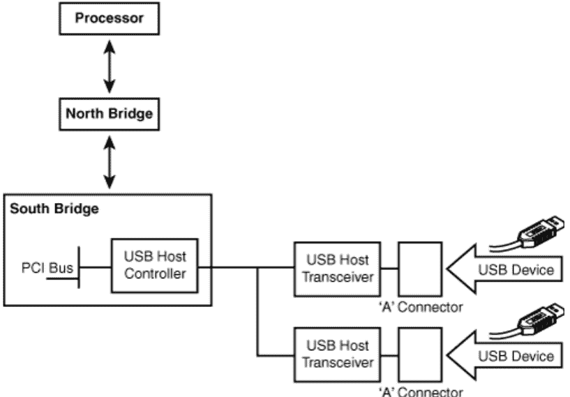

图11.2展示了嵌入式设备上的USB。图中的SoC内置了USB控制器硅片，支持四条总线和三种操作模式：

- 总线1以主机模式运行，通过USB收发器连接到A型插座（参见边栏"USB插座和收发器"）。您可以将USB闪存盘或键盘连接到此端口。

- 总线2也以主机模式工作，但相关的收发器连接到内部USB设备而非插座。内部USB设备的例子包括生物识别扫描仪、加密引擎、打印机、*Disk-On-Chips*（DOC）、触摸控制器和遥测卡。

- 总线3以设备模式运行，通过收发器连接到B型插座。B型插座通过B-to-A电缆连接到主机计算机。在此模式下，嵌入式设备充当例如USB闪存盘，并向外界导出存储分区。MP3播放器和手机等嵌入式设备比PC系统更有可能位于USB的设备端，因此许多嵌入式SoC除了主机控制器外还支持USB设备控制器。

- 总线4由*On-The-Go*（OTG）控制器驱动。例如，您可以使用此端口将闪存盘连接到您的系统，或将您的系统变成闪存盘并连接到主机。与总线1至3不同，总线4使用智能收发器，通过I²C与处理器交换控制信息。该收发器连接到Mini-AB OTG插座。如果两个嵌入式设备都支持OTG，它们可以直接通信，无需主机计算机的干预。

### 图11.2 嵌入式系统上的USB。

[查看全尺寸图像]

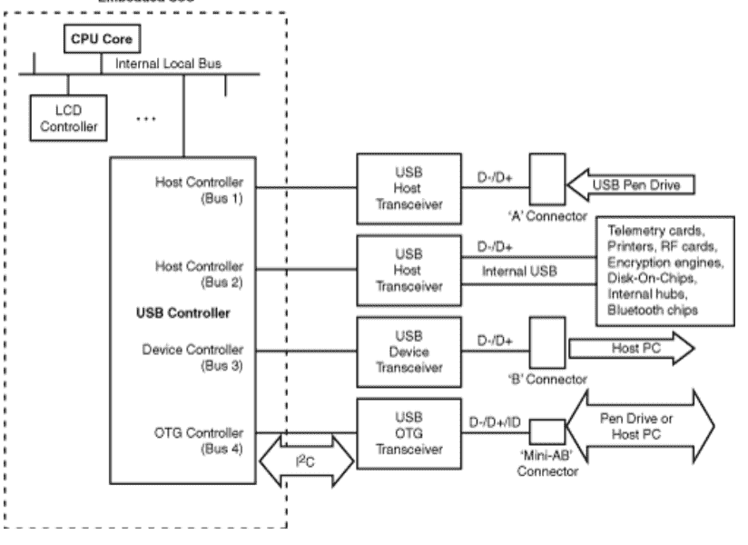

本章大部分内容从位于USB主机端的系统角度撰写。我们在"[小工具驱动](link)"一节中简要介绍了设备功能。主流的*主机控制器驱动*（HCD）已经可用，因此在本章中我们将自己进一步限定为USB设备驱动（也称为*客户端驱动*）。

### USB插座和收发器

USB主机使用四针A型矩形插座，而USB设备通过四针B型方形插座连接。在两种情况下，四个引脚都是差分数据信号D+和D-、电压线VBUS和地线。VBUS用于从USB主机向USB设备供电。因此VBUS在A连接器上被拉高，而在B连接器上接收电源。USB OTG控制器连接到五针Mini-AB矩形插座，具有更小的外形尺寸。Mini-AB的四个引脚与我们之前讨论的相同；第五个是ID引脚，用于检测连接的外设是主机还是设备。

相同的收发器芯片（如德州仪器的TUSB1105）可用于USB主机和设备。因此，您可以选择在图11.2的总线1至3上使用相同的收发器部件。然而，OTG需要专用收发器芯片（如飞利浦半导体的ISP1301）。

### 总线速度

USB支持三种运行速度。原始USB 1.0规范支持1.5MBps，称为低速USB。USB 1.1，即规范的下一个版本，处理12MBps，称为全速USB。当前规范级别是USB 2.0，支持480MBps，即高速USB。USB 2.0向后兼容早期版本的规范。USB键盘和鼠标等外设是低速设备的例子，USB存储驱动器是全速和高速设备的例子。如今的PC系统符合USB 2.0标准，支持所有三种目标速度，但一些嵌入式控制器遵循USB 1.1，仅支持全速和低速操作模式。

### 主控制器

USB主控制器符合少数几个标准之一：

- **通用主控制器接口（UHCI）：** UHCI规范由英特尔发起，因此如果您的PC基于英特尔平台，很可能拥有此控制器。

- **开放主控制器接口（OHCI）：** OHCI规范源自康柏和微软等公司。与UHCI相比，OHCI兼容控制器在硬件中内置了更多智能，因此OHCI HCD相对比UHCI HCD更简单。

- **增强型主控制器接口（EHCI）：** 这是支持高速USB 2.0设备的主控制器。EHCI控制器通常带有一个UHCI或OHCI配套控制器来处理较慢的设备。

- **USB OTG控制器：** 它们在嵌入式微控制器中越来越受欢迎。借助OTG支持，每个通信端可以充当*双角色设备*（DRD）。通过使用*主机协商协议*（HNP）发起对话，DRD可以根据所需功能将自己切换到主机模式或设备模式。

除了这些主流USB主控制器外，Linux还支持少量其他控制器。ISP116x芯片的HCD就是一个例子。

主控制器有一个名为*根集线器*的内置硬件组件。根集线器是一个虚拟集线器，提供USB端口。这些端口又可以连接外部或内部物理集线器并提供更多端口，从而形成树形拓扑。

### 传输类型

与USB设备的数据交换可以是以下四种类型之一：

- 控制传输，用于传输配置和控制信息

- 批量传输，传输大量时间要求不严格的数据

- 中断传输，交换少量时间敏感的数据

- 等时传输，用于可预测比特率的实时数据

例如，USB存储驱动器使用控制传输来发出磁盘访问命令，使用批量传输来交换数据。键盘使用中断传输在可预测的延迟内携带按键信息。需要实时流式传输音频数据的设备使用等时传输。USB蓝牙设备的四种传输类型的职责在第16章"无线Linux"的"设备示例：USB适配器"一节中讨论。

### 寻址

USB设备中每个可寻址单元称为*端点*。分配给端点的地址称为*端点地址*。每个端点地址都有一个关联的数据传输类型。如果端点负责批量数据传输，例如，它被称为*批量端点*。端点地址0专门用于设备配置。控制管道连接到此端点以进行设备枚举（参见"枚举"一节）。

端点可以与上行或下行数据传输相关联。从设备到达上行的数据称为IN传输，而流向设备的下行数据是OUT传输。IN和OUT传输拥有独立的地址空间。因此，您可以有一个批量IN端点和一个批量OUT端点响应相同的地址。

USB在某些方面类似于I²C，在其他方面类似于PCI，如表11.1所示。USB的设备寻址类似于I²C，而它支持热插拔则像PCI。与标准I²C一样，USB设备地址不占用CPU地址空间的一部分。相反，它们位于从1到127的私有空间中。

| 表11.1 USB与I²C和PCI的相似之处 |
|:---:|

USB 与 I²C 的相似之处：

- USB 和 I²C 都是主从协议。
- 设备地址位于一个私有的 7 位地址空间内。
- 设备驻留内存不会映射到 CPU 的内存或 I/O 空间，因此不会消耗 CPU 资源。

USB 与 PCI 的相似之处：

- 设备可以热插拔。
- 设备驱动程序架构类似于 PCI 驱动程序。两类驱动程序都拥有 `probe()`/`disconnect()` 方法以及用于标识其所支持设备的 ID 表。
- 支持高速传输。不过比 PCI 慢。有关 PCI 家族不同成员所支持的速度，请参见第 10 章"外围组件互连"中的表 10.1。
- USB 主控制器与 PCI 控制器类似，通常内置有可以主控总线的 DMA 引擎。
- 支持多功能设备。USB 支持每个功能对应一个接口描述符。每个 PCI 设备功能都有自己的设备 ID 和配置空间。

> [1] 在 PCI 术语中，`disconnect()` 被称为 `remove()`。

## Linux-USB 子系统

查看图 11.3 以了解 Linux-USB 子系统的架构。该子系统的组成部分如下：

- USB 核心。与你在前面章节中看到的驱动子系统核心层类似，USB 核心是一个代码库，包含可供 HCD 和客户端驱动程序使用的例程和结构体。核心层还提供了一层间接抽象，使客户端驱动程序独立于主控制器。
- 驱动不同主控制器的 HCD。
- 用于根集线器（以及物理集线器）的集线器驱动程序，以及一个名为 *khubd* 的辅助内核线程，该线程监控连接到集线器的所有端口。检测端口状态变化并配置热插拔设备是耗时的操作，最好使用辅助线程来完成，原因你在第 3 章"内核机制"中已经学到。khubd 线程默认处于睡眠状态。每当集线器驱动程序检测到连接在其上的 USB 端口发生状态变化时，就会唤醒 khubd。
- USB 客户端设备的设备驱动程序。
- USB 文件系统 *usbfs*，它允许你从用户空间驱动 USB 设备。我们在第 19 章"用户空间驱动程序"中讨论用户模式 USB 驱动程序。

对于端到端操作，USB 子系统会调用各种其他内核层来协助。例如，为了支持 USB 大容量存储设备，USB 子系统与 SCSI 驱动程序协同工作，如图 11.3 所示。要驱动 USB-蓝牙键盘，涉及四个相关方：USB 子系统、蓝牙层、输入子系统和 tty 层。

## 驱动程序数据结构

当你编写 USB 客户端驱动程序时，需要用到多个数据结构。让我们看看其中重要的几个。

#### `usb_device` 结构体

每个设备驱动子系统都依赖一个专用数据结构来在内部表示设备。`usb_device` 结构体对于 USB 子系统的意义，就如同 `pci_dev` 对 PCI 层的意义，以及 `net_device` 对网络驱动层一样。`usb_device` 在 *include/linux/usb.h* 中定义，如下所示：

```
struct usb_device {
  /* ... */
  enum usb_device_state state; /* 已配置、未连接等 */
  enum usb_device_speed speed; /* 高速/全速/低速（或错误） */
  /* ... */
  struct usb_device *parent;  /* 我们的集线器，除非我们是根设备 */
  /* ... */
  struct usb_device_descriptor descriptor; /* 描述符 */
  struct usb_host_config *config;       /* 所有配置 */
  struct usb_host_config *actconfig;    /* 活动配置 */
  /* ... */
  int maxchild;                          /* 如果是集线器，则为端口数量 */
  struct usb_device *children[USB_MAXCHILDREN]; /* 子设备 */
  /* ... */
};
```

我们在后面开发 USB 遥测卡的示例驱动程序时会用到这个结构体。

#### USB 请求块

*USB 请求块*（URB）是 USB 数据传输机制的核心。URB 对 USB 协议栈的意义，就如同 `sk_buff`（在第 15 章"网络接口卡"中讨论）对网络协议栈的意义。

让我们窥探一下 URB 的内部。以下定义来自 *include/linux/usb.h*，省略了对设备驱动程序不是特别重要的字段：

代码视图：

```
struct urb
{
  struct kref kref;             /* URB 的引用计数 */
  /* ... */
  struct usb_device *dev;       /* (in) 指向关联
                                   设备的指针 */
  unsigned int pipe;            /* (in) 管道信息 */
  int status;                   /* (return) 非 ISO 状态 */
  unsigned int transfer_flags;  /* (in) URB_SHORT_NOT_OK | ...*/
  void *transfer_buffer;        /* (in) 关联数据缓冲区 */
  dma_addr_t transfer_dma;      /* (in) transfer_buffer 的
                                   DMA 地址 */
  int transfer_buffer_length;   /* (in) 数据缓冲区长度 */
  /* ... */
  unsigned char *setup_packet;  /* (in) 设置数据包 */
  /* ... */
  int interval;                /* (modify) 传输间隔
                                 (INT/ISO) */
  /* ... */
  void *context;               /* (in) 完成回调的上下文 */
  usb_complete_t complete;     /* (in) 完成例程 */
  /* ... */
```

使用 URB 有三个步骤：创建、填充和提交。要创建 URB，请使用 `usb_alloc_urb()`。该函数分配并清零 URB 内存，初始化与 URB 关联的 kobject，并初始化一个自旋锁来保护 URB。

要填充 URB，请使用 USB 核心提供的以下辅助例程：

```
void usb_fill_[control|int|bulk]_urb(
        struct urb *urb,              /* URB 指针 */
        struct usb_device *usb_dev,    /* USB 设备结构体 */
        unsigned int pipe,             /* 管道编码 */
        unsigned char *setup_packet,   /* 仅用于控制 URB！ */
        void *transfer_buffer,         /* I/O 缓冲区 */
        int buffer_length,             /* I/O 缓冲区长度 */
        usb_complete_t completion_fn,  /* 回调例程 */
        void *context,                 /* 供 completion_fn 使用 */
        int interval);                 /* 仅用于中断 URB！ */
```

前面这些例程的语义在我们稍后开发示例驱动程序时会变得更加清晰。这些辅助例程可用于控制、中断和批量 URB，但不适用于同步 URB。

要提交 URB 进行数据传输，请使用 `usb_submit_urb()`。URB 的提交是异步的。前面列出的 `usb_fill_[control|int|bulk]_urb()` 函数将回调函数的地址作为参数。回调例程在 URB 提交完成后执行，完成诸如检查提交状态和释放数据传输缓冲区等工作。

USB 核心还提供了包装器接口，为 URB 提交提供同步外观：

```
int usb_[control|interrupt|bulk]_msg(struct usb_device *usb_dev,
                                     unsigned int pipe, ...);
```

例如，`usb_bulk_msg()` 构建一个批量 URB，提交它，并阻塞直到操作完成。你不必提供回调函数，因为有一个通用完成例程来承担这个职责。你也不需要显式创建和填充 URB，因为 `usb_bulk_msg()` 会免费为你完成这些操作。我们将在示例驱动程序中使用这个接口。

`usb_free_urb()` 用于释放对已完成 URB 的引用，而 `usb_unlink_urb()` 可以取消待处理的 URB 操作。

正如第 4 章"奠定基础"中"Sysfs、Kobjects 和设备类"一节所述，一个 URB 包含一个 kref 对象来跟踪对其的引用。`usb_submit_urb()` 使用 `kref_get()` 增加引用计数。`usb_free_urb()` 使用 `kref_put()` 减少引用计数，并且仅当没有剩余引用时才执行释放操作。

URB 与一个称为 *管道* 的抽象相关联，我们接下来讨论。

#### 管道

管道是以下组合的一种整数编码：

- 端点地址
- 数据传输方向（`IN` 或 `OUT`）
- 数据传输类型（控制、中断、批量或同步）

管道是每个 USB 数据传输的地址元素，也是 URB 结构体中的重要字段。为了帮助填充此字段，USB 核心提供了以下辅助宏：

```
usb_[rcv|snd][ctrl|int|bulk|isoc]pipe(struct usb_device *usb_dev,
                                    __u8 endpointAddress);
```

其中 `usb_dev` 是指向关联的 `usb_device` 结构体的指针，`endpointAddress` 是 1 到 127 之间的已分配端点地址。例如，要在 `OUT` 方向创建批量管道，请调用 `usb_sndbulkpipe()`。要在 `IN` 方向创建控制管道，请调用 `usb_rcvctrlpipe()`。

在提及 URB 时，通常会通过关联管道的传输类型来修饰。例如，如果 URB 附加到批量管道，则称为 *批量 URB*。

#### 描述符结构体

USB 规范定义了一系列 *描述符* 来保存设备信息。Linux-USB 核心定义了与每个描述符对应的数据结构。描述符有四种类型：

- *设备描述符* 包含一般信息，例如设备的产品 ID 和供应商 ID。`usb_device_descriptor` 是对应设备描述符的结构体。
- *配置描述符* 用于描述不同的配置模式，例如总线供电和自供电操作。`usb_config_descriptor` 是与配置描述符关联的数据结构。
- *接口描述符* 允许 USB 设备支持多种功能。`usb_interface_descriptor` 定义接口描述符。
- *端点描述符* 承载与设备最终端点关联的信息。`usb_endpoint_descriptor` 就是相关的结构体。

这些描述符格式在 USB 规范的第 9 章中定义，而对应的结构体则

 定义在 *include/linux/usb/ch9.h* 中。[清单 11.1](#) 展示了描述符的层次拓扑结构，并打印了与 USB 设备关联的所有端点地址。为此，它遍历了由上述四种描述符类型组成的树。以下是 [清单 11.1](#) 针对 USB 光盘驱动器生成的输出：

```
Endpoint Address = 1
Endpoint Address = 82
Endpoint Address = 83
```

第一个地址属于批量 `IN` 端点，第二个地址由批量 `OUT` 端点拥有，第三个地址指向中断 `IN` 端点。

还有更多与 USB 客户端驱动程序相关的数据结构，例如 `usb_device_id`、`usb_driver` 和 `usb_class_driver`。当我们在"[设备示例：遥测卡](#)"一节中进行实践开发时，将会遇到它们。

#### 清单 11.1. 打印设备上所有 USB 端点地址

[查看完整尺寸图像]

```
/* ... */
/* USB 设备 */
struct usb_device *udevice;
/* ... */
struct usb_device_descriptor u_d_desc = udevice->descriptor;

/* 设备的当前配置 */
struct usb_host_config *uconfig;
struct usb_config_descriptor u_c_desc;

/* 当前配置中的接口 */
struct usb_interface *uinterface;

/* 此接口的备用设置 */
struct usb_host_interface *ualtsetting;
struct usb_interface_descriptor u_i_desc;

/* 此 altsetting 的端点 */
struct usb_host_endpoint *uendpoint;
struct usb_endpoint_descriptor u_e_desc;

uconfig = udevice->actconfig;

u_c_desc = uconfig->desc;

for (i = 0; i < u_c_desc->bNumInterfaces;
     i++) {
  uinterface = udevice->actconfig->interface[i];
  for (j = 0; j < uinterface->num_altsetting; j++) {
    ualtsetting = &uinterface->altsetting[j];
    u_i_desc = ualtsetting->desc;
    for (k = 0; k < u_i_desc->bNumEndpoints; k++) {
      uendpoint = &ualtsetting->endpoint[k];
      u_e_desc = uendpoint->desc;
      printk ("Endpoint Address = %d\n",
              u_e_desc->bEndpointAddress\n");
    }
  }
}
/* ... */
```

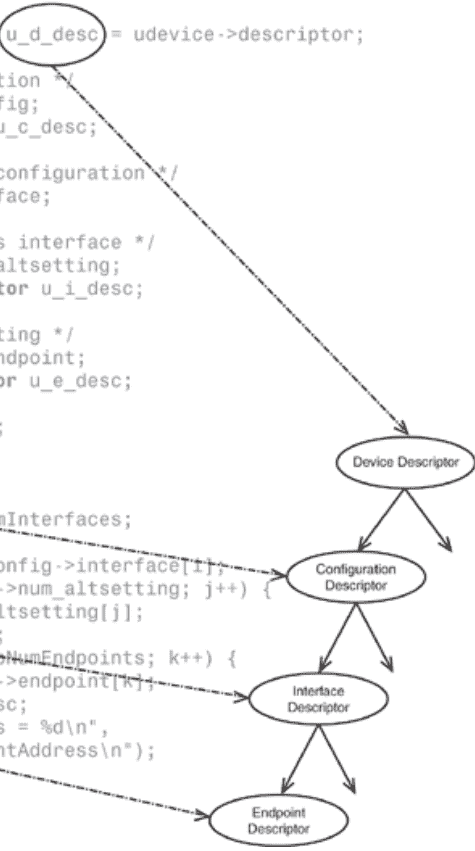

### 枚举

热插拔 USB 设备的生命周期始于一个称为*枚举*的过程，通过该过程，主机了解设备的能力并对其进行配置。集线器驱动程序是 Linux-USB 子系统中负责枚举的组件。让我们看一下将 USB 闪存盘插入主机计算机时实现设备枚举的步骤序列：

1. 根智能硬件
根集线器报告由于设备连接导致的端口电流变化。集线器驱动程序检测到这种称为 Linux-USB 术语中的 `USB_PORT_STAT_C_CONNECTION` 的状态变化，并唤醒 khubd。

2. khubd 解读发生状态变化的 USB 端口的身份。在这种情况下，它是您插入闪存盘的端口。

3. 接下来，khubd 在 1 到 127 之间选择一个设备地址，并使用连接到端点 `0` 的控制 URB 将其分配给闪存盘的批量端点。

4. khubd 使用上述连接到端点 `0` 的控制 URB 从闪存盘获取设备描述符。然后它请求设备的配置描述符并选择一个合适的。对于闪存盘，只提供一个配置描述符。

5. khubd 请求 USB 核心将匹配的客户端驱动程序绑定到插入的设备。

当枚举完成且设备绑定到驱动程序后，khubd 调用关联客户端驱动程序的 `probe()` 方法。在这种情况下，khubd 调用定义在 *drivers/usb/storage/usb.c* 中的 `storage_probe()`。从那时起，大容量存储驱动程序负责正常的设备操作。

## 设备示例：遥测卡

现在您已经了解了 Linux-USB 的基础知识，是时候看一个示例设备了。考虑一个配备有通过内部 USB 连接到处理器的遥测卡的系统，如图 11.2 的总线 2 所示。该卡从远程设备获取数据并通过 USB 将其传送到处理器。一个遥测卡的例子是医疗级板卡，用于监控或编程植入式设备。

假设我们的示例遥测卡具有以下端点，其语义描述如表 11.2 所示：

- 一个连接到板上配置寄存器的控制端点

- 一个批量 `IN` 端点，将卡收集的远程遥测信息传递给处理器

- 一个批量 `OUT` 端点，沿相反方向传输数据

| 寄存器 | 关联端点 |
| --- | --- |
| 遥测配置寄存器 | 控制端点 0（寄存器偏移 0xA）。 |
| 遥测数据输入寄存器 | 批量 IN 端点。端点地址在设备枚举期间分配。 |
| 遥测数据输出寄存器 | 批量 OUT 端点。端点地址在设备枚举期间分配。 |

让我们为这张卡构建一个最小的驱动程序，部分基于 USB 骨架驱动程序 *drivers/usb/usb-skeleton.c*。

由于 PCMCIA、PCI 和 USB 设备具有热插拔支持等相似特性，这些子系统的一些驱动程序方法和数据结构彼此相似。这对于负责初始化和探测的部分尤其如此。当我们在遥测驱动程序中推进并注意到与我们在第 10 章中学到的 PCI 驱动程序的相似之处时，我们会暂停并做记录。

### 初始化和探测

与 PCI 和 PCMCIA 驱动程序一样，USB 驱动程序具有 `probe()`/`disconnect()` [2] 方法来支持热插拔，以及一个包含它们支持的设备标识的表。USB 设备由定义在 *include/linux/mod_devicetable.h* 中的 `usb_device_id` 结构标识。您可能从前一章回想起，同样定义在同一头文件中的 `pci_device_id` 结构标识 PCI 设备。

> [2] 在 PCI 和 PCMCIA 术语中，`disconnect()` 被称为 `remove()`。

```
struct usb_device_id {
  /* ... */
  __u16      idVendor;      /* 厂商 ID */
  __u16      idProduct;      /* 设备 ID */
  /* ... */
  __u8        bDeviceClass;    /* 设备类 */
  __u8        bDeviceSubClass; /* 设备子类 */
  __u8        bDeviceProtocol; /* 设备协议 */
  /* ... */
};
```

`idVendor` 和 `idProduct` 分别保存制造商 ID 和产品 ID，而 `bDeviceClass`、`bDeviceSubClass` 和 `bDeviceProtocol` 根据设备的功能对其进行分类。这种由 USB 规范确定的分类允许实现通用客户端驱动程序，如后面"类驱动程序"一节中所讨论的。

[清单 11.2](#) 实现了遥测驱动程序的初始化例程 `usb_tele_init()`，它调用 `usb_register()` 将其 `usb_driver` 结构注册到 USB 核心。如清单所示，`usb_driver` 将驱动程序的 `probe()` 方法、`disconnect()` 方法和 `usb_device_id` 表绑定在一起。`usb_driver` 类似于 `pci_driver`，只是前者的 `disconnect()` 方法在后者中名为 `remove()`。

#### 清单 11.2. 初始化驱动程序

```
代码视图：
#define USB_TELE_VENDOR_ID   0xABCD /* 制造商的厂商 ID */
#define USB_TELE_PRODUCT_ID  0xCDEF /* 设备的产品 ID */

/* 指定此驱动程序支持的设备的 USB ID 表 */
static struct usb_device_id tele_ids[] = {
  { USB_DEVICE(USB_TELE_VENDOR_ID, USB_TELE_PRODUCT_ID) },
  { } /* 终止 */
};

MODULE_DEVICE_TABLE(usb, tele_ids);

/* 此驱动程序的 usb_driver 结构 */
static struct usb_driver tele_driver
{
  .name       =  "tele",          /* 唯一名称 */
  .probe      =  tele_probe,      /* 参见清单 11.3 */
  .disconnect =  tele_disconnect, /* 参见清单 11.3 */
  .id_table   =  tele_ids,        /* 参见上文 */
};

/* 模块初始化 */
static int __init
usb_tele_init(void)
{
  /* 注册到 USB 核心 */
  result = usb_register(&tele_driver);

  /* ... */
  return 0;
}

/* 模块退出 */
static void __exit
usb_tele_exit(void)
{
  /* 从 USB 核心注销 */
  usb_deregister(&tele_driver);
  return;
}

module_init(usb_tele_init);
module_exit(usb_tele_exit);
```

`USB_DEVICE()` 宏从其提供给它的厂商 ID 和产品 ID 创建一个 `usb_device_id`。这类似于前一章中讨论的 `PCI_DEVICE()` 宏。`MODULE_DEVICE_TABLE()` 宏在模块映像中标记 `tele_ids`，以便如果卡被热插拔，模块可以按需加载。这再次与我们在前两章中讨论过的 PCMCIA 和 PCI 设备类似。

当 USB 核心检测到具有与客户端驱动程序的 `usb_device_id` 表中声明的属性匹配的设备时，它会调用该驱动程序注册的 `probe()` 方法。当设备被拔出或模块被卸载时，USB 核心调用驱动程序的 `disconnect()` 方法。

[清单 11.3](#) 实现了遥测驱动程序的 `probe()` 和 `disconnect()` 方法。它首先定义了一个设备特定的结构 `tele_device_t`，其中包含以下字段：

- 指向关联的 `usb_device` 的指针。

- 指向 `usb_interface` 的指针。重新查看[清单 11.1](#) 以了解此结构的使用。

- 一个控制 URB (`ctrl_urb`)，用于与遥测配置寄存器通信，以及一个 `ctrl_req` 用于向此寄存器构建编程请求。这些字段在下一节"访问寄存器"中描述。

- 该卡有一个批量 `IN` 端点，通过它可以获取收集的遥测信息。与此端点关联的有三个字段：`bulk_in_addr`，保存端点地址；`bulk_in_buf`，存储接收到的数据；以及 `bulk_in_len`，包含接收数据缓冲区的大小。

- 该卡有一个批量 `OUT` 端点，用于促进下游数据传输。`tele_device_t` 有一个名为 `bulk_out_addr` 的字段来存储此端点的地址。`OUT` 方向的数据结构较少，因为在这个简单的情况下，我们使用同步 URB 提交接口来隐藏多个实现细节。

枚举后不久，khubd 调用卡的 `probe()` 方法 `tele_probe()`。`tele_probe()` 执行三项任务：

 1. 为设备专用结构体 `tele_device_t` 分配内存。

2. 初始化 `tele_device_t` 中与设备批量端点相关的以下字段：`bulk_in_buf`、`bulk_in_len`、`bulk_in_addr` 和 `bulk_out_addr`。为此，它使用集线器驱动程序在枚举期间收集的数据。此数据在“描述符结构”部分讨论的描述符结构中可用。

3. 将字符设备 */dev/tele* 导出到用户空间。应用程序通过 */dev/tele* 与遥测卡交换数据。`tele_probe()` 调用 `usb_register_dev()`，并通过 `usb_class_driver` 结构体为其提供构成 */dev/tele* 接口底层支柱的 `file_operations`。

在步骤 1 中分配的设备专用结构体的地址必须保存下来，以便其他方法可以访问它。为了实现这一点，遥测驱动程序使用一种三重策略，该策略取决于各种驱动程序例程可用的函数参数。为了在 `probe()` 和 `open()` 调用线程之间保存此结构体指针，驱动程序使用设备的 `driver_data` 字段，通过一对函数 `usb_set_intfdata()` 和 `usb_get_intfdata()` 来实现。为了在 `open()` 线程和其他入口点之间保存结构体指针的地址，`open()` 将其存储在 */dev/tele* 的 `file->private_data` 字段中。这是因为内核将这些字符入口点的 */dev/tele* 的 `inode` 指针作为参数提供，而不是 `usb_interface` 指针。为了从 URB 回调函数中获取设备专用结构体的地址，相关的提交线程使用 URB 的 `context` 字段作为存储区域。查看**清单 11.3**、**11.4** 和 **11.5**，以了解这些机制的实际运作。

所有 USB 字符设备的主设备号均为 **180**。如果在内核配置期间启用 `CONFIG_USB_DYNAMIC_MINORS`，USB 核心将从可用池中动态选择次设备号。此行为类似于在指定 `MISC_DYNAMIC_MINOR` 后注册杂项驱动程序（如**第 5 章**“字符驱动程序”中的“杂项驱动程序”部分所述）。如果选择不启用 `CONFIG_USB_DYNAMIC_MINORS`，USB 子系统将从 `usb_class_driver` 结构体中设置的次设备号基址开始选择可用的次设备号。

#### 清单 11.3. 探测与断开连接

```
Code View:
/* 设备专用结构体 */
typedef struct {
  struct usb_device     *usbdev;        /* 设备表示 */
  struct usb_interface  *interface;     /* 接口表示 */
  struct urb            *ctrl_urb;      /* 用于
                                           寄存器访问的控制 URB */
  struct usb_ctrlrequest  ctrl_req;     /* 符合规范的
                                           控制请求 */
  unsigned char         *bulk_in_buf;   /* 接收数据缓冲区 */
  size_t                 bulk_in_len;   /* 接收缓冲区大小 */
  __u8                   bulk_in_addr;  /* IN 端点地址 */
  __u8                   bulk_out_addr; /* OUT 端点地址 */
  /* ... */                             /* 锁、等待队列、
                                           统计信息.. */
} tele_device_t;

#define TELE_MINOR_BASE 0xAB    /* 由 Linux-USB
                                 子系统维护者分配 */

/* 传统字符驱动程序入口点。
   参见第 5 章"字符驱动程序"。 */
static struct file_operations tele_fops =
{
  .owner   =  THIS_MODULE,  /* 所有者 */
```

```
    .read    =  tele_read,   /* 读取方法 */
    .write   =  tele_write,  /* 写入方法 */
    .ioctl   =  tele_ioctl,  /* Ioctl 方法 */
    .open    =  tele_open,    /* 打开方法 */
    .release =  tele_release, /* 关闭方法 */
};
```

```
static struct usb_class_driver tele_class = {
  .name      = "tele",
  .fops      = &tele_fops,     /* 与 /dev/tele 连接 */
  .minor_base = TELE_MINOR_BASE, /* 次设备号起始 */
};
```

```
/* probe() 方法由 khubd 在设备
   枚举后调用。第一个参数 interface 包含
   枚举期间收集的信息。id 是驱动程序的 usb_device_id 表中
   与从遥测卡读取的值相匹配的条目。tele_probe() 基于
   drivers/usb/usb-skeleton.c 中定义的 skel_probe() */
```

```
static int
tele_probe(struct usb_interface *interface,
         const struct usb_device_id *id)
{
```

```
  struct usb_host_interface *iface_desc;
  struct usb_endpoint_descriptor *endpoint;
  tele_device_t *tele_device;
  int retval = -ENOMEM;
```

```
  /* 分配设备专用结构体 */
  tele_device = kzalloc(sizeof(tele_device_t), GFP_KERNEL);
```

```
  /* 填充 usb_device 和 usb_interface */
  tele_device->usbdev =
              usb_get_dev(interface_to_usbdev(interface));
  tele_device->interface = interface;
```

```
  /* 根据设备枚举期间
     收集的数据设置端点信息 */
```

```
  iface_desc = interface->cur_altsetting;
  for (int i = 0; i < iface_desc->desc.bNumEndpoints; ++i) {
    endpoint = &iface_desc->endpoint[i].desc;
```

```
    if (!tele_device->bulk_in_addr &&
        usb_endpoint_is_bulk_in(endpoint)) {
       /* 批量 IN 端点 */
       tele_device->bulk_in_len =
                     le16_to_cpu(endpoint->wMaxPacketSize);
       tele_device->bulk_in_addr = endpoint->bEndpointAddress;
       tele_device->bulk_in_buf =
                  kmalloc(tele_device->bulk_in_len, GFP_KERNEL);
    }
```

```
    if (!tele_device->bulk_out_addr &&
        usb_endpoint_is_bulk_out(endpoint)) {
       /* 批量 OUT 端点 */
       tele_device->bulk_out_addr = endpoint->bEndpointAddress;
    }
  }
```

```
if (!(tele_device->bulk_in_addr && tele_device->bulk_out_addr)) {
  return retval;
}

/* 将设备专用结构体连接到此接口。
   我们将从 tele_open() 中检索它 */
usb_set_intfdata(interface, tele_device);

/* 注册设备 */
retval = usb_register_dev(interface, &tele_class);
if (retval) {
  usb_set_intfdata(interface, NULL);
  return retval;
}

printk("Telemetry device now attached to /dev/tele\n");
return 0;
}

/* 断开连接方法。当设备拔出或模块
   卸载时调用 */
static void
tele_disconnect(struct usb_interface *interface)
{
tele_device_t *tele_device;
/* ... */

/* 在 tele_probe() 中调用的 usb_set_intfdata() 的反向操作 */
tele_device = usb_get_intfdata(interface);

/* 清零接口数据 */
usb_set_intfdata(interface, NULL);

/* 释放 /dev/tele */
usb_deregister_dev(interface, &tele_class);

/* 将接口置为 NULL。在实际环境中，使用锁
   保护此操作 */
tele_device->interface = NULL;
/* ... */
}
```

### 访问寄存器

当应用程序打开 */dev/tele* 时，`open()` 方法初始化卡上遥测配置寄存器。为了设置此寄存器的内容，`tele_open()` 提交一个附加到默认端点 `0` 的控制 URB。当提交控制 URB 时，必须提供相关的控制请求。向 USB 设备发送控制请求的结构体必须符合 USB 规范的第九章，并在 *include/linux/usb/ch9.h* 中定义如下：

```
struct usb_ctrlrequest {
  __u8 bRequestType;
  __u8 bRequest;
```

```
    __le16 wValue;
    __le16 wIndex;
    __le16 wLength;
} __attribute__ ((packed));
```

让我们看一下构成 `usb_ctrlrequest` 的组成部分。`bRequest` 字段标识控制请求。`bRequestType` 限定该请求，编码数据传输方向、请求类别以及接收者是设备、接口、端点还是其他内容。`bRequest` 可以属于一组标准值，也可以是供应商定义的。在我们的示例中，写入遥测配置寄存器的 `bRequest` 是供应商定义的。`wValue` 保存要写入寄存器的数据，`wIndex` 是寄存器空间中的所需偏移量，`wLength` 是要传输的字节数。

**清单 11.4** 实现了 `tele_open()`。其主要任务是用适当的值对遥测配置寄存器进行编程。在浏览该清单之前，重新查看**清单 11.3** 中定义的 `tele_device_t` 结构体，重点关注两个字段：`ctrl_urb` 和 `ctrl_req`。前者是用于与配置寄存器通信的控制 URB，后者是相关的 `usb_ctrlrequest`。

为了对遥测配置寄存器进行编程，`tele_open()` 执行以下操作：

1. 分配一个控制 URB 以准备寄存器写入。

2. 创建一个 `usb_ctrlrequest` 并用请求标识符、请求类型、寄存器偏移量和要编程的值填充它。

3. 创建一个附加到遥测卡端点 `0` 的控制管道来承载控制 URB。

4. 由于 `tele_open()` 异步提交 URB，它需要在返回给调用者之前等待相关的回调函数完成。为此，`tele_open()` 调用内核的完成 API 并使用 `init_completion()` 寻求帮助。步骤 7 调用匹配的 `wait_for_completion()`，等待直到回调函数调用 `complete()`。我们在**第 3 章**的“完成接口”部分讨论了完成 API。

5. 使用 `usb_fill_control_urb()` 初始化控制 URB 中的字段。这包括步骤 2 中填充的 `usb_ctrlrequest`。

6. 使用 `usb_submit_urb()` 将 URB 提交给 USB 核心。

7. 等待直到回调函数发出寄存器编程完成的信号。

8. 返回状态。

#### 清单 11.4. 初始化遥测配置寄存器

```
Code View:
/* 遥测配置寄存器在
   卡上寄存器空间中的偏移量 */
#define TELEMETRY_CONFIG_REG_OFFSET     0x0A

/* 要编程到配置寄存器中的值 */
#define TELEMETRY_CONFIG_REG_VALUE      0xBC

/* 用于编程
   配置寄存器的供应商定义 bRequest */
```


 #define TELEMETRY_REQUEST_WRITE         0x0D

/* 厂商自定义的 bRequestType */
#define TELEMETRY_REQUEST_WRITE_REGISTER 0x0E

/* 打开方法 */
static int
tele_open(struct inode *inode, struct file *file)
{
  struct completion tele_config_done;
  tele_device_t *tele_device;
  void *tele_ctrl_context;
  char *tmp;
  __le16 tele_config_index = TELEMETRY_CONFIG_REG_OFFSET;
  unsigned int tele_ctrl_pipe;
  struct usb_interface *interface;

  /* 获取指向设备特定结构的指针。
     我们在 tele_probe() 中使用 usb_set_intfdata() 保存了它 */
  interface = usb_find_interface(&tele_driver, iminor(inode));
  tele_device = usb_get_intfdata(interface);

  /* 为控制传输分配一个 URB */
  tele_device->ctrl_urb = usb_alloc_urb(0, GFP_KERNEL);
  if (!tele_device->ctrl_urb) {
    return -EIO;
  }

  /* 填充控制请求 */
  tele_device->ctrl_req.bRequestType = TELEMETRY_REQUEST_WRITE;
  tele_device->ctrl_req.bRequest =
                     TELEMETRY_REQUEST_WRITE_REGISTER;
  tele_device->ctrl_req.wValue =
                     cpu_to_le16(TELEMETRY_CONFIG_REG_VALUE);
  tele_device->ctrl_req.wIndex =
                     cpu_to_le16p(&tele_config_index);
  tele_device->ctrl_req.wLength = cpu_to_le16(1);
  tele_device->ctrl_urb->transfer_buffer_length = 1;
  tmp = kmalloc(1, GFP_KERNEL);
  *tmp = TELEMETRY_CONFIG_REG_VALUE;

  /* 创建附加到端点 0 的控制管道 */
  tele_ctrl_pipe = usb_sndctrlpipe(tele_device->usbdev, 0);

  /* 初始化完成机制 */
  init_completion(&tele_config_done);

  /* 设置 URB 上下文。上下文是 URB 的一部分，作为参数传递给
     回调函数。在本例中，上下文是完成结构 tele_config_done */
  tele_ctrl_context = (void *)&tele_config_done;

  /* 初始化控制 URB 中的字段 */
  usb_fill_control_urb(tele_device->ctrl_urb, tele_device->usbdev,
                       tele_ctrl_pipe,
                       (char *) &tele_device->ctrl_req,
                       tmp, 1, tele_ctrl_callback,
                       tele_ctrl_context);

  /* 提交 URB */
  usb_submit_urb(tele_device->ctrl_urb, GFP_ATOMIC);

  /* 等待直到回调返回，表明遥测配置寄存器已成功初始化 */
  wait_for_completion(&tele_config_done);

  /* 释放我们对 URB 的引用 */
  usb_free_urb(urb);

  kfree(tmp);

  /* 将设备特定对象保存到 file 的 private_data 中，
     以便可以直接从其他入口点（如 tele_read() 和 tele_write()）
     直接检索它 */
  file->private_data = tele_device;

  /* 返回 URB 传输状态 */
  return(tele_device->ctrl_urb->status);
}

/* 回调函数 */
static void
tele_ctrl_callback(struct urb *urb)
{
  complete((struct completion *)urb->context);
}

你可以使用 `usb_control_msg()` 来简化 `tele_open()`，它是 `usb_submit_urb()` 的阻塞版本，内部隐藏了控制 URB 的同步和回调细节。我们选择异步方法是为了学习目的。

### 数据传输

**清单 11.5** 实现了遥测驱动程序的 `read()` 和 `write()` 入口点。这些方法在应用程序读取或写入 */dev/tele* 时执行实际工作。`tele_read()` 执行同步 URB 提交，因为调用进程希望阻塞直到遥测数据可用。然而，`tele_write()` 使用异步提交，并在不等待驱动程序接收的数据已成功传输到设备的确认的情况下返回到调用线程。

由于异步传输与回调例程密切相关，**清单 11.5** 实现了 `tele_write_callback()`。该例程检查 `urb->status` 以解读提交状态。它还释放由 `tele_write()` 分配的传输缓冲区。

#### 清单 11.5. 与遥测卡的数据交换

```
/* 读入口点 */
static ssize_t
tele_read(struct file *file, char *buffer,
          size_t count, loff_t *ppos)
{
  int retval, bytes_read;
  tele_device_t *tele_device;

  /* 获取 tele_device 的地址 */
  tele_device = (tele_device_t *)file->private_data;

  /* ... */

  /* 同步读取 */
  retval = usb_bulk_msg(tele_device->usbdev, /* usb_device */
      usb_rcvbulkpipe(tele_device->usbdev,
              tele_device->bulk_in_addr), /* 管道 */
      tele_device->bulk_in_buf,          /* 读取缓冲区 */
      min(tele_device->bulk_in_len, count), /* 要读取的字节数 */
      &bytes_read,                       /* 已读取的字节数 */
      5000);                             /* 超时 5 秒 */

  /* 将遥测数据复制到用户空间 */
  if (!retval) {
    if (copy_to_user(buffer, tele_device->bulk_in_buf,
                     bytes_read)) {
      return -EFAULT;
    } else {
      return bytes_read;
    }
  }
  return retval;
}
```

```
/* 写入口点 */
static ssize_t
tele_write(struct file *file, const char *buffer,
           size_t write_count, loff_t *ppos)
{
  char *tele_buf = NULL;
  struct urb *urb = NULL;
  tele_device_t *tele_device;

  /* 获取 tele_device 的地址 */
  tele_device = (tele_device_t *)file->private_data;

  /* ... */

  /* 分配批量 URB */
  urb = usb_alloc_urb(0, GFP_KERNEL);
  if (!urb) {
    return -ENOMEM;
  }

  /* 分配 DMA 一致性传输缓冲区，并从用户空间复制数据。
     返回时，tele_buf 包含缓冲区的 CPU 地址，
     而 urb->transfer_dma 包含 DMA 地址 */
  tele_buf = usb_buffer_alloc(tele_dev->usbdev, write_count,
                              GFP_KERNEL, &urb->transfer_dma);
  if (copy_from_user(tele_buf, buffer, write_count)) {
    usb_buffer_free(tele_device->usbdev, write_count,
                    tele_buf, urb->transfer_dma);
    usb_free_urb(urb);
    return -EFAULT;
  }

  /* 填充批量 URB 字段 */
  usb_fill_bulk_urb(urb, tele_device->usbdev,
                    usb_sndbulkpipe(tele_device->usbdev,
                    tele_device->bulk_out_addr),
                    tele_buf, write_count, tele_write_callback,
                    tele_device);

  /* urb->transfer_dma 有效，所以最好利用它进行数据传输 */
  urb->transfer_flags |= URB_NO_TRANSFER_DMA_MAP;

  /* 异步提交 URB */
  usb_submit_urb(urb, GFP_KERNEL);

  /* 释放 URB 引用 */
  usb_free_urb(urb);

  return(write_count);
}

/* 写回调 */
static void
tele_write_callback(struct urb *urb)
{
  tele_device_t *tele_device;

  /* 获取 tele_device 的地址 */
  tele_device = (tele_device_t *)urb->context;

  /* urb->status 包含提交状态。如果成功则为 0。
     如果错误不是 -ENOENT、-ECONNRESET 和 -ESHUTDOWN，
     则重新提交 URB */
  /* ... */

  /* 释放传输缓冲区。usb_buffer_free() 是在 tele_write()
     中调用的 usb_buffer_alloc() 的释放对应函数 */
  usb_buffer_free(urb->dev, urb->transfer_buffer_length,
                      urb->transfer_buffer, urb->transfer_dma);
}
```

## 类驱动程序

USB 规范引入了设备类的概念，并描述了每个类驱动程序的功能。标准设备类的例子包括大容量存储、网络、集线器、串口转换器、音频、视频、图像、调制解调器、打印机和*人机接口设备*（HIDs）。类驱动程序是通用的，允许你即插即用各种卡，而无需为每个单独的设备开发和安装驱动程序。Linux-USB 子系统包含对主要类驱动程序的支持。

每个 USB 设备都有一个类和子类代码。例如，大容量存储类（`0x08`）支持诸如光盘（`0 IDENTIFIER_1_FOR rimONitor`）、磁带（`0x03`）和固态存储（`0x06`）等子类。正如您之前所见，设备驱动程序用它们支持的类和子类填充 `usb_device_id` 结构。您可以通过查看 */proc/bus/usb/devices* 输出中的 "I:" 行来获取设备的类和子类信息。

让我们来看一些重要的类驱动程序。

### 大容量存储

在 USB 术语中，大容量存储指的是 USB 硬盘、U 盘、CD-ROM、软驱和类似的存储设备。USB 大容量存储设备遵循*小型计算机系统接口*（SCSI）协议与主机系统通信。因此，对 USB 存储设备的块访问通过内核的 SCSI 子系统路由。**图 11.4** 为您提供了 USB 存储与 SCSI 子系统之间交互的概览。如图所示，SCSI 子系统架构分为三层：

- 1. 用于磁盘（*sd.c*）和 CD-ROM（*sr.c*）等设备的顶层驱动程序

- 2. 扫描总线、配置设备并将顶层驱动程序粘合到低层驱动程序的中间层

- 3. 低层 SCSI 适配器驱动程序

**图 11.4. USB 大容量存储和 SCSI。**

[View full size image]


大容量存储驱动程序将自己注册为一个虚拟 SCSI 适配器。该虚拟适配器向上通过 SCSI 命令通信，向下使用 URB 通信。对上层而言，USB 磁盘就像是连接到这个虚拟适配器上的 SCSI 设备。

为了更好地理解 USB 层和 SCSI 层之间的交互，我们来对 USB 大容量存储驱动程序进行修改。usbfs 节点 /proc/bus/usb/devices 包含了连接到系统的所有 USB 设备的属性和连接详情。例如，/proc/bus/usb/devices 输出中的 "T:" 行包含总线号、设备距离根集线器的深度、运行速度等信息。"P:" 行包含设备的厂商 ID、产品 ID 和修订版本号。/proc/bus/usb/devices 中可用的所有信息都由 USB 子系统管理，但缺少一个由 SCSI 子系统管辖的信息项。与 USB 存储设备相关联的 /dev 节点名称（磁盘为 sd[a-z][1-9]，CD-ROM 为 sr[0-9]）在 /proc/bus/usb/devices 中不可用。为了克服这一限制，我们添加一个 "N:" 行来显示与设备相关联的 /dev 节点名称。清单 11.6 展示了以源代码补丁形式对 2.6.23.1 内核树进行必要修改的代码。

#### 清单 11.6. 向 usbfs 添加磁盘的 /dev 名称

```
Code View:
include/scsi/scsi_host.h:
struct Scsi_Host {
  /* ... */
  void *shost_data;
+ char snam[8];     /* 该磁盘的 /dev 节点名称 */
  /* ... */
};

drivers/usb/storage/usb.h:
struct us_data {
  /* ... */
+ char magic[4];
};

include/linux/usb.h:
struct usb_interface {
  /* ... */
+ void *private_data;
};

drivers/usb/storage/usb.c:
static int storage_probe(struct usb_interface *intf,
                         const struct usb_device_id *id)
{
  /* ... */
  memset(us, 0, sizeof(struct us_data));
+ intf->private_data = (void *) us;
+ strncpy(us->magic, "disk", 4);
  mutex_init(&(us->dev_mutex));
  /* ... */
}

drivers/scsi/sd.c:
static int sd_probe(struct device *dev)
{
  /* ... */
  add_disk(gd);
+ memset(sdp->host->snam,0, sizeof(sdp->host->snam));
+ strncpy(sdp eviction(sdp->host->snam, gd->disk_name, 3);
  sdev_printk(KERN_NOTICE, sdp, "Attached scsi %sdisk %s\n",
              sdp->removable ? "removable " : "", gd->disk_name);
  /* ... */
}

drivers/scsi/sr.c:
static int sr_probe(struct device *dev)
{
  /* ... */
  add_disk(disk);
  memset(sdev->host->snam,0, sizeof(sdev->host->snam));
  strncpy(sdev->host->snam, cd->cdi.name, 3);
  sdev_printk(KERN_DEBUG, sdev, "Attached scsi CD-ROM %s\n",
              cd->cdi.name);
  /* ... */
}

drivers/usb/core/devices.c:
/* ... */
#include <asm/uaccess.h>
#include <scsi/scsi_host.h>
#include "../storage/usb.h"

static ssize_t usb_device_dump(char __user **buffer, size_t *nbytes,
                               loff_t *skip_bytes, loff_t *file_offset,
                               struct usb_device *usbdev,
                               struct usb_bus *bus, int level,
                               int index, int count)
{
  /* ... */
  ssize_t total_written = 0;
  struct us_data *us_d;
  struct Scsi_Host *s_h;
  /* ... */
  data_end = pages_start + sprintf(pages_start, format_topo,
                                   bus->busnum, level,
                                   parent_devnum,
                                   index, count, usbdev->devnum,
                                   speed, usbdev->maxchild);
  /* 假设该设备仅支持一个接口 */
  us_d = (struct us_data *)
         (usbdev->actconfig->interface[0]->private_data);

  if ((us_d) && (!strncmp(us_d->magic, "disk", 4))) {
    s_h = (struct Scsi_Host *) container_of((void *)us_d,
                                             struct Scsi_Host,
                                             hostdata);

    data_end += sprintf(data_end, "N: ");
    data_end += sprintf(data_end, "Device=%.100s", s_h->snam);
    if (!strncmp(s_h->snam, "sr", 2)) {
      data_end += sprintf(data_end, " (CDROM)\n");
    } else if (!strncmp(s_h->snam, "sd", 2)) {
      data_end += sprintf(data_end, " (Disk)\n");
    }
  }
  /* ... */
}
```

为了理解清单 11.6，让我们首先追踪代码流程，从前面"枚举"一节中断的地方继续。在该节中，我们插入了一个 USB 闪存盘，并沿着执行过程一直跟踪到大容量存储驱动的 `probe()` 方法 `storage_probe()` 的调用。继续深入：

- 1. `storage_probe()` 通过调用 `scsi_add_host()` 注册一个虚拟 SCSI 适配器，传入一个名为 `us_data` 的私有数据结构作为参数。`scsi_add_host()` 返回该虚拟适配器的 `Scsi_Host` 结构，其末尾预留了 `us_data` 的空间。

- 2. 它启动一个名为 *usb-storage* 的内核线程来处理队列到该虚拟适配器的所有 SCSI 命令。

- 3. 它调度一个名为 *usb-stor-scan* 的内核线程，请求 SCSI 中间层扫描总线上连接的设备。

- 4. 步骤 3 中启动的设备扫描发现了插入的闪存盘，并将上层 SCSI 磁盘驱动程序（*sd.c*）绑定到该设备。这导致 SCSI 磁盘驱动程序的探测方法 `sd_probe()` 被调用。

- 5. *sd* 驱动程序为磁盘分配一个 */dev/sd* 节点。从此以后，应用程序使用此接口访问 USB 磁盘。SCSI 子系统将磁盘命令队列到虚拟适配器，usb-storage 内核线程使用适当的 URB 来处理这些命令。

现在您已经了解了基础知识，让我们剖析清单 11.6，首先查看数据结构的添加。该清单向 `Scsi_Host` 结构添加了一个 `snam` 字段，用于保存我们感兴趣的关联 SCSI /dev 名称。它还向 `usb_interface` 结构添加了一个私有字段，将每个 USB 接口与其 `us_data` 关联起来。由于 `us_data` 仅与存储设备相关，我们需要确保 USB 接口的私有字段在作为 `us_data` 访问之前是有效的。为此，清单 11.6 向 `us_data` 添加了一个魔法字符串 "disk"。

清单 11.6 中的 *usbfs* 修改（在 *drivers/usb/core/devices.c* 中）通过 `usb_interface` 的私有数据字段提取与每个接口相关联的 `us_data`。然后它使用 `container_of()` 函数关联到相应的 `Scsi_Host`，因为正如您在前面的步骤 1 中看到的，`usb_data` 被粘合在相应 `Scsi_Host` 的末尾。正如您在步骤 5 中进一步看到的，`Scsi_Host` 包含 sd 和 sr 驱动程序填充的 /dev 节点名称。Usbfs 使用这些信息拼接出一个 "N:" 行。

以下是集成清单 11.6 中的更改后，并通过 USB 集线器将 PNY USB 闪存盘、Addonics CD-ROM 驱动器和 Seagate 硬盘连接到笔记本电脑后的 */proc/bus/usb/devices* 输出。"N:" 行宣告了与每个设备对应的 /dev 节点的标识：

Code View:
**bash>** `cat /proc/bus/usb/devices`

```
...
T:  Bus=04 Lev=02 Prnt=02 Port=00 Cnt=01 Dev#= 3 Spd=480 MxCh= 0
N:  Device=sda (Disk)
D:  Ver= 2.00 Cls=00(>ifc ) Sub=00 Prot=00 MxPS=64 #Cfgs= 1
P:  Vendor=154b ProdID=0002 Rev= 1.00
S:  Manufacturer=PNY
S:  Product=USB 2.0 FD
S:  SerialNumber=6E5C07005B4F
C:* #Ifs= 1 Cfg#= 1 Atr=80 MxPwr= 0mA
I:* If#= 0 Alt= 0 #EPs= 2 Cls=08(stor.) Sub=06 Prot=50 Driver=usb-
    storage
E:  Ad=81(I) Atr=02(Bulk) MxPS= 512 Ivl=0ms
E:  Ad=02(O) Atr=02(Bulk) MxPS= 512 Ivl=0ms

T:  Bus=04 Lev=02 Prnt=02 Port=01 Cnt=02 Dev#= 5 Spd=480 MxCh= 0
N:  Device=sr0 (CDROM)
D:  Ver= 2.00 Cls=00(>ifc ) Sub=00 Prot=00 MxPS=64 #Cfgs= 1
P:  Vendor=0bf6 ProdID=a002 Rev= 3.00
S:  Manufacturer=Addonics
S:  Product=USB to IDE Cable
S:  SerialNumber=1301011002A9AFA9
C:* #Ifs= 1 Cfg#= 2 Atr=c0 MxPwr= 98mA
I:* If#= 0 Alt= 0 #EPs= 3 Cls=08(stor.) Sub=06 Prot=50 Driver=usb-
    storage
E:  Ad=01(O) Atr=02(Bulk) MxPS= 512 Ivl=125us
E:  Ad=82(I) Atr=02(Bulk) MxPS= 512 Ivl=0ms
E:  Ad=83(I) Atr=03(Int.) MxPS=   2 Ivl=32ms

T:  Bus=04 Lev=02 Prnt=02 Port=02 Cnt=03 Dev#= 4 Spd=480 MxCh= 0
N:  Device=sdb (Disk)
D:  Ver= 2.00 Cls=00(>ifc ) Sub=00 Prot=00 MxPS=64 #Cfgs= 1
P:  Vendor=0bc2 ProdID=0501 Rev= 0.01
S:  Manufacturer=Seagate
S:  Product=USB Mass Storage
S:  SerialNumber=000000062459
C:* #Ifs= 1 Cfg#= 1 Atr=c0 MxPwr=  0mA
I:* If#= 0 Alt= 0 #EPs= 2 Cls=08(stor.) Sub=06 Prot=50 Driver=usb-
    storage
E:  Ad=02(O) Atr=02(Bulk) MxPS= 512 Ivl=0ms
E:  Ad=88(I) Atr=02(Bulk) MxPS= 512 Ivl=0ms
...
```

如您所见，SCSI 子系统已为闪存盘分配了 *sda*，为 CD-ROM 分配了 *sr0*，为硬盘分配了 *sdb*。用户空间应用程序操作这些节点来与相应设备通信。正如您在 [第 4 章](#) 中看到的，随着 udev 的出现，您可以选择创建更高级别的抽象来识别每个设备，而无需依赖 SCSI 子系统分配的 */dev* 名称的身份。

### USB-串口

USB 转串口转换器通过 USB 为您的计算机带来串口功能。例如，您可以使用 USB 转串口转换器，从没有串口的开发笔记本电脑上获取嵌入式设备的串口调试控制台。

在 [第 6 章](#) "串口驱动程序"中，您了解了内核分层串口架构的优势。[图 11.5](#) 说明了 USB-Serial 层如何适配到内核的串口框架中。

#### 图 11.5. USB-Serial 层。

[查看完整尺寸图像]

USB 串行驱动程序与其他 USB 客户端驱动程序类似，不同之处在于它除了使用 USB 核心之外，还使用 USB-Serial 核心的服务。USB-Serial 核心提供以下功能：

- 一个 **tty 驱动程序**，它将底层 USB 到串行转换器驱动程序与更高层的串行层（如线路规程）隔离开来。
- 通用的 `probe()` 和 `disconnect()` 例程，各个 USB 串行驱动程序可以利用这些例程。
- 用于从用户空间访问 USB 串行端口的设备节点。应用程序通过 `/dev/ttyUSBX/` 操作 USB 串行端口，其中 `X` 是串行端口号。终端仿真器（如 `minicom`）以及 PPP 等协议可以在这些接口上原封不动地运行。

底层 USB 到串行转换器驱动程序本质上执行以下操作：

1. 使用 `usb_serial_register()` 向 USB-S readonly 核心注册一个 `usb_serial_driver` 结构体。作为 `usb_serial_driver` 一部分提供的入口点是该驱动程序的核心。

2. 填充一个 `usb_driver` 结构体，并使用 `usb_register()` 将其注册到 USB 核心。这与示例遥测驱动程序的做法类似，不同之处在于串行转换器驱动程序可以依赖 USB-Serial 核心提供的通用 `probe()` 和 `disconnect()` 例程。

清单 11.7 包含来自 FTDI 驱动程序（`drivers/usb/serial/ftdi_sio.c`）的代码片段，它为基于 FTDI 芯片组的 USB 到串行转换器完成了这两项注册。

#### 清单 11.7. FTDI 驱动程序片段

```c
Code View:
/* The usb_driver structure */
static struct usb_driver ftdi_driver = {
  .name       = "ftdi_sio",       /* Name */
  .probe      = usb_serial_probe,  /* Provided by the
                                       USB-Serial core */
  .disconnect = usb_serial_disconnect,/* Provided by the
                                       USB-Serial core */
  .id_table   = id_table_combined, /* List of supported
                                       devices built
                                       around the FTDI chip */
  .no_dynamic_id = 1,              /* Supported ids cannot be
                                       added dynamically */
};

/* The usb_serial_driver structure */
static struct usb_serial_driver ftdi_sio_device = {
  /* ... */
  .num_ports         = 1,
  .probe             = ftdi_sio_probe,
  .port_probe        = ftdi_sio_port_probe,
  .port_remove       = ftdi_sio_port_remove,
  .open              = ftdi_open,
  .close             = ftdi_close,
  .throttle          = ftdi_throttle,
  .unthrottle        = ftdi_unthrottle,
  .write             = ftdi_write,
  .write_room        = ftdi_write_room,
  .chars_in_buffer   = ftdi_chars_in_buffer,
  .read_bulk_callback = ftdi_read_bulk_callback,
  .write_bulk_callback = ftdi_write_bulk_callback,
  /* ... */
};

/* Driver Initialization */
static int __init ftdi_init(void)
{
  /* ... */
  /* Register with the USB-Serial core */
  retval = usb_serial_register(&ftdi_sio_device);
  /* ... */
  /* Register with the USB core */
  retval = usb_register(&ftdi_driver);
  /* ... */
}
```

### 人机接口设备

键盘和鼠标等设备称为*人机接口设备*（HID）。有关 USB HID 类的讨论，请参阅 [第 7 章](chapter7) "[USB 和蓝牙键盘](chapter7)" 一节，该章标题为 "输入驱动程序"。

## 蓝牙

USB 蓝牙适配器是一种快速为计算机启用蓝牙功能的方法，使其能够与配备蓝牙的设备（如手机、鼠标或手持设备）通信。[第 16 章](chapter16) 讨论了 USB 蓝牙类。

## Gadget 驱动程序

在典型的使用场景中，嵌入式设备通过 USB 连接到 PC 主机。嵌入式计算机通常属于 USB 的设备端，而 PC 系统则作为 USB 主机。由于 Linux 在嵌入式系统和 PC 系统上都有运行，因此它需要支持在 USB 的任一端运行。USB Gadget 项目为嵌入式 Linux 系统带来了 USB 设备模式功能。例如，图 11.2 中嵌入式 Linux 设备的总线 3 可以使用 *gadget 驱动程序*，使设备在连接到主机时作为大容量存储驱动器工作。

在继续之前，让我们简要了解一些相关术语。设备端的 USB 控制器有各种称呼，如*设备控制器*、*外设控制器*、*客户端控制器*或*功能控制器*。术语 *gadget* 和 *gadget 驱动程序*通常被使用，而不是严重超载的 *device* 和 *device driver*。

USB gadget 支持现已并入主线内核，包含以下内容：

- 适用于集成到 SoC 系列中的 USB 设备控制器驱动程序，如 Intel PXA、Texas Instruments OMAP 和 Atmel AT91。这些驱动程序还提供 *gadget API*，gadget 驱动程序可以使用该 API。

- 适用于存储、网络和串行转换器等设备类的 gadget 驱动程序。这些驱动程序在收到主机端软件的枚举请求时向其所属类响应。例如，存储 gadget 驱动程序将自己标识为类 `0x08`（大容量存储类）设备，并向主机导出存储分区。您可以通过模块插入参数指定关联的块设备节点或文件名。由于导出的区域必须对主机显示为大容量存储设备，因此 gadget 驱动程序实现了 USB 大容量存储协议所需的 SCSI 交互。以太网和串行设备也有相应的 gadget 驱动程序。

- 一个骨架 gadget 驱动程序 `drivers/usb/gadget/zero.c`，您可以用它来测试设备控制器驱动程序。

Gadget 驱动程序使用设备控制器驱动程序提供的 gadget API 服务。它们填充一个 `usb_gadget_driver` 结构体，并使用 `usb_gadget_register_driver()` 将其注册到内核。硬件细节隐藏在各设备控制器驱动程序提供的 gadget API 实现中，因此 gadget 驱动程序本身是硬件无关的。

`Documentation/DocBook/gadget.tmpl` 提供了 gadget API 的概述。有关 gadget 项目的更多信息，请访问 http://linux-usb.org/gadget/。

## 调试

USB 总线分析仪可以放大总线上的运作情况，对于调试底层问题非常有用。如果无法获得分析仪，您可能可以使用内核的软 USB 跟踪工具 *usbmon* 来凑合。此工具捕获 USB 主机控制器和设备之间的流量。要收集跟踪信息，请从 *debugfs*[^3] 文件 `/sys/kernel/debug/usbmon/Xt` 读取，其中 `X` 是设备连接到的总线号。

[^3]: 一种内存中的文件系统，用于将内核调试数据导出到用户空间。

例如，考虑连接到 PC 的 USB 磁盘。从 `/proc/bus/usb/devices` 中相关的 "T:" 行可以看出，该驱动器连接在总线 1 上：

```
T: Bus=01 Lev=01 Prnt=01 Port=03 Cnt=01 Dev#= 2 Spd=480 MxCh= 0
```

确保您已在内核中启用 *debugfs*（`CONFIG_DEBUG_FS`）和 usbmon（`CONFIG_USB_MON`）支持。这是从磁盘复制文件时 usbmon 输出的快照：

**Code View:**

```
bash> mount -t debugfs none_debugs /sys/kernel/debug/
bash> cat /sys/kernel/debug/usbmon/1u
...
ee6a5c40 3718782540 S Bi:1:002:1 -115 20480 <
ee6a5cc0 3718782567 S Bi:1:002:1 -115 65536 <
ee6a5d40 3718782595 S Bi:1:002:1 -115 36864 <
ee6a5c40 3718788189 C Bi:1:002:1 0 20480 = 0f846801 118498fe 15c60500 01680106
5e846801 608498fe 6f280087 68000000
ee6a5cc0 3718800994 C Bi:1:002:1 0 65536 = 118498fe 15c60500 01680106 5e846801
608498fe 6f280087 68000000
ee6a5d40 3718801001 C Bi:1:002:1 0 36864 = 13608498 fe4f4a01 00514a01 006f2800
87680000 00008848 00000100 b7f00100
...
```

每行输出以 URB 地址开头，后跟事件时间戳。下一列中的 *S* 表示 URB 提交，而 *C* 表示回调。后面的字段格式为 `URBType:Bus#:DeviceAddress:Endpoint#`。在上述输出中，`URBType` 为 `Bi` 表示 `IN` 方向的批量 URB。在此之后，usbmon 会转储 URB 状态、数据长度、数据标签（上述输出中的 `=` 或 `<`）以及数据字（如果标签为 `=`）。上述输出中的最后三行是与前面行中提交的批量 URB 相关联的回调。您可以使用 URB 地址将回调与相关提交匹配。`Documentation/usb/usbmon.txt` 详细介绍了 usbmon 语法，并包含将输出解析为人类可读形式的示例代码。

如果在内核配置期间启用 *Device Drivers* → *USB Support* → *USB Verbose Debug Messages*，内核将输出 USB 子系统中所有 `dev_dbg()` 语句的内容。

您可以从 USB 文件系统（*usbfs*）节点 `/proc/bus/usb/devices` 获取设备和总线的特定信息。正如我们将在 **第 19 章** "用户空间中的驱动程序" 中讨论的，usbfs 还允许您在用户空间中实现 USB 设备驱动程序。即使您的 USB 驱动程序的最终归宿是在内核中，从用户空间驱动程序开始也可以简化调试和测试。


 linux-usb-devel 邮件列表是讨论 USB 设备驱动相关问题的论坛。请访问 [https://lists.sourceforge.net/lists/listinfo/linux-usb-devel](https://lists.sourceforge.net/lists/listinfo/linux-usb-devel) 了解订阅和存档检索信息。阅读 [www.linux-usb.org/usbtest](www.linux-usb.org/usbtest) 获取 USB 测试的相关建议。

Linux-USB 项目的主页是 [www.linux-usb.org](www.linux-usb.org)。您可以从 [www.usb.org/developers/docs](www.usb.org/developers/docs) 下载 USB 2.0 规范、OTG 补充文档以及其他相关标准。

## 查看源代码

USB 核心层位于 *drivers/usb/core/*。该目录还包含 URB 操作例程和 usbfs 的实现。hub 驱动程序和 khubd 是 *drivers/usb/core/hub.c* 的一部分。*drivers/usb/host/* 目录包含主机控制器设备驱动程序。与 USB 相关的头定义位于 *include/linux/usb.h*。usbmon 跟踪器位于 *drivers/usb/mon/*。Linux-USB 文档请查看 *Documentation/usb/* 目录。

USB 类驱动程序位于 *drivers/usb/* 下的各个子目录中。大容量存储驱动程序 *drivers/usb/storage/* 与 SCSI 子系统 *drivers/scsi/* 配合，实现了 USB 大容量存储协议。*drivers/input/*[4] 目录树包含键盘和鼠标等 USB 输入设备的驱动程序；*drivers/usb/serial/* 包含 USB 转串口转换器的驱动程序；*drivers/usb/media/* 支持 USB 多媒体设备；*drivers/net/usb/*[5] 包含 USB 以太网适配器的驱动程序；*drivers/usb/misc/* 包含 LED、LCD 和指纹识别器等杂项 USB 设备的驱动程序。如果您无法找到更匹配的驱动程序，可以参考 *drivers/usb/usb-skeleton.c* 作为起始驱动模板。

> [4] 在 2.6.22 内核版本发布之前，USB 输入设备驱动程序位于 *drivers/usb/input/*。

> [5] 在 2.6.22 内核版本发布之前，USB 网络设备驱动程序位于 *drivers/usb/net/*。

USB gadget 子系统位于 *drivers/usb/gadget/*。该目录包含 USB 设备控制器，以及用于大容量存储（*file_storage.c*）、串口转换器（*serial.c*）和以太网网络（*ether.c*）的 gadget 驱动程序。

[表 11.3](#) 包含了本章使用的主要数据结构及其在源代码树中的位置。[表 11.4](#) 列出了本章使用的主要内核编程接口及其定义位置。

### 表 11.3. 数据结构概要

| 数据结构 | 位置 | 描述 |
| --- | --- | --- |
| `urb` | *include/linux/usb.h* | USB 数据传输机制的核心 |
| `pipe` | *include/linux/usb.h* | URB 的地址元素 |
| `usb_device_descriptor`<br>`usb_config_descriptor`<br>`usb_interface_descriptor`<br>`usb_endpoint_descriptor` | *include/linux/usb/ch9.h* | 保存 USB 设备信息的描述符 |
| `usb_device` | *include/linux/usb.h* | USB 设备的表示 |
| `usb_device_id` | *include/linux/mod_devicetable.h* | USB 设备的标识 |
| `usb_driver` | *include/linux/usb.h* | USB 客户端驱动程序的表示 |
| `usb_gadget_driver` | *include/linux/usb_gadget.h* | USB gadget 驱动程序的表示 |

### 表 11.4. 内核编程接口概要

| 内核接口 | 位置 | 描述 |
| --- | --- | --- |
| `usb_register()` | *include/linux/usb.h* / *drivers/usb/core/driver.c* | 向 USB 核心注册 `usb_driver` |
| `usb_deregister()` | *drivers/usb/core/driver.c* | 从 USB 核心注销 `usb_driver` |
| `usb_set_intfdata()` | *include/linux/usb.h* | 将设备特定数据附加到 `usb_interface` |
| `usb_get_intfdata()` | *include/linux/usb.h* | 从 `usb_interface` 分离设备特定数据 |
| `usb_register_dev()` | *drivers/usb/core/file.c* | 将字符接口与 USB 客户端驱动程序关联 |
| `usb_deregister_dev()` | *drivers/usb/core/file.c* | 将字符接口与 USB 客户端驱动程序解除关联 |
| `usb_alloc_urb()` | *drivers/usb/core/urb.c* | 分配 URB |
| `usb_fill_[control|int|bulk]_urb()` | *include/linux/usb.h* | 填充 URB |
| `usb_[control|interrupt|bulk]_msg()` | *drivers/usb/core/message.c* | 同步 URB 提交的封装函数 |
| `usb_submit_urb()` | *drivers/usb/core/urb.c* | 向 USB 核心提交 URB |
| `usb_free_urb()` | *drivers/usb/core/urb.c* | 释放已完成 URB 的引用 |
| `usb_unlink_urb()` | *drivers/usb/core/urb.c* | 释放待处理 URB 的引用 |
| `usb_[rcv|snd][ctrl|int|bulk|isoc]pipe()` | *include/linux/usb.h* | 创建 USB 管道 |
| `usb_find_interface()` | *drivers/usb/core/usb.c* | 获取与 USB 客户端驱动程序关联的 `usb_interface` |
| `usb_buffer_alloc()` | *drivers/usb/core/usb.c* | 分配一致性 DMA 传输缓冲区 |
| `usb_buffer_free()` | *drivers/usb/core/usb.c* | 释放使用 `usb_buffer_alloc()` 分配的缓冲区 |
| `usb_serial_register()` | *drivers/usb/serial/usb-serial.c* | 向 USB-Serial 核心注册驱动程序 |
| `usb_serial_deregister()` | *drivers/usb/serial/usb-serial.c* | 从 USB-Serial 核心注销驱动程序 |
| `usb_gadget_register_driver()` | *drivers/usb/gadget/* 中的设备控制器驱动程序 | 向设备控制器驱动程序注册 gadget |

# 第 12 章. 视频驱动程序

| 本章内容 | |
|---|---|
| • 显示架构 | 356 |
| • Linux 视频子系统 | 359 |
| • 显示参数 | 361 |
| • 帧缓冲 API | 362 |
| • 帧缓冲驱动程序 | 365 |
| • 控制台驱动程序 | 380 |
| • 调试 | 387 |
| • 查看源代码 | 388 |

视频硬件为计算机系统生成可视化输出以供显示。在本章中，让我们了解内核如何支持视频控制器，并发现帧缓冲抽象所提供的优势。我们还将学习编写控制台驱动程序，用于显示内核发出的消息。

## 显示架构

图 12.1 展示了 PC 兼容系统上的显示组件。北桥中的图形控制器（参见边栏"**北桥**"）使用多种接口标准（参见边栏"**视频线缆标准**"）连接不同类型的显示设备。

*视频图形阵列*（VGA）是 IBM 推出的原始显示标准，但如今它更多是一种分辨率规范。VGA 指 640x480 的分辨率，而较新的标准如 *扩展图形阵列*（XGA）和 *超级视频图形阵列*（SVGA）支持更高的 800x600 和 1024x768 分辨率。分辨率为 320x240 的 *四分之一 VGA*（QVGA）面板在嵌入式设备（如手持设备和智能手机）上很常见。

x86 世界中兼容 VGA 及其衍生产品的图形控制器提供基于字符的文本模式和基于像素的图形模式。然而，非 x86 嵌入式领域是非 VGA 的，没有专用文本模式的概念。

### 北桥

在前面的章节中，您了解了 LPC、I²C、PCMCIA、PCI 和 USB 等外设总线，这些都源自主流 PC 系统上的南桥。然而，显示架构将我们带入北桥内部。基于 Intel 的 PC 架构中的北桥要么是 *图形和内存控制器中枢*（GMCH），要么是 *内存控制器中枢*（MCH）。前者包含内存控制器、*前端总线*（FSB）控制器和图形控制器。后者缺乏集成图形控制器，但提供 *加速图形端口*（AGP）通道以连接外部图形硬件。

例如，考虑 Intel 855 GMCH 北桥芯片组。855 GMCH 中的 FSB 控制器与 Pentium M 处理器接口。内存控制器支持 *双倍数据速率*（DDR）SDRAM 内存芯片。集成图形控制器允许您使用模拟 VGA、LVDS 或 DVI（参见边栏"**视频线缆标准**"）连接显示设备。855 GMCH 允许您同时向两个显示器发送输出，因此例如您可以同时向笔记本电脑的 LCD 面板和外部 CRT 显示器发送相同或不同的信息。

较新的北桥芯片组（如 AMD 690G）除了 VGA 和 DVI 外还支持 HDMI（参见以下边栏）。


 ## 视频线缆标准

有几种接口标准规定了视频控制器与显示设备之间的连接。显示设备及其所使用的线缆技术如下：

- 模拟显示器，如带有标准 VGA 接口的*阴极射线管*（CRT）显示器。
- 数字平板显示器，如带有*低压差分信号*（LVDS）接口的笔记本电脑*薄膜晶体管*（TFT）LCD。
- 符合*数字视频接口*（DVI）规范的显示监视器。DVI 是由*数字显示工作小组*（DDWG）开发的标准，用于传输高质量视频。DVI 有三个子类：*纯数字*（DVI-D）、*纯模拟*（DVI-A）和*数字与模拟*（DVI-I）。
- 采用*高清多媒体接口*（HDMI）的*高清电视*（HDTV）规范显示监视器。HDMI 是一种现代数字音视频线缆标准，支持高数据速率。与 DVI 等仅支持视频的标准的不同之处在于，HDMI 可以同时传输图像和声音。

嵌入式 SoC 通常具有片上 LCD 控制器，如图 12.2 所示。从 LCD 控制器输出的信号是 TTL（*晶体管-晶体管逻辑*）信号，包含 18 位平板视频数据，红、绿、蓝三种原色各 6 位。许多手持设备和手机使用 QVGA 类型的内部 LCD 面板，直接接收 LCD 控制器提供的 TTL 平板视频数据。

### 图 12.2.嵌入式系统上的显示连接。

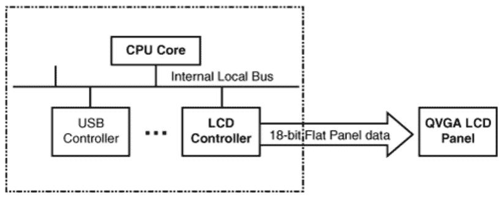

如图 12.3 所示，该嵌入式设备支持双显示面板：一个内部 LVDS 平板 LCD 和一个外部 DVI 监视器。内部 TFT LCD 接收 LVDS 接口信号作为输入，因此使用 LVDS 发送器芯片将平板信号转换为 LVDS。LVDS 发送器芯片的一个例子是 National Semiconductor 的 DS90C363B。外部 DVI 监视器仅接收 DVI 接口信号，因此使用 DVI 发送器将 18 位视频信号转换为 DVI-D。设备提供 I²C 接口，以便设备驱动程序配置 DVI 发送器寄存器。DVI 发送器芯片的一个例子是 Silicon Image 的 SiI 164。

### 图 12.3.嵌入式系统上的 LVDS 和 DVI 连接。

[查看完整尺寸图像]

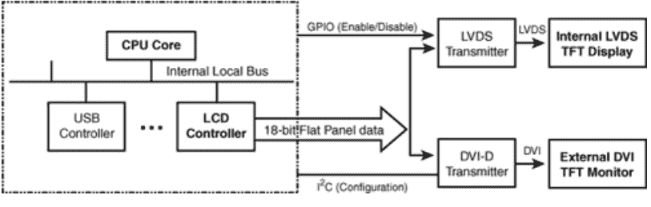

---

## 第 12 章 视频驱动程序

## 本章内容

- 显示架构
- Linux 视频子系统
- 显示参数
- 帧缓冲 API
- 帧缓冲驱动程序
- 控制台驱动程序
- 调试
- 查看源代码

> 视频硬件生成视觉输出供计算机系统显示。在本章中，让我们了解内核如何支持视频控制器，并发现帧缓冲抽象所提供的优势。让我们还学习编写显示内核发出的消息的控制台驱动程序。

---

## 显示架构

图 12.1 展示了 PC 兼容系统上的显示组件。作为北桥一部分的图形控制器使用几种接口标准连接不同类型的显示设备（参见边栏"视频线缆标准"）。

### 图 12.1.PC 系统上的显示连接。

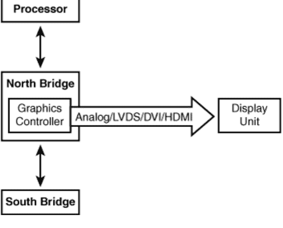

*视频图形阵列*（VGA）是 IBM 推出的原始显示标准，但今天它更多是一种分辨率规范。VGA 指的是 640x480 的分辨率，而较新的标准如*扩展图形阵列*（XGA）和*超级视频图形阵列*（SVGA）支持更高的分辨率，分别为 800x600 和 1024x768。*四分之一 VGA*（QVGA）面板的分辨率为 320x240，在手持设备和智能手机等嵌入式设备上很常见。

x86 世界中兼容 VGA 及其衍生产品的图形控制器提供基于字符的文本模式和基于像素的图形模式。然而，非 x86 嵌入式领域是非 VGA 的，没有专用文本模式的概念。

---

### 北桥

在前面的章节中，你了解了 LPC、I²C、PCMCIA、PCI 和 USB 等外围总线，所有这些总线都来自以 PC 为中心的系统上的南桥。然而，显示架构将我们带入北桥内部。基于 Intel 的 PC 架构中的北桥要么是*图形与内存控制器中枢*（GMCH），要么是*内存控制器中枢*（MCH）。前者包含内存控制器、*前端总线*（FSB）控制器和图形控制器。后者缺少集成图形控制器，但提供*加速图形端口*（AGP）通道来连接外部图形硬件。

例如，考虑一下 Intel 855 GMCH 北桥芯片组。855 GMCH 中的 FSB 控制器与 Pentium M 处理器接口。内存控制器支持*双倍数据速率*（DDR）SDRAM 内存芯片。集成图形控制器让你可以使用模拟 VGA、LVDS 或 DVI 连接显示设备（参见边栏"视频线缆标准"）。855 GMCH 允许你同时向两台显示器发送输出，因此，例如，你可以同时向笔记本电脑的 LCD 面板和外部 CRT 显示器发送相同或不同的信息。

较新的北桥芯片组，如 AMD 690G，除 VGA 和 DVI 外还支持 HDMI（参见以下边栏）。

---

### 视频线缆标准

有几种接口标准规定了视频控制器与显示设备之间的连接。显示设备及其所使用的线缆技术如下：

- 模拟显示器，如带有标准 VGA 接口的*阴极射线管*（CRT）显示器。
- 数字平板显示器，如带有*低压差分信号*（LVDS）接口的笔记本电脑*薄膜晶体管*（TFT）LCD。
- 符合*数字视频接口*（DVI）规范的显示监视器。DVI 是由*数字显示工作小组*（DDWG）开发的标准，用于传输高质量视频。DVI 有三个子类：*纯数字*（DVI-D）、*纯模拟*（DVI-A）和*数字与模拟*（DVI-I）。
- 采用*高清多媒体接口*（HDMI）的*高清电视*（HDTV）规范显示监视器。HDMI 是一种现代数字音视频线缆标准，支持高数据速率。与 DVI 等仅支持视频的标准的不同之处在于，HDMI 可以同时传输图像和声音。

嵌入式 SoC 通常具有片上 LCD 控制器，如图 12.2 所示。从 LCD 控制器输出的信号是 TTL（*晶体管-晶体管逻辑*）信号，包含 18 位平板视频数据，红、绿、蓝三种原色各 6 位。许多手持设备和手机使用 QVGA 类型的内部 LCD 面板，直接接收 LCD 控制器提供的 TTL 平板视频数据。

### 图 12.2.嵌入式系统上的显示连接。

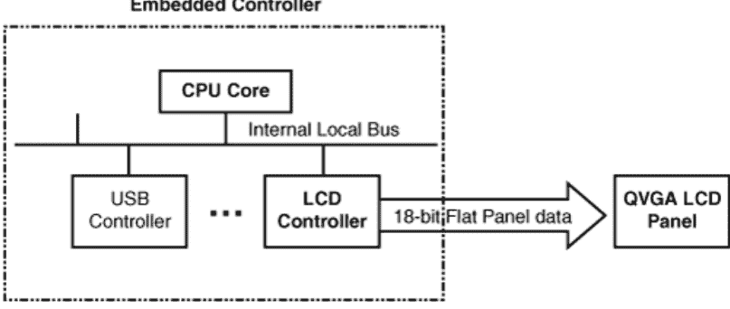

如图 12.3 所示，该嵌入式设备支持双显示面板：一个内部 LVDS 平板 LCD 和一个外部 DVI 监视器。内部 TFT LCD 接收 LVDS 接口信号作为输入，因此使用 LVDS 发送器芯片将平板信号转换为 LVDS。LVDS 发送器芯片的一个例子是 National Semiconductor 的 DS90C363B。外部 DVI 监视器仅接收 DVI 接口信号，因此使用 DVI 发送器将 18 位视频信号转换为 DVI-D。设备提供 I²C 接口，以便设备驱动程序配置 DVI 发送器寄存器。DVI 发送器芯片的一个例子是 Silicon Image 的 SiI 164。

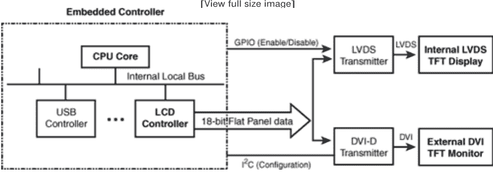

---

## Linux 视频子系统

帧缓冲的概念是 Linux 视频的核心，所以让我们首先了解它提供了什么。

因为视频适配器可以基于不同的硬件架构，更高内核层和应用程序的实现可能需要针对不同视频卡而变化。这导致了处理不同视频卡的非统一方案。由此产生的不可移植性和额外代码需要更多的投入和维护。帧缓冲概念通过描述一个通用抽象并指定一个编程接口来解决这个问题，允许应用程序和更高内核层以独立于平台的方式编写。图 12.4 向你展示了帧缓冲的优势。

### 图 12.4.帧缓冲的优势。

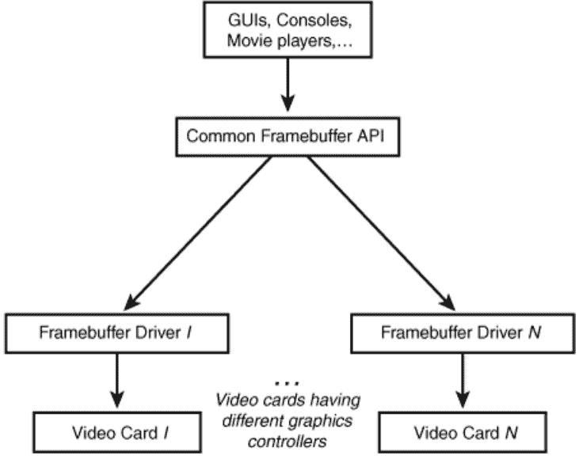

内核的帧缓冲接口因此允许应用程序独立于底层图形硬件的变幻莫测。如果应用程序和显示驱动程序符合帧缓冲接口，它们可以在各种类型的视频硬件上不变地运行。正如你很快将发现的，通用帧缓冲编程接口也为内核层（如帧缓冲控制台驱动程序）带来了硬件独立性。

> 如今，一些应用程序（如 Web 浏览器和电影播放器）直接基于帧缓冲接口工作。这类应用程序可以在没有窗口系统帮助的情况下进行图形处理。

> X Windows 服务器（Xfbdev）能够基于帧缓冲接口工作，如图 12.5 所示。


图 12.5. Linux-Video 子系统。

[查看完整尺寸图像]

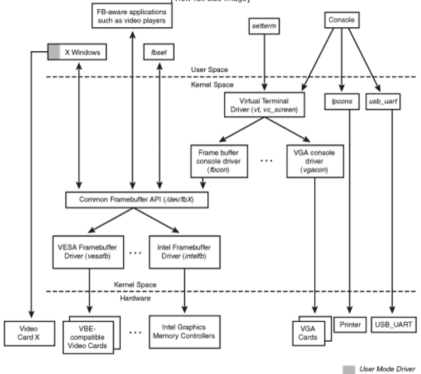

图 12.5 所示的 Linux-Video 子系统是一组底层显示驱动程序、中层帧缓冲和控制台层、高层虚拟终端驱动程序、属于 X Windows 的用户模式驱动程序，以及用于配置显示参数的实用工具的集合。让我们从上到下梳理这张图：

- X Windows GUI 在显卡上有两种操作选项。它可以使用适合的内建用户空间驱动程序来操作该卡，或者通过帧缓冲子系统来工作。
- 文本模式控制台通过虚拟终端字符驱动程序来运行。虚拟终端在第 6 章"串行驱动程序"的"TTY 驱动程序"一节中介绍过，是您以文本模式登录时获得的全屏基于文本的终端。与 X Windows 类似，文本控制台也有两种操作选择。它们可以通过特定于卡的控制台驱动程序工作，或者如果内核支持相关卡的底层帧缓冲驱动程序，则可以使用通用帧缓冲控制台驱动程序（*fbcon*）。

## 显示参数

有时，配置与显示面板相关的属性可能是您启用设备视频所需进行的唯一驱动程序更改，因此让我们通过查看常见的显示参数来开始学习视频驱动程序。我们将假设相关驱动程序符合帧缓冲接口，并使用 *fbset* 实用工具来获取显示特性：

```
bash> fbset
mode "1024x768-60"
    # D: 65.003 MHz, H: 48.365 kHz, V: 60.006 Hz
    geometry 1024 768 1024 768 8
    timings 15384 168 16 30 2 136 6
    hsync high
    vsync high
    rgba 8/0,8/0,8/0,0/0
endmode
```

输出中的 `D:` 值代表*点时钟*（*dotclock*），即视频硬件在显示器上绘制像素的速度。上述输出中的 65.003MHz 值意味着视频控制器绘制单个像素需要 (1/65.003*1000000) 或约 15,384 皮秒。这个持续时间称为*像素时钟*（*pixclock*），显示在以 `timings` 开头那行的第一个数字参数中。"geometry" 后面的数字表示可见和虚拟分辨率均为 1024×768（SVGA），存储一个像素信息所需的位数为 8。

`H:` 值指定水平扫描速率，即视频硬件每秒扫描的水平显示行数。这是像素时钟的倒数乘以 X 分辨率。`V:` 值是整个显示器刷新的速率。这是像素时钟的倒数乘以可见 X 分辨率再乘以可见 Y 分辨率，在本例中约为 60Hz。换句话说，LCD 每秒刷新 60 次。

视频控制器在每行结束时发出一个水平同步（`HSYNC`）脉冲，在每个显示帧之后发出一个垂直同步（`VSYNC`）脉冲。`HSYNC`（以像素为单位）和 `VSYNC`（以像素行为单位）的时长显示在以 "`timings`" 开头那行的最后两个参数中。显示器越大，`HSYNC` 和 `VSYNC` 的值可能越大。`timings` 行中 `HSYNC` 时长之前的四个数字分别表示右边距（或称水平前沿，horizontal front porch）、左边距（或称水平后沿，horizontal back porch）、下边距（或称垂直前沿，vertical front porch）和上边距（或称垂直后沿，vertical back porch）的长度。*Documentation/fb/framebuffer.txt* 和 *fb.modes* 的手册页以图形方式展示了这些参数。

为了将这些参数联系起来，让我们计算给定刷新率下的像素时钟值，在我们的例子中为 60.006Hz：

```
dotclock = (X-resolution + left margin + right margin
          + HSYNC length) * (Y-resolution + upper margin
          + lower margin + VSYNC length) * refresh rate
         = (1024 + 168 + 16 + 136) * (768 + 30 + 2 + 6) * 60.006
         = 65.003 MHz
pixclock = 1/dotclock
         = 15384 picoseconds (which matches with the fbset output
                          above)
```

## 帧缓冲 API

接下来让我们初步接触一下帧缓冲 API。帧缓冲核心层向用户空间导出设备节点，以便应用程序可以访问每个支持的视频设备。*/dev/fbX* 是与帧缓冲设备 *X* 相关联的节点。以下是帧缓冲 API 用户关注的主要数据结构。在内核中，它们定义在 *include/linux/fb.h* 中，而在用户空间，它们的定义位于 */usr/include/linux/fb.h* 中：

- 1. 上一节中 fbset 输出中显示的与视频卡相关的可变信息保存在 `struct fb_var_screeninfo` 中。该结构包含 X 分辨率、Y 分辨率、存储一个像素所需的位数、像素时钟、`HSYNC` 时长、`VSYNC` 时长和边距长度等字段。这些值可由用户编程设置：

```
struct fb_var_screeninfo {
  __u32 xres;            /* X 轴可见分辨率 */
  __u32 yres;            /* Y 轴可见分辨率 */
  /* ... */
  __u32 bits_per_pixel;  /* 存储一个像素所需的位数 */
  /* ... */
  __u32 pixclock;        /* 以皮秒为单位的像素时钟 */
  __u32 left_margin;     /* 从同步到图像的时间 */
  __u32 right_margin;    /* 从图像到同步的时间 */
  /* ... */
  __u32 hsync_len;       /* 水平同步的长度 */
  __u32 vsync_len;       /* 垂直同步的长度 */
  /* ... */
};
```

- 2. 视频硬件的固定信息，例如帧缓冲内存的起始地址和大小，保存在 `struct fb_fix_screeninfo` 中。这些值不能由用户更改：

```
struct fb_fix_screeninfo {
  char id[16];              /* 标识字符串 */
  unsigned long smem_start; /* 帧缓冲内存的起始地址 */
  __u32 smem_len;           /* 帧缓冲内存的长度 */
  /* ... */
};
```

- 3. `fb_cmap` 结构指定颜色映射，用于将用户定义的颜色传递给底层视频硬件。您可以使用此结构来定义所需的不同颜色的 RGB（红、绿、蓝）比例：

```
struct fb_cmap {
  __u32 start;   /* 第一个条目 */
  __u32 len;     /* 条目数量 */
  __u16 *red;    /* 红色值 */
  __u16 *green;  /* 绿色值 */
  __u16 *blue;   /* 蓝色值 */
  __u16 *transp; /* 透明度。稍后讨论 */
};
```

清单 12.1 是一个使用帧缓冲 API 的简单应用程序。该程序通过操作 /dev/fb0（对应于显示屏的帧缓冲设备节点）来清除屏幕。它首先使用帧缓冲 API 中的 `FBIOGET_VSCREENINFO` 以硬件无关的方式解析可见分辨率和*每像素位数*。此接口命令通过操作 `fb_var_screeninfo` 结构来获取显示器的可变参数。然后程序继续 `mmap()` 帧缓冲内存并清除每个像素位。

### 清单 12.1. 以硬件无关方式清除显示器

```
Code View:
#include <stdio.h>
#include <fcntl.h>
#include <linux/fb.h>
#include <sys/mman.h>
#include <stdlib.h>

struct fb_var_screeninfo vinfo;

int
main(int argc, char *argv[])
{
  int fbfd, fbsize, i;
  unsigned char *fbbuf;

  /* Open video memory */
  if ((fbfd = open("/dev/fb0", O_RDWR)) < 0) {
    exit(1);
  }

  /* Get variable display parameters */
  if (ioctl(fbfd, FBIOGET_VSCREENINFO, &vinfo)) {
    printf("Bad vscreeninfo ioctl\n");
    exit(2);
  }

  /* Size of frame buffer =
	 (X-resolution * Y-resolution * bytes per pixel) */
  fbsize = vinfo.xres*vinfo.yres*(vinfo.bits_per_pixel/8);

  /* Map video memory */
  if ((fbbuf = mmap(0, fbsize, PROT_READ|PROT_WRITE,
                    MAP_SHARED, fbfd, 0)) == (void *) -1){
    exit(3);
  }

  /* Clear the screen */
  for (i=0; i<fbsize; i++) {
    *(fbbuf+i) = 0x0;
  }

  munmap(fbbuf, fbsize);
  close(fbfd);
}
```


我们将在[第19章](.)“用户空间驱动程序”中学习如何从用户空间访问内存区域时，再来看另一个帧缓冲区应用程序。

## 帧缓冲区驱动程序

现在你已经了解了帧缓冲区API及其如何提供硬件独立性，让我们通过导航系统的示例来发现底层帧缓冲设备驱动程序的架构。

## 设备示例：导航系统

*图12.6*展示了一个围绕嵌入式SoC构建的示例车辆导航系统的视频操作。GPS接收器通过UART接口将坐标流式传输到SoC。一个应用程序从接收到的位置信息生成图形，并更新系统内存中的帧缓冲区。帧缓冲区驱动程序通过DMA将此图像数据传输到作为SoC的LCD控制器一部分的显示缓冲区。控制器将像素数据转发到QVGA LCD面板进行显示。

**图 12.6. Linux导航设备上的显示。**

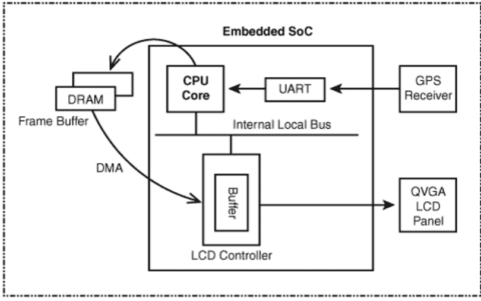

我们的目标是为该系统开发视频软件。让我们假设Linux支持此导航设备上使用的SoC，并且所有架构相关的接口（如DMA）都由内核支持。

> *图12.6*中所示设备的一种可能的硬件实现是使用飞思卡尔i.MX21 SoC。在这种情况下，CPU核心是ARM9核心，片上视频控制器是液晶显示控制器（LCDC）。SoC通常具有高性能的内部本地总线，连接到DRAM和视频等控制器。对于iMX21，该总线称为高级高性能总线（AHB）。LCDC连接到AHB。

导航系统的视频软件大致架构为在LCD控制器的底层帧缓冲区驱动程序之上运行的GPS应用程序。应用程序通过读取/dev/ttySX从GPS接收器获取位置坐标，其中X是连接到接收器的UART编号。然后它将地理定位信息转换为图像，并将像素数据写入与LCD控制器关联的帧缓冲区。这与清单12.1中的方式类似，只是发送的是图像数据而不是用于清屏的零。

本节的其余部分仅专注于底层帧缓冲设备驱动程序。与许多其他驱动程序子系统一样，帧缓冲核心层提供的全部功能、模式和选项是复杂的，只能通过编码经验来学习。示例导航系统的帧缓冲区驱动程序相对简单，只是深入探索的起点。

表12.1描述了图12.6中所示的LCD控制器的寄存器模型。清单12.2中的帧缓冲区驱动程序操作这些寄存器。

| 寄存器名称 | 用于配置 |
| --- | --- |
| SIZE_REG | LCD面板的最大X和Y尺寸 |
| HSYNC_REG | HSYNC持续时间 |
| VSYNC_REG | VSYNC持续时间 |
| CONF_REG | 每像素位数、像素极性、生成像素时钟的时钟分频器、彩色/单色模式等 |
| CTRL_REG | 启用/禁用LCD控制器、时钟和DMA |
| DMA_REG | 帧缓冲区的DMA起始地址、突发长度和水印大小 |
| STATUS_REG | 状态值 |
| CONTRAST_REG | 对比度级别 |

我们的帧缓冲区驱动程序（称为*myfb*）在清单12.2中实现为平台驱动程序。正如你在第6章中学到的，平台是一种伪总线，通常用于将集成到SoC中的轻量级设备与内核的设备模型连接起来。架构相关的设置代码（在*arch/your-arch/your-platform/*中）使用`platform_device_add()`添加平台；但为简单起见，myfb驱动程序的`probe()`方法在将自己注册为平台驱动程序之前执行此操作。参阅第6章中"设备示例：手机"一节，了解平台驱动程序及其相关入口点的一般架构。

### 数据结构

让我们看看与帧缓冲区驱动程序相关的主要数据结构和方法，然后深入了解myfb。以下是两个主要结构：

1. `struct fb_info`是帧缓冲区驱动程序的核心数据结构。此结构在*include/linux/fb.h*中定义如下：

```
struct fb_info {
  /* ... */
  struct fb_var_screeninfo var;    /* 可变屏幕信息。 */
```

```
struct fb_fix_screeninfo fix;    /* 固定屏幕信息。
                                   前面已讨论。 */
struct fb_cmap cmap;             /* 色彩映射。
                                   前面已讨论。 */
struct fb_ops *fbops;             /* 驱动程序操作。
                                   接下来讨论。 */
char __iomem *screen_base;       /* 帧缓冲区的
                                   虚拟地址 */
unsigned long screen_size;        /* 帧缓冲区的大小 */
/* ... */
/* 从这里开始一切都是设备相关的 */
void *par;                        /* 私有区域 */
};
```

`fb_info`的内存由`framebuffer_alloc()`分配，这是帧缓冲核心提供的一个库例程。此函数还将私有区域的大小作为参数，并将其追加到分配的`fb_info`末尾。此私有区域可以使用`fb_info`结构中的`par`指针引用。`fb_info`字段如`fb_var_screeninfo`和`fb_fix_screeninfo`的语义在"The Frame Buffer API"一节中已讨论。

**2.** `fb_ops`结构包含底层帧缓冲区驱动程序提供的所有入口点的地址。`fb_ops`中的前几个方法对驱动程序的运行是必需的，而其余的是可选方法，用于提供图形加速。每个函数的职责在注释中简要说明：

代码视图：

```
struct fb_ops {
  struct module *owner;
  /* 驱动程序打开 */
  int (*fb_open)(struct fb_info *info, int user);
  /* 驱动程序关闭 */
  int (*fb_release)(struct fb_info *info, int user);
  /* ... */
  /* 视频参数的有效性检查 */
  int (*fb_check_var)(struct fb_var_screeninfo *var,
                       struct fb_info *info);
  /* 配置视频控制器寄存器 */
  int (*fb_set_par)(struct fb_info *info);
  /* 创建伪彩色调色板映射 */
  int (*fb_setcolreg)(unsigned regno, unsigned red,
                       unsigned green, unsigned blue,
                       unsigned transp, struct fb_info *info);
  /* 关闭/开启显示 */
  int (*fb_blank)(int blank, struct fb_info *info);
  /* ... */
  /* 用像素线填充矩形的加速方法 */
  void (*fb_fillrect)(struct fb_info *info,
                       const struct fb_fillrect *rect);
  /* 将一个矩形区域从一个屏幕区域复制到另一个的加速方法 */
  void (*fb_copyarea)(struct fb_info *info,
```

```
const struct fb_copyarea *region);
/* 将图像绘制到显示的加速方法 */
void (*fb_imageblit)(struct fb_info *info,
                     const struct fb_image *image);
/* 旋转显示的加速方法 */
void (*fb_rotate)(struct fb_info *info, int angle);
  /* 支持设备特定命令的Ioctl接口 */
  int (*fb_ioctl)(struct fb_info *info, unsigned int cmd,
                  unsigned long arg);
  /* ... */
};
```

现在让我们看看[清单12.2](https://example.com)为myfb驱动程序实现的驱动程序方法。

### 检查和设置参数

`fb_check_var()`方法对X分辨率、Y分辨率和每像素位数等变量进行有效性检查。因此，如果你使用fbset设置小于LCD控制器支持的最小值（在我们的示例中为64）的X分辨率，此函数将将其限制为硬件允许的最小值。

`fb_check_var()`还设置适当的RGB格式。我们的示例使用16位每像素，控制器将帧缓冲区中的每个数据字映射到常用的RGB565编码：红色5位，绿色6位，蓝色5位。三种颜色中每个颜色在数据字中的偏移量也相应设置。

`fb_set_par()`方法根据`fb_info.var`中的值配置LCD控制器的寄存器。这包括设置：

- `HSYNC_REG`中的水平同步持续时间、左边距和右边距
- `VSYNC_REG`中的垂直同步持续时间、上边距和下边距
- `SIZE_REG`中的可见X和Y分辨率
- `DMA_REG`中的DMA参数

假设GPS应用程序尝试将QVGA显示的分辨率更改为50x50。以下是事件序列：

1. 显示最初处于QVGA分辨率：

   `bash> fbset`
   mode "320x240-76"
       # D: 5.830 MHz, H: 18.219 kHz, V: 75.914 Hz
       geometry 320 240 320 240 16
       timings 171521 0 0 0 0 0
       rgba 5/11,6/5,5/0,0/0


2. 应用程序执行的操作类似于以下过程：

```
struct fb_var_screeninfo vinfo;
fbfd = open("/dev/fb0", O_RDWR);
vinfo.xres = 50;
vinfo.yres = 50;
vinfo.bits_per_pixel = 8;

ioctl(fbfd, FBIOPUT_VSCREENINFO, &vinfo);
```

请注意，这等效于命令 `fbset -xres 50 -yres 50 -depth 8`。

3. 上一步中的 `FBIOPUT_VSCREENINFO` ioctl 会触发调用 `myfb_check_var()`。这个驱动程序方法表示不满意，并将请求的分辨率向上舍入到硬件支持的最小值，在本例中为 64x64。

4. 帧缓冲核心调用 `myfb_set_par()`，将新的显示参数编程到 LCD 控制器寄存器中。

5. 现在 fbset 输出新的参数：

```
bash> fbset
mode "64x64-1423"
    # D: 5.830 MHz, H: 91.097 kHz, V: 1423.386 Hz
    geometry 64 64 320 240 16
    timings 171521 0 0 0 0 0 0
```


 ```c
#define CTRL_REG	(* (volatile u32 * ) (LCD_CONTROLLER_BASE + 16))
#define DMA_REG		(* (volatile u32 * ) (LCD_CONTROLLER_BASE + 20))
#define STATUS_REG	(* (volatile u32 * ) (LCD_CONTROLLER_BASE + 24))
#define CONTRAST_REG	(* (volatile u32 * ) (LCD_CONTROLLER_BASE + 28))
#define LCD_CONTROLLER_SIZE	32
```

```c
/* LCD控制器平台设备的资源 */
static struct resource myfb_resources[] = {
	[0] = {
		.start		 = LCD_CONTROLLER_BASE,
		.end		 = LCD_CONTROLLER_SIZE,
		.flags		 = IORESOURCE_MEM,
	},
};
```

```c
/* 平台设备定义 */
static struct platform_device myfb_device = {
	.name		= "myfb",
	.id		= 0,
	.dev		= {
		.coherent_dma_mask = 0xffffffff,
	},
	.num_resources = ARRAY_SIZE(myfb_resources),
	.resource	 = myfb_resources,
};
```

```c
/* 设置LCD控制器参数 */
static int
myfb_set_par (struct fb_info *info)
{
	unsigned long adjusted_fb_start;
	struct fb_var_screeninfo *var = &info->var;
	struct fb_fix_screeninfo *fix = &info->fix;

	/* HSYNC_REG的高16位保存HSYNC持续时间，接下来8位包含
	   左边距，低8位保存右边距 */
	HSYNC_REG = (var->hsync_len << 16) |
			( var->left_margin << 8) |
			( var->right_margin);

	/* VSYNC_REG的高16位保存VSYNC持续时间，接下来8位包含
	   上边距，低8位保存下边距 */
	VSYNC_REG = (var->vsync_len << 16) |
			( var->upper_margin << 8) |
			( var->lower_margin);

	/* SIZE_REG的高16位保存xres，低16位保存yres */
	SIZE_REG	 = (var->xres << 16) | (var->yres);

	/* 在CONF_REG中设置每像素的位数、像素极性、
	   pixclock的时钟分频器以及彩色/单色模式 */
	/* ... */

	/* 将DMA_REG填充为获得自myfb_probe()的帧缓冲起始地址，
	   该地址是连贯分配的。调整此地址以考虑
	   屏幕区域起始位置的任何偏移 */
	adjusted_fb_start = fix->smem_start +
			( var-> yoffset * var->xres_virtual + var->xoffset) *
			( var->bits_per_pixel) / 8;
	__raw_writel (adjusted_fb_start, (unsigned long *) DMA_REG);

	/* 在DMA_REG中设置DMA突发长度和水印大小 */
	/* ... */

	/* 设置固定信息 */
	fix->accel  = FB_ACCEL_NONE;     /* 无硬件加速 */
	fix->visual = FB_VISUAL_TRUECOLOR; /* 真彩色模式 */
	fix->line_length = var->xres_virtual * var->bits_per_pixel/8;

	return 0;
}
```

```c
/* 启用LCD控制器 */
static void
myfb_enable_controller(struct fb_info *info)
{
	/* 通过写入CTRL_REG来启用LCD控制器、启动DMA、
	   启用时钟和电源 */
	/* ... */
}
```

```c
/* 禁用LCD控制器 */
static void
myfb_disable_controller(struct fb_info *info)
{
	/* 通过写入CTRL_REG来禁用LCD控制器、停止DMA、
	   禁用时钟和电源 */
	/* ... */
}
```

```c
/* 变量的合法性检查和调整 */
static int
myfb_check_var(struct fb_var_screeninfo *var, struct fb_info *info)
{
	/* 向上取整到LCD控制器支持的最小分辨率 */
	if (var->xres < 64) var->xres = 64;
	if (var->yres < 64) var->yres = 64;

	/* ... */
	/* 此硬件支持RGB565颜色格式。
	   详见"颜色模式"一节 */
	if (var->bits_per_pixel == 16) {
		/* 红色编码 */
		var->red.length = 5;
		var->red.offset = 11;
		/* 绿色编码 */
		var->green.length = 6;
		var->green.offset = 5;
		/* 蓝色编码 */
		var->blue.length = 5;
		var->blue.offset = 0;
		/* 无硬件Alpha混合支持 */
		var->transp.length = 0;
		var->transp.offset = 0;
	}

	return 0;
}
```

```c
/* 黑屏/取消黑屏 */
static int
myfb_blank(int blank_mode, struct fb_info *info)
{
	switch (blank_mode) {
	case FB_BLANK_POWERDOWN:
	case FB_BLANK_VSYNC_SUSPEND:
	case FB_BLANK_HSYNC_SUSPEND:
	case FB_BLANK_NORMAL:
		myfb_disable_controller(info);
		break;
	case FB_BLANK_UNBLANK:
		myfb_enable_controller(info);
		break;
	}
	return 0;
}
```

```c
/* 配置伪彩色调色板映射 */
static int
myfb_setcolreg(u_int color_index, u_int red, u_int green,
               u_int blue, u_int transp, struct fb_info *info)
{
	if (info->fix.visual == FB_VISUAL_TRUECOLOR) {
		/* 执行任何必要的转换，将红色、蓝色、绿色和
		   transp转换为可直接送入硬件的值 */
		/* ... */

		((u32 *)(info->pseudo_palette))[color_index] =
		      (red   << info->var.red.offset)    |
		      (green << info->var.green.offset)  |
		      (blue  << info->var.blue.offset)   |
		      (transp<< info->var.transp.offset);
	}
	return 0;
}
```

```c
/* 设备特定的ioctl定义 */
#define MYFB_SET_BRIGHTNESS _IOW('M', 3, int8_t)
```

```c
/* 设备特定的ioctl */
static int
myfb_ioctl(struct fb_info *info, unsigned int cmd,
           unsigned long arg)
{
	u32 blevel;
	switch (cmd) {
	case MYFB_SET_BRIGHTNESS:
		copy_from_user((void *)&blevel, (void *)arg,
		               sizeof(blevel));
		/* 将blevel写入CONTRAST_REG */
		/* ... */
		break;
	default:
		return -EINVAL;
	}
	return 0;
}
```

```c
/* fb_ops结构 */
static struct fb_ops myfb_ops = {
	.owner       = THIS_MODULE,
	.fb_check_var = myfb_check_var,	/* 合法性检查 */
	.fb_set_par  = myfb_set_par,	/* 编程控制器寄存器 */
	.fb_setcolreg = myfb_setcolreg,	/* 设置颜色映射 */
	.fb_blank    = myfb_blank,	/* 黑屏/取消黑屏显示 */
	.fb_fillrect = cfb_fillrect,	/* 填充矩形的通用函数 */
	.fb_copyarea = cfb_copyarea,	/* 复制区域的通用函数 */
	.fb_imageblit = cfb_imageblit,	/* 绘制的通用函数 */
	.fb_ioctl    = myfb_ioctl,	/* 设备特定的ioctl */
};
```

```c
/* 平台驱动程序的probe()例程 */
static int __init
myfb_probe(struct platform_device *pdev)
{
	struct fb_info *info;
	struct resource *res;

	info = framebuffer_alloc(0, &pdev->dev);
	/* ... */
	/* 获取注册相应platform_device时定义的关联资源 */
	res = platform_get_resource(pdev, IORESOURCE_MEM, 0);
	/* 获得内核对使用从LCD_CONTROLLER_BASE开始、
	   大小为LCD_CONTROLLER_SIZE字节的I/O内存块的许可 */
	res = request_mem_region(res->start, res->end - res->start + 1,
	                        pdev->name);

	/* 用固定值(info->fix)和可变值(info->var)填充fb_info结构，
	   如帧缓冲长度、xres、yres、bits_per_pixel、
	   fbops、cmap等 */
	initialize_fb_info(info, pdev);  /* 未展开 */
	info->fbops = &myfb_ops;
	fb_alloc_cmap(&info->cmap, 16, 0);

	/* 连贯地DMA映射帧缓冲内存。info->screen_base保存
	   映射缓冲区的CPU地址，info->fix.smem_start保存
	   关联的硬件地址 */
	info->screen_base = dma_alloc_coherent(0, info->fix.smem_len,
	                                       (dma_addr_t *)&info->fix.smem_start,
	                                       GFP_DMA | GFP_KERNEL);

	/* 将info->var中的信息设置到适当的LCD控制器寄存器 */
	myfb_set_par(info);

	/* 注册到帧缓冲核心 */
	register_framebuffer(info);
	return 0;
}
```

```c
/* 平台驱动程序的remove()例程 */
static int
myfb_remove(struct platform_device *pdev)
{
	struct fb_info *info = platform_get_drvdata(pdev);
	struct resource *res;

	/* 禁用屏幕刷新，关闭DMA，... */
	myfb_disable_controller(info);

	/* 注销帧缓冲驱动 */
	unregister_framebuffer(info);
	/* 释放颜色映射 */
	fb_dealloc_cmap(&info->cmap);
	kfree(info->pseudo_palette);

	/* framebuffer_alloc()的逆操作 */
	framebuffer_release(info);
	/* 释放内存区域 */
	res = platform_get_resource(pdev, IORESOURCE_MEM, 0);
	release_mem_region(res->start, res->end - res->start + 1);
	platform_set_drvdata(pdev, NULL);

	return 0;
}
```

```c
/* 平台驱动结构 */
static struct platform_driver myfb_driver = {
	.probe    = myfb_probe,
	.remove   = myfb_remove,
	.driver   = {
		.name  = "myfb",
	},
};
```

```c
/* 模块初始化 */
int __init
myfb_init(void)
{
	platform_device_add(&myfb_device);
	return platform_driver_register(&myfb_driver);
}
```

```c
/* 模块退出 */
void __exit
myfb_exit(void)
{
	platform_driver_unregister(&myfb_driver);
	platform_device_unregister(&myfb_device);
}

module_init(myfb_init);
module_exit(myfb_exit);
```


 ## 控制台驱动程序

*控制台（console）*是一种显示内核生成的`printk()`消息的设备。如果你查看图 12.5，可以看到控制台驱动程序分为两个层级：上层包括虚拟终端驱动程序、打印机控制台驱动程序以及示例`USB_UART`控制台驱动程序（即将讨论），下层驱动程序负责高级操作。因此，控制台驱动程序使用两个主要的接口定义结构体。上层控制台驱动程序围绕`struct console`展开，该结构体定义了`setup()`和`write()`等基本操作。下层驱动程序以`struct consw`为核心，指定了设置光标属性、控制台切换、消隐、调整大小以及设置调色板信息等高级操作。这些结构体在*include/linux/console.h*中定义如下：

```
1. struct console {
      char  name[8];
      void  (*write)(struct console *, const char *, unsigned);
      int   (*read)(struct console *, char *, unsigned);
      /* ... */
      void  (*unblank)(void);
      int   (*setup)(struct console *, char *);
      /* ... */
   };
```

```
2. struct consw {
      struct module *owner;
      const char *(*con_startup)(void);
      void       (*con_init)(struct vc_data *, int);
      void       (*con_deinit)(struct vc_data *);
      void       (*con_clear)(struct vc_data *, int, int, int, int);
      void       (*con_putc)(struct vc_data *, int, int, int);
      void       (*con_putcs)(struct vc_data *,
                             const unsigned short *, int, int, int);
      void       (*con_cursor)(struct vc_data *, int);
      int        (*con_scroll)(struct vc_data *, int, int, int, int);
      /* ... */
   };
```

正如你可能已经从图 12.5 中猜到的，大多数控制台设备需要两个层级的驱动程序协同工作。*vt*驱动程序是许多情况下的上层控制台驱动程序。在兼容 PC 的系统中，VGA 控制台驱动程序（*vgacon*）通常是下层控制台驱动程序；而在嵌入式设备中，帧缓冲区控制台驱动程序（*fbcon*）常常是下层驱动程序。由于帧缓冲区抽象提供的间接性，fbcon 与其他下层控制台驱动程序不同，它是与硬件无关的。

让我们简要了解一下两个层级的控制台驱动程序的架构：

- 上层驱动程序用规定的入口点填充`struct console`，并使用`register_console()`向内核注册。注销则使用`unregister_console()`完成。这是与`printk()`交互的驱动程序。该驱动程序的入口点调用相关联的下层控制台驱动程序的服务。

- 下层控制台驱动程序用指定的入口点填充`struct consw`，并使用`register_con_driver()`向内核注册。注销使用`unregister_con_driver()`完成。当系统支持多个控制台驱动程序时，驱动程序可能会改用`take_over_console()`来注册自身并接管现有控制台。`give_up_console()`则执行相反的操作。对于常规显示器，下层驱动程序与上层 vt 控制台驱动程序以及*vc_screen*字符驱动程序交互，后者允许访问虚拟控制台内存。

一些简单的控制台，如行打印机和接下来讨论的`USB_UART`，只需要上层控制台驱动程序。

2.6 内核中的 fbcon 驱动程序还支持控制台旋转。PDA 和手机上的显示面板通常以竖屏方向安装，而汽车仪表盘和 IP 电话则是显示面板可能处于横屏模式的系统示例。有时，由于经济或其他因素，嵌入式设备可能需要将横屏 LCD 竖向安装，反之亦然。在这种情况下，控制台旋转支持就派上用场了。由于 fbcon 与硬件无关，控制台旋转的实现也是通用的。要启用控制台旋转，在内核配置时启用`CONFIG_FRAMEBUFFER_CONSOLE_ROTATION`，并在内核命令行中添加`fbcon=rotate:X`，其中 x 为 0 表示正常方向，1 表示旋转 90 度，2 表示旋转 180 度，3 表示旋转 270 度。

## 设备示例：重温手机

为了学习如何编写控制台驱动程序，让我们重温一下在第 6 章中使用的 Linux 手机。我们在本节中的任务是开发一个通过手机中`USB_UART`工作的控制台驱动程序。为方便起见，[图 12.7](#)从第 6 章的[图 6.5](#)重绘了这款手机。让我们编写一个控制台驱动程序，通过`USB_UART`将`printk()`消息发送出去。这些消息由 PC 主机接收，并通过终端仿真会话显示给用户。

**图 12.7. 基于`USB_UART`的控制台。**

[查看全尺寸图像]

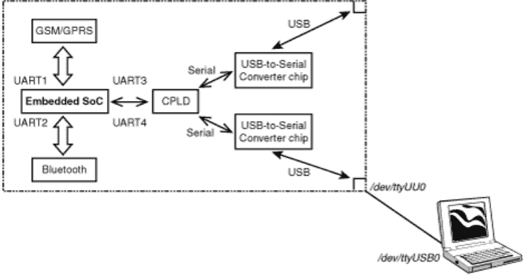

[清单 12.3](#)开发了基于`USB_UART`的控制台驱动程序。该清单中也包含了`usb_uart_port[]`结构体以及第 6 章中`USB_UART`驱动程序使用的一些定义，以形成一个完整的驱动程序。与清单相关的注释解释了该驱动程序的操作。

图 12.7 展示了我们的示例`USB_UART`控制台驱动程序在 Linux-视频子系统中的位置。正如你所见，`USB_UART`是一个简单的设备，只需要上层控制台驱动程序。

### 清单 12.3. 基于`USB_UART`的控制台

```
Code View:
#include <linux/console.h>
#include <linux/serial_core.h>
#include <asm/io.h>

#define USB_UART_PORTS         2           /* The cell phone has 2
                                               USB_UART ports */
/* Each USB_UART has a 3-byte register set consisting of
   UU_STATUS_REGISTER at offset 0, UU_READ_DATA_REGISTER at
   offset 1, and UU_WRITE_DATA_REGISTER at offset 2, as shown
   in Table One of Chapter 6, "Serial Drivers" */
#define USB_UART1_BASE          0xe8000000 /* Memory base for USB_UART1 */
#define USB_UART2_BASE          0xe9000000 /* Memory base for USB_UART1 */
#define USB_UART_REGISTER_SPACE 0x3
/* Semantics of bits in the status register */
#define USB_UART_TX_FULL        0x20
#define USB_UART_RX_EMPTY       0x10
#define USB_UART_STATUS         0x0F

#define USB_UART1_IRQ           3
#define USB_UART2_IRQ           4
#define USB_UART_CLK_FREQ       16000000
#define USB_UART_FIFO_SIZE      32

/* Parameters of each supported USB_UART port */
static struct uart_port usb_uart_port[] = {
  {
    .mapbase  = (unsigned int)USB_UART1_BASE,
    .iotype   = UPIO_MEM,             /* Memory mapped */
    .irq      = USB_UART1_IRQ,        /* IRQ */
    .uartclk  = USB_UART_CLK_FREQ,    /* Clock HZ */
    .fifosize = USB_UART_FIFO_SIZE,   /* Size of the FIFO */
    .flags    = UPF_BOOT_AUTOCONF,    /* UART port flag */
    .line     = 0,                    /* UART Line number */
  },
  {
    .mapbase  = (unsigned int)USB_UART2_BASE,
    .iotype   = UPIO_MEM,             /* Memory mapped */
    .irq      = USB_UART2_IRQ,        /* IRQ */
    .uartclk  = USB_UART_CLK_FREQ,    /* Clock HZ */
    .fifosize = USB_UART_FIFO_SIZE,   /* Size of the FIFO */
    .flags    = UPF_BOOT_AUTOCONF,    /* UART port flag */
    .line     = 1,                    /* UART Line number */
  }
};

/* Write a character to the USB_UART port */
static void
usb_uart_putc(struct uart_port *port, unsigned char c)
{

/* Wait until there is space in the TX FIFO of the USB_UART.
   Sense this by looking at the USB_UART_TX_FULL
   bit in the status register */
while (__raw_readb(port->membase) & USB_UART_TX_FULL);

/* Write the character to the data port*/
__raw_writeb(c, (port->membase+1));
}
```

```
/* Console write */
static void
usb_uart_console_write(struct console *co, const char *s,
                       u_int count)
{
  int i;

  /* Write each character */
  for (i = 0; i < count; i++, s++) {
    usb_uart_putc(&usb_uart_port[co->index], *s);
  }
}
```

```
/* Get communication parameters */
static void __init
usb_uart_console_get_options(struct uart_port *port,
                              int *baud, int *parity, int *bits)
{
  /* Read the current settings (possibly set by a bootloader)
     or return default values for parity, number of data bits,
     and baud rate */
  *parity = 'n';
  *bits = 8;
  *baud = 115200;
}
```

```
/* Setup console communication parameters */
static int __init
usb_uart_console_setup(struct console *co, char *options)
{
  struct uart_port *port;
  int baud, bits, parity, flow;

  /* Validate port number and get a handle to the
     appropriate structure */
  if (co->index == -1 || co->index >= USB_UART_PORTS) {
    co->index = 0;
  }
  port = &usb_uart_port[co->index];

  /* Use functions offered by the serial layer to parse options */
  if (options) {
    uart_parse_options(options, &baud, &parity, &bits, &flow);
  } else {
    usb_uart_console_get_options(port, &baud, &parity, &bits);
  }
  return uart_set_options(port, co, baud, parity, bits, flow);
}
```

```
/* Populate the console structure */
```


 static struct console usb_uart_console = {
  .name   = "ttyUU",              /* 控制台名称 */
  .write  = usb_uart_console_write, /* 如何将消息打印到
                                      控制台 */
  .device = uart_console_device,    /* 由串行核心提供 */
  .setup  = usb_uart_console_setup, /* 如何设置控制台 */
  .flags  = CON_PRINTBUFFER,        /* 默认标志 */
  .index  = -1,                     /* 初始化为无效值 */
};

```
/* 控制台初始化 */
static int __init
usb_uart_console_init(void)
{
  /* ... */

  /* 注册该控制台 */
  register_console(&usb_uart_console);

  return 0;
}

console_initcall(usb_uart_console_init); /* 标记控制台初始化 */
```

在将该驱动作为内核的一部分构建后，你可以通过附加 `console=ttyUUX`（其中 `X` 为 0 或 1）到内核命令行来激活它。

## 启动 Logo

帧缓冲子系统提供的一个流行功能是启动 Logo。要显示 Logo，在内核配置期间启用 `CONFIG_LOGO` 并选择一个可用的 Logo。你也可以在 *drivers/video/logo/* 目录中添加自定义的 Logo 图像。

*CLUT224* 是一种常用的启动 Logo 图像格式，支持 224 种颜色。这种格式的工作原理与 "[色彩模式](#)" 一节中描述的伪调色板类似。CLUT224 图像是一个包含两个结构的 C 文件：

- 一个 CLUT（*色彩查找表*），它是一个包含 224 个 RGB 三元组的字符数组（因此大小为 224*3 字节）。每个 3 字节的 CLUT 元素是红、绿、蓝颜色的组合。

- 一个数据数组，其中每个字节都是指向 CLUT 的索引。索引起始值为 32，延伸到 255（因此支持 224 种颜色）。索引 32 指的是 CLUT 中的第一个元素。Logo 处理代码（位于 *drivers/video/fbmem.c* 中）根据数据数组中每个索引对应的 CLUT 三元组创建帧缓冲像素数据。图像显示通过底层帧缓冲驱动程序的 `fb_imageblit()` 方法实现，如 "[加速方法](#)" 一节所述。

其他支持的 Logo 格式包括 16 色的 *vga16* 和黑白 *mono* 格式。在顶层 *scripts/* 目录中有脚本可用于将标准 *可移植像素图*（*PPM*）文件转换为支持的 Logo 格式。

如果帧缓冲设备也是控制台，启动消息会在 Logo 下方滚动显示。在生产级系统上，你可能希望禁用控制台消息（通过向内核命令行添加 `console=/dev/null`），并显示客户提供的 CLUT224 "闪屏" 图像作为启动 Logo。

## 调试

虚拟帧缓冲驱动程序通过在内核配置菜单中设置 `CONFIG_FB_VIRTUAL` 来启用，它在伪图形适配器上运行。你可以借助该驱动程序来调试帧缓冲子系统。

一些帧缓冲驱动程序，如 *intelfb*，提供了额外的配置选项，你可以启用它们来生成驱动特定的调试信息。

要讨论与帧缓冲驱动程序相关的问题，请订阅 linux-fbdev-devel 邮件列表，https://lists.sourceforge.net/lists/listinfo/linux-fbdev-devel/。

调试控制台驱动程序并非易事，因为你不能在驱动程序内部调用 `printk()`。如果你有一个备用的控制台设备（如串行端口），你可以先实现你的控制台驱动的 UART/tty 形式（正如我们在 [第 6 章](link) 中对本章使用的 USB_UART 设备所做的那样），并通过操作 */dev/tty* 和向备用控制台输出消息来调试该驱动程序。然后，你可以将调试好的代码区域重新打包为控制台驱动程序的形式。

## 查看源代码

帧缓冲核心层和底层帧缓冲驱动程序位于 *drivers/video/* 目录中。通用帧缓冲结构定义在 *include/linux/fb.h* 中，而特定于芯片组的头文件存放在 *include/video/* 内。fbmem 驱动程序 *drivers/video/fbmem.c* 创建 */dev/fbX* 字符设备，是处理用户应用程序发出的帧缓冲 ioctl 命令的前端。

intelfb 驱动程序 *drivers/video/intelfb/** 是多种 Intel 图形控制器的底层帧缓冲驱动程序，例如集成在 855 GME 北桥中的控制器。radeonfb 驱动程序 *drivers/video/aty/** 是 ATI 公司 Radeon Mobility AGP 图形硬件的帧缓冲驱动程序。源文件 *drivers/video/**fb.c* 都是用于图形控制器的帧缓冲驱动程序，包括集成到多种 SoC 中的控制器。如果你要编写自定义的底层帧缓冲驱动程序，可以使用 *drivers/video/skeletonfb.c* 作为起点。查看 *Documentation/fb/** 以获取有关帧缓冲层的更多文档。

Linux 帧缓冲项目的主页是 [www.linux-fbdev.org](http://www.linux-fbdev.org)。该网站包含 HOWTO 文档、帧缓冲驱动程序和工具的链接，以及相关网页的指针。

控制台驱动程序，无论是基于帧缓冲的还是其他类型的，都位于 *drivers/video/console/* 内。要了解 `printk()` 如何将内核消息记录到内部缓冲区并调用控制台驱动程序，请查看 *kernel/printk.c*。

[表 12.2](#) 包含本章中使用的主要数据结构及其在源代码不要忘了在源代码树中的位置。[表 12.3](#) 列出了本章中使用的主要内核编程接口及其定义的位置。

### 表 12.2. 数据结构摘要

| 数据结构 | 位置 | 描述 |
| --- | --- | --- |
| `fb_info` | *include/linux/fb.h* | 底层帧缓冲驱动程序使用的核心数据结构 |
| `fb_ops` | *include/linux/fb.h* | 包含底层帧缓冲驱动程序提供的所有入口点的地址 |
| `fb_var_screeninfo` | *include/linux/fb.h* | 包含与视频硬件相关的可变信息，如 X 分辨率、Y 分辨率以及 `HSYNC`/`VSYNC` 持续时间 |
| `fb_fix_screeninfo` | *include/linux/fb.h* | 视频硬件的固定信息，如帧缓冲的起始地址 |
| `fb_cmap` | *include/linux/fb.h* | 帧缓冲设备的 RGB 色彩映射表 |
| `console` | *include/linux/console.h* | 顶层控制台驱动程序的表示 |
| `consw` | *include/linux/console.h* | 底层控制台驱动程序的表示 |

### 表 12.3. 内核编程接口摘要

| 内核接口 | 位置 | 描述 |
| --- | --- | --- |
| register_framebuffer() | *drivers/video/fbmem.c*/to/* | 注册底层帧缓冲设备。 |
| unregister_framebuffer() | *drivers/video/fbmem.c* | 释放底层帧缓冲设备。 |
| framebuffer_alloc() | *drivers/video/fbsysfs.c* | 为 `fb_info` 结构分配内存。 |
| framebuffer_release() | *drivers/video/fbsysfs.c* | `framebuffer_alloc()` 的反向操作。 |
| fb_alloc_cmap() | *drivers/video/fbcmap.c* | 分配色彩映射表。 |
| fb_dealloc_cmap() | *drivers/video/fbcmap.c* | 释放色彩映射表。 |
| dma_alloc_coherent() | *include/asm-generic/dma-mapping.h* | 分配并映射一致性 DMA 缓冲区。参见第 10 章中的 `pci_alloc_consistent()`。 |
| dma_free_coherent() | *include/asm-generic/dma-mapping.h* | 释放一致性 DMA 缓冲区。参见第 10 章中的 `pci_free_consistent()`。 |
| register_console() | *kernel/printk.c* | 注册顶层控制台驱动程序。 |
| unregister_console() | *kernel/printk.c* | 注销顶层控制台驱动程序。 |
| register_con_driver()<br>take_over_console() | *drivers/char/vt.c* | 注册/绑定底层控制台驱动程序。 |
| unregister_con_driver()<br>give_up_console() | *drivers/char/vt.c* | 注销/解绑底层控制台驱动程序。 |

# 第 13 章. 音频驱动程序

| 本章内容 |
| --- |
| • 音频架构 392 |
| • Linux 声音子系统 394 |
| • 设备示例：MP3 播放器 396 |
| • 调试 412 |
| • 查看源代码 412 |

> 音频硬件为计算机系统提供了生成和捕获声音的能力。音频在 PC 和嵌入式领域都是一个不可或缺的组成部分，用于笔记本电脑上的聊天、手机通话、聆听 MP3 播放器、从机顶盒流媒体多媒体，或在医疗级系统上播报指令。如果你在任何这些设备上运行 Linux，你需要 Linux 声音子系统提供的服务。

在本章中，让我们了解内核如何支持音频控制器和编解码器。让我们学习 Linux 声音子系统的架构及其公开的编程模型。

## 音频架构

**图 13.1** 显示了兼容 PC 系统上的音频连接。南桥上的音频控制器与外部编解码器一起，与模拟音频电路接口。

### 图 13.1. PC 环境中的音频。


 *音频编解码器*（audio codec）将数字音频数据转换为模拟声音信号，以便通过扬声器播放，并执行反向操作，通过麦克风进行录制。与编解码器交互的其他常见音频输入和输出包括耳机、耳塞、手持听筒、免提设备、线路输入（line-in）和线路输出（line-out）。编解码器还提供*混音器*（mixer）功能，将其与这些音频输入和输出的组合连接起来，并控制相关音频信号的音量增益。[1]

>eae

> [1] 此混音器定义来自软件视角。*声音混音*或*数据混音*是指某些编解码器将多个音频流混合并生成单一流的能力。例如，如果你希望在IP电话正在进行语音通话时叠加一个公告，就需要此功能。本章后半部分讨论的alsa-lib库支持一个名为*dmix*的插件功能，如果你的编解码器不具备硬件混音能力，它可以在软件中执行数据混音。

数字音频数据是通过一种称为*脉冲编码调制*（PCM）的技术，以特定比特率对模拟音频信号进行采样获得的。例如，CD音质是以44.1KHz采样，使用16位来保存每个样本。编解码器负责以支持的PCM比特率录制音频，以及播放最初以不同PCM比特率采样的音频。

声卡可以支持一个或多个编解码器。每个编解码器又可能支持一个或多个单声道或立体声音频子流。

Audio Codec'97（AC'97）和Inter-IC Sound（I²S）总线是连接音频控制器与编解码器的行业标准接口示例：

- Intel AC'97规范可从http://download.intel.com/下载，它规定了音频寄存器的语义和位置。配置寄存器是音频控制器的一部分，而I/O寄存器空间位于编解码器内部。对I/O寄存器进行操作的请求由音频控制器通过AC'97链路转发给编解码器。例如，控制线路输入音量的寄存器位于AC'97 I/O空间内偏移量`0x10`处。图13.1中的PC系统使用AC'97与外部编解码器通信。

- I²S规范可从www.nxp.com/acrobat_download/various/I2SBUS.pdf下载，是Philips开发的编解码器接口标准。图13.2中所示的嵌入式设备使用I²S将音频数据发送给编解码器。编解码器I/O寄存器的编程通过I²C总线完成。

### 图13.2. 嵌入式系统上的音频连接

AC'97在支持的通道数和比特率方面存在限制。Intel最新的南桥芯片组采用了一种称为高清晰度音频（High Definition Audio，HD Audio）的新技术，提供更高音质、环绕声和多流功能。

## 第13章 音频驱动程序

| 本章内容 | |
|---|---|
| • 音频架构 | 392 |
| • Linux声音子系统 | 394 |
| • 设备示例：MP3播放器 | 396 |
| • 调试 | 412 |
| • 查看源代码 | 412 |

音频硬件为计算机系统提供了生成和捕获声音的能力。音频在PC和嵌入式领域都是不可或缺的组成部分，用于在笔记本电脑上聊天、通过手机拨打电话、聆听MP3播放器、从机顶盒流媒体播放多媒体，或在医疗级系统上播报指令。如果你在任何这些设备上运行Linux，就需要Linux声音子系统提供的服务。

在本章中，让我们了解内核如何支持音频控制器和编解码器。让我们学习Linux声音子系统的架构及其暴露的编程模型。

## 音频架构

**图13.1**展示了兼容PC系统上的音频连接。南桥上的音频控制器与外部编解码器一起，与模拟音频电路接口。

*音频编解码器*将数字音频数据转换为模拟声音信号，以便通过扬声器播放，并执行反向操作，通过麦克风进行录制。与编解码器交互的其他常见音频输入和输出包括耳机、耳塞、手持听筒、免提设备、线路输入（line-in）和线路输出（line-out）。编解码器还提供*混音器*（mixer）功能，将其与这些音频输入和输出的组合连接起来，并控制相关音频信号的音量增益。[[1]]

> [[1]] 此混音器定义来自软件视角。*声音混音*或*数据混音*是指某些编解码器将多个音频流混合并生成单一流的能力。例如，如果你希望在IP电话正在进行语音通话时叠加一个公告，就需要此功能。本章后半部分讨论的alsa-lib库支持一个名为*dmix*的插件功能，如果你的编解码器不具备硬件混音能力，它可以在软件中执行数据混音。

数字音频数据是通过一种称为*脉冲编码调制*（PCM）的技术，以特定比特率对模拟音频信号进行采样获得的。CD音质是以44.1KHz采样，使用16位来保存每个样本。编解码器负责以支持的PCM比特率录制音频，以及播放最初以不同PCM比特率采样的音频。

声卡可以支持一个或多个编解码器。每个编解码器又可能支持一个或多个单声道或立体声音频子流。

Audio Codec'97（AC'97）和Inter-IC Sound（I²S）总线是连接音频控制器与编解码器的行业标准接口示例：

- Intel AC'97规范可从http://download.intel.com/下载，它规定了音频寄存器的语义和位置。配置寄存器是音频控制器的一部分，而I/O寄存器空间位于编解码器内部。对I/O寄存器进行操作的请求由音频控制器通过AC'97链路转发给编解码器。例如，控制线路输入音量的寄存器位于AC'97 I/O空间内偏移量`0x10`处。图13.1中的PC系统使用AC'97与外部编解码器通信。

- I²S规范可从www.nxp.com/acrobat_download/various/I2SBUS.pdf下载，是Philips开发的编解码器接口标准。图13.2中所示的嵌入式设备使用I²S将音频数据发送给编解码器。编解码器I/O寄存器的编程通过I²C总线完成。

### 图13.2. 嵌入式系统上的音频连接

AC'97在支持的通道数和比特率方面存在限制。Intel最新的南桥芯片组采用了一种称为高清晰度音频（High Definition Audio，HD Audio）的新技术，提供更高音质、环绕声和多流功能。

## Linux声音子系统

*高级Linux声音架构*（Advanced Linux Sound Architecture，ALSA）是2.6内核中的首选声音子系统。*开放声音系统*（Open Sound System，OSS）是2.4内核中的声音层，现已过时并被弃用。为了帮助从OSS过渡到ALSA，后者提供了OSS模拟功能，允许符合OSS API的应用程序在ALSA上无需修改即可运行。ALSA和OSS等Linux声音框架使音频应用程序独立于底层硬件，正如AC'97和I²S等编解码器标准消除了为每个声卡编写单独音频驱动程序的需求。

查看图13.3以了解Linux声音子系统的架构。该子系统的组成部分如下：

- 声音核心（sound core），这是一个代码库，包含可供Linux声音层其他组件使用的例程和结构。与其他驱动子系统的核心层一样，声音核心提供了一层间接性，使声音子系统中的每个组件相互独立。核心还在向高层应用程序导出ALSA API方面发挥重要作用。图13.3中所示的以下*/dev/snd/**设备节点由ALSA核心创建和管理：*/dev/snd/controlC0*是控制节点（应用程序用于控制音量增益等），*/dev/snd/pcmC0D0p*是播放设备（设备名称末尾的*p*代表playback，即播放），*/dev/snd/pcmC0D0c*是录音设备（设备名称末尾的*c*代表capture，即捕获）。在这些设备名称中，*C*后面的整数是卡号，*D*后面的是设备号。一张具有用于电话的语音编解码器和用于音乐的立体声编解码器的卡的ALSA驱动程序可能会导出*/dev/snd/pcmC0D0p*来读取 destined for the former 的音频流，并导出*/dev/snd/pcmC0D1p*来将音乐导向后者。

- 特定于控制器硬件的音频控制器驱动程序。例如，要驱动Intel ICH南桥芯片组中的音频控制器，请使用*snd_intel8x0*驱动程序。

- 协助控制器与编解码器之间通信的音频编解码器接口。对于AC'97编解码器，请使用*snd_ac97_codec*和*ac97_bus*模块。

- OSS模拟层，充当支持OSS的应用程序与启用ALSA的内核之间的通道。该层导出镜像2.4内核中OSS层提供的*/dev*节点。这些节点，如*/dev/dsp*、*/dev/adsp*和*/dev/mixer*，允许OSS应用程序在ALSA上无需修改即可运行。OSS的*/dev/dsp*节点映射到ALSA节点*/dev/snd/pcmC0D0**，*/dev/adsp*对应于*/dev/snd/pcmC0D1**，而*/dev/mixer*与*/dev/snd/controlC0*相关联。

- 用于通过*/proc/asound/*和*/sys/class/sound/*访问信息的procfs和sysfs接口实现。

- 用户空间ALSA库*alsa-lib*，提供*libasound.so*对象。该库通过提供多个现成例程来访问ALSA驱动程序，简化了ALSA应用程序程序员的工作。

- *alsa-utils*软件包，包括*alsamixer*、*amixer*、*alsactl*和*aplay*等实用程序。使用alsamixer或amixer更改线路输入、线路输出或麦克风等音频信号的音量级别，使用alsactl控制ALSA驱动程序的设置。要通过ALSA播放音频，请使用aplay。


### 图 13.3. Linux 音频（ALSA）子系统。

[查看完整尺寸图像]

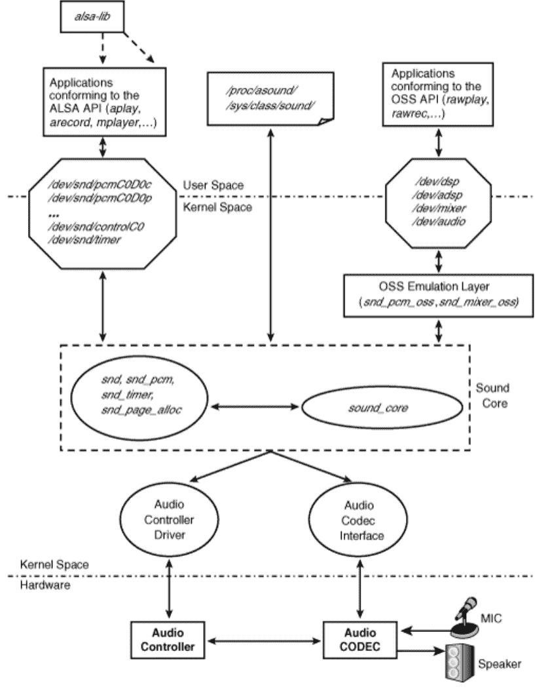

为了更好地理解 Linux 音频层的架构，让我们在笔记本电脑上查看 ALSA 驱动模块的运行情况，同时对照图 13.3（→ 用于附加注释）：

代码视图：

```
bash> lsmod|grep snd
```

```
snd_intel8x0       33148  0                            → 音频控制器驱动
snd_ac97_codec     92000  1 snd_intel8x0              → 音频编解码器接口
ac97_bus           3104   1 snd_ac97_codec            → 音频编解码器总线
snd_pcm_oss        40512  0                            → OSS 仿真
snd_mixer_oss      16640  1 snd_pcm_oss                 → OSS 音量控制
snd_pcm            73316  3 snd_intel8x0,snd_ac97_codec,snd_pcm_oss
                                           → 核心层
snd_timer          22148  1 snd_pcm                     → 核心层
snd                50820  6 snd_intel8x0,snd_ac97_codec,snd_pcm_oss,
                        snd_mixer_oss,snd_pcm,snd_timer
                                           → 核心层
soundcore          8960   1 snd                         → 核心层
snd_page_alloc     10344  2 snd_intel8x0,snd_pcm        → 核心层
```


## 设备示例：MP3 播放器

图 13.4 展示了一款基于嵌入式 SoC 的 Linux 蓝牙 MP3 播放器上的音频操作。你可以对 Linux 手机（我们在第 6 章"串口驱动程序"和第 12 章"视频驱动程序"中使用过）进行编程，让它在夜间电话费率 presumably 较低时从互联网下载歌曲，并通过蓝牙上传到 MP3 播放器的*CF 卡*（Compact Flash），以便第二天在上班通勤时收听歌曲。

### 图 13.4. Linux MP3 播放器上的音频。

[查看完整尺寸图像]

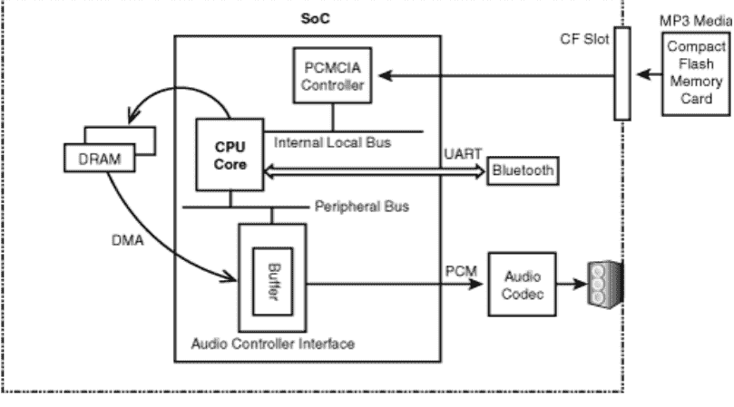

我们的任务是为该设备开发音频软件。播放器上的一个应用程序从 CF 卡读取歌曲并将其解码到系统内存中。内核 ALSA 驱动程序从系统内存收集音乐数据，并将其分发到属于 SoC 音频控制器一部分的传输缓冲区。该 PCM 数据被转发到编解码器，通过设备的扬声器播放音乐。与前一章讨论的导航系统一样，我们假设 Linux 支持该 SoC，并且所有与架构相关的服务（如 DMA）都由内核支持。

因此，MP3 播放器的音频软件由两部分组成：

- 1. 一个用户程序，用于解码从 CF 卡读取的 MP3 文件，并将其转换为原始 PCM。要编写原生 ALSA 解码器应用程序，你可以利用 *alsa-lib* 库提供的辅助例程。"ALSA 编程"一节将介绍 ALSA 应用程序如何与 ALSA 驱动程序交互。

你还可以选择定制公共领域的 MP3 播放器，如 *madplay*（http://sourceforge.net/projects/mad/），以适应此设备。

- 2. 一个底层内核 ALSA 音频驱动程序。以下部分专门介绍如何编写此驱动程序。

图 13.4 所示设备的一种可能硬件实现是使用 PowerPC 405LP SoC 和德州仪器 TLV320 音频编解码器。在这种情况下，CPU 核心是 405 处理器，片上音频控制器是编解码器串行接口（CSI）。SoC 通常具有高性能的内部本地总线，用于连接 DRAM 和视频等控制器，以及单独的片上外设总线，用于与串口、I²C 和 GPIO 等低速外设接口。对于 405LP，前者称为处理器本地总线（PLB），后者称为片上外设总线（OPB）。PCMCIA/CF 控制器挂在 PLB 上，而音频控制器接口连接到 OPB。

音频驱动程序由三个主要部分组成：

- 1. 处理播放的例程
- 2. 处理录制的例程
- 3. 混音器控制函数

我们的驱动程序实现了播放功能，但不支持录制，因为示例中的 MP3 播放器没有麦克风。驱动程序还简化了混音器功能。它没有提供完整的音量控制选项，如扬声器、耳机和线路输出，而是仅提供单一的通用音量控制。

MP3 播放器音频硬件的寄存器布局如表 13.1 所示，反映了这些假设和简化，并且不符合前面提到的 AC'97 等标准。因此，该编解码器具有 SAMPLING_RATE_REGISTER 来配置播放（数模转换）采样率，但没有设置捕获（模数转换）速率的寄存器。VOLUME_REGISTER 配置单一的全局音量。

### 表 13.1. 图 13.4 中音频硬件的寄存器布局

| 寄存器名称 | 说明 |
| --- | --- |
| VOLUME_REGISTER | 控制编解码器的全局音量。 |
| SAMPLING_RATE_REGISTER | 设置编解码器的数模转换采样率。 |
| CLOCK_INPUT_REGISTER | 配置编解码器的时钟源、分频器等。 |
| CONTROL_REGISTER | 启用中断、配置中断原因（如缓冲区传输完成）、复位硬件、启用/禁用总线操作等。 |
| STATUS_REGISTER | 编解码器音频事件的状态。 |
| DMA_ADDRESS_REGISTER | 示例硬件支持单个 DMA 缓冲区描述符。实际使用的卡可能支持多个描述符，并可能有额外的寄存器来保存参数，如当前正在处理的描述符、缓冲区中当前采样的位置等。DMA 在音频控制器的缓冲区上执行，因此该寄存器位于控制器的内存空间中。 |
| DMA_SIZE_REGISTER | 保存与 SoC 之间 DMA 传输的大小。该寄存器也位于音频控制器内部。 |

清单 13.1 是 MP3 播放器的 ALSA 音频驱动程序骨架，并大量使用伪代码（在注释中）来剔除无关细节。ALSA 是一个复杂的框架，符合规范的音频驱动程序通常长达数千行。清单 13.1 只能让你开始探索音频驱动程序。继续学习，请深入研究顶级目录 sound/ 中强大的 Linux 音频源代码。

## 驱动程序方法和结构

我们的示例驱动程序实现为平台驱动程序。让我们来看看平台驱动程序 probe() 方法 mycard_audio_probe() 执行的步骤。我们将在每一步下进行一些的离题讨论，以解释我们遇到的相关概念和重要数据结构，这将带我们到驱动程序的其他部分并帮助将内容联系起来。

mycard_audio_probe() 执行以下操作：

1. 通过调用 snd_card_new() 创建声卡实例：

```
struct snd_card *card = snd_card_new(-1, id[dev->id], THIS_MODULE, 0);
```

snd_card_new() 的第一个参数是声卡索引（在系统中的多个声卡中标识此声卡），第二个参数是 ID，将存储在返回的 snd_card 结构的 id 字段中，第三个参数是所属模块，最后一个参数是私有数据字段的大小，该字段将通过返回的 snd_card 结构的 private_data 字段提供（通常用于存储芯片特定的数据，如中断级别和 I/O 地址）。

snd_card 表示创建的声卡，在 include/sound/core.h 中定义如下：

```
struct snd_card {
    int number;              /* 声卡索引 */
    char id[16];             /* 声卡 ID */
    /* ... */
    struct module *module;   /* 所属模块 */
    void *private_data;      /* 私有数据 */
    /* ... */
    struct list_head controls;
                             /* 此声卡的所有控件 */
    struct device *dev;      /* 分配给此声卡的设备 */
    /* ... */
};
```

probe 方法的 remove() 对应方法 mycard_audio_remove() 使用 snd_card_free() 从 ALSA 框架中释放 snd_card。

2. 使用 snd_pcm_new() 创建 PCM 播放实例，并将其与步骤 1 中创建的声卡关联：

```c
 int snd_pcm_new(struct snd_card *card, char *id,
                int device,
                int playback_count, int capture_count,
                struct snd_pcm **pcm);
```

参数分别是在步骤1中创建的声卡实例、标识符字符串、设备索引、支持的播放流数量、支持的捕获流数量（在我们的示例中为0），以及用于存储分配的PCM实例的指针。分配的PCM实例在 *include/sound/pcm.h* 中定义如下：

**代码视图：**

```
struct snd_pcm {
  struct snd_card *card;       /* 关联的 snd_card */
  /* ... */
  struct snd_pcm_str streams[2]; /* 此PCM组件的播放和捕获流。
                                   如果硬件支持，每个流可以支持子流 */
  /* ... */
  struct device *dev;          /* 关联的硬件设备 */
};
```

`snd_device_new()` 例程位于 `snd_pcm_new()` 和其他类似组件实例化函数的核心。`snd_device_new()` 将一个组件和一组操作与关联的 `snd_card` 绑定在一起（见步骤3）。

**3.** 通过调用 `snd_pcm_set_ops()` 将播放操作与步骤2中创建的PCM实例关联起来。`snd_pcm_ops` 结构体指定了用于将PCM音频传输到编解码器的操作。清单13.1通过以下方式实现这一点：

**代码视图：**

```
/* PCM播放流的操作方法 */
static struct snd_pcm_ops mycard_playback_ops = {
  .open = mycard_pb_open,      /* 打开 */
  .close = mycard_pb_close,    /* 关闭 */
  .ioctl = snd_pcm_lib_ioctl,  /* 用于处理特殊命令，否则
                                   指定通用 ioctl 处理程序
                                   snd_pcm_lib_ioctl() */
  .hw_params = mycard_hw_params, /* 当上层设置硬件参数（如音频格式）时
                                   调用。DMA缓冲区anton缓冲区的分配也从
                                   这里进行 */
  .hw_free = mycard_hw_free,   /* 释放 mycard_hw_params() 中
                                   分配的资源 */
  .prepare = mycard_pb_prepare, /* 准备传输音频流。
                                   设置音频格式，如 S16_LE
                                   （稍后解释），启用中断等 */
  .trigger = mycard_pb_trigger, /* 当PCM引擎启动、停止或暂停时
                                   调用。第二个参数指定了
                                   调用原因 */
```

```
};
```

```
/* 将操作方法与PCM实例关联 */
snd_pcm_set_ops(pcm, SNDRV_PCM_STREAM_PLAYBACK, &mycard_playback_ops);
```

在清单13.1中，`mycard_pb_prepare()` 将采样率配置到 `SAMPLING_RATE_REGISTER`，将时钟源配置到 `CLOCKING_INPUT_REGISTER`，将传输完成中断使能配置到 `CONTROL_REGISTER`。`trigger()` 方法 `mycard_pb_trigger()` 使用 `dma_map_single()` 动态映射由ALSA框架填充的音频缓冲区。（我们在**第10章**"外围组件互连"中讨论了流式DMA。）映射的DMA缓冲区地址被写入 `DMA_ADDRESS_REGISTER`。该寄存器是SoC中音频控制器的一部分，而前面提到的寄存器则位于编解码器内部。音频控制器将DMA传输的数据转发给编解码器进行播放。

另一个相关的对象是 `snd_pcm_hardware` 结构体，它声明了PCM组件的硬件能力。对于我们的示例设备，这在**清单13.1**中定义如下：

```
/* PCM播放流的硬件能力 */
static struct snd_pcm_hardware mycard_playback_stereo = {
  .info = (SNDRV_PCM_INFO_MMAP | SNDRV_PCM_INFO_PAUSE |
           SNDRV_PCM_INFO_RESUME);  /* 支持 mmap()。该流具有
                                      暂停/恢复功能 */
  .formats = SNDRV_PCM_FMTBIT_S16_LE,/* 每通道有符号16位，
                                      小端序 */
  .rates = SNDRV_PCM_RATE_8000_48000,/* DAC采样率范围 */
  .rate_min = 8000,                   /* 最小采样率 */
  .rate_max = 48000,                  /* 最大采样率 */
  .channels_min = 2,                  /* 支持左声道和右声道 */
  .channels_max = 2,                  /* 支持左声道和右声道 */
  .buffer_bytes_max = 32768,          /* 最大缓冲区大小 */
};
```

该对象通过PCM *运行时*实例从 `open()` 操作符 `mycard_playback_open()` 与关联的 `snd_pcm` 绑定。每个打开的PCM流都有一个运行时对象 `snd_pcm_runtime`，它包含了管理该流所需的所有信息。这是一个在 *include/sound/pcm.h* 中定义的庞大结构体，包含软件和硬件配置，其中 `snd_pcm_hardware` 是其组件字段之一。

+   4. 使用 `snd_pcm_lib_preallocate_pages_for_all()` 预分配缓冲区。随后，DMA缓冲区由 `mycard_hw_params()` 通过 `snd_pcm_lib_malloc_pages()` 从该预分配区域获取，并存储在步骤3中提到的PCM运行时实例中。`mycard_pb_trigger()` 在启动PCM操作时对该缓冲区进行DMA映射，在停止PCM操作时取消映射。

+   5. 使用 `snd_ctl_add()` 将混音器控制元素与声卡关联，以实现全局音量控制：

```
snd_ctl_add(card, snd_ctl_new1(&mycard_playback_vol, &myctl_private));
```

`snd_ctl_new1()` 将 `snd_kcontrol_new` 结构体作为其第一个参数，并返回指向 `snd_kcontrol` 结构体的指针。**清单13.1**将其定义如下：

```
static struct snd_kcontrol_new mycard_playback_vol = {
  .iface = SNDRV_CTL_ELEM_IFACE_MIXER,
                        /* 控制元素类型为 MIXER */
  .name  = "MP3 volume",       /* 名称 */
  .index = 0,                  /* 编解码器编号：0 */
  .info  = mycard_pb_vol_info, /* 音量信息 */
  .get   = mycard_pb_vol_get,  /* 获取音量 */
  .put   = mycard_pb_vol_put,  /* 设置音量 */
};
```

`snd_kcontrol` 结构体描述了一个控制元素。我们的驱动程序将其用作通用音量控制的旋钮。`snd_ctl_add()` 向ALSA框架注册 `snd_kcontrol` 元素。当执行alsamixer等用户应用程序时，将调用相应的控制方法。在清单13.1中，`snd_kcontrol` put() 方法 `mycard_playback_volume_put()` 将请求的音量设置写入编解码器的 `VOLUME_REGISTER`。

6. 最后，向ALSA框架注册声卡：

```
snd_card_register(card);
```

`codec_write_reg()`（在清单13.1中使用但未实现）通过连接SoC中音频控制器与外部编解码器的总线通信，将值写入编解码器寄存器。如果底层总线协议是I²C或SPI，例如，`codec_write_reg()` 使用第8章"I²C协议"中讨论的接口函数。

如果你想在驱动程序中创建/proc接口，用于在调试时转储寄存器或在正常操作时导出参数，请使用 `snd_card_proc_new()` 及其相关函数。清单13.1没有使用/proc接口文件。

如果你构建并加载清单13.1中的驱动模块，你会在MP3播放器上看到两个新的设备节点出现：/dev/snd/pcmC0D0p 和 /dev/snd/controlC0。前者是音频播放的接口，后者是混音器控制的接口。MP3解码器应用程序借助alsa-lib，通过操作这些设备节点来播放音乐。

### 清单 13.1. Linux MP3播放器的ALSA驱动程序

```
代码视图：
#include <linux/platform_device.h>
#include <linux/soundcard.h>
#include <sound/driver.h>
#include <sound/core.h>
#include <sound/pcm.h>
#include <sound/initval.h>
#include <sound/control.h>

/* 编解码器支持的播放采样率 */
static unsigned int mycard_rates[] = {
  8000,
  48000,
};
/* 播放通道的硬件约束 */
static struct snd_pcm_hw_constraint_list mycard_playback_rates = {
  .count = ARRAY_SIZE(mycard_rates),
  .list = mycard_rates,
```


 ```c
  .mask = 0,
};

static struct platform_device *mycard_device;
static char *id[SNDRV_CARDS] = SNDRV_DEFAULT_STR;

/* PCM流的硬件能力 */
static struct snd_pcm_hardware mycard_playback_stereo = {
  .info = (SNDRV_PCM_INFO_MMAP | SNDRV_PCM_INFO_BLOCK_TRANSFER),
  .formats = SNDRV_PCM_FMTBIT_S16_LE, /* 每个通道16位，小端模式 */
  .rates = SNDRV_PCM_RATE_8000_48000, /* DAC采样率范围 */
  .rate_min = 8000,              /* 最小采样率 */
  .rate_max = 48000,             /* 最大采样率 */
  .channels_min = 2,             /* 支持左声道和右声道 */
  .channels_max = 2,             /* 支持左声道和右声道 */
  .buffer_bytes_max = 32768,     /* 最大缓冲区大小 */
};

/* 以播放模式打开设备 */
static int
mycard_pb_open(struct snd_pcm_substream *substream)
{
  struct snd_pcm_runtime *runtime = substream->runtime;

  /* 初始化驱动程序结构 */
  /* ... */
  /* 初始化编解码器寄存器 */
  /* ... */
  /* 关联此PCM组件的硬件能力 */
  runtime->hw = mycard_playback_stereo;

  /* 向ALSA框架通知编解码器的约束条件。
     例如，在本例中，它仅支持8000Hz和48000Hz的PCM采样率 */
  snd_pcm_hw_constraint_list(runtime, 0,
                             SNDRV_PCM_HW_PARAM_RATE,
                             &mycard_playback_rates);
  return 0;
}

/* 关闭 */
static int
mycard_pb_close(struct snd_pcm_substream *substream)
{
  /* 禁用编解码器，停止DMA，释放数据结构 */
  /* ... */
  return 0;
}

/* 通过连接SoC与编解码器的总线
   写入编解码器寄存器 */
void
codec_write_reg(uint codec_register, uint value)
{
  /* ... */
}

/* 准备将音频流传输到编解码器 */
static int
mycard_pb_prepare(struct snd_pcm_substream *substream)
{
  /* 通过使用codec_write_reg()写入CONTROL_REGISTER
     来启用传输DMA完成中断 */

  /* 通过写入SAMPLING_RATE_REGISTER来设置采样率 */

  /* 通过写入CLOCK_INPUT_REGISTER
     来配置时钟源并启用时钟 */

  /* 为音频传输分配DMA描述符 */

  return 0;
}

/* 音频触发/停止/.. */
static int
mycard_pb_trigger(struct snd_pcm_substream *substream, int cmd)
{
  switch (cmd) {
  case SNDRV_PCM_TRIGGER_START:
    /* 使用dma_map_single()映射音频子流的运行时音频缓冲区
       （即runtime->dma_area中的偏移量），
       将生成的地址填充到音频控制器的
       DMA_ADDRESS_REGISTER中，并执行DMA */
    /* ... */
    break;

  case SNDRV_PCM_TRIGGER_STOP:
    /* 关闭流。使用dma_unmap_single()取消DMA缓冲区映射 */
    /* ... */
    break;

  default:
    return -EINVAL;
    break;
  }

  return 0;
}

/* 使用从probe()方法预分配的DMA内存来
   分配DMA缓冲区。dma_[map|unmap]_single()后续
   在此区域上操作 */
static int
mycard_hw_params(struct snd_pcm_substream *substream,
                 struct snd_pcm_hw_params *hw_params)
{
  /* 使用mycard_audio_probe()中预分配的内存来满足此内存请求 */
  return snd_pcm_lib_malloc_pages(substream,
                                  params_buffer_bytes(hw_params));
}

/* mycard_hw_params()的反向操作 */
static int
mycard_hw_free(struct snd_pcm_substream *substream)
{
  return snd_pcm_lib_free_pages(substream);
}

/* 音量信息 */
static int
mycard_pb_vol_info(struct snd_kcontrol *kcontrol,
                   struct snd_ctl_elem_info *uinfo)
{
  uinfo->type = SNDRV_CTL_ELEM_TYPE_INTEGER;
                              /* 整数类型 */
  uinfo->count = 1;          /* 值的数量 */
  uinfo->value.integer.min = 0;  /* 最小音量增益 */
  uinfo->value.integer.max = 10; /* 最大音量增益 */
  uinfo->value.integer.step = 1; /* 步长为1 */
  return 0;
}

/* 播放音量旋钮 */
static int
mycard_pb_vol_put(struct snd_kcontrol *kcontrol,
                  struct snd_ctl_elem_value *uvalue)
{
  int global_volume = uvalue->value.integer.value[0];

  /* 使用codec_write_reg()将global_volume写入VOLUME_REGISTER */
  /* ... */
  /* 如果音量从当前值改变，返回1。
     如果有错误，返回负值代码。否则返回0 */
}

/* 获取播放音量 */
static int
mycard_pb_vol_get(struct snd_kcontrol *kcontrol,
                  struct snd_ctl_elem_value *uvalue)
{
  /* 从VOLUME_REGISTER读取global_volume
     并通过uvalue->integer.value[0]返回 */
  /* ... */
  return 0;
}

/* 播放混音器的入口点 */
static struct snd_kcontrol_new mycard_playback_vol = {
  .iface = SNDRV_CTL_ELEM_IFACE_MIXER,
                              /* 控件类型为MIXER */
  .name  = "MP3 Volume",   /* 名称 */
  .index = 0,              /* 编解码器编号：0 */
  .info  = mycard_pb_vol_info, /* 音量信息 */
  .get   = mycard_pb_vol_get,  /* 获取音量 */
  .put   = mycard_pb_vol_put,  /* 设置音量 */
};

/* PCM播放流的操作函数 */
static struct snd_pcm_ops mycard_playback_ops = {
  .open     = mycard_playback_open,   /* 打开 */
  .close    = mycard_playback_close,  /* 关闭 */
  .ioctl    = snd_pcm_lib_ioctl,      /* 通用ioctl处理程序 */
  .hw_params = mycard_hw_params,      /* 硬件参数 */
  .hw_free  = mycard_hw_free,         /* 释放硬件参数 */
  .prepare  = mycard_playback_prepare, /* 准备传输音频流 */
  .trigger  = mycard_playback_trigger, /* 在PCM引擎
                                         启动/停止/暂停时调用 */
};

/* 平台驱动probe()方法 */
static int __init
mycard_audio_probe(struct platform_device *dev)
{
  struct snd_card *card;
  struct snd_pcm *pcm;
  int myctl_private;

  /* 实例化snd_card结构 */
  card = snd_card_new(-1, id[dev->id], THIS_MODULE, 0);

  /* 创建具有1个播放子流
     和0个捕获流的新PCM实例 */
  snd_pcm_new(card, "mycard_pcm", 0, 1, 0, &pcm);

  /* 设置初始DMA缓冲区 */
  snd_pcm_lib_preallocate_pages_for_all(pcm,
                    SNDRV_DMA_TYPE_CONTINUOUS,
                    snd_dma_continuous_data
                    (GFP_KERNEL), 256*1024,
                    256*1024);

  /* 将播放操作与PCM实例关联 */
  snd_pcm_set_ops(pcm, SNDRV_PCM_STREAM_PLAYBACK,
              &mycard_playback_ops);

  /* 将混音器控制元素与此声卡关联 */
  snd_ctl_add(card, snd_ctl_new1(&mycard_playback_vol,
                          &myctl_private));

  strcpy(card->driver, "mycard");

  /* 注册声卡 */
  snd_card_register(card);

  /* 存储声卡以便从其他方法访问 */
  platform_set_drvdata(dev, card);

  return 0;
}

/* 平台驱动remove()方法 */
static int
mycard_audio_remove(struct platform_device *dev)
{
  snd_card_free(platform_get_drvdata(dev));
  platform_set_drvdata(dev, NULL);
  return 0;
}

/* 平台驱动定义 */
static struct platform_driver mycard_audio_driver = {
  .probe = mycard_audio_probe,    /* 探测方法 */
  .remove = mycard_audio_remove,  /* 移除方法 */
  .driver = {
    .name = "mycard_ALSA",
  },
};

/* 驱动初始化 */
static int __init
mycard_audio_init(void)
{
  /* 注册平台驱动和设备 */
  platform_driver_register(&mycard_audio_driver);

  mycard_device = platform_device_register_simple("mycard_ALSA",
                                                  -1, NULL, 0);
  return 0;
}

/* 驱动退出 */
static void __exit
mycard_audio_exit(void)
{
  platform_device_unregister(mycard_device);
  platform_driver_unregister(&mycard_audio_driver);
}

module_init(mycard_audio_init);
module_exit(mycard_audio_exit);
MODULE_LICENSE("GPL");
```

## ALSA编程

为了理解用户空间alsa-lib库如何与内核空间ALSA驱动程序交互，让我们编写一个简单的应用程序来设置MP3播放器的音量增益。我们将应用程序使用的alsa-lib服务映射到**清单13.1**中定义的混音器控制方法。首先加载驱动程序并检查混音器的能力：

```
bash> amixer contents
...
numid=3,iface=MIXER,name="MP3 Volume"
     ; type=INTEGER,...
...
```

在音量控制应用程序中，首先为执行音量控制操作所需的alsa-lib对象分配空间：

```
#include <alsa/asoundlib.h>
snd_ctl_elem_value_t *nav_control;
snd_ctl_elem_id_t    *nav_id;
snd_ctl_elem_info_t   *nav_info;

snd_ctl_elem_value_alloca(&nav_control);
snd_ctl_elem_id_alloca(&nav_id);
snd_ctl_elem_info_alloca(&nav_info);
```


接下来，按照清单 13.1 中 `mycard_playback_vol` 结构体的定义，将接口类型设置为 `SND_CTL_ELEM_IFACE_MIXER`：

```
snd_ctl_elem_id_set_interface(nav_id, SND_CTL_ELEM_IFACE_MIXER);
```

现在设置从上面的 amixer 输出中获得的 MP3 音量的 `numid`：

```
snd_ctl_elem_id_set_numid(nav_id, 3); /* num_id=3 */
```

打开混音器节点，*/dev/snd/controlC0*。`snd_ctl_open()` 的第三个参数指定节点名称中的声卡号：

```
snd_ctl_open(&nav_handle, card, 0);
/* 连接数据结构 */
snd_ctl_elem_info_set_id(nav_info, nav_id);
snd_ctl_elem_info(nav_handle, nav_info);
```

按照如下方式获取清单 13.1 中 `mycard_pb_vol_info()` 定义的 `snd_ctl_elem_info` 结构体中的 `type` 字段：

```
if (snd_ctl_elem_info_get_type(nav_info) !=
                     SND_CTL_ELEM_TYPE_INTEGER) {
  printk("Mismatch in control type\n");
}
```

通过与 `mycard_pb_vol_info()` 驱动程序方法通信，获取支持的编解码器音量范围：

```
long desired_volume = 5;
long min_volume = snd_ctl_elem_info_get_min(nav_info);
long max_volume = snd_ctl_elem_info_get_max(nav_info);
/* 确保 desired_volume 在 min_volume 和 max_volume 之间 */
/* ... */
```

根据清单 13.1 中 `mycard_pb_vol_info()` 的定义，上述 alsa-lib 辅助程序返回的最小值和最大值分别为 0 和 10。

最后，设置期望的音量并将其写入编解码器：

```
snd_ctl_elem_value_set_integer(nav_control, 0, desired_volume);
snd_ctl_elem_write(nav_handle, nav_control);
```

对 `snd_ctl_elem_write()` 的调用会导致 `mycard_pb_vol_put()` 的调用，后者将期望的音量增益写入编解码器的 `VOLUME_REGISTER`。

## MP3 解码复杂度

播放器上运行的 MP3 解码器应用程序，如图 13.4 所示，需要从 CF 磁盘以能够维持常见 MP3 采样率 128KBps 的速率提供 MP3 帧。这对于大多数低 MIPS 设备来说通常不是问题，但如果有的话，可以考虑在解码前将每首歌曲缓冲到内存中。（128KBps 的 MP3 帧大约每分钟音乐消耗 1MB。）

MP3 解码是轻量级的，通常可以实时完成，但 MP3 编码是重负载操作，如果没有硬件辅助则无法实现实时处理。然而，在 IP 语音（VoIP）环境中使用的 G.711 和 G.729 等语音编解码器可以实时编码和解码音频数据。

## 调试

你可以在kernel配置菜单中的*Device Drivers* → *Sound* → *Advanced Linux Sound Architecture*下启用选项，以包含 ALSA 调试代码（`CONFIG_SND_DEBUG`）、详细的 `printk()` 消息（`CONFIG_SND_VERBOSE_PRINTK`）和详细的 procfs 内容（`CONFIG_SND_VERBOSE_PROCFS`）。

与 ALSA 驱动程序相关的 Procfs 信息位于 `/proc/asound/`。查看 `/sys/class/sound/` 以获取与每个声音类设备相关的设备模型信息。

如果你认为在 ALSA 驱动程序中发现了错误，请将其发布到 alsa-devel 邮件列表（[http://mailman.alsa-project.org/mailman/listinfo/alsa-devel](http://mailman.alsa-project.org/mailman/listinfo/alsa-devel)）。linux-audio-dev 邮件列表（[http://music.columbia.edu/mailman/listinfo/linux-audio-dev/](http://music.columbia.edu/mailman/listinfo/linux-audio-dev/)），也称为 *Linux Audio Developers*（LAD）列表，讨论与 Linux 声音架构和音频应用程序相关的问题。

## 查看源代码

声音核心、音频总线、架构和过时的 OSS 套件都在 *sound/* 下有各自独立的子目录。对于 AC'97 接口实现，请查看 *sound/pci/ac97/*。对于基于 I²S 的音频驱动程序示例，请查看 *sound/soc/at91/at91-ssc.c*，这是 Atmel 的 AT91 系列基于 ARM 的嵌入式 SoC 的音频驱动程序。如果找不到更匹配的，请使用 *sound/drivers/dummy.c* 作为开发自定义 ALSA 驱动程序的起点。

*Documentation/sound/* 包含有关 ALSA 和 OSS 驱动程序的信息。*Documentation/sound/alsa/DocBook/* 包含编写 ALSA 驱动程序的 DocBook。ALSA 配置指南可在 *Documentation/sound/alsa/ALSA-Configuration.txt* 中找到。可从 http://tldp.org/HOWTO/Sound-HOWTO/ 下载的 Sound-HOWTO 回答了与 Linux 音频设备支持相关的几个常见问题。

*Madplay* 是一个软件 MP3 解码器和播放器，支持 ALSA 和 OSS。你可以查看其源代码以获取用户空间音频编程的技巧。

两个用于基本播放和录制的精简型 OSS 工具是 *rawplay* 和 *rawrec*，其源代码可从 http://rawrec.sourceforge.net/ 下载。

你可以在 [www.alsa-project.org](http://www.alsa-project.org) 找到 Linux-ALSA 项目的主页。在这里，你可以找到有关 ALSA 驱动程序的最新消息、ALSA 编程 API 的详细信息以及订阅相关邮件列表的信息。可从该页面下载的 alsa-utils 和 alsa-lib 的源代码可以在开发支持 ALSA 的应用程序时为你提供帮助。

表 13.2 包含本章中使用的主要数据结构及其在源代码树中的位置。表 13.3 列出了本章中使用的主要内核编程接口及其定义位置。

| 数据结构 | 位置 | 描述 |
| --- | --- | --- |
| `snd_card` | *include/sound/core.h* | 声卡的表示 |
| `snd_pcm` | *include/sound/pcm.h* | PCM 对象的实例 |
| `snd_pcm_ops` | *include/sound/pcm.h* | 用于将操作与 PCM 对象连接 |
| `snd_pcm_substream` | *include/sound/pcm.h* | 当前音频流的信息 |
| `snd_pcm_runtime` | *include/sound/pcm.h* | 音频流的运行时详细信息 |
| `snd_kcontrol_new` | *include/sound/control.h* | ALSA 控制元素的表示 |

| 内核接口 | 位置 | 描述 |
| --- | --- | --- |
| `snd_card_new()` | *sound/core/init.c* | 实例化 `snd_card` 结构体 |
| `snd_card_free()` | *sound/core/init.c* | 释放已实例化的 `snd_card` |
| `snd_card_register()` | *sound/core/init.c* | 向 ALSA 框架注册声卡 |
| `snd_pcm_lib_preallocate_pages_for_all()` | *sound/core/pcm_memory.c* | 为声卡预分配缓冲区 |
| `snd_pcm_lib_malloc_pages()` | *sound/core/pcm_memory.c* | 为声卡分配 DMA 缓冲区 |
| `snd_pcm_new()` | *sound/core/pcm.c* | 创建 PCM 对象的实例 |
| `snd_pcm_set_ops()` | *sound/core/pcm_lib.c` | 将播放或捕获操作与 PCM 对象连接 |
| `snd_ctl_add()` | *sound/core/control.c* | 将混音器控制元素与声卡关联 |
| `snd_ctl_new1()` | *sound/core/control.c` | 分配 `snd_kcontrol` 结构体并使用提供的控制操作进行初始化 |
| `snd_card_proc_new()` | *sound/core/info.c* | 创建 */proc* 条目并将其分配给声卡实例 |

# 第 14 章 块设备驱动程序

| 本章内容 | |
|---|---|
| - 存储技术 | 416 |
| - Linux 块 I/O 层 | 421 |
| - I/O 调度器 | 422 |
| - 块设备驱动程序的数据结构和方法 | 423 |
| - 设备示例：简单存储控制器 | 426 |
| - 高级主题 | 434 |
| - 调试 | 436 |
| - 查看源代码 | 437 |

> 块设备是能够随机访问的存储介质。与字符设备不同，块设备可以保存文件系统数据。在本章中，让我们了解 Linux 如何支持存储总线和设备。

## 存储技术

让我们首先了解当今计算机系统中流行的存储技术。我们还将这些技术与内核源代码树中对应的设备驱动程序子系统关联起来。

*集成驱动电子*（IDE）是 PC 环境中常用的存储接口技术。ATA（*高级技术附件*的简称）是相关规范的正式名称。IDE/ATA


该标准始于 ATA-1；最新版本为 ATA-7，支持最高 133MBps 的带宽。中间版本的规范包括：ATA-2，引入了*逻辑块寻址*（LBA）；ATA-3，支持 SMART 功能磁盘（稍后讨论）；ATA-4，增加了对 Ultra DMA 的支持以及相关的 33MBps 吞吐量；ATA-5，将最大传输速度提升至 66MBps；以及 ATA-6，提供了 100MBps 的数据传输速率。

CD-ROM 和磁带等存储设备通过一种称为 *ATA 数据包接口*（ATAPI）的特殊协议连接到标准 IDE 电缆。[1] ATAPI 随 ATA-4 一同引入。

> [1] ATAPI 协议更接近 SCSI，而非 IDE。

PC 系统中的软盘控制器传统上是我们在[第 6 章](https://example.com)“串行驱动程序”中了解过的 Super I/O 芯片组的一部分。然而，在今天的 PC 环境中，这些内部驱动器已被更快的外部 USB 软盘驱动器所取代。

[图 14.1](https://example.com) 展示了一个连接到 IDE 主机适配器的 ATA-7 磁盘驱动器，该适配器是 PC 系统上南桥芯片组的一部分。图中还连接有 ATAPI CD-ROM 驱动器和软盘驱动器。

### 图 14.1. PC 系统中的存储介质。

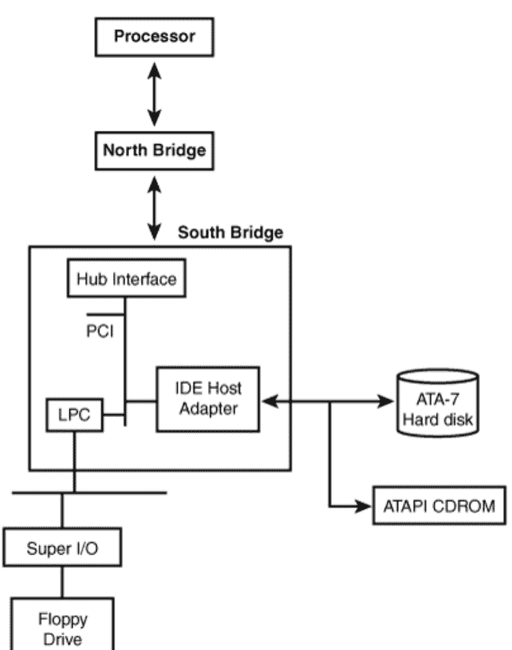

IDE/ATA 是一种并行总线技术（有时称为 *并行 ATA* 或 PATA），无法扩展到高速，正如你在讨论 [第 10 章](chapter 10)“外围组件互连”中的 PCIe 时所学到的。*串行 ATA* (SATA) 是 PATA 的现代串行总线演进版本，支持 300MBps 及更高的传输速度。除了提供比 PATA 更高的吞吐量外，SATA 还带来了热插拔等功能。SATA 技术正在逐步取代 PATA。请参阅旁注“libATA”以了解内核中支持 SATA 和 PATA 的新 ATA 子系统。

## libATA

*libATA* 是 Linux 内核中的新 ATA 子系统。它由一组 ATA 库例程和使用它们的底层驱动程序集合组成。libATA 同时支持 SATA 和 PATA。libATA 中的 SATA 驱动程序已在 *drivers/scsi/* 下存在一段时间，但 PATA 驱动程序和现在存放所有 libATA 源文件的新 *drivers/ata/* 目录是在 2.6.18 内核版本中引入的。

如果您的系统启用了 SATA 存储，您需要 libATA 的服务与 SCSI 子系统协同工作。libATA 对 PATA 的支持仍处于实验阶段，默认情况下，PATA 驱动程序继续使用位于 *drivers/ide/* 中的传统 IDE 驱动程序。

假设您的系统通过 Intel ICH7 南桥芯片组启用了 SATA。您需要以下 libATA 组件来访问您的磁盘：

- **libATA 核心** — 要启用此功能，请在内核配置期间设置 `CONFIG_ATA`。有关核心提供的库函数列表，请在 *drivers/ata/* 目录中搜索 `EXPORT_SYMBOL_GPL`。

- **高级主机控制器接口（AHCI）支持** — AHCI 规定了 SATA 主机适配器支持的寄存器接口，通过在选择时启用 `CONFIG_AHCI` 来配置。

- **主机控制器适配器驱动程序** — 对于 ICH7，启用 `CONFIG_ATA_PIIX`。

此外，您还需要中层和上层 SCSI 驱动程序（`CONFIG_SCSI` 等）。加载所有这些内核组件后，您的 SATA 磁盘分区将如同 SCSI 或 USB 大容量存储分区一样，作为 */dev/sd** 出现在系统中。

libATA 项目的主页是 [http://linux-ata.org/](http://linux-ata.org/)。内核源码树中的 *Documentation/DocBook/libata.tmpl* 提供了 DocBook 文档。libATA 开发人员指南可在 [www.kernel.org/pub/linux/kernel/people/jgarzik/libata.pdf](www.kernel.org/pub/linux/kernel/people/jgarzik/libata.pdf) 获取。

*小型计算机系统接口*（SCSI）是服务器和高端工作站中首选的存储技术。SCSI 比 SATA 稍快，支持约 320MBps 的速度。SCSI 传统上是一种并行接口标准，但与 ATA 类似，随着称为*串行连接 SCSI*（SAS）的总线技术的出现，最近已转向串行操作。

内核的 SCSI 子系统在架构上分为三层：用于磁盘、CD-ROM 和磁带等介质的顶层驱动程序；扫描 SCSI 总线并配置设备的中层；以及底层主机适配器驱动程序。我们在[第 11 章](chapter 11)“通用串行总线”的“[大容量存储](chapter 11)”一节中了解了这些层。请参阅该章中的[图 11.4](figure 11.4)，了解 SCSI 子系统的不同组件如何相互交互。[2] USB 大容量存储驱动器内部使用闪存，但使用 SCSI 协议与主机系统通信。

> [2] 本书的其他部分也讨论了 SCSI 支持。[第 19 章](chapter 19)“用户空间驱动程序”中的“[用户模式 SCSI](chapter 19)”一节讨论了 *SCSI 通用*（sg）接口，该接口允许您直接从用户空间向 SCSI 设备发送命令。[第 20 章](chapter 20)“更多设备和驱动程序”中的“[iSCSI](chapter 20)”一节简要介绍了 iSCSI 协议，该协议允许通过 TCP/IP 网络将 SCSI 数据包传输到远程块设备。

*廉价磁盘冗余阵列*（RAID）是一些 SCSI 和 SATA 控制器内置的技术，用于实现冗余和可靠性。已定义了各种 RAID 级别。例如，RAID-1 指定*磁盘镜像*，即将数据复制到单独的磁盘上。Linux 驱动程序可用于多种支持 RAID 的磁盘驱动器。内核还提供了一个多磁盘（md）驱动程序，在软件中实现了大多数 RAID 级别。

微型存储是嵌入式消费电子产品领域的主流。该领域的传输速度远低于迄今为止讨论的技术所能提供的速度。*安全数字*（SD）卡及其更小外形尺寸的衍生产品（miniSD 和 microSD）在相机、手机和音乐播放器等设备中很受欢迎。符合 SD 卡规范 1.01 版本的卡支持最高 10MBps 的传输速度。SD 存储源自从一种更旧、更慢但兼容的技术，称为 *MultiMediaCard*（MMC），其支持 2.5MBps 的数据速率。内核在 *drivers/mmc/* 中包含一个 SD/MMC 子系统。[3]

> [3] 请参阅第 16 章“Wireless Without Linux”中的旁注“基于 SDIO 的 WiFi”，以了解 SD 外形尺寸中可用的非存储技术。

[第 9 章](chapter 9)“PCMCIA 和 Compact Flash”中的“PCMCIA 存储”一节介绍了不同的 PCMCIA/CF 存储卡类型及其相应的内核驱动程序。PCMCIA 存储卡enasdiamicrodrives 支持真正的 IDE 操作，而那些内部使用固态存储器的则模拟 IDE 并向内核导出 IDE 编程模型。在这两种情况下，都可以使用内核的 IDE 子系统来启用该卡。

**表 14.1. 存储技术及相关设备驱动程序**

| 存储技术 | 说明 | 源文件 |
| --- | --- | --- |
| IDE/ATA | PC 环境中的存储接口技术。ATA-7 支持 133MBps 的数据速率。 | *drivers/ide/ide-disk.c*, *drivers/ide/ide-io.c*, *drivers/ide/ide-probe.c* 或 *drivers/ata/*（实验性） |
| ATAPI | CD-ROM 和磁带等存储设备使用 ATAPI 协议连接到标准 IDE 电缆。 | *drivers/ide/ide-cd.c* 或 *drivers/ata/*（实验性） |
| 软盘（内置） | 软盘控制器位于 PC 兼容系统 LPC 总线上的 Super I/O 芯片中。支持约 150KBps 的传输速率。 | *drivers/block/floppy.c* |
| SATA | IDE/ATA 的串行演进版本。支持 300MBps 及更高的速度。 | *drivers/ata/*, *drivers/scsi/* |
| SCSI | 服务器环境中流行的存储技术。Ultra320 SCSI 支持 320MBps 的传输速率。 | *drivers/scsi/* |


## 第14章 块驱动程序

| 本章内容 | |
|---|---|
| - 存储技术 | 416 |
| - Linux 块 I/O 层 | 421 |
| - I/O 调度器 | 422 |
| - 块驱动程序的数据结构和方法 | 423 |
| - 设备示例：简单存储控制器 | 426 |
| - 高级主题 | 434 |
| - 调试 | 436 |
| - 查看源代码 | 437 |

> 块设备是支持随机访问的存储介质。与字符设备不同，块设备可以存储文件系统数据。在本章中，我们将了解 Linux 如何支持存储总线和设备。

## 存储技术

让我们先了解一下当今计算机系统中常见的存储技术。我们还将这些技术与内核源码树中相应的设备驱动子系统关联起来。

*集成驱动电子*（IDE）是 PC 环境中常用的存储接口技术。ATA（*先进技术附件*的缩写）是相关规范的正式名称。IDE/ATA 标准始于 ATA-1；最新版本是 ATA-7，支持高达 133MBps 的带宽。 intervening 版本的规范包括：ATA-2，引入了*逻辑块寻址*（LBA）；ATA-3，支持 SMART 磁盘（稍后讨论）；ATA-4，支持 Ultra DMA 及相关的 33MBps 吞吐量；ATA-5，将最大传输速度提高到 66MBps；以及 ATA-6，提供 100MBps 的数据速率。

CD-ROM 和磁带等存储设备通过一种称为 *ATA 数据包接口*（ATAPI）[1] 的特殊协议连接到标准 IDE 电缆。ATAPI 随 ATA-4 一起引入。

> [1] ATAPI 协议更接近 SCSI 而非 IDE。

PC 系统中的软盘控制器传统上属于我们在第6章"串行驱动程序"中学到的 Super I/O 芯片组的一部分。然而，这些内置驱动器在当今的 PC 环境中已被更快的外置 USB 软驱所取代。

[图 14.1] 显示了一个连接到 PC 系统南桥芯片组上 IDE 主机适配器的 ATA-7 磁盘驱动器。同时还显示了连接的 ATAPI CD-ROM 驱动器和软驱。

### 图 14.1. PC 系统中的存储介质。

IDE/ATA 是一种并行总线技术（有时称为 *并行 ATA* 或 PATA），无法扩展到高速，正如你在第10章"外围组件互连"中讨论 PCIe 时所学到的。*串行 ATA*（SATA）是 PATA 的现代串行总线演进，支持约 300MBps 及更高的传输速度。除了提供比 PATA 更高的吞吐量外，SATA 还带来了热插拔等功能。SATA 技术正在稳步取代 PATA。请参阅侧边栏"libATA"，了解内核中支持 SATA 和 PATA 的新 ATA 子系统。

| 存储技术 | 说明 | 源文件 |
|---|---|---|
| USB 大容量存储 | 指 USB 硬盘、U盘、CD-ROM 和软驱。参见第11章中的"大容量存储"部分。USB 2.0 设备可以以高达 60MBps 的速度通信。 | *drivers/usb/storage/*, *drivers/scsi/* |
| RAID： | | |
| 硬件 RAID | 这是高端 SCSI/SATA 磁盘控制器内置的功能，用于实现冗余和可靠性。 | *drivers/scsi/*, *drivers/ata/* |
| 软件 RAID | 在 Linux 上，多磁盘（md）驱动程序在软件中实现了多个 RAID 级别。 | *drivers/md/* |
| SD/miniSD/microSD | 在数码相机和手机等消费电子设备中流行的小尺寸存储介质。支持高达 10MBps 的传输速率。 | *drivers/mmc/* |
| MMC | 与 SD 卡兼容的较旧可移动存储标准。支持 2.5MBps 的数据速率。 | *drivers/mmc/* |
| PCMCIA/CF 存储卡 | 微型 IDE 驱动器的 PCMCIA/CF 外形尺寸，或模拟 IDE 的固态存储卡。参见第9章中的"PCMCIA 存储"部分。 | *drivers/ide/legacy/ide-cs.c* 或 *drivers/ata/pata_pcmcia.c*（实验性） |
| 基于闪存的块设备仿真 | 在闪存上模拟硬盘。参见第17章"内存技术设备"中的"块设备仿真"部分。 | *drivers/mtd/mtdblock.c*, *drivers/mtd/mtd_blkdevs.c* |
| Linux 上的虚拟块设备： | | |
| RAM 磁盘 | 实现将 RAM 区域用作块设备的支持。 | *drivers/block/rd.c* |
| 回环设备 | 实现将常规文件用作块设备的支持。 | *drivers/block/loop.c* |

## libATA

*libATA* 是 Linux 内核中的新 ATA 子系统。它由一组 ATA 库例程和使用它们的底层驱动程序组成。libATA 同时支持 SATA 和 PATA。libATA 中的 SATA 驱动程序在 *drivers/scsi/* 下已经存在了一段时间，但 PATA 驱动程序以及现在容纳所有 libATA 源码的 *drivers/ata/* 目录是在 2.6.19 内核版本中引入的。

如果你的系统启用了 SATA 存储，你需要 libATA 的服务与 SCSI 子系统配合。libATA 对 PATA 的支持仍然是实验性的，默认情况下，PATA 驱动程序继续使用位于 *drivers/ide/* 中的传统 IDE 驱动程序。

假设你的系统通过 Intel ICH7 南桥芯片组启用了 SATA。你需要以下 libATA 组件来访问你的磁盘：

- 1. **libATA 核心—** 要启用此项，在内核配置期间设置 `CONFIG_ATA`。要查看核心提供的库函数列表，请在 *drivers/ata/* 目录中grep `EXPORT_SYMBOL_GPL`。

- 2. **高级主机控制器接口（AHCI）支持—** AHCI 指定 SATA 主机适配器支持的寄存器接口，通过在配置时选择 `CONFIG_AHCI` 来启用。

- 3. **主机控制器适配器驱动程序—** 对于 ICH7，启用 `CONFIG_ATA_PIIX`。

此外，你需要中层和上层 SCSI 驱动程序（`CONFIG_SCSI` 及其相关选项）。加载所有这些内核组件后，你的 SATA 磁盘分区将像 SCSI 或 USB 大容量存储分区一样，以 */dev/sd** 的形式出现在系统中。

libATA 项目的主页是 [http://linux-ata.org/](http://linux-ata.org/)。 DocBook 可作为内核源码树的一部分在 *Documentation/DocBook/libata.tmpl* 中找到。libATA 开发人员指南可在 [www.kernel.org/pub/linux/kernel/people/jgarzik/libata.pdf](www.kernel.org/pub/linux/kernel/people/jgarzik/libata.pdf) 获取。

*小型计算机系统接口*（SCSI）是服务器和高端工作站的优选存储技术。SCSI 比 SATA 稍快，支持约 320MBps 的速度。SCSI 传统上是一种并行接口标准，但与 ATA 类似，随着称为*串行连接 SCSI*（SAS）的总线技术的出现，最近已转向串行操作。

内核的 SCSI 子系统架构分为三层：用于磁盘、CD-ROM 和磁带等介质的顶层驱动程序；扫描 SCSI 总线并配置设备的中层；以及底层主机适配器驱动程序。我们在**第11章**"通用串行总线"的"大容量存储"部分了解了这些层次。请参阅该章中的**图 11.4**，了解 SCSI 子系统的不同组件如何相互交互。[2] USB 大容量存储驱动器内部使用闪存，但使用 SCSI 协议与主机系统通信。

> [2] 本书的其他部分也讨论了 SCSI 支持。**第19章**"用户空间驱动程序"中的"用户模式 SCSI"部分讨论了 *SCSI 通用*（sg）接口，它允许你直接从用户空间向 SCSI 设备发送命令。**第20章**"更多设备和驱动程序"中的"iSCSI"部分简要介绍了 iSCSI 协议，该协议允许通过 TCP/IP 网络将 SCSI 数据包传输到远程块设备。


*廉价磁盘冗余阵列*（RAID）是一种内置于某些 SCSI 和 SATA 控制器中的技术，用于实现冗余和可靠性。人们定义了多种 RAID 级别。例如，RAID-1 指定了*磁盘镜像*，即将数据复制到单独的磁盘上。Linux 为多种支持 RAID 的磁盘驱动器提供了驱动程序。内核还提供了一种多磁盘（md）驱动程序，以软件方式实现大多数 RAID 级别。

微型存储是嵌入式消费电子领域的核心需求。该领域的传输速度远低于迄今为止所讨论的技术所提供的速度。*安全数字*（SD）卡及其更小外形尺寸的衍生产品（miniSD 和 microSD）是相机、手机和音乐播放器等设备中流行的存储介质<sup>[3]</sup>。符合 SD 卡规范 1.01 版本的卡支持高达 10MBps 的传输速度。SD 存储技术是从一种更旧、更慢但兼容的技术——*多媒体卡*（MMC）发展而来的，MMC 支持 2.5MBps 的数据传输速率。内核在 *drivers/mmc/* 中包含一个 SD/MMC 子系统。

<sup>[3]</sup> 请参阅[第 16 章](.)"Linux 无线应用"中的边栏"[SDIO 上的 WiFi](.))"，了解 SD 外形尺寸中的非存储技术。

[第 9 章](.)"PCMCIA 和 Compact Flash"中的"[PCMCIA 存储](.))"一节介绍了不同的 PCMCIA/CF 存储卡类型及其相应的内核驱动程序。PCMCIA 存储卡（如微型硬盘）支持真正的 IDE 操作，而内部使用固态存储器的卡则模拟 IDE，并向内核导出 IDE 编程模型。在这两种情况下，都可以使用内核的 IDE 子系统来启用该卡。

[表 14.1](.) 总结了重要的存储技术及其关联设备驱动程序在内核源代码树中的位置。

| 存储技术 | 描述 | 源文件 |
|---|---|---|
| IDE/ATA | PC 环境中的存储接口技术。ATA-7 支持高达 133MBps 的数据传输速率。 | *drivers/ide/ide-disk.c、driver/ide/ide-io.c、drivers/ide/ide-probe.c* 或 *drivers/ata/*（实验性） |
| ATAPI | CD-ROM 和磁带等存储设备使用 ATAPI 协议连接到标准 IDE 线缆。 | *drivers/ide/ide-cd.c* 或 *drivers/ata/*（实验性） |
| 软盘（内部） | 在 PC 兼容系统中，软盘控制器位于 LPC 总线上的 Super I/O 芯片中。支持约 150KBps 的传输速率。 | *drivers/block/floppy.c* |
| SATA | IDE/ATA 的串行演进版本。支持 300MBps 及更高的速度。 | *drivers/ata/*、*drivers/scsi/* |
| SCSI | 在服务器环境中流行的存储技术。Ultra320 SCSI 支持高达 320MBps 的传输速率。 | *drivers/scsi/* |
| USB 大容量存储 | 指 USB 硬盘、U 盘、CD-ROM 和软盘驱动器。请参阅第 11 章中的"大容量存储"一节。USB 2.0 设备的通信速度最高可达 60MBps。 | drivers/usb/storage/、drivers/scsi/ |
| RAID： | | |
| 硬件 RAID | 高端 SCSI/SATA 磁盘控制器内置的功能，用于实现冗余和可靠性。 | drivers/scsi/、drivers/ata/ |
| 软件 RAID | 在 Linux 上，多磁盘（md）驱动程序以软件方式实现多个 RAID 级别。 | drivers/md/ |
| SD/miniSD/microSD | 在相机和手机等消费电子装置中流行的小外形尺寸存储介质。支持高达 10MBps 的传输速率。 | drivers/mmc/ |
| MMC | 与 SD 卡兼容的较旧的可移动存储标准。支持 2.5MBps 的数据传输速率。 | drivers/mmc/ |
| PCMCIA/ CF 存储卡 | PCMCIA/CF 外形尺寸的微型 IDE 驱动器，或模拟 IDE 的固态存储卡。请参阅第 9 章中的"PCMCIA 存储"一节。 | drivers/ide/legacy/ide-cs.c 或 drivers/ata/pata_pcmcia.c（实验性） |
| 基于闪存的块设备模拟 | 在闪存上模拟硬盘。请参阅第 17 章"内存技术设备"中的"块设备模拟"一节。 | drivers/mtd/mtdblock.c、drivers/mtd/mtd_blkdevs.c |
| Linux 上的虚拟块设备： | | |
| RAM 盘 | 实现对将 RAM 区域用作块设备的支持。 | drivers/block/rd.c |
| 回环设备 | 实现对将常规文件用作块设备的支持。 | drivers/block/loop.c |

## Linux 块 I/O 层

块 I/O 层在 2.4 和 2.6 内核版本之间经过了重大重构。重新设计的动机是，块层比其他内核子系统更有潜力影响整体系统性能。

让我们看看图 14.2，以了解 Linux 块 I/O 层的工作原理。存储介质包含驻留在文件系统（如 EXT3 或 Reiserfs）中的文件。用户应用程序调用 I/O 系统调用来访问这些文件。生成的文件系统操作在进入单个文件系统驱动程序之前，会经过通用*虚拟文件系统*（VFS）层。缓冲区缓存通过缓存磁盘块来加速对块设备的文件系统访问。如果在缓冲区缓存中找到某个块，就可以节省访问磁盘读取该块所需的时间。发往每个块设备的数据在请求队列中排队。文件系统驱动程序填充属于目标块设备的请求队列，而块驱动程序则从相应的队列中接收并消耗请求。在两者之间，*I/O 调度器*操纵请求队列，以便最小化磁盘访问延迟并最大化吞吐量。

### 图 14.2. Linux 上的块 I/O。

接下来让我们检查一下 Linux 上可用的不同 I/O 调度器。

## I/O 调度器

块设备存在*寻道时间*，即磁头从当前位置移动到目标磁盘扇区的延迟。I/O 调度器的主要目标是通过最小化这些寻道时间来提高系统吞吐量。为此，I/O 调度器根据各请求所关联的磁盘扇区，将请求队列按排序顺序维护。新请求被插入到队列中，以保持这种顺序。如果队列中某个现有请求与相邻的磁盘扇区相关联，则新请求会与之合并。由于这些特性，I/O 调度器在操作方式上类似于电梯——它们按单一方向调度请求，直到队列中的最后一个请求被服务。

2.4 内核中的 I/O 调度器实现了该算法的直接版本，称为*Linus 电梯*。然而，这在实际条件下被证明是不够的，在 2.6 内核中被四种调度器套件所取代：*Deadline*、*Anticipatory*、*Complete Fair Queuing* 和 *Noop*。默认使用的调度器是 Anticipatory，但这可以在内核配置期间更改，或者通过更改 `/sys/block/[disk]/queue/scheduler` 的值来更改。（如果您使用的是 IDE 磁盘，请将 `[disk]` 替换为 `hda`。）表 14.2 简要描述了 Linux I/O 调度器。

| I/O 调度器 | 描述 | 源文件 |
|---|---|---|
| Linus 电梯 | 标准合并-排序 I/O 调度算法的直接实现。 | *drivers/block/elevator.c*（在 2.4 内核树中） |
| Deadline | 除了 Linus 电梯的功能外，Deadline 调度器还为每个请求关联截止时间，以确保对同一磁盘区域的大量请求不会饿死对较远区域的服务请求。此外，读操作比写操作获得更高的优先级，因为用户进程通常会阻塞，直到其读请求完成。因此，Deadline 调度器确保每个 I/O 请求都在时间限制内得到服务，这对某些数据库负载很重要。 | *block/deadline-iosched.c*（在 2.6 内核树中） |
| Anticipatory | 与 Deadline 调度器类似，不同之处在于，在服务完读请求后，Anticipatory 调度器会等待预定的时间，以预期进一步的请求。这种调度技术适用于工作站/交互式负载。 | *block/as-iosched.c*（在 2.6 内核树中） |
| 完全公平队列（CFQ） | 与 Linus 电梯类似，不同之处在于，CFQ 调度器为每个源进程维护一个请求队列，而不是一个通用队列。这确保了每个进程（或进程组）都能获得公平的 I/O 份额，并防止一个进程饿死其他进程。 | *block/cfq-iosched.c*（在 2.6 内核树中） |
| Noop | Noop 调度器不花费时间 | *block/noop-iosched.c* |


[content]
## 块设备驱动数据结构和方法

从概念层面讲，I/O 调度与进程调度类似。I/O 调度向进程提供了一种幻象，让它们以为自己独占了磁盘；而进程调度则让进程产生自己独占了 CPU 的幻象。Linux 的 I/O 调度器和进程调度器近年来都经历了大量改动。进程调度在第 19 章中讨论。

| I/O 调度器 | 描述 | 源文件 |
| --- | --- | --- |
|  | 遍历请求队列以寻找最佳插入点。相反，它只是将新请求添加到请求队列的尾部。因此，该调度器非常适合没有活动部件、因而没有寻道延迟的半导体存储介质。一个例子是*磁盘模组*（Disk-On-Module，DOM），其内部使用闪存。 | （在 2.6 内核树中） |

现在让我们将注意力转向本章的主题——块设备驱动。在本节中，我们先了解在实现块设备驱动时可能遇到的重要数据结构和驱动方法。下一节实现一个虚构存储控制器的块驱动时，我们会用到这些结构和方法。

以下是主要的块设备驱动数据结构：

1.  内核使用 `gendisk`（通用磁盘的缩写）结构来表示磁盘，该结构定义于 *include/linux/genhd.h*：

```
struct gendisk {
  int major;                      /* 设备主设备号 */
  int first_minor;                /* 起始次设备号 */
  int minors;                     /* 最大次设备号数量。
                                     每个磁盘分区对应一个
                                     次设备号 */
  char disk_name[32];             /* 磁盘名称 */
  /* ... */
  struct block_device_operations *fops;
                                   /* 块设备操作。
                                      稍后描述。 */
  struct request_queue *queue;    /* 与该磁盘关联的
                                     请求队列。后续
                                     讨论。 */
  /* ... */
};
```

2.  与每个块设备驱动关联的 I/O 请求队列使用 `request_queue` 结构描述，该结构定义于 *include/linux/blkdev.h*。这是一个很大的结构，但你可能会用到的唯一组成字段是接下来描述的 `request` 结构。

3.  `request_queue` 中的每个请求使用 `request` 结构表示，该结构定义于 *include/linux/blkdev.h*：

```
struct request {
  /* ... */
  struct request_queue *q;  /* 所属的请求队列 */
  /* ... */
  sector_t sector;          /* 请求数据访问的
                               起始扇区 */
  /* ... */
  unsigned long nr_sectors; /* 剩余待提交的
                               扇区数 */
  /* ... */
  struct bio *bio;          /* 关联的 bio。稍后
                               讨论。 */
  /* ... */
  char *buffer;             /* 数据传输的缓冲区 */
  /* ... */
  struct request *next_rq; /* 队列中的下一个请求 */
};
```

4.  `block_device_operations` 是字符驱动使用的 `file_operations` 结构的块设备驱动对应物。它包含以下与块设备驱动关联的入口点：

    - 标准方法，如 `open()`、`release()` 和 `ioctl()`
    - 专门支持可移动块设备的方法，如 `media_changed()` 和 `revalidate_disk()`

`block_device_operations` 在 *include/linux/fs.h* 中定义如下：

```
struct block_device_operations {
    int (*open) (struct inode *, struct file *);  /* 打开 */
    int (*release) (struct inode *, struct file *);/* 关闭 */
    int (*ioctl) (struct inode *, struct file *,
                  unsigned, unsigned long);    /* I/O 控制 */
    /* ... */
    int (*media_changed) (struct gendisk *);   /* 检查介质是否
                                                   可用或已弹出 */
    int (*revalidate_disk) (struct gendisk *); /* 为 newly
                                                   插入的介质做准备 */
    /* ... */
};
```

5.  查看 `request` 结构时，我们看到它与一个 `bio` 相关联。`bio` 结构是以页级粒度描述块 I/O 操作的底层描述。它在 *include/linux/bio.h* 中定义如下：

```
struct bio {
  sector_t       bi_sector; /* 请求数据访问的
                               起始扇区 */
  struct bio    *bi_next;   /* bio 节点列表 */
  /* .. */
  unsigned long  bi_rw;     /* bi_rw 的低位包含
                               数据传输方向 */
  /* ... */
  struct bio_vec *bi_io_vec; /* 指向 bio_vec
                                结构数组的指针 */
  unsigned short bi_vcnt;   /* bio_vec 数组的大小 */
  unsigned short bi_idx;    /* 数组中当前 bio_vec
                               的索引 */
  /* ... */
};
```

块数据内部使用 `bio_vec` 结构数组作为 I/O 向量来表示。`bio_vec` 数组的每个元素由一个 (page, page_offset, length) 元组组成，描述了 I/O 块的一个段。将 I/O 请求维护为页向量带来了多项优势，包括更精简的实现和高效的分散/聚集操作。

在结束本节之前，让我们简要了解块设备驱动的入口点。块设备驱动大体上由三类方法构建：

- 常见的初始化和退出方法。
- 前述 `block_device_operations` 中的方法。
- 请求方法。与字符设备不同，块设备不支持用于数据传输的 `read()`/`write()` 方法。相反，它们使用一种称为*请求方法*的特殊例程来执行磁盘访问。

块核心层提供了一组库例程，驱动方法可以利用这些例程。下一节的示例驱动将调用其中多个库例程的服务。

## 设备示例：简单存储控制器

考虑 [图 14.3](#) 中所示的嵌入式设备。SoC 包含一个内置存储控制器，该控制器与块设备通信。其架构类似于 SD/MMC 介质，但我们的示例存储控制器由 [表 14.3](#) 中列出的基本寄存器组描述。`SECTOR_NUMBER_REGISTER` 指定请求数据访问的扇区。[4] `SECTOR_COUNT_REGISTER` 包含要传输的扇区数。数据通过 `DATA_REGISTER` 移动。`COMMAND_REGISTER` 对存储控制器需要执行的操作进行编程（例如，从介质读取或写入介质）。`STATUS_REGISTER` 包含一些位，用于指示控制器是否正忙于执行操作。

> [4] 示例设备中的存储介质具有扁平的扇区空间几何结构。另一方面，IDE 控制器支持*柱面磁头扇区*（CHS）几何结构，由设备磁头号寄存器、低柱面寄存器和高柱面寄存器指定，此外还有扇区号寄存器。

**图 14.3. 嵌入式设备上的存储。**

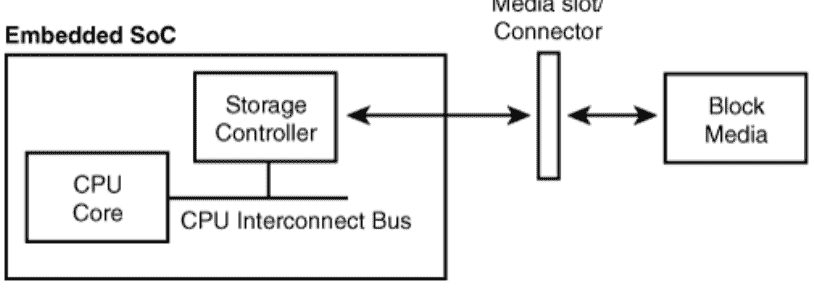

**表 14.3. 存储控制器寄存器布局**

| 寄存器名称 | 内容描述 |
|:---|:---|
| `SECTOR_NUMBER_REGISTER` | 下一个磁盘操作要执行所在的扇区。 |
| `SECTOR_COUNT_REGISTER` | 要读取或写入的扇区数。 |
| `COMMAND_REGISTER` | 要执行的动作（例如，读取或写入）。 |
| `STATUS_REGISTER` | 操作结果、中断状态和错误标志。 |
| `DATA_REGISTER` | 在读取路径中，存储控制器从磁盘获取数据到内部缓冲区。驱动通过此寄存器访问内部缓冲区。在写入路径中，驱动写入此寄存器的数据被传输到内部缓冲区，控制器再从那里将其复制到磁盘。 |


我们将存储控制器称为*myblkdev*。这个简单的设备既不是中断驱动的，也不支持 DMA。我们还假设存储介质不可移除。我们的任务是为 myblkdev 编写一个块驱动程序。我们的驱动程序是最简化的，但功能完整。它不处理电源管理，也对性能不特别敏感。

### 初始化

清单 14.1 包含了驱动程序的初始化方法 `myblkdev_init()`，它执行以下步骤：

1. 使用 `register_blkdev()` 注册块设备。这个块库例程为 myblkdev 分配一个未使用的主设备号，并在 /proc/devices 中为该设备添加一个条目。

2. 将请求方法与块设备相关联。它通过向 `blk_init_queue()` 提供 `myblkdev_request()` 的地址来实现这一点。对 `blk_init_queue()` 的调用返回 myblkdev 的 `request_queue`。请回顾图 14.2，了解 `request_queue` 相对于驱动程序的位置。`blk_init_queue()` 的第二个参数 `myblkdev_lock` 是一个自旋锁，用于保护 `request_queue` 免受并发访问。

3. 硬件以*扇区*为单位执行磁盘事务，而软件子系统（如文件系统）则以*块*为单位处理数据。常见的扇区大小为 512 字节；通常的块大小为 4096 字节。你需要告知块层你的存储硬件支持的扇区大小，以及你的驱动程序每个请求可以接收的最大扇区数。`myblkdev_init()` 分别通过调用 `blk_queue_hardsect_size()` 和 `blk_queue_max_sectors()` 来完成这些操作。

4. 使用 `alloc_disk()` 分配一个对应于 myblkdev 的 `gendisk` 并填充它。`myblkdev_init()` 提供的一个重要 `gendisk` 字段是驱动程序的 `block_device_operations` 的地址。`myblkdev_init()` 填写的另一个参数是 myblkdev 的存储容量，以扇区为单位。这是通过调用 `set_capacity()` 来实现的。每个 `gendisk` 还包含一个标志，用于表示底层存储硬件的属性。例如，如果驱动器是可移除的，则 `gendisk` 的 `flag` 字段应标记为 `GENHD_FL_REMOVABLE`。

5. 将在步骤 4 中准备的 `gendisk` 与在步骤 2 中获得的 `request_queue` 相关联。同时，将 `gendisk` 与设备的主/次设备号和名称连接起来。

6. 通过调用 `add_disk()` 将磁盘添加到块 I/O 层。完成此操作后，驱动程序必须准备好接收请求。因此，这通常是初始化序列的最后一步。

块设备现在作为 */dev/myblkdev* 对系统可用。如果设备支持多个磁盘分区，它们将显示为 */dev/myblkdevX*，其中 *X* 是分区号。

#### 清单 14.1. 初始化驱动程序

```
Code View:
#include <linux/blkdev.h>
#include <linux/genhd.h>

static struct gendisk *myblkdisk;    /* Representation of a disk */
static struct request_queue *myblkdev_queue;
                                    /* Associated request queue */
int myblkdev_major = 0;              /* Ask the block subsystem
                                        to choose a major number */
static DEFINE_SPINLOCK(myblkdev_lock);/* Spinlock that protects
                                        myblkdev_queue from
                                        concurrent access */
```

```
int myblkdisk_size    = 256*1024;    /* Disk size in kilobytes. For
                                        a PC hard disk, one way to
                                        glean this is via the BIOS */
int myblkdev_sect_size = 512;        /* Hardware sector size */

/* Initialization */
static int __init
myblkdev_init(void)
{
  /* Register this block driver with the kernel */
  if ((myblkdev_major = register_blkdev(myblkdev_major,
                                       "myblkdev")) <= 0) {

    return -EIO;
  }

  /* Allocate a request_queue associated with this device */
  myblkdev_queue = blk_init_queue(myblkdev_request, &myblkdev_lock);
  if (!myblkdev_queue) return -EIO;

  /* Set the hardware sector size and the max number of sectors */
  blk_queue_hardsect_size(myblkdev_queue, myblkdev_sect_size);
  blk_queue_max_sectors(myblkdev_queue, 512);

  /* Allocate an associated gendisk */
  myblkdisk = alloc_disk(1);
  if (!myblkdisk) return -EIO;

  /* Fill in parameters associated with the gendisk */
  myblkdisk->fops   = &myblkdev_fops;

  /* Set the capactiy of the storage media in terms of number of
     sectors */
  set_capacity(myblkdisk, myblkdisk_size*2);

  myblkdisk->queue  = myblkdev_queue;
  myblkdisk->major = myblkdev_major;
  myblkdisk->first_minor = 0;
  sprintf(myblkdisk->disk_name, "myblkdev");

  /* Add the gendisk to the block I/O subsystem */
  add_disk(myblkdisk);

  return 0;
}

/* Exit */
static void __exit
myblkdev_exit(void)
{
  /* Invalidate partitioning information and perform cleanup */
  del_gendisk(myblkdisk);

  /* drop references to the gendisk so that it can be freed */
  put_disk(myblkdisk);

  /* Dissociate the driver from the request_queue. Internally calls
     elevator_exit() */
  blk_cleanup_queue(myblkdev_queue);

  /* Unregister the block device */
  unregister_blkdev(myblkdev_major, "myblkdev");
}

module_init(myblkdev_init);
module_exit(myblkdev_exit);
MODULE_LICENSE("GPL");
```

### 块设备操作

接下来，让我们看看块驱动程序的 `block_device_operations` 中包含的主要方法。

块驱动程序的 `open()` 方法在执行挂载存储介质上的文件系统或执行文件系统检查（fsck）等操作期间被调用。`open()` 期间完成的大部分任务都是硬件相关的。例如，CD-ROM 驱动器会锁定驱动器门。SCSI 驱动器检查设备是否设置了写保护标签，如果设置了，则在请求写启用的打开时失败。如果设备是可移除的，`open()` 调用服务例程 `check_disk_change()` 来检查存储介质是否已更改。

如果你的驱动程序需要支持特定命令，请使用 `ioctl()` 方法来实现对它的支持。例如，软盘驱动器支持一个弹出存储介质的命令。

`media_changed()` 方法检查存储介质是否已更改，因此这不适用于 myblkdev 等固定设备。例如，SCSI 磁盘驱动程序的 `media_changed()` 方法检测插入的 USB 闪存驱动器是否已更改。

myblkdev 支持的唯一块设备操作是 `ioctl()` 方法 `myblkdev_ioctl()`。块层本身处理通用 ioctls，并且仅调用驱动程序的 `ioctl()` 方法来处理设备特定的命令。在**清单 14.2**中，`myblkdev_ioctl()` 实现了 `GET_DEVICE_ID` 命令，该命令从控制器中提取设备 ID。该命令通过 `COMMAND_REGISTER` 发出，ID 数据从 `DATA_REGISTER` 获取。

#### 清单 14.2. 块设备操作

```
Code View:
#define GET_DEVICE_ID 0xAA00  /* Ioctl command definition */

/* The ioctl operation */
static int
myblkdev_ioctl (struct inode *inode, struct file *file,
                unsigned int cmd, unsigned long arg)
{
  unsigned char status;

  switch (cmd) {
  case GET_DEVICE_ID:
    outb(GET_IDENTITY_CMD, COMMAND_REGISTER);
    /* Wait as long as the controller is busy */
    while ((status = inb(STATUS_REGISTER)) & BUSY_STATUS);

    /* Obtain ID and return it to user space */
    return put_user(inb(DATA_REGISTER), (long __user *)arg);
  default:
    return -EINVAL;
  }
}

/* Block device operations */
static struct block_device_operations myblkdev_fops = {
  .owner = THIS_MODULE,      /* Owner of this structure */
  .ioctl = myblkdev_ioctl,
  /* The following operations are not implemented for our example
     storage controller: open(), release(), unlocked_ioctl(),
     compat_ioctl(), direct_access(), getgeo(), revalidate_disk(), and
     media_changed() */
};
```

### 磁盘访问

如前所述，块驱动程序使用 `request()` 方法执行磁盘访问操作。每当块 I/O 子系统希望处理驱动程序的 `request_queue` 中等待的请求时，它就会调用驱动程序的 `request()` 方法。然而，`request()` 方法并不在请求数据传输的用户进程的上下文中运行。关联的 `request_queue` 的地址作为参数传递给 `request()` 方法。

如前所述，内核在调用 `request()` 方法之前会持有请求锁。这是为了保护关联的请求队列免受并发访问。因此，如果你的 `request()` 方法必须调用任何可能进入睡眠的函数，它必须在这样做之前释放锁，并在返回之前重新获取它。

清单 14.3 包含了我们驱动程序的请求方法 `myblkdev_request()`。该函数使用 `elv_next_request()` 的服务从 `request_queue` 中获取下一个请求。如果队列中没有更多待处理的请求，`elv_next_request()` 返回 NULL。`elv_next_request()` 之所以这样命名，是因为正如你之前学到的，I/O 调度算法是电梯服务请求的基本操作方式的变体。处理完请求后，驱动程序通过调用 `end_request()` 要求块层结束该请求上的 I/O。你可以使用 `end_request()` 的第二个参数来指定成功或错误代码。

从 `request_queue` 收集的请求包含请求数据访问的起始扇区（清单 14.3 中的 `req->sector`）、需要执行 I/O 的扇区数（`req->nr_sectors`）、包含要传输数据的缓冲区（`req->buffer`），以及数据传输的方向


 (rq_data_dir(req))。如清单 14.3 所示，myblkdev_request() 借助这些参数完成所需的寄存器编程。

#### 清单 14.3. 请求函数

```c
Code View:
#define READ_SECTOR_CMD         1
#define WRITE_SECTOR_CMD         2
#define GET_IDENTITY_CMD         3

#define BUSY_STATUS              0x10

#define SECTOR_NUMBER_REGISTER   0x20000000
#define SECTOR_COUNT_REGISTER   0x20000001
#define COMMAND_REGISTER         0x20000002
#define STATUS_REGISTER          0x20000003
#define DATA_REGISTER            0x20000004

/* Request method */
static void
myblkdev_request(struct request_queue *rq)
{
  struct request *req;
  unsigned char status;
  int i, good = 0;

  /* Loop through the requests waiting in line */
  while ((req = elv_next_request(rq)) != NULL) {
    /* Program the start sector and the number of sectors */
    outb(req->sector, SECTOR_NUMBER_REGISTER);
    outb(req->nr_sectors, SECTOR_COUNT_REGISTER);

    /* We are interested only in filesystem requests. A SCSI command
       is another possible type of request. For the full list, look
       at the enumeration of rq_cmd_type_bits in
       include/linux/blkdev.h */
    if (blk_fs_request(req)) {
      switch(rq_data_dir(req)) {
      case READ:
        /* Issue Read Sector Command */
        outb(READ_SECTOR_CMD, COMMAND_REGISTER);
        /* Traverse all requested sectors, byte by byte */
          for (i = 0; i < 512*req->nr_sectors; i++) {
        /* Wait until the disk is ready. Busy duration should be
           in the order of microseconds. Sitting in a tight loop
           for simplicity; more intelligence required in the real
           world */
            while ((status = inb(STATUS_REGISTER)) & BUSY_STATUS);

            /* Read data from disk to the buffer associated with the
               request */
            req->buffer[i] = inb(DATA_REGISTER);
          }
        good = 1;
        break;
      case WRITE:
        /* Issue Write Sector Command */
        outb(WRITE_SECTOR_CMD, COMMAND_REGISTER);
        /* Traverse all requested sectors, byte by byte */
        for (i = 0; i < 512*req->nr_sectors; i++) {
            /* Wait until the disk is ready. Busy duration should be
               in the order of microseconds. Sitting in a tight loop
               for simplicity; more intelligence required in the real
               world */
            while ((status = inb(STATUS_REGISTER)) & BUSY_STATUS);

            /* Write data to disk from the buffer associated with the
               request */
            outb(req->buffer[i], DATA_REGISTER);
        }
        good = 1;
        break;
      }
    }
    end_request(req, good);
  }
}
```

## 高级主题

与我们逐字节传输数据的示例存储驱动不同，对性能敏感的块驱动依赖 DMA 进行数据传输。例如，考虑 Compaq SMART2 控制器的磁盘阵列驱动中的 `request()` 方法 *drivers/block/cpqarray.c*，以下代码摘自 2.6.23.1 内核源码：

```c
Code View:
static do_ida_request(struct request_queue *q)
{
  struct request *creq;
  struct scatterlist tmp_sg[SG_MAX];
  cmdlist_t *c;
  ctrl_info_t *h = q->queuedata;
  int seg;

  /* ... */
  creq = elv_next_request(q);
  /* ... */
  c->rq = creq;
  seg = blk_rq_map_sg(q, creq, tmp_sg);
  /* ... */
  for (i=0; i<seg; i++)
  {
    c->req.sg[i].size = tmp_sg[i].length;
    c->req.sg[i].addr = (__u32) pci_map_page(h->pci_dev,
                                              tmp_sg[i].page,
                                              tmp_sg[i].offset,
                                              tmp_sg[i].length, dir);
  }
  /* ... */
}
```

DMA 操作在 `bio` 层面工作。如前所述，I/O 请求由 `bio` 组成，每个 `bio` 包含一个 `bio_vec` 数组，而 `bio_vec` 则保存着组成内存页的相关信息。假设 `bio` 指向与 I/O 请求关联的 `bio` 结构体，`bio->bi_sector` 包含请求访问数据的起始扇区，`bio_cur_sectors(bio)` 返回要执行 I/O 操作的扇区数，`bio_data_dir(bio)` 提供数据传输的方向。与数据缓冲区关联的物理页地址由 `bio->bi_io_vec` 所指向的 `bio_vec` 数组描述。要遍历请求中的每个 `bio`，可以使用 `rq_for_each_bio()` 宏。要进一步遍历 `bio` 中的每个页面段，请使用 `bio_for_each_segment()`。

在前面的代码片段中，`blk_rq_map_sg()` 内部调用 `rq_for_each_bio()` 和 `bio_for_each_segment()` 来遍历构成请求的所有页面，并构建分散/聚集列表 `tmp_sg`。对创建的分散/聚集列表中每个页面的流式 DMA 映射由 `pci_map_page()` 完成。

与我们示例驱动中忙等待请求操作完成不同，*cpqarray* 驱动实现了一个中断处理程序 `do_ida_intr()`，用于在命令完成时接收硬件发出的通知。

某些驱动，如 ramdisk 驱动 (*drivers/block/rd.c*) 和 loopback 驱动 (*drivers/block/loop.c*)，运行在虚拟块设备上，无法受益于请求队列上的优化排序和合并操作。此类驱动完全绕过请求队列，直接通过 `make_request()` 函数从块层获取 `bio`。因此，*drivers/block/rd.c* 不使用 `blk_init_queue()` 注册请求队列处理程序，而是通过 `blk_queue_make_request()` 提供一个 `make_request()` 例程，如下所示：

```c
static int __init rd_init(void)
{
  /* ... */
  blk_queue_make_request(rd_queue[i], &rd_make_request);
  /* ... */
}

static int rd_make_request(struct request_queue *q, struct bio *bio)
{
  /* ... */
}
```

## 调试

*hdparm* 工具可以从底层内核驱动获取各种 PATA/SATA 磁盘参数。例如，要对 SATA 驱动器进行磁盘读取速度基准测试，可以执行：

```
bash> hdparm –T –t /dev/sda
/dev/sda:
 Timing cached reads: 2564 MB in 2.00 seconds = 1283.57 MB/sec
 Timing buffered disk reads: 132 MB in  3.03 seconds = 43.61 MB/sec
```

有关 hdparm 的完整功能，请阅读其 man 手册页。

*自我监控、分析和报告技术*（SMART）是内置在许多现代 ATA 和 SCSI 磁盘中的系统，用于监控故障和执行自检。一个名为 *smartd* 的用户空间守护进程借助底层设备驱动收集 SMART 磁盘所采集的信息。请查看 smartd 的 man 手册页，了解如何从支持 SMART 的磁盘获取健康状态。

如果你的发行版没有预装 hdparm 和 SMART 工具，可以从 [http://sourceforge.net/projects/hdparm/](http://sourceforge.net/projects/hdparm/) 和 [http://sourceforge.net/projects/smartmontools/](http://sourceforge.net/projects/smartmontools/) 分别下载。

*/proc/ide/* 下的文件包含系统中 IDE 磁盘驱动器的信息。例如，要获取第一个 IDE 磁盘的几何参数，请查看 */proc/ide/ide0/hda/geometry* 的内容。SCSI 设备的相关信息可在 */proc/scsi/* 下获取。你可以从 */proc/partitions* 获取磁盘分区信息。

IDE 设备相关的 sysfs 目录是 */sys/bus/ide/*，SCSI 的则是 */sys/bus/scsi/*。此外，系统中每个活动的块设备在 */sys/block/* 下都有一个子目录，其中包含关联的请求队列参数、组成分区的详细信息以及状态信息。

一些内核配置选项可用于触发块子系统输出调试信息。`CONFIG_BLK_DEV_IO_TRACE` 提供了跟踪块层的能力。`CONFIG_SCSI_CONSTANTS` 和 `CONFIG_SCSI_LOGGING` 分别开启 SCSI 错误报告和日志记录。

linux-ide 邮件列表是讨论与 Linux-IDE 子系统相关问题的论坛。你可以订阅 linux-scsi 邮件列表并浏览其存档，查找与 Linux-SCSI 子系统相关的讨论。


 ## 查看源码

表 14.1 包含了各种存储技术的内核驱动源码位置。有关相关存储驱动程序的信息，请参阅 *Documentation/ide.txt*、*Documentation/scsi/** 和 *Documentation/cdrom/*。

顶层目录 *block/* 包含 I/O 调度算法和块核心层。表 14.2 列出了该目录中实现各种 I/O 调度器的源文件。相关文档请参阅 *Documentation/block/*。

表 14.4 包含了本章使用的主要数据结构及其在源码树中的位置。表 14.5 列出了本章使用的主要内核编程接口，以及它们的定义位置。

| 数据结构 | 位置 | 描述 |
| --- | --- | --- |
| `gendisk` | *include/linux/genhd.h* | 磁盘的表示。 |
| `request_queue` | *include/linux/blkdev.h* | 与 `gendisk` 关联的 I/O 请求队列。 |
| `request` | *include/linux/blkdev.h* | `request_queue` 中的每个请求都用该结构描述。 |
| `block_device_operations` | *include/linux/fs.h* | 块设备驱动方法。 |
| `bio` | *include/linux/bio.h* | 块 I/O 操作的底层描述。 |

| 内核接口 | 位置 | 描述 |
| --- | --- | --- |
| `register_blkdev()` | *block/genhd.c* | 向内核注册一个块驱动 |
| `unregister_blkdev()` | *block/genhd.c* | 从内核注销一个块驱动 |
| `alloc_disk()` | *block/genhd.c* | 分配一个 `gendisk` |
| `add_disk()` | *block/genhd.c* | 将已填充的 `gendisk` 添加到内核块层 |
| `del_gendisk()` | *fs/partitions/check.c* | 释放一个 `gendisk` |
| `blk_init_queue()` | *block/ll_rw_blk.c* | 分配一个 `request_queue` 并注册一个 `request()` 函数来处理队列中的请求 |
| `blk_cleanup_queue()` | *block/ll_rw_blk.c* | `blk_init_queue()` 的反向操作 |
| `blk_queue_make_request()` | `block/ll_rw_blk.c` | 注册一个 `make_request()` 函数，该函数绕过请求队列，直接从块层获取请求 |
| `rq_for_each_bio()` | `include/linux/blkdev.h` | 遍历请求中的每个 `bio` |
| `bio_for_each_segment()` | `include/linux/bio.h` | 遍历 `bio` 中的每个页段 |
| `blk_rq_map_sg()` | `block/ll_rw_blk.c` | 遍历构成请求的 `bio` 段并构建一个聚散列表 |
| `blk_queue_max_sectors()` | `block/ll_rw_blk.c` | 设置关联请求队列中一个请求的最大扇区数 |
| `blk_queue_hardsect_size()` | `block/ll_rw_blk.c` | 存储硬件支持的扇区大小。 |
| `set_capacity()` | `include/linux/genhd.h` | 以扇区数设置存储介质的容量 |
| `blk_fs_request()` | `include/linux/blkdev.h` | 检查从请求队列获取的请求是否为文件系统请求 |
| `elv_next_request()` | `block/elevator.c` | 从请求队列获取下一个条目 |
| `end_request()` | `block/ll_rw_blk.c` | 结束一个请求的 I/O |

# 第 15 章 网络接口卡

## 本章内容

+   - 驱动数据结构 440

+   - 与协议层通信 448

+   - 缓冲区管理和并发控制 450

+   - 设备示例：以太网 NIC 451

+   - ISA 网络驱动 457

+   - 异步传输模式 458

+   - 网络吞吐量 459

+   - 查看源码 461

连接赋予智能。如今很少遇到不支持某种形式网络连接的计算机系统。在本章中，让我们专注于为*网络接口卡*（NIC）的设备驱动程序，这些网卡负责在*局域网*（LAN）上传输*互联网协议*（IP）流量。本章大部分内容与总线无关，但在需要总线具体信息的地方，假设使用 PCI。为了让你了解其他网络技术，我们还将简要介绍*异步传输模式*（ATM）。我们以讨论性能和吞吐量来结束本章。

NIC 驱动程序与其他驱动类别不同，它们不依赖 */dev* 或 */sys* 与用户空间通信。相反，应用程序通过网络接口（例如，第一个以太网接口为 eth0）与 NIC 驱动程序交互，该接口抽象了底层的协议栈。

## 驱动数据结构

编写 NIC 设备驱动程序时，你需要操作三类数据结构：

+   1. 构成网络协议栈基础结构的结构。套接字缓冲区或定义在 *include/linux/sk_buff.h* 中的 `struct sk_buff` 是内核 TCP/IP 栈使用的关键结构。

+   2. 定义 NIC 驱动与协议栈之间接口的结构。定义在 *include/linux/netdevice.h* 中的 `struct net_device` 是构成该接口的核心结构。

+   3. 与 I/O 总线相关的结构。PCI 及其衍生总线是当今 NIC 常用的总线。

我们将在接下来的两节中详细查看套接字缓冲区和 `net_device` 接口。我们在第 10 章"外围组件互连"中介绍了 PCI 数据结构，因此这里不再赘述。

### 套接字缓冲区

`sk_buff` 为 Linux 网络层提供了高效的缓冲区处理和流控制机制。就像包含 DMA 缓冲区元数据的 DMA 描述符一样，`sk_buff` 保存描述附加内存缓冲区的控制信息，这些缓冲区承载网络数据包（见图 15.1）。`sk_buff` 是巨大的结构，有数十个元素，但在本章中，我们仅限于那些令网络设备驱动程序编写者感兴趣的元素。`sk_buff` 使用五个主要字段将其与关联的数据包缓冲区链接起来：

+   - `head`，指向数据包的起始位置

+   - `data`，指向数据包载荷的起始位置

+   - `tail`，指向数据包载荷的结束位置

+   - `end`，指向数据包的结束位置

+   - `len`，数据包包含的数据量

## 图 15.1. `sk_buff` 操作。

```
struct sk_buff  *skb;
/* ... */

skb = dev_alloc_skb(length +
                    NET_IP_ALIGN);
```


```
skb_reserve(skb, NET_IP_ALIGN);
```


```
memcpy(skb->data, dma_buffer,
       length)
```


```
skb_put(skb, length);
```


```
netif_rx(skb);
```


假设 `skb` 指向一个 `sk_buff`，当数据包在任一方向遍历协议栈时，`skb->head`、`skb->data`、`skb->tail` 和 `skb->end` 会在关联的数据包缓冲区上滑动。例如，`skb->data` 指向当前正在处理该数据包的协议头部。当数据包通过接收路径到达 IP 层时，`skb->data` 指向 IP 头；然而，当数据包传递到 TCP 时，`skb->data` 移动到 TCP 头部的起始位置。随着数据包通过各种协议添加或丢弃头部数据，`skb->len` 也会被更新。`sk_buff` 还包含除前面提到的四个主要指针之外的其他指针。例如，`skb->nh` 记录网络协议头部的位置，而不受 `skb->data` 当前位置的影响。

为了说明 NIC 驱动程序如何与 `sk_buff` 一起工作，图 15.1 展示了接收数据路径上的数据转换。为了方便说明，该图简单地假设所示操作按顺序执行。然而，为了在现实世界中获得操作效率，前两个步骤（`dev_alloc_skb()` 和 `skb_reserve()`）在最初预分配接收缓冲区环时执行；第三步由 NIC 硬件完成，因为它将接收到的数据包直接 DMA 到预分配的 sk_buff 中；最后两个步骤（`skb_put()` 和 `netif_rx()`）从接收中断处理程序中执行。

为了创建一个 sk_buff 来容纳接收到的数据包，图 15.1 使用了 `dev_alloc_skb()`。这是一个中断安全的例程，它为 `sk_buff` 分配内存并将其与数据包载荷缓冲区关联。`dev_kfree_skb()` 实现了 `dev_alloc_skb()` 的反向操作。图 15.1 接下来调用 `skb_reserve()`，在数据包缓冲区的起始位置和载荷的开始位置之间添加 2 字节填充。这使 IP 头部从性能友好的 16 字节边界开始，因为前面的以太网头部有 14 字节长。图 15.1 中的其余代码语句用接收到的数据包填充载荷缓冲区，并移动 `skb->data`、`skb->tail` 和 `skb->len` 以反映此操作。

还有更多与某些 NIC 驱动程序相关的 sk_buff 访问例程。例如，`skb_clone()` 创建所提供 `sk_buff` 的副本，而不复制关联数据包缓冲区的内容。有关 sk_buff 库函数的完整列表，请查看 *net/core/skbuff.c*。

## 网络设备接口

NIC 驱动程序使用标准接口与 TCP/IP 栈交互。`net_device` 结构比 `sk_buff` 结构还要庞大，它定义了这种通信接口。为了做好准备探索 `net_device` 结构的内部，让我们首先追踪 NIC 驱动程序在初始化期间执行的步骤。在我们继续时，请参阅清单 15.1 中的 `init_mycard()`：

+   - 驱动程序使用 `alloc_netdev()` 分配 `net_device` 结构。更常见的是，它使用 `alloc_netdev()` 的合适包装函数。例如，以太网 NIC 驱动程序调用 `alloc_etherdev()`。WiFi 驱动程序（在下一章中讨论）调用 `alloc_ieee80211()`，而 IrDA 驱动程序调用 `alloc_irdadev()`。所有这些函数都将私有数据区域的大小作为参数，并在 `net_device` 本身之外创建该区域：

```
struct net_device  *netdev;
struct priv_struct *mycard_priv;
netdev    = alloc_etherdev(sizeof(struct
                                 priv_struct));
mycard_priv = netdev->priv; /* 由 alloc_etherdev() 创建
                               的私有区域 */
```

+   - 接下来，驱动程序填充其分配的 `net_device` 中的各个字段，并使用 `register_netdev(netdev)` 将已填充的 `net_device` 注册到网络层。

+   - 驱动程序从伴随的 EEPROM 读取 NIC 的*媒体访问控制*（MAC）地址，并根据需要配置*网络唤醒*（WOL）。以太网控制器通常有一个配套的非易失性 EEPROM 来保存信息，如它们的 MAC 地址和 WOL 模式，如图 15.2 所示。前者是唯一分配的全球唯一 48 位地址。后者是一个魔术序列；如果在接收数据中找到它，就会唤醒处于挂起模式的 NIC。

+   - 如果 NIC 需要板载固件才能运行，驱动程序使用 `request_firmware()` 下载它，如第 4 章"奠定基础"中"微代码下载"一节所述。

现在让我们看看定义 `net_device` 接口的方法。为简化起见，我们将它们分为六类。在相关的地方，本节会指向"设备示例：以太网 NIC"一节中清单 15.1 开发的示例 NIC 驱动程序。

### 激活


 ## 总线相关

接下来是总线相关细节，例如网卡片上内存的起始地址和大小。对于PCI网卡驱动程序，其配置如下所示：

```
netdev->mem_start = pci_resource_start(pdev, 0);
netdev->mem_end   = netdev->mem_start + pci_resource_len(pdev, 0);
```

我们在第10章讨论了PCI资源函数。

# 第15章 网络接口卡

| 本章内容 | |
|---|---|
| • 驱动程序数据结构 | 440 |
| • 与协议层通信 | 448 |
| • 缓冲区管理和并发控制 | 450 |
| • 设备示例：以太网网卡 | 451 |
| • ISA网络驱动程序 | 457 |
| • 异步传输模式 | 458 |
| • 网络吞吐量 | 459 |
| • 查看源码 | 461 |

连接赋予智能。如今你很少遇到不支持某种形式网络的计算机系统。在本章中，让我们专注于为在*局域网*（LAN）上传输*互联网协议*（IP）流量的*网络接口卡*（NIC）编写设备驱动程序。本章大部分内容不依赖于具体总线，但在需要总线相关细节的地方，假设使用PCI。为了让你了解其他网络技术，我们还将触及*异步传输模式*（ATM）。我们将在本章结尾探讨性能和吞吐量。

NIC驱动程序与其他驱动程序类别不同，它们不依赖于*/dev*或*/sys*与用户空间通信。相反，应用程序通过一个网络接口（例如，eth0表示第一个以太网接口）与NIC驱动程序交互，该接口抽象了下方的协议栈。

## 驱动程序数据结构

当你为NIC编写设备驱动程序时，需要操作三类数据结构：

1. 构成网络协议栈构建块的结构体。套接字缓冲区或定义在*include/linux/sk_buff.h*中的`struct sk_buff`是内核TCP/IP栈使用的关键结构体。

2. 定义NIC驱动程序与协议栈之间接口的结构体。定义在*include/linux/netdevice.h*中的`struct net_device`是构成此接口的核心结构体。

3. 与I/O总线相关的结构体。PCI及其衍生总线是当今网卡常用的总线。

我们将在接下来的两节中详细介绍套接字缓冲区和`net_device`接口。我们在第10章"外围组件互连"中介绍了PCI数据结构，因此这里不再重复。

### 套接字缓冲区

`sk_buffs`为Linux网络层提供高效的缓冲区处理和流量控制机制。类似于包含DMA缓冲区元数据的DMA描述符，`sk_buffs`保存描述其所附内存缓冲区的控制信息，这些缓冲区承载网络数据包（见图15.1）。`sk_buffs`是庞大的结构体，拥有数十个元素，但在本章中，我们只限于那些让网络设备驱动程序编写者感兴趣的部分。`sk_buff`通过五个主要字段与其关联的数据包缓冲区连接：

- `head`，指向数据包的起始位置
- `data`，指向数据包负载的起始位置
- `tail`，指向数据包负载的结束位置
- `end`，指向数据包的结束位置
- `len`，数据包包含的数据量

#### 图15.1 `sk_buff`操作

`net_device`接口需要常规方法，如`open()`、`close()`和`ioctl()`。当你使用*ifconfig*等工具激活接口时，内核会打开该接口：

```
bash> ifconfig eth0 up
```

`open()`设置接收和发送DMA描述符以及其他驱动程序数据结构。它还通过调用`request_irq()`注册NIC的中断处理程序。`net_device`结构体作为`request_irq()`的`devid`参数传递，以便中断处理程序直接访问关联的`net_device`。（参见**清单15.1**中的`mycard_open()`和`mycard_interrupt()`，了解这是如何完成的。）

当你关闭活动的网络接口时，内核调用`close()`。这完成与`open()`相反的操作。

### 数据传输

数据传输方法构成了`net_device`接口的核心。在发送路径上，驱动程序提供一个名为`hard_start_xmit`的方法，协议层调用该方法将数据包向下传递以进行进一步传输：

代码视图：

```
netdev->hard_start_xmit = &mycard_xmit_frame; /* 传输方法。参见清单15.1 */
```

直到最近，网络驱动程序还没有为收集接收数据提供`net_device`方法。相反，它们以异步中断的方式向协议层推送数据包负载。然而，这个旧接口已经被*新API*（NAPI）所取代，NAPI是中断驱动的驱动程序推送和轮询驱动的协议拉取的混合体。因此，支持NAPI的驱动程序需要提供`poll()`方法以及相关的`weight`，用于控制轮询的公平性：

```
netdev->poll   = &mycard_poll; /* 轮询方法。参见清单15.1 */
netdev->weight = 64;
```

我们在"[与协议层通信](#)"一节中详细阐述数据传输方法。

### 看门狗

`net_device`接口提供了一个钩子，用于将无响应的NIC恢复到操作状态。如果协议层在预定时间内没有检测到传输，它会假定NIC已挂起，并调用驱动程序提供的恢复方法来重置网卡。驱动程序通过`netdev->watchdog_timeo`设置看门狗超时时间，并通过`netdev->tx_timeout`注册恢复函数的地址：

```
netdev->tx_timeout = &mycard_timeout; /* 重置NIC的方法 */
netdev->watchdog_timeo = 8*HZ;      /* 如果8秒内
                                     未检测到响应则重置 */
```

由于恢复方法在定时器中断上下文中执行，它通常会调度一个在该上下文之外的任务来重置NIC。

### 统计信息

为了使用户空间能够收集网络统计信息，NIC驱动程序填充一个`net_device_stats`结构体，并提供`get_stats()`方法来检索它。本质上，驱动程序执行以下操作：

1. 从相关入口点更新不同类型的统计信息：

```
#include <linux/netdevice.h>
struct net_device_stats mycard_stats;

static irqreturn_t
mycard_interrupt(int irq, void *dev_id)
{
  /* ... */
  if (packet_received_without_errors) {
    mycard_stats.rx_packets++;   /* 又收到
                                 一个数据包 */
  }
  /* ... */
}
```

2. 实现`get_stats()`方法来检索统计信息：

```
static struct net_device_stats
*mycard_get_stats(struct net_device *netdev)
{
  /* 内务处理 */
  /* ... */
  return(&mycard_stats);
}
```

3. 将检索方法提供给上层：

```
netdev->get_stats = &mycard_get_stats;
/* ... */
register_netdev(netdev);
```

要从你的网卡收集统计信息，通过执行适当的用户模式命令来触发`mycard_get_stats()`的调用。例如，要查找通过eth0接口接收的数据包数量，执行以下操作：

```
bash> cat /sys/class/net/eth0/statistics/rx_packets
124664
```

WiFi驱动程序需要跟踪几个与传统NIC无关的参数，因此它们除了`get_stats()`之外还实现了一个名为`get_wireless_stats()`的统计信息收集方法。在下一章的"WiFi"一节中讨论了将`get_wireless_stats()`注册给对WiFi敏感的用户空间实用程序的机制。

### 配置

NIC驱动程序需要支持负责设置和获取设备参数的用户空间工具。*Ehtool*配置以太网网卡的参数。为了支持ethtool，底层NIC驱动程序执行以下操作：

1. 填充定义在*include/linux/ethtool.h*中的`ethtool_ops`结构体，使用规定的入口点：

```
#include <linux/ethtool.h>

/* Ethtool_ops方法 */
struct ethtool_ops mycard_ethtool_ops = {
  /* ... */
  .get_eeprom = mycard_get_eeprom, /* 转储EEPROM
                                     内容 */
  /* ... */
};
```

2. 实现属于`ethtool_ops`的方法：

```
static int
mycard_get_eeprom(struct net_device *netdev,
                  struct ethtool_eeprom *eeprom,
                  uint8_t *bytes)
{
  /* 访问附属的EEPROM并提取数据 */
  /* ... */
}
```

3. 导出其`ethtool_ops`的地址：

```
netdev->ethtool_ops = &mycard_ethtool_ops;
/* ... */
register_netdev(netdev);
```

完成这些之后，ethtool就可以操作你的以太网网卡了。要使用ethtool转储EEPROM内容，执行以下操作：

```
bash> ethtool -e eth0
Offset      Values
------      ------
0x0000      00 0d 60 79 32 0a 00 0b ff ff 10 20 ff ff ff ff
...
```

Etool随某些发行版打包提供；但如果你还没有，可以从http://sourceforge.net/projects/gkernel/下载。有关其完整功能，请参阅man页面。

NIC驱动程序还向上层提供了更多与配置相关的方法。例如，更改网卡MTU大小的方法。要支持这一点，将相关方法提供给`net_device`：

```
netdev->change_mtu = &mycard_change_mtu;
/* ... */
register_netdev(netdev);
```

当你执行适当的用户命令更改网卡的MTU时，内核调用`mycard_change_mtu()`：

```
bash> echo 1500 > /sys/class/net/eth0/mtu
```


 ```c
struct sk_buff  *skb;
/* ... */

skb = dev_alloc_skb(length +
                      NET_IP_ALIGN);

skb_reserve(skb, NET_IP_ALIGN);

memcpy(skb->data, dma_buffer,
       length);

skb_put(skb, length);

netif_rx(skb);
```

假设`skb`指向一个`sk_buff`，当数据包在协议栈中双向穿梭时，`skb->head`、`skb->data`、`skb->tail`和`skb->end`会在关联的数据包缓冲区上滑动。例如，`skb->data`指向当前正在处理该数据包的协议的头部。当数据包经由接收路径到达 IP 层时，`skb->data`指向 IP 头部；然而，当数据包传递到 TCP 时，`skb->data`移动到 TCP 头部的起始位置。随着数据包穿过各种协议添加或丢弃头部数据，`skb->len`也会被更新。`sk_buff`还包含除上述四个主要指针之外的其他指针。例如，`skb->nh`记录网络协议头部的位置，而不论`skb->data`当前位于何处。

为了说明 NIC 驱动程序如何与`sk_buff`协同工作，图 15.1 展示了接收数据路径上的数据转换。为方便说明，该图简单地假设所示操作按顺序执行。然而，在现实世界中为了提高操作效率，前两步（`dev_alloc_skb()`和`skb_reserve()`）是在最初预分配接收缓冲区环时完成的；第三步由 NIC 硬件完成，它直接将接收到的数据包 DMA 到预分配的`skb_buff`中；最后两步（`skb_put()`和`netif_rx()`）则从接收中断处理程序中执行。

为了创建一个`sk_buff`来容纳接收到的数据包，图 15.1 使用了`dev_alloc_skb()`。这是一个中断安全的例程，用于为`sk_buff`分配内存并将其与数据包载荷缓冲区关联。`dev_kfree_skb()`则执行与`dev_alloc_skb()`相反的操作。图 15.1 接下来调用`skb_reserve()`，在数据包缓冲区的起始位置和载荷 STAT 有效载荷的开始位置之间添加 2 字节的填充。这使得 IP 头部从一个对性能友好的 16 字节边界开始，因为前面的以太网头部长度为 14 字节。图 15.1 中其余的代码语句用接收到的数据包填充载荷缓冲区，并移动`skb->data`、`skb->tail`和`skb->len`以反映这一操作。

还有更多与某些 NIC 驱动程序相关的`sk_buff`访问例程。例如，`skb_clone()`创建一个所提供`skb_buff`的副本，但不复制关联数据包缓冲区的内容。查看*net/core/skbuff.c*以获取完整的`sk_buff`库函数列表。

## 网络设备接口

NIC 驱动程序使用标准接口与 TCP/IP 协议栈交互。`net_device`结构体比`sk_buff`结构体更为庞大，它定义了这一通信接口。为了让我们准备好探索`net_device`结构的内部，让我们首先追踪 NIC 驱动程序在初始化过程中的执行步骤。在我们继续的过程中，请参考清单 15.1 中的`init_mycard()`：

驱动程序使用`alloc_netdev()`分配一个`net_device`结构体。更常见的是，它使用围绕`alloc_netdev()`的合适封装函数。例如，以太网 NIC 驱动程序调用`alloc_etherdev()`。WiFi 驱动程序（在下一章中讨论）调用`alloc_ieee80211()`，而 IrDA 驱动程序调用`alloc_irdadev()`。所有这些函数都将私有数据区域的大小作为参数，并在创建`net_device`本身的同时创建这一区域：

```c
struct net_device  *netdev;
struct priv_struct *mycard_priv;
netdev     = alloc_etherdev(sizeof(struct
                                      priv_struct));
mycard_priv = netdev->priv; /* 由 alloc_etherdev() 创建的私有区域 */
```

接下来，驱动程序填充它所分配的`net_device`中的各个字段，并使用`register_netdev(netdev)`将填充好的`net_device`注册到网络层。

驱动程序从配套的 EEPROM 中读取 NIC 的*媒体访问控制*（MAC）地址，并在需要时配置*网络唤醒*（WOL）。以太网控制器通常有一个配套的非易失性 EEPROM，用于保存其 MAC 地址和 WOL 模式等信息，如图 15.2 所示。前者是一个全球分配的唯一 48 位地址。后者是一个魔术序列；如果在接收数据中发现该序列，它会唤醒处于挂起模式的 NIC。

如果 NIC 需要板载固件才能运行，驱动程序使用`request_firmware()`下载它，如第 4 章"奠定基础"中"微代码下载"一节所讨论的那样。

现在让我们来看看定义`net_device`接口的方法。为简单起见，我们将它们分为六类。在相关的地方，本节会指向"设备示例：以太网 NIC"一节中清单 15.1 中开发的示例 NIC 驱动程序。

### 激活

`net_device`接口需要诸如`open()`、`close()`和`ioctl()`这样的常规方法。当你使用*ifconfig*等工具激活一个接口时，内核会打开该接口：

```
bash> ifconfig eth0 up
```

`open()`设置接收和发送 DMA 描述符以及其他驱动程序数据结构。它还通过调用`request_irq()`注册 NIC 的中断处理程序。`net_device`结构体作为`devid`参数传递给`request_irq()`，以便中断处理程序可以直接访问关联的`net_device`。（参见**清单 15.1**中的`mycard_open()`和`mycard_interrupt()`，了解这是如何完成的。）

当你关闭一个活动的网络接口时，内核调用`close()`。这执行与`open()`相反的操作。

### 数据传输

数据传输方法构成了`net_device`接口的核心。在发送路径上，驱动程序提供一个名为`hard_start_xmit`的方法，协议层调用该方法来传递数据包以进行后续传输：

代码视图：

```c
netdev->hard_start_xmit = &mycard_xmit_frame; /* 传输方法。参见清单 15.1 */
```

直到最近，网络驱动ario 还没有为收集接收数据提供一个`net_device`方法。相反，它们以异步方式用数据包载荷中断协议层。然而，这一旧接口已被*新 API*（NAPI）所取代，NAPI 是一种中断驱动推送和轮询驱动协议拉取的混合方式。因此，支持 NAPI 的驱动程序需要提供一个`poll()`方法和一个相关的`weight`，用于控制轮询的公平性：

```c
netdev->poll   = &mycard_poll; /* 轮询方法。参见清单 15.1 */
netdev->weight = 64;
```

我们将在"与协议层对话"一节中详细阐述数据传输方法。

### 看门狗

`net_device`接口提供了一个钩子，用于使无响应的 NIC 恢复到操作状态。如果协议层在一段时间内没有检测到传输活动，它会假设 NIC 已挂起，并调用驱动程序提供的恢复方法来重置网卡。驱动程序通过`netdev->watchdog_timeo`设置看门狗超时，并通过`netdev->tx_timeout`注册恢复函数的地址：

```c
netdev->tx_timeout = &mycard_timeout; /* 重置 NIC 的方法 */
netdev->watchdog_timeo = 8*HZ;      /* 如果 8 秒内未检测到响应则重置 */
```

由于恢复方法在定时器中断上下文中执行，它通常会调度一个该上下文之外的任务来重置 NIC。

### 统计信息

为了使用户空间能够收集网络统计信息，NIC 驱动程序填充一个`net_device_stats`结构体，并提供`get_stats()`方法来检索它。本质上，驱动程序执行以下操作：

1. 从相关入口点更新不同类型的统计信息：

```c
#include <linux/netdevice.h>
struct net_device_stats mycard_stats;

static irqreturn_t
mycard_interrupt(int irq, void *dev_id)
{
  /* ... */
  if (packet_received_without_errors) {
    mycard_stats.rx_packets++;    /* 又一个接收到的数据包 */
  }
  /* ... */
}
```

2. 实现`get_stats()`方法来检索统计信息：

```c
static struct net_device_stats
*mycard_get_stats(struct net_device *netdev)
{
  /* 内务处理 */
  /* ... */
  return(&mycard_stats);
}
```

3. 向更高层提供检索方法：

```c
netdev->get_stats = &mycard_get_stats;
/* ... */
register_netdev(netdev);
```

要从你的 NIC 收集统计信息，通过执行适当的用户模式命令来触发`mycard_get_stats()`的调用。例如，要查找通过 eth0 接口接收的数据包数量，请执行以下操作：

```
bash> cat /sys/class/net/eth0/statistics/rx_packets
124664
```

WiFi 驱动程序需要跟踪多个与传统 NIC 无关的参数，因此除了`get_stats()`之外，它们还实现了一个名为`get_wireless_stats()`的统计信息收集方法。为 WiFi 感知用户空间工具注册`get_wireless_stats()`的机制在下一章的"WiFi"一节中讨论。

### 配置

NIC 驱动程序需要支持负责设置和获取设备参数的用户空间工具。*Ethtool*用于配置以太网 NIC 的参数。为了支持 ethtool，底层 NIC 驱动程序执行以下操作：

[content]
## 总线相关

接下来是总线相关的细节，例如网卡（NIC）板载内存的起始地址和大小。对于 PCI 网卡驱动程序，其配置如下所示：

```c
netdev->mem_start = pci_resource_start(pdev, 0);
netdev->mem_end   = netdev->mem_start + pci_resource_len(pdev, 0);
```

我们在第 10 章讨论了 PCI 资源函数。

## 与协议层的交互

在上一节中，你了解了 `net_device` 接口所要求的驱动程序方法。现在让我们更仔细地看看网络数据如何在这个接口上流动。

### 接收路径

你在第 4 章了解到，软中断（softirq）是性能敏感子系统使用的下半文机制。网卡驱动程序使用 `NET_RX_SOFTIRQ` 来卸载将接收到的数据包投递到协议层的工作。驱动程序从其接收中断处理程序中调用 `netif_rx()` 来实现这一点：

```c
netif_rx(skb);   /* struct sk_buff *skb */
```

前面提到的 NAPI（New API）改进了这种传统的基于中断的接收算法，以降低对 CPU 利用率的需求。当网络负载较重时，系统可能会因大量中断而不堪重负。NAPI 的策略是在网络活动繁忙时使用轮询模式，而在流量变轻时回退到中断模式。支持 NAPI 的驱动程序根据网络负载在中断和轮询模式之间切换。具体操作如下：

1. 在中断模式下，中断处理程序通过调度 `NET_RX_SOFTIRQ` 将接收到的数据包投递到协议层。然后它禁用网卡中断，并通过将设备添加到轮询列表来切换到轮询模式：

```c
if (netif_rx_schedule_prep(netdev)) /* 内务处理 */ {
  /* 禁用网卡中断 */
  disable_nic_interrupt();
  /* 将数据包投递到协议层，
     并将设备添加到轮询列表 */
  __netif_rx_schedule(netdev);
}
```

2. 驱动程序通过其 `net_device` 结构体提供一个 `poll()` 方法。

3. 在轮询模式下，驱动程序的 `poll()` 方法处理入队队列中的数据包。当队列变空时，驱动程序重新启用中断，并通过调用 `netif_rx_complete()` 切换回中断模式。

查看清单 15.1 中的 `mycard_interrupt()`、`init_mycard()` 和 `mycard_poll()`，以了解 NAPI 的实际应用。

### 发送路径

对于数据传输，协议层与网卡驱动程序之间的交互是直接的。协议栈调用驱动程序的 `hard_start_xmit()` 方法，并将 outgoing 的 `sk_buff` 作为参数传递。驱动程序通过 DMA 将数据包传输到网卡来发送数据。PCI 网卡驱动程序相关的 DMA 以及数据结构管理在第 10 章中已经讨论过。

驱动程序对网卡进行编程，使其在完成传输预定数量的数据包后中断处理器。只有当发生发送完成中断，表示发送操作完成时，驱动程序才能回收或释放与已发送数据包相关的资源，如 DMA 描述符、DMA 缓冲区和 `sk_buff`。

### 流控制

驱动程序分别通过调用 `netif_start_queue()` 和 `netif_stop_queue()` 来表达其接受协议数据的意愿或不愿。

在设备 `open()` 期间，网卡驱动程序调用 `netif_start_queue()`，请求协议层开始将发送数据包添加到出队队列。然而，在正常操作期间，驱动程序可能偶尔需要停止出队队列。例如，在驱动程序补充数据结构或关闭设备的时间窗口内。通过调用 `netif_stop_queue()` 来限制下游流量。当有足够空闲缓冲区时，例如，要请求网络栈重新启动出队队列，网卡驱动程序调用 `netif_wake_queue()`。要检查当前的流控制状态，调用 `netif_queue_stopped()`。

### 缓冲区管理与并发控制

高性能网卡驱动程序是一个复杂的软件，需要精细的数据结构管理。如第 10 章"数据传输"一节所讨论的，网卡驱动程序维护发送和接收 DMA 描述符的链表（或"环"），并实现用于缓冲区管理的空闲和使用中池。驱动程序通常采用多管齐下的策略来维持缓冲区水平：在设备打开期间预分配 DMA 描述符环和相关的 `sk_buff`，如果可用缓冲区低于预定水位则分配新内存来补充空闲池，并在网卡产生发送完成和接收中断时回收已使用的缓冲区到空闲池。

例如，网卡驱动程序接收环中的每个元素按如下方式填充：

```c
/* 分配一个 sk_buff 和相关的数据缓冲区。
   参见图 15.1 */
skb = dev_alloc_skb(MAX_NIC_PACKET_SIZE);
/* 对齐数据指针 */
skb_reserve(skb, NET_IP_ALIGN);
/* 为网卡访问进行 DMA 映射。以下调用假设为 PCI
   网卡。pdev 是指向相关 pci_dev 结构体的指针 */
pci_map_single(pdev, skb->data, MAX_NIC_PACKET_SIZE,
            PCI_DMA_FROMDEVICE);
/* 创建包含此 sk_buff 的描述符并将其
   添加到 RX 环 */
/* ... */
```

在接收过程中，网卡直接将数据 DMA 到上述预分配环中的 `sk_buff`，并中断处理器。接收中断处理程序依次将数据包传递给更高层的协议层。开发环数据结构将使本讨论以及下一节中的示例驱动程序过于冗长，因此请参考 *drivers/net/e1000/* 目录中的 Intel PRO/1000 驱动程序源代码以获得完整的示例。

并发访问保护与面对多个执行线程（如发送、接收、发送完成中断、接收中断和 NAPI 轮询）时管理如此复杂的数据结构密切相关。我们在第 2 章"内核一瞥"中讨论了几种并发控制技术。

## 设备示例：以太网网卡

现在你已经有了背景知识，是时候通过将到目前为止讨论的部分组合起来编写一个网卡驱动程序了。清单 15.1 实现了一个骨架型以太网网卡驱动程序。它只实现了主要的 `net_device` 方法。如需开发其余方法的帮助，请参考前面提到的 *e1000* 驱动程序。清单 15.1 通常独立于底层 I/O 总线，但略微倾向于 PCI。如果你正在编写 PCI 网卡驱动程序，你需要将清单 15.1 与第 10 章中实现的示例 PCI 驱动程序结合起来。

### 清单 15.1. 以太网网卡驱动程序

```c
#include <linux/netdevice.h>
#include <linux/etherdevice.h>
#include <linux/skbuff.h>
#include <linux/ethtool.h>

struct net_device_stats mycard_stats;  /* 统计信息 */

/* 从驱动程序中合适的位置填充 ethtool_ops 方法 */
struct ethtool_ops mycard_ethtool_ops = {
  /* ... */
  .get_eeprom = mycard_get_eeprom,     /* 转储 EEPROM 内容 */
  /* ... */
};

/* 初始化/探测网卡。对于 PCI 网卡，此函数从
   probe() 方法调用（或本身就是 probe() 方法）。
   在这种情况下，函数声明为：
   static struct net_device *init_mycard(struct pci_dev *pdev, const
                                        struct pci_device_id *id)
*/
static struct net_device *
init_mycard()
{
  struct net_device *netdev;
  struct priv_struct mycard_priv;

  /* ... */
  netdev = alloc_etherdev(sizeof(struct priv_struct));
  /* 通用方法 */
  netdev->open = &mycard_open;
  netdev->stop = &mycard_close;
  netdev->do_ioctl = &mycard_ioctl;

  /* 数据传输 */
  netdev->hard_start_xmit = &mycard_xmit_frame; /* 发送 */
  netdev->poll = &mycard_poll;                   /* 接收 - NAPI  */
  netdev->weight = 64;                           /* 公平性 */

  /* 看门狗 */
  netdev->tx_timeout = &mycard_timeout;    /* 恢复函数 */
  netdev->watchdog_timeo = 8*HZ;           /* 8 秒超时 */

  /* 统计信息和配置 */
  netdev->get_stats = &mycard_get_stats;   /* 统计信息支持 */
  netdev->ethtool_ops = &mycard_ethtool_ops; /* Ethtool 支持 */
```

1. 填充 `ethtool_ops` 结构体，该结构体在 *include/linux/ethtool.h* 中定义，包含规定的入口点：

```c
#include <linux/ethtool.h>

/* Ethtool_ops 方法 */
struct ethtool_ops mycard_ethtool_ops = {
  /* ... */
  .get_eeprom = mycard_get_eeprom, /* 转储 EEPROM 内容 */
  /* ... */
};
```

2. 实现作为 `ethtool_ops` 一部分的方法：

```c
static int
mycard_get_eeprom(struct net_device *netdev,
                  struct ethtool_eeprom *eeprom,
                  uint8_t *bytes)
{
  /* 访问附带的 EEPROM 并提取数据 */
  /* ... */
}
```

3. 导出其 `ethtool_ops` 的地址：

```c
netdev->ethtool_ops = &mycard_ethtool_ops;
/* ... */
register_netdev(netdev);
```

完成这些之后，ethtool 就可以对你的以太网网卡进行操作了。要使用 ethtool 转储 EEPROM 内容，请执行以下命令：

```
bash> ethtool -e eth0
偏移量          数值
------          ------
0x0000          00 0d 60 79 00 0b ff ff 10 20 ff ff ff ff
...
```

Ehtool 随某些发行版一起打包；但如果你没有，可以从 http://sourceforge.net/projects/gkernel/ 下载。有关其完整功能，请参阅 man 手册页。

网卡驱动程序向更高层提供了更多与配置相关的方法。一个例子是更改网络接口的 MTU 大小的方法。要支持这一点，请向 `net_device` 提供相关方法：

```c
netdev->change_mtu = &mycard_change_mtu;
/* ... */
register_netdev(netdev);
```

当你执行适当的用户命令来更改网卡的 MTU 时，内核会调用 `mycard_change_mtu()`：

```
bash> echo 1500 > /sys/class/net/eth0/mtu
```


 netdev->set_mac_address = &mycard_set_mac; /* 修改 MAC 地址 */
netdev->change_mtu = &mycard_change_mtu;  /* 改变 MTU */

strncpy(netdev->name, pci_name(pdev),
        sizeof(netdev->name) - 1);      /* 名称（用于 PCI）*/

/* 总线相关参数。对于 PCI 网卡，如下所示 */
netdev->mem_start = pci_resource_start(pdev, 0);
netdev->mem_end   = netdev->mem_start + pci_resource_len(pdev, 0);

/* 注册接口 */
register_netdev(netdev);

/* ... */

/* 从附加的 EEPROM 中获取 MAC 地址 */
/* ... */

/* 如果需要，下载微代码 */
/* ... */
}

```
/* 中断处理程序 */
static irqreturn_t
mycard_interrupt(int irq, void *dev_id)
{
  struct net_device *netdev = dev_id;
  struct sk_buff *skb;
  unsigned int length;

  /* ... */

  if (receive_interrupt) {
    /* 由于数据包接收而产生中断。此时，
       网卡已将通过 DMA 接收到的数据传输到一个 sk_buff 中，
       该 sk_buff 在设备打开时已预先分配和映射。
       根据你的数据结构设计获取 sk_buff 的地址，并将其赋值给 'skb'。
       'length' 同样通过从网卡读取用于从卡 DMA 数据的描述符获得。
       现在，skb->data 包含接收到的数据。*/
    /* ... */

    /* 对于 PCI 卡，对接收缓冲区执行 pci_unmap_single()，
       以便 CPU 可以访问它 */
    /* ... */

    /* 通过将 skb->tail 向下移动 length 字节并相应增加
       skb->len，允许数据到达数据包的尾部 */
    skb_put(skb, length);

    /* 将数据包传递给 TCP/IP 协议栈 */
#if !defined (USE_NAPI)  /* 使用旧方式 */
    netif_rx(skb);
#else                    /* 使用 NAPI 方式 */
    if (netif_rx_schedule_prep(netdev)) {
      /* 禁用网卡中断。实现未显示。 */
      disable_nic_interrupt();
      /* 将数据包提交到协议层并将设备添加到轮询列表 */
      __netif_rx_schedule(netdev);
    }
#endif
  } else if (tx_complete_interrupt) {
    /* 发送完成中断 */
    /* ... */
    /* 取消映射并释放发送资源，如 DMA 描述符和缓冲区。
       释放 sk_buff 或将它们回收到空闲池中 */
    /* ... */

  }
}
```

```
/* 驱动打开 */
static int
mycard_open(struct net_device *netdev)
{
  /* ... */

  /* 请求中断 */
  request_irq(irq, mycard_interrupt, IRQF_SHARED,
              netdev->name, dev);

  /* 填充发送和接收环形缓冲区 */
  /* 参见"缓冲区管理与并发控制"一节 */
  /* ... */

  /* 将空闲描述符地址提供给网卡 */
  /* ... */

  /* 传达你已准备好接受来自网络协议栈的数据 */
  netif_start_queue(netdev);

  /* ... */
}
```

```
/* 驱动关闭 */
static int
mycard_close(struct net_device *netdev)
{
  /* ... */

  /* 请求网络协议栈停止向下发送数据 */
  netif_stop_queue(netdev);

  /* ... */
}
```

```
/* 当设备被拔出或模块被释放时调用。
   对于 PCI 卡，此函数从 remove() 方法中调用（或本身就是
   remove() 方法）。在这种情况下，函数声明为：
     static void __devexit mycard_remove(struct pci_dev *pdev)
*/
static void __devexit
mycard_remove()
{
  struct net_device *netdev;

  /* ... */
  /* 对于 PCI 卡，按如下方式获取相关的 netdev，
     假设 probe() 方法在分配 netdev 后执行了相应的
     pci_set_drvdata(pdev, netdev) */
  netdev = pci_get_drvdata(pdev);

  unregister_netdev(netdev);  /* register_netdev() 的逆操作 */

  /* ... */

  free_netdev(netdev);       /* alloc_netdev() 的逆操作 */

  /* ... */
}
```

```
/* 挂起方法。对于 PCI 设备，这是第 10 章讨论的
   pci_driver 结构的一部分 */
static int
mycard_suspend(struct pci_dev *pdev, pm_message_t state)
{
  /* ... */
  netif_device_detach(netdev);
  /* ... */
}
```

```
/* 恢复方法。对于 PCI 设备，这是第 10 章讨论的
   pci_driver 结构的一部分 */
static int
mycard_resume(struct pci_dev *pdev)
{
  /* ... */
  netif_device_attach(netdev);
  /* ... */
}
```

```
/* 获取统计信息 */
static struct net_device_stats *
mycard_get_stats(struct net_device *netdev)
{
  /* 内务处理 */
  /* ... */

  return(&mycard_stats);
}
```

```
/* 转储 EEPROM 内容。这是一个 ethtool_ops 操作 */
static int
mycard_get_eeprom(struct net_device *netdev,
                  struct ethtool_eeprom *eeprom, uint8_t *bytes)
{
  /* 从随附的 EEPROM 中读取数据 */
  /* ... */
}
```

```
/* 轮询方法 */
static int
mycard_poll(struct net_device *netdev, int *budget)
{
  /* 使用 netif_receive_skb() 将数据包提交到协议层 */
  /* ... */

  if (no_more_ingress_packets()){
    /* 从轮询列表中移除设备 */
    netif_rx_complete(netdev);

    /* 回退到中断模式。实现未显示 */
    enable_nic_interrupt();

    return 0;
  }
}
```

```
/* 发送方法 */
static int
mycard_xmit_frame(struct sk_buff *skb, struct net_device *netdev)
{
  /* 从关联的 sk_buff 通过 DMA 将发送数据包传输到网卡内存 */
  /* ... */
  /* 管理缓冲区 */
  /* ... */
}
```

## 以太网 PHY

以太网控制器实现 MAC 层，必须与物理层（PHY）收发器配合使用。前者对应于开放系统互连（OSI）模型的数据链路层，而后者实现物理层。多种片上系统（SoC）具有内置的 MAC，连接到外部的 PHY。介质独立接口（MII）是连接快速以太网 MAC 与 PHY 的标准接口。以太网设备驱动程序通过 MII 与 PHY 通信，以配置 PHY ID、线路速度、双工模式和自动协商等参数。有关 MII 寄存器定义，请查看 *include/linux/mii.h*。

## ISA 网络驱动程序

现在让我们简要了解一下 ISA 网卡。CS8900 是 Crystal Semiconductor（现 Cirrus Logic）的一款 10Mbps 以太网控制器芯片。该芯片常用于为嵌入式设备提供以太网功能，特别是用于调试目的。

图 15.2 展示了 CS8900 周围的连接图。根据开发板上的处理器和用于驱动该芯片的片选信号，CS8900 寄存器映射到 CPU I/O 地址空间的不同区域。该控制器的设备驱动程序是 ISA 类型的驱动程序（参见第 20 章"更多设备与驱动程序"中的"ISA 与 MCA"一节），它探测候选地址区域以检测控制器的存在。ISA 探测方法通过查找芯片 ID 等标识来确认控制器的 I/O 基地址。

图 15.2. CS8900 以太网控制器周围的连接图。

[查看全尺寸图像]

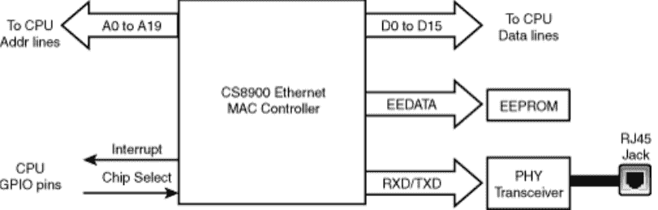

请查看 *drivers/net/cs89x0.c* 获取 CS8900 驱动程序的源代码。`cs89x0_probe1()` 探测 I/O 地址范围以感知 CS8900。然后它读取芯片的当前配置。在此步骤中，它访问 CS8900 的伴随 EEPROM 并获取控制器的 MAC 地址。与清单 15.1 中的驱动程序一样，cs89x0.c 也是使用 `netif_*()` 和 `skb_*()` 接口例程构建的。

某些使用 CS8900 的平台允许 DMA。ISA 设备与 PCI 卡不同，不具备 DMA 主控能力，因此它们需要外部 DMA 控制器来传输数据。

## 异步传输模式

ATM 是一种高速、面向连接的骨干网技术。ATM 保证高*服务质量*（QoS）和低延迟，因此除了数据传输外，还用于承载音频和视频流量。

以下是 ATM 协议的简要概述：ATM 通信以 53 字节的信元为单位进行。每个信元以 5 字节的头部开始，头部携带*虚路径标识符*（VPI）和*虚电路标识符*（VCI）。ATM 连接要么是*交换虚电路*（SVC），要么是*永久虚电路*（PVC）。在 SVC 建立期间，VPI/VCI 对在中间的 ATM 交换机中配置，以将传入的信元路由到适当的出端口。对于 PVC，VPI/VCI 对永久配置在 ATM 交换机中，不会为每次连接而建立和拆除。

有三种方式可以在 ATM 上运行 TCP/IP，Linux-ATM 均支持：

- 1. RFC[1] 1577 中规定的经典 IP over ATM（CLIP）。

  [1] 征求意见文档（RFC）是指定网络标准的文档。

- 2. 在 ATM 网络上仿真局域网。这称为*局域网仿真*（LANE）。

- 3. *ATM 上的多协议*（MPoA）。这是一种提高性能的路由技术。

Linux-ATM 是一个实验性的内核驱动程序、用户空间实用程序和守护进程的集合。你可以在源代码树的 *drivers/atm/* 和 *net/atm/* 中分别找到 ATM 驱动程序和协议。http://linux-atm.sourceforge.net/ 托管了使用 Linux-ATM 所需的用户空间程序。Linux 还包含一个 ATM 套接字 API，包括 SVC 套接字（`AF_ATMSVC`）和 PVC 套接字（`AF_ATMPVC`）。

一种称为*多协议标签交换*（MPLS）的协议正在取代 ATM。托管在 http://mpls-linux.sourceforge.net/ 的 Linux-MPLS 项目尚未成为主线内核的一部分。

我们将在下一节中讨论一些与 ATM 相关的吞吐量问题。


网络吞吐量

有多种工具可用于基准测试网络性能。*Netperf*可从[www.netperf.org](http://www.netperf.org)免费获取，它能够建立复杂的TCP/UDP连接场景。你可以使用脚本控制协议参数、并发会话数和数据块大小等特性。通过将实际吞吐量与网络技术所能提供的最大实际带宽进行比较来完成基准测试。例如，考虑到ATM信元头大小、*ATM适配层*（AAL）的开销以及物理*同步光网络*（SONET）层发送的偶尔维护信元，155Mbps的ATM适配器产生的最大IP吞吐量为135Mbps。

为了获得最佳吞吐量，你必须为高性能设计NIC驱动程序。此外，你还需要深入理解驱动程序所承载的网络协议。

## 驱动程序性能

让我们来看一些可能影响NIC性能的驱动程序设计问题：

- 为快速NIC设计驱动程序时，尽量减少主数据路径中的指令数量是关键标准。考虑一个具有1MB板载内存的1Gbps以太网适配器。在线速下，卡内存最多可以存储8毫秒的接收数据。这直接转换为最大允许指令路径长度。在此路径长度内，传入的数据包必须被重组、通过DMA传输到内存、由驱动程序处理、防止并发访问，并交付给更高层协议。

- 在*编程式I/O*（PIO）期间，数据从设备一路传输到CPU，然后才被写入内存。此外，每当设备需要传输数据时，CPU就会收到中断，这会导致延迟和上下文切换延迟。DMA不受这些瓶颈的限制，但如果要传输的数据小于某个阈值，DMA可能比PIO更昂贵。这是因为小型DMA在构建描述符和刷新相应的处理器缓存行以保持数据一致性方面具有较高的相对开销。对性能敏感的设备驱动程序可能会通过实验确定阈值后，对小型数据包使用PIO，对较大的数据包使用DMA。

- 对于具有DMA主控能力的PCI网卡，你必须确定最佳DMA突发大小，即卡一次性控制总线的时间。如果卡突发持续时间过长，它可能会占用总线，阻止处理器跟上先前DMA传输的数据。PCI驱动程序通过PCI配置空间中的寄存器来编程突发大小。通常，NIC的突发大小被设置为与处理器的缓存行大小相同，即处理器在发生缓存缺失时每次从系统内存读取的字节数。然而，在实践中，你可能需要连接总线分析仪来确定有利的突发持续时间，因为系统中存在分离总线（多种总线类型如ISA和PCI）等因素可能影响最佳值。

- 有时，如果驱动程序优化对高层协议的实现细节不敏感，可能会产生意外的速度障碍。考虑在一台配备高速NIC的计算机上NFS挂载的文件系统。假设NIC驱动程序只偶尔采用传输完成中断以最小化延迟，但NFS服务器实现使用释放其传输缓冲区作为流控机制。由于驱动程序仅在稀疏生成的传输完成中断期间释放NFS传输缓冲区，因此通过NFS的文件拷贝速度很慢，而互联网下载却飞速进行，获得最大吞吐量。

## 协议性能

现在让我们深入研究一些可以提升或损害网络吞吐量的协议特定特性：

- TCP窗口大小会影响吞吐量。窗口大小提供了在收到确认之前可以传输的数据量的度量。对于快速NIC，较小的窗口大小可能导致TCP空闲，等待已传输数据包的确认。即使窗口大小较大，少量TCP数据包丢失也会影响性能，因为在线速下，丢失的帧可能会耗尽窗口。对于UDP，窗口大小不相关，因为它不支持确认。然而，由于缺乏流控机制，少量数据包丢失可能会导致速率大幅下降。

- 随着写入TCP套接字的应用数据块大小增加，从用户空间拷贝到内核空间的缓冲区数量减少。这降低了对处理器利用率的需求，有利于性能。然而，如果块大小超过网络协议对应的MTU，处理器周期就会浪费在分片上。因此，理想的块大小是外出接口MTU，或者如果路径MTU发现机制正在运行，则是可以通过IP路径发送而不需要分片的最大数据包。例如，在IP over ATM上运行时，由于ATM适配层的MTU为64K，块大小几乎没有上限。（RFC 1626将其默认为9180。）然而，如果你在ATM LANE上运行IP，则块大小应反映所模拟的相应LAN技术的MTU大小。因此，标准以太网应为1500，巨型千兆以太网应为8000，16Mbps令牌环应为18K。

## 查看源代码

*drivers/net/*目录包含各种NIC驱动程序的源代码。查看*drivers/net/e1000/*以获取NIC驱动程序示例。你可以在*net/*目录中找到网络协议实现。`sk_buff`访问例程位于*net/core/skbuff.c*。有助于实现驱动程序`net_device`接口的库例程位于*net/core/dev.c*和*include/linux/netdevice.h*中。

## TUN/TAP驱动程序

TUN/TAP设备驱动程序*drivers/net/tun.c*用于协议隧道，是虚拟网络驱动程序和伪字符驱动程序组合的一个示例。伪字符设备（*/dev/net/tun*）充当虚拟网络接口（*tunX*）的底层硬件，因此TUN网络驱动程序不是将帧传输到物理网络，而是将其发送到从*/dev/net/tun*读取的应用程序。同样，TUN驱动程序不是从物理网络接收数据，而是从写入*/dev/net/tun*的应用程序接受数据。查看*Documentation/networking/tuntap.txt*以获取更多解释和使用场景。由于驱动程序的网络和字符部分都不必处理硬件交互的复杂性，它作为一个非常易读但简化的驱动程序示例。

*/sys/class/net/*下的文件允许你操作NIC驱动程序参数。使用*/proc/sys/net/*下的节点来配置协议特定变量。例如，要设置最大TCP传输窗口大小，将所需值回显到*/proc/sys/net/core/wmem_max*。*/proc/net/*目录包含一系列系统特定的网络信息。检查*/proc/net/dev*以获取系统上所有NIC的统计信息，并查看*/proc/net/arp*获取ARP表。

[表15.1](#)包含本章中使用的主要数据结构及其在源代码树中的位置。[表15.2](#)列出本章中使用的主要内核编程接口及其定义位置。

### 表15.1. 数据结构汇总

| 数据结构 | 位置 | 描述 |
| --- | --- | --- |
| `sk_buff` | *include/linux/skbuff.h* | `sk_buff`为Linux网络层提供高效的缓冲区处理和流控机制。 |
| `net_device` | *include/linux/netdevice.h* | NIC驱动程序与TCP/IP协议栈之间的接口。 |
| `net_device_stats` | *include/linux/netdevice.h* | 与网络设备相关的统计信息。 |
| `ethtool_ops` | *include/linux/ethtool.h* | 将NIC驱动程序绑定到ethtool实用程序的入口点。 |

### 表15.2. 内核编程接口汇总

| 内核接口 | 位置 | 描述 |
| --- | --- | --- |
| `alloc_netdev()` | *net/core/dev.c* | 分配`net_device` |


| 内核接口 | 位置 | 描述 |
| --- | --- | --- |
| `alloc_etherdev()` `alloc_ieee80211()` `alloc_irdadev()` | *net/ethernet/eth.c* *net/ieee80211/ieee80211_module.c_clip_image.gif* | `alloc_netdev()` 的封装 |
| `free_netdev()` | *net/core/dev.c* | `alloc_netdev()` 的逆操作 |
| `register_netdev()` | *net/core/dev.c` | 注册一个 `net_device` |
| `unregister_netdev()` | *net/core/dev.c` | 注销一个 `net_device` |
| `dev_alloc_skb()` | *include/linux/skbuff.h* | 为 `sk_buff` 分配内存，并将其与数据包有效载荷缓冲区关联 |
| `dev_kfree_skb()` | *include/linux/skbuff.h* *net/core/skbuff.c* | `dev_alloc_skb()` 的逆操作 |
| `skb_reserve()` | *include/linux/skbuff.h* | 在数据包缓冲区的起始位置与有效载荷的开头之间添加填充空间 |
| `skb_clone()` | *net/core/skbuff.c* | 创建一个已提供 `sk_buff` 的副本，但不复制关联数据包缓冲区的内容 |
| `skb_put()` | *include/linux/skbuff.h* | 允许将数据包数据写入数据包的尾部 |
| `netif_rx()` | *net/core/dev.c* | 将网络数据包传递给 TCP/IP 协议栈 |
| `netif_rx_schedule_prep()` `__netif_rx_schedule()` | *include/linux/netdevice.h* *net/core/dev.c* | 将网络数据包传递给 TCP/IP 协议栈（NAPI） |
| `netif_receive_skb()` | *net/core/dev.c* | 从 `poll()` 方法将数据包投递到协议层（NAPI） |
| `netif_rx_complete()` | *include/linux/netdevice.h* | 将设备从轮询列表中移除（NAPI） |
| `netif_device_detach()` | *net/core/dev.c* | 分离设备（通常在电源挂起时调用） |
| `netif_device_attach()` | *net/core/dev.c* | 连接设备（通常在电源恢复时调用） |
| `netif_start_queue()` | *include/linux/netdevice.h` | 表示已准备好从网络协议栈接收数据 |
| `netif_stop_queue()` | *include/linux/netdevice.h` | 请求网络协议栈停止向下发送数据 |
| `netif_wake_queue()` | *include/linux/netdevice.h` | 重新启动出口队列 |
| `netif_queue_stopped()` | *include/linux/netdevice.h* | 检查流量控制状态 |


## 第 16 章 无线 Linux

本章内容

- 蓝牙
- 红外
- WiFi
- 蜂窝网络
- 当前趋势

许多小尺寸设备都受益于无线技术与 Linux 的双重组合。蓝牙、红外、WiFi 和蜂窝网络都是成熟的无线技术，拥有良好的 Linux 支持。蓝牙消除了线缆，为简单设备注入了智能，并开启了大量新型应用的大门。红外是一种低成本、短距离、中等速率的无线技术，它可以为笔记本电脑联网、连接手持设备或将文档发送到打印机。WiFi 是以太网局域网的无线等价物。使用*通用分组无线服务*（GPRS）或*码分多址*（CDMA）的蜂窝网络可以让你在移动中随时接入互联网，前提是你的活动范围在服务提供商的覆盖区域内。

由于这些无线技术以流行的外形广泛供应，你很可能会在不太遥远的将来遇到一张无法直接在 Linux 上工作的网卡。在你开始尝试启用一张不被支持的网卡之前，你需要详细了解内核如何实现对相应技术的支持。在本章中，让我们来学习 Linux 如何实现蓝牙、红外、WiFi 和蜂窝网络功能。

## 无线技术的权衡

蓝牙、红外、WiFi 和 GPRS 服务于不同的细分领域。这些权衡可以从速度、范围、成本、功耗、软硬件协同设计的难易程度以及 PCB 板占用空间等方面来衡量。

表 16.1 让你对这些参数有一个大致的了解，但当你在实际环境中测量具体数值时，还需要考虑多个变量。列出的速度是理论最大值。标注的功耗是相对值，在实际应用中还取决于厂商的实现方式、技术子类和运行模式。成本效益取决于芯片的外形尺寸，以及芯片是否包含实现了部分协议层功能的内置微码。电路板占用空间不仅取决于芯片组，还取决于收发器、天线，以及你是否使用*现成*（OTS）模块进行构建。

**表 16.1. 无线技术的权衡**

| 技术 | 速度 | 范围 | 功耗 | 成本 | 协同设计工作量 | 电路板占用空间 |
|------|------|------|------|------|----------------|----------------|
| 蓝牙 | 720Kbps | 10米 至 100米 | ** | ** | ** | ** |
| 红外数据 | 4Mbps（快速红外） | 30 度锥形范围内最远 1 米 | * | * | * | * |
| WiFi | 54Mbps | 150 米（室内） | **** | *** | *** | *** |
| GPRS | 170Kbps | 服务提供商覆盖范围 | *** | **** | * | *** |

注：最后四列为相对值（取决于 * 符号的数量），而非绝对值。

本章中有些部分更侧重于"系统编程"而非设备驱动。这是因为协议栈的相应区域（例如蓝牙 RFCOMM 和红外网络）已经存在于内核中，你更可能执行相关的用户模式定制，而不是开发协议内容或设备驱动。

## 蓝牙

*蓝牙*是一种短距离的线缆替代技术，可同时传输数据和语音。它支持最高 723Kbps（非对称）和 432Kbps（对称）的速率。*3 类*蓝牙设备的范围为 10 米，*1 类*发射器的通信距离可达 100 米。

蓝牙旨在消除束缚和杂乱环境中的线缆。例如，它可以将你的腕表变成藏在背包中的笨重*全球定位系统*（GPS）的前端。或者，它可以让你通过手持设备来控制演示文稿。此外，如果你想让笔记本电脑充当一个可以为支持蓝牙的 MP3 播放器提供互联网接入的中枢，蓝牙也是一个理想的解决方案。如果你的腕表、手持设备、笔记本电脑或 MP3 播放器运行的是 Linux，了解 Linux 蓝牙协议栈的内部原理将帮助你最大限度地发挥设备的潜力。

根据蓝牙规范，协议栈由图 16.1 所示的各层组成。无线电、链路控制器和链路管理器大致对应于*开放系统互连*（OSI）标准参考模型中的物理层、数据链路层和网络层。*主机控制接口*（HCI）是负责向/从硬件传输数据的协议，因此对应于传输层。蓝牙*逻辑链路控制与适配协议*（L2CAP）属于会话层。使用*射频通信*（RFCOMM）的串口模拟、使用*蓝牙网络封装协议*（BNEP）的以太网模拟，以及*服务发现协议*（SDP），都是功能丰富的表示层的一部分。协议栈的顶部驻留着称为*规范*的各种应用环境。无线电、链路控制器和链路管理器通常是蓝牙硬件的一部分，因此操作系统支持从 HCI 层开始。

**图 16.1. 蓝牙协议栈。**

将蓝牙硬件与微控制器连接的一种常见方法是将芯片组的数据线连接到控制器的 UART 引脚。第 13 章"音频驱动"中的图 13.4 展示了 MP3 播放器上的蓝牙芯片通过 UART 与处理器通信。USB 是与蓝牙芯片组通信的另一种常用方式。第 11 章"通用串行总线"中的图 11.2 展示了嵌入式设备上的蓝牙芯片通过 USB 与处理器连接。无论你使用 UART 还是 USB（我们稍后会介绍这两种设备），用于传输蓝牙数据的分组格式都是 HCI。

### BlueZ

BlueZ 蓝牙实现是主线内核的一部分，也是官方的 Linux 蓝牙协议栈。


 图 16.2 展示了 BlueZ 如何将蓝牙协议层映射到内核模块、内核线程、用户空间守护进程、配置工具、实用程序和库。主要的 BlueZ 组件解释如下：

1. *bluetooth.ko* 包含核心的 BlueZ 基础设施。所有其他 BlueZ 模块都使用它的服务。它还负责向用户空间导出蓝牙套接字族（`AF_BLUETOOTH`），并填充相关的 sysfs 条目。

2. 用于通过 UART 传输蓝牙 HCI 数据包时，相应的 BlueZ HCI 实现是 *hci_uart.ko*。对于 USB 传输，则是 *hci_usb.ko*。

3. *l2cap.ko* 实现了负责分片和重组的 L2CAP 适配层。它还可在不同的高层协议之间进行复用。

4. 要在蓝牙上运行 TCP/IP 应用程序，必须使用 BNEP 在 L2CAP 上模拟以太网端口。这是由 *bnep.ko* 完成的。为了服务 BNEP 连接，BlueZ 会生成一个名为 *kbnepd* 的内核线程。

5. 要在蓝牙上运行终端模拟器等串口应用程序，需要在 L2CAP 上模拟串口。这是由 *rfcomm.ko* 完成的。RFCOMM 还充当支持通过 PPP 进行网络连接的支柱。为了服务传入的 RFCOMM 连接，*rfcomm.ko* 会生成一个名为 *krfcommd* 的内核线程。要设置和维护与目标设备上各个 RFCOMM 通道的连接，请使用 *rfcomm* 实用程序。

6. *人机接口设备*（HID）层通过 *hidp.ko* 实现。用户模式守护进程 *hidd* 让 BlueZ 能够处理蓝牙鼠标等输入设备。

7. 音频通过由 *sco.ko* 实现的*面向连接的同步*（SCO）层来处理。

## 图 16.2. 蓝牙协议层映射到 BlueZ 内核模块。

[View full size image]

现在让我们追踪两个示例蓝牙设备的内核代码流程：一个*CF 卡*（Compact Flash）和一个 USB 适配器。

## 设备示例：CF 卡

Sharp 蓝牙 CF 卡基于 Silicon Wave 芯片组构建，使用串行传输来承载 HCI 数据包。HCI 数据包可以通过三种不同的方式进行串行传输：

1. H4（UART），Sharp CF 卡使用的就是这种方式。H4 是蓝牙规范定义的在 UART 上传输蓝牙数据的标准方法。请查看 *drivers/bluetooth/hci_h4.c* 了解 BlueZ 的实现。

2. H3（RS232）。使用 H3 的设备很难找到。BlueZ 不支持 H3。

3. *BlueCore 串行协议*（BCSP），这是 *Cambridge Silicon Radio订*（CSR）的专有协议，支持错误检查和重传。BCSP 用于基于 CSR BlueCore 芯片的非 USB 设备，包括 PCMCIA 和 CF 卡。BlueZ 的 BCSP 实现位于 *drivers/bluetooth/hci_bcsp.c*。

Sharp 蓝牙卡的读取数据路径如图 16.3 所示。该卡与内核的第一个接触点在 UART 驱动。正如你在第 9 章 "PCMCIA 和 Compact Flash" 的图 9.5 中所见，串行卡服务驱动 *drivers/serial/serial_cs.c* 让操作系统的其余部分将 Sharp 卡视为串行设备。串行驱动将接收到的 HCI 数据包传递给 BlueZ。BlueZ 以内核线路规程的形式实现 HCI 处理。正如你在第 6 章 "串行驱动" 中学到的，线路规程位于串行驱动之上，并塑造其行为。HCI 线路规程调用相关的协议例程（此处为 H4）来协助数据处理。从那时起，L2CAP 和更高的 BlueZ 层接管。

## 图 16.3. 从 Sharp 蓝牙 CF 卡读取数据的路径。

[View full size image]

## 设备示例：USB 适配器

现在让我们看看使用 USB 传输 HCI 数据包的设备。Belkin 蓝牙 USB 适配器就是这类设备之一。在这种情况下，Linux USB 层（*drivers/usb/*）、HCI USB 传输驱动（*drivers/bluetooth/hci_usb.c*）和 BlueZ 协议栈（*net/bluetooth/*）是推动数据流动的关键角色。让我们看看这三个内核层如何交互。

正如你在第 11 章中学到的，USB 设备使用四个管道中的一个或多个来交换数据。对于蓝牙 USB 设备，每个管道负责承载特定类型的数据：

1. 控制管道用于传输 HCI 命令。

2. 中断管道负责承载 HCI 事件。

3. 批量管道传输*异步无连接*（ACL）蓝牙数据。

4. 等时管道承载 SCO 音频数据。

你在第 11 章还看到，当 USB 设备插入系统时，主机控制器驱动使用控制管道对其进行枚举，并分配 1 到 127 之间的端点地址。USB 子系统在枚举期间读取的配置描述符包含有关设备的信息，例如其 `class`、`subclass` 和 `protocol`。蓝牙规范将蓝牙 USB 设备的（`class`、`subclass`、`protocol`）代码定义为 `(0xE, 0x01, 0x01)`。HCI USB 传输驱动（`hci_usb`）在初始化期间将这些值注册到 USB 核心。当 Belkin USB 适配器插入时，USB 核心从设备配置描述符中读取（`class`、`subclass`、`protocol`）信息。由于这些信息与 `hci_usb` 注册的值匹配，因此该驱动会附加到 Belkin USB 适配器上。`hci_usb` 从上述四个 USB 管道读取蓝牙数据，并将其传递给 BlueZ 协议栈。现在，Linux 应用程序可以无缝地在此设备上运行，如图 16.2 所示。

### RFCOMM

RFCOMM 在蓝牙上模拟串口。终端模拟器等应用程序和 PPP 等协议可以在 RFCOMM 创建的虚拟串口接口上无需修改地运行。

### 设备示例：药丸分配器

举个例子，假设你有一个支持蓝牙的药丸分配器。当你从分配器中取出一颗药丸时，它会通过蓝牙 RFCOMM 通道发送一条消息。一部 Linux 手机（如图 6.5 所示，见第 6 章）使用一个简单的应用程序读取此警报，该应用程序与药丸分配器建立 RFCOMM 连接。然后，手机通过其 GPRS 接口将此信息发送到互联网上的医疗服务提供商服务器。

如清单 16.1 所示，这是在 Linux 手机上使用 BlueZ 套接字 API 读取来自药丸分配器数据的应用程序骨架。该清单假设你熟悉套接字编程的基础知识。

### 清单 16.1. 通过 RFCOMM 与药丸分配器通信

```
Code View:
#include <sys/socket.h>
#include <bluetooth/rfcomm.h> /* For struct sockaddr_rc */

void
sense_dispenser()
{
  int pillfd;
  struct sockaddr_rc pill_rfcomm;
  char buffer[1024];

  /* ... */

  /* Create a Bluetooth RFCOMM socket */
  if ((pillfd = socket(PF_BLUETOOTH, SOCK_STREAM, BTPROTO_RFCOMM))
      < 0) {
    printf("Bad Bluetooth RFCOMM socket");
    exit(1);
  }

  /* Connect to the pill dispenser */
  pill_rfcomm.rc_family = AF_BLUETOOTH;
  pill_rfcomm.rc_bdaddr = PILL_DISPENSER_BLUETOOTH_ADDR;
  pill_rfcomm.rc_channel = PILL_DISPENSER_RFCOMM_CHANNEL;

  if (connect(pillfd, (struct sockaddr *)&pill_rfcomm,
              sizeof(pill_rfcomm))) {
    printf("Cannot connect to Pill Dispenser\n");
    exit(1);
  }

  printf("Connection established to Pill Dispenser\n");
  /* Poll until data is ready */
  select(pillfd, &fds, NULL, NULL, &timeout);

  /* Data is available on this RFCOMM channel */
  if (FD_ISSET(pillfd, fds)) {

    /* Read pill removal alerts from the dispenser */
    read(pillfd, buffer, sizeof(buffer));

    /* Take suitable action; e.g., send a message to the health
       care provider's server on the Internet via the GPRS
       interface */
    /* ... */
  }

  /* ... */
}
```

### 网络

从图 16.2 的 *telnet/ftp/ssh* 框中追溯代码路径，看看如何在 BlueZ 蓝牙上架构网络。如你所见，有两种不同的方式可以通过蓝牙进行网络连接：

1. 通过 BNEP 直接运行 TCP/IP。由此产生的网络称为*个人区域网*（PAN）。

2. 通过 RFCOMM 上的 PPP 运行 TCP/IP。这称为*拨号网络*（DUN）。

蓝牙网络的内核实现不太可能引起设备驱动程序编写者的兴趣，因此不进行探讨。然而，表 16.2 展示了使用 PAN 将两台笔记本电脑联网的步骤。使用 DUN 进行网络连接与此类似，不再赘述。这两台笔记本电脑分别使用前面讨论过的 Sharp CF 卡和 Belkin USB 适配器启用蓝牙功能。你可以使用被动式 CF 到 PCMCIA 适配器将 CF 卡插入第一台笔记本电脑的 PCMCIA 插槽。请结合图 16.2 和表 16.2 来理解到相应 BlueZ 组件的映射。表 16.2 使用 `bash-sharp>` 和 `bash-belkin>` 分别作为两台笔记本电脑的 shell 提示符。


在配备 Sharp Bluetooth CF 卡的笔记本电脑上

- 1. 启动 HCI 和服务发现守护进程：

```
bash-sharp> hcid
bash-sharp> sdpd
```

由于该设备具有 UART 接口，你需要将 BlueZ 协议栈附加到相应的串行端口上。在这种情况下，假设 *serial_cs* 已为该卡分配了 */dev/ttyS3*：

- 2. 验证 HCI 接口是否已启动：

```
bash-sharp> hciconfig -a
hci0:   Type: UART
 BD Address: 08:00:1F:10:3B:13 ACL MTU: 60:20  SCO MTU: 31:1
 UP RUNNING PSCAN ISCAN
 ...
Manufacturer: Silicon Wave (11)
```

- 3. 验证基本的 BlueZ 模块是否已加载：

```
bash-sharp> lsmod
Module                  Size  Used by
hci_uart              16728  3
l2cap                 26144  2
bluetooth             47684  6 hci_uart,l2cap
...
```

- 4. 插入实现网络封装的 BlueZ 模块：

```
bash-sharp> modprobe bnep
```

- 5. 监听传入的 PAN 连接：[1]

```
bash-sharp> pand -s
```

在配备 Belkin USB 蓝牙适配器的笔记本电脑上

- 1. 启动守护进程，如 hcid 和 sdpd，并插入必要的内核模块，如 *bluetooth.ko* 和 *l2cap.ko*。

- 2. 由于这是 USB 设备，你不需要调用 hciattach，但请确保已插入 *hci_usb.ko* 模块。

- 3. 验证 HCI 接口是否已启动：

代码视图：

```
bash-belkin> hciconfig -a
hci0:   Type: USB BD Address: 00:02:72:B0:33:AB ACL MTU: 192:8  SCO MTU: 64:8
 UP RUNNING PSCAN ISCAN
```

Manufacturer: Cambridge Silicon Radio (10)

- 4. 搜索并发现附近的设备：

```
bash-belkin> hcitool -i hci0 scan --flush
Scanning....
08:00:1F:10:3B:13 bash-sharp
```

- 5. 与第一台笔记本电脑建立 PAN。你可以从其 `hciconfig` 输出中获取它的蓝牙地址（08:00:1F:10:3B:13）：

```
bash-belkin> pand -c 08:00:1F:10:3B:13
```

如果你现在查看两台笔记本电脑上的 `ifconfig` 输出，你会发现一个名为 `bnep0` 的新接口已在两者上出现。为两个接口分配 IP 地址，然后就可以准备好使用 telnet 和 FTP 了！

| 表 16.2. 使用蓝牙 PAN 连接两台笔记本电脑 |

> [1] `pand` 的一个有用的命令行选项是 `--persist`，它会在连接断开时自动尝试重新连接。深入查阅 man 手册以获取更多调用选项。

### 人机接口设备

请参阅第 7 章"输入驱动程序"中的"USB 和蓝牙键盘"以及"USB 和蓝牙鼠标"章节，了解有关蓝牙人机接口设备的讨论。

## 音频

我们以 HBH-30 索尼爱立信蓝牙耳机为例来理解蓝牙 SCO 音频。在耳机开始与 Linux 设备通信之前，后者的蓝牙链路层必须先发现前者。为此，按下专为设备发现设计的按钮，将耳机置于 *discover* 模式。此外，你还需要通过将耳机的 *personal identification number* (PIN) 添加到 */etc/bluetooth/pin* 中来配置 BlueZ。现在，Linux 设备上使用 BlueZ SCO API 的应用程序就可以向耳机发送音频数据了。音频数据需要采用耳机能识别的格式。HBH-30 使用 A-law PCM (*pulse code modulation*) 格式。有一些公共领域的实用工具可用于将音频转换为各种 PCM 格式。

蓝牙芯片组通常除了 HCI 传输接口外，还具有 PCM 接口引脚。如果设备同时支持蓝牙和 *Global System for Mobile Communication* (GSM)，那么来自 GSM 芯片组的 PCM 线路可以直接连接到蓝牙芯片的 PCM 音频线路。在这种情况下，你可能需要配置蓝牙芯片，使其通过 HCI TEC接口而非 PCM 接口接收和发送 SCO 音频数据包。

## 调试

有两个 BlueZ 工具对调试很有用：

- 1. *hcidump* 可以捕获往返的 HCI 数据包，并将其解析为人类可读的格式。以下是在设备查询过程中产生的转储示例：

```
bash> hcidump -i hci0
HCIDump - HCI packet analyzer ver 1.11
device: hci0 snap_len: 1028 filter: 0xffffffff
  HCI Command: Inquiry (0x01|0x0001) plen 5
  HCI Event: Command Status (0x0f) plen 4
  HCI Event: Inquiry Result (0x02) plen 15
  ...
  HCI Event: Inquiry Complete (0x01) plen 1 < HCI Command:
  Remote Name Request (0x01|0x0019) plen 10
  ...
```

- 2. 如图 16.2 所示，虚拟 HCI 驱动程序 (*hci_vhci.ko*) 在没有实际硬件的情况下模拟蓝牙接口。

## 查看源代码

查看 *drivers/bluetooth/* 目录以了解 BlueZ 底层驱动程序。探索 *net/bluetooth/* 目录以深入了解 BlueZ 协议实现。

蓝牙应用程序根据其行为归属于不同的 *profile*（配置文件）。例如，无绳电话配置文件规定了蓝牙设备如何实现无绳电话。我们讨论了 PAN 和串行访问的配置文件，但还有更多配置文件，如传真配置文件、*General Object Exchange Profile* (GOEP) 和 *SIM Access Profile* (SAP)。可从 www.bluez.org 下载的 *bluez-utils* 软件包为多种蓝牙配置文件提供支持。

蓝牙官方网站是 www.bluetooth.org。该网站包含蓝牙规范文档和 *Bluetooth Special Interest Group* (SIG) 的相关信息。

Affix 是 Linux 上的另一种蓝牙协议栈。你可以从 http://affix.sourceforge.net/ 下载 Affix。

# 第 16 章 无线的 Linux

## 本章内容

- 蓝牙
- 红外
- WiFi
- 蜂窝网络
- 当前趋势

467

478

489

496

500

多种小尺寸设备由无线技术和 Linux 的双重组合提供支持。蓝牙、红外、WiFi 和蜂窝网络是成熟的无线技术，它们都拥有良好的 Linux 支持。蓝牙消除了线缆，为普通设备注入智能，并打开了大量创新应用的闸门。红外是一种低成本、低范围、中等速率的无线技术，可用于联网络笔记本电脑、连接手持设备，或将文档发送到打印机。WiFi 是以太网 LAN 的无线等效物。使用 *General Packet Radio Service* (GPRS) 或 *code division multiple access* (CDMA) 的蜂窝网络让你随时随地保持联网，只要你的活动范围限制在运营商覆盖区域内。


 ## 无线技术的权衡

蓝牙、红外、WiFi和GPRS服务于不同的细分市场。这些权衡可以从速度、范围、成本、功耗、硬件/软件协同设计的难易程度以及PCB占用面积来衡量。

表16.1展示了这些参数的大致情况，但在实际测量时你需要考虑多个变量。列出的速度是理论最大值。功耗是相对的，但在实际应用中还取决于厂商的实现技术、技术子类和操作模式。成本经济性取决于芯片的封装形式以及芯片是否包含实现部分协议层的内置微码。电路板占用面积不仅取决于芯片组，还取决于收发器、天线，以及你是否使用*现成*（OTS）模块进行构建。

| | 速度 | 范围 | 功耗 | 成本 | 协同设计工作量 | 电路板占用面积 |
|-------|-------|-------|-------|------|-----------------|-------------------|
| 蓝牙 | 720Kbps | 10米至100米 | ** | ** | ** | ** |
| 红外数据 | 4Mbps (快速IR) | 1米以内，30度锥角范围内 | * | * | * | * |
| WiFi | 54Mbps | 150米（室内） | **** | *** | *** | *** |
| GPRS | 170Kbps | 服务提供商覆盖范围 | *** | **** | * | *** |

注：最后四列给出的是相对度量（取决于*符号的数量）而非绝对值。

本章的某些部分更侧重于"系统编程"而非设备驱动程序。这是因为协议栈的相应区域（例如蓝牙RFCOMM和红外网络）已经存在于内核中，你更可能进行相关的用户模式定制，而不是开发协议内容或设备驱动程序。

## 蓝牙

*蓝牙*是一种短距离线缆替代技术，可同时传输数据和语音。它支持高达723Kbps（非对称）和432Kbps（对称）的速度。*Class 3*蓝牙设备的范围为10米，*Class 1*发射器可通信距离达100米。

蓝牙旨在消除限制和杂乱环境的线缆。例如，它可以将你的手表变成隐藏在你背包中笨重*全球定位系统*（GPS）的前端。或者，它可以让你通过手持设备导航演示文稿。此外，如果你希望笔记本电脑成为能够让你的蓝牙感知MP3播放器接入互联网的集线器，蓝牙也可以胜任。如果你的手表、手持设备、笔记本电脑或MP3播放器运行的是Linux，了解Linux蓝牙栈的内部结构将帮助你从设备中提取最大价值。

根据蓝牙规范，协议栈由图16.1所示的各层组成。射频、链路控制器和链路管理器大致对应于*开放系统互连*（OSI）标准参考模型中的物理层、数据链路层和网络层。*主机控制接口*（HCI）是用于向/从硬件传输数据的协议，因此映射到传输层。蓝牙*逻辑链路控制与适配协议*（L2CAP）位于会话层。使用*射频通信*（RFCOMM）的串口仿真、使用*蓝牙网络封装协议*（BNEP）的以太网仿真以及*服务发现协议*（SDP）都属于功能丰富的表示层。在栈的顶部是各种称为*配置文件*的应用环境。射频、链路控制器和链路管理器通常是蓝牙硬件的一部分，因此操作系统支持从HCI层开始。

### 图16.1 蓝牙协议栈。

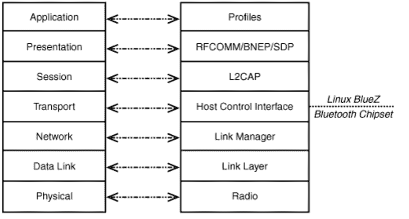

将蓝牙硬件与微控制器连接的常见方法是将芯片的数据线连接到控制器的UART引脚。第13章"音频驱动程序"中的图13.4展示了一个MP3播放器上的蓝牙芯片通过UART与处理器通信。USB是另一种常用于与蓝牙芯片组通信的方式。第11章"通用串行总线"中的图11.2展示了一个嵌入式设备上的蓝牙芯片通过USB与处理器接口。无论你使用UART还是USB（我们将在后面查看这两种类型的设备），用于传输蓝牙数据的数据包格式都是HCI。

### BlueZ

BlueZ蓝牙实现是主线内核的一部分，也是官方的Linux蓝牙栈。

图16.2展示了BlueZ如何将蓝牙协议层映射到内核模块、内核线程、用户空间守护进程、配置工具、实用程序和库。主要的BlueZ组件解释如下：

- 1. *bluetooth.ko*包含核心的BlueZ基础设施。所有其他BlueZ模块都使用其服务。它还负责向用户空间导出蓝牙套接字族（`AF_BLUETOOTH`）并填充相关的sysfs条目。

- 2. 要通过UART传输蓝牙HCI数据包，相应的BlueZ HCI实现是*hci_uart.ko*。对于USB传输，它是*hci_usb.ko*。

- 3. *l2cap.ko*实现L2CAP适配层，负责分段和重组。它还在不同的上层协议之间进行复用。

- 4. 要在蓝牙上运行TCP/IP应用程序，你必须使用BNEP在L2CAP上仿真以太网端口。这是由*bnep.ko*完成的。为了处理BNEP连接，BlueZ会生成一个名为*kbnepd*的内核线程。

- 5. 要在蓝牙上运行终端仿真器等串口应用程序，你需要在L2CAP上仿真串口。这是由*rfcomm.ko*完成的。RFCOMM还充当支持PPP网络的支柱。为了处理传入的RFCOMM连接，*rfcomm.ko*会生成一个名为*krfcommd*的内核线程。要设置和维护与目标设备上各个RFCOMM通道的连接，请使用*rfcomm*实用程序。

- 6. *人机接口设备*（HID）层通过*hidp.ko*实现。用户模式守护进程*hidd*让BlueZ能够处理蓝牙鼠标等输入设备。

- 7. 音频通过由*sco.ko*实现的*面向同步连接*（SCO）层处理。

#### **图16.2 映射到BlueZ内核模块的蓝牙协议层。**

[查看完整尺寸图像]

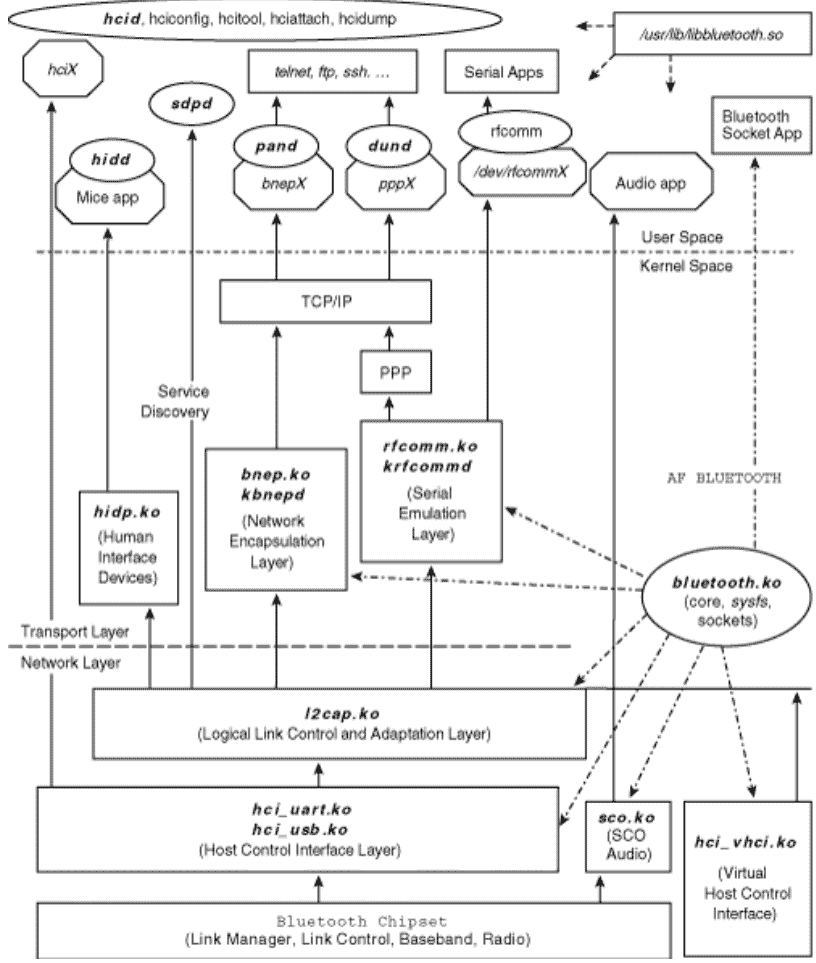

现在让我们追踪两个示例蓝牙设备的内核代码流程：一个*紧凑闪存*（CF）卡和一个USB适配器。

### 设备示例：CF卡

Sharp蓝牙紧凑闪存卡采用Silicon Wave芯片组构建，并使用串行传输来承载HCI数据包。有三种不同的方式可以串行传输HCI数据包：

- 1. H4（UART），Sharp CF卡使用的就是这种方式。H4是蓝牙规范定义的通过UART传输蓝牙数据的标准方法。查看*drivers/bluetooth/hci_h4.c*了解BlueZ的实现。

- 2. H3（RS232）。使用H3的设备很难找到。BlueZ不支持H3。

- 3. BlueCore串行协议（BCSP），这是剑桥硅射频（CSR）的专有协议，支持错误检查和重传。BCSP用于基于CSR BlueCore芯片的非USB设备，包括PCMCIA和CF卡。BlueZ的BCSP实现位于*drivers/bluetooth/hci_bcsp.c*。

Sharp蓝牙卡的读取数据路径如图16.3所示。卡与内核的第一个接触点是在UART驱动程序处。如你在第9章"PCMCIA和紧凑闪存"中的图9.5所见，串行卡服务驱动程序*drivers/serial/serial_cs.c*让操作系统的其余部分将Sharp卡视为串行设备。串行驱动程序将接收到的HCI数据包传递给BlueZ。BlueZ以内核线路规程的形式实现HCI处理。正如你在第6章"串行驱动程序"中学到的，线路规程位于串行驱动程序之上并塑造其行为。HCI线路规程调用关联的协议例程（此处为H4）来协助数据处理。从那时起，L2CAP和更高的BlueZ层接管工作。

#### 图16.3 从Sharp蓝牙CF卡的读取数据路径。


 ## 设备示例：USB 适配器

现在让我们来看一个使用 USB 传输 HCI 数据包的设备。Belkin 蓝牙 USB 适配器就是这样的一个设备。在这种情况下，Linux USB 层（*drivers/usb/*）、HCI USB 传输驱动（*drivers/bluetooth/hci_usb.c*）和 BlueZ 协议栈（*net/bluetooth/*）是推动数据传输的主要角色。让我们看看这三个内核层是如何交互的。

正如你在第 11 章中学到的，USB 设备使用四个管道中的一个或多个来交换数据。对于蓝牙 USB 设备，每个管道负责传输特定类型的数据：

1. 控制管道用于传输 HCI 命令。
2. 中断管道负责传输 HCI 事件。
3. 批量管道传输*异步无连接*（ACL）蓝牙数据。
4. 同步管道传输 SCO 音频数据。

你在第 11 章中还看到，当 USB 设备插入系统时，主控制器驱动使用控制管道对其进行枚举，并分配 1 到 127 之间的端点地址。USB 子系统在枚举期间读取的配置描述符包含有关设备的信息，例如其 `class`、`subclass` 和 `protocol`。蓝牙规范将蓝牙 USB 设备的 (`class`, `subclass`, `protocol`) 代码定义为 (`0xE, 0x01, 0x01`)。HCI USB 传输驱动（*hci_usb*）在初始化期间将这些值注册到 USB 核心。当 Belkin USB 适配器插入时，USB 核心从设备配置描述符中读取 (`class`, `subclass`, `protocol`) 信息。由于这些信息与 *hci_usb* 注册的值匹配，因此该驱动被附加到 Belkin USB 适配器上。*hci_usb* 从前面描述的四个 USB 管道读取蓝牙数据，并将其传递给 BlueZ 协议栈。Linux 应用程序现在可以在这个设备上无缝运行，如图 16.2 所示。

### RFCOMM

RFCOMM 在蓝牙上模拟串口。终端模拟器等应用程序以及 PPP 等协议可以不经修改地在 RFCOMM 创建的虚拟串口接口上运行。

#### 设备示例：药片分配器

举个例子，假设你有一个支持蓝牙的药片分配器。当你从分配器中取出一粒药片时，它会通过蓝牙 RFCOMM 通道发送一条消息。如图 6.5 中所示的 Linux 手机等设备，会使用一个简单的应用程序读取此警报，该应用程序建立与药片分配器的 RFCOMM 连接。然后手机通过其 GPRS 接口将此信息发送到互联网上的医疗服务提供商服务器。

清单 16.1 展示了 Linux 手机上使用 BlueZ 套接字 API 读取来自药片分配器数据的应用程序框架。该清单假设你熟悉套接字编程的基础知识。

#### 清单 16.1. 通过 RFCOMM 与药片分配器通信

```
Code View:
#include <sys/socket.h>
#include <bluetooth/rfcomm.h> /* For struct sockaddr_rc */

void
sense_dispenser()
{
  int pillfd;
  struct sockaddr_rc pill_rfcomm;
  char buffer[1024];

  /* ... */

  /* Create a Bluetooth RFCOMM socket */
  if ((pillfd = socket(PF_BLUETOOTH, SOCK_STREAM, BTPROTO_RFCOMM))
      < 0) {
    printf("Bad Bluetooth RFCOMM socket");
    exit(1);
  }

  /* Connect to the pill dispenser */
  pill_rfcomm.rc_family  = AF_BLUETOOTH;
  pill_rfcomm.rc_bdaddr  = PILL_DISPENSER_BLUETOOTH_ADDR;
  pill_rfcomm.rc_channel = PILL_DISPENSER_RFCOMM_CHANNEL;

  if (connect(pillfd, (struct sockaddr *)&pill_rfcomm,
              sizeof(pill_rfcomm))) {
    printf("Cannot connect to Pill Dispenser\n");
    exit(1);
  }

  printf("Connection established to Pill Dispenser\n");
  /* MaskPoll until data is ready */
  select(pillfd, &fds, NULL, NULL, &timeout);

  /* Data is available on this RFCOMM channel */
  if (FD_ISSET(pillfd, fds)) {

    /* Read pill removal alerts from the dispenser */
    read(pillfd, buffer, sizeof(buffer));

    /* Take suitable action; e.g., send a message to the health
       care provider's server on the Internet via the GPRS
       interface */
    /* ... */
  }

  /* ... */
}
```

### 网络

从图 16.2 中的 *telnet/ftp/ssh* 框开始追踪代码路径，以了解如何在 BlueZ 蓝牙上构建网络。如你所见，有两种通过蓝牙进行网络连接的不同方式：

1. 通过在 BNEP 上直接运行 TCP/IP。由此产生的网络称为*个人区域网*（PAN）。

2. 通过在 RFCOMM 上的 PPP 运行 TCP/IP。这称为*拨号网络*（DUN）。

蓝牙网络的内核实现不太可能引起设备驱动程序编写者的兴趣，因此我们不会深入探讨。然而，表 16.2 展示了使用 PAN 对两台笔记本电脑进行网络连接的步骤。使用 DUN 进行网络连接与此类似，不做讨论。这两台笔记本电脑分别使用前面讨论过的 Sharp CF 卡和 Belkin USB 适配器启用蓝牙功能。你可以使用被动式 CF 转 PCMCIA 适配器将 CF 卡插入第一台笔记本电脑的 PCMCIA 插槽中。结合图 16.2 和表 16.2 一起查看，以了解与相应 BlueZ 组件的映射关系。表 16.2 使用 `bash-sharp>` 和 `bash-belkin>` 分别作为两台笔记本电脑的 shell 提示符。

在使用 Sharp 蓝牙 CF 卡的笔记本电脑上：

1. 启动 HCI 和服务发现守护进程：

```
bash-sharp> hcid
bash-sharp> sdpd
```

由于此设备具有 UART 接口，你必须将 BlueZ 栈附加到适当的串口。在这种情况下，假设 *serial_cs* 已将 */dev/ttyS3* 分配给该卡：

```
bash-sharp> hciattach ttyS3 any
```

2. 验证 HCI 接口是否已启动：

```
bash-sharp> hciconfig -a
hci0:   Type: UART
 BD Address: 08:00:1F:10:3B:13 ACL MTU: 60:20  SCO MTU: 31:1
 UP RUNNING PSCAN ISCAN
 ...
Manufacturer: Silicon Wave (11)
```

3. 验证基本的 BlueZ 模块是否已加载：

```
bash-sharp> lsmod
Module                  Size  Used by
hci_uart              16728  3
l2cap                 26144  2
bluetooth             47684  6 hci_uart,l2cap
...
```

4. 插入实现网络封装的 BlueZ 模块：

```
bash-sharp> modprobe bnep
```

5. 监听传入的 PAN 连接：[1]

```
bash-sharp> pand -s
```

在使用 Belkin USB 蓝牙适配器的笔记本电脑上：

1. 启动守护进程，如 hcid 和 sdpd，并插入必要的内核模块，如 *bluetooth.ko* 和 *l2cap.ko*。

2. 由于这是 USB 设备，你无需调用 hciattach，但要确保插入 *hci_usb.ko* 模块。

3. 验证 HCI 接口是否已启动：

Code View:

```
bash-belkin> hciconfig -a
hci0:   Type: USB BD Address: 00:02:72:B0:33:AB ACL MTU: 192:8  SCO MTU: 64:8
UP RUNNING PSCAN ISCAN
...
Manufacturer: Cambridge Silicon Radio (10)
```

4. 搜索并发现附近的设备：

```
bash-belkin> hcitool -i hci0 scan --flush
Scanning....
08:00:1F:10:3B:13 bash-sharp
```

5. 与第一台笔记本电脑建立 PAN。你可以从其 `hciconfig` 输出中获取它的蓝牙地址（08:00:1F:10:3B:13）：

```
bash-belkin> pand -c 08:00:1F:10:3B:13
```

如果现在查看两台笔记本电脑上的 `ifconfig` 输出，你会发现名为 `bnep0` 的新接口已在两端出现。为两个接口分配 IP 地址，然后开始 telnet 和 FTP 吧！

| 表 16.2. | 使用蓝牙 PAN 对两台笔记本电脑进行网络连接 |
|-------------|--------------------------------------------|

### 人机接口设备

请参阅第 7 章"输入驱动程序"中的"USB 和蓝牙键盘"和"USB 和蓝牙鼠标"部分，了解有关蓝牙人机接口设备的讨论。

## 音频

让我们以 HBH-30 Sony Ericsson 蓝牙耳机为例来理解蓝牙 SCO 音频。在耳机开始与 Linux 设备通信之前，后者的蓝牙链路层必须先发现前者。为此，按下专门用于设备发现的按钮，将耳机设置为*可发现*模式。此外，你必须将耳机的*个人识别号码*（PIN）配置到 BlueZ 中，将其添加到 */etc/bluetooth/pin*。现在，Linux 设备上使用 BlueZ SCO API 的应用程序可以向耳机发送音频数据。音频数据应该是耳机能理解的格式。HBH-30 使用 A-law PCM（*脉冲编码调制*）格式。有公共领域的工具可以将音频转换为各种 PCM 格式。

蓝牙芯片组通常除了 HCI 传输接口外，还具有 PCM 接口引脚。如果设备同时支持蓝牙和*全球移动通信系统*（GSM），例如，来自 GSM 芯片组的 PCM 线可能直接连接到蓝牙芯片的 PCM 音频线。这时你可能需要配置蓝牙芯片，使其通过 HCI 接口而非 PCM 接口接收和发送 SCO 音频数据包。

## 调试

有两个 BlueZ 工具对调试很有用：

**hcidump**捕获往返传输的HCI数据包，并将其解析为人类可读的格式。以下是在设备查询过程中收到的一个示例转储：

```
bash> hcidump -i hci0
HCIDump - HCI packet分析器 版本 1.11
device: hci0 snap_len: 1028 filter: 0xffffffff
  HCI Command: Inquiry (0x01|0x0001) plen 5
  HCI Event: Command Status (0x0f) plen 4
  HCI Event: Inquiry Result (0x02) plen 15
  ...
  HCI Event: Inquiry Complete (0x01) plen 1 < HCI Command:
  Remote Name Request (0x01|0x0019) plen 10
  ...
```

虚拟HCI驱动程序（*hci_vhci.ko*），如图16.2所示，如果你没有实际的硬件，可以模拟一个蓝牙接口。

## 查看源代码

查看*drivers/bluetooth/*以了解BlueZ底层驱动程序。探索*net/bluetooth/*以深入了解BlueZ协议实现。

蓝牙应用程序根据其行为特点归入不同的*配置文件*（profile）。例如，无绳电话配置文件规定了蓝牙设备如何实现无绳电话。我们讨论了PAN和串行访问的配置文件，但还有更多配置文件，如传真配置文件、*通用对象交换配置文件*（GOEP）和*SIM访问配置文件*（SAP）。可从www.bluez.org下载的*bluez-utils*包提供了对多个蓝牙配置文件的支持。

官方蓝牙网站是www.bluetooth.org。该网站包含蓝牙规范文档以及有关*蓝牙特别兴趣组*（SIG）的信息。

Affix是Linux上另一种蓝牙协议栈。你可以从http://affix.sourceforge.net/ 下载Affix。

## 红外

*红外*（IR）射线是位于电磁光谱的可见光区域和微波区域之间的光波。IR的一个用途是点对点数据通信。使用IR，你可以在PDA之间交换名片、将两台笔记本电脑联网，或将文档发送到打印机。IR在从–15到+15度扩散的30度锥形范围内，有效距离可达1米。

有两种流行的IR通信变体：*标准红外*（SIR），支持最高115.20 Kbaud的速度；以及*快速红外*（FIR），其带宽为4Mbps。

图16.4展示了笔记本电脑上的红外连接。Super I/O芯片组中的UART1支持红外功能，因此红外收发器直接连接到它。Super I/O芯片没有红外支持的笔记本电脑可以依赖外部红外适配器（参见"设备示例：红外适配器"一节），类似于连接到UART0的那个。图16.5展示了在嵌入式SoC上，内置红外适配器连接到系统UART的红外连接。

### 图16.4. 笔记本电脑上的IrDA。

### 图16.5. 嵌入式设备上的IrDA（例如，EP7211）。

Linux在两个层面支持红外通信：

1. 通过*红外数据协会*（IrDA）指定的协议进行智能数据传输。这是由Linux-IrDA项目实现的。

2. 通过遥控器控制应用程序。这是由*Linux红外遥控*（LIRC）项目实现的。

本节主要探讨Linux-IrDA，但在结束前会快速了解一下LIRC。

## Linux-IrDA

Linux-IrDA项目（http://irda.sourceforge.net/）将IrDA功能引入内核。为了解Linux-IrDA组件与IrDA协议栈以及可能的硬件配置之间的关系，让我们穿越图16.6：

1. 设备驱动程序构成最底层。与16550兼容的SIR芯片组可以在使用IrDA线路规程IrTTY塑造其原生Linux串行驱动程序的行为后重用它。这种组合的一个替代方案是IrPort驱动程序。FIR芯片组有其自己的特殊驱动程序。

2. 接下来是核心协议栈。这包括*IR链路访问协议*（IrLAP）、*IR链路管理协议*（IrLMP）、*微型传输协议*（TinyTP）和*IrDA套接字*（IrSock）接口。IrLAP提供可靠的传输以及发现邻近设备的状态机。IrLMP是IrLAP之上的多路复用器。TinyTP提供分段、重组和流量控制。IrSock在IrLMP和TinyTP之上提供套接字接口。

3. 协议栈的更高区域将IrDA与数据传输应用程序结合起来。**IrLAN**和**IrNET**实现联网，而**IrComm**允许串行通信。

4. 你还需要最终能够成就或破坏这项技术的应用程序。一个例子是*openobex*（[http://openobex.sourceforge.net/](http://openobex.sourceforge.net/)），它实现了用于交换文档和名片等对象的*对象交换*（OBEX）协议。要配置Linux-IrDA，你需要随许多发行版捆绑的*irda-utils*包。这提供了*irattach*、*irdadump*和*irdaping*等工具。

### 图16.6. 通过Linux-IrDA进行通信。

[查看全尺寸图像]

### 设备示例：Super I/O芯片

为了初步体验Linux-IrDA，让我们通过红外让两台笔记本电脑相互通信。每台笔记本电脑都通过National Semiconductor的NSC PC87382 Super I/O芯片支持红外功能。[2] 图16.4中的UART1显示了连接场景。PC87382芯片可以在SIR和FIR两种模式下工作。我们将依次查看每种模式。

> [2] Super I/O芯片组通常除了IrDA之外还支持多种外设，如串行端口、并行端口、乐器数字接口（MIDI）和软盘控制器。

SIR芯片向主机计算机提供UART接口。要在SIR模式下通信，将每台笔记本电脑的相应UART端口（本例中为/dev/ttyS1）附加到IrDA协议栈：

```
bash> irattach /dev/ttyS1 -s
```

验证IrDA内核模块（*irda.ko*、*sir_dev.ko*和*irtty_sir.ko*）已加载，并且*irda_sir_wq*内核线程正在运行。irda0接口也应该出现在`ifconfig`的输出中。`irattach`的`-s`选项触发对附近红外活动的搜索。如果你滑动笔记本电脑，使它们的红外收发器位于范围锥内，它们将能够发现彼此：

```
bash> cat /proc/net/irda/discovery
nickname: localhost, hint: 0x4400, saddr: 0x55529048, daddr: 0x8fefb350
```

另一台笔记本电脑发出类似的通告，但源地址和目标地址（`saddr`和`daddr`）互换。你可以使用stty在ttyS1上设置所需的通信速度。要将波特率设置为19200，请执行以下操作：

```
bash> stty speed 19200 < /dev/ttyS1
```

从空气中捕捉红外活动的最简单方法是使用调试工具*irdadump*。以下是在上述连接建立过程中获取的示例转储，显示了协商的参数：

代码视图：

```
bash> irdadump -i irda0
...
22:05:07.831424 snrm:cmd ca=fe pf=1 6fb7ff33 > 2c0ce8b6 new-ca=40
LAP QoS: Baud Rate=19200bps Max Turn Time=500ms Data Size=2048B Window Size=7 Add BOFS=0 Min Turn Time=5000us Link Disc=12s (32)
22:05:07.987043 ua:rsp ca=40 pf=1 6fb7ff33 < 2c0ce8b6
LAP QoS: Baud Rate=19200bps Max Turn Time=500ms Data Size=2048B Window Size=7 Add BOFS=0 Min Turn Time=5000us Link Disc=12s (31)
...
```

你还可以通过控制*/proc/sys/net/irda/debug*中的详细程度级别，从IrDA协议栈获取调试信息。

要将笔记本电脑设置为FIR模式，请将ttyS1从原生串行驱动程序分离，并将其附加到NSC FIR驱动程序*nsc-ircc.ko*：

```
bash> setserial /dev/ttyS1 uart none
bash> modprobe nsc-ircc dongle_id=0x09
bash> irattach irda0 -s
```

`dongle_id`取决于你的红外硬件，可以从硬件文档中找到。就像对SIR所做的那样，查看*/proc/net/irda/discovery*以确认到目前为止一切正常。有时，FIR通信在较高速度下会挂起。如果irdadump显示通信冻结，要么戴上你的内核黑客帽子修复代码，要么尝试通过调整*/proc/sys/net/irda/max_baud_rate*来降低协商速度。

请注意，与可以建立一对多连接的蓝牙物理层不同，红外每个物理设备一次只能支持单个连接。


 ## 设备示例：红外适配器

*适配器*（Dongles）是插入串口或 USB 端口的红外设备。一些具有片上红外控制器并连接到其 UART 的微控制器（如图 16.5 所示的 Cirrus Logic 的 EP7211）也被视为适配器。

适配器驱动是一组控制方法，负责更改通信速度等操作。它们有四个入口点：`open()`、`reset()`、`change_speed()` 和 `close()`。这些入口点定义在 `dongle_driver` 结构中，并从 IrDA 内核线程 *irda_sir_wq* 的上下文中调用。适配器驱动方法允许阻塞，因为它们是在没有持有锁的进程上下文中调用的。IrDA 核心为适配器驱动提供三个辅助函数：`sirdev_raw_write()` 和 `sirdev_raw_read()` 用于与关联的 UART 交换控制数据，`sirdev_set_dtr_rts()` 用于操作连接到 UART 的调制解调器控制线。

因为你更可能为适配器添加内核支持，而不是修改 Linux-IrDA 的其他部分，所以让我们实现一个示例适配器驱动。假设你要启用一个尚未支持的简单串行红外适配器，它仅在 19200 或 57600 波特率下通信。再假设当用户要在这两个值之间切换波特率时，你需要将 UART 的 *请求发送*（RTS）引脚保持低电平 50 微秒，然后再拉高 25 微秒。清单 16.2 为该设备实现了一个适配器驱动。

#### 清单 16.2. 示例适配器驱动

```
Code View:
#include <linux/delay.h>
#include <net/irda/irda.h>
#include "sir-dev.h"   /* 假设此示例驱动位于
                       drivers/net/irda/ */

/* 打开方法。当对关联的 UART 发出 irattach 命令时调用此方法 */
static int
mydongle_open(struct sir_dev *dev)
{
  struct qos_info *qos = &dev->qos;

  /* 通过设置调制解调器控制线 DTR/RTS 为适配器供电 */
  sirdev_set_dtr_rts(dev, TRUE, TRUE);

  /* mydongle 可接受的波特率 */
  qos->baud_rate.bits &= IR_19200|IR_57600;

  irda_qos_bits_to_value(qos); /* 设置 QoS */
  return 0;
}

/* 修改波特率 */
static int
mydongle_change_speed(struct sir_dev *dev, unsigned speed)
{
  if ((speed == 19200) || (speed == 57600)){
     /* 通过将 RTS 脉冲拉低 50 微秒，
        再拉高 25 微秒来切换速度 */
     sirdev_set_dtr_rts(dev, TRUE, FALSE);
     udelay(50);
     sirdev_set_dtr_rts(dev, TRUE, TRUE);
     udelay(25);
     return 0;
  } else {
     return -EINVAL;
  }
}
```

/* 重置 */

```
static int
mydongle_reset(struct sir_dev *dev)
{
  /* 按照规范重置适配器，例如，
     将 DTR 拉低 50 微秒 */
  sirdev_set_dtr_rts(dev, FALSE, TRUE);
  udelay(50);
  sirdev_set_dtr_rts(dev, TRUE, TRUE);
  dev->speed = 19200; /* 重置速度为 19200 波特 */
  return 0;
}
```

/* 关闭 */

```
static int
mydongle_close(struct sir_dev *dev)
{
  /* 按照规范关闭适配器电源，
     例如，将 DTR 和 RTS 拉低.. */
  sirdev_set_dtr_rts(dev, FALSE, FALSE);
  return 0;
}
```

/* 适配器驱动方法 */

```
static struct dongle_driver mydongle = {
  .owner    = THIS_MODULE,
  .type     = MY_DONGLE,          /* 将其添加到 include/linux/irda.h
                                     中的枚举 */
  .open     = mydongle_open,       /* 打开 */
  .reset    = mydongle_reset,      /* 重置 */
  .set_speed = mydongle_change_speed, /* 修改速度 */
  .close    = mydongle_close,      /* 关闭 */
};
```

/* 初始化 */

```
static int __init
mydongle_init(void)
{
  /* 注册入口点 */
  return irda_register_dongle(&mydongle);
}
```

/* 释放 */

```
static void __exit
mydongle_cleanup(void)
{
  /* 注销入口点 */
  irda_unregister_dongle(&mydongle);
}
```

```
module_init(mydongle_init);
module_exit(mydongle_cleanup);
```

如需真实示例，请查看 *drivers/net/irda/tekram.c* 和 *drivers/net/irda/ep7211_ir.c*。

既然物理层已经运行，让我们进一步探索 IrDA 协议。

### IrComm

IrComm 模拟串行端口。终端模拟器等应用程序以及 PPP 等协议可以在 IrComm 创建的虚拟串行接口上无需修改地运行。IrComm 由两个相关模块实现：*ircomm.ko* 和 *ircomm_tty.ko*。前者提供核心协议支持，而后者创建和管理模拟的串行端口节点 /dev/ircommX。

### 网络

有三种方式可以让 TCP/IP 应用程序通过 IrDA 运行：

1. 通过 IrComm 运行异步 PPP
2. 通过 IrNET 运行同步 PPP
3. 使用 IrLAN 进行以太网模拟

通过 IrComm 进行网络连接相当于在串行端口上运行异步 PPP，因此这种情况没有什么特别之处。

异步 PPP 需要使用诸如字节填充等技术来标记帧的起始和结束，但如果 PPP 运行在以太网等数据链路上，则无需承担帧协议的开销。这称为同步 PPP，用于配置通过 IrNET 的网络连接。[3] 通过 PPP 层可以获得诸如按需 IP 地址配置、压缩和身份验证等功能。

> [3] 关于通过 IrNET 进行网络连接的学术讨论，请阅读 www.hpl.hp.com/personal/Jean_Tourrilhes/Papers/IrNET.Demand.html。

要启动 IrNET，请插入 *irnet.ko*。这也会创建字符设备节点 /dev/irnet，这是一个控制通道，你可以通过它连接 PPP 守护进程：

```
bash> pppd /dev/irnet 9600 noauth a.b.c.d:a.b.c.e
```

这会在两端产生 *pppX* 网络接口，各自的 IP 地址分别设置为 a.b.c.d 和 a.b.c.e。这些接口现在可以传输 TCP/IP 数据包了。

IrLAN 通过 IrDA 提供原始以太网模拟。要使用 IrLAN 将笔记本电脑联网，请在两端执行以下操作：

- 插入 *irlan.ko*。这会创建网络接口 *irlanX*，其中 *X* 是分配的接口编号。
- 配置 *irlanX* 接口。要设置 IP 地址，可以执行以下操作：

```
bash> ifconfig irlanX a.b.c.d
```

或者通过将以下行添加到 /etc/sysconfig/network-scripts/ifcfg-irlan0 来自动化配置：[4]

> [4] 此文件的位置取决于发行版。

```
DEVICE=irlanX IPADDR=a.b.c.d
```

你现在可以通过 irlanX 接口在笔记本电脑之间进行 telnet  Scratches.

### IrDA 套接字

要开发基于 IrDA 的自定义应用程序，请使用 IrSock 接口。要通过 TinyTP 创建套接字，请执行以下操作：

```
int fd = socket(AF_IRDA, SOCK_STREAM, 0);
```

要通过 IrLMP 创建数据报套接字，请执行以下操作：

```
int fd = socket(AF_IRDA, SOCK_DGRAM, 0);
```

有关代码示例，请查看 irda-utils 包中的 irsockets/ 目录。

## Linux 红外遥控

LIRC 项目的目标是让你能够通过遥控器控制你的 Linux 计算机。例如，你可以使用 LIRC 通过遥控器上的按钮控制播放 MP3 音乐或 DVD 电影的应用程序。LIRC 的架构分为：

1. 一个名为 lirc_dev 的基础 LIRC 模块。
2. 一个硬件特定的物理层驱动。通过串口接口的红外硬件使用 lirc_serial。为了让 lirc_serial 不受干扰地工作，需要像之前为 FIR 所做的那样，将内核串口驱动分离出来：

   ```
   bash> setserial /dev/ttySX uart none
   ```

   根据你的红外设备，你可能需要用更合适的底层 LIRC 驱动替换 lirc_serial。
3. 一个名为 lircd 的用户模式守护进程，运行在底层 LIRC 驱动之上。Lircd 解码来自遥控器的信号，是 LIRC 的核心。许多遥控器的支持以用户空间驱动的形式实现，作为 lircd 的一部分。Lircd 向更高层应用程序导出 UNIX 域套接字接口 /dev/lircd。通过 /dev/lircd 连接到 lircd 是编写支持 LIRC 的应用程序的关键。
4. 一个名为 lircmd 的 LIRC 鼠标守护进程，运行在 lircd 之上。Lircmd 将来自 lircd 的消息转换为鼠标事件。这些事件可以从命名管道 /dev/lircm 读取，并输入到 gpm 或 X Windows 等程序中。


 +   5. 诸如*irrecord*和*irsend*之类的工具。前者接收来自遥控器的信号并帮助生成新遥控器的红外配置文件，后者从你的 Linux 机器发送红外命令。

请访问托管在 [www.lirc.org](http://www.lirc.org) 的 LIRC 主页，下载所有这些工具并了解其设计和使用方法。

## IR 字符设备驱动程序

如果你的嵌入式设备只需要简单的红外接收功能，它可能使用微型红外接收器（如 Vishay Semiconductors 的 TSOP1730 芯片）。一个应用实例是安装在病房中的红外定位器，用于读取护士佩戴的红外胸牌发出的数据。在这种情况下，由于不存在 IrDA 协议交互，IrDA 栈并不适用。此外，如果定位器使用精简的专有协议来解析接收到的数据，移植 LIRC 也可能过于繁琐。一个简单的解决方案可能是实现一个小的只读字符或杂项驱动程序，通过 */dev* 或 */sys* 接口将原始红外数据导出给合适的应用程序。

## 查看源代码

请在 *drivers/net/irda/* 中查看 IrDA 底层驱动程序，在 *net/irda/* 中查看协议实现，在 *include/net/irda/* 中查看头文件。尝试使用 *proc/sys/net/irda/** 来调整 IrDA 栈，并探索 */proc/net/irda/** 以获取与不同 IrDA 层相关的状态信息。

[表 16.3](#) 包含本节中使用的主要数据结构及其在源码树中的位置。[表 16.4](#) 列出了本节中使用的主要内核编程接口及其定义位置。

### 表 16.3. 数据结构汇总

| 数据结构 | 位置 | 说明 |
| --- | --- | --- |
| `dongle_driver` | *drivers/net/irda/sir-dev.h* | 加密狗驱动程序入口点 |
| `sir_dev` | *drivers/net/irda/sir-dev.h* | SIR 设备的表示 |
| `qos_info` | *include/net/irda/qos.h* |석服务质量信息 |

### 表 16.4. 内核编程接口汇总

| 内核接口 | 位置 | 说明 |
| --- | --- | --- |
| `irda_register_dongle()` | *drivers/net/irda/sir_dongle.c* | 注册加密狗驱动程序 |
| `irda_unregister_dongle()` | *drivers/net/irda/sir_dongle.c* | 注销加密狗驱动程序 |
| `sirdev_set_dtr_rts()` | *drivers/net/irda/sir_dev.c* | 切换连接到红外设备的串口上的调制解调器控制线 |
| `sirdev_raw_write()` | *drivers/net/irda/sir_dev.c* | 写入连接到红外设备的串口 |
| `sirdev_raw_read()` | *drivers/net/irda/sir_dev.c* | 从连接到红外设备的串口读取 |

## WiFi

WiFi，即*无线局域网*（WLAN），是有线局域网的替代方案，通常用于校园范围内。IEEE 802.11a WLAN 标准使用 5GHz ISM（*工业、科学、医疗*）频段，支持最高 54Mbps 的速度。802.11b 和 802.11g 标准使用 2.4GHz 频段，分别支持 11Mbps 和 54Mbps 的速度。

WLAN 与有线以太网的相似之处在于，两者都从同一地址池分配 MAC 地址，且对操作系统而言都表现为常规网络接口。例如，*地址解析协议*（ARP）表中包含 WLAN MAC 地址和以太网 MAC 地址。

然而，WLAN 和有线以太网在链路层有显著差异：

- 802.11 WLAN 标准使用冲突避免（CSMA/CA），而有线以太网使用冲突检测（CSMA/CD）。
- 与以太网帧不同，WLAN 帧需要确认。
- 由于无线网络固有的安全问题，WLAN 采用称为*有线等效隐私*（WEP）的加密机制，以提供与有线以太网相当的安全级别。WEP 将 40 位或 104 位密钥与随机的 24 位初始化向量相结合，用于加密和解密数据。

WLAN 支持两种通信模式：

1. *Ad-hoc 模式*，即少量附近的站点直接通信，不使用接入点。
2. *基础设施模式*，即数据交换通过接入点进行。接入点定期广播*服务集标识符*（SSID 或 ESSID），用于区分不同的 WLAN 网络。

让我们了解 Linux 如何支持 WLAN。

### 配置

*Wireless Extensions* 项目定义了一个通用的 Linux API，以独立于设备的方式配置 WLAN 设备驱动程序。它还提供了一组通用工具来设置和访问 WLAN 驱动程序中的信息。各个驱动程序实现对 Wireless Extensions 的支持，以与通用接口以及工具连接。

通过 Wireless Extensions，主要有三种方式与 WLAN 驱动程序通信：

1. 使用 *iwconfig* 工具进行标准操作。要将你的驱动程序与 iwconfig 绑定，需要实现与命令对应的预设函数，用于设置 ESSID 和 WEP 密钥等参数。
2. 使用 *iwpriv* 进行特殊用途的操作。要在你的驱动程序上使用 iwpriv，需要定义与硬件相关的私有 ioctls，并实现相应的处理函数。
3. 通过 */proc/net/wireless* 获取 WiFi 特有的统计信息。为此，在你的驱动程序中实现 `get_wireless_stats()` 方法。这是对第 15 章"网络接口卡"中"统计信息"一节所述的、NIC 驱动程序用于通用统计信息收集的 `get_stats()` 方法的补充。

WLAN 驱动程序将这三部分信息封装在一个名为 `iw_handler_def` 的结构中，该结构定义在 *include/net/iw_handler.h* 中。此结构的地址在初始化期间通过设备的 `net_device` 结构（在第 15 章中讨论）提供给内核。清单 16.3 展示了一个实现 Wireless Extensions 支持的基本 WLAN 驱动程序。列表中的注释解释了相关代码。

#### 清单 16.3. 支持 Wireless Extensions

```
Code View:
#include <net/iw_handler.h>
#include <linux/wireless.h>

/* 填充 iw_handler_def 结构，包括标准和私有处理程序的位置和数量、
   私有处理程序的参数细节，以及 get_wireless_stats() 的位置 */
static struct iw_handler_def mywifi_handler_def = {
  .standard           = mywifi_std_handlers,
  .num_standard       = sizeof(mywifi_std_handlers) /
                         sizeof(iw_handler),
  .private            = (iw_handler *) mywifi_pvt_handlers,
  .num_private        = sizeof(mywifi_pvt_handlers) /
                         sizeof(iw_handler),
  .private_args       = (struct iw_priv_args *)mywifi_pvt_args,
  .num_private_args   = sizeof(mywifi_pvt_args) /
                         sizeof(struct iw_priv_args),
  .get_wireless_stats = mywifi_stats,
};

/* 对应 iwconfig 的处理程序 */
static iw_handler mywifi_std_handlers[] = {
  NULL,               /* SIOCSIWCOMMIT */
  mywifi_get_name,    /* SIOCGIWNAME */
  NULL,               /* SIOCSIWNWID */
  NULL,               /* SIOCGIWNWID */
  mywifi_set_freq,    /* SIOCSIWFREQ */
  mywifi_get_freq,    /* SIOCGIWFREQ */
  mywifi_set_mode,    /* SIOCSIWMODE */
  mywifi_get_mode,    /* SIOCGIWMODE */
  /* ... */
};
#define MYWIFI_MYPARAMETER  SIOCIWFIRSTPRIV

/* 对应 iwpriv 的处理程序 */
static iw_handler mywifi_pvt_handlers[] = {
  mywifi_set_myparameter,
  /* ... */
};

/* 私有处理程序的参数描述 */
```

```
static const struct iw_priv_args mywifi_pvt_args[] = {
  { MYWIFI_MYPARAMETER,
    IW_PRIV_TYPE_INT | IW_PRIV_SIZE_FIXED | 1, 0, "myparam"},
}

struct iw_statistics mywifi_stats; /* WLAN 统计信息 */

/* 设置工作频率的方法，通过 mywifi_std_handlers 提供。
   类似地实现其余方法 */
mywifi_set_freq()
{
  /* 按照数据手册设置频率 */
  /* ... */
}

/* 读取 /proc/net/wireless 时调用 */
static struct iw_statistics *
mywifi_stats(struct net_device *dev)
{
  /* 填充 mywifi_stats 中的字段 */
  /* ... */
  return(&mywifi_stats);
}

/* 设备初始化。对于基于 PCI 的卡，从 probe() 方法调用。
   参见第 15 章清单 15.1 中的 init_mycard() 以获取完整讨论 */
static int
init_mywifi_card()
{
  struct net_device *netdev;
  /* 分配 WiFi 网络设备。内部调用 alloc_etherdev() */
  netdev = alloc_ieee80211(sizeof(struct mywifi_priv));
  /* ... */

  /* 注册 Wireless Extensions 支持 */
  netdev->wireless_handlers = &mywifi_handler_def;

  /* ... */
  register_netdev(netdev);
}
```

编译进 Wireless Extensions 支持后，你可以使用 iwconfig 配置 ESSID 和 WEP 密钥，查看支持的私有命令，并转储网络统计信息：

```
bash> iwconfig eth1 essid blue key 1234-5678-9012-3456-7890-1234-56

bash> iwconfig eth1
eth1    IEEE 802.11b ESSID:"blue" Nickname:"ipw2100"
        Mode:Managed Frequency:2.437 GHz Access Point: 00:40:96:5E:07:2E
        ...
```


 ```
Encryption key:1234-5678-9012-3456-7890-1234-56
Security mode:open
...
```

```
bash> dhcpcd eth1
```

```
bash> ifconfig
eth1   Link encap:Ethernet  Hwaddr 00:13:E8:02:EE:18
      inet addr:192.168.0.41  Bcast:192.168.0.255
      Mask:255.255.255.0
      ...
```

```
bash> iwpriv eth1
eth1  Available private ioctls:
      myparam   (8BE2): set 2 int  & get 0
```

```
bash> cat /proc/net/wireless
Inter-| sta-| Quality       | Discarded packets    | Missed | WE
 face | tus |link level noise|nwid crypt  frag retry misc| beacon | 19
  eth1: 0004 100.  207.  0.   0     0      0    2     1       0   19
```

本地的 iwconfig 参数（如 ESSID 和 WEP 密钥）应与接入点的配置相匹配。

还有另一个名为 *cfg80211* 的项目，其目标与 Wireless Extensions 类似。该项目从 2.6.22 内核版本开始已并入主线内核。

### 设备驱动程序

市场上有数百家 WLAN *原始设备制造商*（OEM），网卡有多种外形规格，如 PCI、Mini PCI、CardBus、PCMCIA、Compact Flash、USB 和 SDIO（参见侧边栏“基于 SDIO 的 WiFi”）。然而，这些设备核心的控制芯片数量相对较少，因此 Linux 设备驱动程序的数量也相对较少。Intersil Prism 芯片组、Lucent Hermes 芯片组、Atheros 芯片组和 Intel Pro/Wireless 是流行的 WLAN 控制器。以下是使用这些控制器构建的示例设备：

- **Intersil Prism2 WLAN 紧凑型闪存卡** — Orinoco WLAN 驱动程序（内核源码树的一部分）同时支持基于 Prism 和基于 Hermes 的网卡。请查看 *drivers/net/wireless/* 中的 *orinoco.c* 和 *hermes.c* 以获取源代码。*orinoco_cs* 提供了 PCMCIA/CF 卡服务支持。

- **Cisco Aironet CardBus 适配器** — 该网卡使用 Atheros 芯片组。*Madwifi* 项目（http://madwifi.org/）提供了一个 Linux 驱动程序，适用于使用 Atheros 控制器构建的硬件。Madwifi 的源代码库不是内核源码树的一部分，主要是由于许可证问题。Madwifi 驱动程序的一个名为 *硬件访问层*（HAL）的模块是闭源的。这是因为 Atheros 芯片能够在超出允许 ISM 频段的频率上工作，并且可以在各种功率级别下运行。美国*联邦通信委员会*（FCC）规定，此类设置不应由用户轻易更改。HAL 的一部分以二进制形式分发，以符合 FCC 法规。此仅二进制的部分与内核版本无关。

- **嵌入许多笔记本电脑中的 Intel Pro/Wireless Mini PCI（和 PCIe Mini）网卡** — 内核源码树包含这些网卡的驱动程序。2100 和 2200 BG 系列网卡的驱动程序分别是 *drivers/net/wireless/ipw2100.c* 和 *drivers/net/wireless/ipw2200.c*。这些设备需要板载固件才能工作。您可以从 http://ipw2100.sourceforge.net/ 或 http://ipw2200.sourceforge.net/ 下载固件，具体取决于您使用的是 2100 还是 2200。第 4 章“奠定基础”中的“微代码下载”部分描述了将固件下载到这些网卡所需的步骤。Intel 对固件的分发条款是有限制的。

- **WLAN USB 设备** — Atmel USB WLAN 驱动程序（[http://atmelwlandriver.sourceforge.net/](http://atmelwlandriver.sourceforge.net/)）支持使用 Atmel 芯片组构建的 USB WLAN 设备。

WLAN 驱动程序的任务是使您的网卡显示为正常的网络接口。驱动程序实现通常分为以下几个部分：

1. **与 Linux 网络协议栈通信的接口** — 我们在 [第 15 章](chapter15.html)的“[网络设备接口](chapter15.html)”一节中详细讨论了这一点。您可以将该章中的 [清单 15.1](chapter15.html#listing15_1) 用作模板来实现 WLAN 驱动程序的这一部分。

2. **外形规格专用代码** — 如果您的网卡是 PCI 网卡，则必须按照 [第 10 章](chapter10.html)“外设组件互连”中所述，使其架构符合内核 PCI 子系统。同样，PCMCIA 和 USB 网卡也必须与其各自的核心层连接。

3. **芯片组专用部分** — 这是 WLAN 驱动程序的基石，基于芯片数据手册中的寄存器规范。然而，许多公司不会发布足够的文档来编写开源设备驱动程序，因此某些 Linux WLAN 驱动程序的这一部分至少部分基于逆向工程。

4. **对 Wireless Extensions 的支持** — 前面所示的 [清单 16.3](listing16_3.html) 实现了一个示例。

802.11 协议栈的硬件无关部分可以在驱动程序之间复用，因此它们作为通用库函数集合实现在 *net/ieee80211/* 目录中。*ieee80211* 是核心协议模块，但如果您想通过 `iwconfig` 命令配置 WEP 密钥，则还必须加载 *ieee80211_crypt* 和 *ieee80211_crypt_wep*。要从 802.11 协议栈生成调试输出，请在配置内核时启用 `CONFIG_IEEE80211_DEBUG`。您可以使用 */proc/net/ieee80211/debug_level* 作为调节旋钮，以微调您希望看到的调试消息类型。从 2.6.22 版本开始，内核中有一个替代的 802.11 协议栈（*net/mac80211/*），由一家名为 Devicescape 的公司捐赠。WiFi 设备驱动程序将来可能会迁移到这个新协议栈。

### 基于 SDIO 的 WiFi

与功能已从存储扩展到各种其他技术的 PCMCIA 卡一样，SD 卡也不再局限于消费电子存储领域。*安全数字输入/输出*（SDIO）标准将 WiFi、蓝牙和 GPS 等技术带入 SD 领域。托管在 [http://sourceforge.net/projects/sdio-linux/](http://sourceforge.net/projects/sdio-linux/) 的 Linux-SDIO 项目为多种 SDIO 卡提供了驱动程序。

请访问 [www.sdcard.org](http://www.sdcard.org) 浏览 SD 卡协会的网站。该协会采用的最新标准是 microSD 和 miniSD，它们是 SD 卡的微型外形规格版本。

## 查看源代码

WiFi 设备驱动程序位于 *drivers/net/wireless/* 中。查看 *net/wireless/* 以了解 Wireless Extensions 和新的 *cfg80211* 配置接口的实现。两个 Linux 802.11 协议栈分别位于 *net/ieee80211/* 和 *net/mac80211/* 下。

## 蜂窝网络

*全球移动通信系统*（GSM）是一种著名的数字蜂窝标准。GSM 网络被称为 2G 或第二代网络。GPRS 代表了从 2G 到 2.5G 情况并非如此。与 2G 网络不同，2.5G 网络是“始终在线”的。与 GSM 的 9.6Kbps 吞吐量相比，GPRS 支持高达 170Kbps 的理论速度。2.5G GPRS 已经让位于基于 CDMA 等技术的 3G 网络，这些技术提供更高的速度。

在本节中，让我们来看看 GPRS 和 CDMA。

### GPRS

由于 GPRS 芯片是蜂窝调制解调器，它们向系统呈现 UART 接口，通常不需要专门的 Linux 驱动程序。Linux 支持常见 GPRS 硬件的方式如下：

1. 对于内置 GPRS 支持的系统，例如，一块将 Siemens MC-45 模块连接到微控制器 UART 通道的板卡，传统的 Linux 串行驱动程序可以驱动该链路。

2. 对于 PCMCIA/CF GPRS 设备（如 Options GPRS 卡），*serial_cs*（通用串行卡服务驱动程序）允许操作系统的其余部分将该卡视为串行设备。第一个未使用的串行设备（/dev/*ttySX*）将被分配给该卡。请参见第 9 章中的图 9.5 以获取图示。

3. 对于 USB GPRS 调制解调器，通常使用 USB 转串口转换器将 USB 端口转换为虚拟串行端口。*usbserial* 驱动程序让系统其余部分将 USB 调制解调器视为串行设备（/dev/*ttyUSBX*）。第 11 章中的“USB 串行”部分讨论了 USB 转串口转换器。

上述驱动程序描述也适用于驱动*全球定位系统*（GPS）接收器以及基于 GSM 的网络。

串行链路建立后，您可以通过 `AT` 命令建立网络连接，这是一种与调制解调器通信的标准语言。蜂窝设备支持扩展的 `AT` 命令集。确切的命令序列取决于所使用的特定蜂窝技术。例如，考虑通过 GPRS 连接的 `AT` 字符串。在进入数据模式并通过*网关 GPRS 支持节点*（GGSN）连接到外部网络之前，GPRS 设备必须使用 `AT` 命令定义一个上下文。以下是一个示例上下文字符串：

```
'AT+CGDCONT=1,"IP","internet1.voicestream.com","0.0.0.0",0,0'
```

其中 1 代表上下文编号，`IP` 是数据包类型，`internet1.voicestream.com` 是特定于服务提供商的*接入点名称*（APN），而 `0.0.0.0` 要求服务提供商选择 IP 地址。最后两个参数涉及数据和头部压缩。通常不需要用户名和密码。

正如您在第 9 章中看到的，PPP 被用作通过 GPRS 承载 TCP/IP 负载的工具。调用 PPP 守护进程 *pppd* 的常见语法如下：

```
bash> pppd ttySX call connection-script
```


其中 `ttySX` 是 PPP 运行的串口，`connection-script` 是 */etc/ppp/peers/*^[5]^ 中的一个文件，包含建立链路所需的 `AT` 命令序列。建立连接并完成认证后，PPP 启动一个*网络控制协议*（*Network Control Protocol*，NCP），例如*互联网协议控制协议*（*Internet Protocol Control Protocol*，IPCP）。当 IPCP 成功协商 IP 地址后，PPP 开始与 TCP/IP 协议栈通信。

^[5]^ 路径名称可能因您使用的发行版而异。

以下是一个 PPP 连接脚本的示例（*/etc/ppp/peer/gprs-seq*），用于以 57600 波特率连接到 GPRS 服务提供商。有关脚本中所有组成行的语义，请参阅 *pppd* 的手册页：

```
57600
connect "/usr/sbin/chat -s -v "" AT+CGDCONT=1,"IP",
"internet2.voicestream.com","0.0.0.0",0,0 OK AT+CGDATA="PPP",1"
crtscts
noipdefault
modem
usepeerdns
defaultroute
connect-delay 3000
```

### CDMA

出于性能考虑，许多 CDMA PC 卡内部都有一个 USB 控制器，通过它连接 CDMA 调制解调器。当插入此类卡时，系统会在 PCI 总线上看到一个或多个新的 PCI-to-USB 桥。我们以华为 CDMA CardBus 卡为例。将此卡插入笔记本电脑的 CardBus 插槽后，查看 *lspci* 输出中的附加条目：

Code View:

```
bash> lspci -v
...
07:00:0 USB Controller: NEC Corporation USB (rev 43) (prog-if 10 [OHCI])
07:00:1 USB Controller: NEC Corporation USB (rev 43) (prog-if 10 [OHCI])
07:00:2 USB Controller: NEC Corporation USB 2.0 (rev 04) (prog-if 20 [EHCI])
```

这些是标准的 OHCI 和 EHCI 控制器，因此 Linux 上的主机控制器驱动程序可以无缝地与它们通信。但是，如果 CDMA 卡使用的控制器不受内核支持，您将不得不承担编写新 USB 主机控制器驱动程序这一不幸的任务。让我们更仔细地查看上面 *lspci* 输出中的新 USB 总线，看看能否找到连接到它们的任何设备：

Code View:

```
bash> cat /proc/bus/usb/devices
T:  Bus=07 Lev=00 Prnt=00 Port=00 Cnt=00 Dev#=  1 Spd=480 MxCh= 2
B:  Alloc=  0/800 us ( 0%), #Int=  0, #Iso= 0
D:  Ver= 2.00 Cls=09(hub  ) Sub=00 Prot=01 MxPS=64 #Cfgs=  1
...
T:  Bus=06 Lev=00 Prnt=00 Port=00 Cnt=00 Dev#=  1 Spd=12  MxCh= 1
B:  Alloc=  0/900 us ( 0%), #Int=  0, #Iso= 0
D:  Ver= 1.10 Cls=09(hub  ) Sub=00 Prot=00 MxPS=64 #Cfgs=  1
...
T:  Bus=05 Lev=00 Prnt=00 Port=00 Cnt=00 Dev#=  1 Spd=12  MxCh= 1
B:  Alloc=  0/900 us ( 0%), #Int=  1, #Iso= 0
```

```
D:  Ver= 1.10 Cls=09(hub ) Sub=00 Prot=00 MxPS=64 #Cfgs=  1
...
T:  Bus=05 Lev=01 Prnt=01 Port=00 Cnt=01 Dev#=  3 Spd=12  MxCh= 0
D:  Ver= 1.01 Cls=00(>ifc ) Sub=00 Prot=00 MxPS=16 #Cfgs=  1
P:  Vendor=12d1 ProdID=1001 Rev= 0.00
S:  Manufacturer=Huawei Technologies
S:  Product=Huawei Mobile
C:*  #Ifs= 2 Cfg#= 1 Atr=e0 MxPwr=100mA
I:  If#= 0 Alt= 0 #EPs= 3 Cls=ff(vend.) Sub=ff Prot=ff Driver=pl2303
E:  Ad=81(I) Atr=03(Int.) MxPS=  16 Ivl=128ms
E:  Ad=8a(I) Atr=02(Bulk) MxPS=  64 Ivl=0ms
E:  Ad=0b(O) Atr=02(Bulk) MxPS=  64 Ivl=0ms
I:  If#= 1 Alt= 0 #EPs= 2 Cls=ff(vend.) Sub=ff Prot=ff Driver=pl2303
E:  Ad=83(I) Atr=02(Bulk) MxPS=  64 Ivl=0ms
E:  Ad=06(O) Atr=02(Bulk) MxPS=  64 Ivl=0ms
...
```

最上面的三个条目（`bus7`、`bus6` 和 `bus5`）对应于 CDMA 卡中存在的三个主机控制器。最后一个条目显示一个全速（12Mbps）USB 设备连接到了总线 5。此设备的 `vendorID` 为 `0x12d1`，`productID` 为 `0x1001`。从前面的输出可以明显看出，USB 核心已将该设备绑定到 *pl2303* 驱动程序。如果您查看 PL2303 Prolific USB-to-serial 适配器驱动程序的源文件（`drivers/usb/serial/pl2303.c`），您会在 `usb_device_id` 表中找到以下成员：

```
static struct usb_device_id id_table [] = {
  /* ... */
  {USB_DEVICE(HUAWEI_VENDOR_ID, HUAWEI_PRODUCT_ID)},
  /* ... */
};
```

快速查看同一目录下的 *pl2303.h*，可以确认 `HUAWEI_VENDOR_ID` 和 `HUAWEI_PRODUCT_ID` 与您刚从 */proc/bus/usb/devices* 中获取的值匹配。pl2303 驱动程序通过检测到的 USB-to-serial 转换器提供一个串行接口 */dev/ttyUSB0*。您可以通过此接口向 CDMA 调制解调器发送 `AT` 命令。将 *pppd* 附加到此设备并连接到网络。您现在就是一名 3G 冲浪者了！

### 当前趋势

在当今的移动连接谱系的一端，有一些标准允许蜂窝网络与 WiFi 耦合，以提供更经济的网络解决方案。在另一端，蓝牙和红外等技术正被集成到 GPRS 手机中，以桥接消费电子设备与互联网之间的鸿沟。图 16.7 显示了一个示例场景。

*图 16.7. 无线技术之间的耦合。*

[View full size image]

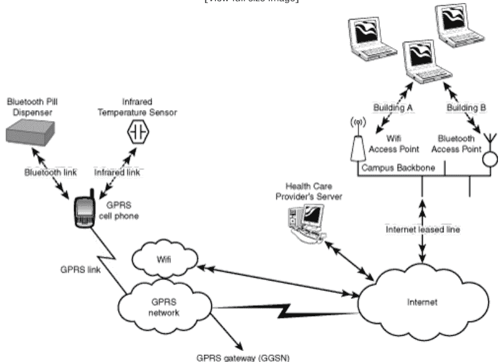

随着现有标准和技术的耦合，无线领域还有源源不断的新通信标准涌现。

Zigbee（www.zigbee.org）采用了新的 802.15.4 标准，用于嵌入式领域的无线网络，其特点是低范围、低速率、低能耗和小代码占用。它主要针对家庭和工业自动化。在本章讨论的无线协议中，Zigbee 与蓝牙最为接近，但被认为与其互补而非竞争。

WiMax（* Worldwide interoperability for Microwave access*，全球微波互联接入），基于 IEEE 802.16 标准，是 WiFi 的一种*城域网*（*metropolitan-area network*，MAN）变体，覆盖范围可达数公里。它支持家庭和办公室的固定连接，以及移动版本用于随身联网。WiMax 是解决"最后一英里"连接问题的一种经济高效的方式（类似于从最近地铁站到您家的任务），并创建覆盖大片区域的宽带云。WiMax 论坛位于 www.wimaxforum.org。

MIMO（*Multiple In Multiple Out*，多输入多输出）是一种新的多天线技术，WiFi 和 WiMax 产品利用它来增强速度、范围和连接性。

各工作组正在制定属于第四代或 4G 网络范畴的新标准。4G 将标志着多种通信技术的融合。

一些新型通信技术对操作系统透明，可与现有驱动程序和协议栈 unchanged 地工作。另一些如 Zigbee 需要新的驱动程序和协议栈，但尚未有公认的开源实现。Linux 反映了最新技术水平，因此请留意未来内核版本对这些新标准的支持。

# 第 17 章 内存技术设备

## 本章内容

- 什么是闪存？ 504
- Linux-MTD 子系统 505
- 映射驱动程序 506
- NOR 芯片驱动程序 511
- NAND 芯片驱动程序 513
- 用户模块 516
- MTD 工具 518
- 配置 MTD 519
- 就地执行 520
- 固件集线器 520
- 调试 524
- 查看源代码 524

> 当您按下掌上设备的电源开关时，它很可能是从闪存启动的。当您点击某些按钮在手机中保存数据时，您的数据极有可能最初就存在于闪存中。如今，Linux 已渗透到嵌入式领域，不再局限于桌面和服务器。Linux 的化身出现在 PDA、音乐播放器、机顶盒，甚至医疗级设备中。内核的*内存技术设备*（*Memory Technology Devices*，MTD）子系统负责让您的系统与这些设备中发现的各种闪存进行交互。在本章中，让我们以 Linux 掌上设备为例来学习 MTD。

## 什么是闪存？

*闪存*是一种可重写存储器，无需电源即可保存信息。闪存存储体通常被组织为*扇区*（*sectors*）。与传统存储器不同，对闪存地址的写入必须先擦除相应位置。此外，对闪存部分的擦除只能以单个扇区为粒度执行。由于这些限制，闪存最好使用专门为其量身定制的设备驱动程序和文件系统。在 Linux 上，此类专门设计的驱动程序和文件系统由 MTD 子系统提供。

闪存芯片通常有两种类型：NOR 和 NAND。*NOR* 用于在嵌入式设备上存储固件映像，而 *NAND* 用于固态大容量存储介质（如 USB 闪存盘和*磁盘模块*（*Disk-On-Modules*，DOM））所需的大容量、高密度、廉价但不够完美的[1]存储。NOR 闪存芯片通过地址线和数据线连接到处理器，就像普通 RAM 一样，但 NAND 闪存芯片使用 I/O 线和控制线进行接口连接。因此，驻留在 NOR 闪存上的代码可以就地执行，但存储在 NAND 闪存上的代码必须先复制到 RAM 中才能执行。

[1] NAND 闪存区域中散布着坏块是正常的，这将在"NAND 芯片驱动程序"一节中学习。


## 第17章 内存技术设备

在本章中

- 什么是闪存？
- Linux-MTD 子系统
- 映射驱动
- NOR 芯片驱动
- NAND 芯片驱动
- 用户模块
- MTD 工具集
- 配置 MTD
- 就地执行
- 固件中心
- 调试
- 查看源码

> 当你按下便携设备的电源开关时，它很可能从闪存启动。当你在手机上按某些按钮保存数据时，你的数据大概率最初就保存在闪存中。如今，Linux 已经渗透到了嵌入式领域，不再局限于桌面和服务器。Linux 的身影出现在 PDA、音乐播放器、机顶盒，甚至医疗级设备中。内核的*内存技术设备*（MTD）子系统负责让你的系统与这些设备中各种形式的闪存进行交互。在本章中，让我们以一台 Linux 手持设备为例来学习 MTD。

## 什么是闪存？

*闪存*是一种可重写的存储器，无需供电即可保存信息。闪存存储体通常被组织成*扇区*。与传统存储器不同，对闪存地址进行写入前，必须先擦除对应的位置。此外，擦除闪存中的部分内容只能以单个扇区为单位进行。由于这些限制，闪存最适合与专门为其设计的驱动程序和文件系统配合使用。在 Linux 中，这类专门设计的驱动程序和文件系统由 MTD 子系统提供。

闪存芯片通常有两种类型：NOR 和 NAND。*NOR* 用于在嵌入式设备上存储固件镜像，而 *NAND* 则用于 USB 闪存盘和*磁盘模块*（DOM）等固态大容量存储介质所需的大容量、高密度、低成本但*有缺陷*[^1]的存储。NOR 闪存芯片通过地址线和数据线连接到处理器，就像普通的 RAM 一样，而 NAND 闪存芯片则是通过 I/O 和控制线进行接口连接的。因此，存储在 NOR 闪存上的代码可以就地执行，但存储在 NAND 闪存上的代码在执行前必须 [仍需] 复制到 RAM 中。

[^1]: 正如你在"NAND 芯片驱动"一节中将要学到的，NAND 闪存区域中出现坏块是很正常的。

## Linux-MTD 子系统

如图 17.1 所示，内核的 MTD 子系统为闪存和类似的非易失性固态存储提供支持。它包含以下部分：

- *MTD 核心*，这是一个基础设施，包含库例程和数据结构，供 MTD 子系统的其他部分使用

- *映射驱动*，决定处理器在收到访问闪存的请求时应该做什么

- *NOR 芯片驱动*，了解与 NOR 闪存芯片通信所需的命令

- *NAND 芯片驱动*，为 NAND 闪存控制器实现底层支持

- *用户模块*，与用户空间程序交互的层

- 针对某些特殊闪存芯片的独立设备驱动

**图 17.1 Linux-MTD 子系统**

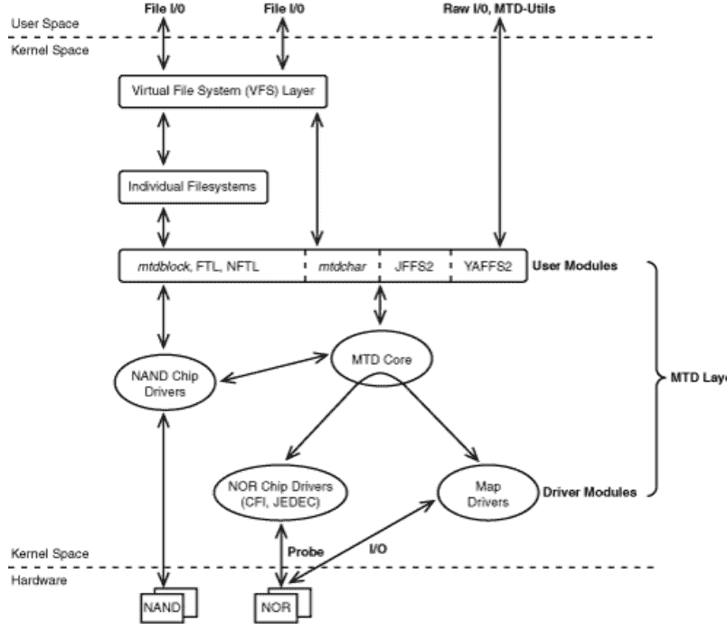

## 映射驱动

要为你的设备启用 MTD，首要任务是告诉 MTD 如何访问闪存设备。为此，你必须映射你的闪存地址范围以供 CPU 访问，并提供操作闪存的方法。第二个任务是告知 MTD 驻留在你的闪存上的不同存储分区。与 PC 兼容系统上的硬盘不同，基于闪存的存储在介质上没有标准的分区表。因此，*fdisk* 和 *cfdisk*[^2] 等磁盘分区工具无法用于对闪存设备进行分区。相反，分区信息必须以内核代码的形式实现。[^3] 这些任务借助 MTD *映射驱动*来完成。

> [^2]: 在 PC 系统上，*Fdisk* 和 *cfdisk* 用于操作驻留在第一个硬盘扇区中的分区表。

> [^3]: 如果在内核配置期间启用 `CONFIG_MTD_CMDLINE_PARTS`，你也可以通过内核命令行参数 `mtdpart=` 将分区信息传递给 MTD。有关使用语法，请查看 *drivers/mtd/artchipart.c*。

为了更好地理解映射驱动的功能，让我们来看一个例子。

### 设备示例：手持设备

考虑如图 17.2 所示的 Linux 手持设备。该闪存大小为 32MB，映射到处理器地址空间的 `0xC0000000` 处。它包含三个分区，分别用于引导加载程序、内核和根文件系统。引导加载程序分区从闪存的顶部开始，内核分区从偏移量 `MY_KERNEL_START` 处开始，根文件系统从偏移量 `MY_FS_START` 处开始。[^4] 引导加载程序和内核驻留在*只读*分区上，以避免意外损坏，而文件系统分区被标记为*可读可写*。

> [^4]: 某些设备还有额外的分区，用于引导加载程序参数、额外的文件系统和恢复内核。

**图 17.2 示例 Linux 手持设备上的闪存**

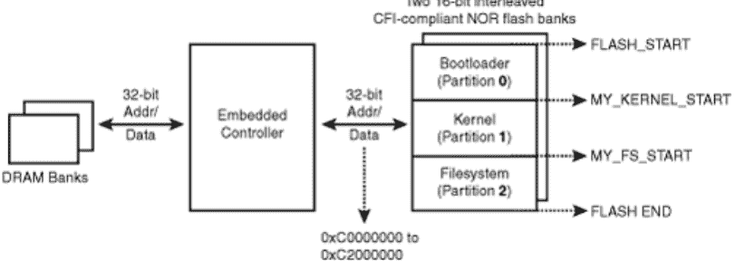

让我们先创建闪存映射，然后继续驱动程序初始化。映射驱动必须将图中所示的闪存布局转换为 `mtd_partition` 结构。**清单 17.1** 包含了与**图 17.2** 对应的 `mtd_partition` 定义。注意，`mask_flags` 字段保存要屏蔽的权限，因此 `MTD_WRITEABLE` 表示只读分区。

#### 清单 17.1 创建 MTD 分区映射

```c
#define FLASH_START        0x00000000
#define MY_KERNEL_START    0x00080000 /* 512K for bootloader */
#define MY_FS_START        0x00280000 /* 2MB for kernel */
#define FLASH_END          0x02000000 /* 32MB */
static struct mtd_partition pda_partitions[] = {
  {
    .name     = "pda_btldr",      /* This string is used by
                                     /proc/mtd to identify
                                     the bootloader partition */
    .size     = (MY_KERNEL_START-FLASH_START),
    .offset   = FLASH_START,       /* Start from top of flash */
    .mask_flags = MTD_WRITEABLE    /* Read-only partition */
  },
  {
    .name     = "pda_krnl",        /* Kernel partition */
    .size     = (MY_FS_START-MY_KERNEL_START),
    .offset   = MTDPART_OFS_APPEND, /* Start immediately after
                                     the bootloader partition */
    .mask_flags = MTD_WRITEABLE    /* Read-only partition */
  },
  {
    .name     = "pda_fs",          /* Filesystem partition */
    .size     = MTDPART_SIZ_FULL,  /* Use up the rest of the
                                     flash */
    .offset   = MTDPART_OFS_NEXTBLK,/* Align this partition with
                                     the erase size */
  }
};
```

**清单 17.1** 使用 `MTDPART_OFS_APPEND` 使分区紧邻前一个分区开始。然而，可写分区的起始地址需要与闪存芯片的擦除/扇区大小对齐。为此，文件系统分区使用 `MTD_OFS_NEXTBLK` 而不是 `MTD_OFS_APPEND`。

现在你已经填充了 `mtd_partition` 结构，让我们继续完成示例手持设备的基本映射驱动。**清单 17.2** 将映射驱动注册到 MTD 核心。它被实现为一个平台驱动，假设你的架构特定代码注册了一个具有相同名称的关联平台设备。 rewind to the section 请回顾**第6章**"串行驱动"中的"设备示例：手机"一节，了解平台设备和平台驱动中平台设备和平台驱动的讨论。平台设备的定义由下述架构特定代码给出：

```c
struct resource pda_flash_resource = { /* Used by Listing 17.3 */
  .start = 0xC0000000,              /* Physical start of the
                                     flash in Figure 17.2 */
  .end   = 0xC0000000+0x02000000-1, /* Physical end of flash */
  .flags = IORESOURCE_MEM,          /* Memory resource */
};
struct platform_device pda_platform_device = {
```


 ## 清单 17.2. 注册 Map 驱动程序

```
static struct platform_driver pda_map_driver = {
  .driver = {
    .name     =  "pda",       /* ID */
  },
  .probe     =  pda_mtd_probe, /* 探测 */
  .remove    =  NULL,          /* 释放 */
  .suspend   =  NULL,          /* 电源管理 */
  .resume    =  NULL,          /* 电源管理 */
};

/* 驱动程序/模块初始化 */
static int __init pda_mtd_init(void)
{
  return platform_driver_register(&pda_map_driver);
}

/* 模块退出 */
static void __exit pda_mtd_exit(void)
{
  return platform_driver_unregister(&pda_map_driver);
}
```

由于内核发现清单 17.2 中注册的 platform 驱动的名称与某个已注册的 platform 设备名称匹配，因此它会调用探测方法`pda_mtd_probe()`，如清单 17.3 所示。该例程执行以下操作：

- 使用`request_mem_region()`保留闪存地址范围，并使用`ioremap_nocache()`获取 CPU 对该内存的访问权限。你在第 10 章"外围组件互连"中已经学习了如何操作。
- 使用闪存的开始地址和大小等信息填充`map_info`结构体（稍后讨论）。该结构中的信息在下一步执行探测时使用。
- 通过合适的 MTD 芯片驱动程序进行闪存探测（在下一节中讨论）。只有芯片驱动程序知道如何查询芯片并获取访问所需的命令集。芯片层在查询时会尝试不同的总线宽度和交错方式组合。在图 17.2 中，两个 16 位闪存 bank 并行连接以填满 32 位处理器总线宽度，因此采用的是两路交错。
- 将你之前填充好的`mtd_partition`结构体注册到 MTD 核心。

在查看清单 17.3 之前，让我们先了解一下`map_info`结构体。它包含闪存的地址、大小和宽度，以及访问它的例程：

```
struct map_info {
  char * name;              /* 名称 */
  unsigned long size;      /* 闪存大小 */
  int bankwidth;            /* 以字节为单位 */
  /* ... */
  /* 只有当有特殊需求时，你才需要为以下方法实现自定义例程。
     否则，像清单 17.3 那样，使用 simple_map_init() 填充内置方法 */
  map_word (*read)(struct map_info *, unsigned long);
  void     (*write)(struct map_info *, const map_word,
                     unsigned long);
  /* ... */
};
```

既然我们正在讨论访问闪存芯片的话题，让我们简要回顾一下在第 4 章"奠定基础"中讨论过的内存屏障。对编译器（或处理器）而言看似语义不变的指令重排序，实际上可能并非如此，因此闪存上的数据操作顺序最好不要改动。例如，你肯定不想在写入闪存扇区之后将其擦除，而不是按相反的顺序操作。此外，相同的闪存芯片及其设备驱动程序被用于具有不同指令重排序算法的各种嵌入式处理器上。由于这些原因，MTD 驱动程序是硬件内存屏障的显著使用者。`simple_map_write()`是一个可供 map 驱动程序使用的通用例程，可用作前面列出的`map_info`结构体中的`write()`方法，它在返回前插入一个对`mb()`的调用。这确保了处理器不会跨屏障重排序闪存的读或写操作。

### 清单 17.3. Map 驱动程序探测方法

```
Code View:
#include <linux/mtd/mtd.h>
#include <linux/mtd/map.h>
#include <linux/ioport.h>

static int
pda_mtd_probe(struct platform_device *pdev)
{
  struct map_info *pda_map;
  struct mtd_info *pda_mtd;
  struct resource *res = pdev->resource;

  /* 使用从关联 platform 设备获取的信息填充 pda_map */
  pda_map->virt = ioremap_nocache(res->start,
                                  (res->end - res->start + 1));

  pda_map->name = pdev->dev.bus_id;
  pda_map->phys = res->start;
  pda_map->size = res->end - res->start + 1;
  pda_map->bankwidth = 2;   /* 两个 16 位 bank 位于
                               32 位总线上 */

  simple_map_init(&pda_map);  /* 填充默认访问方法 */

  /* 通过 CFI 芯片驱动程序进行探测 */
  pda_mtd = do_map_probe("cfi_probe", &pda_map);
  /* 注册 mtd_partition 结构体 */
  add_mtd_partitions(pda_mtd, pda_partitions, 3); /* 三个分区 */

  /* ... */
}
```

如果[清单 17.3](#)中执行的 CFI 探测看起来有些深奥，不必担心。在下一节介绍 NOR 芯片驱动程序时会进行讨论。

MTD 现在知道你的闪存设备是如何组织的以及如何访问它。当你将 map 驱动程序编译进内核并启动时，用户空间应用程序可以分别将引导加载程序、内核和文件系统分区视为 */dev/mtd/0*、*/dev/mtd/1* 和 */dev/mtd/2*。因此，要在手持设备上测试新的内核镜像，你可以这样做：

```
bash> dd if=zImage.new of=/dev/mtd/1
```

### 从引导加载程序进行闪存分区

Redboot 引导加载程序维护一个包含闪存布局信息的分区表，因此如果你的嵌入式设备上使用 Redboot，你可以在引导加载程序中配置闪存分区，而无需编写 MTD map 驱动程序。若要使 MTD 从 Redboot 的分区表解析闪存映射信息，请在配置内核时启用`CONFIG_MTD_REDBOOT_PARTS`。

## NOR 芯片驱动程序

正如你可能注意到的，[图 17.2](.)中手持设备使用的 NOR 闪存芯片标记为*符合 CFI 标准*。CFI 代表*通用闪存接口*，该规范旨在消除为支持不同厂商的芯片而开发单独驱动程序的需求。软件可以查询符合 CFI 标准的闪存芯片并自动检测块大小、时序参数以及通信所需的命令集。实现 CFI 和 JEDEC 等规范的驱动程序称为*芯片驱动程序*。

根据 CFI 规范，软件必须将`0x98`写入闪存内存中的`0x55`位置以发起查询。查看[清单 17.4](.)了解 MTD 如何实现 CFI 查询。

### 清单 17.4. 查询符合 CFI 标准的闪存

```
/* 来自 cfi_probe_chip()（2.6.23.1 内核）的代码片段，定义于
   drivers/mtd/chips/cfi_probe.c，添加了注释 */

/* cfi 是指向 struct cfi_private 的指针，定义于
   include/linux/mtd/cfi.h */

/* ... */

/* 通过向偏移量 0x55 发送 0x98 使设备进入查询模式 */
cfi_send_gen_cmd(0x98, 0x55, base, map, cfi,
                 cfi->device_type, NULL);

/* 如果设备没有返回 ASCII 字符 'Q'、'R' 和 'Y'，则该芯片不符合 CFI 标准 */
if (!qry_present(map, base, cfi)) {
  xip_enable(base, map, cfi);
  return 0;
}

/* 获取芯片参数和命令集，并填充 cfi 结构体 */
if (!cfi->numchips) {
  return cfi_chip_setup(map, cfi);
}
/* ... */
```

CFI 规范定义了符合标准的芯片可以实现的各种命令集。一些常见的命令集如下：

- 命令集 `0001`，Intel 和 Sharp 闪存芯片支持
- 命令集 `0002`，AMD 和 Fujitsu 闪存芯片实现
- 命令集 `0020`，ST 闪存芯片使用

MTD 将这些命令集作为内核模块支持。你可以通过内核配置菜单启用你的闪存芯片所支持的命令集。

## NAND 芯片驱动程序

NAND 技术的用户，如 U 盘、DOM、CF 存储卡和 SD/MMC 卡，通过 NAND 闪存模拟 SCSI 或 IDE 等标准存储接口，因此你无需开发 NAND 驱动程序来与它们通信。^[5]^ 然而，板载 NAND 闪存芯片需要特殊的驱动程序，这是本节讨论的主题。

> [5] 除非你为存储介质本身编写驱动程序。如果你在一种设备上嵌入 Linux，该设备会将其 NAND 分区的部分空间作为 USB 大容量存储设备导出到外部，那么你确实需要处理 NAND 驱动程序。

 as you learned previously in this chapter, NAND flash chips, unlike their NOR counterparts, are not connected to the CPU via data and address lines. They interface to the CPU through special electronics called a *NAND flash controller* that is part of many embedded processors. To read data from NAND flash, the CPU issues an appropriate *read* command to the NAND controller. The controller transfers data from the requested flash location to an internal RAM memory, also part of the controller. The data transfer is done in units of the flash chip's *page size* (for example, 2KB). In general, the denser the flash chip, the larger is its page size. Note that the page size is different from the flash chip's *block size*, which is the minimum erasable flash memory unit (for example, 16KB). After the transfer operation completes, the CPU reads the requested NAND contents from the internal RAM. Writes to NAND flash are done similarly, except that the controller transfers data from the internal RAM to flash. The connection diagram of NAND flash memory on an embedded device is shown in Figure 17.3.

**图 17.3. NAND 闪存连接。**

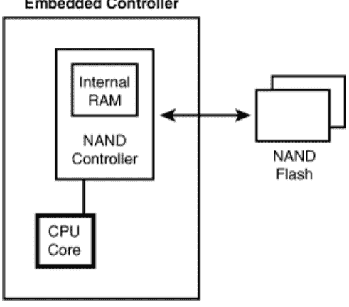

由于这种非常规的寻址方式，你需要特殊的驱动程序来使用 NAND 存储。MTD 提供了这样的驱动程序来管理基于 NAND 的数据。如果你使用的是受支持的芯片，只需启用相应的底层 MTD NAND 驱动程序即可。然而，如果你要编写 NAND 闪存驱动程序，则需要研究两份数据手册：NAND 闪存控制器和 NAND 闪存芯片。

NAND 闪存芯片不支持使用 CFI 等协议进行自动配置。你必须通过向定义在

位于 drivers/mtd/nand/nand_ids.c 中。表中的每个条目包含一个标识符名称、设备 ID、页大小、擦除块大小、芯片大小以及总线宽度等选项。

NAND 内存还有另一个与之相伴的特性。与 NOR 芯片不同，NAND 闪存芯片并非完美无缺。在 NAND 闪存区域中散布着一些问题比特和坏块是正常的。为了处理这个问题，NAND 设备为每个闪存页关联一个备用区域（例如，每个 2KB 数据页配备 64 字节的备用区域）。该备用区域包含带外（OOB）信息，以帮助执行坏块管理和错误纠正。OOB 区域包含用于实现错误纠正和检测的纠错码（ECC）。ECC 算法可以纠正单比特错误并检测多比特错误。在 include/mtd/mtd-abi.h 中定义的 nand_ecclayout 结构体指定了 OOB 备用区域的布局：

```
struct nand_ecclayout {
    uint32_t eccbytes;
    uint32_t eccpos[64];
    uint32_t oobavail;
    struct nand_oobfree oobfree[MTD_MAX_OOBFREE_ENTRIES];
};
```

在该结构体中，eccbytes 保存存储 ECC 数据的 OOB 字节数，eccpos 是一个数组，包含 OOB 区域中 ECC 数据的偏移量。oobfree 记录了 OOB 区域中未使用的字节数，供闪存文件系统存储标志（如擦除操作成功完成的干净标记）使用。

各个 NAND 驱动程序根据芯片属性初始化其 nand_ecclayout。图 17.4 展示了一个页大小为 2KB 的 NAND 闪存芯片的布局。图中所使用的 OOB 语义是 2KB 页大小芯片在通用 NAND 驱动程序 drivers/mtd/nand/nand_base.c 中定义的默认设置。

### 图 17.4. NAND 闪存芯片的布局。

[查看完整尺寸图像]

```
static struct nand_ecclayout nand_oob_64 = {
    .eccbytes = 24,    /* 24 字节用于保存 ECC 信息 */
    .eccpos = {
        40, 41, 42, 43, 44, 45, 46, 47,
        48, 49, 50, 51, 52, 53, 54, 55,
        56, 57, 58, 59, 60, 61, 62, 63},
    .oobfree = {
        {.offset = 2,
         .length = 38}
    }
};
```

通常，NAND 控制器通过对 OOB 区域中的 ECC 字段进行操作来执行硬件层面的错误纠正和检测。然而，如果你的 NAND 控制器不支持错误管理，你需要让 MTD 在软件层面为你完成这项工作。MTD *nand_ecc* 驱动程序（*drivers/mtd/nand/nand_ecc.c*）实现了软件 ECC。

图 17.4 还显示了包含坏块标记的 OOB 内存字节。这些标记用于标识有故障的闪存块，通常出现在每个块的第一页所属的 OOB 区域中。标记在 OOB 区域中的位置取决于芯片的属性。坏块标记要么在制造过程中由工厂设置，要么在软件检测到块 inode 磨损时设置。MTD 在 *drivers/mtd/nand/nand_bbt.c* 中实现了坏块管理。

清单 17.1 中用于图 17.2 中 NOR 闪存的 `mtd_partition` 结构体同样适用于 NAND 内存。在使能 NAND 闪存的 MTD 支持后，你可以使用标准设备节点（如 */dev/mtd/X* 和 */dev/mtdblock/X*）访问各个分区。如果你的硬件上同时存在 NOR 和 NAND 内存，*X* 可能是 NOR 或 NAND 分区。如果闪存分区总数超过 32 个，请相应地在 *include/linux/mtd/mtd.h* 中修改 `MAX_MTD_DEVICES` 的值。

为了有效利用 NAND 存储，你需要使用针对 NAND 访问优化的文件系统（如 JFFS2 或 YAFFS2），与底层 NAND 驱动程序配合使用。我们在下一节讨论这些文件系统。

## 用户模块

在添加完映射驱动程序并选择了合适的芯片驱动程序后，你就可以让更高层使用闪存了。执行文件 I/O 的用户空间应用程序需要将闪存设备视为磁盘，而希望执行原始 I/O 的程序则将闪存视为字符设备。实现这些功能及更多的 MTD 层称为*用户模块*，如图 17.1 所示。让我们看看构成这一层的组件。

### 块设备模拟

MTD 子系统提供了一个名为 *mtdblock* 的块驱动程序，它在闪存上模拟硬盘。你可以在模拟的闪存盘上使用任何文件系统，比如 EXT2。Mtdblock 对文件系统隐藏了复杂的闪存访问过程（例如，写操作前需要先擦除相应扇区）。mtdblock 创建的设备节点名为 */dev/mtdblock/X*，其中 *X* 是分区号。要在手持设备的 pda_fs 分区（如图 17.2 所示）上创建 EXT2 文件系统，执行以下操作：

```
bash> mkfs.ext2 /dev/mtdblock/2
bash> mount /dev/mtdblock/2 /mnt
```

正如你很快就会看到的，在闪存文件系统分区上使用 JFFS2 而非 EXT2 是更好的选择。

*文件转换层*（FTL）和 *NAND 文件转换层*（NFTL）执行一种称为*磨损均衡*的转换。闪存扇区只能承受有限次数的擦除操作（大约 100,000 次）。磨损均衡通过在芯片上均匀分布内存使用来延长闪存寿命。FTL 和 NFTL 都提供类似于 *mtdblock* 的设备接口，可以在其上使用普通文件系统。相应的设备节点名为 */dev/nftl/X*，其中 *X* 是分区号。这些模块中使用的某些算法已获得专利，因此可能存在使用限制。

### 字符设备模拟

mtdchar 驱动程序呈现底层闪存设备的线性视图，而不是文件系统所需的面向块的视图。mtdchar 创建的设备节点名为 */dev/mtd/X*，其中 *X* 是分区号。你可以使用 dd 通过相应的 mtdchar 接口更新手持设备的引导加载程序分区，如图 17.2 所示：

```
bash> dd if=bootloader.bin of=/dev/mtd/0
```

原始 mtdchar 分区的一个使用示例是在嵌入式设备上保存引导加载程序生成的 POST 错误日志。字符闪存分区在嵌入式系统上的另一个用途是存储类似于 PC 兼容系统中 CMOS 或 EEPROM 中的信息。这包括启动顺序、开机密码和*重要产品数据*（VPD），如设备序列号和型号。

## JFFS2

*日志闪存文件系统*（JFFS）被认为是最适合闪存的文件系统。目前使用的是版本 2（JFFS2），JFFS3 正在开发中。JFFS 最初是为 NOR 闪存芯片编写的，但对 NAND 设备的支持已合并到 2.6 内核中。

普通的 Linux 文件系统是为可以正常关机台式计算机设计的。JFFS2 则是为可能发生突然断电的嵌入式系统设计的，而且存储设备只能承受有限次数的擦除。 dialect 在闪存擦除操作期间，当前扇区内容会保存在 RAM 中。如果在缓慢的擦除过程中发生断电，该扇区的全部内容都可能丢失。JFFS2 使用日志结构的设计来规避这个问题。新数据被追加到存在于已擦除区域的日志中。每个 JFFS2 节点包含元数据来跟踪不相连续的文件位置。内存通过垃圾回收机制定期回收。由于这种设计，闪存写入不必经过保存-擦除-写入的周期，这提高了断电可靠性。日志结构还延长了闪存寿命。

要在擦除大小为 256KB 的闪存芯片上创建位于 */path/to/filesystem/* 下的目录树的 JFFS2 镜像，使用 *mkfs.jffs2* 如下：

```
bash> mkfs.jffs2 -e 256KiB -r /path/to/filesystem/ -o jffs2.img
```

JFFS2 包含一个*垃圾回收器*（GC），用于回收不再使用的闪存区域。垃圾回收算法取决于擦除大小，因此提供准确的值可以提高其效率。要获取闪存分区的擦除大小，你可以查看 */proc/mtd* 的帮助。图 17.2 中所示的 Linux 手持设备的输出如下：

```
bash> cat /proc/mtd
dev:    size   erasesize  name
mtd0: 00100000 00040000 "pda_btldr"
mtd1: 00200000 00040000 "pda_krnl"
mtd2: 01400000 00040000 "pda_fs"
```

JFFS2 支持压缩。在 `CONFIG_JFFS2_COMPRESSION_OPTIONS` 下启用适当的选项以选择可用的压缩器，并在 *fs/jffs2/compr.c* 中查看它们的实现。

请注意，JFFS2 文件系统镜像通常是在进行交叉开发的主机机器上创建的，然后通过串口、USB 或 NFS 等合适的下载机制传输到目标设备的相应闪存分区。更多内容请参阅第 18 章"嵌入 Linux"。

## YAFFS2

2.6 内核中的 JFFS2 实现包含了适用于 NAND 闪存局限性的功能，但*另一种闪存文件系统*（YAFFS）是专为在 NAND 内存特定约束下运行而设计的文件系统。YAFFS 不是主线内核的一部分，但某些嵌入式发行版会在其内核中预打 YAFFS2 的补丁，YAFFS2 是 YAFFS 的当前版本。

你可以从 www.yaffs.net 下载 YAFFS2 源代码和文档。


## MTD-Utils

MTD-utils 软件包可从 ftp://ftp.infradead.org/pub/mtd-utils/ 下载，其中包含多个用于在支持 MTD 的闪存上工作的实用工具。所包含工具的示例有 *flash_eraseall*、*nanddump*、*nandwrite* 和 *sumtool*。

要擦除第二个闪存分区（在 NOR 或 NAND 设备上），请按如下方式使用 flash_eraseall：

```
bash> flash_eraseall -j /dev/mtd/2
```

由于 NAND 芯片可能包含坏块，请使用支持 ECC 的程序（如 nandwrite 和 nanddump）来复制原始数据，而不是使用 dd 等通用工具。要将之前创建的 JFFS2 镜像存储到第二个 NAND 分区，请执行以下操作：

```
bash> nandwrite /dev/mtd/2 jffs2.img
```

您可以通过使用 sumtool 将摘要信息插入到 JFFS2 镜像中，并在配置内核时开启 `CONFIG_JFFS2_SUMMARY`，从而减少 JFFS2 的挂载时间。要将包含摘要信息的 JFFS2 镜像写入之前的 NAND 闪存，请执行以下操作：

```
bash> sumtool -e 256KiB -i jffs2.img -o jffs2.summary.img
bash> nandwrite /dev/mtd/2 jffs2.summary.img
bash> mount -t jffs2 /dev/mtdblock/2 /mnt
```

## 配置 MTD

要使内核支持 MTD，您必须选择适当的配置选项。对于图 17.2 所示的闪存芯片，所需选项如下：

- `CONFIG_MTD=y` → 启用 MTD 子系统
- `CONFIG_MTD_PARTITIONS=y` → 支持多个分区
- `CONFIG_MTD_GEN_PROBE=y` → 芯片探测的通用例程
- `CONFIG_MTD_CFI=y` → 启用 CFI 芯片驱动
- `CONFIG_MTD_PDA_MAP=y` → 启用映射驱动程序的选项
- `CONFIG_JFFS2_FS=y` → 启用 JFFS2

`CONFIG_MTD_PDA_MAP` 被假定为一个新添加的选项，用于启用我们之前编写的映射驱动程序。除非您有基于 MTD 的根文件系统，否则这些功能中的每一个也都可以构建为内核模块。要将图 17.2 中的文件系统分区作为启动时的根设备挂载，请让您的引导加载程序在传递给内核的命令行字符串中附加 `root=/dev/mtdblock/2`。

您可以通过消除冗余探测来减小内核体积。由于我们的示例手持设备有两个并行的 16 位存储体位于 32 位物理总线上（因此产生双向交错和 2 字节存储体宽度），您可以使用以下附加选项进行优化：

- `CONFIG_MTD_CFI_ADV_OPTIONS=y`
- `CONFIG_MTD_CFI_GEOMETRY=y`
- `CONFIG_MTD_MAP_BANK_WIDTH_2=y`
- `CONFIG_MTD_CFI_I2=y`

`CONFIG_MTD_MAP_BANK_WIDTH_2` 启用宽度为 2 的 CFI 总线，`CONFIG_MTD_CFI_I2` 设置交错为 2。

## 就地执行（eXecute In Place）

使用*就地执行*（XIP），您可以直接从闪存运行内核。由于省去了将内核复制到 RAM 的额外步骤，您的内核启动速度更快。缺点是闪存需求会增加，因为内核必须以未压缩形式存储。在决定采用 XIP 方案之前，还要注意从闪存获取指令的较慢时间可能会影响运行时性能。

## 固件集线器

兼容 PC 的系统使用一种称为*固件集线器*（FWH）的 NOR 闪存芯片来存储 BIOS。FWH 不直接连接到处理器的地址和数据总线。相反，它通过*低引脚数*（LPC）总线进行接口，LPC 是南桥芯片组的一部分。连接图如图 17.5 所示。

图 17.5. 兼容 PC 系统上的固件集线器。

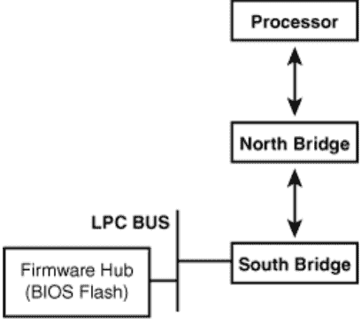

MTD 子系统包含用于处理器与 FWH 接口的驱动程序。FWH 通常不符合 CFI 规范。相反，它们遵循 JEDEC（*联合电子器件工程委员会*）标准。要让 MTD 识别一个尚未支持的 JEDEC 芯片，请在 *drivers/mtd/chips/jedec_probe.c* 中的 `jedec_table` 数组中添加一个条目，包含芯片制造商 ID 和命令集 ID 等信息。以下是一个示例：

```
static const struct amd_flash_info jedec_table[] = {
  /* ... */
  {
    .mfr_id  = MANUFACTURER_ID, /* 例如：MANUFACTURER_ST */
    .dev_id  = DEVICE_ID,        /* 例如：M50FW080 */
    .name    = "MYNAME",         /* 例如："M50FW080" */
    .uaddr   = {
      [0] = MTD_UADDR_UNNECESSARY,
    },
    .DevSize  = SIZE_1MiB,    /* 例如：1MB */
    .CmdSet   = CMDSET,       /* 与闪存芯片通信的命令集，
                                  例如，P_ID_INTEL_EXT */
    .NumEraseRegions = 1,     /* 一个区域 */
    .regions = {
       ERASEINFO (0x10000, 16),/* 十六个 64K 扇区 */
    }
  },
  /* ... */
};
```

当您按照此处所示将芯片详细信息 imprinted 到 `jedec_table` 中时，只要启用了正确的内核配置选项，MTD 就应该能够识别您的闪存。以下配置使内核能够识别通过 Intel ICH2 或 ICH4 南桥芯片组与处理器接口的 FWH：

```
CONFIG_MTD=y                  → 启用 MTD 子系统
CONFIG_MTD_GEN_PROBE=y        → 芯片探测的通用例程
CONFIG_MTD_JEDECPROBE=y       → JEDEC 芯片驱动
CONFIG_MTD_CFI_INTELEXT=y     → 与芯片通信的命令集
CONFIG_MTD_ICHXROM=y          → 映射驱动程序
```

`CONFIG_MTD_JEDECPROBE` 启用 JEDEC MTD 芯片驱动，`CONFIG_MTD_ICH2ROM` 添加将 FWH 映射到处理器地址空间的 MTD 映射驱动程序。此外，您需要包含适当的命令集实现（例如，用于 Intel 扩展命令的 `CONFIG_MTD_CFI_INTELEXT`）。

这些模块加载后，您可以通过 MTD 导出的设备节点从用户空间应用程序与 FWH 通信。例如，您可以使用一个简单的应用程序从用户空间重新编程 BIOS，如[清单 17.5]所示。请注意，错误地操作此程序可能会损坏 BIOS 并使系统无法启动！

[清单 17.5] 操作与 FWH 关联的 MTD 字符设备，该设备假定是 */dev/mtd/0*。该程序发出三个 MTD 特定的 *ioctl* 命令：

- `MEMUNLOCK` 在编程之前解锁闪存扇区
- `MEMERASE` 在重写之前擦除闪存扇区
- `MEMLOCK` 在编程之后重新锁定扇区

### 清单 17.5. 更新 BIOS

```
Code View:
#include <linux/mtd/mtd.h>
#include <stdio.h>
#include <fcntl.h>
#include <asm/ioctl.h>
#include <signal.h>
#include <sys/stat.h>

#define BLOCK_SIZE   4096
#define NUM_SECTORS  16
#define SECTOR_SIZE  64*1024

int
main(int argc, char *argv[])
{
  int fwh_fd, image_fd;
  int usect=0, lsect=0, ret;
  struct erase_info_user fwh_erase_info;
  char buffer[BLOCK_SIZE];

  struct stat statb;
  /* 忽略 SIGINTR(^C) 和 SIGSTOP (^Z)，以免
     最终导致闪存损坏和系统无法启动 */
  sigignore(SIGINT);
  sigignore(SIGTSTP);

  /* 打开 MTD 字符设备 */
  fwh_fd = open("/dev/mtd/0", O_RDWR);
  if (fwh_fd < 0) exit(1);

  /* 打开 BIOS 镜像 */
  image_fd = open("bios.img", O_RDONLY);
  if (image_fd < 0) exit(2);

  /* 合理性检查 */
  fstat(image_fd, &statb);
  if (statb.st_size != SECTOR_SIZE*NUM_SECTORS) {
    printf("BIOS image looks bad, exiting.\n");
    exit(3);
  }

  /* 解锁并擦除所有扇区 */
  while (usect < NUM_SECTORS) {
    printf("Unlocking & Erasing Sector[%d]\r", usect+1);

    fwh_erase_info.start = usect*SECTOR_SIZE;
    fwh_erase_info.length = SECTOR_SIZE;

    ret = ioctl(fwh_fd, MEMUNLOCK, &fwh_erase_info);
    if (ret != 0) goto bios_done;

    ret = ioctl(fwh_fd, MEMERASE, &fwh_erase_info);
    if (ret != 0) goto bios_done;
    usect++;
  }

  /* 从 BIOS 镜像读取数据块并转储到固件集线器 */
  while ((ret = read(image_fd, buffer, BLOCK_SIZE)) != 0) {
    if (ret < 0) goto bios_done;
    ret = write(fwh_fd, buffer, ret);
    if (ret <= 0) goto bios_done;
  }
  /* 通过从 BIOS 闪存读取数据块并与镜像文件比较来验证 */

  /* ... */

bios_done:

  /* 重新锁定已解锁的扇区 */
  while (lsect < usect) {
    printf("Relocking Sector[%d]\r", lsect+1);

    fwh_erase_info.start = lsect*SECTOR_SIZE;
    fwh_erase_info.length = SECTOR_SIZE;

    ret = ioctl(fwh_fd, MEMLOCK, &fwh_erase_info);
```


 ```
if (ret != 0) printf("Relock failed on sector %d!\n", lsect);
lsect++;
}

close(image_fd);
close(fwh_fd);

}

## 调试

要调试与闪存相关的问题，在内核配置期间启用 `CONFIG_MTD_DEBUG`（*Device Drivers* ➞ *Memory Technology Devices* ➞ *Debugging*）。你可以进一步将调试详细程度级别调整到 0 到 3 之间。

Linux-MTD 项目页面 [www.linux-mtd.infradead.org](http://www.linux-mtd.infradead.org) 包含常见问题解答、各种文档以及一份 *Linux-MTD JFFS HOWTO*，该文档深入介绍了 JFFS2 设计。linux-mtd 邮件列表是讨论与 MTD 设备驱动相关问题的场所。请查看 [http://lists.infradead.org/pipermail/linux-mtd/](http://lists.infradead.org/pipermail/linux-mtd/) 获取邮件列表存档。

## 查看源代码

在内核树中，*drivers/mtd/* 目录包含 MTD 层的源代码。映射驱动、芯片驱动和 NAND 驱动分别位于 *drivers/mtd/maps/*、*drivers/mtd/chips/* 和 *drivers/mtd/nand/* 子目录中。大多数 MTD 数据结构定义在 *include/linux/mtd/* 中的头文件里。

要从 Linux 访问不受支持的 BIOS 固件中心，请实现一个驱动程序，并以 *drivers/mtd/maps/ichxrom.c* 作为起点。

有关从用户空间操作 NAND OOB 数据的示例，请查看 MTD-utils 软件包中的 *nanddump.c* 和 *nandwrite.c*。

表 17.1 包含了本章中使用的主要数据结构及其在源代码树中的位置。表 17.2 列出了本章中使用的主要内核编程接口及其定义位置。

| 数据结构 | 位置 | 描述 |
| --- | --- | --- |
| `mtd_partition` | *include/linuxmt/partitions.h* | 闪存芯片分区布局的表示。 |
| `map_info` | *include/linux/mtd/map.h* | 映射驱动实现的底层访问例程通过此结构传递给芯片驱动。 |
| `mtd_info` | *include/linux/mtd/mtd.h* | 通用设备特定信息。 |
| `erase_info`, `erase_info_user` | *include/linux/mtd/mtd.h*, *include/mtd/mtd-abi.h* | 用于闪存擦除管理的结构。 |
| `cfi_private` | *include/linux/mtd/cfi.h* | NOR 芯片驱动维护的设备特定信息。 |
| `amd_flash_info` | *drivers/mtd/chips/jedec_probe.c* | 提供给 JEDEC 芯片驱动的设备特定信息。 |
| `nand_ecc_layout` | *include/mtd/mtd-abi.h* | NAND 芯片 OOB 备用区的布局。 |

| 内核接口 | 位置 | 描述 |
| --- | --- | --- |
| `simple_map_init()` | *drivers/mtd/maps/map_funcs.c* | 使用通用闪存访问方法初始化 `map_info` 结构 |
| `do_map_probe()` | *drivers/mtd/chips/chipreg.c* | 通过芯片驱动探测 NOR 闪存 |
| `add_mtd_partitions()` | *drivers/mtd/mtdpart.c* | 向 MTD 核心注册 `mtd_partition` 结构 |

# 第18章 嵌入式 Linux

| 本章内容 | |
|:---|:---|
| 挑战 | 528 |
| 组件选择 | 530 |
| 工具链 | 531 |
| 嵌入式引导加载程序 | 531 |
| 内存布局 | 535 |
| 内核移植 | 537 |
| 嵌入式驱动程序 | 538 |
| 根文件系统 | 544 |
| 测试基础设施 | 548 |
| 调试 | 548 |

- 挑战
- 组件选择
- 工具链
- 嵌入式引导加载程序
- 内存布局
- 内核移植
- 嵌入式驱动程序
- 根文件系统
- 测试基础设施
- 调试

> Linux 正在进军消费电子、电信、网络、国防和医疗保健等工业领域。随着其在嵌入式领域的流行度激增，你更可能运用自己的 Linux 设备驱动技能来启用嵌入式设备，而非 Legacy 系统。在本章中，让我们以设备驱动开发人员的视角进入嵌入式 Linux 的世界。让我们看看典型嵌入式 Linux 解决方案的软件组件，并了解前面章节中看到的设备类别如何与常见的嵌入式硬件相关联。

## 挑战

嵌入式系统带来了若干重大软件挑战：

- 嵌入式软件必须进行交叉编译，然后下载到目标设备上进行测试和验证。

- 与 PC 兼容计算机不同，嵌入式系统没有快速的处理器、大容量缓存和充足的存储。

- 通常很难免费获得针对嵌入式硬件的成熟开发和调试工具。

- Linux 社区在 x86 平台上拥有更多经验，因此如果你在嵌入式计算机上工作，从专家那里获得即时在线帮助的可能性较小。

- 硬件是分阶段演进的。你可能必须在概念验证原型或参考板上开始软件开发，并逐步转向工程级调试硬件和几轮生产级单元。

所有这些都导致了更长的开发周期。

从设备驱动的角度来看，嵌入式软件开发人员经常要面对在传统计算机上并不常见的接口。图 18.1（这是第4章"奠定基础"中图 4.2 的扩展版本）展示了一个假设的嵌入式设备，它可能是手持设备、智能手机、销售点（POS）终端、自助服务终端、导航系统、游戏设备、汽车仪表盘上的遥测装置、IP 电话、音乐播放器、数字机顶盒，甚至是心脏起搏器编程器。该设备基于 SoC 构建，具有闪存、SDRAM、LCD、触摸屏、USB OTG、串口、音频编解码器、 connectivity、SD/MMC 控制器、Compact Flash、I²C 设备、SPI 设备、JTAG、生物识别、智能卡接口、键盘、LED、开关以及特定于工业领域的电子设备的某种组合。其中一些设备的驱动程序修改和调试可能比平时更加困难：NAND 闪存驱动必须处理坏块和失效位等问题，这与标准 IDE 存储驱动不同。基于闪存的文件系统（如 JFFS2）的调试比 EXT2 或 EXT3 文件系统更为复杂。USB OTG 驱动比 USB OHCI 驱动涉及更多内容。内核上的 SPI 子系统不如串口层那样成熟。此外，使用嵌入式设备的工业领域可能会提出特定要求，如快速响应时间或快速启动。

### 图 18.1 假设嵌入式设备的方块图。
```


元器件选型

评估和选择元器件是项目概念阶段的重要任务之一。请参阅侧边栏“处理器及外设的选择"，了解硬件设计师和产品经理在为嵌入式设备选择元器件时需要考虑的一些重要因素。在当今市场中，上市时间往往是驱动设备设计的关键因素，因此软件工程师在元器件选型方面也具有相当大的话语权。Linux 发行版的可用性会影响处理器的选择，而设备驱动程序的存在或相近的起步点则会影响外围芯片组的选择。

尽管内核工程师需要尽到应有的勤勉，评估多个 Linux 发行版（甚至操作系统），但如果他认为熟悉的发行版能够降低项目风险，他可能会否决技术上更优越的发行版。或者，如果相关行业中避免因内核漏洞引发诉讼至关重要，那么提供赔偿保障的发行版可能成为首选。电气工程师可以将评估范围限定在所选发行版支持的处理器内，并优先考虑该发行版已启用的外围芯片组。

## 处理器及外设的选择

让我们来看看电气工程师和产品经理在为嵌入式设备选择元器件时常问的一些问题。假设假设处理器 *P* 已进入候选名单，因为它满足了功耗和封装等基本产品需求。现正评估 *P* 及其配套的外围芯片组：

- **性能：** 处理器频率是否足以驱动目标应用？如果嵌入式设备打算执行 CPU 密集型任务，所有软件子系统的 MIPS 预算是否与处理器的 MIPS 额定值相平衡？例如，如果目标设备需要高分辨率图像处理，图形操作的 MHz 影响是否会拖累其他子系统（如网络）的性能？

- **成本：** 在元器件上节省一美元，是否最终会在周边电路上多花两美元？例如，*P* 是否需要额外的稳压器？是否需要额外添加一个配件，比如 RTC 芯片，因为 *P* 没有内置 RTC？与其他候选处理器相比，*P* 的引脚是否更多，导致电路板密度更高、层数和过孔数量增加，从而提高裸板成本？*P* 是否功耗更大、发热更多，需要更大的电源和额外的无源元件？数据手册中的勘误表是否有可能增加软件开发成本？

- **功能：** *P* 可寻址的 DRAM、SRAM、NOR 和 NAND 存储器的最大容量是多少？

- **商业规划：** *P* 的供应商是否提供升级路径，能够以直插式（引脚兼容）替换的方式升级到更高性能的处理器？供应商公司是否稳定？

- **供货渠道：** 这是否为单一来源元器件？如果是，供应商是否不稳定？采购这些零部件的交货周期是多久？

- **生命周期：** *P* 是否可能在嵌入式设备预期寿命结束前停产？

- **可信度：** *P* 是否为业界认可的元器件？评估中的外围芯片组是否有特定行业领域的大力支持？例如，正在考虑中的某款 LCD 是否已被用于汽车仪表盘？

- **坚固耐用性：** 元器件是否需要达到军规（MIL）或工业级标准？

> 必须评估不同的候选方案，找出所有这些因素之间的最佳平衡点。

## 工具链

由于目标设备与您的主机开发平台不太可能二进制兼容，您必须使用*工具链*来交叉编译嵌入式软件。建立一套完整的工具链需要构建以下内容：

1. GNU C（交叉）编译器。GCC 支持 Linux 运行的所有平台，但您需要针对目标架构进行配置和构建。本质上，您需要编译编译器本身，生成适当的交叉编译器。
2. *Glibc*，即在为目标设备构建应用程序时所需的 C 库集合。
3. *Binutils*，包括交叉汇编器以及 *objdump* 等工具。

几年前，准备一套开发工具链曾是一项艰巨的任务，但如今通常已相当简单，因为 Linux 发行版为多种架构提供了预编译二进制文件和易于安装的工具。

## 嵌入式引导加载程序

引导加载程序开发通常是任何嵌入式软件工作的起点。您必须决定是从头编写引导加载程序，还是对现有的开源引导加载程序进行定制以满足需求。每个候选引导加载程序可能基于不同的理念构建：小 footprint、易于移植、快速启动，或支持某些特定功能的能力。在确定起点之后，您可以设计并实现设备相关的修改。

在本节中，我们使用术语*引导加载程序*来指代引导套件。这包括以下内容：

- 如果存在的话，BIOS
- 将引导加载程序放入引导设备所需的任何引导代码
- 实际引导加载程序的一个或多个阶段[1]

> [1] 在嵌入式引导加载程序的术语中，两阶段引导加载程序的第一阶段有时称为*初始程序加载器*（IPL），第二阶段称为*二级程序加载器*（SPL）。

- 在外部主机上执行的任何程序，用于与引导加载程序通信，以便将固件下载到目标设备

引导加载程序至少负责处理器和板级特定的初始化，将内核和可选的初始 ramdisk 加载到内存中，并将控制权移交给内核。此外，引导加载程序可能负责提供 BIOS 服务、执行 POST、支持向目标设备下载固件，以及向内核传递内存布局和配置信息。对于出于安全原因使用加密固件镜像的嵌入式设备，引导加载程序可能还需要负责解密固件。某些引导加载程序支持调试监视器，用于将独立代码加载到目标设备并进行调试。您还可以在引导加载程序中构建故障恢复机制，以应对现场出现的内核损坏问题。

一般来说，引导加载程序架构取决于处理器系列、硬件平台上的芯片组、引导设备以及设备上运行的操作系统。为了说明处理器系列对引导套件的影响，请考虑以下几点：

- 为基于 StrongARM 处理器的设备设计的引导加载程序必须知道它是在启动系统还是将系统从睡眠中唤醒，因为在这两种情况下，处理器都是从其地址空间的顶部（即引导加载程序）开始执行。如果是从睡眠中唤醒，引导加载程序必须将控制权移交给恢复系统状态的内核代码；如果是从复位状态启动，则需要从引导设备加载内核。

- x86 引导加载程序可能需要切换到保护模式，以加载超过 1MB 实模式限制的内核。

- 非 x86 平台的嵌入式系统无法使用传统 BIOS 的服务。因此，如果您的嵌入式设备希望从外部 USB 设备启动，您必须在引导加载程序中构建 USB 功能。

- 即使两个平台基于相似的处理器内核，引导加载程序架构也可能因 SoC 而异。例如，考虑两款基于 ARM 的设备：康柏 iPAQ H3900 PDA 和 Darwin Jukebox。前者基于 Intel PXA250 控制器芯片，其 XScale CPU 基于 ARMv5 内核；后者采用使用 ARMv3 内核的 Cirrus Logic EP7312 控制器。XScale 支持 JTAG（以*联合测试行动组*命名，该组开发了这种硬件辅助调试标准）将引导加载程序加载到闪存中，而 EP7312 则具有引导模式来完成相同任务。

引导套件需要一种机制，将引导加载程序镜像从主机开发系统传输到目标设备的引导设备。这称为*引导启动*（bootstrapping）。在兼容 PC 的系统上，引导启动十分简单：如果 BIOS 闪存已损坏，则使用外部编程器进行烧写；如果状态良好，则可以在启动进入操作系统后进行更新。然而，嵌入式设备没有通用的引导启动方法。

为了说明嵌入式系统上的引导启动，以 Cirrus Logic EP7211 控制器为例（它是前文中 EP7312 的前身）。EP7211 在引导模式下通电时，会从内部一个 128 字节的小型存储器执行代码。这段 128 字节的代码通过串口从主机下载引导镜像到板载的 2KB SRAM 中，并将控制权转交给它。因此，引导套件必须设计为三个阶段，每个阶段加载到不同的地址：

- 第一阶段（128 字节镜像）是处理器固件的一部分。
- 第二阶段位于片上 SRAM 中，因此最大可达 2KB。这就是引导启动器。
- 引导启动器将实际的引导加载程序镜像从外部主机下载到闪存顶部。当处理器在正常操作模式下通电时，引导加载程序获得控制权。

请注意，处理器驻留的微代码（第一阶段）本身不能作为引导启动器，因为引导启动器需要具备对闪存进行编程的能力。由于可以与处理器配合使用的闪存芯片类型很多，引导启动器代码需要是特定于电路板的。

许多控制器芯片不支持引导模式。相反，引导加载程序通过 JTAG 接口写入闪存。您可以使用 JApp 调试器的命令界面访问处理器的调试逻辑，并将引导加载程序烧写到目标设备的闪存中。我们将在第 21 章"调试设备驱动程序"的"JTAG 调试器"一节中对 JTAG 调试进行更详细的讨论。

有些控制器同时支持引导执行模式和 JTAG。基于 ARM9 内核的 Freescale i.MX21（及其升级版 i.MX27）就是这样一款控制器。

引导加载程序驻留闪存后，它可以更新自身以及内核和根文件系统等其他固件组件。引导加载程序可以直接与主机通信，通过 UART、USB 或以太网等接口下载固件组件。

表 18.1 列出了适用于 ARM、PowerPC 和 x86 的一些 Linux 引导加载程序示例。

### 表 18.1. Linux 引导加载程序


 | 处理器平台 | Linux 引导加载程序 |
|---|---|
| **ARM** | RedBoot（www.cygwin.com/redboot）是一款在基于 ARM 的硬件上流行的引导加载程序。RedBoot 基于 eCos 操作系统（http://ecos.sourceware.org/）提供的硬件抽象层构建。*BootLoader Object* 或简称 BLOB（http://sourceforge.net/projects/blob/），最初为基于 StrongARM 的板卡开发，也常被自定义移植到其他基于 ARM 的平台上。BLOB 构建为两个映像，一个执行最少的初始化，另一个构成引导加载程序的主体。第一个映像将第二个重定位到 RAM，因此引导加载程序可以轻松升级自身。 |
| **PowerPC** | 嵌入式设备上使用的 PowerPC 芯片包括 SoC，如 IBM 的 405LP 和 440GP，以及摩托罗拉的 MPC7xx 和 MPC8xx。U-Boot（http://sourceforge.net/projects/u-boot/）、SLOF 和 PIBS 等引导加载程序用于在基于 PowerPC 的硬件上引导 Linux。 |
| **x86** | 大多数基于 x86 的系统从磁盘驱动器启动。嵌入式 x86 板卡可能从固态磁盘而非机械驱动器启动。驻留磁盘的引导加载程序的第一阶段包含一个扇区大小的块，由 BIOS 加载。这称为*主引导记录*（MBR），包含最多 446 字节的代码、四个各占 16 字节的分区表项，以及一个 2 字节的签名（从而组成一个 512 字节的扇区）。MBR 负责加载引导加载程序的第二阶段。每个中间阶段都有其自身的任务，但最终阶段允许你选择内核映像和命令行参数，将内核和任何初始 ramdisk 加载到内存，并将控制权移交给内核。为便于说明，让我们看看三种常用于在基于 x86 的硬件上引导 Linux 的引导加载程序：<br><br>• *Linux Loader* 或 LILO（http://freshmeat.net/projects/lilo/）随一些 Linux 发行版打包提供。当引导加载程序的第一阶段写入引导扇区时，LILO 会预先计算第二阶段和内核的磁盘位置。如果你构建新的内核映像，就必须重写引导扇区。第二阶段允许用户交互式地选择内核映像并配置命令行参数。然后将内核加载到内存。<br><br>• GRUB（www.gnu.org/software/grub）与 LILO 的不同之处在于，内核映像可以位于任何受支持的文件系统中，而且内核映像更改时不需要重写引导扇区。GRUB 有一个额外的 1.5 阶段，能够理解存放引导映像的文件系统。目前支持的文件系统有 EXT2、DOS FAT、BSD FFS、IBM JFS、SGI XFS、Minix 和 Reiserfs。GRUB 符合 Multiboot 规范，该规范允许任何符合标准的引导加载程序引导任何符合标准的操作系统。你在第 2 章"内核探秘"中看过一个示例 GRUB 配置文件。<br><br>• SYSLINUX（http://syslinux.zytor.com/）是一款简洁的 Linux 引导加载程序。它理解 FAT 文件系统，因此你可以将内核映像和第二阶段的引导加载程序存储在 FAT 分区上。 |

充分考虑引导加载程序套件的设计和架构，为嵌入式软件开发奠定坚实的基础。关键是选择正确的引导加载程序作为起点。其好处包括缩短软件开发周期，以及打造功能丰富且稳健的设备。

## 内存布局

图 18.2 展示了嵌入式设备上的示例内存布局。引导加载程序位于 NOR 闪存的顶部。紧接着引导加载程序的是 *param* 块，即内核命令行参数的静态编译二进制映像。压缩后的内核映像紧随其后。文件系统占据其余可用的闪存空间。在初始阶段，当你用首轮内核开始开发时，文件系统通常是压缩的 ramdisk（*initrd* 或 *initramfs*），因为使用基于闪存的文件系统需要让内核的 MTD 子系统配置并运行起来。

**图 18.2. 嵌入式设备上的示例内存布局。**

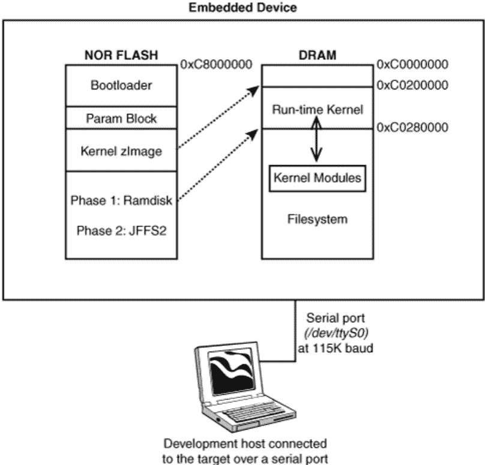

上电时，图 18.2 中的引导加载程序解压内核并将其加载到 DRAM 的 `0xC0200000` 地址处。然后将 ramdisk 加载到 `0xC0280000`（除非你将 *initramfs* 构建到基础内核中，如你在第 2 章所学到的）。最后，它从 *param* 块获取命令行参数，并将控制权移交给内核。

由于你可能必须在嵌入式设备上处理非常规的控制台和内存分区，因此需要向内核传递正确的命令行参数。对于图 18.2 中的设备，以下是一个可能的命令行：

```
console=/dev/ttyS0,115200n8 root=/dev/ram initrd=0xC0280000
```

当你让内核 MTD 驱动程序识别出闪存分区后，存放 ramdisk 的闪存区域就可以改用基于 JFFS2 的文件系统。这样，你就不必将 initrd 加载到 DRAM 中。假设你已将引导加载程序、param 块、内核和文件系统映射到单独的 MTD 分区，命令行现在看起来像这样：

```
console=/dev/ttyS0,115200n8 root=/dev/mtdblock3
```

请参阅旁注"ATAGs"，了解从引导加载程序向内核传递参数的另一种方法。

## ATAGs

在 ARM 内核上，命令行参数已被弃用，取而代之的是标记化的参数列表机制。这种称为 ATAG 的机制在 *Documentation/arm/Booting* 中有描述。要向内核传递参数，需在引导加载程序中从系统内存创建相应的标记，提供内核函数来解析它，并使用 `__tagtable()` 宏将该函数添加到标记解析函数列表中。`tag` 结构及其相关定义位于 *include/asm-arm/setup.h* 中，而 *arch/arm/kernel/setup.c* 包含解析若干预定义 ATAG 的函数。

## 内核移植

与设置工具链一样，将内核移植到你的目标设备在几年前还是一件严肃的事情。必须评估当前内核树对感兴趣架构的稳定性，应用尚未合并到主线中的可用补丁，进行修改，然后祈求好运。但如今，你很可能会找到一个接近的起点，不仅针对你的 SoC，而且针对一个与你类似的硬件板卡。例如，如果你正在围绕飞思卡尔 i.MX21 处理器设计嵌入式设备，你可以选择从处理器厂商构建的基于 i.MX21 的参考板的内核移植（*arch/arm/mach-imx/*）开始。如果你从适合你的发行版提供的或标准的内核开始开发，且该内核适用于与你相似的板卡，那么很可能你不必应对复杂的内核启动问题。

但即使匹配度很高，你可能仍会面临因修改的内存映射、更改的片选、板卡特定的 GPIO 分配、不同的时钟源、迥异的闪存体、新 LCD 面板的时序要求或不同的调试 UART 端口而引起的问题。例如，时钟的变化可能波及数十个寄存器，影响多个 I/O 外设的运行。你可能需要深入研读 CPU 参考手册来解决它。要弄清楚因不同 GPIO 分配而导致的中断引脚路由变更，你可能必须仔细研究你的板卡原理图。要为 LCD 控制器编程适合你的 LCD 面板的 `HSYNC` 和 `VSYNC` 持续时间，你可能需要将示波器连接到板卡，并消化它采集到的信息。

根据设备的需求，你可能还需要进行与启动无关的内核更改。这可能很简单，比如通过 procfs 导出一些信息；也可能很复杂，比如修改内核以实现快速启动。

基础内核运行起来后，你就可以将注意力转向为硬件上的不同 I/O 接口启用设备驱动程序。

### uClinux

uClinux 是 Linux 内核的一个分支，面向没有内存管理单元（MMU）的低端微处理器。uClinux 移植可用于 H8、Blackfin 和 Dragonball 等处理器。uClinux 的大部分内容已合并到主线 2.6 内核中。

uClinux 项目托管于 [www.uclinux.org](http://www.uclinux.org)。该网站包含补丁、文档、代码仓库、支持的架构列表，以及订阅 uclinux-dev 邮件列表的信息。


 ## 嵌入式驱动程序

Linux 在嵌入式领域广受欢迎的原因之一，是其强大的应用程序套件无论在何种硬件平台上都能正常工作，这要归功于其下层的内核抽象层。因此，如**图 18.3** 所示，要获得一个功能丰富的嵌入式系统，你只需要实现嵌套在抽象层和硬件之间的底层设备驱动程序即可。对于设备上的每个外设接口，你需要执行以下操作之一：

- 验证现有驱动程序。测试并确认其按预期工作。
- 找到一个接近匹配的驱动程序，并针对你的硬件进行修改。
- 从头开始编写驱动程序。

**图 18.3. 与硬件无关的应用程序和与硬件相关的驱动程序。**

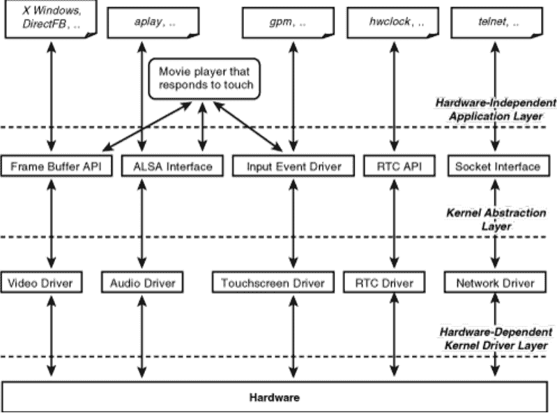

假设有一位内核工程师参与器件选型，那么大多数外设都很可能已有现成驱动程序或足够接近的匹配方案。要利用现有驱动程序，你需要通读硬件的框图和原理图，识别出不同的芯片组，然后拼凑出一个能启用正确驱动程序的可用的内核配置文件。根据你的占用空间或启动时间需求，可以将可能的设备驱动程序模块化，或将其编译进基础内核中。

要了解嵌入式硬件上常见 I/O 接口的设备驱动程序，让我们围绕[图 18.1]()中所示的嵌入式控制器按顺时针方向游览一圈，先从 NOR 闪存开始。

## 闪存

像[图 18.2]()这类嵌入式设备从闪存启动，并将文件系统数据驻留在基于闪存的存储器上。许多设备使用小容量的 NOR 闪存组件来实现前者，而用 NAND 闪存部件来实现后者。^[2]^ 因此，NOR 存储器存放引导加载程序和基础内核，而 NAND 存储器则包含文件系统分区和设备驱动程序模块。

> ^[2]^ 在当今的嵌入式市场中，物料清单（BOM）成本往往至关重要，因此设备仅包含 NAND 存储器的情况并不罕见。这类设备从 NAND 闪存启动，其文件系统也驻留在 NAND 存储器中。NAND 启动需要处理器和引导加载程序双方的支持。

闪存驱动程序由内核的 MTD 子系统支持，该子系统在[第 17 章]()"内存技术设备"中讨论过。如果你使用的是受 MTD 支持的芯片，你只需要编写一个 MTD 映射驱动程序，即可合理划分闪存区域，以容纳引导加载程序、内核和文件系统。[第 17 章]()的[清单 17.1]()、[17.2]()和[17.3]()实现了 Linux 手持设备的映射驱动程序，如该章[图 17.2]()所示。

## UART

UART 负责串行通信，是你可能在所有微控制器上都能找到的一种接口。UART 被视为基础硬件，因此内核包含其所支持的所有微控制器的 UART 驱动程序。在嵌入式设备上，UART 用于将处理器与调试串口、调制解调器、触摸控制器、GPRS 芯片组、蓝牙芯片组、GPS 设备、遥测电子设备等进行对接。

有关 Linux 串行子系统的详细讨论，请参阅[第 6 章]()"串行驱动程序"。

## 按键和滚轮

你的设备可能配有多种杂项外设，例如键盘（按常见 QWERTY 布局组织的微型键盘、手机上那种按键复用的数据输入设备、ABC 布局的键盘等）、LED、滚轮和按钮。这些 I/O 设备通过 GPIO 线路或 CPLD（参见下面的"[CPLD/FPGA]()"部分）与 CPU 对接。这类外设驱动程序通常是简单的字符设备或杂项设备驱动程序。部分驱动程序通过 procfs 或 sysfs 导出设备访问接口，而非通过 */dev* 节点。

## PCMCIA/CF

PCMCIA 或 CF 插槽是嵌入式设备常见的附加组件。例如，使用 CF 卡为嵌入式设备启用 WiFi 的优势在于，如果 WiFi 控制器停产，你就不必重新设计电路板。此外，由于多种技术都有 PCMCIA/CF 外形规格，你可以自由地将连接方式从 WiFi 更改为蓝牙等其他技术。这种方案的缺点是，即使有机械固定，插槽本身 inherently 不可靠。卡片可能因冲击和振动而松动，导致连接时断时续。

PCMCIA 和 CF 设备驱动程序在[第 9 章]()"PCMCIA 与紧凑型闪存"中讨论。

## SD/MMC

许多嵌入式处理器包含与 SD/MMC 介质通信的控制器。SD/MMC 存储器采用 NAND 闪存构建。与 CF 卡类似，SD/MMC 卡可为你的设备增加数 GB 的存储空间。它们还提供简便的内存升级途径，因为 SD/MMC 卡的可用密度在不断增加。

[第 14 章](chapter14.html)"块设备驱动程序"将引导你了解内核中的 SD/MMC 子系统。

## USB

传统计算机支持 USB 主机模式，通过该模式你可以与大多数类别的 USB 设备进行通信。嵌入式系统通常还需要支持 USB 设备模式，即系统本身作为 USB 设备，插入到其他主机计算机中。

正如你在[第 11 章](chapter11.html)"通用串行总线"中所见，许多嵌入式控制器支持 USB OTG，它使你的设备可以作为 USB 主机或 USB 设备工作。例如，它允许你将 U 盘连接到你的嵌入式设备。它还允许你的嵌入式设备作为 U 盘工作，将其部分本地存储导出供外部访问。Linux USB 子系统提供 USB OTG 驱动程序。对于不兼容 OTG 的硬件，USB Gadget 项目（现已并入主线内核）带来了 USB 设备能力。

## RTC

许多嵌入式 SoC 包含 RTC 支持以跟踪墙上时间，但有些依赖外部 RTC 芯片。与 x86 计算机中 RTC 是南桥芯片组的一部分不同，嵌入式控制器通常通过 I²C 或 SPI 等慢速串行总线与外部 RTC 对接。你可以编写使用 I²C 或 SPI 核心服务的客户端驱动程序来驱动这类 RTC，如[第 8 章](chapter8.html)"内部集成电路协议"中所讨论。[第 2 章](chapter2.html)和[第 5 章](chapter5.html)"字符设备驱动程序"讨论了基于 x86 系统的 RTC 支持。

## 音频

正如你在[第 13 章](chapter13.html)"音频驱动程序"中所见，音频编解码器将数字音频数据转换为模拟声音信号，以便通过扬声器播放，并为麦克风录音执行反向操作。编解码器与 CPU 的连接取决于嵌入式控制器支持的数字音频接口。与编解码器通信的通常方式是通过 AC'97 或 I²S 等总线。

## 触摸屏

触摸是许多嵌入式设备上的主要输入机制。许多 PDA 提供软键盘用于数据输入。在[第 6 章](chapter6.html)中，我们开发了串行触摸控制器的驱动程序；在[第 7 章](chapter7.html)"输入设备驱动程序"中，我们研究了通过 SPI 总线与 CPU 对接的触摸控制器。

如果你的驱动程序符合 *input* API，那么将其与图形用户界面结合应该很简单。不过，你可能需要添加自定义支持来校准和线性化触摸面板。

## 视频

某些嵌入式系统无头（headless），但许多系统配有相关显示器。方向合适的 LCD 面板（横屏或竖屏）连接到嵌入式 SoC 中的视频控制器。许多 LCD 面板带有集成触摸屏。

正如你在[第 12 章](chapter12.html)"视频驱动程序"中所学的，帧缓冲使应用程序与显示硬件隔离，因此将一个兼容的 GUI 移植到你的设备上很容易，只要你的显示驱动程序符合帧缓冲接口。

## CPLD/FPGA

*复杂可编程逻辑器件*（CPLD）或其重量级对应产品*现场可编程门阵列*（FPGA）可以添加一层厚实的、与操作系统无关的快速逻辑。你可以使用*超高速集成电路硬件描述语言*（VHDL）等语言对 CPLD（和 FPGA）进行编程。处理器与外设之间的电信号通过 CPLD 传播，因此通过适当地对 CPLD 进行编程，操作系统可以获得用于执行复杂 I/O 的优雅寄存器接口。CPLD 中的 VHDL 代码在执行必要的控制逻辑后，将这些寄存器内容内部锁存到数据总线上。

例如，考虑一个外部串行 LCD 控制器，需要逐位移位来驱动。该设备的 Linux 驱动程序在发送每个像素或命令字节时，需要多次拨动时钟和抖动 I/O 引脚，这会很棘手。然而，如果这个 LCD 控制器通过 CPLD 连接到处理器，VHDL 代码可以执行必要的串行移位操作（将每个位按时钟移入），并向操作系统呈现命令和数据的并行寄存器接口。有了这些虚拟的 LCD 命令和数据寄存器，LCD 驱动程序的实现就变得简单了。本质上，CPLD 将繁琐的串行 LCD 控制器转换为方便的并行控制器。

如果 CPLD 工程师和 Linux 驱动程序开发人员协作，他们可以在 VHDL 代码和 Linux 驱动程序之间找到最佳划分，从而节省时间和成本。

## 连接性

连接性注入智能，因此很少有嵌入式设备不具备通信能力。嵌入式设备上常见的网络技术包括 WiFi、蓝牙、蜂窝调制解调器、以太网和无线电通信。

[第 15 章](.)"网络接口卡"探讨了有线网络设备驱动程序，[第 16 章](.)"无线的 Linux"则研究了无线通信技术驱动程序。

## 特定领域电子器件

你的设备可能包含与使用行业领域相关的特定电子器件。它可能是医疗设备中的遥测接口、汽车硬件中的传感器、安全设备中的生物识别装置、蜂窝电话中的 GPRS，或导航系统中的 GPS。这些外设通常通过标准 I/O 接口（如 UART、USB、I²C、SPI 或*控制器局域网*（CAN））与嵌入式控制器通信。对于通过 UART 对接的设备，由于 UART 驱动程序负责通信，你在设备驱动程序层面通常几乎无需做额外工作。对于通过 USB 对接的指纹传感器等设备，你可能需要编写 USB 客户端驱动程序。你还可能面临专有接口，例如网络处理器的交换结构，在这种情况下，你可能需要编写成熟的设备驱动程序。

以数字媒体领域为例。有线或*直播卫星*（DTH）接口系统通常围绕*机顶盒*（STB）芯片组构建。这些芯片具有个人视频录制（将多个频道录制到硬盘、观看一个频道的同时录制另一个频道等）和条件接收（允许服务提供商根据订阅情况控制终端用户可以看到什么内容）等功能。为此，STB 芯片拥有一个处理器核心，并搭配一个强大的图形引擎。后者在硬件中实现 MPEG 编解码器。这类音视频编解码器可以解码 MPEG2 和 MPEG4 等压缩数字媒体标准。（MPEG 是*运动图像专家组*的缩写，这是负责制定运动图像标准的机构。）如果你要将 Linux 嵌入到 STB 中，你需要驱动这类音视频编解码器。

## 更多驱动程序

如果你的设备服务于医疗保健等生命关键型行业领域，系统内存可能具有 ECC 功能。[第 20 章](.)"更多设备与驱动程序"讨论了 ECC 报告。

如果你的嵌入式设备由电池供电，你可能希望使用合适的 CPU 频率调节器来动态调整处理器频率以节省电能。第 20 章还讨论了 CPU 频率驱动程序和电源管理。

大多数嵌入式处理器都有内置的硬件看门狗，用于从死机中恢复系统。你

我们在[第五章](.)中介绍了看门狗驱动程序。以*drivers/char/watchdog/*中的合适驱动程序为起点，为系统实现一个看门狗驱动程序。

如果你的嵌入式设备包含用于检测*欠压*的电路，[3] 你可能需要为内核添加感知该状况并采取适当措施的能力。

> 欠压是指输入电压降至可容忍水平以下的情况。（*断电*则是指完全失去电源。）欠压检测尤其适用于设备通过以太网供电（PoE）等技术供电，而非传统墙壁插座的情况。

多种嵌入式 SoC 内置了*脉冲宽度调制器*（PWM）单元。PWM 允许你对蜂鸣器等模拟设备进行数字控制。供给目标设备的电压电平通过设置 PWM 的占空比（PWM 输出波形在一个周期内的高电平时间相对于周期的比例）来调节。LCD 亮度是另一个可以使用 PWM 控制的功能示例。根据目标设备和使用场景，可以实现字符或混杂驱动程序接口来操作 PWM。


## 根文件系统

在 Linux 发行版出现之前，组装一套适合可用存储大小限制的紧凑应用程序集本身就是一项工程。必须将一组最精简的实用程序、库、工具和守护进程的源代码拼凑在一起；确保它们的版本相互兼容；并进行交叉编译。如今的发行版提供了为支持的处理器构建的现成应用程序集，并提供工具让你以软件包粒度挑选组件。当然，你可能仍需要实现自定义实用程序和工具来补充发行版提供的应用程序。

在嵌入式设备上，闪存（第十七章讨论）是存放应用程序集的常用载体，在引导过程结束时作为根设备挂载。硬盘不常见，因为它们耗电量大、体积笨重，且有对震动和冲击不耐受的移动部件。嵌入式设备上存放根文件系统的常见位置包括：

- 初始 ramdisk（*initramfs* 或 *initrd*）通常是在使其他潜在根设备的驱动程序正常工作之前的起点，用于开发目的。

- 通过 NFS 挂载根文件系统是比使用 ramdisk 更强大的开发策略。我们将在下一节详细讨论。

- 存储介质，如闪存芯片、SD/MMC 卡、CF 卡、DOC 和 DOM。

注意，让所有数据都留在根分区可能不是好主意。通常会将文件分散到不同的存储分区，并设置所需的*读写*或*只读*保护标志，尤其是存在设备可能被突然关机的可能性时。

### NFS 挂载的根

通过 NFS 挂载根文件系统可以作为加速嵌入式开发周期的催化剂。在这种情况下，根文件系统物理上位于开发主机而非目标设备，因此其大小实际上是无限的，不受目标设备本地可用存储量的限制。将设备驱动程序模块或应用程序下载到目标设备，以及上传日志，就像复制到开发主机上的 */path/to/target/rootfilesystem/* 一样简单（且快速）。这种测试和调试的便利性是一个充分的理由，说明你应该坚持在工程级硬件上配备以太网，即使量产单元不会有以太网支持。在板子上配备以太网还可以让引导加载程序使用简单文件传输协议（TFTP）通过网络将内核映像下载到目标设备。

表 18.2 [4] 展示了使 TFTP 和 NFS 与嵌入式设备协同工作所需的典型步骤。假设你的开发主机同时兼任 TFTP、NFS 和 DHCP 服务器，且引导加载程序（本例中为 BLOB）支持嵌入式设备上使用的以太网芯片组。

> [4] 表 18.2 中使用的文件名和目录路径名取决于发行版。

表 18.2. 使用 TFTP 和 NFS 节省开发时间

| | 目标嵌入式设备 | 主机开发平台 |
|---|---|---|
| **通过 TFTP 引导内核** | 从引导加载程序提示符配置目标设备和服务器（主机）的 IP 地址： | 配置主机 IP 地址： |
| | ``` | ``` |
| | /* 目标 IP */ | bash> ifconfig eth0 4.1.1.1 |
| | blob> ip 4.1.1.2 | ``` |
| | /* 主机 IP */ | 安装并配置 TFTP 服务器（具体步骤取决于发行版）： |
| | blob> server 4.1.1.1 | ``` |
| | /* 内核映像 */ | bash> cat /etc/xinetd.conf/tftp |
| | blob> TftpFile /tftpdir/zImage | service tftp |
| | /* 通过网络拉取内核 */ | { |
| | blob> tftp | socket_type = dgram |
| | TFTPing /tftpboot/zImage............Ok | protocol USSock_DGRAM |
| | blob> | socket_type = dgram |
| | ``` | protocol USSock_DGRAM |
| | | protocol = udp |
| | | wait = yes |
| | | user = root |
| | | server = /usr/sbin/in.tftpd |
| | | server_args = /tftpdir |
| | | disable = no |
| | | per_source = 11 |
| | | cps = 100 2 |
| | | flags = IPv4 |
| | | } |
| | | ``` |
| | | 确保 TFTP 服务器存在于 /usr/sbin/in.tftpd 且 xinetd 正在运行。 |
| | | 编译启用 NFS 的目标内核并将其复制到 /tftpdir/zImage。 |
| **通过 NFS 挂载根文件系统** | ``` | 将 /path/to/target/root/ 导出以供 NFS 访问： |
| | blob> boot console=/dev/ttyS0,115200n8 root=/dev/nfs ip=dhcp | ``` |
| | /*内核引导信息*/ | bash> cat /etc/exports |
| | /* ... */ | /path/to/target/root/ *(rw,sync,no_root_squash,no_all_squash) |
| | VFS: Mounted root (nfs filesystem) | ``` |
| | /* ... */ | 启动 NFS： |
| | login: | ``` |
| | ``` | bash> service nfs start |
| | | ``` |
| | | 配置 DHCP 服务器。嵌入式设备上的内核依赖此服务器在启动期间为其分配 4.1.1.2 IP 地址，并提供 /path/to/target/root/： |
| | | ``` |
| | | bash> cat /etc/dhcpd.conf |
| | | ... |
| | | subnet 4.1.1.0 netmask |
| | | 255.255.255.0 { |
| | | range 4.1.1.2 4.1.1.10 |
| | | max-lease-time 43200 |
| | | option routers 4.1.1.1 |
| | | option ip-forwarding off |
| | | option broadcast-address 4.1.1.255 |
| | | option subnet-mask 255.255.255.0 |
| | | group { |
| | | next-server 4.1.1.1 |
| | | host target-device { |
| | | /* 嵌入式设备的 MAC 地址 */ |
| | | hardware Ethernet AA:BB:CC:DD: |
| | | EE:FF; |
| | | fixed-address 4.1.1.2; |
| | | option root-path |
| | | "/path/to/target/root/"; |
| | | } |
| | | } |
| | | ... |
| | | bash> service dhcpd start |
| | | bash> |
| | | ``` |

### 紧凑型中间件

内存紧张的嵌入式设备倾向于使用占用空间小、运行时内存需求低的中间件实现。权衡通常在于功能、标准兼容性和速度之间。让我们来看一些流行的紧凑型中间件解决方案，它们可能是填充根文件系统的潜在候选。

*BusyBox* 是一种常用工具，用于在内存有限的嵌入式系统上提供多实用程序环境。它舍弃了一些功能，但为多个 shell 实用程序提供了优化的替代方案。

*uClibc* 是 GNU C 库的紧凑版本，最初为与 uClinux 配合使用而开发。uClibc 也能在普通 Linux 系统上工作，采用 LGPL 许可证。如果嵌入式设备空间不足，请尝试使用 uClibc 而非 glibc。

需要运行 X Windows 服务器的嵌入式系统通常依赖 *TinyX*，这是一个与 XFree86 4.0 代码一起发布的轻量级 X 服务器。TinyX 运行在帧缓冲驱动程序之上，可用于第十二章图 12.6 所示的设备等设备。

*Thttpd* 是一个轻量级 HTTP 服务器，对 CPU 和内存资源要求很低。

即使你是使用 tiny 8位无 MMU 微控制器创建非 Linux 解决方案，你也可能希望它与 Linux 互操作。例如，假设你正在为红外存储钥匙扣编写深度嵌入式固件。该钥匙扣可以存储千兆字节的个人数据，可通过网络浏览器从 Linux 笔记本电脑通过红外访问。如果你在红外钥匙扣上运行 *uIP* 这样的紧凑型 TCP/IP 协议栈，以及 *Pico-IrDA* 这样的最小化 IrDA 协议栈，你就需要确保它们与相应的 Linux 协议栈的互操作性。

表 18.3 列出了本节提到的紧凑型中间件项目的主页。

**表 18.3. 紧凑型中间件示例**

| 名称 | 说明 | 下载位置 |
| --- | --- | --- |


 | 名称 | 描述 | 下载地址 |
|------|-------------|-------------------|
| BusyBox | 轻量级Shell环境 | www.busybox.net |
| uClibc | glibc的精简版 | www.uclibc.org |
| TinyX | 面向内存受限设备的X服务器 | X Windows源代码树的一部分，可从ftp://ftp.xfree86.org/pub/XFree86/4.0/下载 |
| Thttpd | 轻量级HTTP服务器 | www.acme.com/software/thttpd |
| uIP | 面向微控制器的紧凑型TCP/IP协议栈 | www.sics.se/~adam/uip |
| Pico-IrDA | 面向微控制器的微型IrDA协议栈 | http://blaulogic.com/pico_irda.shtml |

## 测试基础设施

大多数使用嵌入式设备的行业领域都受到监管机构的管辖。拥有可扩展且稳健的测试基础设施，其重要性可能与修改内核和设备驱动程序相媲美。总体而言，测试框架负责以下事项：

1. 展示合规性以获得监管批准。例如，如果您的系统是面向美国市场的医疗级设备，您应该将测试套件定位为获取*食品药品监督管理局*（*FDA*）的批准。

2. 大多数面向美国市场的电子设备都必须遵守排放标准，例如*联邦通信委员会*（*FCC*）规定的*电磁干扰*（*EMI*）和*电磁兼容性*（*EMC*）。为了证明合规性，您可能需要在模拟不同运行环境的测试室内进行一系列测试。您还可能需要验证当静电枪指向电路板的不同部位时，系统仍能正常运行。

3. 构建验证测试。每次构建软件交付物时，使用这些测试对其进行*质量保证*（*QA*）。

4. 制造测试。每次组装设备时，都需要使用一组测试来验证其功能。当制造进入批量生产时，这些测试的重要性尤为突出。

为了对所有这些测试实现统一的测试基础，建议在Linux上实现测试框架，而不是将其开发为独立套件。独立代码不易扩展或延伸。在一个基于Linux的测试系统上，添加一个简单的测试来ping下一跳路由器只需要五行脚本，但如果使用独立测试监视器，则可能需要编写网络驱动程序和协议栈。

测试工程师不必是内核高手，但需要吸收开发团队的实现信息，并进行批判性思考。

## 调试

在结束本章之前，让我们探讨一些与调试嵌入式软件相关的话题。

### 电路板返工

在嵌入式硬件上启动引导加载程序或内核时，查阅电路原理图和数据手册是一项重要的调试技能。理解电路板的*布局图*（该文件显示了芯片在电路板上的位置）对您使用示波器调试潜在的硬件问题，或需要进行小型电路板返工时大有帮助。*参考位号*（如[图18.4](#figure-18.4)中的U10和U11）将原理图中的每个芯片与布局图关联起来。*印刷电路板*（*PCB*）通常带有*丝印层*，在每个芯片附近印上参考位号。

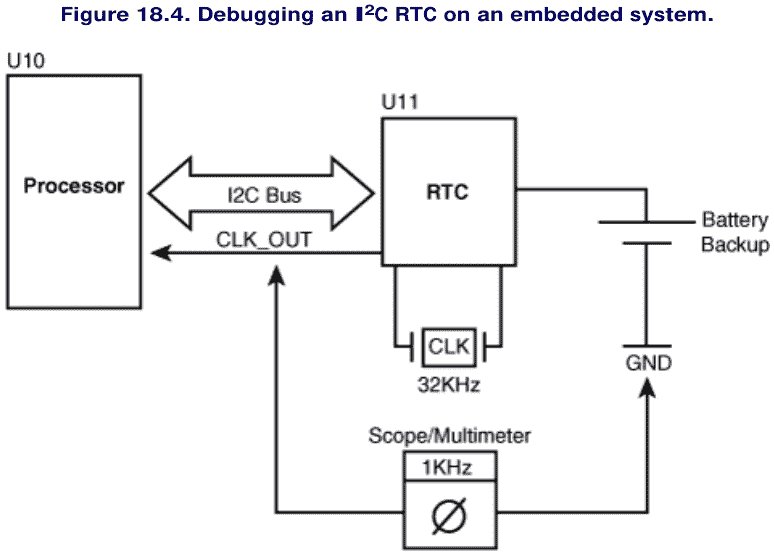

**图 18.4 在嵌入式系统上调试I²C RTC。**

考虑这样一个假设场景：被测电路板上的USB枚举未发生。USB集线器驱动程序检测到了设备插入，但无法分配端点地址。仔细查看原理图后发现，USB收发器的`SPEED`和`MODE`引脚引出的连接线被错误地互换了。检查布局图可以确定收发器在PCB上的位置。将布局图上的收发器参考位号与PCB上的丝印层进行匹配，可以精确定位需要焊接"飞线"来修复故障连接的位置。

万用表和示波器是您嵌入式调试工具箱中值得添加的工具。举例说明，让我们考虑一个涉及I²C RTC的示例情况，如[第8章](#chapter-8)的[图8.3](#figure-8.3)所示。该图在此重现，并附上了连接到感兴趣探测点的万用表/示波器。考虑以下场景：您已按照[第8章](#chapter-8)的"[设备示例：实时时钟](#device-example-real-time-clock)"一节所述，为该RTC芯片编写了I²C客户端驱动程序。然而，当您在电路板上运行驱动程序时，系统变得无法启动。重置电路板时引导加载程序无法启动，JTAG调试器也无法连接到目标。为了理解这一看似致命错误的可能原因，让我们仔细看看连接图。

由于RTC和CPU都需要外部时钟，电路板使用单个32KHz晶振提供。然而，这个32KHz时钟需要缓冲。RTC为自己缓冲时钟，并在输出引脚上免费提供。该引脚`CLK_OUT`为处理器提供时钟。将示波器（或可以测量频率的万用表）连接在`CLK_OUT`和地之间，以验证处理器时钟频率。如您所见，图18.4中示波器读数为1KHz，而非预期的32KHz！这里可能出了什么问题？

RTC控制寄存器包含选择`CLK_OUT`频率的位。在探测芯片（按照第8章中`myrtc_attach()`的思路）时，驱动程序错误地初始化了这些位，使`CLK_OUT`输出1KHz。由于电池备份，RTC寄存器是非易失性的，因此控制寄存器在重启后仍保留这个错误的值。产生的时钟偏差足以使系统无法启动。断开RTC的备用电池，耗尽寄存器，重新连接电池，使用示波器验证`CLK_OUT`上的32KHz时钟已恢复，修复您的驱动程序代码，然后重新开始！

### 调试器

您可以在嵌入式Linux中使用大多数将在第21章学习的调试技术。内核调试器可用于多种处理器平台。第21章还将探讨JTAG调试器，它们比内核调试器更强大，在嵌入式领域中广泛用于调试引导加载程序、基础内核和设备驱动模块。

# 第19章 用户空间驱动程序

本章内容

- 进程调度与响应时间 553
- 访问I/O区域 558
- 访问内存区域 562
- 用户模式SCSI 565
- 用户模式USB 567
- 用户模式I²C 571
- UIO 573
- 查看源码 574

大多数设备驱动程序喜欢在内核中过特权生活，但有些在用户空间不确定的世界中也能如鱼得水。多个内核子系统（如SCSI、USB和I²C）为用户模式驱动程序提供了一定程度的支持，因此您可能无需编写一行内核代码就能控制这些设备。

尽管用户空间环境恶劣，用户模式驱动程序仍享有一定的优势。它们易于开发和调试。您不必在每次解引用悬空指针时都重启系统。如果设备子系统有标准的用户空间编程库支持，一些用户模式驱动程序甚至可以跨操作系统工作。以下是一些帮助决定驱动程序是否应该驻留在用户空间的经验法则：

- 应用可行性测试。能在用户空间完成的工作可能应该留在用户空间。
- 如果您需要与大量慢速设备通信，且性能要求不高，可以考虑在用户空间实现驱动程序。如果您有时间关键型性能要求，则留在内核中。
- 如果您的代码需要内核API服务、访问内核变量，或与中断处理紧密交织，那么它有充分的理由待在内核空间。
- 如果您的代码大部分可以视为策略，用户空间可能是其合理的归属。
- 如果内核的其他部分需要调用您的代码服务，那么它适合留在内核中。
- 您不能在内核中轻松进行浮点运算。然而，*浮点运算单元*（*FPU*）指令可以从用户空间使用。

话虽如此，从用户空间能完成的工作有限。许多重要的设备类别，如存储介质和网络适配器，无法从用户空间驱动。但即使内核驱动程序是合适的解决方案，在将代码移入内核空间之前，尽可能在用户空间建模和测试尽可能多的代码也是可取的。测试周期更快，也更容易遍历所有可能的代码路径并确保它们没有问题。

在本章中，*用户空间驱动程序*（或*用户模式驱动程序*）一词是在通用意义上使用的，并不严格符合本书此前所暗示的驱动程序语义。如果一个应用程序也可以在内核中实现，那么它就被视为用户模式驱动程序。

2.6内核 overhaul了一个对用户空间驱动程序特别有意思的子系统。新的进程调度程序为用户模式代码带来了巨大的响应时间优势，让我们从这里开始。

## 进程调度与响应时间

许多用户模式驱动程序需要在限定时间内执行某些工作。在用户空间中，由于


然而，调度和分页常常会阻碍快速响应时间。为了解如何最小化前者的影响，让我们深入了解近期的 Linux 调度器并理解其底层设计哲学。

### 原始调度器

在 2.4 及更早版本中，调度器在选取任务之前会重新计算每个任务的调度参数。因此，算法消耗的时间随系统中争抢 CPU 的任务数量线性增加。换句话说，它使用了 `O(n)` 的时间，其中 `n` 是活跃任务的数量。在高负载系统上，这转化为了显著的开销。2.4 的算法在 SMP 系统上也表现不佳。

### O(1) 调度器

`O(n)` 算法消耗的时间与输入规模成线性关系，`O(n²)` 解决方案与输入长度成二次方关系，但 `O(1)` 技术与输入无关，因此具有良好的可扩展性。2.6 的调度器将 `O(n)` 算法替换为了 `O(1)` 方法。除了具有超强的可扩展性外，该调度器还内置了启发式策略，通过对参与 I/O 活动的任务给予优先待遇来改善用户响应性。进程有两种类型：I/O 密集型和 CPU 密集型。I/O 密集型任务经常睡眠等待设备 I/O，而 CPU 密集型任务则是处理器的工作狂。悖论的是，为了实现快速响应时间，懒惰的任务会从 `O(1)` 调度器那里获得激励，而勤奋的任务却遭到批评。查看侧边栏"**`O(1)` 调度器的亮点**"以了解其一些重要特性。

### O(1) 调度器的亮点

以下是 `O(1)` 调度器的一些重要特性：

- 该算法使用两个由 140 个优先级列表组成的*运行队列*：一个*活跃*队列，持有还有时间片的任务；以及一个*过期*队列，包含时间片已用完的进程。当任务用完其时间片时，它按优先级顺序插入到过期队列中。当活跃队列变为空时，两个队列会互换。为了决定下一个运行哪个进程，调度器不会遍历整个队列。相反，它从活跃队列中选取优先级最高的任务。因此，选取任务的开销不取决于活跃任务的数量，而取决于优先级的数量。这使其成为恒定时间或 `O(1)` 算法。

- 调度器支持两种优先级范围：UNIX 系统上支持的标准 *nice* 值和内部优先级。前者范围从 –20 到 +19，后者从 0 扩展到 139。在这两种情况下，较低的值对应较高的优先级。前 100 个（0 到 99）内部优先级保留给实时（RT）任务，后 40 个（100 到 139）分配给普通任务。40 个 *nice* 值映射到后 40 个内部优先级。普通任务的内部优先级可以由调度器动态调整，而 *nice* 值由用户静态设置。每个内部优先级都有一个关联的运行列表。

- 调度器使用启发式方法来判断进程的性质是 I/O 密集型还是 CPU 密集型。简单来说，如果任务经常睡眠，它很可能是 I/O 密集型的；但如果它快速用完时间片，它就是 CPU 密集型的。每当调度器发现某个任务表现出 I/O 密集型特征时，就会通过动态增加其内部优先级来奖励它。另一方面，CPU 密集型特征则会受到负面标记的惩罚。

- 分配的时间片与优先级成正比。优先级更高的任务获得更大的时间片。

- 只要任务还有时间片积分，就不会被调度器抢占。如果它在用完时间片配额之前让出处理器，那么下次运行时可以滚存剩余的时间片。由于 I/O 密集型进程经常让出 CPU，这改善了交互性能。

- 调度器支持 RT 调度策略。RT 任务抢占普通（`SCHED_OTHER`）任务。RT 策略的使用者可以覆盖调度器的动态优先级分配。与 `SCHED_OTHER` 任务不同，它们的优先级不会被内核实时重新计算。RT 调度有两种变体：`SCHED_FIFO` 和 `SCHED_RR`。它们用于产生"软"实时行为，而非严格的"硬"实时保证。`SCHED_FIFO` 没有时间片的概念；`SCHED_FIFO` 任务运行直到它们睡眠等待 I/O 或让出处理器。`SCHED_RR` 是 `SCHED_FIFO` 的轮询变体，它也为 RT 任务分配时间片。时间片到期的 `SCHED_RR` 任务被追加到相应优先级列表的末尾。

- 调度器通过使用每 CPU 运行队列和每 CPU 同步来提升 SMP 性能。

### CFS 调度器

Linux 调度器在 2.6.23 内核中再次重写了。`SCHED_OTHER` 类的*完全公平调度器*（CFS）通过放弃优先级数组、时间片、交互性启发式和对 `HZ` 的依赖，消除了与 `O(1)` 调度器相关的许多复杂性。CFS 的目标是通过为每个任务提供总 CPU 能力除以运行任务数量来实现所有调度实体的公平性。详细剖析 CFS 超出了本章的范围。查看 *Documentation/sched-design-CFS.txt* 以获取简要教程。

## 响应时间

作为用户模式驱动开发者，你有几种选项可以改善应用程序的响应时间：

- 使用 RT 调度策略，它们比通常的策略提供更细粒度的控制。查看 `sched_setscheduler()` 及其相关函数的手册页，以了解实现软实时响应时间的方法。

- 如果你使用非 RT 调度，调整不同进程的 *nice* 值以实现所需的性能平衡。

- 如果你使用启用了 CFS 调度器的 2.6.23 或更高版本内核，可以微调 */proc/sys/kernel/sched_granularity_ns*。如果你使用 2.6.23 之前的内核，修改 *kernel/sched.c* 和 *include/linux/sched.h* 中的 `#define` 以适合你的应用程序。谨慎地更改这些值以满足你的应用程序套件的需求。调度器的使用场景是复杂的。令某些负载条件欣喜的设置可能会让其他条件沮丧，所以你可能必须通过反复试验来实验。

- 响应时间不仅仅是调度器的领域；它们还取决于解决方案架构。例如，如果你将一个繁忙的中断处理程序标记为*快速*，它会频繁禁用其他本地中断，这可能会减慢其他 IRQ 上的数据采集和传输。

让我们实现一个示例，看看用户模式驱动如何通过防范由调度和分页引入的不确定性来实现快速响应时间。如你在第 2 章"内核窥视"中学到的，RTC 是一个能够以高精度生成周期性中断的定时器源。清单 19.1 实现了一个示例，使用来自 /dev/rtc 的中断报告来执行微秒精度的周期性工作。Pentium *时间戳计数器*（TSC）用于测量响应时间。

清单 19.1 中的程序首先使用 `sched_setscheduler()` 将其调度策略更改为 `SCHED_FIFO`。接下来，它调用 `mlockall()` 将所有映射页面锁定在内存中，以确保交换不会妨碍确定性定时。只有超级用户才允许调用 `sched_setscheduler()` 和 `mlockall()`，并请求频率高于 64Hz 的 RTC 中断。

### 清单 19.1. 微秒精度的周期性工作

```
Code View:
#include <linux/rtc.h>
#include <sys/ioctl.h>
#include <sys/time.h>
#include <fcntl.h>
#include <pthread.h>
#include <linux/mman.h>

/* Read the lower half of the Pentium Time Stamp Counter
   using the rdtsc instruction */
#define rdtscl(val) __asm__ __volatile__ ("rdtsc" : "=A" (val))

main()
{
  unsigned long ts0, ts1, now, worst; /* Store TSC ticks */
  struct sched_param sched_p;        /* Information related to
                                     scheduling priority */
  int fd, i=0;
  unsigned long data;
  /* Change the scheduling policy to SCHED_FIFO */
  sched_getparam(getpid(), &sched_p);
  sched_p.sched_priority = 50; /* RT Priority */
  sched_setscheduler(getpid(), SCHED_FIFO, &sched_p);

  /* Avoid paging and related indeterminism */
  mlockall(MCL_CURRENT);

  /* Open the RTC */
  fd = open("/dev/rtc", O_RDONLY);

  /* Set the periodic interrupt frequency to 8192Hz
     This should give an interrupt rate of 122uS */
  ioctl(fd, RTC_IRQP_SET, 8192);

  /* Enable periodic interrupts */
  ioctl(fd, RTC_PIE_ON, 0);
  rdtscl(ts0);
  worst = 0;

  while (i++ < 10000) {

    /* Block until the next periodic interrupt */
    read(fd, &data, sizeof(unsigned long));
```


 ```c
/* 使用 TSC 精确测量消耗的时间。
   读取 TSC 的下半部分即可 */
rdtscl(tsl);
now = (tsl-ts0);

/* 更新最坏情况延迟 */
if (now > worst) worst = now;
ts0 = tsl;

/* 执行需要周期性完成的工作 */
do_work(); /* 本次测量中为空操作 */
}

printf("Worst latency was %8ld\n", worst);

/* 禁用周期性中断 */
ioctl(fd, RTC_PIE_OFF, 0);
}
```

清单 19.1 中的代码循环 10,000 次，并打印执行期间出现的最坏情况延迟。在一台 Pentium 1.8GHz 机器上，输出结果为 240899，大约对应 133 微秒。根据 RTC 芯片组的数据手册，8192Hz 的定时器频率应产生 122 微秒的周期性中断率。这很接近。使用 SCHED_OTHER 代替 SCHED_FIFO，在 varying loads 下重新运行代码，观察产生的漂移。

你也可以在 RT 模式下运行内核线程。为此，在启动线程时执行以下操作：

```c
static int
my_kernel_thread(void *i)
{
  daemonize();
  current->policy = SCHED_FIFO;
  current->rt_priority = 1;
  /* ... */
}
```

# 第19章 用户空间驱动程序

| 本章内容 | |
|---|---|
| • 进程调度和响应时间 | 553 |
| • 访问 I/O 区域 | 558 |
| • 访问内存区域 | 562 |
| • 用户模式 SCSI | 565 |
| • 用户模式 USB | 567 |
| • 用户模式 I²C | 571 |
| • UIO | 573 |
| • 查看源代码 | 574 |

- 进程调度和响应时间
- 访问 I/O 区域
- 访问内存区域
- 用户模式 SCSI
- 用户模式 USB
- 用户模式 I²C
- UIO
- 查看源代码

大多数设备驱动程序倾向于在内核中过着特权生活，但有些在用户空间不确定的世界中如鱼得水。多个内核子系统，如 SCSI、USB 和 I²C，为用户模式驱动程序提供了一定程度的支持，因此你可能无需编写一行内核代码就能控制这些设备。

尽管用户空间的环境恶劣，用户模式驱动程序仍享有某些优势。它们易于开发和调试。每次解引用悬空指针时，你不必重新启动系统。如果设备子系统享有标准用户空间编程库的服务，某些用户模式驱动程序甚至可以跨操作系统工作。以下是一些经验法则，可帮助确定你的驱动程序是否应该驻留在用户空间：

- 应用可能性测试。能在用户空间完成的事情很可能应该留在用户空间。

- 如果你需要与大量慢速设备通信，且性能要求不高，请考虑在用户空间实现驱动程序的可能性。如果你有时间关键型性能要求，则留在内核中。

- 如果你的代码需要内核 API 的服务、访问内核变量，或与中断处理紧密交织，那么它有充分的理由留在内核空间。

- 如果你的代码所做的很多事情可以被视为策略，用户空间可能是其合理的归宿。

- 如果内核的其他部分需要调用你的代码的服务，那么它是留在内核中的候选者。

- 你不能轻易在内核中执行浮点运算。然而，*浮点单元*（FPU）指令可以从用户空间使用。

话虽如此，从用户空间无法完成太多事情。许多重要的设备类别，如存储介质和网络适配器，无法从用户空间驱动。但即使内核驱动程序是合适的解决方案，在将代码移至内核空间之前，尽可能多地在用户空间建模和测试代码也是个好主意。测试周期更快，也更容易遍历所有可能的代码路径并确保它们是干净的。

在本章中，术语*用户空间驱动程序*（或*用户模式驱动程序*）是广义的，并不严格符合本书此前所暗示的驱动程序的语义。如果一个应用程序也可能是内核中的候选实现，那么它就被视为用户模式驱动程序。

2.6 内核彻底改进了对用户空间驱动程序特别感兴趣的子系统。新的进程调度器为用户模式代码提供了巨大的响应时间优势，所以让我们从这里开始。

## 进程调度和响应时间

许多用户模式驱动程序需要以时间受限的方式执行某些工作。然而，在用户空间，由于调度和分页产生的不确定性往往会妨碍快速响应时间。为了解如何最小化前者的影响，让我们深入研究一下最近的 Linux 调度器并理解其底层设计理念。

### 原始调度器

在 2.4 及更早的时代，调度器在选择任务之前会重新计算每个任务的调度参数。因此，算法消耗的时间随系统中竞争任务的数量线性增加。换句话说，它使用了 `O(n)` 时间，其中 `n` 是活动任务的数量。在高负载运行的系统上，这转化为显著的开销。2.4 的算法在 SMP 系统上也表现不佳。

### O(1) 调度器

`O(n)` 算法消耗的时间与输入大小成线性关系，`O(n²)` 解与输入长度成二次方关系，但 `O(1)` 技术与输入无关，因此具有良好的可扩展性。2.6 调度器将 `O(n)` 算法替换为 `O(1)` 方法。除了具有超强的可扩展性外，该调度器还内置启发式方法，通过对参与 I/O 活动的任务给予优待来提高用户响应性。进程有两种：I/O 密集型和 CPU 密集型。I/O 密集型任务经常在设备 I/O 上睡眠等待，而 CPU 密集型任务则是沉迷于处理器的工作狂。矛盾的是，为了实现快速响应时间，懒惰的任务从 `O(1)` 调度器那里获得奖励，而勤奋的任务却受到批评。查看边栏"O(1) 调度器的要点"以了解其一些重要特性。

#### O(1) 调度器的要点

以下是 `O(1)` 调度器的一些重要特性：

- 该算法使用两个由 140 个优先级列表组成的*运行队列*：一个*活动*队列，保存仍有时间片的任务；一个*过期*队列，包含时间片已耗尽的进程。当任务完成其时间片时，它被按优先级顺序插入过期队列。当前者变空时，活动和过期队列会交换。为了决定下一个运行哪个进程，调度器不会遍历整个队列。相反，它从活动队列中选择优先级最高的任务。因此，选择任务的开销不取决于活动任务的数量，而取决于优先级的数量。这使其成为恒定时间或 `O(1)` 算法。

- 调度器支持两个优先级范围：UNIX 系统上支持的标准 *nice* 值和内部优先级。前者范围为 –20 到 +19，后者范围为 0 到 139。在这两种情况下，较低的数值对应较高的优先级。前 100 个（0 到 99）内部优先级保留给实时（RT）任务，后 40 个（100 到 139）分配给普通任务。40 个 *nice* 值映射到后 40 个内部优先级。普通任务的内部优先级可以由调度器动态调整，而 *nice* 值由用户静态设置。每个内部优先级都有一个关联的运行列表。

- 调度器使用启发式方法来判断进程的性质是 I/O 密集型还是 CPU 密集型。简单来说，如果任务经常睡眠，它可能是 I/O 密集型的，但如果它很快用完时间片，它就是 CPU 密集型的。每当调度器发现任务表现出 I/O 密集型特征时，就会通过动态提高其内部优先级来奖励它。另一方面，CPU 密集型特征则会受到负面标记的惩罚。

- 分配的时间片与优先级成正比。优先级越高的任务获得越大的时间片。


 - 只要一个任务还有时间片配额，调度器就不会抢占它。如果它在用完时间片配额之前让出处理器，那么下次运行时可以将其剩余的时间片结转。由于I/O密集型进程往往是主动让出CPU的那些，这提升了交互性能。

- 调度器支持RT（实时）调度策略。RT任务会抢占普通（`SCHED_OTHER`）任务。RT策略的用户可以覆盖调度器的动态优先级分配。与`SCHED_OTHER`任务不同，它们的优先级不会被内核实时重新计算。RT调度有两种变体：`SCHED_FIFO`和`SCHED_RR`。它们用于产生"软"实时行为，而非严格的"硬"实时保证。`SCHED_FIFO`没有时间片的概念；`SCHED_FIFO`任务会一直运行，直到它们因I/O而睡眠等待或让出处理器。`SCHED_RR`是`SCHED_FIFO`的轮询变体，它也会为RT任务分配时间片。时间片耗尽的`SCHED_RR`任务会被追加到对应优先级列表的末尾。

- 调度器通过使用 per-CPU 运行队列和 per-CPU 同步来提升 SMP 性能。

### CFS 调度器

Linux 调度器在 2.6.23 内核中又经历了一次重写。用于`SCHED_OTHER`类的*完全公平调度器*（CFS）抛弃了优先级数组、时间片、交互式启发式算法和对`HZ`的依赖，从而消除了与`O(1)`调度器相关的许多复杂性。CFS 的目标是为所有调度实体实现公平性，即为每个任务提供总 CPU 功率除以运行任务数的结果。深入剖析 CFS 超出了本章的范围。请参阅*Documentation/sched-design-CFS.txt*获取简要教程。

## 响应时间

作为用户模式驱动开发者，你有若干选项可以改善应用程序的响应时间：

- 使用 RT 调度策略，它提供比普通策略更细粒度的控制。查看`sched_setscheduler()`及其相关函数的手册页，以了解如何实现软实时响应时间。

- 如果你使用的是非 RT 调度，调整不同进程的*nice*值以获得所需的性能平衡。

- 如果你使用的是启用了 CFS 调度器的 2.6.23 或更新内核，你可以微调*/proc/sys/kernel/sched_granularity_ns*。如果你使用的是 2.6.23 之前的内核，修改*kernel/sched.c*和*include/linux/sched.h*中的`#define`以适配你的应用程序。谨慎修改这些值以满足你的应用程序套件的需求。调度器的使用场景很复杂。让某些负载条件满意的设置可能会让其他场景表现变差，因此你可能不得不通过反复试验来调整。

- 响应时间不仅仅是调度器的领域；它们还取决于解决方案架构。例如，如果你将一个繁忙的中断处理程序标记为*fast*，它会频繁禁用其他本地中断，这可能会潜在地拖慢其他 IRQ 上的数据采集和传输。

让我们实现一个示例，看看用户模式驱动如何通过防范由调度和分页引入的类似情况来实现快速响应时间。正如你在第 2 章"内核窥探"中学到的，RTC 是一个能够以高精度生成周期性中断的计时器源。清单 19.1 实现了一个示例，它使用来自 /dev/rtc 的中断报告来执行具有微秒精度的周期性工作。Pentium*时间戳计数器*（TSC）用于测量响应时间。

清单 19.1 中的程序首先使用`sched_setscheduler()`将其调度策略更改为`SCHED_FIFO`。接着，它调用`mlockall()`将所有映射的页面锁定在内存中，以确保交换不会干扰确定性时序。只有超级用户才被允许调用`sched_setscheduler()`和`mlockall()`，以及请求频率大于 64Hz 的 RTC 中断。

### 清单 19.1. 微秒精度的周期性工作

```
Code View:
#include <linux/rtc.h>
#include <sys/ioctl.h>
#include <sys/time.h>
#include <fcntl.h>
#include <pthread.h>
#include <linux/mman.h>

/* Read the lower half of the Pentium Time Stamp Counter
   using the rdtsc instruction */
#define rdtscl(val) __asm__ __volatile__ ("rdtsc" : "=A" (val))

main()
{
  unsigned long ts0, ts1, now, worst; /* Store TSC ticks */
  struct sched_param sched_p;          /* Information related to
                                          scheduling priority */
  int fd, i=0;
  unsigned long data;
  /* Change the scheduling policy to SCHED_FIFO */
  sched_getparam(getpid(), &sched_p);
  sched_p.sched_priority = 50; /* RT Priority */
  sched_setscheduler(getpid(), SCHED_FIFO, &sched_p);

  /* Avoid paging and related indeterminism */
  mlockall(MCL_CURRENT);

  /* Open the RTC */
  fd = open("/dev/rtc", O_RDONLY);

  /* Set the periodic interrupt frequency to 8192Hz
     This should give an interrupt rate of 122us */
  ioctl(fd, RTC_IRQP_SET, 8192);

  /* Enable periodic interrupts */
  ioctl(fd, RTC_PIE_ON, 0);
  rdtscl(ts0);
  worst = 0;

  while (i++ < 10000) {

    /* Block until the next periodic interrupt */
    read(fd, &data, sizeof(unsigned long));
```

```
/* Use the TSC to precisely measure the time consumed.
   Reading the lower half of the TSC is sufficient */
rdtscl(ts1);
now = (ts1-ts0);

/* Update the worst case latency */
if (now > worst) worst = now;
ts0 = ts1;

/* Do work that is to be done periodically */
do_work(); /* NOP for the purpose of this measurement */
}

printf("Worst latency was %8ld\n", worst);

/* Disable periodic interrupts */
ioctl(fd, RTC_PIE_OFF, 0);
}
```

**清单 19.1** 中的代码循环 10,000 次，并打印执行期间发生的最坏情况延迟。在 Pentium 1.8GHz 机器上输出为 240899，大约对应 133 微秒。根据 RTC 芯片组的数据手册，8192Hz 的定时器频率应产生 122 微秒的周期性中断率。这很接近。使用`SCHED_OTHER`代替`SCHED_FIFO`，在不同负载下重新运行代码，并观察产生的漂移。

你也可以在内核线程中运行 RT 模式。为此，在启动线程时执行以下操作：

```
static int
my_kernel_thread(void *i)
{
  daemonize();
  current->policy = SCHED_FIFO;
  current->rt_priority = 1;
  /* ... */
}
```

## 访问 I/O 区域

PC 兼容系统有 64K I/O 端口，所有这些都可以从用户空间驱动。Linux 上用户对 I/O 端口的访问由两个函数控制：`ioperm()`和`iopl()`。`ioperm()`控制对前`0x3ff`个端口的访问权限。`iopl()`更改调用进程的 I/O 特权级别，从而允许在其中进行不受限制地访问所有端口等操作。只有超级用户才能调用这两个函数。

要向 I/O 端口写入数据，使用`outb()`、`outw()`、`outl()`或其同类函数。要从端口读取数据，使用`inb()`、`inw()`、`inl()`或其同类函数。让我们实现一个简单的程序来读取 RTC 芯片内部滴答的秒数。PC CMOS 中的 I/O 区域（RTC 是其中的一部分）通过索引端口（`0x70`）和数据端口（`0x71`）访问，如第 5 章"字符驱动"中表 5.1 所示。要从 I/O 地址范围内偏移量`off`处读取一个字节的数据，将`off`写入索引端口并从数据端口读取相关数据。清单 19.2 读取 RTC 的秒字段；但要使用它从其他 I/O 区域获取数据，请适当更改传递给`dump_port()`的参数。

### 清单 19.2. 从 I/O 区域转储字节的工具

```
Code View:
#include <linux/ioport.h>

void
dump_port(unsigned char addr_port, unsigned char data_port,
          unsigned short offset, unsigned short length)
{
  unsigned char i, *data;

  if (!(data = (unsigned char *)malloc(length))) {
    perror("Bad Malloc\n");
    exit(1);
  }

  /* Write the offset to the index port
     and read data from the data port */
  for(i=offset; i<offset+length; i++) {
    outb(i, addr_port);
    data[i-offset] = inb(data_port);
  }

  /* Dump */
  for(i=0; i<length; i++)
    printf("%02X ", data[i]);

  free(data);
}

int
main(int argc, char *argv[])
{

  /* Get access permissions */
  if( iopl(3) < 0)  {
    perror("iopl access error\n");
    exit(1);
  }
```

 ```
dump_port(0x70, 0x71, 0x0, 1);
}
```

你也可以通过操作*/dev/port*来完成同样的任务。这会带来性能开销，因为代码流程必须经过内核驱动，但你可以在不需要使用`iopl()`或`ioperm()`的情况下，灵活地控制设备节点的访问权限。以下是清单19.2的*/dev/port*等效版本：

```
#include <unistd.h>
#include <fcntl.h>

int
main(int argc, char *argv[])
{
  char seconds=0;
  char data = 0;
  int fd = open("/dev/port", O_RDWR);

  lseek(fd, 0x70, SEEK_SET);
  write(fd, &data, 1);

  lseek(fd, 0x71, SEEK_SET);
  read(fd, &seconds, 1);
  printf("%02X ", seconds);
}
```

在第5章中，你学习了如何通过内核驱动与计算机的并行端口通信。现在我们来实现一个示例程序，从用户空间与并行端口设备进行交互。内核的并行端口子系统提供了一个名为*ppdev*的字符驱动，将并行端口访问导出到用户空间。Ppdev创建设备节点*/dev/parportX*，其中*X*是并行端口号。应用程序可以打开*/dev/parportX*，通过`read()`/`write()`系统调用交换数据，并发出各种`ioctl()`命令。使用内核接口（如ppdev）要优于直接使用`ioperm()`、`iopl()`或*/dev/port*来操作I/O端口。前一种技术更安全，可以跨架构工作，并且能在不同的设备形态上运行，如USB到并行端口转换器。

考虑一下你在第5章中使用过的简单LED板。它有8个LED，连接到标准25针并行连接器的2到9号引脚。清单19.3实现了一个简单的用户应用程序，使用ppdev接口使该并行端口LED板上的交替二极管发光。这是第5章中清单5.6所开发内核驱动的用户空间等效版本。

### 清单19.3 从用户空间控制并行端口LED板

```
Code View:
#include <stdio.h>
#include <linux/ioctl.h>
#include <linux/parport.h>
#include <linux/ppdev.h>
#include <fcntl.h>

int main(int argc, char *argv[])
{
  int led_fd;
  char data = 0xAA; /* 用于点亮交替LED的位模式 */

  /* 打开/dev/parport0。这里假设LED连接器板
     已连接到你计算机的第一个并行端口 */
  if ((led_fd = open("/dev/parport0", O_RDWR)) < 0) {
    perror("Bad Open\n");
    exit(1);
  }

  /* 占用端口 */
  if (ioctl(led_fd, PPCLAIM)) {
    perror("Bad Claim\n");
    exit(2);
  }

  /* 将引脚设置为正向并写入
     一个字节以点亮交替LED */
  if (ioctl(led_fd, PPWDATA, &data)) {
    perror("Bad Write\n");
    exit(3);
  }

  /* 释放端口 */
  if (ioctl(led_fd, PPRELEASE)) {
   ,    perror("Bad Release\n");
    exit(4);
  }

  /* 关闭/dev/parport0 */
  close(led_fd);
}
```

## 访问内存区域

内存映射（或称为*mmaping*）将一个文件与用户虚拟内存的某个区域关联起来。由于Linux将设备视为文件，你也可以将设备内存映射到RAM，并直接从用户空间对其进行操作。以下是Linux上一些`mmap()`的使用者：

1. 图形用户界面，如X Windows（www.xfree86.org）和SVGAlib（www.svgalib.org），会映射视频内存并直接访问图形硬件。

2. *Madplay*是一个纯整数MP3播放器，可在多种架构上运行。内存映射可提高吞吐量，因此madplay会映射MP3文件以实现更快的访问。这有助于维持高音质音乐播放所需的正确比特率。

3. MPEG（*Motion Picture Experts Group*，运动图像专家组）解码器通过直接操作已映射的帧缓冲内存来播放电影。

`mmap()`系统调用的原型如下：

```
void *mmap(void *start, size_t length, int prot, int flag,
           int fd, off_t offset);
```

这请求内核将文件描述符`fd`指定的设备文件关联到从`start`开始的一块用户内存。（`start`只是一个偏好设置，通常设为`0`；实际关联的内存由`mmap()`返回。）内核映射指定文件中从`offset`开始的`length`字节内存。`prot`指定所需的访问保护，`flag`描述映射的类型。`MAP_SHARED`标志将你的修改反映给同一内存区域的其他用户，而`MAP_PRIVATE`则只保留更改给自己。

并非所有已映射页面都需要存在于物理内存中。未访问的区域可以放在交换空间中，在需要时从分页调入。底层设备驱动可以通过实现`mmap()`方法来控制`mmap()`系统调用的语义。

清单19.4是一个图像显示程序，说明了`mmap()`的用法，如下：

-/ic- 映射帧缓冲。（我们在第12章"视频驱动程序"中讨论了帧缓冲驱动程序。）

- 映射图像文件。

- 在对图像文件的属性执行必要的转换后（清单中未显示），将后者传输到前者。

### 清单19.4 使用Mmap显示图像

代码视图：

```
#include <fcntl.h>
#include <sys/stat.h>
#include <sys/mman.h>  /* For definition of mmap() */
#include <linux/fb.h>  /* For frame buffer structures and ioctls */

int
main(int argc, char *argv[])
{
  int imagefd, fbfd;                  /* 文件描述符 */
  char *imagebuf, *fbbuf;             /* mmap缓冲区 */
  struct fb_var_screeninfo vinfo;     /* 可变屏幕信息 */
  struct stat statbuf;                /* 图像信息 */
  int fbsize;                         /* 帧缓冲区大小 */

  /* 打开图像文件 */
  if ((imagefd = open(argv[1], O_RDONLY)) < 0) {
    perror("Bad image open\n");
    exit(1);
  }

  /* 获取图像文件的大小 */
  if (fstat(imagefd, &statbuf) < 0) {
    perror("Bad fstat\n");
    exit(1);
  }


  /* 映射图像文件 */
  if ((imagebuf = mmap(0, statbuf.st_size, PROT_READ, MAP_SHARED,
                       imagefd, 0)) == (char *) -1){
    perror("Bad image mmap\n");
    exit(1);
  }
  /* 打开视频内存 */
  if ((fbfd = open("/dev/fb0", O_RDWR)) < 0) {
    perror("Bad frame buffer open\n");
    exit(1);
  }

  /* 获取屏幕属性，如分辨率和色深 */
  if (ioctl(fbfd, FBIOGET_VSCREENINFO, &vinfo)) {
    perror("Bad vscreeninfo ioctl\n");
    exit(1);
  }

  /* 视频内存大小 =
     (X分辨率 * Y分辨率 * 每像素字节数) */
  fbsize = (vinfo.xres * vinfo.yres * vinfo.bits_per_pixel)/8;

  /* 映射视频内存 */
  if ((fbbuf = mmap(0, fbsize, PROT_WRITE, MAP_SHARED, fbfd, 0))
      == (char *) -1){
    perror("Bad frame buffer mmap\n");
    exit(1);
  }

  /* 在根据图像文件的格式、分辨率、色深、数据偏移量、
```

```
和其他属性应用必要的转换后，将imagebuf传输到fbbuf。
本清单中未实现 */
copy_image_to_fb();

msync(fbbuf, fbsize, MS_SYNC); /* 将更改刷新到设备 */

/* ... */

/* 取消映射帧缓冲内存 */
munmap(fbbuf, fbsize);
close(fbfd);

/* 取消映射图像文件 */
munmap(imagebuf, statbuf.st_size);
close(imagefd);
}
```

## 用户模式SCSI

*SCSI Generic*（*sg*）接口允许你直接从用户空间发送SCSI命令。*sg*驱动本质上导出字符接口，因此应用程序可以使用`open()`、`close()`、`read()`、`write()`、`ioctl()`、`poll()`、`fcntl()`和`mmap()`系统调用与底层设备通信。CD刻录机和扫描仪等SCSI设备的驱动程序都是在sg之上以用户空间实现的。请查看从http://freshmeat.net/projects/cdrecord/获取的*cdrtools*（以前称为*cdrecord*）源代码，了解一个真实的sg用户。

让我们通过一个示例来学习如何使用sg接口。清单19.5实现了一个用户程序，向存储设备（如SCSI硬盘或USB大容量存储驱动器）发送`READ_CAPACITY` SCSI命令，以获取其数据容量。`READ_CAPACITY`命令由10个字节组成，以命令码`0x25`开头。在本示例中，我们将其余字节设为0。当SCSI设备收到`READ_CAPACITY`命令时，它会返回8字节的应答；前4个字节包含最后一个逻辑块的地址，后4个字节包含块长度。

sg设备节点命名为*/dev/sgX*，其中*X*是设备编号，因此清单19.5打开*/dev/sg0*，这里假设它是所有SCSI存储设备对应的sg字符节点。然后它开始填充`sg_io_hdr_t`结构，这是sg用户必须管理的主要数据结构。`read()`、`write()`和`ioctl()`调用期望将此结构的指针（定义在*/usr/include/scsi/sg.h*中）作为参数。`sg_io_hdr_t`的`cmdp`字段设置为保存10字节`READ_CAPACITY`命令的命令块的地址。`dxferp`字段提供将承载来自设备的响应数据的缓冲区的地址。`sbp`字段包含*.sense* 缓冲区的地址，该缓冲区将返回所请求操作的状态。`interface_id`必须设置为`S`，`timeout`以毫秒为单位保存sg放弃命令前的等待时间。

`SG_IO`是sg支持的一个常用ioctl命令。在内部，它向设备写入命令，等待响应，并将接收到的应答读入用户提供的缓冲区。在清单19.5中，`SG_IO`发出`READ_CAPACITY`命令并将8字节响应读入`rcap_buff[]`。程序通过解释`rcap_buff[]`中的数据来计算并打印磁盘容量。

### 清单19.5 通过SCSI Generic获取磁盘容量

```
Code View:
#include <stdio.h>
#include <fcntl.h>
#include <sys/ioctl.h>
#include <scsi/sg.h>

#define RCAP_COMMAND    0x25
#define RCAP_COMMAND_LEN 10
#define RCAP_REPLY_LEN   8

int
main(int argc, char *argv[])
{
  int fd, i;
  /* READ_CAPACITY命令块 */
  unsigned char RCAP_CmdBlk[RCAP_COMMAND_LEN]=
                      {RCAP_COMMAND, 0,0,0,0,0,0,

```
 unsigned char sense_buf[32];

/* 打开 sg 设备 */
if ((fd = open("/dev/sg0", O_RDONLY)) < 0) {
  printf("Bad Open\n");
  exit(1);
}

/* 初始化 */
memset(&sg_io, 0, sizeof(sg_io_hdr_t));

/* 命令块地址和长度 */
sg_io.cmdp = RCAP_CmdBlk;
sg_io.cmd_len = RCAP_COMMAND_LEN;

/* 响应缓冲区地址和长度 */
sg_io.dxferp = rcap_buff;
sg_io.dxfer_len = RCAP_REPLY_LEN;

/* 感知缓冲区地址和长度 */
sg_io.sbp = sense_buf;
sg_io.mx_sb_len = sizeof(sense_buf);
/* 控制信息 */
sg_io.interface_id = 'S';
sg_io.dxfer_direction = SG_DXFER_FROM_DEV;
sg_io.timeout = 10000; /* 10 秒 */

/* 发出 SG_IO ioctl */
if (ioctl(fd, SG_IO, &sg_io) < 0) {
  printf("Bad SG_IO\n");
  exit(1);
}

/* 获取结果 */
if ((sg_io.info & SG_INFO_OK_MASK) == SG_INFO_OK) {
  /* 最后一个磁盘块的地址 */
  lastblock =  ((rcap_buff[0]<<24)|(rcap_buff[1]<<16)|
           (rcap_buff[2]<<8)|(rcap_buff[3]));

  /* 块大小 */
  blocksize =  ((rcap_buff[4]<<24)|(rcap_buff[5]<<16)|
           (rcap_buff[6]<<8)|(rcap_buff[7]));

  /* 计算磁盘容量 */
  disk_cap  = (lastblock+1);
  disk_cap *= blocksize;
  printf("Disk Capacity = %llu Bytes\n", disk_cap);

}
close(fd);
```

有关 `SG_IO` 命令的完整列表，请查看 *include/scsi/scsi.h* 和 *drivers/scsi/sg.c*。阅读 Linux SCSI Generic HOWTO 以深入了解 sg 接口。从 http://sg.torque.net/sg/sg3_utils.html 下载 *sg3_utils* 软件包并浏览源代码，以找到多个通过 sg 操作的有用程序。

## 用户模式 USB

*usbfs* 虚拟文件系统允许从用户空间对 USB 设备进行原始访问。Usbfs 通常挂载在 */proc/bus/usb/* 上。usbfs 树包含对应于系统中每个 USB 控制器（或总线）的目录。每个目录中又包含对应于该总线上存在的 USB 设备的节点。

为了更好地理解 usbfs，让我们看一个带有 Intel ICH4 南桥芯片组的系统。正如你在第 11 章"通用串行总线"中学到的，USB 控制器是 PC 系统上南桥芯片组的一部分。ICH4 支持一个 USB EHCI（高速 USB 2.0）控制器和三个 USB UHCI 控制器，可以连接六个物理 USB 端口。EHCI 控制器可以与全部六个端口通信，三个 UHCI 控制器每个可以与两个端口通信。我们将 EHCI 控制器称为 *bus1*，三个 UHCI 控制器分别称为 *bus2*、*bus3* 和 *bus4*。现在假设该系统只有两个物理 USB 端口，并且它们连接到对应于 bus3 的 UHCI 控制器。（→ 符号用于为命令输出附加注释。）

代码视图：

```
bash>  ls -lR /proc/bus/usb
/proc/bus/usb:
total 0
dr-xr-xr-x  2 root root 0 Dec  2 12:44 001     → EHCI，可以与
                                                   任何物理端口通信
dr-xr-xr-x  2 root root 0 Dec  2 12:44 002     → 没有对应的
                                                   物理端口
dr-xr-xr-x  2 root root 0 Dec  2 12:44 003     → 该系统中 2 个
                                                   物理 USB 端口的
                                                   UHCI 总线
dr-xr-xr-x  2 root root 0 Dec  2 12:44 004     → 没有对应的
                                                   物理端口
-r--r--r--  1 root root 0 Dec  2 20:02 devices

/proc/bus/usb/001:
total 0
-rw-r--r--  1 root root 43 Dec  2 12:44 001    → 根集线器 (bus1)

/proc/bus/usb/002:
total 0
-rw-r--r--  1 root root 43 Dec  2 12:44 001    → 根集线器 (bus2)

/proc/bus/usb/003:
total 0
-rw-r--r--  1 root root 43 Dec  2 12:44 001    → 根集线器 (bus3)

/proc/bus/usb/004:
total 0
-rw-r--r--  1 root root 43 Dec  2 12:44 001    → 根集线器 (bus4)
```

将一个全速尼康数码相机和一个高速希捷 USB 2.0 硬盘连接到系统上的两个 USB 端口。首先，查看 *proc/bus/usb/devices* 并找到相关条目：

代码视图：

```
bash> ls -lR /proc/bus/usb/devices
...
T:  Bus=03 Lev=01 Prnt=01 Port=01 Cnt=01 Dev#=  5 Spd=12  MxCh= 0
D:  Ver= 1.10 Cls=00(>ifc ) Sub=00 Prot=00 MxPS=64 #Cfgs=  1
P:  Vendor=04b0 ProdID=0205 Rev= 1.00
S:  Manufacturer=NIKON
S:  Product=NIKON DSC E5200
S:  SerialNumber=2507597
C:* #Ifs= 1 Cfg#= 1 Atr=c0 MxPwr=  2mA
I:  If#= 0 Alt= 0 #EPs= 2 Cls=08(stor.) Sub=06 Prot=50
    Driver=usb-storage
E:  Ad=01(O) Atr=02(Bulk) MxPS=  64 Ivl=0ms
E:  Ad=82(I) Atr=02(Bulk) MxPS=  64 Ivl=0ms
...
T:  Bus=01 Lev=01 Prnt=01 Port=02 Cnt=01 Dev#= 12 Spd=480 MxCh= 0
D:  Ver= 2.00 Cls=00(>ifc ) Sub=00 Prot=00 MxPS=64 #Cfgs=  1
P:  Vendor=0bc2 ProdID=0501 Rev= 0.01
S:  Manufacturer=Seagate
S:  Product=USB Mass Storage
S:  SerialNumber=0000000062459
C:* #Ifs= 1 Cfg#= 1 Atr=c0 MxPwr= 0mA
I:  If#= 0 Alt= 0 #EPs= 2 Cls=08(stor.) Sub=06 Prot=50
    Driver=usb-storage
E:  Ad=02(O) Atr=02(Bulk) MxPS= 512 Ivl=0ms
E:  Ad=88(I) Atr=02(Bulk) MxPS= 512 Ivl=0ms
```

查看上述输出中的 `T:` 行，它们显示了拓扑结构。正如预期的那样，硬盘出现在 EHCI 总线 *bus1* 上，相机出现在 UHCI 总线 *bus3* 上。现在 usbfs 树看起来是这样的：

**代码视图：**

```
bash> ls -lR /proc/bus/usb
/proc/bus/usb:
total 0
dr-xr-xr-x  2 root root 0 Dec  2 12:44 001
dr-xr-xr-x  2 root root 0 Dec  2 12:44 002
dr-xr-xr-x  2 root root 0 Dec  2 12:44 003
dr-xr-xr-x  2 root root 0 Dec  2 12:44 004
-r--r--r--  1 root root 0 Dec  2 19:51 devices
/proc/bus/usb/001:
total 0
-rw-r--r--  1 root root 43 Dec  2 12:44 001
-rw-r--r--  1 root root 50 Dec  2 19:51 007

/proc/bus/usb/002:
total 0
-rw-r--r--  1 root root 43 Dec  2 12:44 001

/proc/bus/usb/003:
total 0
-rw-r--r--  1 root root 43 Dec  2 12:44 001
-rw-r--r--  1 root root 50 Dec  2 19:16 003
```

→ EHCI: bus1

→ 高速硬盘

→ UHCI: bus2

→ UHCI: bus3

→ 全速相机

```
/proc/bus/usb/004:
UHCI: bus4
total 0
-rw-r--r--  1 root root 43 Dec  2 12:44 001
```

已插入设备的 usbfs 文件包含相关的 USB 设备和配置描述符。在上述示例中，读取 *proc/bus/usb/003/003* 可获取相机的描述符信息，读取 *proc/bus/usb/001/007* 可获取与硬盘关联的描述符。然而，管理 usbfs 文件并不简单，因为设备文件名在设备拔出后会被重用。解决方案是使用 *libusb* 库，它在底层使用 usbfs。直接使用 usbfs 相比，使用 libusb 还有另一个好处：你的驱动程序很可能无需修改就能在其他支持该库的操作系统上运行。如果你的发行版中没有附带 libusb，可以从 http://libusb.sourceforge.net/ 下载其源代码。该库提供的 USB 访问函数的完整列表可在 libusb 源代码的 *doc/* 目录下找到。

清单 19.6 使用一个常用的 libusb 编程模板，实现了数码相机的基本用户空间驱动程序。相机的厂商 ID (`0x04b0`) 和设备 ID (`0x0205`) 是从前面显示的 *proc/bus/usb/devices* 输出中获取的。

### 清单 19.6. 使用 libusb 的基本用户空间 USB 驱动程序

```
代码视图：
#include <usb.h>                      /* 来自 libusb 软件包 */

#define DIGICAM_VENDOR_ID   0x04b0 /* 来自 /proc/bus/usb/devices */
#define DIGICAM_PRODUCT_ID  0x0205 /* 来自 /proc/bus/usb/devices */
int
main(int argc, char *argv[])
{
  struct usb_dev_handle *mydevice_handle;
  struct usb_bus *usb_bus;
  struct usb_device *mydevice;

  /* 初始化 libusb */
  usb_init();
  usb_find_buses();
  usb_find_devices();

  /* 遍历总线 */
  for (usb_bus = usb_buses; usb_bus; usb_bus = usb_bus->next) {
    for (mydevice = usb_bus->devices; mydevice;
          mydevice = mydevice->next) {
      if ((mydevice->descriptor.idVendor == DIGICAM_VENDOR_ID) &&
          (mydevice->descriptor.idProduct == DIGICAM_PRODUCT_ID)) {

        /* 打开设备 */
        mydevice_handle = usb_open(mydevice);

        /* 向相机发送命令。这是驱动程序
           的核心。获取有关设备响应的 USB 控制
           消息的信息通常是一个挑战，因为许多
           厂商不愿意透露硬件细节 */
        usb_control_msg(mydevice_handle, ...);
        /* ... */
```


 ```c
/* Close the device */
usb_close(mydevice_handle);
}
}
}
```

## 用户模式 I²C

在第 8 章"Inter-Integrated Circuit Protocol"中，你学习了如何为 I²C 设备开发内核模式驱动程序；但有时，当你需要为大量低速 I²C 设备启用支持时，从用户空间驱动它们会更合理。**i2c-dev** 模块使用户模式 I²C/SMBus 设备驱动程序的开发成为可能。用户空间代码可以通过设备节点访问 I²C 主机适配器。要操作第 *n* 个适配器，请打开 */dev/i2c-n*。当你获得与主机适配器设备节点关联的文件描述符后，可以通过 ioctl 命令它连接到连接在其上的特定从设备。然后，你可以使用一系列数据访问例程的服务来与从设备进行数据交换。

清单 19.7 是一个简单的用户模式驱动程序，它从用户空间对 I²C EEPROM 执行常见操作。该 EEPROM 与第 8 章中讨论的相同，有两个存储体，每个存储体对应一个从地址。该清单使用来自 *i2c-dev.h* 的内联函数来操作与存储体关联的设备节点。从 lm-sensors 软件包（也在第 8 章中讨论）获取此头文件，可从 www.lm-sensors.org 下载。此文件包含第 8 章表 8.1 中列出的所有内核空间 I²C 访问函数的用户空间等效函数。

### 清单 19.7. 用户空间 I²C/SMBus 驱动程序

```c
Code View:
#include <linux/i2c.h>
#include <linux/i2c-dev.h>

/* Bus addresses of the memory banks */
#define SLAVE_ADDR1  0x60
#define SLAVE_ADDR2  0x61

int main(int argc, char *argv[])
{

  /* Open the host adapter */
  if ((smbus_fp = open("/dev/i2c-0", O_RDWR)) < 0) {
    exit(1);
  }

  /* Connect to the first bank */
  if (ioctl(smbus_fp, I2C_SLAVE, EEPROM_SLAVE_ADDR1) < 0) {
    exit(1);
  }

  /* ... */
  /* Dump data from the device */
  for (reg=0; reg < length; reg++) {
    /* See i2c-dev.h from the lm-sensors package for the
       implementation of the following inline function */
    res = i2c_smbus_read_byte_data(smbus_fp, (unsigned char) reg);
    if (res < 0) {
      exit(1);
    }

    /* Dump data */
    /* ... */
  }

  /* ... */
```

```c
/* Switch to bank 2 */
if (ioctl(smbus_fp, I2C_SLAVE, SLAVE_ADDR2) < 0) {
    exit(1);
}

/* Clear bank 2 */
for (reg=0; reg < length; reg+=2){
    i2c_smbus_write_word_data(smbus_fp, (unsigned char) reg, 0x0);
}

/* ... */

close(smbus_fp);
}
```

## UIO

从 2.6.23 版本开始，内核包含了一个名为 UIO（*Userspace IO*，用户空间 IO）的子系统，它简化了某些用户空间驱动程序的实现。UIO 的目的是允许为中断处理等任务开发一个最小化的内核驱动程序，并将大部分设备 I/O 逻辑推送到用户空间。UIO 对于某些工业 I/O 卡类别尤其相关。

在 *drivers/uio/* 中查找 UIO 源代码。*Documentation/DocBook/uio-howto.tmpl* 下有用户指南。探索 UIO 超出了本章的范围。

## 查看源代码

Linux 调度器位于 *kernel/sched.c* 中。SCSI 通用实现位于 *drivers/scsi/sg.c*，而 *drivers/usb/core/devio.c* 负责支持用户空间 USB 驱动程序。启用用户模式 I²C 编程支持的 i2c-dev 驱动程序位于 *drivers/i2c/i2c-dev.c* 中。

| 用户空间函数 | 描述 |
| --- | --- |
| `sched_getparam()` | 获取与给定进程关联的调度参数 |
| `sched_setscheduler()` | 设置与给定进程关联的调度参数 |
| `mlockall()` | 将调用进程的页面锁定在内存中，从而避免页面错误 |
| `ioperm()` | 控制对前 `0x3FF` 个 I/O 端口的访问权限 |
| `iopl()` | 控制对所有 I/O 端口的访问权限 |
| `outb()`/`outw()`/`outl()` | 向指定端口输出一个字节/字/长字 |
| `inb()`/`inw()`/`inl()` | 从指定端口输入一个字节/字/长字 |
| `mmap()` | 将文件或设备地址区域与用户虚拟内存的一块区域关联 |
| `msync()` | 刷新对 mmap 映射内存区域的更改 |
| `munmap()` | `mmap()` 的逆操作 |
| `usb_init()` | libusb 库提供的函数，帮助你在 usbfs 上操作 |
| `usb_find_buses()` | |
| `usb_find_devices()` | |
| `usb_open()` | |
| `usb_control_msg()` | |
| `usb_close()` | |
| `i2c_smbus_read_byte_data()` | 用户空间 I²C/SMBus 数据访问例程，作为 lm-sensors 软件包的一部分提供 |
| `i2c_smbus_write_word_data()` | |

# 第 20 章. 更多设备和驱动程序

## 本章内容

- ECC 报告
- 频率调节
- 嵌入式控制器
- ACPI
- ISA 和 MCA
- FireWire
- 智能输入/输出
- 业余无线电
- IP 语音
- 高速互连

到目前为止，我们已经为每个主要设备驱动程序类别投入了完整的一章，但 *drivers/* 下还有几个子目录我们尚未深入。在本章中，让我们快速浏览其中的一些。

## ECC 报告

多个内存控制器包含特殊的硅片，使用*纠错码*（ECCs）来测量存储数据的保真度。*Error Detection And Correction*（EDAC）驱动程序子系统公布由支持 ECC 的内存控制器生成的内存错误事件。典型的 ECC DRAM 芯片能够纠正*单比特错误*（SBEs）并检测*多比特错误*（MBEs）。在 EDAC 术语中，前者是*可纠正错误*（CEs），而后者是*不可纠正错误*（UEs）。

ECC 操作对操作系统是透明的。这意味着如果你的 DRAM 控制器支持 ECC，纠错和检错会在没有操作系统参与的情况下静默发生。EDAC 的任务是报告此类事件，并允许用户制定错误处理策略（例如更换可疑的 DRAM 芯片）。

EDAC 驱动程序子系统包括以下内容：

- 一个名为 *edac_mc* 的核心模块，提供一组库例程。
- 单独的驱动程序，用于与支持内存控制器交互。例如，与 Intel 82860 北桥芯片组中集成的内存控制器一起工作的驱动程序模块称为 *i82860_edac*。

EDAC 通过 sysfs 目录 */sys/devices/system/edac/* 中的文件报告错误。它还生成可以从内核错误日志中获取的消息。

DRAM 芯片的布局是根据从内存控制器发出的片选数量以及内存控制器与 CPU 之间的数据传输宽度（通道）来指定的。DRAM 芯片阵列中的行数取决于前者，而列数取决于后者。EDAC 的主要目标之一是将怀疑的指针指向有问题的 DRAM 芯片，因此 EDAC sysfs 节点结构是根据物理芯片布局设计的：*/sys/devices/system/edac/mcX/csrowY/* 对应于内存控制器 X 中的片选行 Y。每个这样的目录包含详细信息，例如检测到的 CE 数量（`ce_count`）、UE 数量（`ue_count`）、通道位置和其他属性。

### 设备示例：支持 ECC 的内存控制器

让我们为尚未支持的内存控制器添加 EDAC 支持。假设你正在将 Linux 移植到一种医疗级设备上，这是一种嵌入式 x86 衍生产品。你主板上的北桥芯片组（包括第 12 章"视频驱动程序"中侧边栏"北桥"讨论的内存控制器）是 Intel 855GME，能够进行 ECC 报告。该系统上连接到 855GME 的所有 DRAM 存储体都是支持 ECC 的芯片，因为这是一种生命攸关的设备。EDAC 尚不支持 855GME，因此让我们尝试实现它支持。

ECC DRAM 控制器有两个主要的 ECC 相关寄存器：错误状态寄存器和错误地址指针寄存器，如表 20.1 所示。当发生 ECC 错误时，前者包含状态（错误是 SBE 还是 MBE），而后者包含错误发生的物理地址。EDAC 核心定期检查这些寄存器，并通过 sysfs 向用户空间报告结果。从配置角度来看，855GME 中的所有设备似乎都位于 PCI 总线 0 上。DRAM 控制器位于该总线的设备 0 上。DRAM 接口控制寄存器（包括 ECC 特定寄存器）映射到相应的 PCI 配置空间。要为 855GME 添加 EDAC 支持，请添加钩子来读取这些寄存器，如清单 20.1 所示。回顾第 10 章"外围组件互连"，了解 PCI 设备驱动程序方法和数据结构的解释。

**表 20.1. DRAM 控制器上的 ECC 相关寄存器**


## 第20章 更多设备与驱动程序

## 本章内容

- ECC 报告
- 频率缩放
- 嵌入式控制器
- ACPI
- ISA 与 MCA
- FireWire
- 智能输入/输出
- 业余无线电
- IP 语音
- 高速互连

到目前为止，我们已经为每个主要设备驱动程序类别分配了完整的章节，但 *drivers/* 下还有几个子目录尚未深入探讨。在本章中，让我们以较快的速度进入其中一些子目录。

## ECC 报告

多个内存控制器包含特殊的硅片，使用*纠错码*（ECCs）来测量存储数据的保真度。*错误检测与纠正*（EDAC）驱动程序子系统会公告由支持 ECC 的内存控制器生成的内存错误事件。典型的 ECC DRAM 芯片能够纠正*单位错误*（SBEs）并检测*多位错误*（MBEs）。在 EDAC 术语中，前者是*可纠正错误*（CEs），而后者是*不可纠正错误*（UEs）。

ECC 操作对操作系统是透明的。这意味着如果您的 DRAM 控制器支持 ECC，那么错误纠正和检测会在没有操作系统参与的情况下默默进行。EDAC 的任务是报告此类事件，并允许用户制定错误处理策略（例如更换可疑的 DRAM 芯片）。

EDAC 驱动程序子系统包含以下内容：

- 一个名为 *edac_mc* 的核心模块，提供一组库例程。
- 用于与支持内存控制器交互的独立驱动程序。例如，与 Intel 82860 北桥中的内存控制器配合工作的驱动程序模块称为 *i82860_edac*。

EDAC 通过 sysfs 目录 */sys/devices/system/edac/* 中的文件报告错误。它还会生成可从内核错误日志中获取的消息。

DRAM 芯片的布局 specification 以内存控制器发出的片选数量以及内存控制器与 CPU 之间的数据传输宽度（通道）来表示。DRAM 芯片阵列中的行数取决于前者，而列数则取决于后者。EDAC 的主要目标之一是将怀疑的矛头指向有问题的 DRAM 芯片，因此 EDAC sysfs 节点结构是根据物理芯片布局设计的：*/sys/devices/system/edac/mcX/csrowY/* 对应于内存控制器 X 中的片选行 Y。每个这样的目录包含诸如检测到的 CE 数量（`ce_count`）、UE 数量（`ue_count`）、通道位置以及其他属性等详细信息。

### 设备示例：支持 ECC 的内存控制器

让我们为尚未支持的内存控制器添加 EDAC 支持。假设您正在将 Linux 移植到一个医疗级设备上，该设备是嵌入式 x86 的衍生产品。您板上的北桥芯片组（包括第12章"视频驱动程序"中侧边栏"北桥"讨论的内存控制器）是 Intel 855GME，它能够进行 ECC 报告。由于这是生命攸关的设备，因此连接到该系统中 855GME 的所有 DRAM 存储体都是启用 ECC 的芯片。EDAC 目前尚不支持 855GME，因此让我们尝试实现它。

ECC DRAM 控制器有两个主要的 ECC 相关寄存器，如表20.1所示。当发生 ECC 错误时，前者包含状态（错误是 SBE 还是 MBE），而后者包含错误发生的物理地址。EDAC 核心会定期检查这些寄存器，并通过 sysfs 向用户空间报告结果。从配置的角度来看，855GME 中的所有设备似乎都位于 PCI 总线 0 上。DRAM 控制器位于该总线的设备 0。DRAM 接口控制寄存器（包括 ECC 特定寄存器）映射到相应的 PCI 配置空间中。要添加对 855GME 的 EDAC 支持，请添加读取这些寄存器的钩子，如清单20.1所示。有关 PCI 设备驱动程序方法和数据结构说明，请参阅第10章"外围组件互连"。

表20.1. DRAM 控制器上的 ECC 相关寄存器

| 位于 DRAM 控制器 PCI 配置空间中的 ECC 特定寄存器 | 说明 |
| --- | --- |
| I855_ERRSTS_REGISTER | 错误状态寄存器，指示 ECC 错误的发生。显示错误是 SBE 还是 MBE。 |
| I855_EAP_REGISTER | 错误地址指针寄存器，包含发生最近一次 ECC 错误的物理地址。 |

#### 清单20.1. 用于 855GME 的 EDAC 驱动程序

```c
/* 基于 drivers/edac/i82860_edac.c */

#define I855_PCI_DEVICE_ID  0x3584 /* 855 GME 中内存控制器的
                                PCI 设备 ID */
#define I855_ERRSTS_REGISTER 0x62  /* 错误状态寄存器在 PCI
                                配置空间中的偏移量 */
#define I855_EAP_REGISTER   0x98   /* 错误地址指针寄存器在 PCI
                                配置空间中的偏移量 */

struct i855_error_info {
  u16 errsts;  /* 错误类型 */
  u32 eap;     /* 错误位置 */
};

/* 获取错误信息 */
static void
i855_get_error_info(struct mem_ctl_info *mci,
                    struct i855_error_info *info)
{
{
  struct pci_dev *pdev;

  pdev = to_pci_dev(mci->dev);
  /* 读取错误类型 */
  pci_read_config_word(pdev, I855_ERRSTS_REGISTER, &info->errsts);
  /* 读取错误位置 */
  pci_read_config_dword(pdev, I855_EAP_REGISTER, &info->eap);
}

/* 处理错误 */
static int
i855_process_error_info(struct mem_ctl_info *mci,
                        struct i855_error_info *info,
                        int handle_errors)
{
  int row;

  info->eap >>= PAGE_SHIFT;
  row = edac_mc_find_csrow_by_page(mci, info->eap); /* 查找问题行 */

  /* 使用 EDAC 核心提供的服务进行处理。
     填充 sysfs，生成错误消息等 */
  if (is_MBE()) {         /* is_MBE() 查看 I855_ERRSTS_REGISTER 并
                              检查 MBE。实现未显示 */
    edac_mc_handle_ue(mci, info->eap, 0, row, "i855 UE");
  } else if (is_SBE()) {  /* is_SBE() 查看 I855_ERRSTS_REGISTER 并
                              检查 SBE。实现未显示 */
    edac_mc_handle_ce(mci, info->eap, 0, info->derrsyn, row, 0,
                     "i855 CE");
  }

  return 1;
}

/* 此方法从 i855_probe() 注册到 EDAC 核心 */
static void
i855_check(struct mem_ctl_info *mci)
{
  struct i855_error_info info;

  i855_get_error_info(mci, &info);
  i855_process_error_info(mci, &info, 1);
}

/* PCI 驱动程序探测方法，属于 pci_driver 结构的一部分 */
static int
i855_probe(struct pci_dev *pdev, int dev_idx)
{
  struct mem_ctl_info *mci;

  /* ... */
  pci_enable_device(pdev);

  /* 为此内存控制器分配控制内存。
     edac_mc_alloc() 的地址参数对应于请求的私有存储量、
     片选行数以及内存布局中的通道数 */
  mci = edac_mc_alloc(0, CSROWS, CHANNELS);
  /* ... */
  mci->edac_check = i855_check; /* 向 EDAC 核心提供检查方法 */

  /* 进行其他内存控制器初始化 */
  /* ... */
  /* 将此内存控制器注册到 EDAC 核心 */
  edac_mc_add_mc(mci, 0);
  /* ... */
}

/* 移除方法 */
static void __devexit
i855_remove(struct pci_dev *pdev)
{
  struct mem_ctl_info *mci = edac_mc_find_mci_by_pdev(pdev);
  if (mci && !edac_mc_del_mc(mci)) {
    edac_mc_free(mci); /* 释放此控制器的内存。
                         edac_mc_alloc() 的反向操作 */
  }
}

/* PCI 设备 ID 表 */
static const struct pci_device_id i855_pci_tbl[] __devinitdata = {
  {PCI_VEND_DEV(INTEL, I855_PCI_DEVICE_ID),
   PCI_ANY_ID, PCI_ANY_ID, 0, 0,},
  {0,},
};

MODULE_DEVICE_TABLE(pci, i855_pci_tbl);

/* 此设备的 pci_driver 结构。
   详细说明请回顾第10章 */
static struct pci_driver i855_driver = {
 .name    = "855",
 .probe   = i855_probe,
 .remove  = __devexit_p(i855_remove),
 .id_table = i855_pci_tbl,
};

/* 驱动程序初始化 */
static int __init
i855_init(void)
{
 /* ... */
 pci_rc = pci_register_driver(&i855_driver);
 /* ... */
}
```

查看 *drivers/edac/* 以获取 EDAC 源文件，并查看 *Documentation/drivers/edac/edac.txt* 以获取 EDAC sysfs 节点的详细语义。


| 位于 DRAM 控制器 PCI 配置空间中的 ECC 专用寄存器 | 说明 |
| --- | --- |
| I855_ERRSTS_REGISTER | 错误状态寄存器，用于指示 ECC 错误的发生。显示该错误是 SBE 还是 MBE。 |
| I855_EAP_REGISTER | 错误地址指针寄存器，包含最近发生 ECC 错误的物理地址。 |

## 清单 20.1. 适用于 855GME 的 EDAC 驱动程序

```
/* 基于 drivers/edac/i82860_edac.c */

#define I855_PCI_DEVICE_ID  0x3584 /* 855 GME 中
                                        内存控制器的 PCI 设备 ID */
#define I855_ERRSTS_REGISTER 0x62  /* 错误状态寄存器在 PCI
                                        配置空间中的偏移量 */
#define I855_EAP_REGISTER   0x98  /* 错误地址指针寄存器在
                                        PCI 配置空间中的偏移量 */

struct i855_error_info {
  u16 errsts; /* 错误类型 */
  u32 eap;    /* 错误位置 */
};

/* 获取错误信息 */
static void
i855_get_error_info(struct mem_ctl_info *mci,
                    struct i855_error_info *info)
{
  struct pci_dev *pdev;

  pdev = to_pci_dev(mci->dev);
  /* 读取错误类型 */
  pci_read_config_word(pdev, I855_ERRSTS_REGISTER, &info->errsts);
  pci_read_config_dword(pdev, I855_EAP_REGISTER, &info->eap);
}

/* 处理错误 */
static int
i855_process_error_info(struct mem_ctl_info *mci,
                        struct i855_error_info *info,
                        int handle_errors)
{
  int row;

  info->eap >>= PAGE_SHIFT;
  row = edac_mc_find_csrow_by_page(mci, info->eap); /* 查找故障行 */

  /* 使用 EDAC 核心提供的服务进行处理。
     填充 sysfs，生成错误消息，等等 */
  if (is_MBE()) {          /* is_MBE() 查看 I855_ERRSTS_REGISTER 并检查
                              是否为 MBE。实现未显示 */
    edac_mc_handle_ue(mci, info->eap, 0, row, "i855 UE");
  } else if (is_SBE()) {  /* is_SBE() 查看 I855_ERRSTS_REGISTER 并检查
                        是否为 SBE。实现未显示 */
    edac_mc_handle_ce(mci, info->eap, 0, info->derrsyn, row, 0,
                      "i855 CE");

  }

  return 1;
}

/* 此方法在 i855_probe() 中向 EDAC 核心注册 */
static void
i855_check(struct mem_ctl_info *mci)
{
  struct i855_error_info info;

  i855_get_error_info(mci, &info);
  i855_process_error_info(mci, &info, 1);
}

/* PCI 驱动程序探测方法，属于 pci_driver 结构的一部分 */
static int
i855_probe(struct pci_dev *pdev, int dev_idx)
{
  struct mem_ctl_info *mci;

  /* ... */
  pci_enable_device(pdev);

  /* 为此内存控制器分配控制内存。
     edac_mc_alloc() 的 3 个参数分别对应
     请求的私有存储量、片选行数
     以及内存布局中的通道数 */
  mci = edac_mc_alloc(0, CSROWS, CHANNELS);
  /* ... */
  mci->edac_check = i855_check; /* 向 EDAC 核心提供检查方法 */

  /* 执行其他内存控制器初始化 */
  /* ... */
  /* 将此内存控制器向 EDAC 核心注册 */
  edac_mc_add_mc(mci, 0);
  /* ... */
}

/* 移除方法 */
static void __devexit
i855_remove(struct pci_dev *pdev)
{
  struct mem_ctl_info *mci = edac_mc_find_mci_by_pdev(pdev);
  if (mci && !edac_mc_del_mc(mci)) {
    edac_mc_free(mci); /* 释放此控制器的内存。
                         与 edac_mc_alloc() 相反 */
  }
}

/* PCI 设备 ID 表 */
static const struct pci_device_id i855_pci_tbl[] __devinitdata = {
  {PCI_VEND_DEV(INTEL, I855_PCI_DEVICE_ID),
   PCI_ANY_ID, PCI_ANY_ID, 0, 0,},
  {0,},
};

MODULE_DEVICE_TABLE(pci, i855_pci_tbl);

/* 此设备的 pci_driver 结构。
   请重读第 10 章以获取详细说明 */
static struct pci_driver i855_driver = {
 .name    = "855",
 .probe   = i855_probe,
 .remove  = __devexit_p(i855_remove),
 .id_table = i855_pci_tbl,
};

/* 驱动程序初始化 */
static int __init
i855_init(void)
{
 /* ... */
 pci_rc = pci_register_driver(&i855_driver);
 /* ... */
}
```

EDAC 源文件请查看 *drivers/edac/*，EDAC sysfs 节点的详细语义请查看 *Documentation/drivers/edac/edac.txt*。

## 频率调节

CPU 频率（*cpufreq*）驱动子系统通过动态调整 CPU 频率来辅助电源管理。如果使用合适的调节算法（称为 *governor*），设备的电池续航时间可能会更长。Cpufreq 支持 x86、ARM 和 PowerPC 等多种架构。要获得 cpufreq 功能，还需要启用合适的处理器驱动程序（例如，如果使用支持 SpeedStep 的 CPU（如 Pentium M），则需要启用 Intel 增强 SpeedStep 驱动程序）。

可以通过 */sys/devices/system/cpu/cpuX/cpufreq/* 目录中的文件控制 cpufreq 的行为，其中 *X* 是 CPU 编号。要设置最大和最小频率调节限制，请将所需值分别写入 `scaling_max_freq` 和 `scaling_min_freq`。要查看支持的 cpufreq 调节器列表，请查看 `scaling_available_governors` 的内容。内核支持多种调节器：

- *performance* 调节器将 CPU 频率静态设置为 `scaling_max_freq`。

- *Powersave* 将 CPU 频率设置为 `scaling_min_freq`。

- *Ondemand* 根据 CPU 负载调整频率。

- *Conservative* 是 ondemand 的变体，速度变化以渐进方式平滑进行。

- *Userspace* 允许应用程序指定调节技术。某些发行版将调节器设置为 userspace，并通过一个名为 *cpuspeed* 的守护进程实现调节算法，该守护进程在启动时生成。

- 也可以使用 `cpufreq_register_governor()` 接口实现自己的内核调节器。

每个支持的调节器都作为内核模块实现。要查看 cpufreq 的实际效果，请分配一个调节器并改变系统负载：

```
bash> cd /sys/devices/system/cpu/cpu0/cpufreq
bash> cat scaling_max_freq          → 最高频率
1700000
bash> cat scaling_min_freq          → 最低频率
600000
bash> cat cpuinfo_cur_freq          → 当前频率
600000
bash> cat scaling_governor          → 正在使用的调节算法
powersave
bash> cat scaling_available_frequencies
1700000 1400000 1200000 1000000 800000 600000
bash> cat scaling_available_governors
conservative ondemand powersave userspace performance
bash> echo conservative > scaling_governor
                                    → 分配 'conservative' 调节器
bash> ls -lR /                      → 切换到另一个终端，通过
                                    递归遍历所有目录来加载系统。
```

如果此时通过查看 */sys/devices/system/cpu/cpu0/cpufreq/cpuinfo_cur_freq* 来监控运行频率，您将看到它随着 CPU 负载的变化而变化。

CPU 调节代码位于 *drivers/cpufreq/* 目录中。请查看 *Documentation/cpu-freq/** 以了解 cpufreq sysfs 节点的详细语义。

## 嵌入式控制器

笔记本电脑及其衍生产品通常包含一个内置的*嵌入式控制器*（EC），用于处理各种辅助职责，包括：

- 与键盘控制器接口

- 管理热事件

- 处理特殊按钮和 LED

- 控制系统和 CPU 风扇速度

- 监控电池电压

这些功能大多特定于 OEM 的硬件实现。不同的 OEM 使用不同的 EC；例如，IBM/Lenovo 笔记本电脑嵌入了瑞萨 H8 微控制器来辅助主处理器。但是，访问 EC 的接口是标准的，与控制器的品牌无关。BIOS 和操作系统通过 I/O 端口 `0x80` 从 EC 读取信息，通过 I/O 端口 `0x81` 向 EC 写入数据。在台式机上，这些端口提供对键盘控制器的访问，而不是通用的 EC。

下一节将介绍一个示例驱动程序，该驱动程序通过访问 EC 内存空间来检测遥测强度。


ACPI

*高级配置与电源接口*（ACPI）是一种电源管理规范，取代了早期的标准如*高级电源管理*（APM）。ACPI负责系统在不同电源状态之间的转换。它还承担着与连接到EC（嵌入式控制器）的设备和传感器进行交互的任务。这类设备称为*ACPI设备*，用于处理它们的内存称为*ACPI空间*。

正如你在本书其他地方所见，低级代码并不是实现策略的地方。这是APM的主要问题所在，因为大多数电源管理策略都是BIOS固件的一部分。ACPI将策略向上提升了一级，交由操作系统来管理。通过名为*acpid*的守护进程，ACPI甚至允许策略再提升一级，到达用户空间的配置文件。通过向*acpid*配置文件添加规则，你可以决定当热键被按下或温度阈值被触发时应该执行什么操作。

即使有了ACPI，低层BIOS固件仍然保留着与硬件交互和检测ACPI事件（如电源按钮按下或温度传感器报告）的职责。为此，BIOS利用一种通过*系统管理中断*（SMIs）触发的特殊x86执行模式。SMI执行模式对操作系统是透明的。为了通知操作系统在SMI模式下检测到的ACPI事件，BIOS会触发一个*系统控制中断*（SCI）。查看*drivers/acpi/osl.c*可以了解Linux中请求SCI IRQ的ACPI代码。

Linux的ACPI组件包括以下内容：

- 一个核心层，提供ACPI的基本功能，如*ACPI机器语言* underestimates the code (AML) 解释器。ACPI专用的BIOS代码使用AML编写，这是一种在操作系统AML解释器实现的虚拟机上运行的语言。

- ACPI驱动程序，用于与标准组件交互，如EC（*drivers/acpi/ec.c*）、按钮（*drivers/acpi/button.c*）和风扇（*drivers/acpi/fan.c*）。OEM专用驱动程序提供标准ACPI驱动程序不支持的功能。例如，*drivers/misc/thinkpad_acpi.c*[1]是OEM专用驱动程序，为IBM/Lenovo Thinkpad实现了额外功能。在IBM/Lenovo Thinkpad上，*/proc/acpi/*下的文件由标准ACPI驱动程序生成，而*/proc/acpi/ibm/*下的文件则由OEM专用驱动程序生成。因此，要获取当前温度，执行以下命令：

[1] 在2.6.22之前，该驱动程序为*drivers/acpi/ibm_acpi.c*。

```
bash> cat /proc/acpi/thermal_zone/THM0/temperature
temperature:	39 C
```

但要打开LCD显示屏顶部的夜光灯，则需要OEM专用驱动程序的帮助：

```
bash> echo on > /proc/acpi/ibm/light
```

- 一个内核线程*kacpid*，ACPI用它来排队执行工作。

- 单独的设备驱动程序，使用ACPI的服务来响应系统电源状态的转换。为此，驱动程序向 Revival `suspend()` 和 `resume()` 方法注册到内核设备模型中。我们在讨论**第6章**"串行驱动程序"中的`platform_driver`结构、**第8章**"集成电路间协议"中的`spi_driver`结构、**第9章**"PCMCIA和Compact Flash"中的`pcmcia_driver`结构以及**第10章**中的`pci_driver`结构时，曾提到过这些方法。

- 用户空间工具，如*acpitool*，用于报告各种ACPI设备的状态、显示温度区域信息并将系统挂起到不同的睡眠状态：

```
bash> acpitool
Battery #1    : charging, 69.08%, 01:14:02
AC adapter    : on-line
Thermal zone 1 : ok, 38 C
```

- *acpid*守护进程，是ACPI事件的策略使能器。它监听*/proc/acpi/events*以获取内核报告的电源管理事件。当你按下电源按钮或温度阈值被触发时，内核ACPI驱动程序通过*/proc/acpi/events*向用户空间分发事件。Acpid读取该事件，通过*/etc/acpi/events/*中的配置脚本进行处理，并执行指定的操作。假设你想在笔记本电脑的盖子按钮被按下时执行一个特定的程序（*/bin/lidhandler*）。为此，向*/etc/acpi/events/acpi_handler.sh*添加以下内容：

```
event=button/lid.*
action=/bin/lidhandler
```

你可以将cpufreq与ACPI配合使用。例如，你可以在*/bin/lidhandler*中添加以下行，以减低处理器频率：

```
echo powersave > /sys/devices/system/cpu/cpu0/cpufreq/scaling_governor
```

你可以从[www.acpi.info](http://www.acpi.info)下载ACPI规范。

作为练习，假设你有一个内置遥测卡^[2]^的嵌入式笔记本电脑衍生产品，且EC连接到一个测量遥测强度的传感器。要通过*/proc/acpi/*（或*/sys/bus/acpi/*）访问遥测强度，需要更新*drivers/misc/*中相应笔记本电脑型号的"extras"驱动程序。如果你的主板是IBM/Lenovo Thinkpad的衍生产品，例如，相应地修改*drivers/misc/thinkpad_acpi.c*。你可以使用内核函数`ec_read()`和`ec_write()`来访问EC的ACPI空间中存储遥测强度的位置。

^[2]^ 我们在[第11章"通用串行总线"](#)中为示例遥测卡开发了一个驱动程序。

## ISA和MCA

*工业标准架构*（ISA）最初是作为PC的I/O设备接口总线而出现的，但后来演变成了一种事实上的标准。几年前，ISA驱动程序还值得单独一章来介绍；但如今，随着底层总线的出现，ISA几乎已经消失。

ISA设备驱动程序必须应对两个主要的总线特定因素：

- ISA没有提供标准接口供驱动程序检测电气连接或由启动固件分配的资源信息。实现复杂的探测逻辑（通常利用设备特定的特性）是ISA驱动程序初始化的重要组成部分。这不同于PCI总线，在PCI总线上，设备驱动程序可以清晰地解析由启动固件分配的资源身份，如中断请求线和I/O基地址。你在[第10章](#)讨论PCI配置空间时学习了如何做到这一点。我们还在[第15章](#)"网络接口卡"的"[ISA网络驱动程序](#)"部分简要介绍了ISA探测。

不过，ISA*即插即用*（PnP）规范试图为ISA带来一定程度的自动配置能力。

- ISA总线的宽度为24位，因此设备只能访问系统内存的低16MB范围。例如，要从ISA以太网卡DMA网络数据，DMA缓冲区必须位于称为`ZONE_DMA`的低16MB范围内。然而，*扩展工业标准架构*（EISA）将ISA总线扩展到32位。你可以将ISA设备插入EISA插槽。

如今，在PC兼容系统上，LPC总线被用来代替ISA总线连接传统外设。我们在前面的章节中讨论了LPC设备，如Super I/O芯片组、固件集线器和温度传感器。

*微通道架构*（MCA）总线克服了许多ISA系列的限制。MCA支持总线主控、自动配置和32位总线宽度。尽管技术上优于ISA，MCA由于其专有性质而没有那么普及。

查看*drivers/net/tokenring/skisa.c*，了解Token Ring卡的示例ISA驱动程序。IBM Token Ring驱动程序*drivers/net/tokenring/ibmtr.c*支持IBM Token Ring硬件的ISA、PnP和MCA外形规格。3COM以太网驱动程序*drivers/net/3c509.c*驱动3COM以太网卡的MCA、PnP和EISA外形规格。内核为PnP、EISA和MCA驱动程序的使用提供了核心例程。这些实现分别位于*drivers/pnp/*、*drivers/eisa/*和*drivers/mca/*中。

## FireWire

*FireWire*，或IEEE 1394，是Apple发明的一种高速串行总线协议，用于将外围设备连接到系统。它提供高达800Mbps（IEEE 1394b）的数据速率。[第10章](...)的[图10.1](...)显示了基于x86的笔记本电脑上FireWire控制器的连接。

FireWire与USB 2.0相似，因为两者都是支持高速和设备热插拔的外部I/O总线。然而，FireWire是点对点协议，不同于主从式的USB 2.0，因此两个支持FireWire的设备可以在没有PC干预的情况下交换信息。由于这一特性，FireWire在摄像机等多媒体设备上很受欢迎。正如你在[第11章](...)所学的，On-The-Go补充规范也为USB 2.0带来了点对点能力。

Linux上的FireWire架构如下：

- 设备驱动程序，如*ohci1394*，与FireWire控制器交互。

- 应用程序的协议驱动程序，如存储、视频和网络。FireWire*串行总线协议2*（SBP2）驱动程序是一个底层FireWire协议驱动程序，让你可以像使用SCSI磁盘或USB大容量存储设备一样使用FireWire存储介质。SBP2必须与高层SCSI驱动程序（如用于磁盘的*sd_mod*或用于CD-ROM的*sr_mod*）配合使用。*cdrecord*等应用程序在FireWire CD驱动器上的工作方式与在USB CD驱动器上相同。*dv1394*和*video1394*协议驱动程序使你能够通过FireWire捕获视频，而*eth1394*协议驱动程序允许你在FireWire上运行TCP/IP。

- 一个FireWire核心，为上述两者提供服务。

- 用户空间库，如*libraw1394*，协助开发支持FireWire的应用程序。

查看*drivers/ieee1394/**了解FireWire内核源代码，并访问[www.linux1394.org](...)获取详细文档。

从2.6.22版本开始，内核有一个更精简的替代FireWire堆栈，位于*drivers/firewire/*目录中。


 ## 智能输入/输出

*智能输入/输出*（Intelligent Input/Output，简称 I2O）是一种标准，要求将 I/O 活动从主处理器卸载到位于 I2O 适配器上的 I/O 协处理器。I2O 如今已大致停用，*I2O 特别兴趣小组*（I2O SIG）也已不复存在。然而，包括 Linux 在内的许多操作系统仍继续支持 I2O。

I2O 硬件可用于 SCSI、RAID 和网络全靠等技术。I2O 将软件架构划分为运行在主处理器上的*操作系统特定模块*（OSM）和运行在 I2O 适配器上的*硬件特定模块*（HDM）。HDM 与操作系统无关，可跨操作系统复用，因此 OSM 得以简化。

Linux 以 I2O 核心、I2O 适配器驱动程序和各种 OSM 的形式支持 I2O。欲了解更多详情，请访问 Linux I2O 主页 http://i2o.shadowconnect.com 以及查看 *drivers/message/i2o/* 中的源代码。

## 业余无线电

业余无线电（ham radio）是一种分组无线电技术，被业余爱好者用于全球通信。它也常用于应对洪水和飓风等灾害。要在 Linux 上使用业余无线电，你需要以下内容：

- 用于访问无线电的低级调制解调器驱动程序。多种业余无线电设备的调制解调器驱动程序位于 *drivers/net/hamradio/* 中。
- 一种或多种分组协议，如 AX.25、Rose 和 Netrom。AX.25 协议是业余无线电用 X.25 协议的改编版。有关该协议的解释，请参阅 Linux 业余无线电 AX.25 HOWTO；源代码位于 *net/ax25/* 目录；用户空间工具和库可参阅 http://hams.sourceforge.net。Rose（*net/rose/*）和 Netrom（*net/netrom/*）是使用 AX.25 作为数据链路层的网络协议。你可以使用 `AF_AX25`、`AF_ROSE` 和 `AF_NETROM` 协议族编写在 AX.25、Rose 和 Netrom 上运行的 Linux 套接字应用程序。

## IP 语音

*互联网协议语音*（Voice over Internet Protocol，VoIP）是一种使用互联网承载语音流量的技术。VoIP 让你能够以低廉的价格拨打语音质量的电话。PC 环境有多种基于 PCI、PC 卡和 USB 的 VoIP 解决方案可用。其中许多卡的设备驱动程序可在 Linux 上找到。然而，没有多少被集成到主线内核中。*drivers/telephony/* 目录包含一些 VoIP 设备的驱动程序，以及未来驱动程序可以使用的注册 API。

随着 Linux 在嵌入式电信领域的日益普及，如今市场上有多种 Linux IP 电话。图 20.1 展示了一种支持 VoIP 的设备，它具有硬件语音编解码器，实现 G.711 和 G.729 等标准来编码和解码语音流。该设备使用一种称为*以太网供电*（Power over Ethernet，PoE）的技术供电，通过以太网线缆传输电力。设备驱动程序与 VoIP 硬件通信。

### 图 20.1。VoIP 电话。

[查看完整尺寸图像]

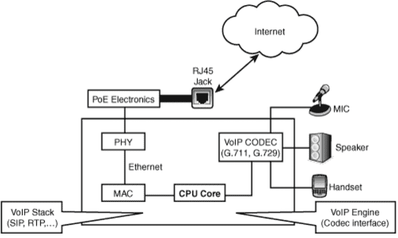

VoIP 驱动程序与*实时传输协议*（RTP）等传输协议以及*会话发起协议*（SIP）和 H.323 等呼叫控制信令栈协同工作。在这些协议之上是各种 IP 电话应用程序。

在嵌入式领域，在软件中实现 VoIP 编解码器的解决方案也很流行。它们通常驻留在用户空间，并与以下组件交互：

- 使用 OSS 或 ALSA API 的内核音频驱动程序
- 使用套接字 API 的内核网络驱动程序

面向*视频和 IP 语音*（**V2IP**）市场的 SoC 通常包含对 H.264 等视频编解码器的硬件支持。如果你要将 Linux 移植到 V2IP 电话上，你还需要实现与此类编解码器交互的驱动程序。

## 高速互连

**InfiniBand**、RapidIO、Hyper-Transport 和 10 千兆以太网等高速互连技术在 PC 或低端嵌入式环境中并不常见。你更可能在集群、刀片服务器、游戏系统、交换机或高速路由器上找到它们。光纤通道和*互联网 SCSI*（iSCSI）等网络技术可以在由*存储区域网络*（SAN）服务的企业环境中找到。

让我们简要了解一下其中一些技术的驱动程序子系统。

### InfiniBand

InfiniBand 是一种高速串行总线标准，最初旨在替代 PCI。然而，PCI Express 已成为系统总线的公认未来。如今，InfiniBand 技术通常用于刀片服务器设计，以提供高性能的存储和网络结构。InfiniBand 支持*远程直接内存访问*（RDMA），允许数据从一台计算机系统的内存通过 DMA 传输到另一台计算机系统。

Linux InfiniBand 子系统包括对 InfiniBand 的核心支持、主机通道适配器的设备驱动程序，以及 InfiniBand 上的 IP 实现。请查看 *drivers/infiniband/* 中的 Linux InfiniBand 子系统以及 *Documentation/infiniband/** 中的相关文档。

### RapidIO

RapidIO 是另一种高速串行总线技术，用于通过背板连接板卡。它支持约 10Gbps 的速度。支持 RapidIO 的一个处理器示例是 Freescale 公司基于 Power 架构的 MPC8540，面向网络路由器和交换机等嵌入式设备。

Linux RapidIO 子系统提供一组可用于驱动 RapidIO 总线上设备的核心例程。有两种方式可以通过 RapidIO 互连进行通信：

1. 使用*门铃*发送短小的带外消息。RapidIO 核心提供的门铃服务有 `rio_request_inb_dbell()`、`rio_release_inb_dbell()`、`rio_request_outb_dbell()` 和 `rio_release_outb_dbell()`。
2. 使用*邮箱*进行高带宽数据传输。RapidIO 核心提供的邮箱服务有 `rio_request_inb_mbox()`、`rio_release_inb_mbox()`、`rio_request_outb_mbox()` 和 `rio_release_outb_mbox()`。

请查看 *3270 中的源代码。

### 光纤通道

*光纤通道*（Fibre Channel）是一种现代高速串行总线协议，用于与存储系统通信。光纤通道接口卡具有光纤端口，可与 SAN 上的存储设备通信。光纤通道与 SCSI 兼容，因此光纤通道设备驱动程序本质上是一个 SCSI 驱动程序，并附带处理光纤通道的额外功能。

Linux 支持光纤通道核心和设备驱动程序来处理光纤通道硬件。请查看 *drivers/fc4/* 中的源代码。

## iSCSI

*iSCSI* 是另一种 SAN 技术。它允许通过 TCP/IP 网络传输 SCSI 数据包。使用 iSCSI 后，远程块设备对你的系统来说显示为本地存储。拥有该存储的远程系统称为 *iSCSI 目标*，使用该存储的本地系统称为 *iSCSI 发起者*。

Linux 通过内核驱动程序 *drivers/scsi/iscsi_tcp.c* 和一个名为 *iscsid* 的用户空间守护进程来支持 iSCSI。Linux-iSCSI 项目的主页位于 http://linux-iscsi.sourceforge.net。

# 第 21 章 调试设备驱动程序

| 本章内容 | |
|:---|:---|
| • 内核调试器 | 596 |
| • 内核探针 | 609 |
| • Kexec 和 Kdump | 620 |
| • 性能分析 | 629 |
| • 跟踪 | 634 |
| • Linux 测试项目 | 638 |
| • 用户模式 Linux | 638 |
| • 诊断工具 | 638 |
| • 内核黑客配置选项 | 639 |
| • 测试设备 | 640 |

> 既然我们已经学习了如何实现各类设备驱动程序，让我们退一步，探索一些调试技术。在代码开发之前投入时间进行逻辑设计和软件工程，以及在开发之后仔细审视代码，可以最小化甚至消除 bug。但因为这说来容易做来难，而且我们都是人，开发者需要调试工具。在本章中，让我们看看调试内核代码的各种方法。

## 可靠性、可用性、可服务性

许多系统，尤其是任务关键型系统，需要可靠性、可用性和可服务性（RAS）。Linux RAS 工作已经催生了多种强大的工具。压力测试工具（如 Linux 测试项目，LTP）可以测量内核移植的可靠性和健壮性。CPU 热插拔和 Linux 高可用性（HA）项目可以被视为可用性方面的内容。内核调试器、Kprobes、Kdump、EDAC 和 Linux 跟踪工具包（LTT）则属于可服务性的范畴。这些分类之间的界限有时很薄；你可以使用其中任何一种或组合来满足你的调试需求。例如，来自 *OProfile* 等内核分析器的输出既可以用来查找潜在的代码瓶颈（可靠性），也可以用来调试现场问题（可服务性）。

## 内核调试器

Linux 内核没有内置的调试器支持。是否在主线内核中包含调试器是内核邮件列表中经常争论的话题。指令级*内核调试器*（kdb）和源码级*内核 GNU 调试器*（kgdb）是两个主要的 Linux 内核调试器。截至目前，无论你使用 kdb 还是 kgdb，都需要下载相关补丁并将其应用到你的内核源代码上。即使你想避免给内核源代码打调试器支持补丁的麻烦，你也可以通过普通的 *GNU 调试器*（gdb）来获取内核崩溃信息并查看内核变量。JTAG 调试器使用硬件辅助调试，功能强大但价格昂贵。

内核调试器使内核内部更加透明。你可以单步执行指令、反汇编指令、显示和修改内核变量，以及查看堆栈跟踪。在本章中，让我们通过一些例子来学习内核调试器的基础知识。

### 进入调试器

有多种方式可以进入内核调试器。一种方式是传递命令行参数，要求内核在启动期间进入调试器。另一种方式是通过软件或硬件*断点*。断点是你希望停止执行并将控制权转移给调试器的地址。软件断点将该地址处的指令替换为其他会产生异常的内容。你可以使用调试器命令设置软件断点，也可以将它们插入到你的代码中。对于基于 x86 的系统，你可以在内核源代码中设置软件断点，如下所示：

```
asm(" int $3");
```

或者，你可以调用 `BREAKPOINT` 宏，它会转换为适当的依赖于架构的指令。

如果需要在无法被调试器替换指令的闪存中某处指令处停止，你可以使用硬件断点代替软件断点。硬件断点需要处理器支持。相应的地址必须添加到调试寄存器中。你只能拥有尽可能多的硬件

 breakpoints as the number of debug registers supported by the processor.

你还可以要求调试器对一个变量设置*观察点（watchpoint）*。当某条指令修改了观察点地址处的数据时，调试器就会停止执行。

另一种进入调试器的常见方法是按注意键（attention key），但有时这种方法不起作用。如果你的代码在禁止中断后陷入了一个紧凑的循环，内核将没有机会处理注意键并进入调试器。例如，如果你的代码做了如下的事情，你就无法通过注意键进入调试器：

```
unsigned long flags;

local_irq_save(flags);
while (1) continue;
local_irq_restore(flags);
```

当控制权转移到调试器时，你就可以使用各种调试器命令开始分析了。

## Kernel Debugger (kdb)

Kdb 是一个用于调试内核代码和设备驱动程序的指令级调试器。在使用它之前，你需要给内核源码打上 kdb 支持补丁并重新编译内核。（补丁的下载信息请参阅"Downloads"一节。）kdb 的主要优点是易于设置，因为你不需要额外的机器来进行调试（这与 kgdb 不同）。主要缺点是你需要将源代码与反汇编代码进行对照（同样，这与 kgdb 不同）。

让我们通过一个例子来初步了解 kdb。案发现场如下：你修改了一个内核串口驱动程序，使其能在基于 x86 的硬件上工作。但驱动程序无**常工作，你希望 kdb 能帮忙抓住罪魁祸首。

让我们通过在串口驱动程序 `open()` 入口点设置断点来开始搜寻线索。记住，由于 kdb 不是源码级调试器，你必须打开源代码并尝试将指令与你的 C 代码进行匹配。先列出相关的源码片段：

***drivers/serial/myserial.c:***

```
static int rs_open(struct tty_struct *tty, struct file *filp)
{
  struct async_struct *info;

  /* ... */
  retval = get_async_struct(line, &info);
  if (retval) return(retval);
  tty->driver_data = info;
  /* Point A */

  /* ... */
}
```

按下 Pause 键进入 kdb。让我们看看反汇编后的 `rs_open()` 是什么样子。照例，本章中展示的所有调试会话都使用 ➡ 符号附加说明。

```
Entering kdb (current=0xc03f6000, pid 0) on processor 0 due to
Keyboard Entry
```

```
kbd> id rs_open
0xc01cce00 rs_open:     sub $0x1c, %esp
0xc01cce03 rs_open+0x03: mov $ffffffed, %ecx
...
0xc01cce4b rs_open+0x4b: call 0xc01ccca0, get_async_struct
...
0xc01cce56 rs_open+0x56: mov 0xc(%esp,1), %eax
0xc01cce5a rs_open+0x5a: mov %eax, 0x9a4(%ebx)
...
```

源码中的 Point A 是设置断点的好地方，因为你可以同时查看 `tty` 结构和 `info` 结构，了解发生了什么。

将源码和反汇编代码并排对照，`rs_open+0x5a` 对应于 Point A。注意，如果内核编译时没有加优化标志，对照会更容易。

在 `rs_open+0x5a` 处设置断点（即地址 `0xc01cce5a`），然后通过退出调试器继续执行：

```
kbd> bp rs_open+0x5a
kbd> go
```

现在你需要让内核调用 `rs_open()` 以触发断点。要触发这一点，执行一个适当的用户空间程序。在本例中，向对应的串口（`/dev/ttySX`）发送一些字符：

```
bash> echo "kerala monsoons" > /dev/ttySX
```

这将导致 `rs_open()` 被调用。断点被触发，kdb 取得控制权：

```
Entering kdb on processor 0 due to Breakpoint @ 0xc01cce5a
kdb>
```

现在我们来查看 `info` 结构的内容。如果你查看断点前一条指令（`rs_open+0x56`）的反汇编，会看到 `EAX` 寄存器包含 `info` 结构的地址。让我们查看寄存器内容：

```
kbd> r
eax = 0xcf1ae680 ebx = 0xce03b000 ecx = 0x00000000
...
```

因此，`0xcf1ae680` 就是 `info` 结构的地址。使用 `md` 命令转储其内容：

```
kbd> md 0xcf1ae680
0xcf1ae680 00005301 0000ABC 00000000 10000400
...
```

要理解这个转储结果，让我们查看对应的结构定义。`info` 在 *include/linux/serialP.h* 中定义为 `struct async_struct`，如下所示：

```
struct async_struct {
  int            magic;  /* Magic Number */
  unsigned long  port;   /* I/O Port */
  int            hub6;
  /* ... */
};
```

如果将转储结果与定义对照，`0x5301` 是魔术数，`0xABC` 是 I/O 端口。嗯，这不是很有趣吗！`0xABC` 看起来不像一个有效的端口。如果你有足够的串口调试经验，就会知道 I/O 端口基地址和 IRQ 是在 *include/asm-x86/serial.h* 中为基于 x86 的硬件配置的。将端口定义改为正确的值，重新编译内核，然后继续你的测试！

### Kernel GNU Debugger (kgdb)

Kgdb 是一个源码级调试器。它比 kdb 更易于使用，因为你不必花时间将汇编代码与源代码进行对照。但它的设置更困难，因为需要额外的机器来主导调试工作。

你需要将 gdb 与 kgdb 配合使用来步进内核代码。gdb 运行在主机上，而打过 kgdb 补丁的内核（补丁下载信息请参阅"Downloads"一节）运行在目标硬件上。主机和目标机通过串口空调制解调器线缆连接，如[图 21.1]所示。[1]

> [1] 你也可以通过以太网启动 kgdb 调试会话。

**图 21.1. Kgdb 设置。**

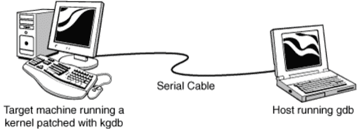

你需要通过命令行参数告诉内核串口的标识和波特率。根据使用的引导加载程序，在 *syslinux.cfg*、*lilo.conf* 或 *grub.conf* 中添加以下内核参数：

```
kgdbwait kgdb8250=X,115200
```

`kgdbwait` 要求内核等待与主机端的 gdb 建立连接，`X` 是连接到主机的串口，`115200` 是通信使用的波特率。

主机端的波特率也需要配置成相同的值：

```
bash> stty speed 115200 < /dev/ttySX
```

如果你的主机是笔记本电脑，没有串口，你可以在调试会话中使用 USB 转串口转换器。在这种情况下，使用 usbserial 驱动程序创建的 */dev/ttyUSBX* 节点，而不是 */dev/ttySX*。第 6 章"串口驱动程序"的图 6.4 展示了这种情况。

让我们通过一个有缺陷的内核模块示例来学习 kgdb 的基础知识。模块更容易调试，因为修改代码后不需要重新编译整个内核，但记住要用 -g选项编译模块以生成符号信息。由于模块是动态加载的，调试器需要被告知模块包含的符号信息。清单 21.1 包含一个有缺陷的 trojan_function()。假设它定义在 *drivers/char/my_module.c* 中。

**清单 21.1. 有缺陷的函数**

```
char buffer;

int
trojan_function()
{
  int *my_variable = 0xAB, i;

  /* ... */
  Point A:
  i = *my_variable; /* Kernel Panic: my_variable points
                       to bad memory */

  return(i);
}
```

在目标机上插入 *my_module.ko*，然后查看 */sys/module/my_module/sections/* 以解析 ELF（*Executable and Linking Format*，可执行和链接格式）段地址。[2] ELF 文件中的 .text 段包含代码，.data 包含已初始化的变量，.rodata 包含已初始化的只读变量（如字符串），.bss 包含启动时未初始化的变量。如果在内核配置时启用了 CONFIG_KALLSYMS，这些段的地址以文件 *.text*、*.data*、*.rodata* 和 *.bss* 的形式存在于 */sys/module/my_module/sections/* 中。例如，要获取代码段地址，执行：

> [2] 如果你仍在使用 2.4 内核，使用 insmod 的 -m 选项获取段地址：

```
bash> insmod my_module.o -m
Using /lib/modules/2.x.y/kernel/drivers/char/my_module.o
Sections:     Size      Address  Align
 .this        00000060 e091a000 2**2
 .text        00001ec0 e091a060 2**4
 ...
 .rodata      0000004c e091d1fc 2**2
 .data        00000048 e091d260 2**5
 .bss         000000e4 e091d2c0 2**5
 ...
```

 ```
bash> cat /sys/module/my_module/sections/.text
0xe091a060
```

更多模块加载信息可从*proc/modules*和*/proc/kallsyms*获取。

获取段地址后，在主机端调用 gdb：

```
bash> gdb vmlinux
```

```
(gdb) target remote /dev/ttySX
```

由于你将`kgdbwait`作为内核命令行参数传递，当目标端内核启动时，gdb 获得控制权。现在使用`add-symbol-file`命令将上述段地址告知 gdb：

```
(gdb) add-symbol-file drivers/char/mymodule.ko 0xe091a060
     -s .rodata 0xe091d1fc -s .data 0xe091d260 -s .bss 0xe091d2c0
```

为了调试内核 panic，我们在`trojan_function()`处设置一个断点：

```
(gdb) b trojan_function
(gdb) c
```

当 kgdb 命中断点时，让我们查看堆栈跟踪，单步执行到 A 点，并显示`my_variable`的值：

```
(gdb) bt
#0 trojan_function () at my_module.c :124
#1 0xe091a108 in my_parent_function (my_var1=438, my_var2=0xe091d288)
..
```

```
(gdb) step
(gdb) step

(gdb) p my_variable
$0 = 0
```

这里有一个明显的 bug。`my_variable`指向`NULL`，因为`trojan_function()`忘记为其分配内存。让我们直接使用 kgdb 分配内存，规避内核崩溃，并继续测试：

```
(gdb) p &buffer
$1 = 0xe091a100 ""
(gdb) set my_variable=0xe091a100
```

```
(gdb) c
```

继续你的测试

Kgdb 已移植到多种架构，如 x86、ARM 和 PowerPC。当你使用 kgdb 调试目标嵌入式设备（而非图 21.1 所示的 PC）时，你在主机系统上运行的 gdb 前端需要针对目标平台进行编译。例如，要从基于 x86 的主机开发系统调试为基于 ARM 的嵌入式设备开发的设备驱动程序，你必须使用相应生成的 gdb，通常命名为 arm-linux-gdb。具体名称取决于你使用的发行版。

## GNU 调试器（gdb）

如前所述，你可以使用普通 gdb 收集一些内核调试信息。但是，你无法单步执行内核代码、设置断点或修改内核变量。让我们使用 gdb 调试清单 21.1 中有缺陷的函数导致的内核 panic，但假设这次`trojan_function()`是作为内核的一部分编译的，而不是作为模块，因为使用 gdb 不容易查看模块内部。

这是执行`trojan_function()`时生成的"oops"消息的一部分：

```
Unable to handle kernel NULL pointer dereference at
virtual address 000000ab
 ...
eax: f7571de0   ebx: ffffe000   ecx: f6c78000   edx: f98df870
 ...
Stack: c019d731 00000000
       ...
       bffffbe8 c0108fab
Call Trace:    [<c019d731>] [<c013b8ac>] [<c0108fab>]
...
```

将此晦涩的"oops"消息复制到*oops.txt*，并使用*ksymoops*工具获取更详细的输出。如果系统挂起，你可能需要手动复制消息：

```
bash> ksymoops oops.txt
Code;  c019d710 <trojan_function+0/10>
00000000 <_EIP>:
Code;  c019d710 <trojan_function+0/10>  <=====
  0:   a1 ab 00 00 00          mov   0xab,%eax    <=====
Code;  c019d715 <trojan_function+5/10>
  5:   c3                      ret
```

如果你在内核配置期间启用`CONFIG_KALLSYMS`，2.6 内核发出的"oops"输出可以直接使用，无需使用*ksymoops*进行解码。

查看前面的转储，"oops"发生在`trojan_function()`内部。让我们使用 gdb 获取更多信息。在以下调用中，*vmlinux*是未压缩的内核映像，*/proc/kcore*是内核地址空间：

```
bash> gdb vmlinux /proc/kcore
```

```
(gdb) p xtime
$0 = 1113173755
```

通过打印一个内核变量来试探

由于 gdb 的缓存访问，重复访问同一变量不会获得刷新后的值。你可以使用 gdb 的`core-file`命令重新读取核心文件来强制刷新访问。现在让我们查看`trojan_function()`的反汇编：

```
(gdb) x/2i trojan_function
0xc019d710 <trojan_function>:     mov 0xab, %eax
0xc019d715 <trojan_function+5>:  ret
```

反汇编 trojan_function

由于编译器优化，`trojan_function()`在汇编层面看起来相当简洁。它实际上是将地址`0xab`的内容复制到`EAX`寄存器，该寄存器在基于 x86 的系统上保存函数的返回值。但`0xab`看起来不像有效的内核地址！通过为`my_variable`分配有效的内存空间来修复这个 bug，重新编译，然后继续测试。

### JTAG 调试器

JTAG 调试器使用硬件辅助来调试代码。你需要专门的监控硬件[3]和前端用户界面（一些 JTAG 调试器使用 gdb 作为前端）来单步执行代码。JTAG 也可用于调试以外的目的，例如将代码烧录到板载闪存中，如[第 18 章](.)"嵌入式 Linux"中所述。JTAG 连接器在开发板上很常见，但通常不是生产单元的一部分。

> [3] 如果你适当地更换将调试器连接到目标板的探针，一些 JTAG 调试器可以支持多种处理器架构。

JTAG 调试器通常通过串口、USB 或以太网连接到目标硬件。使用以太网时，你可以远程访问 JTAG 调试器，从而访问目标板，即使目标板本身没有网络接口。

[图 21.2](.)展示了一个基于 JTAG 的远程调试会话。此场景中使用的 JTAG 调试器支持 gdb 前端。开发主机和 JTAG 硬件连接到以太网局域网。目标硬件上的调试串口连接到 JTAG 盒上的串口。[图 21.2](.)使用五个终端会话在 Linux 开发主机上实现远程调试。终端 1 运行 gdb，通过 telnet 通过网络连接到 JTAG 盒：

```
(gdb) target remote 10.1.1.2:1001
```

10.1.1.2 是 JTAG 硬件的 IP 地址。1001 是 JTAG TCP 端口，用于监听传入的 gdb 连接

#### 图 21.2. 一个基于 JTAG 的远程调试设置示例。

[查看完整尺寸图像]

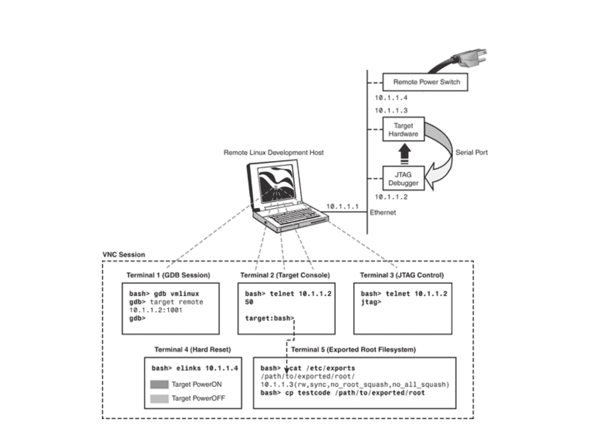

要调试内核的启动部分，例如，在`start_kernel()`处设置 gdb 断点。（你可以从*System.map*获取其地址，该文件在你构建内核时生成在源代码树根目录。）

终端 2 将串口控制台附加到目标。在终端 2 上运行的 telnet 客户端连接到 JTAG 盒上预先指定的 TCP 端口，该端口被配置（使用终端 3）为隧道化通过其串口到达的数据：

```
bash> telnet 10.1.1.2 50
```

10.1.1.2 是 JTAG 硬件的 IP 地址。50 是 JTAG TCP 端口，用于隧道化通过其串口到达的数据

这相当于在直接将目标的调试串口连接到主机（而不是如图 21.2 所示连接到 JTAG 盒）后运行*minicom*等仿真器，但这会将主机限制在目标附近。

终端 3 通过 telnet 连接到 JTAG 盒，并提供调试器特定的语义。例如，你可以使用它来执行以下操作：

- 通过 TFTP 从主机拉取 JTAG 定义脚本并在 JTAG 启动期间执行它。JTAG 定义脚本通常初始化处理器、时钟寄存器、片选寄存器和存储器组。完成此操作后，JTAG 硬件准备将代码下载到目标并执行它。JTAG 制造商通常为所有支持的平台提供定义文件，因此你很可能有一个接近你主板的起点。

- 通过 TFTP 从主机将引导加载程序、内核或独立代码下载到目标的闪存或 RAM。JTAG 调试器通常支持 ELF 和二进制等文件格式。

- 单步执行代码、设置断点、检查寄存器和转储内存区域。

- 重置目标。

JTAG 调试有时可能不稳定，因此如果你进行远程调试，通过远程电源控制开关为目标供电可能是个好主意，如图 21.2 所示。这样，你可以使用 Web 浏览器从主机硬重置目标，如终端 4 所示。你也可以选择通过远程电源开关为 JTAG 硬件供电。这将允许你直接从闪存测试运行引导加载程序，而无需 JTAG 及其定义文件的干预。

如果目标板具有网络接口，它可以从开发主机通过 NFS 挂载其根文件系统。（详见第 18 章中的"NFS 挂载根文件系统"部分。）主机上的终端 5 在导出的根文件系统上本地操作。[4]

> [4] 根据你的调试场景，你可能需要更多这样的终端。例如，如果你使用的是具有远程显示功能的示波器，你可以通过另一个终端上的 Web 浏览器操作它。

如果你的团队分布在不同地理位置，请在*Virtual Network Computing*（VNC）等环境中运行终端 1 至 5。如果你的发行版尚未包含 VNC，请从 [www.realvnc.com](http://www.realvnc.com) 下载。使用这样的设置，你可以在家中舒适地调试远程板上的电子信号！一些 JTAG 供应商提供复杂的集成开发环境[5]，涵盖了前面详述的所有功能，因此如果你使用其中之一，则无需管理 VNC 终端会话。

> [5] 虽然 JTAG 硬件独立于目标操作系统，但前端界面可能有操作系统依赖性。

在硬件启动期间，当你将引导加载程序或其他独立代码移植到目标时，建议首先生成 ELF 映像并从 RAM 调试它，然后再从闪存运行它。但是，请记住消除与 JTAG 定义脚本执行的操作重复的引导加载程序初始化。

JTAG 调试器的一个关键优势是，你可以使用单个工具来调试构成固件解决方案的不同部分。因此，你可以使用相同的调试器在源代码级别调试 BIOS、引导加载程序、基础内核、设备驱动模块以及用户空间应用程序。

### 下载

你可以从 [http://oss.sgi.com/projects/kdb](http://oss.sgi.com/projects/kdb) 下载适用于 x86 和 IA64 架构的 kdb 补丁。每个受支持的内核版本需要两个补丁：一个通用补丁和一个架构相关补丁。

kgdb 项目的主页是 [http://kgdb.sourceforge.net](http://kgdb.sourceforge.net)。该网站还提供有关配置和使用 kgdb 的文档。

如果你的 Linux 发行版尚未包含 gdb，你可以从 [www.gnu.org/software/gdb/gdb.html](http://www.gnu.org/software/gdb/gdb.html) 获取它。


 ## 第21章 调试设备驱动程序

| 本章内容 | |
|:--|--:|
| - 内核调试器 | 596 |
| - 内核探针 | 609 |
| - Kexec 和 Kdump | 620 |
| - 性能分析 | 629 |
| - 跟踪 | 634 |
| - Linux 测试项目 | 638 |
| - 用户模式 Linux | 638 |
| - 诊断工具 | 638 |
| - 内核黑客配置选项 | 639 |
| - 测试设备 | 640 |

既然我们已经学习了如何实现各类设备驱动程序，让我们后退一步，探索一些调试技术。在代码开发之前投入时间进行逻辑设计和软件工程，以及在开发之后仔细审视代码，可以最大限度地减少甚至消除 bug。但因为说起来容易做起来难，而且我们都是人，所以开发人员需要调试工具。在本章中，让我们看看调试内核代码的各种方法。

## 可靠性、可用性、可维护性

许多系统，特别是关键任务系统，都需要可靠性（Reliability）、可用性（Availability）和可维护性（Serviceability），即 RAS。Linux 的 RAS 工作已经催生了一些强大的工具。 exerciser 如 Linux 测试项目（LTP）可以测量内核移植的可靠性和健壮性。CPU 热插拔和 Linux 高可用性（HA）项目可以看作是在可用性方面的应用。内核调试器、Kprobes、Kdump、EDAC 和 Linux 跟踪工具包（LTT）则属于可维护性范畴。这些分类之间的界限有时很模糊；你可以使用其中任何一种或组合方法来满足你的调试需求。例如，来自内核性能分析器如 *OProfile* 的输出可以用于搜索潜在的代码瓶颈（可靠性）或调试现场问题（可维护性）。

## 内核调试器

Linux 内核没有内置的调试器支持。是否在标准内核中包含调试器是内核邮件列表中经常讨论的话题。指令级*内核调试器*（kdb）和源代码级*内核 GNU 调试器*（kgdb）是两种主要的 Linux 内核调试器。截至目前，无论你使用 kdb 还是 kgdb，都需要下载相关补丁并应用到你的内核源代码中。即使你不想费事给内核源代码打补丁来支持调试器，也可以通过普通的*GNU 调试器*（gdb）来获取内核崩溃的信息并查看内核变量。JTAG 调试器使用硬件辅助调试，功能强大但价格昂贵。

内核调试器使内核内部更加透明。你可以单步执行指令、反汇编指令、显示和修改内核变量、查看堆栈跟踪。在本章中，让我们通过一些例子来学习内核调试器的基础知识。

### 进入调试器

你可以通过多种方式进入内核调试器。一种方式是传递命令行参数，要求内核在启动过程中进入调试器。另一种方式是通过软件或硬件*断点*。断点是你希望停止执行并将控制权转移到调试器的地址。软件断点将该地址处的指令替换为其他导致异常的指令。你可以使用调试器命令设置软件断点，或者将它们插入到你的代码中。对于基于 x86 的系统，你可以在源代码中这样设置软件断点：

```
asm(" int $3");
```

或者，你可以调用 `BREAKPOINT` 宏，它会转换为适当的与架构相关的指令。

如果你需要停止的指令位于 flash 内存中，而调试器无法替换该处的指令，那么可以使用硬件断点代替软件断点。硬件断点需要处理器支持，相应的地址必须添加到调试寄存器中。你只能拥有与处理器支持的调试寄存器数量一样多的硬件断点。

你也可以要求调试器对某个变量设置*观察点*。当指令修改观察点地址处的数据时，调试器会停止执行。

另一种常见的进入调试器的方法是按下注意键，但有时这种方法不起作用。如果你的代码在禁用中断后陷入了一个紧密循环，内核将没有机会处理注意键并进入调试器。例如，如果你的代码执行类似这样的操作，你将无法通过注意键进入调试器：

```
unsigned long flags;

local_irq_save(flags);
while (1) continue;
local_irq_restore(flags);
```

当控制权转移到调试器后，你可以使用各种调试器命令开始分析。

### 内核调试器（kdb）

Kdb 是一个用于调试内核代码和设备驱动程序的指令级调试器。在使用之前，你需要用 kdb 支持补丁修补内核源代码并重新编译内核。（有关下载 kdb 补丁的信息，请参阅**"下载"**一节。）kdb 的主要优点是易于设置，因为你不需要额外的机器来进行调试（与 kgdb 不同）。主要缺点是你需要将源代码与反汇编代码相关联（同样与 kgdb 不同）。

让我们通过一个例子来初步了解 kdb。这是案发现场：你已经修改了一个内核串口驱动程序，使其能在基于 x86 的硬件上工作。但驱动程序无法正常工作，你希望 kdb 能帮助抓住罪魁祸首。

让我们通过在串口驱动程序 `open()` 入口点设置断点来开始寻找线索。记住，因为 kdb 不是源代码级调试器，你必须打开源代码并尝试将指令与 C 代码匹配。让我们列出相关源代码片段：

***drivers/serial/myserial.c:***

```
static int rs_open(struct tty_struct *tty, struct file *filp)
{
  struct async_struct *info;

  /* ... */
  retval = get_async_struct(line, &info);
  if (retval) return(retval);
  tty->driver_data = info;
  /* Point A */

  /* ... */
}
```

按下 Pause 键进入 kdb。让我们看看反汇编后的 `rs_open()` 是什么样子。像往常一样，本章中所有调试会话的解释都使用 ➡ 符号标注。

```
Entering kdb (current=0xc03f6000, pid 0) on processor 0 due to
Keyboard Entry

kbd> id rs_open
0xc01cce00 rs_open:     sub $0x1c, %esp
0xc01cce03 rs_open+0x03: mov $ffffffed, %ecx
...
0xc01cce4b rs_open+0x4b: call 0xc01ccca0, get_async_struct
...
0xc01cce56 rs_open+0x56: mov 0xc(%esp,1), %eax
0xc01cce5a rs_open+0x5a: mov %eax, 0x9a4(%ebx)
...
```

源代码中的 Point A 是设置断点的好地方，因为你可以同时查看 `tty` 结构和 `info` 结构，了解发生了什么。

将源代码和反汇编代码并排查看，`rs_open+0x5a` 对应于 Point A。注意，如果内核编译时未使用优化选项，这种关联会更容易。

在 `rs_open+0x5a`（即地址 `0xc01cce5a`）处设置断点，并通过退出调试器继续执行：

```
kbd> bp rs_open+0x5a
kbd> go
```

现在你需要让内核调用 `rs_open()` 来触发断点。为此，执行一个适当的用户空间程序。在本例中，向对应的串口（`/dev/ttySX`）写入一些字符：

```
bash> echo "kerala monsoons" > /dev/ttySX
```

这将导致调用 `rs_open()`。断点被触发，kdb 取得控制权：

```
Entering kdb on processor 0 due to Breakpoint @ 0xc01cce5a
kdb>
```

现在让我们找出 `info` 结构的内容。如果你查看断点前一条指令（`rs_open+0x56`）处的反汇编，你会看到 `EAX` 寄存器包含 `info` 结构的地址。让我们查看寄存器内容：

```
kbd> r
eax = 0xcf1ae680 ebx = 0xce03b000 ecx = 0x00000000
...
```

所以，`0xcf1ae680` 是 `info` 结构的地址。使用 `md` 命令转储其内容：

```
kbd> md 0xcf1ae680
0xcf1ae680 00005301 0000ABC 00000000 10000400
...
```

为了理解这个转储，让我们查看相应的结构定义。`info` 在 *include/linux/serialP.h* 中定义为 `struct async_struct`，如下所示：


```c
struct async_struct {
  int            magic;  /* 魔术数字 */
  unsigned long  port;   /* I/O 端口 */
  int            hub6;
  /* ... */
};
```

如果你将这个转储与定义进行比对，`0x5301` 就是魔术数字，而 `0xABC` 是 I/O 端口。嗯，这很有趣！`0xABC` 看起来不像是一个有效的端口号。如果你做过足够多的串口调试，就会知道在 x86 架构的硬件上，I/O 端口基地址和 IRQ 是在 *include/asm-x86/serial.h* 中配置的。请将端口定义更改为正确的值，重新编译内核，然后继续你的测试！

### 内核 GNU 调试器 (kgdb)

Kgdb 是一个源代码级别的调试器。它比 kdb 更容易使用，因为你无需花时间将汇编代码与你的源代码进行关联。但它的设置更为复杂，因为需要一台额外的机器作为调试的前端。

你必须将 gdb 与 kgdb 配合使用来单步调试内核代码。gdb 运行在主机上，而打了 kgdb 补丁的内核（关于如何下载 kgdb 补丁，请参考“下载”部分）则运行在目标硬件上。主机和目标之间通过一条串口零调制解调器电缆连接，如 [图 21.1] 所示。

[1] 你也可以通过以太网启动 kgdb 调试会话。

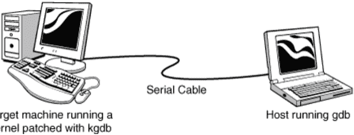

你需要通过内核命令行参数告知内核串口的身份和波特率。根据所使用的引导加载程序，将以下内核参数添加到 *syslinux.cfg*、*lilo.conf* 或 *grub.conf* 中：

```
kgdbwait kgdb8250=X,115200
```

`kgdbwait` 要求内核在启动时等待与主机端的 gdb 建立连接，`x` 是连接到主机的串口号，而 `115200` 是用于通信的波特率。

现在在主机端配置相同的波特率：

```
bash> stty speed 115200 < /dev/ttySX
```

如果你的主机是一台笔记本电脑或者没有串口的计算机，你可以使用 USB 转串口适配器进行调试。在这种情况下，请使用 usbserial 驱动程序创建的 */dev/ttyUSBX* 节点，而不是 */dev/ttySX*。第 6 章“串口驱动”中的图 6.4 描绘了这种情况。

让我们通过一个有错误的内核模块示例来学习 kgdb 基础知识。模块更容易调试，因为在修改代码后无需重新编译整个内核，但请记住使用 `-g` 选项编译你的模块，以生成符号信息。由于模块是动态加载的，调试器需要被告知模块包含的符号信息。清单 21.1 包含了一个有错误的 `trojan_function()`。假设它定义在 *drivers/char/my_module.c* 文件中。

#### 清单 21.1. 有错误的函数

```c
char buffer;

int
trojan_function()
{
  int *my_variable = 0xAB, i;

  /* ... */
  Point A:
  i = *my_variable; /* 内核崩溃：my_variable 指向了无效的内存 */

  return(i);
}
```

在目标机上插入 *my_module.ko* 模块，然后查看 */sys/module/my_module/sections/* 目录，以解读 ELF（*可执行与链接格式*）节地址。[2] ELF 文件中的 `.text` 节包含代码，`.data` 节包含已初始化的变量，`.rodata` 节包含已初始化的只读变量（如字符串），而 `.bss` 节包含在启动时未初始化的变量。如果在内核配置时启用了 `CONFIG_KALLSYMS`，那么这些节的地址会以文件形式（*.text*、*.data*、*.rodata* 和 *.bss*）出现在 */sys/module/my_module/sections/* 目录下。要获取代码节地址，可以这样做：

> [2] 如果你仍在使用 2.4 内核，请使用 `insmod` 的 `-m` 选项来获取节地址：

```
bash> insmod my_module.o -m
Using /lib NBC_MODULES/2.x.y/kernel/drivers/char/my_module.o
Sections:     Size     Address  Align
 .this        00000060 e091a000 2**2
 .text        00001ec0 e091a060 2**4
 ...
 .rodata      0000004c e091d1fc 2**2
 .data        00000048 e091d260 2**5
 .bss         000000e4 e091d2c0 2**5
 ...
```

```
bash> cat /sys/module/my_module/sections/.text
0xe091a060
```

更多信息可以从 */proc/modules* 和 */proc/kallsyms* 获取。

获得节地址后，在主机端机器上启动 gdb：

```
bash> gdb vmlinux
(gdb) target remote /dev/ttySX
```

`vmlinux` 是未压缩的内核
连接到目标机

由于你将 `kgdbwait` 作为内核命令行参数传递，当内核在目标机上启动时，gdb 会获得控制权。现在使用 `add-symbol-file` 命令将前面的节地址信息告知 gdb：

```
(gdb) add-symbol-file drivers/char/my_module.ko 0xe091a060
      -s .rodata 0xe091d1fc -s .data 0xe091d260 -s .bss 0xe091d2c0
      
add symbol table from file "drivers/char/my_module.ko" at
      .text_addr = 0xe091a060
      .rodata_addr = 0xe091d1fc
      .data_addr = 0xe091d260
      .bss_addr = 0xe091d2c0
(y or n) y
Reading symbols from drivers/char/mymodule.ko ...done.
```

为了调试内核崩溃，让我们在 `trojan_function()` 处设置一个断点：

```
(gdb) b trojan_function
(gdb) c
```

设置断点
继续执行

当 kgdb 命中断点时，我们来查看堆栈跟踪，单步执行到 Point A，并显示 `my_variable` 的值：

```
(gdb) bt
#0 trojan_function () at my_module.c :124
#1 0xe091a108 in my_parent_function (my_var1=438, my_var2=0xe091d288)
..

(gdb) step
(gdb) step

(gdb) p my_variable
$0 = 0
```

回溯（堆栈）跟踪
继续单步执行直到 Point A

这里有一个明显的 bug。`my_variable` 指向 NULL，因为 `trojan_function()` 忘记为它分配内存。让我们直接使用 kgdb 分配内存，绕过内核崩溃，并继续测试：

```
(gdb) p &buffer
$1 = 0xe091a100 ""
(gdb) set my_variable=0xe091a100
```

打印 buffer 的地址
my_variable = &buffer

```
(gdb) c
```

→ 继续你的测试

kgdb 的移植版本可用于多种架构，如 x86、ARM 和 PowerPC。当你使用 kgdb 调试目标嵌入式设备（而不是图 21.1 中所示的 PC）时，你在主机系统上运行的 gdb 前端需要编译为可与你的目标平台协同工作。例如，要从你的 x86 主机开发系统调试为基于 ARM 的嵌入式设备开发的设备驱动，你必须使用适当生成的 gdb，通常命名为 `arm-linux-gdb`。具体名称取决于你使用的发行版。

### GNU 调试器 (gdb)

如前所述，你可以使用普通的 gdb 来收集一些内核调试信息。然而，你不能单步调试内核代码、设置断点或修改内核变量。让我们使用 gdb 来调试清单 21.1 中有错误的函数引起的内核崩溃，但这次假设 `trojan_function()` 被编译为内核的一部分，而不是作为一个模块，因为你无法轻易地使用 gdb 来窥探模块内部。

以下是 `trojan_function()` 执行时生成的“oops”消息的一部分：

```
Unable to handle kernel NULL pointer dereference at
virtual address 000000ab
 ...
 eax: f7571de0   ebx: ffffe000   ecx: f6c78000   edx: f98df870
 ...
 Stack: c019d731 00000000
        ...
        bffffbe8 c0108fab
Call Trace:    [<c019d731>] [<c013b8ac>] [<c0108fab>]
...
```

将这段晦涩的“oops”消息复制到 *oops.txt* 文件中，并使用 *ksymoops* 工具来获取更详细的输出。如果系统挂起，你可能需要手动复制这段消息：

```
bash> ksymoops oops.txt
Code;  c019d710 <trojan_function+0/10>
00000000 <_EIP>:
Code;  c019d710 <trojan_function+0/10>  <=====
   0:   a1 ab 00 00 00          mov   0xab,%eax   <=====
Code;  c019d715 <trojan_function+5/10>
   5:   c3                      ret
```

2.6 内核生成的“oops”输出可以直接使用，无需通过 *ksymoops* 解码，前提是在内核配置期间启用了 `CONFIG_KALLSYMS`。

查看前面的转储，发现“oops”发生在 `trojan_function()` 内部。让我们使用 gdb 来获取更多信息。在以下调用中，*vmlinux* 是未压缩的内核镜像，而 */proc/kcore* 是内核地址空间：

```
bash> gdb vmlinux /proc/kcore
```


 (gdb) p xtime
$0 = 1113173755
```

通过打印内核变量来试水

由于 gdb 的缓存访问机制，重复访问同一变量不会获取刷新后的值。你可以使用 gdb 的 `core-file` 命令重新读取核心文件，以强制进行 fresh 访问。现在让我们来看看 `trojan_function()` 的反汇编：

```
(gdb) x/2i trojan_function
0xc019d710 <trojan_function>:     mov 0xab, %eax
0xc019d715 <trojan_function+5>:  ret
```

对 trojan_function 进行反汇编

由于编译器优化，`trojan_function()` 在汇编层面看起来非常简洁。它实际上是将地址 `0xab` 处的内容复制到 `EAX` 寄存器中，该寄存器在基于 x86 的系统上用于保存函数的返回值。但是 `0xab` 看起来并不是一个有效的内核地址！修复这个 bug 的方法是给 `my_variable` 分配有效的内存空间，重新编译，然后继续测试。

### JTAG 调试器

JTAG 调试器使用硬件辅助来调试代码。你需要专门的监控硬件[3]和一个前端用户界面（某些 JTAG 调试器使用 gdb 作为前端）来单步执行病例代码。JTAG 还可用于调试以外的用途，例如将代码烧录到板载闪存中，如第 18 章"嵌入 Linux"中所述。JTAG 连接器在开发板上很常见，但通常不会出现在生产单元中。

[3] 如果你适当地更换连接调试器与目标板的探针，某些 JTAG 调试器可以支持多种处理器架构。

JTAG 调试器通常通过串口、USB 或以太网连接到目标硬件。使用以太网时，即使目标板本身没有网络接口，你也可以远程访问 JTAG 调试器，从而访问目标板。

图 21.2 展示了一个正在运行中的基于 JTAG 的远程调试会话。此场景中使用的 JTAG 调试器支持 gdb 前端。开发主机和 JTAG 硬件连接到以太网局域网。目标硬件上的调试串口连接到 JTAG 盒子的串口。图 21.2 展示了在 Linux 开发主机上使用五个终端会话实现远程调试。终端 1 运行 gdb，通过网络使用 telnet 连接到 JTAG 盒子：

```
(gdb) target remote 10.1.1.2:1001
```

10.1.1.2 是 JTAG 硬件的 IP 地址。1001 是 JTAG TCP 端口，用于监听传入的 gdb 连接

#### 图 21.2. 一个基于 JTAG 的远程调试设置示例。

[查看全尺寸图像]

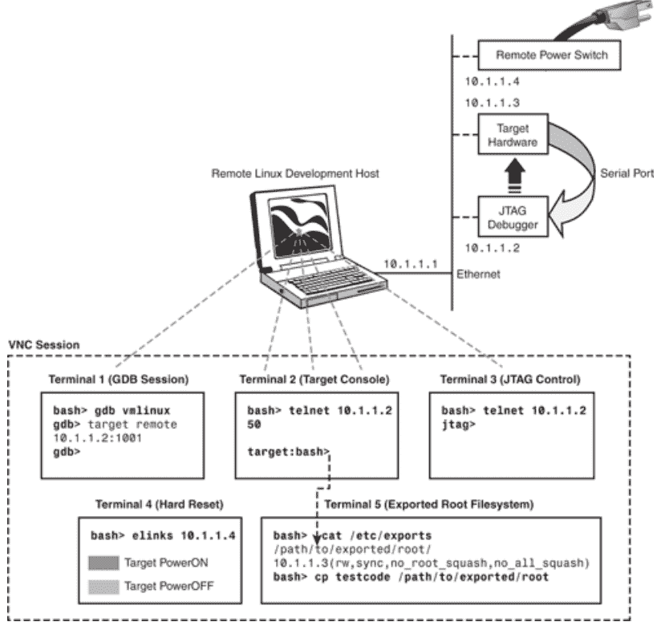

要调试内核的启动部分，例如，可以在 `start_kernel()` 上设置 gdb 断点。（你可以在构建内核时生成的源代码树根目录下的 *System.map* 中找到它的地址。）

终端 2 将串行控制台附加到目标上。在终端 2 中运行的 telnet 客户端连接到 JTAG 盒子上一个预先指定的 TCP 端口，该端口被配置（使用终端 3）为通过其串口隧道传输到达的数据：

```
bash> telnet 10.1.1.2 50
```

10.1.1.2 是 JTAG 硬件的 IP 地址。50 是 JTAG TCP 端口，用于隧道传输通过串口到达的数据

这相当于在直接将目标调试串口连接到主机（而不是如图 21.2 所示连接到 JTAG 盒子）后运行 *minicom* 等仿真器，但这会限制主机必须与目标物理相邻。

终端 3 通过 telnet 连接到 JTAG 盒子，并提供调试器特定的语义。例如，你可以使用它来执行以下操作：

- 通过 TFTP 从主机拉取 JTAG 定义脚本，并在 JTAG 启动时执行它。JTAG 定义脚本通常初始化处理器、时钟寄存器、芯片选择寄存器和存储体银行。完成此操作后，JTAG 硬件就可以将代码下载到目标上并执行。JTAG 制造商通常为所有支持的平台提供定义文件，因此你很可能已经为板子找到了一个接近的起点。

- 通过 TFTP 从主机将你的引导加载程序、内核或独立代码下载到目标上的闪存或 RAM 中。ELF 和二进制等文件格式通常被 JTAG 调试器支持。

- 单步执行代码、设置断点、检查寄存器和转储内存区域。

- 重置目标。

JTAG 调试有时可能会不稳定，因此如果你进行远程调试，通过远程电源控制开关为目标供电可能是个好主意，如图 21.2 所示。这样，你就可以使用主机上的 Web 浏览器对目标进行硬复位，如终端 4 所示。你也可以选择通过远程电源开关为 JTAG 硬件供电。这将允许你直接从闪存测试运行引导加载程序，而无需 JTAG 及其定义文件的干预。

如果目标板具有网络接口，它可以通过 NFS 从开发主机挂载其根文件系统。（有关如何执行此操作，请参阅第 18 章中"NFS 挂载的根"部分。）主机上的终端 5 在导出的根文件系统上本地操作。[4]

> [4] 根据调试场景的不同，你可能会有更多这样的终端。例如，如果你使用的示波器具有远程显示ssue能力，你可以通过另一个终端上的 Web 浏览器来操作它。

如果你的团队地理位置分散，可以在 *虚拟网络计算*（VNC）等环境中运行终端 1 到 5。如果 VNC 尚未包含在你的发行版中，可以从 [www.realvnc.com](http://www.realvnc.com) 下载。有了这样的设置，你就可以在舒适的家中调试远程板上的电子信号！某些 JTAG 供应商提供复杂的集成开发环境[5]，涵盖了前面所述的所有功能，因此如果你使用其中之一，就不需要管理 VNC 终端会话了。

> [5] 虽然 JTAG 硬件独立于目标操作系统，但前端接口可能具有操作系统依赖性。

在硬件 bring up 期间，当你将引导加载程序或其他独立代码移植到目标上时，建议首先生成 ELF 映像并从 RAM 中进行调试，然后再从闪存中运行它。但是，请记住要消除与 JTAG 定义脚本执行的操作重复的引导加载程序初始化。

JTAG 调试器的一个关键优势是，你可以使用单一工具来调试构成固件解决方案的不同部分。因此，你可以使用相同的调试器在负责对 BIOS、引导加载程序、基础内核、设备驱动程序模块以及用户空间应用程序进行源代码级调试。

### 下载

你可以从 [http://oss.sgi.com/projects/kdb](http://oss.sgi.com/projects/kdb) 下载适用于 x86 和 IA64 架构的 kdb 补丁。每个受支持的内核版本需要两个补丁：一个通用补丁和一个依赖于架构的补丁。

kgdb 项目的主页是 [http://kgdb.sourceforge.net](http://kgdb.sourceforge.net)。该网站还提供有关配置和使用 kgdb 的文档。

如果你的 Linux 发行版尚未包含 gdb，可以从 [www.gnu.org/software/gdb/gdb.html](http://www.gnu.org/software/gdb/gdb.html) 获取它。

## 内核探针

内核探针可以侵入内核函数并提取调试信息或应用修复补丁。它是你调试工具箱中有用的补充，用于调查客户现场无法解释的行为，尤其是当你没有重新启动系统的奢侈时。Linux 支持一种称为 *Kprobes* 的通用内核探针形式，以及两种专用变体：*Jprobes* 和 *返回探针*。

### Kprobes

Kprobes 可以通过提供动态转储内核数据结构或向运行中的内核插入代码的功能，来省去你构建和启动调试内核的麻烦。例如，你可以在内核调度器中动态添加一些 `printk`，而无需重新编译内核。你甚至可以在不重新启动火星探测器的情况下为其修补 bug。

要在内核函数中插入 kprobe，请按照以下步骤操作：

1. 在内核配置菜单中打开 `CONFIG_KPROBES`（*仪器支持* → *Kprobes*）。

2. 实现一个内核模块，在感兴趣的指令处注册 kprobe。你需要注册一个 *pre-handler*（前置处理程序），Kprobes 将在执行被探测指令之前运行它，以及一个 *post-handler*（后置处理程序），Kprobes 将在执行被探测指令之后运行它。你还可以提供一个 *fault-handler*（故障处理程序），如果在执行前置或后置处理程序时检测到故障，它将运行（因为你不会因为调试 bug 而导致 "oops"！）。

当 kprobe 被注册时，它会保存 MSP 被探测指令，并将其替换为生成断点的指令（在基于 x86 的系统上为 `int 0x03`）。当断点被触发时，内核会生成一个 *die* 通知。（我们在第 3 章"内核设施"中讨论了通知链。）Kprobes 将自己插入到 die 通知链中，因此它会收到断点触发的通知。

当收到通知时，Kprobes 执行已注册的前置处理程序。接下来，它逐步执行被探测指令的副本。它执行副本而不是将被探测指令与断点指令交换，是为了保证 SMP 一致性。最后，它运行后置处理程序。前置和后置处理程序窗口是提供给 Kprobes 用户注入调试代码的钩子。处理程序可以动态注册和注销，因此可服务性不仅仅是编译时的静态特性，而是可以在运行时编程的。

让我们通过一个示例来学习使用 Kprobes。考虑清单 21.2 中的代码片段，这是一个内核线程，每当向它传递 `SIGUSR1` 信号时，就会将 `npages` 数量的页面添加到空闲内存池中。由于不相关，大部分逻辑已从清单中裁剪掉。假设你在客户现场调试此代码报告的问题。你注意到每当 `npages` 超过 `10` 时就会出现问题，因此你想应用一个运行时补丁，将其限制为 `10`。

**清单 21.2. 问题代码 (mydrv.c)**


 ```
Code View:
int npages=0;
EXPORT_SYMBOL(npages);

static int memwalkd(void *unused)
{
  long curr_pfn = (64*1024*1024 >> PAGE_SHIFT);
  struct page *curr_page;
  /* ... */

  daemonize("memwalkd"); /* kernel thread */

  sigfillset(&current->blocked);
  allow_signal(SIGUSR1);

  for (;;) {
    /* Dequeue a signal if it's pending */
    if (signal_pending(current)) {
      sig = dequeue_signal(current, &current->blocked, &info);
      /* Point A */
      /* Free npages pages when SIGUSR1 is received */
      if (sig == SIGUSR1) {
      /* Point B */
        /* Problem manifests when npages crosses 10 in the following
           loop. Let's apply run time medication here via Kprobes */
        for (i=0; i < npages; i++, curr_pfn++) {
          /* ... */
        }
      }
      /* ... */
    }
  /* ... */
}
```

#### 代码清单 21.3. 注册 Kprobe 处理器

```
Code View:
#include <linux/kernel.h>
#include <linux/module.h>
#include <linux/kprobes.h>
#include <linux/kallsyms.h>
#include <linux/sched.h>

extern int npages; /* 定义于代码清单 21.2 */

/* 每个探测器的结构体 */
static struct kprobe bandaid;

/* 前处理器：在执行被探测指令之前调用 */
int bandaid_pre(struct kprobe *p, struct pt_regs *regs)
{
  if (npages > 10) npages = 10;
  return 0;
}

/* 后处理器：在执行被探测指令之后调用 */
void bandaid_post(struct kprobe *p, struct pt_regs *regs,
                   unsigned long flags)
{
    /* 无需操作 */
}

/* 故障处理器：当 pre/post 处理器
   遇到故障时调用 */
int bandaid_fault(struct kprobe *p, struct pt_regs *regs,
                   int trapnr)
{
    return 0;
}

int init_module(void)
{
    int retval;

    /* 填充 kprobe 结构体 */
    bandaid.pre_handler   = bandaid_pre;
    bandaid.post_handler  = bandaid_post;
    bandaid.fault_handler = bandaid_fault;

    /* 按照说明获取目标地址 */
    bandaid.addr = (kprobe_opcode_t*)
                    kallsyms_lookup_name("memwalkd") + 0xaa;

    if (!bandaid.addr) {
        printk("Bad Probe Point\n");
        return -1;
    }

    /* 注册 kprobe */
    if ((retval = register_kprobe(&bandaid)) < 0) {
        printk("register_kprobe error, return value=%d\n",
               retval);
        return -1;
    }
    return 0;
}

void module_cleanup(void)
{
    unregister_kprobe(&bandaid);
}

MODULE_LICENSE("GPL"); /* 除非你的用户模块采用 GPL 许可，
                           否则无法链接 Kprobes API */
```

代码清单 21.3 使用 Kprobes 在 `kallsyms_lookup_name("memwalkd")` + `0xaa` 处插入一个补丁，将 npages 限制为 10。要弄清楚如何确定这个探测点地址，请再次查看`代码清单 21.2`。你希望补丁插入到点 B。要计算点 B 处的内核地址，请使用 `objdump` 反汇编 `mydrv.ko` 的内容：

#### 代码视图：

```
bash> objdump -D mydrv.ko

mydrv.ko:     file format elf32-i386

Disassembly of section .text:

00000000 <memwalkd>:
   0:	55                      	push   %ebp
   1:	bd 00 40 00 00         	mov    $0x4000,%ebp
   6:	57                      	push   %edi
   7:	56                      	push   %esi
   8:	53                      	push   %ebx
   9:	bb 00 f0 ff ff         	mov    $0xfffff000,%ebx
   e:	81 ec 90 00 00 00     	sub    $0x90,%esp
  ...
  ...
  7a:	83 f8 0a               	cmp    $0xa,%eax     → 点 A
  7d:	74 2b                  	je     aa <memwalkd+0xaa>
  7f:	83 f8 09               	cmp    $0x9,%eax
  82:	75 cc                  	jne    50 <memwalkd+0x50>
  ...
  a9:	c3                      	ret
  aa:	a1 00 00 00 00         	mov    0x0,%eax      → 点 B
  af:	85 c0                  	test   %eax,%eax
  b1:	0f 8e b5 00 00 00      	jle    16c <memwalkd+0x16c>
  b7 pedestrian	81 fd 7b f6 00 00      	cmp    $0xf67b,%ebp
  ...
  fa:	a1 00 00 00 00         	mov    0x0,%eax
```

如果你正在为不同的处理器平台进行交叉编译，则必须使用特定于架构的 objdump。如果要反汇编为基于 ARM 的目标设备交叉编译的二进制文件，则需要使用类似 arm-linux-objdump 的工具。向 objdump 传递 -S 选项，以混合源代码和反汇编输出：

```
bash> arm-linux-objdump -d -S mydrv.ko
```

如果你尝试将`代码清单 21.2` 中的 C 代码与上面的反汇编输出进行匹配，可以将点 A 和点 B 与所示的内核地址关联起来。`kallsyms_lookup_name()`[6] 定位 `memwalkd()` 的地址，而 `0xaa` 是点 B 所在的偏移量，因此在 `kallsyms_lookup_name("memwalkd") + 0xaa` 处应用 kprobe。

[6] 必须在内核配置期间启用 `CONFIG_KALLSYMS` 才能使用该函数提供的服务。

注册 kprobe 后，`memwalkd()` 等效地看起来像这样：

```
static int memwalkd(void *unused)
{
  /* ... */
  for (;;) {
    /* ... */
    /* 点 A */
    /* 当收到 SIGUSR1 时释放 npages 页 */
    if (sig == SIGUSR1) {
    /* 点 B */
      if (npages > 10) npages = 10; /* 修复补丁！ */

      for (i=0; i < npages; i++, curr_pfn++) {
        /* ... */
      }
    }
    /* ... */
  }
  /* ... */
}
```

每当 `npages` 被赋予大于 `10` 的值时，kprobe 补丁会将其拉回 `10`，从而绕过这个问题。

在接下来的两节中，让我们看看两个辅助工具，它们使得在函数入口和出口处使用 Kprobes 更加容易。

### Jprobes

*Jprobe* 是一种专门化的 kprobe。当探测点位于内核函数入口处时，它简化了添加探测的工作。Jprobe 处理程序与所探测的函数具有相同的原型。它使用与所探测函数相同的参数列表调用，因此你可以轻松地从 jprobe 处理程序中访问函数参数。如果你使用 Kprobes 而不是 Jprobes，试想一下你的探测处理程序需要经历多少麻烦，必须在函数栈的黑暗小巷中艰难穿行才能提取函数参数！而且，这种深入栈中以获取参数值的代码必须严重依赖于特定函数，更不用说它是与架构相关且不可移植的。

要了解如何使用 Jprobes，让我们回到一个例子。假设你正在调试一个网络设备驱动程序（作为内核的一部分构建），通过查看它生成的 `printk()` 消息来进行调试。该驱动程序以八进制（基数为 8）输出关键值，但令你惊恐的是，驱动程序作者在打印格式字符串中引入了一个拼写错误，将 `%o` 误写为 `%O`。因此，你只能看到如下所示的消息：

```
Number of Free Receive buffers = %O.
```

Jprobes 来救援。你可以在几秒钟内修复这个问题，无需重新编译或重新启动内核。首先，查看在 *kernel/printk.c* 中定义的 `printk()`：

```
asmlinkage int printk(const char *fmt, ...)
{
  va_list args;
  int r;

  va_start(args, fmt);
  r = vprintk(fmt, args);
  va_end(args);

  return r;
}
```

让我们在 printk() 的入口处添加一个简单的 jprobe，并将每个 %O 转换为 %o。`代码清单 21.4` 完成了这个工作。注意，jprobe 处理程序需要与 printk() 具有相同的原型。两个函数都标记有 asmlinkage 标签，要求它们从栈中（而非从 CPU 寄存器中）接收参数。

#### 代码清单 21.4. 注册 Jprobe 处理程序

```
#include <linux/kernel.h>
#include <linux/module.h>
#include <linux/kprobes.h>
#include <linux/kallsyms.h>

/* 在 printk 入口处设置 Jprobe */
asmlinkage int
jprintk(const char *fmt, ...)
{
   for (; *fmt; ++fmt) {
      if ((*fmt=='%')&&(*(fmt+1) == 'O')) *(char *)(fmt+1) = 'o';
   }
   jprobe_return();
   return 0;
}

/* 每个探测器的结构体 */
static struct jprobe jprobe_eg = {
   .entry = (kprobe_opcode_t *) jprintk
};

int
init_module(void)
{
   int retval;

   jprobe_eg.kp.addr = (kprobe_opcode_t*)
                        kallsyms_lookup_name("printk");

   if (!jprobe_eg.kp.addr) {
      printk("Bad probe point\n");
      return -1;
   }

   /* 注册 Jprobe */
   if ((retval = register_jprobe(&jprobe_eg) < 0)) {
      printk("register_jprobe error, return value=%d\n",
             retval);
      return -1;
   }
   printk("Jprobe registered.\n");
   return 0;
}

void
module_cleanup(void)
{
   unregister_jprobe(&jprobe_eg);
}
```


 ## 返回探测

*return probe*（在 Kprobes 术语中称为 *kretprobe*）是另一种专门的 Kprobes 辅助工具。它简化了在需要探测函数返回点位置时插入 kprobe 的工作。如果你使用原始 Kprobes 来检查返回点，可能需要在多个位置注册，因为函数可以通过多个代码路径返回。然而，如果你使用返回探测，只需插入一个 kretprobe，而不必注册 20 个 kprobe 来覆盖一个函数的 20 个返回路径。

在 *drivers/char/tty_io.c* 中定义的 `tty_open()` 函数有七个返回路径。成功路径返回 `0`，其他路径返回错误值，如 `-ENXIO` 和 `-ENODEV`。一个 kretprobe 就足以提醒你发生了失败，而不管相关的代码路径是什么。清单 21.5 实现了这个 kretprobe。

### 清单 21.5. 注册返回探测处理程序

```
Code View:
#include <linux/kernel.h>
#include <linux/module.h>
#include <linux/kprobes.h>
#include <linux/kallsyms.h>

/* kretprobe at exit from tty_open() */
static int
kret_tty_open(struct kretprobe_instance *kreti,
              struct pt_regs *regs)
{
  /* The EAX register contains the function return value
     on x86 systems */
  if ((int) regs->eax) {
    /* tty_open() failed. Announce the return code */
    printk("tty_open returned %d\n", (int)regs->eax);
  }
  return 0;
}

/* Per-probe structure */
static struct kretprobe kretprobe_eg = {
  .handler = (kretprobe_handler_t)kret_tty_open
};
```

```
int
init_module(void)
{
  int retval;

  kretprobe_eg.kp.addr = (kprobe_opcode_t*)
                         kallsyms_lookup_name("tty_open");

  if (!kretprobe_eg.kp.addr) {
    printk("Bad Probe Point\n");
    return -1;
  }

  /* Register the kretprobe */
  if ((retval = register_kretprobe(&kretprobe_eg) < 0)) {
    printk("register_kretprobe error, return value=%d\n",
           retval);
    return -1;
  }
  printk("kretprobe registered.\n");
  return 0;
}

void module_cleanup(void)
{
  unregister_kretprobe(&kretprobe_eg);
}

MODULE_LICENSE("GPL");
```

当**清单 21.5**调用 `register_kretprobes()` 时，一个 kprobe 被内部插入到 `tty_open()` 的开头。当这个探测被触发时，内部 kprobe 处理程序将函数返回地址替换为一个特殊例程（在 Kprobes 术语中称为 *trampoline*）的地址。查看 *arch/your-arch/kernel/kprobes.c* 以了解 trampoline 的实现。

当 `tty_open()` 通过其七个返回路径中的任何一个返回时，控制权返回到 trampoline 而不是调用者函数。trampoline 调用由**清单 21.5**注册的 kretprobe 处理程序 `kret_tty_open()`，如果 `tty_open()` 没有成功返回，它会打印返回值。

### 局限性

Kprobes 有其局限性。其中一些是显而易见的。例如，如果你在内部函数中插入 kprobe，将看不到期望的结果。而且，当然，你不能探测 Kprobes 代码本身。

Kprobes 更适用于在基础内核内部应用探测。如果目标代码是动态可加载模块的一部分，你不妨重写并重新编译模块，而不是编写和编译一个新模块来"kprobe"它。然而，如果无法接受使模块下线，你可能仍然希望使用 Kprobes。

还有一些不太明显的局限性。优化是在编译时进行的，而原以为 Kprobes 是在运行时插入的。因此，通过 Kprobes 插入指令的效果并不等同于在原始源文件中添加代码。例如，有缺陷的代码片段

```
volatile int *integerp = 0xFF;
```

```
int integerd = *integerp;
```

```
mov 0xff, %eax
```

所以，如果你想偷偷插入这两行 C 代码之间，分配一个内存字，将 `integerp` 指向分配的内存字，并规避内核崩溃，你不能轻易使用 Kprobes。

SystemTap ([http://sourceware.org/systemtap/](http://sourceware.org/systemtap/)) 是一种简化了 Kprobes 使用的诊断工具。

## 查看源代码

Kprobes 的实现包括一个通用部分，定义在 *kernel/kprobes.c*（和 *include/linux/kprobes.h*）中，以及一个架构相关的部分，位于 *arch/your-arch/kernel/kprobes.c*（和 *include/asm-your-arch/kprobes.h*）中。

查看 *Documentation/kprobes.txt* 以获取有关 Kprobes、Jprobes 和 Kretprobes 的更多信息。

## Kexec 和 Kdump

既然你已经学会了如何使用 Kprobes，让我们继续了解 Linux RAS 的更多方面。*Kexec* 和 *kdump* 是在 2.6 内核中引入的服务性功能。

Kexec 使用 UNIX `exec()` 系统调用的覆叠镜像哲学，在运行中的内核上启动一个新内核，而无需启动固件的开销。这可以节省几秒钟的重启时间，因为启动固件会花费周期来遍历总线和识别设备。重启延迟越短，系统停机时间就越少；因此，这是开发 kexec 的主要动机之一。然而，kexec 最流行的用户是 kdump。内核崩溃后捕获转储本质上是不可靠的，因为访问转储设备的内核代码可能处于不稳定状态。Kdump 通过在崩溃后通过 kexec 启动到一个健康的内核来规避这个问题。

### Kexec

在 kexec 一个内核之前，你需要做一些准备工作：

- 编译并启动一个支持 kexec 的内核。为此，在内核配置菜单中启用 `CONFIG_KEXEC`（*处理器类型和特性* → *Kexec 系统调用*）。这个内核称为第一内核或运行中的内核。

- 准备要 kexec 的内核。这个第二内核可以与第一内核相同。

- 从 www.kernel.org/pub/linux/kernel/people/horms/kexec-tools/kexec-tools-testing.tar.gz 下载 *kexec-tools* 软件包源码压缩包。构建并生成名为 *kexec* 的用户空间工具。

步骤 3 中构建的 kexec 工具在两个阶段中被调用。第一阶段将第二内核镜像加载到运行内核的缓冲区中，而第二阶段实际上覆盖运行中的内核：

- 使用 kexec 命令加载第二（覆盖）内核：

```
bash> kexec -l /path/to/kernelsources/arch/x86/boot/bzImage --append="root=/dev/hdaX" --initrd=/boot/myinitrd.img
```

*bzImage* 是第二内核，*hdaX* 是根设备，*myinitrd.img* 是初始根文件系统。此阶段的内核实现大多是独立于架构的。这个阶段的核心是 `sys_kexec()` 系统调用。kexec 命令使用此系统调用的服务将新内核镜像加载到运行内核的缓冲区中。

- 启动到第二内核：

```
bash> kexec -e
...
    → 内核启动消息
```

Kexec 突然启动新内核，而无需优雅地停止操作系统。要在重启前关闭系统，从 *halt* 脚本（通常是 */etc/rc.d/rc0.d/S01halt*）的底部调用 kexec，并改为调用 halt。

第二阶段的实现是依赖于架构的。这个阶段的核心是一个 `reboot_code_buffer`，其中包含将新内核放置到启动位置的汇编代码。

Kexec 绕过调用启动固件服务的初始内核代码，直接跳转到保护模式入口点（对于 x86 处理器）。实现 kexec 的一个重要挑战是内核与启动固件之间的交互（在基于 x86 的系统上是 BIOS，在基于 POWER 的机器上是 Openfirmware 等）。在 x86 系统上，由 BIOS 传递给内核的信息，如 e820 内存图（参见 [附录 B](...)，"Linux 与 BIOS"），也需要提供给通过 kexec 启动的内核。

### 与 Kdump 一起使用 Kexec

当与 kdump 一起使用时，kexec 的调用语义有些特殊。在这种情况下，kexec 需要在遇到内核恐慌时自动启动新内核。如果运行中的内核崩溃，新内核（称为捕获内核）被启动以可靠地收集转储。典型的调用语法如下：

```
bash> kexec -p /path/to/capture-kernel-sources/vmlinux
        --args-linux --append="root=/dev/hdaX irqpoll"
        --initrd=/boot/myinitrd.img
```

`-p` 选项要求 kexec 在内核恐慌发生时触发重启。使用 *vmlinux* ELF 内核镜像作为捕获内核。由于 *vmlinux* 是一个通用的 ELF 启动镜像，且 kexec 在理论上是与操作系统无关的，你需要通过 `--args-linux` 选项指定以下参数必须以 Linux 特定的方式解释。崩溃异步启动捕获内核，因此使用共享中断的设备驱动在启动期间可能会致命地表达不满。为了善待这些驱动，使用 `--append` 在传递给捕获内核的命令行中指定 `irqpoll`。

要将 kexec 与 kdump 一起使用，你需要一些额外的内核配置设置。捕获内核需要访问崩溃内核的内核内存以生成完整的转储，因此后者不能像在非 kdump 情况下 kexec 所做的那样简单地覆盖前者。运行中的内核需要预留一块内存区域来运行捕获内核。要标记此区域

- 使用命令行参数 `crashkernel=64M@16M`（或其他合适的 `size@start` 值）启动第一内核。同时通过启用 `CONFIG_DEBUG_INFO`（*内核黑客* → *用调试信息编译内核*）在配置菜单中在内核镜像中包含调试符号。

- 在配置捕获内核时，将 `CONFIG_PHYSICAL_START` 设置为上述相同的 `start` 值（本例中为 16M）。如果你 kexec 进入捕获内核并查看 */proc/meminfo*，你会发现 `size`（本例中为 64M）是这个内核可以看到的物理内存总量。

既然你已经熟悉了 kexec 并从 kdump 用户的角度掌握了它，让我们深入研究 kdump 并用它来分析一些现实世界中的内核崩溃。

### Kdump

内核崩溃或挂起后捕获的系统内存镜像称为 *crash dump*。分析崩溃转储可以为内核问题的事后分析提供有价值的线索。然而，内核崩溃后获取转储本质上是不可靠的，因为负责将数据记录到转储设备上的存储驱动可能处于未定义状态。

在 kdump 出现之前，*Linux 内核崩溃转储*（LKCD）是获取和分析转储的流行机制。LKCD 使用临时转储设备（如交换分区）来捕获转储。然后它热重启回到健康状态，并将转储从临时设备复制到永久位置。使用一个名为 *lcrash* 的工具来分析转储。LKCD 的缺点包括：


+   - 即使将转储复制到临时设备，在崩溃的内核上也可能不可靠。

+   - 转储设备配置并非易事。

+   - 重启可能会很慢，因为只有在转储安全保存到永久位置后，交换空间才能被激活。

+   - LKCD 不是主线内核的一部分，因此针对你的内核版本安装合适的补丁是一个障碍。

Kdump 不受这些缺点的困扰。它通过在崩溃后通过 kexec 启动到健康的内核来收集转储，从而消除了不确定性。此外，由于 kexec 重启后内存状态得以保留，因此可以从捕获内核准确访问内存映像。

让我们先完成 kdump 的初步设置：

+   1. 要求正在运行的内核在遇到崩溃时通过 kexec 进入捕获内核。捕获内核还应开启 CONFIG_HIMEM 和 CONFIG_CRASH_DUMP。（这两个选项都位于内核配置菜单中的*处理器类型和特性*中。）

+   2. 捕获内核启动后，将收集的转储信息从 `/proc/vmcore`（通过在内核配置菜单中启用 `CONFIG_PROC_VMCORE` 获得）复制到硬盘上的文件中：

```
bash> cp /proc/vmcore /dump/vmcore.dump
```

你也可以通过 */dev/oldmem* 保存其他信息，例如崩溃内核的原始内存快照。

+   3. 重新启动回第一个内核。你现在可以开始转储分析了。

让我们使用收集的转储文件和 *crash* 工具来分析一些内核崩溃示例。在 RTC 驱动程序 (*drivers/char/rtc.c*) 的中断处理程序中引入这个 bug：

```
irqreturn_t rtc_interrupt(int irq, void *dev_id)
{
  volatile int *integerp = 0xFF;
  int integerd = *integerp;  /* 错误的内存引用！ */

  spin_lock(&rtc_lock);
  /* ... */
```

通过 `hwclock` 命令启用中断来触发处理程序的执行：

```
bash> hwclock
...    当执行命中 rtc_interrupt() 时发生内核崩溃，
       导致 kexec 启动到捕获内核。
```

将 */proc/vmcore* 保存到 */dump/vmcore.dump*，重新启动回第一个（崩溃的）内核，并使用 crash 工具开始分析。当然，在现实世界中，转储可能在客户现场捕获，而分析则在支持中心进行：

```
bash> crash /usr/src/linux/vmlinux /dump/vmcore.dump
crash 4.0-2.24
...

    KERNEL: /usr/src/linux/vmlinux
   DUMPFILE: /root/vmcore.dumpfile
       CPUS: 1
       DATE: Mon Nov 26 04:15:49 2007
     UPTIME: 00:17:22
LOAD AVERAGE: 0.82, 1.02, 0.87
      TASKS: 63
       ...
      PANIC: "Oops: 0000 [#1]" (check log for details)

crash>
```

检查堆栈跟踪以了解崩溃的原因：

```
crash> bt
PID: 0     TASK: c03a32e0  CPU: 0    COMMAND: "swapper"
 #0 [c0431eb8] crash_kexec at c013a8e7
 #1 [c0431f04] die at c0103a73
 #2 [c0431f44] do_page_fault at c0343381
 #3 [c0431f84] error_code (via page_fault) at c010312d
    EAX: 00000008  EBX: c59a5360  ECX: c03fbf90  EDX: 00000000
    EBP: 00000000
    DS:  007b     ESI: 00000000  ES:  007b     EDI: c03fbf90
    CS:  0060     EIP: f8a8c004  ERR: ffffffff  EFLAGS: 00010092
 #4 [c0431fb8] rtc_interrupt at f8a8c004
 #5 [c0431fc4] handle_IRQ_event at c013de51
 #6 [c0431fdc] __do_IRQ at c013df0f
```

堆栈跟踪将怀疑的矛头指向了 `rtc_interrupt()`。让我们反汇编 `rtc_interrupt()` 附近的指令：

```
crash> dis 0xf8a8c000 5
0xf8a8c000 <rtc_interrupt>:    push   %ebx
0xf8a8c001 <rtc_interrupt+1>:  sub   $0x4,%esp
0xf8a8c004 <rtc_interrupt+4>:  mov    $0xff,%eax
0xf8a8c009 <rtc_interrupt+9>:  mov    $0xc03a6640,%eax
0xf8a8c00e <rtc_interrupt+14>: call   0xc0342300 <_spin_lock>
```

地址 `0xf8a8c004` 处的指令试图将 `EAX` 寄存器的内容移动到地址 `0xff`，这显然是导致崩溃的无效解引用。修复此问题并构建新内核。

如果使用 `irq` 命令，你可以确定崩溃发生时正在进行的中断的身份。在这种情况下，输出确认 RTC 中断确实处于活动状态：

```
crash> irq
    IRQ: 8
 STATUS: 1 (IRQ_INPROGRESS)
...
handler: f8a8c000 <rtc_interrupt>
         flags: 20000000 (SA_INTERRUPT)
         mask: 0
         name: f8a8c29d "rtc"

crash> quit
bash>
```

现在让我们转换话题，看看内核冻结而不是产生 "oops" 的情况。考虑以下有 bug 的驱动程序 `init()` 例程：

```
static int __init
mydrv_init(void)
{

  spin_lock(&mydrv_wq.lock);  /* 在初始化之前使用！ */
  spin_lock_init(&mydrv_wq.lock);

  /* ... */
}
```

该代码错误地在初始化自旋锁之前使用了它。实际上，CPU 会永远旋转试图获取锁，内核似乎挂起了。让我们使用 kdump 调试这个问题。在这种情况下，不会有自动触发，因为没有发生崩溃，所以通过按下神奇的 Sysrq 组合键 Alt-Sysrq-c 来强制进行崩溃转储。你可能需要通过向 */proc/sys/kernel/sysrq* 写入 1 来启用 Sysrq：

```
bash> echo 1 > /proc/sys/kernel/sysrq
bash> insmod mydrv.ko
```

这导致内核在 `mydrv_init()` 中挂起。按下 Alt-Sysrq-c 组合键触发崩溃转储：

```
Alt-Sysrq-c
...
```

➜ 宣布已触发崩溃转储的消息

在 kexec 启动捕获内核后将转储保存到磁盘，启动回原始内核，并在保存的转储上运行 crash：

```
bash> crash vmlinux vmcore.dump
      ...
      PANIC: "SysRq : Trigger a crashdump"
        PID: 2115
    COMMAND: "insmod"
       TASK: f7c57000  [THREAD_INFO: f6170000]
        CPU: 0
      STATE: TASK_RUNNING (SYSRQ)
crash>
```

通过检查崩溃时正在运行的进程的身份来试探一下。在这种情况下，显然是 *insmod*（*mydrv.ko* 的）：

```
crash> ps
    ...
    2171  2137  0  f6bb7000  IN  0.5   11728  5352  emacs-x
    2214     1  0  f6b5b000  IN  0.1    2732  1192  login
    2230  2214  0  f6bb0550  IN  0.1    4580  1528  bash
 >  2261  2230  0  c596f550  RU  0.0    1572   376  insmod
```

堆栈跟踪除了告诉你 Sysrq 按键触发了转储之外，没有提供太多信息：

```
crash> bt
PID: 2115   TASK: f7c57000  CPU: 0   COMMAND: "insmod"
 #0 [c0431e68] crash_kexec at c013a8e7
 #1 [c0431eb4] __handle_sysrq at c0254664
 #2 [c0431edc] handle_sysrq at c0254713
```

接下来让我们看看崩溃内核生成的日志消息。`log` 命令从转储文件中存在的内核 `printk` 环形缓冲区读取消息：

```
crash> log
...
BUG: soft lockup detected on CPU#0!

Pid: 2261, comm:        insmod
EIP: 0060:[<c010ec1b>] CPU: 0
EIP is at delay_pmtmr+0xb/0x20
EFLAGS: 00000246   Tainted: P        (2.6.16.16 #11)
EAX: 5caaa48c EBX: 00000001 ECX: 5caaa459 EDX: 00000012
ESI: 02e169c9 EDI: 00000000 EBP: 00000001 DS: 007b ES: 007b
CR0: 80050033b CR2: 08062017 CR3: 35e89000 CR4: 000006d0
 [<c01fede9>] __delay+0x9/0x10
 [<c0200089>] _raw_spin_lock+0xa9/0x150
 [<f893d00d>] mydrv_init+0xd/0xb2 [wqdrv]
 [<c0136565>] sys_init_module+0x175/0x17a2
 [<c015d834>] do_sync_read+0xc4/0x100
 [<c013ce4d>] audit_syscall_entry+0x13d/0x170
 [<c0105578>] do_syscall_trace+0x208/0x21a
 [<c0102f05>] syscall_call+0x7/0xb
SysRq : Trigger a crashdump
crash>
```

日志提供了两条有用的调试信息。首先，它让你知道崩溃内核上检测到了软锁死。如第 5 章"字符驱动"中"设备示例：看门狗定时器"一节所讨论的那样，内核检测软锁死的方式如下：一个内核看门狗线程每秒运行一次，并更新一个每 CPU 时间戳变量。如果 CPU 处于紧循环中，看门狗线程无法更新此时间戳。在定时器中断期间使用 `softlockup_tick()`（定义在 *kernel/softlockup.c* 中）执行更新检查。如果看门狗时间戳超过 10 秒未更新，则断定发生了软锁死，并发出相应的内核消息。

其次，日志对 `mydrv_init()+0xd`（或 `0xf893d00`）表示不满，所以让我们看看周围代码区域的反汇编：

 ```
crash> dis f893d000 5
dis: WARNING: f893d000: no associated kernel symbol found
0xf893d000:     mov    $0xf89f1208,%eax
0xf893d005:     sub    $0x8,%esp
0xf893d008:     call   0xc0342300 <_spin_lock>
0xf893d00d:     movl   $0xffffffff,0xf89f1214
0xf893d017:     movl   $0xffffffff,0xf89f1210
```

栈中的返回地址是`0xf893d00d`，因此内核卡在上一条指令处，即对`spin_lock()`的调用。如果你将此前面的源代码片段联系起来并直视它，就能看到错误的顺序，`spin_lock()`/`spin_lock_init()`，正悲伤地回望着你。通过交换顺序来修复这个问题。

你也可以使用crash来查看感兴趣的数据结构，但要注意，崩溃期间被换出的内存区域不属于转储文件的一部分。在前面的例子中，你可以按如下方式检查`mydrv_wq`：

```
crash> rd mydrv_wq 100
f892c200:  00000000 00000000 00000000 00000000   ................
...
f892c230:  2e636373 00000068 00000000 00000011   scc.h...........
```

Gdb已与crash集成，因此你可以将命令从crash传递给gdb进行评估。例如，你可以使用gdb的`p`命令来打印数据结构。

### 查看源码

kexec中与*架构相关*的部分位于*arch/your-arch/kernel/machine_kexec.c*和*arch/your-arch/kernel/relocate_kernel.S*中。通用部分位于*kernel/kexec.c*（以及*include/linux/kexec.h*）中。查看*arch/your-arch/kernel/crash.c*和*arch/your-arch/kernel/crash_dump.c*了解kdump的实现。*Documentation/kdump/kdump.txt*包含安装信息。

## 性能分析

性能分析可以帮你找到消耗更多CPU周期的代码区域。分析器有助于感知代码瓶颈的存在，并有不同的类型。*OProfile*内核分析器（包含在2.6内核中）使用硬件辅助来收集分析数据。另一方面，*gprof*应用程序分析器则依赖编译器辅助来收集分析信息。

### 使用OProfile进行内核性能分析

OProfile利用许多处理器支持的硬件性能计数器定期采样数据。性能计数器可以被编程为计算事件，例如缓存未命中次数。在处理器不支持性能计数器的系统上，OProfile通过在定时器事件期间收集数据来获取有限的信息。

OProfile包括以下组成部分：

- 收集分析信息的内核层。[7]要在内核中启用OProfile，请启用`CONFIG_PROFILING`、`CONFIG_OPROFILE`和`CONFIG_APIC`，然后重新编译。

> [7] 如果你仍在使用2.4内核，则必须使用OProfile支持来修补你的内核源码。

- *oprofiled*守护进程。

- 一系列后期分析工具，如*opcontrol*、*opreport*和*op_help*，用于详细分析收集的数据。这些工具包含在多个发行版中；如果你的发行版没有它们，你可以下载预编译的二进制文件。

为了说明内核性能分析的基础知识，让我们模拟文件系统层中的一个瓶颈，并使用OProfile来检测它。我们感兴趣的代码区域是文件系统层中读取目录的部分（*fs/readdir.c*中的`vfs_readdir()`函数）。

首先，使用opcontrol配置OProfile：

```
bash> opcontrol --setup --vmlinux=/path/to/kernelsources/vmlinux
         --event=GLOBAL_POWER_EVENTS:100000:1:1:1
```

事件说明符要求OProfile在`GLOBAL_POWER_EVENTS`期间（处理器未停止的时间）收集样本。事件说明符旁边的数字分别表示采样计数（以时钟周期为单位）、单元掩码过滤器、内核空间计数和用户空间计数。如果你想每秒采样*x*次，而你的处理器以`cpu_speed` Hz的频率运行，那么你的采样计数应大约为`(cpu_speed/x)`。较大的计数会生成更精细的分析结果，但也会导致更多的CPU开销。

OProfile支持的事件取决于你的处理器：

```
bash> opcontrol -l  --> 列出Pentium 4 CPU上的可用事件
GLOBAL_POWER_EVENTS: (counter: 0, 4)
```

```
        time during which processor is not stopped (min count: 3000)
BRANCH_RETIRED: (counter: 3, 7)
      retired branches (min count: 3000)
MISPRED_BRANCH_RETIRED: (counter: 3, 7)
      retired mispredicted branches (min count: 3000)
BSQ_CACHE_REFERENCE: (counter: 0, 4)
...
```

接下来，启动OProfile并运行一个基准测试工具，该工具会对你想分析的内核部分施加压力。查看 http://lbs.sourceforge.net/ 获取Linux上的基准测试项目列表。在本例中，让我们通过递归列出系统中的所有文件来锻炼*虚拟文件系统*（VFS）层：

```
bash> opcontrol --start  → 开始数据收集
bash> ls -lR /           → 压力测试
bash> opcontrol --dump    → 保存分析数据
```

使用opreport查看分析结果。%列提供了函数对系统负载的度量：

**代码视图：**

```
bash> opreport -l /path/to/kernelsources/vmlinux
```

```
CPU: P4 / Xeon, speed 2992.9 MHz (estimated)
Counted GLOBAL_POWER_EVENTS events (time during which processor
is not stopped) with a unit mask of 0x01 (count cycles when processor is active)
count 100000
samples  %        symbol name
914506   24.2423  vgacon_scroll     → 输出到控制台的ls输出
406619   10.7789  do_con_write
273023    7.2375  vgacon_cursor
206611    5.4770  __d_lookup
...
1380      0.0366  vfs_readdir       → 我们感兴趣的函数
...
1        2.7e-05  vma_prio_tree_next
```

现在，让我们在VFS代码中模拟一个瓶颈，方法是在`vfs_readdir()`中引入1毫秒的延迟。这是在代码清单21.6中完成的。

#### 代码清单 21.6. `vfs_readdir()`定义于fs/readdir.c中

```
int vfs_readdir(struct file *file, filldir_t filler, void *buf)
{
  struct inode *inode = file->f_dentry->d_inode;
  int res = -ENOTDIR;

/* 引入毫秒级瓶颈
    （此系统上HZ设置为1000） */
 unsigned long timeout = jiffies+1;
 while (time_before(jiffies, timeout));
 /* 瓶颈结束 */

  /* ... */
}
```

用此更改编译内核并重新收集分析数据。新数据如下所示：

**代码视图：**

**bash>** `opreport -l /path/to/kernelsources/vmlinux`

```
CPU: P4 / Xeon, speed 2993.08 MHz (estimated)
Counted GLOBAL_POWER_EVENTS events (time during which processor is not stopped)
with a unit mask of 0x01 (count cycles when processor is active)
count 100000
samples    %          symbol name
6178015  57.1640  vfs_readdir     → 我们感兴趣的函数
1065197   9.8561  vgacon_scroll   → 输出到控制台的ls输出
 479801   4.4395  do_con_write
...
```

如你所见，瓶颈清楚地反映在分析数据中。`vfs_readdir()`现在已经跃居列表首位！

你可以使用OProfile获取更多信息。例如，你可以收集数据缓存行未命中的百分比。缓存是靠近处理器的快速内存。对缓存的获取以处理器缓存行（Pentium 4为32字节）为单位进行。如果你需要访问的数据不在缓存中（缓存未命中），处理器必须从主内存中获取它，这会消耗更多的CPU周期。随后对该内存（以及被带入缓存的周围字节）的访问将会更快，直到相应的缓存行被失效为止。你可以通过针对`BSQ_CACHE_REFERENCE`事件（对于Pentium 4）分析内核代码，来配置OProfile计算缓存未命中次数。然后你可以调整代码，可能通过重新对齐数据结构中的字段，来实现更好的缓存利用率：

**代码视图：**

**bash>** `opcontrol --setup`

`          --event=BSQ_CACHE_REFERENCE:50000:0x100:1:1`

`          --vmlinux=/path/to/kernelsources/vmlinux`

- 单元掩码0x100表示L2缓存未命中
- 开始数据收集
- 压力测试
- 保存分析数据

```
bash> opcontrol --start
bash> ls -lR /
bash> opcontrol --dump
bash> opreport -l /path/to/kernelsources/vmlinux
CPU: P4 / Xeon, speed 2993.68 MHz (estimated)
```


 ## 使用 Gprof 进行应用程序性能分析

如果你只需要单独分析某个应用程序进程，而不需要分析可能代表它执行的内核代码，那么请使用 *gprof* 而非 OProfile。Gprof 依赖编译器生成的额外代码来分析 C、Pascal 或 Fortran 程序。让我们使用 gprof 来分析以下代码片段：

```
main(int argc, char *argv[])
{
  int i;

  for (i=0; i<10; i++) {
    if (!do_task()) {       /* Perform task */
      do_error_handling(); /* Handle errors */
    }
  }
}
```

使用 `-pg` 选项来要求编译器包含额外的代码，以便在程序运行时生成调用图分析结果。`-g` 选项用于生成符号信息：

```
bash> gcc -pg -g -o myprog myprog.c
bash> ./myprog
```

这会生成 *gmon.out*，即 *myprog* 的调用图。运行 gprof 来查看分析结果：

```
bash> gprof -p -b myprog
```

扁平分析（Flat profile）：

```
Each sample counts as 0.01 seconds.
  %   cumulative     self            self    total
time   seconds  seconds    calls   s/call  s/call name
 65.17      2.75     2.75        2      1.38    1.38 do_error_handling
 34.83      4.22     1.47       10      0.15    0.15 do_task
```

这表明在程序执行过程中，错误处理路径被命中了两次。你可以优化代码以减少错误路径的遍历次数，然后重新运行 gprof 以生成更新的分析结果。

如果你在不同版本的内核上运行 OProfile，并查看相应的变更日志，你可能会弄清楚内核不同部分代码变更的原因。

使用 OProfile 可以做的事情还有很多，这里只是浅尝辄止。如需更多信息，请访问 [http://oprofile.sourceforge.net/](http://oprofile.sourceforge.net/)。

---

## 追踪（Tracing）

追踪（Tracing）能够深入了解不同代码模块交互时出现的行为问题。获取执行追踪的一种常见方法是使用 `printk`。虽然 `printk` 可能是内核调试中使用最广泛的方法（在 2.6.23 源码树中有超过 62,000 个 `printk()` 语句），但它对于大规模追踪来说不够复杂。*Linux Trace Toolkit*（LTT）是一个功能强大的工具，可以让你以最小的开销获取复杂的系统级追踪信息。

### Linux Trace Toolkit

LTT 提取的执行追踪对于事后分析非常有用，在无法使用调试器的情况下尤其有价值。与 OProfile 不同，后者通过定期采样事件来收集数据，LTT 提供的是事件发生时精确的追踪记录。

LTT 由四个部分组成：

- 一个核心模块，为内核其余部分提供追踪服务。收集的追踪数据被复制到内核缓冲区中。

- 使用追踪服务的代码。这些代码被插入到你想要捕获追踪转储的位置。

- 一个追踪守护进程，将追踪信息从内核缓冲区提取到文件系统中的永久位置。

- 一些实用工具，如 *tracereader* 和 *tracevisualizer*，用于解释原始追踪数据并将其转换为人类可读的形式。如果你正在为没有 GUI 支持的嵌入式设备开发代码，可以在另一台机器上透明地运行这些工具。

LTT 不是主线内核的一部分。^[8] 你可以从 [www.opersys.com/LTT](www.opersys.com/LTT) 下载 LTT 内核补丁、追踪守护进程和用户空间追踪工具。

> ^[8] LTT 曾作为发布候选版本被包含在 *2.6.11-rc1-mm1* 补丁中，可从 [www.kernel.org](www.kernel.org) 下载。

让我们通过一个简单的例子来了解 LTT 提供的功能。假设你的应用程序从设备读取数据时出现了数据损坏。你首先想弄清楚是设备发送了错误数据，还是某个内核层引入了损坏。为此，在设备驱动层转储数据包和数据结构。清单 21.7 初始化了你计划生成的 LTT 事件。

#### 清单 21.7. 创建 LTT 事件

```
#include <linux/trace.h>

int data_packet, driver_data; /* Trace events */

/* Driver init */
static int __init mydriver_init(void)
{
  /* ... */

  /* Event to dump packets received from the device */
  data_packet = trace_create_event("data_pkt",
                                    NULL,
                                    CUSTOM_EVENT_FORMAT_TYPE_HEX,
                                    NULL);

  /* Event to dump a driver structure */
  driver_data = trace_create_event("dvr_data",
                                    NULL,
                                    CUSTOM_EVENT_FORMAT_TYPE_HEX,
                                    NULL);

  /* ... */

}
```

接下来，让我们添加追踪钩子（trace hooks），以便在驱动程序从设备读取数据时转储接收到的数据包和数据结构。这在清单 21.8 的驱动程序 read() 方法中完成。

#### 清单 21.8. 获取追踪转储

```
Code View:
struct mydriver_data driver_data; /* Private device structure */

/* Driver read() method */
ssize_t
mydriver_read(struct file *file, char *buf,
              size_t count, loff_t *ppos)
{
  char *buffer;

  /* Read numbytes bytes of data from the device into
     buffer */
  /* ... */

  /* Dump data Packet. If you see the problem only
     under certain conditions, say, when the packet length is
     greater than a value, use that as a filter */
  if (condition) {
    /* See Listing 21.7 for the definition of data_packet*/
    trace_raw_event(data_packet, numbytes, buffer);
  }

  /* Dump driver data structures */
  if (some_other_condition) {
    /* See Listing 21.7 for the definition of driver_data */
    trace_raw_event(driver_data, sizeof(driver_data), &driver_data);
  }
}
```

将此代码作为内核的一部分或作为模块编译并运行。记得在配置内核时通过设置 CONFIG_TRACE 来启用追踪支持。下一步是启动追踪守护进程：

```
bash> tracedaemon -ts60 /dev/tracer mylog.txt mylog.proc
```

/dev/tracer 是追踪守护进程用于访问追踪缓冲区的接口，-ts60 要求守护进程运行 60 秒，mylog.txt 是你想要存储生成原始追踪数据的文件，mylog.proc 是你想要保存从 procfs 获取的系统状态的位置。LTT 的后续版本使用一种称为 relayfs 的机制，而不是 /dev/tracer 设备，来高效地将数据从内核追踪缓冲区传输到用户空间。

运行从设备读取数据的应用程序：

```
bash> ./application  --> Trigger invocation of mydriver_read()
```

mylog.txt 现在应该包含请求的追踪数据。生成的原始追踪可以使用 tracevisualizer 工具进行分析。选择 Custom Events 选项并搜索 data_pkt 和 dvr_data 事件。输出如下所示：

```
########################################################################
Event      Time SECS      MICROSEC   PID     Length Description
########################################################################
data_pkt  1,110,563,008,742,457   0       27      12 43 AB AC 00 01 0D 56
data_pkt  1,110,563,008,743,151   0       27      01 D4 73 F1 0A CB DD 06
dvr_data  1,110,563,008,743,684   0       25      0D EF 97 1A 3D 4C
...
```

最后一列是追踪数据。时间戳显示了追踪被收集的时刻。如果数据看起来已损坏，则设备可能正在发送错误数据。否则，问题必定出在内核的更高层，可以通过从数据流路径中的不同点获取追踪来进一步隔离。

下一代 LTT 称为 LTTng，可从 http://ltt.polymtl.ca/ 下载。该项目还包括一个名为 Linux Trace Toolkit Viewer（LTTV）的事后追踪分析器。

如果你只需要对用户应用程序进行有限的追踪，可以使用 strace 工具而不是 LTT。strace 使用内核中的 ptrace 支持来拦截系统调用。它会打印出应用程序发出的系统调用列表，以及相应的参数和返回值。


## Linux Test Project

*Linux Test Project*（LTP），托管于<http://ltp.sourceforge.net/>，是一套由大约3000个测试组成的套件，旨在对内核的不同部分进行测试。大多数测试无需用户干预即可运行。其他如网络和存储介质测试则需要一些手动配置。

从LTP主页下载源代码tar包，运行*make*，并从源代码树的根目录调用包装脚本*runltp*来启动测试。要在*results/*目录中的*logfile*里捕获结果，请执行以下操作：

```
bash> runltp -p -l logfile
```

LTP产生的一些错误是"预期的"。LTP网站记录了各种内核版本的预期错误列表。网站上还有一个关于LTP代码覆盖率的有趣分析（总体覆盖率、路径中的行数、以及触及的不同行数），针对几个内核版本，按内核树中的目录进行了划分。

## User Mode Linux

*User Mode Linux*（UML），托管于http://user-mode-linux.sourceforge.net/，让你在不导致机器"oops"的情况下调试内核。为了实现这一点，内核的一个实例（称为*客户机*内核）作为用户态进程在运行中的内核（称为*宿主机*内核）之上运行。

UML拥有多样化的用户。它可以作为测试内核和应用程序代码的环境、实验不稳定内核的工具、托管Web服务器等服务的安全伪计算机，或学习Linux内部原理的工具。UML对于调试与硬件无关的内核部分比设备驱动调试更有用。

## Diagnostic Tools

*sysfsutils*包帮助你在sysfs中大量的数据中进行导航。这个以及其他Linux诊断工具，如*sysdiag*和*lsvpd*，可以从http://linux-diag.sourceforge.net/下载。

## Kernel Hacking Config Options

在内核配置菜单中的*Kernel hacking*下存在多个选项，可以输出有价值的调试信息。如果你启用某个选项，相应的调试代码会在构建内核时被编译进去。[9]以下是几个例子：

> [9] 某些内核hacking选项依赖于架构。

1. **Show Timing information on printks**（`CONFIG_PRINTK_TIME`）为`printk()`输出添加时间检测，因此你可以使用`printks`作为检查点来测量执行时间和识别慢速代码区域。

2. 使用已释放的内存会导致内存中毒。*Debug slab memory allocations*（`CONFIG_DEBUG_SLAB`）帮助你检测此类问题。

3. *Spinlock and rw-lock debugging: basic checks*（`CONFIG_DEBUG_SPINLOCK`）查找与锁相关的问题，如未初始化的自旋锁使用，并帮助捕获非SMP安全的代码。

4. 在学习使用kdump时，你已经接触过*Magic SysRq key*（`CONFIG_MAGIC_SYSRQ`）。如果你启用此选项，即使在调试过程中内核崩溃，你仍然会有一些手段可用。例如，按Alt-Sysrq-t会转储当前任务，而Alt-Sysrq-p会打印处理器寄存器的内容。

5. *Detect Soft Lockups*（`CONFIG_DETECT_SOFTLOCKUP`）利用看门狗服务来检测内核代码中持续超过10秒的紧循环。我们在使用kdump分析内核挂起时已经看过这个。注意，硬件锁死无法通过这种方式发现。为此，如果你的平台支持，请使用不可屏蔽中断（NMI）看门狗的服务。

6. 如果你在配置内核时启用`CONFIG_DEBUG_SLAB`、`CONFIG_DEBUG_HIMEM`或`CONFIG_DEBUG_PAGE_ALLOC`，会编译额外的错误检查代码，帮助调试与内存管理相关的问题。

7. *Check for stack overflows*（`CONFIG_DEBUG_STACKOVERFLOW`）添加代码，在可用栈空间低于阈值时发出警告。*Stack utilization instrumentation*（`CONFIG_DEBUG_STACK_USAGE`）为magic Sysrq键输出添加栈空间检测。另一个相关选项`CONFIG_4KSTACKS`允许你将内核栈大小设置为4KB而不是8KB。

8. *Verbose BUG() reporting*（`CONFIG_DEBUG_BUGVERBOSE`）在任何内核代码调用`BUG()`时产生额外的调试信息，前提是你已经在内核配置期间启用了`CONFIG_BUG`。

一些调试选项也存在于*Kernel hacking*子菜单之外。例如，我们在本章启用了`CONFIG_KALLSYMS`，以使用gdb调试"oops"消息并对内核模块进行kprobe。此选项位于配置菜单中的*General setup* → *Configure Standard Kernel Features (for small systems)*下。

内核hacking选项会带来开销和增加的占用空间，因此不要在生产级内核中保留它们。

## Test Equipment

不言而喻，你需要配备齐全的相关测试设备来进行设备驱动调试。例如，如果你要在纯数字实验室环境中测试调制解调器接口，电话模拟器将对你很有帮助。如果高速串行驱动出现奇偶校验错误，示波器将有助于你的问题分析。如果你正在编写I/O设备驱动，拥有相关的总线分析器会有所帮助。如果你正在编写网络驱动，相应的协议线路嗅探器将简化你的调试工作。

# 第22章. 维护与交付

| 本章内容 |
| --- |
| - 编码风格 642 |
| - 变更标记 642 |
| - 版本控制 643 |
| - 一致性校验和 643 |
| - 构建脚本 645 |
| - 可移植代码 647 |

> 你已经到达了设备驱动之旅的终点，但实现驱动只是软件开发生命周期的一部分。在结束之前，让我们讨论几个有助于在软件维护和交付期间提高运营效率的想法。

## 编码风格

许多Linux设备的使用寿命为5到10年，因此遵循标准编码风格有助于在你离开项目很久之后继续支持产品。

功能强大的编辑器加上有条理的写作风格，使代码与思想更容易关联。对于好的风格没有万无一失的准则，因为这是个人偏好的问题，但如果项目中有多个开发者，统一的编码方式是无价的。

在开始项目之前，与团队成员和客户商定共同的编码标准。内核开发者偏好的编码风格在源代码树的*Documentation/CodingStyle*中描述。

## 变更标记

使用诸如`CONFIG_MYPROJECT`之类的标记来标记对现有内核源文件的添加和删除，有助于突出显示为项目而对源代码树进行的特定更改。可以从代码树根目录递归grep标记字符串，以了解为项目实现的所有内核更改的位置。以下示例标记了对*drivers/i2c/busses/i2c-i801.c*的代码更改。该修改在设置期间引入了对新PCI设备ID的检查，并消除了一次配置字节访问：

```
/* ... */
switch(dev->device) {
  case PCI_DEVICE_ID_INTEL_82801DB_3:
#if defined (CONFIG_MYPROJECT)
    case PCI_DEVICE_ID_MYID :
#endif
  /* ... */
}
/* ... */
#if !defined (CONFIG_MYPROJECT)
   pci_write_config_byte(I801_dev, SMBHSTCFG, temp);
#endif
return 0;
/* ... */
```

`CONFIG_MYPROJECT`还可作为配置时开关来启用或禁用项目特定的更改。

为你的项目中的各种子任务设置子标记是个好主意。因此，如果你正在修改内核以实现快速启动作为你的项目，请将这些更改包装在诸如`CONFIG_MYPROJECT_FASTBOOT`的子标记中。


 ## 版本控制

没有健壮的版本控制仓库服务，你就无法执行一个严谨的项目。版本控制系统帮助管理源代码的多个版本，并协调团队成员的文件访问。并发版本系统，即 CVS ([www.nongnu.org/cvs](http://www.nongnu.org/cvs))，是一款开源的修订控制软件，已经存在很长时间，并且捆绑在许多 Linux 发行版中。另一种称为 Subversion 的版本控制系统 ([http://subversion.tigris.org](http://subversion.tigris.org)) 被开发出来，旨在替代 CVS。Git ([http://git.or.cz](http://git.or.cz)) 是内核开发人员首选的版本控制系统，用于维护多个开源项目，包括 Linux 内核。关于这些系统的大量文档在互联网上都可以找到。

## 一致的校验和

由于内核分发中存在的法律问题，公司通常以针对约定基础版本生成的源代码补丁形式向客户发布内核修改。客户则将补丁集成到其内部代码仓库中，并在本地构建软件。

将你的二进制镜像与客户镜像的 MD5 校验和进行比较，可以防止补丁错误，但数值可能不会完全匹配，因为内核和模块镜像通常包含特定于构建环境的信息。为了在两端生成相同的 MD5 校验和，请在生成内核和模块镜像时排除此类数据。以下是一些将环境数据注入到目标镜像中的典型场景：

- 某些驱动程序方法会调用 `BUG()` 来宣告本不应发生的条件。`BUG()` 会输出，除其他信息外，违规文件名和行号。文件的路径名取决于你的构建沙盒的位置。它被印刻在生成的镜像中，并对 MD5 差异产生影响。例如，查看 *fs/nfs/pagelist.c* 中的 `nfs_unlock_request()`：

```
void
nfs_unlock_request(struct nfs_page *req)
{
  if (!NFS_WBACK_BUSY(req)) {
    printk(KERN_ERR "NFS: Invalid unlock attempted\n");
    BUG();
  }
  /* ... */
}
```

`BUG()` 在 *include/asm-your-arch/bug.h* 中定义：

```
#define BUG() do {\
__asm__ __volatile__ ("ud2\n"\
                      ...
                      : : "I" (__LINE__), "I"(__FILE__))
```

你可以在内核配置期间禁用 `CONFIG_BUG` 来将 `BUG()` 编译掉。或者，你可以通过关闭 `CONFIG_DEBUG_BUGVERBOSE` 来消除 `BUG()` 输出行号和文件名信息。

- wd33c93 驱动程序 (*drivers/scsi/wd33c93.c*) 在初始化时宣布编译时间。如果你转到初始化例程 `wd33c93_init()` 的末尾，会找到这段代码：

```
void
wd33c93_init(struct Scsi_Host *instance,
             const wd33c93_regs regs, dma_setup_t setup fudge,
             dma_stop_t stop, int clock_freq)
{
  /* ... */
  printk("    Version %s - %s, Compiled %s at %s\n",
  WD33C93_VERSION, WD33C93_DATE, __DATE__, __TIME__);
}
```

构建时间戳因此被嵌入到镜像内部，导致 MD5 校验和依赖于它。

- 如果启用了 `CONFIG_IKCONFIG_PROC` 配置选项，它会在内核镜像中引入配置时间戳。这些信息在运行时可作为 */proc/config.gz* 的一部分获取。

- 内核树中 *scripts/* 目录内的工具也会通过将 hostname、date、whoami 和 domainname 等程序的输出注入到 *include/linux/compile.h* 等内核头文件中，从而对 MD5 差异产生影响。

找出并屏蔽掉这些对环境信息的直接或间接引用，以便在两端生成相同的校验和。当然，你不必关心不相关的内核模块。将你的代码修改包裹在诸如 `CONFIG_MYPROJECT_SAME_MD5` 之类的变更标记中，并创建一个内核配置开关来开启或关闭一致的 MD5 生成。完成后，对剥离后的 vmlinux 镜像运行 md5sum。

## 构建脚本

客户通常在开发周期中要求定期的软件构建。每次构建都包含新功能或错误修复。例如，嵌入式 PC 衍生产品的交付物可能包括固件组件，如基础内核、可加载设备驱动模块、文件系统工具、引导加载程序、BIOS 以及板载微码。为了自动化构建生成，实现一组多功能的构建脚本是个好主意，这些脚本从版本控制仓库获取源代码快照并生成打包的交付物。

清单 22.1 展示了一个假设使用 CVS 进行版本控制的骨架构建脚本。这是一个仅展示内核构建的简单脚本。在现实世界中，你可能需要一套复杂的脚本来打包多个软件组件并管理不同的安装场景。

### 清单 22.1. 一个简单的构建脚本

```
Code View:
# 检查编译工具是否已安装
#...

# 假设 $user 包含用户名，$cvsserver 包含
# CVS 服务器名称，/path/to/repository 是你的项目在 CVS 服务器上的仓库位置
CVS="cvs -d :pserver:$user@$cvsserver:/path/to/repository"
$CVS login

# 检出内核
$CVS checkout kernel

## 构建内核
cd kernel
make mrproper
#获取适用于你平台的 .config 文件
cp arch/your-arch/configs/your_platform_defconfig .config
make oldconfig
make -j5 bzImage # 通过生成 5 个 'make' 实例来加速
if [ $? != 0 ]
then
  echo "Error building Kernel. Bailing out.."
  exit 1
fi

# 将内核镜像复制到目标目录
cp arch/x86/boot/bzImage /path/to/target_directory/productname.kernel

# 构建模块并将其安装到适当的目录
make modules
if [ $? != 0 ]
then
  echo "Error building modules. Bailing.."
  exit 2
fi

export INSTALL_MOD_PATH="$TARGET_DIRECTORY/modules"
make modules_install

# 在强制生成相同的 MD5 校验和后重新构建，并
# 打包生成的校验和信息。
#...

# 从基础起点生成源代码补丁，假设
# KERNELBASE 是纯净内核的 CVS 标签
cvs rdiff -u -r KERNELBASE kernel > patch.kernel

# 使用 "cvs log" 生成变更日志
#...

# 将所有内容整齐地打包成 tar 归档
#...
```

在你对生成的交付物满意地完成构建验证测试后，启动一个后构建流程，用构建标识符标记版本控制系统的当前状态。这本质上是为与构建对应的源代码快照附加一个名称，并帮助将问题追溯到代码版本。当你稍后尝试在实验室中重新复现报告的现场问题时，可以基于相关的构建标识符检出源代码版本。

## 可移植代码

可移植性直接转化为代码的可重用性和更轻松的维护。这在当今市场中具有重要意义，因为存在种类繁多的处理器和无数的外围芯片组。如果你必须为每种处理器编写单独的总线驱动程序，为每个主机控制器编写不同的客户端设备驱动程序，事情很快就会失控。以下是编写可移植驱动程序的一些提示：

- 在设计驱动程序架构时，将可移植性作为一个设计目标。

- 使用适当的内核 API 会自动注入一定程度的可移植性。使用 USB 核心服务的 USB 驱动程序将独立于 USB 主机控制器。无论系统使用 UHCI、OHCI 还是其他什么，它都可以在不同系统上 unchanged 工作。

- 编写 SMP 安全的代码。

- 编写 64 位清洁的代码。例如，不要将一个指针赋值给整数，即使有有效的类型转换。

- 编写驱动程序时，使其能够轻松适配其他类似设备。

- 在可用的地方使用与架构无关的 API。例如，无论处理器使用 I/O 映射还是内存映射寻址，`outb()` 或 `inb()` 调用都可以工作。如果你确实需要使用特定于架构的代码，如内联汇编，请将其存放在适当的 *arch/your-arch/* 目录中。

- 将策略推送到头文件和用户空间。在适当的地方使用宏和定义。


 ## 第 23 章. 关机

| 本章内容 |
|:---|
| - [检查清单](#650) |
| - [下一步？](#651) |

> 在切换到 init 运行级别 0 之前，让我们总结一下当你拿到一个新设备时，如何着手进行 Linux 适配工作。以下是一个快速检查清单。

## 检查清单

1. 确定设备的功能和接口技术。根据你所发现的，回顾描述相关设备驱动子系统的章节。如你所学，Linux 上几乎每个驱动子系统都包含一个提供驱动服务的核心层，以及一个使应用程序独立于底层硬件的抽象层（回顾[第 18 章](chapter18.html)中的[图 18.3](chapter18.html#figure18-3)，"嵌入 Linux"）。你的驱动程序需要适配到这个框架中，并与子系统中的其他组件交互。如果你的设备是调制解调器，请学习 UART、tty 和线路规程层如何工作。如果你的芯片是 RTC 或看门狗，请学习如何遵守相应的内核 API。如果你有的是鼠标，请了解如何将其与输入事件层绑定。如果你的硬件是视频控制器，请获取帧缓冲区子系统的专业知识。在开始驱动音频编解码器之前，请研究 ALSA 框架。

2. 获取设备的数据手册并了解其寄存器编程模型。例如，对于 I²C DVI 发送器，获取设备的从机地址和初始化编程序列。对于 SPI 触摸控制器，了解如何实现其有限状态机。对于 PCI 以太网卡，弄清楚配置空间语义。对于 USB 设备，找出支持的端点并学习如何与它们通信。

3. 在内核源码树中搜索一个起点驱动程序。研究候选驱动程序并锁定一个合适的。如果找不到相近的匹配，某些子系统提供了你可以效仿的骨架驱动程序。例子包括 *sound/drivers/dummy.c*、*drivers/usb/usb-skeleton.c*、*drivers/net/pci-skeleton.c* 和 *drivers/video/skeletonfb.c*。

4. 如果你获得了起点驱动程序，通过比较各自的数据手册和原理图，调查相关设备与你的硬件之间的确切差异。为了说明，假设你正在将 Linux 移植到基于发行版支持的参考硬件的定制板上。你的发行版包含了在参考硬件上测试过的 USB 控制器驱动程序，但你的定制板是否使用了不同的 USB 收发器？你有用于 LCD 控制器的帧缓冲驱动程序，但你的板子是否使用了不同的显示面板接口，例如 LVDS？也许参考板上位于 I²C 总线的 EEPROM 现在位于 1-wire 总线上。以太网控制器现在是否连接到了不同的 PHY 芯片，甚至连接到了二层交换芯片？又或者，UART 的 RS-232 接口是否已经被 RS-485 取代，以获得更好的传输距离和保真度。

5. 如果你没有相近的起点，或者决定从头开始编写自己的驱动程序，请投入时间进行驱动程序及其数据结构的架构设计。

6. 既然你已经拥有了所有需要的信息，请准备好软件工具（例如 ctags、cscope 和调试器）和实验室设备（例如示波器、万用表和分析仪），然后开始编写代码。

## 下一步？

Linux 将会继续存在，但内部内核接口一旦有人想出了更巧妙的实现方式，往往就会被固化下来。没有内核代码是一成不变的。如你所知，即使是被视为神圣的调度器，自 2.4 时代以来也已经重写了两次。每年内核树中出现的新代码行数达到数百万行。随着内核的不断演进，新特性和抽象不断被添加，编程接口被重新设计，子系统被重构以提取更好的性能，可复用区域被提取到公共核心中。

你现在有了坚实的基础，因此能够适应这些变化。为了保持领先地位，请定期更新你的内核树，经常浏览内核邮件列表，并尽可能多地编写代码。Linux 就是未来，成为内核专家大有可为。保持在一线吧！

# 附录 A. Linux 汇编

> 设备驱动程序有时需要实现一些汇编代码片段，因此让我们来看一看 Linux 上汇编编程的不同方面。

图 A.1 展示了 PC 兼容系统上的 Linux 启动序列，是第 2 章 "内核初探" 中图 2.1 的一个简化版本。图中的固件组件使用不同的汇编语法实现：

- BIOS 通常完全用汇编编写。一些流行的 PC BIOS 使用 *Microsoft 宏汇编器*（MASM）等汇编器进行编码。

- Linux 引导加载程序如 LILO 和 GRUB 使用 C 和汇编混合实现。SYSLINUX 引导加载程序完全使用 *Netwide 汇编器*（NASM）用汇编编写。

- 实模式 Linux 启动代码使用 *GNU 汇编器*（GAS）。

- 保护模式 BIOS 调用使用*内联汇编*完成，这是 GCC 支持的一种结构，用于在 C 语句之间插入汇编。

**图 A.1. 固件组件和汇编语法。**


在图 A.1 中，上面两个组件通常遵循基于 Intel 的汇编语法，而下面两个则使用 AT&T（或 GAS）语法编写。也有例外；GRUB 文件的汇编部分使用 GAS。

为了说明这两种语法之间的区别，考虑一段向并口输出一个字节的代码。在 BIOS 或引导加载程序使用的 Intel 格式中，你会这样写：

```
mov dx, 03BCh    ;0x3BC 是并口的 I/O 地址
mov al, 0ABh    ;0xAB 是要输出的数据
out dx, al      ;将数据发送到并口
```

然而，如果你想从 Linux 实模式启动代码执行相同的任务，你需要这样做：

```
movw $0x3BC, %dx
movb $0xAB,  %al
outb %al,    %dx
```

你可以看到，与 Intel 格式不同，在 AT&T 语法中，源操作数在前，目标操作数在后。AT&T 格式中的寄存器名称前面加 `%`，立即数前面加 `$`。AT&T 操作码有诸如 `b`（表示字节）和 `w`（表示字）等后缀来指定内存操作数的大小，而 Intel 语法是通过查看操作数而非操作码来实现这一点的。要在 Intel 语法中移动指针引用，你必须指定诸如 `byte ptr` 之类的操作数前缀。

> 学习 AT&T 语法的优势在于它被 GAS 和内联 GCC 所理解，这不仅适用于基于 Intel 的系统，也适用于各种处理器架构。

接下来，让我们用 GCC 内联汇编重写前面的代码片段，这也是你在保护模式内核中会使用的：

```
unsigned short port = 0x3BC;
unsigned char data  = 0xAB;

asm("outb %%al,    %%dx\n\t"
      :
      : "a" (data), "d" (port)
   );
```

GCC 支持的 `asm` 结构的一般格式如下：

```
asm(assembly
      : output operand constraints
      : input operand constraints
      : clobbered operand specifier
   );
```

在操作数部分中，`a`、`b`、`c`、`d`、`S` 和 `D` 分别代表 `EAX`、`EBX`、`ECX`、`EDX`、`ESI` 和 `EDI` 寄存器。输入操作数约束在执行汇编指令之前将数据从提供的变量复制到指定的寄存器，而输出操作数约束（写作 `=a`、`=b` 等）在执行汇编指令之后将数据从指定的寄存器复制到提供的变量。被破坏操作数约束要求 GCC 假定列出的寄存器不可用。有关 GCC 内联汇编语法的更多细节，请参阅 GCC Inline Assembly HOWTO（www.ibiblio.org/gferg/ldp/GCC-Inline-Assembly-HOWTO.html）。

我们示例中使用的唯一约束特定于输入操作数。这有效地将 `data` 的值复制到 `AL` 寄存器，将 `port` 的值复制到 `DX` 寄存器。寄存器名称在内联汇编中前面加 `%%`，因为 `%` 用于指代提供的操作数。`%i` 代表第 *i* 个操作数；因此，如果你想在示例内联汇编片段中引用 `data` 和 `port`，你可以分别使用 `%0` 和 `%1`。

为了更清楚地了解内联汇编的转换，让我们查看通过向 GCC 提供 `-s` 命令行参数而生成的与前述内联汇编片段对应的汇编代码。查看每条生成代码行后面的注释以获取解释：

```
    movw $956, -2(%ebp)  # 栈中 port 的值设置为 0x3BC
    movb $-85, -3(%ebp)  # 栈中 data 的值设置为 0xAB
    movb -3(%ebp), %al   # movb 0xAB,  %al
    movw -2(%ebp), %dx   # movw 0x3BC, %dx
#APP                     # 标记内联汇编的开始
    outb %al, %dx        # 写入并口
#NO_APP                  # 标记内联汇编的结束
```

你也可以在用户模式程序中使用内联汇编。下面是一个使用内联汇编调用 `syslog()` 系统调用以从内核 `printk()` 环形缓冲区读取最后 128 字节的应用程序：

Code View:

```
#define READ_COMMAND   3    /* syslog() 系统调用的第一个参数 */
#define MSG_LENGTH     128  /* syslog() 的第三个参数 */
```

```
int
main(int argc, char *argv[])
{
  int syslog_command = READ_COMMAND;
  int bytes_to_read  = MSG_LENGTH;
  int retval;
  char buffer[MSG_LENGTH]; /* syslog() 的第二个参数 */

  asm volatile(
              "movl %1, %%ebx\n"     /* READ_COMMAND */
              "movl %2, %%ecx\n"     /* buffer */
              "movl %3, %%edx\n"     /* bytes_to_read */
              "movl $103, %%eax\n"   /* __NR_syslog */
              "int $128\n"           /* 生成系统调用 */
              "movl %%eax, %0"      /* retval */
              :"=r" (retval)
              :"m"(syslog_command),"r"(buffer),"m"(bytes_to_read)
              :"%eax","%ebx","%ecx","%edx");

  if (retval > 0) printf("%s\n", buffer);
}
```

正如你在[第 4 章](#)"奠定基础"中学到的，`int $128`（或 `int 0x80`）指令生成一个软件中断，陷入系统调用。由于系统调用导致从用户模式转换到内核模式，函数参数不是通过用户或内核栈传递的，而是通过 CPU 寄存器传递的。系统调用号（*include/asm-your-arch/unistd.h* 中有完整列表）存储在 `EAX` 寄存器中。对于 `syslog()` 系统调用，这个号码是 103。如果你查看 `syslog()` 的 man 手册页面，你会看到它接受三个参数：一个命令、一个用于保存返回数据的缓冲区地址，以及缓冲区的长度。这些分别通过寄存器 `EBX`、`ECX` 和 `EDX` 传递。返回值从 `EAX` 传输到 `retval`。内联汇编调用实际上等价于：

```
retval = syslog(syslog_command, buffer, bytes_to_read);
```

如果你编译并运行这段代码，你会看到类似这样的输出，从内核环形缓冲区获取：

```
0:0:0:0: Attached scsi removable disk sda
<5>sd 0:0:0:0: Attached scsi generic sg0 type 0
<7>usb-storage: device scan complete
...
```

*arch/x86/kernel/entry_32.S* 中的内核系统调用陷阱将所有寄存器内容保存到栈上，所以实际的系统调用在栈上看到它们的参数，即使用户空间代码是通过 CPU 寄存器传递它们的。为了确保系统调用例程期望在栈上有参数，它们都用 GCC 属性 `asmlinkage` 标记。注意 `asmlinkage` 与用于声明内联汇编的 `asm`（或 `__asm__`）没有关系。

让我们用基于 PowerPC 的板上的 Linux 引导加载程序的内联汇编修改示例来结束本节。假设板上的闪存不支持*后台操作*（BGO）。这意味着引导加载程序代码在从闪存执行时无法写入闪存，例如，如果引导加载程序需要更新驻留在闪存另一部分的内核映像时就需要这样做。一种解决方案是修改引导加载程序，使用于写入和擦除闪存的引导代码完全从*指令缓存*（I-cache）中执行，数据段驻留在*数据缓存*（D-cache）中。这里用 GCC 内联汇编编写的示例宏完成了将必要的引导加载程序指令预取到 I-cache 的工作。你需要具备 PowerPC 汇编的工作知识才能理解这段代码片段：

Code View:

```
/* instr_length 是要预取到 I-cache 的指令数量。
   _load_i$_copy 和 _end_i$_copy 是程序标签 */
#define load_into_icache_copy(instr_length)         \
asm volatile("lis     %%r3, 0x10@h\n                 \
            ori     %%r3, %%r3, 0x01@l\n             \
            mticcr  %%r3\n                          \
            isync\n                                 \
            \n                                      \
            lis     %%r6, _end_i$_copy@h\n           \
            ori     %%r6, %%r6, _end_i$_copy@l\n    \
            icbt    %%r0, %%r6\n                    \
            lis     %%r4, %0@h\n                    \
            ori     %%r4, %%r4, %0@l\n              \
            mtctr   %%r4\n                          \
    _load_i$_copy:                                  \
            addis   %%r6, %%r6, 32@ha\n             \
            addi    %%r6, %%r6, 32@l\n              \
            icbt    %%r0, %%r6\n                    \
            bdnz    _load_i$_copy\n                 \
    _end_i$_copy:                                   \
            nop\n"                                  \
    :                                               \
    : "i"(instr_length)                             \
    :"%r6","%r4","%r0","%r8","%r9");
```

## 调试

要调试实模式内核，你不能使用诸如*内核调试器*（kdb）或*内核 GNU 调试器*（kgdb）之类的调试器，我们在[第 21 章](#)"调试设备驱动程序"中讨论过这些内容。调试内核汇编片段的一种快速方法是使用 DOS *debug* 工具，在将你的代码转换为 Intel 风格语法之后。但 *debug* 创建于 16 位时代，所以你不能，例如，单步执行初始化 `EAX` 寄存器的代码。你可以在互联网上找到可供下载的 32 位 *debug* 类型免费软件工具。JTAG 调试器（也在[第 21 章](#)中讨论过）是一种万灵药，因为单个工具就可以用来调试 BIOS、引导加载程序、Linux 实模式代码以及内核-BIOS 交互。


 ## 附录 A. Linux 汇编

> 设备驱动程序有时需要实现一些汇编代码片段，所以让我们来看一下 Linux 上汇编编程的不同方面。

[图 A.1](#) 展示了 PC 兼容系统上的 Linux 启动序列，它是[第 2 章](#)“内核初探”中[图 2.1](#) 的简化版本。图中的固件组件使用不同的汇编语法实现：

- BIOS 通常完全用汇编编写。一些流行的 PC BIOS 使用 *Microsoft Macro Assembler*（MASM）等汇编器进行编码。

- Linux 引导加载程序（如 LILO 和 GRUB）使用 C 和汇编混合实现。SYSLINUX 引导加载程序完全使用 *Netwide Assembler*（NASM）以汇编编写。

- 实模式 Linux 启动代码使用 *GNU Assembler*（GAS）。

- 保护模式 BIOS 调用使用*内联汇编*完成，这是 GCC 支持的一种结构，用于在 C 语句之间插入汇编。

### 图 A.1. 固件组件与汇编语法

在图 A.1 中，上面的两个组件通常遵循基于 Intel 的汇编语法，而下面的两个使用 AT&T（或 GAS）语法编写。也有例外；GRUB 的汇编部分使用 GAS。

为了说明这两种语法之间的差异，考虑向并行端口输出一个字节的代码。在 BIOS 或引导加载程序使用的 Intel 格式中，你会这样写：

```
mov dx, 03BCh    ;0x3BC 是并行端口的 I/O 地址
mov al, 0ABh     ;0xAB 是要输出的数据
out dx, al       ;发送数据到并行端口
```

然而，如果你想从 Linux 实模式启动代码执行相同的任务，你需要这样做：

```
movw $0x3BC, %dx
movb $0xAB,  %al
outb %al,     %dx
```

你可以看到，与 Intel 格式不同，在 AT&T 语法中，源操作数在前，目标操作数在后。AT&T 格式中的寄存器名称前加 `%`，立即数前加 `$`。AT&T 操作码有后缀，如 `b`（字节）和 `w`（字），用于指定内存操作数的大小，而 Intel 语法通过查看操作数而不是操作码来实现这一点。要在 Intel 语法中移动指针引用，你必须指定操作数前缀，如 `byte ptr`。

> 学习 AT&T 语法的好处在于它被 GAS 和内联 GCC 所理解，这些不仅在基于 Intel 的系统上工作，而且在各种处理器架构上都能工作。

接下来，让我们用 GCC 内联汇编重写前面的代码片段，这是你在保护模式内核中会使用的方式：

```
unsigned short port = 0x3BC;
unsigned char data  = 0xAB;

asm("outb %%al,    %%dx\n\t"
    :
    : "a" (data), "d" (port)
   );
```

GCC 支持的 `asm` 结构的一般格式如下：

```
asm(汇编
    : 输出操作数约束
    : 输入操作数约束
    : 被破坏操作数说明符
   );
```

在操作数部分中，`a`、`b`、`c`、`d`、`S` 和 `D` 分别代表 `EAX`、`EBX`、`ECX`、`EDX`、`ESI` 和 `EDI` 寄存器。输入操作数约束在执行汇编指令前将数据从提供的变量复制到指定的寄存器，而输出操作数约束（写作 `=a`、`=b` 等）在执行汇编指令后将数据从指定的寄存器复制到提供的变量。被破坏操作数约束要求 GCC 假定列出的寄存器不可使用。查看 GCC Inline Assembly HOWTO（www.ibiblio.org/gferg/ldp/GCC-Inline-Assembly-HOWTO.html）了解更多关于 GCC 内联汇编语法的细节。

在我们的示例中使用的唯一约束特定于输入操作数。这有效地将 `data` 的值复制到 `AL` 寄存器，将 `port` 的值复制到 `DX` 寄存器。寄存器名称在内联汇编前加 `%%`，因为 `%` 用于引用提供的操作数。`%i` 代表第 *i* 个操作数；因此，如果你想在示例内联汇编片段中引用 `data` 和 `port`，可以分别使用 `%0` 和 `%1`。

为了更清楚地了解内联汇编的转换，让我们查看编译器为前面的内联汇编片段生成的汇编代码，方法是向 GCC 提供 `-s` 命令行参数。查看每条生成代码行的注释以获取解释：

```
    movw $956, -2(%ebp)  # 栈中 data 的值设置为 0x3BC
    movb $-85, -3(%ebp)  # 栈中 port 的值设置为 0xAB
    movb -3(%ebp), %al   # movb 0xAB,  %al
    movw -2(%ebp), %dx   # movw 0x3BC, %dx
#APP                    # 标记内联汇编开始
    outb %al, %dx        # 写入并行端口
#NO_APP                 # 标记内联汇编结束
```

你也可以在用户模式程序中使用内联汇编。下面是一个使用内联汇编的应用程序，它调用 `syslog()` 系统调用从内核 `printk()` 环形缓冲区读取最后 128 字节：

**代码视图：**

```
#define READ_COMMAND    3    /* syslog() 系统调用的第一个参数 */
#define MSG_LENGTH      128  /* syslog() 的第三个参数 */
```

```
int
main(int argc, char *argv[])
{
  int syslog_command = READ_COMMAND;
  int bytes_to_read  = MSG_LENGTH;
  int retval;
  char buffer[MSG_LENGTH]; /* syslog() 的第二个参数 */

  asm volatile(
          "movl %1, %%ebx\n"     /* READ_COMMAND */
          "movl %2, %%ecx\n"     /* buffer */
          "movl %3, %%edx\n"     /* bytes_to_read */
          "movl $103, %%eax\n"   /* __NR_syslog */
          "int $128\n"           /* 生成系统调用 */
          "movl %%eax, %0"       /* retval */
          :"=r" (retval)
          :"m"(syslog_command),"r"(buffer),"m"(bytes_to_read)
          :"%eax","%ebx","%ecx","%edx");

  if (retval > 0) printf("%s\n", buffer);
}
```

如你在[第 4 章](#)“奠定基础”中学到的，`int $128`（或 `int $0x80`）指令生成一个软件中断，陷入系统调用。因为系统调用导致从用户模式过渡到内核模式，函数参数不是通过用户或内核栈传递，而是通过 CPU 寄存器传递。系统调用号（*include/asm-your-arch/unistd.h* 中有完整列表）存储在 `EAX` 寄存器中。对于 `syslog()` 系统调用，此编号为 103。如果你查看 `syslog()` 的 man 手册页，会看到它接受三个参数：一个命令、用于保存返回数据的缓冲区地址，以及缓冲区长度。这些分别通过寄存器 `EBX`、`ECX` 和 `EDX` 传递。返回值从 `EAX` 转移到 `retval`。内联汇编调用有效地转换为：

```
retval = syslog(syslog_command, buffer, bytes_to_read);
```

如果你编译并运行该代码，会看到类似这样的输出，从内核环形缓冲区获取：

minimum:

```
0:0:0:0: Attached scsi removable disk sda
<5>sd 0:0:0:0: Attached scsi generic sg0 type 0
<7>usb-storage: device scan complete
...
```

*arch/x86/kernel/entry_32.S* 中的内核系统调用陷阱将寄存器内容保存到栈中，因此真正的系统调用在栈上看到它们的参数，即使用户空间代码通过 CPU 寄存器传递它们。为了确保系统调用例程期望在栈上有参数，它们都用 GCC 属性 `asmlinkage` 标记。注意 `asmlinkage` 与用于声明内联汇编的 `asm`（或 `__asm__`）无关。

让我们通过一个修改基于 PowerPC 的板的 Linux 引导加载程序的内联汇编示例来结束本节。假设板上的闪存不支持*后台操作*（BGO）。这意味着引导加载程序代码在执行时不能写入闪存，例如，如果引导加载程序需要更新位于闪存另一部分的内核映像，就需要这样做。一种解决方案是修改引导加载程序，使得用于写入和擦除闪存的引导代码完全从*指令缓存*（I-cache）执行，数据段驻留在*数据缓存*（D-cache）中。

此处用 GCC 内联汇编编写的宏完成了将必要的引导加载程序指令预加载到 I-cache 的工作。你需要具备 PowerPC 汇编的工作知识才能理解这段代码片段：

```
/* instr_length 是要预加载到 I-cache 的指令数量。
   _load_i$_copy 和 _end_i$_copy 是程序标签 */
#define load_into_icache_copy(instr_length)       \
asm volatile("lis     %%r3, 0x1@h\n                \
              ori     %%r3, %%r3, 0x1@l\n          \
              mticcr  %%r3\n                       \
              isync\n                               \
              \n                                     \
              lis     %%r6, _end_i$_copy@h\n        \
              ori     %%r6, %%r6, _end_i$_copy@l\n \
              icbt    %%r0, %%r6\n                  \
              lis     %%r4, %0@h\n                   \
              ori     %%r4, %%r4, %0@l\n            \
              mtctr   %%r4\n                        \
       _load_i$_copy:                               \
              addis   %%r6, %%r6, 32@ha\n           \
              addi    %%r6, %%r6, 32@l\n            \
              icbt    %%r0, %%r6\n                  \
              bdnz    _load_i$_copy\n               \
       _end_i$_copy:                                \
              nop\n"                                \
       :                                            \
       : "i"(instr_length)                        \
       :"%r6","%r4","%r0","r8","r9");
```

## 调试

调试实模式内核时，不能使用我们在[第21章](#)"调试设备驱动程序"中讨论的*内核调试器*（kdb）或*内核GNU调试器*（kgdb）。一种快速调试内核汇编片段的方法是使用 DOS 的 *debug* 工具，需先将你的代码转换为 Intel 风格语法。但 *debug* 诞生于16位时代，因此你无法用它来逐步执行初始化 `EAX` 寄存器的代码。你可以在网上找到可供下载的32位 *debug* 类型免费软件工具。JTAG 调试器（同样在第21章中讨论过）可谓是一种万能药，因为单一工具就可以用于调试 BIOS、引导加载程序、Linux 实模式代码以及内核与 BIOS 的交互。

# 附录 B. Linux 与 BIOS

> x86 内核的某些部分，例如*视频帧缓冲驱动程序*（`vesafb`）和*高级电源管理*（APM），明确使用 BIOS 服务来完成某些功能。内核的其他部分，例如串口驱动程序，则隐式依赖于 BIOS 来初始化 I/O 基地址和中断级别。实模式内核代码在启动期间大量使用 BIOS 调用来执行诸如组装系统内存映射等任务。[1] 由于某些设备驱动程序直接或间接依赖于 BIOS，让我们来学习如何与它交互。

[1] 在没有 BIOS 的嵌入式架构上，类似的职责（例如，在 ARM Linux 上从挂起状态唤醒内核）由引导加载程序承担。

## 实模式调用

内核的许多部分在实模式下从 BIOS 收集信息，并在保护模式下的正常操作期间使用收集到的信息。

完成此操作的步骤如下：

- 1. 实模式内核代码调用 BIOS 服务，并将返回的信息填充到第一个物理内存页中，称为*零页*。这是由 *arch/x86/boot/* 目录中的源文件完成的。零页的完整布局可以在 *Documentation/i386/zero-page.txt* 中找到。

- 2. 内核切换到保护模式后，但在清除零页之前，获取的数据被保存到内核数据结构中。这是在 *arch/x86/kernel/setup_32.c* 中完成的。

- 3. 保护模式内核在正常操作期间对保存的信息进行适当使用。

例如，让我们看看内核如何从 BIOS 组装系统内存映射。清单 B.1 是 2.6.23.1 源码树中 *arch/x86/boot/memory.c* 的片段，它调用 BIOS `int 0x15` 服务来获取系统内存映射。

### 清单 B.1. 获取系统内存映射（*arch/x86/boot/memory.c*）

```
static int detect_memory_e820(void)
{
  int count = 0;
  u32 next = 0;
  u32 size, id;
  u8 err;
  /* boot_params 结构体包含零页 */
     struct e820entry *desc = boot_params.e820_map;

  do {
    size = sizeof(struct e820entry);
    asm("int $0x15; setc %0"
       : "=d" (err), "+b" (next), "=a" (id), "+c" (size),
         "=m" (*desc)
       : "D" (desc), "d" (SMAP), "a" (0xe820));

    /* ... */

    count++;
    desc++;
  } while (next && count < E820MAX);

  return boot_params.e820_entries = count;
}
```

在该清单中，`0xe820` 是在调用 `int 0x15` 之前指定的 `AX` 寄存器中的功能号，用于获取内存映射。如果你查看 `int 0x15` 的 BIOS 调用定义，功能 `0xe820`（完整列表可在 http://lrs.fmi.uni-passau.de/support/doc/interrupt-57/INT.HTM 找到），你会看到 BIOS 将内存映射的当前元素写入由 `DI` 寄存器指向的缓冲区。在清单 B.1 中，`DI` 指向零页中要存储内存映射的偏移量（`boot_params.e820_map`）。然后代码循环直到收集完内存映射中的所有元素。元素数量被计算并存储在零页的 `boot_params.e820_entries` 偏移处。当执行成功退出循环时，内存映射以 `struct e820map` 的形式在零页中可用，该结构定义在 *include/asm-x86/e820.h* 中：

```
struct e820entry {
  u64 addr;  /* 内存段起始地址 */
  u64 size;  /* 内存段大小 */
  u32 type;  /* 内存段类型 */
} __attribute__((packed));

struct e820map {
  u32 nr_map;
  struct e820entry map[E820MAX];
};
```

内核稍后在 *arch/x86/boot/pm.c* 中切换到保护模式。在保护模式下，内核通过定义在 *arch/x86/kernel/e820_32.c* 中的 `copy_e820_map()` 保存收集到的内存映射。这在清单 B.2 中展示。为简化起见，该清单省略了错误检查并简化了 `add_memory_region()` 例程。

### 清单 B.2. 复制内存映射（*arch/x86/kernel/e820_32.c*）

```
代码视图：
struct e820map e820;

static int __init
copy_e820_map(struct e820entry *biosmap, int nr_map)
{
  int x;
  /* ... */

  do {
    /* 将从 BIOS 收集的内存映射信息复制到局部变量 */
    unsigned long long start = biosmap->addr;
    unsigned long long size = biosmap->size;
    unsigned long long end = start + size;
    unsigned long type = biosmap->type;

    /* 清理 start 和 size */
    /* ... */

    /* 填充内核数据结构 e820 */
    x = e820.nr_map;
    e820.map[x].addr = start;
    e820.map[x].size = size;
    e820.map[x].type = type;
    e820.nr_map++;
  } while (biosmap++,--nr_map); /*对映射中的所有元素执行*/

  /* ... */
}
```

查看 *arch/x86/mm/init_32.c* 以了解在[清单 B.2](#)中填充的 `e820` 结构如何在启动过程的后续阶段被使用。

### 旧的 i386 启动代码

从 2.6.23 内核开始，i386 启动汇编代码已大量用 C 语言重写。在 2.6.23 之前，[清单 B.1](#) 中的代码位于 *arch/i386/boot/setup.S* 而非 *arch/x86/boot/memory.c* 中。此外，现在切换到保护模式发生在 *arch/x86/boot/pm.c* 而非 *setup.S* 中。

再举一例，内核在实模式下利用 BIOS `int 0x10` 服务获取视频模式参数（*arch/x86/boot/video.c*）。VESA 帧缓冲驱动程序（*drivers/video/vesafb.c*）依赖于这些参数在启动时开启图形模式。

作为练习，采用类似方法从实模式内核获取 BIOS *上电自检*（POST）错误代码（通过 `int 0x15`，功能 `0x2100`），并通过 */proc* 文件系统在正常操作期间显示它们。

引导加载程序在实模式下也使用 BIOS 服务。如果你浏览 LILO、GRUB 或 SYSLINUX 的源代码，会看到大量 `int 0x13` 调用来从启动设备读取内核映像。


 ## 附录 B. Linux 与 BIOS

x86 内核的某些部分，例如*视频帧缓冲区驱动程序*（`vesafb`）和*高级电源管理*（APM），会显式地使用 BIOS 服务来完成 certain functions。内核的其他部分，例如串口驱动程序，隐式地依赖 BIOS 来初始化 I/O 基地址和中断级别。实模式内核代码在启动时广泛使用 BIOS 调用来执行一些任务，例如汇编系统内存映射。[1] 由于某些设备驱动程序直接或间接依赖于 BIOS，让我们学习如何与它交互。

> [1] 在无 BIOS 的嵌入式架构中，类似的职责（例如，在 ARM Linux 上从挂起状态唤醒内核）由引导加载程序承担。

## 实模式调用

内核的许多部分在实模式下从 BIOS 收集信息，并在保护模式下的正常操作中使用收集到的信息。

完成此操作所需的步骤如下：

- 实模式内核代码调用 BIOS 服务，并将返回的信息填充到第一个物理内存页中，称为*零页*。这是由 *arch/x86/boot/* 目录中的源文件完成的。零页的完整布局可以在 *Documentation/i386/zero-page.txt* 中找到。
- 在内核切换到保护模式后，但在清除零页之前，所获取的数据被保存到内核数据结构中。这是在 *arch/x86/kernel/setup_32.c* 中完成的。
- 保护模式内核在正常操作期间适当地使用保存的信息。

例如，让我们看看内核是如何从 BIOS 汇编系统内存映射的。清单 B.1 是 2.6.23.1 源码树中 *arch/x86/boot/memory.c* 的代码片段，它调用 BIOS `int 0x15` 服务来获取系统内存映射。

### 清单 B.1. 获取系统内存映射（*arch/x86/boot/memory.c*）

```
static int detect_memory_e820(void)
{
  int count = 0;
  u32 next = 0;
  u32 size, id;
  u8 err;
  /* The boot_params structure contains the zero page */
     struct e820entry *desc = boot_params.e820_map;

  do {
    size = sizeof(struct e820entry);
    asm("int $0x15; setc %0"
        : "=d" (err), "+b" (next), "=a" (id), "+c" (size),
          "=m" (*desc)
        : "D" (desc), "d" (SMAP), "a" (0xe820));

    /* ... */

    count++;
    desc++;
  } while (next && count < E820MAX);

  return boot_params.e820_entries = count;
}
```

在清单中，`0xe820` 是在调用 `int 0x15` 获取内存映射之前在 `AX` 寄存器中指定的功能号。如果您查看 `int 0x15` 的 BIOS 调用定义，功能 `0xe820`（完整列表可在 http://lrs.fmi.uni-passau.de/support/doc/interrupt-57/INT.HTM 找到），您会看到 BIOS 将内存映射的当前元素写入由 `DI` 寄存器指向的缓冲区。在**清单 B.1**中，`DI` 指向零页中要存储内存映射的偏移量 synchronization（`boot_params.e820_map`）。然后代码循环，直到收集完内存映射中的所有元素。元素的数量被计算并存储在零页的偏移 `boot_params.e820_entries` 处。当执行成功退出循环时，内存映射以 `struct e820map` 的形式在零页中可用，该结构定义在 *include/asm-x86/e820.h* 中：

```
struct e820entry {
  u64 addr;  /* start of memory segment */
  u64 size;  /* size of memory segment */
  u32 type;  /* type of memory segment */
} __attribute__((packed));

struct e820map {
  u32 nr_map;
  struct e820entry map[E820MAX];
};
```

内核稍后在 *arch/x86/boot/pm.c* 中切换到保护模式。当处于保护模式时，内核通过 `copy_e820_map()` 保存收集到的内存映射，该函数定义在 *arch/x86/kernel/e820_32.c* 中。这在**清单 B.2**中显示。为简单起见，清单中省略了错误检查并折叠了 `add_memory_region()` 例程。

### **清单 B.2. 复制内存映射（*arch/x86/kernel/e820_32.c*）**

```
Code View:
struct e820map e820;

static int __init
copy_e820_map(struct e820entry *biosmap, int nr_map)
{
  int x;
  /* ... */

  do {
    /* Copy memory map information collected from
       the BIOS into local variables */
    unsigned long long start = biosmap->addr;
    unsigned long long size = biosmap->size;
    unsigned long long end = start + size;
    unsigned long type = biosmap->type;

    /* Sanitize start and size */
    /* ... */

    /* Populate the kernel data structure, e820 */
    x = e820.nr_map;
    e820.map[x].addr = start;
    e820.map[x].size = size;
    e820.map[x].type = type;
    e820.nr_map++;
  } while (biosmap++,--nr_map); /*Do for all elements in map*/

  /* ... */
}
```

查看 *arch/x86/mm/init_32.c* 以了解在 [清单 B.2](#) 中填充的 `e820` 结构在启动过程的后期是如何使用的。

### 旧的 i386 启动代码

从 2.6.23 内核开始，i386 启动汇编代码已大量改写为 C 语言。在 2.6.23 之前，[清单 B.1](#) 中的代码位于 *arch/i386/boot/setup.S* 中，而不是 *arch/x86/boot/memory.c* 中。此外，现在切换到保护模式发生在 *arch/x86/boot/pm.c* 中，而不是 *setup.S* 中。

再举一个例子，内核在实模式下使用 BIOS `int 0x10` 服务来获取视频模式参数（*arch/x86/boot/video*.c）。VESA 帧缓冲区驱动程序（*drivers/video/vesafb.c*）依赖这些参数在启动时打开图形模式。

作为练习，使用类似的方法从实模式内核获取 BIOS *开机自检*（POST）错误代码（通过 `int 0x15`，功能 `0x2100`），并在正常操作期间通过 */proc* 文件系统显示它们。

引导加载程序也在实模式下使用 BIOS 服务。如果您浏览 LILO、GRUB 或 SYSLINUX 的源代码，您会看到大量的 `int 0x13` 调用，用于从引导设备读取内核映像。

## 保护模式调用

为了解内核如何进行保护模式 BIOS 调用，让我们看看 APM 的实现。

APM 是一种 BIOS 接口规范，现在几乎已经过时（参见第 4 章"奠定基础"中的"电源管理"一节）。电源管理策略在 BIOS 中定义，一个名为 `kapmd` 的内核线程每秒轮询一次以确定行动方案。轮询使用保护模式 BIOS 调用来完成。为此，`kapmd` 需要知道保护模式入口段地址和偏移。这些是在引导期间通过 `int 0x15`，功能 `0x5303` BIOS 服务从实模式内核获取的。

实际的保护模式 BIOS 调用是通过内联汇编从 `include/asm-x86/mach-default/apm.h` 中定义的 `apm_bios_call_simple_asm()` 调用的：

```
__asm__ __volatile__ (APM_DO_ZERO_SEGS
	"pushl %%edi\n\t"
	"pushl %%ebp\n\t"
	"lcall *%%cs:apm_bios_entry\n\t"
	"setc %%bl\n\t"
	"popl %%ebp\n\t"
	"popl %%edi\n\t"
APM_DO_POP_SEGS
	: "=a" (*eax), "=b" (error), "=c" (cx), "=d" (dx),
	  "=S" (si)
	: "a" (func), "b" (ebx_in), "c" (ecx_in)
	: "memory", "cc");
```

`APM_DO_ZERO_SEGS` 将段寄存器清零。`apm_bios_entry` 包含保护模式入口地址。输入约束 `"a"(func)` 在调用前将所需的 BIOS 功能号复制到 EAX 寄存器。例如，功能号 `APM_FUNC_GET_EVENT`（`0x530b`）从 BIOS 获取 APM 事件，功能号 `APM_FUNC_IDLE`（`0x5305`）通知 BIOS 处理器处于空闲状态。结果由 BIOS 返回到寄存器 EAX、EBX、ECX 和 EDX 中。根据前面的输出操作数约束，这些结果分别传播给调用者的变量 `*eax`、`error`、`cx` 和 `dx`。在汇编体中，寄存器在 BIOS 调用之前被保存到内核堆栈上，之后恢复，以防止 BIOS 破坏它们。

## BIOS 与传统驱动程序

BIOS 为某些 Linux 驱动程序提供了一定程度的硬件抽象。让我们以 PC 串口驱动程序（在第 6 章"串口驱动"中讨论）为例。BIOS 探测 Super I/O 芯片组，并为相应的串口（和红外）口分配 I/O 基地址和 IRQ。串口驱动程序需要通过头文件（*include/asm-x86/serial.h*）中的硬编码值或通过用户空间命令来了解 BIOS 分配的资源。作为练习，深入研究您的 Super I/O 芯片组的数据手册，并在串口驱动程序中添加对 BIOS 设置的资源值进行探测的支持。

再举一个例子，即使您在禁用内核中的 USB 支持，也可以在 BIOS 的帮助下在 PC 系统上使用 USB 键盘和鼠标。BIOS 在南桥中打开一种模拟模式，将 USB 键盘和鼠标输入从 USB 控制器路由到键盘控制器。这欺骗操作系统，让它以为您正在使用传统键盘或鼠标。

内核过去依赖 BIOS 遍历 PCI 总线并配置检测到的设备。这现在已经过时了，但请查看 *arch/x86/pci/pcbios.c* 以了解如何从内核访问 PCI BIOS。第 10 章"外围组件互连"讨论了 PCI 驱动程序。


 ## 附录 C. Seq 文件

当症状成因看起来模糊不清时，procfs 提供的监控和趋势数据点可能有助于诊断设备驱动程序问题。但有时，尤其是数据量很大时，相应的 procfs `read()` 实现会变得复杂。seq 文件接口是一种内核辅助机制，旨在简化此类实现。seq 文件使 procfs 操作更加清晰和容易。

让我们逐步向 procfs `read()` 例程引入复杂性，看看 seq 文件接口如何将繁琐的例程转变为优雅的实现。我们还会更新一个尚未利用 seq 文件的仅存的 2.6 驱动程序。

## Seq 文件的优势

让我们通过示例来发现 seq 文件所提供的优势。与许多设备驱动程序一样，假设你有一个数据结构链表，并且列表中的每个节点都包含一个字符串字段（称为 `info`）。清单 C.1 中的示例代码使用名为 */proc/readme* 的 procfs 文件将这些字符串导出到用户空间。当用户读取此文件时，procfs `read()` 方法 `readme_proc()` 被调用。此例程遍历链表，并将每个节点的 `info` 字段追加到传递给它的文件系统缓冲区中。

### 清单 C.1. 通过 Procfs 读取

```
Code View:
/* 私有数据结构 */
struct _mydrv_struct {
  /* ... */
  struct list_head list;  /* 链接到下一个节点 */
  char info[10];          /* 通过 procfs 文件传递的信息 */
  /* ... */
};

static LIST_HEAD(mydrv_list);  /* 列表头 */

/* 初始化 */
static int __init
mydrv_init(void)
{
  int i;
  static struct proc_dir_entry *entry = NULL;
  struct _mydrv_struct *mydrv_new;

  /* ... */
  /* 创建 /proc/readme */
  entry = create_proc_entry("readme", S_IWUSR, NULL);

  /* 将其附加到 readme_proc() */
  if (entry) {
    entry->read_proc = readme_proc;
  }
```

```
/* 为测试目的手动构建 mydrv_list。
   在现实世界中，设备驱动逻辑
   维护列表并填充 'info' 字段 */
for (i=0;i<100;i++) {
  mydrv_new = kmalloc(sizeof(mydrv_struct), GFP_ATOMIC);
  sprintf(mydrv_new->info, "Node No: %d\n", i);
  list_add_tail(&mydrv_new->list, &mydrv_list);
}
return 0;
}

/* procfs 读取入口点 */
static int
readme_proc(char *page, char **start, off_t offset,
            int count, int *eof, void *data)
{
  int i = 0;
  off_t thischunk_len = 0;
  struct _mydrv_struct *p;

  /* 遍历列表并将 info 复制到提供的缓冲区 */
  Syssun_translate:
  list_for_each_entry(p, &mydrv_list, list) {
    thischunk_len += sprintf(page+thischunk_len, p->info);
  }
  *eof = 1; /* 表示完成 */
  return thischunk_len;
}
```

使用这些更改启动内核并查看 /proc/readme 内部：

```
bash> cat /proc/readme
Node No: 0
Node No: 1
...
Node No: 99
```

当调用 procfs `read()` 方法时，它们会获得一页内存，可用于将信息传递到用户空间。如清单 C.1 所示，传递给 `readme_proc()` 的第一个参数是指向这个页大小缓冲区的指针。第二个参数 `start` 用于帮助实现大于一页的 procfs 文件。当我们查看清单 C.2 中的示例时，这个参数的用法会更清楚。接下来的两个参数分别指定请求读取操作的起始偏移量和Covenant和要读取的字节数。`eof` 参数用于告知调用者是否还有更多数据要读取。如果在返回之前没有设置 `*eof`，则会再次调用 procfs 读取入口点以获取更多数据。在清单 C.1 中，如果你注释掉设置 `*eof` 的那一行，`readme_proc()` 会再次调用，offset 参数设置为 1190（即字符串 "Node No: 0" 到 "Node No: 99" 中包含的 ASCII 字节数）。`readme_proc()` 返回复制到所提供缓冲区的字节数。

清单 C.1 中 procfs 读取例程生成的数据大小在一页限制之内。但是，如果你在 `mydrv_init()` 中将链表节点数从 100 增加到 500，读取 /proc/readme 时生成的数据量会超过一页，并触发以下输出：

```
bash> cat /proc/readme
Node No: 0
Node No: 1
...
Node No: 322
proc_file_read: Apparent buffer overflow!
```

如你所见，在一页（在本例中为 4,096）ASCII 字符产生后发生了溢出。

要处理如此大的 procfs 文件，你需要使用前面提到的 `start` 参数来重新设计清单 C.1 中的代码。这使函数变得有些复杂，如清单 C.2 所示。此修改实现的语义如下：

- `readme_proc()` 被多次调用，每次调用产生最多 `count` 字节，从 `offset` 开始。每次调用时请求的 `count` 小于一页的大小。

- 在每次调用期间，内核将 `offset` 增加前一次调用返回的字节数。

- `readme_proc()` 仅在生成的数据量小于或等于请求的 `count` 加上当前 `offset` 时才发出 `eof` 信号。如果未设置 `eof`，则函数再次调用，`offset` 按先前返回的字节数推进。

- 每次调用后，仅收集从 `*start` 开始的那些字节并返回给调用者。

打印 `*start`、`offset`、`count` 和 `page` 的值，并查看每次调用期间生成的输出，以更好地理解操作序列。

使用这个技巧，你的 procfs 文件可以向用户空间提供大量数据，不受大小限制：

```
bash> cat /proc/readme
Node No: 0
Node No: 1
...
Node No: 499
```

## 清单 C.2. 大文件 Procfs 读取

```
Code View:
static int
readme_proc(char *page, char **start, off_t offset,
            int count, int *eof, void *data)

{
  int i = 0;
  off_t thischunk_start = 0;
  off_t thischunk_len = 0;
  struct _mydrv_struct *p;
  /* 遍历列表收集设备信息 */
  list_for_each_entry(p, &mydrv_list, list) {
    thischunk_len += sprintf(page+thischunk_len, p->info);

    /* 仅将 thischunk_start 推进到下次读取不会
     * 导致总字节数超过 (offset+count) 的程度
     */
    if (thischunk_start + thischunk_len < offset) {
      thischunk_start += thischunk_len;
      thischunk_len = 0;
    } else if (thischunk_start + thischunk_len > offset+count) {
      break;
    } else {
      continue;
    }
  }

  /* 实际起始位置 */
  *start = page + (offset - thischunk_start);

  /* 计算写入的字节数 */
  thischunk_len -= (offset - thischunk_start);
  if (thischunk_len > count) {
    thischunk_len = count;
  } else {
    *eof = 1;
  }

  return thischunk_len;
}
```

当你面临像**清单 C.2**那样笨拙地实现大 procfs 文件的前景时，seq 文件接口会前来救援。顾名思义，seq 文件接口将 procfs 文件的内容视为一系列对象。编程接口提供了遍历此对象序列的方法。你的代码必须提供 seq 接口所需的以下*迭代器*方法：

- `start()`，由 seq 接口首先调用。这会初始化迭代器序列中的位置，并返回感兴趣的第一个迭代器对象。

- `next()`，递增迭代器位置并返回指向下一个迭代器的指针。此函数对迭代器的内部结构不可知，将其视为不透明对象。

- `show()`，解释传递给它的迭代器，并生成用户读取相应 procfs 文件时显示的输出字符串。此方法利用 `seq_printf()`、`seq_putc()` 和 `seq_puts()` 等辅助函数来格式化输出。

- `stop()`，在结束时调用以进行清理。

seq 文件接口自动调用这些迭代器方法，以响应用户对相关 procfs 文件的操作来产生输出。你不再需要担心页大小的缓冲区和信号通知数据结束的问题。

让我们重写清单 C.2，使用 seq 文件。这在清单 C.3 中完成，将链表视为一系列节点。基本迭代器对象是节点，每次调用 `next()` 方法都会返回列表中的下一个节点。

## 清单 C.3. 使用 Seq 文件简化清单 C.2

```
Code View:
#include <linux/seq_file.h>

/* start() 方法 */
static void *
mydrv_seq_start(struct seq_file *seq, loff_t *pos)
{
  struct _mydrv_struct *p;
  loff_t off = 0;

  /* 请求偏移量处的迭代器 */
  list_for_each_entry(p, &mydrv_list, list) {
    if (*pos == off++) return p;
  }
  return NULL;
}

/* next() 方法 */
static void *
mydrv_seq_next(struct seq_file *seq, void *v, loff_t *pos)
{
  /* 'v' 是指向 start() 返回的迭代器的指针，
     或由 next() 的前一次调用返回的迭代器 */
  struct list_head *n = ((struct _mydrv_struct *)v)->list.next;

  ++*pos; /* 前进位置 */
  /* 返回下一个迭代器，即列表中的下一个节点 */
  return(n != &mydrv_list) ?
        list_entry(n, struct _mydrv_struct, list) : NULL;
}

/* show() 方法 */
static int
mydrv_seq_show(struct seq_file *seq, void *v)
{
  const struct _mydrv_struct *p = v;

  /* 解释迭代器 'v' */
  seq_printf(seq, p->info);
```


 ```c
return 0;
}
```

```
/* stop() method */
static void
mydrv_seq_stop(struct seq_file *seq, void *v)
{
    /* No cleanup needed in this example */
}
```

```
/* Define iterator operations */
static struct seq_operations mydrv_seq_ops = {
    .start = mydrv_seq_start,
    .next  = mydrv_seq_next,
    .stop  = mydrv_seq_stop,
    .show  = mydrv_seq_show,
};
```

```
static int
mydrv_seq_open(struct inode *inode, struct file *file)
{
    /* Register the operators */
    return seq_open(file, &mydrv_seq_ops);
}
```

```
static struct file_operations mydrv_proc_fops = {
    .owner   = THIS_MODULE,
    .open    = mydrv_seq_open, /* User supplied */
    .read    = seq_read,       /* Built-in helper function */
    .llseek  = seq_lseek,      /* Built-in helper function */
    .release = seq_release,    /* Built-in helper function */
};
```

```
static int __init
mydrv_init(void)
{
    /* ... */

    /* Replace the assignment to entry->read_proc in Listing C.1,
       with a more fundamental assignment to entry->proc_fops. So
       instead of doing "entry->read_proc = readme_proc;", do the
       following: */
    entry->proc_fops = &mydrv_proc_fops;

    /* ... */
}
```

# 附录 C. Seq 文件

procfs 提供的监控和趋势数据点有助于在症状原因看起来模糊时诊断设备驱动程序问题。但有时，尤其是数据量很大时，相应的 procfs `read()` 实现会变得复杂。seq 文件接口是一种内核辅助机制，旨在简化此类实现。seq 文件使 procfs 操作更简洁、更简单。

让我们逐步向 procfs `read()` 例程引入复杂性，看看 seq 文件接口如何将这个繁琐的例程转化为优雅的实现。我们还将更新其中一个尚未使用 seq 文件的 2.6 版本驱动程序。

## Seq 文件的优势

让我们通过一个示例来发现 seq 文件提供的优势。与许多设备驱动程序一样，假设你有一个数据结构的链表，并且链表中的每个节点都包含一个字符串字段（称为 `info`）。清单 C.1 中的示例代码使用名为 */proc/readme* 的 procfs 文件将这些字符串导出到用户空间。当用户读取此文件时，procfs `read()` 方法 `readme_proc()` 被调用。此例程遍历链表，并将每个节点的 `info` 字段追加到传递给它的文件系统缓冲区中。

### 清单 C.1. 通过 Procfs 读取

```
Code View:
/* 私有数据结构 */
struct _mydrv_struct {
  /* ... */
  struct list_head list;  /* 指向下一个节点的链接 */
  char info[10];          /* 通过 procfs 文件传递的信息 */
  /* ... */
};

static LIST_HEAD(mydrv_list);  /* 链表头 */

/* 初始化 */
static int __init
mydrv_init(void)
{
  int i;
  static struct proc_dir_entry *entry = NULL ;
  struct _mydrv_struct *mydrv_new;

  /* ... */
  /* 创建 /proc/readme */
  entry = create_proc_entry("readme", S_IWUSR, NULL);

  /* 将其附加到 readme_proc() */
  if (entry) {
    entry->read_proc = readme_proc;
  }
```

```
/* 为测试目的手动构建 mydrv_list。
   在实际应用中，设备驱动程序逻辑维护
   该列表并填充 'info' 字段 */
for (i=0;i<100;i++) {
  mydrv_new = kmalloc(sizeof(mydrv_struct), GFP_ATOMIC);
  sprintf(mydrv_new->info, "Node No: %d\n", i);
  list_add_tail(&mydrv_new->list, &mydrv_list);
}
return 0;
}

/* procfs 读取入口点 */
static int
readme_proc(char *page, char **start, off_t offset,
            int count, int *eof, void *data)
{
  int i = 0;
  off_t thischunk_len = 0;
  struct _mydrv_struct *p;

  /* 遍历列表并将 info 复制到提供的缓冲区 */
  list_for_each_entry(p, &mydrv_list, list) {
    thischunk_len += sprintf(page+thischunk_len, p->info);
  }
  *eof = 1; /* 指示完成 */
  return thischunk_len;
}
```

使用这些更改启动内核，并查看 */proc/readme* 的内容：

```
bash> cat /proc/readme
Node No: 0
Node No: 1
...
Node No: 99
```

当调用 procfs `read()` 方法时，它们会获得一页内存，可用于向用户空间传递信息。如清单 C.1 所示，传递给 `readme_proc()` 的第一个参数是指向这页大小缓冲区的指针。第二个参数 `start` 用于帮助实现大于一页的 procfs 文件。当我们查看清单 C.2 中的示例时，这个参数的用法会变得清晰。接下来的两个参数分别指定读操作请求的偏移量和要读取的字节数。`eof` 参数用于告知调用者是否还有更多数据要读取。如果在返回前未设置 `*eof`，procfs 读取入口点会再次被调用以获取更多数据。在清单 C.1 中，如果你注释掉设置 `*eof` 的行，`readme_proc()` 会再次以偏移量参数设置为 1190（即字符串 "Node No: 0" 到 "Node No: 99" 中包含的 ASCII 字节数）被调用。`readme_proc()` 返回复制到所提供缓冲区的字节数。

清单 C.1 中 procfs 读取例程生成的数据大小在一页限制内。但是，如果你将 `mydrv_init()` 中链表节点数从 100 增加到 500，读取 */proc/readme* 时生成的数据量将超过一页，并触发以下输出：

```
bash> cat /proc/readme
Node No: 0

Node No: 1
...
Node No: 322
proc_file_read: Apparent buffer overflow!
```

如你所见，在一页（此处为 4,096 个 ASCII 字符）之后发生了溢出。

要处理此类大型 procfs 文件，需要使用前面提到的 `start` 参数重新设计清单 C.1 中的代码。这使函数变得有些复杂，如清单 C.2 所示。此修改后实现的语义如下：

- `readme_proc()` 被多次调用，每次调用产生从 `offset` 开始的最多 `count` 字节。每次调用期间请求的 `count` 小于一页的大小。

- 每次调用期间，内核将 `offset` 增加先前调用返回的字节数。

- 仅当生成的数据量小于或等于请求的 `count` 加上当前 `offset` 时，`(.read)'readme_proc()' 才设置`eof`。如果未设置`eof`参数，则函数会以偏移量增加之前返回的字节数的方式再次调用。

- 每次调用后，仅收集从 `*start` 开始的字节并返回给调用者。

打印 `*start`、`offset`、`count` 和 `page` 的值，并查看每次调用期间生成的输出，以更好地理解操作序列。

使用这个技巧，你的 procfs 文件可以向用户空间提供大量数据，而无需考虑大小限制：

```
bash> cat /proc/readme
Node No: 0
Node No: 1
...
Node No: 499
```

### 清单 C.2. 大型 Procfs 读取

Code View:

```
static int
readme_proc(char *page, char **start, off_t offset,
            int count, int *eof, void *data)

{
  int i = 0;
  off_t thischunk_start = 0;
  off_t thischunk_len = 0;
  struct _mydrv_struct *p;
  /* 遍历列表收集设备信息 */
  list_for_each_entry(p, &mydrv_list, list) {
    thischunk_len += sprintf(page+thischunk_len, p->info);

    /* 仅将 thischunk_start 前进到这样的程度：
     * 下一次读取不会导致总字节数超过 (offset+count)
     */
    if (thischunk_start + thischunk_len < offset) {
      thischunk_start += thischunk_len;
      thischunk_len = 0;
    } else if (thischunk_start + thischunk_len > offset+count) {
      break;
    } else {
      continue;
    }
  }

  /* 实际起始位置 */
  *start = page + (offset - thischunk_start);

  /* 计算写入的字节数 */
  thischunk_len -= (offset - thischunk_start);
  if (thischunk_len > count) {
    thischunk_len = count;
  } else {
    *eof = 1;
  }

  return thischunk_len;
}
```

当你面临着如**清单 C.2**中那样笨拙地实现大型 procfs 文件的前景时，seq 文件接口就派上了用场。顾名思义，seq 文件接口将 procfs 文件的内容视为一系列对象。编程接口用于遍历此对象序列。你的代码必须提供 seq 接口所需的以下*迭代器*方法：

1. `start()`，由 seq 接口首先调用。这会初始化迭代器序列中的位置，并返回感兴趣的第一个迭代器对象。

2. `next()`，递增迭代器位置并返回指向下一个迭代器的指针。此函数对迭代器的内部结构一无所知，将其视为不透明对象。


 +   **3.** `show()`，它解释传递给它的迭代器，并生成输出字符串，以便在用户读取相应的 procfs 文件时显示。此方法利用 `seq_printf()`、`seq_putc()` 和 `seq_puts()` 等辅助函数来格式化输出。

+   **4.** `stop()`，它在最后调用以进行清理。

seq file 接口会自动调用这些迭代器方法，以响应用户对相关 procfs 文件的操作来生成输出。你无需再担心页面大小的缓冲区以及数据结束的信号。

让我们重写**清单 C.2**，利用 seq file。这在**清单 C.3**中完成，通过将链表视为一系列节点。基本迭代器对象是节点，每次调用 `next()` 方法都会返回列表中的下一个节点。

### **清单 C.3. 使用 Seq File 简化清单 C.2**

```
Code View:
#include <linux/seq_file.h>

/* start() 方法 */
static void *
mydrv_seq_start(struct seq_file *seq, loff_t *pos)
{
  struct _mydrv_struct *p;
  loff_t off = 0;

  /* 请求偏移量处的迭代器 */
  list_for_each_entry(p, &mydrv_list, list) {
    if (*pos == off++) return p;
  }
  return NULL;
}

/* next() 方法 */
static void *
mydrv_seq_next(struct seq_file *seq, void *v, loff_t *pos)
{
  /* 'v' 是指向 start() 或上一次 next() 调用返回的迭代器的指针 */
  struct list_head *n = ((struct _mydrv_struct *)v)->list.next;

  ++*pos; /* 推进位置 */
  /* 返回下一个迭代器，即列表中的下一个节点 */
  return(n != &mydrv_list) ?
         list_entry(n, struct _mydrv_struct, list) : NULL;
}

/* show() 方法 */
static int
mydrv_seq_show(struct seq_file *seq, void *v)
{
  const struct _mydrv_struct *p = v;

  /* 解释迭代器 'v' */
  seq_printf(seq, p->info);
  return 0;
}

/* stop() 方法 */
static void
mydrv_seq_stop(struct seq_file *seq, void *v)
{
  /* 此示例中无需清理 */
}

/* 定义迭代器操作 */
static struct seq_operations mydrv_seq_ops = {
  .start = mydrv_seq_start,
  .next  = mydrv_seq_next,
  .stop  = mydrv_seq_stop,
  .show  = mydrv_seq_show,
};

static int
mydrv_seq_open(struct inode *inode, struct file *file)
{
  /* 注册操作函数 */
  return seq_open(file, &mydrv_seq_ops);
}

static struct file_operations mydrv_proc_fops = {
  .owner   = THIS_MODULE,
  .open    = mydrv_seq_open, /* 用户提供 */
  .read    = seq_read,       /* 内置辅助函数 */
  .llseek  = seq_lseek,      /* 内置辅助函数 */
  .release = seq_release,    /* 内置辅助函数 */
};

static int __init
mydrv_init(void)
{
  /* ... */

  /* 替换清单 C.1 中对 entry->read_proc 的赋值，
     改为对 entry->proc_fops 的更基本赋值。因此
     不要执行 "entry->read_proc = readme_proc;"，而是执行
     以下操作： */
  entry->proc_fops = &mydrv_proc_fops;

  /* ... */
}
```

## 更新 NVRAM 驱动程序

seq file 接口自 2.4 内核的后期版本就已经存在，但直到 2.6 才被广泛使用。让我们更新 NVRAM 驱动程序（*drivers/char/nvram.c*），这是少数几个尚未切换到使用 seq file 的驱动程序之一。（和往常一样，`+` 和 `-` 显示与原始源文件的差异。）为此，你可以使用一种更简化的 seq file 变体，它仅使用 `show()` 迭代器方法。使用 `single_open()` 来注册此方法。

清单 C.4 包含更新后的 NVRAM 驱动程序。由于 seq 接口不会在迭代器方法调用之间休眠，因此你可以在这些方法中持有锁。

### 清单 C.4. 使用 Seq File 更新 NVRAM 驱动程序

```
Code View:
+static struct file_operations nvram_proc_fops = {
+  .owner   = THIS_MODULE,
+  .open    = nvram_seq_open,
+  .read    = seq_read,
+  .llseek  = seq_lseek,
+  .release = single_release,
+};
-static struct file_operations nvram_fops = {
-  .owner   = THIS_MODULE,
-  .llseek  = nvram_llseek,
-  .read    = nvram_read,
-  .write   = nvram_write,
-  .ioctl   = nvram_ioctl,
-  .open    = nvram_open,
-  .release = nvram_release,
-};

+static int nvram_seq_open(struct inode *inode, struct file *file)
+{
+  return single_open(file, nvram_show, NULL);
+}

+static int nvram_show(struct seq_file *seq, void *v)
+{
+  unsigned char contents[NVRAM_BYTES];
+  int i;
+
+  spin_lock_irq(&rtc_lock);
+  for (i = 0; i < NVRAM_BYTES; ++i)
+  contents[i] = __nvram_read_byte(i);
+  spin_unlock_irq(&rtc_lock);
+
+  mach_proc_infos(seq, contents);
+  return 0;
+}

static int __init
nvram_init(void)
{
+  ent = create_proc_entry("driver/nvram", 0, NULL);
+  if (!ent) {
+    printk(KERN_ERR "nvram: can't create /proc/driver/nvram\n");
+    ret = -ENOMEM;
+    goto outmisc;
+  }
+  ent->proc_fops = &nvram_proc_fops;
-  if (!create_proc_read_entry("driver/nvram", 0, NULL,
-                              nvram_read_proc, NULL)) {
-    printk(KERN_ERR "nvram: can't create /proc/driver/nvram\n");
-    ret = -ENOMEM;
-    goto outmisc;
-  }
-  /* ... */
}

-#define PRINT_PROC(fmt,args...)     \
-/* ... */

-static int
-nvram_read_proc(char *buffer, char **start, off_t offset,
-    int size, int *eof, void *data)
-{
- /* ... */
-}
```

除了在清单 C.4 中的修改之外，将原始驱动程序中所有对 `PRINT_PROC()` 的引用更改为 `seq_printf()`。如果从 /proc/driver/nvram 读取，原始驱动程序和清单 C.4 中的驱动程序产生相同的输出。

## 查看源代码

有关 procfs 的更多信息，请参阅 *Documentation/filesystems/proc.txt*。*fs/proc/* 目录包含实现 procfs 核心的代码。seq file 接口位于 *fs/seq_file.c*。procfs 和 seq file 的用户遍布整个内核源代码。

# 索引

[符号] [A] [B] [C] [D] [E] [F] [G] [H] [I] [J] [K] [L] [M] [N] [O] [P] [Q] [R] [S] [T] [U] [V] [W] [X] [Y] [Z]

- $ (美元符号)
- % (百分号)
- 1-wire 协议
- 4G 网络
- 7 位寻址
- 802.11 协议栈
- 855GME EDAC 驱动程序
- 8250.c 驱动程序
- 16550 型 UART

+   **AAL（ATM 适配层）**

+   **AC'97**

+   **ac97_bus 模块**

+   **加速方法**

+   **加速度计**

+   **访问**
  - 字符驱动程序
  - EEPROM 设备
  - I/O 区域
  - 来自用户空间的内存区域
  - PCI 区域
    - 配置空间
    - I/O 和内存区域
  - 寄存器

+   **接入点名称（APN）**

+   **加速图形端口（AGP）**

+   **ACPI（高级配置与电源接口）** 第2版
  - acpid 守护进程
  - AML（ACPI 机器语言解释器）
  - 设备
  - 驱动程序
  - kacpid
  - 空间
  - 用户空间工具

+   **acpid 守护进程**

+   **acpitool 命令**

+   **激活**
  - net_device 结构
  - NIC（网络接口卡）

+   **活动队列**

+   **自组网模式（WLAN）**

+   **ADC（模数转换器）** 第2版

+   **add_disk() 函数** 第2版

+   **add_memory_region() 函数**

+   **add_mtd_partitions() 函数**

+   **add-symbol-file 命令**

+   **add_timer() 函数** 第2版

+   **add_wait_queue() 函数** 第2版

+   **地址**
  - ARP（地址解析协议）
  - 总线地址
  - 端点地址
  - LBA（逻辑块寻址）
  - 逻辑地址
  - MAC（媒体访问控制）地址
  - PCI
  - 从机地址
  - USB（通用串行总线）
  - 虚拟地址

+   **地址解析协议（ARP）**

+   **调整校验和命令（ioctl）**

+   **adjust_cmos_crc() 函数**

+   **高级配置与电源接口** [参见 ACPI（高级配置与电源接口）。]

+   **高级主机控制器接口（AHCI）**

+   **高级 Linux 声音架构** [参见 ALSA（高级 Linux 声音架构）。]


 - 高级电源管理（APM）第2版 [另见 BIOS（基本输入/输出系统）。]
- 高级技术附件（ATA）
- AF_INET 协议族
- AF_NETLINK 协议族
- AF_UNIX 协议族
- Affix
- AGP（加速图形端口）
- AHCI（高级主机控制器接口）
- AIO（异步 I/O）
- aio_read() 函数
- aio_write() 函数
- alloc_chrdev_region() 函数 第2版 第3版
- alloc_disk() 函数 第2版
- alloc_etherdev() 函数 第2版
- alloc_ieee80211() 函数 第2版
- alloc_irddadev() 函数 第2版
- alloc_netdev() 函数 第2版
- 分配内存
- allow_signal() 函数 第2版
- ALSA（高级 Linux 声音架构）
  - MP3 播放器的 ALSA 驱动程序
  - ALSA 编程
- alsa-devel 邮件列表
- alsa-lib 库
- alsa-utils 软件包
- alsactl 命令
- alsamixer 命令
- 业余无线电
- amd_flash_info 结构体
- amixer 命令
- AML（ACPI 机器语言解释器）
- 模数转换器（ADC）第2版
- 预期 I/O 调度程序 第2版
- aplay 命令
- APM（高级电源管理）第2版 [另见 BIOS（基本输入/输出系统）。]
- apm_bios_call_simple_asm() 函数
- APM_DO_ZERO_SEGS
- APM_FUNC_GET_EVENT
- APM_FUNC_IDLE
- APN（接入点名称）
- 应用补丁
- arch 目录
  - arch/x86/boot/ 目录
  - arch/x86/boot/memory.c 文件
  - arch/x86/kernel/e820_32.c 文件
- ARM 引导加载程序
- ARP（地址解析协议）
- asked_to_die() 函数
- asm 结构
- asmlinkage 属性
- 汇编
  - 引导序列
  - 调试
  - GNU 汇编器（GAS）
  - i386 引导汇编代码
  - 内联汇编
  - Microsoft 宏汇编器（MASM）
  - Netwide 汇编器（NASM）
- 分配 IRQ（中断请求）
- 异步 DMA
- 异步 I/O（AIO）
- 异步中断
- 异步传输模式（ATM）
- ATA（高级技术附件）
- ATAG
IMS
- ATAPI（ATA 数据包接口）
- ATM（异步传输模式）
- ATM 适配层（AAL）
- atomic_dec() 函数
- atomic_dec_and_test() 函数
- atomic_inc() 函数
- atomic_inc_and_test() 函数
- atomic_notifier_chain_register() 函数 第2版
- ATOMIC_NOTIFIER_HEAD() 宏 第2版
- 原子操作符
- 属性内存（PCMCIA）
- 音频编解码器
- **音频驱动程序**
  - ALSA（高级 Linux 声音架构）
    - *MP3 播放器的 ALSA 驱动程序*
    - *ALSA 编程*
  - 音频架构
  - 音频编解码器
  - 蓝牙
  - 数据结构
  - 调试
  - 嵌入式驱动程序
  - 内核编程接口表
  - MP3 播放器示例
    - *ALSA 驱动程序代码清单*
    - *ALSA 编程*
    - *codec_write_reg() 函数*
    - *MP3 解码复杂度*
    - *mycard_audio_probe() 函数*
    - *mycard_audio_remove() 函数*
    - *mycard_hw_params() 函数*
    - *mycard_pb_trigger() 函数*
    - *mycard_playback_open() 函数*
    - *概述*
    - *音频硬件寄存器布局*
    - *snd_card_free() 函数*
    - *snd_card_new() 函数*
    - *snd_card_proc_new() 函数*
    - *snd_card_register() 函数*
    - *snd_ctl_add() 函数*
    - *snd_ctl_new1() 函数*
    - *snd_device_new() 函数*
    - *snd_kcontrol 结构体*
    - *snd_pcm_hardware 结构体*
    - *snd_pcm_lib_malloc_pages() 函数*
    - *snd_pcm_lib_preallocate_pages_for_all() 函数*
    - *snd_pcm_new() 函数*
    - *snd_pcm_ops 结构体*
    - *snd_pcm_set_ops() 函数*
    - *用户程序*
  - OSS（开放声音系统）
  - 概述
  - sound 目录
  - 声音混合（fn）
  - 来源
- **音频播放器** [见 MP3 播放器示例。]
- **自动加载模块**
- **AX.25 协议**

# 索引

[符号] [A] [**B**] [C] [D] [E] [F] [G] [H] [I] [J] [K] [L] [M] [N] [O] [P] [Q] [R] [S] [T] [U] [V] [W] [X] [Y] [Z]

- **后台操作（BGO）**
- **backlight_device_register()**
- **屏障（内存）**
- **BCD（二进制编码的十进制）**
- **BCD2BIN() 宏**
- **BCSP（BlueCore 串行协议）**
- **bdflush 内核线程**
- **基准测试**
- **BGO（后台操作）**
- **BH（底半部）类型**
- **二进制编码的十进制（BCD）**
- **Binutils**
- **bio_for_each_segment() 函数** 第2版
- **bio 结构体** 第2版
- **bio_vec 结构体**
- **BIOS（基本输入/输出系统）**
  - BIOS 提供的物理 RAM 映射
  - 传统驱动程序
  - 保护模式调用
  - 实模式调用
  - 更新
- **位bang驱动程序**
- **blk_cleanup_queue() 函数**
- **blk_fs_request() 函数**
- **blk_init_queue() 函数** 第2版
- **blk_queue_hardsect_size() 函数** 第2版
- **blk_queue_make_request() 函数** 第2版
- **blk_queue_max_sectors() 函数** 第2版
- **blk_rq_map_sg() 函数** 第2版
- **BLOB（引导加载对象）**
- **块设备仿真**
- **block 目录**
- **块驱动程序**
  - block_device_operations 结构体
  - 块 I/O 层
  - 数据结构 第2版
  - 调试
  - DMA 数据传输
  - 入口点
  - 中断处理程序
  - I/O 调度程序
  - 内核编程接口表
  - **myblkdev 存储控制器**
    - *块设备操作*
    - *磁盘访问*
    - *初始化*
    - *概述*
    - *寄存器布局*
  - 资源
  - 存储技术
    - *ATAPI（ATA 数据包接口）*
    - *IDE（集成驱动电子）*
    - *libATA*
    - *MMC（多媒体卡）*
    - *RAID（独立磁盘冗余阵列）*
    - *SATA（串行 ATA）*
    - *SCSI（小型计算机系统接口）*
    - *SD（安全数字）卡*
    - *摘要*

## 块 I/O 层

**blocking_notifier_call_chain() 函数** 第2版

**blocking_notifier_chain_register() 函数**

**BLOCKING_NOTIFIER_HEAD() 宏** 第2版

## 块

**BlueCore 串行协议（BCSP）**

**蓝牙** 第2版
- 音频
- 蓝牙主机控制接口
- 蓝牙网络封装协议（BNEP）
- 蓝牙特别兴趣组（SIG）
- BlueZ
  - CF 卡
  - RFCOMM
  - USB 适配器
- 调试
- 键盘
- 鼠标
- 网络
- 配置文件
- USB

**bluetooth.ko**

**蓝牙主机控制接口**

**蓝牙网络封装协议（BNEP）**

**蓝牙特别兴趣组（SIG）**

**BlueZ**
- CF 卡
- RFCOMM
- USB 适配器

**bluez-utils 软件包**

**BNEP（蓝牙网络封装协议）**

**bnep.ko**

**板级 rework**

**BogoMIPS**

## 引导加载程序

- 定义
- 嵌入式引导加载程序
  - *BLOB（引导加载对象）*
  - *引导启动*
  - *GRUB*
  - *LILO（Linux 加载器）*
  - *概述*
  - *RedBoot*
  - *SYSLINUX*
  - *表*
- Redboot 引导加载程序

**引导标志（控制台驱动程序）**

**引导过程** 第2版 [另见 **引导加载程序**。]
- BIOS 提供的物理 RAM 映射
- 延迟循环校准
- EXT3 文件系统
- HLT 指令
- init 调度程序
- init 进程
- initrd 内存
- 内核命令行
- Linux 引导序列
- 低内存/高内存
- PCI 资源配置
- 已注册协议族
- start_kernel() 函数

**引导启动**

**底半部（BH）类型**

**BREAKPOINT 宏**

**断点**

**电压骤降**

**缓冲区**
- DMA 第2版
- NIC 缓冲区管理
- 套接字缓冲区

**BUG() 函数**

**构建脚本**

**构建内核**

**内置内核线程**

**批量端点**

**批量 URB**

**总线地址**

**总线-设备-驱动程序编程接口**

**bus_register() 函数**

**总线**
- 总线地址
- I²C 总线事务
- LPC（低引脚数）总线
- SMBus 第2版
- SPI（串行外设接口）总线
- USB [见 USB（通用串行总线）。]
- 用户空间 I²C/SMBus 驱动程序
- w1 总线

**BusyBox**

# 索引

[符号] [A] [B] [C] [D] [E] [F] [G] [H] [I] [J] [K] [L] [M] [N] [O] [P] [Q] [R] [S] [T] [U] [V] [W] [X] [Y] [Z]

- **缓存**
  - 缓存未命中，计数
  - 一致性 [见 DMA（直接内存访问）。]
- **calibrate_delay() 函数**
- **校准触摸控制器**
- **call_usermodehelper() 函数** 第2版
- **Cambridge Silicon Radio（CSR）**
- **CAN（控制器局域网）**
- **通过 SCSI Generic 获取磁盘容量**
- **CardBus** 第2版
- **卡信息结构（CIS）**
- **cardmgr 守护进程**
- **卡服务** 第2版
- **CGL（电信级 Linux）**
- **阴极射线管（CRT）**
- **cdev_add() 函数** 第2版 第3版
- **cdev_del() 函数**
- **cdev_init() 函数** 第2版
- **cdev 结构体** 第2版
- **CDMA（码分多址）** 第2版
- **cdrecord**
- **cdrtools**
- **CELF（消费电子 Linux 论坛）**
- **手机设备**
  - 声明/释放内存
  - 控制台驱动程序
  - CPLD（复杂可编程逻辑器件）
  - 概述
  - 平台驱动程序
  - SoC（片上系统）
  - USB_UART 驱动程序
  - USB_UART 端口
  - USB_UART 寄存器布局
- **蜂窝网络**
  - CDMA
  - GPRS
- **CE（可纠正错误）**
- **CF（紧凑型闪存）** [另见 PCMCIA（个人计算机内存卡国际协会）。]
  - BlueZ
  - 调试
  - 定义
  - 嵌入式驱动程序
  - 存储
- **cfb_fillrect()**
- **CFI（通用闪存接口）**
- **cfi_private 结构体**
- **cfi_probe_chip() 函数**
- **CFQ（完全公平队列）** 第2版
- **CFS（完全公平调度器）**
- **CGL（电信级 Linux）**
- **变更标记**
- **更改**
  - 线路规程
  - MTU 大小
- **字符驱动程序** [见字符驱动程序。]


 ## C

- 字符设备仿真
- 字符驱动程序
  - 访问
  - 字符设备仿真
  - CMOS驱动程序
    - I/O控制
    - 初始化
    - 内部文件指针，使用cmos_llseek()设置
    - 打开
    - 概述
    - 读写数据
    - 寄存器布局
    - 释放
  - 代码流程
  - 常见问题
  - 数据结构
  - 杂项驱动程序
  - 概述
  - 并行端口通信
  - 并行端口LED板
    - 使用sysfs控制
    - led.c驱动程序
  - 伪字符驱动程序
  - RTC子系统
  - 感知数据可用性
    - fasync()函数
    - 概述
    - select()/poll()机制
  - 源代码
  - UART驱动程序
  - 看门狗定时器
- check_bugs()函数
- 新设备检查清单
- 校验和
- 芯片驱动程序 [参见NOR芯片驱动程序。]
- 片选（CS）
- 选择
  - 外设
  - 处理器
- Cirrus Logic EP7211控制器
- CIS（卡信息结构）
- cisparse_t结构 第2版
- cistpl.h文件
- cistpl_cftable_entry_t结构 第2版
- class_create()函数 第2版
- class_destroy()函数 第2版
- class_device_add_attrs()函数
- class_device_create()函数 第2版
- class_device_create_file()函数
- class_device_destroy()函数 第2版
- class_device_register()函数
- 类驱动程序
  - 蓝牙
  - HID（人机接口设备）
  - 大容量存储
  - 概述
  - USB-Serial
- 类
  - 设备类
  - 输入类
  - 结构
- 清除标记
- clear_bit()函数
- 允许发送（CTS）
- 客户端
  - 客户端控制器
  - EEPROM设备示例
  - PCMCIA客户端驱动程序，注册
- clock_gettime()函数
- CLOCK_INPUT_REGISTER
- clock_settime()函数
- close()函数
- CLUT（颜色查找表）
- CLut224
- CMOS_BANK0_DATA_PORT寄存器
- CMOS_BANK0_INDEX_PORT寄存器
- CMOS_BANK1_DATA_PORT寄存器
- CMOS_BANK1_INDEX_PORT寄存器
- cmos_dev结构
- CMOS驱动程序
  - I/O控制
  - 初始化
  - 内部文件指针，使用cmos_llseek()设置
  - 打开
  - 概述
  - 读写数据
  - 寄存器布局
  - 释放
- cmos_fops结构
- cmos_init()函数
- cmos_ioctl()函数
- cmos_llseek()函数
- cmos_open()函数
- cmos_read()函数
- cmos_release()函数
- cmos_write()函数
- 码分多址（CDMA） 第2版
- 代码可移植性
- codec_write_reg()函数
- 编码风格
- 冷插拔
- collect_data()函数
- 颜色模式
- 命令行工具 [参见特定工具。]
- 命令集0001
- 命令集0002
- 命令集0020
- COMMAND_REGISTER
- 命令 [参见特定命令。]
- 通用闪存接口（CFI）
- 公共内存（PCMCIA）
- 通用UNIX打印系统（CUPS）
- 紧凑闪存 [参见CF（紧凑闪存）。]
- 紧凑中间件
- 编译
  - GCC编译器
  - 线路规程
- complete()函数 第2版
- complete_all()函数
- complete_and_exit()函数 第2版
- 完全公平队列（CFQ） 第2版
- 完全公平调度器（CFS）
- 完成接口
- 完成结构
- 复杂可编程逻辑器件（CPLD） 第2版
- 并发性
  - 原子操作
  - CVS（并发版本系统） 第2版
  - 调试
  - NIC（网络接口卡）
  - 概述
  - 读写锁
  - 自旋锁和互斥锁
- **并发版本系统（CVS）** 第2版
- **CONFIG_4KSTACKS**配置选项
- **CONFIG_DEBUG_BUGVERBOSE**配置选项
- **CONFIG_DEBUG_HIMEM**配置选项
- **CONFIG_DEBUG_PAGE_ALLOC**配置选项
- **CONFIG_DEBUG_SLAB**配置选项
- **CONFIG_DEBUG_SPINLOCK**配置选项
- **CONFIG_DEBUG_STACK_USAGE**配置选项
- **CONFIG_DEBUG_STACKOVERFLOW**配置选项
- **CONFIG_DETECT_SOFTLOCKUP**配置选项
- **CONFIG_IKCONFIG_PROC**配置选项
- **CONFIG_MAGIC_SYSRQ**配置选项
- **CONFIG_MYPROJECT_FASTBOOT**标记
- **CONFIG_MYPROJECT**标记
- **CONFIG_PCMCIA_DEBUG()**宏
- **config_port()**函数
- **CONFIG_PREEMPT_RT**补丁集
- **CONFIG_PREEMPT**配置选项
- **CONFIG_PRINTK_TIME**配置选项
- **CONFIG_RTC_CLASS**配置选项
- **CONFIG_SYSCTL**配置选项

### 配置

- 内核黑客配置选项
- MTD
- NAND芯片驱动程序
- net_device结构
- NIC
- PCI资源
- 无线扩展

- **配置空间（PCI）**，访问
- **嵌入式驱动程序的连接性**
- **保守型调节器**
- **校验和的一致性**
- **一致性DMA访问方法**
- **控制台驱动程序**
  - 引导标志
  - 手机

## 控制台

- **消费电子Linux论坛（CELF）**
- **container_of()函数** 第2版 第3版
- **上下文，中断**
- **对比度和背光**
- **CONTROL_REGISTER** 第2版
- **控制器局域网（CAN）**
- **控制器**
  - CAN（控制器局域网）
  - CS8900控制器
  - DRAM控制器
  - 支持ECC的内存控制器
  - EHCI控制器
  - 主机控制器
  - NAND闪存控制器
  - OTG（On-The-Go）控制器
  - USB设备控制器
  - USB主机控制器

- **coord.c应用程序**
- **copy_e820_map()函数**
- **copy_from_user()函数** 第2版
- **copy_to_user()函数**
  - 复制系统内存映射
- 著佐权（GNU）
- 可纠正错误（CE）
- 计数器
  - 抢占计数器
  - TSC（时间戳计数器）
- CPLD（复杂可编程逻辑器件） 第2版
- cpqarray驱动程序
- cpufreq_register_governor()函数
- CPU频率（cpufreq）驱动程序子系统
- CPU频率通知
- cpuspeed守护进程
- crash命令
- 崩溃转储
- create_singlethread_workqueue()函数
- create_workqueue()函数
- CRT（阴极射线管）
- crypto目录
- CS（片选）
- CS8900控制器
- cs89x0_probe1()函数
- cscope命令
- CSR（剑桥硅无线电）
- ctags命令
- CTS（允许发送）
- CUPS（通用UNIX打印系统）
- CVS（并发版本系统） 第2版

# 索引

[符号] [A] [B] [C] [D] [E] [F] [G] [H] [I] [J] [K] [L] [M] [N] [O] [P] [Q] [R] [S] [T] [U] [V] [W] [X] [Y] [Z]

## D

- **D-cache（数据缓存）**
- **daemonize()函数** 第2版
- **守护进程**
  - acpid
  - cardmgr
  - cpuspeed
  - iscsid
  - oprofiled
  - pppd
  - trace
- **DATA_REGISTER**
- **数据可用性**，感知
  - fasync()函数
  - 概述
  - select()/poll()机制
- **数据缓存（D-cache）**
- **数据字段（sk_buff结构）**
- **数据流**，Linux-PCMCIA子系统
- **数据混合（fn）**
- **数据结构** [参见*特定结构*。]
- **数据传输**
  - DMA数据传输
  - net_device结构
  - NIC（网络接口卡）
  - PCI
    - *DMA描述符和缓冲区*
    - *接收和发送数据*
    - *网络功能寄存器布局*
  - 遥测卡示例
  - USB
- **DDWG（数字显示工作组）**
- **截止期限I/O调度器** 第2版
- **死亡状态（线程）**
- **debugfs**
- **调试器** [参见**内核调试器**。]
- **调试** [另见**ECC（纠错码）报告**。]
  - 音频驱动程序
  - 块驱动程序
  - 蓝牙
  - 断点
  - 并发性
  - 崩溃转储
  - 诊断工具
  - 嵌入式Linux
    - *板卡返工*
    - *调试器*
  - I2C
  - 输入驱动程序
  - JTAG调试器
  - kdump
    - *示例*
    - *kexec与kdump*
    - *设置*
    - *源代码*
  - 内核调试器
    - 下载
    - 进入
    - gdb（GNU调试器）
    - JTAG调试器
    - kdb（内核调试器）
    - kgdb（内核GNU调试器）
    - 概述

## 内核黑客配置选项

- kexec
  - 调用
  - 准备
  - 源代码
  - 与kdump
- kprobes
  - 示例
  - 故障处理程序
  - 插入内核函数内部
  - jprobes
  - kretprobes
  - 限制
  - 后处理程序
  - 预处理程序
  - 源代码
- Linux汇编
- LTP（Linux测试项目）
- MTD（内存技术设备）
- 概述
- 第2版
- 第3版
- PCI
- PCMCIA
- 性能分析
  - gprof
  - OProfile
  - 概述
- RAS（可靠性、可用性、可维护性）
- 测试设备
- 跟踪
- UDB（通用串行总线）
- UML（用户模式Linux）
- 观察点

## 调试工具

- DECLARE_COMPLETION()宏
- DECLARE_MUTEX()函数
- DECLARE_WAITQUEUE()宏
- DEFINE_MUTEX()函数
- DEFINE_TIMER()函数
- DEFINE_TIMER()宏
- del_gendisk()函数
- del_timer()函数
- 延迟循环校准
- 延迟
  - 长延迟
  - 短延迟
- 交付
  - 构建脚本
  - 变更标记
  - 校验和一致性
  - 代码可移植性
  - 编码风格
  - 版本控制
- depmod工具
- 描述符（USB）
- detect_memory_e820()函数
- dev_alloc_skb()函数 第2版
- /dev目录


 - 向 usbfs 中添加 /dev 名称
- /dev/full 驱动程序
- /dev/kmem 驱动程序
- /dev/mem 驱动程序
- /dev/null 字符设备
- /dev/port 驱动程序
- /dev/random 驱动程序
- /dev/urandom 驱动程序 2nd
- /dev/zero 驱动程序

**dev_kfree_skb() 函数**

**dev_t 结构体**

**devfs**

**设备清单**

**设备类**

**设备控制器**

**device_driver 结构体**

**device_register() 函数**

**设备** [另见 *具体设备*。]

- ACPI（高级配置与电源接口）设备
- 中断处理 [见 **中断处理**。]
- Linux 设备模型
  - *设备类*
  - *热插拔/冷插拔*
  - *kobjects*
  - *微码下载*
  - *模块自动加载*
  - *概述*
  - *sysfs*
  - *udev* 2nd
- 内存屏障
- 电源管理

**诊断工具**

**拨号网络（DUN）**

**die_chain 结构体**

**die 通知** 2nd

**diff 命令**

**数字显示工作组（DDWG）**

**数字视觉接口（DVI）**

**直播到户（DTH）接口**

**直接内存访问** [见 **DMA（直接内存访问）**。]

**目录** [另见 *具体目录*。]

**disable_irq() 函数** 2nd

**disable_irq_nosync() 函数** 2nd

**禁用 IRQ（中断请求）**

**断开遥测驱动程序**

**Disk-On-Modules（DOMs）**

**通过 SCSI Generic 获取磁盘容量**

**磁盘镜像**

**显示架构**

**使用 mmap() 显示图像**

**显示参数**

**发行版**

**dma_addr_t 结构体**

**DMA_ADDRESS_REGISTER**

**DMA（直接内存访问）** [另见 **以太网-调制解调器卡示例**。]

- 缓冲区
- 一致性 DMA 访问方法
- 定义
- 描述符和缓冲区
- IOMMU（I/O 内存管理单元）
- 主设备
- 导航系统
- 聚散式 DMA
- 流式 DMA 访问方法
- 同步与异步
- **dma_map_single() 函数**
- **DMA_RX_REGISTER**
- **dma_set_mask() 函数**
- **DMA_SIZE_REGISTER**
- **DMA_TX_REGISTER**
- **DMA 数据传输**
- **dmix (fn)**
- **do_gettimeofday() 函数** 2nd
- **do_ida_intr() 函数**
- **do_IRQ() 函数**
- **do_map_probe() 函数**
- **文档**
  - Documentation 目录
  - procfs
  - seq 文件
- **美元符号（$）**
- **领域专用电子学**
- **DOMs（Disk-On-Modules）**
- **红外适配器**
- **门铃**
- **DOS debug 工具**
- **down() 函数**
- **down_read() 函数**
- **down_write() 函数**
- **DRAM 控制器**
- **DRDs（双角色设备）**
- **driver_register() 函数**
- **drivers 目录**
- **驱动程序服务**
- **ds（驱动程序服务）模块**
- **DTH（direct-to-home）接口**
- **双角色设备（DRDs）**
- **dump_port() 函数**
- **DUN（拨号网络）**
- **dv1394 驱动程序**
- **DVI（数字视觉接口）**

---

# 索引

[符号] [A] [B] [C] [D] [E] [F] [G] [H] [I] [J] [K] [L] [M] [N] [O] [P] [Q] [R] [S] [T] [U] [V] [W] [X] [Y] [Z]

- e820.c 文件
- e820.h 文件
- e1000 PCI-X 千兆以太网驱动程序
- ECC（纠错码）报告 2nd
  - 可纠正错误（CEs）
  - 支持 ECC 的内存控制器
  - DRAM 控制器上的 ECC 相关寄存器
  - edac_mc 模块
  - 嵌入式驱动程序
  - 多位错误（MBEs）
  - 单位错误（SBEs）
  - /sys/devices/system/edac/ 目录
  - 不可纠正错误（UEs）
- ECs（嵌入式控制器）
- EDAC（错误检测与纠正）烬
  - 可纠正错误（CEs）
  - 支持 ECC 的内存控制器
  - DRAM 控制器上的 ECC 相关寄存器
  - edac_mc 模块
  - 嵌入式驱动程序
  - 错误处理辅助工具
  - 多位错误（MBEs）
  - 单位错误（SBEs）
  - /sys/devices/system/edac/ 目录
  - 不可纠正错误（UEs）
- edac_mc 模块
- 边缘敏感设备
- eep_attach() 函数
- eep_probe() function
- eep_read() 函数
- EEPROM 设备示例
  - 访问
  - 检查适配器能力
  - 连接客户端
  - i2c_del_driver() 函数
  - 初始化
  - ioctl() 函数
  - llseek() 方法
  - 存储体
  - 打开
  - 概述
  - 探测
  - RFID（射频识别）发射器
- EHCI（增强型主机控制器接口）2nd
- EISA（扩展工业标准架构）
- elv_next_request() 函数 2nd
- 嵌入式引导加载程序
  - BLOB（引导加载程序对象）
  - 引导启动
  - GRUB
  - LILO（Linux 加载器）
  - 概述
  - RedBoot
  - SYSLINUX
  - 表格
- 嵌入式控制器（ECs）
- 嵌入式驱动程序
  - 音频
  - 欠压
  - 按钮和滚轮
  Laws
  - 连接性
  - CPLDs（复杂可编程逻辑器件）
  - 领域专用电子学
  - ECC 能力
  - 闪存
  - FPGAs（现场可编程门阵列）
  - 概述
  - PCMCIA/CF 2nd
  - PWM（脉宽调制器）单元
  - RTC
  - SD/MMC
  - 触摸屏
  - UARTs
  - udev
  - USB
  - 视频
- 嵌入式 Linux
  - 挑战
  - 组件选择
  - 调试
    - *板级返工*
    - *调试器*
  -ificant bootloaders#####
    - *BLOB（引导加载程序对象）*
    - *引导启动*
    - *GRUB*
    - *LILO（Linux 加载器）*
    - *概述*
    - *RedBoot*
    - *SYSLINUX*
    - *表格*
  - 嵌入式驱动程序
    - *音频*
    - *欠压*
    - *按钮和滚轮*
    - *连接性*
    - *CPLDs（复杂可编程逻辑器件）*
    - *领域专用电子学*
    - *ECC 能力*
    - *闪存*
    - *FPGAs（现场可编程门阵列）*
    - *概述*
    - *PCMCIA/CF*
    - *PWM（脉宽调制器）单元*
    - *RTC*
    - *SD/MMC*
    - *触摸屏*
    - *UARTs*
    - *USB*
    - *视频*
  - 硬件框图
  - 内核移植
  - 内存布局
  - 概述
  - 根文件系统
    - *紧凑中间件*
    - *NFS 挂载的根目录*
    - *概述*
  - 测试基础设施
  - 工具链
  - USB（通用串行总线）

## 仿真

- 块设备仿真
- 字符设备仿真

**enable_irq() 函数** 2nd

**启用 IRQ（中断请求）**

**end 字段（sk_buff 结构体）**

**end_request() 函数**

**端点地址**

**端点（USB）**

**增强型主机控制器接口（EHCI）** 2nd

**枚举**

**EP7211 控制器**

**epoll() 函数**

**erase_info_user 结构体**

**erase_info 结构体**

**纠错码（ECCs）** [见 **ECC（纠错码）报告**。]

**错误检测与纠正** [见 **EDAC（错误检测与纠正）**。]

**/etc/inittab 文件**

**/etc/rc.sysinit**

**etags 命令**

**eth1394 驱动程序**

**以太网-调制解调器卡示例**

- 数据传输
  - *DMA 描述符和缓冲区*
  - *接收和发送数据*
  - *网络功能寄存器布局*
- 调制解调器功能
  - *探测*
  - *注册*
- MODULE_DEVICE_TABLE() 宏
- 网络功能
  - *探测*
  - *注册*
- PCI_DEVICE() 宏
- pci_device_id 结构体

**以太网 NIC 驱动程序**

**ethtool**

**ethtool_ops 结构体** 2nd

**evbug 模块**

**Evdev 接口**

**事件**

- 输入事件驱动程序
  - *Evdev 接口*
  - *概述*
  - *虚拟鼠标设备示例*
  - *编写*
- LTT 事件
- 通知器事件处理程序

**events/n 线程**

**Linux 的演进**

**原地执行（XIP）**

**EXIT_DEAD 状态**

**EXIT_ZOMBIE 状态**

**过期队列**

**ExpressCards** 2nd

**EXT2 文件系统**

**EXT4 文件系统**

**扩展图形阵列（XGA）**

**扩展工业标准架构（EISA）**

**外部看门狗**

---

# 索引

[符号] [A] [B] [C] [D] [E] [F] [G] [H] [I] [J] [K] [L] [M] [N] [O] [P] [Q] [R] [S] [T] [U] [V] [W] [X] [Y] [Z]

- fasync() 函数
- fasync_helper() 函数 2nd
- 故障处理程序（kprobes）
- fb_blank() 方法
- fb_check_var() 方法
- fb_fillrect()
- fb_var_screeninfo 结构体
- FCC（联邦通信委员会）
- fcntl() 函数
- 联邦通信委员会（FCC）
- 光纤通道
- 现场可编程门阵列（FPGAs）
- FIFO（先进先出）内存
- file_operations 结构体 2nd 3rd
- file 结构体
- 文件系统
  - debugfs
  - EXT3
  - EXT4
  - JFFS（日志闪存文件系统）
  - NFS（网络文件系统）
  - procfs [见 procfs。]
  - rootfs
    - *紧凑中间件*
    - *NFS 挂载的根目录*
    - *获取*
    - *概述*
  - sysfs
  - usbs 虚拟文件系统
  - VFS（虚拟文件系统） 2nd
  - YAF翘楚（另一种闪存文件系统）
- 文件转换层（FTL）
- 有限状态机（FSM）
- FireWire
- 固件 hub（FWH）
- 先进先出（FIFO）内存
- flash_eraseall 命令
- 闪存 [另见 MTD（内存技术设备）。]
  - 查询符合 CFI 标准的闪存
  - 定义
  - 嵌入式驱动程序
  - NAND
  - NOR
  - 扇Gray
- 软盘存储
- 流控制（NICs）
- flush_buffer() 函数
- 刷新数据
- 字体
- FPGAs（现场可编程门阵列）
- 帧缓冲 API
- 帧缓冲驱动程序
  - 加速方法
  - 颜色模式
  - 对比度和背光


 ## 索引

[符号] [A] [B] [C] [D] [E] [F] [G] [H] [I] [J] [K] [L] [M] [N] [O] [P] [Q] [R] [S] [T] [U] [V] [W] [X] [Y] [Z]

- 数据结构
- DMA
  - 参数
  - 屏幕消隐
- free_irq() 函数 第2版
- free_netdev() 函数
- 释放
  - IRQ（中断请求）
  - 内存
- 飞思卡尔 MC13783 电源管理与音频组件（PMAC）
- 飞思卡尔 MPC8540
- 自由软件基金会
- 频率调节
- 前端总线（FSB）
- fs 目录
- 有限状态机（FSM）
- fsync() 函数
- FTDI 驱动程序
- 文件转换层（FTL）
- 完整字符设备
- 全速 USB
- 功能控制器
- 函数 [参见*特定函数*。]
- 固件集线器（FWH）

- 小工具驱动程序
- 垃圾回收器（GC）
- GAS（GNU 汇编器）
- GC（垃圾回收器）
- GCC 编译器
- GCC 内联汇编指南
- gdb（GNU 调试器）
- gendisk 结构体 第2版
- 通用鼠标（gpm）
- 通用对象交换配置文件（GOEP）
- 通用分组无线服务（GPRS） 第2版
- 通用 Olive I/O（GPIO）
- 生成
  - 补丁
  - 预处理源代码
- GET_DEVICE_ID 命令
- get_random_bytes() 函数
- get_stats() 方法
- get_wireless_stats() 函数
- getitimer() 函数
- gettimeofday() 函数
- Glibc 库
- 全球移动通信系统（GSM） 第2版
- glow_show_led() 函数 第2版
- 图形与内存控制中心（GMCH）
- GNU
  - 著佐权 copyleft
  - GAS（GNU 汇编器）
  - gdb（GNU 调试器）
  - LGPL（宽松通用公共许可证）
  - GPL（GNU 通用公共许可证）
- GOEP（通用对象交换配置文件）
- 调节器
- GPIO（通用输入/输出）
- GPL（GNU 通用公共许可证）
- gpm（通用鼠标）
- gprof
- GPRS（通用分组无线服务） 第2版
- 图形与内存控制中心（GMCH）
- GRUB
- GSM（全球移动通信系统） 第2版

- HA（高可用性）项目
- HAL（硬件访问层）
- 停机（HLT）指令
- 业余无线电
- handle_IRQ_event() 函数
- 中断处理 [参见中断处理。]
- 硬件特定模块（HDMs）
- hard_start_xmit() 函数
- hard_start_xmit 方法
- 硬盘主动保护系统（HDAPS）
- 硬件访问层（HAL）
- 硬件框图
  - 嵌入式系统
  - PC 兼容系统
- 硬件 RAID
- 哈希列表
- HCI（主机控制接口） 第2版
- hci_uart.ko
- 高清（HD）音频
- HDAPS（硬盘主动保护系统）
- HDLC（高级数据链路控制）
- HDMI（高清多媒体接口）
- HDM（硬件特定模块）
- hdparm 工具
- HDTV（高清电视）
- head 字段（sk_buff 结构体）
- 辅助接口
  - 完成接口
  - 错误处理辅助工具
  - 哈希列表
  - kthread 辅助函数
  - 链表
    - 创建
    - 数据结构，初始化
    - 函数
    - 工作提交
    - 工作者线程
  - 通知链
  - 概述
  - 工作队列
- hidp 驱动程序
- HID（人机接口设备） 第2版 第3版 第4版
- 高清多媒体接口（HDMI）
- 高清电视（HDTV）
- 高级数据链路控制（HDLC）
- 高速互连
  - InfiniBand
  - RapidIO
  - 光纤通道
  - iSCSI（互联网 SCSI）
  - USB
- 高可用性（HA）项目
- 高清（HD）音频
- 高端内存
- Linux 历史

- hlist_head 结构体 第2版
- hlist_nodes 结构体
- hlist（哈希列表）
- HLT 指令
- HNP（主机协商协议）
- 主机适配器
- 主机控制接口（HCI） 第2版
- 主机协商协议（HNP）
- 热插拔
- 集线器，根
- 人机接口设备（HID） 第2版 第3版 第4版
- hwclock 命令
- HZ 第2版

# 索引

[符号] [A] [B] [C] [D] [E] [F] [G] [H] [**I**] [J] [K] [L] [M] [N] [O] [P] [Q] [R] [S] [T] [U] [V] [W] [X] [Y] [Z]

- **I-cache（指令缓存）**
- **I/O 控制**
  - CMOS 驱动程序
  - 触摸控制器
- **I/O 内存管理单元（IOMMU）**
- **I/O 区域**
  - 访问
  - 从中转储字节
- **I/O 调度器** 第2版
- **I²C** [另见 **SMBus**。]
  - 1-wire 协议
  - 总线事务
  - 与 USB 比较
  - 核心
  - 调试
  - 定义
  - EEPROM 设备示例
    - *访问*
    - *适配器功能，检查*
    - *客户端，附加*
    - *i2c_del_driver() 函数*
    - *初始化*
    - *ioctl() 函数*
    - *llseek() 方法*
    - *存储体*
    - *打开*
    - *概述*
    - *探测*
    - *RFID（射频识别）发射器*
  - i2c-dev
  - LM-Sensors
  - 概述
  - RTC（实时时钟）
  - 资源
  - SPI（串行外设接口）总线
  - 数据结构总结
  - 内核编程接口总结
  - 用户模式 I²C
- **i2c-dev 模块** 第2版
- **i2c_add_adapter() 函数**
- **i2c_add_driver() 函数** 第2版
- **i2c_attach_client() 函数**
- **i2c_check_functionality() 函数** 第2版
- **i2c_client_address_data 结构体** 第2版
- **i2c_client 结构体**
- **i2c_del_adapter() 函数**
- **i2c_del_driver() 函数** 第2版
- **i2c_detach_client() 函数**
- **i2c_driver 结构体**
- **i2c_get_functionality() 函数** 第2版
- **i2c_msg 结构体**
- **i2c_probe() 函数**
- **i2c_smbus_read_block_data() 函数**
- **i2c_smbus_read_byte() 函数**
- **i2c_smbus_read_byte_data() 函数** 第2版

- i2c_smbus_read_word_data() 函数
- i2c_smbus_write_block_data() 函数
- i2c_smbus_write_byte() 函数
- i2c_smbus_write_byte_data() 函数
- i2c_smbus_write_quick() 函数
- i2c_smbus_write_word_data() 函数 第2版
- i2c_transfer() 函数 第2版
- I2O（智能输入/输出）
- I2O SIG（I2O 特别兴趣小组）
- I2S（Inter-IC Sound）总线
- i386 引导汇编代码
- I855_EAP_REGISTER 寄存器
- I855_ERRSTS_REGISTER 寄存器
- IDE（集成驱动电子设备）
- IEEE 1394
- 图像
  - 使用 mmap() 显示
  - initramfs
- imx.c 驱动程序
- in[b|w|l|sn|sl]() 函数
- in_interrupt() 函数
- inb() 函数 第2版 第3版
- include/asm-x86/e820.h 文件
- include/pcmcia/cistpl.h 文件
- include 目录
- 工业标准架构（ISA）
- InfiniBand
- 红外 第2版 第3版
  - 数据结构
  - 加密狗
  - IrCOMM
  - IrDA 套接字
  - 内核编程接口
  - Linux-IrDA
  - LIRC
  - 网络
  - 资源
  - Super I/O 芯片
- 基础架构模式（WLAN）
- init() 函数
  - 字符驱动程序
  - CMOS 驱动程序
  - EEPROM 设备示例
- init_completion() 函数 第2版
- init 目录
- INIT_LIST_HEAD() 函数
- init_MUTEX() 函数
- init_timer() 函数 第2版
- 初始化
  - CMOS 驱动程序
  - EEPROM 设备示例
  - myblkdev 存储控制器
  - 遥测配置寄存器
  - 遥测驱动程序
- 发起者（iSCSI）
- init 进程
- initramfs 根文件系统
- 内联内存
- inittab 文件
- inl() 函数 第2版
- 内联汇编
- input_allocate_device() 函数
- input_dev 结构体
- input_event() 函数
- **input_event 结构体**
- **input_handler 结构体** 第2版
- **input_register_device() 函数** 第2版 第3版 第4版
- **input_register_handler() 函数**
- **input_report_abs() 函数** 第2版
- **input_report_key() 函数**
- **input_report_rel() 函数**
- **input_sync() 函数** 第2版
- **input_unregister_device() 函数**
- **input 类**
- **输入驱动程序**
  - 调试
  - 输入设备驱动程序
    - 加速计
    - 蓝牙键盘
    - 蓝牙鼠标
    - 输出事件
    - PC 键盘
    - PS/2 鼠标
    - *滚轮鼠标设备示例*
    - *serio*
    - *触摸控制器*
    - *触摸板*
    - *指点杆*
    - *USB 键盘*
    - *USB 鼠标*
  - 输入事件驱动程序
    - *Evdev 接口*
    - *概述*
    - *虚拟鼠标设备示例*
    - *编写*
  - 输入子系统
  - 资源
  - 数据结构总结
- **输入子系统**
- **insmod 命令**
- **指令缓存（I-cache）**
- **int 0x15 服务** 第2版
- **集成驱动电子设备（IDE）**
- **智能输入/输出（I2O）**
- **Inter-IC Sound（I2S）总线**
- **Inter-Integrated Circuit** [见 I²C。]
- **内部文件指针，使用 cmos_llseek() 设置**
- **互联网地址通知**
- **互联网协议（IP）**
- **互联网 SCSI（iSCSI）**
- **中断上下文** 第2版
- **中断处理**
  - 异步中断
  - 块驱动程序
  - 中断上下文
  - IRQ（中断请求）
    - *分配*
    - *定义*
    - *启用/禁用*
    - *释放*
    - *请求*
  - 概述
  - 滚轮设备示例
    - *边沿触发*
    - *free_irq() 函数*
    - *request_irq() 函数*
    - *滚轮中断处理程序*
    - *软中断*


 - 软中断
- 波形生成
- 软中断
- 同步中断
- 软中断
- **可中断状态（线程）**
- **中断请求** [参见 **IRQs（中断请求）**。]
- **中断**
- **中断服务程序（ISR）**
- **调用 kexec**
- **inw() 函数** 2nd
- **ioctl() 函数** 2nd 3rd 4th 5th
- **IOMMU（I/O 内存管理单元）**
- **ioperm() 函数** 2nd
- **iopl() 函数** 2nd
- **ioremap() 函数**
- **ioremap_nocache() 函数** 2nd
- **iovec 结构体**
- **IP（互联网协议）**
- **ipc 目录**
- **ipx_routes_lock**
- **IrCOMM**
- **irda-utils 软件包**
- **IrDA 套接字（IrSock）** 2nd
- **IrLAP（红外链路接入协议）**
- **IrLMP（红外链路管理协议）**
- **irq 命令**
- **IRQ_HANDLED 标志**
- **IRQF_DISABLED 标志**
- **IRQF_SAMPLE_RANDOM 标志**
- **IRQF_SHARED 标志**
- **IRQF_TRIGGER_HIGH 标志**
- **IRQF_TRIGGER_RISING 标志**
- **IRQs（中断请求）**
  - 分配
  - 手机设备示例
  - 定义
  - 启用/禁用
  - 释放
  - 请求
  - 滚轮设备示例
- **IrSock（IrDA 套接字）**
- **IS_ERR() 函数** 2nd
- **ISA（工业标准架构）**
- **ISA 网卡**
- **iSCSI（互联网 SCSI）**
- **iscsi_tcp.c 驱动**
- **iscsid 守护进程**
- **ISR（中断服务程序）**
- **迭代器方法**
  - next()
  - show()
  - start()
  - stop():
Page:
## J

- **JFFS（日志闪存文件系统）**
- jiffies 2nd
- 日志闪存文件系统（JFFS）
- jprintk() 函数
- jprobe_return() 函数
- jprobes
- JTAG（联合测试行动组）
  - 调试器 2nd

## K

- **kacpid 线程**
- **kallsyms_lookup_name() 函数**
- **kapmd 线程**
- **kbnepd**
- **kdb（内核调试器）**
- **kdump**
  - 示例
  - 使用 kdump 的 kexec
  - 设置
  - 源码
- **kernel.org**
- **kernel_thread() 函数** 2nd
- **内核调试器**
  - 下载
  - 进入
  - gdb（GNU 调试器）
  - JTAG 调试器
  - kdb（内核调试器）
  - kgdb（内核 GNU 调试器）
  - 概述
- **kernel 目录**
- **内核调试配置选项**
- **内核模式**
- **内核模块** [参见 **模块**。]
- **内核探测** [参见 **kprobes**。]
- **内核进程** [参见 **内核线程**。]
- **内核编程接口** [参见 *特定函数*。]
- **内核**
  - 启动过程
    - *BIOS 提供的物理内存映射*
    - *延时循环校准*
    - *EXT3 文件系统*
    - *HLT 指令*
    - *I/O 调度器*
    - *init 进程*
    - *initrd 内存*
    - *内核命令行*
    - *Linux 启动序列*
    - *低端内存/高端内存*
    - *PCI 资源配置*
    - *已注册协议族*
    - *start_kernel() 函数*
  - 构建
  - 并发
    - *原子操作*
    - *调试*
    - *概述*
    - *读写锁*
    - *自旋锁和互斥锁*
  - 数据结构，表
  - 调试器
    - *下载*
    - *进入*
    - *gdb（GNU 调试器）*
    - *JTAG 调试器*
    - *kdb（内核调试器）*
    - *kgdb（内核 GNU 调试器）*
    - *概述*
  - 辅助接口
    - 完成接口
    - 错误处理辅助
    - 哈希列表
    - kthread 辅助程序
    - 链表
    - 通知链
    - 概述
    - 工作队列
  - 中断上下文
  - kernel.org 仓库
  - 内核调试配置选项
  - 内核模式
  - 内核编程接口，表
  - 内存分配
  - 模块
    - edac_mc
    - 加载
  - 移植
  - 进程上下文
  - 源码 2nd
  - 源码树布局
    - 目录 2nd
    - 导航
  - 线程
    - bdflush
    - 创建
    - 定义
    - events/n 线程
    - kacpid
    - kapmd
    - kjournald
    - ksoftirqd/0
    - kthreadd
    - kthread 辅助程序
    - kupdated
    - 列出活动线程
    - nfsd
    - pccardd
    - pdflush
    - 进程状态
    - 用户模式辅助程序
    - 等待队列
  - 定时器
    - HZ
    - jiffies
    - 长延时
    - 概述
    - RTC（实时时钟）
    - 短延时
    - TSC（时间戳计数器）
  - uClinux
  - 用户模式
- **内核线程**
  - bdflush
  - 创建
  - 定义
  - events/n 线程
  - kacpid
  - kapmd
  - kjournald
  - ksoftirqd/0
  - kthreadd
  - kthread 辅助程序
  - kupdated
  - 列出活动线程
  - nfsd
  - pccardd
  - pdflush
 体现 状态
  - 用户模式辅助程序
  - 等待队列

## 内核定时器

- HZ
- jiffies
- 长延时
- 概述
- RTC（实时时钟）
- 短延时
- TSC（时间戳计数器）

## kerneltrap.org

## kexec

- 调用
- 准备
- 源码
- 使用 kdump

## kexec-tools 软件包

### 键盘

- 蓝牙键盘
- 概述
- PC 键盘
- USB 键盘

## 键码

## 键盘（小键盘）

## kfree() 函数

## kgdb（内核 GNU 调试器）

## kgdbwait 命令

## khubd

## kill_fasync() 函数 2nd

## kjournald 线程

## kmalloc() 函数 2nd 3rd 4th

## kmem 字符设备

## kobj_type 结构体 2nd

## kobject_add() 函数

## kobject_register() 函数 2nd

## kobject_uevent() 函数

## kobject_unregister() 函数 2nd

## kobjects 2nd

## kprobes

- 示例
  - kprobe 处理程序，注册
  - mydrv.c 文件
  - 补丁，插入
- 错误处理程序
- 插入内核函数内部
- jprobes
- kretprobes
- 限制
- 后处理程序
- 预处理程序
- 源码

## kref_get() 函数

## kref_init() 函数

## kref_put() 函数

## kref 对象

- kret_tty_open() 函数
- kretprobes
- kset 结构体
- ksoftirqd/0 内核线程
- kthread_create() 函数 2nd
- kthread_run() 函数
- kthread_should_stop() 函数 2nd
- kthread_stop() 函数
- kthreadd 内核线程
- kthread 辅助程序
- ktype_led 结构体
- kupdated 内核线程
- kzalloc() 函数 2nd

## L

- **L2CAP（逻辑链路控制和适配协议）**
- **l2cap.ko**
- **LAD（Linux 音频开发者）列表**
- **LAN 仿真（LANE）**
- **LAN（局域网）** 2nd
- **笔记本电脑**
- **大型 procfs 读取**
- **分层架构（串行驱动）**
- **LBA（逻辑块地址）**
- **LCDC（液晶显示控制器）**
- **LCD 控制器**
- **ldisc.read() 函数**
- **ldisc.receive_buf() 函数**
- **led.c 驱动**
- **led_init() 函数**
- **led_write() 函数**
- **LED 板** [参见并行端口 LED 板。]
- **传统驱动**
  - BIOS
  - RTC 驱动
- **len 字段（sk_buff 结构体）**
- **电平敏感设备**
- **LGPL（GNU 宽通用公共许可证）**
- **libATA**
- **lib 目录**
- **库**
  - alsa-lib
  - Glibc
  - libraw1394
- **libraw1394 库**
- **libusb 编程模板**
- **likely() 函数** 2nd
- **LILO（Linux 加载器）**
- **线路规程（触摸控制器设备示例）**
  - 更改
  - 编译
  - 连接图
  - 刷新数据
  - I/O 控制
  - 打开/关闭操作
  - 打开
  - 概述
  - 读取路径
  - 注销
  - 写入路径
- **链表**
  - 创建
  - 数据结构，初始化
  - 函数
  - 工作线程
  - 工作提交
- **链路（PCIe）**
- **linux.conf.au**
- **Linux 业余无线电 AX.25 HOWTO**
- **Linux 汇编**
  - 启动序列
  - 调试
  - GNU 汇编器（GAS）
  - i386 启动汇编代码
  - 内联汇编
  - Microsoft 宏汇编器（MASM）
  - Netwide 汇编器（NASM）
- **Linux 异步 I/O（AIO）**
- **linux-audio-dev 邮件列表**
- **Linux 音频开发者（LAD）列表**
- **Linux 设备模型**
  - 设备类
  - 热插拔/冷插拔
  - kobjects
  - 微码下载
  - 模块自动加载
  - 概述
  - sysfs
  - udev 2nd
- **Linux 发行版**
- **Linux 历史与发展**
- **linux-ide 邮件列表**
- **Linux-IrDA**
- **Linux 内核崩溃转储（LKCD）**
- **Linux 内核邮件列表（LKML）**
- **Linux Kongress**
- **Linux 加载器（LILO）**
- **Linux-MTD JFFS HOWTO**
- **linux-mtd 邮件列表**
- **Linux-MTD 子系统** [参见 **MTD（存储技术设备）**。]
- **Linux-PCMCIA 子系统** [参见 **PCMCIA（个人计算机存储卡国际协会）**。]
- **linux-scsi 邮件列表**
- **Linux 研讨会**
- **Linux 测试项目（LTP）** 2nd
- **Linux 跟踪工具包** [参见 **LTT（Linux 跟踪工具包）**。]
- **Linux 跟踪工具包查看器（LTTV）**
- **linux-usb-devel 邮件列表** 2nd
- **Linux-USB 子系统** [参见 **USB（通用串行总线）**。]
- **Linux-video 子系统**
- **LinuxWorld 会议与展览**
- **液晶显示控制器（LCDC）**
- **LIRC（Linux 红外遥控）**
- **list_add() 函数**
- **list_add_tail() 函数**
- **list_del() 函数** 2nd
- **list_empty() 函数**
- **list_entry() 函数** 2nd
- **list_for_each_entry() 函数** 2nd
- **list_for_each_entry_safe() 函数** 2nd
- **list_head 结构体** 2nd
- **list_replace() 函数**
- **list_splice() 函数**
- **列表**
  - 哈希列表
  - 链表
    - 创建
    - 数据结构，初始化
    - 函数
    - 工作线程
    - 工作提交
- **LKCD（Linux 内核崩溃转储）**
- **LKML（Linux 内核邮件列表）**
- **llseek() 函数** 2nd
- **LM-Sensors**


 ## 索引

[符号] [A] [B] [C] [D] [E] [F] [G] [H] [I] [J] [K] [L] [M] [N] [O] [P] [Q] [R] [S] [T] [U] [V] [W] [X] [Y] [Z]

- 加载模块
- loadkeys
- local_irq_disable() 函数
- local_irq_enable() 函数 第2版
- local_irq_restore() 函数
- local_irq_save() 函数
- 局域网（LAN）第2版
- localtime() 函数
- 锁
- 软锁死
- log 命令
- 逻辑地址
- 逻辑块寻址（LBA）
- 逻辑链路控制与适配协议（L2CAP）
- 长延迟
- 回环设备
- loops_per_jiffy 变量 第2版 第3版
- 低速 USB
- 低压差分信号（LVDS）
- 低内存
- 低引脚数（LPC）总线
- lp.c 驱动程序
- lp_write() 函数
- LPC（低引脚数）总线
- lseek() 函数
- lsmod 命令
- lspci 命令
- lsvpd 工具
- LTP（Linux 测试项目）第2版
- LTT（Linux 跟踪工具包）
  - 组件
  - 事件
  - LTTng
  - LTTV（Linux 跟踪工具包查看器）
  - 跟踪转储
- LTTng
- LTTV（Linux 跟踪工具包查看器）
- LVDS（低压差分信号）
- lwn.net
- lxr 命令
- **MAC（媒体访问控制）地址**
- **宏** [参见 *特定宏*。]
- **Madplay** 第2版
- **邮箱（RapidIO）**
- **邮件列表** 第2版
- **维护**
  - 构建脚本
  - 变更标记
  - 校验和一致性
  - 代码可移植性
  - 编码风格
  - 版本控制
- **主设备号（字符驱动程序）**
- **make 命令**
- **MAN（城域网）**
- **map_info 结构体** 第2版
- **映射驱动程序**
  - 定义
  - 创建 MTD 分区映射
  - 探测方法
  - 注册
- **内存映射**
- **内存映射，系统内存映射**
  - 复制
  - 获取
- **标记，清除**
- **MASM（Microsoft 宏汇编器）**
- **大容量存储设备（USB）**
- **主引导记录（MBR）**
- **主入从出（MISO）**
- **主出从入（MOSI）**
- **主控（DMA）**
- **最大传输单元（MTU）** 第2版
- **mb() 函数**
- **多比特错误（MBE）**
- **MBR（主引导记录）**
- **MCA（微通道架构）**
- **MCH（内存控制器中心）**
- **md 命令**
- **mdelay() 函数**
- **media_changed() 方法**
- **媒体访问控制（MAC）地址**
- **媒体 BIO**
- *定义*
- *IOMMU（I/O 内存管理单元）*
- *主控*
- *聚散*
- *流式 DMA 访问方法*
- *同步与异步*
- 嵌入式 Linux 内存布局
- FIFO（先入先出）内存
- 闪存
  - *查询符合 CFI 标准的闪存*
  - *定义*
  - *嵌入式驱动程序*
  - *NAND*
  - *NOR*
  - *扇区*
- 高内存
- initrd 内存
- 低内存
- 映射
- 内存屏障
- 内存区域
- MTD（内存技术设备）
  - *闪存*
  - *Linux-MTD 子系统示意图*
  - *映射驱动程序*
  - *MTD 核心*
  - *NAND 驱动程序*
  - *NOR 芯片驱动程序*
  - *概述*
  - *创建分区映射*
  - *用户模块*
- 页
- 系统内存映射
  - *复制*
  - *获取*
- 零页
- ZONE_DMA
- ZONE_HIGH
- ZONE_NORMAL
- **memory.c 文件**
- **存储体（EEPROM）**
- **内存控制器中心（MCH）**
- **memory_cs 卡服务驱动程序**
- **内存技术设备** [参见 **MTD（内存技术设备）**。]
- **内存区域**
- **MEMUNLOCK 命令**
- **memwalkd() 函数**
- **方法** [参见 *特定方法*。]
- **城域网（MAN）**
- **鼠标**
- 蓝牙鼠标
- PS/2 鼠标
- 滚轮鼠标设备示例
- 触摸板
- 指点杆
- USB 鼠标
- 虚拟鼠标设备示例
  - *gpm（通用鼠标）*
  - *vms.c 输入驱动程序*
- **微通道架构（MCA）**
- **微码下载**
- **微硬盘**
- **Microsoft 宏汇编器（MASM）**
- **中间件**
- **MII**（媒体独立接口）
- **每秒百万条指令（MIPS）**
- **MIMO**（多入多出）
- **minicom**
- **Mini PCI**
- **次设备号**（字符驱动程序）
- **MIPS**（每秒百万条指令）
- **磁盘镜像**
- **misc_deregister()** 函数
- **misc_register()** 函数 第2版 第3版
- **Miscdevice 结构体**
- **misc**（杂项）驱动程序 [参见 also **看门狗定时器**。]
- **MISO**（主入从出）
- **混音器**
- **mkiniramfs 命令**
- **mkinitrd 命令**
- **mktime()** 函数
- **mlockall()** 函数 第2版
- **-mm 补丁**
- **mmap()** 函数 第2版 第3版
- **内存映射**
- **MMC**（多媒体卡）
- **mm 目录**
- **mod_timer()** 函数 第2版
- **调制解调器功能**
  - 探测
  - 注册
- **模式**
  - 内核模式
  - 保护模式
  - 实模式
  - 用户模式
- **modinfo 命令**
- **modprobe 命令**
- **MODULE_DEVICE_TABLE() 宏** 第2版 第3版
- **模块**
  - 自动加载
  - edac_mc
  - 加载
- **Molnar, Ingo**
- **Morton, Andrew**
- **MOSI**（主出从入）
- **最高有效位（MSB）**
- **mouse_poll()** 函数
- **mousdev**
- **动态图像专家组（MPEG）** 第2版
- **MP3 播放器示例**
  - ALSA 驱动代码清单
  - ALSA 编程
  - codec_write_reg() 函数
  - MP3 解码复杂度
  - mycard_audio_probe() 函数
  - mycard_audio_remove() 函数
  - mycard_hw_params() 函数
  - mycard_pb_prepare() 函数
  - mycard_pb_trigger() 函数
  - mycard_playback_open() 函数
  - 概述
  - 音频硬件寄存器布局
  - snd_card_free() 函数
  - snd_card_new() 函数
  - snd_card_proc_new() 函数
  - snd_card_register() 函数
  - snd_ctl_add() 函数
- snd_ctl_new1() 函数
- snd_device_new() 函数
- snd_kcontrol 结构体
- snd_pcm_hardware 结构体
- snd_pcm_lib_malloc_pages() 函数
- snd_pcm_lib_preallocate_pages_for_all() 函数
- snd_pcm_new() 函数
- snd_pcm_ops 结构体
- snd_pcm_set_ops() 函数
- 用户程序
- **MPC8540（Freescale）**
- **MPEG（动态图像专家组）** 第2版
- **MPLS（多协议标签交换）**
- **MPoA（ATM 上的多协议）**
- **MSB（最高有效位）**
- **msleep() 函数**
- **msync() 函数**
- **MTD（内存技术设备）**
  - 配置
  - 数据结构
  - 调试
  - 闪存
  - FWH（固件中心）
  - Linux-MTD 子系统示意图
  - 内核编程接口
  - 映射驱动程序
    - *定义*
    - *创建 MTD 分区映射*
    - *概述*
    - *探测方法*
    - *注册*
  - MTD 核心
  - NAND 芯片驱动程序
    - *块大小*
    - *配置*
    - *定义*
    - *布局*
    - *NAND 闪存控制器*
    - *OOB（带外）信息*
    - *页大小*
    - *备用区域*
  - NOR 芯片驱动程序
    - *定义*
    - *查询符合 CFI 标准的闪存*
  - 创建分区映射
  - 资源
  - 用户模块
    - *块设备仿真*
    - *字符设备仿真*
    - *定义*
    - *JFFS（日志闪存文件系统）*
    - *MTD-utils*
    - *概述*
    - *YAFFS（另一种闪存文件系统）*
  - XIP（原地执行）
- **mtd_info 结构体**
- **mtd_partition 结构体** 第2版
- **mtd_table**
- **mtdblock 驱动程序**
- **mtdchar 驱动程序**
- **MTU（最大传输单元）** 第2版
- **多比特错误（MBE）**
- **多媒体卡（MMC）**
- **万用表**
- 多入多出（MIMO）
- 多协议标签交换（MPLS）
- ATM 上的多协议（MPoA）
- munmap() 函数
- mutex_init() 函数
- mutex_lock() 函数
- mutex_unlock() 函数
- 互斥锁 第2版
- 互斥（互斥锁）
- my_dev_event_handler() 函数
- my_device_xmit() 函数
- my_die_event_handler() 函数
- my_noti_chain 结构体
- my_release() 函数
- myblkdev_init() 函数
- myblk Insertion(probe) 函数
- myblkdev_ioctl() 函数
- myblkdev_request() 函数
- myblkdev 存储控制器
  - 块设备操作
  - 磁盘访问
  - 初始化
  - 概述
  - 寄存器布局
- mycard_audio_probe() 函数
- mycard_audio_remove() 函数
- mycard_change_mtu() 函数
- mycard_get_eeprom() 函数
- mycard_get_stats() 函数
- mycard_hw_params() 函数
- mycard_pb_prepare() 函数
- mycard_pb_trigger() 函数
- mycard_pb_vol_info() 函数
- mycard_playback_open() 函数
- mydrv.c 文件
- mydrv_dev 结构体
- mydrv_init() 函数
- mydrv_worker() 函数
- mydrv_workitem 结构体
- mydrv_wq 结构体
- myevent_id 结构体
- myevent_waitqueue 结构体
- myrtc_attach() 函数
- myrtc_gettime() 函数


 # 索引

[SYMBOL] [A] [B] [C] [D] [E] [F] [G] [H] [I] [J] [K] [L] [M] [N] [O] [P] [Q] [R] [S] [T] [U] [V] [W] [X] [Y] [Z]

+   - **N_TCH 行规程** 2nd
- **n_touch_chars_in_buffer()** 函数
- **n_touch_open()** 函数
- **n_touch_receive_buf()** 函数
- **n_touch_receive_room()** 函数
- **n_touch_write()** 函数
- **n_touch_write_wakeup()** 函数
- **nand_ecclayout 结构体** 2nd
- **nand_flash_ids[] 表**
- **NAND 芯片驱动程序**
  - 块大小
  - 配置
  - 定义
  - 布局
  - NAND 闪存控制器
  - OOB（带外）信息
  - 页大小
  - 备用区域
- **NAND 文件转换层（NFTL）**
- **NAND 闪存控制器**
- **NAND 闪存**
- **NAND 存储**
- **nanosleep() 函数**
- **NAPI（新 API）** 2nd
- **NASM（Netwide Assembler）**
- **导航**
  - 帧缓冲驱动程序
    - *加速方法*
    - *颜色模式*
    - *对比度和背光*
    - *数据结构*
    - *DMA*
    - *参数*
    - *屏幕消隐*
  - 源代码树布局
- **NCP（网络控制协议）**
- **ndelay() 函数**
- **net_device_stats 结构体** 2nd
- **net_device 方法**
- **网络设备通知**
- **net_device 结构体**
  - 激活
  - 总线特定方法
  - 配置
  - 数据传输
  - 概述
  - 统计信息
  - 看门狗超时
- **net 目录**
- **netdev_chain 结构体**
- **netif_device_attach() 函数**
- **netif_device_detach() 函数**
- **netif_queue_stopped() 函数** 2nd
- **netif_receive_skb() 函数**
- **netif_rx() 函数** 2nd 3rd
- **netif_rx_complete()** 函数 2nd
- **netif_rx_schedule()** 函数
- **netif_rx_schedule_prep()** 函数
- **netif_start_queue()** 函数 2nd
- **netif_stop_queue()** 函数 2nd
- **netif_wake_queue()** 函数 2nd
- **Netperf**
- **Netrom**
- **Netwide Assembler（NASM）**
- **网络控制协议（NCP）**
- **网络文件系统（NFS）**
- **网络接口卡** [参见 **NICs（网络接口卡）**。]
- **网络**
  - 蓝牙 2nd 3rd
  - 红外
  - 局域网（LAN）
  - 网络功能
    - *探测*
    - *注册*
  - NICs（网络接口卡）[参见 **NICs（网络接口卡）**。]
  - 吞吐量
    - *驱动程序性能*
    - *概述*
    - *协议性能*
- **新 API（NAPI）**
- **新设备检查清单**
- **next()** 函数
- **NFS（网络文件系统）** 2nd
- **nfs_unlock_request()** 函数
- **nfsd** 内核线程
- **NFTL（NAND 文件转换层）**
- **nice 值**
- **NICs（网络接口卡）**
  - 激活
  - ATM（异步传输模式）
  - 缓冲区管理
  - 并发控制
  - 配置
  - 数据结构
  - 数据传输
  - 以太网 NIC 驱动程序
  - ISA NIC
  - MTU 大小，更改
  - 网络设备接口 [参见 **net_device 结构体**。]
  - 网络吞吐量
    - *驱动程序性能*
    - *概述*
    - *协议性能*
  - 概述
  - 协议层
    - *流量控制*
    - *接收路径*
    - *发送路径*
  - 套接字缓冲区
  - 来源
  - 统计信息
  - 内核编程接口总结
  - 看门狗超时
- **Noop** 2nd
- **NOR 芯片驱动程序**
  - 定义
  - 查询 CFI 兼容闪存
- **NOR 闪存**
- **北桥**
- **笔记本电脑**
- **通知**
  - CPU 频率通知
  - 进程终止通知
  - 互联网地址通知
  - 网络设备通知
  - 通知链
- **notifier_block 结构体**
- **通知链**
- **null 接收器**
- **NVRAM 驱动程序，使用 seq 文件更新**

# 索引

[SYMBOL] [A] [B] [C] [D] [E] [F] [G] [H] [I] [J] [K] [L] [M] [N] [O] [P] [Q] [R] [S] [T] [U] [V] [W] [X] [Y] [Z]

+   - **O(1) 调度器**
- **OBEX（对象交换）**
- **objdump 命令**
- **对象交换（OBEX）**
- **对象，kobjects**
- **获取系统内存映射**
- **OEMs（原始设备制造商）**
- **现成（OTS）模块**
- **OHCI（开放主机控制器接口）**
- **ohci1394 驱动程序**
- **On-The-Go（OTG）控制器**
- **ondemand 调速器**
- **OOB（带外）信息**
- **opcontrol**
- **open() 方法**
  - 块驱动程序
  - CMOS 驱动程序
  - EEPROM 驱动程序
  - net_device 结构体
- **open_softirq() 函数**
- **乞丐拼音：Mozilla/5.0AppleWebKit/537.36/537.36 开放主机控制器接口（OHCI）**
- **打开**
  - CMOS 驱动程序
  - EEPROM 驱动程序
  - 触摸控制器
- **开放声音系统（OSS）**
- **开放源代码开发实验室（OSDL）**
- **开放系统互连（OSI）**
- **操作符，原子操作符**
- **opreport**
- **OProfile** 2nd
  - 缓存未命中，计数
  - opcontrol
  - opreport
- **oprofiled 守护进程**
- **原始设备制造商（OEMs）**
- **操作系统特定模块（OSMs）**
- **示波器**
- **OSDL（开放源代码开发实验室）**
- **OSI（开放系统互连）**
- **OSMs（操作系统特定模块）**
- **OSS（开放声音系统）**
- **OTG（On-The-Go）控制器**
- **带外（OOB）信息**
- **outb() 函数** 2nd 3rd
- **outl() 函数** 2nd
- **outs() 函数**
- **outsn() 函数**
- **输出事件（输入设备驱动程序）**
- **outw() 函数** 2nd

# 索引

[SYMBOL] [A] [B] [C] [D] [E] [F] [G] [H] [I] [J] [K] [L] [M] [N] [O] **[P]** [Q] [R] [S] [T] [U] [V] [W] [X] [Y] [Z]

+   **软件包**
- alsa-utils
- kexec-tools
- MTD-utils
- pcmcia-cs
- pcmciautils
- sysfsutils

+   **页（内存）**
- **PAN（个人区域网）**
- **并行 ATA（PATA）**
- **并行端口通信**
- **并行端口 LED 板**
  - 从用户空间控制
  - 使用 sysfs 控制
  - led.c 驱动程序
- **并行打印机驱动程序**
- **Pardevice 结构体**
- **parport**
- **parport_claim_or_block() 函数**
- **parport_read_data() 函数**
- **parport_register_device() 函数** 2nd
- **parport_register_driver() 函数** 2nd
- **parport_release() 函数**
- **parport_unregister_device() 函数**
- **parport_unregister_driver() 函数**
- **parport_write_data() 函数**
- **分区**
  - 创建 MTD 分区映射
  - 交换空间
- **PATA（并行 ATA）**
- **补丁**
  - 应用
  - CONFIG_PREEMPT_RT 补丁集
  - 创建
  - 定义
  - kernel.org 仓库
- **patch 工具**
- **PC 兼容系统硬件框图**
- **PCB（印刷电路板）**
- **pccardctl 命令**
- **pccardd 线程**
- **PC 卡**
- **PC 键盘**
- **PCI（外设组件互连）**
  - 访问 PCI 区域
    - *配置空间*
    - *I/O 和内存区域*
  - 寻址和识别
  - CardBus 2nd
  - 与 USB 比较
  - 数据结构
  - 调试
  - 定义
  - DMA（直接内存访问）
    - *缓冲区*
    - *一致 DMA 访问方法*
    - *定义*
    - *描述符和缓冲区*
    - *IOMMU（I/O 内存管理单元）*
    - *主设备*
    - *分散-聚集*
    - *流式 DMA 访问方法*
    - *同步与异步*
  - 以太网调制解调器卡示例
    - *数据传输*
    - *调制解调器功能，探测*
    - *调制解调器功能，注册*
    - *MODULE_DEVICE_TABLE() 宏*
    - *网络功能，探测*
    - *网络功能，注册*
    - *PCI_DEVICE() 宏*
    - *pci_device_id 结构体*
  - Express 卡
  - 内核编程接口
  - Mini PCI
  - 基于 PCI 的解决方案
  - PCI Express
  - PCI Express Mini Card
  - PCI Extended（PCI-X）
  - South Bridge 系统内部的 PCI
  - 资源配置
  - 串行通信
  - 来源
- **pci_alloc_consistent() 函数** 2nd
- **PCI_DEVICE() 宏** 2nd
- **pci_device_id 结构体** 2nd 3rd
- **pci_dev 结构体** 2nd
- **pci_disable_device() 函数**
- **pci_dma_sync_sg() 函数**
- **pci_dma_sync_single() 函数**
- **pci_driver 结构体**
- **pci_enable_device() 函数**
- **PCI Express** 2nd
- **PCI Express Mini Card**
- **PCI Extended（PCI-X）**
- **pci_free_consistent() 函数**
- **pci_iomap() 函数** 2nd
- **pci_map_page() 函数**
- **pci_map_sg() 函数** 2nd
- **pci_map_single() 函数** 2nd
- **pci_read_config_byte() 函数** 2nd
- **pci_read_config_dword() 函数** 2nd
- **pci_read_config_word() 函数** 2nd
- **pci_register_driver() 函数** 2nd
- **pci_request_region() 函数** 2nd
- **pci_resource_end() 函数** 2nd
- **pci_resource_flags() 函数** 2nd
- **pci_resource_len() 函数** 2nd
- **pci_resource_start() 函数** 2nd
- **pci_set_dma_mask() 函数**
- **pci_set_master() 函数**
- **pci_unmap_sg() 函数**
- **pci_unmap_single() 函数**
- **pci_unregister_driver() 函数**
- **pci_write_config_byte() 函数** 2nd
- **pci_write_config_dword() 函数** 2nd
- **pci_write_config_word() 函数** 2nd
- **PCI-X（PCI Extended）**
- **PCIe（PCI Express）**


 - PCM (脉冲编码调制，pulse code modulation)
- PCMCIA (个人计算机内存卡国际协会，Personal Computer Memory Card International Association)
  - 属性内存 (Attribute memory)
  - CardBus 设备
  - 卡服务 (Card Services)
  - CIS (卡信息结构，Card Information Structure)
  - 客户端驱动，注册
  - 通用内存 (Common memory)
  - 组件之间的数据流路径
  - 数据结构
    - `cisparse_t`
    - `cistpl_cftable_entry_t`
    - `pcmcia_device`
    - `pcmcia_device_id`
    - `pcmcia_driver` 结构体
    - 摘要
    - `tuple_t`
  - 调试
  - 定义
  - 设备 ID 和热插拔方法
  - 驱动服务 (Driver Services)
  - 驱动服务模块 (ds)
  - 嵌入式驱动
  - ExpressCards
  - 内核编程接口
  - Linux-PCMCIA 子系统交互
  - 邮件列表
  - 在嵌入式系统上
  - 在笔记本电脑上
  - pcmciautils 软件包
  - 串行 PCMCIA
  - 源码
  - 存储
  - udev
- pcmcia-cs 软件包
- `pcmcia_device_id` 结构体 2nd
- `PCMCIA_DEVICE_MANF_CARD()` 宏
- `pcmcia_device` 结构体 2nd
- `pcmcia_driver` 结构体 2nd
- `pcmcia_get_first_tuple()` 函数
- `pcmcia_get_tuple_data()` 函数
- `pcmcia_parse_tuple()` 函数
- `pcmcia_register_driver()` 函数 2nd
- `pcmcia_request_irq()` 函数
- `pcmcia_unregister_driver()` 函数
- pcmciautils 软件包
- `pcspkr_event()` 函数
- `pda_mtd_probe()` 函数
- pdflush 内核线程
- Pentium TSC (时间戳计数器，Time Stamp Counter)
- 百分号 (%)
- 性能
  - 网络吞吐量
    - 驱动性能
    - 概述
    - 协议性能
  - performance governor (性能调节器)
- 外设组件互连 [参见 PCI (Peripheral Component Interconnect)。]
- 外设
  - 选择
  - 外设控制器
- 永久虚电路 (PVCs)
- 个域网 (PAN)
- 个人识别码 (PINs)
- PHY (物理层) 收发器
- PIBS 引导加载程序
- Pico-IrDA
- PIN (个人识别码，personal identification numbers)
- PIO (可编程 I/O，programmed I/O)
- 管道 (pipes) 2nd
- 布局图 (placement plots)
- `platform_add_devices()` 函数 2nd
- `platform_device_register()` 函数
- `platform_device_register_simple()` 函数 2nd 3rd
- `platform_device_unregister()` 函数 2nd
- `platform_device` `register()` 函数
- `platform_device` 结构体 2nd
- `platform_driver_register()` 函数 2nd
- `platform_driver_unregister()` 函数
- `platform_driver` 结构体 2nd
- 平台驱动 (platform drivers)
- 即插即用 (Plug-and-Play, PnP)
- PMAC (电源管理和音频组件，Power Management and Audio Component)
- PnP (即插即用，Plug-and-Play)
- PoE (以太网供电，Power over Ethernet)
- 销售点 (POS)
- 点对点协议 (PPP) 2nd
- 指针
- `poll()` 方法 2nd 3rd
- `poll_table` 结构体 2nd
- `poll_wait()` 函数 2nd
- 字符驱动中的轮询
- 填充 URB
- `port_data_in()` 函数
- `port_data_out()` 函数
- 代码的可移植性
- 端口字符设备
- 内核移植
- 端口
  - kgdb 端口
  - 并口通信
  - 并口 LED 板
    - 使用 sysfs 控制
    - led.c 驱动
  - 串口
  - USB_UART 端口
- POS (销售点，point-of-sale)
- 后处理程序 (kprobes)
- 电源管理
- 电源管理和音频组件 (PMAC)
- 以太网供电 (PoE)
- PowerPC 引导加载程序
- powersave 调节器
- ppdev 驱动 2nd
- PPP (点对点协议) 2nd
- pppd 守护进程
- 预处理程序 (kprobes)
- `preempt_disable()` 函数
- `preempt_enable()` 函数
- 抢占计数器
- 生成预处理后的源代码
- 印刷电路板 (PCBs)
- `printk()` 函数 2nd 3rd
- `probe()` 函数 2nd 3rd 4th
- 探针 [参见 kprobes。]
- 探测
  - EEPROM 驱动
  - kprobes [参见 kprobes。]
  - 网络函数
  - 遥测卡示例

# 进程

- 上下文
- init
- 内核进程 [参见内核线程。]
- 状态
- 僵尸进程

# 进程文件系统 [参见 procfs。]

# 处理器，选择

# 进程调度 (用户态驱动)

- CFS (完全公平调度器，Completely Fair Scheduler)
- O(1) 调度器
- 原始调度器
- 概述

# procfs

- 文档
- 读取
  - 示例
  - 大量 procfs 读取
  - seq 文件

## 性能分析

- Bluetooth
- gprof
- OProfile
  - 缓存未命中，计数
  - opcontrol
  - opreport
- 概述

# 可编程 I/O (PIO)

# 保护模式 2nd

### PS/2 鼠标

# ps 命令

# 伪字符驱动

# 伪终端 (PTYs)

# `psmouse_protocol` 结构体 2nd

# `psmouse` 结构体

# `PTR_ERR()` 函数

# ptrace 工具

# pty.c 驱动

# PTYs (伪终端)

# 公有领域软件

# 脉冲编码调制 (PCM)

# 脉宽调制器 (PWM) 单元

# PVC (永久虚电路)

# PWM (脉宽调制器) 单元

# QoS (服务质量)
# Qtronix 红外键盘驱动
# 服务质量 (QoS)
# QVGA (四分之一 VGA)
# 查询，CFI 兼容闪存
# 队列

- 活动队列
- 过期队列
- 概述
- 运行队列
- 工作队列 2nd 3rd

# QVGA (四分之一 VGA)

- 竞态条件
- 无线电
  - 业余无线电
  - RF (射频) 芯片
  - RFCOMM (射频通信)
  - RFID (射频识别) 发射器
- RAID (廉价磁盘冗余阵列)
- `raise_softirq()` 函数 2nd
- 随机字符设备
- 随机数生成器
- RapidIO
  - 光纤通道
  - iSCSI (互联网 SCSI)
- RAS (可靠性、可用性、可服务性)
- rc.sysinit 文件
- RCU (读取-复制更新，Read-Copy Update)
- RDMA (远程 DMA)
- `rdtsc()` 函数
- `read()` 方法
- READ_CAPACITY 命令
- 读取-复制更新 (RCU)
- `read_lock()` 函数
- `read_lock_irqrestore()` 函数 2nd
- `read_lock_irqsave()` 函数 2nd
- `read_seqbegin()` 函数
- `read_seqlock()` 函数
- `read_seqretry()` 函数
- `read_sequnlock()` 函数
- `read_unlock()` 函数
- 读写锁
- 读取数据
  - CMOS 驱动
  - 使用 procfs
    - 示例
    - 大量 procfs 读取
    - seq 文件
- `readme_proc()` 函数
  - 参数
  - 示例
  - 大量 procfs 读取
  - 大量 proc 读取
  - seq 文件
- 读取路径
- `readv()` 函数
- 实模式 2nd
- 实时 (-rt) 补丁 2nd
- 实时时钟 (RTC) 2nd
- 实时传输协议 (RTP)
- `receive_buf()` 函数
- 接收路径 (NIC)
- 插座 (USB)
- RedBoot 2nd
- 廉价磁盘冗余阵列 (RAID)
- 参考位号
- `register_blkdev()` 函数 2nd
- `register_chrdev()` 函数
- `register_die_notifier()` 函数
- `register_inetaddr_notifier()` 函数
- `register_jprobes()` 函数
- `register_kretprobes()` 函数
- `register_netdev()` 函数 2nd
- `register_netdev_notifier()` 函数
- 已注册的协议族
- 注册
  - jprobe 处理程序
  - kprobe 处理程序
  - 映射驱动
  - 调制解调器函数
  - 网络函数
  - PCMCIA 客户端驱动
  - 平台驱动
  - 返回探针处理程序
  - UART 驱动
  - 用户态辅助程序
- 寄存器布局
  - 音频硬件
  - 字符驱动
  - myblkdev 存储控制器
  - USB_UART
- `release()` 方法 2nd
- `release_firmware()` 函数
- `release_region()` 函数 2nd
- 可靠性、可用性、可服务性 (RAS)
- 远程 DMA (RDMA)
- `remove()` 函数
- `remove_wait_queue()` 函数 2nd
- 报告 (ECC) [参见 ECC (纠错码) 报告。]
- `request()` 方法
- `request_firmware()` 函数 2nd
- `request_irq()` 函数 2nd 3rd 4th
- `request_mem_region()` 函数 2nd
- `request_queue` 结构体 2nd
- `request_region()` 函数 2nd 3rd
- 中断请求 [参见 IRQ (中断请求)。]
- `request` 结构体 2nd
- 请求发送 (RTS)
- 响应时间 (用户态驱动)
- `resume()` 函数
- 返回探针 (kretprobes)
- RF (射频) 芯片
- RFCOMM (射频通信) 2nd
- RFID (射频识别) 发射器
- rfcomm.ko
- `rmb()` 函数
- `rmmod` 命令
- `roller_analyze()` 函数
- `roller_capture()` 函数
- `roller_interrupt()` 函数
- 滚轮鼠标设备示例
- `roller_mouse_init()` 函数
- 滚轮设备示例
  - 边沿灵敏度
  - `free_irq()` 函数
  - 概述
  - `request_irq()` 函数
  - 滚轮中断处理程序
  - softirqs
  - tasklets
  - 产生的波形


 ## 索引

[符号] [A] [B] [C] [D] [E] [F] [G] [H] [I] [J] [K] [L] [M] [N] [O] [P] [Q] [R] **[S]** [T] [U] [V] [W] [X] [Y] [Z]

- **SAMPLING_RATE_REGISTER**
- **SAN**（存储区域网络，storage area networks）
- **SAP**（SIM 访问配置文件，SIM Access Profile）
- **SAS**（串行连接 SCSI，Serial Attached SCSI）
- **SATA**（串行 ATA，Serial ATA）
- **SBE**（单位错误，single-bit errors）
- **SBP2**（串行总线协议 2，Serial Bus Protocol 2）
- **scatter-gather**
- **Scatterlist 结构体**
- **sched_getparam() 函数**
- **sched_param 结构体**
- **sched_setscheduler() 函数** 2nd
- **schedule() 函数**
- **schedule_timeout() 函数** 2nd 3rd
- **调度器，I/O**
- **调度进程** [参见 process scheduling。]
- **SCI**（系统控制中断，system control interrupts）
- **SCLK**（串行时钟，Serial CLock）2nd
- **SCO**（同步面向连接，Synchronous Connection Oriented）
- **sco.ko**
- **屏幕消隐**
- **脚本**
  - 构建脚本
  - runltp
  - scripts 目录
  - sensors-detect
- **SCSI**（小型计算机系统接口，Small Computer System Interface）2nd
- **scsi_add_host() 函数**
- **SCSI 通用（sg）**
- **SD**（安全数字）卡
- **SD/MMC**
- **SDA**（串行数据，Serial Data）
- **SDP**（服务发现协议，Service Discovery Protocol）
- **SECTOR_COUNT_REGISTER**
- **SECTOR_NUMBER_REGISTER**
- **扇区** 2nd
- **Secure Digital (SD) 卡**
- **security 目录**
- **SEEK_CUR 命令**
- **SEEK_END 命令**
- **SEEK_SET 命令**
- **seek 操作**（CMOS 驱动程序）
- **寻道时间**
- **select() 方法**
- **自我监控、分析和报告技术（SMART）**
- **semaphore 结构体** 2nd
- **感知数据可用性（字符驱动程序）**
  - fasync() 函数
  - 概述
  - select()/poll() 机制
- **sensors-detect 脚本**
- **seq 文件**
  - 优点
  - 文档
  - 大型 procfs 读取
  - NVRAM 驱动程序，更新
  - 概述
  - seq 锁
  - 顺序锁
- **serial_cs 卡服务驱动程序**
- **serial8250_register_port() 函数**
- **串行 ATA（SATA）**
- **串行连接 SCSI（SAS）**
- **串行总线协议 2（SBP2）**
- **串行时钟（SCLK）** 2nd
- **串行通信**
- **串行数据（SDA）**
- **串行驱动程序**
  - 手机设备示例
  - 申请/释放内存
  - CPLD（复杂可编程逻辑器件）
  - 概述
  - 平台驱动程序
  - SoC（片上系统）
  - USB_UART 驱动程序
  - USB_UART 端口
  - USB_UART 寄存器布局
  - 数据结构
  - 分层架构
  - 线路规程（触摸屏设备示例）
    - 更改
    - 编译
    - 连接图
    - 刷新数据
    - I/O 控制
    - 打开/关闭操作
    - 打开
    - 概述
    - 读取路径
    - 注销
    - 写入路径
  - 概述
  - 来源
  - sizefile
  - 内核编程接口总结
  - TTY 驱动程序
  - UART 驱动程序
    - 注册
    - uart_driver 结构体
    - uart_ops 结构体
    - uart_port 结构体
- **串行线路网际协议（SLIP）**
- **串行 PCMCIA**
- **串行外设接口（SPI）** 2nd
- **串行端口**
- **serio**
- **serio_register_port() 函数**
- **serport**
- **服务发现协议（SDP）**
- **服务集标识符（SSID）**
- **会话发起协议（SIP）**
- **set_bit() 函数**
- **set_capacity() 函数** 2nd
- **set_current_state() 函数** 2nd
- **set_termios() 函数**
- **机顶盒（STB）**
- **setitimer() 函数**
- **sg（SCSI 通用）**
- **SG_IO 命令**
- **sg_io_hdr_t 结构体** 2nd
- **sg3_utils 软件包**
- **短延迟**
- **showkey 工具**
- **SIG**（蓝牙特别兴趣小组，Bluetooth Special Interest Group）
- **sigaction() 函数**
- **signal_pending() 函数** 2nd
- **SIG**（特别兴趣小组，Special Interest Groups）
- **丝网印刷**
- **SIM 访问配置文件（SAP）**
- **simple_map_init() 函数**
- **simple_map_write() 函数**
- **模拟鼠标移动**
- **单位错误（SBE）**
- **single_open() 函数**
- **SIP**（会话发起协议，Session Initiation Protocol）
- **sk_buff 结构体** 2nd 3rd
- **skb_clone() 函数** 2nd
- **skb_put() 函数** 2nd
- **skb_release_data() 函数**
- **skb_reserve() 函数** 2nd
- **skbuff_clone() 函数**
- **从属地址**
- **从设备**
- **SLIP**（串行线路网际协议，Serial Line Internet Protocol）
- **SLOF 引导加载程序**
- **SCSI**（小型计算机系统接口，Small Computer System Interface）2nd
- **SMART**（自我监控、分析和报告技术，Self-Monitoring, Analysis, and Reporting Technology）
- **SMBus** [另见 I²C。]
  - 数据访问函数
  - 定义
  - 概述
- **SMI**（系统管理中断，system management interrupts）
- **SMP**（对称多处理，Symmetric Multi Processing）2nd
- **snd_ac97_codec 模块**
- **snd_card_free() 函数** 2nd
- **snd_card_new() 函数** 2nd
- **snd_card_proc_new() 函数** 2nd
- **snd_card_register() 函数** 2nd
- **snd_card 结构体**
- **snd_ctl_add() 函数** 2nd
- **snd_ctl_elem_id_set_interface() 函数**
- **snd_ctl_elem_id_set_numid() 函数**
- **snd_ctl_elem_info 结构体**
- **snd_ctl_elem_write() 函数**
- **snd_ctl_new1() 函数** 2nd
- **snd_ctl_open() 函数**
- **snd_device_new() 函数**
- **snd_intel8x0 驱动程序**
- **snd_kcontrol_new 结构体**
- **snd_kcontrol 结构体**
- **snd_pcm_hardware 结构体**
- **snd_pcm_lib_malloc_pages() 函数** 2nd
- **snd_pcm_lib_preallocate_pages_for_all() 函数** 2nd
- **snd_pcm_new() 函数** 2nd
- **snd_pcm_ops 结构体** 2nd
- **snd_pcm_runtime 结构体**
- **snd_pcm_set_ops() 函数** 2nd
- **snd_pcm_substream 结构体**
- **snd_pcm 结构体**
- **SoC**（片上系统，System-on-Chip）
- **套接字**
  - 缓冲区
  - Netlink 套接字
  - UNIX 域套接字
- **softdog**
- **软中断**
  - 与 tasklet 比较
  - 定义
  - ksoftirqd/0 内核线程
- **softlockup_tick() 函数**
- **软死锁**
- **软件 RAID**
- **声音** [参见 **音频**。]
- **来源**
  - 音频驱动程序
  - 块驱动程序
  - 字符驱动程序
  - 输入驱动程序
  - 集成电路互连协议
  - kdump
  - 内核
  - kexec
  - kprobes
  - MTD 2nd
  - 网卡（网络接口卡）
  - PCI
  - PCMCIA
  - 串行驱动程序
  - 源码树布局
  - USB（通用串行总线）
  - 用户模式驱动程序
- **源码树布局**
  - 目录
  - 导航
- **南桥系统**
- **空间（ACPI）**
- **备用区域（NAND 芯片驱动程序）**
- **特别兴趣小组（SIG）**
- **速度（USB）**
- **SPI**（串行外设接口，Serial Peripheral Interface）2nd
- **spi_asaync() 函数**
- **spi_async() 函数** 2nd
- **spi_butterfly 驱动程序**
- **spi_device 结构体** 2nd
- **spi_driver 结构体**
- **spi_message_add_tail() 函数**
- **spi_message_init() 函数**
- **spi_message 结构体**
- **spi_register_driver() 函数** 2nd
- **spi_sync() 函数** 2nd
- **spi_transfer 结构体**
- **spi_unregister_driver() 函数**
- **spin_lock() 函数** 2nd 3rd
- **spin_lock_bh() 函数**
- **spin_lock_init() 函数**
- **spin_lock_irqsave() 函数**
- **spin_unlock() 函数** 2nd
- **spin_unlock_bh() 函数**
- **spin_unlock_irqrestore() 函数**
- **spinlock_t 结构体**
- **自旋锁**
- **SSID**（服务集标识符，service set identifier）
- **ssize_t aio_read() 函数**
- **ssize_t aio_write() 函数**
- **start() 函数**
- **start_kernel() 函数** 2nd
- **start_tx() 函数**
- **内核线程的状态**
- **STATUS_REGISTER** 2nd
- **STB**（机顶盒，set-top box）
- **stop() 函数**
- **停止状态（线程）**
- **SAN**（存储区域网络，storage area networks）
- **存储控制器** [参见 myblkdev 存储控制器。]
- **storage_probe() 函数**
- **存储技术**
  - ATAPI（ATA 数据包接口）
  - IDE（集成驱动电子器件）
  - libATA
  - MMC（多媒体卡）
  - PCMCIA/CF
  - RAID（独立磁盘冗余阵列）
  - SATA（串行 ATA）
  - SCSI（小型计算机系统接口）
  - SD（安全数字）卡
  - 总结
- **strace 工具**
- **流式 DMA 访问方法**
- **struct e820map**
- **结构体** [参见 *特定结构体*。]
- **submit_work() 函数**
- **提交**
  - 用于数据传输的 URB
  - 稍后执行的工作
- **subversion**
- **超级 I/O 芯片**
- **超级视频图形阵列（SVGA）**
- **suspend() 函数**
- **SVC**（交换虚电路，switched virtual circuits）
- **SVGA**（超级视频图形阵列，Super Video Graphics Array）
- **SVGAlib**
- **交换空间**
- **交换虚电路（SVC）**
- **SMP**（对称多处理，Symmetric Multi Processing）2nd
- **synaptics_init() 函数**
- **synaptics_process_byte() 函数**
- **同步**
  - 完成函数
  - kthread 辅助函数
  - SCO（同步面向连接）
  - 同步 DMA
  - 同步中断
- **/sys/devices/system/edac/ 目录**
- **sysdiag 工具**
- **sysfs** 2nd
- **sysfs_create_dir() 函数**
- **sysfs_create_file() 函数**
- **sysfs_create_group() 函数**
- **sysfs_remove_group() 函数**
- **sysfsutils 软件包**
- **SYSLINUX**
- **syslog() 函数**
- **SoC**（片上系统，System-on-Chip）
- **SCI**（系统控制中断，system control interrupts）
- **系统管理总线** [参见 SMBus。]
- **SMI**（系统管理中断，system management interrupts）
- **系统内存映射**
  - 复制
  - 获取
- **SystemTap**


基于分子式 SureChEMBL 检索的 Zendara 还提供了几种非常有用的 Epi-Outlook 骨架，这些骨架旨在围绕特定药效团提供类似物，以识别与特定靶点的相互作用。


# 索引

[符号] [A] [B] [C] [D] [E] [F] [G] [H] [I] [J] [K] [L] [M] [N] [O] [P] [Q] [R] [S] [T] [U] [V] [W] [X] [Y] [Z]

- **tables, nand_flash_ids[]**
- **tail field (sk_buff structure)**
- **TASK_INTERRUPTIBLE 状态**
- **TASK_RUNNING 状态**
- **TASK_STOPPED 状态**
- **TASK_TRACED 状态**
- **TASK_UNINTERRUPTIBLE 状态**
- **tasklet_disable() 函数** 2nd
- **tasklet_disable_nosync() 函数** 2nd
- **tasklet_enable() 函数** 2nd
- **tasklet_init() 函数** 2nd
- **tasklet_schedule() 函数** 2nd
- **tasklet_struct 结构体**
- **tasklets**
- **tele_device_t 结构体**
- **tele_disconnect() 函数**
- **tele_open() 函数**
- **tele_probe() 函数**
- **tele_read() 函数**
- **tele_write() 函数**
- **tele_write_callback() 函数**
- **遥测卡示例**
  - 数据传输
  - 驱动初始化
  - pci_device_id 结构体
  - 探测与断开
  - 寄存器访问
  - 寄存器空间
- **模板, libusb 编程模板**
- **test_and_set_bit() 函数**
- **test_bit() 函数**
- **测试**
  - LTP (Linux Test Project)
  - 测试设备
  - 测试基础设施
- **TFT (薄膜晶体管)**
- **TFTP 嵌入式设备**
- **薄膜晶体管 (TFT)**
- **线程** [参见 **内核线程**.]
- **吞吐量**
  - 驱动性能
  - 概述
  - 协议性能
- **Thttpd**
- **time() 函数**
- **time_after() 函数**
- **time_after_eq() 函数**
- **time_before() 函数**
- **time_before_eq() 函数**
- **timer_func() 函数**
- **timer_list 结构体**
- **timer_pending() 函数** 2nd
- **定时器**
  - HZ
  - jiffies
  - 长延迟
  - 概述
  - RTC (实时时钟)
  - 短延迟
  - TSC (时间戳计数器)
  - 看门狗定时器

**时间戳计数器 (TSC)** 2nd

**timeval 结构体**

**TinyTP (微型传输协议)**

**TinyX**

**工具链**

**Torvalds, Linus**

**触摸控制器**

- 编译
- 连接图
- 刷新数据
- I/O 控制
- 打开/关闭操作
- 打开
- 读取路径
- 写入路径

**触摸板**

**触摸屏**

**跟踪守护进程**

**已跟踪状态 (线程)**

**tracereader**

**tracevisualizer**

**跟踪**

- LTT (Linux 跟踪工具包)
  - 组件
  - 事件
  - LTTng
  - LTTV (Linux 跟踪工具包查看器)
  - 跟踪转储
- 概述

**指点杆**

**事务 (I²C)**

**收发器 (USB)**

**传输** [参见 数据传输.]

**晶体管-晶体管逻辑 (TTL)**

**发送路径 (NIC)**

**trojan_function()** 函数

**TROUBLED_DS 环境变量**

**TSC (时间戳计数器)** 2nd

**tsdev 驱动**

**TTL (晶体管-晶体管逻辑)**

**tty.c 驱动**

**tty_buffer 结构体** 2nd

**tty_bufhead 结构体** 2nd

**tty_driver 结构体** 2nd

**TTY 驱动**

**tty_flip_buffer_push() 函数** 2nd

**tty_flip_buffer 结构体**

**tty_insert_flip_char() 函数** 2nd 3rd

**tty_ldisc 结构体** 2nd

**tty_open() 函数**

**tty_register_device() 函数**

**tty_register_driver() 函数** 2nd

**tty_register_ldisc() 函数**

**tty_struct 结构体** 2nd

**tty_unregister_driver() 函数**

**tty_unregister_ldisc() 函数**

**TUN/TAP 设备驱动**

**TUN 网络驱动**

## tuple_t 结构体 2nd

# 索引

[符号] [A] [B] [C] [D] [E] [F] [G] [H] [I] [J] [K] [L] [M] [N] [O] [P] [Q] [R] [S] [T] [U] [V] [W] [X] [Y] [Z]

- **U-Boot**
- **uart_add_one_port() 函数** 2nd 3rd
- **uart_driver 结构体** 2nd
- **UART (通用异步收发传输器) 驱动** 2nd
  - 手机设备示例
  - 申请/释放内存
  - CPLD (复杂可编程逻辑器件)
  - 概述
  - 平台驱动
  - SoC (片上系统)
  - USB_UART 驱动
  - USB_UART 端口
  - USB_UART 寄存器布局
  - 注册
  - RS-485
  - uart_driver 结构体
  - uart_ops 结构体
  - uart_port 结构体
- **uart_ops 结构体** 2nd
- **uart_port 结构体** 2nd
- **uart_register_driver() 函数** 2nd 3rd
- **uart_unregister_driver() 函数**
- **UCEs (不可纠正错误)**
- **uClibc**
- **uClinux**
- **UDB**
  - 类驱动
  - 调试
- **udelay() 函数** 2nd
- **udev**
  - 在嵌入式设备上
  - PCMCIA
- **udevmionitor**
- **udevsend**
- **UHCI (通用主机控制器接口)**
- **UIO (用户空间 I/O)**
- **uIP**
- **UML (用户模式 Linux)**
- **不可纠正错误 (UCEs)**
- **不可中断状态 (线程)**
- **通用异步收发传输器** [参见 **UART (通用异步收发传输器) 驱动**.]
- **通用主机控制器接口 (UHCI)**
- **通用串行总线** [参见 **USB (通用串行总线)**.]
- **UNIX 域套接字**
- **unlikely() 函数** 2nd
- **unregister_blkdev() 函数**
- **unregister_chrdev_region() 函数**
- **unregister_netdev() 函数**
- **unregister_netdevice_notifier() 函数**
- **up() 函数**
- **up_read() 函数**
- **up_write() 函数**
- **更新**
  - BIOS
  - NVRAM 驱动
  - urandom 字符设备
- **URBs (USB 请求块)**
- **urb 结构体** 2nd
- **USB (通用串行总线)**
  - 寻址
  - 蓝牙 2nd
  - 总线速度
  - 类驱动
    - HIDs (人机接口设备)
    - 大容量存储
    - 概述
    - USB-Serial
  - 与 I²C 和 PCI 的比较
  - 数据结构
    - 描述符
    - 管道
    - 表格
    - URBs (USB 请求块)
    - usb_device 结构体
  - 嵌入式驱动
  - 在嵌入式系统上
  - 端点
  - 枚举
  - 设备驱动
  - 主机控制器
  - Linux-USB 子系统图示
  - 内核编程接口, 表
  - Linux-USB 子系统架构
  - 鼠标
  - OTG 控制器
  - 概述
  - 插座
  - 资源
  - 遥测卡示例
    - 数据传输
    - 驱动初始化
    - pci_device_id 结构体
    - 探测与断开
    - 寄存器访问
    - 寄存器空间
  - 收发器
  - 传输类型
  - URBs (USB 请求块)
  - usbfs 虚拟文件系统
  - USB Gadget 项目
  - USB-Serial
- **usb-serial.c 驱动**
- **usb_[control| interrupt|bulk]_msg() 函数**
- **usb_[rcv|snd][ctrl|int|bulk|isoc]pipe() 函数** 2nd
- **usb_alloc_urb() 函数** 2nd
- **usb_buffer_alloc() 函数**
- **usb_buffer_free() 函数**
- **usb_bulk_msg() 函数**
- **usb_bus 结构体**
- **usb_close() 函数**
- **usb_config_descriptor 结构体** 2nd
- **usb_control_msg() 函数** 2nd 3rd
- **usb_ctrlrequest 结构体**
- **usb_deregister() 函数**
- **usb_deregister_dev() 函数**
- **usb_dev_handle 结构体**
- **USB_DEVICE() 宏**
- **usb_device_descriptor 结构体** 2nd
- **usb_device_id 结构体**
- **usb_device 结构体** 2nd 3rd
- **usb_driver 结构体**
- **usb_endpoint_descriptor 结构体** 2nd
- **usb_fill_bulk_urb() 函数** 2nd
- **usb_fill_control_urb() 函数** 2nd 3rd
- **usb_fill_int_urb() 函数** 2nd
- **usb_find_buses() 函数**
- **usb_find_devices() 函数**
- **usb_find_interface() 函数**
- **usb_free_urb() 函数** 2nd
- **usb_gadget_driver 结构体** 2nd
- **usb_gadget_register_driver() 函数** 2nd
- **usb_get_intfdata() 函数** 2nd
- **usb_init() 函数**
- **usb_interface_descriptor 结构体** 2nd
- **usb_open() 函数**
- **usb_register() 函数** 2nd
- **usb_register_dev() 函数**
- **usb_serial_deregister() 函数**
- **usb_serial_driver 结构体**
- **usb_serial_register() 函数** 2nd
- **usb_set_intfdata() 函数** 2nd
- **usb_submit_urb() 函数** 2nd
- **usb_tele_init() 函数**
- **USB_UART**
- **USB_UART 驱动**
  - 代码清单
  - 寄存器布局
- **USB_UART 端口**
- **usb_uart_probe() 函数**
- **usb_uart_rxint() 函数**
- **usb_uart_start_tx() 函数**
- **usb_unlink_urb() 函数** 2nd
- **usbfs 虚拟文件系统** 2nd
- **USB Gadget 项目**
- **usbhid 驱动**
- **usbhid USB 客户端驱动**
- **USB 键盘**
- **usbmon 命令**
- **USB 请求块 (URBs)**
- **usbserial 驱动**
- **用户模式驱动**
  - 数据结构
  - I/O 区域
    - 访问
    - 转储字节
  - 内存区域, 访问
  - 并行端口 LED 板, 控制
  - 进程调度
    - CFS (完全公平调度器)
    - O(1) 调度器
    - 原始调度器
    - 概述
  - 响应时间
  - sg (SCSI Generic)
  - 资源
  - uio (用户空间 I/O)
  - usbfs 虚拟文件系统
  - 用户模式 I²C
  - 用户空间库函数
  - 何时使用
- **用户模式助手**
- **用户模式 Linux (UML)**


 # 用户模块

- 块设备仿真
- 字符设备仿真
- 定义
- JFFS（日志闪存文件系统）
- MTD 工具
- 概述
- YAFFS（另一种闪存文件系统）

用户空间驱动程序 [参见**用户模式驱动程序**。]

userspace 调节器

Userspace IO (UIO)

用户空间库函数

usr 目录

UU_READ_DATA_REGISTER

UU_STATUS_REGISTER

UU_WRITE_DATA_REGISTER

# 索引

[SYMBOL] [A] [B] [C] [D] [E] [F] [G] [H] [I] [J] [K] [L] [M] [N] [O] [P] [Q] [R] [S] [T] [U] [V] [W] [X] [Y] [Z]

- **V2IP（基于 IP 的视频和语音）**
- **变量**
  - loops_per_jiffy 2nd 3rd
  - xtime
- **VCI（虚电路标识符）**
- **校验和验证命令（ioctl）**
- **版本控制**
- **超高速集成电路硬件描述语言（VHDL）**
- **vesafb（视频帧缓冲驱动程序）**
- **VFS（虚拟文件系统）** 2nd
- **vfs_readdir() 函数**
- **VGA（视频图形阵列）**
- **VHDL（超高速集成电路硬件描述语言**
- **视频**
  - 线缆标准
  - 控制器
  - 嵌入式驱动程序
  - VGA（视频图形阵列）
  - 视频帧缓冲驱动程序 [参见 **vesafb（视频帧缓冲驱动程序）**。]
- **基于 IP 的视频和语音（V2IP）**
- **video1394 驱动程序**
- **虚拟地址**
- **虚电路标识符（VCI）**
- **虚拟文件系统（VFS）** 2nd
- **虚拟鼠标设备示例**
  - gpm（通用鼠标）
  - 模拟鼠标移动
  - vms.c 输入驱动程序
- **虚拟网络计算（VNC）**
- **虚路径标识符（VPI）**
- **虚拟终端（VTs）**
- **关键产品数据（VPD）**
- **vmalloc() 函数** 2nd
- **vmlinux 内核映像**
- **vms.c 应用程序**
- **vms_init() 函数**
- **VNC（虚拟网络计算）**
- **VoIP（互联网语音协议）**
- **VOLUME_REGISTER**
- **VPD（关键产品数据）**
- **VPI（虚路径标识符）**
- **vt.c 驱动程序**
- **VTs（虚拟终端）**

# 索引

[SYMBOL] [A] [亚马逊] [C] [D] [E] [F] [G] [H] [I] [J] [K] [L] [M] [N] [O] [P] [Q] [R] [S] [T] [U] [V] [W] [X] [Y] [Z]

- w1_bus
- w1_family_ops 结构体
- w1_family 结构体
- wait_event_timeout() 函数 2nd
- wait_for_completion() 函数 2nd
- wait_queue_t 结构体
- 等待队列 [参见队列。]
- wake_up_interruptible() 函数 2nd 3rd
- 挂钟时间
- 看门狗超时
- 看门狗定时器
- 观察点
- wd33c93_init() 函数
- 磨损均衡
- WiFi 2nd 3rd
- WiMax
- 无线
  - 权衡
  - WiFi 2nd 3rd
  - 无线扩展
- wmb() 函数 2nd
- 工作，提交稍后执行
- work_struct 结构体 2nd
- 工作者线程
- workqueue_struct 结构体
- 工作队列 2nd 3rd
- write() 方法
- write_lock() 函数
- write_lock_irqrestore() 函数 2nd
- write_lock_irqsave() 函数 2nd
- write_seqlock() 函数
- write_sequnlock() 函数
- write_unlock() 函数
- write_vms() 函数
- write_wakeup() 函数
- writev() 函数
- 写入
  - CMOS 驱动程序
  - 输入事件驱动程序

# 索引

[SYMBOL] [A] [B] [C] [D] [E] [F] [G] [H] [I] [J] [K] [L] [M] [N] [O] [P] [Q] [R] [S] [T] [U] [V] [W] [X] [Y] [Z]

- x86 引导加载程序
- xf86SIGIO() 函数
- Xf86WaitForInput() 函数
- XGA（扩展图形阵列）
- XIP（原地执行）
- xtime 变量
- X Windows

# 索引

[SYMBOL] [A] [B] [C] [D] [E] [F] [G] [H] [I] [J] [K] [L] [M] [N] [O] [P] [Q] [R] [S] [T] [U] [V] [W] [X] [Y] [Z]

**YAFFS（另一种闪存文件系统）**

# 索引

[SYMBOL] [A] [B] [C] [D] [E] [F] [G] [H] [I] [J] [K] [L] [M] [N] [O] [P] [Q] [R] [S] [T] [U] [V] [W] [X] [Y] [Z]

- zero-page.txt 文件
- zero 字符设备
- 零页
- Zigbee
- 僵尸进程
- 僵尸状态（线程）
- ZONE_DMA
- ZONE_HIGH
- ZONE_NORMAL
