# 开源工具集精要：Eclipse、JUnit、CVS、Bugzilla、Ant、Tcl/Tk 等编程实战


## 前言

编程很困难。但出现在编程*相关领域*的问题则更加困难——例如：

- 我该如何构建我的程序，以便多名开发人员可以在互不干扰的情况下共同开发？
- 为了实现程序的自动化构建，我需要做什么？
- 我应该如何创建可以在各种机器上运行的程序？
- 我需要快速为客户制作一个原型。我该怎么做？
- 我如何自动测试我的程序并高效地克服错误？
- 我如何提高程序的性能？

这些话题在编程课程或教科书中都有涉及。而这正是本书可以发挥作用的地方：我们介绍*编程工具*来为编程环境中的问题提供解决方案——包括版本控制工具、程序构建和配置工具、自动测试工具以及程序分析工具——简而言之，就是解决在专业软件开发中每天都会遇到的问题的工具。

我们主要选择了来自 UNIX 和 LINUX 领域的“传统”工具。对于每种工具，

- 我们将介绍*具体问题*，
- 我们将展示该工具如何*使用*，并且
- 我们将描述其*技术原理*。

最后一点（工具实际上是如何工作的？）在我们选择工具时起到了重要作用：所有工具的*源代码*都是公开可用的，因此每个人都可以理解其工作方式，并且在*通过...操作时*


## 前言

对于*命令行*，其基本功能是完全透明的。在可行的情况下，我们还将介绍*图形用户界面*；第 20 章中讨论的 *ECLIPSE* 将我们将在此讨论的几乎所有工具都集成到了一个编程环境中。因此，本书适用于：

- 希望学习如何使用典型编程工具的*计算机科学专业的学生*和准程序员，
- 希望全面掌握其操作系统中最重要工具的 **UNIX 和 LINUX** 程序员，以及
- 希望了解其工具技术框架的*高级软件开发人员*。

我们假设您目前已经具备编程能力；您肯定能够处理您的编程环境。然而，在阅读本书之后，我们希望您能够使用其他工具——以便*更自信、更好且更高效地*工作。

那么，祝您阅读愉快！

哈根/萨尔布吕肯，2004 年秋

Andreas Zeller
Jens Krinke

## 1 介绍

### 1.1 本书结构

本书的结构遵循工具的使用顺序。全书由七个部分组成，每部分讨论一个特定的主题。各节之间相互独立，因此您可以选择您感兴趣的部分。每章讨论一个特定的工具。

- 我们从用于*版本控制*的工具开始，这通常在项目开始时就需要。首先，任何开发人员都必须识别和管理变更，如第 2 章《使用 DIFF 和 PATCH 管理变更》所述。之后，我们将展示如何*控制*这些变更——在单个文件中（第 3 章《使用 RCS 管理修订版本》）以及在目录中（第 4 章《使用 CVS 进行并行程序开发》）。
*版本控制*

- 事实上，编写程序也是本书的一个主题——至少在程序是*自动*创建的情况下是这样。在第 5 章《使用 LEX 进行词法分析》、第 6 章《使用 YACC 进行语法分析》以及第 7 章《使用 ANTLR 进行词法和语法分析》中，我们将解释如何根据抽象结构描述生成用于*输入处理*的程序。
*输入处理*

- 在编码之后是*程序构建*——从手动创建的源代码生成最终产品。第 8 章《使用 MAKE 构建程序》展示了如何将程序的构建自动化以及实现此目标所需的步骤。第 9 章《使用 AUTOCONF 自动配置软件》对此进行了补充，介绍了将程序自动*移植*到新环境的技术。最后，第 10 章《使用 JAVADOC 为程序编写文档》重点介绍了从程序代码生成文档的方法和工具，从而使其始终保持最新。
*程序构建*

- 编程的一个主要目标是构建*原型*。第 11 章《使用 Tcl/Tk 创建原型》介绍了 *Tcl*（一种简单的脚本语言）和 *Tk*（一个用于快速创建图形交互程序的库）。这里还将讨论 PERL 和 PYTHON 语言。
*原型*

测试与调试：程序编写完成后必须经过*测试*。第 12 章《使用 DEJAGNU 进行软件测试》解释了如何*自动*测试整个程序；第 13 章《使用 JUNIT 进行组件测试》展示了如何测试单个程序组件。如果在测试期间或在用户现场发生故障，则必须对其进行记录和跟踪。这一过程由*问题跟踪系统*支持，在第 14 章《使用 BUGZILLA 跟踪问题》中讨论。最后，必须找到并修复缺陷——例如，使用第 15 章《使用 GDB 和 DDD 搜索 bug》中的*调试器*。

程序分析：*静态程序分析*工具提供了关于程序的必要基础知识。第 16 章《使用 GPROF 和 GCOV 进行性能分析》解释了如何处理*性能问题*。第 17 章《使用 CHECKSTYLE 检查风格》展示了如何检查程序是否满足特定的风格要求。在第 18 章《使用 LINT 进行静态程序分析》中，我们描述了如何使用*数据流分析*来显示未初始化的变量。第 19 章《使用 UNRAVEL 进行程序切片》解释了如何确定*切片*（slice）——即影响代码中特定位置变量值的语句。

集成环境：最后，我们希望在*集成环境*中提供这些工具。第 20 章《使用 ECLIPSE 进行集成开发》介绍了通用开发环境 ECLIPSE，它将程序工具集成到了一个*图形界面*中。

每章末尾包含：

- 作为内容总结的*概念*，
- 使您能够测试知识的*练习*，
- 用于深化知识的*参考资料*。

此外，每个部分的末尾都有一个单独的“实际练习”部分，让您在实践中尝试这些工具。您应该按顺序完成这些练习。

### 1.2 风格与约定

在本书中，我们将使用通用符号：

- 程序和系统名称使用大写字母书写。
- 代码片段和数据使用`打字机`字体。
- 在用户交互示例中，输出使用`打字机`字体，用户输入使用**粗体 `打字机` 字体**。“$”字符代表 UNIX 提示符，“_”（下划线）字符代表输入光标。

*用户*（the user）一词具有通用且性别中立的含义。

### 1.3 在 Unix 和 Linux 下使用工具

本书中的所有示例均在 UNIX 下经过测试，应可在任何 UNIX 变体上运行。运行示例最简单的方法是在您的 PC 上安装 LINUX——每个 LINUX 发行版都包含 GNU 工具。在运行 UNIX 的系统上，除了 GNU 工具外，您还可以找到它们的 UNIX 发行版，这两者在功能和鲁棒性上有所不同。

您可以从*自由软件基金会*获取 GNU 工具的源代码，网址为：
`http://www.gnu.org/`

通常，您需要手动配置、编译和安装这些工具，这听起来比实际操作要困难——通常，单个命令 `./configure; make install` 就足够了。

### 1.4 在 Windows 下使用工具

本书中描述的工具在 WINDOWS 操作系统中通常也可用。（事实上，大多数使用本书命令行工具构建的图形编程环境都是基于 WINDOWS 的。）在第 20 章关于 ECLIPSE 的内容中，我们将解释这些工具如何独立于操作系统工作。这个集成环境基于本书介绍的编程工具——此外，一些常用的工具如 DIFF、RCS 和 MAKE 是其内置组件。

所有其他工具在 WINDOWS 下同样可用。CYGWIN 项目在 WINDOWS 上提供了一个 POSIX 接口，并包含所有支持该接口的 GNU 工具。这里介绍的许多工具不仅有移植版本，而且在 WINDOWS 下也得到了积极支持。

### 1.5 文献

每章末尾都有一个“参考资料”部分，其中提到了关于每节内容的进一步材料。

如果在阅读本书后，您有兴趣学习软件构建的基本原理，我们推荐以下书籍。

- 作为关于*小规模编程*（programming in the small）背景的通用教科书，我们建议阅读 McConnell (1993) 以及 Kernighan 和 Pike (1999) 的书。两本书都描述了个人软件构建实践中的一般原则。
- 在*大规模编程*（programming in the large）的教科书中，我们推荐 Balzert (1996, 1997) 的 *Lehrbuch der Software-Technik*。它不仅非常全面，而且具有指导意义，并参考了实际软件开发的现状。遗憾的是，这本书目前仅有德语版——英文译本正在进行中。
- 我们还推荐 Sommerville (1996b) 的书，它提供了一个很好的非正式概述。最后，Ghezzi 等人 (1991) 的教科书讨论了软件技术的基本原理。

所有这些作品都侧重于软件构建的一般原则；具体工具被视为这些原则的自然实例化而进行讨论。Balzert 的作品还包括一张带有实用工具的 CD-ROM。

### 1.6 作者简介

**Andreas Zeller** 是德国萨尔布吕肯萨尔大学的软件工程教授；他的研究重点是程序分析和程序理解。

**Jens Krinke** 在德国哈根大学担任助理教授；他是程序分析和软件重构方面的专家。他的研究领域侧重于安全相关软件的分析。

ECLIPSE 章节由萨尔大学的博士生 Thomas Zimmermann 编写。他的研究重点是集成在 ECLIPSE 开发环境中的版本历史分析。

作者很高兴收到反馈！您可以通过电子邮件地址与两位作者联系：
`toolset@wiley.co.uk`


### 1.7 致谢

制作一本书所涉及的人员远不止作者，因此我们要感谢 Kerstin Reese 和 Uta von Holten，她们经常在没有我们的情况下独立管理，并且始终支持我们。

如果没有 Gregor Snelting 的支持，这个项目将无法实现。参加“软件工具”讲座的学生们接收了大量的草稿，并且依然给我们提供了建设性的意见；我们特别要提到 Philipp Bouillon, Silvia Breu, Holger Cleve, Kerstin Reese, Maximilian Störzer 和 Frank Strauss。Holger Cleve 还为关于 UNRAVEL 的实践练习做出了贡献。

Petra Funk 负责第 4 章中的场景。Walter R. Bischof-berger 提供了进一步的实践知识帮助。Christian Lindig 编制了图 11.1。Oliver Burn 和 Lars Kühne 提供了第 17 章的示例。Keith Chuvala, David Evans, Gary Maxwell, Derek McKay, Terence Parr 和 Monty Zukowski 帮助改进了翻译并检查了正确性。Christa Preisendanz, Peter Eichler 以及 dpunkt.verlag 和 Wiley 的员工们都是出色的“战友”。

# 第一部分
# 版本控制

## 2 使用 DIFF 和 PATCH 管理变更

### 2.1 简介

软件开发中唯一不变的就是变化。一个典型的软件项目涉及许多人；有些人负责创建软件组件，有些人负责修改和替换它们，而所有人的目标都是一致的。一个大型软件产品由数千个这样的组件组成，这些组件由数百甚至数千人开发和维护，且通常分布在多个地点。但即使只有一个人开发程序，任何被更改或扩展的内容也必须被理解——简而言之：*为什么我的程序昨天还能运行，今天却不行了*？

对此类软件变更的组织和控制通常被称为*软件配置管理*，简称 SCM。*配置管理*是组织和控制技术系统演进的通用任务。因此，软件配置管理就是将*配置管理应用于软件开发*。关于配置管理的起源，Tichy (1995) 写道：

> *软件配置管理*
>
> 配置管理 (CM) 是组织和控制演进系统的学科。对于硬件系统，CM 自 20 世纪 50 年代以来一直是一个成熟的领域。它最初在航空航天工业中发展起来，作为一种保证航天器可重复性的方法。问题在于，航天器在开发过程中经历了大量记录不足的工程变更。此外，体现这些变更的原型通常在飞行测试期间被消耗掉。因此，既没有准确的计划，也没有原型可用，无法复制成功的设计。配置管理因此诞生于在项目过程中追踪设计者和工程师开发内容的需要。

经典的配置管理促进了技术组件的严格*标识*，并要求一套*固定程序*来进行变更的文档记录和审批。这些程序在 SCM 中也是必需的。SCM 的特殊之处在于，所有组件（软件组件）都可以直接且立即在计算机上进行检查，这大大简化了 SCM 的自动化。另一方面，没有什么比软件更容易更改了，而且与技术系统相反，在软件中，即使是最小的更改也可能使整个系统失效。因此，SCM 是每一个专业软件开发的先决条件。

在本章及接下来的两章中，我们将介绍 SCM 自动化的基础工具。由于 SCM 的核心概念是变更，我们将从能够自动识别和应用变更的工具开始。在接下来的章节中，我们将介绍 RCS 和 CVS 工具，它们负责组织这些变更，以实现受控的软件开发。

### 2.2 使用 DIFF 确定差异

软件开发人员的工作可以被描述为**变更**的创建和分发。然而，变更本身很少可见；只有在具有撤销/重做功能的编辑器中，变更的效果才能被撤销或重做。除此之外，变更的结果就是文档的一个新**版本**；变更本身仅在随后通过比较文档的不同版本来描述。

这正是 **DIFF** 的任务。DIFF 程序确定两个文本文件 A 和 B 之间的差异，并产生一系列**命令**，将这些命令应用于 A 即可生成 B。由于 DIFF 是逐行工作的，一条命令可以*插入*或*删除*特定的行序列。在同一区域的插入和删除被 DIFF 概括为行序列的*更改*。

作为一个例子，我们将查看两个文本文件 `be` 和 `ae`，它们展示了从英式拼写转换为美式拼写的文本。示例 2.1 显示了英式变体：

**示例 2.1**
*英式拼写的 be 文本文件*
1. The change impact was minimised
2. by localising the most
3. important variables,
4. saving approximately
5. 1,500 pounds.

示例 2.2 显示了美式变体：

**示例 2.2**
*美式拼写的 ae 文本文件*
```
1 The change impact was minimized
2 by localizing the most
3 important variables,
4 saving approximately
5 1,500 pounds.
6 (1,500 pounds are approximately
7 2,100 US$)
```

让我们使用 DIFF 来确定 `be` 和 `ae` 之间的差异。在最简单的形式中，DIFF 将要比较的两个文件名作为参数：

```
$ diff be ae
1,2c1,2
< The change impact was minimised
< by localising the most
---
> The change impact was minimized
> by localizing the most
5a6,7
> (1,500 pounds are approximately
> 2,100 US$)
$ _
```

#### 调用 DIFF

此处 DIFF 输出的命令序列应应用于 `be` 以创建 `ae` —— 简而言之，即 `be` 和 `ae` 之间的差异。每条命令都可以被视为“一块差异”。命令序列的阅读方式如下：

#### 更改行

- 第一条命令 "1,2c1,2" 意味着第一个文件 (`be`) 的前两行应该被*更改*；这里的字母 "c" 代表 "change"（更改）。

DIFF 在命令之后输出相应的行：以 "<" 开头的行从 `be` 中删除，并由以 ">" 开头的 `ae` 中的行替换。

通常，形式为 "n1,m1cn2,m2" 的命令意味着第一个文件的第 n1 到 m1 行被第二个文件的第 n2 到 m2 行替换。

如果其中一个更改区域只有一行，则可以省略 m1 或 m2。在这种情况下，假设 m1 = n1 或 m2 = n2。

#### 追加行

- 第三条命令 “5a6,7” 意味着在第一个文件的第 5 行之后，应追加第二个文件 (`ae`) 的第 6 和 7 行；“a” 代表 “append”（追加）。新插入的行会被输出。

通常，形式为 “n1an2,m2” 的命令意味着在第一个文件的第 n1 行之后，应插入第二个文件的第 n2 到 m2 行。

除了更改命令 (“c”) 和追加命令 (“a”)，还有删除命令，如下例所示。我们只需交换参数，从而让 DIFF 生成将 `ae` 转换为 `be` 的命令：

```
$ diff ae be
1,2c1,2
< The change impact was minimized
< by localizing the most
---
> The change impact was minimised
> by localising the most
6,7d5
< (1,500 pounds are approximately
< 2,100 US$)
$ _
```

#### 删除行

这里，最后一条命令 “6,7d5” 意味着第一个文件 (`ae`) 的第 6 和 7 行应该被删除以创建第二个文件 (`be`)；字母 “d” 代表 delete（删除）。

通常，形式为 “n1,m1dn2” 的命令表示第一个文件中的 n1 到 m1 行应被删除；n2 是它们在第二个文件中的位置（如果它们没被删除的话）。正如你所看到的，DIFF 的输出是对称的：交换参数会导致所有 “<” 行被替换为 “>” 行，并且 “d” 命令被替换为 “a”。

最简单的 DIFF 仅用于两个文件。但 DIFF 也可以确定整个目录之间的差异。为此可以使用 “-r” 选项（代表 “recursive”，递归）。调用：

```
$ diff -r olddir newdir
```

将确定 `olddir` 和 `newdir` 目录中所有（同名）文件之间的差异，例如 `olddir/a.txt` 和 `newdir/a.txt`，`olddir/b.txt` 和 `newdir/b.txt` 等。仅在两个目录之一中存在的文件将用注释 `Only in directory: file name` 标出。


### 2.3 使用 PATCH 应用变更

#### 使用变更

DIFF 的输出必须首先由人类阅读和解释才能产生意义。但在某些情况下，变更必须被*提交（committed）*到文本文件的多个副本中——例如，由于多个人员在同一文件的不同副本上工作，并以 DIFF 输出的形式交流他们的修改。这个步骤，即变更的提交或*应用（applying）*，也可以实现自动化。为了演示这种自动化，我们以软件工具 PATCH 为例。

#### PATCH

PATCH 接收 DIFF 输出并将其命令应用于文件；根据命令的要求插入、删除和更改行。例如，我们可以应用 2.2 节中 be 和 ae 之间的变更，从而创建一份美国拼写版本的 be 副本。

下面是一个使用 PATCH 的小型示例会话，用以说明其用法。首先，我们创建一个名为 DIFFS 的文件，其中包含 be 和 ae 之间作为 DIFF 输出的差异。

```
$ diff be ae > DIFFS
$ _
```

这个 DIFFS 文件现在可以分发给其他开发人员或客户。如果他们想要提交来自你那份 be 副本的变更，可以输入：

PATCH 调用

```
$ patch --verbose --backup < DIFFS
Hmm... Looks like a normal diff to me...
File to patch: be
Patching file old using Plan A...

Hunk #1 succeeded at 1.
Hunk #2 succeeded at 6.

done
$ _
```

由于 DIFF 输出不包含文件名，用户必须自行输入文件名。在此步骤之后，PATCH 将 DIFFS 中的变更应用于 be，结果是 be 现在与 ae 完全相同。`--backup` 选项确保 PATCH 将 be 的原内容保存到新创建的文件 be.orig 中。（不支持 `--verbose` 和 `--backup` 选项的旧版本 PATCH 默认就是详细模式并会创建备份。）

如果 DIFF 输出包含来自多个文件的变更（例如，因为确定了目录之间的差异），PATCH 也可以处理并应用它们。PATCH 的 "-p" 选项确保文件能在正确的子目录中被找到。（如果没有 "-p"，PATCH 将仅在当前目录中搜索。）

如上所示，使用 DIFF 和 PATCH 可以轻松地确定并分发变更。正如目前所描述的，如果变更在中心位置创建然后分发给客户，这种流程是非常合适的，如图 2.1 所示。

**图 2.1：变更的分发。** 开发人员创建新的变更并将其分发给客户，客户将其应用到自己的代码库中。

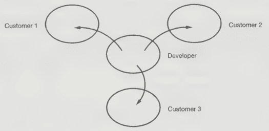

#### 修正

由于客户和开发人员拥有共同的代码库，因此只需要分发变更，从而最大限度地减少了沟通。这种分发方法特别适用于客户端的修正。这些变更随后被称为修正（corrections）或补丁（patches），它们通常是自动化的且易于获取。

#### 二进制文件中的变更

在本文讨论的补丁分发中，我们假设被更改的文件是文本文件，并且可以将类似 PATCH 的程序分发给客户。如果客户只有可执行程序而没有源代码，则必须通过特殊算法计算二进制文件之间的差异。然后将这些差异与一个应用这些二进制差异的程序一起分发给客户。由于源代码中的微小差异会导致转换后的程序产生巨大差异，因此分发完整的二进制文件通常比分发差异更合理。

### 2.4 手动集成变更

#### 变更的集成

如图 2.1 所示，变更的分发只有在开发人员和客户的代码库保持同步时才会奏效。这意味着客户应用了开发人员做出的所有变更，并且他们无需自行创建变更。这种情况在分发修复补丁时经常出现，但不适用于开发人员之间交换变更。

事实上，实际情况通常是几位开发人员在同一个代码库上工作，并在或多或少的协调下不断交换变更。因此，开发人员在一定程度上必须将其他开发人员的变更应用到自己的代码库中，即使他们刚刚对自己的代码进行了修改。同时应用来自不同源的变更的问题就是*变更集成（change integration）*问题。


**图 2.2：变更的集成。** 客户同时接收来自开发人员 1 和开发人员 2 的修改。

客户希望将其代码库更新到最新版本。开发人员 1 和开发人员 2 都做出了一些变更。客户必须**集成**这些变更，以检查这些变更是否兼容。

以以下情况为例：`be` 文件在 `ae` 变体中被更改为美国拼写。此外，另一位作者将 `be` 的内容扩展到了一个新文件 `be2` 中（示例 2.3）。

**示例 2.3：英式拼写的文本文件 `be2`**
- 1. The change impact was minimised
- 2. by localising the most
- 3. important variables,
- 4. saving approximately
- 5. 1,500 pounds.
- 6. All the developers
- 7. were deeply satisfied.

我们现在面临的任务是将 `be` 到 `ae` 的变更与 `be` 到 `be2` 的变更集成起来，以创建一个包含这两种修改的版本——即一个采用美国拼写且包含关于开发人员满意度补充内容的文件。有两种实现方法：

#### 双向集成

确定两个新文件（在我们的案例中是 `ae` 和 `be2`）之间的差异；用户通过交互方式决定集成版本中应该出现什么（以及来自哪个版本）。

#### 三向集成

同时考虑原始版本（即 `be`）。如果一段文本仅在两个文件中的*其中一个*中被更改，则可以自动应用变更。否则，用户必须手动集成变更。

首先，我们将详细研究（交互式）双向集成。软件工具 SDIFF 以两列形式显示两个文件之间的差异。如果调用时带有 “-o file” 选项，用户可以创建集成版本文件，并为每个差异选择使用文件 1 还是文件 2 的版本。在示例 2.4 中，文件 ae3 是基于 ae 和 be2 的集成而创建的。不同的部分用 | 标记。通过 “%” 提示符，SDIFF 请求用户决定在最终版本中采用哪一侧。在我们的案例中，使用 “l” 优先选择左侧版本。对于最终的修改，我们通过 “eb” 调用一个包含两个版本的文本编辑器。

**示例 2.4：使用 SDIFF 进行双向集成**

```
$ sdiff -o ae3 ae be2
The change impact was minimized | The change impact was minimised
by localizing the most | by localising
‾1
important variables, important variables,
saving approximately saving approximately
1,500 pounds. 1,500 pounds.
(1,500 pounds are approximately | All the developers
2,100 US$) | were deeply satisfied.
‾eb
$ _
```

使用文本编辑器，我们只需将两个版本依次放置，这样 ae3 就会像示例 2.5 中显示的那样。

**示例 2.5：集成后的文本文件 ae3**

```
1 The change impact was minimized
2 by localizing the most
3 important variables,
4 saving approximately
5 1,500 pounds.
6 (1,500 pounds are approximately
7 2,100 US$)
8 All the developers
9 were deeply satisfied.
```

#### EDIFF

虽然 SDIFF 是一个相当简单的工具，但其基本机制被广泛应用于许多集成工具中。其中一个比较突出的例子是 EMACS 编辑器的 EDIFF 软件包，它能以图形方式突出显示差异，并提供许多用于交互式编辑和集成变更的选项。

### 2.5 自动集成变更

如果同时考虑原始版本和更改后的文件，变更的集成可以大大简化。这种三向集成可以使用我们之前了解的 PATCH 程序来完成。

#### 三向集成


见第 2.3 节，该节介绍了如何将 DIFF 创建的更改应用于文件。整合更改的核心思想是让 PATCH 在一个已经被修改的文件上运行，而不是在原始文件上运行。具体细节为：首先，由 be 到 ae 的 DIFF 输出通过 PATCH 应用于 be，从而将 be 转换为 ae。然后，DIFF 将 be 和 be2 之间的差异应用于 ae（尽管第二个 DIFF 输出实际上是指向原始文件 be 的）。

这里有一个示例。我们将确定 be 和 be2 之间的差异并将其应用于 ae：

```
$ diff be be2
5a6,7
> All the developers
> were deeply satisfied.
$ diff be be2 > DIFFS
$ patch --verbose --backup < DIFFS
Hmm... Looks like a normal diff to me...
File to patch: ae
Patching file new using Plan A...
Hunk #1 succeeded at 6.
done
$ _
```

因此，插入在关于开发人员满意度条款第 5 行的更改被应用于 ae 文件并完成了整合。

显而易见，这个过程可能会出错。让我们看看 DIFF 输出中的 append 命令，它将新行插入到指定的行号中：如果文件已经在某些地方被修改过，行号将不再正确，PATCH 就会将新行插入到错误的位置。在处理更改（change）和删除（deleting）命令时，PATCH 至少可以确保要删除的行正是 DIFF 输出中列出的那些行。

如果将更改的位置不视为行号而视为“上下文（context）”——即更改前后必须出现的一组行，就可以避免这个问题。如果 PATCH 知道更改的上下文，它可以在文本中搜索上下文行以确定更改的位置；这样就不再需要行号的精确匹配。

#### 更改上下文

DIFF 使用一种特殊的上下文格式来为更改提供上下文。该格式通过 DIFF 的 `-c` 选项激活，后面可以可选地跟上下文行的数量。示例 2.6 显示了上述 DIFF 输出的上下文格式。

##### 上下文格式

**示例 2.6：上下文格式的 DIFF 输出**

```
$ diff -c2 be be2
*** be  Wed Sep 17 09:00:53 2003
--- be2 Wed Sep 17 09:07:13 2003
************
*** 4,5 ***
--- 4,7 ---
  saving approximately
  1,500 pounds.
+ All the developers
+ were deeply satisfied.
$ _
```

在上下文格式中，部分差异由一行 `*` 分隔。每个差异都以第一个文件的行范围开始，并由星号行包裹——此处为 `*** 4,5 ***`。随后是第二个文件的行区域，由短横线包裹——此处为 `--- 4,7 ---`。在行范围之后是特定文件的更改行：

- **插入行**仅在第二个文件中列出；它们在第一列用 `+` 标记。
- **删除行**仅在第一个文件中列出；它们用 `-` 标记。
- **更改行**在两个文件中都列出；它们用 `!` 标记。

上述更改应解读为：在 be2 版本中，关于开发人员的新条款被插入在 "1,500 pounds." 这一行之后。

这里是另一个上下文格式的 DIFF 输出示例。我们查看 2.0beta2 版本到 2.0beta3 版本中 C++ 文件 `settings.C` 的更改，如示例 2.7 所示。

这些更改应解读为：在新版本中插入了两个新的 `#include` 指令，分别位于 `<ctype.h>` 和 `"Assoc.h"` 的 `#include` 指令之后。此外，`SetOptionCB` 函数中的函数体被简化了。由于我们现在可以看到每次更改的上下文，我们可以用周围的行来描述更改；行号不再重要。

如果现在给 PATCH “喂”入一个上下文格式的 DIFF 输出，它首先会检查更改的上下文是否也出现在给定位置（由行号指定）。如果不是这种情况，PATCH 将从原始行号开始向前和向后搜索更改的上下文，直到找到上下文出现的位置。

如果找不到上下文，就会发生**冲突（conflict）**：更改无法执行。该冲突将存储在以 `.rej` (reject) 结尾的文件中以便进一步分析。

PATCH 可能会将更改应用于错误的位置——例如，如果上下文行在程序的多个地方完全相同。上下文越大，出现此类错误位置的可能性就越小，但发生冲突的可能性也会更高，此时必须手动消除冲突。

如果找不到上下文，则存在*冲突*：相关更改无法执行。它被放入一个以 `.rej`（来自 reject）结尾的文件中，以便进一步分析。

**示例 2.7：settings.C 中的更改**

```
$ diff -c2 ddd-2.0beta2/ddd/settings.C ddd-2.0beta3/ddd/settings.C
*** ddd-2.0beta2/ddd/settings.C Mon Sep.  2 21:22:11 1996
--- ddd-2.0beta3/ddd/settings.C Sun Sep 15 11:28:11 1996
***************
*** 48,53 ****
--- 48,55 ----
  #include <Xm/Separator.h>
  #include <ctype.h>
+ #include <string.h>

  #include "Assoc.h"
+ #include "AppData.h"
  #include "Delay.h"
  #include "DestroyCB.h"
***************
*** 81,86 ****
  static void SetOptionCB(Widget w, XtPointer client_data, XtPointer)
  {
    !
    String set_command = (String)client_data;
    !      gdb_command(string(set_command) + " " + XtName(w));
    }

--- 130,134 ---
  static void SetOptionCB(Widget w, XtPointer client_data, XtPointer)
  {
    !
    gdb_set_command((String)client_data, XtName(w));
  }
$ _
```

当然，我们不能排除 PATCH 可能会将更改应用于错误位置的可能性——例如，因为上下文行在多个地方出现且完全一致。上下文越大，PATCH 做出此类错误决策的可能性就越小，但同时也越容易出现必须手动解决的冲突。尽管如此，在实践中，这些试错方法在整合更改方面效果惊人地好。首先，这是因为程序的大规模结构（如函数名和函数头）通常保持不变，更改仅限于函数体，这使得函数头成为了可用的上下文。其次，程序文本通常很大而更改很小，因此很少发生冲突。

### 2.6 语法和语义整合

通过利用基础文档中的语法和语义信息，可以进一步提高自动整合的安全性。*语法整合（syntactical integration）*利用程序的结构来改善整合。与 DIFF 和 PATCH 纯粹基于文本的操作不同，语法整合处理的是编程语言的基本元素；其数据库是一个*抽象语法树（abstract syntax tree）*，其中每个程序组件都被分配一个子树。

首先，我们将用一个示例来说明语法整合。在图 2.3 中，有一个原始版本 $V_0$ 和两个衍生自 $V_0$ 的版本 $V_1$ 和 $V_2$。

**图 2.3 语法整合（摘自 Westfechtel (1991)）**

| 原始版本 $V_0$ | 更改版本 $V_1$ | 更改版本 $V_2$ |
| :--- | :--- | :--- |
| MODULE M;<br>VAR Colour: (White, Grey, Black);<br>BEGIN<br>&nbsp;&nbsp;&nbsp;&nbsp;Colour := White<br>END M. | MODULE M;<br>VAR Colour: (White, Grey, Black);<br>BEGIN<br>&nbsp;&nbsp;&nbsp;&nbsp;Colour := Grey<br>END M. | MODULE M;<br>TYPE ColourType = (White, Grey, Black);<br>VAR Colour: ColourType;<br>BEGIN<br>&nbsp;&nbsp;&nbsp;&nbsp;Colour := Black<br>END M. |
| **整合版本 $M$** | | |
| MODULE M;<br>TYPE ColourType = (White, Grey, Black);<br>VAR Colour: ColourType;<br>BEGIN<br>&nbsp;&nbsp;&nbsp;&nbsp;Colour := ?<br>END M. | | |

整合版本 $M$ 中的语法整合现在可以：

- 确定 Colour 在 $V_2$ 中被更改为 ColourType；
- 确定在 $V_2$ 中还插入了一个类型定义；
- 识别 Colour 的两次赋值之间存在冲突。

此外，整合算法可以通过识别会破坏语法正确性的冲突，来保证整合后程序的*语法正确性（syntactical correctness）*。基于文本的工具无法保证这种语法正确性，而它需要一个可以轻松访问抽象语法树的环境。事实上，语法整合最早是在编程环境中实现的，这些环境处理的是抽象语法树而非程序文本。

通过要求*语义正确性（semantic correctness）*，可以进一步提高整合算法的要求：两个更改 $A$ 和 $B$ 的整合必须既反映更改后的语义，又要反映共同未更改的语义。

A 和 B 中的语义。所谓的*语义集成*（semantic integration）过程基于*程序依赖图*（program dependency graphs），通过该图，可以为每个语句计算其程序切片（即所谓的*后向切片*），这些切片可能会影响该语句中的程序状态。同样地，也可以计算可能受该语句影响的程序切片（即所谓的*前向切片*）。

**语义集成**

设 A 和 B 为两次变更：如果受 A 和 B 影响的指令的后向切片是不相交的，且前向切片同样不相交，那么 A 和 B 之间不会发生冲突；否则，必须确定一个合适的集成方案。关于切片的详细信息，请参阅第 19 章以及其他相关文献。

直到现在，在实践中，语法集成或语义集成尚未获得广泛认可；显然，文本集成出错的风险太低，不足以支撑为专门的方法支付额外费用。

### 2.7 DIFF 的工作原理

我们将以 DIFF 工作原理的描述结束本章。（如果您对这些技术细节不感兴趣，可以从第 24 页继续阅读。）

DIFF 算法基于以下问题：设 A 和 B 为两个字符字符串。两个字符字符串的编辑距离（简称距离）是将 A 转换为 B 的*最短*插入或删除命令序列的长度。我们以字符字符串为例：

**编辑距离**

`A = abcabba and B = cbabc`

将 A 转换为 B 有多种可能性。例如，我们可以删除 A 中的所有字符并插入 B 中的字符，这意味着使用 7 个删除命令和 6 个插入命令，总共 13 个命令。然而，如图 2.4 所示，仅需要 5 个命令即可完成。

没有任何序列可以使用四个或更少的命令将 A 转换为 B。因此，图 2.4 中的两个命令序列都是*最短命令序列*。DIFF 算法的目标就是确定这样一个最短命令序列。然而，在实际的 DIFF 程序中，名称 a, b, c, ... 不再代表字符，而是代表行（DIFF 的实现通常为每行分配一个*哈希码*，从而能够像比较字符一样快速地比较行）。

**最短命令序列**

解决此问题的经典算法是确定 A 和 B 的*最长公共子序列*（LCS）；将 LCS 与 A 和 B 进行比较，从而得出

**最长公共子序列**

**图 2.4**
两条最短命令序列。垂直线 | 表示后续命令应用的位置。

| 字符 | 命令 |
| :--- | :--- |
| A \|abcabba\| | 插入 c |
| A c\|abcaba\| | 删除 a |
| cb\|cabba\| | 删除 c |
| cba\|bba\| | 删除 b |
| cbaba\| | 插入 c |

| 字符 | 命令 |
| :--- | :--- |
| A \|ab cabba\| | 删除 a |
| \|bcabba\| | 删除 b |
| c\|abba\| | 删除 a |
| cb\|ba\| | 插入 a |
| cbaba\| | 插入 c |

**图 2.5**
距离矩阵


**距离矩阵**

插入和删除命令。我们在这里介绍另一种方法：由 Miller 和 Myers 专门为 DIFF 设计的算法。

该算法的基础是一个距离矩阵 D，其条目包含距离——即 A 和 B 前缀的最短命令序列。元素 D[i,j] 代表 A 的前 i 个字符（记作 A[1:i]）与 B 的前 j 个字符（记作 B[1:j]）之间的距离。

距离矩阵 D 可以表示为一个矩阵，如图 2.5 所示。这里 x = D[1,1] 是前缀 A[1:1] = a 和 B[1:1] = c 之间的距离。同理，y = D[2,2] 代表前缀 A[1:2] = ab 和 B[1:2] = cb 之间的距离。

此外，每个字段 D[i,j] 都被分配了一个命令序列。我们使用两个命令将 A[1:1] = a 转换为 B[1:1] = c：删除 a 和插入 c。这些命令与 x 相关联；x 的值就是命令序列的长度。这也适用于 x = D[1,1] = 2。x 的命令序列对于 y 同样足够，其中 y = D[2,2] = 2 成立。

#### 确定距离

我们的目标是确定右下角的字段 z = D[7,6]：它被分配了将 A[1:7] = A 转换为 B[1:6] = B 的最短命令序列。我们将从左上角的 D[0,0] = 0（两个空字符字符串 A[1:0] 和 B[1:0] 的距离）开始，向右和向下推进。一个未知的距离 D[i,j] 可以通过其上方和左侧的三个邻居通过三种不同方式确定：

- **规则 1：“向右”（右移）**
如果 D[i,j-1] 已知（D[i,j] 左侧的字段），那么 D[i,j] 至多为 D[i,j-1]+1，因为在 A[1:i] 后面插入字符 B[j] 就足够了。

让我们考虑图 2.5 示例中的字段 $w = D[0, 1]$。$w$ 是前缀 $A[1: 0]$（空字符串）与 $B[1: 1] = c$ 之间的距离。我们现在能够根据 $D[0, 0] = 0$ 确定 $w$；得到 $w = D[0, 1] = D[0, 0] + 1 = 0 + 1 = 1$。与 $w$ 相关联的命令序列是在 $A[1: 0]$ 之后插入字符 $B[1] = c$。$A[1: 0]$ 是空字符串（即 A 的起始位置）。

- **规则 2：“下方”（下移）**
如果 $D[i - 1, j]$ 已知（$D[i, j]$ 上方的字段），$D[i, j]$ 至多为 $D[i - 1, j] + 1$，因为删除字符 $A[i]$ 就足够了。

如果我们从示例中确定字段 $x = D[1, 1]$，那么我们可以根据 $w = D[0, 1] = 1$ 确定 $x$ 为 $x = w + 1 = 2$。与 $x$ 相关联的命令序列是 $w$ 的序列（即插入 $c$）加上一个额外的命令，即删除 $A[1] = a$。

或者，我们也可以根据左侧字段（对应“向右”规则）来确定 $x$。那么 $x = D[1, 0]+1$ 成立，且 $x = 2$。在这种情况下，命令序列将反过来：先删除 $a$，然后插入 $c$。

- **规则 3：“右下方”（沿对角线滑动）**
如果 $D[i - 1, j - 1]$ 已知（$D[i, j]$ 左上方的字段）且 $A[i] = B[j]$ 同样成立，那么 $D[i, j] = D[i - 1, j - 1]$ 成立。由于字符 $A[i]$ 和 $B[j]$ 相等，无需进一步的命令。

作为一个例子，我们看字段 $y = D[2, 2]$。$A[2] = B[2] = b$ 成立，因此 $y = D[2, 2] = D[1, 1] = x = 2$。因此，x 的命令序列（即用 $c$ 替换 $a$）也足以将前缀 $A[1: 2] = ab$ 转换为 $B[1: 2] = cb$。

DIFF 算法的一个天真实现现在会确定所有 $D[i, j]$ 的值，从左上角到右下角填充字段。因此，在确定 $D[i, j]$ 时，三个邻居将始终是已知的，DIFF 可以根据上述规则确定最小值。

图 2.6 显示了中间状态和最终状态：矩阵被完全填充，右下角字段与最短命令序列相关联。在假设带有下划线的字段导致其下划线邻居的命令序列被确定的前提下，我们得到了图 2.4 中的第一个命令序列作为结果。

Miller 和 Myers 的算法复杂度为 $O(n \times m)$，其中 $n$ 和 $m$ 分别代表 A 和 B 中的行数。在实践中，存在许多优化。事实上，不必计算距离矩阵的所有值；首先，可以根据“右下方”规则沿对角线填充字段。如果 A 和 B 之间的差异很少，很快就能到达右下角字段；在极端情况下，如果 A = B，则仅需要 n 步。因此，总的来说，差异越少，工作量越小。

（与基于 LCS 的 DIFF 实现相比，这是 Miller 和 Myers 方法的一个重要优势。在实践中，DIFF 主要用于版本管理（如第 3 章所述），人们从个体版本之间只有少量差异的假设开始。这正是基于 LCS 的实现的弱点所在。尽管它们具有相同的复杂度，但其工作量随*一致性*的数量增加而增加，在 $A = B$ 的情况下达到最大值 $n^2$ 步。）

关于其他 DIFF 算法的描述以及 Miller 和 Myers 算法的详细信息，请参阅本章末尾引用的文献。

#### 概念

- 软件配置管理 (SCM) 组织并控制软件系统的演进。
- DIFF 将两个文本 A 和 B 之间的*差异*（= 变更）确定为一组将 A 转换为 B 的命令序列。这些命令包括插入和删除行。
- 对于*变更的分发*，可以使用 PATCH 将 DIFF 生成的差异应用于其他文件。
- 使用*双向集成*（two-way integration），可以从两个文件 A 和 B 创建一个新文件，对于每个差异，交互式地从 A 或 B 中选择一段文本。
- 使用*三向集成*（three-way integration），会考虑到一个共同的原始版本：如果一段文本仅在 A 或 B 中被修改，则该变更

可以自动进行。如果一段文本在 A 和 B 中都被修改了，则会发生冲突。

- 语法集成和语义集成会考虑应用更改的文档的语法或语义。
- A 和 B 的最短命令序列是由 DIFF 通过递增地使用 A 和 B 前缀的最短命令序列来确定的。

#### 复习练习

- 1. 实现 Miller 和 Myers 的算法。
- 2. 查看图 2.6。还有哪些其他可能的最短命令序列？
- 3. 在什么条件下可以省略计算距离矩阵中的单个字段？考虑合适的优化方案。
- 4. 有时在移植程序时必须对代码进行微调。如果需要维护程序的早期版本时，这两个版本都被描述为变体（variants）。在纠正某个变体的错误时，必须同时考虑所有进一步的变体。这可以通过自动方式实现吗？
- 5. 在实践中，大多数更改是在整个文件层次结构中确定并传播的。通过这种方式，一个更改可以应用于多个文件；DIFF 和 PATCH 提供了相应的选项。但是，如果文件或目录被添加、删除或重命名会发生什么？
- 6. 列出文本集成、语法集成和语义集成的进一步优缺点。如何避免文本集成的缺点？（例如，思考源代码中的注释或不同的格式风格。）
- 7. 讨论将源代码提供给客户这种方法的优点和缺点。

#### 延伸阅读

关于软件配置管理主题，我们推荐 Babich (1986) 和 Whitgift (1991) 编写的面向实践的入门书籍；Tichy (1994) 出版了一本最新的优秀研究结果集。SCM 的形式化基础可见于 Zeller 和 Snelting (1997)；管理者的视角则体现在 IEEE (1988, 1990) 的 SCM 标准中。*系统配置管理研讨会 (Symposium on System Configuration Management)* 展示了当前的研究结果、最新的综述文章和宝贵的经验报告（之前的会议记录见：Winkler (1988), Tichy (1989), Feiler (1991), Estublier (1995), Sommerville (1996a), Conradi (1997), Magnusson (1998) 和 Estublier (1999)）。

DIFF 程序最早在 Hunt 和 McIlroy (1976) 中被描述。底层的 LCS 算法可以在许多涵盖基础文件结构和算法的教科书中找到，例如 Aho 等人 (1983)。在这里，我们没有介绍原始算法，而是选择了展示 Miller 和 Myers (1985) 提出的更快速的版本，该版本已在 GNU DIFF 中实现。

在一些应用程序中，DIFF 的输出仅由机器解析；因此 DIFF 的结果不需要人类可读。在此前提下，可以使用能够有效地识别和存储 *复制* 数据块的算法。实际上，这些算法与压缩方法的共同点多于与原始 DIFF 算法的共同点；特别是，它们能够识别二进制数据之间的差异。典型的方案由 Tichy (1984) 和 Reichenberger (1989) 描述。Hunt 等人 (1996) 的实证研究结果表明，新方法在处理文本以及二进制数据方面明显优于原始算法。

Larry Wall (1988) 是 PATCH 程序的最初创建者。我们对 PATCH 的描述依赖于 MacKenzie 等人 (1993) 的文档；该手册还包含对 GNU DIFF 和 GNU SDIFF 的详细描述。Kifer (1996) 的 EDIFF 软件包是 EMACS 编辑器的一个组件，由 Stallman (1988a) 描述。

更改的 *语法* 集成由 Westfechetel (1991) 描述并在 IPSEN 系统 (Nagl (1996)) 中实现。*语义* 集成的想法由 Horwitz 和 Reps 所在的团队研究——参见 Horwitz 等人 (1989), Yang 等人 (1992), Binkley 等人 (1995)，而 Berzins (1994) 描述了替代方案。

#### 其他配置管理工具

在第 59 页，您将找到一个软件配置管理商业工具列表。

## 3 使用 RCS 进行修订管理

### 3.1 简介

在第 2 章中，我们将广义的软件开发视为软件产品中 *更改* 的创建和分发。在本章中，我们将介绍 *组织* 和 *控制* 更改过程的工具——即 2.1 节中讨论的软件配置管理 (SCM) 的主题。这些工具涵盖了 SCM 工具的以下需求：

**重建 (Reconstruction)：** 在任何时间点，必须能够还原之前的 *配置*；配置是一组特定版本的软件组件。重建对于识别新旧版本之间的更改以及为了维护目的确定已分发产品的源代码至关重要。*还原之前的配置*

**协调 (Coordination)：** 必须保证开发人员所做的更改不会被无意中丢失，这意味着，特别是当多个开发人员想要同时更改一个组件时，任何 *冲突* 都能得到解决。*协调更改*

**标识 (Identification)：** 必须始终能够清晰地标识单个版本和组件，以便识别已做出的更改。这意味着需要对单个版本和组件进行准确的标记。*标识版本和组件*

在这些需求中，如果我们提到 *版本 (versions)*，我们是指更改软件组件后的结果。根据更改的目的，我们区分 *修订 (revisions)* 和 *变体 (variants)*：

**修订 (Revisions)** 是为了 *替换* 现有版本而创建的版本；原版本不再被使用。修订通常在 *程序维护* 期间创建——例如，为了纠正错误。对所使用的算法和数据结构的改进或输入环境的更改也可以是创建修订的原因。*修订替换版本*

**变体 (Variants)** 是 *补充* 现有版本的版本；新版本和现有版本这两个版本都将被使用并进一步开发。*变体补充版本*

变体存在的一个典型原因是将程序 *移植* 到另一个环境中，此时两个变体都必须维护。在程序开发过程中，当多个开发人员在各自的副本上工作时，也会创建变体。

如果一个变体的寿命从一开始就是有限的，我们称之为 *临时变体*；否则，我们称之为 *永久变体*。在本章中，我们将讨论临时变体，而在第 9 章中，我们将描述如何处理 *永久变体*。

“版本 (Version)”有时也被用作“修订 (revision)”的同义词，从而使“版本”和“变体”成为互补关系。我们将始终使用“版本”这一概念作为修订和变体的通用术语。

### 3.2 保存和还原修订

**版本档案 (Version archive)** 我们的第一个课题是早期配置的 *重建*。重建背后的基本思想是管理一个 *版本档案*（英文：repository），其中存储了所有软件组件的所有版本。虽然软件组件通常通过唯一标识符（如文件名）来识别，但修订通常因 *时间因素*（如创建日期）而有所不同。由于修订是沿着“替换”关系排序的，因此可以使用简单的 *编号*：数字越高，修订越新。因此，例如，修订 7 比修订 5 更新（且有望更稳定）。

在修订档案中，可以使用名称、创建日期和其他属性来存档版本——并使用这些属性检索这些版本。这正是修订控制系统（简称为 RCS）的任务。

**RCS** RCS 的主要任务是管理一个 *RCS 档案*，即一个文件修订档案。RCS 档案以单个文件的形式存在，因此我们可以将其称为 *RCS 文件*。RCS 为访问 RCS 文件提供了两个基本功能：

- **check in (签入)：** 将一个版本复制 *进入* 版本档案
- **check out (签出)：** 将一个版本复制 *从* 版本档案中取出。

**工作空间 (Work space)** 通常在 RCS 中，每个开发人员都有一个独立的 *工作空间* 可用，而 *RCS 目录* 中的 RCS 文件由所有开发人员共享。通过使用签出和签入功能，您可以将文件从 RCS 目录复制到工作空间中，反之亦然（图 3.1）。

**修订号 (Revision number)** 为了标识单个版本，RCS 为每个版本分配一个 *修订号*。在 RCS 中，修订号由两个数字 *n.m* 组成，


### 3.2 保存与恢复修订版本

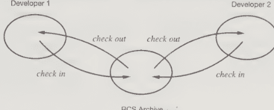

**图 3.1**
签入（Check in）与签出（Check out）。开发人员将文件从 RCS 目录复制到他们的工作空间（签出），反之亦然（签入）。

*修订树*

其中，较高的 *n* 代表重大进展，*m* 代表次要进展。修订版本号在签入时自动分配：第一个修订版本号为 1.1，第二个为 1.2，依此类推。修订版本号的顺序形成了一棵**修订树**（也称为*修订历史*）。在最简单的情况下，修订树表现为如图 3.2 所示的线性*链*。


**图 3.2**
修订链。每个新修订版本都在前一个修订版本的基础上进行并对其产生更改。

#### co 命令
**按修订版本签出**

可以通过提供修订版本号或创建日期，从 RCS 文件中复制单个修订版本。这可以使用 RCS 命令 `co` (check out) 来完成。`co` 命令可以传递一个修订版本号：

```
$ co -r1.1 be
RCS/be,v --> be
revision 1.1
done
$ _
```

在这里，修订版本 1.1 从 RCS 文件 `RCS/be,v` 复制到当前目录。

修订版本号可以简写，在这种情况下将使用现有的最高版本号：

```
$ co -r1 be
RCS/be,v --> be
revision 1.2
done
$ _
```

**签出最近的修订版本**

如果省略修订版本号，则返回*最近的修订版本*。这是 `co` 最常用的应用场景。

```
$ co be
RCS/be,v  -->  be
revision 1.2
done
$ _
```

**按日期签出**

除了修订版本号，还可以指定要恢复的*日期*。RCS 识别多种日期和时间表示形式，并返回尚未被新版本替换的修订版本。

```
$ co -d'2003/04/21 13:30:30' be
RCS/be,v  -->  be
revision 1.1
done
$ _
```

通过在签出时指定日期，可以轻松地将文件恢复到之前的任何状态。例如，要重建多个文件的特定配置，您只需要知道该配置的日期，即可重建相应的文件修订版本。

### 3.3 分支与变体

在实践中，软件经常以多个并行变体的方式进行开发。当一个编程团队在维护一个已被多个客户采用的旧变体时，另一个编程团队正在与一组 Beta 测试员合作，测试即将交付的下一个版本；而第三个编程团队则已经开始开发随后的版本。

**修复与特性**

使用如图 3.2 所示的修订链，无法令人满意地对这种情况进行建模。问题在于这里有两种不同类型的更改：*修复（fixes）*，即保留现有功能；以及*新特性（new features）*，即引入新功能——且可能同时引入新错误。在线性修订链中，这两类更改无法清晰地分离：每次更改都需要所有之前的更改，因此任何修复都需要包含之前所有的新特性。

**子路径与主路径**

然而，客户通常对修复更感兴趣，而非未经测试的实验性特性。因此，目标必须是*将修复与特性分离*。为此，RCS 引入了*分支（branch）*的概念。其核心思想是，修复指向之前的某个修订版本——即修订树中一个独立的*子路径*。而*主路径*则用于进一步的开发。

图 3.3 展示了一个使用分支的典型场景。当程序达到修订版本 1.5 时，一名客户报告了她所使用的修订版本 1.2 中存在错误。显然，可以在修订版本 1.5 中修正此错误，创建修订版本 1.6，然后将其交付给客户。但问题是，客户也会收到 1.4 和 1.5 中未经测试的特性，这是不希望看到的。因此，通过使用 RCS，可以从修订版本 1.2 生成一个分支，其中维护 1.2 的新修订版本（如 1.2.1.1、1.2.1.2 等）并交付给用户。

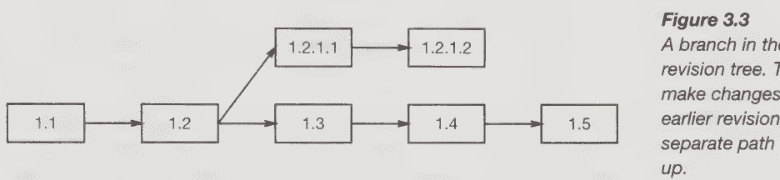

在签入或签出修订版本时，RCS 根据修订版本号自动确定在修订图中的位置——例如，1.2.1.1 始终表示修订版本 1.2 的修订版本 1.1。修订版本号可以是任意的：例如，修订版本号 1.2.1.1.1.1 将引入一条来自 1.2.1.1 的新次级路径。在实践中，这种分支中的分支的情况极少发生。

针对 1.2 所做的修复（创建了修订版本 1.2.1.1）最终必须与最近的更改一起合并到主路径中。这可以通过第 2 章描述的集成程序之一来实现。

### 3.4 锁

在任意修订版本号下存档修订版本对于重建早期配置非常有用。然而，仅靠存档是不够的；还必须确保修订版本一旦归档就不能被更改。这一要求很容易实现，因为签入仅在路径的最新修订版本中才可行。因此，RCS 禁止随后对修订历史进行更改。

然而，另一个问题出现了：如果两名开发人员都想编辑修订版本 1.5，第一名开发人员将他的修订版本作为 1.6 添加到修订存档中。第二名开发人员则将她的更改存储为 1.7。现在，1.7 是 1.5 的后代；从 1.5 到 1.6 的更改在 1.7 中丢失了。

**锁定**

为了避免丢失这些更改，RCS 引入了*锁定（locking）*的概念。开发人员只有在对该修订版本设置锁之后才能编辑它。对修订版本 A 的锁定可防止所有其他修订版本用修订版本 B 替换新的修订版本 A——此权利仅保留给设置锁的人。

锁在 RCS 签出时直接设置。普通签出将文件从版本存档中复制为只读——因此无法进行更改。而 `-l` (lock) 选项则会设置锁并创建一个可写的副本。

**带锁签出**

例如，作者 Andreas 想要扩展一本书的手稿。他通过输入 `-l` 对文件 `rcs.tex` 进行签出：

```text
andreas$ co -l rcs.tex
RCS/rcs.tex,v --> rcs.tex
revision 1.5 (locked)
done
andreas$
```

Andreas 可以随意编辑 `rcs.tex` 文件。如果共同作者 Jens 也想编辑同一份手稿，他必须执行相同的步骤，但结果不同：

```text
jens$ co -l rcs.tex
RCS/rcs.tex,v --> rcs.tex
co: RCS/rcs.tex,v:
    Revision 1.5 has already been locked by Andreas.
jens$
```

Jens 现在必须等待 Andreas 提交他的更改；如果 Andreas 引入了更改，他的锁将自动释放。在 3.5 节中，我们将看到如何通过创建子路径来避免锁定。

### 3.5 进行更改

**ci 命令**

在完成更改后，Andreas 和 Jens 执行签入。这是通过 `ci` 命令完成的，与 `co` 命令一样，它可以接收一个修订版本号。如果 `ci` 不带任何选项，文件的本地副本将被删除；可以通过重新执行 `co` 从版本存档中再次复制。通常，`ci` 与 `-u` 选项一起使用（会自动调用 `co`），或与 `-l` 选项一起使用（效果等同于 `co -l`）。

假设 Andreas 已经完成了对 `rcs.tex` 的更改。他使用 `ci` 创建一个包含以下更改的新修订版本：

```text
Andreas$ ci -u rcs.tex
RCS/rcs.tex,v <- rcs.tex
new revision: 1.6; previous revision: 1.5
enter log message, terminated with a single '.'
or end of file:
>> _
```

`ci` 要求 Andreas 为*更改日志*输入一条*日志消息*。Andreas 记录了他的更改：

```text
andreas$ ci -u rcs.tex
RCS/rcs.tex,v  <--  rcs.tex
new revision: 1.6; previous revision: 1.5
enter log message, terminated with single '.'
or end of file:
>> Section about change logs
>> completed
>> .
done.
$ _
```

如果在签入时未指定修订版本，`ci` 将选择主路径中的下一个可用修订版本。但通过明确给出修订版本号，可以建立*次级路径*。这是想要*避免锁定*时的做法。

**避免锁定（次级路径）**

例如，假设 Andreas 尚未完成他的更改，因此 `rcs.tex` 仍处于锁定状态。Jens 可能只想修正几个拼写错误，但无法这样做。为了执行他的更改，Jens 可以通过建立一个*次级路径*并将更改添加到修订版本 1.5.1.1 中，从而避开 Andreas 的锁：

```text
jens$ ci -u -r1.5.1.1 rcs.tex
RCS/rcs.tex,v  <--  rcs.tex
new revision: 1.5.1.1; previous revision: 1.5
enter log message, terminated with single '.'
or end of file:
>> Fix: Typos
>> .
done.
$ _
```

随后，当 Andreas 完成他的更改并产生修订版本 1.6 后，Jens 可以将他的更改加入其中并创建集成后的修订版本 1.7。

### 3.6 更改日志与关键字

在 **ci** 中为更改日志提供的条目可以通过 RCS 命令 **rlog** 列出。示例 3.1 显示了由上述命令产生的更改日志。

**rlog 命令**


## 3 使用 RCS 进行版本管理

每当开发人员想要了解最新变更时，变更日志（change log）都会非常有用。如果向用户提供源代码，通常会包含变更日志，以便用户能够追踪变更及其理由。

为了支持变更日志，RCS 允许使用**关键字**（keywords）将版本信息包含在文件中。关键字是指定在 `"$...$"` 中的标识符。它们在文件检出（check out）时会自动展开。例如，字符串 `$Revision$` 会自动被替换为当前版本号。关键字 `$Id$` 则展开为一个标准的文件头：

```
$Id: rcs.tex,v 1.6 2003/07/31 19:31:04 andreas Exp $
```

该文件头包含了 RCS 文件名、版本号、创建日期以及提交此版本的开发人员姓名。

```
$ rlog rcs.tex
RCS file: RCS/rcs.tex,v
Working file: rcs.tex
head: 1.6
branch:
locks: strict
access list:
symbolic names:
keyword substitution: kv
total revisions: 6;    selected revisions: 6
description:
--------------
revision 1.6
date: 2003/07/31 19:31:04; author: andreas; state: Exp; lines: +80
Section about change log completed
--------------
revision 1.5
date: 2003/06/23 17:02:51; author: andreas; state: Exp; lines: +30
Section about motivation is completed
--------------
...
$ _
```

**示例 3.1**
RCS 变更日志。对于每次变更，都指定了日期、作者和原因。

您还可以通过关键字将变更日志集成到文件中。为此，我们使用关键字 `$Log$`：它的作用是每次提交（check in）时都会添加一条新的变更日志条目。久而久之，整个变更日志就成为了文件的一个组成部分：

```
% $Log: rcs.tex,v $
% Revision 1.6  2003/07/31 19:31:04  andreas
% Section about change log completed
%
% Revision 1.5  2003/06/23 17:02:51  andreas
% Section about motivation completed
%
```

RCS 会自动将 `$Log$` 关键字前输入的字符复制到随后的每一行之前。这对于将变更日志包含为一个长注释非常有用。在上面的示例（一个 LaTeX 文件）中，使用的是 "%" 作为注释引用。

在实践中，版本标识符以一种允许在可执行程序中识别源文件和版本形式给出。为此，版本标识符作为字符字符串包含在源代码文本中。在 C 语言中，其形式如下：在 `dev.C` 文件中，我们添加以下行：

```c
static char version_string[] =
    "$Id$";
```

在下一次检出后，它会展开为：

```c
static char version_string[] =
    "$Id: dev.C,v 1.9 2003/04/25 06:39:09 joe Exp $";
```

通过 `dev.C` 创建程序时，字符字符串 `version_string` 变成了可执行二进制文件的一部分。

为了确定可执行二进制文件的版本号，我们使用 RCS 命令 `ident`，它会报告文件中出现的所有 `$name:text$` 形式的字符字符串。假设我们创建了一个名为 `myprog` 的程序，它使用了 `dev.C` 的源代码。使用 `ident`，我们可以确定所有包含的源文件名和版本：

**ident 命令**

```
$ ident myprog
$Id: dev.C,v 1.9 2003/04/25 06:39:09 joe Exp $
$Id: lib.C,v 1.4 2003/04/25 06:37:40 liz Exp $
...
$ _
```

### 3.7 RCS 如何存储版本

随着时间的推移，软件组件会经历数十次甚至数百次变更，从而产生多个需要存档的版本。如果每次都存档整个完整版本，版本存档的空间需求很快就会突破极限；最终，任何开发人员都必须在存档的优势与存档的空间需求之间进行权衡。

**示例 3.2：RCS 和 SCCS 文件**

```
RCS/be,v
head 1.2;
access;
symbols;
locks; strict;
comment @@;

1.2
date 2003.09.17.08.19.18;
author zeller; state Exp;
branches;
next 1.1;

1.1
date 2003.09.17.08.18.58;
author zeller; state Exp;
branches;
next;

desc
@@
1.2
log
@Added note on developers
@
text
@The change impact was minimised
by localising the most
important variables,
saving approximately
1,500 pounds.
All the developers
were deeply satisfied.
@

1.1
log
@Initial revision
@
text
@d6 2
@
```

```
SCCS/s.alt
^Ah40901
^As 00002/00000/00005
^Ad D 1.2 2003/09/17 09:56:29
       zeller 2 1
^Ac Added note on developers
^Ae
^As 00005/00000/00000
^Ad D 1.1 2003/09/17 09:55:57
       zeller 1 0
^Ac date and time created
^Ac 2003/09/17 09:55:57 by zeller
^Ae
^Au
^AU
^Af e 0
^At
^AT
The change impact was minimised
by localising the most
important variables,
saving approximately
1,500 pounds.
^AD 1
All the developers
were deeply satisfied.
^AE 1
```

RCS 使用一种特定的程序来高效地存储大量版本。只有主路径的*最后一个*版本被完整存储；对于之前的每个版本，仅存储其与后续版本之间的*差异*（difference）。如图 3.2 所示的版本链，RCS 存储方式如下：

- 最后一个版本 1.5 被完整存储。
- 如有必要，版本 1.4 通过将存储的 1.5 和 1.4 之间的 DIFF 差异应用于版本 1.5 来创建（如第 2 章所述）。
- 版本 1.3 通过将存储的 1.4 和 1.3 之间的差异应用于刚刚生成的版本 1.4 来创建。
- 因此，任何直到版本 1.1 的版本都可以通过应用之前的差异来还原。

此过程的基本机制已在第 2 章中介绍：变更通过 DIFF 算法确定，并使用类 PATCH 算法应用。事实上，RCS 调用 DIFF 程序来确定变更；RCS 本身处理变更的应用，使用适当的命令来添加和删除行。

在提交新版本时，RCS 用新版本替换最后一个版本（在 RCS 文件中完整存储的版本）；它还会存储新版本与前一版本之间的差异。例如，考虑图 3.2：如果要存储新的版本 1.6，存档中存储的最后一个版本 1.5 将被新版本 1.6 替换，此外，还将存储从 1.6 到 1.5 的 DIFF 差异。

为了演示该过程，示例 3.2 展示了 RCS 存档 `RCS/be,v`，其中包含取自第 2 章的英式英语文本的两个版本。

在日期、锁和变更日志等信息之后，RCS 存档存储了最新版本 1.2 的全部文本。随后是版本 1.1，但它仅作为版本 1.2 的差异存在：常规的 DIFF 差异用 "δ"（删除）和 "α"（追加）标记。在我们的案例中，版本 1.1 是通过从版本 1.2 中删除从第 6 行开始的两行（最后一行 "6d2"）而创建的。

**反向增量 (Backward delta)**
基本上，在 RCS 中，变更（称为 delta）是从近期版本向早期版本反向确定并存储的（“反向增量”）。这样做的原因是效率：近期版本比旧版本被访问得更频繁。因此，RCS 最小化了近期版本的访问时间（即需要执行的变更次数）。

如果在版本树中出现分支，变更将在分支中从早期版本向近期版本正向确定并应用（“正向增量”）。例如，如果我们想重建图 3.4 中表示的版本 1.2.1.2，RCS 将执行以下步骤：

**正向增量 (Forward delta)**
1. 从 RCS 文件中提取版本 1.5。
2. 使用 1.5 之后的（反向）变更 1.4。
3. 使用 1.4 之后的变更 1.3。
4. 使用 1.3 之后的变更 1.2。
5. 使用 1.2 之后的（正向）变更 1.2.1.1。
6. 使用 1.2.1.1 之后的变更 1.2.1.2。

**图 3.4**
反向差异和正向差异。
在主路径中，如果与近期版本比较，版本被反向设置；在次要路径中，如果与早期版本比较，则被正向设置。

#### 交错版本表示法 (Interleaved revision representation)

因此，RCS 对最新版本的快速访问是以降低对分支版本访问速度为代价的。如果管理多个分支，这种访问速度的权衡不一定合理。因此，许多 SCM 工具使用版本的*交错*（interleaved）表示法，其中所有版本的还原速度相同，无论其在版本树中的位置如何。

交错版本表示法的一个典型示例是 *Source Code Control Systems* (SCCS) 的文件格式，如示例 3.2 所示。

在 SCCS 格式中，单个行被分配标记，指示它们属于哪个版本。行被组合在块中，块以 `^AI n`（插入）或 `^AD n`（删除）开始，以 `^AE`（结束）结束。包含在 `^AI n ...^AE` 块中的行属于版本 *n*；包含在 `^AD n ...^AE` 块中的行*不*属于版本 *n*。块可以任意嵌套。

为了重建版本，SCCS 只需在 SCCS 文件中选择属于所需版本的行。例如，让我们考虑文本行 "All the developers"。它包含在 `^AD 1...^AE` 中，因此它不属于版本 1；如果要重建版本 1，SCCS 将简单地忽略这一行。

根据这个模式，SCCS 处理整个 SCCS 文件，直到输出该版本的所有所需行。与 RCS 不同，SCCS 重建版本的成本始终相同；然而，它随 SCCS 文件的长度（即变更数量）而增加。

在实践中，底层表示法是像 RCS 那样不交叉的，还是像 SCCS 那样交叉的，并没有实质性的区别。两种工具在重建近期配置方面都非常快速，并提供了有意义的协调和识别机制。


图 3.5 PERFORCE 中的版本选择。用户可以查看修订树并选择修订版本。

| 修订版本 | 日期 | 用户 | 描述 |
| :--- | :--- | :--- | :--- |
| **17**7 | 2002/12/15 | rmg | 使 jam -d0 关闭 jam 的额外输出... |
| 16 | 2002/12/15 | rmg | 重写过去：更新所有 jam 的源文件... |
| 15 | 2002/12/15 | rmg | 在 jam 中进行一些常量化处理，使其更... |
| 14 | 2002/12/15 | rmg | Jam 微调：由于所有对 list_new 的调用... |
| 13 | 2002/12/15 | rmg | 尝试使用 jam 的 -d 标志，以使... |
| 12 | 2002/03/18 | seiwald | 紧凑化 jam 的版权信息，以便... |
| 11 | 2002/03/16 | seiwald | 新的 -g 标志用于重新排序目标，使得... |
| 10 | 2002/01/21 | rmg | 此更改仅为集成历史记录... |
| 9 | 2002/01/21 | rmg | 添加一个选项，使 Jam 能尽快退出... |
| 8 | 2002/01/11 | rmg | Jam 2.3 + Perforce 的内部更改。 |
| 7 | 2001/01/03 | seiwald | Jam 2.3。详见 RELNOTES 中的更改列表... |
| 6 | 1999/07/23 | seiwald | Peter Glasscock 的 MPW 移植版。 |
| 5 | 1999/07/23 | seiwald | Peter Gi... 的解释性集成。 |

### 3.8 创新与进一步发展

RCS 和 SCCS 是通过简单的命令行界面作为简单工具使用的。然而，大多数用户更倾向于使用图形用户界面来访问版本。图 3.5 展示了 PERFORCE 中的版本选择——这是一个具有图形用户界面的 SCM 工具。用户可以检查并选择修订树以及重要的 SCM 功能。

像 PERFORCE 这样用户界面的缺点是程序必须经过适配才能访问版本。新的 SCM 系统通过*虚拟文件系统*（virtual file systems）解决了这个问题，在该系统中，所有版本都可以像普通文件一样被访问——因此无需适配用户程序。例如，CLEARCASE 系统使用了*特殊文件名*，这些文件名定义了修订树中的路径，因此文件名 `zbuf.c@@/color` 访问的是 color 变体中的组件 `zbuf.c`。修订路径的默认值可以通过一个步骤设置；它限制了文件系统的视图。例如，如果将 `color` 设置为修订路径，则所有文件都可以直接在此变体中访问，而无需进一步指定。

**n-DFS 系统**（*n-dimensional file system*，n 维文件系统）是一种虚拟文件系统，可以使用任何版本存档进行参数化。例如，如果使用 n-DFS 和 RCS 的组合，可以通过环境变量设置 RCS 文件的日期。

**数据库**
SCM 的另一个趋势是从文件系统迁移到*数据库*。数据库的优势在于可以通过系统错误实现主要的数据丢失保护，并且能更好地协调并行访问。然而，传统数据库对软件开发的复杂需求（如高效的版本控制）支持不足。不过，初步尝试相当乐观；例如，ADELE 系统使用其自身的（带版本的）数据库作为存档，通过虚拟文件系统提供单个视图。视图由特殊的*查询语言*指定；ADELE 查询：

`window-system = x11 ∧ (current ∨ status ≠ experimental)`

选择所有用户界面为 X Window System 且为最新版本或非实验版本的版本。

#### 概念

- 根据目的，版本可以是*修订版本*（revisions）或*变体*（variants）。修订版本替换现有版本，变体则对其进行补充。
- RCS 提供了一个*版本存档*（version archive），其中可以签入（check in）或签出（check out）修订版本。
- 在 RCS 存档中，修订版本被组织在*修订树*（revision tree）中，路径的末端代表当前修订版本。
- 通过*锁*（locks），RCS 保证同一时间最多只有一个开发人员可以对同一修订版本进行操作。
- 每次更改都由开发人员提供*理由*（justified）；由此产生的*更改日志*（change log）记录了软件组件的历史。
- RCS 存档仅存储修订版本之间的*差异*（differences）。这节省了大量空间。

#### 复习练习

1. 为什么 RCS 使用外部 DIFF，但使用自己的算法而不是 PATCH？
2. 为什么修订树分支中的增量（deltas）是向前存储而不是向后存储的？向后增量会有哪些优缺点？
3. RCS 仅在单个文件上工作；目录中的更改（如添加和删除文件）不包含在 RCS 中。请设计一个简单的方案，将此类信息放置在一个中心文件中（并使用 RCS 进行版本控制），以便在程序开发的任何时间点都能还原准确的文件集。
4. 假设你的源文件包含使用 RCS 关键字 `$Log$` 自动创建的更改日志。在集成来自分支的更改时，更改日志会发生什么？
5. 如今，软件开发经常分布在多个地点。因此，人们可能会好奇数据应该在哪里以及如何存档。请制定一套访问存档的流程：
    - (a) 使用*中心化*版本存档
    - (b) 使用多个*本地*版本存档
    请特别注意存档的*同步*（synchronization）。
6. 你的公司希望将目前在 UNIX 下运行的系统推出一个新的 WINDOWS 变体。有四种组织新变体的方案：
    - (a) 为两种变体分别建立两个独立的 RCS 存档。
    - (b) 建立一个公共 RCS 存档，使用分支来管理 WINDOWS 变体。
    - (c) 将两种变体合并到一个由 RCS 控制的公共文件中。在编译时通过 C 预处理器 (CPP) 使用 `"#ifdef ... #endif"` 选择其中一个变体。
    - (d) 将所有系统相关部分封装到 RCS 控制的子系统中，在创建程序时为 UNIX 或 WINDOWS 选择相应的子系统。
    请考虑这两种方法的优缺点。这些方案在多大程度上可以通过进一步的变体来扩展？例如，考虑多种 UNIX 变体，或者将 .NET 作为 WINDOWS 的进一步变体！

#### 延伸阅读

Rochkind (1975) 编写的 SCCS 是第一个也是最早的 SCM 工具。最初的 SCCS 是为 IBM 370 计算机开发的批处理系统；此后，增加了几种适用于工作站和 PC 的 SCCS 变体，使用起来简单得多。在实践中，SCCS 不再开发：而 RCS 自 Tichy (1985) 的原始版本以来一直得到持续维护。如今，继 MAKE（第 8 章）之后，RCS 是最常用的软件工具之一，几乎在每个开发平台上都可用。

PERFORCE 在第 4 章的“其他配置管理工具”章节中有所描述。Leblang (1994) 对 CLEARCASE 系统的广泛视图可见于 Tichy (1994) 的书中；在同一本书中，你还可以找到 Fowler 等人 (1994) 关于 n-DFS 作为数据库交互表示的文章，以及 Estubier 和 Casallas (1994) 关于 ADELE 中工作空间的文章。Emmerich 等人 (1993) 抱怨当前的数据库系统对于软件开发而言普遍不足。

Conradi 和 Westfechtel (1996) 提供了所有可用 SCM 系统和版本控制概念的综述。

#### 其他配置管理工具

在第 59 页，你可以找到软件配置管理商业工具的列表。

## 4 使用 CVS 进行并行程序开发

### 4.1 从组件到软件系统

在第 3 章中，我们展示了如何使用 RCS 来组织和协调单个文件的更改。然而在实践中，一个软件系统由多个组件组成。相反，软件设计的一个基本原则是将系统划分为各种组件，这些组件：

- 通过其*接口*（*declaration*，声明）提供具体定义的服务，并且
- 这些服务的*实现*（implementation）依赖于其他组件的服务。

这种区分的目的是减少对组件实现的修改所产生的影响。实现可以改变，但只要接口保持不变，修改就不会影响软件系统的其余部分。

**软件系统的版本控制**

如果现在对由多个组件组成的软件系统进行版本控制，需要追求两个目标：

**配置的一致性**
一致性：必须始终确保已列出的接口服务实际上可用。这意味着如果一个接口被修改，并且这导致其他组件需要进一步修改，那么这些修改必须被*耦合*（coupled），以便它们不能独立于彼此而被应用。

**配置的灵活性**
灵活性：只要接口保持不变，就必须能够选择组件的任何版本，从而*配置*一个适用于特定目的或特定环境的系统。

虽然一致性是软件系统的绝对质量要求，但实现*最大可能的灵活性*是*非常有用的*。在理想世界中，接口在系统的整个生命周期内保持不变，因此任何组件的所有修订版本都可以自由地相互组合。


遗憾的是，这种理想世界并不总是存在：软件系统的开发要求对已建立的接口进行定期修改。即使所有之前的服务保持不变，仅添加了少数新服务，仍然会导致不一致。例如，如果组件 $A'$ 作为 $A$ 的修订版本提供了扩展服务，那么使用这些扩展服务的组件 $B$ 就无法再与 $A$ 结合。在实践中，这种情况被描述为“能够在 Windows XP Service Pack 1 或更高版本上运行”。

SCM 系统通常没有寻找软件系统是否一致的证据机制。然而，它们可以存储此类证据，从而例如将系统恢复到一致的配置。其前提是配置能够被清晰地**标识**（identified）。在图 4.1 中，我们可以看到三个组件 $a.c$、$b.c$ 和 $c.c$，它们分别以不同的修订版本出现。

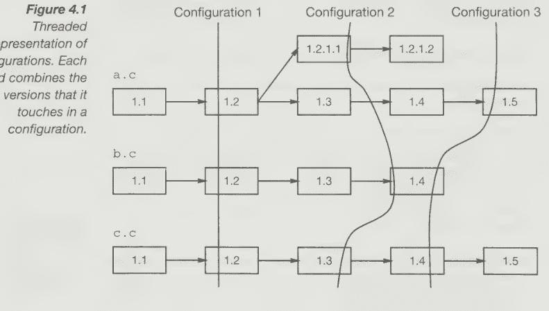

#### 线程（Threads）

该图显示了三个配置；它们由一条纵向运行的线程表示，该线程遍历了配置中所包含的修订版本。因此，配置 2 由修订版本 $1.2.1.1$ 的 $a.c$、修订版本 $1.4$ 的 $b.c$ 以及修订版本 $1.3$ 的 $c.c$ 组成。问题在于如何标识这些修订版本，并且只要有可能，就使用比简单的组件和修订版本号列表更简单的方式。

一种由 RCS 和类似的 SCM 系统提供的更简单方式是*配置打标签*（tagging of configurations）。一个*配置标签*（configuration tag）描述了一个组件的特定修订版本。这可以用于多个组件，因此指示了这些组件每个修订版本的一个配置。因此，在图 4.1 中，我们可以给配置 2 分配标签 `conf2`，之后如果我们想恢复该配置，只需在检出（check out）期间使用此标签，而无需使用修订版本号或日期。

##### 在 RCS 中对配置打标签

在 RCS 中，其工作方式如下：为了分配配置名称，使用服务程序 `rcs`，它通过选项 `-nname:rev` 将符号标签名分配给修订版本 `rev`。为了给例如配置 `conf2` 打标签，需要为每个文件指定相应的修订版本：

```
$ rcs -nconf2:1.2.1.1 a.c
RCS file: RCS/a.c,v
done
```

```
$ rcs -nconf2:1.4 b.c
RCS file: RCS/b.c,v
done
```

```
$ rcs -nconf2:1.3 c.c
RCS file: RCS/c.c,v
done
$ _
```

要恢复此配置，您只需在检出时指定标签 `conf2`：

##### 使用配置标签检出

```
$ co -rconf2 a.c b.c c.c
RCS/a.c,v  -->  a.c
revision 1.2.1.1
done
RCS/b.c,v  -->  b.c
revision 1.4
done
RCS/c.c,v  -->  c.c
revision 1.3
done
$ _
```

最后一个示例还展示了配置标签的局限性：虽然 `conf2` 足以指定单个修订版本，但组件仍然必须单独列出。实际的组件集不受修订控制——如果在开发过程中删除了一个组件，这不会反映在任何 RCS 文件中。从版本化组件到版本化软件系统的这一步骤，或者换句话说，从文件到文件系统的转变，正是我们希望在本章中使用 CVS 工具来阐明的。

### 4.2 使用 CVS 对文件分层进行版本控制

Concurrent Versions System（简称 CVS）是一种用于文件系统版本控制的工具。与 RCS 不同，修改不仅体现在单个文件中，目录中文件的增加和删除也被考虑在内。通过这种方式，由多个目录中大量文件组成的整个软件产品可以作为一个整体进行版本控制。

与 RCS 一样，CVS 也使用一个中央存档，其中存储了所有源文件的所有修订版本。（CVS 存档实际上由若干个 RCS 存档组成；见 4.3 节。）并且与 RCS 的情况一样，该存档只能专门通过 SCM 工具来访问。

通常，项目的工作从将项目的源码从 *CVS 存档* 复制到 *工作空间*（work space）开始。这是使用 CVS 命令 `checkout` 完成的，它将整个目录及其包含的所有文件从 CVS 存档复制到当前目录。CVS 中的命令具有前缀 `cvs`；因此，整个命令读作 `cvs checkout`，后面跟着项目目录。

#### 从 CVS 存档检出

`cvs checkout`

这是一个例子：开发人员 Seymour 正在一个名为 *plantshop* 的项目上工作，该项目由四个文件组成。CVS 存档已经建立。使用 `checkout`，Seymour 将项目的全部内容复制到他的工作目录中；就像使用 RCS 命令 `co` 一样，他获得了主路径（main path）最新的修订版本。

```plaintext
seymour$ cvs checkout plantshop
cvs checkout: Updating plantshop
U plantshop/Makefile
U plantshop/plantshop.h
U plantshop/plants.C
U plantshop/pots.C
seymour$ _
```

*plantshop* 目录现在包含了来自 CVS 存档的源代码文本。除此之外，plantshop 还包含一个名为 `CVS` 的目录，该目录由 CVS 内部使用。（我们将在 4.3 节中回到这一点。）

```plaintext
seymour$ cd plantshop
seymour$ ls
CVS Makefile plantshop.h plants.C pots.C
seymour$ _
```

与 RCS 不同，在 CVS 中，文件在处理之前不需要锁定；Seymour 可以立即开始工作。

在最后一次修改后，Seymour 可以将新的修订版本复制回 CVS 存档，从而使其他人能够使用。这是使用 `commit` 命令完成的。暂时地，Seymour 可以在单个文件上使用 `commit`；它的工作方式与 RCS 命令 `ci` 类似。假设 Seymour 对 `plantshop.h` 做出了一些更改，并希望将新版本复制到 CVS 存档中：

#### 将修改提交到 CVS 存档

`cvs commit`

```bash
seymour$ cvs commit plantshop.h
```

这将调用 Seymour 的文本编辑器，他在其中可以输入关于所做更改的注释。或者，Seymour 也可以在调用 commit 时输入注释。在这两种情况下，结果都是在 CVS 中存档了一个新的修订版本：

```bash
seymour$ cvs commit -m "New: Plant food" plantshop.h
Checking in plantshop.h;
.../CVS/plantshop/plantshop?.h,v <-- plantshop.h
new revision: 1.2; previous revision: 1.1
done
seymour$ _
```

使用 CVS，一次修改也可以影响多个文件。在不指定任何文件调用 `commit` 时，CVS 仅引用那些相对于存档版本被修改的文件。例如，如果 Seymour 更改了 `plants.C` 和 `pots.C`，他会看到：

```bash
seymour$ cvs commit -m "New: Support larger plants"
cvs commit: Examining .
cvs commit: Committing .
Checking in plants.C;
.../CVS/plantshop/plants.C,v <-- plants.C
new revision: 1.2; previous revision: 1.1
done
Checking in pots.C;
.../CVS/plantshop/pots.C,v <-- pots.C
new revision: 1.4; previous revision: 1.3
done
seymour$ _
```

假设由此产生的配置需要交付给客户。Seymour 给该配置起一个名称，以便以后可以恢复。在 CVS 中，这是通过使用 `tag` 命令完成的，该命令为工作目录中每个文件的当前修订版本提供一个名称。Seymour 为当前配置选择名称 `plantshop1-1`：

```bash
seymour$ cvs tag plantshop1-1
cvs tag: Tagging .
T Makefile
T plantshop.h
T plants.C
T pots.C
seymour$ _
```

如果 Seymour 以后想恢复该配置，他可以在 `checkout` 中使用选项 `-r plantshop1-1`：CVS 会自动确定所需的文件并提供相应的修订版本。如果他随后还希望修正一个错误，他可以使用附加选项 `-b` 创建一个子路径。在这个子路径中，`plantshop1-1` 中的错误可以独立于主路径进行修正。

#### 添加项目文件

不过，目前 Seymour 仍在主路径中。假设 Seymour 添加了一个新文件 `audreyII.C`。源文件的添加必须向 CVS 特别声明。这是使用 `add` 命令完成的：

`cvs add`

```bash
seymour$ cvs add audreyII.C
cvs add: scheduling file 'audreyII.C' for addition
cvs add: use 'cvs commit' to add this file
        permanently
seymour$ _
```

在下一次 commit 时，`audreyII.C` 将被包含在 CVS 存档中。

```bash
seymour$ cvs commit -m "New: audreyII.C - weird plant"
cvs commit: Examining .
cvs commit: Committing .
RCS file: ... /CVS/plantshop/audreyII.C,v
done
Checking in audreyII.C;
.../CVS/plantshop/audreyII.C,v  <--  audreyII.C
initial revision: 1.1
done
seymour$ _
```

Seymour 现在可以给这个配置一个新的标签；检出这个配置将自动包含 `audreyII.C`，而在 `plantshop1-1` 中，`audreyII.C` 文件还不可用。这说明了 CVS 如何独立地记录哪些文件属于某个配置，哪些不属于。

#### cvs release

为了结束工作，Seymour 通知 CVS 系统他不再想在这些文件上工作。为此，CVS 中有 `release` 命令。`release` 检查所有本地修改是否已实际被纳入 CVS 存档——如果没有，则输出警告。如果所有修改都已提交，附加选项 `-d` 将删除工作空间中的文件。

原则上，即使不使用特殊的 CVS 命令也可以删除工作空间；CVS 不会对此提出异议。然而，Seymour 使用 `release` 是为了增加操作的安全性。

```bash
seymour$ cd ..
seymour$ cvs release -d plantshop
```


```
You have [0] altered files in his repository.
Are you sure you want to release
directory `plantshop': yes
seymour$ _
```

结果是，Seymour 的 plantshop 项目从他的工作空间中被删除了。他可以在以后通过使用 `checkout plantshop` 来恢复工作。

### 4.3 CVS 如何工作

如果在之前的示例中，CVS 的消息与 RCS 类似，这是有原因的：CVS 使用 RCS 系统对单个文件进行版本控制。正如第 3 章所述，只有单个修订版本之间的差异被保存下来，并且相同的机制被用于管理主路径、子路径以及配置名称。

CVS 与 RCS 的不同之处在于它能够对整个文件系统进行操作。在 CVS 中，这是通过以下方式实现的：对于每个项目，CVS 管理一个 CVS 存档（CVS archive）——这是一个包含与原项目相同目录和子目录的自有文件系统。然而，这里包含的是 RCS 文件而非原始文件，如图 4.2 所示。

> CVS 存档
> 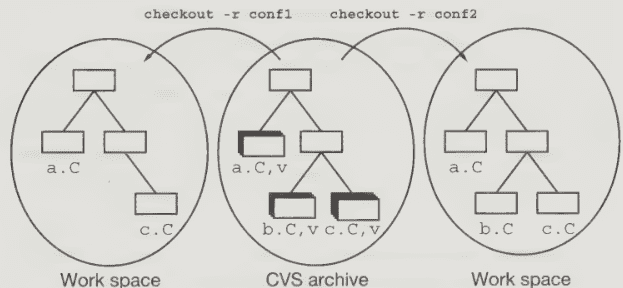
> **图 4.2** 从 CVS 存档中检出。CVS 将 CVS 存档的目录复制到工作空间中，并为每个文件确定适当的修订版本。

在检出（checking out）时，CVS 最初会按照与 CVS 存档相同的结构布置目录。随后，通过 RCS 使用配置标签或配置日期构建相应的修订版本，并将其放置在工作空间中。

例如，Seymour 的 plantshop 项目被 CVS 保存为一个 plantshop 目录。对于他工作目录中的每个文件，Seymour 都能找到一个匹配的 RCS 文件：

```
seymour$ cd /usr/share/CVS/plantshop
seymour$ ls
Makefile,v plantshop.h,v plants.C,v
audreyII.C,v pots.C,v
seymour$ _
```

如果 plantshop 项目有子目录，这些子目录也会出现在 CVS 存档中；它们同样会为每个项目文件包含一个 RCS 文件。

为了正确执行提交（commit），CVS 必须知道工作空间中存在哪些修订版本。为此，CVS 在工作目录中管理一个名为 `CVS/Entries` 的文件，其中列出了修订版本的编号和检出时间：

```
seymour$ cd
seymour$ cd plantshop
seymour$ more CVS/Entries
/Makefile/1.1.1.1/Sat May 10 17:18:00 1986//
/plantshop.h/1.2/Sat May 10 17:34:39 1986//
/plants.C/1.2/Sat May 10 17:42:45 1986//
/pots.C/1.4/Sat May 10 17:42:47 1986//
D
seymour$ _
```

CVS 利用这些信息来确定版本控制的工作目录中存在哪些文件，哪些不存在。

在项目过程中，文件不仅会被添加，还会被删除，这给 CVS 带来了大量的组织工作。如果 Seymour 想要再次从 CVS 存档中删除文件 `audreyII.C`，他必须——就像添加文件时一样——使用名为 `remove` 的命令明确告知 CVS 他的意图。与 `add` 一样，`remove` 仅在下一次提交期间影响 CVS 存档。

#### 删除项目文件

```
cvs remove
```

```
seymour$ rm audreyII.C
seymour$ cvs remove audreyII.C
cvs remove: scheduling 'audreyII.C' for removal
cvs remove: use 'cvs commit' 
to remove this file permanently
seymour$ cvs commit -m "audreyII.C deleted"
cvs commit: Examining .
cvs commit: Committing .
Removing audreyII.C;
.../CVS/plantshop/audreyII.C,v <-- audreyII.C
new revision: delete; previous revision: 1.1
done
seymour$ _
```

已被删除的文件在 CVS 存档中以特殊方式处理：它们的 RCS 文件最终会被放入一个名为 `Attic` 的特殊子目录中。

```
seymour$ cd /usr/share/CVS/plantshop
seymour$ ls
Attic Makefile,v plantshop.h,v
plants.C,v pots.C,v
seymour$ ls Attic
audreyII.C,v
seymour$ _
```

通过在 `Attic` 中的这种特殊定位，CVS 将该文件标记为“在最近的修订版本中已删除”。此外，CVS 还使用特殊的配置名称，以便将删除的修订版本清晰地标记出来。

### 4.4 并行程序开发

在 4.2 节的示例中，Seymour 在检出后能够立即开始工作——与 RCS 不同，他无需在每次修改前使用锁（lock）为自己预留想要修改的文件。事实上，CVS 不使用锁——CVS 的名称正源于它明确允许并行工作。

> *协作策略*
>
> CVS 基于这样一个假设：开发人员之间会相互讨论并分工协作，这样他们就不会侵犯彼此的领地，因此很少发生冲突。因此，CVS 的协作策略也被称为乐观的——这与 RCS 中的悲观协作策略相反，后者假设如果存在冲突，RCS 无法通过锁来防止它们。

然而，并行工作要求开发人员定期使用 CVS 存档同步他们的工作空间——也就是说，接纳他人的修改，并在必要时将自己的修改提交到 CVS 存档。如果没有同步，各个工作空间之间的差异会增加，随之而来的冲突概率也会增加。

> *同步修改*
>
> 我们用一个例子来解释这个同步过程。假设开发人员 Audrey 正在帮助 Seymour 开展 plantshop 项目的工作。如图 4.3 所示，Audrey 和 Seymour 都使用 `checkout` 将项目的当前修订版本设置为工作环境。

现在 Audrey 修改了 `plantshop.h`。如图 4.4 所示，她使用 `commit` 将新修订版本复制到 CVS 存档中。


#### 更新工作空间

就 Seymour 而言，他修改了 `audreyII.C`，同样希望接纳 CVS 存档中的新修订版本。然而，在执行 `commit` 期间，CVS 发现 Seymour 的 `plantshop.h` 与最新修订版本不匹配：提交命令失败。

```
cvs update
```

为了能够成功执行提交命令，Seymour 必须先更新他的工作空间。为此，他使用一个特殊的 CVS 命令 `update`。更新命令通过复制出自检出以来在 CVS 存档中被修改的所有文件，使工作空间保持最新——在我们的案例中，就是包含 Audrey 最新修改的 `plantshop.h` 文件，如图 4.5 所示。

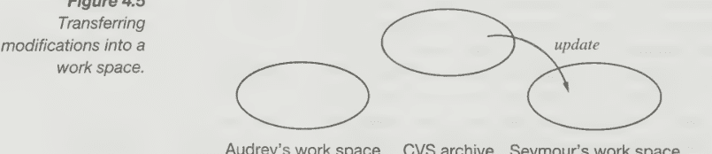

在 Seymour 确认他对 `audreyII.C` 的本地修改与 Audrey 对 `plantshop.h` 的修改能够相互兼容后，他现在可以在更新后使用 `commit` 将他的修改公布在 CVS 存档中。然后，Audrey 将在下一次更新期间将此修改接纳到她自己的工作空间中，如图 4.6 所示。


**图 4.6** 修改的进一步传递。

但如果两个开发人员同时修改了同一个组件会发生什么？假设 Seymour 也修改了 `plantshop.h`。更新命令不能简单地用 CVS 存档的当前修订版本替换 Seymour 的修改版本，因为那样 Seymour 的修改就会丢失。相反，更新命令会将 Seymour 的修改与来自 CVS 存档的最新修改进行整合，详见 2.5 节。Seymour 上次检出或成功提交时的修订版本被用作原始版本的基础。当然，就像任何其他更新一样，Seymour 还必须检查他的工作空间是否仍然一致——也就是说，Audrey 的修改和他的修改是否兼容。

### 4.5 冲突与安排

如果 Audrey 和 Seymour 修改了同一个文件，且修改了文件中的同一个位置，就会产生冲突。CVS 随后会将两种修改都插入到文件中，并标记出冲突发生的位置；随后必须手动删除冲突标记。但在实践中，这类冲突相当少见，因为开发人员通常会相互协调工作。

#### 冲突

CVS 还有另一种特殊的预防措施来确保开发人员之间协调。开发人员可以告知 CVS 系统，她希望监视某个单个文件或文件系统。如果另一个开发人员想要编辑某个文件，他可以明确声明这一点。这样做，所有监视该文件的人都会自动收到关于其意图的通知。

#### 监视文件

在 CVS 中，声明（declaring）和监视（watching）这两个功能被合并在 `edit` 命令中。`edit` 声明开发人员愿意编辑指定的文件；同时，该开发人员被注册为该文件的监视者。

```
cvs edit
```


让我们假设 Seymour 使用 checkout 将文件 plantshop.h 复制到了他的工作空间中。Seymour 现在明确告知 CVS 系统他希望编辑 plantshop.h：

```
seymour$ cvs edit plantshop.h
```

Seymour 现在成为了 plantshop.h 的观察者（watcher）；同时，所有其他观察者也会收到通知。现在让我们假设 Audrey 也希望编辑 plantshop.h：

```
audrey$ cvs edit plantshop.h
```

通过这个操作，Seymour 会自动收到通知，得知 Audrey 也在编辑文件 plantshop.h；他现在可以与 Audrey 协调计划的修改。

#### 常规观察 (Regular watching)

如果 Seymour 和 Audrey 使用 commit 应用了他们的更改，CVS 会自动取消他们的观察者注册；因此，他们将不会收到关于 plantshop.h 进一步修改的通知。不过，他们也可以在 CVS 中注册为永久观察者；这样他们也会收到任何进一步修改的通知。

只有当所有用户都使用 edit 命令时，这种相互通知才有意义。这可以通过使用 watch 命令来实现。watch 将 CVS 中的一个文件或文件系统标记为“待观察”：如果一个文件被标记为 watch，checkout 仅将其作为只读文件放入工作空间。为了使其可写，用户必须先输入强制性的 edit。

通过观察机制，CVS 在纯乐观和纯悲观的协作策略之间提供了一种中间方案：开发人员能获知潜在的冲突，但不必被迫等待锁被释放；相反，他们可以就如何进一步推进达成一致。

### 4.6 扩展与替代方案

#### CVS 适配

除了具体的项目目录外，CVS 存档还包含一个名为 CVSROOT 的 CVS 特定“项目”。在这个项目中，CVS 事件通过特殊文件与用户操作相连接。一个简单的例子是对日志文件的处理，每次 commit 都会增加一条新记录：如果 loginfo 文件中包含以下条目：

```
^plantshop $CVSROOT/CVSROOT/log.pl
    %s /somewhere/plantshoplog
```

那么在 plantshop 项目的每次 commit 时，都会调用程序 log.pl，该程序将 commit 注释（第一个参数，`%s`）附加到文件 `/somewhere/plantshoplog`（第二个参数）中。文件 `plantshoplog` 随后将按时间顺序包含对 `plantshop` 项目所做的所有更改。

`CVSROOT` 中的文件允许对 CVS 系统进行深度的适配。不仅可以将更改记录在文件中，还可以通过电子邮件将其发送给感兴趣的开发人员。在 `commit` 过程中，可以调用测试程序来确保新版本或注释符合某些标准。特定的文件（例如二进制文件）可以根据名称和/或内容被排除在版本控制之外。

`CVSROOT` 中的更改当然也受版本控制；使用 `cvs checkout CVSROOT` 可以在其自己的工作目录中创建 `CVSROOT` 的副本，并使用 `cvs commit` 将修改返回到 CVS 存档。

与 RCS 类似，CVS 也有许多图形用户界面；例如，图 4.7 显示了 `tkcvs` 程序。所有重要的 CVS 命令只需点击按钮即可选择。

在 EMACS 编辑器中以 `pcl-cvs` 为名的 CVS 集成也易于使用；它巧妙地集成了其他 EMACS 软件包，用于交互式解决冲突或突出显示差异。

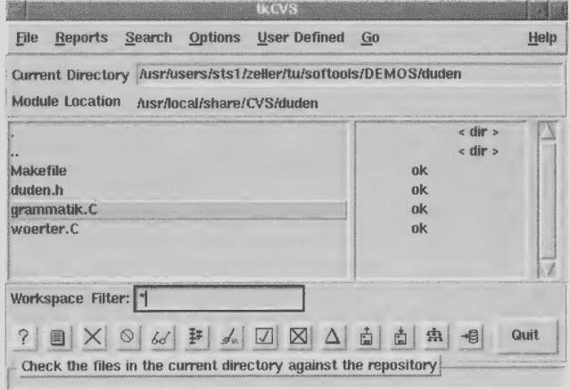

在使用 CVS 时，每个开发人员都拥有项目的完整副本。在大型项目中，这需要大量空间。虽然额外磁盘空间的成本仅为开发人员月薪的一小部分，但在实践中，推动这类投资出人意料地困难。像 CLEARCASE 这样先进的 SCM 系统通过使用虚拟文件系统来解决磁盘空间问题，为每个用户创造独立工作空间的假象，而实际上，每个文件的每个版本仅保存一次。

#### SUBVERSION

CVS 的另一个弱点是它仍然依赖于*单个文件*的*版本化*：每个文件都有自己的版本历史，这使得跟踪整个系统的历史变得困难。这就是 SUBVERSION 项目介入的地方。SUBVERSION 不仅将文件内容和文件的存在（或不存在）纳入版本控制，还将目录、复制和重命名纳入其中。

在 CVS 中，只能通过删除旧文件并创建新文件来重命名文件。新文件会获得新的版本历史，但新文件与旧文件之间没有链接。在 SUBVERSION 中，重命名本身被版本化——版本历史被保留，并将重命名作为一个单独的条目记录。其他功能还包括使用 Apache Web 服务器作为版本服务器（使用 WebDAV 协议）；此外，SUBVERSION 支持版本之间增量（deltas）的高效存储和传播。

为了兼容性，SUBVERSION 使用与 CVS 相同的命令；唯一的区别是 SUBVERSION 使用 *svn* 而不是 *cvs* 来调用。因此，要检出一个系统，需要输入 *svn checkout* 而不是 *cvs checkout*：

```
audrey$ svn checkout \
         http://svn.collab.net/repos subversion
```

商业系统 BITKEEPER 则更进一步。它不仅对整个文件系统进行版本化（如 SUBVERSION 所做），还支持*本地版本历史*。这一功能允许开发人员在工作空间中创建新版本，而无需与中央存档同步。这一功能对于 Linux 内核等大型分布式项目尤为有用。

#### 概念

- SCM 系统必须保证配置的*一致性*，同时确保在选择配置时尽可能具有*灵活性*。
- SCM 系统通常没有检测一致性的机制；然而，通过*标记配置 (tagging configurations)*，可以在以后命名并恢复一致的配置。
- CVS 系统允许对整个*文件系统*进行版本化，因为 CVS 同时也考虑了文件的*创建*和*删除*。
- *CVS 存档*的结构与项目本身相同；每个版本化文件都被分配一个 RCS 存档。
- CVS 实现了一种*乐观协作策略*，其中多名开发人员同时整合更改。
- SUBVERSION 和 BITKEEPER 是 CVS 的重新实现，支持文件系统的完整版本化。

#### 复习练习

1. 你的老板不想购买更多磁盘空间，也不想购买昂贵的 SCM 系统，他建议几名开发人员共享一个公共工作空间。讨论一些问题较少的省空间替代方案。

2. 严格来说，CVS 仅对单个文件（包括其存在和不存在）进行版本化。项目结构的更改（例如添加或删除目录）是不被版本化的；CVS 只在目录不再包含任何文件时将其删除，并在其包含至少一个文件时创建新目录。文件属性的修改（例如访问权限）也不被版本化。这在实践中有什么后果？

3. 在差点被食肉植物吃掉后，Seymour 想将文件 `plantshop.h` 重命名为 `horrorshop.h`。
    - Audrey 建议添加一个包含 `plantshop.h` 最新内容的新文件 `horrorshop.h` 并删除 `plantshop.h`：“这样，我们始终可以重建任何配置”。
    - 他的朋友 Arthur 建议在 CVS 存档中将文件从 `plantshop.h,v` 重命名为 `horrorshop.h,v`：“这样，版本历史就能被保留”。
    Seymour 应该怎么做？为什么？

4. 检查 SUBVERSION 和 BITKEEPER 是否解决了练习 2 和 3 中的问题。

5. 对于某些应用，纯粹基于文本的更改整合并不那么有用：例如，XML 或 CAD 文件需要特殊的整合工具。如果没有此类整合工具，你该怎么办？回想一下协作策略！

6. 在休假前一天，你的同事进行了一些更改并将其放入 CVS 存档中。这导致你

导致你的项目完全无法编译。为了在未来避免这种情况，你的老板建议在每次 *commit*（提交）时自动启动一个测试程序，该程序会自动使用建议的更改来编译你的项目并执行若干项测试。结果，每次 *commit* 将花费 10 分钟。请讨论其优点、缺点及替代方案。

#### 进一步阅读

CVS 最早由 Berliner (1990) 引入；在最初的版本中，CVS 仍是使用 shell 脚本实现的。从那时起，CVS 得到了持续的发展，如今已成为中型项目中处理简单 SCM（软件配置管理）任务的广泛分布系统。CVS 是免费提供的；多家公司以商业方式提供 CVS 的建议和支持。本书的编写工作就是使用 CVS 协调的。

第一个为版本控制提供虚拟文件系统的系统是 SUN 网络软件环境 (NSE)，由 Courington (1989) 描述。在 NSE 的虚拟文件系统中，工作空间被实现为指向中央存档的 *views*（视图）。只有当开发人员在其工作空间中修改文件时，才会创建物理副本。对于开发人员来说，这种 *copy-on-write*（写时复制）是透明的；NSE 自动确保共享部分被分布在多个开发人员的所有工作空间中。

在 NSE 中，乐观协调策略是在 *long transaction*（长事务）的概念下引入的。如今，将其类比为数据库系统中的事务概念具有误导性，因为数据库系统中并没有等同于更改比较的机制。

配置软件系统时的一致性与灵活性之间的交互是 SCM 用户的一项长期需求。最近的研究区分了 *intentional*（意向）版本控制和本文涉及的 *extensional*（外延）版本控制。在意向版本控制中，SCM 系统根据 *contents*（内容）——即根据用户的愿望——来安排配置；而在外延版本控制中，版本被显式列出。在意向版本控制中，更改可以自由组合；系统使用其 *properties*（属性）进行配置和构建。通过限制性条件（例如，更改 *A* 和更改 *B* 互斥），SCM 系统可以确保最终配置的一致性。

EPOS 是由 Gulla 等人 (1991) 描述的一个原型意向 SCM 系统：它使得通过选择选项来任意组合更改成为可能。对于使用特征逻辑表达意图的 ICE 系统，Zeller 和 Snelting (1997) 证明，通过巧妙选择限制性条件的意向版本控制涵盖了所有已知的版本控制模型。意向版本控制的副作用是，版本控制的所有方面（特别是修订版本和变体）都被同等对待。

一致性的保障在 *dynamic configuration*（动态配置）中也起着重要作用，在这种情况下，配置的一致性仅在运行时决定。除其他研究外，Schmerl 和 Marlin (1995) 以及 Warren 和 Sommerville (1995) 处理了这一当前的研究课题。

#### 其他配置管理工具

除了本书中描述的免费工具 RCS、CVS、SUBVERSION 和 BITKEEPER 之外，还有许多其他（大多是 *commercial* 商业的）软件配置管理工具。我们在下面的列表中列举了其中一部分。

- *Open Avenue* 公司（原 *Cyclic Software*）提供带有商业支持的 CVS。
- 来自 *Rational*（现 IBM）的 CLEARCASE 是市场上最强大的 SCM 系统之一。其虚拟文件系统允许直接访问任意版本；CLEARCASE 还使得通过单个活动（所谓的 *unified change management*，统一变更管理）来组织开发和修改过程成为可能。
- 来自 *Continuous* 的 CONTINUUS/CM 同样非常注重开发和修改过程；CONTINUUS 对这些过程的组织程度超过了任何其他工具。相比之下，实际的版本控制被推到后台，但提供了所需的一切功能。
- 来自 *Perforce Software* 的 PERFORCE 是一个极其快速且易于使用的版本控制系统。由 Seiwald (1996) 开发的 *interfile branching*（跨文件分支）过程使得访问变体变得特别简单。与 CVS 类似，PERFORCE 允许在本地副本上工作。
- *Merant* 和 *Synergex* 的 PVCS 提供了易于使用的版本控制，可以很好地集成到许多平台中。
- AEGIS 是一个免费的 SCM 系统，其开发过程需要 *consistency checks*（一致性检查）：只有在程序构建、测试以及（如有必要）代码审查成功完成后，修改才能被发布。
- Tower Software 的 RAZOR 同样基于 RCS 或 SCCS 等标准版本控制系统，提供高度精良的修改和开发过程。
- *Microsoft* 的 VISUAL SOURCE SAFE 在 WINDOWS 界面下提供了版本控制的基本功能（例如，达到 RCS 级别）。过去，数据完整性被认为是一个常见问题；购买者应在互联网论坛上寻求建议。*Mainsoft* 公司还为 UNIX 提供了 VISUAL SOURCE SAFE。

#### 练习 I

在本次练习中，你可以使用 CVS 进行一些简单的程序维护。为此，你必须先安装并设置 CVS。

##### 实践

- 1. 在 `ftp://ftp.gnu.org/pub/gnu/hello/` 中，你可以找到 GNU Hello 程序 —— 例如 `hello-1.3.tar.gz`。将其复制到你的一个目录中，并使用以下命令解压：

```
$ gunzip hello-1.3.tar.gz
$ tar xvf hello-1.3.tar
$ cd hello-1.3
```

- 2. 现在你应该使用 CVS 将 GNU Hello 置于版本控制之下。我们将分步骤进行：

    **(a)** 选择一个用于存储 CVS 存档的目录（例如 `$HOME/CVS`），并相应地设置变量 `CVSROOT`。
    使用 `sh` 的操作如下：
    ```
    $ CVSROOT=$HOME/CVS; export CVSROOT
    ```
    如果你使用 `csh` 作为 shell：
    ```
    % setenv CVSROOT $HOME/CVS
    ```

    **(b)** 设置 CVS：
    ```
    $ cvs init
    ```

    **(c)** 将软件包置于 CVS 控制之下：
    ```
    $ cvs import -m "Import GNU Hello 1.3" \
        hello GNU HELLO_1_3
    ```

    **(d)** 你现在可以删除原始源码。
    ```
    $ cd ..
    $ rm -fr hello-1.3
    ```

    **(e)** 为了使用由 CVS 控制的 GNU Hello，你必须先检出 (check out) GNU Hello：
    ```
    $ cvs checkout hello
    ```
    在 hello 目录（工作目录）中，你现在可以找到所有由 CVS 控制的 GNU Hello 源码。

- 3. 在未来的 hello CVS 会话中，你不需要重新设置 CVSROOT。相反，你可以直接在工作目录中继续工作。但是，如果你开始一个新项目，可以按照步骤 2 所示的方法进行。

- 4. 要测试 GNU Hello，请按以下方式操作：

    (a) 阅读 README 和 INSTALL 中的说明，为你的计算机编译 Hello 程序：
    ```
    $ ./configure
    $ make
    ```

    (b) 执行 Hello 程序：
    ```
    $ ./hello
    ```

##### 练习

- 1. 将 GNU Hello 的输出翻译成德语（例如 "Hallo, Welt"）。查看 hello.c 文件并相应地修改输出。（执行此更改不需要掌握任何 C 语言知识。）通过编译并执行 GNU Hello 来检查结果。
- 2. 使用 `cvs diff` 确定原始版本与你的德语变体之间的差异。研究各种 DIFF 选项的效果。
- 3. 你所做的更改现在应该发布到 CVS 存档中。为此，请使用 `cvs commit`。
- 4. 现在为 GNU Hello 创建一个补丁 (patch)。为此，你需要 DIFF 在多个版本之间创建的差异。你也可以为此使用 `cvs diff`。将你的补丁命名为 `hello-de.patch`。
- 5. 使用新解压的 GNU Hello 软件包检查你的补丁是否有效。如果同一个补丁使用两次会发生什么？
- 6. 创建一个补丁 `hello-fr.patch`，将 GNU Hello 翻译成法语 ("Bonjour, monde")。如果你想同时使用这两个补丁会发生什么？
- 7. 创建一个补丁，在德语版本中将文件 hello.c 重命名为 hallo.c：

(a) 将 `hello.c` 重命名为 `hallo.c`。使用 `cvs add` 标记新增文件，使用 `cvs remove` 标记删除的文件。您可以在 CVS 手册的 “Moving and renaming files” 章节中找到更多详细信息。

(b) 使用 patch 时，必须确保空文件被删除。请参阅 PATCH 手册中的 “Removing empty files” 章节。

8. 创建一个 `.cvsignore` 文件，以便 CVS 忽略由 `configure` 创建的系统特定文件。您可以在 CVS 手册的 “Ignoring files via cvsignore” 章节中找到更多相关说明。

## 第二部分

## 处理输入

得最廣泛的應用。計算機性能計量是計算機的基本常識。本

### 一、計算機上常用的計量單位

計算機中的數據是由0和1這樣的二進制數字構成的，對計算機的數據，除了採用十進制、八進制、十六進制等表示外，一個常用的表示單位是通過二進制的方式來描述數據的量。

| 單位名稱 | 單位符號 | 進率 |
| :--- | :--- | :--- |
| 比特/位 | bit | 位(b) |
| 字節 | Byte(B) | 8位=1B |
| 千字節 | KB(K) | 1024B |
| 兆字節 | MB | 1024KB |
| 吉(十億)字節 | GB | 1024MB |
| 太(萬億)字節 | TB | 1024GB |
| 以及更高等級的單位(PB、EB、ZB、YB等) | | 換算規律同上 |

### 5 使用 LEX 进行词法分析

### 5.1 处理输入

程序接收一段文本作为输入并对其进行处理。这是一个传统的、循环出现任务：该程序可以是一个编译器，读取待编译的程序；也可以是一个搜索程序，搜索特定的文本模式；或者是一个应用程序，读取其配置文件。

通常情况下，输入具有某种结构，执行处理的程序必须能够识别该结构。这种结构（即输入的语法）必须标准化，以便明确哪些内容可以处理，哪些不可以。同时，语法在实现过程中起到了指导原则的作用。

我们考虑以下示例：有一个应用程序首先读取一个配置文件。该配置文件由以下形式的独立部分组成：

```
[title]
name=value
name=value
⋮
[title]
name=value
⋮
```

Title（标题）、name（名称）和 value（值）是任意字符串。

仔细考虑后，我们确定 title、name 和 value 不能是随意的。Title 和 name 不应包含 " [ "、" ] " 或 "="，以便我们能够清晰地识别它们。同时，限制 title、name 和 value 不能跨越多行也是有意义的。显然，我们必须制定一套精确的语法描述，以区分有效输入和无效输入。

### 5.2 有限自动机

*有限自动机* 描述输入语法最简单的手段之一是 *有限自动机*。有限自动机逐个字符地读取输入，并确保读取的字符符合语法。它由以下部分组成：

- 1. (**状态**) 若干个代表自动机可能 *状态* 的 *节点*
- 2. (**状态转移**) 若干个可能带有标记的 *边*，用于指示多个状态之间可能的 *转移*
- 3. (**起始状态**) 一个标记的 *起始状态*
- 4. (**结束状态**) 若干个标记的 *结束状态*。

这种自动机在形式上被描述为 *非确定有限自动机* (NFA)。

作为一个例子，我们将考虑图 5.1 中的自动机，它读取我们配置文件的的一行。

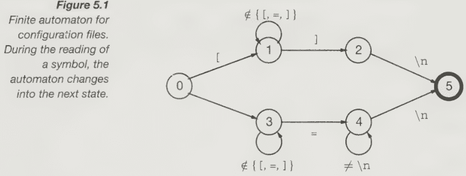

*条件转移* 该自动机中的大多数边带有 *标记*，表示只有在读取该符号时才能改变状态。其他边 *没有标记* —— 这意味着无需读取符号即可改变状态。

例如，在上半部分，我们看到自动机（从状态 0 开始）首先读取一个 "[ "，以便（状态 1）进一步处理符号（除 "[ "、"=" 和 "] " 之外的任何符号），然后处理一个 "] "（状态 2）和行尾符号 ("\n"，状态 5）。同样，*name*、"=" 和 *value* 在下半部分被读取。

图 5.2 显示了 NFA 工作的算法。

*图 5.2*
NFA 处理算法

- 1. 将当前状态 $S$ 设置为起始状态。
- 2. **重复 (REPEAT)**
    - (a) 将所有无需读取符号即可到达的状态添加到 $S$ 中。
    - (b) **如果 (IF)** 仍有可读符号可用 **那么 (THEN)**
        - i. 读取一个符号 $x$
        - ii. 将 $S$ 替换为从 $S$ 出发通过读取 $x$ 可到达的状态。
        - iii. **如果 (IF)** $S = \emptyset$ **那么 (THEN)**
            - $\not\sim$ – 停止，字符串与表达式不匹配。
    - (c) **否则 (ELSE)** （没有更多可读符号可用）
        - i. **如果 (IF)** $S$ 包含至少一个结束状态 **那么 (THEN)**
            - $\checkmark$ – 停止，字符串与表达式匹配。
        - ii. **否则 (ELSE)**
            - $\not\sim$ – 停止，字符串与表达式不匹配。

表 5.1 显示图 5.1 中的自动机能识别行 "[abc]" 但不能识别行 "[abc] = d"。

| S | input |
| :--- | :--- |
| {0, 3} | [abc] \n |
| {1} | abc] \n |
| {1} | bc] \n |
| {1} | c] \n |
| {1} | ] \n |
| {2} | \n |
| {5} | $\checkmark$ |

| S | input |
| :--- | :--- |
| {0, 3} | [abc] = d \n |
| {1} | abc] = d \n |
| {1} | bc] = d \n |
| {1} | c] = d \n |
| {1} | ] = d \n |
| {2} | = d \n |
| $\emptyset$ | $\not\sim$ |

*表 5.1*
图 5.1 中 NFA 的使用情况

### 5.3 正则表达式

如何将有限自动机转化为程序？我们可以直接在程序中 1:1 地复制该自动机，并为每个状态分配一个特定的程序位置。然而，这样做非常容易出错且难以维护。更简单的做法是实现图 5.2 中的算法，并将有限自动机的 *描述* 以及要读取的字符串输入其中。

#### 正则表达式

在实践中，以状态和转移的形式描述无限自动机过于繁琐。因此，我们使用一种更简单的表示法 —— _正则表达式_。正则表达式是描述字符模式简单而有效的方法。它们可以自动转换为 NFA，然后使用上述算法读取字符串。

正则表达式长什么样？首先，正则表达式是一个字符串，其中每个字符代表 *一个待匹配的字符*。因此，正则表达式 "abc" 等同于一个依次读取 "a"、"b" 和 "c" 的自动机。

#### 抽象符号

然而，正则表达式中的某些字符具有特殊含义。它们被称为 _抽象符号_：

- **通配符** ("**.**"):
通配符 "." 代表除行尾符号 "\n" 之外的所有可能字符。

- **字符类** ("**[...]**"):
如果您想指定一组可能的字符，可以使用 _字符类_ —— 即由 "[" 和 "] " 括起来的字符。您可以指定列表如 "`[abc]`" 或范围如 "`[a-c]`"。这些也可以混合使用，例如 "`[abc0-3xz]`"。

字符类可以通过在开头引入 "`^`" 来进行 _取反_ —— 此时自动机将接受除指定字符之外的所有字符。因此，正则表达式 "`[^0-9]`" 接受除 0–9 之外的所有字符。

要在字符类中包含 "`]`" 或 "`-`"，请在其前面加上 "`\`"（_转义_ 字符）。

#### Kleene 闭包

- **重复** ("**\***" 和 "**+**"):
"*" 操作符位于字符、字符类或通配符之后；它生成的正则表达式可以匹配任意数量的这些字符（包括空字符串）。例如，"`[a-z]*`" 匹配任意长度的字符序列。（此操作也称为 _Kleene 闭包_。）"+" 的工作方式与 "*" 类似，但要求至少出现一次 —— "`r+`" 与 "`rr*`" 含义相同。

#### 行限制

- **行限制** ("**^**" 和 "**$**"):
有两种操作可以生成仅匹配行首或行尾的正则表达式。分别是用于行首的 "`^`" 和用于行尾的 "`$`"。例如，"`^xyz`" 仅匹配以 "xyz" 开头的行，而 "`^[\t]*$`" 仅匹配空行或仅包含空格的行。


#### 分组 ( “(...)” )
正则表达式可以用 “(” 和 “)” 括起来。通过这样做，对括号内表达式的操作方式与对单个字符的操作方式相同。

#### 或 ( “|” )
“|” 操作描述了一个正则表达式，该正则表达式必须匹配 “|” 的左侧或右侧其中之一相匹配。

#### 可选 ( “?” )
“?” 操作出现在一个字符、一个字符类或一个占位符之后；它创建了一个匹配零个或一个该字符的正则表达式 —— “?” 的含义与 “( r | ε )” 相同。

#### 转义字符 ( “\”)
为了将抽象符号作为具体字符插入，必须插入一个 “\”。因此，正则表达式 “\.” 检测点号，“\*\*” 检测三个星号。“\\” 检测单个转义字符。

此外，通过转义字符引入特殊字符 —— 例如，“\n” 表示换行或 “\t” 表示制表符。

#### 具体字符
所有未在上述列出的字符均为 *具体字符*，因此代表它们自身。

这里有一些正则表达式的示例：

- `"[a-zA-Z_][a-zA-Z0-9_]*"` 检测 C 语言中的标识符。
- `"[1-9][0-9]*"` 检测整数。
- `"[ ^ \ ] = []*"` 检测除 “]”、“=” 和 “.” 之外的一串字符。
  - `\[ ^ \\ [ \\ ] = [\]*\\] \\$` 检测行 "[title]"。
- `"[ ^ \ ] = []*.*"` 检测行 "name=value"。
- `"\ ( \\s* [ \\s* ] \\s* | [ ^ \\ ] = [] *. )* \$"` 检测配置文件的的一行（类似于图 5.1 中的自动机）。

正则表达式的主要用途是**搜索**：许多工具接受正则表达式作为搜索模式。

例如，我们可以看 GREP 和 EGREP，它们从文件中提取所有包含给定正则表达式的行（EGREP 实现了此处指定的所有操作；GREP 不识别 “?”、“+”、“|” 和 “(...)”）。

GREP 和 EGREP 使用一个用于正则表达式的 *函数库*，它在运行时将正则表达式转换为 NFA。然后工具使用该 NFA 逐行处理输入。如果自动机发现匹配的字符串，则输出该行。在第 11 章中，我们将介绍脚本语言 Tcl、PERL 和 PYTHON；它们通过内置的正则表达式函数提供了处理字符串的极佳方式。

将正则表达式实际转换为 NFA 并不困难：连续的字符对应连续的状态；每种操作可以用 NFA 中的适当模式表示。具体细节我们留给您练习；您可以在进一步阅读中找到完整的描述。

### 5.4 LEX – 扫描器生成器
在处理正则表达式时使用函数库，您可以应对各种查找和替换任务。您必须编写在某些正则表达式出现时要执行的 *动作*，并且您还必须处理正则表达式与动作的 *分配*。

如果您在输入中搜索多个不同的正则表达式，将模式系统化是非常有用的 —— 例如，使用一个将动作分配给每个可能正则表达式的 *表*。正是为了这个目的，才使用了 LEX —— 一个 *词法扫描器生成器*。使用 LEX 可以依次执行以下任务：

- **词法分析：** 通过指定的模式将输入流分解为词法元素。这就是 LEX 名称的由来。
- **数据转换：** 将输入流中的模式或字符序列转换为输出流中相应的字符串（类似于 9.3.1 节中的 SED 文本处理程序）。
- **数据评估：** 使用在输入流中识别的模式进行进一步的分析、统计和计算。例如字符和单词计数，或对出现的所有浮点数求和。

与运行时库不同，LEX 在 *编译时* 将正则表达式转换为 NFA。这使得程序效率更高：

- 不需要每次运行程序时都转换正则表达式。
- 可以进行一些耗时的 *优化*，否则会导致程序的运行时间过长。

### 5.5 LEX 规范
为了解决手头的任务，LEX 使用一个 *规范文件* 来描述需要检测的正则表达式以及需要执行的动作。

规范文件是程序文本，随后由解释器执行或由编译器转换为可执行程序。（原始 LEX 支持 C 编程语言；对于其他编程语言，有以类似方式工作的 LEX 变体。）规范由由 `"%%"` 分隔的三个部分组成：

| 规范文件的布局 |
| :--- |
| 定义 (Definitions) |
| %% |
| 规则 (Rules) |
| %% |
| 函数 (Functions) |

**定义部分：** 这里可以输入稍后将要使用的正则表达式定义，以及目标语言的文本，然后这些内容将被复制到生成的程序中作为全局定义。

**规则部分：** 这是一个分配了动作的正则表达式表。正则表达式与动作之间用空格或制表符分隔。动作可以通过特殊关键字（REJECT, ECHO）和目标语言的指令来指定。如果表开头缺少正则表达式，动作将被复制为生成的分析例程的局部定义（作为目标语言的文本）。

**函数部分：** 此部分是可选的。如果此部分可用，它将被完整地复制到生成的程序的全局区域，位于生成的分析例程之后。

**生成文件：** 根据此规范，LEX 生成一个文件 `lex.yy.c` 作为生成程序的源代码，然后必须将其编译并与 LEX 库（通过 `"-ll"`）结合（图 5.3）。

#### 5.5.1 示例：过滤冗余词
示例 5.1 显示了一个简单的规范 `emphasis.l`，用于过滤过度的强调。如果输入流中出现 "very"、"quite" 或 "really" 等词，由于没有指定动作（仅有 ";"），它们将被忽略。然而，所有其他字符将通过 ECHO 动作再次输出到标准输出。

**示例 5.1：过滤器规范 emphasis.l**
```
%%
very    ;
quite   ;
really  ;
.       ECHO;
\n      ECHO;
```

应当注意，正则表达式 "." 适用于除换行符 "\n" 之外的所有字符。因此，必须单独指定 "\n"。此外，在此规范中，"|" 符号不是正则表达式的操作（尽管它们被空格分隔），而是采用后续规则动作的特殊指令。与正则表达式的 "|" 操作的相似性是有意为之的。

在这里我们可以看到生成的过滤器是如何工作的：
```
$ lex emphasis.l
$ cc -o emphasis lex.yy.c -ll
$ echo "really a very simple example" | ./emphasis
a simple example
$ _
```

#### 5.5.2 示例：最小可能的规范
最小可能的 LEX 规范由文本 "%%" 组成。这个规范会产生一个将标准输入复制到标准输出的程序（类似于 cat 程序）。在这种情况下，我们允许 LEX 从标准输入——即 echo 命令的输出——读取其规范。

```
$ echo '%%' | lex
$ cc -o trivial lex.yy.c -ll
$ ./trivial < lex.yy.c
# include "stdio.h"
# define U(x) x
# define NLSTATE yyprevious=YYNEWLINE
# define BEGIN yybgin = yysvec + 1 +
# define INITIAL 0
# define YYLERR yysvec
# define YYSTATE (yyestate-yysvec-1)
# define YYOPTIM 1
⋮
```

这是基于 LEX 的一个特性，即在规则部分的末尾自动附加一条标准规则，该规则会输出每个尚未被处理的字符。因此，“%%” 对应于示例 5.2 中的规范文件。

**示例 5.2：一个简单的 LEX 规范**
```
%%
(.|\n)        ECHO;
%%
main() {
  yylex();
};
```

在 main 函数中，仅启动了 LEX 为词法分析生成的 `yylex` 例程。在 LEX 库中，默认提供这种仅调用 `yylex` 的 main 函数。

#### 5.5.3 示例：删除 HTML 语句
在前面的示例中，我们还可以看到 LEX 生成程序的一个重要特性：输入流被处理为一个字符串，没有隐式的字段或行分隔。结构是通过规范仅使用正则表达式来确定的。必须显式指定换行符，但与其他工具不同，换行符不会给生成的程序带来任何问题。

图 5.4 显示了一个程序的 LEX 规范，该程序从 HTML 文本中删除所有 HTML 标签（包括其中包含的任何换行符）。正则表达式 `"<"[^>]*">"` 识别两个尖括号之间的所有字符。（由于作为第一个字符，“<” 在 LEX 中具有特殊含义（见 5.6.2 节），因此必须写成 `"<"` 以消除其特殊含义。）

#### 5.5.4 示例：读取配置文件
示例 5.3 中的 LEX 规范读取了一个配置文件，如 5.1 节所述。在这里您可以看到字符串


### 5 使用 LEX 进行词法分析

图 5.4 删除 HTML 语句的规范。

```bash
$ lex dehtml.l
$ cc -o dehtml lex.yy.c -ll
$ ./dehtml < www.html > www.txt
```

```lex
%%
"<" [^>]*$ 
```

| www.html | www.txt |
| --- | --- |
| ...at the \<A HREF="http://www.uni-passau.de">Uni Passau\</A> is... | ...at the Uni Passau is... |

匹配正则表达式的内容可以使用：LEX 创建的程序提供了一个变量 `yytext`，其中包含匹配的字符字符串。（其他此类变量包括 `yyleng` —— 匹配字符字符串的长度 —— 和 `yyline` —— 当前行号。）`yytext` 被传递给在其他地方实现的函数，用于处理标题和定义；如果输入不匹配，则调用错误函数 `error`。

#### 示例 5.3 读取配置文件的规范

```lex
%%
^\[([^\]])\]=[^\]]*$ process_title(yytext);
^[^\]=].*$ process_def(yytext);
\n ;
error(yytext);
```

#### 正则表达式的命名

示例 5.3 中令人关注的是复杂的正则表达式。可以通过为常见的正则表达式提供`名称`（names）来简化它们：在定义部分，可以*预定义*重复出现的正则表达式，以便稍后再次使用。这样做时，左侧是名称，右侧是可被该名称引用的正则表达式。要引用已定义的正则表达式，将其名称放入花括号中。

简化版本见示例 5.4。在这里我们使用 NAME 来命名一个不包含 "[", "=" 和 "]" 的字符序列。

#### 示例 5.4 简化规范

```lex
NAME       [^\[\=\]]*
%%
^\{NAME\]$ process_title(yytext);
^{NAME}=.*$ process_def(yytext);
\n ;
error(yytext);
```

#### 5.5.5 示例：累加所有数字

示例 5.5 同样使用了命名正则表达式。

### 5.6 规则组合的优化

#### 示例 5.5 累加读取到的数字

```lex
NUM          [0-9]+
EXP          [Ee][+-]?{NUM}
%{
#include <stdlib.h>
float sum = 0.0;
%}

%%
{NUM}("."{NUM})?({EXP})?    sum += atof(yytext);
.            |
\n            ;
%%

main () {
    yylex();
    printf("sum = %f\n", sum);
}
```

这里，NUM 被定义为整数的正则表达式，EXP 被定义为指数的正则表达式；它们可以通过 **"{NUM}"** 或 **"{EXP}"** 重用。此外，定义部分包含另一条指令，用于在生成的程序中定义全局变量 `sum`，所有数字通过提供的规则累加到该变量中。不在第一列开始的行会 1:1 地复制到生成的程序中。需要复制的文本也可以用 **"%{"** 和 **"%}"** 括起来，这样它就可以从第一列开始。

针对 **"."** 和 **"\n"** 的另外两条规则会导致所有其他符号被忽略。在函数部分，仅输出计算出的总和。

**冲突（Conflict）**

在这个例子中，可能会出现**冲突**，因为单个数字既匹配第一个数字规则，也匹配第二个单字符规则。LEX 逐个字符地处理输入流。只要仍有匹配的规则，就会从当前字符起继续读取后续字符（*最长匹配*）。如果多个规则匹配，则使用第一个。然后从第一个不匹配的字符重新开始处理。然而，不可能出现没有匹配规则的情况，因为 LEX 总会生成一条输出尚未处理字符的规则（正如我们在 5.5.2 节中看到的那样）。

**最长匹配（Longest match）**

人们经常希望使规则的应用取决于匹配字符串的**上下文**（context）。通用解决方案通常是使用**解析器生成器**（parser generator），它可以处理上下文无关文法，这将在第 6 章中讨论。对于简单问题，LEX 提供了两种考虑右侧和左侧上下文的方法。此外，LEX 提供了一种拒绝规则的方法，从而产生重叠规则。

#### 5.6.1 尾随上下文（Trailing context）

本章开头提到的 “$” 操作并不是真正的正则表达式操作。例如，“.$” 规则匹配行尾的所有字符，并处理字符本身，但不处理换行符。这必须由使用 “\n” 的独立规则来识别和处理。正则表达式 P$ 实际上是 P/\n 的缩写形式。

一般来说，尾随上下文是通过 “/” 为规则定义的条件。正则表达式 P/Q 仅在 PQ 匹配时才被识别。然而，只有匹配 P 的字符字符串被处理 —— 匹配 Q 的部分保留在输入流中。

在示例 5.6 中，我们看到一个 LEX 规范 comma.l，它将数字分为逗号前和逗号后两部分。

#### 示例 5.6 在 comma.l 中使用尾随上下文

```lex
%%
[0-9]+/"." [0-9]+    printf("Pre-comma %s\n", yytext);
"."                  printf("Comma.\n");
[0-9]+               printf("Post-comma %s\n", yytext);
(.|\n)               ;
```

乍一看，这个规范运行没有问题：

```bash
$ lex comma.l
$ cc -o comma lex.yy.c -ll
$ echo 123.456 | ./comma
Pre-comma 123
Comma.
Post-comma 456
$ _
```

通常，像 “123.456.789” 这样的输入不一定会导致期望的结果，因为 “456” 被识别为逗号前部分而非逗号后部分：

```bash
$ echo 123.456.789 | ./comma
Pre-comma 123.456
Comma.
Pre-comma 456
Comma.
Post-comma 789
$ _
```

为了修正这一点，需要提供*左上下文*（left context）。在下一节讨论之前，这里展示右上下文的典型用途：在 FORTRAN 中，空格字符被忽略，`DO 5 I` 和 `DO5I` 可能含义相同，但并不一定：

```text
  DO 5 I = 1.25    意味着    DO5I = 1.25
  DO 5 I = 1,25   意味着    DO 5 I = 1 , 25
```

在这里，第一种情况将变量 DO5I 赋值为 1.25。第二种情况描述了一个循环，其索引 I 从 1 计算到 25，并带有跳转标签 5。为了识别 `DO` 是关键字还是标识符，必须考虑右上下文。在空格已被过滤的前提下，一个可能的正则表达式是 `DO/[0-9a-zA-Z]*=[0-9a-zA-Z]*`。

#### 5.6.2 开始状态（Start states）

对*左上下文*的考虑基于与尾随上下文不同的概念。左上下文的原理是某些规则仅在特定状态下才能使用 —— 即所谓的*开始状态*。这些状态之间的转换由规则中的 BEGIN 动作控制。在示例 5.7 中，使用 LF 状态（由 `%S LF` 定义）来计算（空）行。

#### 示例 5.7 开始状态的使用

```lex
%S     LF
%%
\n        { ++lines; BEGIN LF; }
<LF>[\t ]*/\n   { ++emptylines; BEGIN INITIAL; }
<LF>.    { BEGIN INITIAL; }
```

- 第一条规则没有约束，只要读取到新行符号，就会在每个状态中执行。分配的动作增加换行符数量，并使用 `BEGIN LF` 切换到 LF 状态。
- 第二条规则仅在扫描器处于 LF 状态时执行。此规则仅匹配由空格组成的行；其动作增加空行数量并切换回开始状态（`INITIAL`）。
- 第三条也是最后一条规则在出现任何其他字符（非空行）时切换回开始状态。

因此，这个例子计算了字符流中的所有行，以及仅由空格组成的行。它模拟了 `^` 和 `$` 操作的行为，这两个操作将规则与整行相连。使用这些操作，该示例更容易实现，如示例 5.8 所示。

#### 示例 5.8 计算行数和空格行

```lex
%%
^[\t ]*$  ++emptylines;
\n        ++lines;
.         ;
```

#### 5.6.3 重叠规则（Overlapping rules）

通常，匹配规则的字符字符串只被读取一次。可以使用 REJECT 动作来避免这种情况。如果使用了 REJECT，匹配当前规则的字符字符串将被*拒绝*，也就是说，它被视为*尚未分析*。然后 LEX 使用匹配该字符串*最长前缀*的规则。这要么是：

- 字符字符串本身（如果仍有后续规则精确匹配该规则），或者
- 匹配该字符串前缀的规则。

作为一个例子，我们考虑示例 5.9 中的 reject.l 文件。在这里，所有三个字母的单词都在第二条规则中被注册，然后被拒绝。

#### 示例 5.9 reject.l 中的开始状态

```lex
%%
.      printf("Accept %s\n", yytext);
...    { printf("Reject %s\n", yytext); REJECT; }
foo    printf("Match  %s\n", yytext);
\n     ;
```

如果单词是 "foo"，它将被随后的规则接受。否则，第一条规则将应用于单词的前缀：

```bash
$ lex reject.l
$ cc -o reject lex.yy.c -ll
$ echo afoobatz | ./reject
Reject afo
Accept a
Reject foo
Match  foo
Reject bat
Accept b
Reject atz
Accept a
Accept t
Accept z
$ _
```


### 5.7 生成扫描器

与其在规则部分直接指定所有动作，你可以利用 LEX 创建的代码的另一个属性。`yylex` 例程可以被定义为一个具有特定返回类型的函数。那么，这种类型的 **return** 指令就可以用作规则部分的动作。

**yylex**

例如在示例 5.10 中，输入文本将被再次输出 —— 但排除了 `quit` 和 `help` 这两个条目，它们分别调用帮助系统或退出程序。

```c
%%
quit	return 0;
help	return 1;
%%
main() {
    while (yylex())
        printf ("No help available.\n");
}
```

**示例 5.10**
*带有 return 的 LEX 规范*

示例 5.11 中的扫描器规范产生了一个简单的扫描器，它能够检测输入流中的单词和数字，并返回相应的 `token` 值。对于既不是字母、数字也不是空白字符的单个字符，扫描器返回该字符的 ASCII 值。

```c
%{
#define NUMBER 256
#define WORD 257
%}
%%
[0-9]+		return NUMBER;
[a-zA-Z]+	return WORD;
[ \t\n] 		;
.		return yytext[0];
```

**示例 5.11**
*简单扫描器规范*

这种对 LEX 的使用主要体现在将其作为 *扫描器生成器 (scanner generator)* 时。此时 `yylex` 例程被用于将输入流分割成 *tokens* —— 即单个词法单元 —— 并且每次调用时读取并返回下一个 token。

**扫描器生成器 (Scanner generator)**

**Token**

这种生成的扫描器当然只是一个大型程序的其中一部分，该程序还必须承担对扫描器提供的 *tokens* 进行处理的工作。下一章将探讨如何通过其他工具生成程序的此类部分。它还将展示如何使用 YACC 工具进行语法分析。

#### 概念

- 非确定性有限自动机 (NFA) 以状态转移的形式描述输入的语法，这些转移是由读入的字符诱导的。
- 正则表达式以字符序列和运算符的形式描述一个 NFA。
- 正则表达式可以在运行时转换为 NFA，随后 NFA 能够识别字符字符串中正则表达式的出现。
- LEX 将正则表达式与动作相关联，如果对应的表达式被匹配，则总是执行这些动作。
- 由 LEX 创建的扫描器用于将输入流分割成 tokens，这些 tokens 随后被用作（例如）语法分析的输入。

#### 复习练习

1. 修改图 5.1 中的自动机，使其满足以下要求：
   (a) 在标题中，"[" 之前和 "]" 之后允许出现任意数量的空白字符。
   (b) 在 "name = value" 中，name 的前后以及 value 之前允许出现任意数量的空白字符。
   (c) 此外，应允许注释，注释以 "#" 开始并一直持续到行尾。

2. 作为运算符 "*" 和 "+" 的补充，许多正则表达式库提供了额外的操作 "{n,m}"（最少出现 n 次，最多出现 m 次）。包含这些操作的正则表达式如何转换为不包含这些操作的表达式？

3. 对于以下结构，分别给出 MODULA-2、JAVA 和 C 变体中的正则表达式：
   (a) 标识符
   (b) 实数
   (c) 字符串
   (d) 运算符（算术、逻辑、比较和赋值运算符）

4. 实现执行非确定性有限自动机的算法。

5. 开发一种从正则表达式自动构建相应 NFA 的方法。（在参考 Aho 等人 (1988) 之前，请先尝试独立完成。）

6. 编写一个 LEX 规范，将所有空白序列（空格、制表符和换行符）替换为单个空格。

7. 编写一个 LEX 规范，创建一个具有 UNIX 工具 “wc” 功能的程序。（“wc” 计算输入流中的字符数、单词数和行数）。

8. 编写一个过滤器，删除以下语言的注释：
   - (a) C – “/*...*/”
   - (b) JAVA – “/*...*/” 和 “//...”
   - (c) MODULA-2 – “(*...*)”，可以嵌套
   - (d) PASCAL – “(*...*)” 和 “{...}”，可以嵌套

   它们的区别在哪里？存在哪些具体问题？

9. 为什么 REJECT 操作如此昂贵？

#### 进一步阅读

对正则表达式的首次研究来自 Kleene (1956)。Jeffrey (2002)、Hopcroft 等 (2000) 以及 Aho 等 (1986) 对此进行了更详细的讨论。此外，后者描述了正则表达式在构建扫描器中的应用，特别是对于 LEX 规范的应用。关于 LEX 的另一个优秀描述可见于 Levine 等 (1992)。

GREP 的名称源自 ED 命令 “g/RE/p”，它在处理的文件中输出所有匹配正则表达式 *RE* 的行。Aho (1980) 对 GREP 家族的工具进行了对比。GREP 家族的一个变体是 AGREP，由 Wu 和 Manber (1992) 提出的一种近似 GREP。它允许搜索并不完全匹配的字符字符串，例如为了容忍文件中的输入错误。所使用的技术与 DIFF 类似（见第 2 章），因为 AGREP 确定了使所用正则表达式匹配所需的字符字符串修改次数。

## 6 使用 YACC 进行语法分析

## 6.1 简介

第 5 章介绍的 LEX 是处理单个字符和单词序列的绝佳工具。然而，一旦这些序列呈现出复杂的结构，LEX 就不再足够了。原则上，只要包含任何形式的 **递归 (recursion)** 或 **括号匹配 (bracketing)**，数据格式对于 LEX 来说就变得过于复杂。在处理此类数据时，涉及的一些任务如下：

**读取数据结构：** 许多程序的数据结构通常由原子对象以及由进一步对象组成的组合对象构成 —— 例如，矢量图形或嵌套文档。当从文件中读取这类 *树状结构* 时，必须恢复数据的结构。

**识别符号表达式：** 许多应用程序的任务之一是处理 *符号表达式*，例如算术项。正确读取和评估一个需要考虑括号和优先级规则的符号表达式是一项艰巨的任务。

**处理配置文件：** 许多应用程序为最终用户提供了通过 *特殊配置文件* 来调整和编程的机会。这类配置文件通常类似于简单的编程语言；因此，正确读取和处理这些文件非常复杂。

当然，编写能够完成这些任务的程序是可能的。然而，让这些程序自动生成要容易得多。为此，Stephen C. Johnson 在七十年代开发了软件工具 YACC。与 LEX 一样，YACC（英文 *yet another compiler compiler*：又一个编译器编译器）也是一个程序生成器：YACC 接收一个文法（grammar），即对文件结构的通用描述。据此，YACC 创建一个 *解析器 (parser)*，一个用于处理这类文件的程序。YACC 最初设计用于处理程序文本，如今已成为专业程序员的标准工具箱的一部分。大多数读取非平凡数据结构的应用程序（包括 YACC 自身）都使用 YACC 生成的解析器来完成此操作。

| 任务 | 工具 | 输入 | 输出 |
| :--- | :--- | :--- | :--- |
| 读取树状结构 / 读取符号表达式 / 读取配置文件 | YACC | 文法 | 解析器 |

## 6.2 使用文法描述输入

上下文无关文法。由 YACC 处理的输入结构使用上下文无关文法来描述。这种文法由四个部分组成：

1. 一个 token 集合，也称为终结符 (terminals)
2. 一个非终结符 (nonterminals) 集合
3. 一个产生式或规则集合，其中左侧由一个非终结符组成，右侧由一系列符号（tokens 或非终结符）组成
4. 一个被标记为开始符号的非终结符。

作为一个文法示例，我们将首先查看由正整数、加法和减法组成的简单算术表达式 —— 例如，2+2, 72 或 3+5-8。我们从结构由以下文法描述的数字开始：

**示例 6.1**
*数字*
```
number ⟶ digit
number ⟶ number digit
digit   ⟶ 0 | 1 | 2 | 3 | 4 | 5 | 6 | 7 | 8 | 9
```

该文法的含义如下：一个数字可以是一个数字位（第一条规则），也可以是一个紧跟在数字之后的数字位。一个数字位是字符 0 ... 9 中的一个；与正则表达式一样，我们使用垂直线 (|) 来强调备选方案。

现在来看项 (terms) 本身。一个项要么是一个数字，要么是一个加上或减去一个数字的项。完整的文法现在如下所示：

**示例 6.2**
*项*
```
term   ⟶ number | term + number | term - number
number ⟶ digit | number digit
digit   ⟶ 0 | 1 | 2 | 3 | 4 | 5 | 6 | 7 | 8 | 9
```

在这个文法中，term、number 和 digit 是非终结符，其中 term 是开始符号；文法的 tokens 是 +、- 以及 0 ... 9。YACC 现在接收这种文法并据此创建一个解析器，该解析器根据文法规则处理输入。在此过程中，

**图 6.1**
一个解析树。

输入的结构可以用一棵**树**来表示。例如，如果给 YACC 接收到输入 `3+5-8`，输入将根据图 6.1 中的结构进行处理。

由该文法描述的可能输入也可以写成一个正则表达式（如 "`[0-9]+(([+][0-9])+*)`"）。然而，如果我们用进一步的运算和括号扩展文法，它就无法再用正则表达式来表示了。示例 6.3 展示了一个简单的文法，它除了加法和减法外，还能识别带括号的表达式以及乘法 (`*`) 和除法 (`/`)：

### 示例 6.3
算术表达式

```
expression    →    operand  |  expression operator operand
operand       →    number   |  ( expression )
operator      →    +  |  -  |  *  |  /
```

起始符号是 *expression*；上述规则适用于 *number* 和 *digit*。

遗憾的是，在实践中，这种文法是不可用的。虽然它可以正确地写出像 `1+2*3+4` 这样的表达式语法，但其**结构信息**却不尽如人意：所有运算符都被同等对待，而忽略了优先级。这在图 6.2 中很明显：表达式 `1+2*3+4` 被括号化为 `(1+2)*3+4` 而不是人们根据“请原谅我亲爱的萨利阿姨（PEMDAS）”规则所预期的 `1+(2*3)+4`。

在实践中，我们会倾向于一种将乘除运算符优先级高于其他运算符的文法。这可以通过为求和（sums）和项（terms）分配独立的文法规则来实现：

### 示例 6.4
带有优先级的算术表达式

```
expression  →    sum
sum         →    sum + term | sum - term | term
term        →    term * factor |  term / factor | factor
factor      →    number | ( expression )
```

**图 6.2**
一个没有优先级的解析树。

现在我们可以在 YACC 中使用这个修正后的文法来编写一个读取并计算算术表达式的程序。这就是下一节的主题。

## 6.3 YACC 规范

YACC 将一个*YACC 规范*作为输入，其中包含了待处理输入的文法。据此，YACC 生成一个 C 程序，然后 C 编译器将其创建为可执行程序。该程序随后根据文法处理输入并执行定义好的程序片段。具体步骤如图 6.3 所示。

**图 6.3**
使用 YACC 创建可执行程序。

我们想通过一个例子来解释 YACC 规范。该程序（名为 a.out）从输入中获取算术表达式并对其求值：

```
$ ./a.out
2 + 2
4
27.001 * 8
216.008
1 + 2 * (3.4 + 5)
17.8
$ _
```

这个计算程序是由示例 6.5 中的 YACC 规范生成的。我们将使用该规范来解释通用结构。一个 YACC 规范由四个部分组成：

**YACC 规范的结构**

- `%{ C 声明 %}`
- YACC 声明
- `%%` 规则
- `%%` 辅助函数

这四个部分的含义将在接下来的章节中解释。

### 6.3.1 C 声明

在这一部分中，*声明稍后需要用到的 C 函数*。例如，在示例 6.5 中，声明了 `<stdio.h>` 中用于输入输出的 C 库函数。YACC 特有的宏 **YYSTYPE** 在 6.3.3 节中解释。

### 6.3.2 YACC 声明

在这个区域声明文法的属性。在我们的例子中，

```
%token NUMBER
%start input
```

将符号 NUMBER 声明为一个 token，将非终结符 input 声明为起始符号。除了用 "%token" 声明的 token 外，字符常量（由 "'" 包围）也可以作为有效的 token。

### 示例 6.5

用于算术表达式求值的 YACC 规范 `grammar.y`。（仅显示声明部分和规则部分；额外需要的辅助函数在 6.3.4 节中显示。）

```c
%{
#include <stdio.h>
#define YYSTYPE double
%}

%token NUMBER
%start input

%%
input	: /* empty input */
	| input lines
	;

lines	: '\n'				/* line end */
	| expression '\n'	{ printf("%g\n", $1); }
	;

expression : sum		{ $$ = $1; }
	  ;

sum	: sum '+' term	{ $$ = $1 + $3; }
    | sum '-' term	{ $$ = $1 - $3; }
    | term		{ $$ = $1; }
    ;

term	: term '*' factor	{ $$ = $1 * $3; }
    | term '/' factor	{ $$ = $1 / $3; }
    | factor		{ $$ = $1; }
    ;

factor	: NUMBER		{ $$ = $1; }
    | '(' expression ')'	{ $$ = $2; }
    ;

%%
```

C 声明和 YACC 声明之间的分隔是随机的；实际上，C 声明和 YACC 声明可以任意混合。正因如此，YACC 规范被分为三个部分，与 LEX 规范的方式相同。

### 6.3.3 规则

**输入结构的描述**

这里描述 YACC 处理的输入结构。形式为

`nonterminal ⟹ symbol-sequence-1 | ... | symbol-sequence-n`

的文法规则在 YACC 中写成：

```
nonterminal : symbol-sequence-1  | ... | symbol-sequence-n ;
```

在此，符号 “:”、“|” 和 “;” 通常排列在一列中，以便第一条规则格式化如下：

```
input      :  /* empty input */
         |  input line
         ;
```

由 “/*...*/” 包围的文本是注释；因此，该规则意味着输入是一个（可能是空的）行序列。

在 YACC 中，每条规则都可以分配语义动作。如果规则左侧的非终结符被成功识别，这些动作（C 程序的微小片段）将被执行。此外，每个符号也可以被分配一个值。在动作中，可以使用 `$$` 来引用左侧非终结符的值，使用 `$n` 来引用右侧第 n 个 token 或非终结符的值。在规则中，

```
line   : '\n'
     | expression '\n' { printf("%g\n", $1); }
     ;
```

因此，值 `$1`（即非终结符 expression 的值）在由 `{...}` 包围的动作中使用 `printf` 输出。

然而，YACC 规则的典型动作是根据单独的 `$n` 来确定 `$$`。因此，在以下规则中，

```
term   : term '*' factor  { $$ = $1 * $3; }
     | term '/' factor  { $$ = $1 / $3; }
     | factor           { $$ = $1; }
     ;
```

非终结符 term 的值是使用已经读取的非终结符 term 和 factor 确定的。顺便提一下，我们可以省略最后一个动作 `{ $$ = $1; }`；如果没有给出动作，YACC 总是会自动创建它。

由 YACC 通过 `$$` 传递的值的类型使用 `YYSTYPE` 宏来确定，我们在 C 声明部分将其定义为 `double`（因此适用于浮点数）。

### 6.3.4 辅助函数

为了完成我们的程序，我们必须提供另外三个函数来补充示例 6.5。它们被附加在 YACC 规范 `grammar.y` 的末尾，并用 “%%” 与规则分隔开。

**为 YACC 提供 token**

这是 `yylex` 函数的任务，我们必须自行提供。我们的实现会忽略连续的空格。如果随后出现一个数字，`yylex` 将返回 `NUMBER` token。此时，`yylex` 使用 `scanf` 读取该数字，并将其值作为 `NUMBER` token 的值存储在 YACC 变量 `yylval` 中。所有其他符号由 `yylex` 立即返回；返回值 0 表示输入结束。

**yylex – 读取 token：**

### 示例 6.6
辅助函数 `yylex` 读取 token

```c
int yylex()
{
    int c;
    
    /* overlook blank spaces */
    while ((c = getchar()) == ' ' || c == '\t')
        ;
    
    /* reading numbers */
    if (c == '.' || isdigit(c))
    {
        ungetc(c, stdin);
        scanf("%lf", &yylval);
        return NUMBER;
    }
    
    /* At the end of the input: return 0 */
    if (c == EOF)
        return 0;
    
    /* return individual symbols */
    return c;
}
```

**输入错误**

**yyerror – 输出错误消息：**

YACC 会调用此函数。我们的版本简单地输出错误消息：

### 示例 6.7
辅助函数 `yyerror` 处理错误消息

```c
int yyerror(char *msg)
{
    fprintf(stderr, "%s\n", msg);
}
```


**main – 主程序：** 由 YACC 生成的解析器通过 `yyparse` 函数调用；如果出错，返回值是 1，否则为 0。我们的主程序 `main` 仅简单地调用 `yyparse` 并将其返回值返回给调用环境：**

- *调用 YACC 解析器*

```c
int main()
{
    return yyparse();
}
```

### 示例 6.8
调用由 YACC 生成的 `yyparse` 解析器函数

这里，所有三个函数都刻意保持简单。在实践中，`yylex` 函数通常要复杂得多，例如，因为它必须处理标识符和注释。任何希望节省大量工作的人都可以使用像 LEX 这样的扫描器生成器来创建 `yylex`。在实践中，规则中的基本词法单位由扫描器处理，而解析器则负责输入的整体结构。关于这一点，请参阅第 6.4 节。

- *YACC 和 LEX*

我们的 `yyerror` 同样简洁明了；一个更用户友好的实现可以例如输出错误的准确位置。由于我们的计算机示例通常可能是一个更大应用程序的一个组件，因此 `main` 函数仍有许多需要完善的地方。

## 6.3.5 调用 YACC

我们的 YACC 规范现在已经完成了。根据此规范，可以通过以下步骤创建一个可运行的程序。我们使用 `grammar.y` 中的规范调用 YACC：

```
$ yacc grammar.y
$ _
```

这会创建一个 C 语言程序解析器，文件名为 `y.tab.c`。我们现在可以编译这个 C 程序，并通过 `-ly` 选项链接 YACC 辅助函数。

```
$ cc y.tab.c -ly
$ _
```

完成！现在我们可以输入并计算表达式了：

```
$ ./a.out
2 + 2
4
$ _
```

## 6.4 将 LEX 绑定到 YACC

在第 6.3 节中，我们编写了一个扫描器，为 YACC 生成的解析器提供 token。即使是对于这个小任务，这样做已经相当费力。我们在第 5 章中已经看到，由 LEX 生成的扫描器进行词法分析要容易得多。通常，YACC 与 LEX 结合使用，因为 LEX 提供了 YACC 所需的精确的 `yylex` 例程。因此，在 `grammar.y` 文件中，我们删除示例 6.6 中的 `yylex` 函数，并使用由 LEX 生成的扫描器之一，该扫描器在示例 6.9 中被指定为 `scanner.l` 文件。

### 示例 6.9 为 LEX 编写的扫描器规范 scanner.l

```c
%{
#define YYSTYPE double
#include "y.tab.h"
#include <stdio.h>
extern YYSTYPE yylval;
%}

NUM     [0-9]+
EXP     [Ee][-+]?NUM
%%

{NUM}("."{NUM})?({EXP})?    { yylval = atof(yytext);
                              return NUMBER; }
[ \t]                       ;
.                           |
\n                          return yytext[0];
```

### 生成 token 定义

在接下来的步骤中，再次生成解析器。在此过程中，通过 `-d` 选项，我们指示 YACC 创建一个包含 token 定义的附加文件 `y.tab.h`：

```
$ yacc -d grammar.y
$ _
```

在 LEX 规范中，通过集成 `y.tab.h` 来使用 `NUMBER` 的 token 定义。此外，声明了解析器变量 `yylval`（类型为 `YYSTYPE`，即 `double`），以便它可以在扫描器中使用并传递 token `NUMBER` 的值。（大多数 YACC 变体已经在头文件 `y.tab.h` 中定义了 `yylval`，因此可以省略该声明。）

接下来的两个步骤是使用 LEX 生成扫描器，并将生成的源文本编译成程序（LEX 规范在 `scanner.l` 文件中）：

```
$ lex scanner.l
$ cc y.tab.c lex.yy.c -ll -ly
$ _
```

现在创建的程序 `a.out` 的行为与手动编写的原始 `yylex` 例程相同：

```
$ ./a.out
7 - 3
4
$ _
```

## 6.5 YACC 解析器的工作原理

由 YACC 生成的解析器被称为 *LR 解析器*。LR 意味着 YACC 解析器从左 (L) 到右处理其输入，并且通常最右边 (R) 的非终结符最先被替换。

由 YACC 生成的解析器通过使用 *栈* 来工作，token 和非终结符及其值一起被压入栈中。这种存储操作传统上被称为 *移进 (shifting)*。在读取过程中，YACC 解析器将 token 移进栈中，直到栈顶的 token 与某条规则的右侧匹配。此时，该规则被 *应用*：相应的 token 从栈中移除，并被替换为该规则左侧的非终结符。这种替换被称为 *归约 (reducing)*。

举例来说，我们考虑示例 6.5 中的 YACC 规范。假设整个输入是 `1+2*3\n`。表 6.1 展示了生成的解析器如何处理此输入。

1. 开始时，栈为空，尚未读取任何输入。
2. 第一个动作是移进：从输入中读取 1，并将 `NUMBER` token 及其值压入栈中（显示为 `NUMBER₁`）。
3. 下一个动作是使用规则 `factor : NUMBER` 进行归约，因为 `NUMBER` token 位于栈顶且匹配该规则的右侧。随后根据语义动作 `{ $$ = $1; }` 复制符号的值，并将新符号 `factor` 及其值压入栈中（显示为 `factor₁`）。
4. 现在位于栈顶的 token `factor` 匹配规则 `term : factor` 的右侧，并相应地进行归约。同样，这里的语义动作仅复制其值。
5. 现在再次使用规则 `sum : term` 进行归约。

**表 6.1** YACC 创建的解析器的运行模式。YACC 将输入中的 token 移进栈中，直到它能够通过规则对栈进行归约。

| 步骤 | 栈 | 输入 | 动作 |
| :--- | :--- | :--- | :--- |
| 1 | | `1+2*3\n` | |
| 2 | `NUMBER₁` | `+2*3\n` | S |
| 3 | `factor₁` | `+2*3\n` | R_factor : NUMBER |
| 4 | `term₁` | `+2*3\n` | R_term : factor |
| 5 | `sum₁` | `+2*3\n` | R_sum : term |
| 6 | `sum₁ +` | `2*3\n` | S |
| 7 | `sum₁ + NUMBER₂` | `*3\n` | S |
| 8 | `sum₁ + factor₂` | `*3\n` | R_factor : NUMBER |
| 9 | `sum₁ + term₂` | `*3\n` | R_term : factor |
| 10 | `sum₁ + term₂ *` | `3\n` | S |
| 11 | `sum₁ + term₂ * NUMBER₃` | `\n` | S |
| 12 | `sum₁ + term₂ * factor₃` | `\n` | R_factor : NUMBER |
| 13 | `sum₁ + term₆` | `\n` | R_term : term '*' factor |
| 14 | `sum₇` | `\n` | R_sum : sum '+' term |
| 15 | `expression₇` | `\n` | R_expression : sum |
| 16 | `expression₇ \n` | | S |

### 前瞻 (Lookahead)

6. 这里实际上可以使用规则 `expression : sum` 进行进一步归约；但即使我们这样做，也无法读取剩余的输入，因为程序预期是一个换行符 ("\n")，但出现的是一个加号 ("+")。相反，输入的下一个 token（*前瞻*）被用来决定是移进还是使用规则进行归约。因此，这个接下来的 "+" token 被移进栈中。
7. 现在又是另一次移进，没有其他选择。
8. 现在进行归约，首先是 `factor : NUMBER` ...
9. ... 然后是 `term : factor`。
10. 在此时，再次使用前瞻来决定是不进行归约而是进行移进。
11. 现在又是另一次移进 ...
12. ... 随后 `NUMBER` token 被归约。
13. 现在使用规则 `term : term '*' factor` 进行归约，在此过程中，通过语义动作 `{ $$ = $1 * $3 }` 根据两个值计算出一个新值 (2 * 3 = 6)，并将其附加到新符号上。
14. 再次使用规则 `sum : sum '+' term` 进行归约，并执行语义动作 `{ $$ = $1 + $3 }`。
15. 使用规则 `expression : sum` 进行归约。
16. 再次移进。
17. 最后，使用规则 `line : expression '\n'` 进行另一次归约。同时，执行输出计算值的动作。

YACC 生成的解析器的确切运行模式可以由 YACC 根据要求描述。如果在调用 YACC 时输入 `-v` 选项，YACC 会创建一个 `y.output` 文件，其中记录了运行模式。在这种情况下，`y.output` 包含如下条目（除此之外还有其他内容）：

```
state 17

    sum   ->  sum '+' term .            (rule 6)
    term  ->  term . '*' factor        (rule 9)
    term  ->  term . '/' factor        (rule 10)

         '*'        shift, and go to state 14
         '/'        shift, and go to state 15

$default     reduce using rule 6 (sum)
```

每个 YACC 解析器始终处于由数字表示的特定状态。这里显示的状态 17 与语法的规则 6、9 和 10 相关联；点 '.' 表示读取过程中的相应位置。在这三种情况下，刚刚读取了一个 term。如果随后出现 '*' 或 '/'，则该符号被移进栈中，且解析器切换到新状态（"go to state"）。否则，应用 ('$default') 规则 6 以计算总和并对栈进行归约。（`y.output` 文件的确切格式因实现而异；我们使用了 GNU 版本的 YACC 变体 BISON 的格式。）

### 6.6 冲突及其解决方法

有些语法无法由 YACC 转换为解析器。这包括所有无法 *明确推导* 的语法。歧义的原因是几种可能的解析器动作序列之间存在 *冲突*。

#### 6.6.1 移进/归约冲突

一个“经典”例子是 *悬空 else (dangling else)* 冲突，如下图语法所示：


## 6 使用 YACC 进行语法分析

```
...
statement : ...
          | if_statement
          ;

if_statement : IF expression THEN statement
             | IF expression THEN statement
                         ELSE statement
             ;
```

#### 移入/规约冲突 (Shift/reduce conflict)

该文法描述了一个典型的编程语言结构，即 (IF) 条件句，其中可选的 (ELSE) 部分可以省略。这种文法包含所谓的移入/规约冲突，YACC 在处理过程中会显示该冲突：

```
$ yacc -v ifelse.y
conflicts: 1 shift/reduce
$ _
```

我们可以在 YACC 创建的 `y.output` 文件中收集关于错误原因的更多细节：

```
State 7 contains 1 shift/reduce conflict.
...
state 7

    if_statement -> IF expression THEN statement .
                                                 (rule 3)

    if_statement -> IF expression THEN statement .
                                              
                                              ELSE statement
                                                           (rule 4)

    ELSE               shift, and go to state 8

    ELSE            [reduce using rule 3 (if_statement)]
    $default         reduce using rule 3 (if_statement)
```

我们可以看到，如果解析器已经处理了一个 `if_statement` 中的语句且后面跟着一个 `ELSE`，就会发生冲突。此时解析器可以将该表达式进行规约，从而将 `ELSE` 分配给第一个 `IF`。其结果是，语句 *if A then if B then C else D* 被括号化为：

```
    if A then (if B then C) else D.
```

### 6.6 冲突及其解决方法

另一种选择是将 `ELSE` 移入栈中，然后处理内部语句。通过这样做，`ELSE` 被分配给最后一个打开的 `IF`，语句被括号化为：

```
    if A then (if B then C else D)
```

这也是所有支持条件和替代分支的编程语言的标准做法。

如果存在移入/规约冲突，YACC 的默认处理方式是优先选择移入（shift），这在这里产生了预期的结果。未执行的规约（reduce）选项在 `y.output` 中被放在方括号内，这清楚地表明它没有被执行。

**解决移入/规约冲突**

为了防止错误消息出现，可以使文法变得明确：

```
%token IF THEN ELSE something
%%
statement    : full_if
              | open_if
              ;

full_if      : something
              | IF expression THEN full_if
                              ELSE full_if
              ;

open_if      : IF expression THEN statement
              | IF expression THEN full_if
                              ELSE open_if
              ;
```

在这里，文法已经保证了 `ELSE` 分支总是被分配给最后一个打开的 `IF`；不再有任何冲突。

#### 6.6.2 规约/规约冲突 (Reduce/reduce conflicts)

所谓的规约/规约冲突发生在解析器在一个状态下有两种规约选项时。规约/规约冲突总是意味着文法中存在严重的错误。这是一个简单的例子：

**规约/规约冲突**

```
%token LISA THOMAS LESLEY
%%
person  : woman | man;
woman  : LISA | LESLEY ;
man    : THOMAS | LESLEY ;
```

这个 YACC 规范会产生以下错误消息：

```
$ yacc -v person.y
conflicts: 1 reduce/reduce
$ _
```

在 `y.output` 中，我们可以看到冲突所在的位置：

```
State 3 contains 1 reduce/reduce conflict.
...
state 3

    woman -> LESLEY .    (rule 4)
    man   -> LESLEY .    (rule 6)

    $                reduce using rule 4 (woman)
    $                [reduce using rule 6 (man)]
    $default          reduce using rule 4 (woman)
```

（这里的 "$" 符号代表输入的结束。）如果 YACC 解析器读取了 `LESLEY` 会发生什么？它可以将 `LESLEY` 规约为 **woman**（规则 4），也可以规约为 **man**（规则 6）。在这两种规约选项之间进行选择，正是“规约/规约冲突”名称的由来。

**解决规约/规约冲突**

如 `y.output` 所示，YACC 的默认做法是应用文法中第一个匹配的规则（此处为规则 4）。然而，这种默认处理很少能产生合适的解决方案。更好的做法是使文法 *无歧义* —— 例如：

```
%token LISA THOMAS LESLEY
%%
person  : woman | man | uncertain;
woman   : LISA;
man     : THOMAS;
uncertain : LESLEY;
```

### 6.7 显式优先级声明

使文法消除冲突所需的规则往往会导致 YACC 规范变得相当冗长。作为替代方案，YACC 提供了一系列特殊的 *优先级声明*，通过这些声明可以显式指定单个符号的结合性和优先级。例如，使用以下声明：

**优先级声明**

```yacc
%left '+' '-'
%left '*' '/'
```

约定 “+”、“-”、“*” 和 “/” 是左结合的（left），此外，“*” 和 “/” 的优先级高于 “+” 和 “-” （因为它们声明得更晚）。除了 `%left`，还有用于右结合的 `%right`，以及将相应符号声明为非结合的 `%nonassoc`。

优先级声明可以大大简化 YACC 规范，如示例 6.5 所示：

```yacc
        ...
        %left '+' '-'
        %left '*' '/'
        ...
        %%
        ...
expression :
        NUMBER                      { $$ = $1; }
|       expression '+' expression   { $$ = $1 + $3; }
|       expression '-' expression   { $$ = $1 - $3; }
|       expression '*' expression   { $$ = $1 * $3; }
|       expression '/' expression   { $$ = $1 / $3; }
|       '(' expression ')'          { $$ = $2; }
        ;
```

从形式上看，文法保持不变；然而，由于使用了优先级声明，YACC 规范变得简短了许多。

使用优先级声明还是显式地编写文法，这取决于个人偏好。在算术运算中使用优先级声明显然很容易理解；但在其他任务中（例如正确处理未绑定 else 的排列），引入“结合性”或“优先级”而非扩展文法可能并不合适。

### 6.8 GLR 解析器

在前几节中讨论的 GLR 冲突消除不仅繁琐，而且在某些情况下是不可能的。以 ANSI C 为例，在某些地方无法判定 “x*y” 是代表 x 和 y 的两个变量的乘法，还是一个类型为 x* 的变量 y 的声明。这种冲突只能通过扫描器中的语义动作来解决，扫描器确定每个标识符是变量还是类型标识符，并相应地返回一个特殊的 token。

#### 解析器克隆

这种冲突并非由所使用的上下文无关文法引起，而是由所使用的算法引起。因此，YACC 的 GNU 版本 BISON 提供了一种额外的修复冲突的方法 —— 即所谓的 GLR 解析 (*generalized LR parser*，通用 LR 解析器)。

如果在 GLR 解析过程中发生冲突，解析器会被 *克隆*，然后两个解析器分别处理不同的替代方案。这个过程可以重复，因此在不同时间可能会有许多并行解析器。

解析器保持 *同步* 运行，也就是说，如果一个解析器移入一个 token，所有解析器都移入同一个符号。然而，解析器可以进行 *异步* 规约。每个解析器可以继续运行，直到它既不能移入也不能规约（因为规则不匹配），或者其状态与另一个解析器的状态等价。在第一种情况下，解析器直接 *死亡*，其余解析器继续正常工作。在另一种情况下，两个等价的解析器被合并为一个。

只要还存在多个并行解析器，就不会执行语义动作；相反，这些动作会被 *记忆* 起来。当由于其他解析器全部死亡而再次只剩下一个解析器时，记忆的动作将被延迟执行。如果两个解析器合并，则无法决定应该执行哪些记忆的动作。在这种情况下，如果用户没有指定行为，则会引发解析错误。

为了阐明这一点，我们再次采用 6.6.2 节的例子，对其稍作修改，并在开头插入 **`%glr-parser`**：

#### 示例 6.10
*一个 GLR 解析器规范*

```yacc
%glr-parser
%token LISA THOMAS LESLEY MR MRS MILLER SMITH
%%
person: woman name MRS | man name MR ;
name: MILLER | SMITH;
woman: LISA | LESLEY;
man: THOMAS | LESLEY;
```

该规范仍然会产生冲突消息，但对于 GLR 解析器来说，这仅是一个提示：

```
$ bison person.y
person.y: conflicts: 2 reduce/reduce
$ _
```

该冲突源于在 token **"LESLEY"** 处无法决定是规约为 **"woman"** 还是 **"man"**。因此 YACC 无法处理此文法。然而，由于 BISON 在此处生成的是 GLR 解析器，该文法可以完美运行。


```
$ echo lisa miller mrs | a.out
$ echo lisa miller mr | a.out
syntax error
$ echo lesley miller mrs | a.out
$ echo lesley miller mr | a.out
$ _
```

#### 概念

- 输入的结构在两个层面上进行描述：
  - 对于微观结构，通常使用*正则表达式*来构建词法基本元素。
  - 对于宏观结构，正则表达式已不足够；此处使用*文法*。

- 文法由一组*规则*组成，这些规则定义了每个独立语法元素的结构。

- YACC 接收一个文法，并据此创建一个*解析器*，该解析器根据文法规则处理输入。

- 在 YACC 中，文法的每条规则都可以分配一个*动作*，该动作在相应规则被归约（reduced）时立即调用。通常，语法元素的*值*是利用其组件的*值*来确定的。

- YACC 生成的解析器可以将读取的标记*移入*（shift）栈中。一旦栈顶元素与规则的右侧相匹配，它们就会被*归约*（reduced）。

- 歧义文法会导致**冲突**：
  - 在*移入/归约*（shift/reduce）冲突的情况下，解析器在选择使用已读标记进行移入或归约之间犹豫。
  - *归约/归约*（reduce/reduce）冲突则表明文法中存在严重错误。

- GLR 解析器并不消除冲突，而是同时处理多种替代方案。
  - 如果最后只剩下一个无误的替代方案，则分析成功。
  - 如果剩余多个替代方案，用户必须指定优先级。

#### 复习练习

1. 识别加法和减法可以给出如下规则：

```
term → number | number + term | number − term
```

这条规则存在问题。为什么？

#### 后缀表示法

2. 编写一个 YACC 程序，以*后缀表示法*输出算术表达式。在后缀表示法中，运算符不位于操作数之间，而是在其*之后*；例如 $\text{a} \oplus \text{b}$ 变为 $\text{a b} \oplus$。因此，对于 `1+2*3+4`，你的程序应产生输出 `1 2 3 * + 4 +`。

3. 假设给出以下 YACC 规范：

```yacc
%token UUUH YEAH BABY BALLA
%%
refrain : uuuh1 YEAH BABY BALLA BALLA
        | uuuh2 YEAH YEAH YEAH
        ;
uuuh1    : UUUH { f1(); } ;
uuuh2    : UUUH { f2(); } ;
```

该文法没有歧义，但 YACC 不接受。

- (a) 确定 YACC 的错误消息及其原因。
- (b) 指出 YACC 能接受的等效规范。
- (c) 为什么 YACC 无法处理上述文法，即使它没有歧义？
- (d) 是否可以使用 GLR 解析器处理上述文法？

4. 为示例 6.5 补充以下功能：

- (a) 指数函数。表达式 `1+2^3` 应产生 9。
- (b) 单数字前缀。`-3` 和 `+4` 应作为有效数字。
- (c) 三角函数和 $\pi$。所有标识符应仅为一个字母长。例如，S 代表 sin，P 代表 $\pi$，因此 `S(P/2)` 应产生值 1。
- (d) 用户定义变量。根据定义 `a = 45`，表达式 `a + 3` 产生值 48。
- (e) 用户定义函数。结合函数定义 `"f(x) = (2 * x + x - 3)"`，`"f(2)"` 应产生值 3。为此，你必须在读取阶段将算术表达式构建为一棵树，并将其存储在函数名下，以便随后求值。
- (f) 具有任意长度标识符的函数和变量。使用 `yyname` 变量来访问 `LEX` 在 `YACC` 中读取的名称。

首先扩展文法，然后在必要时扩展 `yylex` 或 `LEX` 规范，最后扩展动作。如果文法变得过于复杂，请使用优先级声明。

#### 延伸阅读

YACC 是每个大型编程环境的组成部分。由 Donnelly 和 Stallman (1995) 编写的详细介绍随附在名为 BISON 的免费 GNU 变体中。（BISON 这个名字是一个文字游戏：bison 是像 yak "YACC" 一样的有蹄类动物。）

Levine 等人 (1992) 也对 LEX 和 YACC 的使用进行了广泛介绍，其中包含了大量实际示例（例如，SQL 的解析器/扫描器组合），并描述了不同 LEX 和 YACC 实现之间的差异。关于如何避免冲突并识别其原因的宝贵建议为本书画上了圆满句号。

我们省略了 YACC 如何从文法生成解析器的过程；这部分描述将超出本书的框架。然而，LEX 和 YACC 的运行模式是每一本关于编译器构建教科书的组成部分。Aho 等人 (1986) 的经典著作《龙书》也描述了 LEX 和 YACC 的工作原理。此外，形式语言的基本理论在 Hopcroft 等人 (2000) 的著作中有所描述。

#### 其他解析器生成器

YACC 属于*LR 解析器生成器*组（更准确地说：YACC 是一个 LALR 解析器生成器）。更新的解析器生成器不再通过移入和归约工作，而是基于`递归下降`（recursive descent）。这类文法通常比 LR 文法更繁琐，但优点是解析器生成器中的语义动作更加灵活。第 7 章中介绍的 ANTLR 生成器就是这样一种解析器生成器。

GLR 解析器在文献中通常被称为 Tomita 风格解析器。

## 7 使用 ANTLR 进行词法和语法分析

LEX 和 YACC 是输入处理的经典工具，因此年代较久。不幸的是，它们也有一系列缺点；例如，一个程序只能包含一个扫描器或解析器实例。此外，生成的扫描器和解析器不再符合现代面向对象计算机语言的要求。接下来，我们看一种更现代的同类工具，它目前已成为 JAVA 程序的标准：

ANTLR 将词法分析与语法分析统一起来。此外，它不仅能生成 JAVA 的扫描器和解析器，因为 ANTLR 还提供了对 C++ 和 C# 的支持。

## 7.1 词法分析

我们不再重新介绍，而是沿用第 5 章的示例，并用同样的示例解释 ANTLR 的词法分析，这也便于将 ANTLR 与 LEX 进行对比。我们从示例 5.1 开始——一个从输入流中删除脏词的过滤器。

```java
class L extends Lexer;
options { filter=ECHO; }
{
public static void main (String[] args)
throws Exception {
L lexer = new L(System.in);
Token t;
do {
t = lexer.nextToken();
} while (t.getType() != Token.EOF_TYPE);
}
}
// EMPHASIS: "very" | "quite" | "really";
protected ECHO: c:. { System.out.print(c); };
```
示例 7.1：过滤器规范 emphasis.g

### 7.1.1 ANTLR 规范的结构

**规范的结构**

在示例 7.1 中，我们可以识别出一个 ANTLR 扫描器规范的结构：

- 序言 (Preamble)
- class Name extends Lexer;
- 选项 (Options)
- 定义 (Definitions)
- 规则 (Rules)

这些部分的含义解释如下。

**序言：** 在序言中可以指定基本选项。它是可选的，在示例 7.1 中缺失。

**名称 (Name)：** 一个规范可以定义多个词法分析器；因此，每个词法分析器都有自己的名称。此外，此名称作为类名，也用于生成的文件中。

**选项 (Options)：** 这个（可选）部分包含专门为定义的词法分析器设置的选项。在之前的示例中，规定了匹配规则 ECHO 的文本应被忽略。

**定义 (Definitions)：** 如果这部分存在，它将被完整地复制到生成的词法分析器类中。由此可以定义词法分析器类的额外方法和属性。在示例中，定义了 main 方法，该方法创建了一个新词法分析器并从中依次请求标记。由于 ANTLR 没有预定义此类方法（不像 LEX 通过 "-ll" 预定义），因此必须自行定义。

**规则 (Rules)：** 最后定义实际的词法规则。事实上，这些规则与 LEX 的规则相似，但存在根本性的差异，将在下文中讨论。

一个文件中可以相继出现多个规范。这些规范的名称必须不同。

该示例包含两条规则：上面的 EMPHASIS 规则指定了可以识别的三种填充词。下面的 ECHO 规则意味着在语义动作中所有字符都被打印。放在前面的 "c:" 生成了一个引用，通过它可以访问动作中识别的字符。这条规则必须标记为 `protected`，因为它被用作过滤器。受保护规则具有其他影响，稍后讨论。

**过滤器**

上面的规则不包含语义动作；填充词被视为标记，它们在 main 方法中被调用并忽略。


由于匹配的文本被过滤器选项忽略，下面的规则不会产生任何 token。

在这里我们可以看到生成的过滤器起作用了：

```
$ java antlr.Tool emphasis.g
$ javac L.java LTokenTypes.java
$ echo "really a very simple example" | java L
  a  simple example
$ _
```

ANTLR 的执行会生成两个文件：`LTokenTypes.java` 包含定义的 token 列表，而 `L.java` 包含实际的词法分析器。这两个文件都必须被编译，生成的类 `L` 包含了可用的词法分析器。

我们可以相应地在 ANTLR 中指定图 5.4 中用于删除 HTML 标签的示例：

```java
class L extends Lexer;
options {
  filter=ECHO;
  charVocabulary='\u0000'..'\uFFFF';
}
{
  ...
}

DEHTML: '<' (~'>')* '>';
protected ECHO: c:. { System.out.print(c); };
```

> **示例 7.2**
> 过滤器规范
> dehhtml.g

输入字母表

与 LEX 规范相比，这里有一些微小的差异：如果生成的词法分析器不被用作扫描器，通常必须给出要接受的字母表。这是通过 `charVocabulary` 选项完成的，这里它将整个（Unicode）字符范围声明为输入字母表。另一个与 LEX 的不同点可以在 `DEHTML` 规则中识别出：ANTLR 中没有像正则表达式那样字符类操作，且重复号 ("*") 需要加括号。

接下来让我们关注用于读取配置文件的示例 5.3。与 LEX 不同，ANTLR 中的所有规则都是有名称的。示例 7.3 显示了相应的 ANTLR 规范。其中 `NAME` 规则指定了一个除了 "[", "=", 和 "]" 之外的字符序列。由于没有字符类操作，这些字符被分组 ("(...)") 为备选方案 ("|")。否定号 ("~") 在 ANTLR 中更强大，因为它可以用在分组上。

`NAME` 规则被标记为 protected（受保护）——它只能在随后的规则中使用，且不定义 token。此类规则仅在生成的扫描器中可见。

### 示例 7.3 读取配置文件的规范

```java
class L extends Lexer;
options {
  charVocabulary='\u0000'..'\uFFFF';
}
{
  ...
}
protected NAME: (~[ ']' | '=' | '[' ])*;

TITLE: '[' NAME ']' '\n'!
    { Config.processTitle(getText()); };

ENTRY: NAME '=' (~'\n')* '\n'!
   { Config.processEntry(getText()); };
```

匹配规则的字符字符串可以通过调用 `getText()` 方法在语义动作中确定。在本例中，匹配的字符串被简单地交给外部类 `Config` 进行处理。ANTLR 没有 LEX 中用于行首的特殊符号 “^^” 和用于行尾的 “$”，因为左上下文和右上下文的处理方式不同。备选操作 “!” 确实会从输入流中移除前面匹配的字符或组，但它不会将其添加到传递给 `getText()` 的文本中。在示例中，换行符被读取，但在其他方面被忽略 (‘\n’!)。

我们还回顾用于累加读取数字的示例 5.5。示例 7.4 显示了等效的 ANTLR 版本。它由一个关于数字如何表示的规范（由 `NUMBER` 指定）以及一个类似于本章开头的主程序组成。我们在词法分析器类中添加了一个变量 `sum`，其值在最后（在主程序中）被打印。在这个变量中，数字的值被累加（如 `NUMBER` 的语义动作中所指定）。

## 7.1.2 规则构建细节

我们在这里将大多数 LEX 示例适配到了 ANTLR，但缺少了一些示例。原因是规则构建的细节完全不同：

- 冲突不会被解析，可能会导致问题。（在 LEX 中，首先应用最长匹配。）
- 没有将读取的字符放回输入流的可能性（LEX 中的 REJECT）。
- 无法指定尾随上下文（Trailing context）。
- 没有显式的开始状态（start states）。

```java
class L extends Lexer;
options {
  charVocabulary='\u0000'..'\uFFFF';
}
{
  private static float sum = 0;
  
  public static void main (String[] args)
  throws Exception {
    L lexer = new L(System.in);
    Token t;
    do {
      t = lexer.nextToken();
    } while (t.getType() != Token.EOF_TYPE);
    
    System.out.println(sum);
  }
}
protected NUM:  ( '0'..'9' )+;
protected EXP:  ( 'E' | 'e' ) ( '-' | '+' )? NUM;

NUMBER: NUM ( '.' NUM )? ( EXP )?
        { sum += Float.parseFloat(getText()); };
```

### 示例 7.4
读取数字的求和

只有前两点是有问题的，因为对于后两点存在更强大的替代方案。开始状态可以用 *语义谓词（semantic predicates）* 来替代，我们在此不予介绍。语义谓词非常强大，可用于任何上下文情况，例如，限制某个规则仅在第一列匹配，或者当前 token 的求值结果为整数值 3。

### 语义谓词

在 ANTLR 中，可以用语法谓词的形式指定 *前置（preceding）* 上下文，而不是尾随上下文。借助 FORTRAN 中的 DO 问题，我们证明语法谓词具有同等强大的能力：

### 语法谓词

```java
class L extends Lexer;
...
DO_OR_VAR
```

### 示例 7.5
语法谓词的规范

```java
:    (DO_HEADER)=>  "DO" { ... }
|    VARIABLE                      { ... }
;
protected DO_HEADER options { ignore=WS; }:
"DO" INT VARIABLE '=' EXPR ','
;
protected INT: ('0'..'9')+;
protected VARIABLE: 'A'..'Z' ( 'A'..'Z' | '0'..'9' )*;
protected EXPR: INT ( '.' (INT)? )?;
protected WS: ' ';
```

这里探讨的问题是在 FORTRAN 中，字符序列 "DO5I=" 既可以是给 "DO5I" 的变量赋值的开始，也可以是循环的开始 ("DO 5 I = ...")。

这个问题通过语法谓词来解决。语法谓词 "(P) =>" 表示只有当规则 P 匹配当前输入流时，才使用随后的规则。在示例 7.5 中，`DO_HEADER` 规则被用作语法谓词。在分析该规则期间，空格被忽略 ("options { ignore=WS; }")，并且输入流被比随后的规则更详细地查看以读取 "DO"。如果语法谓词不匹配，则使用随后的备选规则——在这种情况下，尝试应用 `VARIABLE` 规则。

## 7.2 语法分析

在学习了如何在 ANTLR 中指定词法分析器之后，我们现在致力于使用 ANTLR 进行语法分析。因此，我们再次采用用于评估算术表达式的示例 6.5，并将其呈现为 ANTLR 规范：

### 示例 7.6
算术表达式求值规范

```java
class L extends Lexer;
...

EXPRESSION
{ int val; }
: val=SUM { System.out.println(val); };

protected SUM returns [int val]
{ int tmp; }
: val=TERM
( '+' tmp=TERM { val += tmp; }
| '-' tmp=TERM { val -= tmp; } )*;

protected TERM returns [int val]
{ int tmp; }
: val=FACTOR
      ( '*' tmp=FACTOR { val *= tmp; }
      | '/' tmp=FACTOR { val /= tmp; } )*;

protected FACTOR returns [int val]
      : val=NUMBER
      | '(' val=SUM ')'
      ;

protected NUMBER returns [int val]
      : ('0'..'9')+
        { val=Integer.parseInt($getText); } ;
```

实际上，这里定义的不是解析器（如 YACC 中那样），而是词法分析器（如 LEX 中那样）。我们难道没有在第 6 章开头说过，像本例这样使用括号对于 LEX 来说太复杂了吗？这同样适用，因为 LEX 基于正则表达式，而 ANTLR 的词法分析器由上下文无关文法指定，后者也用于 YACC。并非没有原因，ANTLR 的规范与其说像 LEX，不如说更像 YACC。

为什么词法分析仍然与语法分析分离？在示例 7.6 中已经可以识别出问题。如果我们实际使用此规范，会发现输入中不能使用空格。存在许多此类问题。因此，将词法分析（将输入流转换为 token 流）与语法分析（处理 token 流）分离是合理的。

> 词法分析与语法分析的分离

这种分离已经证明了其有效性，且独立于分析的类型。因此，我们在示例 7.7 中展示一个解析器规范。在这个例子中，原来的词法分析器所剩无几。它仅定义了一组预期的 token，并额外指定在 token 之间应忽略空格。现在解析器的构造与原词法分析器类似，规则几乎相同。最大的区别是解析器中的规则名称必须以小写字母开头——以大写字母开头的名称是词法分析器的 token 名称。

### 7.3 递归下降的工作原理

> LL 解析器
> 递归下降

ANTLR 是一个 LL 解析器生成器。LL 解析器通常根据递归下降原理工作。在递归下降方法中，每个规则都被替换为一段相应的源代码。该片段根据输入流中的下一个字符决定使用当前规则的哪个备选方案，并调用相应的代码。

我们在前面的示例中阐明了这一点。我们将手动执行 ANTLR 通常为我们自动执行的步骤。在主程序中

方法，此时会调用起始规则输入，我们必须提供它。因此，我们会定义一个合适的方法，但这里暂不在此展示。相反，我们来看以下规则：

```
expression
{ int val; }
    : val=sum { System.out.println(val); };
```

我们将这个 `expression` 规则转换为一个合适的方法。如果我们忽略语义动作，该规则仅剩下 `expression: sum;`。因此，对应的方法为：

```
public static void expression() {
    sum();
}
```

#### 示例 7.7
包含词法分析器和解析器的算术表达式求值规范

```
class L extends Lexer;
options {
    filter=WS;
}

NUMBER: ('0'..'9')+;
PLUS: '+';
MINUS: '-';
MULT: '*';
DIV: '/';
NL: '\n';
protected WS: ' ';
```

```
class P extends Parser;
{
    public static void main (String[] args)
    throws Exception {
        L lexer = new L(System.in);
        P parser = new P(lexer);
        parser.input();
    }
}
```

```
input: (expression | "\n")*;

expression
{ int val; }
    : val=sum { System.out.println(val); };

sum returns [int val]
{ int tmp; val=0; }
```

```
        : val=term
        ( "+" tmp=term { val += tmp; }
        | "-" tmp=term { val -= tmp; } )*;

        term returns [int val]
        { int tmp; val=0; }
        : val=factor
        ( "*" tmp=factor { val *= tmp; }
        | "/" tmp=factor { val /= tmp; } )*;

        factor returns [int val]
        { val=0; }
        : z:NUMBER { val=Integer.parseInt(z.getText()); }
        | "(" val=sum ")";
```

## 7.3 递归下降如何工作

因为规则的右侧仅包含 `sum`，所以只有该规则适用；因此调用相应的方法。不含语义动作的 `sum` 规则为：

```
sum: term ( "+" term | "-" term )*;
```

如果我们假设 `nextToken()` 返回输入流的下一个字符或标记，且 `matchToken()` 从输入流中移除下一个字符，我们可以给出对应的方法：

```
public static void sum() {
    term();
    while (nextToken() == '+' || nextToken() == '-') {
        if (nextToken() == '+') {
            matchToken('+');
            term();
        } else {
            matchToken('-');
            term();
        }
    }
}
```

这里我们可以看到，分支（alternatives）通过 `if` 语句表示，重复（repetitions）通过 `while` 循环表示。`term` 的转换与之类似。最后，我们展示 `factor` 的转换：

```java
public static void factor() {
    if (nextToken() == NUMBER) {
        matchToken();
    } else {
        matchToken('(');
        sum();
        matchToken(')');
    }
}
```

现在我们可以回到 `input` 规则。这里我们遇到了一个问题，因为我们无法立即决定在输入流中遇到哪些标记时应选择 `expression` 分支。因此，我们依次追踪 `expression` $\rightarrow$ `sum` $\rightarrow$ `term` $\rightarrow$ `factor`，发现 `factor` 的第一个标记必须是 `NUMBER` 或 `(`。由于 `term` 以 `factor` 开始，这些标记也必须首先出现在 `term` 中。这同样适用于 `sum` 和 `expression`。现在我们确定了 `expression` 中接下来可能出现的标记集，并可以构建 `input` 方法：

```java
public static void input() {
    while (nextToken() == NUMBER
        || nextToken() == '('
        || nextToken() == '\n') {
        if (nextToken() == NUMBER
            || nextToken() == '(') {
            expression();
        } else {
            matchToken('\n');
        }
    }
}
```

到目前为止，我们忽略了语义动作——然而，给定的代码只需复制到合适的位置即可。我们仅针对 `sum` 规则进行展示：

```antlr
sum returns [int val]
{ int tmp; val=0; }
    : value=term
    ( "+" tmp=term { val += tmp; }
    | "-" tmp=term { val -= tmp; } )*;
```

被转换为：

```java
public static int sum() {
    int val;
    int tmp; val = 0;
    val = term();
    while (nextToken() == '+' || nextToken() == '-') {
        if (nextToken() == '+') {
            matchToken('+');
            tmp = term();
            val += tmp;
        } else {
            matchToken('-');
            tmp = term();
            val -= tmp;
        }
    }
    return val;
}
```

ANTLR 在生成代码期间采取非常相似的步骤，并生成相当易读的源代码。此外，ANTLR 还提供了大量其他辅助功能，此处不再赘述。

#### 概念

- ANTLR 既是扫描器（scanner）也是解析器（parser）生成器。
- 生成的词法分析器和语法分析器都遵循递归下降原理。
- 由于词法分析器不是由正则表达式而是由上下文无关文法定义的，因此 ANTLR 生成的词法分析器比 LEX 生成的更强大。

#### 复习练习

1. 解释将扫描器和解析器生成器集成到一个工具中的优缺点。

2. 为 ANTLR 解决第 82 页（LEX）的任务 3。为什么 ANTLR 的解决方案简单得多？

3. 为 ANTLR 解决第 83 页（LEX）的任务 8。为什么 ANTLR 的解决方案简单得多？

4. 以下是关于求和与求差的规则：
   > term $\rightarrow$ term | term + number | term - number
   这条规则有问题。为什么？

5. 为 ANTLR 解决第 104 页（YACC）的任务 2。

6. 为 ANTLR 解决第 104 页（YACC）的任务 4。此处可以通过 `getText()` 确定名称。

#### 延伸阅读

ANTLR 的官方网站包含了大量关于 ANTLR 的信息：新手指南、文档、文法（例如 SQL、C++ 或 ADA）……当然，还有 ANTLR 本身：

http://www.antlr.org/

#### 练习 II

在本次练习中，你将使用 LEX、YACC 和 ANTLR 构建文本分析程序。

- 1. 采用本书中的两个文件。
    - 文件 `grammar.y` 应包含第 90 页示例 6.5 的解析器规范以及第 91 页 6.3.4 节的辅助函数。
    - 文件 `scanner.l` 应包含第 94 页示例 6.9 的扫描器规范。
- 2. 使用这些文件构建一个名为 `lcalc` 的程序。
- 3. 使用 CVS 或 RCS 对该版本的源文件进行版本控制。在完成以下每个任务后重复此操作。
- 4. 为程序扩展 `sin`、`cos`、`tan` 函数和常量 `pi`。测试此版本——例如，`sin(pi) = 0` 必须成立。
- 5. 为程序扩展*负号（negation）*和*阶乘（factorial）*。示例：`3! * -2 = -12`。
- 6. 为程序扩展*用户定义变量*。相应地，在定义 "`a = 45`" 之后，表达式 "`a + 3`" 应产生值 48。如果变量尚未定义，应产生错误。仅允许使用 a 到 z 这 26 个变量即可。
- 7. 编写第二个 YACC 规范 `postfix.y`，用于计算*后缀*表达式。根据此规范构建程序 `pcalc`。
- 8. 将用户定义变量的赋值替换为 `let` 结构："`(let a = 20 in 2 * a) + 2`" 产生 42。
    - (a) 注意，在 `let` 结构之外，由 `let` 定义的变量不再有效。
    - (b) 应允许覆盖（Overlaying）："let x = 1 in (let x = 2 in x) + x" 产生 3。
- 9. 扩展程序，允许使用多于一个字符的变量名。在面对以下输入时会发生什么？
  ```
  let pi = 3 in let let = 45 in let in = let pi input?
  ```
- 10. 使用 JAVA 语言和 ANTLR 重复上述任务。
    - 首先，你需要将任务 1 中的规范转换为一个（单一的）ANTLR 规范 `grammar.g`。
    - 主程序仍应为 `lcalc`。
    - 由于使用 CVS 或 RCS 进行修订管理，ANTLR 版本应放置在自己的目录中。
    - ANTLR 的后缀规范应为 `postfix.g`，主程序再次为 `pcalc`。考虑如何复用 `grammar.g` 中的扫描器规范。

## 第三部分
# 构建程序

### 8 使用 MAKE 构建程序

## 8.1 由组件构建程序

程序在更改后很少能立即执行并交付。通常，在更改后建议采取一些额外的中间步骤来构建程序——例如，将源文件转换为目标文件，或将目标文件链接为可执行程序。一个软件产品通常由多个程序组成，更改后所有程序都必须更新。除了程序之外，软件产品的其他组件也可能受到更改的影响：例如，如果文档的一部分取自程序文本，则可能需要生成新版本的文档以反映程序文本的更改。

### 更改后的重建
在程序的初步构建（或更广泛地说，软件产品的构建）过程中，我们拥有若干源组件。这些是手动创建的组件，例如程序源代码或文档。可以通过计算机在无需人工干预的情况下创建的组件称为派生组件，因为它们是从其他组件派生而来的。基本上，如果组件 A 以某种方式引用了组件 B，那么组件 A 就派生自组件 B。

### 源组件
举个例子，我们来看一个带有打印指令的 PostScript 文件；通常，它是从另一个由人类操作员创建的文件派生而来的。可执行程序反过来又派生自目标文件，而目标文件又派生自源代码。

### 派生组件
作为一个持续的示例，让我们以一个名为 `spellcheck` 的程序为例，它由 `grammar` 和 `dictionary` 两个组件组成；这两个组件最初都是 C 源文件 `.c`，然后使用 C 编译器 `cc` 转换为目标文件 `.o`；最后将这两个目标文件链接成最终程序。C 源文件 `grammar.c` 和 `dictionary.c` 是源组件——其他所有内容（目标文件和可执行程序）都是派生的。

### 目标文件
在图 8.1 中，各个组件及其派生关系被表示为一个依赖图；箭头 A $\leftarrow$ B 表示“A 派生自 B”。我们可以直接从单个构建步骤中推导出这种派生关系。

### 依赖图

**图 8.1**

*依赖图。$A \leftarrow B$ 表示“$A$ 由 $B$ 导出”或“$A$ 依赖于 $B$”。*

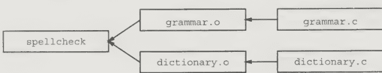

## 8.2 增量构建

自动构建的目标现在是如何从源组件创建那些作为最终产品一部分的导出组件。自动化构建最简单的方法是将单个构建步骤组合成一个*脚本*，由计算机逐步处理。在我们的拼写检查示例中，这将是一系列由 C 编译器 **cc** 相应调用的命令：

*程序构建脚本*

```
cc -c -o grammar.o grammar.c
cc -c -o dictionary.o dictionary.c
cc -o spellcheck grammar.o dictionary.o
```

这种脚本的缺点是所有的构建步骤总是会被执行。当程序在修改后重新构建时，这些步骤往往是多余的。例如，如果我们已经创建了一个完整的拼写检查程序并对 grammar.c 进行了修改，那么 dictionary.o 不需要重新创建，因为它不是由 grammar.c 导出的；执行重建 grammar.o 和 spellcheck 的步骤就足够了。

事实上，导出关系也表明了更改如何影响系统。组件 $A$ 的更改只能影响由 $A$ 导出的组件；因此，这些组件也被称为*依赖于* $A$。所有其他组件在更改面前保持独立，不需要重建。这一知识点引出了以下定理：

*依赖性：通过依赖关系进行重建*

设 $A$ 为一个导出组件，依赖于 $n$ 个其他组件 $A_1, A_2, \ldots, A_n$。如果满足以下条件，组件 $A$ 必须被重建：

- 1. $A$ 不存在，或者
- 2. $A_1, A_2, \ldots, A_n$ 中至少有一个 $A_i$ 发生了更改，或者
- 3. $A_1, A_2, \ldots, A_n$ 中至少有一个 $A_i$ 必须被重建。

虽然情况 1 和情况 2 是显而易见的，但情况 3 源于“重建会导致更改”的假设，而这反过来又意味着情况 2。

在我们的示例中，例如，如果 `grammar.c` 发生了更改，则 `grammar.o` 必须重建；`spellcheck` 也必须重新创建，因为 `grammar.o` 必须重建。这种利用现有结果来实现目标的程序被称为*增量*（incremental）的。因此，上述定理是*增量程序构建*的基础。

> 增量程序构建

## 8.3 MAKE 如何工作

通常，手动增量构建系统即使对于小型系统也会失败——管理依赖关系和构建步骤实在太困难了。出于这个原因，贝尔实验室的 Stuart Feldman 在 1975 年开发了软件工具 **MAKE**，如今它已成为最具影响力和最广泛使用的软件工具之一。

> MAKE

MAKE 通过使用**系统模型**来实现增量程序构建。系统模型是对软件产品的描述，列出了单个组件及其依赖关系以及构建它们所需的步骤。MAKE 中的系统模型存储在一个名为 **Makefile** 的特殊文件中。

> 系统模型
> Makefile

一个 makefile 由**规则**（rules）组成。一条规则指明了一个或多个组件依赖于哪些组件，以及构建该（些）组件所必需的命令。它采取以下形式：

> 规则

```
target₁ target₂ ... targetₙ: source₁ source₂ ... sourceₘ
    command₁
    command₂
    command₃
    ...
```

这里 $target_1$ 到 $target_n$ 代表规则所指的组件，即所谓的**目标**（target）。$source_1$ 到 $source_m$ 是目标所依赖的组件。在组件下方是创建相应目标的命令，并使用制表符（tab）缩进。

> 目标

（命令必须用制表符（而不是空格！）缩进这一事实，是初学者尝试创建 Makefile 时最大的绊脚石。Stuart Feldman 本人在完成 MAKE 原始版本几天后显然也遇到了同样的问题；但那时 MAKE 已经分发得太广泛，以至于他无法纠正这个设计错误。）

在我们的*拼写检查*示例中，Makefile 如下所示：

> **示例 8.1**
> 拼写检查的 Makefile

```makefile
spellcheck: grammar.o dictionary.o
	cc -o spellcheck grammar.o dictionary.o

grammar.o: grammar.c
	cc -c -o grammar.o grammar.c

dictionary.o: dictionary.c
	cc -c -o dictionary.o dictionary.c
```

MAKE 将 Makefile 以及该 Makefile 的一个目标 $A_0$ 作为输入。MAKE 从 Makefile 中计算依赖图，并从组件 $A_0$ 开始工作。其基本算法是对依赖图进行深度优先搜索，在每次返回后，如果必要，则执行构建步骤。

- 假设 $A$ 是当前的目标组件。根据依赖图，确定 $A$ 依赖的组件 $A_1, A_2, \ldots, A_n$。如果 $A$ 没有在 Makefile 中作为目标出现，则设 $n = 0$。
- 为 $A_1, A_2, \ldots, A_n$ 中的每个 $A$ 递归调用该算法。
- 如果组件 $A_1, A_2, \ldots, A_n$ 中的任何一个发生了更改，或者 $A$ 不存在，则 $A$ 必须被重建。为此，执行与 $A$ 作为目标相关联的命令。

让我们用一个例子来解释这个过程。假设拼写检查程序已经创建过一次，但现在我们修改了 dictionary.c。在以 spellcheck 为目标调用 MAKE 时会发生什么？

- 1. 首先 spellcheck 是当前目标，依赖于 grammar.o 和 dictionary.o。
- 2. 现在，如果有必要，目标 grammar.o 必须被重建；它依赖于 grammar.c。
- 3. grammar.c 不是 Makefile 中的目标，但它确实存在。
- 4. 由于 grammar.c 没有被更改，grammar.o 也不需要重建。
- 5. 现在检查目标 dictionary.o；它依赖于源文件 dictionary.c。
- 6. dictionary.c 也不是 Makefile 中的目标，但它确实存在。
- 7. 回到目标 dictionary.o，MAKE 确定文件 dictionary.c 已被更改：dictionary.o 必须被重建。相应地，MAKE 调用命令 `cc -c -o dictionary.o dictionary.c`。
- 8. 我们再次回到目标 `spellcheck`；由于 `dictionary.o` 现已更改，`spellcheck` 也必须重新创建；MAKE 调用命令 `cc -o spellcheck grammar.o dictionary.o`。
- 9. 至此，目标 `spellcheck` 被创建；MAKE 完成工作。

在实践中，整个过程如下：调用 MAKE 并指定 Makefile 的一个目标。在 MAKE 运行期间，它会显示已执行的命令。

```makefile
$ make spellcheck
cc -c -o dictionary.o dictionary.c
cc -o spellcheck grammar.o dictionary.o
$ _
```

到目前为止，我们留下了一个没有回答的问题：MAKE 实际上是如何确定一个文件已被更改的？这个想法非常简单。在文件系统中，每个文件都会记录最后一次更改的时间。如果一个组件 C（作为文件）显示的日期早于依赖于它的组件，则认为 C 已被“更改”；依赖组件将被重新创建。在上面的例子中，我们定义 dictionary.c 被更改了——根据 MAKE 的逻辑，这意味着 dictionary.c 的日期早于 dictionary.o，因此在程序最后一次构建之后被修改了。

> 以更改时间作为重建的基础

如果我们第二次调用 MAKE，且没有以任何方式更改任何源组件，MAKE 将什么也不做。这是因为在一次成功的编译之后，每个源组件都比由其导出的组件要旧，因此 MAKE 没有更多的工作可做：

```makefile
$ make spellcheck
make: nothing to be done for 'spellcheck'.
$ _
```

### 8.4 实践中的 Makefile

为了实际使用，MAKE 提供了许多属性以增加灵活性并减少所需的编写量。

#### 8.4.1 变量

如果要在一个程序在不同的环境中编译，这些环境的构建步骤也会有所不同。例如，如果 C


### 8 使用 MAKE 构建程序

在某台计算机上的编译器被称为 `cc`，而另一台则被称为 `gcc`，控制编译的选项也可能互不相同。为了能够轻松地进行这类更改，MAKE 引入了**变量**（**variables**），通过它们可以将 Makefile 中频繁出现的部分进行组合和参数化。

### 变量

在 Makefile 中使用以下方式定义变量：

```
variable = value
```

随后每次出现 `$(variable)` 或 `${variable}` 时，都会被自动替换为 *value*。

例如，如果要使用变量 `CC` 来参数化 C 编译器的名称，`spellcheck` 的 Makefile 如下所示：

**示例 8.2 带有变量的 Makefile**

```
CC = cc

spellcheck: grammar.o dictionary.o
	$(CC) -o spellcheck grammar.o dictionary.o

grammar.o: grammar.c
	$(CC) -c -o grammar.o grammar.c

dictionary.o: dictionary.c
	$(CC) -c -o dictionary.o dictionary.c
```

该 Makefile 的含义依然没有改变；每个 `$(CC)` 的出现都被替换为 CC。然而，在调用 MAKE 时，可以为 CC 变量指定一个新值。如下调用：

```
$ make CC=gcc spellcheck
```

将执行 spellcheck 的所有构建步骤，但此时执行的是 `gcc` 而非 `cc`。

变量不仅可以引用命令；Makefile 的任何部分都可以通过变量进行参数化。例如，对象文件的长列表经常被组合在一个变量中。因此，使用 OBJECTS 变量可以确保在同一个位置仅存在一份对象文件列表：

**示例 8.3 带有对象文件列表的 Makefile**

```
OBJECTS  = grammar.o dictionary.o

spellcheck: $(OBJECTS)
	$(CC) -o spellcheck $(OBJECTS)
	⋮
```

在这个例子中，只需在同一个地方修改 OBJECTS，即可使依赖关系和构建命令同步更新。

#### 8.4.2 隐式规则

如果考虑到组件经常以相同的方式构建，Makefile 的另一种简化就变得显而易见了。在我们的例子中，dictionary.o 和 grammar.o 的构建步骤是相同的，只是交换了 dictionary 和 grammar。为了组合这类相同类型的规则，MAKE 提供了隐式规则。

**隐式规则**

隐式规则应用于通过特定名称模式给出的若干组件上。名称模式通过后缀来标记文件：例如，`.o` 是包含所有以 .o 结尾的文件（对象文件）的模式，而 `.c` 是所有以 .c 结尾的文件（C 源代码文件）的模式。

隐式规则的形式为：

```
.suffix_1.suffix_2:
        command
```

在这种情况下，suffix_1 是源文件的后缀，suffix_2 是目标文件的后缀。因此，将 C 源代码文件编译为对象文件的隐式规则形式为：

```
.c.o:
        command
```

由于隐式规则用于大量组件，因此在命令中必须使用特殊的隐式变量来代表相应的组件。隐式变量 `$@` 代表当前目标，隐式变量 `$<` 代表第一个源文件。因此，可以给出将 C 文件编译为对象文件的隐式规则：

**隐式变量**

```
.c.o:
        $(CC) -c $(CFLAGS) $(CPPFLAGS) -o $@ $<
```

如果 MAKE 正在寻找一个以 ".o" 结尾的目标，且存在一个基本名称相同但以 ".c" 结尾的文件，并且 Makefile 中没有为该目标输入显式规则，则始终应用此规则。这里还使用了 CFLAGS 和 CPPFLAGS 变量来控制 C 编译器和 C 预处理器。

事实上，这条规则已经在 MAKE 中预定义好了，并且带有适用于这些变量的预设值。因此，spellcheck 项目的整个 Makefile 可以缩减为：

**示例 8.4 带有隐式规则的 Makefile**

```
OBJECTS = grammar.o dictionary.o

spellcheck: $(OBJECTS)
        $(CC) -o spellcheck $(OBJECTS)
```

**dictionary** 和 **grammar** 的规则不再需要显式指定；它们会自动从预定义的隐式 `.c.o` 规则中派生。对于变量，我们也可以依赖 **MAKE** 的预定义值。

Makefile 中使用的文件后缀必须在特殊规则中定义。*安装目标* `.SUFFIXES` 的所有源都被用作隐式规则的文件结尾，因此：

```
.SUFFIXES: .c .o
```

如果你希望定义自己的隐式规则，这一点尤为重要。

#### 8.4.3 模式规则

作为文件结尾规则的一种更强大的替代方案，一些 MAKE 变体（特别是 GNU MAKE）提供了使用 *模式*（*patterns*）的选项。在 *模式规则* 中，目标中的百分号 “%” 代表任意字符串。通过模式，将 C 文件编译为对象文件的隐式规则可以表示为：

**模式规则**

```
%.o: %.c
	$(CC) -c $(CFLAGS) $(CPPFLAGS) -o $@ $<
```

模式规则的优点是可以容纳额外的依赖关系——例如，所有 C 文件都依赖于头文件 `defs.h`：

```
%.o: %.c defs.h
	$(CC) -c $(CFLAGS) $(CPPFLAGS) -o $@ $<
```

在模式规则中，“%” 实际上代表任意字符串；其用法不限于前缀或后缀。如果目标仅由一个百分号 “%” 组成，则该规则适用于 *所有目标*。例如，如果 RCS 文件比目标文件本身更新，以下规则将执行 RCS check out（第 3 章）：

**MAKE 与 RCS**

```
% :: RCS/%,v
	$(CO) $(COFLAGS) $<
```

这里的 MAKE 变量 CO 被定义为 `co`；COFLAGS 代表 `co` 的选项。双冒号 (`::`) 用于指示 MAKE 不要重建缺失的源文件。这样，MAKE 就不需要为每个文件检查是否有办法创建其 RCS 文件。

#### 8.4.4 用于安装的 MAKE

在实践中，MAKE 还用于程序构建 *相关领域* 任务的自动化。因此，定义一个名为 `install` 的 *伪目标*（*pseudotarget*）是很正常的，它将完成的程序安装到计算机上，从而使其可供所有人使用。伪目标不创建文件，而只是执行一系列命令。

**伪目标**

```makefile
# 安装程序
INSTALL_PROGRAM = install

# 客户侧安装程序和数据的通用前缀
prefix          = /usr/local

# 机器特定程序和数据的前缀
exec_prefix     = $(prefix)

# 机器特定程序的前缀
bindir          = $(exec_prefix)/bin

install: spellcheck
	$(INSTALL_PROGRAM) spellcheck $(bindir)/spellcheck
```

**示例 8.5 Makefile 中的安装规则**

注意使用变量来参数化安装程序的名称和位置。如果变量不被更改，spellcheck 程序将被安装在 `/usr/local/bin` 目录下——其中 spellcheck 的 install 依赖项确保了 spellcheck 是最新的。

```
$ make install
install spellcheck /usr/local/bin/spellcheck
$ _
```

除了 `install`，其他一些伪目标也经常被使用。表 8.1 列出了最重要的几个。

#### 8.4.5 递归 MAKE

在大型项目中，将一个系统拆分为 *子系统*（*subsystems*）是很常见的，这些子系统作为独立单元构建，然后进行组合。在构建一个系统时，通常也会构建其子系统。这是通过对 MAKE 进行 *递归调用*（*recursive call*）来实现的。作为示例，我们来看一个名为 `readline` 的子系统，它位于同名的子目录中，其构建由 MAKE 处理。在主系统的 *Makefile* 中，我们可以找到以下目标：

**表 8.1 MAKE 中的标准目标。**

| 命令 | 效果 |
| --- | --- |
| make all | 构建整个程序。 |
| make install | 将程序安装到计算机上。 |
| make uninstall | 从计算机中删除程序。 |
| make clean | 删除程序和所有派生文件。 |
| make distclean | 类似于 "clean"；但还会撤销源代码中特定于平台的适配。 |
| make dist | 创建源代码包（发行版）。 |
| make check | 执行相应的测试。 |
| make depend | 重新计算依赖关系。 |
| make love | 输出 "not war?"。 |

```
READLINE_TARGETS = readline/libreadline.a \
                   readline/readline.h

readline $(READLINE_TARGETS) :
    cd readline && $(MAKE)
```

在变量 READLINE_TARGETS 中，定义了来自 readline 子系统的目标——在本例中，例如一个库 (libreadline.a) 和一个头文件 (readline.h)。

**MAKE 变量**

这里的 MAKE 变量 `$(MAKE)` 代表原始的 MAKE 调用——即带有完整路径且在必要时带有 MAKE 选项的 MAKE 程序。例如，如果 MAKE 被调用为：

```
$ gmake CC=gcc readline
```

`$(MAKE)` 将扩展为 `gmake CC=gcc`。MAKE 执行命令：

```
cd readline && gmake CC=gcc
```

通过这样做，确保在子系统中也考虑到了 MAKE 参数。

不幸的是，以这种方式安排的递归 MAKE 效率较低：对于每个依赖于 readline.h 的目标，MAKE 都会被调用一次。可以通过省略依赖关系来提高效率，但这会以牺牲灵活性为代价。在我们的例子中，例如，可以从目标列表中删除 readline.h：

```
READLINE_TARGETS = readline/libreadline.a

readline $(READLINE_TARGETS) :
    cd readline && $(MAKE)
```


#### 构建子系统

在这种规则下，只有在程序的最终链接过程中需要 `readline.a` 时，才会触发递归的 MAKE 调用。然而，如果 `readline.h` 是一个派生文件，MAKE 无法且不会在主系统中对其进行重建。

在实践中，人们会尽力根据依赖关系依次构建子系统。通常，产品的顶层级最高目录包含构建整个系统的规则：

```
MODULES = termcap readline main

all install uninstall clean distclean::
	for dir in $(MODULES); do \
		(cd $$dir && $(MAKE) $@); \
	done
```

整个系统通过调用 **make all** 来构建：UNIX 命令解释器的 `for` 命令会对 MAKE 变量 MODULES 中的每个子系统，在相应的子目录中调用一次带有给定目标的 MAKE；这适用于所有标准目标。MODULES 中的子系统排列顺序确保了后一个子系统依赖于前一个子系统。

这种方案对于复杂的依赖关系是否同样有效？该方案要求子系统必须根据其依赖关系进行排序（拓扑排序）。更复杂（循环）的依赖关系会导致更复杂的命令序列。如果需要多次运行，Makefile 与普通的非增量脚本就没什么区别了。不过，这里介绍的方法对于一般的项目应该已经足够。

### 8.5 确定依赖关系

#### 隐藏依赖

在实践中，派生组件不仅在相应的源组件发生变化时才会改变。事实上，增量构建还必须考虑 *被使用的其他组件* 以及 *构建过程本身* 的变化：

- **所用组件的依赖性：**
在构建过程中访问的每个组件都可能对派生组件产生影响。例如，如果一个 C 文件使用了头文件 `spellcheck.h`，那么 `spellcheck.h` 中的任何更改都可能影响派生的对象文件。

- **构建工具的依赖性：**
如果编译器发生了变化，所有对象文件都必须重新编译。如果工具的 *调用方式*（例如，在调用编译器时开启或关闭优化）以及 *上下文*（例如，环境变量）发生变化，情况也是类似的。

**图 8.2**
另一个依赖图。这里列出了额外的“隐藏”依赖。

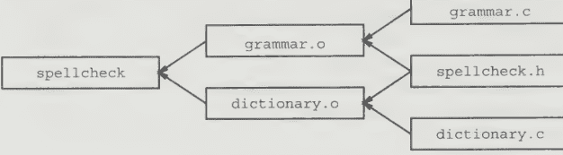

首先，我们将研究第一个领域：所用组件的依赖性。实际上，每个程序都会使用其他程序组件的定义和声明。例如，一个 C 程序需要针对输入和输出的特殊声明，这些声明组合在头文件 `<stdio.h>` 中。这意味着可执行程序不仅依赖于 C 源文本文件，还依赖于 `<stdio.h>`。

像 `<stdio.h>` 这样的系统文件极少发生变化，因此其依赖关系可以被忽略。但对于项目内部的头文件，情况要复杂得多。例如，在我们的 `spellcheck` 示例中，如果 `grammar.c` 和 `dictionary.c` 都使用通用头文件 `spellcheck.h` 中的定义，那么依赖图必须像图 8.2 所示那样进行 *扩展*。

在 Makefile 中，这些新依赖关系通过进一步的规则来表达：

```
grammar.o: grammar.c spellcheck.h
dictionary.o: dictionary.c spellcheck.h
```

手动跟踪此类依赖关系可能非常繁琐，因为使用情况可能是任意嵌套的：被引用的组件可以再次引用其他组件。例如，如果在 `spellcheck.h` 中引入了对 `pidgin.h` 的新引用，那么所有使用 `spellcheck.h` 的组件的依赖关系都必须扩展以包含 `pidgin.h`。因此，只要可能，依赖关系就应该自动确定。

#### 自动确定依赖关系

UNIX C 编译器提供了一种 *自动确定依赖关系的方法*。`-M` 选项会使 MAKE 规则输出一个列表，指示所有处理过的组件的依赖关系——即 C 预处理器在运行期间打开的文件列表：

```
$ cc -M grammar.c
grammar.o: grammar.c
grammar.o: ./spellcheck.h
$ _
```

`cc` 的这一特性可用于 Makefile 中，通过 `make depend` 自动更新依赖关系。例如，在 Makefile 中可以找到以下规则：

**示例 8.6**
依赖关系的自动确定

```makefile
depend::
	(for file in $(SOURCES) ; do \
		$(CC) -M $$file; \
	done) > Makedeps

include Makedeps
```

UNIX 命令解释器的 for 命令（在括号中）会对 MAKE 变量 SOURCES 中的每个文件调用一次 `CC -M`；相应的依赖关系将输出到 `Makedeps` 文件中。在读取 Makefile 时，MAKE 指令 `include Makedeps` 会被 `Makedeps` 的内容替换；因此，确定的依赖关系成为了 Makefile 的一部分。一旦某个组件引入了新的依赖关系，必须重新计算依赖关系。

**工具的依赖性**

MAKE 没有充分考虑的问题是所用工具及其上下文的依赖性。从 CC 到 gcc 的更改，以及 Makefile 的一般性更改，都无法被 MAKE 检测到。因此，在修改 Makefile 后，必须检查是否需要删除派生文件以强制重新构建。

### 8.6 补充与扩展

MAKE 产生了并启发了无数的后继者，它们提供了改进的功能——特别是针对依赖关系确定和派生组件归档的功能。

#### 8.6.1 语言特定知识

**ODIN**
正如 8.5 节所述，依赖关系的确定从一开始就被整合到了 MAKE 的后继者中。例如，软件工具 ODIN 利用语言特定知识自动生成依赖图；例如，它会搜索 C 和 C++ 文件中的 `#include` 指令。其他编程环境则依赖于对所用编程语言的知识来确定更改的影响：因此，例如，对注释的更改不会导致重建。

#### 8.6.2 自动确定依赖关系

**CLEARCASE**
使用前述的 CLEARCASE 系统可以非常优雅地处理依赖关系。在程序构建过程中，虚拟文件系统会记录构建工具打开的文件。通过这种方式，那些原本对开发人员隐藏的依赖关系被揭示出来——例如，所用编译器内部打开的配置文件，或在构建其他工具期间调用的辅助程序。其巨大的优势在于，所有被使用的文件都能被看到并自动处理。

#### 8.6.3 构建过程中的更改

**构建命令的更改**
MAKE 的一个问题是，只有在 *Makefile* 中明确指定了对 *Makefile* 自身的依赖时，对 *Makefile* 本身的修改才会导致重建。为了将构建更改纳入考虑，许多 MAKE 的后继者和扩展版本会为每个派生组件记录其构建时所使用的命令。那么，命令的更改（由于 Makefile 的更改而导致）将引发重建。

**构建上下文的更改**
CLEARCASE 工具（如前所述）不仅记录文件访问，还记录相应构建工具的调用及其 *环境变量*。构建工具或其环境的任何更改都会自动导致重建。考虑构建工具的环境是有原因的：例如在许多操作系统中，环境变量 `PATH` 决定了搜索可执行程序的路径；因此，其更改极有可能对最终产品产生影响。

不幸的是，CLEARCASE 无法记录哪些程序访问了哪些环境变量，因此在不确定的情况下，环境中的 *任意更改* 都会导致重新构建。因此，CLEARCASE 区分了 *关键环境变量*（会导致派生组件更改）和 *非关键环境变量*（其更改没有影响）。

#### 8.6.4 派生组件的归档

**二进制池 (Binary pools)**
二进制池是将派生组件与其构建上下文一起存档的仓库。如果以后需要将组件还原到相同的配置，可以直接从二进制池中复制；无需重新构建。当有多个开发人员在各自的工作区持有程序的副本时，这尤其有用。当第一位开发人员首次构建程序时，将执行所有构建步骤。而随后的每位开发人员都可以利用二进制池中的派生组件——构建时间被降低至零。（管理二进制池会增加少量的开销。）


通常，二进制池的管理需要使用版本控制，因为每个派生组件的源配置必须已知——这意味着对于每个派生组件，类 MAKE 工具必须记住相关文件的修订版本。因此，在高级 SCM 系统中，派生文件的版本化是自动完成的；在重建特定配置期间，派生文件也会被重新构建——要么来自二进制池，要么使用类 MAKE 机制。

MAKE 和版本控制

### 8.7 ANT：一个程序构建框架

MAKE 的另一个弱点是命令与目标的直接绑定：为了创建目标，必须执行特定的命令。诚然，人们可以通过变量和隐式规则来创建灵活的命令；但如果构建工具本身知道如何执行特定任务，并且这些任务可以随意添加和扩展，那么生活将会简单得多。

这正是 ANT（来自另一个精巧的工具）的目标。ANT 用户指定的不是命令，而是实现特定目标的任务（tasks）。每个任务都知道使用哪些工具和命令来实现目标。ANT 自带了 100 多个预定义任务，包括以下内容：

- **编译**：Javac（编译 JAVA 程序）、JspC（执行 JSP 编译器）
- **归档**：Jar（创建 Jar 归档）、Zip（创建 Zip 归档）、Rpm（创建 RPM 归档）
- **文档**：Javadoc（创建 JAVADOC 文档；见 10.2 节）
- **文件管理**：Checksum（创建校验和）、Copy（复制文件）、Delete（删除文件）、Move（重命名文件）、Mkdir（创建目录）、Tempfile（创建临时文件）
- **测试**：JUnit（运行测试；见第 13 章）

#### ANT 中的任务

与 MAKE 一样，系统模型定义了系统的组件——在 ANT 中，它被称为构建文件（Buildfile）。构建文件由以下部分组成：

- 一个构建文件恰好有一个项目（project）。每个项目有一个名称和一个默认目标（default target）——除非指定了其他目标，否则将使用该目标。
- 每个项目有一个或多个目标（targets）。ANT 目标类似于 MAKE 目标，但粒度要粗得多。ANT 目标指的是某种通用活动，而不是要构建的文件。
- 每个目标有一个名称和可选的*依赖项（dependencies）*。依赖项列出了在实际目标实现之前必须实现的各个目标。例如，作为目标的归档文件通常依赖于之前的编译。
- 每个目标由若干个*任务（tasks）*实现——即为了实现该目标必须执行的活动。

构建文件本身是用 *XML 格式* 编写的。这使得其他工具能够简单地创建和处理它。

示例 8.7 展示了一个名为 `build.xml` 的构建文件，用于一个名为 `SimpleProject` 的简单项目。`compile` 目标使用了两个任务来创建目录（`mkdir`）并调用 JAVA 编译器（`javac`）。额外的 XML 属性定义了*任务参数*——例如，在 mkdir 任务中要创建的目录名称（`dir`）。

**示例 8.7**
*一个 ANT 构建文件*

```xml
<project name="SimpleProject" default="dist">
  <target name="compile">
    <mkdir dir="classes"/>
    <javac srcdir="." destdir="classes"/>
  </target>
  <target name="dist" depends="compile">
    <mkdir dir="lib"/>
    <jar jarfile="lib/simple.jar" basedir="classes"/>
  </target>
  <target name="clean">
    <delete dir="classes"/>
    <delete dir="lib"/>
  </target>
</project>
```

**示例 8.8**
*使用 ANT 构建*

```
$ ant
Buildfile: build.xml

compile:
    [mkdir] Created dir: /src/moore/classes
    [javac] Compiling 3 source files
            to /src/moore/classes
dist:
    [mkdir] Created dir: /src/moore/lib
    [jar] Building jar: /src/moore/lib/simple.jar

BUILD SUCCESSFUL

Total time: 3 seconds
$ _
```

如果我们使用示例 8.7 中的构建文件来调用 ANT，我们将获得示例 8.8 中所示的活动。

1. `build.xml` 的默认目标是 `dist`。
2. 目标 `dist` 依赖于 `compile`，因此必须先实现 `compile`。
3. `compile` 目标由 `mkdir` 和 `javac` 这两个任务实现，必须先执行它们。
4. 现在可以执行 `dist` 的任务 `mkdir` 和 `jar`。
5. 所有目标均已实现——构建成功。

与 MAKE 一样，ANT 是增量工作的——在每次新构建中，只有那些依赖项发生变化的目标才会被实现。但与 MAKE 不同的是，增量性并未内置在工具中，而必须由具体的任务实现。例如，`javac` 任务会自动确定 JAVA 程序之间的依赖关系，并且仅构建必须重建的类。因此，ANT *仅仅是一个框架*，用于组织单个任务；关于构建（特别是增量重建）的实际智能在于任务本身。

ANT 可以通过额外的任务轻松扩展。ANT 提供了一个 JAVA 类 `Task`，可以通过继承该类来实现新任务。由于现有的复杂任务也是 `Task` 的子类，因此可以进一步继承它们以创建新的扩展或适配。最后，ANT 也可以在运行时进行配置。例如，原始的 JAVA 编译器可以很容易地被另一个变体替换。

这些特性使 ANT 成为 JAVA 程序最受欢迎的构建工具。不幸的是，针对其他编程语言的 ANT 任务很少。如果无法使用 ANT，MAKE 可以作为替代。

#### 概念

- 自动程序构建的目标是从若干源组件创建所有派生组件，这些组件是最终软件产品不可或缺的一部分。
- 如果一个组件发生了变化，所有由其派生的组件必须重新构建。
- MAKE 是一个用于构建程序的工具，在此过程中尽可能多地复用现有的派生文件。
- MAKE 使用组件被修改的日期来检测变化。
- MAKE 的基础是 Makefile，它是一个系统描述文件，列出了系统的组件及其依赖关系和构建步骤。
- Makefile 可以使用变量和隐式规则进行简化和参数化。
- 随后的改进和扩展涉及依赖关系的自动确定以及派生组件版本的自动管理。
- 像 ANT 这样的程序构建框架允许用户及第三方进行特定的扩展。

#### 复习练习

1. 程序构建并不总是成功的。如果 `Makefile` 中的某个命令无法正确结束，MAKE 有什么替代方案？如果目标文件已经被部分创建，但创建命令以错误代码结束，MAKE 必须考虑什么？

2. 在我们的 MAKE 示例中，如果对象文件 `grammar.o` 和 `dictionary.o` 被删除，但 `spellcheck` 被保留，在下一次运行期间，MAKE 会重新创建 `spellcheck` 和所有对象文件——即使源文件没有变化。请建议一种对 MAKE 算法的修改，如果在源文件未改变且中间文件缺失的情况下，不重新创建给定的目标。是否存在这种优化是不合理的场景？

3. 为了避免 MAKE 纯粹基于时间的变更机制，许多 MAKE 文件的开发者使用了以下技巧：在重建组件 A 期间，创建一个名为 A' 的组件并将其与现有的 A 进行比较。如果 A' 和 A 不同，则将 A' 复制到 A。否则，A 保持不变（包括其修改日期），并且依赖于 A 的文件无需因 A 而重新创建。

(a) 通过这种过程，能否在程序实际构建之前确定必要的步骤？

(b) 一个严格遵循 8.2 节重建规则的 MAKE 仍然会重新创建组件

那些依赖于 $A$ 的组件。为什么？MAKE 必须考虑什么才能使这个技巧奏效？

- **4.** 我们的同事史密斯抱怨说，他必须经常输入 `make depend` 才能使依赖关系保持最新。“如果依赖关系不是集中管理，而是为每个组件单独管理——也就是说，每个单独的组件都有一个 `Makedeps` 文件，那就好多了。” 使用 MAKE 能实现这一点吗？这类依赖文件将如何创建？它们何时需要重新构建？

- **5.** 设计一个类似于 MAKE 的工具，它不是通过更改日期来检测变化，而是通过组件的实际内容来检测。为此，对于每个派生组件 $A$，你必须记录 $A$ 所依赖的所有组件 $A_1, \ldots, A_n$ 的内容。如果 $A$ 需要被重新构建，你可以比较组件 $A_i$ 的当前内容和之前的内容；只有当内容存在差异时，才真正需要重新构建 $A$。你可以如何利用第 2 章到第 4 章的技术来节省空间？

- **6.** 编写一个 ANT 任务来创建 “Hello, world!” JAVA 程序。你如何将标准 JAVA 编译器 `javac` 替换为另一种编译器（例如 `jikes`）？

- **7.** 构思一个名为 `cc` 的 ANT 任务，用于自动编译 C 程序。这类任务的要求是什么？特别是要考虑易配置性以及依赖关系的自动检测。

#### 延伸阅读

关于 MAKE 的第一个详尽描述可见于 Feldman (1979)。自原始版本以来，MAKE 经过多次扩展，并拥有众多变体和扩展版本。几乎所有现有 MAKE 扩展的工具箱都实现在 GNU MAKE 中，可从 Stallman 和 McGrath (1995) 处免费获取。

CLEARCASE 的依赖管理在 Leblang (1994) 中有描述。ODIN 由 Clemm (1988) 引入。关于递归且高效地使用 MAKE 的难度，Miller (1997) 进行了描述。

并非程序中的每一次更改都必须导致重新编译——例如，注释的更改。这种所谓的**智能重新编译（smart recompilation）**在 Tichy (1986)、Schwanke 和 Kaiser (1988) 以及 Shao 和 Appel (1993) 的文章中得到了研究。

*智能重新编译*

#### 与版本控制的集成

软件构建的未来在于与版本控制的紧密集成。突出的例子包括由 Mahler (1994) 共同开发的 SHAPE，以及在 Rich 和 Solomon (1991) 以及 Adams 和 Solomon (1995) 中描述的 CAPITL 编程环境。最近的理论方法可见于 Gunter (1996) 以及 Zeller (1998)。

ANT 及其文档可以在网上找到：
`http://ant.apache.org/`

#### 其他程序构建工具

MAKE 和 ANT 通常集成在编程环境中——例如第 20 章中描述的 ECLIPSE 编程环境。然而，市场上也有几种*商业*变体和扩展，它们通常包含此处描述的基础功能。

超出 MAKE 范围的程序构建工具通常是配置管理系统的一部分。您可以在第 59 页找到这些工具的选择。

### 9 使用 AUTOCONF 自动配置软件

### 9.1 简介

变体（Variants）是软件开发中常见的问题来源。变体是指必须与现有版本共同创建和维护的产品版本。创建变体的原因有很多：

- **硬件环境的差异：** 程序应支持新硬件——例如新的显卡或新的输入设备。
- **软件环境的差异：** 程序应能在多种操作系统或各种图形用户界面上运行。
- **程序构建的差异：** 根据环境的不同，构建程序可能需要不同的工具和命令。

通常，程序对变体的依赖应保持在最低限度，因为每个变体都会增加测试费用。共同的、非变动部分必须尽可能大，而变动部分必须尽可能小。这可以通过对变动属性进行*抽象*来实现，特别是通过创建和使用通用且标准化的*接口*。特别是，面向对象的*设计模式*提供了支持类层次结构变动的适当抽象。

如果由于技术原因，变动不能在运行时处理而必须在*编译时*处理，那么变体管理就会变得复杂。通常不可能让一个 WINDOWS 程序在 UNIX 计算机上运行，反之亦然。变体会导致（至少）两个可执行程序，以及由操作系统造成的许多其他差异。

但即使可以依赖通用接口，技术原因仍可能导致创建针对特定环境定制的变体——例如，针对相应处理器的性能特性进行优化的程序变体。与其创建通用可执行文件（其中只有一部分代码针对特定环境定制），不如仅包含实际将要执行的代码。

因此，变体不仅会导致各种可执行程序，还会导致源代码中的许多差异，这些差异必须在编译时解决。源代码中以及程序构建过程中的这些差异需要被检测并处理。

### 9.2 显式变体管理

管理变体的一种较简单方法是复制变动的软件组件并为它们分配自己的标识符。因此，程序的操作系统特定部分可以设置在模块（文件、目录……）中，例如 macos, windows2000, windowsxp 或 unix。所有模块提供相同的服务；最终程序仅集成合适的模块。

**变体维度（Variation facets）**

然而，这种简单方法在实践中由于一个主要问题而失效：变体具有多个维度。环境的变动不仅延伸到基本属性，还延伸到细节。因此，操作系统仅在某些版本中提供某些服务。可选的驱动程序和库可以提供不同的服务。最后，环境的特定版本可能包含错误，必须通过规避方案（workaround）来处理。

如果将这些维度中的每一个都封装在单独的模块中，很快就会产生许多难以处理的模块。然而，如果创建的模块仅在细节上有所不同，我们会在模块中得到公共部分，这需要多次维护和组织。

### 9.3 从模板创建变体

**创建变量的模板**

避免这个问题的一种方法是不显式管理变体，而是根据需求从更抽象的模板中生成它们。模板可以被理解为一个表单——它包含根据变体填充的部分，以及为多个甚至所有变体共同使用的部分。因此，显式变体在编译时从模板中隐式创建——这被称为模板的实例化。

以下三种工具已成为实例化模板的常用工具：

- SED 适用于简单的替换任务。
- M4 是一个针对任何给定文件的宏处理器。
- CPP 是一个专门针对程序文件的宏处理器。

#### 9.3.1 SED

*流编辑器* SED 对字符流执行一系列命令。SED 主要用于替换字符串。例如，SED 命令 `s,old,new,g` 将文本中所有出现 *old* 的地方替换为文本 *new*。

使用 SED 替换字符串。这里有一个例子：在名为 *Makefile.in* 的 *Makefile* 模板（见第 8 章）中，C 编译器被参数化：

```
CC = @@@@
```

使用以下 SED 调用，通过将符号项 @@@@ 替换为具体程序 *gcc*，从 *Makefile.in* 模板实例化出具体的 *Makefile*：

```
$ sed 's,@@@CC@g,gcc,g' < Makefile.in > Makefile
$ _
```

使用 SED，例如，可以通过外部设置或确定 CC 等 make 变量的具体值，以实例化 *Makefile* 模板。

#### 9.3.2 M4

宏处理器 M4 同样操作文本，其中插入文本的*宏*被其他文本替换。已经预定义了一些有用的宏：

使用 M4 进行宏替换。

- **替换文本：** M4 宏 `define(macro, text)` 使后续所有出现的 *macro* 被替换为 *text*。*text* 可以包含额外的宏。
- **插入文本：** `include(filename)` 被文件 *filename* 的内容替换。
- **条件转换：** `ifdef(macro, text1, text2)` 如果 *macro* 是已定义宏的名称，则被替换为 *text1*；如果 *macro* 未定义，则被替换为 *text2*。

可以使用单个感叹号（`'macro'`）来抑制对 *macro* 的替换。

这里有一个例子：*manual.in* 文本文件模板描述了产品的基本变体以及 *professional*（专业）修订版。使用 M4 可以表示如下：

```
define('VERSION',
  ifdef('PROF', 'professional', 'basic') version)
Thanks for choosing the VERSION!
```

**示例 9.1**
带有 M4 宏的文本文件模板 *manual.in*


### 9 使用 AUTOCONF 自动配置软件

```c
#ifdef('PROF',
'This VERSION provides the following features:',
'This VERSION does not contain the following features.
  However, you can acquire them at an additional charge:')
...
```

如果现在调用 M4 时定义了宏 `PROF`，我们将获得专业版本；否则，我们将获得基础版本：

```
$ m4 -DPROF < manual.in
Thanks for choosing the professional version!
This professional version provides the following features:
...
$ m4 < manual.in
Thanks for choosing the basic version!
This basic version does not contain the following features.
However, you can acquire them at an additional charge:
...
$ _
```

通过这种方式，人们只需管理一个文件，而不需要两个独立的文件；公共部分保留在一个位置。

由于其高效的宏语言，M4 在变体管理中非常流行，尤其是当需要对程序以外的其他文件进行参数化和实例化时。

#### 9.3.3 CPP

C 预处理器（CPP）是专门为 C 和 C++ 设计的宏处理器。与 M4 类似，它提供了替换文本、插入文件和条件编译的方法。相关的 CPP 语句与 M4 中的宏具有相同的名称。

**替换文本：** 命令 `#define macro text` 意味着所有后续出现的 `macro` 都将被替换为 `text`。该定义可以通过 `#undef macro` 取消。

**插入文本：** `#include filename` 命令会被文件 `filename` 的内容所替换。

**条件编译：** 字符串 `#ifdef macro text1 #else text2 #endif` 在 `macro` 是已定义宏时被替换为 `text1`，而在 `macro` 未定义时被替换为 `text2`。`#ifndef macro text2 #else text1 #endif` 与此等效。

*使用 CPP 进行宏替换*

与 M4 不同，CPP 并不总是替换宏。在 C 语言的注释、字符字符串和 CPP 语句中，宏替换会被抑制。因此，与 M4 不同，CPP 不需要任何引号来抑制替换。

这是一个 CPP 的典型应用：`config.h` 文件定义了宏，这些宏告诉我们某些系统文件是否存在。例如，如果 `time.h` 文件可用，那么 `config.h` 就会定义 `HAVE_TIME_H` 宏。在实践中，它看起来如下所示：

```c
#include "config.h"

#ifdef HAVE_TIME_H
#include <time.h>
#endif

#ifdef HAVE_SYS_TIME_H
#include <sys/time.h>
#endif
```

> **示例 9.2**
> 使用 CPP 进行条件编译

除了这类特定变体的应用外，CPP（以及一般的宏处理器）的使用应尽可能限制。只要有可能，应依赖于实际编程语言的功能。

作为 CPP 危险性的一个例子，我们来看看在 C 语言中用于模拟“高效函数”的参数化宏。例如，宏 `square(x)` 应该计算 x²：

> 参数化宏

```c
#define square(x) x * x
```

`square(2)` 实际上产生的值是 2 * 2 —— 也就是 4。但上述定义可能会导致问题，因为 `square(a + b)` 随后会被替换为 `a + b * a + b`。即使是“修正后”的版本

```c
#define square(x) ((x) * (x))
```

仍然存在缺陷，即在 `square(f())` 中，`f` 函数被调用了两次 —— 这可能会产生令人不快副作用。因此，在后继者 C++ 中，CPP 的宏能力被 C++ 特有的语言资源（常量、内联函数和代码模板）所取代。尽管如此，CPP 仍然被用于（且必须用于）处理编译时的变体。

### 9.4 确定属性

通过使用 SED、M4 和 CPP，我们可以为具体的变体实例化模板。然而，我们还必须知道如何调用这些工具，以及如何使用相应的宏。

#### 具有独立名称的变体

一种经常被采用的方法是为每个变量分配一个独立的 *名称*。事实上，CPP 提供了一些 *预定义宏*，用于指示机器类型和操作系统。这些宏也可以用于配置。然而，这种方法的缺点是 *每个变体都必须单独列出*，这导致程序难以维护。

为了起到警示作用，我们将查看 XLOAD 程序的片段，该程序将当前的 CPU 负载作为 X Window 系统的一个组件显示。示例 9.3 显示了源代码，其中充斥着特定系统的语句：根据系统的不同，为每个 C 预处理器选择存放当前负载的内核变量的不同名称。这种情况持续数十行，因为访问内核内存的方法和内核的名称仍需确定 —— 所有这些都被包裹在特定系统的 `#if...#endif` 语句中。

#### 示例 9.3
XLOAD 程序片段

```c
#ifndef KERNEL_LOAD_VARIABLE
# ifdef alliant
#  define KERNEL_LOAD_VARIABLE "__loadavg"
# endif /* alliant */
# ifdef CRAY
#  if defined(CRAY2) && OSMAJORVERSION === 4
#   define KERNEL_LOAD_VARIABLE "avenrun"
#  else
#   define KERNEL_LOAD_VARIABLE "sysinfo"
#   define SYSINFO
#  endif /* defined(CRAY2) ... */
# endif /* CRAY */
# ifdef hpux
#  ifdef __hp9000s800
#   define KERNEL_LOAD_VARIABLE "avenrun"
#  endif /* hp9000s800 */
# endif /* hpux */
# ifdef umips
#  ifdef SYSTYPE_SYSV
#   define KERNEL_LOAD_VARIABLE "avenrun"
#  else
#   define KERNEL_LOAD_VARIABLE "_avenrun"
#  endif /* SYSTYPE_SYSV */
# endif /* umips */
# ifdef sgi
#  define KERNEL_LOAD_VARIABLE "avenrun"
# endif /* sgi */
# ifdef AIX3
#  define KERNEL_LOAD_VARIABLE "sysinfo"
# endif /* AIX3 */
# ifdef MOTOROLA
#           if defined(SYSV) && defined(m68k)
#               define KERNEL_LOAD_VARIABLE "sysinfo"
#           endif
#           if defined(SYSV) && defined(m88k)
#               define KERNEL_LOAD_VARIABLE "_sysinfo"
#           endif
#           ifdef SVR4
#               define KERNEL_LOAD_VARIABLE "avenrun"
#           endif
#       endif /* MOTOROLA */
#endif /* KERNEL_LOAD_VARIABLE */
```

然而在实践中，与其使用这种显式的配置列表，事实证明，为产品的每个可变属性（即变体的每个维度）分配一个属性会更有价值。这包括：

#### 基于可变属性的配置

- 变体的 *内在（intrinsic）* 属性，例如调试输出的可用性、特定算法的选择或激活优化后的编译，以及
- 环境的 *外在（extrinsic）* 属性，例如特定的客户端或特定的操作系统。

为了描述一个特定的配置（变体或其环境），人们使用一组定义为特定值的属性集合。

在实践中，它看起来如下所示。**config.h** 文件包含若干个宏，每个宏指示系统的某个特定属性：

```c
...
/* Define if `getpgrp' takes no argument.  */
#undef GETPGRP_VOID

/* Define to `int' if <sys/types.h> doesn't.  */
#undef gid_t

/* Define if you have alloca.  */
#define HAVE_ALLOCA 1
...
```

现在，这些宏中的每一个都可以被定义（如上述 `HAVE_ALLOCA`）或未定义（如另外两个）；在后续代码中，根据维度使用 `#ifdef...#endif` 选择代码的一个版本。在示例 9.3 的 XLOAD 案例中，一个宏可能代表内核变量的名称，一个代表访问方法，一个代表内核的名称。

在实践中，一个配置可以由其中的多个属性定义。像 GNU CC 这样的 C 编译器应用受不少于 200 个属性的控制，每个属性代表一个可变属性。但我们到底从哪里获得所有这些属性呢？基本上有三种方法。

#### 来自全局数据库的属性

- 系统属性被放置在 *全局数据库* 中。X Window 系统的配置程序 IMAKE 就采用了这种方法：每个 X 安装都包含一个可以自动生成 Makefile 的数据库。WINDOWS 中的 *注册表* 也可以被视为这种数据库。示例 9.3 中的 XLOAD 示例也包含了显式编码的系统知识。

这种方法的 *优点* 是可以非常快速地访问系统属性。*缺点* 是在数据库中找到的信息不一定正确。

#### 获取属性

- 在创建系统时，*询问用户可能的属性*，并建议合适的默认值。例如，PERL 语言的配置程序 META-CONFIG 就采用了这种方式。

这种方法的 *优点* 是用户可以完全控制系统的配置。*缺点* 是配置无法自动化 —— 并且用户可能会被大量的问题所淹没。

#### 自动确定

- 一个特殊的 *配置脚本* 完全自动地确定系统的属性。这就是使用 AUTOCONF 时发生的情况。

这种方法的 *优点* 是脚本可以确定系统的当前状态。*缺点* 是这种配置需要时间，且用户对结果的影响有限。

在实践中，第三种方法被证明是最成功的 —— 使用 AUTOCONF 进行自动配置。

### 9.5 使用配置脚本

#### AUTOCONF

我们现在从用户的角度来看 AUTOCONF。由 AUTOCONF 管理的源码包包含一个名为 `configure` 的脚本，该脚本执行一系列测试以确定系统的属性：

#### 示例 9.4 调用 configure 脚本

```
$ ./configure
checking whether build environment is sane... yes
checking for a BSD compatible install... install -c
checking host system type... i686-pc-linux-gnu
```


### 9.5 使用配置脚本

```
checking for gcc... gcc
checking whether the C compiler (gcc works... yes
checking whether the C compiler (gcc) is a
    cross-compiler... no
checking whether we are using GNU C... yes
checking whether gcc accepts -g... yes
checking for working alloca... yes
checking for <sys/wait.h>... yes
```

在这个示例中，configure 检查了：

- 系统时钟是否正确（构建环境是否正常）
- 是否有合适的安装程序 (`install`)
- C 编译器的名称是什么 (`gcc`)
- C 编译器是否接受 `-g` 选项
- `alloca()` 函数是否可用

以及其他几项测试。最后，configure 会创建两个文件：

- 文件 `config.h` 是根据 `config.h.in` 模板创建的；它包含程序编译所需的属性定义。

在我们的案例中，`config.h` 文件包含：

```c
/* Define if you have alloca. */
#define HAVE_ALLOCA 1

/* Define if you have <sys/wait.h>. */
#define HAVE_SYS_WAIT_H 1
```

通过包含 "config.h"，我们可以使用 `#ifdef HAVE_ALLOCA ... #endif` 和类似的指令，准确地选择与环境匹配的源代码部分。

- 文件 `Makefile` 是根据模板 `Makefile.in` 创建的；它包含 make 程序的构建规则。

在我们的案例中，Makefile 与 Makefile.in 几乎完全相同；只有字符字符串 `@@CC@@`、`@CFLAGS@` 和 `@INSTALL_PROGRAM@` 被替换成了由 `configure` 确定的值 `gcc`、`-g` 以及安装程序 `install -c`。

#### configure 如何工作

*configure* 是如何工作的？首先，`configure` 是一个使用当前操作系统脚本语言编写的大型脚本。该脚本调用各种测试，每个测试都由输出 `checking for....` 来标识。

#### 测试如何工作

每个测试的执行方式不同。有些测试在路径中搜索特定程序。但大多数测试由一个测试程序组成，该程序被编译并在必要时执行。例如，如果要检查 `remove` 函数是否可用，`configure` 会创建一个并编译一个调用 `remove` 的程序。只有当该程序能够毫无错误地编译通过时，才认为 `remove` 确实可用。

为了检查 `remove` 是否实现了其预期功能（即删除文件），`configure` 还可以创建一个测试文件，并执行一个对该测试文件使用 `remove` 的程序。如果我们知道 `remove` 在某些环境下无法正常工作，就会使用这种类型的测试。

#### 实例化模板

在测试过程中，`configure` 会累积一系列属性字符串，每个属性具有某个值。所有这些属性最终都被应用于模板。

- 在 `Makefile.in` 中，所有出现 `@name@` 的地方都被替换为 `name` 属性的值。
- 在 `config.h.in` 中，所有形式为 `#undef name` 的行都被替换为 `#define name`（前提是该属性确实有一个值）。

这种替换是通过 `configure` 调用 sed 并使用合适的替换命令轻松实现的。

### 9.6 创建配置脚本

#### 特定测试

`configure` 脚本和 `config.h.in` 文件都是从一个名为 `configure.in` 的模板创建的。`configure.in` 包含许多用于不同目的的测试——例如在我们的例子中：

- `AM_SANITY_CHECK` 确保新创建文件的日期比源文件更近。
- `AC_PROG_INSTALL` 为 `INSTALL` 属性赋予一个合适的安装程序名称。
- `AC_PROG_CC` 在 `CC` 属性中确定一个可用的 C 编译器，并且如果 C 编译器接受该选项，则将 `CFLAGS` 设置为 `-g`。
- `AC_FUNC_ALLOCA` 检查是否存在可用的 `alloca()` 函数；如果存在，则定义 `HAVE_ALLOCA`。

所有这些名称都是 M4 宏，它们会被展开为实际的测试。

因此，configure.in 文件的结构如下：在必须的初始化头之后

```
AC_INIT(name of any given program file)
AC_CONFIG_HEADER(config.h)
```

接着是应该由 configure 执行的单个测试：

```
AM_SANITY_CHECK
AC_PROG_INSTALL
AC_PROG_CC
AC_FUNC_ALLOCA
```

最后是一个用于创建单个文件的页脚：

```
AC_OUTPUT(Makefile)
```

然后使用 autoconf 程序从 configure.in 创建实际的 configure 文件：

```
$ autoconf
```

autoconf 程序调用 M4 处理 configure.in 和一系列宏。configure.in 中使用的每个 M4 宏都被其定义（即写在 configure 脚本中的完整测试）所取代。

甚至作为 config.h 模板的 config.h.in 文件也是自动创建的：

```
$ autoheader
```

autoheader 程序根据 configure.in 和一套包含文档的属性集自动创建 config.h.in。与 autoconf 类似，autoheader 调用 M4，但使用了不同的宏定义；它不收集测试，而只收集可能的属性定义。然后，对于每个属性，在 config.h.in 中写入一段描述以及 `#undef` 行。

总结后的流程如下：

1. autoconf 使用 M4 从 configure.in 创建 configure。
2. autoheader 使用 M4 从 configure.in 创建 config.h.in。
3. configure 使用 SED 从 config.h.in 创建 config.h，并从 Makefile.in 创建 Makefile。
4. MAKE 使用 Makefile 创建可执行程序。程序文本通过 CPP 管道处理；CPP 根据 config.h 中的定义选择合适的代码部分。

步骤 1 和 2 对于每个 configure.in 仅需执行一次；步骤 3 和 4 必须在每个环境下重复执行。

所有这些步骤都可以通过进一步的文件片段进行单独调整。图 9.1 给出了一个概览。

### 图 9.1 创建和使用配置脚本。（可执行程序用 "*" 标记。可用于进一步参数化流程的文件片段放在括号中。）

```
准备 configure.in 文件:

Sources → autoscan* → (configure.scan) → configure.in

准备发布包:

configure.in           }  ──→ autoconf* → configure
(aclocal.m4)            }
(acsite.m4)             }            ──→ autoheader* → config.h.in
(acconfig.h)            }
(config.h.top)          }
(config.h.bot)          }

在目标环境中配置包:

config.h.in      }  ──→ configure* → { config.h
Makefile.in      }                   Makefile
                                    (config.status*)
                                    (config.log) }
```

### 9.7 进一步的自动化可能性

以 AUTOCONF 为基础，出现了一组额外的工具，可进一步自动化配置过程。

- autoscan 程序通过在当前目录的源代码中搜索程序源（例如在我们的例子中搜索 alloca() 的使用）来为 configure.in 创建模式。这是使现有项目可配置的一个良好起点。
- aclocal 工具允许向 AUTOCONF 添加进一步的测试。aclocal 程序维护一个测试数据库，可根据需要添加测试。这样，AUTOCONF 用户可以轻松地发布自己的测试以及集成其他用户的测试。

> AUTOMAKE 是一个能够根据简单模板自动生成 *Makefiles* 的软件包。由 AUTOMAKE 创建的 *Makefiles* 拥有一套完整的可配置规则，用于构建和安装程序。

### 9.8 使用 RCS 或 CVS 进行变体管理？

在第 3 章和第 4 章中，我们熟悉了 RCS 和 CVS 工具，它们用于管理和控制软件项目产生的**变体**和**配置**。为什么我们不使用这些工具？特别是，我们已经看到 RCS 和 CVS 也支持使用分支（branching）来处理变体，这在变体树中形成了一条*替代路径*。

**在替代路径中使用变体**

这个问题的答案是，替代路径虽然有用，但在实践中有一个关键缺点：*待使用的变体数量随每条替代路径的增加而增加*。如果变体之间的公共部分很大，因此被重复，这种情况会变得很麻烦。如果图 9.2 中的版本 1.2.1.1 和 1.4 共享相同的代码，则必须在两个版本中都对公共代码进行更改——并且每增加一条新的替代路径，就会多出一个需要维护的变体。

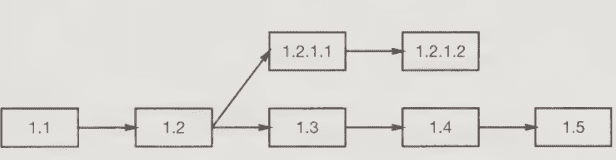

> **图 9.2**
> 带有分支的多次更改。如果版本 1.2.1.1 和 1.4 共享代码，则必须对这两个变体都进行更改。

只有在变体的生命周期从一开始就受到限制时，在替代路径中创建变体才是值得的。例如，这里产生的更改将在某个时间点*集成*到主路径中，或者在替代路径中管理的版本将被新版本取代。这样生命周期受限的变体被称为**临时变体**。

**永久变体**

对于生命周期不受限的**永久变体**，RCS 和 CVS 不提供支持，因为它们仅仅是对变体进行命名和存档——我们将不得不依赖于 9.2 节中所描述的显式变体管理。因此，在实践中，模板更受欢迎，当然，模板也应当受到版本控制。

#### 概念

1. 在可能且必要的范围内，应在运行时处理变体。
2. 变体的每个方面都应由其自身的属性来控制。


### 9 使用 AUTOCONF 自动配置软件

- SED、M4 和 CPP 是可以使用属性将模板实例化为具体变体的工具。
- 配置脚本执行测试，并利用由此确定的环境属性来实例化代码文件和 *Makefiles*。
- AUTOCONF 根据预定义测试列表生成配置脚本。
- CVS 和 RCS 的变体管理仅适用于生命周期从一开始就有限的临时变体。

#### 复习练习

1. CPP 和某些 M4 版本具有许多预定义的、特定于系统的宏。因此，GNU CPP 定义了以下内容（除此之外还有其他定义）：

```
#define __GNUC__ 2
#define __GNUC_MINOR__ 7
#define sparc 1
#define sun 1
#define unix 1
```

(a) 如果你将 CPP 应用于普通文本文件会产生什么影响？例如，应用于这段文本：

> Suddenly, a light, brighter than the sun, came from my sparc unix system.

(b) 使用这类名称进行条件编译是否有意义，例如使用 #ifdef sun...#endif？讨论这种面向字符方法的优点和缺点。

2. 请给出合适的 MAKE 规则，以便从 *configure.in* 重新构建 *Makefiles*。

3. 由 AUTOCONF 创建的脚本应该由 RCS 还是 CVS 管理？讨论其优缺点。

4. 为 XLOAD 的配置设计一个 AUTOCONF 脚本。完整的 XLOAD 源代码可以在此处找到：
`ftp://ftp.x.org/pub/unsupported/programs/xload/`

#### 延伸阅读

AUTOCONF 由 MacKenzie 等人（1994）开发。CPP、M4 和 SED 长期以来一直是 UNIX 操作系统不可或缺的一部分。

Gamma 等人（1994）描述了可以在运行时封装变体的面向对象设计模式。

Mahler (1994) 的文章是少数几篇探讨变体通用问题的文章之一。Mahler 和 Lampen (1988) 的 SHAPE 系统是 MAKE 与变体管理的实验性集成。

Zeller (1998) 研究了系统模型中变量集成的通用问题。

## 10 使用 JAVADOC 为程序编写文档

### 10.1 程序文档

创建程序还需要准备 *程序文档*。这可能是程序员面临的最不受欢迎的任务之一。他长时间艰苦地从事编程，对自己的软件了如指掌，对于这种“枯燥”的任务几乎没有热情。然而，文档不仅对后续使用至关重要，对程序员本身也同样重要，因为编写文档可以使其更好地理解软件并优化软件设计。为他人编写系统文档的过程迫使程序员采取另一种视角，减少对内部细节的关注，而更多地关注向用户或程序员提供的功能。

程序文档的主要目标是支持首次使用该软件的程序员。如今，一名程序员通常会花费超过一半的可用时间仅仅是为了 *理解* 软件。一个经验法则告诉我们，一行代码被阅读的次数比被编写或修改的次数多一百倍！

#### 10.1.1 文档的种类

有不同目的、为不同读者编写的不同类型的文档。对于程序员来说，以下文档最为有用：

**设计文档**

理想情况下，这类文档在编写任何代码之前就已构建。它以叙述性文本的形式包含程序的概述和抽象，通过图表传达其整体结构和预期构建，并引用该设计旨在实现的已记录目的和需求。对于在初始开发之后参与项目的任何程序员，特别是那些对程序进行维护工程的人来说，这份文档至关重要；因此，它必须保持绝对的实时更新，在软件设计发生更改时随时更新。

**教程**

通常，人们认为教程仅仅是为系统的最终用户提供的入门文档。然而，程序员也是最终用户——系统的内部库和接口的最终用户。一份介绍这些库和接口的使用方法，并通过易于理解的示例进行解释的教程，对新程序员非常有帮助。

**参考手册**

同样，这不是给最终用户的手册，而是接口、子系统等的参考文档。参考手册应描述所有接口，记录精确的语义，并解释每个接口的使用目的。参考手册还应指出接口、子系统等在使用上的任何限制或特定特性。

#### 10.1.2 对文档的要求

经验表明，程序代码本身就是最好的文档。任何试图将文档与程序代码独立维护的尝试，最终都会导致文档过时、不完整或不准确。此外，独立的文档要求程序员在代码和文档之间不断切换，从而增加了程序员在切换过程中失去焦点的风险。将文档和代码保存在同一个文件中，既需要编程语言支持两者的集成，也需要能够生成独立文档的工具。

**注释**

编程语言最简单的支持就是 _注释_。它们可以显著提高阅读程序的效率。然而，编译器无法检查注释是否合理、是否实时，或者是否与程序相匹配。

**正确地注释**

在程序中正确地使用注释是一门艺术，因为注释往往被使用过多或过少。C++ 的开发者 Bjarne Stroustrup 在 1997 年提出了以下建议：

- 每个源文件一个注释
- 每个类一个注释
- 每个非平凡函数一个注释，
    - 表达函数的目的
    - 必要时，描述方法（= 算法）
- 每个（全局）变量和常量一个注释
- 为不明显或不可移植的点编写注释
- “除此之外尽量少写”。

这个列表基本上可以总结为两条经验法则：

1. 保持注释简洁精准。
2. 如果我可以用程序代码表达，就不需要注释。

#### 10.1.3 如何不写注释

人们经常看到一些比起内容更注重外部形式的注释。示例 10.1 就是这样一个样本：

> **示例 10.1**
> 糟糕编程的示例
> ```c
> /******************************************
>  * Start of function S Q R T   (= "square root")   *
>  * SQRT takes an argument:                      *
>  * - double X: the number to be squared (X >= 0)   *
>  * SQRT returns:                                 *
>  * - the square root of X                        *
>  * (c) 2003 H. Becker, Burbach - all rights reserved *
>  ******************************************/
> ```

对上述注释的修改不仅需要对边框进行大量的调整，而且未能记录最重要的信息——即计算平方根。采用以下形式的注释会好得多，因为它呈现了所有重要信息：

> 冗长的注释
> ```c
> // Return the square root of X
> double sqrt(double x) {
>     ...
> }
> ```

指令块经常有多余的注释——注释应该只解释那些从源代码中看不清楚的内容。

> 多余的注释
> ```c
> n += 1;     // Increment n by one
> a *= n;    // Multiply a with n
> return a; // Return the value of a
> ```

在这里，注释仅仅是镜像地重复了指令本身所陈述的内容——因此，这些注释是多余的。事实上，指令的**目的**依然不明确。只有解释指令目的的注释才是有效的。


```c
int d;                      // Current number of daffodils
d = num_d();                // Compute number of daffodils
assert (d == 2); // We expect two daffodils
```

事实上，在这个例子中，注释对于清晰地表达指令的目的至关重要。然而，人们应该通过使用合理的变量名在程序代码中表达这一点：

#### 合理的标识符

```c
int current_daffodils = number_of_daffodils();
int expected_daffodils = 2;
assert (current_daffodils == expected_daffodils);
```

在编程过程中，正确且合理地为标识符命名可能是最重要的活动之一。然而，遗憾的是，没有任何工具能帮助创建合理的名称；这完全取决于程序员。

### 10.2 使用 JAVADOC 编写文档

#### JAVADOC 文档提取

在 JAVA 的开发过程中，从一开始就强调通过合适的工具和指南来支持源代码中的接口文档。因此，JAVADOC 工具在 JAVA 创建之初就得到了开发，它能从特殊注释中提取文档并将其转换为超文本（HTML）。这种从源文本生成文档的方法具有两个明显的优势：

- 文档成为了系统的一部分，可以使用自动化工具进行维护和构建。
- 程序的被记录部分与其文档之间建立了强内聚性，这使得程序员更有可能保持文档的实时更新。

#### 文档与源文本之间的内聚性

JAVADOC 仅查看由 `/**` 引导的特殊注释。这些注释指的是接下来的类、方法或其他元素的声明。此类注释必须以特定的形式编写，如下例所示。

#### 示例 10.2 sqrt 方法的 JAVADOC 注释

```java
/**
 * Returns the square root.
 * The argument is not allowed to be negative.
 * @param x a nonnegative number.
 * @return the square root of parameter <code>x</code>
 */
public double sqrt(double x) {
```

此类注释的第一句话是一个简短的描述，用于概览。整个文本则详细描述了该方法。

#### 标签（Tags）

此外，还使用特殊的标签来描述被记录方法的某些属性。这些标签由 "@" 引导。在上面的例子中，方法的参数 "x" 由标签 "@param" 记录，方法的返回值由 "@return" 记录。

JAVADOC 将为源文本中具有此类形式注释的每个类生成一个概览。每个类的概览包含一个方法列表，随后是详细描述。图 10.1 和 10.2 均显示了为某个类生成的 HTML 文档示例。

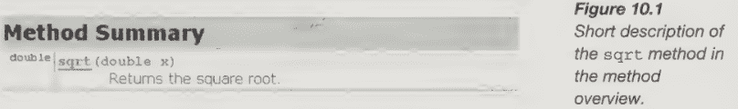

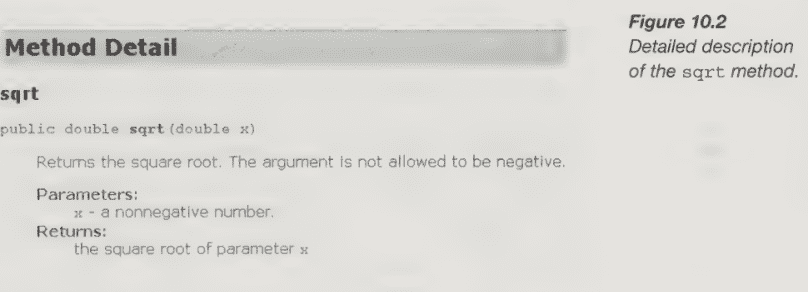

#### 10.2.1 结构化

在这些注释中，可以使用大量的 HTML 命令来结构化文档。例如，通过在注释中包含 `<p>` 标签可以在文档中插入段落。您还可以使用其他熟悉的 HTML 标记标签来修改文档中的字体属性：

- *斜体* – `<i>text</i>`
- **粗体** – `<b>text</b>`
- `打字机字体` – `<code>text</code>`

枚举可以通过 `<ul>` 和 `<li>` 生成。此外，可以通过用 `<pre>...</pre>` 标签包围示例源代码，将其嵌入到文档中。

#### 10.2.2 最重要的标签

JAVADOC 提供了一组庞大且实用的标签。其中最常见且最有用的是：

- `@author` 指定类的作者。
- `@version` 包含类的版本。通常此标签后跟一个修订版本，如第 3 章和第 4 章所述。
- `@deprecated` 标记将在未来版本中删除的方法。
- `@since` 指出被记录元素引入的时间。
- `@see`, `@link` 创建到其他元素的交叉引用。
- `@param` 记录方法的参数。
- `@return` 记录方法的返回值。
- `@exception` 记录方法执行过程中可能出现的异常（`@throw` 是其同义词）。

这些标签不仅可以用于记录类和方法，还可以用于记录包、接口或字段。并非所有标签在所有上下文中都有效，但很容易识别出适用于或适合于任何给定文档片段的标签。

#### 10.2.3 Doclets

JAVADOC 生成的文档通常是 HTML 格式。这是合理的，因为 HTML 使得文档的快速导航成为可能。然而，输出格式和输出形式都不是用户可选择的。因此，引入了一种扩展 JAVADOC 的方法，称为 *Doclets*。Doclets 的主要任务是提供其他输出格式或新标签。因此，存在用于输出为 LaTeX、PDF、DocBook 或 MIF (Framemaker) 的 doclets。另一个 doclet (iDoclet) 为不变式以及前置和后置条件（"@pre", "@post" 等）提供了标签。

由于此接口相当灵活，因此人们创建了特殊的 doclets 来检查注释结构，并揭示注释不符合要求格式的地方。*DocCheck* 和 *DocLint* 就是此类 doclets。

#### 10.2.4 附加标签

尽管 doclets 具有灵活性，但引入和处理新标签是非常复杂且费力的。因此，还有两种进一步处理新标签的机制，将在下文中演示。

假设您想创建一个新标签 "@reviewed"，以指定一段代码何时由谁审阅。让我们看看在下面的示例中如何使用此标签。

```java
/**
 * Returns the square root.
 * The argument is not allowed to be negative.
 * @param x a nonnegative number.
 * @return the square root of parameter <code>x</code>
 * @reviewed Arthur Dent, 30.2.2003
 */
public double sqrt(double x) {
```

**示例 10.3**
带有 @reviewed 标签的方法文档

第一种可能性仅仅是在命令行中指定新标签：

```bash
$ javadoc -tag reviewed:m:"Reviewed by:"
...
```

此调用定义了一个新标签，该标签仅可用于方法（":m:"）。标签 "@reviewed" 之后的文本将输出在文档的 "Reviewed by:" 段落下方。

不幸的是，通过这种简单机制无法影响标签后文本的格式。例如，如果我们想用绿色打印文本，就必须求助于 *Taglet* 机制。Taglets 与 Doclets 相似，但要简单得多。Taglet 是一个特殊类，必须提供一小组方法。

#### Taglet

示例 10.4 展示了 taglet 的使用，同样提供了一个 "@reviewed" 标签，但这次标签后的文本以粗体和绿色打印。"register" 方法的任务是将标签注册到 JAVADOC。另一个方法执行所需的输出。在实际操作中，该类必须提供一些其他方法，但这些方法对于本示例并不重要。

使用此 taglet 仅需在命令行中通过指示完成；集成会自动发生：

```bash
$ javac ReviewedTaglet.java
...
$ javadoc -taglet ReviewedTaglet *.java
...
```

图 10.3 显示了结果。

**示例 10.4**
提供 @reviewed 标签的 taglet

```java
public class ReviewedTaglet implements Taglet {

    private static final String NAME = "reviewed";
    private static final String HEADER = "Reviewed by:";

    public static void register(Map tagletMap) {
        ReviewedTaglet.tag = new ReviewedTaglet();
        Taglet t = (Taglet) tagletMap.get(tag.getName());
        if (t != null) {
            tagletMap.remove(tag.getName());
        }
        tagletMap.put(tag.getName(), tag);
    }

    public String toString(Tag tag) {
        return "<DT><B>" + HEADER + "</B><DD>"
             + "<strong><font color=green>"
             + tag.text()
             + "</font></strong></DD>\n";
    }
}
```

图 10.3 使用 Reviewed taglet 由 JAVADOC 生成的输出。

#### 方法详情

**sqrt**
`public double sqrt(double x)`

返回平方根。参数不允许为负数。

**参数：**
- x - 一个非负数。

**返回：**
- 参数 x 的平方根

**审阅人：**
- Arthur Dent, 30.2.2003

## 10.3 使用 DOXYGEN 编写文档

遗憾的是，JAVADOC 仅记录 JAVA 源文件；目前没有计划支持其他编程语言。然而，JAVADOC 的实用性启发了许多类似工具的创建或改编：在 JAVADOC 之前，已经有大量从源文本提取文档的工具，但许多较新的工具都采用了 JAVADOC 的哲学和注释语法。结果是，这些工具现在可以分为两组：一组支持 JAVADOC 方式创建文档的工具，以及所有其他工具。

第一组中的一个流行工具是 DOXYGEN，它拥有自己的文档注释格式，同时也支持 JAVADOC 风格。


## 10.3 使用 DOXYGEN 编写文档

DOXYGEN 的一个显著优势是它对编程语言的广泛支持：虽然最初是为 C 和 C++ 设计的，但 DOXYGEN 同样支持 IDL 以及（当然还有）JAVA。除了类似于 JAVADOC 的功能外，DOXYGEN 还可以生成继承图和协作图。

因此，一个典型的 DOXYGEN 文档注释如下所示：

```c
/*! \fn int read(int fd, char *buf, size_t count)
  \brief Read bytes from a file descriptor.
  \param fd The descriptor to read from.
  \param buf The buffer to read into.
  \param count The number of bytes to read.
  \retval The number of bytes read.
  */
```

**示例 10.5** 用于 DOXYGEN 的函数文档

此示例演示了 DOXYGEN 的“自由形式（free form）”函数文档风格。与 JAVADOC 风格不同（JAVADOC 要求程序元素——在本例中为函数——的文档必须紧接在源文件中的该元素之前），DOXYGEN 的自由形式文档风格允许元素的注释块位于源文件的任何位置，甚至可以位于源树的其他地方。

在此示例中，"\fn" 标签告诉 DOXYGEN，被记录函数的签名不需要从源代码中提取，而是直接从 "\fn" 标签注释本身提取。该注释中的其余标签与相应的 JAVADOC 注释相似（例如，"\brief" 表示函数的简短描述）。在 DOXYGEN 中，符号 "\\" 和 "@" 可以互换使用；"\\param" 和 "@param" 没有任何区别。

由该注释生成的文档如下所示：

```c
int read(int fd, char *buf, size_t count)
```

Read bytes from a file descriptor.

**Parameters:**

- **fd** The descriptor to read from.
- **buf** The buffer to read into.
- **count** The number of bytes to read.

**Returns:** The number of bytes read.

**示例 10.6** 由 DOXYGEN 生成的文档

DOXYGEN 还提供了将生成的文档结构化为章节或段落的机制。如 following 示例所示，使用专用标签来定义这些章节。这种能力通常用于创建与具体源元素无关的通用文档，例如介绍、教程或其他相关文档。为了方便维护，这些章节的定义通常存储在一个单独的文件中。

**示例 10.7** 使用专用标签构建文档结构

```c
/*!
 \mainpage Page Title
 ...
 \section sec1 First Chapter
 ...
 \section sec2 Second Chapter
 ...
 */
```

除了明显扩展的标签集外，DOXYGEN 相比 JAVADOC 的另一个优势是可以选择多种不同的输出格式。除了用于浏览器展示的 HTML 格式外，还支持用于参考手册的 LaTeX 格式，以及 RTF 或 MAN 格式。

然而，这些优势也被一系列缺点所抵消：遗憾的是，DOXYGEN 没有提供定义新标签或支持其他输出格式的扩展接口。

## 10.4 文学编程 (Literate Programming)

JAVADOC 和 DOXYGEN 是从源文本中提取文档的工具。但也可以反过来操作——*从文档中提取程序*。这就是 *文学编程* 的理念。在这里，文档被认为是编程的核心元素，而程序仅仅是该方案优秀文档的一个产物。因此，开发者首先集中精力编写系统的文档，只有在文档完成后，才在其中嵌入代码片段，以便随后将其提取并组合在一起创建程序。

第一个文学编程系统是 Donald E. Knuth 的 WEB，它可以同时生成文档的可打印版本（通过 **TEX**）和可编译的 Pascal 源代码以创建可执行程序。它为此使用了两个工具：WEAVE 和 TANGLE。

示例 10.8 包含一个 WEB 文件中 wc 工具的文档片段。（这里使用了针对 C 语言的 CWEB 变体。）通过调用 TANGLE，从该文件中提取 C 源代码，然后对其进行编译。文档则通过调用 WEAVE（随后调用 TEX）进行处理，以创建如图 10.4 所示的可打印文档。

**示例 10.8** wc.w – 一个 WEB 文件片段

```
...
@ Most \.{CWEB} programs share a common structure.
It's probably a good idea to state the
overall structure explicitly at the outset,
...
@c
@<Header files to include@>@/
@<Global variables@>@/
@<Functions@>@/
@<The main program@>

@ We must include the standard I/O definitions, since we want to send formatted output to |stdout| and |stderr|.

@<Header files...@>=
#include <stdio.h>

@ The |status| variable ....
```

2. Most CWEB programs share a common structure. It explicitly at the outset, even though the various parts code if we wanted to add them piecemeal.

Here, then, is an overview of the file wc.c that is de:

```
{ Header files to include 3 }
{ Global variables 4 }
{ Functions 20 }
{ The main program 5 }
```

3. We must include the standard I/O definitions, sin stderr.

```
{ Header files to include 3 } =
#include <stdio.h>
```

This code is used in section 2.

4. The status variable will tell the operating system

Donald E. Knuth 完全使用 WEB 实现了他的 TEX 系统，从而证明了该系统的可行性：文学编程逐步地“记录”了实现过程，从而有助于理解整个系统。然而，如果一个人只想使用某个组件，那么接口的文档要重要得多——而对于这一点，文学编程并没有提供支持。

#### 核心概念

- 注释的重要原则：
  - 糟糕的注释比没有注释更糟糕！
  - 保持注释简洁且精确。
  - *如果我能用程序代码表达，我就不需要注释。*
- 如果文档成为源文本的一部分，
  - 它可以使用工具进行维护和编辑，
  - 更容易保持文档的实时更新。
- JAVADOC 从源文本中提取文档，并为此使用特殊的注释。
- Doclets 和 taglets 是 JAVADOC 扩展的定义接口。而 DOXYGEN 则不支持此类机制。
- JAVADOC 支持 JAVA，DOXYGEN 则支持 JAVA 以及其他编程语言，如 C, C++, C#, 和 IDL。
- 文学编程从文档中提取源代码。

#### 复习练习

1. 从注释中提取文档通常是通过扫描器和解析器的交互完成的（参见第 5、6、7 章）。思考这种交互是如何工作的。
2. 尝试解释为什么在面向对象编程语言中几乎看不到文学编程。
3. 使用 JAVADOC 风格为前几章的程序编写文档。分别使用 JAVADOC 和 DOXYGEN 为你的 JAVA 程序生成文档。你更喜欢哪个版本？为什么？
4. 在 DOXYGEN 中，可以使用 TEX 记法编写公式。开发一个针对 "@formula" 标签的 taglet，以满足以下要求：
   (a) 使用 TEX 处理该标签后的文本。
   (b) 将 TEX 输出转换为位图图形。
   (c) 通过 "" 将位图图形包含在输出中。

#### 延伸阅读

除了 Sun Microsystems, Inc. (2002) 提供的 JAVADOC 参考手册外，还有一套关于注释文档如何设计的约定集合：“Java Code Conventions” – Sun Microsystems, Inc. (2000)。原始的设计决策和背景见 Friendly (1995)。

Sewell (1989) 详细描述了使用 WEB 系统的文学编程。附录中包含了两个 WEB 工具 WEAVE 和 TANGLE 的源代码清单（这两个工具本身就是用文学编程开发的）。

DOXYGEN 可以在其网站上找到：
`http://www.doxygen.org/`
那里提供了文档和其他介绍性资料。

关于 JAVADOC 的所有内容可以在 Sun 的 JAVA 页面上找到：
`http://java.sun.com/j2se/javadoc/`

### 其他文档工具

JAVADOC 集成在大多数 JAVA 开发环境中。对于其他编程语言，也存在一系列类似的工具：DOXYGEN 是从 DOC++ 的早期版本分拆出来的，后者提供类似的功能。KDoc 是另一个针对 C++ 和 IDL 的系统，起源于 KDE 项目。


## 练习 III

在这个练习中，你可以使用 MAKE 和 AUTOCONF 自动化构建练习 II 中的 `lcalc` 程序。此外，你应当使用 JAVADOC 和 DOXYGEN 为你的程序编写文档；一个 ANTLR 变体将由 ANT 构建。

- 1. 为 `lcalc` 创建一个 *Makefile*，使其能够：
    - 从 `grammar.y` 创建文件 `grammar.c` 和 `grammar.h`；为此，*Makefile* 应调用 YACC 并将生成的文件 `y.tab.c` 和 `y.tab.h` 重命名；
    - 从 `scanner.l` 创建文件 `scanner.c`；为此，你的 *Makefile* 必须调用 LEX 并将生成的文件 `lex.yy.c` 重命名；
    - 从 `grammar.c` 创建文件 `grammar.o`；
    - 从 `scanner.c` 创建文件 `scanner.o`；
    - 从 `scanner.o` 和 `grammar.o` 创建程序 `lcalc`。

在没有任何进一步参数的情况下调用 `make` 应当能够创建 `lcalc`。请使用**显式规则**和**显式工具**。

- 2. 设置 *Makefile*，使得 `make clean` 能够删除所有由 MAKE 创建的文件。

- 3. 使 *Makefiles* 中的工具可配置，以便用户在调用 MAKE 时提供工具 —— 例如：

```
$ make CC=gcc LEX=flex
```

- 4. 使用隐式规则来：
    - 将 YACC 和 LEX 文件转换为 C 文件
    - 将 C 文件转换为目标文件。

- 5. 使 `lcalc` 软件包可配置，以便由配置脚本自动确定 C 编译器以及 YACC 和 LEX 工具。请注意以下几点：
    - 你可以使用 `Makefile` 作为 `Makefile.in` 文件，并在其中为工具使用适当的占位符（`@CC@`, `@LEX@`, `@YACC@`）。
    - 在 `configure.in` 中，你需要 AUTOCONF 宏 `AC_INIT`, `AC_PROG_CC`, `AC_PROG_LEX` 和 `AC_PROG_YACC`。
    - 不需要 `config.h` 文件。宏 `AC_CONFIG_HEADER` 和 `AM_SANITY_CHECK` 同样不需要。
    - 详情请参阅 AUTOCONF 文档中的“Particular Program Checks”章节。

- 6. 在 `Makefile` 中插入规则，使得执行：
`$ make Makefile`
时，`Makefile` 能从 `configure.in` 自动重新创建。

- 7. 使用 DOXYGEN 为所有文件编写文档。注意，除了 C 源文件外，所有文件都必须使用“自由形式（free form）”的函数文档风格。

- 8. 将 DOXYGEN 的调用包含在你的 `Makefile` 中，以便自动创建文档。

- 9. AUTOCONF 不支持 DOXYGEN。请设计合适的宏。

- 10. 为 ANTLR 练习创建一个 ANT 规范文件 `build.xml`。ANT 直接支持 ANTLR。

- 11. 使用 JAVADOC 为你的 JAVA 文件编写文档。扩展你的 ANT 规范，使得文档能够自动生成。

## 第 IV 部分：原型设计

### 11 使用 Tcl/Tk 创建原型

#### 11.1 原型与脚本语言

本书中涉及的许多工具协调了多位开发者的工作。这种分工是一个相对较新的现象。直到六十年代初，程序大多由用户开发且仅供其自身使用。当时客户、开发者和用户之间没有区别，如果发现错误，通常可以立即识别并由用户-开发者予以消除。

到 20 世纪 60 年代中期，情况发生了彻底的变化：计算机能力的显著提升和价格的下降使得更大规模的程序可以在更多计算机上运行。这带来了两大风险，并在 60 年代末导致了所谓的软件危机以及“软件工程”这一术语的诞生：

> **开发中的误解：** 现代软件系统如此复杂，以至于单个开发者不可能掌握所有细节。因此，软件系统是以小组形式开发的；每位开发者创建系统的一个部分。将一项任务分解为几个独立可解的子问题被称为软件设计，它是软件工程的主要领域之一。

> **需求中的误解：** 用户和开发者的分工往往导致难以准确地记录需求。通常，开发者并非程序所应用领域的专家，而硬币的另一面是，用户很少了解其程序的内部结构和开发过程。

这两大风险至今仍是软件工程的核心问题。在本章中，我们希望集中探讨第二个风险：如何保证用户获得他们想要的程序？

一种重要的方法是创建原型。其核心思想是在早期向客户和选定用户展示系统的可运行部分，这意味着客户可以提供更准确的反馈，未来的用户也可以被整合到设计过程中。这些原型经过反复修改直到需求最终确定，随后即可开始实际系统的开发。

**原型的种类**

根据原型所实现的软件系统子集，可以将原型分为几种类型：

- *垂直原型（vertical prototype）* 仅实现待构建系统的少数几个功能；然而，每个功能都具有完整或近乎完整的功能性。使用 *垂直原型*，可以检查关键功能是否满足需求。

“*垂直原型*”这一名称基于这样一个假设：软件系统是以层级组织的，从底层（机器功能）到顶层（*用户界面*）排列。一个 *垂直原型* 纵贯软件系统的所有层。

- *水平原型（horizontal prototype）* 仅实现部分层级；但这些层级大多被完整地编程。这种原型缺乏的是在底层实现的实际功能。

通常，*水平原型* 实现的是 *用户界面*。由于底层尚不完整，许多 *用户界面* 元素是没有实际功能的模型（mock-ups）。通过 *水平原型*，可以检查程序是否能应对用户的典型工作流程。

**脚本语言的特点**

原型的本质特点是能够快速创建且易于更改。因此，在编写原型程序时，经常使用所谓的 *脚本语言*，它们具有以下特点：

- **无静态类型检查：** 与普通编程语言相反，*脚本语言* 没有 *类型声明*，因此在编译时没有类型检查。变量和函数可以接受并返回任意类型；类型正确性仅在运行时检查。

- **简单的重用：** *脚本语言* 拥有能极大方便数据格式转换的函数 —— 例如，可以轻松地从字符串中提取正则表达式。这简化了与其他使用文本作为输入输出格式的程序的集成。

- **解释而非翻译：** 通常，*脚本语言* 在运行时被解释或翻译成可执行代码。这意味着在做出更改后不再需要重新编译，从而加快了开发速度；来自外部源的脚本也可以在运行时被读取、组装和处理。

- **更高的抽象程度：** 脚本语言并非旨在实现基础系统功能。因此，在其中寻找指针或直接内存操作等低级系统特性是徒劳的。相反，脚本语言拥有 *通用数据类型*（如列表、字符串和关联字段），可以通过它们快速产生功能。结合高效且易用的库，使用脚本语言编写的应用程序平均仅需传统编程语言 10% 的代码量。

**脚本语言的缺点**

这些特性是有代价的：

- 缺乏静态类型检查导致了较高的 **运行时错误** 风险。
- **复杂的数据结构** 难以以安全的方式实现。
- 解释执行的代码通常比原生机器码 **慢**。

然而，没有理由只排他性地使用传统编程语言或脚本语言：成功在于结合两种方法的优点。这就是本章介绍的脚本语言 *Tcl* 的目标。

### 11.2 Tcl：命令与脚本

Tcl 是 *Tool command language* 的缩写，是由 John K. Ousterhout 在 1988 年开发的一种脚本语言。一个 Tcl 程序由若干个 *Tcl 命令* 组成，这些命令实现了程序的各项功能。Tcl 程序最简单的形式是 *Tcl 解释器*。Tcl 解释器使用 *Tcl 解析器* 来读取和处理命令调用，并调用相应的命令。例如，考虑 Tcl 解释器 `tclsh`（"Tcl Shell"），它是 Tcl 的一个组件，从键盘读取命令：

```
$ tclsh
% _
```

百分号 "%" 是 `tclsh` 的提示符，我们现在可以在此处输入 Tcl 命令。`puts` 命令用于输出一个字符串：

```
% puts hello
hello
% _
```

一行中的第一个单词是命令名称（此处为 `puts`），所有其他由空格分隔的单词都是该命令的参数（此处为 `hello`）。


#### set

Tcl 的 `set` 命令用于给变量赋值：

```tcl
% set pi 3.1415
3.1415
% _
```

Tcl 的值仅有字符字符串；现在 `pi` 在形式上代表字符字符串 3.1415，而不是（例如）数值 3.1415。然而，正如我们稍后将看到的，`pi` 通常会被解释为数值。

每个 Tcl 命令都有一个结果，该结果由 `tclsh` 输出 —— 例如，`set` 命令的结果是被赋值的值，而 `puts` 的结果则是空字符串。

为了访问变量的值，我们在名称前加上美元符号 “$”：

```tcl
% puts $pi
3.1415
% _
```

#### 变量替换

事实上，Tcl 解析器会将所有形式为 `$name` 的字符字符串替换为变量 `name` 的值。这种替换被称为变量替换。因此，上面的示例等同于：

```tcl
% puts 3.1415
3.1415
% _
```

#### Tcl 中的算术运算

Tcl 没有内置的算术运算 —— 这是由一个特殊命令负责的。`expr` 接收一个在其他编程语言中常用的表达式记法，对其进行求值并输出结果：

```tcl
% expr $pi * 2
6.283
% _
```

#### 命令替换

`expr` 的结果通常在程序内部被进一步处理。为此，我们使用命令替换：每个形式为 `[command]` 的字符字符串都被替换为命令 `command` 的执行结果。例如，为了将求值表达式的结果赋值给变量 `2pi`，我们写道：

```tcl
% set 2pi [expr $pi * 2]
6.283
% puts $2pi
6.283
% _
```

我们可以看到，空格以及 "$" 和 "[...]" 在 Tcl 中具有特殊含义。这些符号的特殊含义可以通过在字符前加上反斜杠来取消。例如，为了输出带有空格的文本，我们可以写：

**反斜杠**

```tcl
% puts The\ result\ is\ $2pi
The result is 6.283
% _
```

如果我们不插入反斜杠，就会产生错误消息，因为 `puts` 被调用时使用了错误的参数：

```tcl
% puts The result is $2pi
wrong # args: should be
   "puts ?-nonewline? ?channelId? string"
% _
```

然而在实践中，在每个空格前都加上反斜杠是很累人的。因此，Tcl 具有特殊的 “text” 形式，其中文本内的所有空格都被视为普通字符，因此不被用于分隔参数。所有其他替换保持不变。

**双引号**

```tcl
% puts "The result is $2pi"
The result is 6.283
% _
```

在双引号内，所有替换仍然可用，并且如有必要，可以使用反斜杠将其关闭。双引号内的引号也可以作为普通字符输入：

```tcl
% set price 20
20
% puts "The book \"Tcl/Tk\" costs $20."
The book "Tcl/Tk" costs $20.
% _
```

如果所有字符都应被视为普通字符，从而关闭所有类型的替换，则可以将文本放在花括号 "{...}" 之间。

**花括号**

```tcl
% puts {The car costs $300.}
The car costs $300.
% _
```

花括号主要用于定义要在以后求值的命令序列 —— 例如，用于定义函数。`proc` 命令定义一个新命令；它需要一个命令名称、一个参数列表以及一个由命令序列组成的函数体：

**命令序列**

```tcl
% proc plus {a b} {expr $a + $b}
% plus 2 5
7
% _
```

#### Tcl 中的正则表达式

这是一个复杂的示例。`grep` 命令用于输出文件中包含特定文本模式的所有行。让我们查看文件 `ae` 中示例 2.2 的美式英语文本。我们可以使用 `grep` 来查找正则表达式 *i*[zs]：

```tcl
% grep {i[zs]} ae
The change impact was minimized by localizing the most
% _
```

如何实现 `grep`？两个参数分别是用于正则表达式的 `pattern` 和用于文件的 `file`。首先，我们使用 `open` 打开文件并将其赋值给变量 `fd`（一个文件描述符）。然后，我们使用 `gets` 从文件读取一行 `line`；只要这个过程正常运行（`while`），我们就检查（`if`）正则表达式是否匹配该行（`regexp`）。如果匹配，我们就输出该行（`puts`）。在循环结束时，再次关闭文件（`close`）。

#### 示例 11.1 Tcl 中的 GREP 命令

```tcl
% proc grep {pattern file} {
    set fd [open $file r]
    while {[gets $fd line] >= 0} {
        if [regexp $pattern $line] {
            puts $line
        }
    }
    close $fd
}
```

与传统的编程语言相比，这个示例极其简洁：我们不需要声明（尤其是类型声明），并且可以使用强大的函数（例如这里的 `regexp`）。此外，我们不必担心内存的分配和释放，也不必关心缓冲区溢出。所有这些都由 Tcl 处理。

有趣的是，`while` 和 `if` 实际上也是 Tcl 命令。它们都接收一个表达式和一个命令序列作为参数。在需要时，参数（即 `while` 和 `if` 的主体）由解释器求值。这是通过 Tcl 命令 `eval` 完成的：

```tcl
% set cmd {puts hello}
puts hello
% eval $cmd
hello
% _
```

使用 `eval`，命令序列可以在运行时组合并在需要时执行；还可以定义类似于 **if** 和 **while** 的新控制结构。特殊的 Tcl 命令 **uplevel** 使得控制结构能够访问调用命令的变量。

### 11.3 扩展 Tcl 本身

利用目前介绍的手段，人们现在可以完全使用 Tcl 编写任何规模的程序。然而，这并不是发明者的意图。相反，Tcl 应该仅在已经存在且以传统方式开发的部分之间建立 *连接* —— Tcl 充当这些部分之间的“胶水”。

*Tcl 作为胶水函数*

传统程序部分与 Tcl 之间的连接是通过 *自定义 Tcl 命令* 实现的。这里有一个 Tcl 命令 **eq** 的示例，它用于测试两个参数的相等性。它是用 C 语言实现的：

*自定义 Tcl 命令*

```c
#include <tcl.h>

int EqCmd (ClientData clientData,
   Tcl_Interp *interp,
   int argc, char *argv[])
{
   if (argc != 3)
   {
      interp->result = "wrong # args";
      return TCL_ERROR;
   }
   
   if (strcmp(argv[1], argv[2]) == 0)
      interp->result = "1";
   else
      interp->result = "0";
   
   return TCL_OK;
}
```

传递给 `eq` 的参数存储在数组 `argv` 中。它包含命令的名称（在 `argv[0]` 中）以及所有参数（在 `argv[1]`, `argv[2]`, ... 中）。`argc` 是 `argv` 中数组元素的数量 —— 因此 `eq` 在使用两个参数调用时，`argc` 的值为 3。

如果 `eq` 没有两个参数，则返回错误消息；否则，比较两个参数的文本（使用 `strcmp`），并根据比较结果，返回值 1（相等）或 0（不相等）。

为了使用这样定义的函数，必须将其重新集成到解释器中。实现此项的经典方法是通过实现 `Tcl_AppInit` 函数的一个变体来扩展 `tclsh`：

```c
#include <tcl.h>

int Tcl_AppInit(Tcl_Interp *interp)
{
    if (Tcl_Init(interp) == TCL_ERROR)
        return TCL_ERROR;

    Tcl_CreateCommand(interp, "eq", EqCmd,
            (ClientData) ZERO,
            (Tcl_CmdDeleteProc *) ZERO);

    return TCL_OK;
}
```

这里的关键函数是 `Tcl_CreateCommand`，它将自定义 C 函数 `EqCmd` 与 Tcl 命令 `eq` 关联起来。假设 `EqCmd` 和 `Tcl_AppInit` 定义在 `myAppInit.c` 中。如果现在将 `myAppInit` 以 `mytclsh` 的名称链接到 Tcl 库，则将使用 Tcl 库中预定义的 `main` 主函数，该函数调用 `Tcl_AppInit`，然后将读取的命令输入到 Tcl 解释器中。

```bash
$ cc -o mytclsh myAppInit.c -ltcl -lm
$ ./mytclsh
% eq 2 2
1
% eq foo bar
0
% _
```

#### Tcl 扩展

通过自定义命令扩展 Tcl 的可能性是其获得成功的主要原因。目前，已经有了用于访问数据库的扩展，

网络编程、用户输入模拟等等。第 12 章将介绍用于使用 EXPECT 和 DEJAGNU 进行回归测试的特殊扩展。

### 11.4 Tk：按钮与命令

最显著且分布最广泛的 Tcl 扩展是 *Tk*，这是一个用于简单创建图形用户界面（GUI）的库。在 Tk 中，用户界面是由基本元素组合而成的，这些元素被称为 *widgets*（组件，源自 "window gadget"）。组件可以实现多种基本功能；图 11.1 展示了一些 Tk 组件。


**图 11.1** 一些 Tk 组件。

组件根据其外观和行为被分为不同的*类*（classes），例如按钮、滚动条或文本窗口。要创建单个组件，需将组件类作为命令给出，随后是组件的名称，以及（在必要时）其他选项；`pack` 命令将新创建的组件添加到主窗口中。

#### 组件类

这里有一个使用 Tcl 解释器 `wish`（源自 "windowing shell"，由 Tk 扩展）的示例：

```
$ wish
% button .b -text "Hello, world!"
.b
% pack .b
% _
```

你只需要这两个命令就能创建图 11.2 所示的窗口。

**图 11.2** 一个 “Hello, world!” 应用程序。（装饰性的标题栏来自窗口管理器。）


作为一名 Tk 开发者，你不需要耗时的初始化，也不需要冗长的组件属性设置或漫长的编译过程——你可以立即甚至以交互方式看到工作结果。

这里具体发生了什么？`button` 命令创建了一个名为 `.b` 的新按钮。通过使用进一步的参数，可以指定新创建组件的某些属性——在我们的示例中，是待显示的文本。由于这些额外参数也可以省略，因此它们被称为选项（options）。选项通常有自己的参数；在我们的按钮示例中，选项是 `-text`，参数是 "Hello, world"。按钮类大约有 20 个可以通过选项设置的属性。

#### 组件选项

#### 组件命令

每个组件都有一些自己的命令，可以通过这些命令回顾性地查询和更改其属性。这些命令连接在组件名称的末尾。`configure` 命令允许以选项的形式重新输入属性；这些选项与创建组件时输入的是相同的。例如，我们可以使用 `configure` 来输入一个在点击按钮时必须执行的命令：

```
% .b configure -command {puts "Hello!"}
.b
% _
```

从现在起，每次点击都会输出字符串 "Hello!"。

#### 更改属性

`configure` 也可以用来更改已经输入的属性。可以使用以下命令来更改显示的文本。

```
% .b configure -text "Goodbye, world!"
.b
% _
```

#### 将变量链接到组件属性

为了在运行时更改属性，Tcl 通常使用另一种方法：属性不是通过命令直接更改的，而是链接到变量。这里有一个包含多个组件的简短示例。

```tcl
$ wish
% checkbutton .bold -text Bold -variable bold
.bold
% checkbutton .italic -text Italic -variable italic
.italic
% checkbutton .underline -text Underline \
    -variable underline
.underline
% pack .bold .italic .underline -side top -anchor w
% _
```

此输入创建了图 11.3 中的窗口。


**图 11.3** 一个用于创建文本属性的小菜单。

`checkbutton` 组件类的三个选项可以是开启或关闭状态。它们的状态通过 `-variable` 选项*链接*到一个变量：组件状态的每次更改都会导致变量值的更改，反之亦然。如果 `.bold` 选项开启，则 `bold` 变量的值为 1，否则为 0。

假设图 11.3 显示了窗口的当前状态。这将导致变量具有以下值：

```tcl
% puts "$bold $italic $underline"
1 0 0
% _
```

变量与组件之间的链接是双向的：通过更改变量，也可以更改菜单的状态。例如，以下 Tcl 命令将开启所有三个选项。

```tcl
% set bold 1
% set italic 1
% set underline 1
% _
```

正如前面解释的，组件不仅可以链接到变量，还可以链接到 *Tcl 函数*。基本思想始终是在组件被**激活**时执行一个函数。“激活”意味着相对于该组件发生了一个特定的**事件**——通常是用户操作，例如当鼠标指针指向该组件时按下某个键。在此过程中，Tcl/Tk 允许事件和函数的任意组合。

示例 11.2 展示了文件 `power.tcl`，它产生了一个包含多个组件的完整应用程序。

```tcl
proc pow {base p} {
    set result 1
    while {$p > 0} {
        set result [expr $result * $base]
        set p [expr $p - 1]
    }
    return $result
}

entry .base -width 6 -textvariable base
label .label1 -text "to the power"
entry .power -width 6 -textvariable power
label .label2 -text "is"
label .result -textvariable result
pack .base .label1 .power .label2 .result -side left \
  -padx 1m -pady 2m
bind .base <Return> {set result [pow $base $power]}
bind .power <Return> {set result [pow $base $power]}
```

**示例 11.2** *在文件 power.tcl 中计算幂*

我们可以通过使用 `-f` 选项调用 `wish` 来加载 `power.tcl` 文件中的命令：

```
$ wish -f power.tcl
```

我们将得到图 11.4 中的图像。在两个文本窗口之一中输入数字并按下 *Return* 键后，右侧会自动计算出幂的结果。

**图 11.4** *用于计算幂的图形用户界面。*


该应用程序由五个组件组成：两个文本窗口（`.base` 和 `.power`）以及三个标签（`.label1`、`.label2` 和 `.result`）。

在其中一个文本窗口（组件类 `entry`）中，用户可以输入和编辑字符串。`-textvariable` 选项将文本窗口链接到变量 `base` 和 `power`。

两个标签 `.label1` 和 `.label2` 显示使用 `-text` 选项设置的常量字符串；标签 `.result` 指示 `result` 变量的当前值，该变量使用 `-textvariable` 与标签链接，方式与文本窗口相同。

`pack` 命令以同样的方式用于所有五个组件；通过 `-side` 选项，它被安排为使指定的组件从左到右排列。其他选项决定外边框的厚度。

使用 `bind` 命令，`pow` 命令被链接到文本窗口。它的参数是一个组件、一个事件描述和一个命令序列。在我们的案例中，事件描述是 `<Return>`：如果在指定的组件中按下了 Return 键，则执行命令序列，在本例中是重新计算 `result` 变量的值。

再一次，这个示例出奇地简洁但非常清晰。事实上，脚本编写速度如此之快，以至于为脚本语言开发的用于交互式排列用户界面的程序（所谓的 GUI 构建器）尚未能占据太多地盘。无论如何，还是有一些的。图 11.5 所示的 SpecTcl（源自 spectacle）可以为 Tcl 和 Java 创建界面。组件从菜单拖拽到桌面上；随时可以执行原型程序进行测试。SpecTcl 完全是用 Tcl/Tk 编写的。

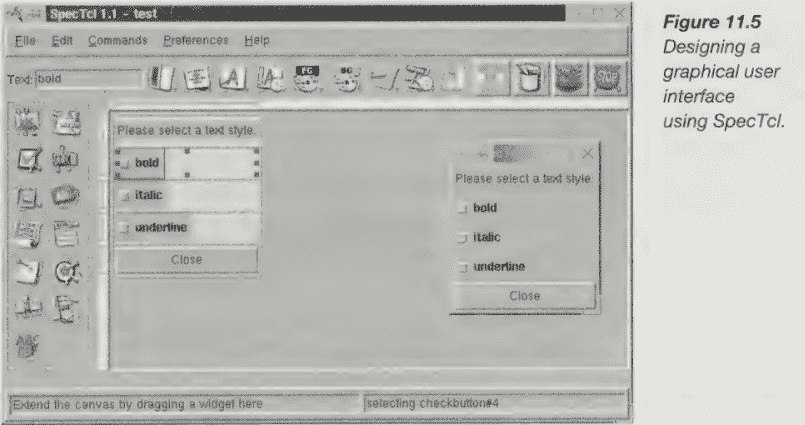
**图 11.5** GUI 构建器 SpecTcl

无论是通过输入还是点击，应用程序的细节都可以快速且轻松地更改，直到客户和用户都满意为止。一旦用户界面稳定，基于原型的（且缓慢的！）脚本语言实现（如 `pow`）就可以被使用“传统”编程语言产生的高效实现所取代。

### 11.5 Tcl/Tk 作为原型语言

#### 使用 Tcl 进行增量程序开发

Tk 示例比 Tcl 示例更清楚地展示了如何使用 Tcl/Tk 快速创建原型。然而，我们不能忽视这样一个事实：仅用 Tcl 编程的应用程序在维护方面可能会产生大问题。因此，为了使用 Tcl/Tk 增量开发程序，建议采取以下步骤：

- 1. 开发一个水平原型，以便与客户和用户协调用户界面。
- 2. 与上述步骤并行，定义用户界面与自定义 Tcl 命令之间的接口。
- 3. 仅使用 Tcl 实现 Tcl 命令，通常功能大幅削减或完全没有功能。
- 4. 在原型进一步完善的同时，使用常规编程语言（重新）实现 Tcl 命令。适用正常的设计、实现和测试阶段。
- 5. 只要用户界面没有特殊要求，它可以继续使用 Tcl/Tk 编写。

最终产品由两部分组成：

- 1. 一系列常规 Tcl 命令，它们涵盖了应用程序的功能，且独立于特定的表示形式。
- 2. 一个 Tcl/Tk 用户界面，它调用应用程序的 Tcl 命令并将结果呈现给用户。

#### 用户界面与功能的划分

Tcl 倾向于将用户界面和实际功能进行明确区分；应用程序可以独立于特定的用户界面在任何上下文中重复使用。作为一种“胶水语言”，Tcl 将应用程序与用户界面以及（在必要时）其他应用程序绑定在一起。


由于单个 Tcl 命令在最终产品中完全按照常规方式编程，因此仍然具有标准化编译编程语言的整体安全性和效率。最后，用户可以根据自己的喜好扩展和调整界面，而无需熟悉应用程序的细节或自行编译应用程序——他们只需要知道该应用程序特定的 Tcl 命令即可。

### 11.6 其他脚本语言

Tcl 最大的弱点在于，除了字符串和关联数组外，它不支持任何内置数据类型——甚至数字也只能作为字符串处理。因此，除了 Tcl 之外，还建立了其他用于原型设计的脚本语言。

#### 11.6.1 Perl

由 Larry Wall（同时也是第 2 章讨论的 PATCH 的作者）创建的 PERL 是一种高效的原型语言，在文字处理和系统编程方面具有卓越的能力；PERL 特别被用于 WWW 服务器。

PERL 因其语法和多功能性而闻名（如果不是臭名昭著的话）：PERL 的作者声称，有多种编写程序的方法是一个巨大的优势（“剥猫皮的方法不止一种”）。示例 11.3 展示了四种将数据从一个源 `$fp` 复制到另一个源 `$conn` 的不同方法。

**PERL 语法**

```perl
while (1) {
    $buf = $fp->read($blocksize);
    if (not $buf) { last }
    $conn->send($buf);
}

LOOP:
while (1) {
    $buf = $fp->read($blocksize);
    if (!$buf) {
        last LOOP;
    }
    $conn->send($buf);
}

while (1) {
    last unless $buf = $fp->read($blocksize);
    $conn->send($buf);
}

while (1) {
    last unless $buf = read $fp $blocksize;
    send $conn $buf;
}
```

**示例 11.3**：在 PERL 中编写同一个函数的四种方法。（该示例由 Tom Christiansen 于 1995 年在新闻组 comp.lang.perl 中发表）

#### PERL 中的数据结构

与 Tcl 不同，PERL 有许多典型的可用数据结构，如列表（lists）、关联数组（associative arrays）和记录（records），这些也可以用于实现带有继承的面向对象编程。然而，将这些基本元素组合成复杂数据结构相当困难，因此成为了经常被问到的问题（FAQ）的主题。无数的内置语言技巧也难以组合；每一个技巧似乎都是为了解决一个特定问题而创建的。

作为演示，我们将用 PERL 实现矩阵乘法，如示例 11.4 所示。

```perl
sub mmult {
    my ($m1,$m2) = @_;
    my ($m1rows,$m1cols) = (scalar @$m1, scalar @{$m1->[0]});
    my ($m2rows,$m2cols) = (scalar @$m2, scalar @{$m2->[0]});
    
    unless ($m1cols == $m2rows) { # raise exception, actually
        die "IndexError: matrices don't match: $m1cols != $m2rows";
    }
    
    my $result = [];
    my ($i, $j, $k);
    
    for $i (0 .. ($m1rows - 1)) {
        for $j (0 .. ($m2cols - 1)) {
            for $k (0 .. ($m1cols - 1)) {
                $result->[$i]->[$j] +=
                    ($m1->[$i]->[$k] * $m2->[$k]->[$j]);
            }
        }
    }
    
    return $result;
}
```

**示例 11.4**：PERL 中的矩阵乘法

PERL 的结构具有以下含义：

- `my` 结构 `my` 定义了一个局部变量。（注：因此默认情况下，如果没有 `my`，变量是全局的；`local` 用于临时修改全局变量以产生动态作用域。）
- `@_` 是函数参数列表。
- `l->[n]` 用于获取列表 `l` 的第 $n$ 个元素。
- `unless` 是一个条件取反的 `if`。
- `for` 开始一个循环。
- `a += b` 与 `a = a + b` 含义相同。

我们将语法的评判交给读者——至少，程序能够运行。PERL 附带一个 Tk 模块，因此允许快速创建用户界面。

#### 11.6.2 Python

由 Guido van Rossum 创建的 PYTHON 也是一种脚本语言；它与 PERL 一样高效，并拥有灵感来自 MODULA-2 的清晰语法。在 PYTHON 中，每个功能由恰好一个语言结构覆盖；虽然语言结构比 PERL 少，但现有的结构比 PERL 的更正交（可组合）。

PYTHON 的“只有一种方法”的特性不仅体现在语言结构中，还体现在语法中：这里使用 *缩进* 来构建结构——而不是大括号（如 C, Tcl 或 PERL）或 `BEGIN...END` 块（如 Modula 或 Ada）。这一特性最初常被认为是不正统的，但它提供了简洁、统一的格式。

示例 11.5 展示了我们已经在 PERL 中见过的矩阵乘法程序——这次是用 PYTHON 编写的。唯一需要解释的结构是 `[e] * l` 形式，它创建了一个长度为 `l` 的数组，其中每个元素的值均为 `e`。

**PYTHON 语法**

```python
def mmult(m1, m2):
    m2rows, m2cols = len(m2), len(m2[0])
    m1rows, m1cols = len(m1), len(m1[0])
    if m1cols != m2rows:
        raise IndexError, "Matrices do not match"

    result = [None] * m1rows
    for i in range(m1rows):
        result[i] = [0] * m2cols
        for j in range(m2cols):
            for k in range(m1cols):
                result[i][j] = \
                    result[i][j] + m1[i][k] * m2[k][j]

    return result
```

#### PYTHON 数据类型

与 PERL 类似，PYTHON 带来了高效的数据类型，如列表（lists）、元组（tuples）、链接（links）和关联数组（associative arrays）。它还提供了完整的面向对象和模块化，使得 PYTHON 程序可以轻松地从原型阶段过渡。

PYTHON 同样支持 Tk，并且可以轻松地通过用 C 编写的新命令进行扩展。

最后，我们能否用 Tcl 编写矩阵乘法？是的，我们可以，如示例 11.6 所示。

```tcl
proc mmult {$m1 $m2} {
    set m2rows [llength $m2];
    set m2cols [llength [lindex $m2 0]];
    set m1rows [llength $m1];
    set m1cols [llength [lindex $m1 0]];
    if { $m1cols != $m2rows || $m1rows != $m2cols } {
        error "Matrix dimensions do not match!";
    }
    foreach row1 $m1 {
        set row {};
        for { set i 0 } { $i < $m2cols } { incr i } {
            set j 0;
            set element 0;
            foreach row2 $m2 {
                incr element \
                    [expr [lindex $row1 $j] * [lindex $row2 $i]];
                incr j;
            }

            lappend row $element;
        }
        lappend result $row;
    }
    return $result;
}
```

**示例 11.6**：Tcl 中的矩阵乘法

在这个示例中，使用了以下 Tcl 命令：

- `llength l` 返回列表 $l$ 的长度。
- `lindex l n` 返回列表 $l$ 的第 $n$ 个元素（从 0 开始）。
- `foreach e l b` 对 $l$ 中的每个值 $e$ 执行 $b$。
- `for i j p b` 是 C 风格的循环：首先执行初始化 $i$。只要满足条件 $p$，就重复循环体 $b$ 和递增语句 $j$。
- `incr n` 将 $n$ 增加 1。
- `incr n m` 将 $n$ 增加 $m$。
- `lappend l e` 将 $e$ 追加到列表 $l$ 中。

该示例清楚地展示了 Tcl 中命令导向的局限性：对于每一次赋值和每一次元素访问，都必须调用一个单独的 Tcl 命令，这并没有让程序变得更容易阅读。PYTHON 的变体要易读得多！

#### 核心概念

- *原型*（prototype）实现了软件系统的一个子集，用于明确客户的想法。用户可以在早期阶段对设计提供反馈。
- 诸如 Tcl 之类的 *脚本语言* 非常适合快速创建原型。由于不需要声明，且增加了复用和抽象，开发速度得到了提高。然而，脚本语言不适用于高效能或复杂的应用程序。
- Tcl 提供了一套创建原型的 *方法论*：缺失的功能首先用 Tcl 粗略地实现，然后用常规编程语言进行编程。
- 在最终产品中，*用户界面* 也可以使用 Tcl/Tk 来制作。由于每个功能都被分配了对应的 Tcl 命令，因此具有很好的复用可能性。
- PERL 和 PYTHON 提供了比 Tcl 更复杂的数据结构（Tcl 仅支持字符串）。PERL 的优势在于用于文字处理和系统编程的简单脚本，而 PYTHON 由于模块化和面向对象的特性，适合开发大型程序。


#### 复习练习

- 1. 你的老板看到一个案例研究，其中一个 PERL 程序开发速度比用非脚本语言编写的程序快了十倍。他现在要求你立即完全使用 PERL 进行编程。请告诉他这种方法的五个风险。

- 2. 在传统的编程语言中，如果函数的签名被更改，在重新编译程序的其余部分时会立即收到通知。在脚本语言的情况下会发生什么？脚本语言的库开发人员如何保持与早期版本的兼容性？

- 3. 假设你面临以下需求。思考如何将系统分解为单个组件。哪些组件你会用 Tcl 实现，哪些你会用传统编程语言实现？使用增量程序开发，你会先开发哪些组件，最后开发哪些组件？
    - (a) 一个用于创建、管理和发送电子邮件的交互式程序。
    - (b) 一个用于控制现金分发机（ATM）的程序，该程序必须与中央计算机通信。
    - (c) 为 CVS 开发的图形用户界面（第 4 章）。
    - (d) 一个用于显示多个气象站状态的程序。

#### 延伸阅读

Tcl/Tk 的基准参考是 Ousterhout (1994) 的书，本章正是基于该书编写的。Tcl/Tk 拥有庞大的用户群体和广泛的商业支持。John Ousterhout 创立了 *Scriptics* 公司，该公司目前负责开发 Tcl/Tk；其网页

`http://www.scriptics.com/`

包含许多其他 Tcl/Tk 资源的链接；图 11.5 中显示的 SpecTcl 也可以在此处获得。

关于 PERL 的标准书籍是 Larry Wall (1996) 的书；任何想要了解众多 PERL 技巧的人，都应该辅以 Christiansen 和 Torkington (1998) 的书。PERL 官方网站

`http://www.perl.com/`

包含大量其他资源的链接。

PYTHON 官方网站

`http://www.python.org/`

是获取 PYTHON 优秀文档的首选来源。你也可以在这里找到 van Rossum (1999) 的在线教程。偏好纸质书的读者可以参考 Himstedt 和 Mätzel (1999)。

#### 其他原型设计工具

除了 Tcl/Tk、PERL 和 PYTHON，还有许多其他原型脚本语言在被使用：

- LISP 是最古老的编程语言之一，在任何处理 *符号* 的地方都被使用；此外，LISP 也被 EMACS 编辑器和图形系统 GIMP 确立为脚本语言。
- 现代 LISP 的修订版 SCHEME 是 GUILE 项目的基础 —— 一种作为可编程工具基础的通用脚本语言。
- PROLOG 作为演绎推理的脚本语言非常流行，特别是用于机械化问题求解。
- 函数式语言 HASKELL 提供了极高抽象能力和无与伦比的优雅。

以下语言提供了带有 GUI 构建器的高效编程环境：

- *Microsoft* 的 VISUAL BASIC 是 WINDOWS 世界中的第一大脚本语言。VISUAL BASIC 附带一个易于学习的编程环境，可以用它快速构建简单的界面。它的弱点在于缺乏可移植性和系统相关功能。
- SMALLTALK 更像是一个完整的 *系统* 而不仅仅是一种语言 —— 图形界面的所有细节都可以通过面向对象的方式进行设置和操作。

此外，GUI 构建器通常是 *编程环境* 的组件。第 360 页提供了概述。

#### 练习 IV

在本次练习中，你可以使用 Tcl/Tk 创建一个简单的口袋计算器。

- 1. 创建一个应用程序 `calc.tcl`，它读取一个算术表达式并对其求值。通过在输入字段中按下 Return 键，该表达式将被求值：

  提示：
  - 程序的结构请参考脚本中的 `power` 程序。
  - 使用 Tcl/Tk 命令 `expr` 来对算术表达式求值。

- 2. 定义一个 `lexpr` 命令，用于调用你在第二部分练习中的 `lcalc` 程序。将 `lexpr` 集成到 `calc.tcl` 中。

  注意：
  - Tcl 命令 `exec program << expression` 会调用程序并将 expression 作为输入传递给它。
  - 在你的案例中，`expression` 必须以换行符 (`\n`) 结尾，以便 `lcalc` 将其接受为有效输入。
  - 在输出结果后，`lcalc` 必须退出（通过调用 `exit(0)`），这样 `exec` 也会随之结束。

- 3. （面向有 C 语言经验的读者）构建一个 `tclsh` 的变体，其中包含内置的 `lexpr` 命令。

  为此，你需要：
  - (a) 修改 lcalc 程序，使其从字符读取输入。根据 LEX 的变体，你必须：
    - 重新定义宏 `input` 和 `unput`：`input()` 返回一个字符；`unput`(x) 将字符 x 保存到缓冲区，然后在下一次 `input()` 时读取。
    - 重新定义宏 `YY_INPUT`(buf, result, max_size)，使其将大小为 max_size 的内容写入文本 buf 直到结果字符。
  - (b) 以类似于脚本中 `EqCmd` 的方式定义 Tcl 命令 `LexprCmd`。
  - (c) 通过编译 `LexprCmd` 和你自己的 `Tcl_AppInit` 并使用 `-ltcl` 进行链接，来绑定你自己的 tclsh 变体。

这是一个 LEX 扩展，它从 input_ptr 而不是标准输入读取：

```c
%{
/* INPUT_PTR points to the input text */
static char *input_ptr = ...;

/* Buffer for pushed back characters */
static char pushback[BUFSIZ];
static char *pushback_ptr = pushback;

/* push back C character */
static int do_unput(char c)
{
    if (c != '\0')
        *pushback_ptr++ = c;
    return c;
}

/* read character from INPUT_PTR */
static int do_input()
{
    if (pushback_ptr != pushback)
        return *--pushback_ptr;

    if (*input_ptr != '\0')
        return *input_ptr++;
    else
        return 0;
}

/* LEX wants its input like this: */
#ifdef input
#undef input
#define input do_input
#endif

#ifdef unput
#undef unput
#define unput do_unput
#endif

/* FLEX wants its input like this: */
#ifdef FLEX_SCANNER
#undef YY_INPUT
#define YY_INPUT(buf, result, max_size) \
{
    int c = do_input(); \
    result = (c == '\0') ? \
        YY_ZERO : (buf[0] = c, 1); \
}
#endif
%}
```

注意：在某些系统上，链接器可能找不到 Tcl 库中的 main 函数 —— 这会导致一条指示缺失 main 函数的错误消息。

在这种情况下，显式引用 main 有助于推进进程。因此，在 11.3 节的 myAppInit.c 中，可以添加以下行：

```c
#include <tcl.h>

extern int main();
int *tclDummyMainPtr = (int *) main;
```

这种显式引用确保 main 从 Tcl 库中加载。

## 第五部分：测试与调试

### 12 使用 DEJAGNU 进行软件测试

### 12.1 我的程序昨天能运行 —— 今天还能运行吗？

软件产品在首次交付后必须不断地 *更改* —— 无论是为了修复 Bug 还是仅仅为了适应环境的变化。在这个 *维护阶段*，正确评估 *更改的影响* 至关重要：与早期的开发阶段不同，程序已经投入使用，一个小小的更改就可能危及程序的整体运行。因此，必须始终确保在更改之后，*至少保留之前的功能*。

使用现代软件设计方法，可以有效地限制和控制更改的影响。诸如模块化、面向对象编程，甚至是使用函数和过程进行封装等概念，都适合将更改隐藏在定义良好的接口之后。

在实践中，人们使用了另一种技术：*回归测试*。回归测试的目的是展示更改后程序功能上的差异。基本思想是拥有 *若干个测试用例*，这些用例覆盖了程序 *现有的功能*。每个测试用例由一组输入数据和一组（预期的）输出数据组成 —— 例如，由当时正在使用的程序版本所产生的输出。

更改之后，将之前保存的输入数据喂给程序。*观察到* 的输出与（之前记录的）*预期* 输出之间的每个差异，都指向程序功能的某种变化。然后必须手动检查这些差异是预期的还是非预期的。

在本章中，我们重点讨论将程序作为一个整体执行并比较其输出的测试 —— 即所谓的 *系统测试*。作为一个例子，我们将查看针对 UNIX 解释器 `bc` 的简单回归测试。程序 `bc` 从标准输入读取一个算术表达式，对其求值，并将结果写入标准输出。我们使用两个文件来保存输入 (`bc.in`) 和预期输出 (`bc.out`)（图 12.1）。

现在让我们假设我们将程序 `bc` 更改为了 `bc.new`，并且我们想要检查之前的功能是否得到了保留。


## 图 12.1

bc 程序的输入 bc.in 和预期输出 bc.out。

| bc.in | bc.out |
|:-----:|:-------:|
| 2 + 2 | 4 |
| 7 * 9 | 63 |
| 3 - 7 | -4 |
| 9 / 3 | 3 |

我们在 bc.new 上使用输入 bc.in，并将结果记录在 bc.new.out 中。最后，我们将实际输出 bc.new.out 与预期输出 bc.out 进行比较。

```
$ bc.new < bc.in > bc.new.out
$ diff bc.out bc.new.out
$ _
```

由于 DIFF 的输出为空，说明 bc.out 和 bc.new.out 完全一致——在新程序 bc.new 中，bc.in 和 bc.out 中定义的功能保持不变。然而，包含四个测试用例的 bc.in 和 bc.out 规模过小，无法充分覆盖 bc 的功能。事实上，仅靠测试无法实现 *绝对安全*；正如 Dijkstra 所说：

> 测试只能证明错误的存在，而不能证明错误的不存在。

## 测试覆盖率

尽管如此，在实践中，人们仍试图发现尽可能多的错误。因此，人们在构建测试用例时，会尽量覆盖被测程序的各项功能，以增加 *发现错误的概率*。例如，每个新版本的 GNU C 编译器在发布前都会经过 40,000 个 C 程序的测试量，这些程序充分利用了 C 语言的所有特性和特殊之处。在我们的示例中，测试用例还必须覆盖 bc 的全部词汇表，以维护 bc 的基本功能。

### 12.2 使用 EXPECT 实现编程对话

在实践中，通过 DIFF 对预期输出和实际输出进行这种“死板”的比较会带来许多问题：

### 无关的差异：

#### 语法和语义差异

- 使用 DIFF 进行的输出比较仅检查 *语法* 差异，而输出的 *语义* 可能并未改变。例如，如果我们修改 bc，使其在每个输出字符串“Output = ”之前增加内容，语义保持不变；然而，DIFF 会在每个单独的测试用例中检测到差异。

### 复杂的用户界面：

许多程序（特别是交互式程序）无法轻易处理输入列表——它们只能通过对话方式被调用或使用。在这种情况下，单纯地发送输入并比较输出是不够的。在输入之前，必须等待提示符；或许还需要回答额外的问题（如“您确定吗？”）。

通过使用 **编程对话**（programmed dialog）工具，这两个问题都可以大大简化。其基本思想是使用一系列发送/预期（send/expect）动作来自动化对话：

- 发送动作（send）通过 *虚拟终端* 向交互式程序发送输入——通常是键盘输入。
- 预期动作（expect）将特定动作（尤其是发送动作）与交互式程序的某些输出相绑定。

因此，整个对话可以表示为一系列 *预期* 动作及其分配的 *发送* 动作。

一个广泛分布的编程对话追踪工具是 Don Libes 开发的 EXPECT 程序。EXPECT 为 Tcl（第 11 章）扩展了特殊的 send 和 expect 命令，用于对话自动化。Tcl 的所有可接受特性（如变量、检查流控制等）均可用。可执行程序 `expect` 是一个扩展了 EXPECT 命令的 Tcl 解释器，它可以处理 EXPECT 脚本（包含 EXPECT 命令的 Tcl 脚本）。

作为示例，我们将查看一个简单的 EXPECT 脚本，用于通过 UNIX 文件传输程序（FTP）实现自动化对话追踪。FTP 是一个允许在计算机之间传输单个文件的 shell。在启动 FTP 时，用户必须首先指定要从中下载文件的计算机；然后，必须输入用户名和密码。

公开访问的 FTP 服务器提供 *匿名 FTP*：用户名使用 anonymous 即可，密码通常输入电子邮件地址。这个过程往往很繁琐，但可以通过 EXPECT 脚本实现自动化，如示例 12.1 所示的 ftp.exp。

```tcl
# Start FTP
spawn ftp

# Wait for FTP prompt
expect "ftp> "

# Send open command
send "open ftp.gnu.org\r"
```

**示例 12.1** EXPECT 脚本 ftp.exp 实现了对 FTP 服务器的匿名登录自动化

```tcl
while 1 {
    # send name and password if required.
    expect {
        "Name *:"    { send "anonymous\r" }
        "Password:"  { send "user@somewhere.com\r" }
        "*ftp >"     break
        timeout      exit
    }
}

# Send binary and hash commands
send "binary\r"
expect "*ftp> "
send "hash\r"
expect "*ftp> "

# Switch to user interaction
interact
```

脚本 ftp.exp 使用了以下 EXPECT 命令：

- **spawn** 通常位于 EXPECT 脚本的开头；它启动要自动化的程序（如 ftp）。
- **expect** 等待程序的特定输出：
    - 在简单形式中，`expect character string` 等待直到程序输出一个 *字符字符串*（此处为提示符 ftp>）。
    - 在更复杂的形式中，`expect pattern1 action1 pattern2 action2...` 等待直到程序输出匹配模式 patterni，然后执行 actioni 中分配的命令。在这种形式中，模式可以使用 "?" 作为单个字符的占位符，使用 "*" 作为任意数量字符的占位符。
- **send** 将给定的 Tcl 字符字符串发送给程序（此处例如：open ftp.gnu.org，后跟回车符）。
- **interact** 将控制权提交给用户；用户的所有输入都将传递给程序。

我们现在详细查看 `ftp.exp` 的运行过程。首先，使用 `spawn` 启动 FTP 程序；接着出现 FTP 提示符，随后 EXPECT 向 FTP 发送 open 命令：

```
$ expect ftp.exp
spawn ftp
ftp> open ftp.gnu.org
Connected to ftp.gnu.org.
220 ProFTPD Server [gnudist.gnu.org]
```

现在，出现输入用户名和密码的请求，这符合 EXPECT 脚本的定义：

```
Name (ftp.gnu.org:zeller): anonymous
331 Anonymous login ok,
send your complete e-mail address as a password.
Password:
230-Welcome, archive user!
230 Guest login ok, access restrictions apply.
```

最后，我们的脚本在将控制权交还给我们之前，设置了几个 FTP 参数，随后我们可以交互地浏览 FTP 存档（例如 pub/gnu）：

```
ftp> binary
200 Type set to I.
ftp> hash
Hash mark printing on (1024 bytes/hash mark).
ftp> cd pub/gnu_
```

### 12.3 在回归测试中使用 EXPECT

EXPECT 自动化常规对话的能力被用于自动化回归测试。作为示例，我们将再次查看 UNIX 解释器 `bc`。示例 12.2 展示了一个针对测试用例 2+2 的可能脚本。

**示例 12.2**
EXPECT 脚本 `2+2.exp` 测试 `bc` 是否正确计算算术表达式 `2+2`

```expect
# Start BC
spawn bc

# Leave a little time for initial messages
sleep 1

# The pass and fail procedures
# output the test outcome:
# PASS = "Test is successful"
# FAIL = "Test has failed"
proc pass {a} { puts "PASS $a" }
proc fail {a} { puts "FAIL $a" }

# Send expression to bc
send "2+2\n"

# Ignore echo
expect "2+2\r\n"

# Check correct output
expect {
    "4\r\n"    { pass "2+2" }
    "*\r\n"    { fail "2+2" }
    timeout    { fail "(timeout) 2+2" }
}
```

sleep 命令将脚本执行中断一秒钟，以便给 bc 打印初始消息的机会。pass 和 fail 命令打印测试结果。我们使用一个单独的 expect 命令来处理输入的回显（echo）。

#### 启动消息

为什么需要 sleep 命令？如果没有 sleep 命令，初始消息在稍后可能会被误认为错误消息。通常，人们会等待一个明确的提示符，就像 FTP 示例那样。但在 bc 的情况下并非如此，因为 bc 不使用提示符。作为替代方案，我们可以使用 expect 命令来预期并检查 bc 的初始消息。

由于我们有更多的测试用例，我们可以为单个测试用例编写一个名为 bc_test 的过程，将算术表达式和预期输出作为参数。这可以像示例 12.3 的脚本 bc.exp 中所示那样实现。

#### 示例 12.3

EXPECT 脚本 bc.exp 测试多个算术表达式

```expect
# Start BC
spawn bc

# Leave a little time for initial messages
sleep 1

# The pass and fail procedures
# output the test outcome:
# PASS = "Test is successful"
```


```tcl
# FAIL = "Test has failed"
proc pass {a} { puts "PASS $a" }
proc fail {a} { puts "FAIL $a" }

# bc_test expr result sends expr to BC
# and checks whether BC's output is result
proc bc_test {expr result} {
    send "$expr\n"
    expect "$expr\r\n"
    
    # The option '-gl' makes sure that a
    # pattern beginning with '-' is not interpreted as a
    # expect option.
    expect {
        -gl "$result\r\n" { pass "$expr" }
        "*\r\n"            { fail "$expr" }
        timeout { fail "(timeout) $expr" }
    }
}

# Individual test cases
bc_test "2+2"   "4"
bc_test "7*9"   "63"
bc_test "3-7"   "-4"
bc_test "9/3"   "4"
```

使用这个 EXPECT 脚本，我们现在可以测试 bc 程序：

```
$ expect bc.exp
spawn bc
2+2
4
PASS 2+2
7*9
63
PASS 7*9
3-7
-4
PASS 3-7
9/3
3
FAIL 9/3
$ _
```

令人惊讶的是——测试运行显示失败了！发生了什么？实际上，错误不在于 bc 程序，而是在于脚本：对于表达式 9/3，脚本预期结果是 4，尽管 bc 正确地计算出 3。这个例子表明，预期结果与实际结果之间的差异并不一定意味着程序存在错误。

### 12.4 DEJAGNU – 一个回归测试框架

通过使用 `bc.exp` 中的 `pass`、`fail` 和 `bc_test` 过程，我们定义了一个*框架*，其中可以嵌入任意数量的其他测试用例。现在我们要引入一个现成的框架，它是基于 EXPECT 构建的，并具有广泛的回归测试执行和评估功能：DEJAGNU。

DEJAGNU 通过 Tcl 命令扩展了 EXPECT 的功能，用于执行和评估测试用例。此外，DEJAGNU 提供了一个名为 `runtest` 的程序，它可以自动运行一组给定的测试用例。（DEJAGNU 这个名字是一个文字游戏，灵感来自法语词汇 Déjà vu（意为*曾经见过*；以及 Déjà-vu *经验*），它代表程序此前已存在行为的重复——这也是回归测试的基础。）

DEJAGNU 是在 POSIX 标准 1003.3 之后推出的，该标准定义了测试用例的五种可能结果之一：

- **成功 PASS：** 测试成功完成；程序行为符合预期。
- **失败 FAIL：** 测试失败；程序行为不符合预期。
- **不确定 UNRESOLVED：** 测试结果不确定——既非成功也非失败。最终评估需要由人工操作员决定是 PASS 还是 FAIL。
- **未测试 UNTESTED：** 测试未执行。这是一个针对（尚）不存在测试的占位符。
- **不支持 UNSUPPORTED：** 由于环境未提供足够的服务，无法执行该测试。

这五种情况中的每一种都分配了一个 Tcl 命令，该命令包含测试输出的名称和测试用例的名称作为参数。因此，在 `bc.exp` 中定义的 `pass` 和 `fail` 命令是由 DEJAGNU 预定义的。除了输出消息外，它们还会更新已执行测试用例的统计数据。

#### 初始化脚本

在 DEJAGNU 中，测试被分为若干个 EXPECT 脚本，分布在不同的目录中。在 `config/default.exp` 中有一个初始化脚本，用于启动待测程序并定义重要命令。对于 DEJAGNU，必须定义以下命令：

- `name_load` 将测试加载到程序名称中。
- `name_start` 启动待测程序。
- `name_exit` 退出待测程序。
- `name_version` 打印程序的版本。

除了这四个函数外，初始化脚本还可以包含其他自定义的 Tcl 命令。在初始化脚本的末尾，待测程序会被启动。（`config/` 目录除了 `default.exp` 之外，还可以包含针对特定架构的其他初始化脚本。例如，在 UNIX 机器上，执行的是 `config/unix.exp` 而不是 `config/default.exp`。）

在示例 12.4 中，我们为 DEJAGNU 修改了脚本 `bc.exp`，并为 bc 创建了一个 `config/default.exp` 文件。命令 `bc_start` 启动 bc，命令 `bc_exit` 退出 bc；`bc_test` 是之前已知的用于简化测试的辅助函数。`pass` 和 `fail` 在 DEJAGNU 中可用。

```tcl
# Load test
proc bc_load { arg } {
    #
}

# Start program
proc bc_start {} {
    global spawn_id
    spawn "bc"
    sleep 1
}

# Exit program
proc bc_exit {} {
    send "quit\n"
}
```

**示例 12.4** 一个 `config/default.exp` 文件，用于为 bc 的测试配置 DEJAGNU。

```tcl
# Return program version
proc bc_version {} {
    return "unknown"
}

# Own functions
proc bc_test {expr result} {
    send "$expr\n"
    expect "$expr\r\n"

    expect {
        -gl "$result\r\n" { pass "$expr" }
        "*\r\n"          { fail "$expr" }
        timeout { fail "(timeout) $expr" }
    }
}

# Finally: Start program
bc_start
```

实际的测试用例定义在 EXPECT 脚本中，这些脚本以 *name.suffix* 的形式存储在子目录中。在我们的例子中，DEJAGNU 将处理名为 *bc.suffix* 的子目录中的所有脚本。我们创建了一个名为 *bc.test/expr.exp* 的独立文件，它结合了已知的四个测试用例，如示例 12.5 所示。

**示例 12.5** 测试文件 *bc.test/expr.exp*，其中包含实际的测试用例：

```
# Some test cases
bc_test "2+2"   "4"
bc_test "7*9"  "63"
bc_test "3-7"   "-4"
bc_test "9/3"   "4"
```

这就是我们所需要的一切。命令 `runtest --tool name` 将执行所有分配给程序 *name* 的测试，在我们的案例中，因此是 `runtest --tool bc`。额外的选项 `--all` 确保除了失败的测试外，成功的测试也会被输出。

```
$ runtest --all --tool bc
Test Run By zeller on Mon Jul  7 17:57:59 1997
Native configuration is sparc-sun-sunos4.1.4

=== bc tests ===

Running ./bc.test/expr.exp ....

PASS: 2+2
PASS: 7*9
PASS: 3-7
FAIL: 9/3

=== bc Summary ===

# of expected passes            3
# of unexpected failures        1
$ _
```

与原始的 EXPECT 脚本 `bc.exp` 一样，DEJAGNU 不仅显示测试结果，还提供关于测试结果的*统计数据*。DEJAGNU 的结果被记录在历史文件中，并可以转发给其他开发人员。因此，在许多公司中，自动检出开发程序的最新版本、编译并进行回归测试已成为标准做法。DEJAGNU 输出的统一格式和便捷的自动化有助于尽可能早地发现代码中的问题。

#### 统计数据
#### 每夜测试

### 12.5 测试具有图形用户交互的程序

到目前为止我们处理的例子适用于面向批处理的程序，以及通过终端界面与用户通信的程序。但对于带有*图形用户界面*的程序会发生什么？这类程序也可以自动测试——只要它们提供一个可用的接口，使其能够由远程程序控制并运行。

在 11.4 节中介绍的 Tk 工具包通过其交互式 wish 解释器提供了这样一个接口。在交互式程序运行时，可以通过 wish 请求其状态并对其进行操作。作为一个简单的例子，我们将查看对图 11.2 中 “Hello World” 程序的测试。文件 `hello.tcl` 包含示例 12.6 中的命令。

```tcl
button .b -text "Hello, world!"
pack .b
```

**示例 12.6** 一个 Tcl 脚本 `hello.tcl`

在使用 `hello.tcl` 调用 *wish* 后，我们可以使用合适的 Tcl 命令查询程序和所有按钮的状态——例如按钮 .b 的标题：

```
$ wish
% source hello.tcl
% .b cget -text
Hello, world!
% _
```

此外，我们可以*远程控制*程序。*invoke* 操作具有与鼠标点击按钮相同的效果——即输出 "Hello, world!"。

```
% .b invoke
Hello, world!
% _
```

因此，这两个属性——显示的文本和 *invoke* 的结果——都可以被测试。我们为 `hello.tcl` 创建一个初始化脚本 *config/default.exp*，如示例 12.7 所示。

**示例 12.7** 一个用于测试 `hello.tcl` 的 `default.exp` 文件

```tcl
# Load test case
proc hello_load { arg } {
    #
}

# Start program
proc hello_start {} {
    global spawn_id
    spawn "wish"
    expect "% "
    send "source hello.tcl\n"
}

# Exit program
proc hello_exit {} {
    send "exit\n"
}

# Output program version
proc hello_version {} {
    return [info tclversion]
}
```


### 12.5 测试具有图形用户交互的程序

```tcl
# Functions
proc hello_test {cmd result} {
    send "$cmd\n"
    expect {
        "*$result\r\n%" { pass "$cmd" }
        "*%"         { fail "$cmd" }
        timeout              { fail "(timeout) $cmd" }
    }
}

# Finally: start program
hello_start
```

DEJAGNU 所需的命令全部可用；自定义命令 `hello_test` 用于检查 Tcl 命令是否显示预期结果。由于 `wish` 与 `tc` 不同，它具有独立的提示符（即 "% "），因此 `hello_start` 可以使用安全的 `expect` 命令而不是 `sleep` 调用；`hello_test` 中的 `expect` 调用也可以更轻松地构建。

现在来看测试用例。我们要检查按钮是否显示正确的文本。我们创建一个测试用例文件（例如，名称为 `hello.test/label.exp`），并在其中插入：

```tcl
hello_test ".b cget -text" "Hello, world!"
```

此外，我们可以确保激活按钮会产生输出 "Hello, world!"：

```tcl
hello_test ".b invoke" "Hello, world!"
```

调用 `runtest` 表明该程序确实具有所需的属性。

```
$ runtest --all --tool hello
Test Run By zeller on Mon Jul  7 20:31:27 1997
Native configuration is sparc-sun-sunos4.1.4

=== hello tests ===

Running ./hello.test/label.exp ...
PASS: .b cget -text
PASS: .b invoke

=== hello Summary ===
# of expected passes        2
$ _
```

#### 内部状态

不过，仍存在一些问题。一方面，存在一些**技术问题**：`hello` 窗口仍需在屏幕上定位；它还需要一个能够运行 `hello` 的屏幕。另一方面，我们必须意识到我们查询的是*内部状态*（变量值），而非程序的外部状态（屏幕上显示的文本）。因此，测试用例对于内部更改非常脆弱，而这些更改可能对外部可见的行为没有影响。例如，如果 `.b` 被重命名为 `.button`，程序的外观保持不变；然而，引用 `.b` 的测试用例也必须相应地进行更改。

#### 用户界面的远程控制

测试交互式程序的实际图形输出仍然是一个挑战。大多数当前的用户界面都是*远程控制*的 —— 除了这里介绍的 Tcl/Tk 之外，WINDOWS 和 MacOS 操作系统也具有卓越的脚本能力。或者，人们可以*记录用户的交互* —— 比如击键和鼠标移动 —— 然后在之后*回放*（即所谓的**捕获/回放 (Capture/Replay)**）。然而，仅仅通过识别图形界面并在事件发生后做出反应来自动化程序的*状态*是很困难的；它也非常容易受到变化的影响。

#### 捕获/回放

考虑到所有这些挑战，直接访问程序状态（并接受程序与测试用例之间的强耦合）或者专门为自动化实现一个特殊接口似乎更有用。通过定义良好的接口将核心功能提供给自动化（包括对程序状态的查询！）会非常有用 —— 例如，如 11.5 节所述，将其作为 Tcl 命令。

#### 概念

- **回归测试 (Regression tests)** 用于在代码更改后发现程序功能中无意产生的变化。
- 在设计回归测试时，用于自动化对话跟踪的程序（如 `EXPECT`）很有帮助：
  - 掌握程序输出的变化（从而区分*语义*变化与*语法*变化），以及
  - 处理复杂的对话和用户界面。
- DEJAGNU 是一个通用**测试框架 (testing framework)** 的示例，其中可以通过简单且标准的方式包含单个测试用例。
- 如果提供*自动化接口*，具有图形用户界面的程序的回归测试效果最好。

#### 复习练习

- 1. 如果在 `expect` 命令中，模式前使用的是 `-re` 而不是 `-gl`，则该模式将被解释为*正则表达式*。使用正则表达式扩展脚本 `bc.exp`，使得：
  - (a) 在结果之后，可以有任意数量的空格，
  - (b) 在结果之前，可以有任意数量的空格，
  - (c) 在结果之前，可以有任意数量的字符，但这些字符不能被误认为结果。
- 2. 使用 Tcl 的 `expr` 函数对 `bc.exp` 中的实际结果和预期结果进行*数值*比较。这种方法的优点是什么？缺点是什么？
- 3. 由于计算机中数字的最终表示方式，实数和有理数无法通过简单的相等测试得出有意义的结果。设计一个过程 `bc_real_test`，它将百分比偏差作为额外参数，当超过该偏差时，判定为错误。
- 4. 程序的更改通常意味着回归测试的更改。如何使用版本控制将这些更改相互关联？

#### 延伸阅读

Onoma 等人 (1998) 的文章展示了回归测试在工业界的应用：*回归测试是当今工业界最重要且最常见的测试策略之一*。

Zeller (1999) 描述了一种技术，可以通过该技术在回归测试失败后，系统地且自动地确定导致错误的更改。这种所谓的*增量调试 (delta debugging)* 应当在每次回归测试失败后使用。

EXPECT 由 Libes (1990) 开发；Libes (1992) 描述了它在回归测试中的应用。Libes (1994) 是一本关于 EXPECT 的详尽书籍。

DEJAGNU 是一个通用的测试框架，由 Savoye (1996) 在一家名为 CYGNUS 的公司中开发，用于执行 GNU 工具 GCC 和 GDB 的回归测试。DEJAGNU 目前被许多公司使用。

#### 其他测试工具

除了 DEJAGNU，还有许多其他*商业*测试工具。我们在以下列表中列举了其中一部分。

- *Mercury Interactive* 的 **TESTSUITE** 是一个适用于众多平台（尤其是 WINDOWS 和 UNIX）的高效测试环境。WINRUNNER 和 XRUNNER 产品为 WINDOWS 或 UNIX 提供了*捕获/回放*功能。凭借字符识别能力，这些工具可以从对话框中提取显示的文本，从而简化自动化。此外还包含一个测试管理程序 TEST DIRECTOR。
- *Segue Software* 的 **SILKTEST** 结合 *4Test*（一种面向对象的脚本语言）同样提供*捕获/回放*功能。在*测试框架*中，每个图形对象都被分配一个标识符，测试用例可以使用该标识符，从而实现对内部对象属性的抽象。SILKTEST 支持 WINDOWS 和 UNIX，并可进行跨平台测试。
- *Rational* 的 **TEAMTEST**（原 *SQA Suite*）是一个适用于 WINDOWS 的测试框架。RATIONAL ROBOT 工具使用跨平台脚本语言 *SQABasic*（VISUAL BASIC 的一个变体）来自动化组件测试。脚本可以通过*捕获/回放*自动创建。
- *Rational* 的 **VISUAL TEST**（被 *Microsoft* 收购）是一个简单的 WINDOWS *捕获/回放*工具，与 WINDOWS 开发工具集成良好。

### 13 使用 JUNIT 进行组件测试

### 13.1 从系统测试到组件测试

第 12 章讨论了 DEJAGNU —— 一个自动化程序测试的工具。此类自动化测试对于及早发现故障绝对有用。但一旦发现故障，很难缩小故障原因的范围 —— 哪个组件对故障负责？因此，不仅测试整个系统，而且测试其组件也是非常有用的 —— 更好的做法是用经过测试的组件来构建系统。

**组件测试 (Component tests)**

与系统测试一样，组件测试应该自动运行，以便快速检测到更改带来的不良影响。由于组件通常不能独立执行，我们需要一个针对组件的测试框架，该框架需要：

- 为组件提供所需的环境，
- 执行组件的单个服务，
- 将观察到的程序状态与预期程序状态进行比较，
- 报告任何与预期不符的情况，
- 并且所有这些都自动完成。

总的来说，组件测试框架与 DEJAGNU 中实现的系统测试框架没有区别。区别在于语言：系统测试通常用脚本语言编写（如 DEJAGNU 中的 Tcl）。相比之下，组件测试是用组件接口支持的编程语言指定的 —— 通常就是编写该组件的语言。

### 13.2 验证程序状态

组件测试的主要工具是将观察到的状态与预期状态进行比较。为此，人们使用一种特殊的编程技术，即所谓的断言 (assertion)。


#### 断言 (Assertion)

断言表达了对程序状态的一些预期属性。在执行时，断言会检查该属性是否成立；如果不成立，断言将产生一个失败。在 C、C++ 和 JAVA（JDK 1.4 及以后版本）中，断言是通过 `assert 函数实现的。其通用形式为：

```
assert (b)
```

当执行 `assert` 函数时，它会评估布尔表达式 *b*。如果 *b* 为真，则什么也不会发生——断言通过。如果 *b* 为假（断言失败），则会发生*运行时错误*——执行被中止。在 C 和 C++ 中，这通常是通过 `abort()` 函数实现的；在 JAVA 中，则会抛出一个 AssertionError 异常。

这里有一个在测试用例中使用断言的示例。假设你管理一个用于有理数的 Java 类，名为 **Rational**。该类有一个接收分子和分母的构造函数：代码 `Rational(1, 3)` 创建有理数 $\frac{1}{3}$。

假设你想测试有理数的比较。你希望验证的一些属性包括：

- **同一性 (Identity)。** $\frac{1}{3} = \frac{1}{3}$ 吗？
- **不同表示 (Different representations)。** $\frac{2}{6} = \frac{1}{3}$ 吗？
- **整数 (Integers)。** $\frac{2}{3} = 1$ 吗？
- **不等性 (Nonequality)。** $\frac{1}{3} \neq \frac{2}{3}$ 吗？

为了实现这些测试，我们可以通过一个专门的测试方法轻松扩展 Rational 类。然而，更好的做法是将应用程序代码和测试代码分开——特别是这样可以让测试和应用程序分别进行维护。因此，我们创建了一个 RationalAssert 类，使用断言来测试上述示例。

```java
class RationalAssert {
    public static void main(String args[]) {
        assert new Rational(1, 3).equals(new Rational(1, 3));
        assert new Rational(2, 6).equals(new Rational(1, 3));
        assert new Rational(3, 3).equals(new Rational(1, 1));
        assert !new Rational(2, 3).equals(new Rational(1, 3));
    }
}
```

在翻译（编译）这个类时，我们必须指定 JAVA 版本（目前为 1.4）；早期的 JAVA 版本不支持 assert。

```
$ javac -source 1.4 RationalAssert.java
$
```

在 JAVA 中，断言默认是*禁用*的。为了让 JAVA 解释器执行它们，必须指定一个特殊选项 -enableassertions (或简写为 -ea)。

```
$ java -ea RationalAssert
Exception in thread "main" java.lang.AssertionError
  at RationalAssert.main(RationalAssert.java:3)
$ _
```

糟糕！显然，我们的 Rational 类仍有改进空间——第 3 行的第一个断言失败了。（在 C/C++ 程序中，assert 还会输出失败断言的位置）。接下来的任务是缩小故障原因的范围——这也是断言大显身手的地方（关于调试的更多内容请参阅第 15 章）。

## 13.3 执行组件测试

正如 13.2 节所述，使用标准断言进行测试并不适合较大的测试任务：

- 如果一个测试失败，随后的测试用例将不再执行。
- 应该能够独立运行测试用例，而不依赖于其他测试用例。
- 应该能够将测试分组为*测试套件 (test suites)*。
- 应该能够立即掌握测试是否失败，如果失败了，是哪些失败了。

这些是*任何*测试框架的要求。因此，我们需要一个使用断言来组织测试的测试框架。对于 JAVA 来说，此类测试框架的标准是 JUNIT（源自 JAVA unit test），由 Kent Beck 和 Erich Gamma 开发。针对各种编程语言也存在多种变体，例如用于 C++ 程序的 CPPUNIT。JUNIT 的优势在于其简单性和通用性：开发人员可以快速地编写、执行和评估测试。

图 13.1 显示了 JUNIT 的图形用户界面。点击 *Run* 按钮开始测试；下方的进度条显示目前已执行了多少个测试。绿色条代表“目前没有失败”；如果条形变红，则下方的窗口会提供有关已发生失败的更多信息。

### 13.4 JUNIT 测试用例

如何在 JUNIT 中指定测试？在 JUNIT 中，测试被组织成*测试用例 (test cases)*。每个测试用例由继承自 JUNIT TestCase 类的独立类实现。构造函数接收测试用例的名称作为参数；通常，它只需调用父类的构造函数。

**图 13.1**
带有 Swing GUI 的 JUNIT。
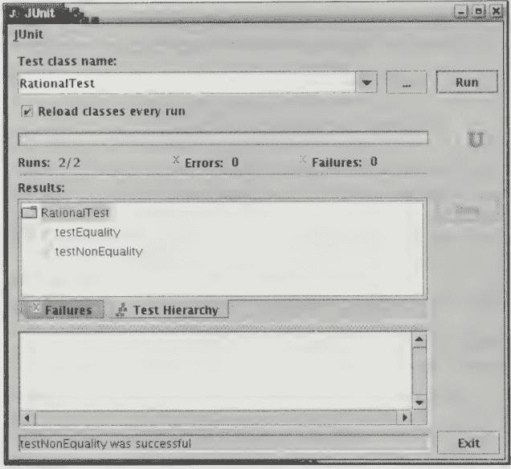

```java
import junit.framework.*;

public class RationalTest extends TestCase {
    // 创建新测试
    public RationalTest(String name) {
        super(name);
    }

    (更多方法（见下文）)
}
```

测试用例中的每个测试由一个名称以 **test....** 开头的*方法*实现。因此，一个名为 **testEquality** 的方法可以概括 Rational 类的相等性断言。从 TestCase 继承的 **assertTrue()** 方法与上述讨论的 assert() 函数具有相同的含义；但是，assertTrue() 不会中止执行，而只是将失败的断言报告给 JUNIT。

```java
// 相等性测试
public void testEquality() {
    assertTrue(new Rational(1, 3).equals(
        new Rational(1, 3)));
    assertTrue(new Rational(2, 6).equals(
        new Rational(1, 3)));
    assertTrue(new Rational(3, -3).equals(
        new Rational(1, 1)));
}
```

除了 assertTrue() 之外，JUNIT 还提供了一系列预定义的断言方法，列在表 13.1 中。例如，使用 assertEquals() 方法可以简化比较：

```java
// 相等性测试
public void testEquality() {
    assertEquals(new Rational(1, 3), new Rational(1, 3));
    assertEquals(new Rational(2, 6), new Rational(1, 3));
    assertEquals(new Rational(3, 3), new Rational(1, 1));
}
```

#### 表 13.1：JUNIT 中的断言

| 方法 | 效果 |
| :--- | :--- |
| fail(msg) | 产生名为 msg 的失败 |
| assertTrue(msg, b) | 如果 b 为假，则失败 |
| assertFalse(msg, b) | 如果 b 为真，则失败 |
| assertEquals(msg, v₁, v₂) | 如果 v₁ ≠ v₂，则失败 |
| assertEquals(msg, v₁, v₂, ε) | 如果 \|v₁ - v₂\| > ε，则失败 |
| assertNull(msg, obj) | 如果 obj 不是 null，则失败 |
| assertNonNull(msg, obj) | 如果 obj 是 null，则失败 |
| assertSame(msg, o₁, o₂) | 如果 o₁ 和 o₂ 不引用同一个对象，则失败 |
| assertNotSame(msg, o₁, o₂) | 如果 o₁ 和 o₂ 引用同一个对象，则失败 |

消息 msg 也可以省略。

一个测试用例（类）可以包含任意数量的测试（方法）。JUNIT GUI（图 13.1）允许单独启用或禁用测试和测试用例。

```java
// 不等性测试
public void testNonEquality() {
    assertFalse(new Rational(2, 3).equals(
        new Rational(1, 3)));
}
```

设置好所有测试后，我们必须确保测试用例能够实际执行。TestRunner 类的 main 方法负责处理这一点——在我们的案例中，使用的是图形用户界面 (swingui)：

```java
// 调用 GUI
public static void main(String args[]) {
    String[] testCaseName =
        { RationalTest.class.getName() };
    junit.swingui.TestRunner.main(testCaseName);
}
```

至此，我们的测试用例就完成了。要编译和执行 RationalTest，我们需要 junit.jar 包，其路径必须包含在 JAVA 类路径 (-classpath) 中。最终，我们得到了图 13.1 中的 GUI。

```
$ javac -classpath .:wherever/junit.jar \
        RationalTest.java
$ java -classpath .:wherever/junit.jar \
       RationalTest
$_
```

备选的 TestRunner 文本用户界面 (textui) 舒适度较低，但对于批量执行非常有用——例如在每夜批处理任务中。如果在 main 中，我们将调用

```java
junit.swingui.TestRunner.main(testCaseName);
```

替换为

```java
junit.textui.TestRunner.main(testCaseName);
```

我们会得到

```
$ javac -classpath .:wherever/junit.jar \
        RationalTest.java
$ java -classpath .:wherever/junit.jar \
       RationalTest
..
Time: 0.009

OK (2 tests)
$_
```

打印出的两个点代表测试成功；失败的测试将输出为 F 或 E。


## 13.5 设置测试夹具 (Fixture)

测试通常需要一些 *夹具 (fixture)* 才能执行。典型的例子包括：

- 必须读取并处理的配置文件，
- 必须请求并设置的外部资源，
- 必须初始化的其他组件服务。

如果多个测试需要这样一个夹具，它们该如何获取？当然，每个测试都可以设置自己的夹具。然而，维护所有这些夹具所花费的精力很快就会超过维护实际测试本身。因此，JUNIT 提供了特殊的方法来为测试设置夹具：

**设置 (Setting up)：** `setUp()` 方法在类的每个测试 *之前* 被调用；其目的是设置通用夹具。

**拆卸 (Tearing down)：** `tearDown()` 方法在每个测试 *之后* 被调用。它用于 *释放* 夹具 —— 例如，释放或关闭额外的资源。

在我们的 *Rational* 案例中，夹具可以用来设置频繁使用的值 —— 例如，一个持有值 $\frac{1}{3}$ 的属性 `a_third`：

```java
public class RationalTest extends TestCase {

    private Rational a_third;

    // 设置夹具
    // 在每个 testXXX() 方法之前调用
    protected void setUp() {
        a_third = new Rational(1, 3);
    }

    // 拆卸夹具
    protected void tearDown() {
        a_third = null;
    }
}
```

属性 `a_third` 随后可以在所有其他测试用例中作为夹具使用：

```java
// 测试相等性
public void testEquality() {
    assertEquals(new Rational(1, 3), a_third);
    assertEquals(new Rational(2, 6), a_third);
    assertEquals(new Rational(3, 3), new Rational(1, 1));
}
```

使用相同的模式，`setUp()` 方法可以设置任意夹具，随后可被测试用例中的所有测试访问。但请注意，各测试必须保持 *相互独立* —— 执行某个测试既不能影响也不能依赖于其他测试的执行。

## 13.6 组织测试用例

JUNIT 测试不一定非要通过 JUNIT 界面执行。JUNIT 提供了允许直接执行单个测试的方法。为此，必须将测试方法的名称作为参数传递给类构造函数；`run()` 方法则执行该测试：

```java
TestResult result = (new RationalTest("testEquality")).run();
```

**测试套件 (Test suite)**

如果要执行多个测试用例，可以将这些多个测试用例分组到一个 *测试套件* 中。测试套件是多个测试用例的 *容器*。以下代码创建了一个测试套件，由 `RationalTest` 类的单个测试组成：

```java
TestSuite suite = new TestSuite();
suite.addTest(new RationalTest("testEquality"));
suite.addTest(new RationalTest("testNonEquality"));
TestResult result = suite.run();
```

在 CPPPUNIT 和其他 JUNIT 变体中，测试套件必须以此方式创建：每个单个测试都必须被明确指定。然而，JUNIT 还提供了一个快捷方式。如果 `TestSuite` 构造函数接收一个类名作为参数，那么该类中所有以 `test...` 开头的方法都会被添加到测试套件中。因此，上面的代码可以简化如下：

```java
TestSuite suite = new TestSuite(RationalTest.class);
TestResult result = suite.run();
```

这种行为对于定义由 `TestRunner 执行的测试套件非常有用。这是通过 `suite()` 方法实现的：

```java
public class RationalTest extends TestCase {
    // 定义测试套件
    public static Test suite() {
        TestSuite suite = new TestSuite(RationalTest.class);
        return suite;
    }
}
```

然而，上述代码正是默认行为，这就是为什么我们也可以省略 `suite()` 方法的原因。但如果我们想要调用其他类中的测试，可以在自己的 `suite()` 方法中显式地将它们添加进来。这样，我们可以创建一个 `AllTests` 类，它集成了 `RationalTest` 的测试套件以及名为 `MoreRationalTests` 的其他类中的测试：

```java
public class AllTests extends TestCase {
    public static Test suite() {
        TestSuite suite = new TestSuite();
        suite.addTest(RationalTest.suite());
        suite.addTest(MoreRationalTest.suite());
        return suite;
    }
}
```

如果在 `AllTests` 类上执行 `TestRunner`，那么 `RationalTest` 的测试套件和 `MoreRationalTest` 的测试套件都将被执行。

图 13.2 展示了 JUNIT 提供的类的 UML 图。一个 `Test` 要么是 `TestCase`，要么是 `TestSuite`，而后者又包含 `Tests` —— 这是一个经典的组合设计模式。

### 13.7 测试驱动开发流程

自动化测试开启了软件开发的新方法。特别是，可以在每次单次更改后验证系统的功能 —— 也就是说，可以运行第 12 章中讨论的回归测试。此类回归测试的设计应确保在测试期间实际执行（或 *覆盖*）尽可能多的代码：至少每个语句（或者更好的是，两个语句之间的每个控制转移）应至少被一个测试执行。第 16.4 节将对此进行更详细的讨论。

不过，组件测试不仅有助于现有代码的回归测试；测试用例还可以用于 *测试尚未编写的代码*。换句话说，测试用例充当了待测组件的 *规范 (specification)*。

组合 (Composite)

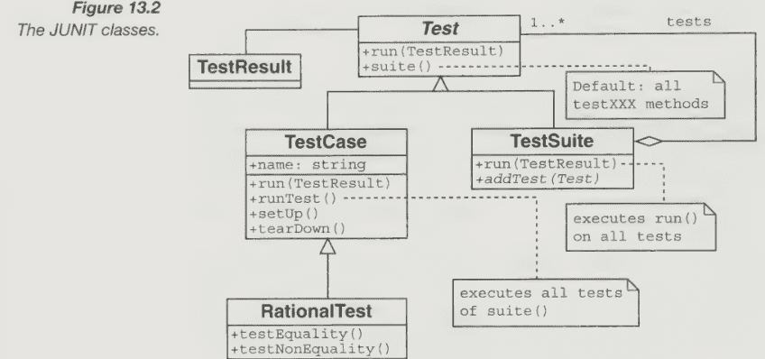

例如，考虑由上述测试描述的 `Rational` 类。仅通过阅读测试用例，程序员就可以实现 `Rational` 类使其满足所有测试 —— 在我们的案例中，是构造函数和 `equals()` 方法。如果我们包含覆盖基础算术的进一步测试用例，这些测试用例将成为规范的一部分，并且必须由实现来满足。

通过测试用例指定程序行为自然只能覆盖 *示例*，而不能指定针对所有输入类型的通用行为。尽管如此，测试用例相比于自然语言规范具有显著优势：它们可以通过机器验证 —— 只需执行测试即可。由于验证是自动进行的，因此可以在每次更改后重复执行。最后，测试用例可以作为组件典型用法的 *文档*。

#### 测试先行法 (Test-first approach)

在实际代码编写之前先编写测试用例的软件流程被称为 *测试先行法*。参考 Link (2002)，一个理想的测试先行法具有以下典型特征：

- 在编写一行生产代码之前，先创建一个驱动该代码的测试。
- 仅编写测试所要求的生产代码。换句话说，一旦测试通过，代码即告完成。
- 开发分小步进行，测试和编码交替进行。此类“微迭代”时间不超过 10 分钟。
- 在将组件集成到完整系统时，所有组件测试必须通过。

测试先行法的优点显而易见：

**代码可以自动测试。**
这增加了对自身工作的信心。

**调试显著简化。**
每段新代码在最多 10 分钟后就会被测试。如果稍后出现故障，惯例是先编写一个能够重现该故障的测试用例。

**代码尽可能简单。**
代码的复杂度不会超过满足测试所需的高度。（当然，复杂的测试用例会导致复杂的代码。）

**将测试用例作为规范很有趣。**
自动化测试用例的多重价值 —— 首先作为规范，然后作为验证手段，最后作为文档 —— 激励着开发者使用它们。

*测试先行法* 是 *极限编程 (extreme programming)* 的一部分 —— 这是一种追求极致灵活性的编程方法。虽然极限编程的一些部分在讨论中存在争议（例如为了获得最简单系统而进行的无情重构），但测试先行法的价值几乎从未被质疑。不过，应当记住，创建自动化测试用例也是一项工作；如果已知软件不再更改，手动测试可能会更便宜。

> 极限编程

在最理想的情况下，我们还会拥有描述系统 *完整* 行为的精确规范。但正如在现实生活中一样，通用 *规则*（如精确规范）与具体 *示例*（如测试用例）的结合才能产生最佳的理解。

#### 概念总结

- 组件测试的编程语言通常是编写该组件的语言。
- 编写测试最重要的语言工具是表达预期程序状态的 *断言 (assertions)*。
- 在组件测试中，*方法* 代表测试，*类* 代表测试用例；*测试套件* 将多个测试分组。
- 组件测试可以作为在实际组件之前编写的规范（*测试先行*）。

#### 复习练习

- 1. 针对以下（讨论激烈的）问题收集支持和反对的论据：

- (a) 应该测试非公共方法吗？为什么？为什么不？
- (b) 应该测试单行函数（这些函数很容易扫描出错误）吗？为什么？为什么不？
- (c) 测试是否应该访问非公共属性和方法来查询组件的内部状态？为什么？为什么不？

2. 使用 JUNIT 的 `assertEquals()` 方法来以有理数方式比较观察结果和预期结果。这种方法的优点和缺点是什么？

3. 程序的更改经常会导致组件测试的更改。你如何使用版本控制将这些更改耦合在一起？

4. 考虑被测代码可能会抛出 *异常*。这些异常应该在测试用例中被捕获吗？

5. 是否存在 *测试先行*（test first）不适用的应用场景？为什么？

#### 延伸阅读

作为初学者的参考资料，我们推荐 Link (2002)。这本书不仅详细介绍了测试先行方法，还包含关于如何处理持久化和分布式数据以及测试并行和交互式程序的有用提示。

关于 JUNIT 最新且最详尽的信息可以在 http://www.junit.org/ 找到。

该页面还包含更多介绍 JUNIT 的示例。

#### 更多测试工具

现在几乎每种编程语言都有自动组件测试工具。以下是一些示例：

- SUNIT 是一个用于 SMALLTALK 程序的组件测试框架。SUNIT 是 JUNIT 的“祖父”：所有 JUNIT 的概念都源自 SUNIT，并且至今仍有所体现。SUNIT 可以在此处获取：http://sunit.sourceforge.net/
- CPPUNIT 是一个用于 C++ 程序组件测试的框架。其通用方法与 JUNIT 相同 —— 测试成为方法，测试用例成为类。`test...` 方法必须手动编译进测试套件；该软件包为此提供了有用的宏。CPPUNIT 的介绍和文档可在以下网址获取：http://cppunit.sourceforge.net/
- 除了 JAVA、C++ 和 SMALLTALK，许多其他语言也提供组件测试 —— 从 A（如 ADA）到 X（如 XSLT）。概览可见：http://www.xprogramming.com/software.htm

### 13.7 测试驱动开发流程

### 14 使用 BUGZILLA 跟踪问题

### 14.1 跟踪与管理问题

在第 12 章和第 13 章中，我们介绍了 DEJAGNU 和 JUNIT 等测试工具，它们能够快速且系统地检测程序故障。遗憾的是，并非所有的软件问题都能在测试期间被发现。相反，这些问题是由用户在实际使用中经历（或者更准确地说，是遭受）的。通常，用户不能或不必自行修复问题，而必须通过让问题得到修复来获得满意。为此，

1. 用户必须将问题 *通知* 供应商，
2. 供应商必须 *重现* 该问题，
3. 供应商必须 *隔离* 问题的触发情况，
4. 供应商必须在用户端 *修复* 该缺陷。

这个生命周期必须以某种方式组织起来。特别是，供应商必须能够回答诸如以下的问题：

- **哪些问题目前处于开启状态？** 开启的问题表明软件中可能存在必须修复的缺陷。
- **哪些是最严重的问题？** 通常，最严重的问题会首先得到修复。
- **过去是否出现过类似问题？** 如果出现过类似问题，可能已经有了现成的解决方案，只需交付即可。

此外，*用户* 可能想知道其问题的状态 —— 并能快速地被告知任何进展。

处理所有这些工作的系统被称为 *问题跟踪系统*。在本章中，我们将讨论一个问题的生命周期 —— 从最初的报告，经过管理，直到（希望是成功的）解决。

### 14.2 报告问题

在讨论管理问题之前，我们先研究问题是如何从用户报告给供应商的。

为了修复问题，开发人员必须首先能够重现它 —— 因为否则她将无法进一步询问关于问题的细节，更糟糕的是，将无法判断问题是否已修复。执行此任务所需的信息被称为问题报告 (PR)，也称为变更请求 (CR) 或简单的 bug 报告。

#### 14.2.1 什么才是相关的？

开源项目（以及关注客户反馈的商业项目）通常邀请用户报告任何问题。其基本原则是“陈述所有相关事实”，这里的“相关”是指“对重现问题相关”。但确定相关事实可能会带来问题。用户怎么知道什么是相关的，什么是不相关的？

现实生活中的问题报告经常包含过多信息，例如巨大的核心转储（core dumps）、整个硬盘内容，甚至整个驱动器。但它们也可能包含的信息不足：“你们的程序崩溃了。只是想让你们知道。” —— 这是本书作者在 1999 年收到的一份真实问题报告（可能是关于 GNU DDD 调试器的）。

为了获得恰到好处的信息，通常最好的做法是列出一份每个问题报告都应包含的 *具体项目* 清单（表 14.1）。某些产品包含特定的功能或独立工具来生成标准化的问题报告。图 14.1 显示了 *Talkback* 对话框，当 MOZILLA 浏览器经历致命故障时会出现该对话框。点击 *发送* 会将所有相关信息（显示在 *详细信息* 对话框中）转发给 MOZILLA 开发人员。

**表 14.1 问题报告中的典型项目。**

| 项目 | 描述 |
| :--- | :--- |
| **产品发布版本** | 通常是版本号或其他唯一标识符 —— 例如，CVS 版本的配置名称。利用此信息，开发人员可以在本地重新创建与用户环境中安装版本一致的程序副本。 |
| **环境** | 通常是关于操作系统的版本信息。由于问题可能是第三方组件之间交互引起的，关于这些组件的信息也很有用。利用此信息，供应商可以重新创建用户的环境。 |
| **问题历史** | 这是重现该问题所需操作的描述，即必要的最小步骤集。通常，这还包括任何访问过的资源，如输入文件或配置文件。 |
| **预期行为** | 这描述了根据用户的想法应该发生什么。此信息对于判断该行为是否确实是错误至关重要。 |
| **观察到的行为** | 这些是问题的症状 —— 即与预期行为相反的实际发生情况。利用此信息，开发人员可以验证问题是否被忠实地重现。 |

#### 14.2.2 发生了什么？

如果错误发生在长串事件之后，用户往往很难追溯从程序启动到故障发生的所有步骤。

这个问题可以通过让程序将重要事件记录在 *日志文件* 中来解决。供应商随后可以检查并重现这些事件。应该允许用户 *授权* 记录日志以及将日志转发给供应商。

无论是由用户本人填写问题报告，还是由专门的维护团队完成 —— 最终所有问题报告都必须由供应商处理。这时就需要像 BUGZILLA 这样的问题跟踪系统了。

### 14.3 BUGZILLA —— 一个问题跟踪系统

大多数开发团队使用单个 *“问题列表”文档* 来跟踪系统中的当前问题，该文档列出了至今所有开启或未解决的问题。这样的文档易于建立且易于维护。然而，这会带来一系列相关问题：

- 一次只能有一个人操作该文档。例外：文档处于允许并行编辑并在随后合并的 *版本控制系统* 中，例如 CVS（第 4 章）。
- 早期（且已修复）问题的历史 *丢失* 了。结果是，人们无法回忆起早期版本中存在（且依然存在）哪些问题，以及哪些已被修复。例外：文档处于版本控制系统中并随产品共同演进。
- *无法扩展*。在一个简单的文本文档中无法跟踪数百或数千个不同的议题。

**问题数据库**

替代文档的方法是使用一个存储所有问题报告的 *问题数据库*。问题数据库可以扩展到支持大量的开发人员、用户和问题。

图 14.2 显示了这样一个问题跟踪系统的示例 —— *BUGZILLA*，它是 MOZILLA 浏览器的问题跟踪系统。BUGZILLA 使用 Web 浏览器作为用户界面，这意味着它可以从任何地方访问（且任何人都可以访问，因为 MOZILLA 是一个开源项目）。BUGZILLA 本身也是一个开源项目，因此你甚至可以将其安装在自己的项目中。

### 14.4 对问题进行分类

假设我们想在 BUGZILLA 中报告一个问题（要么是因为我们是专家用户，知道如何在网站上输入问题，要么是因为我们负责处理用户的问题报告）。要报告一个问题，我们不仅必须提供所需信息（第 14.2 节），还必须对问题进行 *分类*。BUGZILLA 用于分类问题的属性在问题跟踪系统中非常典型：


### 14.4 问题分类

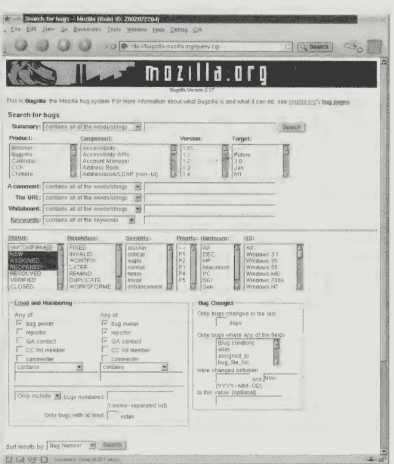

**图 14.2**
BUGZILLA 问题数据库。

#### 严重程度 (Severity)

每个问题都被分配一个严重程度，用于描述该问题对开发或发布过程的影响。BUGZILLA 包含以下严重程度级别，按影响程度从高到低排列：

- **Blocker**（阻碍级）：阻碍开发和/或测试工作。这种最高级别的严重程度也被称为 *Showstopper*（致命缺陷）。
- **Critical**（危急级）：崩溃、数据丢失、严重的内存泄漏。
- **Major**（主要级）：主要功能丢失。
- **Normal**（普通级）：这是“标准”问题。
- **Minor**（次要级）：次要功能丢失，或存在简单规避方案的其他问题。
- **Trivial**（琐碎级）：外观问题，如单词拼写错误或文本未对齐。
- **Enhancement**（增强级）：增强请求。这意味着该问题根本不是故障，而是一个期望的功能。

理想情况下，除非所有“严重”问题都已修复（即主要、危急或阻碍级问题已解决），否则产品不予交付。如果产品必须在固定日期发布，则可以禁用仍导致问题的功能。

#### 优先级 (Priority)

每个问题都被分配一个特定的优先级——优先级越高，问题处理得越早。优先级通常由管理层定义——事实上，它是管理层表达哪些工作应先做、哪些后做的主要手段。在控制开发和问题解决过程时，优先级属性的重要性怎么强调都不为过。

#### 标识符 (Identifier)

每个问题都会获得一个唯一的标识符（PR 编号；在 BUGZILLA 中为 bug 编号），以便开发人员在调试过程（如电子邮件、变更日志、状态报告和附件）中引用它。

#### 注释 (Comments)

每个用户和开发人员都可以向问题报告添加注释——例如，添加关于问题发生情况的信息，推测可能的问题原因，添加初步发现，或讨论如何修复该问题。

#### 通知 (Notification)

开发人员和用户可以将他们的电子邮件地址关联到问题报告；每当问题报告发生变化时，他们都会收到自动通知。

### 14.5 问题处理

现在让我们假设有人向问题数据库输入了一份新的问题报告。这份问题报告现在必须被处理。在此过程中，问题报告会经历一个*生命周期*（图 14.3）——从 **UNCONFIRMED**（未确认）到 **CLOSED**（关闭）。在生命周期中的位置由问题报告的*状态*决定：

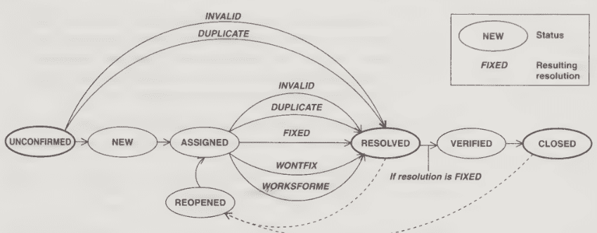

> **图 14.3**
> *BUGZILLA 中问题的生命周期*。

**UNCONFIRMED** 这是任何新输入到数据库的问题报告的状态。

**NEW** 问题报告是*有效*的：
- 它包含相关事实。（否则，其*解决结果*变为 **INVALID** —— 见下文。）
- 它不是已知问题的明显*重复*。（否则，其解决结果变为 **DUPLICATE** —— 见下文。）

一个 **NEW** 问题不一定必须是可重现的。这将在生命周期的其余部分中处理。

**ASSIGNED** 问题尚未解决，但已分配给一名开发人员（在 BUGZILLA 中称为 *bug owner*，缺陷所有者）。

**RESOLVED** 问题已解决；*解决结果*说明了该问题报告（目前）的情况：
- **FIXED** 问题已修复。
- **INVALID** 该问题并非真正的问题，或不包含相关事实。
- **DUPLICATE** 该问题是现有问题的重复。
- **WONTFIX** 所描述的问题将永远不会被修复。对于那些被认定为功能而非故障的问题，也可能属于这种情况。

（这里有一个 WONTFIX 示例：MOZILLA 浏览器不将图像的 ALT 文本显示为工具提示，许多人认为这是一个问题 —— 但 MOZILLA 开发人员表示这种行为是由 Web 标准强制要求的，因此不会修复这个“问题”。参见 bugzilla.mozilla.org 上的 bug #25537）

- **WORKSFORME** 所有重现该问题的尝试都失败了。

如果以后出现了更多信息，问题可能会被重新打开。

如果解决结果是 **FIXED**，则必须验证修复（状态为 **VERIFIED**），并最终交付（状态为 **CLOSED**）。

**VERIFIED** 问题已修复；修复已被验证为成功。问题保持 **VERIFIED** 状态，直到修复方案交付给用户（例如，通过发布新版本）。

**CLOSED** 产品的最新版本已发布；在此版本中，该问题不再出现。

**REOPENED** 如果问题再次出现，其状态被设为 **REOPENED** 而非 NEW；它必须被重新分配。

#### 一个场景

问题报告是如何经历所有这些状态的？这是一个典型的场景：

1. Olaf 是 Perfect Publishing 程序的快乐用户 —— 直到它突然崩溃。
2. Olaf 向客户支持人员 Sunny 报告了这次故障。
3. Sunny 将故障细节作为一份新的问题报告输入到问题数据库中。她报告了 Olaf 如何重现故障，查询了关于 Olaf 配置的相关事实，并将严重程度设置为“normal”。她还记录了 Olaf 的联系地址。
4. 该问题获得了一个 PR 编号（例如 PR 2074）。其初始状态为 **UNCONFIRMED** —— 还没有人尝试重现它。
5. 程序员 Violet 发现 PR 2074 之前并不为人所知，于是将其状态设置为 NEW。
6. 经理 Poe 先生要求 Violet 解决 PR 2074；状态现在变为 **ASSIGNED**。
7. Violet 在她的环境中无法重现 PR 2074。她在问题报告的附加注释中记录了她的尝试，将解决结果设置为 WORKSFORME，状态设置为 RESOLVED。但是，有没有可能是 Olaf 将产品配置为使用公制系统？她询问 Sunny 是否能获得进一步的数据。
8. Sunny 向 Olaf 请求进一步信息，并将 PR 2074 的状态设置为 REOPENED。
9. Violet 仍然负责 PR 2074（状态为 ASSIGNED）；有了新数据，她终于能够重现并修复该问题。状态变为 RESOLVED；解决结果为 FIXED。
10. 测试员 Klaus 审查了 Violet 的修复；他同意将修复集成到当前的生产版本中。PR 2074 的状态变为 VERIFIED。
11. 最后，修复后的版本交付给 Olaf。状态变为 CLOSED。
12. 如果有更多用户就该问题联系客户支持，Sunny 可以在问题跟踪系统中查找该问题，并引导他们使用新版本。

### 14.6 管理问题跟踪

如场景所示，一个良好的问题跟踪系统是所有关于问题和故障的日常工作的基础。如果没有人提交问题报告，它就毫无用处；如果没有人将问题标记为已解决，它很快就会充斥着过时的信息。因此，应解决以下问题：

**谁提交问题报告？**
这可能仅限于支持人员；但通常情况下，如果任何开发人员都能添加新条目，可能会更有用。高级用户和 Beta 测试员也可以被授权提交问题报告。

**谁对问题报告进行分类？**
问题的*严重程度*可以从初步报告中提取；有时，严重程度只有在问题能够被重现后才能确定。

**谁设定优先级？**
为了确定问题的优先级，管理层必须评估问题的*影响* —— 即不仅是其严重程度，还包括：
- 发生的可能性，
- 受影响的用户数量，以及
- 潜在的损害。

因此，优先级不一定与问题的严重程度相关：Alpha 版本中的一个“阻碍级”问题的优先级可能低于一个广泛分发产品中的“主要级”问题。

许多组织使用软件变更控制委员会 (SCCB) 来设定优先级 —— 这是一个跟踪问题报告并负责处理它们的小组。这样一个小组通常由开发人员、测试员和配置管理员组成。

**谁负责处理问题？**
所有问题跟踪系统都允许将问题分配给个别开发人员。这同样是 SCCB 或类似小组的任务。

**谁关闭问题？**
可以是 SCCB 或类似小组，个别测试员，或者是某些验证修复的质量保证实例（如上述场景所示）。

**问题的生命周期是什么？**
如图 14.3 所示的 BUGZILLA 模型在问题数据库中很典型，但绝不是唯一可能的模型。根据您的具体需求，可以设计替代状态和转换；问题跟踪系统可以配置为包含此类流程。

**作为问题解决的软件开发**
一个良好的问题跟踪系统可以以统计形式总结问题数据库（还有多少个问题未关闭，多少个问题被分配给了谁，等等）。问题跟踪系统甚至可以成为组织调试过程、甚至是开发过程的主要工具。问题 #1 是“产品缺失”；然后这个问题可以分解为几个子问题，所有子问题都描述了要构建的产品属性。如果实现了一个组件并解决了某个子问题，该子问题就被标记为 FIXED。正如 13.7 节讨论的“测试驱动”开发过程一样，当我们发现所有问题都已解决时（由问题 #1 也变为 FIXED 来指示），产品就准备好交付了。

### 14.7 问题与测试的关系

#### 问题报告与测试结果

许多开发人员不仅将问题跟踪系统用于最终用户报告的问题，还用于内部遇到的问题；也就是说，一旦开发人员偶然发现一个问题，她就会像最终用户告诉她一样将其报告。

原则上这是一件好事，因为没有问题会被忽略。然而，开发人员发现问题的主要方式是通过测试程序，正如第 12 章和 13 章中所讨论的。这导致了测试结果与问题报告之间的冲突：一个失败的测试是否应该被跟踪

在问题数据库中？如果这样，我们该如何将问题数据库与测试结果进行*同步*？

除非你拥有一套能与测试套件无缝集成的缺陷跟踪系统，否则我们建议将测试结果与问题报告分开存放。这样做有诸多原因：

- 测试结果产生频繁——可能（并且希望）比用户的问题报告频繁得多。将这些测试结果存储在问题数据库中会迅速使数据库过载，并掩盖现场实际存在的问题。
- 如果你使用自动化测试（第 12 章和第 13 章），只需按下按钮，即可随时检查任何版本的测试结果——因此无需存储这些信息。
- 假设某个测试失败：如果你能立即找到缺陷并立即修复它，就没有必要在缺陷跟踪系统中输入记录。

所有这些都归结为一个核心点：***测试用例使问题报告变得多余***。如果在开发过程中出现问题，不要将其输入到缺陷跟踪系统中。相反，应该编写一个能暴露该问题的***测试用例***。这样，测试用例将证明该问题依然存在，且你可以通过运行测试随时检查该问题。

不过，你*可以*始终使用缺陷跟踪系统来存储*想法*和*功能请求*——也就是说，存储任何不能立即转化为代码或测试用例的内容。一旦你开始实现该功能请求，请立即编写一个暴露该功能缺失的测试用例，并关闭缺陷跟踪系统中的相应条目。一旦功能实现，随后的测试用例可用于确定其是否符合预期。

#### 概念

- 问题报告必须包含所有与重现该问题*相关*的信息。
- *缺陷跟踪系统*使用*数据库*来组织和分类问题报告。典型的分类项包括：
    - *问题标识符*
    - 问题的*严重程度*——从*阻碍 (blocker)* 到 *增强 (enhancement)*
    - 问题的*状态*——从 *未确认 (unconfirmed)* 到 *已关闭 (closed)*
    - *解决结果*——从 *无效 (invalid)* 到 *已修复 (fixed)*。
- 缺陷跟踪系统不仅可以组织问题解决过程，还可以组织*整个开发过程*：尚未编写的组件缺失被定义为一个问题——并对其进行跟踪直到修复。
- 每当出现新问题时，应当创建一个能够*重现*该问题的*测试用例*。
- 为了将问题和测试联系起来，一旦测试用例存在，就*使问题报告失效*。当问题发生时，优先编写测试用例，而非输入问题报告。

#### 复习练习

- 1. 访问 MOZILLA 的缺陷跟踪站点 `http://bugzilla.mozilla.org/` 并回答以下问题：
    - (a) 在过去三天中，有多少个问题在 BUGZILLA 中被输入为 NEW（新）？
    - (b) 其中有多少个是关键的（甚至是阻碍性的）？
    - (c) 其中有多少个是无效的？为什么？
    - (d) 在当前发布的版本中，有多少个未解决或未确认的问题？
    - (e) 目前未解决的问题中，最糟糕的是哪个？
    - (f) 根据问题优先级，作为程序员，你应该首先处理哪个问题？
- 2. 像 MOZILLA 这样的专用缺陷跟踪系统与像 Microsoft Outlook 这样的通用组织和消息工具之间有哪些主要区别？
- 3. 除了软件之外，还有哪些问题可以使用缺陷跟踪系统来管理？

#### 延伸阅读

关于缺陷跟踪系统，除了供应商提供的信息外，没有太多公开资料。Mirrer (2000) 探讨了失效测试用例的问题。在他看来，组织一个缺陷跟踪系统就像“整理袜子”：每隔一段时间，就必须清理一次溢出的袜子抽屉。

Kolawa (2002) 对缺陷跟踪系统与测试之间的关系发表了评论。他指出，缺陷跟踪系统“应仅被用作在你无法立即修改代码时存储反馈的地方”；否则，你应该创建一个可重现的测试用例。

BUGZILLA 缺陷跟踪系统可在 `http://www.bugzilla.org/` 找到。其为 MOZILLA 定制的版本可在 `http://bugzilla.mozilla.org/` 浏览。

PHPBUGTRACKER 是一个轻量级的缺陷跟踪系统，比 BUGZILLA 更易于安装和管理。如果你想在自己的站点上尝试缺陷跟踪系统，PHPBUGTRACKER 可能是你的选择：`http://phpbt.sf.net/`。

高级缺陷跟踪系统与版本控制系统有部分集成。comp.software.config-mgmt 新闻组的 *Software Configuration Management FAQ* 包含一份详尽的缺陷跟踪系统列表及其在软件配置管理中的集成情况：`http://www.daveeaton.com/scm/`。

如果你对简单的缺陷跟踪之外的自动化项目组织感兴趣，以下两个系统提供了讨论论坛、公共 CVS 存档、用户管理、邮件列表等。

- SAVANNAH 项目为开源项目提供了家园；简单的注册即可使用。它本身也是开源的，可以安装在其他站点上——但仅用于管理开源项目：`http://savannah.gnu.org/`。
- SOURCEFORGE 项目是最大的开源项目家园；这里同样只需简单注册。SOURCEFORGE 提供商业版本，可安装在其他站点以管理商业项目：`http://www.sf.net/`。

最后，如果你想让客户满意，请参阅 Phil Verghis 的帮助台 FAQ：`http://www.philverghis.com/helpdesk.html`。

## 15 使用 GDB 和 DDD 进行调试

## 15.1 系统化调试

糟糕！出问题了。我的程序打印出随机字符，陷入死循环，或者直接崩溃了。现在该怎么办？

### 错误与复杂度

如果刚刚创建的程序第一次运行就没问题，那才奇怪。Errare humanum est（人非圣贤，孰能无过）：所有技术系统都会出现错误，且系统越复杂，错误发生的可能性就越大。复杂度源于组件的数量以及这些组件之间可能的交互。在这个意义上，软件是人类创造的最复杂的事物之一——因此也是最容易出错的事物之一。

### 观察失效

但如何识别错误呢？首先，你必须确保错误能够显现，从而使其作为一次“失效 (failure)”变得可见。（这通过阅读代码，以及当然是通过第 12 章和第 13 章所述的测试来完成。）

### 调试修复

一旦观察到失效，调试的目标就是将此次失效与某段具体的代码联系起来，通过修改该代码来修复错误。为了实现这一点，我们需要深入了解程序的执行过程。

### 建立假设

人类通常无法掌握技术系统执行的所有细节。因此，分析必须局限于系统或其执行过程的一个精心选择的子集。在这些子集中，人们建立假设——例如，错误发生在某个子集中。然后对这些假设进行测试、确认或反驳，以隔离问题的根源。

这里有一个例子：在打印一份手稿时，第 249 页之后的页面出现了随机字符。一个可能的假设是，第 249 页包含某些控制代码，导致打印机产生错误的读出。现在可以测试这个假设——例如，仅打印第 249 页。如果失效再次出现，我们可以通过仅打印该页的一部分来进一步隔离错误——直到最终找到导致失效的代码。

### 隔离失效原因

**图 15.1：调试的科学方法。**

### 科学方法

这种系统化的原因隔离也被称为调试的*科学方法*。其运作方式如下：

- 1. 针对失效原因建立一个假设。（在我们的例子中：*第 249 页包含一个导致失效的转义代码。*）
- 2. 使用程序执行来测试该假设。（*仅打印第 249 页。*）与系统化测试（第 12 章）一样，我们区分不同的测试输出（图 15.1）：

    - **测试失败 (FAIL, ✗)：** （*页面打印错误。*）这确认了我们的假设，我们现在可以对其进行细化。细化后的假设将测试失效原因的一个子集。（*新假设：* “导致失效的控制代码在第 249 页的上半部分。”）
    - **测试成功 (PASS, ✓)：** （*打印内容无误。*）这反驳了假设，因此我们继续进行对立假设。这将测试失效原因的补集。（*新假设：* “导致失效的控制代码不在第 249 页。”）
    - **不一致 (UNRESOLVED, ?)：** 测试结果不确定——既没有显示正确行为，也没有显示错误行为。（*第 249 页根本没有被打印。*）我们尝试另一种假设，使确定性的测试结果更有可能出现。（*新假设：* “必须加上来自第 1 页的初始化代码。”）

- 3. 使用新假设重复步骤 2，直到失效原因被充分隔离。

这个隔离过程可以用图形方式表示为一个可能的失效原因平面，由一条线（假设）将其分隔并划分为

将其分为两个区域（图 15.2）。对于每一个确定的测试输出，我们选择其中一个区域，然后由下一个假设将其隔离。

科学方法的成功取决于*假设的选择*。一个假设如果满足以下条件，则更为有效：

- 当被证明正确时，它留下的失败原因越少，
- 当被反驳时，它排除的失败原因越多。

如果证明假设和反驳假设的概率相等，那么最有效的假设类型是那些包含*一半*错误原因的假设——这样，随着科学方法的每一步推进，剩余的失败原因数量就会减半。

但如果失败是由*多种原因的组合*引起的怎么办？在我们的打印机示例中，几个控制代码很可能相互作用导致错误——例如第 1 页的一个控制代码，随后是第 249 页的一个控制代码。在这种情况下，假设（打印第 249 页）以及反题（打印所有其他页面）都将被反驳。在这种情况下，必须专门*搜索组合*：例如，将第 249 页与第 1-10 页一起打印。这也可以系统地执行——例如，逐个排除可能的失败原因，直到只剩下导致失败的核心。类似的策略对于不确定的测试输出同样有用。

> 图 15.2：可能失败原因的系统隔离。（假设的选择，错误原因的组合）

### 15.2 建立和测试假设

遗憾的是，建立能够确定包含或排除失败原因的假设并非易事。调试就像侦破罪案：如果没有具体证据，不能定罪。为了获得证据，必须进行耗时的*调查*——在我们的案例中即*程序执行的调查*。不过，与真实的刑事案件不同，我们通常可以随意*重复*程序执行。在接下来的内容中，我们将描述一些能为我们提供进一步信息的实用基本技术。

#### 15.2.1 输出程序状态

**调试指令**

最基本的调试技术是在程序的选定位置插入特定的指令，为程序员记录部分程序状态——例如变量的内容、函数名称或参数。这些*调试指令*通常被设置为可以在编译时或运行时开启或关闭。

这是一个例子：在 C 程序中，我们发现了如下指令：

```c
#ifdef DEBUG
    fprintf(stderr, "x = %f, y = %f\n", x, y);
#endif
```

`fprintf` 指令将变量 `x` 和 `y` 输出到标准错误（`stderr`），以便程序员检查数值（顺便发现该指令实际上被执行到了）。

通过使用 `#ifdef DEBUG` 将其包裹，当且仅当编译时定义了 CPP 宏（第 9.3.3 节）`DEBUG` 时，调试指令才会被插入到最终程序中（并被执行）。

将这类调试指令留在最终代码中是有价值的，以便后续的维护者可以使用它们。但如果代码因调试指令而变得杂乱，*断言*（assertions）是更好的选择。

#### 15.2.2 验证程序状态

调试指令有一个主要缺点：记录的程序状态必须*由程序员验证*——也就是说，程序员必须检查该状态是否符合其预期。这种观察状态与预期状态的对比可能会非常乏味且容易出错；因此，应致力于将该任务自动化。

自动验证程序状态的经典技术是使用*断言*，如 13.2 节所述。通用流程如下：

- 在程序的“可疑”位置引入断言和不变式（invariants）。
- 每个新断言验证程序状态的另一个子集。
- 缩小程序状态首次变得异常的时间点。假设某个程序状态首先通过了断言验证；但随后，针对同一程序状态的某个断言失败了。在这种情况下，这两个断言之间必然执行了某些导致程序状态失效的语句。

如何使用断言？举个例子，考虑一个名为 `divide` 的 C++ 函数，它将数字 `dividend` 除以 `divisor`，并将结果返回在参数 `quotient`（商）和 `remainder`（余数）中。

```cpp
void divide(int dividend, int divisor,
            int& quotient, int& remainder)
{
    // 前置条件
    assert(divisor != 0);

    // 实际计算 ...

    // 后置条件
    assert(quotient * divisor + remainder ==
            dividend);
}
```

如果违反了前置条件——例如，调用 `divide` 时除数等于零——`assert` 函数将终止程序并陈述被违反的断言：

```
divide.cc:4: failed assertion 'divisor != 0'
IOT instruction (core dumped)
```

同样地，如果计算不正确（即违反了后置条件），`divide` 也会终止。然而，如果 `divide` 成功返回，则结果满足后置条件。在调试期间，`divide` 的返回意味着我们可以信赖 `divide` 是正确的——从而在其他地方寻找错误。

针对复杂数据结构的断言需要特殊的验证函数，用以验证数据结构的不变式——即数据结构中必须始终成立的属性。

**不变式**

举个例子，考虑一个简单的树形数据结构，其中一个节点指向父节点以及左子节点和右子节点：

```c
struct Tree {
    struct Tree *parent;  /* 父节点 */
    struct Tree *left;    /* 左子节点 */
    struct Tree *right;   /* 右子节点 */
};
```

这里的不变式是什么？一方面，节点 $k$ 的子节点必须指向它们的父节点 $k$。当然，反过来，子节点本身也必须是有效的树。

我们使用 `tree_ok` 函数检查所有这些条件，只有当所有条件都满足时，它才返回 1（true）：

```c
/* 不变式 */
int tree_ok(struct Tree *tree)
{
    return tree == NULL ||
           (tree->left == NULL ||
            tree->left->parent == tree) &&
           (tree->right == NULL ||
            tree->right->parent == tree) &&
           tree_ok(tree->left) &&
           tree_ok(tree->right);
}
```

**验证函数**

现在可以将此类验证函数用于断言中，例如，用来保证函数执行前后的状态一致性：

```c
void balance(struct Tree *tree)
{
    assert(tree_ok(tree)); /* 前置条件 */
    :
                        /* 函数体 */
    assert(tree_ok(tree)); /* 后置条件 */
}
```

一旦调用 `balance` 时传入的是无效树（违反前置条件），或者 `balance` 本身导致树变得无效（违反后置条件），程序将立即终止。

总的来说，断言一举多得：

- 断言是*持久的*——与下文讨论的调试指令和交互式调试器不同，断言可以留在程序代码中，从而在必要时随时验证状态。
- 断言是*显式的*——关于程序状态的预期不再仅存在于程序员的脑海中，而是被显式地编码。
- 断言*文档化*了程序——从而促进对程序的理解。断言与实际程序状态之间的偏差能被迅速揭露。

像 `assert` 这样的断言函数在运行时会占用大量时间——尤其是当它们检查大型数据结构（如 `tree_ok` 中）时。因此，在 C 和 C++ 中，`assert` 被实现为一个宏，通过定义一个特殊的 CPP 宏（通常是 `NDEBUG`），可以关闭所有断言。这通常发生在生产代码中，以提高效率。在 JAVA 中，断言默认关闭；必须显式启用。使用 JAVA 解释器 `java` 时，可以通过 `-enableassertions` 选项（可缩写为 `-ea`）来实现。

但应当记住，通过禁用断言获得的效率会降低程序的安全性。虽然一个因断言失败而终止的程序并不特别用户友好，但一个在未察觉的情况下计算出错误结果的程序可能会产生严重得多的后果。

断言和不变式是识别故障及其原因的成熟手段。我们建议你为每个数据结构提供一个验证函数，并在整个代码中大量使用断言。

#### 15.2.3 改变程序状态

检查程序状态的第三种技术是*显式地改变它*，并从产生的结果中推断失败原因。可以通过多种方式进行此类更改：

**改变程序环境**

大多数 bug 仅在特定环境下出现。该环境包括所有影响程序行为的数据——首先是输入数据，还包括计算机配置或个人用户设置等其他资源。在这里，可以通过*系统地改变环境*来尝试隔离失败原因。

示例：一个文字处理程序在加载大型文档并输入几个按键后终止。通过改变输入（包括文档内容和按键顺序），可以系统地隔离失败原因。

由于改变的是程序的*外部状态*，将外部状态映射到*内部状态*必须由程序员完成。另一方面，对导致失败的环境进行有意义的描述，是寻找错误的宝贵辅助手段。

**改变程序代码**

对程序代码进行特定更改有助于找到错误原因。此类更改并不意味着*修复*——修复应当仅在准确掌握情况后进行。不过，系统地*移除功能*有助于隔离失败原因。


示例：我们怀疑一个树平衡函数损坏了内存。我们通过将该函数替换为一个没有功能的虚拟函数来测试这一假设；如果问题现在消失了，我们就成功地隔离了问题原因。

#### 旧程序版本与新程序版本的区别

**更改程序版本：** 只有在有合适的替代方案时，更改代码才是可能的。一种特殊情况是，如果旧版本的程序运行良好，但新版本失败了（“昨天我的程序还能运行，今天不行了——为什么？”）。在这种情况下，检查旧版本和新版本之间的 *区别（differences）* 会有所帮助。

#### 导致失效的更改

示例：更改后，数据导出不再工作。通过检查更改（从负责导出的函数开始），可以找到 *导致失效的更改（failure-inducing change）*。

### 15.3 使用 DDD 进行调试：一个示例

#### 调试器

如果一个人想在不扩展代码（这很耗时）的情况下了解程序执行情况，可以使用一些特殊的工具，称为 **调试器（debuggers）**。调试器 **控制程序的执行**。使用调试器可以实现：

- 在定义的环境中执行程序，
- 使程序在指定条件下停止，
- 观察停止程序的状态，以及
- 更改停止程序的状态。

#### GDB

在本节中，我们将讨论最强大的调试器之一：GNU 调试器 (GDB)。GDB 是一个通过命令行控制的交互式程序。为了简化与 GDB 的交互，目前有许多图形界面可用，它们为 GDB 命令提供了按钮和菜单，并能处理 GDB 的输出。我们将查看 GDB 最舒适的界面之一：GNU Data Display Debugger 或 DDD。

#### DDD

为了概览调试器如何使用，我们来看一个简单的 DDD 场景。示例 15.1 显示了 C 程序 **sample.c**，这是一个用于数字排序的程序。

#### 示例 15.1：sample.c - 一个（有缺陷的）排序程序

```c
/* sample.c - a simple sorting program */

#include <stdio.h>
#include <stdlib.h>

static void shell_sort(int a[], int size)
{
    int i, j;
    int h = 1;
    do {
        h = h * 3 + 1;
    } while (h <= size);
    do {
        h /= 3;
        for (i = h; i < size; i++)
        {
            int v = a[i];
            for (j=i; j>=h && a[j-h]>v; j-=h)
                a[j] = a[j - h];
            if (i != j)
                a[j] = v;
        }
    } while (h != 1);
}

int main(int argc, char *argv[])
{
    int *a;
    int i;
    a = (int *)malloc((argc - 1) * sizeof(int));
    for (i = 0; i < argc - 1; i++)
        a[i] = atoi(argv[i + 1]);

    shell_sort(a, argc);

    for (i = 0; i < argc - 1; i++)
        printf("%d ", a[i]);
    printf("\n");
    free(a);
    return 0;
}
```

这个程序有一个错误：通常情况下，sample 应该对它的参数进行数值排序并打印，如下例所示：

```
$ ./sample 8 7 5 4 1 3
1 3 4 5 7 8
$ _
```

## 15 使用 GDB 和 DDD 进行调试

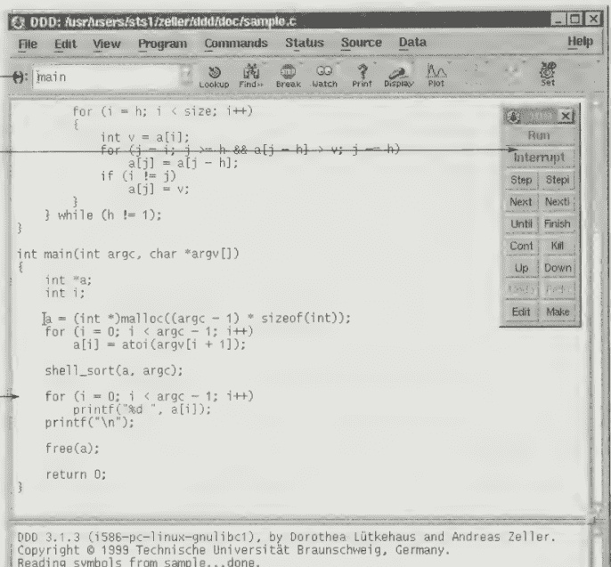

| 参数 (Argument) | 命令工具 (Command tool) | 源代码 (Source code) | GDB 控制台 (GDB console) | 状态栏 (Status line) |
| :--- | :--- | :--- | :--- | :--- |
| (界面元素) | (界面元素) | (界面元素) | (界面元素) | (界面元素) |

**图 15.3** DDD 界面

然而，在某些参数下，会出现错误：

```
$ ./sample 8000 7000 5000 1000 4000
1000 1913 4000 5000 7000
$ _
```

虽然输出是排序的且包含正确数量的参数，但某些参数丢失了，并被虚假数字替代；这里 8000 丢失了，被 1913 替代。（在您的系统上的实际数字和行为可能会有所不同。）

#### 15.3.1 执行程序

**调试信息**

使用 DDD，我们现在可以找出 sample 中发生了什么。首先，我们需要为程序添加 *调试信息（debugging information）*。这在编译期间使用 `-g` 选项完成：

```
$ gcc -g -o sample sample.c
$ _
```

现在我们可以在可执行文件上调用 DDD：

```
$ ddd sample
```

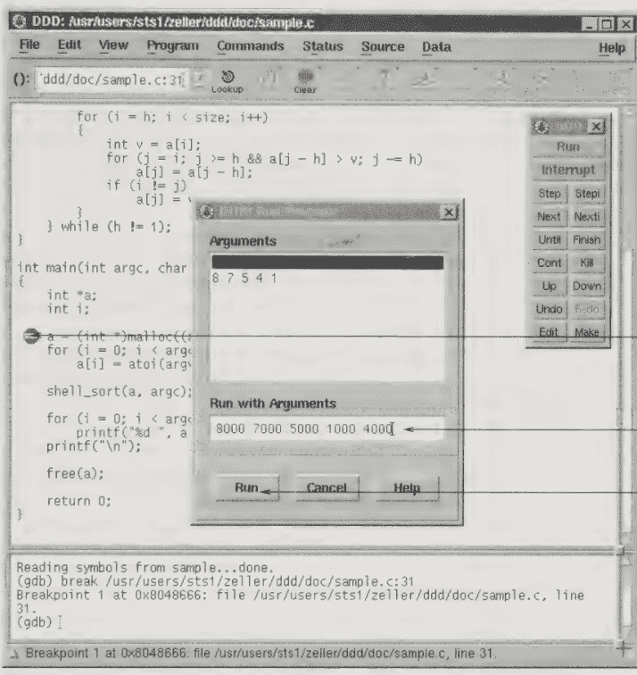
**图 15.4** 在 DDD 下执行程序

图 15.4 显示了 DDD 界面。源代码 sample.c 显示在中央区域。GDB 控制台（在底边）显示了 DDD 版本和 GDB 提示符 (gdb)。

现在我们可以在 DDD（和 GDB）下执行程序。为了提取程序状态，GDB 必须在执行过程中停止程序。

##### 断点

GDB 有几种指定 *停止条件* 的可能性。最简单的条件是让程序在执行到特定语句时立即停止：在代码的这个位置，设置一个 *断点（breakpoint）*。

我们的第一个假设是“从命令行传输值时出错了”。我们想通过在适当的位置 *设置断点* 来测试这个假设。我们点击 `a` 初始化旁边的空白区域。*参数 (argument)* 字段现在包含位置 `sample.c:31`。通过点击 *Break*，我们在参数指示的位置（即第 31 行）设置一个断点。

##### 参数

现在我们需要启动程序。使用 Program $\rightarrow$ Run，我们开始执行。我们也可以在对话框（图 15.4）中输入参数——在我们的案例中是导致失效的参数，即 `8000 7000 5000 1000 4000`。点击 *Run* 以使用您刚刚输入的参数开始执行。

GDB 现在启动 `sample`。执行在片刻后停止，因为达到了断点。当前状态和 DDD 发送给 GDB 的命令会在 GDB 控制台中报告。

```
(gdb) break sample.c:31
Breakpoint 1 at 0x8048666: file sample.c, line 31.
(gdb) run 8000 7000 5000 1000 4000
Starting program: sample 8000 7000 5000 1000 4000

Breakpoint 1, main (argc=6, argv=0xbffff918)
at sample.c:31
(gdb)_
```

当前的执行行由一个绿色箭头（这里是 "$\Rightarrow$"）指示：

```
=> a = (int *)malloc((argc - 1) * sizeof(int));
```

#### 15.3.2 分析数据

程序一旦停止，我们就可以检查当前的变量值。最简单的方法是用鼠标指向变量名；值将显示在一个小窗口中。例如，变量 `argc` 应该具有值 6；然而，变量 `a` 尚未初始化。

##### 执行当前行

为了执行当前行，点击命令工具中的 *Next*。如图 15.5 所示，`a` 现在已正确初始化。

##### GDB 控制台输出

为了打印出 `a` 的单个值，GDB 提供了一个 `print` 命令，在 DDD 中可通过 *Print* 按钮激活。在参数字段中输入 `a[0]`，然后点击 *Print* 以在 GDB 控制台中显示其值：

```
(gdb) print a[0]
$1 = 0
(gdb) _
```

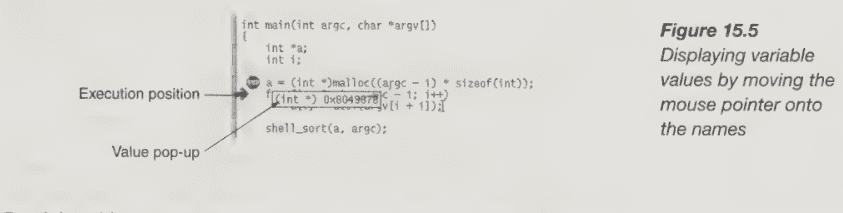

（在您的机器上执行此操作时，可能会获得另一个值——请记住 a 尚未初始化。）

为了检查 a 的所有元素，您必须告诉 GDB 数组的大小。（由于 a 的大小在运行时确定，GDB 无法从调试信息中推导出大小。）为此，您可以使用特殊的 `@` 运算符：`a[n]@m` 输出元素 `a[n] ... a[n+m−1]`。在我们的案例中，我们想输出 a 的所有元素：

**@ 运算符**
```
(gdb) print a[0] @ (argc - 1)
$2 = {0, 0, 0, 0, 0}
(gdb) _
```

（您可以直接在 GDB 控制台中输入此命令，或者在参数字段中输入 `a[0] @ (argc - 1)` 并点击 Print。）

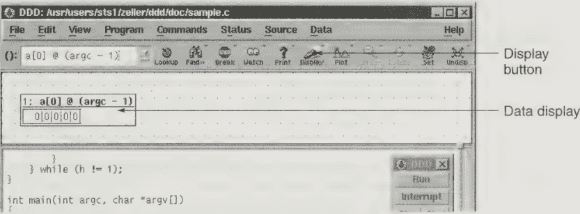
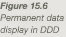

##### 永久显示

明确地打印变量值可能会非常繁琐；如果变量在每次停止时能自动显示会简单得多。因此，GDB 和 DDD 拥有 *永久显示（permanent displays）* 功能，其中变量值会自动刷新。

当参数字段包含 `a[0] @ (argc - 1)` 时，点击 *Display*。a 的内容现在将显示在 *数据窗口* 中（图 15.6）。使用 *Rotate*，可以将该字段设置为水平排列以节省空间。

使用 *Next*，我们到达 a 的初始化部分：

```c
    for (i = 0; i < argc - 1; i++)
        a[i] = atoi(argv[i + 1]);
```

再次点击 *Next*，您可以跟踪 a 的值在初始化过程中是如何变化的。使用 *Until*，GDB 将继续执行直到退出循环。

```c
    shell_sort(a, argc);
```

我们确认 a 的内容是正确的。我们必须拒绝之前的假设；错误在其他地方。也许是在 *shell_sort* 中？点击 *Next*，我们执行 *shell_sort* 并结束于：

```c
    for (i = 0; i < argc - 1; i++)
        printf("%d ", a[i]);
```

现在 a 的值为 `1000, 1913, 4000, 5000, 7000` —— 我们的假设得到了证实，*shell_sort* 弄乱了 a 的值。

#### 15.3.3 调用栈

现在我们需要 *细化* 假设：*shell_sort* 中到底是什么导致了错误状态？*shell_sort* 已经执行完毕；我们必须重启程序。为此，我们删除旧的断点（点击断点，然后点击 *Clear*），并在 *shell_sort* 的调用处设置一个新断点。使用 Program $\rightarrow$ Run Again，我们再次执行程序，并在调用处停止：

##### 删除断点

```c
    shell_sort(a, argc);
```

##### 跳转进入函数

这一次，我们想更详细地检查 *shell_sort* 在做什么。使用 *Step*，我们步入 *shell_sort* 的调用。这将使您的程序停在 *shell_sort* 的第一条可执行行，即：

```c
int h = 1;
```

同时 GDB 准确地告诉我们所在位置：

```
(gdb) step
```


### 15.3 使用 DDD 进行调试：一个示例

```gdb
(gdb) shell_sort (a=0x8049878, size=6) at sample.c:9
(gdb) _
```

该输出是程序*调用栈（call stack）*的一部分，其中存储了被调用函数的执行状态、它们的参数以及局部变量。

### 调用栈

你可以使用 *State → Backtrace* 来查看你在整个栈中的位置；选择一行（或点击 *Up* 和 *Down*）可以让你在栈中移动（图 15.7）。

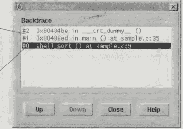
**图 15.7 DDD 中的调用栈**

GDB 和 DDD 调试器仅显示当前函数中定义的局部变量。例如，只有在调用栈中选中 `main` 时，才会显示局部变量 `a`。

在我们查看 *shell_sort* 的内部之前，先测试一下参数。我们的新假设是：“*shell_sort* 的调用有误”。我们在调用栈中选择 *shell_sort* 并检查数组参数 `a`：

```gdb
(gdb) print a[0] @ size
$4 = {8000, 7000, 5000, 1000, 4000, 1913}
(gdb) _
```

令人惊讶！额外的数值 1913 是从哪里来的？简单答案是：传递给 *shell_sort* 的数组大小*多了一个* —— 1913 是恰好位于 `a` 之后内存中的一个伪随机数。而这个伪随机数也被一起参与了排序。因此，我们的假设得到了证实。

#### 15.3.4 更改程序状态

为了排除其他故障原因，我们通过在源代码中选择 *size* 并点击 *Set* 来手动*修正*错误的尺寸值。在对话框（图 15.8）中，我们可以将错误的值 6 替换为正确的值 5。使用 *Finish*，我们恢复 *shell_sort* 的执行：

**设置变量**

```gdb
(gdb) set variable size = 5
(gdb) finish
```

**结束函数**

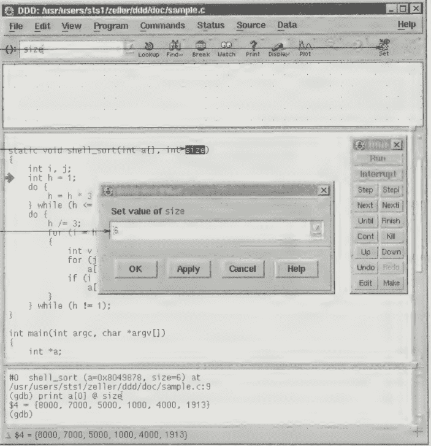
**图 15.8 在 DDD 中更改程序状态**

运行至 #0 退出
```gdb
shell_sort (a=0x8049878, size=5)
    at sample.c:9
0x80486ed in main (argc=6, argv=0xbffff918)
    at sample.c:35
(gdb) _
```

成功！现在 `a` 具有正确的值（图 15.9）。使用 **Cont**，我们继续执行，发现 sample 实际上输出了刚才观察到的值：

```gdb
(gdb) cont
1000 4000 5000 7000 8000
```

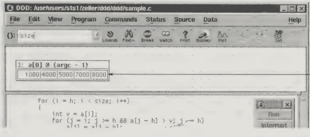
**图 15.9 修正后的程序运行**

```gdb
Program exited normally.
(gdb) _
```

**新值**

现在我们可以修复这个错误了。使用 *Edit*（或你选择的文本编辑器），加载 `sample.c` 并将以下行

```c
shell_sort(a, argc);
```

修改为正确版本：

**编辑程序文本**

```c
shell_sort(a, argc - 1);
```

重新编译后，

```bash
$ gcc -g -o sample sample.c
$ _
```

我们可以在 DDD 中再次启动程序（使用 *Program* → *Run Again*）并查看是否成功：

```gdb
(gdb) run
'sample' has changed; rereading symbols.
Reading in symbols...done.
Starting program: sample 8000 7000 5000 1000 4000
1000 4000 5000 7000 8000
Program exited normally.
(gdb) _
```

该错误现已修复。使用 *Program* → *Exit* 或 Ctrl+Q 退出 DDD 会话。

### 15.4 其他调试器功能

在 15.3 节的场景中，我们看到了如何使用调试器来输出程序状态。因此，调试器是替代调试指令（如打印语句）的一个很好的选择 —— 特别是因为我们可以省去耗时的重新编译过程。

那么 15.2 节中介绍的那些测试假设的其他技术如何呢？事实证明，大多数技术在调试器中都有对应的等效功能。

#### 15.4.1 验证程序状态

*在调试器中验证程序状态*

在 13.2 节中，我们讨论了用于验证程序状态的 `assert` 函数。调试器也可以调用验证函数。通常的方法是使用*条件断点（conditional breakpoint）*：调试器（包括 GDB）提供了将断点与条件关联的选项 —— 只有在到达断点且条件满足时，断点才会激活。使用 GDB 命令

```gdb
(gdb) break if x < 0 || y < 0
(gdb) _
```

在当前行设置一个断点，该断点仅在满足给定条件时才停止程序。

#### 15.4.2 监视程序状态

*永久监视程序状态*

如果一致性违例无法与程序代码中的某个特定点相关联，调试器提供了*永久监视（permanent watching）*选项：在每条计算机指令执行后，都会评估一个表达式；一旦发生变化，程序将停止。这一特性可用于调用验证函数。通过这种方式，可以确保数据结构保持一致：

```gdb
(gdb) watch tree_ok()
(gdb) _
```

常量监视的问题在于，由于每条指令之后都必须运行 `tree_ok()`，程序的运行速度会显著降低。即使我们只监视一个单一变量（watch 会在每次值改变时输出），程序速度也会降低 1000 倍。因此，这种技术仅适用于程序的短片段。

好消息是，某些处理器（特别是 Intel x86 系列）可以自行监视特定的内存单元。调试器可以利用此功能快速显示简单变量的变化。在这种处理器上，命令

```gdb
(gdb) watch a[0]
(gdb) _
```

能确保 `a[0]` 的每次变化都会使程序停止 —— 而不会降低程序的运行速度。

#### 15.4.3 更改程序执行

*更改程序执行*

在 15.3 节中，我们看到了如何在程序运行期间更改变量值。除此之外，调试器还提供了干预程序执行的其他可能性。例如，通过使用 GDB 的 return 命令，可以让每个函数立即返回。通过 jump，可以跳过函数的某些部分 —— 在 DDD 中，这也可以通过将执行箭头拖动到另一个位置来实现。

这些命令也可以与断点关联，从而使程序的某些区域完全不参与执行 —— 这与 15.2.3 节中删除代码的方法类似。例如，如果我们假设某个函数损坏了内存，我们可以在该函数的开头设置一个断点，并将该断点与 return 命令耦合。在随后的每次调用中，断点都会确保该函数立即返回 —— 实际的函数体永远不会被执行。

#### 15.4.4 更改程序代码

*更改程序代码*

在某些调试器中，可以在*执行期间*更改程序代码。在执行过程中发现的任何故障原因都可以在程序停止时修复，并在恢复执行后检查修复是否成功。GDB 仅在少数变体中提供此功能，但它可以自动重新读取重新编译的程序而不会丢失任何设置。

#### 15.4.5 事后调试（Postmortem debugging）

最后，调试器最重要特性之一：在程序崩溃后，可以调查程序的*最后状态*。在 UNIX 上，如果出现致命错误，程序将被终止。为了进行诊断，崩溃程序的内存内容会被写入一个名为 *core*（源自“核心内存”）的文件。这个 *core* 文件随后可以由调试器读取，以便程序员检查有故障的程序状态。通常，只需显示调用栈 —— 错误发生在何处？ —— 即可隔离错误。

### 15.5 GDB 和 DDD 的工作原理

*程序执行控制*

每个调试器必须能够控制*程序的执行*，即启动和停止程序。此外，调试器需要访问*程序状态*。在本节中，我们将讨论这些基本功能在 GDB 中是如何实现的；此外，我们还将简要讨论 DDD 的内部机制。

#### 15.5.1 进程控制

通常，由操作系统负责将程序作为进程执行。因此，调试器需要操作系统的某些支持来控制执行。

`ptrace`

UNIX 操作系统提供了一个名为 `ptrace` 的接口，允许以受控方式执行子进程。基本上，子进程一直执行直到接收到一个信号 —— 与此同时，父进程（调试器）可以继续运行。

以下是 ptrace 函数最重要的命令：

- **PTRACE_TRACEME：** 为子进程的受控执行做准备。子进程必须发出此命令，以便能被调试器控制。其工作流程如下：
  - 调试器进程被 fork 成一个父进程和一个子进程。
  - 子进程调用 `ptrace(PTRACE_TRACEME)`。
  - 子进程使用 `exec` 将自身替换为要控制的程序。

其他命令由父进程（调试器）执行：

**读取数据**

- **PTRACE_PEEKTEXT, PTRACE_PEEKDATA：** 从子进程的内存中读取数据。TEXT 变体访问可执行程序代码，DATA 变体访问程序内存。（许多 UNIX 变体提供了 `/proc` 文件系统作为替代 —— 这是一个虚拟文件系统，可以通过与文件相同的方式读取进程的内存内容。通过 `/proc` 文件系统的访问速度更快且更简单。）

**写入数据**

- **PTRACE_POKETEXT, PTRACE_POKEDATA：** 向子进程的内存中写入数据。


### 15.5 GDB 和 DDD 的工作原理

**PTRACE_CONT：** 继续执行子进程（如有必要，通过发送信号来实现）。
*继续执行*

**PTRACE_SINGLESTEP：** 开启或关闭单步执行。如果此选项激活，进程在每次执行一条指令后都会被信号停止。
*单步执行*

但调试器如何确保子进程一旦启动后能够真正停止呢？一方面，调试器可以向被调查的进程发送**信号**。例如在 GDB 中，如果用户通过键盘输入中断信号（通常是 Ctrl+C），就会发生这种情况。另一方面，程序可能会运行到*断点*。调试器通过在程序的机器码中插入特殊的**断点指令**来实现这一点——这些指令在执行时，会让操作系统用一个特殊的信号中断该进程。该信号被调试器拦截，随后调试器即可调查进程状态。

**信号**

**断点指令**

如果调试器恢复执行，它必须用原始指令替换掉断点指令。随后该指令被单步执行。紧接着，断点指令会被再次插入，执行一直持续到下一个信号出现。某些处理器具有特殊的**断点寄存器**，可以将断点保存在其中；有了这种寄存器，就无需修改机器码。

#### 15.5.2 数据访问

通过 `ptrace`，调试器可以访问相关程序的任何内存位置。但调试器如何建立程序内存与原始源代码中使用的变量之间的联系呢？

这就是在编译期间生成的*调试信息*发挥作用的地方。如果我们将示例 15.1 中的 `sample` 程序编译为汇编语言 (`sample.s`)，除了实际的机器码外，我们还会发现大量的 `.stabs` 指令：

*调试信息*

```bash
$ gcc -g -S sample.c
$ more sample.s
.stabs "/home/zeller/tmp/",100,0,0,.Ltext0
.stabs "sample.c",100,0,0,.Ltext0 ...
```

这些 `.stabs` 指令正是调试器获取程序信息的来源。它们采用 STABS 格式（源自 "symbol tables"）。一条 `.stabs` 指令的格式如下：

**STABS 格式**

```assembly
.stabs "string",type,extension,description,value
```

在第一条 `.stabs` 指令中，*type* 的值为 100 —— 这代表源文件的路径 (`/home/zeller/tmp/`) 和名称 `sample.c`。所有的 STABS 指令都被保留在目标文件中（从而也保留在可执行文件中），以便 GDB 能将机器码与相应的源代码关联起来。

在 `sample.s` 的更下方，我们可以找到原生 C 类型的调试信息：

```
.stabs "int:t(0,1)=r(0,1);002000000000;001777777777;",128,0,0,0
.stabs "char:t(0,2)=r(0,2);0;127;",128,0,0,0
.stabs "long int:t(0,3)=r(0,1);002000000000;001777777777;", 128,0,0,0
.stabs "__caddr_t:t(7,34)=(7,35)=*(0,2)",128,0,82,0
```

**示例 15.2：原生 C 类型的调试信息**

这些信息告诉 GDB 基本类型名称 (t)：`int` 被赋予编号 (0,1)。通过后缀 `r`，`int` 被声明为类型 (0,1) 的一个子范围 —— 即它本身。（这听起来可能不太逻辑，但这是一个历史惯例。）随后是 `int` 的值范围。所有其他原生 C 类型以及用户定义类型（如 `__caddr_t`，被定义为指向 (0,2) (`char`) 的指针）也是如此。

在所有类型之后，是 `shell_sort` 的机器码，最后以 `main` 的调试信息结束：

```
.stabs "main:F(0,1)",36,0,27,main
.stabs "argc:p(0,1)",160,0,26,8
.stabs "argv:p(0,21)=*(7,35)",160,0,26,12
```

类型 36 定义了一个函数名称 —— 例如 `main`。类型 160 定义了一个参数 —— 在我们的案例中是 `argc` 和 `argv`。`argc` 的类型是 (0,1) (`int`)，且在调用期间位于位置 8。`argc` 的描述是 26 —— 这是定义 `argc` 的行号。`argv` 是一个指向类型 (7,35) 的指针 (`=*`) —— 即 `__caddr_t`，一个指向单个字符的指针。

在 `main` 的末尾，我们发现了以下信息：

```
.stabs "a:(0,20)",128,0,28,-4
.stabs "i:(0,1)",128,0,29,-8
```

用于定义局部变量（类型 128）：`a` 定义在第 28 行且位于位置 -4；`i` 则在其后一行。

目前这个例子足以让人对调试信息有一个初步了解。事实上，对于编程语言的每一个概念，STABS 格式中都有相应的编码。调试器能够处理所有这些内容并解释编程语言的任何表达式，这表明 GDB 的幕后运行机制极其复杂。

#### 15.5.3 图形化数据表示

现在我们已经了解了 GDB 如何访问被调试程序的数据，让我们看看这些数据是如何以合适的形式呈现给用户的。这就是 DDD 的任务。

*DDD 中的可视化*

GDB 以文本形式输出数据。如示例 15.3 所示，这并不总是容易阅读：

```c
*Tree = {value = 7, _name = 0x8049e88 "Ada",
_left = 0x804d7d8, _right = 0x0,
left.thread = false, right.thread = false,
date = {day_of_week = Thu, day = 1, month = 1,
year = 1970,
_vptr. = 0x8049f78 <Date virtual table>},
static shared = 4711}
```

**示例 15.3 GDB 中的文本值输出**

相比之下，DDD 创建了一个结构化显示，其中细节可以展开（图 15.10）。

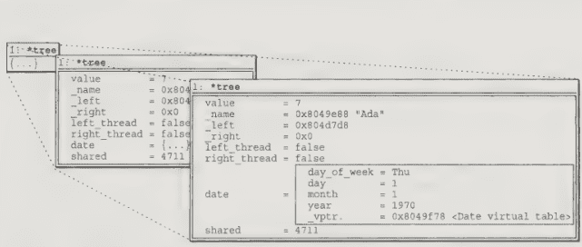
**图 15.10 DDD 中细节递增的结构化值输出**

DDD 是如何创建这种图像的？DDD 通过命令行与 GDB 通信，并以文本形式从 GDB 接收数据值。在解析 GDB 输出时，DDD 为每个输出的数据值分配一个矩形区域 —— 这个区域被称为“框”（box）。相互嵌套的结构由相互嵌套的框表示，在未展开时，它们被虚拟占位符代替。

*框表示法*

此外，DDD 还可以将数据之间的关系可视化。如果某些数据 $d'$ 被显示为源自现有数据 $d$ —— 例如通过对 $d$ 中的指针进行解引用 —— DDD 会通过一个从 $d$ 到 $d'$ 的箭头来显示这种关系。这使得表示复杂的数据结构成为可能（图 15.11）。

*关系可视化*

通常，每个新创建的数据最多只有一个箭头指向它 —— 因此表示法被简化为树形结构。通过激活特殊的*别名检测*（alias detection），DDD 还可以显示更复杂的数据结构。其核心思想是将内存中位于相同地址的所有数据框*合并*（*别名*），从而允许对同一块数据进行多次引用。

**图 15.11：DDD 中的结构**

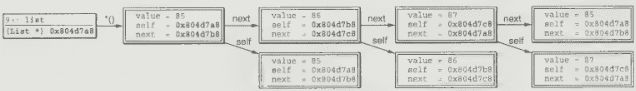

举个例子，我们再次查看图 15.11 的数据。对比指针值可以清楚地看到，self 指针指向节点本身；此外，最后一个 next 指针被赋值给列表中的第一个元素。在开启别名检测（使用 Data $\rightarrow$ Detect Aliases）后，DDD 获取所有显示数据的内存地址并合并它们的框。结果可见于图 15.12 —— 该图清晰地显示了指针指向哪些数据，而无需先对比它们的地址。

**图 15.12：开启别名检测后的结构**

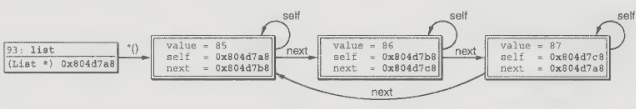

### 15.6 内存校验

程序的某些属性必须在*整个执行期间*保持不变 —— 例如，程序代码或其数据的完整性。如果访问内存的基础技术不再奏效，那么隔离单个故障原因将变得非常困难。

在 C 和 C++ 程序中，*堆*（heap）内存的误用是常见的错误来源。在 C 和 C++ 中，堆是获取任意数量内存的来源；这里是分配新对象的地方。如果一个对象不再需要，必须显式地释放（或 *free*）相应的堆内存；这样内存才能被其他对象使用。不过，程序员必须确保被释放的内存不再被使用；同时，被释放的内存不能被再次释放。这两种操作都会导致*定时炸弹* —— 故障在若干指令之后才显现，因此无论使用何种调试技术，都很难将其隔离。

幸运的是，有一些非常有用的工具可以帮助校验堆的状态。在……期间始终准备好这些工具是一个好主意。

开发过程，并在有轻微怀疑时立即应用它们——如果堆结构不健全，那么推论单个变量的值就毫无意义。这些工具的弊端在于它们增加了内存和时间开销，因此不能在生产代码中使用。

#### 15.6.1 使用 MALLOC_CHECK 验证堆

使用 GNU C 运行时库（LINUX 系统的默认库），只需设置一个名为 `MALLOC_CHECK_` 的环境变量，就可以避免与堆使用相关的常见错误。例如，可以检测堆内存的多次释放：

```shell
$ MALLOC_CHECK_=2 myprogram myargs
free() called on area that was already free'd()
Aborted (core dumped)
$ _
```

程序中止时生成的 core 文件可以通过调试器（第 15.4.5 节）读取，从而直接定位到第二次调用 `free()` 的位置。

#### 15.6.2 使用 Electric Fence 避免缓冲区溢出

ELECTRIC FENCE 库能有效禁止缓冲区溢出。其基本思想是在内存中分配数组时，使每个数组的前后都紧邻一个不存在的内存区域——即实际的“电栅栏（electric fence）”。如果程序试图访问该区域（即发生了溢出），程序将被中止。

使用 ELECTRIC FENCE，可以快速缩小示例（示例 15.1）中发生溢出的数组范围。我们使用 `efence` 库编译 `sample`，并向生成的 `sample-with-efence` 程序传递两个参数；一旦访问 `a[2]`，程序就会中止。

```shell
$ gcc -g -o sample-with-efence sample.c -lefence
$ sample-with-efence 11 14
Electric Fence 2.1
Segmentation fault (core dumped)
$ _
```

同样，core 文件可以通过调试器读取——除非直接在调试器中运行 `sample-with-efence`。

#### 15.6.3 使用 VALGRIND 检测内存错误

VALGRIND（通往奥丁之乡瓦尔哈拉的神圣入口）提供了 ELECTRIC FENCE 的功能，并且还更进一步。VALGRIND 可以检测以下内容：

- 对未初始化内存的读访问
- 对未分配内存的写或读访问
- 跨越数组边界的写或读访问
- 在特定栈区域的写或读访问
- 内存泄漏（已分配但从未释放的区域）

如果我们将 VALGRIND 应用于示例 15.1 的示例程序，我们会得到一条消息，指出 `sample` 以非法方式访问内存。这次访问发生在由 `main` 和 `__libc_start_main` 调用的 `shell_sort`（第 17 行）中。

```
$ valgrind sample 11 14
Invalid read of size 4
    at 0x804851F: shell_sort (sample.c:17)
    by 0x8048646: main (sample.c:35)
    by 0x40220A50: __libc_start_main (in /lib/libc-2.3.so)
    by 0x80483D0: (within /home/zeller/sample)
```

剩余的消息提供了关于非法内存区域的一些细节：它靠近由 `main`（第 31 行）分配的内存区域——即为 `a [0...1]` 通过 `malloc` 分配的内存区域。

```
Address 0x40EE902C is 0 bytes after a block alloc'd
    at 0x4015D414: malloc (vg_clientfuncs.c:103)
    by 0x80485D9: main (sample.c:31)
    by 0x40220A50: __libc_start_main (in /lib/libc-2.3.so)
    by 0x80483D0: (within /home/zeller/sample)
$ _
```

这是如何工作的？VALGRIND 解释被调试程序的机器指令，并跟踪已使用的内存：

- 每个内存位都关联一个控制值位，简称 V-bit。每个 V-bit 最初未设置；一旦关联的内存位被写入，它就被设置为 1。
- 此外，每个字节都关联一个分配位，简称 A-bit，如果相应的字节当前已分配，则该位被设置为 1。当某个内存区域被释放时，A-bit 被清除。

每当程序尝试读取 A-bit 或 V-bit 未设置的内存时，VALGRIND 就会标记一个错误。

图 15.13 展示了上述 `sample` 程序生成错误消息时的情况。`a[0]` 和 `a[1]` 已分配并初始化——它们的 A-bit 和 V-bit 已设置（显示为深色）。相比之下，`a[2]` 既未分配也未初始化——访问它会导致 VALGRIND 发出错误消息。

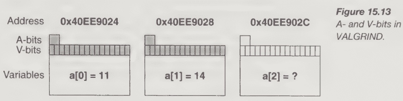

### 15.7 避免错误

使用断言和专用工具来检查内存使用，是检测故障原因无可争议的最佳实践。然而，使用 GDB 和 DDD 等交互式调试器则存在争议。基本上，*建设性措施*（如良好的设计、更高程度的抽象或精确的规范）显然比试图用调试器修复错误更适合*从一开始就避免错误*。（简单来说就是：“预防胜于治疗”——当然，断言就是预防的一部分）。此外，不应在程序运行起来之前就使用调试器来修正程序（即可怕的“调试出运行结果”）。关于这个话题，Harlan Mills 是这样说的：

> 交互式调试器是一个关于什么*不需要*的杰出例子——它鼓励试错式的黑客行为而非系统设计，并且掩盖了那些勉强具备精确编程资格的平庸之辈。

那么我们可以不用调试器吗？不！软件系统的组件之间关联越紧密，添加的第三方组件越多，就越需要处理由第三方软件*引发*的错误，或由所有这些组件的*交互*引起的错误。通常，只有调试器能帮助理解实际发生了什么。

对于你自己的软件，最好的做法不是首先启动调试器，而是激活你自己的大脑。McConnell (1993) 认为：

> 调试器不能替代良好的思考。但在某些情况下，思考也不能替代一个好的调试器。最有效的组合是良好的思考加上一个好的调试器。

#### 概念

- 调试的目标是将一个外部可观测的状态（*故障*）与执行过程中的某个时刻联系起来，通过改变该时刻的状态（*修复*）来消除故障。

调试的科学方法由假设的系统性创建和测试组成。

为了测试假设并洞察程序执行，可以
- 在代码中增加调试指令，或
- 使用调试器。

典型的调查技术包括
- 在适当的位置输出程序状态，例如在调试器中停止程序后；
- 验证程序状态，最佳技术是预防性的，如断言；以及
- 改变程序状态，例如禁用程序片段。

调试器使用操作系统的特定接口来控制被调查的进程，并使用将进程数据映射到编程语言元素的调试信息。

一些工具专门用于有效地检测内存管理错误。这类工具应在所有其他调试方法之前应用。

调试器不能替代良好的思考。

#### 复习练习

1. 为了寻找错误，你插入了调试指令，如第 15.2.1 节所示。在找到错误后，你可以
(a) 从代码中删除调试指令，
(b) 将指令留在代码中，以便在编译时激活，
(c) 将指令留在代码中，以便在运行时激活。
不同选项的利弊分别是什么？

2. 前置条件和后置条件不仅可以用断言的形式描述，也可以用程序注释的形式描述。讨论其优缺点。

3. 为什么最终产品中会删除断言？考虑计算开销、断言所需的空间，以及从最终用户的角度来看断言的用户友好性。

4. 构建一个系统，能够自动确定修订树（第 15.2.3 节）中导致错误的变更。使用 CVS 访问之前的配置，使用 MAKE 构建程序，使用 DEJAGNU 或 JUNIT 进行测试。

5. 编写一个程序，从目标文件的 STABS 信息中创建所有函数（参数 / 局部变量 / ...）的列表。

#### 延伸阅读

Lieberman (1997) 的 *The Debugging Scandal* 提供了该主题的介绍。这篇发表在 *Communications of the ACM* 上的文章包含了许多关于该主题的次要文章。

Rosenberg (1996) 描述了调试器的通用构造及其与 (WINDOWS) 操作系统的交互。

Zeller (1999) 描述了 *Delta Debugging* 方法如何自动寻找导致错误的变更。

GDB 由 Stallman 和 Pesch (1998) 编写，并由 *Red Hat*（原 CYGNUS）维护。

DDD 由 Zeller 和 Lütkehaus (1996) 开发。第 15.1 节中的场景取自 Zeller (2000) 的 DDD 手册。

STABS 格式由 Menapace 等人 (1998) 描述。

在计算机开发的早期，人们认为计算机中存在昆虫（bugs）导致了错误。根据 Hopper (1981) 的说法，1947 年人们发现了一只被卡在继电器中的飞蛾。

#### 其他调试工具

像 GDB 和 DDD 这样的交互式调试器通常不作为独立工具提供，而是作为随编译器交付的编程环境的组件——例如，WINDOWS 调试器与 WINDOWS 开发环境一起提供。通常，调试器只能在自己的环境中运行。

作为一个例外，GDB 可以处理许多编译器的调试信息。因此，GDB 也提供商业支持：

- Red Hat（原 CYGNUS）为 GDB 提供商业支持。
- *Red Hat* 的 Insight 是另一个与 GDB 紧密连接的图形界面。*Insight* 免费提供；*Red Hat* 同时提供商业支持。


其他有用的商业调试工具包括：

- 来自 *Rational* 的 PURIFY 是运行时发现错误（尤其是内存管理错误）最有效的工具之一。在 LINUX 上，PURIFY 是 VALGRIND 的替代方案。
- 来自 *ParaSoft* 的 INSURE++ 同样能在运行时发现内存管理错误，但它将此功能与*静态分析*相结合，以便更准确地隔离故障原因。INSURE++ 可用于 WINDOWS WINDOWS 和 UNIX 平台。
- 来自 *NuMega* 的 BOUNDSCHECKER 用于发现 WINDOWS 平台上的内存管理错误；其功能可与 ELECTRIC FENCE 和 VALGRIND 相比。

第 18 章中介绍的用于*静态分析*的工具也可以用来发现程序中的错误。

#### 练习 V

在此练习中，您可以测试在之前的实践练习中创建的 `lcalc` 程序以及第 13 章中的 `Rational` 类。

1. 创建一个 EXPECT 脚本 `lcalc.exp`，使用类似于第 210 页示例 12.3 中 `bc.exp` 的脚本来测试您的 `lcalc` 程序。请提出合适的测试用例。
2. 按照第 12 章中关于 `bc` 的描述，将 DEJAGNU 设置为 `lcalc` 的测试环境。使用 `lcalc.exp` 作为起点。
3. 尝试在 `lcalc` 中引发故障。特别是测试溢出以及除以零的情况。使用调试器来查找并消除错误原因。
4. 创建一个如第 13 章所述的 `RationalTest` 类。
   - 如果您想用 C++ 编程，请使用 CPPUNIT 在 C++ 中定义测试用例。
   - 如果您想用 JAVA 编程，请使用 JUNIT 在 JAVA 中定义测试用例。
5. 创建一个满足测试用例的 `Rational` 类。分别使用 JUNIT 或 CPPUNIT 对该类进行验证。
6. 创建一个 `RationalArithTest` 类，其中包含基本的算术测试（方法：add, subtract, multiply, divide）。
7. 扩展 `Rational` 类，使其同时也满足 `RationalArithTest` 的测试用例。
8. 创建一个 `AllRationalTests` 类，作为一个测试套件，将 `RationalTest` 和 `RationalArithTest` 的测试结合起来。检查您的 `Rational` 类是否通过了 `AllRationalTests`。

## 第 VI 部分：程序分析

### 16 使用 GPROF 和 GCOV 进行分析

### 16.1 通过分析提高性能

程序创建的一个重要环节是*调优（tuning）*——即系统性地提高程序的性能。在这种情况下，“系统性”意味着不是“随机地”进行优化。相反，通过使用确定的特定*分析（profiling）*，可以确定：

- 可以提高性能的位置，以及
- 可能的优化对运行时间的影响。

在本章中，我们将讨论三种在不同详细程度上执行此类分析的工具：

- **TIME** 确定*进程*的运行时间。
- **GPROF** 显示运行时间如何在各个*函数*之间分配。
- **GCOV** 统计单个*程序行*被执行的次数。

### 16.2 使用 TIME 进行通用运行时间测量

让我们首先看看如何确定*进程*的运行时间。TIME 程序执行作为参数传递的命令，然后输出该进程所需的运行时间。作为一个例子，我们将查看一个用 C++ 编写并输出 Huffman 编码文本的 `huffencode` 程序。`COPYING` 文本文件被用作测试输入。

```bash
$ c++ -o huffencode huffencode.C
$ time ./huffencode COPYING > COPYING.huff.C
real       0m0.465s
user       0m0.420s
sys        0m0.010s
$ _
```

TIME 输出中指示的时间为：

- **real**：总流逝时间
- **user**：执行命令所使用的 CPU 时间
- **sys**：系统开销（如内核函数）消耗的 CPU 时间

*通过优化提高速度*

TIME 对于粗略了解进程的运行时间非常有用，例如用于检查不同编译器选项的效果。如果我们开启优化（-O）编译 `huffencode`，我们会得到以下结果：

```bash
$ c++ -O -o huffencode huffencode.C
$ time ./huffencode COPYING > COPYING.huff.C
real        0m0.735s
user        0m0.130s
sys         0m0.010s
$ _
```

我们看到用户函数的 CPU 时间下降到了三分之一——因此，程序的运行速度提高了约三倍。然而，与此同时，实际运行时间却增加了。为什么？这有几种可能的原因——例如，可能有其他进程正在运行，同样需要 CPU 资源。或者，新创建的程序加载到内存中可能需要一点时间。

因此，通常参考实际运行时间来进行比较并不是很有用，除非您能准确定义计算机的状态，或者通过足够次数的测试形成一个合适的*统计平均值*。即使是系统时间也可能根据系统负载而变化——例如，如果内存必须在硬盘之间进行交换，可能会出现延迟。只有用户 CPU 时间是完全可靠且独立于当前负载的。

顺便提一下，TIME 本身仅测量实际流逝的时间；CPU 时间是由操作系统为每个单独进程跟踪的。

### 16.3 使用 GPROF 进行程序分析

虽然我们有使用 TIME 测量程序运行时间的通用方法，但我们还需要知道程序的运行时间是如何在各个组件之间分配的。GPROF 程序提供了一个初步的近似方案，它会对*程序概貌（program profile）*进行评估。

程序概貌是由可执行程序在运行时创建的；它显示了哪些函数被调用、调用次数以及它们所花费的时间。这分为三个步骤完成：

1. 在编译期间，将程序*配置*为分析模式。
2. 当程序执行时，创建一个*程序概貌*。
3. 由 GPROF 分析该程序概貌。

#### 16.3.1 用于配置 GPROF 的程序

第一步是将程序*配置*为分析模式——这意味着在编译它时，使其在执行时能创建程序概貌。这是通过使用编译器选项 `-pg` 来实现的。（在程序链接以及编译时都必须提供 `-pg` 选项。）

```bash
$ c++ -O -pg -o huffencode huffencode.C
$ _
```

第二步是用尽可能具有代表性的数据来执行程序。程序按通常方式运行——可能会慢一点。最后，会自动创建一个名为 *gmon.out* 的文件，其中包含程序概貌：

```bash
$ ./huffencode COPYING > COPYING.huff.cc
$ ls -l gmon.out
-rw-r--r-- 1 zeller      21176 Jun 29 11:09 gmon.out
$ _
```

在第三步中，*gmon.out* 中的数据由 GPROF 分析。为此，我们调用 GPROF 并将产生该 *gmon.out* 概貌的程序作为参数提交。GPROF 将分析结果写入标准输出。

```bash
$ gprof ./huffencode
:
GPROF output
:
$ _
```

GPROF 的输出由两部分组成：

- *平坦概貌（flat profile）*，指示运行时间如何在各个函数之间分配。
- *结构化概貌（structured profile）*，其中指示了已调用及将被调用的函数。

#### 16.3.2 平坦概貌

示例 16.1 显示了 GPROF 生成的*平坦程序概貌*。平坦程序概貌指示了哪些函数最耗时，因此它们是潜在优化的候选对象——耗时最多的函数显示在开头。

**示例 16.1：平坦程序概貌**

| % time | cumulative % time | self seconds | calls | self us/call | total us/call | name |
|:---:|:---:|:---:|:---:|:---:|:---:|:---:|
| 33.33 | 0.02 | 0.02 | 47110 | 0.42 | 0.42 | string_Scat |
| 16.67 | 0.03 | 0.01 | 10674 | 0.94 | 0.94 | bits_to_byte |
| 16.67 | 0.04 | 0.01 | 10673 | | 0.94 | string::at |
| 16.67 | 0.05 | 0.01 | 1 | 10000.00 | 42298.03 | encode |
| 16.67 | 0.06 | 0.01 | 1 | 10000.00 | 17668.44 | read_input |
| 0.00 | 0.06 | 0.00 | 10983 | 0.00 | 0.00 | string_Salloc |
| 0.00 | 0.06 | 0.00 | 256 | 0.00 | 0.00 | compare |
| 0.00 | 0.06 | 0.00 | 154 | 0.00 | 0.00 | string::op_char * |
| 0.00 | 0.06 | 0.00 | 154 | 0.00 | 0.44 | _cook |
| 0.00 | 0.06 | 0.00 | 153 | 0.00 | 0.00 | extract_min |
| 0.00 | 0.06 | 0.00 | 153 | 0.00 | 0.00 | insert |
| 0.00 | 0.06 | 0.00 | 78 | 0.00 | 0.00 | string_Scopy |
| 0.00 | 0.06 | 0.00 | 1 | 0.00 | 0.00 | global_destructors |
| 0.00 | 0.06 | 0.00 | 1 | 0.00 | 0.00 | global_constructors |
| 0.00 | 0.06 | 0.00 | 1 | 0.00 | 0.00 | string::from |
| 0.00 | 0.06 | 0.00 | 1 | 0.00 | 0.00 | huffman |
| 0.00 | 0.06 | 0.00 | 1 | 0.00 | 64.53 | init_codes |
| 0.00 | 0.06 | 0.00 | 1 | 0.00 | 0.00 | initial_queue |
| 0.00 | 0.06 | 0.00 | 1 | 0.00 | 0.00 | length |
| 0.00 | 0.06 | 0.00 | 1 | 0.00 | 60000.00 | main |
| 0.00 | 0.06 | 0.00 | 1 | 0.00 | 33.54 | write_encoding |
| 0.00 | 0.06 | 0.00 | 1 | 0.00 | 33.54 | write_huffman |

对于每个函数 *f*，列出了运行时间配额和调用次数。

让我们更详细地看看示例 16.1 中的概貌。最重要的细节是：

- **self seconds**：该函数本身使用的用户运行时间
- **% time**：占总运行时间的百分比
- **calls**：该函数的调用次数

领跑者 *string_Scat* 函数本身占据了运行时间的三分之一，并且调用次数超过 47,000 次，也是被调用最频繁的函数。对后续函数 `bits_to_byte`、`string::at`、`encode` 和 `read_input` 进行优化也可以提高 *huffencode* 程序的性能。

**库函数**

总共测量到 0.06 秒的运行时间；而在此之前，TIME 记录的运行时间为 0.13 秒。剩下的 0.07 秒在哪里？它们被*库函数*使用了——在我们的案例中，是 C++ 标准库的输入和输出函数。为了将它们包含在概貌中，程序必须与使用 `-pg` 编译并因此专门为分析而配置的库变体进行链接。


#### 16.3.3 结构化剖析 (Structured profiles)

通过对程序进行更准确的分析，我们可以确定 `string_Scat` 函数几乎没有什么可以改进的地方 —— 该函数除了连接两个字符串之外不执行任何其他操作。相反，我们应该问自己：为什么会执行这么多耗时的字符串操作？这里我们需要 GPROF 生成的*结构化程序剖析 (structured program profile)*，如示例 16.2 所示。

结构化程序剖析本质上比扁平化程序剖析更详细。对于每个单独的函数 *f*，它指示：

- *f* 及其调用的函数在整个运行时间中所占的比例 (%time)。
- 哪些函数调用了 *f* 以及调用次数，以及 *f* 在这些函数运行时间中的个体份额（这些函数列在 *f* 的*上方*）。
- *f* 调用了哪些函数以及调用次数，以及这些函数在 *f* 运行时间中所占的比例（这些函数列在 *f* 的*下方*）。

举例来说，我们查看示例 16.2 中索引 [4] 下的 `string_Scat` 函数条目。`string_Scat` 没有调用任何其他函数（至少没有设置剖析的函数）；在 47110 次调用中，18063 次来自 `read_input` 函数，28737 次来自 `encode` 函数。也许这两个函数是合适的优化对象？对此类函数的详细分析可能会有所帮助，这将在 16.4 节中讨论。

| index | % time | self | children | called | name |
| :---: | :---: | :---: | :---: | :---: | :--- |
| [1] | 100.0 | 0.00 | 0.06 | 1/1 | _start [2] |
| | | | | | main [1] |
| | | 0.01 | 0.03 | 1/1 | encode [3] |
| | | 0.01 | 0.01 | 1/1 | read_input [5] |
| | | 0.00 | 0.00 | 1/1 | write_huffman [10] |
| | | 0.00 | 0.00 | 1/1 | huffman [17] |
| | | 0.00 | 0.00 | 1/1 | write_encoding [20] |
| | | | | | ------------------------------- |
| | | | | | \<spontaneous\> |
| [2] | 100.0 | 0.00 | 0.06 | | |
| | | 0.00 | 0.06 | 1/1 | _start [2] |
| | | | | | main [1] |
| | | | | | ------------------------------- |
| | | 0.01 | 0.03 | 1/1 | main [1] |
| [3] | 70.5 | 0.01 | 0.03 | 1 | encode [3] |
| | | 0.01 | 0.00 | 28737/47110 | string_Scat [4] |
| | | 0.01 | 0.00 | 10674/10674 | bits_to_byte [6] |
| | | 0.01 | 0.00 | 10673/10673 | string::at [7] |
| | | 0.00 | 0.00 | 1/1 | init_codes [9] |
| | | 0.00 | 0.00 | 77/154 | _cook [8] |
| | | 0.00 | 0.00 | 10752/10983 | string_Salloc [11] |
| | | 0.00 | 0.00 | 256/256 | compare [12] |
| | | 0.00 | 0.00 | 1/1 | string::from [16] |
| | | 0.00 | 0.00 | 1/78 | string_Scopy [15] |
| | | | | | ----------------------------------------------- |
| | | 0.00 | 0.00 | 152/47110 | init_codes [9] |
| | | 0.00 | 0.00 | 158/47110 | _cook [8] |
| | | 0.01 | 0.00 | 18063/47110 | read_input [5] |
| | | 0.01 | 0.00 | 28737/47110 | encode [3] |
| [4] | 33.3 | 0.02 | 0.00 | 47110 | string_Scat [4] |
| | | | | | ----------------------------------------------- |
| | | 0.01 | 0.01 | 1/1 | main [1] |
| [5] | 29.4 | 0.01 | 0.01 | 1 | read_input [5] |
| | | 0.01 | 0.00 | 18063/47110 | string_Scat [4] |

#### 示例 16.2
结构化程序剖析。在每个函数 *f* 之上的是调用 *f* 的函数，之下的是被 *f* 调用的函数。

### 16.4 使用 GCOV 进行覆盖率测量

为了确定函数中哪些部分被执行得特别频繁，有一个名为 GCOV 的特殊程序，它可以测量*行覆盖率 (line coverage)* —— 它计算程序中每一行被执行的次数。

与剖析类似，覆盖率测量分为三个阶段：

1. 在编译期间，程序被设置为支持覆盖率测量。
2. 在程序执行期间，生成覆盖率测量信息。
3. 覆盖率信息由 GCOV 进行分析。

为了将程序设置为支持覆盖率测量，必须指定特殊的编译选项。在 GCC 的情况下，这些选项是 `-fprofile-arcs` 和 `-ftest-coverage`。

使用这些选项，为每个源文件 *file.suffix* 都会创建两个名为 `file.bb` 和 `file.bbg` 的*辅助文件*。这些辅助文件包含*控制流图 (Control flow graphs)*（参见第 18 章）及其与源代码的映射 —— 在我们的例子中，是 `huffencode.bb` 和 `huffencode.bbg` 文件。此外，这些选项会配置可执行程序，使其在运行时创建覆盖率信息。

```bash
$ c++ -g -fprofile-arcs -ftest-coverage -o huffencode huffencode.C
$ ls -l huffencode.bb*
-rw-r--r--  1 zeller   2464 Jun 29 11:56 huffencode.bb
-rw-r--r--  1 zeller   5096 Jun 29 11:56 huffencode.bbg
$ _
```

在第二步中，执行程序；覆盖率信息被写入文件 *file*.da 中：

**执行程序**
```bash
$ ./huffencode COPYING > COPYING.huff.C
$ ls -l huffencode.da
-rw-r--r--  1 zeller   1496 Jun 29 12:03 huffencode.da
$ _
```

在第三步中，最后使用 GCOV 程序分析覆盖率信息。对于作为参数给出的每个源文件 *file*，GCOV 都会创建一个 *file*.gcov 文件。

**覆盖率信息分析**
```bash
$ gcov huffencode.C
96.69% of 121 source lines executed
Creating huffencode.C.gcov.
$ _
```

```cpp
// Fill CODES[C] with a [01]+ string denoting
// the encoding of C in TREE
static void init_codes(string codes[UCHAR_MAX + 1],
        HuffNode *tree,
        string prefix = "")
153 {
153     if (tree == 0)
  ######         return;

      if (tree->isleaf)
 153           codes[(unsigned char)tree->l.c] = prefix;
        else
 76     {
 76         init_codes(codes, tree->i.left,  prefix + "0");
 76         init_codes(codes, tree->i.right, prefix + "1");
        }
    }

// Encode TEXT using the Huffman tree TREE
static string encode(const string& text, HuffNode *tree)
1 {
1     string codes[UCHAR_MAX + 1];
1     init_codes(codes, tree);
1     string bit_encoding;
1     for (int i = 0; i < text.length(); i++)
18063         bit_encoding += codes[(unsigned char)text[i]];

1     string byte_encoding;
1     for (int i = 0; i < bit_encoding.length() - BITS_PER_CHAR;
1         i += BITS_PER_CHAR)
1     {
1         byte_encoding +=
10673             bits_to_byte(bit_encoding.at(i, BITS_PER_CHAR));
10673     }
1     byte_encoding += bits_to_byte(bit_encoding.from(i));

1     return byte_encoding;
}
```

#### 示例 16.3
**程序剖析。** 在每一行之前，数字表示该行被执行的次数。

示例 16.3 显示了由 GCOV 创建的 **huffencode.C.gcov** 文件的一部分。对于每一行程序，GCOV 文件指示其执行次数；未执行的行用 "######" 标记。现在我们也可以看到 `string_Scat` 的大量调用来自何处：字符串操作由两个包含整个文本编码的循环组成。第一个循环为输入中的每个字符执行一次 —— 正好 18063 次；第二个循环为输出中的每个字符执行一次 —— 正好 10673 次。这两个关键位置现在可以进行优化 —— 例如，使用一种针对频繁追加字符串而优化的替代数据结构。

GPROF 输出的数字 **96.69%** 意味着除了 3.3% 的代码外，其余所有代码都已执行。使用合适的参数，剩余的行也可以被覆盖。

与 GPROF 不同，覆盖率信息在每次运行程序时不会被覆盖，而是追加到旧文件中。这样，每次运行，单行的执行次数都会累加，直到 `.da` 文件被删除。

### 16.5 GPROF 和 GCOV 的工作原理

- **代码插桩 (Code instrumentation)**

GPROF 和 GCOV 的通用思路是让编译器产生*插桩代码 (instrumented code)* —— 即在代码中加入某些用于剖析的特定指令。编译期间指定的选项就是为了这个目的。

在 GPROF 的情况下，函数在编译时被处理，使得每个被调用的函数都会留下一个条目，显示它在何时以及从何处被调用。


这些信息随后被 GPROF 用于输出结构化分析结果。在 GCOV 的情况下，控制流图中的每个节点都被提供了一个计数器，该计数器在程序运行期间递增。对于 GPROF 和 GCOV，获取的信息在*程序*结束时以文件的形式输出。

#### 通过程序计数器采样

GPROF 的*性能分析*并非通过插桩（instrumentation）产生。相反，它由一个特殊函数在特定时间间隔（例如，每 CPU 秒 100 次）分析当前的程序计数器，并标记哪些函数刚刚被执行。这并非对函数调用进行精确计数，而是一种容易产生统计*误差*的采样。

### 16.6 使用 GPROF 和 GCOV 进行测试

#### 测试

在性能分析中获得的数据也可以用于系统性的*测试*。例如，我们知道输入文件的长度为 18063 个字符，因此循环必须在 `text` 上执行 18063 次——示例 16.3 中的 GCOV 输出证实了这一点。示例 16.2 中的 GPROF 输出显示 `string_Scat` 被 `read_input` 调用了 18063 次——每个字符调用一次。

#### 最低覆盖率

通过对被检查程序进行重复执行，可以使用 GCOV 追求*最低覆盖率*。例如，利用 GCOV，可以确保一项测试至少执行了 95% 的所有语句——从而对测试套件的质量做出评价。然而，这种*语句覆盖*（也称为 C₀ 测试）仅是一个最低标准。在实践中，通常要求控制*流图*的每个*分支*至少运行一次（即所谓的*分支覆盖*，C₁ 测试）。为此，GCOV 提供了 `-b` 选项，通过该选项，它还可以指示各个分支执行的次数：

语句覆盖
分支覆盖

```
$ gcov -b huffencode.C
96.69% of 121 source lines executed
75.00% of 100 branches executed
69.00% of 100 branches taken at least once
92.36% of 144 calls executed
Creating huffencode.C.gcov.
$ _
```

如果给 GCOV 传递 `-b` 选项，`.gcov` 文件将包含关于各个分支执行次数的详细信息，如示例 16.4 所示。在这里你可以看到以下内容：

- 术语 `tree == 0` 的分支在所有运行中执行了 100%。
- 从 return 到函数末尾的分支从未执行（因为 return 语句也从未执行）。
- 术语 `tree->isleaf` 的分支 “branch 0” 在所有运行中执行了 50%。
- 随后的通往函数末尾的分支 “branch 1” 在所有情况下都执行了 100%。
- 最后一个通往函数末尾的分支 “branch 2” 在所有运行中也都被执行了。

除了分支运行次数外，GCOV 还在 `.gcov` 文件中指示函数返回的次数。在一个结构化程序中，情况应该始终如此——除非函数中止执行。

```cpp
// Fill CODES[C] with a [01]+ string denoting
// the encoding of C in TREE
static void init_codes(string codes[UCHAR_MAX + 1],
                       HuffNode *tree,
                       string prefix = "")

153 {
    153    if (tree == 0)
            branch 0 taken = 100%
            ######        return;
            branch 0 never executed

    153    if (tree->isleaf)
            branch 0 taken = 50%
            77    {
            77        codes[(unsigned char)tree->l.c] = prefix;
            branch 1 taken = 100%
            }
            else
            76    {
            76        init_codes(codes, tree->i.left,  prefix + "0");
            76        init_codes(codes, tree->i.right, prefix + "1");
            branch 2 taken = 100%
            }
            }
```

**示例 16.4**
具有分支覆盖率的程序分析图

#### 概念

- 调优的目标是系统性地提高程序的性能，以此识别并优化关键位置。
- TIME 决定了一个进程的*总运行时间*，从而决定了优化的全局效果。
- GPROF 的扁平分析图（flat profile）显示了*运行时间是如何分配到各个独立函数中的*。
- GPROF 的结构化分析图（structured profile）显示了一个函数的运行时间是如何分配到*其所调用的子函数中的*。
- 使用 GCOV，可以确定*各个语句行和分支被执行的次数*。
- 虽然 GPROF 的分析基于*采样*，但 GPROF 和 GCOV 报告的调用次数和执行次数是准确的。

#### 复习练习

1. 在 C 语言中，有三种方法可以将整数 `i` 增加 1：`i = i + 1`，`i += 1` 和 `i++`。检查这些变体在运行时间上是否有差异。你是否应该为你的编程习惯得出逻辑结论？

2. 为什么你应该先识别程序的关键点？从一开始就尽可能优化每个函数难道不是更有意义吗？

3. 你在开启优化和覆盖率测试的情况下编译了一个程序。令你惊讶的是，GCOV 显示在以下代码段中，*两个*分支显然都被执行了 100 次：

```
100 if (a == b)
100     c = true;
100 else
100     c = false;
```

这种情况是如何发生的？请考虑优化可能会将多个源代码指令合并为一个机器指令！

4. 编写一个程序，分析 GCOV 创建的 `.bb` 和 `.bbg` 文件并可视化程序流图。你可以在 Stallman (1998b) 中找到关于数据格式的说明。

5. 扩展你在练习 4 中创建的程序，使其能够评估覆盖率信息。例如，你可以高亮显示尚未覆盖的边。

#### 进一步阅读

GPROF 最初由 Graham 等人 (1982) 开发；详细描述可见 Graham 等人 (1983)。传统的 GPROF 仅产生结构化分析图，而扁平分析图由 PROF 分析；此处介绍的由 Fenlason 和 Stallman (1997) 实现的版本将这两种功能统一在一个程序中。

从 2.8.0 版本起，GCOV 已成为 GNU 编译器套装 GCC 的一个组件。GCOV 和 GCC 以及 GCOV 使用的数据格式在 Stallman (1998b) 中有详细描述。

Kernighan 和 Plauger (1974) 第 7 章以及 Bentley (1982) 是关于高效编程主题的经典著作。测试方法由 Liggesmeyer (1990) 描述。

此处使用的 `huffencode` 程序是来自 Zeller 和 Lütkehaus (1996) 的调试器 DDD 的一个组件（参见第 15 章）；所描述的分析实际上是为了提高性能而进行的。

#### 其他分析工具

与 GPROF 和 GCOV 类似的工具通常随相应的编译器一起交付，但也可以单独获得。以下商业工具提供性能分析和覆盖率测量。

- *Jcoverage Ltd* 的 `JCOVERAGE` 是一款用于测量 JAVA 程序覆盖率的开源工具，类似于 GCOV。其扩展版本以商业形式提供。
- *Cortex eBusiness Ltd* 的 `CLOVER` 同样检查 JAVA 程序的覆盖率；它提供了大量的统计函数和报告。
- *Rational* 的 `QUANTIFY` 是 GPROF 的专业实现。使用 QUANTIFY，数据不仅可以以文本形式呈现，还可以进行图形化编辑和过滤。
- *Rational* 的 `PURECOVERAGE` 同样提供了对测试覆盖率数据（如 GCOV 所产生的数据）的便捷处理。统计函数、过滤器和覆盖率报告使工作变得轻松许多；在程序中，可以通过编程接口根据需要激活或禁用覆盖率。
- *ParaSoft* 的 `INSURE++` 同样提供覆盖率测试。详见第 278 页。

### 17 使用 CHECKSTYLE 检查风格

## 17.1 编程指南

团队编程意味着系统的各个部分将由不同的作者在不同时间完成。如果每位作者使用不同的编程风格，那么创建出的系统将不存在统一的编程风格。新作者将很难在这样的系统中找到方向，因为*一致性*这一基本原则被违背了。

> **一致性原则 / 编程指南**

因此，对于团队来说，创建一套成员共同遵守的*编程指南*是审慎之举。如果这些指南合理且一致，那么程序员将更容易阅读和维护不熟悉的程序。

如果在（项目）后期才引入一套编程指南，程序员很可能会感到不快并表示反对，因为他们不认为风格是一个问题，并且偏向于自己特定的风格。

为了确保不会出现此类问题，Sun Microsystems 为 JAVA 编程语言制定了编程指南——“Java 代码规范”（Java Code Conventions）。这套指南为以下问题提供了方向：

> **Java 代码规范**

- 文件、类、变量等应如何命名？
- 注释应在何处放置，何处不应放置？
- 源文本应如何缩进和换行？
- 何处需要空格，何处禁止空格？

遵守此类指南很困难，因为违规行为很容易潜入。一个好的策略是根据现有指南检查现有的源文本。这类检查通常需要昂贵的*评审*（reviews）或*审计*（audits），由程序员组和/或顾问会面共同检查源文本。指南中的很大一部分可以自动检查——例如，可以使用扫描器检查源文本中是否包含必需或禁止的空格。


### 17.2 CHECKSTYLE 用法

CHECKSTYLE 是一个用于检查 JAVA 源代码是否符合编程规范的工具。它具有高度的可配置性；默认配置符合“Java 代码约定（Java Code Conventions）”。为了说明该工具的用法，在接下来的练习中，我们将分析来自 SUN “Java 开发工具包（Java Development Kit）”示例中的 Notepad.java 文件。

```
$ java -jar checkstyle-all-3.0.jar \
    -c sun_checks.xml Notepad.java
Starting audit...
Notepad.java:37:20: Line contains a tab character.
Notepad.java:61:5: Missing a Javadoc comment.
Notepad.java:73:5: Missing a Javadoc comment.
Notepad.java:74:1: Line contains a tab character.
Notepad.java:76:1: Line contains a tab character.
...
```

这里我们使用了配置文件 sun_checks.xml，以根据“Java 代码约定”检查源代码。结果产生了将近 500 个警告！其中两条规则违规导致了如此庞大的数量：

- 配置禁止在源代码中使用制表符（tabs），尽管在“Java 代码约定”中是允许的。
- 大量的方法、变量等没有使用 JAVADOC 注释进行文档化。

在下一次测试运行中，我们将关闭这两项检查。为此，我们将基于 sun_checks.xml 配置创建自己的配置文件。然后，从我们的配置文件中删除相应的模块。以下行被注释掉或删除：

```
<module name="JavadocMethod"/>
<module name="JavadocType"/>
<module name="JavadocVariable"/>
<module name="TabCharacter"/>
```

使用新配置后，测试运行仍然产生了 43 个警告。如果我们更仔细地检查这些警告，会发现程序员违反了一系列准则。例如，空格放置不一致。有时“if”和“(”之间有空格，有时则没有。在这种情况下，“JAVA 代码约定”要求“if”和“(”之间必须用空格分隔（“while”和“for”同样适用）。在这些地方插入空格后，警告数量减少了五个。通过这种方式，我们可以逐步改进程序。这个过程可以持续进行，直到源代码最终不再违反配置文件中指定的任何准则。

#### 代码异味 (Code smells)

许多 CHECKSTYLE 规则不仅检查编程风格，还搜索*代码异味（Code Smells）*。代码异味是源代码中存在问题的指标。两个典型的例子是：

> 代码异味
- 如果一个类重写了 `equals`，那么它也必须重写 `hashCode`。
- 局部变量或参数不应覆盖字段。

代码异味可能是简单就能识别的问题（如 CHECKSTYLE 发现的问题），也可能是深层问题，需要复杂的程序分析才能检测。我们将在第 18 章中了解一些此类复杂问题。

### 17.3 创建新检查

> 语法树

CHECKSTYLE 在 ANTLR（见第 7 章）的帮助下，将源代码转换为抽象语法树。该语法树被遍历（深度优先），并且每个节点都根据配置的准则进行检查。为了演示这一点，我们将创建一个新检查。该检查将通过指定的 CHECKSTYLE 接口集成。要实现的准则为：“任何类或接口定义的 method 数量不得超过 30 个。”

首先，我们需要对类和接口定义对应的语法树部分有个初步印象。CHECKSTYLE 为此提供了一个工具，可用于可视化和导航 JAVA 程序的语法树。

图 17.1 显示了这样一个语法树。大多数子树都被折叠在节点下方。只有类定义（“CLASS_DEF”）节点以及变量和方法定义列表（“OBJBLOCK”）节点被展开。现在，我们可以看到如何实现准则检查：CLASS_DEF 节点下方的 OBJBLOCK 节点包含的 METHOD_DEF 节点不应超过 30 个。

实际实现的源代码如示例 17.1 所示。要集成此检查，只需在配置文件中添加一行即可：

```
<module name="MethodLimitCheck">
```

**图 17.1** 由 CHECKSTYLE 可视化的语法树。

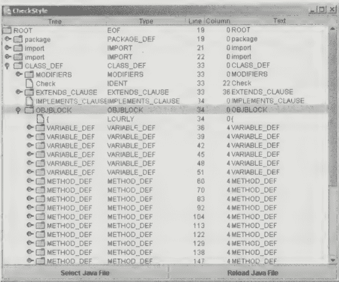

```java
import com.puppycrawl.tools.checkstyle.api.*;

public class MethodLimitCheck extends Check {

    private int max = 30;

    public int[] getDefaultTokens() {
        return new int[]{TokenTypes.CLASS_DEF, TokenTypes.INTERFACE_DEF};
    }

    public void visitToken(DetailAST ast) {
        DetailAST objBlock = ast.findFirstToken(TokenTypes.OBJBLOCK);

        int methodDefs = objBlock.getChildCount(TokenTypes.METHOD_DEF);

        if (methodDefs > max) {
            log(ast.getLineNo(),
                "too many methods, only " + max + " are allowed");
        }
    }
}
```
*示例 17.1 一个检查的实现*

如果我们再次测试 Notepad.java，我们的新检查也将被应用。由于没有违反准则，因此没有发出警告。通常，自定义检查会被创建并部署到它们自己的 jar 存档文件中。在这种情况下，必须扩展 CLASSPATH。

#### 概念

- *一致的* 编程风格有助于在不熟悉的代码中快速定位。
- SUN 为 JAVA 提供了一套准则，即 *JAVA 代码约定（JAVA Code Conventions）*。
- CHECKSTYLE 检查一套被认可的准则。
- *代码异味（Code smells）* 是典型的编程问题。
- CHECKSTYLE 可以通过自定义检查进行扩展。

#### 复习练习

1. 使用默认配置文件，用 CHECKSTYLE 测试所有你（到目前为止实现的）JAVA 程序。你观察到了多少次、哪些准则违规？
2. 思考“JAVA 代码约定”中的哪些规则对 C 或 C++ 同样适用。哪些不适用？为什么？
3. 实现一个检查，确保所有方法都有 "@reviewed" 标签（见第 10 章）。
4. 在 JAVADOC 注释方面，将 CHECKSTYLE 的功能与 DocCheck 和 DocLint doclets 进行比较。

#### 其他准则检查工具

存在一套（大多是商业的）用于风格和准则检查的工具。

- 来自 JAVA 开源社区的工具有：

| 工具 | URL |
| :--- | :--- |
| JLINT | http://artho.com/jlint/ |
| PMD | http://pmd.sourceforge.net/ |
| JCSC | http://jcsc.sourceforge.net/ |

- 并不存在对应的 C 或 C++ 工具。
- 用于 C++ 的 GCC 编译器包含一套风格检查，可以通过相应的 "-W..." 命令行选项启用。特别是，Meyers (1997) 的一些准则已被实现。
- 来自 *ParaSoft* 的 CODEWIZARD, C++TEST, JTEST 等工具可发现预定义准则的违规情况。
- *Programming Research* 的 QA 产品可根据准则检查 C, C++ 或 JAVA 源代码。
- Together（现由 *Borland* 所有）提供了一种审计工具。

### 18 使用 LINT 进行静态程序分析

## 18.1 简介

在之前的章节中，我们介绍了在构建大型系统时用于避免或修复问题的编程工具。在本章中，我们将研究*编程语言工具*，这些工具支持源代码的创建和维护。我们将探讨以下问题：

> 编程语言工具
- **拼写错误**，例如声明错误的函数
- **数据流问题**，例如未初始化的变量
- **指针问题**，例如内存泄漏

所有这些工具都是*静态地*工作的——它们在不执行程序（*动态地*）的情况下检查程序代码。

> 静态分析

### 18.2 使用 LINT 进行类型检查

作为介绍，我们将讨论 1997 年 6 月发生的一个问题，当时一名来自布伦瑞克工业大学（TU Braunschweig）的硕士生想向其中一位作者展示他的工作。示例 18.1 中显示的（简化）程序应该计算将概率从 100% 降低到 0.00005% 以下所需的迭代次数。这是通过将随机产生的概率相乘来实现的。为此使用了标准函数 `drand48`，该函数返回一个 0 到 1 之间的伪随机数（float 类型）。

```
1  #include <stdlib.h>
2  #include <stdio.h>
3  void main ()
4  {
5     float f = 1.0;
6     int n = 0;
7     while (f > 0.0000005) {
8        n = n + 1;
```
**示例 18.1** 示例程序 rand.c

```c
9               f = f * drand48();
10         }
11         printf ("%d iterations.\n", n);
12 }
```

> “以下示例基于 SunOS 4 中由于头文件不完整而存在的一个‘问题’。SunOS 4 的继任者 Solaris 已不再有该问题。”

一名硕士生在运行 LINUX 的个人计算机上开发了相应的程序，并想在系里的 SunOS 计算机上进行演示。在 LINUX 或 SunOS 系统上编译程序都没有问题，而且在 LINUX 系统上运行也非常流畅：

```
linux$ cc -o rand rand.c
linux$ ./rand
12 iterations.
linux$ _
```

然而，该程序在 SunOS 系统上无法终止：

```
sunos$ cc -o rand rand.c
sunos$ ./rand
...
```

> LINT

这里的问题出在哪里？通过查看源代码来识别该问题需要细致的理解和耐心。静态分析工具可以使这个过程自动化。LINT 就是这样一种工具。它检查 C 源代码中可能存在的错误、风格和可移植性问题（LINT 旨在清除程序中的“冗余”）。LINT 为该示例程序产生了一系列警告：

```
sunos$ lint rand.c
...(Warnings)...
sunos$ _
```

这些警告在此逐一列出并讨论：

```
rand.c(12): warning: main() returns random value
to invocation environment
```

| 警告 | 描述 | 详情 |
| :--- | :--- | :--- |
| 无返回值函数 | `main` 函数的定义方式不正常。它被定义为一个不返回值的函数，但标准要求 `main` 必须返回一个 `int` 值。 | |
| rand48 值使用不一致 | llib-lc(198) :: rand.c(9) | |
| 使用不一致 | `drand48` 的使用与库中的定义不一致（我们稍后会看到）。 | |

### 18.2 使用 LINT 进行类型检查

```
drand48 value declared inconsistently
    llib-lc(198)  ::  rand.c(9)
```

> 声明不一致

通过使用，*drand48* 被隐式声明；该声明与库中的定义不兼容（稍后将详细解释）。

```
printf returns value which is always ignored
```

> 忽略返回值

`printf` 的返回值（用于指示函数是否执行成功）被忽略了。

虽然关于 `main` 和 `printf` 的警告较为轻微，但关于 `drand48` 的警告指向了一个严重的问题。

在 LINUX 系统上，*drand* 函数在标准头文件中被声明为 `double drand48(void);`。然而，在 SunOS 系统上，该声明缺失；在任何标准头文件中都找不到。在 C 语言中，函数可以在没有声明的情况下被使用；此时会假设其类型为 `int`，并允许传递任意参数。因此，在 SunOS 系统上，该函数被隐式声明为 `int drand48();`，这与 LINT 库中的声明不匹配。

然而，在这种情况下，这种容错产生了致命影响：编译时，产生了错误的隐式声明并被用作 `int drand48();`。因此，由 `drand48` 交付的浮点数在生成的程序中被解释为一个整数。因此，生成的值总是大于 1，值 *f* 反而增加而不是减少，由于终止条件永远无法满足，程序无法结束。

> LINT 与编译器

LINT 的第一个版本是在第一个 C 编译器出现后不久开发的。其背后的想法是通过将编译和检查分离，以降低计算开销。现在，许多传统的 LINT 检查已集成到编译器中。在 GNU C 编译器 GCC 中，可以通过 `-Wall` 选项激活多个警告。在示例 18.1 的情况下，SunOS 系统上的 GCC 产生了足以识别错误地警告：

```
$ gcc -o rand rand.c -Wall
rand.c: In function 'main':
rand.c:9: warning:
    implicit declaration of function 'drand48'
rand.c:11: warning:
    implicit declaration of function 'printf'
$ _
```

这些警告显示 `drand48` 或 `printf` 没有声明，从而抓住了该问题。

### 18.3 数据流分析

斐波那契函数 $fib(n)$ 计算斐波那契数列 1, 1, 2, 3, 5, 8, ... 的第 $n$ 个成员，其中每个元素都是其前两个元素的和。它的递归定义为：

$$fib(n) = \begin{cases} 1, & \text{for } n = 0 \lor n = 1 \\ fib(n-1) + fib(n-2), & \text{otherwise } \end{cases}$$

在示例 18.2 中，我们发现了一个计算 $fib(n)$ 的迭代实现。

**示例 18.2**
*fibo.c——计算斐波那契数*

```c
1	#include <stdio.h>
2	int fib (int n)
3	{
4	    int f, f0 = 1, f1 = 1;
5	    while (n > 1) {
6	        n = n - 1;
7	        f = f0 + f1;
8	        f0 = f1;
9	        f1 = f;
10	    }
11	    return f;
12	}
13
14	int main ()
15	{
16	    int n = 10;
17	    while (n-- > 1)
18	        (void) printf("fib(%d)=%d\n", n, fib(n));
19	    return 0;
20	}
```

不幸的是，示例 18.2 中的实现并不完全正确：

```
$ cc -o fibo fibo.c
$ ./fibo
fib(9)=55
fib(8)=34
fib(7)=21
fib(6)=13
fib(5)=8
fib(4)=5
fib(3)=3
fib(2)=2
fib(1)=134513905
$ _
```

$fib(1)$ 的最后一个值是不正确的，因为必须满足 $fib(1) = 1$。如果我们使用本章之前提到的工具，它们将无法帮助我们：

```
$ lint fibo.c
$ _
$ gcc -o fibo fibo.c -Wall
$ _
```

对程序行为的分析表明，如果 $n = 1$，变量 $f$ 未被初始化，这将导致不确定的结果。为了识别此类问题，*数据流分析*非常有用。数据流分析收集关于程序结果和变量使用的尽可能准确的信息。生成的*数据流信息*主要用于程序优化——例如注意到哪些变量最适合保存在寄存器中，以及何时真正需要变量的值。然而，同样的信息也可以用来检测未初始化的变量和其他编程错误。

#### 18.3.1 控制流图

数据流分析的第一步是创建*控制流图*。控制流图显示了语句可以执行的*顺序*：

- 程序的指令被映射到节点（或顶点）。
- 必须按顺序执行的一系列语句可以组合成一个*基本块*节点。
- 连接节点的边（或弧）代表指令之间可能的*控制流*——即语句的一种可能执行序列。
- 入口节点和出口节点分别代表程序或函数的开始和结束。

**基本块**

图 18.1 显示了示例 18.2 中斐波那契函数的控制流图。

#### 18.3.2 数据流分析

借助控制流图，可以进行实际的数据流分析，它描述了程序中变量或值的行为。数据流信息通常显示在*数据流集*中。这些是变量或其他对象的集合。基本集合包括：

**数据流集**

- $gen(S)$ 是*生成集*——在节点 $S$ 中新定义的变量集。
- $kill(S)$ 是*销毁集*——在节点中被设为未定义的变量集，因此在节点之后其状态未知。例如，包括 Pascal 中 FOR 循环的控制变量，它们在循环结束后状态未定义。
- $in(S)$ 是*输入集*，即在进入节点之前已定义的变量集。
- $out(S)$ 是*输出集*，即在节点结束时已定义的变量集。

这些集合之间的关系由*数据流方程*描述：

- 输出集 *out(S)* 包含在该节点中定义的变量 (*gen(S)*) 或在进入节点前定义且在该节点中未被销毁的变量 (*in(S) - kill(S)*)：

$$out(S) = gen(S) \cup (in(S) - kill(S))$$

- 输入数据流 *in(S)* 取决于前驱节点的输出集。如果你查看任何情况下*必须*存在的数据流（这里是指独立于程序执行而必须初始化的变量集），这就是所有前驱节点输出数据流的*交集*：

$$in(S) = \bigcap_{S_i \in pred(S)} \ out(S_i)$$

**图 18.1** 控制流图。

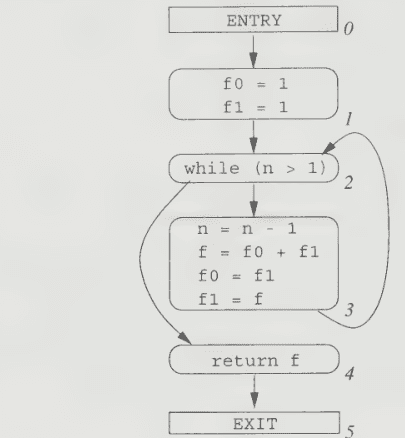


（或者，你也可以查看*可能的*数据流——在我们的案例中，即*可能*被初始化的变量集。关于这种*可能问题（may problem）*的一个示例可见于第 19 章。另请参阅本章末尾的练习。）

为了解决数据流问题，所有节点的 *gen* 和 *kill* 集都是固定的；此外，*in* 和 *out* 集根据前述方程式计算得出。

#### 18.3.3 示例

作为一个示例，我们将计算 Fibonacci 函数在每种情况下的已初始化变量。通过这样做，我们可以识别出其补集——即*可能未初始化*的变量。

*未初始化变量的计算*

我们将首先确定每个节点 *S* 的 *gen(S)* 和 *kill(S)*，如图 18.1 所示。集合 *gen(S)* 包含在节点 *S* 中被赋值的所有变量。集合 *kill(S)* 为空，因为在我们的程序中没有变量被定义为未定义。

| S | gen(S) | in(S) (初始) | out(S) (初始) | in(S) (第 1 轮) | out(S) (第 1 轮) | in(S) (第 2 轮) | out(S) (第 2 轮) |
|---|---|---|---|---|---|---|---|
| S₀ | {n} | ∅ | {n} | ∅ | {n} | | |
| S₁ | {f₀, f₁} | ∅ | {f₀, f₁} | {n} | {n, f₀, f₁} | | |
| S₂ | ∅ | ∅ | ∅ | {n, f₀, f₁} | {n, f₀, f₁} | {n, f₀, f₁} | {n, f₀, f₁} |
| S₃ | {n, f, f₀, f₁} | ∅ | {n, f, f₀, f₁} | {n, f₀, f₁} | {n, f, f₀, f₁} | {n, f, f₀, f₁} | {n, f, f₀, f₁} |
| S₄ | ∅ | ∅ | ∅ | {n, f₀, f₁} | {n, f₀, f₁} | {n, f₀, f₁} | {n, f₀, f₁} |
| S₅ | ∅ | ∅ | ∅ | {n, f₀, f₁} | {n, f₀, f₁} | {n, f₀, f₁} | {n, f₀, f₁} |

**表 18.1** 数据流集的计算

由于控制流图中的循环，集合 *in(S)* 和 *out(S)* 无法立即计算出来——它们在递归上相互依赖。

*不动点迭代*

我们使用*不动点迭代（fix point iteration）*来解决这个问题：从合适的初始值开始，我们在多次运行中交替确定 *in(S)* 和 *out(S)*，直到数值不再变化为止。

- 1. 对于初始化，我们做一个保守的假设：每个节点的输入数据流为空，且入口处没有变量被定义。初始输出流可以通过对代码的分析来计算。
- 2. 在第一次迭代中，我们使用数据流方程确定每个节点 *S* 的 *in(S)* 和 *out(S)* 的新值。为了实现这一点，我们从上到下进行，这样已经计算出的 *out(S₀)* 的值可以用作 in(S₁) 的计算。只有在 in(S₂) 的情况下，我们需要依赖可能不正确的 out(S₃) 初始化值。
- 3. 在第二次迭代中，第一次计算出的 out(S₃) 的值可以用作 in(S₂)。由于数值不再变化，我们现在得到了最终结果。

那么最终数值告诉了我们什么？out(S₄) 集不包含变量 f，尽管 f 被作为返回值给出。因此，返回的值可能是未定义的——这是一个明显的警告案例。

> 警告选项的使用
>
> 在实践中，情况是这样的：当使用选项 `-O` 在 GCC 中激活优化时，会执行一个与上述类似的数据流分析——现在 GCC 能够识别出这些错误：
>
> ```
> $ gcc -o fibo fibo.c -Wall -O
> fibo.c: In function 'fib':
> fibo.c:4: warning: 'f' might be used
>     uninitialized in this function
> $ _
> ```

在这个以及之前的示例中，你可以看到应该始终使用编译器的所有警告可能性。必须关注每一个警告并改进代码，直到最后一个警告消失。如果留下警告，或者完全关闭警告，可能会导致新的警告被忽略。

### 18.4 规范

前几节演示了工具如何识别程序行为的某些方面。这种行为应该正是程序员在创建程序时所思考的。然而，在编程语言中，这些愿望只能以有限的方式表达，这可能会导致实现错误。这类错误只能通过其症状来识别，而且它们通常不会提供任何关于问题原因的指示。

在我们的示例中，问题有两个可能的原因。一方面，程序员可能简单地忘记了初始化 f，因为如果 f 用值 1 初始化，Fibonacci 函数对于 0 和 1 将返回正确的值。另一方面，也可能是该函数仅用于大于 1 的值，因为 0 和 1 的值已明确定义。

> 断言
>
> 然而，程序员应该在程序中处理这类异常——通过使用断言，这在第 13.2 节中有所涵盖。

示例 18.3 展示了示例 18.2 的一个版本，在第 6 行插入了一个断言。该断言记录了 Fibonacci 函数仅定义为值 > 1。

```c
1	#include <stdio.h>
2	#include <assert.h>
3	int fib (n)
4	{
5	    int f, f0 = 1, f1 = 1;
6	    assert(n > 1);
7	    while (n > 1) {
8	        n = n - 1;
9	        f = f0 + f1;
10	        f0 = f1;
11	        f1 = f;
12	    }
13	    return f;
14	}
```

*示例 18.3*
- `fibo-assert.c`
- 带有断言的 Fibonacci 函数

如果通过调用 `fib(1)` 执行此程序，断言将失败，程序将因运行时错误而终止：

```
$ cc -o fibo-assert fibo-assert.c
$ ./fibo-assert
fib(9)=55
fib(8)=34
fib(7)=21
fib(6)=13
fib(5)=8
fib(4)=5
fib(3)=3
fib(2)=2
fibo-assert.c:6: failed assertion 'n > 1'
zsh: 2040 IOT instruction
       (core dumped)  fibo-assert
$ _
```

可以将断言视为程序需求的规范。不幸的是，这有三个严重的缺点：

- 1. 断言是*动态*检查的，也就是说，错误行为只能通过执行测试用例来识别。
- 2. 断言仅限于可以表达为 C 表达式的属性。
- 3. 断言在代码中，而不在接口文档（头文件）中。

**规范（Specification）** 规范没有这些缺点。它们可以针对程序文本进行静态检查，并提供更灵活的条件表示法。

**SPLINT** 不幸的是，严格的正式规范并不被许多程序员使用，因为它们通常过于繁琐。一个不那么正式但对程序员友好的工具是 SPLINT，它允许以注解（特殊注释）的形式直接在源文本中编写规范。此外，SPLINT 提供了丰富的规范词汇，旨在满足软件开发者的需求。

#### 18.4.1 缓冲区溢出

如今，缓冲区溢出可能是最大的安全问题；几乎每一次攻击似乎都在利用缓冲区溢出。原因在于常用的编程语言 C。首先，C 不会自动检查对数组元素的每次访问是否在数组边界内。而且，C 还提供了像 "gets" 这样不安全的库函数。

"gets" 函数是有问题的，因为它在不保证输入实际上能放入数组的情况下，将未经检查的用户输入复制到数组中。这个函数如此不安全，以至于当前的编译器会自动批评对 "gets" 的调用：

```
$ gcc input.c -o input
In function 'input':
the 'gets' function is dangerous and should not be used.
$ _
```

当直接访问数组元素时，也可能发生缓冲区溢出：

示例 18.4
nine.c - 具有未检测到的缓冲区溢出的程序

```c
#include <stdio.h>
#define SIZE 256
static char line[SIZE];
static int val;
int main()
{
    val = 999999;
    line[SIZE] = '\0';
    printf("%i\n", val);
    return val;
}
```

如果我们测试这个程序，会发生以下情况：

```
$ gcc -Wall nine.c -o nine
$ ./nine
```


```
999936
$ _
```

结果打印出了另一个数字 999936，而不是预期的 999999。我们可以通过使用 SPLINT 并启用缓冲区溢出检查（"+bounds"）来找出原因：

> 检查缓冲区溢出

```
$ splint +bounds nine.c
Splint 3.0.1.6 --- 14 Oct 2002

nine.c: (in function main)
nine.c:8:3: Possible out-of-bounds store:
    line[256]
    Unable to resolve constraint:
      requires 255 >= 256
      needed to satisfy precondition:
      requires maxSet(line @ nine.c:8:3) >= 256
A memory write may write to an address beyond
    the allocated buffer.
(Use -boundswrite to inhibit warning)

Finished checking --- 1 code warning
$ _
```

SPLINT 在这里告诉我们，在第 8 行（"line[SIZE] = '\0';"）可能会发生缓冲区溢出，因为无法保证访问索引 "SIZE" 小于或等于数组上限 255。在这种情况下，访问超出了变量 "line" 的存储区域，而恰好落在变量 "val" 的位置。正确的代码应该是 "line[SIZE-1] = '\0';"。这种超出分配大小一个位置的错误访问非常频繁，被称为“差一”（off by one）错误。

> 差一错误

#### 18.4.2 抽象数据类型

C 编程语言对实现抽象数据类型的支持很少。所有类型在整个程序中都是可见的，无法隐藏信息。此外，接口和实现之间几乎没有区别——头文件与例如 MODULA-2 的定义模块完全不可比。

> 抽象类型

SPLINT 为此提供了补救措施，因为用户自定义类型可以被声明为抽象的。这通过在头文件的类型定义中直接添加注释来实现。在实现该类型的文件中（其名称与头文件相同），这没有影响，但在其他文件中，该类型的使用被限制在定义的接口内。类型表示被一个不允许穿透的抽象屏障所保护。

> 抽象屏障

实际的实现对程序员仍然可见，但不得被使用。另一方面，程序仍然是真实的 C 源码，可以在没有 SPLINT 的情况下交付和编译——没有人被强迫使用 SPLINT。示例 18.5 展示了一个带有 SPLINT 注释的列表数据类型的实现：

##### 示例 18.5
list.h – 带有 SPLINT 注释的列表接口

```c
1   typedef /**@abstract@*/ struct _list
2   {
3       /**@only@*/ char* this;
4       /**@only@*/ struct _list* next;
5   } *list;
6
7   void list_addh (list l, /**@only@*/ char* e);
```

数据类型 list 使用注释 `/*@abstract@*/` 声明为抽象的。实际的实现仍然是一个包含 **this** 和 **next** 字段的结构体指针，但该类型的用户不得直接使用这些字段。对于抽象类型，仅允许进行声明、使用赋值运算符 “=” 以及通过接口提供的函数调用。（注释 `/*@only@*/` 的含义将在下一节中解释。）

##### 示例 18.6
list-use.c – 列表的使用

```c
1   #include "list.h"
2
3   void print_front (list l)
4   {
5       printf("%s\n", l->this);
6   }
```

示例 18.6 展示了类型 list 的使用。在第 5 行中，使用了该类型的实际实现。SPLINT 将此识别为违反了抽象屏障：

```
$ splint list-use.c
Splint 3.0.1.6 --- 14 Oct 2002

list-use.c: (in function print_front)
list-use.c:5:19: Arrow access of non-pointer (list):
  l->this Types are incompatible.
  (Use -type to inhibit warning)

Finished checking --- 1 code warning
$ _
```

#### 18.4.3 内存管理

C 语言中绝大多数的编程错误都是由于**指针使用不当**引起的——未使用的内存未被释放、指针访问了错误的对象、对一个已释放内存的指针进行解引用，等等。这类问题很难检测，因为原因可能与症状出现的位置相距甚远。

为了检测这些问题，SPLINT 将数据流分析与一种特殊的访问模型相结合。必须始终有一个指向已分配对象的指针，且其所有者有*义务*在对象使用完毕后释放其内存。这种义务只能通过实际释放内存，或者将该义务传递给另一个为此做好准备的指针来履行。程序员必须使用注释来记录内存管理决策。例如，`/*@only@*/` 注释声明了一个负有释放内存义务的引用。

SPLINT 中的访问模型 / 释放义务

在示例 18.5 中，列表节点字段 *this* 和 *next* 被标注为 `/*@only@*/`，因此它们承担了释放内存的义务。此外，向列表中添加元素的函数 `list_addh` 承担了其第二个参数所传递元素的释放义务。因此，调用者将附加元素的释放义务转移了，并且之后不得再使用该元素。示例 18.7 展示了函数 `list_addh` 的实现。

```c
#include "list.h"

extern /*@out@*/ /*@only@*/ void* smalloc(size_t);

void list_addh (list l, /*@only@*/ char* e)
{
    if (l != NULL) {
        while (l->next != NULL) {
            l = l->next;
        }
        l->next = (list) smalloc(sizeof(*l->next));
        l->next->this = e;
    }
}
```
**示例 18.7**
*list.c - list_addh 的实现*

函数 `smalloc` 是 `malloc` 的“安全”版本，如果无法提供请求的内存，它会产生运行时错误。因此，它总是返回一个指向已分配对象的指针，并将释放义务分配给调用者。第二个注释 `/*@out@*/` 说明分配的对象尚未初始化。

函数 `list_addh` 首先搜索列表末尾，然后请求一个新的列表节点并将其附加到列表中。然而，这个函数是有缺陷的，如示例 18.8 中 SPLINT 报告的那样：

- 第一个错误基于对空列表的处理不当：该函数只有在列表已经包含元素时才能正确工作。这导致参数 e 的义务仅在列表不为空时才通过将其赋值给 this 字段来转移义务从而得到满足。如果列表为空，则该义务未被履行。

- 第二个错误是在新创建的对象中，指向下一个元素的指针未被初始化。正确的做法应该是将此字段赋值为 NULL。

```
$ splint list.c
Splint 3.0.1.6 --- 14 Oct 2002

list.c: (in function list_addh)
list.c:13:3: Variable e is kept in true branch, but not kept in continuation. The state of a variable is different depending on which branch is taken. This means no annotation can sensibly be applied to the storage. (Use -branchstate to inhibit warning)
list.c:12:5: Storage e becomes kept
list.c:14:2: Storage *(l->next) reachable from parameter contains 1 undefined field: next
Storage derivable from a parameter, return value or global is not defined. Use /*@out*/ to denote passed or returned storage which need not be defined. (Use -compdef to inhibit warning)

Finished checking --- 2 code warnings
$ _
```
##### 示例 18.8
list.c 的 SPLINT 分析

### 18.5 注释在实践中的应用

借助注释，像 SPLINT 这样的静态分析工具可以轻松且高效地发现大量错误——程序员只需要费心使用注释来表达其意图。微软公司利用此类技术和静态分析工具在代码安全性方面取得了实质性进展——一旦程序员意识到其好处，他们便不再排斥编写注释。

#### 概念

- 静态程序分析可以在编译时识别常见错误。
- LINT 的类型检查可以报告函数声明与使用不一致的问题。


- 作为程序优化的副作用，数据流分析可以揭示未初始化变量的使用情况。
- 断言用于防止错误的程序状态。它们可用于在运行时检查前置条件和后置条件的合规性。
- SPLINT 的规范通过抽象屏障和关于内存管理的假设扩展了传统的编程语言，其合规性可以通过静态分析进行检查。

#### 复习练习

1. 找出你的编译器具有哪些警告选项。全部开启它们，并检查你可以采取哪些措施来改进代码。是否有你认为毫无意义的警告？

2. 数据流分析还可以显示一个变量在*任何情况下*都未定义。为此，请查看*可能的*数据流（*可能*被初始化的变量集）并确定其补集。可能的数据流由出向数据流的*并集*形成：

$$in(S) = \bigcup_{S_i \in pred(S)} out(S_i)$$

计算方式与所述方法类似。确定图 18.1 中所有节点的 *out(S)*，并确定是否存在从未被初始化的变量。

研究 *in(S)* 的其他可能初始化方式及其影响。

可能的数据流

#### 延伸阅读

C 语言的历史和发展由 Ritchie (1993) 阐述。其中还包含一个关于 LINT 的章节。LINT 本身是由 YACC 开发人员 Johnson (1977) 发明的。

Aho 等人 (1986) 对数据流分析进行了全面的介绍。错误检测的应用由 Fosdick 和 Osterweil (1976) 意识到，他们的 DAVE 系统 (Osterweil and Fosdick (1976)) 分析了 FORTRAN 程序。

其他一些工具使用了并分析了后来的规范，例如 Wilson 和 Osterweil (1985) 的 *Omega*，Olender 和 Osterweil (1992) 的 *Cesar*，或 Perry (1989) 的 *Inscape*。

Evans 和 Larochelle (2002b) 提供了 SPLINT 的简要概述。Evans 和 Larochelle (2002a) 描述了如何使用 SPLINT 来发现 FTP 服务器 "wu-ftpd" 中的故障。SPLINT 的前身是 LCLint。Evans (1996) 介绍了 LCLint 发现指针使用错误的能力。此外，它还展示了如何利用这些能力来消除 LCLint 自身内存管理中的故障。这些故障在几天内就得到了消除，而使用传统手段进行搜索则花费了一周多时间且未获成功。

对于现代语言，像 LINT 这样的工具不再那么重要，因为它们提供了足够的抽象手段。（特例：`C++`；由于它与 C 的兼容性，它具有与 C 完全相同的问题。）因此，Duby 等人 (1992) 的 CCEL 运作方式与 SPLINT 类似。在 EIFFEL 中，前置条件、后置条件和不变式形式的断言是语言定义的一部分。Meyer (1992) 提供了基于契约设计的底层理论。

Detlefs 等人 (1998) 描述的 ESC/Java 是一款用于 JAVA 的静态分析工具。

### 19 使用 UNRAVEL 进行程序切片

### 19.1 切片与数据流

一个程序产生了错误的输出。你会怎么做？一个常用的策略是确定*错误值是如何产生的*。正如第 15 章所示，即使使用调试器，这也是一项繁琐的任务。幸运的是，有一些工具可以帮助解决这类*数据流问题*。这些问题包括：

**数据流问题**
- 识别输入与输出之间的*依赖关系*
- 识别*影响*其他指令的指令
- 隔离*代码变更*的影响。

示例 19.1 显示了一个简单的程序，它计算区间 [a, b] 内所有数字的和 (sum) 和积 (mul)，并输出这两个值。

```c
   1   int main() {
   2       int a, b, sum, mul;
   3       sum = 0;
   4       mul = 1;
   5       a = read();
   6       b = read();
   7       while (a <= b) {
   8           sum = sum + a;
   9           mul = mul * a;
  10           a = a + 1;
  11       }
  12       write(sum);
  13       write(mul);
  14   }
```
（注：显示的内容为 C 代码片段）

目标是从输出开始，找到所有影响输出值的指令。

这类任务可以使用一种称为*程序切片*（program slicing）的特殊技术高效处理。程序切片试图删除程序中无关的指令，或标记相关的指令。因此，它是从程序中切出的一块，即一个*切片*。

#### 切片准则

#### 切片的计算

计算是通过*切片准则* (v, n) 来设置的。它指定了使用指令 n 针对变量 v 的切片。计算出的切片中，在不改变指令 n 中变量 v 的值计算的情况下，尽可能多地*删除*程序指令。*可执行切片*是指能产生可执行程序的切片。

#### 可执行切片

为了找到影响乘积的指令，我们可以为准则 (mul, 13) 计算一个切片。为此，删除第 3、8 和 12 行的指令。也许第 2 行中变量 sum 的声明也可以删除。得到的切片如示例 19.2 (a) 所示。在 (sum, 12) 的切片中，指令 4、9 和 13 被删除；而对于 (a, 7)，指令 3、4、6、8、9、12 和 13 被删除。

#### 示例 19.2

**(a) (mul, 13) 的后向切片**
```c
1  int main() {
2      int a, b, sum, mul;
3
4      mul = 1;
5
6      a = read();
7
8      b = read();
9
10     while (a <= b) {
11         mul = mul * a;
12         a = a + 1;
13     }
14
15     write(mul);
16 }
```

**(b) (b, 6) 的前向切片**
```c
1  int main() {
2      int a, b, sum, mul;
3
5      b = read();
6      while (a <= b) {
7          sum = sum + a;
8          mul = mul * a;
10         a = a + 1;
11     }
12
13     write(sum);
14     write(mul);
15 }
```

#### 前向切片与后向切片

如果计算的是在程序中某个位置可能影响变量值的指令，这被称为*后向切片*（backward slicing），因为它是*向后*回顾早期指令的影响。

其反面是*前向切片*（forward slicing），即确定所有受指令 n 中变量 v 变更影响的语句，从而*向前*观察程序中的影响。

示例 19.2 的 (b) 部分显示了 (b, 6) 的前向切片。该切片包含了整个 While 循环，因为变量 b 的值决定了循环运行的次数。

### 19.2 使用 UNRAVEL 进行程序切片

#### UNRAVEL

程序切片工具的一个例子是来自美国国家标准与技术研究院（NIST）的 UNRAVEL。它可以帮助理解 C 程序。它能分析 ANSI-C 程序并为它们计算后向切片。计算出的切片通过在源文本中反向显示包含的指令来进行可视化。用户随后可以选择在程序的源文本中导航，并更详细地检查受影响的指令。

**图 19.1** 展示了我们的**示例 19.1** 中切片 (mul, 13) 的可视化效果。包含的指令以*反色*显示。与示例 refbsp:unravel/slice.c 不同，UNRAVEL 计算的切片不强制要求可执行，因此第 2 行的变量声明等被省略了。

#### 切片可视化

如果程序包含多个源文件，它们将在该窗口中以拼接形式可视化。由于窗口通常只能显示一个部分，因此右侧设有导航栏。

左侧的条带是整个程序中切片的抽象表示。该条带代表整个程序，其中包含在当前切片中的部分在条带中以反色显示。此条带也可用于*导航*：点击该条带可跳转到程序中的相应位置，并在源文本窗口中显示相应区域。

**图 19.1**
UNRAVEL 的切片界面

### 19.3 程序依赖图

程序切片是使用 *数据流分析* 计算的，这在 18.3 节中已经介绍。两种最常用的技术是：

- [ ] 仅靠数据流分析
- [ ] 通过 PDG（程序依赖图）计算

#### 程序依赖图 (PDG)

PDG 的构建方式与控制流图类似；然而，其边并不表示控制流，而是表示由节点代表的指令之间的**控制依赖**和**数据依赖**。如果一条指令影响另一条指令是否执行或执行次数，那么这两条指令之间就存在*控制依赖*。如果一个变量在一条指令中被赋值，且该值在另一条指令中被使用（通过该变量的求值），那么这两条指令之间就存在*数据依赖*。

##### 控制依赖
##### 数据依赖

PDG 的计算分为四个步骤：

#### PDG 的计算

1. 确定控制流图
2. 插入控制依赖边
3. 计算数据依赖并插入边
4. 删除控制流边

下面对这四个步骤进行详细分析。

##### 19.3.1 确定控制流图

确定控制流图的方式与 18.3 节所示的过程类似。但是，指令不能被合并为基本块，以便每个节点最多只能出现一个副作用（变量赋值）。

图 19.2 展示了示例 19.1 的控制流图。每个节点都标有相应的程序行号。（第 2 行没有分配节点，因为这里排除了声明语句。）

**图 19.2** 不含基本块的控制流图。
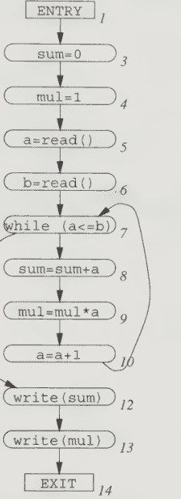

##### 19.3.2 计算控制依赖

计算控制依赖相当简单。你需要确定那些谓词决定后续指令执行情况的节点——例如，对应于 **if** 和 **while** 指令的节点。从这些节点出发，你可以向所有受控指令连接边。特别是，ENTRY 节点控制所有其他指令——只有在它被执行的情况下，其他指令才能执行。

在示例中，节点 3–7 和 12–13 控制依赖于 ENTRY 节点 1，而节点 8–10 控制依赖于节点 7 中的 **while** 语句。

事实上，计算并不像这样简单，因为某些非结构化跳转（例如 goto）会使计算变得更加困难。有关适当的方法，请参阅本章末尾的参考文献。

##### 19.3.3 计算数据依赖

对于数据依赖，我们沿用 18.3 节中的*数据流集*。数据依赖的计算描述了一种*可能的数据流*，由以下等式表示：

可能的数据流：
$out(S) = gen(S) \cup (in(S) - kill(S))$
$in(S) = \bigcup_{S_i \in pred(S)} out(S_i)$

与 18.3 节中利用数据流分析确定未初始化变量的方法类似，我们现在必须建立 **gen** 和 **kill** 集：

**生成的数据流 (Generated data flow)**
- 节点 $S$ 的生成数据流 $gen(S)$ 由所有在节点 $S$ 中被赋值的变量 $v$ 的二元组 $(v, S)$ 组成。

**销毁的数据流 (Destroyed data flow)**
- 节点 $S$ 的销毁数据流 $kill(S)$ 由图中所有节点 $S'$ 且在节点 $S$ 中被赋值的所有变量 $v$ 的二元组 $(v, S')$ 组成。

因此，在给变量 $v$ 赋值新值的节点处，之前的来源被覆盖。此时创建了一个数据依赖边的新来源；所有到达该节点的该变量的来源都被销毁。

表 19.1 显示了产生的集合。简写 $v_i$ 代表二元组 $(v, S_i)$ —— 即在节点 $S_i$ 中被赋值的变量 $v$。

**表 19.1** *gen 和 kill 集*

| S | gen(S) | kill(S) | S | gen(S) | kill(S) |
|---|---|---|---|---|---|
| S₁ | ∅ | ∅ | S₈ | {sum₈} | {sum₃} |
| S₃ | {sum₃} | {sum₈} | S₉ | {mul₉} | {mul₄} |
| S₄ | {mul₄} | {mul₉} | S₁₀ | {a₁₀} | {a₅} |
| S₅ | {a₅} | {a₁₀} | S₁₂ | ∅ | ∅ |
| S₆ | {b₆} | ∅ | S₁₃ | ∅ | ∅ |
| S₇ | ∅ | ∅ | S₁₄ | ∅ | ∅ |

现在我们可以通过数据流等式，利用 gen 和 kill 集计算 in 和 out 集。在用 ∅ 初始化后，我们按照 18.3.3 节中的方法进行不动点迭代。表 19.2 显示了第一次运行的结果，表 19.3 显示了第二次也是最后一次运行的结果。

**表 19.2** *in 和 out 集，第一次运行*

| S | in(S) | out(S) |
|---|---|---|
| S₁ | ∅ | ∅ |
| S₃ | ∅ | {sum₃} |
| S₄ | {sum₃} | {sum₃, mul₄} |
| S₅ | {sum₃, mul₄} | {a₅, sum₃, mul₄} |
| S₆ | {a₅, sum₃, mul₄} | {a₅, b₆, sum₃, mul₄} |
| S₇ | {a₅, b₆, sum₃, mul₄} | {a₅, b₆, sum₃, mul₄} |
| S₈ | {a₅, b₆, sum₃, mul₄} | {a₅, b₆, sum₈, mul₄} |
| S₉ | {a₅, b₆, sum₈, mul₄} | {a₅, b₆, sum₈, mul₉} |
| S₁₀ | {a₅, b₆, sum₈, mul₉} | {a₁₀, b₆, sum₈, mul₉} |
| S₁₂ | {a₅, b₆, sum₃, mul₄} | {a₅, b₆, sum₃, mul₄} |
| S₁₃ | {a₅, b₆, sum₃, mul₄} | {a₅, b₆, sum₃, mul₄} |
| S₁₄ | {a₅, b₆, sum₃, mul₄} | {a₅, b₆, sum₃, mul₄} |

##### 19.3.4 PDG 的计算

通过使用计算出的 in 集，我们现在可以确定数据依赖边。我们从控制流图开始。在此，我们为节点 $S$ 中使用的每个变量 $v$ 确定满足 $(v, S') \in in(S)$ 的节点 $S'$。然后，对于每个节点 $S'$，我们插入一条数据依赖边 $S' \to S$。

**表 19.3** *in 和 out 集，第二次运行*

| $S$ | $in(S)$ | $out(S)$ |
|---|---|---|
| $S_1$ | $\emptyset$ | $\emptyset$ |
| $S_3$ | $\emptyset$ | $\{sum_3\}$ |
| $S_4$ | $\{sum_3\}$ | $\{sum_3, mul_4\}$ |
| $S_5$ | $\{sum_3, mul_4\}$ | $\{a_5, sum_3, mul_4\}$ |
| $S_6$ | $\{a_5, sum_3, mul_4\}$ | $\{a_5, b_6, sum_3, mul_4\}$ |
| $S_7$ | $\{a_5, a_{10}, b_6, sum_3, sum_8, mul_4, mul_9\}$ | $\{a_5, a_{10}, b_6, sum_3, sum_8, mul_4, mul_9\}$ |
| $S_8$ | $\{a_5, a_{10}, b_6, sum_3, sum_8, mul_4, mul_9\}$ | $\{a_5, a_{10}, b_6, sum_8, mul_4, mul_9\}$ |
| $S_9$ | $\{a_5, a_{10}, b_6, sum_8, mul_4, mul_9\}$ | $\{a_5, a_{10}, b_6, sum_8, mul_9\}$ |
| $S_{10}$ | $\{a_5, a_{10}, b_6, sum_8, mul_9\}$ | $\{a_{10}, b_6, sum_8, mul_9\}$ |
| $S_{12}$ | $\{a_5, a_{10}, b_6, sum_3, sum_8, mul_4, mul_9\}$ | $\{a_5, a_{10}, b_6, sum_3, sum_8, mul_4, mul_9\}$ |
| $S_{13}$ | $\{a_5, a_{10}, b_6, sum_3, sum_8, mul_4, mul_9\}$ | $\{a_5, a_{10}, b_6, sum_3, sum_8, mul_4, mul_9\}$ |
| $S_{14}$ | $\{a_5, a_{10}, b_6, sum_3, sum_8, mul_4, mul_9\}$ | $\{a_5, a_{10}, b_6, sum_3, sum_8, mul_4, mul_9\}$ |

如果我们现在从图中删除控制流边，就得到了图 19.3 中的 PDG。

**图 19.3** 程序依赖图。
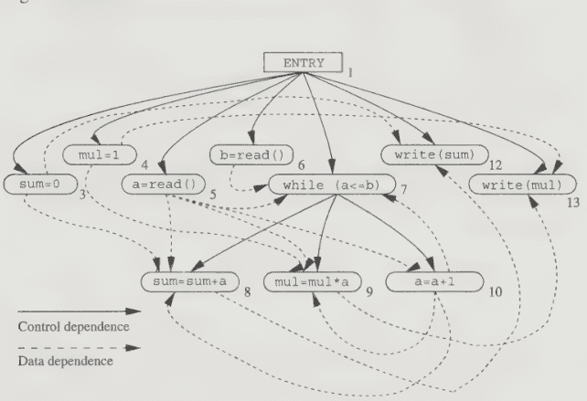

##### 19.3.5 利用 PDG 进行切片

如果 PDG 已经存在，切片本身就变成了一个可达性问题。首先，图中的切片准则仅由一个节点 $n$ 组成，它也代表在该节点中赋值的变量。

- **前向切片 (forward slice)** 由包含所有从 $n$ 可达节点的子图组成。

**图 19.4** PDG 中 (mul, 13) 的切片。
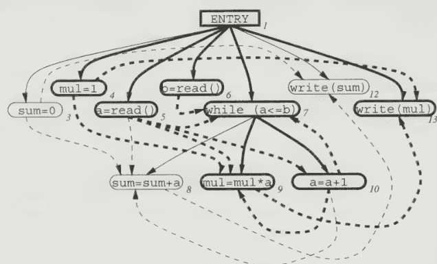

- **后向切片 (backward slice)** 由包含所有能到达 $n$ 的节点的子图组成。

在图 19.4 中，PDG 中高亮显示了节点 13 的后向切片。这代表了来自准则 (mul, 13) 的切片。

使用程序依赖图的程序切片比程序理解具有多得多的应用。其他重要领域包括变更集成（见 2.4 节）、调试和软件测试。切片也适用于面向对象、函数式或逻辑编程语言。

### 19.4 使用切片进行集合运算

#### 作为指令集的切片

切片不仅可以单独使用。它们还可以被视为*指令集*，对其可以执行各种*集合运算*。在图 19.5 的 (a) 部分中，程序被显示为一个指令集，其中有两个标记点 X 和 Y，分别显示两次计算和等效的切片准则。准则 Y 对应的切片 $\alpha$ 和准则 X 对应的切片 $\beta$ 分别显示在 (b) 和 (c) 部分。在这两个切片上可以使用集合运算，其结果显示在 (d) 部分。由此，以下结论成立（$\theta$ 未显示）：

$\delta = \alpha \cap \beta$
$\gamma = \beta - \delta = \beta - \alpha$
$\epsilon = \alpha - \delta = \alpha - \beta$
$\theta = \alpha \cup \beta = \delta \cup \gamma \cup \epsilon$


- 两个切片 $\alpha$ 和 $\beta$ 的并集 $\theta$ 被解释为受 $\alpha$ 或 $\beta$ 切片准则影响的指令集。由于此操作使用频繁，切片准则通常被指定为变量和指令的对集。
*组合（Combination）*

- 两个切片 $\alpha$ 和 $\beta$ 的交集 $\delta$ 代表共同使用的指令，也被称为骨干切片（backbone slice）。
*交集（Intersection）*
*骨干切片（Backbone slice）*

- 切片 $\epsilon$ 是两个切片 $\alpha$ 和 $\beta$ 相减的结果，它由影响其中一个准则但不影响另一个准则的指令组成。这种切片也被称为差集切片（dice）。
*相减（Subtraction）*
*差集切片（Dice）*

- 前向切片和后向切片的交集被称为截断切片（chop）。截断切片可以精确地识别出某个输入可能影响某个输出的指令。
*截断切片（Chop）*

在示例 19.3 的 (a) 部分中，显示了准则 (*sum*, 12) 和 (*mul*, 13) 的骨干切片。它包含了与计算 *sum* 以及 *mul* 相关的指令。(b) 部分显示了相应的差集切片，其中包含仅与 *mul* 计算相关的指令。

在 UNRAVEL 中，可以使用操作菜单中的命令来确定并可视化骨干切片和差集切片。其基础是选择一个主切片和一个次切片，然后将它们连接起来。

#### 示例 19.3
准则 (sum, 12) 和 (mul, 13) 的骨干切片 (a) 和差集切片 (b)

```c
int main() {
    int a, b, sum, mul;

    a = read();
    b = read();
    while (a <= b) {

        a = a + 1;
    }
}
```
(a) 骨干切片

```c
int main() {
    int a, b, sum, mul;
    mul = 1;

    mul = mul * a;

    write(mul);
}
```
(b) 差集切片

#### 概念

- 切片是程序中与某一点变量值相关的部分：
    - 后向切片由可能影响程序中特定位置变量值的指令组成。
    - 前向切片由受特定位置变量更改影响的指令组成。
- 切片由程序依赖图 (PDG) 决定，该图显示了程序中的控制依赖和数据依赖。
- PDG 的数据依赖是使用可能的数据流确定的，其中数据流集由变量对和赋值位置组成。
- 通过对切片进行集合操作，可以更准确地隔离指令集。

#### 复习练习

1. 对于示例 19.1，计算 (mul, 9) 的后向切片。为什么包含在第 9 行之后执行的第 10 行？
2. 检索可达节点的哪种过程更好：深度优先搜索还是广度优先搜索？
3. 思考如何在没有程序依赖图的情况下计算切片。提示：你可以依赖于指令中使用的变量集和被赋值的变量。除此之外，你可以设定规则，从一个准则创建多个新准则。
4. 普通切片和可执行切片之间为什么存在差异？
5. 为什么纯函数式编程语言的切片比命令式语言简单得多？
6. 在你自己的程序上使用 UNRAVEL。

#### 延伸阅读

软件重构是一个广泛的领域，Arnold (1993) 对此进行了概述。关于程序理解主题的新工作可见于 Cimitile 和 Müller (1996)。

程序切片由 Mark Weiser 发明，他在 1982 年研究了程序员如何发现错误。在 Ottenstein 和 Ottenstein (1984) 中，切片的依赖图首次被使用。Tip (1995) 以及 Binkley 和 Gallagher (1996) 提供了程序切片的概述，Berzins (1995) 则汇总了重要文章。

Lyle 等人 (1995) 详细介绍了 UNRAVEL。

#### 其他程序切片工具

除了 UNRAVEL，还有许多其他研究原型。Hoffner 等人 (1996) 给出了一个概述。

除这些之外，仅有一个工业级工具：来自 Grammatech 的 CODESURFER 允许对程序依赖进行导航，类似于使用 WWW 浏览器进行导航。CODESURFER 支持 C 语言；其他语言将在未来支持。

CODESURFER 可能是最易用的程序切片工具。除了切片，它还提供了用于程序理解的附加功能，例如程序变量的结构化可视化或调用图的可视化（图 19.6）。切片的可视化与 UNRAVEL 差别不大：图 19.7 显示了与图 19.1 相同的程序片段。

##### 图 19.6
CODESURFER 中的调用图
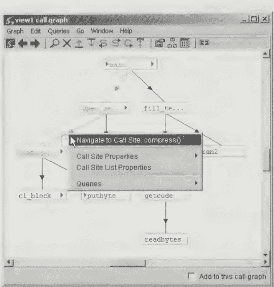

##### 图 19.7
CODESURFER 的切片界面
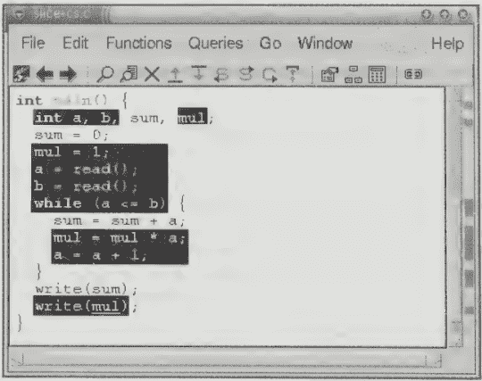

```c
int a, b, sum, mul;
sum = 0;
mul = 1;
a = read();
b = read();
while (a <= b) {
    sum = sum + a;
    mul = mul * a;
    a = a + 1;
}
write(sum);
write(mul);
```

另一个免费可用的切片工具是 Atkinson 和 Griswold (2001) 的 SPRITE/ICARIA。该工具同样分析 C 程序。

#### 练习 VI

在本练习中，你将尝试使用 GCOV 和 UNRAVEL，并了解切片的不同用途。

1. 查看练习中的 `lcalc` 程序。扩展 `lcalc.exp`，使得：
    (a) 每个语句至少执行一次，
    (b) 每条边至少执行一次。
    你可以忽略由 LEX 和 YACC 生成的语句；仅检查你自己编写的程序文本。使用 GCOV 检查覆盖率。

2. 考虑练习中的 `Rational` 类。扩展你的测试用例，使得：
    (a) 每个方法至少执行一次，
    (b) 每个语句至少执行一次，
    (c) 每条边至少执行一次。
    使用 GCOV（对于 C++）和 JCOVERAGE（对于 JAVA）来检查覆盖率。

3. 示例 19.4 中的 `primecount` 程序计算直到给定数字 $n$ 的所有质数：
```bash
$ gcc -o primecount primecount.c primelib.c -lm
$ ./primecount 20
Number of prime numbers: 8
Number of others: 12
Sum of prime numbers: 70
$ _
```

4. 将 `primecount` 的程序代码（可在 http://www.programmierwerkzeuge.de/ 找到）安装在单独的目录中。

5. 为 `primecount` 设置覆盖率分析并评估 GCOV 生成的协议。
6. 调用 UNRAVEL。在出现的 UNRAVEL 主窗口中，选择分析器并让其检查 C 源码。查看分析历史（在主窗口的 Review History $\rightarrow$ Last Analysis 下）。
7. 为第 8 行（函数 `makeoutput`）的变量 *b* 创建一个切片。使用 select，将第一个切片设为主切片，第二个设为次切片。
8. 将刚刚创建的两个切片形成一个差集切片，并观察它。现在哪些错误更容易被发现？
9. 如何找出哪些点同时影响 *a* 和 *b* 的输出？
10. 创建两个输出变量 *a* 和 *b* 的并集。你是否可以删除所有未标记的行，从而移除 *c* 的计算？
11. 尝试使用 UNRAVEL 形成一个前向切片。
12. 计算第 43 行（main）中 `arr2` 的切片。变量 `arr1` 将在字段 `arr1[0]` 到 `arr1[a - 1]` 中包含质数。在切片中寻找错误。
13. 修正程序并用尽可能少的步骤形成一个新的切片。

##### 示例 19.4
*示例程序*
`primecount.c`

```c
#include "primelib.h"
#include <math.h>
#include <stdio.h>

void makeoutput(int a, int b, int c)
{
    printf("Number of prime numbers: %d\n", a);
    printf("Number of others: %d\n", b);
    printf("Sum of prime numbers: %d\n", c);
}

int main (int argc, char *argv[])
{
    int i, j, a, b, c, n;
    int arr1[1024];
    int arr2[1024];

    for(i = 0; i < 1024; i++) {
        arr1[i] = 0;
        arr2[i] = 0;
    }

    n = atoi(argv[1]);
    a = 0;
    b = 1;
    for(i = 2; i <= n; i++) {
        if (isPrim(i)) {
            arr1[a] = i;
            a++;
        }
        else {
            b++;
        }
    }

    c = b;
    send(arr2, arr1, a);
    for (j = 0; j < a - 1; j++) {
        c = c + arr2[j];
    }

    makeoutput(a, b, c);

    return 0;
}
```

##### 示例 19.5
*辅助文件*
`primelib.h`

```c
extern void send(int* to, int* from, int count);
extern int gcd(int a, int b);
extern int isPrime(int a);
extern int fact(int a);
```

##### 示例 19.6
*辅助文件*
`primelib.c`

```c
#include "primelib.h"
#include <stdlib.h>
#include <stdio.h>
#include <math.h>

void send(int *to, int *from, int count)
{
    /* Duffs Device */
    int n = (count + 7) / 8;
    switch (count % 8) {
    case 0: do { *to++ = *from++;
    case 7:         *to++ = *from++;
```


#### 练习 VI

```c
13           case 6:                *to++ = *from++;
14           case 5:                *to++ = *from++;
15           case 4:                *to++ = *from++;
16           case 3:                *to++ = *from++;
17           case 2:                *to++ = *from++;
18           case 1:                *to++ = *from++;
19         } while (--n > 0);
20       }
21     }
22
23     int gcd(int a, int b)
24     {
25       int result;
26
27       if (a < b)
28         result = gcd(b, a);
29       else if (a % b == 0)
30         result = b;
31       else
32         result = gcd(b, a % b);
34
34       return result;
35     }
36
37     int isPrime(int a)
38     {
39       int i;
40       i = floor(int)floor(sqrt(a));
41       return gcd(fact(i), a) == 1;
42     }
43
44     int fact(int a)
45     {
46       int result = 1;
47       int i = 1;
48
49       if (a >= 13 || a <= 0) {
50         fprintf(stderr, "factorial overflow!\n");
51         result = 0;
52       }
53       else {
54         for (i = 1; i < a; i++)
55           result = result * i;
56       }
57       return result * a;
58     }
```

## 第 VII 部分：集成环境

### 20 使用 ECLIPSE 3.0 进行集成开发

在前面的章节中，我们介绍了一些在软件项目工作时非常有用的工具。然而，这些工具在操作方式和结果呈现上各不相同。*集成环境*试图通过统一的图形界面将这些工具结合起来，使其操作更加直观。集成环境需要满足以下要求：

- **直观操作**。无需手册或任何培训即可能够使用。
- **自动化**。常规任务应尽可能自动执行，或通过简短的命令（如快捷键）完成。
- **互操作性**。能够毫无困难地在其他工具中使用某个工具的结果和数据。
- **抽象化**。环境应支持尽可能多的编程语言、操作系统和工具类型。
- **功能性**。应支持软件开发尽可能多的阶段。

大多数商业编译器都以*集成开发环境 (IDE)* 的形式提供。然而，它们很少提供除**编辑-编译-调试**循环之外的支持。此外，IDE 通常与特定的编程语言、特定的编译器和调试器以及特定的操作系统绑定；它们不提供集成外部工具的途径——因此，它们被称为**封闭环境**。另一方面，**开放环境**提供了集成其他工具的方法，以及访问环境数据和函数的接口。这种环境就是我们将在本章中介绍的 ECLIPSE。

ECLIPSE 由 Object Technology International (OTI) 开发，并由 IBM 以开源形式捐赠。在互联网热潮期间，选择 ECLIPSE 这个名字是为了表达 ECLIPSE 将使现有的 IDE 显得黯然失色。然而，为了邀请 SUN 公司加入 ECLIPSE 并避免重新命名，该名称的官方来源被改为 Pink Floyd 的专辑《Dark Side Of The Moon》，其中包含一首名为 "Eclipse" 的歌曲。

ECLIPSE 将其定义为“一个适用于任何事物，且不专门适用于任何特定事物的 IDE”。ECLIPSE 的设计反映了这一原则：ECLIPSE 的核心精简且紧凑，实际功能通过插件实现。通过使用插件概念，ECLIPSE 具有可扩展性，并允许将第三方工具无缝集成到 ECLIPSE 的用户界面中。

### 插件

虽然 ECLIPSE 是用 JAVA 实现的，但它并不能运行在所有 JAVA 支持的操作系统上。原因是 *Standard Widget Toolkit* (SWT)，它仅适用于 WINDOWS、MacOS、LINUX 和某些 UNIX 变体。SWT 比 JAVA 组件更快，且更接近操作系统的*外观和感觉 (look and feel)*。ECLIPSE 本身仅支持 JAVA 编程语言的开发。然而，额外的第三方插件扩展了 ECLIPSE 对其他编程语言的支持，例如 C、C++、PYTHON、PERL 和 PHP。

ECLIPSE 可用于软件开发的所有阶段，特别是涉及源代码的阶段。这些是软件开发的后期阶段，如实现和维护。ECLIPSE 为前面章节介绍的大多数活动提供了工具支持：版本管理 (CVS)、程序构建 (ANT)、软件测试 (JUNIT) 和调试。此外，ECLIPSE 提供了多种可视化源代码属性的方法，并支持对现有源代码进行重构。

### 20.1 ECLIPSE 中的项目

#### 项目

软件产品由数千个源文件和数十个库组成；因此，需要将它们划分为可管理的部件。大多数 IDE 提供*项目 (projects)* 来实现这种结构化。每个项目都有一个*项目目录*，其中包含属于该项目的文件。除了源代码、makefile 和文档，该目录还包含一个*项目描述文件*。项目描述包含关于项目的具体信息，例如所使用的版本管理系统，或对其他项目的依赖关系。

#### 工作空间

在 ECLIPSE 中，每个用户都有一个*工作空间 (workspace)*，其中包含一个或多个项目。例如，图 20.1 展示了 ASPECTJ 的工作空间。ASPECTJ 工具由几个模块组成，这些模块在 ECLIPSE 中被实现为项目。对于每个项目，都有存放源文件的目录 (`src`) 和存放二进制文件的目录 (`bin`)。此外，每个项目都有一个名为 `.project` 的项目设置文件，在某些情况下，还有一个包含 JAVA 类路径的 `.classpath` 文件。一个名为 `lib` 的额外项目收集了 ASPECTJ 使用的所有库，并被其他项目引用。

**资源 (resources)** 一词在 ECLIPSE 中概括了项目、目录和文件。资源可以用*标记 (markers)* 标注。在内部，ECLIPSE 使用此类标记来突出显示源代码中的错误、警告或书签。

### 20.2 用户界面

ECLIPSE 的图形用户界面被称为*工作台 (workbench)*。除了必须的菜单栏、工具栏和状态栏，ECLIPSE 工作台由**编辑器**、*视图*和透视（视角）组成。

#### 20.2.1 编辑器

开发人员使用*编辑器*打开和修改文件。编辑器遵循*打开-修改-保存循环*。这意味着只有打开的文件才能被修改，且更改在保存之前不会生效。编辑器通常会在 ECLIPSE 的菜单栏和工具栏中增加额外的条目。

在图 20.2 中，打开了三个编辑器：分别用于 `HelloWorld.java`、`ASTView.java` 和 `UpdateViewAction.java`。然而，由于多个编辑器是以*堆叠*方式显示的，因此只有一个可见。

#### 20.2.2 视图

与编辑器相反，*视图*侧重于呈现某个项目的信息。可以更改项目，但更改会立即生效。ECLIPSE 提供了许多预定义视图（列表不完整）：

- *书签视图 (Bookmarks View)* 包含所有书签。
- *导航视图 (Navigator View)* 简化了在工作空间中的导航。
- *大纲视图 (Outline View)* 显示文件的结构。
- *问题视图 (Problems View)* 显示警告和错误。
- *属性视图 (Properties View)* 包含文件的属性，例如大小。
- *搜索视图 (Search View)* 列出搜索结果。
- *任务视图 (Tasks View)* 收集用户的任务。

在图 20.2 中，打开了几个视图：大纲视图、任务视图（隐藏）和问题视图。此外，还显示了两个 JAVA 视图：包资源管理器 (Package Explorer) 和层级视图 (Hierarchy View)（隐藏）。包资源管理器像导航视图一样简化了导航，但其主要关注点是 JAVA 项目。层级视图将继承层级可视化，将在 20.5.1 节中详细讨论。

#### 20.2.3 透视 (Perspectives)

编辑器和视图的选择与排列在很大程度上取决于用户的任务。例如，在开发期间，程序员需要的视图与调试期间不同。为了能够在任务之间快速切换，ECLIPSE 将编辑器和视图分组为透视（视角）。一个透视控制编辑器和视图的排列和可见性（任务导向）。

此外，透视可以限制资源和操作的可见性（信息过滤）。在特定时间可以打开多个透视，但只有一个透视可见。在实践中，透视由用户定义和定制。然而，ECLIPSE 提供了许多预定义透视：

- 用于浏览工作空间：*Resource*。
- 用于 CVS 操作：*Repository Exploring*、*Team Synchronizing*。
- 用于跟踪 Bug：*Debug*。
- 用于 JAVA 编程：*Java*、*Java Browsing*、*Java Type Hierarchy*。
- 用于开发 ECLIPSE 插件：*Plug-in Development*。

在图 20.2 中，打开了 JAVA 透视。通过使用右上角的水平工具栏，我们可以非常快速地切换到其他透视，例如 CVS 存储库浏览 (Repository Exploring) 或资源 (Resource) 透视。

### 20.3 团队协作

在实践中，一个团队在多个地点同时工作，每位开发人员都有自己的工作空间，需要与其他人的工作空间进行同步（关于版本控制的概念，请参阅第 3 章和第 4 章）。ECLIPSE 通过一个特殊的团队环境支持团队协作，该环境简化了资源的管理、共享和同步。版本存档被称为

#### 仓库提供者

仓库由 ECLIPSE 提供，并通过称为“仓库提供者”的插件进行访问。ECLIPSE 支持乐观协作策略以及悲观协作策略。

#### 本地历史

为了防止资源意外丢失，ECLIPSE 维护了一个内置的本地历史记录。该历史记录存储的是完整副本，而不仅仅是像 RCS 那样的差异。除了恢复功能外，该历史记录在比较文件的两个不同版本时也非常有用。历史记录受最大容量和最大时间阈值的限制。

ECLIPSE 默认支持 CVS。不过，可以通过额外的插件集成其他 SCM（源代码管理）产品。目前已存在针对 CLEARCASE、PERFORCE、PVCS、SOURCE INTEGRITY、SUBVERSION、VISUAL SOURCE SAFE 等许多产品的插件。

#### 集成仓库提供者

虽然所有 SCM 系统的功能相同，但工作流程总是不同的。为了让开发人员能够在 ECLIPSE 中轻松使用熟悉的工具，仓库提供者在实现上拥有很大的自由度。在 ECLIPSE 中的集成分为两个层面：

##### 工作空间集成

###### 钩子（Hooks）
在某些情况下，仓库提供者必须干预甚至阻止更改资源的动作，例如修改被锁定的文件。为此，ECLIPSE 提供了两个钩子：在移动或删除资源之前，ECLIPSE 会调用资源移动/删除钩子；在文件被打开或保存之前，它会调用文件修改验证器。

##### 工作台集成

用户界面的集成同样是被动的。ECLIPSE 定义了动作、首选项和属性的占位符，但具体 UI 元素的定义则由仓库提供者决定。

#### 同步视图

##### 传入和传出更改
在 ECLIPSE 中，使用 CVS 进行版本控制的核心视图是“同步视图”（图 20.3），可以通过上下文菜单中的 Team $\rightarrow$ Synchronize with Repository 打开。该视图将工作空间与仓库进行比较，并将差异分为“传入更改”和“传出更改”。对于传入更改，是指 CVS 存档中的文件已被修改；对于传出更改，是指工作空间中的文件已被修改。需要集成（合并）的文件同时具有传入和传出更改，并且会被突出显示——如图 20.3 中的 HelloWorld.java 文件。images 目录和 HelloWorldGUI.java 文件已被添加到仓库中，属于传入更改。ECLIPSE 可以按“更改集”对更改进行排序，更改集是根据注释、作者和日期逻辑分组的更改。

##### 更改集
如果需要集成更改，除了自动集成外，ECLIPSE 还提供了一个图形化的 diff/merge（差异/合并）工具。与 SDIFF（第 2.4 节）类似，该工具在两列中对比显示两个文件（见图 20.3 右下角）。差异会被高亮显示且易于访问。在集成过程中，开发人员针对每处差异决定是使用第一个文件还是第二个文件的版本。

### 20.3 团队协作

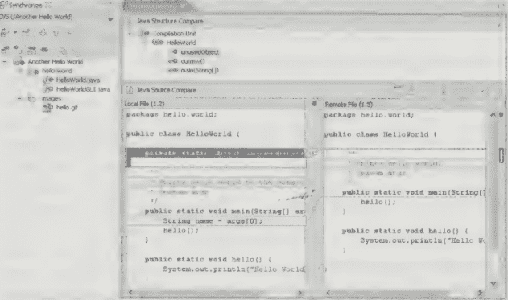
**图 20.3** 同步视图。

#### 基于结构的比较
除了 DIFF（第 2 章）基于行的比较之外，该工具还支持层次结构的比较（基于结构的比较）。在图 20.3 的右上角，对比了 HelloWorld.java 文件的结构。工具识别出 dummy() 方法和 unusedObject 字段已被删除。此外，它在 main 方法中发现了一个冲突，因为该方法在两个版本中都被修改了。在 main 的源代码层面，我们注意到一个名为 name 的局部变量被移除了，且 main 的注释被调整了。该比较工具可作用于任意文件，甚至可以使用本地历史记录作为版本比较的来源。

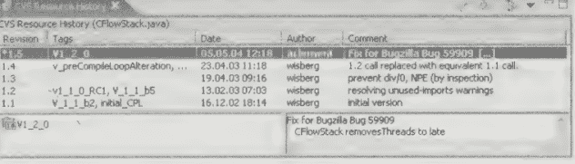
**图 20.4** CVS 资源历史记录。

#### 资源历史视图

资源历史视图对于版本控制非常重要，因为它将版本演进过程可视化。图 20.4 显示了 ASPECTJ 中 CFlowStack.java 文件的资源历史。对于每个修订版本，它包含标签、日期、作者和注释。通过双击修订版本号，可以在不覆盖工作副本的情况下查看该版本。此外，任意两个修订版本都可以相互比较。

### 20.4 ECLIPSE 的 JAVA 编辑器

ECLIPSE 的 JAVA 编辑器在许多方面为开发人员提供支持。它：

- 改善源代码的呈现和导航，
- 减少烦人的打字工作，
- 在编辑过程中检查错误和*代码异味（code smells）*，以及
- 为常见的编程错误提供修复方案。

编辑器的*语法高亮*提高了源代码的可读性。如果鼠标指针悬停在某个元素上方，会出现附加信息（如 JAVADOC 注释）。ECLIPSE 可以将整个方法或类折叠为单行，从而提高大型源文件的清晰度。值得关注的是*快速差异（quick diffs）*，它会高亮显示自上次保存或提交到版本存档以来的更改。*超链接模式*通过使所有 JAVA 元素可点击来简化导航。例如，点击 `Object` 会打开 `Object` 类的源代码。通过按住 *Ctrl* 键可启用此模式。

#### 快速差异

#### 超链接模式

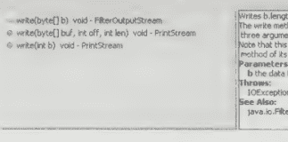
**图 20.5** 内容辅助功能。

#### 内容辅助
通过使用*内容辅助（content assist）*功能，开发人员可以减少烦人的打字工作。例如，只需输入类名或函数名的开头，然后从推荐的名称中选择一个即可（见图 20.5）。在这种情况下，ECLIPSE 还会处理必要的 import 语句。同样地，ECLIPSE 可以为 JAVADOC 注释或循环创建骨架。例如，输入 `/**` 和换行符会生成一个 JAVADOC 注释，输入 `for` 会生成一个 `for 循环`。此外，ECLIPSE 还可以为字段创建 getter 和 setter。内容辅助功能不仅简化了开发，而且避免了编程错误。

#### 错误和代码异味检查
ECLIPSE 在编程过程中会检查错误和*代码异味*。在 *Windows $\rightarrow$ Preferences $\rightarrow$ Compiler* 菜单中可以激活多种检查（请参阅 *Style*、*Advanced*、*Unused Code* 和 *Javadoc* 主题）。强烈建议激活大多数这些检查，以便及早发现潜在缺陷。图 20.2 在 Problems 视图中展示了此类警告的一些示例。通常，从未被读取或使用过的变量和方法是多余代码的候选对象（如示例中的 `dummy()`）。然而，在很多情况下，它们是编程错误和非预期效果的指示标志。对于隐藏字段的局部变量也是如此。在我们的示例中，`main()` 方法的变量 name 隐藏了 `HelloWorld` 类的字段 name。因此，字段名始终为 null，我们的程序在任何情况下都会打印 "Hello World, null"。认真对待这些警告可以避免此类错误。

额外的插件可以通过更多消息扩展 Problems 视图。例如，`CHECKSTYLE` 插件可检查进一步的代码异味，包括用户自定义的异味（另见第 17 章），并在 Problems 视图中显示结果。

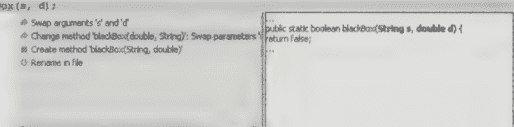
**图 20.6** 快速修复示例。

ECLIPSE 的一个特殊功能是所谓的**快速修复（quick fixes）**，只需点击按钮即可修复错误。此类快速修复的实例包括添加类型转换、捕获异常、添加缺失的 import，或者更改方法调用或声明中的参数顺序（见图 20.6）。

> 快速修复

### 20.5 使用 JDT 进行程序理解

软件工程将*正向工程*和*逆向工程*区分开来：

**正向工程（Forward Engineering）** 是软件的*推进式*开发：从需求规格说明到设计，再从设计到成品。

**逆向工程（Reverse Engineering）** 是*识别*和*展示*成品或半成品中结构与关系的过程。

逆向工程不仅在维护期间很重要，在早期阶段同样重要，例如当一个人必须在不熟悉的代码中工作时。主要问题是缺乏*局部性（locality）*：如果你在不熟悉的软件中查看一个元素（例如一个函数、方法、类或变量），这些元素的依赖关系和影响分布在整个软件中。因此，你必须尝试通过抽象来恢复局部性：使重要元素可见，不显示不重要元素。

> 局部性


对于分析和理解大型软件，命令行工具并不太适用，因为它们是基于文本的。例如，GREP 可以恢复局部性，因为仅显示包含文本模式的行。然而，GREP 不考虑其他依赖关系。为了更好地检测连接和结构，我们最终必须对源代码进行抽象，因为即使是对于小型程序，文本表示也会变得令人困惑。图形浏览器使用图标和注释来提供各种级别的抽象，这使得直观的理解和导航变得更加容易。

JAVA 标准库包含数千个文件和类——这个规模使用传统的工具和编辑器几乎无法处理。另一方面，ECLIPSE 的 Java 开发工具 (JDT) 在许多方面为我们提供支持：如果我们想了解该库中的 Button 是什么，JDT 不仅提供了许多特殊的视图和透视图，还提供了一个强大的 JAVA 搜索引擎。

#### 20.5.1 层级视图 (The Hierarchy View)

Java 类型层级视图在工作区中通过 Window → Show View → Other → Java → Hierarchy 显示。要显示的符号可以通过视图中的 Focus on 选中，或者通过其上下文菜单中的 Open Type Hierarchy 选中。

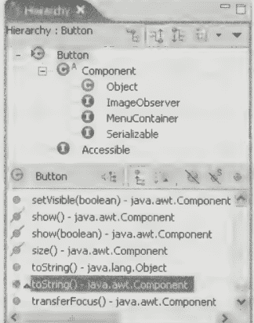

图 20.7 中的层级视图显示了 Button 类的元素。在视图的上方区域，我们可以找到 Button 类的继承层级。它包含了 Button 继承方法或字段的所有类和接口。我们可以看出 Button 扩展了 Component 和 Object 类。此外，我们注意到 Button 自身实现了 Accessible 接口，而对于其他接口，它继承了 Component 的实现。

视图的下方区域显示了由 Button 定义的方法和变量。通过 Show all Inherited Members，我们可以将此列表扩展到 Button 可见的所有方法和变量。不同的图标和颜色被用来强调方法的类型、可见性和继承关系。例如，我们可以识别出 `toString()` 方法是从 Component 类继承而来的，而 Component 类重写了 Object 类的原始实现。

#### 20.5.2 Java 浏览透视图 (The Java browsing perspective)

Button 类的另一种抽象是 Java 浏览透视图（见图 20.8，Window → Open Perspective → Other → Java Browsing）。与包资源管理器（Package Explorer）不同的是，项目、包、类型和成员显示在单独的视图中，并且可以使用特定标准进行过滤。这样，开发人员可以更快地切换到其他程序部分。像每个透视图一样，Java 浏览透视图可以通过额外的视图进行扩展，例如前一节描述的层级视图。

Java 浏览透视图

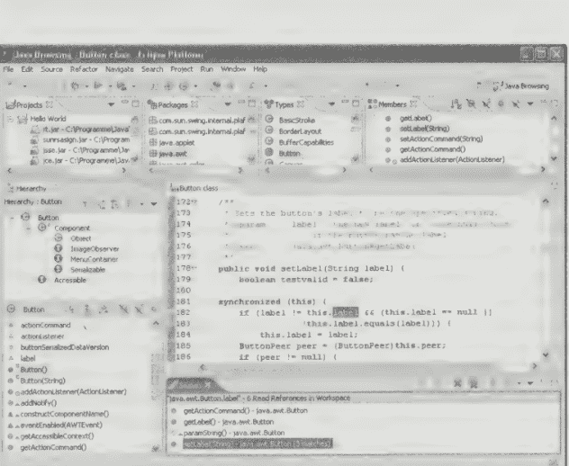
图 20.8 Java 浏览透视图。

#### 20.5.3 调用层级 (The call hierarchy)

*调用层级 (Call Hierarchy)* 是程序理解的另一种重要抽象。调用层级显示对于一个给定方法：

- 它被哪些方法调用（*调用者层级 caller hierarchy*），以及
- 它自身调用了哪些方法（*被调用者层级 callee hierarchy*）。

调用层级是通过在方法的上下文菜单中选择 *Open Call Hierarchy* 打开的。图 20.9 显示了 `Object` 类中 `wait(long)` 方法的调用者层级。所有调用 `wait(long)` 的方法都显示在一个树状结构中：`wait(long)` 被 `remove(long)` 方法调用，而 `remove(long)` 仅被 `remove()` 调用。

图 20.9 调用层级。
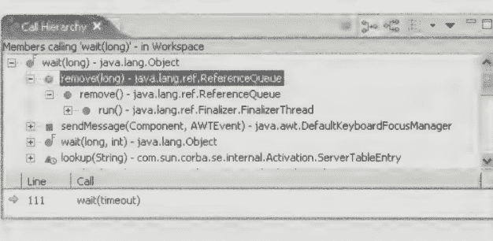

#### 20.5.4 在 JAVA 源代码中搜索

除了传统的*基于文本的搜索*（包括正则表达式）之外，ECLIPSE 还允许对 JAVA 元素进行*基于语法的搜索*（见图 20.10，*Search → Java*）。可以搜索类型、构造函数、字段和包；搜索可以限制在声明、引用、实现、读访问或写访问中。例如，这种基于语法的搜索可以找到所有读取 `Button` 的 `label` 变量的位置。此查询的结果列在 *Search View* 中，并在源代码中用箭头标记（见图 20.8）。在我们的示例中，有 6 个读引用分布在 4 个方法中：`getActionCommand`、`getLabel`、`paramString` 和 `setLabel`。

`setLabel` 的出现可能会令人惊讶，但它是合理的，因为 `setLabel` 在分配新值并通知其观察者之前，会检查 `label` 是否确实发生了变化。

搜索不限于单个文件；如果需要，可以在整个工作区或系统库中进行。然而，为了快速搜索，上下文菜单中存在 *Occurrences in File* 命令。该命令仅在当前激活的编辑器中搜索所选内容的任何出现。

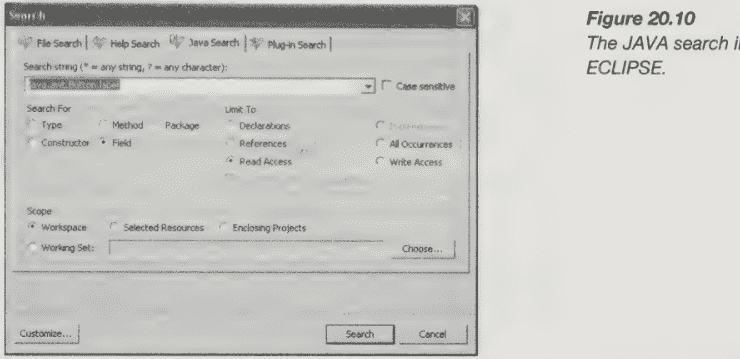

与基于文本的搜索相比，基于语法的搜索更精确且不会返回错误结果。因此，在大多数情况下，基于语法的搜索优于基于文本的搜索。例外情况是 makefile 或文本文件，其中无法或不能进行基于语法的搜索。在某些情况下，不精确性是需要的，例如在注释中搜索。

然而，*基于语义的搜索* 比基于语法的搜索更强大。例如，它可以找到跨方法调用的引用（变量作为参数传递并在被调用的方法内部被引用）。此类搜索需要 *数据流分析*，如第 18 章和第 19 章所述。

### 20.6 重构 (Refactoring)

*重构 (refactoring)* 是一种保持语义不变的代码转换，旨在改善程序的结构和质量。与设计模式一样，重构没有通用方法，而是一套方法目录。重构可以应用于软件开发过程的设计、实现和维护阶段。在实践中，重构并不总是保持语义不变，因此在某种程度上具有风险。因此，重构应完全在工具支持下进行，绝不能手动执行。此外，建议使用回归测试套件来保证语义不变，并使用版本控制以便在重构失败时恢复之前的版本。

ECLIPSE 和 JDT 积极支持重构（见 *Refactor* 菜单）：一方面，ECLIPSE 集成了 CVS 和 JUNIT，另一方面，JDT 提供了自动重构程序。下面介绍其中一些程序：

- **移动/重命名类、方法和字段 (Move/Rename classes, methods, and fields)**：此重构会调整包和文件名，以及将该元素的使用情况更新为新名称。甚至注释中的引用也会被处理，且对于字段，getter 和 setter 的名称也会随之更改。
- **提取方法 (Extract Method)**：将选定部分转换为一个新方法。签名是自动确定的，选定部分将被替换为对新方法的调用。
- **提取接口 (Extract Interface)**：支持从现有类创建新接口的过程。在对话框中选择应成为新接口一部分的方法。
- **更改签名 (Change Signature)**：修改方法的签名。为此，重构会调整对该方法的调用，并为新参数插入用户指定的虚拟值。
- **本地重命名 (Local Rename)**：这不是纯粹的重构，因为它仅作用于打开的文件而非整个项目。本地重命名像快速修复一样调用，在重命名方法的局部变量时非常有用。
- **组织导入 (Organize Imports)**：同样不是纯粹的重构。组织导入会优化 import 语句：删除多余的导入，并解析诸如 `*` 之类的通配符。

ECLIPSE 的重构不能保证程序的语义被完全保留。因此，ECLIPSE 会显示一个预览，列出重构将执行的所有更改（图 20.11）。开发人员可以从该列表中选择所需的更改或完全取消重构。

### 20.7 使用 ECLIPSE 调试

使用 ECLIPSE 的 JAVA 调试器，我们可以控制程序的执行，并检查和更改程序状态（关于调试的概念，请参阅第 15 章）。调试器支持热修复 (hot fix)，这意味着对源代码的修改会立即影响运行中的程序。此外，它不仅支持开发人员计算机上的本地调试，还支持通过网络的远程调试。

为了调试程序，开发人员可以访问调试透视图（见图 20.12，Window → Open Perspective → Other → Debug），它提供了许多额外的视图：

调试透视图


#### 图 20.11

重构方法 **“提取方法 (Extract Method)”**。

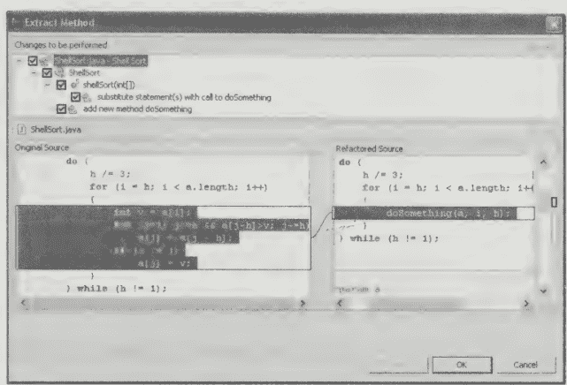

- 待执行的更改：
    - ShellSort[Java] - 希尔排序
    - shellSort(int[])
    - 用对 `doSomething` 的调用替换语句
    - 添加新方法 `doSomething`

```java
// Original Source
do {
  h /= 3;
  for (i = h; i < a.length; i++) {
    int v = a[i];
    for (j = i; j >= h && a[j-h] > v; j-=h)
      a[j] = a[j - h];
    a[j] = v;
  }
} while (h != 1);
```

```java
// Refactored Source
do {
  h /= 3;
  for (i = h; i < a.length; i++) {
    doSomething(a, i, h);
  }
} while (h != 1);
```

#### 图 20.12

调试透视图 (Debug Perspective)。

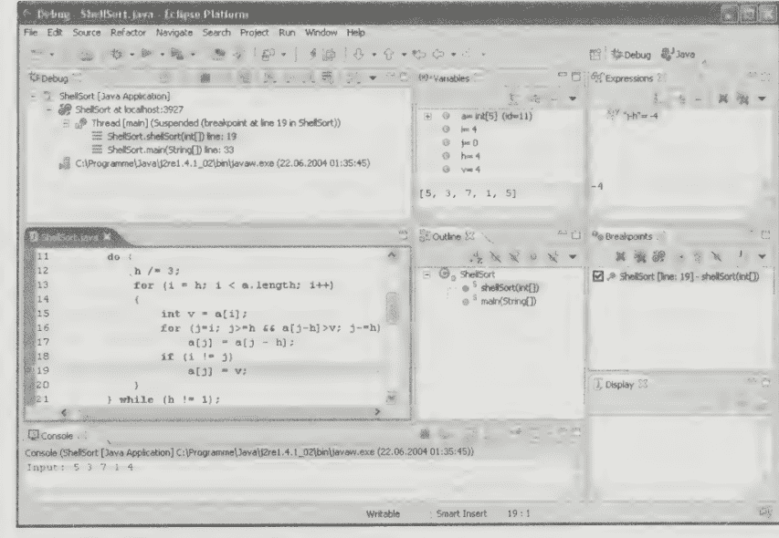

```java
11       do {
12         h /= 3;
13         for (i = h; i < a.length; i++) {
14           {
15             int v = a[i];
16             for (j=i; j>=h && a[j-h]>v; j-=h)
17               a[j] = a[j - h];
18             if (i != j)
19               a[j] = v;
20           }
21         } while (h != 1);
```

- 变量：
    - a = int[5] (d=11)
    - i = 4
    - j = 0
    - h = 4
    - v = 4

```
Output: [5, 3, 7, 1, 5]
```

- 调试视图 (Debug View) 包含进程、线程和调用堆栈。
- 变量视图 (Variables View) 显示可见变量的值。
- 断点视图 (Breakpoints View) 列出所有断点。
- 表达式视图 (Expressions View) 计算表达式并管理监视点。
- 在显示视图 (Displays View) 中，我们可以定义在每次程序停止时刷新的显示项。
- 线程与监视器视图 (Threads and Monitors View) 显示哪些线程持有锁以及哪些线程在等待锁的释放。

### 20.8 ECLIPSE 的设计

ECLIPSE 是一个开放且可扩展的开发工具平台。这需要一种机制，允许工具开发者在不损失独立性的情况下将他们的工具集成到 ECLIPSE 中。ECLIPSE 通过其插件架构实现了这一想法。在撰写本文时，ECLIPSE 已经存在 500 多个插件。

#### 20.8.1 ECLIPSE 的架构

图 20.13 展示了 ECLIPSE 的架构。ECLIPSE 的软件开发工具包 (SDK) 由三个部分组成：

- **Eclipse Platform（Eclipse 平台）。** Eclipse 平台提供了 ECLIPSE 的基础功能。它由平台运行时 (Platform Runtime) 组成，平台运行时是 ECLIPSE 的核心，负责加载和管理插件。平台运行时是 ECLIPSE 中唯一没有以插件形式实现的部件；所有其他组件都通过插件机制集成。工作空间 (Workspace) 管理资源（另见 20.1 节），工作台 (Workbench) 实现图形用户界面（另见 20.2 节）。所有其他组件（如团队、帮助或调试）都构建在工作空间和工作台之上。
- **Java Development Tools, JDT（Java 开发工具）。** Java 开发工具 (JDT) 对 ECLIPSE 进行扩展，以提供针对 JAVA 的特定功能，例如 20.5 节中描述的视图。
- **Plug-in Development Environment, PDE（插件开发环境）。** 插件开发环境 (PDE) 对 ECLIPSE 进行扩展，以提供针对插件开发的特定功能。由于插件是用 JAVA 开发的，因此 PDE 不仅扩展了 Eclipse 平台，还扩展了 JDT。

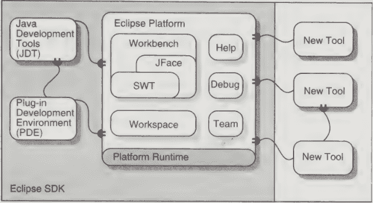
**图 20.13** ECLIPSE 架构。

#### 20.8.2 插件机制

插件是为 ECLIPSE 扩展新功能的最小可能单元。一个插件必须贡献于至少一个 *扩展点 (extension point)*，这意味着它为该点提供了一个实现。换句话说，扩展点是将两个插件相互连接的一种机制。ECLIPSE 本身定义了许多扩展点，但第三方插件也可以定义扩展点。一个插件由两部分组成：

| 组件 | 描述 |
| :--- | :--- |
| **声明 (Declaration)** | 插件的声明是一个名为 `plugin.xml` 的清单文件。这个 XML 文件描述了实现了哪些扩展点（至少一个）以及定义了哪些新的扩展点（可选）。此外，该文件还包含对其他插件的依赖关系。示例 20.1 展示了一个完整的清单文件，其详细描述见 20.9 节。 |
| **实现 (Implementation)** | 插件的实现是用 **JAVA** 编写的。然而，有些插件不需要任何 JAVA 实现；例如 ECLIPSE 的帮助文档也是通过插件机制实现的。 |

图 20.14 插图说明了两个插件的插件概念。插件 Foo 定义了一个新的扩展点 P 和一个接口 I。为了使用这个新的扩展点，插件 Bar 必须使用自己的类 C 来实现接口 I。该类通过清单文件贡献给扩展点。最后，插件 Foo 可以查询扩展，并使用定位到的类（如示例中的 C）。

简单的工具仅由一个插件组成；然而，复杂的工具拥有多个插件。因此，ECLIPSE 允许将多个插件组合成一个特性 (feature)。特性包含附加信息，例如许可证以及指向互联网更新站点的引用。这些更新通过 ECLIPSE 的 *更新管理器 (update manager)* 安装。

**图 20.14** 插件概念。
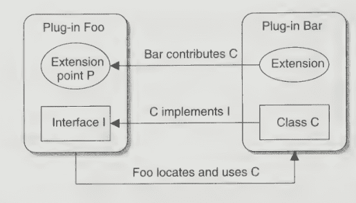

*插件注册表 (Plug-in registry)*
在 ECLIPSE 启动期间，平台运行时读取所有清单文件并创建 *插件注册表*。插件注册表包含插件之间的依赖关系，并管理对扩展点的贡献。

*延迟加载 (Lazy loading)*
插件在用户首次请求其功能之前不会被加载 (*延迟加载*)。这种方法极大地加快了 ECLIPSE 的启动速度。一个插件的激活可能会导致对其产生依赖的其他插件也被激活。

#### 20.8.3 资源更改与程序构建

*资源更改监听器 (Resource change listener)*
如果资源发生更改，ECLIPSE 的不同视图必须更新。为此，ECLIPSE 使用了 *资源更改监听器* 的概念，它们在更改发生时收到通知。

资源是分层组织且具有等级关系的。因此，更改不仅影响资源本身，还影响处于该更改资源层级之上的资源。例如，ECLIPSE 使用 *标签装饰 (label decorations)* 突出显示错误的文件和目录。如果包含的文件或子目录之一出错，则该目录被视为错误。如果开发者修复了一个错误的文件，ECLIPSE 可能需要刷新所有包含目录的标签装饰。因此，ECLIPSE 不仅仅通知资源监听器，还会为它们提供一个 *资源差异树 (resource delta tree)*。资源差异树以树状结构包含所有受更改影响的资源。图 20.15 展示了这样一个树的示例：目录 C（包括其所有文件）已被删除 (-)；文件 b 已被添加到目录 B (+）；文件 a2 已被修改 (*)。我们可以看出，对文件的更改总是影响其包含目录，而未更改的文件（如 a1）不包含在资源差异树中。

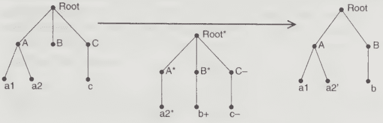
**图 20.15** 资源差异树。

资源差异树不仅对资源监听器很重要，对 *项目构建器 (project builders)* 同样重要。项目构建器获取资源差异树并提供几种程序构建方式：

- 对于 *增量构建 (incremental build)*（见 8.2 节），项目构建器使用资源差异树来确定需要重新构建的资源。随后，它仅重新构建这些资源。例如，JAVA 项目构建器可能仅重新编译被修改的 JAVA 文件。
- 增量构建的一种特殊情况是 *自动构建 (auto build)*，它在每次资源更改后自动执行增量构建。
- 在某些更改之后，增量构建不再可能（例如编译器设置的更改），此时必须进行 *全量构建 (full build)*。

资源监听器和项目构建器都对资源更改做出反应——它们之间有什么区别？资源监听器监视单个资源，而项目构建器总是监视整个项目。因此，资源监听器在资源上注册；相比之下，项目构建器在 ECLIPSE 中注册，并被分配给具有特定 *项目性质 (project nature)* 的项目。它们在实现成本上也有所不同：项目构建器比资源监听器复杂得多，而资源监听器则相当轻量。

#### 20.8.4 工具在 ECLIPSE 中的集成

将一个工具完整地集成到 ECLIPSE 中可能成本非常高。因此，存在几个 *集成级别 (levels of integration)*。

**无集成。** 并非总是需要集成到 ECLIPSE 中，例如，如果该工具具有便捷的用户界面且不与其他工具交换数据。

**通过调用集成。** 这种集成方式在独立的进程和窗口中启动工具。工具负责资源的管理，并受益于某些 ECLIPSE 组件（如版本控制）。


##### 数据集成
通过*数据共享*可以实现工具的集成。采用这种方法的工具需要一种访问方法、一个交换协议和一个转换过程。ECLIPSE 通过许多开放标准（如 WebDAV、XMI 和 XSLT）支持数据集成。数据共享的风险是完整性的丢失以及工具之间产生高耦合的危险。

##### 通过 API 集成
在这种情况下，工具通过 API 提供对其功能的访问。然而，工具的用户界面应该与其核心分离。

##### 通过 GUI 集成
这一级别通过扩展菜单、工具栏、视图和透视图，将工具直接集成到 ECLIPSE 用户界面中。

### 20.9 插件示例：ASTView

在本节中，我们将介绍一个示例插件。该插件在视图中显示 JAVA 文件的抽象语法树（AST）（图 20.16）。在内部，ECLIPSE 使用此类树来表示 JAVA 文件。然而，由于 ECLIPSE 包含了括号和注释，因此它们是纯抽象语法树和解析树的混合体。

图 20.16 ASTView。


```java
public class ShellSort {
    public static void shellSort(int[] a) {
        int i, j;
        int h = 1;
        do {
            h = 3 * 1 + 1;
        } while (h <= a.length);
        do {
            h /= 3;
            for (i = h; i < a.length; i++) {
                int tmp = a[i];
                for (j = i; j >= h && a[j-h] > tmp; j -= h)
                    a[j] = a[j - h];
                a[i] = j;
            }
        } while (h >= 1);
    }
    
    public static void main(String[] args) {
        System.out.println("Input: ");
        int[] a = new int[args.length];
        for (int i = 0; i < args.length; i++)
            a[i] = Integer.parseInt(args[i]);
        System.out.print(a[i]);
        shellSort(a);
        System.out.print("Output: ");
        for (int i = 0; i < a.length; i++)
            System.out.print(a[i]);
        System.out.println();
    }
}
```

该插件提供以下功能：

- 从上下文菜单中选择一个 Java 文件。
- 在视图中显示该文件的 AST。
- 双击在编辑器中打开顶点。

我们现在将解释该插件的代码片段。完整的源代码印在第 365-370 页。如果您想亲自尝试该插件，请参阅第 363 页练习部分的注意事项。

#### 声明插件

`plugin.xml` 文件（见示例 20.1）包含插件的声明。除了通用信息和对代码存档（`ASTView.jar`）的引用外，该文件还包含对其他插件的依赖：

- `org.eclipse.core.resources` 用于访问资源，
- `org.eclipse.ui` 用于用户界面，
- `org.eclipse.jdt.core` 用于 JAVA 特定功能，以及
- `org.eclipse.jdt.ui` 用于 JAVA 编辑器。

为了使用新视图扩展 ECLIPSE，我们使用扩展点 `org.eclipse.ui.views`：

```xml
<extension
    point="org.eclipse.ui.views">
    <category
        name="Wiley"
        id="astview.category.wiley">
    </category>
    <view
        name="AST View"
        icon="icons/sample.gif"
        category="astview.category.wiley"
        class="astview.views.ASTView"
        id="astview.views.ASTView">
    </view>
</extension>
```

通过使用 category，我们将“窗口 $\rightarrow$ 显示视图 $\rightarrow$ 其他”对话框扩展了一个名为 "Wiley" (name) 的新类别。使用 view，我们在该类别中插入一个新视图。该视图名为 "AST View"，并在 "astview.views.ASTView" (class) 类中实现。我们的视图在整个 ECLIPSE 中通过 id 中的值来标识。

此外，我们希望扩展所有 JAVA 文件的上下文菜单。相应的扩展点是 `org.eclipse.ui.popupMenus`：

```xml
<extension
    point="org.eclipse.ui.popupMenus">
    <objectContribution
        objectClass="org.eclipse.jdt.core.ICompilationUnit"
        id="astview.ICompilationUnit">
        <action
            label="Update AST View"
            class="astview.actions.UpdateViewAction"
            enablesFor="1"
            id="astview.actions.UpdateView">
        </action>
    </objectContribution>
</extension>
```

为了仅为 JAVA 文件显示我们的条目，我们定义了一个 object Contribution，它仅为 `objectClass` 类型的元素显示条目。我们选择 `ICompilationUnit` 作为类型，因为该类在 ECLIPSE 中代表 JAVA 文件。该操作将被命名为 "Update AST View" (label)，并且仅对一个被选中的元素（`enablesFor`）启用。如果用户选择了我们的操作，ECLIPSE 将调用 "astview.actions.UpdateViewAction" (class) 类。

#### 创建 AST

在 ECLIPSE 中，从 JAVA 文件创建 AST 非常简单：

```java
ICompilationUnit unit = ...;
ASTParser parser = ASTParser.newParser(AST.JLS2);
parser.setSource(unit);
CompilationUnit root = (CompilationUnit) parser.createAST(null);
```

变量 `unit` 代表目标 JAVA 文件，由上下文菜单的选择（见下文）决定。

#### 显示 AST

**TreeViewer** 我们通过使用 TreeViewer 在视图中显示 AST。TreeViewer 由四个部分组成：

- **Input（输入）。** 输入数据将由 TreeViewer 显示。对于我们的插件，输入数据是 AST 的根节点，因为它可以用来访问完整的 AST。
- **ContentProvider（内容提供者）。** ContentProvider 将输入映射到查看器的结构。在我们的示例中，结构是一棵树，我们必须实现访问父节点（`getParent()`）和子节点（`getChildren()` 和 `hasChildren()`）的方法。父节点存储在节点中，但为了确定子节点，我们必须使用 ASTVisitor 的实现来遍历 AST。
- **LabelProvider（标签提供者）。** *LabelProvider* 定义树元素的格式。文本由 `getText()` 决定，可选图标由 `getImage()` 决定。在我们的示例中，我们简单地使用节点的类名及其 `toString` 表示形式。
- **Sorter（排序器）。** *Sorter* 对显示的输入进行排序。在我们的示例中，不需要 Sorter。

#### 更新视图

每当用户在上下文菜单中选择 *Update AST View* 操作时，就会调用 `UpdateViewAction` 类的 `run()` 方法。该方法执行以下步骤：

- **确定选中的 JAVA 文件：** 我们获取上下文菜单选择（*selection*）中的第一个且唯一的元素。
```java
Object obj = ((IStructuredSelection) selection).getFirstElement();
ICompilationUnit unit = (ICompilationUnit) obj;
```

- **查找 ASTView：** 在更新视图之前，我们必须找到它。为此，我们使用工作台（workbench）和视图的标识符来确定代表我们 ASTView 的 `IViewPart`。
```java
IWorkbenchPage page = workbenchPart.getSite().getWorkbenchWindow().getActivePage();
IViewPart vp = page.findViewById("astview.views.ASTView");
```

#### 在编辑器中打开元素

为了在编辑器中打开元素，我们定义了一个名为 `doubleClickAction` 的操作。该操作的 `run()` 方法确定用户双击的元素（`node`），并在编辑器中打开该元素：

```java
IJavaElement elem = unit.getElementAt(node.getStartPosition());
IEditorPart javaEditor = JavaUI.openInEditor(elem);
JavaUI.revealInEditor(javaEditor, elem);
```

必须通过调用 `addDoubleClickListener()` 方法将该操作添加到 `TreeViewer` 中。

### 20.10 自动化与直觉

在前面的章节中，我们展示了 ECLIPSE 如何满足集成环境的需求，例如 *直觉化操作*、*互操作性*、*抽象* 和 *功能性*。与传统的命令行工具相比，ECLIPSE 在抽象和直觉化操作领域具有明显优势。

那么最后一个需求 *自动化* 呢？命令行工具可以通过使用 shell 脚本轻松实现自动化。通常，集成环境在这方面有很大的缺陷，因为操作只能通过图形用户界面完成；遗憾的是，这种情况在 ECLIPSE 中同样存在。然而，大多数由 ECLIPSE 集成的工具（如 JUNIT、ANT 和 CVS）同样提供命令行工具。因此，缺乏自动化并不太重要。

对于 ECLIPSE 来说，一个更重要的问题是插件数量的增加。每天都有更多尚未成熟的插件发布。此外，对其他编程语言的支持滞后于对 JAVA 的支持。不过，ECLIPSE 的热潮才刚刚开始，我们还不知道它的未来会如何。

#### 概念

- *集成环境* 在共享、统一且直觉化操作的环境中提供各种工具。
- *开放环境* 允许集成外部工具。环境数据和功能的 *访问接口* 非常有用（如 ECLIPSE API）。
- *高集成度* 为程序员提供统一的用户界面，*模块化* 允许外部工具的独立进一步开发，而 *互操作性* 则实现了集成工具之间的协作与交换。
- 用户界面分为 *编辑器、视图和透视图*。*图形浏览器* 提供具有不同抽象级别的多种视图。
- *重构* 改善程序的结构。
- *增量构建器* 通过高效的编译技术实现源代码的 *即时* 编辑。
- *插件* 允许对 ECLIPSE 进行灵活扩展。


扩展点是潜在的扩展位置。所有贡献的所有扩展都在*插件注册表 (plug-in registry)* 中管理。

#### 复习练习

- 1. 讨论像 ECLIPSE 这样开放的开发环境在工业软件开发中的优势和潜在风险。

- 2. 我们介绍了 JAVA 源代码的不同视图。对于其他编程语言（如 C, C++, PYTHON, PERL 和 PHP），哪些视图是合理的？

- 3. 本书中介绍的并非所有工具都集成在 ECLIPSE 中。集成以下工具是否合理？如果合理，其形式应该是怎样的？

    (a) AUTOCONF（第 9 章）
    (b) DEJAGNU（第 12 章）
    (c) BUGZILLA（第 14 章）
    (d) GPROF 和 GCOV（第 16 章）
    (e) LINT（第 18 章）
    (f) UNRAVEL（第 19 章）

    如果集成不合理，是否可以集成该工具的部分概念？

- 4. 为什么 ECLIPSE 使用自己的组件工具包 (JFACE 和 SWT) 而不是默认的 JAVA 工具包 (AWT 和 SWING)？请在互联网上研究。

- 5. 你的公司开发了一个基于 AWT 和 SWING 的编辑器。你的老板很喜欢 ECLIPSE，并希望将其集成到 ECLIPSE 中。对比不同集成方式的成本和收益，并规划集成方案。在互联网上研究直接集成 AWT 和 SWING 组件是否可行。

- 6. 我们仅从用户和开发者的角度考虑了集成。你还能想到其他什么角度？

- 7. 目前存在 500 多个插件。如此庞大的数量有什么缺点？请为插件设计一个合理的分类方法。互联网上是否有插件目录？

- 8. 研究 ECLIPSE 的 *富客户端平台 (Rich Client Platform)*。想象一下 ECLIPSE 在 *月球暗面 (dark side of the moon)* 的未来。那么 *太阳 (Sun)* 又是怎样的呢？

#### 延伸阅读

第一个集成开发环境是 SMALLTALK，其图形化编程环境是系统的一部分，并在 Goldberg (1983) 中有所描述。SMALLTALK 是与图形工作站共同开发的。

早期的软件开发环境具有强烈的*语法导向 (syntax oriented)*：源代码是*语法控制 (syntax controlled)* 编辑器的输入，且程序始终保持在编译状态。其中包括 Bahlke 和 Snelting (1986) 的 PSG 以及 Reps 和 Teitelbaum (1988) 的 *综合生成器 (Synthesizer Generator)*。

*源代码工程 (source code engineering)* 这一术语描述了许多开发环境所采取的活动。与此同时，研究已摆脱了对源代码的导向，现在转向*软件工程环境 (software engineering environments)*，这些环境面向整个软件开发过程。

Object Technology International (2003) 描述了 ECLIPSE 的架构。ECLIPSE 的运行是 Daum (2004) 以及 Shavor 等人 (2003) 研究的主题。相比之下，Beck 和 Gamma (2003) 专注于插件的开发。你可以在以下网址找到关于 ECLIPSE 的最新信息：

http://www.eclipse.org/

#### 其他编程环境

大多数商业编译器以*集成开发环境 (IDE)* 的形式提供。然而，除了集成的 GUI 构建器外，它们很少支持除 *编辑-编译-调试 (edit-compile-debug)* 循环之外的功能。典型的编程环境，如 CODEWARRIOR, NETBEANS, *Microsoft* 的 *Visual* 系列或 IBM 的 *VisualAge* 系列，存在这样一个问题：许多可视化工具仅适用于*没有任何错误*地编译通过的源代码。

只有少数跨平台环境支持多种编程语言、版本控制系统和外部工具：

- *Wind River* 的 SNiFF+ 是一个支持多种编程语言和操作系统的开放环境。外部工具通过*适配器 (adapters)* 集成。SNiFF+ 提供了类似于 ECLIPSE 的图形浏览器。然而，SNiFF+ 的重点是代码分析。

- SOURCE NAVIGATOR 与 SNiFF+ 非常相似，同样专注于代码分析。它支持外部工具的集成，并且除了 ECLIPSE 和 SNiFF+ 之外，它是唯一的*开放*环境。

- *Code Forge* 的 C-FORGE 支持 30 多种编程语言和多种版本控制系统。与 ECLIPSE 类似，它提供了源代码的搜索和浏览器以及调试工具。

- *Intland* 的 CODEBEAMER 是一个基于 Web 的开发环境，支持程序理解和开发人员之间的沟通。通过 Web 界面访问版本控制系统，并使用多种工具检查源代码。CODEBEAMER 是对现有开发环境的增强；因此，它为 ECLIPSE 提供了一个 CODEBEAMER 插件。

- *Borland* 的 TOGETHER 包含一个集成的 UML 编辑器，并为设计模式提供了许多骨架。另一个亮点是大量的软件度量指标。TOGETHER 同样以 ECLIPSE 插件的形式存在。

有时，ECLIPSE 被称为“21 世纪的 EMACS”。EMACS 编辑器，或者说是所有编辑器的“祖母”，一直以来都非常有名。它可以通过 LISP 扩展，并支持许多外部编程工具。这甚至延伸到了真正的编程环境，例如用于 JAVA 的 JDE。除了编程，使用 EMACS 还可以写电子邮件、浏览互联网——或者像写这本书一样写书……

#### 练习 VII

在本练习中，你将在 ECLIPSE 中创建第 13 章的 *Rational* 示例。此外，你将开发自己的插件：第 20 章中介绍的 *ASTView*。

##### ECLIPSE 入门

- 1. 下载并安装 ECLIPSE。
- 2. 创建一个名为 Rational 的新 JAVA 项目（使用 `File → New → Project`）。
- 3. 创建一个 Rational 类，包含用于比较的方法 (equals, compareTo) 和四种基本算术运算方法 (add, subtract, multiply, divide)。
- 4. 按照第 13 章的描述创建一个名为 RationalTest 的测试类（针对 equals, compareTo 方法）。使用对话框 `File → New → Other → Java → JUnit → Test Case`。
- 5. 通过 `Run → Run As → JUnit Test` 执行 RationalTest，并检查 Rational 是否通过了所有测试用例。
- 6. 现在创建一个 RationalArithTest 类，包含基本算术运算（加、减、乘、除）的测试用例。
- 7. 创建一个名为 AllRationalTests 的测试套件，将 RationalTest 和 RationalArithTest 的测试结合起来。使用对话框 `File → New → Other → Java → JUnit → Test Suite`。使用此测试套件检查你的 Rational 类是否通过了所有测试。
- 8. 将 Rational 类的当前版本与本地历史记录中的先前版本进行比较（在右键菜单中选择 `Compare with → Local History`）。
- 9. 使用 ECLIPSE 的工具重建任意开源项目的版本历史。（你可以在 www.sourceforge.net 上找到一些开源项目）。
- 10. 使用 ECLIPSE 探索 JAVA 标准库 (rt.jar)。从 *Java Browsing Perspective* 或*超链接模式 (hyperlink mode)*（按 `Ctrl` 键）开始。可能需要将 JAVA 源代码添加为*源附件 (source attachment)*。你可以在 JAVA 安装主目录的 `src.zip` 存档中找到源代码。

##### ECLIPSE 插件开发

- 1. 在尝试 *ASTView* 插件之前，先创建一个 *Hello World* 插件。你可以在互联网上找到相关指南，例如 www.eclipse.org 上的文章 "Your First Plug-in"。

- 2. 熟悉 ECLIPSE 帮助 (*Help → Help Contents*)。利用它研究以下内容：
    - 抽象语法树 (AST)
    - 动作 (actions)
    - 查看器 (viewers)，特别是 *TreeViewer*
    - 扩展点 `org.eclipse.ui.views`
    - 扩展点 `org.eclipse.ui.popupMenus`。

- 3. 创建一个名为 *ASTView* 的新插件项目。在 *New File* 对话框中，使用 *Plug-in Project* 向导，并将控制插件生命周期的类命名为 `astview.ASTViewPlugin`（区分大小写）。ECLIPSE 应该会自动导入正确的库。

- 4. 打开 `plug-in.xml` 文件的 *manifest* 编辑器，创建插件描述（参见示例 20.1）。你可以在 `plugin.xml` 页面中输入源代码，或者使用编辑器其他页面上的输入字段。

- 5. 在 `plugin.xml` 的右键菜单中调用 *PDE Tools → Update Classpath* 命令，以刷新 ECLIPSE 将要导入的库列表。

- 6. 现在你可以测试 *ASTView* 的声明了：通过 *Run → Run As → Runtime Workbench* 启动插件测试环境。此时会打开第二个工作台；检查对话框 *Windows → Show View → Other* 中是否包含 "Wiley" 条目。随后关闭测试工作台。

- 7. 使用资源透视 (Resource Perspective) 创建一个名为 `icons` 的目录，并插入一张名为 `sample.gif` 的任意图像。这张图像将作为 *ASTView* 的标志。


8. 为了完成该插件，请实现剩余的类 `ASTView` 和 `UpdateViewAction`（参见示例 20.2 和 20.3）。如果您对某个操作不熟悉，请在 ECLIPSE 帮助文档中查找。

##### 示例 20.1
###### 插件描述
###### plugin.xml

```xml
<?xml version="1.0" encoding="UTF-8"?>
<?eclipse version="3.0"?>
<plugin
    id="ASTView"
    name="ASTView Plug-in"
    version="1.0.0"
    provider-name=""
    class="astview.ASTViewPlugin">

    <runtime>
        <library name="astview.jar"/>
    </runtime>
    <requires>
        <import plugin="org.eclipse.core.runtime.compatibility"/>
        <import plugin="org.eclipse.ui.ide"/>
        <import plugin="org.eclipse.ui.views"/>
        <import plugin="org.eclipse.jface.text"/>
        <import plugin="org.eclipse.ui.workbench.texteditor"/>
        <import plugin="org.eclipse.ui.editors"/>
        <import plugin="org.eclipse.core.resources"/>
        <import plugin="org.eclipse.ui"/>
        <import plugin="org.eclipse.jdt.core"/>
        <import plugin="org.eclipse.jdt.ui"/>
    </requires>

    <extension
        point="org.eclipse.ui.views">
        <category
            name="Wiley"
            id="astview.category.wiley">
        </category>
        <view
            name="AST View"
            icon="icons/sample.gif"
            category="astview.category.wiley"
            class="astview.views.ASTView"
            id="astview.views.ASTView">
        </view>
    </extension>

    <extension
        point="org.eclipse.ui.perspectiveExtensions">
        <perspectiveExtension
            targetID="org.eclipse.jdt.ui.JavaPerspective">
            <view
                relative="org.eclipse.ui.views.ContentOutline"
                relationship="stack"
                id="astview.views.ASTView">
            </view>
        </perspectiveExtension>
    </extension>

    <extension
        point="org.eclipse.ui.popupMenus">
        <objectContribution
            objectClass="org.eclipse.jdt.core.ICompilationUnit"
            id="astview.ICompilationUnit">
            <action
                label="Update AST View"
                class="astview.actions.UpdateViewAction"
                enablesFor="1"
                id="astview.actions.UpdateView">
            </action>
        </objectContribution>
    </extension>
</plugin>
```

##### 示例 20.2
###### 类 ASTView

```java
package astview.views;

import java.util.ArrayList;

import org.eclipse.core.resources.ResourcesPlugin;
import org.eclipse.jdt.core.ICompilationUnit;
import org.eclipse.jdt.core.IJavaElement;
import org.eclipse.jdt.core.JavaModelException;
import org.eclipse.jdt.core.dom.AST;
import org.eclipse.jdt.core.dom.ASTNode;
import org.eclipse.jdt.core.dom.ASTParser;
import org.eclipse.jdt.core.dom.ASTVisitor;
import org.eclipse.jdt.core.dom.CompilationUnit;
import org.eclipse.jdt.ui.JavaUI;
import org.eclipse.jface.action.Action;
import org.eclipse.jface.dialogs.MessageDialog;
import org.eclipse.jface.viewers.DoubleClickEvent;
import org.eclipse.jface.viewers.IDoubleClickListener;
import org.eclipse.jface.viewers.ISelection;
import org.eclipse.jface.viewers.ITreeContentProvider;
import org.eclipse.jface.viewers.LabelProvider;
import org.eclipse.jface.viewers.TreeViewer;
import org.eclipse.jface.viewers.Viewer;
import org.eclipse.swt.SWT;
import org.eclipse.swt.graphics.Image;
import org.eclipse.swt.widgets.Composite;
import org.eclipse.swt.widgets.Display;
import org.eclipse.swt.widgets.Shell;
import org.eclipse.ui.IActionBars;
import org.eclipse.ui.IEditorPart;
import org.eclipse.ui.ISharedImages;
import org.eclipse.ui.PartInitException;
import org.eclipse.ui.PlatformUI;
import org.eclipse.ui.part.ViewPart;

/**
 * Class OurVisitor
 */
class OurVisitor extends ASTVisitor {

    private int currentDepth;
    private int maxDepth;
    private ArrayList children;

    public OurVisitor(int depth) {
        this.currentDepth = 0;
        this.maxDepth = depth;
        children = new ArrayList();
    }

    public void postVisit(ASTNode node) {
        currentDepth--;
    }

    public void preVisit(ASTNode node) {
        if (currentDepth > 0 && currentDepth <= maxDepth) {
            children.add(node);
        }
        currentDepth++;
    }

    public Object[] getChildren() {
        return children.toArray();
    }
}

/**
 * Class ASTView
 */
public class ASTView extends ViewPart {

    private TreeViewer viewer;
    private Action sampleAction;
    private Action doubleClickAction;
    private ICompilationUnit unit;

    /**
     * Inner Class ViewContentProvider
     */
    class ViewContentProvider implements ITreeContentProvider {

        public void inputChanged(Viewer v, Object oldInput, Object newInput) {
        }

        public void dispose() {
        }

        public Object[] getElements(Object parent) {
            return getChildren(parent);
        }

        public Object getParent(Object child) {
            if (child instanceof ASTNode) {
                return ((ASTNode)child).getParent();
            }
            return null;
        }

        public Object[] getChildren(Object parent) {
            if (parent instanceof ASTNode) {
                OurVisitor myVisitor = new OurVisitor(1);
                ((ASTNode)parent).accept(myVisitor);
                return myVisitor.getChildren();
            }
            return new Object[0];
        }

        public boolean hasChildren(Object parent) {
            if (parent instanceof ASTNode) {
                OurVisitor myVisitor = new OurVisitor(1);
                ((ASTNode) parent).accept(myVisitor);
                return myVisitor.getChildren().length > 0;
            }
            return false;
        }
    }

    /**
     * Inner Class ViewLabelProvider
     */
    class ViewLabelProvider extends LabelProvider {

        public String getText(Object obj) {
            String[] className =
                obj.getClass().getName().split("\\.");
            return className[className.length - 1]
                    + ": " + obj.toString();
        }
        public Image getImage(Object obj) {
            return null;
        }
    }

    /**
     * Source code of ASTView
     */
    public ASTView() {}

    public void createPartControl(Composite parent) {
        viewer = new TreeViewer
                (parent, SWT.MULTI | SWT.H_SCROLL | SWT.V_SCROLL);
        viewer.setContentProvider(new ViewContentProvider());
        viewer.setLabelProvider(new ViewLabelProvider());
        viewer.setSortOrder(null);
        viewer.setInput(ResourcesPlugin.getWorkspace());

        makeActions();
        hookDoubleClickAction();
        contributeToActionBars();
    }

    private void makeActions() {
        sampleAction = new Action() {
            public void run() {
                Shell shell = Display.getDefault().getActiveShell();
                MessageDialog.openInformation
                        (shell, "Sample Action", "A message dialog.");
            }
        };
        sampleAction.setImageDescriptor
                (PlatformUI.getWorkbench().getSharedImages().
                        getImageDescriptor(ISharedImages.IMG_OBJS_INFO_TSK));

        doubleClickAction = new Action() {
            public void run() {
                IStructuredSelection selection =
                    (IStructuredSelection) viewer.getSelection();
                ASTNode node = (ASTNode) selection.getFirstElement();
                try {
                    IJavaElement elem =
                        unit.getElementAt(node.getStartPosition());
                    IEditorPart javaEditor = JavaUI.openInEditor(elem);
                    JavaUI.revealInEditor(javaEditor, elem);
                } catch (JavaModelException e) {
                    e.printStackTrace();
                } catch (PartInitException e) {
                    e.printStackTrace();
                }
            }
        };
    }

    private void hookDoubleClickAction() {
        viewer.addDoubleClickListener(new IDoubleClickListener() {
            public void doubleClick(DoubleClickEvent event) {
                doubleClickAction.run();
            }
        });
    }

    private void contributeToActionBars() {
        IActionBars bars = getViewSite().getActionBars();
        bars.getToolBarManager().add(sampleAction);
    }

    public void setFocus() {
        viewer.getControl().setFocus();
    }

    public void setInput(ICompilationUnit unit) {
        this.unit = unit;
        ASTParser c = ASTParser.newParser(AST.JLS2);
        c.setSource(unit);
        c.setResolveBindings(false);
        CompilationUnit root =
            (CompilationUnit) c.createAST(null);
        viewer.setInput(root);
    }
}
```

##### 示例 20.3
###### 类 UpdateViewAction

```java
package astview.actions;

import org.eclipse.jdt.core.ICompilationUnit;
import org.eclipse.jface.action.IAction;
import org.eclipse.jface.viewers.ISelection;
import org.eclipse.jface.viewers.IStructuredSelection;
import org.eclipse.ui.IObjectActionDelegate;
import org.eclipse.ui.IViewPart;
```

```java
import org.eclipse.ui.IWorkbenchPage;
import org.eclipse.ui.IWorkbenchPart;

import astview.views.ASTView;

public class UpdateViewAction implements IObjectActionDelegate {

  private IWorkbenchPart workbenchPart;
  private ISelection selection;

  public void setActivePart(IAction action,
      IWorkbenchPart targetPart)
  {
    workbenchPart = targetPart;
  }

  public void run(IAction action) {
    Object obj =
        ((IStructuredSelection) selection).getFirstElement();
    ICompilationUnit unit = (ICompilationUnit) obj;

    IWorkbenchPage page =
        workbenchPart.getSite().getWorkbenchWindow().
        getActivePage();

    IViewPart vp = page.findView("astview.views.ASTView");

    if (vp instanceof ASTView) {
      ((ASTView) vp).setInput(unit);
    }
  }

  public void selectionChanged(IAction action,
      ISelection selection)
  {
    this.selection = selection;
  }
}
```

## 参考文献

- ADAMS, P. AND SOLOMON, M. 1995. CAPITL 软件开发环境概述。载于 *Software Configuration Management: Selected Papers / ICSE SCM-4 and SCM-5 Workshops*，J. Estublier 编。Lecture Notes in Computer Science, Vol. 1005. Springer-Verlag, Seattle, Washington, 1–34.

- AHO, A. V. 1980. 字符串中的模式匹配。载于 *Formal Language Theory: Perspectives and Open Problems*，R. Book 编。Academic Press, London, UK, 325–347.

- AHO, A. V., HOPCROFT, J. E., AND ULLMAN, J. D. 1983. *数据结构与算法*。Addison-Wesley, Reading, Massachusetts.

- AHO, A. V., SETHI, R., AND ULLMAN, J. D. 1986. *编译原理*。Addison-Wesley.

- AHO, A. V., SETHI, R., AND ULLMAN, J. D. 1988. *编译器构造 (Compilerbau)*。Addison-Wesley, Bonn, Germany.

- ARNOLD, R. S. 1993. *软件再工程*。IEEE, Los Alamitos, California.

- ATKINSON, D. C. AND GRISWOLD, W. G. 2001. 大型程序高效数据流分析的实现技术。载于 *Proceedings of the International Conference on Software Maintenance (ICSM 2001)*, Florence, Italy. 52–61.

- BABICH, W. A. 1986. *软件配置管理*。Addison Wesley, Reading, Massachusetts.

- BAHLKE, R. AND SNELTING, G. 1986. PSG 系统：从形式语言定义到交互式编程环境。*ACM Transactions on Programming Languages and Systems* 8, 4 (10月), 547–576.

- BALZERT, H. 1996. *软件工程教科书 (Lehrbuch der Software-Technik)*, Vol. 1. Spektrum-Verlag, Heidelberg, Germany.

- BALZERT, H. 1997. *软件工程教科书 (Lehrbuch der Software-Technik)*, Vol. 2. Spektrum-Verlag, Heidelberg, Germany.

- BECK, K. AND GAMMA, E. 2003. *贡献于 Eclipse：原则、模式与插件*。Addison-Wesley.

- BENTLEY, J. L. 1982. *编写高效程序*。Prentice Hall, Englewood Cliffs, New Jersey.

- BERLINER, B. 1990. CVS II：软件开发的并行化。载于 *Proceedings of the 1990 Winter USENIX Conference*. Washington, DC.

- BERZINS, V. 1994. 软件合并：程序变更组合的语义。*ACM Transactions on Software Engineering and Methodology* 16, 6 (11月), 1875–1903.

- BERZINS, V. 1995. *软件合并与切片*。IEEE Computer Society Press, Los Alamitos, California.

- BINKLEY, D. AND GALLAGHER, K. 1996. 程序切片。*Advances in Computers* 43, 1–50.

- BINKLEY, D., HORWITZ, S., AND REPS, T. 1995. 带有过程调用语言的程序集成。*ACM Transactions on Software Engineering and Methodology* 4, 1 (1月), 3–35.

- CHRISTIANSEN, T. AND TORKINGTON, N. 1998. *Perl 食谱*, 第 1 版。O'Reilly, Sebastopol, California.

- CIMITILE, A. AND MÜLLER, H. A., 编. 1996. *第 4 届程序理解研讨会*。IEEE Computer Science Press, Los Alamitos, California.

- CLEMM, G. M. 1988. Odin 规范语言。载于 *Proc. of the International Workshop on Software Version and Configuration Control*，J. F. H. Winkler 编。Teubner Verlag, Stuttgart, Grassau, 145–158.

- CONRADI, R., 编. 1997. *第 7 届软件配置管理国际研讨会论文集*。Lecture Notes in Computer Science, Vol. 1235. Springer-Verlag, Boston, Massachusetts.

- CONRADI, R. AND WESTFECHTEL, B. 1996. 软件配置管理的版本模型。技术报告 AIB 96-10, RWTH Aachen. 10月.

- COURINGTON, W. 1989. 网络软件环境。技术报告 FE 197-0, Sun Microsystems, Inc. 2月.

- DAUM, B. 2004. *Java 开发者 Eclipse 3 入门*。John Wiley & Sons.

- DETLEFS, D. L., RUSTAN, K., LEINO, M., NELSON, G., AND SAXE, J. B. 1998. 扩展静态检查。技术报告 Research Report 159, Compaq Systems Research Center.

- DONNELLY, C. AND STALLMAN, R. 1995. *Bison - 兼容 YACC 的解析器生成器*, 第 1.25 版。Free Software Foundation, Inc. 随 Bison 分发。

- DUBY, C. K., MEYERS, S., AND REISS, S. P. 1992. CCEL：一种 C++ 元语言。载于 *Proceedings: USENIX C++ Technical Conference*. Portland, Oregon, 1992年8月10–13日; USENIX Association 编。USENIX, Berkeley, California, 99–115.

- EMMERICH, W., SCHÄFER, W., AND WELSH, J. 1993. 软件工程环境的数据库——目标尚未达成。载于 *Proceedings of the 4th European Software Engineering Conference*，I. Sommerville 和 M. Paul 编。Lecture Notes in Computer Science, Vol. 717. Springer-Verlag, Garmisch-Partenkirchen, 145–162.

- ESTUBLIER, J., 编. 1995. *软件配置管理：精选论文 / ICSE SCM-4 和 SCM-5 研讨会*。Lecture Notes in Computer Science, Vol. 1005. Springer-Verlag, Seattle, Washington.

- ESTUBLIER, J., 编. 1999. *第 9 届系统配置管理研讨会论文集*。Lecture Notes in Computer Science, Vol. 1675. Springer-Verlag, Toulouse, France.

- ESTUBLIER, J. AND CASALLAS, R. 1994. Adele 配置管理器。载于 *Configuration Management*。W. F. Tichy 编。Trends in Software, Vol. 2. John Wiley & Sons, Chichester, UK, 第 4 章, 99–133.

- EVANS, D. 1996. 动态内存错误的静态检测。载于 *Proceedings of the ACM SIGPLAN Conference on Programming Language Design and Implementation*。ACM Press, New York, 44–53.

- EVANS, D. AND LAROCHELLE, D. 2002a. 使用可扩展轻量级静态分析提高安全性。*IEEE Software* 19(1): 42–51.

- EVANS, D. AND LAROCHELLE, D. 2002b. *Splint 手册*。Secure Programming Group, University of Virginia.

- FEILER, P. H., 编. 1991. *第 3 届软件配置管理国际研讨会论文集*。ACM Press, Trondheim, Norway.

- FELDMAN, S. I. 1979. Make – 一个维护计算机程序的程序。*Software – Practice and Experience* 9, 255–265.

- FENLASON, J. AND STALLMAN, R. 1997. GNU gprof – GNU 分析器。Free Software Foundation, Inc. 随 GNU gprof 分发。

- FOSDICK, L. D. AND OSTERWEIL, L. J. 1976. 软件可靠性中的数据流分析。ACM Computing Surveys 8, 3 (9月), 305–330.

- FOWLER, G., KORN, D., AND RAO, H. 1994. n-DFS：多维文件系统。载于 Configuration Management。W. F. Tichy 编。Trends in Software, Vol. 2. John Wiley & Sons, Chichester, UK, 第 5 章, 135–154.

- FRIENDLY, L. 1995. 分布式超链接编程文档的设计。载于 Proceedings of the International Workshop on Hypermedia Design (IWHD'95). Montpellier, France, 1995年6月1-2日。Springer-Verlag, 151–173.

- GAMMA, E., HELM, R., JOHNSON, R., AND VLISSIDES, J. 1994. 设计模式：可重用面向对象软件的基础。Addison-Wesley, Reading, Massachusetts.

- GHEZZI, C., JAZAYERI, M., AND MANDRIOLI, D. 1991. 软件工程基础。Prentice Hall.

- GOLDBERG, A. 1983. Smalltalk 80：交互式编程环境。Addison-Wesley.

- GRAHAM, S., KESSLER, P., AND McKUSICK, M. 1982. gprof：一个调用图执行分析器。载于 Proceedings of the SIGPLAN '82 Symposium on Compiler Construction. ACM SIGPLAN Notices, Vol. 17(6). ACM, 120–126.

- GRAHAM, S., KESSLER, P., AND McKUSICK, M. 1983. 一个模块化程序的执行分析器。Software – Practice and Experience 13, 671–685.

- GULLA, B., KARLSSON, E.-A., AND YEH, D. 1991. EPOS 中面向变更的版本描述。Software Engineering Journal 6, 6 (11月), 378–386.

- GUNTER, C. A. 1996. 软件配置项之间依赖关系的抽象。载于 Proceedings of the 4th ACM SIGSOFT Symposium on the Foundations of Software Engineering, D. Garlan 编。ACM Software Engineering Notes, Vol. 21 (6). ACM Press, San Francisco, California, 167–178.

- HIMSTEDT, T. AND MÄTZEL, K. 1999. 使用 Python 编程 (Mit Python Programmieren)。dpunkt.verlag, Heidelberg, Germany.


## 参考文献

HOFFNER, T., KAMKAR, M., AND FRITZSON, P. 1996. Evaluation of program slicing tools. 见于 2nd International Workshop on Automated and Algorithmic Debugging (AADEBUG), Saint Malo, France, 51-69.

HOPCROFT, J. E., MOTWANI, R., AND ULLMAN, J. D. 2000. Introduction to Automata Theory, Languages, and Computation, 第二版. Pearson Addison Wesley.

HOPPER, G. M. 1981. The first bug. Annals of the History of Computing 3, 3 (July), 285-286.

HORWITZ, S., PRINS, J., AND REPS, T. 1989. Integrating noninterfering versions of programs. ACM Transactions on Programming Languages and Systems 11, 3 (July), 345-387.

HUNT, J. J., VO, K.-P., AND TICHY, W. F. 1996. An empirical study of delta algorithms. 见于 Proceedings of the 6th International Workshop on Software Configuration Management, I. Sommerville, Ed. Lecture Notes in Computer Science, Vol. 1167. Springer-Verlag, Berlin, Germany, 49-66.

HUNT, J. W. AND MCILROY, M. D. 1976. An algorithm for differential file comparison. Computing Science Technical Report 41, AT&T Bell Laboratories, Murray Hill, New Jersey. June.

IEEE 1988. IEEE Guide to Software Configuration Management. IEEE, New York. ANSI/IEEE Standard 1042-1987.

IEEE 1990. IEEE Guide to Software Configuration Management Plans. IEEE, New York. ANSI/IEEE Standard 828-1990.

JEFFREY, E. F. F. 2002. Mastering Regular Expressions, 第二版. O'Reilly & Associates.

JOHNSON, S. C. 1977. Lint, a C Program Checker. Computer Science Technical Report 65, Bell Laboratories, Murray Hill, New Jersey.

KERNIGHAN, B. W. AND PIKE, R. 1999. The Practice of Programming. Addison-Wesley, Reading, Massachusetts.

KERNIGHAN, B. W. AND PLAUGER, P. J. 1974. The Elements of Programming Style. Bell Telephone Laboratories, Murray Hill, New Jersey.

KIFER, M. 1996. Ediff User's Manual. Free Software Foundation, Inc. 随 Emacs 分发。

KLEENE, S. C. 1956. Representation of events in nerve nets and finite automata. 见于 Automata Studies, Annals of Math. Studies 34, C. Shannon and J. McCarthy, Eds. Princeton University Press, Princeton, New Jersey, 3-40.

KOLAWA, A. 2002. Using bug-tracking systems as idea repositories. *stick-yminds.com*.

LEBLANG, D. B. 1994. The CM challenge: Configuration management that works. 见于 *Configuration Management*, W. F. Tichy, Ed. *Trends in Software*, Vol. 2. John Wiley & Sons, Chichester, UK, Chapter 1, 1–37.

LEVINE, J. R., MASON, T., AND BROWN, D. 1992. *Lex & Yacc*, 第二版. O'Reilly & Associates.

LIBES, D. 1990. Expect: Curing those uncontrollable fits of interaction. 见于 *Proceedings of the Summer 1990 USENIX Conference*. Anaheim, California. 随 DejaGnu 分发。

LIBES, D. 1992. Regression testing and conformance testing interactive programs. 见于 *Proceedings of the Summer 1992 USENIX Conference*. San Antonio, Texas. 随 DejaGnu 分发。

LIBES, D. 1994. *Exploring Expect*. O'Reilly, Sebastopol, California.

LIEBERMAN, H. 1997. The debugging scandal and what to do about it. *Communications of the ACM* **40**, 4 (Apr.), 26–29.

LIGGESMEYER, P. 1990. *Modultest und Modulverifikation: State of the Art*. Angewandte Informatik. BI-Wissenschafts Verlag, Mannheim, Berlin, Zürich.

LINK, J. 2002. *Unit Tests mit Java: der Test-first-Ansatz*. dpunkt.verlag, Heidelberg, Germany. Unter Mitarbeit von Peter Fröhlich.

LYLE, J. R., WALLACE, D. R., GRAHAM, J. R., GALLAGHER, K. B., POOLE, J. P., AND BINKLEY, D. W. 1995. Unravel: A case tool to assist evaluation of high integrity software. Tech. Rep. 5691, National Institute of Standards and Technology, Gaithersburg, Madison. Aug.

MACKENZIE, D., EGGERT, P., AND STALLMAN, R. 1993. *Comparing and Merging Files*. Free Software Foundation, Inc. 随 GNU diffutils 分发。

MACKENZIE, D., MCGRATH, R., AND FRIEDMAN, N. 1994. *Autoconf – Creating Automatic Configuration Scripts*. Free Software Foundation, Inc. 随 GNU autoconf 分发。

MAGNUSSON, B., Ed. 1998. *Proceedings of the 8th Symposium on System Configuration Management*. Lecture Notes in Computer Science, Vol. 1439. Springer-Verlag, Brussels, Belgium.

MAHLER, A. 1994. Variants: Keeping things together and telling them apart. 见于 *Configuration Management*, W. F. Tichy, Ed. *Trends in Software*, Vol. 2. John Wiley & Sons, Chichester, UK, Chapter 3, 39–69.

MAHLER, A. AND LAMPEN, A. 1988. An integrated toolset for engineering software configurations. 见于 *Proceedings of the 2nd SDE*, P. Henderson, Ed. Boston, Massachusetts, 191–200. 刊登于 *ACM SIGSOFT Software Engineering Notes* 13(5) 或 *ACM SIGPLAN Notices* 24(2)。

MCCONNELL, S. 1993. *Code Complete – A Practical Handbook of Software Construction*. Microsoft Press.

MENAPACE, J., KINGDON, J., AND MACKENZIE, D. 1998. The "stabs" *Debug Format*. Cygnus Support. 随 GDB 分发。

MEYER, B. 1992. Applying "design by contract". *Computer* 25, 10 (Oct.), 40–51.

MEYERS, S. 1997. *Effective C++*, 第二版. Addison-Wesley, Reading, Massachusetts.

MILLER, P. 1997. Recursive make considered harmful. 可通过 http://www.canb.auug.org.au/~millerp/ 获取。

MILLER, W. AND MYERS, E. 1985. A file comparison program. *Software – Practice and Experience* 15, 11 (Nov.), 1025–1040.

MIRRER, B. 2000. Organize your problem tracking system: cleaning up your bug database can be as easy as organizing your sock drawer. *Software Testing Quality Engineering* Sept./Oct., 34–39.

NAGL, M., Ed. 1996. *Building Tightly Integrated Software Development Environments: The IPSEN Approach*. *Lecture Notes in Computer Science*, Vol. 1170. Springer-Verlag.

OBJECT TECHNOLOGY INTERNATIONAL. 2003. *Eclipse platform technical overview*. 白皮书. 在线获取地址：www.eclipse.org.

OLENDER, K. M. AND OSTERWEIL, L. J. 1992. Interprocedural static analysis of sequencing constraints. *ACM Transactions on Software Engineering and Methodology* 1, 1 (Jan.), 21–52.

ONOMA, A. K., TSAI, W.-T., POONAWALA, M. H., AND SUGANUMA, H. 1998. Regression testing in an industrial environment. *Communications of the ACM* 41, 5 (May), 81–86.

OSTERWEIL, L. J. AND FOSDICK, L. D. 1976. DAVE – a validation, error detection and documentation system for Fortran programs. *Software – Practice and Experience* 6, 4, 832–838.

OTTENSTEIN, K. J. AND OTTENSTEIN, L. M. 1984. The program dependence graph in a software development environment. 见于 *Proceedings of the ACM SIGSOFT/SIGPLAN Software Engineering Symposium on Practical Software Development Environments*. 177–184. *ACM SIGPLAN Notices* 19(5).

OUSTERHOUT, J. K. 1994. *Tcl and the Tk Toolkit*. Addison-Wesley, Reading, Massachusetts.

PERRY, D. E. 1989. The Inscape environment. 见于 *Proceedings of the 11th International Conference on Software Engineering*. Pittsburgh, Pennsylvania, 2–12.

REICHENBERGER, C. 1989. Orthogonal version management. 见于 *Proceedings of the 2nd International Workshop on Software Configuration Management*, W. F. Tichy, Ed. ACM Press, Princeton, New Jersey, 137–140.

REPS, T. W. AND TEITELBAUM, T. 1988. *The Synthesizer Generator: A System for Constructing Language-Based Editors*. Springer-Verlag.

RICH, A. AND SOLOMON, M. 1991. A logic-based approach to system modelling. 见于 *Proceedings of the 3rd International Workshop on Software Configuration Management*, P. H. Feiler, Ed. ACM Press, Trondheim, Norway, 84–93.

RITCHIE, D. M. 1993. The development of the C language. 见于 *ACM SIGPLAN HOPL-II. 2nd ACM SIGPLAN History of Programming Languages Conference (Preprints)*, ACM, Ed. *ACM SIGPLAN Notices* 28, 3, 201–208.

ROCHKIND, M. J. 1975. The source code control system. *IEEE Transactions on Software Engineering* SE-1, 4 (Dec.), 364–370.

ROSENBERG, J. B. 1996. *How Debuggers Work*. John Wiley & Sons.

SAVOYE, R. 1996. *The DejaGnu Testing Framework*. Free Software Foundation, Inc. 随 DejaGnu 分发。

SCHMERL, B. D. AND MARLIN, C. D. 1995. Designing configuration management facilities for dynamically bound systems. 见于 *Software Configuration Management: Selected Papers / ICSE SCM-4 and SCM-5 Workshops*, J. Estublier, Ed. *Lecture Notes in Computer Science*, Vol. 1005. Springer-Verlag, Seattle, Washington, 88–100.

SCHWANKE, R. W. AND KAISER, G. E. 1988. Smarter recompilation. *ACM Transactions on Programming Languages and Systems* 10, 4 (Oct.), 627–632.


SEIWALD, C. 1996. Inter-file branching – a practical method for representing variants. In *Proceedings of the 6th International Workshop on Software Configuration Management*, I. Sommerville, Ed. Lecture Notes in Computer Science, Vol. 1167. Springer-Verlag, Berlin, Germany, 67–75.

SEWELL, W. 1989. *Weaving a Program*. Van Nostrand Reinhold.

SHAO, Z. AND APPEL, A. W. 1993. Smartest recompilation. In *Proceedings of the 20th Annual ACM Symposium on Principles of Programming Languages*, S. L. Graham, Ed. ACM Press, Charleston, South Carolina, 439–450.

SHAVOR, S., D'ANJOU, J., FAIRBROTHER, S., KEHN, D., KELLERMAN, J., AND McCARTHY, P. 2003. *The Java Developer's Guide to Eclipse*. Addison-Wesley, Reading, Massachusetts.

SOMMERVILLE, I., Ed. 1996a. *Proceedings of the 6th International Workshop on Software Configuration Management*. Lecture Notes in Computer Science, Vol. 1167. Springer-Verlag, Berlin, Germany.

SOMMERVILLE, I. 1996b. *Software Engineering*, 5th ed. Addison-Wesley.

STALLMAN, R. 1988a. *GNU Emacs Manual*, 6th ed. Free Software Foundation, Inc. Distributed with Emacs.

STALLMAN, R. 1998b. *Using and Porting GNU CC*. Free Software Foundation, Inc. Distributed with GNU CC.

STALLMAN, R. AND McGRATH, R. 1995. *GNU Make – A Program for Directing Recompilation*, 0.48 ed. Free Software Foundation, Inc. Distributed with GNU Make.

STALLMAN, R. M. AND PESCH, R. H. 1998. *Debugging with GDB*, 5th ed. Free Software Foundation, Inc. Distributed with GDB 4.17.

STROUSTRUP, B. 1997. *The C++ Programming Language*, 3rd ed. Addison-Wesley.

Sun Microsystems, Inc. 2000. *How to Write Doc Comments for the Javadoc Tool*. Sun Microsystems, Inc.

Sun Microsystems, Inc. 2002. *javadoc – The Java API Documentation Generator*. Sun Microsystems, Inc.

TICHY, W. F. 1984. The string-to-string correction problem with block moves. *ACM Transactions on Computer Systems* 2, 4 (Nov.), 309–321.

TICHY, W. F. 1985. RCS – A system for version control. *Software -- Practice and Experience* 15, 7 (July), 637–654.

TICHY, W. F. 1986. Smart recompilation. *ACM Transactions on Software Engineering and Methodology* 8, 3 (July), 273–291.

TICHY, W. F., Ed. 1989. *Proceedings of the 2nd International Workshop on Software Configuration Management*. ACM Press, Princeton, New Jersey.

TICHY, W. F., Ed. 1994. *Configuration Management*. Trends in Software, Vol. 2. John Wiley & Sons, Chichester, UK.

TICHY, W. F. 1995. Software-Konfigurationsmanagement: Wie, wann, was, warum? In *Proceedings of the Softwaretechnik-Trends*, Vol. 15(3). GI, Braunschweig, 17–23.

TIP, F. 1995. A survey of program slicing techniques. *Journal of Programming Languages* 3, 3 (Sept.), 121–189.

VAN ROSSUM, G. 1999. *Python Tutorial*, 1.5.2 ed. www.python.org.

WALL, L. 1988. *PATCH – Apply a DIFF File to an Original*. Free Software Foundation, Inc. Distributed with GNU patch.

WALL, L., CHRISTIANSEN, T., AND SCHWARTZ, R. L. 1996. *Programming Perl*, 2nd ed. O’Reilly & Associates, Inc., Sebastopol, California.

WARREN, I. AND SOMMERVILLE, I. 1995. Dynamic configuration abstraction. In *Proceedings of the 5th European Software Engineering Conference*, W. Schäfer and P. Botella, Eds. Lecture Notes in Computer Science, Vol. 989. Springer-Verlag, Sitges, Spain, 173–190.

WEISER, M. 1982. Programmers use slices when debugging. *Communications of the ACM* 25, 7, 446–452.

WESTFECHTEL, B. 1991. Structure-oriented merging of revisions of software documents. In *Proceedings of the 3rd International Workshop on Software Configuration Management*, P. H. Feiler, Ed. ACM Press, Trondheim, Norway, 86–79.

WHITGIFT, D. 1991. *Methods and Tools for Software Configuration Management*. John Wiley & Sons, Chichester, UK.

WILSON, C. AND OSTERWEIL, L. J. 1985. Omega – A data flow analysis tool for the C programming language. *IEEE Transactions on Software Engineering* 11, 9, 832–838.

WINKLER, J. F. H., Ed. 1988. *Proc. of the International Workshop on Software Version and Configuration Control*. Teubner Verlag, Stuttgart, Grassau.

WU, S. AND MANBER, U. 1992. agrep – A fast approximate pattern-matching tool. In *Proceedings of the Winter 1992 USENIX Conference*. San Francisco, California, January 20 – January 24, 1992; USENIX Association, Ed. USENIX, Berkeley, California, 153–162.

YANG, W., HORWITZ, S., AND REPS, T. 1992. A program integration algorithm that accommodates semantics-preserving transformations. *ACM Transactions on Software Engineering and Methodology* 1, 3 (July), 310–354.

ZELLER, A. 1998. Versioning system models through description logic. In *Proceedings of the 8th Symposium on System Configuration Management*, B. Magnusson, Ed. *Lecture Notes in Computer Science*, Vol. 1439. Springer-Verlag, Brussels, Belgium, 127–132.

ZELLER, A. 1999. Yesterday, my program worked. Today, it does not. Why? In *Proceedings of the ESEC/FSE'99 – 7th European Software Engineering Conference / 7th ACM SIGSOFT Symposium on the Foundations of Software Engineering*. *Lecture Notes in Computer Science*, Vol. 1687. Springer-Verlag, Toulouse, France, 253–267.

ZELLER, A. 2000. *Debugging with DDD*, 1st ed. Universität Passau. Distributed with DDD.

ZELLER, A. AND LÜTKEHAUS, D. 1996. DDD – A free graphical front-end for UNIX debuggers. *ACM SIGPLAN Notices* 31, 1 (Jan.), 22–27.

ZELLER, A. AND SNELTING, G. 1997. Unified versioning through feature logic. *ACM Transactions on Software Engineering and Methodology* 6, 4 (Oct.), 398–441.

## 索引

- 抽象数据类型 (abstract data type), 311–312
- 抽象屏障 (abstraction barrier), 311
- 抽象语法树 (abstract syntax tree), 20, 354
- aclocal, 154
- 动作 (action)
  - 在 YACC 中, 91
- ADA, 233
  - ANTLR 的语法, 118
- ADELE, 40, 42
- AEGIS, 61
- AGREP, 83
- 别名检测 (alias detection)
  - 在 DDD 中, 272
- ANT, 139, 174
  - 以及 ECLIPSE, 358
- 对立面 (antithesis), 250
- ANTLR, 107–120, 174
  - 规范 (Specification), 108
- antlr.Tool, 109
- Apache
  - 作为版本服务器, 58
- 算术 (arithmetic)
  - 在 Tcl 中, 180
  - 在 YACC 中, 86–95
- ASPECTI, 341
- assert, 222, 见 assertion
- 断言 (assertion)
  - 与规范, 308–310
  - 用于调试, 252
  - 在测试中, 221–223
- AST, 见 abstract syntax tree
- autoconf, 153
- AUTOCONF, 150–155, 173–174
  - 与 MAKE, 151
- autoheader, 153
- AUTOMAKE, 155
- 自动化 (automation)
  - 与直觉, 358
- 自动机 (automaton)
  - 有限 ~, 68, 见 NFA
- autoscan, 154
- 辅助函数 (auxiliary functions)
  - 在 YACC 中, 91–93
- 后向切片 (backward slicing), 318
- 基本块 (basic block), 305
- bc, 205, 209
- 二进制池 (binary pool), 136–137
- BISON, 97, 见 YACC, 105
- BITKEEPER, 58
- BOUNDSCHECKER, 278
- 框 (box)
  - 用于数据表示, 271
- 分支 (branch), 30, 50
- 分支覆盖率 (branch coverage), 291
- 分支 (branching), 31, 33, 37, 155
- break, 260, 266
- 断点 (breakpoint), 260
  - 条件 ~, 266
  - ~ 指令, 269
  - ~ 寄存器, 269
- 缓冲区溢出 (buffer overflows), 310–311
- Bug 报告 (bug report), 见 problem report
- Bug 跟踪 (bug tracking), 见 problem tracking
- BUGZILLA, 238–247
- build.xml, 174
- 构建文件 (buildfile), 137–138
- 构建 (building), 见 construction
- 按钮 (buttons)
  - 在 Tk 中, 185–186
- C 预处理器 (C preprocessor), 见 CPP
- C++
  - 断言, 222
  - 自由存储 (free store), 272
  - ANTLR 的语法, 118
- C++TEST, 300
- C-FORGE, 360
- 调用栈 (call stack), 263
- CAPITL, 142
- 捕获/重放 (Capture/Replay), 218
- cat, 74
- 变更 (change)
  - 在 ECLIPSE 中确定 ~, 340
- 变更 (change), 10
  - 应用, 21
  - 作为扩展, 30
  - 作为修复, 30
  - 协调, 27
  - 确定, 24
  - 在 RCS 中, 37
  - 影响, 205, 见 regression test
  - 导致故障的 ~, 256
  - 在二进制文件中, 14
  - 变更后的重建, 见 construction
- 应用 (applying)
  - 在 RCS 中, 37
- 变更上下文 (change context), 17
- 集成 - 变更, 见 integration
- 变更日志 (change log), 33–35, 37
- 变更时间 (change time)
  - 在 MAKE 中, 127
- 确定 (determine)
  - 变更, 10
- 使用 (using)
  - 变更, 13
- 字符 (characters)
  - 具体字符, 71
- 字符字符串 (character strings)
  - 在 Tcl 中, 180
- 签入 (check in), 28
- 签出 (check out), 28, 29
  - 在 CVS 中, 48, 51
  - 在 MAKE 中, 130
  - 在 RCS 中, 29–30
  - 带锁签出, 32
- CHECKSTYLE, 296–299
  - 以及 ECLIPSE, 343
- chop, 325
- ci, 32, 33, 48
- CLEARCASE, 39, 42, 57, 61, 340
  - 确定依赖关系, 135–136, 141
- clear, 262
- CLOVER, 294
- co, 29–30
  - 在 MAKE 中, 130
  - 使用 -l, 32
  - 使用 -r, 47
- CODEBEAMER, 361
- 代码异味 (code smells), 297, 299
- CODESURFER, 327
- CODEWARRIOR, 360
- CODEWIZARD, 300
- 命令 (command)
  - 在 DIFF 中, 10
  - 在 Tcl 中, 179
- 注释 (comments), 160–162
- 比较 (comparison)
  - 基于结构的 ~, 341
- 组件 (component), 45–46
  - 依赖 ~, 124
  - 派生 ~, 123
- 组件测试 (component test), 221–233
- 配置 (configuration), 27
  - 动态 ~, 61
  - 识别, 27
  - 名称, 见 configuration tag
  - 重建, 27, 31
- 重建 (reconstruction), 137
  - 线程化表示, 46
- 配置文件 (configuration file)
  - 读入, 67
  - 读取, 85
- 配置管理 (configuration management), 9, 见 software ~
- 配置名称 (configuration name)
  - 在问题报告中, 237
- 配置脚本 (configuration script), 150
  - 创建, 152–154
  - 使用, 150–152
- 配置标签 (configuration tag)
  - 在 CVS 中, 49–50
  - 在 RCS 中, 46–47
- configure, 150, 见 configuration script
- 冲突 (conflict)
  - 变更之间, 27
  - 修改之间, 55
  - 解析器动作之间, 97–101
  - 在 LEX 中, 77
  - 归约/归约 ~, 99–100
  - 移进/归约 ~, 97–99
- 一致性 (consistency)
  - 配置的 ~, 45
- 构建 (construction), 123–142
  - 增量构建, 125


## 索引

- program ~，见 construction
- script (脚本), 124
- cont, 264
- context (上下文)
    - 变更的上下文, 17
- context-format (上下文格式)
    - 在 DIFF 中, 17
- CONTINUUM/CM, 61
- control dependence (控制依赖), 320-321
- control flow (控制流), 305
- control flow graph (控制流图)
    - 在 LINT 中, 305
- control flow graph (控制流图), 288, 305
    - 在 UNRAVEL 中, 305
- cooperation strategy (协作策略), 53, 56
    - 在 ECLIPSE 中, 340
- coordination (协调)
    - 变更的协调, 27
- core (核心), 267, 309
- coverage (覆盖率), 288-290
- CPP, 146-147
    - 以及调试指令, 252
    - Macros (宏), 146-147
- CPPUNIT, 223, 228, 232, 279
- cvs add, 50
- cvs archive, 48-57
- cvs checkout, 48, 61
- cvs commit, 48-50, 62
- cvs, 47-58, 61-63, 119, 237, 238
- cvs diff, 62
- cvs edit, 55-56
- cvs import, 61
- cvs init, 61
- cvs release, 50-51
- cvs remove, 52-53
- cvs tag, 49-50
- cvs update, 54
- cvs watch, 56
    - 以及 ECLIPSE, 339-342, 347, 358
    - 以及 RCS, 47-48
    - check out (检出), 48, 51
    - cooperation strategy (协作策略), 53, 56
    - integrating modifications (整合修改), 55
    - mode of operation (操作模式), 51-53
    - parallel program development (并行程序开发), 53-56
    - user interface (用户界面), 57
    - watching (监视), 55-56
- cvsignore, 63
- CYGWIN, 3
- data (数据)
    - 图形化表示, 271-272
- database (数据库)
    - 在 SCM 中, 40
- data dependence (数据依赖), 320-322
- data display debugger (数据展示调试器), 见 DDD
- data flow analysis (数据流分析), 305, 347
    - 在 LINT 中, 304-308
    - 在 UNRAVEL 中, 309
- data flow equations (数据流方程), 306
- data flow problems (数据流问题), 317
- data-flow set (数据流集合), 305, 321
- DDD, 256-265, 294
    - internals (内部原理), 271-272
- DEBUG, 252
- debugger (调试器), 256-272
    - 在 ECLIPSE 中, 348
- debugging (调试), 249-274
    - 使用 ECLIPSE, 348-350
- debugging information (调试信息), 258, 269-270
- debugging instructions (调试指令), 252
- DEJAGNU, 212-218, 279
    - initialization script (初始化脚本), 213
    - test output (测试输出), 212
    - test script (测试脚本), 214
- déjà vu, 212
- delta (增量), 37, 另见 change
- delta debugging (增量调试), 219
- dependence (依赖)
    - 组件的依赖, 124
- dependency (依赖项)
    - 自动确定, 133-135
    - 所用组件的依赖, 133
    - 构建工具的依赖, 133
- dependency graph (依赖图), 123
    - extended (扩展的), 134
- derived components (派生组件), 123
- design documents (设计文档), 159
- design patterns (设计模式), 143
- development environment (开发环境), 335, 335, 另见 ECLIPSE
- dialog (对话框)
    - programmed (编程实现的), 207
- dice (骰子), 325
- DIFF, 9-26, 62
    - algorithm (算法), 21-24
    - 以及 AGREP, 83
    - context-format (上下文格式), 17
    - 在 RCS 中, 37
    - optimization (优化), 23-24
- **diff**, 11–13, 17
    - 使用 `-r`, 12
- **distance** (距离)
    - 针对字符字符串, 21
- **distance matrix** (距离矩阵), 22
- **DocCheck**, 164
- **doclet**, 164, 170
- **DocLint**, 164
- **documentation** (文档), 159–171
- **down**, 263
- **DOXYGEN**, 166–168, 170, 174
- **dynamic analysis** (动态分析), 301
- **ECLIPSE**, 335–358
    - **architecture** (架构), 350
    - **CHECKSTYLE** 在 ~ 中, 343
    - **CVS** 在 ~ 中, 340–342
    - **editors** (编辑器), 337–338
    - **hooks** (钩子), 340
    - integration of tools (工具集成), 353–354
    - **JAVA editor** (JAVA 编辑器), 342–343
    - **markers** (标记), 337
    - **perspectives** (透视图), 339
    - **plug-ins** (插件), *见 plug-in*
    - **program comprehension** (程序理解), 343–347
    - **projects** (项目), 336–337
    - **refactoring** (重构), 347–348
    - **resources** (资源), 337
    - **version control** (版本控制), 339–342
    - **views** (视图), 338–339
    - **workbench** (工作台), 337–339, 350
    - **workspace** (工作空间), 336–337, 350
- **EDIFF**, 16, 26
- **editor** (编辑器)
    - 在 **ECLIPSE** 中, 337–338
- **EGREP**, 71
- **ELECTRIC FENCE**, 273
- **EMACS**, 16, 57, 197, 361
- **enableassertions**, 223, 255
- **EPOS**, 60
- **expect action**, 207
- **expect**, 207, 208
- **EXPECT**, 207–218
    - 以及 **FTP**, 207–209
    - 在回归测试中, 209–212
- **extension point** (扩展点), 351
- **Extreme programming** (极限编程), 231
- **facet** (面向)
    - variant ~ (变体面向), 144
- **FAIL**, 212, 250
- **fail**, 210
- **Fibonacci function** (斐波那契函数), 304
- **file system** (文件系统)
    - virtual ~ (虚拟文件系统), 39
- **finish**, 263
- **finite automat** (有限自动机), 68, *另见* **NFA**
- **fix**, 249
- **fix point iteration** (不动点迭代), 307
- **fixture** (测试夹具)
    - test ~, 227–228
- **flexibility** (灵活性)
    - 配置的灵活性, 45
- **FORTRAN**, 79, 111, 112, 315
- **forward engineering** (正向工程), 343
- **forward slicing** (前向切片), 318
- **FTP**, 207–209
- **function** (函数)
    - 在 **Tcl** 中, 181
- **GCC**, 128, 151, 219, 288, 303
    - **Variables** (变量), 149
- **GCOV**, 288–292, 329
    - **internals** (内部原理), 290–291
    - **testing with** ~ (使用 ~ 进行测试), 291–292
- **GDB**, 219, 256–267
    - **internals** (内部原理), 268–270
- **GIMP**, 197**
- **GLR parser** (GLR 解析器), 101–103, 105
- **GNU**
    - **C compiler** (C 编译器), *见* **GCC**
    - **debugger** (调试器), *见* **GDB**
- **GPROF**, 284–288, 290–292
    - flat profile (扁平分析), 285–286
    - **internals** (内部原理), 290–291
    - setting up (设置), 285
    - structured profile (结构化分析), 287–288
    - **testing with** ~ (使用 ~ 进行测试), 291–292
- **grammar** (语法), 77, 85–88
    - context free (上下文无关), 86, 113
    - graphical data representation (图形化数据表示), 271
- **GREP**, 71
- **GUI builder** (GUI 构建器), 189
- **GUILE**, 197
- **hashcode** (哈希码)
    - 在 **DIFF** 中, 21
- **HASKELL**, 197
- **heap** (堆)
    - faults (错误), 272–274
- **Hello**, 61–63
- **history** (历史), *见* revision tree (修订树)
- HTML, 75
- hypotheses (假设), 249–251
    - refining (细化), 250
    - testing (测试), 249
- hypothesis (假设)
    - choice (选择), 251
- ICE, 60
- ident, 35
- identifying versions and components (识别版本和组件), 27
- IMAKE, 150
- implementation (实现), 45
- instrumented code (插桩代码), 290
- INSURE++, 278, 294
- integrating (集成)
    - 在 CVS 中, 55
- integration (集成), 14–21
    - automatic ~ (自动集成), 16–21
    - manual (手动集成), 14–16
    - of changes in ECLIPSE (ECLIPSE 中的变更集成), 340
    - of tools in ECLIPSE (ECLIPSE 中的工具集成), 353–354
    - semantic ~ (语义集成), 20–21
    - syntactical ~ (语法集成), 19–20
    - three-way ~ (三方集成), 15
    - two-way ~ (两方集成), 15
- interact (交互), 208
- interface (接口), 45, 143
- interfile branching (跨文件分支), 61
- invariants (不变式)
    - 以及 assertions (断言), 253
- IPSEN, 26
- javac, 137–139, 141
- JAVADOC, 162–166, 170, 174
    - 以及 ANT, 137
    - 以及 CHECKSTYLE, 296
- JAVA
    - assertion (断言), 222
    - code conventions (代码规范), 295, 296, 299
    - creating interfaces (创建接口)
        - 使用 SpecTcl, 189
    - Development Tools (开发工具), 见 JDT
- JCOVERAGE, 294
- JDT, 342–350
- jikes, 141
- JTEST, 300
- jump (跳转), 267
- JUNIT, 223–229, 279
    - 以及 ECLIPSE, 347, 358
    - 以及 ANT, 137
- keyword (关键字)
    - 在 RCS 中, 34
- Kleen closure (Kleen 闭包), 70
- LALR parser (LALR 解析器), 105
- LEX, 35
- LCS, 见 longest common subsequence (最长公共子序列)
- lex, 74
- LEX, 72–81, 105, 119–120, 173
    - 以及 AUTOCONF, 173
    - 以及 MAKE, 173–174
    - 以及 YACC, 93–95
    - 作为 scanner generator (扫描器生成器), 81
    - conflict (冲突), 77
    - context (上下文), 77–80
    - limitations (局限性), 85–86
    - overlapping rules (重叠规则), 80
    - specification (规范), 73–81
    - states (状态), 见 start states (起始状态)
- life cycle (生命周期)
    - 问题的生命周期, 241–244
- LINT, 301–308
    - control flow graph (控制流图), 305
    - data flow analysis (数据流分析), 304–308
    - type checking (类型检查), 301–303
- LINUX
    - 以及编程工具, 3
- LISP, 197, 361
- Literate Programming (文学编程), 168–170
- LL parser (LL 解析器), 105, 113
- lock (锁定)
    - 在 RCS 中, 31–32
    - avoid (避免), 33
- longest common subsequence (最长公共子序列), 21
- lookahead (前瞻), 96
- LR parser (LR 解析器), 95, 105
- M4, 145–146
    - 在 AUTOCONF 中, 153
    - 在 autoheader 中, 153
- MacOS
    - script ability (脚本能力), 218
- macro (宏)
    - 在 CPP 中, 146–147
    - 在 M4 中, 145
- main function (主函数)
    - 在 Tcl 中, 184, 201
- main path (主路径), 30, 另见 branching (分支)
- maintenance (维护)
    - 以及 revisions (修订), 27
- maintenance phase (维护阶段), 205

## Makefile, 125–133
- 由 AUTOCONF 创建, 151
- template (模板), 145

## MAKE, 125–137, 173–174
- 以及 AUTOCONF, 151
- change time (变更时间), 127
- determining dependency (确定依赖关系), 133–135
- files (文件), 见 Makefile
- implicit rule (隐式规则), 129
- implicit variable (隐式变量), 129
- recursion (递归), 131–133
- rule (规则), 125
- targets (目标), 125
- variables (变量), 128
- MAKE variable (MAKE 变量), 132–133

- MALLOC_CHECK, 273
- memory leak (内存泄漏), 274
- memory management (内存管理), 312–314
- METACONFIG, 150
- minimum coverage (最小覆盖率), 291
- MODULA-2, 82, 193, 311
- modularization (模块化), 205
- NDEBUG, 255
- n-DFS, 40, 42
- NETBEANS, 360

## NFA
- algorithms (算法), 69
- NFA, 68–69
- nonterminals (非终结符), 86

## notification (通知)
- 在 BUGZILLA 中, 240

## notifying (通知)
- 在修改期间, 55

- NSE, 60
- object file (目标文件), 123
- object-oriented programming (面向对象编程), 205
- ODIN, 135, 141
- off by one errors (差一错误), 311

## option (选项)
- 在 Tk 中, 186–187

- OTI, 335
- parser (解析器), 85, 86
- PASS, 210, 212, 250

## PATCH, 13–14, 16–19, 26
- 在 RCS 中, 37
- patch (补丁), 13
- pattern rule (模式规则), 130
- pc1-cvs, 57

## PDG, 320
- calculation (计算), 320–323
- slicing (切片), 323–324

- PERFORCE, 39, 61, 340
- PERL, 72, 150, 191

## permanent variants ~ (永久变体)
- 在 CVS 和 RCS 中, 155
- perspective (透视图)
    - 在 ECLIPSE 中, 339
- plug-in (插件), 351–352

## porting (移植)
- 以及 variants (变体), 28

- postmortem debugging (事后调试), 267
- precedence declarations (优先级声明), 100–101
- print (打印), 260, 261, 263
- problem database (问题数据库), 见 BUGZILLA
- problem list (问题列表), 238

## problem management (问题管理)
- classification (分类), 238–240
- problem report (问题报告), 236–238
- problem tracking (问题跟踪), 235–247
    - 以及 tests (测试), 246–247
    - life cycle (生命周期), 241–244
    - managing ~ (管理), 244–246

- /proc file system (/proc 文件系统), 268
- production (产生), 86, 另见 rule (规则)
- profiling (分析/剖析), 283–294
- program analysis (程序分析), 见 profiling, static analysis (静态分析)

## program comprehension (程序理解)
- 使用 ECLIPSE, 343–347

- program construction (程序构建), 见 construction
- program dependency graphs (程序依赖图), 21
- program documentation (程序文档), 159–171
- program generator (程序生成器), 85
- programming guidelines (编程指南), 295–297

## program profile (程序配置文件/剖析), 284–288
- flat (扁平), 285–286
- structured (结构化), 287–288

- program slicing (程序切片), 317–326

## program state (程序状态)
- 通过调试器访问, 268–270
- 崩溃后, 267
- change (变更), 256
- changing (变更中), 255
- changing (变更)
    - 在调试器中, 263–265
- printing (打印)
    - 在调试器中, 260–262
- representing graphically (图形化表示), 271–272


- 验证 (validating)
    - 在调试器中，266–267
    - 使用断言，252–255
    - 使用工具，272–274
- 监视 (watching)，266–267
- 程序状态 (program status)
    - 输出
        - 使用指令，252
- 项目 (projects)
    - 在 ECLIPSE 中，336–337
- PROLOG，197
- 原型 (prototype)，177–191
    - 水平原型，178, 189
    - 垂直原型，178
- 伪目标 (pseudo target)，131
- PSG，360
- ptrace，268–269
- PURECOVERAGE，294
- PURIFY，278
- PVCS，61, 340
- PYTHON，72, 193
- QUANTIFY，294
- RAZOR，61
- RCS 归档，28，另见 RCS 文件
- RCS 目录，28
- RCS 文件，28, 35–38
    - 在 CVS 中，51
    - 在 MAKE 中，130
- RCS，28–41, 119, 340
    - 与 CVS，47–48
    - 与 DIFF，37
    - 与 PATCH，37
    - 分支，30–31
    - 检出 (check out)，29–30
    - 确定变更，37
    - 文件格式，35–38
    - 关键字，34
    - 锁定，31–32
        - 避免锁定，33
    - 日志，33–35
    - 保存版本，28–30
    - 为配置打标签，47
    - 应用变更，37
    - 变体，30–31
- rcs，47
- 重构 (reconstruction)
    - 配置重构，27, 31, 137
- 递归下降 (recursive descent)，113
- 归约 (reduce)，95
    - 归约/归约冲突，99–100
    - 移进/归约冲突，97–99
- 归约 (reducing)，95
- 重构 (refactoring)，347–348
    - 在 ECLIPSE 中，347–348
    - 要求，347
- 参考手册 (reference manual)，160
- 注册表 (registry)，150
- 回归测试 (regression test)，205–218, 229
- 正则表达式 (regular expression)
    - 在 EXPECT 中，219
    - 在 Tcl 中，182
    - 正则表达式，70，另见 LEX，69–72
- 功能移除 (removal of functionality)，255
    - 在调试器中，267
- 报告 (report)
    - 在 BUGZILLA 中，235
- 仓库 (repository)，见版本归档 (version archive)
- 返回 (return)，267
- 复用 (reuse)，178
- 逆向工程 (reverse engineering)，343
- 修订版本 (revision)，27–42, 45–62
    - 归档，见版本归档 (version archive)
    - 标签，46
    - 修订链，29，另见修订树，30, 37
    - 修订号，28
    - 修订树，29
    - 修订历史，见修订树
    - rlog，34
- 规则 (rule)
    - 在 Makefile 中，125
    - 在 MAKE 中
        - 隐式规则，129
    - 在 YACC 中，86, 90–91
- 运行 (run)，260, 265
- runtest，212
- 运行时 (runtime)，283–284
- sample.c，256
- 扫描器 (scanner)，81，另见 LEX
- SCCB
    - 见软件变更控制委员会 (software change control board)，246
- SCCS 文件，38–39
- SCCS，38–39, 41
    - 文件格式，38–39
- SCHEME，197
- 科学方法 (scientific method)，250
- 脚本 (script)
    - 用于程序构建，124, 133
- 脚本语言 (script languages)，178
- 滚动条 (scrollbars)
    - 在 Tk 中，185
- SDIFF，15–16, 340
- sdiff，16
- 搜索 (search)
    - 基于语义的搜索，347
    - 基于语法的搜索，346
    - 基于文本的搜索，346
- SED，72, 145
    - 在 AUTOCONF 中，152
- 语义谓词 (semantic predicates)，111
- 发送动作 (send action)，207
- 发送 (send)，208
- SHAPE，142, 157
- 移进 (shift)，95
    - 移进/归约冲突，97–99
- 移进 (shifting)，95
- 最短序列 (shortest sequence)，21
- 致命缺陷 (showstopper)，239
- 信号 (signal)，269
- SILKTEST，220
- SCM，见 SCM
- 睡眠 (sleep)，210
- 切片 (slice)，21, 317
    - 骨架切片 (backbone-~)，325
    - 后向切片 (backward-~)，324
    - 可执行切片，318
    - 前向切片 (forward-~)，323
    - 交集，325
    - 集合操作，324–326
    - 并集，325
- 切片准则 (slicing criterion)，318
- 切片 (slicing)，见程序切片 (program slicing)
- SMALLTALK，197, 360
- 智能重新编译 (smart recompilation)，141
- SNIFF+，360
- 软件变更控制委员会 (software change control board)，246
- 软件配置管理 (software configuration management)，9–10
    - 在 ECLIPSE 中，340
    - 工具，27
- 软件危机 (software crisis)，177
- 软件设计 (software design)，177
- 软件工程 (software engineering)，177
- 软件系统 (software system)，45
- 源码组件 (source components)，123
- SOURCE INTEGRITY，340
- SOURCE NAVIGATOR，360
- 生成 (spawn)，208
- 规范 (specification)，308–314
    - 与断言，309–310
    - 使用测试用例，229–231
- SpecTcl，189
- 拼写 (spelling)
    - 美式，10
    - 英式，10
- SPLINT，308–314
    - 抽象数据类型，311–312
    - 缓冲区溢出，310–311
    - 内存管理，312–314
- SQABasic，220
- SQL，105
    - ANTLR 的语法，118
- STABS 格式，269–270
- 起始状态 (start states)，79–80
- 起始符号 (start symbol)，86
- 语句覆盖率 (statement coverage)，291
- 静态分析 (static analysis)，301
- 统计 (statistic)
    - 在 DEJAGNU 中，215
- 统计分析 (statistical analysis)，316
- 步进 (step)，262
- 停止条件 (stop conditions)
    - 在 GDB 中，260
- 子路径 (subpath)，30，另见分支 (branching)
- SUBVERSION，58, 340
- SUNIT，232
- SWT，336
- 符号表达式 (symbolic expressions)
    - 读取，85
- 符号 (symbols)
    - 抽象符号，70
- 语法谓词 (syntactic predicates)，111
- 语法 (syntax)，67
- 语法树 (syntax tree)，297
- 综合器生成器 (synthesizer generator)，360
- 系统模型 (system model)，125，另见 Makefile
    - 在 ANT 中，见构建文件 (buildfile)
- taglet，165–166, 170
- 标签 (tags)，163–166
- TANGLE，168
- 目标 (target)
    - 在 Makefile 中，125
- 任务 (task)
    - 在 ANT 中，137
    - 在 ANT 中，见任务 (task)
- Tcl，72, 179–191, 194–195, 199–201
    - 与 LEX，199–201
    - 算术，180
    - 作为原型语言，189–191
    - 字符字符串，180
    - 命令替换，180
    - 扩展，183–185
    - 函数，181
    - 在 EXPECT 中，207
    - 解释器，179
    - 解析器，179
    - 用户界面，见 Tk
    - 变量，180
- tclsh，179, 180
- TEAMTEST，220
- 模板 (template)
    - 用于创建变体，144
    - 临时变体模板，155
- 终端 (terminal)，86
    - 虚拟终端，207
- 测试 (test)，见系统测试、组件测试、覆盖率
- 测试用例 (test case)，205
    - 在 JUNIT 中，223
- 测试覆盖率 (test coverage)，见覆盖率 (coverage)
- TEST DIRECTOR，220
    - 测试驱动开发方法，230–231
- 测试 (tests)
    - 与问题跟踪，246–247
- Testsuite，228
- TESTSUITE，220
- 文本窗口 (text window)
    - 在 Tk 中，185, 187–189
- 线程 (thread)，46
- 时间 (TIME)，283–284
- Tk，185–191, 199–201
    - 按钮，185–186
    - 选项，186–187
    - 回归约测试，215–218
    - 文本窗口，187–189
    - 变量，186
- tkcvs，57
- TOGETHER，361
- 词法单元 (token)，81, 86
    - 读取，见 yylex
- Tomita 风格解析器，见 GLR 解析器
- 事务 (transaction)
    - 长事务，60
- 树状结构 (tree structure)
    - 读取，85, 87
- 调优 (tuning)，283，另见分析 (profiling)
- 教程 (tutorial)，160
- 类型 (type)
    - 抽象类型
        - 在 SPLINT 中，311
- 类型检查 (type checking)
    - 在 LINT 中，301–303
- UNIX
    - 与编程工具，3
- UNRAVEL，318–326, 329–332
    - 控制依赖，320–321
    - 控制流图，320
    - 数据依赖，321–322
    - 数据流分析，319
    - PDG 构建，322–323
    - 程序依赖图，323
    - 集合操作，324–326
    - 切片，323–324
- UNRESOLVED，212, 250
- UNSUPPORTED，212
- UNTESTED，212
- up，263
- VALGRIND，273–274
- 验证函数 (validation functions)，254, 255
    - 在调试器中，266
- 变量 (variable)
    - 在 MAKE 中
        - 隐式变量，129
    - 在 offers MAKE 中，128
    - 在 Tcl 中，180
    - 在 Tk 中，186
- 变体 (variant)，27
    - 在 CLEARCASE 中，39
    - 永久变体，28, 143–144
    - 临时变体，28, 30–31
- 变体属性 (variant properties)
    - 外在属性，149
    - 内在属性，149
- 版本 (version)，10, 27
    - 版本归档，28
    - 在 CVS 中，见 CVS 归档
    - 在 RCS 中，见 RCS 归档
- 版本控制 (version control)
    - 在 ECLIPSE 中，339–342
    - 问题列表的版本控制，238
    - 已发布产品的版本控制，237
    - 使用 BITKEEPER，58
    - 使用 CVS，47–58
    - 使用 RCS，28, 40
    - 使用 SUBVERSION，58
- 版本管理 (versioning)
    - 外延版本管理，60
    - 内延版本管理，60
    - 视图
        - 在 ECLIPSE 中，338–339
- VISUAL BASIC，197, 220
- VISUAL SOURCE SAFE，62, 340
- VISUAL TEST，220
- 监视 (watch)，266
- 监视 (watching)，55–56
- 监视 (watching)
    - 程序状态，266
- WEAVE，168
- WEB，168
- WebDAV，58, 354
- 控件 (widget)，185
- WINDOWS
    - 与编程工具，3
    - 脚本能力，218
- WINRUNNER，220
- wish，185
- 工作空间 (work space)
    - 在 CLEARCASE 中，58
    - 在 CVS 中，48, 50, 53–56
    - 在 NSE 中，60
    - 在 RCS 中，28
- XLOAD，148
- XMI，354
- XML
    - 作为构建文件格式，138
- XRUNNER，220
- XSLT，233, 354
- X Window System，40, 148, 150
- YACC 规范，88–93
- YACC，85–103, 105, 119–120, 173
    - 动作，91
    - 与 AUTOCONF，173
    - 与 LEX，93–95
    - 与 MAKE，173–174
    - 辅助函数，91–93
    - C 声明，89
    - 冲突，97–101
    - 语法，86–88
    - 运行模式，95–101
    - 优先级声明，100–101
    - 规则，86, 90–91
    - 值，91
    - YACC 声明，89
- yyerror，92
- yyleng，76
- yylex，75, 81, 92, 94–95
- yylineno，76
- yyparse，93
- yytext，76

## 核心开源工具集

使用 Eclipse, JUnit, CVS, Bugzilla, Ant, Tcl/Tk 等进行编程

编程不仅仅是编写代码。软件开发人员必须构建、分析和测试他们的程序；他们必须避免性能瓶颈，管理自己和他人所做的修改，并发现并消除错误。这本书为编程实践中遇到的问题提供了解决方案。它介绍了基本概念，并就如何在 Linux/Unix 环境下实际使用选定的、通常是免费提供的工具提供了指导。

### 核心开源工具集包括：

- 涵盖 Eclipse, JUnit, CVS, Bugzilla, Ant 和 Tcl/Tk，这些工具已成为 Linux 和 Unix 环境中的事实标准。
- 广泛的替代工具，用于配置控制、测试和程序分析，包括 DIFF, PATCH, UNRAVEL, GPROF, GCOV 等等。
- 用于测试能力的实践练习。

本书就如何使用编程工具来解决软件开发过程中经常出现的问题提供了不可或缺的指导。它将使您能够更自信、更高效地工作，并获得更好的结果。

**Wiley 计算机出版公司**
**及时。实用。可靠。**

欲了解更多信息，请访问 www.wiley.com
