# Linux 日常使用


莱克赛德社区学院
图书馆
4800 木兰花大道


# EVERIJX®

| 应还日期 |
|---|
| |
| |
| |
| |
| |
| |
| |
| |
| |
| |
| |
| |
| |
| |
| |
| |
| Demco, Inc. 38-293 |


莱克赛德社区学院
图书馆
4800 木兰花大道
尤里卡，加利福尼亚州 95510


致 Will Wofshohl
来自 Ethan，
感谢你的奉献，使编写这本书成为可能。


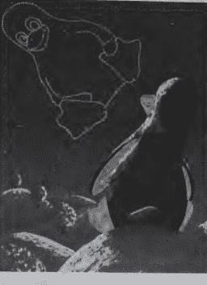

# 前言

Linux 无处不在！Linux 无处不在！在当今的计算机行业新闻中，每隔几篇报道似乎就在讲 Linux 如何涌入计算机世界的又一个利基市场——互联网服务器、网络设备、嵌入式系统、图形工作站、手机，甚至（根据近期 IBM 的一项声明）还包括手表。如今，Linux 似乎从手持设备到分布式超级计算机随处可见。

到目前为止，有一个例外打破了这一不可阻挡的趋势：普通最终用户桌面。追踪这些行业趋势的人估计，截至 2000 年底，Linux 在台式电脑市场中的份额约为 4% 到 5%——与 Macintosh 的市场份额相当，但与微软 91% 的垄断相比仍属小角色。这令人惋惜，因为 Linux 相比 Windows 具有巨大优势，首当其冲的是其价格（低廉或免费），而且它正在迅速获得更严肃的功能，比如彻底根除蓝屏死机问题。

常规观点认为，由于对“蒂莉阿姨”来说操作太难，Linux 注定只能在桌面领域扮演利基角色。但 Linux 的管理实际上比 Windows 机器更复杂的日子早已过去。在过去三年中，开源社区在简化安装和日常维护，并通过图形用户界面呈现这些方面取得了巨大进步——甚至到了这样一个地步：随着时间推移，维护 Linux 机器实际上比维护 Windows 机器容易得多，无论你是否是技术专家。

真正的问题是，大多数本可以从 Linux 中受益的普通人并不知道它有多容易使用。而这正是 Ethan Metsger 和 Kathy Miles 致力于解决的问题。通过温和的介绍和逐步的解释，他们揭开了 Linux 的神秘面纱，并建立起读者的信心。

帮助你在有生之年淘汰劣质软件！你可以利用这本书摆脱微软垄断的掠夺性控制，让计算机更多地成为令人愉快的工具，而不是恼人的麻烦。享受吧！并将此消息传播给你的朋友。

*埃里克·S·雷蒙*

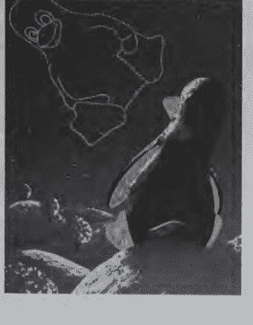

## 序言

为本书撰写介绍对我来说总是很难的。毕竟，这里有很多内容要涵盖——作者是谁？大家一直在谈论的“Linux”是什么？“开源”到底是什么？为什么我应该关心？当我思考如何撰写这篇介绍时，脑海中浮现出这些以及更多问题。理想情况下，介绍部分将回答这些问题以及其他一些问题，同时为您使用本书提供基础。

### 作者是谁？

Ethan Metsger 是俄亥俄州立大学的本科生，正在攻读计算机科学领域的理学学士学位。他使用 UNIX 已有五年，使用 Red Hat Linux 近两年。Ethan 负责撰写系统更技术性的方面——如何安装软件并将其配置成您喜欢的样子。

Kathy Miles 是宾夕法尼亚州韦斯特切斯特《每日地方新闻》的专栏作家，撰写关于各种天文兴趣元素的文章。她发表各类文章和论文已有十多年。她以各种形式使用 Linux 四年，使用 UNIX 六七年。Kathy 负责撰写关于 Linux 可以获取的应用程序。

我们在一家社区基础的互联网提供商志愿服务时相识。我们以不同身份合作了近四年，当一起写书的机会出现时，我们欣然接受了。

## 什么是 Linux？

Linux 是一个*操作系统*。操作系统是运行您的计算机并控制其各个元素行为的软件。例如，操作系统识别您可以在计算机和显示器或打印机之间传递数据，并允许计算机上的程序这样做。

如今大多数个人计算机使用由微软公司创建和维护的 Windows 操作系统。下一个竞争者是 Macintosh OS，或 MacOS，尽管它只占市场份额的一小部分。

更近一点，随着 Apple Computers 更好的营销、针对微软违反美国反垄断法行为的证据出现，以及开源社区的活动，微软经历了更多的竞争，其中很多是以 Linux 操作系统形式的。

我认识的大多数 Windows 用户对使用 Windows 感到沮丧——它的程序笨重，往往昂贵，而且经常崩溃。行业预期是，微软的每个版本都足以存在需要“第二版”或其他程序来修补系统漏洞的 bug。随着近期针对像 Microsoft Outlook 这样的 Windows 程序的电子邮件病毒，用户比以往任何时候都更意识到安全性不是 Windows 的强项。

Linux 登场了。

## 为什么选择 Linux？

有些人出于好奇开始使用 Linux。另一些人正在寻找 Windows 或 Macintosh 操作系统的替代操作系统。有些人像我从朋友那里听说它，或者在熟悉这个名称的同时


做一些计算机工作。还有一些人是通过新闻了解到它的。甚至有少数人仍然如此嫉妒比尔·盖茨，以至于希望通过转换操作系统来剥夺他财富的一小部分。

但问题依然存在：为什么？为什么是 Linux？它为何能引起如此大的轰动？或许更重要的是，我为什么应该购买或下载它？毕竟，花时间学习一个新的操作系统是很有必要的，而基于 UNIX 的操作系统通常以难用和难以理解而著称。

你购买 Linux，是因为你在寻找更好的产品，一个如果需要可以连续运行数周的操作系统；你喜欢拥有支持并且可以访问大量资源。你购买 Linux，是因为它拥有众多应用程序，这些应用程序在匹配甚至超越其商业版本方面表现出色。Linux 功能强大、功能全面且可靠。与其他许多个人计算机操作系统相比，它受病毒和外部攻击的影响较小。它在维护和支持方面都非常便宜。如果你需要帮助，总能找到。而且，关于它难以使用和理解的声誉已经过时——Linux 使用起来极其简单，Windows 和 Macintosh 操作系统的用户将几乎没有困难甚至毫无困难地适应新环境。

这只是运行 Linux 的几个优势而已。要理解它们是如何发展起来的，了解 Linux 的历史是有帮助的。历史还解释了被称为开源的现象是如何出现的。（这在很大程度上是 Linux 存在的基础。）

### Linux 的历史

我们应该给这一节加一个副标题：“简史”。Linux 的历史相对较长，其曲折程度几乎堪比美国乡间蜿蜒的小路。然而，为了理解为什么 Linux 很重要以及它如何在计算机界（现在，也在你的生活中）引起如此大的轰动，一些背景知识是必要的。

#### Linux 的前身，UNIX

Linux 是 UNIX 的一种形式，由林纳斯·托瓦兹（Linus Torvalds）创造。UNIX 已经存在了三十多年。它于 1969 年由肯·汤普森（Ken Thompson）和丹尼斯·里奇（Dennis Ritchie）在贝尔实验室创建，是多用户操作系统 Multics 的后继者。

UNIX 是一款独特的操作系统，原因有很多。首先，因为它是用 C 编程语言编写的（该语言也由汤普森和里奇开发）。所有操作系统都是用某种编程语言编写的，通常是汇编语言（尽管这一点正在改变）。编程语言的级别越低，即指令越接近计算机的机器语言，该操作系统的可移植性就越差。这意味着更难将操作系统“移植”到另一种类型的计算机上。

C 编程语言是一种高级语言，这使得 UNIX 操作系统（用 C 编程）具有极高的可移植性。任何拥有 C 编译器的计算机都可以获取操作系统的源代码并将其编译以便在自己的计算机上使用。这通常是更新 UNIX 操作系统核心组件（即 *内核*）的方法。升级你当前版本的 UNIX（或者更常见的情况，Linux）到最新版本的过程通常涉及重新编译内核。

用 C 编程语言编写的事实也意味着，与用汇编或机器语言编写相比，它更容易被修改。高级编程语言的定义是它更容易被程序员理解；它比机器代码处于“更高级”的层面。低级语言更难理解。UNIX 及其克隆系统（如 Linux）使用高级编程语言编写这一事实，对于开源倡议的发展以及 Linux 本身的发展至关重要。

继 UNIX 出色的可移植性之后，是其对“程序应只执行一项任务”原则的坚持：如果需要执行多项任务，就将它们串联起来。这是通过使用 Shell 脚本或管道（参见第八章）来实现的。这种编码原则非常有益，因为它使代码相对较小且不复杂，从而减少了错误和其他故障。因此，UNIX 是一个非常稳定的操作系统，问题很少。

由于 UNIX 是一个多用户操作系统，它被用于各种用途，其中许多需要低维护的系统。（你是否想过，如果你的互联网服务提供商持续需要维护会发生什么？如果它没有特定原因突然冻结呢？你的电话服务很可能依赖于一系列运行 UNIX 或 UNIX 克隆系统的计算机。操作系统显然足够可靠，以保持你的电话正常运行。）UNIX 的设计已被证明是相当可靠的。

### 那么 UNIX 为什么没有普及？

实际上，它确实普及了。自三十多年前身临其近以来，UNIX 在许多领域（包括商业和教育）一直是一股主要力量。然而，由于 UNIX 以难以使用和理解为著，它对家庭用户来说非常不实用。

有人曾说，UNIX 程序员太懒，以至于不愿意创建超过四个字母的命令，尽管事实是内存限制使他们无法创建过于复杂的命令名称。这就是为什么现在的命令与过去的命令之间存在如此大的差异。比较“ls”——一个列出文件的命令——和“traceroute”——一个打印从一台主机到另一台主机路由的命令。尽管如此，当时的命令仍然难以理解。

除了这个问题，当个人计算成为一股力量时，UNIX 对于单个用户来说太贵了。软件供应商提高了价格，从而降低了消费需求。此外，源代码曾经在大学之间公开分发，但现在对公众关闭了。这些力量共同推高了价格。

结合晦涩的命令和不太理想的标签价格，你可以看到为什么 UNIX 没有在与个人计算界的热衷中流行起来，尽管它有许多优势。

这为微软在家庭计算市场打开了一扇门。首先是 MS-DOS，它基本上是一个带有少数不同文件系统约定的 UNIX 模仿者。MS-DOS（“微软磁盘操作系统”）和 UNIX 之间的主要区别在于，UNIX 是为多用户设计的，而 MS-DOS 不是。UNIX 往往比 MS-DOS 更安全得多，但多用户系统和使用 UNIX 相关的成本给了微软优势。MS-DOS 后来成为 Windows 操作系统的核心。直到今天，它仍以某种形式如此。除此之外，当时的 UNIX 并非旨在用于个人计算环境——它更具商业导向。

在此时，应该谈谈 Macintosh 和 Apple 计算机。我们正在逐步推进微软最终接管家庭计算行业。我们已经考虑了 UNIX 未能进入家庭的失败。但微软曾经（并且尽管其能力有所削弱，现在仍有）竞争者，即 Apple 计算机。

在“美好旧时光”里，Apple 计算机往往优于 AT 或 XT 克隆机。不幸的是，这也意味着它们更贵。俗话说，金钱驱动市场，这一情况也不例外。由于使用 Apple 或 Macintosh 计算机涉及的价格标签，Apple 无法在普通用户中站稳脚跟。

当 Macintosh 操作系统（MacOS）推出时，它带来了可用性的新水平。这是史蒂夫·乔布斯对计算机行业的贡献。用户可以使用窗口系统和鼠标进行交互。MacOS 赋予了“用户友好”一词新的含义。然而在此期间，微软注意到了 Macintosh 操作系统的成就，并为自己开发了类似功能。这最终以 Windows 的形式出现，Windows 迅速跃居操作系统竞赛的榜首，至少在个人计算环境中是这样。这主要归功于市场营销。比尔·盖茨在销售其操作系统方面做得比史蒂夫·乔布斯（苹果公司首席执行官）更好，尽管 Windows 缺乏原创性。

随着 UNIX 继续主导计算世界的服务器和大型机方面，微软开始开发 Windows NT 等产品来与 UNIX 竞争。虽然 NT 取得了更多进展，并在服务器市场中占据重要位置，但 UNIX 仍然运行着世界上大多数涉及互联网和其他服务器相关活动的计算机。

只有最近，随着对微软垄断地位的关注增加以及对更可靠和更便宜的个人计算设备的需求，UNIX 才开始在个人计算领域迈出大步。这是随着开源倡议和 Linux 的出现而发生的。

关于各种操作系统的讨论省略了许多细节。我试图在这里确立当前操作系统格局形成的原因。还有其他尝试闯入商业操作系统业务的尝试，例如 OS/2 和 OS/2 Warp、BeOS 以及其他。然而，今天的计算世界基本上运行在三种操作系统上：Microsoft Windows、MacOS 和 UNIX（及其衍生版本）。

### Linux 的发展

Linux 的根源来自一个名为 MINIX 的操作系统，由一位名叫安德鲁·塔嫩鲍姆（Andrew Tanenbaum）的荷兰教授开发。塔嫩鲍姆开发 MINIX 主要是为需要了解内部工作机制的大学生


于操作系统。到了那时，UNIX 已不再是一种大学里的新奇事物，学生们开始被拒绝访问他们的先行者曾享有的 UNIX 系统。

安德鲁·坦嫩鲍姆（Andrew Tannenbaum）的 MINIX 让人们有机会学习编码和理解操作系统。为此，所有的一万两千行源代码都提供给了那些购买了他的《*操作系统*》一书的读者。拥有源代码使得计算机科学学生、程序员，甚至普通计算机用户都能理解并摆弄运行其计算机的程序。

其中一人就是赫尔辛基大学的林纳斯·托瓦兹（Linus Torvalds）。他喜欢测试系统，寻找其极限并进一步施压，为此他需要一个专业的操作系统——一个像 UNIX 那样的系统——来实现这一点。不幸的是，MINIX 与其说是一个专业的操作系统，不如说是供学生使用的教学工具。而古诺计划（GNU Project，由理查德·斯托曼领导）当时才刚刚起步——其操作系统的开发工作至少还要几年才能完成。

因此，林纳斯决定创建自己的操作系统。就这样，Linux 诞生了。它经历了几次曲折才趋于稳定，而到那时，古诺计划已经制定了古诺通用公共许可证（GPL），其运作方式与开源模式非常相似。林纳斯以 GPL 发布了 Linux，对其的支持度随后呈天文数字般增长。

### 什么是开源？

由于开源概念在很大程度上促成了 UNIX 向个人计算机平台的演变，因此理解它至关重要——这就是你阅读本书的原因。

开源是指根据开源许可条款编写的软件，该许可条款为以开源模式发布软件提供了若干规定。这被称为开源定义（OSD）。精确定义可以在开源促进会（Open Source Initiative）的网站上找到，该网址列于书末的资源列表中。

此处应包含其中的几条规定，以便你理解开源促进会（OSI）的重要性。

OSD 的第一个要求是，每个开源软件包必须可以自由再分发。这并不意味着你不可以销售你的软件，而是你不得限制任何第三方“在包含来自多个不同来源的程序的整体软件分发中，作为组件出售或赠送软件”（OSI 网站）。

这一要求的作用是将“长期收益”置于“短期销售收入”之上。通过允许自由再分发，人们更有可能专注于软件的内容，而不仅仅是他们能从其中获得多少金钱。

第二个要求是，你还必须将源代码与作为开源发布的任何程序一起分发。其背后的理由是，没有修改，程序就无法演进。开源模式依赖于对软件的外部修改来提供持续改进。这意味着全球成千上万的人可以修改同一段软件，修复各种错误或改进源代码中提供的功能。如果没有源代码，这是不可能的，软件的发展将停滞不前。OSI 网站对此是这样说的：“既然我们的目的是让演进变得容易，我们就要求让修改变得容易。”

开源定义中还有其他一些要求（总共有九条），但这两条足以探索开源促进会一些最重要的方面。开源软件背后的概念是，每段软件不仅应该是发明者的个人项目，也应该是供其他人使用的项目。如果软件不能被自由修改或分发，这一概念就会立即行不通，软件为了共同利益和特定利益的发展也将变得不可能。

与商业供应商封闭环境中不频繁且往往昂贵的升级相比，开源模式允许产品几乎持续不断地演进。此外，开源软件通常比其同类软件更可靠，编程也更好。这似乎有悖常理，但这是老话“一分价钱一分货”不再适用的一个领域。

当程序在开源模式下开发时，它经常以不适合使用的形式发布，这意味着它存在错误或不太稳定。然而，如果该程序引起了足够的兴趣，其他程序员会接受创建者作为设计负责人，并开始致力于改进。如果创建者不太愿意继续该项目，通常会有其他人请求权限接管该项目。埃里克·雷蒙（Eric Raymond）在处理 Fetchmail 方面的工作就是一个很好的例子。

另一方面，如果一个程序被认为没有太大用处，创建者就只能自生自灭。如果他看不到继续工作的必要性，这个充满 bug 的程序将被弃用，除非有人愿意认领它。

通过这种方法，类似于达尔文的自然选择，那些用途不多的程序使用率也低，最终退出流通。可以说它们灭绝了。具有良好潜力的程序会被开源社区拾起，不断修订和改进，直到无法再改进为止。这就是软件演化的过程。

软件演化解释了程序迅速变得可用的倾向。在开源模式下，程序开发迅速，bug 很快被淘汰。然而，封闭模式不允许外部帮助，因此从事项目工作的程序员必须完全独自调试代码。这需要更长的时间，导致软件更新次数更少且更昂贵。此外，我们也不一定能够衡量程序的实用性。在商业程序发布之前，通常会交给一组被称为“测试员”的特定人员，他们寻找 bug 并报告问题，以便程序员修复问题。在开源模式下，一旦有相对稳定的版本可用，整个开源社区实际上都可以对该程序进行 beta 测试；这会产生更多的 bug 报告，并以极低的成本甚至零成本实现更快的修复。

另一方面，在商业环境中，一个程序可能轻松花费高达一百美元，而实际上并不太有用。开源模式允许糟糕的想法迅速消亡，给消费者带来的成本很小。

埃里克·雷蒙在一篇题为《大教堂与集市》（1996）的文章中详细描述了他在开源社区的一些经历；请查看书末的资源列表以找到他的网页。这是对开源模式实验的一个非常详细的描述，结果促使雷蒙（在他人帮助下）成为开源促进事业的先驱。那个网页也可以在资源列表中找到。

## 开源的优势是什么？

我们在上面简要提到了至少一个优势：使用开源模式发布的程序通常质量更高，更新速度比商业发布的程序更快。这些程序中的许多也是免费发布的，因此消费者在两方面受益。首先，在现金流方面；其次，在更高质量的产品方面。

现在你正在运行红帽 Linux，你直接参与了开源世界。你可以直接下载它，尽管一两张信息光盘可能需要稍微多一点时间。如果你从商店购买了盒装的红帽 Linux，你为它支付了一些钱；这笔钱大部分流向了你的技术支持费用。如果你做过比价，你会发现红帽 Linux 的成本仍然远低于微软 Windows 等竞争对手的产品。而且，正如你在这本书中会了解到的，红帽 Linux 是一个比 Windows 更稳定、要求更低的操作系统。（而且它的大部分程序都可以免费下载。这是一个非常有吸引力的价格标签。）

### 本书的目的

这就带我们来到了本书的目的。我们想首先向你提供一份关于安装和设置红帽 Linux 基本功能的新用户指南。你将完成安装过程，设置 GNOME 和部分硬件组件，学习你的计算机是如何工作的，以及现在你运行 Linux 后能做什么。然后，你将看到几章详细的内容，介绍你可以安装和使用的应用程序，如 GIMP、Star Office、WordPerfect for Linux（以及整套工具）、各种游戏和其他娱乐内容、互联网应用程序以及更多。

本书将帮助你理解 Linux 系统的基础知识，并提供大量帮助，让你开始构建你的系统。许多用户对深入 Linux 感到紧张，因为他们花了太多时间使用 Windows 或 MacOS，不知道他们可以无缝地完成转换。这就是我们登场的地方。通过遵循书中的指南，你很快就能让你的电脑运行起来，导入你的文件和其他以另一种格式编写和存储的文档时几乎不会遇到任何麻烦。

我想，本书的主要卖点是你不需要为你系统能获取的每个不同应用程序都买书。当你把获取 GIMP、Star Office、WordPerfect 以及你肯定会想在系统上安装的其他应用程序书籍的成本加起来时，这些成本可能会让 Linux 相比其竞争对手显得吸引力较低。通过纯-

追求*《日常Linux》*，你为安装指南以及你日常常用应用程序的操作手册付了费。

### 本书的约定

在本书中，我们将参考多种不同的程序和操作系统。例如，X 窗口系统（X-Window System）经常出现。它有时被称为 X-Windows。但是，随 Red Hat Linux 附带的版本被称为 XFree86。每当我们提到 X 窗口系统或 X-Windows 时，你应该假设我们在谈论 XFree86，这是一个免费版本。

当我们谈论 Microsoft Windows 时，我们通常指的是目前流行的三个版本中更常见的两个——Windows 95 和 Windows 98。Windows 2000 在大多数个人计算机上尚未得到使用，而 Windows NT 主要用于服务器，这很可能不是我们用户群所运行的环境。

一 KB（千字节）由 1024 个字节组成；一 MB（兆字节）由 1024 个 KB 组成；一 GB（吉字节）由 1024 个 MB 组成。它们各自的缩写是 KB、MB 和 GB。

在谈论计算机的主存储器时，我们指的是它的随机存取存储器（RAM），而不是其硬盘空间。

你还需要意识到，当引用中使用了引号来指代你应该键入的命令或项目时，除非另有说明，否则你不应该使用引号。例如，如果你被要求命名一个文件“myfile.txt”，同时考虑如何创建文本文件，你不应该包含引号。在大多数情况下，命令是以 Courier 字体输入，这很容易将它们与本书其余部分区分开来，后者是以 Times 字体输入的。然而，如果存在混淆，你应该记住，如果要键入的内容周围有引号，你不应该使用引号。

### 本书涵盖的版本

在本书中，我们介绍 Red Hat Linux 版本 6.2。Linux 有许多不同的发行版，其中包括 Debian、Caldera、Slackware 和 SUSE。

由于 Linux 变化迅速，本书的撰写努力使其适用于 Red Hat 从 6.0 开始并逐步升级的许多发行版。

### 为什么书中没有附带 Linux CD？

许多人在查找有关 Linux 的书籍时，首先寻找的就是操作系统的实际副本。我的第一本 Linux 书附带了一张 CD，我在撰写本书期间调查的许多书籍也附带了 CD。你可能已经注意到，这本书中并没有附带任何形式的 CD。

这是出于许多原因。主要原因是，附带 CD 会使书籍过时。许多关于安装和设置的说明在性质上是通用的，在 Red Hat 7.0（及更高版本）发布时不会发生太大变化。我们预计在本作品出版之前会有操作系统的重大发布——如果我们包含版本 6.2，我们将提供一个过时的版本，你以后可能想要替换它。此外，在书中附带 CD 的成本将高于你在商店或网站上购买的成本。这样，我们将节省下来的费用传递给你，并让你有机会从一个更新的 Linux 版本开始。

你们中有些人可能仍然不相信，尽管我费了一番功夫指出开源开发需要快速发布。开源的一个主要亮点是，新产品由成千上万的人*每天*开发。这意味着，而不是每隔一两年升级你的操作系统或其应用程序，你可以每周都这样做。既然有机会获得更新版本，你应该这样做——它将支持更多设备，并包含使其更加用户友好的改进。

### 我可以从哪里获得它？

归根结底，你很可能只是想获得操作系统。Linux 本身是免费的。然而，可能会涉及一些费用。如果你将其作为商业产品购买，例如 Red Hat 的盒装套装，你需要为包装、手册和你获得的技术支持付费。但是，如果你只是像大多数人一样想要满足好奇心，你可以购买一个简化的套餐，费用最高为十美元。

Red Hat 可以在大多数电脑商店买到。你所在地区的商场肯定有售。如果你喜欢在线购物，你可以使用诸如 linuxcentral.com 或 linuxmall.com 之类的网站。我们的网站 www.everydaylinux.com 列出了各种供应商，如果你想进一步调查这个问题可以参考。

### 资源、提示等

我们在撰写本书时参考了多种资源。为了感谢那些做出贡献的人，并为你提供一个如果需要额外帮助时可以查找的地方（将所有内容都写进一本你*真正会读*的书几乎是不可能的），你可以查看本书末尾的资源列表。你会在那里找到实际上有用的网页（而不是互联网上一些不太可靠的网站）、FTP 站点以及其他在需要时对你有帮助的信息。

### 本书的布局

本书分为两个大部分、一个资源列表和一个索引。

第一部分描述了如何安装和使用 Red Hat Linux 系统的各个元素。你将了解如何更新或升级你的程序和系统，添加各种硬件元素，以及如何连接到 Internet。你还将阅读如何进行基本的系统维护和管理工作，以及如何利用命令行界面快速高效地执行各种任务。

第二部分将指导你使用来自不同领域的许多不同应用程序。你将找到专门讨论生产力套件、图形处理、Internet 浏览和电子邮件、游戏、编辑器和其他内容的部分。设置好 Linux 后，这一部分将赋予你相当程度的灵活性。

资源列表将指引你查阅各种帮助文件、常见问题解答列表、网页、HOWTO 指南和其他资源。索引将为你提供在书中查找主题的便捷方式。这些类别尽可能详细地划分，以提供易用性。

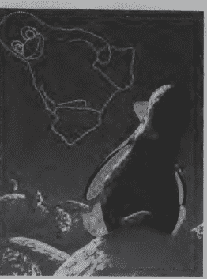

### 作者寄语

毫无疑问，Linux 改变了我的人生轨迹。在发现大多数 Linux 书籍（当时）都是极客写给极客的之前，我从未想过要写一本 Linux 书。编译内核可能会让某些人感到温暖，但我只想做的就是我通常用台式机做的那些事：写文档、编辑图片、玩几个游戏等等。我真的不关心代码、内核和核心转储（结果发现这些相当无聊）这类事情。将我一脚推入 Linux 世界的是 Chuck Peters，这并不是件容易的事。我将其难度比作完好无损地举起泰坦尼克号。Chuck 多次脸色苍白，并养成了揉太阳穴的习惯，仿佛他正遭受世上最剧烈的偏头痛。一旦我学会了 Linux，我就爱上了它。一旦我爱上了它，我就想写一本书，让其他人的转换过程更容易，但没有 Chuck 无尽的耐心，这本书根本不会存在。

我开始真正关心开源，以及其他人使用 Linux，这要归功于 Eric Raymond。我由埃里克共同创立的 frenetix 组织的董事会成员（ccf.org）。最初，Eric 在董事会会议上宣传 Linux 和开源。没有人听。埃里克并不气馁，继续宣传，最终我不得不承认这很有道理，并开始倾听。虽然我从未向埃里克承认过，但我钦佩他坚持自己信念的勇气。

写一本书本身就是一种体验，有几位特别的朋友我需要对他们表达感谢，因为他们在我创作本书的过程中忍受了我。我已经提到了 Chuck，他在写作低谷来临时承受了我大部分挫折，他没有大喊大叫，而是设法让我走出了困境。

乔治·里德（George Reed）对我的影响和鼓励无法用语言充分表达，我将其视为我从大学时代起的导师和支持者。虽然我一直对写作感兴趣，但乔治推着我往正确的方向走，并一直在我身边支持我。

非常感谢 Betty、Muse、Paul、Anne 以及其他在 ceil.org 的志愿者，他们让组织事务顺利进行，并提供了善意的话语和支持。非常感谢我的暹罗猫伙伴 Rosa，与我相伴十九年。我会想念你坐在我的键盘上，创造新的 bash 命令，并提醒我该卷起来睡觉的时间了。你永远在我心里。感谢 Keith 医生深夜打来电话提醒补药，从未抱怨过哪怕一次（甚至很多）。感谢 Will 及其鼓励的电话——一路从 QE2 号邮轮打来的。还有 Ewan，他到现在还没搞清楚内核是什么，或者一旦得到一个内核该拿它怎么办。最后，但绝非最不重要的，感谢我的母亲，她正在从中风中恢复，并教会了我勇气和奉献的真正含义。

Kathy A. Miles
2000 年 10 月


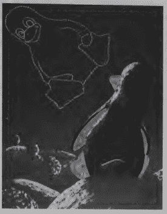

## 安装前须知

在本章中，我们要确保您的计算机（以及您自己）已准备好进行 Red Hat Linux 的安装。

### 系统要求

与其他任何程序或操作系统一样，Red Hat Linux 安装有一些系统要求。在安装 Red Hat 之前，请确保您的计算机满足以下最低系统要求：

- 386 或更高级别的 Intel 处理器
- 4 MB 内存
- 200 MB 硬盘空间

这些要求将阻止您使用 X-Window 系统（有时称为 X-Windows）或 GNOME（Red Hat Linux 的默认桌面管理器）。由于本书涵盖了 GNOME 和 X-Window 系统的使用方法，因此强烈建议您使用以下规格的系统运行 Red Hat Linux：

- Pentium 级别的处理器
- 32–64 MB 内存
- 5 GB 硬盘空间

一台这样的计算机几乎可以完成您使用 Linux 希望实现的任何操作。请记住，像 GIMP 这样的图形应用程序比普通应用程序消耗更多的内存。

您也可以使用不同类型的处理器，例如 American Micro Devices (AMD) 提供的处理器，但这些处理器偶尔会出现兼容性问题。Cyrix 处理器与 Red Hat Linux 的兼容性最差。我个人在我的 Linux 机器上使用 AMD K6-2 处理器，它从未给我带来麻烦。这并不保证如果您使用相同的芯片就不会遇到问题，但这表明 AMD K6-2 处理器与 Linux 具有良好兼容性。

#### 系统用途

您还应该明确希望如何使用该系统，因为这可能会改变您对机器硬件规格（系统要求）的需求。例如，如果您是一名图形艺术家并希望利用 GIMP，那么与仅仅进行常规数据录入或文字处理相比，您将需要更多的内存。图形操作通常占用大量内存，特别是在使用分层技术的程序（如 PhotoShop 或 GIMP）中。

Linux 非常适合家庭和办公使用，因为它支持各种生产力应用程序。WordPerfect Office 的制造商 Corel 已经开发并发布了针对 Linux 的完整办公工具套件。其中包括 WordPerfect、Quattro Pro、Presentations、Paradox 和 CorelCENTRAL。Corel 还开发了一个 Linux 操作系统的版本。还有其他可用的生产力程序，例如 Star Office，这是一个免费分发的类似 Microsoft Office 的程序套件。Star Office 由 Sun Microsystems 维护。

Linux 提供的生产工具与其 Microsoft 对应产品兼容，因此，如果您担心丢失数据，请不必担心。您将能够打开在 Microsoft Word、Excel、PowerPoint 及其他软件中创建的文档。Linux 还预装了如 GNUMerice（一种 GNU 电子表格程序）等程序，这些程序可以读取 Microsoft Excel 文档中的数据。

局域网（LAN）用户会发现 Linux 也有各种网络应用程序，因此您可以与其他计算机无缝交互——无论它们运行的是 UNIX（或其克隆系统）还是 Windows。

对在互联网上共享文件托管网页感兴趣的用户也会发现，除了允许用户使用利用文件传输协议（FTP）或 telnet 程序进行连接的标准守护进程（发音为“demon”）之外，Linux 还提供了 Web 服务器和文件服务器。

Linux 也非常适合需要安全多用户系统的个人。虽然大多数操作系统都允许拥有多个具有自己配置文件（一组决定计算机运行方式和外观的偏好和设置）的用户，但很少有操作系统像 Linux 那样安全。人们只需点击取消按钮就能访问您的 Windows 机器的时代已经过去。使用 Linux 是确保除系统用户外没有人能访问您的计算机的好方法。

总之，Linux 提供了与您 Windows 机器同等的数据处理能力，同时提供了一个极其稳定的环境。如果您发现自己对 Linux 的上述任何功能感兴趣，那么您应该安装它并看看它能带您走到哪里！

### 备份

当然，安装过程对某些人来说可能是一段煎熬的经历，尤其是那些计算机使用经验较少且不确定 Linux 是否适合他们的人。缓解您担忧的最好方法之一是对计算机进行完整的系统备份。

有几种方法可以做到这一点，如果您不想处理完整备份，还有几种替代方案。

##### 磁带机

如果您已经拥有一台磁带备份机，那么将文件备份到磁带上会比较容易。如果没有，您可能需要考虑购买一台。如今的硬盘容量如此之大，您实际上无法使用 Zip 磁盘甚至其更大的 cousin Jazx 磁盘等较小的介质来备份所有文件。磁带机仍然是系统备份的流行选择，因为磁带的容量可达 20 GB 或更大。

如果您希望购买一台磁带机来备份系统（无论您是否计划安装新的操作系统，这通常都是一个好主意），有几种驱动器类型很受欢迎。最流行的可能是 Colorado 磁带备份机。它是一个非常可靠的系统。其他人更喜欢 Iomega 磁带备份驱动器。（Iomega 是创建 Zip 和 Jazz 驱动器的公司。）

磁带机通常附带软件，允许您与驱动器本身进行交互。您还必须购买一盘磁带（因此被称为“磁带机”）来存储数据。这些磁带与软盘类似，因为它们都存储数据，但它们的相似之处大致就到此为止了。

##### DAT 驱动器

DAT 驱动器与磁带机类似，因为它们使用磁带存储数据。然而，DAT 驱动器不需要使用软件来与之交互。它作为一个常规驱动器工作，您可以使用 Windows Explorer 等程序访问它。

DAT 驱动器的另一个吸引人的特点是其介质（磁带）相对便宜，并且可以存储大量数据。

缺点是 DAT 驱动器相当昂贵，因此除非您打算进行大量备份或使用大量磁带，否则它们并不是特别实用。这一价格通常使 DAT 驱动器仅适用于依赖增量备份（需要大量介质）进行数据存储的企业。

##### 选择性备份

如果您认为只想备份部分文件，建议您购买一台 Zip 驱动器（100 MB 或 250 MB）或一台 Jazz 驱动器（1 GB）。这些是相对较小的数据存储设备，但如果您只需要存储少量数据，它们非常有用。这两款驱动器均由 Iomega 制造。

如果您想要备份驱动器的主要部分，这样做并不具有成本效益。这两款驱动器的价格与典型的磁带备份驱动器大致相同，虽然磁盘的价格更便宜，但与使用磁带备份系统相比，您需要使用更多的磁盘才能完成工作。

##### 潜在问题

备份系统通常并不复杂。您购买的任何东西都会附带一本说明书（如果其他方法都失败了，您可能需要阅读它），以及可能还有一张引导您完成备份过程的说明单。

通常，大多数用户遇到的问题是在备份*之后*。如果您安装 Red Hat Linux 并决定“哎呀，我想这对我不太适合”，尽管这种可能性很小，但您将不得不从备份中恢复数据。为此，您必须首先重新安装您的原始操作系统*然后*安装磁带备份软件。确保您拥有操作系统和备份软件的副本。

您的计算机可能还附带了所谓的恢复磁盘或 CD，它允许您将系统恢复到最初的出厂状态。这些磁盘通常包含操作系统以及您首次购买计算机时使用的其他任何软件和驱动程序。如有必要，您然后可以使用磁带备份来恢复您后来购买的软件。

##### 备份软件的替代方案

如果备份软件看起来太麻烦，您可能希望利用一些替代方案。最常用的两个是*双启动*和可移动硬盘。

### 双启动

虽然我们不想在这里过多地详细讨论这个主题，但您应该了解什么是双启动以及为什么您可能会想使用它。双启动是一种过程，允许您同时运行多个操作系统——例如 Windows98 和 Red Hat Linux。

希望或需要与 Red Hat Linux 同时运行 Windows（或其他操作系统）的用户应该研究双启动。双启动需要两个物理硬盘，或者将一个硬盘分区成两个不同的部分。像 Linux Loader (LILO) 或 Norton Commander 这样的程序将允许您在启动计算机时选择要启动的硬盘或分区。


#### 可拆卸硬盘

另一个非常可行的选项是使用可拆卸硬盘。这通过使用一个安装在电脑驱动器位内的设备来实现。该设备配有一个可拆卸组件，用于内部固定硬盘。当你要使用 Linux 时，只需弹出 Windows 硬盘（按下一个按钮或解锁机箱），然后插入 Linux 硬盘即可。

使用可拆卸硬盘的缺点是你很难在两个硬盘之间轻松传输数据。Linux 可以从 Windows 硬盘中读取和写入数据（或者向其写入），因此如果你使用可拆卸硬盘，将无法从一个硬盘向另一个硬盘抓取数据。

这种硬盘的优点在于它们很容易插入和取出，并且你不必担心 LILO 是否会造成麻烦（它确实可能会造成麻烦）。

#### 单引导

如果你确信以后不需要再运行 Windows，你可以执行所谓的*单引导*。单引导只运行一个操作系统，但你可以使用两个硬盘。你可以用 Linux 读取和写入你的 Windows 磁盘，这非常方便。

但备份就不那么方便了。因此，你可以简单地再买一块硬盘，将其放在主盘位置，并将当前的 Windows 硬盘放在从盘位置。然后，你可以安装 Linux 并将其作为唯一的操作系统使用，同时仍然可以访问你的 Windows 硬盘。

#### 兼容性

安装 Linux 时，你可能会问的一个问题是，你所有的设备——打印机、鼠标、显示器、显卡、处理器等等——是否都兼容 Linux 操作系统。

由于 Linux 不像 Windows 或 MacOS 那样被广泛使用，它有时会遇到硬件兼容性问题。例如，目前 Linux 不支持使用通用串行总线（USB）设备或 DVD 驱动器（尽管你可能能够把你的 DVD 驱动器用作 CD-ROM）。红帽（Red Hat）硬件兼容性列表指出，“几乎任何声称支持 USB 的设备都有正在开发的驱动程序，但在 6.2 版本的内核默认情况下没有启用 USB 支持，因此你的 USB 设备可能在未来才能工作。通常你可以找到适配器，让你能在其他端口使用 USB 设备。少数设备可能需要一些特殊的调整才能正常工作。大多数专为 Windows 制造的打印机将无法工作。”

通常，最好是在系统中使用知名品牌制造商提供的大众化设备。红帽（Red Hat）网站上有一份兼容设备列表。兼容性分为三个部分，称为*层级*。第一层兼容性非常高，而第三层意味着设备可能需要一些引导（调试）才能在系统中工作。

如果你的设备不在列表上，你可以认为它与 Linux 不兼容。然而，有时设备会被涵盖在非常通用的名称下，因为品牌特定的设备列表将会长得离谱。例如，列出所有 CD-ROM 驱动器的制造商及其型号将占据许多页。相反，你会看到通用的术语“ATAPI 或 SCSI CD-ROM 驱动器”。

创新和补丁几乎每天都在增加，因此你可能能在互联网上找到允许你使用某设备的程序。不幸的是，使用这些程序的过程并不总是那么简单。如果你是更熟悉命令行界面（如 MS-DOS）的熟练计算机用户，UNIX 的 shell 环境可能会更熟悉，因此安装补丁或其他软件可能更容易。

拥有这些补丁的网站列在本书末尾。其中最受欢迎的一个叫做 Sourceforge，我们可能会在本书其余部分多次提到它。

此外，*兼容性*是贯穿全书讨论的一个问题。当我们讨论系统升级和安装新外设（位于计算机外部的设备的另一种称呼）时，我会花一些时间讨论你应该购买哪些设备以及如何安装它们。

## 是时候下定决心了

别担心。安装过程并不复杂，我们将一起走完这些步骤。这将占用你大约半小时到一小时的时间。之后，你会更熟悉 X 窗口系统（X-Window System）和 GNU 对象建模环境（GNU Object Modeling Environment，简称 GNOME）。

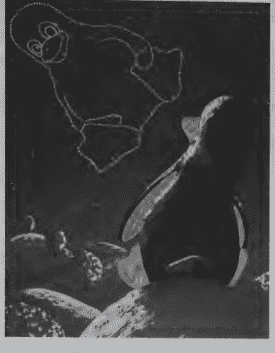

# 第 2 章
## 安装

你准备好安装 Red Hat Linux 了。在我们进行安装过程时，你将熟悉 Linux 操作系统的几个方面，这将帮助你适应配置 GNOME 以及处理文件或维护系统。

你会发现安装程序使用了一些你可能不习惯的惯例（当然，如果你对计算机还很陌生，可能什么惯例都不习惯）。在进行安装时，我试图详细解释这些惯例，以便你可以自己做出一些关于安装的决定。（请不要惊呼，这真的不是件难事。）最重要的是你要明白，第一次总是最漫长、最困难的，而你越熟悉安装过程，它就越容易。

第一次安装可能需要四十五分钟到一个小时十五分钟。你参与的大部分时间将花在分区上；安装的大部分时间实际上用于安装操作系统。你会发现，安装 Windows 或类似操作系统一样容易。

本章采用逐步安装的方法进行组织，并附带一些评论，以帮助你做出决定。在本章末尾，提供了一份非常基础的逐步操作指南，以防你实在不感兴趣阅读整章。但请记住，如果你没有花时间去阅读第一章安装的相关章节，你以后在某个时刻会不得不回头查阅它。

### 启动安装程序

你首先要考虑的是是否能从 CD-ROM 启动。为了简化起见，我假设安装软件在一张 CD 上。如果你是从商店购买 Red Hat Linux 或从朋友那里借来的，它很可能是在一张 CD 上。Linux 不在软盘上提供，但它可能位于你的硬盘上。（它位于硬盘上的唯一原因可能是你从互联网下载了它。除非你有极快的互联网连接，否则这种情况可能性极低，因此我们将坚持使用 CD-ROM 安装。）

CD 中包含启动计算机并将 Red Hat 加载到机器所需的所有必要信息。然而，如果你无法从 CD-ROM 启动，你就需要制作一张软盘。如果你可以从 CD-ROM 启动，但当前未启用该选项，你需要联系你的计算机供应商或制造商，询问如何启用它。你的计算机手册中可能也包含此信息。

#### 制作启动盘

在制作这张启动盘时，我假设你当前正在运行某个版本的 Windows。如果你正在运行 MacOS 或类似系统，这个过程会略有不同。

你应该将一张软盘插入软驱。如果它尚未格式化，请打开 Windows 资源管理器进行格式化。在左侧窗口框中，你会注意到一个可用文件夹的列表。在这个列表的最顶部，你应该能看到驱动器列表。确保软盘已插入驱动器，然后右键单击标记为“3½ 软盘”的驱动器，并左单击标记为“格式化”的选项。选择完整格式化，然后点击标记为“开始”的按钮。当格式化完成后，你应该将注意力转向你的 CD-ROM 驱动器。

双击 CD-ROM 驱动器的图标（它位于硬盘列表下方）。在屏幕右侧，将出现一个新的文件和文件夹列表。双击名为“images”的文件夹。在这个文件夹中有一个名为“boot.img”的文件。将它从该文件夹拖动到你的软盘驱动器。这将把文件复制到你的驱动器中。

当此过程完成后，让磁盘保持在驱动器中。点击“开始”按钮，然后点击“关闭”。当出现选项列表时，点击“重新启动”，然后点击“确定”。

#### 初始屏幕

一旦你的计算机启动完成（无论是通过 CD 还是软盘），你会看到一个屏幕，询问你希望如何安装 Red Hat Linux 6.2。有几种模式，但你想使用的那个是图形界面。为此，只需按下回车键即可。

使用图形安装的主要优势是你将能够使用鼠标。在文本安装中这是不可能的。如果由于某种原因，你的显示器无法配合图形安装工作，请输入“text”并按下回车键。

文本安装和图形安装基本上是一样的，尽管穿越两者的导航原理略有不同。

#### 在安装过程中导航

在本章期间，我假设你使用的是图形安装。然而，为了方便起见，我提供了图形环境和文本界面的导航信息。

##### 图形界面

在图形环境中的导航真的非常简单。就是点击和点击，点击和点击。下一步按钮与你在典型的 Windows 程序安装中看到的是一样的。要填写任何字段，你只需点击它们，然后输入所需的信息。


如果您实在不喜欢计算机鼠标，或者喜欢把流程变得比实际所需更复杂，您也可以使用下面基于文本的界面导航说明。

#### 文本界面

如果您正在运行文本安装程序，您可能完全需要借助键盘来导航整个过程。这似乎相当不便。确实如此。这就是我们推荐使用图形安装界面的原因。

要向下移动到其他选项，请按下 Tab 键。如果您想向上回退，请同时按下 Alt（或 Meta）键和 Tab 键。使用 Enter 键选择选项（例如您要安装分区在哪块硬盘上）并点击屏幕底部的按钮。

您还会注意到屏幕的最后一行有一些 F 键选项，如 F1、F5、F12 等。您也可以使用它们进行导航。

#### 初始配置

您将要设置的第一组配置选项涉及基本设置，例如您使用的语言、使用的键盘以及连接到系统的鼠标类型。

前两项比较简单。默认设置可能就能正常工作。当您选择键盘时，您可以微调一些设置，但这并非必须。屏幕侧边的帮助对话框将帮助您决定应该使用哪种键盘。大多数现代键盘都不配备造字键（即无法直接从键盘创建国际字符）。

然而，鼠标是一个稍微复杂的问题。Linux 是 UNIX 的衍生系统，能很好地利用三键鼠标。如果您没有三键鼠标，可以选择模拟三键鼠标。为了利用“第三个按钮”，您必须同时按下鼠标右键和左键。

另一个支持度参差不齐的流行鼠标功能是滚轮。大多数现代鼠标上的滚轮允许您方便地滚动文档或万维网上的文本页面。遗憾的是，Linux 本身并不配备对鼠标滚轮的支持；不过，各种应用程序确实支持。

在撰写本文时，Linux 对 USB 设备的支持也不尽如人意。因此，如果您使用的是 USB 鼠标，您可能应该购买一个 USB 转 PS/2 适配器。它们相对便宜，当地的电脑商店应该都有售。目前大多数 USB 设备的驱动程序正在编写中，但其中几乎没有任何一个被包含在 Red Hat Linux 6.2 发行版中。

#### 系统安装程序

安装过程中最复杂——也是时间最长——的部分已经到来。这部分有很多步骤，所以请保持专注。（如果您的输入不受影响，手边备点吃的、喝的或读物会更容易些。）

##### 安装类型

您需要做出的第一个重大决定是想要使用哪种安装类型，*或类别*。有四个选择供您决定。我在这里简要说明一下——您会在帮助对话框的左侧看到类似的说明。

###### 带 GNOME 的工作站

如果您想以最少的麻烦运行 GNOME 桌面环境，可以选择此选项。无论您决定使用哪种安装类别，我都建议您使用 GNOME，首先，因为它是一个出色的桌面工具；其次，如果您不使用它，本书中相当大一部分内容对您来说将变得难以理解。

在此语境下，*工作站*是指不向网络提供文件服务的计算机。大多数家庭用户不具备作为服务器（提供文件服务）的条件，因此工作站类别的安装更为合适。

GNOME 在桌面环境中正逐渐成为一个难以超越的标准。不过，您的另一个选择 KDE 紧随其后。

###### 带 KDE 的工作站

如果您对 UNIX 或 Linux 更熟悉，并且更喜欢 KDE 而非 GNOME，可以随意选择此选项。

###### 服务器

如果您在网络上提供文件服务，也许是从您的大学宿舍或家庭局域网（LAN）提供服务，您可能想要尝试服务器类别的安装。这将安装各种额外的程序，允许其他计算机访问您的计算机（当然，这可能存在安全风险）。

除非您对 Linux 相当熟练，否则通常不建议使用服务器类别的安装。“相当熟练”意味着您能够进行自己的系统管理和安全故障排除。


使用这些预定义安装类别的吸引力在于它们会简化安装过程。它们将消除您创建自己分区的需要，您也不需要进行太多组件选择。

工作站类别不会轻率地清除任何尚未使用 Linux 的驱动器上的任何信息，但服务器安装类别会。它将格式化您的**所有**驱动器并删除**所有**上面的信息。这是您选择服务器安装类别时应非常谨慎的另一个原因。

###### 自定义

这就留下了第四种也是最后一种安装类别——自定义安装。Red Hat 的各位善意地建议，如果您是 Linux 新手，请选择其中一种工作站安装类别；如果阅读完自定义安装类别的介绍后，您认为那是一条更合适的途径，那么请尽管选择它。

如果您没有从上一段的基调中猜到，我的建议是确实使用自定义安装类别。自定义安装类别是唯一允许您对安装拥有完全自主权的类别——您想要创建哪些**分区**、希望它们多大、采用何种格式，以及您想要安装哪些软件包。

当您拥有一块相当大的硬盘时（大约 4 GB 左右），自定义安装类别最容易使用。如果您拥有一块特别小的硬盘——在 1 GB 或更小的范围内，您可能会发现简单地使用 GNOME 工作站类别更容易。

为了本次安装的目的，我假设您选择了自定义安装类别。如果没有，以下步骤中的一些将不适用，您可以跳过它们。

##### 创建分区

接下来的事项是创建分区。在我早期接触计算机的日子，提到分区是个可怕的话题，现在依然可能如此。为了对抗您膝中可能感到的恐惧，我们将把分区提炼到其概念组件。我们还将解释您到底为什么要折腾它们。

这部分内容可能会占用书中的一些篇幅——如果您不感兴趣或者已经对分区了解得足够满足自身需求，只需跳过前面部分即可。

###### 什么是分区？

将计算机术语与其物理等价物进行类比通常很有帮助。例如，房间中的隔断是将一侧与另一侧分隔开的屏障。在紧急情况下，它可能将两个教室分开，或者将一个非常大的房间变成两个较小的房间。

在计算机概念中，这个概念是一样的。硬盘数据分区是磁屏障，将硬盘一侧的数据与另一侧的数据分隔开。分区通常用于组织文件和管理空间。40 GB 的硬盘就像拥有一个农场——面积很大，但管理起来相当困难。通过给硬盘分区，您将其简化为可管理的部分。房地产的等价物就是建设住宅区。

简而言之，这就是分区及其用途。

###### 使用分区的好处是什么？

在大多数现代桌面计算机中，用户与计算机的交互在相对简单的层面上非常少。Windows 用户通常拥有一个文件管理器，它将所有内容组织得相当整齐，排列在漂亮的行和列中。数据已经排序，因此通常并不真正需要分区来进行组织。

当您使用 Linux 时，您将有以更低层级（称为命令行）操作文件系统的机会。拥有分区将有助于您理清一些与文件相关细节。

然而，主要优点是数据保护。安装 Linux 时，保持数据安全相对简单。在安装过程中（在下一步中您会看到），您将能够告诉程序要格式化哪些分区。格式化分区将清除该分区上的所有数据。如果您升级或重新安装 Linux，您会发现系统上有一些不想丢失的文件。如果它们包含在一个专门制作的分区中，您就不必格式化该分区而丢失这些文件。

这意味着在第二次安装或升级过程中，对文件的风险降到最低。这真的非常有用。

下一个部分将讨论另一个非常大的优点。

###### 分区的特征

分区通常有两个主要特征：大小和格式。分区的大小不言自明——它只是指您希望分区多大或小。在我们房间类比中，这就是您放置墙壁的位置。

然而，格式并没有那么直观的等价物。大多数个人电脑运行某种版本的 Microsoft Windows。不过，其他操作系统，如 Macintosh OS、BeOS、Linux 等也被使用。每个操作系统使用不同的文件系统，因此文件格式也不同。您可以将其比作房间一侧的样貌与另一侧的对比。

运行 Windows 的计算机通常无法读取在 MacOS 或 Linux 下格式化的文件。Windows 是少数几个——也是唯一广泛使用的——存在如此缺陷的操作系统。

Linux 的一个巨大优点是可以读取在不同操作系统下格式化的磁盘。Linux 支持许多不同的格式，包括 MacOS、Windows 和其他 UNIX 衍生系统（如 MINIX、BSD 等）。Red Hat 提供的各种升级工具也可以动态添加对这些操作系统的支持，因此，如果您的硬盘或软盘是众所周知的未知格式，您很可能在 Linux 中找到对其的支持。


###### Linux 中的分区特性

在 Windows 中，分区和硬盘使用*驱动器盘符*来表示。第一个驱动器或分区被标记为“C:”，随后的盘符按字母顺序递增。

Linux 并非如此。Linux 将每个分区或硬盘识别为一个*目录*，因此系统中各个硬盘或分区的集成是无缝的。起初这可能对你来说有些陌生，但你会发现在某些情况下它非常有用。它允许只有一个根文件系统（根文件系统是目录树的最顶层——就像 Windows 或 MS-DOS 中的 C:\，而不是多个）。

它还允许将其他计算机上的硬盘无缝地集成到你自己的计算机上，因此访问他人的计算机看起来与访问你自己的完全一样。总而言之，它为你的计算机提供了均衡的外观和体验。

###### Linux 中分区的命名方式

这是一个相对重要的部分，你可能不希望跳过阅读。计算机的内部工作原理有时会让人困惑，而这正是 Linux 用来决定如何称呼你的硬盘的方式。

大多数台式计算机都配备了 IDE 或 ATA 硬盘。IDE 的替代方案被称为 SCSI，我们稍后会谈到。IDE 硬盘连接到计算机中的*IDE 控制器*卡上。控制卡顾名思义——它控制所有连接到它的 IDE 设备，如硬盘或 CD-ROM。

IDE 控制器上的每个设备都通过字母和数字的组合来命名。每个设备的配置都存储在系统上一个名为 /dev 的目录中。每个设备都会被赋予一个名称。IDE 设备都以字母“hd”开头。随后是一个额外的字母，由驱动器在控制器上的位置决定，以及一个数字，该数字在创建分区时任意分配。

在安装过程中，你需要知道在 Linux 下你的驱动器叫什么名字，这样你才知道哪些部分需要格式化，哪些需要保持原样。如果你是双系统启动（dual booting），这一点尤为重要。以下是关于如何区分系统中哪个是哪个驱动器的大致思路。

IDE 设备既有一级（primary）也有二级（secondary）。这两类中的每一类又分为“主”（master）设备和“从”（slave）设备。驱动器是一级还是二级，取决于它插入主板上的位置（主板处理计算机中的大部分信息流量）。

IDE 控制器可以连接四个可能的设备，每个都被分配一个字母；一级主驱动器被赋予字母“a”，一级从驱动器被赋予字母“b”，二级主驱动器被赋予字母“c”，二级从驱动器被赋予字母“d”。由于 CD-ROM 通常有两个不同的名称（dev/cdrom 和 dev/hdc），你可能会发现驱动器会跳过一个字母——也就是说，你可能有一个“hdb”驱动器，然后是“hdd”。

如果你的计算机上有两个硬盘，一级主驱动器很可能运行着 Windows。如果你计划双系统启动，请确保在安装过程中不要修改“hda”驱动器。

如果你仍然不确定 Linux 知道你的驱动器叫什么名字，你可以通过硬盘的大小获得额外提示。一个 10-GB 的硬盘可能会显示大约有 9700 MB 的硬盘空间。如果你想在一个明显较小的硬盘上安装 Linux，比如说 4 GB 的，你会注意到有一个有 3900 MB 空间——那就是你要找的那个。

你的每个 SCSI（常被称为“scuzzy”）设备都用类似的约定命名。然而，SCSI 控制器通过*串联*你的设备来工作。当你串联设备时，你只需将链中的第一个设备（通常编号为 0）连接到控制卡上。第二个设备连接到第一个，以此类推。大多数 SCSI 控制器允许一条链上有八个设备，编号为 0–7。

SCSI 设备以“sd”为前缀，加上其在链上占据的位置命名。第一个 SCSI 设备称为“sda”。第二个被称为“sdb”，以此类推。这些设备末尾也会带有数字。

同样，如果你不熟悉你的计算机是如何组装的，你可以根据硬盘的大小来判断你想格式化哪个硬盘。你也可以打开计算机机箱查看每个部件是如何连接的。只要你不改变任何设置，就不会损坏任何东西，并且这也会为你提供一些良好的实践经验。

###### 理解分区表

现在，无论你是跳过了解释分区的部分还是阅读了它，我们都可以解释一下分区表了。一如既往，Red Hat 的友好人士在屏幕左侧包含了他们自己的建议。通常都很好，所以不要害怕遵循它。

右侧框架是我们大部分关注点所在。屏幕顶部是一个分区摘要，其下方是一个硬盘摘要。

####### 分区摘要

分区摘要显示关于你计算机上已创建的分区的信息。它位于屏幕的左上角，通常占据大部分空间。这里有一些不同的类别，你应该理解并知晓。

- **挂载点** *挂载点*是 Linux 分配给分区或硬盘的目录。创建分区时，你必须指定一个挂载点，以在目录树上定位该分区。例如，如果你包含一个 Windows 磁盘，你可能会使用 /mnt/win 作为挂载点。Linux 可以使用很多不同的分区，当我们开始创建分区时会讨论其中很多。
- **设备** *设备*是我们在上一节中提到的设备名称。设备名称是根据设备在计算机内部的连接任意提供的，你不需要提供它们。
- **请求大小** 当你创建一个分区时，你必须指定你希望它有多大。*请求大小*类别告诉你为该分区请求了多少空间。
- **实际大小** 分区创建后，实际分区本身可能占用的空间比你请求的更多。但这种情况并非总是如此。*实际大小*字段会告诉你该分区目前在硬盘上占用了多少空间。此字段中的数值与请求字段中的数值通常相差不超过一兆字节。
- **类型** 分区的*类型*是分区格式。你有机会提供四种不同的分区类型：Linux 原生、Linux 交换、FAT16 和 FAT32。Linux 原生是你所有 Linux 数据使用的类型。交换分区是“镜像”你计算机上随机存取存储器（RAM）数量的分区。它允许你在 RAM 过载时使用硬盘。FAT 选项指的是 Windows 和 MS-DOS 使用的文件分配表（File Allocation Table）系统。如果你想要一个大于 2 GB 且与 Windows 98 兼容的分区，请确保使用 FAT32。如果你运行的是 Windows 95 或更低版本，你应该使用 FAT16。

####### 驱动器摘要

驱动器摘要包含关于目前安装在你计算机上的物理硬盘的信息。它会按顺序列出它们，hda 第一，hdb 第二，以此类推。你会注意到在这个列表中，字母可能会跳过，所以 hdd 可能跟随在 hdb 或甚至 hda 之后。驱动器摘要位于分区摘要下方。这里也有几个你应该理解的类别。

- **驱动器几何结构** 这些信息相当技术性，对于你理解安装过程相对不重要。驱动器几何结构决定了为你的硬盘分配了多少空间。驱动器几何结构由柱面、磁头和扇区组成。
- **总大小** 总大小类别告诉你你的硬盘可以存储多少兆字节的信息。
- **已用空间** 已用空间类别告诉你你的分区占用了多少总空间。
- **空闲空间** 空闲空间类别仅仅是总大小和已用空间之间的差值。你应该使用此类别来决定为分区分配多少空间。

####### 操作分区

在分区摘要正下方是一组按钮。一个写着“添加”，另一个写着“删除”，还有一个写着“编辑”。在操作分区的过程中，你将删除一些分区，添加其他分区，等等。这些是我们用来完成这些任务的按钮。

你的第一个任务是确定你要在哪个硬盘上安装 Linux。如果你计划使用两个硬盘进行双系统启动，你很可能会将其安装在 hdb 或 hdd 上——一级从硬盘或二级从硬盘。如果你不打算双系统启动，或者你打算在单个驱动器上双系统启动，你将使用标记为 hda 的驱动器。以下描述了为这三种程序中的每一种做准备的方法。


###### 准备使用两个驱动器进行双启动

如果你打算使用两个驱动器进行双启动，系统中可能已经列出了几个分区。在本安装过程中，我们假设你将 Linux 安装在第二块硬盘上，该硬盘将被识别为 `hdb`。如果此驱动器上已有现有分区，它们将被称为“hdb1”、“hdb5”等。编号并不一定需要按顺序排列，因此请留意分区摘要中以“hdb”开头的分区。

你需要删除该驱动器上的所有分区。操作很简单：只需点击某个分区，然后点击删除按钮即可。不过必须提醒你，删除分区会移除该分区上的所有数据，且无法恢复。要删除所有 hdb 分区，只需依次点击每个分区，并对每个分区点击删除按钮。每次你尝试删除一个分区时，系统都会要求你确认你的选择。

###### 准备使用一个驱动器进行双启动

如果你打算使用一个驱动器进行双启动，可能完全不需要删除任何分区。如果你有一些在安装了其他操作系统时创建的分区，且你不想保留它们，可以使用上述步骤删除它们。不过，这些分区的命名方式将以“hda”开头，后跟一个数字。

请记住，你无法恢复已删除分区中的数据，因此请谨慎使用删除按钮！

###### 准备单启动

你可以使用任意数量的驱动器进行单启动。本文描述的流程仅删除第一个驱动器上的分区——如果你想利用其他驱动器上的空间，也应该删除那些分区。请意识到，如果你选择单启动，将彻底破坏你之前的系统。如果这听起来风险太大，那么你应该选择双启动。

要进行单启动，即使用一个操作系统启动，你应该删除第一个驱动器上的所有分区，也就是 Linux 中称为“hda”的那个驱动器。点击每个分区，然后点击删除按键。

###### 添加 Linux 分区

上述每个准备步骤都详细说明了如何删除分区以及你应该删除哪些分区。在本节中，我们将添加一些 Linux 使用的标准分区。为此，我们将点击*添加*按钮。

当你点击添加按钮时，会弹出一个新窗口。在此窗口中，你可以指定希望创建的分区的*挂载点*、*大小*和*类型*。我们关心的还有其他一些特性。

其中之一是*扩展以填满*选项。此选项允许你的分区占用超过你指定大小的空间。我通常不使用扩展以填满选项，但这通常无关紧要。

另一个也许更重要的选项称为*允许驱动器*。此列表允许你选择可以使用哪些驱动器来为分区分配空间。如果你使用两个驱动器进行双启动，请确保你仅使用希望该分区所在的驱动器，通常是 `hdb`。


> **注意**
> 安装程序提供的便利功能之一是常用分区列表。你无需输入挂载点，只需向下滚动该列表即可。你应该充分利用此列表。

####### 我应该添加哪些分区？

如注意事项中所述，在指定挂载点的地方附近有一个可点击的分区列表。你需要至少添加其中两个分区以及一个交换分区。我们将总结一些分区（其中一些在列表中），然后说明如何创建交换分区。

- / *（根分区）* 根分区包含计算机启动系统所需的文件。你应该为此分区至少分配 450 MB，但建议分配更多。你可能希望将最后留出的空间分配给此分区，以便为其他分区分配空间后，根分区仍有充足空间。

- /boot `/boot` 目录保存 Linux 启动所需的所有数据。通常为此分区分配 16 MB 即可满足需求。这是一种保护启动信息的便捷方式。

- /usr 此分区将存储可供所有使用计算机的用户访问的软件。你应至少为这些文件分配 500 MB 到 1 GB（1024 MB）的空间。

- /usr/local 此目录中的文件是你安装的非商业程序。我们为此创建分区以保护你安装的程序在升级过程中不被覆盖。此分区应至少有 500 MB 的空间。如果你打算安装大量程序，可能会偏好分配更多空间。

- /home 此分区将存储系统中特定用户的文件。（每个用户都有一个名为 /home/username 的目录，其中 username 是用户选择的登录名。）此分区的大小取决于使用系统的用户数量。如果用户很少，250 MB 就足够了；如果用户很多，你应该分配数 GB 的空间。

- /opt `/opt` 目录保存商业程序。由于目前仍很难找到许多适用于 Linux 的商业应用程序，你可能希望为此分区分配大约 500 MB。如果你有剩余空间，再增加 250 MB 左右也无妨。

- 交换分区 交换分区是 Linux 用来补充你的 RAM（随机存取存储器）的硬盘部分。此分区的大小应为你拥有的 RAM 容量（以 MB 为单位）与 127 MB 中较小的那个数值。例如，如果你有 64 MB 的 RAM，那么你应该有一个 64 MB 的交换分区。要创建此分区，你需要将类型指定为“Linux 交换”。

你可能觉得添加其他分区很方便。例如，如果你想要一个 Windows 和 Linux 都可以读取的驱动器，你可以创建一个挂载点为 /windows 或类型为 FAT32 的分区。然后你可以轻松地在驱动器之间来回传输数据。当然，这只有在你要使用 Windows 进行双启动时才有用。

> **注意**
> 请务必写下每个分区的挂载点和设备名称。如果你需要重新安装 Linux，你将没有挂载点数据。

###### 编辑分区

如果你有两块硬盘，其中一块是其他格式，你也可以为那个驱动器指定一个挂载点，Linux 将在启动计算机时自动挂载该驱动器。要指定挂载点，你必须高亮显示相关分区，然后点击编辑按钮。

在此对话框中，你唯一能够修改的信息是挂载点。你可以指定基本上任何你希望的挂载点，但命名约定略有不同。

在 Windows 系统中，目录树中每个不同的目录在通过其*绝对路径名*调用时由反斜杠 (\) 分隔。绝对路径名在本质上就是目录或文件夹的完整名称。例如，在 Windows 中，人们非常关注 System 文件夹，但其绝对路径名是 C:\Windows\System。

在 Linux 中，文件夹被称为目录，它们之间使用正斜杠 (/) 分隔。

当你命名一个挂载点时，你是在指定一个目录，Linux 将在此目录中存储分区中的文件。每个挂载点都将以一个正斜杠开头，后跟目录的组合。大多数硬盘都*挂载*在 /mnt 目录中，因此如果你有一块安装了 Windows 的硬盘，你可以使用 /mnt/windows 作为挂载点。或者，只要符合 Linux 指定的命名约定，你可以使用 /what-chama-cali 或任何其他你希望的挂载点。

###### 选择要格式化的分区

如果你使用自定义安装，你将能够在安装软件包期间指定要格式化哪些分区。起初，你应该选择所有分区——仅列出 Linux 类型分区，因此你不会危及其他位置的文件。请确保你也勾选“格式化期间检查坏块”选项。这将花费额外一点时间，但为你带来确保驱动器适合承载数据的额外好处。

如果你是第二次安装 Linux，或者使用安装程序中的升级选项将 Linux 升级到新版本，你不应该指定那些你希望保存数据的分区，例如 /usr/local 分区。请确保你手头有分区列表。


###### LILO 配置

LILO 代表“Linux Loader”（Linux 加载程序），它是 Linux 安装在主引导记录（MBR）中用于加载 Linux 的程序。（因此得名“Linux 加载程序”。）不过，LILO 也可以引导 Windows 或 MacOS 等其他操作系统。

通常，你希望将 LILO 安装到主硬盘的引导记录中，因此你指定的驱动器应该是 `hda`。如果你使用两个物理硬盘进行双系统引导，LILO 可能会给你带来偶尔的问题。如果发生这种情况，你可以简单地重新安装 Windows 或其他操作系统，并使用你在安装过程中创建的启动盘。

如果这听起来很麻烦，你最好直接不安装 LILO，而是使用启动盘。

如果你是从单个硬盘引导或进行单系统引导，强烈建议你使用 LILO。通常你可以将当前屏幕中的信息保持为默认值，因此你可能不需要更改任何内容。

###### 网络配置

下一步是设置系统中存在的任何网络设备。如果你没有网络设备，你将不会看到这一步，但如果你使用像网卡这样的设备，Linux 会探测该设备并查看应使用什么设置。

通常，默认设置就可以正常工作，因为大多数公司会使用 DHCP 协议动态分配信息，而不是静态分配。如果你不确定该填写什么，你应该联系你的网络管理员（如果你处于局域网中）或你的互联网服务提供商，以了解他们推荐的设置。

一般来说，使用 DHCP 并点击“下一步”即可。

###### 时区

这一步骤相当直观。唯一可能出现的复杂情况是你的计算机自动设置为 GMT（格林威治标准时间），并根据你所在的特定时区调整时间。如果是这样，你应该使用 UCT 选项卡。

要设置你的时间，你可以直接在屏幕上的地图上导航（如果你正在使用文本安装模式，地图将不会出现）并点击你使用的时区。如果你的计算机时间已经通过 BIOS 设置好，Red Hat 会尝试猜测你所在的时区。通常这相当准确。

###### 账户配置

下一步是配置你的账户和 root 用户账户。首先，你必须指定 root 用户密码。密码长度必须大于五个字符才有效，并且你需要输入两次。

然后你必须为自己添加一个账户。（好吧，实际上你不必这样做，但这可以为你以后省去麻烦。）屏幕中间附近有一个供你填写的表单；只需提供用户名、全名和您的密码，安装程序就会为您添加该账户。你应该选择一个由你的姓名组成的用户名；对于主流互联网用途来说，奇怪的名字或别名通常不受欢迎。建议包括：名字首字母加姓氏，或者你的三个首字母，或者你的名字加姓氏首字母。

请确保写下 root 密码，以免忘记。如果你忘记密码，你将无法在系统中执行任何管理任务（如添加额外用户、挂载驱动器等），直到你在单用户模式下重置密码。一旦你确定知道 root 密码，你应该销毁写有密码的纸张。root 用户完全不受限制，可能会对你的系统造成不可修复的损害，因此你不希望密码落入错误的人手中。

###### 身份验证验证

通常你可以将这些设置保留为默认值。它们将为你的系统提供最大的安全性。如果你处于网络环境中，并且不确定你的网络是否利用了 NIS 服务器，你应该向网络管理员寻求帮助。

###### 选择组件和/或软件包

现在是安装过程中较长的部分之一。为了完全自定义你的计算机，你可以选择要安装在计算机上的软件组件或特定的软件包。

组件与软件包的不同之处在于，组件由软件包*组成*。我不会描述具体的软件包——如果你希望选择特定的软件包（这有助于在你空间不足或不希望安装某些程序时节省空间），你可以自行查找关于各个软件包的信息。如果你希望选择特定的软件包，点击底部的“选择个别软件包”按钮，然后点击“下一步”按钮。

以下是带有我对为何使用每个组件的评论的组件列表示例：

-   **打印机支持** 如果你有一个与 Red Hat 兼容的打印机，将需要打印机支持。（如果你不确定，你应该查阅 Red Hat 网页上的兼容性列表。）如果你想使用打印机，请勾选该复选框。
-   **邮件 / WWW / 新闻工具** 这些工具将允许你发送和接收电子邮件、浏览网页以及阅读在线新闻组。如果你打算使用互联网，你应该包含此组件。
-   **图形处理** 此组件将为你提供许多实用功能。查看或编辑图形文件（.gif, Jp(e/g, .tif(f) 等）的用户希望包含此组件。
-   **联网/拨号工作站** 如果你计划通过网络接口卡（NIC）或通过拨号（包括互联网，而不仅仅是局域网）连接到网络，你应该勾选与你的设置匹配的组件。（局域网使用联网工作站，非局域网计算机使用拨号工作站。）如果你两种连接方式都要使用，请安装这两个组件。
-   **SMB (Samba) 连接** 如果你是局域网（LAN）上的 Linux 用户，而该局域网由多个平台组成（如 Windows95, Windows98 等），你可能需要打印到 Windows 机器上的打印机。如果情况如此，请包含此组件。
-   **IPX / Netware 连接** 如果你处于由 Netware 驱动的局域网中，你将希望包含此组件。
-   **开发** 如果你计划在 Linux 机器上编写程序，你应该点击*开发*组件。这将允许你使用 Perl, C/C++, Python, TCL 等许多语言进行编程。

如果你不想摆弄任何组件，并且你有足够的硬盘空间，你可以点击“全部”选项以在你的计算机上安装所有 Red Hat Linux。不过，这样就失去了自定义的意义。

**注意**

某些软件包需要其他软件包才能运行。如果你选择了个别软件包但没有包含所有必要的软件包，Red Hat Linux 会告知你存在*软件包依赖错误*。幸运的是，它也会为你解决这些问题。

###### X-Window 系统配置

现在你需要设置计算机以用于 X-Windows。首先，你将获得一份监视器列表。

从列表中正确选择监视器非常重要。不同的监视器有不同的*刷新率*，决定了屏幕图像更新的频率。通常，分辨率越高，刷新率越高。高分辨率下的低刷新率会使你的屏幕闪烁。但如果你的刷新率太高，可能会导致你的监视器过热并烧毁显像管。列表中的监视器都具有由设备制造商预分配的技术规格，因此如果你选择其中一个，不会损坏你的监视器。如果它不在列表中，让 Linux 探测你的监视器的刷新率。如果它找不到任何刷新率，请查阅你的监视器手册，查看建议的刷新率。

选择监视器后，你需要选择你的显卡。请从列表中挑选。你还将有机会自定义在 X-Windows 中使用的分辨率。为此，请点击显卡设置窗口中的“自定义”。

你还将有机会启动 X-Window 系统，以查看监视器设置是否已生效且正确。如果你确信设置没问题，可以跳过此步骤。

###### 即将安装

安装程序即将准备在你的计算机上安装操作系统。点击“下一步”开始。


###### 安装包

安装程序将采取的第一个步骤是格式化您之前指定的 Linux 分区（参见“选择用于格式化的分区”）。然后，它将安装您在“选择组件”对话框中选择的软件包。

这可能需要相当长的时间，特别是如果您的硬盘很大或您正在安装许多不同的软件包，所以这可能是吃点心或休息一下的好时机。这是安装步骤中的倒数第二步，但完成后，我们还需要做一些工作才能让您顺利使用系统。

###### 创建启动软盘

当所有软件包安装完成后，您需要取出一张软盘并贴上标签（例如“Red Hat Linux 启动盘”或同样描述性的名称）。将其放入软驱，然后点击“下一步”。Red Hat 将格式化该软盘，并将启动 Linux 所需的所有必要信息写入其中。

完成后，您可以将软盘从驱动器中取出（除非您仅通过启动盘引导 Linux）。

###### 安装完成！

安装程序随后将重新启动您的计算机。确保如果您是从 CD 启动来安装软件，请将 Red Hat 安装 CD 从 CD-ROM 驱动器中取出，否则安装过程将重新开始。（不用担心——如果重新开始了，只需弹出 CD 并重启计算机即可。）

随后，您将体验到一种独特的乐趣：看着您的计算机启动到一个全新的操作系统。在接下来的几章中，我们将把您的计算机完全配置好以便使用 Linux，并帮助您适应系统中可用的各种应用程序。

通常，在这时我们建议您稍作休息，除非您的大脑没有被安装过程中的计算机屏幕盯到发晕。学习 Linux 和 GNOME 的基础知识需要一点时间，而将所有设置都按照您的喜好进行定制并不总是瞬间能完成的。但这非常有趣。

#### 快速安装指南

正如承诺的那样，我已经整理了安装步骤，并将其精简成一种形式，您基本上不需要了解任何安装知识即可使用。强烈建议在使用这个简略大纲之前，先使用本书完成至少一次完整的安装过程。

1.  在启动屏幕上，按 Enter 键。
2.  从可用选项列表中选择您的语言。
3.  配置您的键盘。
4.  配置您的鼠标。建议模拟三个按钮，因为 Linux 中的许多应用程序使用第三个按钮。（如果您已经有一个三键鼠标，请勿模拟三个按钮。）
5.  选择您的安装方法（类）。如果您没有使用自定义安装类，请跳至步骤 8。如果您是第二次安装 Linux，强烈建议使用自定义安装类——这样您可能能够保留一些旧数据。
6.  按照您的喜好创建、编辑和删除分区方案。请务必记下所有分区的挂载点和设备名称。
7.  选择您想要格式化的分区。
8.  配置 Linux 加载器（LILO）。
9.  配置您的网络设置。
10. 配置时区。
11. 选择 root 密码并添加您的用户账户。
12. 配置认证选项。默认值通常就可以了，但如果您在网络上，请咨询您的系统管理员是否需要启用 NIS 选项。
13. 选择组件或软件包。
14. 为使用您的监视器和显卡配置 X-Windows。
15. 等待安装程序格式化您选择的分区并安装您选择的组件。然后创建一个启动软盘。

# 第 3 章

## 使用和设置基础

在本章中，我们将介绍 Linux 操作系统中一些关键主题的概念性理解。在本章过程中，我们不会对您的用户账户或系统本身进行任何实质性更改，但我们试图介绍一些在您使用 Linux 过程中需要理解的基本程序和概念。

我们将讨论登录您的机器和注销，组和权限的概念，root 用户，以及关闭计算机。

这些是您使用 Linux 时将使用的基本概念和程序，它们将为初学者提供一些基本的“注意事项”和“禁忌”。如果您熟悉上面列出的所有主题，可能不需要阅读本章——您可以直接跳到定制您的账户部分。

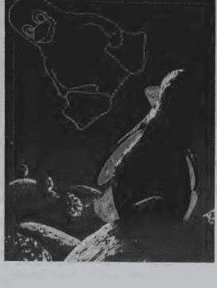

### 登录和注销账户

Linux 是一个真正的多用户系统，因此使用许多不同的用户账户。我们使用“账户”这个词的方式几乎与您在银行各种账户中的应用方式相同。每个银行账户都有其特定的功能。同样，每个用户都有自己的账户，他们可以将其修改以符合自己的口味。（虽然您在 Linux 机器上的用户账户比在银行账户上有更多的自由度。）

Windows 也是一个多用户操作系统，但它缺乏 Linux 提供的许多安全功能。Windows 基本上提供的是选择不同用户配置文件的途径，以定制您对 Windows 的体验，而不是提供真正的账户。

要访问您的账户，您必须登录到计算机。这是一个相当简单的过程。计算机重新启动后，会出现一个屏幕要求您输入用户名。只需输入您在安装期间创建的用户名并按 Enter 键。然后会弹出一个新窗口要求您输入密码。输入密码，然后按 Enter。哇！您刚刚登录了。非常简单。

**注意**：如果您没有创建自己的用户账户，请参阅第五章了解相关过程。其中详细说明了基本系统管理程序，包括如何创建新账户。

登录后，您会看到一个相当简洁的桌面摆在您面前，屏幕底部有一个相对单调的面板。这类似于 Windows 的“开始菜单栏”。在下一章中，我们将使其看起来更加令人兴奋，但就目前而言，我们要做的就是按照程序注销系统。

要注销，点击底部面板最左侧的风格化脚印图标。在出现的菜单底部附近，有一个标记为“注销”的选项。如果点击它，将出现一个新菜单。您可以直接点击确定。

启动时出现的屏幕将再次出现，提示您请输入用户名。目前这并不必要，因为本章中的任何任务都不需要登录。

### 组和权限

组和权限是 Linux 中最基本的两个概念，不幸的是，也是新用户最难掌握的两个概念。我在上一节中提到，Linux 在多用户用途上提供的安全性远高于 Windows。

这在很大程度上归功于组和权限系统。要理解组和权限，您还必须理解每个用户都属于以下三种分类中的至少一种：*所有者*或*用户*、*组*和*其他*。您系统上的每个文件和目录都有*权限*设置，告诉计算机用户是否被允许读取文件、创建文件或运行程序。

这些权限分为三组，每组有三个权限位：*读取*、*写入*和*执行*。它们分别缩写为 r、w 和 x。

#### 所有者分类

所有者分类指的是文件的所有者。您可以通过创建文件或将文件所有权转移给您来成为文件的所有者。所有者是唯一可以更改文件或目录权限的人。

#### 组分类

下一个分类是组分类。每个文件属于一个所有者。但所有者本人属于一个或多个*组*。这些组可能由许多不同用户组成，用于许多不同目的。例如，大多数用户属于“users”组。管理员可能属于“adm”或“admin”组。

文件的所有者也可以允许其组成员对该文件拥有某些访问级别。如果您有需要共享的记忆或有需要限制其他用户访问的程序，这将非常有帮助。

#### 其他人

不是文件所有者或不在所有者组中的用户被称为“其他”用户。通俗地说，这意味着除其他分类外未包含在内的“其他人”。


这些用户中的每一位对给定文件也具有特定的访问级别，这是由文件的所有者决定的。

#### 权限位

每种分类都被分配了特定的权限位。为文件或目录在每个分类中分配的三种权限是读、写和执行位。如果读位已启用，则允许查看文件内容的访问权限。如果写位已启用，则允许创建文件（如果在目录中授予写权限）或修改文件（如果在文件本身授予写权限）的访问权限。如果执行位已启用，则允许进入目录或运行程序的访问权限。

这三种位的组合被分配给每个用户分类，以定义谁对文件或目录拥有什么访问权限。例如，所有者可能同时被赋予读和写权限，而其所在组仅拥有读权限，其他所有人则被拒绝读和写权限。

### 组和权限的实际应用

如果你还没猜到的话，组和权限允许你对谁可以查看文件进行广泛控制。大多数 Windows 用户没有意识到这一点，但他们的文件远非安全（除非你使用加密程序或用密码保护文档）。它们对任何使用该计算机的人都是公开可访问的。

在 Linux 下，你或多或少可以决定谁有权限查看你的文件。你还可以将用户组织到不同的组中。如果你的系统规模较大，且需要根据组对人员进行分类，这在实用方面具有很大价值。例如，学校计算机上的大学生通常被放在与研究生和教职员工不同的组中。正如我们已经指出的那样，行政人员通常被放在与普通用户不同的组中。


> **注意**
> 我们尚未讲解如何更改和修改组和权限。这是后续章节中介绍的另一个主题。具体请参阅第八章。

### 根用户

无论你是否有丰富的 Linux 经验，主要关注点之一都应该是根用户。根用户拥有极其强大的权限，因为组和权限施加的限制对他不适用。这意味着根用户可以更改任何文件的权限，读取任何文件，向任何文件写入数据，并在系统上运行任何程序。

根用户有时被称为“超级用户”，因为属于 `wheel` 组的用户可以通过使用 `su` 命令成为超级用户。根用户负责整个系统几乎所有的维护任务，例如进行任何硬件升级、大多数软件升级、创建用户和删除旧用户、配置硬盘、设置网络设备，等等。

当我们探讨基础系统管理时，我们将更详细地介绍其中一些主题。

### 关闭计算机

只有根用户或具有适当权限的用户才能关闭计算机。

我们现在而不是在书中其他位置提及这个原因，是因为许多读者会在某个时候停止阅读，决定要么自行探索系统，要么想上床睡觉并关闭计算机。不正确地这样做可能会对您的计算机产生不良影响。

关闭计算机的基本程序如下。首先，使用在安装过程中指定的密码和用户名“root”登录为根用户。

点击屏幕底部的风格化脚图标，然后点击注销。但不要使用常规的“注销”选项，你应该选择“关机”。然后点击确定，你的计算机将会停止运行。

重要的是，你绝不能简单地按电源按钮来关闭计算机。这可能会损坏你的硬盘和软驱中的软盘。请始终确保使用这里概述的程序来关闭计算机。

### 那么接下来……

我们或多或少已经结束了对 Red Hat Linux 一些非常基础主题的介绍。现在我们要让你熟悉 GNOME 和 X-窗口系统，通过自定义你的账户来实现。在你比较习惯于使用之后，我们将设置你的调制解调器和互联网连接，并确保你的打印机正确连接。

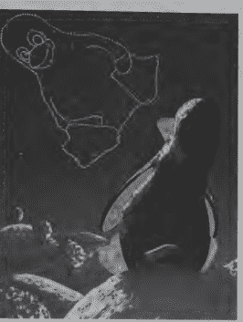

## 第 4 章：GNOME

现在，既然我们已完成系统的基本配置并使用个人账户登录，是时候开始个性化你在 Linux 上的体验了。目前，你的桌面看起来相当稀疏且平淡，没什么令人兴奋的。

在本章中，你将学习如何利用随 GNOME 和窗口管理器 Enlightenment 提供的各种主题。我们将使桌面看起来比现在整洁得多。

我们还要学习如何将应用程序启动器添加到桌面，以及如何充分利用屏幕底部的面板。如果你愿意，我们甚至会添加一个，并自定义你已经在运行的那个。

但首先，你需要更多地了解 GNOME 究竟是什么。

### 什么是 GNOME（以及什么是桌面系统？）

GNOME 代表“GNU 对象建模环境”（GNU Object Modeling Environment）。GNOME 是 X-窗口系统的一个桌面系统。还有其他许多桌面系统，但由于其易用性和技术能力，GNOME 已成为可用选择中的前沿。（当你有机会安装各种组件时，你可以选择 KDE 而不是 GNOME。KDE 是另一个桌面系统。）

GNOME 是首批通过结合 Microsoft Windows 和 Macintosh 操作系统的功能，将 Linux 提升到更用户友好水平的桌面系统之一。

桌面系统是 X-窗口系统用于组织各种快捷方式和程序的程序。桌面系统具有不同的功能。例如，GNOME 附带“面板化”（以及其他功能）。面板很像 Windows 95 的开始栏，显示正在运行的程序列表。重要的是要认识到，桌面系统控制着各种功能。其中一种更常用且有用的功能是“拖放”功能，它允许你只需点击并拖动图标到桌面，就可以将文件从文件管理器移动到桌面。这种功能在广泛使用的操作系统中相当普遍，但直到最近，Linux 还不支持此功能。这在最好的情况下是不方便的，令人难以置信地恼人。

桌面系统还通过使用桌面主题来控制桌面的外观。在 Linux 中，桌面和窗口有各自独立的主题；这与 Windows 有很大不同，Windows 使用相同的主题来控制桌面和窗口的外观和感觉。

Red Hat Linux 还配备了除 GNOME 桌面系统外的一系列窗口管理器。

### 什么是窗口管理器？

窗口管理器是一个管理桌面上打开的窗口的外观和感觉的程序。Red Hat 的默认窗口管理器称为 Enlightenment。还有其他窗口管理器；其中包括 After Step 和 Another Level。

Enlightenment 是最受欢迎的，主要归功于其适应性和易用性。

我们将在本章稍后查看配置 Enlightenment。我们要查看的项目包括各种窗口主题、桌面背景、窗口的工作方式、一些特殊效果、声音，以及将某些鼠标点击绑定到键盘的快捷方式选项。

你不应该混淆窗口管理器和桌面系统。桌面系统管理你的*桌面环境*。窗口管理器控制你与窗口交互时窗口的外观和行为。

### 个性化 GNOME

既然你正在使用自己的账户，是时候添加你自己的个人风格了。在本节中，我们描述了如何自定义 GNOME，以便你可以使用不同的主题、背景或窗口管理器。

自定义 GNOME 的第一步是点击底部面板上的工具箱。这是 GNOME 配置实用程序，也称为控制中心。

当控制中心弹出时，你会注意到右侧有一个不错的长选项列表。此时，我们关注标记为“Desktop”（桌面）的分类。这里有四个选项：“Background”（背景）、“Screensavers”（屏幕保护程序）、“Theme Selector”（主题选择器）和“Window Managers”（窗口管理器）。

参见图 4-1 了解控制中心的外观。

#### 背景

要配置背景，只需点击背景选项。你可以使用纯色或渐变色背景，或者可以在计算机上浏览图片。GNOME 几乎可以显示每种图像类型的背景，因此你不需要将文件转换后即可用作背景。

完成自定义背景后，点击“Try”（试用）按钮。它将应用你的更改，以便你可以看看是否喜欢。如果不喜欢，按“Revert”（还原），它们将恢复正常。否则，点击“Apply”（应用）以保留更改，然后点击“Accept”（接受）。


#### 图 4-1

GNOME 控制中心。

如果你以后在网络上发现另一张喜欢的图片，你就能够更改你的背景。随着 Red Hat Linux 新版本发布，还会提供更多背景图片，所以请密切关注升级。

#### 屏幕保护程序

在选择屏幕保护程序时，你有许多选择。GNOME 允许你预览选定的屏幕保护程序（尽管某些程序可能会有问题），因此请滚动浏览，直到找到一个你喜欢的。对于屏幕保护程序，你使用底部按钮的方式与背景的操作方式相同。（不过，点击“尝试”按钮实际上不会有任何作用。）

我个人最喜欢的是 Boboule。

与背景图片类似，每次 Red Hat Linux 发布新版本时，都会打包提供新的屏幕保护程序。你可能需要密切关注升级以及你可以使用 GnoRPM 工具下载的各种软件包。（有关 GnoRPM 和下载升级文件的讨论，请参阅第六章。）

#### 主题选择器

主题选择器允许你摒弃 GNOME 默认的较为单调的颜色方案。请充分利用预览框。在试用之前能够看到每种主题的效果，你会对此感激不尽。

如果你愿意，也可以自定义自己的字体方案。大多数主题默认使用的字体，但偶尔这些字体并不理想。有些字体可能太小，或者搭配不当。如果你想指定字体，请取消勾选“使用默认字体”框。（下方的框将变为可用状态，即不再“变灰”。点击此框，即可从可用字体和字号列表中进行选择。）

如果你特别乐于尝试新事物，还可以使用所谓的“点阵图”来进一步自定义窗口的外观和感觉。GNOME 附带一个名为“pixmap”的示例主题，展示其效果。（顺便说一句，这也是我最喜欢的主题之一。）

务必应用并接受你所做的更改。在做最终决定前，你可以随时先试用以确保你喜欢这些设置。

此处的主题选择器将控制你的桌面以及窗口某些方面的外观——但它不会改变我们在配置 Enlightenment 时要更改的一些功能。

#### 窗口管理器

在本节中，你可以添加、移除或配置各种窗口管理器。虽然你可能在列表中只看到 Enlightenment，但你确实有其他选择。由于 Enlightenment 是默认的窗口管理器，可能也是可用的最佳选择，所以我们暂不关注其他选项。（如果你查阅本书末尾的参考文献列表，你会发现可以为你查找各种窗口管理器的搜索引擎。当我们讨论系统维护时，也会再次涉及此主题。）

你很可能希望点击标记为“运行 Enlightenment 配置工具”的按钮。新的弹出窗口允许你自定义 Enlightenment 的工作方式。该屏幕看起来像这样：

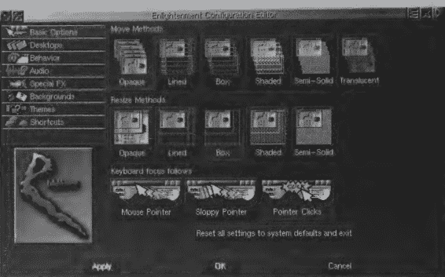

#### 图 4-2

Enlightenment 配置编辑器。

### 配置 Enlightenment

有许多类别可供选择，你可以使用它们进行修改。其中大多数是自解释的，但少数需要一些注释。

#### 桌面

你的桌面是你的工作环境——这是窗口打开、图标放置以及你与计算机交互的地方。本节是你可以修改桌面如何“工作”的地方——即它们具有哪些属性。

与 Windows 或 Macintosh OS 不同，X-Window 系统使用多个桌面。如果你查看屏幕底部的面板，你会注意到有一个空间包含四个方块。如果你点击每一个方块，就会出现一个新的、很可能为空的桌面。（然而，它会有自己的面板和桌面图标。）这就是多个桌面的含义。

这*不是*指你的计算机连接了多个监视器。某些操作系统（包括 Windows）允许通过连接另一个监视器来实现“多桌面”。在 Linux 中，你可以仅使用一个监视器拥有许多（多达 2048 个！）桌面。

在桌面类别中，你可以选择额外桌面的尺寸——也就是说，你将是二乘二的网格还是更多或更少？你还可以选择想要多少个这些桌面网格的层——最多 32 层。

如果你想在点击下方方块的情况下切换桌面，你可以启用称为“边缘翻转阻力”的功能。当您将鼠标移动到桌面边缘时，它会“翻转”到下一个桌面。你可以使用下方的小滑条调整灵敏度。

#### 行为

X-Window 系统更令人烦恼的特性之一——至少对于更熟悉 Windows 95 或 Windows 98 的用户而言——是*窗口焦点*的概念。

当你在 X-Window 中开始运行程序时，焦点不会自动调整到该程序。如果你点击主菜单按钮，然后点击“运行程序”，你会发现，除非你先点击窗口，否则无法输入程序名称。这是因为焦点尚未转移到该窗口。你必须先点击窗口，然后才能在其中输入任何内容。

在“行为”窗口中，你可以修改每次你“鼠标悬停”（将鼠标移动到窗口上方）或启动程序时焦点转移的方式。请根据你的喜好进行设置。

#### 音频

如果你希望在运行 Enlightenment 时使用声音效果，请点击是；否则，请点击否。

这些声音相对基础，主要由哔声组成；习惯于 Windows 波形声音（波形与 .wav 文件相同）的用户可能会对可用的声音集合感到有些失望。

#### 特殊效果

保持此自定义设置默认为完全没问题。如果你想启用此处列出的任何特殊效果，只需点击它们即可。

#### 背景

不仅 GNOME 提供更改背景的机会，Enlightenment 也是如此。Enlightenment 附带一些预打包的背景图片（如果我可以提一下我的意见，这些图片相当漂亮）以及一些相当简单的图形可供选择。如果你愿意，也可以使用空白背景。

如果你使用这些背景，你会发现你在控制中心中选择的背景与你在此处选择的背景会发生冲突。如果你更喜欢在 Enlightenment 中选择的背景，请告诉 GNOME 完全不要使用背景。

### 主题

Enlightenment 还提供带有特殊光标和窗口修改的风格化主题，你可以进行尝试。主题可以极大地增强窗口的外观。Enlightenment 附带多个主题，但你可以获得更多主题。

主题的主要获取地点是 www.themes.org。Themes.org 是一个获取完全免费且惊艳美观的主题的绝佳场所。该网站也充斥着其他图形信息，因此，如果你正在寻找开发信息，也能在这里找到。

如果你有兴趣安装新主题，请查看第六章，其中讨论了如何维护你的系统。阅读标题为“添加视觉糖果”的部分。

#### 快捷键

Enlightenment 还提供多个可修改、添加或删除的命令键快捷键。如果你觉得使用鼠标相当麻烦和令人烦恼，你可能会为几个命令*绑定*快捷键。（例如，默认的快捷键是使用 Alt-F1 移动到第一个桌面。Alt-F2 将移动到第二个桌面，依此类推。）

### 完成配置

在你根据喜好完成修改 Enlightenment 的配置后，接受更改并关闭它。这涵盖了你个性化 GNOME 桌面系统的许多内容，但我们仍有一些主题需要考虑。

### 添加桌面应用程序

如果你使某些磁盘可由用户挂载，你会注意到桌面上出现了新图标。如果你想添加自己的图标，你应该在桌面上右击。将鼠标悬停在“新建”上，然后点击“启动器”。*启动器*是 Windows 中快捷方式的对等物。

点击“启动器”后，将弹出一个新窗口。你应该看到两个选项卡，一个标记为“基本”，另一个标记为“高级”。你不需要对高级选项卡进行任何更改。在基本选项卡中，你应该适当填写类别。

- **名称**：输入你希望显示在桌面上的名称。这不需要是实际的命令名称。
- **注释**：在此输入你对该启动器的任何注释。
- **命令**：这是你编写程序命令行的地方。如果程序位于你路径中的某个目录中，只需输入命令即可；否则，你需要指定路径。（由于我们尚未介绍 Linux 文件系统，我们还没有真正讨论路径。如果这听起来令人困惑，请不要担心。）
- **类型**：你正在创建目录或应用程序启动器。如果你想运行程序，请将其从目录切换为应用程序。
- **图标**：X-Window 系统预装了许多图标。你可以从中选择，或从随程序提供的图标中选择。
- **在终端中运行**：如果该程序是基于文本的程序，你应该*启用在终端中运行*。否则，请保持此项未勾选。（未勾选的选项通常显示为灰色。）

### 自定义面板

一些用户喜欢保持桌面相对整洁，更倾向于将这些程序作为面板上的*小工具*（小型应用程序）或主菜单上的启动器包含在内。这个过程相当简单，并且

如果你真的不喜欢桌面上那些图标，可以考虑这样做。修改面板的方法有很多种。它们具有高度可定制性。我们将在此介绍一些基础知识，并指引你获取更多资源的方向。我们希望能够向面板中添加小部件（applets）和应用程序。有时在屏幕上拥有多个面板以避免杂乱无章也是不错的选择。而且，你可能还希望更改其位置，或者当鼠标未悬停在面板上时让它自动隐藏。

### 修改主菜单

主菜单预置了若干种不同的应用程序。然而，在你使用 Linux 的过程中，你很可能会下载或安装许多其他应用程序。每次使用这些程序时都点击主菜单，然后选择“运行程序”显然有些繁琐，因此我们希望能够将它们添加到主菜单中（或者或许直接添加到面板本身）。操作非常简单。点击主菜单，进入标记为“设置”的子菜单。列表中有一个名为“菜单编辑器”的程序。点击它。使用菜单编辑器相当简单。基本上有两种类型的菜单可用——系统菜单和用户菜单。除非你以 root 身份登录，否则你将无法修改系统菜单。（对系统菜单的修改会影响所有用户。）

你会注意到屏幕顶部有几个按钮，允许你向菜单添加子菜单和启动器。只需点击相应的按钮并填写相关信息即可。这些信息与你在桌面添加启动器或目录时提供的信息完全相同，格式也类似。

填写完信息后，点击表单底部的保存按钮。这一点非常重要，因为新的子菜单和应用程序在你关闭程序时不会自动添加。你必须先保存它们。

### 添加（或删除）更多面板

如果你希望的话，可以添加更多面板。面板有两种类型：*边缘面板* 和 *角落面板*。边缘面板将占据屏幕的整个边缘；角落面板则随着你在该面板上添加更多小部件或启动器而占据更多空间。

要创建新面板，右键点击其中一个现有面板。点击“添加新面板”，然后选择角落面板或边缘面板。它会自动在屏幕上定位，并且内部没有任何内容。我们将稍后学习如何往里面放置内容。

如果你发现新面板不方便或已失去用途，只需右键点击该面板并找到“移除此面板”。点击它，面板便消失了。不幸的是，你无法恢复已删除的面板，因此删除时请小心。通常重新搭建起来的工作量并不大，但可能会令人恼火。最初，你无法删除第一个面板，因为必须始终有一个面板在运行。但是，一旦你添加了新面板，就可以删除默认面板了。但这不是一个好主意。

#### 添加和移除小部件

*小部件（Applets）* 只是直接运行在面板上的“小型应用程序”。你可以使用小部件来监控系统使用率、当前时间，或者提供视觉享受以及其他毫无意义的系统资源和时间浪费。（不过这对缓解作家瓶颈有帮助。）

要添加小部件，右键点击你想要添加小部件的面板。找到“添加小部件”子菜单并将鼠标悬停在它上面。将出现四个或五个不同的其他子菜单。你可以从这些菜单中添加各种小部件。试一试它们，决定你需要哪些以及不需要哪些。

要移除任何小部件，只需右键点击该小部件，并从子菜单中点击“移除小部件”。

个人偏好是“生命”小部件，它可以在面板上直接运行生命游戏（不是棋盘游戏，而是殖民模拟游戏）。除了提供数小时的娱乐外，当你有更重要的事情要做时（例如写一本书），它还可以成为方便的消遣。

#### 向面板添加启动器应用程序

要向面板添加启动器，右键点击面板。然后点击“添加启动器”。将会出现与我们在桌面上添加启动器时相同的屏幕；你可以按照上方“添加桌面应用程序”中提供的相同步骤来填写信息。

移除启动器的方法与移除小部件相同；右键点击启动器并点击“移除启动器”。

### 向面板添加抽屉

如果你的面板上有很多相互关联的小部件或启动器，你可以为它们创建一个*抽屉*。要创建抽屉，只需右键点击面板并点击“添加抽屉”。

会出现一个新屏幕，要求你提供关于抽屉的信息。你应该适当地填写这些字段，因为所有抽屉都有相同的默认图标。如果你没有为抽屉提供名称或注释，当你将鼠标悬停在它上面时，不会显示任何信息，你可能就不知道里面包含什么。

要“打开”抽屉，点击它。将会出现类似子菜单的界面，显示抽屉内的所有小部件或启动器。抽屉的末尾有一个箭头；你可以通过点击这个箭头或点击抽屉本身来“关闭”抽屉。

抽屉和面板一样，具有可以更改的属性。它们与面板的属性类似，所以我们将同时查看它们。要更改抽屉的属性，右键点击抽屉图标并点击“属性”。你还可以通过右键点击抽屉来移除它。

### 更改面板属性

面板具有多种关联属性。我们将在此查看其中两个。要更改面板的属性，点击该面板。在子菜单的底部附近有一个名为“此面板属性”的选项。点击它（确保还没有更改全局属性）。

你的面板可以以多种方式运行。在你的面板末端有两个箭头。这些被称为*隐藏按钮箭头*。当你点击它们时，面板将会消失，留下一个箭头，点击该箭头可以再次展开面板。然而，这些箭头会占用空间，并且当你最大化窗口时，窗口不会覆盖这些箭头。

如果这造成了问题，你可以取消勾选“启用隐藏按钮箭头”。你仍然可以折叠面板，但不再有箭头可用。相反，你只是在两端有一些按钮，比箭头更细。（因此占用空间更少。）

你还可以让面板在鼠标指针移出时“隐藏”。这将在你的桌面上腾出更多空间。

你可能还希望更改面板的方向。为此，你可以通过属性修改位置，或使用鼠标中键。（如果你在安装时选择模拟三键鼠标，则应同时点击左键和右键。）要用鼠标移动它，用鼠标中键点击面板并将其移动到你想要的位置。否则，修改属性并点击你想要的位置。

完成后，按“应用”按钮，然后点击“确定”。

### 修改全局面板属性

你应当注意到，当你右键点击面板时，有一个选项可以修改全局面板属性。这些属性适用于所有面板，无论其位置、类型或构成如何。

大多数这些属性都是不言自明的，并且可能与你了解如何使用 GNOME 关系不大。然而，如果你想要进一步定制你的面板，应该使用这里的选项。你将能够修改图标按下时的外观、隐藏面板在屏幕上占用的空间量以及其他此类属性。

### 更改抽屉属性

更改抽屉属性非常简单。属性几乎与面板属性完全相同。如果你右键点击一个抽屉然后点击“属性”，将会出现一个包含各种有趣选项供你调整的菜单。

你会注意到你创建抽屉时输入的相同信息；如果你愿意，可以更改它们。你还可以修改抽屉的隐藏/按钮箭头。

### 全部完成！

好吧，你已经成功通过了个性化 GNOME 体验的大部分主要要点。现在，是时候开始为你的硬件（如调制解调器和打印机）配置机器以使用它们了。我们还要研究其他系统管理任务，例如添加账户和使用 Linux 配置工具。之后，我们将检查文件系统以及如何管理那些似乎会自发出现在你的电脑上的许多文件，然后查看命令行界面。


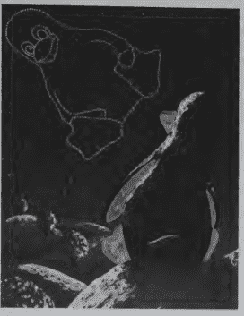

## 第 5 章
### 系统管理入门

我们希望我们对定制 GNOME 的探索能让你对 X-Window 系统有些许了解。如果你对该系统还不太自信，也不用太担心。这一章旨在增强你使用 Linux 系统的信心，同时介绍基础的系统管理知识。

我们要讨论的第一个主题是如何使用调制解调器（Modem）。之后，我们将探讨如何配置打印机。然后，我们要看看如何使用 Linux 配置程序；我们的主要示例是添加用户账户，不过你应该意识到，Linux 配置程序拥有许多不同的选项。

第一项任务是使用 root 账户登录。如果需要，在开始设置之前，你也可以定制该账户的外观。之后，我们就开始配置调制解调器以及其他内容！

### 控制面板——你的助手

图 5-1 展示了控制面板的样子。控制面板是我们查看多种设置选项的地方，例如设置打印机、设置日期和时间、运行网络配置，以及当然，设置调制解调器。

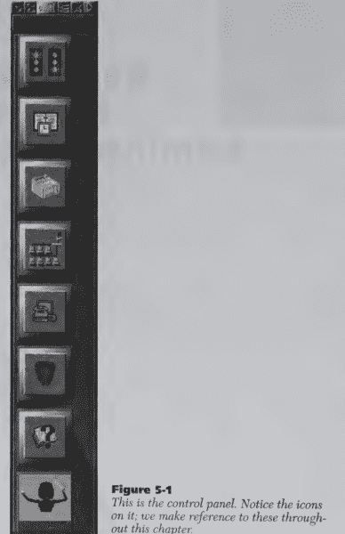

*这是控制面板。请注意上面的图标，我们将在本章中多处提及这些图标。*

要运行控制面板程序，请单击主菜单按钮。移动到“系统”，然后选择“控制面板”。你会看到左侧打开的窗口。

### 设置调制解调器

我们将在最开始花些时间来设置你的调制解调器。在当今时代，如果不使用互联网，几乎不可能在计算机世界中导航。而要接入互联网，你需要使用调制解调器。调制解调器是系统中最常用的设备之一，也是你和任何使用你计算机的人都希望使用的基本设备之一。这就是为什么我们要首先解决它的设置问题。

#### 兼容性

与大多数设备一样，你必须首先确保你的调制解调器与 Linux 兼容。为此，你应该检查 Red Hat 的网站并查看兼容性列表。如果你使用的是调制解调器/声卡组合卡（如 IBM 的 MWave）或专门设计用于 Windows 的调制解调器（大多数 winmodems），可以假设你的调制解调器**不**起作用。那些需要额外软件来启用压缩选项的调制解调器可能也无法正常工作。

同样，你应该看看能否从供应商或像 Sourceforge 这样的网站找到适合你调制解调器的补丁。如果失败了，你应该投资购买一个 Linux 兼容的调制解调器。这些通常非常便宜——你应该能花不到四十美元买到一个 33.6 kbps 的调制解调器。

#### 使用 Modemtool

要设置你的调制解调器，我们将通过控制面板访问 modemtool 命令。按照上述指示打开控制面板，然后单击带有电话图标的选项。

弹出的窗口看起来会像这两段文字左边的图片所示。

端口分别标记为 TTY50、TTY51、TTY52、TTY53，对应 COM1、COM2、COM3 和 COM4。你应该选择与你调制解调器匹配的端口。然后，单击“确定”以完成设置。

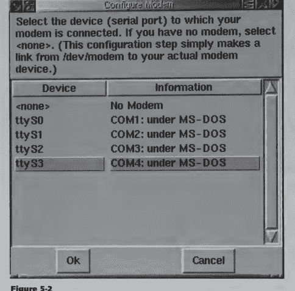

*图 5-2*
*modemtool 界面。*

### 设置 PPP

大多数用户在使用 Linux 时都希望能够连接到互联网。为此，大多数用户使用 *PPP* 连接。PPP 是 *点对点协议*（Point to Point Protocol）的缩写，指的是你的计算机与你拨打的计算机之间的一种通信方法。（使用较旧互联网服务提供商的用户可能有 *SLIP* 连接。）

大多数主要的互联网服务提供商（ISP），如 America Online、CompuServe、Microsoft Network、Prodigy、Juno，以及一些免费提供商（如 Netzéro），都提供软件，允许你连接到他们的服务。通常情况下，这些软件在 Linux 上无法正常工作。你应该致电他们的支持号码，看看是否可以为 Linux 获取该软件，或者在不使用该软件的情况下设置连接。

其他 ISP 通常允许你使用 PPP 连接程序（如 Windows 的拨号网络）进行连接。在 Red Hat Linux 中，对应的功能被称为“PPP 拨号器”。（我总是对这些程序被赋予的富有创意的名称印象深刻。）

要运行网络配置工具，你应该从控制面板单击另一个图标。它是从上往下数第四个，看起来像一台服务器连接着许多不同的计算机（尽管承认它有点难以辨认）。当网络配置程序启动时，它会看起来像这样：

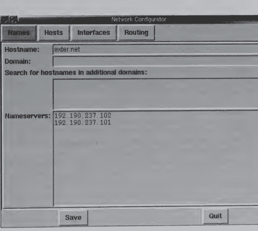

**图 5-3** *网络配置工具。*

对于 ROUTING（路由），默认配置可能完全适合你，因此除非你的网络管理员或 ISP 技术支持代表告诉你需要更改，否则不要更改其任何设置。然而，其他三个按钮包含的信息是你需要更改的。

#### 名称

你很可能不会随口说出这些信息。获取这些信息最简单的方法是致电你的网络管理员或 ISP，询问你在每个类别中需要哪些信息。

或者，如果你仍在使用 Windows，你可以从控制面板中的“网络设置”中找到这些信息。获取信息应该很容易——只需找到标记为 **TCP/IP -> Dialup Adapter** 的设备。在出现的列表中高亮显示它，然后单击“属性”。然后，你应该浏览每个选项卡并记录信息。由于字段名称相同，你可以将其中一些信息传输到“网络配置程序”的相应字段中。

NAMES（名称）选项卡提供的信息将使你的计算机在连接到主机时能够找到互联网上的其他计算机。如果你在这里不指定任何设置，当试图查看网页时，你可能会收到很多错误（大意是你使用的 Netscape 或任何程序无法找到远程服务器）。

#### 主机

大多数时候，你可以保留此选项不变。但是，如果你经常访问某些系统，你可以在此为它们创建别名。只要你拥有系统的 IP 地址，你就可以添加一个主机条目。

如果你不确定如何编辑 hosts 文件，现在不必担心。你的网络管理员或 ISP 可能会建议你在里面填写一些信息。

#### 接口

这不是设置中最复杂的部分，但却是至关重要的部分。你需要向系统添加一个设备（通常是 **ppp0**），以便如果接口列表中尚未列出 ppp0 设备，PPP 也能正常工作。为此，你应该单击窗口底部的“添加”按钮。

将出现新的设备列表。顶部是 PPP；列表还应包含其他内容，如 SLIP 和以太网。确保勾选了 PPP 并单击“确定”。将出现一个新窗口，要求输入电话号码、登录名和密码等信息。填入所有这些信息。还有一个“PAP 身份验证”部分。你应该咨询你的网络管理员或 ISP，看看你是否需要为使用 PAP 身份验证配置系统。大多数现代 ISP 现在都使用 PAP 身份验证。

你会注意到在你输入电话号码等信息的窗口底部附近有一个标记为“自定义”的按钮。你可能需要在这里进行一些修改。单击“自定义”按钮，将弹出一个新窗口。以下是字段和信息的摘要；如果你需要修改它们，你可能需要从你的 ISP 或网络管理员那里获取信息。

### 自定义接口

**硬件** — 这些设置控制调制解调器本身如何操作。硬件指你计算机的物理组件，而软件指在你的计算机上运行的程序。这就是为什么使用软件来启用数据压缩的调制解调器通常与 Linux 不兼容——因为软件不起作用。

通常，你不需要更改任何硬件设置。如果你在连接方面遇到问题，可能需要关闭“硬件流控制”。你通常不需要更改线路速度，但如果速度高于 57600，某些调制解调器将无法正常工作。你之前使用 modemtool 设置了端口，因此不需要更改此字段。

**通信** — 这些设置决定了你的调制解调器如何与远程计算机（你拨打的那台）和当地计算机（用于发起呼叫的那台）通信。某些调制解调器可能需要与给定值不同的初始化字符串。

初始化字符串为你的计算机与调制解调器之间的通信设置调制解调器，告诉它如何复位、在拨打电话号码的单个数字之间等待多久、收到呼叫时是否摘机等。

大多数调制解调器都能很好地响应默认的 ATZ；如果不起作用，请尝试 AT&f。（这将把调制解调器重置为出厂默认设置。）你可能还需要致电你的调制解调器供应商或查阅调制解调器的说明书。大多数


供应商通常会准备两三个初始化字符串通过电话告知你；他们也可能将这些字符串放在其网站上或调制解调器的说明书中。你可以制作许多不同的初始化字符串，因此你应该尝试使用现有的字符串来了解其工作方式。

通信设置还反映了一种你登录所需的“登录脚本”。这是以“期望/发送”语句的形式设置的。你的计算机将期望收到某个语句，例如“login:”，并发送某个语句，例如你的用户名。它会对你的密码执行相同操作。如果你的 ISP 要求使用登录脚本，你应该使用期望/发送语句来构建某种“登录脚本”。

你还应确保所有用户都能激活和停用此连接，除非你打算只允许 root 用户使用该连接。

-   **网络**——除非你的网络管理员或 ISP 另有指示，否则你可以将这些设置保持为默认值。它们仅控制几个网络设置。
-   **PAP 认证**——如果你需要使用 PAP 认证，你应该联系你的网络管理员或 ISP，以了解在这种情况下应使用什么设置。PAP 代表*密码认证协议*。

### 完成

当你完成配置更改后，点击标有“完成”的按钮。一个新窗口会询问你是否要保存此配置，你应该点击“是”。为了保险起见，点击网络配置器窗口底部的“保存”。

然后，你必须激活你的连接才能使用它。

### 激活你的 PPP 连接

要激活你的 PPP 连接，请突出显示你刚刚创建的设备（可能是 ppp0）。然后，点击窗口底部的“激活”按钮。你的调制解调器会立即拨打你在设置中指定的号码。

连接成功后，你实际上无法判断你的 PPP 连接是否正常工作，因为此时没有任何反应。为了检查你是否正确连接，我们将运行一个简单测试。点击面板上的终端图标。当窗口出现时，输入 yahoo.com。如果屏幕上开始显示数据，则表示你已成功连接。若要退出程序，请按下 CTRL-C。

该程序的作用是将小数据包（每个大约 64 字节）发送到你指定的互联网地址。如果这些数据包返回给你，ping 会告诉你已收到数据包，并包含传输所花费的时间。如果你的 PPP 连接正常工作，就会发生这种传输。如果未正常工作，当你在中止程序时，你会看到一条消息，告知你发送了多少个数据包，但没有收到任何数据包。

你可以点击网络配置器窗口底部的“停用”来停用连接。停用接口会导致调制解调器挂断电话。

每次都这样连接可能会相当烦人。然而，你不必这样做。GNOME 提供了一个小工具，你可以使用它来开启和关闭 PPP。它位于“添加小工具”菜单的“网络”类别下。或者，你可以点击主菜单，进入“互联网”，然后点击“RH PPP 拨号器”，这将允许你从任何已定义的 PPP 设备进行拨号。

### 其他连接

大多数 Linux 机器还配备了不使用 PPP 的拨号接入能力。Linux 附带的最流行的用于此目的的程序称为“Minicom”。Minicom 的运行方式很像 Procomm Plus，后者已经“绝版”多年了。熟悉其按键命令并不难，而且界面也比较用户友好。

Minicom 还利用多种安全功能，因此你可以指定允许哪些用户访问 Minicom，例如。

要运行 Minicom，点击主菜单并进入“互联网”。那里有一个“Minicom”选项；点击它即可启动。要获取帮助，请按下 CTRL-A，然后按 Z。CTRL-A 告诉 Minicom 进入警戒状态，而 Z 是帮助命令。会出现一个帮助屏幕，提供用于打开拨号目录、编辑条目和拨号号码的正确命令集。

虽然我们可以花点时间在 Minicom 上做些工作，但探索你的系统并了解它的一些内容是符合你的利益的。如今基于文本的拨号连接很少见且不常使用，因此花大量时间剖析 Minicom 中的每个单独命令会占用本该花在别处上的时间。然而，如果你的地区仍在使拨号连接，你现在就有机会习惯使用一个程序并与你的电脑进行一些实验。

如果你想让 Minicom 对所有用户可用，你需要做一些额外的调整。在第八章中，我们讨论了命令行界面以及如何用它为所有用户设置 Minicom。

### 故障排除你的调制解调器

总有一些调制解调器在 Linux 上存在问题。这些通常是兼容性问题，尽管有些是由于 Linux 与调制解调器关联的默认设置（例如使用 ATZ 作为初始化字符串）造成的。

调制解调器故障排除的主题可能需要另外一整本书来讨论，不过我们可以给你一些提示。

如果你使用的是外部调制解调器，请确保它已开启。听起来很傻，是的，但很多问题是由此引起的。如果你的调制解调器正面有指示灯，请咨询你的调制解调器手册以了解它们的含义。当调制解调器正常工作时应点亮的指示灯有一些。你的手册能够告诉你哪些。

你的调制解调器手册可能还会提供一些标准的初始化字符串供你在 ATZ 不起作用时尝试。每个调制解调器都会响应 AT&F，它将调制解调器重置为出厂默认设置（因此是“F”）。然而，这可能不足以让你的调制解调器工作；额外的设置可能需要一些调整。你的调制解调器制造商通常可以为你提供两三个经过测试可与大多数操作系统和应用程序协同工作的字符串。

你的调制解调器手册还将包含你可以使用的大多数“AT 命令”，并解释每个命令的含义。更具冒险精神的用户可以发明自己的初始化字符串，看看是否有效。

### 全部完成

现在你已配置好调制解调器以用于 PPP，你有很多值得期待的事情。是时候开始学习如何管理你的文件以及如何与文件系统一起工作了。

我们将在后面介绍大多数互联网应用程序。别担心。你很快就能连接到你 ISP 并在互联网上随意玩耍。

### 将打印机添加到你的计算机

通常情况下，最便宜的打印机是那些专为 Windows 95 或 98 设计的。这是因为大多数打印机命令由随打印机提供的软件程序解释，而不是由打印机硬件解释。如果你找不到适用于 Linux 的兼容打印机软件，你需要安装另一台打印机。

幸运的是，这个过程很容易。记住，控制中心是你的朋友。点击控制中心中的打印机图标。你会看到一个类似这样的框：

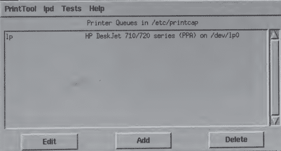

**图 5-4**  
printtool 窗口。

打印机队列列表告诉你系统中安装了哪些打印机以及它们打印到哪个设备。在这种情况下，我在系统上安装了一台 HP DeskJet 710 系列打印机。字母 PPA 代表打印机端口架构，它是一个专有打印机驱动程序，直到最近才得到支持。这是一个示例，说明打印机的软件驱动程序即使以前仅限于与 Windows 一起使用，现在也可用于 Linux。

你的对话框很可能为空——没有安装任何打印机。因此，你需要做的第一件事实际上是添加一台打印机。点击添加按钮即可操作。这样做时，会出现一个新窗口。从这个窗口中，你只需添加一台本地打印机，除非你正在尝试配置网络打印机。如果是这种情况，你应该与系统管理员讨论如何配置网络打印机。这需要许多设置。

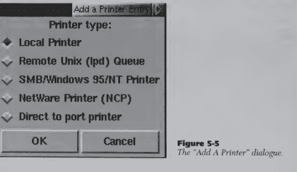

当你点击“添加”按钮时，会显示这个窗口。你会注意到“本地打印机”是被选中状态。如果你需要连接网络打印机，你应该检查运行该打印机的是哪种类型的系统。如果是 UNIX 系统，请使用“远程 UNIX”选项。如果是在 Windows NT 或 Windows 95/98 机器上运行，请选择“SMB”。（SMB 代表“Samba”，这是一个允许你与 Windows 打印机进行交互的程序。）如果你在 NetWare 网络上，请选择 NetWare 打印机。如果你要配置网络打印机，务必向你的网络管理员寻求帮助。


当您点击“确定”按钮时，会弹出一个新窗口，显示 Linux 能检测到打印机的端口。如果未找到任何端口，您将无法安装打印机。这可能表明您在安装过程中未安装打印机支持组件，或者存在更严重的硬件问题。

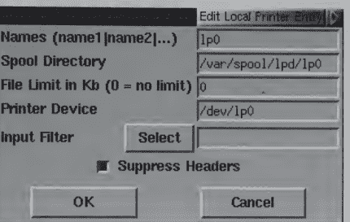

### 图 5-6
*编辑现有打印机。*

在您点击该窗口上的“确定”后，将显示打印机编辑器对话框。这与您在上方高亮显示已安装的打印机并点击“编辑”按钮时出现的窗口相同，因此编辑已安装打印机的步骤与此相同。右侧是该窗口的截图。通常，您可以将此处的大部分信息保持默认设置。为了使打印机在 Linux 下正常工作，您可能需要更改的一项设置是*输入过滤器*。如果点击“输入过滤器”按钮，将出现一个新窗口，如图 5-7 所示。

输入过滤器允许您选择打印机驱动用于您的打印机。左侧显示驱动列表。您应选择与所拥有打印机最匹配的驱动。选定合适的驱动后，应设置左侧可用的选项。窗口右上角显示驱动描述。

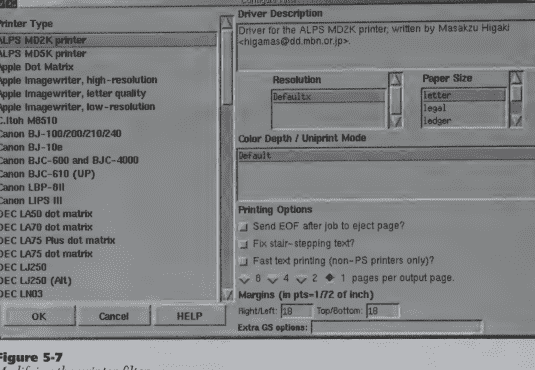

以下是打印机过滤器选项的简要总结：

- **分辨率** 打印机使用的分辨率决定了打印页面上文字的清晰度。标准打印机通常仅支持一种分辨率设置；如果您安装了激光打印机或类似设备，可能会有多种分辨率可供选择。使用最高可用分辨率不会造成损害，但可能会减慢打印速度。
- **纸张大小** 纸张大小是指放入打印机内的标准纸张尺寸。只要您使用的是常规打印机，通常应选择“Letter（信纸）”。如果您通常使用非 5.5″ × 11″ 尺寸的纸张，则应从列表中选择相应的纸张大小。
- **颜色深度** 颜色深度仅允许您选择打印机是否进行彩色打印。此外，它还允许您设置默认打印模式——即您希望使用更多还是更少的墨水进行打印。（使用更多墨水会产生外观更好的打印件。）
- **打印选项** 打印选项相当直观。如果您发现打印机在打印输出末尾持续多打印一页，请确保未选中“发送 EOF”。如果您发现常规文本打印出现“阶梯状”现象（即文本在达到硬回车后未左对齐），应点击“修复阶梯状现象”。如果您使用允许使用 PPA 打印机的驱动（例如 HP DeskJet 710C 系列），则不应启用“快速文本打印”。驱动描述中还会包含有关应使用哪些打印选项的信息。
- **边距** 如果您有任何特殊的边距设置，应在此处进行设置。通常，您可以保持这些设置不变。
- **额外 GS 选项** 仅当您需要这些选项进行打印时，才应使用额外选项。您应与打印机制造商联系，了解应提供哪些选项。同样，打印机驱动描述中可能会列出一些可供您使用的选项。

完成输入过滤器设置后，点击**确定**按钮。然后点击**确定**以保存要安装的打印机，您将返回到主打印机配置屏幕。您首先要做的事情之一可能是打印一些测试页。为此，点击“测试”菜单选项。

一旦确信打印机工作正常，请关闭打印机配置。至此完成。这个过程其实并不困难，不是吗？

### 配置声音

大多数用户希望从计算机播放声音和视频媒体。在此之前，您需要配置声卡以便在系统中使用。配置声音非常简单。

首先，点击屏幕底部的脚图标。这会打开主菜单。在主菜单上，点击“运行程序”。此时将弹出一个新对话框。点击该对话框，并输入命令 `/usr/sbin/sndconfig`。这是一个基于文本的工具，因此它将在屏幕上的终端窗口中显示。如果没有显示，请点击屏幕底部面板上的终端图标。然后在提示符处输入 `/usr/sbin/sndconfig`。

由于您是在 X-Windows 下运行此程序，程序会提示您最好不要这样做。不过，您仍可以继续配置声音。按 Enter 键跳过此屏幕。为了使声音配置程序探测计算机中的声卡，请按 Enter 键。如果未能在计算机中找到声卡，您将不得不从可用声卡列表中选择。

作为预防措施，配置程序会警告您将覆盖某些配置文件。请继续覆盖它们。

然后，程序将播放一段声音样本。我的 Red Hat 版本中，Linux Torvalds（Linux 的创造者）说道：“嗨，我是 Linux Torvalds，Linux 的发音是‘Lah-nux’。” 如果您听不到样本，请确保声卡已正确安装在计算机中（如果在其他操作系统中听到声音，则说明已正确安装），并且扬声器已连接。如果扬声器上有音量控制，您可能需要比平时调高音量才能在 Linux 中听到声音。（这是因为 Windows 通过其自身的音量混音器对声音进行了预放大。）请务必确认您已听到或确实未听到声音。

程序完成后，它将退出，窗口也会关闭。如果您使用面板上的终端图标来使用声音配置程序，则会显示另一个提示符。输入 `exit` 以退出终端。

### Linux 配置工具

这是 Linux 配置工具（通常称为 “linuxconf”，因为这是启动它时调用的命令）的简要介绍。Linuxconf 是一个非常强大的工具，在管理 Linux 的过程中，您可能会大量使用它。

我们首次使用 linuxconf 是为系统添加额外用户。如果您认为除了您之外没有人会使用您的计算机，那么您也可以只添加一个测试账户。我们的第二个用途是将您的常规用户账户添加到 *wheel* 组中，以便您可以使用 su 命令运行管理程序，而无需实际以 root 用户身份登录。我们还将研究如何操作磁盘驱动器，以便所有人都能使用它们。

要打开 linuxconf，请打开主菜单并进入“系统”。在系统子菜单中，有 linuxconf 命令。点击它。如果您第一次运行 linuxconf，可能会出现一个介绍屏幕。点击“确定”按钮以将其关闭。linuxconf 的外观如下：

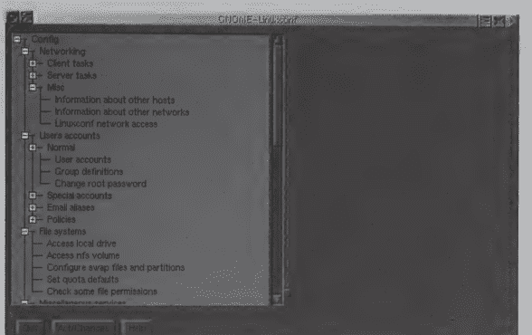

**图 5-8**
Linux 配置工具，即 linuxconf。

#### 添加账户

我们的第一个任务是为机器添加一个账户。

要添加账户，请在左侧列表中滚动。有一个标有“用户账户”的子菜单，您需要将其打开。在其子列表中，点击“常规”标题下方的“用户账户”。此时将显示系统中当前所有用户的列表——您应该能看到您自己的用户账户和 root，以及其他几个用户（其中大多数您可能永远不会使用）。

要添加账户，请点击列表底部的“添加”按钮。将出现一个新页面，包含若干需要填写的提示项，如登录名称、全名、用户组、辅助组、主目录、命令解释程序和用户 ID。**以下是这些类别的简要说明及填写方法：**

- **登录名称** 您的登录名称是计算机提示登录时您输入的名称。最好使用反映您名字作为登录名称。例如，我的登录名称是“emetsger”。John Smith 可能会使用登录名称“jsmith”或“johns”。对于主流互联网用途，奇异的名称或代号通常是不被看好的。因此，将自己称为 jpapafunk 或 llamabo 可能不是一个好主意。
- **全名** 在此处填写您的全名即可。
- **组** 暂时可以保持此处的默认设置。当我们讨论组和权限时，您可能希望回来在此处添加信息。
- **辅助组** 此处也可以留空。
- **主目录** 主目录是存储数据文件的位置。默认主目录是 /home/login（其中 login 是您在上面提供的登录名称）。除非您希望将文件存储在特定位置，否则最好保持此处留空。
- **命令解释程序** 暂时保持默认设置。大多数用户不需要担心需要使用哪种命令解释程序（也称为 shell）。在您熟悉命令行界面之前，您可能不会意识到可用选项之间的差异。
- **用户 ID** 用户 ID 是与系统中每个用户关联的唯一数字。root 用户的 ID 是 0，您不允许将用户 ID 设置为 0。您可以将此留空，Red Hat 将从 500 开始为您编号。一些用户喜欢为自己的个人账户使用特殊数字，如 137 等。如果您希望如此，请输入该数字——只要未被其他用户占用，就可以使用。

完成填写这些信息后，点击“接受”，页面将替换为“更改密码”对话框。**输入**密码并点击“接受”按钮。然后，系统会要求您再次输入密码以确认。再点击一次“接受”按钮以完成用户添加。


唯一必需的两个字段是登录名称和全名。其余页面将显示系统当前用户列表。若要清除此列表，您可以点击“退出（quit）”。不过首先，我们想把您的普通用户添加到 wheel 组中，这样您就可以使用 `su` 命令。

#### 将您的用户添加到 Wheel 组

为了将您的个人账户添加到 wheel 组，您需要在屏幕上显示用户列表。找到您的账户并点击它。这将启动“用户编辑”过程。您会注意到它看起来非常相似——实际上几乎完全相同——与创建用户页面。

为了将自己放入 wheel 组，您应该修改“附加组（Supplementary Groups）”字段。在字段中输入“wheel”，然后点击接受。这就完成了将您的个人账户添加到系统上任何组的操作，而不仅仅是 wheel 组。通过点击“Group (opti)”字段旁边的箭头按钮，可以找到组列表。

既然我们已经将您的用户添加到 wheel 组，账户编辑工作基本上就完成了。点击“退出”关闭用户账户页面。我们的下一个任务是让软驱和 CD-ROM 驱动器支持用户挂载，以便任何用户都可以使用它们。

##### 使驱动器支持用户挂载

在解释具体过程之前，介绍挂载和卸载驱动器的概念是个好主意。当我们安装 Linux 操作系统时，必须为我们创建的每个分区指定*挂载点*，并且我们解释了 Linux 如何将每个驱动器（无论是软驱、CD-ROM 还是硬盘）识别为目录树的一部分。

##### 挂载和卸载驱动器

当您使驱动器可访问时，这被称为*挂载*驱动器。当挂载驱动器时，其上的文件变得可供一般访问（取决于您在挂载驱动器时设置的权限）。相反，当您*卸载*驱动器时，您拒绝访问该驱动器——这就好像它实际上不存在于您的计算机上。

当驱动器是*用户可挂载*时，每个用户都可以挂载和卸载该驱动器。大多数时候，只有使用可移动介质的驱动器，如软盘驱动器、CD-ROM 驱动器或 Zip 和 Jazx 驱动器，才是用户可挂载的。使硬盘用户可挂载将允许任何用户使系统主要文件不可用——这可能导致计算机崩溃。

##### 使驱动器支持用户挂载

这是使驱动器支持用户挂载的过程。

这次，我们在右侧查找一个名为“文件系统（File Systems）”的类别。“文件系统”的一个子主题称为“访问本地卷（Access Local Volume）”。点击“访问本地卷”，右侧将显示一个列表，展示您的所有驱动器和分区；软驱和 CD-ROM 也列在其中，还有您可能安装的 Zip 驱动器和其他设备。

我们要先让软驱支持用户挂载。这是更常用的驱动器之一，并且它也使用可移动介质。这给了我们理由使其支持用户挂载。如果它不支持用户挂载，结果是您的用户每次需要读取软盘内容时都必须要求您挂载驱动器。

软驱的设备名称是 /dev/fd0。这就是系统识别软驱的方式。点击显示该设备名称的行。右侧会出现一个新的对话框；这被称为卷规格页面。

我们对“选项（Options）”选项卡感兴趣。前两个选项卡允许您配置软驱以供使用；由于它已经配置好供使用，我们不想更改这些设置中的任何一个。点击选项选项卡，选项列表会出现；从这个列表中，您应该找到“用户可挂载（User mountable）”。点击它，然后点击接受按钮。如果您希望使其他驱动器对您的用户可用，请对列表中的其他设备重复此过程（例如，CD-ROM、CD 写入设备、Zip 驱动器等）。确保您*不*使硬盘支持用户挂载。

### Linux 配置器的其他功能

到目前为止，我们实际上只涵盖了 linuxconf 的三个不同功能。然而，这是一个极其多功能和强大的系统管理工具。在本节中，我们将介绍 linuxconf 的一些其他常见应用。

Linuxconf 分为两部分：config（配置）和 control（控制）。config 部分允许您修改系统的配置状态。control 部分允许您对系统组件执行若干操作。由于大部分配置都在 config 部分，因此我们只在此处介绍该部分下的子主题。当您浏览 control 部分的每个操作时，它基本上是自解释的。

显然，这不是如何 Linux 配置器使用的逐步指南。实验 Linux 是学习如何使用系统的最佳方式之一，而使用 linuxconf 可以执行的任务数量之多，使得编写简单的指南几乎不可能。

### 网络

通常，您不需要对网络部分进行很多更改。如果您更换 ISP 或发现当前的网络数据已过时，某些设置可能需要更改。然而，这些通常是依赖于服务的，因此您需要技术支持人员或网络管理员来帮助进行更改。

在此类别中，您可能发现方便更改的另一项是 hosts 文件。如果您发现经常使用 telnet 提示符或类似方式访问另一个系统，您可以在 hosts 文件中添加一个条目，这相当于创建某种“别名”。然后，您可以使用该系统的简写缩写。例如，我在本地 hosts 文件中有一行，内容为

```
164.107.42.62  stdsun    stdsun.cis.ohio-state.edu
```

每当我想访问该系统时，我不必每次都输入 "stdsun.cis.ohio-state.edu"，而是可以输入 "stdsun"。

### 用户账户

如果您遇到需要减少系统用户数量、扩大或限制访问权限、或因任何原因禁用账户的情况，您都将在此处完成所有操作。您还可以将用户添加到不同的组，甚至创建新的组供其加入。当然，如果您的系统增长，您也会从这里添加用户。

通过编辑用户首选项，您可以设置命令解释器（shell）、账户过期前的天数（如果某人只需远程从您的计算机获取文件，这很有用）、密码过期前的时间等。

### 文件系统

您在此将关注的大部分信息将与挂载和卸载驱动器或添加新驱动器有关。除非您在 LAN 上，否则您不需要使用网络文件系统（nfs）卷设置。

从这里，您将能够挂载和卸载驱动器，设置文件系统配额（以便用户不会超出其个人目录中的特定空间量），并处理您的交换分区和其他分区。（您会在控制类别中发现其类似项，标记为“挂载/卸载文件系统（Mount/Unmount Filesystems）”。）

### 修改引导加载程序属性

通常建议不要修改引导加载程序属性，因为这样做可能导致系统无法启动。然而，您可能会对用于启动系统部分的标签“linux”和“dos”感到相对厌倦，或者使用启动盘可能变得麻烦。

如果您修改引导加载程序，一旦完成修改且勇气如蜡般融化时，您会有几次机会撤销更改。但是，如果您确实进行了更改，并且结果导致系统无法启动，请确保手边有一个启动盘。如果您双启动，拥有所用操作系统的安装 CD 也会有所帮助。

在本节中，我不会介绍任何安装 LILO 的步骤（如果您一开始没有安装它）。但我会谈谈您将遇到的几个术语。

其中之一是*引导映像*。引导映像是 LILO 用于启动进入 Linux 的信息。通常，Red Hat 的引导映像存储在 /boot/vmlinuz。（因此，当遇到映像选项时，这就是您输入的值。）

另一个重要术语是*主引导记录*。这是主硬盘的第一个扇区。安装在此扇区的是一个非常小的程序，它告诉计算机有关计算机上操作系统的一些信息。引导加载程序（LILO）应该安装到这个扇区中。通常的


### 退出 Linux 配置器

当你完成在 linuxconf 中的修改后，应点击左侧列表下方的“退出”按钮。此时，右侧将出现一个新页面，告知你系统当前状态与配置不同步。随后，linuxconf 将提示你纠正这一情况。

若要接受该提示，请点击“激活更改”按钮。一旦更改被激活，linuxconf 将退出。如果在系统同步过程中出现任何错误，你会收到通知并有机会检查这些错误。根据错误的性质，系统可能会要求你采取某些措施来修复它们，通常包括跳过某个命令或终止某个进程。

### 系统维护

这些操作主要局限于初始系统管理以及一些相对基础的系统维护活动。有关执行升级和其他杂项系统维护的内容将在下一章中介绍，在那里你将了解备份系统、为电脑添加视觉效果以及配置可能添加到电脑中的其他设备。下一章也是你首次使用 su 命令和命令行的地方，尽管关于命令行的全面介绍将直到第八章才出现。

### 继续之前

你需要退出 root 用户账户。由于你的个人账户已被添加到 wheel 组，你不再需要像过去那样频繁使用 root 账户。退出 root 用户账户后，除非该休息了，否则你应该使用个人账户重新登录。下一章主要包含概念性信息，但接下来的一章将向你介绍如何处理文件。

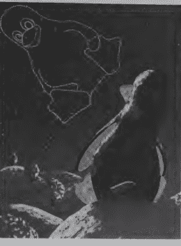

# 第 6 章

## 维护你的系统

随着系统使用时间的增长和使用的增多，它们开始显示出老化和使用的迹象。务必让系统保持“润滑良好”的状态。你可能会对安装新程序和安装新软件包感兴趣，甚至当当前版本变得过于过时时，你可能会考虑升级内核。

为了维护你的系统，你通常需要使用 *root* 用户。然而，如果你以普通用户身份登录时还有其他任务要完成，这可能会带来不便。为了解决这个小问题，有一个名为 *su* 的程序。如果所属组 *wheel* 的成员，否则无法执行“*su root*”。上一章中我们将你的用户账户添加到了 wheel 组，因此现在我们将介绍如何使用 *su* 命令获取 root 用户账户的访问权限。

### 使用终端访问超级用户账户

当你重新登录到你的账户后，现在是开始学习使用超级用户命令的时候了。在你的面板上，有一个形状像终端屏幕的图标。点击它，将出现一个终端窗口。

在终端屏幕中，输入 su。如果你没有正确地将自己添加到 wheel 组，将会显示错误信息。否则，会出现一个提示，看起来像这样：`password:`。输入 root 密码。

当提示符末尾的美元符号 ($) 变为井号 (#) 时，你就知道已经变成了 root。成为 root 后，你可以运行那些通常无法运行的程序。例如，linuxconf 仅限 root 用户使用。在终端窗口中输入“linuxconf”，linuxconf 界面就会出现。

你可能会注意到它的样子与其他用户窗口不同。这是因为 GNOME 和 Enlightenment 认为你是 root 用户，并加载了 root 使用的偏好设置。这包括桌面主题。如果你更喜欢使用森林绿色桌面主题，而 root 使用的是奶酪主题，则由 root 运行的程序将显示为奶酪主题。

现在你可以退出 linuxconf。我们目前没有理由保持它处于打开状态。这只是使用 su 命令使生活稍微变得轻松的例子。你不再需要退出自己的账户、登录 root 账户并修复问题。现在你只需使用 su 即可解决问题。如果你管理的是一个具有许多用户的大型系统，这一点特别有用。

### 对你的系统进行升级

与大多数系统一样，你希望对你的系统进行软件和硬件升级。你可能会发现需要一个新的硬盘驱动器，或者有新版本的 GIMP 可用。也许你的 StarOffice 版本刚刚变得过时了。或者，也许你的显卡在雷暴天气中意外烧坏了。有许多升级系统的理由。

### 硬件升级

Windows9x 开创了“即插即用”设备的概念。换句话说，Windows 会检测到新即插即用设备连接到系统时，确定它是什么类型的设备，并为其安装必要的驱动程序。

Linux 在较新的版本中也实现了类似的功能。当你启动 Linux 时，它会搜索新硬件。这被称为硬件检测过程。它不像 Windows 版本那样精细，但能检测到新硬件。例如，当我在电脑上安装一个新的 Zip 驱动器时，它找到了该设备并确保其设置正确。不幸的是，某些设备无法通过此过程检测到，因此你需要手动设置它们。这个过程通常并不困难；本章将介绍三种非常常见的升级。

#### 声卡

例如，如果你将 16 位声卡升级为 32 位声卡，你需要运行程序 `/usr/sbin/sndconfig`。它将探测电脑中的声卡，并找到后为你进行设置。只要你购买与 Linux 具有 Tier 1 兼容性的声卡，你就不必费心使其在你的系统上工作。

#### 显卡和显示器

显卡和显示器稍微复杂一些，但差别不大。当你安装新的显卡或购买新的显示器时，应该运行程序 `Xconfigurator`。安装程序会运行此程序来配置 X-Window 系统以在你的电脑上运行，因此它可能看起来很熟悉。大多数显卡在 Linux 上运行没有问题，且 `Xconfigurator` 显示出的列表非常广泛。选择你的显卡后，你将有机会找到你的显示器。如果列表中缺少你的显示器，你可能需要设置刷新率和同步率——这些信息可以在随显示器附带的说明书或显示器制造商那里找到。你也可能从你的显示器供应商那里找到这些信息。

密切关注刷新率非常重要。这些参数控制计算机向其显示器发送信息更新的频率。如果它们太低，当显示器刷新时你会看到闪烁；但如果你设置得过高，可能会烧坏显示器，造成不可修复的损坏。

#### 硬盘驱动器

熟悉电脑内部构造的用户知道，安装硬盘驱动器通常不是一个非常复杂的过程。现在的系统会自动检测驱动器的设置，因此你不必手动编辑 BIOS 设置。这消除大多数困难事项。


您的硬盘可能附带有关如何安装它的说明。请遵循这些说明。当您启动进入 Linux 时，您需要使用 root 账户（或视情况使用 su 命令）来格式化驱动器以便使用。请仔细遵循此过程，否则您可能会格式化一个正在使用的驱动器并丢失其上的数据。

**第一步**——要格式化驱动器，您必须使用命令行，并以 root 用户身份登录。X-Windows 中有一个磁盘管理工具，但它不允许您格式化硬盘。（不过，它对于格式化软盘很有用。它位于系统菜单下。）

在命令行中，输入 `dmseg | more | grep hd`（如果您使用的是 SCSI 设备，请将 hd 替换为 sd）。这将列出您系统上的所有硬盘（可能会列出多次）。找到您刚刚安装的硬盘。它将有一个设备名称。如果它是主从硬盘（primary slave drive），它将被称为 hdb（这是我们示例中的假设）。

**第二步**——第二步是运行 `fdisk` 命令。为此，请在提示符下输入 `/sbin/fdisk /dev/hdb`。（如果您使用的不是主从硬盘，请将其替换为我们第一步中显示的相应设备。）将显示一个列出驱动器上当前所有分区的屏幕。如果您刚购买了硬盘，它可能列出了一个分区（如果它是预先格式化的）或屏幕上没有内容。如果它是用过的硬盘，您将不得不删除所有分区。

这些是您应使用的命令键，用于在 `fdisk` 中导航：

-   **h** 按下字母 *h* 将为您提供一个帮助屏幕——这是熟悉 fdisk 的最佳方式之一。每当您不确定要做什么时，都可以使用它。在处理硬盘上的数据时，您再怎么小心也不为过。
-   **d** 如果按下 *d* 键，您将删除一个分区。要删除一个分区，您必须通过在提示符下输入编号来指定要删除哪个分区。
-   **n** 要创建一个新的分区，请按下字母 *n*。系统会要求您提供驱动器格式。默认是格式编号 83，即 Linux ext2 格式。除非您希望为另一个操作系统创建一个分区，否则请使用此默认值。您还将被要求指定希望多大尺寸的分区。驱动器的总尺寸将在提示符上方的表格中提供。应按数字顺序创建分区，因此第一个将是 /dev/hdb1，第二个是 /dev/hdb2，依此类推。
-   **q** 按下 *q* 将导致程序退出而不写入分区表。这意味着实际上不会进行任何更改。
-   **W** 如果您希望将这些数据写入磁盘并使其永久化，必须按大写字母 *W*。

使用这些命令来创建一个新的分区，并删除驱动器上您不需要的任何多余分区。请记住，只对新硬盘执行此操作，不要对包含您想要保留的数据的现有硬盘执行此操作！如果您删除一个分区，您将无法找回数据！

**第三步**——现在您必须在新分区上创建一个文件系统。为此，请在提示符下输入 `mkfs /dev/hdb1`。这是您在设备 /dev/hdb（主从硬盘）上创建的第一个分区。如果您创建了多个分区，则必须对驱动器上的每一个分区使用此命令。

*mkfs* 命令代表“make file system”（创建文件系统）。它类似于 MS-DOS 和 Windows 命令 *format*。它在硬盘上创建 Linux 文件系统。如果您创建的不是 Linux 分区，您将不得不使用为其设计的那种操作系统来格式化它。（在 Linux 下可以创建 MS-DOS、Windows 和其他操作系统的文件系统，但通常使用其各自的操作系统会更好。）

**第四步**——然后您需要确保每次打开计算机时该驱动器都已被挂载。为此，运行 *linuxconf*（可以从主菜单、命令行或在控制面板中点击系统配置按钮进入）并找到“File systems”（文件系统）类别。点击“Access local volume”（访问本地卷）。

点击设备列表底部的“Add”（添加）按钮。然后您需要指定驱动器的挂载点及其格式。完成后，点击接受（Accept）。驱动器将出现在列表中。如果您突出显示该驱动器，则能够对其进行挂载。如果您希望每次计算机启动时都挂载它，请点击标记为“Params”（参数）的选项卡并更改该选项。

然后您可以退出并激活这些更改。

#### Zip 和 Jazz 驱动器

如果您的新硬盘是 IDE Zip 驱动器或 Jazz 驱动器，它将位于第四个分区位置。例如，如果您的 Zip 驱动器是主从 IDE 驱动器，它将被称为 *hdb4*；如果是次级主（secondary master），则将是 *hdc4*。我的在次级从（secondary slave）位置，因此其设备配置文件为 /dev/hdd4。

### 软件升级

除了硬件升级外，大多数用户希望进行软件升级。这些升级可以简单到从互联网安装新软件或使用 GNOME Red Hat Package Manager (GnoRPM)，也可以复杂到升级内核。我们不会在本书中介绍复杂的升级，但我们可以向您指引一些资源，它们将提供比您真正想知道的更多的信息。

### 常规软件与软件包之间的区别

常规软件通常以扩展名为 .gz 或 .tgz 的压缩文件格式提供。用于使这些文件变小的压缩器称为“gzip”，它是流行 PKZip 软件的 GNU 版本。您必须解压此软件，通常还需要解包它（tar 代表 tape archive；它是一个将文件存储在归档中但不压缩它们的程序）才能对其做任何事情。大多数这些程序然后必须在您的计算机上编译。这就是为什么我们建议安装 C 开发库，因为您可能下载的大部分软件都会利用这些库和文件。

另一方面，软件包更容易处理和管理。这些需要程序 GnoRPM 或命令行版本 *rpm*。RPM 代表“Red Hat Package Manager”文件，这是一种只有 Red Hat 才能读取的特殊格式文件。由于 Red Hat 是 Linux 操作系统最流行的发行版之一，您可能能够找到大多数主要软件程序的 RPM 格式。当我们查看如何使用 GnoRPM 时，您会看到为什么使用 RPM 格式文件通常比您在互联网上找到的“tar 包”和“gz 压缩”版本容易得多。

### Tar 包文件；Gz 压缩文件

当您从互联网为 Linux 机器下载软件时，它可能以这种形式提供：程序名称，后跟其版本，后跟发布日期或其他序列号，然后是扩展名 .gz 或 .tgz。.gz 扩展名表示该文件已使用 Zip 的 GNU 版本进行压缩。.tgz 扩展名表示该文件首先使用“tar”程序归档，然后进行了 gz 压缩。（当然，如果您先 tar 包该程序，并不要求使用 .tgz 扩展名。这个命名约定目前还不是完全通用的。）

为了安装这些程序，您必须阅读随包提供的信息。要获取此信息，您必须解压缩文件，如果它是 tar 包文件，还必须解包文件。您可以从命令行轻松做到这一点。

您通常从互联网下载文件到您的主目录。（情况并非总是如此，但这比较安全。）当您在面板上点击终端图标时，您立即进入主目录。如果文件位于您的主目录中（输入 `ls -l | more` 将产生分页的文件列表），您应该输入 `gunzip filename`，其中“filename”是您下载的文件。然后它将显示它正在提取的文件。

如果它提取一个带有 .tar 扩展名的文件，该文件是由 tar 程序创建的。您应该输入 `tar xvf` 来解包归档。它可能会创建自己的目录，其中包含文件。如果您启动 Midnight Commander（输入 `mc`），您可以更容易地导航文件系统。注意解包文件时创建的新目录，并查找该目录中称为 INSTALL（全大写）的文件。它将为您提供安装说明。

这些说明因程序而异；质量也各不相同。通常您可以在互联网上找到常见问题解答（FAQs），如果需要，它们会为您提供一些额外的帮助。

### 使用 GnoRPM

GnoRPM 通常比命令行界面更容易使用。首先，它包含许多易于使用的功能。如果您想从安装 CD 安装特定的软件包（随您的原始 Linux 发行版提供的所有 RPM 都在该 CD 上），这是一个简单的点击操作过程。如果您意识到您从未真正使用某个软件包，并且不想再让它占用您的计算机空间，您也可以轻松地将其移除。此外，您可能知道命令的完整名称（包括路径和命令名称）并想知道它属于哪个软件包——您也可以做到这一点。此外，每个软件包都有一个内置的信息集，包含软件包的简短描述、其字节大小以及包含在软件包中的所有文件的完整列表。GnoRPM 还配备了所谓的“Web Find”（网络查找），该选项将搜索网络上的 RPM 数据库以查找您搜索的特定软件包。


要运行 GnoRPM，请单击主菜单，进入系统文件夹，然后单击 GnoRPM。您将看到与图 6-1 中所示类似的照片。

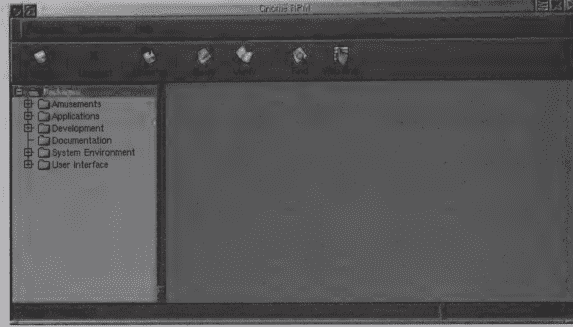

图 6-1  
*GNOME Red Hat 软件包管理器（GnoRPM）*。

列出的软件包组是系统中已安装的软件包。您会注意到窗口顶部有几个您可以按下的图标。我们将依次检查这些图标。

### 安装新软件包或升级旧软件包

- 安装软件包和升级软件包的区别在于，安装会安装您系统中从未安装过的程序。升级会小心地移除旧程序并安装新程序。

如果您想安装一个新软件包，只需单击安装按钮。将出现一个新窗口，其中包含一个空白列表。要将软件包添加到您希望安装的软件包列表中，请单击“添加”按钮。将出现一个新窗口，允许您浏览文件列表。

如果您打算从安装 CD 获取信息，请确保 CD-ROM 驱动器已挂载，以便您可以从中读取。然后，您需要导航到 CD-ROM 驱动器的挂载点。这通常是 /mnt/cdrom。RPM 的位置取决于您的 CD 供应商，但目录通常标记得非常清楚。（寻找全大写的 RPMs 等标识。）

您可以从此处选择要安装的任何软件包。大多数软件包的命名都很规范，这意味着当您查看软件包时，不会疑惑它具体是什么。不过，如果您有疑问，您可以随时查询软件包。

如果您为计算机上已存在的程序获取了一个新软件包，您将希望选择升级选项而不是安装。您将经过相同的选择过程。这与常规安装几乎相同，只不过 GnoRPM 会移除旧程序。

如果您在安装或升级过程中遇到任何错误——例如，某个*依赖项*未满足——GnoRPM 会在您实际安装软件包之前通知您。当尝试安装软件包而未安装该安装所依赖的软件包时，就会发生*依赖项错误*。如果不确定错误，您可以选择中止安装；如果您知道很快就会修正它，则可以选择继续。

#### 移除计算机上已安装的软件包

如果您意识到不再使用计算机上的某个特定软件包，而它可能占用了相当多的磁盘空间，您可能会想要移除它。

如果您突然成为一名 UNIX 专家，您会发现不再需要某些文档。（不建议您执行以下操作——它仅作为一个示例，描述的假设情况是无法实现的。）您一直在大量使用 bind 和 fetchmail，以至于您不必再次思考它们的选项或如何使用它们。

在这种情况下，您可以移除它们的文档。为此，您将打开 GnoRPM。有一个标有“文档”的章节。（在上面的截图中看到了吗？）如果单击文档，您会看到许多形状像盒子的不同图标（这些是软件包）。找到标有 bind 和 fetchmail 的图标。高亮显示第一个，然后单击 GnoRPM 屏幕顶部的卸载图标。然后 GnoRPM 会愉快地移除文档。您可以随意对任何这样的软件包执行此操作。

例如，如果您发现系统中只在使用 bash shell，您可以移除其他所有 shell。（查看“系统环境”。）虽然通常不建议这样做，因为它不会为您节省大量空间，并且会剥夺未来用户的选择权，但这是完全可能的。

#### 查询软件包

如果您对系统中已安装的软件包的内容、大小或描述感兴趣，应右键单击它，然后单击“查询”选项。您将了解关于软件包的信息，其中包含哪些文件，以及它占用多少空间。

注重空间的用户可能希望定期审查系统中安装的软件包，并决定是否需要它们。如果您碰巧发现某个软件包您不希望保留，请按照上述列出的移除软件包的说明操作。

#### 验证软件包

如果您认为软件包中的某些文件缺失或损坏，您可以选择验证软件包。右键单击相关软件包并单击“验证”一词。GnoRPM 将依次检查软件包中包含的每个文件，以确保日期和时间戳匹配，并且软件包中列出的所有文件已安装。

如果您最近感染了病毒或遇到了一些硬盘损坏，您可能希望验证那些表现异常的软件包。

#### 从文件中查找软件包

在进行例行的系统维护时，您可能会发现一个程序或其他文件，您相信它不再被使用。然而，有时很难知道哪个软件包包含该文件。务必记下文件的完整名称（即完整目录和文件名）。然后您可以单击 GnoRPM 中的查找按钮。

将出现一个新窗口，询问文件名。输入完整名称，如果有包含该文件的软件包，它将返回该软件包。例如，尝试输入 /bin/bash。

#### Web 查找

GnoRPM 更出色的选项之一是“Web 查找”选项。如果您发现想要安装或升级一个您本地没有的软件包，您可以使用 Web 查找搜索互联网。

例如，如果您听到一个广泛的传闻，说 GIMP 已更新并包含了一些您可能喜欢使用的新插件，您可以在出现的搜索窗口中输入 *gimp*。将出现所有包含 gimp 一词的软件包列表，您可能会找到您正在寻找的确切内容。

一旦找到您需要的内容，您可以查询软件包、安装它或升级它，方式与从 CD 或其他磁盘安装相同。

### 稳定版与不稳定版

通常，程序更新频繁发布，但正如我们之前指出的，程序中通常有许多 bug，尤其是在早期阶段。如果软件发布版本具有非常少的 bug 或稳定性问题，则被称为稳定版本（或冻结版本）。如果它仍然包含许多主要 bug 或运行不稳定，则被称为不稳定版本。

最好始终使用稳定版本的软件；这将防止问题最终出现在您的软件中。如果您对查看软件改进感兴趣，请确保您已备份较早的版本。然后安装较新的不稳定版本，查看差异。

### 备份

您会发现您的 Linux 系统极其稳定，且很少遭受病毒和其他许多运行 Windows 的计算机所遭遇的灾难。（每月创建的数百种病毒中的大多数是针对运行 Windows9x 的系统。大多数制造新闻的电子邮件病毒针对使用 Microsoft Outlook 作为默认邮件程序的计算机。）

然而，定期备份数据是谨慎的。您可能希望使用 Zip 驱动器或磁带备份系统来保护您的数据，但存在另一种选择，我将简要讨论。（您将在互联网上找到更多关于此的信息。）

这就是所谓的 RAID 磁盘阵列。RAID 磁盘保护有六个级别，每个级别具有不同的特征。较小的系统可能会很好地利用 RAID-1 磁盘阵列，它使用一种称为*镜像*的过程来保护文件。

RAID-1 磁盘阵列要求您拥有要保护的磁盘数量的两倍。当您写入一个磁盘时，相同的数据会自动写入镜像磁盘。

使用 RAID 阵列既有优点也有缺点。它是确保不丢失数据的一种非常安全的方式。如果一个硬盘因“中暑”（过热并丢失数据）而受损，另一个磁盘就是随时可用的备份。不幸的是，它相对较慢——两次写入数据消耗的时间大约是写入一次的两倍。


设置 RAID-1 阵列相对容易，但你需要为你的电脑配备一块专用扩展卡，以及两块大小大致相同的硬盘。如果你打算使用 RAID 磁盘阵列，请务必将扩展卡和第二块硬盘的费用相加计算总成本。通常，其总成本大约等同于一个 2GB 磁带备份系统。

### 添加装饰元素

在第三章中，我们讨论了如何为 Enlightenment 配置主题或获取新主题。此外，你还能获取其他一些装饰元素，例如额外的屏幕保护程序或小程序。装饰元素有时被认为浪费时间，但它们能改善桌面的外观。大多数用户会发现它们非常有用，尤其是当你更换主题以匹配心情时。

除此之外，你偶尔还会希望为系统上的其他用户添加一些主题，因此你并非完全只为自己工作。额外的小程序和屏幕保护程序也没有坏处。

### 主题

主题的主要来源是 www.themes.org。当然，你可以通过网络搜索找到其他来源，但 themes.org 拥有约 2000 个主题，可直接下载和安装。在 themes.org 上，你可以找到强大的搜索功能，从而准确找到你正在寻找的内容。

由于 GNOME 的默认窗口管理器是 Enlightenment，你需要下载与 Enlightenment 兼容的主题。这些主题在 themes.org 上拥有自己的独立网站，即 e.themes.org。或者，你可以直接点击 themes.org 主页上的“Enlightenment”字样。

当你找到想要安装的主题时，你需要下载它。通常，Netscape 会询问你希望将下载的文件保存到哪里。如果你希望为系统上的每个用户安装主题，必须将其放置在 themes.org 所谓的“全局仓库”中——这是一个所有人都可以访问文件的位置。在 Red Hat Linux 中，这个全局仓库位于目录 /usr/share/enlightenment/themes 中。

下载文件时，应将其保存至该目录。如果无法直接保存，你需要将文件从当前目录复制到主题目录。

你还应确保文件的权限允许所有人使用。你可以通过文件管理器查看文件属性来更改这些权限，或者使用下一章中详述的方法。

如果你希望独自保留一个主题，应将其保存在你自己的 .enlightenment/themes 目录下的相应子目录中。在这种情况下，你通常不需要更改权限，也不需要以 root 身份下载主题或处理所有权或权限问题。

#### 小程序

如果你想获取更多小程序，www.gnome.org 可能是一个很好的来源；它是 GNOME 的网页。

从 GNOME 的网页上，你应该能够通过点击左侧的“获取更多软件”链接来下载新软件。将出现一个软件地图，允许你在各种类别中搜索，例如娱乐、系统、核心等等。

这些文件大多经过 tar 压缩和 gzip 压缩，因此你需要确保阅读并理解本章中“Tar 压缩文件；Gzip 压缩文件”部分的内容。每个软件包都附带安装说明，下载后你可以自行阅读。

#### 以此类推 . . .

你会发现，作为管理员，你需要执行许多其他任务。但你也会发现，通过定期检查并小心处理系统以避免误操作，你的 Linux 机器将在你拥有它的期间完美运行。

# 第 7 章

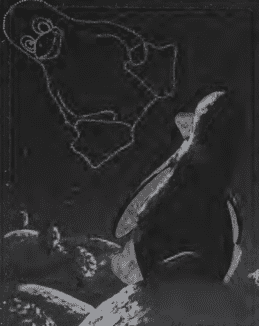

## 管理你的文件

随着大部分设置的完成，是时候开始管理你的文件了。作为这台计算机的所有者，你实际上是 Linux 系统的系统管理员。你应该能够快速且有效地解决问题。为此，你需要深入了解文件系统和文件层次结构标准（缩写为 FHS）。在本章中，你应该学习文件系统是如何工作的——即文件是如何被引用和识别的，如何使用 Linux 附带的用于处理文件系统的一些工具，以及日志或配置文件等特殊文件的位置。

### 文件系统结构

对于 MS-DOS 用户来说，文件系统（有时缩写为“fs”）比 Windows9x 用户更熟悉。Microsoft 在 DOS 中借鉴了 UNIX 的许多设计，因此许多约定是相似的。然而，没有 DOS 经验的用户不需要去习惯这些差异。

#### 文件浏览器

文件浏览器相对简单易于使用。按钮直观，设计易于理解。我们不需要对此多说太多，但我们在下面包含了一张屏幕截图以及一些关于各项功能的信息。

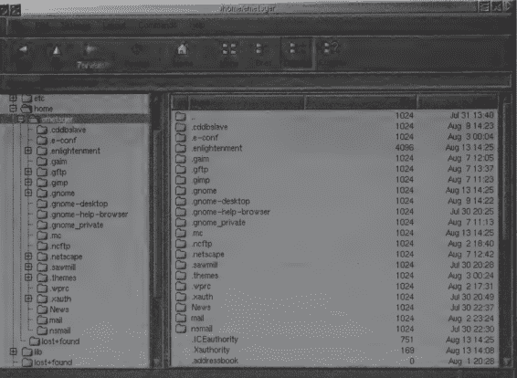

**图 7-1**
*你的文件管理器看起来大致是这样。*

前五个按钮与 Netscape 等网页浏览器上的类似。“后退”按钮会将你带到之前使用的目录。“向上”按钮会将你带到目录树中的上一级，“前进”按钮会带你从当前位置回到你按下“后退”按钮之前的位置。“主页”按钮会显示你的主目录，“重新扫描”按钮会在你对涉及的文件进行了更改时刷新显示。

也许更有趣的按钮是标有*图标*、*简要*、*详细*和*自定义*的那些。这些按钮控制文件在系统中的显示方式。如果你不需要了解文件的详细信息，可以保留图标显示。点击其他三个按钮会显示更详细的视图。（它们占用的空间也比图标少，因此你一次可以看到更多文件。）

如果你想改变文件浏览器的操作方式，可以通过“首选项”菜单进行设置。首选项菜单也很直观，通常不需要更改。因此，我们将不再深入讨论文件浏览器，而是更仔细地研究你在其中看到的文件和目录。

要启动文件浏览器，只需双击桌面上方的“主目录”图标即可。

#### 文件

Linux 中的文件像其他操作系统一样具有多种用途。Linux 系统具有一些其他操作系统中不存在的特殊类型文件，正如其他操作系统中也有其特有的文件一样。在学习文件系统中的文件时，我们将了解其中的一些文件及其他文件。

#### 命名约定

Linux 中的文件名通常不包含空格。单词通常由连字符 (-) 或下划线 (_) 分隔。文件名通常由文件名和*标识扩展名*组成。扩展名由一个句点加三个或四个字母表示。

例如，如果你拍了阳台的照片并通过扫描仪将其载入系统，该文件的名称可能是“deck.jpg”或“deck.jpeg”。文件的格式是 JPEG——一种特定的图片格式。旧的 DOS 约定允许文件名有八个字符，扩展名有三个字符，因此 JPEG 被缩写为“jpg”。UNIX 系统没有采用这些限制，因此 JPEG 文件通常使用 .jpeg 扩展名。

常见的扩展名包括 .txt 或 .text（文本文件），.htm 或 .html（超文本标记语言文件），.jpg 或 .jpeg（JPEG 图片文件），.gif（图形交换格式文件），.tif 或 .tiff（标签图像文件格式），.mpg 或 .mpeg（MPEG 文件格式），以及其他。许多系统管理员创建带有 .d 扩展名的目录，以明确表明它们是目录，而不仅仅是文件。

UNIX 中的文件名可以包含 127 个标准 ASCII 字符中的任意一个。这包括空格和一些特殊转义字符，但建议不要在命名文件时使用空格或那些转义字符。如果你在命令行访问包含空格的文件名时，通常必须使用单引号来读取该文件。（当我们讲到命令行界面时会详细说明这一点。）

文件名长度最多可达 256 个字符。Linux 是一个区分大小写的操作系统，因此 Filename.txt 与 filename.txt 不同，FILE-NAME.TXT 与 FileNaMe.TXT 也不同。

### 纯文本与二进制格式

纯文本文件是那些可以在纯文本编辑器中打开并阅读的文件。二进制文件是非纯文本文件。二进制文件不仅包括程序，还包括图像、HTML 文档、电影、声音文件和一些系统文件等。

人们通常认为*二进制文件*一词仅指可执行程序。事实并非如此，尽管你的 Linux 系统会将程序存储在名为 /bin、/usr/local/bin 或 /sbin 等目录中。Bin 是 binary（二进制）的缩写。

### 扩展名与关联

在 Windows 中，甚至是早期的 Windows 3.1x，各种扩展名都与程序相关联。例如，如果你有一个能打开所有已知图像格式的程序，你会将 .jpg、.jpeg、.gif、.tiff、.png、.xbm 等扩展名与该程序建立关联。每次你双击其中一个扩展名的文件时，与之关联的程序都会尝试打开它。

GNOME 也是如此。（这在**命令行**中不会生效。）然而，在 GNOME 中，关联被称为“MIME 类型”。你可以通过点击面板上的控制中心图标（工具箱）来查找这些 MIME 类型的列表。控制中心中有一个标记为“MIME Types”的类别。如果你点击它，将显示一个列表，你可以添加、编辑或删除任何关联。


这些 MIME 类型中有一些用于与 Internet 交互，因此编辑时请谨慎。Netscape 会用其自身的定义覆盖你的定义，但其他程序可能不会。如果你修改它们，可能会损害程序读取数据的能力。

大多数你安装的程序在安装时会包含其自身的 MIME 类型定义，因此你不需要经常创建或编辑它们。

扩展名很重要，因为这是 GNOME 识别你希望打开何种文件的方式。如果你只是将一两页之前的图片文件命名为“deck”并双击它，GNOME 将不知道使用什么程序来打开它。（不过，它会询问你希望用什么程序打开该文件。）通过将其命名为“deck.jpeg”，你告诉 GNOME 你希望使用 Electric Eyes（或其他图像查看器）打开该文件。

### 隐藏文件

通过在文件名前加一个句点（.）可以隐藏文件。许多系统文件是隐藏的，因为通常你不需要自己编辑或删除它们。由于你可以为文件设置访问权限，因此无需隐藏文件来防止其他用户读取它们。如果你不经常使用某些文件，且不想在目录列表中看到它们，那么隐藏文件很有用。

如果你创建了一个名为“test.txt”的文件，可以通过将其重命名为“.test.txt”来隐藏它。

### 创建文件

你拥有多种程序可用于创建不同类型的文件。例如，GNUMeric 是一个电子表格程序。GEdit 是一个文本编辑器，允许你创建自己的文本文件。GIMP 允许你创建自己的图像。要创建文件，只需打开一个文件编辑器（任意类型），修改文件，然后保存即可。

### 删除文件

要从文件浏览器中删除文件，应右键单击该文件，然后单击“删除”。GNOME 内置了一项称为交互的安全措施——你必须单击“是”以表示希望删除该文件。这确保你不会删除想要保留的文件。

当单击删除时，请确保你确实想要删除该文件。此操作无法撤消，除非你在其他地方制作了备份。没有“回收站”来帮你挽回。

### 目录

Windows9x 用户将目录称为“文件夹”。在此上下文中，目录一词指的是文件列表。*目录*一词在计算机环境中有多种用途。例如，它可以指邮件列表，或你的地址簿。

#### 你的主目录

你的主目录是存储大部分文件的地方。GNOME 会将配置文件的桌面布局存储在你的主目录中。Enlightenment 也会将配置存储在你的主目录中。如果你在 Netscape 中启用“配置概况”，你的用户配置概况将存储在你的主目录中。你创建的任何文件都应存储在你的主目录中。

你的主目录对于系统运行来说也相对不那么重要。这意味着你可以对它进行一些实验，而不会危及系统的其余部分。并且由于你可能没有安装太多软件或创建太多文件，即使你删除了一些文件，损失也不会很大。

你的主目录位于 /home 目录下的你的用户名目录中。root 用户的主目录位于 /root。

如果你查看桌面，那里有一个标记为“主目录”的图标。如果双击它，文件浏览器将出现并直接跳转到你的主目录。该文件浏览器与 Windows 资源管理器非常相似，因此习惯使用它应该不成问题。它支持多种不同的文件操作（复制、移动、删除、属性等），你可以根据需要对其控制程度进行调节。

还有几种不同的查看样式——你可以从非常基本的图标视图到非常详细的视图进行选择，或者创建自己的自定义视图。当我们查看一些文件属性时，你可能希望同时打开此窗口。

#### 其他目录

显然，还存在许多其他目录。你可以自己创建一些目录来存储脚本或信件。

但是，还有一些特殊的目录你应该了解。当我们讨论文件系统层次标准时，我们会更多地讨论这些目录。

#### 路径

对于新接触文件系统的用户来说，*路径*可能是较难理解的概念之一。路径是一系列目录。然而，它不像目录将文件分组那样将目录分组为一个系统。相反，路径存储在*环境变量*中。环境变量是每次登录到系统时都会定义的一个设置。

路径告诉计算机在哪里查找命令。每次你想运行一个命令时，都要输入目录和命令名称（例如 `/usr/games/Fortune`）会很繁琐。只需输入“fortune”并让一个有趣的消息弹出来要容易得多。我们要做的是将目录 `/usr/games` 添加到路径中。

需要注意的是，Linux 不会搜索当前目录来查找命令。这与 MS-DOS 路径约定略有不同，MS-DOS 会搜索当前目录以查找命令。当你在命令行界面中时，应使用以下语法从当前目录运行命令：`./commandname`。“./”告诉 Linux 你希望使用当前目录。

当我们在查看 Linux 系统上的特殊文件时，会讨论如何设置路径。

#### 目录树

你会听到目录被称为*目录树*。文件系统组织成目录树。你可能会在自己的家谱中找到一个恰当的类比，尽管目录树略有不同，因为它只需要一个*父目录*拥有一个*子目录*或*子目录*。父目录可以拥有无限数量的子目录，就所有实际目的而言。

你的目录树的每个“分支”由前向斜杠 (/) 分隔。根目录是目录树的开始，由简单的前向斜杠 (/) 表示。不要将此与 root 用户的主目录混淆，后者由 /root 表示。

这意味着每个目录至少有两个名称。一个是父目录称呼它的名称。例如，你可能在你的主目录中创建一个名为“test.d”的目录。你的主目录——父目录——将该目录视为 test.d，但系统将该目录视为 /home/username/test.d。（Username 是代替你的用户名的通用术语。）当你尝试在命令行中更改目录时，除非你位于某个子目录的父目录中，否则通常必须使用该目录的系统名称。

目录具有递归性质，因此“祖父目录”可以通过先命名其父目录，然后命名子目录来访问某个子目录。例如，你发现需要在稍早创建的 test.d 目录中添加另一个目录。你将这个新目录命名为 another_test.d。如果你在你的主目录中，可以通过将其命名为“test.d/another_test.d”（当然，不包括引号）来访问你刚刚创建的目录。

当我们查看从“当前目录”运行命令时，我们注意到当前目录被赋予通用名称“./”。任何当前目录都可以用此名称称呼。任何父目录也可以用通用名称称呼：“../”。

文件浏览器的图形用户界面 (GUI) 很好地展示了目录树，尽管它没有解释在系统级别发生了什么。当你开始更多地使用命令行界面时，系统级别的操作变得更加重要。届时，目录树会更熟悉。

### 隐藏目录

目录的隐藏方式与文件相同，通常这是针对包含系统文件的目录进行的。如果你更喜欢使用名为 elm 的基于文本的电子邮件程序，它会在你的主目录中创建一个名为“.elm”的目录。

如果你希望隐藏一个目录，请将其重命名并在开头加一个句点。


### 创建目录

你可以通过多种方式创建目录。我们稍后会讨论命令行选项。正如我们在定制 GNOME 以符合你喜好时所讨论的那样，你可以直接在桌面上创建新目录：右键点击桌面，高亮显示“新建”，然后点击“目录”。

你也可以从文件浏览器中创建新目录。要做到这一点，请确保你位于希望创建子目录的目录下。（注意，你必须拥有目录的写入权限才能在其中创建子目录。通常，你只对自己的主目录拥有写入权限。）点击顶部的“文件”，高亮显示“新建”。点击“目录”。提供相关信息，系统将为你创建一个新的目录。

### 删除目录

你可以像删除文件一样删除目录——右键点击相关目录，然后点击“删除”。这是一个交互式过程——你必须告诉 GNOME 你确实想要删除此目录。

同样，在删除目录时要谨慎——你无法撤销此操作。

### 挂载点

Linux 比较有趣的特性之一是，每个挂载点都被识别为一个目录。当你挂载磁盘或使用分区时，你通过系统目录来引用它。在 Windows 和 DOS 中，这是通过使用“驱动器字母”来实现的。每个磁盘都与一个字母相关联，并且拥有等同于 Linux 机器上根文件系统的对应物。

在某种程度上，微软的这项发明是方便的。文件存储通常更容易理解且可读性更强。然而，Linux 系统的优势在于它对用户是完全透明的。这允许你包含来自几乎任何位置——甚至其他计算机——的挂载点，而用户无需知道文件的具体位置。它呈现了一种易于理解的系统视图，几乎不需要了解系统硬件的外部知识。这是一个非常具体的设计原则，旨在让用户无需深入了解系统即可使用它。

### 特殊文件

Linux 使用了多种不同类型的特殊文件。通常，你可能需要修改这些文件以设置某些偏好，例如你的路径。

#### RC 文件

我们要讨论的第一组文件被称为“RC 文件”，得名于它们通常拥有的扩展名或后缀。这些文件的示例包括“.bashrc”、“.pinerc”、“.cshrc”以及其他文件。

RC 文件通常控制程序或你的 shell 的偏好。Pine，一个基于文本的邮件程序，会读取一个名为 .pinerc 的控制文件来设置偏好，例如消息宽度、引用标记、你的真实姓名、你的域名以及许多其他选项。文件 .bashrc 通过设置环境变量来控制 Bourne-Again shell (bash) 的运作，这些变量包括路径、终端类型（或仿真）、用户定义的别名和命令，以及许多其他选项。（Bash 是 Linux 用户的默认 shell。）

让我们检查一个包含路径语句的 .bashrc 文件示例，并逐行剖析它：

```
PATH=$PATH:$HOME/bin::/bin:/usr/contrib/bin:/usr/bin:$HOME:
$HOME/bin/c:/usr/sbin:/usr/local/bin:/usr/local/lib/interlink/bin:/usr2/home/help/bin:/usr/games
export PATH
```

当在语句中使用变量时，你使用美元符号 ($) 来引用它。当设置变量（如 PATH）时，不使用美元符号。因此 PATH=$PATH 表示“将路径设置为其已有的值”。如果你不想丢失预设路径，这很有用。

路径中列出的每个目录都由冒号 (:) 分隔。你通过完整的系统名称来指定路径中的每个目录。

主目录的变量称为 $HOME。这是一个预设变量，通常无法更改。在使用命令行时，此变量的简写形式是波浪号和正斜杠 (~/)。

因此，当我们编写 PATH=$PATH:$HOME/bin 时，我们将路径设置为旧路径，并添加主目录中的 /bin 目录。你可以用同样的方式分解这些不同的目录中的每一个。

export 命令是你可以从命令行运行的命令，但可能不会经常使用。就我们的目的而言，我们将通过 .bashrc 文件或类似文件使用它，尽管如果需要，你也可以使用它来设置其他变量。export 命令告诉计算机执行的操作是最终确定设置。它将确保你的路径已设置。

如果你不确定要在路径中放入哪些其他目录，请遵循以下说明。随着你对系统越来越熟悉，你很可能自己会弄清楚。但你可能根本不需要以任何方式修改你的路径。当 root 用户安装更多程序时，如果他未在 .bashrc 文件中定义路径，他可能需要修改全局路径——即分配给每个用户的路径——以便用户可以使用他安装的程序。此文件通常位于 /etc/bashrc。

要编辑你的 .bashrc 文件，你需要打开你的主目录。很可能文件浏览器未设置为显示隐藏文件，因此你需要更改偏好设置。

要更改偏好设置，点击“编辑”。在编辑菜单的底部有一个方便标记为“首选项”的选项。点击它。此屏幕上的第一个选项卡处理文件显示方式；点击“显示隐藏文件”以显示隐藏文件。然后点击 OK 或 Accept，你的主目录可能会显示更多内容。（如果你希望停止显示隐藏文件，可以遵循相同的程序。）

更改偏好设置后，将出现更长的文件列表。双击名为 .bashrc 的文件。当出现询问使用哪个应用程序编辑文件的窗口时，你应该打开标记为“应用程序”的文件夹并点击“GEdit”。GNU 编辑器将显示，其中包含你的 .bashrc 文件的内容。你可以随心所欲地编辑此文件。

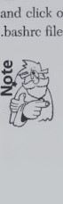

.bashrc 文件仅由 Bourne-Again shell 使用，而非其他 shell。存在许多不同的 shell（如 C Shell、Korn Shell、限制 shell 等），它们各自使用不同的 RC 文件来设置环境变量和其他偏好。由于默认 shell 是 bash，我们提供了编辑其 RC 文件的方法。你可能会在目录中看到 .cshrc 或 .kshrc 等文件——这些可能是其他 shell 的文件。

#### 配置文件

还有其他配置文件。这些通常带有 .cfg 或 .conf 扩展名。大多数全局配置文件位于 /etc 目录中。你会在这里找到 LILO 的配置文件，文件名为 lilo.conf。如果你使用 lynx web 浏览器，你会在 lynx.cfg 下找到其配置文件。

知道这些文件的存在很重要，但同样重要的是，如果不理解文件内容及其编辑含义，不要编辑它们。如果你搞砸了（技术术语为“损坏”或“FUBAR”）lilo.conf，你的计算机可能无法正确启动。如果没有启动盘，将不可能进入系统。

全局配置也在此处。例如，如果你的用户未设置自己的路径，你会在此目录中找到提供全局路径的 RC 文件。这些文件通常不是隐藏的。例如，全局 .bashrc 文件列在 .bashrc 下。

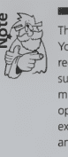

/etc 目录包含系统运行所需的大多数文件。你可以作为 root 用户和普通用户探索此目录，因此使用普通用户查看文件内容（有些文件不可访问，如用户列表或密码文件）并进行探索。这将最大程度地降低损坏 Linux 系统运行所需文件的风险。当你需要修改文件时，使用 root 用户并极度谨慎。通过复制配置文件并添加 .bak 扩展名来备份配置文件。

#### 锁定文件

锁定文件是 Linux 用来检查你是否同时运行某个程序多次的特殊文件。当你运行一个程序时，会为该程序创建一个锁定文件。如果你挂起该程序或试图再次启动它，你会被告知该程序已在运行。

这些通常存储在 /tmp 目录中，并在你退出程序或杀死进程时删除。你第一次遇到锁定文件可能是在使用 Minicom 时。如果调制解调器正在使用中或未正确重置，当你试图启动程序时会收到一条消息，说“/dev/modem is locked”。


### 文件层次标准

文件层次标准，简称 FHS，是一套规范某些包含重要信息的目录名称的系统。计算机行业需要更多的标准化来弥补成员之间教育背景的差异。通过标准化大多数主要文件的存放位置，所有系统管理员，无论其教育背景或 Linux 或 UNIX 理解程度如何，都有一个具体的地图，知道文件需要放在哪里。

这为较新的管理员提供了一个指南，使他们可以规划系统布局；资深管理员会欣赏标准的规律性。

标准本身相当冗长且复杂。然而，我们将在此提供一个简要摘要，并提供更多参考资料供您查阅。

-   /bin /bin 目录包含可供所有用户使用的程序文件。这些文件通常被认为是“必需的”。
-   /boot /boot 目录包含启动加载器使用的静态文件。安装系统时，您可能希望为此目录创建一个分区——这将为这些文件提供额外的保护。
-   /dev 您的所有设备文件都存储在 /dev 目录中。这些设备范围广泛，包括硬盘、SCSI 设备、CD-ROM、软盘驱动器以及许多其他设备。
-   /etc FHS 称此目录为“主机特定配置信息”。这是存储大多数用于系统的配置文件的地方。conf 文件和 rc 文件都位于此目录中。这些通常是全局配置。
-   /etc/X11 您的 X-Window 系统配置文件存储在此目录中。
-   /etc/opt 安装商业程序时，其配置文件存储在此目录中。
-   /home 用户目录存储在 /home 目录树中。这在 FHS 中标记为“可选”，但大多数 Linux 用户都希望拥有它。如果您使用的是单用户系统，可能不希望包含它。
-   /lib /lib 目录存储共享文件和内核模块。（正如一位演员所言，内核是您操作系统的“大脑”。）这些文件是必需的。用户通常不会直接访问这些文件——而是由他们使用的程序进行访问。（例如，GIMP 广泛使用存储在此目录中的 GTK+ 库。）
-   /mnt 这是临时文件系统挂载点的目录。
-   /opt 您通常在此处存储商业程序。
-   /proc 进程和内核信息存储在此目录中。一些用户可能希望为此目录创建一个分区。
-   /root 这是 root 用户的家庭目录；它是可选的。（大多数 root 用户不会得到太多个人关注。）
-   /sbin 系统程序文件曾经存储在 /etc 目录中。现在它们存储在 /sbin 目录中（代表“系统二进制文件”）。
-   /tmp 系统将利用此目录来存储临时文件和锁文件。
-   /usr 大多数用户文件存储在此处。/usr 目录树拥有自己的层次结构。（您可以在书末列出的 FHS 网页上阅读相关内容。）
-   /var /var 目录保存重要的系统信息，如日志或缓存文件。/var 目录也有自己的层次结构，列在 FHS 网页上。

这只是关于组织文件系统文件层次标准的一个简短摘要。您可能不需要自己创建这些目录中的任何一个，但当您想要将目录添加到您的路径中时，这些信息是有用的。

安装 Linux 时，您还可能会发现，其中一些文件，例如存储在 /boot 目录中的文件，对系统至关重要。一些用户会为这些文件创建额外的分区。（/boot 目录的分区需要大约十六兆字节。）

### 使用 Midnight Commander

Midnight Commander 是一个基于文本的文件管理工具。除非您发现自己频繁使用命令行，否则您可能不太会用到它。这是一个功能极其强大的工具，拥有多种选项。

目前，您可能只需要关注 Midnight Commander 的导航原理。仅此一点就能让您利用许多不同的选项。它还能让您轻松访问并尝试操作您的系统。

启动 Midnight Commander 时，您会在屏幕的左右两侧看到两个窗口。它们是相同的。要在这些窗口之间切换，请按 Tab 键。通过这种方式，您可以同时维护两个不同的文件列表。

要在文件列表中向上或向下移动，请使用向上和向下箭头键。当您要进入一个目录时，按 Enter 键。父目录由我们在本章前面提到的 `../` 表示；当前目录由 `./` 表示。

在屏幕底部，列出了数字 0–9。这些对应于“F 键”，即键盘顶部标记为 F1–F12 的键。您可以使用每个 F 键来执行相关任务。（每个数字旁边都有一个操作，例如复制、删除、查看等。）

要从命令行启动 Midnight Commander，请输入 `mc` 并按 Enter 键。

### 总结

虽然我们并没有涵盖 Linux 文件系统的每一个方面，但本章提供了对该系统的简要介绍。大多数用户可能不需要更多信息——其他人可能对深入学习感兴趣。您可以通过互联网上的各种页面找到很多您寻求的信息。请务必查看书的末尾以获取更多信息。

您总是可以通过实验来了解更多关于文件系统的内容。使用您自己的用户身份时，损坏系统通常比较困难，所以尽情玩乐并探索一下吧。您无法删除除自己文件以外的任何文件，所以不必担心在文件系统中四处乱跑。

# 第 8 章

## 命令行界面

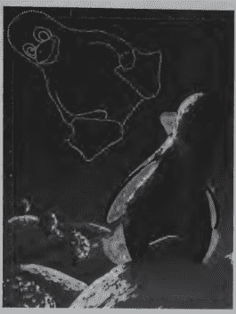

在这本书的大部分内容中，我们都大量提到了命令行，现在是时候退后一步仔细审视一下它了。大多数用户会觉得命令行界面相当枯燥、乏味且复杂。然而，有一些命令无法在 X-Window 系统内部运行，而必须在终端窗口中运行。您可能会发现，命令行不仅仅是极客黑话或晦涩的技术术语。它可以真正有用且有趣。嗯，至少是有用的。

命令行界面通常对大多数用户，甚至一些更熟练的 UNIX 用户来说，似乎相当技术性且困难。但理解其概念很重要，因为这会让你在使用它时感到更舒适。俗话说，“知己知彼”。

首先，让我们介绍一下终端，因为这就是你与命令行交互的方式。

### 什么是终端？

终端有时被称为“控制台”。（当我们安装 Linux 时，有一个组件叫做“console multimedia” [控制台多媒体]。该组件包含可从命令行播放声音文件和电影的程序。）您会发现，终端和控制台这两个术语的使用并不精确。

确切地说，定义终端并不是最容易的任务。通过网络连接到计算机的显示器被称为终端。您的图书馆可能使用这些终端来维护其卡片目录数据库。

“终端”一词也经常作为“终端仿真”的简写使用。终端仿真基本上是一个键盘“映射”，远程计算机使用它来确保您在键盘上输入的内容就是您在屏幕上看到的内容。（它之所以被称为映射，是因为它映射出键盘上的按键，以便终端知道当您按下诸如 Tab 键等按钮时如何反应。）此类终端仿真的例子包括 VT-xxx（52、-100、-202、-220 等）、ANSI 和其他。最常用的是基于文本的终端 VT-100。

我们一直在“终端”这个词的语境中使用它，指允许您访问命令行界面的窗口。这有时被称为虚拟终端，因为您实际上并没有在网络上的物理终端上，就像我们在上面描述图书馆网络时提到的那些终端一样。

除非另有说明，否则您应假设我们在提到“终端”一词时，使用的是最后的定义，即虚拟终端。

### 什么是命令行？

在使用命令行之前，从概念上了解它是什么以及它能为您做什么会很有帮助。提供一份命令列表并说“这就是它们的作用，现在去玩乐吧”相对简单。但您可能会从这种例子中学到很少，而且通常先了解一下你要面对的是什么再开始行动会让人更舒适。

所以，我们现在想指出关于命令行的一些事情，比如它实际上是什么以及我们要用它做什么。稍后我们将看看为什么即使它看起来如此晦涩且可怕，您还想要使用它。

“命令行”这一术语用于描述您与计算机之间的界面。它之所以被称为“命令行界面”，是因为您输入指令——


在屏幕的*一行*上提示命令。这一行适当地被称为*命令行*。

这就是命令行*是*什么。你能用它*做*些什么则是另一回事。你使用命令行界面与计算机交互；当光标静静地在那里闪烁时，计算机正在等待指令。这些指令以命令的形式给出。每个命令都有一个名称并执行特定的任务。你会发现用于控制文件列表、修改文件、删除文件、创建文本文档、比较两个文件等的命令，等等。你会发现告诉你正在运行的程序、磁盘大小以及众多其他管理活动的程序。你会发现帮助你导航文件系统或查找其他命令的程序。这个列表几乎是无休止的，命令行的功能也是如此。

### 如何使用命令行

当你点击面板上的终端图标时，会出现一个新窗口，顶部有一个提示符，看起来像这样：`[ emetser@ localhost] ~ $`。这被称为*命令提示符*。

你在提示符处输入命令来与命令行交互。由于我们已经处理过 Linux 的安装及其许多方面，你已将命令行用于多种目的。例如，你使用命令行来设置调制解调器和声卡。

现在是时候熟悉一些在 Linux 中更常见的命令了。这些不会让你成为优雅的系统管理员或 UNIX 专家，但你将能够更熟练地导航你的系统。

### 命令列表

| 命令名称 | 选项 | 描述 |
|---|---|---|
| apropos | [command] 或 [part of command] | 这将为你输入的命令或关键字查找 man 手册页。 |
| cat | [filename] | 这代表“concatenate”（连接），此命令会将文件输出到屏幕。 |
| cd | [directory] | 这代表“change directory”（改变目录）。不言而喻。 |
| cp | [source] [destination] | 此命令将源文件复制到其目标位置。该目标可以是另一个文件或目录。（如果你指定一个目录，文件名将保持不变。） |
| df | | “df”代表“diskfree”（磁盘空闲）；此命令将提供每个硬盘分区上空闲空间量的摘要。 |
| du | [directory] | “du”代表“disk usage”（磁盘使用情况），它告诉你特定目录及其子目录在硬盘上占用了多少空间。 |
| elm | 参见 elm 手册页 | 这是一个基于文本的电子邮件程序，具有许多功能。它功能强大，但没有其他程序那么用户友好。 |
| emacs | [filename]；参见 emacs 手册页 | Emacs 是一个相当用户友好且功能强大的文本编辑器。 |
| find | 参见 find 手册页 | Find 是一个方便的实用程序，可以在指定的路径和文件规格中搜索文件。 |
| gzip/gunzip | 参见 gzip -help | 这是流行的 ZIP 压缩程序的 GNU 版本。它将压缩和归档文件。 |
| halt | 参见 halt 手册页 | 这将停止系统并将其带入单用户模式。如果你需要进行系统维护并且不希望其他用户登录系统，这将很有用。 |
| less | [filename] | 在通俗用语中，“less”是“more”的自然反义词。然而，这只是另一个分页程序。它会将文件逐页输出到屏幕。 |
| ls | -1, -a, -F, -C, [filespec] [directory] | “ls”将列出当前目录中的文件。列出的选项绝不全面，但它们通常用于显示长列表、所有文件或格式化输出。你也可以将它们全部一起使用：ls -laFC 等同于 ls -1 -a -F -C。 |
| man | [command] | “man”代表“manual”（手册）。此程序将为你输入的命令查找手册页（man page）。 |
| mc | | “mc”代表 Midnight Commander（午夜指挥官）。此程序是一个功能强大、易于使用的命令行文件浏览器。 |
| mkdir | [directory] | 此程序将在命令行上创建具有你指定名称的目录。 |
| more | [filename] | 此命令将文件逐页输出到屏幕，以便阅读。 |
| mount | -t [fs type] [device] [path] | mount 命令将类型定义为 [device] 设备配置文件中的 [fs type] 的驱动器挂载到挂载点 [path]。 |
| mpg123 | [filename] | 这是一个从命令行播放 MPEG 音频文件（.mp1, .mp2, .mp3）的程序。 |
| mv | [source] [destination] | 此命令将源文件移动到你指定的目标位置。你可以使用此程序重命名文件。 |
| pico | [filename]；参见 pico 手册页 | Pico 是一个用户友好性非常高的文本编辑器。 |
| pine | 参见 pine 手册页 | Pine 是另一个功能丰富的基于文本的电子邮件程序。它非常用户友好。 |
| reboot | | 这将重启计算机。在使用 reboot 命令之前，请确保已卸载所有使用可移动介质的驱动器。 |
| rm | [filename]；参见 rm 手册页 | 这将从你的计算机中删除文件。有几个选项经常与 rm 命令一起使用，因此请阅读手册页以了解你应该使用哪些选项。 |
| rmdir | [directory] | “rmdir”删除目录。 |
| shutdown | | “shutdown”完全关闭计算机，将其断电。 |
| startx | | 如果 X-Window 系统突然关闭，startx 是将其重新启动的命令。 |
| su | [username] | “su”允许你成为超级用户或由 [username] 指定的其他用户。除非你以超级用户身份运行 su，否则你必须输入密码。 |
| tar | x, v, f, z, c；参见 tar 手册页 | “tar”代表“tape archive”（磁带归档）。这是一个创建文件归档的程序。虽然最初设计用于磁带备份系统，但它也适用于硬盘和软盘。 |
| touch | [filename] | “touch”将创建一个具有给定文件名且大小为零的文件。 |
| umount | [device] 或 [mount point] | “umount”将卸载设备，前提是给定设备名称或挂载点。 |
| which | [filename] | “which”将在路径中搜索文件名。 |
| Xconfigurator | | 当你安装新硬件时，Xconfigurator 将帮助你配置它。你应该在安装新的显卡或监视器后运行此程序。 |

我选择列出的选项绝非全面。这些命令可能非常强大，你应该小心使用。如果你不确定如何使用某个命令或某个命令做什么，只需输入 man [command] 来查找该命令属性的摘要。（然而，有些命令没有 man 手册页。）记住，除非你以 root 身份登录（或通过 su 命令使用超级用户），否则你通常无法严重损坏系统，所以稍微实验一下。在最坏的情况下，你只需要备份你帐户中的数据文件并重新创建它。

你会发现最有用的命令之一是 man。任何时候你在使用命令行且不知道某个命令做什么或它接受哪些选项时，都可以使用 man 命令来查找。如果你不确定确切的命令是什么，但知道它能做什么，使用 apropos 命令来查找关键字对应哪些 man 手册页。

### 管道

管道是我们用来描述重定向程序输出的术语。这意味着你采用一个程序的输出并将其用作另一个程序的输入。一个多余的例子是在命令 cat mylog.txt | more 中。（这是多余的，因为使用 more mylog.txt 会产生完全相同的效果。）concatenate 命令不会逐页断开文本流，但 more 命令会；所以我们采用 cat 的输出并通过管道输入到 more。这产生与我们单独使用 more 命令相同的结果。

`|` 符号是所谓的管道。（因此称为 piping。）还有其他管道符号。以下是简要总结：

- `<[filename]` 此管道将采用 filename 的内容并将其用作输入。这在你想调试程序的情况下特别有用。
- `> [filename]` 此管道采用程序的输出并将其放入文件；如果文件已存在，这将覆盖文件。
- `>> [filename]` 此管道与上一个做同样的事情，但不会覆盖已存在的文件，而是追加到文件中。
- `| [command]` 正如上面讨论的，此管道采用一个命令的输出并将其用作另一个命令的输入。


一个涉及管道（pipes）的命令行示例可能如下所示：

```
mycommand < inputfile | nextcommand >> output
```

这条命令会获取 `inputfile` 的内容，并将其用作 `mycommand` 的输入。然后，我们将该输出获取并用作 `nextcommand` 的输入，并将结果追加到文件 `output` 中。

### 在后台运行进程

UNIX 是第一个真正的多任务操作系统。它允许你在后台运行一个程序，同时启动另一个程序进行处理。这使人们能够在编辑文档时查找文件，或在编写另一个应用程序时调试程序。

要在后台运行命令，只需在行末添加一个和号（&）。例如，

```
find / -name myfile* -print >> filesearch &
```

这将搜索从根目录开始、名称中包含 "myfile" 的所有文件，并将结果打印到一个文件中。通过在行末添加和号，你指示计算机将此任务作为*后台进程*运行。在查找文件的同时，你可以执行其他任务，例如编辑文件或计算电子表格中的数值。你可能还希望在工作时听音乐；在后台运行 mpg123 程序可以让你做到这一点。

### 命令行与你的计算机的关系

当我们讨论文件系统时，我们提到了文件层次结构标准（File Hierarchy Standard）作为一种确切知道某些文件和目录所在位置的方法。虽然没有规定建立命令行与计算机之间关系的具体方法，但确实存在一种特定的层级顺序（pecking order）。

你的计算机处于层级顺序的顶端；它控制电力的分配并执行程序赋予它的任务。它是你系统的最基本层级。在计算机之后是*操作系统*，它为计算机中的设备提供与计算机本身交互的方式。它还允许通过命令等形式进行外部交互。它通过命令解释器或 shell（壳）来实现这一点。你通过命令行与 shell 进行交互。

命令行实际上是那个*命令解释器*或 shell 的功能。“命令解释器”这个术语更具描述性，因为 shell 实际上做的是解析命令，以便操作系统能够理解它们。然后，操作系统会通过连接到计算机的设备将命令发送到计算机，计算机随后将执行请求的任务，并利用操作系统和 shell 输出任何结果。

你通过命令行与操作系统直接或间接地交互。例如，X-Window 系统依赖于 shell 来执行其自身的命令。如果 X-Window 系统曾中止并将你带回到 shell 提示符，你会注意到屏幕上有很多命令（以及可能还有很多错误消息）。因此，即使你通过图形用户界面（GUI）（如 X-Window 系统）来处理 Linux，你也在间接使用命令行界面。

你可以将我们对终端窗口访问命令行的方式比作 Windows 9x 中的 DOS 模式或提示符。然而，与 Windows 不同，Linux 使用了众多不同的 shell。这允许用户选择他们希望使用的命令解释器，并坚持了 Linux 世界所基于的定制和选择的理念。Red Hat Linux 默认使用的 shell 是 Bourne-Again Shell (bash)。其他 shell，如 C Shell（由 C 程序员使用并开发，名为 csh）、Korne Shell (ksh)、Bourne Shell (sh)、Z Shell (zsh) 等等，被全球数百万 Linux 用户所使用。其中最受欢迎的三个是 bash、csh 和 ksh。

这些 shell 之间的区别在于它们如何解释你发送给 shell 的命令。一些 shell 还附带特殊功能。例如，C Shell 主要被希望利用其特殊环境的程序员使用。

在你更熟悉如何指挥命令行之前，最好继续使用 bash。

### 重新审视权限

Linux 中更有用的命令之一是 `chmod` 命令。它是一个可以更改任何文件权限的程序。我们之前曾简要讨论过它，以学习使用计算机的基本知识。现在我们希望在一个更完整的上下文中检查它。

我们之所以结合命令行来审视组和权限，是因为这是大多数人修改权限和组的方式。这也将帮助你更习惯使用这个界面。

确保你处于终端窗口中。我们首先要做的实际上是创建一个文件，这样你就有东西可以做一些实验了。

#### 创建一个文件

要创建一个文件，我们将使用像 Pico 这样的文本编辑器。（真正的 UNIX 爱好者会告诉你 Pico 是一个糟糕的编辑器，因为它太容易使用了。真正的 UNIX 行家使用 vi。我不推荐给初学者。）在提示符处输入 `pico` 以运行 Pico。将出现一个空白屏幕，底部列有一些命令，顶部有一个 NEW BUFFER 的标题。只需输入你想要的内容即可。无意义的话也可以，特别是在你的大脑因过多的 Linux 工作而变得浆糊状之后。

当你输入完毕后，按下 `^X`（control-x）。Pico 会询问你是否要保存文件，如果是，你想给它起什么名字。目前请使用类似 "myfile" 的名称。这是我们示例中使用的文件名。

一旦你按下 `^X`，Pico 就会消失，你将被带回提示符。现在是时候开始玩弄权限了。

#### 查看文件权限

如果你在提示符处输入 `ls -l`，你将获得一个更新的文件列表。在你的文件中应该有一个新文件，它可能看起来像这样：

```
-rw-r--r--  emetmger   wheel myfile
```

目前，文件权限设置为所有者可以同时读取和写入文件。所有者组（wheel）的成员可以读取文件，系统上的其他所有用户也可以读取。

如果你写了一份备忘录，比如说给 wheel 组中即将进行一些管理工作的人，出于安全目的，你可能想要拒绝非 wheel 组用户的访问权限。

你可以通过两种不同的方法更改权限，一种使用数字，另一种使用字母。我们将主要查看数字格式，而不是字母格式，因为字母相对冗长。数字方便得多，并且在实际上使用起来相当简单。

在我们之前使用 "myfile" 的示例中，我们新建文档的权限将是 644。第一个数字适用于文件的所有者，因此所有者对 myfile 的权限级别为 6。第二个适用于所有者的组，因此 wheel 组的权限级别为 4。第三个适用于其他所有人。

这三个数字是由每个用户的权限值相加组成的。例如，读取位（read bit）的值为四，写入位（write bit）的值为二，执行位（execute bit）的值为 一。

让我们对数字 644 做一些数学运算。六由二和四组成（2+4=6）；因为二意味着你有写入访问权限，四意味着你有读取访问权限，所以六意味着你两者都有。四个相对简单；它们都意味着你有读取访问权限。任何类别中的零意味着该类别中的用户对文件没有任何权限。

#### 更改权限

要更改权限，我们将使用 chmod 命令。chmod 的语法如下：

```
chmod permissions filename
```

命令和文件名相对容易理解。另一方面，权限可能会给你造成一点麻烦。我们之前关于 myfile 的示例表明，这是一份我们不想让任何人随意读取的备忘录；这意味着我们需要从文件中移除其他所有人的读取权限。

你应该输入的是：

```
chmod 640 myfile
```


该命令将授予所有者对该文件的读和写权限（6），授予其所在组读权限（4），并取消其他人的所有权限（0）。

要完全习惯使用数字来表示权限，需要一定的练习，因此我们将提供一份常用权限列表，以便在需要时查阅参考。

### 权限列表

以下是一些常用权限：

- **700** 用户拥有所有权限（读、写和执行），其他人对该文件没有任何权限。
- **744** 用户拥有所有权限，其他人可以读取该文件。
- **544** 用户可以执行和读取文件，但不能修改（写入）；其他人可以读取该文件。这通常是用于不会更改的脚本的权限。
- **644** 用户可以读写文件，其他人可以读取。这可能是最常见的设置，通常也是新创建文件的默认设置。
- **600** 用户可以读写文件，其他人对该文件没有任何权限。
- **775** 用户和组可以读取、写入和执行该文件；其他人可以读取和执行该文件。这对于需要偶尔修订的维护脚本非常有用。

既然我们已经讨论了更改权限，我们也来看看更改文件的组和所有权。有时，为了既保护文件又确保其到达预期受众，这是必要的。

### 更改文件的组所有权

myfile 的既定用途是面向管理组的备忘录，但其分组属于 wheel。为了确保管理组（即 administration 组）中的每个人都能读取该文件，我们需要更改文件的分组。

为此，我们使用 chgrp 命令。目前，myfile 的文件列表看起来应该像这样：

```
-rw-r---- emetsger wheel myfile
```

我们需要将组从 *wheel* 更改为 *admin*。我们要使用的命令语法如下：

```
chgrp group filename
```

正如你所见，这是一个相当容易使用的命令。只需输入命令（chgrp），然后输入你希望将文件分配给的目标组，最后输入文件名本身。在我们的例子中，这将变为 *chgrp admin myfile*。更新后的 *myfile* 文件列表看起来将像这样：

```
-rw-m---- emetsger admin myfile
```

现在我们已经更改了分组，也许顺便更改文件的拥有者也很方便。这将防止你对文件进行无法撤回的修改，并且正如我们的示例所示，它还可以让文件看起来像是来自系统管理员（即 root），而不是普通用户账户。

### 更改文件的拥有者

要更改文件的拥有者，请使用 *chown* 命令。该命令的语法是 *chown owner filename*。你会使用此命令将文件分配给另一个用户。

当你自己创建那些应该看起来像是来自 root 的备忘录时，这非常有用。在上面的示例中，你应该输入命令

```
chown root myfile
```
以将文件分配给 root 用户。这意味着你将不再保留该文件的所有权权限：除非你使用超级用户更改文件的所有权，否则这是无法撤销的操作。

这就引出了下一个想法：使用 root 来更改文件的所有权。当执行随机的系统管理任务时，你会发现创建了许多文件，删除了其他文件，等等。其中一个常见的任务往往是清理已满的邮箱。基于文本的邮件程序将无法打开该邮箱，因为消息太多，所以你将不得不在删除邮箱后创建一个新的。然而，如果你创建了一个由 root 拥有的邮箱，那么为你创建该邮箱的用户将无法访问它。你必须将邮箱的所有权从 root 更改为所有者。

其中一些管理任务可能会变得单调乏味，这正是下一个主题发挥作用的地方。你可以使用所谓的 *shell scripts*（Shell 脚本）来自动化某些任务。

### Shell 脚本

DOS 批处理文件迷将会很高兴地得知，他们可以使用 *shell scripts*（Shell 脚本）重温一些美好的回忆。对于那些不太熟悉 DOS 称王而其他一切均为异端的黄金时代的朋友，让我们稍微看看批处理文件。

如果你运行 Windows，你可能熟悉 C:\ 目录中的 autoexec.bat 文件。这是一个每次计算机启动时自动执行的文件（因此称为“autoexec”）。其对应物是 .bashrc（或者你的 shell 在登录时执行的任何其他文件）。autoexec.bat 文件的作用是在你启动计算机时运行几个程序或检查。它可能会安装一个终止并驻留程序（TSR 程序）来检查病毒，或者安装一个名为“doskey”的程序，该程序允许你翻页浏览你输入过的命令列表。它还可能确保每次输入 dir 命令时文件列表都已排序。

然而，你也可以创建自己的批处理文件来执行其他任务。一个流行的文件叫做“move.bat”。移动文件涉及将文件从硬盘上的一个位置复制到另一个位置，然后从第一个位置删除它。6.0 之前的 MS-DOS 版本没有 move 命令；你必须手动将文件从一个位置复制到另一个位置，然后删除它。（move 命令复制文件然后删除它。）一些用户，包括我自己，发现缺少 move 命令有点烦人，因此我们创建了一个执行相同任务的批处理文件。

你可以在 Linux 中做同样的事情。这被称为 *shell scripting*（Shell 脚本编写）。Shell 脚本语言功能非常强大，也可能很复杂。然而，我们将在这里创建一个简单的 Shell 脚本。

首先，确保你正在使用终端。你会看到上面提到的终端提示符，不过提示符中显示的是你的用户名，而不是我的。

第二项任务是创建一个目录来存储脚本。在提示符处输入 `mkdir bin`。如果你输入 `ls`，你会发现你的文件列表中现在有了 `bin/` 目录。

然后在提示符处输入 `pico`。

这是你第一次在命令行界面中看到文本编辑器。这个文本编辑器被称为 Pine Composer（简称 pico）。它是一个相当用户友好的文本编辑器，至少与其他编辑器（如 vi 和 emacs）相比是这样。如果它看起来简陋且难以使用，别担心。我们将一起导航操作它。

在空白窗口中输入 `ls -FC`。这是我们希望执行的命令。

按 Ctrl-x。（这意味着按住 CTRL 键并按 x 键。这通常缩写为 ^X。）会出现一个提示，询问你想如何命名该文件。你应该输入 `bin/l`。当你按回车时，它将保存文件并退出 Pico 编辑器。

现在你又面对提示符了。输入 `l`。你会看到你的第一个 Shell 脚本的成果——你会看到一个分为三列的文件列表，文件和目录清晰区分。这是一个方便的文件。当你看完结果后，输入 `exit` 退出终端。

这是你对 Shell 脚本编写的第一次尝试。实际上，我们所做的非常简单，用处也不大。编辑你的 .bashrc 文件并包含 `alias ls='ls -FC'` 一行会容易得多，这将创建一个 *alias*（别名）。别名只是一种替换形式；每次你输入“ls”时，计算机都会用“ls -FC”替代它。

然而，现在你可以看到可以玩转 Shell 脚本。查看本书末尾的资源部分，你会发现一些 FAQ，它们会让你在 Shell 脚本编写领域得到更多了解。Shell 脚本可以变得非常长且复杂，功能远超我们刚才所做的，所以不要把它视为小事。

### 其他命令行任务

在介绍了权限和 Shell 脚本编写之后，当你进行一些系统管理或只是闲逛寻找娱乐方式时，你会发现还有一些其他有用的事情。


### 文件和目录操作

如果你没有尽可能多地使用 Midnight Commander（它通常比以常规方式导航目录更容易），你需要知道如何删除文件和目录以及创建目录。

有几个命令我们希望了解一下：`cd`、`ls`、`rmdir`、`mkdir`、`mv` 和 `cp`。这些命令将允许你导航目录树并操作其中的文件和目录。

确保你在终端中。第一步是查看你的目录里有什么。要获取文件列表，输入 `ls`。将会显示一系列文件和目录，不过它们是以短格式显示，而不是我们上面看到的长格式。如果你想将文件区分开来（可执行文件会用星号标记；目录以正斜杠结尾），你可以输入 `ls -FC`。这将强制列表适应列格式（C）并产生格式化输出（F）。

这是你的文件列表。我们在本章的权限部分创建了一个名为“myfile”的文件——它应该列在这里。它差不多在浪费空间，所以我们想删除它。如果你将该文件的所有者更改为 root，你将不得不将其改回为你自己的用户。（输入 su。然后按照上述更改文件所有者的步骤操作。完成后输入 exit。）

一旦它又是你的文件，或者如果你一开始就没有更改过所有者，我们就可以删除它。要删除文件，你使用 `rm` 命令。其语法如下：`rm [options] [filename]`。这里我们没有选项，所以我们只需输入 `rm myfile`。你不会收到文件已被实际删除的确认。所发生的只是你会看到另一行空白出现。（不过，如果文件不存在，你会收到相应的错误消息。）要查找文件是否存在，你必须查看另一个文件列表。

现在让我们做点稍微更令人兴奋的事情。嗯，也许稍微令人兴奋一点。许多用户想要保存他们在互联网上看到的图片或他人通过电子邮件发送给他们的图片。如果你收到的图片足够多，把它们都保留在主目录里是相当愚蠢的——它们会堵塞你的文件列表，使你难以知道存储了什么。为了解决这个问题，我们将创建一个 pictures 目录。

为此，我们将使用 `mkdir` 命令；其语法如下：`mkdir [directory]`。只需输入 `mkdir pictures` 即可创建该目录。

与 `rm` 命令一样，你会发现没有收到目录已被实际创建的确认。因此，你需要进行另一次文件列表以确保它确实存在。（它会的，别担心。）

为了进一步举例，假设暂时你的父亲发送给你很多他希望你存储在你系统上的图片，而他正在重新格式化他的硬盘——这些信息是他不想丢失的，但还不足以证明使用磁带备份或类似手段是合理的。你可能想创建两个 pictures 目录来存放他的图片和你自己的图片，因此你将使用 `mkdir` 命令来实现这一点。然而，现在你原来的 pictures 目录可能命名不当——你希望将其重命名为“mypictures”。

这正是 `mv` 命令的作用所在。`mv` 命令的语法是 `mv [ source ] [ destination ]`。此命令不仅重命名文件，还可以移动它们。两者的语法相同。要将当前的 pictures 目录重命名为“mypictures”，你会输入 `mv pictures mypictures`。同样，你不会收到确认，但你可以执行目录列表以确保目录已正确重命名。

所以，你从你爸爸那里收到了这些图片，并创建了一个名为“dads\_pictures”的目录来存放它们。但是，当你收到它们时，你将它们保存到了你的主目录，现在那里有很多图片需要复制到“dads\_pictures”目录。这里要使用 `cp` 命令。Cp 是“copy”（复制）的缩写，其语法如下：`cp [ source ] [ destination ]`。`cp` 和 `mv` 命令之间的区别在于，`mv` 在将文件复制到目标位置后实际上会删除原文件。

要移动所有扩展名为 .jpg 的文件，我们使用所谓的*通配符*。通配符用于替代与你传递给命令的参数匹配的其他所有字符。在这种情况下，我们将所有扩展名为 .jpg 的文件传递给命令 cp。通配符是星号 (*)，我们用计算机术语将“所有以 .jpg 结尾的文件”写为“*.jpg”。

因此，让我们将所有扩展名为 .jpg 的文件复制到我们创建的“dads\_pictures”目录中。为此，输入 `cp *.jpg dads_pictures`。没有实质性的确认表明这成功了。然而，与我们查看过的一些命令不同，使用简单的 ls 命令无法证明我们完成了工作。

要查看“dads\_pictures”目录中的文件，你需要输入命令 `ls dads_pictures`，而不是仅仅输入 `ls`。如果目录中有文件，那么你就知道你做对了，一切正常。

但如果你执行常规的文件列表，你会注意到你复制的文件仍然在那里，占用空间并让你烦恼。我让你这样做有两个原因。首先，是为了让你更多地练习使用 `rm` 命令。其次，是为了展示为什么人们如此喜欢 `mv` 命令。（要删除这些文件，输入 rm \*.jpg。）通过使用 `mv` 命令，你可以同时复制文件并将其从源位置移除。

如果你在本课中创建了一些目录，并且认为你不再需要它们，你可以用两种方法删除它们。第一种，也是你很可能更经常使用的一种（因为它更安全），是 `rmdir` 命令。要使用它，语法是 rmdir \[ directory]。另一种方法是使用带有 -r 命令行选项的 `rm` 命令。其语法是 rm -r \[ directory]。这是一种更危险的方法，因为它会搜索目录并删除其中的所有文件及其后续子目录。如果目录中仍有文件或子目录，`rmdir` 命令将不起作用，有时这会很令人烦恼。这解释了为什么 `rm` 版本的使用如此普遍。

## 8 命令行界面

### 挂载驱动器和分区

到目前为止，我们只从 GNOME 挂载和卸载驱动器或分区。虽然这个过程非常简单——只需使用磁盘配置实用程序——但你也可以相当容易地从命令行完成它。如果你希望从常规用户账户挂载驱动器，你可能会发现命令行版本更有用。重新登录到 root 以使用磁盘配置实用程序充其量是令人烦恼的。

要从命令行挂载驱动器，我们将使用 `mount` 命令。`mount` 的基本语法如下：mount -t \[ type\] \[ device\] \[ mount point]。Linux 支持几种不同类型的驱动器。以下是一个不完整的列表及其描述：

- **ext2** 这是基本的 Linux 文件系统。所有在 Linux 下格式化的较新驱动器都将使用此文件系统。
- **ext** 这是旧的 Linux 文件系统——它现在已废弃，因此只有在你有较旧的 Linux 驱动器需要挂载时才会使用它。
- **vfat** 使用 FAT32 分配表的驱动器，例如在 Windows98 和 2000 下格式化的驱动器，或 Windows NT 4.0 及更高版本。
- **msdos** 与 MS-DOS 兼容并使用 FAT16 分配表的驱动器应使用 msdos 类型挂载。
- **hfs** 想要挂载其 Macintosh 计算机驱动器的用户应使用 hfs 文件系统。
- **iso9660** 这是你用于 CD-ROM 或 CD 刻录设备的类型。

这些是你将使用的更常见的类型，但你也可以使用 minix、bsd 和许多其他类型。甚至支持 OS/2 格式。

在类型之后是设备。设备只是存储在 /dev 目录中的一个设备配置文件。我们在第二章讨论了 IDE 和 SCSI 设备的命名，当时我们谈到了分区摘要类别。如果你不确定你的系统上有哪些设备是活动的，你可以随时运行磁盘配置实用程序或 linuxconf 来查找。

挂载点通常是存储在 /mnt 目录中的一个空目录。例如，你的软盘驱动器的挂载点是 /mnt/floppy。对于 CD-ROM，它是 /mnt/cdrom。你应该为你希望挂载的各种驱动器创建目录；例如，我的 Windows 磁盘挂载在 /mnt/win。

让我们过一遍挂载驱动器的过程。我将使用我计算机上的一个驱动器作为例子。我双系统启动，这意味着我在同一台计算机上运行 Red Hat Linux 和 Microsoft Windows 98。当我使用 Red Hat 时，我有几个来自 Windows 的数据文件我仍然喜欢摆弄，所以为了利用它们，我必须确保我的 Windows 驱动器已挂载。

要从命令行做到这一点，我首先确保我是超级用户（通过使用 su 命令）。然后我输入 mount -t vfat /dev/hdb1 /mnt/win。这翻译过来是：“挂载一个类型为 vfat 的驱动器，其设备配置文件存储在 /dev/hda1，挂载点为 /mnt/win。”几秒钟后，挂载点增加了一个目录树，其中包含了我 Windows 驱动器上的所有信息。

这是一个简单的过程，尽管你可能需要一点时间才能习惯。如果你想查看当前挂载了哪些驱动器，只需输入 mount，不带任何参数。将会显示设备和挂载点的列表。如果你想卸载一个驱动器，你将使用 umount 命令。`umount` 命令比 `mount` 命令更容易使用，你会很快注意到这一点。`umount` 的语法如下：umount [ device ] 或 [ mount point ]。


因此，如果我想卸载之前刚刚挂载的驱动器，只需输入 `umount /dev/hdb1` 或 `umount /mnt/win` 即可。就是这么简单。

### 终止进程

所有程序都有可能会“挂起”，即停止运行或冻结。在 Linux 中，处理这个问题有两种方法。第一种是右键单击相关程序，然后点击标记为“nuke”的选项。这会向该程序（以*进程*形式运行）发送一个“kill”信号，使其立即终止。

第二种方法是在命令行中执行。不过，我们需要使用两个命令来完成。第一个是 `ps` 命令。这是一个较老的命令（你可以从它这么短这一点看出端倪），全称是“list processes”（列出进程）。

每次在 Linux 计算机上运行一个程序时，它都会被分配一个数字。这被称为其进程号（process number），当使用 `ps` 命令列出所有进程时，你会看到一系列数字，后面跟着正在运行的命令。这个列表可能看起来像这样：

```
PID      TT     TIME     COMMAND
11008    p1     0:00.12  -bash (bash)
11037    p1     0:00.21  slirp -P
11040    p6     0:00.12  -bash (bash)
11139    p6     0:00.02  ps
```

PID 是进程 ID 号。TT 是 TTY 的缩写，它告诉你当前在哪个终端上。（我分别在 tty1 和 tty6 上运行着进程。）STAT 表示正在运行的程序的状态——你其实不需要太担心这一点，但 `ps` 的手册页（man page）会告诉你这些字母和符号的含义。TIME 是进程占用的 CPU 时间，COMMAND 则显示正在运行的是哪个命令。

以举例为目的，假设我的 `slirp -P` 挂起了，且无法通过常规终止命令停止。为了终止它，我会使用 `kill` 命令。`kill` 命令的语法如下：`kill [ -#] [ pid]`。如果你不想指定 `kill` 级别，可以省略，但它确实有用途，我们在终止 `slirp` 进程后会讲到。pid 是进程 ID 号；在这种情况下，pid 是 11037。因此，要终止该进程，只需输入 `kill 11037`。随后进程将终止，`slirp` 将不再运行。

与 `kill` 命令关联的数字（语法中的 `[-#]`）用作“终止信号”。终止信号可以告诉进程如何终止。此外，终止信号比普通的 `kill` 命令更具“破坏力”，因此如果你发现某个进程无法终止，可以使用更强的终止信号来杀死该进程。

最常用的终止信号是 `-9`，它不仅用于杀死你指定的进程，还用于杀死该进程派生的所有子进程；换句话说，你正在杀死父进程及其子进程。在我上面的进程列表中，这是我通过 telnet 连接到我的 ISP 获取的，你可能注意到我运行了两次 `bash`。当你运行一个命令解释器时，你也正在该解释器中运行程序。因此，我正在运行的 `bash` shell 的一个子进程可能就是下面提到的 slirp 命令。

为了同时杀死它们，我会输入 `kill -9 11008`。这意味着“杀死进程 ID 11008 及其下面派生的所有进程”。这包括 slirp 进程，即 11037。

除了使用这两个命令 `ps` 和 `kill` 之外，你还有另外两个程序可以使用——`top` 和 `gtop`。`Gtop` 是 `top` 的 `GNU` 版本，它以图形方式运行——它可能更易于使用，你会发现在其便利性上可能优于命令行版本。

`Top` 不过是一个美化版的 `ps`。它会列出计算机上当前运行的所有进程。如果你愿意，可以查看单个用户或同时查看所有用户。你可以终止进程，对它们进行*renice*（更改其优先级），并查看它们如何消耗系统资源。`top` 和 `gtop` 都是非常有用的工具，你可能会更喜欢用它们来操作进程，而不是使用 `ps` 和 `kill`。

### 让 Minicom 可供所有人使用

我们提到的关于使用命令行的第一点内容是在第五章，当时我们提到 `Minicom` 是那些拥有基于文本的互联网或 BBS 连接的用户的替代连接程序。不幸的是，在安装 Red Hat Linux 后，除了 `root` 之外没有人可以使用 `Minicom`。如果你的系统上有许多用户，或者你只是想能够拨入基于文本的连接，你应该遵循此步骤以便让每个人都能使用 `Minicom`。

要做到这一点，你必须拥有 `root` 权限。如果你使用的是个人账号，可以使用 `su` 命令变为 `root`。

你应该做的第一件事是在提示符下输入 **minicom -s**。这会告诉 Minicom 以设置模式启动。你需要将设置保存到一个 .dll 文件中。出现的文本菜单中有此选项。使用方向键在列表中移动，当你读到写着“Save config as a .dll”的项时，按下回车键。然后你可以退出 Minicom。

下一步是确保所有用户都能读写调制解调器设备。为此，在提示符下输入 **chmod 766 /dev/modem**。这告诉计算机允许所有人读写调制解调器设备，并赋予所有者（即 root）完整权限。

然后输入 **exit** 以退出超级用户环境。你应该已回到你的普通用户状态。为了确认，输入 **whoami**。你的用户名应该会显示出来。如果没有，请输入 exit 并再次检查。重复此过程，直到你自己的用户名显示出来。

然后，你应该能够运行 Minicom，要么在命令提示符下输入命令 **minicom**，要么从主菜单的“Internet”子菜单中运行它。

### 为什么使用命令行？

由于这些内容目前可能对你来说还很陌生，你可能会问命令行界面的作用是什么。除了显而易见的理由——X-Window 系统需要它才能运行——当然，命令行界面也非常有用。

你对命令行越熟悉，你在系统管理方面的效率就越高。你还将能够把 X-Window 系统中的操作与命令行上的相同命令对应起来（例如查找文件，或编辑一些网络设置）。

与通过标准点击方式添加用户或编辑系统配置文件相比，命令行更偏向技术层面，但当你熟练地使用命令行后，你会发现使用命令行进行某些更改比使用 X-Window 系统花费的时间更少。

使用命令行的另一个好理由是，它是 X-Window 系统失败时的备用措施。在极少数情况下，你可能会在系统某处发现一个 bug，导致显卡暂时无法正确渲染 X-Window 系统的 GUI 环境。通常只需输入 startx 即可解决问题，但如果你需要重启或编辑 /etc 目录下的配置文件，你应该知道如何操作。

此外，我们不应忘记，有些命令不能仅从 X-Window 系统运行，必须从命令行运行（例如 Xconfigurator，或某些控制台多媒体程序）。

### 结语

同样重要的是，你要感觉在实验命令行界面时很自在。你甚至可以创建一个测试账号用于实验目的；只要你不要使用 root 账号，你就不会对系统造成严重损害。

实验是学习如何使用你的 Linux 系统的最好方法之一。有些步骤是现成的，不需要即兴发挥；但其他步骤可能需要更具创造性的处理方式，你可以总是进行一点实验来看看事物究竟是如何工作的。

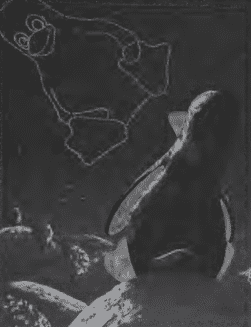

# 第 9 章：一些互联网应用

随着你越来越多地使用互联网，你会发现各种各样的应用对你很有用。当然，有 Netscape Communicator，许多人已经在他们的 Windows 机器上使用了它。然而，也有利用文件传输协议（FTP）以及其他可能比 Netscape 更有用的浏览器程序，特别是当你的空间有限时。

## Web 浏览器

万维网是互联网最受欢迎的一面。（许多人没有意识到还有其他许多方面。）这种普及性引起了全世界众多程序员的兴趣，并发布了多种浏览器以利用 web 的所有功能。

主要两大竞争对手是 Netscape Communicator 和 Microsoft 的 Internet Explorer。其他如 Mozilla 和 Opera 也已在 web 浏览器领域取得了进展。


目前，Linux 上唯一可用的主要 Web 浏览器是 Netscape Communicator。（该浏览器实际上是 Netscape Navigator，通常与 Netscape Communicator 一起打包提供。Communicator 是一套工具。）然而，Opera 的制造商正在加紧最终确定 Opera 的 Linux 版本发布。此外，始终还有标准的文本浏览器 Lynx。

### Netscape

Linux 版的 Netscape 与 Windows 版几乎完全相同。外观和感觉略有不同，但首选项和其他属性在本质上是一样的。因此，除了设置邮件和新闻组首选项外，我们不会覆盖有关 Netscape 的太多内容。

要配置 Netscape 邮件和新闻组，你首先需要打开 Netscape。加载完成后，点击顶部菜单中标题为“Edit”的项。然后点击菜单选项“Preferences”。这将打开 Netscape 中的首选项窗口，你可以在这里更改你的邮件选项。

首选项列表相当长。我们现在只查看邮件和新闻组首选项。图 9-1 展示了带有邮件和新闻组选项打开状态的首选项菜单。我们要查看的第一个项是配置邮件服务器。

#### Netscape 邮件

查看邮件首选项时，基本上有四个不同的区域需要填写。一个是传入邮件服务器。你还需要一个传出邮件服务器。最后，你应该填写你的用户名和密码。

-   **传入邮件服务器** — 传入邮件服务器通常使用 POP3 或 IMAP 协议运行。在某些版本的 Netscape 或你在万维网浏览过程中，你可能会看到用“POP 服务器”代替传入邮件服务器。传入邮件服务器是接收你电子邮件的服务器。

用更通俗的英语来说，这意味着有一台计算机用于从互联网接收电子邮件。这就是传入邮件服务器，它会存储你的电子邮件，直到你获取并将其从服务器上删除。它本质上是一个拥有许多不同邮箱的邮局。当你检查你的电子邮件时，你的用户名充当邮箱号码，而你的密码充当钥匙。你从信箱中取出邮件，关上它并锁住它。这是从传入邮件服务器下载你的邮件并注销的计算机等效操作。

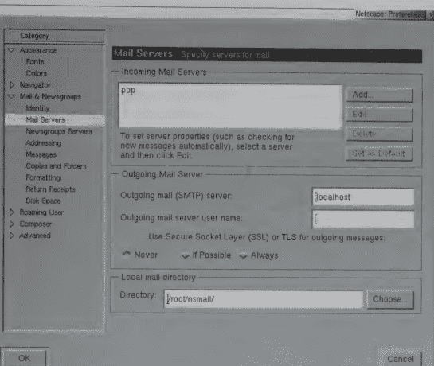

##### 图 9-1

*Netscape 首选项菜单中的邮件服务器屏幕。*

你可以通过与你的互联网服务提供商的客服代表交谈来找出你的传入邮件服务器是什么。

-   **传出邮件服务器** — 在较小的系统上，传出邮件服务器可能与传入邮件服务器同名。这仅仅意味着同一台计算机处理传出和传入邮件。传出邮件服务器有时被称为“SMTP 服务器”，你可能会在你的 Netscape 版本或万维网上看到这样的称呼。

传出邮件服务器处理你的电子邮件从你的邮局（传出邮件服务器）到另一个邮局（另一个传入邮件服务器）所需的所有路由工作。它确保你发送的电子邮件到达你指定的地址。

如果你不确定你的传出邮件服务器叫什么名字，你应该致电你的 ISP 来查明。他们能够告诉你需要知道的内容。

-   **用户名和密码** — 你的用户名和密码是你电子信箱的“箱体号码”和“钥匙”。这是你访问电子邮件的方式。

在 Netscape 中，你必须提供你的用户名。如果你不希望密码被记住，你应该留空密码字段。每次尝试下载你的邮件时，系统都会提示你输入密码。除非你真的希望别人查看你的电子邮件，否则确保不要与任何人分享你的用户名或密码。

#### Netscape 新闻组

许多不熟悉互联网的用户没有意识到互联网上有大量的新闻组。主题从火焰战（参见 alt.flame）、宗教、堕胎权到我们宁愿不涉足的领域不一。你几乎可以在新闻组中找到任何你想阅读的内容。音乐和电视迷会对致力于特定男演员和女演员的众多群组感到高兴。你甚至可以找到许多致力于教你如何使用编程语言或帮助你使用新的 Linux 系统的群组。这种新闻组系统更常被称为 Usenet。

你的 ISP 将拥有所谓的*新闻服务器*，你可以连接到该服务器并下载你订阅的新闻组上可用的消息。你只需要提供新闻服务器的名称，可以通过致电你的 ISP 获取。

要添加新闻服务器，只需点击“添加”按钮。将弹出一个新窗口，询问你新闻服务器的地址以及你应该连接到哪个端口。除非你的 ISP 另有指示，否则你应该将端口保持为 119 —— 这是标准新闻端口。

当你首次配置新闻组首选项时，Netscape 将假设你的机器连接了一个新闻服务器，并将该服务器称为“news”。你应该添加一个新的，并设置新的为默认。除非你在计算机上设置了新闻组，否则移除标记为“news”的那个。你可以使用编辑按钮更正你创建的条目中的任何错误。

如果你发现从新闻组下载消息花费的时间太长，你可以告诉 Netscape 在超过你指定的数量之前征求你的许可。在我的新闻组首选项中，这个数字设置为五十，因为下载五十条消息通常不会花我太长时间。

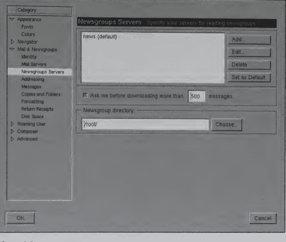

##### 图 9-2

Netscape 新闻组首选项。

“网络礼仪”——“网络礼仪”是互联网上恰当礼仪的术语。这适用于互联网使用的各个方面，但在处理 Usenet 时，有一些具体的事情需要知道。

你应该记住，在公共论坛上是有规则的，即使它们经常被打破。除非该论坛专门致力于进行火焰战（如我前面提到的 alt.flame 新闻组），否则参与公共火焰战从不明智。火焰战是两个或更多人之间的一系列具有煽动性或由人身攻击组成的消息。火焰战尖叫着说：“我是一个可怜的互联网瘾君子，没有生活，但有足够的时间在不在乎的人面前为自己辩护。”除此之外，对于那些真正有兴趣阅读新闻组的人来说，火焰战占据了相当大的空间（下载五十条消息，只得到十条值得阅读的消息是很令人恼火的），并惹恼了该群组中的几乎所有人。

在发帖前花点时间了解新闻组的“感觉”也是明智的。这被称为“潜水”，因为你在阅读消息但不向新闻组发布任何内容。通常，向群组发帖的人是“常客”，并且建立了默契，无知的业余新手发帖者可能会打破这种默契。这往往会惹恼人们，该发帖者可能会发现自己被孤立一段时间。例如，我几年前加入了一个致力于讨论作家 Stephen Lawhead 写作的邮件列表。管理员和一些其他人正在进行关于希腊语法的讨论；我自己了解一点，我以为加入讨论是该群组的一个适当介绍。我错了；管理员很快通过个人电子邮件责备了我，尽管我是该列表的多年成员，但我再也没有在那里发帖。

### 受控与不受控新闻组

一般来说，你应该阅读受控新闻组。

受控的 Usenet 新闻组是有一个人过滤通过该组的各种帖子的新闻组。这个人被称为版主（moderator），他通常阻止不必要的消息通过。这大大减少了“垃圾邮件”（Spam）或未经请求的商业电子邮件（UCE）以及除了火焰之外没有其他内容的帖子的数量。

如果你更大胆一点，你可以阅读和向不受控新闻组发帖。这些群组往往更加喧闹，组织性较差。人们不太愿意参与深思熟虑的对话，更有可能产生所谓的“无知的业余新手帖子”。这些涉及无意义的投票和旨在引发辩论的一句话或两句话观点。你可以在不受控新闻组上找到偶尔的宝石，它们可能证明和受控新闻组一样有趣（甚至更有趣）。

幸运的是，某些类型的非受控新闻组比其他的吸引更少的垃圾邮件和火焰战。你将能够轻易地识别这些，但一般线索是新闻组是致力于帮助读者还是倾向于辩论。不受控的辩论常常变成火焰战。


## 一些互联网应用程序

### Opera

截至本书出版时，Opera 的制造商尚未发布适用于 Linux 的稳定版本。然而值得注意的是，Opera 是一个比目前市面上那些庞然大物浏览器小得多且速度快得多的替代品。

在其网站上可以获取 Opera 的技术预览版（网站链接见书末的参考章节）。非常值得试一试，一旦开发完成，它将成为一个不可忽视的力量。

### Lynx

Lynx 是一个纯文本浏览器，常用于避免加载图像和脚本。由于它是完全基于文本的，因此速度极快。然而，网页制作者很少将页面设计为能很好地适配文本浏览器，因此 Lynx 通常无法很好地渲染网页。幸运的是，Lynx 的制造商已逐步增加了对表格和框架等功能的支持。

Lynx 预装于 Linux 和几乎所有 UNIX 操作系统中。它已经存在很长时间了，并且仍是一些系统管理员的首选。盲人或视力不佳的人有时更倾向于使用 Lynx；它去除了大量非文本信息，且盲文键盘与之配合得更好。

### FTP 程序

FTP 程序允许你连接所谓的 FTP 服务器。FTP 是文件传输协议（file transfer protocol）的缩写。有几种程序利用文件传输协议在互联网上发送和接收文件。其中的一些爱好者首选包括 NCFTP 和 GFTP。

#### NCFTP

NCFTP 是一个从命令行运行的程序，通常因其支持下载恢复而被使用。就像普通高速公路一样，信息高速公路也会遇到交通拥堵和事故。你的下载可能会在未完成前被终止或挂起，而 NCFTP 允许你从中断处继续。

要运行 NCFTP，请单击面板上的终端图标以打开终端窗口。当终端屏幕出现时，输入 `ncftp`。会出现一个类似这样的窗口：

```
[root@exter /root]# ncftp

NcFTP 3.0.0 beta 21 (October 04, 1999) by Mike Gleason (nccftp@nccftp.com). Copyright (c) 1992-1999 by Mike Gleason. All rights reserved.

nccftp> help

Commands may be abbreviated. 'help showall' shows hidden and unsupported commands. 'help <command>' gives a brief description of <command>.

ascii  cat help lpage open quote site
bgget cd jobs lput page rename type
bgput chmod lcd lrename pdir rhp umask
bgstart close lchmod lrm plis rm version
binary debug lls lmdir put rmdir
bookmark dir lmkdir ls pwd set
bookmarks get lookup mkdir quit show
nccftp> _
```

我已擅自展示了 NCFTP 能使用的全部命令。（如果你想自己查看，请在程序运行期间输入 `help`。）以下是一些命令的简要概述：

-   **open (-u) [server]** open 命令将打开到你指定服务器的 FTP 连接。例如，你可以使用 `open ftp.ccil.org` 来打开到该服务器的 FTP 连接。`-u` 选项告诉 NCFTP 你希望指定自己的用户名，而不是使用匿名用户。如果你连接到拥有账户的 FTP 服务器，这非常有用。
-   **close** 当你完成 FTP 会话时，可以关闭它。这不会关闭程序本身，只是断开连接，因此你可以使用 open 命令连接其他 FTP 站点。
-   **quit** 当你完全结束所有 FTP 会话时，使用 quit 命令来关闭程序。如果你在输入 quit 时已连接，NCFTP 将会断开连接。
-   **get, mget [filename]** get 命令将从服务器下载文件。如果你想一次获取多个文件，必须使用 mget（多次获取）命令。
-   **ls** 当你需要文件列表时，使用 *ls* 命令。它将显示当前目录中的所有文件。
-   **cd [directory]** 使用 NCFTP 时，你可能需要更改目录；使用 *cd* 命令来完成此操作。

当你使用完 NCFTP 后，可以输入 *exit* 来退出终端窗口。你会发现这些命令中的许多与我们在命令行界面中使用的命令相同。

#### GFTP

GFTP 是 GNU FTP 程序。

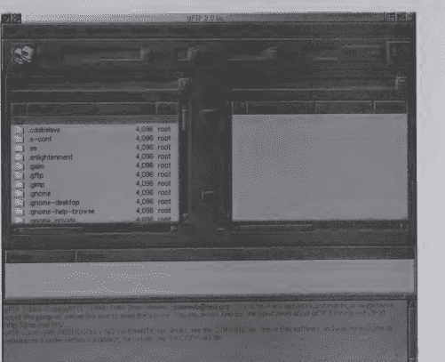

**图 9-4**  
*这是 GFTP 的外观。*

GFTP 易于使用，但可能需要一点时间去适应。它利用多种服务。这些服务并不复杂，但数量较多，因此可能需要一些时间才能习惯使用 GFTP。不过，一旦你习惯了，你将会拥有一个极其多功能且强大的 FTP 程序。我们首先要关注 GFTP 屏幕顶部的菜单栏。然后我们将查看 GFTP 屏幕的其余部分。

##### FTP

第一个菜单是 FTP 菜单。当你点击此菜单时，你会看到四个不同的选项：ascii、binary、options 和 quit。最后一个显而易见——点击它以退出程序。

前两个，ascii 和 binary，指的是*传输方式*，即 GFTP 将如何尝试传输你下载和上传的文件。所有文本文件都应使用 ascii 模式传输；其他文件应使用 binary 模式传输。如果你尝试以 ascii 模式传输二进制文件，可能不会遇到问题，但最好稳妥起见。你当前传输的模式列在左侧。

你可能会在 options 菜单中花费一些时间。

options 部分有四个标签页。第一个是 general 标签页。紧随其后的是 FTP 代理和 HTTP 代理标签页，最后是 Local Hosts 标签页。general 标签页可能是你唯一会更改的。最后三个用于网络目的，因此如果你不在网络上，应保持这些标签页不变。如果你在网络上，应根据网络管理员的指示填写此信息。

在 General 部分，你可以输入你的电子邮件地址、你用来查看文件的程序（“查看程序”）、你用来编辑文件的程序（“编辑程序”）以及其他杂项细节。

你的电子邮件地址是当你以匿名用户登录时发送的密码。许多人不喜欢输入他们真实的电子邮件地址，因为某些网站会收集这些地址并将其放入邮件列表中。这些列表被出售并用于向商业公司发送未经请求的商业电子邮件（UCE），或“垃圾邮件”。我通常提供一个虚假的地址。

查看和编辑程序应指定完整的路径和文件名，除非该程序已在路径中。（例如 gedit。）

其他可用的复选框基本上都是不言自明的。这些选项不会改变你下载的任何文件或设置可能限制你使用 GFTP 的格式，因此你可以安全地试验这些选项。

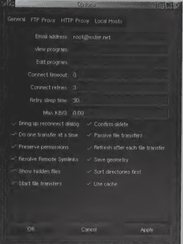

**图 9-5**  
GFTP 中的 options 菜单。

其中一个填写框确实值得关注。“Max KB/S” 允许你指定传输过程中可能的最大传输速率。偶尔，当你在你的计算机和当地服务器之间传输文件时，文件传输可能过快，导致传输错误，从而损坏文件内容。如果你发现这种情况发生，你应根据调制解调器的速度设置此项。如果你有一个 56k bps 的调制解调器，你应将“Max KB/S”速率设置为 5.6。通常，你可以将调制解调器速度除以十，并将其填入此框中。

##### Local

下一个菜单项标记为“Local”。“Local”意味着你正在处理你所操作的计算机，而不是你连接的计算机。（你很快就会看到，你连接的计算机被称为“remote”计算机。）

此菜单下的所有选项都是在你的家用计算机上的文件或目录上执行的。幸运的是，其中大部分是不言自明的。然而，有几个值得注意：

-   **Change Filespec** 此选项将更改你在目录中查看的文件。要查看所有文件，使用文件规范 `*`。如果你想查找所有以字母“pin”开头的文件，输入 `pin*`。如果你只想查找文件名由四个字符组成且以“pin”开头的文件，输入 `pin?`。星号和问号被称为*通配符*，它们告诉计算机列出具有额外字符的任何文件名。问号用于单个字符且是累积的。所以 `pin??` 代表以“pin”开头的五个字母的文件名。`pin?` 只是四个字母。星号用于指示文件名可以是任何长度。
-   **Chmod** 如果你愿意，可以在本地更改文件的权限。为此，单击高亮显示你希望更改的文件。然后单击 local，再单击 chmod。
-   **Refresh** 如果你更改了目录结构或某些文件，你可能需要在看到更改已生效之前刷新文件列表。单击 local 然后 refresh 以更新列表。

##### Remote

Remote 菜单与 Local 菜单相同，但有三个例外——open URLs、disconnect 和 send SITE command。此菜单控制你可以在你所连接的计算机（也称为 remote 计算机）上采取的操作。就像在你自己的计算机上一样，如果你在另一台计算机上有 FTP 账户，你将能够更改文件名和文件权限，添加或删除目录等。

Remote 菜单中的 open URL 选项允许你输入 FTP 网址，格式为 ftp://ftp.sitename.com。大多数网页浏览器都带有其自己的简陋——


# 第 9 章 一些互联网应用程序

临时 FTP 客户端，这就是它们访问 FTP 站点的方式。你也可以在 GFTP 中执行相同操作。

断开连接功能很简单——只需单击它即可断开与当前连接站点的连接。

“发送 SITE 命令”选项稍微复杂一些。FTP 站点使用一组命令运行，这些命令大多深奥晦涩，普通 FTP 用户通常不会使用。FTP 程序通过将这些命令“翻译”成菜单驱动或命令行程序中常见的易懂命令和选项来利用这些命令。

然而，某些 FTP 服务器拥有可能未被你的 GFTP 使用的不同命令子集。如果你对连接到的服务器所使用的命令比较了解，你可以发送远程计算机识别的命令。这是通过发送 SITE 命令来实现的。要发送 SITE 命令，请单击发送 SITE 命令选项。将出现一个小窗口，询问你想发送哪个命令。输入该命令并单击“确定”按钮。

你可能根本不需要使用此命令，但有时它会很有用。

### 书签

这可能是 GFTP 所有下拉菜单中最基础的一个。使用 GFTP 时，你会一直连接到各种站点，而这个菜单允许你连接到不同站点或将其他站点添加到你的列表中。菜单顶部有两个选项——一个是“添加书签”，另一个是“编辑书签”。在其下方是所有可用书签文件夹以及你碰巧添加的任何孤立项目的列表。

当你单击“添加书签”时，你会将书签添加到当前连接的站点。如果你想添加未连接站点的书签，或者想更改书签的外观，你需要使用“编辑书签”选项。

图 9-6 展示了书签菜单的可能外观。我自由地添加了自己的个人书签文件夹，以便你可以看到它的样子。要创建文件夹或新书签，你应该单击“文件”下拉菜单。单击“新建文件夹”以创建文件夹；单击“新建项目”以创建新书签。你可以通过单击文件夹或项目，然后单击“文件”和“删除”来删除它们。

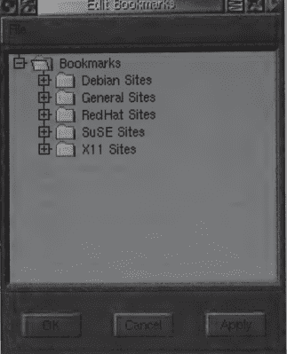

**图 9-6** *编辑书签* 菜单。

当你单击“新建项目”或“新建文件夹”时，GFTP 会询问你想如何命名书签列表中的条目。如果你创建一个文件夹，流程到此结束；但如果你创建一个新书签，你将看到“编辑条目”对话框。

这个窗口与你通过高亮显示条目并单击“文件”然后“属性”得到的“属性”窗口完全相同。这就是为什么我的窗口已经填写完毕，而你的窗口将是空白的，除了描述部分。

以下是此条目编辑对话框中列出的类别摘要：

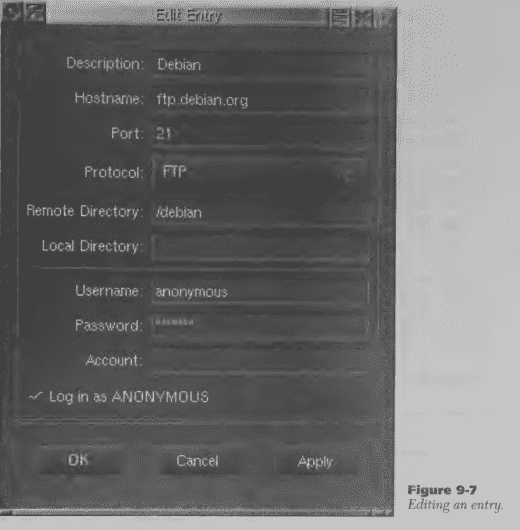

- **描述** 这是你给条目的名称，也是它在书签列表中的显示方式。
- **主机名** 主机名是实际的 FTP 站点，如 ftp.cdom.com 或 ftp.redhat.com 或类似名称。这些名称几乎可以是任何东西。
- **端口** 除非你尝试连接的 FTP 站点使用特殊端口，否则通常不需要更改此项或填入内容。FTP 端口类似于更熟悉的船港或太空对接点。它是你的 FTP 程序可以与 FTP 服务器建立连接并发送或接收数据的地方。
- **协议** 这是 FTP 或 HTTP；如果你正在访问基于网络的 FTP 站点，请使用 HTTP；否则你应该使用 FTP。
- **远程目录** 如果你希望每次连接时都进入服务器上的特定目录，你应该在此填入完整的路径名。
- **本地目录** 本地目录是你希望每次连接到此 FTP 站点时进入的目录。例如，如果你连接特定的 FTP 站点以上传文档或类似内容，你可能想进入你的文档目录。
- **用户名** 如果你在这个站点有自己的 FTP 账户，你应该填入你的用户名。如果没有，请留空。
- **密码** 如果你有账户，必须使用用户名和密码访问它。如果你有账户，请确保填入你的用户密码。
- **账户** 你可以将此留空——这对登录并不重要。如果 FTP 站点管理员指示你这样做，则填写此区域。

如果你没有你想连接的 FTP 站点上的账户，启用“以 ANONYMOUS 身份登录”选项。这将向站点发送用户名 anonymous 和你的电子邮件地址作为密码。如果站点不支持匿名 FTP 访问，除非你有账户，否则无法登录。

### 日志记录

在你的 GFTP 主屏幕底部，你会看到来自 GFTP 程序作者 Brian Masney 的小通知。这是*日志文件*。你可以选择在那个小编辑框中阅读它（用于显示本地和远程计算机上正在执行的命令并报告错误），或者从日志记录子菜单中访问。

日志记录子菜单下有三个不同的选项。你可以查看日志、将其保存到文件或清除日志。清除时，内容将被删除且无法恢复。

### 传输

要发送和接收文件，你可以使用传输菜单。高亮显示你要发送或接收的文件。然后单击传输。如果你想检索文件，请单击 retrieve；如果你想发送文件，请单击 put。

开始传输时，传输进度将在屏幕底部的对话框中显示。如果你想停止传输，请单击传输进度行以高亮显示它。然后单击传输并单击停止。

### 工具

如果你想比较远程计算机文件列表与本地计算机文件列表之间的差异（例如，如果你正在将网页文档传输到另一个服务器并丢失了已发送文件的记录，这会很有帮助），请单击工具，然后比较窗口。

#### 帮助

帮助部分不会给你太多帮助，除非你想了解 GFTP 的开发者或 GNU 公共许可证（GPL）。

### 其他程序

存在许多其他互联网服务，并且有相应数量的程序可供利用这些服务。例如，如果你对互联网中继聊天（IRC）感兴趣，你可以使用 xchat 程序与世界各地的人聊天。如果你对 gopher 等较少使用的服务感兴趣，你也可以找到相应的程序。

就现状而言，你最终可能会比其他可用程序更多地使用 Netscape 和 GFTP（除非你像我一样真的喜欢 Opera）。你将能够通过互联网本身和 GnURPM 找到其他互联网应用程序，所以安装新的程序时不要害羞。大多数程序简单易用，拥有干净的界面，可能仿效更熟悉的 Windows 程序。

大多数 Linux 应用程序的另一个有益方面是作者维护关于其产品的众多网页。通常可以在帮助菜单的“关于”部分找到这些（参见 GFTP 为例）。如果你在使用或设置应用程序时遇到困难，你可以访问网页阅读常见问题（FAQ）甚至发送电子邮件给作者寻求帮助。

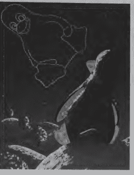

# 第 10 章
Linux 下的文本查看器和编辑器

有时，你不需要大型全功能文字处理器来编写简单的文本文件。有很多非常优秀的文本编辑器，其中一些具有非常有用的功能。使用哪一个取决于个人偏好。由于这些程序中的某些具有相同的功能，我们认为最好在开头定义它们，以免重复。

## 通用编辑器功能

- **打开**——打开文件，通常仅限于 .txt 和 .html 文件。
- **保存**——保存当前打开的文件。
- **另存为**——允许你以不同的文件名保存文件。
- **关闭**——关闭你当前打开的文件。大多数程序会提示你保存已做的更改。
- **退出**——关闭整个程序和所有已打开的文件。如果有未保存的已打开文件的更改，你将收到提示。


### 文本编辑器基础

打印——如果您已配置打印机，将打印当前打开的文件。

剪切——删除所选中的文本。

复制——将所选文本复制到缓冲区，以便在其他位置粘贴。

粘贴——插入之前复制到缓冲区的文本。通常这可以跨程序工作，意味着从一个程序复制的文本可以粘贴到另一个程序中。

查找——在文件中查找文本模式或短语。

再次查找——定位指定文本模式或短语的其他出现位置。

替换——查找一个模式并将其替换为另一个模式。

全选——选择文件中的所有文本。

撤销——撤销上一步操作。

重做——取消已撤销的操作。

自动换行——当一行最后一个单词过长时，会自动将该单词移动到下一行。这可以防止单词被“截断”为两部分。

新建窗口——打开程序的新窗口。

### 文本文件查看器

文本文件查看器可以在主 GNOME 菜单下的实用工具子菜单中找到。

文本文件查看器目前严格用于查看文本和 html 文件。它是一个“简约型”程序，但打开、显示和保存文件的速度很快。

这个程序的功能不多。您不能编辑文件或以任何方式修改文件，唯一例外是可以以不同的文件名保存文件。它确实允许您在文件中查找单词、字母甚至短语。

您还可以打开多个窗口，这使得比较多个文件变得更加容易。


图 10-1
文本文件查看器。

#### 高级文本编辑器

高级文件编辑器（也称为 Kwrite）可以通过选择“KDE 菜单”，然后是“应用程序”，再选择“高级文本编辑器”来找到。Kwrite 可以打开文本 (.txt) 和 .html 文件。

该程序非常直观，布局与我们介绍的其他文本编辑器相似。设有下拉菜单，包括文件、编辑、书签、选项和帮助。如果选择帮助下的“内容”，会有详尽的文档。

Kwrite 具有前面提到的所有常见功能，此外还有一些额外功能。

我们发现非常有用的功能之一是书签。该功能允许您在文件中标记区域。书签不会随文件保存，因此一旦文件关闭，书签就会丢失。

#### GEdit

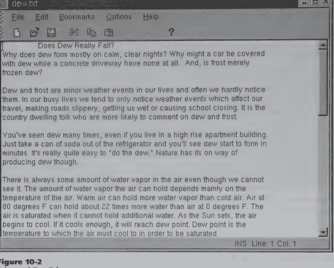

可以认为 GEdit 更接近于功能齐全的 word processor，而非文本编辑器。GEdit 可以在主 GNOME 菜单下的"应用程序"中找到。

GEdit 具有本章开头提到的所有功能，以及许多您可能觉得有用的额外功能。GEdit 可以打开 .txt 和 .html 文件。该程序可以打开多个文件，它们列在主窗口的左侧。要访问左侧列出的文件，只需单击文件名即可。

GEdit 还有一些值得一提的额外功能。大多数位于菜单标题 "plugins" 下。

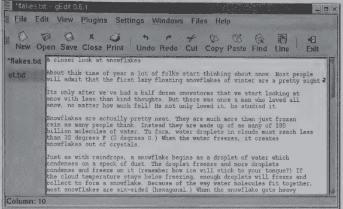

图 10-3
GEdit。

如果您需要了解文件的某些统计数据，请单击 “Plugins”，然后单击 “word count”。一个小窗口将会弹出，告诉您字符数、单词数和段落数。

有用于拼写检查、版本控制和浏览（针对 HTML 文件）的插件。

GEdit 的一个非常实用的功能是 “find in files”。它会在多个文件（即当前打开的那些文件）中搜索短语或单词。作为一个例子，我们拿了三个文件并搜索了单词 constellation。

GEdit 会分割窗口，然后列出它找到搜索单词或短语的位置。它会列出找到该词的文件，以及行号和句子。它还会列出它找到搜索对象的总次数。

如果您在文件中犯了许多错误，您可能会发现 “file” 下的 “revert” 功能很有用。Revert 会调出您正在处理的文件最近保存的版本。

由于 GEdit 是一个开源项目，随着时间推移，该程序很可能会添加更多的功能。

##### 在 Gedit 中打开和保存文件

要在 GEdit 中打开文件，只需单击 “open” 按钮。使用弹出的窗口，您可以浏览目录并选择要打开的文件。然后单击 “ok”。您的文件将在 GEdit 窗口中打开，您可以对其进行编辑。要处理新文件，只需单击 “new”。

编辑完文件后，您想要保存它。如果它是现有文件，您希望保留相同的文件名和格式，只需单击 “save”。

如果您想以不同的名称保存文件，请单击 “file” 和 “save as”。使用弹出窗口，您可以给文件起一个新名字。

GEdit 中没有自动文件扩展名，您必须输入要使用的扩展名，例如 .txt 或 .html。例如，如果您打开了一个文本文件，然后添加了用于网站的 html 标签，您希望将其保存为 html。只需使用 “save as” 窗口，给文件名加上 html 扩展名，而不是 .txt。

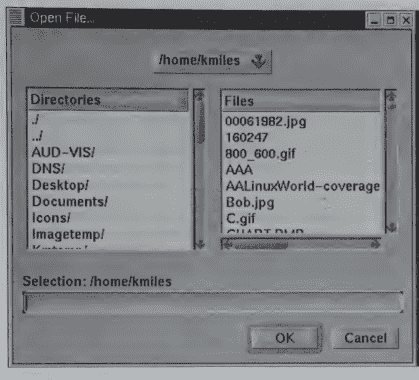

图 10-5
打开文件窗口。

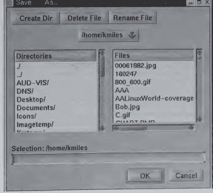

图 10-6
另存为。

#### 字体和样式

截至本文发布时，GEdit 不允许在文件中同时使用多种字体或样式。尽管这在未来的版本中可能会改变，但 GEdit 旨在作为文本编辑器而非文字处理器。

要更改当前使用的字体，请单击 “settings” 和 “preferences”。从偏好设置窗口中，单击 “document” 选项卡。您将看到当前使用的字体列表。要更改它，请单击 “select”。从字体选择窗口中，您可以选择字体及其样式，如粗体或斜体。在右侧，您可以选择字体大小。在此窗口的底部，您可以看到该字体的外观示例以及它的大小。选择好字体后，单击 “ok”。这将把所有现有和未来的文本更改为此选择。

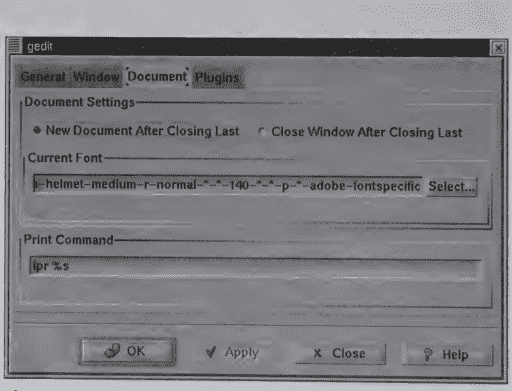

**图 10-7**
*GEdit 偏好设置。*

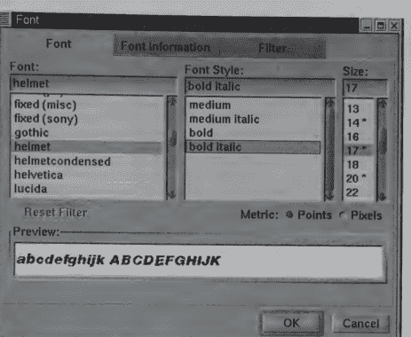

图 10-8 *在 GEdit 中字体选择。*

#### 文件拼写检查

GEdit 提供了一种简单的拼写检查文件的方法。单击 “plugins” 和 “spell check”。GEdit 将弹出一个拼写检查窗口，并在文件中找到拼写错误的单词时列出它们。它将列出一个单词，然后列出另一个拼写建议。右侧是可以采取的操作。如果您想用其中一个替代项替换该单词，只需单击替代项，然后单击 “replace”。如果您想让 GEdit 接受该单词为正确拼写的单词，请单击 “accept”。如果您想忽略拼写错误的单词，请单击 “skip”。如果没有替代项，且您知道单词的正确拼写，请单击 insert 并输入正确的单词。

您可以通过单击拼写检查窗口的配置选项卡来设置 GEdit 拼写检查的一些偏好。在特殊配置窗口中，您可以指定要检查的单词中的最少字母数、要忽略的单词中的特殊字符（如电子邮件地址中的 @），以及其他参数。

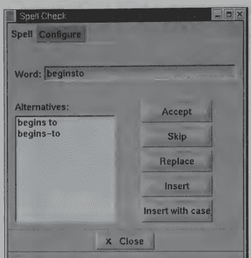

**图 10-9**
GEdit 中的拼写检查。

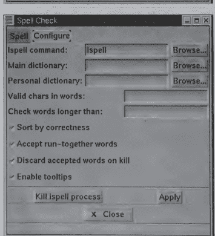

**图 10-10**
配置拼写检查。

#### 在文件中查找内容

使用查找命令在文件中查找单词或短语很容易。只需单击查找图标以调出 “find” 窗口。当查找框弹出时，您可以输入要搜索的内容。您还可以勾选是否希望 GEdit 从光标处搜索，还是从文档的开头或末尾搜索。您还可以勾选是否希望 GEdit 区分大小写。

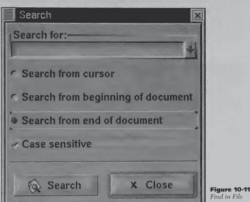

**提示**
Linux 通常区分大小写。这意味着 Linux 会将 Ball.gif 和 ball.gif 视为两个单独的文件。大多数 Linux 应用程序也做此区分。如果您用大写字母命名所有目录，这实际上会很有用，因为它们将出现在列表的开头。


#### 查找和替换

GEdit 还允许你在文件中查找并替换内容。当你在长文件中发现使用了错误的名称或其他内容时，这项功能尤其有用。要开始查找和替换，请单击“编辑”和“替换”。弹出的窗口看起来与之前的“查找”窗口非常相似。不过，在你想查找的内容下方，还有一行用于输入你想替换成的内容。

也许你给亲爱的玛莎姑妈写了一封长信，由于你想向她借一笔钱，你在信中多次询问她养的宠物猫的情况。然后，为了进一步表示亲昵，你还大谈特谈宠物猫的好处。直到信写完后，你才意识到玛莎姑妈养的是宠物蜘蛛。这很简单：只需查找“cat”（猫）并替换为“spider”（蜘蛛）即可（不用担心“spidermip”那个部分！）。

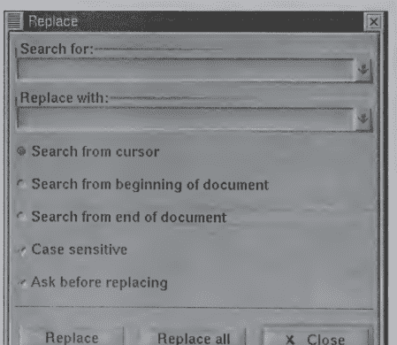

**图 10-12**  
*查找和替换。*

### 传真

Linux 上有几种传真程序在使用，但其中大多数都是基本传真程序的前端界面。传真程序通过命令行运行，可能显得晦涩难懂，这就是为什么需要前端界面的原因。Ksendfax 是一个不错的“点点鼠标”式的传真前端程序，我们将对其进行介绍。

efax rpm 软件包是安装传真程序最简单的方法，而且你可能已经安装了它。你可以通过打开一个终端（例如 xterm）并输入以下命令来检查 efax 是否已安装：

```
rpm -q efax
```

如果已安装 efax，你将得到类似以下的反馈：

```
efax-0.9-4
```

如果未安装，请阅读我们关于添加程序以及使用 GnoRPM 查找和安装软件包的章节。你还希望安装 ksendfax，因此请检查其是否已安装，若未安装则需进行安装。

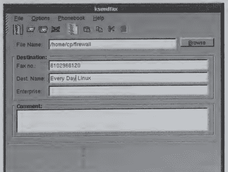

图 10-13 Ksendfax。

Ksendfax 当然会使用你的调制解调器来发送传真。默认情况下，你需要 root 权限才能访问调制解调器，因此从 xterm 或其他终端中，输入以下命令以 root 身份启动 ksendfax：

```
su -c ksendfax
```

单击“选项”和“首选项”，并在“发送传真”字段中添加以下行。你只需执行此操作一次。

```
fax send '@@Phone' '@@FName'
```

添加该行后，单击“确定”。

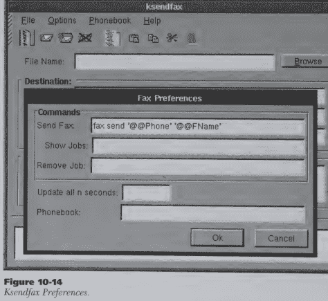

#### 发送传真

你应该将想要作为传真发送的文件保存为文本文件。在 ksendfax 主窗口中，输入你要发送的文件名（包括路径），或者单击浏览按钮以浏览目录并找到你的文件。

在“传真号”框中输入带区号的电话号码。如果你愿意，还可以填写“目标名称”等其他方框中的信息。你只需要给 ksendfax 一个电话号码即可。

准备好发送传真时，请单击发送传真图标，即窗口顶部的小信封图标。如果你不确定是哪个图标，只需将鼠标悬停在图标上几秒钟，就会出现一个包含图标名称的小框。

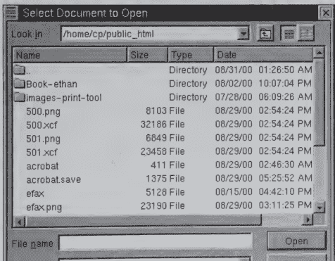

**图 10-15**
选择要传真发送的文件。

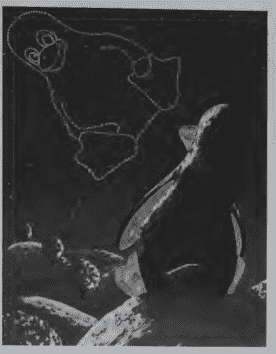

# 第 11 章

## Star Office 基础

### 什么是 Star Office？

Star Office 为 Linux 社区提供了免费的办公软件套件，立下赫赫战功。该套件最初由德国公司 Star Division 拥有，现在则是 Sun Microsystems 的财产。自那时起，该办公套件已更新，并且保持免费使用。更令人兴奋的消息是，2000 年 7 月，Sun 宣布将 Star Office 套件开源。这很可能带来快速的添加和更新。

办公套件中包含许多程序，如文字处理程序、调度器、演示文稿程序、数据库程序、电子表格等等。已有整本书专门介绍 Star Office 套件，因此我们将只介绍最基本的部分，以便你开始使用该办公套件。如果你发现你喜欢 Star Office 并希望了解更多其功能，我们建议你购买一本关于 Star Office 的书籍。

### 安装 Star Office

你可以从 Sun Microsystems 的网站 http://www.sun.com/staroffice 下载 Star Office。这是一个大约 100 MB 的大文件。虽然下载是免费的，但鉴于其体积较大，你可能需要考虑购买包含 Star Office 的 CD。你可以从 Sun Microsystems 以及许多其他销售软件的地方购买 CD。

要安装下载的 Star Office 版本，请在类似 xterm 的程序中执行以下操作：

1. 由于文件是经过压缩的，通过输入以下命令进行解压：**tar zxvf filename**（其中 filename 是你下载的文件名）。
2. 切换到解压文件后创建的目录：**cd directoryname**。
3. 通过输入以下命令运行安装程序：*./setup*。

安装的其余部分是来自 Sun 的图形化设置，非常简单，只需回答几个你需要回答的基本问题。

要从 CD 安装：

1. 将 CD 放入你的 CD-ROM 中，并双击桌面上的 CD 图标。
2. 切换到 Linux 目录。
3. 切换到 Office52 目录。
4. 双击 setup 文件，这将启动图形化安装。

### 启动 Star Office

你可以通过两种不同的方式启动 Star Office。在命令行上，你需要告诉 Linux Star Office 的位置以及启动应用程序所用的命令。假设你已将 Star Office 安装在你的主目录中，使用的路径和命令将如下所示：

```
cd office52/
```

按 Enter 键，然后输入：

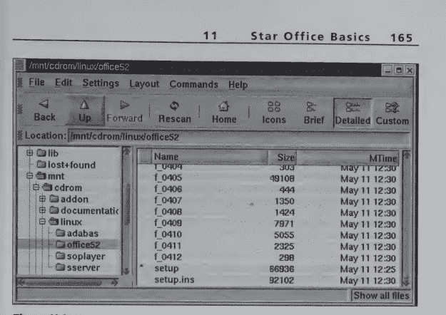

**图 11-1**
*使用资源管理器查看 Star Office。*

```
.soffice &
```

请注意，“&”符号告诉 Linux 启动应用程序并将命令行返回给用户。

此外，你必须位于主目录中才能输入此命令。
与担心命令行和路径相比，更简单的解决方案是在桌面面板中创建一个启动按钮。

### 制作启动按钮以开始 Star Office

为了避免每次想要启动 Star Office 时都弹出终端窗口并输入命令，你可以选择在桌面面板中创建一个 applet 启动按钮。要这样做，请阅读第四章中关于创建启动 applet 的说明。

### 管理桌面

Star Office 是一个集成办公套件，这意味着它被设计为各个组件之间可以相互协作。例如，你也许使用 StarCalc 创建了一个电子表格，然后希望在 StarWriter 文档中使用该电子表格。由于组件是集成的，你可以这样做而无需修改它。

主桌面始终可以通过位于任何 Star 窗口左下角的图标访问。当打开多个窗口时，你可以使用桌面下方的按钮在它们之间切换。启动时在桌面上出现的区域是工作区。

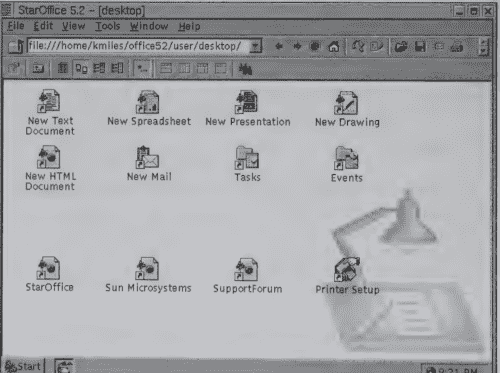

图 11-2
Star Office 桌面。


### 提示

你可以通过多种方式定制 Star 桌面。在桌面上用鼠标右键单击一次，将会弹出一个面板。选择“属性”，你将看到定制选项。

还有两个其他区域你可以让其显示出来：资源管理器和放映机。

#### 资源管理器

Star Office 中的资源管理器用于组织诸如邮件、书签、新闻组和文件等内容。

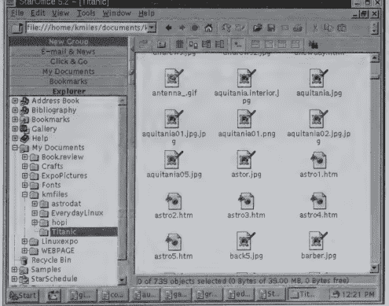

**图 11-3**
*Star Office 资源管理器。*

书签代表指向互联网网站或文件目录内位置的链接。你甚至可以设置书签链接到文档中的某个位置。

你可以设置邮件，使 Star Office 能够检索你的电子邮件。我们将在 StarMail 章节中介绍此内容。

资源管理器允许你查看计算机上的目录和文件。

#### 放映机

放映机是一个小窗口，将打开并显示资源管理器窗口中列出的目录或图形文件的内容。尝试在资源管理器中双击“gallery”（图库）。现在双击“clipart”（剪贴画）。目录的内容将显示在右下方，并且图像缩略图将显示在放映机中。

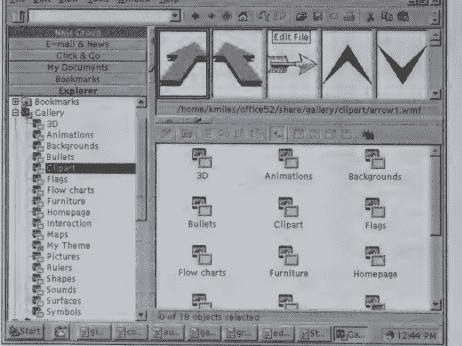

**图 11-4** *Star Office 放映机。*


### 提示


您可以通过点击“查看”（view），然后选择“Beamer”或“Explorer”，在 Star 桌面环境中隐藏或显示 Beamer 和/或资源管理器（Explorer）。

### 向 Star Office 添加打印机

您很可能需要在 Star Office 中打印文档，因此您需要安装打印机。即使您已经在 Red Hat 上安装了打印机，仍然需要将该打印机添加到 Star Office 中。

在主 Star Office 桌面上，双击“打印机设置”（Printer Setup）图标。


文件：/home/kmiles/office52/share/ngp/Xpdfaults

**图 11-5**
*打印机设置*

您将看到窗口下半部分列出的现有打印机驱动程序列表。向下滚动列表，查看您的打印机是否在其中。如果您找到了您的打印机，请双击它，它将会出现在窗口上部的“已安装打印机”（installed printers）下方。有一个现成的“通用打印机”（generic printer）选项。在上方的窗口中单击一次您的打印机，然后点击“测试页”（test page）。

如果您在现有打印机驱动程序中找不到您的打印机，只需尝试使用通用打印机，通常它是可用的。

单击一次您希望用作默认打印机的打印机，然后点击“默认”（default）。

您还可以点击“配置”（configure），并为您的打印机设置默认值，例如纸张大小、页边距和纸张方向。


**图 11-6**
配置打印机。

### Star Office 自动向导

使用自动向导（auto pilots）可以很好地开始使用 Star Office。这些向导将指导您创建文档、网页或其他项目。要访问自动向导，请单击“文件”（file），然后单击“自动向导”（auto pilot）。另一个菜单将允许您选择文档、网页、电子表格等。作为示例，我们将选择使用自动向导创建一个议程。


**图 11-7**
使用自动向导创建议程

自动向导开始时会对您的议程提出一些基本的布局问题。当您回答这些问题后，点击“下一步”（next）。

自动向导将继续询问有关您议程的问题。不断点击“下一步”（next），直到您拥有了议程中所需的所有信息。完成后，点击“创建”（create）。您的议程将被创建并在 Star Office 中打开。然后您可以填写更多信息，最后保存您的文档。

### 使用 Star Office 模板

模板是预先格式化好的文档。Star Office 为您提供了一系列可供使用的模板。模板也被 Star 的自动向导用于帮助您创建文档和其他项目。要查看可供选择的各类模板，请单击“新建”（new），然后单击“来自模板”（from template）。当弹出窗口出现时，点击右侧的“更多”（more）。这将允许您预览各种模板。


# **图 11-8**
*向议程添加数据。*


# **图 11-9**
*完成议程。*


**图 11-10**
选择模板。

您将看到左侧列出的模板类别。双击某个类别，该组中的单个模板将列在右侧。双击其中一个模板。下方您将会看到该模板的描述，左侧，如果您点击预览按钮，您将会看到它的预览效果。


**提示**

Star Office 的所有应用程序都有模板，包括 StarBase、StarCalc、演示文稿和文档。模板可以真正节省时间，并且您可以编辑它们以适应您的具体需求。

### 配置选项

点击“工具”（tools），然后点击“选项”（options）将弹出选项对话框窗口。我们不会介绍所有选项的配置，而是重点介绍其中几个更重要的选项。

首先，您可能希望向 Star Office 提供一些关于您个人的信息，因为它在部分模板中使用这些信息作为默认值。调出选项对话框窗口，点击“常规”（general），然后点击“用户数据”（user data）。在右侧区域填写您的个人和工作信息。

告诉 Star Office 您希望将项目文件夹保存在哪里。默认情况下，Star Office 将它们保存在桌面的“工作”（Work）文件夹中，但您可以将其保存在任何您喜欢的地方。要指定位置，在选项对话框窗口中，点击“常规”（general），然后点击“路径”（paths）。


# **图 11-11**
*Star Office 选项。*

在右侧的默认窗口中，点击“我的文档”（my documents）。现在点击下方的“编辑”（edit），您将能够输入一个路径。我只是使用主目录中的一个 documents 目录，所以我的路径是 /home/kmiles/documents。请注意，我必须首先创建“documents”目录。一旦您输入了工作保存的路径，点击“默认”（default）。这将使 Star Office 在您需要保存内容时始终查看此文件夹。您还可以更改其他功能的路径。

另一个您可能想要配置的选项是邮件，如果您希望 Star Office 发送和接收邮件。

要配置邮件，调出选项对话框窗口，选择“互联网”（internet），然后点击“邮件/新闻组”（mail/news）。您需要一个互联网服务提供商（ISP）才能拥有电子邮件。您还需要知道您的提供商的 incoming（入站）和 outgoing（出站）邮件服务器是什么。如果您不确定，请咨询您的提供商的服务台。您需要提供的另一项信息是您的用户名和密码。如果您使用互联网新闻组，您可能还想在此框中指定您的新闻组服务器。


**图 11-12**
*邮件和新闻组选项。*

### 需要时的帮助

Star Office 附带了非常完善的文档。在任何时候，您都可以点击“帮助”（help）和“内容”（contents）来搜索您需要的特定主题的帮助。您也可以浏览内容。

# 第 12 章


## StarWriter

您可以从头开始创建一个文档，也可以使用 Star Office 自动向导来创建文档，向导将指导您完成文档创建过程。如果要使用自动向导，只需点击“文件”（file）、“自动向导”（auto pilot），然后选择信函、报告或您想要创建的任何内容。有关自动向导的更多信息，请阅读 Star Office 入门指南。

### 创建、打开、格式化和保存新文档

StarWriter 是 Star Office 套件中的文字处理部分。要开始新文档，点击“文件”（file）、“新建”（new）和“文本”（text）。屏幕上将会出现一个空白页面。

您也可以通过点击“文件”（file）和“打开”（open）来打开现有的 StarWriter 文档。

您可以在目录中移动并选择要打开的文件。

当您拥有了一个新文档或打开了一个文档后，您可以开始输入或编辑。窗口顶部有格式化按钮，可以帮助您选择字体、字号、文本对齐方式等。您也可以用鼠标右键单击窗口，将会出现一个弹出窗口，其中包含页面、字符等格式化选项。


# **图 12-1**
*在 Star Writer 中打开文件。*

字符格式化可能是您最常执行的操作。选择此项将弹出一个窗口，允许您选择字体、字号以及下划线、粗体、斜体等特征。

**提示**

如果您已经输入了一些文本并希望将其设为粗体或更改字体类型，您可以通过使用鼠标或 Shift+方向键选择文本，然后更改字体、字号、颜色或字体属性（粗体、斜体等）来实现。

当您第一次保存文档时，StarWriter 将使用“另存为”功能。点击“文件”（file），然后点击“另存为”（save as）。

您需要为文档命名，并指定是否希望将其保存为除 StarWriter (.sdw) 以外的其他类型。默认情况下，如果您不指定 doc-


### 图 12-2

*字体特征。*


### 图 12-3

*另存为文件。*


对于文档类型，StarWriter 会将文档保存为 .sdw 格式。如果您点击文件类型，您将看到可以保存文档的各种格式。此外，默认情况下，StarWriter 会将文档保存在桌面的工作文件夹中。您可以在选项中标记不同的默认目录。要了解如何做到这一点，请查看《Star Office 入门指南》并参见“配置选项”。您可以在目录之间移动，以到达您希望保存文档的位置。

在处理文档时，您可以随时通过点击窗口顶部的软盘图标来保存新工作。如果软盘图标是灰色的，这意味着没有新数据可供保存。

如果您正在处理现有文档并希望使用不同的文件名保存，您也可能希望使用“另存为”功能。

### 拼写检查、查找和替换、剪切和粘贴

您有几种方法可以检查文档中的拼写。您可以等到写完文档后，然后点击“工具”、“拼写检查”和“检查”。当 StarWriter 这样检查文档时，它会扫描整个文档，然后在发现错误时弹出拼写检查对话框窗口。


对话框窗口将显示有问题的单词，以及它建议的正确拼写（如果有的话）。右侧有按钮，允许您“忽略”、“忽略全部”、“替换”和“始终替换”。“忽略全部”将忽略在该文档中发现的该特定单词的所有出现。“全部替换”将替换它发现的拼写错误单词的所有出现。您还可以选择将该单词添加到词典中。

另一种拼写检查方法是边输入边检查。通过点击“工具”、“拼写检查”，然后点击“自动拼写检查”，您可以在输入时立即看到拼写错误的单词。当您拼写错误时，Star Office 会在单词下方放置一条波浪线红线。然后，您可以使用鼠标右键点击该单词，查看正确拼写的建议、忽略全部，或将该单词添加到词典中。

查找和替换可用于将一个拼写正确的单词替换为另一个单词。假设您给某人写了一封私人信件，然后意识到您使用了错误的名字，输入了“Burgers”而不是“Burgess”。如果您多次使用了这个名字，回过头去查找并替换这些名字可能会非常耗时。您会发现选择“编辑”然后“查找和替换”要容易得多。


### 图 12-5

查找和替换。

在查找和替换窗口中，只需输入您希望它查找的单词，然后输入您希望用来替换它的单词。

您可能还想移动文本块，这也相当简单。您可以通过在文本开始时点击鼠标左键并将鼠标拖到文本末尾来选择文本，或者您可以使用 Shift 键配合方向键。将光标放在您要选择文本的开头。按住 Shift 键，然后使用向下或向上箭头键复制整行，或者使用左右箭头键一次复制一个字符。您选择的文本将被高亮显示。


**图 12-6**

*选择文本。*

现在文本已选中，您可以点击“编辑”然后“剪切”或“复制”。如果您想将文本从当前位置移动并粘贴到其他位置，请使用剪切。如果您想将文本复制到另一个位置，请使用复制。完成这些操作后，将光标放在您想要放置文本的位置，然后点击“编辑”和“粘贴”。

### 在文档中添加图像

您可以非常轻松地为任何 StarWriter 文档添加图像和剪贴画。将光标放在您希望图像所在的位置，然后点击“插入”，接着“图形”，然后“从文件”。


**图 12-7**

*插入图形。*

您将看到您点击的图形的预览，一旦图像加载到文档中，您可以调整其大小或移动它到您想要的位置。

> **提示**
>
> 请记住，添加较大的图像会增加文档的大小。添加两三个图像可能会使文档变得巨大且臃肿。

### 关于文档的信息

您可以通过点击“文件”然后“属性”来查找有关您的文档的信息。您会注意到弹出的窗口顶部有五个标签。这个弹出窗口中有两个部分您可能会觉得有用。

# 184 日常 Linux


**图 12-8**

*文档属性。*

常规信息将为您提供文档标题（文件名）、位置、大小以及创建和修改的日期。它会告诉您是谁修改了它，以及他们是在什么时间修改的。


**图 12-9**

*文档统计信息。*

点击“统计信息”标签将显示有关您文档的定量信息。它会告诉您有多少页、段落数、字数和字符数。如果您一直使用行号，它还会告诉您您的文档有多少行。

### 打印您的文档

我们已经介绍了如何在 Star Office 中设置打印机。当您要打印文档时，只需点击屏幕顶部的打印机图标。您也可以点击“文件”和“打印”。

如果您想在打印前审阅您的文档，请点击“文件”然后“页面预览”。StarWriter 将向您显示整个页面的视图，展示其最终外观。


*页面预览。*

打印效果可能太小，您无法看清，但您将能够看到您的文档有多少页，并对打印后的外观有个大概的了解。

### 导入和导出文件

StarWriter 可以导入多种文档，包括 MS Word 95/97/2000、Excel、Lotus 1-2-3、Mac 文本、DOS 文本等。您应该能够毫无问题地从 Microsoft 操作系统加载文档。偶尔可能会出现一些格式识别问题，但大多数时候运行正常。

要导入不同格式，请点击“文件”和“打开”。通常，StarWriter 会识别格式并使用正确的过滤器进行导入。然而，有时它会询问您使用哪个过滤器。StarWriter 随后会弹出一个过滤器列表，供您选择正确的文档类型。

同样，StarWriter 可以以多种格式导出文档。使用“另存为”功能，然后在“文件类型”框中选择您希望保存的格式。StarWriter 使得与使用不同操作系统和文字处理软件的人交换文档变得非常容易。


> 如果您需要将文件提供给某人，但不确定他们能处理哪些文件类型，您始终可以另存为纯文本（.txt）。几乎任何编辑器都可以打开这些文件。不幸的是，纯文本会丢失任何格式或图像，但文本是可读的。

### 使用自动向导导入和导出多个 MS 文档

如果您有大量 MS Word 文档和/或模板，希望将它们导入并作为 StarWriter (.sdw) 文档和模板导出，有一个自动向导可以自动完成此操作。

选择“文件”、“自动向导”，然后“Microsoft 导入”。

第一个出现的屏幕只是解释此自动向导的作用。请记住，这不会删除任何文件，它只是添加一个作为 StarWriter 文档导出的 MS Word 文档的副本。最终您将获得同一文档的两个副本，一个保持为 MS Word 文档，另一个为 .sdw 格式。准备好后，点击“继续”。


**图 12-11**

*使用自动向导导入文档。*

在这里，系统询问自动向导是否应获取 MS Word 模板和 Word 文档。它还要求您告诉它应该在哪个目录中查找。点击右侧的小框以浏览并选择目录。在左侧，您还将被询问是否应包括子目录。在窗口底部，系统询问自动向导应将导出的文档放在哪里。同样，您可以点击右侧的小框以浏览目录。完成后，点击“继续”。


# 第 13 章
## StarCalc

StarCalc 是 Star Office 中的电子表格组件。电子表格在存储和组织信息方面非常有用。有许多模板可供您创建家庭预算、汽车融资、贷款和抵押贷款计算、现金日志，甚至是股票管理器。不过，StarCalc 的功能远不止制作电子表格；它还可以对结果进行图表化、制作日历等等。

### 电子表格

#### 创建和保存电子表格

要开始一个新的电子表格，请单击“文件”、“新建”和“电子表格”。

这些空的矩形区域被称为单元格。单击其中一个单元格开始输入数据。要在行内移动，请使用制表键。要移动到下方的单元格，请使用回车键。您也可以使用方向键在电子表格中移动。


**图 13-1**
StarCalc 电子表格

完成电子表格并希望保存时，请单击“文件”然后单击“保存”。首次保存电子表格时，StarCalc 会使用“另存为”窗口。默认情况下，StarCalc 以原生格式（.sdc）保存电子表格。如果您想以另一种格式导出电子表格以便在其他电子表格程序中查看，请使用“另存为”并从文档类型窗口中选择格式。

StarCalc 既可以保存也可以打开 Excel 电子表格。


**图 13-2**
*格式化单元格。*

#### 格式化单元格、行和列

您可以格式化单个单元格，或者部分或整行/列的单元格。格式可以包括数字类型（百分比、货币、科学计数法等）、字体、边框等。

要格式化单个单元格，只需单击该单元格，然后从顶部菜单中单击“格式”，接着选择“单元格”。完成格式化后，按“确定”。这将仅影响您刚才单击的那个单元格。如果您向单元格添加数据然后按回车键，下一个单元格将恢复为之前的格式。

要格式化多个单元格，只需单击第一个单元格，然后在按住鼠标按钮的同时，拖动以覆盖您要格式化的单元格。然后单击“格式”和“单元格”。您也可以通过单击行号或列字母来选择整行或整列进行格式化。


**图 13-3**
选择多个单元格。

#### 计算数字列的总和

要计算某列中单元格的总和，只需单击该列底部的单元格，然后单击求和按钮。求和按钮是带有 $\Sigma$ 符号的按钮。执行此操作后，原位置会出现两个新按钮。一个是绿色对勾，另一个是红色“x”。如果您想要该列的总和，请单击对勾；否则，请单击红色 x 以退出并返回数据输入模式。

要计算多列的总和，只需单击第一列底部的单元格，然后将其拖动到其他列。然后只需单击求和按钮。您也可以以与列相同的方式计算行的总和。

#### 从电子表格数据制作图表

图表通常使数字变化更易于观察，StarCalc 使您能够以图表形式绘制数据，并且该图表可以直接放置在您的电子表格上。

首先，选择您想要用于制作图表的列和行。


**图 13-4** *选择行或列。*

选中后，单击垂直工具栏上的“插入对象”按钮。这是位于电子表格左侧、上下延伸的工具栏。执行此操作后，光标会变成一个带有一个小图表的加号。在电子表格上选择一个空白区域，然后拖动光标到您希望图表出现的区域。这将决定图表的初始大小。当您释放鼠标按钮时，自动格式化图表窗口将弹出。


**图 13-5**
添加图表。

自动格式化图表操作有四个部分。系统会要求您选择想要创建的图表类型及其某些具体细节。左侧有一个预览窗口，将显示您的数据的外观。


**图 13-6**
格式化图表。

完成图表格式化后，在最后一个窗口上单击“创建”。执行此操作后，您的图表将被创建并出现在电子表格上，您可以调整其大小和位置。


将图表放置到您想要的位置后，右键单击并选择“固定”。然后单击图表将其固定到电子表格上。

#### 在 StarCalc 中创建日历

您可以使用 StarCalc 创建月度或年度日历，然后进行自定义或添加您想要记住的事件。要开始创建日历，请单击“文件”，然后选择“新建”，再选择“从模板”。


当“从模板新建”窗口弹出时，在左侧框中单击“杂项”，然后在右侧选择“月/年”日历。单击“更多”以查看预览，并单击“确定”以开始创建日历。

在“从模板新建”窗口中单击“确定”后，将出现一个名为“StarOffice 日历”的新窗口。

您可以选择年份或月份。如果选择月份，您需要指定是哪个月份。要输入您想要记住的事件，请单击“个人数据”。

使用此窗口，您可以输入事件（生日或您想要记住的其他特殊事件）。输入事件的日期和月份，然后单击“插入”。您可以输入任意数量的事件。完成后，单击“确定”。StarCalc 将创建您的日历。

您将注意到，日历像电子表格一样被划分为行和列。您可以像在电子表格中一样在日历中移动，使用方向键根据需要添加事件。


**图 13-9**

*Star Office 日历。*


**图 13-10**

*向日历添加数据。*


**图 13-11**
*创建的日历。*

#### 使用 StarBase 创建数据库

StarBase 是 StarOffice 中用于创建和管理数据库的部分。数据库在处理地址、库存及其他类型的列表时非常有用。一旦拥有信息数据库，您就可以轻松对其进行搜索，并以多种不同方式对其进行排序。

您的数据库通过使用数据库表创建。这些表格看起来与 StarCalc 工作表中使用的表格相似，但在格式和布局上存在一些差异。

##### 数据库格式

数据库有相当多的不同格式类型。如果您只是为个人使用创建数据库，可以选择任意类型。然而，如果您要共享数据，则需要选择与所有使用者兼容的格式。

最广泛使用的格式之一是 dBase，通常用于 DOS/Windows 环境。ODBC 格式使用 SQL 语言，是 Oracle、Sybase、Informix 和其他大型数据库使用的类型。文本格式是当没有其他选项时的最后手段。

##### 创建新数据库

最好将您的数据库放在一个单独的目录中，特别是如果您可能要创建多个数据库。一个目录中的多个数据库很容易导致表格混杂及其他问题。

您可以使用 Red Hat 桌面上的目录资源管理器创建一个新目录。单击“文件”然后选择“新建”，再选择“目录”。

将弹出一个新窗口，您可以输入新目录的名称。


**图 13-12**
*创建新目录。*


**图 13-13**
*为新目录命名。*

从 Star Office 桌面，点击“文件”，“新建”，然后选择“数据库”。“数据库属性”窗口将弹出。

该窗口顶部有四个选项卡。第一个选项卡是常规属性，你将在这里给你的数据库命名。在“常规”下方的输入框中输入名称。

点击“类型”选项卡，选择你希望为新数据库使用的格式。虽然数据库有多种格式，但我们在示例中将使用 dbase。从“数据库类型”字段中选择 dbase，然后在下方指定数据库所在的目录。

**提示**

一旦你选择了一种数据库类型（dbase、ODBC 等），你会看到窗口中的第三个选项卡变为你选择的格式。


**图 13-14**
*数据库属性。*


**图 13-15**
*选择数据库格式和位置。*


**图 13-16**
*dBase 设置。*

点击“dBase”选项卡，以选择该类型数据库的设置。

第一个选项是切换“显示非活动设置”的开关。如果你是在 StarOffice 中第一次创建数据库，则不需要勾选此选项。如果开启此开关，它将显示被标记为删除的旧记录。虽然 StarBase 实际上从未删除旧记录，但会将它们标记为非活动状态。

第二个选项是切换长表名功能。在旧版本的 Windows（以及 DOS）中，文件名只能包含八个字符或更少。如果你想使用更长的表名，请开启此选项。

在上述两个选项下方，有一个字符集选项。除非你有特定需求更改它，否则请保持默认设置。

当你完成所需信息的填写后，你就可以点击对话框窗口中的“确定”按钮。然后你的新数据库将被创建。由于你还没有创建用于存放数据的内容，它目前还不大实用。你接下来想要做的是创建一张表。


> 请记住，我们使用的是 dBase 格式的数据库示例。如果你选择其他格式，在创建数据库之前可能还需要提供其他信息。

#### 使用表设计工具创建表

你的所有信息都通过表来管理。每个表包含一系列字段和记录。假设你正在创建你的邮票收藏数据库。你可能会设置邮票编号、原产国、品相和面值等字段。每枚邮票输入其自己的记录中。当你点击上述“数据库属性”窗口末尾的“确定”时，桌面上出现了一个屏幕，上面有四个图标，其中一个是“表”。


**图 13-17**
*创建新数据库。*

在表图标上右键点击，选择“新建”，然后选择“表”，再选择“表设计”。


**图 13-18**
*表设计。*

在第一列（“字段”下方）输入字段名称。在我们的邮票收藏示例中，我们将我们的称为“stamp”。我们将选择名为“stamp”（邮票）、“issued”（发行日期）、“country”（国家）、“condition”（品相）、“topic”（主题）和“value”（面值）的字段。

> **提示**
> 字段名称不能包含空格，且长度不能超过十个字符。表设计工具不允许你输入空格或更长的名称。

在“字段类型”下，你需要告诉程序你将在此字段中输入什么类型的数据。“stamp”字段将是文本，“issue”将是日期，value 也是日期，其他字段将是文本。你从该框中的下拉列表中选择字段类型。

对于每个字段，你都可以设置每个记录的最大长度、默认值，以及应使用的格式示例。


**图 13-19**
*设计表。*

在创建表时，你最后应该做的事情是在第四个字段“描述”下输入一些内容。这样做是个好主意，因为仅靠字段名称可能无法很好地描述表中的内容。如果你处理很多表，几个月后你可能不记得具体含义。

最后，通过点击“文件”和“保存”来保存表。


> **提示**
> 你也可以使用 AutoPilot 创建表。在表图标上右键点击，选择“新建”，然后选择“表”，再选择“AutoPilot”。你只需按照说明创建表即可。

#### 导入表

从现有数据库中导入表非常容易。你只需将文件复制到你要使用该表的数据库所在的目录。表将被自动添加到表列表中。

#### 向表中添加数据

当你准备向表中添加数据时，你需要打开资源管理器窗口，直到你能看到你的数据库列表。在每个数据库下，你都会看到表单、报告、查询和表的图标。如果你已经创建了表，那么表的图标左侧将有一个小加号。点击它以展开列表。


**图 13-20**
*选择表。*

在右侧，你会看到该目录中表的名称。选择你要在数据库中使用的那个表，然后双击该表的图标。

点击你要编辑的记录（你可能更常称其为单元格），然后输入你的数据。


**图 13-21**
*输入数据。*

使用 Tab 键在表中移动。一旦你在一行的第一个记录中输入数据，就会添加一个新行。

当你完成数据添加时，点击“文件”和“关闭”。当你被问及是否要保存更改时，回答“是”。

#### 编辑和删除数据

没有人是完美的，迟早你会需要更改或删除记录中的数据。别担心，这是一件简单的事。

要编辑记录中的数据，只需点击该记录。该记录的内容将被高亮显示。


**图 13-22**
*编辑记录中的数据。*

如果你想更改该记录中的所有内容，只需开始输入即可。如果你只想更改一个字符，请双击该记录，然后移动光标并进行更改。


> **提示**
> 所有基本命令，如剪切、复制和粘贴，在你的表中与在文档中一样容易使用。这使得复制数据变得更加容易。

要删除记录内的内容，点击该记录，它将被高亮显示。然后在上面右键点击并选择“剪切”。记录的内容将被清除。

#### 更改表的外观

当你使用 StarCalc 电子表格时，你可以让它们看起来完全符合你的喜好，甚至可以是花哨的，如果你希望如此的话。然而，当你处理数据库时，你只能更改你创建的表的一些属性。

一旦你打开表进行编辑，在行左侧的其中一个按钮上右键点击，并选择“表格格式”。


**图 13-23**
*表格格式。*

此窗口允许你更改字体、字号以及字体属性，如下划线、粗体、斜体等。

你还可以通过在行的左侧按钮上右键点击并选择“行高”来更改行高。


**图 13-24**
*更改行高。*

当你更改行高时，它会更改表中所有行的行高，所以请记住，增加高度会占用更多空间。


> **提示**
> 行高的默认设置是“自动”。如果你想设置自己的行高，你必须取消勾选此框。当你取消“自动”勾选时，你必须记住行不会自动调整以适配更大或更小的字号，你需要手动调整使其适应。

你可以通过在列顶部的按钮上右键点击并选择“列格式”来格式化列。


### 图 13-25

格式化列。

此窗口有两个标签页：“数字”和“对齐”。在“对齐”下，您可以设置左对齐、右对齐、居中对齐或两端对齐。更改对齐方式仅会影响您点击的列。

您可以通过右键点击列上方的按钮并选择“列宽”来更改列宽。

同样，默认为自动，这会在需要时自动加宽宽度。如果您取消勾选“自动”，当宽度不够时，您需要手动调整宽度。

您可以选择隐藏一列。如果您正在制作演示文稿，且不希望显示所有数据，可能会选择这样做。要隐藏一列，请右键点击该列顶部的按钮并选择“隐藏列”。当您想要显示隐藏的列时，只需右键点击顶部的按钮并选择“显示”，然后选择要显示的特定列，或者选择“全部”。这将显示所有隐藏的列。


**图 13-26**
*更改列宽。*

### 排序数据

数据库最重要的功能之一是排序数据。当您向数据库添加新记录时，它们会被添加到表格底部，需要与现有记录一起进行排序。

您可以使用其中一个字段作为键来排序数据。例如，在我们的邮票收藏中，假设我们要根据国家进行排序。我们可以按字母顺序升序（A 到 Z）或降序（Z 到 A）进行排序。

只需点击列顶部的字段按钮以高亮显示整列，然后点击“升序排序”或“降序排序”按钮。

如果您点击“排序”按钮，即位于前述排序按钮右侧、带有“Z”在“A”上方的按钮，就可以进行更复杂的排序。这将打开排序对话框。

使用此框，您可以为多个字段设置排序。


### 图 13-27
按升序或降序对列进行排序。


### 图 13-28
排序对话框。


# 第 14 章

## Star Office 演示文稿

Star Office 的演示文稿部分可以帮助您创建令人印象深刻的演示文稿、报告、证书等。

### 使用 Auto Pilot 创建演示文稿

若要使用 Auto Pilot 开始新的演示文稿，请点击“文件”，然后选择“Auto Pilot”，再选择“演示文稿”。

在此窗口中，您可以选择从头开始、从模板开始或从现有演示文稿开始。因为我们要从头创建一个，所以我们选择了“空白演示文稿”。点击该框，然后点击“创建”。

在这里，您可以为演示文稿选择页面样式。您可以从多种背景样式中选择，或者如果不需要背景则选择“无”。接下来，您需要选择演示文稿的格式：幻灯片、纸张、过头投影或屏幕。如果右侧的预览按钮未被选中，请点击它以预览不同的样式。选择后，点击“下一步”。


# **图 14-1**

*使用 Auto Pilot 创建演示文稿。*


# **图 14-2**

*选择演示文稿样式。*


# **图 14-3**

*选择幻灯片过渡效果。*

在此页面中，您选择想要的过渡效果类型。这指的是一个图像如何变为下一个图像。显然，如果您正在制作纸质演示文稿，这一点并不重要。完成后，点击“创建”。


# **图 14-4**

*修改幻灯片。*

基本图像将显示在屏幕上，然后会弹出一个窗口用于修改幻灯片。在这里，您可以从标题到其他类型的幻灯片中选择。如果您正在为演示文稿创建其他媒体，只需将其视为演示文稿中每一页的格式。不同的格式将决定文本和图像的放置位置。选择格式后，点击“确定”。


### 图 14-5

向演示文稿添加文本。

我们为该幻灯片选择了“标题”格式。它已创建并打开，以便我们可以添加文本和/或图像。Star Office 会告诉您在哪里添加图像或文本。只需点击，然后开始输入即可。您可以为您的演示文稿添加任意数量的页面，并根据需要选择不同的格式和样式。

当您创建多个幻灯片时，可以使用左侧窗口下方的小箭头在它们之间来回滚动。

您可以使用模板来帮助创建多种类型的报告和演示文稿。
点击“文件”、“新建”和“从模板”。


**图 14-6**
*启动新演示文稿。*

在框的左侧选择“演示文稿”。注意不要将其与“演示文稿布局”混淆。从右侧的框中选择“技术报告”。您可以点击“更多”按钮以查看预览并获取基本描述。完成后，按“确定”。

您的报告第一页将显示在屏幕上，您可以添加标题，并选择字体、大小和颜色。您会注意到页面底部有报告的附加页面。

这些页面标题为“主题定义”、“状态”以及报告的其他页面等。您只需点击每个部分，然后填入它建议使用的信息。您可以通过点击“插入”并选择“对象”、“图表”或您想要插入的其他内容，根据需要向报告添加图表和图像。


# **图 14-7**

*标题页。*


# **图 14-8**

*添加附加幻灯片。*

# **可用的演示文稿模板**

下面列出了 Star Office 中当前可用的所有模板。可供选择的范围很广。在演示文稿标题之后，是组中包含的幻灯片标题。

**传达坏消息：** 标题，现状，原因，第一替代方案，第二替代方案，建议，前景，摘要

**头脑风暴：** 标题，议程，本次头脑风暴的目标，规则，积极头脑风暴，摘要，下一步骤

**商业报告：** 标题，目标，重要事件，公司业绩，市场份额，各部门市场份额，收入，交叉利润率，支出，收益，资本结构，现金流，生产力指标，前景，该行业趋势，内部反应，公司目标，摘要

**商业风险投资：** 标题，议程，简介和背景，市场状况，公司间的差异，产品，服务，财务，摘要

**公司财务报告：** 标题，介绍，目录，数字，收入，业务领域，资产负债表，分公司，股票，结尾

**公司会议：** 标题，议程，公司目标，已取得的成就，公司结构，主要挑战，主要目标，结果，销售与利润，主要成本领域，市场调研，下一期目标，摘要

**概念：** 标题，目标，下一个目标，现状，发展，可能的策略，建议，问题，任务

**介绍新产品：** 标题，长期目标，客户愿望，满足客户需求，成本分析，优势，行动下一步

**介绍公司：** 标题，概况，历史，未来，产品线，产品 1，产品 2，产品 3，公司结构，客户服务，员工，公司新闻，摘要

**营销计划：** 标题，产品，竞争，定位，沟通，包装，介绍，广告，价格，分销，国际化，成功，摘要

**新员工：** 标题，议程，公司历史，管理，公司政策，公司福利，绩效评估，其他信息，所需文件，摘要

**产品/服务信息：** 标题，概述，市场，市场概况，规模和增长，竞争，市场份额，回顾，要求，优势，主要功能，定位策略，营销信息，预算建议，规划，下一步骤

**项目报告：** 标题，主题定义，状态，第一章节，第一章节状态，第二章节，第二章节状态，重要问题，进一步步骤

**策略建议：** 标题，概述，长期目标，现状，至今为止的发展，潜在替代方案，建议

**销售演示文稿：** 标题，概述，前景，产品推广，目标，产品范围，策略，市场分析，融资，摘要

**标准演示文稿：** 标题，引言，子主题，第一主题，第二主题，第三主题，第四主题，现实情况，结论，摘要

**团队激励：** 标题，引言，报告，目标，解决方案，任务，技能，摘要

**技术报告：** 标题，引言，第一点，第二点，第三点，结论

**贸易行业分析：** 贸易行业分析，背景信息，定义，历史，销售增长，市场细分，关键成功因素，客户，客户类别，客户动机，客户影响，竞争对手，竞争，竞争对手策略，市场份额，供应商，供应产品，供应商影响，趋势，创新，摘要，行动步骤

**培训研讨会：** 标题，引言，议程，概述，术语，第一主题，第二主题，第三主题，第四主题，摘要，引用作品


#### 无模板创建演示文稿

如果你想在不使用自动驾驶（Auto Pilot）功能的情况下开始制作演示文稿，可以通过 StarDraw 来实现。只需双击 Star Office 桌面上的“新绘制”图标，或者依次点击“文件”、“新建”和“绘图”。当你看到 StarDraw 时，你会发现它很熟悉，因为自动飞行员在创建演示文稿时也是使用它的。


**图 14-9**  
*StarDraw 窗口。*

我们将介绍几个幻灯片的制作过程。我们会介绍 StarDraw 自带的一些基本工具。当你在制作演示文稿时，你的 Star 桌面上会多出一个额外的菜单屏幕。


**图 14-10**  
*演示文稿菜单。*

此菜单允许你创建额外的幻灯片或选择现有幻灯片的布局。如果此工具栏不可见，请单击“视图”，然后单击“工具栏”，并选择“演示文稿”。还有一个图标可以让这个菜单出现或消失。它位于 Star 桌面的右侧。

##### 左侧工具栏

首先，请仔细看看屏幕左侧的工具栏。这些工具允许你执行诸如绘制矩形、圆形、圆锥体和线条，以及设置对齐方式和其他效果等操作。每个工具都有自己的选项集，你可以通过按住 Shift 键然后单击工具图标来查看。例如，查看立方体工具的选项时，你会发现还可以选择球体、金字塔、圆柱体、圆环等。当你看到想要的选项时，只需单击它即可。

###### 缩放比例

有时，更近距离地查看绘图中的某个区域或查看整个页面的视图会很有帮助。StarDraw 提供了多种缩放视图以及实现它们的几种方法。

在左侧工具栏的顶部附近，有一个放大镜图标。按住 Shift 键并单击将显示缩放选项。将鼠标悬停在每个单独选项上，会告诉你该工具会将视图放大或缩小多少。选择其中一个选项，单击它，然后单击你的图像（如果是放大，请选择具体区域）。

另一个缩放选项位于 StarDraw 窗口的下半部分。你会看到显示缩放百分比。默认值为 27%。如果你双击该百分比，将会弹出一个缩放选项窗口。


**图 14-11**  
*缩放选项。*

你可以选择在 50% 到 200% 之间、页面宽度，或者选择可变并设置你自己喜欢的比例。

###### 添加文本

你很可能会需要向你的绘图或演示文稿中添加文本。为此，请从左侧工具栏中单击文本图标。

> **提示**
>
> 文本的选项包括“纯文本”、“框架内文本”和“标注”。
>
> “标注”就是漫画家著名的“气泡内文本”。

通过点击“格式”和“字符”来选择你想使用的字体。你可以选择字体、大小以及其他一些属性。完成后，单击你希望输入文本的图像位置。


将出现一个虚线矩形，你可以输入文本。完成后，单击虚线矩形外的某个位置，文本就会被固定在页面上。

当虚线框包围你的文本时，你可以更改其他属性。如果你想居中显示文本，请单击对齐图标并选择居中。如果你想添加颜色，只需单击窗口底部的一个颜色框。

任何你想要回头修改文本的地方都可以这样做。只需单击文本，虚线框就会重新出现，然后你就可以进行修改。要删除文本，首先单击使虚线框出现，然后按退格键。

##### 在幻灯片上添加图像

要在幻灯片上添加图像，请单击“插入”、“图形”和“来自文件”。会弹出一个窗口，允许你在目录中浏览并选择要添加的图像。然后单击“打开”，图像将显示在你的幻灯片上。


**图 14-13** 添加图像。

你会看到图像周围有一个虚线框。要移动整个图像，只需将鼠标放在框内。光标会变成一个小的交叉箭头。现在你可以将图像移动到屏幕上你想要的位置。要垂直调整图像大小，请单击其中一个垂直点，并将鼠标拖动到你想要的大小。要水平调整大小，请单击并拖动图像顶部或底部的点。要保持比例，请使用图像角落的点。

##### 排列事物：将图像放在文本后面

如果你已经输入了一些文本，然后决定要在其后面放置一张图像，你可以很容易地做到这一点。单击文本使虚线框出现。然后，从顶部菜单中，单击“插入”、“图形”和“来自文件”。将出现一个“插入图形”窗口。


**图 14-14**  
*插入图形。*

你可以浏览目录并选择一个图形。这个窗口右侧有一个小预览窗口。如果你看不到它，请拓宽你的 Star Office 主窗口。选择一个图像并单击“打开”。

图像将出现在你的幻灯片上的文本上方（遮住文本）。

要让图像移到文本后面，按住 Shift 键并单击排列图标。选择“发送到背景”，图形将移动到文本后面。


**图 14-15**  
*图形位于文本上方。*


**图 14-16**  
*将图形移动到文本后面。*

###### 绘制矩形框

假设我们想在幻灯片的标题周围绘制一个框。我们要的是一个只有轮廓的框，而不是实心颜色。从左侧工具栏中，按住 Shift 键并单击矩形图标。选择轮廓框。现在你会看到屏幕顶部，主工具栏下方会出现一些不同的控制项。


**图 14-17**  
*矩形框控制。*

左侧那个看起来像书法笔尖（calligraphy pen tip）的图标用于线条样式。单击它，你可以从各种线条类型（如实线、点线、虚线或其他）中进行选择。

线条样式图标右侧的图标是两个箭头。单击此图标，你可以从各种箭头或线条端点进行...'（原文截断）选择。你画框时不需要这个，但如果你在画线，可能想用这个。

你还可以通过箭头样式图标右侧的下拉窗口选择线条样式。


**图 14-18**  
*线条样式。*

此右侧是线宽窗口。使用右侧的小箭头来增加或减少线宽。

再往右是线条颜色窗口。单击它会产生一个下拉菜单，允许你选择颜色。其右侧是填充颜色窗口。这只在你选择实心矩形时使用。


**图 14-19**  
*填充工具。*

你可以选择无填充、图案、渐变或颜色。


**图 14-20**  
*使用渐变*

当你选择渐变填充或位图时，点击右侧的窗口，你会看到一个可供选择的选项。如果你选择了其中一个，你需要使用“排列”图标将填充移到文本后面，以便你的文本能够显示出来。

##### 为你的幻灯片添加背景

你可能想为你的幻灯片添加颜色或其他背景。点击“格式”，然后“页面”。

弹出的窗口有两个选项卡：“页面”和“背景”。点击背景选项卡。你可以选择颜色、网点、渐变、无填充或位图。当你点击除了无填充以外的任何选项时，下方会出现选择项。找到你喜欢的那个，点击它，然后点击“确定”。由于这是一个后台...'（原文截断）


##### 图 14-21
*页面格式设置。*

背景，它将自动移动到幻灯片上已有的任何图像和文本之后。现在我们有了包含文本、方框、图像和背景的幻灯片。请经常保存你的幻灯片，这样如果你不喜欢添加的内容，可以回退到早期版本，这超越了“撤销”的功能。


##### 图 14-22
*完成的幻灯片。*

##### 添加更多幻灯片

你可以通过点击演示菜单中的“插入幻灯片”，或者从顶部菜单点击“插入”和“幻灯片”来向演示文稿添加新幻灯片。新幻灯片将标记为“幻灯片二”，你可以通过点击幻灯片正下方的标签在幻灯片一和幻灯片二之间切换。如果你的新幻灯片与你创建的另一个幻灯片有许多相似属性，你可以从演示菜单中点击“复制幻灯片”来复制该幻灯片。

当你插入新幻灯片时，“插入幻灯片”窗口会弹出，你可以从各种幻灯片布局中选择，或者选择空白幻灯片。每种布局都有简短的文本和图像放置说明。你始终可以通过从演示工具栏中点击“修改幻灯片”来更改幻灯片的布局。

##### 排序你的幻灯片

你可以通过点击幻灯片视图图标轻松重新排列幻灯片的顺序。这个小图标位于你的 Star Desktop 的右边缘，里面有四个小盒子。


**图 14-23**
排序幻灯片顺序。

当使用幻灯片视图时，你的所有幻灯片都会出现在桌面上，你可以点击它们并将它们拖动到你希望的顺序。你还可以在此窗口中删除幻灯片，只需右键点击要删除的幻灯片，然后在弹出的窗口中选择“删除幻灯片”即可。

##### 查看你的演示文稿

当你完成演示文稿并希望查看它时，在第一个幻灯片上右键点击并选择“幻灯片放映”。你将看到幻灯片的全屏视图。


要从一张幻灯片前进到下一张，只需将鼠标悬停在图像上并点击。当所有幻灯片显示完毕后，你会看到一个提示：“点击结束演示”。

##### 额外的演示选项

Star Office 提供一些额外选项来帮助你的演示。在整理幻灯片的按钮附近有一些额外的小按钮。

### 日常 Linux

绘图视图是默认的，通常在你创建演示文稿时在其中工作。

- 大纲视图将以预览形式显示幻灯片，并以大纲形式显示所有幻灯片的文本。


*大纲形式。*

你可以切换开或关幻灯片预览。大纲形式对于以文字处理器形式打印演示文稿很有用。

- 备注视图允许你在单独的页面上查看每张幻灯片，并在下方留有空间添加额外备注。

此模式对演讲者非常有用。你只需点击幻灯片下方的框即可添加文本。

- 讲义模式将在一页上显示多张幻灯片。

你可以按任何喜欢的方式排列幻灯片并打印出来作为讲义使用。


**图 14-26**
备注。


**图 14-27**
讲义。

##### 保存和导出你的演示文稿

演示文稿的默认格式是 .sdd 扩展名的 StarImpress。如果你不指定其他格式，你的演示文稿将以此方式保存。但是，你可以以多种其他格式保存或导出你的演示文稿。通过点击“文件”、“另存为”，你可以选择将以 MS PowerPoint 可显示的格式保存你的演示文稿。

你还可以通过点击“文件”、“导出”将演示文稿导出为其他格式。


导出功能允许你将演示文稿保存为 html 格式用于网站，或者将幻灯片保存为可加载到许多其他程序中的图像格式。当你以 html 格式导出时，你需要选择一个简短且描述性的名称。该名称将用于连续编号每张幻灯片，例如“name_1, name_2, name_3 等”。Star Office 会在每张幻灯片之间创建“继续”链接。它还创建一个“摘要”链接，该链接指向列出每张幻灯片标题的页面。

# 第 15 章

## WordPerfect 8


### 概述及关于 Corel 的简介

Corel 在应用程序行业已经存在了很长时间。他们最知名的是其文字处理器 WordPerfect。几年前，Corel 开始对 Linux 感兴趣，并移植了当时他们当前版本的 WordPerfect 以在 Linux 上运行。该程序被称为 WordPerfect 8 for Linux，免费提供给用户用于个人使用。

Corel 现在为 Linux 提供额外的应用程序，如 WordPerfect Office 2000、CorelDRAW，甚至基于 debian Linux 的他们自己的 Linux 发行版 Corel Linux。我们最初计划在本书中包含所有这些应用程序。不幸的是，Corel 并没有真正将他们的 WordPerfect Office 2000 和 CorelDRAW 移植到 Linux，而是让应用程序在 Windows 模拟器上运行。这导致了一些稳定性问题，这些问题可能会在及时得到解决。然而，我们对在这些应用程序中看到的效果印象深刻。由于我们将本书面向 Linux 的新用户，我们决定坚持使用稳定的程序。不幸的是，除了 WordPerfect 8 之外，排除了所有 Corel 的应用程序。我们希望清楚地表明，稳定性问题似乎并不在于 Corel 的应用程序，而在于 Wine，即 Corel 对其做出贡献但并不 solely 负责的 Windows 模拟器。在官方 Wine 网站 http://www.winehq.com/about.html 上：“Wine 仍在开发中，不适合通用使用。我们建议你在 http://www.everydaylinux.com 查看关于 Wine 和 Corel Office 2000 的进一步更新。”

WordPerfect 8 有三种版本：“下载版”、“零售个人版”和“零售服务器版”。你可以从 Corel 的网站 http://linux.corel.com/download/ 下载 WordPerfect 8。我们也鼓励人们从 Corel 购买副本。零售版 WordPerfect 包括额外内容，如 150 种额外字体、剪贴画、图片、纹理等。零售版还包括 Netscape 和 Adobe Acrobat Reader（用于 .pdf 文件）。

与 StarOffice 一样，WordPerfect 8 是一个大型且功能强大的程序。涵盖程序的所有方面超出了本书的范围。我们努力让用户能够使用该程序，并让用户熟悉基本和常用的操作。

我们还应该提到，如果你下载免费的 WordPerfect 8 版本，将有一些功能无法使用。大多数功能可用，但有几个功能只有在从 Corel 购买商业版本时才能使用。我可能还会补充说，我使用 WordPerfect 8 大约四年，从未需要任何不工作的功能。

### 安装 WordPerfect

你可以在运行 X-Windows 时安装 WordPerfect 8，且不需要 root 权限。如果你已经下载了 WordPerfect 从 Corel，或者你获得了 CD，请寻找名为 `GUILG00.GZ` 的文件。转到该文件所在的目录并输入此命令：

```bash
tar xzvf GUILG00.GZ
```

这将从压缩文件中提取文件。

一旦文件解压完成，输入此命令：

```bash
./Runme
```

Corel 的安装程序现在将接管，并弹出窗口询问你是否已解压文件以及你是否理解许可协议（即用于非商业用途等）。它还将询问你希望在哪里安装该程序。我们建议你将 WordPerfect 安装在 /usr/local/wp8。你还将被询问安装大小。你可以选择完全安装（61–70 MB），或中等或最小尺寸安装。如果你有可用的磁盘空间，除非你计划将 StarOffice 作为主要文字处理器，否则我们建议进行完全安装。

一旦你回答了所有安装问题，将显示一个窗口，通过告知已完成百分比来跟踪安装进度。

### 运行 WordPerfect 8

你可以从命令行启动 WordPerfect 8，也可以为 gnome 创建启动按钮。在命令行下，输入以下内容：

```bash
/usr/local/wp8/wpbin/xwp
```

如果你将 WordPerfect 放在其他位置，请记得更改文件路径。

### WordPerfect 控制窗口

当你运行 WordPerfect 时，会出现两个窗口。一个是我要称之为你的工作区。这是你处理或创建文档的地方。与 StarOffice 不同，WordPerfect 为每个打开的文件打开一个新的工作区窗口。一些用户发现这种多工作区的方法很有用，因为它使比较或剪切粘贴稍微更容易。

打开的另一个窗口是我要称之为 WordPerfect 控制窗口。控制窗口顶部有四个选项：program（程序）、preferences（首选项）、window（窗口）和 help（帮助）。


图 15-1

WordPerfect 工作区。


图 15-2

控制窗口。

#### 程序

单击“程序”以执行以下操作：打开新窗口、保存所有已打开的窗口、管理文件、处理打印机设置，或退出程序。此下拉窗口还将显示最近打开的文件列表。


#### 偏好设置

此窗口允许您自定义 WordPerfect 8。“显示”功能允许您切换诸如闪烁光标、隐藏代码、段落标记、阴影光标、滚动条等选项。“环境”功能允许您指定用户信息、设置格式、菜单、是否保存工作区以及其他程序行为。“文件”功能允许您设置备份保存的时机和位置偏好。“应用程序栏”功能允许您选择显示在栏中的项目，例如时间、字体、对齐方式、打印机等。“字体”功能允许您设置字体偏好。“打印机”功能允许您控制打印作业和打印机属性，如质量、副本数量等。最后，“颜色”功能允许您设置屏幕背景色（请注意，这些是屏幕颜色，不会显示在打印页面上）、屏幕字体颜色，甚至整体系列的颜色方案。

当您更改偏好设置（例如颜色）时，除非重启程序，否则更改不会立即生效。


**图 15-4**  
*偏好设置窗口。*

#### 窗口

单击“窗口”会展开一个菜单，允许您将所有打开的 WordPerfect 窗口层叠或平铺排列。您还可以从此菜单中选择最小化或关闭所有窗口。最后，您会看到所有打开的 WordPerfect 窗口的列表，您可以从该列表中选择单独的窗口。

#### 帮助

WordPerfect 8 为新手提供了相当广泛的帮助。从控制窗口单击“帮助”。下拉菜单允许您选择搜索帮助主题或查看帮助内容。如果您选择“内容”，将弹出一个窗口，允许您从各种主题中选择。


### 图 15-5
帮助菜单。

在帮助内容窗口中，您可以选择各种帮助主题，或者如果您有不懂的术语，也可以选择“术语表”。此外，还有菜单命令或工具栏，用于了解 WordPerfect 8 中的各种命令和工具。您也可以选择“搜索”以在帮助区域中搜索特定主题。这些菜单就像浏览器一样工作，因此您可以像点击网页上的链接一样点击主题。


**图 15-6**
帮助内容。

### 创建、打开和保存文件

要创建新文档，您只需点击工作区顶部菜单中的“文件”。从下拉菜单中选择“新建”。如果您刚刚启动程序，工作区会以一个新文档出现。您还可以点击“新建文档”图标，它看起来像一个角被折下来的一小页空白纸。这是最左侧的图标。

如果您想打开一个现有文档，请单击“文件”，然后选择“打开”，或者您可以点击“打开文件”图标，它位于“新建文件”图标旁边。

“打开文件”窗口将在右侧显示目录，左侧显示所选目录中的文件。要移动到上一级目录，请双击“上级”。右下角有一个搜索文件的选项。通过输入文件名的前几个字母开始，文件窗口会尝试将您输入的内容与该目录中的文件进行匹配。如果您不确定文件所在的目录，请尝试使用右下角的“快速查找”选项。

使用快速查找，您可以指定搜索模式（如文件名中的部分字母）、目录（子目录也将被搜索），以及指定要查找的日期范围。根据您提供的任何信息，WordPerfect 将进行搜索并生成一个可能文件列表。


### 图 15-7

*文件打开窗口。*

如果您选择打开的文件不是 WordPerfect 文件，系统将要求您提供一个“筛选器”来打开它。这意味着您需要告诉 WordPerfect 您想打开什么类型的文件。可能是文本文件（.txt），也可能是 HTML 文件。WordPerfect 还可以打开来自 Windows 文字处理器的文件。不幸的是，WordPerfect 无法打开 StarOffice 文档。

当您想要保存文件时，您可以选择将其保存为原文件名（如果有的话），或选择一个新文件名。若要使用旧文件名，只需单击“文件”，然后选择“保存”。如果是新文件，系统将提示您输入文件名。若要为文档指定新文件名，请单击“文件”，然后选择“另存为”。如果您要以非 WordPerfect 格式保存文档，也请选择“另存为”。

与文件打开窗口类似，您也有选择搜索特定文件名的选项。


# **图 15-9**
*另存为窗口。*

### 自动备份

WordPerfect 8 可以按照您喜欢的频率执行自动备份。前面我们提到，您可以在控制窗口下的“文件”中设置自动备份的默认值。

在“文件”偏好设置窗口下的“备份默认目录”中，您可以指定希望 WordPerfect 8 保存自动备份的目录。WordPerfect 8 默认使用 /tmp 作为目录，但您可以将其更改为任何您希望的位置。在那下面，您会看到一个框，用于填写您希望 WordPerfect 8 执行自动保存的频率。默认值为十分钟。

# **文件偏好设置**

+ * 文档/备份
+ * 连字符处理
+ * 样式
+ * 电子表格
+ * 图形
+ * 图形字体
+ * 打印机/标签
+ * 宏/工具栏/键盘
+ * 快速文档

# **文档/备份**

默认目录：

+ * 打开和保存时使用默认扩展名：wpd

备份目录：/tmp/

+ * 每 10 分钟定时文档备份
+ * 启动时显示定时备份文件
+ * 原始文档备份
+ * 用更改更新快速列表

查看全部...

确定 取消 帮助


### 图 15-10 文件偏好设置。


如果您生活在风暴期间经常停电的地区，您可能希望更频繁地执行自动备份。

当您的电源中断或 WordPerfect 8 崩溃时，您有失去工作的风险。当您重新启动 WordPerfect 8 时，您将看到一个小窗口弹出，告知您存在备份文件，您可以启动 WordPerfect 的文件管理器来选择文件，或者点击“继续”以忽略备份文件。


### 图 15-11

备份文件通知。

备份文件将是最近一次的自动保存。您仍将丢失上一次自动保存和电源中断之间执行的工作，但这很可能很少。选择“文件管理器”以查看已备份的文件列表。


### 图 15-12

选择备份文件。

选择您要打开的文件并点击“打开”。该文件随后将在 WordPerfect 8 窗口中打开。然后，备份将被删除。
备份文件打开后，您将看到一个警告窗口弹出，告知您它正在删除备份文件。它还告知您，如果文件曾受密码保护，现在不再受保护，且密码也已被删除。


图 15-13
备份删除警告。

### 选择字体和更改属性

在 WordPerfect 8 中更改使用的字体非常容易。有两种方法可以做到。您还可以更改属性，如粗体、*斜体*、字体大小和颜色。
如果您只需更改字体本身，可以点击工作区上方的字体窗口。
当点击字体窗口时，下拉菜单将显示可用字体。您只能看到所选字体的样本，并且无法从此窗口更改任何大小或属性。
如果您想查看可用字体样本，并更改其他属性，那么您需要点击“格式”和“字体”。
此窗口将允许您查看可用字体的样本，以及带有粗体、*斜体*、颜色和大小等属性的字体外观。使用此窗口，您可以实现您想要或需要的确切效果。
您还可以使用此窗口选择默认字体。默认字体是分配给所有新文档的初始字体。


### 图 15-14

*更改字体。*


### 图 15-15

*更改字体和属性。*

如果您只想更改大小或属性而不更改字体，也可以这样做。要更改字体大小或将其设为**粗体**、*斜体*或<ins>下划线</ins>，您可以从字体窗口右侧的工具栏进行操作。例如：要开始以粗体打字，只需点击“B”图标并开始输入即可。完成后，再次点击该图标即可关闭粗体。您可以从上述提到的字体属性窗口中更改其他属性。

如果您想更改已有文本的属性，只需用鼠标高亮选择该文本，然后右键点击并选择“字符”。字体属性窗口将会弹出，您可以更改字体和/或属性。有关选择文本的更多信息，请参阅下一节。


您可以轻松选择更大范围的文本。将光标放置在要选择文本的开头。然后点击“编辑”、“选择”，并从“句子”、“段落”、“页”或“全选”中进行选择。一旦选中文本，您就可以右键点击并选择“字符”进行修改。

### 剪切、复制和粘贴

要从文档中剪切文本或将其移动到其他位置，您只需高亮显示要移除的文本即可。选中文本后，点击“编辑”和“剪切”。您也可以直接在选中的文本上右键点击并选择“剪切”。文本将从文档中移除并放入内存（有时称为“剪贴板”）。如果您想将文本移动到文档中的其他位置或另一个文档中，只需将光标放置到希望插入文本的位置，然后点击“编辑”和“粘贴”，或者用鼠标右键点击并选择“粘贴”。

如果您想复制而不是剪切文本，请高亮显示它，然后点击“编辑”和“复制”。同样，您也可以右键点击并选择“复制”。此操作会保留原始选中文本在原位置，您可以将其他副本插入到任意位置。


将一个文档中的文本复制并粘贴到另一个文档非常简单。一旦选中的文本进入内存，就可以粘贴到任何接受文本的程序中。

### 边写边拼

WordPerfect 8 拥有一个很好的拼写检查器，它会在您输入时工作，并用下划线标出它认为拼写错误的单词。您可以检查每个被标记为拼写错误的单词，也可以完成文档后再回头检查。当您想检查一个被标记为拼写错误的单词时，请在该单词上右键点击。


图 15-16
边写边拼

当您在一个拼写错误的单词上右键点击时，您会看到一个小的下拉菜单。如果 WordPerfect 找到与您拼写错误单词非常接近的正确拼写单词，您将会看到这些可能性。您也可以选择添加一个拼写正确但 WordPerfect 不识别的单词。添加的单词（及其任何其他出现）随后将被视为拼写正确。您也可以选择“跳过”并继续处理下一个单词。

### 向文档添加图片

向文档添加图片或剪贴画非常简单。将光标放置到您希望插入或绘制图片的位置。点击“插入”，然后选择“图形”。如果您想插入现有图片，请选择“来自文件”。如果您想绘制自己的图片，请选择“绘制图片”。此功能仅在 WordPerfect 的商业版本中可用。

如果您选择从文件插入图片，将弹出一个窗口，您可以浏览目录并选择您想要的文件。


图 15-17 插入图片或绘图

> WordPerfect 没有图片预览功能。我们建议您打开 GQView 或其他图片查看器。这将使您更容易选择要添加到文档中的图片。


当您选择要插入的图片时，它会在您的文档中出现，周围带有小方块。

您可以将鼠标放在方块上并拖动它们以调整图片大小。当您将图片定位到您想要的位置后，只需点击图片区域外部即可永久放置它。如果您稍后改变主意，只需再次点击图片，方块将重新出现，您可以重新定位或调整图片大小。


### 图 15-18
*插入图片。*

### 选择打印机和打印文档

在打印任何文档之前，您必须首先为 WordPerfect 8 选择一台打印机。点击“文件”，然后点击“打印”。

当打印窗口弹出时，选择窗口右上角附近的“选择”。将弹出“选择打印机”对话框。

对话框将列出连接到您系统的任何打印机（我们的截图中没有列出打印机，因为没有连接任何打印机）。从此框中选择一个打印机，然后点击“确定”。


图 15-19
选择打印机


图 15-20
选择打印机对话框。

当您准备好打印某些内容时，点击“文件”和“打印”。您也可以点击工具栏左侧的小打印机图标。打印对话框将弹出，您可以选择打印整个文档，或文档的特定页。您还可以指定要打印的副本数量，以及是否需要高、中或草稿质量。

提示 如果您只是为了校对而打印，可以选择以草稿模式打印。质量不会那么高，但可以节省墨水并加快打印速度。您还可以选择是否不打印图形，您可以在打印对话框中切换此设置。

### 将文档转换为 Web 文档

WordPerfect 8 使将文档转换为可用于 Web 的文档变得相当容易。如果您不知道如何编写 HTML，这可能会非常有用。您首先要做的是格式化您的文档，以便它能够在 Web 上使用。点击“文件”，然后点击“Internet Publisher”。将弹出 Internet Publisher 对话框。


从这个对话框中选择“格式化为 Web 文档”。另一个对话框将弹出，警告您 WordPerfect 8 即将将您的文档转换为 Web 格式，您可能会失去一些无法转换到 HTML 的文档格式。


### 图 15-22

*Web 转换警告。*

如果您之前已将文档保存为 WordPerfect 文档，您将拥有原始格式的副本，所以您不必担心。点击“是”以继续转换您的文档。

仅仅通过查看 WordPerfect 中的文档，您不会注意到太大差别。

比较图 15-23 和图 15-18。您会注意到，一旦文档被转换，它将在 Web 编辑器中打开。Web 编辑器看起来很像 WordPerfect 8 文档窗口，但工具栏不同。您可以通过将鼠标悬停在图标上来查看各种工具的功能。

当您准备好保存 Web 文档时，点击“文件”和“Internet Publisher”以打开对话框。然后选择“发布到 HTML”。系统会提示您输入文档保存的名称。输入名称后，点击“确定”。


**图 15-23**

*已转换的文档。*


如果您想查看 HTML 代码本身，请在文本编辑器或查看器（如 Gedit）中打开您的 html 文件。

### 创建新的 Web 文档

您可以使用很少的 HTML 知识来创建新的 HTML 文档。通过点击“文件”和“Internet Publisher”打开 Internet Publisher 对话框。选择“新的 Web 文档”。
您可以像创建其他任何文档一样创建 Web 文档，但如果您要创建任何比简单页面更复杂的内容，您需要了解一些 HTML。将鼠标悬停在各种工具上以了解它们的功能。


许多工具，例如插入图片和更改字体，其工作方式与您在其中工作的 WordPerfect 5 文档编辑器相同。

> 与大多数在图形环境中创建网页的程序一样，生成的代码相当杂乱。如果您计划创建大型网站或多个网站，我们强烈建议您阅读一本关于 HTML 的书籍，并学会以高效的方式编写代码。杂乱的 HTML 会使页面在浏览器中加载缓慢，并且在所有浏览器中可能显示不佳。

创建好 Web 文档后，您将希望使用 Netscape 查看它以了解其在浏览器中的显示效果。当您对 Web 文档的外观满意后，您可以将其上传到您的 Web 服务器。

# 第 16 章：计划安排与生产力


在本章中，我们将介绍一些可提升生产力的各种杂项程序。它们是用于计算、记事、日程安排等的各类实用工具。我们相信您会发现它们很有用。

## GNOME 计算器与 Kcalc

GNOME 提供了一个具有多种功能的计算器。要打开它，请单击 GNOME 脚标，然后从实用程序菜单中单击“简易计算器”。GNOME 计算器的一个优点是，您可以在“文件”下找到“复制”选项。这会复制显示窗口中的内容。然后，您可以将该数值粘贴到编辑器中并打印。

在 KDE 菜单的实用程序下还有另一个计算器。我们更喜欢这一个，因为您可以配置一些选项，但两个计算器都工作得很好。

要配置 Kcalc，只需单击显示屏左侧的 Kcalc 按钮。


图 16-1
GNOME 计算器


图 16-2
kCalc。

## 使用 KJots 做笔记

您可以在主 KDE 菜单的实用程序中找到 KJots。


图 16-3
KJots。

您可以在一系列主题中保存您的笔记，该程序称之为“书（books）”。单击“文件”和“新书”即可开始使用 KJots。会出现另一个小窗口，您可以为这本书命名。您可能希望使用杂货、计算机、会议、电话等作为您的主题。每次创建新书时，您都必须单击“文件”和“保存书”。

当您想为其中一个主题记笔记时，只需单击“书籍”并选择您想要的主题。在底部输入主题，在主窗口中输入您想要的任意笔记。

要为书中添加新页面，只需单击“编辑”和“新页面”。您将保留在同一本书中，但能够输入新的主题和笔记。

您可以使用 KJots 记录各种事务，想想您将节省多少纸张吧！

## GNOME 日历

GNOME 提供了一种记录每日、每周和每月事件的好方法。从 GNOME 应用程序菜单中选择“日历”。


日历默认以日视图出现。您可以看到左侧的小时块。您可以通过单击小时块然后输入事件来添加一天中的特定事件。若要获取不同日期的小时日历，只需从右侧的日历中双击您想要的任何日期即可。

您可以选择任意一天，然后单击右下角“待办事项”窗口下方的“添加”按钮，为该天添加“待办事项”列表。这些列表在查看每周或每月日历时会出现。

通过点击上方小日历上的标签，可以显示每周、每月或每年的日历。如果想在查看这些显示方式时添加预约，只需单击相应的日期，然后左键单击以展开包含“添加预约”的菜单。


**图 16-5**
*添加预约。*

填写预约信息并单击“确定”。此信息现在将被添加到其他日历中，包括该预约日期的小时日历。

查看日历时，您可以单击“prev”或“next”按钮向前或向后滚动日期。若要返回今天，请单击“today”。

## 使用 KNotes 记笔记

KNotes 位于 KDE 菜单的实用程序子菜单中。KNotes 是虚拟便利贴和闹钟之间的某种结合体。


**图 16-6**
*KNotes。*

您很可能首先想要为您的笔记添加日期和时间戳。这可以通过右键单击笔记并选择“插入日期”来实现。

输入您想要任何文本，然后为您的笔记命名。


**图 16-7**
*为笔记添加日期。*


图 16-8
重命名笔记。

通过右键单击笔记并选择“操作”和“重命名”来完成。会出现一个框，您可以输入笔记的名称。


在“操作”下的“选项”中，您可以为笔记选择不同的颜色以及字体。

### 发送您的笔记

您可以使用 KNotes 完成的一项巧妙任务是将其通过电子邮件发送给自己或他人。要通过电子邮件发送您的笔记，请单击“操作”，然后单击“发送笔记”。


图 16-9 发送笔记。

会出现一个窗口，要求您提供电子邮件地址以及您的笔记主题。如果您已经为笔记命名，该名称将成为电子邮件的默认主题。

### 设置闹钟

如果您真的想确保不忘记某事，可以为您的笔记设置一个闹钟，在特定时间响起提醒您。要设置闹钟，请右键单击您的笔记，选择“操作”和“闹钟”。


**图 16-10**
*设置闹钟。*

您可以使用箭头设置闹钟响起的日期和时间。


闹钟将依据您的系统时钟响起，因此请务必确保您的系统时钟设置正确！

闹钟响起时，您的计算机铃将响三次。

### 添加和删除笔记

当您启动 KNotes 时，您创建的相关笔记将显示在屏幕上。要创建新笔记，请右键单击一个笔记并选择“操作”和“新笔记”。

要删除笔记，请右键单击它并选择“操作”和“删除笔记”。会弹出一个窗口询问您是否确定要删除该笔记。如果确定，请单击“确定”。

## GNOME 地址簿

GNOME 地址簿非常像一个虚拟的旋转电话本。它会跟踪收件人、电话号码以及更多内容，甚至可以为您排序。您可以在 GNOME 应用程序菜单中找到地址簿。


图 16-11
GNOME 地址簿。

### 添加条目

要为您的地址簿添加条目，请单击“添加”。

您可以为每个条目添加大量信息。在“添加条目”窗口中，有选项卡用于添加地址、电话、网络、地理位置（这将告诉您该人所在的时区）以及关于该条目的备注等信息。

完成后，单击“确定”。请注意，您可以将电话号码和地址添加到不同的列表中。


*图 16-12*
*添加条目*

### 修改现有名片

在地址簿中创建条目后，如有需要，您可以返回编辑条目或更新信息。为此，请单击“修改”。将弹出用于创建条目的同一窗口。您可以单击选项卡并编辑所需的信息。若要立即使更改生效，请单击“应用”。

### 保存您的地址簿

在您完成添加或修改地址簿条目后，您需要保存它。您可以单击“保存”，系统将提示您输入名称和位置。您应该将地址簿保存在您的主目录中，而不是更公开的目录中。

### 查找名片

我们都曾遇到过记不住名字或电话号码的困扰。GNOME 地址簿允许您搜索信息字符串。您可以搜索名字的一部分、一串数字、街道名称等。要开始搜索，请单击“查找”按钮。

填写您要搜索的信息并单击“确定”。


**图 16-13**
*搜索数据。*


## 使用 GNOME 时间追踪器记录时间

GTimeTrack 是一款非常有用的工具，可帮助您记录在各个项目上花费的时间。


图 16-14

若要开始使用 GTimeTrack，您必须创建一个项目文件。点击“新建”图标，系统将提示您为项目命名。输入名称后，点击“确定”。

通过点击“属性”，您可以添加有关项目的额外信息，并记录您每天在该项目上花费的时间。

填写简短的项目描述，然后填写当天花费的时间。点击“应用”。

您可以使用 GTimeTracker 上的计时器来记录您在项目上花费的时间。只需点击“计时器”按钮即可启动计时器。当您结束并希望累计时间时，点击“文件”和“保存配置文件”。您会看到时间被添加到之前花费的时间量中。

GTimeTracker 允许您输入任意数量的项目。当您有多个项目时，只需选择（通过点击）您想要追踪时间的那一个，然后点击“计时器”。


图 16-15


# 第 17 章

## 图形、图像编辑器和绘图程序

在某个时候，几乎每个人都需要对图像做点事情，即使只是查看它。Linux 提供了广泛的程序供您使用，从简单的图像查看器到功能强大的 GIMP（我们在另一章中已经介绍过）。

我们精选了几款程序，它们稳定、功能良好且易于使用。特别是对于 GIMP，这本书的范围不可能涵盖该程序的所有功能，但我们希望提供一个足够全面的概述，以便您可以开始使用它。

### 图像格式

在我们开始讨论各种程序之前，我们认为有必要提及一些关于图像格式的内容。我们所说的格式是指由文件扩展名指示的图像文件类型。以下是最常见的图像类型列表。


> 您应该知道，这里提到的所有格式都可以在操作系统之间传输。这意味着，如果您在 Windows 计算机上的 Paintshop 中创建了 mypicture.gif，它可以在您的 Linux 计算机上的某个程序中正常加载。

#### PNG

便携网络图形：发音为“ping”，这种格式的流行度正在缓慢上升。该格式是作为 GIF 格式周围不幸的法律纠纷的回应而创建的。PNG 无疑会变得非常流行，因为它支持 24 位和 48 位颜色、无损压缩，并具有许多其他功能。此格式最适合用作主图像副本。

#### GIF

图形交换格式：由 Compuserve 创建，GIF 图像限制为 256 种颜色且经过压缩。这是存储低至中分辨率图像的流行格式。

#### JPG 或 JPEG

联合图像专家组：此格式生成非常压缩的，因此文件很小。它最适用于网站和通过电子邮件传输。然而，小文件大小是有代价的。JPEG 使用有损压缩，这意味着在保存文件时质量会丢失（且无法恢复）。更糟糕的是，每次保存图像时质量都会丢失。

#### BMP

位图：这是 MS Windows 的原生图形格式。在 Linux 中，这些文件既可以加载，也可以转换为其他格式。由于位图未压缩，因此文件往往很大。

#### XPM

X 位图图像：这是 X-Windows 系统上存储单色、灰度和彩色位图图像的标准。X-Windows 中使用的大多数图标都是此格式。

#### TIFF

带标记的图像文件格式是 PC 基础绘图程序、桌面出版和扫描仪常用的格式。这是一种多功能格式，可以处理灰度、单色和彩色。TIFF 写入大文件（可能是该组中最大的文件）并使用无损压缩。

**提示**


通常，请将 PNG 或 TIFF 用作主副本，因为这些格式提供最佳质量。如果文件大小是一个考虑因素（例如用于网站），请使用 JPG。

### Gqview

几乎每天，当我坐在电脑前时，我会在某个时刻使用 Gqview。无论是寻找我想在桌面上使用的图像，还是选择要在拼图中使用图像，我都会使用 Gqview。此程序充当带有缩略图选项的图像浏览器。Gqview 本身不允许图像编辑，但具有打开编辑程序并加载选定图像的能力。

当 Gqview 启动时，它会进入您的主目录。在选项中，您可以指定 Gqview 在启动时要进入的目录。在左侧，Gqview 将列出它在该目录中找到的所有图像文件。通过点击其中一个文件一次，图像将显示在右侧。在图像下方，您将找到以像素为单位的图像大小和文件大小。

Gqview 相当通俗易懂。将鼠标悬停在左上角的任何按钮上都会告诉您它将做什么。Gqview 使用“单击”鼠标，这意味着您只需点击一次文件即可打开它或更改目录，这与某些其他程序使用的双击不同。


图 17-1
GQview

缩略图是查看整个目录的特别方便的功能。但请注意：如果目录中有许多文件，Gqview 将需要几分钟时间来创建所有缩略图。

其他按钮可以放大和缩小图像以及“适应屏幕”。还有按钮用于重新扫描目录和设置缩放。

屏幕顶部的菜单栏提供文件“保存”和“另存为”功能，以及重命名、删除、移动和复制。最有用的功能之一是选择在编辑器中编辑图像。当您选择一个图像并将其显示在右侧时，点击“编辑”，然后选择您希望用来编辑图像的程序。Gqview 然后启动所选程序并将图像加载其中。


图 17-2
缩略图

### Electric Eyes

Electric Eyes 由 Red Hat 创建和开发。它与 Gqview 类似，但允许一些基本编辑。虽然非常实用，但与 Gqview 相比，Electric Eyes 对新用户来说不太直观，而且您必须使用鼠标双击。Electric Eyes 的启动屏幕仅生成带有程序徽标的小窗口。

您必须点击一次并按住鼠标右键，以打开如图 17-4 所示的菜单。

通过这个菜单，您将拥有打开和保存图像以及显示或隐藏其他工具栏的选项。当您选择“打开”时，您会看到另一个屏幕弹出。


图 17-3
Electric Eyes。


图 17-4
Electric Eyes 菜单。


图 17-5
打开图像。

在此窗口中，您可以在目录之间导航，并查看选定图像的预览以及有关该图像的信息。如果您想打开并编辑图像，请选择一个并点击“确定”。打开图像后，将鼠标放在图像上并右键点击，然后选择“查看”，再选择“显示/隐藏编辑窗口”。编辑工具栏将出现。

工具栏包含允许您更改图像大小、裁剪、进行屏幕截图、翻转图像以及调整亮度、对比度和色相的按钮。Electric Eyes 不允许撤销，因此如果您犯了一个错误，您必须在不保存的情况下关闭图像并重新开始。


图 17-6
编辑工具箱。

### Xpaint

Xpaint 是一款绘图程序，也是一款基本图像编辑器，它位于“其他层级”菜单下。Xpaint 最适合制作简单的图表和绘图，尽管它完全有能力加载大图像。

要开始绘图，点击一次并按住“文件”。然后，如果您想指定大小，请选择“新建画布”或“按大小新建”。您可以通过选择“打开”来打开现有的绘图或图像，或者，如果您在剪贴板中有图像，请选择“加载剪贴板”。

当图像打开时，工具栏将出现在屏幕的底部和顶部。屏幕底部包含调色板。如果您有三键鼠标，您可以将中键用作第二颜色。使用鼠标左键，在每个调色板上选择一种颜色。当您绘制或使用填充形状功能时，您可以使用鼠标中键来获得第二种颜色。

Xpaint 在“滤镜”下提供一些图像增强功能，在“图像”下提供一些调整和裁剪功能。您可以从原始窗口


**图 17-7**
*XPaint*

切换工具，可以从画笔、喷枪、直线、形状等中进行选择。双击画笔、喷枪、文本和填充工具图标，将为您提供该工具更多的选项。

错误可以通过两种不同的方式修正。如果您犯了小错误，可以简单地在“编辑”下选择“撤销”。如果您真的搞砸了该项目并希望从原始状态重新开始（如果有原始状态），您可以选择“文件”，然后选择“恢复”。当选择恢复时，您一直在其上工作的窗口将关闭（不保存），并会弹出一个包含原始内容的新窗口。

当您完成图像或绘图后，从图像窗口点击“文件”，然后点击“保存”或“另存为”。

额外的绘图程序包含在 StarOffice 和 GIMP 中。参见相应章节以获取更多信息。


### GIMP

对于图形想要做的几乎任何事情，都可以由 GIMP 完成。该程序功能极其强大，以至于整本书都专门介绍它。我们在这里试图涵盖基础知识，即您可能想要做的更常见的事情。如果您喜欢处理图形，可以考虑购买一本书，或浏览 http://gimp.org 上的教程和文档。GIMP 能做的创造性事情似乎没有尽头，而且时刻都在增加新功能。Red Hat 的 CD 附带有一个基本版本的稳定版 GIMP。从 GIMP 的网站上，您可以找到附加的画笔、插件、图案、脚本-模糊（script-fus）等链接。

GIMP，全称 GNU 图像操作程序（GNU Image Manipulation Program），是一个自由分发的程序，常与 Adobe 的 Photoshop 进行比较。我认为 GIMP 更好，因为它是在 GNU 许可证下分发的。${}^{a}$ GIMP 可用于照片润色、图像合成、创建绝妙的徽标以及许多其他事情。

*有关 GNU 通用公共许可证的更多信息，请参见附录。


图 18-1 GIMP 主菜单。

乍一看，GIMP 主菜单可能看起来并不令人印象深刻，但不要被误导。通过左键单击图像，会显示出额外的控制选项。同样，在使用 GIMP 时，建议使用三键鼠标。

主菜单显示了工具选项以及前景色和背景色，还有顶部的菜单选项（“文件”和“Xtras”）。默认的前景/背景颜色是黑色和白色。如果您将鼠标悬停在某个工具上，会出现文本告诉您该工具是什么。

#### GIMP 的菜单

如前所述，GIMP 能做的事情非常多，在单一章节中涵盖它根本是不可能的（也许需要一部多卷本的书！）。通过右键单击图像，会弹出一个操作的下拉菜单。您会看到还有子菜单。以下是一些在以下菜单标题下找到的较常用操作。

##### 文件菜单

- *新建*——创建一个新的图像窗口。
- *打开*——加载现有图像。
- *保存*——保存当前图像。
- *另存为*——以新的规格保存当前图像。
- *偏好设置*——允许用户定义某些偏好设置。
- *关闭*——关闭当前窗口。
- *退出*——关闭所有 GIMP 窗口并退出程序。
- *邮件*——如果安装了邮件程序，允许用户通过邮件发送图像。
- *打印*——打印当前图像。

##### 编辑菜单

- *剪切*——从图像中剪切当前选定的区域。
- *复制*——将选定区域复制到剪贴板。
- *粘贴*——从剪贴板粘贴到当前选定的图像中。
- *粘贴入*——从剪贴板粘贴到当前选择中。
- *清除*——清除当前选择（不保存到剪贴板）。
- *填充*——用背景色填充选定区域。
- *描边*——使用前景色沿选择轮廓绘制线条。
- *撤销*——撤销上一个操作（可以设置偏好以支持多次撤销）。
- *重做*——返回之前取消的操作。

##### 选择菜单

这里有各种选项，如反选、全选、无选择、切换、锐化等。所有这些都涉及对图像选定区域的操作。

##### 视图菜单

- *放大*——显示图像或选定区域的特写视图。
- *缩小*——与放大相反。
- *缩放*——显示一组可选择的缩放比例。
- *切换标尺*——显示或隐藏图像周围的一组标尺。
- *切换参考线*——显示或隐藏参考线。
- *新视图*——打开当前图像的另一窗口。
- *收缩封装*——更改窗口大小以适配当前的缩放设置。

##### 图像菜单

**颜色**

- *均衡*——提亮暗淡的图像或改善对比度。
- *反转*——反转图像中的颜色。
- *海格化*——减少图像中的颜色级别数量。
- *亮度/对比度*——设置图像或选定区域的级别。
- *色相/饱和度*——设置色相、亮度和饱和度级别。

**通道操作**

- *复制*——复制当前图像及其图层。
- *偏移*——在“X”或“Y”方向上偏移选定图层。
- *RGB*——将图像转换为 RGB 格式。
- *灰度*——将图像转换为灰度。
- *索引*——将图像转换为索引颜色，例如 256 色。
- *调整大小*——在原始图像内按规格调整图像大小。
- *缩放*——调整整个图像的大小。

- *保存调色板*——保存索引图像中使用的当前调色板。
- *变换*——裁剪和旋转图层和图像。

##### 图层菜单

- *图层和通道*——调出图层和通道对话框窗口。
- *提升图层*——将当前图层提升到上一个更高图层之上。
- *降低图层*——将当前图层降低到下一个更低图层之下。
- *固定图层*——将浮动图层固定到当前图层。
- *合并可见图层*——合并所有标记为可见的图层。
- *蒙版转换为选择*——基于当前图层的蒙版创建选择。

##### 工具菜单

此菜单提供对 GIMP 主窗口中找到的工具访问权限。我们还包含了工具图标的截图。

**矩形选择**——允许您选择图像中矩形大小的区域。


**椭圆选择**——允许您选择图像中的椭圆形区域。


**自由选择**——允许基于光标路径进行选择。


**模糊选择**——基于颜色范围选择区域。


**图 18-5**
*模糊选择图标*。

**贝塞尔选择**——通过单击并移动鼠标选择奇形怪状的区域。


**图 18-6**
*贝塞尔图标*。

**智能剪刀**——是另一种选择工具，但在当前版本的 GIMP 中尚未完全开发。


**图 18-7**
*智能剪刀*。

**移动**——允许移动图像的选定区域。


**图 18-8**
*移动图标*。

**缩放**——允许放大和缩小图像。左键单击图像以放大，Shift + 右键单击以缩小。


**图 18-9**
*缩放图标*。

**裁剪**——有时称为剪刀工具，允许您选择图像区域并去除其周围的所有其他部分。


**图 18-10**
*裁剪图标*。

**变换**——有四个选项，可通过双击图标然后进行选择。一旦您选择了选项，就可以选择图像的一个区域进行修改。

- **旋转**——允许通过拖动旋转选定区域或整个图像。
- **缩放**——允许放大或缩小图像的选定区域。
- **倾斜**——允许将图像的选定区域向一侧或上下“倾斜”。
- **透视**——允许将图像的选定区域朝向或远离您进行角度调整。


**翻转**——允许沿左/右或上/下方向翻转选择。通过双击图标调出工具选项框来选择翻转方向。


**文本**——允许向图像中插入文本。当您选择此图标并单击图像时，文本工具窗口弹出。使用此窗口选择字体和特性（粗体、大小等）。文本颜色将与主工具菜单上的前景色匹配。当您满意时，点击确定。文本将出现在您的图像上，您可以将其移动到您希望的位置。


### 图 18-14
*文本工具。*

- **取色器（Color Picker）**——允许您选择图像中的特定颜色。选择该工具后，将鼠标移到图像上，直到悬停在您想要的颜色上，然后单击鼠标左键。选定的颜色将显示在主工具菜单的前景色块中。


### 图 18-15
*取色器。*

- **油漆桶填充（Bucket Fill）**——允许您用颜色或图案填充整个区域。双击图标会调出油漆桶工具选项，您可以在其中选择颜色填充或图案填充以及其他特性。如果使用颜色，将使用前景色。要使用图案，请在选项框中选择图案填充。无论选择哪种图案，都将被使用。要选择图案，请参阅图案部分。


- **渐变填充（Gradient Fill）**——用颜色梯度填充区域。默认使用前景色到背景色的混合。双击图标会弹出工具选项窗口。这允许您为该工具设置许多选项，例如渐变类型（线性、径向、球形等）。此外，GIMP 附带一些默认渐变，您可以通过右键单击主菜单，然后选择“对话框”，接着选择“渐变编辑器”来访问它们。


- **铅笔（Pencil）**——允许您进行徒手绘制。您可以从笔刷对话框窗口中选择所需的大小或类型。要访问此窗口，请在图像上右键单击，然后选择“对话框”，再选择“笔刷”。铅笔颜色默认是前景色。


- **画笔（Brush）**——GIMP 提供了一系列不错的笔刷，您还可以添加大量其他笔刷。如果您双击笔刷图标，会出现一个选项窗口，允许您选择绘画时的褪色程度。这只是一个带有滑动条的小窗口，用于选择褪色程度，并可以选择增量褪色。


### 图 18-21
*画笔图标。*

要选择所需的画笔大小和类型，您必须在图像上右键单击，然后选择“对话框”，再选择“笔刷”。


### 图 18-22
*画笔选择。*

这里有书法笔刷、各种大小的模糊和锐利边缘圆圈，以及其他您可以“绘画”的图案组合。一旦选定画笔，您可以为模式、不透明度和间距设置参数。如果对这些选项有疑问，只需尝试默认值即可。

- **橡皮擦（Eraser）**——作用与铅笔和画笔相反，用于移除区域。使用笔刷对话框窗口选择要移除区域的大小。您也可以双击橡皮擦图标来选择是想要硬边缘还是增量边缘的橡皮擦。


### 图 18-23
*橡皮擦图标。*


**提示**

> 如果您正在处理带有图层的图像，橡皮擦只会移除最上层图层的区域，从而显露下方的图层。

- **喷枪（Airbrush）**——我以前制作了很多风景油画，很快就发现我可以通过在 GIMP 中玩转喷枪工具，在数字领域实现几乎相同的效果。


使该工具如此灵活的是，如果您双击它，会出现一个工具选项窗口，允许您像真实喷枪一样调整压力和速率。


**提示**

此窗口实际上显示得相当小。如果您难以获得所需的压力或速率，请放大窗口。这将增加滑动条的面积，从而提高精度。

选定喷枪的速率和压力后，您可以使用笔刷选择窗口来更改喷枪的大小、类型和其他选项。

- **克隆（Clone）**——允许您使用图像的一部分来覆盖图像的另一区域。听起来很奇怪，是的，但这对于清理边缘非常有用。使用时，将鼠标放在您想要用作源的区域上，然后按下 CTRL 键和鼠标左键。松开两者，然后移动到您想要覆盖的区域，仅按住鼠标左键并拖动鼠标覆盖该区域。大小由从笔刷对话框窗口选择的笔刷大小决定。同样，您可以选择一种图案进行绘画。要选择图像或图案，请双击克隆图标。


### 图 18-26
*克隆图标。*

- **卷积（Convolver）**——允许您模糊或锐化图像的特定区域，而不是整个图像本身。


### 图 18-27
*卷积图标。*

双击该工具会打开一个工具选项窗口。


### 图 18-28
*模糊/锐化选项。*

在此您可以选择在模糊和锐化之间切换，并调整压力程度。使用笔刷选择窗口，您可以为该工具选择大小和其他选项。

- **默认颜色（Default Colors）**——实际上是您的前景色和背景色。


### 图 18-29
*前景/背景色。*

要更改颜色，请双击主菜单底部的前景色或背景色块。颜色选择窗口会单独弹出。狭窄的垂直条显示彩虹般的色调。单击您想要的大致颜色，左侧框中会显示该颜色的更大范围色调。单击您想要的颜色，然后单击“关闭”。或者，您可以移动右侧的滑动条来选择颜色。


### 图 18-30
*颜色选择窗口。*

##### 滤镜菜单

GIMP 附带了一组令人惊叹的滤镜。这里我们只介绍其中一些常用滤镜。熟悉其他滤镜的最佳方法是亲自尝试并阅读其他教程。

- **艺术效果（Artistic）**——每个滤镜都可以进行调整，但请首先尝试默认值。
  - **应用帆布（Apply Canvas）**——使图像看起来像是画在帆布上的。
  - **立体主义（Cubism）**——使图像看起来更像印象派绘画。
  - **油彩化（Oilify）**——使图像看起来像油画。
  - **马赛克（Mosaic）**——将图像转换为不同大小的瓦片。
- **模糊（Blur）**——实际上 GIMP 自带六种不同的模糊滤镜。它们都以某种方式改变图像，使其看起来失焦。我们提到两个最常用的。每个都有各自的变量，但与其他工具一样，请首先尝试默认值。
  - **模糊（Blur）**——基本模糊，用于平滑粗糙区域。
  - **运动（Motion）**——使图像看起来像是在向观察者移动或远离观察者。
- **颜色（Colors）**——主要用于 RGB 图像。它们以各种方式修改图像的现有颜色。学习如何最大化利用它们的最佳方法是进行实验。
  - **异形映射（Alien Map）**——赋予图像迷幻效果。
  - **颜色交换（Color Exchange）**——非常适用于用另一种颜色替换不需要的颜色。我发现这对于清理肖像图像特别有用，因为杂色可能混入了图像中。我用附近像素的颜色替换了不需要的颜色。

要使用此滤镜，您必须指定要替换的颜色和替换它的颜色。颜色由一组三个 RGB 值指定。要获取这些数字，您可以使用取色器工具。当您使用此工具并单击所需颜色时，会弹出一个显示该颜色 RGB 值的小窗口。然后您可以调整颜色交换窗口中的滑动条以匹配。


### 图 18-31
*颜色交换窗口。*

- **结合（Combine）**
  - **胶片（Film）**——是一个小巧可爱的滤镜，我尚未确切找到其实用之处，但觉得玩起来很有趣。它将一系列图像拼接在一起，使其看起来像胶片中的帧。打开您想要拼接的图像，然后在滤镜菜单中选择“胶片”。会弹出一个窗口，您可以添加或移除在 GIMP 中打开的图像列表中的项，以创建您的胶片。


图 18-32
*电影滤镜。*

- *扭曲*——这些滤镜会在图像上产生各种特殊效果。
- *浮雕*——顾名思义，使图像看起来像是压印在金属片上。
- *涟漪*——使图像看起来像是在涟漪水面上的倒影。
- *波浪*——类似于涟漪，但更像是波纹从图像中心发出的倒影。
- *边缘检测*——由三个滤镜组成的系列，它们基本上做的是同样的事情，即检测图像中的边缘。与其他滤镜配合使用时，此滤镜可能非常有用。
- *增强*——包含两个非常实用的滤镜。

- *去条纹*——移除扫描图像中常出现的条纹。
- *锐化*——用于锐化扫描图像。
- *玻璃效果*——两个有趣的滤镜，可供玩耍。
- *应用透镜*——使图像中心看起来像是在凸透镜中一样。
- *玻璃砖*——使图像看起来像是透过玻璃砖看到的。
- *光效*——我个人最喜欢的！

- *耀斑效果*——在你的图像上创建一个耀斑。你可以选择耀斑的确切位置。你可能无法选择颜色。最好与图层一起使用。
- *闪光*——找到图像中最亮的点并创建星芒效果。
- *超新星*——与耀斑相似，除了耀斑有尖刺。你还可以指定尖刺的大小、颜色、位置和数量。

- *映射*——这些滤镜要么以某种方式平铺图像，要么使用一个图像作为源来改变另一个图像。
- *凹凸映射*——为图像添加深度。你需要选择某种纹理图像，然后将其映射到你的其他图像上。
- *幻觉*——将图像分成一系列“尖峰”，创造出有趣的幻觉。
- *制作无缝*——使用图像的中心部分，周围是由图像其余部分组成的无缝阵列。
- *映射到对象*——将图像映射到平面或球体，并具有方向、光照等选项。
- *噪声*——三个滤镜，是向图像添加“噪声”这一主题的变体。基本上，它们通过不同程度的模糊图像，同时赋予其颗粒感效果。
- *渲染*——各种滤镜，可实现一些有趣且实用的效果。
- *Gfig*——几乎是一个独立的程序，目前使用起来有点困难，但 GIMP 的未来版本将改善 Gfig 的易用性。Gfig 用于绘制圆形、曲线和轮廓。目前，如果你必须绘制形状，使用 xpaint 几乎更简单，然后保存图像，并如果你想对图像进行进一步操作，可以用 GIMP 打开它。


图 18-33
*GFig*

- *网格*——在图像上生成一个网格。你可以调整网格中每个方格的像素数以及偏移量。

## **Script-Fu 菜单**

Script-Fu 是安装在 GIMP 中的脚本，用于执行各种操作。在创建本来需要许多步骤才能完成的徽标时，它们特别有用。GIMP 附带了一系列 Script-Fu，还有许多其他的 Script-Fu 你可以从 gimp.org 下载并安装。

### **炼金术**

- *织物化*——产生类似应用画布的效果。

### **动画**

- *涟漪*——使图像看起来好像有涟漪穿过。

### **装饰**

- *模糊边框*——给图像添加模糊边框。
- *老照片*——我在 GIMP 中喜爱的效果之一。此脚本获取图像并将其转换为褐色的古董照片。
- *咖啡渍*——在图像上产生非常逼真的咖啡渍。

### **修改**

- *添加边框*——添加边框。你可以指定颜色和大小。
- *阴影*——获取图像并在其后面添加阴影，赋予图像 3D 效果。这有两种变化；投影和透视。

### **渲染**

- *线条新星*——将图像变成从图像中心发射的线条。

## **对话菜单**

- *画笔*——选择尺寸和类型画笔，用于画笔、铅笔、橡皮擦和喷枪。
- *图案*——从一组可用于填充工具的图案中选择。
- *调色板*——选择、创建和编辑颜色调色板。
- *渐变编辑器*——选择、创建或编辑渐变。
- *图层和通道*——是访问图层和通道窗口的另一种方式。
- *索引调色板*——显示调色板（仅对索引图像可用）。
- *工具选项*——为当前选定的工具打开工具选项对话框。

## **创建新图像**

要创建新图像，请单击“文件”，然后单击“新建”。系统将提示你指定图像大小以及你希望背景是什么颜色。你可以选择前景色或背景色，白色或透明。你还可以选择是否希望新图像为 RGB（全彩色）或灰度。默认值是 RGB。


## **打开现有图像**

要打开现有图像，请单击“文件”，然后单击“打开”。将出现“加载图像”窗口。

在左侧窗口中浏览你的目录，并在右侧选择特定文件。此时 GIMP 没有“预览图像”选项。


**图 18-35**
*打开图像。*

> **提示**
> 请记住，Linux 对大小写敏感。GIMP（以及大多数其他程序）将 Ship.jpg 和 ship.jpg 视为两个不同的文件。通常，以大写数字开头的文件列在开头。

你还可以使用此窗口创建目录、删除文件或重命名图像。这些选项显示在“加载图像”窗口的顶部。

## **保存图像**

当你想要保存图像时，你需要做的第一件事是决定你要以什么格式保存图像。这与你拥有的图像类型有很大关系。通过理解第十七章开头提到的图像格式，你可以大致了解你应该使用哪种格式。

一旦你知道你想将图像保存为什么格式，你就可以执行任何必要的操作来准备保存。这可能不需要什么操作，你只需要右键单击菜单并选择“文件”和“另存为”。


**图 18-36**
*保存文件。*

你可以输入文件名，并从“确定文件类型”框中选择扩展名（文件格式）。你也可以选择“通过扩展名确定类型”，但是，如果你的图像格式不正确，保存将失败。

为保存准备图像的一个例子是你想保存为 .gif 的图像。此文件格式要求图像是索引的。要将图像的颜色索引化，只需从图像菜单中选择“索引”。然后你可以将图像保存为 .gif。

## **裁剪图像**

经常需要保留图像的某些区域并移除其他区域。裁剪工具是执行此操作的最简单方法。从主工具菜单中单击裁剪图标。将光标放在你想要开始裁剪的位置，然后左键单击并在你想要保留的图像区域上拖动鼠标。


图 18-37
裁剪图像。

例如，在这张我的猫的图片中，我只希望图像中只有她的脸。我在想要保留的区域周围拖动裁剪工具。要进行实际裁剪，会出现一个小裁剪对话框，你可以单击“裁剪”或“关闭”以取消裁剪。

## **调整亮度和对比度**

这是另一种常见操作。通常图像太暗，我们想把它提亮。要调整亮度或对比度，图像必须处于 RGB 格式。

要将图像置于 RGB 格式，只需右键单击，然后选择“图像”，“RGB”。


要调整亮度或对比度，在图像上右键单击，然后选择“图像”，然后“颜色”，然后“亮度-对比度”。


**图 18-38** 亮度/对比度控件。

当你移动滑块以增加或减少亮度或对比度时，你会在图像上看到效果。如果你对结果完全不满意并想重新开始，只需单击“取消”。如果你对结果满意，请单击“确定”。


# 第 19 章


## 在 Linux 下播放音频和视频文件

在过去十年中，计算机发生了令人难以置信的巨大变化。它们已从简单的命令行界面演变为多媒体娱乐系统。如今的算力允许播放各种视频和音频。你只需要知道哪种程序可以播放你想观看或听到的文件类型。

Linux 上有许多可用的程序，但与其他主题一样，我们选择了随盒装 Red Hat 安装包附带的程序。你可能会在网上发现许多其他程序，你或许会想要下载并尝试它们。

### 播放 MP3 格式

#### XMMS（MP3 播放器）

MP3 的普及度每天都在增长。这是一种能以 CD 音质重现音乐的格式。实际上，该格式可以复制到 CD 上。XMMS 可以播放 MP3 以及 MPEG 电影的音频部分。

316 日常 Linux


要在 XMMS 中打开文件，点击左下角按钮行中带有底部横线的向上箭头。将会弹出一个窗口，允许你在目录中浏览并找到你的音乐文件。一旦你选中了一首歌曲并点击“确定”，该窗口将关闭，歌曲将自动开始播放。

> 播放 MP3 可能很耗费 CPU 资源。你可能会注意到，当播放 MP3 并打开另一个程序（或执行某些消耗 CPU 的操作）时，音乐会出现卡顿。这种情况在较慢的机器上最容易被注意到，而在快速机器上则完全不会察觉。

### 播放光盘

有许多程序允许用户播放光盘，但我们选择了更稳定且直观的那些。

#### CD 播放器

将 CD 放入托盘，并从 GNOME“多媒体”菜单启动 CD 播放器。该程序的控制按钮没有标签，但很直观。当鼠标悬停在按钮上时，其功能也会以小标签的形式显示。如果你点击鼠标右键，将会弹出一个备用控制菜单。（请确保你没有悬停在实际控制按钮上！）


**图 19-2**
*CD 播放器。*

“首选项”允许你更改程序在启动和退出时的行为方式。你还可以更改颜色和字体。


**图 19-3**
*CD 播放器首选项。*

#### Kscd CD 播放器

KDE 也提供了一个替代的 CD 播放器。点击“KDE 菜单”，然后选择“多媒体”。与上面提到的播放器一样，控制按钮直观，并且当鼠标悬停在按钮上时会显示标签。


**图 19-4**
KDE 的 CD 播放器。

### 播放 .wav 文件

#### 媒体播放器

这个小程序可以通过点击“KDE 菜单”然后选择“多媒体”并选中“媒体播放器”来找到。媒体播放器只能播放 .wav 文件。

由于 .wav 文件通常是大文件的未压缩格式，通常只有声音片段被保存为 wav 文件。


**图 19-5**
媒体播放器 Wav 播放器。

媒体播放器的控制非常直观，当鼠标悬停在按钮上时会有弹出标签。你会注意到一些按钮（如“弹出媒体”）是灰色的。这很可能是在为添加更多功能（如播放 CD）做准备。

与大多数在 Linux 上运行的程序一样，你可以打开任意数量的媒体播放器窗口。

### 播放 Midi 文件

#### Kmid

Midi 是流行的旋律，常在网站上播放。在“KDE 菜单”中选择“多媒体”然后选择“Midi/卡拉OK 播放器”即可找到 KMid。

KMid 的控制直观，屏幕顶部还有一个菜单栏。KMid 允许你创建收藏夹集合。例如，你可以将一组节日 midi 放入节日集合中，同时将日常喜爱的 midi 保留在另一个集合中。这节省了许多打开目录的操作！

KMid 附带了播放歌曲和创建集合的说明。它还有一个“技巧与窍门”部分，非常实用且信息丰富。


图 19-6
*KMid midi 播放器。*

### 声音附件

#### KMix—声音混合器

Linux 上有许多声音混合器可用。我们选择了一个功能齐全且附带文档的版本。

KMix 是一个小巧但功能齐全的声音混合器，适用于计算机的多媒体程序。它允许你增加或减少音量、低音、高音等。如果你在使用麦克风，它还可以让你设置录音电平。

有一个全局音量控制，将影响所有与声音相关的程序。CD 播放器、麦克风、扬声器和线路输入也有独立的音量控制。

在适用情况下，有独立的左声道和右声道（用于扬声器）控制。通常，你在日常使用中不需要调整混合器，但在某些时候，你会希望拥有这些控制选项。


图 19-7
KMix

### Linux 下的视频

#### AKtion! 视频播放器

乍一看，这个程序可能看起来并不那么令人印象深刻，但它是一匹真正的良驹，能够处理多种视频格式。通过选择“KDE 菜单”然后“多媒体”并选择“AKtion”即可找到 AKtion。

AKtion 可以处理五种类型的视频格式。最常见的两种是 Quicktime Movie (.mov) 和 MPEG (.mpg)。这两者是你最可能使用的，但 AKtion 还可以处理 .avi、.fli 和 .fle 格式。

AKtion 的控制按钮在鼠标悬停时会显示弹出标签。尽管有良好的文档，你很可能发现只需打开一个视频文件，它就会自动播放。你也可以调整 AKtion 的大小使其更大，但你会损失画质。


# 第 20 章


## Linux 上的游戏

Red Hat 附带安装了许多游戏。我们已经介绍了一些更受欢迎的游戏。一些游戏由鼠标控制，另一些则由方向键控制。无疑，你在其他操作系统上见过其中的许多游戏。

还有一些为 Linux 开发的商业游戏可供购买，包括长盛不衰的 Quake。Loki Software 为 Linux 制作了许多出色的游戏，我们也尽力概述了他们所提供的内容。

### 主游戏菜单

这些游戏可以从 GNOME 主菜单下的游戏类别中找到。

#### Same Gnome

Same GNOME 是一款相当简单但可爱的游戏，最适合儿童，尽管它似乎对成年人也有一些趣味。有三种类型的球，目标是消除球以获得高分。单击鼠标一次即可消除所有水平或垂直接触的同类球。


图 20-1  *Sane GNOME*

一次点击消除的球越多，得分越高。消除所有球将获得 1000 分的额外奖励。

为了帮助你了解一次鼠标点击将消除多少个球，当你将鼠标悬停在其中一个球上时，受影响的球会进行动画演示。

有几种“主题”供你选择用于玩游戏。插图显示了行星主题的屏幕截图。甚至还有创建自己主题的说明。

#### Aisle Riot

Aisle Riot 是一款花里胡哨的纸牌游戏集合。默认的是 Solitaire（纸牌），但还有另外三十一种纸牌变化形式，包括 Canfield、Clock、Scorpion、Zebra、*Auld Lang Syne* 等。


图 20-2
Aisle Riot.

有一个详尽的帮助区域，包含每张纸牌游戏的说明和策略。

用户可以定义一些选项，例如卡片装饰和字体。Aisle Riot 允许用户为视力障碍者设置大号字体。

#### Chess

对于国际象棋爱好者，Linux 中有一款国际象棋游戏。关于游戏规则的资料很少，因此你应该知道基本的国际象棋走法。


**图 20-3**  
*下棋。*

#### Gnibbles

Gnibbles 是一款有趣的贪吃蛇类游戏。游戏的目标是吃掉屏幕上出现的钻石，同时避免撞到包围你的蛇的盒子边缘。随着游戏进行，蛇会变得更长，因此不仅要避免撞到盒子边缘，还要避免撞到自己，这带来了新的挑战。你使用方向键来控制蛇在棋盘上移动。

随着关卡的增加，你需要躲避的钻石数量也会增加。

游戏有多个技能等级，从“Nibbles 新手”到“手指抽动高手”。


**图 20-4**
*Gnibbles。*

#### Gnome Stones

Gnome Stones 就像经典老游戏《矿洞寻宝》（Boulderdash）。游戏涉及在洞穴和其他区域移动，收集钻石并躲避巨石。如果你在巨石正下方挖隧道，它会掉下来砸死你。此外，在巨石堆附近挖隧道时你必须快速移动，因为它们可能会掉下来。

你在 Gnome Stones 中使用方向键移动。你有一个有限的时间来收集所有钻石，然后必须找到出口并进入下一关。


**图 20-5**
Gnome Stones。

#### Gnotravex

Gnotravex 是一款技巧游戏，给你一个有九个格子的棋盘和九个方块，每个方块上有四个数字。你必须将所有方块放入九个格子中，使所有侧面的数字都能匹配。虽然只有九个格子并不难，但游戏允许最多使用 36 个方块！试试看吧！

#### GTali

Gnome Tali 是流行桌面游戏 Yahtzee 的 GNOME 版本。它大致类似于掷骰子玩扑克牌。游戏附带完整说明，点击“帮助”即可找到。

游戏默认设置为一位人类玩家对抗三个电脑角色。你可以更改默认设置，增加人类玩家数量或减少电脑角色数量。


**图 20-6**

GnoTrevex。


**图 20-7**

GTali。

#### XBoing II

如果你擅长乒乓球，你可能会喜欢 Xboing。这款游戏提供了一排排目标，你必须用球击打并摧毁它们，球可以从你的球拍上弹开。使用鼠标初始释放球，然后通过左右移动鼠标让球从球拍上弹开。你还可以点击鼠标右键或左键向目标发射子弹。

#### XJewel

XJewel 是一款游戏，每次掉落一块包含三种颜色的方块。方块会堆叠起来，目标是通过将三块或更多相同颜色的方块连成一行或对角线来清除空间。空白方块会移除其落下的所有颜色。使用方向键左右移动方块。使用下方向键快速掉落方块。上方向键旋转方块上的颜色。


**图 20-8**
XJewel。

#### XMLink

当你正在思考诸如编译内核之类的任务时，这是一款值得深思和游玩的游戏。你的目标是按颜色组装链接，使其形成一条整洁的链。使用鼠标移动方块。


**图 20-9**
XMLink。

### KDE 游戏菜单

通过从 GNOME 主菜单中选择“KDE 菜单”，然后选择“游戏”，即可使用这些游戏。

#### Sokoban

Sokoban 是一款可爱的策略游戏，玩家需要将红色宝石从一个区域移动到终点。宝石只能向前推，且仅当其正前方的空间是空的时才可推动。

在游乐区域移动的最简单方法是使用方向键。若要撤销一步，请单击鼠标右键。

游戏有多个关卡。你必须完成一个关卡才能进入下一关。


**图 20-10**
*Sokoban。*

#### Mahjongg

Mahjongg 的目标是从棋盘上移除所有麻将牌。这是通过使用鼠标点击可玩且匹配的牌来实现的。

可玩的牌位于外边缘，且上方没有牌覆盖。

Mahjongg 允许多次撤销操作。

主游戏菜单下还有另一款 Mahjongg 游戏，但我们更喜欢这款游戏的动画效果！


**图 20-11**
Mahjongg。

#### Minesweeper

Minesweeper（扫雷）的目标是在不点击炸弹的情况下揭开所有方格。方格下隐藏着十个需要标记的炸弹。要揭开方格，请单击鼠标左键。要标记炸弹，请使用鼠标右键。

在某些方格下你会看到一个数字。这个数字告诉你有多少个炸弹紧挨着该方格。你必须推断出炸弹的位置。例如，如果你揭开一个显示数字 1 的方格，意味着它紧挨着一个炸弹。这可能位于上方、下方、旁边或斜向。

某些方格没有数字，当你点击该方格时，它会翻转附近所有其他没有数字的方格。


#### Patience

对于喜欢纸牌游戏的人，Patience 提供经典的克朗代克（Klondike）以及八种其他纸牌接龙游戏。游戏有一些选项，包括玩法规则和纸牌装饰。

各种游戏的玩法说明不多，因此你必须事先知道如何玩。

#### Reversi

Reversi（黑白棋）是一款策略游戏。在这款游戏中，你与电脑对战。棋盘开始时有两个红球和两个蓝球。目标是将对手将球改变为你的颜色。这是通过使用你的一方球跳过对手的球来实现的，从而将对手的球改变为你的颜色。

Reversi 附带完整文档。点击“帮助”，然后点击“目录”。你会发现游戏规则以及一些策略提示。


**图 20-13**

纸牌接龙。


**图 20-14**

Reversi。

#### Shisen-Sho

Shisen-Sho（四门子/连连看）外观与 Mahjongg 非常相似，并使用同一套牌。目标是通过鼠标点击相同的牌对来移除所有牌。如果牌之间可以用不超过三条直线连接，则这些牌可以被移除。在 Shisen-Sho 屏幕上选择“帮助”可以找到更多文档。


**图 20-15**  
*Shisen-Sho。*

#### Snake Race

那些不患恐蛇症的人会喜欢引导不断增长的蛇在棋盘上移动，吃着水果。目标是吃掉所有水果，同时避免撞墙、邪恶的红球或自己（随着蛇的生长，这变得相当棘手！）。有多个技能等级可供选择。使用方向键引导你饥饿的蛇。


**图 20-16**
Snake Race。

### 其他游戏

随着 Linux 越来越流行，将有越来越多的游戏可用。现在还有更多可用的游戏，有些是免费的，有些是商业的。我们认为值得提到的另一款免费游戏是 xjig。

#### Xjig

如果你喜欢拼图，你会爱上 xjig。Xjig 接收一个 .gif 图像并从中制作一个拼图。你可以指定拼图块的数量，甚至如果你愿意，还可以创建双面拼图！

Xjig 不随 Red Hat 发行版提供，但可以从 Red Hat 网站获取 RPM 包。你可以使用 GnorPM 下载并安装它。关于 GnorPM 的使用和新程序安装的说明在“维护你的系统”一章中。

不幸的是，Xjig 使用命令行界面，但你可以通过在 GNOME 中创建小工具来解决这个问题。相关说明在 GNOME 章节中提供。

用于 xjig 的命令可在 man 手册页中找到。在终端中输入“man xjig”。你必须在安装程序后执行此操作。我们使用创建一个中等大小拼图的例子。

这是原始图像。我们通过转到命令行并输入此命令来创建拼图：

```
xjig -file puzzle.gif -side n -w 16 -h 26
```

结果是一个像图 20-18 中那样的拼图。当然，彩色原图看起来好多了！


**图 20-18**
*Xig*

> **提示**
>
> 请记住图像必须是 .gif 格式。每当我选择一张图片制作拼图时，我都将其命名为 puzzle.gif。这防止了大量拼图图像占用磁盘空间，并且使得小应用程序成为可能，因为它始终寻找相同的文件名。

你需要从一个与你期望拼图大致相同大小的图像开始。如果从小图像开始并试图创建大拼图，将导致图像质量不佳。尝试将图像放大到拼图期望的大小。如果看起来没问题，拼图就会很好。

#### 铁路大亨 II

Loki Games ([www.lokigames.com](http://www.lokigames.com)) 和 Pop Top Software 联手为 Linux 玩家提供《铁路大亨 II》。这是一款商业游戏，让你扮演铁路大亨的角色。你的目标是比铁路行业的其他所有人更聪明、更优秀。

有超过七十五个场景，包括在 1800 年代建造横贯大陆铁路，到在二战期间为盟军提供物资，再到在瑞士阿尔卑斯山建立电气铁路。你可以单人游玩，也可以与数十个电脑对手对战，甚至在局域网或互联网上与朋友对战。

游戏提供逼真得令人惊叹的地图和图形。地图是真实地图，财务模型详细且合乎逻辑。游戏附带教程，因此学习如何玩并不难。

##### 安装铁路大亨

要安装《铁路大亨》，你必须拥有 root 权限，但不需要以 root 身份运行 X-Windows。相反，我们提供了一种更安全的安装游戏方式。将《铁路大亨》光盘放入 CD-ROM 驱动器，然后打开终端窗口。输入以下命令来挂载你的 CD-ROM：

```bash
su -c mount /dev/cdrom /mnt/cdrom
```

现在输入此命令：

```bash
su -c ./setup.sh
```

`su -c` 命令告诉计算机以 root 身份执行该命令。系统会要求输入 root 密码。输入密码并按 Enter。我们建议使用此命令的原因是，它只执行一条命令，从而降低了出错的可能性。`./setup.sh` 是光盘上你需要运行以开始安装的文件。一旦输入 root 密码，就会弹出一个安装窗口。

第一个出现的窗口询问你希望安装《铁路大亨》的哪些部分。电影可以从 CD 上运行，不需要安装在你的计算机上。它们占用大量空间，如果你的硬盘不大，最好不安装它们。选择你要安装的部分，然后点击“开始安装”。


**图 20-19**
铁路大亨安装窗口。

然后该窗口将被一个显示安装进度的窗口取代。

此窗口显示基础安装和总安装的百分比。

根据你的安装选择量以及计算机的速度，安装程序可能需要一段时间。


**图 20-20**
安装进度。

**提示**

记住，你处于真正的多任务环境中，因此在程序安装期间，你可以在另一个窗口中做其他事情。

当安装完成时，你将看到另一个窗口弹出。


当此窗口出现时，你可以选择开始游戏、查看自述文件或退出。

##### 启动铁路大亨

要玩《铁路大亨》，点击屏幕左下角的 GNOME 脚标。然后选择“游戏”和“rt2”。


**图 20-22**
启动铁路大亨。

程序启动时，你将看到公司标志的短动画，然后是各种火车场景的短片。左键点击以跳过这些，直接进入游戏。


**图 20-23**
*开始屏幕。*

每次运行程序时，开始屏幕都会包含一条教程提示。你可以在提示出现时在该屏幕上将其关闭。

## **铁路大亨教程**

许多人喜欢避免阅读手册，直接深入其中，自己弄清楚游戏。虽然你当然可以做到这一点，但我们建议要么阅读手册，要么至少从游戏菜单运行教程。

要访问教程，从主菜单开始并点击“单人游戏”。然后选择“加载场景”。


**图 20-24**
选择*教程*。

右侧将打开一个框，你可以选择教程并点击确定。教程以场景的简要概述开始。

当你准备好开始你的铁路时，双击屏幕底部的“开始新公司”。请注意，教程提示将继续弹出，直到你取消提示下方复选框的勾选。

使用此窗口，你可以为你的铁路创建一个名称，并从各种标志中选择。你还必须决定你想在铁路中投资多少资金（这反过来决定了投资者将投入你公司的资金量）。

跟随书中的教程，学习如何使用地图铺设轨道和移动。你还必须购买火车并建造车站和其他建筑物。不过，你必须注意你的财务状况，因为如果你不规划好，可能会破产。


**图 20-25**
*教程概述。*


**图 20-26**
*建立公司。*

在游戏中，你通过将一个站点的人和货物运输到另一个站点来赚钱。你还希望关注股市！敌意收购并非罕见！

地图非常详细，允许你放大和缩小，提供非常详细的细节和逼真的场景。


**图 20-27**
*铺设轨道（放大视图）。*

##### 开始新场景

当你准备好离开教程并开始你选择的场景时，返回主菜单。点击左侧一列底部的那个图标。当主菜单重新出现时，选择“单人游戏”和“新场景”。


**图 20-28**
新场景。


**图 20-29**
1955 年左右的新 York。

点击窗口右侧的“地图”，左侧将出现一个窗口，其中列出了可供你选择的地图和时间段列表。

场景是真实的。例如，选择 1955 年左右的美国东北部是一段艰难时期。竞争激烈，生存困难。另一方面，选择同一时期的加拿大则更具前景。

你可以跟踪你的财务状况，并查看年度报告。如果公司表现良好，你可以通过出售公司股份来提高额外资金。你只受你的冒险精神和商业头脑的限制！

#### 英雄 III

《英雄 III》是 Loki Games 和 New World Computing 制作的另一款商业游戏。它以国王、叛徒、城堡和魔法的史诗故事为背景。你必须指挥军队，与邪恶的怪物和行踪不端者的队伍战斗！

##### 安装英雄 III

要安装《英雄 III》，你必须拥有 root 权限。然而，你无需以 root 身份运行 X-Windows。调出终端窗口并以 root 登录。然后输入：

```bash
mount /mnt/cdrom
```

然后输入：

```bash
cd /mnt/cdrom
```

最后：

```bash
sh setup.sh
```

安装现在将开始并弹出一个窗口，询问你要安装游戏的哪些部分。

当你做出安装选择后，点击“开始安装”。安装完成后，你将看到另一个窗口。

安装完成后，你将可以选择开始玩《英雄 III》或退出。请选择“退出”，因为你不想在 root 身份下玩游戏。


图 20-30 开始安装。


图 20-31 安装完成。

##### 玩《英雄无敌 III》

《英雄无敌 III》会在 GNOME 目录的游戏项下创建一个入口。


图 20-32 启动《英雄无敌 III》。

只需点击 GNOME 图标，然后进入“游戏”和“英雄无敌 3”。请记住，在你开始游戏之前，需要将《英雄无敌 III》光盘放入 CD-ROM 光驱中！

当《英雄无敌 III》的启动屏幕出现时，你可以选择开始新游戏、加载游戏、查看高分榜或退出。


图 20-33 《英雄无敌 III》启动屏幕。

点击“单人游戏”。如果你是该游戏的新手，我们建议接下来选择“教程”以便熟悉游戏。

当你从《英雄无敌 III》菜单中选择“教程”时，它会要求你做的第一件事之一是从安装游戏所在的目录中打印教程文档。


图 20-34

教程将指导你学习如何玩游戏，例如控制军队、使用法术和武器以及移动。除非你在不看说明书的情况下学习游戏方面非常有天赋，否则我们不建议你自己去摸索。随游戏附带的手册也提供了大量信息。

当你准备好玩游戏时，你可以在单人场景、多人游戏或战役模式之间进行选择。

单人场景模式是与电脑在一个地图上进行的游戏。你会被给出一组任务条件，首先满足这些条件的人即为获胜者。

多人游戏模式允许你与同一台电脑上的其他人类玩家、通过网络甚至通过互联网进行对战。

战役模式是一系列相互关联的场景，标志着较长故事中的高潮事件。战役模式是与电脑进行的。

##### 场景选择器

在你开始单人或多人游戏之前，必须选择要玩的场景以及你希望游戏的难度。你通过使用场景选择器来完成此操作。


图 20-35 场景选择器。

通过点击“显示可用场景”，你可以查看所有可供选择的场景列表。你还将看到场景的描述。在场景选择器的底部，你会看到“玩家难度”。默认为“正常”，你可以将其设置为“更容易”或“更难”。

在此窗口中，你还将看到你的盟友和敌人的旗帜。你也会看到胜利和失败的条件。

当你做出场景选择后，点击“开始”以启动游戏。

##### 游戏中的回合

在游戏的每个“日”中，你可以移动你的玩家并采取某些行动。每个玩家轮流行动。如果是人类对抗电脑，电脑将在人类之后行动。当你获得对区域的控制权时，这些区域将被添加到你的资源中。资源代表你可以花费以提升你控制区域的金子和原材料。当前日期显示在地图屏幕的右下角。

##### 学习游戏

如前所述，学习一个游戏需要时间。使用教程很有帮助，阅读手册也很有帮助。你玩得越多，对游戏的掌握就越熟练和熟悉。

# 附录 A

## 资源列表


此资源列表将涵盖几个不同的资源领域。正如引言中所述，此资源列表旨在指引你前往一些地方，以防你遇到本书页面上未找到解决方案的问题。信不信由你，这种情况确实会发生。此外，它还指出了我们在本书中发现信息时所参考的一些页面，以便你如果想要进一步调查，可以找到更多详细信息。

资源列表包含几个部分。在*通用*部分，你可以找到特定的 Linux 搜索引擎、与 Linux 相关的项目（如 GNOME 或 GIMP），以及 Linux 发行版的首页。*维护*部分将指引你访问几个网页和 FTP 站点，这些站点允许你下载 Red Hat 软件包或用于升级软件的其他存档文件。在*视觉与娱乐*部分，我们指引你前往几个可以下载各种主题或玩一些游戏的地点。*文档*部分包括托管帮助文件、HOWTO（技术教程）和关于 Linux 的常见问题解答的网站。它还将包含一些关于 Linux 和开源的*文档*。我们包含*杂项*部分是为了为你提供一些通用的计算机帮助。

每个列出的资源后面都附有某些评论、描述或两者兼有，以便你知道当你访问它时得到的是什么。它们在每个类别中按字母顺序排列，以便你可以相对快速地找到你要查找的内容。

### 通用

-   **http://gedit.sourceforge.net**
    如果你想获取一些关于 GEdit 的信息、更新和帮助（GEdit 是由 GNU 团队开发的一个功能强大的编辑器），你应该访问这个网站。

-   **http://www.corel.com**
    使用 WordPerfect 文字处理程序或 Corel 版本的 Linux 操作系统的用户可能希望定期访问此页面。Corel 发布的适用于 Linux 的 WordPerfect 版本通常比其办公套件落后一到两个版本。下载量很大，但它是免费的。

-   **http://www.debian.org**
    *Debian* Linux 是另一个流行的 Linux 操作系统发行版。Linux 社区中有相互对立派系致力于看到 Debian 战胜 Red Hat（反之亦然），尽管各自的优点通常使它们适用于不同的领域。Debian 通常被认为比 Red Hat 稍微不太用户友好。

-   **http://www.enlightenment.org**
    这是 Enlightenment 的首页。你可以从这里找到更新、各种小工具和主题。

-   **http://www.gimp.org**
    使用 GIMP 的用户会很高兴使用此网页。它包含更新、插件和其他一些你会觉得有趣的下载内容。如果你需要，也应该能在这里获得一点技术支持。

-   **http://www.gnome.org**
    这是 GNOME 的网站。你应该定期检查此网站以了解 GNOME 在桌面领域取得的进展。它还有新闻快讯和更新。

-   **http://www.google.com/linux/**
    Google.com 是一个出色的搜索引擎，它根据指向页面的链接数量对结果进行优先级排序。它附带一个专门用于 Linux 的搜索引擎，你可以在此 URL 找到它。你将能够找到几乎任何应用程序的网页以及几乎任何 Linux 发行版的程序包或存档。

-   **http://www.netscape.com**
    当你想要获取 Netscape 的更新时，可以访问其首页。或者，你也可以使用 GnoRPM 找到 Netscape。如果你使用网站，你可以在“浏览器存档”部分找到适用于 Linux 的版本。

-   **http://www.opera.com**
    想要获取适用于 Linux 的 Opera 的最新新闻和更新，你应该访问其网站。Opera 功能齐全且功能强大。然而以某种方式，它又很小。看起来有人似乎在一长段时间以来第一次编写了一个高效的程序。在撰写本文时，Opera 的完整版本尚不适用于 Linux，但网站上有一些“技术预览”版本。

-   **http://www.redhat.com**
    这是 Red Hat Linux 的首页。制造商提供了一个多功能页面，提供多种不同资源供你使用，包括一些搜索功能和硬件支持页面。

-   **http://www.sun.com**
    Sun Microsystems 制造的不仅仅是计算机，尽管那是它们的市场所在。如果你对使用 StarOffice 感兴趣，不过可以从其主要页面找到相关链接。StarOffice 是一套功能齐全的开源生产力工具，任何办公室用户都会很高兴拥有它。

### 维护


### 视觉与娱乐
### 资源链接

**http://www.sourceforge.org**
如果您正在寻找一个怎么也找不到的补丁，或者您特定打印机或调制解调器的驱动程序未包含在您的 Linux 发行版中，您可能可以从这里找到它们。Source Forge 提供源代码以及大量关于如何安装新驱动程序或补丁的信息。

**http://www.redhat.com/apps/support**
如果您使用了由 Red Hat 提供的任何应用程序（虽然我们特别想到的是 Red Hat Linux，但 Red Hat 的人也制作其他软件），您可以在这个网站上找到相关支持。

**http://www.redhat.com/support/hardware**
在本书的编写过程中，我们告诉您确保您的硬件设备与 Red Hat Linux 兼容。这是包含所有硬件兼容性列表的网页。它涵盖了几个版本的 Linux。

**ftp://ftp.redhat.com**
这是 Red Hat Linux 的 FTP 站点。它存储了伴随标准 Red Hat 发行版的所有软件包。

**ftp://ftp.debian.org**
Debian 的 FTP 站点也包含大多数其软件包。如果您对运行 Debian 或使用其任何软件包感兴趣，您也应该查看这个 FTP 站点及其网页。

**http://e.themes.org**
由于 GNOME 的默认窗口管理器是 Enlightenment，我们认为有必要包含 Enlightenment 主题的网页。该网站提供了分步说明，告诉您如何安装除本书中提到的其他主题。

**http://www.bungie.com**
《Myth》及其续集《Myth II: Soulblighter》的制作者。他们发布了一些用于 Linux 的游戏。如果您对其中任何作品感兴趣，应该查看此网站，其中包括其他几个标题。

**http://www.bungie.net**
这是 Bungie 对在线游戏世界的贡献，也是一项巨大的贡献。访问该网站以了解更多如何参与的信息。有大量教程信息可供参考。

**http://www.idsoftware.com**
显然，如果没有 id Software 的主流合作伙伴的帮助，Loki 公司的人们无法为您提供他们的部分精彩游戏。

**http://www.lokigames.com**
这是 Loki Games 的主网站。如果您认为 Linux 只枯燥乏味，请重新考虑。Loki Games 一直致力于移植和开发游戏，以便在您的 Linux 机器上使用。请访问他们的网站以了解更多关于 *Civilization: Call to Power*、*Quake III Arena* 和 *Descent3* 等热门游戏的信息。

**http://www.themes.org**
这是通用的 Themes 网页 – 它拥有适用于当前 Linux 上几乎任何窗口管理器的主题。

### 文档
### 资源链接

**http://www.everydaylinux.com**
在本书撰写时，*Everyday Linux* 网站尚未完全开发。我们预计它将容纳本次印刷的全部内容，以及后来开发的任何修订和补充。我们还希望将其发展成一个完整的 Linux 数据库，为 Linux 用户提供大量信息。

**http://www.linuxdoc.org**
这个网站是您所有 Linux 文档的一站式商店。文档的质量因作者不同而异，但您通常可以找到您正在查找的主题的 HOWTO 或 FAQ；无论是设置 PPP 还是更复杂的事情，如使用 LDAP。

**http://www.opensource.org**
如果您有兴趣了解开源计划，这里是最佳地点。

**http://www.pathname.com/fhs/2.0/fhs-toc.html**
这是文件层级标准 2.0 的网站。我们在书中简要提到了它，并添加了一个小的免责声明，建议您查看官方网站以获取更多信息。就在这里。

**http://www.tuxedo.org/~esr**
这是 Eric Raymond 的个人主页。除了为本书撰写序言外，他还创建了开源网站并为其开发了许多项目。如果您有兴趣阅读他的任何论文或评论（其中最著名的包括《万圣节文件》、《大教堂与集市》和《术语表》），您可以在这里找到。

### 杂项
### 资源链接

**http://ragib.hypermart.net/linux**
该网站将为您提供比介绍中更详细的 Linux 历史。它不是最长的，但会很好地传达这个故事。它包含了一些由 Linux 创造者 Linus Torvalds 撰写的电子邮件摘录。

**http://www.zdweopedia.com**
如果您曾经问过自己缩写词的含义（如 CRT、TLA 等）、您的 RAM 做什么，或者 SCSI 和 IDE 硬盘之间有什么区别，您一定会喜欢这个网站。ZDNet Weboopedia 提供了一个可搜索的数据库，将为您提供各种计算术语的定义和简短解释。对于任何希望扩大计算机知识的人来说，这是必不可少的。


# 索引

.bashrc, 99, 100
.cshrc, 98
.pinterc, 98
/, 96
/boot/vmlinuz, 72
/dev, 14
/ete, 99, 100
/mnt, 20
/root, 94
/tmp, 100

audio, 152, 315
cd player (program), 316
cd's, playing, 316
Kmid, 319
KMix, 320
Ksed, 318
media player, 318
midi files, 319
midi/karaoke player, 319
sound mixer, 320
wave files, 318
xmms, 315
autoexec.bat, 119

### A

添加帐户, 67
将帐户添加到组, 69
添加网络接口, 57
地址簿, 274
alt.flame, 132
apropos 命令, 112

### B

后台进程, 113
备份, 3, 85
替代方案, 5

备份 (*续*),
DAT 驱动器, 4
RAID 阵列, 85
磁带驱动器, 3
使用 Zip 或 Jaz 驱动器, 4

bashrc, 99, 100
位图, 280
bmp 图像格式, 280
引导映像, 72
引导分区, 102
bootimg, 11

### C

cd 命令, 121
chgrp 命令, 117
chmod 命令, 115
chown 命令, 118
命令
常见列表, 108
管道, 112
在后台运行, 113
命令解释器。参见 shell
命令行, 164
命令提示符, 107
兼容性, 6
核心, 7
组件列表, 27
配置声音, 65, 77
探测声卡, 66
控制台。参见 terminal
Corel
WordPerfect Office, 2
cp 命令, 121

### D

守护进程, 3
桌面
添加应用程序, 45
环境, 39
多个, 42
系统, 38

目录, 94
FHS 摘要, 101
主目录, 94
树, 95
拖放, 38
抽屉
配置, 49
驱动器字母, 17
双启动, 5
DVD 驱动器, 6

### E

Electric Eyes, 92, 283
调整亮度、对比度, 285
更改图像大小, 285
裁剪图像, 285
在其中编辑图像, 285
在其中打开图像, 283
在其中预览图像, 285
使用它进行屏幕截图, 285
启动, 283
工具栏, 285
Enlightenment, 38
环境变量, 85
export 命令, 99

### F

传真
efax, 159
ksexdfax, 159
发送传真, 161
文件浏览器, 90, 94
更改首选项, 99
文件层级标准, 88, 95
目录摘要, 101
文件系统结构
目录, 94-97
文件, 91-94
文件传输协议, 3, 129, 135
文件
关联, 92
批处理, 119
扩展名, 91
INSTALL, 81
与删除交互, 93
锁定文件, 100
rc 文件, 98
特殊文件, 98
文件系统结构, 89
焦点。参见 窗口焦点
FTP。参见 文件传输协议

打开文件, 152
保存文件, 152
gftp, 135, 137–145
gif 图像格式, 280
GIMP, 93, 289
喷枪, 300
模糊/锐化, 302
画笔选择, 299
桶填充, 296
颜色拾取器, 296
卷积器, 301
裁剪图像, 312
对话框菜单, 308
编辑菜单, 291
橡皮擦, 299
文件菜单, 291
滤镜菜单, 303
前景/背景颜色, 302
渐变填充, 297
图像菜单, 292
图层菜单, 293
主菜单, 290
新图像，创建, 309
打开图像, 309
script-Fu, 307
工具菜单, 293
视图菜单, 292
GNOME, 7
计算器, 265
日历, 265
控制中心, 39
什么是 GNOME, 37
GNOME Red Hat Package Manager.
参见 GnoRPM
GnoRPM, 80, 81
使用, 63–65
GNU Object Modeling Environment.
参见 GNOME
GNUMeric, 3, 93
gopher 互联网服务, 145
Gqview, 251
浏览目录, 251
用它复制文件, 138
用它删除文件, 282
用它移动文件, 282

### G

游戏, 323
Aisle Riot, 324
auld lang syne, 324
canfield, 324
chess, 325
clock (card game), 324
gnibbles, 326
gnome stones, 327
gnome tali, 328
klondike, 324
mahjongg, 332
minesweeper, 333
patience, 334
reversi, 334
Same Gnome, 323
scorpion, 324
Shisen-Sho, 336
snake race, 336
sokoban, 331
solitaire, 324
tetrxex, 328
xboing, 330
xjewel, 330
xjig, 337
xmilk, 331
zebra, 324
CEdit, 93, 99
文件扩展名, 152
查找和替换, 158
在文件中查找, 157
字体, 154


### G

- *Gqvview*（*续*）：
  - 打开图像编辑器，281
  - 重命名文件，282
  - 重新扫描目录，282
  - 保存文件，282
  - 查看缩略图，281
- 图形用户界面，96, 114
- 组和权限，33
  - 命令行权限，116
  - 常用权限，117
- 扩展至填满选项，22
- gtop 命令，126
- GUI。*参见* 图形用户界面
- GZip，62

### H

- 硬盘
  - 配置，77
  - 磁盘管理工具，78
  - 格式化，78
  - 从命令行挂载，123
  - 可移动，5
  - 类型列表，123
- 硬件检测过程，76

### I

- 图像浏览器，281
- 图像编辑器和查看器，279
  - 图像格式，279
- 初始化字符串，57
- 安装
  - 系统需求，1
- 安装类，13
- 互联网中继聊天，145
- IRC。*参见* 互联网中继聊天

### J

- Jazz 驱动器，4, 61
- JPEG 图像格式，280

### K

- kcalc，265
- kill 命令，125
- Kjots，267
- KNotes，270
  - 电子邮件发送笔记，272

### L

- LAN。*参见* 局域网
- 笔记本电脑，163
- LILo，5, 6
  - lilo.conf，100
- Linux 配置器。*参见* *linuxconf*
- Linux 加载器。*参见* LILo
- linuxconf，66
- 局域网，3
- 登录，32
- 注销，32
- Ls 命令，81, 121
- Lynx 网页浏览器，130
- lynx.cfg，100

### M

- man 命令，112
- 主引导记录，72
- 菜单编辑器，46
- 微软 Internet Explorer，129
- Midnight Commander，102, 121
- mc 命令，102, 81
- mime 类型，92
  - Mimocm，59
  - 通用使用，126
- mkdir 命令，121
- 调制解调器
  - AT 命令，60
  - 兼容性，53
  - 初始化字符串，60
  - 故障排除，60
  - 使用 modemtool，53
- mount 命令，123
- 挂载点，19, 69, 97
- Mozilla 网页浏览器，129
- mp3，315
- mpg123 命令，113
- mv 命令，121

### N

- ncftp，135
- ncftp 命令，135
- Netscape，129
  - 配置邮件，130
  - 配置新闻，132
- 网卡，27
- NIC。参见网卡
- Norton Commander，5

### O

- Opera 网页浏览器，129

### P

- 软件包依赖关系，28
- 面板，38
  - 小工具，45, 47
  - 角落，46
  - 自定义，45
  - 边缘，46
  - 隐藏按钮箭头，48
- PAP。参见密码认证协议
- 分区
  - 添加，22
  - 删除，21
  - 编辑，24
  - 说明，15
  - 初始列表，22
  - 类型，19
- 密码认证协议，58
- 路径，95
  - ../，96, 103
  - /./，95, 103
  - ~/，98
  - 全局，99
  - 目录分隔，98
- pico 命令，120
- 管道。参见命令管道
- 像素图，281
- 即插即用设备，76
- png 图像格式，280
- 点对点协议，54
  - 设置，54–59
- 端口，143
- 打印机配置
  - 添加，61
  - 输入过滤器，63
- 演示文稿
  - 添加文本，228
  - 导出，240
  - 插入图像，229
  - 新建演示文稿，225
  - 排序幻灯片，236
  - 模板，223
- ps 命令，126

### R

- 铁路大亨，340
  - 安装，340
  - 新场景，347
  - 启动，342
  - 教程，344
- rmdir 命令，121
- root 用户
  - 使用 su 访问，76
  - 简介，35
  - 修改系统文件，100
  - 提示符，76
  - 系统维护，75
- rpm 命令，80

### S

- Samba，27
- shell，114
  - 列表，114
- shell 脚本，119
- 关闭计算机，35
- 单启动，6
- sndconfig 命令，65, 77
- StarOffice，163
  - 启动按钮，165
  - 使用 autopolit 的演示文稿，217
  - 创建演示文稿，217
  - 创建报表，221
  - 启动 star office，164
- Starbase，200
- StarCalc，200
  - 添加数据，208
  - 更改行高，212
  - 创建新数据库，201
  - 在其中创建表，205
  - 数据库，200
  - dBase，201
  - 删除记录，210
  - 编辑表，210
  - 添加字段，206
  - 格式类型，200
  - 导入表，208
  - 数据排序，214
  - 表格式化，211
- StarCalc，191
  - 自动格式化图表，196
  - 创建日历，197
  - 从电子表格创建图表，195
  - excel 文件，192
  - 单元格格式化，193
  - 保存工作，192
  - 电子表格，191
    - 模板，191
    - 条目求和，194
- StarOffice，2
- starx 命令，128
- StarWriter，177
  - 自动拼写检查，181
  - 复制文本，182
  - 创建新文档，177
  - 剪切文本，180, 182
  - 词典，181
  - 文档属性，183
  - 导出文件，186
  - 查找和替换，180
  - 格式化字符，178
  - 在文档中添加图像，183
  - 导入文件，186
  - 导入多个文档，186
  - 打开文档，177
  - 页面预览，185
  - 粘贴文本，180, 182
  - 打印文档，185
  - 另存为，178, 180
  - 保存文档，177
  - 选择，182
  - 拼写检查，180
  - 字数统计，185
- su 命令，75
- 系统磁盘。参见启动磁盘

### T

- 标记图像格式 (tiff)，281
- 磁带归档。参见 tar
- tar 命令，81
- telnet，3
- 终端
  - 仿真，106
  - 虚拟，106
- 文本编辑器，147
  - 高级文本编辑器（程序），149
  - 书签，149
  - 比较多个文件，148
  - GEdit（程序），150
  - GEdit 插件，150
  - KWrite（程序），149
  - 打开文件，147
  - 恢复到上次保存，151
  - 另存为，147
  - 保存文件，147
  - 搜索多个文件，151
  - 文本文件查看器（程序），148
  - 版本控制，151
  - 自动换行，148
  - 字数统计，151
- tiff 图像格式，281
- TimeTrack，277
- top 命令，126
  - 字体属性，254
  - 格式化为 web 文档，262
  - 帮助，247
  - 添加图像，258
  - 安装，242
  - Internet Publisher，261
  - 移动，256
  - 新文档，248
  - 打开文件，248
  - 粘贴，256
  - 首选项，245
  - 选择打印机，259
  - 打印，261
  - quickfinder，249
  - 另存为，250
  - 保存文件，250
  - 拼写检查，257
  - 启动，243
- 工作站，13

### U

- unmount 命令，124
- 通用串行总线，6
- 升级，76
  - 依赖错误，83
- USB。参见通用串行总线

### V

- 视频，321
  - Akion!，321
  - avi 文件，321
  - fle 文件，321
  - fli 文件，321
  - mpep 文件，321
  - quicktime 电影，321

### W

- 通配符字符，122
- 窗口焦点，43
- 窗口管理器，38
- Windows 资源管理器，94
- WordPerfect，241
  - 自动文件备份，251
  - 更改字体，254
  - 控制窗口，243
  - 转换为 htm1，261
  - 复制，256
  - 剪切，256
  - 过滤器，250

### X

- xchat 命令，145
- Xconfigurator，77, 128
- Xpaint，286
  - 喷枪，287
  - 调色板，286
  - 创建绘图，286
  - 裁剪图像，286
  - 填充工具，287
  - 打开图像，286
  - 画笔，287
  - 调整图像大小，286
  - 恢复至上次保存，287
  - 保存文件，287
  - 工具栏，286
  - 撤销功能，287
- xpm 图像格式，281

### Z

- Zip 驱动器，4


## 专业技术参考

为当今专业人士提供明天的解决方案。

### 紧跟 PH PTR 在线资讯，保持信息同步！

我们致力于保持在专业计算机科学与工程领域的前沿。以下是您访问 **www.phptr.com** 时可以找到的一些内容：

- **专业兴趣领域**：提供我们最新的书籍、丛书、软件、月度专题、相关链接及其他有用信息，助您完成工作任务。
- **优惠，优惠，再优惠！** 请访问我们的促销专区，获取我们零售商为您提供的独家最新特价。
- **需要查找书店吗？** 很有可能，您附近就有一本经营大量 PTR 标题书籍的书店。在 **www.phptr.com** 查找您附近的 Magnet 书店。
- **PH PTR 的最新动态？** 我们不仅为专业社区出版书籍，更是其中的一员。查看我们的会议日程，参与作者聊天，获取您感兴趣领域的最新评论和新闻稿。
- **立即订阅！加入 PH PTR 的月度电子邮件通讯！** 希望时刻掌握您感兴趣领域的最新动态？请在我们的网站上选择特定的分类，我们将为您通报该兴趣领域内最新的 PH PTR 产品、作者活动、评论和会议信息。

请访问我们的邮件室，立即订阅！**http://www.phptr.com/mail_lists**


### 来自您熟知并信任的专家提供的解决方案。

- 文章
- 免费图书馆
- 电子书
- 专家问答
- 培训
- 职业中心
- 下载
- MyInformIT
- 登录
- 注册
- 关于 InformIT

### 主题

- 操作系统
- Web 开发
- 编程
- 网络
- 认证
- 更多……

### www.informit.com

- 免费、深入的 article 和补充材料
- 在您需要的时候，掌握所需的技能
- 从业界领先的书籍、电子书和培训产品中自由选择
- 在您需要答案时获取答案——来自现场专家或 InformIT 的全面图书馆
- 获得行业认证，提升职业发展

### 专家访问


### 免费内容

今天访问 InformIT，获取来自 PH PTR 的优质内容

Prentice Hall 和 InformIT 是 Pearson plc 的商标 / 版权所有 © 2000 Pearson

### everyday Linux

Kathy Miles  
Ethan Metzger

> 您的 Linux 及其主要桌面应用程序的完整“日常”指南！

在此之前，如果您想熟练使用 Linux，必须购买一本关于 Linux 的书，以及每本主要 Linux 桌面应用程序的书。有了 **Everyday Linux**，一本书就能涵盖所有内容！

您将找到易于操作的分步说明，用于安装和配置任何当前版本的 Linux，并为 Red Hat Linux（全球第一的 Linux 发行版）提供额外的逐步帮助。无论您运行的是哪种 Linux，**Everyday Linux** 都会确切地展示如何设置您的硬件和多媒体设备、连接 Internet、发送电子邮件、管理文件、维护系统以及更多内容。

然后，一旦您熟悉 Linux 环境，**Everyday Linux** 将与您共同成长——帮助您掌握当今最强大的 Linux 桌面软件，包括 StarOffice™、WordPerfect®、用于图形的 The Gimp、Netscape 及其他 Internet 应用程序，甚至包括 Linux 游戏！

#### 掌握这些及更多内容！

- 安装 Linux 并配置以满足您的个人需求
- 使用 GNOME 桌面和命令行界面
- 高效的日常系统管理和维护
- 组织、查找和管理文件
- 熟练使用 StarOffice：Writer、Calc、Impress 等
- 使用 The Gimp 和其他 Linux 图形工具
- 从 Windows® 系统导入文件
- 配置 Linux 多媒体
- Linux 游戏：查找、游玩和优化它们

#### 关于作者

KATHY MILES 和 ETHAN METZGER 在过去四年多时间里一直在合作进行多样化的项目，包括支持基于社区的 Internet 服务提供商的工作。KATHY 是宾夕法尼亚州 West Chester《每日当地新闻》（*Daily Local News*）的专栏作家。她使用 Linux 已超过四年，使用 UNIX 已有七年。ETHAN 使用 UNIX 五年，使用 Red Hat Linux 两年。


ISBN 0-13-071762-1

