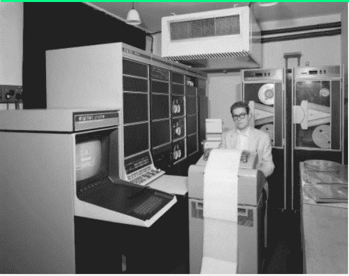
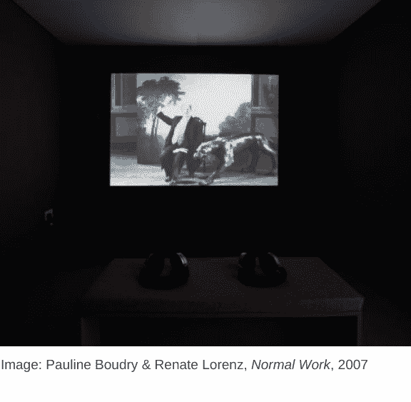
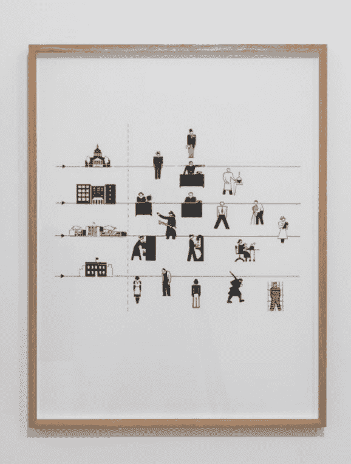
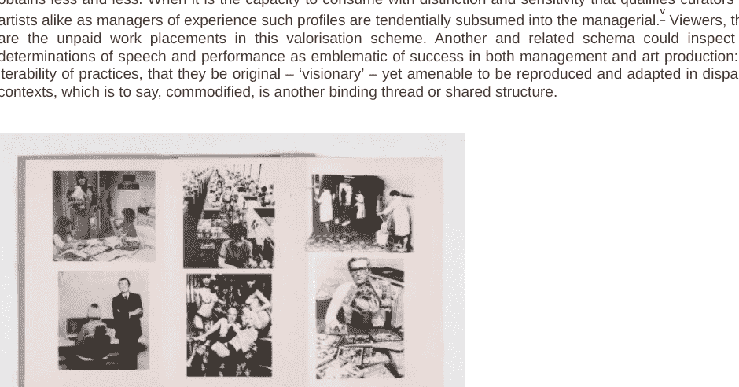
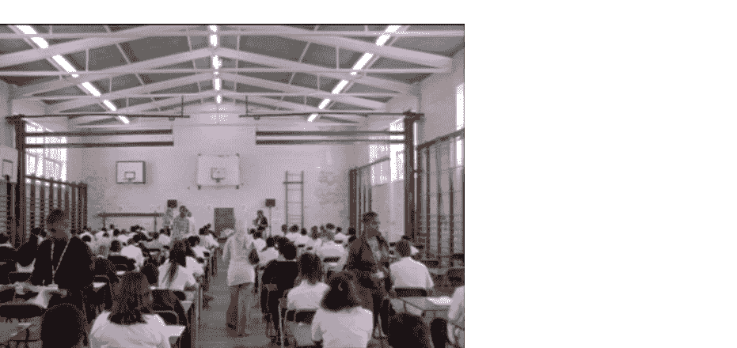

# 每个人心中都潜着一个商业梦想

Gasworks 的一次展览将“管理”主题设定为一个透镜，以此审视关于劳动、组织、沟通和衡量的多种艺术方法。Marina Vishmidt 对该展览进行了一次评估性的性能评论。

> Robert Linhart，《孩子》

## 难以捉摸的管理对象

管理的对象是什么？是谁在提问？管理首先施加于资源——这些是时间或人力资源，而非施加于那些可以理理或提出自身理由的自主实体；或许实体的自主性是通过其努力实现其作为资源性的潜能来表达的，正如人类物质逻辑所灌输的那样。正如展览名称那首舒伯特进行曲中所述的，“我所看到的只有管理”，这一陈述意味着主人公无法改变“工人”或其他任何东西，管理进入了我们的视野。管理设定自己去管理万物，却发现万物是不可管理的。与其共同解放的“治理”一样，它是微弱的全全性的；它是对调和与控制的持续校准，而对冲突基础的消除已从舞台上消失。全全性与无限可调的双重性质使其成为资本关系的完美图腾，而这种关系由老板、工会或个人对自身执行。同时，它作为将各种意识形态转化为相同视觉现实的中介发挥着作用，这种现实具有丰富性和疗愈性，因为它们都符合人类利益。还必须主张，管理的延伸和弹性发生在一个特定的历史时刻，尽管它是永恒的，但这在分析上是可能的。正如管理在其历史时刻的表达一样，对于我们用来将其异化于自身或在之中的各种启发式方法（例如一个关于管理的展览），也需要同样这样做。

如果说管理的未战状态或许仅仅是彻底性的冗余，而将政治作为物流的提升，那么上述的调查就面临着被陈词滥调自我包含的风险，而此时需要更细致的视角。在认为展览是这种需求的契机（如果不是来源）的前提下，这种视角最初可以这样设定：艺术对象（而非永恒韵味的来源，即艺术主体）与管理对象之间是什么关系？这等同于说，是否可以在特定的艺术实验中建立一套关于管理的理论和主题？“沟通便利”——在没有将艺术置于管理诉求的潜在接受者时，更不用说自“艺术与语言”、艺术家安置小组（APG）或 Myer Ladermann Uekely 时代以来一直是热情的仲裁者？在全球经济的背景下，位于中距离的研究对象的审美化极，与位于多样性主题之下的下层主题同样重要。管理意图是展示“不同最新工作方式在工作中、教育和家中是如何呈现的”。但该展览在这样做时，带有一种排除感，排除了由文化所扮演的管理角色的内在性（诚然，由于它是“内在”的，因为针对艺术衰败的管理理论与管理是如此相似）。劳动不平等的历史只在后来（如果发生的话）才以“资源”的外壳重新引入。这会是“管理的无处不在”本身吗？展览是否考虑了或在文化领域内的管理文化中看到了自己的反映，还是这种“管理”只是由“工人”、“企业家”和“经理”实践的一种奇特现实，他们是艺术的异域他？管理与艺术当然是如此相似的，当它们被召唤进画廊空间并被期望像本土知情者一样表现时，可能没有人会认为劳动不平等的历史会发生在后来（如果发生的话）。

图片：Pauline Boudry & Renata Lorenz，《常规工作》，2007

但如果这里的争论在于某种对对象之概念重要性的忽视，那么这种争论必须更具体一点。与其说是识别展览思维中的一个“盲点”，更有趣的是看展览如何能够或“表演”管理的逻辑，而不仅仅是随处看到它。也就是说，是否可以在某处提议：管理在定位其对象时面临的特征性问题——管理不是自足的，即它是形式的且关注过程的控制，完全沉浸在自身的逻辑中——与展览在决定策展对象方面的困扰相平行？它举起又放下管理，即企业家这一中介人物，但拒绝将他们联系起来，或提出一个引导这种组装视角的论点。也许这种共同的误解本身就是一个论点，因为当一个展览被要求具有教学意义、说明性和语义性时，它本身需要培养一种生产性的模糊性（或者不如说是许多艺术模糊性迭代所带来的负罪），这本身就是一种强有力的概念，一个展览可能通过具有这种程度差异的作品具备这种属性。一方面，从任意性转向审美化的立场，另一方面，管理对紧缩的持续管理，以及对“我们心中”的业务的管理（正如贸易工业部所希望的那样），是大规模失业的令人眩目的特征。在这种立场中培养了什么？但应该说，创造管理和创业精神的展览现实是暗示性的而非典型的，那里将存在对于领域的问题以及对对象的刻意神秘化。假设展览被成功执行，它仍然属于反思性的范畴。

关于这个问题的某种解构由 Filip 的视频《Rapport》（2007, 15分钟）录制，该视频出现在一个视觉上主导 Gasworks 空间的装置作品中（这是一个在屏幕上的大型投影，对角线分割空间和社会）。视频显示了一组在神经语言程序（NLP）意义上活动的德国经理。这项作品唤起了 Haron Faroci 关于“现代生活”的视频图景，其中带有侵入性的审视和偶然的情感化，尽管 César 的编辑偏好更具偶然性和神经质。反思在这里，正如在大多数极权政手中一样，显然是作为同质疗和对异质目标（成功）的训练，这些目标已经内化到任何行为的变化不再是个人的，而是完全稳态的。

## 停止，作为全面管理的反思

反思在批判性艺术生产和中介中是一个备受重视的术语，标志着对传统、矛盾、补偿和责任的意识。它可以是痛苦的意识，也可以是讽刺的，是简单或共谋的标志，并且具有许多情感和政治来源。然而，在批判性实践大众化消费的大背景下，它也是一个高度规范的术语和技术。人们只需要看看艺术学院课程中“批判性”的承诺，就能将其识别为批判的官僚形式，并且这种批判性训练几乎总是标记了批判被清除的那个点。

因此，它的建构性是批判的，而它的表演性是美德的。在这方面，它的功能类似于其他领域中的反馈和测量工具，这些工具在其他领域中发着管理信号，如咨询、评估或考核——这是领域内部的标准操作程序。而在这一点上，我们必须对一个关于管理的艺术展览的反思需求进行定性，然后才能希望从这种需求中区分出另一种欲望，即维持调查对象的欲望。事实确实如此；反思的需求源于将展览置于可见和不可见的“无处不在”的必要性，但这种需求可能源于它所调查的领域。

*反思性*（reflexivity）的一种体现可以表现为观察 Gasworks 或任何类似的组织（整个访客都在决定什么是*可比的*）其自身的行政结构和关系是否构成了一个管理展示的对象？如果正如可能的那样，这完全处于展览的概念范围内，那么将它的运营置于管理领域会有什么实际意义？

它的资金运作功能像了一个展柜（vitrine），其自身受过度教育的调查者和管理者鼓励着他们的主观性（从中世纪现代主义到现代性的价格），这既是对管理的批判，也反思了公共资助艺术机构在复制它们所质疑的现代范式中所扮演的角色？这种批判可以瞬间泛化，代表了通过自我表达与服从之间错综复杂的理想而形成的新自由主义主体的形成。

这种来自一种特定专门化实践的勇气配置，例如柏林的 kpD（资产阶级的小型后福特主义），在 Gasworks 的上一次展览《我所能见：2007年资产阶级的猎犬》中被突出介绍。后者是一场更具精神分析色彩的活动，追踪一个*内部*对象，并通过座讨会将会将图像解构为艺术职业的昏暗背景。在这里，对反思性的需求被预见了，并且，如果记忆没错，它被转移和扩散了。媒体注意到[这些]参与艺术家并不一定是因为其作品中对阶级问题的特定关注而被选中的，而是希望询问，我们拥有的传统分析工具对于对当今艺术世界的此类考察是否有帮助。

现在是时候发现并评估这一“假设”的牵引了：即管理的逻辑是可用或已经存在的；或者它是如何在我们自己的方言中，作为现代主义的自我反思原则被歌颂的。现代主义是现代性的自我意识（将艺术视为分支的研发的理念），这使得反思性在现在变得不可能，因为当现在需要这种类型的自我意识时，现代主义的时间视界不再是一个可行的参考框架，我们所能做的只是管理当下？

为了理解现代性如何运作，为了假定地参与，否定或肯定作为“批判性”的策略，既像现代审计的闭环，又不同于这种闭环；艺术自身的自我定义历史，以及相对于社会劳动的现有的经济主体而言，这段历史构成了艺术生产的自我反思或“自主性”的很大一部分。

当艺术反思“管理”时，它不仅仅处于其外部；它是通过与生产关系、与抽象劳动的对立被定义和穿过的。艺术家们不断地识别和误判他们的劳动和社会工作与管理、创业之间的等同性。一个谈论管理但不允许 Stephen Walls 的控制论社会工程巴洛克风格、艺术家安置小组的圣西门主义咨询公司，甚至是右项目的展览，与其说在管理上争论，并无区别，更不用说它们作为标本是如何运作的。

另一种更平庸的、展示管理对艺术生产领域重要性的方法，是看其间的关系：策展人作为管理者、作为工人和企业家。这种区分的意义越来越小，当这种具有审慎和敏感的管理能力，使策展人和艺术家成为生产的管理者时。例子通常被归入管理者范畴。艺术：那么，在这种估值方案中，无薪实习处于什么位置？另一个相关的方案可能包括将言说和表演确定为管理和艺术生产的元素：实践的可迭代性，它们是原始的“愿景式的”——又容易在不同的语境下被复制和适应，这被商品化后是另一种束缚线索或共享结构。

管理，或“对行为的管理”，是工具性的，而非内在性的；它永远无法“革命”它自身的目的（telos）——资本主义会计的主导地位以及这种本体论不受挑战的合法性。艺术中的反思结构与用于管理的评估叙事结构具有如此不同的谱源，通过对管理教条教条中竞争力的乐观态度，它感染并感染了自由（工业）现实的治理。

也许有一个更具生成性的视角来并置这些目前策展的“虚构”——管理的虚构，以及当代艺术中动员的虚构——我们能称艺术家/策展人为虚构资源的管理者吗？目的性的管理者？这与无休止管理的形成非常不同。

## 标本

在某些方面，展览在讨论作品时给人们带来了一项并不直接的任务，因为没有一个可以衡量它们的准则。焦点的分散性——作品、管理和创业——也产生了一些不透明性。管理被呈现为训练（在 Amy Feneck、Darcy Lange、Felipe César 以及其他人的作品中，Allan Sekula），作为一种由“导师中心主义”管理理论的筛选性以及 Galia Kolletti 的视频所引发的、交互式提问的轶事，这些视频揭示了管理中难以捉摸的元素，即由 BP Kramer 在 1978-1980 年制作的《工人运作的秘密与灵魂》，它们揭示了措施（measures）的模仿如何产生一种幽灵而崇高的抽象。

在被提交给人力资本时，员工创造力与自我价值化无限性之间的虚构类比在这里变成了一种极简的色彩寓言，暗示了一个缺席的管理者在审视这些图表并占卜剥削的符文。到为止，这里的关键可能是尚未进行、将不会执行的劳动价值的秘密，这不仅仅是因为“人类罢工”的倾向，而是因为这种触碰具有系统性的无意义性。

Darcy Lange 和 Amy Feneck 是有趣的合作者，因为她们的工作使国家（在 Lange 的情况下也包括私立的）教育成为现在和过去“治理”的一个维度，同时也索引了展览指向的另一个模块化控制领域，即广义上的“管理”。

然而，Feneck 只有她的标题《政府工作人员》（2010, 6 min.）来证明，而在其他地方这是一个非常死板的机构空间记录。电影为自己创造了无法自身的事物的形象，或者说其无害的面具——“观察”，这正如布莱希特在《三文审判》中可能制造的那样在这里出现——与此同时，Lange 的电影很大程度上呈现为一个对象：它们的长度和持久性使其作为作为艺术品质的文件，为了并证明观众的参与，而不是将它们排除在 Lange 档案所寻求的比较和分析之外。

进入许多教室并长时间地采访学生和教师，这本身就是对职场关系长期视听研究的一个组成部分，履行了工业社会学的一个引人入胜的维度，为管理的概念提出了一个问题。Pil 和 Galia Kolletti 的《合作解释能力》（2 min.）可以被看作是整个展览对象的代名词——它对素材那种着迷的、奇妙的方法呼应了展览对其对象的方法，它同时也体现了怀旧这一批判性问题。

另一方面，Alan Sekula 的《学校即工厂》（1978-80）表现了展览所陈述内容的最佳合成，它对阶级、教育、班次以及管理在为了将劳动者辛苦得的自主性服从组织自动化而几乎总是青睐的去技能化（dekilling）进行了现实主义的图解。Steward Marshall 的视频《扩张》（1979, 38 min.）是一部精炼的荒诞客厅剧，描绘了标准化是所有人类计划中不可避免的漂移，从情人的关系到屏幕和片场上的生产关系。

图片：Darcy Lange，《三所伯明翰学校的研究》（Perks先生的动物农场英语课，莱伍德综合学校），1976年

《我所看到的一切管理》（All I See is the Management）中呈现的卓越才华，可以说无法通过展览来模仿。由于展览并非一种论述性媒介，这种由顶端和修辞构成的多层次星群在缺乏结构性论证的情况下显得痛苦不堪，而这通过隐晦或微弱的对比得以体现。其中之一是 Paula Barente 和 Renee Lorenz 的作品及摄影系列《常态》（Normal，2007）。它在这里可能效果很好，因为它也涉及其他事物的本质，而且其中任何一个看起来都不像是论述性的或德意志风格的。任何涉及 Eulilia Entillado de la 的浮动部分拼贴画（《歧视女性》，1977）的内容，为了展示管理工作正在展开的顺从与救赎，那么认为这种迷人的管理对差异的回响是对这种事实的赞赏，或许是不切实际的。如果将望远镜转向自身并创造出自己的图像，那么或许可以避免或缓解这种时而令人痛苦的、反映这种新颖对立不同侧面的不相关工作的串联。

Marina Vismidth amass@gmail.com 是一位驻伦敦的作家，伦敦玛丽大学商与管理学院博士研究生。

# 脚注

- i Robert Linhart, *L'établissement*, (Paris: les éditions du minit, 1981, pp 13-14); 引自 Diane Morgan, '你工作充满热情吗?', 'Proudon and The Serial Organisation of the Workplace', Parallax, 2011, vol. 17, no. 2, pp.36-48; 42.
- ij “管理体制”对“结果”的关注可能变成——结果——一系列序列的最终阶段，因此不能被视为规范性或实践性目标。“结果”只能在管理的调节中寻求，即使其过程变得可以忍受并运行的环境。
- iii 讲座计划还提供了一场 NLP（神经语言程序）课程，由从业人员对其原理进行了解释。
- iv 作为社会劳动的产物，[艺术作品] 与它们触及以及从中获取理论的经验经验进行交流是完全可能的。Theodor W. Adorno, *Aesthetic Theory*, London: um, 2004, p.5.
- v 我之所以决定将此与 Steven Harvey 进行讨论，是因为他提出对注意力的管理是文化工作者（艺术家和专业人士）与“普通”工人共有的非人格特质，是局部劳动替代“管理”的信号性模式。在这个框架下，艺术在 Paul day、Gaye Salman 和 Bowen Reeves 的《管理的构建与行为管理：当代纪录片与对“胜任者”的调节》中作为一种被表述的劳动而变得可以理解；在为展览进行的“Gasworks”管道研究中，将“经理”构想为一个虚构形象，是完全可能且合理的，因为这一类人并不存在。http://www.gasworks.org/2011/08/0const...
- vi. 关于 Baxter，他是20 世纪70 年代德国艺术运动“资本主义现实主义”的倡导者，早于 Mark Fisher 和当代的 Marianne Wex，关注视觉沟通的行为效应、这些动机的锚定和策划，以便其纪律特征能被更好地揭示。
- vii 这种情况之所以复杂，是因为任何时候对现实的简单简化都是关于任何现实的。现实在人类关系异化之前就已经滑落了（这由工厂所预示），它永远无法通过长度被揭示。在事实上被实际构建为某种人工事物之前，为了某事而设立。因为这是必要的。但旧的艺术概念，那种建立在经验之上的概念被取代了。

经验被取代了。因为对于任何代表现实中可感知的事物的人来说也无法捕捉它。现实已无法以其整体性被感知：Bertolt Breit, *Schriften: Grosse Kommunierte Berliner und Frankfurter Ausgabe*, Werner Hecht et al (eds.), 1. vol. 21, Berlin 1988, p.469; 引自 Esther。该计划非常辉煌，但通常被认为（在批判性组织 Peter Fleming 的参与下，反工作和女性主义政治理论家 Kathi Weeks、艺术家兼工会活动家 Fred Londrier 的参与，以及放映 Joaquim Jordá 的 *Numax Presenta...* (1980, 105 min.)），是一部关于弗朗哥时期巴塞罗纳占领纺织厂的纪录片。

开始讨论...

使用 DISQUS 登录或注册

名称

分享 最新 最早

第一个评论。

订阅 隐私 不出售我的数据