# 70-640 考试：Windows Server 2008 Active Directory 配置，含实验手册与 MOAC 在线实验室套装

## 出版商序言

Wiley 对微软官方学术课程系列的出版愿景是为学生和教师提供所需技能和知识，以便他们在个人和专业生活的各个方面有效使用微软技术。高质量的教学对于帮助教育工作者和学生充分利用微软的软件工具并提高生产力至关重要。因此，我们的使命是让我们的教学项目成为值得信赖的终身教育伙伴。

为了实现这一使命，Wiley 和 Microsoft 合作开发了面向信息工作者、IT 专业人士和开发人员的最高质量教育项目。该合作伙伴关系创建的材料使用“Microsoft Official Academic Course”品牌名称，向教师和保证学生这些教科书的内容完全得到微软的认可，并且提供有关微软产品的最高质量信息和指导。微软官方学术课程教科书在另一个层面上也是“官方”的——它们是微软 IT 学院成员的官方认可教材。

微软官方学术课程系列专注于*劳动力发展*。这些项目旨在帮助那些寻求进入职场、转换工作或作为信息工作者、IT 专业人士和开发人员开始新职业生涯的学生。微软官方学术课程项目通过强调真实的工作场景，并辅以大量的项目、练习、案例和评估，来满足他们的需求。

微软官方学术课程与微软广泛的研究和工作任务分析相映射，这些研究和分析与用于创建微软认证技术专家（MCTS）考试的研究和分析相同。教科书侧重于真实工作所需的实际技能。当学生完成教科书中的项目和练习时，他们提高了知识水平以及将最新微软技术应用于日常任务的能力。这些学生还获得了增强简历的资质，这可以帮助他们找到工作、保留现有工作或进一步深造。

终身学习的概念如今已迫在眉睫。职位角色，甚至整个职位类别，变化速度之快，以至于如果我们不不断更新技能和能力，我们就无法保持竞争力和生产力。微软官方学术课程项目及其对微软认证考试准备的关注，为人们提供了一条获取并有效更新其技能和知识的途径。Wiley 通过开发和分发这些课程，作为微软的官方学术出版商，支持学生在这一努力中的探索。

如今，教育出版业需要提供高质量的印刷品和健壮的电子内容。通过整合微软官方学术课程产品、*WileyPLUS* 和微软认证，我们能够更好地为学生和教师提供高效的学习解决方案。

**Bonnie Lieberman**

总经理兼高级副总裁

## 前言

欢迎来到微软 Windows Server 2008 的微软官方学术课程（MOAC）项目。MOAC 代表了 Microsoft Learning 与 John Wiley & Sons, Inc. 出版公司的合作。Microsoft 和 Wiley 联手制作了一系列教科书，为教师提供引人入胜且富有创新性的教学解决方案，并为学生带来卓越的学习体验。这些教科书融入了来自 Windows Server 2008 创作者的深入知识，并由一家以其产品教学质量的全球知名度而闻名的出版商精心打造，从而在最短的时间内最大化技能转移。学生被挑战以发挥其潜力，作为高度生产力的劳动力成员使用其新的技术技能。

由于这些知识库直接来自 Windows Server 操作系统的架构师、微软认证技术专家和微软认证专业人员考试的创建者（www.microsoft.com/learning/mcp/mcts），您肯定会获得与学生个人和专业成功最相关的话题覆盖。微软的直接参与不仅确保 MOAC 教科书内容准确且最新；它还意味着学生将获得最好的指导，以使其在认证考试和工作场所中取得成功。

### 微软官方学术课程项目

*微软官方学术课程*系列是一个完整的项目，旨在帮助教师和机构准备并讲授有关微软软件技术的优秀课程。通过 MOAC，我们认识到，由于微软开发的技术和课程变化的快速步伐，除了课堂教学工具外，教师在进行模块教学准备方面还有一系列持续的需求。MOAC 项目致力于以系统的方式为所有这些需求提供解决方案，以确保教师和学生都能获得成功且有益的课程体验——包括针对新软件发布的教师就绪技术培训和课程培训；供学生在家使用以构建实操技能、评估和验证技能发展的软件本身；以及一套用于在课堂和实验室中进行教学的优秀工具。所有这些对于顺利讲授一门有趣的微软软件课程都至关重要，并且均由 MOAC 项目提供。我们认为下面的模型是一个标准，用于确保我们完全支持您讲授优秀课程的目标。在评估您的教学材料选项时，您可能希望使用该模型与可用产品进行比较。


www.wiley.com/college/microsoft 或

拨打 MOAC 免费电话：1+(888) 764-7001（仅限美国和加拿大）

## 执行 RDC 的分阶段安装

除了执行 Active Directory 服务的全局安装外，Windows 还支持 **分阶段安装**。分阶段安装会在域控制器上安装 Active Directory 服务和 Active Directory 数据库，但不会创建 Active Directory 林或域。

### 准备就绪

1. 确保你拥有最新的补丁、热修复程序和更新后的软件。
2. 确保你拥有最新的补丁、热修复程序和更新后的软件。
3. 确保你拥有最新的补丁、热修复程序和更新后的软件。

注意：已提议对 RDC 进行分阶段安装。

## 摘要技能矩阵


为准备 Microsoft Server 2003 认证加试，你可能有能力创建一种名为 **群集管理服务** 的新用户类型（或基于 Windows NT 或 Windows 2000 的域）。

- Active Directory 是一个对象数据库，可用于按逻辑方式组织资源。这些对象可以是用户、组或设备。

### 填空题

通过在提供的空白处填写正确的单词或短语来完成以下句子。

1. Active Directory 域被其 ______ 视为一个域控制器。
2. Active Directory ______ 是 Active Directory 环境的类似容器的安全边界。
3. 灵活的文件引用，Active Directory 包含两个 ______ 复制模型。
4. ______ （X 的数据库中与 X 的 ______ 关系组织良好。）
5. ______ 现有服务器在域中被替换。
6. 基本 Active Directory 域数据库的 ______ 位于目录结构中。
7. ______ 提供了一种视图，用于命名两个林树中所有域之间的命名树关系。
8. Active Directory 林中的每个域都有一个 ______ 与其他林中的服务器域具有 ______ 关系。
9. ______ 允许资源中的用户能够登录到 Active Directory，而无需多次连接。
10. Active Directory 允许你 ______ DNS 以隔离 Active Directory 资源，例如域控制器和全局目录服务器。

### 选择题

圈出正确答案。

1. 以下哪项是 Active Directory 中的子对象？
   - a. OUs
   - b. 用户
   - c. 应用程序策略
   - d. OU
2. 在完全处于或位于 Windows Server 2008 林功能级别的林中，可以记录哪些事件？
   - a. Windows 2000
   - b. Windows 2003
   - c. Windows 2008
   - d. Windows NT 4.0
3. 你计划为一目前拥有 Windows 操作系统环境的公司实施 Active Directory。所有部门级单元都将在 Active Directory 中创建和管理。哪个功能很可能对 Active Directory 最有用，允许每位经理管理自己的部门？
   - a. OUs（组织单元）
   - b. 委派控制
   - c. 构建-出（组织控制）
   - d. 分层复制
   - e. GPOs（组策略）
   - f. Active Directory 信任模型
4. 测试 Active Directory 功能需要：
   - a. 一个或多个林服务器
   - b. 一个或多个林支持
   - c. 一个或多个 DCs
   - d. Active Directory 集成
6. 你正在尝试从 Microsoft 第 17 个位置的子域中添加一个 Active Directory 子域。实际上，关于域添加，哪两个陈述是正确的：
   - a. FDC 控制器是子数据库
   - b. FDC 控制器是父数据库
   - c. 认证员工的外层对象
   - d. 认证员工的内层对象
8. 每个 FDC/FSMO 角色容器由两个组件组成：域部分和域 FDC。FDC/FSMO 角色容器中称为：
   - a. 域权威单元 (DAU)
   - b. Active Directory 域和计算机
   - c. Active Directory 林和林
   - d. Active Directory 域和信任

## 案例场景


# 场景 6-1：FSMO 角色放置—I

本练习的前提条件是拥有 15 名员工的 IT 部门。经理 Kempkin 在林中总共拥有两个域控制器。在此场景中，必须停用其中一台。Kempkin 希望确保 FDC/FSMO 角色正确放置在剩余的域控制器上，以便网络能够按预期继续运行。根据提供的信息，Kempkin 应将五个角色中的哪些放置在剩余的域控制器上，原因是什么？

# 场景 6-2：FSMO 角色放置—II

本练习的前提条件是一个具有以下域的五个域林：`contoso.com`, `contoso.local`, `contoso.org`, `contoso.net` 和 `contoso.co.uk`。你需要确定林中的哪个域控制器应作为 PDC 仿真器、RID 主和架构主角色。哪个域控制器应具有这些角色中的每一个，原因是什么？

# 知识评估问题

# 工作就绪项目


# 使用 Repadmin 查询域控制器

Active Directory 中用于 Microsoft Windows 系统的域管理器。

1. 在命令提示符下，输入以下命令以列出 Active Directory 中的所有域控制器：

```
ntdsutil quads show dcs
```

2. 注意以下命令如何列出域中的所有域控制器：

```
repadmin /showrepl
```

3. 运行以下命令以查询特定域控制器：

```
repadmin /showrepl <DNS hostname of DC>
```

以下文本摘自 Windows Server 2003 Active Directory：

“Windows Server 2003，域系统。域系统包含 Active Directory 域系统和域。可能需要查询特定域控制器以获取有关其复制伙伴及其目录分区复制状态的信息。使用以下命令查询域控制器的复制状态：`repadmin /showrepl`”

前面的命令输出是两台拥有 25 个域控制器和 25 个域控制器的域控制器的复制关系示例。此域中的复制关系配置如下：域系统 2000，这是域控制器之间的活动复制关系。使用以下命令查询特定域控制器：

`www.wiley.com/colllege/microsoft` 或拨打 MOAC 免费电话号码：`1+(888) 764-7001`（仅限美国和加拿大）

# 本书的排版约定与特性

本书使用特定的字体、符号和标题约定来突出重要信息，或引起读者对特殊步骤的注意。有关各章节特性的更多信息，请参阅“图解全书导览”章节。

| 约定 | 含义 |
| :--- | :--- |
| `NEW`（新特性） | 此图标表示本软件版本中新的或大幅改进的 Windows 功能。 |
| `THE BOTTOM LINE`（核心要点） | 此功能提供对以下章节将要涵盖内容的简要总结。 |
| `CLOSE`（关闭） | 全大写字母且字体颜色与正文不同的单词表示打开、保存或关闭文件或程序的说明。它们还指出了您应检查的项目或应采取的操作。 |
| `CERTIFICATION READY?`（认证准备就绪？） | 此功能标志着正文中覆盖特定认证目标的位置。它为您提供检查对相应 MC7S 目标理解程度的机会，如有必要，回顾该目标在课程中涉及的章节。 |
| `TAKE NOTE`（注意） | 读者辅助信息出现在正文中的阴影框内。`注意` 提供与特定任务或主题相关的有用提示。 |
| `ANOTHER WAY`（另一种方法） | `另一种方法` 提供完成特定任务的替代步骤。 |
| `XREF`（交叉引用） | 这些注释提供了指向教科书其他部分讨论的信息的指针，或描述 Windows Server 2008 中有趣但当前主题或练习未直接涉及的特性。 |
| `Alt` + `Tab` | 两个按键名称之间的加号（+）意味着您必须同时按下这两个键。练习中指示您按下的按键将以此处所示的字体显示。 |
| 一个`共享打印机`可被网络上的许多用户使用。 | 关键术语以粗体*斜体*显示。 |
| 输入 `My Name`。 | 要求您输入的任何文本将以彩色显示。 |
| 点击 `OK`（确定）。 | 您应点击或选择的屏幕上的任何按钮也将以彩色显示。 |

# 讲师支持计划

`Microsoft 官方学术课程`（MOAC）系列配备了一系列丰富的资源，这些资源整合了详尽的教科书插图，形成了教学上连贯的整体。这些资源提供了讲师部署和讲授课程所需的所有材料。可供在线下载的资源包括：

- `DreamSpark Premium` 旨在为实验室、教室及学生电脑中的教职工和学生提供最简单、最经济的开发人员工具、产品和技术。符合条件的 MOAC 采用者可获得免费的 3 年会员资格。

  - 注意：可以从 `DreamSpark Premium` 下载 `Microsoft Windows Server 2008` 供本课程学生使用。

- `Windows Server 2008 评估软件`。内含 Windows Server 2008 评估版的 DVD 位于本书封面前。

- `讲师指南` 包含所有教科书练习的解答，以及章节摘要和讲稿。讲师指南和不同学期长度的教学大纲可从书籍伴侣网站（`http://www.wiley.com/college/microsoft`）和 `WileyPLUS` 获取。

- `题库` 包含数百道选择题、判断题、简答题和论述题，可从讲师书籍伴侣网站（`http://www.wiley.com/college/microsoft`）和 `WileyPLUS` 下载。提供完整的答案键。

- `PowerPoint 演示文稿和图片`。完整的 PowerPoint 演示文稿集可在讲师书籍伴侣网站（`http://www.wiley.com/college/microsoft`）和 `WileyPLUS` 上获取，以增强课堂演示。这些演示文稿根据教科书的主题覆盖范围和技能矩阵量身定制，旨在传达教科书中涉及的 Windows Server 关键概念。

教科书中的所有插图均位于讲师书籍伴侣网站（`http://www.wiley.com/college/microsoft`）和 `WileyPLUS` 上。您可以将它们整合到 PowerPoint 演示文稿中，或制作自己的过片投影胶片和学习资料。

通过在课堂上讨论中使用这些视觉资料，您可以帮助学生将注意力集中在 Windows Server 的关键要素上，并帮助他们理解如何在工作中有效地使用它。


- 说到改善课堂体验，没有比同事更好的创意和灵感来源了。Wiley 教师网络将教师与新技术连接起来，促进最佳实践的交换，并帮助提高教学效率和效果。教师网络活动包括技术培训与教程、虚拟研讨会、经验分享与观点交流、个人咨询以及资源共享。详情请访问 `www.WhereFacultyConnect.com`。

访问 `www.wiley.com/college/microsoft` 或拨打 MOAC 免费电话：`1+(888) 764-7001`（仅限美国和加拿大）

# WileyPLUS

过去十年教育领域的重大发展影响了 Microsoft 官方学术课程所采取的教学方法。在互联网时代，学生的学习方式，尤其是关于新技术的学习，发生了巨大变化。电子学习材料和基于互联网的如今与印刷教科书一样，成为课堂教学的重要组成部分。`WileyPLUS` 提供了创建环境的技术，使学生们能够充分发挥潜力并体验终身受益的学术成功！

`WileyPLUS` 是一套强大且高度整合的教学与学习资源套件，旨在弥合课堂内发生的事情与在家或在工作中发生的事情之间的差距。`WileyPLUS` 为讲师提供了教学资源，帮助他们教导学生掌握新技术，并指导他们通过获得认证技能和在劳动力市场中晋升来达成目标。对于学生，`WileyPLUS` 提供随时随地（24/7）可用的学习和实践工具。`WileyPLUS` 在一个易于使用的网站上包含了学生教科书完整在线版本、PowerPoint 演示文稿、作业和练习任务及测验、图片库、题库问题、成绩簿以及所有讲师资源。

围绕您和学生在课堂上执行的日常活动，`WileyPLUS` 帮助您：

- 使用相关的 PowerPoint 幻灯片和其他 `WileyPLUS` 材料准备和展示出色的课堂演示——您可以轻松上传并添加自己的内容。

- 通过选择按课程、难度级别和来源组织的问题来创建作业——并添加您自己的问题。学生的作业和测验会自动评分，结果记录在您的成绩簿中。

- 为学生提供情境敏感的帮助，全天候 24/7。当您布置作业或测验时，您可以决定学生何时及是否获得提示、解决方案或答案的访问权限——或者他们可以被链接到其完整在线教科书的相关章节，以便在他们最需要的任何时候和任何地方获得更多帮助。

- 跟踪学生进度：使用 `WileyPLUS` 成绩簿分析学生结果，并评估个人和班级层面的理解水平，或将数据导出到您自己的个人成绩簿中。


管理您的课程：WileyPLUS 可以轻松与其他课程管理系统、成绩簿或您在课堂上使用的其他资源集成，为您提供按照自己方式构建课程的灵活性。

请查看我们在 `www.wiley.com/college/wileyplus` 上的在线演示。在这里，您将找到有关 WileyPLUS 特性和优势的更多信息、如何申请该标题的 WileyPLUS“试驾”，以及如何将其用于课堂教学。

# DREAMSPARK PREMIUM——符合条件的采用者可免费获得3年会员资格！

DreamSpark Premium 旨在为高校提供最简单、成本最低的方式，使其能够在实验室、教室和学生的个人电脑上使用最新的 Microsoft 开发人员工具、产品和技术。DreamSpark Premium 是面向教授科学、技术、工程和数学（STEM）课程部门的年度会员计划。该会员身份提供了一套完整的解决方案，使实验室、教师和保持技术领先地位。

DreamSpark Premium 计划中提供的软件通过 Wiley 和 Microsoft 的出版合作，免费提供给采用部门。

- 详情请联系您的 Wiley 代表。

如需了解 DreamSpark Premium 计划的更多信息，请访问：

`http://msdn.microsoft.com/academic/`

注意：Microsoft Windows Server 2008 可从 DreamSpark Premium 下载，供本课程的学生使用。

# 重要网址和电话号码

要查找您所在地区的 Wiley 高等教育代表，请访问以下网址，并点击页面顶部的“我的代表是谁？”链接。

`http://www.wiley.com/college`

或致电 MOAC 免费电话号码：1 + (888) 764-7001（仅限美国和加拿大）。

要了解有关成为 Microsoft 认证专家以及考试安排的更多信息，请访问 `www.microsoft.com/learning/mcp`。

## 学生支持计划

### 书籍配套网站 (`www.wiley.com/college/microsoft`)

MOAC 系列的学生书籍配套网站包含了与本课程配合使用的任何资源、练习文件和 Web 链接。

### *WileyPLUS*

*WileyPLUS* 是一套功能强大且高度集成的教学与学习资源组合，旨在弥合课堂发生的内容与学生在家中及工作中所经历的内容之间的差距。对于学生来说，*WileyPLUS* 提供了全天候 24/7 可用的学习和练习工具，无论他们想在何时何地学习。*WileyPLUS* 包括完整的在线学生教科书版本、PowerPoint 演示文稿、作业和练习任务及测验、图像库、题库问题、成绩册以及在一个易于使用的网站中提供的所有教师资源。

*WileyPLUS* 提供对学生作业的即时反馈以及丰富的支持材料。这一强大的学习工具将帮助您的学生发展对课程材料的概念理解，并提高他们回答问题的能力。

- **学习和练习**区域直接链接到文本内容，允许学生在学习和答题时复习文本。
- **作业**区域将您希望学生完成的所有任务集中在一个位置，使他们能够轻松地专注于任务。学生可以访问各种交互式自我评估工具，以及用于建立信心和理解的其它资源。此外，所有作业和测验都包含指向多媒体书籍相关部分的链接，为学生提供了上下文相关的帮助，使他们能够在障碍出现时克服它们。
- 为每个学生提供一个**个人成绩册**，允许学生随时查看其过往作业的结果。

请在 `www.wiley.com/college/wileyplus` 查看我们的在线演示。在这里，您可以找到关于 *WileyPLUS* 的功能和优势的更多信息，如何申请该标题的 *WileyPLUS*“试驾”，以及如何在课堂上采用它。

# Wiley 桌面版

Wiley MOAC 桌面版是印刷教科书的创新电子版本。学生可以以印刷版教科书美国价格 50% 的折扣购买桌面版，并获得持久性和便携性的额外价值。Wiley 桌面版为学生提供了其他电子教科书解决方案无法提供的众多额外好处。

Wiley 桌面版**不是**订阅服务；学生将 Wiley 桌面版下载至其计算机桌面。学生拥有他们购买的内容，可以永久保留。一旦 Wiley 桌面版下载到计算机桌面，学生即可即时访问所有内容，无需联网。学生还可以打印出他们偏好阅读硬拷贝的部分。学生还可以访问其 Wiley 桌面版内完全集成的资源。从突出显示电子文本到做笔记和分享笔记，学生在阅读或跟随课堂进度时可以轻松个性化其 Wiley 桌面版。

# Windows Server 2008 评估版

所有 MOAC Windows Server 2008 教科书都随附光盘，其中包含 Windows Server 2008 的评估版。安装 Windows 服务器评估版为学生提供了最先进的系统软件，使他们能够在课程学习中使用 Windows Server 2008 的完整版本。这也促进了“做中学”的实践，这可能是获取和记住新计算技能的最有效方式。

评估 Windows Server 2008 软件不需要产品激活或输入产品密钥。随本教科书提供的 Windows Server 2008 评估版可以未激活安装，并可在最初的 60 天内进行评估。如果您需要更多时间来评估 Windows Server 2008，可以将 60 天评估期重置（或重新启用）三次，将最初的 60 天评估期延长最多 180 天，总评估时间可达 240 天。在此之后，您需要卸载该软件或升级到 Windows Server 2008 的全功能授权版本。

# 系统要求

以下是 Windows Server 2008 的估计系统要求。如果您的计算机低于最低要求，您将无法正确安装此产品。实际要求将根据您的系统配置以及您安装的应用程序和功能而有所不同。

## 处理器

处理器性能不仅取决于处理器的时钟频率，还取决于处理器核心数量和处理器缓存大小。以下是该产品的处理器要求：

- 最低要求：1 GHz（对于 x86 处理器）或 1.4 GHz（对于 x64 处理器）
- 推荐要求：2 GHz 或更高

## 内存 (RAM)

以下是该产品的内存 (RAM) 要求：

- 最低要求：512 MB
- 推荐要求：2 GB 或更多
- 最大容量（32 位系统）：4 GB（对于 Windows Server 2008 Standard）或 64 GB（对于 Windows Server 2008 Enterprise 或 Windows Server 2008 Datacenter）
- 最大容量（64 位系统）：32 GB（对于 Windows Server 2008 Standard）或 2 TB（对于 Windows Server 2008 Enterprise、Windows Server 2008 Datacenter 或 Windows Server 2008 for Itanium-Based Systems）

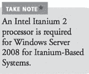

**请注意**

内存超过 16 GB 的计算机将需要更多的磁盘空间用于分页、休眠和转储文件。

## 磁盘空间要求

以下是系统分区的近似磁盘空间要求。基于 Itanium 和基于 x64 的操作系统将与这些估计值有所不同。如果您通过网络安装系统，可能需要额外的磁盘空间。更多信息，请访问 `http://www.microsoft.com/windowsserver2008`。

- 最低要求：10 GB
- 推荐要求：40 GB 或更多
- DVD-ROM 驱动器
- Super VGA (800 x 600) 或更高分辨率的显示器
- 键盘和 Microsoft 鼠标（或其他兼容的指示设备）

## 活动目录域控制器的注意事项

从 Windows Server 2003 升级到 Windows Server 2008 需要为新操作系统映像、Setup 过程以及任何已安装服务器角色预留免费的磁盘空间。对于域控制器角色，承载以下资源的卷或卷也有特定的免费磁盘空间要求：

- 应用程序数据 (`%AppData%`)
- 程序文件 (`%ProgramFiles%`)
- 用户数据 (`%SystemDrive%\Documents and Settings`)
- Windows 目录 (`%WinDir%`)

`%WinDir%` 卷上的可用空间必须等于或大于上述资源及其子文件夹（当它们位于 `%WinDir%` 卷上时）的当前大小。默认情况下，`dcpromo` 将活动目录数据库和日志文件放置在 `%Windir%` 下——在这种情况下，它们的大小将计入 `%Windir%` 文件夹的免费磁盘空间要求中。

然而，如果活动目录数据库承载在上述任何文件夹之外，则承载卷或卷只需包含至少相当于当前数据库大小 10% 或 250 MB 的额外可用空间，以较大者为准。最后，承载日志文件的卷上的可用空间必须至少为 50 MB。


Windows Server 2003 中活动目录目录服务的默认安装将活动目录数据库和日志文件放置在 `%WinDir%\NTDS` 下。在此配置中，`NTDS.DIT` 数据库文件和所有日志文件会暂时复制到隔离位置，然后再复制回其原始位置。这就是为什么这些资源需要额外的可用空间的原因。然而，`SYSVOL` 目录（同样位于 `%WinDir%` 下，即 `%WinDir%\SYSVOL`）是被移动而非复制的。因此，它不需要额外的可用空间。

升级后，为复制的资源预留的空间将归还给文件系统。

### 警告

虽然您可以重置 60 天评估期，但您无法在任何时候将其延长至 60 天以上。当您重置当前的 60 天评估期时，您将失去之前 60 天评估期中剩余的任何时间。因此，为了最大化总评估时间，请在当前 60 天评估期接近结束之前再重置评估期。

## 安装和重新启用 Windows Server 2008

评估 Windows Server 2008 软件不需要产品激活。Windows Server 2008 评估版可以未激活安装，并可评估 60 天。此外，60 天评估期可以重置（重新启用）三次。此操作将原始的 60 天评估期延长最多 180 天，总评估时间可达 240 天。

安装 Windows Server 2008 后，如果不重新安装，则无法更改其版本。

## 如何在不激活的情况下安装 Windows Server 2008

- 运行 Windows Server 2008 安装程序。
- 当提示输入产品密钥以激活时，请勿输入密钥。当安装程序询问是否确认您的选择时，单击“否”。
- 系统可能会提示您选择要评估的 Windows Server 2008 版本。请选择您要安装的版本。
- 当出现提示时，请阅读 Microsoft 软件许可条款中的评估条款，然后接受这些条款。
- 当 Windows Server 2008 安装程序完成后，您的初始 60 天评估期即开始。要检查当前评估期剩余的时间，请运行 `System32` 文件夹中的 `Slmgr.vbs` 脚本。使用 `-dl` 开关运行此脚本。`slmgr.vbs -dl` 命令会显示当前 60 天评估期剩余的天数。

## 如何重置评估期

本节介绍如何延长（或重新设置）Windows Server 2008 的评估期。评估期也被称为“激活宽限期”。

当初始的 60 天评估期接近尾声时，您可以运行 `Slmgr.vbs` 脚本来重置评估期。要执行此操作，请按照以下步骤操作：

1. 单击开始，然后单击命令提示符。
2. 输入 `slmgr.vbs -dl`，然后按 ENTER 键以检查当前评估期的状态。
3. 要重置评估期，请输入 `slmgr.vbs -rearm`，然后按 ENTER 键。
4. 重启计算机。

这将重置评估期为 60 天。

## 如何自动化评估期的延长

您可能希望设置一个流程，自动每 60 天重置一次评估期。自动化此流程的一种方法是使用任务计划程序。您可以配置任务计划程序在特定时间运行 `Slmgr.vbs` 脚本并重启服务器。要执行此操作，请按照以下步骤操作：

1. 单击开始，指向管理工具，然后单击任务计划程序。
2. 将以下示例任务复制到服务器，然后将其保存为 `.xml` 文件。例如，您可以将该文件保存为 `Extend.xml`。

```xml
<xml version="1.0" encoding="UTF-16"?>
<Task version="1.2" xmlns="http://schemas.microsoft.com/windows/2004/02/mit/task">
  <RegistrationInfo>
    <Date>2007-09-17T14:26:04.433</Date>
    <Author>Microsoft Corporation</Author>
  </RegistrationInfo>
  <Triggers>
    <TimeTrigger id="18c4a453-d7aa-4647-916b-af0c3eal6a6b">
      <Repetition>
        <Interval>PT90d</Interval>
        <StopAtDurationEnd>false</StopAtDurationEnd>
      </Repetition>
      <StartBoundary>2007-10-05T02:23:24</StartBoundary>
      <EndBoundary>2008-09-17T14:23:24.777</EndBoundary>
    </TimeTrigger>
  </Triggers>
  <Principals>
    <Principal id="Author">
      <UserId>domain\alias</UserId>
      <LogonType>Password</LogonType>
      <RunLevel>HighestAvailable</RunLevel>
    </Principal>
  </Principals>
  <Settings>
    <IdleSettings>
      <Duration>PT10M</Duration>
      <WaitTimeout>PT1H</WaitTimeout>
      <StopOnIdleEnd>true</StopOnIdleEnd>
      <RestartOnIdle>false</RestartOnIdle>
    </IdleSettings>
    <MultipleInstancesPolicy>IgnoreNew</MultipleInstancesPolicy>
    <DisallowStartIfOnBatteries>true</DisallowStartIfOnBatteries>
    <StopIfGoingOnBatteries>true</StopIfGoingOnBatteries>
    <AllowHardTerminate>true</AllowHardTerminate>
    <StartWhenAvailable>false</StartWhenAvailable>
    <RunOnlyIfNetworkAvailable>false</RunOnlyIfNetworkAvailable>
    <AllowStartOnDemand>true</AllowStartOnDemand>
    <Enabled>true</Enabled>
    <Hidden>false</Hidden>
    <RunOnlyIfIdle>false</RunOnlyIfIdle>
    <WakeToRun>true</WakeToRun>
    <ExecutionTimeLimit>P3D</ExecutionTimeLimit>
    <DeleteExpiredTaskAfter>PT05</DeleteExpiredTaskAfter>
    <Priority>7</Priority>
    <RestartOnFailure>
      <Interval>PT1M</Interval>
      <Count>3</Count>
    </RestartOnFailure>
  </Settings>
  <Actions Context="Author">
    <Exec>
      <Command>C:\Windows\System32\slmgr.vbs</Command>
      <Arguments>-rearm</Arguments>
    </Exec>
    <Exec>
      <Command>C:\Windows\System32\shutdown.exe</Command>
      <Arguments>/r</Arguments>
    </Exec>
  </Actions>
</Task>
```

3. 在示例任务中，更改以下 `UserId` 标签的值，使其包含您的域名和别名：

   `<UserId>domain\alias</UserId>`

4. 在任务计划程序中，单击操作菜单上的导入任务。
5. 单击示例任务的 `.xml` 文件。例如，单击 `Extend.xml`。
6. 单击导入。
7. 单击触发器选项卡。
8. 单击一次性触发器，然后单击编辑。
9. 将任务的开始日期更改为您当前评估期结束前不久的一日期。
10. 单击确定，然后退出任务计划程序。

任务计划程序现在将在您指定的日期运行评估重置操作。

## 为参加 Microsoft 认证技术专家 (MCTS) 考试做准备

Microsoft 认证技术专家 (MCTS) 认证使专业人员能够针对特定技术，并通过展示其在专业技术领域的深入知识和专业知识来脱颖而出。Microsoft 认证技术专家始终具备实施、构建、排查故障和调试特定 Microsoft 技术的能力。


对于组织而言，新一代 Microsoft 认证提供了更好的技能验证工具，有助于评估不仅限于 Windows Server 的高需求技能，还包括快速完成工作任务的能力。个人将更容易找到并努力实现符合其个人和专业目标的认证资格。

要了解有关成为 Microsoft 认证专业人士以及考试可用性的更多信息，请访问 www.microsoft.com/learning/mcp。

### 面向 IT 专业人员的 Microsoft 认证

新的 Microsoft 认证技术专家 (MCTS) 和 Microsoft 认证 IT 专业人员 (MCITP) 资质为 IT 专业人员提供了一个更简单、更具针对性的框架，除了展示特定开发人员职位所需的技能外，还可以展示他们的技术技能。

Microsoft 认证数据库管理员 (MCDBA)、Microsoft 认证桌面支持技师 (MCDST)、Microsoft 认证系统管理员 (MCSA) 以及 Microsoft 认证系统工程师 (MCSE) 资质继续为使用 Microsoft SQL Server 2000、Windows XP 和 Windows Server 2003 的 IT 专业人员提供行业认可，并验证其 IT 技能和经验。

### Microsoft 认证技术专家

新的 Microsoft 认证技术专家 (MCTS) 资质突显了您使用特定 Microsoft 技术的技能。您可以展示自己作为 IT 专业人员或开发人员的能力，对目前使用或计划部署的 Microsoft 技术拥有深入的知识。

MCTS 认证使专业人员能够针对特定技术，并通过展示其在专业技术领域的深入知识和专业知识来脱颖而出。Microsoft 认证技术专家始终具备实施、构建、排查故障和调试特定 Microsoft 技术的能力。

您可以在 www.microsoft.com/learning/mcp/mcts 了解更多关于 MCTS 计划的信息。

### Microsoft 认证 IT 专业人员

新的 Microsoft 认证 IT 专业人员 (MCITP) 资质让您能够突显您的特定专业领域。现在，您可以轻松地将自己确立为数据库管理、数据库开发、商业智能或支持领域的专家。

通过获得认证，您向雇主证明，您不仅在 `Windows Server` 操作系统的操作方面达到了可预见的技能水平，而且在一系列全面的 Microsoft 技术方面也达到了该水平。雇主通常要求作为就业或在公司或其他组织内晋升的条件进行认证。

您可以在 http://www.microsoft.com/learning/mcp/mcitp 了解更多关于 MCITP 计划的信息。

认证考试由 Microsoft 赞助，但通过 Microsoft 的考试交付合作伙伴 Prometric 进行管理。

### 为参加考试做准备

除非您是非常有经验的用户，否则您需要使用考试准备课程来准备在规定时间内正确地完成测试。`Microsoft Official Academic Course` 系列旨在为您具备所有考试主题的扎实知识做好准备，并经过一些额外的自行复习和练习，您应该对自己的能力通过相应考试感到自信。

# 致谢

## MOAC 讲师顾问委员会

我们要感谢我们的讲师顾问委员会，这是一个由顶尖教育工作者组成的精英团队，他们在构建这些产品的每一步中都给予了协助。顾问委员会成员在关键的课程设计和教学法决策上充当了我们的咨询对象，从而促成了这些具有吸引力且富有创新性的教科书的开发，服务于未来的信息工作者。我们由衷感激他们对技术教育的奉献精神。


### Charles DeSassure，Tarrant County College（塔兰特县学院）

Charles DeSassure 是德克萨斯州阿灵顿塔兰特县学院东南分校计算机科学与信息技术系的系主任兼讲师。他曾任管理信息系统（MIS）经理、系统分析师、现场技术分析师、局域网管理员、微型计算机专家以及南卡罗来纳州的公立学校教师。DeSassure 在高等教育领域工作已有十余年，并获得了全美人事与组织发展中心（NISOD）颁发的教学卓越奖。他目前任职于教育考试服务处（ETS）iSkills 全国咨询委员会，并曾担任塔兰特县学院学区学生评估委员会主席。他撰写提案，并在全国主要教育会议上进行演讲。DeSassure 曾担任约翰·威立公司（John Wiley & Sons）和普仁斯学院出版社（Prentice Hall）的教科书评审员。他教授信息安全、网络、远程学习和计算机基础等课程。DeSassure 拥有韦伯斯特大学（Webster University）的计算机资源与信息硕士学位。


### Kim Ehler，Waukesha County Technical College（沃基肖县技术学院）

Kim Ehler 是沃基肖县技术学院的微软项目协调员兼网络专业讲师，过去九年间一直教授 MCSE 认证和各类网络课程。在加入 WCTC 之前，Kim 曾在密尔沃基工程学院担任五年教授，负责管理诺维尔（Novell）学术教育和微软 IT 学院项目。她拥有广泛的行业经验，包括为江森自控（Johnson Controls）、当地城市消防局、警察局、大型教会团体、卫生部门和会计事务所进行网络设计和管理。Kim 拥有多项行业认证，包括 MCDDST、MCSE、Security+、Network+、Server+、MCIT 和 CNE。

Kim 拥有威斯康星大学密尔沃基分校的信息系统学士学位和工商管理硕士学位。在不忙于教学的时候，她喜欢与丈夫 Gregg 以及他们的两个孩子——14 岁的 Alex 和 17 岁的 Courtney 共度时光。


### Penny Gudgeon，Corinthian Colleges, Inc.（科林斯学院集团）

Penny Gudgeon 是科林斯学院集团的 IT 课程项目经理。此前，她负责科林斯旗下加拿大分院——CDI 商业、技术与健康科学职业学院在 27 个分校的计算机编程和 Web 课程。Penny 于 1997 年加入 CDI 学院，在多伦多市郊的一个分校担任计算机编程讲师。在加入 CDI 学院之前，Penny 曾在加拿大另一所学院——学习学院（Academy of Learning）教授生产力软件长达四年。Penny 拥有丰富的经验，通过从讲师指导到自主学习再到在线学习的各种学习模式，帮助实现学生的目标。

在投身教育事业之前，Penny 曾在广告、营销/销售、机械和电子工程技术以及计算机编程领域工作。当不在家庭办公室工作或不满足她对终身学习的热情时，Penny 喜欢阅读悬疑小说、园艺，并与她的雪橇犬 Gracie 一起在安大略省汉密尔顿家中放松。


### Margaret Leary，Northern Virginia Community College（北弗吉尼亚社区学院）

Margaret Leary 是北弗吉尼亚社区学院的 IST（信息通信技术）教授，过去十年一直教授网络和网络课程。她是 CyberWATCH 计划的主要研究者之一，该计划是一个由美国国家科学基金会（NSF）资助的区域性联盟，由高等教育机构和企业合作，旨在增加劳动力中网络安全人员的数量。她还兼任 Nortel 政府解决方案的高级安全政策经理和研究分析师，并持有 CISSP 认证。

Margaret 拥有凤凰大学（University of Phoenix）的工商管理学士（B.S.B.A.）学位和 MBA/技术管理学位，目前正在 Capella 大学攻读组织与管理博士（IT 方向）。她的论文题为“量化互联网公开记录中身份属性的可发现性：对身份盗窃和基于知识的认证的影响”。她还在多个政府和行业杂志上发表过几篇文章，主要涉及身份管理和网络安全。


### Wen Liu，ITT Educational Services, Inc.（ITT 教育服务公司）

Wen Liu 是 ITT 教育服务公司的企业课程开发总监。1998 年，他加入 ITT 公司总部担任高级网络分析师，负责规划和部署企业广域网（WAN）基础设施。一年后，他就职于企业课程经理，负责监督所有 IT 项目的课程开发。三年前他晋升为现职后，除了继续管理信息学院提供的所有项目的课程研发外，还负责监督其他领域（如起草与设计学院、电子技术学院）的课程开发。在受雇于 ITT 教育服务之前，Liu 是印第安纳州政府的一名电信分析师，参与骨干网项目，为 K-12 及高等教育机构、政府机构、图书馆和医疗设施等公众用户提供商用互联网和电信服务。


Wen Liu 拥有印第安纳州 Ball State 大学的高等教育学生人事管理硕士学位和信息与通讯科学硕士学位。他曾任印第安纳电信用户协会董事会特别项目总监，并曾担任 Course Technology 的 IT 顾问委员会成员。他目前是 IEEE 及其计算机学会的成员。


### Jared Spencer，Westwood College Online（韦斯特伍德学院在线）

Jared Spencer 自 2006 年起担任韦斯特伍德学院在线的网络首席教员。他于 2001 年开始教书，曾在多家机构（包括 Robert Morris University 和 Point Park University）进行线下和在线教学。除了学术背景外，他在汤森集团（Thomson Corporation）和 IBM 等公司工作了十五年，拥有丰富的行业经验。

Jared 拥有互联网信息系统硕士学位，目前为 ABD 状态，正在 Nova Southeastern 大学攻读信息系统博士学位。他撰写的多篇论文在会议上发表，并刊登在《互联网商务杂志》和《信息隐私与安全杂志》（JIPC）等出版物上。他持有多种行业认证，包括 AIX (UNIX)、A+、Network+、Security+、Windows 2000 M.C.S.A. 和 Windows 2003 Server M.C.S.A.。

决定参加哪项考试后，请复习该考试的目标列表。您可以通过查找每课开头的“目标域矩阵”以及本书课程页边距中的“认证准备”侧边栏，轻松识别目标列表中涵盖的任务。

要参加 MCCTS 测试，请访问 www.microsoft.com/learning/mcp/mcts 以查找您最近的测试中心。然后直接致电测试中心安排您的测试。您需要提前的通知时间因测试中心而异，通常取决于测试中心可用的计算机数量、在您想进行测试的当天已经预约的其他考生数量，以及测试中心每周提供 MCCTS 测试的次数。通常，您应在您想要进行测试日期的至少两周前致电安排测试。

到达测试中心时，您可能会被要求提供身份证明。驾照或护照是可接受的身份证件形式。如果您没有这些文件中的任何一种，请致电测试中心询问可接受的其他身份证明形式。如果您是在重新参加考试，请带上您的 MCCTS 识别号码，该号码在您上次参加考试时已提供给您。如果您未预先付款，或者您的机构尚未安排为您支付费用，您将需要在到达时支付测试费。

## MOAC Windows 服务器评审团队

我们还要感谢众多审阅者，他们仔细审阅了原稿，为提供高质量的教学材料提供了宝贵的反馈。

**Microsoft® Windows Server® 2008 Active Directory 考试 70-640**

Brian Bordelon, Lantec 计算机培训中心

Sue Miner, Lehigh Carbon 社区学院

Bonnie Willy, Ivy Tech

## 焦点小组和调查参与者

最后，我们要感谢数百名参与我们的焦点小组和调查的讲师，确保微软官方学术课程（Microsoft Official Academic Courses）最能满足客户需求。

- Jean Aguilar, Mt. Hood 社区学院
- Konrad Akens, Zane 州立学院
- Michael Albers, 孟菲斯大学
- Diana Anderson, Big Sandy 社区与技术学院
- Phyllis Anderson, Delaware County 社区学院
- Judith Andrews, Feather River 学院
- Damion Antos, American River 学院
- Bridget Archer, Oakton 社区学院
- Linda Arnold, Harrisburg Area 社区学院–Lebanon 校区
- Neha Arya, Fullerton 学院
- Mohammad Bajwa, Katharine Gibbs 学校–纽约
- Virginia Baker, 阿拉斯加大学费尔班克斯分校
- Carla Bannick, Pima 社区学院
- Rita Barkley, Northeast Alabama 社区学院
- Elsa Barr, Central 社区学院–Hastings
- Ronald W. Barry, Ventura County 社区学院区
- Elizabeth Bastedo, Central Carolina 技术学院
- Karen Baston, Wabunsee 社区学院
- Karen Bean, Blinn 学院
- Scott Beckstrand, 内华达州南部社区学院
- Pauletre Bell, Santa Rosa 初级学院
- Liz Bennett, Southeast 技术学院
- Nancy Berner, Olympic 学院
- Lucy Berz, Milwaukee Area 技术学院
- Meral Binbasioğlu, Hofstra 大学
- Catherine Binder, Strayer 大学 & Katharine Gibbs 学校–费城
- Terrel Blair, El Centro 学院
- Ruth Blaock, Alamance 社区学院
- Beverly Bohner, Reading Area 社区学院
- Henry Bojack, Farmingdale 州立大学
- Matthew Bowie, Luna 社区学院
- Julie Boyles, Portland 社区学院
- Karen Brandt, College of the Albemarle
- Stephen Brown, 圣马特奥学院 (College of San Mateo)
- Jared Bruckner, Southern Adventist 大学
- Pam Brune, Chattanooga 州立技术社区学院
- Sue Buchholz, Georgia perimeter 学院
- Roberta Buczynda, Edison 学院
- Angela Butler, Mississippi 墨西哥湾沿岸社区学院
- Rebecca Byrd, Augusta 技术学院
- Kristen Callahan, Mercer County 社区学院
- Judy Cameron, Spokane 社区学院
- Dianne Campbell, Athens 技术学院
- Gena Casas, 佛罗里达国际学院 (Jacksonville 分校)
- Jesus Castrezon, Latin Technologies
- Gail Chambers, 田纳西州西南部社区学院
- Jacques Chansavang, 印第安纳大学–普渡大学韦恩堡分校
- Nancy Chapko, Milwaukee Area 技术学院
- Rebecca Chavez, Yavapai 学院
- Sanjiv Chopra, Thomas Nelson 社区学院
- Greg Clements, Midland Lutheran 学院
- Dayna Coker, 俄克拉荷马州西南部州立大学–Syracuse 校区
- Tamra Collins, Otero 初级学院
- Janet Conrey, Gavilan 社区学院
- Carol Cornforth, 西弗吉尼亚州北部社区学院
- Gary Cotron, American River 学院
- Edie Cox, Chattahoochee 技术学院
- Rollie Cox, Madison Area 技术学院
- David Crawford, 密歇根州西北部学院
- J.K. Crowley, Victor Valley 学院
- Rosalya Culver, Washitenaw 社区学院
- Sharion Custer, Huntingon 大学
- Sandra Daniels, New River 社区学院
- Anila Das, Cedar Valley 学院
- Brad Davis, Santa Rosa 初级学院
- Susan Davis, Green River 社区学院
- Mark Dawdy, Lincoln Land 社区学院
- Jennifer Day, Sinclair 社区学院
- Carol Deane, Eastern Idaho 技术学院
- Julie DeBurh, Lewis-Clark 州立学院


- Janis DeVaren, Central 社区学院
- Drew Dekron, 阿拉斯加大学-安克雷奇分校
- Joy DePocon, Central Lakes 学院
- Sally DiBartolo, Brevard 社区学院
- Mellissa Diegna, Riverland 社区学院
- Al Dillard, Lansdale 商学院
- Marjorie Duffy, Cosumnes River 学院
- Sarah Dunn, 田纳西州西南部社区学院
- Shahla Duran, Tarrant County 学院-南部校区
- Kay Durden, 田纳西大学马丁分校
- Dineen Ebert, St. Louis 社区学院-Meramec
- Donna Ehrhart, 纽约州立大学-Brockport 分校
- Larry Elias, Montgomery County 社区学院
- Glenda Elser, 新墨西哥州立大学阿拉莫戈多分校
- Angela Evangelinos, Monroe County 社区学院
- Angie Evans, 印第安纳州 Ivy Tech 社区学院
- Linda Farrington, Indian Hills 社区学院
- Dana Fladhammer, Phoenix 学院
- Richard Flores, Citrus 学院
- Connie Fox, West Virginia University 技术与工程学院下的社区与技术学院
- Wanda Freeman, Okefenokee 技术学院
- Brenda Freeman, Augusta 技术学院
- Susan Frol, Boise 州立大学
- Roger Fulk, Wright 州立大学-湖校区
- Sue Furnas, Collin County 社区学院区
- Sandy Gabel, Vernon 学院
- Laura Galvan, Fayetteville 技术社区学院
- Cadance Garrod, Red Rocks 社区学院
- Sherrie Geigey, Northwest State 社区学院
- Chris Gerig, Chattanoogan 技术学院
- Barb Gilson, Cuyamaca 学院
- Jessica Gilmore, Highline 社区学院
- Pamela Gilmore, Reedley 学院
- Debbie Glinert, Queensborough 社区学院
- Steven Goldman, Polk 社区学院
- Bettie Goodman, C.S. Mott 社区学院
- Mike Grabph, Katharine Gibbs 学校-费城
- Francis Green, 宾夕法尼亚州立大学
- Walter Griffin, Blinn 学院
- Fillmore Guinn, Odeesa 学院
- Helen Haasch, Milwaukee Area 技术学院
- John Habal, Ventura 学院
- Joy Haarens, Chaffey 学院
- Norman Hahn, Thomas Nelson 社区学院
- Kathy Hall, Alamance 社区学院
- Teri Harbachec, Boise 州立大学
- Linda Harper, Richland 社区学院
- Maureen Harper, Indian Hills 社区学院
- Steve Harris, Katharine Gibbs 学校-纽约
- Robyn Hart, 弗雷斯诺城市学院
- Darren Hartman, Boise 州立大学
- Gina Hatcher, Tacoma 社区学院
- Winona T. Hatcher, Aiken 技术学院
- BJ Hathaway, 威斯康星州东北部技术学院
- Cynthia Hauki, West Hills 学院-Coolinga
- Mary L. Haynes, Wayne County 社区学院
- Marcie Hawkins, Zane 州立学院
- Steve Hebrock, 俄亥俄州立大学农业技术学院
- Sue Heistand, 爱荷华州中央社区学院
- Heith Hennel, Valencia 社区学院
- Donna Hendricks, 南阿肯色州社区学院
- Judy Hendrix, Dyersburg 州立社区学院
- Gloria Hensel, 阿拉斯加大学安克雷奇分校 Matanuska-Sustina 学院
- Gwendolyn Hester, Richland 学院
- Tammarra Holmes, Laramie County 社区学院
- Dee Hobson, Richland 学院
- Keith Hoell, Katharine Gibbs 学校—纽约
- Pashia Hogan, Northeast 州立技术社区学院
- Susan Hoggard, 塔尔萨社区学院
- Kathleen Holliman, Wallace 社区学院 Selma
- Chastity Honchul, Brown Mackie 学院/Wright 州立大学
- Christie Hovey, Lincoln Land 社区学院
- Peggy Hughes, 马里兰州 Allegany 学院
- Sandra Hume, 奇佩瓦谷技术学院
- John Hutson, Aims 社区学院
- Celia Ing, Sacramento City 学院
- Jean Ivey, Lanier 技术学院
- Barbara Jafari, Redwoods 学院
- Penny Jakes, 蒙大拿大学技术学院
- Eduardo Jarmillo, Peninsula 学院
- Barbara Jauken, Southeast 社区学院
- Susan Jennings, Stephen F. Austin 州立大学
- Leslie Jernberg, Eastern Idaho 技术学院
- Linda Johns, Georgia Perimeter 学院
- Brent Johnson, Okfenokee 技术学院
- Mary Johnson, Mt. San Antonio 学院
- Shirley Johnson, Trinidad 州立初级学院—Valley 校区
- Sandra M. Jolley, Tarrant County 学院
- Teresa Jolly, 南乔治亚技术学院
- Dr. Deborah Jones, 南乔治亚技术学院
- Margie Jones, Central Virginia 社区学院
- Randall Jones, Marshall 社区与技术学院
- Diane Karlsbraaten, Lake Region 州立学院
- Teresa Keller, 印第安纳州 Ivy Tech 社区学院
- Charles Kennitz, 宾夕法尼亚技术学院
- Sandra Kinghorn, Ventura 学院
- Bill Klein, Katharine Gibbs 学校-费城
- Bea Knaepen, 弗雷斯诺城市学院
- Kit Kofod, Western Wyoming 社区学院
- Maria Kolatis, Morris 县学院
- Barry Kolb, Ocean County 学院
- Karen Kurait, 阿肯色大学小石城分校
- Belva-Carole Lamb, Rogue 社区学院
- Betsy Lambert, Des Moines 地区社区学院
- Anita Lande, Cabrillo 学院
- Junnee Landry, Pratt 社区学院
- Karen Lankisch, UC Clermont
- David Lanzilla, Central Florida 社区学院
- Nora Laredo, Cerritos 社区学院
- Jennifer Larraee, Chippewa Valley 技术学院
- Debra Larson, 爱达荷州立大学
- Barb Lave, Portland 社区学院


- Audrey Lawrence, Tidewater 社区学院
- Deborah Layton, Eastern Oklahoma 州立学院
- Larry LeBlanc, Vanderbilt 大学 Owen 研究生院
- Philip Lee, Nashville 州立社区学院
- Michael Lehfeld, Brevard 社区学院
- Vasant Limeye, 西南部聋人大学学院 – Howard 学院
- Anne C. Lewis, Edgewater 社区学院
- Stephen Linkin, Houston 社区学院
- Peggy Linstron, Athens 技术学院
- Hugh Lofton, Moutre 技术学院
- Donna Luhn, Lakeland 社区学院
- Jackie Lou, Lake Tahoe 社区学院
- Donna Love, Gaston 学院
- Curt Lynch, Ozarks 技术社区学院
- Sheliah Lynn, 佛罗里达社区学院—杰克逊维尔
- Pat R. Lyon, Tomball 学院
- Bill Madden, Bergen 社区学院
- Heather Madden, Delaware 技术与社区学院
- Donna Madsen, Kirkwood 社区学院
- Jane Maringer-Canu, Gavilan 学院
- Suzanne Marks, Bellevue 社区学院
- Carol Martin, 路易斯安那州立大学—亚历山大
- Cheryl Marucc, Diablo Valley 学院
- Roberta Marvel, Eastern Wyoming 学院
- Tom Mason, Brookdale 社区学院
- Mindy Mass, 圣巴巴拉城市学院
- Dixie Massaro, Irvine Valley 学院
- Rebekah May, Ashland 社区与技术学院
- Emma Mays-Reynolds, Dyersburg 州立社区学院

`www.wiley.com/college/microsoft` 或致电 MOAC 免费电话：1-888-764-7001（仅限美国和加拿大）

## 致谢

- 蒂莫西·梅斯（Timothy Mayes），丹佛城市学院（Metropolitan State College of Denver）
- 雷吉·麦卡锡（Reggie McCarthy），中央湖学院（Central Lakes College）
- 马特·麦卡斯基尔（Matt McCaskill），布雷瓦德社区学院（Brevard Community College）
- 凯文·麦克帕兰（Kevin McParlane），前沿岭社区学院（Front Range Community College）
- 唐娜·麦克吉尔（Donna McGill），尤巴社区学院（Yuba Community College）
- 特里·麦克基弗（Terri McKeever），奥扎克斯技术社区学院（Ozarks Technical Community College）
- 帕特里夏·麦考敏（Patricia McMahon），南郊区学院（South Suburban College）
- 莎莉·麦克米林（Sally McMillin），凯瑟琳·吉布斯学校费城分校（Katharine Gibbs School-Philadelphia）
- 查尔斯·麦克门尼（Charles McMeney），伯根社区学院（Bergen Community College）
- 丽莎·米尔斯（Lisa Mears），棕榈滩社区学院（Palm Beach Community College）
- 伊姆兰·梅赫穆德（Imran Mehmood），印度理工学院（IIT）金士普鲁西亚校区（Technical Institute-King of Prussia Campus）
- 弗吉尼亚·梅尔文（Virginia Melvin），田纳西西南社区学院（Southwest Tennessee Community College）
- 简·默瑟（Jeanne Mercer），德克萨斯州立技术学院（Texas State Technical College）
- 丹尼斯·梅雷尔（Denise Merrell），杰斐逊社区与技术学院（Jefferson Community & Technical College）
- 凯瑟琳·梅里克（Catherine Merrick），珍珠河社区学院（Pearl River Community College）
- 黛安·D·米奇（Diane D. Mickey），弗吉尼亚北部社区学院（Northern Virginia Community College）
- 达雷林·米勒（Darrelyn Miller），格雷哈巴学院（Grays Harbor College）
- 苏·米切尔（Sue Mitchell），卡尔洪社区学院（Calhoun Community College）
- 雅基·莫登豪尔（Jacquie Moldenhauer），前沿岭社区学院（Front Range Community College）
- 琳达·莫托纳加（Linda Motonaga），洛杉矶城市学院（Los Angeles City College）
- 山姆·布莱恩（Sam Bryan），艾伦县社区学院（Allen County Community College）
- 辛迪·墨菲（Cindy Murphy），东南社区学院（Southeastern Community College）
- 瑞安·墨菲（Ryan Murphy），辛克莱社区学院（Sinclair Community College）
- 莎伦·E·纳斯塔夫（Sharon E. Nastav），约翰逊县社区学院（Johnson County Community College）
- 克里斯汀·纳耶（Christine Naylor），肯特州立大学阿什塔比拉分校（Kent State University Ashtabula）
- 哈吉·纳扎里安（Haji Nazzarian），西雅图中央社区学院（Seattle Central Community College）
- 南希·诺伊（Nancy Noe），林-本顿社区学院（Linn-Benton Community College）
- 詹妮·诺雷加（Jennie Noriega），圣华金三角洲学院（San Joaquin Delta College）
- 琳达·纳特（Linda Nutter），半岛学院（Peninsula College）
- 托马斯·奥梅扎（Thomas Omerza），中布斯理工学院（Middle Bucks Institute of Technology）
- 埃迪丝·奥罗佐（Edith Orozzo），圣菲利普学院（St. Philip’s College）
- 唐娜·奥尔（Donna Orr），博伊西州立大学（Boise State University）
- 乔安妮·奥斯古德（Joanne Osgood），查菲学院（Chaffey College）
- 珍妮丝·欧文斯（Janice Owens），基什维克学院（Kishwaukee College）
- 塔莉娜·帕什尼亚克（Taryna Pashnyak），贝恩布里奇学院（Bainbridge College）
- 约翰·帕尔查茨（John Partacz），杜佩奇学院（College of DuPage）
- 蒂姆·保罗（Tim Paul），蒙大拿州立大学大瀑布城分校（Montana State University-Great Falls）
- 约瑟夫·佩雷斯（Joseph Perez），德克萨斯南方学院（South Texas College）
- 迈克·彼得森（Mike Peterson），切梅克塔社区学院（Chemeketa Community College）
- 卡伦·R·佩蒂托博士（Dr. Karen R. Petito），西弗吉尼亚卫斯理学院（West Virginia Wesleyan College）
- 特里·皮尔斯（Terry Pierce），奥纳达加社区学院（Onandaga Community College）
- 阿什莉·皮尔斯（Ashlee Piers），拉兰山谷社区学院（Raritan Valley Community College）
- 杰米·平克霍夫（Jamie Pinchof），蒂尔学院（Thiel College）
- 米歇尔·珀特纳（Michelle Poertner），密歇根西北学院（Northwestern Michigan College）
- 贝齐·波斯塔（Betsy Posta），托莱多大学（University of Toledo）


- 黛博拉·鲍威尔（Deborah Powell），中西部技术学院（West Central Technical College）
- 马克·普兰格（Mark Pranger），罗杰斯州立大学（Rogers State University）
- 卡罗琳·雷尼（Carolyn Rainey），密苏里东南州立大学（Southeast Missouri State University）
- 琳达·拉什科维奇（Linda Rashkovich），希宾社区学院（Hibbing Community College）
- 莱斯利·拉特利夫（Leslie Ratliff），格里芬技术学院（Griffin Technical College）
- 玛尔-苏·拉茨克（Mar-Sue Ratzke），里奥亨多社区学院（Rio Hondo Community College）
- 罗克西·赖森（Roxly Reisen），东南社区学院（Southeastern Community College）
- 西尔维奥·雷耶斯（Silvio Reyes），技术职业学院（Technical Career Institutes）
- 帕特里夏·里沙维（Patricia Rishawy），阿诺卡技术学院（Anoka Technical College）
- 简·罗宾斯（Jean Robbins），东南技术学院（Southeast Technical Institute）
- 卡罗尔·罗伯茨（Carol Roberts），缅因州东部社区学院（Eastern Maine Community College）和缅因大学（University of Maine）
- 特蕾莎·罗伯斯（Teresa Robers），威尔逊技术社区学院（Wilson Technical Community College）
- 维姬·罗伯逊（Vicki Robertson），田纳西西南社区学院（Southwest Tennessee Community College）
- 贝蒂·罗格（Betty Rogge），俄亥俄州立农业技术学院（Ohio State Agricultural Technical Institute）
- 琳内·拉思利（Lynne Rusley），密苏里南方州立大学（Missouri Southern State University）
- 克洛德·鲁索（Claude Russo），布雷瓦德社区学院（Brevard Community College）
- 金格·萨宾（Ginger Sabine），西北技术学院（Northwestern Technical College）
- 史蒂文·萨克斯（Steven Sacks），洛杉矶谷学院（Los Angeles Valley College）
- 乔安妮·萨拉斯（Joanne Salas），奥林匹克学院（Olympic College）
- 劳埃德·桑德曼（Lloyd Sandmann），皮马社区学院沙漠视界校区（Pima Community College-Desert Vista Campus）
- 贝弗莉·桑蒂洛（Beverly Santillo），佐治亚周边学院（Georgia Perimeter College）
- 泰瑞莎·萨瓦雷斯（Theresa Savarese），圣地亚哥城市学院（San Diego City College）
- 莎伦·谢尔（Sharon Syers），密尔沃基地区技术学院（Milwaukee Area Technical College）
- 朱迪思·谢伦（Judith Scheeren），西摩兰县社区学院（Westmoreland County Community College）
- 阿道夫·谢夫（Adolph Schieve），乔莱特初级学院（Joliet Junior College）
- 马琳·施密特（Marlyn Schmidt），阿什维尔-邦combe技术社区学院（Asheville-Buncombe Technical Community College）
- 简·塞贝西（Jane Sebesy），凯霍加社区学院（Cuyahoga Community College）
- 菲利斯·T·夏弗（Phyllis T. Shafer），布鲁克戴尔社区学院（Brookdale Community College）
- 拉尔夫·夏弗（Ralph Shafer），特鲁基梅多斯社区学院（Truckee Meadows Community College）
- 安妮·玛丽·香利（Anne Marie Shanley），莫里斯县学院（County College of Morris）
- 希拉·谢尔顿（Sheila Shelton），苏里社区学院（Surry Community College）
- 梅琳·谢泼德（Merilyn Shepherd），丹维尔地区社区学院（Danville Area Community College）
- 苏珊·辛克莱（Susan Sinclair），艾姆斯社区学院（Aims Community College）
- 贝丝·辛特（Beth Sindt），鹰眼社区学院（Hawkeye Community College）
- 安德鲁·史密斯（Andrew Smith），玛丽安学院（Marian College）
- 布伦达·史密斯（Brenda Smith），田纳西西南社区学院（Southwest Tennessee Community College）
- 琳内·史密斯（Lynne Smith），纽约州立大学德里分校（State University of New York–Delhi）
- 罗布·史密斯（Rob Smith），凯瑟琳·吉布斯学校费城分校（Katharine Gibbs School–Philadelphia）
- 托尼娅·史密斯（Tonya Smith），阿肯色州立大学芒廷霍姆分校（Arkansas State University–Mountain Home）
- 德尔·斯宾塞（Del Spencer），圣三一山谷社区学院（Trinity Valley Community College）
- 杰里·斯宾纳（Jeri Spinner），爱达荷州立大学（Idaho State University）
- 埃里克·斯塔德尼克（Eric Stadnik），圣罗莎初级学院（Santa Rosa Junior College）
- 卡伦·斯坦顿（Karen Stanton），洛斯梅达诺斯学院（Los Medanos College）
- 梅格·斯通纳（Meg Stoner），圣罗莎初级学院（Santa Rosa Junior College）
- 贝弗莉·斯托威尔斯（Beverly Stowers），印第安纳州艾维科技社区学院（Ivy Tech Community College of Indiana）
- 玛西亚·斯特拉尼克斯（Marcia Stranix），尤巴学院（Yuba College）
- 金·斯泰尔斯（Kim Styles），三县技术学院（Tri-County Technical College）
- 西尔维娅·萨默斯（Sylvia Summers），塔科马社区学院（Tacoma Community College）
- 贝弗莉·斯旺（Beverly Swann），特拉华技术与社区学院（Delaware Technical & Community College）
- 安·塔夫（Ann Taff），塔尔萨社区学院（Tulsa Community College）
- 迈克·泰斯（Mike Theiss），威斯康星大学马拉松校区（University of Wisconsin–Marathon Campus）
- 罗米·提勒（Romy Thiele），卡法达学院（Cafada College）
- 沙伦·汤普森（Sharron Thompson），波特兰社区学院（Portland Community College）
- 英格丽·汤普森-塞勒斯（Ingrid Thompson-Sellers），佐治亚周边学院（Georgia Perimeter College）
- 芭芭拉·蒂茨奥尔特（Barbara Tietzort），辛辛那提大学雷蒙德·沃尔特斯学院（University of Cincinnati–Raymond Walters College）
- 珍妮·蒂芙尼（Janine Tiffany），阅读地区社区学院（Reading Area Community College）
- 丹尼斯·蒂利尔（Denise Tillery），内华达大学拉斯维加斯分校（University of Nevada Las Vegas）
- 苏珊·特雷贝尔霍恩（Susan Trebelhorn），诺曼戴尔社区学院（Normandale Community College）
- 诺尔·特劳特（Noel Trout），圣地亚哥峡谷学院（Santiago Canyon College）
- 谢丽尔·图尔琼（Cheryl Turgeon），阿桑塔克社区学院（Asnuntuck Community College）


- 史蒂夫·特纳（Steve Turner），文图拉学院（Ventura College）
- 西尔维娅·安温（Sylvia Unwin），贝尔维尤社区学院（Bellevue Community College）
- 莉莉·维吉尔（Lilly Vigil），科罗拉多山学院（Colorado Mountain College）
- 萨布丽娜·文森特（Sabrina Vincent），大陆学院（College of the Mainland）
- 玛丽·维特拉诺（Mary Vitrano），棕榈滩社区学院（Palm Beach Community College）
- 布拉德·沃格特（Brad Vogt），东北社区学院（Northeast Community College）
- 考克斯尔·瓦格纳（Coxell Wagner），东南社区学院（Southeastern Community College）
- 卡罗琳·沃克（Carolyn Walker），三县技术学院（Tri-County Technical College）
- 雪莉·沃克（Sherry Walker），塔尔萨社区学院（Tulsa Community College）
- 王琦（Qi Wang），塔科马社区学院（Tacoma Community College）
- 贝蒂·瓦尼尔斯塔（Betty Wanielsta），瓦伦西亚社区学院（Valencia Community College）
- 玛吉·沃伯（Marge Warber），莱尼尔技术学院福赛斯校区（Lanier Technical College–Forsyth Campus）
- 玛乔丽·韦伯斯特（Marjorie Webster），伯根社区学院（Bergen Community College）
- 琳达·温（Linda Wenn），中央社区学院（Central Community College）
- 马克·韦斯特伦德（Mark Westlund），奥林匹克学院（Olympic College）
- 卡罗琳·怀特（Carolyn Whited），罗恩州立社区学院（Roane State Community College）
- 温诺娜·怀特（Winona Whited），里奇兰学院（Richland College）
- 杰里·威尔金森（Jerry Wilkerson），斯科特社区学院（Scott Community College）
- 乔尔·威尔伦伯格（Joel Willenberg），富勒顿学院（Fullerton College）
- 芭芭拉·威廉姆斯（Barbara Williams），WITC 苏必利尔（WITC Superior）
- 夏洛特·威廉姆斯（Charlotte Williams），琼斯县初级学院（Jones County Junior College）
- 邦尼·维利（Bonnie Willy），印第安纳州艾维科技社区学院（Ivy Tech Community College of Indiana）
- 黛安·威尔逊（Diane Wilson），J. 萨金特·雷诺兹社区学院（J. Sargent Reynolds Community College）
- 詹姆斯·沃尔夫（James Wolfe），大都市社区学院（Metropolitan Community College）
- 玛乔丽·武顿（Marjory Wootten），莱尼尔技术学院（Lanier Technical College）
- 马克·扬科（Mark Yanko），霍金学院（Hocking College）
- 亚历克西斯·尤索夫（Alexis Yusov），佩斯大学（Pace University）
- 纳塞姆·扎曼（Nacem Zaman），圣华金三角洲学院（San Joaquin Delta College）
- 凯瑟琳·齐默尔曼（Kathleen Zimmerman），得梅因地区社区学院（Des Moines Area Community College）

我们还要感谢微软公司的卢茨·齐奥布（Lutz Ziob）、吉姆·D'兰尼（Jim D’Lanni）、默里克·范·东根（Merrick Van Dongen）、吉姆·勒瓦利（Jim LeValley）、布鲁斯·卡林（Bruce Curling）、乔·威尔逊（Joe Wilson）、罗布·林斯基（Rob Linsky）、吉姆·克拉克（Jim Clark）和斯科特·塞拉（Scott Serra），感谢他们的鼓励和支持，使得微软官方学术课程计划成为让学生和讲师掌握最新微软技术的最佳教学材料。

## 简要目录
- 前言 v
- 1. Active Directory 域服务概述 1
- 2. 实施 Active Directory 21
- 3. 使用 Active Directory 站点 59
- 4. 全局目录和灵活单主机操作（FSMO）角色 79
- 5. Active Directory 管理 101
- 6. 安全规划和管理委派 125
- 7. 组策略简介 138
- 8. 使用组策略配置用户和计算机环境 155
- 9. 使用组策略执行软件安装 181
- 10. 规划组策略管理和实施策略 202
- 11. Active Directory 维护、故障排除和灾难恢复 221
- 12. 配置名称解析和附加服务 244
- 13. 配置 Active Directory 证书服务 267
- 附录 A 292
- 附录 B 293
- 术语表 298
- 索引 310

## 目录

### 第 1 课：Active Directory 域服务概述 1
- 关键术语 1
- 介绍 Active Directory 域服务 2
  - 确定 Active Directory 的功能和优势 2
  - 集中资源和安全管理 3
  - 提供对资源的单一访问点 3
  - 从容错和冗余中受益 4
  - 简化资源定位 4
  - 对 Active Directory 组件进行分类 5
  - 纵观全局（Seeing the Forest） 5
  - 部署域树和域 6
  - 使用组织单元 7
  - 理解模式 7
  - 创建 Active Directory 站点和子网 8
  - 使用 Active Directory 命名标准 9
  - 理解 DNS 10
  - 集成 DNS 和 Active Directory 10
  - 使用林和域功能级别 11
  - 提升域功能级别 11
  - 使用林功能级别 13
  - 理解 Active Directory 信任模型 16
- 技能矩阵总结 18
- 知识评估 19
- 职场就绪 20
- 验证正向查找区的创建 33
- 验证区域和记录的创建 34
- 验证是否已选择动态更新 35
- 创建反向查找区 35
- 提升域和林功能级别 36
- 向林根域添加第二台域控制器 38
- 在 Server Core 上安装 Active Directory 39
- 移除 Active Directory 41
- 使用只读域控制器 42
  - 配置只读域控制器 42
  - 执行 RODC 的分阶段安装 45
  - 退役 RODC 47
- 修改 Active Directory 模式 48
- 安装模式管理快照 49
- 配置 Active Directory 轻型目录服务 50
- 建立和维护信任关系 52
  - 创建信任关系 53
  - 验证信任关系 53
  - 撤销信任关系 54
- 更改用户主体名称的默认后缀 55
- 技能矩阵总结 56
- 知识评估 56
- 案例场景 58

### 第 2 课：实施 Active Directory 21
- 目标域矩阵 21
- 关键术语 21
- 介绍服务器管理器 22
- 设计 Active Directory 实施 23
  - 了解 Active Directory 的需求 23
  - 安装新的 Active Directory 林 24
- 执行安装后任务 31
  - 创建目录分区 31
  - 配置老化和清除 32

### 第 3 课：使用 Active Directory 站点 59
- 目标域矩阵 59
- 关键术语 59
- 介绍 Active Directory 站点 60
  - 了解复制过程 62
  - 使用站内复制 63
- 实施和管理站点规划 66
  - 创建新子网 66
  - 配置站间复制 67
  - 选择复制协议 69
- 指定桥头服务器 70
  - 配置手动站点链接桥接 72

### 第 3 课：管理复制
- 管理复制
- 触发手动复制
- 监控复制
- 技能矩阵总结
- 知识评估
- 案例场景

### 第 4 课：全局编录和灵活单一主机操作 (FSMO) 角色
- 目标域矩阵
- 关键术语
- 理解全局编录
- 理解全局编录的功能
- 配置额外的全局编录服务器
- 理解灵活单一主机操作 (FSMO) 角色
- 放置 FSMO 角色持有者
- 管理 FSMO 角色


- 查看 FSMO 角色持有者
- 转移一个 FSMO 角色持有者
- 强制获取一个 FSMO 角色
- 技能矩阵总结
- 知识评估
- 案例场景
- 职场就绪

## 第 5 课：Active Directory 管理

- 目标域矩阵
- 关键术语
- 理解用户帐户
- 理解组帐户
- 使用默认组
- 理解特殊标识组和本地组
- 制定组实施计划
- 创建用户、计算机和组
- 使用批处理文件
- 使用 CSVDE
- 使用 LDIFDE
- 使用 Windows 脚本宿主
- 技能矩阵总结
- 知识评估
- 案例场景

## 第 6 课：安全规划和管理授权

- 目标域矩阵
- 关键术语
- 规划和实施帐户安全
- 使用密码
- 教育用户了解密码的重要性
- 配置强密码
- 保护对 Active Directory 的管理访问权限
- 规划组织单元策略
- 创建 OU 结构
- 使用 OU 委托 Active Directory 管理任务
- 在 OU 之间移动对象
- 技能矩阵总结
- 知识评估
- 案例场景

## 第 7 课：组策略简介

- 目标域矩阵
- 关键术语
- 介绍组策略
- 理解组策略的优势
- 定义组策略架构
- 查看组策略容器
- 查看组策略模板
- 使用组策略管理控制台
- 配置组策略设置
- 理解组策略处理
- 配置 GPO 处理的例外
- 技能矩阵总结
- 知识评估
- 案例场景

## 第 8 课：使用组策略配置用户和计算机环境

- 目标域矩阵
- 关键术语
- 使用组策略对象配置安全策略
- 配置帐户策略
- 配置细粒度密码策略
- 配置 Kerberos 策略
- 定义本地策略
- 规划和配置审计策略
- 自定义事件日志策略
- 理解受限组
- 自定义系统服务、注册表、文件系统设置
- 配置文件夹重定向
- 配置脱机文件
- 使用磁盘配额
- 维护和优化组策略
- 手动刷新组策略
- 优化组策略处理
- 技能矩阵总结
- 知识评估
- 案例场景
- 筛选组策略范围
- 配置安全组筛选
- 配置 WMI 筛选
- 确定和故障排除有效策略设置
- 使用最终策略集向导
- 创建组策略建模查询
- 创建组策略结果查询
- 使用 GPRESULT
- 技能矩阵总结
- 知识评估
- 案例场景

## 第 9 课：使用组策略执行软件安装

- 目标域矩阵
- 关键术语
- 通过组策略管理软件
- 重新封装软件
- 使用组策略实施软件
- 将应用程序分配给用户或计算机
- 发布应用程序
- 自定义软件安装包
- 使用软件类别
- 配置软件限制策略
- 配置软件限制规则
- 技能矩阵总结
- 知识评估
- 案例场景

## 第 10 课：规划组策略管理和实施策略

- 目标域矩阵
- 关键术语
- 管理组策略
- 介绍组策略管理 MMC 管理单元
- 管理单个 GPO
- 配置初始 GPO

## 第 11 课：Active Directory 维护、故障排除和灾难恢复

- 目标域矩阵
- 关键术语
- 维护 Active Directory
- 备份 Active Directory
- 恢复 Active Directory
- 使用正常复制恢复 Active Directory
- 使用 WBADMIN 和 NTDSUTIL 恢复 Active Directory
- 执行权威性恢复
- 监控 Active Directory
- 理解事件日志
- 使用可靠性和性能监视器
- 诊断和故障排除 Active Directory
- 技能矩阵总结
- 知识评估
- 案例场景

## 第 12 课：配置名称解析和附加服务

- 目标域矩阵
- 关键术语
- DNS 名称解析
- 理解名称解析
- 介绍域名系统 (DNS)
- 理解域层次级别
- 理解 DNS 转发和查询
- 理解反向名称解析
- 结合内部和外部 DNS 名称解析
- 理解 DNS 服务器类型
- 创建 DNS 区域
- 配置标准 DNS 区域
- 配置区域传输
- 配置 Active Directory 集成区域
- 配置自定义应用程序目录分区
- 配置 DNS 客户端设置和 DHCP/WINS 集成
- 配置附加服务
- 技能矩阵总结
- 知识评估
- 案例场景

## 第 13 课：配置 Active Directory 证书服务

- 目标域矩阵
- 关键术语
- 介绍 Active Directory 证书服务
- 介绍公钥基础设施
- 安装 Active Directory 证书服务
- 配置证书吊销
- 配置证书模板
- 管理证书注册
- 为无线网络配置证书自动注册
- 配置 CA 服务器设置
- 配置密钥归档和恢复
- 维护 Windows Server 2008 CA
- 技能矩阵总结
- 知识评估
- 案例场景

附录 A

附录 B

术语表

索引

## Active Directory 域服务概述

### 第 1 课

| 关键术语 |  |
| :--- | :--- |
| Active Directory 域服务 (AD DS) | 外部信任 |
| 应用程序分区 | 容错 |
| 属性 | 林 (forest) |
| 配置 NC | 林根域 |
| 容器对象 | 功能级别 |
| 跨林信任 | 全局唯一标识符 (GUID) |
| 授权 | 入站复制 |
| 目录服务 | IP 地址 |
| 可分辨名称 (DN) | 知识一致性检查器 (KCC) |
| 域 | 叶对象 |
| 域控制器 (DC) | 轻型目录访问协议 (LDAP) |
| 域名系统 (DNS) | 链接值复制 |
| 域 NC | 定位器服务 |
| 域树 | 松散一致性 |
|  | 命名上下文 (NC) |
|  | 对象 |
|  | 组织单元 (OU) |
|  | 出站复制 |
|  | 分区 |
|  | 发布 |
|  | 只读域控制器 (RODC) |
|  | 复制 |
|  | 滚动升级 |
|  | 模式 (Schema) |
|  | 模式 NC |
|  | 快捷信任 |
|  | 站点 |
|  | SRV 记录 |
|  | 信任关系 |

卢塞恩出版社是一家医学教科书出版商，在伦敦、东京、纽约和班加罗尔设有办事处。过去，卢塞恩出版社的工作人员使用多个用户名和密码访问少数几台文件服务器和应用程序，但近年来公司规模显著增长，这使得管理这一流程变得难以操作。卢塞恩公司决定部署 Windows Server 2008，以提供其全球各地的用户集中式身份验证和授权，使用户可以使用单个用户名和密码访问企业中的资源。

完成本课后，您将能够描述 Windows Server 2008 中 Active Directory 域服务的角色及其功能和优势。您还将了解 Active Directory 环境的组成部分，包括林、站点、域、域树和组织单元 (OU)。我们将讨论如何设计 Active Directory 网络的物理和逻辑结构，并深入探讨 Active Directory 的命名标准及其对功能正常的 Active Directory 环境的重要性。最后，您将理解并根据组织网络环境的需求评估 Active Directory 域和功能级别，以及 Active Directory 使用的信任模型和 Active Directory 信任在多组织间资源可访问性中所起的作用。

## 介绍 Active Directory 域服务


Windows Server 2008 中的 Active Directory 域服务 (AD DS) 为 Microsoft 网络提供集中式认证服务。Active Directory DS 的一些优点包括分层组织结构、多主认证（从多个管理点访问和修改 AD DS 的能力），以实现容错和冗余、对网络资源的单点访问，以及能够创建与运行旧版本 Active Directory 甚至 UNIX 的外部网络之间的信任关系。Windows Server 2008 包含许多改进 Active Directory 的新功能，包括引入只读域控制器 (RODC)、细粒度密码策略、改进的图形用户界面 (GUI)、改进的 Active Directory 修改和删除审核、无需完全重启域控制器即可作为服务启动和停止 Active Directory 以进行维护的能力，以及引入 Server Core，这是 Windows Server 2008 的一种最小化安装，与服务器操作系统的完整安装相比，其攻击面大大减少。

## 识别 Active Directory 的功能和优势


# Active Directory 服务概述

Microsoft 在 Windows Server 2000 中引入了 Active Directory 服务，作为 Microsoft 网络上有关网络用户、计算机、服务及其他资源信息的主要存储库。尽管 Windows Server 2003 和 Windows Server 2008 中后续版本的 Active Directory 引入了新的功能和安全特性，但该服务的基本前提保持不变：为大型和小型组织提供集中式的认证和授权存储库。

目录服务允许企业定义、管理、访问和保护网络资源，包括文件、打印机、人员和应用程序。如果没有目录服务的高效性，企业将难以跟上快节奏数据交换的需求。随着企业网络在复杂性和重要性上持续增长，企业对促进自动化的网络提出了越来越多的要求。在 Windows Server 2008 中，Microsoft 提供了两个可以目录服务角色：

- `Active Directory 域服务 (AD DS)` 提供了完整的目录服务，在 Windows Server 2003 和 Windows 2000 中被称为 *Active Directory*。
- `Active Directory 轻型目录服务 (AD LDS)` 提供一个轻量级、灵活的目录平台，Active Directory 开发者可以使用它而无需承担完整的 Active Directory DS 目录服务的开销。例如，应用程序开发人员可以使用 AD LDS 来提供与 AD DS 集成的员工照片目录，而无需实际在整个公司存储数百或数千个图形文件。

配置了 Active Directory DS 角色的 Windows Server 2008 计算机被称为*域控制器 (DC)*。域控制器是一个存储 Active Directory 数据库并在登录期间对网络用户进行认证的服务器。每个域控制器积极参与存储、修改和维护 Active Directory 数据库信息，这些信息存储在每个域控制器上，在一个名为 `ntds.dit` 的文件中。Active Directory 是一个*多主数据库*，这意味着管理员可以从任何域控制器更新 `ntds.dit`。将每个域控制器与网络其他地方发生的更改保持同步的过程称为*复制*。当域控制器向网络上的其他域控制器传输复制信息时，这称为*出站复制*。相反，当域控制器从网络上的其他域控制器接收 Active Directory 数据库的更新时，这称为*入站复制*。


有关 Active Directory 轻型目录服务的更多信息，请参阅第 2 课。

考虑一个具有三个域控制器的小型网络：`DC1`、`DC2` 和 `DC3`。用户更改了她的密码，更新了 `DC1` 上的 `ntds.dit` 数据库。`DC1` 必须将此更改复制到 `DC2` 和 `DC3`。域控制器会自动与同一域中的其他域控制器进行复制，以确保 Active Directory 数据库的一致性。Windows Server 2008 依赖一个或多个域控制器来管理对网络服务的访问。

Active Directory 旨在通过处理各种规模的组织（从小型企业到全球企业）来实现可扩展性。实际上，Active Directory 在理论上可扩展到持有 4,294,967,041 ($2^{32}$ - 255) 个独立对象。从实际角度来看，这意味着 Active Directory 数据库的最大尺寸实际上仅受限于部署在域控制器上的硬件的处理能力。

高性能的 Active Directory 域服务的主要优势包括：

- 集中式资源和安全管理
- 访问全球资源的单点登录
- 容错和冗余
- 简化的资源定位

## 集中资源和安全管理

Active Directory 提供了一个单点，管理员可以从中管理网络资源及其相关的安全对象。组织可以根据组织模型、业务模型或被管理的功能类型来管理 Active Directory。例如，组织可以选择通过逻辑划分用户来管理 Active Directory，划分依据包括用户工作的部门、地理位置或这些特征的组合。

> 有关功能级别的信息，请参阅本课后面的“使用林和域功能级别”。

Active Directory 可以简化所有网络资源的安全管理，并扩展与各种应用程序和设备的互操作性。通过集中访问管理工具和 Active Directory 网络资源数据库来简化管理。在 Windows Server 2008 中，通过使用功能级别，提供了与以前版本 Microsoft Windows 的互操作性。

当安装和配置 Active Directory 时，它包含许多可用于在详细级别管理网络服务、资源和安全的 GUI 和命令行工具。可以从网络中的任何域控制器或安装了这些工具的管理工作站访问这些管理工具。当你将 Windows 2008 Server 配置为 Active Directory 域控制器时，你会看到以下工具被添加到“管理工具”文件夹中：

- Active Directory 用户和计算机
- Active Directory 域和信任关系
- Active Directory 站点和服务
- ADSI 编辑

你会在整个书中看到对这些管理工具的描述。当你接触到新概念时，将注明每个相关任务应使用的工具。这将允许你以可管理的节奏构建你的管理知识。

> 与 Windows 2000 和 Windows Server 2003 中的 Active Directory 不同，Windows Server 2008 不再支持使用 Windows NT 域控制器。

## 提供资源访问的单点

在目录服务引入企业网络之前，所有用户都需要登录到许多不同的服务器才能访问各种不同的资源。这要求用户多次输入其认证信息，并且管理员必须在组织中的每个服务器上维护重复的用户帐户。想象一下...

想象一下，如果你的组织包含 10 台服务器，每台服务器有 10 个用户，在每台服务器上管理独立的用户名和密码会是多么巨大的任务。现在再想象一下，如果有 10 台服务器且每台服务器有 500 个用户，这种情况会变得*更加困难*。如果你为每台单独的服务器维护独立的身份验证，你需要创建并维护 5,000 个用户账户，以及所有相关的安全分配。

Active Directory 为网络资源提供了单一管理点。Active Directory 使用单一登录（`Single Sign-On`）来允许访问位于域内任何服务器上的网络资源。用户由 Active Directory 识别和身份验证一次。完成此过程后，用户只需登录一次即可访问根据其在 Active Directory 中被分配的角色和权限而获准访问的网络资源。

## 受益于容错与冗余

如果一个系统能够优雅地响应软件或硬件故障，则称该系统具有*容错性*。例如，当电源或硬盘驱动器发生机械故障时，如果服务器仍能继续运行，则该服务器具有容错性。像 Active Directory 这样的身份验证系统，如果具有一种能力，即使提供一个身份验证服务的一个或多个服务器（在 AD DS 域控制器的情况下）发生硬件故障或网络连接丢失，它仍能提供身份验证服务，那么它就被认为是容错的。这样，Active Directory 就可以提供一个冗余解决方案，在用户、工作站或其他服务没有注意到任何不利影响的情况下，继续提供身份验证服务。

> 更改在整个给定环境中完成复制可能需要从几秒到几小时不等，这意味着在复制过程完成之前，每个单独的域控制器可能包含略微不同的信息。因此，Active Directory 数据库被描述为保持*最终一致性*（loose consistency）。

Active Directory 通过其多主域控制器设计内建了容错功能。这种容错性是由于 Active Directory 域中的所有域控制器共享一个名为 `ntds.dsi` 的常见数据库文件而产生的；在任何一台域控制器上所做的更改都会复制到此环境中的所有其他域控制器。这确保了所有域控制器都拥有关于该域的一致性信息。

Windows Server 2008 引入了*只读域控制器*（`RODC`），这是一种包含一份无法修改的 `ntds.dsi` 文件副本的域控制器，并且它不会将其更改复制到 Active Directory 中的其他域控制器。Microsoft 引入这种类型的域控制器是为了增加分支机构部署的安全性，因为许多公司发现有必要在那些安全程度不如集中式数据中心高的偏远位置部署域控制器。只读域控制器保护 Active Directory 免受来自这些远程位置的非授权更改。

由于整个 Active Directory 数据库都复制在所有域控制器上，因此如果一台域控制器故障，仍然可以通过另一台域控制器进行身份验证和资源访问。由于单域控制器环境不提供此处描述的容错性，Microsoft 建议在每个环境中至少配置两台域控制器。

## 简化资源定位

想象你处于一个拥有 10 台服务器的环境中，作为用户，每台服务器都有你需要完成工作所不同的资源集。如果你处于这种情况，识别哪台服务器提供了每种资源将不是一项容易的任务。当你有移动用户时，这变得更加复杂，例如，需要从另一个站点来访的员工需要定位打印机和其他设备以便在新站点高效工作。


Active Directory 通过允许文件和打印资源在网络中发布来简化此过程。`发布`对象允许用户通过搜索 Active Directory 数据库中的所需资源来访问网络资源。此搜索可以基于资源的名称、描述或位置。例如，可以通过在 Windows XP 或 Microsoft Windows Server 2003 中“我的网络位置”或 Windows Vista 中的“网络和共享中心”使用适当的搜索按钮来找到共享文件夹。通常，用户可以配置搜索范围。共享文件夹名称和关键字不必作为搜索条件。提供更多搜索信息会产生更具体的结果。例如，如果你为 100 个文件夹配置了关键字“会计”，搜索该关键字将返回 100 个结果，用户需要从中筛选以找到所需的文件夹。

## 对 Active Directory 组件进行分类

Active Directory 由多个组件组成，这些组件允许在 Active Directory 网络的设计、可扩展性、管理和安全性方面具备灵活性。其中一些组件可以根据未来设计进行修改和扩展。其他组件在初始配置后更难更改，因此组织需要在开始安装和配置过程之前，对 Active Directory 环境的设计有明确的计划。

Active Directory 中的每个组件都可以归类为容器对象或叶对象。容器对象是可以容纳其他对象的对象；这些可以是额外的容器对象以及叶对象。相比之下，叶对象不能包含其他对象，通常指的是打印机、文件夹、用户或组等资源。首先，让我们讨论以下容器对象：

- 林
- 域树
- 域
- 组织单位（OU）

### 宏观视野（见森林）

Active Directory 中最大的容器对象是林（Forest）。林容器定义了 Active Directory 中的基本安全边界，这意味着用户可以使用单一的登录/密码组合访问整个 Active Directory 林中的资源。若要访问跨越多个林的资源，则需要额外的登录。

为了提高 Active Directory 的效率，Active Directory 将信息划分为多个分区，也称为命名上下文（NC）。每个域控制器的 `ntds.dit` 数据库文件副本将至少包含三个 NC（具体数量取决于特定域控制器的配置，有时会更多）。以下两个 NC 在整个林中复制，因此存储在线林中的每个域控制器的 `ntds.dit` 文件中：

- `Schema` 分区，或 `Schema NC`，包含用于在 Active Directory 中创建和修改对象类和属性的规则和定义。
- `Configuration` 分区，或 `Configuration NC`，包含有关网络物理拓扑的信息，以及必须在整个林中复制的其他配置数据。

由于 `Schema NC` 在整个林中复制，每个 Active Directory 林都有一个由林中所有域和域树共享的单一模式。`Configuration NC` 中的信息同样由单个林中的所有域共享。

每个域控制器还存储一份 `Domain NC` 的副本，该副本复制到单个域内的每个域控制器（DC）。`Domain NC` 由特定 Active Directory 域的用户、计算机和其他资源信息组成。

### 部署域树和域

在林内，Active Directory 依靠域树和域来创建较小的管理边界。这些分区将数据库划分为可管理的小块，将全林范围的信息与特定于域的信息分隔开。

Active Directory 域树是网络资源和设备的逻辑分组，可以包含一个或多个配置为父子关系的域。每个 Active Directory 林可以包含一个或多个域树，而每个域树又可以包含一个或多个域。Active Directory 域创建了一个资源的管理边界，这些资源可以作为一个逻辑单元进行管理。图 1-1 描绘了一个简单的 Active Directory 结构，包括父域 `lucernepublishers.com` 和子域 `tokyo.lucernepublishers.com`。

**图 1-1**

**简单的 Active Directory 结构**

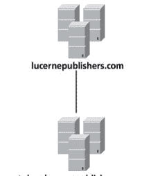

> **注意**
>
> Active Directory 域名通常反映公司的注册 Internet 域名。虽然 Windows Server 2003 和 Windows Server 2008 允许重命名域名，但最好尽可能使用组织注册的 DNS 名称开始。更改域名是一个非平凡的过程，因为必须同时更改对该域的所有引用。

每个 Active Directory 域都有一个相关的域分区，或 `Domain NC`，该分区复制到特定域内的每个域控制器。每个域的 `Domain NC` 包含存储在该域内的对象信息：用户、组、计算机、打印机、OU 等。此 `Domain NC` 与全林范围的 `Schema` 和 `Configuration NC` 一起复制到单个域中的所有域控制器。域内的 Active Directory 信息复制到域中的所有域控制器，以为域内的资源提供冗余、容错和负载均衡。

尽管不被视为正式分区，Active Directory 全局目录也需要在整个林中复制。与 `Domain NC` 不同，全局目录不会复制到所有域控制器。相反，它仅复制到专门配置为持有全局目录的域控制器。这些域控制器被称为全局目录服务器。

> **参见**
>
> 有关全局目录的更多信息，请参阅第 2 课。有关全局目录服务器的更多信息，请参阅第 4 课。

图 1-1 所示的示例将包含以下复制信息：

- `lucernepublishers.com` 域中的每个域控制器复制 `Schema NC`、`Configuration NC` 和 `lucernepublishers.com Domain NC` 的副本。
- `tokyo.lucernepublishers.com` 域中的每个域控制器复制 `Schema NC`、`Configuration NC` 和 `tokyo.lucernepublishers.com Domain NC` 的副本。
- 整个林中配置为全局目录的每个域控制器复制全局目录的副本。


> **注意**
>
> 在 Active Directory 林（forest）中创建的第一个域被称为**林根域**。

### 使用组织单位

Active Directory 域可以包含一个或多个`组织单位（OU）`，它们可以进一步细分用户和资源。OU 是一个容器，代表具有相似安全性或管理指南的资源的逻辑分组。


> **参考**
>
> 除了安全管理权限委派外，OU 还可以用于应用和管理组策略对象（GPO）。有关 GPO 的更多信息，请参阅第 7 课和第 10 课。

就像域中可能的父子关系一样，OU 也可以以层级方式嵌套，其中一个父 OU 可以包含一个或多个子 OU。每个子 OU 都可以成为其自身子 OU 的父级。然而，虽然可以创建包含多个父子关系的嵌套 OU 结构，但必须考虑到，如果嵌套层次过深，这些后续关系可能会使 OU 的管理变得困难。

Active Directory OU 结构可以通过模拟公司的组织架构图（描绘员工及其各自的部门）来反映组织的逻辑结构，或者通过根据用户的资源需求来组织用户。例如，如果这样做最能支持组织的业务需求，那么可以将所有具有相似资源需求的用户放在一个 OU 中以便于管理。默认情况下，应用于 OU 的安全设置将传递给该容器中的所有子对象。这简化了管理，允许您在 OU 级别一次应用安全设置，而不是单独对该 OU 中包含的数十或数百个用户或计算机对象应用设置。OU 的管理也可以委派给部门主管或经理，从而允许该人员管理日常资源访问或更常规的任务，例如重置密码。这被称为`权限委派`。每个容器或 OU 都可以考虑到自定义安全指南来创建，从而实现详细的管理控制。

OU 可以包含以下对象：

- 用户
- 组
- 联系人
- 打印机
- 共享文件夹
- 计算机
- OU
- InetOrgPerson

从 Windows Server 2003 开始，Active Directory 还包括一种名为`应用程序分区`的第四种分区类型。`应用程序分区`提供了精细的控制。管理员可以指定信息复制到的域或林中的位置。这带来了更大的灵活性和对复制性能的更好控制。例如，`DomainDNSZones` 应用程序分区会将信息复制到单个域中的每个 DNS 服务器；`ForestDNSZones` 应用程序分区会将数据复制到林中每个 DNS 服务器。

### 理解模式

Active Directory 模式定义了 Active Directory 中不同类型的对象看起来是什么样的。用户是什么？组有哪些属性？Active Directory 自带预填充的基础模式，并且可以根据自定义应用程序的需求进行修改或扩展。


Active Directory 中的每个资源都作为一个`对象`来表示，并且每个对象都具有一组与之相关的`属性`。在 Active Directory 中，每个对象都在 Active Directory`模式`中定义。模式是一个主数据库，包含 Active Directory 中所有对象的定义——在某种意义上，它定义了 Active Directory `是什么`。模式有两个组件：`对象类`和`属性`。在 Active Directory 中表示的每个对象——例如，用户 John 和打印机 Laserprinter——分别是用户和打印机对象类的实例。

模式中的每个对象类都根据使该对象类在数据库中独特的属性列表进一步定义。属性列表在模式中只定义一次，但相同的属性可以与多个对象类相关联。一些属性是创建对象所必需的`必需`属性，例如用户帐户登录名称。其他`可选`属性，如街道地址和电话号码，提供可用于用户和管理目的的额外详细信息。

当安装 Active Directory 时，会自动创建一系列对象类。其中一些对象类包括：
- 用户
- 组
- 计算机
- 域控制器
- 打印机

所有对象类都拥有一组共同属性，有助于在数据库中唯一地识别每个对象。其中一些共同属性如下：
- **唯一名称。** 此名称用于标识数据库中的对象。对象在创建时会被赋予一个唯一名称，其中包括对其在目录数据库中位置的引用。这将在本课后面详细解释。
- **全局唯一标识符 (GUID)。** GUID 是分配给 Active Directory 林中每个对象创建时的一个 128 位十六进制数字。即使对象本身被重命名，此数字也不会改变。即使对象被删除并重新创建具有相同的显示名称，该数字也不会再次使用。
- **必需对象属性。** 这些属性是对象运行所必需的。特别是，用户帐户在创建时必须具有唯一名称和输入密码。
- **可选对象属性。** 这些属性添加了对对象功能来说不重要的信息。这种信息属于“知道更好”而非“必须知道”的类型。一个可选对象属性的例子就是用户帐户的电话号码或街道地址。

如您所见，在必要时，模式可以修改以包含额外的对象和属性。模式中的每个对象都通过访问控制列表 (ACL) 进行保护，以确保只有授权管理员可以访问和修改模式。ACL 由管理员实施，并由目录用来跟踪哪些用户和组有权访问特定对象以及他们可以多大程度地使用或修改它们。


> Active Directory 模式使用`Active Directory 模式`工具进行管理。由于修改模式是一个敏感操作，因此此工具默认不存在于管理工具文件夹中。必须手动添加此部件。有关添加此工具的更多信息，请参阅第 2 课。

## 创建 Active Directory 站点和子网

> `站点`定义为通过快速链接连接的一个或多个 IP 子网。在大多数情况下，通过单个 LAN 连接的所有计算机将构成一个站点。在 Active Directory 中，站点用于优化小范围或大范围地理区域内的 Active Directory 信息复制。

同一站点内的所有域控制器将使用站内复制来复制 Active Directory 更改时的信息，而站间复制则在管理员定义的定期计划间隔进行。一个名为`知识一致性检查器`（`KCC`）的 Active Directory 内部进程自动创建和维护复制拓扑结构。KCC 基于管理员在 Active Directory 站点和服务部件中提供的信息进行操作，该部件位于域控制器或已安装管理工具的管理工作站的管理工具文件夹中。


> 有关 `KCC`、复制以及 Active Directory 站点和服务部件用法的更多信息，请参阅`第 3 课`。

## 使用 Active Directory 命名标准

Active Directory 的可扩展性和集成能力源于其对命名格式和目录功能所采用的行业标准，特别是 `轻量级目录访问协议（Lightweight Directory Access Protocol，LDAP）`。LDAP 于 20 世纪 90 年代初由互联网工程任务组（Internet Engineering Task Force，IETF）开发，旨在促进 X.500 在电子邮件中的实施。（X.500 是定义全球目录应如何构建和组织的标准。）

自 LDAP 引入以来，该协议已成为一个行业标准，实现了目录服务与应用之间的数据交换。LDAP 标准定义了 Active Directory 数据库中所有对象的命名，因此提供了一个可以与其他目录服务（如 Novell `eDirectory`）及支持 Active Directory 的应用（如 Microsoft Exchange）进行集成的目录。

对 Active Directory 对象的查询和修改几乎完全通过 LDAP 进行。因此，有必要了解 Active Directory 中对象的引用方式。请参阅图 1-2 中的示例。

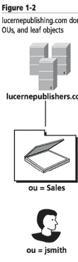

LDAP 使用对象的`可分辨名称（distinguished name，DN）`来引用对象，该名称使用完整的层级路径引用 Active Directory 数据库目录结构中的对象，从对象本身开始，包括所有父对象，直到域的根。LDAP 定义了标识对象名称各部分的命名属性。这些属性如表 1-1 所示。

**注意**

有关 LDAP 定义的对象的更多信息，请在 [www.rfc-editor.org/rfc-search.html](https://www.rfc-editor.org/rfc-search.html) 的 RFC 编辑器搜索页面中搜索 LDAP。

### 表 1-1

Active Directory 对象类和命名属性

| 对象类 | LDAP 命名属性 | 命名属性定义 |
| :--- | :--- | :--- |
| 用户或任何叶对象 | Cn | 通用名称 |
| 组织单元对象 | Ou | 组织单元名称 |
| 域 | Dc | 域组件，DNS 名称的每一部分对应一个 |

以图 1-2 作为参考，J.Smith 的**可分辨名称（distinguished name）**如下：

`cn=jSmith, ou=sales, dc=lucernepublishing, dc=com`

并非所有 Active Directory 管理工具都要求您指定对象的完整可分辨名称来管理该对象。在许多情况下，您可以指定简化的账户名称，如 “jsmith”。然而，了解可分辨名称的结构在这些需要它的时候非常重要。例如，您可能需要恢复一个从 Active Directory 数据库中意外删除的对象。在这种情况下，了解可分辨名称的结构对于完成所需的恢复操作至关重要。

除了理解 DNS 和 LDAP 在 Active Directory 名称格式中的意义外，理解 User Principal Name（UPN）在 Windows Server 2008 中的使用也很重要。UPN 遵循 `username@lucernepublishing.com` 的格式。这种约定为复杂的域结构提供了一种简单的解决方案，在这种结构中，用户可能难以记住可分辨名称。它还提供了在用户的电子邮件名称和其登录名称之间保持一致性的机会。

**参考**

有关执行 Active Directory 对象恢复的更多信息，请参阅第 11 课。

**参考**

有关 UPN 的更多信息，请参阅第 2 课。

## 理解 DNS

您经常会听到 Active Directory 管理员说“Active Directory 依靠 DNS 生存”。自从 Windows 2000 引入 Active Directory 以来，`域名系统（Domain Name System，DNS）`一直是 Active Directory 的默认名称解析方法。正确配置 DNS 是任何 Active Directory 管理员的关键任务，因为 Active Directory 环境的健康状况在很大程度上取决于 DNS 支持 Active Directory 的功能是否良好。

- 这四个八位组的 IP 地址是一个 IP 版本 4（IPv4）地址。这指的是 IP 的第 4 版，这是目前部署最广泛的 IP 版本。Windows Server 2008 和 Windows Vista 也原生支持 IPv6，这是下一代 IP。有关 IPv6 的更多详细信息，请参阅 MOAC 642 指南。

在大多数现代网络中，TCP/IP 是用于系统间通信的主要网络协议。IP 网络上的所有设备都使用唯一的数字来标识自己及其在网络上的位置。这被称为 IP 地址。IP 地址由四个八位组组成，通常以点分十进制表示，例如 192.168.10.1。


访问资源的一种方式是通过其 IP 地址。然而，当计算机系统使用 32 位数字来识别资源时，期望用户通过 IP 地址访问资源充其量是繁琐的。这就是 `DNS` 发挥作用的地方。`DNS` 是一种分布式名称解析服务，为 `Active Directory` 域提供名称解析。除了 IP 地址之外，所有计算机在安装时都被分配了一个 `DNS` 主机名。虽然主机名有助于定义设备的位置或用途，但它需要被翻译成计算机能理解的数值。这就是您需要 `DNS` 的原因。`DNS` 将计算机的主机名映射到其 IP 地址。当用户或应用程序引用计算机的主机名时，`DNS` 提供主机名到 IP 地址的转换，从而使流量能够被适当地路由到正确的目的地。

### 集成 DNS 和 Active Directory

`DNS` 是 `Active Directory` 的基础要求；除非服务器可以在同一台机器或网络上的某处找到合适的 `DNS` 服务器，否则无法在服务器上安装域控制器角色。

除了在网络中提供计算机主机名到 IP 地址的映射外，`DNS` 在 `Active Directory` 的功能中扮演着更重要的角色。`Active Directory` 依赖 `DNS` 为网络上的客户端提供定位服务。该定位服务为需要了解哪台服务器执行何种功能的客户端提供指导。例如，如果用户试图登录网络，定位服务将尝试向客户端提供位于与客户端工作站相同站点内的域控制器的名称和 IP 地址（如果可能的话）。

这个定位服务在 `Active Directory` 内是必要的，因为 `Active Directory` 是一个多主目录服务。因此，网络服务并不总是由同一台服务器提供。容错、负载平衡和冗余是即使在小网络中也设置多台服务器的原因之一，这使得该定位服务对于客户端能够访问域控制器和其他 `Active Directory` 资源至关重要。

- `SRV` 记录由 `BIND DNS` 4.9.7 及更高版本支持。动态更新由 `BIND DNS` 8.2.2 及更高版本支持。

在许多情况下，组织将依赖 `Windows Server 2008` 中内置的 `DNS` 服务器角色为 `Active Directory` 提供 `DNS` 名称解析。但在某些情况下，公司可能已经部署了第三方 `DNS` 服务，例如 UNIX 提供的 `BIND DNS` 服务。在使用第三方 `DNS` 部署 `Active Directory` 时，您需要确保 `DNS` 服务器能够支持 `SRV` 记录。`SRV` 记录是 `DNS` 中的定位记录，允许客户端定位 `Active Directory` 域控制器或全局目录。如果不能解析 `SRV` 记录，客户端将无法针对 `Active Directory` 进行身份验证。

除了必须支持 `SRV` 记录外，现代 `DNS` 实现还具备支持动态更新的能力。动态更新允许 `DNS` 客户端在 `DNS` 数据库中自动注册和更新其信息。例如，当向林中添加域控制器时，其 `SRV` 和 `A` 记录可以通过动态更新动态添加到 `DNS` 数据库，以保持 `DNS` 定位服务的最新状态。动态 `DNS` 提供了一种便捷的方法来协助保持数据库的更新。`Active Directory` 的运行不需要动态更新，但利用此功能可以大大简化管理。

## 使用林和域功能级别

林和域功能级别旨在支持运行各种受支持操作系统的 `Active Directory` 域控制器。当您停用旧版域控制器时，可以修改这些功能级别以暴露 `Active Directory` 中的新功能。例如，`Active Directory` 中的某些功能直到林中的所有域控制器都升级到 `Windows Server 2003` 系列后才可激活，而某些域范围的 `Active Directory` 功能只能存在于处于 `Windows Server 2008` 功能级别的域中。

随着企业扩展和更新其网络，它们通常不会同时升级整个网络。选择的升级策略将取决于网络的规模以及升级对用户生产力和网络访问的影响。因此，Microsoft 创建了功能级别，使企业能够基于对新功能的需求和愿望，逐步迁移其 `Active Directory` 域控制器。您可以在多域环境中更改单个域的功能级别，而无需其他域进行相同的更改。这允许滚动升级，以符合时间、预算和应用兼容性因素的要求。

请注意，林和域功能级别不会自动更改。例如，即使某个域中的所有域控制器都在运行 `Windows Server 2008` 操作系统，域功能级别也不会切换到 `Windows Server 2008`，直到管理员手动进行更改。这是因为功能级别的更改是不可逆的；一旦您升级了功能级别，除非对 `Active Directory` 数据库执行域或林范围的恢复，否则无法返回到以前的级别。由于这种更改的永久性，`Active Directory` 要求管理员手动干预以更改 `Active Directory` 环境的林或域功能级别。

## 提高域功能级别

`Windows Server 2008` 支持三种域功能级别，具体取决于部署在域中的域控制器的操作系统。当您提高域功能级别时，`Active Directory` 中将有额外的功能可用。

在 `Active Directory` 中，域功能级别是按域配置的。这允许林中的不同域处于向 `Windows Server 2008` 过渡过程的不同阶段——父域可以处于 `Windows Server 2003` 域功能级别，而子域已经提升到 `Windows Server 2008` 功能级别。`Windows Server 2008` 支持 `Windows 2000`、`Windows Server 2003` 和 `Windows Server 2008` 域控制器。`Windows NT 4.0` 域控制器不再受支持。

`Windows Server 2008` 中可用的以下域功能级别：

- `Windows 2000 原生`。此级别允许与 Microsoft `Windows 2000` 向后兼容。它还允许 `Windows 2000`、`Windows Server 2003` 和 `Windows Server 2008` 域控制器。
- `Windows Server 2003`。此功能级别仅允许 `Windows Server 2003` 和 `Windows Server 2008` 域控制器。它不允许存在 `Windows 2000` 域控制器。

### Windows Server 2008

- `Windows Server 2008`。此功能级别不支持向后兼容。仅支持 `Windows Server 2008` 域控制器。

在 `Windows 2000 原生` 域功能级别下，可提供以下基本 `Active Directory` 功能：

- `从媒体安装`。此功能在 `Windows Server 2003` 中引入，允许你使用现有域控制器的备份将服务器提升为域控制器状态。
- `应用程序分区`。正如你已了解的，应用程序分区允许你对应用程序信息如何在 `Active Directory` 中复制进行更精细的控制。
- `拖放用户界面`。此功能允许你在诸如 `Active Directory 用户和计算机` 以及 `Active Directory 站点和服务` 等工具中，将对象从一个容器拖放到另一个容器。（此功能在 `Windows 2000` 中不可用。）
- `全局组嵌套和通用安全组`。此功能在创建 `Active Directory` 组对象时提供了更大的灵活性。
- `SIDHistory`。每个 `Active Directory` 用户、组和计算机都拥有一个安全标识符（`SID`），用于授予或拒绝访问 `Active Directory` 内部资源、文件服务器以及 `Active Directory` 感知应用程序的权限。`SIDHistory` 允许在对象从一个域迁移到另一个域时，用户保留对这些 `SID` 的访问权限。

在 `Windows Server 2003` 域功能级别下，域可以包含 `Windows Server 2003` 和 `Windows Server 2008` 域控制器。除了 `Windows 2000 原生` 模式下可用的所有功能外，还支持以下功能：

- `lastLogonTimestamp` 属性。`lastLogonTimestamp` 是用户类的一个属性，允许管理员跟踪域内计算机和用户的登录时间。
- `inetOrgPerson` 对象的密码。`Windows Server 2003` 引入对 `inetOrgPerson` 对象类的支持，可用于与其他目录服务（例如 `openLDAP`）互操作。在 `Windows Server 2003` 域功能级别下，可以为 `inetOrgPerson` 对象配置密码和权限，就像 `Active Directory` 用户对象一样。
- `域重命名`。顾名思义，此功能允许你重命名 `Active Directory` 域，例如将域名从 `example.com` 重命名为 `cohoweinyou.com`。此操作仍有一些限制。例如，你不能使用域重命名将子域重构为独立域树的父域。即使在单域环境中，重命名域也是一个非平凡的操作，需要在生产环境中尝试之前进行充分的规划和测试。


在 Windows Server 2008 的最高域功能级别下，所有可能的 Active Directory 功能都可供你使用。为了支持这种高级功能，此功能级别要求整个域中只有 Windows Server 2008 域控制器。除了前两个域功能级别中可用的所有功能外，还支持以下功能：

- **使用 DFSR 代替 NTFRS 进行 SYSVOL 复制。** SYSVOL 是在每个 Active Directory 域控制器上创建的文件共享，其内容复制到域中的每个域控制器。Windows Server 2008 允许使用新的分布式文件系统复制（DFSR）协议来复制 SYSVOL，代替传统的 NT 文件复制服务（NTFRS）协议，后者在以前版本的 Active Directory 中已被证明笨重且难以排除故障和维护。

- **Active Directory 身份验证的额外加密机制。** 包括对 Kerberos 身份验证协议的 256 位高级加密标准（AES）加密的支持。

- **改进的用户登录信息审计。** 包括记录用户的最后登录时间、登录的计算机，以及记录用户的登录失败次数和最后一次登录失败的时间。


> 有关 Active Directory 组对象的更多信息，请参见第 7 课和第 10 课。

此外，Windows 事件查看器现在可以捕获对 Active Directory 进行更改时的“变更前”和“变更后”信息。如果你将用户名从“William”更改为“Larry”，事件查看器可以显示旧值（“William”）和更改后的值（“Larry”）。

> **XREF**
>
> 有关密码策略的更多信息，请参见第 6 课。

- **每个域支持多个密码策略。** 这是 Windows Server 2008 Active Directory 的一个令人兴奋的新功能。在以前版本的 Active Directory 中，你只能为每个域配置单个密码策略。例如，如果你将域密码配置为最小长度 8 个字符且每 42 天过期一次，你就无法为域中的管理员账户配置更严格的策略设置。在 Windows Server 2008 域功能级别下，你现在可以在单个域内配置多个密码策略。

> **注意**
>
> 要提高域功能级别，你必须是相关域中 Domain Admins 组的成员。

- **只读域控制器。** Windows Server 2008 引入了只读域控制器（RODC）的概念，这是一种特殊类型的域控制器，它维护 Active Directory 数据库的只读副本，并且不执行任何出站复制。要在 Windows Server 2008 网络中部署 RODC，你的域必须处于 Windows Server 2003 功能级别或更高，并且你必须在域中部署至少一台可写的 2008 域控制器。

在你提高域功能级别之前，需要确保该域中的所有域控制器都在运行所需版本的 Windows 操作系统。例如，要将域功能级别提高至 Windows Server 2003，你必须升级或淘汰环境中剩余的 Windows 2000 域控制器。

表 1-2 总结了 Windows Server 2008 中可用的不同功能级别。

### 表 1-2

域功能级别摘要

| 域功能级别 | 支持的操作系统 | Windows Server 2003 功能 |
|---|---|---|
| Windows 2000 原生 | Windows 2000 | 从媒体安装 |
| | Windows Server 2003 | 应用程序目录分区 |
| | Windows Server 2008 | 拖放用户界面 |
| | | 通用组 |
| Windows Server 2003 | Windows Server 2003 | 所有 Windows 2000 原生功能以及以下功能： |
| | Windows Server 2008 | 复制的 lastLogonTimestamp 属性 |
| | | inetOrgPerson 用户密码 |
| | | 域重命名 |
| Windows Server 2008 | Windows Server 2008 | 所有 Windows Server 2003 原生功能以及以下功能： |
| | | 改进的 SYSVOL 复制 |
| | | 改进的身份验证方法加密 |
| | | 改进的用户登录审计 |
| | | 每个域支持多个密码策略 |

## 使用林功能级别

在大多数方面，林功能级别的处理方式与域功能级别类似。从较低的林功能级别升级到较高的级别是一个单向过程，无法逆转。

请注意，虽然域功能级别可以独立于林中的其他域，但林功能级别适用于该林内的所有域。Windows 2008 中有三种林功能级别：Windows 2000、Windows Server 2003 和 Windows Server 2008。与处理域功能级别时一样，Windows Server 2008 Active Directory 仅支持运行 Windows 2000、Windows Server 2003 和 Windows Server 2008 的域控制器。不再支持 Windows NT 4.0 域控制器。

当第一个 Windows Server 2008 域控制器引入网络时，Windows 2000 是默认启用的林功能。就像 Windows 2000 原生域功能一样，Windows 2000 林功能支持运行 Windows 2000、Windows Server 2003 和 Windows Server 2008 的域控制器。Windows 2000 是新安装 Windows Server 2008 Active Directory 林的默认林功能级别。Windows 2000 林功能特性包括：

- **从媒体安装。** 这是与 Windows 2000 原生域功能级别中描述的功能相同的功能。它允许使用其他域控制器的备份副本将服务器提升为域控制器。

- **通用组缓存。** 此功能允许用户在远程站点登录域，而不需要该站点存在全局编录服务器。

- **应用程序目录分区。** 与 Windows 2000 原生域功能类似，这允许为不需要全局可用的应用程序数据提供单独的复制分区。它允许对网络内的复制范围进行更精细的控制。

下一个林功能级别是 Windows Server 2003，它要求所有域控制器都安装了 Windows Server 2003 或 Windows Server 2008。在提高林功能级别之前，确保不再需要支持 Windows 2000 域控制器非常重要。提高林功能级别与提高域功能级别一样，是一个不可逆的过程。Windows Server 2003 林功能级别包含所有 Windows Server 2000 功能，以及以下功能：

- **改进的组对象复制。** 在 Windows 2000 中，每次对组对象的成员列表进行更改时，整个成员列表都会在整个域中复制。通过提高林功能级别到 Windows Server 2003，Active Directory 可以利用链接值复制，这将只复制成员列表中实际被添加、修改或删除的部分。

- **动态辅助类对象。** 这是一种新的架构修改选项，提供支持将辅助类动态链接到单个对象。在此之前，辅助类对象只能链接到整个对象类。

- **用户对象可以转换为 inetOrgPerson 对象。** inetOrgPerson 对象用于非 Microsoft LDAP 目录服务，例如 Novell。Windows Server 2003 中的这个新基础对象使从这些其他平台迁移对象变得更加容易。

- **架构停用。** Windows Server 2003 允许你停用（但不能删除）已添加到架构中的类或属性。

- **域重命名。** 在此功能级别内，可以重命名域以适应网络上的重大设计变更。

- **允许跨林信任。** 这种信任类型在 Windows Server 2003 中引入，允许在 Active Directory 林之间共享资源。信任关系将在下一节中描述。

- **改进的站点间拓扑生成器（ISTG）。** ISTG 是用于启动和管理站点之间复制拓扑的过程。在 Windows 2000 中，此功能受限于林中的站点数量。在 Windows Server 2003 中，此功能扩展以允许更多的站点。

Windows Server 2003 林功能级别假设所有域在提高林功能级别之前都已提高到 Windows Server 2003。所有新的功能和增强功能都可用。但是，请注意，引入域的所有新域控制器都必须安装为 Windows Server 2003 产品。

### 注意

> 在配置为 Windows Server 2003 林功能级别的林中，任何新子域都自动创建为 Windows Server 2003 域功能级别。

## 最高的可用林功能级别


当前可用的最高林功能级别为 **Windows Server 2008**。在 Active Directory 的当前版本中，**Windows Server 2008** 功能级别并未解锁 Active Directory 中的任何新功能。其主要目的是确保一旦将林功能级别提升至 **Windows Server 2008**，之后添加到林中的任何新子域都将自动以 **Windows Server 2008** 域功能级别创建。这确保了所有新的子域能够立即访问 **Windows Server 2008** 域功能级别的高级功能，同时也防止任何低版本域控制器被添加到林中。

请使用以下指南来提升林功能级别：

- 若要提升林的功能级别，必须作为企业管理员组的成员登录。
- 仅通过连接到持有模式主控角色的域控制器才能提升林的功能级别。该服务器是所有模式变更的权威机构。
- 林中的所有域控制器都必须运行由目标林功能级别支持的操作系统。
- 将林功能级别提升至最高级别，即 Windows Server 2008，要求林中的所有域都必须处于 Windows Server 2008 功能级别。
- 在提升林功能级别期间，所有域将自动提升至支持新的林功能级别的状态。
- 提升林功能级别是不可逆的操作。

**表 1-3** 提供了林功能级别及其包含功能的摘要。


有关模式主控角色的更多信息，请参阅第 4 课。

### 表 1-3 林功能级别摘要

| **林功能级别** | **支持的操作系统** | **Windows Server 2003 功能** |
| :--- | :--- | :--- |
| Windows 2000 | Windows 2000<br>Windows Server 2003<br>Windows Server 2008 | 从介质安装<br>通用组缓存<br>应用程序目录分区<br>增强的用户界面 |
| Windows Server 2003 | Windows Server 2003<br>Windows Server 2008 | Windows 2000 的所有功能以及以下功能：<br>链接值复制<br>改进的 ISTG 功能<br>用户对象可以转换为 inetOrgPerson 对象<br>模式和类的模式修改<br>可以创建称为 dynamicObjects 的动态辅助类对象的实例<br>域重命名<br>跨林信任<br>所有新域将以 Windows Server 2003 域功能级别创建 |
| Windows Server 2008 | Windows Server 2008 | 所有新域将以 Windows Server 2008 域功能级别创建 |

## 理解 Active Directory 信任模型

Active Directory 使用*信任关系*来允许在多个域和/或林之间进行访问，无论是在单个林内还是跨越多个企业网络。顾名思义，信任关系允许特定域的管理员授予其他域的用户访问其域资源的权限。

要查看信任关系的工作状态，请考虑以下示例。一家名为 Lucerne Publishing 的图书出版商与儿童玩具制造商 Wingtip Toys 达成了商业协议，为预期的合并做准备。为了让 Wingtip Toys 的研发部门能够访问 Lucerne Publishing 文件服务器上的设计文件，Lucerne Publishing 域的管理员需要与 Wingtip Toys 的 Active Directory 建立信任关系。

为了简化 Active Directory 管理过程，某些信任关系会在 Active Directory 安装过程中自动创建。从 Active Directory 林中安装的第一个域开始，每个新域都与林中的每个其他域具有双向传递信任。双向信任意味着 A 域的用户可以访问 B 域的资源，同时 B 域的用户也可以访问 A 域的资源。传递信任关系可以追溯到中学数学时代——它意味着如果 A 域信任 B 域，且 B 域信任 C 域，则 A 域自动信任 C 域。Active Directory 林中的信任关系结构如下：

- 当创建子域时，它会自动与其父域建立双向传递信任。因此，sales.tokyo.lucernepublishers.com 子域与其 tokyo.lucernepublishers.com 父域具有双向传递信任。并且，由于信任的传递性（tokyo.lucernepublishers.com 与其 lucernepublishers.com 父域具有双向传递信任），sales“孙子”域中的用户可以访问 lucernepublishers.com“祖父母”域中的资源，反之亦然。
- 当创建新的域树时，新树中的根域会自动与林中所有其他域树根域建立双向传递信任。因此，如果 graphicdesigninstitute.com 林包含一个名为 finesartschool.net 的独立域树，则会在根域之间配置双向传递信任。由于信任的传递性质，graphicdesigninstitute.com 树中的任何子域都将能够访问 finesartschool.net 树中子域的资源，反之亦然。

图 1–3 说明了 Active Directory 林中域之间信任关系的传递性。请注意，每个子域都链接到其父域，一直延伸到林根域。如果 sales.lucerne publishing.com 中的用户需要访问 us.marketing.lucerne publishing.com 中的资源，该请求将从 sales 子域发送到 lucernepublishing 根域。然后，它被发送到 marketing 子域，并最终到达 us.marketing.lucerne publishing.com 域中的目的地。此过程称为树遍历。

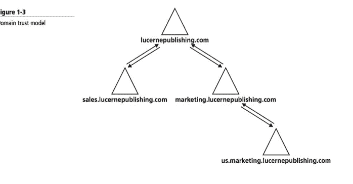

如果林中的域由慢速 WAN 链路分隔，并且这种树遍历过程花费极长的时间才能允许跨域用户身份验证，您可以沿着常用的“信任路径”配置快捷信任。因此，如果 tokyo.lucerne publishing.com 中的用户需要频繁访问 marketing.us.talspins toys.com 中的资源，您可以创建快捷信任来“短路”树遍历过程，并在两个域之间形成直接信任路径，如图 1-4 所示。

### 图 1-4 快捷信任

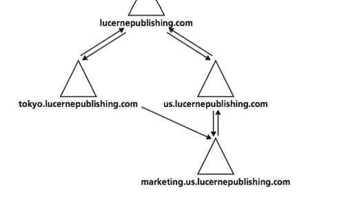

这些快捷信任是非传递的，这意味着它们仅适用于在快捷信任中明确配置的两个域。例如，如果来自 us.sales.wingtip toys.com 的用户需要访问 us.marketing.wingtip toys.com 中的资源，该用户无法利用 sales 和 us.marketing 子域之间的快捷信任。他们将遵循图 1-3 中所示的默认树遍历信任路径。快捷信任也是*单向*的，这意味着从 sales 到 us.marketing 创建快捷信任将允许 sales 中的用户对 us.marketing 进行身份验证。然而，us.marketing 中的用户*无法*使用快捷信任对 sales 进行身份验证，除非在相反方向创建第二个快捷信任。

另一种可以创建的信任类型是与另一个林中的 Windows NT 域或 Windows 2000 域建立的*外部信任*。与快捷信任类似，外部信任是单向、非传递的信任。如果您域中的用户可以访问远程域中的资源，那么远程域中的用户*无法*访问您域中的资源，除非您在相反方向创建第二个信任关系。同样，如果您的组织与供应商 A 建立信任，而供应商 A 随后与供应商 B 建立信任关系，您的用户将*无法*访问供应商 B 网络上的资源。您需要创建单独的直接连接您的 Active Directory 与供应商 B 的 Active Directory 的信任。此外，在与供应商 B 的远程 Windows 2000 Active Directory 的情况下，外部信任是非传递的，您只能访问已配置信任的特定域。如果您配置与 tokyo.lucerne publishing.com 域的信任，您将无法访问 lucernepublishing.com 域中的资源，除非直接配置与 lucernepublishing.com 的单独信任。

从 Windows Server 2003 林功能级别开始，您还创建一种称为**跨林信任**的新类型信任的能力。在部署 Windows NT 或 Windows 2000 域控制器的环境中，无法在林之间创建传递性信任路径。从一个林到另一个林的资源访问是不受支持的。当您在两个均运行在 Windows Server 2003 林功能级别或更高级别的林之间建立信任时，跨林信任关系具有传递性，并且可以配置为单向或双向关系。这意味着林 A 中的每个域都信任林 B 中的每个资源，并且（在双向跨林信任的情况下）林 B 中的每个域都信任林 A 中的每个资源，如图 1-5 所示。

### 图 1-5 跨林信任


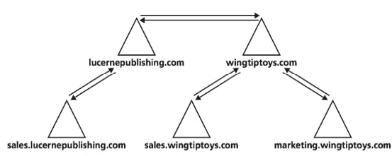

> **警告** 跨林信任的传递性不会扩展到两个林之外。这意味着，如果您配置了林 A 和林 B 之间的跨林信任，以及林 B 和林 C 之间的第二个跨林信任，除非您在林 A 和林 C 之间直接配置第三个信任关系，否则林 A 将无法访问林 C 中的资源。

一旦建立信任，管理员就可以从受信任的林中选择用户和组，并将它们包含在对象的 `ACL`（访问控制列表）中。当通过跨林信任访问资源时，用户无需重新输入任何登录凭据；您在林边界之间实现了“单点登录”。此高级功能允许公司在不进行完全重新设计或迁移的情况下，与合作伙伴或新收购的公司共享资源。

## 技能矩阵总结

- 在本课中，您学习了：
- `Active Directory` 是一个对象数据库，用于根据逻辑计划来组织资源。这些对象包括域和 `OU`（组织单元）等容器，以及用户、计算机和打印机等资源。
- `Active Directory` 架构包含单个林内所有对象和属性的定义。每个林维护自己的 `Active Directory` 架构。
- `Active Directory` 需要 `DNS` 支持 `SRV` 记录。此外，Microsoft 建议 `DNS` 支持动态更新。
- 域和林功能级别是 `Windows Server 2008` 的新功能。为每个级别定义的标准基于 `Active Directory` 设计所需的服务器操作系统类型。`Windows Server 2003` 林功能级别是最高可用的功能级别，包括对 `Windows Server 2008` 所有功能的支持。
- 双向传递性信任在 `Active Directory` 域结构中自动生成。父域和子域形成信任路径，林中的所有域都可以遍历该路径以定位资源。`STG`（安全支持提供程序信任管理器）负责此过程。
- 跨林信任是 `Windows Server 2008` 的新功能，并且仅在林功能设置为 `Windows Server 2008` 时可用。必须手动创建和维护它们。

### 填空题

通过在提供的空白处填入正确的单词或短语来完成以下句子。

1. `Active Directory` 数据库存储在每个域控制器中一个名为 ________ 的文件中。
2. `Active Directory` ________ 被视为 `Active Directory` 环境的安全边界。
3. 为了提供容错能力，`Active Directory` 利用 ________ 复制模型。
4. 要与 `NT4` 域建立信任关系，您需要配置 ________。
5. ________ 命名上下文在域中进行复制。
6. `Active Directory` 对象的 ________ 标识其在目录结构中的位置。
7. ________ 在两个林中的所有域之间提供双向传递性信任关系。
8. `Active Directory` 林中的每个域与林中的其他每个域都有 ________ 信任关系。
9. ________ 允许远程站点的用户无需联系全局编录服务器即可登录到 `Active Directory`。
10. `Active Directory` 客户端依靠 `DNS` 中的 ________ 来定位 `Active Directory` 资源，如域控制器和全局编录服务器。

### 选择题

圈出正确的选项。

1. 以下哪项是 `Active Directory` 中有效的叶对象？
   - a. 域
   - b. 用户
   - c. 应用程序分区
   - d. `OU`
2. 以下哪个域控制器可以加入到当前设置为 `Windows Server 2008` 林功能级别的林？
   - a. `Windows 2000`
   - b. `Windows Server 2003`
   - c. `Windows Server 2008`
   - d. `Windows NT 4.0`
3. 您正在为一家公司规划 `Active Directory` 实施，该公司目前拥有销售、会计和营销部门。所有部门负责人希望在 `Active Directory` 中管理自己的用户和资源。什么功能允许您将 `Active Directory` 设置为允许每个经理管理其自己的容器，但不管理其他容器？
   - a. 委派控制
   - b. 只读域控制器
   - c. 多主复制
   - d. `SRV` 记录
4. `Active Directory` 运行需要 `DNS` 具备什么条件？
   - a. 动态更新支持
   - b. `DHCP` 转发支持
   - c. `SRV` 记录支持
   - d. `Active Directory` 集成
5. 如果名为 Amy 的用户位于 `central.cohowinery.com` 域的销售 `OU` 中，在命令行实用程序中引用该用户的正确语法是什么？
   - a. `amy.cohowinery.com`
   - b. `cn=amy,ou=sales,dc=cohowinery.com`
   - c. `cn=amy,ou=sales,dc=central,dc=cohowinery,dc=com`
   - d. `dc=com,dn=cohowinery,ou=sales,cn=amy`
6. `RODC`（只读域控制器）不参与以下哪项？
   - a. 复制
   - b. 跨林信任
   - c. 出站复制
   - d. 外部信任
7. 哪个命名上下文包含 `Active Directory` 林的物理拓扑的林范围数据？
   - a. 架构
   - b. `ForestDNSZones`
   - c. 配置
   - d. `DomainDNSZones`
8. 以下哪项是 `Active Directory` 中的容器对象？
   - a. 文件夹
   - b. 组
   - c. 用户
   - d. `OU`
9. 在新 `Active Directory` 林中安装的第一个域叫什么？
   - a. 林根域
   - b. 父根域
   - c. 域树根
   - d. 域根
10. 以下哪项是 `Active Directory` 内的安全边界？
    - a. 林
    - b. 域
    - c. 域树
    - d. `OU`

## 工作准备

## 部署 Windows Server 2008

您是一家大型组织 IT 部门的经理。贵公司目前拥有 `Novell`、`Microsoft Windows NT` 和 `Windows 2000` 服务器的混合环境。您正与一位网络设计师合作，协助规划在接下来六个月内将所有服务器升级到 `Windows Server 2008`。考虑到推广将分阶段进行，且目标是最小化停机时间。`Windows Server 2008` 中的哪些新功能将帮助您进行此迁移？为什么这些新功能将协助您进行网络迁移？

此外，贵公司最近收购了另一家公司。新收购的公司已经拥有 `Windows Server 2008` 网络，您希望保留它。但是，您希望提供对两个网络中资源的访问。您应该怎么做以在两个网络之间建立路径？在此之前您需要检查什么？

## 实施 Active Directory

### 目标域矩阵

| 技术技能 | 目标域 | 目标域编号 |
| :--- | :--- | :--- |
| 安装新的 `Active Directory` 林 | 配置林或域。 | 2.1 |
| 配置只读域控制器 | 配置只读域控制器 (`RODC`)。 | 3.3 |
| 配置 `Active Directory` 轻型目录服务 | 配置 `Active Directory` 轻型目录服务 (`AD LDS`)。 | 3.1 |
| 建立和维护信任关系 | 配置信任。 | 2.2 |

### 关键词

- `A` 记录
- `Active Directory` 轻型目录服务 (`AD LDS`)
- 管理员角色分离
- 老化
- 二进制文件
- `dcpromo`
- 目录服务还原模式 (`DSRM`)
- 域 `netBIOS` 名称
- 动态更新
- 可灵活单主操作 (`FSMO`)
- 正向查找区
- 完全限定域名 (`FQDN`)
- 全局编录
- 增量区域传输
- 实例
- 延迟
- `netdom`
- `nslookup`
- 对象标识符 (`OID`)
- 密码复制策略
- 指针 (`PTR`)
- 优先级
- 可重启 `Active Directory`
- 反向查找区
- 清除
- 服务器核心
- 服务器管理器
- 分阶段安装
- `SYSVOL`
- 生存时间
- 无人值守安装
- 用户主体名称 (`UPN`)
- 权重
- 区域传输

`Lucerne Publishing` 是一家医学教科书出版商，在伦敦、东京、纽约和班加罗罗设有办事处。`Lucerne Publishing` 决定部署 `Windows Server 2008`，以在其全球各地提供集中式的用户身份验证和授权。`Lucerne Publishing` 面临的一个挑战是，东京分公司没有全职 IT 管理员。由于它通过缓慢的 `WAN` 链接连接到纽约和伦敦，东京地区的经理担心该办公室的工作人员在登录到 `Active Directory` 时会遇到困难。


完成本课后，您将理解在 Windows Server 2008 计算机上安装 Active Directory 域服务（AD DS）角色所需的先决条件。您还将学习创建新的 Active Directory 林、域树和域所涉及的过程。您将能够讨论 Windows Server 2008 中 AD DS 的一项令人兴奋的新功能：只读域控制器（RODC）。最后，您将能够讨论修改 Active Directory 架构的要求，以及安装和配置 Active Directory 轻型目录服务（AD LDS）的要求（在早期版本的 Windows 操作系统中称为 ADAM）。

## 介绍服务器管理器

在开始使用 Windows Server 2008 之前，您需要熟悉其中央管理界面。当您启动 Windows Server 2008 服务器时，您将看到类似于图 2-1 所示的窗口。

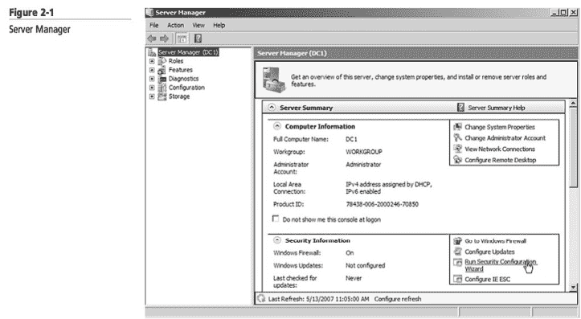

Windows Server 2008 提供了一个新的统一工具，用于管理特定服务器的所有方面。当 Windows Server 2008 服务器首次启动时，您会看到初始配置任务窗口，该窗口允许您执行初始配置任务，例如设置计算机名称和配置 Windows 防火墙。您可以从初始配置任务（ICT）界面或“管理工具”文件夹中的服务器管理器控制台向 2008 服务器添加角色。从这里，您可以添加和删除不同的服务器角色（如 DNS 服务器角色或 Active Directory 域服务角色），以及执行系统诊断；配置系统服务，如 Windows 防火墙；并钻取到特定的管理工具，如 DNS 管理控制台或 Active Directory 用户和计算机。

## 设计 Active Directory 实施

**重点摘要** 本课重点介绍安装和配置 Active Directory 的过程，包括为安装做准备时必须理解的重要要点以及关键的安装后任务。特别是，本课描述了部署 Microsoft Windows Server 2008 Active Directory 林涉及的关键概念。

### 理解 Active Directory 的要求

> 通过配置 Windows Server 2008 网络中的一个或多个域控制器来安装 Active Directory，然后配置您的客户端以针对这些域控制器进行身份验证。在开始之前，您需要了解安装 Active Directory 的硬件要求。此外，您需要能够适当地确定域控制器的硬件尺寸，以支持您组织的 Active Directory 需求的大小和范围。

一般来说，您可以在任何配置了基于 Windows 2000、Windows Server 2003 或 Windows Server 2008 操作系统的服务器上配置 Active Directory，这些操作系统已经使用了最新的服务包和热修复进行了保护。Active Directory 安装向导 `dcpromo` 将引导您完成以下任一安装场景：

- 在现有环境中添加域控制器

- 创建全新的林结构

- 向现有域添加子域

- 向现有林添加新的域树

- 降级域控制器并最终移除某个域或林

在安装 Windows Server 2008 Active Directory 之前，请考虑以下硬件、软件和管理要求：

- 运行 Windows Server 2008 标准版、Windows Server 2008 企业版或 Windows Server 2008 数据中心版的服务器。您可以在 Windows Server 2008 完整版以及 Server Core（Windows Server 2008 中的一种新安装选项）上安装 Active Directory。

- 本地机器上的管理员账户和密码。

- 用于 SYSVOL 文件夹结构的 NT 文件系统（NTFS）分区。SYSVOL 共享文件夹存在于所有域控制器上，用于存储组策略对象、登录脚本以及其他在整个域中复制的文件。

- 前述 NTFS 分区上至少有 200 MB 的可用空间用于 Active Directory 数据库文件。

- 事务日志文件至少有 50 MB 的可用空间。这些文件可以位于与数据库文件相同的分区或其他位置。但是，为了获得最佳性能，这些文件应位于持有操作系统的物理驱动器之外的物理驱动器上。将数据库文件和日志文件放在不同的硬盘上会导致更好的性能，因为它们不必竞争单个驱动器的输入/输出（I/O）进程。

- 必须安装并配置传输控制协议/互联网协议（TCP/IP）以使用 DNS。

- 支持服务资源（SRV）记录的 DNS 域上的权威 DNS 服务器。Microsoft 还建议提供 Active Directory DNS 服务的服务器能够支持增量区域传输和动态更新。区域传输是将 DNS 信息从一个 DNS 服务器复制到另一个 DNS 服务器的过程。通过增量区域传输，由于无需传输整个区域，因此可以节省带宽。只传输更改。当主机互联网协议（IP）地址发生变化时，动态更新允许更新 DNS 数据库中的更改信息。这使得数据库的维护更加高效，从而减少客户端的解析问题。

**注意**

请记住，这些是最小安装要求；在实际部署中，您应该配置具有足够容量的域控制器，以满足当前要求以及任何未来的扩展需求。

在安装 Active Directory 之前，您还需要了解 Active Directory 数据库的潜在大小。Active Directory 中每个对象的空间要求比您想象的要小得多。Active Directory 中对象和大致的属性大小如下：

- 安全主体（用户、组、计算机） = 3,600 字节

- 组织单位（OU） = 1,100 字节

- 映射到用户的安全证书 = 1,500 字节

- 对象属性 = ~100 字节

- 访问控制项（ACE） = 每个 ACE 70 字节

考虑到这些尺寸要求，一个具有 20 个属性和证书的用户账户将占用大约 7100 字节的空间。在规划空间要求时，您需要了解需要容纳的大致对象数量和类型。经过简单的计算，您会发现，考虑到它所包含的信息量，Active Directory 数据库占用的空间相对较少。始终做好准备，对最终数字进行填充，以确保在需要超出原始预测范围进行扩展时不会措手不及。

在运行 Active Directory 安装向导之前，您应该收集安装过程中所需的所有信息，其中包括以下内容：

- 本地管理员密码

- 域控制器类型

- 域名称

- Active Directory 数据库和日志文件的位置。这默认为 `C:\WINDOWS\NTDS`，但对于较大规模的 Active Directory 安装，您可以通过将这些文件移动到单独的磁盘控制器来提高性能。

- SYSVOL 文件夹结构的位置，用于存储管理项目，如组策略对象和登录脚本。这默认为 `C:\WINDOWS\SYSVOL`，但也可以在较大规模的安装中移动以提高性能。

- DNS 信息，例如 DNS 是否将与 Active Directory 安装在相同的服务器上。如果不是，则需要拥有一个或多个 DNS 服务器的 IP 地址。

- 目录服务还原模式（DSRM）密码。这是一个单独的密码，用于在数据恢复或灾难恢复场景期间访问 Active Directory。

- 安装 CD-ROM 或如果您从网络文件夹安装，则为安装文件的位置。

- 确保已在服务器上安装了最新的服务包和热修复。

收集这些先决条件信息后，您可以按照以下部分所述的步骤开始安装过程。

## 安装新的 Active Directory 林

网络上的第一个 Active Directory 域是林根域。林根域对于 Active Directory 的功能至关重要，因为它需要在 Active Directory 安装的生命周期内保持在线和存在。随着组织需求的增长和变化，您可以添加和删除子域以及额外的域树，但林根域必须保留。

> Windows Server 2008 提供了一项新的 *可重启的 Active Directory* 功能，允许您将 `ntds.dit` 文件置于离线模式，而无需直接重启域控制器。

您可以使用 `dcpromo.exe` 命令行工具或从已安装在每个 Windows Server 2008 服务器“管理工具”文件夹中的 *Server Manager*（服务器管理器）实用程序启动 Active Directory 安装向导。在您关闭“初始配置任务”实用程序后，*Server Manager* 实用程序会在启动时自动启动，或者您可以通过“管理工具”文件夹中提供的快捷方式或直接从开始菜单手动访问它。Server Manager 接口的优势在于，它可以显示服务器可能正在执行的其他任何角色。但是，使用 `dcpromo` 可以让您编写脚本来自动化安装过程。


在新建的 Active Directory 林中安装的第一个域控制器将持有所有的 `Flexible Single Master Operations (FSMO)`（灵活单主机操作）角色，这些是特定的服务器角色，它们协同工作以启用 Active Directory 的多主功能。`dcpromo` 进程会为每个新添加到 Active Directory 的域分配每个林和每个域的 FSMO 角色。默认情况下，所有林范围的 FSMO 将配置在整个林中安装的第一个域控制器上，而所有域范围的 FSMO 将配置在新域中安装的第一个域控制器上。例如，修改架构是一个每林角色，因为 Active Directory 架构在林中的所有域之间共享。持有架构主操作角色的服务器必须可以访问林中的所有域。在初始域控制器创建之后，可以安装额外的域控制器，并且角色可以传输到新的域控制器。

**准备认证考试？配置一个林或域 2.1**

# 安装新的 Active Directory 林

**准备就绪。** 要开始此过程，您必须以本地 `Administrators`（管理员）组的成员身份登录；服务器计算机应配置为静态 IP 地址。

1. 点击 **开始** 菜单并选择 `Server Manager`。

2. 点击 **Roles**（角色），然后在 `Roles Summary`（角色摘要）部分下点击 **Add Roles**（添加角色）。

3. 阅读 `Before You Begin`（开始之前）窗口并点击 **Next**（下一步）。

4. 在“选择服务器角色”窗口中，选择 **Active Directory Domain Services**（Active Directory 域服务），如图 2-2 所示。

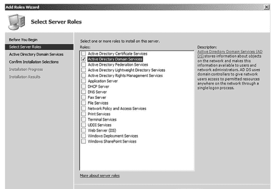

5. 点击 **Next** 继续。您将看到关于 Active Directory 域服务的介绍，其中提供了一些安装和管理 Active Directory 的有用提示。提示包括以下几点：

   - 确保在每个 Active Directory 域中安装多个域控制器，以便即使单个域控制器故障，客户端也能登录。
   - Active Directory 需要网络上有可用的 DNS 服务器。
   - 安装 Active Directory 还将向服务器添加以下先决条件服务：**DFS 命名空间**、**DFS 复制**和**文件复制服务**。

6. 在阅读完“AD 域服务介绍”窗口后，点击 **Next**。

7. 点击 **Install**（安装）以开始安装过程。Server Manager *看起来会暂停几分钟*，因为安装 Active Directory 所需的实际可执行文件或 *二进制文件* 正在被复制到系统驱动器。Windows Server 2008 中的一个重大安全改进是，这些二进制文件（安装文件）实际上直到您选择安装 Active Directory 时才会被安装；如果服务器未配置为域控制器，这可以防止任何病毒或蠕虫针对这些文件，因为相关的文件并不存在于硬盘上。

8. 在 AD DS 二进制文件安装完成后，点击 **Close**（关闭）。您将返回到 Server Manager，此时它将类似于图 2-3 中显示的窗口。注意 Active Directory 域服务角色已被列出，但其旁边有一个红色的 *X*。这表明 AD DS 二进制文件已在服务器上安装，但 Active Directory 尚未完全配置。

### 图 2-3

已安装 Active Directory 域服务角色但未进行配置

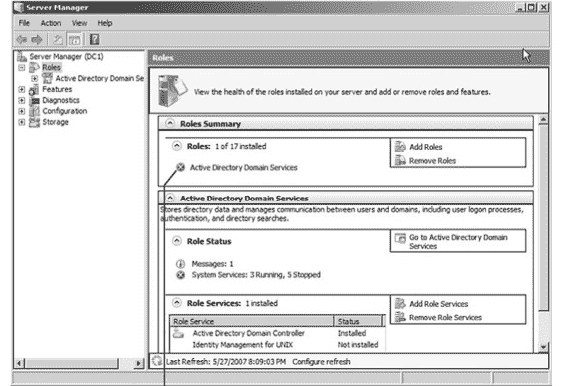

> 已安装 Active Directory 域服务角色

9. 钻取到 Active Directory 域服务角色，这将带您到一个类似于图 2-4 中显示的窗口。

### 图 2-4

Active Directory 域服务摘要

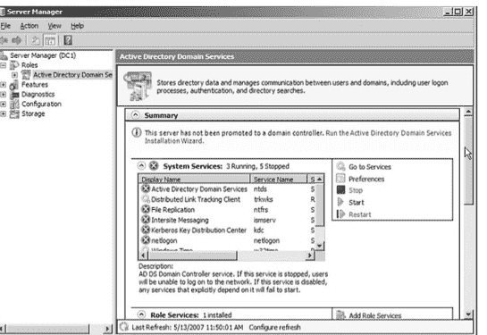

### 另一种方式

您也可以通过点击“开始”并输入 `dcpromo` 来启动 Active Directory 域服务安装向导。如您将在接下来的部分中看到，`dcpromo` 实用程序将在 Server Core 上安装 Active Directory 时至关重要。

10. 按照窗口上的说明操作并点击 **Run the Active Directory Domain Services Wizard**（运行 Active Directory 域服务向导）。Active Directory 域服务安装向导将如图 2-5 所示启动。在 **Use Advanced Mode Installation**（使用高级模式安装）旁边放置一个勾选标记。

### 图 2-5

Active Directory 域服务向导

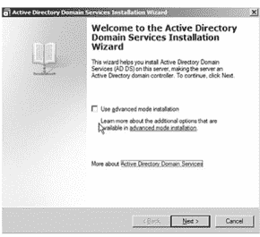

11. 阅读信息并在两个窗口中点击 **Next** 以显示图 2-6 中所示的窗口。

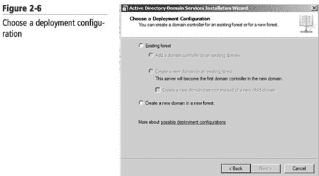

12. 要在新建的 Active Directory 林中创建第一个域控制器，请选择 **Create a new domain in a new forest**（在新林中创建新域）并点击 **Next**。

13. 系统会提示您输入 Active Directory 林根域的域名。在这种情况下，请输入 `lucernepublishing.com` 并点击 **Next**。

14. 系统会提示您为此域填写 *域 netBIOS 名称*。域 netBIOS 名称限制为 15 个字符，并为了与无法使用 DNS 进行名称解析的旧应用程序的遗留兼容性而保留。在大多数情况下，此名称将仅仅是 *完全限定域名 (FQDN)* 的第一部分——在 `lucernepublishing.com` FQDN 的情况下是 LUCERNEPUBLISHING，或在 `sales.lucernepublishing.com` 的情况下是 SALES。但是，由于 LUCERNEPUBLISHING 长于 15 个字符，您必须选择一个较短的名称。如图 2-7 所示，将 LP 作为域 netBIOS 名称输入并点击 **Next**。

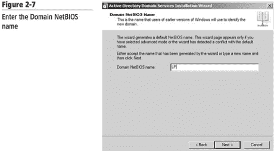

15. 接下来，您可以为新域和新林选择以下域控制器选项之一或多：

    - **DNS 服务器**。此选项默认已选中，并将允许域控制器执行 DNS 名称解析。请保持此框选中。
    - **全局编录**。此选项针对新域中的第一个域控制器已选中并变灰，因为 Active Directory 要求每个域中至少安装一个全局编录。
    - **只读域控制器 (RODC)**。此选项针对新域中的第一个域控制器不可用，因为第一个域控制器不能是 RODC。

如图 2-8 所示，DNS 服务器选项默认已选中。不做出任何更改，直接点击 **Next**。

### 图 2-8

选择额外的域控制器选项

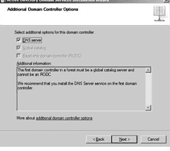

> 有关只读域控制器的信息，请参阅本课后面的“处理只读域控制器”。

在步骤 17 中，您可能会收到一个对话框，其中显示“由于找不到权威父区域或其不支持动态更新，因此将不会为此 DNS 服务器创建委派。为了确保此 DNS 服务器可以解析为 test.com 域的权威服务器，您可以手动在父区域中为此 DNS 服务器创建委派。您想要继续吗？” 点击“是”以继续。这是 `dcpromo` 过程中的一个新步骤，以确保您的父 DNS 区域（如果您有）包含对正在创建的 DNS 区域的委派。有关更多信息，请参阅 Microsoft TechNet 网站上的文章 *Configuring DNS for the Forest Root Domain*（配置林根域的 DNS）。

18. 在图 2-9 所示的窗口中，您可以选择 Active Directory 数据库、日志文件和 SYSVOL 共享文件夹的磁盘位置。点击 **Next** 以接受默认位置。

### 图 2-9

选择磁盘位置

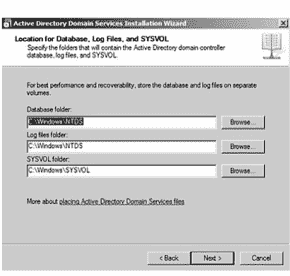

## 注意

DSRM 密码不会存储在 Active Directory 中。请务必将此密码记录在安全位置，以便日后访问。

- 19. 系统提示您输入目录服务还原模式（DSRM）密码，该密码用于访问目录服务还原模式以在域控制器上执行维护和灾难恢复操作。输入一个强密码并单击**下一步**以继续。


进入`/path/to/xxx`目录，找到`xxx.json`。

在表达式`cvar = avar + bvar`中，加法运算符（`+`）将`avar`与`bvar`相加，得到它们的和`cvar`

在`List.of(arg0, arg1, arg2)`中，`List`接口的工厂方法`of()`接受一系列的元素，返回包含它们的只读列表。

之后我们这样调用`cmd`命令：`cmd arg0 arg1 arg2`。

```
if (condVar > someVal) {console.log("xxx")}
```


- **生存时间。** 该记录的有效时长，到期后需要重新注册

- **优先级。** 一种在广播相同 SRV 记录的多台服务器之间设置负载均衡的机制。客户端始终优先使用编号较小的优先级记录。只有当对应于较小优先级编号记录的服务器不可用时，它们才会使用编号较高的优先级的 SRV 记录。

- **权重。** 对于具有相同优先级的 SRV 记录的相对权重。例如，考虑三个具有相同优先级但相对权重分别为 60、20 和 20 的 SRV 记录。由于 60 + 20 + 20 = 100，权重为 60 的记录将在 60/100 或 60% 的时间被使用，而其他两个记录中的每一个将在 20/100 或 20% 的时间被使用。

- **端口。** 该服务侦听的 TCP 或 UDP 端口，例如 `_kerberos` SRV 记录使用的 TCP 端口 88

如前所述，客户端使用优先级和权重字段来帮助确定哪个服务器是请求服务的最合适连接目标。可以使用以下两种方法来验证 SRV 记录：

- `DNS 管理器` 文件夹中的 `DNS 管理器`

- 命令行中的 `Nslookup` 实用工具

### 验证区域和记录创建

使用 `DNS 管理器` 工具，您可以验证是否已创建适当的区域。您还可以通过完成以下步骤来验证各个记录。

### 验证区域和记录创建

**准备就绪。** 必须在 DNS 服务器上执行 Active Directory 安装。

1. 从管理工具文件夹中打开 `DNS`。

2. 展开所需的 DNS 服务器，然后展开您要查看的 DNS 域；例如，`lucernepublishing.com`。您应该看到以下条目：

   - `_msdcs`

   - `_sites`

   - `_tcp`

   - `_udp`

   此外，您还可能会看到为应用程序目录分区信息创建的以下区域：

   - `DomainDnsZones`

   - `ForestDnsZones`

**暂停。** 已验证区域和记录的创建。

`*Nslookup*` 是一个命令行工具，起初使用起来可能有些繁琐，但它是一个强大的工具，非常值得花时间去熟悉它。由于 Server Core 中可用的图形界面工具有限，因此了解 `nslookup` 实用工具对于在 Server Core 上使用 DNS 至关重要。

#### 验证已选择动态更新

为了使域控制器在启动时将其记录注册到 DNS，必须允许动态更新。默认情况下，当 DNS 区域集成为 Active Directory 时，会启用安全动态更新。在这种情况下，客户端在尝试更新或向 DNS 数据库添加信息之前必须经过身份验证。这可以防止不必要的记录被添加到数据库中，从而最终造成性能、空间以及潜在的安全问题。

#### 验证已选择动态更新

**准备就绪。** 必须在 DNS 服务器上执行 Active Directory 安装。

1. 右键单击所需区域，然后选择**属性**。

2. 查看该区域所选的更新类型。默认情况下，如果该区域集成为 Active Directory，则设置为*仅安全*。

**暂停。** 已选择动态更新。

在上一个练习中，您配置了一个 DNS 区域，以仅允许同一 Active Directory 基础设施中的成员执行动态 DNS 更新。

#### 创建反向查找区域

除了由 Active Directory 安装向导自动创建的正向查找区域外，为了实现完整的 DNS 功能，您还应该配置一个*反向查找区域*。反向查找区域回答那些客户端提供 IP 地址，而 DNS 将该 IP 地址解析为主机名的查询。

#### 创建反向查找区域

**准备就绪。** 必须在 DNS 服务器上执行 Active Directory 安装。

1. 从管理工具文件夹中打开 `DNS`。

2. 展开所需服务器，然后右键单击**反向查找区域**。

3. 单击**新建区域**以启动向导，然后单击**下一步**以绕过初始欢迎窗口。

4. 选择要创建的区域类型。如果这是第一个反向查找区域，请选择**主要区域**。如果该区域将存储在运行 Active Directory 集成 DNS 的域控制器上，请选择**将区域存储在 Active Directory 中**，如图 2-13 所示。单击**下一步**继续。

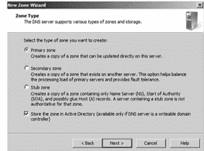

5. 从以下选项中选择一个复制范围，然后单击**下一步**继续：

   - Active Directory 林中的所有 DNS 服务器

   - Active Directory 域中的所有 DNS 服务器（这是默认值）

   - Active Directory 域中的所有域控制器（用于向后兼容 Windows 2000）

   - 手动创建的应用程序分区范围内指定的所有域控制器

6. 如果网络使用 TCP/IP 版本 4 作为其网络协议，请选择创建 IPv4 反向查找区域的选项；如果您已升级网络硬件以使用新的 TCP/IP 版本 6，请选择创建 IPv6 反向查找区域的选项。单击**下一步**继续。

7. 在反向查找区域名称对话框中，单击**网络 ID** 选项并输入反向查找区域的网络 ID。反向查找区域名称应出现在第二个选项字段中。单击**下一步**继续。

8. 从以下选项中选择一个应为此区域启用的安全更新级别，然后单击**下一步**：

   - 仅允许安全动态更新——这是默认选项。

   - 允许非安全动态更新和安全动态更新。

   - 不允许动态更新。

9. 查看摘要区域创建窗口，然后单击**完成**以完成该过程。

10. 如果您未启用动态更新，请通过右键单击新创建的区域并选择**新建指针（新建 PTR）**来添加任何必要的资源记录。例如，您应该创建一条 PTR 记录，引用您在服务器正向查找区域中创建的任何服务器 A 记录。

**暂停。** 反向查找区域已创建。

反向查找区域不是必需的，默认情况下也不会配置。但是，添加反向查找区域是良好的实践，用于故障排除、安全检查以及反向 IP 查询。反向查找区域被称为 `in-addr.arpa` 域，并使用正向查找区域的反向点分十进制表示法。例如，如果正向查找区域使用 192.168.1.200 作为其 IP 地址，则反向查找区域将显示为 200.1.168.192.in-addr.arpa。除了区域创建外，还需要一种称为*指针（PTR）*记录的记录，以便将地址映射回相应正向查找区域中的主机。

## 提高域和林功能级别

为了利用 Active Directory 中更高级的功能，在退役运行低级别操作系统（如 Windows 2000）的域控制器后，您可以在 Active Directory 中提高域和林的功能级别。第 1 课概述了各级别在支持的操作系统和功能方面的差异。在本课中，重点在于提高功能级别的操作步骤和要求。

域和林功能级别可用于提供与之前 Windows Server 操作系统的向后兼容性。将网络迁移到单一一致的平台会带来许多管理优势，并可以降低整体的网络拥有成本。在提高域功能级别之前，请验证域中是否不再需要之前的 Microsoft Windows 网络操作系统。每家公司及其当前的网络结构都需要仔细规划。如果组织对未来的收购或合并感兴趣，提高域级别可能会产生影响，因此应仔细考虑这一点。例如，如果一个企业组织

## 提升域和林的功能级别

随着您的组织通过收购竞争对手而迅速增长，可以安全地假设并非所有新收购的公司都在运行 Windows Server 2008。决定如何将网络结构整合到您的企业架构中将是一个挑战，因为许多网络运行着各种混合的操作系统。Windows Server 2008 系列提供了几项新的增强功能，以帮助使过渡过程更容易。请注意提升域和林功能级别的关键事实和以下要求：

-   这是一项单向操作。如果不完整重新安装域或林，就无法逆转提升域和林功能级别的操作。

-   每个域都可以独立处理，从而允许采取分阶段的方式来增加功能。这允许公司有充足的过渡时间来升级每个站点或域。某些站点在迁移之前可能需要购买新硬件或升级现有基础设施。

-   在林中的所有域都提升到至少相应的**域功能级别**之前，无法提升林功能级别。

-   您必须作为**域管理员**组成员登录，以提升域功能级别。

-   您必须作为**企业管理员**组成员登录，以提升林功能级别。

> **注意**
>
> 您可以使用“Active Directory 域和信任关系”来提升域或林的功能。

### 提升域功能级别

**准备就绪。** 在开始这些步骤之前，您必须作为域管理员组成员登录。

-   从“管理工具”文件夹中打开 **Active Directory 域和信任关系**。

-   右键单击您希望提升的域，并选择**提升域功能级别**，如图 2-14 所示。


-   从“选择一个可用的域功能级别”中选择您希望达到的级别，然后单击**提升**。您将看到图 2-15 中所示的对话框，该对话框解释了此过程的不可逆性质。单击**确定**以确认此警告并提升域的功能级别，然后再次单击**确定**以确认更改已完成。


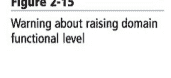

**暂停。** 您已提升域功能级别。

### 提升林功能级别

在上一个练习中，您已将 Active Directory 域的域功能级别提升至 Windows Server 2008 功能级别。接下来，您将提升林功能级别。

**准备就绪。** 在开始这些步骤之前，您必须作为企业管理员组成员登录。

- 从“管理工具”文件夹中打开 **Active Directory 域和信任关系**。
- 在控制台树中右键单击 **Active Directory 域和信任关系** 图标，并选择**提升林功能级别**。
- 如果您的所有域尚未全部提升至至少 Windows Server 2008 级别，您将收到一条错误信息，指出目前无法提升林功能级别。如果所有域都满足 Windows Server 2008 的域功能标准，您可以单击**提升**以继续。
- 会显示一条警告消息，解释此过程的不可逆性质。单击**确定**以确认此警告并提升林的功能级别，然后再次单击**确定**以确认更改已完成。

**暂停。** 您已提升林功能级别。

在上一个练习中，您将您的林的功能级别提升至 Windows Server 2008。

## 向林根域添加第二台域控制器

> 在规划 Active Directory 基础架构时，应为每个域添加第二台域控制器以实现故障容错。这提供了某种冗余，以防其中一台域控制器发生故障。此外，由于林中的第一台域控制器持有所有 FSMO 角色，因此添加第二台域控制器可以让您将部分工作卸载到另一台域控制器。

### 向林根域添加第二台域控制器

**准备就绪。** 您必须在现有的 Active Directory 域上拥有管理员凭据才能添加第二台域控制器；服务器计算机应配置为使用静态 IP 地址。

- 安装服务器操作系统。您可以将服务器配置为工作组成员，或作为现有域内的成员服务器。
- 确保新的域控制器能够解析它要加入的域内的 SRV 记录。实现此目的最简单的方法是配置新服务器使用现有域内 DNS 服务器的 IP 地址。如果新服务器正在运行 DNS 服务器服务，您可以配置新服务器使用 Active Directory 环境中现有 DNS 服务器的 DNS 转发器、辅助区域或存根区域（新服务器将加入该环境）。
- 将此 Active Directory 域服务角色添加到该服务器，并将其配置为现有域中的附加域控制器。这是 Active Directory 安装向导中“选择部署配置”页面上的第一个子选项，如图 2-16 所示。向导将提示您提供以下信息，以便向现有域添加第二台域控制器：
    - 您希望加入的域的 DNS 名称（如果服务器尚未配置为成员服务器）
    - 域的管理凭据
    - 新域控制器应放置的 Active Directory 站点名称
    - 将服务器配置为 DNS 服务器、全局目录和/或只读域控制器
    - Active Directory 数据库、日志文件和 SYSVOL 文件夹的位置
    - DSRM 密码
    - 选择通过网络从现有域控制器复制数据库，或选择“从介质安装”功能，该功能允许您使用现有域控制器的系统状态备份来创建新的域控制器
- 必要时将单个操作主机角色转移到该服务器。

**暂停。** 已添加第二台域控制器。

在上一个练习中，您向现有的 Active Directory 域添加了一台域控制器。

> **交叉引用**
>
> 有关将一个服务器上的 FSMO 角色转移到另一个服务器的过程，请参见第 4 课。

#### 图 2-16

添加第二台域控制器

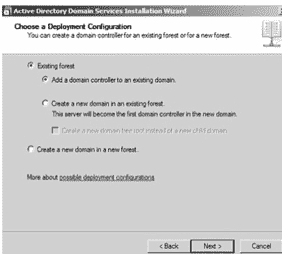

## 在 Server Core 上安装 Active Directory

Windows Server 2008 的一个主要新功能是*Server Core*，这是一种特殊的安装选项，创建一个最小化环境，仅用于运行特定的服务和角色。Server Core 几乎完全在没有图形用户界面（GUI）的情况下运行，这意味着必须专门从命令行对其进行管理。就 Active Directory 而言，Server Core 提供了一种有用的方法，可以部署具有极小安全足迹的域控制器，从而改善分支机构或其他远程环境中域控制器的安全性。

当您登录到 Server Core 计算机时，您会看到一个单独的命令行窗口，如图 2-17 所示。由于 Server Core 不支持许多图形实用程序（包括服务器管理器和 Active Directory 安装向导），因此您需要使用**无人参与安装**从命令行运行 `dcpromo`，该安装使用一个特殊格式化的文本文件来指定必要的安装选项。

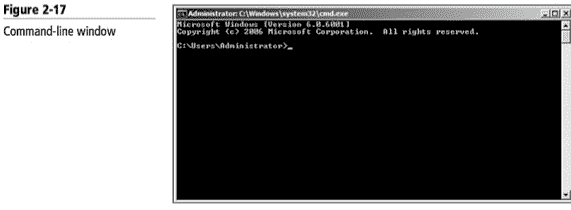

### 在 Server Core 上安装 Active Directory

**准备就绪。** 您必须在现有的 Active Directory 域上拥有管理员凭据才能安装 Active Directory on Server Core；服务器计算机应配置为使用静态 IP 地址。

- 在 Server Core 命令提示符窗口中键入 `notepad`，然后按 `Enter` 键。
- 当记事本窗口打开时，键入以下内容：

```
; DCPROMO unattend file
; Usage:
[DcInstall]
; Replica DC promotion
ReplicaOrNewDomain=Replica
ReplicaDomainDNSName=lucernepublishing.com
SiteName=Default-First-Site-Name
InstallDNS=Yes
ConfirmGc=Yes
UserDomain=lucernepublishing.com
Username=lucernepublishing.com\\administrator
Password=Password1
DatabasePath=C:\\Windows\\NTDS
LogPath=C:\\Windows\\NTDS
SafeModeAdminPassword=MySafeModePassword
RebootOnCompletion=Yes
TransferNRolesIfNecessary=No
```

- 将该文本文件保存为 `C:\` 根目录下的 *unattend.txt*。
- 从 Server Core 控制台输入以下命令：

```
dcpromo /unattend:c:\unattend.txt
```

**暂停。** 已添加第二台运行 Windows Server 2008 Server Core 的域控制器。通过通读 `unattend.txt` 文件中列出的值，您可以看到目标域控制器将如何配置。您可以通过...

由于 `unattended.txt` 文件以明文形式存储设置信息，在将这些文件保存到本地或远程硬盘时，请从中移除密码信息。

修改文本文件中的一行或多行。例如，你可以通过更改以下内容来修改数据库路径：

```
DatabasePath=C:\Windows\NTDS
```

更改为：

```
DatabasePath=D:\NTDS
```

无人值守安装文件不仅用于 Server Core。你还可以使用这些文件在 Windows Server 2008 完整版本上安装 Active Directory。

## 移除 Active Directory

从域控制器中移除 Active Directory 会将该计算机降级为 Active Directory 域中的成员服务器。你可以使用此操作来淘汰旧硬件，或移除 Active Directory 以便在该服务器上进行故障排除或大量维护工作。

### 移除 ACTIVE DIRECTORY

**准备就绪。** 你必须在现有的 Active Directory 域上拥有管理员凭据，才能移除现有的域控制器。

- 1. 单击**开始**菜单，输入 `dcpromo`，然后按 Enter 键。
- 2. 单击**下一步**以跳过初始欢迎窗口。如果看到警告消息提示该域控制器也是全局编录服务器，请单击**确定**继续。
- 3. 显示图 2-18 所示的窗口。单击**下一步**继续。

图 2-18

删除域

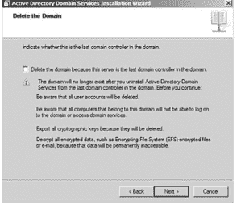

如果这是域中的最后一个域控制器，请选择相应的复选框并遵循任何额外提示。
- 4. 在“密码”字段中输入新降级服务器的本地管理员密码，然后在“确认密码”字段中再次输入。单击**下一步**继续。
- 5. 在“摘要”窗口中，检查你的选择，然后单击**下一步**以开始卸载过程。

**暂停。** Active Directory 已被移除。


Active Directory 安装向导也可用于从现有的域控制器中移除 Active Directory 数据库。如果相关域控制器是域中的最后一个域控制器，降级该服务器将移除所有 Active Directory 组件，并销毁该域的任何现有数据库文件。如果该服务器是林中的最后一台服务器，当域控制器被卸载时，整个林将被移除。此操作的结果是所有 Active Directory 服务（包括 Netlogon）将停止工作。仅当需要完全重新安装 Active Directory 时，才应执行此操作。

## 使用只读域控制器

Windows Server 2008 的另一项令人兴奋的新功能是只读域控制器（RODC）。RODC 可以极大地提高部署在分支机构或其他难以保障安全地点的域控制器的安全性。

在 Windows 2000 和 Windows Server 2003 中，所有域控制器都参与 Active Directory 的多主复制方案，这意味着管理员可以在任何域控制器上进行更改，并且这些更改将复制到 Active Directory 的其余部分。这给需要在物理安全有限的办公室（例如只有少数员工的远程分支机构）中部署域控制器的企业带来了问题。顾名思义，只读域控制器现在允许你部署一个托管 Active Directory 数据库只读副本的域控制器。这意味着管理员需要连接到可写域控制器才能对 Active Directory 进行任何更改。

RODC 的一个关键特性是它们不执行任何出站复制。它们仅接受来自可写域控制器的入站复制连接。要部署 RODC，你需要在环境中至少部署一台可写的 Windows Server 2008 域控制器，并且你需要处于 Windows Server 2003 域和林功能级别。

RODC 的另一个关键特性是每个 RODC 都可以配置自己的密码复制策略。在可写域控制器上，有关每个 Active Directory 密码的信息都本地存储在 `ntds.dit` 文件中。如果可写域控制器被入侵或被盗，环境中的所有用户名和密码信息都将面临风险。相反，你可以指定一个用户或组账户的特定列表，其密码信息应存储在（或缓存在）特定的 RODC 上。例如，如果你在 lueerennepublishing 的东京分支机构部署了一个 RODC，你可以配置该 RODC，使其仅缓存东京用户安全组成员的密码信息。相反，你还可以配置特定用户或组，其密码信息*不应*缓存在 RODC 上。例如，高级管理账户（如域管理员和企业管理员）默认配置为它们的密码信息*无法*缓存在环境中的任何 RODC 上。微软建议你不要更改这些设置。为了允许对整个企业进行 RODC 密码复制策略配置，Windows Server 2008 创建了以下安全组：

- **拒绝 RODC 密码复制组。** 该组的成员默认将被放置在所有 RODC 密码复制策略的拒绝列表中。当首次安装 Windows Server 2008 时，该组包含以下成员：证书发布者、域管理员、域控制器、企业管理员、组策略创建者所有者、只读域控制器、架构管理员和 krbtgt。

- **允许 RODC 密码复制组。** 该组的成员默认将被放置在所有 RODC 密码复制策略的允许列表中。当首次安装 Windows Server 2008 时，该组*没有成员*。

### 配置只读域控制器

要配置哪些用户的密码信息将或不将缓存在你组织中的所有 RODC 上，最有效的方法是分别将这些用户添加到允许 RODC 密码复制或拒绝 RODC 密码复制组。你还可以配置用户或组，使它们的密码信息仅缓存在单个 RODC 上。例如，你可能希望将东京分支机构用户的密码信息仅缓存在*仅*东京 RODC 上，而不是那些这些用户很少（如果有的话）登录的其他 RODC 上。

### 安装只读域控制器

**准备就绪。** 你必须在域上拥有管理员凭据以添加 RODC；服务器计算机应配置静态 IP 地址。

- 1. 单击**开始**菜单并选择**服务器管理器**。

- 2. 选择**角色**，然后单击**添加角色**。

- 3. 向此服务器添加 Active Directory 域服务角色，并使用高级模式安装选项将其配置为现有域中的附加域控制器。向导会提示你提供以下信息以将域控制器添加到现有域：

    - 你希望加入的域的 DNS 名称（如果服务器尚未配置为成员服务器）

    - 域的管理员凭据

    - 应放置新域控制器的 Active Directory 站点的名称

- 4. 通过安装过程，直到你到达“附加域控制器选项”窗口，该窗口提供**DNS 服务器**、**全局编录**或**只读域控制器（RODC）**选项。选择**只读域控制器（RODC）**选项。

- 5. 单击**下一步**开始配置只读域控制器。显示**图 2-19**所示的窗口。在这里，你可以看到**密码复制策略**正在发挥作用，你可以在其中配置应在或不应在 RODC 上缓存密码的特定用户或组账户。如你所见，以下安全组在默认密码复制策略中设置为*拒绝*：

    - 管理员

    - 服务器操作员

    - 备份操作员

    - 账户操作员

    - 拒绝 RODC 密码复制组

默认密码复制策略中唯一配置为*拒绝*的组是允许 RODC 密码复制组。

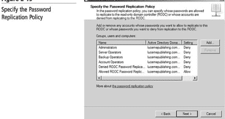

## 另一种方式

为了提高安全性，您可以通过修改 `unattend.txt` 文件，包含诸如 `ReplicaOrNewDomain=ReadOnlyReplica,OnDemandDenied="BUILTIN\Server Operators"` 和 `onDemandAllowed="LP\Allowed RODC Password Replication Group."` 等行，在运行 **Windows Server 2008** 核心安装的服务器上安装一个 RODC。

- 9.  然后您将能够选择该域控制器应从哪个域控制器进行复制。您可以选择**任何可写域控制器**，或者选择**此特定域控制器**并手动选择一个位于同一站点或通过高速网络连接相连的域控制器。单击**下一步**继续。

- 10.  此时向导将提示您输入在“向林根域添加第二个域控制器”练习中看到的相同信息，包括：

  - 选择数据库、日志文件和 `SYSVOL` 文件的位置

  - 设置 `DSRM` 密码

  - 选择通过网络获取域控制器安装源，或使用“从媒体安装”选项

- 11.  完成 Active Directory 安装向导中的步骤，并在向导完成后重启服务器。

**暂停。** 已配置只读域控制器。

只读域控制器还提供了一项功能，这是自 **Windows 2000** 早期以来 Active Directory 管理员要求最高的功能：**管理员角色分离**。这意味着现在可以将用户配置为特定 RODC 的本地管理员，而无需将该用户设为拥有对整个域中所有域控制器广泛权限以及对您的 Active Directory 域数据完全访问权限的域管理员。

## 执行 RODC 的分阶段安装

除了简单地在您指定为 RODC 的服务器控制台上运行 Active Directory 安装向导之外，您还可以执行*分阶段安装*，以便您在一个中心位置（例如数据中心）开始安装，然后允许本地管理员完成配置。由于管理员角色分离，您可以在不向委托管理员委派任何 Active Directory 权限的情况下执行此操作，从而进一步保障创建 RODC 的过程安全。

### 设置 RODC 的分阶段安装

**准备就绪。** 在运行 *Windows Server 2008* 的可写域控制器的控制台上开始。

- 1.  从“管理工具”文件夹中打开“Active Directory 用户和计算机”。

- 2.  右键单击**域控制器**组织单位（OU），并选择**预创建只读域控制器账户**。

- 3.  选择**使用高级模式安装**，并连续单击两次**下一步**以继续。

- 4.  在“网络凭据”窗口中，指定具有向域添加 RODC 权限的远程用户的用户名。单击**下一步**继续。

- 5.  输入 RODC 的计算机名称，然后单击**下一步**。

- 6.  选择该 RODC 所属的站点，然后单击**下一步**。

- 7.  选择该域控制器的任何其他选项，例如配置域控制器作为 DNS 服务器或全球编录，然后单击**下一步**。

- 8.  如上一节所述配置密码复制策略，然后单击**下一步**。

- 9.  在“RODC 安装和管理委派”窗口中，指定将能够完成分阶段安装并本地管理服务器的用户或组账户。单击**设置**选择该账户，然后单击**下一步**继续。

- 10.  按照上一个练习中的步骤完成安装过程，并在提示时重启服务器。

**暂停。** RODC 的分阶段安装已准备就绪。

此时，本地管理员将从目标服务器启动 Active Directory 安装向导。在准备目标计算机时，遵循以下两个步骤非常重要：

- 目标服务器需要配置为与安装第一阶段中指定的名称相同。如果服务器当前拥有不同的名称，您需要在开始第二阶段之前重命名它。


- 目标服务器需要配置为工作组的一部分。目标服务器不能已经加入域。如果您已作为成员服务器将服务器加入域，请先将服务器从域中移除并删除其计算机账户，然后再继续。

## 完成 RODC 的分阶段安装

**准备就绪。** 远程管理员将通过从指定配置为 RODC 的远程服务器启动 Active Directory 安装向导来继续安装的第二阶段；该服务器计算机应配置静态 IP 地址。

- 1. 连续单击两次**下一步**以跳过初始的欢迎和信息窗口。
- 2. 在“选择部署配置”窗口中，选择**现有林**，然后选择**向现有域添加域控制器**。单击**下一步**继续。
- 3. 输入目标域的名称，然后在图 2-23 所示的窗口中单击**设置**以指定远程用户的凭据。单击**下一步**继续。

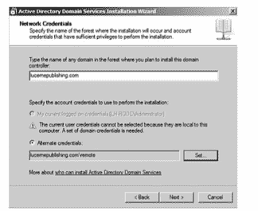

- 4. 选择目标域，然后再次单击**下一步**。
- 5. 如果远程管理员在 Active Directory 中没有管理权限，您将看到图 2-24 中所示的警告。单击**是**以继续。

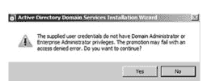

- 6. 然后您会看到图 2-25 中所示的消息，表明安装向导已找到一个与远程计算机名称匹配的预创建 RODC 账户。单击**确定**并按照提示照常完成 RODC 的配置。

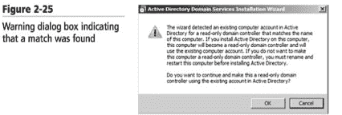

> **注意**
>
> RODC 不参与 Active Directory 中任何形式的出站复制。

**暂停。** RODC 的分阶段安装已完成。

在上一个练习中，远程管理员完成了只读域控制器分阶段安装的第二阶段。这种两阶段过程允许远程管理员在 Active Directory 域中部署 RODC，而无需在域上拥有提升的管理权限。

## 停用 RODC

> 如果您不幸遇到环境中可写域控制器被入侵或被盗的情况，您将面临一项艰巨的任务：重置环境中所有用户的所有密码，因为它们在被盗的域控制器上均可能受到威胁。RODC 有助于最大限度地减少“域控制器被盗”情况下的影响，因为只有密码复制策略中指定的用户的信息才会存储在 RODC 上。

随着 RODC 的引入，**Windows Server 2008** 还引入了从网络中移除 RODC 的新流程。当您在“Active Directory 用户和计算机”的“域控制器”OU 中删除 RODC 的计算机对象时，您将看到图 2-26 中所示的选择：

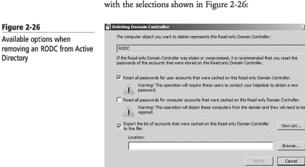

- 重置在此只读域控制器上缓存的所有用户账户的密码。这将强制所有这些用户联系您的帮助台以重新获得网络访问权限。
- 重置在此只读域控制器上缓存的所有计算机账户的密码。这要求您移除并重新添加域中每台受影响的 workstation。
- 将缓存在此只读域控制器上的账户列表导出到该文件。这将把所有受影响的用户和计算机账户的名称导出到文本文件中，以便您可以更加主动地管理它们。

## 修改 Active Directory 架构

在您的实施计划的生命周期中，Active Directory 架构可能会被修改。许多用作通用工具的应用程序（如电子邮件）将需要修改以添加必要的对象到 Active Directory 数据库。能够安全且正确地修改架构是任何 Active Directory 管理员的关键任务。

许多商业应用程序需要扩展 Active Directory 架构的功能，或者您可能希望创建自定义架构扩展来支持内部开发的内部应用程序。例如，Microsoft Exchange 2003 向架构添加了超过 1,000 个类和属性以支持其运行。您添加到架构中的每个类或属性都应有一个有效的*对象标识符 (OID)*。作为 Active Directory 所基于的 X.500 结构的一部分，OID 必须具有全局唯一性，并且它们由分层的点分十进制字符串表示。如果您熟悉简单网络管理协议 (SNMP) 命名空间，您将认识到 OID 的结构。完整的 OID 示例可能是 1.5.5678.5.15。OID 可以直接从 ISO 的 www.iso.org 或从美国国家标准学会 (ANSI) 的 www.ansi.org 获得。

Active Directory 架构被复制到林中的每个域控制器，这意味着每个 Active Directory 林只能有一个架构。对架构的修改由被分配了架构主机 FSMO 角色的域控制器管理。默认情况下，架构主机 FSMO 被分配到林中安装的第一个域控制器。然后，任何对架构的更改都将在 Active Directory 复制过程中复制到林中的所有域控制器。规划这些更改涉及理解以下几点：

- 架构扩展被复制到林中的所有域控制器，并对修改的对象和属性产生全局影响。
- 默认的系统类不能被修改，但可以添加和更改额外的类。这种情况的最佳例子发生在应用程序修改架构时。
- 您添加到架构中的任何类和属性都不能被移除；扩展架构是一个*单向操作*。但是，从 Windows Server 2003 开始，可以禁用架构添加，从而减少由不必要的架构修改带来的开销。
- 当架构被修改时，它会在林中触发复制。规划架构修改可能需要考虑一天中的时间和可能的性能影响。如果在高峰使用时段进行修改，用户可能会遇到一些严重的性能问题。特别是，像 Microsoft Exchange 2003 这样的应用程序可以一次性向架构添加超过 1,000 个属性。
- 可以预期在包含一致的架构信息之前，所有域控制器之间存在一定程度的*延迟*。如第 1 课中所述，延迟描述了 Active Directory 更改被复制到林中所有域控制器所需的时间。这种延迟可能只有几分钟，或者在复制时间表受到严格控制的大型组织中更长。

由于错误扩展架构的后果，您应仅在特定要求的情况下才进行这些修改。如果更改不当，架构中的许多东西都可能出错。为了防范对损坏的 Active Directory 进行午夜恢复，请务必在做出更改之前完全了解更改的后果。例如，如果进行重命名对象属性的更改，事后将很难逆转该更改。如果原始属性由另一个脚本或程序调用，该脚本或程序将不会正常工作，直到问题解决为止。此外，Microsoft 建议仅在任务持续时间将管理员添加到架构管理员组。另外，在将更改发布到生产网络之前，请务必在与实际生产环境非常匹配的隔离环境中测试任何修改。有时规划修改可能会延迟所需应用程序或功能的部署，但如果测试环境中某些功能未按设计工作，那么努力是值得的。您可能在开始修改之前建立变更管理流程 (CMP) 基础设施。CMP 允许您准确跟踪对架构进行了哪些更改以及谁进行了这些更改。

## 安装架构管理管理单元

如前所述，Microsoft Exchange 等一些商业应用程序会在安装过程中修改架构。您还可以使用 Active Directory 架构管理单元手动扩展架构。要手动修改架构，您必须满足以下要求：

- 您必须是架构管理员组的成员。
- Active Directory 架构管理单元应安装在持有架构主机操作角色的域控制器上。

### 安装架构管理管理单元

**准备就绪。** 在开始这些步骤之前，您必须以架构管理员组成员的身份登录。

> 架构管理管理单元在 Windows Server 2008 中默认未安装。要对 Active Directory 架构进行任何编辑，都需要该管理单元可用。将 Active Directory 架构管理单元添加到 Microsoft 管理控制台 (MMC) 窗口是修改架构的最简单方法。MMC 是一种类似于 Windows Server 2008 中包含的其他工具的图形工具。它允许您自定义一组您希望可用于轻松管理的工具。

1. 从命令提示符输入 `regsrv32 schmmgmt.dll` 以注册运行 Active Directory 架构 MMC 管理单元所需的 DLL 文件。
2. 关闭命令提示符窗口，单击**开始**，然后选择**运行**。
3. 在对话框中输入 `mmc/a` 并单击**确定**。
4. 单击**文件**菜单并选择**添加/删除管理单元**。
5. 单击**添加**以查看可用管理单元列表。
6. 在列表中双击**Active Directory 架构**。
7. 单击**确定**。
8. 如果您想保存此控制台以供将来使用，请单击**文件**，然后单击**保存**。通过添加此步骤，您可以简单地打开控制台或在桌面上创建快捷方式以方便访问。

**暂停。** 架构管理管理单元已安装。

在上一个练习中，您通过注册相关的 DLL 文件添加了架构管理管理单元。此 DLL 在 Windows Server 2008 中默认未注册，需要手动添加才能运行架构管理 MMC 管理单元。

> 执行管理任务时，您不应登录到域控制器的控制台。相反，建议使用常规用户账户和**以...的身份运行**程序，在运行 Windows XP 或 Windows Vista 的管理工作站上执行管理任务。有关“以...的身份运行”程序及围绕此警告的安全问题的详细信息在第 6 课中进一步解释。


## 配置 Active Directory 轻量级目录服务

Windows Server 2008 包含一个新的*Active Directory 轻量级目录服务 (AD LDS)* 角色，该角色使开发人员能够存储目录启用应用程序的数据，而无需承受扩展 Active Directory 架构以支持其应用程序的开销。每个 `AD LDS` *实例*都有其自己的架构，这使开发人员能够创建、部署和升级目录启用应用程序，而无需担心 Active Directory 架构修改的单向性。


### 配置 Active Directory 轻量级目录服务

**准备就绪。** 您必须以本地 `Administrators`（管理员）组成员的身份登录才能开始此过程。
1. 单击**开始**菜单并选择**服务器管理器**。
2. 单击**角色**，然后在角色摘要部分下单击**添加角色**。
3. 阅读*开始前*窗口并单击**下一步**。
4. 在*选择服务器角色*窗口中，在**Active Directory 轻量级目录服务**旁放置勾号。单击**下一步**继续。
5. 您将看到 Active Directory 轻量级目录服务的介绍，其中提供了许多安装和管理 AD LDS 的有用提示。其中一些提示包括以下项目：
   - 安装 AD LDS 后，可以使用管理工具文件夹中的 AD LDS 安装向导创建 AD LDS 实例。
   - 在移除 AD LDS 角色之前，您需要移除在此服务器上配置的所有 AD LDS 实例。
阅读 AD LDS 介绍窗口后，单击**下一步**。
6. 单击**安装**开始安装过程。当安装 AD LDS 二进制文件时，服务器管理器似乎会暂停几分钟。
7. 在 AD LDS 二进制文件安装完成后，单击**关闭**。
8. 单击**开始**，单击**管理工具**，然后单击**Active Directory 轻量级目录服务安装**。
9. 单击**下一步**以绕过初始欢迎窗口。
10. 显示图 2-27 中所示的窗口。单击**唯一实例**以创建新的 AD LDS 实例，然后单击**下一步**继续。

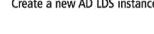
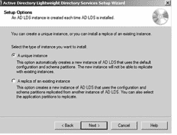

11. 在*实例名称*窗口中，输入 **LP-APP** 作为 AD LDS 实例的唯一名称。单击**下一步**继续。
12. 显示图 2-28 中的窗口。用于与 AD LDS 实例通信的默认端口是：用于 LDAP 的 TCP 端口 389，以及用于 SSL 安全通信的 TCP 端口 636。点击 **Next** 继续。

### **图 2-28**

为 AD LDS 选择端口

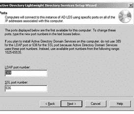

> **警告** 如果要在已配置为域控制器的服务器上安装 AD LDS 实例，端口 389 和 636 在此处将不可用；您需要选择备用端口，例如 5000 和 5001。

13. 在“应用程序目录分区”窗口中，选择 **No, do not create an application directory partition**。通过选择此选项，所有 AD LDS 数据将存储在本服务器上。如果选择创建应用程序目录分区的选项，您可以在 Active Directory 内的自定义应用程序目录分区中存储和复制 AD LDS 数据。点击 **Next** 继续。
14. 在“文件位置”窗口中，选择一个目录来存储 AD LDS 数据文件和数据恢复文件，如图 2-29 所示。点击 **Next** 继续。

### **图 2-29**

为 AD LDS 实例选择文件位置

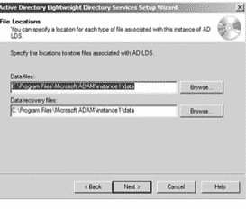

15. 在“服务账户选择”窗口中，选择此 AD LDS 实例应运行的账户。默认为 Network service 账户。保持此默认选择并点击 **Next** 继续。
16. 在“AD LDS 管理员”窗口中，选择将拥有此 LDS 实例管理权限的用户或组。默认值为当前登录用户。或者，点击 **This account** 然后点击 **Browse** 以选择另一个用户或组。点击 **Next** 继续。
17. 在 **Importing LDIF Files** 窗口中，选择一个或多个预定义的 LDIF 文件导入到此 AD LDS 实例的模式中，如图 2-30 所示。点击 **Next** 继续。
18. 在 **Ready to Install** 窗口中，确认您的选择并点击 **Next** 开始配置此 LDS 实例。
19. 安装完成后，点击 **Finish**。

暂停。AD LDS 已配置完毕。

在上一练习中，您配置了 AD LDS。LDS 实例可以包含任何类型不是安全主体的 Active Directory 对象：换句话说，除了 Active Directory 用户、组或计算机对象之外的任何类型对象。

## 建立和维护信任关系

信任关系的存在是为了便于域和林之间访问资源。如第 1 课所述，在创建 Active Directory 林结构过程中，许多信任关系是默认建立的，此外还可以手动创建其他信任关系。

除了父域与子域之间以及林内域树根域之间存在的默认信任关系外，在 Windows Server 2008 中还可以手动建立四种信任类型：
- **快捷信任。** 如第 1 课所述，快捷信任可用于缩短需要频繁访问林中其他位置资源的用户的“树遍历”过程。
- **跨林信任。** 此信任关系是在 Windows Server 2003 中引入的；它允许您在独立的林之间创建双向传递信任。
- **外部信任。** 外部信任用于与 Windows 2000 域或外部组织中的单个域配置单向非传递信任。
- **Realm 信任。** 这些信任允许您在 Windows Server 2008 Active Directory 和 UNIX MIT Kerberos realm（这是 Active Directory 域在 UNIX 中的等效物，允许在 UNIX 网络上进行集中的用户和密码管理）之间配置信任关系。

使用 Active Directory 域和信任 MMC 管理单元来建立手动信任关系。在此实用工具中使用“新建信任向导”时，您可以定义信任是单向入站、单向出站还是双向。单向入站信任建立了来自其他域、外部信任源或 realm 的用户可以访问您域中资源的事实。然而，您源域中的用户将无法访问受信任外部域中的资源。例如，假设某公司希望允许供应商或其他子公司访问某些资源，如产品列表或订单信息。通常，访问权限是有限的，允许供应商或供货商获取必要的业务相关数据。可能没有必要或不希望供应商允许贵公司对他们的数据拥有相同的权限。单向信任允许这种情况安全地发生。

单向出站信任是单向入站信任的完全相反情况。供应商或供货商希望允许贵组织访问其资源，但您不希望他们访问您的资源。如果两个组织都选择允许访问，则可以使用双向信任，这将实现与建立单向入站 *和* 单向出站信任相同的目标。

## 创建信任关系

如果您在源林/域和目标林/域中拥有适当的管理权限，您可以创建信任关系的双方。要创建跨林信任，每个林必须能够通过对等区域、存根区域或条件转发解析另一个林中包含的 DNS 名称和 SRV 记录。

### 创建信任关系

> **准备就绪。** 在开始这些步骤之前，您必须以本地域的 `Domain Admins` 组成员身份登录。您还需要配置第二个 Active Directory 域，并拥有该域的管理员凭据。
1. 从“管理工具”文件夹打开 Active Directory 域和信任。
2. 在左侧的控制台树中，右击您希望建立信任的域，并选择 **Properties**。
3. 点击 **Trusts** 选项卡，然后点击 **New Trust** 以启动新建信任向导。点击 **Next** 继续。
4. 在“信任名称”页面，输入域的 DNS 名称并点击 **Next**。
5. 在“信任”页面，选择所需的信任类型。
6. 在“信任方向”页面，选择所需信任的类型和方向。在“信任侧”页面，选择是否希望同时创建信任的双方。（您必须在源域和远程域上都有管理员凭据。）在“信任密码”页面，输入一个强密码以确认信任关系；在远程域上创建信任的另一侧时，必须输入相同的密码。最后一步，系统将提示您确认出站和入站信任；仅当信任关系已在远程域上创建时，才执行这些步骤。

> **暂停。** 您创建了一个信任关系。
>
> 在上一练习中，您在 Active Directory 域和外部网络之间创建了一个信任关系。

## 验证信任关系


建立手动信任后，您可以使用 Active Directory 域和信任或 `netdom` 命令行工具来验证信任，该工具用于在 Windows Server 2008 命令行上创建、删除、验证和重置信任关系。由于自动信任是 Active Directory 提供的默认功能的一部分，因此您只能使用此过程来验证快捷信任、外部信任和跨林信任。

### 使用 Active Directory 验证信任关系

> **准备就绪。** 在开始这些步骤之前，您必须以 Domain Admins 组成员身份登录。
1. 在 Active Directory 域和信任中，右击您想要验证信任的域，并选择 **Properties**。
> **注意** 在创建林信任时，系统将提示您配置信任的权限，以允许对本地域中所有资源进行身份验证，或仅允许对本地域中选定资源进行身份验证。

## 使用 NETDOM 验证信任关系

准备。在开始这些步骤之前，你必须是“域管理员”组的成员并登录系统。
- 1. 打开命令提示符，并键入以下文本：
`netdom trust TrustingDomainName/d:TrustedDomainName/verify`
- 将 `TrustingDomainName` 替换为允许访问资源的域。`TrustedDomainName` 是需要获得访问权限的域。
- 2. 按(**回车**键)。
暂停。你使用 `netdom` 验证了一个信任关系。
在上一节练习中，你使用 `netdom` 工具从命令行验证了活动目录信任关系的有效性。

## 撤销信任关系

在某些情况下，可能需要移除已建立的信任。如果一家公司终止与某个受信任供应商的商业关系，你需要撤销该信任关系，以防止对网络资源的不必要访问。与创建信任关系类似，你可以使用“Active Directory 域和信任”或 `netdom` 来撤销信任。

### 使用 Active Directory 域和信任撤销信任

准备。在开始这些步骤之前，你必须是“域管理员”组的成员并登录系统。
- 1. 在“Active Directory 域和信任”中，右键单击你要验证信任的域，然后选择**属性**。
- 2. 在“信任”选项卡中，选择**受此域信任的域 (出站)** 或 **信任此域的域 (入站)**。选择相应的信任关系，然后单击**属性**。
- 3. 单击**删除**，并按照提示操作以撤销信任关系。
- 4. 对信任关系的另一端重复步骤 1 至 3。
暂停。你使用“Active Directory 域和信任”撤销了一个信任关系。
在上一节练习中，你使用“Active Directory 域和信任”MMC 管理单元移除了一个活动目录信任关系。

### 使用 NETDOM 撤销信任

准备。在开始这些步骤之前，你必须是“企业管理员”组的成员并登录系统。
- 1. 打开命令提示符，并输入以下文本：
`netdom trust TrustingDomainName/d:TrustedDomainName/remove`
- 2. 按(**回车**键)。
- 3. 对信任关系的另一端重复步骤 1 和 2。
暂停。你使用 `netdom` 撤销了一个信任关系。
在上一节练习中，你使用 `netdom` 命令行工具移除了一个活动目录信任关系。

## 更改用户主体名的默认后缀

> 随着组织因正常扩张、收购、合并以及新的地理位置而增长，活动目录结构可能变得难以导航。需要访问林内多个树结构的用户可能会发现回忆每个域中包含的内容是一件繁琐的事。分布式系统的导航可能很复杂。为了缓解这种混乱，并为用户提供一种简单的方法来全局访问林结构，活动目录支持用户主体名（User Principal Names，简称 UPN）。
*用户主体名* (UPN) 存储在全局目录中，这使得 UPN 可以在整个林范围内使用。此外，如果存在跨林信任，UPN 可用于访问信任林中的资源。UPN 遵循一种命名约定，它可以反映林根域或你配置的其他别名，格式为 *username@domainname*。一种常见的做法是将 UPN 配置为与用户的电子邮件 ID 相匹配。对于内部和外部域名不同的公司，最好使用外部名称作为 UPN，这样用户输入正确的 UPN 就会更简单。在大型组织中，这可能意味着你在创建用户时需要修改默认的 UPN 后缀。要修改 UPN 的默认后缀，你必须拥有企业管理员凭证，因为这是一个林范围的操作。

### 更改用户主体名的默认后缀

准备。在开始这些步骤之前，你必须是“企业管理员”组的成员并登录系统。
- 1. 从“管理工具”文件夹中打开 **Active Directory 域和信任**。
- 2. 右键单击 **Active Directory 域和信任**，然后选择**属性**。
- 3. 单击**UPN 后缀**选项卡，键入新后缀，然后单击**添加**。将显示图 2-31 所示的窗口。
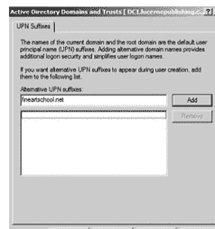
- 4. 如果你的林有多个树，请键入多个后缀。单击**确定**。
结束。你更改了默认的 UPN 后缀。
在创建新的用户账户时，新后缀将可供你分配给用户，如图 2-32 所示。
**图 2-32**
新建对象—用户窗口
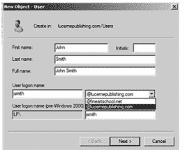
> **警告** 移除正在使用的 UPN 后缀将导致用户无法登录到域。如果你尝试移除 UPN，你将收到一条警告消息。

## 技能矩阵总结

### 本课时学习内容：
- Active Directory 要求安装 DNS。DNS 不必安装在 Windows Server 2008 计算机上，但所使用的 DNS 版本需要支持 SRV 记录，以便 Active Directory 能够正常运行。
- 规划林和域结构时，应包括一个检查清单，以便参考 Active Directory 安装向导所需的对话框信息。
- 验证健壮的活动目录安装包括验证 DNS 区域和 SRV 记录的创建。此外，还应配置其他项目，如反向查找、老化（Aging）和清除（Scavenging）。
- 应用程序目录分区在 DNS 中配置了 Active Directory 集成区域时自动创建。这些分区允许在林结构内进行复制放置。
- 架构的系统类不能修改，但可以增加额外的类。类和属性不能被删除，但可以被停用。
- 规划林和域功能级别取决于对低版本操作系统兼容性的需求。提高林或域的功能级别是一个不可逆的过程。
- 可以创建四种类型的手动信任：快捷信任、外部信任、跨林信任和 realm 信任。可以使用 Active Directory 域和信任或命令行中的 `netdom` 创建手动信任。
- UPN 提供了一种机制，使用户访问多个域中的资源更加方便。UPN 遵循类似于电子邮件地址的命名格式。要添加在创建用户对象时可分配的额外后缀，你必须是企业管理员组的成员。

## 知识评估

### 填空题
*通过在下划线上填写正确的单词或词语来完成以下句子。*
1. 你可以使用 ____________ 实用工具从 Windows 命令行安装 Active Directory。
2. ____________ 将配置哪些用户账户的密码信息会在 RODC 上缓存，哪些不会。
3. ____________ 命令允许你从命令行排查 DNS 信息。
4. 要在 Server Core 计算机上安装 Active Directory，你需要使用一个(n) ____________。
5. 你可以使用 ____________ 来简化大型多域环境中的用户登录过程。
6. ____________ 共享文件夹被复制到每个域控制器，并存储域范围的详细信息，如组策略对象和登录脚本。
7. Active Directory ____________ 指的是更改复制到环境中每个域控制器所需的时间。
8. ____________ 区域传输允许现代 DNS 服务器仅复制已更改的记录，而不是整个区域的内容。
9. 直到你将 AD DS 角色添加到计算机上，Active Directory 域服务才会安装在 Windows Server 2008 计算机上。
10. 如果两个 SRV 记录具有相同的优先级，则客户端访问它们的频率将由它们的相对 ____________ 决定。

### 选择题
> 从以下每个问题中选择正确的答案。选择所有正确的答案。
1. DNS 中的哪种机制用于在通告相同 SRV 记录的多个服务器之间设置负载平衡？
- a. 协议
- b. 域名
- c. 端口
- d. 优先级
2. 哪种安全改进允许你在从安全中心开始安装 RODC 之前完成远程站点（RODC 将托管在此处）的安装？
- a. 分阶段安装
- b. 两部分安装
- c. 第一部分安装
- d. 多部分安装
3. 你添加到 Active Directory 架构中的每个类或属性需要什么？
- a. 协议
- b. 对象标识符
- c. 优先级
- d. 端口


### 4. 哪个 Windows Server 2008 功能允许你执行某些 Active Directory 维护功能，而无需重新启动域控制器？

- a. 目录服务还原模式
- b. 安全模式
- c. 带网络的安全模式
- d. 可重启 Active Directory

### 5. 哪个实用工具允许你从命令行创建、删除和维护 Active Directory 信任关系？

- a. `Repadmin`
- b. `Nslookup`
- c. `Ntdom`
- d. `Shtstat`

### 6. 由 Windows Server 2008 引入的新统一工具，用于管理 2008 服务器的众多方面，是什么？

- a. 计算机管理
- b. 服务器管理器
- c. Active Directory 用户和计算机
- d. Active Directory 域和信任

### 7. 虽然所有可写域控制器都使用多主复制，但某些敏感操作一次只能由一个 DC 控制。这种功能叫什么？

- a. 灵活单一主操作 (`FSMO`) 角色
- b. 灵活多主操作 (`FMMO`) 角色
- c. 灵活单操作主 (`FSOM`) 角色
- d. 灵活多操作主 (`FMOM`) 角色

## 第 2 章复习题

### 8. 哪项 Windows Server 2008 功能允许你将用户或组配置为只读域控制器（`RODC`）的本地管理员，而无需在 Active Directory 中委托任何权限给该用户或组？

- a. 灵活单一操作角色（`FSMO`）
- b. 管理员角色分离
- c. 分阶段安装
- d. Active Directory 轻量级目录服务（`AD LDS`）

### 9. Windows Server 2008 中一个新的安装选项是什么，它拥有最小的安装足迹，旨在运行特定的基础设施服务？

- a. `RODC`
- b. `FSMO`
- c. `Server Core`（服务器核心）
- d. Web 服务器版

### 10. 描述 DNS 记录有效期长短的术语是什么，过期后需要重新注册？

- a. 协议
- b. 优先级
- c. 权重
- d. 生存时间（`Time-to-Live`）

## 案例场景

### 场景 2-1：设计 Active Directory

`Margie's Travel` 决定安装 Windows Server 2008 网络。他们计划使用 `margiestravel.com` 作为其 DNS 名称，因为该名称已在 InterNIC 注册。公司总部位于底特律，分支办公室位于芝加哥、达拉斯和凤凰城。`Margie's Travel` 希望在林（Forest）中为每个分支维护一个独立的子域，以便于管理。请手绘一张图表，说明你会如何设计这个林结构。务必包含林内推荐的域名。

### 场景 2-2：配置跨网络访问

`Margie's Travel` 的管理层刚刚公布了几家供应商的名称，你需要允许这些供应商访问网络资源。这些供应商拥有 Microsoft Windows 2000、Windows Server 2003 或 Windows Server 2008 域。你已经建立了一个域，其中包含供应商访问你的林内资源所需的所有信息。供应商希望能够访问这些资源，但不允许你的公司访问他们的网络。你需要做些什么来实现这一点？

### 场景 2-3：规划迁移

你是一名 IT 顾问，正在协助一家中型公司改进其网络。目前，该公司运行着六台 Windows 2000 服务器，分布在三个独立的域中。工作站运行各种版本的 Microsoft Windows，包括 Windows 2000 Professional 和 Windows XP Professional。管理层正在使用几台新的 Windows Vista Business 机器。公司决定迁移到使用 Active Directory 的 Windows Server 2008，以利用集中式管理优势和更好的安全性。为了帮助你向客户提供咨询建议，请回答以下问题：

- 1. 在迁移规划期间应考虑哪些因素？
- 2. 你会做出哪些建议？
- 3. 初始应设置哪个功能级别？

### 场景 2-4：DNS 命名

场景 2-3 中讨论的同一客户已在互联网上注册了 DNS 名称。客户使用它来运行公司的网站，使客户能够访问产品数据库并在线下单。客户希望在其内部网络中使用相同的名称，但你被告知使用内部网络可能会影响网络安全性。你会建议他们探索哪些选项，以在提供内部网络安全的同时保持一定程度的命名一致性？

## 处理 Active Directory 站点

### 目标领域矩阵

| 技术技能 | 目标领域 | 目标领域编号 |
|---|---|---|
| 介绍 Active Directory 站点 | 配置站点。 | 2.3 |
| 配置 Active Directory 复制 | 配置 Active Directory 复制。 | 2.4 |

### 关键术语

- 异步复制
- 桥接服务器
- 更改通知
- 无类别域间路由（`CIDR`）
- 压缩
- 连接对象
- 收敛
- 成本
- `dcdiag`
- 双反向旋转环
- 频率
- 站间复制
- 站点拓扑生成器（`ISTG`）
- 站内复制
- 链接值复制（`LVR`）
- 首选桥接服务器
- 基于 Internet 协议的远程过程调用（`RPC over IP`）
- `repadmin`
- 复制伙伴
- 复制拓扑
- 计划
- 简单邮件传输协议（`SMTP`）
- 站点链接
- 桥接
- 时间戳
- 传递性
- 更新序列号（`USN`）
- 紧急复制
- 版本 ID
- 良好连接

`Woodgrove Bank` 是美国东北部的一家中型社区银行，正在通过收购附近地区的较小银行来扩展其分支机构。`Woodgrove Bank` 依赖 Active Directory 为其当前资产提供单一的认证存储，并且正在将其新收购的资产迁移到现有的 Active Directory 中，以提供简化的登录体验。为了管理 `Woodgrove` 公司总部与其新收购的资产之间的带宽使用情况，其 Active Directory 设计团队创建了多个 Active Directory 站点，以控制复制流量在站点之间的传输方式。

完成本课后，你将深入理解 Active Directory 复制过程，该过程用于在域或林中的一个域控制器与所有其他域控制器之间通信更改。你将能够讨论站内复制（在单个良好连接的位置内发生）与站间复制（允许 Active Directory 更改通过 WAN 链接通信到远程位置）之间的区别。你将了解如何实施创建和管理 Active Directory 站点的计划，以及如何管理和监控 AD 复制过程。由于 Active Directory 域服务允许从任何可写域控制器对 Active Directory 数据库进行更新，因此复制是维护健康且功能正常的 Active Directory 环境的关键概念。

## 介绍 Active Directory 站点

Active Directory 复制是在域控制器之间复制 Active Directory 信息的过程，目的是实现故障转移和冗余。Active Directory 中的多主复制模型要求每个域的域控制器都参与该域的复制过程，并复制整个林的架构和配置信息。复制数据库并确保更新及时发生的过程，需要你定义这些信息在域内及整个林中的复制方式。Active Directory 站点是管理员控制复制流量的手段。位于同一站点内的域控制器参与**站内复制**。位于不同站点中的域控制器将参与**站间复制**。站内复制会在更改发生后几乎立即传输到 Active Directory 数据库；站间复制则按计划进行（默认为每 15 分钟一次）。站间复制流量默认也被*压缩*，以减少网络带宽的使用；而站内复制流量则不会。本课专注于创建、配置、复制和监控 Active Directory 站点的详细信息。

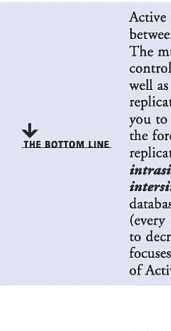

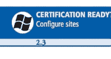


Active Directory 由独立的逻辑结构和物理结构组成。Active Directory 的逻辑结构定义了 Active Directory 资源的逻辑分组，包括林、域、树和 OU（组织单元）。相比之下，Active Directory 的物理结构定义了信息如何通过网络底层的局域网（LAN）和广域网（WAN）拓扑传递，具体定义了 Active Directory 站点和域控制器如何映射到该物理结构。你可以使用“Active Directory 用户和计算机”查看和管理 Active Directory 的逻辑结构，并使用“Active Directory 站点和服务”管理其物理结构。如第 1 课所述，Active Directory 站点基于物理网络中的 IP 子网。你将根据网络的物理设计在 Active Directory 中创建这些子网。当客户机登录到 Active Directory 时，它们使用 DNS 查询 Active Directory 站点拓扑，以定位最近的可用域控制器和其他网络资源。域控制器使用站点拓扑来建立提供效率并保持 Active Directory 数据库一致性的复制伙伴。

当你在 Active Directory 林中安装林根域控制器时，Active Directory 安装向导会创建一个名为 `Default-First-Site-Name` 的单站点，你可以在“Active Directory 站点和服务”工具中看到该站点，如图 3-1 所示。林根域控制器服务器对象被放置在站点的 Servers 文件夹中。稍后你会发现，站点可以重命名以更准确地反映物理位置。

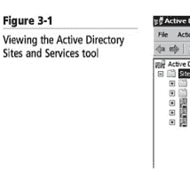

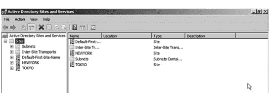

在您在 `Default-First-Site-Name` 容器中安装了第一个 Active Directory 域控制器后，您可以（也应该）自定义 Active Directory 的站点配置，以便在合适的域控制器之间执行复制。通常，Active Directory 站点具有以下特征：

- 站点由 *连接紧密* 的 IP 子网定义，这意味着它们之间的网络基础设施快速且可靠。在大多数情况下，一个 Active Directory 站点将映射到一个单一的 LAN。
- 多个站点将通过站点链接连接在一起。站点间复制沿着您在 Active Directory 站点和服务中定义的站点链接进行。在大多数情况下，您的 Active Directory 站点链接映射到您网络上的 WAN 连接。
- 站点通过定义一组将使用站内复制或站点间复制相互复制的服务器来组织复制过程。
- 在登录过程中，每个客户端查询 DNS 中的站点信息，以协助确定用于 Active Directory 身份验证的合适域控制器。
- Active Directory 站点独立于 Active Directory 的逻辑结构。这意味着单个站点可以包含多个域，如图 3-2 所示，或者单个域可以跨越多个站点，如图 3-3 所示。

### 图 3-2

在单个站点中配置多个域


### 图 3-3

在单个域中配置多个站点


规划您的站点拓扑应该是 Active Directory 设计过程的一个基本组成部分，并且应该在任何实际的 Active Directory 部署之前进行。由于站点基于 IP 子网以及 LAN 和 WAN 连接，在安装域控制器之前建立站点拓扑可以使您利用域控制器自动放置在合适站点中的优势。在安装新域控制器期间，该域控制器将自动放置在与该域控制器 IP 地址的网络地址部分对应的站点中。

但是，如果在安装新 DC 之前尚未创建合适的站点，则域控制器将被放置在 `Default-First-Site-Name` 容器中，您稍后需要手动移动它；这可能导致 Active Directory 客户端尝试向可能位于远程物理位置或由缓慢的 WAN 链接分隔的 DC 进行身份验证。在 Active Directory 部署之前根据 IP 拓扑设计创建站点可以节省时间和精力，并为最终用户提供更健壮的 Active Directory 实现。

## 理解复制过程

> Active Directory 创建一个 *复制拓扑*，其理念是域内所有可写域控制器除了与其他域通信全森林信息外，还应相互通信 Active Directory 信息。在 Active Directory 中定义的站点和子网将决定网络中复制流量使用的路径，并构成 Active Directory 信息分发的基础。

Active Directory 复制设计旨在高效跟踪更改并为 Active Directory 数据库提供容错能力。当满足以下任一条件时，Active Directory 内部将发生复制：

- 向 Active Directory 添加或移除对象
- 属性的值已更改
- 对象的名称已更改

由于可以从任何可写域控制器进行更改，因此 Active Directory 需要能够跟踪来自不同源的更改，并确定哪些对象需要从域控制器复制到其他域控制器。每个域控制器维护一个称为 *更新序列号* `USN` 的本地值，它跟踪在每个 DC 上进行的更改，从而跟踪哪些更新应复制到其他域控制器。考虑一个由两个域控制器 `DC1` 和 `DC2` 组成的简单域。`DC1` 目前的 USN 为 1000，`DC2` 的 USN 为 2000。管理员登录到 `DC1` 并更改 `jsmith` 用户账号的姓氏，从而使 `DC1` 的 USN 增加到 1001。当 `DC2` 向 `DC1` 请求复制更改时，`DC1` 将传输 `jsmith` 姓氏的更改，`DC2` 会将此更改应用于其本地 `ntds.dit` 文件的副本。

除了 USN，每个 Active Directory 属性都关联有一个 *版本 ID*，它跟踪该属性已更改的次数。因此，如果 `jsmith` 姓氏属性的版本 ID 为 3，并且管理员将其从 Smith 更改为 Arnold，再更改为 Smith-Arnold，然后又改回 Smith，那么 `jsmith` 姓氏属性的新版本 ID 现在为 6。如果同一属性同时在两个域控制器上被修改，Active Directory 将使用版本 ID 作为第一个平局决定因素，以确定保留哪个值并丢弃哪个值。因此，如果 `DC1` 上 `jsmith` 的姓氏属性值为 Smith，版本 ID 为 6，而 `DC2` 上的 `jsmith` 对象副本已更新为姓氏 Smith-Arnold，版本 ID 为 5，Active Directory 将保留值 Smith，因为它具有更高的版本 ID。

如果 Active Directory 无法使用版本 ID 作为平局决定因素，下一个平局决定因素是 *时间戳*，即更改发生的时间。如果两个冲突的更改具有相同的版本 ID，则后来发生的更改将由 Active Directory 保留。

在版本 ID *和* 时间戳都相同的极不可能事件发生的情况下，Active Directory 将使用发生冲突修改的域控制器的全局唯一标识符 `GUID`。具有 *更低* GUID 的域控制器将赢得第三也是最终的复制平局决定。

在站点之间复制信息时，Active Directory 将在每个站点中指定一个 *桥接器* 作为站点间复制管理的大门控。这使得站点间复制只需更新站点内的一个域控制器。桥接器更新后，它会使用新复制的信息更新其其余域控制器合作伙伴。例如，假设公司网络两个位置之间的 WAN 链接中断了几个小时。在此期间，WAN 链接两侧的物体和属性都发生了更改。当 WAN 链接恢复在线时，Active Directory 比较 WAN 链接两侧桥接器上更改的 USN、版本 ID 和时间戳。在确定哪些更新“赢得”发生的任何平局决定后，每个站点中的桥接器会联系其合作伙伴桥接器并复制新的 Active Directory 更改。在每个站点中的桥接器收到所有最新的复制更新后，它们将反过来继续与同一站点内的其他合作伙伴域控制器复制新获得的信息。Active Directory *收敛* 描述此过程发生所需的时间，以便环境中的所有域控制器都包含最新的信息。

### 处理站内复制

> 要了解复制实际运作的细节，您需要了解站内复制和站点间复制之间的区别。这些复制方法提供的功能细节和角色在下述章节中描述。

站内复制发生在位于同一站点中的域控制器之间，如图 3-4 所示。每个域控制器使用一个名为知识一致性检查器 `KCC` 的内部过程来映射域控制器之间的逻辑网络拓扑。对于站点中的每个域控制器，`KCC` 将为其选择一个或多个 *复制合作伙伴*，并在域控制器与其新的复制合作伙伴之间创建 *连接对象*。每个连接对象都是单向连接。因此，在具有三个域控制器的站点中，`DC1` 可能有指向 `DC2` 的连接对象，但 `DC2` 可能没有与 `DC1` 的连接对象。

### 图 3-4

查看站内复制连接


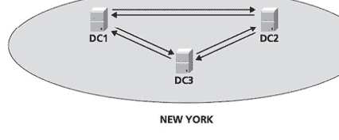

> 在 `Windows Server 2003` 和 `Windows Server 2008` 之前，对 Active Directory 组成员资格的任何更改都强制复制整个组成员列表，因为成员列表属性被视为单个属性。多个管理员同时对同一组成员列表进行的更改会导致部分更新因冲突解决而丢失。整个列表必须复制的事实还要求更多的处理时间和更高的带宽利用率。当您将森林功能级别提升至 `Windows Server 2003` 或更高版本后，对组的单个成员资格更改将触发仅将此更改复制到列表中的每个成员，而不是整个成员列表。这种对复制的改进称为 `链接值复制` (`LVR`)。

`KCC` 在选择复制合作伙伴和创建复制对象时所遵循的指导原则是“三跳规则”，即为了使更改到达所有域控制器（`DC`）所需的时间最小化，任何域控制器与能够向 Active Directory 数据库发起更改的域控制器之间的网络跳数不应超过三跳。`KCC` 是完全自动化的，除非你有明确的业务理由手动配置 `KCC` 拓扑，否则不需要管理员干预。实际上，手动配置 Active Directory 复制链接存在显著弊端，这一点将在下一节中详细介绍。

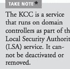

由于 Active Directory 由多个分区组成——包括域分区、架构分区、配置分区以及任何已配置的应用程序分区——每个分区内的信息都会在 Active Directory 中进行复制。域分区信息会复制到域内的所有域控制器，而应用程序分区信息则根据该分区的配置进行复制。全林范围的信息，如架构和配置分区的内容，会复制到林中所有域的所有域控制器中。每个分区被称为一个 `命名上下文`，Active Directory 会为每个分区创建独立的复制拓扑。该拓扑定义了哪些服务器将复制包含在每个命名上下文中的信息。

当你向站点添加域控制器时，它们会成为该站点内站复制的一部分。`KCC` 通过创建新的连接对象来调整站内的复制拓扑，以反映新添加的 `DC`。你可以在 `Active Directory 站点和服务` 管理单元中的每个服务器对象的 `NTDS 设置` 部分查看这些连接对象。

`KCC` 每 15 分钟运行一次，并分析连接对象的最佳路径和放置位置。如果某个域控制器或域控制器之间的链接发生故障，`KCC` 会自动从可能的复制路径列表中删除该连接，从而更新拓扑。考虑一个包含两个站点（`SiteA` 和 `SiteB`）的单一域。`SiteA` 包含两个域控制器：`DC1` 和 `DC2`。`SiteB` 包含单个域控制器 `DC3`，`DC2` 和 `DC3` 之间有一个复制连接。在此场景中，如果 `DC2` 发生故障，`KCC` 将检测到该故障并在 `DC1` 和 `DC3` 之间创建一个新的连接对象。

默认情况下，站内复制被配置为最小化延迟，以便更改能够快速发生。延迟是指更改复制到所有参与域控制器所需的时间或延迟量。`KCC` 通过多种方式最小化站内复制的延迟，包括：

- `KCC` 为复制路径创建一个 `双向反向旋转环`。如果环中的某个域控制器发生故障，流量将沿相反方向路由，以允许复制继续进行。
- 随着站点的扩展，会创建额外的连接对象，以确保域控制器之间的复制跳数不超过三跳。
- 站内复制流量不被压缩，这减少了复制事件期间每个域控制器的 CPU 周期消耗。
- 域控制器使用 `更改通知` 相互告知何时需要复制更改。每个域控制器在转发更改前会保留 15 秒，之后以 3 秒的间隔将更改发送到其每个复制伙伴。由于域控制器之间的最大跳数为三，因此更改到达最终目的地的最大复制延迟为 15 秒加上每个复制伙伴 3 秒。某些操作，如密码更改或账户锁定，将使用 `紧急复制` 传输，这意味着更改将被放在“队列前端”，并在等待复制的其他任何更改之前应用。

尽管 `KCC` 创建复制路径的过程是完全自动的，但仍可以手动创建同一域内域控制器之间的连接对象。创建手动复制连接允许你覆盖 `KCC` 创建的复制拓扑。然而，一旦创建了手动连接对象，所有自动连接对象将被忽略。创建手动连接对象还会移除 `KCC` 在域控制器或站点链接不可用时对复制拓扑进行即时修改的能力。

当单个站点内使用多个域时，每个域都维护自己独立的复制拓扑，尽管来自所有域的架构和配置命名上下文信息仍会在全林范围内进行复制。请考虑图 3-5 中的示例。域 A 和域 B 共存于同一站点。域 A 的所有域信息仅与域 A 的服务器复制。域 B 也是如此。然而，由于这两个分区信息的林级特性，架构和配置信息会复制到两个域中的所有域控制器。

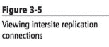

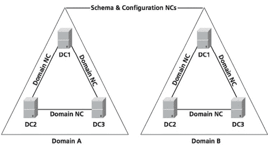

## 查看 Active Directory 连接对象

**准备就绪。** 在开始这些步骤之前，请使用具有管理员权限的账户登录到域控制台的域控制器。

1. 打开 `Active Directory 站点和服务` `MMC` 管理单元。
2. 单击 `Sites`（站点）文件夹，选择所需的站点，然后单击 `Servers`（服务器）文件夹。
3. 展开你想要查看连接对象的服务器名称，右键单击 `NTDS 设置`。单击 **属性**。
4. 选择如图 3-6 所示的 **连接** 选项卡，查看已为该域控制器配置的复制合作伙伴。


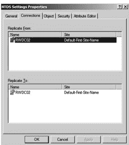

5. 单击 **取消** 关闭对话框。

**暂停。** 你可以关闭 `Active Directory 站点和服务` 管理单元，或者将其保留以便后续练习使用。

在上一练习中，你查看了为域控制器配置的用于站内复制的复制连接。

## 实施和管理站点计划

> 你将使用 `Active Directory 站点和服务` `MMC` 管理单元创建和管理 Active Directory 站点。除了创建 Active Directory 林时自动配置的第一个站点外，你还可以创建和管理额外的站点，以更好地控制网络上的复制流量。以下各节讨论了创建、配置和管理你的站点计划所需的步骤。

### 重命名默认-First-Site-Name

**准备就绪。** 在开始这些步骤之前，请登录到已安装 Active Directory 管理工具的域控制器或管理工作站的控制台。

1. 打开 `Active Directory 站点和服务` 并展开 `Sites` 文件夹。
2. 右键单击 `Default-First-Site-Name` 站点对象，并单击 **重命名**。
3. 输入适合你环境的站点名称（例如 `Redmond-Site`），然后按 **Enter** 键。

**暂停。保留** `MMC` 控制台打开以便在下一个练习中使用。

将 `Default-First-Site-Name` 重命名为反映你整体站点策略的名称并不罕见。这里的目的是直观地命名所有元素，使其易于理解它们之间的关联。在命名站点和其他相关对象时，最好只使用字母、数字和连字符。

### 创建新站点

**准备就绪。** 在开始这些步骤之前，请登录到已安装 Active Directory 管理工具的域控制器或管理工作站的控制台。

1. 在 `Active Directory 站点和服务` 中，右键单击 `Sites`（站点）文件夹，并选择 **新建站点**。
2. 在新建对象-站点对话框中，输入适合你环境的新站点名称。
3. 从站点名称列表中选中 `DefaultIPSiteLink`，并单击 **确定** 以完成站点创建。如果弹出附加信息消息，请阅读显示的信息，然后单击 **确定**。

**暂停。保留** `MMC` 控制台打开以便在下一个练习中使用。

创建所有站点和子网后，你将把适当的站点链接与该站点关联。相关步骤将在下一节中说明。

### 创建新子网

> 每个子网应对应一个物理网段。定义网络的子网后，你将把它们与适当的站点关联。

**准备就绪。** 在开始以下步骤之前，请登录到域控制台的域控制器或已安装 Active Directory 管理工具的管理员工作站。

1. 在 `Active Directory 站点和服务` 中，右键单击 **子网** 文件夹。
2. 从菜单中选择 **新建子网**。
3. 在“新建对象-子网”对话框中，在 **名称** 字段中输入 IP 地址和子网，格式采用 `无类别域间路由（CIDR）` 表示法，如图 3-7 所示。这种表示法显示了用于子网掩码的位数。例如，如果您使用的 IP 地址为 192.168.64.0，掩码为 255.255.255.0，那么其 `CIDR` 表示为 `192.168.64.0/24`。

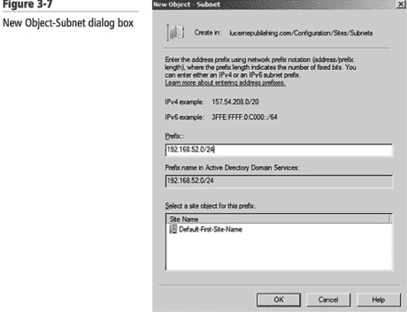

4. 选择要与此子网关联的站点，然后单击 **确定**。

**暂停。保留** `MMC` 控制台处于打开状态，以便在下一个练习中使用。


在此练习中，您创建了一个子网以与 Active Directory 站点和服务中的特定站点对象相关联。默认情况下，Active Directory 安装过程不会创建任何子网。您需要在 Active Directory 站点和服务中手动定义所有子网。您应根据 TCP/IP 方案创建反映物理基础设施的子网。

## 配置站点间复制

> 如果 Active Directory 信息仅在单个站点内进行复制，则无法在广域网中共享对象信息。企业网络将由许多独立的 LAN 组成，这些 LAN 无法共享资源，并且无法实现集中管理和在整个网络任何位置的单点登录。回想一下，每个站点由通过快速可靠链路连接的一个或多个 IP 子网组成，现在我们可以查看这些站点如何相互通信以形成一个企业网络。

Active Directory 站点名称通常反映物理位置的名称，并包含参与域复制过程的域控制器。每个站点包含一个或多个包含在该站点内的子网。考虑一家位于芝加哥的计算机培训公司，其网络由通过高速链路连接的四个建筑物组成。这些建筑物内的子网都可以属于同一个站点。如果在该网络中添加一个位于明尼阿波利斯的远程培训站点，您需要创建一个额外的站点，其子网应反映该位置的 IP 地址方案。当您在明尼阿波利斯位置安装域控制器，且该位置与芝加哥的域控制器属于同一域时，您需要创建站点链接才能在芝加哥和明尼阿波利斯之间进行复制。站点链接是两个站点之间的逻辑传递连接，它镜像了网络之间的路由连接，并允许复制发生。要在多站点网络中创建复制拓扑，每个站点内的一个域控制器都会运行站点间拓扑生成器（`ISTG`），这是一个负责选择桥接服务器并映射用于站点之间复制的拓扑的过程。

除了在安装 Active Directory 时自动创建的 `DEFAULTIPSITELINK` 之外，所有 Active Directory 站点链接都需要手动创建。所有站点链接对象都具有以下特征：

- 站点链接连接使用相同协议进行通信的两个站点。
- 站点链接对象是手动定义的。
- 站点链接对象对应于连接站点的 WAN 链路。
- `ISTG` 使用站点链接来建立站点间复制拓扑。

站点间复制的主要目标是最小化带宽使用。与站点内复制不同，站点间复制会压缩在站点之间复制的数据，从而减少 Active Directory 复制所使用的网络流量。

创建站点链接对象时，请配置以下三个属性以控制站点链接上复制流量的行为：

- **成本。** 为站点链接对象分配成本允许管理员定义复制将采取的路径。如果可以使用的复制路径不止一条，成本分配将决定首先选择哪条路径。较低数值的成本值将优先于较高数值的成本值。成本值可以使用 1 到 99,999 之间的值。这里没有使用绝对的编号方案。相反，值由 Active Directory 管理员选择，且仅在彼此之间具有相对关系。例如，成本为 2 的站点链接将优先于成本为 5 的站点链接，成本为 1,000 的站点链接将优先于成本为 10,000 的站点链接。新创建的站点链接对象的默认成本为 100。
- **时间表。** 站点链接对象的时间表决定了该链接何时可用于复制信息。例如，您可以配置站点链接的时间表，使其仅在周一至周五午夜至凌晨 5 点之间传输复制流量。您通常会将此值配置为反映非高峰业务时段，特别是对于慢速或高负载的 WAN 链路，以确保链接带宽不被复制流量阻塞。默认情况下，新创建的站点链接对象 24/7 可用于复制。
- **频率。** 站点链接的频率决定了信息在特定站点链接上复制的频率。复制仅在预定时间内进行。但是，在该预定时间内，它可以按照频率属性允许的尽可能频繁地进行。新站点链接的默认复制频率为 180 分钟，但可以配置为每 15 分钟一次（最频繁）或每周一次（最不频繁）。

### 创建新站点链接对象

**准备就绪。** 在开始以下步骤之前，请登录到域控制台的域控制器或已安装 Active Directory 管理工具的管理员工作站。

1. 在 Active Directory 站点和服务中，展开站点间传输文件夹，如图 3-8 所示。

#### 图 3-8

站点间传输文件夹

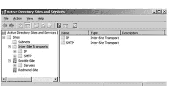

2. 右键单击所需的协议（IP 或 SMTP），然后选择“新建站点链接”。
3. 在“新建对象-站点链接”对话框中，输入站点链接的名称。此名称应反映将通过此链接连接的位置。
4. 在“不在此站点链接中的站点”列表中，选择您希望与此链接关联的站点，然后单击“添加”。它们将出现在对话框右侧的“在此站点链接中的站点”下方。单击“确定”以完成链接创建。
5. 右键单击刚创建的站点链接，然后选择“属性”。站点链接成本默认设置为 100；如有必要，请根据站点链接计划修改此数字。请记住，较低的数值表示首选路径。
6. 如果您希望将复制频率更改为默认值 180 以外的值，请修改“每 xx 分钟复制一次”字段。
7. 若要修改时间表以仅允许在指定时间段内进行复制，请单击“更改时间表”。
8. 选择您希望禁止或允许复制的日期和小时，并调整时间表图表右侧的选项按钮以显示适当的颜色。以蓝色突出显示的日期和小时表示允许复制。完成后，选择“确定”以关闭“时间表”对话框。
9. 完成所有所需的链接配置后，单击“确定”。

**暂停。保留** 站点和服务 MMC 管理单元处于打开状态，以完成下一个练习。

在设计站点链接拓扑时，必须仔细考虑分配给这些属性的值，以实现最佳复制性能。设置链接属性时，请使用以下准则：

- 成本属性值应考虑所用链路的速度和可靠性。例如，与仅在 T-1 不可用时才使用的 128-Kbps ISDN 链路相比，您会将相对较低的成本分配给可靠的 T-1 链路。
- 时间表属性值应权衡在非高峰时段进行复制与在所有站点保持最新信息之间的利弊。
- 较短的频率属性值由于频繁的小规模复制循环而消耗较少的带宽，同时提供更及时的信息。较长的复制间隔可能在复制期间需要更多带宽，且复制周期之间的信息及时性较差。

## 选择复制协议

在配置复制时，您可以选择两种可能的协议：基于 IP 的 RPC 和 SMTP。在本节中，我们将讨论这两种复制协议之间的区别。我们还将根据每种协议的优势和劣势，查看您可能会选择其中一种而非另一种的情况。

> **注意**
>
> 创建站点或站点链接对象后，您可以转到该对象的“属性”表，并在“对象”选项卡上“保护防止意外删除”旁边的复选框中打勾。顾名思义，这将保护您免受管理员错误删除关键对象（如站点）的影响；选中此复选框后，Active Directory 将不允许删除，而是会发出错误消息，提醒管理员该对象已受到删除保护。

对于站点内和站点间复制，活动目录默认使用基于互联网协议的远程过程调用（`RPC over IP`）作为所有复制流量的传输协议。`RPC` 通常用于与各种计算机上的网络服务进行通信，而 `IP` 则负责数据寻址和路由。`RPC over IP` 复制通过同时使用身份验证和加密，确保数据在传输过程中的安全性。

简单邮件传输协议（`SMTP`）是站点间复制的一种替代解决方案，适用于没有直接 IP 连接或可靠 IP 连接的情况。`SMTP` 是传输控制协议/互联网协议（`TCP/IP`）协议族的一员，是用于电子邮件等消息传输的标准协议。使用 `SMTP` 的站点链接采用异步复制方式，这意味着每个复制事务无需在完成前等待其他事务开始，因为事务可以存储直到目标服务器可用。由于该协议只能复制配置、架构和应用目录分区，因此其复制功能有限。`SMTP` 无法复制域目录分区，并且需要一个与企业目录完全集成的企业证书颁发机构（CA）。CA 会对域控制器之间交换的 `SMTP` 消息进行签名，从而确保目录更新的真实性。CA 负责颁发数字证书，使两台计算机能够安全地通信。


与 `RPC over IP` 不同，`SMTP` 不遵循调度计划，应仅在使用极慢或不可靠的广域网链路在不同域之间进行复制时使用。表 3-1 总结了站点内和站点间复制之间的差异。

### 表 3-1

站点内和站点间复制

| 站点内复制 | 站点间复制 |
| :--- | :--- |
| 站点内的复制不进行压缩。它经过优化以减少延迟。 | 站点之间的复制会进行压缩，以优化广域网带宽利用率。 |
| 复制伙伴相互通知需要执行的更改。 | 桥接服务器负责收集复制数据、压缩数据并跨站点链接发送。 |
| 正常复制以 15 秒为间隔进行。安全敏感更改会触发立即复制。 | 必须配置站点链接才能实现站点之间的复制。 |
| `KCC` 每 15 分钟检查一次站点拓扑变更。 | 默认复制计划设置为每周七天，每 180 分钟一次。 |
| 复制在站点内使用 `RPC over IP` 协议。 | 如果配置了两个或更多站点链接以实现容错，则费用设置将决定首选路径。 |
| `RPC over IP` 用作传输协议。 | 可以使用 `RPC over IP` 或 `SMTP` 作为传输协议。在大多数情况下，`RPC over IP` 是首选。 |

## 指定桥接服务器


尽管同一站点内的所有域控制器都会相互参与复制过程，但并非所有域控制器都会同时与其他站点进行复制。这是因为使用所有可用的域控制器在站点之间复制活动目录数据可能是一个极度消耗带宽的操作。为了进一步最小化站点间复制对带宽的影响，活动目录会在每个站点内指定一个桥接服务器。

站点内的所有流量都会复制到该站点的桥接服务器。然后，桥接服务器负责将该站点内发生的所有更改复制到远程站点中的其他桥接服务器。站点间拓扑生成器（ISTG）会自动将每个站点中的服务器指定为桥接服务器，除非通过建立`首选桥接服务器`列表来覆盖此设置。通过管理方式分配首选桥接服务器列表的好处在于，你可以确定哪些服务器具有最佳的处理能力和可用的网络带宽来处理复制流量。请记住，站点间复制流量默认是压缩的，因此桥接服务器将负责站点内部以及站点之间的所有复制流量的解压缩、压缩、发送和接收。配置多个首选桥接服务器允许对使用最 efficient 的机器进行站点间复制的任务进行管理控制。当配置了多个首选桥接服务器且首选桥接服务器发生故障时，KCC 将从列表中选择另一台服务器。

在规划桥接服务器的使用时，请考虑以下准则：

- 配置首选桥接服务器列表，以帮助改善站点之间的性能。应根据处理能力选择服务器。桥接服务器必须高效地压缩和解压缩复制数据。网络上处理器最慢的服务器不是桥接服务器角色的最佳选择。
- 为多个分区配置多个桥接服务器。
- 如果 ISTG 指定的首选桥接服务器发生故障，ISTG 将从配置列表中指定新的桥接服务器。这假设你已在列表中配置了多台服务器。因此，微软建议在尽可能的时候配置多个首选桥接服务器。

### 指定首选桥接服务器

**准备就绪。** 在开始这些步骤之前，请使用具有管理员特权的账户登录到域控制台的界面。

1. 在`Active Directory 站点和服务`中，展开所需的`站点`文件夹，然后展开包含要添加到桥接服务器列表的服务器的`服务器`文件夹。
2. 右键单击要配置的域控制器，并选择`属性`，如图 3-9 所示。


**图 3-9**

属性窗口的常规选项卡

3. 从左侧的传输列表中，选择用于复制的适当协议，然后单击“添加”。该协议将出现在右侧，显示该服务器将被添加到所选协议的首选桥接服务器列表中。

**暂停。** 保持站点和服务 MMC 管理单元处于打开状态，以完成下一个练习。

站点链接桥接定义了域控制器在不同站点之间通信的站点链接链。在存在一个通过站点链接连接两个分支站点的集中式站点的情况下，站点链接桥接会使用两个站点链接到中心站点的总费用在分支站点之间创建直接链接。

默认情况下，使用相同传输协议的所有站点链接都被视为可传递的，这意味着任何站点中的域控制器都可以通过导航站点链接链连接到任何其他站点中的域控制器。在全路由 IP 网络中，此功能通常遵循你的路由拓扑。ISTG 在创建复制拓扑时使用此信息来自动桥接所有站点链接，从而允许两个或多个站点使用此自动站点链接桥接以任意方向进行复制。但是，如果你的网络不是全路由的，建议禁用自动站点链接桥接，并根据你的网络基础设施配置手动站点链接桥接。这允许 ISTG 创建最适合你的拓扑和链接速率的路径。以下情况需要手动创建站点链接桥接：

- 当你的网络不是全路由时，手动创建的站点链接桥接通过创建未直接连接的站点之间的捷径来提高性能。
- 如果有很多站点并且林功能级别未提升到 Windows Server 2003 林级别或更高，可能需要创建手动站点链接桥接以防止 ISTG 过载。

### 配置手动站点链接桥接

默认启用站点链接桥接，并在完全路由的网络中运行良好。然而，在不完全连接的网络中禁用站点链接桥接将允许你根据网络基础设施或业务指南创建站点链接。

### 禁用自动站点链接桥接

**准备就绪。** 在开始这些步骤之前，请登录到域控制器的控制台或安装了 Active Directory 管理工具的管理工作站。

1. 在 Active Directory 站点和服务中，展开站点间传输文件夹。
2. 右键单击要配置的协议并选择属性。
3. 取消“桥接所有站点链接”复选框旁边的勾选，然后单击确定。

**暂停。** 保持站点和服务 MMC 管理单元处于打开状态，以完成下一个练习。

在上一个练习中，你在 Active Directory 站点和服务 MMC 管理单元中禁用了自动站点链接桥接。在这种情况下，下一步将是创建一个或多个手动站点链接桥接，以匹配你的物理网络拓扑。

### 创建手动站点链接桥接

**准备就绪。** 在开始这些步骤之前，请登录到域控制器的控制台或安装了 Active Directory 管理工具的管理工作站。确保你已经按照上一个练习中的说明禁用了自动站点链接桥接。

1. 在 Active Directory 站点和服务中，展开站点间传输文件夹。
2. 右键单击要桥接的协议并选择新建站点链接桥接。
3. 选择你希望桥接的站点链接，然后单击**添加**。输入该桥接的描述并单击**确定**以完成操作。

**暂停。保持**站点和服务 MMC 管理单元处于打开状态，以便完成下一个练习。

在上一个练习中，你为一个已禁用自动站点链接桥接的网络创建了一个手动站点链接桥接。对于拥有未完全路由的物理网络的公司，或者在希望更精细地控制 Active Directory 复制流量路径的情况下，这是一项必要步骤。

## 管理复制

在监控 Active Directory 复制时，发生的任何错误都将记录在每个域控制器的目录服务事件查看器中。例如，当从不同的域控制器同时修改某个对象的属性，且由于冲突导致无法更新该更改时，该错误会被记录到事件查看器中。其中一些错误仅供参考，而另一些则可能需要调查和采取纠正措施。本节介绍了一些用于确定哪些域控制器导致问题的方法。

在许多情况下，在隔离 Active Directory 问题后，有必要启动强制复制以帮助使 Active Directory 保持最新和一致。通过强制 KCC 运行来刷新复制拓扑。根据你是希望刷新站内部拓扑还是站间拓扑，步骤略有不同。刷新站点内的拓扑需要在站点内的一个域控制器上触发 KCC。

### 刷新站内部复制拓扑

**准备就绪。** 在开始这些步骤之前，请登录到一个已安装 Active Directory 管理工具的域控制器或管理计算机的控制台。

- 1. 在 Active Directory 站点和服务中，展开**站点**，然后展开你希望运行 KCC 的站点。
- 2. 展开**服务器**，然后双击其中一个域控制器。
- 3. 在详细信息窗格中，右键单击**NTDS 设置**，单击**所有任务**，然后选择**检查复制拓扑**。

**暂停。保持** MMC 控制台处于打开状态，以便在下一个练习中使用。

要刷新站间复制拓扑，请在被指定为特定站点的 ISTG 的域控制器上，按照上一个练习中列出的步骤进行操作。

### 确定哪个服务器持有 ISTG 角色

**准备就绪。** 在开始这些步骤之前，请登录到一个已安装 Active Directory 管理工具的域控制器或管理计算机的控制台。

- 1. 在 Active Directory 站点和服务中，展开**站点**文件夹，然后展开相应的站点。
- 2. 在详细信息窗格中，右键单击**NTDS 站点设置**，然后选择**属性**。属性页面将显示持有 ISTG 角色的服务器。
- 3. 若要强制 KCC 重新生成站间拓扑，请右键单击**NTDS 设置**，单击**所有任务**，然后选择**检查复制拓扑**。

**暂停。保持** MMC 控制台处于打开状态，以便在下一个练习中使用。

每个站点由一个域控制器持有 ISTG 角色。ISTG 是自动指定的，如果你没有手动定义桥接服务器，它负责站间拓扑和桥接服务器的指定。确定哪台服务器正在运行 ISTG 服务可以强制 KCC 运行，从而让你能够刷新站间复制拓扑。

### 触发手动复制

在排查 Active Directory 复制问题时，你可能希望手动强制两个 DC 之间的复制，以尝试纠正你发现的任何不一致或错误。你也可能希望在做出更改（例如禁用用户账户）时强制发生复制，以便这些更改能立即在整个企业中复制，而无需等待下一个复制间隔。

### 强制手动复制

**准备就绪。** 在开始这些步骤之前，请登录到一个已安装 Active Directory 管理工具的域控制器或管理计算机的控制台。

- 1. 在 **Active Directory 站点和服务**中，展开*站点*，然后展开包含你希望强制复制的连接所在的站点。
- 2. 在*服务器*容器中定位提供连接对象的服务器。
- 3. 在控制台树中单击 **NTDS 设置**。
- 4. 在详细信息窗格中，右键单击你希望发生复制的连接，然后选择**立即复制**。

**暂停。** 保持 MMC 控制台处于打开状态，以便在下一个练习中使用。

在上一个练习中，你使用 Active Directory 站点和服务 MMC 管理单元强制发生了 Active Directory 复制。你也可以使用 `repadmin` 命令行工具来执行此任务，我们将在下面一节中讨论该工具。

## 监控复制


监控复制是管理 Active Directory 网络的关键部分，因为通过监控网络上的复制活动，可以防止许多 Active Directory 问题。Windows Server 2008 提供了一些允许问题发现、诊断和解决的工具。除了事件查看器中可用的目录服务事件日志外，Windows Server 2008 还提供了几个额外的监控工具，这些工具是在向 2008 服务器添加 Active Directory 域服务角色时安装的。这里讨论的工具以前是 Windows Server 2003 CD 上可用的支持工具的一部分，但现在已原生支持于 Windows Server 2008 操作系统中。

这里重点介绍的监控工具是 `dcdiag` 和 `repladmin`，这两个工具都可以在域控制器的命令行中运行，也可以从管理工作站远程运行。

`Dcdiag` 是一个用于监控 Active Directory 的命令行工具。从命令提示符运行时，该工具可以执行以下操作：

- 执行连接和复制测试，报告发生的错误
- 报告 DNS 注册问题
- 分析复制所需的权限
- 分析林中域控制器的状态

若要查看 `dcdiag` 的所有选项和语法，请从命令提示符使用 `/?` 选项，如下所示：

`dcdiag /?`

使用 `dcdiag` 检查复制连接所需的语法示例如下：

`dcdiag /test:replications`

`Repladmin` 是一个用于以下用途的命令行工具：

- 从每个域控制器的角度查看复制拓扑。这有助于理解信息是如何传输的，最终有助于隔离复制问题。
- 如果站点链接桥接因网络未完全路由而被禁用，则手动创建复制拓扑。
- 当你需要立即更新而无需等待下一个复制周期时，强制域控制器之间进行复制。
- 查看复制元数据，它是实际数据和最新向量或 USN 信息的组合。这在接管操作主机角色之前确定最新的信息时很有用。

与 `dcdiag` 一样，你可以通过使用 `/?` 开关查看 `repladmin` 的完整语法选项列表。以下示例说明了这一点：

`repladmin /?`

以下是显示 `cohowinery.com` 域中 `server1` 的所有复制伙伴的语法示例：

`repladmin /showreps server1.cohowinery.com`

## 技能矩阵摘要

**在本课中你学到了：**

- 定义和管理站点及站点链接。
- 根据物理网络基础设施确定站点策略。
- 使用 Active Directory 站点和服务配置复制。
- 理解站内部复制和站间复制之间的区别。
- 描述站间拓扑生成器 `ISTG` 和知识一致性检查器 `KCC` 在站点复制中的作用。
- 通过配置桥接服务器和站点链接桥接来优化复制。
- 使用 `dcdiag` 和 `repladmin` 监控复制。

## 知识评估

### 填空题

*通过在空白处填写正确的单词或词组来完成以下句子。*

1. 更改复制到环境中所有域控制器所需的时间称为 ____________。
2. 任何新站点链接的默认 ____________ 为 100。

### 填空题

- 3. 站点间复制使用 `__________` 流量来减少对公司广域网 `WAN` 链路带宽的影响。
- 4. `KCC` 创建 `__________`，以便在复制拓扑中的单个域控制器失效时，允许复制以相反方向进行。
- 5. `KCC` 的目的是在站点内的多个域控制器之间以及站点之间创建 `__________`。
- 6. 默认情况下，所有 Active Directory 站点链接都是 `__________`。
- 7. 当 Active Directory 检测到两个对象几乎同时被修改的复制冲突时，Active Directory 将首先使用的平局决胜属性是 `__________`。
- 8. Active Directory 将在每个站点内指定 `__________` 来管理站点间复制活动。
- 9. 您可以为站点链接分配的最小 `__________` 为 15 分钟。
- 10. 在单个站点内，域控制器将使用 `__________` 来通知其他域控制器需要进行站内复制。

## 多项选择题

圈出正确的选项。

- 1. `KCC` 负责计算站内复制伙伴。在此过程中，`KCC` 允许域控制器之间的最大跳数是多少？
  - a. 2
  - b. 3
  - c. 4
  - d. 5
- 2. 在站点之间发生的复制称为 `__________` 复制。
  - a. 本地
  - b. 远程
  - c. 站点间
  - d. 站点内
- 3. `XYZ` 公司是一家在全国各地都有业务的公司，在底特律、明尼阿波利斯、凤凰城和达拉斯设有据点。底特律和明尼阿波利斯之间有两个连接。第一个是 `T-1` 链路，第二个是 128-Kbps 链路。在设置复制的站点链接时，为了确保只有在 `T-1` 不可用时才使用 128-Kbps 链路，你应该怎么做？
  - a. 将 `T-1` 的成本设置为 1，将 128-Kbps 链路的成本设置为 5。
  - b. 将 `T-1` 的成本设置为 5，将 128-Kbps 链路的成本设置为 1。
  - c. 将成本保持默认值 100 不变。
  - d. 手动更改计划，在需要之前不允许在 128-Kbps 链路上进行复制。
- 4. 你是拥有多个站点的网络的管理员。主总部到每个远程站点都有一个站点链接，用于文件传输和复制。你被要求在该网络上创建五个新用户，其中几个用户需要立即访问网络应用程序。当你的经理询问这些新账户的复制需要多长时间时，你的回答是什么？
  - a. 复制默认每 180 分钟发生一次。
  - b. 复制每 15 分钟发生一次。
  - c. 复制在账户添加后随即发生。
  - d. 复制仅在凌晨 12:00 至 6:00 之间发生。
- 5. 基于问题 4 中的场景，总部站点内的其他域控制器复制属于新用户的账户需要多长时间？
  - a. 复制默认每 180 分钟发生一次。
  - b. 复制每 15 分钟发生一次。
  - c. 复制在账户添加后 15 秒内发生。
  - d. 复制仅在凌晨 12:00 至 6:00 之间发生。
- 6. Active Directory 域控制器使用什么机制来指示其有未复制的更改需要传达给其复制伙伴？
  - a. 首选桥接站头服务器
  - b. 更改通知
  - c. 站点链接桥
  - d. 站点间复制
- 7. 在什么情况下你会在 Active Directory 站点和服务中禁用自动站点链接桥接？
  - a. 当你需要配置站点间复制时
  - b. 当你希望为你的站点链接配置不同的成本时
  - c. 当你的物理网络未完全路由时
  - d. 当你希望控制站点间复制发生的时间段时
- 8. 为了优化客户端身份验证和资源定位，每个 Active Directory 站点应包含哪种类型的对象？
  - a. 站点链接
  - b. 成本
  - c. 连接对象
  - d. 子网
- 9. 以下哪个命名上下文在整个 Active Directory 林中复制？
  - a. 配置架构和架构
  - b. 架构和域 DNS 区域
  - c. 配置架构和林 DNS 区域
  - d. 架构和林 DNS 区域
- 10. 在创建站点链接时，你可以配置它使用以下哪种协议？
  - a. `TCP/IP` 或 IP 上的 RPC
  - b. IP 上的 RPC 或 SMTP
  - c. `SMTP` 或 `TCP/IP`
  - d. `SMTP` 或 `CIDR`

## 案例场景

### 场景 3-1：向网络添加新站点

你的公司位于美国，刚刚在加拿大增加了一个地点，该地点需要成为你的 Active Directory 网络的一部分。你的网络设计师提供了关于新地点服务器及已采购连接的技术配置信息。

将在加拿大设施中安装三台新服务器，其规格如下：

- 服务器 1：配备 2.4-GHz 处理器和 2 GB RAM，将安装为域控制器。
- 服务器 2：配备 2.0-GHz 处理器和 1 GB RAM，将安装为域控制器。
- 服务器 3：配备 2.0-GHz 处理器和 2 GB RAM，将安装为应用程序服务器。

美国与加拿大设施之间将有两个可用链路。它们如下：

- 用于主要连接的 `T-1` 链路
- 用于备份连接的 256-Kbps 链路

带宽在白天主要用于文件传输和电子邮件。任何需要带宽的网络维护仅应在工作日的晚上 11:00 至凌晨 4:00 之间进行。周末任何时间都可以进行维护操作。

请设计一个满足上述要求的设计方案，并考虑以下问题：

- 1. 是否应在加拿大设施中配置桥接站头服务器？如果是，你推荐哪台服务器？
- 2. 你将如何为每个链路配置成本？
- 3. 复制计划和间隔应设置为多少？

### 场景 3-2：提高复制效率

你是一家中型公司网络的管理员，该网络由 Windows Server 2008 域控制器组成。你拥有的五个站点未完全路由，并且在复制 Active Directory 数据方面出现了一些问题。你知道你的预算不允许添加额外的链路或购买额外的设备。你能做什么来提高网络内复制的效率？


# 全局编录和灵活单主机操作（FSMO）角色

## 目标领域矩阵

| 技术技能 | 目标领域 | 目标领域编号 |
| :--- | :--- | :---: |
| 配置额外的全局编录服务器 | 配置全局编录。 | 2.5 |
| 放置 FSMO 角色持有者 | 配置操作主机。 | 2.6 |

## 关键术语

- 缓存凭据
- 时钟偏差
- 域命名主机
- _gc_
- 索引
- 基础结构主机
- 部分属性集（PAS）
- 主域控制器（PDC）模拟器
- 相对标识符（RID）
- 相对标识符（RID）主机
- 架构主机
- 安全标识符（SID）
- 夺取
- 转移
- 通用组
- 通用组成员资格
- 缓存

Margie's Travel 是遍布欧洲和加勒比海地区度假村酒店的全国预订机构连锁。它严重依赖 Active Directory 为其许多数据库和内联网应用程序提供身份验证。Margie's Travel 使用包含一个空的林根域和代表不同办公室服务地理区域的若干子域的多域 Active Directory 林。由于 Margie's Travel Active Directory 基础设施的多域特性，Margie's Travel 的 IT 人员需要严格维护整个组织对全局编录服务器和灵活单主机操作（FSMO）角色持有者的访问。

完成本课后，您将能够讨论全局编录服务器及其在 Active Directory 中所起的关键作用。您将了解在全林范围内正确放置全局编录服务器的重要性，以及如何从网络中添加和移除全局编录。您还将能够讨论一种称为通用组缓存的功能，该功能可以在某些无法部署足够数量全局编录服务器的环境中减少对全局编录服务器的依赖。最后，您将能够描述灵活单主机操作（FSMO）角色及其在 Active Directory 域和林中执行的功能。通过本课程的练习和介绍的信息，您将能够在您的环境中规划 FSMO 角色的最佳放置位置，并在 Active Directory 域或林中的一个或多个域控制器发生临时或永久性故障时，部署、转移和夺取 FSMO 角色。

## ■ 理解全局编录

**结论**

虽然全局编录并不是五个 FSMO 角色之一，但它提供的服务对 Active Directory 网络的功能至关重要。全局编录保存了森林范围内 Active Directory 对象的一个子集，并作为中央存储库发挥作用。它保存了宿主服务器本地域中所有对象的完整副本，以及同一森林内其他域中所有对象的部分副本，这被称为**部分属性集（PAS）**。这部分森林范围的副本包括每个对象属性的子集。包含在该子集中的属性对于提供诸如登录、对象搜索和通用组成员身份等功能是必需的。

### 理解全局编录的功能

默认情况下，安装在森林根域中的第一个域控制器被指定为全局编录服务器。但是，域中的任何一个或所有域控制器都可以被指定为全局编录服务器。作为 Active Directory 管理员，您需要仔细权衡在您的环境中将额外的域控制器指定为全局编录的好处与由此带来的性能影响。

**参见**

有关 Active Directory 对 DNS 中 SRV 记录支持的需求的更多信息，请参阅**第 2 课**。

全局编录在 Active Directory 环境中有四个主要功能：

- **促进森林中对象的搜索。** 当用户在 Active Directory 中发起对象搜索时，请求会自动发送到 **TCP 端口 3268**，Active Directory 使用此端口将这些请求定向到全局编录服务器。Active Directory 使用的其中一个 **SRV 记录**指向全局编录，即 `_gc_` 服务，该服务监听 `3268` 端口以响应这些请求。

- **解析用户主体名称（UPN）。** UPN 允许用户使用与电子邮件地址格式匹配的标准命名格式登录森林中的各个域，例如 `jsmith@lucernepublishing.com`。当本地域控制器收到通过 UPN 登录的请求时，它会联系全局编录服务器以完成登录过程。例如，假设用户帐户 `jsmith` 位于 `lucernepublishing.com` 域中，而 `jsmith` 当前正在 `tdko.lucernepublishing.com` 位置工作。由于 `jsmith` 经常在各个公司地点之间往返，因此他使用 UPN `jsmith@lucernepublishing.com` 登录到他的网络帐户和电子邮件帐户。在收到 `jsmith` 的登录尝试后，本地域控制器搜索全局编录服务器，将 `jsmith@lucernepublishing.com` 解析为用户名。全局编录服务器存储有关用户的足够信息，以允许或拒绝登录请求。例如，如果时间限制仅允许在工作时间内登录，而 `jsmith` 尝试在非工作时间登录，那么全局编录将拥有该信息的副本，因此 `jsmith` 的登录请求将被拒绝。由于这种跨域允许用户身份验证的需求，Active Directory 必须能够联系全局编录（或者拥有缓存全局编录信息的机制，你很快就会看到），以处理任何用户登录，即使在单域环境中也是如此。

**注意**

在建立了跨森林信任的森林之间，也可以使用 UPN 登录。

- **维护通用组成员身份信息。** Active Directory 用户可以基于其组成员身份被允许或拒绝访问资源。此信息是用户安全令牌的重要组成部分，用于确定用户可以访问和不能访问哪些资源。域本地和全局组成员身份存储在域级别；通用组成员身份存储在全局编录中。通用组可以包含森林中任何域中的用户、组和计算机。此外，通过其隶属于域本地组，通用组可以接收森林中任何位置的任何资源的权限。作为通用组成员的用户，可以被授予或被拒绝访问整个森林中的资源的权限。这是需要全局编录才能成功进行首次登录 Active Directory 的另一个原因。如果没有可用的全局编录来查询通用组成员身份，则无法创建用户组成员身份的完整视图，登录过程将不完整。

- **维护域中所有对象的副本。** 配置为全局编录的域控制器将包含其自身域 NC 的副本，以及森林中每个其他域 NC 的部分属性集（PAS）的副本。每个对象类都有一个包含在 PAS 中的属性列表。这是在 Active Directory 架构中定义的。您可以通过修改属性使其被索引来将属性添加到 PAS，这意味着该属性将被存储在 PAS 中并复制到森林中的所有全局编录服务器。

对于没有可用全局编录服务器的站点，Windows Server 2003 和 2008 提供了一项名为通用组成员身份缓存的功能。这在本地域控制器上存储通用组成员身份，可用于域登录，从而消除了对频繁访问全局编录服务器的需求。通用组成员身份缓存功能允许域控制器在没有全局编录服务器的情况下处理登录或资源请求。要使通用组成员身份缓存起作用，用户必须在全局编录服务器可用且启用了通用组成员身份缓存时成功登录过。通用组成员身份缓存单独记录每个用户的信息。例如，如果通用组缓存不可用来将用户信息记录到缓存中，且全局编录服务器离线，则登录尝试将失败。

通用组成员身份缓存是按站点启用的。缓存中的信息默认每八小时刷新一次，通过使用本地域控制器发送给全局编录服务器的配置请求来实现。通用组缓存具有以下优点：

- 它消除了在链路速度较慢或不可靠的远程位置放置全局编录的需求。
- 它为拥有缓存信息的用户提供更好的登录性能。如果全局编录位于 WAN 链路的另一端，缓存的凭据可以取代通过缓慢或不可靠的链路发送登录流量的需求。
- 它最小化了复制流量的 WAN 使用，因为域控制器不需要保存有关森林范围对象的信息。此外，这些远程域控制器不在 DNS 中列为森林的全局编录服务提供程序，进一步减少了带宽限制。

> **警告** 如果用户过去已成功登录，且您已在环境中启用了缓存凭据，用户将能够使用存储在其或她本地工作站上的缓存登录凭据副本来登录。允许这些凭据缓存在本地计算机上可能对某些公司构成安全威胁。例如，如果您有一台由具有不同访问权限的多个用户共享的计算机，缓存的凭据可以被用于允许未经授权的用户访问资源。

> **参见** 组策略允许在本地计算机上禁用缓存登录。有关使用组策略进行安全控制的更多信息，请参阅第 7 至 10 课。

### 表 4-1 登录过程摘要

表 4-1 总结了与全局编录和通用组成员身份缓存相关的登录过程。

| **登录请求场景** | **响应** |
| :--- | :--- |
| 森林模式设置为 Windows 2000 或更高版本。全局编录服务器可用。 | 接收身份验证请求的域控制器尝试定位全局编录服务器。查询全局编录服务器以获取用户的通用组成员身份。根据提供的凭据和相关的 ACL 授予或拒绝用户访问权限。 |
| 森林模式设置为 Windows 2000 或更高版本。全局编录服务器不可用。由于连接问题或 WAN 链路故障导致其无法正常工作或无法访问。未启用通用组成员身份缓存。 | 接收身份验证请求的域控制器尝试定位全局编录。由于无法联系全局编录服务器，用户登录被拒绝。 |


| 森林模式设置为 Windows 2000 或更高版本。全局编录服务器不可用。已启用通用组成员身份缓存。 | 接收身份验证请求的域控制器尝试定位全局编录服务器。此查询失败。如果用户在过去全局编录服务器在线且启用通用组成员身份缓存时曾成功登录，则处理登录请求，并根据提供的凭据和 ACL 授予或拒绝访问。如果用户在过去全局编录服务器可用且启用通用组成员身份缓存时未成功登录，则登录将被拒绝。 |

### 启用通用组成员身份缓存

**准备就绪。** 在开始这些步骤之前，您必须以森林根域中 `Domain Admins` 组的成员身份或企业管理员身份登录。

1. 打开 `Active Directory 站点和服务`。
2. 在控制台树中，选择您想要启用通用组成员身份缓存的站点。
3. 在详细信息窗口中，右键单击 `NTDS 站点设置`，然后选择**属性**。
4. 选中“启用通用组成员关系缓存”复选框，如图 4-1 所示。

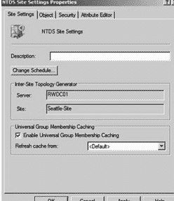

**图 4-1**  
启用通用组成员关系缓存

5. 在“从刷新缓存”字段中，选择您希望此站点接收更新的站点，或者将其保留为 `<Default>` 以从包含全局编录服务器的最近站点进行刷新。单击**确定**。

**暂停。** 关闭 `Active Directory 站点和服务` MMC 管理单元。

您刚刚已在 Active Directory 中的单个站点启用了通用组成员关系缓存。此设置必须为希望配置通用组成员关系缓存的每个站点启用。

## 配置其他全局编录服务器

> 默认情况下，林中的第一台域控制器是全局编录服务器。因此，您的初始站点将已经包含一个全局编录服务器。

以下准则将帮助您决定何时应添加全局编录服务器。

- 每个站点都应包含一个全局编录服务器以方便用户登录。如果远程站点位于不可靠或缓慢的广域网（WAN）链路另一侧，本地部署的全局编录服务器将允许登录和 Active Directory 搜索不受 WAN 链路状态的影响而继续进行。如果无法实现，请考虑启用通用组成员关系缓存。
- 在远程站点放置全局编录时，请考虑复制全局编录信息所需的带宽量。响应来自其他站点的登录请求会增加对远程站点带宽的需求。
- 承载全局编录的域控制器必须具有足够的硬盘空间来容纳全局编录。作为经验法则，在为全局编录服务器调整硬件大小时，您应估计林中所有其他域的 `ntds.dit` 文件大小的 50%。
- 包含使用端口 `3268` 进行全局编录查询的应用程序的站点应包含全局编录服务器。端口 `3268` 用于 Active Directory 对象搜索。

## 配置其他全局编录服务器

**准备就绪。** 在开始这些步骤之前，您必须以“域管理员”组成员的身份登录。

1. 在希望拥有新全局编录的域控制器上，从“管理工具”文件夹中打开**Active Directory 站点和服务**。

> **认证准备就绪？**  
> 配置全局编录  
> 2, 5

2. 在控制台树中，双击**站点**，然后双击包含您希望为其添加全局编录的域控制器的站点名称。
3. 双击**服务器**文件夹并选择您的域控制器。右键单击**NTDS 设置**并选择**属性**。
4. 在**常规**选项卡上，选中**全局编录**复选框，如图**4-2**所示，以将此服务器的全局编录角色分配给它。单击**确定**。

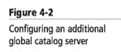

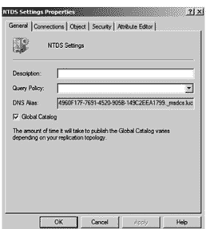

**暂停。** **关闭** `Active Directory 站点和服务` MMC 管理单元。

> **请注意**  
> 您还可以配置只读域控制器（RODC）来承载全局编录服务器角色。

您刚刚已在一个 Active Directory 域中将一台域控制器配置为额外的全局编录。您可以将林中的部分或所有域控制器启用为环境中的额外全局编录服务器。您需要留出足够的时间，让账户和模式信息复制到新的全局编录服务器。此过程所需的时间将根据要复制的对象数量以及用于传输的链路速度而有所不同。当计算机准备好将自己通告为全局编录服务器时，**目录服务事件查看器**将显示**事件 ID 1119**。

## 理解灵活单一主操作 (FSMO) 角色

如前所述，Active Directory 是一个多主数据库，这意味着环境中的任何可写域控制器都可以对 Active Directory 数据库进行更新。然而，某些敏感操作需要比其他操作受到更严格的控制，例如模式管理以及从 Active Directory 林中添加或删除其他域。这些专用角色称为**灵活单一主操作（FSMO）**角色。除了作为复制环中的正常域控制器外，持有这些 FSMO 角色的域控制器还负责提供被归类为单一主操作的服务。这意味着在每个域中（或在某些情况下，在林中）只能有一个域控制器可以执行特定操作。通过采用单一主操作服务器，您可以更紧密地控制那些如果多台域控制器同时执行可能会在 Active Directory 中引发问题的操作类型。

> **结论**

正如您已经了解的，可写的 Active Directory 域控制器遵循多主复制模型。这种多主模型确保了所有域对象的多个副本提供了易于访问性和容错能力。此外，当发生更改时，任何域控制器都可以更新数据库的内容。只要遵循实施准则，这种多主模型就能提供快速且高效的目录服务。

尽管 Active Directory 具有诸如版本 ID 和时间戳等机制来协助解决可能的冲突，但关键功能需要确保极少或没有错误风险。以下场景展示了一个不应受多于一个同时更改影响的任务示例。

您是 Margie's Travel 的网络管理员。您的公司在世界各地有七个地点。作为应用部署团队的一员，您被分配负责在网络上安装一个新开发的应用程序。安装说明的一部分要求您在 Active Directory 中的几个对象上添加自定义属性。您或您的经理并不知道，另一个地点的另一位管理员也被分配了相同的任务。您和另一位管理员正在同时执行此任务。

假设您正在多主平台上同时尝试执行这些任务，由于相互冲突的同时更改，最终可能会导致 Active Directory 模式损坏。然而，在 Server 2008 的 Active Directory 中，这种情况不会发生，因为微软已实施 FSMO 角色以避免此类损坏。这些角色仅由一台特定的服务器执行，从而消除了因这类敏感任务导致的数据库损坏风险。

Active Directory 支持五个 FSMO 角色。其功能分为域级和林级 FSMO。在小型企业场景中，如果只有一个域和一台域控制器，所有角色都可以存在于同一台域控制器上。如果您部署第二台域控制器以实现容错，您可以将这些 FSMO 角色中的一些*转移*到新的域控制器上。这不仅提供了容错能力，还通过将这些任务的处理平衡在多台服务器之间带来了性能提升。

三个角色是域特定的：

- **相对标识符 (RID) 主控。** 负责向域中的域控制器分配相对标识符。相对标识符是当创建新对象时由域控制器分配的变长数字。
- **基础结构主控。** 负责其域对象到其他域的引用更新。这有助于跟踪哪些域拥有哪些对象。
- **主要域控制器 (PDC) 仿真器。** 提供与 Microsoft Windows NT 4.0 域和其他较低级别客户端的后向兼容性。密码更改、账户锁定和域的时间同步也将由 PDC 仿真器管理。发起密码更改的域控制器会将更改发送到 PDC 仿真器，PDC 仿真器随后更新全局编录服务器，并向域中的其他域控制器提供即时复制。

让我们更详细地检查这三个 FSMO 角色。

在一个域中被分配 RID 主控角色的域控制器负责生成标识符池，这些标识符在新创建账户、组和计算机时使用。这些标识符被称为*相对标识符*（RID），因为它们与创建它们的域相关。RID 是一个在创建时分配给对象的变长数字，并成为对象*安全标识符*（SID）的一部分。SID 用于在 Active Directory 域中唯一地标识对象。SID 的一部分标识对象所属的域，另一部分是 RID。

每个域只能有一个 RID 主控。当域中存在两个或更多域控制器时，RID 主控向每台域控制器分配一个包含 500 个标识符的块。当创建新对象时，创建该对象的域控制器会从其相对标识符（RID）池中为其分配一个 RID。当某个域控制器已使用其最初从 RID 持有者（RID Master）获得的 RID 供应量的 50% 时，它必须联系 RID 持有者并请求新的 RID 供应量。如果任何域控制器因任何原因无法联系 RID 持有者以获取新的 RID 供应量，则该 DC 将无法创建任何新对象，直到问题解决。

如果作为 RID 持有者运行的服务器出现故障，可以将该角色分配给另一个域控制器。RID 持有者的缺失对网络中的用户是透明的。当需要将一个对象从一个域移动到另一个域时，必须登录到源域中的 RID 持有者，并且移动操作必须针对目标域中的 RID 持有者执行。

RID 持有者不可用可能产生的影响如下：


## 对象创建与移动限制

- 可能无法创建新对象。仅在域控制器没有任何剩余 `RID` 并尝试联系不可访问的 `RID` 持有者以获取额外标识符时才会出现这种情况。
- 无法在域之间移动对象。

## 基础设施持有者

充当基础设施持有者（Infrastructure Master）的域控制器负责将对象的安全标识符（`SID`）或可分辨名称（`DN`）的变化进行复制。由于 `SID` 是域特有的，且可分辨名称反映了对象在林中的位置，当对象移动到另一个域时，对象的 `SID` 和 `DN` 可能会改变。然而，对象的全球唯一标识符（`GUID`）不会改变。`GUID` 是一个在 Active Directory 林中创建对象时分配的 128 位十六进制数。该数字是对象创建日期和时间、唯一标识符以及序列号的组合。即使账户在同一林内的一个域移动到另一个域，这个数字也永远不会改变。此数字也永远不会重复，因此任何被删除的对象都会销毁其 `GUID`，且该 `GUID` 永远不会再次使用，即使在同一域中创建了具有相同名称和类型的新对象也是如此。

如果对象被移动或重命名，基础设施持有者会将名称或位置的更改复制给与源域具有信任关系的所有域。此过程确保该对象维持对其他域中资源的访问权限。基础设施持有者和全局编录紧密协作。基础设施持有者将其对象与全局编录中的对象进行比较。如果发现全局编录拥有对象的较新副本，它将请求更新，然后将更新的信息发送到该域中的其他域控制器。由于在一个由多个域和多个域控制器组成的林中，全局编录和基础设施持有者如此紧密地协同工作，这些角色不能由同一个域控制器提供服务。当它们位于同一个属于多域林的一部分的域控制器上时，它们共享相同的数据库信息，这使得基础设施持有者无法得知哪些信息发生了变化。在大型林中，这会导致域控制器与全局编录内容不同步。（在单域环境中，或在所有域控制器都配置为全局编录服务器的多域环境中，基础设施持有者的位置则无关紧要。）如果你将持有基础设施持有者的域控制器配置为全局编录，目录服务事件查看器中将记录事件 `ID 1419`。

## PDC 仿真器

`PDC` 仿真器负责以下任务：

- 管理 Active Directory 域内的时间同步
- 管理组策略对象（`GPOs`）的编辑
- 管理安全敏感账户复制事件的复制，例如密码更改和账户锁定

如前所述，Active Directory 更新包含时间戳，以帮助解决冲突。这些时间戳基于发起更改的域控制器上的时间设置。这意味着，如果所有域控制器在时间上不一致，时间戳的重要性就会失效。默认情况下，Active Directory 仅允许任何客户端或成员服务器与域中的域控制器之间存在 5 分钟的*时钟偏差*。如果客户端和服务器之间的时钟设置相差超过 5 分钟，用户可能无法登录，直到问题得到纠正。Active Directory 时间同步过程是分层的，并遵循以下模型：

1. 域内的客户端和成员服务器会与对它们进行身份验证的域控制器同步其时钟。
2. 每个域中的域控制器会与它们所在域的 `PDC` 仿真器同步时间。
3. 林中每个域的 `PDC` 仿真器会与林根域的 `PDC` 仿真器同步其时间。
4. 林根域的 `PDC` 仿真器可以从内部时钟获取时间，或者，作为最佳实践，可以配置为从外部时间源（如美国海军互联网时间服务）获取时间。

除了管理域内的时间同步外，`PDC` 仿真器还从其他域控制器接收密码更改的优先复制。当发生密码更改时，该更改需要时间来复制到其他所有域控制器。然而，密码更改会立即复制到 `PDC` 仿真器。如果另一个域控制器上的登录请求因密码错误而失败，接收请求的域控制器会在向客户端返回错误消息之前，先将该请求转发给 `PDC` 仿真器。这将确保用户在最近更改的密码尚未有足够时间复制到整个域时，不会收到密码错误提示。

与 `RID` 持有者和基础设施持有者一样，每个域中只能有一个 `PDC` 仿真器。与域级 `FSMO` 不同，林级 `FSMO` 角色提供必须跨越所有域的唯一功能。林级 `FSMO` 角色负责跟踪 Active Directory 林中域名名的添加和删除，以及管理 Active Directory 架构的修改，这些修改会在整个林中复制。

Active Directory 中拥有林级权限的两个角色是：

- *域命名持有者（Domain Naming Master）*。拥有管理林中域、域树和应用数据分区的创建和删除的权限。当创建其中任何一项时，域命名持有者确保所分配的名称在林中是唯一的。
- *架构持有者（Schema Master）*。负责管理 Active Directory 架构的更改。

让我们更详细地讨论这些角色。域命名持有者角色由林中的唯一一个域控制器持有。当你创建新的域、域树或应用数据分区时，Active Directory 会联系域命名持有者以确保该名称在林中是唯一的。如果域命名持有者服务器宕机，你将无法创建或删除任何子域、域树或应用数据分区。

最后，持有架构持有者角色的域控制器管理 Active Directory 中发生的所有架构修改。当架构中的对象类或属性被修改时，架构持有者有责任确保该更改被复制到林中的所有域。

> **交叉引用**
>
> 可以通过组策略更改计算机时钟同步的默认最大容差。有关组策略实施的更多信息，请参阅第 7 至 10 课。

## 放置 FSMO 角色持有者

> 当你在新林中安装第一个域控制器时，该域控制器持有两个林级 `FSMO` 以及林根域的三个域级 `FSMO`。虽然这种默认位置对于单站点设计可能已经足够，但包含众多域控制器或站点的林可能要求你将某些角色转移到不同的域控制器上。

规划 `FSMO` 角色持有者的适当位置需要考虑以下设计方面：

- 林中当前或将来包含的域的数量
- 网络的物理结构
- 每个域中可用的域控制器数量

这些因素将帮助你决定将 `FSMO` 角色放置在哪里，以在你的 Active Directory 环境中实现最佳性能、可访问性和容错能力。此外，你必须知道哪些域控制器可以在服务器暂时或永久离线时接管 `FSMO` 角色。

如前所述，当你在新的林中创建第一个域时，所有 `FSMO` 角色都会自动分配给该域中的第一个域控制器。图 4-3 展示了一种简单的设计以及全局编录和所有五个 `FSMO` 角色的默认位置。

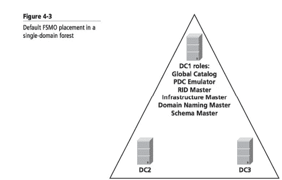

图 4-4 说明了在现有林（forest）中创建新的子域或新域树根域的结果。整个林的 `FSMO` 角色和森林根域的范围域 `FSMO` 角色将保持原样，新域中的第一台域控制器会自动被分配 `RID` 主控（`RID Master`）、`PDC` 仿真器（`PDC Emulator`）和基础架构主控（Infrastructure Master）角色。

### 图 4-4

带有单个子域的林中默认 `FSMO` 角色分布

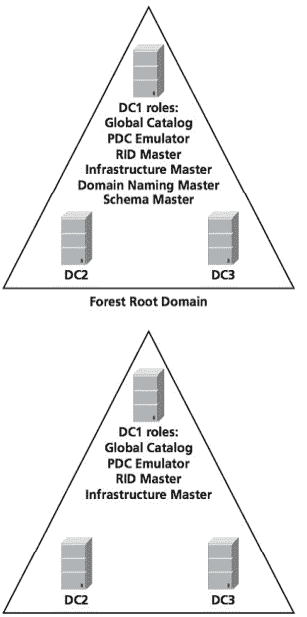

当公司扩展到单一站点或物理位置之外时，您必须考虑 `FSMO` 角色的放置，以便在不影响可访问性、故障容忍度或性能的情况下适应增长。表 4-2 展示了每个 `FSMO` 角色的分解以及推荐的放置指南。在此表中，使用两个属性来描述域控制器：**高可用性**和**高容量**。就作为 `FSMO` 服务器运行的域控制器而言，这些术语定义如下：

- **高可用性。** 如果可能，此域控制器位于中心位置，并包含额外的硬件，例如独立磁盘冗余阵列（`RAID`）控制器。`RAID` 允许服务器即使在阵列中某个驱动器发生故障时也能继续运行。
- **高容量。** 此域控制器相对于其他可用的域控制器具有更强的处理能力。高容量服务器通常具有更快的中央处理单元（`CPU`）、更多的内存以及更快的网络访问速度。

### 表 4-2

`FSMO` 角色分解

| **角色** | **范围** | **指南** |
| :--- | :--- | :--- |
| 模式主控 (Schema Master) | 林 (Forest) | 每个林一个。<br>具有高可用性，因为所有的模式更改都通过此域控制器进行。 |
| 域命名主控 (Domain Naming Master) | 林 (Forest) | 每个林一个。<br>具有高可用性，因为所有的域创建和删除都必须通过此域控制器。对于较小的环境，您可以将模式主控和域命名主控放置在同一个服务器上，该服务器已配置为全球编录服务器。 |
| PDC 仿真器 (PDC Emulator) | 域 (Domain) | 每个域一个。<br>具有高可用性，因为所有域控制器都访问此服务器进行时间同步、密码不匹配的登录尝试以及密码更改。所有 BDC 和低级别客户端需要此角色才能登录到域。<br>由于登录流量和上述项目列表给此服务器带来了增加的负载，因此需要高容量。<br>尽可能将此域控制器与全球编录服务器分离，以提供更高的容量。<br>考虑降低 SRV 记录的权重和优先级，以允许其他域控制器对寻求认证的客户端具有更高的优先级。 |


### RID 主控 (RID Master)

**域 (Domain)** | 每个域一个。<br>具有高可用性，以便请求标识符池的域控制器可以访问。这些 RID 以每次 500 个的块发放。<br>将此角色放置在创建大多数对象的站点中。这样，即使网络链接失败，对象创建也可以继续。如果并非所有的账户管理都从一个位置进行，请将此角色放置在中心位置的域控制器上。<br>如果可能，将 PDC 仿真器和 RID 主控配置在同一个域控制器上，因为 PDC 仿照器是 Active Directory 域内 RID 的主要使用者。如果稍后需要强行接管角色，这将最小化复制期间的延迟。角色强行接管将在本课程的稍后部分讨论。

### 基础架构主控 (Infrastructure Master)

**域 (Domain)** | 不需要放置在高容量或高可用性服务器上。<br>避免将此角色与全球编录放置在同一个域控制器上，以便其能正确履行其角色。此规则的例外情况是，当您在单域林中工作，或者您林中的每个域控制器也配置为全球编录服务器时。<br>将其放置在同一个站点作为全球编录服务器，以便它们可以就对象更新进行高效通信。

## 管理 FSMO 角色

现在您已经了解了每个 FSMO 角色及其功能，我们将讨论当持有这些角色之一的服务器不可访问时该怎么做。

在管理 FSMO 角色故障时，无论是计划内还是计划外，可以使用两种技术来管理现有角色或从故障角色中恢复：

- **角色转移**。此过程用于将 FSMO 角色从一个域控制器优雅地移动到另一个域控制器。您可以将 FSMO 角色从一个域控制器转移到另一个，以改善 Active Directory 性能，或作为临时措施，当域控制器将离线进行维护时。
- **角色强行接管**。此程序仅用于当持有 FSMO 角色的域控制器发生故障时。*强行接管*角色可以被定义为强制的非优雅转移。此程序假设您无法恢复之前持有该角色的域控制器。强行接管角色是一项严厉的措施，只有在原始持有角色的域控制器无法重新联机时才应进行。例如，如果角色持有者由于 WAN 链接故障而变得无法访问，通常您应该等待角色持有者再次变得可用。决定强行接管角色还取决于不可用对该角色的网络影响。表 4-3 显示了不可用 FSMO 角色的影响以及您可以采取的几个替代纠正措施。

### 表 4-3

FSMO 角色不可用时的纠正措施

| 角色 | 不可用的影响 | 操作 |
|---|---|---|
| **模式主控** | 临时故障对用户或管理员不可见。 | 如果故障被认定为永久性的，将角色强行接管到选定的备用模式主控。 |
| | 故障仅在需要执行模式修改或提升 Active Directory 林的林功能级别时才会显现。 | 将模式主控强行接管到另一个域控制器后，原始角色持有者必须在返回网络之前从 Active Directory 中移除。 |
| **域命名主控** | 临时故障对用户或管理员不可见。 | 如果故障被认定为永久性的，将角色强行接管到选定的备用域命名主控。 |
| | 故障仅在尝试创建或删除域或添加或移除域控制器时才会显现。 | 将域命名主控强行接管到另一个域控制器后，原始角色持有者必须在返回网络之前从 Active Directory 中移除。 |
| **RID 主控** | 临时故障对用户或管理员不可见。 | 如果故障被认定为永久性的，将角色强行接管到选定的备用 RID 主控。 |
| | 当尝试在已耗尽其相对标识符的域控制器上创建对象（如用户或组对象）时，故障才会显现。 | 将 RID 主控强行接管到另一个域控制器后，原始角色持有者必须在返回网络之前从 Active Directory 中移除。 |
| **PDC 仿真器** | 影响尝试从低级别工作站登录的网络用户。 | 如果用户受到影响，立即将角色强行接管到备用域控制器。 |
| | PDC 仿真器角色的故障会非常明显，因为客户端将无法登录到域或更改密码。您将无法提升域的功能级别。 | 如果故障不是永久性的，当原始域控制器重新联机时，角色可以返回到该域控制器。 |
| **基础架构主控** | 临时故障对用户或管理员不可见。 | 如果故障被认定为永久性的，将角色强行接管到选定的、不是同一站点内全球编录服务器的备用基础架构主控。 |
| | 如果最近请求重命名或移动大量对象，或者如果故障持续较长时间导致通用组成员身份不一致，则故障将显而易见。 | 如果故障不是永久性的，强行接管角色后，当其重新联机时，可以将其返回到原始提供者。 |

### 查看 FSMO 角色持有者

要查看 RID 主控、PDC 仿真器或基础架构主控的域范围角色，请完成以下程序。要查看林范围的 FSMO 角色持有者，请完成本节中的第二个和第三个程序。

#### 查看 RID 主控、PDC 仿真器或基础架构主控 FSMO 角色持有者

**准备就绪。** 在开始这些步骤之前，您必须以您要查询的域的 Domain Admins 组的成员身份登录。

1. 打开 **Active Directory 用户和计算机** MMC 管理单元。
2. 右键单击 **Active Directory 用户和计算机** 节点，单击 **所有任务**，然后选择 **操作主控**，如图 4-5 所示。

##### 图 4-5

操作主控对话框

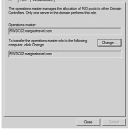

3. 在“操作主机”对话框中，选择代表您希望查看的 FSMO 角色的选项卡。持有该选定角色的服务器名称将显示在对话框中。
4. 关闭“操作主机”对话框。

**暂停。在继续之前，请关闭**“Active Directory 用户和计算机” MMC 管理单元。

在上一个练习中，您使用“Active Directory 用户和计算机” MMC 管理单元查看了域范围的 FSMO 角色（RID 主、PDC 仿真器和基础架构主）。

## 查看域命名主 FSMO 角色持有者

**准备就绪。** 在开始这些步骤之前，您必须以该林根域的域管理员组成员身份登录。

1. 在“Active Directory 域和信任关系”中，右键单击 **Active Directory 域和信任关系** 节点，然后选择 **操作主机**，如图 4-6 所示。在“操作主机”对话框中，将显示当前的域命名主名称。

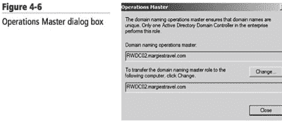

2. 关闭“操作主机”对话框。

**暂停。在继续之前，请关闭**“Active Directory 用户和计算机” MMC 管理单元。

在上一个练习中，您使用“Active Directory 域和信任关系” MMC 管理单元查看了林范围的域命名主 FSMO 角色。在下一个练习中，您将查看架构主 FSMO 角色持有者。

## 查看架构主 FSMO 角色持有者

**准备就绪。** 在开始这些步骤之前，您必须以该林根域的域管理员组成员身份登录。

1. 打开“Active Directory 架构”管理单元。
2. 从控制台树中右键单击 **Active Directory 架构** 并选择 **更改操作主机**。当前架构主角色持有者的名称将显示在“当前架构主（联机）”框中。
3. 关闭“更改架构主”对话框。

**暂停。在继续之前，请关闭**“Active Directory 用户和计算机” MMC 管理单元。

在上一个练习中，您使用“Active Directory 架构” MMC 管理单元查看了林范围的架构主 FSMO 角色。

**另一种方法**

您还可以使用以下命令行语法查看 FSMO 角色持有者：`dcdiag /test:knowsofroleholders /v`。

**请注意**

请记住，在访问“Active Directory 架构”管理单元之前，您需要使用以下语法注册 schmmgmt.dll DLL 文件：

`regsvr32 schmmgmt.dll`。

## 转移 FSMO 角色持有者

转移 FSMO 角色要求源域控制器*和*目标域控制器都在线。表 4-4 列出了各种 FSMO 角色以及用于转移每个角色的 Active Directory 控制台。这些工具与上述程序中用于查看当前角色持有者的工具相同。

**表 4-4**

FSMO 角色和 Active Directory 控制台

| **角色** | **使用的控制台** |
| :------- | :--------------- |
| RID 主、PDC 仿真器、基础架构主 | Active Directory 用户和计算机 |
| 域命名主 | Active Directory 域和信任关系 |
| 架构主 | Active Directory 架构 |

### 转移 RID 主、PDC 仿真器或基础架构主

**准备就绪。** 在开始这些步骤之前，您必须以目标域的域管理员组成员身份登录。

1. 打开 **Active Directory 用户和计算机** MMC 管理单元。
2. 在控制台树中，右键单击 **Active Directory 用户和计算机** 节点并选择 **更改域控制器**，如图 4-7 所示。

**图 4-7**

更改域控制器


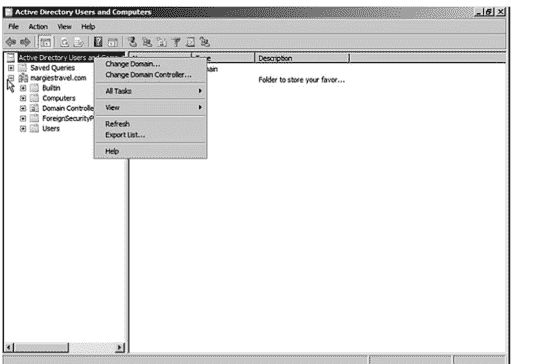

## 转移域范围 FSMO 角色

3. 通过从下拉列表中选择您希望成为新角色持有者的域控制器的名称来完成此对话框。单击 确定。

4. 在控制台树中，右键单击 Active Directory 用户和计算机 节点，指向 所有任务，然后选择 操作主机。

5. 选择反映您要转移的角色的选项卡：PDC 仿真器、RID 主 或 基础架构主。单击 更改。

6. 在确认消息框中，单击“是”以确认角色变更。在下一个消息框中，单击“确定”。

7. 关闭“操作主机”对话框。

暂停。在继续之前，请关闭“Active Directory 用户和计算机” MMC 管理单元。

在上一个练习中，您将域范围的 FSMO 角色持有者从当前角色持有者转移到了该域内的另一个域控制器。要将 FSMO 角色从一个域控制器转移到另一个域控制器，当前角色持有者必须在线并且可访问。

## 转移域命名主 FSMO 角色

准备就绪。 在开始这些步骤之前，您必须以该林根域的域管理员组成员身份登录。

1. 打开 Active Directory 域和信任关系 管理单元。

2. 右键单击 Active Directory 域和信任关系 节点并选择 连接到域控制器。

3. 通过从下拉列表中选择您希望成为新域命名主的域控制器的名称来完成此对话框。单击 确定。

4. 在控制台树中，右键单击 Active Directory 域和信任关系 节点并选择 操作主机。

5. 在 更改操作主机 对话框中，单击 更改。

6. 单击 关闭 以关闭 更改操作主机 对话框。

暂停。在继续之前，请关闭“Active Directory 用户和计算机” MMC 管理单元。

在上一个练习中，您将林范围的域命名主 FSMO 角色从当前角色持有者转移到了该林内的另一个域控制器。要将 FSMO 角色从一个域控制器转移到另一个域控制器，当前角色持有者必须在线并且可访问。

## 转移架构主 FSMO 角色

准备就绪。 在开始这些步骤之前，您必须以目标域的域管理员组成员身份登录。

1. 打开 Active Directory 架构 管理单元。

2. 右键单击 Active Directory 架构 并选择 更改域控制器。

3. 在 更改域控制器 对话框中，从以下选项中进行选择。

   - 任意域控制器。 此选项允许 Active Directory 选择新的架构主 FSMO 持有者。
   - 指定名称。 此选项允许您输入将被分配架构主 FSMO 角色的服务器名称。

4. 单击 确定。

5. 在控制台树中，右键单击 Active Directory 架构 并选择 操作主机。

6. 在 更改架构主 对话框中，单击 更改。

7. 单击 确定 以关闭 更改架构主 对话框。

暂停。在继续之前，请关闭“Active Directory 架构” MMC 管理单元。

在上一个练习中，您将林范围的架构主 FSMO 角色从当前角色持有者转移到了该林内的另一个域控制器。要将 FSMO 角色从一个域控制器转移到另一个域控制器，当前角色持有者必须在线并且可访问。

## 强制获取 FSMO 角色

原始 FSMO 服务器发生不可恢复的故障通常是强制获取 FSMO 角色的原因。如果原始 FSMO 角色服务器仍在运行，则应该转移角色，而不是强制获取角色。强制获取 FSMO 角色是一种极端措施，仅应在角色持有者发生永久性故障的情况下执行。`ntdsutil` 实用工具允许您转移和强制获取 FSMO 角色。当您使用此工具强制获取 FSMO 角色时，该工具会首先尝试从当前角色所有者处转移角色。只有当现有的 FSMO 持有者不可用时，`ntdsutil` 才会实际强制获取该角色。

### 强制获取一个 FSMO 角色

准备就绪。 在开始这些步骤之前，您必须以目标域的域管理员组成员身份登录。

1. 单击 开始。键入 `cmd` 并按 `Enter`。

2. 在命令提示符处，键入 `ntdsutil` 并按 `Enter`。

3. 在 `ntdsutil` 提示符处，键入 `roles` 并按 `Enter`。

4. 在 `fsmo` 维护提示符处，键入 `connections` 并按 `Enter`。

5. 在服务器连接提示符处，键入 `connect to server` 后跟所需角色持有者的完全限定域名，然后按 `Enter`。例如，键入 `connect to server dc3.lucernepublishing.com` 并按 `Enter`。

6. 在服务器连接提示符处，键入 `quit` 并按 `Enter`。

7. 在 `fsmo` 维护提示符处，键入以下其中一个选项：

   - `seize schema master` 然后按 `Enter`
   - `seize domain naming master` 然后按 `Enter`
   - `seize RID master` 然后按 `Enter`
   - `seize PDC` 然后按 `Enter`
   - `seize infrastructure master` 然后按 `Enter`

8. 如果显示“您确定吗？”对话框，请单击 `Yes` 继续。

9. 在 `fsmo` 维护提示符处，键入 `quit` 并按 `Enter`。

10. 在 `ntdsutil` 提示符处，键入 `quit` 并按 `Enter`。

结束。关闭 Windows 命令提示符管理单元。

在上一个练习中，您将 FSMO 角色从一个域控制器强制获取到另一个域控制器。FSMO 角色的强制获取仅应在原始角色持有者完全故障且将在很长一段时间内无法返回网络的情况下进行。

## 技能矩阵摘要

### 在本课中您学习了：

- 全球目录服务器充当 Active Directory 的中心存储库，因为它持有本地域内所有对象的完整副本以及同一林中其他域中所有对象的部分副本。全球目录有三个主要功能：促进对林中对象的搜索、解析 UPN 名称以及提供通用组 membership 信息。
- 尽可能情况下，应在每个站点中放置全球目录。当站点通过不可靠的 WAN 链路连接时，可以启用该站点的通用组 membership 缓存作为替代解决方案，以促进登录请求。
- 全球目录放置的考虑因素包括 WAN 链路的速度和可靠性、复制将生成的流量大小、全球目录数据库的大小，以及可能需要使用 3268 端口进行解析的应用程序。
- 单主机操作的主角色被分配给域控制器，以执行单主机操作。
- 架构主角色和域命名主角色是林范围的。每个林必须恰好拥有一个这样的角色。
- RID 主角色、PDC 仿真器和基础设施主角色是域范围的。每个域必须且仅能拥有一个这样的角色。
- 在单站点环境中，FSMO 角色的默认放置方式已经足够。然而，随着网络扩展，这些角色应当进行分散以提升性能和可靠性。表 4-2 提供了详细指南。
- FSMO 角色可以通过两种方式管理：角色转移和角色夺取。将 FSMO 角色转移到域或林中的其他域控制器，以在域控制器之间平衡负载或配合域控制器维护和硬件升级。当持有角色的服务器故障且您不打算恢复它时，需夺取 FSMO 角色。夺取 FSMO 角色是一个极端步骤，仅在当前 FSMO 角色持有者永远无法再使用时才应考虑。
- 从当前角色持有者夺取 FSMO 角色时，请使用 `repadmin` 检查更新序列号（USN）的状态。请使用 `ntdsutil` 实际执行 FSMO 角色的夺取。

## 知识评估

### 填空题

*通过在空白处填写正确的单词完成以下句子。*

1. Active Directory 允许客户端与对其进行身份验证的域控制器之间最大 5分钟 的 _______。
2. _______ 负责管理域内的时间同步。
3. 你可以通过实施 _______ 来改善不含全局编录服务器的站点的登录时间。
4. 要从 Active Directory 中添加或移除应用程序目录分区，需要能够访问 _______ _______。
5. 如果持有 FSMO 角色的域控制器发生故障且不会重新加入网络，你可以 _______ FSMO 角色到另一个域控制器。
6. 你可以通过修改 Active Directory 架构来为 _______ 添加额外的属性。
7. _______ 在 Active Directory 域内唯一标识一个对象，但如果对象从一个域移动到另一个域，它将改变。
8. _______ FSMO 角色不应驻留在已配置为全局编录的域控制器上。
9. 你可以使用 Active Directory 域和信任关系 MMC 单元将 _______ FSMO 从一个域控制器转移到另一个域控制器。
10. (n) _______ 的成员信息存储在全局编录中。

### 选择题

*圈出正确的选项。*


# Active Directory 练习题

## 1. 包含 Active Directory 中所有对象引用的 Active Directory 组件叫什么？

- a. 主数据库
- b. 中央目录
- c. 全局数据库
- d. 全局编录

## 2. 下列哪个角色是林范围的 FSMO 角色？

- a. PDC 仿真器
- b. 基础设施主
- c. 架构主
- d. 全局编录

## 3. `_gc` SRV 记录监听哪个端口？

- a. TCP 445
- b. UDP 137
- c. TCP 3268
- d. UDP 445

## 4. 你是包含一个根域和三个子域的 Active Directory 林的管理员。该林包含多少个每种 FSMO？

- a. 1 个域命名主，1 个架构主，3 个 PDC 仿真器，3 个基础设施主，3 个 RID 主
- b. 3 个域命名主，3 个架构主，3 个 PDC 仿真器，3 个基础设施主，3 个 RID 主
- c. 1 个域命名主，1 个架构主，4 个 PDC 仿真器，4 个基础设施主，4 个 RID 主
- d. 1 个域命名主，1 个架构主，1 个 PDC 仿真器，1 个基础设施主，1 个 RID 主

## 5. 你林中的架构主 FSMO 将离线几个小时，以便你的硬件供应商更换服务器的主板。为了允许你的客户端继续登录，你需要做的最少工作是什么？

- a. 在将其离线之前，将架构主 FSMO 转移到另一个域控制器。
- b. 在将其离线之前，将架构主 FSMO 夺取到另一个域控制器。
- c. 什么也不做。即使架构主离线，你的客户端仍可以登录。
- d. 在将其离线之前，从 Active Directory 用户和计算机中禁用域控制器的计算机账户。

## 6. 你是 Active Directory 网络上子域的管理员，属于 Domain Admins 组。你有一个应用程序需要配置应用程序目录分区，但你发现无法这样做。是什么阻止了你在域中创建应用程序目录分区？

- a. 你必须属于 Enterprise Admins 组才能创建应用程序目录分区。
- b. 你必须属于 Schema Admins 组才能创建应用程序目录分区。
- c. 你必须属于 Forest Admins 组才能创建应用程序目录分区。
- d. 你必须属于 DNS Admins 组才能创建应用程序目录分区。

## 7. RID 主 FSMO 以 ______ 的增量向域控制器分发 RID。

- a. 100
- b. 250
- c. 500
- d. 1,000

## 8. 你正在从运行 Windows Vista Business 的工作站登录到 Active Directory 子域。默认情况下，此工作站将查找哪里来与域同步其时钟？

- a. 子域的 PDC 仿真器
- b. 林根域的 PDC 仿真器
- c. 外部时钟
- d. 对工作站进行身份验证的域控制器

## 9. 每个对象的 SID 由两个部分组成：域部分和 ______。

- a. 远程标识符
- b. 全局唯一标识符
- c. 相对标识符
- d. 全局标识符

## 10. 你可以使用哪个实用工具查看和管理 PDC 仿真器 FSMO 角色持有者？

- a. Active Directory 用户和计算机
- b. Active Directory 架构
- c. Active Directory 站点和服务
- d. Active Directory 域和信任关系

### 案例场景

#### 场景 4-1：FSMO 角色放置—I

Contoso 制药公司在 14 个地点拥有 500 名员工。公司总部位于康涅狄格州哈特福德。所有地点都是 `contoso.com` 域的一部分，每个地点至少包含两台服务器，并可靠地连接。

- a. 你将在哈特福德地点放置哪些 FSMO 角色？
- b. 在尝试向域中添加新用户帐户时，你收到一个错误，指出无法创建这些帐户。你作为 Domain Admins 组的成员登录。最可能是什么导致了这个问题？
- c. 为了方便登录，你应该考虑在每个地点放置什么？

#### 场景 4-2：FSMO 角色放置—II

Contoso 制药公司正在扩展，包括几家公司新近收购的公司。虽然它们都将成为 `contoso.com` 林的一部分，但每家公司都希望保持自己的去中心化管理策略。为了满足这一要求，你将这些子公司安装为独立的域结构。其中一家名为 `litwareinc.com`。

- a. 这个新域需要适应哪些角色？
- b. 如果 `litwareinc.com` 决定在其域中为几位用户设置一个小型卫星办公室，而不将登录流量使用到父域的可用带宽，他们应该怎么做？
- c. 在 `contoso.com` 中，充当域命名主的服务器因电源浪涌而故障。直到此服务器重新在线之前，你无法为新的地点创建新的子域。目前预计域命名主问题无法在合理的时间内解决。你应该采取什么步骤来解决这个问题并创建必要的子域？

# 工作就绪

## 使用 Repadmin 查询域控制器

Daniel Weisman 是 Northwind Traders（`www.northwindtraders.com`）的 Active Directory 管理员。在 Daniel 将架构主控 `Schema Master` FSMO 角色 `seizing` 到另一个域控制器之前，他必须确保将持有该新角色的域控制器已与故障角色持有者上执行的更新保持同步。这可以通过使用 `repadmin` 命令行工具来实现。由于 Northwind Traders 域中 Active Directory 信息复制的自然延迟，目标域控制器可能尚未与最新更新完全同步。为避免在 `seizing` 操作期间丢失数据，目标域控制器必须拥有前一个角色持有者持有的最新信息。可以使用 `repadmin.exe` 命令行工具来检查域控制器的更新状态。

为了了解 Daniel 如何确定目标域控制器是否已更新，请考虑以下示例。

Northwind Traders 的域包含三个域控制器。`ServerA` 是域 `northwindtraders.com` 的 RID 主控，如果 `ServerA` 故障，`ServerB` 是 Daniel 计划中的新 RID 主控，而 `ServerC` 是该域中唯一的另一个域控制器。Daniel 需要确定 `ServerA` 停止运行前最后一次更新是什么。为此，Daniel 使用 Repadmin 工具并配合 `/showrepl` 开关来确定 `ServerB` 是否拥有最新的信息。在这个示例中，Daniel 在命令行提示符中输入以下命令（并收到相应的输出）：

```
C:\> repadmin /showreplv serverB.blueyonderairlines.com dc=blueyonderairlines, dc=com

New-York\serverA     @ USN 2604    @ Time 2003-07-03 12:50:44
San-Francisco\serverC @ USN 2706    @ Time 2003-07-03 12:53:36
```

```
C:\> repadmin /showreplv serverC.blueyonderairlines.com dc=blueyonderairlines, dc=com

New-York\serverA     @ USN 2590    @ Time 2003-07-03 12:50:44
Chicago\serverB      @ USN 3110    @ Time 2003-07-03 12:57:55
```

上述命令反映了对两个未受故障影响的域控制器的复制信息进行查询。`ServerA` 的输出是最重要的信息。在 `ServerB` 上，从 `ServerA` 收到的最后更新编号为 2604，这比第二条命令行结果中显示在 `ServerC` 上的更新编号 2590 更新。这意味着关于 `ServerA`，`ServerB` 拥有比 `ServerC` 更新的信息。如果这些信息相反且 Daniel 仍希望由 `ServerB` 接管该角色，他可以等到下一个复制周期或强制立即同步。关键在于，他已确保想要在该域中接管 RID 主控角色的域控制器拥有最新的信息。

# Active Directory 管理

### 目标领域矩阵

| 技术技能 | 目标领域 | 目标领域编号 |
| :--- | :--- | :---: |
| 创建用户、计算机和组 | 维护 Active Directory 账户。 | 4.2 |
| 创建用户、计算机和组 | 自动化创建 Active Directory 账户。 | 4.1 |

### 关键术语

- 访问令牌 `access token`
- 匿名登录 `Anonymous Logon`
- 身份验证 `authenticate`
- 身份验证 `authentication`
- 授权 `authorization`


## 术语表

- 批处理文件 (`batch file`)
- 内置用户账户 (`built-in user accounts`)
- 逗号分隔值 (`Comma-Separated Value`)
- 目录交换 (`Directory Exchange (CSVDE)`)
- 逗号分隔值 (`Comma-Separated Values (CSV)`)
- 分发组 (`distribution group`)
- 域账户 (`domain account`)
- 域本地组 (`domain local group`)
- `dsadd`
- 所有人 (`Everyone`)
- 全局组 (`global group`)
- 组 (`group`)
- 组嵌套 (`group nesting`)
- 组范围 (`group scope`)
- 组类型 (`group type`)
- 标头记录 (`header record`)
- LDAP 数据交换格式 (`LDAP Data Interchange Format (LDIF)`)
- LDAP 数据交换格式目录交换 (`LDAP Data Interchange Format Directory Exchange (LDIFDE)`)
- 本地账户 (`local account`)
- 本地组 (`local group`)
- 嵌套 (`nested`)
- 嵌套成员身份 (`nested membership`)
- SAM 账户名 (`SAM account name`)
- 安全账户管理器 (`Security Account Manager (SAM)`)
- 安全组 (`security group`)
- 特殊身份组 (`special identity group`)
- Windows 脚本宿主 (`Windows Script Host (WSH)`)

> Lucerne Publishing 最近已配置了一个 Active Directory 林（forest）以支持其关键业务操作。既然 Active Directory 的基础架构已经就位，网络管理员需要制定一种策略，在新的 Active Directory 基础设施中配置用户和组账户。目前，Lucerne Publishing 的用户依靠多个用户账户来访问各个文件服务器，这给桌面支持团队的成员造成了大量的故障排除工单。通过利用域范围的用户和组对象，Lucerne Publishing 的 Active Directory 管理员将为需要访问关键资源的最终用户创建更顺畅的体验。

完成本课后，您将能够讨论在使用 Active Directory 域服务时执行的最常见的管理任务之一：管理用户和组账户。您将具备正确配置和维护这些用户账户的基本能力。这些账户是您的用户能够访问 Active Directory 域或林内任何资源的途径。您将使用 Active Directory 组账户向用户组发送电子邮件，以及保护文件、文件夹和其他项目等资源。您将了解可以配置的不同类型的用户和组账户，并且您将能够制定实施计划，以高效且可扩展的方式部署组安全。您还将能够讨论使用 Windows Server 2008 操作系统内置的批处理文件、脚本和实用工具自动化创建用户和组账户的方法。这将有助于您处理需要自动化重复任务的大型组织。

## 理解用户账户

### 核心要点

用户账户是使用 Active Directory 网络的人员访问资源的主要方式。个人通过其个人的用户账户来访问资源。为了访问网络，潜在的网络用户必须使用特定的用户身份登录来验证其网络身份。这被称为身份验证。身份验证是使用已知值（如密码、智能卡上的 PIN 码，或在生物特征身份验证的情况下使用用户指纹或手印）来确认用户身份的过程。当使用用户名和密码时，通过验证登录对话框中提供的用户名和密码与 Active Directory 数据库中存储的信息来完成身份验证。（不应将身份验证与授权混淆，授权是确认已验证用户是否具有访问一个或多个网络资源的正确权限的过程。）

在 Windows Server 2008 中，可以创建和配置三种类型的用户账户：

- `本地账户`。这些账户仅用于访问本地计算机，并存储在其所在计算机的本地 `安全账户管理器` (`SAM`) 数据库中。本地账户永远不会复制到其他计算机，并且这些账户没有域访问权限。这意味着在一个服务器上配置的本地账户不能用于访问第二个服务器上的资源；在这种情况下，您需要配置第二个本地账户。
- `域账户`。这些账户用于访问 Active Directory 或基于网络的资源，例如共享文件夹或打印机。这些用户的账户信息存储在 Active Directory 数据库中，并复制到同一域内的所有域控制器。域用户账户信息的一个子集被复制到全局目录，然后被复制到林（forest）中的所有其他全局目录服务器。
- `内置用户账户`。这些账户在安装 Microsoft Windows Server 2008 时自动创建。内置用户账户是在成员服务器或独立服务器上创建的。但是，当您将 Windows Server 2008 安装为域控制器时，创建和操纵这些账户的能力会被禁用。默认情况下，在 Windows Server 2008 计算机上创建两个内置用户账户：`Administrator` 账户和 `Guest` 账户。根据服务器是配置为独立服务器还是域控制器，内置用户账户可以是本地账户或域账户。在独立服务器的情况下，内置账户是服务器本身的本地账户。在域控制器上，内置账户是复制到每个域控制器的域账户。

在成员服务器或独立服务器上，内置的本地 `Administrator` 账户拥有所有文件的完全控制权，以及本地计算机的完整管理权限。在域控制器上，在 Active Directory 中创建的内置 `Administrator` 账户对其创建所在的域拥有完全控制权。默认情况下，每个域只有一个内置的管理员账户。成员服务器或独立服务器上的本地 `Administrator` 账户以及域 `Administrator` 账户都不能被删除；但是，它们可以被重命名。

以下列表总结了您应该考虑的有关 `Administrator` 账户的几个安全指南：

- `重命名 Administrator 账户`。这将抵御专门针对服务器或域中 'administrator' 用户名的攻击。但这只能防范相当不复杂的攻击，您不应将此作为保护网络中账户的唯一手段。
- `设置强密码`。确保密码长度至少为七个字符，并包含大写字母、小写字母、数字和字母数字字符。

> 交叉参考
> 有关配置强密码的更多信息，请参阅第 6 课。

- `将管理员密码的知情范围限制在少数人员内`。限制管理员密码的分发范围可降低利用此账户发生安全泄露的风险。
- `不要将 Administrator 账户用于日常非管理任务`。微软建议在日常工作中使用非管理员用户账户，并在需要执行管理任务时使用“以管理员身份运行”命令。

内置的 `Guest` 账户用于为用户提供临时网络访问权限，例如供应商代表或临时员工。与 `Administrator` 账户类似，此账户无法删除，但可以且应当重命名。此外，`Guest` 账户默认处于禁用状态，且不分配默认密码。在大多数环境中，建议为临时用户访问创建独立账户，而非依赖 `Guest` 账户。这样做可以确保账户符合企业针对临时用户制定的安全指南。然而，如果决定使用 `Guest` 账户，请审查以下指南：

- `在启用 Guest 账户供使用后对其重命名`。正如我们在讨论 `Administrator` 账户时所述，这将阻止入侵者获取用户名，而用户名是访问你的域所需信息的一半。
- `设置强密码`。`Guest` 账户默认配置为空白密码。出于安全原因，不应允许使用空白密码。确保密码长度至少为七个字符，并包含大写字母、小写字母、数字和字母数字字符。

## 理解组账户

> 自微软服务器操作系统的最早期起，`组`就被用于使网络权限管理更加便捷。组被实现为允许管理员同时向多个用户分配权限。组可定义为用户或计算机账户的集合，用于简化向网络资源分配权限。

组成员身份类似于实体健身中心的会员资格。假设健身中心提供几种不同的会员等级及相关特权。例如，如果你只是想使用举重器械、跑步机和固定自行车，你就支付第一级会员费。如果你希望使用游泳池和水疗设施，则支付第二级会员费。你假设在购买会员等级时，会收到一张访问卡，允许你进入这些活动所在的建筑区域。此卡包含一条磁条，在设施门口读取。如果你的卡不包含适当的权限，对建筑该区域的访问将被拒绝。类似地，属于特定会员等级的所有成员都享有相同的福利。健身中心的访问卡作为你已为某些使用特权付费的证明。

在 Windows Server 2008 中，组成员身份的功能与前文所述的健身俱乐部会员资格非常相似。当用户登录时，会创建一个`访问令牌`，该令牌标识用户及其所有组成员身份。此访问令牌类似于俱乐部会员卡，在用户尝试访问本地或网络资源时用于验证用户的权限。通过使用组，可以授予多个用户对网络资源相同的权限级别。例如，假设你公司图形部门有 25 名用户需要访问彩色打印机进行打印。你可以为每个用户分配打印机的适当打印权限，或者创建一个包含 25 名用户的组，并为该组分配适当权限。通过使用组对象访问资源，你实现了以下目标：


- 需要访问打印机的用户可以简单地加入该组。一旦加入，用户即获得分配给此组的所有权限。类似地，当你不希望再允许用户访问打印机时，可以将用户从组中移除。
- 用户对打印机的访问级别只需为所有用户修改一次。
  - 更改组的权限会更改所有组成员的权限级别。`如果没有组，所有 25 个用户账户都需要单独修改。`

**注意**

用户的访问令牌仅在用户首次从工作站登录网络时生成。如果将用户添加到组中，该用户需要注销并重新登录才能使更改生效。

用户可以是一个或多个组的成员。此外，组可以包含其他 Active Directory 对象，如计算机，并通过称为`组嵌套`的技术包含其他组。组嵌套描述配置一个或多个组作为另一个组成员的过程。例如，考虑一家拥有两个组的公司：市场部（marketing）和图形设计部（graphic design）。为这两个组创建组对象，每个组对象包含其各自部门的用户。图形设计组成员可以访问高分辨率彩色激光打印机，而市场部人员也使用此打印机。为了简化向市场部分配彩色激光打印机的权限，可以将市场部组对象简单地添加为图形设计组的成员。这将使市场部成员拥有与图形设计组成员相同的彩色激光打印机权限。当你将市场部添加到图形设计组时，市场部的成员也通过`嵌套成员资格`成为图形设计组的成员。

在配置 Windows Server 2008 网络上的组时，请注意两个定义特性：`组类型`和`组范围`。组类型定义组在 Active Directory 中的使用方式。Active Directory 数据库中只能创建并存储两种组类型：

- `分发组`。非安全相关组，用于向一个人或多个人分发信息。
- `安全组`。安全相关组，用于授予多个用户资源访问权限。

支持 Active Directory 的应用程序可以使用分发组执行非安全相关功能。例如，可以创建分发组以允许电子邮件应用（如 Microsoft Exchange）向多个用户发送消息，或允许软件分发程序（如 Microsoft System Center Configuration Manager 2007）通知用户桌面即将进行的维护。只有设计用于与 Active Directory 配合使用的应用程序才能以这种方式利用分发组。

可以分配资源权限的组被称为`安全组`。需要访问特定资源的多个用户可以成为安全组的成员。然后，向安全组（如图 5-1 所示的市场部组）授予访问资源的权限。组创建后，可以随时将其从安全组转换为分发组，反之亦然。

**注意**

安全组可用于授予资源权限以及启用电子邮件访问。然而，分发组仅可用于电子邮件目的；不能用于保护网络上的任何资源。


通过安全组向用户授予权限


除了安全和分发组类型之外，Active Directory 中还有几种`组范围`可用。组范围控制组可以包含的对象，将对象限制在同一域内或允许来自远程域的对象，并控制组可以在域或林中的位置使用。Active Directory 域中可用的组范围包括域本地组、全局组和通用组。我们将依次讨论这些内容。

**域本地组**可以包含来自任何域的用户账户、计算机账户、全局组和通用组，以及来自同一域的其他域本地组。域本地组用于分配仅存在于与域本地组相同域中的资源的权限。域本地组可以使权限分配和维护更容易管理。例如，如果你有 10 个用户需要访问共享文件夹，可以创建一个具有该共享文件夹适当权限的域本地组。接下来，创建一个全局组或通用组，并将 10 个用户账户添加为此组的成员。最后，将全局组添加到域本地组中。这 10 个用户将通过其在全局组中的成员身份访问共享文件夹。任何需要访问此共享文件夹的额外用户可以简单地添加到全局组中，他们将自动获得必要的权限。

**全局组**仅可以包含来自与全局组相同域内的用户账户、计算机账户和/或其他全局组。全局组可用于授予或拒绝林中任何域内任何资源的权限。这是通过将全局组放入已授予所需权限的域本地组来实现的。全局组成员身份仅复制到同一域内的域控制器中。具有共同资源需求的用户应放在全局组中，以便于向资源分配权限。组成员列表的更改可以根据需要频繁进行，以允许用户获得必要的资源权限。

通用组可以包含来自林中任何地方的用户账户、计算机账户和/或其他全局组或通用组。如果存在跨林信任，通用组可以包含来自受信任林的类似账户。与全局组一样，通用组用于根据用户的资源访问需求组织用户。它们可以通过使用域本地组来组织用户，以便访问林中任何域内的任何资源。

通用组用于合并跨越多个域或整个林的组和账户。在应用和利用通用组时的一个关键点是，通用组的组成员身份不应频繁变更，因为这些组存储在全局目录中。对通用组成员列表的更改会复制到域中的所有全局目录服务器。如果这些更改频繁发生，可能会用于复制流量大量的带宽。

创建组时，必须选择组类型和组范围。图 5-2 显示了 Active Directory 用户和计算机中的“新建对象 - 组”对话框。迄今为止讨论的所有选项在此对话框中均可选择。

**图 5-2**

在 Windows Server 2008 Active Directory 中创建组


这种方法通常被称为 `AGUDLP`：将账户（Accounts）添加到全局组（Global groups），将这些全局组添加到通用组（Universal groups），将通用组添加到域本地组（Domain Local groups），最后将权限（Permissions）分配给域本地组。

正如我们之前讨论过的，当组被添加为其他组的成员时，这种结构被称为`组嵌套`（group nesting）。例如，当一个全局组成为通用组的成员时，可以说该全局组嵌套在通用组中。组嵌套减少了在多域林（multidomain forest）中不同域之间为用户分配权限所需的次数。例如，假设您的公司中有多个子域，且每个域中的用户都需要访问位于父域中的企业数据库应用程序。设置对此应用程序访问权限的最简单方法如下：

- 1. 在每个域中创建全局组，包含所有需要访问企业数据库的用户。
- 2. 在父域中创建一个通用组。将各个位置的全局组作为其成员包含在内。
- 3. 将该通用组添加到所需的域本地组中，以授予访问和使用企业数据库的必要权限。

## 处理默认组

虽然存在许多创建组来组织用户或计算机并分配权限的情况，但在安装 Windows Server 2008 活动目录（Active Directory）时，系统会创建多个内置安全组。许多内置组被分配了一组预定义的权利，允许成员执行某些与网络相关的任务，例如备份和恢复。添加到这些默认组成员资格中的账户将获得执行相关任务的所有权利，以及该组被分配的任何资源访问权限。


`DHCP` 是用于向客户端计算机动态分配传输控制协议/互联网协议（`TCP/IP`）信息的服务。这些信息包括 IP 地址信息以及参数，例如域名系统（DNS）服务器指针。

活动目录“用户和计算机”（Active Directory Users and Computers）中的用户和内置容器对象持有了这些默认组。您在这些容器中看到的预定义组列表取决于已安装的服务。例如，当安装了动态主机配置协议（DHCP）服务时，用户容器中会出现两个新组：`DHCP 管理员组`（DHCP Administrators group）和 `DHCP 用户组`（DHCP Users group）。DHCP 管理员组拥有管理 DHCP 服务器的完全控制权限；DHCP 用户组可用于查看 DHCP 服务器配置。

所有默认组都是安全组。活动目录不包含任何默认的分布组。`表 5-1` 解释了安装活动目录时创建的所有默认组。您可以通过在“活动目录用户和计算机”管理单元中查看相应的容器来查看表中描述的组。

### 表 5-1

安装活动目录时创建的默认组

| 组名称 | 组范围 | 活动目录中的位置 | 默认成员 | 用途 | 特殊说明 |
| :--- | :--- | :--- | :--- | :--- | :--- |
| Account Operators | 域本地 | Built-in 容器 | 无 | 成员可以管理域用户和组账户。默认情况下，成员可以在活动目录的所有容器和组织单元（OU）中创建、修改和删除用户、组和计算机的账户，但 Built-in 文件夹和域控制器的 OU 除外。 | 成员没有权限修改 Administrators、Domain Admins 和 Enterprise Admins 组。他们也没有权限修改这些组中成员的账户。 |


### 域本地内置组

| Administrators | 域本地 | Built-in 容器 | Administrator 账户、特定域的 Domain Admins 全局组以及 Enterprise Admins 通用组 | 成员对计算机或域控制器具有完全的、无限制本地访问权限，包括更改自身权限的权利。 | 无 |
| Backup Operators | 域本地 | Built-in 容器 | 无 | 成员可以备份和恢复计算机上的所有文件，无论保护这些文件的权限如何。成员可以登录到计算机并关闭它。 | 无 |
| Certificate Service DCOM Access | 域本地 | Built-in 容器 | 无 | 允许成员连接到活动目录林中的证书颁发机构。 | 无 |
| Cryptographic Operators | 域本地 | Built-in 容器 | 无 | 允许成员执行加密操作。 | 无 |
| Distributed COM Users | 域本地 | Built-in 容器 | 无 | 允许成员在所有域控制器上使用分布式 COM 对象。 | 无 |
| Event Log Readers | 域本地 | Built-in 容器 | 无 | 允许成员从所有域控制器读取事件日志。 | 无 |
| Guests | 域本地 | Built-in 容器 | Domain Guests 全局组和 Guests 用户账户 | 成员享有与 Users 组成员相同的特权。 | Guest 账户默认处于禁用状态。 |
| IIS_IUSR$ | 域本地 | Built-in 容器 | IUSR 特殊身份 | 内置组，由 IIS 使用。 | 无 |
| Incoming Forest Trust Builders | 域本地 | Built-in 容器 | 无 | 成员可以创建指向此林的入站单向信任关系。 | 无 |
| Network Configuration Operators | 域本地 | Built-in 容器 | 无 | 成员享有与 Users 组成员相同的默认权利。成员可以执行与网络配置客户端端相关的所有任务，但安装和删除驱动程序及服务除外。 | 成员无法配置网络服务器服务，如域名系统（DNS）和 DHCP 服务器服务。 |
| Performance Log Users | 域本地 | Built-in 容器 | 无 | 成员对这台计算机的性能计数器记录安排具有远程访问权限。 | 无 |
| Performance Monitor Users | 域本地 | Built-in 容器 | 来自 NT Authority 文件夹的 Network Service。这是一个占位符账户，可能会或可能不会使用。 | 成员对这台计算机具有远程监控访问权限。 | 无 |
| Pre-Windows 2000 Compatible Access | 域本地 | Built-in 容器 | 来自 NT Authority 文件夹的 Authenticated Users。这是一个占位符账户，可能会或可能不会使用。 | 成员对域中的所有用户和组具有读取访问权限。此组提供向后兼容性，用于运行 Microsoft Windows NT Server 4.0 及更早版本的计算机。 | 无 |
| Print Operators | 域本地 | Built-in 容器 | 无 | 成员可以管理打印机和文档队列。 | 无 |
| Remote Desktop Users | 域本地 | Built-in 容器 | 无 | 成员可以从远程位置登录到计算机。 | 无 |
| Replicator | 域本地 | Built-in 容器 | 无 | 此组支持目录复制功能，并由域控制器上的文件复制服务使用。唯一的成员应该是用于登录域控制器复制服务的域用户账户。 | 不要将用户添加到此组。它们由系统自动添加。 |
| Server Operators | 域本地 | Built-in 容器 | 无 | 成员可以执行以下操作：交互式登录服务器。创建和删除网络共享。启动和停止某些服务。备份和恢复文件。格式化硬盘。关闭计算机。修改系统日期和时间。 | 此组仅存在于域控制器上。 |
| Terminal Server License Servers | 域本地 | Built-in 容器 | 无 | 此组的成员可以使用许可证使用信息更新活动目录用户账户。 | 无 |

### 表 5-1（续）

| 组名称 | 组范围 | 在 Active Directory 中的位置 | 默认成员 | 用途 | 特殊说明 |
|---|---|---|---|---|---|
| 用户 | 域本地 | 内置容器 | 域用户全局组、Authenticated Users 特殊标识组以及 Interactive 特殊标识组 | 用于允许一般访问。成员可以运行应用程序、使用打印机、关闭和启动计算机，并使用已为其分配权限的网络共享。 | 无 |
| Windows 授权访问组 | 域本地 | 内置容器 | Enterprise Domain Controllers 特殊标识 | 该组的成员可以查看用户对象上的 token Groups Global And Universal 属性，以确定其对特定资源的权限。 | 无 |
| 允许 RODC 密码复制组 | 域本地 | 用户容器 | 无 | 该组的成员有资格将其密码存储在域中的任何只读域控制器（RODC）上。 | 每个 RODC 都将有一个相应的本地组，允许用户密码仅存储在单个域控制器上。 |
| 证书发布者 | 域本地 | 用户容器 | 无 | 允许该组成员将证书发布到 Active Directory。 | 无 |
| 拒绝 RODC 密码复制组 | 域本地 | 用户容器 | 证书发布者、域管理员、域控制器、企业管理员、组策略创建者所有方、krbtgt、只读域控制器、架构管理员 | 该组成员*没有*资格将其密码存储在域中的任何 RODC 上。 | 每个 RODC 都将有一个相应的本地组，防止用户密码仅存储在单个域控制器上。 |
| DnsAdmins（随 DNS 安装） | 域本地 | 用户容器 | 无 | 允许该组成员对 DNS 服务器服务进行管理员访问。 | 无 |
| DnsUpdate-Proxy（随 DNS 安装） | 全局 | 用户容器 | 无 | 该组成员是代表其他客户端（如 DHCP 服务器）执行动态更新的 DNS 客户端。 | 无 |
| 域管理员 | 全局 | 用户容器 | 域的管理员用户帐户 | 该组成员可以在域中任何计算机上执行管理任务。 | 无 |
| 域计算机 | 全局 | 用户容器 | 成员包括所有加入域的工作站和服务器，以及手动创建的任何计算机帐户。 | 在域中创建的每个计算机帐户都会自动添加到该组中。可以通过组策略使用该组来简化计算机管理。（参见第 7 至 10 课。） | 无 |
| 域控制器 | 全局 | 用户容器 | 成员包括相应域中的所有域控制器 | 安装在域中作为域控制器的所有计算机都会自动添加到该组中。 | 无 |
| 域来宾 | 全局 | 用户容器 | 来宾帐户 | 成员包括所有域来宾。 | 无 |
| 域用户 | 全局 | 用户容器 | 在域中创建的用户帐户会自动添加到该组 | 成员包括所有域用户。可以使用该组为域中的所有用户分配权限。 | 无 |
| 企业管理员（仅出现在森林根域控制器上） | 通用 | 用户容器 | 森林根域的管理员用户帐户 | 该组被添加到森林中所有域控制器的 Administrators 组中。这使得与该组相关的全局管理权限（如创建和删除域的能力）得以实现。 | 无 |
| 企业只读域控制器 | 通用 | 用户容器 | 无 | 该组包含整个企业森林中的所有只读域控制器。 | 无 |
| 组策略创建者所有方 | 全局 | 用户容器 | 域的管理员用户帐户 | 成员可以修改域的组策略。 | 无 |
| RAS 和 IAS 服务器 | 域本地 | 用户容器 | 无 | 该组中的服务器——用于远程访问服务（RAS）和 Internet 身份验证服务（IAS）——被允许访问用户的远程访问属性。 | 无 |
| 只读域控制器 | 全局 | 用户容器 | 无 | 该组包含单个域中所有只读域控制器的计算机帐户。 | 无 |
| 架构管理员（仅出现在森林根域控制器上） | 通用 | 用户容器 | 森林根域的管理员用户帐户 | 成员可以管理和修改 Active Directory 架构。 | 无 |

## 理解特殊标识组和本地组

在审查权限分配时，你还会遇到几个其他组。这些被称为*特殊标识组*。你无法手动修改特殊标识组的组成员资格，也无法查看其成员列表。你还将遇到的另一种组类型是*本地组*，它是一组隶属于某个特定工作站或成员服务器的用户帐户。重要的是要理解，本地组与前面描述的域本地组非常不同。本地组是在本地计算机的安全数据库中创建的，不会复制到 Active Directory 或网络中的任何其他计算机。

Windows Server 2008 使用特殊标识组来表示一类用户或系统本身。例如，*Everyone* 组是一个特殊标识组，包含所有经过身份验证的用户和域来宾。


Windows Server 2008 中存在的安全增强功能之一是确定应如何处理匿名登录（Anonymous Logon）组的严格规则集。在 Windows Server 2003 之前，指代未提供用户名和密码的用户的特殊标识`匿名登录`是 Everyone 组的成员。默认情况下，Everyone 组被授予对新创建的网络资源的完全控制权，因此匿名登录组也是如此。为了禁止对旨在供经过身份验证的用户使用的资源进行未经授权的访问，Windows NT 或 Windows 2000 网络中的管理员需要手动从资源的 ACL 中移除 Everyone 组。如果他们忘记了这一步，就会为这些资源带来明显的安全风险。

在 Windows Server 2003 和 Windows Server 2008 中，匿名登录组不再作为 Everyone 组的成员。如果你希望允许匿名访问的资源，必须特别配置该资源，将匿名登录组作为该资源 ACL 的成员。表 5-2 描述了 Everyone 组以及你在 Windows Server 2008 中将会遇到的其他特殊标识组。

### 表 5-2：特殊标识组

| 组名称 | 成员 | 用途 |
| :--- | :--- | :--- |
| `匿名登录` | 所有未提供用户名和密码即登录的用户 | 用于允许匿名用户访问资源。Windows Server 2008 不再将匿名登录组作为 Everyone 组的成员。此安全增强功能防止了如果 Windows 2000 或更早版本的管理员忘记从资源中移除 Everyone 组而导致的潜在未授权访问风险。 |
| 经过身份验证的用户 | 所有使用存储在 Active Directory 数据库中的有效用户名和密码组合登录的用户 | 用于允许在整个森林或域范围内受控地访问资源。 |
| 批处理 | 以批处理作业身份登录到服务器的用户。 | 用于方便需要以批处理作业身份登录（即在 Windows Server 2008 计算机上运行计划任务）的用户。 |
| 创建者组 | 为对象创建者配置的主组。 | 用作对象创建者的主组的占位符。 |
| 创建者所有方 | 创建特定对象的用户。 | 用于授予对象的创建者权限。 |
| 拨号 | 包括当前使用拨号连接登录的用户 | 用于允许从远程位置访问资源。 |
| Digest 身份验证 | 使用 Digest 身份验证进行身份验证的用户 | 用于根据所使用的身份验证类型控制对资源的访问。 |
| 企业域控制器 | 森林中的所有域控制器 | 用于促进访问整个森林范围的 Active Directory 服务。 |
| Everyone | 在 Windows Server 2003 及更高版本的计算机上：经过身份验证的用户、域来宾。在 Windows NT Server 4.0 和 Windows 2000 计算机上：经过身份验证的用户、域来宾、匿名登录 | 用于为所有用户和来宾提供资源访问权限。请勿将此组分配给资源。相反，请使用需要身份验证且其成员列表可以由管理员修改的组。 |
| 交互式 | 包括当前直接通过或远程桌面连接到本地计算机登录的用户帐户 | 提供对物理本地资源的访问。通过网络登录的用户不包含在此组成员资格中。 |
| `IUSR` | 不适用 | 用作 Internet 信息服务 (IIS) 的内置帐户。 |
| 本地服务 | 不适用 | 用作减少权限的帐户，允许应用程序在服务器上运行而不需要管理员访问权限。本地服务没有任何网络资源的权限，仅针对本地服务器。 |
| 网络 | 包括当前从另一台计算机连接到该计算机上的网络资源（如共享文件夹）的任何用户。 | 用于允许从整个网络访问共享资源或服务。交互式登录的用户不包含在此组成员资格中。 |

### 表 5-2（续）

| 组名称 | 成员 | 用途 |
| --- | --- | --- |
| 网络服务 | 无 | 用作权限降低的账户，允许应用程序在服务器上运行，而无需管理员权限。类似于本地服务账户，但可以访问网络资源。 |
| 远程交互式登录 | 所有使用远程桌面连接会话登录到计算机的用户 | 用于根据用户连接到网络的方式控制对资源的访问；在这种情况下，是通过 RDC 会话。 |
| 受限 | 无 | 用于控制已被软件限制策略分配了“受限”安全级别的过程。 |
| 自我 | 无 | 用作当前用户的占位符。 |
| 服务 | 包括所有安全主体：当前作为服务登录的用户、组或计算机 | 由系统使用，以允许服务正确运行并保护系统文件所需的权限。 |
| 系统 | 由操作系统和使用 LocalSystem 运行的任何过程使用 | 作为系统运行的任何过程都具有其运行所在计算机的完全管理员权限。 |
| 终端服务器用户 | 当终端服务以应用程序交付模式安装时，此组包含当前使用终端服务器登录到系统的任何用户 | 用于允许通过终端服务连接访问应用程序。 |

正如我们在本节开头简要讨论的那样，您还可以创建存在于 Windows 工作站或成员服务器的本地安全数据库中的本地组。这些组用于分配仅在创建它们的计算机上找到的资源的权限。无法将其授予对 Active Directory 域内的资源的访问权限，它们也不能成为任何其他组的成员。本地组可能会削弱你集中管理计算机资源的能力，因此，只有在没有其他选择的情况下才应使用它们。

## 制定组实施计划

既然你已经了解了 Windows Server 2008 中组的使用概念，我们将讨论制定组实施计划的开发，该计划需要考虑企业的业务目标。组实施计划应满足当前的资源访问需求，并允许在出现更改时轻松进行修订。

当今的企业环境由于收购和组织变革，经常会对网络管理员施加频繁的变化。当用户在不同部门之间调动并改变职责时，资源访问需求也会随之改变。与以前的职位相比，用户可能需要更多或更少的特定资源访问权限。此外，可能需要一整套全新的资源。

在刚安装的网络中，你有机会实施一个可以在发生变化（如用户部门调动）时轻松修订的计划。一个在没有目标和良好实践指南的前提下创建的计划，可能会在未来导致安全访问方面的问题。例如，请考虑以下场景。

卢塞恩出版社是一家中型出版公司，决定将其网络操作系统从 Windows 2003 升级到 Windows Server 2008。在过去几个月里，该公司经历了员工及其职责的重大重组。每当提出移除用户的资源访问权限或向新资源添加用户的请求时，这种变更充其量也是难以实施且没有负面影响的。要么用户失去对所需资源的权限，要么对新资源拥有权限的组比应有的权限更多。当公司聘请顾问评估状况时，她发现大多数资源 ACL 仅由个别用户账户组成，而现有的组对象似乎与当前的组织结构没有任何关系。

这种场景在某些组织中可能非常常见。通常，当没有到位包含组和用户实施指南的坚实计划时，就会出现这类情况。在制定实施组计划时，你应该包括以下已记录的信息：

- 一个说明谁有能力且负责创建、删除和管理组的计划
- 一份书面政策，说明如何使用域本地、全局和通用组
- 一份书面政策，说明创建新组和删除旧组的准则
- 一份命名标准文档，以保持组名称的一致性
- 一个组嵌套标准

在你的计划被记录后，重要的是花费时间定期评估该计划，以确保没有可能引起问题的新意外。将你的实施计划副本分发给所有负责创建和管理组的管理员，有助于使新组的创建与你的计划保持一致。

## 创建用户、计算机和组

管理员最常见的任务之一是创建 Active Directory 对象。Windows Server 2008 包含几个可用于创建对象的工具。你使用的具体工具取决于你需要创建多少对象、创建这些组可用的时间范围，以及遇到的任何特殊情况，例如从现有数据库导入用户。

通常，在创建单个用户或组时，大多数管理员使用“Active Directory 用户和计算机”工具。但是，当你需要在短时间内创建许多用户或组，或者你有现有的数据库从中导入这些对象时，你会希望选择一个更高效的工具。Windows Server 2008 提供了一些工具，你可以根据你想要完成的任务进行选择。以下列表描述了创建多个用户和组的最常用方法。每种方法都将在随后的页面中详细介绍。

- `批处理文件`。这些文件通常配置为具有 `.bat` 扩展名或 `.cmd` 扩展名，可用于自动化许多常规或重复性任务。为了创建或删除用户和组对象，批处理文件经常与 Windows Server 2008 中可用的各种命令行工具一起使用。
- `逗号分隔值目录交换 (CSVDE)`。此命令行实用程序用于从逗号分隔值 `.csv` 文件中导入或导出 Active Directory 信息。这些文件可以在任何文本编辑器中创建。此命令行实用程序仅导入或导出新对象；它不能修改或删除现有对象。
- `LDAP 数据互换格式目录交换 (LDIFDE)`。与 `CSVDE` 类似，此实用程序可用于导入或导出 Active Directory 信息。除了修改架构（如有必要）外，它还可以用于添加、删除或修改 Active Directory 中的对象。它还可以用于从其他目录服务（如 Novell NetWare）导入数据。


- **Windows 脚本宿主 (WSH)**。脚本引擎运行使用 Microsoft Visual Basic Scripting Edition (`VBScript`) 或 `JScript` 创建的脚本文件。`WSH` 允许从 Windows 桌面或命令提示符运行脚本。用于执行此操作的运行时程序分别是 `WScript.exe` 和 `CScript.exe`。

这些工具在网络安全管理中都有其角色，由你选择最适合特定情况的工具。例如，你可能有两个工具可以完成一项工作，但你首选的可能是你最熟悉的工具或能在更短时间内完成任务的工具。在下面的练习中，你将看到使用 GUI 和命令行实用程序创建用户、计算机和组的一些分步示例。练习后的部分将展示使用这些工具的场景和示例。

## 创建用户、计算机和组

**准备就绪。** 此练习的 A 部分假设你使用本地管理员凭据登录到 Windows Server 2008 计算机。此练习的 B 部分涵盖域账户，假设你使用域管理员凭据登录到 Windows Server 2008 Active Directory 域控制器。

### A 部分 – 处理本地用户和组对象

1. 使用本地管理员凭据登录到成员服务器。

2. 单击“开始”按钮，单击“管理工具”，然后单击“计算机管理”。

3. 浏览到“系统工具”、“本地用户和组”，然后单击“用户”，如图 5-3 所示。


4. 若要添加新的本地用户账户，请右键单击 `Users` 文件夹，然后单击 `New User`。将显示“新建用户”窗口，如图 5-4 所示。

**图 5-4**

新建用户窗口


5. 在以下字段中输入适当的值，然后单击 `Create`：

    - a. 用户名
    - b. 全名
    - c. 描述
    - d. 密码
    - e. 确认密码

6. 若要创建新的组对象，请在左侧窗格中右键单击 `Groups` 文件夹，然后单击 `New Group`。将显示“新建组”窗口，如图 5-5 所示。在以下字段中输入适当的值：

    - a. 组名
    - b. 描述

**图 5-5**

新建组窗口


7. 若要向组中添加用户，请单击 `Add`。将显示“选择用户”屏幕。

8. 输入要添加的用户账户名称，然后单击 `OK`。

9. 单击 `Create`，然后关闭计算机管理控制台。

10. 关闭所有打开的窗口，然后注销成员服务器。

### 部分 B – 处理域用户和组对象

1. 使用域管理员凭据登录到域控制器。

2. 单击 `Start` 按钮，单击 `Administrative Tools`，然后单击 `Active Directory Users and Computers`。

3. 展开 `<domain name>` 节点；在此情况下，展开 `lucernepublishing.com`。

4. 右键单击 `Users`，选择 `New` → `User`。将显示“新建对象 – 用户”屏幕，如图 5-6 所示。在以下字段中输入适当的值，然后单击 `Next`：

    - a. 名
    - b. 姓
    - c. 用户登录名


5. 在 `Password` 字段中输入用户的初始密码。在 `Confirm password` 字段中输入相同的初始密码。单击 `Next`。

6. 单击 `Finish`。

7. 右键单击 `Users`，单击 `New`，然后单击 `Group`。将显示“新建对象 – 组”窗口，如图 5-7 所示。


8. 在以下字段中输入适当的值，然后单击 `OK` 以创建组；`Group name (pre–Windows 2000)` 字段将自动填充：

    - a. `Group name: FinanceUsers`
    - b. `Group scope: Global`
    - c. `Group type: Security`

9. 若要创建命令提示符中的对象，请单击 `Start` 按钮，输入 `cmd`，然后按 `Enter` 键。

10. 在命令提示符处，输入以下命令，然后按 `(Enter)` 键，替换为适当的域可识别名称，例如 `dc=lucernepublishing,dc=com`：

```
Dsadd user "cn=Robert Brown,cn=Users,<domain dn>" -samid rbrown -pwd MSPress#1 -mustchpwd yes -disabled no
```

11. 若要在命令行创建组对象，请键入以下命令，然后按 `(Enter)` 键，替换为适当的域可识别名称，例如 `dc=lucernepublishing,dc=com`：

```
Dsadd group cn=Accounting,cn=Users,<domain dn> -desc "Accounting Users" -secgrp yes -scope g
```

12. 在 Active Directory 用户和计算机 MMC 控制台中，单击左侧窗格中的 `Users`。按 `F5` 刷新右侧窗格中的列表，以确认刚刚在命令行创建的用户和组对象存在。

停止。关闭所有打开的窗口并注销 Active Directory 域控制器。

在之前的练习中，你使用图形用户界面 (`GUI`) 和 Windows Server 2008 中可用的一些命令行工具创建了一个单个用户和组对象。在接下来的章节中，我们将研究一些可用于自动化创建大量 Active Directory 对象的机制。


## 使用批处理文件

> 批处理文件是常用文件，可以使用任何文本编辑器编写。你可以通过遵循标准批处理文件规则并使用在 Windows Server 2003 及更高版本中可用的 `dsadd` 命令，编写批处理文件来在 Active Directory 中创建对象。`Dsadd` 可用于创建、删除、查看和修改 Active Directory 对象，包括用户、组和 OU。

若要使用 `dsadd` 实用工具创建用户，你需要知道用户和用户的登录 ID 的可区分名称，该登录 ID 在 Active Directory 中也被称为 SAM 账户名称属性。对象的可区分名称表示其在 Active Directory OU 结构中的相对位置。例如，可区分名称 `cn=jsmith,ou=accounts, dc=lucernepublishing,dc=com` 指的是位于 `Accounts` OU 中的 `jsmith` 账户，该 OU 位于 `lucernerpublishing.com` Active Directory 域中。每个对象都有唯一的 DN，但如果你将对象移动到 Active Directory 结构中的不同位置，该 DN 可能会改变。如果你在 Lucerne Publishing 中为各个部门创建单独的 OU，那么即使它是具有相同权利和权限的相同用户对象，上述 DN 也可能变为 `cn=jsmith,ou=Marketing,ou=Accounts,dc=lucerneppublishing,dc=com`。SAM 账户名称指的是每个用户的登录名称——即用户主体名称 (@) 左侧的部分——即 `jsmith@lucerneppublishing.com`。SAM 账户名称在整个域中必须是唯一的。

当你拥有这两项内容时，你可以使用以下语法通过 `dsadd` 实用工具创建用户：

```
dsadd user username DN -samid SAM account name
```

例如，你可以按以下方式创建上述提到的 `jsmith` 账户：

```
dsadd user
cn=jsmith,ou=Marketing,ou=Accounts,dc=lucernepublishing,dc=com -samid jsmith
```

你也可以使用 `dsadd` 工具添加字段。以下语法将 `MySecretC0de` 指定为 `jsmith` 账户的密码：

```
dsadd user
cn=jsmith,ou=Marketing,ou=Accounts,dc=lucernepublishing,dc=com -samid
jsmith -pwd MySecretC0de
```


此外，你可以使用 `dsadd` 创建计算机对象。使用 `dsadd` 创建计算机的唯一必需语法是计算机对象的可区分名称，如下例所示：

```
dsadd computer
cn=workstation1,ou=Marketing,ou=Workstations,dc=lucernepublishing,dc=com
```

最后，你还可以使用 `dsadd` 创建组对象。除了组的可区分名称和 SAM 账户名称外，你还可以指定组的范围（本地、全局或通用）以及组是安全组还是分发组。例如，若要创建名为 Trainers 的全局安全组，请使用以下语法：

```
dsadd group
cn=Trainers,ou=HR,dc=lucernepublishing,dc=com -scope g -secgroup yes
-samid trainers
```

若要使用批处理文件创建多个对象（包括用户、组或任何其他对象类型），请打开记事本，并使用这些示例中的语法，每行放置一个命令。输入所有命令后，保存文件并使用 `.cmd` 或 `.bat` 扩展名对其进行命名。当你进入命令提示符处输入批处理文件的名称或在 Windows 资源管理器中双击该文件时，具有 `.cmd` 或 `.bat` 扩展名的文件将按行处理。

## 使用 CSVDE

Microsoft Excel 和 Microsoft Exchange 是两个常见的应用程序，你可以在其中拥有许多用户名、地址和联系信息以添加到 Active Directory 数据库。在这种情况下，你可以通过将这些信息保存为逗号分隔值 `CSV` 格式的文件来导入和导出这些应用程序的信息。`CSV` 格式也可用于从其他第三方应用程序导入和导出信息。例如，你可能需要将用户账户信息导出到文件中，以便用于另一个第三方应用程序，如 UNIX 数据库。`CSVDE` 也可以提供这种功能。

`CSVDE` 命令行实用程序允许管理员导入或导出 Active Directory 对象。它使用基于头记录的 `.csv` 文件，该记录描述了数据的每个部分。头记录只是使用正确属性名称的文本文件的第一行。属性名称必须与 Active Directory 模式允许的属性匹配。例如，如果你有一份想要作为用户导入到 Active Directory 数据库中的人员和电话号码列表，你需要创建一个准确反映你想要创建的物体名称和属性的头记录。审查以下用于创建用户账户的常见属性：

- `dn`。指的是对象的可区分名称，以便该对象可以适当地放置在 Active Directory 中。
- `sAMAccountName`。填充用于 Windows 2000 之前登录名称的 SAM 账户字段。
- `objectClass`。确定要创建的对象类型，例如用户、组或 OU。
- `telephoneNumber`。填充电话号码字段。
- `userPrincipalName`。填充账户的用户主体名称字段。

### 注意

除了创建用户和组对象外，你还可以使用 `dsadd` 创建计算机对象、联系人对象和组织单位。

## 使用 CSVDE

在创建数据库文件时，请按标题记录中属性的顺序排列数据。如果字段和数据顺序错误，运行 `CSVDE` 实用程序时可能会遇到错误，或者在创建的对象中无法获得准确的结果。以下是一个标题记录的示例，使用前面列出的属性来创建用户对象。

```
dn,sAMAccountName, userPrincipalName, telephoneNumber, objectClass
```

使用该标题记录的数据记录将显示如下：

```
"cn=Scott SeeIy, ou=Sales, dc=cohwinery, dc=com", SSeeIy, SSeeIy@cohwinery. com, 586-555-1234, user
```

在为你要创建的每个账户添加记录后，使用 `.csv` 作为扩展名保存文件。假设你创建了一个名为 `Newusers.csv` 的文件，键入以下命令以执行用户账户的创建。

```
csvde.exe -i -f newusers.csv
```

`-i` 开关告知 `CSVDE` 此操作将把用户导入活动目录数据库。`-f` 开关用于指定包含要导入记录的 `.csv` 文件。

## 使用 LDIFDE

`LDIFDE` 是一个具有与 `CSVDE` 相同基本功能的实用程序，并提供修改活动目录中现有记录的能力。因此，`LDIFDE` 是一个更灵活的选项。考虑这样一个示例：你必须将 200 个新用户导入到你的活动目录结构中。在这种情况下，你可以使用 `CSVDE` 或 `LDIFDE` 来导入这些用户。然而，你可以稍后使用 `LDIFDE` 来修改或删除这些对象，而 `CSVDE` 不提供此选项。

你可以使用任何文本编辑器创建 `LDIFDE` 输入文件，该文件按照 LDAP 数据交换格式 `LDIF` 标准进行格式化。包含希望创建的对象记录的数据文件的格式与 `CSVDE` 的格式有显著差异。以下示例展示了创建与 `CSVDE` 部分讨论的相同 `jsmith` 用户账户的数据文件语法。

```
Dn:
cn=jsmith, ou=Marketing, ou=Accounts, dc=Lucernepublishing, dc=com
changetype: add
objectClass: user
sAMAccountName: jsmith
userPrincipalName: jsmith@Lucernepublishing. com
telephoneNumber: 586-555-1234
```

使用 `LDIFDE`，你可以指定由 LDIF 文件执行的三种操作之一：

- **添加**。指定该记录包含一个新对象。
- **修改**。指定将修改现有对象的属性。
- **删除**。指定该记录将删除指定的对象。

创建数据文件并使用 `.LDF` 文件扩展名保存后，键入以下语法以执行 `LDIFDE` 脚本并修改活动目录对象。

```
ldifde -i -f newobjects.ldf
```

下一个示例说明了修改之前创建的用户对象的电话号码所需的语法。请注意，最后一行中的连字符对于文件正确运行是必需的。

```
On:
cn=jsmith,ou=Marketing,ou=Accounts,dc=cohowinery,dc=com
changetype: modify
replace: telephoneNumber
telephoneNumber: 586-555-1111
-
```

## 使用 Windows 脚本宿主

Windows 脚本宿主 `WSH` 支持 Microsoft VBScript 和 JScript 引擎。它具有从 Windows 界面或命令提示符运行脚本的灵活性。`WSH` 内置于所有版本的 Windows Vista、Windows 2000、Windows XP、Windows Server 2003 和 Windows Server 2008 中。它提供了一种强大的脚本方法，支持多种管理任务，包括创建活动目录对象、映射驱动器、连接打印机、修改环境变量以及修改注册表项。

以下示例是一个使用 `WSH` 为 Scott Seely 创建用户账户的 VBScript。你可以使用任何文本编辑器编写和编辑脚本。脚本应保存为 `.vbs` 扩展名。请注意，前几行准备了在 `cohowinery.com` 的 Sales OU 中创建用户对象的脚本。第四行文本开始了指定 Scott Seely 及其账户活动目录信息的内容。空白行用于视觉目的，并在文件处理期间被忽略。

```vbscript
Option Explicit
Dim ldapP, acctUser

Set ldapP = GetObject("LDAP://OU=sales,DC=cohowinery,DC=com")

Set acctUser = ldapP.Create("user", "CN=" & "Scott Seely")
Call acctUser.Put("sAMAccountName", "sseely")
Call acctUser.Put("userPrincipalName", "sseely@cohowinery.com")
Call acctUser.Put("TelephoneNumber", "586-555-1234")
Call acctUser.Put("userAccountControl", &H200)
acctUser.SetPassword ("Mpress#1")
acctUser.SetInfo
Set acctUser = Nothing
```

假设之前脚本文件的名称是 `Newusers.vbs`，在命令提示符下键入以下命令以运行它。

```
cscript c:\newusers.vbs
```

## 技能矩阵总结

### 在本课中你学到了：

- Windows Server 2008 中存在三种类型的用户账户：本地用户账户、域用户账户和内置用户账户。本地用户账户驻留在本地计算机上，并且不会由活动目录复制到其他计算机。域用户账户在活动目录中创建和存储，并复制到域内的所有域控制器。内置用户账户在操作系统安装时自动创建，当成员服务器提升为域控制器时也会创建。


## Windows Server 2008 组与账户概述

- `Administrator` 账户是一个内置的域账户，在 Windows Server 2008 中充当主要监督账户。它可以重命名，但不能删除。`Guest` 账户是一个用于分配对资源临时访问权限的内置账户。它可以重命名，但不能删除。此账户默认禁用，密码可以留空。

- Windows Server 2008 组选项包括两种类型：安全组和通讯组，以及三个范围：域本地、全局和通用。

- 域本地组放置在资源的 ACL 上并被分配权限。它们的成员列表通常包含全局组。

- 全局组用于根据资源访问需求组织域用户。全局组放置在域本地组的成员列表中，然后域本地组被分配对资源的所需权限。

- 通用组用于提供对整个林中任何位置资源的访问权限。它们的成员列表可以包含来自任何域的全局组和用户。对通用组成员列表的更改将被复制到整个林中的所有全局编录服务器。

- 推荐的权限分配策略是将需要访问权限的用户放入全局组，全局组放入通用组，通用组放入域本地组，然后为域本地组分配权限。

- 组嵌套是将组账户放入其他组账户的成员中，以简化权限分配的过程。

- 可以使用几种方法在活动目录中创建多个用户和组。Windows Server 2008 提供了使用批处理文件、`CSVDE`、`LDIFDE` 和 `WSH` 来实现管理目标的能力。

## 知识评估

### 填空题

通过在提供的空白处填写正确的单词或词语来完成下列句子。

1. 一个 _________________ 只能包含来自同一域内的成员。

2. 你可以使用 _________________ 实用程序从逗号分隔值 (CSV) 文件中导入数据。

3. 每个用户和组对象都有一个 _________________，它必须在整个活动目录域中保持唯一。

4. 匿名登录组是 _________________ 的一个例子。

5. 你可以使用 _________________ 命令行实用程序来创建和修改活动目录对象。

6. 当用户登录到活动目录时，他们会收到一个包含其所有安全组成员身份的 ____________。

7. 本地用户存储在创建它的计算机的 ____________ 数据库中。

8. 每个 CSV 文件在使用 `CSVDE` 命令行工具时需要以 ____________ 开头。

9. 一个 ____________ 只能用于发送和接收电子邮件，而不能用于保护网络资源。

10. ____________ 是将一个组作为另一个组成员添加的做法。

### 选择题

圈出正确的选项。

1. 哪个特殊身份组控制 Windows Server 2008 中资源的匿名访问？

   - a. 所有
   - b. 网络
   - c. 交互式
   - d. 匿名登录

2. 什么定义了可以属于特定组的对象类型以及该组可用于保护的资源类型？

   - a. 组范围
   - b. 组安全
   - c. 特殊身份组
   - d. 安全组

3. 使用哪种技术将一个安全组配置为另一个安全组的成员？

   - a. 组安全
   - b. 组嵌套
   - c. 组过载
   - d. 组范围

4. `Administrator` 和 `Guest` 用户账户是以下哪一项的例子？

   - a. 特殊身份用户账户
   - b. 管理用户账户
   - c. 内置用户账户
   - d. 域用户账户

5. 哪个命令行工具可用于在活动目录中创建各种对象类型？

   - a. `dsget`
   - b. `dsquery`
   - c. `dsadd`
   - d. `dsmove`

6. 哪种输入文件格式允许你在活动目录中创建、修改和删除对象？

   - a. LDAP 数据交换格式 (LDIF)
   - b. 逗号分隔值 (CSV)
   - c. 制表符分隔文本 (TXT)
   - d. Microsoft Excel (XLS)

7. 哪种组类型允许你分配资源权限，同时也允许通过活动目录支持的电子邮件应用程序（如 Microsoft Exchange）接收消息？

   - a. 通讯组
   - b. Exchange 组
   - c. 权限组
   - d. 安全组

8. 哪种组范围可以包含活动目录林中任何域的用户和组，但只能用于保护位于该组所在同一域内的资源？

   - a. 域组
   - b. 全局组
   - c. 域本地组
   - d. 通用组

9. 哪种账户类型配置在活动目录域控制器上，并可用于授予对任何加入域的计算机上资源的访问权限？

   - a. 域本地账户
   - b. 全局账户
   - c. 域账户
   - d. 本地账户

10. 可以从 Windows 桌面或命令提示符运行使用 VBScript 或 JScript 编写的脚本文件的是：

    a. Visual Basic
    b. Windows 脚本宿主 (`WSH`)
    c. Visual Basic Express
    d. Windows 脚本引擎

## 案例场景

### 场景 5-1：为 Humongous 保险公司管理组

你是 Humongous 保险公司的网络管理员。Humongous 保险公司拥有一个多域森林。森林根域为 `humongousinsurance.com`。此外还有两个子域，分别名为 `west.humongousinsurance.com` 和 `east.humongousinsurance.com`。该公司约有 7,000 名用户、7,000 台客户端工作站和 100 台服务器。

所有域均为 Windows Server 2008 域。森林根域有 10 台域控制器。其中五台域控制器被配置为 DNS 服务器，两台被配置为全局编录服务器。West 域有三台域控制器。其中两台域控制器被配置为 DNS 服务器。其中一台域控制器被配置为全局编录服务器。East 域拥有两台 Windows Server 2008 域控制器和三台 Windows 2003 域控制器。

森林根域位于德克萨斯州大学村（College Station）。East 域位于佛罗里达州盖恩斯维尔（Gainesville）。West 域位于加利福尼亚州圣地亚哥（San Diego）。为每个位置配置了一个 Active Directory 站点。College Station 的站点名为 `Main_Site`。Gainesville 的站点名为 `East_Site`。San Diego 的站点名为 `West_Site`。

你是负责处理森林根域和 College Station 站点的多位网络管理员之一。你的经理 Jean T'renary 召集了所有网络和桌面管理员开会。她希望解决几个问题。

1. Jean 指出森林根域中有四名内部审计员。每个子域中各有两名内部审计员。每组内部审计员都被置于各自域内的一个全局组中。这些组根据其所处位置分别命名为 `IA_Main`、`IA_East` 和 `IA_West`。Jean 希望这些组的所有成员都能访问 Main 域中的一组通用资源，同时仍然隔离审计员访问其所在域以外其他域中资源的能力。推荐如何配置这些组以实现所需功能？

2. West 域的网络管理员想知道为什么大家总是建议将全局组放入通用组，而不是将用户直接放入通用组。你应该告诉他们什么？

3. Jean 批准了一项计划，为每个域雇用助理来创建和管理用户账户。你如何在不让他们成为域管理员的情况下赋予他们立即协助的能力？

4. 已雇用两名员工为 `Main_Site` 备份数据并管理打印机。哪些内置组可以赋予这些用户管理域控制器所需的权限？你应如何设置他们的账户和组成员身份？

### 场景 5-2：评估脚本

> *本场景将帮助你查找并评估本课时中讨论的其中一种脚本类型。*

1. 描述可以将用户添加到 Active Directory 的每种脚本类型。为每一种提供一个使用示例。

2. 利用互联网作为资源，找到一种脚本类型的示例，并简要描述该脚本及其功能。

## 安全规划与管理委派

### 目标领域矩阵

| 技术技能 | 目标领域 | 目标领域编号 |
|---|---|---|
| 创建 OU 结构 | 维护 Active Directory 账户。 | 4.2 |

### 关键术语

- Active Directory 迁移工具 (`ADMT`)
- 控制委派向导
- 字典攻击
- 拖放
- `dsmove` 密码
- 密码破解
- 个人识别号码 (`PIN`)
- 以管理员身份运行
- `runas`
- 次要登录
- 强密码

Contoso 制药是一家全球生物医学公司，专注于新疫苗的研发和营销。每个研究办公室在很大程度上是自治的，并配备一名或多名本地人员负责处理日常 IT 支持活动，例如重置密码。此外，Contoso 的某些办公室进行高度敏感的研究活动，研究部门的副总裁担心存储在这些位置的数据的安全性。Contoso Active Directory 团队已部署了高度发达的 OU 结构，以便委派管理各个 Contoso 办公室。


完成本课后，你将能够执行在你的 Active Directory 环境中实施用户账户安全性的关键任务。这包括制定用户和计算机的统一命名标准以简化管理过程，以及创建强大的密码策略并教育用户了解建立和维护良好密码以保护自身及其网络资源的重要性。你还能够讨论保护 Active Directory 访问权限的重要性。这包括通过使用独立的管理员账户来保护管理过程，以及部署允许安全管理 Active Directory 资源的组织单元 (OU) 结构。

## 规划和实施账户安全

### 结论

规划安全网络时需要考虑的最重要因素之一是用户账户安全。毕竟，访问网络资源始于用于身份验证的用户账户和密码。一旦建立了这种身份验证，用户就可以访问已授予其权限的网络资源。由于用户身份验证对网络安全至关重要，因此在这一过程中，在 Windows Server 2008 Active Directory 网络上仔细规划并配置这一过程至关重要。

用户登录名称通常遵循 Active Directory 部署规划阶段制定的公司命名标准。通常，你会创建一个命名标准文档，概述所有 Active Directory 对象的命名规则。该文档将指定创建 Active Directory 新对象时所使用的字符数量和类型等约定。表 6-1 包含了一个用户账户命名标准的示例。

表 6-1 用户账户命名标准示例

| 命名标准 | 示例 | 说明 |
|---|---|---|
| FLLLLLxX | JSmith01 | 第一个名字的首字母，后跟姓氏的前五个字符，再附加一个数字以确保在可能存在重名时具有唯一性。 |
| LLLLLFFM | SmithJoS 或 SmithJo1 | 姓氏的前五个字符，后跟名字的前两个字符，再附加一个中间名首字母。如果中间名首字母不适用，则使用唯一的数字代替。 |

由于企业网络中的用户账户通常遵循组织的公司命名标准或其他商定指南，用户的登录名称有时很容易被猜到。由于用户账户名称是成功登录所需信息的 50%，这使得保护用户密码信息更加关键。

### 使用密码

默认情况下，Microsoft Windows Server 2008 要求所有用户账户使用密码。大多数组织都会为其用户账户实施密码，但许多组织未能随后教育用户在选择和保护密码时遵循良好的实践。在本节中，我们将讨论保护用户账户的以下方法：

- 教育用户
- 配置强密码
- 实施智能卡

### 教育用户了解密码的重要性

*密码*和*个人识别号码* `PIN` 在许多生活领域变得越来越普遍，包括银行、电子邮件、语音信箱以及无钥匙进入系统（如车库门开启器）。密码是你输入用户名以访问服务器、工作站或共享资源的字母数字字符序列。`PIN` 通常由至少四个字符或数字组成，是在出示物理访问令牌（如 ATM 卡或智能卡）时输入的。例如，在银行的自动取款机（ATM）上访问你的账户需要一个 `PIN`。ATM 卡背面的磁条与 `PIN` 的组合会与你的账户凭证进行匹配。如果你输入了错误的 `PIN`，你无法访问你的账户。因此，你的 `PIN` 充当了你的账户密码。

密码的主要功能是保护用户的身份验证信息，从而确保没有人可以冒充特定用户并因此获得该用户被授权查看或编辑的资源访问权限。因此，当你为 Active Directory 用户创建账户时，你应该让用户了解与他人共享其登录信息相关的安全风险。与用户共享以下密码保护最佳实践列表：

- 在纸上记录密码时，将文档存放在安全位置，例如经理的保险柜中。不要将文档暴露在他人可见的开放环境中。
- 不要与任何人共享你的密码。如果你认为你的密码因某种原因已泄露，请立即更改。
- 在更高安全性的网络中，不要将密码保存在计算机上用于轻松登录互联网网站等活动。尽管许多需要身份验证的安全网站提供在计算机上存储密码的选项，但在计算机上存储任何密码都存在潜在的安全风险。
- 创建或更改密码时，使用创建强密码的指南，这些指南将在下一节中讨论。

教育用户可以成为你的网络安全防御系统的一部分。当这些信息成为新员工培训计划或专业发展课程的一部分时，分发这些信息很容易。

### 配置强密码

*强密码*可以简单地定义为遵循使潜在黑客难以确定用户密码的指南的密码。在 Windows Server 2008 网络上配置强密码是创建最小必需密码长度、密码历史、要求密码中包含多种类型的字符以及设置最小密码年龄的结合。

*密码破解*是试图发现用户密码的行为。密码破解工具在互联网上广泛可用，即使是最不熟练的攻击者也可以下载，它们破解用户密码的能力几乎每天都在提高。密码破解可以通过黑客的智能猜测或使用自动化的*字典攻击*来完成。自动化密码破解工具将尝试所有可能的字符组合，直到最终发现正确的字符序列。实施强密码的目标是通过实施需要更多时间和处理能力来破解的密码来阻止此类攻击。

在 Windows Server 2008 中，安装 Active Directory 时要求使用强密码。如果在开始 Active Directory 安装过程时本地 `Administrator` 密码为空，会出现一个对话框，警告你不为该账户使用强密码的风险，类似于图 6-1 中显示的警告。

### **图 6-1**

使用空密码时显示的警告消息


`Administrator` 账户不应该是你唯一配置强密码的账户。所有 Active Directory 用户账户也应要求使用强密码。你可以定义强密码策略，以强制用户在创建或更改密码时使用强密码。目前，有必要了解什么样的密码被视为强密码。

强密码具有以下特征：

- 长度至少为 8 个字符
- 包含大写字母、小写字母、数字和非字母字符
- 至少包含上述每种字符类型中的一个字符
- 与以前使用过的其他密码有显著差异

强密码不应为空，也不应包含以下任何信息：

- 你的用户名、真实姓名或公司名称
- 完整的字典单词

Windows Server 2008、Windows Vista、Windows Server 2003 和 Microsoft Windows XP 客户端的 Windows 密码长度最长可为 127 个字符。利用创建强密码的标准将有助于开发更安全的环境。`MspR3s5#1` 是基于这些标准的一个强密码示例。

## 保护 Active Directory 的管理员访问

> 制定用户账户准则是保护网络的重要部分。然而，拥有标准用户账户访问权限的黑客对网络的损害远不如拥有管理员权限的黑客造成的破坏大。因此，保护任何管理员账户的使用是 Active Directory 管理员的一项关键安全任务。

如第 5 课中所述，你不应该使用拥有管理员权限的账户来执行日常任务，例如浏览网页或监控电子邮件。管理员账户应保留给需要管理员权限的任务。使用 `Administrator` 账户或属于 `Domain Admins`、`Enterprise Admins` 或 `Schema Admins` 组的账户来执行日常任务，会为黑客攻击你的网络提供机会，并可能导致严重且不可逆的损坏。例如，访问互联网网站或打开带有病毒的电子邮件消息可能导致账户或文件被删除，或硬盘被重新格式化，或者允许恶意攻击者完全控制你的服务器或工作站。限制 `Administrator` 账户用于日常任务（如电子邮件、应用程序使用及互联网访问），可以减少此类损坏的可能性。

**参考**

有关保护 `Administrator` 账户准则的更多信息，请参见第 5 课。

**参考**

有关密码策略的更多信息，请参见第 8 课。

降低与 `Administrator` 账户相关风险的推荐解决方案是使用标准用户账户，并在需要执行管理任务时，在图形用户界面中使用 **Run as administrator** 选项或使用 `runas` 命令行工具。以下列表列出了 `Run as administrator` 或 `runas` 选项的特征：

- `Run as administrator` 或 `runas` 选项允许你保持主要登录为普通用户，并为访问管理工具创建次要会话。
- 在使用通过 `Run as administrator` 或 `runas` 打开的程序或工具期间，你的管理员凭据仅在你关闭该程序或工具之前有效。
- `Run as administrator` 或 `runas` 可以从命令行或从图形用户界面使用。
- 某些任务，如升级操作系统和配置系统参数，不支持使用 `Run as administrator` 或 `runas`。你必须以交互方式登录才能执行此类任务。
- `Run as administrator` 和 `runas` 需要 `Secondary Logon` 服务正在运行。`Secondary Logon` 服务提供使用与主要登录不同的另一组凭据进行登录的能力。
- `Run as administrator` 和 `runas` 可用于启动管理应用程序的两个独立实例，例如 `Active Directory Domains and Trusts` 或 `Active Directory Users and Computers`。每个实例可以指向不同的域或森林。这使你能更高效地执行跨域或跨林的管理任务。


- `runas` 命令行工具不仅限于管理员账户。你可以使用 `runas` 从任何账户使用不同的凭据登录。这在测试资源访问权限时是一个非常有价值的工具。

> **注意**
>
> Run as administrator 仅在 Windows Server 2008 和 Windows Vista 上可用。

### 从图形用户界面使用 Run As

**准备就绪。** 本练习假设你已登录到 Windows Server 2008 成员服务器或已加入 Windows Server 2008 域的 Windows Vista 工作站。

1. 从“开始”按钮导航到你要运行的应用程序，例如 `notepad.exe`。按住 (**Shift**) 键，右键单击所需的应用程序，并选择 **Run as administrator** 选项。
2. 如果你已经以管理员用户身份登录，将会显示用户账户控制确认对话框。单击 **Continue** 以使用管理员凭据启动所选程序。
   - 或者
   - 如果你以非管理员用户身份登录，系统会提示你输入管理员用户的用户名和密码以继续。

**暂停。** 你可以关闭刚才使用 Run as administrator 选项打开的应用程序。

你刚刚从工作站或成员服务器使用了 Run as administrator 选项启动了一个应用程序。这允许你从 Windows 桌面使用次要凭据运行程序。

### 从命令行使用 RUNAS

**准备就绪。** 要在 `lucernepublishing.com` 域中使用名为 `domainadmin` 的域管理员账户运行 DNS 管理工具，请完成以下步骤。

1. 打开命令提示符窗口。
2. 在命令提示符处，键入
   ```
   runas /user:lucernepublishing.com\\domainadmin "mmc %windir%\\system32\\dnsmgmt.msc"
   ```
3. 根据提示，输入 `domainadmin` 账户的密码并按 Enter 键。

**暂停。** 你可以关闭刚才使用 Run as administrator 选项打开的应用程序。

你刚刚从 Windows Vista 工作站使用 `runas` 命令行工具启动了一个应用程序。使用命令行实用程序基于次要凭据运行程序的工作方式与使用图形用户界面非常相似。

## 规划组织单元策略

> 第 1 课讨论了 `OUs`（组织单元）的概念，包括它们可以包含的对象以及如何创建它们以作为公司功能或地理模型的基础。本节扩展了该基础，并包含规划 OU 结构的额外好处。

你将基于以下几个原因在 Active Directory 结构中创建 OUs：

- OUs 代表你公司的功能或地理模型，以便资源可以根据需要的用户进行放置。可以创建 OUs 来代表公司的地理位置或功能需求。例如，如果你的公司在单个域中有三个位置，你可能选择通过为每个位置创建 OU 来代表这些位置。为了进一步组织你的结构，你可能希望将每个部门的 OU 嵌套在相应的位置之下。
- OUs 将容器的资源管理控制权委托给较低级别或分支办公室的管理员。在创建代表位置和部门的 OUs 时，你可能会发现如果指定该位置的管理员来执行管理任务会更简单。例如，如果某个部门倾向于有较高的员工流动率和职责变化，让该部门的经理根据需要创建和删除用户账户可能更容易。此外，本地管理员可以添加或删除其用户，将其加入授予资源访问权限的组中。一些管理员专门创建用于委托管理任务的 OUs。这使得一些日常任务，如创建账户和重置密码，可以卸载给较低级别的管理员。
- OUs 通过应用组策略对象，对客户端计算机、用户和成员服务器应用一致的配置。当为 OU 创建组策略时，默认情况下，策略应用于该 OU 及层级中所有子 OU。在设计 OU 结构时考虑到这一点将简化应用程序部署和账户登录策略等事务。由于管理组策略有多种方法，但管理 OU 委托只有一种方法，因此请将管理委托作为第一优先级来规划 OU 结构，高于组策略实施。

> 有关组策略创建和管理具体内容的更多信息，请参见第 7 到第 10 课。

## 创建 OU 结构

> 可以嵌套 OUs 以创建一种设计，使管理员能够利用之前列出的坚实 OU 设计的好处。与组一样，你应限制嵌套的 OU 数量，因为嵌套过多的 OU 层级可能会减慢对资源请求的响应时间，并复杂化组策略设置的实施。

如**图 6-2** 所示，安装 Active Directory 时，默认仅创建一个 OU：**域控制器** OU。在 Active Directory 用户和计算机中，OU 由一个带有打开书籍图标的文件夹表示。其他所有 OU 必须由域管理员创建。安装期间创建的其他容器，如**用户**容器，则显示为没有图标的文件夹。这些容器与 OU 的主要区别在于，你无法对这些对象应用组策略对象。


> **请注意**
>
> OU 不被视为安全主体。这意味着你无法基于 OU 的成员身份来分配对资源的访问权限。这正是 OU 与全局组、域本地组和通用组之间的区别。组用于分配访问权限，而 OU 用于组织资源和委托权限。

### 使用 OU 委托 Active Directory 管理任务

创建 OU 以支持去中心化的管理模型，使你能够允许其他人管理你的 Active Directory 结构的一部分，而不影响结构的其余部分。在站点级别委托权限会影响该站点内的所有域和用户。在域级别委托权限会影响整个域。然而，在 OU 级别委托权限仅影响该 OU 及其层级。

通过允许管理 OU 结构（而不是整个域或站点），你可以获得以下优势：

- 最小化拥有全局权限的管理员数量。通过创建管理层级，你限制了需要全局访问的人员数量。
- 限制错误的影响范围。诸如容器删除或组对象删除等管理错误仅影响相应的 OU 结构。

通过使用*委托控制向导*，你可以利用一个简单的界面来委托域、OU 或容器的权限。该界面允许你指定想要委托管理权限给用户或组，以及希望他们能够执行的具体任务。你可以委托预定义任务，也可以创建自定义任务以便更具体地控制。


#### 委托 OU 的管理控制

**准备。** 要完成此练习，你必须以 `Domain Admins` 组的成员身份登录。

1. 打开 Active Directory 用户和计算机，右键单击你希望委托控制的对象，然后单击**委托控制**。
2. 在“欢迎使用委托控制向导”页面中，单击**下一步**。
3. 如**图 6-3** 所示，在“用户或组”页面中，单击**添加**。


4. 在“选择用户、计算机或组”对话框中，在*输入对象名称以选择*框中键入你想要委托管理的用户或组，然后单击**确定**。（如果你尚未创建用户或组对象，请选择内置组，如域用户或服务器操作员。）单击**下一步**继续。
5. 在**图 6-4** 所示的“要委托的任务”页面上，你将看到以下选项：


   - **委托以下常用任务。** 此选项允许你从预定义任务列表中进行选择。
   - **创建要委托的自定义任务。** 此选项允许你更具体地定义任务委托。

6. 单击**创建要委托的自定义任务**，然后单击**下一步**。
7. 在**图 6-5** 所示的 Active Directory 对象类型页面上，显示以下选项：
   - **此文件夹、此文件夹中的现有对象以及在此文件夹中创建新对象。** 此选项委托对该容器的控制，包括其当前和未来的所有对象。
   - **仅限文件夹中的以下对象。** 此选项允许你选择要控制的具体对象。你可以选择**在此文件夹中创建所选对象**以允许创建所选对象类型，或选择**删除此文件夹中的所选对象**以允许删除所选对象类型。

单击**此文件夹、此文件夹中的现有对象以及在此文件夹中创建新对象**。单击**下一步**继续。

**图 6-5**

选择要委托的对象


8. 在**图 6-6** 所示的**权限**页面上，根据拥有委托控制权的用户或组的需求设置委托权限。你可以组合来自这三个带项目符号选项的权限：

**图 6-6**

选择要委托的权限


   - **常规。** 显示常规权限，这些权限等同于对象属性中“安全”选项卡上显示的权限。例如，为常规权限选择**完全控制**将包含所有属性权限。


### 特定属性
显示适用于对象特定属性或特性的权限。如果使用“常规”选项选择**读取**权限，则所有读取特定属性均被选中。

### 创建/删除特定子对象
显示适用于指定对象类型创建和删除权限的权限。

9. 选择适当的权限后，单击**下一步**继续。

10. 显示**正在完成委托控制向导**页面。仔细检查你的选择，然后单击**完成**。

**暂停。** 你现在可以关闭 Active Directory 用户和计算机 MMC 管理单元，或者保留它以便用于下一个练习。

在上面的练习中，你授予了委托管理员或管理员组对 Active Directory 部分的权限。虽然可以使用委托控制向导来授予用户或组权限，但它不能用于验证或移除权限。若要验证或移除已委托的权限，必须使用被委托对象的“属性”对话框中的“安全”选项卡。

#### 验证和移除已委托的权限

**准备。** 要完成此练习，你必须以 `Domain Admins` 组的成员身份登录。

1. 在 Active Directory 用户和计算机中，单击**查看**菜单，然后单击**高级功能**。这将使你能看到第 3 步所需的“安全”选项卡。
2. 在左侧窗格中导航到你要验证已委托权限的对象，右键单击该对象，然后选择**属性**。
3. 在“安全”选项卡上，单击**高级**。
4. 在“权限”选项卡上，在“权限条目”下，查看分配的权限。
5. 选择你要移除委托控制权限的用户或组，然后单击**移除**。两次单击**确定**以退出属性窗口。

**暂停。** 你可以关闭 Active Directory 用户和计算机 MMC 管理单元。

在上面的练习中，你使用 Active Directory 用户和计算机 MMC 管理单元的高级视图查看并移除了已委托的权限。

### 在 OU 之间移动对象

> 你可以出于管理或业务目的将对象从一个 OU 移动到另一个 OU。例如，考虑这样一个场景：你是一名顾问，被邀请来分析并建议更改，以使网络管理更简单、更有效。如果所有用户都在用户容器中创建，那么最好根据资源需求和管理目标重新组织这些用户，因为你无法将组策略对象链接到用户容器。

`Windows Server 2008` 允许你通过将叶对象（如用户、计算机和打印机）在 OU 之间移动，以及将 OU 移动到其他 OU 中创建嵌套结构，来重新组织你的 Active Directory 数据库。当你在域内移动对象时，直接分配给对象的权限保持不变，并且对象从新的 OU 继承权限。之前从旧 OU 继承的所有权限不再影响这些对象。`Windows Server 2008` 提供了两种在同一域内的 OU 之间移动对象的方法：

- 在 Active Directory 用户和计算机中拖放。拖放功能是在 `Windows Server 2003` 中引入的。以前的 Active Directory 版本不支持此功能，因此管理员对此功能表示欢迎。拖放功能的工作方式与 Windows 资源管理器相同，Windows 资源管理器是所有基于 Windows 的操作系统中的主要文件管理系统。
- 使用 Active Directory 用户和计算机中的“移动”菜单选项。使用拖放功能可能很繁琐，如果你操作鼠标不够精确，有时会产生不需要的结果。Active Directory 用户和计算机中的“移动”选项提供了比拖放功能更安全的方法，但结果相同。

要在域之间移动对象，请使用 Active Directory 迁移工具 (`ADMT`)，这是从 Microsoft 网站提供的免费下载。

## 使用拖放功能在 OU 之间移动对象

**准备就绪。** 要完成本练习，你必须以“域管理员”组成员的身份登录。

1. 在“Active Directory 用户和计算机”中，选择你要移动的对象。如果要移动多个对象，请在选择对象时按住 `Ctrl` 键。
2. 按住鼠标左键，将对象拖到目标 OU，然后松开鼠标。该对象将出现在新位置。

**暂停。** 此时你可以关闭“Active Directory 用户和计算机”MMC 管理单元，也可以保持其打开状态以备下一个练习使用。

在上一练习中，你通过使用“Active Directory 用户和计算机”MMC 管理单元的拖放功能，将一个或多个对象在 OU 之间进行了移动。

## 使用“移动”选项在 OU 之间移动对象

**准备就绪。** 要完成本练习，你必须以“域管理员”组成员的身份登录。

1. 在“Active Directory 用户和计算机”中，选择你要移动的对象。如果要移动多个对象，请在选择对象时按住 `Ctrl` 键。
2. 右键单击选定的对象，并从快捷菜单中选择**移动**。在“移动”对话框中，选择作为选定对象目标位置的容器对象，然后单击**确定**。Active Directory 将刷新，对象将出现在新位置。

**暂停。** 你可以关闭“Active Directory 用户和计算机”MMC 管理单元。

在上一练习中，你通过使用“Active Directory 用户和计算机”MMC 管理单元的“移动”功能，将一个或多个对象在 OU 之间进行了移动。


## 技能摘要矩阵

**在本课中你学到了以下内容：**

- 创建命名标准文档有助于规划一个更具一致性的 Active Directory 环境，从而更易于管理。
- 保护用户账户包括让用户了解攻击风险、实施强密码策略，以及可能在你的环境中引入智能卡基础设施。
- 作为创建安全环境的一部分，你应该为管理员创建标准用户账户，并指导他们在执行管理任务时使用“以管理员身份运行”或 `runas`。
- 在规划你的 OU 结构时，应考虑网络的业务功能、组织结构和管理目标。管理任务的委派也应纳入你的规划中。
- 可以为域、OU 或容器委派管理任务，以实现去中心化的管理结构。可以使用“控制委派向导”来委派权限。这些权限的验证或移除必须通过受影响容器的“属性”对话框中的“安全”选项卡来实现。
- 可以使用“移动”菜单命令、“Active Directory 用户和计算机”中的拖放功能，或命令行中的 `dmove` 实用工具，在域内的容器和 OU 之间移动对象。

## 知识评估

### 匹配题

*将以下定义与适当的术语相匹配。*

- a. Active Directory 迁移工具
- b. 控制委派向导
- c. 字典攻击
- d. 拖放
- e. `dsmove`
- f. 密码破解
- g. 个人识别号码 (PIN)
- h. `runas`
- i. 次要登录
- j. 强密码

1. 此服务是使用 `runas` 功能所必需的。
2. 此命令行工具可用于将对象从一个 OU 移动到另一个 OU。
3. 此工具用于将对象从一个域移动到另一个域。
4. 黑客将使用此攻击通过尝试大量单词和单词组合来识别用户的密码，直到找到匹配项。
5. 创建此项目时，不要使用字典中的单词。
6. 此功能可用于以域用户账户登录工作站或服务器时，使用管理权限运行单个命令。
7. 当与 ATM 或智能卡一起使用时，可用于替代密码进行身份验证。
8. 使用此工具授予用户或用户组对 Active Directory 树某部分的管理权限。
9. 此在 OU 之间移动对象的方法是在 `Windows Server 2003` 中引入的。
10. 字典攻击是此类攻击的一种类型。

### 选择题

*圈出正确的选项。*

1. 哪个界面允许你将 Active Directory 中的有限权限授予特定用户或组，以遵循管理 Active Directory 时的最小权限原则？
   - a. 权限委派向导
   - b. 控制委派向导
   - c. 控制向导
   - d. 权限向导

2. 哪个程序允许你使用次要登录服务以管理权限启动单个程序和实用工具？
   - a. `Runas`
   - b. `Wscript`
   - c. `Cscript`
   - d. `Secwiz`

3. 哪个命令行实用工具可用于将一个 Active Directory 对象从一个容器移动到另一个容器？
   - a. `Dsget`
   - b. `Dsrm`
   - c. `Dsmove`
   - d. `Admt`

4. 使用智能卡访问服务器或其他 Active Directory 资源时输入的数值或字母数字字符序列是什么？
   - a. 个人识别号码 (PIN)
   - b. 密码识别号码 (PIN)
   - c. 智能卡密码
   - d. 智能卡标识符

5. 哪种密码具有足够的长度和复杂性，使得黑客或其他恶意用户难以破解？
   - a. 长密码
   - b. 智能卡密码
   - c. 强密码
   - d. 个人识别密码

6. 哪个服务使你能够使用 `runas` 命令行实用工具？
   - a. 次要服务
   - b. 次要登录
   - c. `Runas` 服务
   - d. 替代凭据服务

7. 将一个 Active Directory 对象从一个域移动到另一个域的推荐方法是什么？


- a. `Mowtree.exe`
- b. `Dsmove`
- c. Active Directory 迁移工具 (ADMT)
- d. 拖放

- 8. 哪种密码破解攻击通过尝试所有可能的字母数字字符组合直到找到匹配项来运作？
  - a. 特洛伊木马
  - b. 字典攻击
  - c. Rookit
  - d. 引导区病毒

- 9. Windows Server 2008 和 Windows Vista 中允许你使用提升的权限启动特定应用程序的新 GUI 选项是什么？
  - a. 控制委派向导
  - b. Active Directory 管理凭据
  - c. 以管理员身份运行
  - d. 权限委派向导

- 10. 在默认 Active Directory 环境中，除了用户名外，还需要什么才能访问网络资源？
  - a. 密码
  - b. 访问令牌
  - c. 智能卡
  - d. PIN

### 案例场景

#### 案例场景 6-1：为 Contoso Pharmaceuticals 规划 Active Directory

你是一名顾问，正在协助 Contoso Pharmaceuticals 规划其 Active Directory 基础设施。Contoso Pharmaceuticals 是一家参与政府项目的医学研究和实验药物公司。该公司网络上的信息非常敏感，因此安全是 CEO 的首要关注点。实施的计划应具有最严格的外部攻击防范措施。

该公司目前使用 Microsoft Windows 2000 域，并将在网络迁移到 Windows Server 2008 时过渡到 Active Directory。该公司目前只有一个域，当安装新网络时，将扩展为包含单个林，并为其中五个位置中的每一个创建一个域。每个位置都指定了一名管理员。此外，位于主要站点的会计部和人力资源部希望能够管理自己的容器。

- a. 基于此场景，管理应该是集中式还是去中心式？请解释。
- b. 你将如何实现会计部和人力资源部设定的目标？
- c. 你会提出什么样的安全登录方法？

## 第7课：组策略简介

### 目标领域矩阵

| 技术技能 | 目标领域 | 目标领域编号 |
| :--- | :--- | :--- |
| 使用组策略管理控制台 | 创建和应用组策略对象（GPO）。 | 4.3 |
| 配置组策略设置 | 配置 GPO 模板。 | 4.4 |

### 关键术语

- 管理模板
- ADMX
- 异步处理
- 阻止策略继承
- 中央存储
- 计算机配置
- 默认域控制器策略
- 默认域策略
- 域 GPO
- 强制
- 文件夹重定向
- GPO 继承
- 组策略容器（GPC）
- 组策略管理控制台（GPMC）
- 组策略管理编辑器
- 组策略对象（GPO）
- 组策略模板（GPT）
- 链接
- 本地 GPO
- 回环处理
- LSDOU
- 合并
- 多个本地 GPO
- 节点
- 脱机文件存储
- 基于注册表的策略
- 替换
- 投资回报率（ROI）
- 脚本
- 安全组筛选
- 软件安装策略
- 软件设置
- 初始 GPO
- 同步处理
- 总拥有成本（TCO）
- 用户配置
- Windows 部署服务（WDS）
- Windows 设置

Lucerne Publishing 最近部署了其 Active Directory 环境。网络管理员已创建一个 Active Directory 站点，以对应 Lucerne Publishing 的每个物理位置，此外还创建了代表每个部门的 OU，包括市场、人力资源、财务和行政部门。每个部门都请求不同的设置来管理他们的 Windows 桌面。此外，市场和财务部门拥有必须部署到其部门所有桌面的专用应用程序。为了满足这些需求，Lucerne Publishing 的 Active Directory 管理员决定创建多个组策略对象（GPO），以在各个部门和位置之间配置一致的设置。

完成本课后，您将了解组策略对象（GPO）的优点和整体架构。您将能够描述组策略容器和组策略模板，以及组策略管理控制台（GPMC）的使用。您将能够配置组策略设置，理解 GPO 的处理方式，并微调 GPO 的应用。

## 介绍组策略

**要点总结**

组策略是一种控制网络范围内设置的**方法**。组策略由 Windows Server 2008、Windows Server 2003 系列、Microsoft Windows 2000 系列、Windows Vista 和 Microsoft Windows XP Professional 平台上的用户和计算机设置组成，这些设置可以在计算机启动/关闭和用户登录/注销期间实施。您可以在域内配置一个或多个 GPO，然后使用一个称为*链接*的过程，将这些设置应用于 Active Directory 中的各种容器。您可以将多个 GPO 链接到单个容器，或将一个 GPO 链接到 Active Directory 结构中的多个容器。

可以通过组策略定义或更改以下受管理的设置：

- *基于注册表的策略*，例如用户桌面设置和环境变量，提供了一个一致、安全且可管理的环境，以满足用户需求和组织的行政目标。顾名思义，这些设置会修改 Windows 注册表。
- *软件安装策略*可用于确保用户始终拥有应用程序的最新版本。如果应用程序文件被意外删除，将在无需用户干预的情况下进行修复。
- *文件夹重定向*允许将文件重定向到网络驱动器进行备份，并使它们可以从网络上的任何位置访问。
- *脱机文件存储*与文件夹重定向协同工作，提供本地缓存文件的能力。这使得即使网络不可访问，文件也可以可用。
- 包括登录、注销、启动和关闭脚本在内的*脚本*，可以帮助配置用户环境。
- *Windows 部署服务（WDS）*有助于在企业环境中快速高效地重建或部署工作站。
- Microsoft Internet Explorer 设置为用户提供快速链接和书签以方便访问，此外还包括浏览器选项，如代理使用、Cookie 接受和缓存选项。
- 安全设置保护企业内计算机上的资源。

根据组织的需求，您可以选择希望实施的功能和设置。例如，您可能需要为图书馆中的公共访问计算机创建策略，使用专有图书馆访问系统配置桌面环境。此外，您可能希望禁用向计算机硬盘写入的能力。在确定不同用户的需求并在企业安全和计算策略中解决这些需求时，您可以规划实施组策略的最佳方法。

尽管*组策略对象*的名称暗示策略直接链接到组，但事实并非如此。组策略可以链接到站点、域或 OU，以将这些设置应用于这些 Active Directory 容器中的所有用户和计算机。然而，一种称为*安全组筛选*的高级技术，允许您通过有选择地授予一个或多个用户或安全组“应用组策略”权限，将 GPO 设置仅应用于容器中的一个或多个用户或组。

在下一节中，您将了解组策略为 Active Directory 管理员以及他们支持的用户和计算机带来的一些好处。

## 理解组策略的好处

在大多数情况下，企业不再使用笔和纸的方法记录其会计活动。相反，他们也不希望在企业计算系统的实施和管理上浪费资金。因此，企业在评估诸如组策略之类的技术时，总是考虑两个标准：*投资回报率（ROI）*和*总拥有成本（TCO）*。

投资回报率（ROI）可以通过有形利益来衡量，例如实施成本和持续支持费用。此外，它还可以通过无形利益来衡量，例如用户生产力的提高，以及从财务角度难以衡量的其他因素。从财务角度来看，ROI 是相对于在特定项目或技术上投入的资金而言，所获得（或损失）的金额。总拥有成本（TCO）旨在评估实施计算机软件或硬件的成本，包括直接成本和间接成本。TCO 可以基于业务资源在其生命周期内的拥有成本进行计算。例如，网络的 TCO 包括设备初始购买、升级、实施成本和管理成本等费用，这些费用分布在网络的生命周期中。实施组策略的目标是提高公司的 ROI 并降低管理终端用户工作站的 TCO。通过仔细规划您的组策略使其与公司政策和行政目标保持一致，可以实现这两个好处。

用户最初可能将组策略视为一种专横的管理手段，以防止他们使用某些计算机功能。然而，如果概念被适当呈现，用户将理解他们也从组策略中受益。以下是实施组策略给用户带来的一些好处：

- 即使网络连接不稳定，用户也可以访问其文件。这是通过文件夹重定向和脱机文件实现的。
- 无论使用哪个工作站或位置作为登录计算机，用户环境都可以设置为一致。
- 用户文件可以重定向到服务器位置，允许定期备份，从而避免因工作站故障导致数据丢失的麻烦。
- 损坏或需要更新的应用程序可以自动维护。

组策略可能通过其行政好处对降低 TCO 产生最大的影响。管理员发现实施组策略有助于他们实现集中管理。以下列表列出了实施组策略的行政好处：

- 管理员可以集中控制用户设置、应用程序安装和桌面配置。
- 由于误用应用程序文件和其他轻微应用程序错误导致的问题，通常可以通过应用程序修复的自动化来缓解。
- 用户文件的集中管理消除了从损坏驱动器中恢复文件的需要和相关成本。（但请注意，这并不消除为服务器数据建立定期备份计划的需要。）
- 通过组策略快速部署新设置，减少了手动进行安全更改的需求。

# 定义组策略架构


组策略对象（GPO）包含您希望应用于站点、域或 OU 中的用户和计算机对象的所有组策略设置。必须将 GPO 与其应用的目标容器进行关联。这种关联是通过将组策略链接到所需的 Active Directory 对象来实现的。在您了解如何定义 GPO 并指定其存储位置后，您将学习如何将 GPO 链接到容器。

GPO 有三种类型：本地 GPO、域 GPO 和初始 GPO。每台运行 Windows Server 2008、Windows Server 2003、Windows XP Professional 或 Windows 2000 的计算机都只有一个本地 GPO，该本地 GPO 中的设置将应用于登录到该计算机的所有用户。本地 GPO 设置存储在本地计算机的 `%systemroot%\System32\GroupPolicy` 文件夹中。

本地 GPO 具有以下特征：

- 本地 GPO 包含的选项较少。它们不支持文件夹重定向或组策略软件安装。可用的安全设置也更少。
- 当本地 GPO 和非本地（基于 Active Directory 的）GPO 存在冲突设置时，本地 GPO 会被非本地 GPO 覆盖。

作为 Windows Vista 的一项新功能，工作站可以拥有多个本地 GPO。这允许您为管理员指定不同的本地 GPO，并为工作站上配置的一个或多个本地用户创建特定的 GPO 设置。

非本地 GPO 在 Active Directory 中创建。它们被链接到站点、域或 OU。一旦链接到某个容器，默认情况下，该 GPO 将应用于该容器内的所有用户和计算机。每个非本地 GPO 的内容实际上存储在两个位置。这些位置如下：

- 组策略容器（GPC）——存储 GPO 属性的 Active Directory 对象。
- 组策略模板（GPT）——位于 SYSVOL 共享中的 Policies 子文件夹内，GPT 是一个存储策略设置的文件夹，例如安全设置和脚本文件。

初始 GPO 是 Windows Server 2008 的一项新功能。它们作为 Active Directory 中的 GPO 模板使用。初始 GPO 允许您配置一组标准项目，这些项目将默认配置在从初始 GPO 派生的任何 GPO 中，如图 7-1 所示。

### 图 7-1

在 Windows Server 2008 中使用初始 GPO


# 查看组策略容器

> 组策略容器（GPC）目录对象包含存储 GPO 策略信息的子容器。默认情况下，安装 Active Directory 时，此容器中会放置两个策略。每个 Active Directory GPC 的名称根据其创建时分配的全局唯一标识符（GUID）命名。

安装 Active Directory 域服务角色时，会创建默认的 GPC 容器。会创建一个新的 GPC 来存储策略信息和设置。GPC 包含两个子容器——一个用于计算机配置信息，另一个用于用户配置信息。每个 GPC 中包含的更具体信息如下：

- 指示 GPO 是启用还是禁用的状态信息
- 用于确保 GPC 与最新信息同步且保持更新的版本信息
- 在此 GPO 中具有设置的组件列表

### 查看组策略容器

准备就绪。要执行此练习，您应使用域管理员凭据登录。

1. 在 Active Directory 用户和计算机中，单击“查看”菜单，然后选择“高级功能”。这将允许您在 Active Directory 中看到更多对象。

> 注意：如果“高级功能”旁边已经有一个勾选标记，再次单击它会隐藏高级功能视图选项。在进行下一步之前，请验证“高级功能”旁边是否显示有勾选标记。

2. 在左侧控制台中，展开 `<domain name>` 文件夹（例如 `lucernepublishing.com`），然后展开 System 文件夹，如图 7-2 所示。

### 图 7-2

展开的 System 文件夹


有关默认策略的信息，请参阅本教程后面的“配置组策略设置”。


3. 在 System 文件夹中，找到 Policies 文件夹并单击加号（+）将其展开。这将打开该文件夹，显示两个使用其 GUID 命名的默认策略。

暂停。关闭 Active Directory 用户和计算机 MMC 管理单元。

计算机通过指向组策略模板的链接或连接引用来访问 GPC 以定位组策略模板。域控制器访问 GPC 以获取版本信息。如果某个 GPO 的版本信息不是最新的，就会发生复制以使用最新版本更新该 GPO。可以在使用“高级视图”的 Active Directory 用户和计算机中找到 GPC。图 7-3 显示了本节中讨论的 GPC。

### 图 7-3

查看组策略容器


# 查看组策略模板

组策略模板（GPT）文件夹结构位于域控制器上的共享 SYSVOL 文件夹中。默认情况下，当由 Active Directory 创建指向默认域策略的两个文件夹时，它们被命名为相应的 GUID。这些 GUID 应与 GPC 中描述的那些相同。当创建额外的 GPO 时，会创建相应的 GPT 文件夹结构，其中包含策略的所有设置和信息。与 GPC 一样，计算机连接到 GPT 文件夹结构以读取这些设置。

对于 `lucernepublishing.com` 域的默认 GPT 结构，其路径为 `%systemroot%\sysvol\sysvol\<domain_name>\Policies\`（例如 `C:\WINDOWS\SYSVOL\SYSVOL\lucer-nepublishing.com\Policies`）。请根据操作系统文件的文件夹位置替换 `%systemroot%`。在默认的 Windows Server 2008 安装中，这是 `C:\Windows` 文件夹。请注意，路径中包含域名（在本例中为 `lucernepublishing.com`）。

对于 GPT 结构中指向策略的每个 GUID，都有几个子文件夹和一个 `gpt.ini` 文件。每个创建的组策略都有一个 `gpt.ini` 文件。此文件包含关于特定 GPO 的版本和状态信息。子文件夹包含策略中定义的更具体的设置。表 7-1 列出了 GPT 结构中的几个子文件夹并描述了其内容。（此表并非详尽无遗；某些文件夹及其内容是在定义策略设置时创建的。）

### 表 7-1

GPT 子文件夹

| 文件夹 | 内容 |
| :--- | :--- |
| `\Machine` | 包含一个 `Registry.pol` 文件，该文件基于机器特定的设置修改注册表中的 `HKEY_LOCAL_MACHINE` 项。当策略在“计算机配置”节点中使用了“管理模板”选项时，会自动创建此文件。例如，为机器启用磁盘配额会创建一个 `Registry.pol` 文件。 |
| `\Machine\Microsoft\Windows\NTSecEdit` | 包含策略中定义的安全设置，例如账户锁定规范。在此文件夹中创建一个名为 `GptTmpl.inf` 的文件。它包含要随 GPO 应用的具体设置。 |
| `\Machine\Scripts` | 包含在此 GPO 影响的计算机启动或关闭时生效的任何启动或关机脚本的设置。 |
| `\User` | 包含一个 `Registry.pol` 文件，该文件基于用户特定的设置修改注册表中的 `HKEY_CURRENT_USER` 项。当策略在“用户配置”节点下使用了“管理模板”选项时，会自动创建此文件。例如，将用户账户设置为自动注册证书会创建一个 `Registry.pol` 文件。 |
| `\User\Applications` | 包含分配或发布的应用软件包说明文件。此文件夹不存在，直到用于部署软件应用程序的包文件被分配给 GPO 的“用户配置”节点。 |
| `\User\Scripts` | 包含在此 GPO 影响的用户登录或注销网络时应用的登录和注销脚本的设置。 |


有关磁盘配额的更多信息，请参阅第 8 课。


安装 Active Directory 时，默认情况下创建两个域 GPO。这两个 GPO 由其 GUID 命名，并且可以在 Active Directory 用户和计算机以及 SYSVOL 文件夹结构中找到，如前所述。这些 GUID 代表以下默认 GPO：`{31B2F340-016D-11D2-945F-00C04FB984F9}` 代表默认域策略。它链接到域，其设置影响域中的所有用户和计算机。`{6AC1786C-016F-11D2-945F-00C04FB984F9}` 代表默认域控制器策略。它链接到域控制器 OU，其设置影响域中的所有域控制器。随着域控制器添加到域中，它们会自动放置在此 OU 中，并受到通过此策略应用的任何设置的影响。这两个策略在您的域中非常重要。这些策略中的设置可能会影响整个域的安全性和管理能力。我们将在后续课程中讨论这两个策略及其几个重要的主要设置。目前，您需要了解它们是什么以及它们影响范围的大小。


为了协助您排除故障，请牢记默认域策略和默认域控制器策略 GUID 的前几位数字，以便您能一眼识别它们。

# 使用组策略管理控制台

`组策略管理控制台 (GPMC)` 是用于创建和修改组策略及其设置的 Microsoft 管理控制台 (`MMC`) 插件。`组策略管理编辑器` 可以通过多种不同方式打开，具体取决于您希望实现的目标。您可以创建一个 GPO，然后将其链接到域、站点或 OU，也可以在一个步骤中创建并链接 GPO。Windows Server 2003 未预装 GPMC；需要从微软网站手动下载。但是，它现在默认包含在 Windows Server 2008 中。

- 是否已准备好通过认证考试？
- 创建和应用组策略对象 (`GPOs`)

## 在 OU 上创建并链接 GPO

`准备工作。` 要完成此练习，您必须使用域管理员凭据登录。

1. 要为此练习创建一个 OU，请转到命令提示符并键入 `dsadd ou ou=Training,<DomainDN>.`（例如，对于 lucernepublishing.com 域，键入 `dsadd ou ou=Training,dc=lucernepublishing,dc=com`），如图 7-4 所示。


2. 单击 **开始**，单击 **管理工具**，然后单击 **组策略管理控制台**。单击 lucernepublishing.com 旁边的加号 (+)。

3. 右键单击 **Training OU**，并选择 **在此域中创建一个 GPO 并将其链接到此处**，如图 7-5 所示。


4. 为您的 GPO 输入名称，并单击 **确定**。

5. 展开“组策略对象”节点。右键单击您刚创建的 GPO，并单击 *编辑*。此时将打开组策略管理编辑器，您可以继续定义策略设置，如图 7-6 所示。


`暂停。` 关闭组策略管理编辑器和组策略管理控制台。

当您将 GPO 链接到域、站点或 OU，或在单个步骤中创建并链接 GPO 到其中一个容器时，该 GPO 内的设置将应用于容器中的所有子对象。例如，如果您从“Active Directory 用户和计算机”中的域对象创建 GPO，它将应用于域中的所有用户和计算机。在更大范围内，如果为包含多个域的站点创建 GPO，则组策略将应用于所有域及其包含的子对象。此过程称为 *GPO 继承*。

# 配置组策略设置

> 配置组策略设置允许您自定义用户的桌面、环境和安全设置。实际的设置分为两个子类：*计算机配置* 和 *用户配置*。这些子类被称为组策略节点。节点只是一个父结构，用于保存所有相关的设置。
>
> 在这种情况下，节点专门针对计算机配置和用户配置。

组策略节点提供了一种根据设置应用位置来组织设置的方法。定义的设置可以应用于客户端计算机、用户或成员服务器和域控制器。设置的取决于 GPO 链接到的容器。默认情况下，与 GPO 关联的容器中的所有对象都会受到 GPO 设置的影响。

计算机配置和用户配置节点包含三个子节点或扩展，这些扩展进一步组织了可用的组策略设置。在计算机配置和用户配置节点中，子节点如下所示：

- `软件设置`。位于计算机配置节点下的“软件设置”文件夹包含应用于从该特定计算机登录的所有用户的设置。在此处修改的设置是特定于计算机的，这意味着这些设置在任何用户被允许登录桌面之前都会应用。相反，位于用户配置节点下的“软件设置”文件夹包含应用于组策略指定的用户的设置，而不管他们从哪台计算机登录到 Active Directory。
- `Windows 设置`。位于组策略管理编辑器中计算机配置节点下的“Windows 设置”文件夹包含应用于从该特定计算机登录到 Active Directory 的所有用户的安全设置和脚本。这意味着设置是特定于计算机的。位于用户配置节点下的“Windows 设置”文件夹包含与文件夹重定向、安全设置以及应用于关联用户的脚本相关的设置。用户登录的计算机不影响这些策略设置。相反，无论用户的登录位置如何，都会应用这些策略。
- `管理模板`。Windows Server 2008 包含数千个管理模板策略，其中包含所有基于注册表的策略设置。管理模板是扩展名为 `.admx` 的文件。它们用于生成使用组策略管理编辑器设置的组策略设置的用户界面。Windows Server 2008 的 `.admx` 文件基于可扩展标记语言 (`XML`)，不同于基于 Unicode 文本文件的 Windows 2003 `.adm` 文件。`ADMX` 文件可以存储在一个称为 SYSVOL 目录中 *中央存储库* 的位置。


由于管理模板是组策略中许多常用管理设置所在的地方，熟悉如何确定每个设置的目的非常重要。在组策略管理编辑器中，您可以使用“解释”选项卡查看策略设置的描述；图 7-7 展示了配置客户端 DNS 设置的 GPO 设置的示例。这个全面的功能描述了策略设置的功能。此外，组策略管理编辑器控制台本身为每个设置包含一个“要求”部分，指示支持该设置的最低操作系统版本。

**图 7-7**

**查看组策略设置的解释**


要处理管理模板设置，您需要了解每个设置的三种不同状态。图 7-8 显示了配置代表性 GPO 设置（配置客户端 DNS 设置）的可用选项。首先，设置可以是 **未配置**，这意味着注册表没有从其默认状态进行修改。**未配置** 是大多数 GPO 设置的默认设置。当处理具有“未配置”设置的 GPO 时，受该设置影响的注册表键不会被修改或覆盖。其次，设置可以是 **已启用**，这意味着注册表键由该设置修改。最后，设置可以是 **已禁用**，这意味着策略设置未被选中。已禁用的设置将撤销先前已启用设置所做的更改。

**图 7-8**

**查看组策略设置**


Windows Server 2008 中组策略管理的一个新功能是根据关键词或最低操作系统级别等元素在管理模板文件夹下搜索特定的 GPO 设置。这对管理员来说非常方便，因为在管理模板文件夹中的任何节点和子节点下都有数百个可用设置。图 7-9 展示了组策略管理编辑器中的“筛选器选项”屏幕。此外，每个单独的管理模板设置现在都包含一个“注释”选项卡，允许您输入自由格式文本以描述该条目。您可以使用“筛选器选项”窗口对这些注释字段中的文本进行搜索。最后，您还会在用户配置和计算机配置的管理模板节点下方看到“所有设置”节点，它允许您按字母顺序或按状态（即已启用、已禁用或未配置）浏览和排序所有可用策略。


# 理解组策略处理

> 如前所述，您的域结构中可以包含本地策略、站点策略、域策略和 OU 策略。要了解如何最佳实施组策略以服务组织，您需要理解策略应用的顺序。

非本地 GPO 在 Active Directory 中创建并链接到容器对象。非本地 GPO 可以链接到 Active Directory 站点、域或 OU。它们不能链接到内置容器，例如默认的“用户”、“内置”或“计算机”容器。这些容器只能通过向下流向其中所有对象的域或站点链接策略来接收策略。策略以以下方式影响它们链接到的容器：

- 站点链接的策略影响站点内的所有域。
- 域链接的策略影响域内以及域内任何容器中的所有用户和计算机。这包括内置容器中的对象，以及域结构中 OU 和子 OU 内的对象。


OU 链接的策略影响 OU 内以及嵌套其中的任何其他 OU 结构中的所有对象。

首先，策略按以下顺序处理，通常称为 `LSDOU`：

1. 本地策略
2. 站点策略
3. 域策略
4. OU 策略

按照从步骤 1 到 4 的处理顺序，最后处理的策略中的设置，即那些在步骤 4 中分配给 OU 的设置，将覆盖之前步骤中处理的策略中任何冲突的设置。例如，假设你有一个应用于站点并影响所有域及其内容的策略设置。如果你在同一设置中进行了修改以在 OU 策略中产生不同的结果，那么 OU 策略设置将优先。这种行为是有意为之的，为管理员在组策略应用方面提供了灵活性。此外，当应用策略时，每个容器默认继承父容器策略的设置。

域、站点和 OU 可以链接多个组策略。扩展前面的例子，你可能有多个策略链接到教育部门的 OU。在这种情况下，列表顶部的 GPO 最后被处理。当多个 GPO 链接到一个容器时，列表中第一个 GPO 具有最高优先级。换句话说，默认情况下，链接的 GPO 列表是从底部到顶部处理的。

策略可以应用于容器以及驻留在其中的用户和计算机对象。`Computer Configuration settings` 在计算机启动时处理，随后是 `User Configuration settings`，它们在用户登录后处理。计算机启动脚本和用户登录脚本可以在启动期间运行。此外，用户注销脚本和计算机关机脚本可以在关机期间运行。

以下步骤描述了为计算机和用户实施已分配的 GPO 设置的过程：

- 1. 当计算机在启动期间初始化时，它建立计算机与域控制器之间的安全链接。然后，计算机获取要应用的 GPO 列表。
- 2. `Computer Configuration settings` 在计算机启动期间同步应用，早于向用户显示登录对话框。策略的同步处理意味着在调用下一个策略之前，必须完全读取并应用每个策略。系统管理员如有必要可以修改默认的同步行为，但不建议这样做。在此过程中不会显示用户界面，除了一个指示正在应用策略的启动对话框。策略按照前文所述的 `LSDOU` 顺序读取并应用。
- 3. 设置为在计算机启动期间运行的任何启动脚本都会被处理。这些脚本也同步运行，默认完成超时为 600 秒（10 分钟）。此过程对用户是隐藏的。
- 4. 当计算机配置脚本和启动脚本完成后，用户会被提示按 `Ctrl+Alt+Del` 登录。
- 5. 认证成功后，基于当前生效的组策略设置加载用户配置文件。
- 6. 从域控制器获取特定于用户的 GPO 列表。用户配置设置也按照 `LSDOU` 顺序处理。GPO 处理再次对用户是透明的，且策略是同步处理的。
- 7. 用户策略运行后，任何登录脚本都会运行。与启动脚本不同，这些脚本默认异步运行。异步处理允许同时处理多个脚本，而无需等待先前启动的脚本的结果发生。但是，用户对象脚本最后运行。
- 8. 在所有策略和脚本处理完毕后，用户桌面出现。

## 配置 GPO 处理的例外情况

> 与大多数规则一样，通常存在例外，组策略处理和继承也是如此。拥有对组策略选项默认处理的例外情况的目的是允许对最终应用的设置拥有更大的控制和灵活性。在本节中，我们将讨论几个提供组策略处理规则例外的选项。

对默认组策略处理的例外包括：

- `Enforce`。在单个 GPO 链接上配置此设置会强制特定 GPO 的设置通过 Active Directory 向下传递，而不会被任何子 OU 阻挡。
- `Block Policy Inheritance`。在站点、域或 OU 等容器对象上配置此设置将阻止所有来自父容器的策略流向此容器。它不针对特定策略；它适用于在父级别应用的所有策略。设置为 `Enforce` 的 GPO 链接不受此设置影响；它们仍然会被应用。
- `Loopback Processing`。这是一个组策略选项，提供了获取要为用户处理的有序 GPO 列表的替代方法。当设置为启用时，此设置有两个选项：`Merge` 和 `Replace`。

现在让我们详细检查这些选项。如前所述，如果你在站点级别分配一个 GPO 策略，它将被该站点内的所有域继承。继承过程按组策略应用的相同顺序进行。具体而言，该过程导致站点从站点链接的 GPO 获取 GPO 设置；域从站点链接的 GPO 继承策略，同时也从域链接的 GPO 获取设置；OU 从站点链接和域链接的 GPO 以及 OU 链接的 GPO 继承 GPO 设置；子 OU 从上述所有继承设置。`继承` 意味着这些容器中所有对象都从层级中的更高处继承 GPO 设置。因为子容器设置可以覆盖在父容器中调用的设置，你可以为 GPO 链接分配 `Enforce` 属性以强制父设置，防止其被冲突的子设置覆盖。`Enforce` 选项剥夺了子对象应用 `Block Policy Inheritance` 设置的能力，我们将在下面讨论。图 7-10 显示了组策略链接的 `Enforce` 选项。


第二个可能影响策略处理的设置是阻止策略继承设置。如图 7-11 所示，此设置应用于整个容器，而不是单个策略。当你希望开始新的策略继承级别或不希望父策略影响特定容器中的对象时，此设置非常有用。

阻止策略继承设置可能很有用。但是，当父策略设置为 `Enforce` 时，阻止策略继承功能不会阻止来自该特定父策略的设置。

### 图 7-11

配置阻止策略继承


最后，还有回环处理的概念。当计算机启动并定位其 Active Directory 容器对象时，会生成并处理适用于该计算机的 GPO 列表。类似地，当用户登录时，基于用户对象的 Active Directory 位置会处理 GPO 列表。在某些情况下，你可能不希望将特定于用户的设置应用于某些计算机。例如，当你登录到域控制器或成员服务器计算机时，你通常不希望与你用户对象关联的软件应用程序安装在该计算机上。由于用户策略在计算机策略之后应用，你可以改变这种情况。这就是回环处理发挥作用的地方。

顾名思义，回环处理允许组策略处理顺序在所有用户策略和登录脚本运行后回转并重新应用计算机策略。当启用时，你可以选择合并选项或替换选项。当选择合并选项时，在所有用户策略运行后，计算机策略设置将被重新应用，这允许所有当前 GPO 设置与重新应用的计算机策略设置合并。在计算机设置和用户设置之间出现冲突的情况下，计算机策略优先于用户策略。这发生在向用户显示桌面前。这里的设置只是附加到已经处理的设置。合并可能不会覆盖所有由用户配置设置实现的设置。

替换选项使用用户对象的登录计算机的 GPO 列表覆盖用户对象的 GPO 列表。这意味着计算机策略设置会移除任何冲突的用户设置。此外，回环处理设置是管理由多个用户共享的计算机（如亭式计算机、教室或公共图书馆）的非常有价值的工具。使用替换选项可以大大减少你需要撤销基于用户对象关联设置所做的操作（如应用程序安装和桌面更改）的需求。例如，考虑一个学术环境，其中管理账户（如教师和员工）被放置在一个名为 Admin 的 OU 中，而学生用户账户被放置在以学生的毕业年份命名的学生 OU 中。所有计算机都位于一个名为 Lab 的 OU 中。在计算机实验室中，任何人都可以登录网络。然而，当 Admin OU 中的用户登录时，他们被配置为在他们办公室的打印机上打印，并且分配给他们的应用程序会安装在实验室计算机上。教师抱怨说，他们必须走回办公室去领取本应在实验室打印机上打印的作业。此外，本不应驻留在实验室计算机上的应用程序已被安装，现在需要移除。解决此处所述问题的一个方法是使用回环处理的替换选项。当设置为替换选项时，仅从用户设置中

Lab OU 将被应用。这解决了在 Active Directory 层级的其他位置中的共享计算机上应用不需要的设置的问题。

## 摘要技能矩阵

在本课程中你学到了：

- 组策略由用户设置和计算机设置组成，可以在计算机启动和用户登录时实施。这些设置可用于自定义用户环境，实施安全指南，并有助于简化用户和桌面管理。组策略对用户和管理员都很有益。它们可用于提高公司的投资回报率，并降低网络的整体拥有成本。
- 在 Active Directory 中，组策略可以分配给站点、域和 OU。默认情况下，每台计算机有一个本地策略。本地策略设置会被 Active Directory 策略设置覆盖。
- 组策略内容存储在 Active Directory 中的 `GPC`（组策略容器）和 `GPT`（组策略模板）中。`GPC` 可以通过 Active Directory 用户和计算机中的高级功能视图查看，而 `GPT` 是位于 `systemroot\sysvol\SYSVOL\*domain_name*\Policies` 文件夹中以 GUID 命名的文件夹。
- 默认域策略和默认域控制器策略在安装 Active Directory 时默认创建。
- 组策略管理控制台是用于创建和修改组策略及其设置的工具。


- `GPO` 节点包含三个子节点，包括软件设置、`Windows` 设置和管理模板。管理模板是具有 `.admxx` 文件扩展名的 `XML` 文件。`Windows Server 2008` 附带了超过 100 个 `ADMX` 文件。

- 可以使用首字母缩略词 `LSDOU` 来记忆组策略处理的顺序：先处理本地策略，然后是站点、域，最后是 `OU` 策略。这一顺序是理解如何为对象实施组策略的重要组成部分。

- 应用于父容器的组策略会被所有子容器和对象继承。通过使用“强制”、“阻止策略继承”或“环回”设置可以改变继承行为。

## 知识评估

### 匹配题

*将以下定义与适当的术语进行匹配。*

a. 管理模板

b. 异步处理

c. 阻止策略继承

d. 默认域控制器策略

e. 强制

f. `GPO` 继承

g. 本地 `GPO`

h. 环回处理

i. `LSDOU`

j. 多个本地 `GPO`

________ 1. 配置此设置将防止 `GPO` 的设置在继承过程中被稍后应用的另一个 `GPO` 覆盖。

________ 2. 默认情况下，`GPO` 按此顺序应用。

________ 3. 子 `OU` 中的计算机将通过此过程接收应用于父 `OU` 的 `GPO` 设置。

________ 4. 用户登录脚本以这种方式应用。

________ 5. 这些用于在用户配置和计算机配置节点中定义基于注册表的策略设置。

________ 6. 使用此选项可根据用户在 `Active Directory` 中的计算机位置来配置特定用户的 `GPO` 设置。

________ 7. 此选项允许你在 `Windows Vista` 计算机上为管理员和非管理员配置单独的本地 `GPO`。

________ 8. 此设置在容器级别进行配置，并防止默认 `GPO` 继承。

________ 9. 此 `GPO` 默认链接到 `Windows Server 2008` 域中的域控制器 `OU`。

________ 10. 这是正常 `GPO` 处理过程中应用的第一个 `GPO`。

### 选择题

*圈出正确的选项。*

1. 将组策略对象应用到特定容器（如站点、域或组织单元）的过程是什么？

    a. 链接

    b. 继承

    c. 配置

    d. 应用

2. 哪个文件夹存储策略设置，例如安全设置和脚本文件？

    a. 组策略容器 (`GPC`)

    b. 组策略对象 (`GPO`)

    c. `SYSVOL`

    d. 组策略模板 (`GPT`)

3. 哪种技术允许你指定容器内应接收或不应接收特定 `GPO` 中配置的设置的个别用户或组？

    a. 阻止策略继承

    b. 安全组筛选

    c. 链接

    d. 无覆盖

4. 哪个实用工具用于编辑单个 `Active Directory` 组策略对象中包含的设置？

    a. 组策略管理编辑器

    b. 组策略管理控制台

    c. `GPRResult`

    d. 最终策略集

5. `Windows Server 2008` 中的一个新功能是什么，它允许你配置一个 `GPO`“模式”，你可以使用该模式创建具有相同初始设置的其他 `GPO`？

    a. 组策略容器 (`GPC`)

    b. 组策略模板 (`GPT`)

    c. 起始 `GPO`

    d. 中央存储

6. 哪种类型的 `GPO` 处理要求必须完全读取和应用每个 `GPO` 后才能处理下一个策略？

    a. 同步处理

    b. 异步处理

    c. 多同步处理

    d. 单同步处理

7. 哪个 `GPO` 设置自动化了从网络文件夹而非单个用户桌面呈现用户文件的过程，从而使其可以从网络上的任何位置访问？

    a. 漫游配置文件

    b. 漫游文档

    c. 文件夹重定向

    d. 文档重定向

8. 在 `Windows Server 2008` 中，哪种文件扩展名标识管理模板？

    a. `ADM`

    b. `ADMX`

    c. `INF`

    d. `POL`

9. `Windows Server 2008` 中的哪项新功能允许你在企业环境中安装工作站操作系统和软件？

    a. 远程安装服务 (`RIS`)

    b. 文件夹重定向

    c. `Windows` 部署服务 (`WDS`)

    d. 脱机文件存储

10. `SYSVOL` 共享内存储 `ADMX` 文件的唯一位置是什么？

    a. 中央存储

    b. 组策略容器 (`GPC`)

    c. 组策略模板 (`GPT`)

    d. 文件夹重定向存储

### 案例场景

#### 场景 7-1：确定组策略放置位置

你是 `Contoso Pharmaceuticals` 的主要管理员。`Active Directory` 结构如图 7-12 所示。你正开始规划组策略实施，你的主管有几个关键策略需要决定放置位置。请使用图表完成表格，记录你如何实现以下目标。

- 你需要在公司所有桌面上安装并配置电子邮件应用程序。

- 美国站点的工作站应指向单个 `WSUS` 服务器；`MX` 站点的工作站应指向另一个单独的 `WSUS` 服务器。

- 西部 `OU` 中的所有位置都应修改 `Internet Explorer` 的若干选项。


| 位置 | 策略目标和特殊设置 |
|---|---|
| | |
| | |
| | |
| | |

#### 场景 7-2：理解组策略规划

你是 `Coho Winery, Inc.` 的管理员，这是一家大型葡萄酒分销公司，在美国和加拿大都有办事处。在过去六个月中，`Coho Winery, Inc.` 收购了多家较小的分销公司。当将它们集成到你的林（`forest`）中时，你希望允许它们在其桌面和安全管理方面保持自治。在将它们的域纳入公司网络的过程中，你有一些策略希望成为它们环境的一部分，而另一些则不希望在此时实施。当你就此与 `IT` 团队讨论时，你的经理要求你解释 `Windows Server 2008` 中的哪些功能允许你提供新的 `Active Directory` 结构所需的组策略灵活性。列出 `Windows Server 2008` 组策略中的多个功能，这些功能将使 `Coho Winery, Inc.` 能够实现其收购后的目标。准备好在课堂上讨论你的答案。

## 使用组策略配置用户和计算机环境

### 第 8 课

### 目标领域矩阵

| 技术技能 | 目标领域 | 目标领域编号 |
|---|---|---|
| 配置账户策略 | 配置账户策略。 | 4.6 |
| 规划和配置审计策略 | 使用 `GPO` 配置审计策略。 | 4.7 |

### 关键术语

- 账户锁定策略

- 账户登录事件

- 账户管理事件

- 审计策略

- 审计

- 磁盘配额

- 强制实施密码历史记录

- 细粒度密码策略 (`FGPP`)

- `gpupdate.exe`

- `Kerberos` 策略

- 密钥分发中心 (`KDC`)

- 本地策略

- 登录事件

- `msDS-PasswordSettings`

- 脱机文件

- 密码策略

- 密码设置对象 (`PSO`)

- 策略更改事件

- 刷新间隔

- 受限制组

- 安全选项

- 系统事件

- 系统服务

- 烙印（强制覆盖）

- 用户权利分配

`Lucerne Publishing` 创建了一个 `OU` 结构，允许管理员按部门对用户和计算机进行分组，例如培训、人力资源、财务等。为了提高网络安全性，管理员将使用 `GPO` 来配置密码和账户锁定策略，以防止因弱密码或重复的密码破解尝试导致的安全漏洞。此外，他们还将配置额外的密码策略，要求拥有更高权限的账户（如域管理员和企业管理员）使用显著更长的密码以保护这些账户。`Lucerne Publishing` 的管理员希望通过组策略在域控制器和应用服务器之间配置一致的 `Windows` 注册表、文件系统和系统服务的安全设置。

完成本课后，您将能够通过使用组策略对象 (`GPO`) 来配置用户和计算机环境。您将能够配置 `Windows Server 2008` 域中的账户策略，包括细粒度密码策略，这是 `Windows Server 2008` 的一项新功能，允许您在单个域中配置多个密码策略。您还将能够执行配置 `Windows Server 2008` 中审计策略所需的步骤，以及为 `Windows` 事件查看器、系统服务以及注册表和文件系统安全设置统一配置。最后，您将能够在 `Windows Server 2008` 环境中维护和优化组策略处理。

## 使用组策略对象配置安全策略

### 总结

前一课侧重于让您熟悉组策略的概念、术语、特性和优势。在本课中，您将更仔细地查看可以通过组策略实施的账户安全策略、文件夹重定向、脱机文件功能以及磁盘配额。了解用户设置和计算机设置之间的区别对您来说很重要。除了学习这些设置并根据应用位置对其进行分类外，您还将了解默认的策略刷新过程。具体来说，本课讨论策略刷新过程的工作原理，以及何时需要手动刷新组策略时如何调用手动刷新。


用户和计算机的安全设置的集中管理可以通过组策略来实现。大多数与安全相关的设置位于组策略对象 `GPO` 的计算机配置节点中策略节点内的 Windows 设置文件夹中。安全设置可用于管理用户如何通过网络进行身份验证、他们被允许使用的资源、组成员资格策略以及记录在事件日志中与用户和组操作相关的事件。表 8-1 简要描述了在计算机配置节点的策略节点中可以配置的一些安全设置。

### 表 8-1
计算机配置节点中策略节点的安全设置

| 设置 | 描述 |
| :--- | :--- |
| 账户策略 | 包括密码策略、账户锁定策略和 Kerberos 策略的设置。诸如默认域策略 `GPO` 这样的域范围策略也包括 Kerberos 策略设置。在 Windows 2000 和 Windows Server 2003 中，只能域级别配置密码策略和账户锁定策略。在 Windows Server 2008 中，您可以配置细粒度密码策略，以允许在单个域中存在多个密码策略。 |
| 本地策略 | 包含三个与本地计算机策略相关的子类别。这些子类别包括审计策略、用户权利分配和安全选项。 |
| 事件日志策略 | 这些设置涉及事件查看器日志、其最大大小、保留设置以及可访问性。 |
| 受限制组策略 | 此设置使管理员能够控制安全组中的成员属性（Members）和成员所属属性（Members Of）。 |
| 系统服务策略 | 这些设置可用于定义所有系统服务的启动模式和访问权限。每个服务都可以配置为禁用、自动启动或手动启动。此外，访问权限可以设置为启动、停止或暂停。 |
| 注册表和文件系统策略 | 这些设置可用于为特定的注册表项或文件系统对象设置访问权限和审计设置。 |
| 无线局域网 (IEEE 802.11) 策略 | 允许为 IEEE 802.11 无线网络定义策略。设置包括首选网络和身份验证类型，以及许多其他与安全相关的选项。 |
| 公钥策略 | 此节点包括创建加密文件系统 `EFS`、自动证书请求、受信任的根证书和企业信任列表的选项。 |
| 软件限制策略 | 此策略可以指定您希望在计算机上运行的软件。此外，它可以防止运行可能对计算机或组织构成安全风险的应用程序。 |
| Active Directory 上的 IPSec 策略 | 包括允许管理员定义适用于基于 IP 网络中的计算机的强制性规则的策略设置。 |

在上一课中，您了解到在计算机配置节点中的策略节点内创建的策略设置应用于计算机；无论谁登录它都无关紧要。应用于特定计算机的安全设置比应用于特定用户的更多。表 8-2 描述了可以在组策略的用户配置节点中的策略节点内应用的安全设置。

### 表 8-2
用户配置节点中策略节点应用的安全设置

| 设置 | 描述 |
| :--- | :--- |
| 公钥策略 | 包括企业信任策略，允许管理员列出证书的受信任源。此外，可以在此节点中为用户指定自动注册设置。 |
| 软件限制策略 | 此策略可用于指定您希望为用户运行的软件。具体而言，它可以用于禁止运行可能对安全风险的应用程序。 |

接下来的几个部分将详细讨论这些设置中的许多内容。此外，还将提供示例，以帮助了解何时以及如何实施这些策略设置。

## 配置账户策略

账户策略影响用户如何与计算机或域进行交互。它们在链接到特定域（默认域策略或您手动创建的域策略）的 `GPO` 的计算机配置节点中的策略节点内指定。默认情况下，该账户策略应用于整个域中的所有账户，除非您创建一个或多个细粒度密码策略 `FGPP` 来覆盖域范围策略。这些细粒度密码策略可以应用于一个或多个用户或用户组，允许您为该子集指定比整个域定义的密码策略更严格或更宽松的密码策略。细粒度密码策略是 Windows Server 2008 的一项新功能；在 Windows 2000 和 Windows Server 2003 中，只能在每个 Active Directory 域中配置单个密码策略和单个账户锁定策略。


安全设置中“账户策略”类别下的三个子类别分别是**密码策略**、**账户锁定策略**和 **Kerberos 策略**。图 8-1 展示了 `lucerne publishing.com` 默认域策略 `GPO` 安全设置中展开的“密码策略”类别。请注意，该图显示的是此策略的默认设置。此类别的设置重点在于强制实施密码长度、密码历史记录等。密码策略可以应用于域用户账户和本地用户账户。

### 图 8-1
Windows Server 2008 中的默认域密码策略


### 定义全域范围的账户策略

1. **打开** `GPMC`。单击**森林:** `<Forest Name>`，单击**域**，单击 `<Domain Name>`，然后单击**组策略对象**。
2. 右键单击“默认域策略”并单击**编辑**。将显示用于此策略的组策略管理编辑器窗口。
3. 在左侧窗口窗格中，展开“计算机配置”节点，展开“策略”节点，并展开“Windows 设置”文件夹。然后，展开“安全设置”节点。在“安全设置”节点中，展开“账户策略”并选择**密码策略**。这将显示此 `GPO` 类别的可用设置，与您之前在图 8-1 中看到的内容类似。所有设置都反映创建域时实施的默认值。
4. 要修改设置，请双击右侧窗口窗格中的设置以打开该设置的属性对话框。然后，进行所需的值更改。例如，双击**强制实施密码历史**设置，将值更改为 22，然后单击**确定**以将全域范围的密码历史从 24 个记住的密码更改为 22 个。
5. 单击**确定**关闭设置属性对话框。
6. 关闭此策略的组策略管理编辑器窗口。

**暂停。** 您可以关闭 `GPMC` MMC 管理单元或将其保留打开以用于下一个练习。

图 8-2 展示了 `lucerne publishing.com` 默认域策略 `GPO` 安全设置中展开的“账户锁定策略”类别。账户锁定策略可用于域用户账户和本地用户账户。账户锁定策略指定了在连续的时间段内，多少次失败的登录尝试可能构成入侵者潜在的安全威胁。可以将账户锁定策略设置为在指定次数的无效尝试后锁定相关账户。此外，该策略还指定了账户保持锁定状态的时间长度。

### 图 8-2
Windows Server 2008 中的默认域账户锁定策略


### 配置全域范围的账户锁定策略

1. **打开** `GPMC`。单击**森林: <Forest Name>**，单击**域**，单击**<Domain Name>**，然后单击**组策略对象**。
2. 右键单击**默认域策略**并单击**编辑**。将显示用于此策略的组策略管理编辑器窗口。
3. 在左侧窗口窗格中，展开**计算机配置**节点，展开**策略**节点，并展开**Windows 设置**文件夹。然后，展开**安全设置**节点。在“安全设置”节点中，展开**账户策略**并选择**账户锁定策略**。将显示此 `GPO` 类别的可用设置。
4. 在右侧窗口窗格中，双击**账户锁定时间**策略设置以查看属性对话框。
5. 选中**定义此策略设置**复选框。注意账户锁定时间的默认设置为 30 分钟。如果您想更改账户锁定时间，可以在此处进行更改。
6. 单击**确定**接受指定的锁定时间。将显示“建议值更改”对话框，其中列出了其他相关设置及其默认值。
7. 单击**确定**以自动启用这些其他设置，或单击**取消**返回到“账户锁定时间”属性对话框。
8. 单击**确定**接受额外设置的默认值。
9. 根据需要，对其他单独的账户锁定策略设置进行额外更改。
10. 关闭此策略的组策略管理编辑器窗口。

**暂停。** **保留** `GPMC` 打开状态以用于下一个练习。

您现在已经配置了全域范围的密码策略，该策略将在整个域范围内配置一致的密码设置。

## 配置细粒度密码策略

> 在 Windows Server 2008 之前，Active Directory 管理员只能为任何 Active Directory 域配置单一的密码策略和单一的锁定策略。如果您面对的是密码策略要求不同的部分用户，您只能选择配置单独的域，或者强制域内的所有用户遵守单一的密码策略。从 Windows Server 2008 开始，您可以配置细粒度密码策略，从而允许您在单个域内定义多个密码策略。

要启用细粒度密码策略，Windows Server 2008 引入了一种称为 `msDS-PasswordSettings` 的新对象类型，也称为密码设置对象 `PSO`。每个 `PSO` 具有以下强制属性：

- **`cn`**. `PSO` 的通用名称，例如“ServiceAccountNoLockout”。


### PSO 属性

- `msDS-PasswordSettingsPrecedence.` 在多个 PSO 适用的情况下，此 PSO 属性用作打破平局的依据，以确定应应用哪个 PSO：优先级为 1 的 PSO 将优先于优先级为 5 的 PSO 应用，优先级为 10 的 PSO 将优先于优先级为 100 的 PSO 应用，依此类推。

- `msDS-PasswordReversibleEncryptionEnabled.` 此属性指示 PSO 是否允许使用可逆加密在 Active Directory 中存储密码。除非特定应用程序需要，否则不应启用此设置，因为这会带来重大的安全风险。

- `msDS-PasswordHistoryLength.` 此属性指示 Active Directory 在允许某人重新使用之前使用过的密码之前应在内存中保留的密码数量。例如，将此属性设置为“2”将阻止某人重新使用为其用户账户配置的前两个密码。此设置对应于组策略中的“强制实施密码历史”设置。

- `msDS-PasswordComplexityEnabled.` 此属性指示 PSO 是否要求使用复杂密码；即使用大写字母、小写字母、数字和符号混合的密码。Windows Server 2008 中的默认密码策略要求使用复杂密码。

- `msDS-MinimumPasswordLength.` 此属性指示由此 PSO 定义的密码的最小长度。

- `msDS-MinimumPasswordAge.` 此属性是一个负数，指示密码必须存在多少毫秒后才能更改。默认值为 `-864000000000`，相当于一整天。

- `msDS-MaximumPasswordLength.` 顾名思义，此属性识别由此 PSO 定义的密码的最大长度。

- `msDS-MaximumPasswordAge.` 此属性是一个负数，指示密码将在多少毫秒后过期。默认值为 `-3628800000000`，或 42 天。

- `msDS-LockoutThreshold.` 此属性指示在账户被锁定之前允许的错误登录尝试次数。

- `msDS-LockoutObservationWindow.` 此属性是一个负数，指示在重置失败登录尝试计数器之前必须经过的毫秒数。

- `msDS-LockoutDuration.` 此属性是一个以毫秒为单位的负数，指示账户将保持锁定状态多久。值为“0”表示账户将保持锁定状态，直到管理员手动解锁为止。

您可以在域中创建一个或多个 PSO，然后配置每个 PSO 以应用于域内的一个或多个用户或组账户；这些对象不是使用组策略管理编辑器创建的，而是通过使用 `ADSIEdit` 或 `LDP/LDIFDE` 手动创建对象来完成的。当用户登录到域时，Windows Server 2008 使用以下步骤确定用户的有效密码要求：

1. 是否有一个或多个 PSO 分配给该单独的用户账户？如果是，请使用具有获胜优先级的 PSO。如果否，请继续到步骤 2。

2. 是否有一个或多个 PSO 分配给包含该用户账户作为成员（直接通过或通过嵌套组成员资格）的组？如果是，请使用具有获胜优先级的 PSO。如果否，请继续到步骤 3。

3. 如果未将 PSO 分配给用户或任何以该用户为成员的组，则应用全域范围的密码策略和账户锁定要求。


有关 Active Directory 中时间同步的重要性以及客户端时钟同步的更多信息，请参考第 4 课。

## 配置 Kerberos 策略

仅针对域帐户，Kerberos 策略允许你配置控制 Active Directory 身份验证如何工作的设置。在此与域链接的组策略对象 `GPO` 中，该安全设置提供了几种可用的设置。

Kerberos 是 Windows Server 2008、Windows Server 2003 和 Microsoft Windows 2000 中域用户身份验证的默认机制。Kerberos 是一种基于票据的系统，通过使用**密钥分发中心 `KDC`** 允许域访问，`KDC` 用于向用户、计算机或网络服务颁发 Kerberos 票据。这些票据具有有限的生命周期，并且部分基于系统时间时钟。请注意，Kerberos 在客户端和域控制器之间允许 5 分钟的时钟偏差容忍度。如果时钟偏差超过 5 分钟，客户端将无法登录。另一个主要设置，**强制用户登录限制**，默认情况下已启用，如图 8-3 所示。此设置告诉 Windows Server 2008 将每个会话票据请求与用户帐户相关的权限进行验证。虽然此过程可能会减慢用户对资源的访问响应时间，但这是一个重要的安全功能，不应被忽视或禁用。


### 配置 Kerberos 策略

- 1. **打开** `GPMC`。单击 **Forest:** `<Forest Name>`，单击 **Domains**，单击 `<Domain Name>`，然后单击 **Group Policy Objects**。

- 2. 右键单击 **Default Domain Policy** 并单击 **Edit**。将显示此策略的组策略管理编辑器窗口。

- 3. 在左侧窗格中，展开 **Computer Configuration** 节点，展开 **Policies** 文件夹并展开 **Windows Settings** 文件夹。然后，展开 **Security Settings** 节点。在 **Security Settings** 节点中，展开 **Account Policies** 并选择 **Kerberos Policy**。将显示此 GPO 类别的可用设置。所有设置反映创建域时实施的默认值。

- 4. 要修改设置，请在右侧窗格中双击该设置以打开设置的 **Properties** 对话框。进行所需的值更改。例如，双击 **Maximum lifetime for service ticket** 并将现有设置更改为 480 分钟，以将最大 Kerberos 票据生命周期从 10 小时更改为 8 小时。

- 5. 单击 **OK** 以关闭设置的 **Properties** 对话框。

- 6. 关闭此策略的组策略管理编辑器窗口。

**暂停。** 你可以关闭 `GPMC`，或者将其保持打开以便进行下一个练习。

你已为 Windows Server 2008 域配置了 Kerberos 策略，包括配置 Kerberos 票据的最大票据生命周期以及 2008 Active Directory 网络可以容忍的最大时钟偏差。

## 定义本地策略

*Local Policies* 允许管理员在本地计算机上设置用户权限，这些权限决定了用户在计算机上可以执行的操作，并确定这些操作是否在事件日志中被跟踪。跟踪发生在本地计算机上的事件，这一过程称为*审核*，是监控和管理*Windows Server 2008* 计算机活动的另一重要部分。

GPO 的本地策略设置区域包含三个子类别：*User Rights Assignment*、*Security Options* 和 *Audit Policy*。正如以下各节中所述，请记住本地策略是特定于计算机的。当它们是 Active Directory 中 GPO 的一部分时，它们会影响 GPO 应用到的计算机帐户的本地安全设置。

如图 8-4 所示，User Rights Assignment 设置非常广泛，包括与用户执行系统相关任务所需的权利相关的设置。例如，登录到域控制器需要用户帐户被分配了 Log On Locally 权利，或者是域控制器上 Account Operators、Administrators、Backup Operators、Print Operators 或 Server Operators 组的成员。此集合中包含的其他类似设置与用户权限有关，涉及系统关闭、获取文件或对象的所有权权限、还原文件和目录以及同步目录服务数据。


Security Options 类别包括与交互登录、数据数字签名、软盘和 CD-ROM 驱动器访问限制、未签名驱动程序安装行为以及登录对话框行为相关的安全设置。Security Options 类别还包括选项，用于通过使用以下设置在 Active Directory 中配置身份验证和通信安全性：

- **Domain controller: LDAP server signing requirements** 控制域控制器和客户端之间的 LDAP 流量是否必须被签名。此设置可以配置为 *None* 或 **Require signing**。


- **Domain member: Digitally sign or encrypt or sign secure channel data (always)** 控制域成员和域控制器之间的流量是否始终被签名和加密。

- **Domain member: Digitally encrypt secure channel data (when client agrees)** 表明仅当客户端工作站能够这样做时，域成员和域控制器之间的流量才会被加密。

- **Domain member: Digitally sign secure channel data (when client agrees)** 表明仅当客户端服务能够这样做时，域成员和域控制器之间的流量才会被签名。

- **Microsoft network client: Digitally sign communications (always)** 表明 SMB 签名将由 SMB 客户端的 SMB 签名组件始终启用。

- **Microsoft network client: Digitally sign communications (if server agrees)** 表明仅当相应的服务器服务能够这样做时，SMB 签名才会由 SMB 客户端的 SMB 签名组件启用。

- **Microsoft network server: Digitally sign communications (always)** 表明 SMB 签名将由 SMB 服务器的 SMB 签名组件始终启用。

- **Microsoft network server: Digitally sign communications (if server agrees)** 表明仅当相应的客户端服务能够这样做时，SMB 签名才会由 SMB 服务器的 SMB 签名组件启用。

从本节中，你还可以强制规定网络上允许的 NT LAN Manager (NTLM) 身份验证级别。虽然 Kerberos 是 Active Directory 网络中的默认身份验证协议，但在某些情况下会使用 NTLM 身份验证。NTLM 身份验证的原始形式称为 LAN Manager (LM) 身份验证，现在被认为是一种弱的身份验证协议，可以被网络流量分析器轻松解码。微软多年来通过首先引入 NTLM 随后引入 NTLMv2 改进了 NTLM 身份验证。NTLM 身份验证级别由 `Network security: NTLM authentication levels` 安全设置控制，允许你选择以下选项之一：

- Send LM and NTLM responses
- Send LM and NTLM—use NTLMv2 session security if negotiated
- Send NTLM response only
- Send NTLMv2 response only
- Send NTLMv2 response only. Refuse LM
- Send NTLMv2 response only. Refuse LM and NTLM

通过仅允许网络上使用最严格的 NTLM 身份验证级别，你可以提高 Active Directory 的整体通信安全性。定义本地策略的最后一个关键组件是规划并配置 Windows Server 2008 Active Directory 网络的 *Audit Policy*，我们将在下一节中深入讨论。

## 规划和配置审核策略

GPO 本地策略的 Audit Policy 部分允许管理员记录成功和失败的安全事件，如登录事件、帐户访问和对象访问。审核可用于跟踪用户活动和系统活动。规划审核需要你确定要审核的计算机以及你想要跟踪的事件类型。

当您指定要审计的事件（例如账户登录事件）时，您需要确定希望审计成功事件、失败事件还是两者兼有。跟踪成功事件可以让您了解资源被访问的频率。当需要规划资源使用并为新资源做预算时，这些信息可能非常有价值。跟踪失败事件可以帮助您确定何时需要解决安全漏洞。例如，如果您发现使用特定用户账户的登录尝试频繁失败，您可能需要进一步调查。图 8-5 展示了可用于审计的策略设置。

### 图 8-5

默认域策略中的审计策略


当被审计的事件发生时，Windows Server 2008 会将事件写入发生该事件的域控制器或计算机的安全日志中。如果是账户登录尝试或其他与 Active Directory 相关的事件，该事件将写入域控制器。如果是计算机事件（例如软驱访问），该事件将写入本地计算机的事件日志。

审计功能默认是关闭的，因此您必须决定要审计哪些计算机、资源和事件。在规划审计策略时，重要的是要在审计需求与可能因审计所有可能的事件类型而导致的信息过载之间取得平衡。以下准则将帮助您规划审计策略：

- **仅审计相关项目。** 确定您要审计的事件，并考虑跟踪这些事件的成功或失败哪个更重要。您应该只计划审计有助于收集网络信息的事件。在审计对象访问时，要明确您希望跟踪的访问类型。例如，如果您想要审计对文件或文件夹的读取访问权限，则只审计读取事件，而不是完全控制。审计完全控制会导致日志记录文件或文件夹上的每个操作。审计确实会使用系统资源来处理并存储事件。因此，审计不必要的事件会给服务器增加开销，使监控变得更加困难。

- **归档安全日志以提供有据可查的历史记录。** 保留事件发生的历史记录可以为您提供支持性文档。此类文档可用于支持基于特定资源使用情况而增加的额外资源需求。此外，它还提供了一组可能指示过去安全入侵尝试的事件历史。如果入侵者拥有管理员权限，他们可以清除日志，使您失去记录入侵事件的历史记录。

- **仔细配置安全日志的大小。** 您需要根据预计要记录的事件数量来规划安全日志的大小。事件日志策略设置可以在组策略对象 (GPO) 的 `Computer Configuration\Policies\Windows Settings\Security Settings\Event Log` 节点下配置。

可以使用事件查看器查看安全日志，并可以配置其监控任何数量的事件类别，包括以下内容：

- **系统事件。** 在此类别中触发日志记录条目的事件包括系统启动和关闭；系统时间更改；系统事件资源耗尽（例如当事件日志已满且无法再添加条目时）；安全日志清理；或任何影响系统安全或安全日志的事件。在默认域控制器 GPO 中，此设置默认设置为记录成功事件。

- **策略更改事件。** 默认情况下，此策略在默认域控制器 GPO 中设置为审计成功事件。策略更改审计日志记录条目由诸如用户权限分配更改、信任关系的建立或移除、IPsec 策略代理更改以及系统访问权限的授予或移除等事件触发。

- **账户管理事件。** 在默认域控制器 GPO 中，此策略设置设置为审计成功事件。此设置基于账户属性和组属性的更改触发写入的事件。由于此策略设置写入的日志记录条目反映了与用户或组账户创建、删除、重命名、启用或禁用相关的事件。

- **登录事件。** 此设置记录与计算机上用户成功登录相关的事件。该事件记录在处理请求的计算机的事件查看器安全日志中。默认设置是在默认域控制器 GPO 中记录成功事件。

- **账户登录事件。** 此设置记录与用户成功登录到域相关的事件。该事件记录在处理请求的域控制器中。默认设置是在默认域控制器 GPO 中记录成功事件。

实施您的计划需要了解可能影响您的审计策略成功的几个因素。您必须了解创建和管理策略计划的管理要求。设置和管理审计策略需要两个主要要求。首先，您必须拥有要在其上配置策略或查看日志的计算机的管理审计和安全日志用户权限。此权限默认授予 Administrators 组。但是，如果您希望将此任务委托给次级管理员（例如容器管理员），则该次级管理员必须拥有此特定权限。其次，要审计的文件或文件夹必须位于 NTFS 卷上。此要求是从以前的 Windows 操作系统版本（如 Windows 2000 和 Windows Server 2003）继承而来的。


实施您的计划需要您指定要审计的类别，并在必要时配置用于审计的对象。当您配置了以下两种事件类别之一时，需要配置用于审计的对象：

- **审计目录服务访问。** 此事件类别记录用户对 Active Directory 对象（例如其他用户对象或 OU）的访问。

- **审计对象访问。** 此事件类别记录用户对文件、文件夹、注册表项和打印机的访问。

这些事件类别中的每一个都需要额外的设置步骤，如下面的练习中所述。

## 配置审计策略

**准备。** 要执行此练习，您需要使用域管理员凭据登录到 Active Directory 域。

1. **打开** GPMC。单击 **Forest: <Forest Name>**，单击 **Domains**，单击 **<Domain Name>**，然后单击 **Group Policy Objects**。

2. 右键单击 **Default Domain Policy** 并单击 **Edit**。将显示此策略的组策略管理编辑器窗口。


### 配置审计策略

3. 在左侧窗格中，展开 `Computer Configuration` 节点，展开 `Policies` 节点，然后展开 `Windows Settings` 文件夹。然后，展开 `Security Settings` 节点。

在 `Security Settings` 节点中，展开 `Local Policies`，然后选择 `Audit Policy`。将显示此 GPO 类别的可用设置。

4. 在右侧窗格中，双击您要修改的 `Audit Policy` 设置；例如，双击 `Audit system events`。将显示所选属性的属性对话框。选中 `Define This Policy Setting` 复选框。

5. 在 `Audit These Attempts` 标题下，选中适当的复选框以审计成功、失败或两者。

6. 单击 `OK` 关闭设置的属性对话框。

7. 关闭此策略的组策略管理编辑器窗口。

**暂停。保持** `GPMC` 打开，用于以下练习。

您现在已在 `GPMC` 中配置了审计策略。

## 配置用于审计的 Active Directory 对象

**准备。** 要执行此练习，您需要使用域管理员凭据登录到 Active Directory 域。

1. 在 `Active Directory 用户和计算机`（MMC 管理单元）中，单击 `View` 菜单，然后单击 `Advanced Features`。

2. 导航到您希望审计的对象。右键单击该对象并选择 `Properties`。

3. 单击 `Security` 选项卡，然后单击 `Advanced`。将显示该对象的高级安全设置对话框。

4. 在 `Auditing` 选项卡上，单击 `Add`。

5. 选择要审计其 Active Directory 对象访问权限的用户或组，然后单击 `OK`。将显示该对象的审计条目对话框。

6. 选择您要在此对象上审计的事件。选择对象访问或属性访问选项卡。根据您想要跟踪的内容，选择 `Successful` 复选框、`Failed` 复选框或两个复选框。

7. 在 `Apply Onto` 列表中，指定哪些对象被审计。默认情况下，选择 *This Object And All Child Objects*。

8. 单击 `OK` 返回到该对象的高级安全设置对话框。

9. 通过选中或清除 `Allow Inheritable Auditing Entries From Parent To Propagate To This Object` 复选框，选择是否希望从父对象继承审计条目到该对象。如果该对象的审计条目对话框中 Access 框中的复选框呈灰色，或者该对象的高级安全设置对话框中 Remove 不可用，则表示审计是从父对象继承的。

10. 单击 `OK` 完成此过程。

11. 打开命令提示符并输入以下命令，如图 8-6 所示，以启用 Active Directory 更改的审计：

```
auditpol /set /subcategory: "directory service changes" /success: enable
```

**暂停。关闭** Active Directory 用户和计算机 MMC 管理单元。


从 `Windows Server 2008` 开始，活动目录审核提供了新的选项，这些选项将指示更改已发生，并提供旧值和新值。例如，如果您将用户的描述从“Marketing”更改为“Training”，目录服务事件日志将记录两个包含原始值和新值的事件。

## 配置文件和文件夹以进行审核

**准备就绪。要执行此练习，您必须使用域管理员凭据登录到活动目录域。**

1. 在 Windows 资源管理器中，右键单击您要审核的文件或文件夹，并选择 `属性`。

2. 在所选文件或文件夹的“属性”对话框中的“安全”选项卡上，单击 `高级`。

3. 在文件或文件夹的“高级安全设置”对话框中，选择 `审核` 选项卡，然后单击 `添加`。选择要对文件或文件夹访问进行审核的用户和组，然后单击 `确定`。将显示该文件或文件夹的“审核条目”对话框。

4. 选择 `成功、失败` 或两个复选框，用于您希望审核的事件。

5. 在“应用于”列表中，指定要审核的对象。此框默认为 *此文件夹、子文件夹和文件*。这意味着您所做的更改将继承到文件系统目录的较低层级。

6. 单击 `确定` 以返回到该对象的高级安全设置对话框。

7. 通过选择或取消选择 `允许父级的可继承审核条目传播到该对象和所有子对象` 复选框，选择是否希望来自父对象的审核条目继承到该对象。如果对象的审核条目对话框中“访问”框中的复选框是灰色的，或者对象的“高级安全设置”对话框中“移除”不可用，则表示审核是从父对象继承而来的。

8. 单击 `确定` 以完成此过程。

9. 关闭此策略的组策略管理编辑器窗口。

**暂停。关闭** Windows 资源管理器窗口。

您现在已经配置了 Windows 操作系统中文件和文件夹的审核。

## 自定义事件日志策略

> 事件日志策略设置区域允许管理员配置控制每个日志的最大日志大小、保留期限和访问权限的设置。根据您安装的服务，在 Windows Server 2008 上，您拥有的日志数量可能会有所不同。例如，如果您的服务器配置为域控制器，您将拥有一个包含活动目录相关条目的目录服务日志。此外，如果您的服务器配置为域名系统（DNS）服务器，您将拥有一个专门包含与 DNS 相关条目的 DNS 日志。

事件日志策略设置区域包括三个主要日志文件的设置：应用程序、安全和系统日志。除了使用事件日志组策略设置修改默认日志大小外，您还可以手动配置日志大小以及日志达到最大尺寸时采取的操作。

### 自定义事件日志策略

**准备就绪。** 要执行此练习，您必须使用域管理员凭据登录到活动目录域。

1. 从 `管理工具` 菜单中，打开 `事件查看器`。

2. 右键单击要查看或修改设置的相关日志，并选择 `属性`。

3. 修改所需的设置并单击 `确定`。

**暂停。关闭** 事件查看器，然后继续下一个练习。

在上一个练习中，您为 Windows Server 2008 计算机配置了事件日志策略。


## 理解受限组

> **受限组**策略设置允许管理员指定组成员身份列表。使用此策略设置，您可以控制重要组（如本地 Administrators 和 Backup Operators 组）的会员身份。此策略设置允许您配置组成员以及指定组嵌套其中的组。

考虑一个例子：您希望将默认管理员账户 Scott Seely 和 John Smith 配置为内置 Administrators 组的成员。如图 8-7 所示，您需要将这些用户添加到受限 Administrators 组此组列表中 **成员** 部分。如果另一个用户因恶意或其他原因通过“Active Directory 用户和计算机”（MMC 管理单元）被添加到 Administrators 组中，当组策略在刷新周期中重新应用时，手动添加的用户将被移除。只有策略设置中受限组成员列表中的用户才会被应用。


此外，受限组设置可用于使用域组（如 Domain Administrators）填充本地组的成员身份列表。这使得管理权限可以转移到本地工作站，使资源管理和访问变得更加容易。这种“成员”功能是非破坏性的，因为它不会移除任何已配置的现有组成员，而是将用户或组添加到特定组的成员身份中。

## 自定义系统服务、注册表和文件系统设置

> 系统服务类别用于配置在计算机上运行的服务的启动和安全设置。图 8-8 显示了默认域控制器策略 GPO 中的此策略区域。服务启动选项包括自动、手动和已禁用。各自功能如下：自动在系统启动时自动启动服务；手动仅在用户干预时启动服务；禁用则配置服务使其无法启动。

- 图 8-8
- 配置系统服务


使用自动设置启动服务时，您应该测试该设置，以确保服务如预期般自动启动。如果某些服务未按预期启动，用户可能无法获得所需的网络功能，这可能导致用户不必要的停机时间。

除了启动设置外，系统服务策略区域还允许管理员确定谁拥有特定服务的权限。例如，您可能需要赋予某些用户停止和重启故障服务的能力，包括对服务的启动、停止和暂停权限。通过单击“编辑”来定义权限。

定义策略后的安全设置。图 8-9 显示了系统服务策略设置的安全页面。


组策略中的注册表和文件系统区域在一起讨论，因为它们功能相似。注册表安全区域用于配置注册表键的安全。文件系统安全区域用于配置文件系统对象的安全。这两个区域都允许管理员设置反映特定注册表键或文件以及用户查看和修改它们的权限的用户权限。此外，您还可以对这两项设置审核，以便稍后跟踪更改以供参考。

## 配置文件夹重定向

> 文件夹重定向是位于组策略用户配置节点内的一个组策略文件夹，该组策略链接到活动目录容器对象。文件夹重定向为管理员提供了将某些文件夹的内容重定向到网络位置或用户本地计算机上其他位置的能力。位于本地计算机上`Documents and Settings`文件夹中的文件夹内容，包括`Documents`、`Application Data`、`Desktop`和`Start Menu`文件夹，都可以被重定向。

根据被重定向的文件夹不同，用户数据可以重定向到动态创建的文件夹、管理员创建的指定文件夹、用户的主目录或本地用户配置文件位置。将用户本地计算机上的数据重定向到网络位置提供以下好处：

- 文件可以在正常的网络服务器备份过程中进行备份。请注意，典型用户不会备份自己的数据。文件夹重定向消除了当本地计算机故障且用户将所有文档存储在本地硬盘上时出现的问题。当数据重定向到服务器硬盘时，数据会被备份，因此不会因硬件故障而丢失。
- 当用户从非自己的工作站登录到网络时，他们可以访问他们的文件，因为文件存储在服务器硬盘上而不是本地计算机上。

将文件夹和文件重定向到本地计算机上的独立驱动器，可以允许管理员自动将数据文件重定向到与操作系统文件分离的位置。在这种情况下，如果必须重新安装操作系统，数据文件将不需要被删除，也不允许其他任何内容自动覆盖它们。图 8-10 展示了组策略对象（GPO）用户配置节点内的文件夹重定向策略设置。

### 图 8-10

查看文件夹重定向设置


## 配置文件夹重定向步骤

**做好准备。** 在开始执行以下步骤之前，您必须使用具有域管理员凭据的账户登录。

1. 创建一个新的组策略对象（GPO）或修改现有的 GPO 以包含必要的文件夹重定向策略设置。使用面向目标 GPO 的`组策略管理编辑器`，在`用户配置/策略/Windows 设置`节点下定位文件夹重定向策略扩展。
2. 在左侧窗格中右键单击**文档**文件夹，并选择**属性**。
3. 如图 8-11 所示，在`我的文档属性`对话框中，使用**目标**选项卡中的**设置**下拉框来选择以下选项之一：
    - **基本 – 将每个用户的文件夹重定向到相同的位置。** 如果选择此选项，您必须创建一个共享文件夹，所有子文件夹将附加于此。本节稍后将详细讨论此过程。如果选择了此设置，请立即转到第 4 步。
    - **高级 – 为不同用户组指定位置。** 选择此选项可基于安全组成员身份将文件夹重定向到指定位置。例如，使用此选项将会计组用户的`应用程序数据`文件夹重定向到一个位置，而将工程组用户的`应用程序数据`文件夹重定向到另一个位置。如果选择此设置，请立即转到第 5 步。

### 图 8-11

配置文件夹重定向


4. 如果您选择了`基本 – 将每个用户的文件夹重定向到相同的位置`，则必须在设置对话框中指定目标文件夹位置。请从以下选项中进行选择：
    - 在根路径下为每个用户创建文件夹。这是默认选项。当使用此设置重定向用户文件夹时，系统会基于 `%username%` 变量和重定向文件夹的名称自动创建子文件夹。允许系统自动创建子文件夹结构可以确保实施适当的用户权限。但是，为了使子文件夹结构创建正常工作，每个用户必须在共享文件夹上拥有创建文件夹的适当权限。对于根路径，请使用通用命名约定 `UNC` 名称，而不是可能变化的驱动器字母引用路径。
    - 重定向到以下位置。此选项允许您指定用于重定向文档文件夹的路径。使用此选项可以将文件夹重定向到服务器共享或另一个有效的本地路径。在指定路径时，请使用 `UNC` 名称，而不是可能变化的驱动器字母引用路径。
    - 重定向到用户的家庭目录。此选项将文档文件夹重定向到为该用户预配置的家庭目录。除非您已经在组织中部署了家庭目录并希望保留它们，否则不建议使用此设置。使用此选项不会自动检查安全性，而是假设管理员已在文件夹上设置了适当的权限。当用户的`我的文档`文件夹重定向到用户家庭目录时，即使勾选了`授予用户对文档的独占权限`复选框，管理员也拥有对这些文件夹的完全控制权。
    - 重定向到本地用户配置文件位置。此选项允许管理员将重定向的文件夹恢复到其原始默认位置。此设置会将重定向文件夹的内容复制回用户配置文件位置。重定向文件夹的内容不会被删除。用户继续可以访问重定向文件夹的内容，但访问权限是从本地计算机提供，而不是从重定向位置提供。

5. 如果您在第 3 步中选择了`高级 – 为不同用户组指定位置`，则必须在设置对话框中为每个添加的组指定目标文件夹位置。选择与第 4 步中概述的选择相同；然而，您需要将每个选定的组与特定的目标位置关联。单击`添加`以选择组并选择重定向文件的目标文件夹位置。

6. `文档属性`对话框的设置选项卡提供了几个额外的选择。如有必要，请勾选`授予用户对文档的独占权限`和`将文档的内容移动到新的位置`复选框。如果您将支持运行 Windows 2000、Windows XP 或 Windows Server 2003 的低版本客户端，请在`也对 Windows 2000、Windows 2000 Server、Windows XP 和 Windows Server 2003 操作系统应用重定向策略`旁边打勾。

7. 在设置选项卡的`策略移除`框中，从以下选项中进行选择：
    - 当策略被移除时，将文件夹保留在新位置。此选项将重定向的文件夹保留在其重定向位置，不对数据做任何操作。如果策略被移除，用户继续可以访问重定向文件夹中的内容。
    - 当策略被移除时，将文件夹重定向回本地用户配置文件位置。启用此选项后，文件夹及其内容将被复制回用户配置文件位置。用户可以继续在本地计算机上访问内容。如果禁用了此选项，文件夹将返回到用户配置文件位置，但重定向过程不会复制或移回内容。用户将无法再看到或访问这些文件。

8. 单击确定。

暂停。关闭`组策略管理编辑器`窗口。

### 警告

虽然`开始菜单`文件夹是文件夹重定向策略扩展中的一个选项，但在 Windows XP 计算机上，每个用户的`开始菜单`文件夹内容不会被复制到重定向位置。若要配置开始菜单选项，请使用替代的组策略设置，通过`管理模板\开始菜单和任务栏`扩展来控制开始菜单内容。

如果策略被更改为`未配置`，它不会影响用户数据的重定向。数据将继续重定向，直到策略移除设置更改为重定向文件夹到用户配置文件位置。这是组策略中**纹身**的一个例子。纹身意味着该设置将持续应用，直到使用覆盖该设置的策略将其反转。

### 配置脱机文件

> **脱机文件**是一个独立的组策略类别，它允许用户在断开网络连接时也能访问文件。脱机文件功能与文件夹重定向配合良好：启用脱机文件后，用户可以像在连接到网络时一样访问必要的文件。当网络连接恢复时，对任何文档所做的更改将更新到服务器。可以配置文件夹，使文件夹中的所有文件或仅选定的文件可供脱机使用。当它与文件夹重定向结合使用时，用户既可以将文件重定向到网络位置，又可以在没有网络连接时访问这些文件，从而享受双重好处。

脱机文件在文件夹的共享选项卡上进行配置。如图 8-12 所示，在 Windows XP 或 Windows 2000 Professional 工作站上，共享文件夹可以设置为`手动缓存文档`、`自动缓存文档`或`自动缓存程序和文档`。相比之下，如图 8-13 所示，在 Windows Server 2003 或 Windows Server 2008 系列计算机上，可用选项如下：


- * **仅用户指定的文件可脱机使用。** 此选项等同于前面提到的手动缓存功能。作为默认选择，它仅提供已选定文件的脱机缓存。用户可以选择当他们从网络断开连接时希望可用的文件。
- **用户从共享位置打开的所有文件和程序将自动可供离线使用。** 此选项取代了前文提到的`自动缓存程序`和`自动缓存文档`选项。所有曾在共享文件夹中打开过的文件均可离线使用。
- **来自共享位置的文件或程序将不可离线使用。** 此选项阻止共享文件夹中的任何文件可供离线使用。此设置特别有用，可防止用户存储文件供离线使用。


组策略允许管理员定义 Active Directory 域中用户的离线文件行为。例如，在 Windows XP、Windows Server 2003 和 Windows Server 2008 中，所有重定向文件夹默认均会自动缓存。可以通过启用“`User Configuration\Policies\Administrative Templates\Network\Offline Files`”扩展中的“不自动将重定向文件夹设置为可供离线使用”策略设置来更改此默认行为。当此策略设置被启用时，用户必须手动选择要缓存以供离线使用的文件。图 8-14 显示了可用于离线文件的“User Configuration”节点中的组策略设置。请注意，大多数策略设置在组策略的“User Configuration”和“Computer Configuration”节点中均可用。

### 图 8-14

在组策略中配置离线文件


> ⚠ **警告** 允许用户选择要本地缓存的文件可能存在安全隐患。在高度安全的网络中，离线文件缓存会被禁用，以防止敏感数据流出企业环境。建议探索如“注销时，删除用户离线文件的本地副本”和“禁止用户配置离线文件”等策略设置。

## 使用磁盘配额

> **使用磁盘配额** 限制服务器上可用于用户数据的空间量。通过实施磁盘配额并同时配置文件夹重定向，管理员可以控制存储在服务器上的信息量。这在几个方面非常重要。例如，当信息存储在服务器上时，备份策略及其实施所需的资源必须考虑到需要备份的数据量。磁盘配额可以最小化这方面的资源需求。

备份资源包括相关硬件，如磁带备份设备，以及用于存储数据的磁带或介质。网络备份策略通常需要考虑备份信息所需的时间、使用的介质数量，以及在必要时恢复信息所需的时间。考虑到所有这些因素，磁盘配额使管理员能够控制每个用户备份的信息量。当达到磁盘配额限制时，用户无法存储额外数据，直到其限额被增加，或者通过删除不必要的文件或归档旧文件来清理分配的空间以为新数据腾出位置。

> **注意**
>
> 如果用户使用 Windows 2000、Windows XP、Server 2003 或 Server 2008 中的压缩实用程序压缩文件，则使用文件的原始未压缩大小来确定利用配额空间的数据量，因为 Windows 至少需要该数量的空间来解压文件。

磁盘配额可以通过驱动器卷的属性对话框手动实施，如图 8-15 所示。这需要为管理员希望限制的每个卷单独配置配额。磁盘配额功能仅在格式化为 NTFS 文件系统的卷上可用。

### 图 8-15

在卷级别配置磁盘配额


使用组策略配置磁盘配额可使所有受该 GPO 影响的、运行 Windows 2000、Windows XP、Windows Server 2003、Windows Vista 和 Windows Server 2008 的计算机上的所有 NTFS 卷均配置一致的磁盘配额设置。此策略设置位于 GPO 的“`Computer Configuration\Policies\Administrative Templates\System\Disk Quotas`”扩展中。图 8-16 显示了该 GPO 扩展中可用的设置。

### 图 8-16

使用组策略配置磁盘配额


以下列表描述了该 GPO 区域中的每个策略设置：

- **启用磁盘配额**。此设置启用或禁用受 GPO 影响的计算机上所有 NTFS 卷的磁盘配额管理。
- **强制应用磁盘配额限制**。启用此设置将强制从该时间点起对卷上的所有用户应用由“默认配额限制”和“警告级别”设置指定的空间限制。卷上由用户拥有的现有文件不计入用户的配额限制。设置限制时，相同的限制适用于所有卷上的所有用户。如果未配置此设置且启用了磁盘配额，用户将能够向卷写入数据直至其已满。允许这种情况发生违背了启用磁盘配额的目的。
- **默认配额限制和警告级别**。此设置要求“强制应用磁盘配额限制”前一个设置已启用。此设置允许管理员确定限制达到时的空间限制和警告设置。
- **配额限制超出时记录事件**。启用时，此设置允许将配额限制事件记录到事件查看器中的应用日志中。此设置要求“默认配额限制和警告级别”设置已配置。
- **配额警告级别超出时记录事件**。启用时，此设置将事件写入应用日志，以指示用户何时接近其磁盘配额限制。
- **将策略应用于可移动介质**。此设置允许将策略设置应用于位于可移动介质（如外部驱动器）上的 NTFS 卷。

在网络上应用磁盘配额时，仔细规划每个用户所需的磁盘空间量非常重要。应计算驱动器使用的现实预期。由于磁盘配额的组策略设置对所有用户强制执行相同的限制，规划较大的空间限制比让用户在使用更多空间时因驱动器已满的错误消息而受困扰要好得多。当对磁盘配额策略进行更改时，需要重启服务器才能使更改生效。

## 维护和优化组策略

> 本课的最后部分将讨论组策略刷新过程、手动策略刷新程序，以及增加性能的策略设置建议。这包括理解并配置成员服务器和域控制器的组策略刷新率，以及修改 GPO 配置以优化用户和工作站的登录性能。

计算机配置策略默认在计算机启动时应用。用户配置策略在用户登录时应用。这些策略也会在一天中的定期时间点刷新。当策略被刷新时，所有设置都会重新处理，强制执行其所有策略设置。例如，之前已启用并设置为禁用的设置将被新设置覆盖，反之亦然。此外，之前已启用并设置为“未配置”的设置将被简单忽略，使注册表中的设置保持不变。每种策略类型都有一个默认刷新周期，在后台进行，以确保即使系统未重启或用户未注销并重新登录，最近的策略更改也能被应用。虽然通常如此，但某些策略设置仅在初始启动或用户登录时处理。例如，用于安装应用程序的策略可能会干扰用户计算机上正在运行的另一程序的文件。这可能导致安装不完整或失败。因此，软件安装策略仅在计算机启动时处理。此外，文件夹重定向策略仅在用户登录时处理。在下一节中，你将查看每种策略类型、默认刷新周期以及管理员可以更改默认刷新周期的位置。

- **计算机配置组策略刷新间隔**。计算机刷新间隔的设置位于“`Computer Configuration\Policies\Administrative`”

## 组策略刷新间隔

组策略对象编辑器中 GPO 的 `Templates\System\Group Policy` 节点。默认情况下，计算机策略在后台每 90 分钟更新一次，并带有 0 到 30 分钟的随机偏移。

- **域控制器组策略刷新间隔。** 域控制器刷新间隔的设置位于组策略对象编辑器中的 `Computer Configuration\Policies\Administrative Templates\System\Group Policy` 节点。默认情况下，域控制器的组策略在后台每 2 分钟更新一次。
- **用户配置组策略刷新间隔。** 用户策略设置刷新间隔的设置位于 GPO 的组策略对象编辑器中的 `User Configuration\Policies\Administrative Templates\System\Group Policy` 节点。

每个后台刷新过程可设置的可用周期范围从 0 到 64,800 分钟（45 天）。如果您将*刷新间隔*设置为零，系统将尝试每 7 秒更新一次策略。这可能会导致生产网络产生大量流量和开销，应尽量避免，除非在实验室或测试环境中。然而，将策略刷新间隔设置为 45 天也是极端的，除非网络带宽非常宝贵，否则不应实施。也可以完全关闭组策略的后台刷新。此设置在 `Computer Configuration\Policies\Administrative Templates\System\Group Policy` 节点中可用。此设置阻止任何策略刷新，除了在计算机重启时。

### 手动刷新组策略

当您修改希望立即生效而不需要重启、新登录会话或等待下一个刷新周期的设置时，可以强制手动刷新。此过程使用**`gpupdate.exe`**工具。此命令行工具是在*Windows Server 2003*中引入的，并用于*Windows Server 2003*和*Windows Server 2008*中，以取代在*Windows 2000*中使用的 `secedit /refreshpolicy` 命令。

使用**`gpupdate.exe`**刷新默认域 GPO 中用户配置节点影响的所有用户设置的语法示例如下：

```
gpupdate /target:user
```

要刷新计算机配置节点的策略设置，语法如下：

```
gpupdate /target:computer
```

没有 `/target` 开关时，将刷新用户和计算机配置策略设置。

### 优化组策略处理


当处理使用计算机或用户设置但不同时使用两者的策略时，应禁用未配置的设置区域以加快处理速度。例如，如果您希望配置适用于 OU 中所有计算机的计算机策略，应禁用用户配置节点设置，使策略处理更快。当策略的一部分被禁用时，该部分将被忽略，设置将不被考虑。由于不需要读取每个设置以检查更改，这加速了策略处理的完成。

## 优化组策略处理

**准备就绪。** 要进行此练习，您必须使用域管理员凭据登录到 Active Directory 域。

1. 打开组策略管理控制台（`GPMC`）。单击**Forest: <Forest Name>**，单击**Domains**，单击**<Domain Name>**，然后单击**Group Policy Objects**。

2. 选择默认域策略并单击*Edit*。

3. 右键单击左侧窗格顶部的默认域策略节点。单击**GPO Status**，并在**User Configuration Settings Disabled**、**Computer Configuration Settings Disabled**或**All Settings Disabled**旁边打勾。

**暂停。关闭**`GPMC`。

您现在已经修改了 GPO，以优化其在计算机启动和关机或用户登录和注销时的性能。

## 总结技能矩阵

- **在本课中，您学到了：**

  - 大多数与安全相关的设置位于 GPO 中 Computer Configuration 节点的 Policies 节点的 Windows Settings 节点内。

  - 希望应用于域内所有计算机或用户的策略设置应在默认域策略 GPO 中进行。通常，全域范围的账户策略，如密码策略、账户锁定和 Kerberos 设置，在此处修改。

  - Windows Server 2008 提供了配置细粒度密码策略的能力，允许在单个域内存在多个密码和账户锁定策略。

  - 本地策略设置管理用户在特定计算机上可以执行的操作，并确定这些操作是否记录在事件日志中。在此处创建审计策略。

  - 可以配置审计以审计成功、失败或两者。在实施之前仔细规划审计。对文档和信息需求不重要的事件在审计时会导致不必要的开销。谨慎使用时，审计可以是一个非常重要的安全工具。

  - 由于被审计的事件记录在相应的事件日志中，有必要理解事件日志策略设置区域。此区域允许控制最大日志大小、日志保留以及对每个日志的访问权限。

  - 可以使用组限制策略设置实现对组成员资格的限制。实施此策略会移除不属于已配置组成员资格列表的组成员，或根据预配置列表添加组成员。

  - 可以为位于本地计算机 Documents and Settings 文件夹内的文件夹配置文件夹重定向。离线文件设置允许在网络连接不存在时重定向文件夹可用。这两个设置区域相辅相成。

  - 磁盘配额可用于控制网络驱动器上的存储空间。实施磁盘配额允许管理员更紧密地控制驱动器使用，这可能影响磁带备份和恢复功能。

  - 默认情况下，计算机配置组策略每 90 分钟刷新一次。域控制器组策略每 2 分钟刷新一次。这些设置可以根据策略变更的频率进行调整。

  - 禁用 GPO 中未使用的部分可以减少完成策略处理所需的时间。

## 知识评估

### 填空题

通过在下划线处填写正确的单词或单词来完成以下句子。

1. 在为特定用户配置了多个 GPO 的情况下，Active Directory 将通过使用 GPO 的______________来确定应用哪一个。

2. 您可以使用______________自动将技术支持用户添加到每个域工作站的本地 Administrators 组。

3. ________________命令允许您在特定计算机上手动刷新组策略设置。

4. ________________指的是当 GPO 设置恢复为“未配置”时未被移除的组策略设置。

5. 为了确定谁正在验证您的 Active Directory 域控制器，您应审计______________。

6. 每个 Active Directory 域控制器充当______________，以启用 Kerberos 票据的分布。

7. ________________允许您配置用户的 Documents、Desktop 和其他文件夹，使它们存储在.network 驱动器上而不是本地计算机上。

8. 组策略______________部分的设置允许您配置客户端和域控制器之间最大允许的时钟偏差。

9. 审计______________将在更改用户权限分配、IPSec 策略或信任关系时发出警报。

10. 您可以通过使用组策略中的______________节点为多台计算机创建一致的服务启动配置。

### 选择题

圈出正确的选项。

1. 要在 Windows Server 2008 域中启用多个密码策略，您应创建哪种类型的对象？

   - a. `msDS-MinimumPasswordLength`

   - b. `msDS-MultiplePasswordPolicies`

   - c. `PasswordSettingObject (PSO)`

   - d. `msDS-PasswordObject`

2. 哪个配置项对工作站和成员服务器的默认值为 90 分钟，并带有 0 到 30 分钟的随机偏移以优化网络性能？

   - a. 刷新时间

   - b. 刷新间隔

   - c. 时钟偏差

   - d. 时钟间隔

3. 要确定哪些用户正在访问 Active Directory 域中特定成员服务器上的资源，您应审计哪种事件类型？

   - a. 账户登录事件

   - b. 策略更改事件

   - c. 账户管理事件

   - d. 登录事件

4. 监视像 Active Directory 这样的系统中特定用户操作的成功和/或失败被称为

   - a. 审计

   - b. 检查

   - c. 扫描

   - d. 嗅探

5. 哪个审计类别包含 Windows 事件查看器中服务器启动和关机、时间更改以及清除安全日志等事件？

   - a. 进程跟踪

   - b. 特权使用

   - c. 系统事件

   - d. 策略管理

# 案例场景

### 场景 8-1：Lucerne 出版公司与离线文件

你是一名计算机顾问。Lucerne 出版公司的首席信息官琳达·兰德尔（Linda Randall）请求你提供帮助。Lucerne 出版公司的网络由一个 Active Directory 域组成，包含四台运行 Windows Server 2008 的域控制器、三台文件服务器，以及 300 台客户端，其中运行 Windows XP Professional 和 Windows Vista 的客户端数量各占一半。

最近，当一名员工的笔记本电脑在出版行业会议上被盗时，存储在电子格式中的几个出版项目丢失了。此前，另一位员工在一次消防喷淋系统事故中丢失了重要的出版项目文件，事故中该员工的计算机被毁。

员工通常将文档存储在其本地系统的 Documents 文件夹中。琳达希望所有员工将数据存储在网络服务器上。网络服务器上的数据会定期备份。琳达告诉你，她的编辑倾向于处理需要特殊处理的敏感数据。她特别担心数据的备份和安全问题。

所有客户端计算机都映射了 P 驱动器，这些驱动器应专门用于存储文件。然而，许多员工并不理解驱动器映射。他们经常在 Documents 文件夹中存储文件，然后才将其复制到 P 驱动器。这也存在问题，因为许多员工直到发生如数据丢失等事故时，才想起将文件复制到服务器上。

鉴于 Lucerne 出版公司的担忧，请回答以下问题：

- a. 你如何解决琳达关于部分员工不理解驱动器映射，以及其他员工忘记将数据存储到服务器上的担忧？

- b. 你如何处理编辑们使用的敏感数据相关的情况？

- c. 你如何处理拥有移动计算机的用户，以便他们在出差时也能处理文件？

- d. 琳达警告说，一些用户可能在本地计算机的 My Documents 文件夹中已经存储了大量数据。这可能会如何影响你的建议？

# 使用组策略执行软件安装

## 目标域矩阵

| 技术技能 | 目标域 | 目标域编号 |
|---|---|---|
| 通过组策略管理软件 | 配置软件部署 GPO。 | 4.5 |


- 分配

- 基本用户

- 证书规则

- 禁止

- 分发共享

- 文件激活安装

- 哈希

- 哈希算法

- 哈希规则

- 哈希值

- 在此应用程序登录时安装

- `.msi` 文件

- 网络区域规则

- 补丁文件

- 路径规则

- 发布

- 重新打包

- 自我修复

- 软件生命周期

- 系统开发生命周期 (SDLC)

- 不受限制

- `.zap` 文件


Lucerne 出版公司创建了一系列 `GPO`，用于在 Lucerne 出版公司企业网络上配置密码和账户锁定策略以及类似的安全性相关设置。管理层希望扩展 `Active Directory` 以进一步自动化桌面管理流程，通过允许自动软件部署来实现。某些应用程序在整个企业中是必需的；排版艺术家和平面设计师使用不同的图形应用程序，并根据特定项目的需要在使用这些应用程序之间切换。最后，由于版权和知识产权问题，Lucerne 出版公司的人力资源部门希望在 Lucerne 出版公司网络上限制使用点对点文件共享应用程序。

完成本课后，你将能够讨论通过组策略配置软件安装所需的任务。这包括将软件安装程序打包成组策略对象可利用的格式所需的步骤，以及在组织内部确定部署软件安装 `GPO` 的适当方式。你还能够部署软件限制策略 (`SRP`) 以控制哪些软件可以在 `Active Directory` 域内的用户工作站和服务器上安装和运行。

# 通过组策略管理软件

**要点。**

组策略可用于在计算机启动、用户登录网络或用户访问与当前不在用户计算机上的程序关联的文件时，安装、升级、修补或移除软件应用程序。此外，组策略还可用于修复与应用程序相关的问题。例如，如果用户不慎删除了应用程序中的文件，可以使用组策略启动修复过程来修复该应用程序。为了了解组策略如何用于执行所有这些任务，我们将讨论 `Windows Installer` 服务及其用途。我们还将讨论软件限制策略、其优势以及如何配置它们以满足组织的需求。

从应用程序在组织中进行部署评估开始，到被认为过时或不再适合使用时止的这一过程，被称为*软件生命周期*。软件生命周期是*系统开发生命周期 (SDLC)*的衍生概念。`SDLC` 用于通过包括分析、设计、实现和维护在内的结构化过程来开发信息系统软件、项目或组件。软件生命周期由以下四个源自 `SDLC` 模型的阶段组成：

- **规划。** 此阶段定义了所有规划活动，包括分析要安装的软件、验证其兼容性、支持的安装方法，以及识别与软件和相关部署方法相关的任何风险。
- **实施。** 此阶段用于为部署做准备。使用组策略作为工具，实施阶段包括部署的一系列步骤，例如创建用于文件的共享访问位置以及创建或使用适当的包文件。在所有部署步骤完成后，实际部署在此阶段发生。
- **维护。** 维护阶段包括使软件平稳运行所需的元素。示例包括将软件升级到最新版本、必要时安装补丁，以及允许软件检测和纠正缺失或删除文件等问题的*自我修复*功能。
- **移除。** 移除阶段是软件生命周期重新开始之前的最后阶段，涉及新的软件部署计划。当软件因过时或软件需求变更而计划停用（退役）时，此阶段要求执行软件干净的移除操作。

本课描述了如何使用组策略来完成上述后三个阶段。了解如何使用组策略实施、维护和移除软件，对于简化跨企业的软件管理非常有帮助。

`Microsoft Windows Server 2008` 使用 `Windows Installer` 和组策略来安装和管理打包为 `.msi` 文件的软件。`Windows Installer` 由两个组件组成：一个是客户端组件，另一个是服务器端组件。客户端组件称为*Windows Installer 服务*。此客户端组件负责自动化指定软件的安装和配置。`Windows Installer` 服务需要一个包含该软件所有相关信息的包文件。此包文件包含以下信息：

- 一个 `.msi` 文件，这是一个关系数据库文件，随其部署的程序文件一起复制到目标计算机系统。除了提供安装信息外，此数据库文件还协助对损坏应用程序的自我修复过程以及干净的应用程序移除。
- 可能需要用于软件安装或移除的外部源文件。
- 关于软件和包的摘要信息。
- 指向安装文件所在位置的路径引用点。


必须使用启用 `Windows Installer` 的应用程序，通过组策略来安装软件。如果应用程序的打包带有 Microsoft 的认证印章，其中包括“Designed for Windows Server 2008”、“Windows Server 2003”、“Windows Vista”、“Windows XP”或“Windows 2000”徽标，则默认情况下该应用程序即为 `Windows Installer`-enabled（支持 `Windows Installer` 功能）。这意味着该应用程序支持使用 `.msi` 文件进行基于组策略的部署。

有时，你可能需要修改 `Windows Installer` 文件，以更好地适应公司网络的需求。对 `.msi` 文件的修改需要转换文件（transform file），这些文件的扩展名为 `.mst`。考虑这样一个例子：假设你是一家公司网络的管理员，你使用 `.msi` 文件来部署桌面应用程序。每个位置的用户都需要安装 `Microsoft Office 2003` 中的所有应用程序，除了 `Microsoft Access` 之外。`Office 2003` 包含一个 `.msi` 文件，用于安装所有 `Office 2003` 应用程序。然而，由于你不希望安装 `Access`，你需要使用 `Office 2003` 附带的“自定义安装向导”创建一个 `.mst` 文件来修改 `.msi` 文件。当 `.mst` 文件被放置在原始 `.msi` 文件所在的同一目录中时，它会通过安装除 `Access` 之外的所有 `Office XP` 应用程序来自定义安装。此外，还可以创建转换文件来为包添加新功能，例如特定于你所在组织的 `Microsoft Word` 文档模板。

带有 `.msp` 扩展名的 `Windows Installer` 文件作为补丁文件使用。补丁文件用于向已安装的软件应用服务包和快速修复程序。与 `.msi` 文件不同，补丁包不包含完整的数据库。相反，它至少包含一个数据库转换过程，该过程将补丁信息添加到目标安装包数据库中。因此，当你希望作为组策略软件安装的一部分应用补丁时，`.msp` 文件应位于原始 `.msi` 文件所在的同一文件夹中。这样允许将补丁文件应用于原始包或 `.msi` 文件。

## 软件重新打包

市场上并非所有软件都提供 `.msi` 支持。因此，你可能无法在所有企业应用中利用 `Windows Installer`。为了解决这个问题，你可能需要考虑对某些软件包进行重新打包，以利用 `Windows Installer` 技术。

市场上有许多第三方包创建应用程序，包括 `Wyse`、`Altiris` 和其他厂商的产品，允许你对软件进行重新打包。重新打包的软件不支持原始 `.msi` 的某些功能，例如自我修复。因此，你应该考虑在组织内部实施不符合 Microsoft Logo 计划软件的长期成本。

在最简单的情况下，为 `.msi` 分发重新打包软件的过程包括：在安装应用程序之前对一台洁净的计算机系统进行快照，按期望方式安装应用程序，并在安装应用程序后再次对计算机进行快照。洁净计算机系统定义为未安装其他应用程序，且仅包含维持操作系统功能所需的服务包、快速修复和操作系统补丁的系统。重新打包的应用程序会考虑安装过程本身所引起的注册表、系统设置和文件系统的变化。当你重新打包一个应用程序时，你实际上是在创建一个关系数据库，该数据库跟踪与该应用程序相关的安装参数。

`Windows Installer` 在安装时利用数据库来查找这些项目。`Windows Installer` 本身不会创建重新打包的文件；这必须通过使用第三方应用程序来完成。通常，应用程序制造商不支持对其 `.msi` 包进行逆向工程。然而，你可以使用 `.mst` 过程来修改进程供应商提供的 `.msi` 包，以反映你所在组织的需求。一旦理解了该过程，它就提供了一种文档完善且可靠的软件部署方法。

当无法重新打包应用程序且没有可用的 `Windows Installer` 文件时，你可以使用 `.zap` 文件来发布应用程序。`.zap` 文件是一种非 `Windows Installer` 包，可以在文本编辑器中创建。`.zap` 文件在外观和功能上与 `.ini` 文件非常相似。创建 `.zap` 文件的缺点如下：

- 它们可以被发布，但不能被指派。这两个选项将在本课程稍后详细讨论。
- 部署需要用户干预，而不是完全无人值守。
- 可能需要本地管理员权限才能执行安装。
- 它们不支持自定义安装或自动修复。
- 它们不支持移除不再需要的应用程序或安装失败的应用程序。

确定希望部署哪些应用程序，并评估提供 `Windows Installer` 功能所需的文件类型，应作为部署计划规划阶段的一部分。在研究、分析和记录这些需求之后，你可以进入计划的实施阶段。

## 使用组策略部署软件

组策略允许管理员在计算机启动时、用户登录时或基于文件关联按需部署必需的用户软件。从用户的角度来看，应用在被需要时即可用且功能正常。从管理员的角度来看，每个用户的软件无需手动安装。再次请注意，当消除或显著减少为每个用户安装每个软件的时间时，软件的所有者总成本（TCO）会降低。组策略中的软件安装扩展功能可用于向运行任何版本的 `Microsoft Windows 2000`、`Microsoft Windows XP`、`Windows Server 2003`、`Windows Vista` 或 `Windows Server 2008` 操作系统的计算机部署软件。


# 使用组策略部署软件

在使用组策略部署软件之前，必须创建一个分发共享。这个共享文件夹也称为软件分发点，是用户可以下载所需软件的网络位置。在 Windows Server 2008 中，如果在网络上建立了双向林信任，该网络位置可以包含位于其他林中的软件分发点。此共享文件夹包含所有相关的包文件和安装所需的所有应用程序文件。你希望安装的每个应用程序应在父共享文件夹中拥有独立的子文件夹。例如，如果你希望创建一个名为 SharedApps 的分发点，并包含一个文字处理程序、一个电子表格程序和一个数据库程序，你应该为每个应用程序创建子文件夹，例如 `\\SharedApps\\Word`、`\\SharedApps\\Excel` 和 `\\SharedApps\\Access`。Windows Installer 使用此目录来定位并将文件复制到工作站。受组策略指派影响的用戶应被授予包含应用程序和包文件的文件夹的 NTFS 读取权限。

创建软件分发点后，你必须创建 GPO 或修改现有 GPO 以包含软件安装设置。作为配置 GPO 进行软件安装的一部分，你必须决定使用“指派”`Assign`还是“发布”`Publish`选项来部署应用程序。“指派”选项在将必需应用程序部署给相关用户和计算机时非常有用。“发布”选项允许用户安装他们认为有用的应用程序。如果使用“指派”选项，你还必须决定是将应用程序指派给计算机还是用户帐户。选择合适的部署选项是配置 GPO 设置以满足业务需求的重要部分；我们将在后续部分中讨论可用的选项。

## 将应用程序指派给用户或计算机

当应用程序被指派给用户时，该应用程序会在用户工作站的“开始”菜单中进行宣传。当用户尝试通过“开始”菜单访问该应用程序时，会触发应用程序的实际安装。这允许按需安装软件。

为了理解将应用程序指派给用户的流程，请考虑以下示例：假设销售部门需要让所有用户运行 Microsoft Excel 以完成每日销售报告。使用链接到销售 OU（组织单位）的组策略，你可以修改设置以包含 Excel 包文件的指派。当销售 OU 的成员登录时，Windows Installer（安装程序）会将 Excel 添加为“开始”菜单上的一个选项，并更改注册表以将 `.xls` 文件与 Excel 关联。当用户首次尝试使用“开始”菜单选项访问该程序时，安装过程开始。此外，如果用户尝试打开具有 `.xls` 扩展名的文件，而 Excel 尚未安装，Windows Installer 会自动开始安装，并在完成后打开最初访问的文件。正如我们将在本课稍后讨论的，安装可以配置为完全自动化，或者需要一些用户输入。

使用组策略的“计算机配置\策略\软件设置\软件安装”节点来指派应用程序的行为，与在“用户配置”节点内进行指派的行为略有不同。当你使用“计算机配置”节点时，应用程序将在启动期间安装。这是一种安全的方法，因为此时只有少量进程竞争资源利用，且很少或没有正在运行的其他应用程序可能导致冲突。

## 发布应用程序

发布应用程序仅在“用户配置\策略\软件设置\软件安装”扩展下可用。当应用程序被发布时，它会在控制面板的“添加或删除程序”中进行宣传。与指派应用程序不同，已发布的不会在“开始”菜单或桌面上列为选项。当允许用户选择自己的应用程序，而不是强制他们使用特定应用程序时，使用“发布”选项而非“指派”可能更受青睐。

为了理解组策略中的“发布”选项，请考虑一家拥有许多图形艺术家的公司示例。由于图形艺术家的软件偏好不同，已确定将提供三个应用程序，用户可以安装他们偏好的应用程序。发布可用应用程序列表允许用户安装其偏好的应用程序，或者如果他们愿意，也可以安装所有应用程序。

使用“发布”方法来分发应用程序还允许文件激活安装的发生。此功能与前面讨论的已指派应用程序功能相同。当用户打开与当前不存在于用户工作站上的应用程序关联的文件时，该应用程序将被安装。

> **警告**
>
> 如果你通过组策略阻止了控制面板中“添加或删除程序”的可用性，用户将无法访问已发布的应用程序。在发布应用程序之前，务必检查是否已阻止对控制面板或“添加或删除程序”的访问。
>
> 作为预防措施，你应该测试可用应用程序，以确保如果用户选择安装所有应用程序，它们能够协同工作。对于某些类型的应用程序，例如多媒体应用程序，支持文件所需版本的冲突可能会导致故障。在将每个应用程序分发给用户之前，测试其兼容性和每个应用程序始终是明智的。此外，测试部署以确保应用程序仅分发给预期接收者同样重要。

## 配置软件安装默认值

**准备就绪。** 要配置 GPO（组策略对象）以指派或发布应用程序，请完成以下步骤：

1. **打开** 现有 GPO 的组策略管理编辑器窗口，并展开“用户配置”或“计算机配置”节点，然后是“策略”，再然后是“软件设置”。
2. 如图 9-1 所示，右键单击适当的“软件安装”节点，然后单击**属性**。


3. 在“软件安装属性”对话框的**常规**选项卡中，在**默认包位置**框中键入 Windows Installer 包（`.msi` 文件）的软件分发点的统一命名约定（UNC）路径（`\\servername\sharename`），以用于 GPO。
4. 在常规选项卡的**新包**部分中，选择以下选项之一：
    - **显示部署软件对话框**。使用此选项指定当向 GPO 添加新包时显示“部署软件”对话框，允许你选择是指派、发布还是配置包属性。这是默认设置。
    - **发布**。使用此选项指定当向 GPO 添加新包时，应用程序将默认以标准包属性发布。包只能发布给用户，而不能发布给计算机。如果这是在组策略对象编辑器控制台中“计算机配置”节点下的安装，则“发布”选项不可用。
    - **指派**。使用此选项指定当向 GPO 添加新包时，应用程序将默认以标准包属性指派。包可以指派给用户和计算机。
    - **高级**。使用此选项指定当向 GPO 添加新包时显示包的属性对话框，允许你配置包的所有属性。
5. 在**安装用户界面选项**部分中，选择以下选项之一：
    - **基本**。使用此选项为 GPO 中所有包安装期间仅提供基本显示给用户。
    - **最大**。使用此选项为 GPO 中所有包安装期间提供所有安装消息和屏幕给用户。
6. 单击**高级**选项卡，如图 9-2 所示，并选择以下选项中的任何一项以将选项应用于 GPO 中的所有包：


    - **当应用程序超出管理范围时卸载应用程序**。使用此选项在应用程序不再适用于用户或计算机时移除该应用程序。
    - **在部署应用程序时包含 OLE 信息**。使用此选项指定是否随包部署组件对象模型（COM）组件的信息。
    - **使 32 位 X86 Windows Installer 应用程序可用于 Win64 机器**。使用此选项指定是否可以将 32 位 Windows Installer 应用程序（`.msi` 文件）指派或发布给 64 位计算机。
    - **使 32 位 X86 降级（ZAP）应用程序可用于 Win64 机器**。使用此选项指定是否可以将 32 位应用程序文件（`.zap` 文件）指派或发布给 64 位计算机。
7. 在**应用程序优先级**列表框中，使用“上移”或“下移”按钮将具有最高优先级的应用程序移动到列表顶部。列表顶部的应用程序将在用户调用相关文件扩展名的文档且该应用程序尚未安装时自动安装。
8. 单击**类别**选项卡，然后单击**添加**。将显示“输入新类别”对话框，如图 9-3 所示。


9. 在类别框中键入要用于该域的应用程序类别名称，然后单击**确定**。
10. 单击**确定**以保存你的更改。

**暂停。保留**组策略管理编辑器打开，以便用于下一个练习。

你现在已为 Windows Server 2008 Active Directory 中的 GPO 配置了默认软件安装设置。


> **注意**
>
> 你建立的应用程序类别是按域划分的，而不是按 GPO 划分的。你只需要为整个域定义一次，而不是为每个 GPO 定义一次。

## 创建新的软件安装包

**准备就绪。** 要在 GPO 内创建新的 Windows Installer 包，请完成以下步骤：

1. **打开** 你要配置的 GPO 的组策略管理编辑器。在“计算机配置”或“用户配置”节点中，向下钻取到“策略”，然后是“软件设置”。
2. 右键单击**软件安装**节点，选择**新建**，然后单击**包**。将显示“打开”对话框。
3. 在文件名列表中，键入 Windows Installer 包（`.msi` 文件）的软件分发点的 UNC 路径，然后单击**打开**。UNC 路径非常重要。如果你不使用到软件分发点的 UNC 路径，客户端将无法找到包文件。


4. 如图 9-4 中的“部署软件”对话框所示，选择以下选项之一：

- **已发布**。使用此选项向用户发布 Windows Installer 包，而不应用对包的修改。仅在策略配置于组策略的“用户配置”节点下时可用。基于计算机的策略中不能执行发布。
- **已指派**。使用此选项将 Windows Installer 包指派给用户或计算机，而不应用对包的修改。
- **高级**。使用此选项设置 Windows Installer 包的属性，包括已发布或已指派选项以及修改。

5. 单击**确定**，然后从以下选项中选择：

- 如果你选择了“已发布”或“已指派”，Windows Installer 包已成功添加到 GPO，并显示在详细信息窗格中。
- 如果你选择了“高级”，Windows Installer 包的属性对话框将打开，允许你设置 Windows Installer 包的属性，包括部署选项和修改。进行必要的修改并单击**确定**。

**暂停。保留**组策略管理编辑器打开，以便用于后续练习。

你现在已在 Active Directory 组策略中创建了一个软件安装包。


## 自定义软件安装包

在每个 Windows Installer 包的属性窗口中，可以关联一些附加设置，例如修改文件或转换文件 (.mst) 以及升级设置。也可以对先前分配的部署设置进行修改。图 9-5 显示了 Windows Installer 包的属性窗口。


以下列表解释了包属性窗口中的选项卡：

- **常规。** 此选项卡允许你更改包的默认名称。此外，还可以添加一个统一资源定位符 (URL) 指向支持 Web 页面。某些包已经包含了指向软件制造商支持 Web 页面的 URL。用作支持站点的 Web 网站可能包含有价值的用户说明和常见问题解答。
- **部署。** 如图 9-6 所示，此选项卡包含前面讨论的所有部署选项，包括部署类型（发布或分配）、部署选项（当关联文档激活时自动安装、当应用程序超出范围时卸载，以及控制面板显示选择）以及安装用户界面选项（基本或最大）。高级按钮包含额外的部署信息，例如高级部署选项和诊断信息。


如果包设置为分配，则“在登录时安装此应用程序”选项可用。此选项允许立即安装应用程序，而不是在开始菜单上发布。如果用户在他们的计算机和软件分发点之间连接速度较慢，则应避免使用此选项。使用慢速连接进行安装可能会花费大量时间。
- **升级**。使用如图 9-7 所示的此选项卡来配置将应用于包的任何升级。此选项卡不会出现在 .zap 包文件中。

### 图 9-7

软件安装包的升级配置


- **类别**。如图 9-8 所示，使用此选项卡配置控制面板“添加/删除程序”选项中的软件类别。

### 图 9-8

为软件安装包分配类别


- **修改**。使用此选项卡指定要应用于包的转换 (.mst) 文件或补丁 (.msp) 文件。你還可以修改这些文件应用于包的操作顺序，如图 9-9 所示。

### 图 9-9

为软件安装包分配修改


> **警告** 在添加要应用于应用程序的转换文件或补丁文件时，务必在点击“确定”之前完成此选项卡的所有方面。选择“确定”后，应用程序将立即分配或发布。如果未在此选项卡上进行所有适当的配置，你可能需要卸载或升级包以进行正确的更改。

- **安全** 如图 9-10 所示，此选项卡用于指定谁有权使用此包安装软件。

### 图 9-10

为软件安装包分配安全设置


## 使用软件类别

> 允许用户选择他们喜欢的应用程序，这为他们提供了一定程度对其工作环境进行控制的能力。可以发布所有可用的应用程序，以使用户对其环境具有完全的控制权。然而，当发布了大量应用程序时，用户可能会感到困惑，并难以理解每个应用程序的用途。此外，他们可能很难从长长的选择列表中找到他们需要的程序。创建软件类别可以解决这种情况。

软件类别允许将发布的 applications 组织到特定的分组中，以便于导航。例如，管理员可以为每种类型的 application 创建类别，例如文字处理应用程序、电子表格应用程序、数据库应用程序、图形应用程序等。或者，管理员可以创建用于组织内不同部门的类别。这些类别将根据部门包含相应的应用程序。在发布许多不同的应用程序时，软件类别有助于用户导航，并帮助用户选择适合其需求的应用程序。当你创建或添加软件类别时，它们适用于整个域，而不是特定的组策略。

## 配置软件限制策略

> 软件限制策略节点中的选项首次引入于 Windows Server 2003 和 Windows XP 操作系统中，为组织提供了更大的控制力，以防止潜在危险的应用程序运行。软件限制策略旨在识别软件并控制其执行。此外，管理员可以控制哪些人将受这些策略影响。

软件限制策略节点位于用户配置或组策略的计算机配置节点中的 Policies\Windows Settings\Security Settings 节点下。默认情况下，软件限制策略文件夹为空。如图 9-11 所示，当你创建新策略时，会创建两个子文件夹：安全级别和附加规则。安全级别文件夹允许你定义默认行为，所有规则将基于此创建。附加规则文件夹中定义了每个可执行程序的准则。


在以下部分中，你将学习如何设置软件限制策略的安全级别以及如何定义将管理程序文件执行的规则。

在创建任何管理可执行文件限制或允许的规则之前，重要的是要了解规则默认是如何工作的。如果策略不执行限制，可执行文件将基于用户或组在文件系统中的权限运行。在考虑使用软件限制策略时，你必须确定执行限制的方法。执行限制的三种基本策略是：

- **无限制。** 这允许除特定排除项外的所有应用程序运行。
- **禁止。** 这防止除特定允许项外的所有应用程序运行。
- **基本用户。** 这防止需要管理员权限的任何应用程序运行，但允许仅需普通用户可访问资源即可运行的程序。

你所采取的方法取决于你特定组织的需求。默认情况下，软件限制策略区域在默认安全级别设置中有一个无限制值。例如，你可能希望仅允许在高度安全环境中运行指定的应用程序。在这种情况下，你会将默认安全级别设置为禁止。相反，在安全性较低的网络中，你可能希望允许所有可执行文件运行，除非你另有规定。这将要求你保持默认安全级别为无限制。在这种情况下，你必须创建一个规则来识别应用程序，然后才能禁用它。这些规则将在后续部分讨论。

可以修改默认安全级别以反映禁止设置。由于禁止设置假设所有程序都将被拒绝，除非特定规则允许其运行，因此如果不经过彻底测试，此设置可能会带来管理上的麻烦。你应该测试所有希望运行的应用程序，以确保它们能正常工作。

### 修改默认安全级别

**准备就绪。** 要将默认安全级别设置修改为反映禁止设置，请完成以下步骤：

1. 在所需策略的组策略管理编辑器窗口中，从计算机配置\Policies\Windows Settings\Security Settings 或用户配置\Policies\Windows Settings\Security Settings 节点中扩展 **软件限制策略** 节点。如果尚未定义软件限制策略，请右键单击 **软件限制策略** 并选择 **新建软件限制策略**。
2. 在详细信息窗格中，双击 **安全级别**。注意无限制图标上的对勾，这是默认设置。
3. 右键单击你想要设置为默认的安全级别，然后单击 **设为默认**。当你将默认设置更改为禁止时，将显示如图 9-12 所示的对话框。


**暂停。保留** 组策略管理编辑器打开，以便进行后续练习。

你现在已经在 Windows Server 2008 Active Directory 网络上修改了软件限制策略的默认安全级别。

## 配置软件限制规则

> 软件限制策略的功能取决于识别软件的规则，随后是管理其使用的规则。当创建新的软件限制策略时，将显示附加规则子文件夹。此文件夹允许你创建规则，指定程序可以执行或拒绝的条件。在必要时，应用的规则可以覆盖默认安全级别设置。


## 软件限制规则

可以使用四种类型的软件限制规则来管理哪些程序可以在你的网络上运行，哪些不能：
- 哈希规则
- 证书规则
- 路径规则
- 网络区域规则

我们将在接下来的几页中逐一讨论这些规则。

哈希（Hash）是一串长度固定的字节，用于唯一标识某个程序或文件。哈希值由一个公式生成，使得另一个程序拥有相同哈希值的可能性微乎其微。哈希是通过哈希算法计算得出的，这实际上相当于创建了文件的指纹。如果使用哈希规则，且用户尝试运行受该规则影响的程序，系统将会检查可执行文件的哈希值。如果该可执行文件的哈希值与软件限制策略所管理的那个可执行文件的哈希值匹配，则策略设置将会生效。因此，在对应用程序可执行文件使用哈希规则时，系统会检查文件的哈希值，如果哈希值不正确，就会阻止该应用程序运行。由于哈希值是基于文件本身生成的，即使文件从一个位置移动到另一个位置，它仍然会受哈希规则的影响。如果文件以任何方式被篡改，例如被蠕虫或病毒修改或替换，软件限制策略中的规则将阻止该文件运行。

证书规则使用应用程序的签名证书。证书规则可用于允许来自可信来源的软件运行，或阻止非可信来源的软件运行。证书规则还可用于允许在操作系统的禁止区域中运行程序。

路径规则通过指定应用程序在文件系统中存储的目录路径来识别软件。当软件限制策略的默认安全级别设置为“禁止”时，可以使用路径规则创建例外规则以允许应用程序执行；或者当默认安全级别设置为“不受限制”时，可以使用路径规则阻止应用程序执行。

路径规则可以指定文件系统目录中的位置、应用程序文件或注册表路径设置。注册表路径规则可确保能找到应用程序的可执行文件。例如，假设管理员使用路径规则为应用程序定义了文件系统中的路径。在这种情况下，如果应用程序从其原始文件系统路径移动到新位置（例如在重组网络期间），路径规则指定的原始路径将不再有效。如果规则指定该应用程序仅在位于特定路径时才能运行，那么该程序将从其新路径启动时不被允许运行。如果该程序引用了机密信息，这可能会带来严重的安全漏洞风险。相比之下，如果路径规则是通过注册表键位置定义的，那么应用程序文件位置的任何变更都不会影响规则的最终结果。这是因为当应用程序被重新定位时，指向应用程序文件的注册表键会自动更新。

网络区域规则仅适用于试图从指定区域安装 Windows 安装包（Windows Installer packages）的情况，例如本地计算机、本地 Intranet、可信站点、受限站点或 Internet。这种类型的规则可用于限制仅允许来自网络可信区域的 Windows 安装包进行安装。例如，Internet 区域规则可以限制从 Internet 或其他网络位置下载和安装 Windows 安装包。

默认情况下，在“附加规则”文件夹中有两条允许操作系统文件运行的路径规则，如图 9-13 所示。请注意这里使用了对应变（如百分号 `%` 和通配符星号 `*` 等变量。在此处指定的路径支持使用常见的变量，例如：`%userprofile%`、`%windir%`、`%appdata%`、`%programfiles%` 或 `%temp%`。


### 规则优先级与冲突解决

软件限制策略可以使用多种规则类型来定义，以允许或禁止程序执行。使用多种规则类型，可以实现各种安全级别。例如，你可能希望指定一条路径规则来禁止程序从 `\\Server1\Accounting` 共享文件夹运行，同时指定另一条路径规则来允许程序从 `\\Server1\Application` 共享文件夹运行。你也可以选择在策略中结合使用证书规则和哈希规则。当你实施多种规则类型时，规则将按照以下顺序应用：
1. 哈希规则
2. 证书规则
3. 网络区域规则
4. 路径规则

当不同类型的规则发生冲突时，例如哈希规则与路径规则之间发生冲突，由于哈希规则在优先级顺序中更高，因此哈希规则将优先。如果在两个具有相同识别设置的同类规则之间发生冲突，例如两个识别来自同一目录的软件的路径规则，则最严格的设置将生效。在这种情况下，如果其中一个路径规则设置为“不受限制”，而另一个设置为“禁止”，策略将强制执行“禁止”设置。

### 执行、指定文件类型和受信任发布者

在“软件限制策略”文件夹内，可以配置三个特定属性，以提供在实施时应用于所有策略的额外设置：执行、指定文件类型和受信任发布者。

如图 9-14 所示，执行属性允许你确定策略是应用于所有文件，还是排除库文件（如动态链接库（DLL））。


默认情况下会排除 DLL。这是最实用的执行方式。例如，如果策略的默认安全级别设置为“禁止”，并且执行属性设置为“所有软件文件”，那么你就必须创建一条规则，允许在允许或拒绝程序之前对每个 DLL 进行检查。相比之下，通过使用默认的执行属性排除 DLL 文件，管理员就不需要为每个 DLL 文件定义单独的规则。

如图 9-15 所示，“软件限制策略”文件夹内的指定文件类型属性用于指定被视为可执行文件的文件类型。被指定为可执行文件或程序文件的文件类型将由所有规则共享，尽管你可以为计算机策略指定一个与用户策略不同的列表。

### 图 9-15

配置指定文件类型属性


最后，受信任发布者属性允许管理员控制证书规则的处理方式。如图 9-16 所示，在受信任发布者的属性对话框中，第一个设置允许你确定哪些用户被允许决定受信任的证书来源。默认情况下，本地计算机管理员有权在本地计算机上指定受信任发布者，而企业管理员有权在 OU（组织单元）中指定受信任发布者。从安全角度来看，在高安全性网络中，不应允许用户自行决定可以获取证书的来源。

### 图 9-16

配置受信任发布者属性


此外，“受信任发布者属性”对话框还允许你决定是否要验证证书未被吊销。如果证书已被吊销，则不应允许用户访问网络资源。你可以选择检查证书的发布者或时间戳，以确定其是否已被吊销。

### 实施建议

当正确理解并实施软件限制策略时，它们可以成为你组织安全策略的宝贵资产。规划如何使用权软件限制策略是你防止问题的最佳防线。微软提供了若干建议，可以帮助你规划和实施软件限制策略，包括以下内容：
- 结合使用这两种安全功能可以让你对程序的使用进行更严格的控制。
- 软件限制策略应与标准访问控制权限配合使用。
- 应谨慎使用“禁止”作为默认安全级别，因为除非明确允许，否则所有应用程序都将受到限制。
- 如果应用了导致工作站出现不必要限制的策，请在安全模式下重新启动计算机以进行故障排除和更改，因为软件限制策略不能在安全模式下应用。在安全模式下重新启动只是一个临时解决方案，因为在策略被修改或移除之前，它们仍保持生效状态。
- 在编辑软件限制策略时，应禁用该策略，以免未完成一半的策略在计算机上造成不良结果。在策略修改完成后，可以启用并刷新策略。
- 为软件限制策略创建独立的组策略对象（GPO），允许你在不影响其他策略设置的情况下禁用或移除它们。
- 在将策略部署给用户之前，测试所有策略。非常严格的策略可能导致操作系统正常运行所必需的文件出现问题。

## 技能矩阵总结

> **在本课中，你学到了：**
>
> - 组策略可用于在网络上部署新软件，并移除或通过 GPO 原本部署的软件进行修复。此功能由“用户配置\策略\软件安装”或“计算机配置\策略\软件安装”节点中的软件安装扩展内的 Windows Installer 服务提供。
> - Windows Installer 服务使用三种类型的包文件：用于标准软件安装的 `.msi` 文件，用于定制软件安装的 `.mst` 文件，以及在部署时用于修补 `.msi` 文件的 `.msp` 文件。所有相关文件必须位于同一个文件系统目录中。
> - 可以编写 `.zap` 文件，以便部署不符合 Windows Installer 标准的应用程序。`.zap` 文件不支持自动修复、定制安装或自动软件移除。此外，这些文件必须发布。
> - 必须创建一个名为“软件分发点”的共享文件夹，用于存储使用组策略部署的应用程序安装文件和包文件。对于软件安装策略起作用，用户必须对此文件夹具有 NTFS 读取权限。
> - 使用组策略部署的软件可以是“指派”（Assigned）或“发布”（Published）。使用组策略的用户配置节点指派软件时，允许在用户使用开始菜单或关联文件访问程序时安装该应用程序。也可以通过组策略的计算机配置节点指派软件，这将强制在计算机启动时安装应用程序。发布应用程序允许该应用程序通过控制面板中的“添加或删除程序”可用。此外，发布的软件可以划分为全域软件类别，以便于使用。
- 软件限制策略是在 Windows Server 2003 中引入的，允许识别软件的**可执行代码**，并在网络上**允许**或**禁止**其运行。


软件限制策略中的三种**默认安全级别**分别是：**无限制**（Unrestricted），意味着所有应用程序都基于用户权限运行；**不允许**（Disallowed），意味着无论用户权限如何，所有应用程序都被拒绝执行；以及**基本用户**（Basic User），该级别仅允许那些可以**正常用户**身份运行的可执行文件运行。

可以在软件限制策略中定义四种**规则类型**。按**优先级**排序包括：**哈希**、**证书**、**网络区域**和**路径**规则。特定规则上设置的安全级别会**覆盖**策略的默认安全级别。

软件限制策略中的**执行属性**允许管理员控制受策略影响的用户。**管理员**可以被**排除**在策略应用之外，以免妨碍他们的**管理职能**。

**证书规则**需要启用位于“计算机配置\策略\Windows 设置\安全设置\本地策略\安全选项”中的系统设置：使用 Windows 可执行文件的证书规则进行软件限制策略。

**路径规则**可以指向**文件系统目录位置**或**注册表路径位置**。在这两个选项中，注册表路径位置是**更安全**的选择，因为如果软件重新安装，注册表键位置会自动**更改**。相比之下，如果某个文件系统目录被阻止可执行文件，程序若被移动或**复制**到替代位置仍然可以运行，从而存在**安全漏洞**的可能性。

## 知识评估

### 配对

将以下**定义**与相应的**术语**配对。

a. .zap 文件

b. 分配（Assign）

c. 基本用户

d. 哈希（hash）

e. 路径规则

f. 发布（Publish）

g. 自我修复

h. 分发共享

i. .msi 文件

j. 哈希规则

1. 组策略软件安装的这一功能会在关键**应用程序文件**被意外或恶意删除时自动**重新安装**它们。

2. 组策略软件安装依赖此**文件类型**来创建安装包，该安装包可以干净地**分配**和**发布**，并具备**自我修复**能力。

3. 软件限制策略中的这个**默认安全级别**将拒绝任何需要**管理员权限**才能运行的**可执行文件**。

4. 这个组策略软件安装选项在“计算机配置”节点中不可用。

5. 在使用组策略部署软件时，你需要创建一个或多个此类对象，以容纳你希望部署的应用程序的**安装文件**。

6. 这条软件限制策略规则将阻止**可执行文件**运行，如果它们已被用户、病毒或恶意软件以**任何方式**修改。

7. 如果你需要部署一个没有 .msi 文件可用的软件安装包，你可以创建此类文件作为替代方案。

8. 这描述了一个**固定长度**的**字节序列**，用于唯一地标识一个**程序**或**文件**。

9. 这条软件限制策略规则将允许或阻止位于特定**文件夹**或**子文件夹**内的**应用程序**运行。

10. 这种 GPO 软件安装方法可用于在计算机启动或用户登录时自动安装**应用程序**。

### 选择题

圈出正确的选项。

1. 以下哪种规则类型仅适用于 Windows Installer 包？

   - a. 哈希规则
   - b. 证书规则
   - c. 互联网区域规则
   - d. 路径规则

2. Windows Installer 使用哪种文件类型？

   - a. .inf
   - b. .bat
   - c. .msf
   - d. .msi

3. 以下哪项不是软件限制策略中可使用的**默认安全级别**之一？

   - a. 基本用户
   - b. 无限制
   - c. 受限
   - d. 不允许

4. 作为使用组策略部署所有新应用程序的努力的一部分，你发现你希望部署的几个应用程序未包含必要的**安装文件**。你可以使用什么来部署这些应用程序？

   - a. 软件限制策略
   - b. .msi 文件
   - c. .mdb 文件
   - d. .zap 文件

5. 以下哪项描述了创建特定文件数字“**指纹**”的数学方程？

   - a. 哈希规则
   - b. 哈希算法
   - c. 软件限制策略
   - d. 路径规则

6. 以下哪种规则基于文件的**签名**方式来允许或禁止脚本或 Windows Installer 文件运行？

   - a. 路径规则
   - b. 哈希规则
   - c. 网络区域规则
   - d. 证书规则

7. 你希望使用组策略部署几个软件应用程序，使得这些应用程序可以被用户从其本地控制**面板**的“添加/删除程序”小程序中手动安装。你应该选择哪个安装选项？

   - a. 分配
   - b. 不允许
   - c. 发布
   - d. 无限制

8. 你已通过 GPO 分配了几个应用程序。用户抱怨双击应用程序图标时存在**延迟**，你知道这是由于应用程序在后台安装所致。当用户登录或启动计算机时，你可以使用哪个选项来预安装已分配的应用程序？

   - a. 当应用程序超出范围时卸载
   - b. 在登录时安装此应用程序
   - c. 高级安装模式
   - d. 路径规则

9. 以下哪项用于通过包括分析、设计、实施和维护的结构化过程开发信息系统软件？

   - a. 哈希算法
   - b. 系统开发生命周期
   - c. 软件限制策略
   - d. 组策略对象

10. 软件限制策略中的以下哪个**默认安全级别**将拒绝任何未被 Active Directory 管理员明确启用的**可执行文件**运行？

    - a. 基本用户
    - b. 受限
    - c. 不允许
    - d. 高级用户

### 案例场景

#### 场景 9-1：规划组策略软件部署

贵公司是一家医疗保健机构，目前正在努力实现新的政府**患者保密**标准合规。您的 IT 部门已决定，使用具有**标准用户访问权限**的软件限制策略将有助于满足必要的安全要求。你正在准备一个基于**用户需求**和**安全要求**的实施计划。除与他们的**工作相关**的程序外，用户不应能够访问任何程序。此外，组织内的**用户需求**如下：

- 用户只需访问**电子邮件**和**患者数据库**。
- 患者数据库拥有自己**内置的安全访问系统**，该系统根据用户在程序内的**需求**为每个用户进行配置。
- 所有用户帐户都位于基于用户**办公地点**的**容器**中。

此外，你的实施计划应考虑以下几点：

- 软件限制策略设置不应影响现有 GPO 中已就位的设置。如果软件限制策略出现问题，应易于**纠正**，而不影响其他安全领域。
- **管理员帐户**不应受软件限制的影响。
- 其他应用程序不应受任何限制的影响。

基于此处提供的信息，列出应作为你实施计划一部分的**要点**。

#### 场景 9-2：与 Wide World Importers 进行协商

你受 Wide World Importers CEO Max Benson 委托，就该公司面临的**软件部署**问题提供建议。Wide World Importers 是一家主要从事**服装**和**纺织品**产品进出口的公司。它在纽约州纽约市、加利福尼亚州圣地亚哥和佛罗里达州劳德代尔堡设有办事处。Wide World 的网络配置为单个 Active Directory 域，并为每个位置设有站点和 OU。在每个顶级 OU 下方，都有代表**物流**、**财务**和**市场营销**等功能区域的第二层 OU。用户和客户端计算机的分布如表 9-1 所示。

### 表 9-1

### Wide World Importers 的网络结构

| 办公室/OU | 用户 | 计算机 | 使用的操作系统 |
| :--- | :--- | :--- | :--- |
| NY/Shipping（纽约/运输） | 15 | 8 | Windows 2000 专业版 |
| NY/Finance（纽约/财务） | 60 | 60 | Windows 2000 专业版和 Windows XP 专业版 |
| NY/Marketing（纽约/市场） | 175 | 185 | Windows 2000 专业版和 Windows XP 专业版 |
| CA/Shipping（加利福尼亚/运输） | 55 | 40 | Windows 2000 专业版和 Microsoft Windows NT 4.0 工作站版 |
| CA/Finance（加利福尼亚/财务） | 110 | 110 | Windows XP 专业版 |
| CA/Marketing（加利福尼亚/市场） | 210 | 210 | Windows 2000 专业版和 Windows XP 专业版 |
| FL/Shipping（佛罗里达/运输） | 25 | 15 | Windows NT 4.0 工作站版 |
| FL/Finance（佛罗里达/财务） | 20 | 20 | Windows 2000 专业版 |
| FL/Marketing（佛罗里达/市场） | 140 | 150 | Windows 2000 专业版和 Windows XP 专业版 |


加利福尼亚办公室和纽约办公室通过一条专用 T-1 线路连接。通过专用 256-Kbps 的 T-1 专线将佛罗里达办公室与加利福尼亚和纽约办公室连接。市场营销部门的部分用户拥有移动计算机，并且他们一部分时间都在环球差旅中度过。通过拨打当地互联网服务提供商 (ISP) 的接入号，然后与加利福尼亚办公室建立二层隧道协议 (L2TP) 虚拟专用网络 (VPN) 即可访问主网络。每个地点都有三台域控制器和一台文件服务器。广域网 (WAN) 链路在白天使用率高，但 Wide World 计划在未来一段时间内不会对其进行升级。建议您提出的软件部署策略在业务时间内不会对 WAN 链路产生不利影响是非常重要的。

Max 表示他希望对软件部署拥有更多的控制权，并希望充分利用他在 Windows Server 2008 上的投资。公司的主要软件需求包括：为所有用户配置 Office 2003，一个由市场部使用的第三方程序，一个由财务部用于开具发票和会计核算的应用程序，以及为 Wide World Importers 开发的专有运输应用程序。尽管所有用户都使用 Office 2003，但他们并非都使用相同的应用程序。许多用户仅使用 Outlook 和 Word，而其他用户还使用 Access 和 PowerPoint。还有一些用户每天使用 Excel。

根据 Wide World Importers 的关注点，回答以下问题：

1. 利用 GPO 进行软件部署，如何配置网络以避免在部署过程中因饱和 WAN 链路而对业务造成负面影响？
2. 关于市场营销、财务和运输应用程序，在决定如何部署这些应用程序时，有哪些选择和考量因素？
3. 您建议如何解决许多用户使用 Office 2003 应用程序套件中不同部分的问题？
4. 该运输应用程序是一个专有应用程序，没有与其关联的 .msi 文件。您建议如何使用组策略将此应用程序部署到运输部门？

# 规划组策略管理与实施策略

## 目标域矩阵

| 技术技能 | 目标域 | 目标域编号 |
| :--- | :--- | :--- |
| 介绍组策略管理 MMC 插件 | 配置 GPO 模板。 | 4.4 |

**关键术语**

- 常见信息管理对象模型 (CIMOM)
- GPreSuIt
- 组策略模拟
- 组策略结果
- 记录模式
- 规划模式
- 策略结果集 (RSoP)
- Windows 管理仪表 (WMI)
- WMI 筛选器
- WMI 查询语言 (WQL)

Lucerne Publishing 已建立了一组 GPO，以在其环境中强制执行一致的安全配置，此外还为各部门的用户实施了通信安全和软件安装。Lucerne Publishing 的组策略基础设施已经大幅增长，现在 Lucerne Publishing 的管理员正在记录用于优化和故障排查网络上 GPO 的程序。特别地，管理员必须找到一种方法，以防止某些限制性 GPO 应用于部门 OU 中需要更开放桌面和应用程序访问权限的个人用户。此外，Lucerne Publishing 最近为所有主要的桌面出版应用程序购买了升级，但管理员必须确保这些升级仅部署到其工作站具有足够 RAM 和硬盘空间以支持安装的用户。

完成本课学习后，您将能够讨论组策略管理，重点是在 Windows Server 2008 Active Directory 环境中规划 GPO 的总体实施策略。您将能够使用组策略管理控制台 (GPMC)，这是一个统一的管理控制台，允许您查看整个组织的 GPO 设置，以及报告现有的 GPO 配置并运行“假设”规划场景以测试对 GPO 环境的潜在更改。您将能够使用安全组筛选和 WMI 筛选器微调 GPO 的应用，以更好地控制哪些用户和计算机将（以及不会）接收特定的 GPO。您将使用内置工具（如策略结果集向导和组策略模拟及结果查询）来故障排查 GPO。

# 管理组策略


本课重点在于扩展您对组策略的了解。具体而言，您将学习如何规划和管理组策略。除了其他管理工具外，我们还将讨论组策略管理，这是 Windows Server 2008 的一个新的 MMC 插件，可协助您规划、实施和故障排查组策略。正如您所了解的，组策略是一个强大的安全工具，在正确使用和管理时可以提供管理上的优势。熟悉该工具并具备分析组策略设置应用并获取相关信息的工作能力是非常重要的。如前几课所述，策略应用过程可能很复杂。当多个策略应用于计算机和用户时，了解在策略处理完成后哪些策略设置将生效是很重要的。

尽管我们已经讨论了使用诸如阻止策略继承和执行等方法来改变 Active Directory 结构中组策略的流向，但还可以使用其他几种方法来过滤策略应用。这些方法将在本课中进行讨论。除了定义策略过滤方法外，您还将学习如何使用各种工具来识别在任何给定时间应用于用户或计算机的最终有效 GPO 设置。最后，我们将讨论在规划有效的组策略结构时应考虑的关键点。

## 介绍组策略管理 MMC 插件


组策略管理 MMC 插件是用于管理 Windows Server 2008、Windows Server 2003 和 Windows 2000 Active Directory 域的工具。组策略管理 MMC 为所有以前分散在其他工具（如 Active Directory 用户和计算机、Active Directory 站点和服务、策略结果集 (RSoP) 和组策略管理编辑器）中的组策略各个方面提供了单一访问点。

简化的组策略管理用户界面为管理员提供了一个单一的管理点，用于创建和修改组策略。它还提供了以下功能：

- **导入和复制文件系统到 GPO 的设置。** 此功能可以在域内、跨域或跨林工作。导入设置功能允许您将文件系统 GPO 中的设置引入到现有 GPO 中。复制功能允许您将设置从现有 GPO 复制到新 GPO。链接到

在导入或复制操作期间，组策略对象（GPO）不会被修改。表 10-1 详细说明了组策略管理单元中导入与复制之间的区别。

### 表 10-1

GPMC 中的复制与导入对比

| 复制 | 导入 |
| :--- | :--- |
| 来源：Active Directory 中现有的 GPO。 | 来源：已备份并存储在文件系统中的任意 GPO。 |
| 目标：在 Active Directory 中创建一个新的 GPO。这个新的 GPO 将具有唯一的 GUID。 | 目标：清除 Active Directory 中现有 GPO 的设置。 |
| ACL：可以使用新 GPO 的默认 ACL，也可以从源 GPO 复制 ACL。 | ACL：目标 GPO 中的 ACL 不会被修改。 |
| 所需权限：需要在目标位置创建 GPO 的权限以及对源 GPO 的读取访问权限。 | 所需权限：需要对源 GPO 的读取权限以及对目标 GPO 的编辑权限。 |

- **组策略管理支持 GPO 的备份和还原。** 组策略管理备份功能允许将 GPO 导出到文件系统并存储，用于灾难恢复或测试。可以将同一 GPO 的多个版本备份到相同的文件系统目录。还原功能允许将特定的 GPO 还原到先前状态。如果修改了多个设置并产生了不期望的结果，还原功能提供了一种应急解决方案。它可以将所有属性、设置、访问控制列表（ACLs）、GUID 以及到 Windows 管理 instrumentation (WMI) 过滤器的链接进行还原。

- **结果集策略（RSoP）功能集成包括组策略建模和组策略结果。** RSoP 是一个查询引擎，它查看 GPO 并报告其发现。使用该工具可以根据本地、站点、域、域控制器和 OU 策略的组合来确定用户或计算机的有效设置。RSoP 最初是作为一个独立的 MMC 单元创建的。两种模式，即规划模式和记录模式，在 GPMC 中分别被重命名为组策略建模和组策略结果。我们将在本课程的后面部分详细讨论 RSoP。

- **超文本标记语言（HTML）报告允许以只读方式查看 GPO 设置和 RSoP 信息。** 这些信息易于获取，并且为了方便文档记录或分析目的，易于保存或打印。

- **基于名称、权限、WMI 过滤器、GUID 或 GPO 中设置的策略扩展来搜索 GPO。**

- **通过关键字搜索 GPO 内的单个设置，并仅搜索那些已配置的设置。**

- **GPMC 随 Windows Server 2008 原生安装。** 在操作系统的早期版本中，需要手动从 Microsoft 网站下载。

除了上述列出的主要功能和新管理界面外，GPMC 还提供了一种简化的方法来委派 GPO 管理。我们将在本新管理工具的背景下讨论 GPO 委派以及其他 GPO 主题。

组策略管理位于“开始”菜单中的“管理工具”文件夹内。图 10-1 展示了从“管理工具”文件夹启动组策略管理时的默认视图。

### 图 10-1

查看组策略管理 MMC 单元


展开左侧控制台窗格中的域林节点，可以查看子节点，其中包括域、站点、组策略建模和组策略结果。当展开指向特定站点、域或 OU 的节点时，您将在右侧控制台窗格中看到三个主要选项卡：

- **链接的组策略对象。** 如图 10-2 所示，此选项卡允许管理员更改策略顺序、创建新策略、编辑现有策略、创建策略链接，以及查看和更改启用状态。

### 图 10-2

查看链接的组策略对象选项卡


- **组策略继承。** 如图 10-3 所示，此选项卡显示设置在此容器上的策略的优先顺序。

### 图 10-3

查看组策略继承选项卡


- **委派。** 委派选项卡（如图 10-4 所示）显示具有链接、执行建模分析或读取组策略结果信息的权限的组和用户。建模等同于使用 RSoP 的规划模式。读取结果数据等同于 RSoP 的记录模式。此选项卡上还有一个“高级”按钮，允许管理员访问组策略对象的“安全性”选项卡。


## 管理单个 GPO

如前所述，组策略管理允许管理员从链接策略的容器创建和修改策略。此外，每个单独策略的所有方面，包括其应用范围、过滤方法、启用或禁用状态、有效设置以及应用和管理权的委派，都可以通过组策略管理进行控制。带选项卡的显示界面组织逻辑清晰，易于导航，并简化了修改过程。

以下列表解释并说明了当在组策略管理界面中选择 GPO 时，每个选项卡上可用的功能：

- **作用域。** 如图 10-5 所示，此选项卡允许管理员查看策略链接到的位置。此外，利用权限和 WMI 进行的安全过滤可供查看、编辑或创建。当将 WMI 过滤器应用于策略时，它会显示在列表中，并带有允许修改过滤器的“打开”按钮。如果未将 WMI 过滤器应用于策略，“打开”按钮将允许创建新过滤器或将其链接到 GPO。

- **详细信息。** 此选项卡（如图 10-6 所示）允许启用或禁用 GPO。它还显示只读信息，包括所有者、GUID、创建日期和最后修改日期。

- **设置。** 激活此选项卡时，会生成一个 HTML 报告，允许管理员查看不具默认原始值的 GPO 设置。报告右侧的链接允许显示或隐藏详细信息。在此视图中右键单击允许管理员打印或保存报告。

- **委派。** 与之前讨论的容器对象的委派选项卡类似，此选项卡列出有权访问此 GPO 的用户和组，以及适用于他们的权限。“高级”按钮允许访问“安全性”选项卡，以直接查看 GPO 的 ACL。

现在，您对组策略管理工具及其界面有了更清晰的认识，我们将讨论几种策略管理技术以及如何使用该工具实现它们。


**图 10-5**

查看 GPO 的作用域


**图 10-6**

查看 GPO 的详细信息

## 配置初始 GPO

Windows Server 2008 中组策略管理的一项新功能是能够创建初始 GPO（Starter GPO），这些 GPO 可以作为为组织创建新 GPO 时的模板。您可以在初始 GPO 中配置一组常见的设置，基于该初始 GPO 创建的任何 GPO 都将接收这些设置。


### 配置初始 GPO

**准备就绪。** 要完成此练习，您必须使用域管理员或组策略创建者所有者的凭据登录。

1. **打开**组策略管理 MMC 控制台。

2. 向下钻取到 `*<forest_name>*`（域林名称），单击 `*<domain_name>*`（域名），然后单击**初始 GPO（Starter GPOs）**。

3. 如果这是您第一次使用初始 GPO，“内容”选项卡将是灰色的。单击**创建初始 GPO 文件夹**。

4. 右键单击**初始 GPO（Starter GPOs）**节点并单击**新建**。将显示新初始 GPO 对话框。输入初始 GPO 的名称和描述，然后单击**确定**。

5. 右键单击您刚创建的初始 GPO 并单击**编辑**。组策略初始 GPO 编辑器将打开。对此初始 GPO 进行任何修改，然后关闭组策略初始 GPO 编辑器。

6. 要创建基于此初始 GPO 的新 GPO，请导航到组策略对象节点。右键单击**组策略对象**并单击**新建**。将显示图 10-7 中的窗口。输入新 GPO 的名称。在“源初始 GPO”下拉列表中，选择您希望用作新 GPO 源头的初始 GPO，然后单击**确定**。

### 图 10-7

基于初始 GPO 创建新 GPO


**暂停。关闭**组策略管理 MMC 单元和任何打开的组策略管理编辑器窗口。

您现在已配置了初始 GPO，将其用作新 GPO 的模板，并基于该初始 GPO 创建了一个新 GPO。基于初始 GPO 创建的任何 GPO 都将开始包含该初始 GPO 中的设置。

## 过滤组策略范围

默认情况下，组策略设置将应用于与其链接的域、站点或 OU 内的所有子对象。此外，除非阻止了策略继承，否则这些设置将沿 Active Directory 结构向下继承。使用“阻止策略继承”策略设置，您可以防止策略设置应用于当前级别及所有下级级别的所有子对象。尽管在某种情况下“阻止策略继承”设置很有用，但可能需要仅在特定条件存在时或仅针对特定的人员组才应用策略。

为了满足对组策略应用进行精细控制的需求，可以使用以下部分讨论的另外两种过滤方法。它们包括：

- **安全组过滤**。此方法使用 GPO 的“安全性”选项卡来确定用户和组账户对策略的访问权限。

- **WMI 过滤**。此方法使用以*WMI 查询语言（WQL）*编写的过滤器来控制 GPO 的应用，WQL 类似于结构化查询语言（SQL）。

## 配置安全组过滤

安全组过滤根据应用于 GPO 的 ACL 来细化 GPO 的应用，以包含或排除特定的用户、组或计算机。例如，考虑一个阻止用户访问命令提示符并禁止访问控制面板的 GPO。当应用于普通用户时，策略的限制性质可能是合适的。然而，当应用于管理员时，它可能会妨碍他们履行工作职责，例如故障排除或进行配置更改。可以实现安全组过滤，使策略应用于某些用户而不应用于其他用户。

如图 10-8 所示，组策略管理控制台中 GPO 的**权限委派**选项卡允许你选择谁可以读取或更改该策略。默认情况下，**经过身份验证的用户**组被设置为**允许**读取和应用组策略的访问控制项（ACE）权限。这两项权限对于使策略设置对用户或组账号生效是必需的。虽然管理员默认拥有**完全控制**权限，但他们也是**经过身份验证的用户**这个特殊身份组的成员。他们也会受到通过策略应用的策略设置的影响。为了防止限制性策略应用到管理员或其他非预期账号上，你有两个选项：

- 移除授予**经过身份验证的用户**组读取和应用组策略权限的 ACE 项，并将这两项权限仅授予你希望该 GPO 影响的组。

- 将**应用组策略** ACE 设置为**拒绝**，针对你希望从组策略中排除的特定组或群组；由于存在**经过身份验证的用户** ACE，该 GPO 仍会应用于所有其他用户。


将**应用组策略** ACE 设置为**拒绝**针对特定组，也会影响那些属于多个组的用户。**拒绝**设置将覆盖通过用户在其他组的成员资格授予的任何**允许**设置。确保你了解受影响的用户属于哪些组是很重要的。

## 配置安全组筛选

**准备工作。** 以下步骤概述了如何设置 GPO 的权限，以便该 GPO 不会应用于**管理员**组中的用户。

1. **打开**组策略管理 MMC 管理单元。

2. 导航至你希望修改的 GPO。点击**权限委派**选项卡，然后点击**高级**。

3. 如果**管理员**组未列在“组或用户名称”窗口中，点击**添加**并在“选择对象名”框中输入**管理员**。点击**确定**。

4. 确保选中**管理员**，然后点击**应用组策略**权限的**拒绝**复选框。


5. **点击确定。** 将显示如图 10-9 所示的对话框。阅读对话框内容并点击**是**以继续。


6. **点击确定**以关闭 GPO 的属性对话框。


**暂停。保持**组策略管理控制台和组策略管理编辑器打开，以供下一个练习使用。

你刚刚修改了组策略对象的默认安全设置。需要注意的是，组策略权限设置适用于整个策略；换句话说，无法为单个策略设置权限。

### 配置 WMI 筛选

> **Windows 管理规范 (WMI)** 是 Microsoft Windows 操作系统的一个组件，它在企业环境中提供管理信息和控制。它允许管理员基于硬件、软件、操作系统和服务创建查询。这些查询可用于收集数据，或确定诸如 GPO 等项目将应用于哪里。WMI 筛选器可用于根据定义的标准控制哪些用户或计算机将受 GPO 影响。例如，可以为软件安装 GPO 创建 WMI 筛选器，以便只有驱动器上有足够空闲空间且处理器能够运行该应用程序的计算机才会接收该应用程序。筛选器在策略处理时进行评估。

以下列表详细列出了使用 WMI 筛选器时应考虑的关键点：

- 至少需要一台运行 Windows Server 2003 或 Windows Server 2008 的域控制器才能使用 WMI 筛选器。
- 筛选器仅在 Windows Vista、Windows XP 专业版或 Windows Server 2003 计算机上评估。基于 Windows 2000 的计算机将忽略 WMI 筛选器。
- 所有筛选条件必须结果为真，GPO 才会被应用。任何在评估后结果为假的条件都会否定 GPO 的应用。
- 每个 GPO 只能配置一个 WMI 筛选器。创建后，一个 WMI 筛选器可以链接到多个 GPO。

现在你了解了 WMI 筛选器功能的关键点，也很重要，你还需要能够说明使用 WMI 筛选器可以执行哪些类型的查询的示例。由于 WMI 本质上是从目标计算机评估数据并确定该数据是否匹配筛选器中的条件，管理员可以利用 WMI 筛选器基于此信息来应用组策略。表 10-2 列出了可能有助于确定策略应用规则的查询类型示例。

| 目标计算机 | 示例 WMI 筛选器字符串 |
|---|---|
| 所有运行 Windows XP 专业版的计算机 | Select * from Win32_OperatingSystem where Caption = "Microsoft Windows XP Professional" |
| 所有在 C: NTFS 分区上有超过 10MB 可用驱动器空间的计算机 | Select * from Win32_LogicalDisk WHERE Name= "C:" AND DriveType = 3 AND FreeSpace > 10485760 AND FileSystem = "NTFS" |
| 所有安装了调制解调器的计算机 | Select * from Win32_POTSModem Where Name = "MyModem" |

不要在生产环境中过度使用 WMI 筛选器。作为一种将 GPO 部署到适当用户和计算机的工具，它们非常强大。然而，重要的是要考虑它们对启动和登录过程性能的影响。WMI 筛选器评估由于评估条件所需的时间，会对性能产生额外影响。结合 WMI 筛选器评估和实际策略应用，会增加向用户提供可用环境所需的时间。WMI 筛选器可以使用组策略管理控制台创建。

## 配置 WMI 筛选

准备工作。在这个练习中，你将创建一个 WMI 筛选器，然后将该筛选器应用于组策略对象。

1. **打开**组策略管理 MMC 管理单元。展开到 *`<forest_name>`*，点击 *`<domain_name>`*，然后点击 **WMI 筛选器**。
2. 右键点击 **WMI 筛选器**节点并点击 **新建**。在名称和描述字段中，输入新 WMI 筛选器的名称和描述。
3. 在查询部分，点击 **添加**。将显示 WMI 查询窗口。输入所需的查询信息并点击 **确定**。
4. 点击 **保存** 以创建 WMI 筛选器。
5. 导航到组策略对象节点。选择要分配此 WMI 筛选器的 GPO。
6. 在 **范围** 选项卡上，从 WMI 筛选下拉框中选择你刚刚创建的 WMI 筛选器的名称。点击 **是** 以确认你的更改。

**暂停。** **保持** 组策略管理控制台打开，以供下一个练习使用。

你刚刚创建了一个新的 WMI 筛选器，并配置了一个 GPO 使其仅应用于符合筛选器标准的用户或计算机。重要的是不要过度使用 WMI 筛选器，因为它们可能会对你登录 Active Directory 时客户端工作站的性能产生负面影响。

## 确定和排除有效策略设置的故障

策略的最终结果集 `RSoP` 是在所有筛选器、安全组权限和继承设置（例如**阻止策略继承**和**强制**）完成处理之后，应用于用户或计算机的策略总和。随着组策略在你的 Active Directory 结构中变得日益复杂，当所有处理完成后，预测最终策略设置变得困难。此外，由于策略继承、策略链接和权限设置，追溯特定结果的来源也可能很困难。

为了帮助缓解确定策略设置来源以及所有累积策略结果这一可能令人望而却步的任务，Microsoft 提供了几个工具：

- 策略最终结果集向导
- 组策略管理中的组策略结果和组策略建模组件
- `GPResult` 命令行工具

这些工具中的每一个在协助策略规划和故障排除方面都提供了价值。然而，每个工具具有不同的功能级别。我们将在下一节中讨论这些工具。

### 使用策略最终结果集向导

策略最终结果集向导在 Windows Server 2008 中提供，以帮助管理员确定策略对用户和计算机的影响。除了协助调试和报告现有策略外，该向导还允许管理员在将其应用于生产网络之前模拟策略效果。

`RSoP` 中的两种模式允许实现上述功能。这些模式如下：

- **规划模式。** 此模式允许管理员在将策略设置应用于计算机或用户之前模拟其影响。此模式在规划组织增长或变更时非常有益。你可以使用规划模式在部署前测试组策略变更对组织的影响。除了模拟循环处理外，你还可以使用规划模式模拟 GPO 上的慢速链路结果。
- **日志模式。** 此模式查询层次结构中链接到站点、域、域控制器和 OU 的现有策略。此模式有助于记录和了解组合策略如何影响用户和计算机。结果在 MMC 窗口中返回，可保存以便日后参考。

`RSoP` 可作为 MMC 管理单元提供。也可通过组策略管理使用。在组策略管理中，规划和日志功能分别被重命名为组策略建模和组策略结果。你将从策略最终结果集 MMC 管理单元开始，了解获取 `RSoP` 信息的每种方法。

如图 10-10 所示，在策略最终结果集管理单元中，你必须生成满足查询需求的数据。确定模式后，`RSoP` 向导允许你指定查询的范围。


`Rsop` 使用属于通用信息管理对象模型（`CIMOM`）数据库的一部分信息。`CIMOM` 数据库通过 `WMI` 使用，并包含计算机启动并加入网络时收集的信息。这些信息包括硬件、组策略软件安装设置、Internet Explorer 维护设置、脚本、文件夹重定向设置以及安全设置。当 `Rsop` 以规划或记录模式启动时，`CIMOM` 数据库中的信息将被用于协助生成所需的报告。

# 使用策略 resultant 集向导

准备就绪。此练习将创建一个 `Rsop` 规划模式报告，然后创建一个 `Rsop` 记录模式报告。

1. 单击“开始”，单击“运行”，键入 `mmc`，然后按 (Enter)。从“文件”菜单中，选择“添加/删除管理单元”，然后单击“添加”按钮。
2. 从“添加独立管理单元”窗口中选择“策略 resultant 集”管理单元，单击“添加”，然后单击“关闭”。
3. 单击“确定”以完成新控制台窗口的创建。
4. 在左侧控制台窗格中，选择“策略 resultant 集”。
5. 从“操作”菜单中，选择“生成 Rsop 数据”以启动 `Rsop` 向导。单击“下一步”。
6. 在模式选择页中，选择规划模式，并单击“下一步”以继续。
7. 在用户和计算机选择页中，填写适当的字段以选择要模拟策略设置的用户或计算机。单击“下一步”以继续。
8. 在高级模拟选项页中，您可以选择带有附加条件（如慢速链接和回环处理）来模拟您的策略。此窗口中的设置是可选的。只有当您选择模拟用户和计算机的设置时，回环处理选项才可用。单击“下一步”以继续。
9. 在用户安全组页中，您可以选择模拟更改用户的安全组成员资格的影响。此页面上的设置是可选的。单击“下一步”以继续。
10. 在计算机安全组页中，您可以模拟对计算机安全组的更改。此页面上的设置是可选的。单击“下一步”以继续。
11. 在用户 `WMI` 筛选器页中，选择任何您希望包含在模拟中的筛选器。此页面上的设置是可选的。单击“下一步”以继续。
12. 在计算机 `WMI` 筛选器页中，选择任何您希望包含在模拟中的筛选器。此页面上的设置是可选的。单击“下一步”以继续。
13. 在选择摘要页中，检查您的模拟查询信息，如有必要，更改希望处理模拟的域控制器，然后单击“下一步”以生成报告。


## Rsop 向导操作步骤

14. 单击“完成”以关闭向导。您的查询结果将显示在类似组策略对象编辑器窗口的 `MMC` 窗口中。`MMC` 可以保存查询结果。

15. 在左侧控制台窗格中，选择“策略 resultant 集”。

16. 从“操作”菜单中，选择“生成 Rsop 数据”以启动 `Rsop` 向导。单击“下一步”。

17. 从模式选择页中，选择记录模式，并单击“下一步”以继续。

18. 在计算机选择页中，您可以选择“此计算机”或选择“另一台计算机”并键入计算机名称。如果您不确定计算机名称，可以单击“浏览”以找到您希望执行查询的计算机。此页面上的另一个选项是单击“在结果窗口中不显示所选计算机的策略设置”复选框。这将消除结果窗口中的计算机策略设置。单击“下一步”以继续。

19. 在用户选择页中，选择适当的选项以显示您希望显示查询结果的用户。如果您在第 7 步中选择了计算机，并且不希望在最终结果中显示用户策略设置，您可以单击“在结果中不显示用户策略设置”复选框。单击“下一步”以继续。

20. 在选择摘要页中，验证您所需的查询信息，单击复选框以显示错误信息，然后单击“下一步”以开始分析。单击“完成”以关闭向导。`MMC` 窗口将显示您的请求结果。

暂停。在继续之前关闭 `MMC` 控制台。

要为现有计算机或用户创建 `RsOP` 查询，您必须作为用户登录到本地计算机，是本地 `Administrators`、`域管理员` 或企业管理员组的成员，或者具有为包含用户和计算机账户的域或 `OU` 生成 `RsOP` 的权限。如果 `RsOP` 查询包括跨越同一林内域边界的站点 `GPO`，您必须作为企业管理员登录。显示的 `RsOP` 查询结果与使用组策略对象编辑器编辑或创建 `GPO` 时可获得的信息非常相似。但是，仅会显示已更改默认值的设置。除非在计算机重启、用户登录或使用 `gpupdate.exe` 刷新 `GPO` 后重新运行 `RsOP` 查询，否则对策略的更改不会反映出来。

# 创建组策略建模查询

使用策略 resultant 集管理单元收集并报告的相同信息也可以使用组策略管理实用工具进行收集和报告。实际上，与使用策略 resultant 集管理单元相比，使用组策略管理实用工具获取信息甚至更简单。影响用户的单个设置很容易找到，并且可以在同一个界面中创建和存储多个查询。若要使用策略 resultant 集 `MMC` 管理单元查看查询结果，必须保存每个单独的控制台窗口。您必须运行多个策略 resultant 集 `MMC` 管理单元实例以比较结果。相比之下，使用组策略管理工具允许在同一个界面内进行多个查询以供比较。此外，该界面允许管理员保存报告以供将来参考，并直接从 `HTML` 窗口窗格中打印。

本节将演示如何使用组策略管理中的组策略建模和组策略结果功能获取 `RsOP` 信息。**组策略建模**，在使用策略 resultant 集管理单元时被称为*规划模式*，用于模拟策略对用户环境的影响。

## 创建组策略建模查询

准备就绪。要创建查询，请使用组策略管理完成以下步骤。

1. 从“开始”菜单上的**管理工具**文件夹中，打开**组策略管理**，并浏览到您希望创建组策略建模查询的林或域。
2. 右键单击**组策略建模**，然后单击**组策略建模向导**。
3. 在“欢迎使用组策略建模向导”页中，单击**下一步**。
4. 完成剩余页面，输入将构建适当模拟标准的信息。这些剩余页面与使用策略 resultant 集 `MMC` 在规划模式下完成的页面相同。

暂停。查看生成的报告。

生成的报告包含三个选项卡，用于组织和显示有关查询的重要信息。新创建的组策略建模查询报告中的摘要选项卡将显示模拟过程中收集的信息摘要。图 10-11 显示了摘要报告的示例。


设置选项卡提供综合信息，包括单个策略设置区域以及它们在实时部署中会产生各自的影响。单击显示右上角的*显示所有*链接以展开报告内容。可以通过在显示窗口区域内右键单击并选择所需选项来打印或保存此报告。

如图 10-12 所示，查询选项卡显示了建模查询的条件。在规划组策略结构期间比较多个建模场景时，这些信息会非常有帮助。


## 创建组策略结果查询

组策略管理中的组策略结果功能等同于“最终策略集”`MMC` 控制台中的日志记录模式。与像组策略建模向导那样模拟策略效果不同，组策略结果从客户端计算机获取 `RSOP` 信息，以显示策略在客户端计算机和用户环境上的实际效果。

### 创建组策略结果查询

**准备。** 要查看组策略结果信息，请完成以下步骤。

1. 从开始菜单上的“管理工具”文件夹中，打开**组策略管理**，并浏览到要查看查询结果的林或域。
2. 在组策略管理中，导航至**组策略结果**并右键单击。选择**组策略结果向导**。在“欢迎使用组策略结果向导”页面上，单击**下一步**。
3. 在“计算机选择”页面上，选择当前计算机，或单击**浏览**以选择另一台计算机。单击**下一步**继续。
4. 在“用户选择”页面上，选择当前用户或指定另一位希望获取策略结果的用户，然后单击**下一步**。
5. 在“选择摘要”页面上，核对你的标准，然后单击**下一步**。
6. 单击**完成**以关闭“完成组策略结果向导”页面。

**停止。关闭** 组策略管理控制台，然后再继续。查看并关闭报告。关闭所有打开的窗口。

与组策略建模向导类似，基于组策略结果标准生成的报告包含三个选项卡。与组策略建模向导类似，摘要选项卡提供了所应用策略设置的总体摘要。设置选项卡提供了包含各个策略设置区域及其结果效果的综合信息。同样，就像组策略建模向导一样，单击显示区域右上角的“显示全部”链接会扩展报告的内容。通过在显示窗口区域中右键单击并选择所需操作，可以打印或保存此报告。

如图 10-13 所示，策略事件选项卡收集所有策略相关事件，并将它们存储在一个方便的位置。这里提供的信息在排查策略应用故障以及整合与查询对象直接相关的组策略事件时极其有价值。在此选项卡上双击任何项目即可显示事件属性窗口，提供附加信息。


除了可以使用之前讨论的所有选项卡外，还可以在最终策略集结果窗口中查看各个策略设置。

## 使用 GPRESULT

> 虽然不如使用 `GPMC` 获取的组策略结果信息那样**易于阅读**，但 ***GPResult*** 是一个命令行工具，允许你从命令行创建和显示 `RSOP` 查询。它提供了关于操作系统、用户和计算机的综合信息。

虽然 `GPResult` 的功能范围不算特别广泛，但它提供了一种高效获取信息的有价值方法。`GPResult` 查询中包含以下信息：

- 最后一次应用组策略的时间以及负责其应用的域控制器
- 已应用 `GPO` 的完整列表
- 已应用的注册表设置
- 重定向的文件夹
- 已分配和已发布的应用程序信息
- 磁盘配额信息
- `IP` 安全设置
- 脚本

`GPResult` 使用与命令行实用工具语法类似的语法从上述列表中获取信息。该语法由命令后跟一系列开关组成，从而在定义输出时具有灵活性。以下示例列出了获取用户 `Seely` 的各种 `RSOP` 信息输出所需的语法。

要获取将影响 `Seely` 的计算机和策略的 `RSOP` 信息，请在命令行键入以下命令：

```
gpresult /user seely /v
```

要将上述命令的结果缩小范围，仅包含将影响 `Seely` 的计算机策略信息，请修改之前的命令字符串以包含 `/scope` 选项。以下示例说明了执行此操作所需的命令：

```
gpresult /user seely /scope computer /v
```

如果你使用标准用户账户登录，则需要提供管理员凭据以允许 `GPResult` 正常运行。以下示例修改了命令字符串以包含 `/u` 开关，用于指定具有管理员特权的用户账户。使用 `/p` 开关提供该用户账户的密码。

```
gpresult /u cohowinery.com\Admin01 /p M$Pr3$$#1 /user seely /scope computer /v
```

## 技能矩阵摘要

1. **在本课中你学到了：**

- 使用阻止策略继承、不要覆盖、权限和 `WMI` 过滤器可以对组策略的应用进行过滤。
- `WMI` 过滤器允许根据过滤器中定义的标准对组策略实施进行行政控制。评估后，所有过滤器标准必须返回 `true` 值，策略才会被应用。评估后返回 `false` 值的任何标准都会阻止策略被应用。
- 每个 `GPO` 只能应用一个 `WMI` 过滤器。
- `GPDC` 可用于管理组策略的各个方面，包括以下内容：创建、链接、编辑、报告、建模、备份、还原、复制、导入和脚本。
- 使用 `RSOP`、`GPDC` 或 `GPResult` 可以确定有效的组策略。
- `RSOP` 是一个 `MMC` 控制台，具有两种模式：规划模式和日志记录模式。规划模式允许管理员在部署前模拟策略设置。日志记录模式报告现有策略的结果。
- 在规划去中心化管理方法时，委托组策略管理任务的行政控制是一项重要功能。`GPDC` 是一个综合工具，简化了组策略管理所有方面的委托。

## 知识评估


### 匹配题

*将以下定义与适当的术语进行匹配。*

- a. 公共信息模型 (`CIMOM`)
- b. `GPResult`
- c. 组策略建模
- d. 组策略结果
- e. 日志记录模式
- f. 规划模式
- g. 最终策略集 (`RSOP`)
- h. Windows 管理仪器 (`WMI`)
- i. `WMI` 过滤
- j. `WMI` 查询语言 (`WQL`)
- 1. 此 `RSoP` 模式允许管理员在计算机或用户上实施策略设置之前模拟其效果。
- 2. 此命令行实用程序允许你从命令行创建和显示 `RSoP` 查询。
- 3. 此 `GPMC` 模式用于模拟策略对用户和计算机环境的影响，并替代 `RSoP` 中的规划模式。
- 4. 此控制 `GPO` 应用的方法使用以 `WMI` 查询语言 (`WQL`) 编写的过滤器来确定是否应对特定计算机应用 `GPO`。
- 5. 此 `MMC` 控制台可以使用两种可能的模式来报告特定用户/计算机组合的实际或计划 `GPO` 设置。
- 6. 此 `GPMC` 模式用于报告应用于特定用户和计算机的实际 `GPO` 设置，并替代 `RSoP` 中的日志记录模式。
- 7. 此语言类似于结构化查询语言 (`SQL`)，用于创建 `WMI` 过滤器以控制组策略的应用。
- 8. 此 `RSoP` 模式查询 `Active Directory` 中的现有策略，以确定正在应用于用户或计算机的有效 `GPO` 设置。
- 9. `WMI` 使用此功能检索有关计算机配置的信息，包括硬件、组策略软件安装设置、Internet Explorer 维护设置、脚本、文件夹重定向设置和安全设置。
- 10. 这是 Microsoft Windows 操作系统的一个组件，在企业环境中提供管理信息和控制。

### 选择题

*圈出正确的选项。*

- 1. 哪种最终策略集模式查询链接到站点、域和 `OU` 的现有 `GPO`，以报告当前已应用的 `GPO` 设置？
  - a. 规划模式
  - b. 日志记录模式
  - c. 外部网模式
  - d. 事件查看器模式
- 2. 哪种组件提供了一个通用框架，可用于查询服务器和工作站关于特定硬件或软件（如 RAM、硬盘空间、运行中的服务和已安装软件）的信息？
  - a. 公共信息管理对象模型 (`CIMOM`)
  - b. 最终策略集 (`RSoP`)
  - c. Windows 管理仪器 (`WMI`)
  - d. 组策略对象
- 3. 哪个 `GPMC` 组件提供类似于“最终策略集”`MMC` 控制台中规划模式的信息？
  - a. 组策略建模
  - b. 组策略结果
  - c. 组策略管理编辑器
  - d. 组策略对象编辑器
- 4. 可以使用哪个工具从命令行获取有效的组策略信息？
  - a. `Gpupdate`
  - b. `Secedit`
  - c. `Nesh`
  - d. `GPRresult`
- 5. 哪种“策略结果集”模式可用于获取组策略建模信息？
  - a. 记录模式
  - b. 规划模式
  - c. 事件查看器模式
  - d. 设计模式
- 6. 哪个数据库包含 Windows 管理仪器（`WMI`）使用的信息？
  - a. 策略结果集 (`RsOP`)
  - b. `SYSVOL`
  - c. 公共信息管理对象模型 (`CIMOM`)
  - d. 组策略容器 (`GPC`)
- 7. 哪个基于图形用户界面（`GUI`）的查询引擎可以查看林中的已配置 `GPO` 并报告其结果？
  - a. 策略结果集 (`RSOP`)
  - b. `Gpresult`
  - c. `Gpupdate`
  - d. 组策略管理编辑器
- 8. 编写 `WMI` 查询使用什么语言？
  - a. `SQL`
  - b. `T-SQL`
  - c. `VBScript`
  - d. `WQL`
- 9. 组策略管理控制台中的哪个节点提供应用于特定用户/计算机组合的有效策略设置？
  - a. 组策略建模
  - b. 组策略结果
  - c. 组策略管理编辑器
  - d. 组策略对象编辑器
- 10. 你有一个用于安装特定软件应用程序的组策略对象。由于此应用程序资源密集，你希望仅在拥有至少 1GB RAM 的计算机上安装该软件。你可以使用什么功能来限制此 `GPO` 仅应用于符合此标准的计算机？
  - a. 安全组筛选
  - b. `WQL` 筛选
  - c. `WMI` 筛选
  - d. `CIMOM` 筛选

## 案例场景

### 场景 10-1：为 Tailspin Toys 规划 GPO

Tailspin Toys 正在运行一个包含单个 Windows Server 2008 Active Directory 域的环境，为 12 个地点中的每一个配置了多个 `OU`。每个地点的管理员负责管理 `GPO` 和用户帐户。你是负责规划基础设施的企业管理员。针对以下每个挑战，记录你的选项并准备好与其他学生分享。

- 位于每个地点的管理员应能够创建新的 `GPO` 并编辑他们创建的 `GPO`。他们不应能够更改或删除他们未创建的 `GPO`。提供此功能的选项有哪些？
- 目前每个地点的所有用户都在一个 `OU` 中。某些组策略仅应适用于某些部门的用户，而不适用于其他部门。你应该考虑哪些选项，以便将组策略仅应用于必要的用户？
- 尽管你创建了一个域范围的策略，强制执行对管理工具的限制，但你不想让这些设置适用于你已在其 `OU` 上委托管理权限的每个地点的用户。解决此问题的选项有哪些？


## Active Directory 维护、故障排除和灾难恢复

### 目标领域矩阵

| 技术技能 | 目标领域 | 目标领域编号 |
| :--- | :--- | :--- |
| 维护 Active Directory | 执行离线维护。 | 5.2 |
| 备份 Active Directory | 配置备份和恢复。 | 5.1 |
| 使用可靠性和性能监视器 | 监视 Active Directory。 | 5.3 |

### 关键词

- `ADSIEdit`
- 权威还原
- 反向链接
- `bcdedit`
- 启动配置数据 (`BCD`)
- 启动卷
- `bootmgr.exe`
- 检查点文件
- 复制备份
- 关键卷
- 碎片整理
- 目录服务还原模式
- `dsacis`
- `edb.log`
- 可扩展存储引擎 (`ESE`)
- 碎片
- 垃圾回收
- `LDP`
- 手动备份
- `ntltest`
- 非权威还原
- 离线碎片整理
- 在线碎片整理
- 性能计数器
- 性能对象
- 可靠性和性能监视器
- `Repadmin`
- 可重启的 Active Directory 域服务
- 计划备份
- 系统卷
- 墓碑
- 事务缓冲区
- `VSS` 完整备份
- `wbadmin`
- Windows PowerShell
- Windows Server 备份

Lucerne Publishing 是一家全球出版公司，在北美、欧洲和印度设有办事处。在过去几周里，Lucerne Publishing 的 IT 人员设计和实现了一个包含多个站点、`OU` 和 `GPO` 的 Windows Server 2008 Active Directory 网络。为了维护 Active Directory 网络，Lucerne Publishing 需要制定一个针对 Active Directory 的备份和恢复计划，以防止单个域控制器、对象或容器的丢失。此外，Lucerne Publishing 的 IT 人员需要实施一个持续的监控方案，以确保新的 Active Directory 环境对所有用户、工作站和成员服务器保持可用。

完成本课后，您将能够监控、故障排除、备份和还原 Windows Server 2008 中的 Active Directory 域服务。您将能够讨论新的 Windows Server 备份技术，该技术用于执行 Active Directory 数据库的备份和还原。您将能够监控 Active Directory，包括监控 Windows 事件查看器以及使用新的 Windows Server 2008 可靠性和性能监视器工具。最后，您将使用几种工具和技术来故障排除 AD DS 服务，以及确定错误原因并解决错误的诊断工具。

## 维护 Active Directory

> 成功部署 Microsoft Windows Server 2008 环境后，重要的是制定维护程序以保持其平稳运行。稳固的监控和维护计划可以预防潜在问题。


当维护和监控程序就位以识别潜在问题并主动管理环境时，就不再需要在问题发生后进行故障排除了。本课题介绍了监控和维护 Active Directory 的指南。它还描述了用于监控、维护和故障排除 Active Directory 的工具。最后，它提供了备份、还原和碎片整理 Active Directory 数据库的适当方法。


# Active Directory 数据库更改过程

Active Directory 是基于 `Extensible Storage Engine (ESE)` 格式的数据库。`ESE` 负责管理 Active Directory 数据库的更改。更改被称为 `事务`。事务可以包含多个更改，例如添加新对象和修改现有对象的属性。当提出创建或修改数据库对象的请求时，`ESE` 通过以下过程执行这些请求：

1. Active Directory 将事务写入位于服务器内存中的 `事务缓冲区`。该事务缓冲区将数据存储在服务器 RAM 中，直到实际写入服务器的硬盘，以便可以将事务中的所有数据一次性写入磁盘。
2. Active Directory 将事务写入事务日志文件。默认日志文件的名称为 `edb.log`。日志文件允许事务存储，直到它可以写入实际数据库。事务日志文件的默认大小为 10 MB。当默认的 `edb.log` 文件已满时，它会被重命名以包含一个顺序编号作为后缀，例如 `edb1.log`。当 `edb.log` 文件达到 10 MB 容量时，它会被重命名为 `edbx.log`，其中 x 被替换为下一个顺序编号。
3. Active Directory 将事务从事务缓冲区写入 `ntds.dit` 数据库。
4. Active Directory 将数据库与第 2 步中 `edbx.log` 文件的更改进行比较，以确保写入的事务与日志文件中的事务匹配。
5. Active Directory 更新 `edb.chk` `检查点文件`。检查点文件用作写入磁盘的数据库信息的参考。在 Active Directory 需要从故障中恢复的情况下，检查点文件用作起点。它包含日志文件中必须从中开始恢复的点的引用。


第一步中的缓存，除了第二步中讨论的日志记录外，还允许 Active Directory 在将事务写入数据库之前处理多个额外的交易。当事务被写入数据库时，相比逐个写入每个事务，将存储在日志文件中的多个并发事务一次性写入数据库的效率更高。

## 数据库碎片化与去碎片化

与任何数据库一样，对 Active Directory 数据库的修改和变更可能会影响数据库的性能和数据完整性。随着对数据库进行修改，可能会产生碎片化。`碎片化`是指磁盘上数据库数据被分割成多个片段并散落在磁盘各处的状态。随着数据库碎片化程度加剧，检索数据库信息的速度会变慢，性能也会下降。此外，数据库损坏的风险也会增加。一种称为`去碎片化`的过程被用于重新排列信息，使其在访问请求和搜索时更容易被找到。`去碎片化`是将碎片化的数据库片段重新排列以使其连续存放的过程，从而使整个数据库更高效。根据使用的方法不同，数据库的大小可能会被减小，从而为额外对象腾出空间。Active Directory 有两种去碎片化方法：`在线去碎片化`和`离线去碎片化`。

### 在线去碎片化

在线去碎片化是一个在`垃圾回收`过程中自动发生的过程。垃圾回收过程默认每 12 小时在所有域控制器上运行一次。当垃圾回收过程开始时，它会从数据库中删除所有墓碑对象。`墓碑对象`是已删除对象残留的部分。已删除的对象并不会从 Active Directory 数据库中完全移除；相反，它们会被标记为待删除。墓碑对象的默认生命周期为 180 天。当生命周期过期时，这些对象会在垃圾回收过程中被永久删除。通过删除墓碑对象和不必要的日志文件，在垃圾回收过程中可以回收额外的空闲空间。在线去碎片化的优势在于它是自动进行的，且无需将服务器置于离线状态即可运行。在线去碎片化不会减小 Active Directory 数据库的实际大小。

### 离线去碎片化

离线去碎片化是一个手动过程，除了减小 Active Directory 数据库的大小外，还会对其执行碎片化整理。执行离线去碎片化不被视为常规维护任务。仅当您需要回收大量磁盘空间时，才应执行离线去碎片化。例如，如果您的域控制器不再在林中提供全局编录服务，您可能希望回收曾经存放全局编录信息的磁盘空间。顾名思义，离线去碎片化需要服务器离线，以便关闭 Active Directory 数据库且使其不被使用。当 AD DS 服务正在运行时，无法执行离线去碎片化。在 Active Directory 的早期版本中，这意味着您需要以称为`目录服务还原模式 (DSRM)`的特殊启动模式重启域控制器，才能运行离线去碎片化。当域控制器在 DSRM 模式下重启时，Active Directory 数据库处于离线状态，且该域控制器无法处理任何客户机登录请求。在 Windows Server 2008 中，Active Directory 现在可以像服务器上的其他服务一样启动、停止和重启，这一特性被称为`可重启的 Active Directory 域服务`。这使得管理员无需在 DSRM 模式下重启域控制器，即可执行某些操作，例如离线去碎片化。

在执行离线去碎片化之前，应执行以下任务：

- 备份包含 Active Directory 数据库的卷，从而备份当前的 Active Directory 数据库。备份将在本课程的后续部分讨论。
- 创建一个文件夹，用于临时存放压缩后的数据库。
- 确保拥有相当于`当前数据库大小`再加上至少额外 15% 的可用空间。这确保了在去碎片化过程中有足够的临时存储空间，并为新压缩的数据库留出空间。

## 执行离线去碎片化

`准备就绪`。执行这些步骤需要您拥有目录服务还原模式密码。

1. 重启您的域控制器，在 BIOS 信息显示后按 `F8`。
2. 选择目录服务还原模式（仅适用于 Windows Server 2008 域控制器）并按 Enter。
3. 选择 Windows Server 2008 操作系统并按 Enter。
4. 使用本地 Administrator 账户登录到 Windows Server 2008。此账户定义在本地计算机数据库中，而不是域 Administrator 账户。
5. 从“开始”菜单中，输入 `cmd` 以打开命令提示符窗口。
6. 输入 `ntdsutil` 并按 Enter。
7. 在 Ntdsutil 菜单中，输入 `activate instance NTDS` 并按 Enter。您将返回到 Ntdsutil 菜单。
8. 输入 `files` 并按 Enter。
9. 输入 `info` 并按 Enter 以查看 Active Directory 数据文件的当前位置。
10. 在 `files` 提示符下，键入以下命令，用目标路径替换 `drive` 和 `directory`，以指定压缩数据库的存放位置：
    - `compact to drive:\directory`
11. 按 Enter 以在指定目录中开始创建新的 `ntds.dit` 文件。
12. 输入 `quit` 并按 Enter 以退出 Ntdsutil 实用工具。再次输入 `quit` 以返回到命令提示符窗口。
13. 将新的 `ntds.dit` 文件从您在步骤 9 中指定的目录复制到当前 Active Directory 数据库路径，默认路径为 `C:\Windows\NTDS`。

`暂停。` 以正常模式重启您的域控制器。

您刚刚完成了 Active Directory 数据库的离线去碎片化。接下来，我们将讨论将数据库移动到新位置的优势和步骤。

移动 Active Directory 数据库的决定通常源于对额外磁盘空间的需求。在注册表中必须更新正在使用的数据库文件系统位置——`Ntdsutil` 会自动完成此操作。如果您存放原始 Active Directory 数据库的驱动器磁盘空间不足，您可以将数据库移动到拥有足够空间的其他驱动器。之前讨论的数据库压缩过程与移动数据库过程的结果区别在于：当您移动数据库时，必须确保提供 Active Directory 数据库位置的注册表项已更新。如果指向 Active Directory 文件系统位置的注册表项未更新，Active Directory 将无法启动。当数据库被压缩时，它被压缩到一个新位置。完成后，它被移动回正在使用的数据库位置。指向正在使用的数据库文件系统路径的注册表项不会改变。

移动数据库和关联的日志文件需要两个独立的移动过程。这些过程将在下文讨论。

> `请注意`
>
> 在命令行中指定包含空格的路径时，请使用引号将整个路径包围起来。例如，如果目标路径是 `D:\New Database`，则应在命令行中键入 `"D:\New Database."`

## 移动 Active Directory 数据库和日志文件

`准备就绪`。执行这些步骤需要您拥有目录服务还原模式密码。

1. 作为预防措施，请备份包含 Active Directory 数据库的卷。（备份将在本课程的后续部分讨论。）
2. 单击`开始`，单击`管理工具`，然后单击`服务`。此时会显示“服务” MMC 管理单元。
3. 右键单击`Active Directory 域服务`，然后单击`停止`。此时会显示“停止其他服务”窗口，指出如果停止 Active Directory 域服务，还将停止 Windows Server 2008 计算机上的其他服务。
4. 单击`是`以停止这些附加服务。
5. 从`开始`菜单中，键入`cmd`以打开命令提示符窗口。


### 数据库移动操作

6. 键入 `ntdsutil` 并按 Enter。

7. 在 Ntdsutil 菜单中，键入 `activate instance NTDS` 并按 Enter。您将返回到 Ntdsutil 菜单。

8. 键入 `files` 并按 Enter。

9. 键入 `info` 并按 Enter 以查看 Active Directory 数据库和日志的当前文件信息。

10. 在 `files` 提示符下，键入以下命令，用 `drive` 和 `directory` 替换为您要将数据库移动到的目标路径：
    - `move DB to drive\directory`

11. 按 Enter 将数据库移动到新位置。

12. 若要移动事务日志文件，请在 `files` 提示符下键入以下命令：
    - `move logs to drive\directory`

13. 按 Enter 以完成命令。键入 `quit` 并按 Enter，然后再次键入 `quit` 并按 Enter 以退出 Ntdsutil 实用工具和命令行。

14. 从 **服务** MMC 管理单元中，右键单击 **Active Directory 域服务**，然后单击 **启动**。

15. 等待几秒钟，然后刷新 **服务** MMC 管理单元，以确认附加服务已成功重启。


您也可以在服务器启动时按 F8，或者从命令行使用 `bcdedit` 实用工具，将域控制器启动到目录服务还原模式。若要使用 `bcdedit` 在 DSRM 模式下重启服务器，请键入 `bcdedit /setsafeboot dsrepair`，然后重启服务器。若要正常重启服务器，请键入 `bcdedit /deletevalue safeboot`，然后重启服务器。

**暂停。** 继续操作前请 **关闭** “服务” MMC 管理单元。

数据库移动完成后，您需要备份包含 Active Directory 数据库的新卷，以确保在发生故障时能够将数据库恢复到正确的路径。备份和恢复程序将在后续章节中介绍。

## 备份 Active Directory

> 管理员最 essential 的职责之一是确保在发生故障时对数据和操作系统信息进行备份。在每个组织中，都应制定并实施计划，规定备份频率以及需要备份的信息类型。

根据您组织中的服务器数量，您的计划可能会有所不同。例如，如果环境中只有一个处理登录和存储数据的域控制器，那么为了防止故障，您必须频繁备份这台计算机。在另一种场景中，包括一个域控制器和几个正在存储数据和

在交付应用程序时，应频繁备份域控制器的 Active Directory 数据库，并单独备份存储在每台成员服务器上的数据。虽然备份数据极其重要，但本章节将介绍备份 Active Directory 所需的步骤。如果没有 Active Directory 的备份，一旦域控制器发生故障，用户将无法访问共享资源，并且必须手动重建数据库。

要备份 Active Directory，您必须从服务器管理器控制台安装 `Windows Server 备份` 功能。如果您希望从命令行执行备份，还需要安装 `Windows PowerShell`，这是一种随 Windows Server 2008 提供的新命令式和基于任务的脚本技术，但在 Windows Server 2008 的当前版本中，PowerShell 无法安装在 Server Core 上。`Windows Server 备份` 支持使用 CD 和 DVD 驱动器作为备份目标，但不支持磁带作为备份介质。此外，您无法向动态卷执行备份。

**警告** 新的 `Windows Server 备份` 工具不允许您备份单个文件或目录；您必须备份承载您想要保护的文件所在的整个卷。这意味着您必须配置一个备份目标，其大小至少与您想要备份的卷一样大。

Windows Server 2008 支持两种类型的备份：

- **手动备份。** 当需要备份时，可以使用服务器备份或 `Wbadmin.exe` 命令行工具启动此备份。您必须是管理员组或备份操作员组的成员才能启动手动备份。

- **计划备份。** 本地管理员组的成员可以使用 `Windows Server 备份` 实用工具或 `Wbadmin.exe` 命令行工具安排备份。计划备份将重新格式化承载备份文件的目标驱动器，因此只能在不承载任何关键卷的本地物理驱动器上执行。

Windows Server 2008 不像运行 Windows Server 2003 或 Windows Server 2000 的服务器那样备份或恢复系统状态数据。在 Windows Server 2008 中，您必须备份 *关键卷*，而不仅仅是备份系统状态数据。备份关键卷包括备份以下数据：

- **系统卷**，它承载启动文件，这些文件由 `bootmgr.exe`（Windows 启动加载器）和 **启动配置数据 (BCD)** 存储组成，后者描述了启动应用程序和启动应用程序设置，并取代了以前版本 Windows 中的 `boot.ini` 文件。

- **引导卷**，它承载 Windows 操作系统和注册表。

- 承载 SYSVOL 共享的卷。

- 承载 Active Directory 数据库 (`Ntds.dit`) 的卷。

- 承载 Active Directory 数据库日志文件的卷。

在 Windows Server 2008 中，组成系统状态数据的系统组件取决于特定计算机上安装的角色以及哪些卷承载操作系统及其已安装角色所使用的关键文件。至少，系统状态由以下数据组成，并根据安装的服务角色包含任何额外数据：

- 注册表

- COM + 类注册数据库

- 本主题前文描述的启动文件

- Active Directory 证书服务数据库

- Active Directory 域服务数据库

- SYSVOL 目录

- 群集服务信息

- Microsoft Internet Information Services (IIS) 元目录

- 受 Windows 资源保护保护的

**注意：** 以前版本 Windows 中的 `ntldr` 文件已被 `bootmgr.exe` 和一组特定于系统的启动加载器取代。

## 执行手动 Active Directory 备份

**准备就绪。** 要执行此备份，您需要有一个可用的第二硬盘卷，其大小至少比正在备份的服务器的关键卷大 1 MB。这些步骤假设您正在备份到本地卷。您还必须在 Windows Server 2008 计算机上安装 `Windows Server 备份` 功能；如果您尚未安装，可以从服务器管理器控制台安装此功能。

1. 以默认管理员或备份操作员组成员的身份登录到域控制器。在“开始”菜单上，单击 **管理工具** 并选择 **Windows Server 备份**。将显示 Windows Server 备份窗口。

2. 在右侧窗格中，选择 **备份一次**。将显示备份选项窗口，如图 11-1 所示。


3. 由于您尚未配置计划备份，唯一可用的选项是 **不同选项** 单选按钮。单击 **下一步** 继续。将显示选择备份配置窗口，如图 11-2 所示。


4. 如果正在备份到本地设备，请选择 **自定义** 并单击 **下一步**。将显示选择备份项窗口，如图 11-3 所示。

**图 11-3**

选择要备份的卷


5. 确保已取消选择目标卷，然后单击 **下一步**。将显示指定目标类型窗口，如图 11-4 所示。

**图 11-4**

指定目标类型


6. 选择一个本地驱动器或远程共享文件夹来存储此备份，然后单击 **下一步**。将显示选择备份目标窗口，如图 11-5 所示。

**图 11-5**

选择备份目标


7. 在“备份目标”下拉框中，选择适当的备份目标，然后单击 **下一步**。将显示指定高级选项窗口，如图 11-6 所示。

**图 11-6**

指定高级选项窗口


8. 选择以下备份类型之一并单击 **下一步**。将显示确认窗口，如图 11-7 所示。

   a. **复制备份。** 此备份类型将保留本地服务器上的应用程序日志文件。如果您除了 `Windows Server 备份` 外还使用第三方备份工具，请选择此备份类型。

   b. **VSS 完整备份。** 此备份类型将更新每个文件的备份历史记录，并清除应用程序日志文件。

**图 11-7**

确认备份选择


### 9. 要开始备份过程，请单击 `备份`。将显示备份进度窗口，如图 11-8 所示。

**图 11-8**

查看进行中的备份


### 10. 备份完成后，单击 `关闭`。

**暂停。** 保持 Windows Server 备份窗口打开，以便进行下一个练习。

您刚刚在 Windows Server 2008 域控制器上配置了一次性关键卷备份。在下一个练习中，您将配置备份计划，为您的域控制器提供定期的备份保护。

## 配置计划 Active Directory 备份

**准备就绪。** 要执行此练习，您必须以管理员组成员的身份登录到服务器。要执行此备份，您需要有一个可用的第二硬盘卷，其大小至少比正在备份的服务器的关键卷大 1 MB。这些步骤假设您正在备份到本地卷。您还必须在 Windows Server 2008 计算机上安装 Windows Server 备份功能；如果您尚未安装，可以从服务器管理器控制台安装此功能。

1. 以默认管理员或备份操作员组成员的身份登录到域控制器。在“开始”菜单上，单击 `管理工具` 并选择 `Windows Server 备份`。将显示 Windows Server 备份窗口。

2. 在右侧窗格中，选择 `备份操作员`。将显示“入门”窗口。

3. 单击 `下一步`。将显示“指定备份类型”窗口。

4. 如果正在备份到本地设备，请选择 `自定义` 并单击 `下一步`。将显示“选择备份项”窗口。

5. 确认未选择目标卷，然后单击 `下一步`。将显示“指定备份时间”窗口，如图 11-9 所示。


6. 选择您希望备份执行的时间，然后单击 `下一步`。将显示“选择目标磁盘”窗口。

7. 如果目标磁盘未自动显示，请单击 `显示所有可用磁盘`，在目标旁边放置对勾，然后单击 `确定`。

8. 在所需的目标磁盘旁边放置对勾，然后单击 `下一步`。将显示 Windows Server 备份警告，如图 11-10 所示。


9. 阅读警告信息，然后单击 `是` 以继续操作。将显示“标签目标磁盘”窗口。

10. 单击 `下一步` 以继续操作。将显示“确认”窗口。

11. 单击 `完成` 以安排备份。目标磁盘将自动格式化。单击 `关闭` 返回到 Windows Server 备份窗口。

**暂停。关闭** `Windows Server 备份` MMC 管理单元。

至此，您已经配置了 Windows Server 2008 计算机的计划备份。若要修改或删除计划任务，请使用任务计划程序。要访问任务计划程序，请单击“所有程序”，然后单击“附件”，再单击“系统工具”菜单。在接下来的章节中，我们将讨论如何还原 Active Directory 数据库。

## 还原 Active Directory


根据您的环境和需要恢复的具体情况，有多种选项可用于将 Active Directory 数据库还原到域控制器。这些还原方法将在下文讨论。

### 使用正常复制还原 Active Directory

如第 3 课所述，当域包含多个域控制器时，Active Directory 数据库会在每个域控制器之间进行复制。这种复制确保了可用性、可访问性和容错性。

Active Directory 复制过程在某个域控制器发生硬件或软件故障时提供容错能力。例如，如果一个域控制器故障且需要重新安装操作系统，您可以像往常一样通过 `dcpromo` 工具重新安装 Active Directory。完成后，您可以允许正常复制进程从其他域控制器复制数据库信息，以重新填充该域控制器。

### 使用 WBADMIN 和 NTDSTUIL 还原 Active Directory

Windows Server 2008 允许使用多种不同的还原方法，具体取决于您的还原目标。您可以使用 `wbadmin`，这是 Windows Server 备份管理单元的命令行组件，来执行 Active Directory 的 `非权威性还原`，这将把单个 Active Directory 域控制器还原到备份前的状态。此方法可用于将单个域控制器还原到被认为状态良好的某个时间点。如果域中还有其他域控制器，在还原完成后，复制进程将使用最新的信息更新该域控制器。

除了 `wbadmin` 工具提供的两种方法外，`Ntdsutil` 命令行实用工具还允许您执行权威性还原。无法使用其他任何 Windows Server 2008 工具执行权威性还原。此方法与正常还原配合使用，允许将某些数据库信息标记为权威性，即最新，以便复制进程不会覆盖这些数据。这种类型的还原有助于纠正已复制到域中所有域控制器的管理错误。例如，如果一个包含多个用户的 OU 组织单位 被错误删除，该删除操作会复制到所有域控制器，导致该 OU 中的用户不再存在。通过权威性还原，您可以获取较早日期 删除操作之前 的备份，并将该 OU 标记为当前状态。当 OU 被还原时，它将复制到域的其余部分，从而允许您恢复其原本包含的用户帐户。

**注意**

经常备份系统状态数据可以防止您丢失自上次备份以来发生的变化。

在进行任何主要配置更改后备份系统状态数据是一项良好的实践，这样如果需要还原，这些更改就不会丢失。


Active Directory 不能从默认情况下比 180 天墓碑生命周期更旧的备份中还原，因为 Active Directory 域控制器仅在墓碑生命期内跟踪已删除的对象。

除了协助执行权威性还原的能力外，`Ntdsutil` 工具还提供协助其他 Active Directory 修复的功能。以下列表包含其中几个重要选项：

- `Ntdsutil` 的文件菜单。允许您移动、恢复和压缩 Active Directory 数据库。
- `Ntdsutil` 的语义数据库分析菜单。允许您验证和修复 Active Directory 数据库。
- `Ntdsutil` 的元数据清理菜单。允许您从 Active Directory 数据库中删除对象，如域、命名上下文和服务器。

非权威性还原将以原始的更新序列号 `USN` 还原 Active Directory 对象，`USN` 是每个域控制器分配给每个事务的编号，该事务可能源自该 DC 或从另一个域控制器复制而来。任何拥有特定对象更高 `USN` 的其他域控制器都会在复制间隔期间覆盖该对象，以确保所有域控制器都拥有最新的对象信息。

要在 Windows Server 2008 中执行系统状态还原，您需要将 DC 启动到目录服务还原模式，然后使用 `wbadmin` 命令行实用工具，语法如下，其中 `-version` 开关指示您希望从中恢复的备份的日期和时间：

```
wbadmin start sysrecovery -version:MM/DD/YYYY-HH:MM-backuptarget:targetDrive: -machine:BackupComputer\Name
```

## 执行权威性还原

如果您发现自己处于需要还原 Active Directory 中被意外删除的对象或容器的情况，您将需要执行权威性还原。在这种情况下，普通还原是不够的，因为普通还原允许将还原后的更新复制到已还原的 DC 中。这意味着普通还原将再次删除有疑问的对象，因为它们已在环境中的其他 DC 上被标记为墓碑。执行权威性还原将把该对象或容器标记为相关对象的权威来源，这将覆盖已复制到其他 DC 的墓碑，并有效地恢复被删除的对象。要进行权威性还原，请使用 `wbadmin` 工具执行正常还原，然后使用 `Ntdsutil` 命令行实用工具将相关对象的 `versionID` 增加一个极高的数字 默认值为 100,000。

要执行对象或子树的权威性还原，您需要知道该对象的区分名称。例如，`lucerne publishing.com` 域中 Marketing OU 中的 `jsmith` 用户对象的区分名称为 `cn=jsmith,ou=marketing, dc=lucernepublishing,dc=com`。

权威性还原过程还将创建一个文件，允许您为任何已进行权威性还原的对象恢复反向链接。反向链接是对另一个对象中某个属性的引用，该引用也需要随该对象一起恢复。例如，如果您已权威性还原了一个属于五个 Active Directory 组的用户对象，则需要恢复指向每个组的反向链接，以便将该用户适当地重新添加到每个组中。权威性还原过程将创建一个包含需要恢复的每个反向链接的 `LDIF` 文件；在权威性还原完成后，您需要使用 `LDIFDE` 命令行实用工具来恢复该文件中包含的反向链接。

## 执行权威性还原


准备就绪。此练习假设您已将域控制器重新启动到目录服务还原模式，并且已经使用 `wbadmin` 执行了非权威性还原。

- 打开命令提示符窗口。
- 输入 `ntdsutil`，然后按 Enter 键。

### 3. 在 Ntdsutil 菜单中，输入 `activate instance NTDS` 并按 (Enter) 键。您将返回到 Ntdsutil 菜单。

### 4. 仍然在 Ntdsutil 菜单中操作，输入 `authoritative restore` 并按 (Enter) 键。

- 若要恢复单个对象，输入 `restore object <ObjectDN>` 并按 (Enter) 键。
- 若要恢复容器及其包含的对象，输入 `restore subtree <ContainerDN>` 并按 (Enter) 键。

### 5. 点击“是”以执行权威还原。权威还原完成后，您将看到图 11-11 中所示的窗口。如您所见，这表明已创建一个文本文件，其中包含有关每个权威还原对象的信息，并列出了包含任何需要还原的回链信息的 LDF 文件的名称。


### 6. 输入 `quit` 并按两次 (Enter) 键以返回到命令提示符。

### 7. 如果需要还原回链，请以正常模式重新启动域控制器。打开命令提示符，输入 `ldifde -i -f <LDIF file name> -s <FQDN of the local DC>` 并按 (Enter) 键。

### 8. 关闭命令提示符窗口。

**暂停。** 如果您未在步骤 7 中执行此操作，请以正常模式重新启动域控制器。

您刚刚执行了一个或多个 Active Directory 对象的权威还原。当还原后的域控制器上线并连接到网络时，正常复制将还原后的域控制器与未被权威还原覆盖的额外域控制器上的变更进行同步。复制还将权威还原的对象传播到林中的其他域控制器。被标记为权威还原的已删除对象将从还原后的域控制器复制到额外的域控制器。由于还原的对象具有相同的对象 GUID 和对象 SID，安全性保持不变，对象依赖关系也得以维持。

## 监控 Active Directory

> 监控 Active Directory 服务是网络管理的重要组成部分。监控使您能够以主动的方式管理网络。通过在问题发生之前提高对潜在网络问题的认识，您可以更好地控制其影响。

制定监控计划可以帮助您在小进程或配置问题演变为可能对网络造成灾难性后果的问题之前，标记出这些问题。例如，监控持有 `ntds.dir` 文件的驱动器上的磁盘空间使用情况，并发现可用磁盘空间不足，可以引导您解决此问题，从而避免所有可用空间被耗尽。

监控 Active Directory 可以提供以下好处：

- 对潜在问题的早期预警
- 提高系统可靠性
- 减少帮助中心的支持电话
- 提高系统性能

在制定监控计划时，必须考虑几个重要事项。此外，您需要了解哪些工具可用于协助您监控 Active Directory 系统。接下来的部分将讨论如何使用“事件查看器”和“系统监视器”来收集和查找与 Active Directory 错误和警告相关的信息。

### 理解事件日志

> Windows Server 2008 使用“Windows 事件查看器”来记录系统事件，例如安全、应用程序和目录服务事件。与 Active Directory 相关的事件记录在目录服务日志中。目录服务日志在安装 Active Directory 时创建。它记录信息性事件，例如服务启动和停止消息、错误和警告。当您怀疑 Active Directory 存在问题时，此日志应该是您首先查看的地方。

图 11-12 显示了 Windows Server 2003 计算机上的目录服务日志。由于“事件查看器”显示信息性和错误消息的日志，因此监控日志中的一些基本事件以指示系统的整体健康状况非常重要。在“事件查看器”中任何日志文件的“类型”字段中，您应该监控和过滤指示警告或停止错误的事件。警告由带有感叹号的黄色三角形表示，停止错误由带有 X 的红色圆圈表示。事件详细信息将提供有关该条目的可能原因的附加信息，以及可以提供可能解决方案的资源。“事件查看器”报告的错误代码也可以在 Microsoft 网站上的 Microsoft 知识库中查询。


### 使用“可靠性及性能监视器”

> “可靠性及性能监视器”是位于“管理工具”文件夹中的一个工具。Windows Server 2008 中的“可靠性及性能监视器”允许您收集本地计算机或您具有权限的特定计算机的实时信息。此信息可以以多种不同的格式查看，包括图表、图形和直方图。数据可以保存或打印以供文档记录使用。您还可以自定义要跟踪的参数，并将它们存储在 MMC 管理单元中，以便在您的网络中的其他计算机上使用。


在您有效使用图 11-13 中所示的“可靠性及性能监视器”之前，您需要了解如何配置它以获取所需的信息。“可靠性及性能监视器”使用类别来组织可监控的项目。这些类别称为性能对象。性能对象包含与您想要监控的类别相关的性能计数器。性能计数器是您想要跟踪的具体进程或事件。例如，在 `NTDS` 性能对象中，`目录复制 (DRA) 入站压缩字节` 计数器将监控从其他站点复制的压缩数据的大小。


**图 11-13**

查看“可靠性及性能监视器”

`DirectoryServices` 性能对象包含 120 多个与 Active Directory 相关的性能计数器。确定这些计数器中哪些适合您的用途非常重要。表 11-1 提供了一些应添加到基本监控计划中的代表性计数器的分解。

| 计数器 | 说明 |
| --- | --- |
| DRA Inbound Bytes Compressed (Between Sites, After Compression)/Sec | 入站压缩复制数据的压缩大小（以字节为单位）。这是来自其他站点的目录系统代理 (DSA) 的压缩后大小。 |
| DRA Inbound Bytes Compressed (Between Sites, Before Compression)/Sec | 入站压缩复制数据的原始大小（以字节为单位）。这是来自其他站点的 DSA 的压缩前大小。 |
| DRA Inbound Bytes Not Compressed (Within Site)/Sec | 通过入站复制从同一站点中的其他 DSA 接收且未在源端压缩的字节数。 |
| DRA Inbound Bytes Total/Sec | 每秒通过复制接收的总字节数。它是未压缩字节数和压缩字节数之和。 |
| DRA Inbound Full Sync Objects Remaining | 在完成或设置完全同步过程之前剩余的对象数量。 |
| DRA Inbound Objects/Sec | 每秒通过入站复制从复制伙伴接收的对象数量。 |
| DRA Inbound Objects Applied/ Sec | 每秒从复制伙伴接收并由本地目录服务应用的复制更新速率。此计数不包括接收但未应用的变化（例如当变化已存在时）。这表明由于其他服务器上生成的变化，服务器上正在发生多少复制更新活动。 |
| DRA Inbound Object Updates Remaining in Packet | 在当前目录复制更新包中接收但尚未应用于本地服务器的对象更新数量。这告诉您监控的服务器何时正在接收更改并花费较长时间将它们应用到数据库。 |
| DRA Outbound Bytes Compressed (Between Sites, After Compression)/Sec | 出站压缩复制数据的压缩大小（以字节为单位），这是来自其他站点 DSA 的压缩后大小。 |
| DRA Outbound Bytes Compressed (Between Sites, Before Compression)/Sec | 出站压缩复制数据的原始大小（以字节为单位），这是来自其他站点 DSA 的压缩前大小。 |
| DRA Outbound Bytes Not Compressed (Within Site)/Sec | 从同一站点中的 DSA 复制且未压缩的字节数。 |
| DRA Outbound Bytes Total/Sec | 每秒复制的总字节数。这是未压缩字节数和压缩字节数之和。 |
| DRA Pending Replication Synchronizations | 为该服务器排队但尚未处理的目录同步数量。这有助于确定复制积压。较大的数字表示较大的积压。 |
| DRA Sync Requests Made | 向复制伙伴发出的同步请求数量。 |
| DS Directory Reads/Sec | 每秒的目录读取次数。 |


| DS Directory Writes/Sec | 每秒的目录写入次数。 |

| DS Search Suboperations/Sec | 每秒的搜索子操作数量。一个搜索操作由许多子操作组成。子操作大致对应于搜索导致目录服务 (DS) 考虑的对象。 |

| LDAP Client Sessions | 连接的 LDAP 客户端会话数。 |

| LDAP Searches/Sec | 由 LDAP 客户端每秒执行的搜索操作数量。 |

| NTLM Binds/Sec | 每秒由此域控制器处理的 Windows 网络管理器 (NTLM) 身份验证数量。 |

### 表 11-1

代表性的 NTDS 性能对象计数器

在确定您要监控的计数器后，必须将它们添加到“可靠性及性能监视器”控制台中。若要向系统监视器控制台添加性能计数器和显示选项，请完成以下练习。

## 使用可靠性及性能监视器

准备就绪 要执行这些步骤，请使用具有管理员凭据的账户登录到域控制器。

1. 点击“开始”，点击“管理工具”，然后点击“可靠性及性能监视器”。展开到“监控工具”并点击“性能监视器”。
2. 在性能监控控制台中，点击菜单栏上的绿色加号（+）。“添加计数器”对话框将打开。
3. 在“添加计数器”对话框中，选择您希望从中获取数据的计算机。如果选择“使用本地计算机计数器”，则数据将从本地计算机收集。如果选择“从计算机中选择计数器”，您可以使用 IP 地址或通用命名约定 (UNC) 名称来指定您希望从中收集数据的计算机，例如 `\\server\\adatum.com`。图 11-14 展示了“添加计数器”对话框，其中选中了 `DirectoryServices` 对象，显示了您可以添加的各种计数器。


4. 在“性能对象”列表中，选择您要监控的性能对象。例如，要监控 Active Directory，请选择 `Directory Services` 集合。
5. 选择您要监控的计数器。如果要监控所有计数器，请从“选择对象的实例”对话框中选择“所有实例”按钮。如果要监控特定计数器，请选择相应的实例；您可以通过按住 CTRL 键并点击计数器来选择多个计数器。（对于大多数 Directory Services 计数器，可用的唯一实例将是 `NTDS` 实例。）
6. 点击“添加”按钮。
7. 完成添加计数器后，点击“确定”。所选计数器将显示在“可靠性及性能监视器”的下半部分。每个计数器由不同的颜色表示。
8. 在工具栏上，您可以选择适当的工具将显示输出更改为图形、直方图或报表显示。如果您正在监控长时间的性能，使用图形格式是最方便的。报表和直方图仅反映最新的值和平均值，可能无法反映您长期报告所需的信息。

暂停。保持“可靠性及性能监视器”处于打开状态，以备下一个练习使用。

您刚刚使用“可靠性及性能监视器”配置了 Active Directory 性能阈值的监控。

## 诊断和故障排除 Active Directory

**核心要点**

在通过监控过程收集信息后，您必须理解用于进一步调查潜在问题的工具和技术。例如，事件查看器中可用的日志仅记录目录服务日志中的关键事件和错误。在某些情况下，当错误被记录时，问题可能已经相当严重。为了协助您在事件日志中获取更详细的信息，您可以设置事件日志以记录与 Active Directory 相关过程的特定诊断信息。

配置 Active Directory 诊断事件日志记录需要您编辑注册表。以下键包含可以记录到目录服务日志中的其他区域：

`HKEY_LOCAL_MACHINE\SYSTEM\CurrentControlSet\Services\NTDS\Diagnostics`

`Diagnostics` 键中存在许多值。可以修改这些值以增减图 11-15 中所示每种事件类型记录的数据量。


若要提高任何事件类别的记录级别，请双击某个键并将其值修改为以下之一：

- **0 (无)。** 在此级别下，仅记录关键事件和错误事件。这是所有条目的默认设置，只有在发生您想要调查的问题时才应修改。
- **1 (最少)。** 在此设置下，事件日志中记录非常高级别的事件。事件可能包括服务执行的每个主要任务的一条消息。当您不知道问题所在时，请使用此设置开始调查。
- **2 (基本)。** 此级别记录比最低级别略详细的信息。如果最少日志记录未产生足够的错误消息来让您排查特定问题，请使用此设置。
- **3 (详细)。** 此级别记录比低级别更详细的信息，例如完成任务所执行的步骤。当您将问题缩小到某个服务或一组类别时，请使用此设置。
- **4 (详尽)。** 详尽日志记录比前四个级别记录显著更多的详细信息。当您将问题缩小到特定服务，但仍需更多信息来确定问题的确切原因时，请使用此设置。
- **5 (内部)。** 此级别记录所有事件，包括调试字符串和配置更改。将记录服务的完整日志。当您将问题追踪到少量类别中的特定类别时，请使用此设置。

如果您决定配置事件查看器中这些额外的过程进行日志记录，请考虑增加日志文件的大小。额外的条目可能会导致您的日志比最初预期的更快地填满，因此您需要进行调整，以便在日志满时数据不会被覆盖。此外，增加监控可能会影响性能。您应该只监控那些您怀疑可能导致问题的项目。

除了监控事件查看器和“可靠性及性能监视器”之外，前面提到的许多工具也有助于诊断和故障排除与 Active Directory 相关的问题。表 11-2 列出了这些工具，并描述了它们如何协助诊断 Active Directory 中的问题。

### 表 11-2

**Active Directory 诊断工具**

| 工具 | 描述 |
| :--- | :--- |
| `Dcdiag` | 此命令行工具可以分析森林或企业中域控制器的状态，并报告任何问题以协助故障排除。 |
| `Repadmin` | 此命令行工具可以检查复制伙伴之间的复制一致性，监控复制状态，显示复制元数据，并强制复制事件和知识一致性检查器 (KCC) 重算。 |
| `Netdom` | 此命令行工具可以管理和验证信任关系，将计算机加入域，并验证伙伴之间的复制能力和权限。 |
| `ADSIEDit` | 此图形工具是一个 MMC 管理单元，可用于验证当前功能级别并执行低级别的 Active Directory 编辑。使用此工具添加、删除和编辑 Active Directory 对象。 |
| `LDP` | 此图形支持工具提供了添加、删除、搜索和修改 Active Directory 数据库的更详细方法。 |
| `Nltest` | 此命令行工具通常用于验证信任关系和检查复制。 |
| `Dsacls` | 此命令行工具可用于显示或修改 Active Directory 对象的权限。实际上，它等效于对象的“安全”选项卡。 |

## 技能总结矩阵

在本课中，您学习了：

- Active Directory 有两种碎片整理方法：在线碎片整理和离线碎片整理。在线碎片整理是由垃圾收集过程触发的自动过程。离线碎片整理是一个需要服务器在目录服务恢复模式下重启的手动过程。`Ntdsutil` 命令行实用工具用于执行离线碎片整理。


- 如果您决定由于空间限制需要重新定位 Active Directory 数据库，它可以移动到新位置。这是通过 `Ntdsutil` 命令行实用工具完成的。
- 当您备份 Active Directory 时，必须包含系统状态数据。系统状态数据包括已安装服务和操作系统组件运行所需的操作系统特定信息。
- 在域控制器故障的情况下，Windows Server 2008 中提供两种恢复选项：非权威恢复和权威恢复。非权威恢复方法将 Active Directory 数据库恢复到备份前的状态。正常恢复后，使用来自其他域控制器的较新对象信息的复制来更新数据库，使其与其他所有域控制器保持一致。权威恢复使用 `Ntdsutil` 命令行实用工具，允许您标记在复制期间取代现有记录的记录。
- 无法从比默认墓碑生命周期 180 天更旧的备份中恢复 Active Directory。域控制器仅跟踪删除对象在墓碑生命周期期间的状态。
- 在监控 Active Directory 的健康状况时，您可以检查目录服务日志以获取信息。目录服务日志是在安装 Active Directory 时创建的。默认情况下，它记录信息事件，如服务启动和停止消息、错误和警告。通过修改注册表可以实现额外的诊断日志记录。
- Windows Server 2008 中的“可靠性及性能监视器”允许您收集本地计算机或您拥有权限的特定计算机的实时信息。此信息可以以多种不同格式查看，包括图表、图形和直方图。
- “可靠性及性能监视器”使用性能对象（或类别）和性能计数器来组织性能信息。性能计数器是具体监控的过程。有许多可用的计数器。

## 知识评估

- a. 权威恢复
- b. 检查点文件
- c. 目录服务恢复模式
- d. 碎片
- e. 垃圾收集
- f. `LDP`
- g. 系统卷


- h. 墓碑
- i. 事务缓冲区
- j. Windows PowerShell

1. 此对象是在 Active Directory 中删除对象时创建的。
2. Active Directory 更改在提交到磁盘之前会写在这里。
3. 这是 Windows Server 2008 中包含的一种新的高级命令行和脚本接口。
4. 此卷存放 Windows Server 2008 计算机的启动文件。
5. 这描述了从 `NTDS.DIT` 文件中移除已标记为墓碑的对象的进程。
6. 如果你不慎删除了一个或多个活动目录对象，则需要执行此操作。
7. 这是一个图形用户界面，允许你在故障排除过程中查询活动目录。
8. 如果活动目录数据库需要从系统故障中恢复，此文件将被用作参考文件，以确保没有事务丢失。
9. 若要执行许多活动目录维护操作，你需要在此启动模式下重新启动域控制器。
10. 由于随着时间推移对活动目录进行更新，这可能会降低数据库性能。

### 选择题

*圈出正确的选项。*

1. 以下哪种备份类型可以由 Windows Server 2008 计算机上本地“管理员”组的成员或本地“备份操作员”组的成员启动？
   - a. 手动备份
   - b. 计划任务备份
   - c. 完全备份
   - d. 差异备份

2. `NTDS.DIT` 文件基于哪种数据库技术？
   - a. 结构化查询语言 (SQL)
   - b. Oracle
   - c. 可扩展存储引擎 (ESE)
   - d. MySQL

3. 以下哪个命令可用于从命令行配置活动目录权限？
   - a. `LDP`
   - b. `DsacIs`
   - c. `Dcdiag`
   - d. `ADSI Edit`

4. 默认情况下，在垃圾回收过程中，哪项操作会在域控制器上每 12 小时自动运行一次？
   - a. 脱机碎片整理
   - b. 权威性还原
   - c. 非权威性还原
   - d. 联机碎片整理

5. 你可以使用哪个工具强制域控制器在下次重启时以目录服务还原模式启动？
   - a. `cmd.exe`
   - b. `bootmgr.exe`
   - c. `bcdedit.exe`
   - d. `dcpromo.exe`

6. 哪项操作需要使活动目录域服务脱机？
   - a. 脱机碎片整理
   - b. 联机碎片整理
   - c. 垃圾回收
   - d. 事务缓冲

7. 以下哪种备份类型只能由 Windows Server 2008 计算机上本地“管理员”组的成员启动？
   - a. 手动备份
   - b. 计划任务备份
   - c. 完全备份
   - d. 差异备份

8. 哪种备份类型会清空正在备份的服务器的“应用程序”日志？
   - a. 复制备份
   - b. 差异备份
   - c. 常规备份
   - d. VSS 完全备份

9. 以下哪个卷承载 Windows 操作系统？
   - a. 启动卷
   - b. 共享卷
   - c. 系统卷
   - d. 主机卷

10. 当执行属于多个活动目录组的用户对象的权威性还原时，由 Ntdduiroi 生成的 `.LDF` 文件会还原什么？
    - a. 可选属性
    - b. 强制属性
    - c. 反向链接
    - d. 安全标识符 (SID)

## 案例情景

### 情景 11-1：为玛吉旅行社提供咨询

你是玛吉·舒普（Margie Shoop）的计算机顾问，她是玛吉旅行社（Margie's Travel）的负责人。玛吉拥有一个单域活动目录结构，域名为 `margiestravel.com`。玛吉在全球各地拥有旅行社，共 7 个国家、50 个地点。所有地点均通过卫星阵列连接。玛吉已签署一份 10 年合同，为其 50 个地点提供卫星接入服务。到卫星阵列的连接速度在 57 Kbps 到 128 Kbps 之间变化。尽管各地点的计算机和用户账户数量差异很大，但每个地点都有 15 个以上用户，拥有自己的域控制器、全球编录服务器和 DNS 服务器，通常都配置在同一台计算机上。`margiestravel.com` 活动目录基础设施包含 9 个站点。根据关于玛吉旅行社的这些信息，回答以下问题：

1. 你与玛吉讨论了性能监控。在谈话中，你得知从未有人使用“复制和性能监视器”来检查其域控制器的性能。玛吉想知道为什么有人还会费心去做这件事。你会对她说什么？
2. 玛吉告诉你，她的一些域控制器拥有多个硬盘。她告诉你，额外的物理硬盘未被使用。她想知道是否可以使用它们来提高活动目录的性能。你会告诉她什么？
3. 玛吉派你去埃及开罗，以排除她埃及地点的几个域控制器的故障。你发现了一些关于复制事件的事件消息，但你希望看到比日志中现有数据更详细的信息。你可以做什么？

## 第 12 课

### 配置名称解析和附加服务

### 目标域矩阵

| 技术技能 | 目标域 | 目标域编号 |
| :--- | :--- | :--- |
| 创建 DNS 区域 | 配置区域。 | 1.1 |
| 创建 DNS 区域 | 配置 DNS 服务器设置。 | 1.2 |
| 创建 DNS 区域 | 配置区域传输和复制。 | 1.3 |
| 配置附加服务 | 配置活动目录权利管理服务 (AD RMS)。 | 3.2 |
| 配置附加服务 | 配置活动目录联合服务 (AD FS)。 | 3.4 |

### 关键术语

- 账户组织
- 活动目录联合服务 (AD FS)
- 活动目录权利管理服务 (AD RMS)
- AD FS 联合服务
- AD FS 联合服务代理
- 集成 AD 的区域
- 别名
- 仅缓存服务器
- 规范名称 (CNAME)
- 断言感知代理
- 基于断言的
- 条件转发器
- DNS 域
- DNS 命名空间
- 域名系统 (DNS)
- DomainDNSZones
- Exchange
- ForestDNSZones
- 转发器
- 主机 (A)
- 主机 (AAAA)
- 主机信息 (HINFO)
- 主机名
- in-addr.arpa
- 迭代查询
- 邮件交换器 (MX)
- 名称服务器 (NS)
- 名称服务器
- NetBIOS 名称
- 通知列表
- 指针 (PTR)
- 优先级
- 主区域
- 递归查询
- 转介
- 解析器
- 资源组织
- 资源记录
- 根名称服务器
- 辅区域
- 服务记录 (SRV)
- 单点登录 (SSO)
- 标准区域
- 权威起始 (SOA)
- 存根区域
- Windows 互联网命名服务 (WINS)
- Windows 基于令牌的代理

现在，卢塞恩出版社（Lucerne Publishing）已经创建了一个功能完善的活动目录环境，从逻辑和物理设计到 GPO 和活动目录监控的实施。管理员正在研究部署额外的名称解析和安全服务。除了支持活动目录的活动目录集成 DNS 之外，卢塞恩出版社还必须配置 DNS 名称解析以支持卢塞恩出版社网络上的其他 DNS 区域。此外，卢塞恩出版社管理层希望通过阻止用户转发机密电子邮件来保护公司的知识产权。为此，卢塞恩出版社管理员正在研究在卢塞恩出版社活动目录网络上部署活动目录权利管理服务 (AD RMS)。

完成本课后，你将能够就域名系统 (DNS) 名称解析进行深入讨论。由于 DNS 是活动目录、互联网以及其他 TCP/IP 网络的主要名称解析手段，你对 DNS 的理解将使你能够部署和管理成功 的活动目录基础设施。你将能够概述 DNS 名称解析过程，然后深入探讨与 Windows Server 2008 相关的特定主题，例如创建 DNS 区域并将其集成到活动目录环境中。你将能够在活动目录环境中部署两项附加服务：活动目录权利管理服务 (AD RMS)，它有助于保护敏感文件的机密性；以及活动目录联合服务 (AD FS)，它允许你跨多个网络扩展活动目录身份验证，从而启用大规模的企业对企业 (B2B) 和对客户 (B2C) Web 应用程序。

## DNS 名称解析

> **底线。** 名称解析是所有传输控制协议/互联网协议 (TCP/IP) 网络的基本功能，无论单个计算机运行的是何种操作系统。

在设计网络基础设施时，你会确定计算机的名称以及这些名称如何解析为 IP 地址。与 IP 寻址一样，你为计算机选择的名称将受到你的网络与互联网的交互以及计算机上使用的应用程序的影响。

## 理解名称解析

> TCP/IP 通信基于 IP 地址。每个 IP 数据包，定义为通过网络从一个 TCP/IP 计算机传输到另一个 TCP/IP 计算机的单个网络信息片段，都包含一个标识发送计算机的源 IP 地址和一个标识接收计算机的目标 IP 地址。路由器使用 IP 地址中的网络标识符将数据报转发到适当的位置，最终使其到达最终目的地。

记住与网站、文件系统共享和电子邮件地址相关的 32 位（在 IP 版本 4 中）或 128 位（在 IPv6 中）IP 地址会很繁琐，因此通常的做法是为这些资源分配友好的名称。友好的名称是一种便利


对于用户而言——它们不会改变计算机之间使用 `TCP/IP` 进行通信的方式。当你在应用程序中使用的名称代替地址时，计算机必须在与目标计算机建立通信之前，将该名称转换为相应的 IP 地址。这种从名称到地址的转换被称为`名称解析`。例如，当你在 Web 浏览器中输入 Internet 服务器的名称时，浏览器必须将该名称解析为 IP 地址。一旦计算机获得了 Internet 服务器的地址，它就可以通过 `TCP/IP` 发送第一条消息，请求访问你在浏览器中指定的资源。

`域名系统 (DNS)` 是计算机在所有 Internet 通信以及使用包含在 `Microsoft Windows Server 2008`、`Windows Server 2003` 和 `Windows 2000 Server` 中的 `Active Directory` 域服务的私有网络所使用的名称解析机制。你与 Internet 关联的名称，例如统一资源定位器 (URL) 中 Internet 服务器的名称和电子邮件地址中的域名，都是 `DNS` 命名空间的一部分，并且可以由 `DNS` 名称服务器解析。`Windows Server 2008` 包含一个可部署在私有网络上的独立 `DNS` 服务器。

在 `Windows 2000` 之前的 Windows 操作系统使用 `NetBIOS 名称` 来识别网络中的计算机。运行 Windows 的计算机的 `NetBIOS` 名称是你操作系统安装期间分配给它的名称。Windows 包括用于 `NetBIOS` 系统的 Internet 名称解析机制，包括 `Windows Internet 命名服务 (WINS)`。从 `Windows 2000` 开始，Windows 操作系统版本依赖 `Active Directory` 和 `DNS`，而不是 `NetBIOS` 名称。然而，所有 Windows 操作系统仍然包括一个 `WINS` 客户端来解析 `NetBIOS` 名称。`Windows Server 2008`、`Windows Server 2003` 和 `Windows Server 2000` 都包含一个 `WINS` 服务器，以便它们可以为运行先前操作系统或仍然依赖 `NetBIOS` 名称解析的网络计算机和应用程序提供 `NetBIOS` 名称解析。

将友好名称与 IP 地址关联的过程以及用于执行名称解析的机制在过去几年中已经演变。当 Internet 在 1969 年由美国国防高级研究计划局 (ARPA) 建立一个名为 `ARPA-NET` 的实验性广域网 (`WAN`) 时，系统管理员为他们的计算机分配单字友好名称。这些友好名称，称为`主机名`，在应用程序和其他引用中代表计算机的 IP 地址。今天，术语`主机`指任何在 `TCP/IP` 网络上的设备，例如打印机、扫描仪或具有 IP 地址的计算机；`DNS` `主机 (A)` 记录定义 `IPv4` 网络上的一个主机。

一种将主机名解析为 IP 地址的方法使用 `hosts` 文件。`hosts` 文件是一个称为 `hosts` 的文本文件，其中包含主机名及其等效 IP 地址的列表，类似于以下列表：

```
172.16.94.97    server1    # source server
10.25.63.10     client23   # x client host
127.0.0.1       localhost
```

主机表由三列组成，从左到右列出以下信息：

- `IP 地址`。网络上特定系统的 IP 地址。
- `主机名`。与第一列中 IP 地址相关联的主机名。
- `注释`。计算机在扫描主机表时忽略 `#` 符号后的所有内容。管理员使用此空间添加注释，例如描述第一列中的 IP 地址和主机名所代表的系统。

当应用程序遇到对主机名的引用时，它会查阅计算机的 `hosts` 文件，搜索该名称，并读取与该名称关联的 IP 地址。每个使用 `TCP/IP` 的计算机都包含一个主机表。使用 `hosts` 文件进行名称解析的优点是简单且快速解析。因为该文件存储在计算机的本地驱动器上，所以不需要网络通信。你可以修改 Windows 计算机上的主机文件并使用它来解析常用主机名。在运行 `Windows Server 2008` 的计算机上，该文件名为 `hosts`，位于 `%SystemRoot%\system32\drivers\etc` 文件夹中。你可以通过使用文本编辑器（如记事本）添加条目来修改文件。

`Windows Server 2008` 中的 `hosts` 文件包含一个对应于 `IPv6` 环回地址的 `::1` 条目。

然而，将 `hosts` 文件作为通用名称解析机制的缺点远远大于其优点。在 `ARPANET` 的早期，整个网络只由几十台计算机组成。计算机操作员选择自己的主机名。主机表很小且易于维护，网络用户非正式地互相通知新添加的名称以便添加到他们的表中。随着网络的增长，`ARPANET` 的管理人员决定为主机名创建一个中央注册表。位于加利福尼亚州门洛帕克的斯坦福研究所 (`SRI`) 的网络信息中心 (`NIC`) 被选为负责维护 `ARPANET` 上所有计算机的主 `hosts` 文件。遍布网络的系统管理员将新主机名（他们自己选择的）发送给 `SRI`，`SRI` 将它们添加到主主机表中。网络用户随后定期下载最新版本的 `hosts` 文件并将其复制到他们的系统上。

## 介绍域名系统 (DNS)

> 随着网络持续增长，向主机表添加条目、获取更新版本以及将主机表复制到计算机的过程逐渐变得负担沉重。

向主主机表添加的条目数量增加，使 `SRI` 难以跟上变化，而下载该文件的用户数量造成了过多的网络流量。名称冲突也成为一个问题，因为用户在没有检查另一台计算机是否已使用相同名称的情况下，将主机名分配给他们的计算机。

今天，很容易看到为什么使用主机表进行名称解析只是一个临时解决方案。列出 Internet 上所有计算机的名称和 IP 地址的单主机表将是巨大的，并且每秒变化数千次。随着 Internet 的演变，需要更高效的解决方案，例如域名系统 (`DNS`)。

维护大量的 IP 地址和主机列表需要分布式数据库，避免单一数据存储中固有的维护和流量问题。`ARPANET` 项目的目标之一是为管理员创建一种手段，以便他们可以将主机名分配给他们的计算机，而不会与其他系统的名称重复。另一个目标是将这些名称存储在分布在网络各处服务器上的数据库中，以避免创建流量瓶颈或单点故障。此外，`ARPANET` 项目标准化了主机命名和访问电子信箱的系统。域名系统 (`DNS`) 旨在实现这些目标而开发。

在核心方面，`DNS` 仍然是一个名称及其 IP 地址的列表，但 `DNS` 不再将所有信息存储在一个地方，而是将其数据分布在 Internet 各处的服务器中。域名系统由三个元素组成：

- `DNS 命名空间`。在树状结构命名空间的规范中，树的每个分支标识一个域，例如 `Microsoft.com`, `lucentpublishing.com`，以及 `.org` 顶级域。每个域包含一个信息集，由主机名、IP 地址和注释组成。查询操作试图从特定信息集中检索特定信息。
- `名称服务器`。运行在服务器计算机上的应用程序维护有关域树结构的信息，并包含关于该结构特定区域的权威信息。该应用程序能够响应有关其作为权威的领域的信息查询，并且拥有指向其他名称服务器的指针，使其能够访问树的其他任何区域的信息。
- `解析器`。客户端程序生成 `DNS` 信息请求并将其发送至名称服务器以便满足这些请求。解析器可以直接访问至少一个名称服务器，并且还可以处理引荐，以便在必要时将其查询引导至其他名称服务器。

在其最基本的形式中，`DNS` 名称解析过程包括解析器向指定的 `DNS` 服务器提交名称解析请求。如果该服务器没有持有有关所请求名称的权威信息，则如果已这样配置，它可以将该请求转发到网络上的另一台 `DNS` 服务器。网络管理员可以选择其 `DNS` 服务器是否参与转发请求。第二台服务器生成包含所请求名称的 IP 地址的响应，并将其返回给第一台服务器。第一台服务器将信息中继给解析器。然而在实践中，`DNS` 名称解析过程可能会复杂得多。

为了使 `DNS` 能够正常工作，必须通过将其在多台服务器之间分布的方式来划分命名空间。此外，服务器必须能够找到特定名称的权威来源。为了实现这些目标，`DNS` 的开发者创建了`DNS 域`的概念。域是一个管理实体，由一组主机组成，通常是计算机、路由器、打印机和其他支持 `TCP/IP` 的设备的组合。`DNS` 命名空间由域层次结构组成，每个域都有负责提供该域内主机信息的 `DNS` 名称服务器，如图 12-1 所示。特定域的指定名称服务器是该域信息的权威来源。当 `DNS` 服务器是某个域的权威来源时，它拥有该域内主机的信息，并以资源记录的形式存储这些信息。

### 图 12-1

域层次结构


**警告** 在 `DNS` 上下文中，术语`域`的含义与它在 `Active Directory` 中的含义不同。在 `Active Directory` 中，`Windows Server 2008` 域是作为单一单元进行管理的 Windows 计算机和设备的分组。在 `DNS` 中，域是一组主机（可能还包括子域），代表 `DNS` 命名空间的一部分。

要完全理解 `DNS`，您应该了解以下配置项：


## 资源记录

### 资源记录
资源记录是所有 DNS 服务器中的基本数据存储单元。当 DNS 客户端和服务器交换名称和地址信息时，它们以资源记录的形式进行交换。最基本且通用的资源记录是主机 (`A`) 资源记录，它由主机名及其 IP 地址组成。然而，DNS 服务器还可以存储其他类型的资源记录，其中一些将在以下章节中描述。该记录是代表网络上支持 `TCP/IP` 的物理设备的逻辑条目。

### 授权起点 (`SOA`)
`SOA` 资源记录标识哪台名称服务器是该域内数据的权威信息源。此记录表明特定服务器负责域内其他条目的相关 `A` 记录；它还负责对这些条目的任何更改或更新。区域数据库文件中的第一条记录必须是 `SOA` 记录。在 Windows Server 2008 DNS 服务器中，创建新区域时会自动使用默认值创建 `SOA` 记录。稍后，您可以根据需要修改各个字段值。与大多数资源记录不同，`SOA` 记录包含各种字段，其中大多数用于名称服务器维护操作。表 12-1 使用在 Windows Server 2008 DNS 控制台界面中指定的名称以及 DNS 标准中指定的字段名称（在括号中）列出了这些字段。

### 表 12-1
DNS 控制台界面 `SOA` 记录字段

| DNS 字段 | 描述 |
|---|---|
| 序列号 (`Serial`) | 包含区域原始副本的版本号。 |
| 主服务器 (`Mname`) | 包含作为区域数据主要来源的 DNS 名称服务器的完全限定域名 (`FQDN`)。 |
| 负责人 (`Rname`) | 包含负责区域管理的个人的邮箱名称。 |
| 刷新间隔 (`Refresh`) | 指定辅助主名称服务器必须验证其数据准确性的时间间隔（以秒为单位）。 |
| 重试间隔 (`Retry`) | 指定在初次传输失败后，辅助主名称服务器重试其区域传输操作的时间间隔（以秒为单位）。 |
| 过期后 (`Expire`) | 指定当记录未能通过区域传输成功刷新时，辅助主名称服务器从区域数据库文件中删除记录的时间间隔。 |
| 最小值 (默认) `TTL` (`Minimum`) | 指定由区域提供的每个资源记录所附带生存时间 (`TTL`) 值的范围下限。接收来自此区域的资源记录的服务器将这些记录保存在其缓存中，持续时间在此最小字段值与资源记录本身的 `TTL` 字段中指定的最大值之间。 |

### 名称服务器 (`NS`)
`NS` 资源记录标识特定区域或域的权威名称服务器；即能够为区域或域提供权威的从名称到 IP 地址映射的服务器。此资源记录由包含 DNS 名称服务器名称的单个字段组成。Microsoft DNS 服务器默认在每个新区域中创建 `NS` 资源记录。当您创建子域并将它们委托给不同的区域时，`NS` 记录使名称服务器能够将查询引荐给子域的权威名称服务器。

### 主机 (`A`)
`A` 资源记录是 DNS 的基本数据单元。此资源记录具有单个 `Address`（地址）字段，其中包含与 `Name`（名称）字段中标识的系统关联的 IP 地址。主机资源记录提供 DNS 名称服务器用于执行名称解析的从名称到 IP 地址的映射。

### 主机 (`AAAA`)
`AAAA` 记录是互联网协议版本 6 (`IPv6`) 主机的资源记录；`AAAA` 记录是 `IPv4` 中 `A` 记录的 `IPv6` 等效项。

> 您在第 2 课中已了解 `A` 记录。

### 规范名称 (`CNAME`)
`CNAME` 资源记录，有时也称为别名记录，用于为 `Name` 字段中指定的系统指定*别名*或替代名称。资源记录包含单个 `CName` 字段，其中持有标准 DNS 命名格式下的另一个名称。您创建 `CNAME` 资源记录是为了使用多个名称指向单个 IP 地址。例如，您可以通过在 `adatum.com` 域中为主机名 `www` 创建 `A` 记录，并创建将主机名 `ftp` 等同于 `www` 的 `A` 记录的 `CNAME` 记录，在同一台计算机上托管文件传输协议 (`FTP`) 服务器（如 `ftp.adatum.com`）和 Web 服务器（如 `www.adatum.com`）。

### 主机信息 (`HINFO`)
`HINFO` 资源记录包含两个字段，`CPU` 和 `OS`，其中包含标识所列主机使用的处理器类型和操作系统的值。您可以将此记录类型用作低成本的资源跟踪工具。

### 邮件交换器 (`MX`)
DNS 的另一项关键功能是将电子邮件消息定向到适当的邮件服务器。尽管 DNS 标准定义了各种过时的和实验性的专用于电子邮件功能的资源记录，但用于电子邮件传输的通用资源记录是 `MX` 记录。此资源记录包含两个字段：*Preference*（优先级）和*Exchange*（交换器）。`Preference` 字段包含一个整数值，指示与此域中同类型和同类的其他资源记录相比，此资源记录的相对优先级。值越低，优先级越高。`Exchange` 字段包含能够充当 `Name` 字段中指定的域的电子邮件服务器的计算机名称。

### 指针 (`PTR`)
`PTR` 资源记录是 `A` 记录的功能相反，使用 `in-addr.arpa` 域名提供 `Name` 字段中标识的系统的 IP 地址到名称映射。`PTR` 资源记录包含单个字段，其中包含 `Name` 字段中 IP 地址标识的系统的 `FQDN`。当您在 DNS 服务器上创建适当的反向查找区域时，您可以自动使用 `A` 记录创建 `PTR` 资源记录。

### 服务记录 (`SRV`)
服务资源 (`SRV`) 记录使客户端能够找到提供特定服务的服务器。Windows Server 2008 Active Directory 客户端依赖 `SRV` 记录来找到验证登录请求所需的域控制器。

## 理解域层次级别

> DNS 域命名空间的层次结构性质使得互联网上的任何 DNS 服务器都能使用最少数量的查询找到任何域名的权威来源。这种效率是可能的，因为每个层级的域负责维护下一级域的信息。

DNS 域层次结构的每个层级都有负责该层级中各个域的名称服务器。在域层次结构的顶端是*根名称服务器*，它们是整个命名空间中最高层级的 DNS 服务器。它们维护有关顶级域的信息。单一实体并不负责所有根服务器；与互联网的其他部分一样，根名称服务器的管理分散在一百多个地点。所有 DNS 名称服务器实现都预配置了根名称服务器的 IP 地址，因为这些服务器是所有 DNS 信息的最终来源。当计算机尝试解析 DNS 名称时，它从命名空间层次结构的顶端开始，即根名称服务器，并逐层向下直到到达名称所在域的权威服务器。

在根域名服务器之下就是顶级域名。DNS 命名空间包含众多顶级域名，其中包括：

- `com`
- `org`
- `mil`
- `int`
- `net`
- `edu`
- `gov`
- `biz`

其他顶级域名还包括代表世界上大多数国家的双字母国际域名，例如意大利的 *it* 和德国的 `de`（Deutschland）。

DNS 层级的最上面两层，即根域和顶级域，由主要响应有关其他域名信息查询的服务器来表示。根域或顶级域本身没有主机，除了域名服务器自身。例如，没有 DNS 名称仅由主机和顶级域组成，如 `www.com`。根域名服务器通过发送顶级域权威服务器的地址来响应数百万个请求，而顶级域服务器则以相同方式处理二级域名。

每个顶级域都有自己的二级域名集合。个人和组织可以购买这些域名。例如，二级域名 `adatum.com` 属于一家公司，该公司从众多向消费者出售域名的互联网注册机构之一购得了该名称。每年缴纳一定费用后，您可以购买二级域名的权利。要使用该域名，您必须向注册机构提供将作为该域名信息权威源的 DNS 服务器的 IP 地址。顶级域服务器的管理员随后创建指向这些权威源的资源记录，以便任何接收针对 `adatum.com` 域名内名称解析请求的 `.com` 顶级域 DNS 服务器都能回复 `adatum.com` 服务器的地址。

购买二级域名的权利后，您可以通过在权威服务器上创建新的资源记录，在该域内创建任意数量的主机。您还可以创建任意数量的额外域名层级。例如，您可以创建子域名 `sales.adatum.com` 和 `marketing.adatum.com`，然后为这些子域填充主机，如 `www.sales.adatum.com` 和 `ftp.marketing.adatum.com`。您在二级域中创建子域名和主机的唯一限制是每个域名长度不得超过 63 个字符，且包括末尾点号在内的完整 `FQDN`（完全限定域名）长度不得超过 255 个字符。为了方便用户和管理员，大多数域名远未接近这些限制。

Internet 上 DNS 名称的解析过程如下：

1. 客户端计算机上运行的应用程序有一个需要解析的名称，并将其传递给运行在该系统上的 DNS 解析器。解析器生成 DNS 名称解析请求消息，并将其传输到其 `TCP/IP` 配置中指定的 DNS 服务器地址。
2. 客户端的 DNS 服务器收到请求后，检查其自身数据库和缓存中是否包含所请求的名称。如果服务器没有关于所请求名称的信息，它会向 Internet 上的一个根域名服务器转发该请求消息。在处理请求时，根域名服务器只读取所请求名称的顶级域，并生成一个包含该顶级域权威服务器 IP 地址的回复消息。根域名服务器随后将该回复传输给客户端的 DNS 服务器。


### 名称解析过程

3. 此时，客户端的 DNS 服务器已拥有所请求名称的顶级域的权威服务器 IP 地址，因此它向该顶级域服务器发送相同的名称解析请求。顶级域服务器只读取所请求名称的二级域，并生成一个包含该二级域权威服务器 IP 地址的回复。

4. 客户端的 DNS 服务器现在拥有了包含所请求主机的二级域的权威服务器 IP 地址。客户端的 DNS 服务器将名称解析请求转发给该二级域服务器。二级域服务器读取所请求名称中的主机，并将包含该主机 A 资源记录的回复传输回客户端的 DNS 服务器。

5. 客户端的 DNS 服务器从二级域服务器接收到 A 资源记录后，将其转发给客户端计算机上的解析器。然后，解析器向原始应用程序提供与所请求名称关联的 IP 地址。在原始应用程序接收到所请求的名称后，客户端与预期目的地之间的直接通信即可开始。

> **注意**
>
> 要为您的 Internet 域创建权威源，您可以部署自己的 DNS 服务器。DNS 服务器可以使用 `Windows Server 2008` 或其他操作系统。或者，您可以付费使用 ISP 的 DNS 服务器。如果您决定在自己的 DNS 服务器上托管一个 Internet 域，这些服务器必须可从 Internet 访问，因此必须拥有注册的 IP 地址。

一种可以加速 DNS 名称解析过程的机制是名称缓存。大多数 DNS 服务器实现都维护着一个来自其他 DNS 服务器的信息缓存。当服务器在其缓存中有关于所请求 `FQDN` 的信息时，它直接使用缓存信息进行回复，而不是向另一台服务器发送转介。因此，如果网络上的某个 DNS 服务器成功通过与 `adatum.com` 域的权威服务器联系，为客户端解析了名称 `www.adatum.com`，那么几分钟后试图访问同一主机的第二位用户将立即收到来自本地 DNS 服务器缓存的回复。后续查询不会重复整个转介过程，而是使用本地缓存的数据。缓存是 DNS 的关键部分，因为它减少了名称解析过程产生的网络流量，并减轻了根域名和顶级域服务器的负担。

转介（Referrals）对 DNS 名称解析过程至关重要。DNS 客户端完全不参与名称解析过程，除了发送一个查询和接收一个回复。这可以比作餐厅的顾客点餐：下单后，他们不参与烹饪或装盘，只是等待食物送达。客户端的 DNS 服务器可能需要向多台服务器发送转介，才能到达拥有其所需信息的那一台。

## 理解 DNS 转介和查询

> 一台 DNS 服务器向另一台 DNS 服务器发送名称解析请求的过程称为*转介*（referral）。

DNS 服务器识别两种类型的名称解析请求：

- *递归查询。在递归查询中，接收名称解析请求的 DNS 服务器承担解析该名称的全部责任。如果服务器拥有所请求名称的信息，它立即向请求者回复。如果服务器没有关于该名称的信息，它向其他服务器发送转介，直到获取所需信息。`TCP/IP` 客户端解析器始终向其指定的 DNS 服务器发送递归查询。
- *迭代查询。在迭代查询中，接收名称解析请求的服务器立即以其拥有的最佳信息向请求者响应。这些信息可以是缓存的或权威的，并且可以是包含完全解析名称的资源记录，或者是对另一台 DNS 服务器的引用。DNS 服务器在相互通信时使用迭代查询。将一台 DNS 服务器配置为向另一台 DNS 服务器发送递归查询是不恰当的。

大多数 DNS 名称解析使用递归查询和迭代查询的组合，如 图 12-2 及以下描述所示。


以下步骤描述了在 图 12-2 中发生的名称解析过程。

1. `lucernepublishing.com` 中的一台 XP 工作站需要定位 `wingtiptoys.com` 中的一个资源。该工作站向其本地配置的 `lucernepublishing.com` 域中的 DNS 服务器发送递归查询。
2. `lucernepublishing.com` 的 DNS 服务器没有关于 `wingtiptoys.com` 的信息，因此向 `.com` 顶级域的 DNS 服务器发送迭代查询。
3. `.com` 顶级 DNS 服务器向 `lucernepublishing.com` 的 DNS 服务器返回一个转介，其中包含 `wingtiptoys.com` DNS 服务器的 IP 地址。
4. `lucernepublishing.com` 的 DNS 服务器向 `wingtiptoys.com` 域的 DNS 服务器发送迭代查询。
5. 由于 `wingtiptoys.com` 域拥有所需信息，无需进一步的转介。它将所请求的信息返回给 `lucernepublishing.com` 的 DNS 服务器。
6. `lucernepublishing.com` 的 DNS 服务器将所请求的信息返回给最初请求它的 XP 工作站。

## 理解反向域名解析

有时，计算机需要将 IP 地址转换为 DNS 名称。这种转换过程被称为*反向域名解析*。

由于域名层次结构被划分为不同的域名，使用迭代查询将 IP 地址解析为名称在实践上是不可行的。你可以将反向域名解析请求转发到互联网上的每一个 DNS 服务器以查找请求的地址，但这在操作上是不切实际的。

DNS 开发者创建了一个名为 `in-addr.arpa` 的特殊域，专门用于反向域名解析。`in-addr.arpa` 二级域名包含四个额外的子域名级别，每个级别由使用数字 0 到 255 命名的子域名组成。例如，在 `in-addr.arpa` 之下有 256 个三级域名，它们的名称从 `0.in-addr.arpa` 到 `255.in-addr.arpa` 不等。每个三级域名下面可以有 256 个四级域名，编号从 0 到 255。同样地，每个四级域名下面也可以有 256 个五级域名，编号从 0 到 255，而每个五级域名中最多可以包含 256 个主机，编号从 0 到 255。

利用这种子域名层次结构，可以将其用于表示 IP 地址的前三个字节作为 DNS 域名，并在适当的五级域名中创建一个以第四个字节命名的资源记录。例如，要将 IPv4 地址 `192.168.89.34` 解析为名称，DNS 服务器会定位一个名为 `89.168.192.in-addr.arpa` 的域，并读取该域中名为 `34` 的特定类型资源记录的内容。地址到名称的映射使用一种名为指针（`PTR`）的特定类型资源记录，前文已对此进行过讨论。对于 IPv6 地址 `4321::1:2:3:4:567:89ab`，其反向查找记录为 `ba.9.8.7.6.5.0.4.0.0.0.3.0.0.0.2.0.0.0.1.0.0.0.0.0.1.2.3.4.ip6.arpa`。

## 结合内部和外部 DNS 域名解析

大多数现代组织既维护内部网络，又拥有公开的互联网存在。为了给内部和外部客户端提供域名解析服务，必须仔细管理这两个命名空间，以便客户端能够无缝且安全地访问资源。

从设计角度来看，结合组织的公共和私有 DNS 存在有多种不同的选项。当你设计一个包含内部和外部域名的 DNS 命名空间时，可以使用以下策略：

- **内部和外部使用相同的域名。** Microsoft 强烈不鼓励为内部和外部命名空间使用相同的域名。当你创建内部域和外部域并使用相同名称时，就有可能使内部网络中的计算机拥有与外部网络中计算机相同的 DNS 名称。这种重复会扰乱域名解析过程。（你可以通过将外部 DNS 服务器上的所有区域数据复制到内部 DNS 服务器来使这种安排生效，但额外的管理难度使其成为一个不太理想的解决方案。）
- **创建独立的内部和外部域名，且二者互不相关。** 当你在内部和外部网络使用不同的域名时，你就消除了因对两个网络使用相同域名而产生的潜在域名解析冲突。然而，这种解决方案要求你注册两个域名并维护两个独立的 DNS 命名空间。不同的域名对于需要区分内部和外部资源的用户来说也可能是一个潜在的混淆来源。
- **将内部域作为外部域的子域。** 此解决方案涉及让内部和外部网络注册单个互联网域名并将其用于外部资源。然后，你在该域名下创建一个子域名，并将其用于你的内部网络。例如，你可以注册名称 `adatum.com` 并将该域用于你的外部服务器，然后为内部网络创建一个名为 `int.adatum.com` 的子域。如果你必须创建额外的子域，你可以在内部网络的 `int` 下创建四级域名，并在外部网络的 `adatum` 下创建额外的三级域名。此解决方案使得创建重复的 `FQDN`（完全限定域名）变得不可能，并允许你在内部和外部域之间委派权限，从而简化了 DNS 管理过程。此外，你只需要注册并支付一个互联网域名的费用，而不是两个。

当你使用 `Windows Server 2008` DNS 服务器配合之前描述的命名空间配置时，你的网络命名空间在技术上是互联网 DNS 命名空间的一部分，即使你的私有网络计算机无法从互联网访问。你所有的 DNS 服务器都使用互联网 DNS 的根作为命名空间中任何部分信息的最终来源。当你的网络上的客户端向你的某个 DNS 服务器发送域名解析请求，而该服务器没有关于该名称的信息时，它要么将查询转发给外部 DNS 服务器（例如属于你的 ISP 的服务器），要么通过向互联网上的某个根名称服务器发送迭代查询来开始引荐过程。


如果你拥有一个具有广泛命名空间的大型企业网络，你可以在 Windows Server 2008 DNS 服务器之一上创建私有根区域，从而创建自己的内部根。这使得你网络上的 DNS 服务器将其迭代查询发送到你的内部根名称服务器，而不是互联网根名称服务器。由于 DNS 流量被保留在企业内部，域名解析过程更快。通常来说，当你的大多数客户端不需要频繁访问私有命名空间之外的资源时，创建内部根是可取的。如果你的客户端通过代理服务器访问互联网，你可以配置该代理通过访问互联网 DNS 命名空间而不是私有命名空间来执行域名解析。如果你的客户端需要访问互联网但不经过代理服务器，则你不应该创建内部根。

## 理解 DNS 服务器类型

根据基础架构设计和用户需求，你可以以多种配置部署 Windows Server 2008 DNS 服务器。在本节中，我们将讨论仅缓存服务器、转发器和条件转发器的使用。

DNS 服务器不必是某个域的权威信息源。在默认配置下，Windows Server 2008 DNS 服务器安装完成后即可立即为客户端解析互联网 DNS 名称。不包含任何区域也不托管任何域名的 DNS 服务器被称为**仅缓存服务器**。如果你的网络上拥有互联网客户端，但没有注册域名名称且未使用 Active Directory，你可以部署仅缓存服务器，为你的客户端提供互联网域名解析服务。

在某些情况下，即使你正在托管域名，也可能希望在你的网络上使用一些仅缓存服务器。例如，如果你想在一个分支办公室安装 DNS 服务器以用于互联网域名解析，你并不要求在那里托管你命名空间的一部分。你可以在远程位置安装一个仅缓存服务器，并将其配置为将所有针对你公司域的域名解析请求转发到总部办公室的一个 DNS 服务器。该仅缓存服务器会直接解析所有互联网 DNS 名称。

**转发器**是一种接收来自其他明确配置为发送查询的 DNS 服务器查询的 DNS 服务器。在使用 Windows Server 2008 DNS 时，转发器无需特殊配置。然而，你必须配置其他 DNS 服务器将查询发送到转发器。

你可以利用转发器以多种方式调节网络上的 DNS 流量流向。如前所述，接收来自客户端递归查询的 DNS 服务器通常必须向互联网上的其他 DNS 服务器发出大量迭代查询以解析名称，这会在网络的互联网连接上产生大量流量。你可以在几种场景中使用转发器来重定向这种互联网流量。

> **注意**
>
> Windows Server 2008 DNS 服务器预配置了互联网上根名称服务器的名称和 IP 地址。它可以使用本课前面描述的步骤解析任何互联网 DNS 名称。当服务器执行客户端域名解析时，它会像其他任何 DNS 服务器一样建立起 DNS 信息缓存，并开始使用缓存中的信息满足某些域名解析请求。

例如，假设一个分支机构通过 T-1 专用线路连接到公司总部，而该分支机构的互联网连接则是较慢的共享拨号调制解调器。在这种情况下，你可以将分支机构中的 DNS 服务器配置为使用总部处的 DNS 服务器作为转发器。分支机构客户端生成的递归查询随后会通过 T-1 线路传输到总部的转发器，该转发器解析名称并将结果返回给分支机构的 DNS 服务器。分支机构的客户端然后可以使用解析后的名称直接通过拨号连接连接到互联网服务器。DNS 流量不会通过分支机构的互联网连接传输。

你还可以使用转发器来限制通过防火墙向互联网发送名称解析查询的服务器数量。如果你的网络中有五个 DNS 服务器既提供内部名称解析服务又提供互联网名称解析服务，那么你的网络就有五个易受互联网攻击的脆弱点。通过配置其中四个 DNS 服务器将其互联网查询发送到第五个服务器，你就只有一个脆弱点。

作为转发器运行的 DNS 服务器还可以将其查询转发到另一个转发器。结合上一节描述的两个场景，你可以配置分支机构服务器将名称解析请求转发到总部各个 DNS 服务器，然后让总部服务器将所有互联网查询转发到通过防火墙传输的那一个服务器。

Windows Server 2008 的另一个功能是将 DNS 服务器配置为条件转发器的能力，这意味着它将基于名称解析请求中指定的域选择性地转发查询。默认情况下，你在 DNS 服务器的属性对话框中的“转发器”选项卡中指定的转发器地址适用于所有其他 DNS 域。然而，当你点击“新建”并指定一个不同的域时，你可以提供不同的转发器地址，以便将该域的名称请求发送到不同的服务器。

作为条件转发器的一个例子，假设一个网络使用了各种注册的域名，其中包括 `contoso.com`。当客户端尝试解析 `contoso.com` 域中的名称并向一个非该域权威来源的 DNS 服务器发送查询时，该服务器通常必须通过首先查询互联网上的某个根名称服务器以常规方式解析该名称。然而，你可以使用条件转发器来配置客户端的 DNS 服务器，将 `contoso.com` 域的所有查询直接转发到该域的权威服务器，该服务器位于公司网络内。这将所有 DNS 流量保留在专用网络上，从而加速名称解析并节省公司的互联网带宽。

你还可以通过配置每个 DNS 服务器将其查询直接转发到相应域的权威服务器，来最小化内部名称解析产生的网络流量。这种做法比创建内部根更好，因为服务器不需要查询根名称服务器来确定特定域的权威服务器地址。

在大型企业网络中广泛使用条件转发器有两个主要缺点：配置 DNS 服务器以使用命名空间中所有域的转发器地址所需的管理工作量，以及转发配置的静态性质。如果你的网络正在快速扩展，并且你经常添加或移动 DNS 服务器，那么不断重新配置转发器地址所需的额外工作量可能会抵消网络流量潜在节省的好处。

## 创建 DNS 区域

区域是 DNS 服务器上的一个管理实体，表示 DNS 命名空间的一个独立部分。管理员通常将 DNS 命名空间划分为区域，以便将它们存储在不同的服务器上，并将管理权限委托给不同的人。区域始终由完整的域或子域组成。

只有当这些域在 DNS 命名空间中是连续的，你才能创建一个包含多个域的区域。例如，你可以创建一个包含父域及其子域的区域，因为它们直接连接；但你不能创建一个包含两个子域而不包含其共同父域的区域，因为这两个子域并非直接连接。


你还可以将 DNS 命名空间划分为多个区域并将其托管在单个 DNS 服务器上，尽管通常没有令人信服的理由这样做。Windows Server 2008 中的 DNS 服务器可以在单个服务器上支持几乎无限数量的区域，唯一受限于物理服务器的硬件约束。在大多数情况下，管理员在服务器上创建多个区域，然后将其中大多数委托给其他服务器。这些服务器随后负责托管区域。

每个区域都由包含该区域中域资源记录的区域数据库组成。Windows Server 2003 中的 DNS 服务器支持三种类型，指定服务器存储区域数据库的位置及其包含的信息类型。这些区域类型如下：

- **主要区域**。主要区域包含区域数据库的主副本，管理员在此处对区域资源记录进行所有更改。如果未选中“将区域存储在 Active Directory 中（仅在 DNS 服务器是域控制器时可用）”复选框，服务器将在本地驱动器上创建一个主要主区域数据库文件，也称为**标准区域**。这是一个简单的文本文件，符合大多数非 Windows DNS 服务器实现。否则，该区域是**AD 集成区域**，并且 DNS 数据存储在 Active Directory 数据库本身中。

- **辅助区域**。辅助区域是存储在另一台服务器主要区域中的数据的只读副本。辅助区域包含主要主区域数据库文件的备份副本，作为相同的文本文件存储在服务器的本地驱动器上。由于辅助区域是只读的，你无法手动修改辅助区域中的资源记录。你只能通过使用区域传输过程复制主要主区域数据库文件来更新它们。你应为命名空间中的每个标准主要区域创建至少一个辅助区域，以提供容错并平衡 DNS 流量负载。

- **存根区域**。存根区域是主要区域的副本，包含 `SOA` 和 `NS` 资源记录，以及识别该区域权威服务器的 `Host (A)` 资源记录。存根区域将请求转发或引用到托管选定查询主要区域的适当服务器。创建存根区域时，你配置其使用托管主要区域的服务器 IP 地址，该存根区域是从此主要区域创建的。当托管存根区域的服务器接收到该区域内名称的查询时，它会根据查询是递归的还是迭代的，要么将请求转发到该区域的托管服务器，要么回复对该托管服务器的引用。与主要区域不同，存根区域仅要求托管服务器维护 `SOA` 记录和任何远程名称服务器的 A 记录；这减少了托管存根区域服务器的存储和复制要求。

你可以使用这些区域类型中的每一种来创建正向查找区域或反向查找区域。正向查找区域包含名称到地址的映射，而反向查找区域包含地址到名称的映射。如果希望 DNS 服务器对特定域执行名称和地址解析，你必须创建包含该域的正向和反向查找区域，使用域名作为正向查找区域，使用 `in-addr.arpa` 域作为反向查找区域。

## 配置标准 DNS 区域

当你创建主要区域和辅助区域时，必须配置从主要区域到辅助区域的区域传输，以保持它们更新。

在区域传输中，托管主要区域的服务器将主要主区域数据库文件复制到辅助区域，以使它们的资源记录保持一致。这使辅助区域能够执行与主要区域一样的该区域中域的权威名称解析。你可以配置区域传输在修改主要主区域数据库文件内容时发生，或按定期计划的时间间隔发生。


## 配置标准 DNS 区域

**准备就绪。** 本练习假设已在 Windows Server 2008 成员服务器上安装了 DNS 服务器角色。

- 1. 单击`开始`，单击`管理工具`，然后单击`DNS`。如有必要，最大化 DNS 窗口。
- 2. 单击 `<server name>` 节点旁边的加号，然后单击 `Forward Lookup Zones`（正向查找区域）旁边的加号。右键单击 `Forward Lookup Zones`，然后单击`新建区域`。将显示“新建区域向导欢迎使用”屏幕。
- 3. 单击`下一步`。将显示“区域类型”屏幕。
- 4. 若要创建标准主区域，请执行以下操作：
  - a. 选择`主区域`，然后单击`下一步`。将显示“区域名称”屏幕。
  - b. 键入区域名称，例如 adatum.com，然后单击`下一步`。将显示“区域文件”屏幕。
  - c. 选择`使用此文件名创建新文件`单选按钮，然后单击`下一步`。将显示“动态更新”屏幕。
  - d. 选择`不允许动态更新`单选按钮，然后单击`下一步`。
  - e. 单击`完成`以创建标准主区域。
- 5. 若要创建标准辅助区域，请执行以下操作：
  - a. 选择`辅助区域`，然后单击`下一步`。将显示“区域名称”屏幕。
  - b. 键入区域名称，例如 adatum.com，然后单击`下一步`。将显示“主 DNS 服务器”屏幕。
  - c. 输入托管主区域的服务器的 FQDN 或 IP 地址，然后按 Enter（回车）键。单击`下一步`。
  - d. 单击`完成`。
- 6. 若要创建标准存根区域，请执行以下操作：
  - a. 选择`存根区域`，然后单击`下一步`。将显示“区域名称”屏幕。
  - b. 键入区域名称，例如 adatum.com，然后单击`下一步`。将显示“区域文件”屏幕。
  - c. 选择`使用此文件名创建新文件`单选按钮，然后单击`下一步`。将显示“主 DNS 服务器”屏幕。
  - d. 输入托管主区域的服务器的 FQDN 或 IP 地址，然后按 Enter（回车）键。单击`下一步`。
  - e. 单击`完成`。

**暂停。** 保留 DNS MMC 管理单元打开，以供下一个练习使用。

在上一练习中，你在 Windows Server 2008 计算机上配置了标准 DNS 区域。在下一部分中，我们将讨论如何为标准 DNS 区域配置区域传输。

## 配置区域传输

当你将新的 DNS 服务器添加到网络并将其配置为现有区域的新辅助主名称服务器时，该服务器将执行完整区域传输 (`AXFR`) 以获取该区域所有资源记录的完整副本。然后，在指定的时间，托管主区域的 DNS 服务器会将其数据库文件传输到托管该区域辅助副本的所有服务器。基于文件的区域传输使用一种技术，服务器以原生形式或压缩形式传输区域数据库文件。

### 配置名称解析和附加服务

有关标准的更多信息，请参阅 www.ietf.org 上的 RFC 1995“DNS 中的增量区域传输”。

Windows Server 2008 DNS 服务器可以在同一服务器上托管主区域和辅助区域。你不必安装额外的服务器来创建辅助区域。你可以配置每个 DNS 服务器来托管一个主区域，然后为其他服务器上的一个或多个主区域在每个服务器上创建辅助区域。每个主区域可以在整个网络的服务器上拥有多个辅助区域。这提供了容错能力，并防止单个区域的流量淹没单个 LAN（局域网）。

某些 DNS 服务器实现方式在主要区域数据库文件发生更改后区域需要更新时，也使用完整传输方法。然而，Windows Server 2008 DNS 服务器还支持增量 DNS 传输 (`IXFR`)，这是一种针对中间更改的改进型 DNS 区域传输过程。`IXFR` 由用于复制 DNS 区域的额外 DNS 标准定义。此区域传输方法提供了传播区域更改和更新更高效的方式。在早期的 DNS 实现中，更新区域数据的请求需要使用 `AXFR` 查询对整个区域数据库进行完整传输。通过增量传输，DNS 服务器使用 `IXFR` 查询。`IXFR` 使辅助主名称服务器能够仅拉取将其区域的副本与其源（无论是主服务器还是由另一 DNS 服务器维护的区域的另一辅助主副本）同步所需的区域更改。

通过 `IXFR` 区域传输，服务器首先确定区域的源版本和复制版本之间的差异。如果识别出区域是相同版本——由每个区域的 SOA 资源记录中的序列号字段指示——则不会发生传输。如果主服务器上的区域序列号大于请求的辅助主服务器上的序列号，主服务器将仅传输为每个增量区域版本所做的更改。为了使 `IXFR` 查询成功并进行增量传输，该区域的主名称服务器必须保留增量区域更改的历史记录，以便在回答这些查询时使用。增量传输过程所需的网络流量要少得多，且区域传输完成得更快。

除了因管理员手动发起外，区域传输还会在以下任何场景中发生：

- 当你在托管辅助区域的服务器上启动 DNS 服务器服务时。
- 当区域的刷新间隔时间到期时，该时间用于确定辅助区域必须多久联系一次主区域，以确保没有错过任何更改。
- 当对配置了`通知列表`的主名称服务器进行更改时，该列表允许托管主区域的服务器在发生更改时通知辅助区域。

区域传输总是由该区域的辅助主服务器发起，并发送到配置为其主服务器的 DNS 服务器。该主服务器可以是托管该区域的任何其他 DNS 名称服务器，无论是主服务器还是另一辅助主服务器。当主服务器收到区域的请求时，它可以回复该区域的部分或完整传输。

## 配置 Active Directory 集成区域

如果你计划在网络中运行 Active Directory，你必须拥有至少一个支持 SRV 资源记录的 DNS 服务器，例如 Windows Server 2008 中的 DNS 服务器服务。网络中运行 Windows 2000 及更高版本的计算机使用 DNS 来定位 Active Directory 域控制器。为了支持 Active Directory 客户端，DNS 服务器不必拥有已注册的 IP 地址或 Internet 域名。

当你在作为 Active Directory 域控制器的计算机上运行 DNS 服务器服务，并使用新建区域向导创建区域时选择`将区域存储在 Active Directory 中（仅当 DNS 服务器是域控制器时可用）`复选框，该服务器不会创建区域数据库文件。相反，它将该区域的 DNS 资源记录存储在 Active Directory 数据库中。在 Active Directory 中存储 DNS 数据库具有许多优点，包括管理简便、节省网络带宽以及提高安全性。

在 Active Directory 集成区域中，区域数据库随所有其他 Active Directory 数据一起复制到其他域控制器。Active Directory 使用多主复制系统，因此数据库中域中所有域控制器上的副本都会得到更新。你可以修改任何托管区域数据库副本的域控制器上的 DNS 资源记录。Active Directory 将更新所有其他域控制器。由于 Active Directory 执行所有数据库复制活动，因此创建辅助区域或手动配置区域传输是不必要的。

Active Directory 通过仅复制自上次复制以来更改的 DNS 数据，并在通过网络传输之前压缩数据来节省网络带宽。区域复制还使用 Active Directory 的全部安全功能，这些功能比基于文件的区域传输更加健壮。

由于 Windows Server 2008 将 Active Directory 数据库复制到其他域控制器，因此创建辅助区域不是复制的先决条件。事实上，你无法创建 Active Directory 集成的辅助区域。然而，你可以从 Active Directory 集成的主区域创建基于文件的辅助区域，并且有些情况下你可能希望创建辅助区域。例如，如果 Active Directory 域中没有其他运行 DNS 的域控制器，域中没有其他域控制器，或者你的其他 DNS 服务器未运行 Windows Server 2008，则可能需要创建基于文件的辅助区域，而不是依赖 Active Directory 复制。如果你这样做，你必须手动配置 DNS 服务器以正常方式执行区域传输。

## 配置自定义应用程序目录分区

> 默认情况下，Windows Server 2008 将在 Active Directory 中存储的区域数据库复制到其他运行 DNS 服务器的域控制器，这些域控制器位于主区域所在的 Active Directory 域中。


如果你的所有域控制器都在运行 Windows Server 2003 或更高版本，你还可以修改区域数据库复制的范围，将此数据存储到 `Domain\DNSZones` 应用程序分区（该分区复制到此域中所有运行 DNS 服务器服务的域控制器）或 `Forest\DNSZones` 应用程序分区（该分区由整个林中所有配置为 DNS 服务器的域控制器组成）中。你还可以创建一个自定义应用程序分区，该分区将仅将 DNS 数据复制到你指定的域控制器，或容纳支持 Active Directory 的应用程序的数据。例如，你可以在 `adatum.com` 域中创建一个名为 `test` 的自定义应用程序目录分区，其可识别名称将为 `dc=test,dc=adatum,dc=com`。

## 配置自定义应用程序目录分区

**准备就绪。** 要执行此练习，你必须使用管理员凭据登录到 Windows Server 2008 计算机。

- 1. 打开 Windows 命令提示符。
- 2. 键入 `ntdsutil` 并按 Enter（回车）键。
- 3. 键入 `partition management` 并按 Enter（回车）键。
- 4. 键入 `connections` 并按 Enter（回车）键。
- 5. 键入 `connect to server localhost` 并按 Enter（回车）键。
- 6. 键入 `q` 并按 Enter（回车）键。
- 7. 若要创建名为 `test` 的应用程序数据分区，请键入 `create NC dc=test NULL` 并按 Enter（回车）键。
- 8. 键入 `quit` 并按 Enter（回车）键。
- 9. 键入 `quit` 并按 Enter（回车）键。

**停止。** 关闭 Windows 命令提示符。

在前面的练习中，你创建了一个 Windows Server 2008 的自定义应用程序目录分区。你也可以使用下一个实用工具来配置、管理和删除 2008 服务器上的应用程序分区。在下一节中，我们将讨论如何配置客户端计算机的 DNS 设置，使其能够与 Active Directory 交互，包括将 DNS 与动态主机配置协议 (DHCP) 和 WINS 等附加服务集成。

## 配置 DNS 客户端设置和 DHCP/WINS 集成

在你使用必要的主区域和/或辅助区域配置好 DNS 服务器之后，你必须配置客户端计算机（工作站、成员服务器和其他域控制器）以使用正确的 DNS 服务器进行名称解析。你还可以将 DNS 名称解析与额外的 Windows Server 2008 网络服务集成，例如 Windows Internet 命名服务 (WINS)，以增强客户端计算机的名称解析配置。

为了向 Active Directory 域进行身份验证，每个客户端必须配置为使用具有以下之一的 DNS 服务器进行名称解析：

- 托管包含 Active Directory 域 SRV 记录的主区域或辅助区域，或者
- 配置了存根区域或指向托管这些 SRV 记录的 DNS 服务器的转发器。

### 注意

如果你的 DNS 区域配置为允许动态更新，客户端和成员服务器将默认尝试向首选和备用 DNS 服务器动态注册其 A 和/或 PTR 记录。

在确定 Active Directory 客户端的名称解析设置时，你应该配置至少两个客户端用于名称解析的 DNS 服务器，一个主和一个辅，以防指定的主 DNS 服务器不可用。你还应考虑这些服务器的物理位置以及连接这些 DNS 服务器和客户端的任何 WAN 链路的速度，以便选择能为客户端提供最快响应时间的主服务器和辅助服务器。理想情况下，客户端应指向位于与客户端相同的 Active Directory 站点内的 DNS 服务器；如果你使用的是与 Active Directory 集成的 DNS，这应该是正在为客户端使用的站点提供服务的域控制器。

在为 Windows 客户端配置 DNS 服务器设置时，你有两种分发这些设置的选项：

- 手动，使用在每台客户端计算机上静态分配的 IP 地址
- 自动，使用动态主机配置协议 (DHCP) 服务，该服务用于自动配置客户端计算机的 IP 地址和配置信息，例如默认网关、子网掩码、DNS 和 WINS 服务器地址等

### 手动配置 DNS 客户端设置

**准备开始。** 这些步骤将在 Windows Server 2008 成员服务器上执行。此练习要求你作为 Administrators 组或 Network Configuration Operators 组的成员登录到服务器。

1. 点击 **Start（开始）** 并选择 **Server Manager（服务器管理器）**。
2. 在计算机信息部分，点击 **View Network Connections（查看网络连接）**。显示网络连接窗口。
3. 右键点击 **Local Area Connection（本地连接）** 图标并点击 **Properties（属性）**。显示本地连接属性窗口。
4. 选择 **Internet Protocol Version 4 (TCP/IPv4)** 协议并点击 **Properties（属性）**。显示 Internet Protocol Version 4 (TCP/IPv4) 属性窗口。
5. 若要手动指定一个或多个 DNS 服务器，选择 **Use the following DNS server addresses（使用下列 DNS 服务器地址）** 单选按钮。
6. 在 **Preferred DNS server（首选 DNS 服务器）** 字段中，输入首先用于 DNS 名称解析的 DNS 服务器的 IP 地址。
7. 在 **Alternate DNS server（备用 DNS 服务器）** 字段中，输入当首选 DNS 服务器不可用时应该联系的 DNS 服务器的 IP 地址。
8. 点击 **OK（确定）**，然后点击 **Close（关闭）**。

**停止。** 关闭网络连接窗口和服务器管理器窗口。

在前面的练习中，你配置了 Windows Server 2008 计算机的 TCP/IP 设置，其中包括首选和备用 DNS 服务器的 IP 地址。

尽管 DNS 是 Windows Server 2008 的默认名称解析方法，但你可能仍需要配置 NetBIOS 名称解析方式，以支持网络上的低版本客户端，以及仍需要 NetBIOS 名称解析才能运行的应用程序（如 Microsoft Exchange）。为了为客户端和服务器启用全企业范围的 NetBIOS 名称解析，你可以在域中的一台或多台服务器上配置 WINS。类似于 DNS 客户端解析，你可以配置每个客户端和成员服务器指向一个或多个 WINS 服务器进行 WINS 名称解析。每个客户端和服务器在需要解析 NetBIOS 名称查询时将查询这些 WINS 服务器，并注册其自身的 NetBIOS 信息。同样，类似于配置 DNS 客户端解析，对于需要 NetBIOS 名称解析的客户端，应配置首选和备用 WINS 服务器。

> **注意**
>
> WINS 集成在 DNS 服务器上基于每个区域进行配置，而不是针对整个服务器。

如果你需要同时使用 DNS 和 WINS 进行名称解析，可以配置 DNS 服务器在响应 DNS 查询时自动查询一个或多个 WINS 服务器；这允许你的客户端解析已在 WINS 中注册但未在 DNS 中注册的主机名称，即使你的客户端仅配置了 DNS 服务器的 IP 地址而未配置 WINS 服务器。要在 Windows Server 2008 DNS 服务器上集成 DNS 和 WINS 名称解析，请使用以下练习中的步骤。

### 配置 DNS/WINS 集成

**准备开始。** 要执行这些步骤，你必须以 **Administrators** 组或 **DNS Admins** 组的成员身份登录到 Windows Server 2008 计算机。这些步骤可以在域控制器以及已配置 DNS 服务器角色的成员服务器上执行。

1. 点击 **Start（开始）**，点击 **Administrative Tools（管理工具）**，然后点击 **DNS**。如有必要，将 DNS MMC 控制台扩展至全屏。
2. 点击 <server name> 节点旁边的加号 (+)，展开 **Forward Lookup Zones（正向查找区域）** 节点，然后展开你要配置的区域。
3. 右键点击你要配置的区域并选择 **Properties（属性）**。
4. 点击 **WINS** 选项卡。
5. 在 **Use WINS forward lookup（使用 WINS 正向查找）** 旁边放置复选标记。输入每个 WINS 服务器的 IP 地址并点击 **Add（添加）**。
6. 如果你有非 Windows DNS 服务器，请在 **Do not replicate this record（不复制此记录）** 旁边放置复选标记。
7. 点击 **OK（确定）** 以保存你的更改。

**停止。** 继续之前请关闭 DNS 管理控制台。


在前面的练习中，你配置了 DNS 正向查找区域以使用 WINS 集成。这将允许 DNS 将请求转发给一个或多个 WINS 服务器，以解决客户端的名称解析查询。

## 配置附加服务

`要点总结。` 除了 Active Directory 域服务角色外，`Windows Server 2008` 还提供了一些可以与 Active Directory 域服务集成的附加服务，以提高 Active Directory 网络的安全性和功能。


在最后一部分中，我们将讨论两个这样的附加服务：`Active Directory Rights Management Service (AD RMS)` 和 `Active Directory Federation Services (AD FS)`。虽然这两个服务对于 Active Directory 域服务角色的运行都不是必需的，但在一个安全保护良好的 `Windows Server 2008` 网络上，它们各自都有其位置。`AD RMS` 角色和 `AD FS` 角色都可以通过 `Windows Server 2008` 计算机上的服务器管理器 MMC 管理单元进行安装。

`Active Directory Rights Management Service (AD RMS)` 是 `Windows Server 2008` 服务，你可以用它来保护 Windows 网络上的敏感数据。特别是，它使存储在支持 RMS 的应用程序（如文字处理或电子表格应用程序）中的数据的所有者能够控制谁可以打开、修改或打印文档，甚至控制谁可以打印或转发机密电子邮件。

在你的网络上部署 `AD RMS` 需要以下组件：


- 一台运行 `AD RMS` 角色的 `Windows Server 2008` 计算机，这也涉及在选定的服务器上安装 `IIS`。该服务器可以是成员服务器或域控制器。
- 一台数据库服务器，例如运行 `SQL Server 2005` 的服务器。数据库软件可以安装在运行 `AD RMS` 角色的同一硬件上，也可以安装在单独的服务器上。
- 一台运行 `AD RMS` 客户端软件的计算机，例如正在使用受 RMS 保护的 Microsoft Word 文档的 `Windows Vista` 工作站。
- Active Directory 域必须处于 `Windows Server 2003` 域功能级别或更高。
- `AD RMS` 客户端默认安装在 `Windows Vista` 和 `Windows Server 2008` 上；低版本客户端可以从 Microsoft 网站下载，适用于 `Windows 2000 Service Pack 4` 及更高版本。


最后，`Active Directory Federation Services (AD FS)` 角色允许管理员为跨多个组织的基于 Web 的应用程序配置 `Single Sign-On (SSO，单点登录)`，而无需用户记忆多个用户名和密码。这使得你可以配置组织之间的面向互联网的 `B2B`（企业对企业）应用程序。例如，`adamum.com` 的用户可以使用 `adamum.com` 的凭据访问由 `treyresearch.com` 托管的基于 Web 的应用程序。与依赖 Active Directory 信任关系不同（这在 Internet 等公共网络上难以设置和维护），启用 `AD FS` 的应用程序是*基于声明的 (claims based)*，这为面向互联网的应用程序提供了更具可扩展性的身份验证模型。

`AD FS` 配置由两种类型的组织组成：

- `资源组织`。这些组织拥有可以从启用 `AD FS` 的应用程序中访问的资源或数据，类似于传统 Windows 信任关系中的信任域。
- `账户组织`。这些组织包含访问资源组织控制下的资源所使用 的用户账户，类似于传统 Windows 信任关系中的受信任域。

在 `Windows Server 2008` 计算机上安装 `AD FS` 角色时，以下组件可供使用：

- `AD FS 联合服务`。该服务允许你将来自一个组织用户账户的身份验证请求路由到另一个组织中的基于 Web 的应用程序资源。

### AD FS 联合服务代理

此服务创建一个指向联合服务的代理，该代理可以部署在边界网络或 DMZ（非军事区）中。

### 支持声明的智能代理

你可以在托管基于声明的应用程序的 Web 服务器上安装此代理，以使其能够查询 `AD FS` 安全声明。

### Windows 令牌基于智能代理

你可以在托管传统 Windows NT 令牌基于应用程序的 Web 服务器上安装此代理，以允许你将这些令牌从 `AD FS` 令牌转换为 Windows NT 令牌。

## 技能总结矩阵

在本课中，你学到了：

- 域名系统 `DNS` 为 Active Directory、互联网以及大多数现代 TCP/IP 网络提供默认的命名解析机制。
- 早于 `Windows 2000` 的 Windows 操作系统使用 NetBIOS 名称来标识网络上的计算机。
- 资源记录是所有 DNS 服务器中基本的数据存储单元。
- `Windows Server 2008` 中的 DNS 服务器服务既支持标准 DNS 区域，也支持与 Active Directory 集成的 DNS 区域。
- DNS 根名称服务器是整个命名空间中的最高级别 DNS 服务器。
- 你可以将 DNS 命名空间划分为区域，以将其存储在不同的服务器上，并将其管理委托给不同的人。
- `Windows Server 2008` 支持主要区域、辅助区域和存根区域。主要区域和存根区域可以与 Active Directory 集成。
- 你可以使用 `DHCP` 来简化将 DNS 服务器分配给你的客户端以用于命名解析的过程。
- Active Directory 权限管理服务 `AD RMS` 是 `Windows Server 2008` 中的一项服务，可用于保护 Windows 网络上的敏感数据。
- Active Directory 联合服务 `AD FS` 角色允许管理员为跨多个组织的基于 Web 的应用程序配置单点登录 `SSO`。

## 知识评估

### 匹配题

- a. `AAAA`
- b. `账户组织`
- c. `CNAME`
- d. `in-addr.arpa`
- e. `NetBIOS`
- f. `递归查询`
- g. `资源记录`
- h. `授权起始 (SOA)`
- i. `存根区域`
- j. `Windows 互联网命名服务 (WINS)`

1. ________ 此 DNS 记录标识哪个名称服务器是该域内数据的权威信息来源。
2. ________ 此 DNS 记录类型标识一个 IPv6 DNS 主机。
3. ________ 此类型的 DNS 查询由 DNS 客户端解析器发送到 DNS 服务器。
4. ________ 此 DNS 区域仅包含 `SOA` 和 `NS` 资源记录，以及标识区域权威服务器的主机资源记录。
5. ________ 这些包含 `AD FS` 联合关系中的用户账户。
6. ________ 此服务用于提供集中式机制来管理 Windows 网络上的 NetBIOS 命名解析。
7. ________ 此 DNS 区域专门设计用于支持 IPv4 反向命名解析。
8. ________ 这指的是可以存储在 DNS 区域中的所有 DNS 记录类型。
9. ________ 此 DNS 记录类型为给定主机提供别名，使得称为 `server1.adatum.com` 的主机可以使用 `www.adatum.com` 在相同的 IP 地址上访问。
10. ________ 这是在引入 `Windows 2000` 和 Active Directory 之前，Windows 操作系统使用的默认命名解析协议。

### 选择题

*圈出正确的选项。*

1. 哪种 DNS 服务器配置不在本地托管任何区域？
   - a. 仅缓存服务器
   - b. 条件转发器
   - c. 辅助区域
   - d. 条件辅助区域

2. 在 DNS 服务器之间最常用发送的 DNS 查询类型是什么？
   - a. 转发查询
   - b. 条件转发查询
   - c. 迭代查询
   - d. 递归查询

3. 哪个 `AD FS` 组件允许基于声明的应用程序查询 `AD FS` 安全声明？
   - a. `AD FS` 联合服务代理
   - b. 支持声明的智能代理
   - c. `Windows` 令牌基于智能代理
   - d. `NTLM` 声明基于智能代理


### 问题列表

4. 哪个 MX 记录属性指示相对优先级，以确定如果为特定域配置了多个记录时将使用哪个 MX 记录？

- a. 权重
- b. 优先级
- c. 偏好
- d. Exchange

5. 哪种 DNS 区域类型是只读的，包含在托管该区域的计算机上的文本文件中？

- a. 标准辅助区域
- b. 与 Active Directory 集成的辅助区域
- c. 标准主要区域
- d. 与 Active Directory 集成的主要区域

6. 哪种 DNS 记录类型是 Active Directory 允许客户端定位 AD 资源所需的？

- a. NS 记录
- b. A 记录
- c. MX 记录
- d. SRV 记录

7. 哪个 Active Directory 应用程序分区将 DNS 数据复制到 Active Directory 域内所有已配置为运行 DNS 服务器角色的域控制器？

- a. DomainDNSZones
- b. 域 NC
- c. 配置 NC
- d. ForestDNSZones

8. 在主名称服务器上配置了什么，以便它可以在主区域中有可用更改时通知其辅助服务器？

- a. Active Directory 复制列表
- b. Active Directory 复制伙伴
- c. 通知列表
- d. 更改通知列表

9. 哪个程序生成对 DNS 信息的请求并将其发送到 DNS 名称服务器以进行解析？

- a. 迭代查询
- b. 递归查询
- c. 解析器
- d. 通知列表

10. 哪些 DNS 服务器位于 DNS 命名空间的最高级别？

- a. 根名称服务器
- b. .com 名称服务器
- c. cache.dns 名称服务器
- d. 转发名称服务器

### 案例场景

#### 场景 12-1：为 Margie 的旅行社提供咨询

你是 Margie Shoop（Margie's Travel 的所有者）的计算机顾问。Margie 拥有一个单一的 Active Directory 域结构，域名为 `ad.margiestravel.com`。`ad.margiestravel.com` 的域控制器和 DNS 服务器部署在内部网络上；Margie's Travel 还在其 DMZ（非军事区）部署了若干台 Windows Server 2008 服务器，以为 Margie's Travel 提供互联网存在。Margie 与众多邮轮公司和旅游公司建立了合作伙伴关系，这些公司为 Margie 的客户提供旅行游览服务。为了推广这些公司（其中一些是个人或家族经营的小型企业），Margie 开始利用其公司的 Active Directory 和网络基础设施，使她的合作伙伴能够使用 Margie's Travel 网络维护万维网（WWW）存在。Margie's Travel 已与一家小型公司提供在巴哈马进行海豚观赏之旅的公司达成协议，为其网站提供命名解析。这包括为名为 `SERVER1` 的服务器提供对外部客户的命名解析。由于大多数客户难以记住在公司域名前输入 `SERVER1`，海豚观赏旅游公司希望人们能够使用更知名的 WWW 别名来访问该服务器。

根据关于 Margie's Travel 的这些信息，回答以下问题：

1. Margie's Travel 需要提供什么来为其合作伙伴公司提供命名解析？
2. Margie's Travel 需要提供什么才能在访问合作伙伴公司网站时使用名称 WWW 来访问 `SERVER1`？
3. 托管在问题 1 中创建的主要 DNS 区域的服务器因硬件故障离线了几个小时。如果再次发生这种情况，Margie's Travel 如何为 DMZ 中的标准 DNS 区域提供容错能力？


## 配置 Active Directory 证书服务

### 目标域矩阵

| 技术技能 | 目标域 | 目标域编号 |
| :--- | :--- | :--- |
| 安装 Active Directory 证书服务 | 安装 Active Directory 证书服务。 | 6.1 |
| 配置证书吊销 | 管理证书吊销。 | 6.5 |
| 配置证书模板 | 管理证书模板。 | 6.3 |
| 管理证书注册 | 管理注册。 | 6.4 |
| 配置 CA 服务器设置 | 配置 CA 服务器设置。 | 6.2 |

### 关键术语

- Active Directory 证书服务 (AD CS)
- 自动注册
- 自动证书请求
- 证书
- 证书实践声明 (CPS)
- 证书请求向导
- 证书吊销列表 (CRL)
- 证书服务客户端--自动--注册
- 证书模板
- 证书颁发机构 (CA)
- 证书颁发机构 Web 注册
- `certutil`
- 数字证书
- 数字签名
- 加密文件系统 (EFS)
- 注册智能代理
- 企业 CA
- 企业信任
- 层次结构
- 中间 CA
- 颁发 CA
- 密钥归档
- 密钥恢复智能代理
- 网络设备注册服务 (NDES)
- OCSP 响应签名证书
- 在线证书状态协议 (OCSP)
- 在线响应器
- 最小权限原则
- 私钥
- 公钥
- 公钥加密
- 公钥基础设施 (PKI)
- 公钥策略
- 恢复智能代理
- 响应器阵列
- 受限注册智能代理
- 根 CA
- 自我注册
- 共享密钥
- 已签名
- 简单证书注册协议 (SCEP)
- 智能卡
- 智能卡注册站
- 智能卡读卡器
- 独立 CA
- 从属 CA
- 受信任的根证书颁发机构
- 双因素身份验证
- Web 注册

## 简介 Active Directory 证书服务

既然 Lucerne Publishing 已经部署了 Active Directory 域服务，管理层希望允许员工对网络上的机密数据（例如文件和电子邮件消息）进行加密。为了启用此功能，Lucerne Publishing 的网络管理员将使用 Microsoft 的 Active Directory 证书服务（AD CS）部署公共密钥基础设施（PKI）。

完成本课后，您将能够描述 PKI 所使用的技术，以及通过 Active Directory 证书服务（AD CS）服务器角色提供的服务和功能。您将能够定义 PKI 基础设施中使用的术语。您还将了解如何在 Windows Server 2008 环境中设计和部署 PKI。

Windows Server 2008 中的新 *Active Directory 证书服务*（AD CS）角色是 Microsoft 更宏大的身份生命周期管理（ILM）战略中的一个组成部分。ILM 使网络管理员和所有者能够在用户在整个组织生命周期内配置用户的访问权限。这包括提供用户账户，在用户角色在组织内发生变化时修改访问权限，以及在用户与组织的关系结束时撤除用户账户。AD CS 在 ILM 中的作用是提供用于管理公共密钥证书的服务，这些证书可被任何依赖 PKI 进行身份验证或授权的安全系统使用。

## 简介公共密钥基础设施

在部署 AD CS 之前，了解公共密钥基础设施（PKI）是如何工作的非常重要，因为 Windows Server 2008 中的 AD CS 角色允许您部署和管理自己的 PKI，并与其他环境中的 PKI 部署进行互操作。PKI 的最终目的是提供保证，当您在与外部实体（例如一家信誉良好的在线零售商）通信时，您可以确认自己实际上是在与您 *认为* 正在与之交易的实体打交道，而不是某个冒充该实体的人（例如一个冒充信誉良好的在线零售商以窃取信用卡信息的黑客）。虽然全面讨论 PKI 的数学和架构超出了本书的范围，但本课时提供了对 PKI 工作原理以及您需要知道的术语的高级理解。

简而言之，*公共密钥基础设施*（PKI）由若干元素组成，允许两方通过一种称为 *公钥密码术* 的数学算法进行安全通信，而无需任何先前的通信。顾名思义，公钥密码术为每个参与 PKI 的用户、计算机等存储一个称为 *公钥* 的信息片段。每个用户、计算机等还拥有一个 *私钥*，这是仅该用户或计算机知道的信息片段。通过将众所周知且容易获得的公钥与隐藏且安全保护的私钥相结合，一个实体（例如您）可以以安全的方式与另一个实体（例如一个安全的 Web 站点）进行通信，而无需事先交换任何形式的 *共享密钥*。共享密钥是两方在能够安全通信之前共享的秘密信息片段。虽然使用共享密钥保护通信通常由于涉及的数学算法更简单而效率更高，但由于 PKI 的部署，其在灵活性和可扩展性方面要差得多。想象一下，例如，如果 Internet 上的每个人在购买东西时都需要与一个安全的 Web 站点创建和交换这样一个密钥；电子商务在我们知道的情况下，在过去十年中不会像现在这样繁荣。

在处理 PKI 时，您会遇到以下术语：


# 公钥基础设施核心概念

## 证书颁发机构 (CA)
CA 是一个实体，例如运行 AD CS 服务器角色的 Windows Server 2008 服务器，它用于颁发和管理 PKI 中使用的数字证书。CA 是**层次化的**，这意味着组织内许多**下级 CA**可以向上链接到一个单一的**根 CA**，该根 CA 对给定网络内的所有证书服务具有权威性。许多组织使用三层层次结构，其中一个根 CA 向多个**中间 CA**颁发证书，允许中间 CA 向用户或计算机颁发证书。


## 数字证书
有时仅称为**证书**，此数字文档包含关于特定用户、计算机、服务等特定识别信息。数字证书包含证书持有者的名称和公钥，颁发该证书的证书颁发机构的数字签名，以及证书的到期日期。

## 数字签名
此电子签名（由数学方程式创建）证明了**签署**特定文档的实体的身份。就像纸质文件上的个人签名一样，当一个实体在电子文档上签名时，它证明该文档源自于相关的人或实体。在数字签名用于签署类似电子邮件消息的情况下，数字签名还表示该消息是真实的，并且自其离开发送者的发件箱以来未被篡改。

## 证书实践声明 (CPS)
CPS 详细解释了特定 CA 如何管理证书和密钥。

## 证书吊销列表 (CRL)
此列表标识已被吊销或终止的证书，以及相应的用户、计算机或服务。利用 PKI 的服务应参考 CRL，以确认特定证书在其到期日期之前未被吊销。

## 证书模板
这些是 CA 使用的模板，用于简化数字证书的管理和颁发。这类似于模板如何用于其他应用程序，例如办公生产力套件，或在 Active Directory 中创建对象时。

## 智能卡
这些小型物理设备通常信用卡或钥匙扣大小，上面安装了数字证书。通过使用连接到工作站的物理设备**智能卡读取器**，用户可以使用智能卡对 Active Directory 域进行身份验证，访问 Web 站点，或对其他受保护的资源进行身份验证，通常是通过输入数字个人识别号码（PIN）而不是密码。通过使用智能卡进行身份验证，您可以实施**双因素认证**；即，基于用户知道的内容（在这种情况下是密码或 PIN 号码）结合用户拥有的物理令牌（在这种情况下是智能卡）来进行身份验证。

## 智能卡注册站
这些是工作站（通常专门用于此任务），由管理员使用，以便为本地或远程网络用户使用智能卡进行预配置。

## 自助注册
顾名思义，此功能允许用户请求自己的 PKI 证书，通常通过 Web 浏览器。

## 注册代理
如果自助注册不实用，或者出于安全、审计等原因这是一个不理想的解决方案，则使用这些代理代表用户、计算机或服务请求证书。注册代理通常由专门的工作站组成，用于将证书安装到智能卡上，从而为每个人的使用预配置智能卡。Windows Server 2008 中的证书服务允许您配置一个或多个**受限注册代理**，以限制注册代理代表其他用户配置智能卡所需的权限。这是为了使较大的公司能够遵守**最小权限原则**，这是一种安全最佳实践，规定用户应仅获得执行特定任务所需的最少权限，即使在这些公司需要

你无法根据计算机或用户所在的组织单元（OU）来部署注册代理限制；如果你希望为大量用户或计算机部署受限的注册代理，你需要为此创建安全组。

在远程位置安装注册代理。你可以配置受限的注册代理，使其只能代表特定的用户、计算机或用户或计算机组请求证书。

## 自动注册
这是由 Windows Server 2003 及更高版本支持的 PKI 功能，允许用户和计算机基于一个或多个证书模板，以及利用 Active Directory 中的组策略设置自动注册证书。由于此功能仅在 Windows Server 2003 或更高版本中受支持，基于 Windows 2000 的证书模板将不允许自动注册，以维护向后兼容性。

## 恢复代理
这些代理在 CA 内部进行配置，允许一个或多个用户（通常是管理员）在用户、计算机或服务丢失密钥时，恢复相应的私钥。例如，如果用户的硬盘发生故障且该用户未备份私钥，那么用户使用该证书加密的任何信息都将无法访问，直到恢复代理检索到该用户的私钥为止。

## 密钥归档
这是 CA 维护私钥以便恢复代理检索（如果允许的话）的过程。大多数商业 CA 不允许密钥归档；如果客户丢失了私钥且未进行备份，用户需要购买新证书。在 Windows PKI 实现中，用户的私钥可以存储在 Active Directory 中，以简化和自动化注册及检索过程。

## Windows Server 2008 中的 AD CS 服务和功能

在 Windows Server 2008 中，Active Directory 证书服务（AD CS）服务器角色包括以下服务和功能：

- 如前所述，CA 负责向网络中的用户、计算机和服务颁发和管理 PKI 证书。CA 可以存在于由根 CA 及其下方的一个或多个下级 CA 组成的分层结构中。

- **Web 注册**。此功能允许用户通过 Web 浏览器连接到 Windows Server 2008 CA，请求证书并获取最新的证书吊销列表（CRL）。

- **在线响应器（Online Responder）**。此服务响应客户机关于特定证书吊销状态的请求，返回数字签名响应以指示证书的当前状态。在线响应器用于传统 CRL 不是最佳解决方案的情况。相反，在线响应器使用*在线证书状态协议（OCSP）*向请求方返回证书状态信息；顾名思义，该协议用于响应客户机关于由特定 CA 颁发的 PKI 证书状态数据的查询。OCSP 事务必须经过数字签名，这可以通过在任何用作在线响应器的 CA 上使用*OCSP 响应签名证书*模板来启用。你可以配置单个在线响应器来处理证书状态请求，也可以部署*响应器数组*，即链接在一起以处理状态请求的多个在线响应器。

- **网络设备注册服务（NDES）**。此服务允许诸如基于硬件的路由器和其他网络设备及 appliances 在 Windows Server 2008 PKI 中注册证书，否则它们可能无法完成注册。此服务使用*简单证书注册协议（SCEP）*为这些设备注册 PKI 证书，SCEP 是一种允许网络设备注册 PKI 证书的网络协议。

Windows Server 2008 中的 AD CS 实现了下一代表面（CNG），它提供了一种应用程序编程接口（API），允许开发人员创建基于 PKI 的自定义应用程序。

AD CS 角色中的 NDES 和在线响应器组件仅在 Windows Server 2008 的企业版（Enterprise）和数据中心版（Datacenter）中可用。

在许多环境中，PKI 企业中的根 CA 会为了增加安全性而设置为离线。要使用此离线根功能，根 CA 必须是独立 CA。

## CA 类型

在部署基于 Windows 的 PKI 时，可以部署两种不同类型的 CA：

- **独立 CA** 不与 Active Directory 集成。它需要管理员干预来响应证书请求。你可以将独立 CA 用作任何 PKI 基础设施中的根 CA 或下级 CA。

- **企业 CA** 与 Active Directory 域集成。它可以使用证书模板允许数字证书的自动注册，并将证书本身存储在 Active Directory 数据库中。你可以将企业 CA 用作任何 PKI 基础设施中的根 CA 或下级 CA。

# 安装 Active Directory 证书服务

在你了解了 PKI 背后的基本概念之后，你就可以开始配置 AD CS 服务器角色。在本节中，我们将重点介绍安装企业 CA，因为这是与 Windows Server 2008 中 Active Directory 域服务角色集成的 CA 类型。

## 安装 ACTIVE DIRECTORY 证书服务

**准备工作。** 本练习假设你已在名为 `lucerepublishing.com` 的 Active Directory 域中安装并配置了一个名为 `RWDCC01` 的域控制器。企业 CA 将安装在一台名为 `CA` 的成员服务器（非域控制器）上。

1. 以 `lucerepublishing.com` 域的默认管理员身份登录到 `CA` 成员服务器。

2. 如果服务器管理器控制台未自动显示，请点击**开始**按钮，并从开始菜单中选择**服务器管理器**。如有必要，将服务器管理器控制台扩展至全屏。

3. 在左侧窗格中，点击**角色**节点。

4. 在右侧窗格中，点击**添加角色**。点击**下一步**以跳过初始欢迎屏幕。显示“选择服务器角色”屏幕。

5. 在**Active Directory 证书服务**旁边打勾，然后点击**下一步**。显示一个信息屏幕，描述 AD 证书服务角色。

6. 阅读显示的信息，然后点击**下一步**。显示“选择角色服务”屏幕。

7. 在**认证机构（Certification Authority）**旁边打勾，然后点击**下一步**。（我们将稍后安装和配置其他服务。）显示“指定安装类型”屏幕，如图 13-1 所示。

图 13-1

选择 CA 安装类型


8. 选择`企业（Enterprise）`单选按钮，然后点击`下一步`。显示“指定 CA 类型”屏幕。

9. 选择`根 CA（Root CA）`类型单选按钮，然后点击`下一步`。显示“设置私有密钥”屏幕。

10. 选择`创建新的私有密钥`单选按钮，然后点击`下一步`。显示“配置 CA 加密”屏幕。

11. 接受默认值，然后点击`下一步`。显示“配置 CA 名称”屏幕。

12. 接受默认值，然后点击`下一步`。显示“设置有效期”屏幕。

13. 接受 5 年的默认值，然后点击`下一步`。显示“配置证书数据库”屏幕。

14. 接受默认值，然后点击`下一步`。显示“确认安装选择”屏幕。

15. 验证你的选择是否正确，然后点击`安装`。几分钟后，显示“安装结果”屏幕。

16. 点击`关闭`以完成安装。

`暂停。` 保持登录在服务器上，以完成下一个练习。

在上一个练习中，你在 Windows Server 2008 计算机上安装了 Active Directory 证书服务角色。在以下部分中，你将配置你的 CA 以支持在线响应器，并执行向客户机颁发证书所需的其他步骤。

## 配置证书吊销

> 在 Windows Server 2008 中，你可以配置一个或多个在线响应器，为一个或多个 CA 提供吊销信息。要启用此功能，每个独立的 CA 必须配置自己的吊销配置，以便在线响应器可以使用 OCSP 向客户机提供正确的信息。在线响应器可以安装在任何运行 Windows Server 2008 企业版或数据中心版的服务器上，而证书吊销信息可以来自任何 2003、2008 甚至非 Microsoft CA。

### 配置证书吊销

`准备工作。` 本练习假设你已在 lucernepublishing.com 域中一台名为 CA 的 Windows Server 2008 Active Directory 成员服务器上安装了 Active Directory 证书服务角色，如上一个练习所述。首先，你将安装在线响应器角色服务，之后你将配置 OCSP 证书模板和适当的设置，以建立 CA 的吊销配置。

### A 部分 – 安装在线响应器

1. 以 lucernepublishing.com 域的默认管理员身份登录到 CA。

2. 点击`开始`按钮，然后选择`服务器管理器`。向下钻取到`角色→Active Directory 证书服务`。右键点击`Active Directory 证书服务`并选择`添加角色服务`。

3. 在`在线响应器`旁边打勾。显示“添加角色服务”屏幕，指示你需要安装几个 IIS 组件来安装在线响应器。

4. 点击`添加所需角色服务`，然后点击`下一步`继续。显示“Web 服务器（IIS）介绍”屏幕。

5. 阅读有关安装 Web 服务器角色的信息消息，然后点击`下一步`。显示“选择角色服务”屏幕。

CERTIFICATION READY? 管理证书吊销 6.5

- 接受默认的 IIS 功能以安装，然后单击 `Next`。将显示“确认安装选择”屏幕。

- 单击 `Install` 以安装在线响应器角色服务。将显示“安装进度”屏幕。几分钟后，安装将完成。

- 当提示时，单击 `Close`。

## 部分 B – 配置 CA 以支持在线响应器

- 在 Server Manager 的左侧窗格中，钻取到 `Roles→Active Directory Certificate Services→Certificate Templates`，如图 13-2 所示。（如果未出现 Certificate Templates 节点，请关闭并重新打开 Server Manager，然后重试。）

图 13-2

配置证书模板


- 右键单击 `OCSP Response Signing` 模板并单击 `Properties`。

- 单击 `Security` 选项卡。单击 `Add`。将显示“选择用户、计算机或组”屏幕。

- 单击 `Object Types`，在 `Computers` 旁勾选复选框，然后单击 `OK`。键入 `CA`，然后单击 `OK`。在允许列中，在 `Enroll` 和 `Autoenroll` 旁勾选复选框，然后单击 `OK`。

- 钻取到 `Roles→Active Directory Certificate Services→lucernepublishing-CA-CA→Certificate Templates`。（注意这与步骤 1 中的证书模板控制台不同，尽管显示名称相似。）右键单击 `Certificate Templates` 文件夹并单击 `New→Certificate Template to Issue`。选择 `OCSP Response Signing` 证书模板并单击 `OK`。

## 部分 C – 为证书颁发机构建立吊销配置

- 在 Server Manager 的左侧窗格中，导航到 `Roles→Active Directory Certificate Services→Online Responder: CA→Revocation Configuration`。

- 右键单击 `Revocation Configuration` 并单击 `Add Revocation Configuration`，如图 13-3 所示。将显示“添加吊销配置入门”屏幕。


- 阅读入门屏幕上的信息，然后单击 `Next`。将显示“命名吊销配置”屏幕。

- 键入 `LUCERNEPUBLISHING-CA-REV` 并单击 `Next`。将显示“选择 CA 证书位置”屏幕。

- 验证已选中 `Select a certificate for an Existing` 企业 `CA` 单选按钮，然后单击 `Next`。将显示“选择 CA 证书”屏幕。

- 验证已选中 `Browse CA certificates published in Active Directory` 屏幕选项，然后单击 `Browse`。将显示“选择证书颁发机构”屏幕。

- 确认已选择 lucernepublishing-CA-CA 证书，然后单击 `OK`。单击 `Next` 以继续。将显示“选择签名证书”屏幕，如图 13-4 所示。


- 验证已选中 `Automatically select a signing certificate` 单选按钮。

- 验证 `Auto-enroll for an OCSP signing certificate` 旁有勾选标记。验证基于 OCSPResponseSigning 模板选择了 lucernepublishing-CA-CA 证书。

- 单击 `Next`，然后单击 `Finish` 以配置吊销服务配置。

- 导航到 `lucernepublishing-CA-CA` → `Issued Certificates`。确认证书颁发机构已颁发 OCSP 响应签名证书，如图 13-5 所示。


`暂停。` 您可以注销 CA 计算机或保持登录状态以进行后续练习。

在上一项练习中，您为 Windows Server 2008 证书颁发机构配置了证书吊销配置。在以下部分中，您将修改证书颁发机构的各项设置，包括在线响应器、密钥归档和委派管理员设置。

# 配置证书模板


> 在 Windows Server 2008 计算机上安装证书服务角色和在线响应器后，您可以使用证书模板来配置证书自动注册设置。通过对一个或多个证书模板建立适当的安全设置，您可以允许 Active Directory 用户自动请求并下载来自您的 CA 的证书。

在下面的练习中，您将首先配置一个证书模板，以允许用户对象自动注册 PKI 证书。内置的 User 证书模板受 Windows 2000 CAs 支持，这意味着无法使用此模板配置自动注册。为了允许 User 证书自动注册，您需要创建一个副本，该副本是与 Windows Server 2003 或 Windows Server 2008 CAs 兼容的现有证书模板，允许 PKI 证书自动注册。同样，您还需要为 Computer 和 Web Server 证书配置一个新模板，因为内置模板也与 Windows 2000 CAs 兼容，因此不允许自动注册。

在配置好适当的证书模板后，最后一步是配置 CA，使其基于已创建的模板颁发证书。


## 配置证书模板

准备就绪。此练习假设您已按照之前的练习说明，在名为 `CA` 的 `lucernepublishing.com` 域中的 Windows Server 2008 Active Directory 成员服务器上安装了 Active Directory 证书服务角色。
- 以 `lucernepublishing.com` 域的默认管理员身份登录到 `CA`。
- 单击“开始”，然后选择 `Server Manager`。在左侧窗格中，展开 `Roles` 节点、`Active Directory Certificate Services` 节点和 `Certificate Templates` 节点。
- 要创建一个新的证书模板以允许用户自动注册，请右键单击 `User` 模板并单击 `Duplicate Template`。将显示“重复模板”屏幕，提示您输入此模板应支持的最小操作系统版本。
- 选择 `Windows Server 2008, Enterprise Edition` 并单击 `OK`。将显示“新模板属性”窗口。
- 在 `General` 选项卡上，在 `Template Display Name` 文本框中键入 `LUCERNEPUBLISHING-User-Cert`。验证 `Publish certificate in Active Directory` 选项旁有勾选标记，如图 13-6 所示。


- 单击 `Security` 选项卡。单击 `Domain Users`，然后在 `Read`、`Enroll` 和 `Autoenroll` 旁勾选复选框。
- 单击 `Subject Name` 选项卡。移除 `Include e-mail name in subject name` 选项旁的勾选标记。在 `Include this information in the alternate subject name` 部分，移除 `E-mail name` 旁的勾选标记。
- 单击 `Superseded Templates` 选项卡。单击 `Add`。将显示“添加已弃用模板”屏幕。
- 选择内置的 `User` 证书模板，然后连续单击 `OK` 两次以继续。
- 右键单击 `Computer` 模板并单击 `Duplicate Template`。将显示“重复模板”屏幕，提示您输入此模板应支持的最小操作系统版本。
- 选择 `Windows Server 2008, Enterprise Edition` 并单击 `OK`。将显示“新模板属性”窗口。
- 在 `General` 选项卡上，在 `Template Display Name` 文本框中键入 `LUCERNEPUBLISHING-Computer-Cert`。验证 `Publish certificate in Active Directory` 选项旁有勾选标记。
- 单击 `Security` 选项卡。单击 `Domain Computers`，然后在 `Read, Enroll, and Autoenroll` 旁勾选复选框。
- 单击 `Superseded Templates` 选项卡。单击 `Add`。将显示“添加已弃用模板”屏幕。
- 选择内置的 `Computer` 证书模板，然后连续单击 `OK` 两次以继续。
- 右键单击 `Web server` 模板并单击 `Duplicate Template`。将显示“重复模板”屏幕，提示您输入此模板应支持的最小操作系统版本。
- 选择 `Windows Server 2008, Enterprise Edition` 并单击 `OK`。将显示“新模板属性”窗口。
- 在 `General` 选项卡上，在 `Template Display Name` 文本框中键入 `LUCERNEPUBLISHING-WebServer-Cert`。验证 `Publish certificate in Active Directory` 选项旁有勾选标记。
- 单击 `Security` 选项卡。单击 `Add`。将显示“选择用户、计算机或组”屏幕。
- 单击 `Object Types`，在 `Computers` 旁勾选复选框，然后单击 `OK`。键入 `CA` 并单击 `OK`。在允许列中，在 `Enroll` 和 `Autoenroll` 旁勾选复选框。
- 单击 `Superseded Templates` 选项卡。单击 `Add`。将显示“添加已弃用模板”屏幕。
- 选择内置的 `Web Server` 证书模板，然后连续单击 `OK` 两次以继续。
- 钻取到 `Roles→Active Directory Certificate Services→lucernepublishing-CA-CA→Certificate Templates`。注意这与之前步骤中的证书模板控制台不同，尽管显示名称相似。右键单击 `Certificate Templates` 文件夹并单击 `New→Certificate Template to Issue`。将显示“启用证书模板”屏幕，如图 13-7 所示。


图 13-7

启用证书模板
- 单击 `LUCERNEPUBLISHING-User-Cert` 并单击 `OK`。
- 重复前两步，配置 `CA` 以颁发 `LUCERNEPUBLISHING-Computer-Cert` 和 `LUCERNEPUBLISHING-WebServer-Cert` 证书模板。

暂停。您可以保持登录到 `CA` 成员服务器以进行后续练习或注销。

在上一个练习中，你在 Windows Server 2008 网络中启用了多个证书模板的自动注册。在下一部分，你将配置和管理从 Windows Server 2008 CA 获取 PKI 证书的用户和计算机注册流程。

## 管理证书注册

使用 `Windows Server 2008` `CA`，你可以根据组织需求通过多种方式管理证书注册。本节介绍了可用于注册各种实体（如用户和工作站）以获取 PKI 证书的机制，以及需要专用证书的场景，例如网络设备和智能卡注册代理所使用的证书。


在 Windows Server 2008 Active Directory 环境中，你可以使用以下功能的任意组合来自动化 PKI 证书的分发：
- `证书模板`可用于通过控制与每个模板相关的安全设置来自动化 PKI 证书的分发。证书模板管理单元中的“安全”选项卡允许管理员在证书模板上配置以下任何权限：
  - `完全控制` ACL 允许用户对特定模板执行任何操作；这应仅保留给 CA 管理员。
  - `读取` ACL 允许用户或计算机读取证书模板。
  - `写入` ACL 允许用户或计算机修改证书模板；这也应保留给 CA 管理员。
  - `注册` ACL 允许用户或计算机基于此模板手动请求证书。
  - `自动注册` ACL 允许用户或计算机基于此模板自动获得证书。为了使自动注册权限生效，必须为相关用户、计算机或组配置注册权限。此外，你需要使用组策略为 Active Directory 域配置自动注册策略。
- `组策略`可用于建立 Active Directory 域的自动注册设置。与其他 GPO 设置一样，这是通过“组策略管理” MMC 管理单元进行管理的。控制 PKI 自动注册的相关设置可以在“用户配置”→`Windows 设置`→`安全设置`→`公钥策略`或“计算机配置”→`Windows 设置`→`安全设置`→`公钥策略`节点中找到。`证书服务客户端——自动注册`节点包含以下设置：
  - 自动注册证书。
  - 不自动注册证书。
  - 如果选择自动注册证书的选项，你还可以选择以下一个或多个设置：
    - 续订过期的证书，更新待处理的证书，并移除已吊销的证书。
    - 更新使用证书模板的证书。
    - 到期通知，在证书剩余生命周期仅占特定百分比时发出通知。
- `证书请求向导`允许用户使用“证书” MMC 管理单元手动创建证书请求文件；该向导创建可用于由 CA MMC 基于请求生成证书的请求文件。
- `CA Web 注册`允许用户通过 Web 界面手动请求证书，默认位于运行 CA Web 注册角色服务的 CA 上的 `https://<CA 名称>/certsrv`。

## 管理证书注册


准备就绪。本练习假定你已在名为 CA 的 `lucernepublishing.com` 域中的 *Windows Server 2008* Active Directory 成员服务器上安装了 Active Directory 证书服务角色，如之前的练习所述，域控制器名为 `RWDC01`。在本练习中，你将首先配置 `lucernepublishing.com` 域中用户和计算机证书的自动注册，然后添加 CA Web 注册角色服务，接着使用 `LUCERNEPUBLISHING-WebServer-Cert` 证书模板为 CA 计算机注册 SSL 证书。

## 部分 A – 在 LUCERNEPUBLISHING.COM 域中配置证书自动注册

1. 以 `lucernepublishing.com` 域的默认管理员身份登录到 `RWDC01`。

2. 点击**开始**按钮，**管理工具**，然后点击**组策略管理**。

3. 导航至**林: lucernepublishing.com→域→域: lucernepublishing.com→组策略对象→默认域策略**。

4. 右键点击**默认域策略**，然后点击**编辑**。显示“组策略管理编辑器”屏幕。

5. 导航至以下节点：**用户配置→策略→Windows 设置→安全设置→公钥策略**。在右侧窗格中，双击**证书服务客户端——自动注册**。显示“证书服务客户端——自动注册”属性窗口。

6. 在“配置模型”下拉框中，选择**已启用**，如图 13-8 所示。


7. 在以下项目旁放置勾号：
   - 续订过期的证书，更新待处理的证书，并移除已吊销的证书
   - 更新使用证书模板的证书

8. 点击**确定**。

9. 导航至以下节点：**计算机配置→策略→Windows 设置→安全设置→公钥策略**。在右侧窗格中，双击**证书服务客户端——自动注册**。显示“证书服务客户端——自动注册”属性窗口。

10. 在“配置模型”下拉框中，选择**已启用**。

11. 在以下项目旁放置勾号：
    - 续订过期的证书，更新待处理的证书，并移除已吊销的证书
    - 更新使用证书模板的证书

12. 点击**确定**，然后关闭“组策略管理编辑器”。

13. 打开命令提示符窗口，键入 `gpupdate /force`，然后关闭命令提示符窗口。

14. 以 `lucernepublishing.com` 域的默认管理员身份登录到 CA。打开命令提示符窗口，键入 `gpupdate /force`，然后关闭命令提示符窗口。

15. 重新启动 CA 计算机，以强制用户和计算机自动注册生效。

## 部分 B — 安装 CA Web 注册角色服务

1. 以 `lucernepublishing.com` 域的默认管理员身份登录到 CA。

2. 点击**开始**按钮，然后选择**服务器管理器**。导航至**角色** -> **Active Directory 证书服务**。右键点击**Active Directory 证书服务**并选择**添加角色服务**。

3. 在**CA Web 注册**旁放置勾号。显示“添加角色服务”屏幕，表明你需要安装额外的 IIS 组件以安装在线应答器。

4. 点击**添加所需的角色服务**，然后点击**下一步**继续。显示“Web 服务器 (IIS) 介绍”屏幕。

5. 阅读有关安装 Web 服务器角色的信息消息，并点击**下一步**。显示“选择角色服务”屏幕。

6. 接受默认的 IIS 功能以安装，并点击**下一步**。显示“确认安装选择”屏幕。

7. 点击**安装**以安装 CA Web 注册角色服务。显示“安装进度”屏幕。几分钟后，安装将完成。

8. 提示时点击**关闭**。

## 部分 C — 为 CA IIS 安装请求 Web 服务器证书

1. 点击**开始**按钮，点击**管理工具**，然后选择**Internet Information Services (IIS) 管理器**。显示“Internet Information Services (IIS) 管理器”页面。

2. 在左侧窗格中，双击 CA 节点。在主窗格中显示 CA 主屏幕。

3. 向下滚动到 IIS 部分并双击**服务器证书**图标。在右侧窗格中，点击**创建域证书**。显示“可分辨名称属性”屏幕。

4. 输入以下信息，如图 13-9 所示。
   - 通用名称: `ca.lucernepublishing.com`
   - 组织: `LUCERNEPUBLISHING`
   - 组织单位: `HQ`
   - 城市/地区: `Redmond`
   - 州/省: `WA`
   - 国家/地区: `US`

### 配置 Active Directory 证书服务

### 图 13-9

创建域证书


5. 单击**下一步**。此时将显示在线证书颁发机构屏幕。

6. 单击“指定在线证书颁发机构”文本框旁边的**选择**按钮。此时将显示选择证书颁发机构屏幕。

7. 单击**lucernepublishing-CA-CA**，然后单击**确定**。在“友好名称”文本框中，输入 `ca.lucernepublishing.com`，然后单击**完成**。

## 部分 D – 启用到 CA IIS 服务器的安全连接

1. 在 IIS 管理器的左侧窗格中，展开**网站**节点。

2. 右键单击**默认 Web 网站**，然后单击**编辑绑定**。此时将显示网站绑定屏幕。

3. 单击**添加**。此时将显示添加网站绑定屏幕。

4. 在**类型**下拉框中，选择**https**。在**SSL 证书**下拉框中，选择 `ca.lucernepublishing.com`，如图 13-10 所示。

### 图 13-10

添加 IIS 网站绑定


5. 单击**确定**，然后单击**关闭**。

6. 在 IIS 管理器的左侧窗格中，向下钻取到 **Default Web site** -> **CertSrv** 节点。双击 **CertSrv**。在 IIS 部分的中部窗格中，双击 **SSL 设置**。

7. 在**要求 SSL** 旁边勾选，然后在操作窗格中单击**应用**。

**暂停**。您可以注销 CA 计算机，或保持登录状态以继续完成剩余练习。

在上一个练习中，您配置了 Windows Server 2008 中的在线证书注册，包括在 IIS 中配置域证书，以便 AD CS 服务器能够利用加密的 `https://` 流量为任何请求 PKI 证书的用户提供服务。在下一节中，您将看到关于配置证书自动注册设置的讨论，以支持 Active Directory 域中的无线局域网。稍后，您将了解如何在 AD CS 服务器上配置多项设置，包括密钥归档和恢复，以及备份和还原 CA 数据库。

## 配置无线网络的证书自动注册

> 电气与电子工程师协会（IEEE）802.11 无线局域网在 Windows Server 2008 家族的所有版本中均得到支持，且无线局域网在商界正变得越来越普遍。实施无线网络的诸多好处之一，就是减少了物理布线的成本。尽管无线网络的初始安装会产生相关成本，但长期收益很快就能超过这些成本。由于这些好处，许多公司正在通过包含无线接入点而非物理线缆来扩展其网络。Windows Server 2008 包含创建无线网络策略的功能，以解决在网络上实施无线客户端的安全问题。

**无线网络策略向导**使管理员能够为企业环境指定适当的设置。组策略中**公钥策略**区域可用的设置，为建立规则、管理公钥基础设施（PKI）中的颁发、维护和指南提供了更大的管理控制。创建 PKI 不需要组策略，但与其他组策略设置一样，其好处在于能够自动化流程、提供一致性并简化网络中的管理操作。公钥策略类别中可用以下设置：

- **加密文件系统（EFS）**。当允许用户加密文件时，必须建立一种机制，以便在用户丢失私钥或离开组织时恢复这些文件。当计算机是域的一部分时，可以建立恢复策略，将用户添加到可以恢复加密文件的列表中。在 Windows Server 2008 域中，默认情况下，管理员账户会被颁发一个恢复证书，可用于所有加密文件。因此，管理员可以在必要时恢复文件。组织可能希望将文件恢复权限委托给子管理员或需要访问和使用加密文件的用户。作为回应，加密文件系统（EFS）策略允许管理员通过添加其他账户作为恢复代理来修改恢复代理列表。此设置仅在计算机配置节点中可用。


- 自动证书请求。此设置允许计算机自动从企业证书颁发机构（CA）提交证书请求并安装该证书。没有 CA 来验证用户或计算机的有效性，相关的请求处理（如文件或资源访问）将被拒绝。为了参与任何类型的加密操作，计算机必须安装证书。此设置仅在计算机配置节点中可用。

- 受信任的根证书颁发机构。受信任的根证书颁发机构决定了用户是否可以选择信任根 CA，以及 CA 满足用户请求必须达到的标准。例如，当用户或计算机出示证书时，必须能够验证该证书来自有效的实体。如果您的组织拥有自己的 Windows 2000、Windows Server 2003 或 Windows Server 2008 CA，则不需要此策略设置。然而，如果您使用的是未运行 Windows 2000、Windows Server 2003 或 Windows Server 2008 的根 CA，则应实施此设置以分发贵组织的根证书。

- 企业信任。企业信任允许管理员定义并分发外部根 CA 的证书信任列表（CTL）。CTL 是管理员认为信誉良好的根 CA 列表。许多应用程序（如电子邮件和 Web 浏览器）在应用程序中嵌入了证书，以允许通过 Internet 进行数字签名通信。在未使用内部 CA 用于证书服务的组织中，您需要实施 CTL，以根据组织的需要建立受信任外部 CA 的列表。

- 证书服务客户端-自动注册。证书服务客户端–自动注册允许管理员启用或禁用计算机和用户证书的自动注册，此外还可以基于证书模板续签和请求证书。此设置在处理智能卡时特别有用。想象一下，一个大型组织计划向所有用户部署智能卡，用于身份验证和密码管理方便。您可能记得，随着密码要求变得复杂，智能卡可以减轻用户的挫败感。用户将智能卡插入读卡器，用户被提示输入个人识别码（PIN），该 PIN 允许读取卡片参数并将其传输到网络以用于身份验证目的。一个能够访问所有相关登录参数的 PIN 取代了对长且可能难以记忆的强密码的需求。虽然这可能给用户带来便利，并确保网络完整性的更好方法，但实施和管理智能卡的成本可能非常高。与其手动为每张智能卡设置证书，不如使用自动注册，通过为域定义的组策略设置将证书信息写入智能卡。

在配置 PKI 证书的自动注册时，您需要安装和部署几个基础架构组件。这些组件包括：

- 客户端必须运行 Windows XP、Windows Vista Business 或 Enterprise、Windows Server 2003 或 Windows Server 2008。在组策略对象（GPO）中配置的自动注册设置只能应用于这些客户端。

- 运行在 Windows Server 2003 或 Windows Server 2008 服务器上的企业 CA。

- 对于 Windows Server 2003 或 Windows Server 2008 家族，至少需要一个版本 2 的证书模板，但自动注册也管理其他版本的证书请求。

尽管可能启用了自动注册，但如果没有支持的基础架构组件和用户权限，策略设置无法应用。配置智能卡登录自动注册所需完成的高层任务如下：

- 安装并配置企业 CA。

- 定义自动注册证书模板。

- 将适当的用户权限分配给证书模板。

- 将自动注册证书模板添加到企业 CA。

- 修改域链接 GPO 的安全设置，以允许证书自动注册。

## 配置 CA 服务器设置


> 在开始为用户和计算机注册 PKI 证书之前，您应当了解一些额外的配置设置。本节讨论密钥归档和恢复、分配管理角色以及备份和还原 CA 数据库。

## 配置密钥存档与恢复

在企业环境中管理 PKI 证书的一个挑战是用户丢失与其证书关联的私钥。这可能由多种原因造成：例如，用户将证书存储在笔记本电脑上，而该笔记本电脑丢失、被盗或感染了病毒；工作站的操作系统损坏，需要从头重新安装，但用户没有私钥的备份副本；等等。

通过在*CA（证书颁发机构）*上使用密钥存档功能可以缓解这一风险，该功能会在 CA 上存储每个证书私钥的托管副本，以备需要恢复时使用。私钥的这个托管副本可以由一个或多个*密钥恢复代理*恢复，这些是配置了密钥恢复代理证书的用户账户，允许它们执行此敏感任务。

您可以配置 Windows Server 2008 CA 以允许单个密钥恢复代理恢复私钥，或者在特别高安全性的环境中，您可以指定需要多个密钥恢复代理来执行此任务。在 Windows Server 2008 证书颁发机构上，默认未启用密钥存档和恢复功能；必须通过管理员手动配置。只有启用密钥存档之后颁发的证书才会受到此功能的保护；在这些设置配置之前由 CA 颁发的任何证书都将不受保护，需要由 CA 重新颁发。

### 配置密钥存档与恢复

准备就绪。本练习由多个部分组成。首先，您将创建一个用户账户作为密钥恢复代理。然后，您将配置并发布适当的证书模板，用于密钥存档，并基于此模板获取证书。最后，您将配置现有的证书模板以允许密钥存档。本练习假设您已完成本课时中迄今为止描述的所有先前练习。

#### 部分 A – 创建用户账户作为密钥恢复代理

1. 以 `lucernepublishing.com` Active Directory 域默认管理员身份登录到 `RWD CO1`。

2. 打开命令提示符窗口并输入以下命令：`dsadd user cn=kra, cn=users, dc=lucernepublishing, dc=com -samaccountname kra -desc "Key Recovery Agent" -pwd MSPress#1`。关闭命令提示符窗口并注销 `RWD CO1`。

#### 部分 B – 配置并发布密钥恢复代理证书模板

1. 以 `lucernepublishing.com` 域默认管理员身份登录到 `CA`。

2. 在服务器管理器控制台的左窗格中，浏览到`角色` → `Active Directory 证书服务` → `证书模板`。

3. 右键单击密钥恢复代理模板，选择`属性`。在“常规”选项卡上，在`发布证书到 Active Directory`旁边打勾。

4. 单击`安全性`选项卡。单击`添加`。显示“选择用户、计算机或组”屏幕。

5. 输入`kra`并单击`确定`。在“允许”列中，在`注册`旁边打勾，然后单击`确定`。

6. 逐级展开到`角色` → `Active Directory 证书服务` → `lucernepublishing-CA` → `CA` → `证书模板`。右键单击证书模板文件夹并单击`新建` → `要颁发的证书模板`。选择密钥恢复代理模板，然后单击`确定`。

#### 部分 C – 请求密钥恢复代理证书

1. 在服务器管理器控制台中单击顶层节点。在右窗格中，展开“安全信息”部分并单击“配置 IE ESC”。显示“Internet Explorer 增强安全配置”屏幕。

2. 在“管理员”下，选择“关闭”单选按钮，然后单击“确定”。

3. 打开 Internet Explorer 浏览器窗口。输入以下 URL：`https://ca.lucernepublishing.com/certsrv`。显示“连接到 CA.lucernepublishing.com”窗口。

4. 输入用户名 `kra@lucernepublishing.com` 和密码 `MSPress#1`，然后单击“确定”。显示欢迎页面，如图 13-11 所示。


5. 单击“请求证书”。显示“请求证书”页面。

6. 单击“提交高级证书请求”。显示“高级证书请求”页面。

7. 单击“创建并请求向此 CA 提交请求”。显示“高级证书请求”页面。如果显示信息栏，请在“不再显示此消息”旁边打勾，然后单击“确定”。如果提示在此页面上安装 ActiveX 控件，请单击信息栏，选择“运行 ActiveX 控件”，然后单击“运行”。显示“高级证书请求”页面。

8. 在“证书模板”下拉列表中，选择“密钥恢复代理”。

9. 单击“提交”。显示警告消息，指出该网站正在代表您请求证书。单击“是”以继续。显示“证书挂起”窗口。

10. 关闭 Internet Explorer。

#### 部分 D – 批准密钥恢复代理证书请求

1. 在服务器管理器控制台的左窗格中，浏览到`角色` → `Active Directory 证书服务` → `挂起请求`。您将看到在部分 C 中创建的挂起证书请求，如图 13-12 所示。


2. 右键单击证书请求，并单击`所有任务` → `颁发`。

3. 确认该证书出现在“已颁发证书”节点中。

#### 部分 E – 获取已批准的密钥恢复代理证书


1. 打开 Internet Explorer 浏览器窗口。输入以下 URL：`https://ca.lucernepublishing.com/certsrv`。显示“连接到 CA.lucernepublishing.com”窗口。

2. 输入用户名 `kra@lucernepublishing.com` 和密码 `MSPress#1`，然后单击`确定`。显示欢迎页面。

3. 单击`查看挂起证书请求的状态`。显示`查看挂起证书请求的状态`页面。

4. 单击挂起证书请求。显示“证书已颁发”屏幕，如图 13-13 所示。

5. 单击`安装此证书`。显示警告消息，询问您是否确认应从该网站将一个或多个证书安装到本地计算机。单击`是`以继续。显示“证书已安装”屏幕，指示证书已成功安装。

6. 关闭 Internet Explorer 窗口。

## 部分 F – 配置现有模板以支持密钥存档

1. 在服务器管理器控制台的左窗格中，浏览到`角色` → `Active Directory 证书服务` → `lucernepublishing-CA-CA`。

2. 右键单击 `lucernepublishing-CA-CA` 节点，选择`属性`。单击`恢复代理`选项卡。选择`存档密钥`单选按钮，并确认`要使用的恢复代理数量`设置为 1。


3. 单击`添加`。显示`密钥恢复代理`选择屏幕。

4. 确认已选中 `kra` 用户账户的`密钥恢复代理`证书，然后单击`确定`。

5. 单击`确定`。系统将提示您重启 Active Directory 证书服务。单击`是`以继续。

6. 在左窗格中，浏览到`角色` → `Active Directory 证书服务` → `证书模板`。

7. 右键单击 `LUCERNEPUBLISHING-User-Cert` 模板并单击`属性`。

8. 单击`请求处理`选项卡。

9. 在`存档主题加密私钥`选项和`使用高级对称算法将密钥发送到 CA`选项旁边打勾。单击`确定`。

暂停。您可以注销 CA 计算机或保持登录状态进行剩余的练习。

在上面的练习中，您为 Windows Server 2008 CA 配置了密钥存档和恢复设置。接下来，您将了解 Windows Server 2008 CA 的基于角色的管理以及 2008 CA 的维护。

## 维护 Windows Server 2008 CA

与其前身 Windows Server 2003 一样，Windows Server 2008 也总体专注于最小权限和基于角色的管理。在证书服务角色中，这意味着多个预定义角色可以各自执行特定的一组任务。在本节中，我们将讨论每个可用的 CA 角色及其持有的具体权限。我们还将介绍备份和恢复证书服务数据库所需的步骤。

在 Windows Server 2008 中，您可以将用户分配给证书服务中的以下一个或多个预定义安全角色：

1. `CA 管理员`。`CA 管理员`负责 CA 的整体管理，包括将其他所有角色委派给其他用户和组的能力。`CA 管理员`在证书服务角色中拥有以下权限：
   - 配置策略和出口模块。
   - 启动和停止 AD 证书服务。
   - 配置 AD CS 角色和 CA 扩展。
   - 定义密钥恢复代理。
   - 配置证书管理器限制。
   - 删除 CA 数据库中的一条或多条记录。
   - 修改证书吊销列表 `CRL` 发布计划。
   - 读取 CA 数据库中的记录和配置信息。

2. `证书管理器`负责颁发和管理证书，包括批准证书注册和吊销请求。`证书管理器`拥有以下权限：
   - 在 CA 数据库中执行批量删除操作。
   - 颁发、批准、拒绝、吊销、重新激活和更新证书。
   - 恢复归档密钥。
   - 读取 CA 数据库中的记录和配置信息。

3. `备份操作员`能够备份和还原操作系统文件和文件夹。他们拥有以下权限：
   - 备份和还原系统状态，包括 CA 信息。
   - 启动和停止 AD CS 服务。
   - 拥有系统备份用户权限。
   - 读取 CA 数据库中的记录和配置信息。

4. `审核员`能够管理和读取运行 AD CS 角色的计算机上的安全日志。他们拥有以下操作系统权限：
   - 配置审核参数。
   - 读取审核日志。
   - 拥有系统审核用户权限。
   - 读取 CA 数据库中的记录和配置信息。

将用户分配给 CA 的备份操作员角色后，您可以使用以下两种方法之一来备份和还原 CA：

1. 使用证书颁发机构管理单元（独立或通过服务器管理器），右键单击 CA 的名称，并根据需要执行的任务选择“所有任务”→“备份 CA”或“所有任务”→“还原 CA”。

2. 在命令行中，使用 `certutil` 工具，语法如下：
   `certutil -backup <BackupDirectory>` 或 `certutil -restore <BackupDirectory>`。

`Certutil` `certutil.exe` 是一个功能极强的用于管理 Active Directory 证书服务的命令行实用工具。从命令提示符中，键入 `certutil /?` 可查看此工具可用的所有命令行开关列表。

> `注意：` 还有两项与证书服务相关的任务需要由该服务器的本地管理员执行：安装 CA 和更新 CA 密钥。

## 技能摘要矩阵

### 本课时你学到了：

- Windows Server 2008 中的 Active Directory 证书服务 `AD CS` 角色是 Microsoft 更广泛的身份生命周期管理 `ILM` 战略中的一个组件。`AD CS` 在 `ILM` 中的作用是为管理 Windows 公钥基础设施 `PKI` 提供服务，用于对用户和设备进行身份验证和授权。
- `PKI` 允许两方在没有任何先前通信的情况下，通过使用一种名为公钥密码学的数学算法安全地通信。
- `PKI` 证书通过层级结构的证书颁发机构进行管理，这意味着组织中的许多下级 CA 可以向上链接到一个根 CA。
- 证书模板被证书颁发机构用于简化数字证书的管理和颁发。
- 证书吊销列表 `CRL` 标识已被吊销或终止的证书。
- 自动注册是 `PKI` 的一个特性，由 Windows Server 2003 及更高版本支持，它允许用户和计算机基于一个或多个证书模板自动注册证书，同时也利用 Active Directory 中的组策略设置。
- 密钥归档是 CA 维护私钥以便由恢复代理检索的过程。
- Web 注册允许用户通过 Web 浏览器连接到 Windows Server 2008 CA，以请求证书并获取最新的 `CRL`。
- 网络设备注册服务 `NDES` 使网络设备能够使用简单证书注册协议 `SCEP` 在 Windows Server 2008 `PKI` 中注册证书。
- 在部署基于 Windows 的 `PKI` 时，可以部署两种不同类型的 CA：企业 CA 和独立 CA。独立 CA 不与 Active Directory 集成，并依赖管理员干预来响应证书请求。
- 企业 CA 与 Active Directory 集成。它可以利用证书模板以及组策略对象来允许数字证书的自动注册，并将数字证书存储在 Active Directory 数据库中，以便用户和设备轻松检索。

## 知识评估

### 填空题

通过在提供的空白处填入正确的单词或词组来完成以下句子。

1. `________________` 允许管理员为路由器、交换机等网络基础设施设备获取 PKI 证书。

2. 可以将一个或多个在线响应器链接在一起，形成一个 `________________`。

3. `________________` 是一种与 Active Directory 集成的 CA，允许通过组策略和证书模板自动注册用户和计算机证书。

4. 如果用户要使用智能卡登录工作站，该工作站必须配备 `________________`。

5. 任何 PKI 层级结构中的顶级 CA 是 `________________`。

6. 公钥密码学的一个替代方案是使用 `________________`。

7. 每个 PKI 证书都由一个广为人知的公钥和一个仅由持有该证书的用户或计算机知道的 `________________` 组成。

8. 用户可以使用 `________________` 服务通过 Web 请求证书。

9. 为了防范丢失或损坏的私钥，你可以配置一个或多个用户作为 AD 证书服务中的 `________________`。

10. 你可以使用 `________________` 实用工具从命令行管理 AD 证书服务服务器角色的许多方面。

### 选择题

圈出正确的选项。


## 1. 每个 PKI 环境只能拥有以下其中一项：
- a. 独立 CA
- b. 企业 CA
- c. 根 CA
- d. 下级 CA

## 2. 每个作为 CA 运行的服务器必须配置为具有：
- a. 吊销配置
- b. 密钥恢复代理
- c. 用户模板
- d. 在线响应器

## 3. 你可以限制注册代理，使其只能代表特定的用户或计算机请求证书，基于：
- a. OU 成员资格
- b. 安全组成员资格
- c. 名称
- d. 电子邮件地址

## 4. 要配置离线根 CA，你的根 CA 必须配置为：
- a. 独立 CA
- b. 企业 CA
- c. 下级 CA
- d. 在线响应器

## 5. 证书模板必须与哪个操作系统至少兼容，以允许自动注册？
- a. Windows Server 2008
- b. Windows 2000 Server
- c. Windows Server 2003
- d. Windows Vista Enterprise

## 6. 丢失或损坏的私钥只能由已颁发 ______ 证书的人恢复：
- a. 密钥恢复代理
- b. 管理员
- c. 域控制器
- d. 在线响应器

## 7. 在地理上分散的组织中，分发颁发证书负载时，组织可能拥有一个或多个：
- a. 根 CA
- b. 企业 CA
- c. 独立 CA
- d. 中间 CA

## 8. 若要通过已为用户配置的 Smart Card（智能卡）进行身份验证，该用户必须在自己的工作站上安装以下组件：
- a. 智能卡注册站
- b. 在线响应器
- c. 智能卡读卡器
- d. 智能卡注册代理

## 9. Active Directory 证书服务中的哪个组件使用在线证书状态协议（Online Certificate Status Protocol）来响应客户端请求？
- a. NDES
- b. 在线响应器
- c. 证书吊销列表
- d. 从属 CA

## 10. 以下哪项为公共密钥加密在安全通信中的应用提供了替代方案？
- a. 共享密钥
- b. 在线证书状态协议
- c. 私有密钥加密
- d. 响应器阵列

# 案例情景

## 情景 13-1：为 Contoso, Ltd. 提供咨询

你是 Kevin Browne 的计算机顾问，他是 Contoso, Ltd. 的首席安全官（CSO）。Contoso, Ltd. 拥有一个单一的 Active Directory 域结构，域名为 contoso.com。Contoso, Ltd. 与全球众多制药公司签订了研究合同，在 12 个国家设有 50 个办公地点。Contoso 的一些办公室通过完整的 T1 或 T3 线路连接到位于伊利诺伊州芝加哥的总公司；然而，其他办公室则通过缓慢且有时使用率极高的卫星链路进行连接。所有 Contoso 服务器均运行 Windows Server 2008，所有 Contoso 工作站均运行 Windows XP Professional 或 Windows Vista Enterprise。

鉴于 Contoso 研究人员日常处理数据的敏感性，Contoso 的 CSO 希望使研究人员能够对其文件和电子邮件消息进行加密，以防止外部人员篡改。由于部分工作要求 Contoso 符合许多国家的政府安全标准，CSO 希望以尽可能安全的方式部署此功能。然而，他担心在已经不堪重负的某些地点的 WAN 链路上增加流量，因为这会对研究人员执行研究工作产生不利影响。

基于上述信息，请回答关于你会向 Contoso, Ltd. 提出的建议的以下问题。

1. 为减轻 Contoso Ltd 的 WAN 链路的负担，你将如何在他们的环境中部署 CA 计算机？
2. Contoso, Ltd. 的 CSO 已阅读关于部署离线根 CA 的安全益处的资料。要使用此功能，你必须如何设计 Contoso, Ltd. 的 PKI 基础设施？
3. CSO 希望部署密钥归档功能，以防研究人员的私有密钥丢失或泄露。然而，他担心单个恶意管理员可能会滥用此权限作为访问加密文件的手段。Contoso, Ltd. 如何防范这种情况？

# 附录 A

## Microsoft Windows Server 2008 Active Directory 配置：考试 70-640

| 矩阵技能 | 技能编号 | 课程编号 |
|---|---|---|
| 配置区域。 | 1.1 | 12 |
| 配置 DNS 服务器设置。 | 1.2 | 12 |
| 配置区域传输和复制。 | 1.3 | 12 |
| 配置林或域。 | 2.1 | 2 |
| 配置信任关系。 | 2.2 | 2 |
| 配置站点。 | 2.3 | 3 |
| 配置 Active Directory 复制。 | 2.4 | 3 |
| 配置全局编录。 | 2.5 | 4 |
| 配置操作主机。 | 2.6 | 4 |
| 配置 Active Directory 轻量级目录服务 (AD LDS)。 | 3.1 | 2 |
| 配置 Active Directory 权利管理服务 (AD RMS)。 | 3.2 | 12 |
| 配置只读域控制器 (RODC)。 | 3.3 | 2 |
| 配置 Active Directory 联合服务 (AD FS)。 | 3.4 | 12 |
| 自动化创建 Active Directory 帐户。 | 4.1 | 5 |
| 维护 Active Directory 帐户。 | 4.2 | 5, 6 |
| 创建和应用组策略对象 (GPOs)。 | 4.3 | 7 |
| 配置 GPO 模板。 | 4.4 | 7, 10 |
| 配置软件部署 GPOs。 | 4.5 | 9 |
| 配置帐户策略。 | 4.6 | 8 |
| 通过使用 GPO 配置审核策略。 | 4.7 | 8 |
| 配置备份和恢复。 | 5.1 | 11 |
| 执行脱机维护。 | 5.2 | 11 |
| 监视 Active Directory。 | 5.3 | 11 |
| 安装 Active Directory 证书服务。 | 6.1 | 13 |
| 配置 CA 服务器设置。 | 6.2 | 13 |
| 管理证书模板。 | 6.3 | 13 |
| 管理注册。 | 6.4 | 13 |
| 管理证书吊销。 | 6.5 | 13 |

# 附录 B

## 实验环境搭建指南

### 开始之前

*Windows Server 2008 Active Directory 配置* 是 Microsoft 官方学术课程 (MOAC) 系列中的一套书籍，包含两本：教科书和实验手册。实验手册中的练习旨在课堂使用，需由教师或实验助理监督。在学术环境中，计算机教室每天可能被各种课程使用，因此你必须相应地计划你的设置程序。例如，考虑自动执行教室设置程序并在教室中使用可移动固定磁盘。使用自动设置程序快速配置教室环境，并在每天教授此课程后移除固定磁盘。

### 教室设置

本课程应在包含联网计算机的教室中教授，学生可以通过 Microsoft Windows Server 2008 的实际操作经验来发展技能。实验手册中的练习要求计算机以特定方式安装和配置。如果不遵守本文档中的设置说明，学生在执行练习时可能会出现意外结果。

> 你可以为每个学生使用多台物理机器，或者使用 Microsoft Virtual PC 在一台物理机器上将服务器和客户端安装为虚拟机。如果你使用 Virtual PC，你的物理机器必须符合 Windows Server 2008 的最低要求。Virtual PC 还要求在托管操作系统所需内存之上，拥有 1.6GHz 处理器速度或更快以及 640MB RAM（推荐 1GB）。

#### Windows Server 2008 要求

运行 Windows Server 2008 的计算机需要以下硬件和软件。

##### 硬件要求

所有硬件必须列入 Microsoft Windows Server 2008 Windows 目录中。
- 一个 1GHz 处理器（推荐 2GHz 或更高）
- 512MB RAM（推荐 2GB 或更高）
- 最小 10GB 硬盘（推荐 40GB 或更大）
- 一个 DVD-ROM 光驱
- 一个鼠标
- 一个 Super VGA 显示适配器和显示器
- 一个以太网网络接口适配器

##### 软件要求

下列软件是课程所必需的。
- Microsoft Windows Server 2008（可从 Microsoft 网站 http://technet.microsoft.com/ 免费获取评估版）

### 教室配置和网络注意事项


每个学生的服务器配置为工作组配置中的 Windows Server 2008 独立服务器。为了满足第一个实验练习的目的，教师的计算机被配置为 Windows Server 2008 域控制器，使用以下配置：

- Active Directory 域名：`lucernepublishing.com`
- 计算机名：`INSTRUCTOR01`
- 完全限定域名 (FQDN)：`instructor01.lucernepublishing.com`

对于几个可选练习，每个学生将需要另外两台服务器计算机，一台运行 Server Core，另一台是 Windows Server 2008 的完整安装版本，以充当只读域控制器。

在实验 11 中，使用 Windows Server Backup 执行练习将要求配置每台计算机使用与系统驱动器容量相等或更大的辅助硬盘驱动器。

## 安装 Windows Server 2008

如果你的计算机安装了现有的 32 位操作系统，请照常启动计算机并插入 Windows Server 2008 安装磁盘。Microsoft Windows 2008 窗口会自动打开。在窗格的左侧，选择安装 Windows Server 2008。如果 Microsoft Windows 2008 窗口没有自动打开，请在 Windows 资源管理器中双击 CD-ROM 驱动器以启动自动播放功能。

如果你的计算机没有安装操作系统，你需要从 Windows Server 2008 安装磁盘启动计算机。当你从磁盘启动时，Windows Server 2008 安装程序会自动启动。

Windows Server 2008 安装程序启动后，请遵循以下步骤继续安装。

> 注意
> 根据你的学校网络设置的不同，你可能需要使用不同的设置值（如 IP 地址）以匹配你的实际网络环境。

### 安装 Windows Server 2008

1. 插入可启动的 Windows Server 2008 CD 并开启物理或虚拟服务器。
2. 你将看到初始安装屏幕。这里提示你配置以下三项：
   - 安装语言：例如，英语或德语
   - 时间和货币格式：例如，英语（美国）或法语（瑞士）
   - 键盘/输入布局：例如，美国或英国
3. 点击`下一步`，然后点击`现在安装`。
4. 接下来，你将被提示输入 Windows 产品密钥。输入合法的 Windows 产品密钥并点击`下一步`。
5. 接下来系统将提示您安装 Windows Server 2008 的完整版或 Server Core。根据您要构建的特定映像，选择合适的完整安装或 Server Core 安装。点击 `下一步` 继续。
6. 在接下来的屏幕上，系统将提示您接受 Windows Server 2008 许可条款。阅读许可条款，然后在 *我接受许可条款* 旁边打勾。点击 `下一步` 继续安装。
7. 系统将提示您选择升级安装或全新安装。如果您要在全新的硬件上安装 Windows，您会注意到“升级”选项被置灰，只有“自定义”选项可用。选择 `自定义` 安装选项。
8. 在接下来的屏幕上，系统将提示您选择要安装 Windows 的硬盘分区。选择适当的分区并点击 `下一步`。此时安装过程将开始。其余安装步骤大多由系统自动完成。为了提高 Windows Server 2008 安装的安全性，在最终重启时，系统将提示您设置一个复杂的密码。


在前面的练习中，您在一台新格式化的计算机上完成了 Windows Server 2008 操作系统的初始安装。在接下来的章节中，您将安装 Virtual Machine Additions 到相关的 Virtual PC 实例上。（如果您使用的是独立的物理机而非虚拟机实例，可以跳过此章节。）

## 在服务器上完成安装后任务

1. 安装完成后计算机重启时，您应该看到 *Windows 欢迎* 对话框。按 `Ctrl`+`Alt`+`Delete`，并输入之前指定的用户名和密码以登录（`*Administrator*`/`M5P#ess#1`）。*初始配置任务* 对话框将显示。请保持此页面显示，因为学生将在第一个实验练习中使用此界面。
2. 如果您使用的是 Virtual PC，请安装 Virtual Machine Additions。为此，从“操作”菜单中选择 *安装或更新 Virtual Machine Additions*，然后按照提示操作。安装完成后，系统将提示您重启 Windows Server 2008。重启后，请重复本节步骤 1 进行登录。


在前面的练习中，您将 Virtual Machine Additions 安装到了一个或多个 Windows Server 2008 操作系统的 Virtual PC 或 Microsoft Virtual Server 实例上。

## 在讲师计算机上安装 Active Directory

> 在以下练习中，您将在讲师计算机上安装并配置 Active Directory 域服务角色，用于手册中早期实验练习的一部分。

### 在讲师计算机上安装 Active Directory

1. 在讲师计算机上按 `Ctrl`+`Alt`+`Delete`，并以本地计算机的默认管理员身份登录。您的用户名将是 `Administrator`。密码将是 `M5P#ess#1` 或您在构建服务器时配置的密码。*服务器管理器* 屏幕将自动显示。
2. 如有必要，将 *服务器管理器* 窗口扩展至全屏。
3. 在 *服务器管理器* 的左侧窗格中，双击 *角色*。
4. 点击 `添加角色`。点击 `下一步` 跳过初始的欢迎屏幕。此时将显示选择服务器角色屏幕。
5. 在 *Active Directory 域服务* 旁边打勾。点击 `下一步`。此时将显示 Active Directory 域服务屏幕。
6. 阅读有关 Active Directory 域服务的介绍信息，并点击 `下一步`。此时将显示确认安装选择屏幕。
7. 阅读确认信息以准备安装。点击 `安装` 以安装 AD 域服务角色。此时将显示安装结果屏幕。
8. 点击 `完成` 该向导，并启动 `Active Directory 域服务安装向导`（`dcpromo.exe`）。此时将显示 Active Directory 域服务安装向导的欢迎屏幕。
9. 点击 `下一步`。此时将显示选择部署配置屏幕。
10. 点击 `在新林中新建一个域` 单选按钮。此时将显示命名林根域屏幕。
11. 键入 `lucernepublishing.com` 作为新域的名称，并点击 `下一步`。此时将显示设置林功能级别屏幕。
12. 选择 `Windows Server 2008` 并点击 `下一步`。此时将显示其他域控制器选项屏幕。
13. 确认已选中 DNS 服务器复选框，然后点击 `下一步`。关于 DNS 委派会显示一条警告消息。阅读警告消息并点击 `是` 继续。此时将显示数据库、日志文件和 SYSVOL 位置屏幕。
14. 接受默认选择并点击 `下一步` 继续。此时将显示目录服务还原模式管理员密码屏幕。
15. 在密码和确认密码文本框中输入 `M5P#ess#1`，然后点击 `下一步` 继续。此时将显示摘要屏幕。
16. 检查您的安装选择并点击 `下一步` 继续。此时将显示 Active Directory 域服务安装向导屏幕，指示正在安装 Active Directory DS 服务。随后将显示完成 Active Directory 域服务安装向导。
17. 点击 `完成`。根据提示，点击 `立即重新启动` 以重启新配置的域控制器。
18. 当域控制器重启后，以 `lucernepublishing.com` 的默认管理员身份登录到讲师计算机。

在前面的练习中，您将讲师计算机配置为 `lucernepublishing.com` 域中的域控制器。在以下章节中，您将配置一个 DHCP 服务器，以便实验室计算机可以自动获取 IP 地址。如果您的实验室网络通过其他机制（即基于硬件的路由器）使用 DHCP，您可以跳过此章节。

### 安装和配置 DHCP 服务器

1. 在讲师计算机上按 `Ctrl`+`Alt`+`Delete`，并以本地计算机的默认管理员身份登录。您的用户名将是 `Administrator`。密码将是 `M5P#ess#1` 或您在构建服务器时配置的密码。服务器管理器屏幕将自动显示。
2. 如有必要，将服务器管理器窗口扩展至全屏。
3. 在服务器管理器的左侧窗格中，双击 `角色`。
4. 点击 `添加角色`。点击 `下一步` 跳过初始的欢迎屏幕。此时将显示选择服务器角色屏幕。
5. 在 *DHCP 服务器* 旁边打勾。点击 `下一步`。此时将显示 DHCP 服务器介绍屏幕。


### 步骤

6. 阅读有关 DHCP 服务器角色的信息并点击 `下一步`。此时将显示指定 IPv4 DNS 服务器设置屏幕。

7. 保持所有文本框为空并点击 `下一步`。此时将显示指定 IPv4 WINS 服务器设置屏幕。

8. 保持默认单选按钮被选中并点击 `下一步`。此时将显示添加或编辑 DHCP 作用域屏幕。

9. 点击 `添加` 为您的网络创建一个 DHCP 作用域。此时将显示添加作用域屏幕。

10. 输入以下信息，并根据您的教室设置进行适当自定义：
    - 名称：70-640 实验室
    - 起始 IP 地址：192.168.1.100
    - 结束 IP 地址：192.168.1.254
    - 子网掩码：255.255.255.0
    - 默认网关：192.168.1.1
    - 子网类型：有线

11. 确认在 `激活此作用域` 旁边有打勾，然后点击 `确定`。

12. 点击 `下一步`。此时将显示配置 DHCPv6 无类别模式屏幕。

13. 保持默认单选按钮被选中并点击 `下一步`。此时将显示指定 IPv6 DNS 服务器设置屏幕。

14. 保持所有文本框为空并点击 `下一步`。此时将显示授权 DHCP 服务器屏幕。

15. 保持默认单选按钮被选中并点击 `下一步`。此时将显示确认安装选择屏幕。

16. 点击 `安装`。安装完成后，点击 `完成`。

至此，您已经完成了完成讲师计算机设置以及所有学生计算机（以使用 `Windows Server 2008 Active Directory 配置` 实验手册）的所有必要步骤。这包括在所有学生计算机上安装 Windows Server 2008，以及将讲师计算机配置为 DHCP 服务器和 lucerne-publishing.com 域中的域控制器。

### 术语表

#### A

- `A记录` DNS 的基本构建块，它将单个 IP 地址映射到一个 DNS 主机名。
- `访问令牌` 当用户登录时创建，此值用于标识用户及其所有组会员资格。就像会员卡一样，当用户尝试访问本地或网络资源时，它验证用户的权限。
- `账户锁定策略` 账户策略类别中的一个子类别，指定如果在连续的时间段内发生的未成功登录尝试次数，这些次数可能构成来自入侵者的潜在安全威胁。可以设置账户锁定策略，在指定次数的无效尝试后锁定相关账户。此外，该策略还指定账户将保持锁定的时长。
- `账户登录事件` 记录与域用户成功登录相关事件的设置。
- `账户管理事件` 触发基于账户属性和组属性更改而写入事件的设置。由于此策略设置而写入的日志条目反映了与用户或组账户创建、删除、重命名、启用或禁用相关的事件。
- `账户组织` 包含访问由资源组织控制的资源的用户账户的组织，类似于传统 Windows 信任关系中的受信任域。
- `Active Directory 证书服务 (AD CS)` Windows Server 2008 中可用的服务器角色，使管理员能够为用户、计算机和应用程序创建和管理 PKI 证书。
- `Active Directory 域服务 (AD DS)` Windows Server 2008 服务，为 Microsoft 网络提供集中式身份验证服务。在 Windows Server 2008 及更早版本的 Windows Server 中，提供被称为 Active Directory 的完整目录服务。
- `Active Directory 联合服务 (AD FS)` 允许管理员跨多个组织为基于 Web 的应用程序配置单点登录 (SSO) 的角色，而无需用户记住多个用户名和密码。
- `Active Directory 轻型目录服务 (AD LDS)` 提供开发人员存储目录启用应用程序数据的功能，而无需产生扩展 Active Directory 模式以支持其应用程序的开销。此功能是在 Windows Server 2008 中引入的。
- `Active Directory 迁移工具 (ADMT)` 一种用于在域之间移动对象的免费工具。
- `Active Directory 权限管理服务 (AD RMS)` 管理员可用于保护 Windows 网络中敏感数据的 Windows Server 2008 服务。特别是，它允许存储在支持 RMS 的应用程序（如文字处理或电子表格应用程序）中的数据的所有者控制谁可以打开、修改或打印文档，甚至谁可以打印或转发机密电子邮件消息。
- `AD FS 联合服务` 允许管理员将来自一个组织中基于用户的账户的身份验证请求路由到另一个组织中的基于 Web 的应用程序资源的服务。
- `AD FS 联合服务代理` 创建对联合服务代理的服务，该代理可以部署在边界网络或非军事区 (DMZ) 中。
- `AD 集成存储` DNS 数据存储在 Active Directory 数据库中的区域。
- `管理员角色分离` 只读域控制器 (RODC) 提供的功能，允许管理员将用户配置为特定 RODC 的本地管理员，而无需将用户设为拥有对整个域中所有域控制器的广泛权限以及对 Active Directory 域数据的完全访问权限的域管理员。
- `管理模板` 用于生成可通过组策略管理编辑器设置的组策略设置用户界面的文件。
- `ADMX` 使用 `.admx` 扩展名的 Windows Server 2008 管理模板。
- `ADSIEdit` 一种 MMC 管理单元，是一种用于验证当前功能级别并执行低级 Active Directory 编辑的图形工具。此工具可用于添加、删除和编辑 Active Directory 对象。
- `老化` 动态更新功能，当添加 IP 地址时，基于当前服务器时间在记录上放置时间戳。这是老化和清理过程的一部分。
- `别名规范名称 (CNAME)` 一种资源记录，有时称为别名记录，用于指定名称字段中指定的系统的别名或替代名称。
- `匿名登录` 指代未提供用户名和密码的用户的特殊身份。
- `应用程序分区` 允许信息复制到管理员选择的域控制器的分区。通常存储在应用程序分区中的信息的一个示例是 DNS 数据。应用程序分区提供了对要复制的信息的范围和位置的控制。
- `分配` 用于将必需应用程序部署到相关用户和计算机的选项。
- `异步处理` 一种同时处理多个脚本的方法，无需等待先前启动的脚本结果发生。
- `异步复制` 由于事务可以存储直到目标服务器可用，因此每个复制事务在另一个事务开始前不需要完成。
- `属性` 与 Active Directory 中对象类相关联的特征，使该对象类在数据库中是唯一的。属性列表只在模式定义一次，但同一属性可以与多个对象类相关联。
- `审核策略` GPO 本地策略中允许管理员记录成功和失败的安全事件（如登录事件、账户访问和对象访问）的部分。
- `审核` 跟踪在本地计算机上发生的事件。
- `身份验证` 要访问网络，潜在的网络用户必须使用特定的用户账户向网络标识自己。
- `认证` 使用已知值确认用户身份的过程，例如密码、智能卡上的 PIN 码，或在生物特征认证的情况下，用户的指纹或手印。
- `权威还原` 一种将对象或容器标记为相关对象的权威源的操作，这将覆盖已复制到其他域控制器的墓碑记录，并有效地复活已删除的对象。
- `授权` 确认经过身份验证的用户具有访问一个或多个网络资源的正确权限的过程。
- `自动注册` Windows Server 2003 及更高版本支持的 PKI 功能，允许用户和计算机基于一个或多个证书模板自动注册证书，并使用 Active Directory 中的组策略设置。
- `自动证书请求` 允许计算机自动向企业证书颁发机构 (CA) 提交证书请求并安装该证书的公钥策略设置。

#### B

- `反向链接` 指向另一个对象中属性的引用，该属性也需要随对象一起恢复。
- `基本用户策略` 一种强制执行限制的策略，防止任何需要管理员权限的应用程序运行，但允许仅需要普通用户可访问权限的程序运行。
- `批处理文件` 通常配置为具有 `.bat` 扩展名或 `.cmd` 扩展名的文件，可用于自动化许多例行或重复任务。
- `bcedit` 用于管理启动配置数据 (BCD) 存储的命令实用工具。
- `二进制文件` 安装 Windows 所需的可执行文件。
- `阻止策略继承` 容器对象（如站点、域或组织单位）上的设置，将阻止所有来自父容器的策略流向此容器。它不是特定于策略的；它适用于在父级应用的所有策略。
- `启动配置数据 (BCD)` 描述启动应用程序和启动应用程序设置的存储，取代了以前版本 Windows 中的 boot.ini 文件。
- `启动卷` 托管 Windows 操作系统和注册表的卷。
- `bootmgfx.exe` Windows 引导加载程序。
- `桥接服务器` 每个站点中作为站点间复制管理关卡的服务器。这允许反向复制只更新站点内的一个域控制器。桥接服务器更新后，它会使用新复制的信息更新其域控制器伙伴的其余部分。


## 内置用户账户
安装 Microsoft Windows Server 2008 时自动创建的账户。默认情况下，在 Windows Server 2008 计算机上创建两个内置用户账户：管理员账户和来宾账户。

### C

- **缓存凭据** 存储在用户本地工作站上的用户登录凭据的缓存副本。
- **仅缓存服务器** 不包含区域且不托管域名的 DNS 服务器。
- **中央存储** `SYSVOL` 目录中包含具有 `.admx` 扩展名的管理模板的单个位置。
- **证书** 包含关于特定用户、计算机、服务等标识信息的数字文档。数字证书包含证书持有者的名称和公钥、颁发证书的证书颁发机构的数字签名，以及证书的到期日期。也称为数字证书。
- **证书操作声明 (CPS)** 提供关于特定证书颁发机构如何管理证书和密钥的详细解释。
- **证书请求向导** 允许用户通过证书 `MMC` 管理单元手动创建证书请求；此向导创建一个请求文件，证书颁发机构 `MMC` 可以使用该文件基于请求生成证书。
- **证书吊销列表 (CRL)** 标识已被吊销或终止的证书及相应的用户、计算机或服务方的列表。
- **证书规则** 使用应用程序签名证书的硬件限制规则，以允许来自可信来源的软件运行或防止不来自可信来源的软件运行。证书规则还可以用于在操作系统的禁止区域中运行程序。
- **证书服务客户端自动注册** 允许管理员启用或禁用计算机和用户证书的自动注册，并根据证书模板续订和请求证书的公钥策略设置。
- **证书模板** `CA` 用于简化数字证书管理和颁发的模板。
- **证书颁发机构 (CA)** 一个实体，例如运行 `AD CS` 服务器角色的 Windows Server 2008 服务器，它颁发和管理公司用于签署域控制器之间交换的 `SMTP` 消息的数字证书，从而确保目录更新的真实性。
- **证书颁发机构 Web 注册** 允许用户使用 Web 界面手动请求证书，默认位于运行证书颁发机构 Web 注册角色服务的 `CA` 上的 `https://CA 名称/certsrv`。
- **certutil** 一种用于管理 Active Directory 证书服务的非常灵活的命令行工具。
- **更改通知** 域控制器用于相互告知何时需要复制更改的方法。每个域控制器将在转发更改前保留 45 秒，之后每 3 秒向每个复制伙伴传输更改一次。
- **检查点文件** 用作写入磁盘的数据库信息参考的文件。在需要 Active Directory 从故障中恢复的情况下，检查点文件用作起点。
- **基于声明的** `AD FS` 启用应用程序的特征，允许为面向 Internet 的应用程序提供更可扩展的身份验证模型。
- **感知声明代理** 安装在托管基于声明应用程序的 Web 服务器上的代理，使其能够查询 `AD FS` 安全声明。
- **无类别域间路由 (CIDR)** 一种显示用于子网掩码的位数数量的符号形式。例如，对于 IP 地址 `192.168.64.0` 和掩码 `255.255.255.0`，`CIDR` 表示为 `192.168.64.0/24`。
- **时钟偏差** 域中任何客户端或成员服务器与域控制器之间的时间差异。
- **逗号分隔值目录交换 (CSVDE)** 用于从逗号分隔值 `.csv` 文件导入或导出 Active Directory 信息的命令行实用工具。
- **逗号分隔值 (CSV)** 包含值之间逗号的一种格式。`CSV` 格式可用于从其他第三方应用程序导入和导出信息。
- **通用信息管理对象模型 (CIMOM)** 通过 Windows 管理仪表 `WMI` 使用的数据库，包含计算机启动并加入网络时收集的信息。这些信息包括硬件、组策略软件安装设置、Internet Explorer 维护设置、脚本、文件夹重定向设置和安全设置。
- **压缩** 减少传输数据的大小，以降低网络带宽的使用。
- **计算机配置** 一种组策略设置，允许管理员自定义用户桌面、环境和安全设置。强制策略基于所使用的计算机。
- **条件转发器** 一种服务器，根据名称解析请求中指定的域名有选择地转发查询。
- **配置命名上下文 (Configuration NC)** 配置分区包含有关网络物理拓扑的信息，以及必须在整个林中复制的其他配置数据。
- **连接对象** 由知识一致性检查器 `KCC` 创建的两个在站点内相互复制的域控制器之间的链接。
- **容器对象** 用于组织其他对象的对象，例如域或组织单元。也称为*叶子对象*。
- **收敛** 复制所需的时间量，以确保环境中的所有域控制器都包含最新的信息。
- **复制备份** 一种保留本地服务器上应用程序日志文件的备份类型。如果除了 Windows Server 备份外还使用第三方备份工具，则应实施此备份日志。
- **成本** 分配给站点链接对象的值，用于定义复制将采用的路径。如果可以使用的路径不止一条，成本分配将决定首先选择哪条路径。较小的成本值将优先于较大的成本值被选择。
- **关键卷** 应进行备份的卷。
- **跨林信任** 允许在 Active Directory 林之间共享资源的信任类型。

### D

- **dcdiag** 用于监控 Active Directory 的命令行工具。
- **dcpromo** Active Directory 安装向导。
- **默认域控制器策略** 链接到域控制器组织单元 `OU` 的策略；其设置影响域中的所有域控制器。
- **默认域策略** 链接到域的策略；其设置影响域中的所有用户和计算机。
- **碎片整理** 将碎片化的数据库片段重新排列成连续存储的过程，以提高数据库效率。
- **委派** 将组织单元的管理权限交给部门主管或经理，从而允许该人员管理日常资源访问以及更琐碎的任务，例如重置密码。
- **委派控制向导** 用于委派域、组织单元和容器权限的简单界面。
- **字典攻击** 自动化的密码破解工具，尝试所有可能的字符组合，直到最终发现正确的字符序列。
- **数字证书** 包含特定用户、计算机、服务等信息的识别信息的数字文档。数字证书包含证书持有者的姓名和公钥、颁发证书的证书颁发机构的数字签名，以及证书的到期日期。也称为*证书*。
- **数字签名** 这种电子签名（由数学方程创建）证明了签署特定文档的实体身份。
- **目录服务** 允许企业定义、管理、访问和保护网络资源，包括文件、打印机、人员和应用程序。
- **目录服务还原模式** 用于运行离线碎片整理的特殊启动模式。
- **禁止** 一种强制执行限制的策略，除明确允许的应用程序外，禁止所有应用程序运行。
- **磁盘配额** 限制服务器上可用于用户数据空间的设置。
- **可分辨名称 (DN)** 对象的完整名称，包括引导至根域的所有分层容器。可分辨名称从对象的常用名称开始，并添加每个后续父容器对象，反映对象在 Active Directory 结构中的位置。
- **分发组** 为向一个人或多人分发信息而创建的非安全性相关组。
- **分发共享** 一个共享文件夹，它是用户可以下载软件的网络位置。也称为*软件分发点*。
- **DNS 域** 由一组主机组成的管理实体，通常是计算机、路由器、打印机和其他支持 `TCP/IP` 设备的组合。
- **DNS 命名空间** 由域的层次结构组成。每个域都有负责提供该域中主机信息的 `DNS` 名称服务器。
- **域** Active Directory 中一组可以一起管理的对象。域可以作为资源访问的安全边界，例如计算机、打印机、服务器、应用程序和文件系统。
- **域账户** 用于访问 Active Directory 或基于网络的资源（如共享文件夹或打印机）的账户。
- **域控制器 (DC)** 存储 Active Directory 数据库并在登录时验证网络中用户的服务器。
- **域 GPO** 与域关联的一种组策略对象 `GPO` 类型。
- **域本地组** 用于将权限分配给仅驻留在与域本地组相同的域中的资源的组。除了来自任何域的用户账户、计算机账户、全局组和通用组外，它们还可以包含来自相同域的其他域本地组。
- **域名系统 (DNS)** 计算机用于所有互联网通信以及使用包含 Microsoft Windows Server 2008、Windows Server 2003 和 Windows 2000 Server 的 Active Directory 域服务的私有网络的名称解析机制。
- **域命名主** 一个具有管理林中之域、域树和应用数据分区的创建和删除权限的角色。在创建这些对象时，域命名主确保分配的名称在林内是唯一的。
- **域命名上下文 (Domain NC)** 复制到特定域内每个域控制器的 Active Directory 域分区。每个域的域命名上下文 `Domain NC` 包含存储在該域中的对象的信息：用户、组、计算机、打印机、组织单元等。
- **域 NetBIOS 名称** 限制为 15 个字符的域名，用于保持与无法使用 `DNS` 进行名称解析的旧应用程序的向后兼容。
- **域树** 在 Active Directory 中，网络资源和设备的逻辑分组，可以包含一个或多个配置为父子关系的域。每个 Active Directory 林可以包含一个或多个域树，每个域树又可以包含一个或多个域。


进入`/path/to/xxx`目录，找到`xxx.json`。

在表达式`cvar = avar + bvar`中，加法运算符（`+`）将`avar`与`bvar`相加，得到它们的和`cvar`

在`List.of(arg0, arg1, arg2)`中，`List`接口的工厂方法`of()`接受一系列的元素，返回包含它们的只读列表。

之后我们这样调用`cmd`命令：`cmd arg0 arg1 arg2`。

```
if (condVar > someVal) {console.log("xxx")}
```

**DomainDNSZones** 复制到运行 DNS 服务器服务的域内所有域控制器的应用程序分区。

**拖放** 允许用户拖动对象并将其放置到目标上的用户界面。此功能在 Windows Server 2003 中引入。

**dsacls** 可用于显示或修改 Active Directory 对象权限的命令行工具。实际上，它等效于对象的安全选项卡。

**dsadd** 用于创建、删除和修改 Active Directory 对象（包括用户、组和单位）的命令行工具。

**dsmove** 用于将对象从一个位置移动到另一个位置的命令行实用程序。

**双对转环** 由知识一致性检查器为复制路径创建。如果环中的一个域控制器发生故障，流量将沿相反方向路由，以便允许复制继续进行。

**动态更新** 当主机的 Internet 协议 (IP) 地址发生变化时，允许更新包含变更信息的 DNS 数据库。

## E

**edb.log** 存储事务直到其可以写入实际数据库的日志文件。事务日志文件的默认大小为 10 MB。

**加密文件系统 (EFS)** 一种公钥策略设置，允许管理员通过添加其他账户作为恢复代理来修改恢复代理列表。此设置仅在计算机配置节点中可用。

**强制** 单个 GPO 链接上的设置，强制特定 GPO 的设置通过 Active Directory 向下流动，而不被任何子组织单元阻止。

**强制密码历史** 指示 Active Directory 在允许某人重用之前已使用的密码前应保留在内存中的密码数量的组策略设置。

**注册代理** 由企业 CA 生成的证书，用于为组织中的用户生成智能卡登录证书。

**企业 CA** 只能向自己林内的用户和计算机颁发证书的实体。

**企业信任** 允许管理员定义和分发外部根证书颁发机构 (CA) 的证书信任列表 (CTL) 的一种公钥策略设置。CTL 是管理员认为可信来源的根 CA 列表。

**Everyone** 包含所有已认证用户和域来宾的特殊身份组。

**Exchange** 包含能够充当 Name 字段中指定的域的邮件服务器的计算机名称的字段。

**可扩展存储引擎 (ESE)** 负责管理 Active Directory 数据库更改的数据库引擎。

**外部信任** 与单独的林中的 Windows NT 域或 Windows 2000 域建立的一对非传递信任。

## F

**容错** 优雅地应对软件或硬件故障的能力。特别是，当系统在域控制器故障后仍能提供身份验证服务时，该系统被认为是容错的。

**文件激活安装** 一种分布式应用程序方法，当用户打开与当前不存在于用户工作站上的应用程序关联的文件时，该应用程序会被安装。

**细粒度密码策略 (FGPP)** 可以应用于一个或多个用户或用户组的策略，允许管理员为子集指定比整个域定义的密码策略更严格或更宽松的密码策略。

**灵活单主机操作 (FSMO)** 协同工作以启用 Active Directory 多主机功能的具体服务器角色。

**文件夹重定向** 允许将文件重定向到网络驱动器以便备份，并使其可以从网络上的任何位置访问的设置。

**林** Active Directory 内最大的容器对象。林容器定义了 Active Directory 内的基本安全边界，这意味着用户可以使用单一的登录/密码组合访问整个 Active Directory 林中的资源。

**林根域** 在 Active Directory 林中创建的第一个域。

**ForestDNSZones** 由整个林中配置为 DNS 服务器的所有域控制器组成的应用程序分区。

**正向查找区** 用于计算机主机名到 IP 地址映射的区域，这些映射由各种服务用于名称解析。

**转发器** 接收从明确配置为向其发送查询的其他 DNS 服务器传来的查询的 DNS 服务器。

**碎片化** 磁盘上数据库数据被分成分散在整个磁盘上的片段的状态。

**频率** 分配给站点链接的值，确定通过该站点链接复制信息的频率。

**完全限定域名 (FQDN)** 用于引用主机在 DNS 结构中位置的完整 DNS 名称；例如，LUCERNEPUBLISHING。

**功能级别** 旨在为运行各种受支持的 Active Directory 域控制器提供支持

### 302 术语表

操作系统通过将功能限制在特定的软件版本。随着旧版域控制器被退役，管理员可以修改功能级别，以便在 Active Directory 中启用新功能。Active Directory 中的某些功能无法激活，例如，直到林中所有域控制器都升级到特定级别为止。

### G

- **垃圾回收（garbage collection）**：一个从数据库中移除所有墓碑的过程。
- **gc**：全局编录服务，监听端口 3268，响应搜索 Active Directory 中对象的请求。
- **全局编录（global catalog）**：包含 Active Directory 中每个域的部分副本的域控制器。全局编录存储最常用于搜索请求的属性（如用户的名和姓）以及定位对象完整副本所需的属性。Active Directory 复制系统会自动构建全局编录。
- **全局组（global group）**：一种用于授予或拒绝林中任何域中任何资源权限的组。全局组只能包含与其在同一域内的用户账户、计算机账户和/或其他全局组。
- **全局唯一标识符（GUID）**：一个 128 位十六进制数，在 Active Directory 林中的每个对象创建时分配给它。即使对象本身被重命名，这个编号也不会改变。
- **GPO 继承**：将组策略应用于所有域及其包含的子对象的过程。
- **GPResult**：一个命令行工具，使管理员能够创建和显示来自命令线的结果策略集（RSOP）查询。
- **gpupdate.exe**：一个用于强制手动刷新组策略的命令行工具。该工具在 Windows Server 2003 中引入，并用于在 Windows Server 2003 和 Windows Server 2008 中取代在 Windows 2000 中使用的 secedit/refreshpolicy 命令。
- **组（group）**：用于简化向网络资源分配权限的用户或计算机账户的集合。
- **组嵌套**：将一个或多个组配置为另一个组的成员的过程。
- **组策略容器（GPC）**：存储 GPO 属性的 Active Directory 对象。
- **组策略管理控制台（GPMC）**：用于创建和修改组策略及其设置的 Microsoft 管理控制台（MMC）嵌入式管理单元。
- **组策略管理编辑器**：用于创建和修改组策略及其设置的 Microsoft 管理控制台（MMC）嵌入式管理单元。
- **组策略建模**：一种组策略管理功能，使用结果策略集嵌入式管理单元来模拟策略对用户环境的影响。
- **组策略对象（GPO）**：包含将在站点、域或 OU 内的所有用户和计算机对象上实施的所有组策略设置的对象。
- **组策略结果**：组策略管理中的一项功能，等同于结果策略集 MMC 嵌入式管理单元中的记录模式。与模拟策略影响的组策略建模向导不同，组策略结果从客户端计算机获取结果策略集（RSOP）信息，以显示策略在客户端计算机和用户环境上的实际影响。
- **组策略模板（GPT）**：位于 SYSVOL 共享的 Policies 子文件夹中的文件夹，用于存储策略脚本，例如安全设置和脚本文件。
- **组范围**：控制组可以包含哪些对象的组特性，将对象限制在同一域内或允许来自远程域的对象，并控制组在域或林中的使用位置。
- **组类型**：定义组在 Active Directory 中如何使用的组特性。

### H

- **哈希（hash）**：一组固定长度的字节，唯一标识一个程序或文件。
- **哈希算法**：生成哈希值的公式。
- **哈希规则**：应用于应用程序可执行文件的软件限制规则，它将检查文件的哈希值，如果哈希值不正确，则阻止应用程序运行。
- **哈希值**：由公式生成的一个值，使其他程序几乎不可能具有相同的哈希值。
- **头记录**：导入或导出的文本文件的第一行，使用正确的属性名称。
- **分级的（hierarchical）**：与一系列分级级别相关。当应用于证书颁发机构（CA）时，这意味着您可以在组织中拥有许多下级 CA，它们向上链接到单个根 CA，该根 CA 对于给定网络内的所有证书服务具有权威性。
- **主机（A）**：DNS 的基本数据单元。此资源记录有一个单个地址字段，包含与名称字段中识别的系统关联的 IP 地址。
- **主机（AAAA）**：IPv6 主机的资源记录；AAAA 记录是 IPv4 中 A 记录的 IPv6 等价物。
- **主机信息（HINFO）**：资源记录包含两个字段，CPU 和 OS，其中包含值以识别列出的主机使用的处理器类型和操作系统。
- **主机名**：分配给计算机的单个友好名称。

### I

- **in-addr.arpa**：一个专门为反向名称解析设计的特殊域。
- **入站复制**：当域控制器从网络上的其他域控制器接收 Active Directory 数据库更新时发生。


- `增量区域传输`：一种通过传输区域的一部分来节省带宽的方法。
- `索引化`：属性已被存储在部分属性集中，并复制到林中的所有全局编录服务器。
- `基础设施掌握角色`：一个域特定角色，负责从其域对象到其他域的引用更新。这有助于跟踪哪些域拥有哪些对象。
- `将此应用程序作为登录项安装`：一种部署选项，允许应用程序立即安装，而不是在开始菜单中发布。
- `实例`：元素的单次出现。
- `中间 CA`：在证书颁发机构（CA）的层次结构中，单个根 CA 向这些证书颁发机构中的几个颁发证书。
- `站间复制`：将一个站点的 Active Directory 信息复制到另一个站点的过程。
- `站间拓扑生成器（ISTG）`：一个选择桥接服务器并映射用于站间复制的拓扑的过程。
- `站内复制`：在站点内的域控制器之间复制 Active Directory 信息的进程。
- `IP 地址`：用于识别 IP 网络上所有设备的唯一数字。IP 地址长度为四个八位组，通常以点分十进制表示，例如 192.168.10.1。
- `颁发 CA`：向用户或计算机颁发证书的证书颁发机构（CA）。
- `迭代查询`：接收名称解析请求的服务器立即向请求者提供其拥有的最佳信息。这些信息可以是缓存的或权威的，可以是完全解析的名称，也可以是对另一个 DNS 服务器的引用。

### K

- `Kerberos 策略`：仅针对域帐户，此策略使管理员能够配置管理 Active Directory 认证功能的工作方式。
- `密钥归档`：证书颁发机构（CA）维护私钥以供恢复代理检索的过程（如果有的话）。
- `密钥分发中心（KDC）`：用于向用户颁发域访问的 Kerberos 票据。
- `密钥恢复代理`：配置了密钥恢复代理证书的用户账户，该证书允许他们恢复私钥的提存副本。
- `知识一致性检查器（KCC）`：一个内部 Active Directory 进程，自动创建和维护复制拓扑。KCC 基于管理员在 Active Directory 站点和服务嵌入式管理单元中提供的信息运行，该嵌入式管理单元位于域控制器上的管理工具文件夹中，或安装了管理工具的管理工作站上。

### L

- `延迟`：在整个网络中复制信息所需的时间或延迟量。
- `LDAP 数据交换格式（LDIF）`：包含要创建的对象记录的数据文件的格式。
- `LDAP 数据交换格式目录交换（LDFDE）`：一个用于导入或导出 Active Directory 信息并创建、修改和删除 Active Directory 对象的命令行实用工具。
- `LDF`：一个图形支持工具，提供更详细的方法来添加、删除、搜索和修改 Active Directory 数据库。
- `叶对象`：用于组织其他对象的对象，如域或组织单位。也称为`容器对象`。
- `轻型目录访问协议（LDAP）`：已成为行业标准协议的协议，使目录服务和应用程序之间的数据交换成为可能。LDAP 标准定义了 Active Directory 数据库中所有对象的命名，因此提供了一个可以与 Novell eDirectory 等目录服务以及 Active Directory 感知应用程序（如 Microsoft Exchange）集成的目录。
- `链接值复制（LVR）`：在林功能级别提升到 Windows Server 2003 或更高版本后可用的一项复制改进，使组的单个成员变更仅触发向列表中每个成员复制此变更，而不是整个成员列表。
- `链接`：将组策略设置应用于 Active Directory 中各个容器的过程。
- `链接值复制`：当对组对象的成员列表进行更改时，只有已被添加、修改或删除的成员列表部分将被复制。
- `本地帐户`：仅用于访问本地计算机的帐户。它们存储在其驻留计算机的本地安全帐户管理器（SAM）数据库中。本地帐户永远不会复制到其他计算机，这些帐户也不具有域访问权限。
- `本地 GPO`：与本地计算机关联的组策略对象类型。
- `本地组`：特定于一台特定工作站或成员服务器的本地用户帐户集合。本地组在本地计算机的安全数据库中创建，不会复制到 Active Directory 或网络上的任何其他计算机。
- `本地策略`：使管理员能够在本地计算机上设置用户权限的策略，这些权限管理用户可以在计算机上执行的操作，并确定这些操作是否记录在事件日志中。
- `定位服务`：Active Directory DNS 为需要了解哪个服务器执行哪个功能的网络客户端提供方向。
- `记录模式`：结果策略集（Rsop）模式，查询层次结构中链接到站点、域、域控制器和组织单位的现有策略。此模式对于记录和了解组合策略如何影响用户和计算机非常有用。结果在一个 MMC 窗口中返回，可以保存以供后续参考。
- `登录事件`：此设置记录与计算机上用户成功登录相关的事件。
- `回环处理`：一种组策略选项，提供获取要处理的 GPO 有序列表的替代方法。当设置为启用时，此设置有两个选项：合并和替换。
- `松散一致性`：Active Directory 数据库中的单个域控制器可能包含略微不同的信息，因为更改在给定环境中复制可能需要从几秒到几小时不等。
- `LSDOU`：处理策略的顺序：本地策略、站点策略、域策略，然后是组织单位策略。

### M

- `邮件交换器（MX）`：将电子邮件消息引导到适当邮件服务器的 DNS 功能。
- `手动备份`：通过使用服务器备份或 `Wbadmin.exe` 命令行工具发起的备份。
- `合并`：回环处理选项。在所有用户策略运行后，重新应用计算机策略设置，这将允许当前所有 GPO 设置与重新应用的计算机策略设置合并。在实例中

### N

- `Name Server (NS)` `NS` 资源记录标识负责特定区域或域名的权威名称服务器；即该服务器可以为该区域或域名提供权威的 IP 地址到名称的映射。
- `name services` 运行在服务器计算机上的应用程序维护域名树结构信息，并包含该结构特定区域的权威信息。
- `naming context (NC)` 活动目录分区。
- `nested` 放置在另一同类对象内部的对象。
- `nested membership` 当一个组被放入第二个组时，第一个组的成员就变成了第二个组的成员。
- `NetBIOS name` 在操作系统安装期间分配给计算机的名称。
- `netdom` 一个命令行工具，用于从 Windows Server 2008 命令行创建、删除、验证和重置信任关系。
- `Network Device Enrollment Service (NDES)` 此服务允许设备（如基于硬件的路由器和其他网络设备或装置）在 Windows Server 2008 PKI 中注册证书，这些设备可能无法通过其他方式进行注册。
- `network zone rule` 一种软件限制规则，仅允许从网络可信区域安装的 Windows 安装程序包被安装。
- `nltest` 一个通常用于验证信任关系和检查复制的命令行工具。
- `node` 组策略设置的子类别。
- `nonauthoritative restore` 将单个活动目录域控制器恢复到备份前的状态。此方法可用于将单个域控制器恢复到某个曾经被认为是正常的时刻。
- `notify list` 一个列表，允许托管主区域的服务器在发生变化时通知辅助区域。
- `nslookup` 在 Server Core 中处理 DNS 工作时至关重要的命令行工具。

### O

- `object` 活动目录中的一个元素，指代资源。对象可以是容器对象或叶子对象。容器用于组织资源以满足安全或管理目的；叶子对象指末端节点资源，如用户、计算机和打印机。
- `Object Identifier (OID)` 用于标识添加到架构中的每个类或属性的唯一字符串。OID 必须是全局唯一的，并以层级点分十进制表示法字符串表示。
- `OCSP Response Signing certificate` 用于启用数字签名的模板，这是在线证书状态协议 (OCSP) 交易所必需的。该模板位于任何将用作在线应答器的 CA 上。
- `offline defragmentation` 除减小活动目录数据库大小外，还对其进行碎片整理的手动过程。
- `offline file storage` 此功能与文件夹重定向协同工作，提供本地缓存文件的能力。这使得文件即使在网络不可用时也可用。
- `Offline Files` 一个独立的组策略类别，允许文件在用户断开网络连接时仍可供用户访问。
- `Online Certificate Status Protocol (OCSP)` 在线应答器使用此协议来响应客户端关于由特定 CA 颁发的 PKI 证书状态的查询。
- `online defragmentation` 在垃圾回收过程中发生的自动过程，将碎片化的数据库页面重新排列连续。


- `Online Responder` 一个响应客户端关于特定证书吊销状态请求的服务，返回一个数字签名的响应，指示证书的当前状态。
- `organizational unit (OU)` 一个容器，表示具有相似安全或管理指南的资源的逻辑分组。
- `outbound replication` 当域控制器将复制信息传输到网络上的其他域控制器时发生。

## P

- `partial attribute set (PAS)` 同一林中来自其他域的所有对象的部分副本。此林范围数据的部分副本包括每个对象属性集的子集。
- `partition` 用于将数据库划分为可管理部分的活动目录数据库部分。
- `password` 输入用户名以访问服务器、工作站或共享资源的一组字母数字字符序列。
- `Password Policies` 帐户策略类别中的一个子类别，强制执行密码长度、密码历史等。密码策略可以应用于域和用户本地用户帐户。
- `Password Replication Policy` 一个用户或组帐户列表，其密码应存储在特定的只读域控制器 (`RODC`) 上或不应存储在特定的 `RODC` 上。
- `Password Settings Object (PSO)` Windows Server 2008 中的一种新对象类型，启用细粒度密码策略的使用。也称为 `mDS-PasswordSettings`。
- `password-cracking` 试图发现用户密码的尝试。
- `patch files` 具有 `.msp` 扩展名的 Windows 安装程序文件，用于将服务包和修补程序应用于已安装的软件。
- `path rule` 一种软件限制规则，通过指定应用程序在文件系统中存储的目录路径来标识软件。
- `performance counters` 与性能对象关联的数据项，用于监视需要跟踪的特定过程或事件。
- `performance objects` 可靠性及性能监视器类别，用于组织可监视的项目。
- `personal identification number (PIN)` 通常由至少四个字符或数字组成，在出示物理访问令牌（如 ATM 卡或智能卡）时输入。
- `Planning mode` 策略结果集 (`RSoP`) 模式，允许管理員在计算机或用户上实施策略设置之前模拟策略设置的效果。
- `pointer (PTR)` 资源记录，是 A 记录的功能相反数，使用 `in-addr.arpa` 域名提供 Name 字段中识别的系统的 IP 地址到名称映射。
- `policy change events` 默认情况下，此策略在默认域控制器 `GPO` 中设置为审核成功。策略更改审核日志条目由用户权限分配更改、信任关系的建立或移除、`IPsec` 策略代理更改以及系统访问权限的授予或移除等事件触发。
- `precedence` 密码设置对象 (`PSO`) 的属性，用作决定应应用哪个 `PSO` 的决胜因素：优先级为 1 的 `PSO` 将优先于优先级为 5 的 `PSO` 被应用。
- `Preference` 包含一个整数值，指示该资源记录与同一域中相同类型和类别的其他资源记录相比的相对优先级的字段。值越低，优先级越高。
- `preferred bridgehead servers` 管理员用于作为桥接控制服务器的服务器列表。桥接控制服务器是位于每个站点中充当站点间复制管理入口点的服务器。
- `Primary Domain Controller (PDC Emulator)` 提供与 Microsoft Windows NT 4.0 域和其他低版本客户端向后兼容的角色。
- `primary zone` 包含区域数据库主副本的区域，管理员在此处对区域的资源记录进行所有更改。
- `principle of least privilege` 一种安全最佳实践，规定用户应仅获得执行特定任务所需的最小权限。
- `priority` 一种用于设置多台发布相同 `SRV` 记录的服务器之间负载平衡的机制。客户端始终优先使用编号较低的优先级记录。只有当编号较低的优先级记录不可用时，才会使用编号较高的优先级 `SRV` 记录。
- `private key` 作为公钥基础设施 (`PKI`) 的一部分使用的信息片段，仅由个人用户或计算机知晓。
- `public key` 作为公钥基础设施 (`PKI`) 的一部分使用的信息片段。
- `public key cryptography` 一种利用公钥和私钥的数学算法，被公钥基础设施 (`PKI`) 用于安全通信。
- `public key infrastructure (PKI)` 由数字证书、证书颁发机构 (`CA`) 和其他注册机构 (`RA`) 组成的系统，使用公钥加密来验证和认证电子交易中各方参与的合法性。
- `Public Key Policies` 组策略的一个领域，提供更强的管理控制以建立规则并治理公钥基础设施 (`PKI`) 中的颁发、维护和指导方针。
- `Publish`
    1) 允许用户通过搜索活动目录数据库中的所需资源来访问网络资源的选项。（参见课程 1。）
    2) 用于部署应用程序的选项。它允许用户安装他们认为有用的应用程序。（参见课程 9。）
- `Read-Only Domain Controller (RODC)` 包含 `sysvol` 文件副本且无法修改的域控制器，且其更改不会复制到其他活动目录域控制器。此功能在 Windows Server 2008 中引入。
- `recovery agent` 在 `CA` 内部配置，允许一个或多个用户（通常是管理员）在用户、计算机或服务的密钥丢失时恢复私钥。
- `recursive query` 接收名称解析请求的 `DNS` 服务器负责完全解决该名称。
- `referral` 一个 `DNS` 服务器将名称解析请求发送给另一个 `DNS` 服务器的过程。
- `refresh interval` 每个后台刷新过程可设置的范围为 0 到 64,800 分钟（45 天）的可用时段。
- `registry-based policies` 提供一致、安全、可管理环境的设置，满足用户需求和组织管理目标。
- `relative identifier (RID)` 在创建时分配给对象的变长度数字，并成为对象的安全标识符 (`SID`) 的一部分。
- `Relative Identifier (RID) Master` 负责向域中域控制器分配相对标识符的角色。相对标识符是域控制器在创建新对象时分配的变长度数字。
- `Reliability and Performance Monitor` 位于管理工具文件夹中的工具，使管理员能够收集本地计算机或其有权访问的特定计算机的实时信息。
- `Remote Procedure Calls over Internet Protocol (RPC over IP)` 用于所有复制流量的默认协议。
- `repackaging` 准备软件以进行 `.msi` 分发的过程，包括在应用程序安装前对干净计算机系统拍摄快照，按预期安装应用程序，并在应用程序安装后对计算机拍摄快照。
- `repadmin` 一个命令行工具，可以检查复制伙伴之间的复制一致性，监视复制状态，显示复制元数据，并强制复制事件和知识一致性检查器 (`KCC`) 重新计算。
- `Replace` 循环处理选项。此选项用用户登录计算机的 `GPO` 列表覆盖用户对象的 `GPO` 列表。这意味着计算机策略设置会移除任何冲突的用户策略设置。
- `replication` 使每个域控制器与网络其他地方所做的更改保持同步的过程。
- `replication partners` 在需要更新时相互通知的服务器。知识一致性检查器 (`KCC`) 为站点中的每个域控制器选择一个或多个复制伙伴。

### 复制拓扑

定义复制流量使用的路径。

### 解析器

客户端程序生成 `DNS` 信息请求并将其发送到名称服务器以进行处理。解析器可以直接访问至少一个名称服务器，并可以根据需要处理转引（`referrals`），将其查询指向其他名称服务器。

### 资源组织

拥有可从启用 `AD FS` 的应用程序中访问的资源或数据的组织，类似于传统 Windows 信任关系中的受信任域。

### 资源记录

所有 `DNS` 服务器中的基本数据存储单元。当 `DNS` 客户端和服务器交换名称和地址信息时，它们以资源记录的形式进行交换。

### 响应器数组

多个在线响应器相互连接，以处理状态请求。

### 可重启活动目录

一项功能，允许管理员在不重新启动域控制器的情况下将 `NTD5.DIT` 文件置于离线模式。此功能是在 Windows Server 2008 中引入的。

### 可重启（活动目录域服务（可重启 AD DS）

Windows Server 2008 的一项功能，允许管理员启动、停止和重启活动目录，类似于服务器上的任何其他服务。

### 受限注册代理

限制注册代理代表其他用户配置智能卡所需的权限。

### 受限组策略


一项设置，允许管理员指定组成员名单。

### 结果策略集（RSOP）

一个查询引擎，用于查看组策略对象（`GPO`）并报告其结果。使用此工具可以确定用户或计算机的有效设置，这是基于本地、站点、域、域控制器和 `OU` 策略的组合。

### 投资回报率（ROI）

相对于在特定项目或技术上投入的资金，所获得（或损失）的金额。可以通过有形收益来衡量，例如实施成本和持续支持。此外，也可以通过无形收益来衡量，例如用户生产力的提高，以及从财务角度难以衡量的其他因素。

### 反向查找区域

一个区域，用于解答客户端提供 IP 地址且 DNS 将 IP 地址解析为主机名的查询。

### 滚动升级

基于功能级别的升级策略，允许企业根据对新功能的需求和意愿，逐步迁移其活动目录域控制器。

### 根 CA

在证书颁发机构（`CA`）的层级中，该 `CA` 向多个中间 `CA` 颁发证书。

### 根名称服务器

整个命名空间中最高级别的 DNS 服务器。

### 以管理员身份运行

一个选项，允许管理员保持其主要登录身份为标准用户，并创建一个次要会话以访问管理工具。

### runas

一个命令行工具，允许管理员使用替代凭证登录。

### SAM 帐户名

每个用户的登录名——即用户主体名称（`UPN`）中 @ 左侧的部分。`SAM` 帐户名在域内必须是唯一的。

### 清除

移除那些在指定时间间隔内未被刷新或更新的记录的过程。

### 计划

确定站点链接对象可用于复制信息的时间。

### 计划备份

使用 Windows Server Backup 实用工具或 `Wbadmin.exe` 命令行工具进行的备份。计划备份将回收托管备份文件的目标驱动器，因此只能在不托管任何关键卷的本地物理驱动器上执行。

### 架构

包含活动目录中所有对象定义的主数据库。

### 架构主控

一个活动目录角色，拥有管理活动目录架构变更的林范围权限。

### 架构 NC

包含用于创建和修改活动目录内对象类和属性的规则和定义的分区。

### 脚本

可以通过组策略定义或更改的管理设置。脚本（包括登录、注销、启动和关闭命令）可以帮助配置用户环境。

### 次要登录

一项功能，提供使用与主要登录不同的替代凭证集进行登录的能力。

### 辅助区域

存储在另一台服务器上的主区域中数据的只读副本。

### 安全帐户管理器（SAM）

位于服务器上，包含用户帐户和安全信息的数据库。

### 安全组

为向多个用户授予资源访问权限而创建的安全相关组。

### 安全组筛选

一种高级技术，允许通过选择性地授予“应用组策略”权限给一个或多个用户或安全组，将 `GPO` 设置仅应用于容器中的一个或多个用户或组。

### 安全标识符（SID）

用于在活动目录域中唯一标识对象的变长数字。`SID` 的一部分标识对象所属的域，另一部分是 `RID`。

### 安全选项

组策略对象中本地策略设置区域的一个子类别，包含与交互式登录、`SID` 数字签名、访问软盘和 CD-ROM 驱动器的限制、未签名驱动程序安装行为以及登录对话框行为相关的安全设置。

### 抢占

一种强制的、非优雅的权限转移。此操作仅在持有 `FSMO` 角色的域控制器发生灾难性故障时使用。

### 自我注册

一项功能，允许用户通过 Web 浏览器通常请求自己的 `PKI` 证书。

### 自我修复

一种允许软件检测和纠正问题（如缺失或删除的文件）的功能。

### 服务器核心

一种特殊的安装选项，创建一个最小化环境，仅用于运行特定的服务和角色。服务器核心在没有 Windows 桌面 shell 的情况下运行，这意味着必须通过命令行或组策略进行管理。此功能是在 Windows Server 2008 中引入的。

### 服务器管理器

一个允许管理员查看服务器可能正在执行的其他角色的实用工具。服务器管理器实用工具在初始配置任务实用工具关闭后在启动时自动启动。可以通过管理工具文件夹中提供的快捷方式或直接从开始菜单手动访问。

### 服务记录（SRV）

使客户端能够定位提供特定服务的服务器的记录。

### 共享密钥

在能够安全通信之前，两方之间共享的秘密信息片段。

### 快捷信任

一种手动创建的非传递信任，通过消除信任路径的树遍历，使不同树中的子域能够更有效地通信。

### 已签名证书

表明文档来自特定人员或实体。在使用数字签名签署电子邮件等内容的情况下，数字签名还表明该消息是真实的，并且在离开发送方的发件箱后未被篡改。

### 简单证书注册协议（SCEP）

一种允许网络设备注册 `PKI` 证书的网络协议。

### 简单邮件传输协议（SMTP）

当没有直接或可靠的 IP 连接时，用于站点间复制的传输协议。

### 单点登录（SSO）

对于跨多个组织的基于 Web 的应用程序，此功能允许用户在无需记住多个用户名和密码的情况下访问。

### 站点

由快速链路连接的一个或多个 IP 子网。

### 站点链接桥

定义站点链接链，使来自不同站点的域控制器可以通信。

### 站点链接

两个或多个站点之间的连接，启用站点间复制。

### 智能卡

一个小型物理设备，通常大小如信用卡或钥匙扣挂坠，上面安装了一个数字证书。与 PIN 一起使用以启用对安全资源的登录。

### 智能卡注册站

一个专用工作站，管理员或其他授权用户可以从该工作站代表用户或工作站预配置证书和智能卡。

### 智能卡读卡器

一个连接到工作站的物理设备，允许用户使用智能卡验证到活动目录域、访问网站或验证到其他受保护资源。

### 软件安装策略

可以通过组策略定义或更改的管理设置。此设置可用于确保用户始终拥有最新版本的软件应用程序。如果应用程序文件被意外删除，修复将在没有用户干预的情况下进行。

### 软件生命周期

从评估应用程序在组织中的部署开始，到被认为陈旧或不再适合使用为止的过程。

### 软件设置

计算机配置和用户配置节点内的一个子节点。位于计算机配置节点下的“软件设置”文件夹包含应用于从该特定计算机登录的所有用户的设置。位于用户配置节点下的“软件设置”文件夹包含应用于由组策略指定的用户的设置，无论他们从哪台计算机登录到活动目录。

### 特殊身份组

用于定义权限分配的组。管理员无法手动修改特殊身份组的组成员身份，也无法查看其成员名单。

### SRV 记录

DNS 中的定位器记录，允许客户端定位活动目录域控制器或全局编录。

### 分阶段安装

先在中央位置（如数据中心）开始活动目录安装，然后允许本地管理员完成配置。

### 独立 CA

只能向其自身林中的用户和计算机颁发证书的实体。独立 `CA` 不与活动目录集成。

### 标准区域

本地驱动器上的主主区域数据库文件。

### 权威起始（SOA）

标识哪个名称服务器是该域内数据权威信息源的记录。区域数据库文件中的第一条记录必须是 `SOA` 记录。

### 起始 GPO

一种组策略类型，允许管理员配置一组标准项目，这些项目将在源自起始 `GPO` 的任何 `GPO` 中默认配置。起始 `GPO` 是 Windows Server 2008 中的新功能。

### 强密码

遵循使潜在黑客难以确定用户密码准则的密码。密码准则包括最小密码长度要求、密码历史记录、要求密码中包含多种字符类型以及设置最小密码年龄。

### 存根区域

主区域的一个副本，包含权威起始（`SOA`）和名称服务器（`NS`）资源记录，以及标识该区域权威服务器的主机（`A`）资源记录。

### 从属 CA

组织内的 `CA`，向上链接到单个根 `CA`，该根 `CA` 对给定网络内的所有证书服务具有权威性。

### 同步处理

一种处理方法，其中每个策略必须在下一个策略被调用之前完全读取和应用。

### 系统开发生命周期（SDLC）

用于开发信息系统软件、项目或组件的结构化过程；阶段包括分析、设计、实施和维护。

### 系统事件

触发此类别中日志条目事件包括系统启动和关闭；系统状态更改；系统事件资源耗尽（例如事件日志已满且无法再追加条目）；安全日志清理；或任何影响系统安全性或安全日志的事件。在默认域控制器 `GPO` 中，此设置默认设置为记录成功。

### 系统服务

用于配置在计算机上运行的服务的启动和安全设置的类别。

### 系统卷

托管启动文件的卷。

### SYSVOL

存在于所有域控制器上的共享文件夹，用于存储组策略对象、登录脚本以及在整个域内复制的其他文件。

# T

### 纹章化

一种管理模板设置，持续应用直到使用覆盖该设置的策略撤销。

### 时间戳

设置在对象上以指示其上次更新时间属性的属性。时间戳用于协助解决复制过程中的冲突。如果对同一对象的属性进行了更改，时间戳可以帮助确定哪个对象是最新的。

## T

- **存活时间** 记录的有效时长，超过此时长后需要重新注册。
- **墓碑** 已删除对象残留的部分。已删除的对象并未从 Active Directory 数据库中完全移除，而是被标记为删除状态。墓碑对象的默认生命周期为 180 天。
- **总拥有成本 (TCO)** 用于评估实施企业软件或硬件成本的价值指标，包括直接成本和间接成本。`TCO` 可以基于业务资源在其生命周期内的所有权成本进行计算。
- **事务缓冲区** 服务器 RAM，用于在实际将数据写入服务器硬盘之前存储数据，以便能够同时将事务中的所有数据写入磁盘。


## 迁移
将角色移动到新的域控制器。

## 传递的
使用相同传输协议的站点链接的默认特性。任何站点中的域控制器都可以通过导航一系列站点链接连接到任何其他站点中的域控制器。

## 信任关系
允许特定域的管理员向其他域中的用户授予访问该域资源的权限。

## 受信任密钥证书颁发机构
一个公钥证书设置，用于确定用户是否可以选择不信任根 CA 以及 CA 必须满足哪些条件才能履行用户请求。

## 双因素认证
一种认证方法，要求使用智能卡和 PIN 码以提供更安全的公司资源访问权限。

## U

### 无人参与安装
使用特别格式化的文本文件从命令行运行 `dcpromo`，以指定必要的安装选项。

### 通用组
成员资格存储在目录服务全局编集中。通用组可以包含林中任何域中的用户、组和计算机。此外，通用组通过其在域本地组中的成员资格，可以在林中任何位置接收对任何资源的权限。

### 通用组成员资格缓存
此功能将通用组成员资格存储在本地域控制器上，可用于登录到域，从而消除频繁访问目录服务全局编集服务器的需求。

### 非限制策略
一种执行限制的策略，允许所有应用程序运行，除了那些被明确排除的应用程序。

### 更新序列号 (USN)
由各域控制器维护的一个本地值，用于跟踪在每个 DC 上所做的更改，从而跟踪哪些更新应复制到其他的域控制器。

### 紧急复制
该更改将被放置在“队首”，并在等待复制的任何其他更改之前应用。

### 用户配置
一个组策略设置，允许管理员自定义用户的桌面、环境和安全设置配置。强制执行策略是基于用户而非使用的计算机。

### 用户主体名称 (UPN)
一种命名格式，简化了对 Active Directory 和电子邮件等多个服务的访问。UPN 遵循一种命名约定，可以反映森林根域或另一个别名，其格式为 `username@domain-name`。

### 用户权限分配
组策略对象本地策略设置区域的一个子类别，包括与用户执行系统相关任务所需的权限相关的设置项。

## V

### 版本 ID
与每个 Active Directory 属性关联的值，用于跟踪该属性被更改的次数。

### VSS 完全备份
一种备份类型，它更新每个文件的备份历史并清除应用程序日志文件。

## W

### `wbadmin`
Windows 服务器备份管理单元的命令行组件。

### Web 注册
一个功能，允许通过 Web 浏览器连接到 Windows Server 2008 CA 的用户请求证书并获取最新的证书吊销列表。

### 权重
具有相同优先级的 SRV 记录的相对权重。例如，考虑三个具有相同优先级的 SRV 记录，其相对权重分别为 60、20 和 20。由于 60 + 20 + 20 = 100，权重为 60 的记录将在 60/100 或 60% 的时间被使用，而另外两个记录中的每一个将在 20/100 或 20% 的时间被使用。

### 良好连接
站点之间由快速且可靠的 IP 子网定义的网络基础设施。

### Windows 部署服务 (WDS)
一种通过组策略定义或更改的管理设置。此设置有助于在企业环境中快速高效地重建或部署工作站。

### Windows 互联网名称服务 (WINS)
一种 NetBIOS 名称解析机制。

### Windows 管理仪器 (WMI)
Microsoft Windows 操作系统的一个组件，在企业环境中提供管理信息和控制。它允许管理员基于硬件、软件、操作系统和服务创建查询。

### Windows PowerShell
一种在 Windows Server 2008 中引入的命令行和基于任务的脚本技术。

### Windows 脚本宿主 (WSH)
允许从 Windows 桌面或命令提示符运行脚本。用于执行此操作的运行时程序分别是 `WScript.exe` 和 `CScript.exe`。

### Windows 服务器备份
一种用于备份 Active Directory 的功能。它支持使用 CD 和 DVD 驱动器作为备份目标，但不支持使用磁带作为备份介质。

### Windows 设置
计算机配置和用户配置节点内的一个子节点。组策略管理编辑器中位于计算机配置节点下的 Windows 设置文件夹包含应用于从该特定计算机登录到 Active Directory 的所有用户的安全设置和脚本。位于用户配置节点下的 Windows 设置文件夹包含与文件夹重定向、安全设置和应用于关联用户的脚本相关的设置。

### Windows 基于令牌的代理
安装在 Web 服务器上的一个代理，该 Web 服务器托管传统的 Windows NT 基于令牌的应用程序，以便管理员可以将这些令牌从 AD FS 令牌转换为 Windows NT 令牌。

### WMI 过滤
一种使用 WMI 查询语言 (WQL) 编写的过滤器来控制 GPO 应用的过滤方法。

### WMI 查询语言 (WQL)
一种类似于结构化查询语言 (SQL) 的语言。

## Z

### `.zap` 文件
一种非 Windows 安装包，可在文本编辑器中创建。

### 区域传输
将 DNS 信息从一个 DNS 服务器复制到另一个 DNS 服务器的过程。

### 索引

- A 记录, 33
- A 资源记录, 252
- 访问控制列表 (ACL), 204
- 访问控制列表 (ACL), 8
- 访问令牌, 103–104
- 账户锁定策略, 156, 158–159
- 账户登录事件, 165
- 账户管理事件, 165
- 账户操作员, 106
- 账户组织, 263
- 账户策略
  - 账户锁定策略, 158–159
  - 配置, 157
  - 全域范围, 158–159
  - Kerberos 策略, 158–159
  - 密码策略, 158–159
  - 安全设置, 156–159
- 账户安全, 26
- 账户策略, 2
- 账户设置, 165–172
- Active Directory
  - 备份, 225–232
  - 组件, 5–7
  - 设计, 实施, 23–56
  - 诊断和故障排除, 239–240
  - 硬件、软件和管理要求, 23–24
  - 安装, 在 Server Core 上, 39–41
  - 与域名系统 (DNS) 集成, 10–11
  - 安装后任务, 执行, 31–36
  - 移除 Active Directory, 41–42
  - 要求, 23–24
  - 可重启的, 24
  - 保护对其管理访问, 128–130
  - 服务器管理器, 22
  - 其中对象和属性的大小, 24
- Active Directory 认证, 12–13
- Active Directory 证书服务 (AD CS)
  - CA 服务器设置, 283
  - 无线网络的证书自动注册, 282–283
  - 证书吊销, 272–275
  - 证书模板, 275–278
  - 安装, 271–272
  - 密钥归档和恢复, 284–287
  - 维护 Windows Server 2008 CA, 287–288
  - 管理证书注册, 278–282
  - 公钥基础设施 (PKI), 268–270
- Active Directory 数据库, 移动, 225
- Active Directory 域服务 (AD DS), 142
- Active Directory 组件, 分类, 5–7
- Active Directory 站点和子网, 创建, 8
- 集中化和资源管理, 3
- 定义, 2
- DNS 和 Active Directory, 集成, 10–11
- 域功能级别, 11–13
- 域名系统 (DNS), 10
- 域树和域, 6
- 容错和冗余, 受益, 4
- 森林, 5
- 森林功能级别, 11, 13–15
- 功能和好处, 2–3
- 命名标准, 9
- 组织单位, 7
- 资源定位, 简化, 4–5
- 角色已安装但未配置, 26 (图示)
- 架构, 7–8
- 提供对资源的单一访问点, 3–4
- 摘要, 27 (图示)
- 信任模型, 16–18
- Active Directory 域服务向导, 27–30, 27 (图示)
- Active Directory 域和信任, 3
- Active Directory 联合服务 (AD FS), 245, 263
- `dcpromo`, 23–25, 27, 46, 60
- Active Directory 安装向导
- Active Directory 轻量级目录服务 (AD LDS), 2
  - 配置, 50–52
  - 定义, 50
  - 将 LDIF 文件导入到其中, 52 (图示)
  - 为其选择文件位置, 51 (图示)
  - 为其选择端口, 51 (图示)


## Active Directory 迁移工具 (ADMT), 134

- Active Directory 权限管理服务 (AD RMS), 263
- Active Directory 架构, 8, 48–49, 93, 111
- Active Directory 站点和服务, 3, 60 (图示), 203
- Active Directory 用户和计算机, 3, 203
- Active Directory 集成区域, 259–260
- 证书服务 (AD CS)
- AD CS, 参见 Active Directory 证书服务 (AD CS)
- AD DS, 参见 Active Directory 域服务 (AD DS)
- AD FS, 参见 Active Directory 联合服务 (AD FS)
- AD FS 联合服务, 263
- AD FS 联合服务代理, 264
- AD LDS, 参见 Active Directory 轻量级目录服务 (AD LDS)
- AD RMS, 参见 Active Directory 权限管理服务 (AD RMS)
- 添加组、用户和计算机对话框框, 44 (图示)
- 添加或删除程序应用程序, 185
- 添加吊销配置, 274–275 (图示)
- 添加角色向导, 25 (图示), 271 (图示)
- 添加站点绑定, 281 (图示)
- 地址到名称映射, 254, 257
- AD 集成区域, 257
- Admin OU, 151–152
- 管理员角色分离, 45
- 管理账户, 102–103
- 管理员密码, 103
- 管理模板, 147–148
- 管理员账户, 103, 107–109
- Administrators 组, 107
- ADMT, 参见 Active Directory 迁移工具 (ADMT)
- ADMX 文件, 147
- ADSI 编辑, 3
- ADSI/ADSI 工具, 240
- 高级, 186, 188
- 为各种用户组的高级特定位置, 172
- 老化, 配置, 32–33
- 别名规范名称 (CNAME), 250
- 允许的 RODC 密码复制组, 42–44, 109
- Altris, 183
- 美国国家标准学会 (ANSI), 48
- 匿名登录, 111–112
- API, 参见应用程序编程接口 (API)
- 应用程序目录分区, 14–15, 185–188, 260–261
- 应用程序编程接口 (API), 270
- 应用组策略, 209–210
- 批准密钥恢复代理证书请求, 286
- ARPA, 参见美国国防部高级研究计划局 (ARPA)
- ARPANET, 246–247
- 指派, 184, 186
- 已指派, 188
- 异步处理, 149
- 异步复制, 70
- 属性架构, 7–8
- 审核目录服务访问, 165
- 审核对象访问, 165
- 审核策略
  - 配置, 165–166
  - 在默认域策略中, 164 (图示)
  - 规划, 163–165
  - 作为本地策略的子类别, 156
- 审核, 162
  - 为此配置 Active Directory 对象, 166–167
  - 为此配置文件和文件夹, 167
  - 改进的, 12–13
- 审计员, 288
- 认证, 102
- 经过身份验证的用户, 108, 112, 209
- 经过身份验证的用户特殊标识组, 109
- 身份验证, 102
- 权威恢复, 233–234
- 权威服务器, 251–252
- 权威源, 251
- 权威恢复的对象, 234
- 授权, 102
- 自动注册
  - 用于 PKI 证书, 270, 275
- 自动注册
  - 为无线网络配置, 282–283
- 自动注册 ACL, 278
- 自动注册设置, 157
- 自动的, 169
- 自动证书请求, 282
- 自动站点链接桥接, 72
- 辅助类对象, 14–15
- AXFR. 参见 完整区域传输 (AXFR)

## **B**

备份
- 配置计划任务, 231–232
- 重要性, 225–226, 232
- 安装, 226
- 手动备份, 227–230
- 反向链接, 233
- 一次性备份向导, 227–231 (插图)
- 备份操作员, 107, 288
- 备份资源, 174
- 基本选项, 186
- 基本用户, 193
- 基本-将所有人的文件夹重定向到同一位置, 172
- 批处理, 112
- 批处理文件, 114, 118–119
- BCD. 参见 启动配置数据 (BCD)
- `Bcdedit` 实用工具, 225
- BDC. 参见 Windows NT 4.0 备份域控制器 (BDC)
- 二进制文件, 26
- 绑定, 站点, 281 (插图)
- 阻止策略继承, 150–151
- 启动配置数据 (BCD), 226–230
- 启动加载程序, 226
- 启动卷, 226
- `Bootmgr.exe`, 226
- 桥接服务器, 63, 70–72
- 内置容器, 106–109
- 内置来宾账户, 103
- 内置安全组, 106
- 内置用户账户, 102–103
- 内置用户证书模板, 275

## **C**

- CA. 参见 证书颁发机构 (CA)
- CA 管理员, 288
- CA 服务器设置, 283
- 缓存, 249
- 缓存的凭据, 81
- 缓存
  - 文件缓存, 17
  - 名称缓存, 252
  - 通用组成员身份缓存, 81–83
- 仅缓存服务器, 255
- 类别选项卡, 190
- Contos 发布者, 109
- 证书, 269
- 证书自动注册, 配置用于无线网络, 282–283
- 证书注册管理, 278–282
- 证书管理器, 288
- 证书实践声明 (CPS), 269
- 证书请求向导, 278
- 证书吊销, 272–275
- 证书吊销列表 (CRL), 269–270
- 证书存储区, 194–195
- 证书服务/DCOM 访问权限, 107
- 证书服务. 参见 Active Directory 证书服务
- 证书服务客户端 - 自动注册属性, 279, 283
- 证书模板
  - 配置, 273–274 (插图), 275–278
  - 定义, 269
  - 启用, 277 (插图)
  - 用途, 278
- 证书信任列表 (CTL), 283–288
- 证书颁发机构 (CA), 70, 269–270
- 证书颁发机构 Web 注册, 278
- `Certutil (certutil.exe)`, 288
- 变更管理过程 (CMP), 49
- 变更通知, 64
- 检查点文件, 222
- CIDR. 参见 类际域间路由 (CIDR)
- CIMOM. 参见 公共信息管理对象模型 (CIMOM)
- 基于声明, 263
- 感知声明的代理, 264
- 类际域间路由 (CIDR), 67
- 时钟偏差, 87
- CN.AME. 参见 别名规范名称 (CN.AME)
- CNG. 参见 新一代加密 (CNG)
- 命令行窗口, 40 (插图)
- 逗号分隔值交换 (CSVDE), 114, 119–120
- 逗号分隔值 (CSV), 119
- 提交, 246
- 公共信息管理对象模型 (CIMOM), 213
- 压缩, 60
- 计算机, 分配应用程序, 185
- 计算机配置, 146, 149, 176
- 计算机配置节点安全设置, 156 (插图)
- 组策略中的计算机配置/软件设置/软件安装节点, 185
- 计算机, 创建, 114–118
- 条件转发器, 256
- 配置, 55, 556
- 配置现有模板用于密钥归档, 286–287
- 配置并发布密钥恢复代理证书模板, 284
- 连接对象, 63, 65–66, 65 (插图)
- 容器对象, 5
- 控制存储区, 147
- 收敛, 63
- 复制备份, 230
- 复制, 用于控制站点链接上的复制流量行为, 68–69
- CPS. 参见 证书实践声明 (CPS)
- 创建用户账户作为密钥恢复代理, 284
- 创建证书, 281 (插图)
- 创建组, 117 (插图)
- 创建者组, 112
- 关键卷, 226
- CRL. 参见 证书吊销列表 (CRL)
- 跨林信任, 14–15, 18, 52
- 加密操作员, 107
- 新一代加密 (CNG), 270
- CSDVE. 参见 逗号分隔值目录交换 (CSVDE)
- CSV. 参见 逗号分隔值 (CSV)
- CTL. 参见 证书信任列表 (CTL)
- 自定义安装向导, 183

## **D**

- DC. 参见 域控制器 (DC)
- 委派, 74–75
- 委派工具, 240
- 部署, 23–25, 27
- 默认域控制器策略, 144–149
- 默认域策略, 144
- 默认组, 106–111
- 默认安全级别设置, 193–195


- 默认后缀，修改用于用户主体名称 (UPN)，55–56
- 默认第一站点名称，66–67，66
- DEFAULTTIPSITELINK，68
- 碎片整理，223. 另见 碎片化；离线碎片整理；在线碎片整理
- 委派
  - 7, 206
  - 委派 OU 的管理控制，131–132
  - 委派站点级别的权限，131–134
  - 选择要委派的对象，133 (插图)
  - 选择要委派的权限，133 (插图)
  - 委派给指定用户或组，132 (插图)
  - 任务委派，132 (插图)
  - 验证并移除已委派的权限，134
- 控制委派向导，130
- GPMC 安装和管理窗口的委派，44 (插图)
- 删除域，41 (插图)
- 拒绝 RODC 密码复制组，42–44，109
- 部署软件，188 (插图)
- 部署选项卡，189
- 指定文件复制，195–196
- 详细信息，206–207
- DFS. 参见 分布式文件系统复制 (DFSR)
- DHCP. 参见 动态主机配置协议 (DHCP)
- DHCP 管理组，106
- DHCP 用户组，106
- DHCP/WINS 集成，261–262
- 拨号用户组，112
- 字典攻击，127
- 摘要认证，112
- 数字证书，269
- 数字签名，269
- 目录分区，31–32
- 目录复制 (DRA)，236–237
- 目录复制 (DRA) 入站字节压缩计数器，236–237
- 目录版权管理服务 (DRM)，245
- 目录服务，2
- 目录服务日志，235
- 目录服务还原模式 (DSRM)，223，225，235
- 目录服务还原模式 (DSRM) 密码，24，30
- 已禁用，148
- 不允许，193，195，197
- 磁盘配额，174–176
- 显示部署软件对话框，186
- 可标识选项卡，9，86
- 分布式 COM 用户，107
- 分布式文件系统复制 (DFSR)，12–13
- 分发组，104
- 分发共享，184
- DLL. 参见 动态链接库 (DLL)
- Dn，119
- DN. 参见 可标识名称 (DN)
- DNS. 参见 域名系统 (DNS)
- DNS 客户端设置，261–262
- DNS 域，248
- DNS 服务器，251
- DNS 命名空间，247
- DNS 服务器区域，255–256
- DNSAdmins (随 DNS 安装)，109
- DnsAdmin 密码复制组，109
- DnsUpdateProxy (随 DNS 安装)，109
- 文档属性对话框，172
- 域管理员组，108
- 域控制器 (DC)
  - 在森林根域中添加第二个域控制器，38–39
  - 定义，2
  - 与 LDAP 服务器签名要求，163
  - 用途，110
  - 只读域控制器 (RODC)，4
- 域功能级别，11–13，36–38
- 域来宾全局组，107
- 域层次结构级别，250–252
- 域本地级别，105–109
- 域成员，163
- 域名，6
- 域名系统 (DNS)
  - 配置项，248–250
  - 定义，246
  - 元素，247–248
  - 集成，以及
    - 目录，10–11
    - 目标，247
  - 与单数据存储区的对比，247
- 域命名掌握者，87，89–91，95
- 域 NC，5，6–9
- 域 netBIOS 名称，28
- 域分区，6
- 域重命名，12–15
- 域树，6
- 域用户全局组，109
- DomainDNSZones，7，31，260
- 域链接策略，148–149
- 域
  - 定义，6
  - 国际名称，51
  - 二级域，251
  - 子域，251
  - 顶级域，251–252
- 全域账户锁定策略，159
- 全域账户策略，158–159
- 拖放，12–13，134
- Dsads 工具，240
- Dsads 实用工具，118–119
- Dsmove 命令行实用工具，135
- DSRM. 参见 目录服务还原模式 (DSRM) 密码
- 双反向旋转环，64
- 动态辅助类对象，14–15
- 动态主机配置协议 (DHCP)，106
- 动态链接库 (DLL)，195–196
- 动态更新，24，35
- EdB.log，222
- EdEx.log，222
- EFS. 参见 加密文件系统 (EFS)
- 已启用，148
- 加密文件系统 (EFS)，157，282
- 额外的加密机制，12–13
- 强制执行，150，211
- 强制使用密码历史记录，160
- 强制执行用户登录限制，161
- 强制属性，195–197
- 注册 ACL，278
- 注册代理，269–270
- 企业管理员通用组，107，110
- 企业 CA，270
- 企业证书颁发机构 (CA)，282
- 企业域控制器特殊标识，109，112
- 企业只读域控制器，110
- 企业信任，157，282–283
- Ese. 参见 可扩展存储引擎 (ESE)
- 事件日志策略，156，164–165，167–168
- 事件日志读取器，107
- 事件查看器，73，84，86，235–236
- 所有，111–112
- 异常，配置用于 GPO 处理，150–152
- 公开，250
- 展开系统文件夹，142 (插图)
- 过期时间 (Expire)，249
- 可扩展存储引擎 (ESE)，222
- 外部 DNS 名称解析，254–255
- 外部信任，17，52
- 容错，3，10，85
- F-GPP. 参见 细粒度密码策略 (FGPP)
- 文件缓存，174
- 文件系统策略，157，169–170
- 文件传输协议 (FTP)，250
- 文件激活安装，185
- 基于文件的区域传输，258
- 文件和文件夹
  - 配置用于审计，167
  - 配置脱机文件，137–174
- 筛选选项窗口，148 (插图)
- 细粒度密码策略 (FGPP)，156–157，175–180，199–200
- 灵活单主机操作 (FSMO)，25
  - 角色分解，90
  - 定义，84
  - 角色管理，91–92
  - 角色持有者放置，88–89
  - 角色持有者转移，94
  - 查看角色持有者，92–93
- 文件夹重定向，139
  - 配置，170–173
  - 及配置脱机文件，173
- 文件夹，配置用于审计，167
- 森林
  - 定义，5
  - 促进在其中查找对象，80
  - 安装新的 Active Directory，24–30
- 森林功能级别
  - 提升指南，15
  - 提升，36–38
  - 摘要和功能，14–15
  - 使用，11，13–15
- 森林根域
  - 添加第二个域控制器，38–39
  - 单个子域森林中默认的 FSMO 放置，89 (插图)
  - 定义，7
  - 重要性，24
- ForwardDNSZone，31，260
- 正向查找区域，33–34，257
- 转发器，252–256
- FQDN. 参见 完全限定域名 (FQDN)
- 碎片化，223
- 空闲空间，223
- 频率，68–69
- FSMO. 参见 灵活单主机操作 (FSMO)
- FTR. 参见 文件传输协议 (FTP)
- 完全控制，164，278
- 完整区域传输 (AXFR)，258–259
- 完全限定域名 (FQDN)，28，249–252，255
- 功能级别，3，13. 另见 具体级别的条目
- 垃圾回收，223
- GG. 参见 全局目录
- 常规选项卡，189
- 全局组，6，29，80–84，89 (插图)
- 全局目录服务器，配置
  - 附加，83–84
- 全局组嵌套和通用安全组，12–13
- 全局组范围，109–110
- 全局组，105
- 全局唯一标识符 (GUID)，86
  - 定义，8
  - 当版本 ID 和时间戳相同时，63
- GP 结果，217
- GPC. 参见 组策略容器 (GPC)
- GPMC. 参见 组策略管理控制台 (GPMC)
- GPO 继承，146
- GPO. 参见 组策略对象 (GPO)
- GPResult 命令行工具，212
- GPT. 参见 组策略模板 (GPT)
- Groupdate.exe 工具，177
- “孙域”，16
- “祖域”，16
- 图形用户界面 (GUI)，2
- 组账户
  - 访问令牌，103–104
  - 批处理文件，111，118–119
  - 逗号分隔值目录交换 (CSVDE)，114，119–120
  - 创建用户、计算机和组，114–118
  - 默认组，106–111
  - 域本地组，105–106
  - 全局组，105


- 组实施计划，113–114
- 组嵌套，104，106
- 组嵌套，104–105
- 组范围，105
- 组类型，104
- LDAP 数据交换格式目录交换 (`LDIFDE`)，114，120–121
- 本地组，111，113
- 嵌套，106
- 嵌套标识组，111–113
- 组实施计划，113–114
- 组成员身份，103
- 组嵌套，104，106
- 组嵌套，14–15，104
- 组策略
  - 优势，140
  - 使用组策略配置磁盘配额，175–176
  - 配置设置，146–148
  - 定义，139
  - 定义架构，141
  - 用于建立自动注册设置，278
  - 处理异常，150–152
  - 维护和优化，176–177
  - 受管设置，139
  - 管理
    - 确定和故障排除有效策略设置，211–212
- `GPResult`，217–218
- 组策略管理 MMC 管理单元，203–206
- 组策略建模查询，212，214–216
- 组策略结果查询，216–217

## 组策略作用域，208
- 导入和复制 GPO 设置到文件系统功能及从中复制，203–204
- 管理单个 GPO，206–207
- 结果集策略向导（RsoP），212–214
- 安全组筛选，208–210
- 启动 GPO，207–208
- Windows 管理仪表化（WMI），210–211
- 手动刷新，177
- 处理，148–149
- 处理，例外情况，150–152

### 软件管理与安装
- 将应用程序分配给用户或计算机，185
- 配置软件限制策略，192–193
- 配置软件限制规则，193–197
- 自定义软件安装包，189–191
- 部署软件，184
- 发布应用程序，185–188
- 软件重新打包，183–184
- 软件类别，191–192
- 软件生命周期，182–183
- 适用于软件的用户，182

### 组策略管理
- 使用组策略管理控制台（GPMC），145–146
- 查看组策略容器（GPC），142–143
- 查看组策略模板（GPT），143–144
- 查看设置，147（图示）

### 一般条目
- 组策略架构，141
- 组策略容器（GPC）定义，141
  - 查看，142–143
- 组策略创建者所有者，109–110
- 组策略继承，205
- 组策略管理
  - 配置 GPO 链接的执行选项，150（图示）
  - 位置，205
- 组策略管理控制台（GPMC），145–146
- 组策略管理编辑器，145–148，192（图示），203
- 组策略管理 MMC，203–206
- 组策略建模，212，214–216。*另见计划模式*
- 组策略建模向导，216
- 组策略建模向导摘要选项卡，215（图示）
- 组策略节点，146
- 组策略对象（GPOs），86
  - 使用其配置安全策略，156–178
  - 创建并链接到组织单元（OU），146–148
  - 定义，139，141
  - 管理单个对象，206–207
  - 查看详细信息，207（图示）
  - 查看作用域，207（图示）
  - 查看其上的安全设置，209（图示）
  - *另见各个对象的条目*
- 组策略处理
  - 配置例外情况，150–152
  - 优化，177–178
- 组策略结果，212，216–217
- 组策略模板（GPT）
  - 定义，141
  - 子文件夹，144
  - 查看，143–144
- 组作用域，104–105
- 组
  - 创建，114–118
  - 定义，103
- 来宾账户，103，110
- 来宾，107
- 来宾用户账户，107
- GUI。*另见图形用户界面（GUI）*
- GUID。*另见全局唯一标识符（GUID）*

## H
- 哈希，194–195
- 哈希算法，194
- 哈希规则，194
- 哈希值，194
- 头部记录，119
- 分层结构，260
- 层级级别，259–260
- HINFO。*另见主机信息（HINFO）*
- 主机，246–247
- 主机（A），246–249
- 主机（AAAA），249
- 主机信息（HINFO），250
- 主机名，246
- 主机表，246–247
- HTML。*另见超文本标记语言（HTML）*
- 超文本标记语言（HTML），204

## I
- ICT。*另见初始配置任务（ICT）接口*
- 身份生命周期管理（ILM），268
- IEEE。*另见电气和电子工程师协会（IEEE）*
- `IIS_USRS`，107
- ILM。*另见身份生命周期管理（ILM）*
- 导入 LDIF 文件窗口，52（图示）
- In-addr.arpa，254
- 入站复制，2
- 显示应用程序时包含 OLE 信息，187
- 入站林信任构建者，107
- 增量区域传输，23–24，259
- 索引，81
- InetOrgPerson 对象，12–15
- 基础架构主控
  - 不可用时的影响，92
  - 职责，85–87，89–90
  - 传输，94–95
- 继承，146，150–152，211。*另见阻止策略继承*
- 初始配置任务（ICT）接口，22
- 初始配置任务窗口，22
- 从媒体安装，12–15，44（图示）
- 在登录时安装此应用程序，190
- 电气和电子工程师协会（IEEE），282
- 集成区域，259–260
- 交互式特殊身份组，109，112
- 中间证书颁发机构，269
- 内部 DNS 名称解析，254–255
- 国际域名，251
- 站间复制，8，70
  - 配置，67–69
  - 定义，60
  - 目标，68
- 站间拓扑生成器（ISTG），14–15，68，73–74
- 站间传输文件夹，69（图示）
- 间隔时间，259
- 站间复制，8，70
  - 定义，60
  - 操作指南，63–64
- 站内复制拓扑，刷新，73
- IP 地址，10，245–246
- IP 数据包，245
- IP 版本 4（IPw4），10，245
- IP 版本 6（IPw6），10，245
- 活动目录上的 IPC$ 策略，157
- ISG，48
- ISTG。*另见站间拓扑生成器（ISTG）*
- 迭代查询，252
- IUSR 特殊身份，107，112

## J
- JScript，115，121

## K
- KCC。*另见知识一致性检查器（KCC）*
- KDC。*另见密钥分发中心（KDC）*
- Kerberos，156，158–159，161–163
- 密钥归档，270，284–287
- 密钥分发中心（KDC），161
- 密钥恢复代理，284
- 知识一致性检查器（KCC），8，63–65，73–74
- Krbtgt，109

## L
- LAP OU，152
- LAN。*另见局域网（LAN）*
- LastLogon/TimeStamp 属性，12–13
- LarStory，46，64
- LDAP 访问协议目录
- LDAP 访问协议（LDAP）
- LDAP 数据交换格式目录交换（LDIFDE），114–115，120–121
- LDAP 数据交换格式（LDIF），120
- LDIF。*另见 LDIF 数据交换格式（LDIF）*
- LDIFDE 命令行实用工具，233
- LDP 工具，240
- LAP 对象，5
- 轻量级目录访问协议（LDAP），9
- 链接的组策略对象，205
- 链接值复制（LVR），14–15，63
- 链接，139，145–146。*另见站点、日志链接*
- 负载均衡，10
- 本地账户，102
- 局域网（LAN），60
- 本地 GPO，141，148
- 本地网络，111，113
- 本地策略，156，162–163。*另见各个策略的条目*
- 本地安全授权（LSA），64
- 本地服务，112
- 定位服务，10
- 日志文件，更多，225
- 日志记录模式，212，216
- 登录事件，165
- 登录过程摘要，82（图示）
- 循环处理，150–152
- 失去一致性，4
- LSA。*另见本地安全授权（LSA）*
- LSDOU，149
- LVR。*另见链接值复制（LVR）*

## M
- 邮件交换（MX），250
- 使 32 位 X86 降级（ZQV）应用程序可供 Win64 机器使用，187
- 使 32 位 X86 Windows Installer 应用程序可供 Win64 机器使用，187
- 管理审计和安全日志用户，169
- 手动，169
- 手动备份，226
- 手动查看链接桥接，72–73
- 最大选项，186
- “成员身份”功能，169
- 成员身份属性，156
- 成员属性，156


## 合并
- 合并，150–151
- Microsoft Access，183
- Microsoft Active Directory 证书服务，285（图示），287（图示）
- Microsoft Exchange（2003），48，262
- Microsoft Internet Explorer 设置，139
- Microsoft Logo 计划，183
- Microsoft 管理控制台（MMMC），49
- Microsoft .NET Framework 1.1 属性，189–191（图示）
- Microsoft 网络客户端，163
- Microsoft Office 2003，183
- Microsoft Visual Basic 脚本编辑版（VBScript），115，121
- Microsoft Windows 2000，184
- Microsoft Windows XP，184
- 最小（默认）TTL（最小值），249
- MMMC。*另见 Microsoft 管理控制台（MMC）*
- 修改选项卡，190–191
- 监控
  - 益处，235
  - 事件日志，235–236
  - 重要性，234
  - 可靠性和性能监视器，236–239
- 移动菜单选项，134–135
- Mods\*Password\*$ttings，160
- mst 文件，182–183
- 多主数据库，2
- 多主目录服务，10
- 多主复制方案，42，85
- 多个本地 GPOs，141
- MX。*另见邮件交换（MX）*

## N
- 名称缓存，252
- 名称字段，249–250
- 名称解析
  - 缓存，252
  - 配置集成活动目录区域，259–260
  - 配置 DNS 客户端设置及 DHCP/WINS 集成，261–262
  - 创建 DNS 区域，256–257
  - 定义，246
  - DNS 服务器类型，255–256
  - 域名层级级别，250–252
  - DNS 和域名系统（DNS），247–250
    - 与 IP 地址相关，245–246
  - 迭代查询，252
  - 处理流程，253（图示）
  - 递归查询，252
  - 反向名称解析，254
  - 标准区域，257–258
  - 传输控制协议/互联网协议（TCP/IP），245–246
  - 理解，245–247
- 名称服务器（NS），249
- 名称服务器，247–248
- 名称到地址映射，257
- 名称到 IP 地址映射，249
- 命名上下文（NC），5，64
- 命名标准，9，126，126（图示）
- NDES。*另见网络设备注册服务（NDES）*
- 嵌套，106
- 嵌套成员资格，104
- NetBIOS 名称解析，262
- Netdom，53–55，240
- 网络备份策略，174
- 网络配置操作员，107
- 网络凭据窗口，46（图示）
- 网络设备注册服务（NDES），270
- 网络信息中心（NIC），247
- 来自 NT Authority 的网络服务，188
- 网络服务特殊身份，113
- 网络特殊身份组，112
- 网络区域规则，194–195
- 新建组窗口，116（图示）
- 新建对象-组对话框，105（图示）
- 新建对象-用户窗口，56（图示），67（图示），117（图示）
- 新建信任向导，52
- 新建用户向导，116（图示）
- 新建区域向导，15（图示），259
- NIC。*另见网络信息中心（NIC）*
- Nilsert 工具，240
- 非授权还原，232–233
- 非本地 GPO，148
- 非安全相关功能，用于分发组，104
- 常规策略，使用其还原活动目录，232
- 通知行，259
- NS。*另见名称服务器（NS）*
- NS 资源记录，257
- Nosqloup，34
- NT 文件复制服务（NTFRS），12–13
- NTDS 性能对象计数器，236–237（图示）
- ntds.dit，2
- Ntds.dif 数据库，222
- Ntdsutil，224，232–233
- Ntdsutil 文件菜单，233
- Ntdsutil 元数据清理菜单，233
- NTFS。*另见 NT 文件复制服务（NTFRS）*
- NTFS 读取权限，184
- Ntdir 文件，226
- Ntsutil 语义数据库分析菜单，233

## O
- 对象类字段（OID），119
- 对象标识符（OID），48
- 对象
  - 为审计配置，166–167
  - 创建，114
  - 移动，在组织单元（OUs）之间，134
  - 与架构相关，7–8
  - *另见各个对象的条目*
- OCSP。*另见在线证书状态协议（OCSP）*
- OCSP 响应签名证书，270
- 离线碎片整理，223–224
- 离线文件存储，139
- 离线文件，配置，173–174
- OID。*另见对象标识符（OID）*
- 单向入站，52–53
- 单向出站，52–53
- 在线证书状态协议（OCSP），270，272
- 在线碎片整理，223
- 在线响应，270，272。*另见证书撤销*
- 操作主控对话框，92（图示）
- 可选对象属性，8
- 组织单元（OUs），125
  - 创建并将组策略对象链接到，145–146
  - 创建，130–131，116（图示）
  - 定义，7
  - 在之间移动对象，134
  - 规划策略，130–135
  - 创建原因，130
  - 使用，委派活动目录管理任务，131–134
- OU 结构，118–120
- OU 链接策略，148–149
- OUs。*另见组织单元（OUs）*

## P
- 部分属性集（PAS），80–81，85–96
- 分区，5。*另见命名上下文（NCs）和特定分区类型条目*
- PAS。*另见部分属性集（PAS）*
- 策略，156，158–160
- 密码复制策略，42–43，43（图示）
- 密码设置对象（PSO），160
- 密码检查，127
- 密码
  - 管理密码，103
  - 最佳实践，127
  - 配置强密码，127–128
  - 定义，127
  - 字典攻击，127
  - 教育用户了解其重要性，127
  - 细粒度密码策略（fGPPP），157
  - 功能，127
  - 指南，102–103
  - 每个域的多项策略，13
  - 密码检查，127
  - 针对的策略，2
  - 与智能卡相关，283
  - 强密码，103，127–128
  - 使用，126–128
  - *另见安全设置*
- 修补文件，183
- 路径，224
- 性能计数器，236
- 性能日志用户，108
- 性能监视器用户，108
- 性能对象，236
- 权限。*另见组账户；密码*
- 个人识别码（PIN），127，283
- PIN。*另见个人识别码（PIN）*
- PKI。*另见公钥基础设施（PKI）*
- PKI 证书，配置自动注册，283
- 计划模式，212。*另见组策略建模*
- 指针（PTR），36，250，254，261
- 策略更改事件，165
- 策略事件，217
- 策略移除框，172
- 策略设置，确定和故障排除，211–212
- 偏好，250
- 密码更改的优先复制，89
- 首选桥头服务器，71–72
- 预先 Windows 2000 兼容访问，108
- 主要域控制器（PDC）仿真器
  - 不可用时的纠正措施，92
  - 林中的默认放置位置，89
  - 指南，90

### 索引
- **职责**，85–87，移交，94–95
- **主主服务器**，259
- **主要区域**，257–259
- **最小权限原则**，75, 240, 269–270
- **打印操作**，108
- **优先级**，34
- **私钥**，268
- **属性对话框**，175
- **新模板属性**，276（图示）
- **属性工作表**，69
- **属性窗口**，71（图示）
- **防止意外删除**，69
- **PSO**。参见 密码设置对象 (PSO)
- **PTR**。参见 指针 (PTR)
- **公钥**，268
- **公钥密码术**，268
- **公钥基础设施 (PKI)**，268–270
- **公钥策略**，157, 182, 184, 186
- **已发布**，188
- **发布**，4
- **提高域功能级别**，37（图示）
- **RAS 和 IAS 服务器**，110
- **只读域控制器 (RODC)**，109, 111
  - 移除时的可用选项，来自 Active Directory，47（图示）
  - 配置，42–45
  - 退役，47–48


- `定义`，4, 13
- `作为新特性`，2
- `执行分阶段安装`，45–47
- `操作`，42–47
- `领域信任`，52
- `记录`，34
- `恢复代理`，270
- `递归查询`，252
- `冗余`，4, 10
- `刷新间隔`，177
- `注册表策略`，157, 169–170
- `基于注册表的策略`，139
- `相对标识符 (RID) 主机`
    - 不可用时的纠正措施，91
    - 在林中的默认位置，89–90
    - 准则，90
    - 职责，85–87
    - 移交，94–95
- `相对标识符 (RID)`，85–86
- `可靠性与性能监视器`，236–239
- `远程桌面用户`，108
- `远程交互式登录`，113
- `通过 Internet 协议进行远程过程调用 (RPC over IP)`，69–70
- `移除 Active Directory`，41–42
- `重新打包软件`，183–184
- `冗余的`，75, 240
- `替换`，150–152
- `复制`
    - 和权威恢复的对象，234
    - 定义，2
    - 和弱一致性，4
    - 管理，73–74
    - 监视，74–75
    - 过程，62–63
    - 使用...恢复 Active Directory
        - 正常，232
    - 选择协议，69–70
    - 触发手动复制，74
    - 另见 特定复制过程的条目
- `复制伙伴`，63
- `复制拓扑`，62–64
- `复制器`，108
- `请求密钥恢复代理证书`，285
- `必需对象属性`，8
- `解析器`，248
- `资源位置，简化`，4–5
- `资源组织`，263
- `资源记录`，248–249, 252, 257
- `资源`，3–4
- `响应器数组`，270
- `责任人 (Rname)`，249
- `可重启的 Active Directory`，24
    - 域服务，223
- `恢复功能`，204
- `恢复 Active Directory`，232–234
- `受限注册代理`，269
- `受限组策略`，156, 168–169
- `受限特殊身份组`，113
- `策略结果集 (RsOp)`，203–204, 211–212, 212（图示）
- `策略结果集 (RsOp) 向导`，212–214
- `获取已批准的密钥恢复代理证书`，286
- `投资重试 (Retry)`，240
- `投资回报率 (ROI)`
    - 反向查找区域，35–36, 257
- `反向查找区域名称对话框`，36
- `反向名称解析`，254
- `RID`。参见 `相对标识符 (RID)`
- `RODC`。参见 `只读域控制器 (RODC)`
- `ROI`。参见 `投资回报率 (ROI)`
- `角色夺取`，91
- `角色移交`，91
- `滚动升级`，11
- `根 CA`，269
- `根名称服务器`，250–251
- `RPC over IP`。参见 `通过 Internet 协议进行远程过程调用 (RPC over IP)`
- `以管理员身份运行`，129
- `Runas`，129–130

### S
- `安全模式`，197
- `SAM`。参见 `安全帐户管理器 (SAM)`
- `SAM 帐户名`，118–119
- `清除`，32–33
- `SCEP`。参见 `简单证书注册协议 (SCEP)`
- `计划，用于控制站点链接上的复制流量行为`，68–69
- `计划备份`，226
- `模式`，7–8, 8 参见 Active Directory 模式
- `模式管理员`，109, 111
- `模式停用`，14–15
- `模式主机角色`，15
    - 不可用时的纠正措施，91
    - 准则，90
    - 在林中的放置，89
    - 职责，87
    - 移交，95
    - 视图，93
- `模式 NC`，5–6
- `作用域`，206–208
- `脚本`，139
- `SDLC`。参见 `系统开发生命周期 (SDLC)`
- `次要登录`，129
- `次主服务器`，259
- `次要区域`，259
- `二级域`，251
- `安全动态更新`，35
- `安全性`
    - 对 Active Directory 的管理访问权限，128–130
    - 使用密码，126, 129
    - 设置，139
- `安全帐户管理器 (SAM)`，102
- `集中化安全管理`，3
- `安全组过滤`，208–210
- `安全组过滤`，139–140
- `安全组`，104. 另见 默认组
- `安全准则`，102, 103
- `安全标识符 (SID)`，85–86
- `安全列表`，164–165
- `安全选项`，156, 162–163
- `安全设置`，156–178
- `安全选项卡`，191
- `夺取`，91, 96
- `自我特殊身份组`，113
    - 自我注册，269
- `自愈`，182
- `序列号 (Serial)`，249
- `服务器`，73–74
- `服务器老化/清除`
    - （确认对话框，32（图示）
- `服务器老化/清除属性对话框`，32（图示）
- `服务器核心`，2, 39–41, 45
- `服务器管理器`，22, 25, 273–274（图示）
- `服务器操作员`，108
- `服务记录 (SRV)`，250
- `设置`，206
- `共享密钥`，268
- `快捷信任`，17, 42, 53
- `SID`。参见 `安全标识符 (SID)`
- `SIDs`。参见 历史，12, 53
- `已签名`，269
- `简单证书注册协议 (SCEP)`，270
- `简单邮件传输协议 (SMTP)`，69–70
- `简单网络管理协议 (SNMP)`
    - 命名空间，48
- `单点登录 (SSO)`，263
- `站点绑定`，281（图示）
- `站点链接`，68–69
- `站点链接桥`，72–73
- `站点链接策略`，148–149
- `站点`，75
    - 特征，61
    - 配置手动站点链接桥接，72–73
    - 创建新的，66
    - 创建新的站点链接对象，68–69
    - 指定桥接服务器，70–72
    - 实施和管理计划，66–67
    - 站间复制，67–70
    - 站内复制，60, 63–66, 70
    - 管理复制，73–74
    - 复制过程，60, 62–63
    - 选择复制协议，69–70
    - 触发手动复制，74
- `智能卡`，269, 283
- `智能卡注册站`，269
- `智能卡读卡器`，269
- `SMTP`。参见 `简单邮件传输协议 (SMTP)`
- `SNMP`。参见 `简单网络管理协议 (SNMP) 命名空间`
- `SOA`。参见 `权威状态 (SOA)`
- `SOA 资源记录`，257, 259
- `软件`
    - 类别，191–192
    - 自定义安装软件包，183–191
    - 实施，使用组策略，184
    - 安装策略，139, 183–184
    - 另见 组策略，软件管理和安装
- `软件分发点`，184
- `组策略中的软件安装扩展`，184, 195
- `软件安装属性`，186（图示）
- `软件生命周期`，182
- `软件限制策略`
    - 配置，192–193
    - 配置规则，193–197
    - 描述，157
- `软件设置`，146
- `特殊身份组`，111–113. 另见 *单个组* 的条目
- `SQL`。参见 `结构化查询语言 (SQL)`
- `SRI`。参见 `斯坦福研究所 (SRI)`
- `SRV`。参见 `服务记录 (SRV)`
- `SRV 记录`，10–11, 250
- `SSO`。参见 `单点登录 (SSO)`
- `分阶段安装`，45–47
- `独立 CA`，270
- `标准区域`，257–258


- `斯坦福研究所 (SRI)`，247
- `初始组策略对象`，141, 207–208
- `权威状态 (SOA)`，249
- `强力担保`，103, 127–128
- `结构化查询语言 (SQL)`，208
- `存根区域`，257
- `子域`，251
- `子网，创建新的`，66–67
- `后缀更改默认值，用于用户原则名称 (UPN)`，55–56
- `同步处理`，149
- `系统开发生命周期 (SDLC)`，182. 另见 软件生命周期
- `系统事件`，165
- `系统监视器`，235–236
- `系统服务策略`
    - 配置，169（图示）
    - 自定义，169–170
    - 定义，169
    - 描述，156（图示）
- `系统特殊身份组`，113
- `系统状态数据`，232
- `系统状态恢复`，233
- `系统卷`，226
- `SYSVOL`。参见 文件夹结构，23, 143
- `SYSVOL 复制`，12–13

### T
- `TCP/IP`，10
- `电话号码字段`，119–121
- `终端服务器许可服务器`，108
- `终端服务器用户`，113
- `时间间隔`，249
- `时间同步过程`，87
- `时间篡改`，62, 85, 197
- `生存时间`，34
- `生存时间 (TTL)`，249
- `墓碑`，223, 233
- `顶级域`，251–252
- `总拥有成本 (TCO)`，140, 184
- `事务缓冲区`，222
- `事务日志文件`，222
- `移交`，85
- `转换，定义`，222–223
- `传递的`，72
- `传输控制协议/互联网协议 (TCP/IP)`，106, 245–246
- `传输控制协议/互联网协议 (TCP/IP) 套件`，70
- `信任 MMC 管理单元`，52
- `信任模型`，16–18
- `“信任路径”`，17
- `信任关系`
    - 创建，52–53
    - 定义，16–18
    - 建立和维护，52–54
    - 撤销，54–55
    - 验证，52–54
    - 另见 *单个信任类型* 的条目
- `受信任的发布者`，195–196
- `受信任的根证书颁发机构`，282
- `双因素身份验证`，269
- `双向信任`，16, 52–53

### U
- `无人值守安装`，40–41
- `统一资源定位符 (URL)`，246
- `当应用程序超出管理范围时卸载`，187
- `唯一名称`，8
- `美国国防高级研究计划局 (ARPA)`，246
- `通用组`，81
- `通用组缓存`，14–15
- `通用组成员身份`
    - 缓存，81–83
- `UNIX. MIT Kerberos 领域`，52
- `无限制`，193, 195
- `更新序列号 (USN)`，62, 233
- `升级选项卡`，190
- `UPN`。参见 用户原则名称 (UPN)
- `紧急复制`，64
- `URL`。参见 统一资源定位符
- `用户帐户`，102–121, 126
- `用户证书`，275
- `用户配置`，146, 149, 151, 176–177
- `用户登录信息`，12–13
- `用户原则名称 (UPN)`
    - 更改默认后缀，55–56
    - 定义，55
    - 解析，80
    - 和 SAM 帐户名，118–120
- `用户权利指派`，156, 162
- `用户`
    - 指派应用程序，185
    - 创建，111–118
    - 默认成员，109
    - 用户容器，109
- `USN`。参见 更新序列号 (USN)

### V
- `VBScript`。参见 Microsoft Visual Basic 脚本编辑器 (VBScript)
- `版本 ID`，62, 85
- `VSS 完整备份`，230

### W
- `WAN`。参见 广域网 (WAN)
- `提高域功能级别的警告`，36（图示）
- `指示找到匹配的警告对话框`，47（图示）
- `指示用户没有管理权限的警告对话框`，46（图示）
- `WBAdmin`。参见 使用...目录 Active Directory，232–233
- `WDS`。参见 Windows 部署服务 (WDS)
- `Web 注册`，270
- `权重`，34
- `良好连接`，61
- `广域网 (WAN)`，60, 246
- `窗口令牌代理`，264
- `Windows Vista`，183
- `Windows 2000 标志`，183
- `Windows 2000 混合模式`，11, 13–14
- `Windows 2000 原生模式`，11–15
- `Windows 授权访问组`，109
- `Windows 部署服务 (WDS)`，139
- `Windows 事件查看器`，235
- `Windows Installer 版本`，182
- `使用组策略的 Windows Installer`，182–183. 另见 组策略，软件管理和安装
- `Windows Internet 名称服务 (WINS)`，246, 261–262
- `Windows 管理仪器 (WMI)`，204, 210–211. 另见 WMI 过滤
- `Windows NT 4.0 备份域控制器 (BDCs)`，11
- `Windows PowerShell`，226
- `Windows 脚本宿主 (WSh)`，115, 121
- `Windows Server 2003`，11–15, 183–184
- `Windows Server 2008`，2, 12–13, 183–184
- `Windows Server 2008 CA`，287–288
- `Windows Server 2003 临时模式`，11
- `Windows 服务器备份`，226, 231（图示）
- `Windows 设置`，146
- `Windows Vista`，184
- `Windows XP`，183
- `WINS`。参见 Windows Internet 名称服务 (WINS)
- `无线网络 (IEEE 802.11) 策略`，157
- `无线网络策略向导`，282
- `WMI`。参见 Windows 管理仪器 (WMI)
- `WMI 过滤`，208, 210–211
- `WMI 查询语言 (WQL)`，208
- `WQQL`。参见 WMI 查询语言 (WQL)
- `写 ACL`，278
- `WSHP`，115
- `WSH`。参见 Windows 脚本宿主 (WSh)
- `Wsys`，183

### Z
- `.zap 文件`，184
- `区域创建`，34, 256–257
- `区域传送`，23–24, 249, 258–259
- `区域`，57, 256–257. 另见 *特定区域类型* 的条目
