# CompTIA® Linux+ XK0-005 考试冲刺指南

## 关于本电子书

ePUB 是一种开放的行业标准电子书格式。然而，不同阅读设备和应用程序对 ePUB 及其许多功能的支持程度不同。请使用您的设备或应用设置根据您的喜好自定义显示效果。您可以自定义的设置通常包括字体、字号、单栏或双栏、横屏或竖屏模式，以及可以点击或触摸放大的插图。有关您的阅读设备或应用设置和功能的更多信息，请访问设备制造商的网站。

许多书籍包含编程代码或配置示例。为了优化这些元素的显示效果，请在单栏横屏模式下查看电子书，并将字体大小调整为最小设置。除了以重流文本格式呈现代码和配置外，我们还包含了代码的图像，模拟正质书中的显示效果；因此，当重流格式可能会损害代码列表的显示时，您将看到一个“点击此处查看代码图像”链接。点击该链接查看高保真代码图像。要返回到之前查看的页面，请点击设备或应用上的后退按钮。

## Pearson 对多样性、公平和包容的承诺

Pearson 致力于创建反映所有学习者多样性的无偏内容。我们接受多样性的许多维度，包括但不限于种族、族群、性别、社会经济地位、能力、年龄、性取向以及宗教或政治信仰。

教育是我们世界实现公平和变革的重要力量。它具有提供改善生活和促进经济流动的机遇潜力。当我们与作者合作为每种产品和服务创建内容时，我们承认有责任展示包容性并纳入多元化的学术研究，以便每个人都能通过学习实现他们的潜力。作为全球领先的学习公司，我们有责任帮助推动变革并履行我们的宗旨，帮助更多人为自己创造更好的生活并创造更美好的世界。

我们的目标是有针对地为这样一个世界贡献：

* 每个人都有通过学习获得公平且终身的成功机会
* 我们的教育产品和服务具有包容性，并代表了学习者丰富的多样性
* 我们的教育内容准确反映了我们所服务的学习者的历史和经历

在我们努力呈现无偏内容的同时，我们希望听到您对本产品的任何担忧或需求，以便我们进行调查和解决。

如有任何潜在偏见，请通过此链接与我们联系 [`www.pearson.com/report-bias`](https://www.pearson.com/report-bias)。

## 第 1 章：Linux 基础

## 第 3 章：使用相应的工具配置和管理存储

## 第 5 章：使用相应的网络工具或配置文件

## 第 7 章：管理软件配置

## 第 9 章：实施身份管理

## 第 10 章：实施和配置防火墙

## 第 11 章：配置和执行系统的远程连接

## 第 12 章：应用相应的访问控制

## 第 13 章：创建简单的 Shell 脚本自动化常用任务

## 第 15 章：使用 Git 执行版本控制

## 第 17 章：容器、云与编排

## 第四部分：故障排除

## 第 19 章：分析并排除网络资源问题

### 第 21 章：分析并排除用户访问和文件权限问题

## 基础输入输出系统 (BIOS)/统一可扩展固件接口 (UEFI)

## 命令

### `vmlinuz`

### 启动源

### 块设备

### 特殊字符设备

## 从源码基础编译包

### `make`

### 文件存储

### 对象存储

## 用户空间文件系统 (FUSE)

### `lspci`

### `dmidecode`

### `sed`

### `nano`

### `gzip`

### `zip`

### `xz`

### `dd`

## 文件元数据

### `file`

## 软链接与硬链接

### 硬链接

## 在系统间拷贝文件

### `scp`

### `mv`

### `mkdir`

### `ls`

### `rm`

### `.` (当前目录)

### `~` (用户家目录)

### `cat`

### `fdisk`

### `partprobe`

## 挂载本地和远程设备

### `/etc/fstab`

### 文件系统管理

### `ext4` 工具

### `df`

### `pvs`

### `lvs`

### `lvcreate`

### `lvresize`

### `vgextend`

## 检查 RAID 实现

### `/proc/mdstat`

## 存储区域网络 (SAN)/网络附属存储 (NAS)

## 存储硬件

### `lsblk`

### `smart`

## 第 4 章：配置和使用适当的进程和服务

## 系统服务

### `stop`

### `restart`

### `enable`

### `mask`

## 调度服务

### `crontab`

### 杀死信号

### 设置优先级

### 作业控制

### `pkill`

### `iproute2` 工具

### `net-tools`

### `nmcli`

### `systemd-resolved`

## 监控

### `wireshark`

### `netstat`

### `ping`

### 安全外壳 (SSH)

### `wget`

### `rsync`

### SSH 文件传输协议 (SFTP)

## 第 6 章：构建和安装软件

## 包管理

### `yum`

### `rpm`

### `zypper`

## 沙箱化应用

### `flatpak`

## 内核更新

### `.rpmnew`

### 参数

### SSH

### `syslog`

### `timedatectl`

### 公钥

### 自签名证书

## 数字签名

## 哈希算法

## 证书用场景

## 证书认证

## 身份验证

## 多因素认证 (MFA)

## 系统安全服务守护进程 (SSSD)

## 单点登录 (SSO)

## 安全扫描

## 系统日志配置

## 禁用/移除不安全服务

## 移除未使用软件包

## 配置主机防火墙

## 第 9 章：实施身份管理

### 账户创建与删除

### `groupadd`

### `groupdel`

### `groupmod`

### `who`

### `/etc/passwd`

### `/etc/shadow`

### `/etc/skel`

### `.bashrc`

### 账户管理

### `chage`

### `faillock`

### 开启与关闭端口

### 启用/禁用 IP 协议（IP）转发

### `firewalld`

### `nftables`

### 区域 (Zones)

### 有状态/无状态

## 第 11 章：配置并执行用于系统管理的远程连接

### SSH

### `~/.ssh/authorized_keys`

### `/etc/ssh/ssh_config`

### `ssh-keygen`

### `ssh-add`

### `/etc/sudoers`

### `sudo`

### `su -`

### 访问控制列表 (ACL)

### 安全增强型 Linux (SELinux)

### 标签 (Labels)

### 系统布尔值 (Booleans)

### 策略类型 (Policy Types)

### `chmod`

### `chown`

### `ls`

### `getenforce`

### `chgrp`

### `getsebool`

### `restorecon`

### `audit2allow`

## 第三部分：脚本、容器与自动化

## 第 13 章：创建简单的 Shell 脚本自动化常用任务

### Shell 脚本元素

### `while`

### `until`

### `if`

### Shell 参数扩展

### 变量

### 正则表达式

### `&&`

### 退出状态码

### 常用脚本工具

### `sed`

### `xargs`

### `egrep`

### `wc`

### `tr`

### `tail`

### `$PATH`

### 相对路径与绝对路径

## 第 14 章：执行基础容器操作

### 容器管理

### 检查 (Inspect)

### 部署现有镜像

### 日志

### `build`

### `pull`

### `rmi`

## 第 15 章：使用 Git 执行基础版本控制

### 版本控制与 Git 简介

### `clone`

### `pull`

### `add`

### `tag`

### JavaScript 对象表示法 (JSON)

### 工具

### `Puppet`

### `SaltStack`

### 持续集成/持续部署 (CI/CD)

### 高级 Git 主题

### `rebase`

### Pods

### Ambassador Containers（大使代理容器）

### Compose

### 容器网络

### 桥接 (Bridging)

### 主机 (Host)

### 引导 (Bootstrapping)

### 容器仓库

## 第四部分：故障排除

## 第 18 章：分析与排除存储问题

### 等待 I/O

### 低 IOPS

### 磁盘空间不足

### 文件系统问题

### 不匹配

### 设备问题

### 固态硬盘 (SSD)

### RAID

### I/O 错误

### 网络配置问题

### 路由

### 接口错误

### 冲突

### 带宽限制

### 解析问题

### 测试远程系统

### `openssl s_client`

## 第 20 章：分析与排除 (CPU) 和内存问题

### 僵尸进程

### 高负载平均

### CPU 时间

### `nice`

### 内存耗尽

### 内存溢出 (OOM)

### 进程杀死器

### 硬件

### `lsmem`

### `/proc/meminfo`

## 第 21 章：分析与排除用户访问与文件权限

### 本地

### 组

### 权限

### 属性

### 权限提升

### 单元 (Unit Files)

### 定时器 (Timer)

### 目标 (Target)

### 解析失败

### 时区配置

### 日志问题

| 图表 | 致谢 |
| --- | --- |
| 图 1.3, 1.4, 2.2 | GNU Project |
| 图 5.1 | Wireshark |

在 14 岁这个容易受影响的年纪，William “Bo” Rothwell 接触了一台 `TRS-80` 微计算机系统（被亲切地称为“Trash 80”）。不久后，当照顾 Bo 的大人们犯了一个错误，让他独自留在 `TSR-80` 旁时，他拆解了它并举办了自己的第一节计算机课，向朋友们展示了这个“计算机东西”是如何工作的。

从那次经历开始，Bo 对理解计算机原理以及与他人分享这些知识的热情使他在 IT 培训领域获得了丰颇的职业。他的经验涵盖 Linux、Unix、IT 安全、DevOps、云技术以及 Perl、Python、`Tcl` 和 `BASH` 等编程语言。他是 IT 机构 One Course Source 的创始人兼首席讲师。

## 献辞

感谢 Pearson 的每一位帮助这本书应运而生的同仁。我知道这是一项团队合作的成果，我感谢每个人的努力。特别感谢 Nancy、Chris 和 Casey，帮助我比计划提前完成了这本书！

## 关于审稿人

作为这本书的读者，您是我们最重要的评论家和评论员。我们重视您的意见，并想知道我们做得好的地方、可以改进的地方、您希望我们出版哪些领域，以及任何其他愿意分享给我们的建议。

我们欢迎您的评论。您可以通过电子邮件或写信告诉我们您对这本书的喜欢或不喜欢之处——以及我们如何才能让书籍更好。

*请注意，我们无法为您提供与本书主题相关的技术问题帮助。*

在您写作时，请务必包含本书的标题、作者以及您的姓名和电子邮箱地址。我们将仔细审查您的意见，并将其与参与本书的作者和编辑共享。

邮箱：community@informit.com

## 读者服务

请在 [www.pearsonitcertification.com](http://www.pearsonitcertification.com) 注册您的 `CompTIA Linux+ XK0-005 Exam Cram`，以便在更新和修正版发布时方便地下载。要开始注册流程，请访问 [www.pearsonitcertification.com/register](http://www.pearsonitcertification.com/register) 并登录或创建账户。输入产品 ISBN `9780137898558` 并点击 `Submit`。处理完成后，您将在“注册产品”（Registered Products）下找到任何可用的额外内容。

请务必勾选愿意接收我们信息的复选框，以获取该产品未来版本的独家折扣。

## 引言

欢迎阅读 `CompTIA Linux+ XK0-005 Exam Cram`。本书将为您参加 CompTIA Linux+ XK0-005 认证考试做准备。想象一下您正坐在考场，刚刚拿到了该考试的及格分数。本书的目标就是让这一场景成为现实。我叫 Bo Rothwell，很高兴能有此帮助您实现这一目标。我们共同可以实现获得 CompTIA Linux+ 认证的目标。

### 目标读者

CompTIA Linux+ 考试衡量的是初级 Linux 专业人员所需的胜任能力，这些人员应具备同于至少 12 个月的实验室或现场实操经验知识。

本书适用于具有 Linux 操作系统工作经验，并想要“突击” CompTIA Linux+ 认证考试的人士——*cram*（突击学习）是这里的关键词。

对于不习惯命令行环境的人来说，Linux 可能是一个具有挑战性的话题。如果您还没有在 Linux 中运行命令的丰富经验，我强烈建议您尝试书中介绍的命令。在虚拟机上安装 Linux 并开始练习吧！

本书专门关注 CompTIA Linux+ 认证考试的目标。我指出这一点是因为如果您想精通该领域，可能会考虑探索其他主题。我避开了任何非测试的主题，因为我不想让您对通过考试需要学习的内容产生任何困惑。您可能会发现，某些非考试测试的主题，例如安装 Linux 和使用 `man` 页面（查看文档），对您理解 Linux 操作系统会有帮助。

### 关于 CompTIA Linux+ 认证

本书涵盖了 CompTIA Linux+ XK0-005 考试，您需要通过此考试以获得 CompTIA Linux+ 认证。该考试由 Pearson Vue 管理，可以在当地考场或在线参加。

通过认证考试证明了您对 Linux 操作系统的核心知识以及相关的 Linux 主题有坚实的理解。

在做任何其他事情之前，我建议您从 CompTIA 网站下载官方 CompTIA Linux+ 考试目标。这些目标是一份列出的考试所需知识概念的全面要点列表。本书与这些目标直接对应，每一章都说明了它所涵盖的目标。

欲了解有关 Linux+ 认证如何帮助您的职业生涯或下载最新目标的更多信息，请访问 CompTIA 的 Linux+ 网页：[`www.comptia.org/certifications/linux`](https://www.comptia.org/certifications/linux)。

### 关于本书

本书涵盖了您通过 CompTIA Linux+ 考试所需的全部知识。它以简洁的方式呈现，让您能够快速、高效地记忆事实。

我们将本书分为四个部分，共 22 章，每章都对应考试中涵盖的一个特定目标。书的每一部分与 Linux+ 考试的四个领域之一完全匹配。

关于备习考试的说明：书中的章节顺序与 Linux+ 考试中相应的目标完全一致。这让您能够非常清晰地了解在何处找到某个特定考试目标的内容，但这并不一定意味着您应该从头到尾阅读本书。例如，第 1 章“Linux 基础”（Linux Fundamentals）并不涵盖“初级”Linux 主题。该章节标题与 Linux+ 目标匹配，但如果您回顾这些主题，会发现它们在性质上更具“基础性”，而不是初级人员应该学习的基础性性主题。那么，这些基础性主题在书中哪里呢？它们从第 2 章“管理文件和目录”（Manage Files and Directories）开始。

我提到这一点是因为，如果您是 Linux 初学者，并正试图用这本书从零开始学习 Linux，您可能会在第一章就感到无从下手。尽管如此，这真的不是一本“从零开始学习的书”，而一本旨在填补 Linux 用户在准备 Linux+ 考试时经常发现的各种漏洞的书。

### 章节格式与规范

本书的每一章都遵循标准结构，并包含有关重要信息的视觉线索。每章包含以下内容：

* **开启主题列表（Opening topics list）：** 此列表定义了该章涵盖的 CompTIA Linux+ 目标。
* **突击测试题（Cram Quiz questions）：** 每章的末尾都有简短的测试，并附有答案和解释。测试题及随后的解释旨在帮助衡量对刚刚学习知识的掌握情况。如果您无法迅速回答问题，请考虑回顾单个主题或整个章节。您也可以在本书的配套网页 [www.pearsonitcertification.com](http://www.pearsonitcertification.com) 上找到突击测试题。


### 在线模拟考试（Online Practice Exams）

如果您想对考试目标进行更多练习，请记住您可以在 Pearson Test Prep 软件上访问所有的突击测试题。您还可以根据目标创建自定义考试。记录下您感到困难的目标，并前往相应章节中的目标材料。在线下载 Pearson Test Prep 软件：[`www.pearsonitcertification.com/content/downloads/pcpt/engine.zip`](http://www.pearsonitcertification.com/content/downloads/pcpt/engine.zip)。

要访问本书的配套网站和软件，请按照以下步骤操作：

**步骤 1.** 访问`PearsonITCertification.com/register`并输入 ISBN `9780137898558` 注册您的书籍。

**步骤 2.** 回答挑战题。

**步骤 3.** 进入您的账户页面并点击`Registered Products`（注册产品）选项卡。

**步骤 4.** 点击产品列表下的`Access Bonus Content`（获取额外内容）链接。

**步骤 5.** 点击页面 Practice Exams（模拟考试）部分下的`Install Pearson Test Prep Desktop Version`链接下载软件。

**步骤 6.** 软件下载完成后，在电脑上解压所有文件。

**步骤 7.** 双击应用程序文件开始安装，并按照屏幕上的指令完成注册。

**步骤 8.** 安装完成后，启动应用程序并在 My Products（我的产品）选项卡上点击`Activate Exam`（激活考试）按钮。

**步骤 9.** 在 Activate Product Wizard（产品激活向导）中点击`Activate a Product`（激活产品）按钮。

**步骤 10.** 输入书籍背面封内卡片上的唯一访问代码，并点击`Activate`（激活）按钮。

**步骤 11.** 点击`Next`（下一步），然后点击`Finish`（完成）将考试数据下载到应用程序中。

**步骤 12.** 选择产品并点击`Open Exam`（打开考试）按钮进入考试设置界面，开始使用模拟考试。

您也可以在带有浏览器和互联网连接的设备上使用此软件的在线版本，包括桌面电脑、平板电脑和手机。请遵循书籍配套网站上的说明操作。请注意，离线版本和在线版本将同步，因此在一个版本中保存的考试和记录的成绩结果在另一个版本中同样可用。

### 实践方法

如前所述，实践经验对于理解 Linux 至关重要。在参加考试之前，您应该练习使用书中列出的每个命令。探索书中提供的不同选项，以更好地理解每个主题。

使用虚拟机！当您执行某些管理任务（如分区、使用防火墙等）时，可能会导致操作系统无法使用。如果您使用虚拟机并弄乱了原始系统，只需重新安装一个（或者利用一个名为“快照”的酷功能它可以允许您将操作系统恢复到之前的状态）。

### 本书的目标

显然，本书的主要目标是帮助您准备通过 Linux+ 认证考试。本着这一目标，我尽力将所有相关的考试主题、命令和信息以非常精炼的形式包含其中。

本书的次要目标是帮助您扩展对 Linux 的理解。开发 Linux+ 考试目标的人员在涵盖各种 Linux 相关主题方面做得非常出色。我尽力确保您在考试可测的范围内对这些主题中的每一个都有良好的理解。

Linux 是一个真正非凡的主题，包含了广泛的能力。在实现通过 Linux+ 考试的目标后，我鼓励您进一步探索这一主题。

祝您考试顺利，请随时在 LinkedIn 上与我联系：[`www.linkedin.com/in/bo-rothwell/`](https://www.linkedin.com/in/bo-rothwell/)。

我期待听到您通过 Linux+ 考试的经历！

—William “Bo” Rothwell


## 第一部分：系统管理

## 第一章

### Linux 基础

**本章涵盖了以下 Linux+XK0-005 考试目标：**

*    **1.1:** 总结 Linux 基础。

欢迎来到本书的第一章，您将学习 Linux 的一些基本特性。在本章中，您将通过探索文件系统层次级标准（FHS）学习 Linux 文件存储的常见位置。您还将探索启动过程，包括 BIOS、UEFI 和 GRUB2。

在本章稍后的部分，您将学习设备类型以及如何从源代码进行基础软件包编译。本章以存储概念和用于列出硬件信息的命令结束。

本章提供了以下主题的信息：文件系统层次级标准（FHS）、基础启动过程、内核恐（kernel panic）、`/dev` 中的设备类型、从源码的基础软件包编译、存储概念和硬件信息。

### 文件系统层次级标准 (FHS)

文件系统层次级标准（FHS）定义了 Unix 和 Linux 操作系统中文件和目录应该放置的位置。表 1.1。

### 基础启动过程

启动加载程序（bootloader）是一种用于处理操作系统（OS）初始启动的软件。图 1.1

图 1.1 **启动过程概述**

UEFI/EFI/BIOS 执行检查并加载启动加载程序。更多细节见本章稍后的“基本输入输出系统 (BIOS)/统一可扩展固件接口 (UEFI)”部分。

标准的 Linux 启动加载程序是统一引导加载程序（GRUB 或 GRUB2）。它负责加载内核以及存储在称为`initramfs`文件中的内核模块（或库）。

`initramfs`文件包含一个微根文件系统，拥有系统启动所需的内核模块。它位于`/boot`文件系统中，每个内核都有唯一的`initramfs`文件。`initramfs`文件通过使用`mkinitrd`命令创建（更多信息见本章稍后的“`mkinitrd`”部分）。

内核从硬盘加载，执行一些关键的启动任务，然后将启动过程的控制权交给系统初始化软件。

Linux 中三种不同的系统初始化系统是 SysVinit（最旧）、Upstart 和 Systemd（目前使用最广泛的）。系统初始化负责启动系统服务。

## 基本输入输出系统 (BIOS) 统一可扩展性固件接口 (UEFI)

基本输入输出系统 (BIOS)、统一可扩展性固件接口 (UEFI) 和可扩展固件接口 (EFI) 的相似之处在于，它们都用于在系统固件和操作系统之间提供连接。这些程序由系统制造商提供，并能够启动引导过程。

此处仅顺带提到了 BIOS。它是一种较旧的软件，自 2020 年起已不再获得官方支持。然而，许多 UEFI 和 EFI 系统经常被称为“BIOS”，理解这一点至关重要。

UEFI 是 EFI 的继者，并被认为是大多数现代系统的标准。

对于 Linux+ XK0-005 考试，你应该意识到 UEFI/EFI 是启动引导过程的软件。它是启动引导引导加载程序（bootloader）的组件。此外，它是可配置的；例如，你可以指定从哪些设备（硬盘、CD/DVD 等）启动，以及尝试在这些设备上寻找引导加载程序的顺序。

## 命令

接下来的章节重点介绍与引导软件相关的命令。

### mkinitrd

`initrd`文件由`mkinitrd`命令创建，该命令反过来调用`dracut`工具：

```
```

`mkinitrd`命令的第一个参数是你想要创建的`initrd`文件的文件名。第二个参数是内核版本。

注意，你很少直接使用`dracut`工具；然而，它被列为 Linux+ XK0-005 考试目标之一，因此请注意`mkinitrd`会后台执行`dracut`命令。

请参见本章稍后的“initrd.img”部分，获取有关该文件如何生成的信息。

### grub2-install

通常，引导加载程序是在引导过程中安装的，但引导加载程序可能会损坏并需要重新安装。要安装引导加载程序，请执行`grub-install`命令并提供你想要安装 GRUB 的设备。例如，以下命令将 GRUB 安装在第一个 SATA 硬盘上：

```
```

### grub2-mkconfig

`grub2-mkconfig`仅用于 GRUB2，它从位于`/etc`目录结构中的用户可编辑文件生成 GRUB2 配置文件。该命令将`/etc/default/grub`文件和`/etc/grub.d`目录中的文件转换为 GRUB2 配置文件（`/boot/grub/grub.cfg`或`/boot/grub/menu.lst`）。

图 1.2 提供了一个视觉示例。

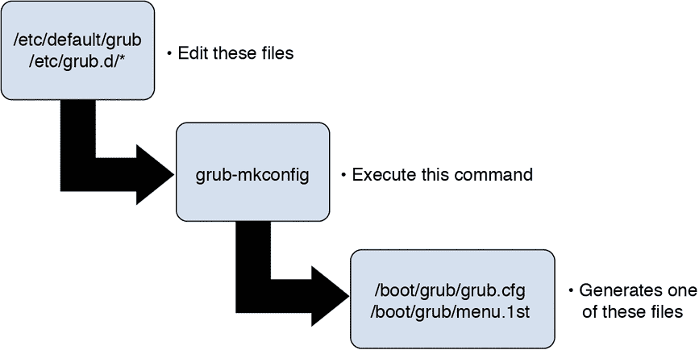

图 1.2 **grub2-mkconfig 命令**

注意

在某些系统上，命令是`grub-mkconfig`。

### grub2-update

`grub2-update`命令提供了运行`grub2-mkconfig`工具的另一种方法。它的存在主要是为了兼容某些使用此命令更新 GRUB2 配置文件的系统。默认情况下，它运行命令`grub-mkconfig -o /boot/grub/grub.cfg`。请参见本章早之前的“grub2-mkconfig”部分获取有关该命令的详情。

### dracut

请参见本章早之前的“mkinitrd”部分获取关于`dracut`的更多信息。

### initrd.img

通常，Linux 内核默认启用的内核模块很少。在引导过程中挂载文件系统之前，通常需要额外的模块。这些额外的模块存储在一个名为`initrd.img`的压缩文件中。请参见本章早之前的“mkinitrd”部分获取有关该文件如何生成的信息。

### vmlinuz

`vmlinuz`文件存储在`/boot`目录。每个版本的内核都有不同的`vmlinuz`文件，通常名称中包含内核版本。以下是一个示例：

```
```

## 通用统一引导加载程序版本 2 (GRUB2)

通用统一引导加载程序 (GRUB)，也称为 Legacy GRUB，是一种较旧的引导加载程序，在现代 Linux 系统上很少使用。Linux+ XK0-005 考试中的大多数配置文件和命令都集中于 GRUB2，它是 GRUB 的改进版本。

GRUB2 设计用于 Legacy GRUB 的替代品。两者之间有几区别，包括：

*  它们使用不同的配置文件。

*  GRUB2 支持更多的引导参数。

### 引导源

GRUB2 允许从不同的介质启动。本节重点介绍你可以从哪些介质启动。

在引导过程中，你可以与引导加载程序进行交互。这对于以下原因非常有用：

*  引导到备用引导

| --- | --- |

| **e** | 编辑选中的引导项 |

| **p** | 仅在编辑引导项需要密码时可见；使用 **p** 输入所需的密码

如果你编辑引导项，将提供一个具有不同选项的新屏幕（见图 1.4](#ch01.xhtml_ch1fig4)）。

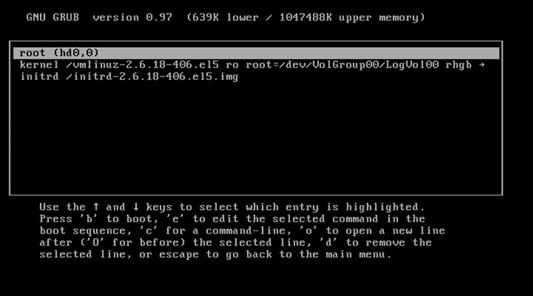

图 1.4 **引导项编辑屏幕**

表 1.3 描述了引导项编辑屏幕上的命令。

| 命令 | 描述 |

| --- | --- |

| 方向键 | 选择引导项 |

| **e** | 编辑选中的行 |

| **c** | 进入 GRUB 命令提示符 |

| **o** | 在当前行下方打开（创建）新行 |

| **O** | 在当前行上方打开（创建）新行 |

| **d** | 删除选中行 |

| **b** | 启动当前引导项 |

| [ESC] | 返回主菜单

本节剩余部分描述了 GRUB2 可以从哪些不同的引导源启动。

### 预启动执行环境 (PXE)

预启动执行环境 (PXE) 允许你跨网络启动系统，前提是网络上已经创建了引导服务器。PXE 使用动态主机配置协议 (DHCP) 服务器来获取网络配置信息，例如 IP 地址和子网掩码。

引导服务器监听 PXE 引导请求，然后向客户端系统提供操作系统。通常，此操作系统会调用客户端机器执行安装，因此不再需要进一步的 PXE 引导。

注意，PXE 启动是通过 BIOS/UEFI/EFI 软件启动的。

## 从 ISO/通用串行总 (USB) 启动

有多种 Live Linux 发行版允许直接从 CD、DVD 或 USB 设备启动。这种技术被称为“从 ISO 启动”，因为用于存储在这些介质上的操作系统的文件格式称为`ISO image`（ISO 镜像）。

从 ISO 启动有几个优点和理由：

*  系统可能是一个没有硬盘的轻量级客户端。

*  从基于安全性的 ISO 镜像启动对于解决主机操作系统上的问题（病毒、蠕虫或其他安全合规性问题）很有帮助。

*  某些 Live Linux 发行版可以通过启动主机操作系统来修复问题。

*  ISO 镜像还可以用于在系统上安装新的发行版。

在大多数情况下，从 ISO 镜像启动需要指示 BIOS/UEFI/EFI 从包含 ISO 介质的驱动器启动。不过，也可以配置`GRUB`从 ISO 介质启动（尽管这种情况很少这样做）。

## 内核恐慌 (Kernel Panic)

当内核出现问题导致系统崩溃时，就会发生`kernel panic`。通常在这种发生时，数据会使用名为`kdump`的功能存储。内核专家可以查看这些数据以确定崩溃的原因。

### Alert

使用`kdump`文件是一项专门技能，超出 Linux+XK0-005 考试的范围。

## /dev 中的设备类型

`/dev`文件系统包含设备文件，用于访问物理设备（如硬盘、键盘和 CPU）和虚拟设备（如 LVM 设备、伪终端和软件 RAID 设备）。`/dev`文件系统是基于内存的，不存储在硬盘上。

表 1.4 描述了`/dev`中的关键文件。

表 1.4 /dev 中的关键文件

| 文件 | 描述 |

| --- | --- |

| `/dev/sd*` | 在`/dev`目录中以`sd`开头的设备是 SATA、SCSI 或 USB 设备。设备名称`/dev/sda`指向第一个设备，`/dev/sdb`指向第二个设备，以此类推。如果设备有分区，它们从 1 开始编号。例如，`/dev/sda1`是第一个 SATA、SCSI 或 USB 设备的第一个分区。 |

| `/dev/hd*` | 在`/dev`目录中以`hd`开头的设备是 IDE 设备。设备名称`/dev/hda`指向第一个设备，`/dev/hdb`指向第二个设备，以此类推。如果设备有分区，它们从 1 开始编号。例如，`/dev/hda1`是第一个 IDE 设备的第一个分区。 |

| `/dev/cdrom` | 这是一个指向系统上第一个 CD-ROM 的符号链接。 |

| `/dev/dm*` | 在`/dev`目录中以`dm`开头的设备是软件 RAID 或 LVM 设备。设备名称`/dev/dm-0`指向第一个设备，`/dev/dm-1`指向第二个设备，以此类推。 |

| `/dev/tty*` | 在`/dev`目录中以`tty`开头的设备是终端设备。设备名称`/dev/tty0`指向第一个设备，`/dev/tty1`指向第二个设备，以此类推。 |

### Alert

准备好回答与本节描述的特定设备相关的 Linux+ XK0-005 考试题。

### 块设备

`block device`（块设备）是任何设计为块（即块）读写数据的设备。块设备通常是存储设备，如 USB 驱动器、硬盘、CD-ROM 和 DVD。

### 字符设备

`character device`（字符设备）是设计为单比特（即单个字符）读写数据的设备。字符设备的一个示例是键盘，它每次向系统发送一个字符。

### 特殊字符设备

特殊字符设备是不表示实际物理设备的设备文件。这包括后续章节描述的`/dev/null`、`/dev/zero`和`/dev/urandom`文件。

### /dev/null

在某些情况下，你可能不想看到命令的标准输出 (stdout) 或标准错误 (stderr)。例如，考虑以下`find`命令：

```bash
[root@OCS ~]$ find /etc -name "hosts"
find: '/etc/named': Permission denied
find: '/etc/polkit-1/localauthority': Permission denied
find: '/etc/polkit-1/rules.d': Permission denied
find: '/etc/pki/rsyslog': Permission denied
find: '/etc/pki/CA/private': Permission denied
find: '/etc/sudoers.d': Permission denied
find: '/etc/grub.d': Permission denied
find: '/etc/phpMyAdmin': Permission denied
/etc/hosts
find: '/etc/selinux/targeted/modules/active': Permission denied
find: '/etc/webmin/lpadmin': Permission denied
find: '/etc/webmin/iscsi-target': Permission denied
```


注意大量的 `"Permission denied"` 消息。在下面的示例中，你将这些消息重定向到 `/dev/null`。发送到 `/dev/null` 的内容会被立即丢弃。

```bash
[root@OCS ~]$ find /etc -name "hosts" 2> /dev/null
/etc/hosts
```

关于标准输出和标准错误的细节请参阅第 13 章。

## /dev/zero

`/dev/zero` 文件是 Linux 中返回空字符的特殊文件。它通常与`dd`等工具一起使用来创建大文件。有关第 2 章中关于`dd`命令及其如何使用`/dev/zero`的更多细节。

## /dev/urandom

Linux 内核有一个用于生成随机数的功能。可以通过读取`/dev/urandom`文件的内容访问该功能。该文件返回随机数，对于软件开发以及需要唯一值的工具（如加密工具）非常有用。

> **注意**：使用`/dev/urandom`超出了 Linux 考试范围。

## 从源码编译基础软件包

构建工具用于创建他人使用的软件。本节将探索一些实用的构建工具。

### ./configure

下载软件包的源码后，你需要知道如何构建并安装它。在实际情况中，你可能会先修改源码，但这通常需要超出本书及 Linux+ XK0-005 考试范围的编程技能。

构建源码的第一步是执行`configure`脚本。它可能直接位于源码的顶层目录，但你可能需要查找它，如下输出所示：

点击此处查看代码图像

```
[root@OCS unix]# pwd
/tmp/source/zip/unix
[root@OCS unix]# ls configure  Makefile  osdep.h  Packaging  README.OS390  unix.c  zipup.h
```

你需要更改`configure`文件的权限使其可执行，然后按照示例所示运行该脚本：

点击此处查看代码图像

```
[root@OCS unix]# su - bo
[bo@OCS unix]$ chmod u+x configure
[bo@OCS unix]$ ./configure
Check C compiler type (optimization options)
  GNU C (-O3)
Check bzip2 support
  Check for bzip2 in bzip2 directory
  Check if OS already has bzip2 library installed
-- Either bzlib.h or libbz2.a not found - no bzip2
Check for the C preprocessor
Check if we can use asm code
Check for ANSI options
Check for prototypes
Check the handling of const
Check for time_t
Check for size_t
Check for off_t
Check size of UIDs and GIDs
(Now zip stores variable size UIDs/GIDs using a new extra field. This
tests if this OS uses 16-bit UIDs/GIDs and so if the old 16-bit
storage should also be used for backward compatibility.)
  s.st_uid is 4 bytes
  s.st_gid is 4 bytes
-- UID not 2 bytes - disabling old 16-bit UID/GID support
Check for Large File Support
  off_t is 8 bytes
-- yes we have Large File Support!
Check for wide char support
-- have wchar_t - enabling Unicode support
Check for gcc no-builtin flag
Check for rmdir
Check for strchr
Check for strrchr
Check for rename
Check for mktemp
Check for mktime
Check for mkstemp
Check for memset
Check for memmove
Check for strerror
Check for errno declaration
Check for directory libraries
Check for readlink
Check for directory include file
Check for nonexistent include files
Check for term I/O include file
Check for valloc
Check for /usr/local/bin and /usr/local/man
Check for OS-specific flags
Check for symbolic links
```

`configure`脚本的结果是生成`Makefile`文件。`Makefile`文件提供了如何编译和安装软件的说明。随后的`make`部分提供了有关构建软件包包后续步骤的详细信息。

### make

`make`命令使用名为`Makefile`的文件来执行特定操作。`make`命令是一个用于从源代码构建和维护程序和其他类型文件的工具。`make`工具的主要功能是确定大型程序中的哪些部分需要重新编译，并发布重新编译它们所需的命令。每个`Makefile`都由软件开发者编写，用于执行与软件项目相关的操作。通常这包括以下类型的函数：

*  编译软件的操作
*  安装软件的操作
*  "清理"之前的版本的编译代码的操作

以下是一个仅包含 `install` 操作的简单`Makefile`示例：

点击此处查看代码图像

```
# more /usr/lib/firmware/Makefile
# 此文件实现了 GNOME Build API:
# http://people.gnome.org/~walters/docs/build-api.txt

FIRMWAREDIR = /lib/firmware

all:

install:
        mkdir -p $(DESTDIR)$(FIRMWAREDIR)
        cp -r * $(DESTDIR)$(FIRMWAREDIR)
        rm -f $(DESTDIR)/usbdux/*dux $(DESTDIR)/*/*.asm
        rm $(DESTDIR)$(FIRMWAREDIR)/{WHENCE,LICENSE.*,LICENCE.*}
```

### make install

`make`命令的`install`选项旨在从源代码在系统上安装代码。它可能包含编译过程，取决于软件开发者如何创建`Makefile`。更多信息请参见前面的"make"部分。

## 存储概念

本节涵盖了与存储设备相关的一些基本概念。

### 文件存储

通过文件存储，本地系统可以使用远程存储设备。远程存储设备通过网络文件系统结构共享给本地系统，用户可以在远程系统上放置文件和目录。常见的网络文件系统包括：

*  `nfs`：这种基于网络的文件系统起源于 Unix 系统。虽然它是一个旧的文件系统，但它为 Unix 和 Linux 系统之间共享目录结构提供了一种标准方法。该文件系统的更新版本包含了现代的安全特性和性能改进。

*  `smb`：这种文件系统也被称为 Samba 文件系统，基于`cifs`，旨在提供网络共享。

*  `cifs`：这种文件系统用于 Microsoft Windows 系统跨网络共享文件夹。Linux 上的 Samba 工具用于连接到`cifs`共享。

### 块存储

块存储设备是物理存储设备，通常为 Linux 存储系统提供后端存储。块存储设备的示例包括：

*  传统 SATA 驱动
*  SSD
*  RAID 磁盘
*  存储区域网络 (SAN)，可以是光纤通道 (FCP)、互联网小型计算机接口 (iSCSI)、以太网的 ATA (AoE) 和以太网的光纤 (FCoE)
*  光盘 (CD-ROM)

块存储设备上的数据可以通过文件系统访问。Linux 有多种文件系统，包括：

*  `ext3`：这种文件系统是`ext2`的扩展，设计用于放置分区。虽然`ext2`和`ext3`之间有很多差异，但`ext3`的重大变化是引入了日志（journaling）。日志通过对文件更改创建记录来防止文件系统损坏。在系统崩溃时，`ext3`的恢复时间应该非常快，因为可以使用日志快速修复元数据。

*  `ext4`：`ext4`文件系统是`ext3`的替代品。它支持更大的文件系统和文件大小。性能在这个版本也得到了改进。

*  `xfs`：这是另一种基于磁盘的文件系统，以高性能和处理大容量而闻名。

### 对象存储

对象存储实际上并不是 Linux 的概念；它通常存在于云基础设施中。然而，云基础设施的对象存储可以被 Linux 使用，这种存储类型正在成为存储和共享文件的流行方式。

对象存储是一种功能，对象（非结构化数据，如电子邮件、视频、图形、文本或任何类型的数据）存储在云环境中。对象存储不使用传统的文件系统功能，而是将数据组织成"组"（类似于文件系统中的文件夹）。数据通常通过类似于访问网页的 URL 进行访问。对象存储具有持久性和可用性，支持加密，并可以灵活的方式使用，支持不同的备份和存档功能。示例包括 AWS S3（简单存储服务）、Google Cloud Storage 和 IBM 云对象存储。

### 分区类型

分区用于将硬盘划分为较小的组件。每个组件都可以被视为不同的存储设备，并且每个分区上都可以创建不同的文件系统（btrfs、xfs、ext4 等）。

传统的 PC 分区创建数量限制。最初只允许创建四个被称为*主分区*的分区。当需要更多分区时，创建了一种技术，可以将其中一个主分区转换为扩展分区。在扩展分区内，你可以创建额外的、被称为*逻辑分区*的分区。

在图 1.5 中，`/dev/sda1`、`/dev/sda2` 和 `/dev/sda3` 是主分区。`/dev/sda4` 分是一个扩展分区，作为 `/dev/sda5`、`/dev/sda6` 和 `/dev/sda7` 分区的容器。


图 1.5 **传统分区结构**

在大多数使用传统分区的 Linux 发行版中，你被限制为共 15 个分区（尽管可以通过内核调整将此数字增加到 63）。

传统分区表存储在主引导记录（MBR）中。一种较新的分区表称为 GUID 分区表（GPT），它没有面临相同的局限性，布局也与 MBR 分区表不同。

可以使用几种不同的工具来创建或查看分区，包括 `fdisk`、`parted` 以及安装程序提供的图形界面工具（该工具根据发行版的不同而异）。

`fdisk` 和 `parted` 都支持命令行选项，并且它们都可以作为交互式工具执行。这些工具将在第 3 章"使用适当的工具配置和管理存储"中进行更详尽的介绍。

*原始设备*是一个与块设备文件（分区、硬盘等）关联的设备文件。当你创建这种关联时，就可以直接访问块设备。要创建原始设备，请使用 `raw` 命令：

点击此处查看代码

```
# raw /dev/raw/raw1 /dev/vda
/dev/raw/raw1: bound to major 252, minor 0
```

一旦创建了原始设备，你就可以使用 `dd` 等命令对相应的块文件执行操作。`dd` 命令通常用于创建整个硬盘的副本。

### 分分区表通常被称为"传统"分区，与较新的分区表（如 GUID 分区表）相对。MBR 分区表的限制是默认只允许四个分区。对于 Linux 这样的操作系统来说，这是一个极具限制性的因素。

然而，MBR 分区表中的主分区之一可以转换为扩展分区。在该扩展分区内可以添加额外的分区，称为*逻辑分区*。请参见图 1.6 的视觉示例。

关于硬盘设备名称的说明：硬盘通过 `/dev` 目录下的设备名称进行引用。IDE 设备名称以 `/dev/hd` 开头，而 SATA、SCSI 和 USB 设备名称以 `/dev/sd` 开头。系统上的驱动器从 `a` 开始命名，因此第一个 SATA 设备为 `/dev/sda`，第二个 SATA 设备为 `/dev/sdb`，依此类推。分区从 `1` 开始顺序编号，例如 `/dev/sda1`、`/dev/sda2` 和 `/dev/sda3`。

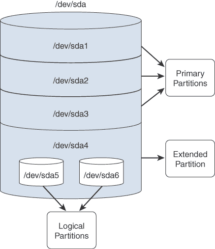

图 1.6 **分区**

### GUID（全局唯一标识符）分区表 (GPT)

GUID 分区表 (GPT) 是一种分区方案，旨在克服 MBR 的局限性（见本章前文的"分区表/主引导记录 (MBR)"部分）。与 MBR 不同，GPT 没有四个主分区的限制。也不需要扩展分区或逻辑分区。GPT 每个硬盘设备支持最多 128 个分区。

## 用户空间文件系统 (FUSE)

默认情况下，只有 root 用户可以创建文件系统。用户空间文件系统 (FUSE) 是 Linux 内核的一个特性，允许普通用户创建 Linux 文件系统。

**考试提示**: 设置、配置和使用 FUSE 超出了 Linux+ XK0-005 考试的范围。

### 独立（或廉价）磁盘阵列（RAID）级别

RAID 设备用于提供冗余。两个或多个物理设备可以组合成单个设备，以某种存储数据的方式在其中一个物理存储设备故障时减轻数据丢失。

注意，RAID 在第 3 章中会有更详细的介绍。

#### 条带化 (Striping)

条带化或 RAID 0 是像向单个设备一样向多个驱动器写入数据的过程。写入通过条带化执行，其中某些数据写入第一个驱动器，然后某些数据写入第二个驱动器，依此类推。更多细节请参见第 3 章。

### 镜像 (Mirroring)

通过镜像或 RAID 1，两个或多个磁盘驱动器看起来像一个单一存储设备。写入一个磁盘驱动器的数据也会写入所有其他驱动器。如果其中一个驱动器故障，数据在其他驱动器上仍然可用。更多细节请参见第 3 章。

### 校验位 (Parity)

校验数据是根据 RAID 中其他设备上存储的数据得出的值。假设 RAID 中有三个设备，其中两个（在本例中称为设备 A 和 B）存储普通文件系统数据，其中一个（称为设备 C）存储校验数据。如果设备 A 故障，则可以通过比较设备 B 中的数据和校验数据来重建它存储的数据。

### 列出硬件信息

本节重点介绍几种用于显示硬件信息的实用程序。

#### lspci

`lspci`命令显示连接到 PCI 总线的设备。语法：

```
lspci [options]
```

这里是 `lspci` 命令的一些关键选项：

- `-b`: 显示中断请求线 (IRQ)。
- `-n`: 显示设备编号而不是名称；名称通常存储在 `/usr/share/hwdata/pci.ids` 中。
- `-nn`: 显示设备编号和名称。
- `-v`: 显示详细信息。
- `-vv`: 显示更详细的信息。
- `-vvv`: 显示最详细的信息。

示例：

点击此处查看代码

```
[root@OCS ~]# lspci
00:00.0 Host bridge: Intel 440FX - 82441FX [Natoma] (rev 02)
00:01.0 ISA bridge: Intel 82371SB PII3 ISA [Natoma] (rev 01)
00:01.1 IDE interface: Intel 82371AB/EB/MB PIIX4 IDE [Natoma] (rev 01)
00:02.0 VGA 兼容控制器: InnoTek System GmbH VirtualBox 显卡
00:03.0 以太网控制器: Intel 8254EM 千兆以太网控制器 (rev 02)
00:04.0 系统设备: InnoTek System GmbH VirtualBox Guest Service
00:05.0 多媒体音频控制器: Intel 8280AA AC'97 音控制器 (rev 01)
00:06.0 USB 控制器: Apple Inc. KeyLargo/Intrepi USB
00:07.0 桥器: Intel 82371AB/EB/MB PIIX4 ACPI (rev 08)
00:0b.0 USB 控制器: Intel 82801FB/FBM/FR /FRW (ICH6 Family) USB2 EHCI Controller
00:0d.0 SATA 控制器: Intel 82801HM/HEM (ICH8M/ICH8M-E) SATA 控制器 [AHCI 模式] (rev 02)
```

#### lsusb

`lsusb`命令显示连接到 USB 总线的设备。

语法：

```
lsusb [options]
```

这里是 `lsusb` 命令的一些选项：

- `-D`: 显示指定的 USB 设备（作为参数），而不是扫描 `/dev/bus/usb` 目录并显示所有 USB 设备。


- `-t`: 以树形格式显示 USB 设备。
- `-v`: 显示详细信息。

```
[root@OCS Desktop]# lsusb
Bus 001 Device 002: ID 1221:3234 Unknown manufacturer Disk(Thumb
drive)
Bus 001 Device 001: ID 1d6b:0002 Linux Foundation 2.0 root hub
Bus 002 Device 001: ID 1d6b:0001 Linux Foundation 1.1 root hub
```

## dmidecode

`dmidecode` 命令用于显示硬件组件的描述。在下面的示例中，使用了 `head` 命令来减少大量的输出内容：

点击此处查看代码图片

```
[root@OCS ~]# dmidecode | head
# dmidecode 3.1
Getting SMBIOS data from sysfs.
SMBIOS 2.5 present.
10 structures occupying 450 bytes.
Table at 0x000E1000.

Handle 0x0000, DMI type 0, 20 bytes
BIOS Information
        Vendor: innotek GmbH
        Version: VirtualBox
```

## 第 2 章：管理文件和目录

**本章涵盖以下 Linux+ XK0-005 考试目标：**

*  **1.2:** 在给定场景下，管理文件和目录。

本章的重点与管理文件和目录相关的工具和概念。第一节探索了各种文本编辑器。Linux 中的许多配置文件都是纯文本格式，因此了解如何使用文本编辑器对于 Linux 系统管理员至关重要。

本章还涵盖了如何归档和压缩文件，以及如何在不同的计算机系统之间复制文件。本章探索了一系列文件和目录命令，允许你执行移动、复制、创建、删除和显示文件及目录信息等任务。

本章提供了有关以下主题的信息：文件编辑；文件压缩、归档和备份；文件元数据；软链接和硬链接；系统间的文件复制；文件和目录操作。

### 文件编辑

Linux 系统上的大多数配置文件都是纯文本格式。这使得了解如何编辑文本文件至关重要。本节重点关注常见的 Linux 编辑器：`sed`、`awk`、`printf`、`nano` 和 `vi` 编辑器。

#### sed

使用 `sed` 实用程序对文件进行自动化修改。`sed` 命令的基本格式为 `sed 's/RE/string/' file`，其中 `RE` 指“正则表达式”（regular expression），这是一种使用特殊字符匹配模式的功能。

这里是 `sed` 命令的示例：

点击此处查看代码图片

```
[student@OCS ~]$ head -n 5 /etc/passwd
root:x:0:0:root:/root:/bin/bash
bin:x:1:1:bin:/bin:/sbin/nologin
daemon:x:2:2:daemon:/sbin:/sbin/nologin
adm:x:3:4:adm:/var/adm:/sbin/nologin
lp:x:4:7:lp:/var/spool/lpd:/sbin/nologin
[student@OCS ~]$ head -n 5 /etc/passwd | sed 's/bin/----/'
root:x:0:0:root:/root:/----/bash
----:x:1:1:bin:/bin:/sbin/nologin
daemon:x:2:2:daemon:/s----:/sbin/nologin
adm:x:3:4:adm:/var/adm:/s----/nologin
lp:x:4:7:lp:/var/spool/lpd:/s----/nologin
```

`sed` 是一个非常强大的实用程序，具有许多特性。表 2.1 描述了一些最实用的 `sed` 函数。

表 2.1 `sed` 函数

| 特性 | 说明 |
| --- | --- |
| `/RE/d` | 从 `sed` 命令的输出中删除匹配 `RE` 的行。 |
| `/RE/c*string*` | 将匹配 `RE` 的行更改为 `string` 的值。 |
| `/RE/a*string*` | 在所有匹配 `RE` 的行之后添加 `string`。 |
| `/RE/i*string*` | 在所有匹配 `RE` 的行之前添加 `string`。 |

`sed` 命令有两个重要的修饰符（即添加在 `sed` 操作末后的字符）：

*  **g:** 表示“全局”（global）。默认情况下，只替换第一个 `RE` 模式匹配。当使用 `g` 修饰符时，将进行所有替换。图 2.1 显示了一个示例。
*  **i:** 表示“不区分大小写”。该修饰符匹配字母，无论大小大小如何。因此，命令 `sed 's/a/-/i'` 会匹配 `a` 或 `A` 并将其替换为字符 `-`。

`sed` 命令还可以更改原始文件（而不是将修改后的数据显示在屏幕上）。要更改原始文件，请使用 `-i` 修饰符。


图 2.1 **g 修饰符**

`sed` 命令是一个功能强大的实用程序，具有许多特性。

#### awk

`awk` 命令通过字段处理文本文件。下面的示例显示了使用 `awk` 打印 `/etc/passwd` 的第一个字段：

```bash
[student@OCS ~]$ awk -F: '{print $1}' /etc/passwd
root
bin
daemon
adm
```

`awk` 是处理数据的强大工具。`-F` 用于指定字段分隔符。考虑以下使用 `awk` 打印第七个字段的示例：

```bash
[student@OCS ~]$ awk -F: '{print $7}' /etc/passwd
/bin/bash
/sbin/nologin
/sbin/nologin
/sbin/nologin
/sbin/lpd
```

`awk` 还可以执行脚本。`-f` 用于指定包含 `awk` 命令的文件：

```bash
[student@OCS ~]$ awk -f script.awk /etc/passwd
root:x:0:0:root:/root:/bin/bash
bin:x:1:1:bin:/bin:/sbin/nologin
daemon:x:2:2:daemon:/sbin:/sbin/nologin
adm:x:3:4:adm:/var/adm:/sbin/nologin
lp:x:4:7:lp:/var/spool/lpd:/sbin/nologin
```

#### printf

`printf` 命令用于格式化输出字符串。下面的示例显示了如何使用 `printf` 格式化数字：

```bash
[student@OCS ~]$ total=10.000
[student@OCS ~]$ printf "%5f \n" $total
10.00000
```

注意 `%5f` 如何将数字精度改为小数点后五位。注意 `\n` 产生了换行符，这与 `echo` 命令不同，它不会自动打印。

#### nano

`nano` 编辑器是非 GUI 编辑器，在屏幕底部提供方便的“备忘录”。示例见图 2.2。


图 2.2 **nano 编辑器**

你可以通过按住 `Ctrl` 键然后按另一个键在 `nano` 中查找命令。例如，`Ctrl-x` 退出 `nano` 编辑器。在屏幕底部的命令列表中，符号 `^` 代表 `Ctrl` 键。同样注意 `^X` 并不是 `Ctrl-Shift-x`；它仅仅是指 `Ctrl-x`。

| 键 | 说明 |
| :--- | :--- |
| `^K` | 剪切一行（即删除该行并将其存入内存）。`^K` 可用于将多行剪切到内存中。 |
| `^U` | 取消一行的剪切。注意这不是撤销操作，而是一个粘贴操作。 |
| `^^` | 标记文本的开始和结束。标记的文本可以使用 `Alt-^` 复制。使用一个 `^^` 开始标记，使用方向键选择要标记的文本，然后使用最后一个 `^^` 结束标记。注意在 `^^` 中，第二个 `^` 是实际的 `^` 字符，而第一个 `^` 代表控制字符。 |
| `^W` | 在当前文档中搜索文本。 |
| `^F` | 向移动一屏。 |
| `^B` | 向后移动一屏。 |
| `^*n` | 移动到特定的行号。例如，`⁵` 移动到第 5 行。 |
| `^C` | 显示文档中的当前位置。 |

表 2.4 常用的 `nano` 命令

### vi

`vi` 编辑器是 Linux 和 Unix 环境的标准文本编辑器。尽管它可能没有其他编辑器那样用户友好，但它有几个重要的优点：

*  `vi` 编辑器（或 `vim`，它是 `vi` 编辑器的改进版本）适用于每个 Linux 发行版（以及所有 Unix 变体）。这意味着如果你知道如何使用 `vi` 编辑器编辑文件，无论你在使用哪种发行版，你都可以编辑文件。
*  因为 `vi` 编辑器是一个仅限命令行的编辑器，它不需要图形用户界面（GUI）。这很重要，因为许多 Linux 服务器没有安装 GUI，这意味着你无法使用基于 GUI 的文本编辑器。
*  当你熟悉 `vi` 后，你会发现它是一个非常高效的编辑器，与使用大多数其他编辑器相比，你可以非常快速地编辑文件。所有的 `vi` 命令都是短命令且基于键盘的，你不需要花时间离开键盘去使用鼠标。

要使用 `vi` 编辑器编辑新文件，你只需要输入不带参数的命令，或者输入 `vi filename`。

### 注意

`vim` 编辑器是一个改进的文本编辑器，具有许多 `vi` 编辑器不具备的功能。许多 Linux 发行版默认使用 `vim` 编辑器。`vim` 编辑器的优点之一是包含了 `vi` 编辑器的所有功能和命令。因此，如果你在 30 年前学会了使用 `vi` 编辑器，你的知识在 `vim` 编辑器中仍然适用。本章所有的命令在 `vi` 和 `vim` 编辑器中均有效。

`vi` 编辑器的设计仅使用键盘，这带来了一个挑战，因为有时按键应该执行命令，而有时按键应该代表插入到文档中的字符。为了让按键执行不同的任务，`vi` 有三种操作模式：

*  **命令模式（Command mode）：** 这是默认模式，当你打开 `vi` 时，将处于命令模式。在此模式下，你可以执行可以在屏幕上移动光标、删除文本和粘贴文本的命令。
*  **插入模式（Insert mode）：** 当你处于插入模式时，输入的任何按键都会作为新文本出现在你的文档中。当你完成添加新文本后，可以通过 `Esc` 键返回默认模式（即命令模式）。
*  **末行模式（Last line mode）：** 模式也称为 `ex 模式`，允许你执行更复杂的操作，例如将文档保存为不同的文件名。要从命令模式进入末行模式，请按 `:` 键。输入命令并按回车后，命令将执行，通常你会返回到命令模式。在某些情况下，你可能需要按 `Esc` 键返回命令模式。

### 注意

你不能直接从插入模式移动到末行模式或反之亦然。要进入插入模式或末行模式，你必须先处于命令模式。按下 `Esc` 键即可进入命令模式。

在 `vi` 编辑器中搜索文件时，你可以在命令模式下使用 `/` 或 `?` 字符。当你输入 `/` 或 `?` 字符时，屏幕左下角会出现提示符，如图 2.3 所示。

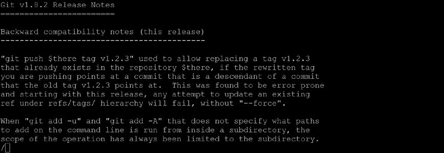

图 2.3 在 `vi` 编辑器中搜索文件

在 `/` 或 `?` 提示符处，输入你想搜索的值。你可以在此值中使用正则表达式。例如，如果你输入 `/^the`，`vi` 编辑器将搜索位于行头的字符串 `"the"` 的下一个出现处。

`/` 字符执行正向搜索，而 `?` 在文档中反向搜索。如果你没有找到想要的内容，可以使用 `n` 字符找到下一个匹配项。当以 `/` 字符开始搜索时，`n` 字符继续在文档向前搜索。当以 `?` 字符开始搜索时，`n` 字符继续在文档向后搜索。

反转搜索可以使用 `N` 字符。当搜索以 `/` 字符开始时，`N` 字符将反向搜索。假设你输入 `?the`。使用 `N` 字符的结果是向前搜索。

在命令模式下，可以使用表 2.5 中的键在屏幕移动。

表 2.5 命令模式键

| 键 | 说明 |
| :--- | :--- |
| `h` | 向左移动一个字符。 |
| `j` | 向下移动一行。 |
| `k` | 向上移动一行。 |
| `l` | 向右移动一个字符。 |

表 2.6 插入模式键

| 键 | 说明 |
| :--- | :--- |
| `i` | 在当前字符前进入插入模式。 |
| `I` | 在行开头进入插入模式。 |
| `o` | 在当前下方开启新行并进入插入模式。 |
| `O` | 在当前上方开启新行。 |
| `a` | 在当前字符后进入插入模式。 |
| `A` | 在行末尾进入插入模式。 |

表 2.7 命令模式修改键

| 键 | 说明 |
| :--- | :--- |
| `c` | `c` 键与其他键结合以修改数据。例如，`cw` 修改当前单词，`c$` 修改从光标到行尾的内容。在完成修改后，按下 `Esc` 键。 |
| `d` | `d` 键与其他键结合以删除数据。例如，`dw` 删除当前单词，`d$` 删除从光标到行尾的内容。所有删除的数据都存入缓冲区，并可以使用 `p` 或 `P` 键粘贴回文档中。 |
| `p` | 使用 `d` 键剪切文本或使用 `y` 键复制文本后，可以使用 `p` 或 `P` 键粘贴。小写 `p` 粘贴在光标之后，大写 `P` 粘贴在光标之前。 |
| `y` | `y` 键与其他键结合以复制数据。例如，`yw` 复制当前单词，`y$` 复制从光标到行尾的内容。所有复制的数据都存入缓冲区，可以使用 `p` 或 `P` 键粘贴回文档中。 |
| `dd` | `dd` 命令删除当前行。 |
| `yy` | `yy` 命令复制当前行。 |

表 2.8 命令模式保存退出键

| 键 | 说明 |
| :--- | :--- |
| `ZZ` | 保存并退出文档。这等同于 `:wq`。 |
| `:w!` | 强制 `vi` 编辑器将文档中的更改写入文件。 |
| `:q!` | 强制 `vi` 编辑器退出，即使文件更改未保存。 |
| `:e!` | 打开新文件进行编辑，并忽略自上次写入以来文档中的所有更改。这需要一个文件名作为参数（例如：`:e! myfile.txt`）。 |

### 考试提醒

预计 Linux+ XK0-005 考试中关于 `vi` 编辑器的题目将多于关于 `nano` 编辑器的。

### 文件压缩、归档与备份

当灾难发生时（例如硬盘故障或自然灾害），数据可能会损坏。使用归档和恢复工具有助于降低数据丢失的风险，并更容易将信息从一个系统传输到另一个系统。本节重点关注这些工具。

#### 考试提醒

压缩命令（`gzip`、`bzip2` 和 `zip`）的许多选项是相同的。这使得它们在 Linux+ XK0-005 考试中更容易记忆。

#### gzip

使用 `gzip` 命令压缩文件，如下所示：

点击此处查看代码图像

```
[student@OCS ~]$ ls -lh juju
-rwxr-xr-x 1 vagrant vagrant 109M Jan 10 09:20 juju
[student@OCS ~]$ gzip juju
[student@OCS ~]$ ls -lh juju.gz
-rwxr-xr-x 1 vagrant vagrant 17M Jan 10 09:20 juju.gz
```

注意，`gzip` 命令用压缩文件替换原始文件。

表 2.9 详细介绍一些重要的 `gzip` 选项。

表 2.9 `gzip` 命令选项

| 选项 | 说明 |
| --- | --- |
| `-c` | 将输出写入标准输出且不替换原始文件。你可以使用重定向将输出数据放入新文件中（例如：`gzip -c juju > juju.gz`）。 |
| `-d` | 解压文件。（也可以使用 `gunzip` 命令进行解压。） |
| `-r` | 递归压缩（即压缩目录及其子目录中的所有文件）。 |
| `-v` | 进入详细输出模式并显示压缩百分比。 |

#### 考试提醒

`gzip`、`xz` 和 `bzip2` 命令彼此非常相似。最大的区别在于用于压缩文件的技术。`gzip` 命令使用 Lempel-Ziv 编码法，而 `bzip2` 命令使用 Burrows-Wheeler 块排序文本压缩算法和 Huffman 编码。`xz` 命令使用 LZMA 和 LZMA2 压缩方法。

使用 `gunzip` 命令解压 gzip 格式的文件，如下所示：

点击此处查看代码图像

```
[student@OCS ~]$ ls -lh juju.gz
-rwxr-xr-x 1 vagrant vagrant 17M Jan 10 09:20 juju.gz
[student@OCS ~]$ gunzip juju
[student@OCS ~]$ ls -lh juju
-rwxr-xr-x 1 vagrant vagrant 109M Jan 10 09:20 juju
```

#### bzip2

使用 `bzip2` 命令压缩文件，如下所示：

点击此处查看代码图像


进入`/path/to/xxx`目录，找到`xxx.json`。

在表达式`cvar = avar + bvar`中，加法运算符（`+`）将`avar`与`bvar`相加，得到它们的和`cvar`

在`List.of(arg0, arg1, arg2)`中，`List`接口的工厂方法`of()`接受一系列的元素，返回包含它们的只读列表。

之后我们这样调用`cmd`命令：`cmd arg0 arg1 arg2`。

```
if (condVar > someVal) {console.log("xxx")}
```

---

# 压缩与归档

```
[student@OCS ~]$ ls -lh juju
-rwxr-xr-x 1 vagrant vagrant 109M Jan 10 09:20 juju
[student@OCS ~]$ bzip2 juju
[student@OCS ~]$ ls -lh juju.bz2
-rwxr-xr-x 1 vagrant vagrant 14M Jan 10 09:20 juju.bz2
```

注意，`bzip2`命令用压缩文件替换原始文件。

表 2.10 详细介绍一些重要的`bzip2`选项。

#### 表 2.10 bzip2 命令选项

| 选项 | 说明 |
| --- | --- |
| `-c` | 将输出写入标准输出且不替换原始文件。你可以使用重定向将输出数据放入新文件中（例如：`bzip2 -c juju > juju.bz`）。 |
| `-d` | 解压文件。（也可以使用`bunzip2`命令。） |
| `-v` | 进入详细输出模式并显示压缩百分比。 |

### 考试提醒

`gzip`、`xz`和`bzip2`命令彼此非常相似。最大的区别在于用于压缩文件的技术。`gzip`命令使用 Lempel-Ziv 编码法，而`bzip2`命令使用 Burrows-Wheeler 块排序文本压缩算法和 Huffman 编码。`xz`命令使用 LZMA 和 LZMA2 压缩方法。

### zip

`zip`命令用于将多个文件合并为一个单个压缩文件。要创建一个名为`mail.zip`包含目录中所有文件的压缩文件，请使用`zip`格式：

```
[student@OCS ~]$ ls -lh juju
-rwxr-xr-x 1 vagrant vagrant 109M Jan 10 09:20 juju
[student@OCS ~]$ zip mail.zip juju
[student@OCS ~]$ ls -lh mail.zip
-rwxr-xr-x 1 vagrant vagrant 44M Jan 10 09:20
```

表 2.11 详细介绍一些重要的`zip`选项。

#### 表 2.11 zip 命令选项

| 选项 | 说明 |
| --- | --- |
| `-d` | 解压文件。 |
| `-v` | 进入详细输出模式并显示压缩百分比。 |
| `-u` | 更新文件。 |
| `-r` | 递归处理。 |
| `-x` | 提取文件。 |

### tar

`tar`命令用于将多个文件合并为一个单个压缩文件。要创建一个包含目录中所有文件的`archive.tar`文件，请使用`tar`格式：

```
[student@OCS ~]$ ls -lh juju
-rwxr-xr-x 1 vagrant vagrant 109M Jan 10 09:20 juju
[student@OCS ~]$ tar -cf archive.tar juju
[student@OCS ~]$ ls -lh archive.tar
-rwxr-xr-x 1 vagrant vagrant 109M Jan 10 09:20
```

表 2.12 详细介绍一些重要的`tar`选项。

#### 表 2.12 tar 命令选项

| 选项 | 说明 |
| --- | --- |
| `-c` | 创建`.tar`文件。 |
| `-t` | 列出`.tar`文件的内容。 |
| `-x` | 提取`.tar`文件。 |
| `-f` | 指定`.tar`文件名。 |
| `-v` | 进入详细输出模式。 |
| `-A` | 向现有的`.tar`文件追加新文件。 |
| `-d` | 比较文件。 |
| `-u` | 更新文件。 |
| `-j` | 使用`bzip2`压缩/解压。 |
| `-J` | 使用`xz`压缩/解压。 |
| `-z` | 使用`gzip`压缩/解压。 |

### xz

使用`xz`命令压缩文件，如下所示：

```
[student@OCS ~]$ ls -lh juju
-rwxr-xr-x 1 vagrant vagrant 109M Jan 10 09:20 juju
[student@OCS ~]$ xz juju
[student@OCS ~]$ ls -lh juju.xz
-rwxr-xr-x 1 vagrant vagrant 11M Jan 10 09:20 juju.xz
```

`cpio`命令的目的是创建归档。你可以通过将文件名作为`stdin`发送到命令来创建文件归档，例如所示：

```
[student@OCS ~]$ find /etc -name "*.conf" | cpio -ov > conf.cpio
```

表 2.14 详细说明了一些重要的`cpio`选项。

#### 表 2.14 cpio 命令选项

| 选项 | 描述 |
| --- | --- |
| `-d` | 与`-i`选项配合使用，提取`cpio`文件中的目录结构及文件。 |
| `-i` | 从`cpio`文件中提取数据；该文件应通过 STDIN 提供（例如，`cpio -i < conf.cpio`）。 |
| `-o` | 创建归档（输出文件）。 |
| `-t` | 列出`cpio`文件的目录。 |
| `-v` | 进入详细模式。 |

## dd

`dd`命令可以执行多个与数据备份和创建文件相关的操作。一种常见的用法是为整个驱动器制作备份；例如，以下命令将整个`/dev/sdb`设备备份到`/dev/sdc`设备：

```
[student@OCS ~]$ dd if=/dev/sdb of=/dev/sdc bs=4096
```

`dd`命令的另一个用途是创建一个可以作为交换文件的大文件：

```
[student@OCS ~]$ dd if=/dev/zero of=/var/swapfile bs=1M count=50
```

表 2.15 详细说明了一些重要的`dd`选项。

#### 表 2.15 dd 命令选项

| 选项 | 描述 |
| --- | --- |
| `if=` | 指定输入文件。 |
| `of=` | 指定输出文件。 |
| `bs=` | 指定块大小。 |
| `count=` | 指定要创建/传输的块数。 |

## 文件元数据

*文件元数据*是关于文件内容以外的关于文件的信息。本节介绍了两个显示文件元数据的有用命令：`stat`命令和`file`命令。

### stat

文件或目录由几个组件组成。其中许多组件（如所有者和权限）存储在名为 inode 的文件系统元素中。

除了文件数据和文件名外，关于文件的所有信息都存储在 inode 中。每个文件都会获得一个 inode 号，该编号在文件所在的文件系统中是唯一的。

文件的 inode 包含以下信息：

- 唯一的 inode 节点
- 用户所有者
- 组所有者
- 模式（权限和文件类型）
- 文件大小
- 时间戳：
  - 最后一次修改文件内容
  - 最后一次修改 inode 数据
  - 最后一次访问文件
- 指针（指向包含文件数据的块位置的引用）

你可以使用`stat`命令查看这些 inode 信息，所示：

```
[root@OCS ~]$ stat /etc/passwd
 File: '/etc/passwd'
 Size: 2597 Blocks: 8 IO Block: 4096 regular file
Device: fc01h/64513d Inode: 33857 Links: 1
Access: (0644/-rw-r----) Uid: ( 0/ root) Gid:
 ( 0/ root)
Access: 2018-10-12 12:54:01.126401594 -0700
Modify: 2018-09-08 12:53:48.371710687 -0700
Change: 2018-09-08 12:53:48.371710687 -0700
 Birth: -
```

### file

`file`命令报告文件内内容的类型。以下是一些示例：

```
[student@localhost ~]$ file /etc/hosts
/etc/hosts: ASCII text
[student@localhost ~]$ file /usr/bin/ls
/usr/bin/ls: ELF 64
```

### 软链接和硬链接

链接有两种：硬链接和软链接。

#### 符号（软）链接

当你创建一个软链接时，它包含一个指向原始文件的路径。如果原始文件被删除，链接将失效，因为它指向了一个不存在的路径。

要创建链接，请使用`ln`命令：`ln [-s]` *target_file link_file*。例如，为任何文件创建软链接：

```
[root@OCS ~]$ ln -s /boot/initrd.img-3.16.0-30-generic
```

可以使用`ls`命令查看软链接硬链接。软链接很容易识别，因为执行`ls -l`命令时会显示目标，所示：

```
[root@OCS ~]$ ls -l /etc/vgb
lrwxrwxrwx 1 root root 23 Jul 11 2015
 /etc/vgb -> /etc/alternatives/vgb
```

### 硬链接

当你为文件创建硬链接时，无法区分“原始”文件和“链接”文件。它们只是指向相同 inode 以及数据的两个文件名。如果你有十个硬链接文件并删除了九个，数据仍然保留在剩余的文件中。

创建链接，执行`ln`命令：`ln [-s]` *target_file link_file*。例如，从`/etc/hosts`文件在当前目录创建一个名为`myhosts`的硬链接，执行以下命令：

```
[root@OCS ~]$ ln /etc/hosts myhosts
```

硬链接的文件共享相同的 inode。你只能对与原始文件位于同一文件系统上的文件（而非目录）创建硬链接。对另一个文件系统上的文件或目录创建硬链接会导致错误，如下所示：

```
[root@OCS ~]$ ln /boot/initrd.img-3.16.0-30-generic initrd
ln: failed to create hard link 'initrd' =>
 '/boot/initrd.img-3.16\. 0-30-generic': Invalid cross-device link
[root@OCS ~]$ ln /etc myetc
ln: '/etc': hard link not allowed for directory
```

可以使用`ls`命令同时查看软链接和硬链接。硬链接较更难识别，因为硬链接文件与其他文件名共享一个 inode。例如，在以下输出的权限之后的数值`2`表示该文件是一个硬链接文件：

```
[root@OCS ~]$ ls -l myhosts
-rw-r--r-- 2 root root 186 Jul 11 2015 myhosts
```

要查看文件的 inode 编号，请对`ls`命令使用`-i`选项：

```
[root@OCS ~]$ ls -i myhosts
263402 myhosts
```

然后使用`find`命令搜索具有相同 inode 的文件：

```
[root@OCS ~]$ find / -inum 263402 -ls 2>/dev/null
263402 4 -rw-r--r-- 2 root root 186 Jul 11 2015 /root/myhosts
263402 4 -rw-r--r-- 2 root root 186 Jul 11 2015 /etc/hosts
```

### 考试警示

了解硬链接和软链接的区别。在 Linux+ XK0-005 考试中，你可能会遇到测试你对这些差异理解的题目。

#### 在系统之间复制文件

任何文件系统包含成千上万个需要管理的文件和目录。本节重点介绍用于管理文件系统对象的 Linux 命令。

#### rsync

`rsync`命令对于跨网络远程复制文件非常有用。它通常用于需要复制之前文件的更改的情况，因为它比其他远程复制方法处理得更高效。

语法：

```
rsync [options] source destination
```

表 2.16 描述了一些重要的`rsync`选项。

#### 表 2.16 rsync 命令选项

| 选项 | 说明 |
| --- | --- |
| `-t` | 保留原始修改时间戳。 |
| `-v` | 进入详细模式。 |
| `-r` | 递归复制（即传输整个目录）。 |
| `-l` | 保持符号链接。 |
| `-p` | 保留原始权限。 |

#### scp

`scp`命令用于通过安全 Shell (SSH) 服务在远程系统之间复制文件。要将文件从本地机器复制到远程机器，请使用以下语法：

```
scp filename user@machine:/directory
```

在此语法中，`user`是远程系统上的账号名，`machine`是远程系统，而`/directory`代表你想存储文件的位置。

表 2.17 描述了`scp`命令的一些重要选项。

#### 表 2.17 scp 命令选项

| 选项 | 说明 |
| --- | --- |
| `-P port` | 指定连接的端口号。SSH 服务器通常使用端口 22，这也是`scp`命令的默认端口。 |
| `-p` | 尝试保留原始的时间戳和权限。 |
| `-r` | 递归复制整个目录。 |
| `-v` | 进入详细模式。 |

#### nc

`nc`命令的手页为该命令提供了一个极佳的总结：

`nc`（或 netcat）工具几乎可以用于任何涉及 TCP 或 UDP 的操作。它可以打开 TCP 连接、发送 UDP 数据包、在任意 TCP 和 UDP 端口监听、进行端口扫描，并处理 IPv4 和 IPv6。与 telnet(1) 不同，`nc`脚本运行良好，并将错误信息分离到标准错误，而不是像 telnet(1) 的某些操作那样发送到标准输出。

`nc`命令有许多用途。例如，假设你想在上线使用该端口的服务之前，检查某个特定端口是否被公司防火墙封锁。在内部服务器上，你可以让`nc`命令在在该端口监听连接：

```
[root@server ~]# nc -l 3333
```

| `-v` | 进入详细模式，并描述移动文件和目录时所执行的操作。 |

#### cp

`cp`命令用于复制文件或目录。以下是该命令的语法：

```
cp [options] file|directory destination
```

`file|directory`是要复制的文件或目录。`destination`是复制文件或目录的目标位置。接下来的示例将`/etc/hosts`文件复制到当前目录：

```
[student@OCS ~]$ cp /etc/hosts .
```

注意，*必须*指定目标位置（因此在示例中使用了`.`字符来表示当前目录）。

表 2.19 描述了`cp`命令的一些重要选项。

#### 表 2.19 cp 命令选项

| 选项 | 描述 |
| --- | --- |
| `-i` | 如果复制过程会导致覆盖现有文件，则提供交互式提示。 |
| `-n` | 防止覆盖现有文件。 |
| `-r` | 递归地复制整个目录结构。 |
| `-v` | 进入详细模式，并描述复制文件和目录时所执行的操作。 |

### mkdir

`mkdir`命令创建目录。

示例：

```
mkdir test
```

表 2.20 描述了一些重要的`mkdir`选项。

#### 表 2.20 mkdir 命令选项

| 选项 | 描述 |
| --- | --- |
| `-m` *perm* | 为新目录设置权限，而不是使用 umask 值。 |
| `-p` | 在需要时创建父级目录；例如，`mkdir /home/bob/data/january`如果指定路径中的目录不存在，则会创建路径中的所有目录。 |
| `-v` | 进入详细模式，并为创建的每个目录打印消息。 |

#### rmdir

`rmdir`命令用于删除空目录。如果目录不为空，该命令将失败。（使用`rm -r`来删除目录及其目录内的所有文件。）

示例：

```
rmdir data
```

### ls

`ls`命令用于列出目录中的文件。表 2.21 描述了`ls`命令的一些重要选项。

#### 表 2.21 ls 命令选项

| 选项 | 描述 |
| --- | --- |
| `-a` | 列出所有文件，包括隐藏文件。 |
| `-d` | 列出目录名，而不是目录的内容。 |


| `-F` | 在文件末尾添加字符以指示其类型；示例包括 `*` 表示可执行文件、`/` 表示目录、`@` 表示符号文件。 |

| `-h` | 与 `-l` 选项配合使用时，提供人类可读格式的文件大小。 |

| `-i` | 显示每个文件的 `inode` 值。 |

| `-l` | 显示长格式列表（参见图表）。 |

| `-r` | 反转文件列表的输出顺序。 |

| `-S` | 按文件大小排序。 |

| `-t` | 按修改时间排序（最新的文件排在列）。 |

`ls -l` 命令的输出每个文件包含一行，如图 2.6 所示。

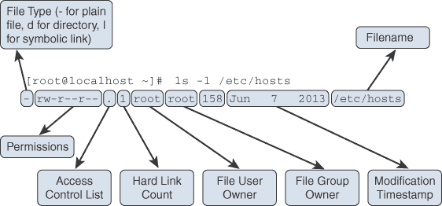

图 2.6 `ls -l` 命令

#### `pwd`

`pwd`（“打印工作目录”）命令显示 shell 的当前目录，如下例所示：

```
[student@localhost rc0.d]$ pwd
/etc/rc0.d
```

### `rm`

`rm` 命令用于删除文件和目录。

示例：

```
rm file.txt
```

表 2.22 描述了 `rm` 命令的一些重要选项。

| 选项 | 描述 |

| --- | --- |

| `-i` | 在删除文件之前提供交互式提示。 |

| `-r` | 递归地删除整个目录结构。 |

| `-v` | 进入详细模式，并描述删除文件和目录时所执行的操作。 |

表 2.22 `rm` 命令选项

#### `cd`

要将 shell 的当前目录移动到另一个目录，请使用 `cd`（切换目录）命令。`cd` 命令接受单个参数：目标目录的位置。例如，要移动到 `/etc` 目录，你可以执行以下命令：

```
[student@localhost ~]$ cd /etc
[student@localhost etc]$
```

`cd` 命令是一种类似于“没有消息就是好消息”的命令。如果命令执行成功，不会显示任何输出（尽管提示符发生了变化）。如果命令失败，则显示错误，如下所示：

```
[student@localhost ~]$ cd /nonexistent
bash: cd: /nonexistent: No such file or directory
```

#### `.`（当前目录）

一个点（period）表示当前目录。

#### `..`（上一级）

两个点表示当前目录的上一级。

#### `~`（用户主目录）

波浪符号表示用户的家目录。

#### `tree`

`tree` 命令允许你查看目录层次结构，如下例所示：

```
[student@localhost ~]$ tree /etc
/etc
├── cron.d
├── bash.bashrc
├── profile
├── profile.d
├── network.d
└── network
    └── network-manager.conf
```

在本章中，你将学习如何管理存储设备。第一部分介绍了磁盘分区，你将学习 `fdisk`、`parted` 和 `partprobe` 等工具。一旦你学会了如何创建分区，你将学习如何在分区上放置文件系统，并通过一个名为*挂载*（mounting）的过程让操作系统可以使用该文件系统。

本章探讨了分区的两种替代方案：逻辑卷管理器（Logical Volume Manager）和 RAID。本章还涵盖了使用远程存储设备的基本知识，例如 `NFS`（网络文件系统）和 `SMB/CIFS`（服务器消息块/通用互联网文件系统）。

本章提供了以下主题的信息：磁盘分区、本地和远程设备的挂载、文件系统管理、存储空间和磁盘使用监控、使用逻辑卷管理器（LVM）创建和修改卷、RAID 实现检查、存储区域网络（SAN）网络附属存储（NAS）以及存储硬件。

### 磁盘分区

分区用于将硬盘分割成较小的组件。每个组件可以被视为不同的存储设备，并且可以在每个分区上创建一个独立的文件系统（如 `btrfs`、`xfs`、`ext4` 等）。

传统的 PC 磁盘分区创建数量是有限制的。最初只允许创建四个分区，称为*主分区*（primary partitions）。随着对分区需求的增加，人们创建了一种技术，可以将其中一个主分区转换为扩展分区（extended partition）。在扩展分区内部，你可以创建额外的分区，称为*逻辑分区*（logical partitions）。

在图 3.1 中，`/dev/sda1`、`/dev/sda2` 和 `/dev/sda3` 是主分区。`/dev/sda4` 分区是一个扩展分区，作为 `/dev/sda5`、`/dev/sda6` 和 `/dev/sda7` 逻辑分区的容器。

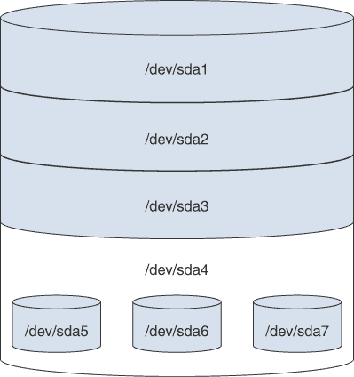

图 3.1 传统分区结构

在大多数使用传统分区的 Linux 发行版中，你被限制总共 15 个分区（尽管通过内核调整可以将此数字增加到 63）。

传统的分区表存储在主引导记录（MBR）中。一种新的分区表称为 GUID 分区表（GPT），它没有相同的局限性，其布局也与 MBR 分区表不同。

可以使用几种不同的工具来创建或查看分区，包括 `fdisk`、`parted` 以及安装程序提供的 GUI 工具（该工具随发行版的不同而异）。

`fdisk` 和 `parted` 都支持命令行选项，并且它们都可以作为交互式工具执行。

#### `fdisk`

`fdisk` 实用是一个交互式工具，允许你显示和修改传统的（非 GUID）分区表。要显示分区表，请以 root 用户身份使用 `-l` 选项，如下：

```
# fdisk -l /dev/sda

Disk /dev/sda: 42.9 GB, 42949672960 bytes
4 heads, 32 sectors/track, 655360 cylinders, total 83886080 sectors
Units = sectors of 1 * 512 = 512 bytes
Sudo
I/O size (minimum/optimal): 512 bytes / 512 bytes
Disk identifier: 0x000c566f

      Device Boot Start      End        Blocks    Id System
     /dev/sda1   * 2048 83886079 41942016  83 Linux
```

要修改驱动器的分区表，请不带 `-l` 选项运行 `fdisk` 命令，如下：

```
# fdisk /dev/sda
Command (m for help):
```

在 `Command` 提示符下你可以输入几个有用命令，包括表 3.1 中列出的命令。

表 3.1 分区相关命令

| 命令 | 说明 |

| :--- | :--- |

| `d` | 删除分区。 |

| `l` | 列出分区类型。 |

| `m` | 打印可能命令的菜单。 |

| `n` | 创建新分区。 |

| `p` | 打印当前分区表。 |

| `q` | 退出而不保存任何更改。 |

| `t` | 修改分区表类型。 |

| `w` | 将更改写入（保存）到硬盘上的分区表中。 |

#### `parted`

`parted` 实用是一个交互式工具，允许你显示和修改传统及 GUID 分区表。它还可以在分区上创建文件系统。

要显示分区表，请使用 `-l` 选项并以 root 用户运行 `parted` 命令，如示例所示：

```
 # parted -l /dev/sda
Model: ATA VBOX HARDDISK (scsi)
Disk /dev/sda: 42.9GB
Sector size (logical/physical): 512B/512B
Partition Table: msdos

Number Start   End    Size    Type File system Flags
 1      1049kB 42.9GB primary ext4     boot
Model: Linux device-mapper (thin) (dm)
```

#### `partprobe`

`partprobe` 命令通常只在分区表发生变化且系统需要这些变化时才需要。最常见的例子是你使用 `fdisk` 命令对已挂载文件系统的设备进行分区时。

`fdisk` 命令尝试通过内核调用通知系统分区表的变化，但由于文件系统是“活动”的会导致失败。要解决这个问题，只需在退出 `fdisk` 工具后执行 `partprobe` 命令即可。

## 挂载本地和远程设备

*挂载*是使存储设备对 Linux 文件系统可见的过程。本节重点关注用于管理挂载过程的文件和工具。

#### `systemd.mount`

`systemd.mount` 配置供 Systemd 在启动过程中挂载和卸载资源。它利用了 `/etc/fstab` 文件（下文介绍）。要了解更多关于 Systemd 的信息，请参阅第 4 章](#ch04.xhtml)。

#### `/etc/fstab`

`/etc/fstab` 文件用于指定挂载哪些文件、挂载到哪里以及在挂载过程中使用哪些选项。该文件在启动过程中用于配置在启动时挂载的文件系统。

`fstab` 文件的每一行描述一个挂载过程。以下是这些行的一个示例：

```
/dev/sda1 / ext4 defaults 1 1
```

*    挂载点 `/`。

*    文件系统类型 `ext4`。

*    挂载选项 `defaults`。

*    储储级别 `1`。此字段与 `dump` 命令相关，很少使用。

*    `fsck` 检查字段 `1`。值 `0` 表示“在系统启动期间不对此文件系统运行 `fsck`”，而值 `1` 或更高值表示“在系统启动期间对此文件系统运行 `fsck`”。

### 挂载配置

请注意，完整的 `/etc/fstab` 文件包含多个条目以及一些提供基础文档的注释。这是一个示例：

```
# 
# /etc/fstab
# Created by anaconda on Tue Jun 22 03:22:27 2021
#
# Accessible filesystems, by reference, are maintained under '/dev/
disk/'.
# See man pages fstab(5), findfs(8), mount(8) and/or blkid(8) for more
info.
#
# After editing this file, run 'systemctl daemon-reload' to update
systemd
# units generated from this file.
#
/dev/mapper/cl-root     /               xfs     defaults        0 0
UUID=abc23ff6-7841-463b-bdac-45b3ae868cee /boot      xfs    
defaults        0 0
/dev/mapper/cl-home     /home           xfs     defaults        0 0
/dev/mapper/cl-swap     none            swap    defaults        0 0
```

#### 考试警示

记忆 `/etc/fstab` 文件的不同字段是一个好习惯，因为 Linux+ XK0-005 考试通常包含关于该文件内容的问题。

#### `mount`

`mount` 命令可以显示当前挂载的文件系统，如例所示：

```
# mount
/dev/sda1 on / type ext4 (rw)
proc on /proc type proc (rw,noexec,nosuid,nodev)
sysfs on /sys type sysfs (rw,noexec,nosuid,nodev)
none on /sys/fs/cgroup type tmpfs (rw)
none on /sys/fs/fuse/connections type fusectl (rw)
none on /sys/kernel/debug type debugfs (rw)
none on /sys/kernel/security type securityfs (rw)
udev on /dev type devtmpfs (rw,mode=0755)
devpts on /dev/pts type devpts (rw,noexec,nosuid,gid=5,mode=0620)
tmpfs on /run type tmpfs (rw,noexec,nosuid,size=10%,mode=0755)
none on /run/lock type tmpfs
 (rw,noexec,nosuid,nodev,size=5242880)
none on /run/shm type tmpfs (rw,nosuid,nodev)
none on /run/user type tmpfs
 (rw,noexec,nosuid,nodev,size=104857600, mode=0755)
none on /sys/fs/pstore type pstore (rw)
rpc_pipefs on /run/rpc_pipefs type rpc_pipefs (rw)
systemd on /sys/fs/cgroup/systemd type cgroup
 (rw,noexec,nosuid,nodev, none,name=systemd)
```

`mount` 命令也可用于手动挂载文件系统。提供要挂载的设备作为第一个参数，将挂载点（即挂载目录）作为第二个参数，并以 root 用户身份执行以下命令：

```
# mkdir /data
# mount /dev/sdb1 /data
```

表 3.3 详细列出了 `mount` 命令的重要选项。

表 3.3 `mount` 命令选项

| 选项 | 描述 |

| :--- | :--- |

| `-a` | 挂载 `/etc/fstab` 文件中列出的具有挂载选项 `auto` 的文件系统。 |

| `-o` | 指定挂载选项（例如，`mount -o acl /dev/sdb1 /data`）。 |

| `-t` | 指定要挂载的文件系统类型。这通常不需要，因为 `mount` 命令可以通过探测分区来确定文件系统类型。 |

使用 `umount` 命令手动卸载文件系统：

```
# mount | grep /data
/dev/sdb1 on /data type ext3 (rw)
# umount /data
```

表 3.4 详细列出了 `umount` 命令的重要选项。

表 3.4 `umount` 命令选项

| 选项 | 描述 |

| :--- | :--- |

| `-r` | 尝试以只读模式挂载文件系统。 |

| `-f` | 如果设备忙用，则强制卸载。 |

#### 加密与 LUKS

记忆 `/etc/fstab` 文件的不同字段是一个好习惯，因为 Linux+ XK0-005 考试通常包含关于该文件内容的问题。

请注意，完整的 `/etc/fstab` 文件包含多个条目以及一些提供基础文档的注释。

要查看您的设备，可以使用 `blk` 命令：

```
# lsblk
NAME   MAJ:MIN SIZE RO MOUNTPOINT
sda      8:0   20G 
└─sda1   8:1   20G 
```

您可以使用 `blkid` 命令查看标签和 UUID：

```
# blkid
/dev/sda1: TYPE="ext4" UUID="..." 
/dev/sda2: TYPE="swap" UUID="..." 
/dev/sda3: TYPE="crypto_LUKS" UUID="..."
```

与 Linux 加密相关的重要技术是 `LUKS`（Linux Unified Setup）。它是一个描述文件系统如何加密的规范。

要创建加密文件系统，您可以使用 `cryptsetup` 和 `cryptmount`。注意 `cryptsetup` 是用于此的主要工具。

#### DM-Crypt 模块

`dm-crypt` 是一个允许加密设备的内核模块。除了模块外，您应该了解可以使用它的两个命令：`cryptsetup` 和 `cryptmount`。

本节演示了如何使用 `cryptsetup` 命令创建加密文件系统。开始之前，您可能需要加载某些内核模块：

```
[root@onecoursesource ~] modprobe dm-crypt
[root@onecoursesource ~] modprobe aes
[root@onecoursesource ~] modprobe sha256
```

#### 创建容器

接下来，在新分区创建 LUKS 格式的密码。注意，如果您使用的是现有分区，首先需要备份所有数据并卸载该分区。以下命令将覆盖 `/dev/sda3` 分区：


```
[root@onecoursesource ~] cryptsetup --verbose --verify-passphrase
luksFormat /dev/sda3
WARNING!
========
This will overwrite data on /dev/sda3 irrevocably.
Are you sure? (Type uppercase yes): YES
Enter passphrase:
Verify passphrase:
Command successful.
```

`xfs_info` 命令用于显示 XFS 文件系统的几何结构，类似于用于 ext2/ext3/ext4 文件系统的 `dumpe2fs` 命令。`xfs_info` 命令没有特殊的选项。

## ext4 工具

ext4 文件系统是 ext3 文件系统的替代品。它支持更大的文件系统和更大的单个文件大小。ext4 提供了比 ext3 更好的性能。

`mkfs` 命令用于在分区上创建文件系统。该命令的基本语法格式为 `mkfs -t fstype partition`，其中 `fstype` 可以是表 3.6 中描述的类型之一。

### 表 3.6 fstype 选项

| 类型 | 描述 |
| :--- | :--- |
| `ext2` | 创建 ext2 文件系统（大多数发行版上的默认值）。 |
| `ext3` | 创建 ext3 文件系统。 |
| `ext4` | 创建 ext4 文件系统。 |
| `bfs` | 创建 btrfs 文件系统。 |
| `vfat` | 创建 VFAT (DOS) 文件系统。 |
| `ntfs` | 创建 NTFS (Windows) 文件系统。 |
| `xfs` | 创建 XFS 文件系统。 |

注意 `mkfs` 命令是其他命令的前端实用程序。例如，如果你运行命令 `mkfs -t ext4 /dev/sdb7`，实际上执行的是 `mkfs.ext4 /dev/sdb7` 命令。

每个特定的文件系统创建工具都有几十种可能的选项，会影响文件系统的创建方式。这些选项从 `mkfs` 命令传递给 `mkfs` 启动的特定文件系统创建命令。

`resize2fs` 命令通常与逻辑卷（LV）的调整配合使用。一旦 LV 完成了大小调整，底层的 ext3 或 ext4 文件系统也必须进行大小调整。

如果计划是增大 LV，应该先执行 `lvextend` 命令，然后执行 `resize2fs` 命令。`resize2fs` 命令不需要大小值，因为它会增加到 LV 的大小。以下是一个示例：

```
lvextend -L+1G /dev/vol0/lv0
resize2fs /dev/vol0/lv0
```

如果计划是缩小 LV，你必须先调整文件系统，然后使用 `lvreduce` 命令减小 LV 的大小。如果你先缩小了 LV，系统将无法访问新 LV 大小之外的文件系统：

```
resize2fs /dev/vol0/lv0 2G
lvreduce -L2G /dev/vol0/lv0
```

`fsck` 实用程序旨在查找未挂载文件系统上的文件系统问题。例如，你可以以 root 用户运行此命令：

```
# fsck /dev/sdb1
fsck from util-linux 2.20.1
e2fsck 1.42.9 (4-Feb-2014)
Pass 1: 检查 inodes, blocks, and sizes
Pass 2: 检查目录结构
Pass 3: 检查目录连接性
Pass 4: 检查引用计数
Pass 5: 检查组摘要信息
/dev/sdb1: 11/12544 files (0.0% non-contiguous), 6498/50176 blocks
```

该实用程序非常直观。它根据对文件系统的探测调用正确的文件系统检查实用程序，并在发现错误时提示用户。要修复错误，请对每个提示回答 `y` 或 `yes`。（由于 `yes` 几乎总是适当的答案，`fsck` 实用程序支持 `-y` 选项，它会自动对每个提示回答 `yes`。）

`fsck` 命令执行特定于文件系统的实用程序。在 ext2/ext3/ext4 文件系统的情况下，`fsck` 命令执行 `e2fsck` 实用程序。有关 `fsck` 命令的详细信息，请参见本章早之前的“`fsck`”部分。

`tune2fs` 命令用于显示或修改 ext2/ext3/ext4 文件系统的特定元数据。例如，默认情况下，5% 的 ext2/ext3/ext4 文件系统保留给系统管理员。你可以作为 root 用户运行以下命令：

```
# tune2fs -l /dev/sdb1 | grep block
Inode count:           12544
Block count:           50176
Reserved block count: 2508
Mount count:             0
Maximum mount count:  -1
```

注意，保留块计数 (2508) 是块计数 (50176) 的 5%。使用以下命令将其更改为不同的百分比：

```
# tune2fs -m 20 /dev/sdb1
tune2fs 1.42.9 (4-Feb-2014)
Setting reserved blocks percentage to 20% (10035 blocks)
```

表 3.7 详细列出了 `tune2fs` 命令的重要选项。

### 表 3.7 tune2fs 选项

| 选项 | 描述 |
| :--- | :--- |
| `-J` | 修改日志 (journal)。 |
| `-o` | 修改挂载 (mount)。 |
| `-L` | 修改标签 (label)。 |
| `-l` | 列出元数据。 |
| `-m` | 修改百分比。 |

要更改文件系统的标签，请使用 `mkfs`：

```
# mkfs -t ext4 /dev/sdb7
```

实际上执行 `mkfs.ext4 /dev/sdb7` 命令。

每个特定的文件系统创建工具都有几十种可能的选项，会影响文件系统的创建方式。这些选项从 `mkfs` 命令传递给 `mkfs` 启动的特定文件系统创建命令。

`resize2fs` 命令通常与逻辑卷（LV）的调整配合使用。一旦 LV 完成了大小调整，底层的 ext3 或 ext4 文件系统也必须进行大小调整。

如果计划是增大 LV，应该先执行 `lvextend` 命令，然后执行 `resize2fs` 命令。`resize2fs` 命令不需要大小值，因为它会增加到 LV 的大小。以下是一个示例：

```
lvextend -L+1G /dev/vol0/lv0
resize2fs /dev/vol0/lv0
```

如果计划是缩小 LV，你必须先调整文件系统，然后使用 `lvreduce` 命令减小 LV 的大小。如果你先缩小了 LV，系统将无法访问新 LV 大小之外的文件系统：

```
resize2fs /dev/vol0/lv0 2G
lvreduce -L2G /dev/vol0/lv0
```

`fsck` 实用程序旨在查找未挂载文件系统上的文件系统问题。例如，你可以以 root 用户运行此命令：

```
# fsck /dev/sdb1
fsck from util-linux 2.20.1
e2fsck 1.42.9 (4-Feb-2014)
Pass 1: 检查 inodes, blocks, and sizes
Pass 2: 检查目录结构
Pass 3: 检查目录连接性
Pass 4: 检查引用计数
Pass 5: 检查组摘要信息
/dev/sdb1: 11/12544 files (0.0% non-contiguous), 6498/50176 blocks
```

该实用程序非常直观。它根据对文件系统的探测调用正确的文件系统检查实用程序，并在发现错误时提示用户。要修复错误，请对每个提示回答 `y` 或 `yes`。（由于 `yes` 几乎总是适当的答案，`fsck` 实用程序支持 `-y` 选项，它会自动对每个提示回答 `yes`。）

`fsck` 命令执行特定于文件系统的实用程序。在 ext2/ext3/ext4 文件系统的情况下，`fsck` 命令执行 `e2fsck` 实用程序。有关 `fsck` 命令的详细信息，请参见本章早之前的“`fsck`”部分。

`tune2fs` 命令用于显示或修改 ext2/ext3/ext4 文件系统的特定元数据。例如，默认情况下，5% 的 ext2/ext3/ext4 文件系统保留给系统管理员。你可以作为 root 用户运行以下命令：

```
# tune2fs -l /dev/sdb1 | grep block
Inode count:           12544
Block count:           50176
Reserved block count: 2508
Mount count:             0
Maximum mount count:  -1
```

注意，保留块计数 (2508) 是块计数 (50176) 的 5%。使用以下命令将其更改为不同的百分比：

```
# tune2fs -m 20 /dev/sdb1
tune2fs 1.42.9 (4-Feb-2014)
Setting reserved blocks percentage to 20% (10035 blocks)
```

表 3.7 详细列出了 `tune2fs` 命令的重要选项。

## 监控空间和磁盘使用

收集存储空间信息可以用于判断是否有足够的空间安装软件包或数据库。本节中的命令提供了监控存储空间的信息。

### df

`df` 命令显示分区和逻辑设备的使用情况：

```
# df
Filesystem   1K-blocks     Used      Available Use% Mounted on
udev          2019204           0      2019204     1% /dev
tmpfs         404832           0      404832     1% /sys/fs/cgroup
none         5120        0         5120        0% /run/lock
none         2024144           0      2024144     0% /run/shm
tmpfs         1024000           0      1024000     0% /run/user
/dev/sda1    41251136    6992272  3252952   18% /
```

### du

`du` 命令提供目录结构中估计的磁盘使用量。例如，以下命令显示了 `/usr/lib` 目录使用的空间：

```
# du -sh /usr/lib
791M /usr/lib
```

#### Btrfs 工具

Btrfs，被称为“butter”，是一种通用的文件系统，使用“B-树”来管理结构。`btrfs` 实用程序提供了大量的子命令。

表 3.8 详细列出了 `btrfs` 实用程序的一些子命令。

### 表 3.8 btrfs 实用程序子命令

| 子命令 | 描述 |
| :--- | :--- |
| `filesystem` | 管理文件系统任务并显示信息。 |
| `subvolume` | 管理子卷并显示子卷信息。 |
| `rescue` | 执行文件系统（修复）操作。 |

你可以将子命令作为 `btrfs` 的参数。例如，以下将显示所有文件系统的信息：

```
btrfs filesystem show
```

# 引言

LVM 设计旨在解决普通分区的某些问题，包括以下内容：

*   普通分区无法调整大小的。LVM 提供了更改名为`逻辑卷`（logical volumes）的类分区结构大小的方法。
*   普通分区的大小不能超过该分区所所在硬盘的总容量。通过 LVM，可以将多个物理设备合并在一起，创建一个大得多的逻辑卷。
*   在备份数据时，活动的文件系统会带来挑战，因为备份过程中对文件系统的更改可能会导致备份损坏。LVM 提供了一种名为“快照”（snapshot）的功能，这可以让你更轻松地正确备份正在运行中的文件系统。

LVM 由一个或多个物理设备合并成的单个空间容器组成，该容器用于创建类分区的设备。物理设备可以是整个硬盘、硬盘上的分区、可移动介质设备（USB 驱动器）、软件 RAID 设备或任何其他存储设备。

## 考试要点

LVM 可能是一个具有挑战性的话题。对于 Linux+ XK0-005 考试，请确保你理解物理卷（PVs）、卷组（VGs）和逻辑卷（LVs）之间的区别。

### pvs

你可以使用 `pvs` 命令显示 PVs，如下例所示：

```
# pvs
  PV         VG    Fmt  Attr PSize  PFree
  /dev/sdb1  my_vg lvm2 a-   19.24G 18.14G
  /dev/sdc1  my_vg lvm2 a-   19.24G 18.06G
  /dev/sdd1  my_vg lvm2 a-   19.24G 18.14G
```

更多关于 PV 的信息，请参见本章节后面的 `pvcreate` 部分。

### vgs

你可以使用 `vgs` 命令显示 VGs，如下例所示：

```
# vgs
```


# vgs

`VG`命令用于显示卷组信息。以下是一个示例输出：

```
# vgs
  VG            #PV #LV #SN Attr   VSize  VFree
  Vol00         3   2   0   wz--n- 33.22G 0
  Vol01         2   1   0   wz--nc 47.00G 8.00M
```

更多关于 `VGs` 的信息，请参见本章节后面的 `vgcreate` 部分。

## lvs

你可以使用`lvs`命令显示 LVs，如下例所示：

```
# lvs
  LV      VG        Attr     LSize  Pool Origin Data%  Move Log Copy%
Convert
  lv_root Vol00    -wi-ao--  12.22g
  lv_swap Vol00    -wi-ao--  3.12g
```

更多关于 LVs 的信息，请参见本章节后面的 `lvcreate` 部分。

## lvchange

`lvchange`命令允许你更改 LV 的属性。该命令的一个常见用途是将 LV 的状态更改为激活：

```
lvchange -ay /dev/vol0/lv0
```

相同的命令也可用于停用 LV：

```
lvchange -an /dev/vol0/lv0
```

## lvcreate

PV 内部的空间被划分为名为`extents`（区）的小块。每个区默认大小为 4MB（但在创建 VG 时，可以通过`vgcreate`命令的`-s`选项进行修改）。要创建一个 LV，执行`lvcreate`命令，并指定分配给 LV 的区数量，或者提供一个大小（该大小将四向上取整到区的大小），如下所示：

```
lvcreate -n lv0 -L 400MB vol0
```

该命令的结果将是一个命名为`/dev/vol0/lv0`的设备文件，它将拥有 400MB 的可用原始空间。请参图 3.2 的视觉示例。

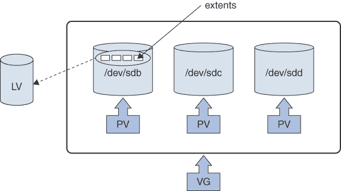

图 3.2 **逻辑卷**

## vgcreate

使用`pvcreate`命令创建 PV 后（参见本章节后面的"pvcreate"部分），执行以下命令将这些 PV 放入 VG 中：

```
# vgcreate vol0 /dev/sdb /dev/sdc /dev/sdd
```

将 VG 视为一组存储设备，你想要使用它们来创建名为逻辑卷（LVs）的类分区结构。因此，如果`/dev/sdb`是一个 60GB 的硬盘，`/dev/sdc`是一个 30GB 的硬盘，`/dev/sdd`是一个 20GB 的硬盘，那么由上述命令创建的 VG 就有 110GB 的可用空间来创建 LV。你可以创建这些 LV。

## lvresize

`lvresize`命令允许你更改 LV 的大小。例如，以下命令为`/dev/vol0`增加了 10GB：

```
lvresize -L +10G vol0
```

## pvcreate

创建 LVM 的第一步是将物理设备转换为 PV。这是通过`pvcreate`命令完成的。例如，如果你有三个硬盘，如图 3.4 所示，并且你想将它们变为 PV，可以执行以下命令：

```
pvcreate /dev/sdb /dev/sdc /dev/sdd
```

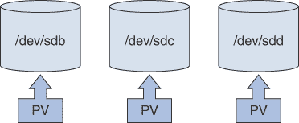

图 3.4 **逻辑卷**

## vgextend

当你向 VG 添加新的 PV 时，可以使用`vgextend`命令。例如，以下命令向`vol0`添加了`/dev/sde`：

```
vgextend vol0 /dev/sde
```

注意

`/dev/sde`设备必须先使用`pvcreate`配置为 PV。参见本章节后面的`pvcreate`部分。

# 检查 RAID 实现

RAID 设备用于提供冗余。多个物理设备可以合并创建一个单一设备，并在设备故障时减轻数据丢失。

有几种类型的 RAID 设备，被称为"RAID 级别"。虽然你可以创建许多类型的软件 RAID 级别，只有少数级别对于软件 RAID 设备是合理的。当你配置软件 RAID 设备时，应该考虑表 3.11 中描述的 RAID 级别。

表 3.11 RAID 级别

| 级别 | 说明 |
| --- | --- |
| RAID 0 | RAID 0 涉及将多个驱动器视为单个设备进行写入。写入通过"条带"执行，即部分数据写入第一个驱动器，部分数据写入第二个驱动器依此类推。RAID 0 将多个较小的硬盘合并为一个单一存储空间。因此，如果你有三个 20GB 的硬盘，你可以将它们合并为一个 60GB 的存储设备。软件 RAID 0 极其罕见，原因有两个。一个原因是这种 RAID 级别不提供冗余（这使得它被认为是 RAID 很奇怪）。另一个原因是 LVM（逻辑卷管理器）也允许合并多个设备，而且 LVM 相比软件 RAID 0 有许多优势，使其成为更好的选择。 |
| RAID 1 | RAID 1 也称为"镜像"，两个或多个磁盘驱动器作为一个单一存储设备。写入一个驱动器的数据也会写入所有其他驱动器。如果一个驱动器故障，数据在其他驱动器仍然可用。软件 RAID 1 非常受欢迎，因为硬盘相当廉价，且 RAID 1 提供的冗余限制了数据丢失。 |
| RAID 4 | 实现 RAID 4 至少需要三块硬盘。除一块硬盘外，所有硬盘都用于存储文件系统数据，最后一块硬盘用于存储校验数据——即从 RAID 中其他设备上存储的数据派出的值。假设 RAID 中有三个设备；其中两个（在本例中称为设备 A 和 B）存储普通的文件系统数据，另一个（称为设备 C）存储校验数据。如果设备 A 故障，则可以通过比较设备 B 中的数据和设备 C 中的校验数据来重建它所存储的数据。这是如何运作的？请考虑以下公式：`1 + 1 = 2`（或者，也许是 `A + B = C`）。如果有人删除了该公式中的某一个值（例如，`___ + 1 = 2`），你可以通过比较另外两个值来恢复该信息。这就是校验数据的基本原理。 |
| RAID 5 | RAID 5 与 RAID 4 非常相似。不同在于 RAID 5 不使用单一的校验磁盘，而是通过"轮询"方法将校验数据分布在多块磁盘上。 |
| RAID 10 | 也称为 RAID 1+0，这种 RAID 级别结合了 RAID 1 和 RAID 0 的优点。首先，将两个或多个每组两个设备组合放入多个 RAID 1 设备中。这提供了冗余。然后，将它们合并成一个 RAID 0 设备，以创建一个大得多的存储容器。在软件 RAID 方面，这种 RAID 级别相当少见，主要是因为 LVM 相比 RAID 0 具有优势。更常见的场景是 RAID 0 加 LVM 的组合。对于硬件 RAID 来说，这种级别并不常见。 |

# 考试要点

针对 Linux+ XK0-005 考试，请记住这些 RAID 级别！考试可能会要求你指定在给定场景应使用哪种 RAID 级别。

## mdadm

要创建一个软件 RAID 设备，请执行如下命令：

```
# mdadm -C /dev/md0 -l 1 -n 2 /dev/sdb /dev/sdc
mdadm: array /dev/md0 started.
```

该命令使用了以下选项：

* `-C:` 指定 RAID 设备的设备名称。
* `-l:` 指定 RAID 级别。
* `-n:` 指定 RAID 阵列中物理存储设备的数量。

## /proc/mdstat

创建 RAID 设备后，你可以通过查看`/proc/mdstat`文件的内容来获取设备信息，如下所示：

```
# more /proc/mdstat
Personalities : [raid1]
md0 : active raid1 sdc[1] sdb[0]
      987840 blocks [2/2] [UU]
unused devices: <none>
```

`mdadm --detail`命令对于显示软件 RAID 设备的信息也很有用。

# 存储区域网络 (SAN)/网络附属存储 (NAS)

本节提供了有关 SAN 和 NAS 设备的信息。

## multipathd

某些存储设备仅通过网络可用。这创建了一个单点故障：网络本身。如果你失去了对远程存储设备的网络访问（可能是因为路由器故障或实施了新的防火墙规则），你系统上的应用程序可能无法正常运行。

多路径（Multipathing）涉及为远程存储设备创建不同的网络路径。这需要额外的网络设置，包括配置指向网络存储设备的路由。多路径守护进程（`multipathd`）是管理这些网络路径的进程。

# 考试要点

配置多路径的细节超出了 Linux+ XK0-005 考试的范围，且书中未涵盖。然而，多路径被列为考试目标，因此请准备回答有关多路径用途的问题。

# 网络文件系统

与大多数其他操作系统一样，Linux 允许你访问跨网络共享的文件系统。本节描述了 Linux 下两种最常用的网络文件系统：NFS 和 SMB。

## 网络文件系统 (NFS)

网络文件系统（NFS）是一种分布式文件系统（DFS）协议，已使用 40 多年。NFS 最初由 Sun Microsystems 于 1984 年创建，旨在为管理员提供一种从一个 Unix 系统共享文件和目录的简单方法。

自诞生以来，NFS 已移植到多个不同的操作系统，包括 Linux 和 Microsoft Windows。虽然它可能没有 SAMBA 那么流行，但许多组织仍在使用 NFS 共享文件。

NFS 服务器的主要配置是`/etc/exports`文件。你使用该文件来指定你想要共享给 NFS 客户端的目录。该文件的语法如下：

```
Directory    hostname(options)
```

* `Directory`应该替换为你想要共享的目录名称（例如，`/usr/share/doc`），`hostname`应该是可以解析为 IP 地址的客户端主机名。`options`值用于指定如何共享资源。

例如，`/etc/exports`文件中的以下条目将`/usr/share/doc`目录以读/写权限共享给 NFS 客户端`jupiter`，以只读权限共享给 NFS 客户端`mars`：

```
/usr/share/doc jupiter(rw) mars(ro)
```

注意`jupiter`和`mars`之间有空格，但主机与其选项之间没有空格。

在`/etc/exports`中指定主机名时，允许以下方法：

* `hostname:` 可以解析为 IP 地址的主机名。
* `netgroup:` 使用`@groupname`的 NIS 网络组。
* `domain:` 使用通配符的域名。例如，`*.onesource.com`包括 onesource.com 域任何机器。
* `Network:` 使用 VLSM（变长子网掩码）或 CIDR（无类域间）定义的网络。示例包括`192.168.1.0/255.255.255.0`和`192.168.1.0/24`。

有很多不同的 NFS 共享选项，包括：

* `rw:` 读写共享。注意普通的 Linux 权限仍然有效。这是一个默认选项。
* `ro:` 只读共享。
* `sync:` 立即将文件更改写入磁盘。这会对性能产生影响，但数据丢失的可能性较低。在某些发行版中，这是默认值。
* `async:` `sync`的反面。初始将文件更改写入内存。这可以提高性能，但数据丢失的可能性更高。在某些发行版中，这是默认值。
* `root_squash:` 将 NFS 客户端的 root 用户和组映射到匿名账户，通常是 nobody 账户或 nfsnobody 账户。这是一个默认选项。
* `no_root_squash:` 将 NFS 客户端的 root 用户和组映射到本地 root 组账户。

## 服务器消息块 (SMB)/通用互联网文件系统 (CIFS)

在不同系统之间共享文件的方法之一是通过名为`SMB`（服务器消息块）的协议。该协议由 IBM 在 20 世纪 80 年代中期发明，用于局域网（LAN）主机之间的目录共享。分布式文件系统（DFS）用于跨网络共享文件和目录。除了`SMB`之外，网络文件系统（NFS）也是 Linux 上常用的 DFS。（NFS 在本章前面介绍过。）

你可能经常听到`CIFS`（通用互联网文件系统）这个缩写与`SMB`一起使用。`CIFS`是基于`SMB`的协议，在 Microsoft Windows 系统上非常流行。通常，这两个缩写互换使用（或一起使用`SMB/CIFS`），但这些协议之间存在细微的差异。本书从现在起统一使用`SMB`术语。

你还可以使用`SMB`共享打印机，并在不同类型的操作系统之间共享文件。事实上，一个常见的`SMB`任务是在 Linux 系统和 Microsoft Windows 系统之间共享打印机。

允许`SMB`共享的 Linux 软件被称为`SAMBA`。`SAMBA`的配置文件是`/etc/SAMBA/smb.conf`文件。

为了让你直观了解典型的`smb.conf`文件是什么，请查看以下输出，它展示了一个删除了所有注释行和空行的典型默认`smb.conf`文件：

```
[root@onecoursesource ~]# grep -v "#" /etc/SAMBA/smb.conf | grep -v ";" | grep -v "^$"
[global]
        workgroup = MYGROUP
        server string = SAMBA Server Version %v
        security = user
        passdb backend = tdbsam
        load printers = yes
        cups options = raw
[homes]
        comment = Home Directories
        browseable = no
        writable = yes
[printers]
        comment = All Printers
        path = /var/spool/SAMBA
        browseable = no
        guest ok = no
        writable = no
        printable = yes
```

表 3.12 描述了`SAMBA`配置文件的常用选项。

### 表 3.12 SAMBA 配置文件选项

| 选项 | 说明 |
| --- | --- |
| `workgroup` | 这是 NetBIOS（网络基本输入/输出系统）工作组或 NetBIOS 域名。它允许你将一组机器组合在一起，如果你想通过`SMB`与 Microsoft Windows 系统通信，这可能很重要。 |
| `server string` | 这是对服务器的描述，当远程系统尝试连接到服务器以确定服务器提供的服务时非常有用。值`%v`会被替换为 SAMBA 的版本号。值`%h`可表示服务器的主机。 |
| `security` | 决定使用什么种类型的用户验证方法。值`user`表示将使用 SAMBA 用户帐户。如果你在 Microsoft Windows 系统上有一个 DC（域控制器），则指定域。要通过 Active Directory 进行身份验证，请指定`ads`。 |
| `passdb backend` | 指定 SAMBA 账户数据的存储方式。除非你是专家，否则通常不需要更改它。 |
| `load printers` | 此选项如果设置为`yes`，则告诉 SAMBA 默认共享所有 CUPS（通用 Unix 打印系统，Linux 和 Unix 中常用的打印协议）。虽然这很方便，但你并不总是想共享 SAMBA 服务器上所有的 CUPS 打印机。单独的打印机共享可以在单独的部分处理。注意，为了让 SAMBA 能够加载 CUPS 打印机，需要正确配置`[printers]`部分。 |
| `cups options` | 这些关于 CUPS 的选项仅由专家修改。 |

# 存储硬件

Linux 提供了几个可以显示存储硬件信息的命令。本节涵盖了这些命令中最常用的。

## lsscsi

小型计算机系统接口（SCSI）设备是一种存储设备（通常是硬盘，尽管也可以是磁带驱动）。这些设备在基于 Intel 的 PC 上相当罕见，而大多数 Linux 系统都安装在这种设备上。如果你的系统是 SCSI 设备，可以使用`lsscsi`命令列出相关信息。

## lsblk

如果你刚刚创建了文件系统，可能很容易记住用于访问文件系统的设备文件。然而，如果你忘记了哪些设备文件可用，可以执行`lsblk`命令。以下是在原生虚拟机上执行此命令的示例——因此设备名称为`vda`、`vda1`和`vda2`：

```
# lsblk
NAME   MAJ:MIN RM  SIZE RO TYPE MOUNTPOINT
vda    253:0    0   20G  0 disk
├─vda1 253:1    0    1G  0 part /boot
└─vda2 253:2    0   19G  0 part /
```


# `lsblk`

```
# lsblk
NAME   MAJ:MIN RM SIZE RO TYPE MOUNTPOINT
vda    252:0    0 254G 0  disk
| vda1  252:1  0 250G 0 part /
vda2    252:2  0   4G 0 part [SWAP]
```

#### `blkid`

你可以使用`blkid`命令查看你的标签和 UUID：

```
# blkid
/dev/sda1: UUID="4d2b8b8"
/dev/sda2: UUID="5d2b8b8"
/dev/sda3: UUID="6d2b8b8"
/dev/sda4: UUID="7d2b8b8"
```

#### `fcstat`

你可以使用`fcstat`命令显示连接的光纤通道设备的信息。光纤通道设备在 Linux 上相当罕见，但你应该了解表 3.12 中列出的命令选项。

## 第 4 章：配置和使用适当的过程

本章涵盖了以下考试目标：

* 给定场景，配置并使用适当的过程。

在 Linux 系统上，服务是操作系统或软件的一个功能，类似于服务器。管理员需要知道如何通过`systemctl`命令管理这些服务，该命令在本章中有所介绍。

管理员经常需要使用`crontab`和`at`工具，这些工具使得在未来调度进程（或程序）成为可能。提到进程，了解如何列出和控制进程同样重要。这些主题在本章中也会涉及。

本章提供了系统服务、服务调度和进程管理的信息。

## 系统服务

`Systemd`是 Linux 的一项功能，用于控制启动过程中启动的服务。`Systemd`使用“目标”（targets），每个目标都有特定的启动服务。图 4.1 显示了典型的`Systemd`启动序列示例。

目标定义在`/usr/lib/systemd/system`目录。考虑以下目标文件的示例：

```
# cat /usr/lib/systemd/system/graphical.target
# 此文件是 systemd 的一部分。
#
# systemd 是自由软件；你可以根据 GNU 通用许可证
# 的条款分发和或修改它，该许可证由
# 自由软件会发布的第 2.1 版本，
# 或（根据你的选择）任何更高版本。

[Unit]
Description=图形界面
Documentation=man:systemd.special(7)
Requires=multi-user.target
Wants=display-manager.service
Conflicts=rescue.service rescue.target
After=multi-user.target rescue.service rescue.target
 display-manager.service
AllowIsolate=yes
```

默认目标通过`/etc/systemd/system/default.target`指向`/usr/lib/systemd/system`目录中目标的符号链接定义，如下所示：

```
# ls -l /etc/systemd/system/default.target
lrwxrwxrwx. 1 root root 36 Jun 11 20:47
 /etc/systemd/system/default.target ->
 /lib/systemd/system/graphical.target
```

使用以下命令显示默认目标：

```
# systemctl get-default
multi-user.target
```

使用`systemctl list-unit-files --type=target`命令列出可用的目标。此命令会产生大量的输出，以下示例使用了`head`命令来限制输出：

```
# systemctl list-unit-files --type=target | head
UNIT FILE STATE
basic.target              static
bluetooth.target          static
cryptsetup-pre.target     static
cryptsetup.target         static
ctrl-alt-del.target       disabled
cvs.target                static
default.target            enabled
emergency.target          static
final.target              static
```

使用以下命令设置默认目标：

```
# systemctl set-default graphical-user.target
rm '/etc/systemd/system/default.target'
ln -s '/usr/lib/systemd/system/graphical-
 user.target' '/etc/systemd/system/default.target'
```

### `systemctl`

`systemctl`命令用于管理基于`Systemd`的发行版。例如，要切换到另一个目标，执行以下命令：

```
systemctl isolate multi-user.target
```

### `stop`

`stop`选项与`systemctl`命令配合使用，用于停止正在运行的服务。

语法：

```
systemctl stop service
```

你可以使用以下命令判断服务是否正在运行：

```
# systemctl active cups
enabled
```

### `start`

`start`选项与`systemctl`命令配合使用，用于启动当前未运行的服务。

语法：

```
systemctl start service
```

你可以使用以下命令判断服务是否正在运行：

```
# systemctl active cups
enabled
```

### `restart`

`restart`选项与`systemctl`命令配合使用，用于重启正在运行的服务。

语法：

```
systemctl restart process_name
```

你可以使用以下命令判断服务是否正在运行：

```
# systemctl active cups
enabled
```

### `status`

`status`选项与`systemctl`命令配合使用，显示服务的当前状态。

语法：

```
systemctl status process_name
```

以下是显示 CUPS 服务状态的示例：

```
# sysctl status cups
 cups.service - CUPS Scheduler
 Loaded: loaded (/lib/systemd/system/cups.service; enabled;
 vendor preset: enabled)
 Active: active (running) since Mon 2019-01-07 00:10:18 PST;20h ago
 Docs: man:cupsd(8)
 Main PID: 4195 (cupsd)
 Tasks: 1 (limit: 4780)
 CGroup: /system.slice/cups.service
          4195 /usr/sbin/cupsd -l
Jan 07 00:10:18 student-VirtualBox systemd[1]: Started CUPS Scheduler.
```

### `enable`

`enable`选项与`systemctl`命令配合使用，以便启动时启动服务。

语法：

```
systemctl enable service
```

你可以使用以下命令判断服务当前是否已启用：

```
# systemctl is-enabled cups
enabled
```

### `disable`

`disable`选项与`systemctl`命令配合使用，更改服务使其在启动时不自动启动。

语法：

```
systemctl disable service
```

你可以使用以下命令判断服务当前是否已启用或禁用：

```
# systemctl is-enabled cups
enabled
```

### `mask`

`mask`服务是为了使其无法启动或启用。这通常在由于某些原因，服务不应该从系统中被移除时执行。

语法：

```
systemctl mask service
```

测试

在执行 Linux 任务之前，理解`mask`服务和`disable`服务之间的区别。

### 服务调度

有时你需要在未来执行命令。本节介绍的`cron`和`at`工具允许你调度在未来执行的任务（即命令）。

#### `cron`

`cron`服务允许你在特定时间调度进程。该服务使用`crond`守护进程，该进程每分钟检查一次哪些进程应该执行。该守护进程检查`crontab`和`at`任务来确定哪些命令以及何时执行。

#### `crontab`和`at`

有时你需要在未来执行命令。本节介绍的`cron`和`at`工具允许你调度在未来执行的任务（即命令）。

#### `cron`服务和`at`工具

该服务使用`crond`守护进程，该进程每分钟检查一次哪些进程应该执行。该守护进程检查`crontab`和`at`任务来确定哪些命令以及何时执行。

#### `crontab`命令

`cron`服务允许你在特定时间调度进程。该服务使用`crond`守护进程，该进程每分钟检查一次哪些进程应该执行。该守护进程检查`crontab`和`at`任务来确定哪些命令以及何时执行。

#### `crontab`选项

`cron`服务允许你在特定时间调度进程。该服务使用`crond`守护进程，该进程每分钟检查一次哪些进程应该执行。该守护进程检查`crontab`和`at`任务来确定哪些命令以及何时执行。

#### `crontab`字段

`cron`服务允许你在特定时间调度进程。该服务使用`crond`守护进程，该进程每分钟检查一次哪些进程应该执行。该守护进程检查`crontab`和`at`任务来确定哪些命令以及何时执行。

表 4.1 crontab 命令

`cron`服务允许你在特定时间调度进程。该服务使用`crond`守护进程，该进程每分钟检查一次哪些进程应该执行。该守护进程检查`crontab`和`at`任务来确定哪些命令以及何时执行。

表 4.2 crontab 字段

`cron`服务允许你在特定时间调度进程。该服务使用`crond`守护进程，该进程每分钟检查一次哪些进程应该执行。该守护进程检查`crontab`和`at`任务来确定哪些命令以及何时执行。

```
[root@OCS ~]$ cat /etc/cron.deny
alias
backup
bin
daemon
ftp
games
gnats
guest
irc
lp
mail
man
nobody
operator
proxy
sync
sys
www-data
```

表 4.3 描述了`/etc/cron.deny`和`/etc/cron.allow`文件的工作原理。

表 4.3 `/etc/cron.deny`和`/etc/cron.allow`文件的工作原理

| 情况 | 描述 |
| --- | --- |
| 仅存在`/etc/cron.deny`文件。 | 此文件中列出的所有用户都被拒绝访问`crontab`命令，而所有其他用户都可以成功执行`crontab`命令。当你想拒绝少数用户访问但允许大多数用户访问时，请使用此文件。 |
| 仅存在`/etc/cron.allow`文件。 | 此文件中列出的所有用户都被允许访问`crontab`命令，而所有其他用户无法成功执行`crontab`命令。当你想允许少数用户访问但拒绝大多数用户访问时，请使用此文件。 |
| 两个文件都不存在。 | 在大多数 Linux 发行版中，这意味着只有 root 用户可以使用`crontab`命令。但在某些平台上，这会导致所有用户都被允许使用`crontab`命令。 |
| 两个文件都存在。 | 仅查询`/etc/cron.allow`文件，完全忽略`/etc/cron.deny`文件。 |

`/etc/crontab`文件充当系统`crontab`。系统管理员编辑此文件以允许在特定间隔执行系统关键进程。以下是一个`/etc/crontab`示例：

```
[root@OCS ~]$ cat /etc/crontab
SHELL=/bin/sh
PATH=/usr/local/sbin:/usr/local/bin:/sbin:/bin:/usr/sbin:/usr/bin

#  m h dom mon dow user command
17 *      * * * root cd / && run-parts /etc/cron.hourly
```

每一行配置都描述了要执行的进程、执行时间以及以哪个用户名运行该进程。每行被分为由一个或多个空格字符分隔的字段。表 4.4 描述了这些字段。

表 4.4 `crontab`条目的字段

| 字段 | 描述 |
| --- | --- |
| 第一字段：**分钟 (Minute)** | 命令应执行的分钟。取值范围 0–59。你可以使用单个值、值列表（例如 0,15,30,45）或值范围（例如 1–15）。你可以使用`*`字符表示“所有可能的值”。 |
| 第二字段：**小时 (Hour)** | 命令应执行的小时。取值范围 0–23。你可以使用单个值、值列表（例如 0,6,12,18）或值范围（例如 8–16）。你可以使用`*`字符表示“所有可能的值”。 |
| 第三字段：**日期 (Day of the Month)** | 命令应执行的日期。取值范围 1–31。你可以使用单个值、值列表（例如 1,15）或值范围（例如 1–10）。你可以使用`*`字符表示“未指定”，除非第五字段也是`*`字符，在这种情况下`*`字符意味着“所有可能的值”。 |
| 第四字段：**月份 (Month)** | 命令应执行的月份。取值范围 1–12。你可以使用单个值、值列表（例如 6,12）或值范围（例如 1–3）。你可以使用`*`字符表示“所有可能的值”。 |
| 第五字段：**星期 (Day of the Week)** | 命令应执行的星期。取值范围 0–7（其中 0=周日，1=周一…6=周六，7=周日）。你可以使用单个值、值列表（例如 1,3,5）或值范围（例如 1–5）。你可以使用`*`字符表示“未指定”，除非第五字段也是`*`字符，在这种情况下`*`字符意味着“所有可能的值”。 |
| 第六字段：**用户名 (Username)** | 运行命令的用户用户名。 |


| 第七字段：**命令名称（Command Name）** | 要执行的命令名称。 |

**考试提醒（ExamAlert）**

对于 Linux+ XK0-005 考试，你需要了解 `crontab` 文件的不同字段。

### at

`at` 命令用于调度一个或多个命令在未来的某个特定时间执行。

语法：

```
at time
```

其中 `time` 表示你想执行命令的时间。例如，以下命令允许你调度一个命令在明天下午 5 点运行：

```
at 5pm tomorrow
at>
```

当你看到 `at>` 提示符时，可以输入一个要在指定时间执行的命令。若要执行多个命令，请按回车键获取提示符。

进程管理包括列出运行中的进程（即作业或命令）以及向进程发送信号以修改其行为（重启、停止等）。本节描述了进程管理功能。

## 杀死信号（Kill Signals）

`kill` 命令可更改进程的状态，包括停止（杀死）它。

语法：

```
kill PID|jobnumber
```

要停止进程，首先确定其进程 ID（PID）或作业号，然后将该数字作为 `kill` 命令的参数，如下例所示：

```
[student@OCS ~]$ jobs
 [1]- Running                    sleep 999 &
 [2]+ Running sleep 777 &
 [student@OCS ~]$ kill %2
 [student@OCS ~]$ jobs
 [1]- Running                    sleep 999 &
 [2]+ Terminated                 sleep 777
 [student@OCS ~]$ ps -fe | grep sleep
 student 17846 12540 0 14:30 pts/2 00:0000 sleep 999
 student 17853 12540 0 14:31 pts/2 00:00:00
 grep --color=auto sleep
 [student@OCS ~]$ kill 17846
 [student@OCS ~]$ ps -fe | grep sleep
 student 17856 12540 0 14:31 pts/2 00:00:00
 grep --color=auto sleep
 [1]+ Terminated                  sleep 999
```

表 4.7 列出了一些重要的 `kill` 选项。

**表 4.7 `kill` 命令选项**

| 选项 | 说明 |
| --- | --- |
| `-9` | 强制杀死。当执行普通 `kill` 命令时进程未退出，使用此选项。 |
| `-l` | 提供其他数值列表，这些值可向进程发送不同的杀死信号。 |

**考试警示（ExamAlert）**

对于 Linux+ XK0-005 考试，请记住只有在所有其他停止进程的尝试都失败时，才使用 `kill -9`。

### SIGTERM

`SIGTERM` 信号（也称为信号 15）是你使用 `kill` 命令时发送给进程的默认信号。该信号请求进程停止，但进程可以被程序设置为忽略 `SIGTERM` 信号。

### SIGKILL

`SIGKILL` 信号（也称为信号 9）是在你配合 `-9` 选项使用 `kill` 命令时发送给进程的信号，如下例：

```
kill -9 17846
```

`SIGKILL` 信号强制进程停止，而不给予其优雅关闭的机会。如果你对进程使用 `SIGKILL` 信号，可能会丢失该进程存储在内存中的数据。

### SIGHUP

当父进程停止时，挂断信号（`SIGHUP`）会发送给所有子进程。该 HUP 信号旨在停止子进程。默认情况下，子进程收到 `SIGHUP` 信号会停止，但进程可以被程序设置为忽略 `SIGHUP` 信号。你也可以通过使用 `nohup` 命令执行子进程来让进程忽略 `SIGHUP` 信号：

```
[student@OCS ~]$ nohup some_command
```

当你远程登录系统并希望在断开连接后某些命令继续运行时，通常会使用这种技术。当你断开连接时，你运行的所有程序都会收到 HUP 信号。使用 `nohup` 命令允许此特定进程继续运行。

## 列出进程和打开的文件

可以使用若干 Linux 命令来列出进程以及进程打开的文件。本节涵盖了这些命令。

### top

`top` 命令显示定期更新的进程信息（默认情况下每 2 秒一次）。`top` 命令输出的前半部分包含整体信息，后半部分显示选定的进程列表（默认是使用 CPU 最高的进程）。

图 4.2 显示了 `top` 命令的一些典型输出。

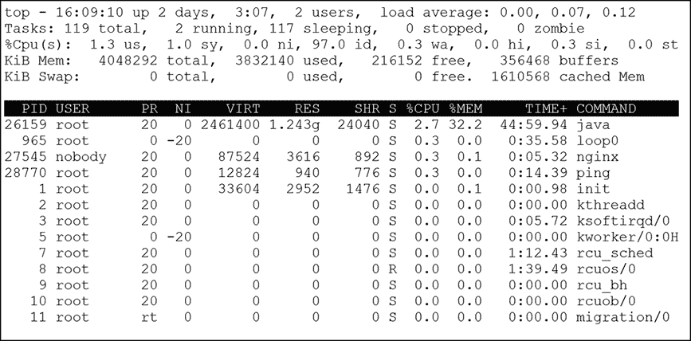

**图 4.2 `top` 命令输出**

表 4.8 描述了图 4.2 中显示的输出。

**表 4.8 `top` 命令输出详解**

| 输出内容 | 说明 |
| --- | --- |
| 第一行 | 源自 `uptime` 命令的输出。 |
| 第二行 | 系统上运行进程的摘要。 |
| 第三行 | 自上次 `top` 数据刷新以来的 CPU 统计数据。 |
| 第四行 | 物理内存统计。（注意：在 `top` 命令中按 `E` 将值从千字节改为其他值。） |
| 第五行 | 虚拟内存统计。 |
| 剩余行 | 进程列表及相关信息。 |

在 `top` 命令运行时，你可以使用交互式命令执行操作。表 4.9 描述了这些命令。

**表 4.9 用于 `top` 的交互式命令**

| 命令 | 说明 |
| --- | --- |
| `h` | 打开帮助。 |
| `E` | 将值从千字节改为其他。 |
| `z` | 在彩色和非彩色之间切换。 |
| `B` | 开启或粗体。 |
| `<` | 排序列向左移动。 |
| `>` | 排序列向右移动。 |
| `s` | 设置刷新间隔而非默认 2 秒。 |
| `k` | 根据进程 ID (PID) 杀死进程。 |
| `q` | 退出 `top` 命令。 |

`top` 命令还支持若干命令行选项，包括表 4.10 中列出的。

**表 4.10 `top` 命令行选项**

| 选项 | 说明 |
| --- | --- |
| `-d` | 设置刷新时间。 |
| `-n` *number* | 指定 `top` 命令退出前的刷新次数。 |
| `-u` *username* | 显示该用户的进程。 |

### ps

`ps` 命令用于列出运行在系统上的进程。在没有参数的情况下，该命令列出当前 shell 的任何子进程以及 `bash` shell，如下：

```
[student@OCS ~]$ ps
 PID TTY      TIME CMD
18360 pts/0   00:00:00 bash
18691 pts/0   00:00:00 ps
```

`ps` 命令的特殊之处在于它支持通常前面没有连字符（`-`）的旧 BSD 选项。表 4.11 详细说明了 `ps` 命令的一些重要选项。

**表 4.11 `ps` 命令选项**

| 选项 | 说明 |
| --- | --- |
| `-e` | 显示系统上所有进程；也可以 BSD 方法 `ps ax`。 |
| `-f` | 显示完整信息（即每个进程的额外信息）。 |
| `-u` *username* | 显示该用户的进程。 |
| `-forest` | 提供进程层级树。 |

### lsof

`lsof` 命令用于列出打开的文件。在不带参数时，它列出操作系统所有打开的文件，如下：

```
[root@OCS ~]# lsof | wc -l
25466
```

一种更有用的技术是列出所有与打开网络连接相关的文件，如下：

```
[root@OCS ~]# lsof -i
COMMAND PID USER FD TYPE DEVICE SIZE/OFF NODE NAME
avahi-dae 674 avahi 13u IPv4 15730 0t0
            UDP       *:mdns
avahi-dae 674 avahi 14u IPv4 15731 0t0
            UDP        *:49932
sshd 1411 root 3u IPv4 18771 0t0
            TCP       *:ssh (LISTEN)
sshd 1411 root 4u IPv6 18779 0t0
            TCP      *:ssh   (LISTEN)
master 2632 root 14u IPv4 20790 0t0
           TCP       localhost:smtp (LISTEN)
master 2632 root 15u IPv6 20791 0t0
            TCP      localhost:smtp (LISTEN)
dnsmasq 2739 nobody 3u IPv4 21518 0t0
            UDP      *:bootps
dnsmasq 2739 nobody 5u IPv4 21525 0t0
            UDP       192.168.122.1:domain
dnsmasq 2739 nobody 6u IPv4 21526 0t0
            TCP       192.168.122.1:domain (LISTEN)
cupsd 4099 root 12u IPv6 564510 0t0
            TCP       localhost:ipp (LISTEN)
cupsd 4099 root 13u IPv4 564511 0t0
            TCP        localhost:ipp (LISTEN)
dhclient 26133 root 6u IPv4 1151444 0t0
            UDP           *:bootpc
dhclient 26133 root 20u IPv4 1151433 0t0
               UDP       *:14638
dhclient 26133 root 21u IPv6 1151434 0t0
               UDP   *:47997
```

表 4.12 描述了 `lsof` 命令的常用选项。

**表 4.12 `lsof` 命令选项**

| 选项 | 说明 |
| --- | --- |
| `-i` | 匹配 Internet 地址；也可用于 IP 版本（`-i4` 或 `-i6`）、端口（`-i TCP:80`）或显示所有打开的连接。 |
| `-u` *user* | 列出*用户*打开的文件。 |
| `-p` *pid* | 列出由进程 ID *pid* 打开的文件。 |

### htop

`htop` 命令与 `top` 命令非常相似（参见本章前面的“top”部分），但它具有一些额外功能。例如，你可以水平和垂直滚动输出内容。`htop` 命令还会显示更多信息，例如用户线程和内核线程（*线程*是进程执行的一部分），这使得它对软件开发者来说是一项非常有用的命令。

### 设置优先级

`nice` 值用于指示 CPU 哪个进程具有访问 CPU 的最高优先级。值范围从 –20（最高优先级）到 19（最低优先级）。用户创建的任何任务的默认优先级均为 0。

**考试提示**

`nice` 值通常是 Linux+ XK0-005 考试题的考点。记住，数字越小，优先级越高。还要记住 `0` 是默认值，且只有 `root` 用户可以运行负数的进程。最后，请记住 –20 是最低的，19 是最高的；你可以预计在考试中看到提供如 –19 和 20 等可能答案的误导性问题。

下一节将提供在执行命令时设置不同优先级的详细信息。

### nice

要指定与默认值不同的 `nice` 值，请通过 `nice` 命令执行任务：

```
[student@OCS ~]$ nice -n 5 firefox
```

注意，普通用户不能分配负的 `nice` 值。这些值只能由 `root` 用户使用。除了 `-n` 选项外，没有其他有用选项。

要查看进程的 `nice` 值，使用 `ps` 命令配合 `-o` 选项并包含 `nice` 值，如下所示：

```
[student@OCS ~] ps -o nice,pid,cmd
 NI PID CMD
 0 23865 -bash
 0 27969 ps -o nice,pid,cmd
```

### renice

使用 `renice` 命令更改现有任务的 `nice` 值。这是一个示例：

```
[student@OCS ~] ps -o nice,pid,cmd
 NI PID CMD
 0 23865 -bash
 0 27969 ps -o nice,pid,cmd
```

`jobs` 命令显示当前正在运行的、以及从你输入 `jobs` 命令的 Shell 中启动的进程：

```
[student@OCS ~]$ jobs
[1]+ Stopped sleep 999
```

如果你打开另一个终端窗口并输入 `jobs` 命令，你将看不到在第一个终端窗口中显示的进程。

### Ctrl+Z

当进程在前台运行时，你可以通过按住 `Ctrl` 键并按下 `z` 键向进程发送 `SIGTSTP` 信号。`SIGTSTP` 信号的设计用于暂停程序。然后可以使用 `bg` 或 `fg` 命令重启该程序。

更多详情，请参阅本章较前的 `bg` 和 `fg` 章节。

### Ctrl+C

当进程在前台运行时，你可以通过按住 `Ctrl` 键并按下 `c` 键向进程发送 `SIGINT` 信号。`SIGINT` 信号的设计用于提前停止程序。

### Ctrl+D

当你运行一个接受用户输入的进程（例如 `at` 命令）时，你可以通过按住 `Ctrl` 键并按下 `d` 键向进程发送一个表示“我已完成输入”的信号（请参考本章较前的 `at` 章节）。

当你完成输入 `at` 命令后，按住 `Ctrl` 键并按下 `d` 键。这将产生一个 `<EOT>` 信息并创建 `at` 任务。以下是一个示例：

```
[root@OCS ~]$ at 5pm tomorrow
at> /home/bob/rpt.pl
at> echo "report complete" | mail bob
at> <EOT>
job 1 at Thu Feb 23 17:00:00 2017
```

### pgrep

通常，你组合使用 `ps` 和 `grep` 命令来显示特定进程，如下所示：

```
[student@OCS ~]$ ps -e | grep sleep
25194 pts/0 00:00:00 sleep
```

然而，`pgrep` 命令可以提供类似的功能：

```
[student@OCS ~]$ pgrep sleep
25194
```

表 4.14 详细说明了 `pgrep` 命令的一些重要选项。

**表 4.14 `pgrep` 命令选项**

| 选项 | 说明 |
| --- | --- |
| `-G` *name* | 通过组名匹配进程。 |
| `-l` | 显示进程名和 PID。 |
| `-n` | 优先显示最近启动的进程。 |
| `-u` *name* | 根据用户名匹配进程。 |

### pkill

使用 `kill` 命令向进程发送信号时，你通过提供进程 ID (PID) 来指定是哪个进程。使用 `pkill` 命令，你可以提供进程名、用户名或其他方法来指定要向哪个进程或哪些进程发送信号。例如，以下命令向用户 `sarah` 的所有进程发送 kill 信号：

```
[student@OCS ~]$ pkill -u sarah
```

表 4.15 详细说明了 `pkill` 命令的一些重要选项。

**表 4.15 `pkill` 命令选项**

| 选项 | 说明 |
| --- | --- |
| `-G` *name* | 通过组名匹配进程。 |
| `-u` *name* | 通过用户名匹配进程。 |

### pidof

当你知道想要控制的命令名称但不知道该命令的 PID（进程 ID）时，`pidof` 命令非常有用。该命令通过名称查找进程并返回其 PID：

```
[student@OCS ~]$ pidof dovecot
688
```

## 第 5 章

使用适当的网络工具或配置文件

**本章涵盖以下 Linux+ XK0-005 考试目标：**

*  **1.5:** 在给定的场景下，使用适当的网络工具或配置文件。

本章的目标是让你对不同的网络工具和配置文件有一个理解。你将首先学习各种用于显示网络信息并允许你动态更改网络设置的工具。接下来，你将学习要编辑哪些配置文件以使网络更改在重启后依然有效。

本章还探索了允许你监控网络流量并验证网络运行正常的工具。最后，你将学习一些允许你连接到远程系统的工具，以便登录这些系统或传输数据。

本章提供了以下主题的信息：接口管理、名称解析、网络监控和远程网络工具。

### 接口管理

Linux 中的 *接口*（或更具体地说，*网络接口*）是提供网络访问的设备。本节介绍了允许你管理网络接口的工具。

#### iproute2 工具

`iproute2 tools` 指一组旨在替换旧工具的工具集合。本节介绍了允许你管理网络接口的工具。

*(注：原文此段存在大量重复文本，已根据文档工程师规范进行精简，保留核心含义)*

| `-lt` | 列出监听的 TCP socket。 |
| `-lu` | 列出监听的 UDP socket。 |
| `-lp` | 列出拥有每个 socket 的进程 ID (PID)。 |
| `-n` | 指定不将 IP 地址解析为主机名，或将端口号解析为端口名称。 |


| `-a` | 显示所有信息。 |
| `-s` | 显示摘要。 |

表 5.3 `ss` 命令选项

### 提醒（ExamAlert）

TCP 和 UDP 等网络基础知识并非特定的考试主题，因此本书未涵盖这些内容。CompTIA 认为 Linux+ XK0-005 考试的级别高于 A+ 考试。换句话说，这假设你已经掌握了网络基础知识。缺乏这些知识可能会影响你理解 Linux+ 考试题的能力。如果你对网络基础不了解，请考虑在参加 Linux+ 考试之前研究一下该主题。

### NetworkManager

NetworkManager 软件用于管理 Linux 中的网络设备。NetworkManager 的命令行配置工具是 `nmcli`，本节将介绍该工具。

#### nmcli

`nmcli` 命令用于配置 NetworkManager，该工具旨在检测和配置网络连接。

语法：

```
nmcli [options] object [command]
```

示例：

```
[root@OCS ~]# nmcli device status
DEVICE      TYPE       STATE      CONNECTION
virbr0      bridge     connected  virbr0
enp0s3      ethernet   connected  enp0s3
lo          loopback   unmanaged   --
virbr0-nic  tun        unmanaged   --
```

`object` 是表 5.4 中列出的关键字之一。

| 关键字 | 描述 |
| :--- | :--- |
| `connection` | 管理网络连接。 |
| `device` | 管理特定设备。 |
| `general` | 获取 NetworkManager 状态信息。 |
| `networking` | 启用或禁用网络，或显示当前状态。 |
| `radio` | 查找无线（射）网络信息和配置。 |

表 5.4 `nmcli` 命令的参数

常用的 `nmcli` 命令在表 5.5 中描述。

| 命令 | 描述 |
| :--- | :--- |
| `status` | 显示当前设置。 |
| `on\|off` | 开启（或关闭）设置。 |
| `up\|down` | 启用（或禁用）接口。 |
| `add\|delete` | 添加新设备或删除现有设备。 |

表 5.5 可作为 `nmcli` 命令参数的命令

### net-tools

`net-tools` 一词指的是一组用于显示或修改网络信息的 Linux 命令。例如，`ifconfig`、`route`、`arp` 和 `netstat`（本节将涵盖这些内容）都是 `net-tools` 集合的一部分。

#### ifconfig

用于显示网络信息的常用命令之一是 `ifconfig` 命令。在不带任何参数执行时，它会列出活跃的网络设备，如下例所示。

```
[root@onecoursesource ~]# ifconfig
eth0: flags=4163<UP,BROADCAST,RUNNING,MULTICAST>  mtu 1500
        inet 192.168.1.16  netmask 255.255.255.0  broadcast 192.168.1.255
        inet6 fe80::a00:27ff:fe52:2878  prefixlen 64  scopeid 0x20<link>
        ether 08:00:27:52:28:78  txqueuelen 1000  (Ethernet)
        RX packets 20141  bytes 19608517 (18.7 MiB)
        RX errors 0  dropped 0  overruns 0  frame 0
        TX packets 2973  bytes 222633 (217.4 KiB)
        TX errors 0  dropped 0 overruns 0  carrier 0  collisions 0
lo: flags=73<UP,LOOPBACK,RUNNING>  mtu 65536
        inet 127.0.0.1  netmask 255.0.0.0
        inet6 ::1  prefixlen 128  scopeid 0x10<host>
        loop  txqueuelen 0  (Local Loopback)
        RX packets 3320  bytes 288264 (281.5 KiB)
        RX errors 0  dropped 0  overruns 0  frame 0
        TX packets 3320  bytes 288264 (281.5 KiB)
        TX errors 0  dropped 0 overruns 0
```

`ifconfig` 输出提供了关于每个网络接口的信息。`flags` 字段指示了当前状态，例如 `UP`、`BROADCAST`、`RUNNING` 和 `MULTICAST`。`mtu` 字段显示最大传输单元。`inet` 和 `inet6` 字段分别显示 IPv4 和 IPv6 地址。`ether` 字段显示 MAC 地址。`RX packets` 和 `TX packets` 字段显示接收和发送的数据包数量。`RX errors`、`dropped`、`overruns`、`TX errors`、`carrier` 和 `collisions` 字段提供了关于接口错误和问题的信息。

```
[root@OCS ~]# ls /etc/sysconfig/network-scripts/
ifcfg-eth0      ifdown-Team        ifup-plusb
ifcfg-lo        ifdown-TeamPort    ifup-post
ifdown          ifdown-tunnel     ifup-ppp
ifdown-bnep     ifup              ifup-routes
ifdown-eth      ifup-aliases      ifup-sit
ifdown-ippp     ifup-bnep         ifup-Team
ifdown-ipv6     ifup-eth          ifup-TeamPort
ifdown-isdn     ifup-ippp         ifup-tunnel
ifdown-post      ifup-ipv6        ifup-wireless
ifdown-ppp       ifup-ipx         init.ipv6-global
ifdown-routes    ifup-isdn         network-functions
ifdown-sit       ifup-plip        network-functions-ipv6
```

在大多数情况下，你可能根据文件名推测出配置文件的用途。例如，`ifup-wireless` 文件用于配置无线网络。这些文件许多还包含注释，用于描述文件的目的和用法。

最常编辑的文件是 `ifcfg-*interface`，其中 `interface` 是网络接口的名称。例如，`ifcfg-eth0` 用于配置 `eth0` 设备，如下所示：

```
[root@OCS ~]# more /etc/sysconfig/network-scripts/ifcfg-eth0
DEVICE=eth0
BOOTPROTO=static
ONBOOT=yes
IPADDR=192.168.0.100
NETMASK=255.255.255.0
GATEWAY=192.168.0.1
```

表 5.6 列出了一些常见的 `ifcfg-*interface` 配置设置。

| 设置 | 说明 |
| :--- | :--- |
| `DEVICE` | 接口的名称。 |
| `BOOTPROTO` | 如果手动提供网络信息（如 IP 地址、子网掩码和网关），则设置为 `static`。设置为 `dhcp` 则可从 DHCP 服务器动态分配这些值。 |
| `ONBOOT` | 通常设置为 `yes`，以便在启动过程中激活此设备。 |
| `IPADDR` | 应分配给该设备的 IP 地址。 |
| `NETMASK` | 设备的子网掩码。 |
| `GATEWAY` | 该接口的默认网关。 |

表 5.6 `ifcfg-*interface` 配置设置

### 域名解析

域名解析是确定与给定主机名对应的 IP 地址的过程。反向解析是确定与给定 IP 地址对应的主机名的过程。本节介绍了与解析相关的命令和功能。

#### nsswitch

`nsswitch` 指名称服务切换（NSS），它是一个用于确定系统从何处查找解析所需工具的机制。

NSS 配置文件 `/etc/nsswitch.conf` 应用程序用于确定获取网络服务信息的来源以及获取顺序。例如，对于网络而言，该文件包含了名称服务器解析器的位置，该是一个提供主机名到 IP 地址转换的工具。

```
[root@onesourcesource ~]# grep hosts /etc/nsswitch.conf
#hosts:     db files nisplus nis dns
hosts:      files dns
```

在此示例中，`files dns` 意味着“首先查看本地 `/etc/hosts` 文件，如果本地文件中没有所需的转换关系，则查看 DNS 服务器”。

表 5.7 描述了一些常用的主机名到 IP 地址的转换工具。

| 工具 | 说明 |
| :--- | :--- |
| `files` | 本地 `/etc/hosts` 文件 |
| `dns` | DNS 服务器 |
| `NIS` | 网络信息服务服务器 |

表 5.7 主机名到 IP 地址的转换工具

#### /etc/resolv.conf

`/etc/resolv.conf` 文件包含了系统 DNS 服务器的列表。一个典型文件如下：

```
[root@OCS ~]# cat /etc/resolv.conf
search sample999.com
nameserver 192.168.1
```

如果你在使用如 `NetworkManager` 等工具配置网络设置，或者正在使用 DHCP 客户端，那么该文件通常由这些工具填充。对于服务器，此文件通常是手动定义的。

表 5.8 描述了 `/etc/resolv.conf` 文件的常用设置。

| 设置 | 说明 |
| :--- | :--- |
| `nameserver` | DNS 服务器的 IP 地址。文件中可以多达三行 `nameserver`。 |
| `domain` | 用于指定本地域，允许在 DNS 查询时使用短名。 |
| `search` | 当使用短名进行 DNS 查询时使用的可选域名列表。 |

表 5.8 `/etc/resolv.conf` 常用设置

#### systemd

`systemd` 工具可以启用和禁用功能。更多信息请参阅第 4 节的“系统服务”。

#### hostnamectl

`hostnamectl` 命令可查看和更改主机名。配合参数使用时，它会显示系统信息。

```
[root@OCS ~]# hostnamectl
Static hostname: OCS
Icon name: OCS
Deployment Host: OCS
Kernel: Linux 3.10.0-512.7
Architecture: x86_64
Operating system: CentOS Linux 7 (Core)
Virtualization: none
```

| `-x address` | 执行反向查询（当提供 IP 地址时返回主机名）。 |

表 5.9 `dig` 命令选项

### nslookup

`nslookup` 命令设计用于对 DNS 服务器进行简单查询。

语法：

```
nslookup hostname
```

示例：

```
[root@OCS ~]# nslookup google.com
Server:       8.8.8.8

Address:      8.8.8.8#53
Non-authoritative answer:
Name:     google.com
Address: 216.58.219.238
```

虽然该命令通常被认为是过时的，但在现代发行版中它仍然经常被使用。`nslookup` 命令通常在不带任何选项的情况下运行。

### host

`host` 命令通常用于执行简单的主机名到 IP 地址的转换操作（也称为 `DNS queries`）。这里有一个示例：

```
[root@OCS ~]# host google.com
google.com has address 172.217.4.142
google.com has IPv6 address 2607:f8b0:4007:800::200e
google.com mail is handled by 30 alt2.aspmx.l.google.com.
google.com mail is handled by 50 alt4.aspmx.l.google.com.
google.com mail is handled by 20 alt1.aspmx.l.google.com.
google.com mail is handled by 10 aspmx.l.google.com.
google.com mail is handled by 40 alt3.aspmx.l.google.com.
```

表 5.10 描述了 `host` 命令的常用选项。

| 选项 | 描述 |
| :--- | :--- |
| `-t` | 指定你想显示的查询类型；例如，`host -t ns google.com` 显示 Google 的域名服务器。 |
| `-4` | 表示仅执行 IPv4 查询。 |
| `-6` | 表示仅执行 IPv6 查询。 |
| `-v` | 进入详细输出模式，输出与 `dig` 命令类似。 |

表 5.10 `host` 命令选项

### WHOIS

`whois` 命令对于确定哪个公司或个人拥有域名非常有用。输出通常还包含有关如何联系该组织的信息，尽管出于隐私考虑这些信息可能会被掩码。这里有一个示例：

```
# whois onecoursesource.com | head
   Domain Name: ONECOURSESOURCE.COM
   Registry Domain ID: 116444640_DOMAIN_COM-VRSN
   Registrar WHOIS Server: whois.tucows.com
   Registrar URL: http://www.tucows.com
   Updated Date: 2016-01-15T01:49:45Z
   Creation Date: 2004-04-07T19:45:31Z
   Registry Expiry Date: 2021-04-07T19:45:31Z
   Registrar: Tucows Domains Inc.
   Registrar IANA ID: 69
   Registrar Abuse Contact Email:
```

### 网络监控

网络监控是观察网络流量以确定是否存在网络流量问题的过程。本节描述了许多常用的网络监控工具。

#### tcpdump

在排除网络问题或执行网络安全审计时，查看网络流量（包括与本地机器无关的流量）很有帮助。`tcpdump` 命令是一个数据包嗅探器，允许你查看本地网络流量。

默认情况下，`tcpdump` 命令会将所有网络流量显示到标准输出，直到你终止该命令。这可能导致屏幕上飞过大量惊人的数据。你可以通过使用 `-c` 选项将输出限制为特定数量的网络数据包，如例所示：

```
# tcpdump -c 5
tcpdump: verbose output suppressed, use -v or -vv for full
 protocol decode
listening on eth0, link-type EN10MB (Ethernet), capture size 65535
bytes
11:32:59.630873 IP localhost.43066 > 192.168.1.1.domain:
 16227+ A? onecoursesource.com. (37)
11:32:59.631272 IP localhost.59247 > 192.168.1.1.domain:
 2117+ PTR? 1.1.168.192.in-addr.arpa. (42)
11:32:59.631387 IP localhost.43066 > 192.168.1.1.domain:
 16227+ A? onecoursesource.com. (37)
11:32:59.631272 IP localhost.59247 > 192.168.1.1.domain:
 2117+ PTR? 1.1.168.192.in-addr.arpa. (42)
```

#### Wireshark/tshark

Wireshark 是一个图形化的网络嗅探器，而 tshark 是其命令行版本。它们都用于分析网络流量。

#### netstat


`netstat`命令用于显示各种网络信息。它是排除网络问题的一项关键工具。

```
# traceroute onecoursesource.com
traceroute to onecoursesource.com (38.89.136.109), 30 hops max, 60
byte packets
 1 10.0.2.2 (10.0.2.2) 0.606 ms 1.132 ms 1.087 ms
 2 b001649-3.jfk01.atlas.cogentco.com (38.104.71.201)
 0.738 ms 0.918 ms 0.838 ms
 3 154.24.42.205 (154.24.42.205) 0.952 ms 0.790 ms 0.906 ms
 4 be2629.ccr41.jfk02.atlas.cogentco.com (154.54.27.66)
 1.699 ms 1.643 ms 1.347 ms
 5 be2148.ccr41.dca01.atlas.cogentco.com (154.54.31.117)
 8.053 ms 7.719 ms 7.639 ms
 6 be2113.ccr42.atl01.atlas.cogentco.com (154.54.24.222)
 18.276 ms 18.418 ms 18.407 ms
 7 be2687.ccr21.iah01.atlas.cogentco.com (154.54.28.70)
 32.861 ms 32.917 ms 32.719 ms
 8 be2291.ccr21.sat01.atlas.cogentco.com (154.54.2.190)
 38.087 ms 38.025 ms 38.076 ms
 99 be2301.ccr21.elp01.atlas.cogentco.com (154.54.5.174)
 48.811 ms 48.952 ms 49.151 ms
10 be2254.ccr21.phx02.atlas.cogentco.com (154.54.7.33)
 57.332 ms 57.281 ms 56.896 ms
11 te2-1.mag02.phx02.atlas.cogentco.com (154.54.1.230)
 56.666 ms 65.279 ms 56.520 ms
12 154.24.18.26 (154.24.18.26) 57.924 ms 58.058 ms 58.032 ms
13 38.122.88.218 (38.122.88.218) 79.306 ms 57.740 ms 57.491 ms
14 onecoursesource.com (38.89.136.109) 58.112 ms 57.884 ms 58.299 ms
```

## ping

`ping`命令用于验证远程主机是否响应网络连接：此处查看图像

```
 [root@OCS ~]# ping -c 4 google.com
PING google.com (172.217.5) 64 bytes of data.
64 bytes from 172.217.5: icmp_seq=1 ttl=55 time=49.0 ms
64 bytes from 172.217.5: icmp_seq=2 ttl=55 time=30.2 ms
64 bytes from 172.217.5: icmp_seq=3 ttl=55 time=30.0 ms
64 bytes from 172.217.5: icmp_seq=4 ttl=55 time=29.5 ms

--- google.com ping statistics ---
4 packets transmitted, 4 received, 0% packet loss, time 3008ms
rtt min/avg/max/mdev = 29.5/34.7/49.0/8.2
```

默认情况下，`ping`命令持续向远程系统发送 ping，直到用户取消命令（按下 `Ctrl+C`）。`-c`选项指定请求次数。

## mtr

如果你想要 `traceroute`命令的一个酷炫版本（参见章节前面的 traceroute 部分），请安装`mtr`命令。该命令每秒执行一次类似于`traceroute`的操作，并更新统计信息，如图 5.2。

## 远程工具

远程网络工具旨在允许你连接远程系统用于以下目的：

- 在远程系统上执行命令
- 向远程系统传输文件
- 从远程系统传输文件

### 安全 Shell (SSH)

`ssh`命令是一个允许你连接到安全 Shell (SSH) 服务器的实用程序。命令语法如下：

```
ssh user@hostname
```

其中`user`是你想登录的用户名，`hostname`是系统主机名或 IP 地址。第一次使用`ssh`命令连接系统时，会出现以下提示：

此处查看代码图像

```
[root@OCS ~]# ssh bob@server1
The authenticity of host 'server1' can't be established.
ECDSA key fingerprint is 256:SHA256:8a:9...55f.
Are you sure you want to continue connecting (yes/no)?
```

这确保你登录的是正确的系统。通常用户会对此提示回答`yes`，假设他们正在登录正确的机器，但通过联系远程系统的管理员也可以独立验证此信息。

用户对此提示回答`yes`后，SSH 服务器指纹将存储在`~/.ssh`目录下的`known_hosts`文件中。表 5.12 描述了`ssh`命令的常用选项。

| 选项 | 说明 |
| --- | --- |
| `-F configfile` | 指定`ssh`客户端使用的配置文件。默认配置文件为`/etc/ssh/ssh_config`。 |
| `-4` | 表示仅使用 IPv4 地址。 |
| `-6` | 表示仅使用 IPv6 地址。 |
| `-E logfile` | 将错误放在指定的日志文件中，而不是显示在标准输出。 |

#### 命令选项

单个用户的 SSH 数据存储在每个用户家目录下的`.ssh`子目录下。SSH 使用此目录存储重要数据，用户可以修改该目录中的配置。本节重点关注可能存储在`~/.ssh`目录中的文件。

与 SSH 服务器建立连接后，SSH 客户端会将服务器唯一的指纹密钥存储在用户的`~/.ssh/known_hosts`文件中，如下：

此处查看代码图像

```
[root@OCS ~]# cat .ssh/known_hosts
```

通常`known_hosts`文件的内容应保持不受干扰；然而，如果 SSH 服务器重装，它将有一个新的指纹。所有用户必须删除`known_hosts`文件中的旧条目。

```bash
# curl http://onecoursesource.com
<!DOCTYPE HTML PUBLIC "-//IETF//DTD HTML 2.0//EN">
<<html><head>
<title>301 Moved Permanently</title>
</head><body>
<h1>Moved Permanently</h1>
<p>The document has moved
 <a href="http://www.onecoursesource.com/">here</a></a>>.</p>
</body></html>
```

### Curl vs wget

注意，数据是显示出来的，而不是像`wget`命令那样存储在文件中。你可以使用重定向将内容放入文件。

## Wget

`wget`命令被设计为一个非交互式工具，用于通过 HTTP、HTTPS 或 FTP 从远程系统下载文件。它通常在脚本中使用。

### 语法：

点击此处查看代码图片

```bash
wget location
```

### 示例：

```bash
# wget http://onecoursesource.com
--2019-01-09 15:18:26-- http://onecoursesource.com/
Resolving onecoursesource.com (onecoursesource.com)...38.89.136.109
Connecting to onecoursesource.com (onecoursesource.com)
 |38.89.136.109|:80... connected.
HTTP request sent, awaiting response... 301 Moved Permanently
Location: http://www.onecoursesource.com/ [following]
--2019-01-09 15:18:26-- http://www.onecoursesource.com/
Resolving www.onecoursesource.com
 (www.onecoursesource.com)... 38.89.136.109
Reusing existing connection to onecoursesource.com:80.
HTTP request sent, awaiting response... 200 OK
Length: unspecified [text/html]
Saving to: 'index.xhtml'

index.xhtml [ <=> ]
 12.25K --.-KB/s in 0s

2019-01-09 15:18:26 (259 MB/s) - 'index.xhtml' saved [12539]
```

表 5.13 列出了在使用`wget`命令时的一些有用选项。

| 选项 |  |
| :--- | --- |
| `-h` | 显示帮助信息。 |
| `-b` | 在后台执行下载。这对于大文件下载很有用。 |
| `-q` | 静默下载。 |
| `-v` | 进入详细模式。 |
| `-nc` | 表示不覆盖现有文件。 |
| `-c` | 继续部分下载。如果下载因断开而失败，这非常有用。 |
| `-r` | 进入递归模式。 |

表 5.13 `wget`命令选项

## Nc

查看第 2 章中的“管理文件和目录”章节。

## Rsync

查看第 2 章中的“rsync”章节。

## 安全复制协议 (SCP)

查看第 2 章中的“scp”章节。

### SSH 文件传输协议 (SFTP)

`sftp`命令使用 SSH (Secure Shell) 协议跨网络安全地传输文件。要访问远程系统，请使用以下语法：

```bash
sftp user@machine
```

登录远程系统后，你将获得一个以以下提示符开头的接口：

```bash
sftp>
```

在此提示符下，可以使用几个命令来传输文件并执行其他操作。表 5.14 描述了这些命令中最重要的。

| 命令 | 描述 |
| --- | --- |
| `pwd` | 显示当前远程目录。 |
| `lpwd` | 显示当前本地目录。 |
| `cd` | 切换到远程系统上的另一个目录。 |
| `lcd` | 切换到本地系统的另一个目录。 |
| `get` | 从远程系统的当前目录下载文件到本地当前目录。使用`-r`获取整个目录结构。 |
| `put` | 从本地当前目录上传文件到远程系统的当前目录。使用`-r`上传整个目录结构。 |
| `ls` | 显示远程系统当前目录下的文件。 |
| `lls` | 显示本地当前目录下的文件。 |
| `exit` | 退出`sftp`。 |

表 5.14 在`sftp`提示符下可以使用命令

# 第 6 章：构建与安装软件

**本章涵盖了以下 Linux+ XK0-005 考试目标：**

*    **1.6:** 给定场景，构建并安装软件。

本章探索了如何在不同的 Linux 发行版上管理软件。你将学习不同 Linux 沙箱应用程序的核心要点，以及内核更新与系统包更新之间的区别。

本章提供了关于以下主题的信息：软件包管理、沙箱应用程序和系统更新。

### 软件包管理

Linux 中的软件包（package）是一个包含可安装软件的文件。沙箱应用程序包是软件的集合。本节回顾了用于不同平台的各种工具。

### DNF

`dnf`工具被设计为`yum`的增强和替代品。大多数`dnf`命令与`yum`一样工作。注意的是，DNF 的配置文件为`/etc/yum/dnf.conf`。

### YUM

`yum`命令用于从仓库安装软件。它还可以移除软件并显示信息。表 6.1 列出了主要的`yum`命令。

| 命令/选项 | 描述 |
| --- | --- |
| `install` | 从仓库安装软件包及其依赖包。例如：`yum install zip`。 |
| `groupinstall` | 从仓库安装整个软件组。例如：`yum groupinstall "Office Suite and Productivity"`。 |
| `update` | 更新指定的软件包。 |
| `remove` | 从系统中移除软件包。 |
| `groupremove` | 从系统中移除指定的软件组。 |
| `list` | 显示软件包信息，包括哪些已安装，哪些可用。例如：`yum list available`。 |
| `grouplist` | 显示软件组信息，包括包含哪些软件包；不带参数使用`yum grouplist`可查看可用软件组列表。 |
| `info` | 提供特定软件包的信息。例如：`yum info zip`。 |
| `groupinfo` | 提供特定软件组的信息。 |
| `-y` | 自动对任何提示回答**是**。例如：`yum -y install zip`。 |

表 6.1 `yum`命令与选项

表 6.2 描述了`yum list`命令的一些重要选项。

| 选项 | 描述 |
| --- | --- |
| `all` | 列出所有已安装或可用的软件包。 |
| `installed` | 列出所有已安装的软件包。 |
| `available` | 列出所有未安装但可用的软件包。 |
| `updates` | 列出系统中已安装且仓库中有可用新版本的软件包。 |

表 6.2 `yum list`命令选项

注意

通配符（或 *globs*）可以用于 yum 命令。这里有一个示例：

点击此处查看代码图片

```
 # yum list installed "*zip*"
 Loaded plugins: fastestmirror, langpacks
Repodata is over 2 weeks old. Install yum-cron?
 Or run: yum makecache fast
Loading mirror speeds from cached hostfile
 * base: mirror.supremebytes.com
 * epel: mirror.chpc.utah.edu
 * extras: mirrors.cat.pdx.edu
 * updates: centos.sonn.com
Installed Packages
bzip2.x86_64                  1.0.6-13.el7   @base
bzip2-libs.x86_64             1.0.6-13.el7   @base
gzip.x86_64                   1.5-8.el7      @base
perl-Compress-Raw-Bzip2.x86_64 2.061-3.el7   anaconda
unzip.x86_64                  6.0-15.el7     @base
zip.x86_64                    3.0-10.el7     @anaconda
```

`yumdownloader`命令用于下载软件包包而不安装该软件。生成的 RPM 文件可以手动安装或复制到其他系统。

表 6.3 描述了`yumdownloader`命令的一些重要选项。

#### 表 6.3 yumdownloader 命令选项

| 选项 | 说明 |
| --- | --- |
| `--destdir` | 用于指定下载 RPM 文件的目录。（默认为当前目录。） |
| `--resolve` | 用于下载指定软件包的依赖包。（默认为只下载指定的软件包。） |
| `--source` | 用于下载源码 RPM，而不是二进制（可安装的）RPM。 |

`/etc/yum.conf`文件是`yum`命令的主要配置文件。

##### 示例：

点击此处查看代码图片

```
[main]
cachedir=/var/cache/yum/$basearch/$releasever
keepcache=0
debuglevel=2
logfile=/var/log/yum.log
exactarch=1
obsoletes=1
gpgcheck=1
plugins=1
installonly_limit=5
bugtracker_url=http://bugs.centos.org/set_project.php
 ?project_id=23&ref=http://bugs.centos.org/
 bug_report_page.php?category=yum
distroverpkg=centos-release
```

表 6.4 描述了`/etc/yum.conf`文件的一些关键设置。

#### 表 6.4 /etc/yum.conf 文件关键设置

| 设置 | 说明 |
| --- | --- |
| `cachedir` | 下载后存放 RPM 文件的目录。 |


| `logfile` | 包含 `yum` 操作的日志文件位置。 |
| --- | --- |
| `gpgcheck` | 值为 `1` 表示执行 GPG（GNU Privacy Guard）检查以确保软件包有效；`0` 表示不执行 GPG 检查。（这可以通过每个仓库配置文件的特定设置来覆盖。） |
| `assumeyes` | 值为 `1` 表示对是/否提示始终假设为“是”；`0` 表示不做任何假设（而是提供提示）。 |

**考试警报**

预计 Linux+ XK0-005 考试将出一个关于表 6.4 中描述的关键设置的题目。

`/etc/yum.repos.d` 目录包含以 `.repo` 结尾的文件，用于指定 `yum` 仓库的位置。每个文件定义一个或多个仓库，如图 6.1 所示。

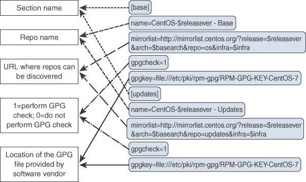

**图 6.1 /etc/yum.repos.d 目录下的文件格式**

#### APT

使用 `apt-get` 命令管理位于仓库中的 Debian 软件包。该命令利用 `/etc/apt/sources.list` 文件来确定使用哪个仓库。（有关此文件的更多信息请参阅本节末尾）。

以下是 `apt-get` 命令的一些语法示例：

```bash
apt-get [options] command
apt-get [options] install|remove pkg1 [pkg2...]
apt-get [options] source pkg1 [pkg2...]
```

要指定要的操作，请向 `apt-get` 命令提供一个关键字（命令）。表 6.5 描述了 `apt-get` 的一些实用命令。

#### 表 6.5 apt-get 命令

| 命令 | 说明 |
| --- | --- |
| `install` | 安装指定的软件包；如果软件包已安装，则使用 `--only-upgrade` 选项进行升级而非全新安装。 |
| `update` | 更新每个可用软件包的软件包缓存。 |
| `upgrade` | 更新所有软件包及其依赖项。 |
| `remove` | 移除软件包，但将其配置文件留在系统中。 |
| `purge` | 移除软件包，包括其配置文件。 |

使用 `apt-cache` 命令显示软件包信息。以下是 `apt-cache` 命令的一些语法示例：

```bash
apt-cache [options] command
```

要指定要的操作，请向 `apt-cache` 命令提供一个关键字（命令）。表 6.6 描述了 `apt-cache` 的一些实用命令。

#### 表 6.6 apt-cache 命令

| 命令 | 说明 |
| --- | --- |
| `search` | 显示所有包含搜索词的软件包。 |
| `show` | 显示有关软件包的信息。 |
| `stats` | 显示有关软件包的统计数据。 |
| `showsrc` | 显示源码包的信息。 |
| `depends` | 显示软件包的依赖项。 |
| `rdepends` | 显示软件包的反依赖项（依赖于此的包）。 |

`aptitude` 实用是一个菜单驱动工具，旨在方便地显示、添加和删除软件包。图 6.2 显示了该工具。

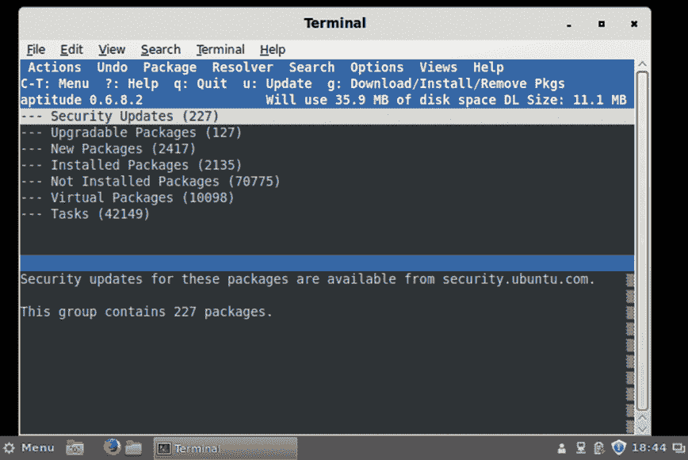

**图 6.2 aptitude 工具**

`/etc/apt/sources.list` 文件包含软件仓库的 URL 列表；图 6.3 描述了该文件。

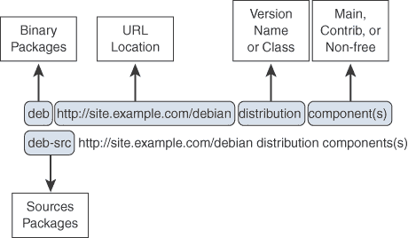

**图 6.3 /etc/apt/sources.list**

发行版可以是之一：

-  版本名称（例如 `wheezy`、`jessie`、`stretch` 或 `sid`）。
-  类名称（例如 `oldstable`、`stable`、`testing` 或 `unstable`）。

组件可以是之一：

-  `main`：必须符合 DFSG（Debian 自由软件指南）。
-  `contrib`：必须符合 DFSG，但软件包依赖项不必。
-  `non-free`：不符合 DFSG。

**考试警报**

在参加 Linux+ XK0-005 考试之前，了解上述列表中的不同组件。

以下是 Debian Jessie 默认文件：

```text
deb http://httpredir.debian.org/debian jessie main
deb-src http://httpredir.debian.org/debian jessie main

deb http://httpredir.debian.org/debian jessie-updates main
deb-src http://httpredir.debian.org/debian jessie-updates main

deb http://security.debian.org/ jessie/updates main
deb-src http://security.debian.org/ jessie/updates main
```

APT 的主要配置文件是 `/etc/apt.conf` 文件。该文件可设置调试选项、配置代理连接以及 APT 如何缓存软件包。

#### RPM

`rpm` 命令用于安装、升级和移除系统中已下载的软件包。表 6.7 描述了一些实用的选项。

#### 表 6.7 rpm 命令选项

| 选项 | 说明 |
| --- | --- |
| `-i` | 安装软件包。 |
| `-U` | 如果存在旧版本的软件包，则进行升级；如果不存在旧版本则从头开始安装。 |
| `-F` | 如果存在旧版本的软件包，则更新该包；如果没有旧版本，则不执行任何操作。 |
| `-e` | 移除软件包，包括配置文件。 |
| `-l` | 列出当前安装的软件包。 |
| `-q` | 执行包查询；可以使用额外的选项来精调查询。 |
| `-f` | 确定特定文件属于哪个软件包。 |

使用 `rpm` 命令的 `-q` 选项来执行查询。表 6.8 描述了一些用于精调查询的额外选项。

#### 表 6.8 rpm 查询选项

| 选项 | 说明 |
| --- | --- |
| `-a` | 返回所有已软件包的列表。 |
| `-c` | 列出与指定软件包一起安装的配置文件。 |
| `-d` | 列出与指定软件包一起安装的文档文件。 |
| `-i` | 显示指定软件包的信息。 |
| `-K` | 验证指定软件包的完整性。 |
| `-l` | 列出与指定软件包一起安装的所有文件。 |
| `-provides` | 列出指定软件包提供的各种能力。 |
| `-R` | 列出指定软件包所需的各种。 |
| `-s` | 显示由指定软件包安装的每个文件的状态（正常、未安装或已替换）。 |

示例：

```text
$ rpm -qc cups
/etc/cups/classes.conf
/etc/cups/client.conf
/etc/cups/cups-files.conf
/etc/cups/cupsd.conf
/etc/cups/lpoptions
/etc/cups/printers.conf
/etc/cups/snmp.conf
/etc/cups/subscriptions.conf
/etc/dbus-1/system.d/cups.conf
/etc/logrotate.d/cups
/etc/pam.d/cups
```

### dpkg

使用 `dpkg` 命令管理本地 Debian 软件包。

语法：

```bash
dpkg [option] command
```

表 6.9 描述了一些实用的 `dpkg` 选项。

#### 表 6.9 dpkg 命令选项

| 选项 | 说明 |
| --- | --- |
| `-i` | 安装软件包。 |
| `-r` | 移除软件包但保留配置文件。 |
| `-P` | 移除软件包，包括配置文件（清理）。 |
| `-l` | 列出当前安装的软件包。 |
| `-L` | 列出与软件包一起安装的文件（例如，`dpkg -L zip`）。 |
| `-V` | 验证指定软件包或多个软件包的完整性。 |
| `-s` | 显示包状态。 |
| `-C` | 检查损坏的包。 |
| `-S` | 列出负责在系统上安装特定文件的软件包名称（例如，`dpkg -S /usr/bin/zip`）。 |

当安装软件包时，它可能会作为安装过程的一部分运行配置脚本。要在未来的某个时刻再次运行此配置脚本，请使用 `dpkg-reconfigure` 命令。虽然该命令有一些选项，但很少被使用。

`dpkg-reconfigure` 命令的语法如下：

```bash
dpkg-reconfigure [options] source packages
```

以下示例重新运行了 `tzdata` 配置脚本：

```bash
dpkg-reconfigure tzdata
```

### ZYpp

ZYpp 软件包提供了 `zypper` 工具。在 SUSE Linux 上可以找到 `zypper` 工具。它源自 RPM 软件套件，工作方式与 `yum` 非常相似。它具有自动依赖检查并使用存储库。它的命令结构和选项与 `yum` 几乎相同。这里是一个示例：

```bash
zypper install pkg_name
```

如果你知道如何使用 `yum` 命令，那么在大多数情况下你可以将 `yum` 替换为 `zypper`，命令将成功执行。

### 沙箱应用程序

在 Linux 上部署应用程序面临的挑战之一是许多不同的发行版。对于开发者来说，要正确测试应用程序在所有可能环境中的性能是非常的。

沙箱可以帮助解决这个问题。无论沙箱环境放置在何种 Linux 发行版上，其行为都是相同的。沙箱应用程序是指任何安装在沙箱环境中的应用程序。

#### ExamAlert

本主题涵盖了流行的 Linux 沙箱的一些基础知识。请记住，Linux+ XK0-005 不会询问有关这些环境的详细问题。

#### snapd

`snapd` 守护进程管理称为 `snaps` 的软件包，这些软件包从 Canonical 维护的 Snap Store 下载（Canonical 也维护 Ubuntu Linux）。事实上，Ubuntu Core 是一个只使用 snap 应用程序的 Linux 发行版。

开发者可以使用 Snapcraft，该工具允许开发者将程序打包为 `snaps`。

#### Flatpak

要使用 Flatpak，首先需要安装 Flatpak 软件包。该软件包并非在所有发行版都可用，但大多数发行版都提供了它。Flatpak 应用程序从称为 `remotes` 的存储库安装。

Flatpak 应用程序是为 Flatpak 环境编译的。

#### AppImage

AppImage 采用了一种独特的方法，每个 AppImage 都是自包含。这意味着单个包包含了所有软件，但库也可以共享。AppImage 包通常比 snap 或 Flatpak 包小。

### 系统更新

软件包可以分为两大类：系统软件包或非系统软件包。将系统软件包视为任何可以影响操作系统功能的软件。系统软件包示例包括：

-  `iptables`：提供防火墙能力的软件。
-  `libcrypt`：提供加密库的软件。
-  `kernel`：提供内核代码的软件。

非系统软件包是不影响操作系统功能的软件包。将非系统软件包视为用户将使用的但操作系统运行所必需的应用程序，包括：

-  浏览器。
-  邮件客户端程序。
-  游戏。

更新非系统软件包通常只需要用户重启应用程序以使用新版本。更新系统软件包可能需要系统管理员进行更多操作。这些系统软件包也可以分为内核和其他。内核更新在随后的“内核更新”章节中描述。所有其他系统软件包将在章节结束处描述。

## 内核更新

内核更新在两个方面与其它系统更新不同：

-  为了使用新内核，您需要启动操作系统。
-  当安装内核时，它不会替换之前的内核。当安装非内核软件软件包以升级之前的版本时，它会替换原始版本。内核之所以不同，是因为如果新内核无法启动系统，您希望能够恢复到之前的版本。

软件包更新是一项重要任务，不应被忽视，因为许多更新包含了安全修复。未能重启软件将使你的系统受到攻击和其他安全问题的威胁。

## 第二部分：安全

## 第 7 章

### 管理软件配置

本章涵盖了以下 Linux+ XK0-005 考试目标：

-  **1.7:** 给定场景，管理软件配置。

在第 6 章“构建与安装软件”中，你学习了软件管理。在本章中，重点转向软件配置。你学习如何管理软件仓库配置以及如何配置内核。你还将学习如何配置常用的系统服务，例如 SSH、NTP 和 syslog。

本章提供了有关以下主题的信息：更新配置文件、配置内核选项、配置常用系统服务以及本地化。

### 更新配置文件

本节探讨了你应该学会如何更新的包管理配置文件。

#### 步骤

如果你升级了软件包，可能需要重启或重新加载服务。通常，软件包随附的文档会标明是否需要重启或重新加载。如果你对软件的配置文件进行了更改，可能也需要重启或重新加载服务。本节将介绍这些步骤。

##### 重启服务

`restart` 选项用于 `systemctl` 命令重启正在运行的服务。重启可能会导致服务在短时间内不可用。

语法：

```bash
systemctl restart process_name
```

你可以使用 `active` 命令判断服务当前是否正在运行：

```text
# systemctl active cups
enabled
```

##### 重新加载服务

`reload` 选项用于 `systemctl` 命令重新加载正在运行的服务。此命令不会停止服务，而是让服务重新读取其配置文件，并根据配置文件的更改改变其行为。

语法：

```bash
systemctl reload process_name
```

你可以使用 `active` 命令判断服务当前是否正在运行：

```text
# systemctl active cups
enabled
```

#### .rpmnew

当安装 RPM 包时，随着新配置设置的添加或旧配置设置的移除，它们可能会覆盖软件包的默认配置文件。

如果系统管理员花费了精力创建了自定义配置文件，配置文件的覆盖可能会导致他们感到沮丧。因此，软件开发者可能会将新配置文件的内容放在一个名为 `.rpmnew` 的文件中。然后，系统管理员可以检查 `.rpmnew` 文件，并确定哪些新设置应该合并到主配置文件。

另一种技术是让软件开发者使用 `.rpmsave` 文件，如下一节所述。

#### .rpmsave

当安装 RPM 包时，随着新配置设置的添加或旧配置设置的移除，它们可能会覆盖软件包的默认配置文件。

如果系统管理员花费了精力创建了自定义配置文件，配置文件的覆盖可能会导致他们感到沮丧。因此，软件开发者可能会将之前的配置文件内容放在一个名为 `.rpmsave` 的文件中。然后，系统管理员可以检查 `.rpmsave` 文件，并确定之前的设置中哪些应该合并到主配置文件。

另一种技术是让软件开发者使用 `.rpmnew` 文件，如上一节所述。

**考试提示**

准备好接受关于 `.rpmnew` 和 `.rpmsave` 文件区别的测试。

#### 仓库配置文件

在第 6 章中讨论过的仓库配置文件是包管理的不可或缺的。Linux+ XK0-005 考试在不同的考试类别中列出了这些主题，因此保留了以下章节标题，以告知你去哪里查找这些主题的详情。

##### `/etc/apt.conf`

参见第 6 章中的“APT”部分。

##### `/etc/yum.conf`

参见第 6 章中的“YUM”部分。

##### `/etc/dnf/dnf.conf`

参见第 6 章中的“DNF”部分。

##### `/etc/yum.repo.d`

参见第 6 章中的“YUM”部分。

##### `/etc/apt/sources.list.d`

参见第 6 章中的“APT”部分。

### 配置内核选项

Linux 内核高度可配置。你可以通过参数和内核模块对内核进行更改。本节涵盖了这些配置功能。

### 参数

内核参数是改变内核行为的值。

#### sysctl

你可以使用 `sysctl` 命令查看和更改参数。例如，要查看所有内核和内核模块参数，请执行带有 `-a` 选项的 `sysctl` 命令：


```
[root@onecoursesource ~]# sysctl -a | head
kernel.sched_child_runs_first = 0
kernel.sched_min_granularity_ns = 1000000
kernel.sched_latency_ns = 5000000
kernel.sched_wakeup_granularity_ns = 1000000
kernel.sched_tunable_scaling = 1
kernel.sched_features = 3183
kernel.sched_migration_cost = 500000
kernel.sched_nr_migrate = 32
kernel.sched_time_avg = 1000
kernel.sched_shares = 1000
kernel.sched_window = 100000
```

**考试提示**

你不需要了解 Linux+ XK0-05 考试中的任何配置详情。

参数名称（例如 `kernel.sched_child_runs_first`）是一个相对于 `/proc/sys` 的路径，在目录和文件名之间使用的是点（`.`）而不是斜杠（`/`）。例如，`/proc/sys/dev/cdrom/lock` 文件使用的是 `dev.cdrom.lock` 参数：

```
[root@onecoursesource ~]# sysctl -a | grep dev.cdrom.lock
dev.cdrom.lock = 1
```

你可以使用 `sysctl` 命令更改此参数的值：

```
[root@onecoursesource ~]# sysctl dev.cdrom.lock=0
dev.cdrom.lock = 0
[root@onecoursesource ~]# sysctl -a | grep dev.cdrom.lock
dev.cdrom.lock = 0
```

使用 `sysctl` 命令比直接修改文件实际上安全，因为 `sysctl` 命令知道哪些参数值是有效的，哪些无效的：

```
[root@onecoursesource ~]# sysctl dev.cdrom.lock="abc"
error: "Invalid argument" setting key "dev.cdrom.lock"
```

`sysctl` 命令知道哪些参数值有效，是因为它可以查看 `modinfo` 输出。例如，根据 `modinfo` 命令的输出，`lock` 文件的值必须是布尔值（0 或 1）：

```
[root@onecoursesource ~]# modinfo cdrom | grep lock
parm:           lockdoor:bool
```

如果你直接修改文件或使用 `sysctl` 命令，更改是临时的。系统重启后，除非你在 `/etc/sysctl.conf` 文件中进行了更改，否则值将恢复默认值。下一节提供了更多关于 `/etc/sysctl.conf` 的详情。

## /etc/sysctl.conf

`sysctl` 文件用于指定启动时启用哪些内核参数。

示例：

```
[root@OCS ~]# cat /etc/sysctl.conf
# System default settings live in/usr/lib/sysctl.d/00-system.conf.
# To override those settings, enter new settings here, or
# in an /etc/sysctl.d/<name>.conf file.
#
# For more information, see sysctl.conf(5) and sysctl.d(5).
net.ipv4.ip_forward=1
```

在此示例中，内核参数 `ip_forward` 被开启，这意味着该机器将充当两个网络之间的路由器。

内核有成千上万种可能的设置，其中包含几十个影响网络连接的设置。`ip_forward` 设置是最常用的网络设置之一。

优化 IO（输入/输出）调度器的参数是内核参数的示例。可以通过设置几个参数来更改调度器的行为。本节涵盖了对 Linux+ XK0-005 考试重要的参数。

要查看当前的调度器，请查看 `/sys/block/<device>/queue/scheduler` 文件的内容（其中 `<device*>` 是实际设备名称）。这是一个示例：

```
[root@OCS ~]# cat /sys/block/sda/queue/scheduler
[noop] deadline cfq
```

方括号内的值是默认值。要更改此值，请使用 `echo` 命令，如下：

```
[root@OCS ~]# echo "cfq" > /sys/block/sda/queue/scheduler
[root@OCS ~]# cat /sys/block/sda/queue/scheduler
noop deadline [cfq]
```

额外的调度器类型还包括：

* `cfq:` 完全公平队列调度器为每个进程提供单独的队列，并以连续循环的方式处理这些队列。
* `noop:` 该调度器遵循 FIFO（先进先出）原则。
* `deadline:` 这是标准调度器。该调度器创建两个队列：读队列和写队列。它还会为每个 I/O 请求打上时间戳，以确保请求被及时处理。

## 模块（Modules）

*模块*是一个较小的软件程序，加载后可为内核提供更多功能和能力。本节描述了使用 `lsmod`、`imsmod`、`rmmod`、`insmod`、`modprobe` 和 `modinfo` 命令管理模块。

### lsmod

`lsmod` 命令显示加载到内存内核内核模块。该没有没有。

在 `lsmod` 命令的输出中，每行描述一个模块。每行有三列信息：

* 模块名称。
* 模块的大小，以字节为单位。
* 使用该模块的“实体”。一个“实体”可以是文件系统、进程或其他模块。如果有其他模块在使用此模块，则会列出依赖模块的名称。否则，将提供一个表示有多少个“实体”使用该模块的数值。

示例：

```
[root@OCS ~]# lsmod | head
Module                   Size       Used by
tcp_lp                   12663      0
bnep                     19704      2
bluetooth                372944     5   bnep
rfkill                   26536      3   bluetooth
fuse                     87741      3
xt_CHECKSUM              12549      1
ipt_MASQUERADE           12678      3
nf_nat_masquerade_ipv4   13412       1   ipt_MASQUERADE
tun                       27141 1
```

### imsmod

`imsmod` 命令用于向当前运行的内核添加模块。

语法：

```
insmod [module_name]
```

需要指定模块的精确位置。例如：

```
[root@OCS ~]# lsmod | grep fat
[root@OCS ~]# insmod /usr/lib/modules/3.19.8-100.fc20.x86_64/kernel/
fs/ fat.ko
[root@OCS ~]# lsmod | grep fat
fat                   65107 0
```

`insmod` 命令没有选项；但每个模块可能带有可以通过以下语法传递给模块的模块：

```
insmod module options
```

`insmod` 命令有两个缺点：

* 你必须知道模块的精确位置。
* 如果模块有任何依赖项（即该模块需要另一个模块），它将加载失败。

### rmmod

`rmmod` 命令用于从当前运行的内核中移除模块。

语法：

```
rmmod [options] [module_name]
```

示例：

```
[root@OCS ~]# lsmod | grep fat
fat                   65107 0
[root@OCS ~]# rm
```

默认情况下，正在使用的模块不会被此命令移除。

`rm` 命令的关键选项包括：

* `-f` 强制移除正在使用的模块（这是危险的）。
* `-w` 等待模块不再使用后移除它。
* `-v` 显示详细信息。

### insmod

`insmod` 命令用于向当前运行的内核添加模块。

语法：

```
insmod [module_name]
```

需要指定模块的精确位置。例如：

```
[root@OCS ~]# lsmod | grep fat
[root@OCS ~]# insmod /usr/lib/modules/3.19.8-100.fc20.x86_64/kernel/
fs/ fat.ko
[root@OCS ~]# lsmod | grep fat
fat                   65107 0
```

`insmod` 命令没有选项；但每个模块可能带有可以通过以下语法传递给模块的模块：

```
insmod module options
```

### modprobe

`modprobe` 命令用于向当前运行的内核添加和移除模块。它还会尝试加载模块依赖。

语法：

```
modprobe [options] [module_name]
```

当用于移除模块时（使用 `-r` 选项），`modprobe` 命令也会移除依赖模块，除非它们被子系统的其他部分（如内核或进程）使用。

`modprobe` 命令的关键选项包括：

* `-c` 显示当前的 `modprobe` 配置。
* `-q` 使 `modprobe` 以静音模式运行。
* `-R` 显示匹配别的所有模块以协助调试问题。
* `-r` 从内存中移除指定的模块。
* `-v` 显示详细信息；这对于确定 `modprobe` 如何执行任务很有用。

### modinfo

`modinfo` 命令用于提供模块的详细信息。

语法：

```
modinfo [module_name]
```

示例：

```
[root@OCS ~]# modinfo xen_wdt
filename: /lib/modules/3.19.8-100.fc20.x86_64/kernel/drivers/watchdog/
xen_wdt.ko
license: GPL
version: 0.01
description:   Xen WatchDog Timer Driver
author: Jan Beulich <jbeulich@novell.com>
srcversion:   D13298694740A00FF311BD0
depends:
intree:     Y
vermagic:    3.19.8-100.fc20.x86_64 SMP mod_unload
signer:       Fedora kernel signing key
sig_key:     06:AF:36:EB:7B:28:A5:AD:E9:0B:02:1E:17:E6:AA:B2:B6:52: 63:AA
sig_hashalgo:   sha256
parm:           timeout:Watchdog timeout in seconds (default=60)(uint)
parm:            nowayout:Watchdog cannot be stopped once started (default=0) (bool)
```

`modinfo` 命令输出中最重要的部分之一是 `parm` 值，它们描述了可以传递给模块以影响其行为的参数。

## 配置常用系统服务

本节重点关注系统服务的配置，包括 SSH、NTP、syslog、chrony 和本地化。

### SSH

安全外壳（SSH）协议旨在取代不安全的远程通信操作，例如 `telnet`、`ftp`、`rlogin`、`rsh`、`rcp` 和 `rexec` 命令/协议。早期通信方法的主要问题是这些方法以明文形式跨网络发送数据，而不是使用加密格式。在某些情况下（例如 `telnet` 和 `ftp`），这可能包括在网络上以明文发送用户账户数据（如用户名和密码）。

SSH 通过加密跨网络传输的数据提供了更高的安全级别。SSH 已经成为 Linux 的一种标准，几乎所有分发行版默认都包含了客户端和服务器软件。如果您的系统中没有安装这些软件，应该安装 `openssh`、`openssh-server`、`openssh-clients` 和 `openssh-askpass` 软件包。

`/etc/ssh` 目录存储安全 Shell 配置文件的位置。SSH 服务器的配置文件是 `/etc/ssh/sshd_config` 文件。不要将其与 `/etc/ssh/ssh_config` 文件混淆，后者用于配置客户端工具，如 `ssh`、`scp` 和 `sftp` 命令。

有两个编号为 1 和 2 的不同 SSH 协议。它们并不是版本，而是为了提供安全数据连接而开发的两个独立协议。曾有一段时间这两个协议都被广泛使用，但现在几乎所有的 SSH 客户端只使用协议 2。使用 `Protocol` 关键字可以设置您的 SSH 服务器接受的协议：

```
Protocol 2
```

如果您有一些需要协议 1 的旧版 SSH 客户端，您可以通过在 `/etc/ssh/sshd_config` 文件中使用以下关键字设置，配置您的 SSH 服务器接受这两种协议的连接：

```
Protocol 1,2
```

如果您有多个网卡（或虚拟接口），您可能想限制 SSH 服务器仅监听某些网卡。要实现此操作，请使用 `ListenAddress` 关键字并指定分配给 SSH 接受连接的网卡的 IP 地址：

```
ListenAddress 192.168.1.100:192.168.1.101
```

SSH 服务器监听的标准端口号是端口 22。您可以使用 `Port` 关键字修改 SSH 服务器以监听另一个端口：

```
Port 2096
```

您可能需要更改 SSH 服务器记录的日志消息类型。这可以通过 `LogLevel` 关键字进行设置。可用的级别如下：

* `QUIET`
* `FATAL`
* `ERROR`
* `INFO`
* `VERBOSE`
* `DEBUG`
* `DEBUG1`（与 `DEBUG` 相同）
* `DEBUG2`
* `DEBUG3`

### 网络时间协议 (NTP)

网络时间协议守护进程 (`ntpd`）是一个确保系统时钟与远程 NTP 服务器提供的时间同步的进程。进程的大部分配置通过 `/etc/ntp.conf` 文件处理。表 7.1 显示了 `/etc/ntp.conf` 文件的重要设置。

表 7.1 `/etc/ntp.conf` 文件设置

| 选项 | 描述 |
| :--- | :--- |
| `driftfile` | 包含代表偏移的值 |
| `restrict` | 表示限制条件 |
| `server` | 用于列出服务器 |

### syslog

syslog 服务自 1980 年以来一直存在。尽管在创建时它是先进的，但随着对更复杂的日志技术的需求，它的局限性也随着时间的推移而不断增加。

在 21 世纪 00 年代，`rsyslog` 服务作为传统 syslog 服务的扩展而被创建。`rsyslog` 服务通过包含模块扩展了 syslog 的功能。

syslog 和 rsyslog 服务的配置是一致的，区别在于命名约定略有不同（例如，`rsyslog.conf` 与 `syslog.conf`）以及日志文件中可用的额外功能。


`syslogd` 或 `rsyslogd` 守护进程负责应用程序和系统事件的记录。它根据 `/etc/syslog.conf` 文件中的配置设置决定记录哪些事件以及将日志条放置在何处。

表 7.3 描述了 `syslogd` 和 `rsyslogd` 命令的一些重要选项。

### 表 7.3 `syslogd` 和 `rsyslogd` 命令选项

| 选项 | 说明 |
| :--- | :--- |
| `-d` | 启用调试模式。 |
| `-f` | 指定配置文件（默认使用 `/etc/syslog.conf`）。 |
| `-m x` | 在日志文件中每隔 `x` 分钟创建一个时间戳。（你可以将 `x` 设置为 `0` 以省略时间戳。） |
| `-r` | 启用 `syslogd` 守护进程接受来自远程系统的日志。 |
| `-S` | 启用详细模式。 |
| `-x` | 禁用 IP 地址的 DNS 查询。 |

`/etc/rsyslog.conf` 文件是 `rsyslogd` 守护进程的配置文件之一。以下是一个典型的 `rsyslog.conf` 文件，删除了注释和空行（以及模块）：

点击此处查看代码图像

```
[root@OCS ~]# grep -v "^$" /etc/rsyslog.conf | grep -v "^#"
*.info;mail.none;authpriv.none;cron.none /var/log/messages
authpriv.*                               /var/log/secure
mail.*                                   -/var/log/maillog
cron.*                                    /var/log/cron
*.emerg                                    *
uucp,news.crit                            /var/log/spooler
local7.*                                 /var/log/boot.log
```

#### 考试提示

在 Linux+ XK0-005 考试中，你可能会被给出 `/etc/rsyslog.conf` 文件中的一个条目，并测试你对记录了什么以及记录在何处的理解。

每一行代表一条日志规则，分为两个主要部分：选择器（例如，`uucp,news.crit`）和动作（`/var/log/spooler`）。选择器也被分为两个部分：设施（facility，`uucp,news`）和优先级（priority，`crit`）。请注意，当提供优先级时，意味着“此优先级以及所有更高层级的优先级”。

以下列表显示了从低级别到高级别排序的可用设施：

*  `auth`（或安全安全）
*  `authpriv`
*  `cron`
*  `daemon`
*  `kern`
*  `lpr`
*  `mail`
*  `mark`
*  `news`
*  `syslog`
*  `user`
*  `uucp`
*  `local0` 到 `local7`

以下列表显示了可优先级级别：

*  `debug`
*  `info`
*  `notice`
*  `warning`（或 `warn`）
*  `err`（或 `error`）
*  `crit`
*  `alert`
*  `emerg`（或 `panic`）

以下列表显示了可用的“动作”，它们实际上只是日志条目应该发送的地方：

*  普通文件（文件名前的 `-` 防止与每条日志条目同步，从而减少硬盘写入）
*  命名管道
*  控制台或终端设备
*  远程主机
*  用户，写入到指定用户的终端（指定表示所有用户）

#### chrony

传统上，Linux 上的 NTP 服务器一直是 `ntpd` 服务器（在本章稍早的“网络时间协议 [NTP]”部分中讨论过）。一个较新的替代方案 `chrony` 相比 `ntpd` 服务器提供了一些优势，包括：

*  更快的同步
*  通常更准确的时间
*  对时钟变化的改进响应

| LC_MESSAGES | 消息格式 |
| :--- | :--- |
| LC_PAPER | 纸张格式 |
| LC_NAME | 名称格式 |
| LC_ADDRESS | 地址格式 |
| LC_TELEPHONE | 电话格式 |
| LC_ALL | 设置时，`LC_ALL` 将覆盖所有其他区域设置。这提供了一种通过修改一个环境变量来更改所有区域设置的简单方法。 |

`localectl` 命令可以显示和更改区域设置值以及键盘布局。

语法：

```
localectl [options] command
```

要显示值，请使用 `status`：

点击此处查看代码

```
[root@OCS ~]# localectl status
 System Locale:  LANG=en_US.utf8
    VC Keymap:   us
    X11 Layout:   us
    X11 Model:    pc105+inet
     X11 Options: terminate:ctrl_alt_bksp
```

按照如下方式设置区域设置和键盘：

点击此处查看代码

```
[root@OCS ~]# localectl set-locale "LANG=de_DE.utf8"set-keymap "de"
```

`localectl` 命令有几个选项，但没有什么是常用的。

# 第 8 章

## Linux 环境下的安全最佳实践

**本章涵盖了以下 Linux+ XK0-005 考试目标：**

*  **2.1:** 总结 Linux 环境中安全最佳实践的目的和用途。

系统管理员通常负责其所管理的系统的安全性。操作系统安全是一个巨大的课题，有整本书都专门介绍这个主题。你将在本书中学习到不同的安全最佳实践，但本章旨在涵盖 Linux+ XK0-005 考试中专门涉及的主题。

你将学习公钥基础设施 (PKI) 以及如何使用证书来增强安全性。你还将学习与身份验证相关的不同因素，包括 `MFS` 和 `PAM`，以及轻量级目录访问协议 (LDAP) 和系统安全服务守护进程 (SSSD) 等身份验证系统。本章最后涵盖了与 Linux 加固相关的各种主题，加固是让 Linux 操作系统更安全的过程。

本章提供了以下主题的信息：管理 PKI 证书、证书使用用例、身份验证和 Linux 加固。

### 管理公钥基础设施 (PKI) 证书

当用户尝试连接到服务器（例如 Web 服务器）时，会使用公钥基础设施 (PKI) 来确保服务器确实是用户想要的地方，而不是恶意服务器。通常，这种结构还提供了在服务器和用户之间加密数据的方法。

`TLS` 使用的技术（参见本章稍后部分的“安全套接层 (SSL)/传输层安全 (TLS)”节）被称为*非对称加密*（也称为公钥加密 [PKC]）。在非对称加密中，使用了两个密钥：`公钥`和`私钥`。这些密钥用于加密和解密数据。

公钥用于加密发送到 Apache Web 服务器的数据。所有系统根据请求都会提供此密钥。例如，当 Web 浏览器首次连接到使用 `TLS` 的 Apache Web 服务器时，浏览器会请求服务器的公钥。该公钥会免费提供给浏览器。

从 Web 浏览器发送到服务器的任何额外数据（如账户名和密码）都会使用此公钥进行加密。这些数据只能由服务器使用私钥进行解密，这个过程被称为`hashing`（哈希），涉及使用密钥将数据转换为不同的值。这是`非对称加密`，因为加密和解密使用了不同的密钥。这意味着只有 Web 服务器可以解密 Web 浏览器发送的数据。相比之下，`对称加密`使用相同的密钥来加密和解密数据。

**考试警示 (ExamAlert)**

在参加 Linux+ XK0-005 考试之前，请确保你理解公钥和私钥之间的区别。

你可能想知道 Web 浏览器是如何真正知道它到达了正确的 Web 服务器而不是某些“恶意”Web 服务器的。当 Web 服务器发送其公钥时，它包含一个`数字签名`（也称为`消息摘要`）。该数字签名可以发送到 `CA`（证书颁发机构）服务器，这是一个用于验证数字签名的受信第三方系统。在某些情况下，服务器本身提供签名；这被称为`自签名`证书。

从用户的角度来看，这一切都在后台发生，并且是完全透明的——直到出现问题且 Web 浏览器显示警告消息为止。数字证书通常有过期日期。在某些情况下，`CA` 没有更新的数字证书，或者用户更改了计算机上的日期。此类问题会导致故障。

图 8.1 提供了 SSL 过程步骤的视觉示例。

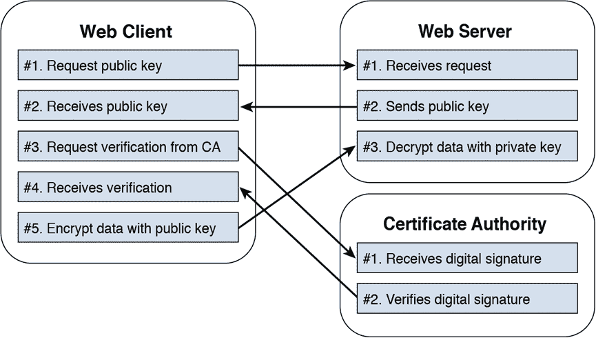

图 8.1 **SSL 过程**

### 公钥

查看本章之前的“管理公钥基础设施 (PKI) 证书”节。

#### 私钥

查看本章之前的“管理公钥基础设施 (PKI) 证书”节。

### 自签名证书

查看本章之前的“管理公钥基础设施 (PKI) 证书”节。

## 数字签名

查看本章之前的“管理公钥基础设施 (PKI) 证书”节。

#### 哈希 (Hashing)

查看本章之前的“管理公钥基础设施 (PKI) 证书”节。

#### 证书颁发机构 (Certificate Authorities)

IT 安全围绕信任的概念展开。例如，假设你想在线连接到银行，并在浏览器中输入银行的 URL。浏览器从远程服务器获取响应，但你如何确保该远程服务器真的是你的银行，而不是劫持你连接尝试的服务器？

#### 通配符证书

通常，证书根据主机名与单个系统关联。在一个需要证书的组织中，为每个系统实现证书成本很高。

通配符证书允许你拥有一个适用于整个域名（包括子域）的证书。换句话说，你可以拥有一个与以下系统关联的证书：

*  [onecoursesource.com](http://onecoursesource.com)
*  [www.onecoursesource.com](http://www.onecoursesource.com)
*  [test.onecoursesource.com](http://test.onecoursesource.com)
*  [sales.onecoursesource.com](http://sales.onecoursesource.com)
*  [dev.onecoursesource.com](http://dev.onecoursesource.com)
*  [private.onecoursesource.com](http://private.onecoursesource.com)

### 证书用用例

对于 Linux+ 考试，你应该了解使用证书的情况。本节描述了一些常见的用用例。

#### 安全套接层 (SSL)/传输层安全 (TLS)

传输层安全协议 (TLS) 是一种加密协议，VPN 用于提供安全的数据传输。安全套接层 (SSL) 是 TLS 的前身，现在被认为已过时。

TLS 不仅用于 VPN；它还用于 Web 服务器通信、电子邮件传输和 IP 电话 (VoIP)。

## 证书身份验证

`Certificate authentication` 是使用公钥证书允许一个系统验证另一个系统的身份的过程。Web 客户端通常使用它来确保 Web 服务器不是伪造系统。

## 加密

有关加密作用的信息，请参阅本章较早之前的“管理公钥基础设施 (PKI)证书”部分。

## 身份验证

标准的身份验证方法是使用本地用户账户和密码。这种方法缺乏更复杂方法提供的一些安全特性。本节探讨了在开发安全最佳实践策略时应当考虑的替代身份验证方法。

### 令牌 (Tokens)

令牌是由硬件设备或软件程序生成的唯一值（通常是数字或字母数字值）。令牌通常是持续自动生成的，并且通常只在短时间内有效，例如 30 秒。

硬件令牌是由硬件设备生成的令牌。通常它是一个非常小的设备，如钥匙扣。硬件设备可能具有额外的身份验证方法，例如指纹扫描器，但这种情况较少见。

软件令牌是由程序生成的令牌。常见的例子是移动设备上的应用程序。

### 多因素身份验证 (MFA)

通过多因素身份验证 (MFA)，用户被要求提供多个位点的证据来证明用户的身份。一种常见的多因素身份验证方法称为双因子认证，或 2FA。对于这种方法，用户需要提供两种形式的标识，可能包括以下：

*  用户知道的
*  用户拥有的
*  用户具备的特征

要利用 MFA，你可以实现许多不同的功能，包括令牌、一次性密码 (OTP) 和生物识别（指纹扫描器、虹膜扫描器等）。

### 可插身份验证模块 (PAM)

可插身份验证模块 (PAM) 已被几乎所有尝试验证用户的 Linux 实用程序。这很重要，因为你不需要调整实用程序来更改用户身份验证的方式；而是修改 PAM 配置文件。

要理解 PAM 有多大收益，你应该意识到你可以让 PAM 做的一些事情。以下是你可以使用 PAM 执行的许多示例中的：

*  你可以使用 PAM 强制执行更健壮的密码。
*  你可以使用 PAM 限制用户登录系统的日期和时间。
*  你可以使用 PAM 限制用户登录的来源。
*  你可以使用 PAM 设置或取消环境变量。因为你可以为不同的实用程序设置不同的 PAM 规则，这意味着本地登录拥有一套环境变量，SSH 登录有一套，FTP 登录又有一套。
*  可以通过 PAM 对用户账户设置限制。例如，可以限制用户可以执行的进程数。
*  你可以限制 root 用户登录的来源。通过只允许 root 用户本地登录或使用 `su` 命令获取 root 账户权限，可以使你的系统更加安全。

请记住，这些只是你可以用 PAM 执行的几件事。几十种不同的 PAM 模块提供了许多不同的身份验证功能。

考试提示 (ExamAlert)

PAM 可能是一个复杂的系统。请记住，本书的目标是为 Linux+ XK0-005 考试涵盖的每个主题提供摘要，而不是完整的描述。本节描述了考试中所需的 PAM 知识。

要理解 PAM 文件内容的含义，你首先必须理解第一列数据。第一列有四种可能的类型：`auth`、`account`、`session` 和 `password`。图 8.2 直观地描述了它们如何使用。

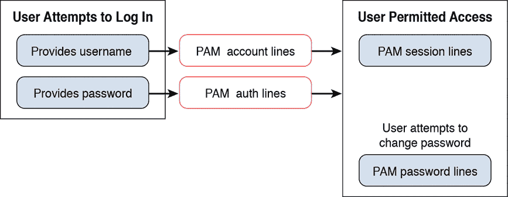

图 8.2 **PAM 类型**

PAM 文件中每行的第一个值（类型）基本上表示何时使用该模块。每行的最后一个值是运行运行的 PAM 模块（或要咨询的另一个配置文件）。中间的值称为控制值 (control value)。当 PAM 模块返回成功或失败时，如何使用此返回值取决于控制值。

表 8.1 描述了不同的传统控制值。当你阅读此表中的描述时，重要的是注意的是，当解析一组规则时，最终结果必须成功才能执行操作。例如，考虑以下规则：

点击此处查看代码图像

```
account required pam_nologin.so
account include system-auth
```

表 8.1 传统控制值

| 值 | 描述 |
| --- | --- |
| `required` | **返回成功：** 如果当前 PAM 返回成功，则检查列表中的下一条规则。如果这是最后一个规则，栈返回成功值（除非之前的 requisite 规则失败）。**返回失败：** 如果当前 PAM 返回失败，则不执行额外的模块。栈返回失败值。换句话说，具有 required 值的模块必须成功，栈才能返回成功。 |


| `requisite` | 在某些方面，`requisite` 值与`required`相似。区别在下文中用斜体标出。**返回成功：** 如果当前 PAM 返回成功，则检查列表中的下一条规则。如果这是最后一个规则，栈返回成功值。**返回失败：** 如果当前 PAM 返回失败，*将执行额外的模块；但无论这些其他模块发生什么，栈都会返回失败值*。这有时很有用，因为额外的模块可能会在日志文件中提供更多信息。 |
| `optional` | **返回成功：** 如果当前 PAM 返回成功，则检查列表中的下一条规则。如果这是最后一个规则，栈返回成功值（除非之前的`requisite`规则失败）。**返回失败：** 如果当前 PAM 返回失败，则检查列表中的下一条规则。如果这是最后一个规则，栈返回成功值（除非之前的`requisite`规则失败）。换句话说，模块的返回值对栈的成功或失败没有影响。异常：如果这是栈中的唯一规则，`optional`的作用类似于`required`。 |
| 字段 | 说明 |
| :--- | :--- |
| `sufficient` | **返回成功：** 如果当前 PAM 返回成功，则不再检查额外的规则。栈将立即返回成功值（除非之前的某个必需（`requisite`）规则失败了）。**返回失败：** 如果当前 PAM 返回失败，将检查列表中的下一条规则。如果这是最后一个规则，栈将返回成功值（除非之前的某个必需（`requisite`）规则失败）。换句话之，如果模块的返回成功，则不会检查其他模块，且栈自动设为成功。返回失败对栈的整体返回值没有影响。 |
| `include` | 此值告诉 PAM 使用指定文件中的所有规则。仅使用当前类型（`auth`、`account`等）的规则。 |

若要对用户账户进行验证，则规则链的最终结果必须是成功的。这条规则链也被称为*规则栈*（rule stack）。

图 8.3 为喜欢视觉化示例的读者展示了一个流程图。注意，此图利用了以下信息：

点击此处查看代码图像

```
[root@OCS ~]# grep ^account /etc/pam.d/sshd
account required pam_nologin.so
account include system-auth
[root@OCS ~]# grep ^account /etc/pam.d/system-auth
account required pam_unix.so
account sufficient pam_succeed_if.so uid < 500 quiet
account required pam_permit.so
```

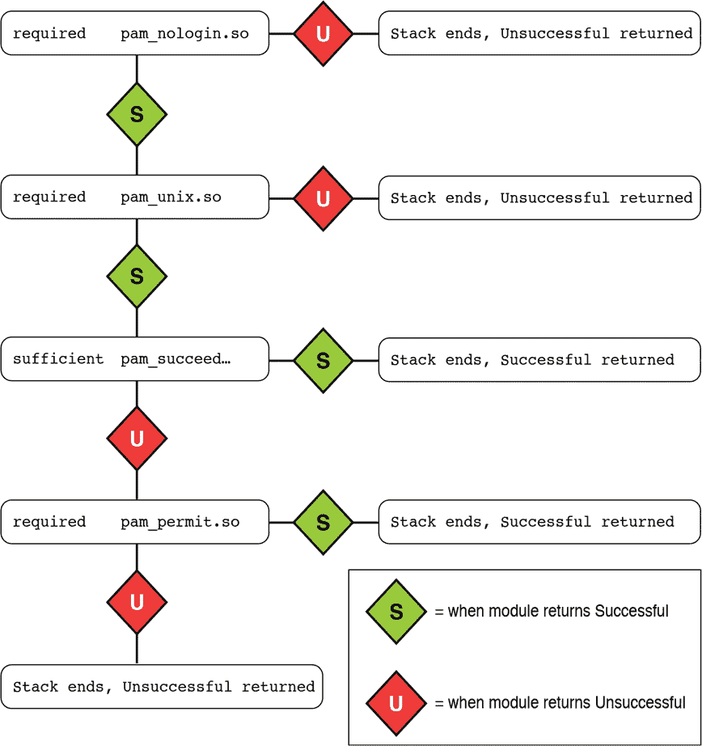

图 8.3 **PAM 控制值示例**

## 系统安全服务守护进程 (SSSD)

系统安全服务守护进程 (SSSD) 用于提供访问远程目录的身份验证方法。它使用类似 LDAP 的认证服务在客户端系统上创建用户账户的本地缓存。这些账户用于访问远程目录。

**考试提示**

SSSD 的配置超出 Linux+ XK0-005 考试的范围。对于考试，你应该了解此守护进程的功能。

### 轻量级目录访问协议 (LDAP)

轻量级目录访问协议 (LDAP) 经常与 RADIUS 和 TACACS+ 进行比较，因此了解这些技术是有益的。远程拨入服务 (RADIUS) 是一种允许客户端系统利用服务器对用户进行验证的协议。该服务在集中位置提供 AAA（认证、授权和计费）管理。

RADIUS 经常与 TACACS+ 进行比较，但了解这些协议之间的差异超出 Linux+ 考试的范围。最重要的是，意识到 RADIUS 可以在安全策略内提供非常强大的功能，因为它提供了集中的 AAA 管理。此外，你应该意识到 RADIUS 比 TACACS+ 具有更强的厂商无关性。

终端访问控制器访问控制系统加+ (TACACS+) 是一种允许客户端系统利用服务器对用户进行验证的协议。该服务在集中位置提供 AAA 管理。

TACACS+ 经常与 RADIUS 进行比较，但了解这些协议之间的差异超出 Linux+ XK0-005 考试的范围。最重要的是，意识到 TACACS+ 可以在安全策略内提供非常强大的功能，因为它提供了集中的 AAA 管理。此外，你应该意识到 TACACS+ 是由 Cisco 开发的，不像 RADIUS 那样具有厂商无关性。

轻量级目录访问协议 (LDAP) 是一种提供目录服务信息的协议。这意味着该协议可以用于提供用户账户信息，但它不提供 RADIUS 和 TACACS+ 提供的完整 AAA 功能。LDAP 也经常用于存储与其他用户账户不直接相关的信息，例如主机名。

LDAP 可用于验证用户，但在考虑安全策略时，你应该意识到 RADIUS 和 TACACS+ 提供了更健壮的解决方案。例如，LDAP 不提供 RADIUS 和 TACACS+ 等 AAA 协议提供的计费功能。

**考试提示**

LDAP 的配置超出 Linux+ XK0-005 考试的范围。对于考试，你应该了解此服务的功能。

## 单点登录 (SSO)

单点登录 (SSO) 是一种技术，用户一旦在一个系统上通过验证，该验证就可以用于自动授予访问其他系统的权限。通常使用 RADIUS 或 TACACS+ 服务器实现。（访问本章前面的“轻量级目录访问协议 (LDAP)”部分获取更多关于 RADIUS 和 TACACS+ 的信息。）

### Linux 加固

Linux 加固是一个涉及更改 Linux 操作系统以使其更安全的过程。本节重点关注用于执行 Linux 加固操作的多种技术。

## 安全扫描

扫描是使用工具搜索安全弱点的过程。例如，`john` 实用是一个命令行密码破解工具。使用该工具时，你需要一个包含`/etc/passwd`和`/etc/shadow`目的的文件。你可以通过运行以下命令创建此文件：

点击此处查看代码图像

```
cat /etc/passwd /etc/shadow > file_to_store
```

然后对合并后的文件上运行`john`工具，它将发现哪些用户账户拥有弱密码。

各种扫描工具可以扫描 Linux 操作系统不同区域的如下类弱点：

*  软件配置错误
*  Rootkits
*  文件和目录权限问题
*  内核模块
*  病毒
*  恶意软件
*  网络端口问题
*  入侵

**考试提示**

鉴于扫描工具非常多，不要期望 Linux+ XK005 考试会就特定工具提问。

#### 安全启动 (UEFI)

当 Linux 系统首次启动时，会启动一个程序来引导系统。该程序不是 Linux 的一部分，而是随系统硬件提供的程序。有两种不同类型的程序：基本输入输出系统 (BIOS) 和统一扩展固件接口 (UEFI)。虽然 BIOS 和 UEFI 执行的任务相似（启动过程），但它们具有不同的特性。

UEFI 的优势之一是它提供名为“安全启动”的功能，解决了引导未经授权或可能包含恶意软件的镜像的问题。数字签名用于确认镜像的有效性。

## 系统日志配置

有关系统日志的详细信息，请参见第 7 章中的“Syslog”部分、“管理软件配置](#ch07.xhtml)。”

#### 设置默认 umask

`umask`命令为文件和目录设置默认权限。这些默认权限仅在最初创建文件或目录时应用。

`umask`命令接受一个参数：掩码值。掩码值是一个应用于新文件或新目录最大权限的值，如表 8.2 所示。

表 8.2 **umask 权限**

| 类型 | 新条目的最大权限 |
| :--- | :--- |
| 文件 | **rw-rw-rw-** |
| 目录 | **rwxrwxrwx** |

每个 shell 都有自己的`umask`值。如果你在一个 shell 中更改了`umask`，它不会影响任何其他 shell 中的`umask`值。若要在跨登录时对`umask`进行持久化更改，请将`umask`命令添加到`~/.bash_profile`文件中。

## 禁用/移除不安全的服务

某些服务应该永远不使用或谨慎使用。表 8.3 重点关注了不安全的服务以及应当使用它们的有限情况。

### 表格 8.3 不安全服务的忧虑

| 服务 | 说明 |
| --- | --- |
| FTP | 文件传输协议 (FTP) 是一种常用的协议，用于在系统之间传输文件。由于数据在 FTP 客户端和服务器之间以未加密的形式传输，因此该协议是不安全的。这些数据包含任何用户账户信息，这意味着任何能够“嗅探”网络的人都能看到用户名和密码。FTP 服务器提供了一个重要且实用的功能：匿名 FTP 服务。匿名 FTP 服务器不需要任何用户身份验证，并且只允许下载内容（不允许上传）。这允许某人创建一个存储供任何人下载内容（如 Linux 发行版的 ISO 文件）的仓库。 |
| Telnet | Telnet 协议允许远程登录，但与 SSH 不同，它不提供加密。虽然可以使用`telnet`命令测试与远程端口的连接，但在安全重要的现代系统中，不应使用 Telnet 服务器。 |
| Finger | Name/Finger 协议旨在提供有关计算机和用户的信息。`finger`命令长期以来被用作提供用户报告的方法。然而，由于这些信息是通过未加密的网络传输的，因此在对安全重要的现代系统中，绝不应使用此命令和协议。 |
| Sendmail/Postfix | `sendmail`和`postfix`都是电子邮件服务器。通常本地系统不需要电子邮件服务，或者至少外部不需要任何邮件服务。真正的邮件服务器应该配置为与远程邮件服务器发送和接收消息。桌面系统和大多数非邮件服务器不应被配置为处理外部邮件。这可能需要对这些服务进行一些配置更改。 |

你应该考虑禁用或限制所有不需要远程访问的服务。例如，在大多数 Linux 发行版中，CUPS 打印服务器都是安装并配置为默认启动的。如果相关系统没有打印需求，请考虑禁用并可能移除 CUPS 软件。

## 强制密码强度

`pam_unix`模块提供了许多修改密码设置方式的功能。例如，考虑以下命令：

点击此处查看代码图像

```
[root@OCS ~]# grep ^password /etc/pam.d/passwd
password include  system-auth
[root@OCS ~]# grep ^password /etc/pam.d/system-auth
password requisite pam_cracklib.so try_first_pass retry=3
password sufficient pam_unix.so md5 shadow nullok try_first_pass
use_authtok
password required pam_deny.so
```

`pam_unix`模块的`shadow`选项导致密码使用 shadow 系统存储。密码存储在`/etc/shadow`文件中，而不是`/etc/passwd`文件中。

你可以对`pam_unix`模块进行一些更改以使你的系统更安全。例如，如果你修改`/etc/pam.d/system-auth`文件中的`pam_unix`行以匹配以下内容，则系统将不允许用户重用密码：

点击此处查看代码图像

```
password sufficient pam_unix.so md5 shadow nullok try_first_pass use_
authtok remember=5
```

通过这种方式修改行后，每个用户的最后五个密码会被记住，用户在更改为新密码时无法使用这五个密码中的任何一个。这防止了用户反复使用相同的密码。

表 8.4 描述了一些额外的重要的`pam_unix`选项。

| 选项 | 描述 |
| --- | --- |
| `md5` | 使用 MD5 加密算法加密密码。 |
| `sha256` | 使用 SHA256 加密算法加密密码。 |
| `nullok` | 允许 root 用户为用户提供空（空白）密码。 |
| `remember=x` | 记住用户的旧密码，并在更改密码时不允许用户使用这些密码。 |

### 表格 8.4 pam_unix 密码选项

## 移除未使用的软件包

移除未使用的软件包最初可能是一个挑战，但确保系统上只安装必要的软件是非常重要的。确定哪些软件包是必要的挑战在于，典型的默认 Linux 安装包含了成千上万个软件包。例如，Kali Linux 的默认安装几乎有近 3,000 个软件包，如下所示：

```
root@kali:~# dpkg -l | wc -l
2801
```

你真的需要通过逐一检查每个软件包来决定每个系统应该安装哪些软件包吗？你应该探索发行版中每个软件包提供什么，然后为不同类型的系统创建规则。例如，你应该确定哪些属于典型的用户工作站，哪些属于 Web 服务器。事实上，你应该创建三类：

*  应该默认安装的软件
*  可选软件（可以安装但默认未安装）
*  潜在风险或有问题的软件，不应安装在任何系统上

你可以通过探索软件包来确定是否应该安装它。例如，你可能首先查看软件包以确定它的作用，如下所示：

点击此处查看代码图像

```
[root@onecourses ~]# rpm -qi zsh | grep "Description"
Description :
The zsh shell 是作为交互式 shell 和 shell 脚本命令解释器使用的。Zsh 类似于 ksh（orn shell），但包含了许多增强。Zsh 支持命令行编辑、内置拼写检查、可编程命令补全、shell 函数（带自动加载）、历史机制等。
```

根据此命令提供的信息，你可能确定该软件包不应安装在系统上。也许你不想支持另一个 shell，只想在该系统中支持 BASH。或者你可能因为已经有了良好的 shell 而认为它是不必要的。如果你正在考虑需要额外 shell 的安装，请确保在安装之前调查运行第二个 shell 的影响后果。

如果你决定某个软件包可能是很好的软件包，那么在批准之前，你还应该查看它提供的文件——特别是可执行程序（通常位于`/bin`目录，例如`/usr/bin`或`/bin`，也可能位于`/sbin`或`/usr/sbin`）：

点击此处查看代码图像

```
[root@onecourses ~]# rpm -ql zsh | grep /bin/
/usr/bin/zsh
[root@onecourses ~]# ls -l /usr/bin/zsh
-rwxr-xr-x 1 root root 726032 May 22  2015 /usr/bin/zsh
```

查看这些可执行程序的文档（man 页），并仔细观察文件的权限和所有权。考虑每个程序是否因为 SUID 或 SGID 权限而提供了提升权限。

最后，请注意，本节演示的命令是在已经安装了软件的系统上执行的。你应该在测试系统上对软件包进行审查，这样你就可以安全地安装软件包，而不必担心影响关键系统。该系统甚至不应该连接到网络。你希望在运行这些命令并测试每一条命令之前，决定该软件是否可以安全地安装在组织内部“真实”系统中。

## 调整内核参数

请注意，内核参数在第七章的“配置内核选项”部分有所介绍。本节侧重于用于增强内核安全性的内核参数。本节讨论了四个常用的内核参数：

*  忽略 ping 请求
*  忽略广播请求
*  启用 TCP SYN 保护
*  禁用 IP 源路由

`ping`命令通常用于判断是否可以通过网络访问远程主机。它通过向远程主机发送 Internet 控制消息协议 (ICMP) 回显请求包来实现这一点，如果远程系统可达，它期望收到一个响应包。这带来了两个安全挑战：

*  黑客可以使用`ping`命令探测活动系统，试图寻找他们可以入侵的系统。虽然这不是探测活动系统的唯一方法，但它是非常常用的方法。因此，对于任务关键系统，最好忽略 ping 请求。
*  响应 ping 请求可能会使系统面临受到 DoS（拒绝服务）攻击的风险。在 DoS 攻击中，大量的数据包被发送到系统，导致系统难以处理所有数据，并使系统无响应。在一种名为 DDoS（分布式拒绝服务）的类似攻击中，数据包从多个系统发送以压垮主机。为了防止 DoS 和 DDoS 攻击，对于任务关键系统，最好忽略 ping 请求。

要忽略 ping 请求，请在`/etc/sysctl.conf`文件中使用以下设置：

点击此处查看代码图像

```
net.ipv4.icmp_echo_ignore_all = 1
```

要忽略发生 DoS 或 DDoS 攻击的广播请求，请在`/etc/sysctl.conf`文件中使用以下设置：

点击此处查看代码图像

```
net.ipv4.icmp_echo_ignore_broadcasts = 1
```

SYN 洪攻击是一种 DoS 攻击，其中使用 SYN 请求来使系统无响应。要忽略 SYN 请求，请在`/etc/sysctl.conf`文件中使用以下设置：

```
net.ipv4.tcp_syncookies = 1
```


IP 源路由是一项允许数据包发送者指定应采取的网络路由路径的功能。此功能绕过了路由表，并使系统变得脆弱，因为黑客可以利用路径攻击（也称为中间人攻击，即系统在客户端和服务器之间插入自己），或使用此功能来映射你的网络或绕过你的防火墙。

每个网络接口都有独立的 IP 源路由内核参数。要从特定的网络设备上禁用此功能，请使用如下设置：

```
net.ipv4.conf.eth0.accept_source_route = 0
```

## 安全服务账户

一个典型的 Linux 系统有许多服务用户账户。这些服务用户账户的 UID 值小于 1000，使得管理员很容易识别出这些是特殊账户。这些服务账户通常被称为“守护进程账户”（daemon accounts），因为它们被基于守护进程的软件使用。守护进程是在后台运行的程序，执行特定的系统任务。

可能存在其他服务账户来为操作系统提供功能。例如，`nobody` 账户用于对通过 NFS（网络文件系统）共享的文件应用权限。

此外，如果你向系统添加新软件，可能会增加更多的用户，因为软件供应商会利用用户和组账户来对软件部分的文件提供受控访问。

这些服务账户不应设置密码，因为它们不会被普通用户使用。换句话说，如果你查看 `/etc/shadow` 文件中的密码字段，所有系统账户都应该具有如下值：

```
nobody:*:15921:0:99999:7:::
dbus:!!:16056::::::
```

系统账户也不应该关联一个有效的 shell。因此，如果你查看 `/etc/passwd` 文件，系统账户的登录 shell 应该如下所示：

```
nobody:x:99:99:Nobody:/:/sbin/nologin
dbus:x:81:81:System message bus:/:/sbin/nologin
```

你应该对系统账户进行例行审计，以确保它们没有密码或有效的登录 shell。

## 配置主机防火墙

防火墙（也称为访问控制列表）是一种网络设备（硬件或软件形式），旨在允许或阻塞网络流量。防火墙可以实现在各种设备上，包括路由器、服务器和用户系统（在这种情况下被称为主机防火墙）。本节探讨防火墙的基本概念。

表 8.5 描述了防火墙的关键术语。

表 8.5 防火墙术语

| 术语 | 说明 |
| --- | --- |
| 源 (Source) | 该术语指数据包来源。可以使用源 IP 地址、端口或 MAC 地址过滤来自源的网络流量。 |
| 目的 (Destination) | 该术语指数据包被发送到哪里。可以使用目的 IP 地址、端口或 MAC 地址过滤针对目的的网络流量。 |
| 端口 (Port) | 端口有一个唯一的数字，用于标识系统上的服务。每个数据包包含一个源端口和一个目的端口。可以使用源端口或目的端口过滤网络流量。 |
| 协议 (Protocol) | 通常按协议过滤数据包——无论是 ICMP、TCP 或 UDP 等协议，还是与特定端口相关的协议（如使用端口 23 的 Telnet）。 |
| 日志 (Log) | 防火墙规则通常用于允许或阻塞数据包；但某些规则旨在记录有关数据包的信息。当你想要查看稍后会被规则拦截的数据包信息时这非常有用。 |
| 有状态 (Stateful) 和无状态 (Stateless) | 有状态规则适用于任何先建立的连接。考虑一个指定如下内容的防火墙：允许大多数出站连接，包括访问网站、SSH、FTP 站点等。阻止大多数入站连接，以便外部用户无法连接你可能运行的服务。这种情况的问题是，当你连接到远程系统时，出站和入站规则均适用。当建立连接时应用出站规则，当远程服务器响应时应用入站规则。如果你有一条阻止大多数入站连接的规则，你可能永远无法收到尝试访问的网站的响应。你可以通过创建有状态规则来克服这个问题。无状态规则无论之前是否建立了连接都适用。有状态的规则本质上是说：“如果网络数据包是对本地机器发起的请求的响应，则允许其通过防火墙。” |
| `iptables` 目标 | 一旦数据包匹配了防火墙规则的条件，就会使用一个目标来确定执行的操作。`iptables`（一种常用的 Linux 防火墙工具）有四个标准目标：`Accept` 目标告诉 `iptables` 允许数据包继续进入下一个过滤点。`Reject` 目标告诉 `iptables` 向源端返回数据包并带有错误消息。该消息不会传递到下一个过滤点。`Drop` 目标告诉 `iptables` 丢弃数据包。不会向源端发送任何响应，且消息不会传递到下一个过滤点。`Log` 目标告诉 `iptables` 创建一个包含数据包详细信息的日志条目。使用此目标，数据包既不会被显式允许也不会阻塞，但规则集（链）中的后续规则可能会决定最终结果。 |

一个常用的防火墙工具称为 `iptables`。通过 `iptables`，规则集（称为`链`）被应用于不同的位置（称为`过滤点`），使得这种 ACL 软件具有更高的灵活性。插图 8.5 展示了这些过滤点。

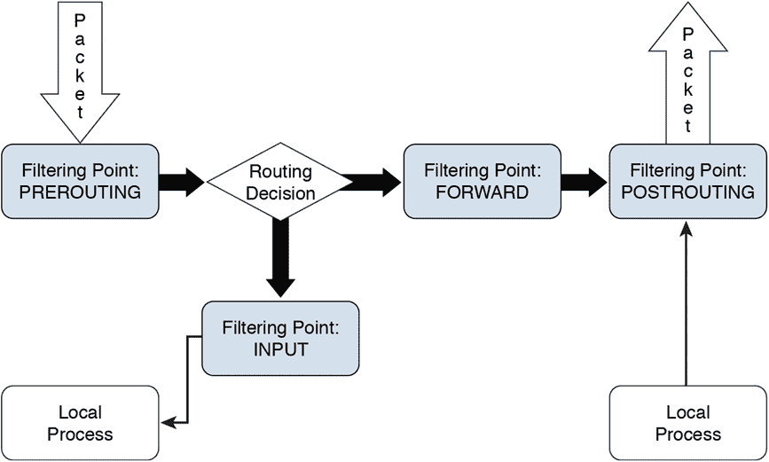

图 8.5 **数据包过滤：出站数据包**

过滤点可以放置一个规则表。一个过滤点可以有一组或多组规则，因为 `iptables` 执行多种功能：过滤（阻塞或允许）数据、对数据包执行 NAT 操作或对数据包进行修改（mangle）。过滤点加上表（`filter`、`nat` 或 `mangle`）的组合形成了一个称为`chain`的单一规则集。

将“链”看作一组决定对特定数据包采取何种操作的规则。例如，“filter INPUT”链上的一个规则可以根据源 IP 地址拦截入站数据包。另一个规则可以用于允许发往特定网络端口的数据包。

规则的顺序也非常重要。一旦找到匹配的规则，就会执行相应的操作（称为`目标`），并且额外的规则将被忽略（正如下文所述，有一个例外）。如表 8.5 所示，典型的目标有 `Accept`、`Drop`、`Reject` 和 `Log`。

表 8.6 描述了若干常见的 `iptables` 规则。

表 8.6 `iptables` 规则

| 规则 | 描述 |
| --- | --- |
| `iptables -t filter -L INPUT` | 显示 INPUT-filter 链的所有规则。 |
| `iptables -D INPUT 1` | 从 INPUT-filter 链删除第 1 条规则。 |
| `iptables -F INPUT` | 清空 INPUT-filter 链的所有规则。 |
| `iptables -A INPUT -s 192.168.10.100 -j DROP` | 在 INPUT-filter 链末尾添加规则，丢弃所有来自 192.168.10.100 系统的数据包。 |
| `iptables -A INPUT -s 192.168.20.0/24 -j DROP` | 在 INPUT-filter 链末尾添加规则，丢弃所有来自 192.168.20.0/24 网络的的数据包。 |
| `iptables -I INPUT 2 -s 192.168.20.125 -j ACCEPT` | 将此规则作为第 2 条规则插入，并将所有后续规则向下移动一位。 |
| `iptables -A INPUT -p icmp -j DROP` | 创建规则丢弃匹配 ICMP 协议的数据包。 |
| `iptables -A INPUT -m tcp -p tcp --dport 23 -j DROP` | 创建规则丢弃发往端口 23 的数据包。 |
| `iptables -A INPUT -p icmp -s 192.168.10.100/24 -j DROP` | 创建规则，必须匹配所有条件（ICMP 协议和源 IP 地址 `192.168.10.100/24`）。 |
| `iptables -A INPUT -i eth0 -s 192.168.20.125 -j DROP` | 创建一个基于网络接口过滤的规则。 |
| `iptables -L INPUT -v` | 显示有关规则的详细信息。 |
| `iptables -P INPUT DROP` | 设置默认链策略。如果没有匹配的规则，则使用此默认目标。 |

# 第 9 章：身份管理

本章涵盖了以下 Linux 目标：

 **2.2:** 给定场景，实现身份管理。

身份管理是管理用户和组账户的过程。在 Linux 系统中，账户信息存储在明文文件 `/etc/passwd`、`/etc/shadow` 和 `/etc/group` 中，你将在本章中学习这些内容。在本章中，你还将学习如何创建、修改和删除用户账户。此外，你将发现使用 `id`、`who` 和 `w` 命令查看账户信息。本章提供了有关账户创建、删除以及管理的信息。

## 账户的创建与删除

Linux 管理员需要执行的最常见操作之一就是创建和删除用户及组账户。本节描述了用于创建账户、显示账户信息的命令。

### `useradd`

`useradd` 命令用于由 root 用户创建账户。

示例：

```
[root@OCS ~]$ useradd -u 1001 -g users -c "John Doe" -d /home/julia -s /bin/bash julia
```

### `groupadd`

`groupadd` 命令用于由 root 用户创建组账户。

示例：

```
[root@OCS ~]$ groupadd -g 2050 test
```

### `userdel`

`userdel` 命令用于由 root 用户删除账户。

示例：

```
[root@OCS ~]$ userdel -r susan
```

### `groupdel`

`groupdel` 命令用于由 root 用户删除组账户。

示例：

```
[root@OCS ~]$ groupdel test
```

### `usermod`

`usermod` 命令用于由 root 用户修改用户账户。

示例：

```
[root@OCS ~]$ usermod -s /bin/tcsh julia
```

### `groupmod`

`groupmod` 命令用于由 root 用户修改组账户。

示例：

```
[root@OCS ~]$ groupmod -n proj test
```

### `id`

`id` 命令显示基本的账户信息。当不带任何参数运行时，它会显示当前用户的 UID、用户名、主 GID 和名称，以及所有辅助组关系，如下例所示：

```
[root@OCS ~]$ id
uid=0(root) gid=0(root) groups=0(root)
```

当将用户名作为参数传递时，它会提供有关指定用户的信息，例如：

```
[root@OCS ~]$ id bo
uid=1001(bo) gid=1001(bo) 
groups=1001(bo),10(wheel),20001(temprandy)
```

虽然 `id` 命令有几个选项，但它们通常并不使用。

### `who`

`who` 命令显示当前登录系统的用户。

示例：

```
[root@OCS ~]# who
student     :0     2017-02-18 01:52 (:0)
student      pts/0 2017-02-18 01:52 (:0)
student      pts/1 2017-03-05 19:55 (:0)
student      pts/2 2017-03-06 18:24 (:0)
root         pts/3 2017-03-06 18:24 (localhost)
```

`who` 命令的输出包括用户名、用户使用的终端设备、登录日期和时间以及用户登录来源（`:0` 表示本地登录）。表 9.3 描述了 `who` 命令的常用选项。

表 9.3 `who` 命令选项

| 选项 | 说明 |
| :--- | :--- |
| `-b` 或 `--boot` | 指定上次系统启动的时间。 |
| `-H` 或 `--heading` | 在列上显示表头。 |
| `-q` 或 `--count` | 显示当前登录的用户数。 |

### `w`

`w` 命令显示当前登录的用户以及其他有用信息：

```
[root@OCS ~]# w
 18:25:08 up 3 days, 1:24, 5 users, load average: 0.27, 0.08, 0.07
USER     TTY     FROM       LOGIN@ IDLE JCPU PCPU WHAT
student :0       :0         18Feb17   41:48 1.01s    gdm-session-wor
student pts/0    :0         18Feb17   4.00s 0.46s    20.33s /usr/libexec/gn
student pts/1    :0         Sun19 1:32 0.04s 0.00s less -s
student pts/2    :0         18:24 12.00s 0.05s    0.01s /usr/bin/sss_ss
root    pts/3     localhost  18:24 12.00s 0.03s     0.03s -bash
```

JCPU 列头代表“Job CPU（作业 CPU）”，该列指示了从终端启动的所有进程所使用的 CPU 时间。PCPU 列头代表“Process CPU（进程 CPU）”，该列指示了当前进程所使用的 CPU 时间（显示为输出行中的最后一项）。

表 9.4 描述了 `w` 命令的常用选项。

表 9.4 `w` 命令选项

| 选项 | 说明 |
| :--- | :--- |
| `-h` 或 `--no-header` | 指定不在列上显示表头。 |
| `-s` 或 `--short` | 指定不显示 JCPU 和 PCPU 列。 |

### 默认 Shell

当使用 `useradd` 命令创建新用户账户时，除非使用 `-s` 选项指定 shell，否则将使用默认 shell。可以通过向 `useradd` 命令传递 `-D` 选项查看并修改默认 shell 值。例如，要查看默认 shell，使用以下命令并查找 `SHELL` 设置：

```
[root@onecoursesource.com ~]# useradd -D
GROUP=100
HOME=/home
INACTIVE=-1
EXPIRE=
SHELL=/bin/bash
SKEL=/etc/skel
CREATE_MAIL_SPOOL=yes
```

要更改默认 shell，请结合使用 `-s` 和 `-D` 选项，如下所示：

```
[root@mail ~]# useradd -D -s /bin/csh
[root@mail ~]# useradd -D
GROUP=100
HOME=/home
INACTIVE=-1
EXPIRE=
SHELL=/bin/csh
SKEL=/etc/skel
CREATE_MAIL_SPOOL=yes
```

### `/etc/passwd`

`/etc/passwd` 文件用于存储用户账户信息。它包含了密码和密码策略之外的大部分用户账户数据（详情见本章后续的 `/etc/shadow` 部分）。`/etc/passwd` 文件中的每一行描述一个用户账户。

示例：

```
root:x:0:0:root:/root:/bin/bash
```

每一行被拆分为多个字段。表 9.5 描述了这些字段。

表 9.5 `/etc/passwd` 文件数据

| 字段 | 说明 |
| :--- | :--- |
| 用户名 | `root:x:0:0:root:/root:/bin/bash` 用户登录时的用户名。 |
| 密码占位符 | `root:x:0:0:root:/root:/bin/bash` 在旧 Unix 中存储密码的地方。 |
| UID | `root:x:0:0:root:/root:/bin/bash` 用户 ID。 |
| GID | `root:x:0:0:root:/root:/bin/bash` 用户的主组 ID。 |
| GCOS | `root:x:0:0:root:/root:/bin/bash` GCOS（通用电气操作系统系统），通常是用户的真实姓名和其他识别数据。 |
| 家目录 | `root:x:0:0:root:/root:/bin/bash` 用户的家目录。 |
| 登录 shell | `root:x:0:0:root:/root:/bin/bash` 登录 shell。 |

提示：当你参加 Linux+ 考试时，可能会看到 `/etc/passwd` 文件的示例并被问及字段的作用。

### `/etc/group`

`/etc/group` 文件用于存储组账户`/etc/group` 文件中的每一行描述一个组。

示例：

```
admin:x:110:
```

每一行被拆分为数据字段。表 9.6 描述了这些字段。

表 9.6 `/etc/group` 文件数据

| 字段 | 说明 |
| :--- | :--- |
| 组名 | `admin:x:110:` 组名。 |
| 密码占位符 | `admin:x:110:` 在旧 Unix 中存储密码的地方。 |
| GID | `admin:x:110:` 组 ID。 |
| 成员列表 | `admin:x:110:` 该组的成员。 |

提示：当你参加 Linux+ 考试时，可能会看到 `/etc/group` 文件的示例并被问及字段的作用。

### `/etc/shadow`

`/etc/shadow` 文件用于存储密码信息（有关其他用户账户数据的详情见本章前面的 `/etc/passwd` 部分）。`/etc/shadow` 文件中的每一行描述一个用户账户。这是一个具有有效密码的账户示例：

```
root:$6$randomsalt$VQ6IhT2yexampleHash:18000:0:99999:7:::
```


`student:$6$ciPSOxID$E5p6cgsPs2lng7dQjrVMIUBGhd/dqs49djCB1h1oGhryfit2vsODfly67u3uBraVY0GIOO2zaVGe/.:17116:0:99999:7:30:17246`

注意：在`/etc/shadow`文件中，账户信息出现在单行中。这是一个锁定密码的账户示例：

```
bob:*LK*:17116:0:99999:7:30:17246
```

每一行被拆分为数据字段。表 9.7 描述了这些字段。

**表 9.7 `/etc/shadow` 文件数据**

| 字段 | 说明 |
| :--- | :--- |
| 用户名 | `bob:*LK*:17116:0:99999:7:30:17246` 用户名，与 `/etc/passwd` 文件中的条目匹配。 |
| 密码 | `bob:*****:17116:0:99999:7:30:17246` 用户密码或某些锁定值。注意密码是加密的。 |
| 最后更改 | `bob:*LK*:17116:0:99999:7:30:17246` 自 1970 年 1 月 1 日以来上次更改用户密码的天数。系统将其用于接下来的三个字段。 |
| 最小 | `bob:*LK*:17116:0:99999:7:30:17246` 用户更改密码后，可以再次更改密码的天数。 |
| 最大 | `bob:*LK*:17116:0:99999:7:30:17246` 用户更改密码后，必须再次更改密码的天数。如果用户在该时间限制之前未更改密码，账户将被锁定。 |
| 警告 | `bob:*LK*:17116:0:99999:7:30:17246` 在账户锁定前多少天开始在用户登录时向其发出警告。 |
| 非活跃 | `bob:*LK*:17116:0:99999:7:30:17246` 账户被锁定后，用户还有多少个“宽限天”可以登录——但前提是登录时必须提供新密码。 |
| 过期日期 | `bob:*LK*:17116:0:99999:7:30:17246` 这是自 1970 年 1 月 1 日起用户账户过期的天数。 |
| 未使用 | `bob:*LK*:17116:0:99999:7:30:17246` 这是一个未使用的字段，未来可能会被使用。 |

### 考试技巧

在参加 Linux+ XK0-005 考试时，你可能会看到`/etc/shadow`文件的示例，并被问及该文件中不同字段的用途。

### `/etc/profile`

当用户登录系统时，会启动一个登录 shell（login shell）。当用户在登录后启动一个新 shell 时，它被称为非登录 shell（non-login shell）。在每种情况下，都会使用初始化文件来设置 shell 环境。执行哪些初始化文件取决于该 shell 是登录 shell 还是非登录 shell。

图 9.1 显示了用户登录系统时执行哪些初始化文件。

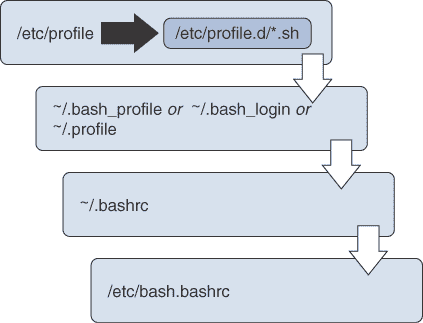

**图 9.1 用户登录系统时执行的初始化文件**

图 9.1 说明了以下过程：

1. 当用户登录时，Linux 执行`/etc/profile`初始化文件。在大多数 Linux 平台上，此脚本包含代码，会执行`/etc/profile.d`目录下所有以`.sh`结尾的初始化文件。`/etc/profile`文件是系统管理员存放代码（通常是登录消息和环境变量定义）的地方，这些代码会在每个 BASH shell 用户登录时每次执行一次。

2. 登录 shell 在用户的家目录中查找名为`~/.bash_profile`的文件。如果找到，登录 shell 将执行该文件中的代码。否则，登录 shell 查找名为`~/.bash_login`的文件。如果找到，登录 shell 将执行该文件中的代码。否则，登录 shell 查找名为`~/.profile`的文件并执行该文件中的代码。这些文件提供了一个空间，每个用户可以在其中存放在该特定用户登录时每次都会执行的代码（通常是环境变量定义）。

3. Linux 执行`~/.bashrc`初始化文件。该文件是每个用户存放代码（通常是别名和函数定义）的地方，这些代码会在用户每次打开新 shell 时执行一次。

4. Linux 执行`/etc/bash.bashrc`初始化文件。该文件是系统管理员存放代码（通常是别名和函数定义）的地方，这些代码会在用户每次打开新 shell 时执行一次。

图 9.2 说明了用户打开新 shell 时执行哪些初始化文件。

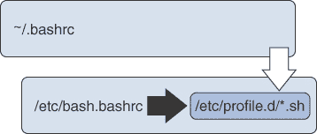

**图 9.2 用户启动非登录 shell 时执行的初始化文件**

图 9.2 说明了以下过程：

1. 当用户登录时，Linux 执行`~/.bashrc`脚本。该文件是每个用户存放该用户每次打开新 shell 时都会执行的代码的地方（通常是别名和函数定义）。

2. Linux 执行`/etc/bash.bashrc`初始化文件。在大多数 Linux 平台上，此脚本包含代码，会执行`/etc/profile.d`目录下所有以`.sh`结尾的初始化文件。这些文件提供了一个空间，系统管理员可以在其中存放用户每次打开新 shell 时执行的代码（通常是别名和函数定义）。

### 考试技巧

Linux+ XK0-005 考试中的问题可能会测试你对登录过程的理解，包括在登录过程的哪个阶段执行哪个文件。

### `/etc/skel`

`/etc/skel`目录在创建新用户账户时使用，为新账户提供默认文件，例如 BASH 配置文件（`.bashrc`、`.profile`等）。更多细节请参阅本章前面的“`useradd`”部分。

### `.bash_profile`

当用户登录系统且该用户的登录 shell 为 BASH shell 时，如果`~/.bash_profile`文件存在，则会执行该文件中的命令。这允许用户通过在该文件中放置命令来设置账户。

有关初始化文件使用的更多细节，请参阅本章前面的“`/etc/profile`”部分。

### `.bashrc`

当用户打开一个新的 BASH shell 时，会执行`~/.bashrc`文件中的命令。用户可以通过在该文件中放置命令来设置账户。

有关初始化文件使用的更多细节，请参阅本章前面的“`/etc/profile`”部分。

### 账户管理

账户管理涉及使用命令更改用户账户。本节重点介绍管理用户账户所需的关键命令。

### `passwd`

`passwd`命令允许用户更改其密码。root 用户可以使用此命令更改任何密码或更改其他基于密码的功能。表 9.8 描述了一些重要的选项。

**表 9.8 `passwd` 选项**

| 选项 | 描述 |
| :--- | :--- |
| `-d` | 删除密码。 |
| `-e` | 使账户立即过期。 |
| `-l` | 锁定账户。 |
| `-u` | 解锁账户。 |
| `-m` | 更改`/etc/shadow`中的 Min 字段。 |
| `-M` | 更改`/etc/shadow`中的 Max 字段。 |
| `-w` | 更改`/etc/shadow`中的 Warn 字段。 |

**考试技巧**：Linux+ XK0-005 考试可能会询问哪些`passwd`选项更改了`/etc/shadow`中的字段。

### `chage`

`chage`命令由 root 用户执行，用于修改密码老化功能。表 9.9

```
auth required     pam_env.so
auth required pam_tally2.so file=
   /var/log/tallylog deny=3 even_deny_root unlock_time=1200
auth    sufficient pam_unix.so try_first_pass nullok
auth    required  pam_deny.so
account required  pam_unix.so
account required  pam_tally2.so
```

以下是这些行中的关键值：

- `file`: 指定存储失败登录尝试的文件名。

- `deny`: 指定何时锁定用户（在指定的失败尝试之后）。

- `even_deny_root`: 同样适用于 root 账户和普通用户。

- `unlock_time`: 指定锁定账户的时间（秒为单位）。

有关使用 PAM 的更多信息，请参阅第 8 章中的“Linux 环境下的安全最佳实践”之“可插拔认证模块 (PAM)”章节。

### `faillock`

你可以使用`/etc/pam.d/system-auth`文件中以下高亮设置，因登录尝试失败而锁定用户：

```
auth   required   pam_env.so
auth required pam_faillock.so preauth
 silent audit deny=4 unlock_time=1200
auth   sufficient  pam_unix.so try_first_pass nullok
auth [default=die] pam_faillock.so authfail
 audit deny=4 unlock_time=1200
auth   required   pam_deny.so
```

以下是这些行中的关键键值：

*   `deny:` 指定何时锁定用户（在指定次数的失败尝试后）。

*   `unlock_time:` 指定账户锁定的时间（以秒为单位）。

请参阅第 8 章中的“可插拔认证模块 (PAM)”章节以获取有关使用 PAM 的更多信息。

### `/etc/login.defs`

`/etc/login.defs`文件为创建新账户或更改账户密码时提供了几个默认值。以下示例显示了该文件的值（不包括注释行）：

```
[bo@onecoursesource.com ~]$ grep -v "^#" /etc/login.defs
MAIL_DIR        /var/spool/mail
PASS_MAX_DAYS   99999
PASS_MIN_DAYS   0
PASS_MIN_LEN    5
PASS_WARN_AGE   7
UID_MIN                  1000
UID_MAX                 60000
SYS_UID_MIN               201
SYS_UID_MAX               999
GID_MIN                  1000
GID_MAX                 60000
SYS_GID_MIN               201
SYS_GID_MAX               999
CREATE_HOME     yes
UMASK           077
USERGROUPS_ENAB yes
ENCRYPT_METHOD SHA512
```

表 9.10 描述了`/etc/login.defs`文件的一些重要设置。

**表 9.10 `/etc/login.defs` 文件设置**

| 设置 | 描述 |
| :--- | :--- |
| `PASS_MAX_DAYS` | 新账户`Max`值的默认值。（有关该值的更多信息，请参阅本章前面的“`/etc/shadow`”章节。） |
| `PASS_MIN_DAYS` | 新账户`Min`值的默认值。（有关该值的更多信息，请参阅本章前面的“`/etc/shadow`”章节。） |
| `PASS_MIN_LEN` | 普通用户在更改自己的密码时，密码必须满足的最小字符数。 |
| `PASS_WARN_AGE` | 新账户`Warn`值的默认值。（有关该值的更多信息，请参阅本章前面的“`/etc/shadow`”章节。） |

#### 考试提示

`/etc/login.defs`文件中的其他设置不属于 Linux+ XK0-005 考试测试范围。

## 第 10 章

实现与配置防火墙

**本章涵盖以下 Linux+ XK0-005 考试目标：**

*   **2.3:** 根据给定的场景，实现并配置防火墙。

保护系统或网络安全的要组件之一是将“坏人”隔在门外，同时让“好人”获得必要的访问。这意味着你需要确保系统的网络访问是安全且稳定的。

防火墙允许你允许或阻止网络连接。防火墙检查每个网络数据包并决定是否允许该包进入。在本章，你将学习创建防火墙的基础知识。

本章提供了以下主题的信息：防火墙用例、常见的防火墙技术和关键防火墙功能。

### 防火墙用例

`firewall`（称为访问控制列表）是一种网络设备（硬件或软件形式），旨在允许或阻止网络流量。防火墙可以实现在多种设备上，包括路由器、网络服务器和用户系统。本节探讨了防火墙的基本概念。

以下是你应该熟悉的某些防火墙相关术语：

*   `Source:` 该术语指的是网络包的来源。可以使用源的 IP 地址、端口或 MAC 地址创建防火墙规则来过滤来自源的网络流量。

*   `Destination:` 该术语指的是网络包的去向。可以使用目的 IP 地址、端口或 MAC 地址创建防火墙规则来过滤目的的网络流量。

*   `Port:` 端口有一个唯一的数字，用于标识系统上的服务。每个网络数据包都包含源端口和目的端口。

*   `Protocol:` 可以根据协议（ICMP、TCP 或 UDP）过滤端口的数据包。

*   `Log:` 防火墙规则通常用于允许或阻止；但也有设计用于记录信息。

#### 端口的开放与关闭

`开放端口`允许网络数据包通过防火墙。`关闭端口`阻止网络数据包（或将其返回发送者）。防火墙根据规则采取什么操作，这被称为目标（target）。

当网络数据包匹配防火墙规则时，使用目标来决定采取的操作。`iptables`有四个标准目标：

*   `Accept:` `Accept`目标告诉`iptables`允许数据包进入下一个过滤点。

*   `Reject:` `Reject`目标告诉`iptables`向源返回数据包并带有错误消息。消息不会进入下一个过滤点。

*   `Drop:` `Drop`目标告诉`iptables`丢弃数据包。不向源发送响应，且消息不会进入下一个过滤点。

*   `Log:` `Log`目标告诉`iptables`创建包含数据包详细信息的日志记录。使用此目标时，数据包既没有被显式允许也没有阻止，但规则集（链）中的后续规则可能会决定结果。

##### 当前配置

可以使用`iptables`命令的`-L`检查防火墙的当前配置。详情请参阅第 8 章中的“配置主机防火墙”章节。

##### 启用/禁用网协议（IP）转发

IP 转发是一种内核功能，允许网络数据包从一个网络传递到另一个网络。该功能通常用于在服务器上创建路由器。这很简单，只需要将以下每个文件的值设置为`1`：

*   `/proc/sys/net/ipv4/ip_forward:` 启用 IPv4 网络数据包的 IP 转发。

*   `/proc/sys/net/ipv6/conf/all/forwarding:` 启用 IPv6 网络数据包的 IP 转发。

### 常见的防火墙技术

Linux 系统可以实现大量的防火墙技术。本节重点介绍 Linux+ XK0-005 考试包含的技术。

#### `firewalld`

在基于 Red Hat 的发行版中，通常使用名为`firewalld`的工具来配置`iptables`规则。规则被配置分为名为“区域”（zones）的类别，并使用`firewall-cmd`命令进行管理。例如，你可以执行命令`firewall-cmd --get-zones`来显示所有可用的区域，如下例所示：

```
root@OCS:~# firewall-cmd --get-zones
block dmz drop external home internal public trusted work
```

你可以在每个区域上设置不同的规则，并将区域规则集分配给不同的接口。例如，如果你的`eth0`接口连接到内部网络，你可以应用“trusted”（信任）或“internal”（内部）区域，这些区域的限制较少。相反，你的`eth1`接口可能连接到互联网，这意味着“dmz”或“external”（外部）区域可能是更好的解决方案。

使用`firewall-cmd`命令在命令行创建的规则会影响系统上的活动防火墙。这被称为*运行时防火墙*（runtime firewall）。如果系统重启或防火墙服务重启，这些规则将会丢失。

为了让运行时规则在系统或防火墙重置后依然有效，请使用以下命令：

```
root@OCS:~# firewall-cmd --runtime-to-permanent
```

### `iptables`

关于`iptables`的更多信息，请参阅第 8 章中的“配置主机防火墙”部分。

### `nftables`


Netfilter 项目也称为 `nftables`，是一种新的防火墙技术，旨在解决 `iptables` 的某些缺点。`iptables` 背后的技术已经存在了几十年，虽然 `iptables` 仍在使用，但 `nftables` 正在变得越来越流行。

要了解 `nftables` 与 `iptables` 的不同之处，请访问 [`wiki.nftables.org/wiki-nftables/index.php/What_is_nftables%3F#Main_differences_with_iptables`](https://wiki.nftables.org/wiki-nftables/index.php/What_is_nftables%3F#Main_differences_with_iptables)。

#### 考试提示（ExamAlert）

由于 `nftables` 较新且尚未广泛使用，本章提供的信息较少。对于 Linux+ XK0-005 考试，你应该了解它是什么，但不应期望看到该技术的复杂问题。

### 简单的防火墙（UFW）

在基于 Debian 的发行版中，你可能具备使用 `ufw`（代表“uncomplicated firewall”）的能力。与 `firewalld` 类似，该工具作为创建 `iptables` 规则的前端接口。

例如，以下命令创建了一个允许入站和出站 SSH 连接的规则：

```bash
root@OCS:~# ufw allow ssh
```

`ufw` 防火墙规则存储在以下文件中：

- `img/arrow.jpg` `/etc/default/ufw`
- `img/arrow.jpg` `/etc/ufw`

注意，不应手动修改 `/etc/default/ufw` 规则。系统管理员可以使用 `/etc/ufw` 文件修改并覆盖来自 `/etc/default/ufw` 的默认规则。

### 防火墙关键功能

本节描述了考试目标中提到的防火墙功能；本章的其他部分涵盖了额外的防火墙功能。

### 区域（Zones）

关于区域的信息，请参阅本章前面的“firewalld”部分。

#### 服务（Services）

通过协议过滤数据包是常见的——无论是像 `ICMP`、`TCP` 或 `UDP` 的协议，还是与特定端口相关的协议（例如 Telnet 使用端口 23，或 SSH 关联端口 22）。

你可以使用 `/etc/services` 文件来查找通常与特定服务关联的端口。例如，以下命令显示了通常分配给邮件服务的端口：

```bash
[root@mail ~]# grep ^smtp /etc/services
smtp            25/tcp          mail
smtp            25/udp          mail
```

#### 考试提示（ExamAlert）

虽然 Linux+ XK0-005 考试没有特别提到要了解特定的端口号，但请记住，考试蓝纲中的“推荐经验”部分指出“12 个月的 Linux 服务器实操经验，以及 A+、Network+、Server+ 或类似的认证和/或知识”。这些考试确实需要特定端口号及其关联的服务名称。因此，你可能希望查看这些认证的考试蓝图，并确保你熟悉这些考试目标中列出的端口。

#### 有状态/无状态（Stateful/Stateless）

有状态规则（stateful rule）是适用于任何之前建立连接的规则。考虑一个指定以下内容的防火墙：

- 允许大多数出站连接，包括访问网站、SSH 访问、FTP 站点等。
- 阻止大多数入站连接，以便外部用户无法连接你可能运行的服务。

这种场景的问题在于，当你连接到远程系统时，出站和入站规则都会生效。无状态规则（stateless rule）是无论之前是否建立过连接都生效的规则。

| 选项 | 描述 |
| --- | --- |
| `-4` | 表明仅使用 IPv4 地址。 |
| `-6` | 表明仅使用 IPv6 地址。 |
| `-E` `logfile` | 将错误存放在指定的日志文件中，而不是显示在标准输出中。 |

### `~/.ssh/known_hosts`

在与 SSH 服务器建立连接后，SSH 客户端会将服务器唯一的指纹密钥存储在用户的 `~/.ssh/known_hosts` 文件中，如下所示：

```bash
[root@OCS ~]# cat !/.ssh/known_hosts
|1|trm4BuvRf0HzJ6wusHssj6HcJKg=|EruYJY709DXorogeN5Hdcf6jTCo=
 ecdsa-sha2-nistp256AAAAE2VjZHNhLXNoYTItbmlzdHAyNTYAAAAIbmlzd
 HAyNTYAAABBBG3/rARemyZrhIuirJtfpfPjUVnph9S1w2NPfEWec/f59V7nA
 ztn5rbcGynNYOdnozdGNNizYAiZ2VEhJ3Y3JcE=
```

通常情况下，该文件的内容应该保持不变；但是，如果重新安装了 SSH 服务器，它将拥有新的指纹密钥，所有用户必须从 `.ssh/known_hosts` 文件中删除该 SSH 服务器的条目。

### `~/.ssh/authorized_keys`

要创建身份密钥，您可以使用 `ssh-keygen` 命令。有关此过程的细节，请参见本章后面的 `ssh-keygen`。

创建身份密钥文件后，需要将公钥（位于 `~/.ssh/id_dsa.pub` 文件或 `~/.ssh/id_rsa.pub` 文件）复制到用户尝试登录的系统。这需要将公钥放入 SSH 服务器上的 `~/.ssh/authorized_keys` 文件中。这可以通过手动从客户端系统复制公钥文件的内容并将其粘贴到 SSH 服务器的 `~/.ssh/authorized_keys` 文件来实现。或者，您也可以使用 `ssh-copy-id` 命令，其语法如下：

```bash
ssh-copy-id user@server
```

### `/etc/ssh/sshd_config`

`sshd_conf` 文件用于配置 SSH 服务器。该文件中的重要设置包括：

- `Protocol`：定义 SSH 服务器的协议类型（设置为 `1`、`2` 或 `1,2`）。协议 1 已经不再支持，因此此值通常应设置为 `2`。
- `ListenAddress`：指定分配给 SSH 接受连接的网卡的 IP 地址。例如：`ListenAddress 192.168.1.100:192.168.1.101`。
- `Port`：SSH 服务器监听入站连接的端口。例如：`Port 2096`。
- `LogLevel`：您希望 SSH 服务器记录的日志。允许以下值：
  - `QUIET`
  - `FATAL`
  - `ERROR`
  - `INFO`
  - `VERBOSE`
  - `DEBUG`
  - `DEBUG1`（等同于 `DEBUG`）
  - `DEBUG2`
  - `DEBUG3`
- `PermitRootLogin`：设置为 `no` 时，防止 root 用户直接通过 SSH 登录。
- `AllowUsers` 或 `DenyUsers`：定义哪些用户可以通过 SSH 登录（`AllowUsers`）或哪些用户不能通过 SSH 登录（`DenyUsers`）。例如：`AllowUsers bob sue ted`。
- `PasswordAuthentication`：设置为 `yes`（默认值）时，允许用户通过提供用户名和密码登录。设置为 `no` 时，允许用户仅使用身份密钥登录。
- `PubkeyAuthentication`：设置为 `yes` 时，允许用户在服务器上存储公钥。公钥是由用户客户端系统上的 `ssh-keygen` 命令生成的。详情请参见本章后面的 `ssh-keygen`。
- `Banner`：指定一个在用户身份验证过程之前显示其内容的文件。
- `PrintMotd`：设置为 `yes`（默认值）时，防止在用户通过 SSH 登录系统时显示 `/etc/motd` 文件的内容。

### `/etc/ssh/ssh_config`

`/etc/ssh/ssh.conf` 文件用于修改 SSH 客户端工具（如 `ssh`、`scp` 和 `sftp`）的行为。此文件影响所有用户，但用户可以通过在自己的家目录下创建自己的配置文件（`~/.ssh/config` 文件）来覆盖这些设置。

`ssh_config` 文件的某些组件与 `sshd_config` 文件的组件不同。（在继续之前，请考虑检查前面的章节 `/etc/ssh/sshd_config`。）首先，有一个系统级的 `/etc/ssh/ssh_config` 文件，它适用于所有用户。此外，每个用户都可以在其家目录下创建一个文件（`~/.ssh/config`），可用于覆盖 `/etc/ssh/ssh_config` 文件中的设置。

命令行选项可以覆盖配置文件中指定的值。以下是这些信息的解析顺序：

1. 命令行选项
2. `~/.ssh/config` 文件
3. `/etc/ssh/ssh_config` 文件

第一个找到的参数。

### `~/.ssh/config`

用户可以通过创建 `~/.ssh/config` 文件来自定义 `ssh`、`scp` 和 `sftp` 的工作方式。该文件的格式和设置与 `/etc/sshd/ssh.conf` 文件中的内容相同。

### `ssh-keygen`

`ssh-keygen` 命令可用于生成身份密钥。该命令的一个常见用途是为无密登录创建身份文件。例如：

```bash
[julia@OCS ~]$ ssh-keygen
正在生成公私密钥对。
输入保存密钥的文件 (/home/julia/.ssh/id_rsa):
输入密码（直接回车为空）：
再次输入密码：
密钥已保存至 /home/julia/.ssh/id_rsa。
公钥已保存至 /home/julia/.ssh/id_rsa.pub。
密钥指纹为：
6d:40:24:e2:3e:62:7f:a4:f0:5d:d5:05:1b:06:fd:d7 bo@ubuntu
密钥的随机艺术图如下：
+--[ RSA 2048]---- +
|     . ..o .o+.. |
| . . o.+          |
| .    . . o. .|
| . +    . E|
| + o . S o     . |
| . = = . .     |
| + o   |
| .     |
|       |
+-----------------   +
```

此命令创建两个新文件：`~/.ssh/id_rsa` 和 `~/.ssh.id_rsa.pub`。这些文件的内容用于密码验证，并配合 `~/.ssh/authorized_keys` 文件共同使用。

RSA 是一种加密算法。另一种流行的加密算法是 DSA。要使用 DSA 代替 RSA，请在 `ssh-keygen` 命令中使用 `-t DSA` 选项。使用该选项的结果是生成两个新文件：`~/.ssh/id_dsa` 和 `~/.ssh/id_dsa.pub`。

### ExamAlert

在执行 `ssh-keygen` 命令期间如果要求输入短语（passphrase），则每次建立 SSH 连接时，都需要输入该短语代替密码。通过使用 `ssh-agent` 和 `ssh-add` 工具可以避免重复输入该短语。有关这些工具的详细信息，请参见本章后面的“`ssh-add`”部分。

### `ssh-copy-id`

`ssh-copy-id` 命令用于将 `ssh-keygen` 命令创建的登录密钥复制到远程系统。（参见本章前面的“`ssh-keygen`”部分。）该命令的格式如下：

```bash
ssh-copy-id user@hostname
```

### `ssh-add`

`ssh-agent` 工具允许你在每次使用无密码 SSH 认证时无需输入短语。请参见本章前面的“`ssh-keygen`”部分以获取有关设置无密码 SSH 认证的详细信息。使用此功能的一种方法是执行以下命令：

```bash
ssh-agent bash
```

将启动一个 shell，其中 SSH agent 会缓存 RSA 和 DSA 加密密钥。启动 `ssh-agent` 工具后，可以使用 `ssh-add` 命令将 RSA 和 DSA 加密密钥添加到 SSH agent 的缓存中。

要使用 `ssh-add` 工具，请执行不带参数的命令，如下所示：

```bash
[julia@OCS ~]$ ssh-add
Identity added: /home/julia/.ssh/id_rsa (/home/julia/.ssh/id_rsa)
```

密钥添加后，它们将在未来的 SSH 连接中被自动使用。

### 隧道（Tunneling）

`SSH 端口转发`通常被称为 `SSH 隧道`。这种技术提供了使用 SSH 提供的软件在两个系统之间建立安全连接的手段。本节将探索几种常用的 SSH 端口转发技术。

#### X11 转发

当通过 SSH 连接到远程服务器时，你可以执行命令并在本地终端中查看命令的输出。然而，如果你尝试执行任何产生 GUI 输出的程序，本地系统上的 X 服务器将拒绝显示该输出。

X11 转发隧道让所有 SSH 客户端程序具备接收来自基于 GUI 的程序的数据并显示在本地 X 服务器上的能力。这只需要在通过 `ssh` 命令连接时包含 `-X` 选项即可。

#### 端口转发

当 SSH 转发过程从客户端发起时，这被称为 `本地端口转发`。在这种情况下，本地系统上的输出端口被配置为通过 SSH 连接到远程系统上的特定端口。这通常在本地系统上使用如下命令进行配置：

```bash
ssh -L 9000:onecoursesource.com:80 localhost
```

现在，来自 SSH 客户端的任何连接都将 `通过 SSH 服务器` 转发到目标服务器。

虽然创建远程 SSH 隧道的命令看起来与建立本地 SSH 隧道的命令非常，但结果略有不同：

```bash
sh -R 9001:localhost:9001 name@remote
```

现在，来自 SSH 客户端的任何连接都将 `通过 SSH 客户端` 转发到目标服务器。

### ExamAlert

端口转发通常需要修改 `/etc/ssh/sshd_config` 文件，因为 `GatewayPorts` 的值必须设置为 `yes`。

#### 动态转发

动态转发使用 SOCKS 协议（SOCKS 是 `sockets` 的缩写）在浏览器和服务器之间建立隧道。在服务器上，执行如下命令来建立动态隧道：

```bash
ssh -D <port_number> <domain>
```

你可以通过网络浏览器中的设置来配置连接，如图 11.1 中的 Firefox 所示。

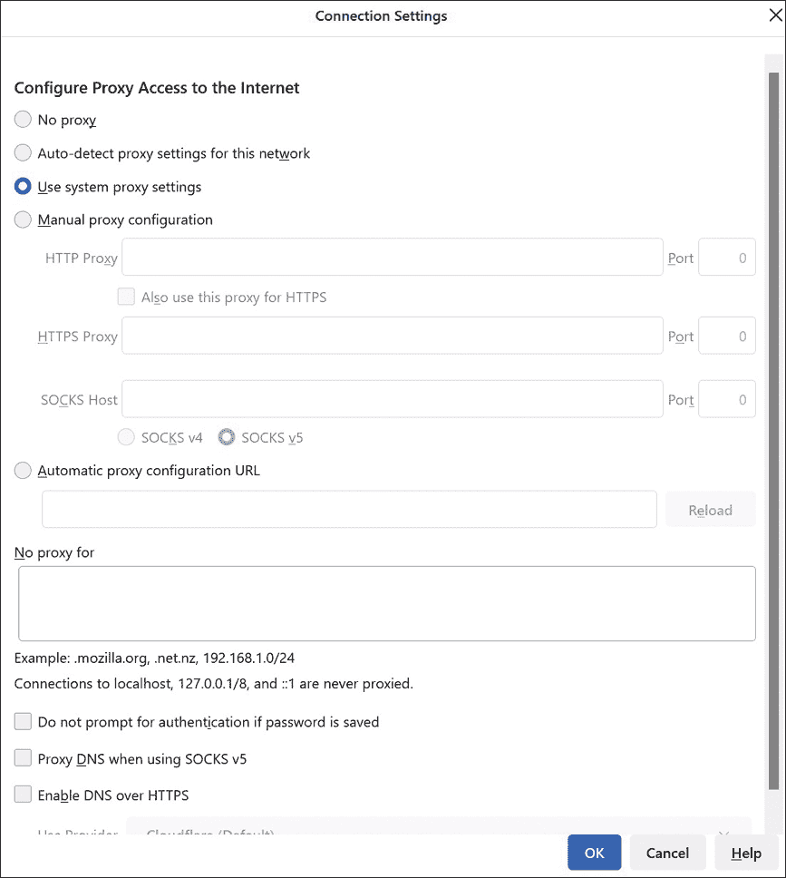

图 11.1 Firefox 浏览器中的客户端动态端口配置

### 以其他用户身份执行命令

`权限提升`（Privilege escalation）是一种以具有更高权限的用户身份执行命令的方法。例如，当用户需要使用比其账户拥有更多权限的账户执行命令时，就会使用它。例如，普通用户可能需要执行需要 root 用户权限的命令。多种技术可以提供权限访问；本节涵盖了可能出现在 Linux+ XK0-005 考试中的技术。

#### `/etc/sudoers`

有关 `/etc/sudoers` 的信息，请参见本章后面的“`sudo`”和“`visudo`”部分。

#### PolicyKit 规则

PolicyKit 是一个授权框架，允许无权限用户执行特权操作。PolicyKit 规则存储在以下目录：

- `/etc/polkit-1/rules.d`（红帽系系统）
- `/etc/polkit-1/local`（Debian 系系统）
- `/usr/share/polkit-1/rules.d`（第三方软件）

规则的编写较为复杂。例如，以下规则允许属于 `filesystem` 组的用户挂载文件系统：

```javascript
polkit.addRule(function(action, subject) {
    if (action.id == "org.freedesktop.udisks2.filesystem-system" &&
        subject.isInGroup("filesystem")) {
        return polkit.Result.YES;
    }
});
```

注意在此示例中，`org.freedesktop.udisks2.filesystem-system` 是一个应用程序接口（API）调用，且文件是用 JavaScript 编写的。

#### ExamAlert

虽然 Linux+ XK0-005 可能会给出 PolicyKit 规则并对此提问，但不太可能，因为规则较为复杂且需要 JavaScript 知识。更有可能的是关于如何使用规则提供服务的通用问题。

#### `sudo`

当管理员正确配置了 `sudo` 命令后，用户可以使用 `sudo` 命令以其他用户身份执行命令（通常是 root 用户身份）。要以 root 身份执行命令，请输入：

系统会提示输入自己的密码，如果 `/etc/sudoers` 文件中的设置正确，命令将正确执行。如果设置不正确，将显示错误信息。

表 11.2 描述了 `sudo` 命令的常用选项。

表 11.2 `sudo` 命令选项

| 选项 | 描述 |
| --- | --- |
| `-b` | 在后台运行命令。 |
| `-e` | 允许编辑 `/etc/sudoers` 文件。这是 `visudo` 工具的替代方案。 |
| `-l` | 列出允许用户的命令。 |


| `-u *user*` | 以`*user*`而非`root`用户身份运行命令。 |

#### visudo

`/etc/sudoers`文件用于确定哪些可以使用`sudo`命令以其他用户身份执行命令（通常是`root`用户身份）。编辑此文件，必须以`root`用户身份登录，并且应该使用`visudo`命令而不是直接编辑文件。

请参后续章节“visudo”获取有关`/etc/sudoers`文件的详细信息。

# 表 11.3 `/etc/sudoers`文件定义

| 选项 | 描述 |
| :--- | :--- |
|`User_Alias`| 代表一组用户（例如，`User_Alias ADMINS = julia, sarah`）。 |
|`Cmnd_Alias`| 代表一组命令（例如，`Cmnd_Alias SOFTWARE = /bin/rpm, /usr/bin/yum`）。 |

`/etc/sudoers`文件中的项使用以下语法：

```
user machine=commands
```

要允许学生用户以`root`用户身份执行`/usr/bin/yum`命令，请在`/etc/sudoers`文件中添加如下条目：

```
student ALL=/usr/bin/yum
```

要允许`ADMINS`组的所有成员以`root`用户身份执行所有`SOFTWARE`命令，请在`/etc/sudoers`文件中添加如下条目：

```
ADMINS ALL=SOFTWARE
```

## su -

`su`命令允许用户切换账户。以下是一个示例：

点击此处查看代码图片

```
[student@OCS ~]# id
uid=1000(student) gid=1000(student) groups=1000(student)
context=unconfined_u:unconfined_r:unconfined_t:s0-s0:c0.c1023
[student@localhost ~]# su root
Password:
[root@OCS ~]# id
uid=0(root) gid=0(root) groups=0(root)
context=unconfined_u:unconfined_r:unconfined_t:s0-s0:c0.c1023
```

执行`su`命令时有一个选项是被允许的：`-`选项。当你使用`-`选项执行`su`命令时，将提供一个新的登录`shell`。当你不使用`-`字符时，提供的是非登录`shell`。

### 考试警示

清楚在使用`su`命令中使用和不使用`-`的区别。Linux+ XK0-005 考试目标明确指出，你应该了解`su -`，这意味着你可能会遇到一个要求你了解其差异的问题。

## pkexec

使用`pkexec`命令执行通过`PolicyKit`配置的特权命令。该命令使用以下语法执行：

```
pkexec command
```

与`sudo`命令一样，使用`pkexec`命令时，你应该被要求提供账户密码以确认你的身份。

## 第 12 章

应用适当的访问控制

**本章涵盖了以下 Linux+ XK0-005 考试目标：**

*    **2.5:** 给定场景，应用适当的访问控制。

安全是当今 IT 领域的重点，了解如何保护文件系统对于稳健的 IT 安全计划至关重要。在本章中，你将学习如何使用权限保护文件和目录，包括访问控制列表、`suid`、`sgid`和粘位（sticky bit）。你还将学习实现基于上下文的安全机制，并接触`SELinux`和`AppArmor`。

本章提供了以下主题的信息：文件权限、增强型 Linux (SELinux)、AppArmor 和命令行工具。

### 文件权限

拥有文件或目录的用户有权通过权限允许或拒绝对该文件或目录的访问。此外，`root`用户有权更改系统中任何文件或目录的权限。

每个文件和目录都有标准权限（也称为“读、写、执行”权限），它们允许或不允许用户访问。使用这些标准权限是每个 Linux 用户都应该理解的操作，因为这是用户保护文件免受其他用户影响的方法。

要查看文件或目录的权限，使用`ls -l`命令：

点击此处查看代码图片

```
[student@OCS ~]$ ls -l /etc/chrony.keys
-rw-r-----. 1 root chrony 62 May 9 2018 /etc/chrony.keys
```

输出的前 10 个字符表示文件类型和该文件的权限。（记住，第一位置上的字符`-` [连字符] 表示普通文件，而`d`表示目录。）权限分为三组：文件的所有者（在前面的例中为`root`）、所属组所有者（`chrony`）以及所有其他用户（称为“others”）。

每组有三种可能的权限：读 (`r`)、写 (`w`) 和执行 (`x`)。如果设置了该权限，则显示表示权限的字符。否则，将显示连字符 (`-`) 以表示未设置该权限。因此，`r-x`意味着“设置了读和执行，但未设置写”。

读、写和执行权限的实际含义取决于对象是文件还是目录。对于文件，这些权限意味着：

*    **读：** 可以查看或复制文件内容。
*    **写：** 可以修改文件内容。
*    **执行：** 可以像程序一样运行该文件。在你创建程序后，必须使其具有可执行权限。

对于目录，这些权限意味着：

*    **读：** 可以列出目录中的文件。
*    **写：** 可以在目录中添加和删除文件。
*    **执行：** 可以进入目录（使用`cd`命令）或在路径中使用。

### 访问控制列表 (ACL)

请参阅本章后部分的“setfacl/getfacl”章节。

### 设置用户 ID (SUID)、设置组 ID (SGID) 和粘位

表 12.1 描述了`suid`、`sgid`和粘位的特殊权限集。

表 12.1 `suid/sgid/sticky bit`特殊权限

| 权限 | 描述 | 设置 |  |
| :--- | :--- | :--- | :--- |
|`suid`| 在可执行文件上设置时，`suid`允许程序使用文件所有者的权限运行。 |`chmod u+s` *file*或`chmod 4xxx` *file* |`chmod u-s` *file*或`chmod 0xxx` *file* |
|`sgid`| 在可执行文件上设置时，`sgid`允许程序使用组所有者的权限运行。在目录上设置时，目录中的所有新文件将继承目录的组所有权。 |`chmod g+s` *file*或`chmod 2xxx` *file* |`chmod g-s` *file*或`chmod 0xxx` *file* |
|`Sticky bit`| 在目录上设置粘位时，目录中的文件只能由文件所有者、目录所有者或`root`用户删除。 |`chmod o+t` *file*或`chmod 1xxx` *file*注：粘位权限几乎总是设置为八进制值 1777。 |`chmod o-t` *file*或`chmod 0xxx` *file* |

### 增强型 Linux (SELinux)

文件和目录可能会被不了解权限或无意中提供了过度访问的用户所破坏。系统管理员过去常说：“如果没有用户，什么都不会坏掉，系统会更安全。”当然，对这种说法的回答是：“没有用户，就没有工作可做了！”

注意，传统的 Linux 权限使用自主性访问控制 (DAC)，而基于上下文的权限使用强制访问控制 (MAC)。然而，当启用基于上下文的解决方案时，DAC 依然有效（即同时执行 MAC 和 DAC）。

基于上下文的权限可以通过在进程（程序）访问文件时提供额外的安全级别来补偿这一缺陷。本节和下一节将介绍两种常用的基于上下文的方法：SELinux 和 AppArmor。

通过 SELinux，你可以应用安全策略，要求进程必须属于 SELinux 安全上下文（这本质上是一个安全组）才能访问文件和目录。普通权限仍用于进一步定义访问权限，但在访问文件/目录时，会先应用 SELinux 策略。

一个更受关注的问题——也是大多数 SELinux 策略旨在解决的问题——是守护进程（或系统进程）如何产生安全风险的。考虑一种情况：你有许多提供各种服务的活动进程。例如，其中一个进程可能是 Web 服务器，如下例所示：

点击此处此处查看代码图像

```
root@OCS:~# ps -fe | grep httpd
root   1109  1 0 2018 ?  00:51:56 /usr/sbin/httpd
apache 1412  1109 0 Dec24 ? 00:00:09 /usr/sbin/httpd
apache 4085  1109 0 05:40 ? 00:00:12 /usr/sbin/httpd
apache 8868  1109 0 08:41 ? 00:00:06 /usr/sbin/httpd
apache 9263  1109 0 08:57 ? 00:00:04 /usr/sbin/httpd
apache 12388 1109 0 Dec26 ? 00:00:47 /usr/sbin/httpd
apache 18707 1109 0 14:41 ? 00:00:00 /usr/sbin/httpd
apache 18708 1109 0 14:41 ? 00:00:00 /usr/sbin/httpd
apache 19769 1109 0 Dec27 ? 00:00:15 /usr/sbin/httpd
apache 29802 1109 0 01:43 ? 00:00:17 /usr/sbin/httpd
apache 29811 1109 0 01:43 ? 00:00:11 /usr/sbin/httpd
apache 29898 1109 0 01:44 ? 00:00:10 /usr/sbin/httpd
```

在此输出中，注意每行都描述一个在系统中运行的 Apache Web 服务器进程（`/usr/sbin/httpd`）。行的第一部分是启动进程的用户。以`root`身份运行的进程仅用于生成额外的`/usr/sbin/httpd`进程。而其他进程响应来自客户端工具（Web 浏览器）的传入网页请求。

想象一下，如果 Apache Web 服务器软件中发现了一个安全漏洞，允许客户端工具控制其中一个`/usr/sbin/httpd`进程，并向该进程发布自定义命令或操作。其中一种操作可以是查看`/etc/passwd`文件的内容，由于该文件设置了权限，该操作将成功：

点击此处此处查看代码图像

```
root@OCS:~# ls -l /etc/passwd
-rw-r--r-- 1 root root 2690 Dec 11 2018 /etc/passwd
```

从此命令的输出中可以看出，所有用户都有查看`/etc/passwd`文件内容的能力。但你真的希望某些随机人员（可能是黑客）能够查看存储用户账户数据的文件内容吗？

通过 SELinux 策略，可以锁定`/usr/sbin/httpd`进程，使得每个进程只能访问一组特定的文件集。这就是大多数管理员使用 SELinux 的原因：保护进程以防止黑客利用已知的（可能是未知的）漏洞进行攻击。

### 标签 (Labels)

在 SELinux 中对文件进行标记涉及对文件应用安全上下文。请参考本章节后面的`chcon`部分获取有关安全上下文的信息。

### 自动重标记 (Autorelabel)

如果你想更改系统中所有文件的 SELinux 上下文，可以告诉系统在下次启动过程中对文件系统中的每个文件执行自动重标记。要执行此操作，如下所示在根目录下创建一个空文件：

点击此处此处查看代码图像

```
root@OCS:~# touch /.autorelabel
```

### 系统布尔值 (System Booleans)

有关 SELinux 布尔值的详情，请参考本章节后面的`getsebool`部分。

### 状态 (States)

SELinux 可以处于三种状态（或模式）之一：

*   **Enforcing（强制）：** 在强制模式下，SELinux 执行检查并在必要时阻止对文件或目录的访问。
*   **Permissive（许可）：** 在许可模式下，SELinux 执行检查，但绝不会阻止对文件或目录的访问。
*   **Disabled（禁用）：** 在禁用状态下，SELinux 不执行任何检查。

请参考本章节后面的`setforce`部分获取切换状态的详细信息。

### 策略类型 (Policy Types)

SELinux 使用策略来定义进程允许和不允许做什么。主要有三种策略类型：

*   **Targeted（目标）：** 这是默认策略。它仅限制特定的面向网络的进程。
*   **Role（角色）：** 该策略限制系统上的所有进程。
*   **MLS（多级安全）：** 这是最严格的策略，用于高安全环境。

```
chief@chief-VirtualBox:~$ sudo aa-enforce /usr/bin/man
Setting /usr/bin/man to enforce mode.
chief@chief-VirtualBox:~$ sudo aa-disable /usr/bin/man
Disabling /usr/bin/man.
chief@chief-VirtualBox:~$ sudo aa-status
apparmor module is loaded.
19 profiles are loaded.
17 profiles are in enforce mode.
   /usr/lib/NetworkManager/nm-dhcp-client.action
   /usr/lib/NetworkManager/nm-dhcp-helper
   /usr/lib/connman/scripts/dhclient-script
   /usr/lib/cups/backend/cups-pdf
   /usr/lib/lightdm/lightdm-guest-session
   /usr/lib/lightdm/lightdm-guest-session//chromium
   /usr/sbin/cups-browsed
   /usr/sbin/cupsd
   /usr/sbin/cupsd//third_party
   /usr/sbin/tcpdump
   /{,usr/}sbin/dhclient
   libreoffice-senddoc
   libreoffice-soffice//gpg
   libreoffice-xpdfimport
   lsb_release
   nvidia_modprobe
   nvidia_modprobe//kmod
2 profiles are in complain mode.
   libreoffice-oopslash
   libreoffice-soffice
5 processes have profiles defined.
5 processes are in enforce mode.
   /usr/sbin/cups-browsed (591)
   /usr/sbin/cupsd (495)
   /usr/lib/cups/notifier/dbus (592) /usr/sbin/cupsd
   /usr/lib/cups/notifier/dbus (593) /usr/sbin/cupsd
   /usr/lib/cups/notifier/dbus (594) /usr/sbin/cupsd
0 processes are in complain mode.
0 processes are unconfined but have a profile defined.
chief@chief-VirtualBox:~$ sudo aa-complain /usr/bin/man
Setting /usr/bin/man to complain mode.
chief@chief-VirtualBox:~$ sudo aa-enforce /usr/bin/man
Setting /usr/bin/man to enforce mode.
```

你可以使用`aa-unconfined`命令来列出未受 AppArmor 配置文件限制的进程。

`/etc/apparmor.d`目录是 AppArmor 配置定义的所在。了解如何创建或读取这些文件不在 Linux+ XK0-005 考试的范围内，但了解这些配置文件的位置对于确定哪些配置可用以及使用 AppArmor 命令（如`aa-disable`命令）是非常重要的。

`/etc/apparmor.d/tunables`目录是用于精调 AppArmor 行为的文件所在。了解如何创建或读取这些文件不在 Linux+ XK0-005 考试的范围之内。

### 命令行工具

本节涵盖了几个与权限、SELinux 和 AppArmor 相关的工具。

#### chmod

`chmod`命令用于更改文件的权限。它可以通过两种方式使用：使用符号表示法和使用八进制法。在八进制法中，权限被分配为数值：

*    读取 = 4
*    写入 = 2
*    执行 = 1

使用这些数值，可以用一个数字来描述整组权限：

*    7 = `rwx`
*    6 = `rw-`
*    5 = `r-x`


进入`/path/to/xxx`目录，找到`xxx.json`。

在表达式`cvar = avar + bvar`中，加法运算符（`+`）将`avar`与`bvar`相加，得到它们的和`cvar`

在`List.of(arg0, arg1, arg2)`中，`List`接口的工厂方法`of()`接受一系列的元素，返回包含它们的只读列表。

之后我们这样调用`cmd`命令：`cmd arg0 arg1 arg2`。

```
if (condVar > someVal) {console.log("xxx")}
```

---

- ` 4 = r--`
- ` 3 = -wx`
- ` 2 = -w-`
- ` 1 = --x`
- ` 0 = ---`

因此，要将文件的权限更改为`rwxr-xr--`，你需要执行以下命令：

```
chmod 754 filename
```

**表格 12.2 | 操作 (What) | 权限 (Permission) |**

| 操作 | 权限 |
| --- | --- |
| `u` = 用户 | `+` |
| `g` = 组 | `-` |
| `o` = 其他 | `=` |
| `a` = 所有 | |
| | `r` |
| | `w` |
| | `x` |

- 为其他用户（others）应用 ACL 时使用`others`或`o`
- 设置 ACL 掩码（mask）时使用`mask`或`m`（掩码将在本节稍后部分说明。）

*谁*的值是指将应用权限的用户或组。权限可以以符号值`r--`或八进制值`4`提供。

一旦在文件或目录上应用了 ACL，执行`ls -l`命令时，权限位后面会出现一个加号`+`，如下所示：

```
sarah@OCS:~$ ls -l sales_report
-rw-rw-r--+ 1 sarah sales 98970 Dec 27 16:45 sales_report
```

要查看 ACL，请使用`getfacl`命令：

```
sarah@OCS:~$ getfacl sales_report
# file: sales_report
# owner: sarah
# group: sarah
user::rw-
user:william:r--
group::rw-
mask::rw-
other::r--
```

以下示例演示了为组设置 ACL 的过程：

```
sarah@OCS:~$ setfacl -m g:games:6 sales_report
sarah@OCS:~$ getfacl sales_report
# file: sales_report
# owner: sarah
# group: sarah
user::rw-
user:william:r--
group::rw-
group:games:rw-
mask::rw-
other::r--
```

对于普通权限，使用`umask`值来确定应用于新文件和目录的默认权限。对于 ACL，你可以使用`setfacl`命令的`-m`选项，为 shell 中创建的所有新文件和目录定义默认 ACL 集合。在这种情况下，参数使用以下语法：`default:what:who:permission`。

以下示例为`reports`目录创建一个默认 ACL：

```
sarah@OCS:~$ mkdir reports
sarah@OCS:~$ setfacl -m default:g:games:r-x reports
sarah@OCS:~$ setfacl -m default:u:bin:rwx reports
sarah@OCS:~$ getfacl reports
# file: reports
# owner: sarah
# group: sarah
user::rwx
group::rwx
other::r-x
default:user::rwx
default:user:bin:rwx
default:group::rwx
default:group:games:r-x
default:mask::rwx
default:other::r-x
```

以下示例演示了新文件和目录如何继承上一个示例执行命令所创建的 ACL：

```
sarah@OCS:~$ mkdir reports/test
sarah@OCS:~$ getfacl reports/test
# file: reports/test
# owner: sarah
# group: sarah
user::rwx
user:bin:rwx
group::rwx
group:games:r-x
mask::rwx
other::r-x
default:user::rwx
default:user:bin:rwx
default:group::rwx
default:group:games:r-x
default:mask::rwx
default:other::r-x
sarah@OCS:~$ touch reports/sample1
sarah@OCS:~$ getfacl reports/sample1
# file: reports/sample1
# owner: sarah
# group: sarah
user::rw-
user:bin:rwx #effective:rw-
group::rwx #effective:rw-
group:games:r-x #effective:r--
mask::rw-
other::r--
```

**表 12.8 描述了`setfacl`命令的一些重要选项。**

**表格 12.8 `setfacl`命令选项**

| 选项 | 说明 |
| --- | --- |
| `-b` | 移除所有 ACL。 |
| `-d` | 在目录上设置默认 ACL，该 ACL 将被目录内创建的任何新文件或目录继承。 |
| `-R` | 递归应用 |

#### `ls`

查看本章前面的“文件权限”部分，详细了解`ls`命令的`-l`选项如何用于显示文件和目录权限。

#### `setenforce`

你可以使用`setenforce`命令禁用安全策略（这在测试新策略或排除 SELinux 问题时很有用）：

```
root@OCS:~# setenforce 0
root@OCS:~# getenforce
Permissive
```

在允许（permissive）模式下，SELinux 不阻塞任何对文件的访问。

#### `getenforce`

使用`getenforce`命令确定当前的 SELinux 模式：

```
root@OCS:~# getenforce
Enforcing
```

在允许（permissive）模式下，SELinux 不阻塞任何对文件的访问。

#### `Enforcing`

在允许（permissive）模式下，SELinux 不阻塞任何对文件的访问。

#### `chattr`

`chattr`命令用于更改文件属性。例如，`i`属性使文件变为不可变：

```
root@OCS:~# chattr +i /etc/passwd
```

`i`属性意味着文件无法被删除或修改，即使是 root 用户也不行。

使用`lsattr`命令查看文件的属性：

```
i`属性意味着文件无法被删除或修改。
```

要移除不可变属性，使用`chattr`命令：

```
root@OCS:~# chattr -i /etc/passwd
```

#### `lsattr`

`lsattr`命令用于查看文件的属性：

```
root@OCS:~# lsattr /etc/passwd
-------------e-- /etc/passwd
```

#### `chgrp`

`chgrp`命令用于更改文件的组所有。该命令的语法如下：

```
chgrp [options] group_name file
```

在以下示例中，将`abc.txt`文件的组所有更改为`staff`：

```
[student@OCS ~]$ chgrp staff abc.txt
```

**注意**

要更改文件的组所有者，执行`chgrp`命令的用户必须拥有该文件，并且必须是所更改目标组的成员。

| 选项 | 说明 |
| --- | --- |
| `-R` | 递归地将更改应用于整个目录结构。 |
| `--reference=file` | 将用户和组所有者更改为`file`的所有权。 |
| `-v` | 进入详细模式并产生输出以显示所做的更改。 |

### `setsebool`

SELinux 安全策略包含布尔值（Booleans）。`Boolean`是一个可以赋值为真（true）或假（false）值的设置。此值会影响 SELinux 策略的行为。要设置 SELinux 布尔值，请使用`setsebool`命令：

```
root@OCS:~# getsebool -a | grep abrt_anon_write
abrt_anon_write --> off
root@OCS:~# setsebool abrt_anon_write 1
root@OCS:~# getsebool -a | grep abrt_anon_write
abrt_anon_write --> on
```

有关布尔值的信息，请参阅下一节。

### `getsebool`

要查看所有布尔值，请使用`getsebool`命令：

```
root@OCS:~# getsebool -a | head
abrt_anon_write --> off
abrt_handle_event --> off
abrt_upload_watch_anon_write --> on
antivirus_can_scan_system --> off
antivirus_use_jit --> off
auditadm_exec_content --> on
authlogin_nsswitch_use_ldap --> off
authlogin_radius --> off
authlogin_yubikey --> off
awstats_purge_apache_log_files --> off
```

要确定一个布尔值的用途，请使用`semanage`命令：

```
root@OCS:~# semanage boolean -l | head
SELinux boolean State Default Description
privoxy_connect_any (on , on)
 Allow privoxy to connect any
smartmon_3ware       (off , off) Allow smartmon
to 3ware
mpd_enable_homedirs  (off , off) Allow mpd to
 enable homedirs
xdm_sysadm_login      (off , off) Allow xdm to
 sysadm login
xen_use_nfs            (off , off) Allow xen to use nfs
mozilla_read_content   (off , off) Allow mozilla
to read content
ssh_chroot_rw_homedirs (off , off) Allow ssh to
 chroot rw homedirs
mount_anyfile          (on , on) Allow mount to anyfile
```

有关如何设置布尔值的信息，请参阅上一节“setsebool”。

### `chcon`

每个进程都在一个安全上下文中运行。要查看此内容，请使用`ps`命令的`-Z`选项：

```
root@OCS:~# ps -fe | grep httpd | head -2
system_u:system_r:httpd_t:s0 root 1109 1 0 2018 ?
  00:51:56 /usr/sbin/httpd
system_u:system_r:httpd_t:s0 apache 1412 1109 0 Dec24 ?
  00:00:09 /usr/sbin/httpd
```

**注意**：此示例中使用`head`命令仅是为了限制命令的输出。

安全上下文（`system_u:system_r:httpd_t:s0`）是很复杂的，但对于理解 SELinux 基本，重要的部分是`httpd_t`，它类似于安全组或域。作为该安全域的一部分，`/usr/sbin/httpd`进程只能访问安全策略允许`httpd_t`访问的文件。该策略通常由 SELinux 专家编写，该专家需要对哪些进程能够访问系统上的特定文件和目录具有丰富的经验。

文件和目录也有由策略定义的 SELinux 安全上下文。要查看特定文件的安全上下文，请使用`ls`命令的`-Z`选项（注意 SELinux 上下文包含大量数据，因此文件名无法在单行显示）：

```
root@OCS:~# ls -Z /var/www/html/index.xhtml
unconfined_u:object_r:httpd_sys_content_t:s0/var/www/html/index.xhtml
```

使用`chcon`命令更改文件或目录的上下文：

```
root@OCS:~# chcon -t user_home_t /var/www/html/index.xhtml
```

### `restorecon`

SELinux 规则定义了大多数系统文件的默认安全上下文。`restorecon`用于重置文件或目录的默认安全上下文。

示例：

```
root@OCS:~# restorecon /var/www/html/index.xhtml
```

`restorecon`命令的一个常用选项是`-R`，它对目录结构递归执行操作。

### `semanage`

`semanage`命令的工作方式与`chcon`命令相似，唯一的区别在于：更改是持久的。相反，如果你使用`chcon`设置上下文，使用`restorecon`会将其恢复到之前的值。但如果你使用`semanage`命令，使用`restorecon`（或使用`/.autorelabel`方法）不会导致 SELinux 上下文恢复。

### `audit2allow`

当进程被 SELinux 拒绝访问时，`/var/log/audit/audit.log`文件会出现如下条目：

```
type=AVC msg=audit(143)
```

---

# 第三部分：脚本、容器与自动化

## 第十三章：创建简单脚本自动化常见任务

**本章涵盖：**

- **3.1:** 给定场景，创建简单的壳脚本来自动化任务。

### 脚本元素

脚本的第一行应该包含解释器的路径。对于 BASH 壳脚本，这应该是`bash`可执行文件的路径。可以通过执行以下命令发现此路径：

```
[root@OCS ~]$ which bash
/bin/bash
```

你可以将此路径添加到脚本的第一行如下：

```
#!/bin/bash
```

一个`BASH`壳脚本应以`.sh`扩展结尾，以表示该文件包含一个`BASH`壳脚本。（`.bash`扩展名也在使用，但并没有那么广泛。）

其他脚本语言应该有扩展名来指示语言类型：

- `.pl`: Perl 脚本
- `.py`: Python 脚本
- `.tcsh`: TC shell 脚本
- `.csh`: C shell 脚本

注释以井号（`#`）字符开始并延伸到行尾，例如所示：

```
#设置计数器变量:
count = 100
```

以下是一个在包含代码的行中注释的示例：

```
count = 100 #设置计数器变量
```

本节的其余部分描述了额外的壳脚本元素。

## 循环 (Loops)

循环结构是`BASH`脚本中执行一组操作（可能执行多次）的代码。本节将检查三种常用的循环结构：`while`、`until`和`for`循环。

### `while`

`while`循环被设计用于在条件语句返回`true`值时持续执行一组任务（命令）。例如，以下代码用于检查用户输入，以验证是否提供了正确的值：

```
read -p "Enter a zip code: "
while echo $zip | egrep -v "^[0-9]{5}$"
do
   echo "$zip is not a valid ZIP code, try again"
   read -p "Enter a zip code" zip
done
```

这里是该代码运行的示例：

```
Enter a zip code: 8888
8888 is not a valid ZIP code, try again
Enter a zip code: huh?
huh? is not a valid ZIP code, try again
Enter a zip code: 92020
```

**注意**：`read`命令从`stdin`读取输入，通常是用户的键盘输入。详细信息请参见本章后后的“read”部分。

### `for`

`for`循环用于迭代值列表。例如，以下代码对文件列表执行`wc -l`命令：

```
for file in "/etc/r*.conf"
do
    wc -l $file
done
```


## 示例输出

```
43 /etc/request-key.conf
3 /etc/resolv.conf
61 /etc/rsyslog.conf
```

**考试要点 (ExamAlert)**

注意何时应该使用`for`循环而不是`while`循环，这可能会出现在 Linux+ XK0-005 考试中。

### until

`until`语句的作用与`while`语句类似，但它在条件语句为假时执行其代码集。将以下`while`语句的伪代码与`until`语句的伪代码进行比较：

```
while conditional_check
do
    #如果 conditional_check 返回 true 则执行
done

until conditional_check
do
    #如果 conditional_check 返回 false 则执行
done
```

**考试要点 (ExamAlert)**

确保你了解`while`循环和`until`循环之间的区别。

## 条件语句 (Conditionals)

`test`语句用于执行条件测试，这些用于比较值和执行文件测试操作。

运行`test`语句的常用方法是将操作放在方括号内。例如，这两个语句执行相同的操作：

```
test $name1 = $name2
[ $name1 = $name2 ]
```

表 13.1 描述了常见的`test`操作。

**表 13.1 常见的`test`操作**

| 操作 | 说明 |
| --- | --- |
| `str1 = str2` | 如果两个字符串相等，则返回`true`。 |
| `str1 != str2` | 如果两个字符串不等，则返回`true`。 |
| `-z str` | 如果`str`的长度为零，则返回`true`；例如`[ -z $name ]`。 |
| `-n str` | 如果`str`的长度不为零，则返回`true`；例如`[ -n $name ]`。 |
| `int1 -eq int2` | 如果两个整数相等，则返回`true`。 |
| `int1 -ne int2` | 如果两个整数不等，则返回`true`。 |
| `int1 -gt int2` | 如果第一个整数大于第二个整数，则返回`true`。 |
| `int1 -ge int2` | 如果第一个整数大于或等于第二个整数，则返回`true`。 |
| `int1 -lt int2` | 如果第一个整数小于第二个整数，则返回`true`。 |
| `int1 -le int2` | 如果第一个整数小于或等于第二个整数，则返回`true`。 |
| `-d str` | 如果是目录，则返回`true`。 |
| `-f str` | 如果是普通文件，则返回`true`。 |
| `-e str` | 如果文件存在，则返回`true`。 |
| `-r str` | 如果文件可读，则返回`true`。 |
| `-w str` | 如果文件可写，则返回`true`。 |
| `-x str` | 如果文件可执行，则返回`true`。 |

### if

`if`语句用于根据条件的结果执行一个或多个命令。例如：

```bash
if [ $name = Bob ]
then
    echo "hello"
```

注意，结束`if`语句使用`fi`。`else`语句用于在条件为假时提供替代方案。例如：

```bash
if [ $name = Bob ]
then
    echo "hello"
elif [ $name = Sue ]
then
    echo "hi"
else
    echo "unknown name"
fi
```

## switch/case

`case`语句（有时称为“switch”语句）将变量的值与模式匹配。

语法：

```bash
case $var in
pattern1)
   #语句
   ;;
pattern2)
   #语句
   ;;
esac
```

分号（`;;`）用于结束一组语句，并且必须出现在下一个模式之前。结束`case`语句使用`esac`。

示例：

```bash
case $1 in
 start)
 echo "Starting the process"
 ;;
 stop)
 echo "Stopping the process"
 ;;
 *)
 echo "I need to start or stop"
esac
```

## Shell 参数扩展 (Shell Parameter Expansion)

脚本可以带参数运行：

```bash
./example.sh arg1 arg2 arg3
```

每个参数存储在`$1`、`$2`、`$3`等。`$0`是脚本本身。特殊变量`$#`传递给脚本的参数数量。

### 通配 (Globbing)

文件通配（也称为通配符）是命令行上代表文件名部分的任意字符。表 13.2 描述了支持的通配符。

**表 13.2 支持的通配符**

| 通配符 | 说明 |
| --- | --- |
| `*` | 匹配文件名中的零或多个字符。 |
| `?` | 匹配文件名中的任意单个字符。 |
| `[ ]` | 匹配单个字符，只要该字符位于`[]`字符范围内。 |

此示例复制所有`.txt`文件：

```bash
[student@OCS ~]$ cp *.txt ~
```

此示例删除所有长度为字符的文件：

```bash
[student@OCS ~]$ rm ????
```

查看当前目录下所有以`a`、`b`或`c`开头的文件类型，执行以下命令：

```bash
[student@OCS ~]$ file [abc]*
```

该命令也可以这样执行：

```bash
[student@OCS ~]$ file [a-c]*
```

其中`a-c`表示字符范围。这必须是 ASCII 文本表内的有效范围。要查看此表，请执行以下命令：

```bash
[student@OCS ~]$ man ascii
```

允许使用多个范围或值列表，例如所示：

```bash
[student@OCS ~]$ file [a-cg-jz]*
```

通过在范围开头放置一个`!`字符，你可以指定哪些字符是不匹配的。例如，以下命令会复制当前目录下所有不以`a`、`b`或`c`开头的文件：

```bash
[student@OCS ~]$ cp [!abc]* ~
```

此示例还演示了如何使用多个通配符来创建复杂的模式。

### 大括号扩展 (Brace Expansions)

通过`BASH`变量扩展功能，你可以返回不同的值。例如，如果变量`$name`未设置，则以下命令将返回“Bob”：

```bash
$ echo "Hello, ${name:-Bob}"
Hello, Bob
$ echo "Hello, $name"
Hello,
```

注意，当你像这样使用命令时，你并没有设置变量，而是为这种特定情况使用了提供的值。若要返回一个值并设置变量，请使用以下命令：

```bash
$ echo "Hello, ${name:=Bob}"
Hello, Bob
$ echo "Hello, $name"
Hello, Bob
```

还有其他的变量扩展功能。例如，以下命令将只返回变量的前 24 个字符，从而产生一个更“简洁”的语句：

```bash
$ times="It was the best of times, it was the worst of times."
$ echo ${times: 0:24}
It was the best of times
```

注意，在示例中，`0`表示要返回的第一个字符，`24`表示要返回的字符总数（从字符`0`开始计数）。

命令替换（Command substitution）是在较大的命令中执行子命令的过程。它通常用于收集数据并存储在变量中。例如，以下命令将`date`命令的输出存储在`$today`变量中：

```bash
today=$(date)
```

可以使用以下两种方法执行命令替换：

* `$(cmd)`
* `` `cmd` ``

注意，第二种方法使用的是反引号（也称为 backtick characters），而不是单引号。

### 比较 (Comparisons)

`BASH` shell 提供了多种条件语句，包括`if`语句、`while`循环和`until`循环。这些条件语句使用了`BASH` shell 中的比较功能，如下例所示：

```bash
if [ $name = "Bob" ]
then
    echo "hi"
fi
```

此示例执行了对`BASH`命令`test`的隐式调用，该命令可用于执行多项比较测试，包括整数（算术）比较、字符串比较和文件测试操作。例如，下面的示例测试存储在变量`$name1`中的字符串值是否不等于存储在变量`$name2`中的字符串：

```bash
[ "$name1" != "$name2" ]
```

#### 注意

方括号周围的空格非常重要。每个左方括号之后和每个右方括号之前应该有一个空格。如果没有这些空格，将会发生错误信息。

接下来的章节将介绍不同类型的比较操作。

#### 算术 (Arithmetic)

如果你想执行整数（算术）比较操作，请使用以下符号：

* `-eq:` 如果两个值相等，则为真。
* `-ne:` 如果两个值不相等，则为真。
* `-gt:` 如果第一个值大于第二个值，则为真。
* `-lt:` 如果第一个值小于第二个值，则为真。
* `-ge:` 如果第一个值大于等于第二个值，则为真。
* `-le:` 如果第一个值小于等于第二个值，则为真。

示例：

```bash
if [ $age -lt 25 ]
then
    echo "the person is less than 25 years old"
fi
```

#### 字符串 (String)

最常用的字符串比较是“等于”和“不等于”。以下是相等的示例：

```bash
if [ $name = "Bob" ]
then
    echo "hi"
fi
```

这是一个不相等的示例：

```bash
if [ $name != "Bob" ]
then
    echo "goodbye"
fi
```

除了判断两个字符串是否相等或不相等，你可能发现`-n`选项很有用。该选项确定字符串是否为空，这在测试输入时非常有用。例如，前面的变量用于确保用户输入了内容。

#### 布尔 (Boolean)

比较返回真或假值。你可以反转这些值。例如，如果比较结果为假，你可以反转它。这些操作包括：

* `-d:` 如果是目录，则为真。
* `-f:` 如果是普通文件，则为真。
* `-r:` 如果文件存在且用户可读，则为真。
* `-w:` 如果文件存在且用户可写，则为真。
* `-x:` 如果文件存在且用户可执行，则为真。

例如，你可以使用以下命令检查文件是否可读：

```bash
if [ -r /etc/shadow ]
then
    echo "You can read the shadow file"
fi
```

如果你不想检查文件是否可读，而是想检查它是否不可读，可以通过在条件前放置`!`字符来反转它：

```bash
if [ ! -r /etc/shadow ]
then
    echo "You can't read the shadow file"
fi
```

#### 变量 (Variables)

请参见本章节的“环境变量”部分。

#### 搜索与替换 (Search and Replace)

请参见本章节的“`grep`”和“`sed`”部分。

#### 正则表达式 (Regular Expressions)

*regex*一词是正则表达式（RE）的缩写，它是一种用于匹配其他字符的字符或字符集。例如，在支持 RE 的工具中，`.`（点或周期）字符将匹配任意类型的单个字符，而`[a-z]`将匹配任何单个小写字母。

正则表达式有两种类型：基础和扩展。基础正则表达式是原始的，扩展正则表达式是较新添加的。使用正则表达式的工具通常默认支持基础正则，并带有某些开关或功能来启用扩展正则。尽管文档可能称基础正则已过时，但大多数现代工具仍在使用它们。

表 13.3 描述了常用的基础 RE。

**表 13.3 常用的基础正则表达式**

| RE | 描述 |
| --- | --- |
| `.` | 匹配任意单个字符。 |
| `*` | 匹配前面的字符零次或多次。 |
| `^` | 匹配行的开头。 |
| `$` | 匹配行的结尾。 |
| `[ ]` | 精确匹配一个位于`[ ]`范围内的字符；允许使用字符列表（例如`[abc]`）或字符范围（例如`[a-c]`）。 |
| `[^]` | 精确匹配一个*不在*`[ ]`范围内的字符；允许使用字符列表（例如`[^abc]`）或字符范围（例如`[^a-c]`）。 |
| `\` | 转义正则表达式的特殊含义；例如，模式`\.*`会匹配值`".*"`。 |

表 13.4 描述了常用的扩展正则表达式（REs）。

**表 13.4 适用的扩展正则表达式**

| RE | 描述 |
| --- | --- |
| `( )` | 将一组字符组合在一起形成一个表达式——例如，`(abc)`。 |
| `X|Y` | 匹配`X`或`Y`。 |
| `+` | 匹配前面的字符或表达式一次或多次。 |
| `{X}` | 匹配前面的字符或表达式`X`次。 |
| `{X,}` | 匹配前面的字符或表达式`X`次或多次。 |
| `{X,Y}` | 匹配前面的字符或表达式`X`到`Y`次。 |
| `?` | 表示前面的字符或表达式是可选的。 |

**考试要点 (ExamAlert)**

正则表达式是一个大主题。请关注本章提供的 Linux+ XK0-005 考试信息。

### 标准流重定向

每个命令都能发送两个输出流（标准输出和标准错误），并接受一个数据流（标准输入）。在文档中，这些术语描述如下：

* 标准输出 = `stdout`或`STDOUT`
* 标准错误 = `stderr`或`STDERR`
* 标准输入 = `stdin`或`STDIN`

默认情况下，`stdout`和`stderr`发送到终端窗口，而`stdin`来自键盘输入。在某些情况下，你希望更改这些位置，可以通过被称为“重定向”（redirection）的过程来实现。

表 13.5 描述了用于执行重定向的方法。

**表 13.5 用于重定向的方法**

| 方法 | 描述 |
| --- | --- |
| `cmd < file` | 覆盖`STDIN`，使输入来自指定的文件。 |
| `cmd > file` | 覆盖`STDOUT`，使输出进入指定的文件，覆盖文件的原有内容。 |
| `cmd >> file` | 覆盖`STDOUT`，使输出进入指定的文件，追加到文件原有内容的末尾。 |
| `cmd 2> file` | 覆盖`stderr`，使输出进入指定的文件。 |
| `cmd &> file` | 同时覆盖`STDOUT`和`stderr`，使输出进入指定的文件。 |
| `cmd1|cmd2` | 覆盖`cmd1`的`STDOUT`，使其作为`STDIN`进入`cmd2`。 |

在下面的示例中，`cal`程序的`STDOUT`被发送到名为`month`的文件中：

```
[student@OCS ~]$ cal > month
```

将`STDOUT`和`stderr`都重定向到不同的文件中是常见的，如示例所示：

```
[student@OCS ~]$ find /etc -name "*.cfg" -exec file {} \; > output 2> error
```

重定向`STDIN`非常罕见，因为大多数命令都可以接受文件名作为普通参数；然而，执行字符转换的`tr`命令需要重定向`STDIN`：

```
[student@OCS ~]$ cat /etc/hostname
localhost
[student@OCS ~]$ tr 'a-z' 'A-Z' < /etc/hostname
LOCALHOST
```

**考试要点 (ExamAlert)**

准备好应对 Linux+ XK0-005 问题，重点关注向文件追加（`>>`）和覆盖（`>`）文件内容的区别。

### 管道 (Pipes)

管道（称为管道，是因为`|`字符被称为“管道”）将一个命令的输出传递到另一个命令的过程会产生更强大的命令行。例如，下面的示例获取`ls`命令的标准输出并发送到`grep`命令，以过滤在 4 月 16 日更改的文件：

```
[student@OCS ~]$ ls -l /etc | grep "Apr 16"
-rw-r--r-- 1 root root 321 Apr 16 2014 blkid.conf
drwxr-xr-x 2 root root 4096 Apr 16 2014 fstab.d
```


在此示例中，行被了相应的过滤。下面的示例获取`ls`命令的标准输出并发送到`grep`命令，以过滤在 4 月 16 日更改的文件：

你可以像示例中那样添加额外的命令：

```
[student@OCS ~]$ ls -l /etc | grep "Apr 16"

-rw-r--r-- 1 root root 321 Apr 16 2014 blkid.conf

drwxr-xr-x 2 root root 4096 Apr 16 2014 fstab.d
```

尽管此主题并不是重定向功能，但 CompTIA 仍将其归于 Linux+ XK0-005 考试目标中的“标准流重定向”类别下。不要让它在考试目标中的位置让你对该主题的用途产生困惑。

### `>`
查看本章节前面的“标准流重定向”节。

### `>>`
查看本章节前面的“标准流重定向”节。

### `<`
查看本章节前面的“标准流重定向”节。

### `<<`
查看本章节后文的“Here Documents（在此文档/在此字符串）”节。

### `&`
当你通过命令行执行程序或命令时，shell 被称为`父进程`，而执行的命令被称为`子进程`。通常情况下，当子进程在 shell 中执行时，它会在前台运行，这意味着只要子进程正在运行，你就无法使用父进程。你可以通过将命令放在后台来改变这种行为。要做到这一点，请在命令末尾带有`&`字符运行命令：

```
$ find /etc -name sample.cfg &
```

这通常是运行时间较长的命令的良好解决方案。你可能不想在输入其他命令之前等待命令执行完毕；然而，如果子进程产生了输出，这可能会引起困惑，因为这些输出会在子进程生成时直接显示在屏幕上。因此，考虑像本示例所示将所有输出重定向到文件，以避免这种困惑：

```
$ find /etc -name sample.cfg >/tmp/output 2>/tmp/error &
```

#### 考试警报
CompTIA 将此主题归于 Linux+ XK0-005 考试目标中的“标准流重定向”类别下，尽管此主题并不是重定向功能。不要让它在考试目标中的位置让你对该主题的用途产生困惑。

### `&&`
`&&`字符可以用于创建一个类似于`if`的语句，用于检查命令是否返回了退出状态`true`。例如，如果`/etc/passwd`文件中存在`bob`账户，以下命令将显示`bob is there`：

```
$ grep "^bob:" /etc/passwd && echo "bob is there"
```

在本示例中，如果`grep`能在`/etc/passwd`文件的任何行开头找到`bob:`，它就会产生返回状态`true`。如果`grep`返回`true`，则执行`&&`字符之后的语句。如果`grep`不能在`/etc/passwd`文件的任何行开头找到`bob:`，它将返回`false`，shell 不会执行`&&`字符之后的`echo`命令。

#### 考试警报
CompTIA 将此主题归于 Linux+ XK0-005 考试目标中的“标准流重定向”类别下，尽管此主题并不是重定向功能。不要让它在考试目标中的位置让你对该主题的用途产生困惑。

### 重定向：stderr/stdout
查看本章节前面的“标准流重定向”节。

### Here Documents（在此文档/在此字符串）
`here document`提供了一种重定向技术，允许你向命令发送大块数据。例如，假设你想向 stdout 发送以下文本：

我们选择去月球。我们选择在这个十年内去月球，并做其他事情，不是因为它们很容易，而是因为它们很困难，因为那个目标将有助于组织和衡量我们最好的能量和技能，因为那个挑战是我们愿意接受的，是我们不愿推迟的，也是我们打算赢的，其他的也是如此。

你可以如下使用`<<`配合这段文本来创建一个 here document：

```
cat <<EOF

We choose to go to the moon. We choose to go to the moon in this

decade and do the other things, not because they are easy, but because

they are hard, because that goal will serve to organize and measure

the best of our energies and skills, because that challenge is one

that we are willing to accept, one we are unwilling to postpone, and

one which we intend to win, and the others, too.

EOF
```

两个`EOF`标签之间的所有内容都会像来自`stdin`一样发送给`cat`命令。这提供了一种使用 WYSIWYG（所见即所得）显示文本的方法。通常 here documents 用于 shell 脚本，但它们也可以在命令行中使用。

### 退出状态码
查看本章节后文的“$??”节。

### Shell 内置命令
你在 BASH 中执行的大多数命令实际上是外部命令。这意味着它们不是 BASH 本身的一部分，而是另一个程序的一部分。你可以通过`type`命令来判断一个命令是否为 shell 内置命令。例如，`date`命令不是内置命令，而`read`命令是：

```
[bo@mail ~]$ type date

date is /usr/bin/date

[bo@mail ~]$ type read

read is a shell builtin
```

#### `read`
`read`语句从 STDIN 提取信息并放入变量中。例如，以下将数据读入`name`变量：

```
read name
```

为不同的变量赋值，使用以下语法：

```
read var1 var2 var3
```

使用`-p`选项向用户提示：

```
$ read -p "Enter your name" name
```

#### `echo`
`echo`命令用于显示信息。通常，它用于显示变量的值。

例如：

```
[student@OCS ~]$ echo $HISTSIZE

1000
```

`echo`命令只有几个选项。最常用的是`-n`选项，它可以防止输出结尾打印换行符。

某些特殊字符序列可以包含在`echo`的参数中。例如，命令`echo "hello\nthere"`输出以下内容：

```
hello

there
```

表 13.6 描述了 echo 命令的一些有用字符序列。

表 13.6 echo 命令的有用字符序列

| 序列 | 描述 |
| --- | --- |
| `\a` | 终端响铃 |
| `\n` | 换行符 |
| `\t` | 制表符 |
| `\\` | 单反斜杠字符 |

### `source`
大多数命令作为具有独立环境的独立进程执行。`source`命令允许你执行 BASH 脚本，就像脚本中的命令直接在命令行执行的一样。

例如：

```
[root@OCS ~]$ source ./functions.sh
```

使用`.`命令执行与`source`命令相同的功能，如下：

```
[root@OCS ~]$ . ./functions.sh
```

这种技术通常在 shell 脚本内部引用其他 shell 脚本的代码。引用另一个脚本的想法是将另一个脚本的代码包含在你正在编写的脚本中。例如，一个脚本可能需要另一个脚本中声明的变量。

### 常用脚本工具
由于脚本本质上是 BASH 命令的集合，因此任何 BASH 命令都可以在脚本中使用。然而，有些命令对编写脚本特别有用。本节涵盖了一些最流行的脚本工具（它们在日常使用中也很流行）。

#### `awk`
`awk`命令用于修改简单数据库格式的文本。例如，考虑以下数据：

```
[student@OCS ~]$ head /etc/passwd

root:x:0:0:root:/root:/bin/bash

bin:x:1:1:bin:/bin:/sbin/nologin

daemon:x:2:2:daemon:/sbin:/sbin/nologin

adm:x:3:4:adm:/var/adm:/sbin/nologin

lp:x:4:7:lp:/var/spool/lpd:/sbin/nologin

sync:x:5:0:sync:/sbin:/bin/sync

shutdown:x:6:0:shutdown:/sbin:/sbin/shutdown

halt:x:7:0:halt:/sbin:/sbin/halt

mail:x:8:12:mail:/var/spool/mail:/sbin/nologin

operator:x:11:0:operator:/root:/sbin/nologin
```

通过`awk`命令，你可以将上例显示的数据拆分为不同的字段，然后对这些数据执行操作：

```
[student@OCS ~]$ head /etc/passwd | awk -F: '{print $1,$7}'

root /bin/bash

bin /sbin/nologin

daemon /sbin/nologin

adm /sbin/nologin

lp /sbin/nologin

sync /bin/sync

shutdown /sbin/shutdown

halt /sbin/halt

mail /sbin/nologin

operator /sbin/nologin
```

在此示例中，使用`-F`选项来指定字段分隔符。每个字段被分配给一个变量。表 13.7 描述了这些变量。

表 13.7 `awk`命令生成的字段赋值变量

| 变量 | 描述 |
| --- | --- |
| `$1`, `$2` 等 | 字段变量。 |
| `$0` | 整个行。 |
| `NF` | 行上的字段数。（不要为此变量使用`$`字符。） |
| `NR` | 当前行号。 |

表 13.8 描述了`awk`命令的一些重要选项。

表 13.8 `awk`命令选项

| 选项 | 描述 |
| --- | --- |
| `-F` | 用于指定字段分隔符。 |
| `-f` | 用于指定包含要执行的`awk`命令的文件。 |

#### 考试警报
`awk`是一个巨大的主题。对于 Linux+ XK0-005 考试，请关注本章涵盖的`awk`组件。

### `sed`
使用`sed`工具对文件进行自动化修改。`sed`命令的基本格式为`sed 's/RE/string/' file`，其中`RE`指代“正则表达式”（regular expression），这是一种使用特殊字符匹配模式的特性。有关正则表达式的详细信息，请参阅本章前面的“正则表达式”部分。

这是一个`sed`命令的示例：

```
[student@OCS ~]$ head -n 5 /etc/passwd

root:x:0:0:root:/root:/bin/bash

bin:x:1:1:bin:/bin:/sbin/nologin

daemon:x:2:2:daemon:/sbin:/sbin/nologin

adm:x:3:4:adm:/var/adm:/sbin/nologin

lp:x:4:7:lp:/var/spool/lpd:/sbin/nologin

[student@OCS ~]$ head -n 5 /etc/passwd | sed 's/bin/----/'

root:x:0:0:root:/root:/----/bash

----:x:1:1:bin:/bin:/sbin/nologin

daemon:x:2:2:daemon:/s----:/sbin/nologin

adm:x:3:4:adm:/var/adm:/s----/nologin

lp:x:4:7:lp:/var/spool/lpd:/s----/nologin
```

`sed`是一个具有大量特性的非常强大的工具。表 13.9 描述了一些最实用的`sed`操作。

表 13.9 `sed`操作

| 特性 | 描述 |
| --- | --- |
| `'/RE/d'` | 删除`sed`命令输出中匹配 RE 的行。 |
| `'/RE/c*string*'` | 将匹配 RE 的行更改为*string*的值。 |
| `'/RE/a*string*'` | 在所有匹配 RE 的行之后添加*string*。 |
| `'/RE/i*string*'` | 在所有匹配 RE 的行之前添加*string*。 |

### `find`

`find`命令用于在目录层次结构中搜索文件。它非常灵活，可以根据名称、大小、文件类型、所有权、权限、时间戳等条件进行搜索。基本语法为`find [路径] [表达式]`。

表 13.10 描述了一些常用的测试选项。

表 13.10 `find`命令的常用选项

| 选项 | 描述 |
| --- | --- |
| `-name pattern` | 匹配文件名与模式（使用通配符）。 |
| `-type f` | 匹配常规文件。 |
| `-type d` | 匹配目录。 |
| `-size n` | 匹配大小为 n 个 512 字节块的文件（如果 n 后跟`c`则为字节）。 |
| `-mtime n` | 匹配 n 天前修改的文件（`+n`表示大于 n 天，`-n`表示小于 n 天）。 |
| `-user name` | 匹配属于用户 name 的文件。 |
| `-group name` | 匹配属于组 name 的文件。 |

以下是一些示例：

```
[student@OCS ~]$ find /etc -name "*.conf"

[student@OCS ~]$ find /var/log -type f -mtime -7

[student@OCS ~]$ find /home -user bob
```

#### 权限测试选项

表 13.11 描述了一些基于权限的测试选项。

表 13.11 `find`命令的权限测试选项

| 选项 | 描述 |
| --- | --- |
| `-perm mode` | 匹配权限与模式精确匹配的文件。 |
| `-perm -mode` | 匹配所有列出的权限位都存在的文件（其他权限位可以存在）。 |
| `-perm /mode` | 匹配列出的权限位中任何一个存在的文件。 |

示例：

| 选项 | 描述 |
| --- | --- |
| `-perm ugo=r` | 匹配所有三个权限组都具有符号读权限的文件，但忽略任何其他权限值。（可能的匹配包括`rwxrwxr-x`、`r--r--r--`和`rwxr--r--`。） |
| `-perm /444` | 匹配具有八进制权限 444 的文件，并忽略任何其他权限值。（可能的匹配包括`r--------`、`rw-rw-r--`和`rwxr--r--`。） |

一旦找到文件，就可以对该文件执行操作。表 13.13 描述了一些重要的基于操作的选项。

表 13.13 结果选项

| 选项 | 描述 |
| --- | --- |
| `-delete` | 删除所有匹配的文件（例如，`find /tmp -name "*.tmp" -delete`）。 |
| `-exec command` | 在每个匹配的文件上执行命令。 |
| `-ls` | 列出每个匹配文件的详细信息。 |
| `-ok` | 在每个匹配的文件上执行命令，但在每次匹配之前会提示用户；提示是一个是/否问题，用于确定用户是否想要执行命令。 |
| `-print` | 打印每个匹配文件的文件名；这是默认的操作选项。 |

这里是`-exec`选项的示例：

```
[root@OCS ~]# find /etc -name "*.cfg" -exec file {} \;

/etc/grub2.cfg: symbolic link to '../boot/grub2/grub.cfg'

/etc/enscript.cfg: ASCII text

/etc/python/cert-verification.cfg: ASCII text
```

`\;`用于构建命令行。例如，在上一个`find`示例中执行的命令是：

```
file /etc/grub2.cfg; file /etc/enscript.cfg; file /etc/python/cert-verification.cfg
```

在`;`之前的`\`是必须的，用于转义 BASH shell 中`;`字符的含义，以便将`;`字符作为普通参数传递给`find`命令。

`{}`字符表示命令中放置匹配文件名的位置。它可以使用多次，正如下一个示例所示，该示例为每个匹配的文件创建一个副本：

```
find /etc -name "*.cfg" -exec cp {} /tmp/{}.bak \;
```

### `xargs`

`xargs`命令从 STDIN 接收数据以构建并执行命令。这是该命令的语法：

```
input_command | xargs execute_command
```

其中`input_command`设计用于为`xargs`提供信息，作为参数传递给`execute_command`。

例如，假设你想对`/etc`目录下每个以字母`e`开头的文件运行`wc -l`命令。你可以使用此命令：

```
[student@OCS ~]$ ls -d /etc/e* | xargs wc -l

 1 /etc/ec2_version

 1 /etc/environment

 2 total
```

表 13.14 描述了`xargs`命令的一些重要选项。

表 13.14 `xargs`选项

| 选项 | 描述 |
| --- | --- |
| `-0` | 处理空格问题。通常用于处理包含空格字符的文件名；每个字符都被视为普通字符。 |
| `-d` | 用于更改参数之间的分隔符（默认是空格字符）。 |
| `-n max-args` | 指定每个`execute_command`的最大参数数量。 |
| `-p` | 在执行`execute_command`之前提示用户。 |
| `-t` | 在执行命令之前显示`execute_command`命令。 |

### `grep`

使用`grep`命令在文件中搜索包含特定模式的行。默认情况下，`grep`命令在找到匹配模式时会显示整行。

示例：

```
[student@OCS ~]$ grep "the" /etc/rsyslog.conf

# 要启用高精度时间戳，请注释此行。

# 设置所有日志文件的默认权限。


表 13.15 描述了 `grep` 命令的一些重要选项。

### 表 13.15 `grep` 命令选项

| 选项 | 描述 |
| --- | --- |
| `-c` | 显示匹配行的计数，而不是显示每行匹配的行。 |
| `-color` | 以颜色显示匹配部分。 |
| `-E` | 允许使用扩展正则表达式。 |
| `-f` | 从文件中读取模式。 |
| `-i` | 忽略大小写。 |
| `-l` | 仅显示包含匹配的文件名。 |
| `-r` | 递归搜索目录。 |
| `-n` | 显示每个匹配的行号。 |
| `-v` | 反转匹配（选择不匹配的行）。 |
| `-w` | 仅匹配整个单词。 |
| `-f` | 用于指定要显示的字段。 |

以下是一个使用字段（fields）的示例：

```
[student@OCS ~]$ head -2 /etc/passwd
root:x:0:0:root:/root:/bin/bash
bin:x:1:1:bin:/bin:/sbin/nologin
[student@OCS ~]$ head -2 /etc/passwd | cut -d: -f1,7
root:/bin/bash
bin:/sbin/nologin
```

以下是一个使用字符（characters）的示例：

```
[student@OCS ~]$ ls -l /etc/passwd
-rw-r--r--. 1 root root 2607 Nov 3 10:15 /etc/passwd
[student@OCS ~]$ ls -l /etc/passwd | cut -c1-10,42-
-rw-r--r-- /etc/passwd
```

### `tr`

`tr` 命令用于将字符从一组翻译到另一组。该命令的语法为 `tr SET1 [SET2]`。

此示例展示了如何将 `date` 命令的输出转换为大写：

```
[student@OCS ~]$ date
Sat Dec 3 20:15:05 PST 2016
[student@OCS ~]$ date | tr 'a-z' 'A-Z'
SAT DEC 3 20:15:18 PST 2016
```

注意，要在文件上使用 `tr` 命令，必须将文件重定向到 `tr` 命令，如下，因为 `tr` 命令不接受文件作为参数：

```
tr 'a-z' 'A-Z' < file
```

表 13.18 描述了 `tr` 命令的一些重要选项。

表 13.18 **`tr` 命令选项**

| 选项 | 说明 |
| --- | --- |
| `-d` | 当省略第二组时使用；它会删除匹配的字符。例如，以下命令会删除 `date` 命令输出中的所有数字：`date | tr -d '0-9'`。 |
| `-s` | 在翻译之前将重复的匹配字符转换为单个字符。因此，命令 `tr -s 'a' 'A'` 将 `aaabc` 转换为 `abc`，然后将其翻译为 `Abc`。 |

### `head`

`head` 命令显示文本数据的顶部，如此示例所示：

```
[student@OCS ~]$ ls -l | head -3
total 12
drwxrwxr-x. 2 student student 6 Aug 22 16:51 book
drwxrwxr-x. 2 student student 6 Aug 22 16:51 class
```

默认显示前 10 行。使用 `-n` 选项可以显示不同行数的行。

### `tail`

`tail` 命令显示文本数据的底部，如此示例所示：

```
[student@OCS ~]$ cal 12 1999
 December 1999
Su Mo Tu We Th Fr Sa
         1   2  3 4
 5  6  7  8  9 10 11
12 13 14 15 16 17 18
19 20 21 22 23 24 25
26 27 28 29 30 31
```

默认显示前 10 行。使用 `-n` 选项可以显示不同行数的行。

```
[student@OCS ~]$ cal 12 1999 | tail -n 2
26 27 28 29 30 31
```

表 13.19 描述了一些重要选项。

表 13.19 **`tail` 命令选项**

| 选项 | 说明 |
| --- | --- |
| `-f` | 显示文件的底部并跟踪变化，这意味着当数据写入文件时，它将继续显示对文件的任何更改。 |
| `-n +x` | 从第 `x` 行显示到文件结束。 |

### 环境变量

Shell 变量用于存储信息。这些信息用于修改 shell 本身或外部命令的行为。表 13.20 详细说明了一些常用的实用 Shell 变量。

表 13.20 **实用的 Shell 变量**

| 变量 | 说明 |
| --- | --- |
| `HOME` | 当前用户的家目录。 |
| `ID` | 当前用户的 ID。 |
| `LOGNAME` | 登录当前会话的用户名。 |
| `OLDPWD` | 上一个工作目录。 |
| `PATH` | 查找命令的路径。 |
| `PWD` | 当前工作目录。 |
| `PS1` | 主提示符。 |

```
[root@OCS ~]$ ls /etc/skel
[root@OCS ~]$ echo $?
0
[root@OCS ~]$ ls /junk
ls: cannot access /junk: No such file or directory
[root@OCS ~]$ echo $?
2
```

该返回值可用于条件语句，用以判断命令是否成功退出：

```
some_command
if [ $? -eq 0 ]
then
 echo "command executed successfully"
else
 echo "command failed"
fi
```

### 相对路径与绝对路径

你使用路径来引用文件或目录。如果你使用的路径相对于当前目录，则称之为`相对路径`。以下是一些示例：

* `cd test:` 移动到当前目录下的 `test` 目录。
* `ls abc/xyz:` 列出 `xyz` 目录中的文件，该目录位于 `abc` 目录下，而 `abc` 目录又位于当前目录下。
* `cd ..:` 从当前目录向上移动一级（因为 `..` 字符代表当前目录的上一级目录）。
* `cp data/abc.txt .:` 将位于 `data` 目录（该目录位于当前目录下）下的 `abc.txt` 文件复制到当前目录（因为单个 `.` 代表当前目录）。

如果你使用的路径相对于根目录（`/`），则称之为`绝对路径`（注）。以下是一些示例：

* `cd /etc/skel`
* `ls /usr/bin`
* `cp /etc/hosts /tmp`

注意，绝对路径始终以 `/`字符开头，而相对路径永远不会以 `/`字符开头。

## 第 14 章：执行基础容器操作

**本章涵盖了以下 Linux+ XK0-005 考试目标：**

* **3.2:** 给定场景，执行基础容器操作。

随着开发者和系统管理员寻找最大化系统利用率并提供更健壮、安全的应用程序的方法，容器在 Linux 中变得越来越常见。在本章中，你将学习如何构建容器镜像、部署容器以及管理容器。

本章提供了容器管理和容器镜像操作的信息。

### 容器管理

容器通常与虚拟机（VM）进行比较。虚拟机是一个与其他多个操作系统共享物理系统的操作系统。对系统硬件的访问通过称为 `hypervisor`（虚拟机管理器）的特殊软件进行管理。

虚拟机的一个优势是将虚拟机从一个物理系统移动到另一个。另一个优势是可以克隆或复制虚拟机。为了执行这些任务中的任一个，可以使用虚拟机模板。模板是虚拟机的定义，包含了关于虚拟机的信息。

容器与虚拟机的相似之处在于，它们看起来都像是一个独立的操作系统（OS）。然而，虚拟机通常需要更多的硬件资源，而容器更轻量，并作为应用程序运行在主机操作系统上。因此，一个系统支持的容器数量远多于虚拟机。

容器与虚拟机的相似之处在于它们都使用镜像来创建运行实例。该镜像和运行中的容器由一个软件程序管理，类似于用于管理虚拟机的 `hypervisor` 软件。

有很多流行的容器软件解决方案，但 CompTIA 在 Linux+ XK0-005 考试目标的“Linux+ 建议硬件和软件列表”中特别提到了两种：

* Docker
* Podman

在许多方面，Docker 和 Podman 非常相似。以下是它们的一些主要区别：

* Docker 容器以 root 用户运行，而 Podman 可以“无根”（rootless）运行。
* Docker 可以构建容器镜像。Podman 不支持此功能（需要一个名为 `Buildah` 的独立工具）。
* Docker 的架构是单式的，而 Podman 是模块化的。

**考试提醒**
本章重点关注 Docker，因为在本书时它的使用范围广泛得多，且可能出现在 Linux+ XK0-005 考试中。

**考试提醒**
你现在可能已经意识到，本书每个章节的内容直接反映了 CompTIA Linux+ XK0-005 考试目标中的主题。有时这会让学习这些主题变得困难，因为它们的顺序并不总是符合学习逻辑。如果你是第一次学习容器，可以考虑跳到本章稍后的“容器镜像操作”部分并先阅读该部分。

#### 启动/停止

**注意**
在启动镜像之前，你需要先部署它（请参见本章稍后的“部署现有镜像”部分）。

一旦部署了容器，就可以使用 `docker start` 和 `docker stop` 命令对其进行启动和停止，如图 14.1 所示。

图 14.1 启动与停止

#### 检查

检查过程涉及收集有关容器的详细信息。这是通过使用 `docker inspect` 命令实现的：

```

[root@OCS ~]$ docker inspect 7e18ce19 | wc -l
22

```

该命令产生一个包含数百行信息的 JSON 对象。虽然你可以阅读所有输出内容来找到你需要的信息，但更好的方法是使用 `grep` 命令进行搜索。例如，图 14.2 显示了容器启动时运行的输出。

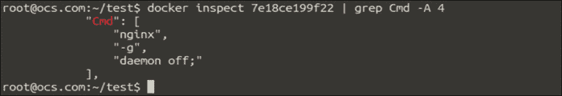
图 14.2 检查容器详情

关于 JSON 格式的更多信息，请参见第 16 章“基础设施”。

**考试提醒**
鉴于 `docker inspect` 命令提供了大量细节，考试可能会出现关于该命令输出的题目。

#### 列出

要列出所有运行中的容器，请运行 `docker ps` 命令，如图 14.3 所示。

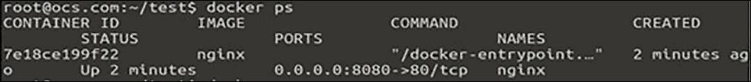
图 14.3 显示运行中的容器

此命令的输出按列显示（由于信息过多可能会换行）。这些列是：

* `CONTAINER ID:` 给此容器的唯一 ID。该 ID 可用于控制容器，包括启动、停止和删除。图 14.3 中的值为 `7e18ce19f22`。
* `IMAGE:` 用于创建此容器的镜像名称。图 14.3 中的值为 `nginx`。
* `COMMAND:` 容器启动时执行的命令。这通常会被截断，如图 14.3 所示（“/docker-entrypoint. . . .”）。
* `CREATED:` 容器首次部署的时间。
* `STATUS:` 容器是否运行以及处于该状态持续多久。
* `PORTS:` 此容器暴露的端口。
* `NAMES:` 除容器 ID 之外引用容器的其他方式。

要显示所有 Docker 容器（包括运行和停止的），请运行 `docker ps -a` 命令，如图 14.4 所示。

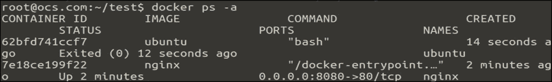

图 14.4 显示所有容器

**考试提示**
在参加 Linux+ XK0-005 考试之前，请清楚 `docker ps` 和 `docker ps -a` 之间的区别。

### 部署现有镜像

要从镜像部署容器，请使用以下命令：

```

docker run –name NAME -p PORTS IMAGE

```

该命令的参数如下：

* `--name NAME:` 这是你为容器指定的选定名称。它可以与镜像的名称相同。
* `-p PORTS:` 你想要暴露的端口。例如，如果 `PORTS` 值为 `8080:80`，这意味着本地主机上的 8080 端口将连接到容器的 80 端口。
* `IMAGE:` 这是镜像的名称，是在运行 `docker images` 命令时提供的。请参阅本章节后面的“列表”部分获取更多有关列出镜像的详细信息。

图 14.5 显示了 `docker run` 命令的使用示例。

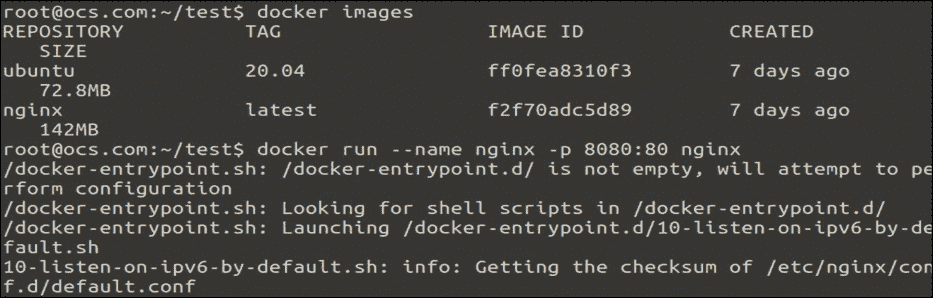

图 14.5 **`docker run`** 示例

请注意，当如图 14.5 所示执行此命令时，容器将以附加模式部署。这意味着它将作为前台进程运行。这样做的好处是可以通过按住 `Ctrl` 键并按下键盘上的 `c` 键轻松停止容器。

如果你想在分离模式下部署容器，请使用 `-d` 选项。如果你已经部署了容器并想以分离模式运行它，你有两个选择：

* 使用 `Ctrl+c` 停止容器，列出可用容器（使用 `docker ps -a`），然后使用 `docker start` 命令启动容器。请参阅本章节前面的“列表”和“启动/停止”部分获取有关这些命令的详细信息。
* 使用 `Ctrl+c` 停止容器，删除容器，然后使用带有 `-d` 选项的 `docker run` 命令重新部署容器。图 14.6 展示了这种技术。

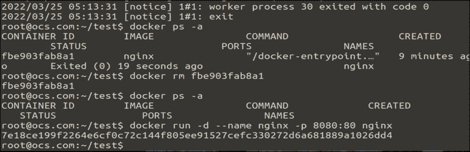

图 14.6 在分离模式下停止、删除并重新部署容器

## 连接到容器

你可以通过在容器中使用 `docker exec` 命令与运行中的容器建立连接。该命令可以用于在容器中打开 BASH 壳，如图 14.7 所示。

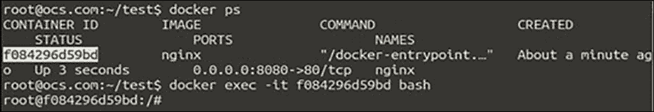

图 14.7 连接到容器

要断开连接，只需输入 `exit` 命令退出 BASH 壳即可。

### 日志

你可以使用 `docker logs` 命令显示容器的日志，如图 14.8 所示。

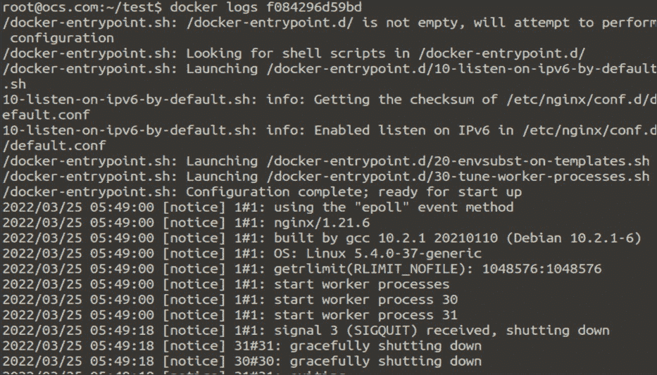

图 14.8 显示容器日志

## 暴露端口

请参阅本章节前面的“部署现有镜像”部分。

## 容器镜像操作

容器镜像用于构建容器。虽然你可以创建自己的镜像，但名为仓库（repositories）的地方也有许多可用镜像。在本节中，你将学习如何构建和管理自己的镜像。

### `build`

要构建自己的 Docker 镜像，首先创建一个如下的 `Dockerfile`：

```

# 使用官方的 Ubuntu 20.04 作为基础
FROM ubuntu:20.04

# 安装 nginx 和 curl
RUN apt-get update
RUN apt-get upgrade -y
RUN apt-get install -y nginx curl

```

在此示例中，Ubuntu 20.04 基础镜像将作为新镜像的基础（因为有 `FROM` 语句）。然后所有软件包更新和升级后，将添加 `nginx` 和 `curl`（因为有 `RUN` 语句）。

**考试提示**
对于 Linux+ XK0-005 考试你不需要成为 `Dockerfile` 专家，但你应该知道本节末尾表 14.1 中提供的语句。

一旦创建了 `Dockerfile`，使用以下命令创建镜像：

```

docker build -t my-image:1.0 .

```

`-t` 命令的选项应包含两部分信息：镜像名称（在此示例中为 `my-container`）和镜像版本（在此情况下为 `1.0`）。应用冒号分隔这两部分信息。

`.`（点）字符表示应该包含该镜像。`.dockerignore` 文件表示不应包含的文件。当 `Dockerfile` 创建完成后，使用以下命令创建镜像：

```

docker build -t my-image:1.0 .
```


# 图 14.4 显示所有容器

**考试提示**

在参加 Linux+ XK0-005 考试之前，请非常清楚 `docker ps` 和 `docker ps -a` 之间的区别。

## 部署现有镜像

要从镜像部署容器，请使用以下命令：

```bash
docker run --name NAME -p PORTS IMAGE
```

该命令的参数如下：

-  `--name NAME`：这是你为容器选择的一个名称。它可以与镜像的名称相同。
-  `-p PORTS`：你想要暴露的端口。例如，如果 `PORTS` 值为 `8080:80`，这意味着本地主机上的 8080 端口将连接到容器的 80 端口。
-  `IMAGE`：这是镜像的名称，是在运行 `docker images` 命令时提供的。请参阅本章节后面的“列表”部分获取更多关于列出镜像的详细信息。

图 14.5 显示了 `docker run` 命令的运行示例。


图 14.5 `docker run` 示例

请注意，当此命令如图 14.5 所示执行时，容器将以附加模式部署。这意味着它作为前台进程运行。这样做的好处是可以通过按住 Ctrl 键并按下键盘上的 c 键轻松停止容器。

如果你想在分离模式下部署容器，请使用 `-d` 选项。如果你已经部署了容器并想以分离模式运行它，你有两个选择：

-  使用 Ctrl+c 停止容器，列出可用容器（使用 `docker ps -a`），然后使用 `docker start` 命令启动容器。请参阅本章节前面的“列出（Listing）”和“启动/停止”部分获取这些命令的详细信息。
-  使用 Ctrl+c 停止容器，删除容器，然后使用带有 `-d` 选项的 `docker run` 命令重新部署容器。图 14.6 展示了这种技术。


图 14.6 在分离模式下停止、删除并重新部署容器

## 连接到容器

你可以通过在容器中使用 `docker exec` 命令与运行中的容器建立连接。该命令可以用于在容器中打开一个 BASH 壳，如图 14.7 所示。


图 14.7 连接到容器

要断开连接，只需输入 `exit` 命令退出 BASH 壳即可。

### 日志

你可以使用 `docker logs` 命令显示容器的日志，如图 14.8 所示。


图 14.8 显示容器日志

## 暴露端口

请参阅本章节前面的“部署现有镜像”部分。

## 容器镜像操作

容器镜像用于构建容器。虽然你可以创建自己的镜像，但仓库（repositories）中也有许多可用镜像。在本节中，你将学习如何构建和管理自己的镜像。

### build

要构建自己的 Docker 镜像，首先创建一个如下的 `Dockerfile`：

```dockerfile
# 使用官方的 Ubuntu 20.04 作为基础
FROM ubuntu:20.04

# 安装 nginx 和 curl
RUN apt-get update
RUN apt-get upgrade -y
RUN apt-get install -y nginx curl
```

在此示例中，Ubuntu 20.04 基础镜像将作为新镜像的基础（因为有 `FROM` 语句）。然后所有软件包更新和升级后，将添加 `nginx` 和 `curl`（因为有 `RUN` 语句）。

**考试提示**

对于 Linux+ XK0-005 考试你不需要成为 Dockerfile 专家，但你应该知道本节末尾表 14.1 中提供的语句。

一旦 Dockerfile 创建完成后，使用以下命令创建镜像：

```bash
docker build -t my-image:1.0 .
```

`-t` 命令的选项应包含两部分信息：镜像名称（在此示例中为 `my-container`）和镜像版本（在此情况下为 `1.0`）。应用冒号分隔这两部分信息。

`.`（点，或句号）字符表示应该包含镜像。`.dockerignore` 文件表示不应包含的文件。

表 14.1 列出了可以放在 Dockerfile 中的重要语句：

| 语句 | 描述 |
| :--- | :--- |
| `FROM` | 指定基础镜像。 |
| `RUN` | 执行命令，例如安装软件包。 |
| `COPY` | 将文件或目录复制到特定位置。 |
| `ENTRYPOINT` | 容器启动时。 |
| `CMD` | 指定传递给 `ENTRYPOINT` 的参数。 |
| `EXPOSE` | 打开一个端口。 |

### push

Docker 镜像可以存储在仓库（registry）中。推送镜像涉及将镜像（或新版本）推送到仓库。要实现这一点，首先如所示为镜像打标签，并将 `registry_name` 替换为主机，并将 `path_to_registry` 替换为存储镜像的目录：

```bash
docker tag my-container:1.0 registry_name:5000/path_to_registry/my-image:1.0
```

然后使用如下命令推送镜像：

```bash
docker push registry_name:5000/path_to_registry/my-image:1.0
```

在前面的命令中，`5000` 代表仓库监听的端口，而 `my-image:1.0` 是镜像名称和标签。

**注意**

通常使用标签 `latest` 表示镜像的最新版本。

### pull

你可以使用 `docker pull` 命令从仓库拉取镜像，如下例所示：

```bash
$ docker pull ubuntu
```

### list

你可以使用 `docker images` 命令列出当前系统可用的 Docker 镜像：

```bash
[root@OCS ~]$ docker images

REPOSITORY            TAG     IMAGE ID       CREATED         SIZE

my-image              1.0     d2c9860a64ae   20 minutes ago  177MB
```

**注意**

另一种常用的方法（与 `docker images` 输出相同）是命令 `docker image ls`。

### rmi

要删除 Docker 镜像，使用 `docker rmi` 命令，如下例所示：

```bash
[root@OCS ~]$ docker images

REPOSITORY           TAG     IMAGE ID       CREATED         SIZE

my-image             1.0     d2c9860a64ae   20 minutes ago  177MB

ubuntu               latest  ff0fea831of3    6 days ago      72.8MB

[root@OCS ~]$ docker rmi ubuntu:latest

Untagged: ubuntu:latest

[root@OCS ~]$ docker images

REPOSITORY           TAG     IMAGE ID       CREATED         SIZE

my-image             1.0     d2c9860a64ae   20 minutes ago  177MB
```

# 第 15 章：使用 Git 执行基础版本控制

**本章涵盖以下 Linux+ XK0-005 考试目标：**

-  **3.3：** 在给定场景下，使用 Git 执行基础版本控制。

开发者必须处理的最头疼的问题之一就是源代码的不同版本。有时你只需要回到代码的某个一个版本。手动维护版本既繁琐又耗时。

更严重的是，多个程序员经常一起编写同一段源代码。一个大型程序可能由数万行代码组成，不同的程序员可能负责代码的不同部分。

像 `Git` 这样的版本控制软件可以处理维护源代码版本的复杂任务。本章将为你介绍 `Git` 以及常见的 `Git` 操作。

本章提供了以下主题的信息：版本控制基础、`clone`、`push`、`pull`、`commit`、`add`、`checkout`、`branch`、`tag` 和 `gitignore`。

## 版本控制与 Git 简介

本节没有专门涵盖任何考试目标。然而，为了理解本章的其他内容，具备版本控制的基础知识非常有帮助。如果你已经牢牢掌握了这个主题，可以考虑直接跳到 `clone` 部分。

为了理解 `Git` 和版本控制的概念，从历史角度来看版本控制会很有帮助。版本控制软件（VCS）已经经历了三代。

第一代 `VCS` 非常简单。开发者在同一个物理系统上工作，并且一次检出（check out）一个文件。这一代版本控制软件使用了一种名为“文件锁定”的技术。当一个开发者检出一个文件时，该文件会被锁定，其他开发者无法编辑该文件。第一代 `VCS` 的示例包括修订控制系统（RCS）和源代码控制系统（SCCS）。图 15.1 展示了这种类型版本控制的概念。

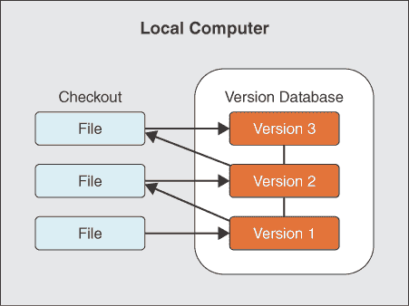

图 15.1 第一代 VCS

第一代 `VCS` 存在几个问题，包括：

-  一时间只能有一个开发者对一个文件进行工作。这在开发过程中产生了瓶颈。
-  开发者必须直接登录到包含版本控制软件的系统。

这些问题在第二代版本控制软件得到了解决。在第二代 `VCS` 中，文件存储在中央服务器的仓库中。开发者可以检出文件的单独副本。当开发者完成对某个文件的工作后，该文件会被检入（check in）到仓库。第二代版本控制软件的示例包括并发版本系统（CVS）和 Subversion。图 15.2 展示了这种类型版本控制的概念。

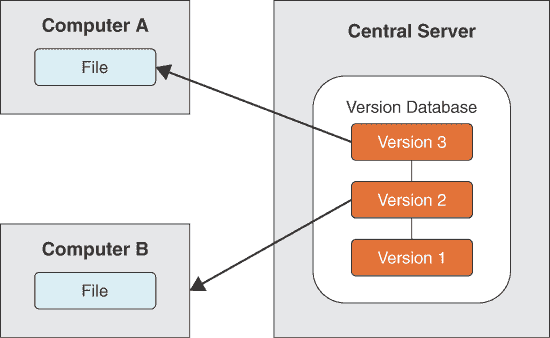

图 15.2 第二代 VCS

如果两个开发者检出了同一版本的文件，就可能会出现问题。这通过名为“合并”（merge）的过程来处理。

### 第三代

第三代 `VCS` 被称为分布式版本控制系统（DVCS）。与第二代一样，有一个中央仓库服务器包含该项目的所有文件；然而，开发者并不从仓库中检出单个文件。相反，它会检出整个项目，允许开发者处理整个文件集，而不仅仅是单个文件。图 15.3 展示了这种类型版本控制的概念。

`Git` 是第三代 `VCS` 的示例。使用 `Git` 的挑战之一是理解其背后的概念。如果你不理解概念，所有的命令看起来都像是某种黑魔法。本节重点关注关键的 `Git` 概念并向你介绍一些基础命令。

要从 `Git` 仓库获取项目副本，你需要使用名为“克隆”（cloning）的过程。理解克隆意味着检出整个项目，并且你进行的大部分工作都是你所工作的系统的本地操作，这是非常重要的。检出的文件被放置在你主目录下的目录中。

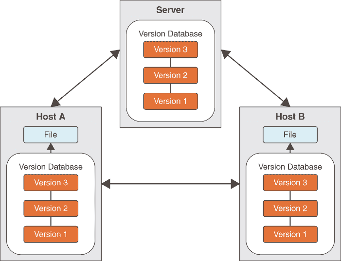

图 15.3 第三代 VCS

克隆不仅仅是创建仓库中所有文件的副本。它实际上执行了三个主要功能：

-  克隆会在你主目录下的 `project_name/.git` 目录下创建项目的本地仓库。该位置的项目文件被认为是从中央仓库“检出”的。
-  克隆会创建一个你可以直接看到文件的目录。这被称为“工作区域”（working area）。工作区域中的更改不会立即受控制。
-  克隆会创建一个暂区（staging area）。暂区用于在提交到本地仓库之前存储更改。

如果你克隆了一个名为 `Jacumba` 的项目，整个项目将存储在 `~/Jacumba` 目录下。你不应该尝试修改这些文件。假设你对某个文件进行了修改，但在提交到本地仓库之前你还需要处理其他文件。在这种情况下，你会暂存已完成工作的文件；即你准备将其提交到本地仓库。

在你完成了所有更改并暂存了所有文件后，就可以将它们提交到本地仓库。图 15.4 展示了这一过程。

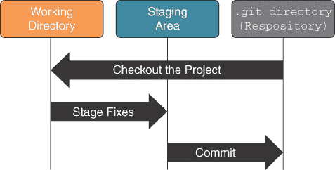

图 15.4 Git 阶段

必须提交暂存的文件只会将它们发送到本地仓库。这意味着只有你有权访问所做的更改。将新版本“检入”中央仓库的过程被称为 `push`。

#### 注意

本节描述的步骤在本章后面会有更详细的解释。将本节视为某些概念的介绍，这些概念有助于你在介绍 Git 命令时更好地理解过程。

## clone

在处理任何项目之前，你可能需要对 `Git` 进行基础配置。`git config` 命令用于配置 `git` 工具。以下是两个常用选项示例：

```bash
$ git config --global user.name "Bo Rothwell"
$ git config --global user.email bo@onecoursesource.com
```

`--global` 选项会导致配置选项存储在用户目录下的配置文件中，如下所示：

```bash
$ more ~/.gitconfig

[user]
        name = Bo Rothwell
        email = bo@onecoursesource.com
```

`git` 命令默认使用此文件中的设置。你也可以通过 `--local` 选项将这些设置存储在当前仓库目录中（当前目录下的 `.git` 目录）。本地设置会覆盖全局设置。

还有几十个额外的设置，但大多数 `git` 命令的用户只设置 `user.name` 和 `user.email`。

### git clone

`git clone` 命令从远程仓库的内容创建本地仓库。提供的参数是远程仓库的位置，如下例所示：

```bash
$ git clone https://gitlab.com/borothwell/ocs.git

Cloning into 'ocs'...
Username for 'https://gitlab.com': borothwell
Password for 'https://borothwell@gitlab.com':
remote: Counting objects: 3, done.
remote: Total 3 (delta 0), reused 0 (delta 0)
Unpacking objects: 100% (3/3), done.
Checking connectivity... done.
```

表 15.1 概述了 `git clone` 命令的一些重要选项。

**表 15.1 重要的 `git clone` 命令选项**

| 选项 | 描述 |
| :--- | :--- |
| `-v` | 进入详细模式。 |
| `--single-branch` | 指定仅克隆单个分支，而不是整个仓库。 |

克隆并不是创建 Git 项目的唯一方法。要在当前本地目录中创建新仓库，请使用 `git init` 命令：

```bash
$ git init test

Initialized empty Git repository in /tmp/test/.git/
```


## 考试警示

`git init` 命令没有在 Linux+ XK0-005 考试目标中被特别提及。然而，它非常常用，CompTIA 在考试目标的“请注意”部分包含了以下内容：“以项目符号形式提供的示例列表并非详尽列表。与每个目标相关的其他技术、过程或任务的示例也可能出现在考试中，尽管它们在本份目标文档中未列出或涵盖。”

### push

`git commit` 命令仅更新本地仓库。要将本地仓库的更改发送到远程仓库，请使用 `git push` 命令，如下所示：

点击此处查看代码图像

```bash
$ git push -u origin main

Username for 'https://gitlab.com': borothwell

Password for 'https://borothwell@gitlab.com':

Counting objects: 4, done.

Compressing objects: 100% (3/3), done.

Writing objects: 100% (3/3), 370 bytes | 0 bytes/s, done.

Total 3 (delta 0), reused 0 (delta 0)

To https://gitlab.com/borothwell/ocs.git

 12424f5..3b36054 main -> main

Branch main set up to track remote branch main from origin.
```

**注意**

在此输出的最后一行中，`origin` 指远程仓库，`main` 指应该更新的分支。

**考试警示**

`git push` 命令尝试将更改合并到现有文件中。如果无法自动处理，你可能需要执行手动合并操作。请参见本章后部分的 `branch`/`checkout` 章节获取更多细节。

### pull

如果远程仓库已发生更改，并且你想将这些更改下载到本地仓库，请使用 `git pull` 命令：

```bash
$ git pull origin main
```

**注意**

`origin` 指远程仓库，`main` 指应该更新的分支。

**考试警示**

`git pull` 命令尝试将更改合并到现有文件中。如果无法自动处理，你可能需要执行手动合并操作。请参见本章后部分的 `branch`/`checkout` 章节获取更多细节。

### commit

要将工作目录中的更改存到本地仓库，你必须先将更改添加到暂存区，然后将其提交到仓库，如下所示：

点击此处查看代码图像

```bash
$ git add first.sh

$ git commit -m "added first.sh"

[main 3b36054] added first.sh

 1 file changed, 5 insertions(+)

 create mode 100644 first.sh
```

`git add` 命令将文件放入暂存区。`git commit` 命令获取暂存区中的所有新文件并将它们提交到本地仓库。`-m` 选项用于添加消息（在本例中，即提交的原因）。

### add

有关 `git add` 的信息，请参阅上一节“commit”。

### branch/checkout

当你第一次创建一个项目时，代码与一个名为 `main` 的分支关联。如果你想创建一个新分支，请执行 `git branch` 命令：

```bash
$ git branch test
```

这并不意味着你突然在新的分支上工作。你可以从 `git status` 的输出看出，你仍然在 `main` 分支上。

**注意**

`git status` 命令显示工作目录和暂存区的状态。它告诉你哪些更改已经暂存，哪些尚未暂存，以及哪些文件未被 git 跟踪。

此合并过程可能会相当复杂。例如，考虑以下命令的输出：

点击此处查看代码图片

```bash
$ git merge main

Auto-merging showmine.sh

CONFLICT (content): Merge conflict in showmine.sh

Auto-merging hidden.sh

CONFLICT (content): Merge conflict in hidden.sh

Automatic merge failed; fix conflicts and then commit the result.
```

你可以看到合并并没有完成，因为自动化合并过程遇到了一些冲突。你也可以通过执行 `git status` 命令来查看这些冲突：

点击此处查看代码图片

```bash
$ git status

On branch test

Your branch is ahead of 'origin/test' by 1 commit.

 (use "git push" to publish your local commits)

You have unmerged paths.

 (fix conflicts and run "git commit")

Unmerged paths:

 (use "git add <file>..." to mark resolution)

       both modified: hidden.sh

       both modified: showmine.sh

no changes added to commit (use "git add" and/or "git commit -a")
```

处理这些冲突的一种方法是使用 `git mergetool` 命令（但注意，如果你想使用 `git mergetool` 命令，你需要安装 `git-all` 软件包）：

点击此处查看代码图片

```bash
$ git mergetool showmine.sh

This message is displayed because 'merge.tool' is not configured.

See 'git mergetool --tool-help' or 'git help config' for more details.

'git mergetool' will now attempt to use one of the following tools:

opendiff kdiff3 tkdiff xxdiff meld tortoisemerge gvimdiff diffuse dif-
fmerge ecmerge p4merge araxis bc3 codecompare emerge vimdiff

Merging:

showmine.sh

Normal merge conflict for 'showmine.sh':

     {local}: modified file

     {remote}: modified file

Hit return to start merge resolution tool (vimdiff):
```

该工具会打开 `vimdiff` 工具，允许你对文件进行必要的修改以解决冲突。

### 考试提示

`git mergetool` 命令在官方 005 考试指南中并没有被特别提到。然而，它在合并操作中非常常用，CompTIA 在考试目标的“请注意”部分中包含了以下内容：“以项目符号形式提供的示例列表并非详尽列表。与每个目标相关的技术、流程或任务的其他示例也可能包含在考试中，尽管它们未在该目标文档中列出或涵盖。”

### tag

在大型项目中，你可能会发现将特定的开发点与标签（tag）关联起来很有用。例如，如果你发布了软件的 4.1 版本，可以使用如下命令为项目的当前状态标记标签：

点击此处查看代码图片

```bash
$ git tag -a v4.1 -m "Release 4.1"
```

`-a` 选项将标签添加到 Git 仓库的当前状态。`-m` 选项允许你提供更详细的消息。

使用不带参数的 `git tag` 命令列出所有可用标签：

```bash
$ git tag

v1.0

v2.0

v3.0

v4.0

v4.1
```

要查看特定标签的详情，使用 `git show` 命令：

点击此处查看代码图片

```bash
$ git show v4.1

tag v4.1

Tagger: Bo Rothwell <bo@onecoursesource.com>

Date:   Fri Mar 25 14:27:55 2022 -0600

Release 4.1

commit ca82a6dff817ec66f44342007202690a93763949

Author: Bo Rothwell <bo@onecoursesource.com>

Date:   Mon Mar 21 10:14:13 2022 -0600
```

你还可以将项目的当前视图恢复到某个特定的标签：

```bash
$ git checkout v2.0
```

要返回项目的最新版本（称为 HEAD），使用以下命令：

```bash
$ git checkout -
```

### gitignore

要让 `git` 命令忽略某个文件，请在工作目录中创建一个名为 `.gitignore` 的文件并将忽略的文件名放入该文件中。这是一个示例：

点击此处查看代码图片

```bash
$ touch notes

~/ocs$ git status -s

?? notes

$ vi .gitignore #added notes as shown below:

$ cat .gitignore

notes

$ git status -s

?? .gitignore
```

注意，`.gitignore` 文件本身也必须放入 `.gitignore` 文件中，如下所示：

点击此处查看代码图片

```bash
$ git status -s

?? .gitignore

$ vi .gitignore #added notes as shown below:

$ cat .gitignore

notes
```

```json
{
  "name": "Sue Smith",
  "phone": ["555-555-5555", "555-555-5556"],
  "address": {
    "street": "123 Main St.",
    "city": "Anytown",
    "state": "CA"
  }
}
```

## YAML 不是标记语言 (YAML)

YAML 与 JSON 相似，某些 IaC（基础设施即代码）技术利用 YAML 文件格式存储数据。它的数据结构与 JSON 相似，但存在一些明显的区别。JSON 使用 `{ }` 和 `[ ]` 等字符来定义对象和数组等数据结构，而 YAML 则使用缩进来创建这些结构。

这是一个 YAML 文件示例：

```yaml
name: Sue Smith

phone:
  - 555-555-5555
  - 555-555-5556

address:
  street: 123 Main St.
  city: Anytown
  state: CA
```


你可以将此示例与本章中“JavaScript 对象表示法 (JSON)”部分的示例进行对比，以查看两种文件格式的差异。

## 注意

YAML 最初是“Yet Another Markup Language”（又一种标记语言）的缩写。XML 和 HTML 是其他标记语言的示例。随着时间的推移，YAML 的目标变为一种“易于人类的数据序列化标准”，因此 YAML 被转换为一个回缩写，现在代表“YAML Ain’t Markup Language”（YAML 不是标记语言）。

### 工具

配置管理长期以来一直是系统管理员手动处理的标准流程。由于没有实现自动化，这一过程通常非常耗时，并导致系统配置错误。

自动化配置管理的目的是确保软件、服务和系统处于一致、可预测的状态。通过使用自动化配置管理工具，大量工作由自动化过程处理。与使用手动配置管理操作相比，这产生的错误更少。

在使用配置管理工具时，你经常会看到 `orchestration`（编排）和 `automation`（自动化）这两个术语。基础设施自动化是编排的一个组件。虽然很多人通用 `orchestration` 和 `automation` 这两个词，但它们之间是有区别的。你可以在没有自动化的情况下实现编排，但编排的主要目标通常是某个过程的自动化。

考虑以下编排场景：用户在 Web 端表单中填写数据字段。这些数据被用于填充属性。`attribute`（属性）被用于定义自定义自动化过程的参数。这些属性包含的数据（并且很可能）对于每个编排过程都是不同的。例如，假设该程序设计用于设置一个需要访问网络的系统。则需要为系统的 IP 地址、子网掩码、网关和路由器等项目定义属性。

用户随后点击 OK 按钮，执行一个程序来编排项服务。这是没有自动化的编排。

现在考虑这种场景：代理程序监控系统，当达到某个阈值时（例如一小时内的最大 CPU 使用率）。这触发一个程序，该程序使用从数据库自动填充的属性来生成该服务的第二个实例。整个过程中没有人工参与；编排过程自动处理了一切。这是带有自动化的编排。

本节介绍了常用配置管理工具的基础知识。

## Ansible

Ansible 是一个非常流行的工具，可用于编排新系统。Ansible 的一些功能如下：

- **无代理 (Agentless):** Ansible 是一种无代理解决方案，意味着在系统上不需要安装任何软件。无代理系统可以从系统接收数据，也可以进行远程查询以确定是否发生了变化。
- **剧本 (Playbook):** Ansible playbook 是一组存储在文件中的指令集。playbook 文件采用 YAML 格式。
- **即性命令 (Ad hoc commands):** Ansible 允许你执行单个命令，而无需创建 playbook。这些命令被称为即性命令。
- **角色 (Roles):** 可以建立角色来限制 Ansible 操作的功能。
- **变量 (Variables):** 变量用于在 playbook 中提供更大的灵活性。

## Puppet

你可以使用 Puppet 管理服务器并自动化的配置服务器的过程。通过 Puppet，你可以定义系统的期望状态，然后让 Puppet 执行必要的操作使系统达到该状态。Puppet 的一些核心概念和功能包括：

- **基于代理 (Agent-based):** 为了使用 Puppet，需要在客户端系统中安装客户端应用程序（代理）。
- **Puppet 主节点 (Puppet master):** 这是安装在主 Puppet 服务器上的软件。
- **IaC:** Puppet 是一种 IaC 技术，这是一种 DevOps 实践，即像对待代码一样对待组织的基础设施。
- **幂等性 (Idempotency):** 这个概念意味着你应该能够应用操作并确保最终结果。Puppet 使用这一概念来确保如果系统被手动修改过，Puppet 可以自动将系统恢复到“正常”状态。
- **Puppet 清单 (Puppet manifests):** Puppet 有自己的语言来描述在系统上要执行的操作。这些代码写在称为 manifests 的文件中。

## Chef

与本节讨论的许多工具一样，Chef 用于系统的配置管理，并提供了自动化这一管理过程的方法。它使用 IaC 设计来实现这些目标。Chef 的一些核心概念和功能包括：

- **食谱 (Cookbooks):** cookbook 是一个文件，你在其中描述配方（recipes），配方描述资源（nodes）的状态。cookbook 还可以包含其他功能，如库、元数据属性。
- **节点 (Node):** 节点是 Chef 维护配置的设备。Chef 支持节点类型，包括网络设备、本地和云设备以及虚拟或物理设备。
- **Chef 客户端 (Chef client):** 这是必须在每个节点上运行的应用程序，以便 Chef 维护配置。
- **Chef 服务器 (Chef server):** Chef 服务器是存储 cookbook 的系统。Chef 服务器配合客户端维护节点配置。
- **Chef 工作站 (Chef workstation):** 如果你不想为单个节点配置 Chef 服务器，可以安装 Chef workstation，在单个系统上提供 Chef 功能。
- **Chef 超市 (Chef supermarket):** 这是 Chef 社区创建并免费使用的 cookbook 仓库。

## SaltStack

SaltStack 是另一种配置管理系统，根据定义的状态维护远程节点。它包含以下组件和功能：

- **Salt 主节点 (Salt master):** 这是运行在主 Salt 服务器上的服务。
- **Salt 代理节点 (Salt minion):** 这是执行 Salt master 定义的操作的服务器。
- **目标 (Target):** 一个或多个 minion 的列表。Salt master 使用目标向 minion 发送命令。
- **Salt 状态 (Salt state):** 一种通过指定 minion 应处于的状态来配置 minion 方法。Salt 状态定义在 YAML 文件中。

## Terraform

与本节中的其他配置管理工具一样，`Terraform` 是一种可以用于维护系统状态的工具。`Terraform` 基于一个包含以下内容的生命周期：

- **初始化（Init）：** 初始化过程使用一个包含配置文件的工作目录。
- **计划（Plan）：** 创建行动计划，以确保可以执行该配置。
- **应用（Apply）：** 执行计划。
- **销毁（Destroy）：** 生命周期中的这一步是删除旧资源的阶段。

### 持续集成/持续部署 (CI/CD)

许多软件供应商使用传统的软件发布方法，即在特定的间隔发布软件。例如，一个机构可能会采用年度发布周期，这样每年都会发布一次软件的新大版本。在一年年中，可能还会有小版本发布或错误修复版本，这取决于在软件中发现的潜在缺陷或安全漏洞。这种软件发布方法的优点是，通常组织可以在发布前有足够的时间对软件进行测试，从而产生更稳定的程序/产品。然而，这种发布方法的缺点是，新功能在发布前可能需要很长的时间，如果竞争对手的软件发布得更频繁，他们可能会获得更多的市场份额。

持续集成（CI）和持续部署（CD）是两个过程，共同实现了软件的快速和持续发布。这两个术语经常被混淆，可能是因为“持续”（continuous）一词出现在两者中。它们在以下重要方面有所不同：

- 持续集成是开发者（通常是软件开发者）遵循的一个过程。使用版本控制工具（参见第 15 章，“使用 Git 执行基本版本控制”）的软件程序使用一个开发主分支，该分支在软件发布给客户时使用。开发者并不直接在主分支上工作；而是他们都在自己的分支上工作。通过持续集成，开发者尽可能地将其分支中的更改合并回主分支（并非完全持续的，尽管目标是如此），并通过某些自动化测试过程对更改进行验证。这导致主发布分支得到持续的验证和更新。
- 虽然持续集成意味着开发主分支经常更新，但并不意味着客户可以访问这些更改。持续部署是一个过程，它将持续集成扩展到在新版本于主分支可用时（测试完成后）就对其进行部署。一个类似的过程称为持续交付，用于快速部署新版本，但该过程需要人类来批准发布。

### 高级 Git 话题

由于 `Git`（在第 15 章中讨论）是一个如此强大的工具，完全涵盖 `Git` 需要一整本书。第 15 章提供了 `Git` 的一些基础知识，本节深入探讨了 Linux+ XK0-005 考试中涵盖的更高级的 `Git` 特性。

#### merge

参见第 15 章中的“branch/checkout”部分。

#### rebase

`git rebase` 命令将一个分支上的所有更改应用到当前分支，这个过程被称为补丁（patching）。

补丁的想法是，你会发现在某些情况下，在两个不同分支之间执行简单的合并（merge）并不容易。这可能是由于以下几个原因造成的，包括：

- 你可能想要实现来自尚未发布到中央仓库的分支的更改。
- 你可能想要实现文件特定版本的更改。

实际上有几种不同的技术可以用于执行补丁。最基础（也最常用）的方法是使用 `git diff` 命令并将输出重定向到文件，如下例所示：

```
git diff A B > file.patch
```

此补丁文件将用于修改已检出的文件，以包含差异内容。这种修改是通过使用 `git apply` 命令完成的，如下例所示：

```
$ git apply file.patch
```

通常，补丁文件会在一个系统上生成，然后在应用之前复制到另一个系统。在实际应用补丁之前，使用 `--check` 选项进行测试通常也是一个好主意，如下例所示：

```
git apply --check file.patch

git apply file.patch
```


#### Pull Requests

`git pull` 命令从远程仓库将文件的最新版本历史下载到本地仓库，此命令还执行合并操作并更新你的工作目录内容。参见第 15 章中的“pull”部分。

## 第 17 章：容器、云与编排概念

**本章涵盖以下 Linux+ XK0-005 考试目标：**

*  **3.5:** 总结容器、云和编排概念。

回想一下你在第 14 章“执行基本容器操作”中接触容器的概念。你学习了什么是容器，以及如何执行基本的容器操作，包括启动、停止和列出容器。虽然在管理位于单个主机上的容器时了解这些操作非常重要，但如果你决定将容器提升到下一个水平，很快就会发现下一个水平涉及跨多个主机管理容器。

你还在第 16 章“常见基础即代码技术”中介绍了用于编排系统的工具。在该章中，你学习了可以使用`Ansible`、`Puppet`、`Chef`、`SaltStack`和`Terraform`来编排容器。在本章中你将学习一种名为`Kubernetes`的专用容器编排工具。你将学习`Kubernetes`的一些关键特性，以及一些高级的容器组件，例如容器持久存储、容器网络和容器注册表。

### 考试提示

对于 Linux+ XK0-005 考试，需要意识到与本章对应的考试目标要求你“总结容器、云和编排概念”。对于考试而言，你不会被问及关于这些技术的配置或管理的问题。`Kubernetes`以及编排容器的工具是非常庞的话题，有几个认证考试专门关注这些技术。Linux+ 认证人员应该理解这些技术背后的概念，但不必成为专家。因此，本章对该主题的涵盖旨在匹配通过 Linux+ 考试所需的认知水平。

本章提供了有关以下主题的信息：Kubernetes 优势和应用用例；单节点、多容器用例；容器持久存储；容器网络；服务网格（service mesh）；引导（bootstrapping）；以及容器注册表。

### Kubernetes 优势和应用用例

假设你创建了一个组织中执行关键功能的容器。假设它提供与你的网站相关的功能（例如访问关键数据库或存储客户信息）。核心思想是这个容器对于你网站的正常运行至关重要。

现在想象一下，某一天容器出现了故障，它不再响应来自你的 Web 服务器的请求。在这种情况下你会怎么办？你是否应该处于一种需要手动进行操作的境地？

Kubernetes 的优势之一是，它可以通过识别容器失败并自动启动新容器来提供容错能力。它还用于用于需求增加时启动额外的容器，并在容器之间分配负载。

Kubernetes 的优点包括以下：

* ! 它可以监控容器的健康状况，并在容器运行不正常或没有响应时采取行动。
* ! 它可以配置为并发运行多个容器。
* ! 它既可以在本地环境也可以在云环境中工作。
* ! 它可以用于容器之间的负载均衡。
* ! Kubernetes 可以提供水平扩展能力（根据需要添加更多容器以处理更大的系统负载）。
* ! 它可以通过发布流程更新容器，并在需要时执行回滚操作。

### Pods

让我们回到那个场景：你有一个为你的 Web 服务器提供某些关键功能的容器。你决定使用 Kubernetes 以尽地确保你的 Web 服务器能够连接到提供必要功能的容器组中的至少一个。然而，你意识到容器提供（或存储）的数据不能简单地在不同容器之间复制，因为保持这些数据完全同步将是一场噩梦。

解决方案：使用 Kubernetes pods。一个`pod`是一个或多个通过共享资源（如共享存储或网络资源）连接的容器。描述这些容器的术语是“紧耦合”。

### Note
Kubernetes 中的`pod`术语与描述一群鲸的术语有关。此外，Docker 的标志是一只看起来像一艘顶部载有集装箱的船只的鲸。

Kubernetes pod 的优势在于，当共享资源（例如存储）时，pod 的每个容器都能够访问完全相同的资源。当有更多容器上线以处理额外的系统负载时，它们也可以访问此共享资源。

注意，一个`pod`并不一定包含多个容器。在简单的 Kubernetes 解决方案中，拥有一个只有一个容器的 pod 是非常常见的。如果你决定在一个 pod 中运行多个容器，那么你需要使用在下文中描述的`sidecar`（侧车模式）。

## Sidecars

`sidecar`是 Kubernetes 中的一种容器，用于更改 pod 的共享存储并为 pod 执行其他功能。例如，`sidecar`可以处理对 pod 容器的身份验证，还可以处理 pod 中的活动日志。

注意，sidecars 的主要用途之一是创建服务网格。更多信息请参阅本章节稍后介绍的“Service Mesh”部分。

## Ambassador Containers

一种称为 Ambassador 容器的 sidecar 容器被设计用作 pod 中容器的客户端代理。假设你 pod 中的容器需要访问另一个资源，例如远程数据库。虽然你可以配置容器执行此连接，但 Ambassador 容器可以作为 pod 中容器的代理，以获取访问远程数据库。

使用 Ambassador 容器的优势在于，容器被设计为单用途的软件组件。请记住，容器并不是完整的虚拟机；容器理想情况下应该设计为很好地执行单项任务。因此，让容器在执行其主要任务的同时还执行客户端连接违背了单任务容器的原则。

## Single-Node, Multicontainer Use Cases

请参见本章节前面的“Pods”部分。

### Compose

Docker Compose 是一种与 Kubernetes 非常相似的工具，因为 Docker Compose 和 Kubernetes 都是设计用于运行容器集合的。两者之间的区别在于，Docker Compose 设计为仅在单个主机系统上运行容器，而 Kubernetes 可以在单个主机上运行容器，也可以跨多个主机运行。

## Container Persistent Storage

持久化卷（PV）是操作系统可以使用的存储空间。此`PV`“指向”一个物理存储设备（称为“块”设备），它可以是传统的 SATA 硬盘、固态硬盘（SSD）或其他存储介质。

该系统被认为是“持久化”的原因是，底层的物理存储设备可能会发生变化，但操作系统不会感知到或受到该变化的影响。操作系统将始终使用`PV`，但它可以被映射到与原始不同的块设备。

该系统的优势是，旧块设备可以无缝升级，而对操作系统的操作产生任何影响。块存储设备是物理存储设备，通常是云存储系统的后端存储。示例包括：

* ! 传统的 SATA 驱动器
* ! SSDs
* ! RAID 磁盘
* ! 存储区域网络 (SANs)，可以包括光纤通道协议 (FCP)、互联网小型计算机接口 (iSCSI)、以太网传输 ATA (AoE) 和以太网光纤通道 (FCoE)

还有其他的块存储设备，如光盘，但它们大多数由于虚拟机或云解决方案。

## Container Networks

本节重点关注您在处理云技术时应该考虑实现的网络组件。

### Overlay Networks

覆盖网络（Overlay network）是构建在另一个网络之上的网络。在使用了两种不同网络协议的情况下，这可能是必要的。例如，在一个使用了光纤协议的网络中可能需要 IP（互联网协议）通信。由于光纤协议不支持 IP，因此使用了覆盖网络。

在覆盖网络中，网络数据包被封装在其他网络数据包中。因此，在网络上传输的数据可以是封装的 IP 数据包。

许多常用的覆盖网络技术，包括点对点协议、Tor、VPN 和 VoIP。

### Bridging

在云计算中，通常会有多个网段。连接这些不同网段的一种方法是使用在不同网段之间转发网络流量的路由器。

桥接（Bridging）是一种与路由不同的替代方案。桥接设备将不同的网段合并为一个单一网段。有不同类型的桥接：

* ! **简单**：这种类型的桥接连接两个网段。
* ! **多端口**：这种类型的桥接连接多个网络。
* ! **透明**：也称为学习桥接，这种类型的桥接动态构建路由表。
* ! **源路由**：由流量源构建路由。

网络桥接具有许多优势。它们可以用于合并不同的网络传输（例如将物理网络与无线网络合并形成单一网络）。它们还可以用于带宽最大化。

#### Network Address Translation (NAT)

网络地址转换 (NAT) 是一种技术，对私有 IP 网络的网络数据包进行转换，以便将其路由到公共网络。NAT 有几种不同形式：

*  **DNAT (目的地 NAT):** 当你想将服务器放置在防火墙后面且仍允许从外部网络访问时，可以使用 DNAT。DNAT 规则放置在`PREROUTING`过滤点上。关于此主题的进一步讨论超出了本书的范围。
*  **SNAT (源 NAT):** 当你有一个具有`静态分配`私有 IP 地址的内部网络时，可以使用 SNAT。通过 SNAT，你可以通过一个具有活动 IP（即在互联网上可路由的地址）的单一机器访问互联网。该系统配置了 SNAT，用于将内部地址映射到外部通信。SNAT 规则放置在`POSTROUTING`过滤点上。关于此主题的进一步讨论超出了本书的范围。
*  **MASQUERADE (地址伪):** 这种类型的 NAT 用于具有`动态分配`私有 IP 地址的内部网络（例如使用 DHCP）。通过`MASQUERADE`，你可以通过一个具有活动 IP（即在互联网上可路由的地址）的单一机器访问互联网。该系统配置了`MASQUERADE`，用于将内部地址映射到外部通信。`MASQUERADE`规则放置在`POSTROUTING`过滤点上。

### 考试提示
在 Linux+ XK0-005 考试中，关于 NAT 最可能的问题涉及 NAT 的不同类型。在考试之前，请确保你熟悉这里描述的三种 NAT 类型。

### 主机
在某些情况下，你可能只想允许容器与本地主机之间的网络连接。这可能是因为入站网络请求被发送到主机操作系统，然后转发到容器。

这种解决方案被称为`host networking solution`。使用此类解决方案，管理容器的软件会在本地主机和容器上创建一个虚拟网络接口。网络配置设置将应用到这些虚拟网络接口上。

### 服务网格
如前所述，容器的定义特征之一是它设计用于很好地执行单一任务。这个概念允许容器开发者专注于单一功能，但通常这个单一功能本身并不能发挥作用。因此，你经常会看到一组容器或 pod，每个 pod 执行一个特定的任务，并作为一种解决方案部署。在这种情况下，这些容器或 pod 通常被称为`microservices`（微服务）。

微服务通常需要相互通信。这可能带来挑战，因为每个微服务容器或 pod 都不会完全理解整个解决方案。`service mesh`（服务网格）可以管理微服务之间的通信。

服务网格提供了微服务之间通信的手段，还可以处理通信中的错误。服务网格还为微服务之间的通信提供了单一管理和可视性点。

注意，服务网格是通过使用 sidecars（侧边容器）建立的。请参见本章前面的“Sidecars”部分以获取有关 sidecars 的更多信息。

### 引导 (Bootstrapping)
通常来说，引导是指任何不需要外部帮助即可自启动的进程。例如，所有的操作系统都使用引导来启动系统。当你开启系统时，它开始执行来自 BIOS 或 UEFI 的代码。该代码会找到并启动加载程序软件（Linux 系统上的`GRUB`或`GRUB2`），加载程序反过来启动内核。内核负责启动操作系统的其余部分。

然而，引导不仅仅是一个用于启动操作系统的术语。该术语也应用于自动化安装操作的过程。这是云和虚拟化技术的关键组成部分，本节重点介绍一种用于这些技术的引导工具。

### Cloud-init
顾其名，`cloud-init`是一个可以配置为提供云实例初始化的工具。该工具利用预先配置的镜像，并且足够灵活可以用于不同的解决方案。你可能使用`cloud-init`进行的典型操作包括添加 SSH 密钥、执行网络配置、执行安装后运行的脚本以及执行其他类似任务。

### 容器仓库
`container registry`（容器仓库）或`container repository`（容器仓库）是存储容器镜像的中心位置。流行的容器仓库包括 Docker Hub、GitHub Package Registry、Google Artifact Registry (`GAR`) 和 Amazon Elastic Container Registry。

## 第四部分：故障排除

## 第 18 节：分析并排除存储问题

**本章涵盖了以下 Linux+ XK0-005 考试目标：**
*  **4.1:** 给定场景，分析并排除存储问题。

在本章中，你将学习如何处理与存储相关的问题。你将学习典型的存储问题，例如延迟和吞吐量问题，以及每秒输入/输出次数（`IOPS`）和容量问题。在本章中，你还将探索一些文件系统问题以及特定存储类型固有的问题。最后，你将学习挂载选项问题。

本章提供了以下主题的信息：高延迟、IOPS 场景、容量问题、文件系统问题、I/O 调度器、设备问题和挂载选项问题。

### 高延迟
存储延迟是数据从存储设备传输到操作系统的时间。较大的延迟对服务的性能和用户体验有巨大影响。在本节中，你将学习如何监控和管理高延迟问题。

#### 输入/输出 (I/O) 等待
`ioping`命令可对磁盘进行简单的延迟测试。`Latency`是数据传输延迟测量。通常你想对设备进行多次测试，如下例所示，它对文件系统进行了 100 次测试（此处使用了`tail`命令来限制输出）：

点击查看代码

```
[root@OCS ~]# ioping -c 100 . | tail

4 KiB <<< (ext4/sda1): request=96 time=210.6 us

4 KiB <<< (ext4/sda1): request=97 time=280.7 us

4 KiB <<< (ext4/sda1): request=98 time=249.2 us

4 KiB <<< (ext4/sda1): request=99 time=230.1 us

4 KiB <<< (ext4/sda1): request=100 time=210.9 us

--- . (ext4/sda1) ioping statistics ---

99 requests completed in 22.6 ms, 396 KiB read, 4.38 k iops,

 17.1 MiB/s

generated 100 requests in 1.65 min, 400 KiB, 1 iops, 4.04 KiB/s

min/avg/max/mdev = 143.1 us / 228.1 us / 369.1 us / 40.4 us
```

### 每秒输入输出次数 (IOPS)场景
存储设备的主要速度计算是`IOPS`，代表每秒输入/输出次数。在选择用于存储资源的底层存储类型时，你需要考虑这个值。正如你预期的那样，HDD 设备的 IOPS 低于 SSD 设备。

本节描述了如何查看存储设备的 IOPS，以确定你是否需要采取行动解决低 IOPS 问题。

### 低 IOPS
`iostat`命令提供设备的输入/输出统计信息，包括存储 IOPS。当使用`-d`选项执行时，它会提供多种信息，如下例所示：

点击查看代码

```
#iostat -d egrep "Device|sd"

Device tps   kB_read/s  kB_wrtn/s kB_read kB_wrtn

sda    1.62   17.05     12.08     969749  686696

sdb    0.02   3.76       0.00     213643  88

sdc    0.01   0.11       3.59     6239    203860
```

此输出中的值如下：

*  **Device：** 存储设备的文件
*  **tps:** 每秒事务数
*  **kB_read/s:** 每秒从设备读取的数据字节数（KB）
*  **kB_wrtn/s:** 每秒写入设备的数据字节数（KB）
*  **kB_read:** 从设备读取的数据总字节数（KB）
*  **kB_wrtn:** 写入设备的数据总字节数（KB）

在尝试确定设备上的读写操作是否导致过大负载时，这些数据非常有用。你需要随时间监控这些信息，因为仅通过读取一次输出很难判断是否存在问题。必须将输出结果与其他时间点的数据进行比较，以确定是否存在问题。

### 容量问题

存储设备的容量问题可能会产生若干负面影响。如果存储设备缺少足够的可用空间，软件安装可能会失败。如果存储设备上的空间不足或剩余的 inode 不够，用户可能无法保存文件。本节将演示你如何确定自己是否遇到了了存储容量问题。

#### 磁盘空间过低

`df`命令显示分区和逻辑设备的使用情况：

点击查看代码图片

```
# df
```


`Filesystem` `1K-blocks` `Used` `Available` `Use%` `Mounted on`

`udev` `2019204` `12` `2019192` `1%` `/dev`

`tmpfs` `404832` `412` `404420` `1%` `/run`

`/dev/sda1` `41251136` `6992272` `32522952` `18%` `/`

`none` `4` `0` `4` `0%` `/sys/fs/cgroup`

`none` `5120` `0` `5120` `0%` `/run/lock`

`none` `2024144` `0` `2024144` `0%` `/run/shm`

`none` `102400` `0` `102400` `0%` `/run/user`

表 18.1 详细列出了 `df` 命令的重要选项。

**表 18.1 `df` 命令选项**

| 选项 | 描述 |
| --- | --- |
| `-h` | 以易读的格式显示值。 |
| `-i` | 显示 inode 信息。 |

`du` 命令显示目录结构中估计的磁盘空间使用量。例如，以下命令显示了 `/usr/lib` 目录使用的空间量：

```
# du -sh /usr/lib
791M /usr/lib
```

表 18.2 详细列出了 `du` 命令的重要选项。

**表 18.2 `du` 命令选项**

| 选项 | 描述 |
| --- | --- |
| `-h` | 以易读的格式显示值。（不是总是以字节为单位显示，而是根据文件的总体大小显示更易理解的值，如兆字节或千字节。） |
| `-s` | 显示摘要而不是每个子目录的大小。 |

**考试要点 (ExamAlert)**

对于 Linux+ XK0-005 考试，请记住何时使用 `df`（针对分区问题）以及何时使用 `du`（针对目录问题）。

#### Inode 耗尽

文件或目录由多个组件组成。其中许多组件（如所有者和权限）存储在一种名为 `inode` 的文件系统元素中。

除了文件数据和文件名外，关于文件的所有信息都存储在 inode 中。每个文件都被赋予一个 inode 号，该编号对于文件所在的文件系统是唯一的。

文件的 inode 包含以下信息：

*   唯一的 inode 号
*   用户所有者
*   组所有者
*   模式（权限和文件类型）
*   文件大小
*   时间戳：
    *   最后修改文件内容的时间
    *   最后修改 inode 数据的时间
    *   最后访问文件的时间
*   指针（指向包含文件数据的数据块位置引用）

你可以通过 `stat` 命令查看 inode 信息：

```
[root@OCS ~]$ stat /etc/passwd
 File: '/etc/passwd'
 Size: 2597 Blocks: 8 IO Block: 4096 regular file
Device: fc01h/64513d Inode: 33857 Links: 1
Access: (0644/-rw-r--r--) Uid: ( 0/ root) Gid:
 ( 0/ root)
Access: 2022-10-12 12:54:01.126401594 -0700
Modify: 2022-09-08 12:53:48.371710687 -0700
Change: 2022-09-08 12:53:48.371710687 -0700
 Birth: -
```

每个文件都必须有一个唯一的 inode，用于跟踪文件元数据。每个文件系统的 inode 数量是有限的。通常情况下这个限制非常高，耗尽 inode 非常罕见，但包含许多小文件的文件系统可能会产生问题。`df` 命令的 `--inodes` 选项在排除此类问题时很有用，它可以显示 inode 的总数、已使用的数量、可用的数量以及当前使用的 inode 百分比：

```
[student@OCS ~]$ df --inodes | grep /tmp
Tmpfs             505992 602 505390 1% /tmp
```

**考试要点 (ExamAlert)**

理解 inode 的用途有助于你更好地理解若干 Linux 特性，包括硬链接（参见第 2 章“管理文件和目录](#ch02.xhtml)”）和配额（参见第 21 章，“分析和排排除用户访问和文件权限](#ch21.xhtml)”）。确保你对这个主题有良好的理解，因为你可能会遇到多个与 inode 相关的问题。

### 文件系统问题

文件系统问题是指文件系统本身的问题或文件系统挂载方式的问题。本节将讨论 Linux+ XK0-05 考试中你应该熟悉的常见文件系统问题。

#### 损坏

当对文件系统进行更改时，某些更改最初在 RAM 中进行，然后定期同步到文件系统。这一过程使得文件系统运行更快，但也可能导致文件系统损坏。

当文件系统没有被正确卸载时（例如在断电或其他系统中断期间），就会发生损坏。存储在 RAM 中的关于文件系统更改的数据没有同步到存储设备，导致文件系统损坏。

`fsck` 实用（你需要以 root 用户身份运行）设计用于查找未挂载文件系统文件系统问题。考虑这个示例：

```
# fsck /dev/sdb1
fsck from util-linux 2.20.1
e2fsck 1.42.9 (4-Feb-2014)
Pass 1: Checking inodes, blocks, and sizes
Pass 2: Checking directory structure
Pass 3: Checking directory connectivity
Pass 4: Checking reference counts
Pass 5: Checking group summary information
/dev/sdb1: 11/12544 files (0.0% non-contiguous), 6498/50176 blocks
```

该工具非常直观。它根据对文件系统的探测调用正确的文件系统检查工具，并在发现错误时向用户提示。要修复错误，请在提示时回答 **y** 或 **yes**。由于 **yes** 几乎总是正确的答案，`fsck` 实用支持 `-y` 选项，它会自动对每个提示回答 **yes**。

`fsck` 命令执行特定文件系统的实用程序。对于 ext2/ext3/ext4 文件系统，`fsck` 命令执行 `e2fsck` 实用程序。

在第 3 章“使用适当的工具配置和管理存储”中，你学习了 `/etc/fstab` 文件，该文件设计用于在启动时自动挂载文件系统。回想该文件的每行都描述一个挂载过程。以下是其中一行的示例：

```
/dev/sda1 / ext4 defaults 1 1
```

手动创建或修改 `/etc/fstab` 文件中的条目时，可能会发生的一个常见问题是提供了错误的文件系统类型。在上例中，`ext4` 代表文件系统类型。如果提供了错误的文件系统，就会发生“文件系统不匹配”错误，并且需要修改 `/etc/fstab` 文件。

### I/O 调度器

内核参数可以用于优化 I/O（输入/输出）调度器。可以设置几个参数来更改调度器的行为。本节涵盖了 Linux+ XK0-005 中重要的参数。

要查看当前的调度器，请查看 `/sys/block/<device>/queue/scheduler` 文件的内容（其中 `<device>` 是设备名称）。这是一个示例：

```
[root@OCS ~]# cat /sys/block/sda/queue/scheduler
[noop] deadline cfq
```

方括号内的值是默认值。要更改此值，请使用 `echo` 命令，如下所示：

```
[root@OCS ~]# echo "cfq" > /sys/block/sda/queue/scheduler
[root@OCS ~]# cat /sys/block/sda/queue/scheduler
noop deadline [cfq]
```

调度器有几种类型，包括：

*   `cfq:` 完全公平队列（Completely Fair Queuing）为每个进程提供一个独立的队列，每个队列都在连续循环中被服务。
*   `noop:` 该调度器遵循先进先出（FIFO）原则。
*   `deadline:` 这是标准调度器。该调度器创建两个队列——读队列和一个写队列。它还会在每个 I/O 请求上加上时间戳，以确保请求被及时处理。

**考试警示**

了解三种不同类型的调度器，并准备应对 Linux+ XK0-005 考试中的问题，这些问题将测试你对为什么要使用一种而不是其他类型的理解。

### 设备问题

存储设备可能会出现需要诊断的问题。本节重点关注一些常见的设备问题。

#### 非易失性内存 Express (NVMe)

当 SSD 设备首次出现在市场上时，它们比旋转硬盘快，但它们连接到主板并使用较旧的协议（SAS 和 SATA）传输数据。起初这不是问题，但随着 SSD 设备变得越来越快，旧协议产生瓶颈的情况也越来越频繁。需要一种更快的传输协议，解决方案就是 NVMe。

为什么 NVMe 比旧协议快？简而言之，它提供了更多的 I/O “通道”，从而允许更高的整体吞吐量。

要排查 SSD 驱动器上的 NVMe，请使用 `nvme` 命令。例如，要列出启用 NVMe 的设备，请使用 `nvme list` 命令。表 18.3 列出了额外的 `nvme` 命令选项。

**表 18.3 `nvme` 命令选项**

| 选项 | 描述 |
| --- | --- |
| `error-log <device_name>` | 为指定的启用 NVMe 的 SSD 设备提供问题信息。 |
| `smart-log <device_name>` | 为指定的启用 NVMe 的 SSD 显示 SMART 日志。（SMART 是一种健康评估工具，可以确定存储设备的问题。） |

### 固态硬盘 (SSD)

随着时间的推移，存储设备会老化并发生故障（有时是突然发生的）。为了在驱动器故障之前确定是否存在任何问题，请考虑采取以下主动措施：

*   **查找坏块：** 设备上坏块数量的增加可能表明存储正在老化。要测试坏块，请使用 `badblocks` 命令：

```
root@OCS:~# badblocks -v /dev/sdb1
Checking blocks 0 to 1047551
Checking for bad blocks (read-only test): done
Pass completed, 0 bad blocks found. (0/0/0 errors)
```

*   **使用 SMART 工具：** 自主监控、分析和报告技术（SMART）是硬盘和 SSD 上的可用工具，用于监控驱动器的健康状况。并非所有磁盘都支持此实用，但大多数现代磁盘都支持。使用 `smartctl` 命令来显示有关硬盘的信息。例如，要执行健康检查，请使用 `smartctl -HH <device_name>` 命令。
*   **磁盘配额：** 如果文件系统上启用了配额，用户创建新文件的能力可能会受到限制。要确定配额是否是问题的原因，请考虑使用以下命令：
    *   使用 `repquota` 查看文件系统的配额报告。
    *   使用 `quota` 查看用户的配额。

### SSD Trim

在 SSD 设备上，文件被删除时，系统并没有真正删除数据，只是删除了指针。这种行为会对 SSD 性能产生负面影响。Trim 是一个清理不再使用数据的工具。有两种方法可以使用该工具：

*   执行 `fstrim` 命令
*   在 `/etc/fstab` 中添加 `discard` 挂载选项

### RAID

软件 RAID 创建通常是健壮的。但在某些情况下，RAID 设备可能会损坏：

*   物理硬盘被移除。
*   分区表损坏。
*   RAID 分区被删除。

访问第 3 章了解 RAID。在排除故障时，你主要使用 `mdadm` 命令和 `/proc/mdstat` 文件。

#### LVM

访问第 3 章了解逻辑卷管理 (LVM)。

### I/O 错误

坏块可能会导致 I/O 错误。要测试坏块，请使用 `badblocks` 命令：

```
root@OCS:~# badblocks -v /dev/sdb1
Checking blocks 0 to 1047551
Checking for bad blocks (read-only test): done
Pass completed, 0 bad blocks found. (0/0/0 errors)
```

### 挂载选项问题

当你挂载分区或卷时，*挂载点*（或*挂载目录*）必须存在。如果不存在，将出现以下错误（将 `/data` 替换为你的挂载点）：

```
mount: mount point /data does not exist
```

要解决此错误，请创建挂载点：

```
root@OCS:~# mkdir /data
```

其他可能的挂载选项问题包括：

*   设备名称错误（上述示例中的 `etc/sda1`）。使用 `df` 命令（在本章之前的“磁盘空间不足”章节中介绍过）双检查设备名称。
*   文件系统类型不匹配（见在本章之前的“不匹配”章节）。
*   错误的挂载选项，这通常是拼写错误（例如，将 `defaults` 写成 `default`）或在多个挂载选项之间存在额外空格导致的（例如使用 `rw, sync, nouser` 而不是 `rw,sync,nouser`）。

# 第 19 章：分析和排除网络资源问题

**本章涵盖以下 Linux+ XK0-005 考试目标：**

*   **4.2:** 给给定的场景，分析并排除网络资源问题。

无论你使用过哪种操作系统，网络相关问题可能是你已经经历过的。本章重点介绍了你在处理网络资源问题时应该注意的工具和配置。

你将首先探索可能会遇到的常见网络配置问题。你还将学习帮助你处理接口错误和带宽问题的工具。本章通过讨论名称解析问题和远程系统的测试结束结束。

本章提供了关于以下主题的信息：网络配置问题、防火墙问题、接口错误、带宽限制、名称解析问题以及远程系统的测试。

### 网络配置问题

正如你所怀疑的那样，网络配置错误会导致连接到网络的问题。本节重点介绍了最常见的配置错误的网络设置。

### 子网

无效的子网设置会导致系统无法与本地网络中的设备通信。它还会导致路由失败，因为路由依赖于与本地子网上的路由器通信。

回顾第 5 章“使用适当的网络工具或配置文件”，用于显示和配置子网的工具之一是 `ip` 命令。例如，以下输出显示了以 CIDR 表示法的子网，并用灰色突出显示：

```
[root@OCS ~]# ip addr show
1: lo: <LOOPBACK,UP,LOWER_UP> mtu 65536 qdisc noqueue state UNKNOWN
     link/loopback 00:00:00:00:00:00 brd 00:00:00:00:00:00
     inet 127.0.0.1/8 scope host lo
     valid_lft forever preferred_lft forever
     inet6 ::1/128 scope host
      valid_lft forever preferred_lft forever
2: enp0s3: <BROADCAST,MULTICAST,UP,LOWER_UP> mtu 1500 qdisc pfifo_fast
state UP qlen 1000
     link/ether 08:00:27:b0:dd:dc brd ff:ff:ff:ff:ff:ff
     inet 192.168.1.26/24 brd 192.168.1.255 scope global dynamic
enp0s3
     valid_lft 2384sec preferred_lft 2384sec
```


`inet 192.168.1.24/16 brd 192.168.255.255 scope global enp0s3`

`valid_lft forever preferred_lft forever`

`inet6 fe80::a00:27ff:feb0:dddc/64 scope link`

`valid_lft forever preferred_lft forever`

### 路由

*路由*是通过网关将网络数据从一个 Internet 协议 (IP) 网络发送到另一个网络的过程。*网关*是一个具有多个网络接口并在网络之间传输数据的系统。

使用`route`、`ip`或`netstat`命令来确定主机上的路由。例如，`route`命令显示路由表：

```
[root@OCS ~]# route
Kernel IP routing table
Destination     Gateway         Genmask         Flags Metric Ref    Use Iface
default         192.168.1.1     0.0.0.0         UG    100    0        0 enp0s3
192.168.0.0     0.0.0.0         255.255.0.0     U     100    0        0 enp0s3
192.168.1.0     0.0.0.0         255.255.0.0     U     100    0        0 enp0s3
```

你可能想要使用`route`命令的最常见故障排除场景是你能够连接到本地网络内的系统，但无法访问本地网络之外的系统。这通常是路由器配置错误的结果，可以通过使用`route`命令来确定。

这些命令也包含在第 5 章](#ch05.xhtml)中。

## 防火墙问题

在使用防火墙时，有很多可能影响网络访问的问题。例如，可能将错误的规则应用于接口，或者规则放置在防火墙列表中的顺序不正确。

防火墙问题通常分为以下两类：

*  在不应该允许访问时授予了访问。
*  在应该允许访问时拒绝了访问。

例如，想象一个不应该从本地网络访问的场景。

考试警示：为了准备这次 Linux+ 考试，请确保你理解防火墙是如何工作的。

### 接口错误

网络接口本身可能是网络问题的原因。网络设备可能存在问题、网络布线可能存在问题，或者网络流量存在问题。

### 丢包

当远程系统不对入站数据包响应时，就会发生丢包。这可能是防火墙规则、饱和或网络配置错误的结果。

要查看丢包信息，请考虑使用`netstat`命令。例如图 19.1 显示了每个接口的信息，并突出显示了接收的丢包 (`RX-DRP`) 和发送的丢包 (`TX-DRP`)。

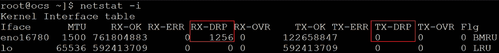
*图 19.1*

`netstat`命令也包含在第 5 章](#ch05.xhtml)中。

### 冲突

在繁忙的网络上，两个或多个网络设备有时会尝试同时发送网络数据包。这会导致冲突，冲突通常不是大问题。冲突会让数据包“回传”到原始网络设备，然后该设备在等待短暂的随机时间后再次尝试发送数据包。

显示冲突的有用命令是`netstat`命令。例如图 19.2 演示了使用`netstat -ie`命令来显示网络信息，包括突出显示的冲突显示区域。

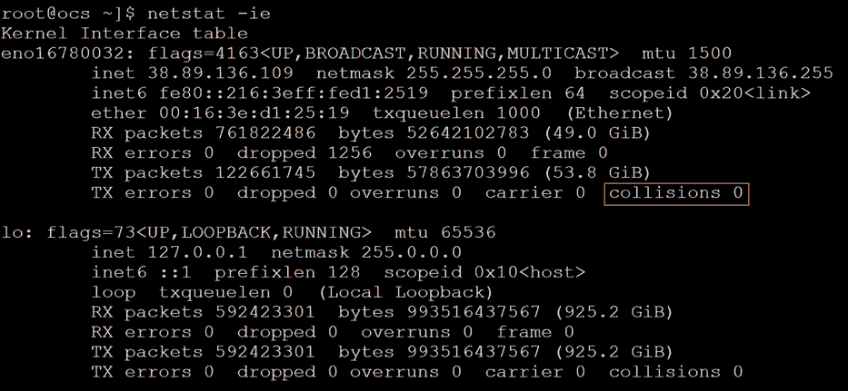
*图 19.2*

注意图中的冲突值为 0。这通常是一个很低的数字。如果你的系统上的数字很高，请考虑增加带宽或进一步细分网络。

考试警示：冲突是带宽不足的重大信号。

### 链路状态

链路状态实际上是关于系统是否连接到网络的问题。一个不是 Linux 特有的考虑因素是仅仅检查是否有物理网络连接。大多数网络接口在建立物理连接时指示灯会亮起。

你还应该验证接口是否处于启用状态，你可以通过`ip`命令来实现。以下示例演示了主网络接口已启用（注意用灰色突出显示的`UP`）：

```
[root@OCS ~]# ip addr show
1: lo: <LOOPBACK,UP,LOWER_UP> mtu 65536 qdisc noqueue state UNKNOWN
     link/loopback 00:00:00:00:00:00 brd 00:00:00:00:00:00
     inet 127.0.0.1/8 scope host lo
     valid_lft forever preferred_lft forever
     inet6 ::1/128 scope host
      valid_lft forever preferred_lft forever
2: enp0s3: <BROADCAST,MULTICAST,UP,LOWER_UP> mtu 1500 qdisc pfifo_fast state UP qlen 1000
     link/ether 08:00:27:b0:dd:dc brd ff:ff:ff:ff:ff:ff
     inet 192.168.1.26/24 brd 192.168.1.255 scope global dynamic enp0s3
     valid_lft 2384sec preferred_lft 2384sec
     inet 192.168.1.24/16 brd 192.168.255.255 scope global enp0s3
     valid_lft forever preferred_lft forever
     inet6 fe80::a00:27ff:feb0:dddc/64 scope link
     valid_lft forever preferred_lft forever
```

另一个确定网络设备链路状态的有用工具是`ethtool`。`ethtool`命令用于显示和配置网络设备设置，例如传输速度和双工值。通常，这些设置通过名为`auto-negotiation`（自动协商）的过程自动配置。通过自动协商，两个网络设备会确定最佳速度和双工值并自动使用该值；然而，这些设置也可以手动指定。`ethtool`命令还可以显示或修改其他常用的网络设备设置。

### 语法：

```
ethtool [option] device
```

以下示例展示了如何使用此命令获取信息的摘要：

```
[root@OCS ~]# ethtool eth0
Settings for eth0:
         Supported ports: [ TP ]
         Supported link modes:     10baseT/Half 10baseT/Full
                                   100baseT/Half 100baseT/Full
                                   1000baseT/Full
         Supported pause frame use: No
         Supports auto-negotiation: Yes
         Advertised link modes: 10baseT/Half 10baseT/Full
                                  100baseT/Half 100baseT/Full
                                  1000baseT/Full
         Advertised pause frame use: No
         Advertised auto-negotiation: Yes
         Speed: 1000Mb/s
         Duplex: Full
         Port: Twisted Pair
         PHYAD: 0
         Transceiver: internal
         Auto-negotiation: on
         MDI-X: off (auto)
         Supports Wake-on: umbg
         Wake-on: d
         Current message level: 0x00000007 (7)
                                   drv probe link
         Link detected: yes
```

`ethtool`命令提供了大量的输出。表 19.1 描述了该命令中一些最有用的输出。

#### 表 19.1 `ethtool`命令输出的有用信息

| 输出 | 描述 |
| --- | --- |
| Supported link modes | 此输出显示了该设备能够使用的速度和双工值。 |
| Supports auto-negotiation | 如果此设备和连接的设备都支持自动协商，则不需要手动设置速度和双工设置。 |
| Advertised link modes | 此输出显示了该设备告知其他设备它可以使用的速度和双工值。 |
| Speed | 此输出显示了设备正在使用的当前速度。 |
| Duplex | 此输出显示了设备当前使用的双工值。 |
| Link detected | 如果此项设置为“yes”，则设备当前正通过网络连接到另一个设备。 |

表 19.2 描述了`ethtool`命令的一些有用选项。

#### 表 19.2 `ethtool`命令选项

| 选项 | 描述 |
| --- | --- |
| -i | 提供此设备的驱动程序信息。 |
| -S | 显示此设备的统计信息。 |
| -p | 通过使设备指示灯闪烁来识别此设备。当系统有多个网络网卡时非常有用。 |
| speed `value` | 允许你手动设置设备的速度值，其中`value`是要设置的速度。 |
| duplex `value` | 允许你手动设置设备的双工值；`value`应为全双工（full）或半双工（half）。 |
| autoneg `value` | 启用自动协商。 |


DNS 和名称解析在第 5 章中介绍。本节不再重复介绍这些工具和配置，而是侧重于处理 DNS 和名称解析错误。如果你不记得这些工具的工作原理，在继续阅读本章之前，可以考虑回顾第 5 章中的“名称解析”部分。

在排查名称解析问题时，请牢记这些命令之间的区别：

- `dig`：此命令用于在特定的 DNS 服务器上执行 DNS 查询。
- `nslookup`：此命令设计用于对 DNS 服务器执行简单查询；然而，它的选项通常比 `dig` 命令少。
- `host`：此命令通常用于执行简单的主机到 IP 地址的翻译操作。默认情况下，它使用本地系统的配置信息，而不是查询你通过命令指定的 DNS 服务器（尽管你可以指定服务器作为参数）。
- `resolvectl`：此命令也可以执行 DNS 查询。它与 `host` 命令略有不同，因为它只进行 DNS 查询，但它仍然使用本地系统配置来确定哪些 DNS 服务器应该执行查询。

根据经验，你应该使用 `dig` 或 `nslookup` 命令来测试特定的 DNS 服务器。使用 `host` 或 `resolvectl` 命令测试 DNS 客户端配置。如果你能使用 `dig` 或 `nslookup` 命令成功执行查询，但使用 `host` 或 `resolvectl` 命令对同一远程主机进行查询失败，那么问题可能出在客户端系统的配置信息上。

此外，请记住去哪里核实配置信息：

- `/etc/nsswitch.conf` 文件包含了本地客户端应该去哪里查找名称解析的信息（本地 `/etc/hosts` 文件、DNS 服务器文件等）。
- localhost 文件（`/etc/hosts`）应该只用于本地网络设备的名称解析（即与客户端系统在同一局域网内的系统）。
- `/etc/resolv.conf` 文件包含 DNS 服务器信息。记住此文件可以由 DHCP 服务器填充。

**考试警报**

理解不同的名称解析文件对于理解名称解析过程至关重要。预计会看到 Linux+ XK0-005 考试题测试你理解这些文件如何影响名称解析的能力。

## 测试远程系统

本节演示了几个可以对远程系统进行测试的命令。

### nmap

`nmap` 命令用于探测远程系统，以确定系统上哪些网络端口是可用的。要使用 `nmap` 命令，请提供要扫描的系统的 IP 地址或主机名。示例：

```
# nmap 192.168.1.1
Starting Nmap 5.51 ( http://nmap.org ) at 2015-10-31 23:22 PDT
Nmap scan report for 192.168.1.1
Host is up (2.9s latency).
Not shown: 987 closed ports
PORT     STATE    SERVICE
23/tcp   open     telnet
25/tcp   open     smtp
53/tcp   open     domain
80/tcp   open     http
110/tcp  open     pop3
119/tcp  open     nntp
143/tcp  open     imap
465/tcp  open     smtps
563/tcp  open     snews
587/tcp  open     submission
993/tcp  open     imaps
995/tcp  open     pop3s
5000/tcp open     upnp
Nmap done: 1 IP address (1 host up) scanned in 4.89 seconds
```

如前所述，`nmap` 命令的目的是确定网络端口是否开放。该工具可以用于排查对服务的访问问题。例如，用户可能会抱怨无法访问服务器上的某个特定网站。你可以使用 `nmap` 命令确定该服务器是否正在监听 80 端口，以判断该网络端口是否开放。这有助于缩小问题范围，因为如果该端口从远程系统来看是开放的，那么问题很可能与 Web 服务器软件有关，而不是网络连接问题（例如阻止访问的防火墙规则）。

**考试警报**

请注意，在没有获得书面授权的系统上使用 `nmap` 工具或其他任何其他网络探测工具，可能被视为黑客尝试。

### openssl s_client

通过 SSL 进行安全通信是网络的一个重要组成。为了排查 SSL 问题，你可能需要使用 `openssl` 客户端工具。例如，要测试 SSL 连接，可以执行以下命令：

```
openssl s_client -connect <hostname>:<port>
```

其中 `<hostname>` 是 SSL 服务器的主机名，`<port>` 是服务器监听的网络端口。

## 第 20 章

分析和排查处理器 (CPU) 和内存问题

（注：原文中“和 (CPU)”可能是笔误，根据上下文推断为“和内存问题”，但按原文语义保留为“处理器 (CPU) 和 (CPU)”）

（以下内容涉及重复段落，仅保留一次）

DNS 和名称解析在第 5 章中介绍。本节不再重复介绍这些工具和配置，而是侧重于处理 DNS 和名称解析错误。如果你不记得这些工具的工作原理，在继续阅读本章之前，可以考虑回顾第 5 章中的“名称解析”部分。

在排查名称解析问题时，请牢记这些命令之间的区别：

- `dig`：此命令用于在特定的 DNS 服务器上执行 DNS 查询。
- `nslookup`：此命令设计用于对 DNS 服务器执行简单查询；然而，它的选项通常比 `dig` 命令少。
- `host`：此命令通常用于执行简单的主机到 IP 地址的翻译操作。默认情况下，它使用本地系统的配置信息，而不是查询你通过命令指定的 DNS 服务器（尽管你可以指定服务器作为参数）。
- `resolvectl`：此命令也可以执行 DNS 查询。它与 `host` 命令略有不同，因为它只进行 DNS 查询，但它仍然使用本地系统配置来确定哪些 DNS 服务器应该执行查询。

根据经验，你应该使用 `dig` 或 `nslookup` 命令来测试特定的 DNS 服务器。使用 `host` 或 `resolvectl` 命令测试 DNS 客户端配置。如果你能使用 `dig` 或 `nslookup` 命令成功执行查询，但使用 `host` 或 `resolvectl` 命令对同一远程主机进行查询失败，那么问题可能出在客户端系统的配置信息上。

此外，请记住去哪里核实配置信息：

- `/etc/nsswitch.conf` 文件包含了本地客户端应该去哪里查找名称解析的信息（本地 `/etc/hosts` 文件、DNS 服务器文件等）。
- localhost 文件（`/etc/hosts`）应该只用于本地网络设备的名称解析（即与客户端系统在同一局域网内的系统）。
- `/etc/resolv.conf` 文件包含 DNS 服务器信息。记住此文件可以由 DHCP 服务器填充。

**考试警报**

理解不同的名称解析文件对于理解名称解析过程至关重要。预计会看到 Linux+ XK0-005 考试题测试你理解这些文件如何影响名称解析的能力。

### 测试远程系统

本节演示了几个可以对远程系统进行测试的命令。

#### nmap

`nmap` 命令用于探测远程系统，以确定系统上哪些网络端口是可用的。要使用 `nmap` 命令，请提供要扫描的系统的 IP 地址或主机名。示例：

```
# nmap 192.168.1.1
Starting Nmap 5.51 ( http://nmap.org ) at 2015-10-31 23:22 PDT
Nmap scan report for 192.168.1.1
Host is up (2.9s latency).
Not shown: 987 closed ports
PORT     STATE    SERVICE
23/tcp   open     telnet
25/tcp   open     smtp
53/tcp   open     domain
80/tcp   open     http
110/tcp  open     pop3
119/tcp  open     nntp
143/tcp  open     imap
465/tcp  open     smtps
563/tcp  open     snews
587/tcp  open     submission
993/tcp  open     imaps
995/tcp  open     pop3s
5000/tcp open     upnp
Nmap done: 1 IP address (1 host up) scanned in 4.89 seconds
```

如前所述，`nmap` 命令的目的是确定网络端口是否开放。该工具可以用于排查对服务的访问问题。例如，用户可能会抱怨无法访问服务器上的某个特定网站。你可以使用 `nmap` 命令确定该服务器是否正在监听 80 端口，以判断该网络端口是否开放。这有助于缩小问题范围，因为如果该端口从远程系统来看是开放的，那么问题很可能与 Web 服务器软件有关，而不是网络连接问题（例如阻止访问的防火墙规则）。

**考试警报**

请注意，在没有获得书面授权的系统上使用 `nmap` 工具或其他任何其他网络探测工具，可能被视为黑客尝试。

#### openssl s_client

通过 SSL 进行安全通信是网络的一个重要组成。为了排查 SSL 问题，你可能需要使用 `openssl` 客户端工具。例如，要测试 SSL 连接，可以执行以下命令：

```
openssl s_client -connect <hostname>:<port>
```

其中 `<hostname>` 是 SSL 服务器的主机名，`<port>` 是服务器监听的网络端口。


```text
143/tcp open imap
465/tcp open smtps
563/tcp open snews
587/tcp open submission
993/tcp open imaps
995/tcp open pop3s
5000/tcp open upnp

Nmap done: 1 IP address (1 host up) scanned in 4.89 seconds
```

如前所述，`nmap`命令的目的是确定网络端口是否开放。该工具可以用于排查对服务的访问问题。例如，用户可能会抱怨无法访问服务器上的某个特定网站。你可以使用`nmap`命令确定该服务器是否正在监听`80`端口，以判断该网络端口是否开放。这有助于缩小问题范围，因为如果该端口从远程系统来看是开放的，那么问题很可能与 Web 服务器软件有关，而不是网络连接问题（例如阻止访问的防火墙规则）。

当你使用`-c`执行`iostat`命令时，它会为你提供自系统上次启动以来的 CPU 利用率统计信息，如下例：

点击此处查看代码图像

```bash
[root@OCS ~]# iostat -c

Linux 3.10.0-229.el7.x86_64 (localhost.localdomain)     09/05/2015

_x86_64_(1 CPU)

avg-cpu:  %user   %nice %system %iowait  %steal   %idle

           1.84    0.00    1.18    0.33    0.00   96.65
```

输出的开头提供了系统摘要，包括内核版本、主机名、报告日期、内核类型以及系统拥有的 CPU 数量。输出的部分包含 CPU 统计数据；如果你有多个 CPU，这将是所有 CPU 的平均值。提供的数值包括：

-  `%user`：该值代表应用程序在用户级别运行时的 CPU 利用率百分比（即以普通用户账户运行的`user`进程）。
-  `%nice`：普通用户可以使用`nice`命令执行命令来更改进程 CPU 优先级。此值代表这些进程的 CPU 利用率。
-  `%system`：该值代表基于内核的进程的 CPU 利用率百分比。
-  `%system%iowait`：该值代表 CPU 在执行操作之前等待磁盘 I/O 操作完成的 CPU 利用率百分比。
-  `%system%steal`：该值仅适用于虚拟 CPU。在某些情况下，虚拟 CPU 必须等待虚拟机管理器（hypervisor）处理来自其他虚拟 CPU 的请求。该值表示等待管理器处理虚拟 CPU 请求的时间百分比。
-  `%system%idle`：该值代表 CPU 未处理任何请求的时间百分比。

在 Linux+ XK0-005 考试中，不太可能被问到特定的`iostat`选项；然而，该命令有两个有用的参数，如语法所示：

```bash
iostat interval count
```

`interval`始终是第一个参数，表示在运行`iostat`报告之间等待的秒数。`count`是运行报告的次数。

例如，查看以下示例中的输出，它显示了在一个进程系统使用达到峰值的期间，`iostat`命令每秒显示一次统计信息共三次：

点击此处查看代码图像

```bash
[root@OCS ~]# iostat -c 1 3

Linux 3.10.0-229.el7.x86_64 (localhost.localdomain)     09/05/2015

_x86_64_(1 CPU)

avg-cpu:  %user   %nice %system %iowait  %steal   %idle

           6.30    0.40    0.98    0.42    0.00   91.89

avg-cpu:  %user   %nice %system %iowait  %steal   %idle

           5.05    0.00   94.95    0.00    0.00    0.00

avg-cpu:  %user   %nice %system %iowait  %steal   %idle

           5.05    0.00   94.95    0.00    0.00    0.00
```

另一个提供与`iostat`命令相同统计数据的命令是`sar`命令。然而，`sar`命令随时间推移显示这些信息（通常为每 10 分钟一个间隔）。例如，查看以下示例中的输出：

点击此处查看代码图像

```bash
[root@OCS ~]# sar | head

Linux 3.10.0-229.el7.x86_64 (localhost.localdomain)     09/06/2015

_x86_64_(1 CPU)

12:00:01 AM     CPU     %user     %nice   %system   %iowait    %steal    %idle

12:10:01 AM     all      0.11      0.00      0.10      0.01      0.00    99.78

12:20:01 AM     all      0.08      0.00      0.07      0.02      0.00    99.84

12:30:01 AM     all      0.10      0.00      0.11      0.01      0.00    99.79

12:40:01 AM     all      0.10      0.00      0.11      0.01      0.00    99.74

12:50:01 AM     all      0.10      0.00      0.10      0.01      0.00    99.79

01:00:01 AM     all      0.10      0.00      0.10      0.01      0.00    99.79

01:10:01 AM     all      0.10      0.00      0.10      0.01      0.00    99.79
```

### 内存耗尽

`Memory exhaustion`发生在操作系统可用（或空闲）内存（即 RAM）用尽时。本节将探讨内存耗尽的一些关键方面。

## 空闲内存 vs. 文件缓存

请参见本章后文“`/proc/meminfo`”部分关于`free`和`vmstat`命令的讨论。

## 内存溢出（OOM）

在处理内存溢出（Out of Memory）问题时，你应该考虑内存泄漏和进程杀手（process killer）。这些主题在本节中介绍。

请参见本章后文“进程杀手”部分。

### 内存泄漏

当进程被分配了内存但该内存在使用后没有被释放时，就会发生`memory leak`。Linux 有一些第三方工具可用于搜索内存泄漏；然而，对于 Linux+ XK0-005 考试，你只需要了解什么是内存泄漏；不需要知道如何查找和排查内存泄漏。要实际排查内存泄漏，你必须检查程序的代码，而这超出了 Linux+ 考试的范围。

### 进程杀手

当系统使用过多内存时会发生什么？Linux 内核有一个名为`OOM Killer`（内存溢出杀手）的功能，也称为`Process Killer`，它通过杀死进程来释放内存。如果没有此功能，系统可能会停滞，且新进程将无法执行。

OOM Killer 通过为每个进程分配一个分数（称为“坏值评分”badness score）并杀死最糟糕的一个来决定杀死哪个进程。通常情况下，这个进程是占用内存最多的进程，而且很可能是服务器上的关键进程，例如邮件服务或 Web 服务器。

你可以搜索日志文件（通常为`/var/log/messages`或`/var/log/kern.log`）来寻找 OOM Killer 已触发的证据。错误信息如下：

点击此处查看代码图像

```text
host kernel: Out of Memory: Killed process 1466 (httpd).
```

**考试警示**

有配置 OOM Killer 的方法（使用内核参数），但这些超出了 Linux+ XK0-005 考试的范围。对于考试，你应该了解 OOM Killer 的功能以及如何判断 OOM Killer 是否已采取行动。

## 交换（Swapping）

`Swapping`是操作系统在 RAM 使用过多时用于释放 RAM 的一个过程。`swap space`是存储设备上的一个区域，系统可以将其放置于通常位于 RAM 中的数据。被交换的数据通常是操作系统最近未使用但尚未从 RAM 中释放的数据。

要查看你当前活跃的交换设备，请执行带有`-s`选项的`swapon`命令：

点击此处查看代码图像

```bash
[root@OCS ~]# swapon -s

Filename  Type      Size    Used Priority

/dev/dm-1 partition 1048568 27100 -1
```

从`swapon -s`命令的输出中，你可以看到持有交换文件系统的设备名称（`/dev/dm-1`）、交换分区的大小（字节）以及该空间已使用多少。优先级（priority）指示应先使用哪个交换分区。

如果你有一个已有的交换设备（例如交换文件），可以使用`swapon`命令将其添加到当前使用的交换设备中。例如，以下命令添加了`/var/swap`文件：

点击此处查看代码图像

```bash
[root@OCS ~]# swapon /var/swap

[root@OCS ~]# swapon -s

Filename  Type      Size    Used  Priority

/dev/dm-1 partition 1048568 27484 -1

/var/swap file      51192    0    -2
```

为了在每次启动系统时都启用此交换设备，请向`/etc/fstab`文件中添加如下行：

点击此处查看代码图像

```text
/var/swap swap     swap     defaults    0     0
```

如果你决定手动从当前交换空间移除一个设备，请使用`swapoff`命令：

点击此处查看代码图像

```bash
[root@OCS ~]# swapon -s

Filename   Type      Size    Used  Priority

/dev/dm-1  partition 1048568 27640 -1

/var/swap  file 51192 0 -2

[root@OCS ~]# swapoff /var/swap

[root@OCS ~]# swapon -s

Filename   Type      Size     Used   Priority

/dev/dm-1 partition 048568    27640   -1
```

如果你已经创建了一个标记类型为`82`的新分区（在本例中为`/dev/sdb1`），可以通过执行以下命令将其格式化为交换设备：

点击此处查看代码图像

```bash
[root@OCS ~]# mkswap /dev/sdb1

[root@OCS ~]# swapon /dev/sdb1

[root@OCS ~]# swapon -s
```

不要记忆`lsmem`命令的输出。在 Linux+ XK0-005 考试中，你不会被问关于 CPU 属性的特定问题。相反，你需要知道如何查看这些信息。

### `/proc/cpuinfo`

发现 CPU 信息的一种方法是查看`/proc/cpuinfo`文件的内容。该文件包含了有关每个 CPU 的详细信息，例所示：

点击此处查看代码图像

```text
[root@OCS ~]# cat /proc/cpuinfo

processor     : 0

vendor_id     : GenuineIntel

cpu family    : 6

model         : 13

model name    : QEMU Virtual CPU version (cpu64-rhel6)

stepping      : 3

microcode     : 0x1

cpu MHz       : 2666.760

cache size    : 4096 KB

physical id   : 0

siblings      : 1

core id       : 0

cpu cores     : 1

apicid         : 0

initial apicid : 0

fpu            : yes

fpu_exception  : yes

cpuid level    : 4

wp             : yes

flags : fpu de pse tsc msr pae mce cx8 apic
 sep mtrr pge mca cmov pse36 clflush mmx fxsr sse sse2
 syscall nx lm nopl pni cx16 hypervisor lahf_lm

bugs :

bogomips        : 5333.52

clflush size    : 64

cache_alignment : 64

address sizes   : 40 bits physical, 48 bits virtual

power management:

processor       : 1

vendor_id       : GenuineIntel

cpu family      : 6

model           : 13

model name      : QEMU Virtual CPU version (cpu64-rhel6)

stepping        : 3

microcode       : 0x1

cpu MHz         : 2666.760

cache size      : 4096 KB

physical id     : 1

siblings        : 1

core id         : 0

cpu cores       : 1

apicid          : 1

initial apicid  : 1

fpu             : yes

fpu_exception   : yes

cpuid level     : 4

wp             : yes

flags : fpu de pse tsc msr pae mce cx8 apic sep
 mtrr pge mca cmov pse36 clflush mmx fxsr sse sse2 syscall nx
 lm nopl pni cx16 hypervisor lahf_lm

bugs :

bogomips         : 5333.52

clflush size    : 64

cache_alignment : 64

address sizes    : 40 bits physical, 48 bits virtual

power management :
```

**考试警报**

不要记忆`cat`命令的输出。在 Linux+ XK0-005 考试中，你不会被问关于 CPU 属性的特定问题。相反，你需要知道如何查看这些信息。

### `/proc/meminfo`

`free`命令提供了虚拟内存（RAM 和交换空间利用率）的摘要：

点击此处查看代码图像

```text
[root@OCS ~]# free

     total   used   free   shared buff/cache available

Mem: 3883128 774752 777300 18200 2331076 2784820

Swap: 839676    0   839676
```


`Mem:` 行描述 RAM，`Swap:` 行描述虚拟内存。输出列的描述如下：

*  `total:` 操作系统上的内存总量
*  `used:` 当前正在被使用的内存量
*  `free:` 可用的内存量
*  `shared:` `tmpfs` 使用的内存量，`tmpfs` 是一种看起来像普通硬盘空间但实际上存储在内存中的文件系统
*  `buff/cache:` 临时存储位置
*  `available:` 新进程可用的内存量

表 20.1 描述了 `free` 命令的有用选项。

### 表 20.1 `free` 命令选项

| 选项 | 描述 |
| --- | --- |
| `-b` 或 `--bytes` | 以字节显示信息。 |
| `-m` 或 `--mega` | 以兆字节显示信息。 |
| `-g` 或 `--giga` | 以字节显示信息。 |
| `-h` 或 `--human` | 显示“人类可读的大小”。 |

如果你需要比 `free` 命令提供的更详细的信息，可以执行 `vmstat` 命令。请考虑图 20.2 所示的输出。


**图 20.2 `vmstat` 命令**

对于记忆图 20.2 所示的每一行至关重要，但：

*  `bi:` 也称为“输入”，表示从设备接收的块数
*  `bo:` 也称为“输出”，表示发送到设备的块数

这些值可以用于判断性能是基于内存的还是磁盘的。

**考试警报**

`free` 和 `vmstat` 显示的大部分数据实际上来自 `/proc/meminfo`，其格式可能难以理解。

## 第 21 章：分析和排除用户访问与文件权限

**本章涵盖以下 Linux+ XK0-005 目标：**

*  **4.4:** 给定场景，分析并排除用户访问和文件权限。

用户在 Linux 系统上运行时经常面临挑战。一种挑战与登录系统有关。许多组件用于判断用户是否可以登录，许多已经在之前的章节中介绍过。本章介绍了额外的用户访问功能，并提供了如何排除这些问题的建议。

用户面临另一个常见问题是访问文件和目录。与用户访问类似，权限、ACL（访问控制列表）以及基于上下文的系统（如 SELinux 和 AppArmor）许多主题已经在之前的章节中讨论过。本章还介绍了文件属性以及如何排除这些问题。

本章提供了以下信息：用户登录问题、用户文件访问问题、密码问题、权限提升和配额问题。

### 用户登录问题

当用户尝试访问系统时（例如尝试登录），必须考虑两个组件：访问本身和身份验证。本节关注用户尝试访问系统时出现的问题，而本章后面的“用户文件访问问题”部分关注用户认证后出现的问题。

### 本地

本地访问意味着坐在系统面前直接尝试登录。本地访问出现的问题比远程访问少。以下是本地访问可能出现的问题：

*  硬件故障
*  输入的用户账户信息错误。查看日志以发现此类错误。
*  可插入身份认证模块（PAM）限制。（有关 PAM 的更多信息请参见第 8 章“Linux 环境下的安全最佳实践”。）

### 远程

远程访问是指用户通过网络连接到系统。除了上述的本地访问问题外，远程访问还可能涉及以下问题：

*  **服务配置错误：** 例如，如果用户通过 SSH 连接，则 SSH 服务器可能配置错误或未运行。
*  **基于服务的安全限制：** 每个服务通常都有其特定的安全功能。例如，SSH 服务器可以配置为不允许 root 用户直接登录。（有关 SSH 服务器的详细信息，请参阅第 11 章“配置和执行用于系统管理的远程连接”。）
*  **基于网络的问题：** 如果无法通过网络访问远程系统，用户将因为此网络问题而无法访问它。
*  **防火墙限制：** 防火墙可以阻止对远程系统的访问，使用户无法通过网络访问系统。（有关防火墙的更多信息，请参阅第 10 章“实施和配置防火墙”。）
*  **TCP Wrappers 规则：** 过滤对主机上服务访问的技术之一是使用一个名为 TCP Wrappers 的库。该库使用简单的配置文件（`/etc/hosts.allow` 和 `/etc/hosts.deny` 文件）来允许或拒绝来自特定主机或网络的访问。此主题将在接下来详细介绍。

只有使用 TCP Wrappers 库的服务受 `/etc/hosts.allow` 和 `/etc/hosts.deny` 文件的影响。你可以使用 `ldd` 命令来确定程序是否使用了此库：

点击此处查看代码图像

```
[root@OCS ~]# which sshd

/usr/sbin/sshd

[root@OCS ~]# ldd /usr/sbin/sshd | grep libwrap

libwrap.so.0 => /lib64/libwrap.so.0 (0x00002b003df0300)
```

TCP Wrappers 使用以下步骤确定应允许还是拒绝访问：

1. 如果在 `/etc/hosts.allow` 文件中找到匹配项，则允许访问。如果没有，查看下一步。
2. 如果在 `/etc/hosts.deny` 文件中找到匹配项，则拒绝访问。如果没有，查看下一步。
3. 如果在两个文件中都没有找到匹配项，则允许访问。

`/etc/hosts.allow` 和 `/etc/hosts.deny` 文件的格式如下：

```
service: hosts|network
```

以下命令显式允许 192.168.1.1 主机和 192.168.99.0/24 网络访问 SSHD 服务器：

点击此处查看代码图像

```
[root@OCS ~]# cat /etc/hosts.allow

sshd: 192.168.1.1

sshd: 192.168.99.0/24cat
```

### 表 21.1 指定 `service` 参数

| 参数值 | 说明 |
| --- | --- |
| `service` | 匹配单个服务。 |
| `service`,`service` | 匹配列出的任何服务。（注意服务之间没有空格。） |
| `ALL` | 匹配所有服务。 |

### 表 21.2 指定 `hosts` 或 `network` 参数

| 参数值 | 说明 |
| --- | --- |
| `IP` | 一个 IP 地址 |
| `Hostname` | 可以解析的主机名 |
| `@group` | 一个 NIS 组 |
| `Network` | 一个网络，采用以下任一格式：192.168.1、192.168.99.0/24、192.168.99.0/255.255.255.0 或 .example.com |

### 考试提示

Linux+ XK0-005 考试目标中没有特别提过 TCP Wrappers。然而，它有时是远程访问失败的原因，并且在之前的 Linux+ 考试中出现过。

### 用户文件访问问题

用户在 Linux 中工作时最常见的操作之一是访问文件和目录。这些资源可以通过多种方式进行保护，这使得确定用户为何无法访问资源变得困难。本节描述了你在故障排除时需要理解的不同文件访问问题。

### 组

记住每个用户账户至少属于一个组。在访问文件或目录时，用户账户或用户所属的组都可以提供对该文件或目录的访问权限。更多细节请参阅本章后面的“权限”部分。

### 上下文

在用户文件访问方面，`context` 指 SELinux 或 AppArmor 安全上下文。这些主题在第 12 章“应用适当的访问控制”中进行了详细介绍。

### 权限

有时要确定你为什么无法访问文件或目录可能会非常令人沮丧。例如，考虑你为什么无法访问某个文件或目录。

请注意，现在没有用户可以更改 `/etc/passwd` 文件，这意味着无法向系统添加新用户（也无法删除现有用户）。这看起来可能是一个很奇怪的操作，但请想象一种系统是公开使用的场景（例如商场里的自助终端）。这种情况下不需要新用户，你也不希望任何人删除用户。

要查看文件的属性信息，请使用 `lsattr` 命令：

点击此处查看代码图像

```
[root@OCS ~]$ lsattr /etc/passwd

----i--------e-- /etc/passwd
```

`-` 字符表示未设置的文件属性。你可以在 `chattr` 命令的帮助页（man page）中找到完整的属性列表。表 21.3 描述了对系统安全至重要的文件属性。

### 表 21.3 对系统安全至重要的文件属性

| 属性 | 描述 |
| --- | --- |
| `a` | 指定仅追加模式，使得新数据只能写入文件。 |
| `A` | 防止修改访问时间戳。出于安全考虑，该时间戳对于确定关键系统文件何时被访问非常重要。然而，对于非关键文件，禁用访问时间可以使系统更快，因为减少了硬盘写入。 |
| `e` | 指定范围格式（extent format），这允许 SELinux 等关键功能（在本章稍后讨论）。 |
| `i` | 使文件变为不可变，这意味着文件不能被删除或修改。 |
| `u` | 使文件不可删除，这意味着文件不能被删除，但可以修改其内容。 |

要移除不可变属性，请使用以下命令：

点击此处查看代码图像

```
[root@OCS ~]$ chattr -i /etc/passwd

[root@OCS ~]$ lsattr /etc/passwd

-------------e-- /etc/passwd
```

### 表 21.4 `chattr` 命令选项

| 选项 | 描述 |
| --- | --- |
| `-R` | 递归地对整个目录结构应用更改。 |
| `-V` | 生成输出时显示详细信息，以演示所做的更改。 |

**考试警示**

记住 Linux+ XK0-005 考试中的一点：只有 root 用户可以更改文件属性。普通用户可以看到属性但无法更改它们，即使该用户是文件的所有者。

### 密码问题

密码是认证过程的核心。认证过程涉及确定用户是否被允许访问系统。例如，用户是否提供了正确的凭据（如正确的密码）？或者用户是否在正确的日期和时间登录？本节侧重于如何确定在认证过程中是否出现了问题。

本地用户认证通常依赖于存储在 `/etc/shadow` 文件中的密码信息。用户可能由于以下原因出现本地认证问题：

*  用户忘记了账户密码。
*  账户已过期。
*  账户有密码年龄限制，且用户违反了这些限制。例如，可以配置账户每 60 天要求更改新密码。如果用户在此时间段内未更改账户密码，账户将被锁定。
*  管理员可能手动锁定了用户账户。
*  PAM 限制可能会限制用户认证。

以下是一些与排除本地认证问题相关的实用提示：

*  检查安全日志文件中的错误信息。
*  查看 `/etc/shadow` 文件中的用户账户设置。有关此文件的详细信息，请参见第 9 章“实施身份管理](#ch09.xhtml)”。
*  查看 PAM 限制。更多关于 PAM 的信息，请参见第 8 章“Linux 环境下的安全实践](#ch08.xhtml)”。

**考试警示**

对于 Linux+ XK0-005 考试，务确保你熟悉 `/etc/shadow` 文件的字段。你可能会遇到关于该文件内容的具体问题。

### 权限提升

回想权限提升是指使用 PolicyKit 规则、`sudo`、`su` 或 `pkexec` 在登录非特权账户（即普通用户账户）时获取权限（通常是 root 账户访问）。第 11 章“配置和执行系统管理的远程连接](#ch11.xhtml)”对这些主题提供了全面覆盖。

排除权限提升问题的一些建议包括：

*  查看日志文件以收集额外信息。`/var/log/secure` 等文件通常包含描述尝试失败原因的条目。
*  让尝试提升权限的用户提供失败命令的输出。
*  查看配置以确定其是否正确。

### 配额问题

配额（Quota）允许管理员限制个人或组使用的磁盘空间。本节侧重于如何启用和查看配额。要要启用用户配额，必须使用 `usrquota` 选项挂载文件系统。可以通过 `/etc/fstab` 的挂载选项字段来实现，如下所示：

```
/dev/sdb1 ext4 usrquota 1 1
```

要启用组配额，使用 `grpquota` 选项。`usrquota` 和 `grpquota` 选项可以结合使用（`usrquota,grpquota`），以便在文件系统中同时启用用户和组配额。

然后可以使用以下命令（由 root 用户执行）重新挂载文件系统：

点击此处查看代码图像

```
[root@OCS ~]$ mount -o remount /
```

有关这些任务的详细信息，请参见第 3 章“使用适当工具配置和管理存储”中的 `/etc/fstab` 和 `mount` 部分。

在使用 `usrquota` 选项挂载文件系统后，需要通过 `quotacheck` 命令创建配额数据库：

点击此处查看代码图像

```
[root@OCS ~]$ quotacheck -cugm /dev/sdb1
```

这会在文件系统的挂载点产生新文件：

```
[root@OCS ~]$ ls /aquota*

/aquota.group /aquota.user
```

### 表 21.5 `quotacheck` 命令选项

| 选项 | 描述 |
| --- | --- |
| `-c` | 创建数据库文件。 |
| `-g` | 仅创建 `aquota.group` 文件，除非同时使用 `-u` 选项，否则仅启用组配额。 |
| `-m` | 在创建配额文件时防止卸载文件系统。 |
| `-u` | 仅创建 `aquota.user` 文件，除非同时使用 `-g` 选项，否则仅启用用户配额。 |

要创建或编辑用户的配额，请执行 `edquota` 命令并加上用户名（作为 root 用户）：

```
[root@OCS ~]$ edquota sarah
```

**注意**

使用 `edquota` 命令的 `-g` 选项来编辑组配额。

`edquota` 命令会进入一个编辑器（通常默认为 `vi`）并显示用户所有的配额。输出内容类似于下所示：

点击此处查看代码图片

```
Disk quotas for user sarah (uid 507):

Filesystem blocks soft hard inodes soft hard

/dev/sdb1 550060 0 0 29905 0 0
```

### 表 21.6 配额字段

| 键 | 描述 |
| --- | --- |
| **Filesystem** | 包含已启用配额的文件系统的分区。 |
| `blocks` | 用户当前在文件系统中使用的块数。 |
| `soft` | 代表块软配额的值；如果用户创建的文件导致超过此块限制，将发出警告。 |
| `hard` | 代表块硬配额的值；如果用户创建的文件导致超过此块限制，将发出错误，且无法在文件系统中创建更多文件。 |
| `inodes` | 用户当前在文件系统中拥有的文件数量。 |
| `soft` | 代表文件软配额的值；如果用户创建的文件导致超过此文件限制，将发出警告。 |
| `hard` | 代表文件硬配额的值；如果用户创建的文件导致超过此文件限制，将发出错误，且无法在文件系统中创建更多文件。 |

### 考试提醒

可以通过执行 `edquota -t` 命令来设置宽限期。

用户可以执行 `quota` 命令来显示账户的配额：

点击此处查看代码图片

```
[sarah@OCS ~]$ quota

Disk quotas for user sarah (uid 507):

Filesystem blocks quota limit grace files quota limit grace

/dev/sda1 20480 30000 60000 1 0 0
```

请注意用户超出软配额时的输出。在以下示例中，用户 `sarah` 的块大小超过了软限制：

点击此处查看代码图片

```
[sarah@OCS ~]$ quota

Disk quotas for user sarah (uid 507):
```


`Filesystem`块配额限制和宽限期信息如下：

```
Filesystem    blocks    quota    limit    grace    files    quota    limit    grace

 /dev/sda1   40960*    30000    60000    7days    2        0        0
```

一旦用户超出软配额，将提供一个宽限期。用户必须在宽限期内将系统使用的空间减少到软配额以下，否则当前使用量将转换为硬配额限制。

表 21.7 描述了`quota`命令的一些重要选项。

### 表 21.7 quota 选项

| 选项 | 描述 |
| --- | --- |
| `-g` | 显示组配额而非特定用户配额。 |
| `-s` | 使用人类可读的大小显示信息，而不是块大小。 |
| `-l` | 仅显示本地文件系统的配额信息（而不是网络文件系统的配额）。 |

`root`用户可以使用`repquota`命令显示整个文件系统的配额：

```
[root@localhost ~]$ repquota /

*** Report for user quotas on device /dev/sda1

Block grace time: 7days; Inode grace time: 7days

 Block limits File limits

User used  soft hard grace used soft hard grace

------------------------------------------------------------------------

root       -- 4559956  0   0    207396  0  0

daemon     -- 64       0   0    4       0  0

man        -- 1832     0   0    145     0  0

www-data    -- 4       0   0    1       0  0

libuuid    -- 40       0   0    6       0  0

syslog     -- 3848     0   0    23      0   0

messagebus -- 8        0   0    2       0  0

landscape  -- 8        0   0    2       0  0

pollinate  -- 4        0   0    1       0  0

vagrant    -- 550060   0   0    29906   0  0

colord     -- 8        0   0    2       0  0

statd      -- 12       0   0    3       0  0

puppet     -- 44       0   0    11      0  0

ubuntu     -- 36       0   0    8       0  0

sarah     +- 40960  30000  60000  6days   2  0  0
```

表 21.8 描述了`repquota`命令的一些重要选项。

### 表 21.8 repquota 选项

这里使用了`service`一词，但单元文件（unit files）可以定义许多不同的`systemd`组件，包括挂载点、设备、套接字等。你不必担心如何创建自己的单元文件，但你应该熟悉此类文件的功能以及本章后续章节描述的设置。

额外的单元文件命令包括以下几个：

- `systemctl list-dependencies unit`：列出此功能或服务所需的其他功能或服务。
- `systemctl show unit`：列出单元的属性。
- `systemctl edit unit`：用于编辑单元文件。

## Service

`service`是一种`systemd`配置，用于描述由`systemd`控制的进程或操作系统功能。你可以通过查看`/lib/systemd/system`目录下以`.service`结尾的文件来查看系统所管理的服务列表。以下是典型 CentOS 系统上的部分列表：

```
[root@ocs ~]$ ls /lib/systemd/system/*.service | head

/lib/systemd/system/abrt-ccpp.service

/lib/systemd/system/abrtd.service

/lib/systemd/system/abrt-oops.service

/lib/systemd/system/abrt-pstoreoops.service

/lib/systemd/system/abrt-vmcore.service

/lib/systemd/system/abrt-xorg.service

/lib/systemd/system/acpid.service

/lib/systemd/system/arp-ethers.service

/lib/systemd/system/atd.service

/lib/systemd/system/auditd.service
```

### Networking Services

网络服务由以下服务文件控制：

- `/lib/systemd/system/NetworkManager.service`
- `/lib/systemd/system/NetworkManager-wait-online.service`
- `/lib/systemd/system/NetworkManager.service`

这些服务单元文件管理不同的 NetworkManager 进程，正如在第 5 章“使用适当的网络工具或配置文件”中讨论的那样。

### ExecStart/ExecStop

`systemd`服务单元文件中的`ExecStart`和`ExecStop`设置描述了如何启动或停止服务。例如，考虑以下文件，它描述了 NetworkManager 服务：

```
[root@ocs ~]$ cat /lib/systemd/system/NetworkManager.service

[Unit]

Description=Network Manager

Wants=network.target

Before=network.target network.service

[Service]

Type=dbus

BusName=org.freedesktop.NetworkManager

ExecStart=/usr/sbin/NetworkManager --no-daemon

# NM doesn't want systemd to kill its children for it

KillMode=process

[Install]

WantedBy=multi-user.target

Alias=dbus-org.freedesktop.NetworkManager.service

Also=NetworkManager-dispatcher.service
```

如果`systemd`尝试启动此服务，将执行`/usr/sbin/NetworkManager --no-daemon`命令，因为这是`ExecStart`定义的内容。如果进程需要被`systemd`停止，则使用`ExecStop`设置。

### Before/After

`systemd`服务单元文件中的`Before`和`After`设置用于控制服务的启动顺序。例如，考虑以下用于管理防火墙守护进程的服务单元文件中高亮的行：

```
[root@ocs ~]$ cat /lib/systemd/system/firewalld.service

[Unit]

Description=firewalld - dynamic firewall daemon

Before=network.target

Before=libvirtd.service

Before=NetworkManager.service

Conflicts=iptables.service ip6tables.service ebtables.service

[Service]

EnvironmentFile=-/etc/sysconfig/firewalld

ExecStart=/usr/sbin/firewalld --nofork --nopid $FIREWALLD_ARGS

ExecReload=/bin/kill -HUP $MAINPID

# supress to log debug and error output also to /var/log/messages

StandardOutput=null

StandardError=null

Type=dbus

BusName=org.fedoraproject.FirewallD1

[Install]

WantedBy=basic.target

Alias=dbus-org.fedoraproject.FirewallD1.service
```

这表明防火墙必须在`NetworkManager.service`和`libvirtd.service`服务启动之前启动。对于 Linux+ XK0-005 考试，不需要担心为什么某个特定服务应该在另一个服务启动；你只需要理解这种关系即可。在这种情况下，很明显防火墙应该在 NetworkManager 之前启动。

### Type

与`systemd`相关的`type`词可能会有点让人困惑，因为它可能指的是以下两者之一：

- **单元类型**：这是`systemd`配置。例如，以`.service`结尾的`systemd`配置是服务类型，而以`.target`结尾的文件是目标类型。其他类型包括 mount、device 和 timer。
- **服务文件中的设置**：这定义了如何启动进程。可以是`simple`、`exec`、`forking`、`oneshot`、`dbus`、`notify`或`idle`。这些类型在定义服务启动方面相似，但存在细微差异。例如，对于`simple`，`systemd`在进程派生（即启动新进程并开始执行）后认为进程已启动，而对于`notify`，`systemd`等待进程发送消息。

考试提示：Linux+ XK0-005 考试不太可能会询问进程启动方式的具体差异。这些差异通常只有创建服务文件的人才需要担心。

### User

`User`设置指示使用哪个用户账户来启动服务。例如，由以下`postgresql.service`文件启动的进程应该使用`postgres`用户账户：

```
[root@ocs ~]$ grep -A2 -B3 "User" /lib/systemd/system/

postgresql.service

[Service]

Type=forking

User=postgres

Group=postgres
```

### Requires/Wants

服务单元文件`Requires`值指示了启动服务所需的资源。这与`After`值相似，但`After`用于定义服务的启动顺序，而`Requires`则用于指示服务在启动之前需要特定的资源。

`Requires`值可以是不同的类型，例如另一个服务、一个目标或其他资源类型，例如套接字（用于网络通信的资源）。例如，以下示例演示了`nfslock.service`依赖于`rpcbind.service`和`network.target`资源的启用：

```
[root@ocs ~]$ cat /lib/systemd/system/nfslock.service

[Unit]

Description=NFS file locking service.

Requires=rpcbind.service network.target

After=network.target named.service rpcbind.service

Before=remote-fs-pre.target

[Service]

Type=forking

StandardError=syslog+console

EnvironmentFile=-/etc/sysconfig/nfs

ExecStartPre=/usr/libexec/nfs-utils/scripts/nfs-lock.preconfig

ExecStart=/sbin/rpc.statd $STATDARG

# Make sure lockd's ports are reset

ExecStopPost=-/sbin/sysctl -w fs.nfs.nlm_tcpport=0 fs.nfs.

nlm_udpport=0

[Install]

WantedBy=nfs.target
```

注意，此示例还包含一个`WantedBy`设置。它用于指示另一个“需要”该资源的资源。换句话说，`nfs.target`需要启用`nfslock.service`以达到`nfs.target`系统状态。你可以通过运行如下命令来确定哪些服务是`nfs.target`需要：

```
[root@ocs ~]$ grep "WantedBy=nfs.target"

/lib/systemd/system/*.service

/lib/systemd/system/nfs-blkmap.service:WantedBy=nfs.target

/lib/systemd/system/nfs-idmap.service:WantedBy=nfs.target

/lib/systemd/system/nfs-lock.service:WantedBy=nfs.target

/lib/systemd/system/nfslock.service:WantedBy=nfs.target

/lib/systemd/system/nfs-mountd.service:WantedBy=nfs.target

/lib/systemd/system/nfs-rquotad.service:WantedBy=nfs.target

/lib/systemd/system/nfs-secure-server.service:WantedBy=nfs.target

/lib/systemd/system/nfs-secure.service:WantedBy=nfs.target

/lib/systemd/system/nfs-server.service:WantedBy=nfs.target

/lib/systemd/system/nfs.service:WantedBy=nfs.target

/lib/systemd/system/rpcgssd.service:WantedBy=nfs.target

/lib/systemd/system/rpcidmapd.service:WantedBy=nfs.target

/lib/systemd/system/rpcsvcgssd.service:WantedBy=nfs.target
```

### 定时器

在第 4 章中的“配置和使用适当的进程和服务”中，你已经学习了如何使用`crontab`和`at`服务来调度进程的执行。`systemd`服务也允许你调度进程按特定间隔运行。本节将探索如何使用`systemd`定时器来调度进程执行。

定时器单元文件（timer unit file）用于根据时间调度进程的执行。取决于你安装了软件，系统中可能已经存在某些定时器单元文件。以下是使用定时器的方法：

```
[root@ocs ~]$ ls /lib/systemd/system/*.timer

/lib/systemd/system/systemd-readahead-done.timer

/lib/systemd/system/systemd-tmpfiles-clean.timer

/lib/systemd/system/unbound-anchor.timer

/lib/systemd/system/yum-makecache.timer
```

以下是一个定时器单元文件的示例：

```
[root@ocs ~]$ cat /lib/systemd/system/yum-makecache.timer

[Unit]

Description=yum makecache timer

ConditionKernelCommandLine=!rd.live.image

[Timer]

OnBootSec=10min

OnUnitInactiveSec=1h

Unit=yum-makecache.service

[Install]

WantedBy=basic.target
```


该文件中的一些关键设置包括以下内容：

*  `OnBootSec:` 定义运行进程的时间，基于自系统启动以来的时间。在本示例中，进程将在系统启动 10 分钟后执行。
*  `OnUnitInactiveSec:` 定义自上次进程执行以来执行进程的时间。在本示例中，进程被定义为在上一次执行 1 小时后执行。换句话说，它将每小时运行一次。
*  `Unit:` 这是定义要执行进程的服务单元文件。为了确定实际将执行的进程，你需要查看服务单元文件中的 `ExecStart` 值。例如，此示例指示了 `Unit=yum-makecache.service`，通过查看 `yum-makecache.service` 文件的 `ExecStart` 值，可以看到定时器单元文件将执行什么进程：

```
root@ocs ~]$ cat /lib/systemd/system/yum-makecache.service

[Unit]

Description=yum makecache

[Service]

Type=oneshot

User=root

RemainAfterExitCode=yes

ExecStart=/usr/bin/yum makecache
```

另一种定义服务何时执行服务的方法是使用 `OnCalendar` 设置，如下所示：

```
[root@ocs ~]$ cat /lib/systemd/system/nfslock.service

[Unit]

Description=NFS file locking service.

[Service]

Type=forking

StandardError=syslog+console

EnvironmentFile=-/etc/sysconfig/nfs

ExecStartPre=/usr/libexec/nfs-utils/scripts/nfs-lock.preconfig

ExecStart=/sbin/rpc.statd $STATDARG

# Make sure lockd's ports are reset

ExecStopPost=-/sbin/sysctl -w fs.nfs.nlm_tcpport=0 fs.nfs.nlm_udpport=0

[Install]

WantedBy=nfs.target
```

`OnCalendar` 设置指示了每天运行一次，如下所示：点击此处查看代码图像

```
root@ocs ~]$ cat /lib/systemd/system/unbound-anchor.timer

[Unit]

Description=update DNS records

[Timer]

# 自系统启动后 10 分钟执行

OnBootSec=10min

# 自上次空闲后 1 小时执行

OnUnitInactiveSec=1h

# 每天执行一次

OnCalendar=daily

Unit=unbound-anchor.service

[Install]

WantedBy=basic.target
```

`OnCalendar` 设置还支持多种关键字，包括：

*  `minutely:` 每分钟执行一次。
*  `hourly:` 每小时执行一次。
*  `daily:` 每天执行一次。
*  `weekly:` 每周执行一次。
*  `monthly:` 每月执行一次。
*  `yearly:` 每年执行一次。
*  `quarterly:` 每季度执行一次。
*  `semiannually:` 每半年执行一次。

`OnCalendar` 设置可以配合 `..` 来表示范围，例如，如下指示了在每个工作日（周一至周五）凌晨 2 点执行：

```
OnCalendar=Mon-Fri *-*-* 02:00:00
```

`OnCalendar` 设置也可以配合 `,` 来表示多个时间，例如，如下指示了在每个工作日（周一至周五）的 8 点、下午 2 点和下午 6 点执行：

```
OnCalendar=Mon-Fri *-*-* 08,14,18:00:00
```

automount 单元文件名必须与挂载点名称匹配（`/mnt/test` = `mnt-test.automount`）。

当你创建了新的单元文件时，需要执行 `systemctl daemon-reload` 命令。

以下是禁用挂载单元并启用 automount 单元的方法：

点击此处查看代码图像

```
$ systemctl is-enabled mnt-test.mount

disabled

$ systemctl is-enabled mnt-test.automount

enabled
```

要切换到 automount 挂载点，请使用 `cd` 命令。

除了自动挂载外，`systemd` 还可以执行传统的 Linux 挂载。可以在 `/etc/fstab` 文件中定义（见第 3 章，“使用适当工具配置和管理存储”），也可以通过使用后续章节介绍的挂载单元文件来实现。

## 命名规范

以下单元文件演示了在创建挂载单元文件时你会看到的命名规范：

点击此处查看代码图像

```
[Unit]

Description=Storage drive

[Mount]

What=/dev/disk/by-uuid/72b3acbf-eb3f-457b-8442-55c17044d88b

Where=/data

Type=ext4

Options=defaults

[Install]

WantedBy=multi-user.target
```

`What`、`Where`、`Type` 和 `Options` 组件将在随后的章节中进行描述。

### What

`What` 组件定义要挂载的设备。注意，这应该使用设备的 UUID（通用唯一标识符）来提供。如果你不知道设备的 UUID，可以使用 `lsblk -f` 命令显示所有设备的 UUID：

点击此处查看代码图像

```
[root@ocs ~]$ lsblk -f

NAME  FSTYPE LABEL UUID                                 MOUNTPOINT

sda

⊢sda1 ext4         72b3acbf-eb3f-457b-8442-55c17044d88b /

∟sda2 swap         e02f16c6-fceb-44c0-919f-c520045a0a60 [SWAP]
```

### Where

`Where` 组件定义挂载设备的位置，也称为挂载点。应该应该空目录。

### Type

`Type` 组件定义正在挂载的文件系统类型。通常这是一个类似于 `ext4` 或 `xfs` 的值。如果你不确定设备的文件系统类型，可以使用 `lsblk -f` 命令显示此类信息：

点击此处查看代码图像

```
[root@ocs ~]$ lsblk -f

NAME  FSTYPE LABEL UUID                                 MOUNTPOINT

sda

⊢sda1 ext4         72b3acbf-eb3f-457b-8442-55c17044d88b /

∟sda2 swap         e02f16c6-fceb-44c0-919f-c520045aa60 [SWAP]
```

### Options

`Options` 组件用于定义挂载文件系统时使用哪些选项。可以使用许多挂载选项，具体可用哪些选项取决于正在挂载的文件系统类型。表 22.1 描述了大多数文件系统支持的挂载选项。

表 22.1 挂载选项

| Option | Description |
| --- | --- |
| `rw` | 以读/写模式挂载文件系统。要以只读模式挂载文件系统，请使用选项 `ro`。 |
| `suid` | 为文件系统中的文件启用 SUID 权限。（有关 SUID 权限的详情，请参第 12 章，“应用适当的访问控制”。使用 `nosuid` 选项禁用 SUID 权限。禁用 SUID 权限通常是为了防止用户创建 SUID 程序，这可能会导致安全风险。注意 `/` 和 `/usr` 文件系统永远不应使用 `nosuid` 选项挂载。 |
| `dev` | 允许在文件系统使用设备文件。通常设备文件仅位于 `/dev` 目录下，因此出于安全考虑，在 `/` 文件系统外的所有文件系统使用 `nodev` 选项将产生更安全的系统。 |
| `exec` | 启用文件系统中的可执行文件。使用 `noexec` 选项禁用可执行文件。在服务器上禁止可执行文件可能是个主意，可以防止用户向服务器引入新程序。 |
| `auto` | 与 `mount` 命令的 `-a` 选项配合使用。`-a` 选项意味着“挂载 `/etc/fstab` 文件带有 `auto` 选项的文件系统”。请记住，当系统启动时，`noauto` 选项意味着文件系统不会自动挂载。 |
| `nousuid` | 防止普通用户挂载文件系统。出于安全考虑通常这是最佳选项，但在某些情况下你可能需要用户挂载可移动设备。在这些情况下请使用 `user` 选项。 |
| `async` | 将元数据临时存储在内存中。通常在创建或修改文件时，文件内容直接写入硬盘，但元数据（关于文件的信息）临时存储在内存中。这减少了硬盘写入并防止了抖动（即硬盘过载时发生的情况）。通过定期，这些元数据会被写入硬盘，这一过程被称为*同步*。在某些情况下，将元数据存储在内存中会导致问题，因为如果意外关机，元数据可能会丢失。如果元数据至关重要，请考虑使用 `sync` 选项，但要注意可能会降低系统速度。注意如果你使用 `async` 选项，可以通过执行 `sync` 命令将元数据写入硬盘。 |
| `relatime` | 访问访问时间。每个文件都有三个时间戳：最后修改时间、最后更改元时间和最后访问时间。文件访问时间通常不是关键，但它会导致大量的系统写入，特别是当你对目录结构递归执行命令时（例如 `grep -r`）。如果更新访问时间导致性能问题，请考虑将选项改为 `noreatime`。 |

`target`（目标）是系统的某种功能状态。每个 target 都有特定的启动的服务。图 22.1 显示了一个典型的 `systemd` 启动序列示例。


图 22.1 systemd 启动过程概述

Targets 定义在 `/usr/lib/systemd/system` 目录下。考虑以下 target 文件的示例，它描述了图形用户界面运行的功能状态：

点击此处查看代码图像

```
# cat /usr/lib/systemd/system/graphical.target

# This file is part of systemd.

#

# systemd is free software; you can redistribute it and/or modify it

# under the terms of the GNU Lesser General Public License

  as published by

# The Free Software Foundation; either version 2.1 of the License, or

# (at your option) any later version.

[Unit]

Description=Graphical Interface

Documentation=man:systemd.special(7)

Requires=multi-user.target

Wants=display-manager.service

Conflicts=rescue.service rescue.target

After=multi-user.target rescue.service rescue.target

 display-manager.service

AllowIsolate=yes
```

该文件的几个关键元素如下：

*  **Requires:** 为了启动该 target 必须启用的 target 或服务。在例例中，系统必须先将状态切换到 `multi-user.target`，然后才能切换到启动图形用户界面的 target。

*  **Wants:** 为了达到该 target 的状态，该目标想要启动的服务。在这种情况下，`display-manager.service` 是启动图形用户界面的服务。

默认 target 通过从 `/etc/systemd/system/default.target` 指向 `/usr/lib/systemd/system` 目录下 target 的符号链接来定义，如下：

点击此处查看代码图像

```
# ls -l /etc/systemd/system/default.target

lrwxrwxrwx. 1 root root 36 Jun 11 20:47

 /etc/systemd/system/default.target ->

 /lib/systemd/system/graphical.target
```

使用以下命令显示默认 target：

```
# systemctl get-default

multi-user.target
```

使用 `systemctl list-unit-files --type=target` 命令列出可用的 targets。该命令产生大量输出，以下示例使用 `head` 命令来限制输出：

点击此处查看代码图像

```
# systemctl list-unit-files --type=target | head

UNIT FILE STATE

basic.target              static

bluetooth.target          static

cryptsetup-pre.target     static

cryptsetup.target         static

ctrl-alt-del.target       disabled

cvs.target                static

default.target            enabled

emergency.target          static

final.target              static
```

使用以下命令设置默认 target：

点击此处查看代码图像

```
# systemctl set-default graphical-user.target

rm '/etc/systemd/system/default.target'

ln -s '/usr/lib/systemd/system/graphical-user.target' '/etc/systemd/system/default.target'
```

### Multiuser

`multiuser` target 定义了一个多个用户可以登录系统的状态。在此 target 下，网络应当启用，且未启用图形用户界面。

### Network-online

`network-online` target 用于定义网络已启用的系统状态。

### Graphical

`graphical` target 用于定义图形用户界面启用的系统状态。

## 常见问题

本节描述了在使用 `systemd` 时可能会遇到的常见问题。

### 域名解析失败

在启用了它的系统中，`systemd-resolved` 处理名称解析。`/etc/systemd/resolved.conf` 文件中还有其他设置，但此处描述的对于回答问题至关重要。

```
[Resolve]

DNS=10.0.0.1

Domains=example.com
```

### 应用程序崩溃

如果由 `systemd` 管理的应用程序经常崩溃，你可以使用以下设置来重启它：

```
[Service]

Type=simple

ExecStart=/path/to/executable

RemainAfter=no

Restart=on-failure

RestartSec=5s
```

### 时区配置

使用 `timedctl` 命令显示系统时，包括时区。

语法：

```
timedctl [option] [value]
```

示例：

```
[root@OCS ~]# timedctl

       Local time:       Wed 2018-10-10 14:41:41 PDT

       Universal time:      Wed 2018-10-10 21:41:41 UTC

       RTC time:            Wed 2018-10-10 09:51:09

      Timezone:             America/Los_Angeles (PDT, -0700)

      NTP enabled:          yes

       NTP synchronized:     yes

       RTC in local TZ:      no

       DST active:           yes
```


# 启动与日志问题

## 上次 DST 更改

上次夏令时（DST）更改发生于：

```
Sun 2018-03-11 01:59:59 PST
Sun 2018-03-11 03:00:00 PDT
```

## 下次 DST 更改

下次 DST 更改（时钟向后拨动一小时）将于：

```
Sun 2018-11-04 01:59:59 PDT
Sun 2018-11-04 01:00:00 PST
```

### 启动问题

要确定启动过程中遇到了哪些 `systemd` 问题，请使用`journalctl -b`命令，它将提供以下输出：

```
-- Logs begin at Sat 2018-02-24 16:42:01 PST, end at Sun 2022-05-01 14:28:53 PDT
Nov 14 10:30:16  example.com postfix/smtpd[2863]: warning: hostname
Nov 14 10:30:16  example.com postfix/smtpd[2863]: connect from unkno
Nov 14 10:30:16  example.com sshd[2873]: Invalid user localadmin fro
Nov 14 10:30:16  example.com sshd[2873]: input_userauth_request: inv
Nov 14 10:30:16  example.com sshd[2873]: pam_unix(sshd:auth): check
Nov 14 10:30:16  example.com sshd[2873]: pam_unix(sshd:auth): authen
Nov 14 10:30:17  example.com saslauthd[501]: pam_unix(smtp:auth): ch
Nov 14 10:30:17  example.com saslauthd[501]: pam_unix(smtp:auth): au
Nov 14 10:30:18  example.com sshd[2873]: Failed password for invalid
Nov 14 10:30:18  example.com saslauthd[501]: DEBUG: auth_pam: pam_au
Nov 14 10:30:18  example.com saslauthd[501]: do_auth         : auth
Nov 14 10:30:18  example.com postfix/smtpd[2863]: warning: unknown[8
Nov 14 10:30:18  example.com sshd[2873]: Received disconnect from 19
Nov 14 10:30:44  example.com sshd[2883]: pam_unix(sshd:auth): authen
Nov 14 10:30:47  example.com sshd[2883]: Failed password for root fr
Nov 14 10:30:47  example.com sshd[2883]: Received disconnect from 13
Nov 14 10:30:50  example.com postfix/smtpd[2885]: connect from mail-
Nov 14 10:30:50  example.com postfix/smtpd[2885]: Anonymous TLS conn
Nov 14 10:30:50  example.com postfix/trivial-rewrite[2887]: warning:
Nov 14 10:30:50  example.com postfix/smtpd[2885]: 84BFFEE03FF: clien
Nov 14 10:30:50  example.com postfix/cleanup[2888]: 84BFFEE03FF: mes
```

每一行都提供了时间戳、主机名、启动的进程（例如`postfix/cleanup`）以及进程 ID（例如`2888`），以及一个用于学习问题可能出现位置的描述。

默认情况下，只显示最近一次启动的日志消息。你可以通过执行以下命令查看存在哪些以前的启动日志：

```
root@ocs ~]$ journalctl --list-boots
-3 9cd60f76c27044ff951c5a28a1e4056d Sat 2018-02-24 16:42:01 PST—Sat 2018-02-24 1
-2 1430ae61899447c2925c084019a49eca Fri 2018-06-22 03:46:28 PDT—Fri 2018-06-22 0
-1 3276e666c8d647da8a2befe13c31dfa6 Thu 2020-05-21 19:20:05 PDT—Thu 2020-05-21 1
 0 77abb0fc787343c4bc85099d3e15048e Sun 2021-11-14 10:30:16 PST—Sun 2022-05-01 1
```

然后你可以使用唯一标识符来查看以前启动尝试的启动消息：

```
root@ocs ~]$ journalctl -b 3276e666c8d647da8a2befe13c31dfa6
output omitted
```

### 日志问题

在现代 Linux 系统中，日志由`systemd-journald`服务处理。要查询`systemd`日志，请使用`journalctl`命令：

```
root@OCS ~]# journalctl | head
-- Logs begin at 2017-01-24 13:43:18 PST, end at 2017-03-04 16:00:32 PST.
Jan 24 13:43:18 localhost.localdomain systemd-journal[88]: Runtime journal is using 0.0M (max allowed 194.4M, trying to leave 291.7M free of 1.8G available → current limit 194.4M).
Jan 24 13:43:18 localhost.localdomain systemd-journal[88]: Runtime journal is using 0.0M (max allowed 194.4M, trying to leave 291.7M free of 1.8G available → current limit 194.4M).
Jan 24 13:43:18 localhost.localdomain kernel: Initializing cgroup cpuset
Jan 24 13:43:18 localhost.localdomain kernel: Initializing cgroup cpu
Jan 24 13:43:18 localhost.localdomain kernel: Initializing cgroup acct
Jan 24 13:43:18 localhost.localdomain kernel: Linux version 3.10.0-327.18.2.el7.x86_64 (builder@dev.centos.org) (gcc version 4.8.3 20140911 (Red Hat 4.8.3-9)) #1 SMP May 12 11:03:55 UTC 2016
Jan 24 13:43:18 localhost.localdomain kernel: line: BOOT_IMAGE=/vmlinuz-3.10.0-327.18.2.el7.x86_64 root=/dev/mapper/centos-root ro rd.lvm.lv=centos/root rd.lvm.lv=centos/swap crashkernel=auto rhgb quiet LANG=en_US.UTF-8
Jan 24 13:43:18 localhost.localdomain kernel: e820: BIOS-provided physical RAM map:
Jan 24 13:43:18 localhost.localdomain kernel: BIOS-e820: [mem 0x0000000000000000-0x00000000009ffff] usable
```


表 22.3 描述了 `journalctl` 命令的一些重要选项。

#### 表 22.3 `journalctl` 命令选项

| 选项 | 描述 |
| --- | --- |
| `--all` 或 `-a` | 以完整格式显示所有字段。 |
| `-r` | 反转日志顺序，先显示最新条目。 |
| `-k` | 只显示内核消息。 |
| `--priority=value` | 只显示匹配优先级 `value` 的消息（`emerg`, `alert`, `crit`, `err`, `warning`, `notice`, `info`, `debug`）。 |

`/etc/systemd/journald.conf` 文件用于配置 `systemd-journald` 服务。通常情况下，该文件包含所有注释的值。表 22.4 描述了 `/etc/systemd/journald.conf` 文件的一些重要设置。

#### 表 22.4 `/etc/systemd/journald.conf` 文件设置

| 设置 | 描述 |
| --- | --- |
| `Storage=value` | 指定存储日志的位置；`value` 可以是 `volatile`、`persistent`、`auto` 或 `none`。 |
| `compress=[1|0]` | 如果设置为 `1`（真），表示在写入文件之前对日志目录进行压缩。 |

如果在 `/etc/systemd/journald.conf` 文件中放置了 `Storage=persistent` 设置，`/var/log/journal` 就是 `systemd-journald` 服务存储日志的地方。

### 服务未及时启动

服务未能及时启动可能会影响系统启动。例如，网络服务在防火墙服务启动之前不会启动。如果防火墙服务没有及时启动，可能会导致网络在启动期间无法启动，或者导致启动过程非常缓慢。

以下是服务未能及时启动时故障排除的一些建议：

* 检查服务的配置。每个服务通常在 `/etc` 目录或 `/etc` 下的某个目录下有一个配置文件。检查配置文件是否有任何最近的更改。
* 如果应用了更新，考虑回退到旧版本的软件以查看问题是否仍然发生。
* 检查 `journalctl -b` 的输出，查看来自服务的消息，该消息可能指示问题所在。
* 检查服务单元配置，以确定服务启动方式是否存在错误。手动修改这些文件可能是原因。

# 符号与字符

- `#`, 266
- `<`, 283
- `( )`, 278
- `.`, 53
- `|`, 279–281
- `+`, 254, 278
- `?`, 61, 272–273, 278
- `;`, 271
- `#!`, 266
- `$?` 变量, 301
- `$#` 变量, 272

# A

- `aa-complain` 命令, 248–249
- `aa-disable` 命令, 247
- `aa-status` 命令, 247–248
- `aa-unconfined` 命令, 249
- `绝对路径`, 302

# 访问控制

- `ACLs` (访问控制列表), 402
- 创建, 253–256
- 默认, 255
- 继承与, 255–256
- 概述, 241–242
- 查看, 254

# AppArmor

- 相关的命令行工具, 250–262
- `profiles`, 247–249
- `file attributes`, 257–258
- `file permissions`, 241–242
- 更改, 250–251
- 相关的命令行工具, 250–262
- 默认, 252
- 文件所有权，更改, 252–253, 258–259
- `SGID` (设置组 ID), 242–243
- `sticky bit`, 242–243
- `SUID` (设置用户 ID), 242–243

# SELinux, 243–246

- `autorelabel`, 245
- `Booleans`, 245, 259–260
- 相关的命令行工具, 250–262
- `context permissions`, 244–245
- `labels`, 245
- 概述, 243–244
- `policies`, 246, 257
- `security context`, 260–262
- `states`, 245–246, 257
- `/var/log/audit.log`, 262

# 账户

- 创建, 202
- 删除, 203
- 修改, 203
- 存储信息, 207
- `service`, 195–196

# 用户

- `~/.bashrc` 文件, 212
- 更改密码, 212
- 创建, 201–202
- 默认文件, 211
- 默认 shell, 205–206
- 默认值, 214–215
- 删除, 202
- 显示账户信息, 204
- 初始化文件, 209–211
- 锁定用户, 213–214
- 修改, 203
- 密码过期特性, 213
- 存储信息, 206–207
- 存储用户密码信息, 208–209
- `ACLs` (访问控制列表), 402
- 创建, 253–256
- 默认, 255
- 继承与, 255–256
- 概述, 241–242
- 查看, 254

# 网络

- `active` 命令, 156
- `add` 命令, 114, 325
- `addr` 命令对象, 114
- `addresses`, `IP` (网协议)
- 主机名到 IP 地址翻译, 122, 126
- `ifcfg` 脚本, 118

# 设置之后

- `systemd`, 415–416

# 容器

- `Amazon Elastic Registry`, 350
- `Ambassador container`, 345–346
- `ams` (&), 282–283

# 存储性能

- 分析容量问题, 355–357
- `inode` 耗尽, 356–357
- 磁盘空间不足, 355–356
- CPU 和内存问题, 384
- CPU 优先级, 384
- CPU 时间, 384
- 空闲内存与缓存, 385
- 硬件, 386
- 高 CPU 占用率, 380–383
- 高负载, 383
- 高队列, 384
- 内存耗尽, 385
- `OOM` (内存溢出) 问题, 385–386
- 失控进程, 379–380
- 交换, 386–388
- 僵尸进程, 380

# 设备管理

- 设备问题, 360–362
- `I/O` (输入/输出) 错误, 362
- `LVM` (逻辑卷管理器), 362
- `NVMe` (非易失性内存表达式), 360–361
- `RAID` (冗余磁盘阵列), 362
- `SSD` (固态硬盘), 361

# 文件系统

- 文件系统问题, 358–359
- 损坏, 358–359
- 不匹配, 359
- `I/O` (输入/输出) 调度器, 359–360
- `IOPS` (每秒输入/输出次数) 场景, 354–355
- 挂载选项问题, 363

# 网络资源

- 网络资源问题, 365
- 带宽限制, 373
- 高延迟, 373
- 接口错误, 367–373
- 名称解析问题, 374–375
- 网络配置, 365–367
- 远程系统测试, 375–376

# 存储问题

- 存储问题, 353–354
- 用户访问与文件权限, 397
- 密码问题, 404
- 权限提升, 405
- 配额问题, 405–409
- 用户文件访问问题, 400–403
- 用户登录问题, 397–400

# 与 250–262 相关的命令行工具

* `audit2allow`, 262
* `chattr`, 257–258
* `chcon`, 260–261
* `chgrp`, 258–259
* `chmod`, 250–251
* `chown`, 252–253
* `getenforce`, 257
* `getsebool`, 259–260
* `lsattr`, 257–258
* `restorecon`, 261
* `semanage`, 262
* `setenforce`, 257
* `setfacl`, 253–256
* `setsebool`, 259
* `umask`, 252

# 配置文件

* `profiles`, 247–249
* `AppImage`, 150
* `application crashes`, 430
* `application use cases`, 344
* `apply command (Git)`, 340
* `APT`, 143–147
* `apt-cache` 命令, 144–145
* `apt-get` 命令, 143–144
* `aptitude` 工具, 145
* `aquota.group` 文件, 406
* `aquota.user` 文件, 406
* 归档文件, 36. *另见* 压缩，文件
* `cpio` 命令, 40–41
* `dd` 命令, 41, 387
* 算术比较, 274–275
* `arp` 命令, 119
* `ARP` 表，显示, 119
* 星号 (`*`), 272–273, 277
* 非对称加密, 177–178
* `async` 挂载选项, 425
* `async` 共享选项, DFS (分布式文件系统), 80
* `at` 命令, 94–97
* `at` 任务，列出, 95
* `at` 任务，移除, 95
* 命令选项, 94–95
* `/etc/at.allow` 文件, 96–97
* `/etc/at.deny` 文件, 96–97
* `at` 服务, systemd 比较, 418
* ATA over Ethernet (AoE), 347
* `atq` 命令, 95
* `atrm` 命令, 95
* 属性, 定义, 336
* 文件, 257–258, 402–403
* LVs (逻辑卷), 73
* `audit2allow` 命令, 262
* 认证密钥，使用 Secure Shell 创建, 229
* 定义, 181
* LDAP (轻量级目录协议), 187
* MFA (多因素认证), 182
* PAM (可插拔认证), 182–185
* RADIUS (远程认证拨入用户服务), 187
* SSO (单点登录), 188
* SSSD (系统安全服务守护进程), 186
* TACACS+ (终端访问控制器访问控制系统+), 187
* 令牌, 181–182
* `auto` 挂载选项, 425
* 自动化，脚本用于. *见* 脚本
* 自动挂载, 421–423
* `autorelabel`, SELinux, 245
* `awk` 命令, 29–30, 286–287
* 反斜杠 (`\`), 277
* 备份，文件, 36
* `cpio` 命令, 40–41
* `dd` 命令, 41, 387
* 坏块，测试, 361, 362
* `badblocks`, 361, 362
* 带宽限制, 373
* 吞吐量, 373
* `.bash` 扩展, 266
* `.bashrc`, 212
* BIOS (基本输入/输出系统), 4
* 设置，systemd, 415
* `bg` 命令, 106–107
* Bind-utils, 124–126
* `dig`, 124–125
* `host`, 126
* `nslookup`, 124–125
* `blkid`, 5, 83
* 块存储, 5, 16
* 布尔比较, 277
* 查看，SELinux, 245
* 管理, 259–260
* 引导文件, 2
* 引导过程. *见* 引导加载程序
* 引导源, 9
* BIOS (基本输入/输出系统), 4
* 命令, 4–6
* `dracut`, 6
* `grub2-install`, 5
* `grub2-mkconfig`, 5
* `grub2-update`, 6
* `mkinitrd`, 3, 4
* EFI (可扩展固件接口), 4
* GRUB (大统一引导加载程序), 6
* GRUB2 (大统一引导加载程序版本 2), 2, 6
* 命令, 7–9
* `initrd.img` 文件, 6
* 问题, 431–432
* 系统初始化, 3
* 系统服务, 186
* UEFI (统一可扩展固件接口), 4, 189
* `vmlinuz` 文件, 6

- `BOOTPROTO` 设置 (`ifcfg-***interface***` 配置), 121
- 大括号扩展, 273–274
- 大括号 (`{ }`), 273–274, 292, 335
- 方括号 (`[ ]`), 272–273, 277, 335
- `branch` 命令 (Git), 325
- 桥接, 347–348
- B-树, 69–70
- `btrfs` 命令, 69–70
- Btrfs 工具, 69–70
- `build` 命令 (Docker), 312
- 构建操作，容器, 312–313
- 构建工具, 13–16
- `./configure` 文件, 13–15
- `make` 命令, 15
- `make install` 命令, 16
- 内置 shell 命令, 284–286
- 定义的, 284
- `echo`, 285
- `read`, 284–285
- `source`, 285–286
- `bzip2` 命令, 37–38

## C

- 缓存，文件, 385
- 容量问题，故障排查, 355–357
- inode 耗尽, 356–357
- 磁盘空间不足, 355–356
- 插入符号 (`^`), 277
- CAs (证书颁发机构), 180
- `case` 语句, 271
- `cat` 命令, 54
- `cd` 命令, 52–53, 137, 401, 423
- 中央处理器. *参见* CPUs (中央处理器)
- 证书. *另见* 认证
- CAs (证书颁发机构), 180
- 管理, 177–181
- PKI (公钥基础设施), 177–180
- 通配符, 180
- `cfq` (完全公平队列) 调度, 161, 360
- `age` 命令, 213
- 字符设备
- 定义, 11
- 特殊的, 11–12
- 显示数量, 295
- 从一组转换到另一组设置, 296
- `chattr` 命令, 257–258, 402
- `chcon` 命令, 260–261
- `checkout` 命令 (Git), 325
- `Chef`, 337–338
- `chgrp` 命令, 258–259
- 子进程, 282
- `chmod` 命令, 250–251
- `chown` 命令, 252–253
- `chrony`, 171–172
- `CI/CD` (持续集成/持续部署), 338–339
- `CIFS` (通用互联网文件系统), 80–82
- `cifs` 文件系统, 16
- 时钟，系统, 431
- `clone` 命令 (Git), 321–323
- 关闭的端口，防火墙, 220
- 云
- `cloud-init`, 350
- 容器网络, 347–349
- 桥接, 347–348
- 主机网络解决方案, 349
- `NAT` (网络地址转换), 348
- 叠加层网络, 347
- 容器持久化存储, 346–347
- 容器仓库, 350
- `Docker Compose`, 346
- `Kubernetes`, 343–344
- `Ambassador` 容器, 345–346
- 应用用例, 344
- 益处, 344
- pods, 344–345
- 侧边容器 (sidecars), 345
- 单节点、多容器用例, 346
- 概述, 343–344
- 服务网格, 349
- `cloud-init`, 350
- 代码，基础设施即代码. *参见* IaC (基础设施即代码)
- 命令替换, 273
- 命令, 156
- 以另一个用户执行, 235–236
- `pkexec` 命令, 238–239
- PolicyKit 规则, 236
- 权限提升, 235–236
- `su` 命令, 238
- `sudo` 命令, 237
- `visudo` 命令, 237–238
- 空闲内存与缓存, 385
- GRUB
- 启动菜单, 8
- stanza 屏幕, 8
- `commit` 命令 (Git), 324
- `Common Internet File System` (CIFS), 80–82
- 比较, 274–276
- 算术, 274–275
- 布尔, 276
- 概述, 274
- 字符串, 275
- 软件包, 13–16
- `./configure` 文件, 13–15
- `make` 命令, 15
- `make install` 命令, 16
- 抱怨模式，AppArmor, 248
- 完全公平调度, 161, 360
- `Compose` (Docker), 346
- 文件压缩, 36–41
- 归档与备份
- `cpio` 命令, 40–41
- `dd` 命令, 41
- `bzip2` 命令, 37–38
- `gzip` 命令, 36–37
- `tar` 命令, 39
- `xz` 命令, 40
- `zip` 命令, 38
- 并发版本系统 (CVS), 318
- 条件判断, 269–271
- `if` 语句, 270
- `switch/case` 语句, 271
- `test` 语句, 269

## 配置

- Ansible, 336
- Chef, 337–338
- chrony, 171–172
- 常见系统服务, 161–165
- 配置文件更新, 155–158
- 重载服务, 156
- 仓库配置文件, 157–158
- 重启服务, 156

### `.rpmnew` 文件, 156–157
### `.rpmsave` 文件, 157
### 配置管理工具, 335–338
### 防火墙, 219
### 当前配置检查, 221
### 目的地, 219
### `firewalld` 工具, 221–222
### 主机防火墙, 196–199
### IP (网协议) 转发, 221
### `iptables` 命令, 222
### 日志, 220
### `nftables` 命令, 222
### 开放端口与关闭端口, 220
### 端口, 220
### 协议, 220
### 运行时, 222
### 服务, 223
### 源, 219
### 有状态/无状态, 224
### `UFW` (简单防火墙), C10.0465-C10.475
### 用例, 219–220
### 区域, 223

### 内核选项
### 模块, 161–165
### 参数, 158–161, 194–195
### 本地化, 172–175
### `localectl` 命令, 173–175
### `timedatectl` 命令, 172–173
### 网络, 365–367
### 路由, 366–367
### 子网, 366
### `NetworkManager`, 116–117
### `NTP` (网络时间协议), 166–169
### 概述, 335–336
### 优先级, 103–105
### `nice` 命令, 104
### nice 值, 103
### `renice` 命令, 104–105
### `Puppet`, 337

### 远程连接
### 以其他用户身份执行命令, 235–236
### `SSH` (Secure Shell), 227–233
### 隧道, 233–235
### `SaltStack`, 338
### `SAMBA`, 80-C03.0984
### `SSH` (Secure Shell), 165–166
### `syslog`, 169–171
### 系统日志, 189
### `systemd.mount`, 61
### `Terraform`, 338
### 时区, 430–431
### 配置文件, 155–158
### `reload` 服务, 156
### 仓库配置文件, 157–158
### `restart` 服务, 156
### `.rpmnew` 文件, 156–157
### `.rpmsave` 文件, 157
### 配置管理工具, 335–338
### `Ansible`, 336
### `Chef`, 337–338
### 概述, 335–336
### `Puppet`, 337
### `SaltStack`, 338
### `Terraform`, 338
### `./configure` 文件, 13–15
### 容器网络, 347–349
### 桥接, 347–348
### 主机网络解决方案, 349
### NAT (网络地址转换), 348
### Overlay 网络, 347
### 容器持久化存储, 346–347
### 容器注册表, 350
### cloud-init, 350
### 连接到, 311
### 容器网络, 347–349
### 桥接, 347–348
### 主机网络解决方案, 349
### NAT (网络地址转换), 348
### Overlay 网络, 347
### 容器持久化存储, 346–347
### 容器注册表, 350
### 从镜像部署, 309–310
### 镜像操作, 312–316
### `build`, 312–313
### list, 314
### push, 313–314
### `rmi`, 314–315
### 检查, 307–308

### `Kubernetes`, 344
### `Ambassador` 容器, 345–346
### 应用用例, 344
### 益处, 344
### pods, 344–345
### sidecars, 345
### 单节点、多容器用例, 346
### 列出, 308–309
### 日志, 311
### 概述, 305–306, 343–344
### 服务网格, 349
### 软件解决方案, 306
### 启动, 306–307
### 停止, 306–307

### 故障排除

`CI/CD` (持续部署), 385

### `Chef`

显示关于的信息, 386–388

`CPUs` (处理器)

### `scpu` 命令

### `free` 命令, 392–393
### `lscpu` 命令, 388–389
### `lsmem` 命令, 389–390
### `/proc/cpuinfo` 文件, 390–391
### `/proc/meminfo` 文件, 392–393
### `vmstat` 命令, 393

- 僵尸进程, 380
- 崩溃，应用程序, 430
- `crontab` 命令, 91–94
- 命令选项, 91
- `crontab` 文件, 91–92
- `/etc/cron.allow` 文件, 92–94
- `/etc/cron.deny` 文件, 92–94
- `crontab` 服务, 418
- `cryptmount` 命令, 65–66

### 加密

- 非对称, 177–178
- 对称, 178
- `cryptsetup` 命令, 65–66

- `Ctrl+C` 组合键, 108
- `Ctrl+D` 组合键, 108
- `Ctrl+Z` 组合键, 107, 108
- `curl` 命令, 134–135
- 当前目录，显示, 52
- `cut` 命令, 295–296
- CVS (并发版本系统), 318

### 守护进程

- `multipathd`, 78
- `ntpd` (网络时间协议守护进程), 166–167
- `rsyslogd`, 169–170
- `snapd`, 150
- `SSSD` (系统安全服务守护进程), 186
- `syslogd`, 169–170

- daily 关键字, 421
- 日期/时间命令, 172–175
- `localectl`, 173–175
- `timedatectl`, 172–173
- `dd` 命令, 19, 41, 387
- DDoS (分布式拒绝服务) 攻击, 194
- 截止计划, 161, 360
- **默认 ACL (访问控制列表)**, 255
- 默认文件权限, 252
- 默认路由器，修改, 120
- SELinux 默认安全上下文, 261
- 默认 shell, 205–206
- 默认目标, 87
- 默认 umask, 189–190
- `delete` 命令, 114
### 删除目录
- `rm` 命令, 52
- `rmdir` 命令, 51–52
- 文件, 52
- 组账户, 203
- 用户账户, 202
- 拒绝服务 (DoS) 攻击, 194
- 部署. *参见* 配置
- CI/CD (持续集成/持续部署), 338–339
- 来自镜像的容器, 309–310
- 目标, 196
- 防火墙, 219
- 目标 (NAT), 348
- `/dev` 文件系统, 2
- `/dev/cdrom` 文件, 10
- `/dev/dm` 文件, 10
- `/dev/hd` 文件, 10
### `/dev` 中的设备
- 块设备, 11
- 字符设备, 11
- 键文件, 10–12
- 特殊字符设备, 11–12
- `/dev/null` 文件, 11–12
- `/dev/sd` 文件, 10
- `/dev/tty` 文件, 10
- `/dev/urandom` 文件, 12
- `/dev/zero` 文件, 12
- `dev` 挂载选项, 424
- 设备问题，排除, 360–362
- I/O (输入/输出) 错误, 362
- `LVM` (逻辑卷管理器), 362
- `NVMe` (非易失性内存表达式), 360–361
- `RAID` (磁盘阵列), 362
- `SSD` (固态硬盘), 361
- `DEVICE` 设置 (`ifcfg-interface` 配置), 121

- `df` 命令, 70–71, 355–356, 357, 363
- `DFS` (分布式文件系统), 78
- `DHCP` (动态主机配置协议), 9
- `diff` 命令 (Git), 340
- `dig` 命令, 124–125, 374
- 数字签名, 178
- 目录, 143, 165, 434
- 创建, 50
- 删除 `rm` 命令, 52
- 删除 `rmdir` 命令, 51–52
- 显示, 52–53
- 禁用 SELinux, 246
- 禁用服务, 190
- 磁盘配额, 361
- 空间, 355–356
- 使用, 70–71
- `du` 命令, 71
- 分布式拒绝服务 (DoS) 攻击, 194
- 分布式文件系统 (DFS), 78
- 分布式版本控制 (DVCS), 319
- `cryptmount`, 65–66
- 目标 (NAT), 348
- 域名系统 (DNS), 124
- 解析问题, 374
- 执行 `dig`, 124–125
- `host` 命令, 126
- `nslookup` 命令, 125–126
- 列表, 122
- Docker, 305, 306
- Docker 命令
- `docker build`, 312
- `docker exec`, 311
- `docker image push`, 313
- `docker images`, 314
- `docker inspect`, 307
- `docker logs`, 311
- `docker ps`, 308–309
- `docker pull`, 314
- `docker rmi`, 314
- `docker run`, 309
- `docker start`, 306
- `docker stop`, 306
- 连接到, 311
- 从镜像部署容器, 309–310

# Docker Hub, 350

# 镜像, 312–316

- 构建, 312–313
- 列出, 314
- 推送, 313–314
- rmi, 314–315
- 检查, 307–308
- 列出, 308–309
- 日志, 311
- 概述, 305–306
- 软件解决方案, 306. *另请* [Docker]
- 启动, 306–307
- 停止, 306–307
- `docker build` 命令, 312

# Docker Compose, 346

- `docker exec` 命令, 311
- Docker Hub, 350
- `docker image push` 命令, 313
- `docker images` 命令, 314
- `docker inspect` 命令, 307
- `docker logs` 命令, 311
- `docker ps` 命令, 308–309
- `docker pull` 命令, 314
- `docker rmi` 命令, 314
- `docker run` 命令, 309
- `docker start` 命令, 306
- `docker stop` 命令, 306

# `Dockerfile`, 312

- 文档, 此, 283–284
- 美元符号 (`$`), 272, 277, 298, 301
- 域名, 确定所有者, 126–127
- DoS (拒绝服务) 攻击, 194
- `dpkg` 命令, 148–149
- `dracut` 命令, 4, 6
- 丢包, 故障排除, 368
- `du` 命令, 71, 356
- `dumpe2fs` 命令, 67
- DVCS (分布式版本控制系统), 319–321. *另请* [Git]
- 动态转发, 234–235
- 动态主机配置协议 (DHCP), 9

# E

- `e2fsck` 命令, 68, 359
- `e2label` 命令, 68–69
- `echo` 命令, 160, 285, 360
- 编辑文件, 27–36
- `awk` 命令, 29–30, 286–287
- `nano` 编辑器, 31–32
- `printf` 命令, 30–31
- `sed` 命令, 27–28, 288–289
- `vi` 编辑器, 32–36
- `vim` 编辑器, 33
- `edquota` 命令, 406–407
- EFI (扩展固件接口), 4
- `egrep` 命令, 294
- 元素, 脚本, 265–271
- `&` 字符, 282
- `&&` 字符, 283
- 比较, 274–276
- 算术, 274–275
- 布尔值, 276
- 概述, 274
- 字符串, 275
- 条件判断, 269–271
- `if` 语句, 270
- `switch/case` 语句, 271
- `test` 语句, 269
- 退出码, 284
- 此处文档, 283–284
- `if` 语句, 270
- 循环, 267–268
- `for`, 267–268
- `until`, 268
- `while`, 267
- 概述, 265–266
- REs (正则表达式), 277–278
- 搜索与替换, 277
- `egrep` 命令, 294
- `find` 命令, 289–292
- `grep` 命令, 293–294
- `sed` 命令, 288–289
- shell 内置命令, 284–286
- 定义, 284
- `echo`, 285
- `read`, 284–285
- `source`, 285–286
- shell 参数扩展, 271–274
- 大括号扩展, 273–274
- 通配符匹配, 272–273
- 概述, 271–272
- 标准流重定向, 278–281
- `switch/case` 语句, 271
- 变量, 277, 298–301
- 权限提升, 405
- `else` 语句, 270
- 强制模式, AppArmor, 248–249
- 强制状态, SELinux, 245
- `env` 命令, 300
- 环境变量, 298–301
- `$?`, 301
- 将本地变量转换为, 299
- `env` 命令, 300
- `set` 命令, 298
- `$HOME`, 298
- `$ID`, 298
- `$LOGNAME`, 298
- `$OLDPWD`, 298
- `$PATH`, 298, 300–301
- `$PS1`, 298
- `$PWD`, 298
- 引用, 298
- `$SHELL`, 301
- 取消设置, 300
- 错误. *另请* [故障排除]
- 接口, 367–373
- 丢包, 368
- 链路状态, 369–373
- I/O (输入/输出), 362
- 权限提升, 235–236
- etc 文件系统, 2
- `/etc/apparmor.d/tunables`, 249
- `/etc/apt.conf`, 147
- `/etc/apt/sources.list`, 145
- `/etc/apt/sources.list.d`, 145
- `/etc/at.allow`, 96–97
- `/etc/at.deny`, 96–97
- `/etc/cron.allow`, 92–94
- `/etc/cron.deny`, 92–94
- `/etc/default/grub`, 5
- `/etc/default/ufw`, 223
- `/etc/dnf/dnf.conf`, 140
- `/etc/exports`, 79

`/etc/fstab`, 62–63, 359, 387, 405–406, 409, 423
`/etc/ftab`, 362
`/etc/group`, 207
`/etc/grub.d`, 5
`/etc/hostname`, 123
`/etc/hosts.allow`, 398–399
`/etc/hosts.deny`, 398–399
`/etc/login.defs`, 214–215
`/etc/machine-info`, 123
`/etc/nsswitch.conf`, 122, 375
`/etc/ntp.conf`, 166–168
`/etc/pam.d/password-auth`, 213–214
`/etc/pam.d/system-auth`, 214
`/etc/passwd`, 206–207, 244–245, 257, 402
`/etc/polkit-1/localauthority`, 236
`/etc/polkit-1/rules.d`, 236
`/etc/profile`, 209–211
`/etc/resolv.conf`, 122–123, 375
`/etc/rsyslog.conf`, 170
`/etc/SAMBA/smb.conf`, 80–82
`/etc/services`, 223
`/etc/shadow`, 195, 404
`/etc/shadow` 文件, 208–209
`/etc/skel`, 211, 401
`/etc/ssh`, 165
`/etc/sshd/ssh.conf`, 134
`/etc/ssh/ssh_config`, 133
`/etc/ssh/ssh.conf`, 230–231
`/etc/ssh/sshd_config`, 165, 229–230, 234
`/etc/sudoers`, 237–238
`/etc/sysconfig/network-scripts`, 120
`/etc/sysctl.conf`, 160–161, 194
`/etc/systemd/journald.conf`, 433–434
`/etc/systemd/resolved.conf`, 429–430
`/etc/systemd/system/default.target`, 427
`/etc/yum.conf`, 142–143
`/etc/yum.repos.d`, 143
`ethtool` 命令, 370–372
`exclamation point` (`!`), 266
`exec` 挂载选项, 425
`ExecStart` 设置, systemd, 414–415
`ExecStop` 设置, systemd, 414–415
`execute` 权限, 242
`exhaustion`, 内存, 385
`exit` 码, 284
`exit` 命令, 137
`expansion`, shell 参数, 271–274
`brace` 扩展, 273–274
`globbing`, 272–273
`overview of`, 271–272
`export` 命令, 299
`expressions`, 时间, 421
`ext3` 文件系统, 17
`Ext4` 工具, 67–69
`ext34` 文件系统, 17
`extended` 分区, 18
`Extensible Firmware Interface` (EFI), 4
`faillock`, 214
`FCP` (光纤通道协议), 347
`fcstat` 命令, 83
`fdisk` 命令, 19, 58–59
`fg` 命令, 107
`FHS` (文件系统层次标准), 1–2
`Fibre Channel over Ethernet` (FCoE), 347
`Fibre Channel Protocol` (FCP), 347
`Fibre Channel` 存储设备，显示有关信息, 83
`file` 访问, 故障排除, 400–403
`ACLs` (访问控制列表), 402
`attributes`, 402–403
`context`, 400
`group`, 400
`permissions`, 401–402
`file` 命令, 43
`file` 格式, 334–335
`JSON` (JavaScript 对象表示法), 334
`YAML` (YAML 标记语言), 335
`file` 锁定, 318
`File Transfer Protocol` (FTP), 190
`files`, 80-03.94, 386
`访问`, 故障排除, 400–403
`ACLs` (访问控制列表), 402
`attributes`, 402–403
`context`, 400
`group`, 400
`permissions`, 401–402
`归档和备份`, 36
`cpio` 命令, 40–41
`dd` 命令, 41
`attributes`, 257–258, 402–403
`automated modifications to`, 288–289
`automount unit`, 422–423
`compression`, 36–41
`bzip2` 命令, 37–38
`gzip` 命令, 36–37
`tar` 命令, 39
`xz` 命令, 40
`zip` 命令, 38
`configuration`, 更新, 155–158
`reload` 服务, 156
`repository` 配置文件, 157–158
`restart` 服务, 156
`.rpmnew` 文件, 156–157
`.rpmsave` 文件, 157
`copying`, 49–50
`copying between systems`, 46–49
`nc` 命令, 47–49
`rsync` 命令, 46–47
`scp` 命令, 47
`creating`, 55
`deleting`, 52
`displaying contents of`, 54
`Dockerfile`, 312
`editing`, 27–36
`awk` 命令, 29–30, 286–287
`nano` 编辑器, 31–32
`printf` 命令, 30–31
`sed` 命令, 27–28, 288–289
`vi` 编辑器, 32–36
`vim` 编辑器, 33
`file` 存储, 16
`filename` 扩展

`.bash`, 266

- `.sh`, 266
- `格式`, 334–335
- `JSON` (JavaScript 对象表示法), 334
- `YAML` (YAML 不是标记语言), 335
- `硬链接`, 44–46
- `不可变`, 257
- `kdump`, 10
- `Makefile`, 15
- `元数据`, 41–43
- `file` 命令, 43
- `stat` 命令, 42, 357
- `移动`, 49
- `权限`. *参见* [permissions, file]
- `仓库配置`, 157–158
- `/etc/apt.conf`, 147
- `/etc/apt/sources.list.d`, 145
- `/etc/dnf/dnf.conf`, 140
- `/etc/yum.conf`, 142–143
- `符号（软）链接`, 43–44
- `定时器单元`, 418–420
- `单元`, 412–413
- `用户文件访问问题，排除`, 400–403
- `文件系统字段（配额）`, 407
- `文件系统层次标准 (FHS)`, 1–2
- `用户空间文件系统 (FUSE)`, 20
- `文件系统`, 16–17
- `CIFS` (通用互联网文件系统), 80–82
- `FUSE` (用户空间文件系统), 20
- `管理工具`, 66–70
- `Btrfs` 工具, 69–70
- `Ext4` 工具, 67–69
- `XFS` 工具, 66–67
- `NFS` (网络文件系统), 78–80
- `SMB` (服务器消息块), 80–82
- `...摘要`, 2
- `故障排除`, 358–359
- `损坏`, 358–359
- `不匹配`, 359
- `find` 命令, 46, 289–292
- `Finger`, 191
- `firewalld` 工具, 221–222
- `防火墙` 的能力, 219
- `当前配置，检查`, 221
- `目的地`, 196, 219, 220
- `firewalld` 工具, 221–222
- `主机防火墙配置`, 196–199
- `IP` (网际协议) 转发, 221
- `iptables` 命令, 222
- `日志`, 196, 220
- `nftables` 命令, 222
- `开放与关闭端口`, 220
- `协议`, 196, 220
- `运行时`, 222
- `服务`, 223
- `源`, 196, 219
- `有状态/无状态`, 197, 224
- `...的术语`, 196–197
- `故障排除`, 398
- `UFW` (简单防火墙), 10.465–223
- `用例`, 219–220
- `区域`, 223
- `Flatpak`, 150
- `for` 循环, 267–268
- `转发`, 234–235
- `IP` (网际协议), 221
- `端口`. *参见* [tunneling (SSH 端口转发)]
- `free` 命令, 385, 392–393
- `空闲内存与文件缓存的比较`, 385
- `fsck` 命令, 68, 358–359
- `fstrim` 命令, 362
- `FTP` (文件传输协议), 190
- `FUSE` (用户空间文件系统), 20

### G

- `GAR` (Google 制品库), 350
- `网关设置 (ifcfg-interface 配置)`, 121
- `get` 命令, 137
- `getenforce` 命令, 257
- `getfacl` 命令, 402
- `getsebool` 命令, 259–260

### Git 命令

- `git add`, 325
- `git apply`, 340
- `git branch`, 325
- `git checkout`, 325
- `git clone`, 321–323
- `git commit`, 324
- `git diff`, 340
- `git init`, 323
- `git merge`, 327, 340
- `git merget`, 328
- `git pull`, 224, 340
- `git push`, 223
- `git rebase`, 340
- `git show`, 329
- `git status`, 327
- `git tag`, 329
- `.gitignore` 文件, 330
- `版本控制`, 317
- `DVCS` (分布式版本控制系统), 319–321
- `历史视角`, 317–319
- `GitHub` 仓库, 350
- `.gitignore` 文件, 330
- `全局唯一标识符 (GUID) 分区`, 20
- `通配符`, 272–273
- `Google 制品库 (GAR)`, 350
- `统一引导加载程序 (GRUB)`, 6
- `图形界面目标`, 429
- `grep` 命令, 293–294
- `组访问，故障排除`, 400
- `groupadd` 命令, 202
- `groupdel` 命令, 203
- `groupmod` 命令, 203
- `grpquota` 选项, 405–406
- `统一引导加载程序 (GRUB)`, 6, 350
- `GRUB2` (统一引导加载程序版本), 6–9, 350
- `命令`, 7–9
- `ISO/USB` (通用串行线) 启动, 9
- `概述`, 6–7
- `PXE` (预启动执行环境) 启动, 9
- `grub2-install` 命令, 5
- `grub2-mkconfig` 命令, 5
- `grub2-update` 命令, 6
- `grub-mkconfig` 命令, 5
- `GTP` (GUID 分区表), 20
- `gunzip` 命令, 37
- `gzip` 命令, 36–37

### H

- `硬链接`, 44–46

### 加固

- `默认 umask`, 189–190
- `...定义`, 188
- `主机防火墙配置`, 196–199
- `不安全服务，禁用/移除`, 190–191
- `内核参数`, 194–195

# 安全

- 密码强度强制, 191–192
- 安全启动 (UEFI), 189
- 安全扫描, 188
- 服务账户, 195–196
- 系统日志配置, 189
- 未使用的软件包，移除, 192–194

### 硬件

### CPU 和内存信息

- CPU 和内存信息，显示, 386–388
- `free` 命令, 392–393
- `lscpu` 命令, 388–389
- `lsmem` 命令, 389–390
- `/proc/cpuinfo` 文件, 390–391
- `/proc/meminfo` 文件, 392–393
- `vmstat` 命令, 393

### 硬件信息

- 硬件信息，列出, 22–24
- `dmidecode` 命令, 24
- `lspci` 命令, 22–23
- `lsusb` 命令, 23

## 存储硬件

- 存储硬件，显示信息, 82–83
- `blkid` 命令, 83
- `fcstat` 命令, 83
- `lsblk` 命令, 82
- `lsscsi` 命令, 82

# 文件系统和命令

- 哈希字符 (`#`), 266
- 哈希处理, 178
- `head` 命令, 297, 428
- `help` 命令, 61
- Here documents (此处文档), 283–284
- `hidden.sh` 文件, 326
- 目录层次结构，查看, 53–54
- CPU 利用率高，排除故障, 380–383
- 高延迟, 353–354, 373
- 高负载平均值，排除故障, 383
- 高运行队列，排除故障, 384
- `/home` 文件系统, 2
- `$HOME` 变量, 298
- `host` 命令, 126, 374
- 主机防火墙配置, 196–199
- 主机信息，显示, 123–124
- 主机网络解决方案, 349
- 主机名，更改, 119
- `hostname` 命令, 119
- `hostnamectl` 命令, 123–124
- 主机名到 IP 地址, 122, 126
- hosts 参数, 400
- hourly 关键字, 421
- `htop` 命令, 103
- 虚拟机管理器 (Hypervisors), 305

# 基础设施即代码 (IaC)

- IaC (基础设施即代码). *另见* Git
- CI/CD (持续集成/持续部署), 338–339
- 配置管理工具, 335–338
- `Ansible`, 336
- `Chef`, 337–338
- 概览, 335–336
- `Puppet`, 337
- `SaltStack`, 338
- `Terraform`, 338
- 定义, 333–334
- 文件格式, 334–335

# 网络与用户管理

- ICMP (互联网控制消息协议), 194
- `id` 命令, 204
- `$ID` 变量, 298
- 幂等性, 337
- 身份管理

### 组账户

- 创建, 202
- 删除, 203
- 修改, 203
- 存储信息, 207
- `w` 命令, 205
- `who` 命令, 204

### 用户账户

- `~/.bashrc` 文件, 212
- 修改密码, 212
- 创建, 201–202
- 默认文件, 211
- 默认 shell, 205–206
- 删除, 202
- 显示信息, 204
- 初始化文件, 209–211
- 锁定用户, 213–214
- 修改, 203
- 存储密码, 216, 209

### 网络配置

- `if` 语句, 270
- `ifcfg` 脚本, 118
- `ifcfg` 配置, 121
- `ifconfig` 命令, 118
- `wireless` 文件, 121

### 镜像操作

- 镜像操作, 309–310
- 构建, 312–316
- 列出, 313
- 推送, 314–315
- 镜像, 314
- `/etc/sysconfig`, 117
- 不可变的, 255
- 继承, 337
- `init`, 323
- 初始化文件, 209–211
- `initrd`, 6
- `initrd.img` 文件, 6
- I/O 调度器, 356–360
- I/O 错误, 362
- `ioping` 命令, 353–354
- 不安全的服务, 190–191
- `insmod`, 162, 163
- 接口管理, 113–121
- `/etc/sysconfig/network-scripts/`, 120
- `arp` 命令, 119
- `nmcli` 命令, 116–117
- `route` 命令, 119–120
- `ss` 命令, 115–116
- 排除故障, 367–373
- 丢包, 368
- 链路状态, 369–373

# IOPS (每秒输入输出操作) 场景、故障排除, 354–355

- `iostat` 命令, 354–355
- `%iowait` 值, 383

# IP (互联网协议)

- 地址
- 主机名到 IP 地址的翻译, 126
- 主机名到 IP 地址的翻译工具, 122
- `ifcfg` 脚本, 118
- 转发, 221
- `ip addr show` 命令, 365–367
- `ip` 命令, 114–115, 120, 365–367, 369–370
- `IPADDR` 设置 (`ifcfg-***interface*** 配置), 121
- `iperf` 命令, 373

# iproute2 工具

- `ip` 命令, 114–115
- `ss` 命令, 115–116
- `iptables`, 150, 197–199, 220–221, 222
- `iptables` 命令, 197–199, 222

# iSCSI (互联网小型计算机接口), 347

# ISO 镜像, 9

# ISO/USB (通用串行总线) 启动, 9

- `iwconfig` 命令, 372–373

# J

# JavaScript 对象表示 (JSON), 334

- 作业控制, 106–109
- `bg` 命令, 106–107
- `Ctrl+C`, 108
- `Ctrl+D`, 108
- `Ctrl+Z`, 107, 108
- `fg` 命令, 107
- `jobs` 命令, 107
- `pgrep` 命令, 108–109
- `pidof` 命令, 109
- `pkill` 命令, 109
- `jobs` 命令, 107
- 日志、故障排除, 432–434
- `journalctl` 命令, 431, 432–433

# JSON (JavaScript 对象表示), 334

# K

- kdump 文件, 10
- 内核选项
- 模块, 161–165
- `insmod` 命令, 162, 163
- `lsmod` 命令, 161–162
- `modinfo` 命令, 164–165
- `modprobe` 命令, 164
- `rmmod` 命令, 162–163
- 参数, 194–195
- `/etc/sysctl.conf` 文件, 160–161
- `sysctl` 命令, 158–159
- 内核崩溃, 10
- 内核更新, 150, 151
- 密钥
- 私钥, 177–178
- 公钥, 177–178
- 关键字. *另见* 语句
- 每日, 421
- 每小时, 421
- 每分钟, 421
- 每月, 421
- 每季度, 421
- 每半年, 421
- 每周, 421
- 年度, 421
- `kill` 命令, 97–98, 109
- `kill` 信号, 97–99
- `kill` 命令, 97–98
- `SIGHUP`, 99
- `SIGTERM`, 98
- `SIGKILL`, 98–99

# 杀死进程

- `kill` 命令, 109
- `pkill` 命令, 109
- Kubernetes, 343–344

- Ambassador 容器, 345–346
- 应用, 344
- 益处, 344
- pods, 344–345
- sidecars, 345
- 单节点多容器, 346

# L

- 标签, SELinux, 245
- 延迟, 353–354
- 高延迟, 353–354, 373
- `LC_*` (语言区域), 173–174
- `lcd` 命令, 137
- `LDAP` (轻量级目录协议), 187
- `ldd` 命令, 399
- 内存泄漏, 385
- Legacy GRUB, 6
- 小于 (`<`), 283
- `/lib` 文件系统, 2
- `libcrypt`, 150
- 库, TCP Wrappers, 398–400
- `/lib/systemd/system` 目录, 413
- 轻量级目录协议 (LDAP), 187
- 行数, 295
- 链接对象, 114
- 链接状态, 369–373
- `ethtool` 命令, 370–372
- `ip` 命令, 369–370
- `iwconfig` 命令, 372–373
- 链接
- 硬, 44–46
- 状态, 369–373
- `ethtool` 命令, 370–372
- `ip` 命令, 369–370
- `iwconfig` 命令, 372–373
- 符号 (软), 43–44

# Linux 加固

- 默认 umask, 189–190
- 定义, 188
- 主机防火墙配置, 196–199
- 不安全服务, 禁用/移除, 190–191
- 内核参数, 194–195
- 密码强度强制, 191–192
- 安全启动 (UEFI), 189
- 安全扫描, 188
- 服务账户, 195–196
- 系统日志配置, 189
- 未用包, 移除, 192–194

# Linux 统一密钥设置 (LUKS), 65–66

- `list` 命令, 114
- 列表操作，容器, 314
- `ListenAddress` 关键字 (SSH), 166

# 列出

- 容器, 308–309
- 打开的文件, 102–103
- 进程, 99–102
- `htop` 命令, 103
- `ps` 命令, 101–102
- `top` 命令, 99–101

- AppArmor 中的无限制进程, 248–249

## 列表、ACL (访问控制列表), 402

`lls` 命令, 137

`ln` 命令, 44, 45

`load`, 高负载平均, 383

## 本地设备、挂载, 61–65

`blkid` 命令, 65

`cryptmount` 命令, 65–66

`cryptsetup` 命令, 65–66

定义, 61

`/etc/fstab` 文件, 62–63

`lsblk` 命令, 64

`LUKS` (Linux 统一密钥设置), 65–66

`mount` 命令, 63–64

`systemd.mount` 配置, 61

`umount` 命令, 64

## 本地网络流量、查看, 127–128

本地端口转发, 234

本地用户访问、排障, 397–400

本地变量，转换为环境变量, 299

`locale` 命令, 173–174

`localectl` 命令, 173–175

本地化, 172–175

`timedatectl` 命令, 172–173

## 锁定用户

默认值, 214–215

`faillock`, 214

`pam_tally2`, 213–214

## 登录用户、显示

`w` 命令, 205

`who` 命令, 204

## 日志配置, 189

## 逻辑分区, 18, 57–58

逻辑卷管理器. *参见* LVM (Logical Volume Manager)

## 逻辑卷 (LVs)

更改属性, 73

创建, 73

显示, 73

调整大小, 75

## 登录问题、排障, 397–400

`LogLevel` 关键字 (SSH), 166

`$LOGNAME` 变量, 298

### 日志

容器, 311

防火墙, 196, 220

查找, DNS, 124

循环, 267–268

for, 267–268

until, 268

while, 267

`lpwd` 命令, 137

`ls` 命令, 44, 45, 137, 241

`lsattr` 命令, 257–258, 402

`lsblk` 命令, 64, 82, 423

`lscpu` 命令, 388–389

`lsmem` 命令, 389–390

`lsmod` 命令, 161–162

`lsof` 命令, 102–103

`lspci` 命令, 22–23

`lshw` 命令, 82

`lsusb` 命令, 23

`LUKS` (Linux 统一密钥设置), 65–66

`lvchange` 命令, 73

`lvcreate` 命令, 73

`lvextend` 命令, 67

`LVM` (逻辑卷管理器), 71–75, 362

`lvremove` 命令, 73

`lvresize` 命令, 73

`lvdisplay` 命令, 73

## 逻辑卷 (LVs)

更改属性, 73

创建, 73

显示, 73

调整大小, 75

## 登录问题、排障, 397–400

`LogLevel` 关键字 (SSH), 166

`$LOGNAME` 变量, 298

### 日志

容器, 311

防火墙, 196, 220

查找, DNS, 124

循环, 267–268

for, 267–268

until, 268

while, 267

`lpwd` 命令, 137

`ls` 命令, 44, 45, 137, 241

`lsattr` 命令, 257–258, 402

`lsblk` 命令, 64, 82, 423

`lscpu` 命令, 388–389

`lsmem` 命令, 389–390

`lsmod` 命令, 161–162

`lsof` 命令, 102–103

`lspci` 命令, 22–23

`lshw` 命令, 82

`lsusb` 命令, 23

`LUKS` (Linux 统一密钥设置), 65–66

`lvchange` 命令, 73

`lvcreate` 命令, 73

`lvextend` 命令, 67

`LVM` (逻辑卷管理器), 71–75, 362

`lvremove` 命令, 73

`lvresize` 命令, 73

`lvdisplay` 命令, 73

## 逻辑卷 (LVs)

更改属性, 73

创建, 73

显示, 73

调整大小, 75

## 登录问题、排障, 397–400

`LogLevel` 关键字 (SSH), 166

`$LOGNAME` 变量, 298

### 日志

容器, 311

防火墙, 196, 220

查找, DNS, 124

循环, 267–268

for, 267–268

until, 268

while, 267

`lpwd` 命令, 137

`ls` 命令, 44, 45, 137, 241

`lsattr` 命令, 257–258, 402

`lsblk` 命令, 64, 82, 423

`lscpu` 命令, 388–389

`lsmem` 命令, 389–390

`lsmod` 命令, 161–162

`lsof` 命令, 102–103

`lspci` 命令, 22–23

`lshw` 命令, 82

`lsusb` 命令, 23

`LUKS` (Linux 统一密钥设置), 65–66

`lvchange` 命令, 73

`lvcreate` 命令, 73

`lvextend` 命令, 67

`LVM` (逻辑卷管理器), 71–75, 362

`lvremove` 命令, 73

`lvresize` 命令, 73

`lvdisplay` 命令, 73

## 逻辑卷 (LVs)

更改属性, 73

创建, 73

显示, 73

调整大小, 75

## 登录问题、排障, 397–400

`LogLevel` 关键字 (SSH), 166

`$LOGNAME` 变量, 298

### 日志

容器, 311

防火墙, 196, 220

查找, DNS, 124

循环, 267–268

for, 267–268

until, 268

while, 267

`lpwd` 命令, 137

`ls` 命令, 44, 45, 137, 241

`lsattr` 命令, 257–258, 402

`lsblk` 命令, 64, 82, 423

`lscpu` 命令, 388–389

`lsmem` 命令, 389–390

`lsmod` 命令, 161–162

`lsof` 命令, 102–103

`lspci` 命令, 22–23

`lshw` 命令, 82

`lsusb` 命令, 23

`LUKS` (Linux 统一密钥设置), 65–66

`lvchange` 命令, 73

`lvcreate` 命令, 73

`lvextend` 命令, 67

`LVM` (逻辑卷管理器), 71–75, 362

`lvremove` 命令, 73

`lvresize` 命令, 73

`lvdisplay` 命令, 73

`rmmod` 命令, 162–163
`监控，网络`, 127–132
`mtr` 命令, 132
`netstat` 命令, 129–130
`ping` 命令, 131, 194, 373
`存储空间和磁盘占用`, 70–71
`df` 命令, 70–71
`du` 命令, 71
`tcpdump` 命令, 127–128
`traceroute` 命令, 130–131
`tstark` 命令, 128–129
`wireshark` 命令, 128–129
`每月关键词`, 421
`mount` 命令, 63–64
`挂载过程`, 61–65, 421–426
`自动挂载`, 421–423
`blkid` 命令, 65
`cryptmount` 命令, 65–66
`cryptsetup` 命令, 65–66
`定义`, 61
`/etc/fstab` 文件, 62–63
`lsblk` 命令, 64
`LUKS (Linux 统一密钥设置)`, 65–66
`mount` 命令, 63–64
`挂载选项问题，排障`, 363
`命名规范`, 423
`Options 组件`, 424–426
`systemd.mount 配置`, 61
`umount` 命令, 64
`什么组件`, 423
`哪个组件`, 424

### 移动

- `目录`, 52–53
- `文件`, 49
- `mtr` 命令, 132
- `多容器用例，Kubernetes`, 346
- `多因素身份认证 (MFA)`, 182
- `multipathd (多路径守护进程)`, 78
- `多路径`, 78
- `多端口桥接`, 347
- `多用户目标`, 428
- `mv` 命令, 49

### N

- `域名解析`, 122–127
- `应用崩溃`, 430
- `Bind-utils` 包, 124–126
- `dig` 命令, 124–125
- `host` 命令, 126
- `nslookup` 命令, 125–126
- `dig` 命令, 124–125
- `/etc/resolv.conf` 文件, 122–123
- `host` 命令, 126
- `hostnamectl` 命令, 123–124
- `nslookup` 命令, 125–126
- `nsswitch`, 122
- `resolvectl` 命令, 124
- `systemd` 实用程序, 123
- `故障`, 374–375, 429–430
- `whois` 命令, 126–127
- `Name Service Switch (NSS)`, 122
- `命名规范，挂载`, 423
- `nano` 编辑器, 31–32
- `NAS (网络附属存储)`, 78–82
- `CIFS (通用互联网文件系统)`, 80–82
- `多路径`, 78
- `NFS (网络文件系统)`, 78–80
- `SMB (服务器消息块)`, 80–82
- `NAT (网络地址转换)`, 348
- `DNAT (目标 NAT)`, 348
- `MASQUADE NAT`, 348
- `SNAT (源 NAT)`, 348
- `nc` 命令, 47–49, 137
- `NETMASK (ifcfg 配置)`, 121
- `netstat` 命令, 129–130, 368
- `net-tools`
- `arp` 命令, 119
- `/etc/sysconfig/network-scripts/`, 120
- `hostname` 命令, 119
- `ifcfg` 脚本, 118
- `ifconfig` 命令, 118
- `route` 命令, 119–120
- `网络地址转换`. *参见* NAT (网络地址转换)
- `网络配置`, 365–367
- `路由`, 366–367
- `子网`, 366
- `NFS (网络文件系统)`, 78–80
- `网络文件系统`. *参见* 文件系统
- `网络监控`, 127–132
- `mtr` 命令, 132
- `netstat` 命令, 129–130
- `ping` 命令, 131, 194, 373
- `tcpdump` 命令, 127–128
- `traceroute` 命令, 130–131
- `tstark` 命令, 128–129
- `wireshark` 命令, 128–129
- `网络参数`, 400
- `网络资源问题，排障`, 365
- `带宽限制`, 373
- `高延迟`, 373
- `接口错误`, 367–373
- `域名解析问题`, 374–375
- `网络配置`, 365–367
- `远程系统测试`, 375–376
- `网络时间协议守护进程 (ntpd)`, 166–167
- `网络时间协议 (NTP)`, 166–169
- `网络附属存储 (NAS)`, 78–82
- `CIFS (通用互联网文件系统)`, 80–82
- `多路径`, 78
- `NFS (网络文件系统)`, 78–80
- `SMB (服务器消息块)`, 80–82
- `基于网络的登录问题，排障`, 398
- `网络服务`, 414

### 网络工具

- `容器网络`, 347–349
- `桥接`, 347–348
- `主机网络解决方案`, 349
- `NAT (网络地址转换)`, 348
- `覆盖网络`, 347
- `接口管理`, 113–121
- `arp` 命令, 119
- `/etc/sysconfig/network-scripts/`, 120
- `hostname` 命令, 119
- `ifcfg` 脚本, 118
- `ifconfig` 命令, 118
- `ip` 命令, 114–115
- `nmcli` 命令, 116–117

# 网络

- `route` 命令, 119–120
- `ss` 命令, 115–116
- 名称解析, 122–127
- `Bind-utils` 软件包, 124–126
- `dig` 命令, 124–125
- `/etc/resolv.conf` 文件, 122–123
- `host` 命令, 126
- `hostnamectl` 命令, 123–124
- `nslookup` 命令, 125–126
- `nsswitch`, 122
- `resolvectl` 命令, 124
- `systemd` 工具, 123
- `whois` 命令, 126–127

## 网络监控

- 网络监控, 127–132
- `mtr` 命令, 132
- `netstat` 命令, 129–130
- `ping` 命令, 131, 194, 373
- `tcpdump` 命令, 127–128
- `traceroute` 命令, 130–131
- `tstark` 命令, 128–129
- `wireshark` 命令, 128–129

## 远程网络

- 远程网络, 132–137
- `curl` 命令, 134–135
- `nc` 命令, 137
- 目的, 132
- `rsync` 命令, 137
- `SCP` (安全拷贝协议), 137
- `SSH` (安全外壳). 查看 SSH (Secure Shell)
- `wget` 命令, 135–136

## 系统管理

- `NetworkManager`, 116–117
- `network-online` 目标, 429
- `NFS` (网络文件系统), 78–80
- `nfs` 文件系统, 16
- `nftables` 命令, 222
- `nice` 命令, 104, 381, 384
- `nice` 值, 103, 381
- `nmap` 命令, 375–376
- `nmcli` 命令, 116–117
- `no_root_squash` 共享选项 `DFS` (分布式文件系统), 80
- `nohup` 命令, 99
- 非易失性内存映像. 查看 `NVMe` (Non-Volatile Memory Express)
- `noop` 调度, 161, 360
- `no_mount` 选项, 425
- `nslookup` 命令, 125–126, 374
- `NSS` (名称服务切换), 122
- `nsswitch`, 122
- `NTP` (网络时间协议), 166–169
- `ntpd` (网络时间协议守护进程), 166–167
- `ntpq` 命令, 168–169
- `null_password` 选项, 192
- `NVMe` (非易失性内存), 360–361
- `nvme` 命令, 360–361
- 对象存储, 17
- `octal` 权限, `chmod` 命令, 250–251
- `$OLDPWD` 变量, 298
- `ONBOOT` 设置 (`ifcfg-interface` 配置), 121
- `OnBootSec` 设置，定时器文件, 419
- `OnCalendar` 设置, 420–421
- `OnUnitInactiveSec` 设置，定时器文件, 419
- `OOM` (内存溢出) 问题, 385–386
- 内存泄漏, 385
- `Process Killer`, 385–386
- OOM Killer. 查看 Process Killer
- 开放文件, 102–103
- 开放端口，防火墙, 220
- `openssl` 命令, 376
- `/opt` 文件系统, 2
- 可选值 `PAM` (可插认证模块), 185
- 选项, 424–426

## 编排

- 编排自动化, 336
- `cloud-init`, 350
- 容器网络, 347–349
- 桥接, 347–348
- 主机网络解决方案, 349
- `NAT` (网络地址转换), 348
- 覆盖网络, 347
- 容器持久化存储, 346–347
- 容器注册表, 350
- `Docker Compose`, 346
- `Kubernetes`, 343–344
- `Ambassador` 容器, 345–346
- 应用用例, 344
- 优势, 344
- pods, 344–345
- sidecars, 345
- 单节点多容器用例, 346
- 概述, 343–344
- 服务网格, 349
- 内存溢出. 查看 OOM (Out of Memory) issues
- 覆盖网络, 347
- 所有权域, 126–127
- 文件的, `chgrp` 命令, 258–259
- `chown` 命令, 252–253
- 软件包管理, 139–149
- `APT`, 143–147
- `Bind-utils`, 124
- 源码编译, 13–16
- `./configure` 文件, 13–15
- `make` 命令, 15
- `make install` 命令, 16
- `dpkg` 命令, 148–149
- 软件包更新, 151
- `RPM`, 147–148
- 未使用的, 移除, 192–194
- `YUM`, 140–143
- `ZYpp`, 149
- 数据包，丢弃, 368
- `PAM` (可插认证模块), 182–185, 398
- `pam_tally2`, 213–214
- `pam_unix` 模块, 191–192
- 参数扩展, shell, 271–274
- 花括号扩展, 273–274
- 通配符, 272–273
- 概述, 271–272

## 内核参数

- `/etc/sysctl.conf` 文件, 160–161
- `sysctl` 命令, 158–159
- 父子进程, 282
- 括号, 278
- 奇偶, 21, 76
- `parted` 命令, 19, 59–61

# 分区

- `partitions`, 18–20
- 创建与查看, 57–61
- `fdisk` 命令, 19, 58–59
- `parted` 命令, 19, 59–61
- `partprobe` 命令, 61
- 扩展的, 18
- `GTP` (GUID 分区表), 20
- 逻辑的, 18, 19, 57–58
- `MBR` (主引导记录), 19
- 主分区, 18, 57–58
- 原始设备, 19
- 传统结构, 58
- `partprobe` 命令, 61

# 密码

- `passwd` 命令, 212
- 更改, 212
- 强制执行强度, 191–192
- 修改密码年限特征, 213
- 存储在 `/etc/shadow`, 208–209
- 故障排除, 404

# 路径

- `$PATH` 变量, 298, 300–301
- 绝对路径, 302
- 多路径映射, 78
- `$PATH` 变量, 298, 300–301
- 相对路径, 302

# 进程

- 暂停的进程，重启
- `bg` 命令, 106–107
- `fg` 命令, 107
- 句点 (`.`), 53

### 权限

- 权限, 文件, 241–242
- `ACLs` (访问控制列表), 241–242
- 更改, 250–251
- 相关的命令行工具, 250–262
- `audit2allow`, 262
- `chattr`, 257–258
- `chcon`, 260–261
- `chgrp`, 258–259
- `chmod`, 250–251
- `chown`, 252–253
- `getenforce`, 257
- `getsebool`, 259–260
- `lsattr`, 257–258
- `restorecon`, 261
- `semanage`, 262
- `setenforce`, 257
- `setfacl`, 253–256
- `setsebool`, 259
- `umask`, 252
- 上下文, 244–245
- 默认, 252
- 文件所有权, `chgrp` 命令, 258–259
- `chown` 命令, 252–253
- `SGID` (设置组 ID), 242–243
- 粘滞位 (sticky bit), 242–243
- `SUID` (设置用户 ID), 242–243
- 故障排除, 397, 401–402. 参见各个别文件
- 密码问题, 404
- 权限提升, 405
- 配额问题, 405–409
- 用户文件访问问题, 400–403
- 用户登录问题, 397–400
- SELinux 允许状态, 246, 257
- `pgrep` 命令, 108–109
- 物理卷 (PVs), 346–347
- 添加到卷组, 75
- 显示, 72
- `PID` (进程 ID), 返回, 109
- `pidof` 命令, 109
- `ping` 命令, 131, 194, 373
- 管道字符 (`|`), 279–281
- 管道, 279–281
- `pkexec` 命令, 238–239, 405
- `PKI` (公钥基础设施) 证书. 参见, 177–181
- 用例, 181
- `pkill` 命令, 109
- Ansible 剧本, 336
- 可插拔认证模块 (PAM), 182–185, 398
- 加号 (`+`), 254, 278
- `Podman`, 306
- Kubernetes 节点, 344–345
- SELinux 策略, 禁用, 257
- 类型, 246
- `PolicyKit`, 236, 405
- 端口转发. 参见隧道 (SSH)
- `Port` (SSH), 166
- 定义, 196
- 防火墙, 220
- 打开关闭 220
- 端口转发, 234
- 端口号, 224
- `Postfix`, 191
- POSTROUTING 过滤点, 348
- 启动环境 (PXE), 9
- PREROUTING 过滤点, 348
- 主分区, 18, 57–58
- `print` 命令, 61
- 打印目录 (pwd) 命令, 52
- `printf` 命令, 30–31
- 优先级, 103–105
- `nice` 命令, 104
- `nice` 值, 103
- `renice` 命令, 104–105
- 私有密钥, 177–178
- 权限提升, 235–236, 405
- `/proc` 文件系统, 2
- `/proc/cpuinfo` 文件, 390–391
- 进程 ID (PID), 返回, 109
- `Process Killer`, 385–386
- 进程管理, 97–109
- CPU 进程优先级
- 失控进程, 379–380
- 故障排除, 384
- 僵尸进程, 380
- 作业控制, 106–109
- `bg` 命令, 106–107
- `Ctrl+C`, 108
- `Ctrl+D`, 108
- `Ctrl+Z`, 107, 108
- `fg` 命令, 107
- `jobs` 命令, 107
- `pgrep` 命令, 108–109
- `pidof` 命令, 109
- `pkill` 命令, 109
- kill 信号, 97–99
- kill 命令, 97–98
- `SIGHUP`, 99
- `SIGTERM`, 98
- `SIGKILL`, 98–99

### 进程与管理

- `进程，列表`, 99–102
- `top` 命令, 99–101
- `ps` 命令, 101–102, 379–380
- `htop` 命令, 103
- `打开文件，列表`, 102–103
- `nice` 命令, 104
- `nice` 值, 103
- `renice` 命令, 104–105
- `进程状态`, 105–106
- `僵尸进程`, 105
- `运行中的进程`, 106
- `睡眠中的进程`, 106
- `停止的进程`, 106
- `更改`, 106–109

### 系统文件与变量

- `/proc/mdstat` 文件, 77, 362
- `/proc/meminfo` 文件, 392–393
- `/proc/sys/net/ipv4/ip_forward` 文件, 221
- `/proc/sys/net/ipv6/conf/all/forwarding` 文件, 221
- `$PS1` 变量, 298
- `$PWD` 变量, 298
- `pwd` 命令, 52, 137

### 存储与磁盘管理

- `PV` (物理卷), 346–347
- `添加到卷组`, 75
- `显示`, 72
- `pvs` 命令, 72
- `RAID` (廉价磁盘冗余阵列), 21, 75–78, 362
- `容器持久性存储`, 346–347
- `...级别`, 21, 76–77
- `RAID 设备，创建`, 77
- `RAID 设备，查看信息`, 77

### 配额与文件系统

- `quota` 命令, 361, 407–408
- `配额问题，排除`, 405–409
- `edquota` 命令, 406–407
- `quota` 命令, 407–408
- `配额字段`, 407
- `quotacheck` 命令, 406
- `quotaoff` 命令, 409
- `quotaon` 命令, 409
- `repquota` 命令, 408–409
- `usrquota` 挂载选项, 405–406
- `quotacheck` 命令, 406
- `quotaoff` 命令, 409
- `quotaon` 命令, 409
- `磁盘配额`, 361

### 内存管理

- `RAM` (随机访问内存)
- `显示信息`, 386–388
- `free` 命令, 392–393
- `lscpu` 命令, 388–389
- `lsmem` 命令, 389–390
- `/proc/cpuinfo` 文件, 390–391
- `/proc/meminfo` 文件, 392–393
- `vmstat` 命令, 393
- `泄漏`, 385
- `内存耗尽`
- `空闲内存与文件缓存`, 385
- `故障排除`, 385

### 排除

- `CPU 进程优先级`, 384
- `CPU 时间`, 384
- `空闲内存与文件缓存`, 385
- `硬件`, 386–388
- `高 CPU 占用率`, 380–383
- `高负载平均值`, 380–383
- `高队列等待`, 384
- `内存耗尽`, 385
- `OM (内存溢出) 问题`, 385–386
- `失控进程`, 379–380
- `交换`, 386–388
- `僵尸进程`, 384

### 网络与安全

- `RCS (版本控制)`, 318
- `读取`, 284–285
- `读取权限`, 242
- `Git 基础`, 340
- `Red Hat 发行版`, 220–221
- `重定向`, 278–279
- `RAID (廉价磁盘冗余阵列)`, 346
- `RAID (冗余阵列)`, 350
- `正则表达式`, 277
- `注册表`, 350
- `重新加载`, 302
- `重新加载服务`, 156
- `远程连接`, 192
- `远程身份验证`, 187
- `以用户执行`, 235–236
- `PKexec 权限`, 236
- `权限提升`, 236
- `sudo` 命令, 237–238
- `SSH`, 227–228
- `SSH 文件传输`, 137
- `SSH 配置`, 229–230
- `SSH 服务`, 156–157
- `SSH 配置文件`, 237–238
- `/etc/ssh/config` 文件, 229
- `/etc/ssh/sshd_config` 文件, 230–231
- `/etc/sudoers` 文件, 237

### 工具与配置

- `AppArmor`, 247–249
- `防火墙`, 196, 220
- 公钥基础设施 证书
- `公钥`, 177–178
- `Git 拉取`, 324, 340
- `Git 拉取请求`, 340
- `Puppet`, 337
- `Git 推送`, 323
- `推送操作，容器`, 313–314
- `put` 命令, 137
- `PXE (预启动执行环境) 启动`, 9
- `Q`
- `季度关键词`, 421
- `问号 (?)`, 61, 272–273, 278

### SSH 配置与密钥

- `~/.ssh/authorized_keys` 文件, 134, 229, 232
- `~/.ssh/config` 文件, 231
- `ssh-copy-id` 命令, 134, 233
- `~/.ssh/id_dsa` 文件, 232
- `~/.ssh/id_dsa.pub` 文件, 134, 232
- `~/.ssh/id_rsa` 文件, 232
- `~/.ssh/id_rsa.pub` 文件, 134, 232
- `ssh-keygen` 命令, 134, 231–232
- `~/.ssh/known_hosts` 文件, 134, 228

### 隧道与转发

- `tunneling`, 233–235
- `X11 forwarding`, 233–234

### 远程设备与挂载

- 远程设备，挂载
- `blkid` 命令, 65
- `cryptmount` 命令, 65–66
- `cryptsetup` 命令, 65–66
- 定义, 61
- `/etc/fstab` 文件, 62–63
- `lsblk` 命令, 64
- `LUKS (Linux 统一密钥设置)`, 65–66
- `mount` 命令, 63–64
- `systemd.mount` 配置, 61
- `umount` 命令, 64

### 远程网络工具

- 远程网络工具
- `curl` 命令, 134–135
- `nc` 命令, 137
- 目的, 132
- `rsync` 命令, 137
- `SCP (安全拷贝协议)`, 137
- `wget` 命令, 135–136

### 故障排除

- 远程系统，故障排除
- `nmap` 命令, 375–376
- `openssl` 命令, 376
- 远程用户访问，故障排除

### 移除

- Docker 镜像
- 不安全服务
- 未使用的包
- `renice` 命令, 104–105
- 替换.

### 仓库

- 容器
- 定义,
- 仓库配置文件
- `/etc/apt.conf` 文件, 147
- `/etc/apt/sources.list.d` 文件, 145
- `/etc/dnf/dnf.conf` 文件, 140
- `/etc/yum.conf` 文件, 142
- `repquota` 命令, 408–409
- 请求，ICMP (互联网控制消息协议), 194
- 必需值，PAM (可插拔认证模块), 185
- 需求设置，systemd, 417–418
- 强制性值，PAM (可插拔认证模块), 185
- REs (正则表达式), 277–278
- `resize2fs` 命令, 67
- 调整 LV (逻辑卷) 大小, 75
- 解析，名称.
- `resolvectl` 命令, 124
- 重启 `restart` 服务, 156

### 暂停的进程

- `bg` 命令, 106–107
- `fg` 命令, 107
- 服务
- `restorecon` 命令, 261
- 修正控制系统 (RCS), 318
- `rm` 命令, 52
- `rm info` 命令, 164–165
- `rmdir` 命令, 51–52
- `rmmod` 命令, 162–163
- `ro` 共享选项，DFS (分布式文件系统), 80
- `/root` 文件系统, 2
- `root_squash` 共享选项，DFS (分布式文件系统), 80
- `route` 命令, 119–120
- `route` 对象, 114

### 路由器

- 添加路由器
- 修改默认路由
- 路由配置，故障排除
- 显示路由表

### RPM

- `RPM`, 140–143, 147–148
- `rpm` 命令, 147–148
- `.rpmnew` 文件, 156–157
- `.rpmsave` 文件, 157
- `rsync` 命令, 46–47
- `rsyslog` 守护进程, 169–170

### 规则

- `rules, PAM (可插拔认证模块)`, 184
- `PolicyKit`, 236
- 规则栈
- 失控进程，故障排除, 379–380
- 运行中的进程, 106
- 运行时防火墙, 222
- `rw` 挂载选项, 424
- `rw` 共享选项，DFS (分布式文件系统), 80

### Salt

- `SaltStack`, 338
- `SAMBA` 配置, 80–82
- 沙箱应用程序, 149–150
- `SAN (存储区域网络)`, 78–82
- `CIFS (通用互联网文件系统)`, 80–82
- 容器持久化存储, 346–347
- 多路径, 78
- `NFS (网络文件系统)`, 78–80
- `SMB (服务器消息块)`, 80–82
- `sar` 命令, 354–355
- `/sbin` 文件系统, 2
- `SCCS (源代码控制系统)`, 318

### 调度

- `cfq (完全公平队列)`, 161, 360
- `deadline`, 161, 360
- `I/O (输入/输出) 调度`, 359–360
- `noop`, 161, 360
- 调度服务
- `at` 命令, 94–97
- 列出 `at` 任务, 95
- 移除 `at` 任务, 95
- 命令选项, 94–95
- `/etc/at.allow` 文件, 96–97
- `/etc/at.deny` 文件, 96–97
- `crontab` 命令, 91–94
- 命令选项, 91
- `crontab` 文件, 91–92
- `/etc/cron.allow` 文件, 92–94
- `/etc/cron.deny` 文件, 92–94

### SCP

- `SCP (安全拷贝协议)`, 137
- `scp` 命令, 47

### 脚本编写

- 绝对路径

# 常用脚本工具, 286–297

- `awk`, 286–287
- `cut`, 295–296
- `egrep`, 294
- `find`, 289–292
- `grep`, 293–294
- `head`, 297
- `sed`, 288–289
- `tail`, 297
- `tee`, 294–295
- `tr`, 296
- `wc`, 295
- `xargs`, 292–293

# 定义, 265

- 元素, 265–286
- `&` 字符, 282
- `&&` 字符, 283
- 比较, 274–276
- 条件判断, 269–271
- 退出码, 284
- 此处文档 (here documents), 283–284
- 循环, 267–268
- 概览, 265–266
- REs (正则表达式), 277–278
- 搜索与替换, 277, 288–292, 293–294
- Shell 内置命令, 284–286
- Shell 参数扩展, 271–274
- 标准流重定向, 278–281
- switch/case 语句, 271
- 变量, 277, 298–301
- 环境变量, 298–301
- `?$`, 301
- `$#`, 272
- 将局部变量转换为, 299
- 显示, 298, 300
- `$HOME`, 298
- `$ID`, 298
- `$LOGNAME`, 298
- `$OLDPWD`, 298
- `$PATH`, 298, 300–301
- `$PS1`, 298
- `$PWD`, 298
- 引用, 298
- `$SHELL`, 301
- 取消, 300
- 相对路径, 302

# SCSI (小型计算机接口) 设备, 82
- 搜索与替换, 277
- `egrep` 命令, 294
- `find` 命令, 289–292
- `grep` 命令, 293–294
- `sed` 命令, 288–289
- 安全启动 (UEFI), 189
- 安全拷贝协议 (SCP), 137
- Secure Shell. 参阅 `SSH (Secure Shell)`
- 安全套接层 (SSL), 181
- 安全性. 参阅访问控制; 防火墙; 权限

# AppArmor

- 相关的命令行工具, 250–262
- 配置文件, 247–249

# 认证

- 定义, 181
- LDAP (轻量级目录协议), 187
- MFA (多因素认证), 182
- PAM (可插拔认证模块), 182–185
- RADIUS (远程认证拨入用户服务), 187
- SSO (单点登录), 188
- SSSD (系统安全服务守护进程), 186
- 令牌, 181–182
- CAs (证书颁发机构), 180
- DDoS (分布式拒绝服务) 攻击, 194
- DoS (拒绝服务) 攻击, 194

# Linux 加固

- 默认 umask, 189–190
- 定义, 188
- 主机防火墙配置, 196–199
- 不安全服务的，移除, 190–191
- 内核参数, 194–195
- 密码强度, 191–192
- 安全启动 (UEFI), 189
- 安全扫描, 188
- 服务账户, 195–196
- 系统日志配置, 189
- 未使用的软件包，移除, 192–194

# LUKS (Linux 统一密钥设置), 65–66

# PKI (公钥基础设施) 证书, 177–180

- 管理, 177–181
- 用例, 181

# 安全扫描, 188

- SELinux, 243–246
- 自动重新标签, 245
- 布尔值, 245, 259
- 查看与管理, 259–260
- 相关的命令行工具, 250–262
- 上下文权限, 244–245
- 标签, 245
- 概览, 243–244
- 策略, 246, 257
- 安全上下文, 260–262
- 状态, 245–246, 257
- `/var/log/audit/audit.log` 文件, 262
- 软件配置, 155–158

# TACACS+ (终端访问控制器访问控制系统+), 187

- 安全上下文, SELinux, 260–262

# Security-Enhanced Linux. 参阅 `SELinux`

- `sed` 命令, 27–28, 288–289
- 自主监控、分析和报告技术 (SMART), 361
- 自签名证书, 178
- SELinux, 243–246, 400
- 自动重新标签, 245
- 布尔值
- 概览, 245
- 查看与管理, 259–260
- 相关的命令行工具, 250–262
- `audit2allow`, 262
- `chattr`, 257–258
- `chcon`, 260–261
- `chgrp`, 258–259
- `chmod`, 250–251
- `chown`, 252–253
- `getenforce`, 257
- `getsebool`, 259–260
- `lsattr`, 257–258
- `restorecon`, 261
- `semanage`, 262
- `setenforce`, 257
- `setfacl`, 253–256
- `setsebool`, 259
- `umask`, 252

# 上下文权限, 244–245

- 标签, 245
- 概述, 243–244

### 策略

- 禁用, 257
- 类型, 246

### 安全上下文, 260–262

- 状态, 245–246, 257
- `/var/log/audit/audit.log` 文件, 262
- `semanage` 命令, 262

### semiannually 关键字, 421

### 分号 (`;`), 271

### Sendmail, 191

### 服务器消息块协议 (SMB), 80–82

### 服务器, DNS, 122

### 服务账户安全, 195–196

### 服务网格 (service mesh), 349

### 服务参数, 399

### 基于服务的安全限制, 405–409

### 服务, 413–418. *参见* systemd 服务

### 更改前/后设置, 415

- 配置, 161–165
- chrony, 171–172
- NTP (网络时间协议), 166–169
- SSH (Secure Shell), 165–166
- syslog, 169–171

### 定义, 413–414

- `ExecStart` 设置, 414–415
- `ExecStop` 设置, 414–415

### 防火墙. *查看* 防火墙

### 网络配置, 414

- 重载, 156
- Requires/Wants 设置, 417–418
- 重启, 156

### 调度, 90–97

- `at` 命令, 94–97
- `crontab` 命令, 91–94

### 系统, 85–90

- 启动过程, 85–87
- 禁用, 89–90
- 显示状态, 88–89
- 启用, 89
- 锁定, 90
- 重启, 88
- 启动, 88
- 停止, 87

### Systemd, 87

- 目标 (targets), 86–87
- 故障排除, 434
- Type 设置, 416
- 用户设置, 417

### set 命令, 298

- 组 ID (SGID), 242–243
- 用户 ID (SUID), 242–243
- `setenforce` 命令, 257
- `setfacl` 命令, 253–256
- `set-ntp` 命令, 431
- `setsebool` 命令, 259
- `set-time` 命令, 431
- `set-timezone` 命令, 431

### SFTP (SSH 文件传输协议), 137

- `sftp` 命令, 137
- 组 ID (SGID), 242–243
- `.sh` 扩展, 266
- sha256 密码, 192
- NFS 共享, 79–80
- shebang (`#!`), 266

### Shell 内置命令, 284–286

- 定义, 284
- `echo`, 285
- `read`, 284–285
- `source`, 285–286

### Shell 参数扩展, 271–274

- 花括号扩展 (brace expansions), 273–274
- 通配符匹配 (globbing), 272–273
- 概述, 271–272
- Shell 脚本. *参见* 脚本

### `$SHELL` 变量, 301

- `show` 命令, 114, 329

### Kubernetes Side 容器 (sidecars), 345

### SIGHUP 信号, 99

### 数字签名, 178

### SIGTERM 信号, 98

### SIGKILL 信号, 98–99

### 简单桥接, 347

### 单点登录 (SSO), 188

### Kubernetes 单节点多容器用例, 346

### 睡眠进程, 106

### 小型计算机接口 (SCSI) 设备，显示关于, 82

### SMART (自监控、分析和报告技术), 361

- `smartctl` 命令, 361

### SMB (服务器消息块协议), 80–82

- `smb` 文件系统, 16

### snapd 守护进程, 150

### SNAT (源 NAT), 348

### 显示套接字信息, 15–16

### SOCKS 协议, 234

### 软限制 (配额), 407

### 软链接, 43–44

### 软件配置. *参见* 软件包管理

- 系统服务, 165–172
- chrony, 171–172
- NTP (网络时间协议), 166–169
- SSH (Secure Shell), 165–166
- syslog, 169–171
- 配置更新, 155–158
- 重载服务, 156
- 仓库配置, 157–158
- 重启服务, 156
- `.rpm` 文件, 156–157
- `.rpmsave` 文件, 157

### 内核选项

- 模块, 161–165
- 参数, 158–161
- 本地化, 172–175
- `localectl` 命令, 173–175
- `timedatectl` 命令, 172–173

### 沙箱应用, 149–150

- 系统更新, 150–151
- 内核更新, 151
- 软件包更新, 151

### 固态硬盘. *参见* SSD (固态硬盘)

### 源码控制系统 (SCCS), 318

- `source` 命令, 285–286
- 源防火墙, 196, 219
- 源 NAT (SNAT), 348
- 源路由, 348

### 特殊字符设备, 11–12

- `ss` 命令, 115–116

# SSH (Secure Shell), 133–134, 227–233

## 配置, 165–166

* `/etc/sshd/ssh.conf` 文件, 134
* `/etc/ssh/ssh.conf` 文件, 230–231
* `/etc/ssh/sshd_config` 文件, 229–230, 234
* `/etc/sudoers` 文件, 237–238

## 命令

* `ssh` 命令, 133–134, 227–228
* `ssh-add` 命令, 233
* `ssh-agent` 命令, 233
* `ssh-copy-id` 命令, 134, 233
* `ssh-keygen` 命令, 134, 231–232

## 文件

* `~/.ssh/authorized_keys` 文件, 134, 229, 232
* `~/.ssh/config` 文件, 231
* `~/.ssh/id_dsa` 文件, 232
* `~/.ssh/id_dsa.pub` 文件, 134, 232
* `~/.ssh/id_rsa` 文件, 232
* `~/.ssh/id_rsa.pub` 文件, 134, 232
* `~/.ssh/known_hosts` 文件, 134, 228

# SSH 文件传输协议 (SFTP), 137

# SSL (安全套接字层), 181

# SSO (单点登录), 188

# SSSD (系统安全服务守护进程), 186

# 进程

## 状态, 105–106

* 正在改变 (changing), 106–109
* 运行中 (running), 106
* 睡眠 (sleeping), 106
* 已停止 (stopped), 106
* 僵尸进程 (zombie processes), 105

## SELinux, 245–246, 257

## 状态

* AppArmor 配置文件的状态, 247
* 系统服务的状态, 88–89
* `status` 命令 (Git), 327

## I/O

* `STDERR` (标准错误), 278–282
* `STDIN` (标准输入)
    * 从标准输入读取, 292–293
    * 从标准输入提取信息, 284–285
    * 重定向, 278–282
* `STDOUT` (标准输出)
    * 重定向, 278–282
    * 发送到终端和文件, 294–295
* 粘滞位 (sticky bit), 242–243
* 已停止的进程, 106

# 存储

## 标准重定向, 278–281

## 启动容器, 306–307
## 系统服务, 87

## 文件系统

* 块设备 (block), 11, 16–17, 346
* 磁盘用量, 70–71
* `df` 命令, 70–71
* `du` 命令, 71
* 文件系统管理, 66–70
* `Btrfs` 工具, 69–70
* `Ext4` 工具, 67–69
* `XFS` 工具, 66–67
* `FUSE` (用户空间文件系统), 20
* 挂载过程, 61–65, 421–426
* 自动挂载, 421–423
* `blkid` 命令, 65
* `cryptmount` 命令, 65–66
* `cryptsetup` 命令, 65–66
* 定义, 61
* `/etc/fstab` 文件, 62–63
* `lsblk` 命令, 64
* `LUKS` (Linux 统一密钥设置), 65–66
* `mount` 命令, 63–64
* 命名规范, 423
* 选项组件, 424–426
* `systemd.mount` 配置, 61
* 故障排除, 363
* `umount` 命令, 64
* 什么是, 423
* 在哪里, 424

## 网络

* `NAS` (网络附属存储), 78–82
* `CIFS` (通用互联网文件系统), 80–82
* 多路径 (multipathing), 78
* `NFS` (网络文件系统), 78–80
* `SMB` (服务器消息块), 80–82

## 分区

* 对象, 17
* 分区, 18–20
    * 创建和查看, 19, 57–61
    * 扩展 (extended), 18
* `GTP` (GUID 分区表), 20
    * 逻辑 (logical), 18, 57–58
* `MBR` (主引导记录), 19
    * 主分区 (primary), 18, 57–58
    * 原始设备 (raw devices), 19
    * 传统结构 (traditional structure of), 58

SANs (存储区域网络), 78–82

CIFS (通用互联网文件系统), 80–82

容器持久化存储, 346–347

多路径, 78

NFS (网络文件系统), 78–80

SMB (服务器消息块), 80–82

存储硬件，显示相关信息, 82–83

`blkid` 命令, 83

`fcstat` 命令, 83

`lsblk` 命令, 82

`lsscsi` 命令, 82

存储空间，监控, 70–71

`df` 命令, 70–71

`du` 命令, 71

故障排除, 353–354

使用 LVM 创建和修改卷, 71–75

`lvchange` 命令, 73

`lvcreate` 命令, 73

`lvresize` 命令, 75

`lvs` 命令, 73

`pvs` 命令, 72

`vgcreate` 命令, 74

`vgextend` 命令, 75

`vgs` 命令, 72

存储区域网络. *参见* SANs (storage-area networks)

流重定向, 278–281

字符串比较, 275

条带化, 21, 76

`su` 命令, 238, 405

子网, 366

替换，命令, 273

Subversion, 318

`sudo` 命令, 237, 405

充分值, PAM (可插拔认证模块), 185

SUID (设置用户 ID), 242–243

suid 挂载选项, 424

交换空间, 386

`swapoff` 命令, 387

`swapon` 命令, 386–387

交换, 386–388

switch 语句, 271

符号链接 (软链接), 43–44

符号权限, 250–251

对称加密, 178

sync 共享选项, DFS (分布式文件系统), 80

`/sys` 文件系统, 2

`/sys/block/*/device/queue` 文件, 359

`sysctl` 命令, 158–159

`syslog`, 169–171

`syslogd` 进程, 169–170

修改系统时钟, 172–173, 431

显示系统时间, 172

修改系统主机名, 119

显示系统信息, 123–124

系统日志配置, 189

系统管理. *另参见* 目录; 文件; 进程管理; 远程连接; 服务

BIOS (基本输入输出系统), 4

引导加载程序, 3

命令, 4–6

EFI (可扩展固件接口), 4

GRUB2 (大统一引导加载程序版本 2), 6–9

`initrd.img` 文件, 6

概述, 3

安全启动 (UEFI), 189

系统初始化, 3

UEFI (统一可扩展固件接口), 4, 189

`vmlinuz` 文件, 6

修改主机名, 119

日志配置, 189

软件包管理, 139–149

APT, 143–147

Bind-utils, 124

从源码编译, 13–16

`dpkg` 命令, 148–149

软件包更新, 151

RPM, 147–148

卸载, 192–194

YUM, 140–143

ZYpp, 149–150

系统信息, 123–124

SSSD (安全服务守护进程), 186–190

系统服务, 85–90

启动过程, 85–87

配置, 161–165

chrony, 171–172

NTP (网络时间协议), 171–172

SSH (安全外壳), 165–169

`syslog`, 169–171

禁用, 89–90

显示, 172

启用, 89

屏蔽, 90

重启, 88

启动, 87

停止, 87

Systemd, 85–90

目标, 86–87

系统更新, 150–151

内核更新, 151

软件包更新, 151

systemd 服务, 3, 87, 123

启动过程, 85–87

常见问题, 426–429

应用程序崩溃, 430

启动问题, 431–432

日志问题, 432–434

名称解析失败, 429–430

服务未按时启动, 434

时区配置, 430–431

# 单元文件定义

`definition of`, 413–414
`ExecStart` 设置, 414–415
`ExecStop` 设置, 414–415
`networking`, 414
`Requires/Wants` 设置, 417–418
`Type` 设置, 416
`User` 设置, 417

## systemctl 命令

`systemctl` 命令, 87–90, 412–413
`daemon-reload`, 422
`disable`, 89–90
`enable`, 89
`list-unit-files --type=target`, 87, 428
`mask`, 90
`restart`, 88
`start`, 87
`status`, 88–89
`stop`, 87

## 目标与计时器

`targets`, 86–87, 426–429
`timer`, 418–421
`OnCalendar` 设置, 420
`time expressions`, 421
`timer unit files`, 418–420

## 单元文件与系统

`unit files`, 412–413
`systems`, 之间的文件拷贝, 46–49
`nc` 命令, 47–49
`rsync` 命令, 46–47
`scp` 命令, 47
`SysVinit`, 3

## 表格

`ARP`, 119
`GTP (GUID 分区表)`, 20
`iptables`, 150, 197–199, 220–221, 222
`routing`, 119–120
`TACACS+ (终端访问控制器访问控制系统+)`, 187
`tag` 命令 (Git), 329
`tail` 命令, 297, 353–354
`tar` 命令, 39
`针对性策略`, 246
`targets`, 86–87, 426–429
`TCP 连接`, 显示, 130
`TCP Wrappers`, 398–400
`tcpdump` 命令, 127–128
`tee` 命令, 294–295
`Telnet`, 190
`终端访问控制器访问系统+ (TACACS+)`, 187
`Terraform`, 338
`test` 语句, 269
`坏块测试`, 361, 362
`text`
`显示底部部分`, 297
`显示文本文件`, 54
`显示顶部部分`, 297
`修改`, 286–287
`吞吐量`, 故障排除, 373
`波浪号 (~)`, 53
`time/date` 命令, 172–175
`localectl` 命令, 173–175
`timedatectl` 命令, 172–173, 430
`timer, systemd`, 418–421
`OnCalendar` 设置, 420
`time expressions`, 421
`timer unit files`, 418–420
`time-zone`, 故障排除, 430–431
`TLS (传输层安全)`, 181
`/tmp` 文件系统, 181
`tokens`, 身份验证, 181–182
`top` 命令, 99–101, 379–380
`touch` 命令, 53
`tree` 命令, 294–295
`traceroute` 命令, 130–131

# 存储问题, 353–354

## 使用 systemd

* 常见问题, 429–434
* 挂载, 421–426
* 服务, 413–418
* `systemctl` 命令, 412–413
* 目标 (targets), 426–429
* 定时器 (timer), 418–421
* unit 文件, 412–413

## 用户访问与文件权限, 397, 400–403

* ACLs (访问控制列表), 402
* 属性, 402–403
* 上下文 (context), 400
* 组 (group), 400
* 登录问题, 397–400
* 密码问题, 404
* 权限, 401–402
* 权限提升, 405
* 配额问题, 405–409
* 用户文件访问问题, 400–403
* 用户登录问题, 397–400

* `tstark` 命令, 128–129
* `tune2fs` 命令, 68–69
* 隧道技术 (SSH 端口转发), 233–235
    * 动态转发, 234–235
    * 本地转发, 234
    * X11 转发, 233–234
* Type 设置, systemd, 416

# U

* UEFI (统一可扩展固件接口), 4, 189
* UFW (简单防火墙), C10.0465–223
* `umask` 命令, 189–190, 252
* `umount` 命令, 64
* 简单防火墙 (UFW), C10.0465–223
* 统一可扩展固件接口 (UEFI), 4, 189
* unit 文件, 412–413
* Unit 设置，定时器 unit 文件, 419–420
* until 循环, 268
* 未使用的包，删除, 192–194

# 更新

* 配置文件, 155–158
* 重载服务, 156
* 仓库配置文件, 157–158. *另参见* 独立文件
* 重启服务, 156
* `.rpmnew` 文件, 156–157
* `.rpmsave` 文件, 157
* 系统, 150–151
* 内核更新, 151
* 软件包更新, 151

# Upstart, 3

* `uptime` 命令, 100, 383
* USB (通用串行总线) 启动, 9

# 用例

* 证书, 181
* 防火墙, 219–220
* 用户访问，排错, 397, 400–403
* ACLs (访问控制列表), 402
* 属性, 402–403
* 上下文, 400
* 组, 400
* 登录问题, 397–400
* 密码问题, 404
* 权限, 401–402
* 权限提升, 405
* 配额问题, 405–409
* 用户文件访问问题, 400–403
* 用户登录问题, 397–400
* 用户账户
    * `~/.bashrc` 文件, 212
    * 修改密码, 212
    * 创建, 201–202
    * 默认文件, 211
    * 默认 shell, 205–206
    * 删除, 202
    * 显示账户信息, 204
    * 组账户
        * 创建, 202
        * 删除, 203
        * 修改, 203
        * 存储信息, 207
    * 初始化文件, 209–211
    * 锁定默认值, 214–215
    * `faillock`, 214
    * `pam_tally`, 213–214
    * 已登录用户
        * `w` 命令, 205
        * `who` 命令, 204
    * 修改, 203
    * 密码过期策略, 213
    * 存储信息, 206–207
    * 存储用户信息, 208–209
    * 用户设置, systemd, 417
    * `%user` 值, 381, 383
    * `useradd` 命令, 201–202
    * `userdel` 命令, 202
    * `usermod` 命令, 203
    * `/usr` 文件系统, 2
    * `/usr/bin` 文件系统, 2
    * `/usr/lib` 文件系统, 2
    * `/usr/lib/systemd/system`, 86, 427
    * `usrquota` 挂载选项, 405–406
    * `/usr/sbin` 文件系统, 2
    * `/usr/sbin/httpd` 进程, 244–245
    * `/usr/share` 文件系统, 2
    * `/usr/share/polkit-1/rules.d`, 236

# V

* `/var` 文件系统, 2
* `/var/extra_swap` 文件, 387
* 环境变量, 298–301
* `$?`, 301
* `$#`, 272
* 将本地变量转换为, 299
* 显示
    * `env` 命令, 300
    * `set` 命令, 298
    * `$HOME`, 298
    * `$ID`, 298
    * `$LOGNAME`, 298
    * `$OLDPWD`, 298
    * `$PATH`, 298, 300
    * `$PS1`, 298
    * `$PWD`, 298
    * 引用, 298
    * `$SHELL`, 301
    * 取消, 300
* `/var/log` 文件系统, 2
* `/var/log/audit/audit.log` 文件, 262
* `/var/log/journal` 目录, 434
* `/var/log/kern.log` 文件, 386
* `/var/log/messages` 文件, 386
* `/var/mail` 文件系统, 2
* `/var/swap` 文件, 387

**VCS (版本控制软件).** *另参见* Git

* DVCS (分布式版本控制系统), 319–321
* 历史视角, 317–319
* `vgcreate` 命令, 74
* `vgextend` 命令, 75
* VGs (卷组)
    * 添加物理卷到, 75
    * 创建, 74
    * 显示, 72
    * `vgs` 命令, 72

`vi` 编辑器, 32–36

`vim` 编辑器, 33

`vimdiff` 工具, 328

`虚拟机` (VMs), 305

`visudo` 命令, 237–238

`vmlinuz` 文件, 6

`VMs` (虚拟机), 305

`vmstat` 命令, 384, 385, 393

`卷组`. *参见* VGs (卷组)

`卷`, 使用 LVM 创建和修改, 71–75

`lvchange` 命令, 73

`lvcreate` 命令, 73

`lvresize` 命令, 75

`lvs` 命令, 73

`pvs` 命令, 72

`vgcreate` 命令, 74

`vgextend` 命令, 75

`vgs` 命令, 72

# W

`w` 命令, 205

`WantedBy` 设置, systemd, 418

`Wants` 设置, systemd, 417–418

`wc` 命令, 295

`weekly` 关键字, 421

`wget` 命令, 135–136

`What` 组件, 423

`Where` 组件, 424

`while` 循环, 267

`who` 命令, 204

`whois` 命令, 126–127

`通配符` 证书, 180

`通配符`. *参见* globbing

`Wireshark`, 128–129

`wireshark` 命令, 128–129

`words` 显示数量, 295

`write` 权限, 242

# X

`X11` 转发, 233–234

`xargs` 命令, 292–293

`xfs` 文件系统, 17

`XFS` 工具, 66–67

`xfs_info` 命令, 67

`xfs_metadump` 命令, 66

`xz` 命令, 40

# Y

`YAML` (YAML 不是标记语言), 335

`yearly` 关键字, 421

`YUM`, 140–143

`yum` 命令, 140–141

`yumdownloader` 命令, 142

# Z

`zip` 命令, 38

`僵尸进程`, 105, 380

`区域`, 223

`zypp`, 149

`zypper` 工具, 149

## CompTIA Linux+ 考试

这张表格包含了关于 CompTIA Linux+ 考试的精炼事实。在进入考试中心前的最后一步复习这些信息，特别关注你最需要的领域。

1. 设备文件是物理设备或虚拟设备。关键设备文件包括存储设备（`/dev/sda`、`/dev/hda` 等）以及特殊文件，如 `/dev/null`（空桶）和 `/dev/urandom`（用于生成随机值）。
2. `lspci` 命令显示连接到 PCI 总线的设备，`lsusb` 命令显示 USB 设备。`dmidecode` 命令用于显示硬件描述。
3. 使用 `sed` 工具对文本文件进行自动修改，并使用 `awk` 命令修改文本。
4. `vi` 命令包括：
   - `i`, `o`, `a` 进入插入模式
   - `Esc` 键返回命令模式
   - `d` 删除，`y` 保存
   - `:wq` 保存并退出
5. 软链接指向另一个文件。硬链接共享一个 inode。
6. 分区是物理分区还是逻辑分区？`/dev/sdb3` 是第三个分区。
7. 使用逻辑卷管理器 (LVM)，`fdisk` 命令只能修改传统分区表，`parted` 命令可以修改。
8. 卷组 (VG) 使用物理卷 (PV)，逻辑卷 (LV) 由卷组创建。
9. RAID 0 不提供冗余。其他 RAID 级别提供某种程度的冗余。
10. 屏蔽 `systemd` 服务使其完全无法启动。
11. `/etc/cron.deny` 和 `/etc/cron.allow` 文件用于控制 `crontab` 命令的访问。只使用其中一个。
12. `-9` 强制停止进程。
13. `nice` 命令接受的优先级值从 `-20`（最低）到 `19`（最高）。
14. 网络接口配置位于 `/etc/sysconfig/network` 目录，名称解析存储在 `/etc/resolv.conf` 文件中。
15. 使用 `tcpdump` 命令或 Wireshark 工具监控可见的网络流量。
16. DNF、RPM 和 YUM 是基于 Red Hat 的软件包管理工具。APT 和 `dpkg` 是基于 Debian 的软件包管理工具。
17. RPM 开发者使用 `.rpmnew` 文件在安装软件包时放置新的配置内容。另一种解决方案是在覆盖配置文件之前，将原始配置保存到名为 `.rpmsave` 的文件中。
18. 使用 `sysctl` 命令显示或临时更改内核参数。要进行跨重启有效的更改，修改 `/etc/sysctl.conf` 文件。
19. `modprobe` 命令可以向当前运行的内核添加模块，包括添加依赖模块。`insmod` 命令也可以添加模块，但如果模块具有任何未加载的依赖模块，它将失败。
20. SSH 服务器的配置文件是 `/etc/ssh/sshd_config`。不要与 `/etc/ssh/ssh_config` 文件混淆，后者用于配置客户端工具，如 `ssh`、`scp` 和 `sftp` 命令。

-  用户拥有的东西
-  用户“是”的东西

25. 安全启动（Secure boot）解决了从未经授权或可能包含恶意软件的启动镜像启动的问题。数字签名用于确认启动镜像的有效性。

26. 应该禁用或移除不安全的服务（如 FTP、Telnet、Finger、Sendmail 和 Postfix），以防止安全问题。

27. PAM 模块 `pam_unix` 可以强制密码强度。关键模块参数如下：

-  `md5:` 使用 MD5 加密算法对密码加密。
-  `sha256:` 使用 SHA256 加密算法对密码加密。
-  `nullok:` 允许 root 用户为用户提供空密码（null）。
-  `remember=x:` 记住旧的用户密码，并防止用户在更改密码时使用这些密码。

28. `/etc/passwd` 文件中行的格式如下：

```
username:x:UID:GID:comment:home:shell
```


`username: password_placeholder: uid: gid: GECOS: home_directory: login_shell`

29. `/etc/shadow` 文件中行的格式如下：

```
username:password:last_change:min:max:warn:inactive:expire:unused
```


## 30. `iptables` 的关键目标包括：

- `Accept:` 该目标告诉 `iptables` 允许数据包进入下一个过滤点。
- `Reject:` 该目标告诉 `iptables` 向源返回数据包并带有错误消息。该消息不会传递到下一个过滤点。
- `Drop:` 该目标告诉 `iptables` 丢弃数据包。不向源发送任何响应，消息也不会传递到下一个过滤点。
- `Log:` 该目标告诉 `iptables` 创建一个包含数据包详细信息的日志条目。使用此目标，数据包既不显式允许也不阻塞，但规则集（链）中的后续规则可能会决定这一结果。

## 31. 状态防火墙规则

状态防火墙规则（`stateful firewall rule`）是适用于任何之前已建立连接的规则。

## 32. SSH 客户端指纹密钥

与 SSH 服务器建立连接后，SSH 客户端会将服务器唯一的“指纹”密钥存储在用户的 `.ssh/known_hosts` 文件中。

## 33. `sshd_conf` 文件

`sshd_conf` 文件用于配置 SSH 服务器。文件中的重要设置包括：

- `Protocol:` 该设置可以是 `1`、`2` 或 `1,2`，定义了 SSH 服务器的协议类型。`Protocol 1` 不再受支持，因此此值通常应设置为 `2`。
- `ListenAddress:` 该设置用于指定 SSH 接受连接的网卡的 IP 地址（例如，`ListenAddress 192.168.1.100:192.168.1.101`）。
- `Port:` 该设置指定 SSH 服务器监听入站连接的端口（例如，`Port 2096`）。
- `LogLevel:` 该设置指定了你想让 SSH 服务器记录的日志。
- `PermitRootLogin:` 当此设置为 `no` 时，root 用户无法直接通过 SSH 登录。
- `AllowUsers` 或 `DenyUsers:` 这些设置定义了哪些用户可以通过 SSH 登录（`AllowUsers`）或哪些用户不能通过 SSH 登录（`DenyUsers`）——例如 `AllowUsers bob sue ted`。
- `PasswordAuthentication:` 当设置为 `yes`（默认值）时，此设置允许用户通过提供用户名和密码登录。如果设置为 `no`，用户仅可以使用认证密钥登录。
- `PubkeyAuthentication:` 当设置为 `yes` 时，用户可以在服务器上存储公钥。
- `Banner:` 该设置指定了一个在用户身份验证之前显示内容的文件。

## 34. `ssh-keygen` 命令

`ssh-keygen` 命令可生成身份密钥。

## 35. `/etc/sudoers` 文件

`/etc/sudoers` 文件用于确定哪些用户可以使用 `sudo` 命令以其他用户的身份执行命令。

## 36. `suid` 权限

当设置在可执行文件上，`suid` 允许程序使用可执行文件所有者的权限访问文件。

## 37. `sgid` 权限

当设置在可执行文件上，`sgid` 允许程序使用可执行文件组所有者的权限访问文件。当它设置在目录上时，目录中的所有新文件都会继承目录的组所有权。

## 38. 粘位位（Sticky Bit）

当目录上设置了粘位位，目录中的文件只能由文件所有者、目录所有者或 root 用户删除。

## 39. SELinux 自动重标记

如果你想更改所有文件的 SELinux 上下文，可以告诉系统在下次启动过程中对文件系统中的每个文件执行“自动重标记”（`autorelabel`）过程。要做到，使用 `touch /.autorelabel` 命令在根目录下创建一个空文件。

## 40. SELinux 强制模式

在强制模式（`enforcing mode`）下，SELinux 执行检查并在必要时阻止对文件或目录的访问。

## 41. SELinux 许可模式

在许可模式（`permissive mode`）下，SELinux 执行检查，但绝不会阻止对文件或目录的访问。

## 42. 八进制权限方法

使用八进制权限方法，权限被分配为数值：

- 读取（Read） = `4`
- 写入（Write） = `2`
- 执行（Execute） = `1`

## 43. `umask` 命令

`umask` 命令为文件和目录设置默认权限。这些默认权限仅在文件或目录初始创建时生效。

## 44. 重要文件属性

重要文件属性包括：

- `a:` 使用仅追加模式。
- `A:` 防止修改访问时间。
- `i:` 表示不可变，因此文件无法被删除或修改。
- `u:` 表示不可删除，因此文件无法被删除，但内容可以修改。

## 45. 循环语句

`while`、`until` 和 `for` 循环以 `do` 语句开始，以 `done` 语句结束。

## 46. 方括号条件语句

使用方括号的条件语句在左括号后必须有一个空格，在右括号前有一个空格，如示例 `[ $name1 = $name2 ]`。

## 47. BASH 测试运算符

在 BASH 测试语句中，`=` 和 `!=` 运算符用于字符串比较而非数值比较。

## 48. `if` 语句

`if` 语句以 `then` 语句开始，以 `fi` 语句结束。

## 49. `case` 语句

`case` 语句以 `esac` 语句结束。

## 50. 重要文件通配符（globs）

重要的文件通配符（`globs`）如下：

- `*:` 匹配文件名中的零或多个字符。
- `?:` 匹配文件名中的单个字符。
- `[ ]:` 匹配文件名中的单个字符，只要该字符出现在 `[ ]` 中。

## 51. 命令替换

使用 `$(cmd)` 或 `` `cmd` `` 执行命令替换。

## 52. 重要布尔测试操作

重要的布尔测试操作包括：

- `-d:` 如果文件是目录则为真。
- `-f:` 如果文件是普通文件则为真。
- `-r:` 如果文件存在且对运行脚本的用户可读则为真。
- `-w:` 如果文件存在且运行脚本的用户可写，则为 True。
- `-x:` 如果文件存在且运行脚本的用户可执行，则为 True。
- `-L:` 如果第一个值小于或等于第二个值，则为 True。

## 53. 重定向操作

- `cmd < file:` 重定向 STDIN，使输入来自指定的文件。
- `cmd > file:` 重定向 STDOUT，使输出进入指定的文件。
- `cmd 2> file:` 重定向 STDERR，使输出进入指定文件。
- `cmd &> file:` 同时覆盖 STDOUT 和 STDERR，使输出进入指定文件。
- `cmd1 | cmd2:` 重定向 `cmd1` 的 STDOUT，使其作为 STDIN 进入 `cmd2`。

## 54. `docker inspect` 命令

检查容器涉及收集有关容器的详细信息；这是通过使用 `docker inspect` 命令完成的。

## 55. `docker ps` 命令

`docker ps` 命令仅显示运行中的容器。添加 `-a` 选项可以查看运行和停止的容器。

## 56. `docker exec` 命令

你可以使用 `docker exec` 命令建立与运行中容器的连接。

## 57. `git clone` 命令

`git clone` 命令从远程仓库的内容创建本地仓库。

## 58. `git commit` 和 `git push` 命令

`git commit` 命令仅更新本地仓库。要将本地仓库的更改发送到远程仓库，请使用 `git push` 命令。

## 59. `git branch` 和 `git checkout` 命令

`git branch` 命令创建一个新分支；`git checkout` 命令切换到另一个分支。

## 60. `.gitignore` 文件

要让 git 命令忽略某个文件，请在工作目录中创建一个名为 `.gitignore` 的文件，并将要忽略的文件名放置在该文件中。

## 61. 持续集成/持续部署 (CI/CD)

对于*持续集成/持续部署 (CI/CD)* 这一术语，当使用持续集成过程时，开发者会尽可能地将其分支中的更改合并回主分支（尽管并非完全连续，但这是目标），并且更改通过某些自动化测试过程进行验证。持续部署是一个扩展持续集成的过程，在新发布版本在主分支上可用（测试完成后）时对其进行部署。

## 62. Kubernetes Pod

Kubernetes pod 是通过共享资源（如共享存储或网络资源）连接的一个或多个容器。

## 63. Sidecar 容器

Sidecar（侧边容器）是 Kubernetes 中的一种容器，用于更改 pod 的共享存储并为 pod 执行其他功能。

## 64. 大使容器

Sidecar 容器的一种类型——大使容器（`Ambassador container`），被设计作为 pod 中容器的客户端代理。

## 65. 叠加网络

叠加网络（`overlay network`）构建在另一个网络之上。这在使用了两种不同网络协议的情况下可能是必须的。

## 66. 桥接设备

桥接设备（`bridge device`）将不同的网段合并为一个网段。

## 67. NAT（网络地址转换）的类型

NAT（网络地址转换）的类型包括：

- `DNAT:` 目的 NAT；当你想将服务器放在防火墙后面且仍从外部网络提供访问时使用。
- `SNAT:` 源 NAT；当你拥有具有静态分配私有 IP 地址的内部网络时使用。
- `MASQUERADE:` 伪装；当你拥有具有动态分配私有 IP 地址的内部网络（例如使用 DHCP）时使用。

## 68. 自引导（Bootstrapping）

自引导（`Bootstrapping`）是指任何不需要外部协助即可自启动的过程。

## 69. 存储延迟

存储延迟是数据从存储设备传输到操作系统所需的时间。使用 `ioping` 和 `iostat` 等命令来排除与存储延迟相关的问题。

## 70. `df` 和 `du` 命令

使用 `df` 和 `du` 命令来排查磁盘空间不足的问题。

## 71. 丢包

当远程系统不对入站网络数据包做出响应时，就会发生丢包。这可能是防火墙规则、饱和或网络配置错误的结果。

## 72. `iperf` 命令

`iperf` 命令提供创建两个系统之间吞吐量测试的方法。

## 73. 名称解析排查命令

在排查名称解析问题时，回想这些命令之间的区别：

- `dig` 命令用于在特定的 DNS 服务器上执行 DNS 查询。
- `nslookup` 命令旨在在 DNS 服务器上执行简单查询；然而，它的选项通常比 `dig` 命令少。
- `host` 命令通常用于执行简单的主机到 IP 地址的转换操作。默认情况下，它使用本地系统的配置信息，而不是查询你通过命令指定的 DNS 服务器（尽管你可以将服务器作为参数指定）。
- `resolvectl` 命令可以执行 DNS 查询。它与 `host` 命令略有不同，因为它只执行 DNS 查询，但它仍然使用本地系统配置来确定哪些 DNS 服务器应该执行查询。

## 74. `nmap` 命令

`nmap` 命令用于探测远程系统，以确定从本地系统可以访问哪些网络端口是可达的。

## 75. 失控进程

失控进程（`runaway process`）是指占用大量 CPU 或 RAM 资源的“失控”进程。

## 76. `iostat` 命令

当你使用 `-c` 选项执行 `iostat` 命令时，它会提供自系统上次启动以来 CPU 利用率的统计数据。

## 77. `uptime` 命令

`uptime` 命令显示系统运行的时间、系统上用户数量的快速快照以及过去 1、5 和 15 分钟的系统平均负载。

## 78. `vmstat` 命令

当进程等待 CPU 以执行操作时，进程请求被放入队列中。你可以通过运行 `vmstat` 命令查看当前队列。

## 79. 内存耗尽

内存耗尽发生在操作系统没有可用（或空闲）内存（即 RAM）时。

## 80. 内存泄漏

内存泄漏发生在进程分配了内存但在使用后没有释放内存时。

## 81. 内存溢出杀手（OOM Killer）

当系统使用过多内存时，内存溢出杀手（Out of Memory Killer，也称为 OOM Killer 或 Process Killer）会杀死进程以清理内存。

## 82. 交换（Swapping）

交换（Swapping）是操作系统在 RAM 使用过多时用于释放 RAM 的过程。

## 83. `swapon -s` 命令

使用 `swapon -s` 显示交换信息。

## 84. 创建交换空间

创建交换空间是一个分步骤的过程。首先，使用 `mkswap` 命令准备存储设备作为交换空间（例如 `mkswap /dev/sdb1`），然后使用 `swapon` 命令将存储设备添加到活动交换空间（例如 `swapon /dev/sdb1`）。

## 85. `lscpu` 和 `lsmem` 命令

使用 `lscpu` 命令显示 CPU 信息，使用 `lsmem` 显示内存（RAM）信息。这些命令显示的数据来自 `/proc/cpuinfo` 和 `/proc/meminfo` 文件。

## 86. 排查本地用户访问

排查本地用户访问时，考虑以下因素：

- 硬件故障
- 输入错误的用户账户信息
- PAM 限制

## 87. 排查远程用户访问

排查远程用户访问时，考虑以下因素：

- 服务配置错误
- 服务安全限制
- 网络问题
- 防火墙限制
- TCP Wrappers 规则

## 88. TCP Wrappers 规则

TCP Wrappers 使用以下步骤确定是否允许或拒绝访问：

- 如果 `/etc/hosts.allow` 文件中存在匹配项，则允许访问。如果没有，则将咨询下一步。
- 如果 `/etc/hosts.deny` 文件中存在匹配项，则拒绝访问。如果没有，则将咨询下一步。
- 如果在两个文件中都没有找到匹配项，则允许访问。

## 89. 本地认证问题

用户可能由于以下原因出现本地认证问题：

- 用户忘记了账户密码。
- 账户已过期。
- 账户有密码有效期限制，且用户违反了这些限制。例如，可以配置账户要求每 60 天更改一次新密码。如果用户在此时间内未更改账户密码，账户可能会被锁定。
- 管理员可能手动锁定了用户账户。
- PAM 限制可能会限制用户认证。

## 90. 排查权限提升问题

在排查权限提升问题时的一些建议：

- 检查日志文件以收集额外信息。`/var/log/secure` 等日志文件通常包含描述尝试失败的条目。
- 让尝试获取权限提升的用户提供失败命令的输出。
- 检查所用工具的配置文件，确定其配置是否正确。
- 检查 PAM 配置，确保没有 PAM 规则阻止用户的权限提升尝试。

## 91. `quota` 和 `repquota` 命令

用户可以执行 `quota` 命令来显示账户的配额。root 用户使用 `repquota` 命令来显示整个文件系统的配额。

## 92. 网络服务文件

网络服务由如下服务文件控制：

- `/lib/systemd/system/NetworkManager.service`
- `/lib/systemd/system/NetworkManager-wait-online.service`
- `/lib/systemd/system/NetworkManager.service`

## 93. `systemd` 单元文件

`systemd` 单元文件用于定义一个服务。

## 94. `Before` 和 `After` 设置

`systemd` 服务单元文件中的 `Before` 和 `After` 设置用于控制服务的启动顺序。

## 95. `Requires` 值

`systemd` 服务单元文件中的 `Requires` 值表示启动该服务所需的资源。

## 96. `WantedBy` 值

`systemd` 服务单元文件中的 `WantedBy` 值表示另一个资源“想要”由服务单元文件定义的资源。

## 97. `systemd` 定时器单元文件

`systemd` 定时（`timer`）单元文件用于根据时间调度进程执行。

## 98. `systemd` 目标

`systemd` 目标（`target`）是操作系统的状态。常见的目标包括 `default`、`multiuser`、`network-online` 和 `graphical`。

## 99. 域名解析问题排查

如果你遇到域名解析问题，请检查 `/etc/systemd/resolved.conf` 文件并确保文件中的以下设置正确：

- `DNS:` 提供域名解析的 DNS 服务器列表
- `Domains:` 可用于非完全限定主机名的域名列表（例如，ping test 将转换为 `ping test.example.com`。）

## 100. `timedatectl` 命令

使用 `timedatectl` 命令显示系统时钟，包括时区。

## 101. `journalctl -b` 命令

要确定在启动过程中遇到了哪些 `systemd` 问题，请使用 `journalctl -b` 命令。

**祝你好运！保持自信！**

**你可以的！**

CompTIA^®

**Linux+^®**

XK0-005 **考前指南**

ISBN: 978-0-13-789855-8

**查看详情 ▸▸▸**
**获取你的 Pearson Test Prep 激活码和特别优惠**

## 完整视频课程

为了增强你的准备工作，Pearson IT Certification 还销售适用于流媒体传输和下载的完整视频课程。完整视频课程为你提供数小时直接对应考试目标的专家级教学。

### 特别优惠–立惠 70%

此单次性优惠代码将允许你以 **7 折优惠** 购买选择的完整视频课程。只需访问下方 URL，将完整视频课程添加到购物车，并在结账时应用优惠码即可。

**[www.pearsonITcertification.com/videostore](http://www.pearsonITcertification.com/videostore)**

优惠码：

CompTIA^®

**Linux+**^®

XK0-005 **考前指南**

## 高级版 eBook 和模拟测试

为了增强你的准备工作，Pearson IT Certification 还销售此书的数字版高级版。高级版为你提供三个 eBook 文件（`PDF`、`EPUB` 和 `MOBI/Kindle`）以及增强版的 Pearson Test Prep 模拟测试软件。

### 特别优惠–立惠 80%

此单次性优惠代码将允许你以 **2 折优惠** 购买一份高级版。只需访问下方 URL，将高级版添加到购物车，并在结账时应用优惠码即可。

**[www.pearsonITcertification.com/title/9780137898428](http://www.pearsonITcertification.com/title/9780137898428)**

优惠码：

**请勿丢弃此号码**

你需要此激活码来在 Pearson Test Prep 模拟测试软件中激活你的模拟测试。

要访问在线版本，请访问 **[www.PearsonTestPrep.com](http://www.PearsonTestPrep.com)**。选择 **Pearson IT Certification** 作为你的产品组。输入你账户的电子邮件/密码。如果你在 PearsonITCertification.com 或 CiscoPress.com 上没有账户，你需要通过 PearsonITCertification.com/join 建立一个。在 My Products（我的产品）选项卡中，点击 **Activate New Product（激活新产品）**按钮。输入此插卡上的访问码来激活你的产品。该产品现在将列在你的 My Products 页面。

如果你想使用应用程序的 Windows 桌面离线版本，只需在 **[www.pearsonITcertification.com/register](http://www.pearsonITcertification.com/register)** 注册你的书籍，在账户页面选择 **Registered Products（已注册产品）**选项卡，点击 **Access Bonus Content（访问奖励内容）**链接，从伙伴网站下载并安装软件。

此激活码可用于在线和离线版本注册你的考试。

激活码：


## 附属内容文件在哪里？

注册此版本的 CompTIA^® Linux+ XK0-005 Exam Cram 以访问重要下载。

注册此 eBook 以解锁附属文件。按照以下步骤操作：

1. 访问 **[pearsonITcertification.com/account](http://pearsonITcertification.com/account)** 并登录或创建新账户。
2. 输入 ISBN：**9780137898558**
3. 回答问题作为购买证明。
4. 点击账户页面中 Registered Products 部分的 “Access Bonus Content” 链接，跳转到可下载内容的页面。

此纸质书的 eBook 版本不包含随纸质书配套的模拟测试软件。

为了增强您的准备工作，Pearson IT Certification 还提供可流媒体播放和下载的完整视频课程。完整视频课程可为您提供数小时的专家级教学，并直接对应考试目标。

### 高级版电子书和模拟测试可节省 80% 折

`CompTIA Linux+ XK0-005 Exam Cram Premium Edition eBook and Practice Test` 提供了三个电子书文件（`PDF`、`EPUB` 和 `MOBI/Kindle`），供您在偏好的设备上阅读，以及一个增强版的 Pearson Test Prep 模拟测试软件。

### Pearson Test Prep 在线系统要求

- **浏览器：** `Chrome` 版本 73 及以上；`Safari` 版本 12 及以上；`Microsoft Edge` 44 及以上。
- **设备：** 桌面式电脑和笔记本电脑；运行 `Android` v8.0 及以上或 `iPadOS` v13 及以上的平板电脑；运行 `Android` v8.0 及以上或 `iOS` v13 及以上的智能手机（最小屏幕尺寸为 4.7 英寸）。需要访问互联网。

### Pearson Test Prep 离线系统要求

`Windows 10`、`Windows 8.1`；`Microsoft .NET Framework 4.5 Client`；`Pentium 级 1 GHz 处理器`（或等处理器）；`512 MB RAM`；`650 MB 磁盘空间`，每下载一个模拟考试额外需要 50 MB；需要访问互联网以注册和下载考试数据库。

**请查看书背的插卡页 >>** 以获取您的 Pearson Test Prep 激活码和特别优惠。

CompTIA^®

**Linux+**

XK0-005

**配套网站**

## 配套网站

在本书的配套网站上访问交互式学习工具，包括模拟测试软件和 CramSheet 习题集。

访问配套网站，请按照以下步骤操作：

1. 访问 `[www.pearsonitcertification.com/register](http://www.pearsonitcertification.com/register)`。
2. 输入纸质书的 ISBN：`9780137898558`。
3. 回答安全问题以验证您的购买信息。
4. 进入您的账户页面。
5. 点击 `Registered Products`（注册产品）选项卡。
6. 在书籍列表下点击 `Access Bonus Content`（访问额外内容）链接。

如果您在访问配套网站时遇到任何问题，可以通过访问 `[pearsonitp.echelp.org](http://pearsonitp.echelp.org)` 联系我们的支持团队。

## 代码片段

许多书目包含编程代码或配置示例。为了优化这些元素的展示效果，请以单列横屏模式查看电子书，并将字体大小调整为最小。除了以重流式文本格式呈现代码和配置外，我们还包含了模拟纸质书显示效果的代码图像；因此，当重流格式可能会影响代码列表的显示时，您将看到 “Click here to view code image”（点击此处查看代码图像）链接。点击链接查看高保真代码图像。要返回之前访问过的页面，请点击设备或应用程序上的 `Back` 按钮。
