# Excel 数据分析：数据、图表和透视表分析的可视化蓝图


作者：Jinjer Simon


1 0 9 7 6 5 4 4 3 2 2 1

1/XSVQI/T1N

作者：Jinjer Simon


在工作簿打开时运行宏 ................................................................................190

在宏中使用 Excel 函数 ...................................................................................192

从宏中调用自定义对话框 ................................................................................206

从自定义对话框中获取输入 ............................................................................208

验证对话框输入 .......................................................................................212

# 如何使用本书

《Excel 数据分析：您创建和分析数据、图表和数据透视表的可视化蓝图》通过简单、直观的示例教您如何创建强大且动态的程序。

为了充分利用本书，您应该从头到尾顺序阅读每一章。每一章都介绍了新思想，并基于之前章节中学到的知识。当您熟悉了《Excel 数据分析：您创建和分析数据、图表和数据透视表的可视化蓝图》后，可以将此书作为独立的参考文档。

**等宽字体 (Courier Font)**

表示使用了 Visual Basic (VBA) 代码（如标签或属性）、脚本语言代码（如语句、运算符或函数）以及作为对象、方法和属性的 Excel 对象模型代码。

**粗体 (Bold)**

表示您必须输入的内容。

# 本书适合对象

如果您感兴趣创建能够分析数据的工作表，以便准确地解释结果，那么《Excel 数据分析：您创建和分析数据、图表和数据透视表的可视化蓝图》正适合您。

本书专为正在学习成为数据分析师所需技能的人员设计。对于想要学习更高级分析技术的数据分析师来说也是理想选择。需要具备 Microsoft Windows 操作系统和 Excel 的经验。

*斜体 (Itics)*

表示新术语。

# 实践 (Apply It)

Apply It 章节通常包含一段代码，让您所学的课程更进一步。Apply It 章节提供了内部信息和提示，您可以使用这些提示来增强代码的功能。

# 使用本书所需的条件

要完成书中的任务，您需要一台安装了 Windows 98、ME、NT 4000 或 XP 的电脑，以及 Excel 2000 或 2002。您不需要任何特殊的开发工具，因为所有工具都是 Excel 的一部分。

# 额外 (Extra)

Extra 部分提供了关于您所完成任务的附加信息。Extra 部分通常包含有趣的提示和实用的技巧，让 Excel 宏的操作更加高效。

《Excel 数据分析：您创建和分析数据、图表和数据透视表的可视化蓝图》使用了多种排版和布局样式，以区分不同类型的信息。

《Excel 数据分析：您创建和分析数据、图表和数据透视表的可视化蓝图》包含 11 章和 5 个附录。

第一章“入门”向您介绍了各种数据分析选项。您将学习如何选择单元格区域、如何使用命名区域、标记区域和样式，以及如何创建自定义模板。

第二章“组织工作表数据”向您展示如何添加、排序、自定义和合并您的数据。在本章中，您将学习如何创建 Excel 列表，如何创建、自定义……

第三章“评估数据”帮助您学习如何应用格式、排序和筛选。它还包含了验证数据和创建场景的任务。

第四章“创建公式”通过插入函数框构建简单和复杂的公式。它还展示了如何使用求解器（Solver）以及创建条件公式。

在第五章中，您将学习关于外部数据的所有知识，包括如何正确复制和导入，以及如何处理数据库查询和 AVERAGE 功能。

第 6 至第 8 章向您展示如何通过图表、数据透视表来优化数据的展示。

在第 9 章中，您将学习如何使用宏。在第 10 章中，您将了解表单和表单控件，在第 11 章中，您将学习所有的加载项。

本书附带的光盘包含示例文件以及《Excel 数据分析：您创建和分析数据、图表和数据透视表的可视化蓝图》试用版。

当你分析数据时，你会通过执行某个函数来比较不同的值。当你执行某些操作时，例如对列中的数值进行求和或按字母顺序进行排序，或者通过创建公式或使用 VBA 编辑器编写宏进行更复杂的比较时，就发生了数据分析。Excel 还提供了一套分析工具来执行复杂的分析，例如计算描述性统计。

你可以使用公式来创建自定义计算，以分析单个单元格或系列单元格中的数据。你可以使用引用、数学运算和 Excel 内置函数的任意组合来创建公式。关于 Excel 中的公式，请参阅第 4 章和附录 D。

Excel 还提供了其他几种可以与数据配合使用的分析工具，包括条件格式（根据标准格式化数据）、过滤甚至数据验证。有关 Excel 数据分析工具，请参阅第 3 章。

由于一系列动作变成了一个步骤，宏通过自动执行你在 Excel 中执行的任务来帮助你。你可以通过创建一系列按键或使用 VBA 编辑器编写代码来创建宏。有关创建自定义宏的信息，请参阅第 9 章。

Excel 的加载数据分析工具提供了对你的数据值进行更复杂的分析。你可以使用这些工具查找平均值、对数据运行方差分析 (ANOVA)，或确定排名和百分比值。有关加载项的更多信息，请参阅第 11 章。

Excel 的分析工具可以提供数据值的数值摘要；你还可以使用这些工具来创建数据的图形化表示。在分析数据之后，你有不同的选项来显示结果。

## 数据透视表

数据透视表将标准 Excel 图表的所有功能与数据透视表的动态特性相结合。结果是你的数据透视表的图形化表示，它会在你更改数据时自动更新。有关使用数据透视图表的更多信息，请参阅第 8 章。

在 Excel 中，你可以创建图表来提供数据值的视觉表示。你可以直接在工作表中创建图表，也可以创建一个单独的图表页。Excel 提供了不同的图表类型，每种至少有两种变体。在确定所需的图表类型后，你可以通过更改字体和颜色等选项对其进行自定义。有关创建和自定义图表的更多信息，请参阅第 6 章。

在 Excel 中，数据类型是指存储在单元格中的值的类型。当你输入数据时，Excel 会自动解析并确定其数据类型。Excel 识别三种不同类型：文本、数字和公式。

Excel 分配给单元格的默认数据类型决定了你可以应用什么类型的数据分析。例如，大多数分析工具都需要数值；如果你尝试使用非数值，工具将返回错误信息。

文本数据类型包含工作表中的字母或标签。你通常在工作表中放置标签，以标识包含数值的列和行。然而，并不是所有值都包含字母。例如，1.45E+05 包含一个字母；Excel 将其识别为科学计数法表示的数字。

当 Excel 确定单元格包含文本时，会将单元格的所有内容左对齐。

你可以在单元格中使用字母和数字组合，只要单元格中的总字符不超过 32,000 个字符。默认情况下，只要单元格也包含文本，你就无法执行任何数学运算。出于此原因，你可能希望将文本和数值分在两个单元格中。如果你想将数值（如邮政编码或安全号码）视为文本，可以在单元格中的数值前放置一个单引号 (')。

值可以是任何数字、百分比、货币、时间或日期。默认情况下，Excel 通过将所有数值在单元格中右对齐来对其格式格式。Excel 有存储日期和时间值的特定方法；它们被视为数值。你可以使用“设置格式”对话框中的“数字”选项卡来自定义数值的外观。

Excel 允许在单元格中输入 1.7976931346E+308 范围内的几乎任何数字。你可以以各种格式输入数字，或使用内置的数字格式来控制 Excel 在单元格中的显示方式。

你可以使用以下任何符号来表示数字：0 1 2 3 4 5 6 7 8 9 - / % $ ..。例如，字母 E 和 # 允许你表示大数字，例如将 1,256,000,000 转换为更易显示的格式，即科学计数法 1.256E+12。如果你在任何其他位置使用 E（例如包含数字 E54），Excel 将该内容视为文本。


Excel 仅保证高达 15 位数字的精度，并在不进行舍入的情况下转换超过 15 位的任何数字。例如，Excel 将 35,525,544 和 35,525,544 均转换（此处原文存在重复，已按逻辑处理）。

## 在工作表中查找值

为了避免通过手动滚动查看大型数据值列表来手动查找符合特定准则的值，你可以使用 Excel 的“查找”功能。数据分析师可以快速使用此功能来查找任何数字或单词，例如当年的区域预测值或销售员姓名。你只需在“查找和替换”框中输入你想要查找的内容即可。

为了缩小搜索范围，你不仅可以匹配“查找”字段中的值，还可以匹配特定的格式。例如，你可以找到一个匹配 145.34 且显示为 Arial 字体的值。

如果你不知道要查找的确切值，可以使用两个通配符之一作为字符。你可以使用星号（`*`）或问号（`?`）来表示值中缺失的字符。例如，如果你搜索 114，Excel 会找到值 104、114 以及任何符合该模式的三位数字。星号可以查找任意数量的字符，问号仅查找一个值，但也可以找到 1234 和 19854。

要指定格式，请点击“查找和替换”对话框中的“选项”按钮。点击“格式”对话框。“格式”对话框会显示你在“设置单元格格式”对话框中输入的格式。选择你想查找的格式并点击“确定”。该格式将显示在“查找和替换”对话框的“预览”字段中。当你点击“查找下一个”时，Excel 会找到与“查找”中的文本匹配且具有指定格式的文本。有关格式选项的更多信息，请参见“自定义格式”部分。

搜索时，Excel 会在活动单元格之后查找指定模式的第一个匹配。如果单元格处于活动状态，点击“重复”以查找下一个单元格。

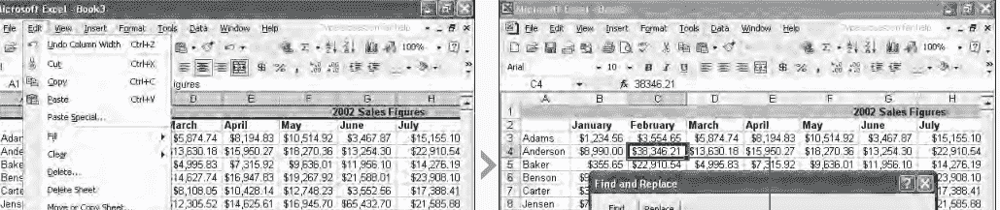

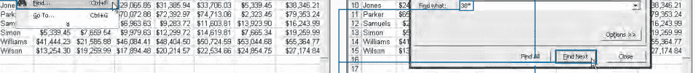

- 点击“查找”。
- Excel 显示“查找和替换”对话框。
- 在“查找”字段中输入你想查找的值。
- 使用 `*` 替换一系列字符，或使用 `?` 替换单个字符。
- 点击“查找下一个”。
- 当你找到正确的值时，点击“关闭”关闭对话框。


## 选择单元格范围

你可以通过在实施更改之前选择所有单元格，同时对工作表中的多个单元格进行修改，这一过程被称为选择范围。你可以选择单元格范围来对单元格应用不同的格式选项，或更改 Excel 值。单元格范围不需要是连续的；你可以选择不同位置的单元格。有关复制单元格范围的信息，请参见“单元格的复制和粘贴”部分。有关单元格格式的更多信息，请参见“创建自定义格式”部分。

要选择整行或整列，请点击相应的标识符。例如，要选择 C 列中的所有单元格，请点击 C 列的标识符。要选择多列，点击第一列并按住鼠标按钮拖动到其他列。要选择行，请点击每行左侧的标识符。

你可以选择从单个单元格到整个工作表。Excel 会高亮单元格以提醒你已选择。如果你同时选择多个单元格范围，Excel 会高亮每个所选范围。

要选择较小的单元格范围，先选择第一个单元格块，然后按 `Ctrl` 键并选择下一个块。如果你不按住 `Ctrl` 键，当你选择新单元格范围时，Excel 会取消对第一个范围的选择。

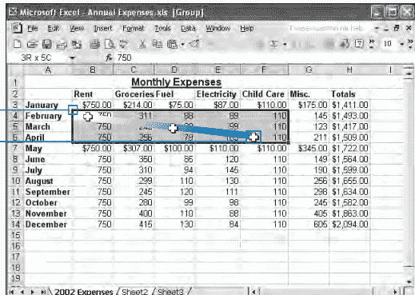

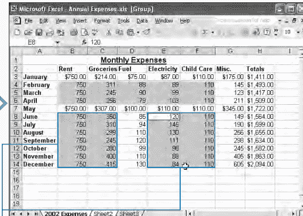

| | 租金 | 购物 | 电费 | 孩子 | 总计 |
|---|---|---|---|---|---|
| 1月 | | $700 | $259 | $100 | $70 | $1,129.00 |
| 2月 | | $700 | $269 | $100 | $70 | $1,139.00 |
| 3月 | | $700 | $250 | $100 | $70 | $1,120.00 |
| 4月 | | $750 | $310 | $110 | $70 | $1,240.00 |
| 5月 | | $750 | $295 | $110 | $70 | $1,225.00 |
| 6月 | | $750 | $280 | $110 | $70 | $1,210.00 |
| 7月 | | $750 | $270 | $110 | $70 | $1,200.00 |
| 8月 | | $750 | $250 | $110 | $70 | $1,180.00 |
| 9月 | | $750 | $240 | $110 | $70 | $1,170.00 |
| 10月 | | $750 | $230 | $110 | $70 | $1,160.00 |
| 11月 | | $750 | $220 | $110 | $70 | $1,150.00 |
| 12月 | | $750 | $210 | $110 | $70 | $1,140.00 |

| | 租金 | 购物 | 电费 | 孩子 | 总计 |
|---|---|---|---|---|---|
| 1月 | | $700 | $259 | $100 | $70 | $1,129.00 |
| 2月 | | $700 | $269 | $100 | $70 | $1,139.00 |
| 3月 | | $700 | $250 | $100 | $70 | $1,120.00 |
| 4月 | | $750 | $310 | $110 | $70 | $1,240.00 |
| 5月 | | $750 | $295 | $110 | $70 | $1,225.00 |
| 6月 | | $750 | $280 | $110 | $70 | $1,210.00 |
| 7月 | | $750 | $270 | $110 | $70 | $1,200.00 |
| 8月 | | $750 | $250 | $110 | $70 | $1,180.00 |
| 9月 | | $750 | $240 | $110 | $70 | $1,170.00 |
| 10月 | | $750 | $230 | $110 | $70 | $1,160.00 |
| 11月 | | $750 | $220 | $110 | $70 | $1,150.00 |
| 12月 | | $750 | $210 | $110 | $70 | $1,140.00 |

## 命名范围

如果你需要在多个位置引用一个范围，这可能会变得非常繁琐。你可以创建名称来方便访问。例如，你在“名称”框中创建名称。你的范围名称最多可以包含 255 个字符，但只能显示 16 个。Excel 只允许在一个工作簿中使用该名称；因此，如果你在另一个工作表中创建了相同的名称，必须使用不同的名称。如果你复制了带有命名范围的工作表，Excel 仅识别原始工作表中的名称。你可以在复制的工作表上访问该范围。

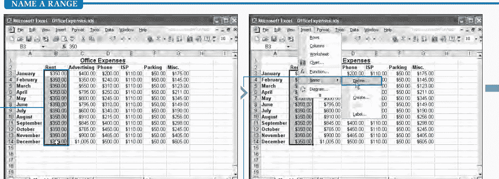

- 选择你想命名的单元格范围。
- 注意：有关选择范围的更多信息，请参见“选择单元格范围”部分。
- 点击 插入 -> 名称 -> 定义。
- “定义名称”对话框显示。
- 你可以点击“名称”字段查看当前名称。
- 3 输入范围名称。
- 4 点击“确定”。

你可以让 Excel 自动将列或行标签作为工作表的名称。这消除了为数据中的每列或每行手动创建范围的时间。Excel 会根据该范围内顶部、底部行、左侧列或右侧列的标签创建名称。如果你的工作表包含一整年的办公费用，你可以为每月的费用创建名称。Excel 会根据列标签创建范围名称。

如果行包含相应的数据值，则你必须同时选择标签和数据值。当你激活此选项时，Excel 会为所选单元格范围内的每个标签创建一个单独的范围名称。

如果你在顶行和左侧列都有标签，且你只选择了顶行，则 Excel 只会为顶行创建名称。要同时为顶行和左侧列创建名称，必须在“创建名称”对话框中同时选择两者。

在“创建名称”对话框中，你必须首先选择包含标签和命名范围单元格的单元格范围。例如，如果顶行包含其余单元格的列名。

尽管你使用工作表创建范围，但只有选中的单元格才会成为相应范围的一部分。例如，如果 C 列包含电话费用，并且你选择了一个包含 1 到 12 的单元格范围，Excel 将不会为 12 以下的任何值创建范围。

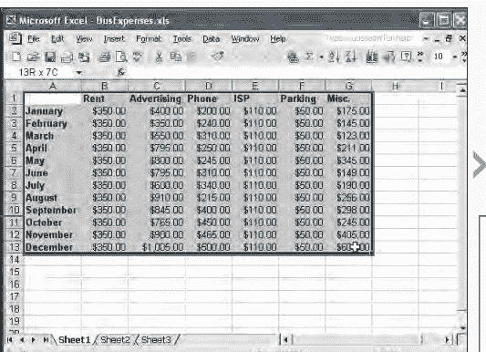

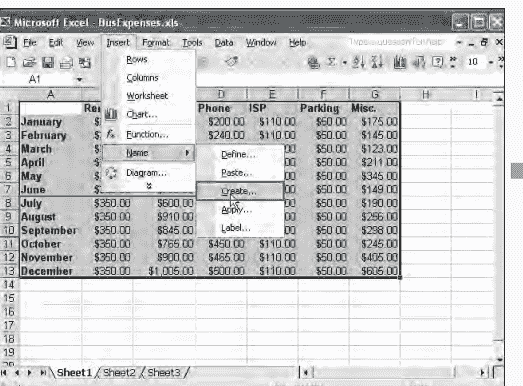

- 选择包含标签的单元格范围。
- 注意：参见“选择单元格范围”部分以获取有关选择范围的范围。
- 点击 插入名称 -> 创建。


你可以使用“`定义名称`”对话框快速消除不需要的命名范围，通过点击“`插入名称 > 定义`”可以显示该对话框。“`定义名称`”对话框列出了当前工作簿中定义的所有名称。要删除名称范围，请点击它然后点击删除。Excel 只会删除名称范围，而不会删除任何数据。

你可以使用日期作为范围的名称。但是，如果你的标签是数字日期，Excel 必须重新格式标签以匹配名称规则。例如，带有数字和斜杠字符的 `1/31/2002` 不能用于名称范围。如果此日期存在于你用于创建名称的列中，Excel 会将范围名称更改为 `_1_31_2002`。查看“名称范围”获取更多关于范围的信息。查看 Excel 帮助以获取特定的范围规则。

你可以通过“`定义名称`”对话框更改范围：选择所需的范围，在“`引用所至`”字段中指定单元格，并点击“`添加`”。要在“工作簿中的名称”字段中创建新名称，请在“`引用所至`”字段中指定所需的范围并点击“`添加`”。

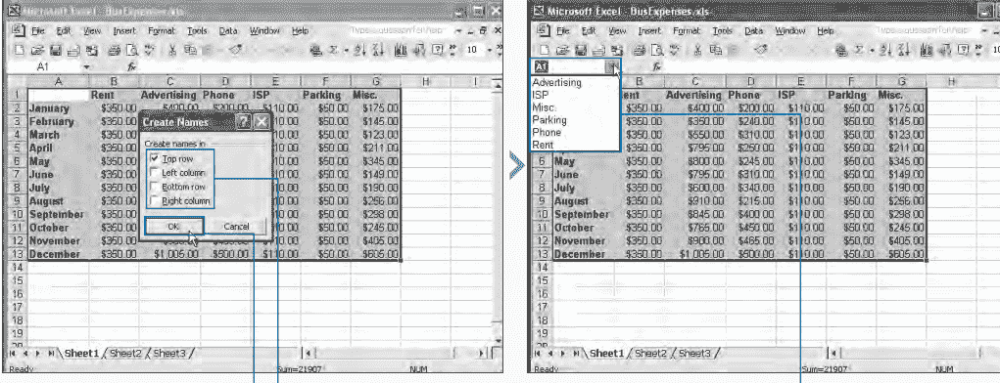

- “名称”对话框对应于标签的位置。
- Excel 创建范围名称。
- 点击“名称”字段旁边的按钮查看当前的范围名称。
- 点击确定。

## EXCEL 数据分析

### 修改命名范围

当你创建一个命名范围时，每当你使用指定的名称引用它时，Excel 都会继续使用存储的命名范围。如果你通过添加或删除数据来更改工作表，则必须更新相应的范围名称，以便在使用在使用名称时 Excel 能反映相应的单元格。要创建命名范围并了解更多关于使用的用处的信息，请查看“创建标签范围”部分。使用“`定义名称`”对话框来修改命名范围。在此对话框中，你可以选择所需的范围名称，并通过在“引用”字段中输入内容进行相应修改，或使用“折叠”按钮选择新的单元格范围。如果你有多个范围需要修改，可以使用“`添加`”按钮保存第一个名称的更改，然后修改下一个名称。

当你修改命名范围时，更改将影响引用相应范围的所有位置。例如，如果你创建一个使用特定命名范围的公式，然后更改该名称所引用的单元格，公式将使用命名范围的新版本。查看第 4 章获取更多关于创建公式的信息。

如果你在“`定义名称`”对话框中更改实际的范围名称，Excel 将创建一个新的范围名称并保留旧范围。你可以使用“删除”按钮删除旧名称。查看“创建标签范围”获取有关删除范围的信息。

当工作簿中有多个不同的命名区域时，你可能会发现难以跟踪所有的名称。Excel 提供了一个功能，可以快速创建所有名称及其对应单元格范围的列表。要创建区域列表，点击“`插入 > 选取 > 粘贴名称`”：在“粘贴名称”对话框中，点击“列表”按钮。Excel 会创建一个列表，第一列包含名称，第二列标识相应的单元格范围。例如，如果 B2 到 B10 包含你的费用，Excel 将传递类似下面的值：

```
=Sheet1!B2:$B10
```

区域引用仅标识命名区域范围内的单元格。Excel 首先列出包含该区域的工作表名称，然后是区域内的单元格。更多关于单元格引用的信息请参见附录 D。

Excel 将列表放置在你包含光标的活动工作表中。因此，将光标放置在下方有足够单元格的单元中是一个好主意。列表中不包含任何链接，因此为了保持其更新，当你更改命名区域时必须重新创建它。

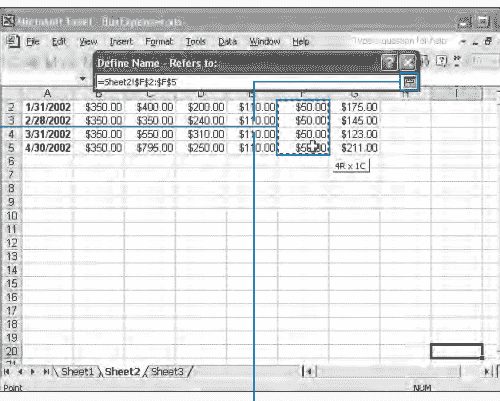

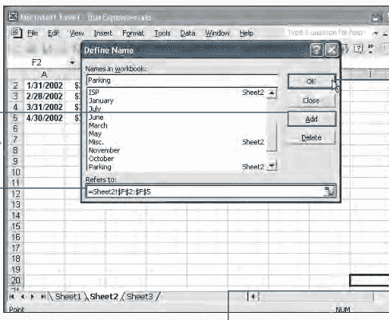

- 显示所选区域中的对应单元格。
注意：更多信息请参阅“选择单元格范围”节。
- 修改后的区域选择显示在“引用范围”中。
- 点击“确定”。
- 更改区域选择。
- 点击“还原对话框”按钮。
- 点击“添加”以更新保存的区域。

如果你想在多个位置使用相同的值，而不是重新输入，可以复制并粘贴。对于另一个报告，你可以复制一个数据列表备用，或在多个单元格中复制公式。你可以使用“复制”和“粘贴”选项在单元格内重复信息。当你复制单元格或单元格区域时，Excel 会替换单元格中的所有值、格式和数据，并保持原始值不变。只要单元格相邻，你就可以使用多个单元格。

复制单元格区域后，你可以将单元格内容粘贴到当前工作簿、另一个 Excel 工作簿或任何其他 Microsoft Windows程序的任何位置。Excel 会替换你粘贴复制值的内容。你可以粘贴复制的单元格，在关闭 Excel 之前都不会复制另一个单元格区域。

如果你操作得当，最佳方法是选择要粘贴内容的第一个单元格，然后应用“粘贴”命令。如果你尝试粘贴整个单元格区域而没有选择精确的单元格数量，将收到错误消息。

当你应用复制单元格区域的命令时，Excel 会选中带有标记的单元格，直到你执行某个取消选取它们的任务。你也可以通过复制另一个单元格区域或插入行来应用更改工作表的选项。

| 月份 | 每月费用 | 电费 | 育儿最低费用 | 总计 |
|---|---|---|---|---|
| 1月 | $750.00 | $80.00 | $175.00 | $1,005.00 |
| 2月 | $750.00 | $90.00 | $175.00 | $1,015.00 |
| 3月 | $750.00 | $100.00 | $175.00 | $1,025.00 |
| 4月 | $750.00 | $110.00 | $175.00 | $1,035.00 |
| 5月 | $750.00 | $120.00 | $175.00 | $1,045.00 |
| 6月 | $750.00 | $130.00 | $175.00 | $1,055.00 |
| 7月 | $750.00 | $140.00 | $175.00 | $1,065.00 |
| 8月 | $750.00 | $150.00 | $175.00 | $1,075.00 |
| 9月 | $750.00 | $160.00 | $175.00 | $1,085.00 |
| 10月 | $750.00 | $170.00 | $175.00 | $1,095.00 |
| 11月 | $750.00 | $180.00 | $175.00 | $1,105.00 |
| 12月 | $750.00 | $190.00 | $175.00 | $1,115.00 |

| 月份 | 每月费用 | 电费 | 育儿最低费用 | 总计 |
|---|---|---|---|---|
| 1月 | $750.00 | $80.00 | $175.00 | $1,005.00 |
| 2月 | $750.00 | $90.00 | $175.00 | $1,015.00 |
| 3月 | $750.00 | $100.00 | $175.00 | $1,025.00 |
| 4月 | $750.00 | $110.00 | $175.00 | $1,035.00 |
| 5月 | $750.00 | $120.00 | $175.00 | $1,045.00 |
| 6月 | $750.00 | $130.00 | $175.00 | $1,055.00 |
| 7月 | $750.00 | $140.00 | $175.00 | $1,065.00 |
| 8月 | $750.00 | $150.00 | $175.00 | $1,075.00 |
| 9月 | $750.00 | $160.00 | $175.00 | $1,085.00 |
| 10月 | $750.00 | $170.00 | $175.00 | $1,095.00 |
| 11月 | $750.00 | $180.00 | $175.00 | $1,105.00 |
| 12月 | $750.00 | $190.00 | $175.00 | $1,115.00 |

- 1. 选择要复制的单元格。
- 2. 点击复制。
注意：更多信息请参见“选择单元格范围”。

Excel 会在复制的单元格周围显示虚线。


你可以通过点击“选择性粘贴”来自定义 Excel。“选择性粘贴”对话框显示了要粘贴的内容以及粘贴期间要的操作。如果你选择“全部”，Excel 将粘贴复制单元格的所有内容。如果你选择“值”，Excel 将仅粘贴复制单元格的值，忽略注释或格式。如果你想粘贴数据验证或格式，Excel 将修改你粘贴目标单元格中的现有值。如果你选择“加”，Excel 将将复制单元格的值加到单元格中。当你点击“转置”选项时，Excel 将将复制的行变为列（或反之）。

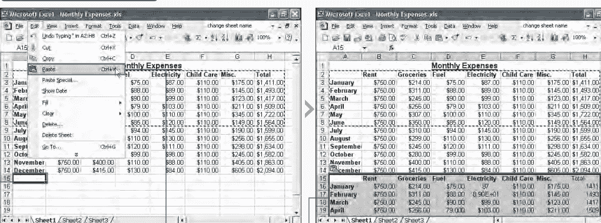

|  | 每月费用 | 电费 | 育儿 | 总计 |
|---|---|---|---|---|
| 1 | $758.00 | $214.00 | $175.00 | $1,147.00 |
| 2 | $718.00 | $248.00 | $140.00 | $1,066.00 |
| 3 | $685.00 | $236.00 | $143.00 | $1,064.00 |


| 4 | $711.00 | $205.00 | $110.00 | $1,026.00 |
| 5 | $725.00 | $190.00 | $128.00 | $1,043.00 |
| 6 | $723.00 | $221.00 | $151.00 | $1,095.00 |
| 7 | $750.00 | $250.00 | $140.00 | $1,140.00 |
| 8 | $745.00 | $215.00 | $130.00 | $1,090.00 |
| 9 | $700.00 | $220.00 | $160.00 | $1,080.00 |
| 10 | $720.00 | $240.00 | $150.00 | $1,110.00 |
| 11 | $780.00 | $230.00 | $160.00 | $1,170.00 |
| 12 | $750.00 | $240.00 | $150.00 | $1,140.00 |

- 1. 将光标置在你想要粘贴单元格的位置。
- 2. 点击“选择性粘贴”按钮。
- 3. 你也可以点击“确定”将复制的单元格粘贴到新位置。

如果你希望工作表中的数字具有特定格式（例如，三位小数），你可以创建自定义数字格式。通过一个定义，你可以控制 Excel 如何格式化正值、负值、零值。你可以使用任何组合来指定这四种类型，但你可以使用分号指定它们的顺序：

你使用格式代码的任何组合来创建自定义数字格式，其中 0 和 # 是最有用的数字代码。使用 0 来定义小数位置。Excel 将 670.45 显示为 670.45。# 告诉 Excel 不以红色显示有效正数。你可以使用方括号中的颜色来定义颜色格式。例如，对于红色负值，你在格式前输入 [红色]。

正数;负数;零值;文本格式

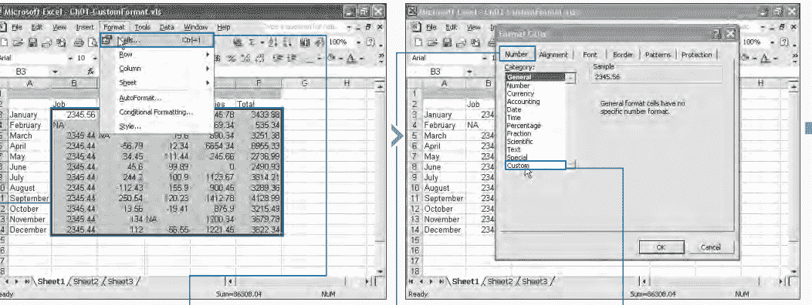

- 选择要设置格式的单元格。

注意：更多信息请参阅“选择单元格范围”。

- 点击“格式 > 单元格”。
- “单元格格式”对话框分类框。
- 如果未显示，点击“数字”选项卡。

如果您无法找到所需的日期和时间默认格式，可以创建自定义日期和时间格式。执行此操作，请将表格中提供的日、年、月、时、分钟和秒的代码组合起来。您还可以使用任何自定义数字代码，例如颜色代码。例如，将日期和时间格式设置为 3:45 PM 类型为：14, 2002 且设为绿色，您：

| 日期符号 | 描述 |
|---|---|
| d | 使用 d 显示日期为 1-31，或使用 dd 显示日期为 01-31。使用 ddd 显示三个字母的星期名称缩写。如果您想显示完整的星期名称，请使用 dddd。 |
| m | 使用 m 显示分钟为 1-12，或使用 mm 显示分钟为 01-12。使用 mmm 显示三个字母的月份名称（Jan-Dec）。如果您想显示完整的月份名称，请使用 mmmm。 |
| y | 使用 yy 显示两位年份（如 01），或使用 yyyy 显示年份。 |

| 时间符号 | 描述 |
|---|---|
| h | 使用 h 显示小时为 0-23，或使用 hh 显示带导零的单数字小时（如 09）。 |
| M | 使用 M 显示分钟为 0-59，或使用 MM 显示带导零的单数字分钟（如 08）。确保使用大写 M，否则 Excel 将其视为月份。 |
| s | 使用 s 显示秒为 0-59，或使用 ss 显示带导零的单数字秒（如 05）。 |
| AM/PM | 根据指定时间显示 AM 或 PM。 |

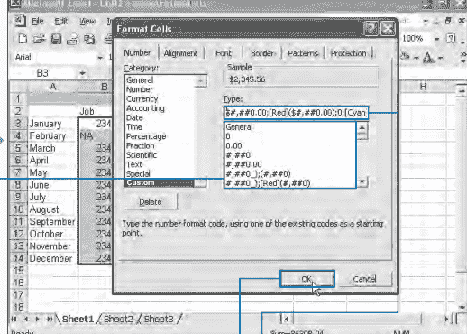
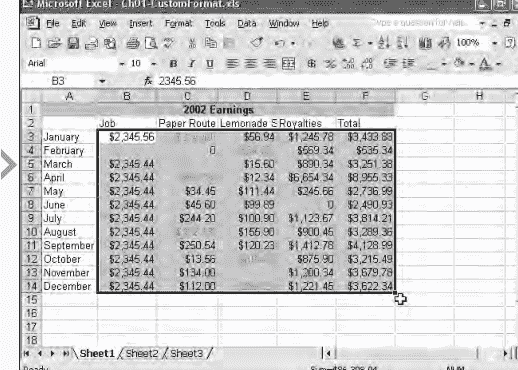

- 显示当前自定义格式列表将显示“类型”框。
- 在“类型”字段中输入所需的自定义格式。
- 将自定义格式应用到您的选定单元格。
- 点击确定。

如果您想快速更改工作表的外观，可以应用预定义格式。Excel 提供了 15 种不同的格式，可为您的数据创建类似表格的布局。当工作表包含行标题、列标题以及行列总计时，这些格式的效果最好。

Excel 会将您之前应用过的任何自定义格式替换为您在“自动格式”对话框中选择的格式。例如，如果您之前为整个工作表选择了 Arial Black 字体，然后应用了“会计 1”格式，Excel 将字体更改为 Arial（数字的默认字体）。

您从“自动格式”对话框中选择一个定义的格式。在对话框底部，您默认会看到六个格式选项：数字、边框、字体、对齐、填充和宽度。您可以选择任何六个选项并调整其中任何一个以实现您想要的效果。例如，当您进行任何更改时。当您选择或取消选择格式时，“自动格式”对话框会反映更改，让您查看您的选项如何影响特定的表格格式。

在应用格式之前选择的单元格将极大影响自动格式应用于您的工作表的方式。如果您在单元格区域中仅选择一个单元格，Excel 将选择周围的单元格并将格式应用到所有周围单元格。当您遇到空白单元格行或列时，它将不再应用格式，单元格在应用格式后会自动刷新。如果您选择单元格区域，Excel 则仅将所选格式应用于这些单元格。

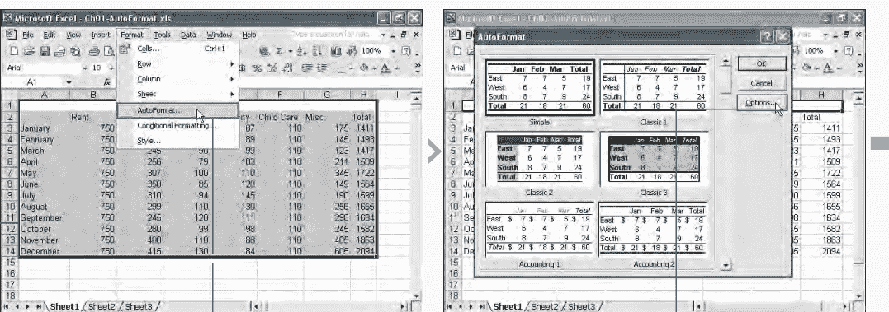

- 在应用格式之前选择的单元格将极大影响自动格式应用于您的工作表的方式。
- 注意：请参阅“选择单元格区域”部分。

# 开始使用 Excel

- 自动格式对话框会反映更改，让您查看您的选项如何影响特定的表格格式。
- 当您选择或取消选择格式时，“自动格式对话框会反映更改。

| 符号 | 描述 |
|---|---|
| 日期 | 使用 d 显示日期为 1-31，或使用 dd 显示日期为 01-31。使用 ddd 显示三个字母的星期名称缩写。如果您想显示完整的星期名称，请使用 dddd。 |
| 月份 | 使用 m 显示分钟为 1-12，或使用 mm 显示分钟为 01-12。使用 mmm 显示三个字母的月份名称（Jan-Dec）。如果您想显示完整的月份名称，请使用 mmmm。 |
| 年份 | 使用 yy 显示两位年份（如 01），或使用 yyyy 显示年份。 |

| 时间符号 | 描述 |
|---|---|
| h | 使用 h 显示小时为 0-23，或使用 hh 显示带导零的单数字小时（如 09）。 |
| M | 使用 M 显示分钟为 0-59，或使用 MM 显示带导零的单数字分钟（如 08）。确保使用大写 M，否则 Excel 将其视为月份。 |
| s | 使用 s 显示秒为 0-59，或使用 ss 显示带导零的单数字秒（如 05）。 |
| AM/PM | 根据指定时间显示 AM 或 PM。 |


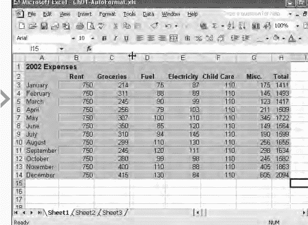

- 显示当前自定义格式列表将显示“类型”框。
- 在“类型”字段中输入所需的自定义格式。
- 将自定义格式应用到您的选定单元格。
- 点击确定。

## 对工作表应用格式


- 注意：请参阅“选择单元格区域”部分。
- 自动格式对话框会反映更改，让您查看您的选项如何影响特定的表格格式。
- 当您选择或取消选择格式时，“自动格式对话框会反映更改。
- 格式显示符号，例如：

| 符号 | 描述 |
|---|---|
| 日期 | 使用 d 显示日期为 1-31，或使用 dd 显示日期为 01-31。使用 ddd 显示三个字母的星期名称缩写。如果您想显示完整的星期名称，请使用 dddd。 |
| 月份 | 使用 m 显示分钟为 1-12，或使用 mm 显示分钟为 01-12。使用 mmm 显示三个字母的月份名称（Jan-Dec）。如果您想显示完整的月份名称，请使用 mmmm。 |
| 年份 | 使用 yy 显示两位年份（如 01），或使用 yyyy 显示年份。 |

| 时间符号 | 描述 |
|---|---|
| h | 使用 h 显示小时为 0-23，或使用 hh 显示带导零的单数字小时（如 09）。 |
| M | 使用 M 显示分钟为 0-59，或使用 MM 显示带导零的单数字分钟（如 08）。确保使用大写 M，否则 Excel 将其视为月份。 |
| s | 使用 s 显示秒为 0-59，或使用 ss 显示带导零的单数字秒（如 05）。 |
| AM/PM | 根据指定时间显示 AM 或 PM。 |


- 显示当前自定义格式列表将显示“类型”框。
- 在“类型”字段中输入所需的自定义格式。
- 将自定义格式应用到您的选定单元格。
- 点击确定。


# 通过修改现有样式来从样式对话框创建样式

Excel 提供了六种默认样式，可以使用它们创建创建自定义样式。请参阅“自定义模板”部分有关创建模板的信息。

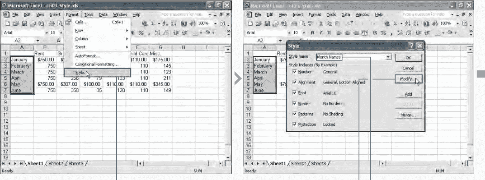

- 选择您想要应用样式的单元格。
- 注意：请参考“选择单元格区域”部分。
- 点击`格式 - 样式`。
- 样式对话框显示。
- 为您的样式输入名称。
- 点击`修改`。

当您可以轻松将其应用于工作表时，样式非常有用，使用样式对话框是最快的方法。与 Microsoft Word 不同，Microsoft Excel 的任何工具中没有默认选项。要添加此功能，点击`工具 ✎ 自定义`。在样式对话框中，点击类别，点击格式。可用格式命令列表显示在命令对话框中，将其拖到 Excel 窗口顶部的工具栏之一。您现在可以点击工具栏上的箭头并查看可用样式列表。

创建新样式后，您可以在任何位置应用它。要执行此操作，选择您要更改的单元格并点击`插入 ✎ 样式`。在样式对话框中，点击样式名称旁边的箭头然后点击它。“包含”下的复选框对应于“单元格格式”对话框中的选项卡，旁边显示有。

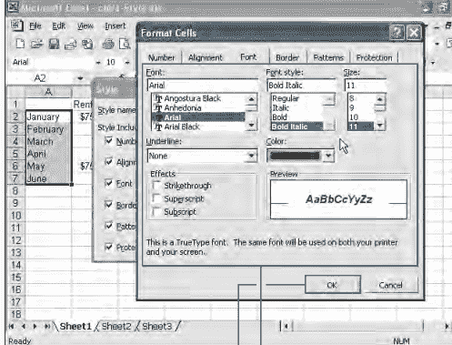

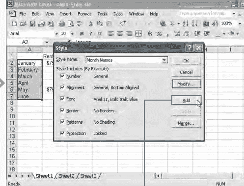

- 做出所需的格式选择。
- 点击`确定`。
- 点击`添加`。
- Excel 创建了新样式。
- 每个格式类型旁边都会显示一个标记，旁边列出了设置。

# 创建模板

如果您经常创建布局相同的工作表（例如每周股票分析报告），可以创建一个模板来消除重复性任务。模板提供了具有特定样式、边框设置、页眉、页脚，甚至是文本和图像（如公司标志）的理想布局。

您可以通过设计一个通用工作簿来创建模板，该工作簿应包含您所需的工作表，并更改其修改任何方面以适应您的需求。您可以创建自定义样式、数字格式、自定义宏和公式。您还可以在模板中创建自定义标题。例如，您每个月生成一个预算工作表来汇总总计。有关创建样式和数字格式的信息，请参阅“创建自定义数字格式”和“创建命名样式”章节。有关创建公式的信息请参见第4章，更多宏参见第9章。

您的自定义模板可以包含整个工作簿的设置。例如，如果您只想让工作簿包含一个工作表，只需在保存模板之前删除其他工作表即可。

现在您可以将通用工作簿保存为模板。在“另存为”对话框中，您必须替换“保存类型”字段中的`(*.xlt)`选项。这可能也显示为“模板”。当您这样做时，Excel 会指定一个默认存储位置来保存它们：

```
C:\Documents\Settings\user_name\AppData\Microsoft\Templates
```

您的驱动器可能会不同，且必须将`user_name`替换为您登录 Windows 的用户名。您应该允许 Excel 将工作簿存储在默认位置。这确保了当您创建新工作簿时，模板会出现在“模板”对话框的“常规”选项卡中。

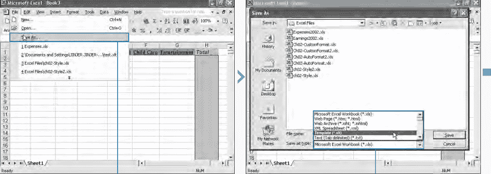

- 1. 使用模板中的功能创建默认工作簿。
- 2. 点击`文件 -> 另存为`。
- 3. 另存为对话框显示`(*.xlt)`选项。

当创建一个新的空白工作簿时，Excel 使用默认系统设置来创建它——默认字体设置和空白工作表。如果不存在默认模板，且您经常对新的空白工作簿进行更改，可以创建一个在每次创建新工作簿时都加载的默认模板。

要做到这一点，您首先要创建一个包含所有所需设置、自定义宏、公式和工作表的工作簿。当将工作簿保存为模板时，将其命名为`Book.xltx`并保存到`XLStart`文件夹中，该文件夹通常位于以下位置：

```
C:\Program Files\Microsoft Office\Office\XLStart
```

您也可以通过点击保存来创建工作表模板。您必须将工作表模板保存在与工作簿相同的位置，命名为`Sheet.xltx`。每当您添加新工作表时，Excel 都会将`Sheet.xltx`的内容复制到工作簿中。

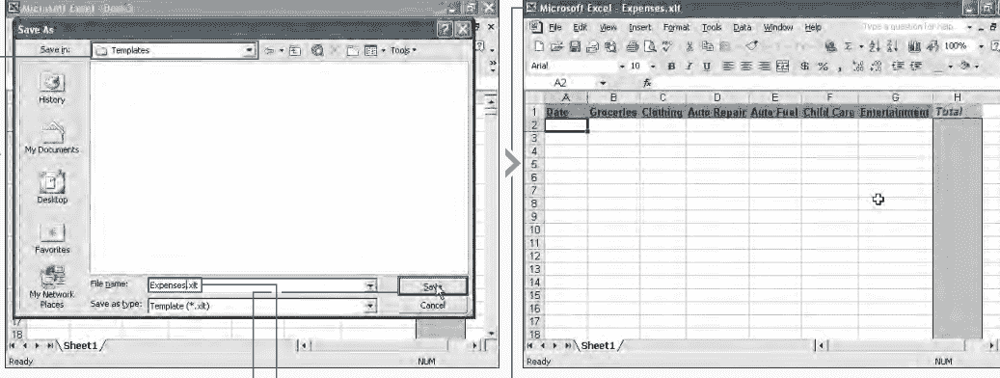

- “模板”文件夹显示为“另存为”字段中的存储位置。
- 4 为您的模板输入一个名称。
- 5 点击保存，Excel 将创建指定的模板。

# 保护工作表

如果您打算与其他用户共享工作表，您可能想要保护它以确保他们无法更改单个单元格中的值。通过保护工作表，您可以确保无论谁查看工作表内容，数据的完整性都能保持完好。工作表受保护时用户可以执行的操作。有十五个选项供选择，包括锁定和解锁单元格、格式设置以及插入或删除单元格。如果用户尝试执行未允许的任务，Excel 将显示一个消息框指示工作表已受保护。为了让用户对受保护的工作表进行修改，他们必须使用密码取消保护保护。

使用“保护工作表”对话框需要您指定一个密码来保护和取消保护工作表。使用密码可以轻松保护工作表。在工作表受保护时，用户可以执行的操作。默认情况下，工作表是锁定的。当您保护工作表时，Excel 会显示一个消息框。单元格状态。在工作表受保护时，用户可以执行的操作。默认情况下，工作表是锁定的。“保护工作表”对话框让您对锁定单元格进行控制。

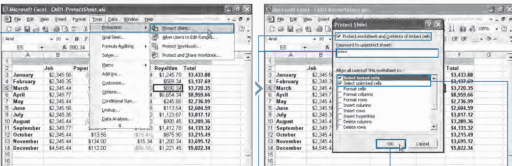


- 1. 点击`工具 -> 保护 -> 保护工作表`。
- 2. 锁定单元格。
- 3. 输入密码。
- 4. 工作表受保护时，用户可以执行的操作。
- 5 点击`确定`。

## 应用

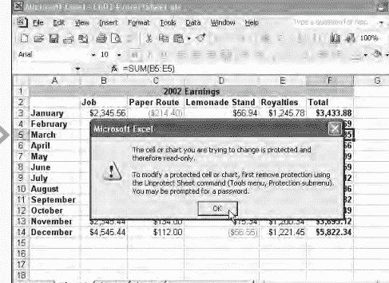

- 确认密码对话框显示。
- 输入密码。
- 点击`确定`。

当用户尝试更改受保护的工作表时，Excel 将显示一个消息框。

要删除某个项目，可以通过点击“查找下一个”或“查找上一个”按钮滚动列表，直到显示您想要删除的记录。点击“删除”，Excel 将会从工作表的列表中删除该记录。

“表单”（Form）对话框允许您查找或编辑符合特定条件的数据记录。例如，您可以识别出销售额超过 `$1000.00` 的月份。通过使用“条件”选项，当您点击“查找”时，Excel 会清除单元中的数据。输入您想要匹配的准则，并点击“查找下一个”或“查找上一个”按钮。您可以通过在任何文本字段中输入值来搜索符合特定条件的记录。例如，要查找客户商品退货金额等于 `$2000.00` 的月份，在该字段中输入 `$2000.00`；而要查找退货金额超过 `$2000.00` 的月份，则输入 `>$2000.00`。或者，要查找退货少于 2000 的月份，可以使用“查找下一个”和“查找上一个”按钮滚动符合条件的记录。

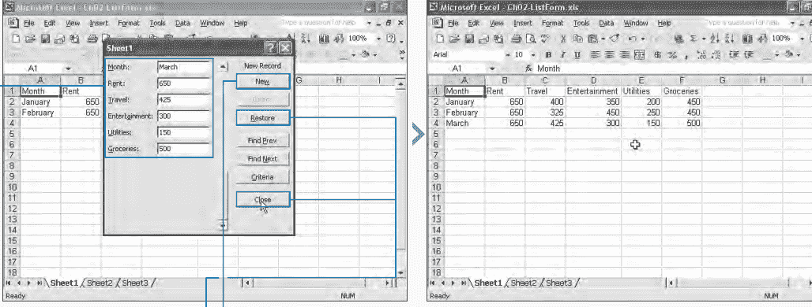

- 显示一个对话框，其中每个列都对应一个文本框。
- 在每个文本框中输入所需的值。
- 您可以点击“清除”来清除文本框中输入的任何值。点击“关闭”。
- “表单”对话框中指定的数据值将显示在工作表上。

# 使用填充句柄创建序列

您可以使用“填充句柄”（Fill Handle）快速在列表中创建序列，并避免重复输入。序列简单来说一组相同值或按相同值增加的列表。例如，您可以拥有日期序列，如 2003 年 1 月 1 日、2003 年 2 月 1 日。数字序列可以通过相加、相减、乘或除相同值来递增。例如，2, 4, 6 是一个递增 2 的数字列表。更多信息，请参阅“创建列表”部分。

Excel 会创建剩余的序列。如果单元格包含数值（也称为标签），Excel 仅会在指定的单元格中重复它。如果您提供了一个日期，Excel 会根据其格式递增日期。例如，对于包含日的日期（如 24/12/2002），Excel 会将日期增加一天。如果单元格仅包含月份，Excel 会将月份增加一个月。

Excel 将所选单元格区域右下角的黑色方块称为*填充句柄*。当您向下或向右拖动此句柄时，Excel 将将使用原始所选单元格中的值在扩展的单元格范围内创建序列。当您拖过每个单元格时，Excel 会在每个单元格中放置值。

当您提供一个值时，Excel 会创建一个序列。为了确保序列正确递增，您必须同时提供序列中的第一个和第二个值。Excel 会评估这些值、模式，并创建剩余的序列。

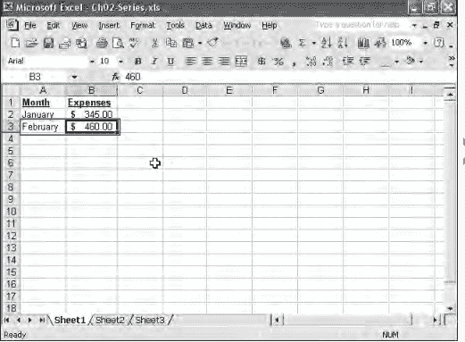

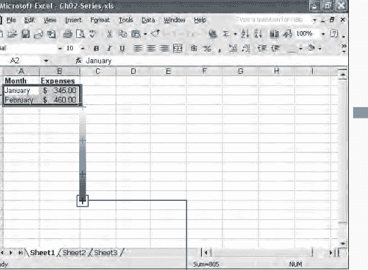

- 1. 输入序列的第一个和第二个数据值。
- 2. 选择序列的单元格或多个序列的单元格。
- 注意：请参考第 1 章获取有关选择单元格范围的信息。
- 2. Excel 高亮单元格以显示它们已被选中。
- 3. 点击并拖动填充句柄以为序列指定单元格范围。


您可能想选择数据值序列的递增量。要执行此操作，请点击`编辑 > 填充 > 序列`。在显示的“序列”框中，您可以精确地输入您希望值如何递增、递增类型，甚至是一个停止值。例如，如果您在单元格中有`5/15`这样的数据，填充句柄会自动按天数递增，使下一个值变为`5/16`。如果您想显示间隔`15`天的日期，只需在“步长”值中输入`15`，并点击“日期单位”部分中的“天”选项（☺）。如果您想显示间隔恰好一个月的日期，请点击“月”选项并在“步长”值中输入`1`。如果您想要从`5`月`15`日到年底的所有日期，请在“停止”值中输入`12/31`。

当对日期使用序列对话框时，必须选择与您想要递增的日期部分对应的“日期单位”选项（☺）。换句话说，如果您希望日期增加一个月，请点击“月”选项。

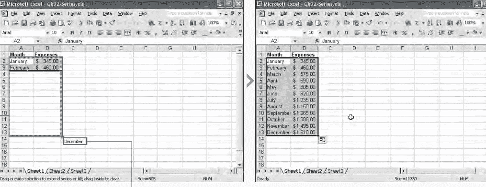

在拖动时，Excel 会勾勒包含序列的单元格范围。

Excel 显示它将放在最后一个单元格中的值。

Excel 在指定的单元格中创建序列。

- 释放鼠标按钮。

## Excel 数据分析

## 列表排序

通过 Excel，您可以根据指定的标准快速按升序或降序对行或列。例如，您可以根据第一列列出的名称对行进行排序。通过不同的顺序，您可以像“自定义排序”部分所述进行自定义排序顺序。

按升序排序列表时，Excel 根据您指定的标准将记录放在一起。例如，您可以可以第一列列出的名称对行进行排序。通过不同的顺序，您可以像“自定义排序”部分所述进行自定义排序顺序。

按升序排序列表时，Excel 根据您指定的标准将记录放在一起。例如，您可以根据第一列列出的名称对行进行排序。通过不同的顺序，您可以像“自定义排序”部分所述进行自定义排序顺序。

按升序排序列表时，Excel 根据您指定的标准将记录放在一起。例如，您可以根据第一列列出的名称对行进行排序。通过不同的顺序，您可以像“自定义排序”部分所述进行自定义排序顺序。

按升序排序列表时，Excel 根据您指定的标准将记录放在一起。例如，您可以根据第一列列出的名称对行进行排序。通过不同的顺序，您可以像“自定义排序”部分所述进行自定义排序顺序。

按升序排序列表时，Excel 根据您指定的标准将记录放在一起。例如，您可以根据第一列列出的名称对行进行排序。通过不同的顺序，您可以像“自定义排序”部分所述进行自定义排序顺序。

按升序排序列表时，Excel 根据您指定的标准将记录放在一起。例如，您可以根据第一列列出的名称对行进行排序。通过不同的顺序，您可以像“自定义排序”部分所述进行自定义排序顺序。

按升序排序列表时，Excel 根据您指定的标准将记录放在一起。例如，您可以根据第一列列出的名称对行进行排序。通过不同的顺序，您可以像“自定义排序”部分所述进行自定义排序顺序。

*(注：由于原文中该段存在大量重复文本，译文遵循“不要重复输出原文”的原则，此处仅对核心含义进行了逻辑翻译。)*

## 按列排序

- 注意：请参考第`1`章获取选择单元格范围的信息。

### 点击数据。

### 点击排序。

### 按颜色排序。

### 点击 确定。

## 组织工作表数据

### 进阶

您可以根据颜色、字体或图标排序数据。对于升序，Excel 使用内置规则。如果是降序排序，Excel 将反转这些规则。

- Excel 使用自定义列表进行排序。

- Excel 按照以下顺序排序：

- Excel 排序数字字符：`0 1 2 3 4 5 6 7 8 9 ! $ % ( ) * - / : < > @ [ ] A B C D E F G H I J L M N O P Q S T U V W X Y`

- Excel 排序逻辑值：`False` 在 `True` 之前。

- Excel 将空值放在底部。

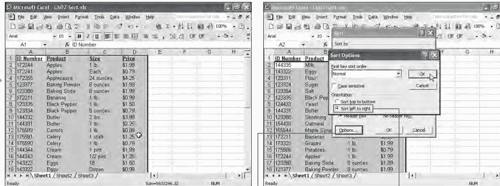

## 自定义排序

您可以创建自定义排序来排序列表。虽然您可以在排序对话框中执行自定义排序，但必须先创建一个自定义排序列表，以便您使用的所有工作簿可以使用。

您可以使用自己的列表创建自定义排序顺序。您在“选项”对话框的“自定义列表”中创建排序列表。创建单词列表后，您可以在排序对话框的任何位置选择它。

Excel 提供了按星期和月份名称排序默认自定义排序。您可以使用这些排序，也可以创建自己的独特列表，例如员工姓名、部门地点等。当您选择自定义排序时，可以指定。例如，如果您定义了

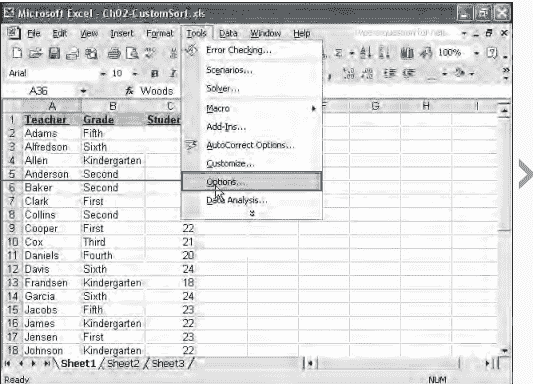

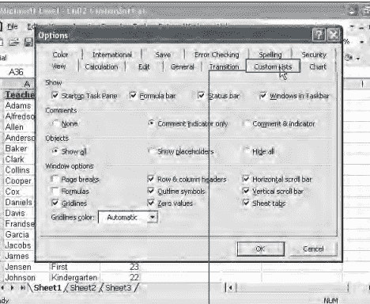

### 创建排序顺序

- 1. 点击 工具 选项。

- 2. 显示选项对话框。

- 3. 点击 自定义列表选项卡。

## 组织工作表数据

## 实践

与其为你的排序手动输入列表，不如从任何已打开的工作表导入数据值列表。你可以通过使用“自定义列表”选项卡中的“从单元格导入”字段来实现。你可以手动输入包含列表的单元格范围，也可以在工作表中选择包含列表的单元格范围。

要选择单元格范围，请点击“折叠对话框”按钮以缩小“选项”对话框。找到包含排序顺序值的工作表并选择相应的单元格。选中的单元格范围将显示在字段中。接下来，点击“还原对话框”按钮将“选项”对话框恢复原始大小。有关选择单元格范围的更多信息，请参见第`1`章。

点击自定义列表选项卡中的“导入”按钮，Excel会将选定单元格范围的值添加到“列表项”框中。值按照它们在选中单元格中的顺序出现在列表中。你可以通过输入或删除值进行任何修改。最后，点击“添加”创建你的排序顺序。为了更清楚地了解如何使用折叠对话框和还原对话框，请选择“合并数据”。

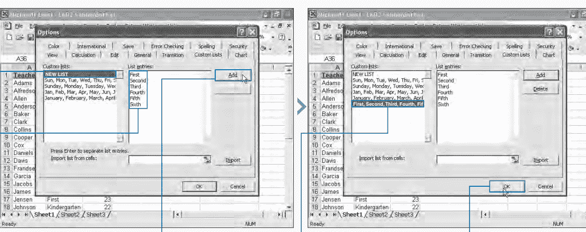

- 3 在列表中点击“新建列表”，点击“自定义”框。

- 4 输入你想要排序列表的顺序，在每个列表项目后按回车键。

- 5 当你完成列表时，点击“添加”。

- 6 Excel将排序顺序列表添加到自定义列表框中。

继续

## Excel 数据分析

## 创建自定义排序（续上）

你可以在任何工作表的行或列中创建自定义排序顺序。你执行自定义排序的方法基本上与 Excel 中的任何其他排序相同，即使用“排序”对话框进行，但自定义排序的优先级高于 Excel 内置的排序规则。有关排序顺序的信息，请参见“排序列表”部分。

无论你打算使用什么种自定义排序顺序，Excel始终将自定义排序顺序作为第一次排序，然后按照字段指定的顺序进行排序。

你可以在“排序选项”框中指定你的自定义排序。有关“排序”对话框的信息，请参见“排序列表”部分。第一个主要排序字段提供了可用的排序顺序列表。Excel 提供了处理周的默认排序。它还提供了全天和三字母缩写。

要应用自定义排序，首先在“排序”框的字段中选择你想要排序的字段。当你使用自定义排序时，首先作为第一次排序发生，换句话说，Excel 使用你的自定义排序顺序重复你在排序框中指定的顺序，并忽略“降序”选项。有关按行或列排序的信息，请参见“排序列表”部分。

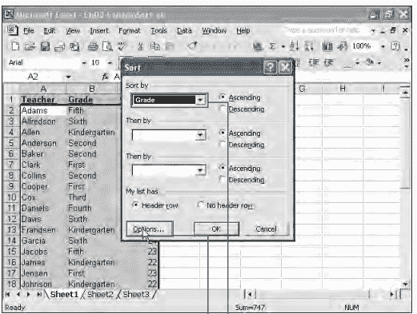

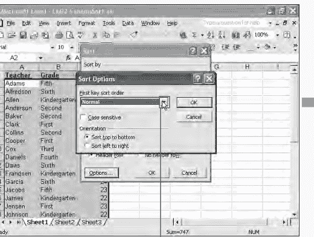

### 应用自定义排序

- 1. 显示“排序”对话框。

- 2. 在“排序”字段中选择行或列。

- 3. 显示“排序选项”。

- 4. 点击“主要关键字”旁边的箭头。

注意：相关信息请参见“排序列表”部分。

## 额外

通过自定义排序，Excel 使用值的顺序来确定如何对你的数据进行排序。Excel 首先对匹配列表的记录，并在列表底部按升序排序剩余项目。例如，如果你的自定义列表包含 `High`（高）、`Medium`（中）和 `Low`（低）值，Excel 将将具有 `High` 的记录放在最前面，然后是 `Medium`，最后是具有 `Low` 值的记录。如果列或行包含其他值（例如 `Very Low`（极低）），Excel 将这些值置于底部，因此顺序将变为 `High, Medium, 和 Very Low`。

默认情况下，Excel 中的排序不区分大小写。例如，如果你要排序的数据包含 `milk` 和 `Milk` 两个值，Excel 会将它们视为相同值，尽管第二个词的 *首字母 M 是大写的*。如果你想执行区分大小写的排序，请点击“排序”对话框中的“选项”按钮。当你在“排序”对话框中点击“区分大小写”选项时。

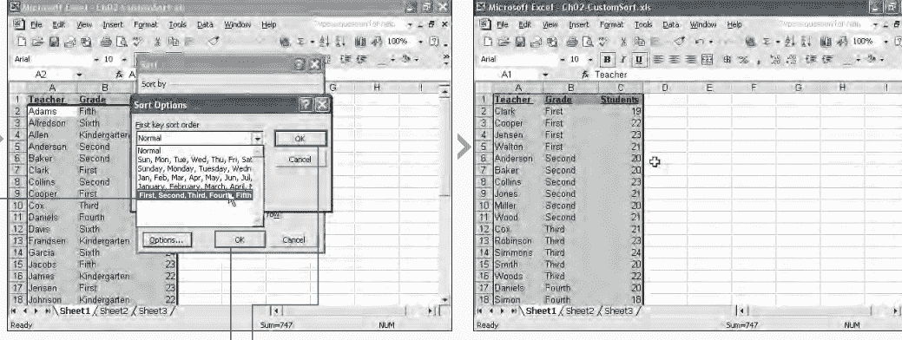

- 显示当前排序顺序列表。

- 点击所需的排序顺序。

- 点击“确定”关闭“排序”对话框。

- 点击“确定”关闭“排序”框。

- Excel 使用自定义排序顺序对选定列表进行排序。

## Excel 数据分析

## 合并数据


## 合并数据

如果你在多个工作表甚至多个工作簿中有相关数据，想要将它们合并到一个位置，可以使用“合并”选项。在你执行此操作时，Excel 将从指定位置合并数据到一个中心位置，并通过你指定的任何方法合并公共数据。一个很好的用法是将包含销售数据的不同工作表合并到单个工作表中，以便你可以分析所有数据。

“合并”对话框中“函数”字段中的选项定义了 Excel 在执行合并时如何合并值。默认情况下，Excel 选择最常用的函数“和”来合并值。“和”函数会将每个合并区域的值相加。例如，如果每个工作表包含销售人员的每月销售额，Excel 将选择每个月的金额并将其合并。

在合并数据之前，你必须决定将数据放在哪里。你可以在现有工作簿中创建一个单独的工作表，也可以创建一个新工作表。然后，选择你想让 Excel 放置合并数据的第一个单元格。

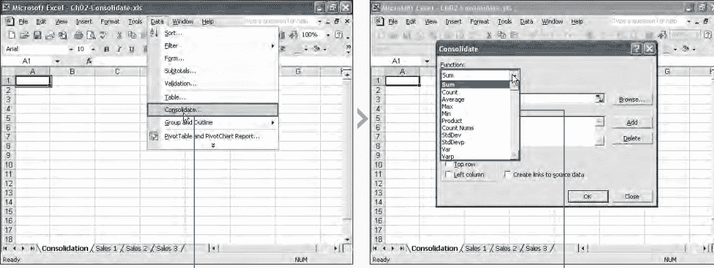

### 选择合并函数

- 选择要合并的工作表。
- 点击“合并”。
- 合并对话框显示。
- 点击你想要执行的函数。

Excel 提供了几种不同的合并函数：

| 函数 | 描述 |
|---|---|
| 和 | 相加合并区域的值。 |
| 计数 | 计算合并区域值的个数。 |
| 平均值 | 对合并区域取平均。 |
| 最大值 | 找到合并区域中的最大值。 |
| 最小值 | 找到合并区域中的最小值。 |
| 积 | 相乘返回结果。 |
| 数字计数 | 计算合并区域中数字个数。 |
| 标准差 | 计算合并区域的标准差。 |
| 样本标准差 | 基于采样估计合并区域的标准差。 |
| 方差 | 计算合并区域的方差。 |

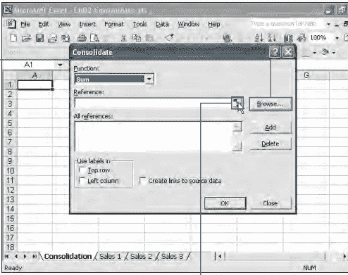

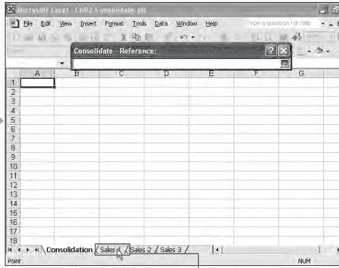

### 选择要合并的范围

如果没有打开数据的工作表，你可以点击“浏览”。

- 4 点击“合并”按钮。
- 5 合并框折叠，仅显示“引用”字段。
- 6 点击包含数据的工作表。

继续

## Excel 数据分析

### 合并数据（续上）

如果你手动输入数据范围，必须包含工作表名称和单元格。例如，如果你想合并 Sheet1 中的 A1 到 A15 单元格，你输入：`'Sheet1'!$A$1:$A$15`

当你指定工作表时，必须使用单引号输入名称。使用感叹号将工作表引用与范围隔开。因此，在示例中，`'Sheet1'` 表示单元格范围。

要指定已打开工作簿中的范围，你可以选择相应的单元格范围，这些范围通常显示在“引用”字段中。每个你想合并的工作表。

Excel 需要知道使用哪些标签来合并后的数据值。Excel 根据与顶行、左列或两者的匹配标签来匹配指定位置中的数据。你需要至少选择一个位置选项。

请记住，合并数据不会影响原始工作表中所包含的值。

#### 额外

当你进行合并时，Excel 仅会将指定范围内的数据复制或合并到合并位置。如果你在执行合并后修改了数据，Excel 不会自动更新结果。要执行此操作，你必须在“合并汇总区域”对话框中勾选“创建与源数据的链接”选项。此选项会在合并后的工作表的每个单元格中放置公式。公式直接链接回合并的数据，允许 Excel 在你修改原始数据后进行更新。

如果你选择使用此选项，则必须确保 Excel 能够始终找到包含合并数据的工作表。这是通过将所有工作表放在相同位置来实现的。每当你打开工作表时，Excel 都会尝试定位合并数据以便更新工作表。Excel 打开原始工作表并更新合并工作表中的数据。如果 Excel 无法找到资源，工作表将不会刷新所有数据。

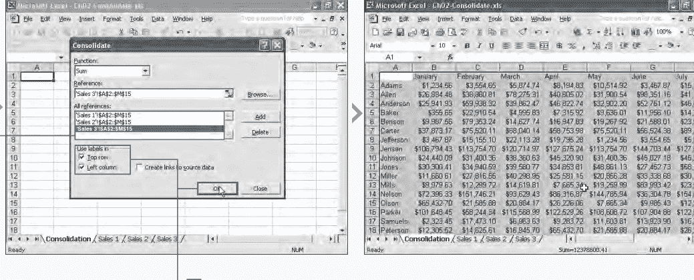

- “引用”框显示要合并的范围。
- 10 点击你的标签位置。
- 11 点击确定。
- Excel 合并指定范围内的数据值。

*注意。*

## 建立数据大纲

你可以在 Excel 中创建数据大纲，将信息分组在不同的部分中。此功能允许你展开和折叠部分，这可以帮助你快速找到工作表的某些部分。如果你在一个工作表上有销售记录，且每条记录都有总计，你可以折叠记录并仅查看每个月的总额。

你可以通过识别相关数据组来手动创建大纲，也可以让 Excel 自动创建大纲。手动创建时，你首先要选择你想要分组的行或列。当你激活“分组”命令时，Excel 会将所有行或列置就位。如果你有特定的行或列希望在折叠分组时保持可见，只需不要让它包含在选择范围内即可。

大纲功能在具有小计行和列时效果最佳。有关小计请参见第 3 章。在要创建大纲的范围内选择至少一个单元格，并激活大纲命令。Excel 会创建工作表的内容并对工作表应用公式。如果你的工作表有总计行，Excel 将创建一个摘要数据或顶层。如果你有小计，Excel 将与周围的数据记录一起分组。

你可以使用大纲符号来隐藏和显示工作表中的详细记录。减号隐藏对应的行或列，而加号展开你的记录。Excel 使用数字来标识不同的级别。第一级会折叠并仅显示摘要记录。

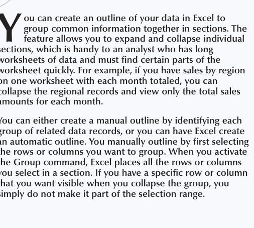

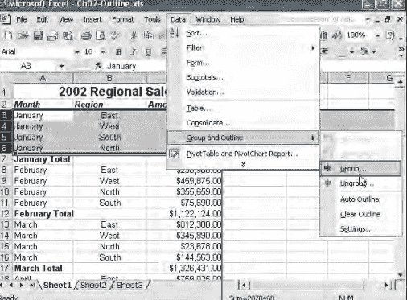

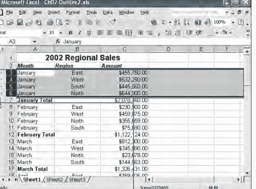

### 手动大纲

- 1 选择包含要分组内容的行。
- 2 点击“数据：分组和分纲：分组”。
- Excel 对选中的数据记录进行分组。
- 你可以点击减号按钮隐藏分组后的记录。


## 组织工作表数据

### 参与

你可以让 Excel 在创建大纲时为工作表应用特殊格式。这可以快速帮助你识别不同的大纲级别。要应用特殊格式，你必须先在“样式”对话框中为你的大纲创建格式样式。有关创建样式的更多信息请参见第 1 章。你必须使用特定名称创建样式：

| 样式名称 | 说明 |
| :--- | --- |
| Row_1 | 定义大纲中第一行的格式。 |
| Row_2 | 定义大纲中第二行的格式。 |
| Row_x | x 等于另一个数字，用于定义格式级别。 |
| Col_1 | 定义大纲中第一列的格式。 |
| Col_2 | 定义大纲中第二列的格式。 |
| Col_x | x 等于另一个数字，用于定义格式级别。 |

要应用自定义格式，点击“数据” ⮕ “分组和分纲” ⮕ “设置”显示“设置”对话框。点击“自动样式”选项 ⮕ “更改” ⮕ 然后点击“创建”。使用你创建的样式创建你的大纲。

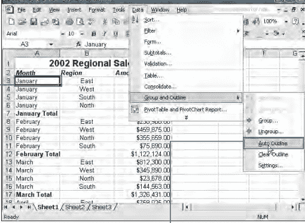

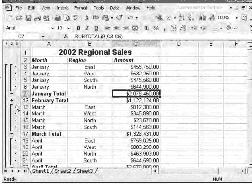

- 2 点击“数据” ⮕ “分组和分纲” ⮕ “自动大纲”。
- Excel 自动创建大纲。
- 1 在要创建大纲的范围内选择一个单元格。

* 新

## EXCEL 数据分析

### 应用条件格式


# EXCEL 数据分析

你可以让 Excel 根据特定标准处理数据值，并在满足标准时应用条件格式。这对于想要强调数据已达到关键值的分析师非常有用。例如，你可以突出显示超过 $2,000.00 的净销售额。

你可以根据单元值、逻辑值、或者公式来创建条件格式。在“条件格式”对话框中，点击“条件 1”中的“公式”选项。在下一个字段中，输入以下定义，将 A1 替换为所选范围的第一个单元格。

```
=ISERROR(A1)
```

通过指定第一个单元格的引用，Excel 会对所选范围内的每个单元格应用条件格式。在“格式”选项卡中，选择白色作为颜色并点击“确定”。包含错误信息的单元格文本将显示并隐藏错误消息。

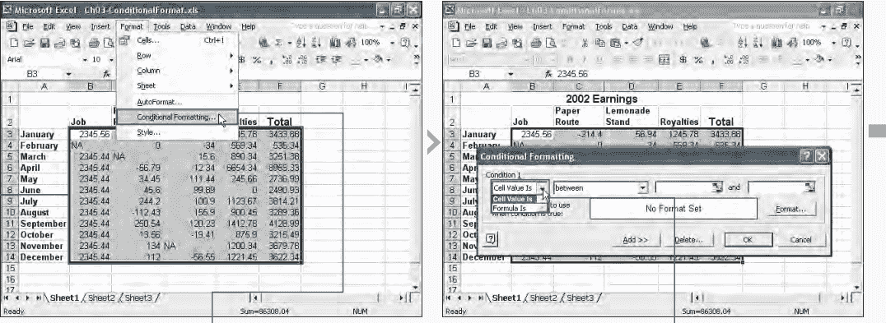

| | | | | |
|---|---|---|---|---|
| 1 | 一月 | | | |
| 2 | 二月 | | | |
| 3 | 三月 | | | |
| 4 | 四月 | | | |
| 5 | 五月 | | | |
| 6 | 六月 | | | |
| 7 | 七月 | | | |
| 8 | 八月 | | | |
| 9 | 九月 | | | |
| 10 | 十月 | | | |
| 11 | 十一月 | | | |
| 12 | 十二月 | | | |

## 应用条件格式（续）

在选择单元格后，你必须通过“条件格式”对话框中的“格式”按钮来指定要应用的格式。“格式”对话框有三个用于设置格式的选项卡：字体、填充和图案。当你选择该对话框时，你可以在“条件格式”窗口中查看格式设置，并判断其是否符合你的需求。有关单元格格式设置的更多信息，请参阅第 1 章。

假设你希望所有大于 1,000 的值显示为蓝色，1,500 到 2,000 之间的值显示为绿色，你创建了两个条件格式语句并应用了它们。如果条件格式定义按此顺序排列，那么所有 1,550 或 1,999 的值将将为蓝色，因为它们符合第一个定义（大于 1,000 显示为蓝色），而 Excel 会忽略其他定义。

你可以创建更多定义，为所选区域总共可以创建三个条件格式。如果 Excel 遇到符合多个条件格式定义的单元格，它将仅应用第一个定义。如果你不小心布局条件格式语句，可能无法实现预期结果。例如：

为了让条件格式正常工作，你必须先放置 1,500 到 2,000 之间值的格式，然后放置大于 1,000 值的条件格式。确保覆盖范围最广的条件格式出现在最后（例如大于 1,000 的条件）是非常重要的。

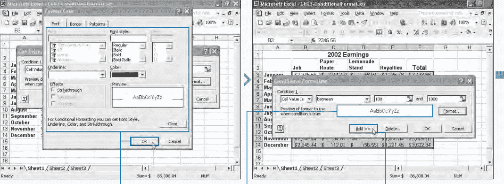

- 7 “格式”对话框。
- 8 选择条件的格式。
- 9 点击确定。

“预览”显示了格式选择的示例。

## 评估工作集数据

在工作表中应用条件格式后，识别包含条件格式单元格的唯一方法是选择该单元格并查看“条件格式”对话框。定位包含条件格式单元格的快速方法是使用“定位条件”。通过点击“编辑 > 定位”，然后在“定位”对话框中点击“定位条件”，可以显示“定位条件”对话框，并选择格式选项。Excel 提供了两个额外选项：“全部”和“相同”。“全部”将找到包含任何格式的单元格。如果你只想查找与当前选择单元格格式相同的单元格，点击“与当前选择单元格格式相同”。点击确定，Excel 将定位包含指定格式的单元格。

你可以通过选择单元格区域并点击“格式”显示“条件格式”对话框，从而删除任何条件格式。点击“删除”，将显示“删除”对话框。点击与要删除的格式对应的选项。

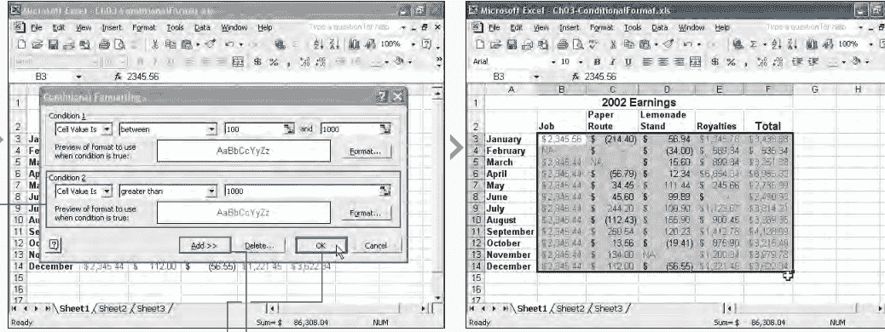

- Excel 显示用于创建条件格式定义的字段。
- 重复第 3 到 8 步创建第二个定义。
- 如果需要，点击“添加”并重复第 3 到 8 步创建第三个定义。
- 点击确定。
- Excel 将格式定义应用到所选单元格。

## 使用分类汇总汇总数据

如果你想根据共同值对数据列表进行汇总，可以使用“分类汇总”选项自动为共同记录插入汇总，并计算整个数据列表的总计。例如，如果你的数据包含许多按部门划分的通话次数，Excel 可以汇总每个月的通话次数，然后在列表末尾创建通话次数总计。Excel 通过监控列并在值发生变化时插入汇总（例如当从 1 月变为为 2 月时）来实现此功能。如果你数据中的每条记录都是唯一的（例如每个月的金额是独立的），则汇总金额将显示在每项下方。有关更多数据排序的信息，请参阅第 2 章。有关更多列或行标记的说明，请参阅第 1 章。

在“分类汇总”对话框中，“在每个字段发生变化处”定义了你希望 Excel 跟踪变化的列，当该字段发生变化时，它就会插入汇总。“添加”框定义了 Excel 用于汇总数据的函数。虽然默认值是“求和”，但你可以选择其他函数来计数或确定平均值。对话框底部的复选框控制汇总行在工作表中的位置。Excel 会替换数据列表中的任何汇总并将其放置在每个项目上方。

要创建分类汇总，首先根据你想要用于分组数据的列对列表进行排序。你必须为每列标记标签，因为 Excel 使用标签来识别数据中的单元格。

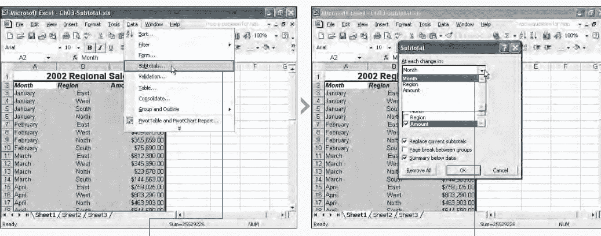

- 选择要汇总的单元格区域。
- 点击 数据 -> 分类汇总。

注意：有关选择范围的信息请参阅第 1 章。

- 显示“分类汇总”对话框。
- 在“在每个字段发生变化处”选择合适的列名。

## 评估工作表数据

“分类汇总”选项实际上以公式的形式在每个汇总行中插入 `SUBTOTAL` 函数，每当你修改数据记录中的值时，它会自动更新。你可以对每个函数进行修改以更改汇总范围或函数。有关公式的信息，请参阅第 4 章。

如果你想从工作表中删除所有分类汇总，点击“数据 > 分类汇总”显示“分类汇总”对话框。点击“全部删除”按钮将删除工作表中的汇总行和最终总计行。

`SUBTOTAL` 函数的参数定义了汇总数据记录的函数。Excel 使用 1 到 11 之间的数字按顺序标识函数：平均值、计数、最小值、最大值、乘积、标准差、标准差、求和、计数数字、平均。第二个参数指定要汇总的单元格范围。以下公式使用第一个参数 9 来执行汇总：

```
=SUBTOTAL(9,B3:B10)
```

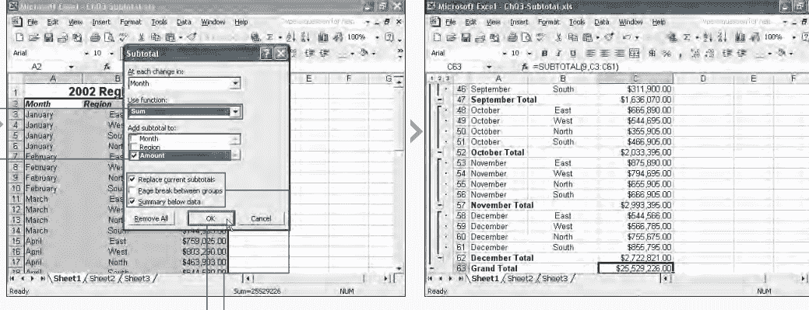

- 选择要插入的函数。
- 点击应用函数的列或列。
- 点击选项以替换当前汇总行、在组之间创建分页符或将汇总放在每组下方。
- Excel 使用选定的函数汇总数据。
- 此示例计算总和。
- 点击确定。

注意：示例仅供参考。

## 筛选列表

在分析大型数据集时，精确控制工作表中显示的信息通常是必要的。在 Excel 中，这种限制被称为“筛选”。你可以使用“筛选”筛选数据记录，仅显示符合特定条件的记录，每行被视为单独的记录。例如，如果你有一份不同地区的销售列表，你可以筛选列表以显示西部地区的销售情况。当你应用筛选时，Excel 只是隐藏了不符合条件的记录。

当你选择“筛选”选项时，Excel 会检查每列中的值，并在数据列的顶部应用筛选箭头。Excel 通过将箭头颜色从黑色变为蓝色来标识带有筛选的列。箭头显示该列中的所有唯一值。如果你选择了其中一个值，Excel 将显示包含该值的记录并隐藏其他记录。要筛选多个列，你可以筛选第一列，然后在第二列中选择不同的值。

Excel 在每个菜单顶部放置了三个筛选选项。“全部”允许你筛选并重新显示当前被筛选隐藏的记录。你可以使用其他选项“前 10”和“自定义”来自定义筛选。“前 10”选项让你查看前十条记录。“自定义”允许使用自定义筛选定义查看一列内的特定行。有关“自定义”选项的更多信息，请参见“创建筛选”节。

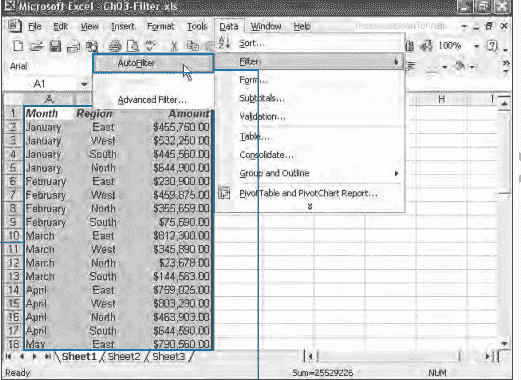

- 选择要筛选的记录列表。
- 点击 数据 筛选。

注意：有关选择范围的信息请参阅第 1 章。

- 点击要筛选列上方的箭头并选择所需的筛选值。

## 评估工作表数据

## 应用


如果列仅包含数值值，您可以通过选择筛选菜单中的（前 10）选项来找到列表中的最高或最低记录。在弹出的“前 10”自动筛选对话框中，您可以选择列表中的最大值或最小值，并以百分比形式或根据在三个字段中输入的准则来查看这些值。例如，如果您有一个货币金额列表，可以通过在第一个列表框中选择“前”，在第二个字段中输入“10”，在最后一个字段中输入“项目”，来筛选仅显示包含前十最高值的记录。要查看最小的数字，请在第一个字段中选择“后”。如果您只需要五个值，则必须在第二个字段中选择 `5`。

如果您想按百分比筛选（例如前 50%），可以在第二个字段中输入百分比，并在最后一个列表框中选择“百分比”。

如果您尝试在不包含所有数字的列中选择（前 10），Excel 将不会显示前 10。

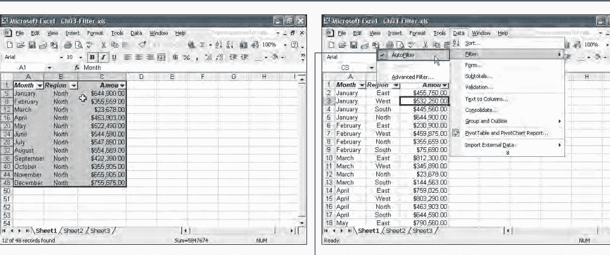

- Excel 会隐藏不包含所选筛选值的记录。
- 点击“数据”->“自动筛选”。
- Excel 将删除任何筛选并重新显示任何隐藏的记录。

# Excel 数据分析

## 创建自定义筛选

如果您想对列表进行筛选，以便查看数据某一列中的特定行，可以创建一个自定义自动筛选。自定义自动筛选允许您使用两个不同的筛选器来控制显示的记录，并帮助将数据缩小到特定类别。例如，使用操作符，您可以创建一个筛选，显示来自两个特定部门、月份或销售区域的记录，排除您特别请求的记录以外的所有其他记录。

值必须同时满足第一个和第二个准则，否则记录将不会显示。如果您点击“或”（Or），则该值只需要满足两个准则定义之一即可。

一旦选择了操作符，您就可以定义想要包含在筛选中的值。您可以使用 `*` 和通配符字符。例如，如果您想要所有以 A 开头并以 L 结尾的数据，请输入 `A*L`。Excel 会显示匹配模式的记录，例如 April 和 April。有关通配符字符的更多信息，请参阅第 1 章。

类似于“筛选列表”部分，您可以使用自动筛选对话框为您的两个筛选器构建准则，从而对数据应用自动筛选。通过选择“与”（And）或“或”（Or），决定值必须同时满足两个定义还是仅满足一个。如果您点击“与”，则值必须同时满足第一个和第二个准则。

如果您想根据多个列的组合对数据记录进行筛选（例如 1 月份西部的销售额和 3 月份东部的销售额），选择“创建高级筛选”。


### 操作步骤

1. 对列表应用自动筛选。
2. 点击筛选菜单上的（自定义）选项。
   - （弹出）自定义自动筛选对话框。
3. 点击所需的筛选操作符。

注意：有关自动筛选的更多信息，请参阅“筛选列表”。

## 评估工作表数据 3

### 其它

Excel 有多种操作符来定义您的筛选。下表给出了它们的功能：

| 操作符 | 说明 |
| --- | --- |
| equals | 等于：搜索匹配指定值的数据。 |
| does not equal | 不等于：搜索不匹配指定值的数据。 |
| is greater than | 大于：搜索大于指定值的数据。 |
| is greater than equal to | 大于或等于：搜索匹配或大于指定值的数据。 |
| is less than | 小于：搜索小于指定值的数据。 |
| is less than or to | 小于或等于：搜索匹配或小于指定值的数据。 |
| begins with | 开头于：搜索以指定字符串开头的数据（如 A）。 |
| does not begin with | 不以...开头：搜索不以指定字符串开头的数据。 |
| ends with | 结尾于：搜索以指定字符串结尾的数据。 |
| does not end with | 不以...结尾：搜索不以指定字符串结尾的数据。 |
| contains | 包含：搜索包含指定字符串的数据（例如 West 和 East）。 |
| does not contain | 不包含：搜索不包含指定字符串的数据。 |


4. 在第二个字段中输入匹配的值。
5. 点击“与”或“或”来筛选满足两个或任一准则的值。
6. 重复第 3 和第 4 步进行第二个筛选定义。
8. Excel 筛选基于自定义定义构建。

# Excel 数据

## 创建高级筛选

您可以使用高级筛选根据多个列的组合对数据进行筛选。高级筛选比“创建自定义筛选”部分所示的自动筛选更复杂，因为您不再限于单一列。可以使用此创建更大的筛选定义，这比手动创建要简单得多。

在高级筛选对话框中，您在“条件范围”字段中指定包含筛选定义的单元格范围，以及包含您的比较操作符的单元格。您还有将筛选后的记录放回原始位置或工作表中的另一个位置的选择。如果您选择前者，Excel 将隐藏不符合指定准则的记录。如果您选择后者，Excel 将其复制到新工作表。

在应用高级筛选之前，您必须在工作表中输入筛选定义。该定义由筛选定义的标题行以及准则本身组成。您可以将其放置在要筛选记录所在的工作表中，也可以完全放在另一个工作表中。无论您将其放在哪里，输入后它在工作表中都是可见的。

当您应用高级筛选时，Excel 显示所有匹配准则的记录——您可以选择“唯一记录”选项消除重复记录。

### 操作步骤

1. 对列表应用自动筛选。
2. 高级筛选对话框。
3. 指定单元格范围。
4. 点击数据。

## 评估工作表数据 3

### 其它

Excel 有多种操作符来定义您的筛选。下表给出了它们的功能：

| 操作符 | 说明 |
| --- | --- |
| equals | 等于：搜索匹配指定值的数据。 |
| does not equal | 不等于：搜索不匹配指定值的数据。 |
| is greater than | 大于：搜索大于指定值的数据。 |
| is greater than equal to | 大于或等于：搜索匹配或大于指定值的数据。 |
| is less than | 小于：搜索小于指定值的数据。 |
| is less than or to | 小于或等于：搜索匹配或小于指定值的数据。 |
| begins with | 开头于：搜索以指定字符串开头的数据（如 A）。 |
| does not begin with | 不以...开头：搜索不以指定字符串开头的数据。 |
| ends with | 结尾于：搜索以指定字符串结尾的数据。 |
| does not end with | 不以...结尾：搜索不以指定字符串结尾的数据。 |
| contains | 包含：搜索包含指定字符串的数据（例如 West 和 East）。 |
| does not contain | 不包含：搜索不包含指定字符串的数据。 |

### 附加

你可以使用“添加场景”对话框底部的选项来保护你的场景。“防止更改”可以防止用户修改场景。如果你使用“隐藏”，用户在打开工作表时将无法再次查看该工作表。这些选项仅在保护工作表时起起作用。有关工作表保护的信息，请参阅第 1 章。

如果你想一次比较所有场景的结果，可以点击“场景管理器”对话框中的“摘要”按钮来创建报告。执行时，会打开“场景管理器”对话框，并为你提供两个摘要选项。“场景摘要”允许你创建一个包含各个独立场景的工作表。当你在更改每个场景中的单元格时，该选项通常效果最好。“数据透表”选项会创建一个数据透视表，当场景计算涉及不同单元格时，强烈建议使用此功能。有关数据透表的更多信息，请参阅第 7 章。


|  | 场景值 |  |  |  |
|---|---|---|---|---|
| 1 | 设备贷款 |  |  |  |
| 2 | 利率 | 8.00% |  |  |
| 3 | 贷款金额 | 为每个更改单元格输入值 |  |  |
| 4 | 贷款期限 | $130000 |  |  |
| 5 | 每月还款 | $2630.79 |  |  |
| 6 |  |  |  |  |

- 场景值对话框。
- 你可以点击以显示“添加场景”对话框并创建另一个场景。
- 你可以对要创建的每个场景重复步骤 2 到 7。
- 6 输入每个单元格的数值。
- 场景管理器对话框。
- 为场景指定的值在相应的单元格中发生更改。
- 7 点击“确定”。
- 8 点击“显示”以应用该场景。

## EXCEL 数据分析

### 验证数据


为了提高数据的准确性，你可以限制用户在特定单元格中可以输入和不能输入的内容。默认情况下，Excel 不会将值与预期标准进行比较。在执行任何数据分析时，输入错误类型的数据值可能会导致不准确的结果。为了确保仅在单元格或单元格区域中输入特定值，你可以使用数据验证选项来防止不可接受的输入。这在处理多个用户在同一工作表中输入数据时特别有用。通过数据验证，如果你指定了一个值范围，而用户输入了这些值以外的内容，Excel 将显示错误消息且不会将该值放入单元格中。

可以限制为特定数据类型。例如，如果你想允许货币值（如 `$10.50`），则在“允许”字段中选择“小数”。

“数据”字段具有定义数据有效范围的算运算符。例如，如果你选择“大于”，你可以在“最小”字段中创建最小值。如果你选择“之间”或“不之间”运算符，“最小”和“最大”字段将显示在数据框中，你可以定义要验证的范围。

在“值”字段中，你必须指定所选单元格的值。Excel 根据“数据”字段中的运算符显示一个或两个值。这些字段有多个选项。你可以在字段中输入常量（任何字母数字值），也可以选择一个范围。

你可以在“数据验证”对话框的“设置”选项卡中为所选单元格创建验证定义。在“允许”字段中选择“任意”将允许所有输入。


- 选择用于验证定义的单元格范围。

注意：有关选择单元格范围的信息，请参阅第 1 章。

- 点击“验证”。

- 显示“数据验证”对话框。

- 从“允许”字段中选择所需的数据类型。

## 评估工作表数据

### 实施

你可以自定义用户在单元格中输入错误值时显示的错误消息。在“数据验证”对话框的“错误警报”选项卡中，你可以选择想要显示的错误类型，为消息框指定标题，并输入错误消息。

Excel 提供三种类型的错误消息：“停止”、“警告”和“信息”。这三者之间的唯一区别是消息框上出现的图标。你在消息框顶部的文本字段中输入标题。如果你不输入标题，框上将显示“Microsoft Excel”。如果你在错误消息字段中输入了消息，请记住包含有关单元格值的信息。

当用户选择验证单元格时，可以显示消息。你可以通过在“数据验证”对话框的“输入”选项卡中输入消息来实现。在“标题”字段中为消息输入标题，并在“输入消息”字段中输入消息文本。例如，如果你想输入 1 到 10 之间的值，你可以创建一个显示为“输入 1 到 10 之间的数字”的消息。


- 4 从“数据”字段中选择相应的运算符。

- 5 在出现的字段或字段中输入相应的验证值。

- 根据所选运算符，选择“最小”、“最大”或或两个字段。

- 6 点击“确定”。

- 如果用户输入无效值，Excel 将显示错误消息。

## EXCEL 数据分析

### 使用自动求和计算单元格

你可以自定义用户在单元格中输入错误值时显示的错误消息。在“数据验证”对话框的“错误警报”选项卡中，你可以选择想要显示的错误类型，为消息框指定标题，并输入错误消息。

Excel 提供三种类型的错误消息：“停止”、“警告”和“信息”。这三者之间的唯一区别是消息框上出现的图标。你在消息框顶部的文本字段中输入标题。如果你不输入标题，框上将显示“Microsoft Excel”。如果你在错误消息字段中输入了消息，请记住包含有关单元格值的信息。

当用户选择验证单元格时，可以显示消息。你可以通过在“数据验证”对话框的“输入”选项卡中输入消息来实现。在“标题”字段中为消息输入标题，并在“输入消息”字段中输入消息文本。例如，如果你想输入 1 到 10 之间的值，你可以创建一个显示为“输入 1 到 10 之间的数字”的消息。


| | 场景值 | | |
|---|---|---|---|
| 1 | 设备贷款 | | |
| 2 | 利率 | 8.00% | |
| 3 | 贷款金额 | 为每个更改单元格输入值 | |
| 4 | 贷款期限 | $130000 | | |
| 5 | 每月还款 | $2630.79 | | |
| 6 | | | | |

- 场景值对话框。

- 你可以点击以显示“添加场景”对话框并创建另一个场景。

- 你可以对要创建的每个场景重复步骤 2 到 7。

- 6 输入每个单元格的数值。

- 场景管理器对话框。

- 为场景指定的值在相应的单元格中发生更改。

- 7 点击“确定”。

- 8 点击“显示”以应用该场景。

## EXCEL 数据分析

### 使用自动求和计算单元格

你可以使用自动求和按钮来快速计算工作表中的单元格。自动求和按钮在活动单元格中创建 `SUM` 函数。

在工作表中，自动求和会相邻相邻的单元格。自动求和按钮在活动单元格中创建 `SUM` 函数。

当你激活自动求和时，它检查活动单元格左侧或上方的单元格。例如，如果 `D1` 到 `D10` 包含数字，自动求和将对这些单元格进行求和。

当你指定求和范围后，可以接受或拒绝这些单元格。结果显示在活动单元格中。


| | A | B |
|---|---|---|
| 1 | 一月 | $87.00 |
| 2 | 二月 | $96.00 |
| 3 | 三月 | $99.00 |
| 4 | 四月 | $75.00 |
| 5 | 五月 | $119.00 |
| 6 | 六月 | $110.00 |
| 7 | 七月 | $120.00 |
| 8 | 八月 | $110.00 |
| 9 | 九月 | $130.00 |
| 10 | 十月 | $98.00 |
| 11 | 十一月 | $89.00 |
| 12 | 十二月 | $84.00 |

## 创建公式

- 点击要放置和的单元格。

点击自动求和按钮。

- Excel 圈出了求和的单元格范围。

- 公式包含求和的单元格范围。

- 按回车键或点击按钮接受你的输入。

- 你可以点击取消按钮清除公式栏。

### 附加

除了求 函数外，Excel 实际上通过自动求和按钮提供了四个常用函数，你可以在本节的步骤中应用。与 `SUM` 函数一样，当你选择相邻行或列时，Excel 将所选函数应用于相邻单元格。下表描述了可用函数。

| 函数 | 用途 |
|---|---|
| 求 | 相单元格并将总和放在所选单元格中。 |
| 平均值 | 确定相邻单元格区域的平均值。 |
| 计数 | 计算相邻单元格区域中数值的个数。如果任何单元格包含非数值，Excel 将忽略该单元格。 |
| 最大值 | 找到相邻单元格区域中的最大值。 |
| 最小值 | 找到相邻单元格区域中的最小值。 |
| 更多函数 | 显示插入函数对话框。“通过插入对话框添加函数” 节提供了有关使用插入对话框添加函数的信息。 |

## Excel 数据分析

# 通过“插入函数”对话框添加函数

函数是预定义的公式，它们可以帮助你分析数据，因为你无需手动输入即可快速插入计算。“插入函数”对话框是插入函数最简单的方法，因为它按字母顺序列出了 Excel 中可用的所有函数。参数是该函数所需的值。你只需要选择一个函数，提供参数，剩下的工作就由 Excel 完成了。

你使用“函数参数”对话框来定义想要作为参数的值。Excel 会在对话框底部显示每个所需的参数以及参数说明。如果你选择“活动单元格值”，Excel 会在参数字段中显示单元格引用。你必须为每个参数提供一个值。你可以在单元格中输入常量值，或使用单元格引用作为参数。

你可以使用“搜索”字段搜索函数，或从 Excel 的预设类别中选择。当你选择一个函数时，它会出现在对话框底部，并带有相应的参数。有关参数和函数的更多信息，请参见附录 D。

Excel 还会根据指定的参数计算公式结果，并在对话框底部显示该结果。当你选择合适的函数和结果时，Excel 将结果粘贴到所选单元格中。

# 通过“插入函数”对话框添加函数


- 1 点击你想放置函数的单元格。

- 2 点击“插入” > “函数”。

- 你也可以点击“插入函数”按钮。

- 3 此时显示“插入函数”对话框。

- 你可以使用搜索功能搜索特定的函数。

- 你可以选择一个类别。

- Excel 显示函数的描述。

- Excel 为该函数提供参数。

- 4 点击“确定”。

## 额外说明

选择几乎任何可用的 Excel 函数都需要你为每个参数提供值。当你查看包含函数的公式时，你会看到函数的不同参数被包裹在括号中，并且每个单独的参数之间用逗号隔开。例如，`POWER` 函数需要两个参数：底数（要幂的数）和指数。如果你将 `A1` 单元格的值提高 3 次方，可以创建一个类似这样的公式：


你可以通过直接在参数字段中输入值或指定单元格引用来为每个参数指定值。有关选择范围的更多信息，请参见第 1 章。如果你对特定函数或参数有疑问，可以使用“函数帮助”链接访问 Excel 的帮助。

示例：

```
=POWER(A1,3)
```

某些函数具有固定数量的参数，而其他函数（如 `SUM`）允许你指定多达 30 个不同的值。在某些情况下，函数需要数量数量的参数；当你在字段中输入参数时，Excel 会增加一个新的参数字段。


- 显示“函数参数”对话框，列出了所需的参数列表及其说明。
- 你可以点击“折叠对话框”并选择包含参数的单元格。
- Excel 将公式置于所选单元格中。
- 在每个参数字段中输入参数。
- 点击“确定”。

# Excel 数据分析

## 编辑公式

在单元格中创建公式后，分析师可以更新它以适应新数据。你可以修改单元格引用、更改参数，或将公式移动到工作表内的全新单元格。有关在 Excel 中处理函数和参数的更多信息，请参见附录 D。

你可以在“函数参数”对话框中更改公式的参数，允许为每个参数选择新的单元格范围。当你接受更改时，Excel 会通过“插入函数”按钮更新单元格引用。

你可以通过直接在工作表内编辑公式或通过“函数参数”对话框来修改公式及其参数。要修改公式，请选择包含公式的单元格。或者，你可以选择工具栏上公式栏中的公式。这会将光标置于单元格中，并突出显示公式引用。公式的每个参数在公式中显示不同的颜色，被引用的单元格用相同的颜色轮勒出来，便于识别每个参数。

当你将公式移动到工作表中的新单元格时，Excel 会复制公式中的单元格引用，无论是绝对引用还是相对引用保持不变。例如，如果你将公式 `=SUM(A1:A5)` 移动到 `B6` 单元格，引用将保持不变。你可以通过将公式拖到新单元格来移动公式。例如，如果包含公式的单元格是**粗斜体**，则新单元格也将以**粗斜体 10pt**显示结果。


### 修改公式

- 双击包含公式的单元格。
- Excel 对引用的单元格进行颜色标记。
- 突出显示单元格引用并选择一个新的。
- 修改公式中的单元格引用。
- 按回车键更新公式。

### 修改参数

- 点击包含公式的单元格。
- 点击“插入函数”按钮显示对话框。
- 输入公式参数的范围更改。
- 点击“确定”更新公式。

> 注意：更多信息请参见“通过‘插入函数’对话框添加函数”。

## 额外说明

要在多个单元格中使用相同的公式，你可以使用“填充句柄”快速复制公式。将公式复制到相邻的行或列。例如，如果将公式 `SUM(A2:B2)` 复制到 `C2`，结果为 `SUM(A3:B3)`。填充句柄是单元格右下角的黑色小方形。

### 移动公式

- 1 点击包含公式的单元格。
- 2 点击公式边缘并拖动到新单元格。
- Excel 用虚线标出位置。
- 3 松开鼠标按钮。Excel 将公式粘贴在新单元格中。所有引用保持不变。

## 求值公式

如果你创建的公式没有返回预期结果，可以使用“求值”对话框。此选项允许你逐步执行公式的计算，查看 Excel 如何应用每个参数。

`=4+B1+C1`

当所有参数都有值时，Excel 会输入参数、求解公式并显示结果。你可以使用“重新”按钮重复此过程。

求值对话框显示公式以及你作为参数的值。如果你有一个计算 `A1`、`B1` 和 `C1` 之值的公式，Excel 在对话框中进行求解：

“输入”允许你在应用到公式之前查看引用单元格的实际内容，将其显示在单独的。“输出”允许参数进入函数并继续过程。

```
=A1+B1+C1
```

你按照 Excel 求解公式的顺序逐步执行计算。当你的公式包含函数时，Excel 会先求解函数的每个参数，然后求解公式的结果。例如，当你对上述示例应用求值时，Excel 会更改公式以显示第一个参数的值：

求值对话框仅允许查看公式的执行情况，不允许修改公式。如果你想更改公式的任何部分，必须退出求值对话框进行修改。有关修改公式的更多信息，请参见“编辑公式”章节。


- 1 点击要求值的公式单元格。
- 2 点击“工具”、“审核” > “求值”。
- 3 点击“求值”。显示“求值”对话框。

## 创建公式

### 附加

你可以通过点击“工具 -> 公式审核 -> 追踪引用”来查看公式的图形化表示。此选项会从每个包含参数的单元格向公式单元格绘制蓝色箭头。通过选择此选项，你可以直观地识别执行公式所需的单元格。该选项一次只能应用于单元格。

如果你想找出哪些公式使用特定单元格作为参数，可以点击“工具 -> 公式审核 -> 追踪单元”来查看单元格的图形化表示。此选项会向每个包含活动单元格作为参数的公式单元格绘制蓝色箭头。通过显示单元格的依赖项，你可以识别需要该单元的公式。在删除单元格值之前执行此操作，可以确定删除操作是否会影响工作表中的任何公式。你可以通过点击“工具 -> 公式审核 -> 删除所有箭头”来移除工作表中为依赖项或引用绘制的箭头。


Excel 评估第一个参数。

- 点击每个参数的结果进行求值。
- 你可以点击“单步”查看引用单元格的内容。
- 在点击“单步”后，你可以点击“单出”继续求值。
- 当所有参数计算完成后，Excel 会计算关联函数并显示公式结果。
- 你可以点击“重新”再次逐步执行公式。
- 点击“关闭”关闭“公式公式”对话框。

## 使用求解来产生特定值

如果你希望工作表中的公式能产生特定的结果，可以使用“求解”选项来确定必要的参数值。对于分析师来说，这是一个非常实用的工具，可以用来确定某个产品部门需要销售多少产品才能实现特定利润，或者为了使商业贷款每月还款 1500 美需要多少资金。

为了为你的函数产生所需的结果，Excel 会更改参数所引用的单元格值；因此，你必须指定 Excel 修改哪些单元格。在商业贷款的示例中，如果你想更改贷款金额和利率，则需要更改那些单元格引用。当求解完成计算时，你可以保留新值或保留原始值。注意，如果你还使用了“保持求解状态”选项，将无法撤销更改。

在“求解”对话框中，你需要指定哪个单元格（始终是包含公式的单元格）必须产生你的预期结果。你还必须定义公式必须产生的结果，直到小于或等于特定的结束值。例如，你可以选择“值”选项，通过 `PMT` 函数找到返回 `-1500` 的值（该函数返回负值表示还款金额）。

“求解”选项是一个加载项，意味着默认情况下它没有安装。如果你在“工具”菜单中找不到它，可以在“加载项”对话框中加载它。有关加载加载项的更多信息，请参阅第 11 章。


- 1 点击包含公式的单元格。
- 2 点击“工具 -> 求解”。打开“求解参数”对话框。
- 3 “目标单元格”字段包含单元格引用。
- 3 点击结束结果。
- 5 输入要更改的单元格类型。
- 4 在此值中输入所需的公式。
- 你可以通过点击“添加”来添加约束。
- 6 点击“求解”。

### 应用

如果你想限制 Excel 对值或目标单元格的更改，可以创建约束。例如，你可以告诉 Excel 单元格中的小数值小于 `.08`。

你通过点击“求解参数”对话框中的“添加”按钮来定义约束。这将显示“添加约束”对话框。在“单元格引用”字段中，指定该单元格的引用。记住，你只需要为 Excel 可能为你的公式求解的单元格创建约束。

在第二个字段，你可以选择五个运算符之一：

| 运算符 | 目的 |
| :--- | :--- |
| < | 单元格必须大于或等于约束条件。 |
| = | 单元格必须等于约束条件。 |
| >= | 单元格必须小于或等于约束条件。 |
| Int | 单元格必须是整数。 |
| Bin | 单元格必须是二进制。 |

在“约束”字段中，指定比较值。例如，在“约束”字段中输入最大小数类型 `.08`。点击“确定”关闭“添加约束”字段并应用你的约束。


- 显示“求解结果”对话框。
- 点击“保持求解状态”选项将更改应用到工作表。
- 要恢复值，你可以点击此选项。
- 点击“确定”。
- Excel 永久更改了工作表单元格中的值。

## 创建条件公式


如果你只想让 Excel 在单元格包含特定值时执行计算，条件公式会在条件为“真”（True）时返回一个值，在条件为“假”（False）时返回另一个值。例如，分析师可能要求 Excel 计算销售数量后的净销售额，或者运输部门可能根据购买商品数量创建一个公式。

你通过组合单元格引用、运算符或其他函数来确定参数。例如，你可以使用 `SUM` 函数确定大于 50 的系列单元格的总和。

在“真值”参数中，你指定当“逻辑测试”为真时公式返回的值。如果你想在“逻辑测试”为假时让公式返回一个值，也可以定义“假值”参数。在这些参数中，如果你想返回文本，必须将字符串放在引号中。后续公式当单元格 `A1` 大于 100 时为真，小于 100 时为假。

你使用 `IF` 函数创建一个条件公式。`IF` 函数有不同的参数，前两个是：

```
=IF(logical_test, value_true, value_false)
```

## 创建条件公式


| 数量描述 | 价格 | 总计 |
|---|---|---|
| 1 数量 | $59 | $59 |
| 2 音箱 | $299 | $598 |
| 3 电话 | | |
| 5 部 DVD 电影 | $19.99 | |
| 2 收入 | | |
| 1 DVD 播放器 | $299 | $299 |

# EXCEL 数据分析

## 使用数据表求解公式

如果你想比较不同的值如何影响参数的结果，可以通过创建数据表来实现。例如，分析师可以使用此函数来确定不同利率下贷款的每月还款额。当你创建数据表时，可以使用“假设分析”（what-if comparisons）来查看公式在不同参数下的取值。

要使用数据表求解公式，你必须创建一个包含两列或两行的表格。如果你使用列，则第一列包含你想要替换到公式参数中的值；第二列在第一个单元格中包含公式。如果你使用行，则需要将替换值放置在第一行。

在创建表格时，参数需要引用数据列中的第一个值。例如，如果 `A` 列包含指定的利率，则 `PMT` 函数的参数必须引用 `A` 列中的第一个单元格，如下例所示：

```
=PMT(A2, E3, -E2)
```

在对话框中，你通过输入该列或行中的第一个单元格来指定包含替换值的行或列。如果你的表格在列中包含替换值，将该列的第一个单元格放在“列输入单元”字段中。如果你使用行，则将值放在“行输入单元格”中。

- 在列中输入替换值。
- 你可以在行中放置值。
- 在下一列的第一个单元格中输入公式。
- 如果你的值在行中，请在该行的第一个单元格中输入公式。
- 选择包含替换值的单元格。
- 点击“数据表”。

### 创建公式

如果你想为公式中的两个参数替换值，可以创建一个双输入数据表。你可以在列中指定第一组替换值，并在行中指定第二组替换值。例如，如果你想查看不同的利率和贷款期限如何影响还款额，请在公式旁边的列中指定利率，行中指定贷款期限。

创建双输入数据表时，你的公式最初必须引用数据表之外的单元格。这意味着如果你的数据表在列中包含利率，公式最初必须引用该列之外的单元格。在表格对话框中，同时指定行和列单元格。

- 显示表格对话框。
- 你可以在此字段为行值输入单元格引用。
- 输入第一个替换单元格的单元格引用。
- 点击确定。
- 比较结果显示在数据表的第二列中。

### 追踪公式错误

当你在工作表中创建公式分析数据时，Excel 会计算公式的所有参数并返回一个值。如果 Excel 无法计算，它会在单元格中显示错误消息之一。由于大多数错误是由其他单元格引起的，你可以追踪错误。“追踪错误”可以直观地显示公式引用了哪些单元格。选择单元格，Excel 会从公式向被引单元格绘制蓝色箭头。如果被引单元格包含错误且该单元格存在错误，Excel 会在单元格之间绘制红线。要查看公式引用的单元格，可以使用“追踪单元格”选项。通过查看公式引用单元格，通常可以在公式引用无效值时发现问题。例如，如果单元格包含公式 `A1/A2` 且单元格 `A2` 包含数字 `0`，Excel 返回错误消息 `#DIV/0!`，表示公式尝试除以零。错误消息的描述见附录 D。

如果你不确定错误追踪的原因，可以编辑单元格以显示公式参数的颜色编码，帮助定位单元格。如果公式包含函数，当你修改公式时，Excel 会在单元格下方显示语法。要对公式单元格进行所需的修改，请参阅“编辑公式”部分获取有关编辑公式参数的更多信息。

|  | 月份 | 金额 |
|---|---|---|
| 1 | 一月 | $46,750.00 |
| 2 | 二月 | $65,250.00 |
| 3 | 三月 | $44,619.00 |
| 4 | 四月 | $64,400.00 |
| 5 | 五月 | $230,900.00 |
| 6 | 六月 | $169,719.00 |
| 7 | 七月 | $365,659.00 |
| 8 | 八月 | $178,868.00 |
| 9 | 九月 | $1,122,124.00 |
| 10 | 十月 | $200,594.00 |

1. 点击导致公式错误的单元格。
2. 点击“工具”选项->“公式审核”->“追踪错误”。
3. 用鼠标双击公式单元格。

当你选择错误单元格时，错误单元格旁边会出现错误按钮

应用

公式错误可能出现在你创建的任何公式中。如果你创建一个其他用户输入数据进行分析的工作表，你可能希望消除工作表中单元格中的错误消息。通过这样做，错误仍然发生，但会指定在单元格中显示的值。例如，如果发生错误，你可能希望返回零。要控制错误消息的显示，可以使用 `IF` 函数和 `ISERROR` 函数的组合修改每个公式，`IF`允许你检查条件，而`ISERROR`允许你检查错误。

```
=IF(ISERROR(A1), 0, A1)
```

使用 `ISERROR` 函数，如果存在错误，Excel 返回值零；否则，返回公式。有关使用 `IF` 函数的更多信息请见附录 B。

## EXCEL 数据分析

### 在特定行和列中查找值

如果你的数据分析是在某行或某列定位特定值，你应该考虑 Excel 的查找函数：`HLOOKUP` 和 `VLOOKUP`。选择哪个函数取决于你的数据列表在第一行或第一列是否包含标题。

当行中有标题时，使用 `HLOOKUP` 函数，Excel 会定位指定的列。`lookup_value` 参数识别列标题。你可以使值变为文本，甚至是逻辑值。`table_array` 参数指定包含数据列表的单元格范围。Excel 使用第一行作为标题行。`row_index` 参数指定从数据列表中要返回的行数。`range_lookup` 参数定义你是想要精确匹配还是最接近的匹配。如果值为 False，Excel 仅返回精确匹配。如果为 True，Excel 返回小于该值的项。

```
HLOOKUP(lookup_value, table_array, row_index, [range_lookup])
```

虽然下面的示例说明了 `HLOOKUP` 函数的使用，但 `VLOOKUP` 的工作原理相同，只是它基于数据列表第一列的行进行操作。

1. 打开包含你想要搜索的数据列表的工作表。
2. 选择公式单元格。
3. 点击“插入函数”。
4. 选择 `HLOOKUP` 函数。

要根据行标题定位值，请选择 `VLOOKUP` 函数。

5. 点击确定。

### 创建公式

#### 进阶

在数据列表中查找特定值时，Excel 提供了另一个函数，可以使用它返回与 `LOOKUP` 函数相同的值。当你不知道要查找的数值所在的行或列位置时，可以使用 `LOOKUP` 函数。`LOOKUP` 函数提供两种格式：向量格式和数组格式。

使用向量时，你可以指定一个要查找的值以及要查找该值所在的列或行。你还可以指定包含要返回值的列。该函数的向量格式具有以下语法，并包含一个可选的 `Result_vector` 参数：

示例：

`LOOKUP(Lookup_value, Lookup_vector, [Result_vector])`

如果你为 `Lookup_value` 指定值为 11，`Lookup_vector` 为 `A` 列，`Result_vector` 为 `C` 列，Excel 将返回 `C` 列中与 `A` 列中值 11 所在行的值。

数组格式在第一列中查找你指定的值，并返回指定范围或数组中最后一列中同一行的值。该版本的函数具有以下语法：

示例：

`LOOKUP(Lookup_value, Array)`


- 6 在 `Lookup_value` 字段中指定列标题。
- 7 在 `Table_array` 字段中指定数据列表的单元格范围。
- 8 在 `Row_index_num` 字段中指定一个表示行的数字。
- 对于 `LOOKUP`，指定列数。


- 如果需要，在 `Range_lookup` 字段中输入值，以找到 `Lookup_value` 参数的精确匹配。
- 9 点击确定。

指定行和列中的值将显示在所选的公式单元格中。

# Excel 数据分析

## 确定值的位置

要确定工作表某行或某列中特定值的位置，可以使用 `MATCH` 函数。当你的数据分析需要知道某个值的位置或其最接近匹配项时，此函数非常重要。

可选的 `match_type` 参数定义了 Excel 如何将该值与 `lookup_value` 参数进行比较，以便在找到精确匹配时定义单元格范围。如果你省略该参数，或者该参数的值为 1，Excel 将找到小于或等于 `lookup_value` 的最大值。要查找最接近的匹配项，必须先对单元格列表按升序排序。如果 `match_type` 参数为 0，Excel 将找到精确匹配。如果值大于或等于 `lookup_value` 且值为 -1，Excel 将返回最小值。你必须对单元格列表按降序排序。有关更多数据排序信息，请参第 2 章。

`MATCH` 函数包含三个参数，其中前两个是必须的。最后一个是可选的。

```
=MATCH(lookup_value, lookup_array, [match_type])
```

`lookup_value` 参数定义了在指定单元格范围内要查找的值。你可以指定名称、文本值或单元格引用来标识你想要查找的值。`lookup_array` 定义了行或列中连续单元格的范围（称为数组）。

当你使用 `MATCH` 函数时，它会返回一个整数，标识该值在指定单元格范围内的位置。例如，如果 Excel 在 A4 到 A24 的指定单元格范围内找到值 2，则 A5 包含该值或最接近的匹配项。


- 打开包含你想要查找的数据列表的工作表。

注意：有关对数据排序的更多信息，请参阅第 2 章。

- 查找最接近的匹配项，请按升序或降序排序列表。
- 选择公式单元格。
- 点击 插入 > 函数。

显示“插入函数”对话框。

注意：有关此对话框的更多信息，请参阅“通过插入函数对话框添加函数”。

- 点击确定。

### 创建公式

### 应用它

你可以将 `MATCH` 函数的结果与其他函数结合使用，以在数据列表中查找相关值。例如，你可以使用 `MATCH` 函数的返回值来确定哪个月的销售额超过了 400,000 美。为了最有效地实现这一点，你可以将 `MATCH` 函数与 `INDEX` 函数结合。以下公式具有代表 `INDEX` 函数的 `Row_num` 参数。有关 `INDEX` 函数的更多信息，请参阅“在数据列表的特定位置返回值”。

要查找工作表或列中特定文本的位置，可以使用通配符（如星号 `*` 或问号 `?`）来匹配单个字符。使用这些字符时，你必须为 `match_type` 参数指定 0。

输入此：

```
=INDEX(A1:C49,MATCH(400000,C1:C49,1), 1)
```

输入此：

```
=INDEX(A1:C49,MATCH(400000,C1:C49,1), 1)
```

结果：

`INDEX` 函数返回指定位置内单元格的值。`MATCH` 函数返回行和列号。


- 使用参数。
- 在 `Lookup_value` 字段中指定值。
- 在 `Table_array` 字段中指定范围。
- 点击确定。

`INDEX` 函数返回指定位置的单元格的值。`MATCH` 函数返回行号。

## 返回特定位置的值

要查找工作表某行或某列中特定值的位置，可以使用 `MATCH` 函数。当你的数据分析需要知道某个值的位置或其最接近匹配项时，此函数非常重要。

可选的 `match_type` 参数定义了 Excel 如何将该值与 `lookup_value` 参数进行比较，以便在找到精确匹配时定义单元格范围。如果你省略该参数，或者该参数的值为 1，Excel 将找到小于或等于 `lookup_value` 的最大值。要查找最接近的匹配项，必须先对单元格列表按升序排序。如果 `match_type` 参数为 0，Excel 将找到精确匹配。如果值大于或等于 `lookup_value` 且值为 -1，Excel 将返回最小值。你必须对单元格列表按降序排序。有关更多数据排序信息，请参见第 2 章。

`MATCH` 函数包含三个参数，其中前两个是必须的。最后一个是可选的。

```
=MATCH(lookup_value, lookup_array, [match_type])
```

`lookup_value` 参数定义了在指定单元格范围内要查找的值。你可以指定名称、文本值或单元格引用来标识你想要查找的值。`lookup_array` 定义了行或列中连续单元格的范围（称为数组）。

当你使用 `MATCH` 函数时，它会返回一个整数，标识该值在指定单元格范围内的位置。例如，如果 Excel 在 A4 到 A24 的指定单元格范围内找到值 2，则 A5 包含该值或最接近的匹配项。

### 在数据列表中返回特定位置的值

要查找工作表某行或某列中特定值的位置，可以使用 `MATCH` 函数。当你的数据分析需要知道某个值的位置或其最接近匹配项时，此函数非常重要。

可选的 `match_type` 参数定义了 Excel 如何将该值与 `lookup_value` 参数进行比较，以便在找到精确匹配时定义单元格范围。如果你省略该参数，或者该参数的值为 1，Excel 将找到小于或等于 `lookup_value` 的最大值。要查找最接近的匹配项，必须先对单元格列表按升序排序。如果 `match_type` 参数为 0，Excel 将找到精确匹配。如果值大于或等于 `lookup_value` 且值为 -1，Excel 将返回最小值。你必须对单元格列表按降序排序。有关更多数据排序信息，请参见第 2 章。

`MATCH` 函数包含三个参数，其中前两个是必须的。最后一个是可选的。

```
=MATCH(lookup_value, lookup_array, [match_type])
```

`lookup_value` 参数定义了在指定单元格范围内要查找的值。你可以指定名称、文本值或单元格引用来标识你想要查找的值。`lookup_array` 定义了行或列中连续单元格的范围（称为数组）。

当你使用 `MATCH` 函数时，它会返回一个整数，标识该值在指定单元格范围内的位置。例如，如果 Excel 在 A4 到 A24 的指定单元格范围内找到值 2，则 A5 包含该值或最接近的匹配项。


- 1. 打开包含你想要查找的数据列表的工作表。
- 2. 选择公式单元格。
- 3. 点击 插入 > 函数。
- 4. 选择 `INDEX` 函数。
- 5. 点击确定。

注意：有关此对话框的更多信息，请参阅“通过插入函数对话框添加函数”。

## INDEX 函数

要确定工作表某行或某列中特定值的位置，可以使用 `MATCH` 函数。当你的数据分析需要知道某个值的位置或其最接近匹配项时，此函数非常重要。

可选的 `match_type` 参数定义了 Excel 如何将该值与 `lookup_value` 参数进行比较，以便在找到精确匹配时定义单元格范围。如果你省略该参数，或者该参数的值为 1，Excel 将找到小于或等于 `lookup_value` 的最大值。要查找最接近的匹配项，必须先对单元格列表按升序排序。如果 `match_type` 参数为 0，Excel 将找到精确匹配。如果值大于或等于 `lookup_value` 且值为 -1，Excel 将返回最小值。你必须对单元格列表按降序排序。有关更多数据排序信息，请参见第 2 章。

`MATCH` 函数包含三个参数，其中前两个是必须的。最后一个是可选的。

```
=MATCH(lookup_value, lookup_array, [match_type])
```

`lookup_value` 参数定义了在指定单元格范围内要查找的值。你可以指定名称、文本值或单元格引用来标识你想要查找的值。`lookup_array` 定义了行或列中连续单元格的范围（称为数组）。

当你使用 `MATCH` 函数时，它会返回一个整数，标识该值在指定单元格范围内的位置。例如，如果 Excel 在 A4 到 A24 的指定单元格范围内找到值 2，则 A5 包含该值或最接近的匹配项。

### 创建公式

### 应用它


你可以将 `MATCH` 函数的结果与其他函数结合使用，以在数据列表中查找相关值。例如，你可以使用 `MATCH` 函数的返回值来确定哪个月的销售额超过了 400,000。为了最有效地实现这一点，你可以将 `MATCH` 函数与 `INDEX` 函数结合。以下公式具有代表 `INDEX` 函数的 `Row_num` 参数。有关 `INDEX` 函数的更多信息，请参阅“在数据列表的特定位置返回值”。

要查找工作表或列中特定文本的位置，可以使用通配符（如星号 `*` 或问号 `?`）来匹配单个字符。使用这些字符时，你必须为 `match_type` 参数指定 0。

输入此：

```
=INDEX(A1:C49,MATCH(400000,C1:C49,1), 1)
```

输入此：

```
=INDEX(A1:C49,MATCH(400000,C1:C49,1), 1)
```

结果：

`INDEX` 函数返回指定位置内单元格的值。`MATCH` 函数返回行和列号。


- 使用参数。
- 在 `Lookup_value` 字段中指定值。
- 在 `Table_array` 字段中指定范围。
- 点击确定。

`INDEX` 函数返回指定位置的单元格的值。`MATCH` 函数返回行号。

# Excel 数据分析

## 返回特定位置的值

要查找工作表某行或某列中特定值的位置，可以使用 `MATCH` 函数。当你的数据分析需要知道某个值的位置或其最接近匹配项时，此函数非常重要。

可选的 `match_type` 参数定义了 Excel 如何将该值与 `lookup_value` 参数进行比较，以便在找到精确匹配时定义单元格范围。如果你省略该参数，或者该参数的值为 1，Excel 将找到小于或等于 `lookup_value` 的最大值。要查找最接近的匹配项，必须先对单元格列表按升序排序。如果 `match_type` 参数为 0，Excel 将找到精确匹配。如果值大于或等于 `lookup_value` 且值为 -1，Excel 将返回最小值。你必须对单元格列表按降序排序。有关更多数据排序信息，请参见第 2 章。

`MATCH` 函数包含三个参数，其中前两个是必须的。最后一个是可选的。

```
=MATCH(lookup_value, lookup_array, [match_type])
```

`lookup_value` 参数定义了在指定单元格范围内要查找的值。你可以指定名称、文本值或单元格引用来标识你想要查找的值。`lookup_array` 定义了行或列中连续单元格的范围（称为数组）。

当你使用 `MATCH` 函数时，它会返回一个整数，标识该值在指定单元格范围内的位置。例如，如果 Excel 在 A4 到 A24 的指定单元格范围内找到值 2，则 A5 包含该值或最接近的匹配项。

## 在数据列表中对值进行排名

如果你希望分析结果对数据列表中的值进行排名，可以使用 `RANK` 工作表函数来实现。例如，你可以确定某销售人员的总销售额与其他人相比的排名。

`RANK` 函数有三个参数，其中前两个是必选的。`order` 参数是可选的。

```
=RANK(number, ref, [order])
```

`number` 参数指定你想要排名的数字。请记住，如果列表中包含相同的数字，这些数字将获得相同的排名。例如，如果你有列表 4, 5, 6, 8, 9，数字 6 的排名为 3，但 8 的排名为 2，因为 6 在列表中出现了两次。`ref` 参数指定你希望用于排名的数字列表。Excel 会忽略列表中的任何非数值值。

`order` 参数指定用于对 `number` 参数指定的数字进行排名的排序顺序。`order` 参数的值可以是任何数字：正数表示降序，负数表示升序。如果 `order` 为 0 或省略，Excel 将按照列表降序排列的方式对数字进行排名。这意味着 Excel 擅长显示数字与列表中最大数字的比较。例如，如果你的列表包含 35, 56, 97, 23 和 31，并且你想对数字 35 进行降序排名，`RANK` 函数返回 3。如果 `order` 参数没有任何值，Excel 将按照列表降序排列的方式对数字进行排名。

Excel 还有排名和百分比插件。如需更多信息，请参阅第 11 章。


- 1. 打开包含你想排名的数字的工作表。
- 2. 选择公式单元格。
- 3. 点击 插入 > 函数。
- 4. 选择插入函数对话框。
- 5. 点击 确定。

> 更多信息请查看“通过插入函数对话框添加函数”部分。

- 显示函数对话框。

### 创建公式

### 额外信息

`RANK` 函数是若干函数之一，用于确定一个数字与列表中其他数字的比较情况：要让 Excel 使用 16 种不同的统计计算自动分析你的数据，请查看第 11 章。

| 函数 | 描述 |
| --- | --- |
| `MEDIAN(number1, [number2]...)` | 在按升序或降序排列的数字列表中找到中间数 |
| `QUARTILE(Array, Quart)` | Excel 在此参数处显示 0 到 4 之间的值，其中 0 是列表中的最小值，1 是大于四分之一数值的值，2 是大于一半的值，以此类推 |
| `MAX(number1, [number2]...)` | 找到列表中最大的数字 |
| `MIN(number1, [number2]...)` | 找到列表中最小的数字 |
| `LARGE(Array, k)` | 找到与最大值相比具有特定大小的值。例如，k 参数为 3 返回第三大值 |
| `SMALL(Array, k)` | 找到与最小值相比具有特定大小的值。例如，k 参数为 2 返回第二个较小值 |


- 6. 指定你想排名的数字作为实际数字或单元格引用。你可以输入 0 以降序排序数据，或输入任何其他数字以升序数据。
- 7. 指定你想排名的数字作为实际数字或单元格引用。

在 `RANK` 字段中指定包含你想排名数字的单元格引用。

点击 确定。

Excel 会给出指定数字的排名。

## 为贷款创建摊还表

一项常见的数据任务是分析公司为获取资产而贷款的条款。你可以使用 Excel 计算每月还款额并建立摊还表，以便能够快速分析贷款存期内的利息和本金金额。在创建表格后，你可以更改分析以反映不同的利率或费率。

`Function(interest rate, payment period, total periods, loan total)`

括号内的数据预计通过特殊参数传递给 Excel；例如，还款期单位为每（per）。`PMT` 函数会找到使用 `per` 参数的 `PPMT` 和 `IPMT` 函数。

在输入函数公式时，记住对输入贷款金额、利率和总期期的单元格使用绝对引用，而对特定期使用相对引用。附录 D 有关于绝对引用和相对引用的更多信息。还要记住，在每个期的公式中应将利率单元格设为绝对引用。如果你有每月还款额，用利率除以 12 计算期数。

Excel 提供了几个计算贷款金额的函数。`PMT` 函数计算每期及时还款所需的金额。`IPMT` 函数找到每个期支付的利息金额，而 `PPMT` 则提供更多关于偿还本金的信息。使用 `PMT`、`PPMT` 和 `IPMT` 函数的语法，`PMT` 和 的基本顺序是


|  | 余额 | 利息 | 本金 |
|---|---|---|---|
| 1 | $5000.00 | $75.00 | $303.43 | $496.57 |

- 1. 指定贷款金额、年利率和期数。
- 2. 在还款单元格中输入 `=PMT(`。
- 3. 在括号内输入利率、期数和 pv 值。
- 4. 创建一个包含摊还信息的表格，包括期、利息和本金列。
- 5. 将初始余额 设置为单元格引用。
- 6. 在利息单元格中输入 `=IPMT(rate, per, nper, pv)`，替换为 rate、per 和 nper 值。
- 注意：rate 单元格使用绝对引用。更多信息请参阅附录 D。

### 创建公式

### 额外信息

`PMT`

| 参数 | 描述 |
| --- | --- |
| `rate` | 每期或还款的利率。如果是每月还款，将年利率除以 12。 |
| `per` | 计算利息金额的期。 |
| `nper` | 贷款的总期数或还款次数。例如，每月还款的贷款有 60 期。 |
| `pv` | 贷款金额。 |
| `fv` | 贷款完成时的剩余余额。你可以省略此项。 |


| type | 定义还款是在期初还是期末的选项。如果省略或为 0，Excel 根据期末还款计算利息和还款。如果参数值为 1，在表格中，所有公式必须使用相同的 `type`。 |


- 在本金单元格中，输入 `=PPMT(rate, per, nper, pv)`，用值替换参数。
- 在公式中添加负号以显示正金额。
- 在剩余单元格中，输入一个从余额单元格减去本金的公式，如 `=B8`。
- 将余额单元格设置为第 8 步结束的值，这里 `=E8`。
- 选择第一行的单元格并将其复制到第二行。
- 选择余额单元格和剩余单元格中的公式并复制，正确调整公式使最终余额显示零。

> 注意：查看第一章关于复制和粘贴单元格。

## EXCEL 数据分析

### 将数据链接到其他程序

你可以使用复制和粘贴命令从任何其他 Microsoft Windows 文档快速复制文本和图像并将其直接粘贴到 Excel 中。然后你可以将工作表链接到其他文档对话框。此选项将工作表中的复制数据链接回原始文件。Excel 会监控原始文档的任何更改，并立即反映在工作表的复制数据中。

从另一个程序粘贴时，Excel 将数据直接插入到选定的单元格并尝试保持任何原始格式。导出会将硬空格和制表符根据制表符的位置分成不同的单元格。

在工作表中作为链接需要保留所有粘贴的文本。你可以对数据应用任何格式，但一旦进入 Excel，你就无法分离其可能包含的链接。由于此原因，粘贴不支持数据分析。

粘贴命令仅将内容的副本放置在工作表中。为了防止需要重新复制和粘贴原始文本的更新或修改，你可以使用特殊粘贴中的粘贴链接选项。

只有当你从支持对象链接和嵌入 `OLE` 的程序复制数据时，才使用粘贴链接选项，这是一项连接不同程序之间信息的技术。

### 将数据链接到其他 Windows 程序


| 文件 | 编辑 | 插入 | 画画 | 工具 | 视图 | 数据 | 窗口 | 帮助 |
|---|---|---|---|---|---|---|---|---|
| | | | | | | | | |
| | | | | | | | | |
| | | | | | | | | |
| | | | | | | | | |
| | | | | | | | | |
| | | | | | | | | |
| | | | | | | | | |
| | | | | | | | | |
| | | | | | | | | |
| | | | | | | | | |
| | | | | | | | | |
| | | | | | | | | |
| | | | | | | | | |
| | | | | | | | | |
| | | | | | | | | |

- 1. 在所需的 Windows 程序中，选择你想复制到 Excel 的数据。
- 2. 点击 `编辑 > 复制`。
- 3. 在 Excel 中，选择你想粘贴复制数据的目标单元格。
- 4. 点击 `编辑 > 特殊粘贴`。

### 其它

“选择性粘贴”对话框中的粘贴选项取决于所复制数据的原始源。例如，如果你在网页上复制了图片，你只能在工作表中粘贴位图。。下表列出了“选择性粘贴”对话框中一些常用的粘贴选项。

| 结果 | 描述 |
| --- | --- |
| 位图 | 将所选的图片作为位图图像粘贴到工作表中。 |
| HTML | 以 HTML 格式粘贴数据。 |
| Microsoft Word 文档对象 | 使用 OLE 将数据粘贴到对象中，你可以使用 Word 命令对其进行修改。 |
| 图片（增强型元文件） | 比位图更小，它将所选数据格式化为图片。 |
| 文本 | 将复制的数据作为文本粘贴。原始数据中的任何格式都不会传输到 Excel 单元格中。 |
| Unicode 文本 | 使用 Unicode 字符粘贴复制的数据。Unicode 是一种字符集，可以用于世界上几乎每种书语言。 |
| 超链接 | 插入粘贴的数据，并带有指向原始文档的超链接。当你点击超链接时，将打开原始文档。 |


- 显示“选择性粘贴”对话框。
- 点击你想要的数据格式。
- 点击“粘贴”链接选项以创建指向原始文档的链接。
- 点击“确定”。
- 如果不想创建链接，可以点击“粘贴”选项。
- Excel 将数据粘贴到所选单元格中。

## EXCEL 数据分析

### 导入带分隔符的文本文件

数据分析通常需要使用 Excel 以外程序的数据。由于大多数程序都可以导出文本文件，因此文本文件成为将任何数据导入 Excel 的最可靠的方法。你可以直接将任何文本导入 Excel，包括那些 Excel 无法导出的格式的文本。你可以通过只导出文件的文本部分、忽略文件中的格式和图形来创建一个文本文件。然后你可以根据工作表需要对其进行编辑并导入。

接下来，Excel 会显示“文本导入向导”，它可以帮助你指定想要应用到文件的任何导入选项。你必须首先决定是想用字符（如逗号）对文本进行分隔，还是将其组织为固定宽列。导入向导中的选项可以是数据列之间你选择的字符，也可以使用空格对齐字段。

在放置文件内容之前，Excel 会显示带有任何更改的预览。预览窗口会为每行数据进行编号，以便你确定想要导入哪些行，从而消除某些程序置在文件开头的不需要的文本。在选择行号后，Excel 将从该处开始导入文本文件。

当导入文件时，Excel 会显示“选择数据”对话框，你用它来查找文件。在指定要导入的文件类型后，只有符合该类型的文件会显示在对话框中。

### 导入带分隔符的文本文件


- 1 点击 `数据 -> 导入外部数据 -> 导入数据`。
- 2 显示“文本源”对话框。
- 3 找到包含文本文件的文件夹。
- 你可以点击“新建源”启动连接到远程源的向导。

### 其它

“选择数据源”对话框允许你从几种不同的数据类型导入数据。Excel 会根据你在“文件”字段中选择的内容显示不同的向导或对话框。下表简述了 Excel 可以导入的各种文件类型。

| 文件类型 | 描述 |
| --- | --- |
| Office 数据库连接 | Microsoft Office 数据库连接文件 |
| Access 数据库/项目 | Microsoft Access 文件 |
| Microsoft 数据链接 | OLE DB 数据源连接 |
| ODBC 文件 DSN | ODBC 数据源信息 |
| 网页 | 连接到网页以导入表格 |
| 文本文件 | 从其他源导出的文本文件 |
| Lotus 1-2-3 文件 | 来自 Lotus 1-2-3 的电子表格文件 |
| Paradox 文件 | 电子表格数据库文件 |
| 网络查询 | 直接从互联网查询的文件 |
| OLAP 查询/立方文件 | OLAP 数据库查询文件 |
| XML 文件 | XML 格式的数据文件 |


- 4 点击所需的文本文件。
- 5 点击“打开”。
- Excel 显示“文本导入向导”。
- 6 点击“分隔符”选项。
- 如果文本字段之间有固定宽度，你可以点击“固定宽度”选项。
- 7 选择要导入的第一行。
- 8 点击“下一步”。

注意：选择“固定宽度”选项将导致不同的向导。

## EXCEL 数据分析

### 导入带分隔符的文本文件（续）

在“文本导入向导”的第二页中，你可以告诉 Excel 如何将文本划分为列。第二页的选项取决于你选择的是“分隔符”向导还是“固定宽度”向导。

使用此选项，你可以手动插入断行符。有关此选项的更多信息，请参见“将单列拆分为多列”部分。

如果你选择“分隔符”选项，向导的第二页需要代表文本中列断符的字符。你可以选择多个分隔符。例如，如果你选择了“制表符”或“逗号”，Excel 将每个逗号或制表符的位置插入列断符。数据预览将显示选择的结果。

如果你想在字符处拆分文本文件，可以在第一页选择“固定宽度”选项。如此，数据预览将文本移至列。

“文本导入向导”的最后一页显示 Excel 如何应用数据格式。如果某列包含特定类型，你可以选择应用到该列的数据格式。最后，Excel 将带你进入“导入数据”框，你可以在那里指定导入位置。你可以将文本导入到当前工作表或创建一个新工作表。

### 导入带分隔符的文本（续）


- Excel 显示文本导入向导的下一页。
- 你可以点击多个分隔符选项。
- “文本导入向导”的最后一页。


- 点击`完成`。

- 要指定列格式，点击该列，然后点击相应的数据格式。

- 点击`下一步`。

## 其它

当你导入包含数值的文件时，请注意代表小数点和千位分隔符的字符。默认情况下，`Excel` 使用计算机控制面板中的“区域和语言”来确定如何解释数字。例如，在美国，默认数字格式使用逗号作为千位分隔符，使用点作为小数点分隔符。因此 `Excel` 将 `$1,300.45` 解释为一千三百美元四十五分。

使用不同的分隔符值，你必须在导入数据之前进行这种区分，以便 `Excel` 能正确解释数字。

要选择分隔符，请在“文本导入向导”最后一页点击`高级`按钮。这将显示“导入设置”对话框。选择数据文件用于小数点和千位分隔符的分隔符。当 `Excel` 导入时，它会将数字转换为匹配计算机上指定的分隔符。


- 显示“导入数据”对话框。

- `Excel` 使用列断符信息导入数据。

- 点击选项以指定你希望放置数据的位置。

## Excel 数据分析

### 将一列拆分为多列

你可以使用“文本列”选项轻松地拆分工作表中任意列中的数据。当分析师导入或粘贴数据，而 `Excel` 无法将其正确拆分到相应的列时，他们会发现此功能非常有用。该选项名称意味着对一个输入列进行拆分，例如，你可能想使用两个列之间的空格作为分隔符将一列拆分为第一列和第二列。

你可以在“列”向导中找到拆分数据的选项。要拆分单列文本，你需要定义 `Excel` 用来分隔数据的分隔符。如果文本对齐，请选择`固定宽度`选项，这允许你选择拆分的精确位置。

固定宽度列会在整个列的相同位置进行拆分。例如，如果你想在第五个字符之后拆分文本，`Excel` 将在每个选定单元格的相同位置分割。

如果你的文件包含分隔符（如逗号或制表符），请在向导中定义它。有关处理分隔符数据的更多信息，请参见“导入导入文本文件”章节。

当你拆分列中的数据时，`Excel` 会将数据复制到选择区域右侧的列中。如果这些列包含数据，`Excel` 将用你的新数据替换它们。如果你不想覆盖现有数据，必须在选择“文本列”选项之前为数据插入列。


- 选择所需的单元格范围。

- 点击`数据` -> `文本分列`。

- 点击`固定宽度`选项。

如果文本值之间有分隔符，你可以点击`分隔符号`选项。

- 显示“列”向导。

注意：关于选择单元格范围，请参阅第 1 章。

注意：选择`分隔符号`选项将显示不同的向导。有关此选项的更多信息，请参见“导入导入文本文件”。

- 点击`下一步`。

# 处理外部数据

### 应用方法

如果你不想在工作表中保留部分文本，可以在转换过程中通过跳过相应的列来消除它。你必须在“文本分列”向导的第二页将不需要的文本放在单独的列中。在向导的最后一页，你必须选择该列并点击“不导入列”（跳过）(⊌)。点击`完成`后，所有标记为“跳过”的列都会被忽略。

如果你想保留原始列，可以将转换后的文本粘贴到单独的位置。在“文本分列”向导最后一页的“目标”字段中，你可以指定放置转换文本的位置。在任何位置，你都可以在字段中使用单元格引用，或点击“折叠对话框”并选择新位置。你只需要指定新位置的第一个单元格。当你将转换后的文本粘贴到新位置时，工作表中的原始文本列将保持不变。


- 向导的下一页将根据你单元格中的数据显示断行符。

- 你可以点击一行并将其拖到新位置。

- 向导的最后一页将显示定义你的数据的数值参数。

- 点击“数据预览”窗口以插入断行符。

- 要指定列，请格式化该列并点击相应的数据格式。

- 点击`完成`。

- `Excel` 将指定的列拆分为多个列。

## Excel 数据分析

### 创建网络查询

如果你想将来自网站的文本放置在工作表中，可以导入“网络查询”。通过“网络查询”，你可以将任何文本复制到工作表中进行分析。例如，你可以从财务网站复制最近的股票报价信息。

“网络查询”对话框的工作方式类似于网络浏览器。你输入网站的地址并查看相关的页面。对话框会分析并将其拆分为单独的表格。网页的每个部分旁边会出现黄色箭头按钮。你使用这些按钮来识别想要导入的网页部分。绿色区块会标识你的选择内容。

请记住，`Excel` 导入的是网页的部分。如果你想捕获网页上的任何图形，必须使用复制和粘贴命令。有关复制图形的更多信息，请参见“将数据链接到其他窗口文档”章节。

你必须指定从网页导入数据的位置。默认情况下，`Excel` 选择活动单元格作为导入位置。如果现有工作表包含数据，`Excel` 将在右侧添加列到新列中。或者，你可以选择“新建查询”选项为数据创建一个新工作表。如果你创建了新工作表，`Excel` 将将该工作表插入当前工作簿中。


- 点击`数据` -> `网络查询`。

- 输入网站地址。

- 使用黄色箭头按钮识别要导入的部分。

- 使用绿色区块识别你的选择。

- 点击`下一步`。

- 显示“数据”对话框。

- 选择位置（现有工作表或新建查询）。

- 点击`完成`。

- `Excel` 将数据导入到工作表。

## Excel 数据分析（续）

# 处理外部数据

### 应用方法

如果你不想在工作表中保留部分文本，可以在转换过程中通过跳过相应的列来消除它。你必须在“文本分列”向导的第二页将不需要的文本放在单独的列中。在向导的最后一页，你必须选择该列并点击“不导入列”（跳过）(⊌)。点击`完成`后，所有标记为“跳过”的列都会被忽略。

如果你想保留原始列，可以将转换后的文本粘贴到单独的位置。在“文本分列”向导最后一页的“目标”字段中，你可以指定放置转换文本的位置。在任何位置，你都可以在字段中使用单元格引用，或点击“折叠对话框”并选择新位置。你只需要指定新位置的第一个单元格。当你将转换后的文本粘贴到新位置时，工作表中的原始文本列将保持不变。

| 格式 | 描述 |
| :--- | :--- |
| 无 | 仅导入文本。 |
| 文本文本 | 导入带格式的文本。 |
| HTML | 导入带链接的文本。 |

## Excel 数据分析

### 导入数据库表

为了避免从另一个程序手动输入分析数据，你可以直接从外部源复制数据到 `Excel`。数据库存储相关值，类似于 `Excel` 列表格式。例如，包含信息的数据库表可能有名称、价格和描述列。当你向数据库表插入数据时，程序会在每列添加一个值。在产品数据库中，每个产品都有对应的记录。单个值是数据库中的字段。

数据库安全性。如果你无法操作，可能需要联系你的数据库管理员。

你一次只能向工作表导入一个数据库表。如果你想导入整个数据库，必须对每个数据库表重复导入过程。当你选择一个表时，`Excel` 将整个表的内容导入到工作表中。如果你想导入符合特定标准的记录，你必须创建一个数据库查询。请参见“筛选外部数据库的查询”。

你可以从 `Excel` 支持的任何数据库导入表，例如 `Access` 数据库或 `ODBC` 数据库。要导入表，你需要在“选择数据源”框中找到相应的表。

要连接到数据库表，必须拥有它的访问权限。在公司环境中，这可能需要对进行更改。

- 在“选择数据源”对话框中，点击所需的数据库。

注意：请参见“导入分隔符号文本文件”以访问此数据库框。

- 点击`打开`。

- 点击所需的数据库表。

- 点击`确定`。

- 选择导入数据的位置。

注意：如果只有一个数据库表，则不会显示“表”对话框。跳转到第 5 步。

# 与外部数据交互

## 补充

默认情况下，当你从数据库表导入数据时，`Excel` 会精确地根据指定的值创建一个数据库查询定义。例如，如果你从名为 `Company` 的数据库导入一个名为 `Products` 的表，`Excel` 会创建一个名为 `Products.odc` 的查询文件。该查询文件包含有关所选数据库和表的信息。如果你想再次导入该数据库表，只需直接选择该查询文件即可。

当 `Excel` 导入数据库表时，字段名将显示在工作表的第一行。如果你不想导入某些字段，可以在“外部数据范围属性”对话框中取消勾选“包含字段”选项。

你可以在“外部数据范围属性”对话框中设置查询。当你点击“导入数据”框中的“属性”按钮时，会显示此对话框。如果你在“字段名”中输入一个名称并勾选“保存查询”选项，`Excel` 将根据你指定的文件名创建查询。


- 显示“导入数据”对话框。
- 工作表包含已导入表的内容。
- 6 导入数据第一个单元格的单元格引用，使用“折叠对话框”进行选择。
- 5 点击工作表选项将其导入到当前工作表。
- 要将导入的数据放在新工作表中，请点击“新工作表”选项。
- 7 点击“确定”。

# Excel 数据分析

## 使用查询筛选外部数据库

如果你从仅符合特定标准的外部数据库导入数据，可以创建一个数据库查询。这允许你只导入你想要分析的数据记录，剔除对你没有价值的记录。例如，你可以导入所有低于 1000 美元产品。你还可以从多个表中导入记录，并指定让 Excel 仅导入特定的列。例如，你可能只需要来自包含产品信息的多个数据库表的产品名称和价格列。

创建数据库查询最简单的方法是通过 Excel 的“查询向导”。要启动向导，请选择“选择数据库”对话框。查询向导将引导你完成创建查询的过程。如果你不选择它，可以使用 Microsoft Query 直接创建你的数据库查询。Microsoft Query 是一个简单的程序，旨在通过分步过程来简化创建数据库查询的过程。

在创建数据库查询时，必须先指定数据源名称（或 DSN），这简单就是你想要查询的数据名称以及如何查询它。例如，如果你从 Microsoft Access 数据库导入数据，请选择 MS Access 数据库作为你的...

你可以在“选择数据库”对话框中选择符合特定数据源类型的数据库。例如，你可以仅导入 Access 数据库。你可以在你有权访问的任何驱动器上搜索数据库。


- 1 点击“导入外部数据” -> “新建数据库查询”。
- 2 “选择数据源”框显示可用源列表。
- 3 如果未选择，点击“查询向导”以创建/编辑查询。
- 4 点击用于查询的数据源源。
- 5 点击“确定”。

# 与外部数据交互

## 补充

要应用查询，你必须拥有该数据库的访问权限，并且计算机上有一个该数据库的 ODBC（即开放数据库连接）数据源。

（注：此处原文内容重复，已根据要求完成翻译）

你可以在“外部数据范围属性”对话框中设置查询。当你点击“导入数据”框中的“属性”按钮时，会显示此对话框。如果你在“字段名”中输入一个名称并勾选“保存查询”选项，Excel 将根据你指定的文件名创建查询。


- 显示“导入数据”对话框。
- 工作表包含已导入表的内容。
- 6 导入数据第一个单元格的单元格引用，使用“折叠对话框”进行选择。
- 5 点击工作表选项将其导入到当前工作表。
- 要将导入的数据放在新工作表中，请点击“新工作表”选项。
- 7 点击“确定”。

## 使用查询筛选外部数据库（续）

你可以通过调整查询来控制 Excel 在数据进入工作表时的排序方式。例如，你可能希望对数据记录进行排序，使其按部件名称的字母顺序显示。你可以选择任何数据库列来按升序或降序对数据进行排序。有关排序（如 Excel 的置建规则）的更多信息，请参阅第 31 页。

始终选择第一个选项。其他选项允许你使用其他程序分析数据库。

你必须指定想要放置导入单元格的位置。默认情况下，Excel 将此位置指定为活动单元格，而该单元格已包含数据。Excel 会为导入的数据添加列，并将现有数据移动到新创建列的右侧。通过此选项，Excel 会为数据插入新的工作表。你还可以使用导入的信息创建数据透视表，以快速比较大量数据记录，使其成为分析从数据库导入数据的良好工具。有关创建数据透视表的更多信息，请参阅第 8 章。

你可以在查询向导的“排序”中指定三个选项，并为每个选项指定不同的排序方式。Excel 使用“主要排序依据”的定义对数据记录进行排序。然后使用“次要排序依据”的定义。

查询向导的“完成”页提供了三个确定 Excel 如何导入你数据库的选项。由于你想在 Excel 内部分析数据库，

## 使用查询外部数据库（续）


- 17 点击“升序”或“降序”，按你需要的顺序对数据库进行排序。
- 18 为每个排序定义重复步骤 15 和 16。
- 19 显示查询向导的“完成”页。
- 21 点击“完成”。
- 20 点击“将数据返回 Microsoft Excel”。
- 19 点击“下一步”。

100

## 外部数据处理

### 进阶

你可以保存数据库查询，以便以后重用它来执行相同的查询。在查询向导的“完成”页点击“保存查询”按钮来保存查询。使用“另存为”对话框，你可以为查询定义文件指定名称和位置。所有数据库查询文件都有 `.extension` 扩展名。

如果你想修改数据库查询，点击“导入数据”对话框中的“编辑查询”按钮。显示的查询向导显示数据库查询的所有当前设置，你可以在向导的任何页面进行修改。

如果你想保留对查询的任何更改，必须通过点击“保存查询”按钮来保存。你可以选择更新当前的定义文件，也可以创建一个新文件。

你可以随时通过点击“数据” -> “导入数据”来运行查询。在打开的“数据源”对话框中，找到相应的查询文件并点击“打开”。在“导入数据”对话框中，指定数据的位置。


- 显示“导入数据”对话框。
- 要将导入的数据置于新工作表中，点击“新工作表”。
- 工作表将导入数据库列的内容。
- 点击“现有工作表”以导入到当前工作表。
- 输入导入数据第一个单元格的单元格引用。
- 点击“确定”。

## Excel 数据分析

## 计算数据库范围的平均值

要计算特定导入数据库记录的平均值，你可以在工作中使用 `AVERAGE` 函数创建一个公式。分析师可以使用此函数仅对符合特定标准的记录计算平均值。例如，如果你导入了计算机设备数据库列表，你可以找到列表中显示器的平均值。虽然 Excel 拥有数据库函数，但你可以将其用于任何数据列表。有关在 Excel 中使用数据列表的更多信息，请参阅第 2 章。

`AVERAGE` 函数有三个不同的参数，你必须为每个参数指定值：

```
=AVERAGE(database, field, criteria)
```


对于 `database` 参数，你必须指定包含导入数据库值的范围。此外，由于 Excel 使用列标签来匹配 `criteria` 参数中指定的信息，你必须同时选择列标签和数据库值。对于 `field` 参数，引用包含你想要计算平均值的列标签的单元格。指定一个数字，标识所选值列表中的列位置。例如，在 `field` 参数中使用列类型 `1`。

最后，你必须创建一个包含你的标准值的单元格集。标准定义必须至少包含两行。第一行包含你希望 Excel 用于结果的列标签。第二行包含你的标准。有关更多标准，请参阅第 52-53 页。

- 1 选择数据库列表的列标题。
- 2 在相应的列标签下输入标准。
- 3 选择放置公式的单元格。
- 4 点击“插入函数”。

> 注意：有关插入函数的更多信息，请参阅第 4 章。

- 5 选择 `AVERAGE` 函数。
- 6 点击“确定”。

102

## 外部数据处理

### 进阶

`DAVERAGE` 函数是 Excel 提供的用于评估导入数据库的数据库函数之一。所有这些函数都要求相同的参数。下表给出了函数的描述。

| 函数 | 描述 |
| :--- | :--- |
| DCOUNT | 计算符合标准的单元格数量 |
| DCOUNTTA | 计算包含空值的单元格数量 |
| DGET | 返回符合标准的单元格值 |
| DMAX | 找到符合标准的列中的最大值 |
| DMIN | 找到符合标准的列中的最小值 |
| PRODUCT | 将符合标准的数值相乘并返回乘积 |
| DSTDEV | 找到样本的标准差 |
| DSTVA | 找到整个列表的标准差 |
| DSUM | 计算符合标准的数值总和并返回总和 |
| VARP | 估计数值的样本方差 |


- “函数”对话框。
- 为 `Database` 参数指定引用。
- 为 `Field` 参数指定单元格引用。
- 指定包含标准的范围。

注意：若要了解如何指定范围，请参阅第 1 章。


- 点击“确定”。

- 显示指定记录的平均值。

## Excel 数据分析

## 为网页保存

你可以通过将工作表保存到 Web 端来让同事查看你的分析结果。当你保存数据时，你需要创建一个 HTML 页面，HTML（超文本标记语言）是你可以创建的所有浏览器都能解释的网页的标准格式。当你将工作簿保存为网页时，你可以保存当前工作表或整个工作簿。请记住，如果你决定保存整个工作簿，Excel 将每个工作表保存为单独的 HTML 页面。如果你的工作簿中的某个工作表是空的，Excel 将创建一个空白工作表。在保存为网页之前，你可以考虑从工作簿中删除空白工作表。

当你以 HTML 格式保存时，可以创建工作簿的静态或交互版本。对于静态页面，你只能查看工作簿的内容。当你分析数据但不希望其他用户更改时，应选择此选项。对于交互版本的工作簿，你为每个读者提供了更改内容以修改数据的选项。如果你将数据透视表或数据透视表保存为交互式 HTML 页面，用户可以对区域进行过滤以检索所需结果。有关数据透视表的更多信息，请参阅第 7 章。有关数据透视图的更多信息，请参阅第 8 章。

## 为网页保存


- 点击文件 > 另存为...

- 在“保存类型”字段中选择“网页 (*.htm; *.html)”选项。

- 显示“保存”按钮。

- 你可以点击“添加交互性”使 HTML 页面具有交互性。

- 选择是保存整个工作簿还是仅保存当前工作表。

- 点击“保存”。

104

# 处理外部数据

### 附加

如果你想从 Web 查询 Excel 数据，可以将其保存为 XML 文件。可扩展标记语言（Extensible Markup Language）提供结构化的数据文件，你可以从任何 Web 文件对其进行查询。要保存 XML 文件，请在“另存为”对话框中选择“工作表 (*.xml)”。一旦你就可以像访问任何 XML 文件一样访问你的文件。Excel 根据每行和单元格中的值在文件中布局数据。例如，以下代码说明了一行数据转换为 XML 的内容：

```
<Cell ss:ID="s2" ss:Type="String" ss:Month>Data</Cell>
<Cell ss:ID="s2" ss:Type="String" ss:SalesPerson>Data</Cell>
<Cell ss:ID="s2" ss:Type="Integer" ss:ID>Data</Cell>
<Cell ss:ID="s2" ss:Type="String" ss:Region>Data</Cell>
<Cell ss:ID="s2" ss:Type="String" ss:State>Data</Cell>
<Cell ss:ID="s2" ss:Type="String" ss:Sales>Data</Cell>
<Cell ss:ID="s2" ss:Type="String" ss:Amount>Data</Cell>
```

处理 XML 的良好参考书籍有：《Your visual blueprinting for expert peers, 2001》和《XML Bible》。

| 总计 | 销售人员 | 销售类型 | Andrews | 总计 | Baker | 联合总计 |
| :--- | :--- | :--- | :--- | :--- | :--- | :--- |
| 月 | 一月 | | 798604 | 25957 | 1045479 | 856004 | 87 |
| 二月 | | | 559518 | 630469 | 1269387 | 529300 | 98 |
| 三月 | | | 314689 | 60959 | 375648 | | 95 |
| 四月 | | | | 262450 | 262450 | 349500 | 430 |
| 五月 | | | | | | | |
| 六月 | | | | | | | |
| 七月 | | | 262450 | 262450 | | | |
| 八月 | | | | | | | |
| 九月 | | | | | | | |
| 十月 | | | | | | | |
| 十一月 | | | | | | | |
| 十二月 | | | 238642 | 1,798,444 | 415622 | 856004 | 2115108 | 333 |

## 交互文件

如果你选择了“添加交互性”，Excel 允许查看者对工作表进行修改。

## 非交互文件

如果你没有选择交互性，用户无法在 Web 浏览器中修改工作表。

## Excel 数据分析

### 图表基础

你可以在 Excel 中创建图表，以提供工作簿内数据的图形化表示，并说明所选数据值之间的关系。Excel 提供了多种类型的图表，你可以根据数据自定义每种图表类型的属性。

对于大多数图表类型，你可以在一个图表上显示最多 255 个不同的数据系列。唯一的例外是饼图，它只能显示一个数据系列。所有标准的 2D 图表可以显示最多 32,000 个单独的数据点或值。所有 3D 图表可以显示最多 4,000 个数据点。

## 柱状图

柱状图允许说明不同数据组之间的关系。每个数据点在图表上显示为垂直列。使用堆叠图表时，Excel 在每个列中将一组值放在另一组值之上。数据点通过颜色标记以识别每个数据系列。

通常，你使用柱状图来显示随一段时间发生的变化。例如，柱状图非常适合显示年度总计。你可以在图表的水平轴上显示值以说明时间的流逝。例如，你可以从左到右按时间顺序显示一年的月份。

## 条形图

条形图将每个数据点（或值）显示为单独水平条形。使用堆叠条形时，相关项目会堆叠在一个条形上。条形图非常适合显示不同数据集之间的比较。这种比较被称为“整体对整体比较”。例如，条形图非常适合比较公司不同州之间的销售额。

## 折线图

折线图创建连接相应数据系列中每个数据点的连续线。每条单独的线代表一个数据系列。你可以选择在线上显示表示每个单独数据点标记的图表类型。

折线图非常适合显示一段时间内的数据变化。通常，水平轴显示从左到右的顺序。例如，你可以跨轴显示一年的月份，以显示机构内每个月的销售情况。

## 折线图（续）

你可以从七种不同的折线图子类型中选择，带有或带有数据标记。你还可以选择显示单独值的折线图或堆叠折线图（顶部的线说明每个数据系列的总和）。折线图提供了 3D 线选项，但你应该谨慎在显示数据系列的图表中使用这种子类型。虽然 3D 图表看起来更令人留印象深刻，但如果你绘制的数据系列超过两个时，你可能会发现它们会分散注意力且更难以解释。

## 饼图

饼图允许你显示不同部分是如何构成整体的。饼图的每一块代表一个类别，切片的大小显示了其在总量中的比例。饼图最适用于比较具有少数类别的单一数据系列。

## 气泡图

气泡图允许你快速分析三个数据系列之间的相关性。通过观察数据值之间的相关性，你可以查看一个数据系列相对于另一个数据系列变化时的任何趋势或关联。例如，你可以比较项目成本与销售数量，并将每个价格对应的总收入作为单个气泡显示。

气泡图通过显示数据系列的相关性，其形状类似于 xy（散点图）。股票图的四种子类型中的每种都代表一个数据系列，气泡的大小显示第三个数据系列的值。


## 股票图

你绘制股票图的唯一目的是分析与股市相关的数据值。股票图的四种子类型中的每种都需要至少三个按顺序排列的数据系列。只有当数据布局合适时，Excel 才会创建选定的图表。

股票图子类型的名称与所需的数据系列布局对应。例如，如果你选择“最高-最低-收盘”（High-Low-Close）子类型，则必须按照最高价、最低价和收盘价的顺序提供三个数据系列。你可以使用日期、股票代码或名称作为每个类型的标签。


## 柱体、锥形和金字塔图

你使用柱体、锥形和金字塔图将数据水平或垂直绘制成 3D 对象。你可以从三个不同的水平图表选项和四个垂直图表选项中进行选择。这允许你显示单个数据值或堆叠值。你还可以选择 3D 垂直图表选项。

你使用水平图表将每个数据点显示为独立的水平条形，或带有堆叠条形。相关数据项堆叠在一个条形上。水平图表非常适合显示不同数据值集之间的比较。这种比较被称为“整体对整体的比较”。例如，这些图表非常适合比较公司在不同州的销售情况。


## EXCEL 数据分析

### 修改图表类型

为了强调数据的数据的不同方面或应用不同类型的比较，你可以更改图表类型。有关可用图表类型的更多信息，请参见“图表基础”部分。

你可以使用选择图表并打开数据菜单时出现的“图表”菜单修改现有类型。根据当前的图表类型，某些选项可能会显示为灰色。例如，只有在选择 3D 图表时，3D 视图才可用。

## 补充


你可以使用“图表”选项更改工作簿中任何图表的图表类型。你需要注意的是，图表需要特定类型的数据。例如，如果你将饼图转换为柱状图，单个数据将不会被强调。

如果你在工作表中嵌入了图表，当你选中图表对象的任何部分时，“图表”菜单就会显示。如果工作表包含多个对象，从“图表”菜单进行的更改仅影响选中的图表。

当你切换到不同的图表类型时，Excel 默认保留现有格式。例如，如果你修改了大小或颜色，这些选项将适用于新的图表类型。如果你想使用新图表类型的默认格式，必须选择“默认格式”。

当你选择图表工作时，“图表”菜单始终显示在菜单栏中。从“图表”菜单进行的任何更改都会影响工作上的图表。

## 修改图表类型


- 点击图表对象上的任意位置以选择嵌入图表。
- 对于图表工作，点击要修改的图表的标签。
- 点击“图表类型”按钮。
- 显示“图表”对话框。
- 选择所需的图表类型。
- 点击相应的图表子类型。
- 点击“确定”。
- 选中的图表更新为新的图表类型。

## 径散饼图的扇区

你可以旋转饼图以使扇区散开。要旋转扇区，请选择饼图并点击“格式 > 数据点”。在“格式”对话框中，选择“效果”选项卡。有不同的选项可以调整扇区的角度。

你可以散开饼图的扇区以使其突出。要这样做，请选择饼图并点击“格式 > 数据点”。在“格式”对话框中，选择“效果”选项卡。你可以调整扇区离中心的距离。

饼图的径散扇区允许你突出特定的数据点。你可以使用取消格式选项来更改扇区的外观。


- 选择饼图。
- 点击“图表类型”。

## EXCEL 数据分析

### 创建图表类型

当你创建自定义图表类型时，必须为它命名。你还可以添加关于该图表的描述。

你可以按照以下步骤创建自定义图表类型：
1. 创建并自定义图表。
2. 点击“图表 -> 图表类型”。
3. 显示“图表”对话框。
4. 点击“自定义”选项。
5. 如果不可见，点击“自定义”选项卡。
6. 添加。


## 数据制图

## 补充

当你在工作表中选择单元格范围并按下 `F11` 时，Excel 使用默认格式创建图表。要确定默认图表类型是什么，点击“图表 > 图表类型”。在“自定义”选项卡中，点击“自定义”选项。Excel 的默认图表类型是柱状图。

你可以更改图表任何元素的格式。根据所选元素的不同，“格式”对话框中提供了不同的可用格式选项。要更改格式，选择“图表 > 选中元素”，其中“元素”变为所选图表的名称。有不同的选项卡显示所选元素格式的设置。

你可以将默认图表类型更改为“标准类型”或“自定义”选项上列出的任何图表类型。要更改默认图表类型，选择所需的图表类型并点击“设置为默认值”选项。请记住，如果你选择了“标准类型”上的某种图表类型，你还需要指定子类型。

## 在图表中添加趋势线

为了说明数据中出现的趋势，你可以向图表应用趋势线。趋势线对于数据分析大有帮助，因为它们可以根据你的当前数据预测未来数据。例如，如果你有一个销售团队全年的销售数据，你可以预测该团队在未来一年的表现。

要预测未来或过去的值，你需使用“预测”选项。当 Excel 添加趋势线时，它会扩展线条以匹配你指定的未来或过去的时间段。预测结果完全基于所选数据系列中的值和趋势线类型。

只有在选择了合适的趋势时，预测才是准确的。为此，请观察图表的形状，并选择最符合你所看到数据的趋势线。在“添加趋势线”对话框中，你可以通过查看 R 平来确认你的选择。R 平范围从 0 到 1，用于识别数据系列中的实际值。R 平越接近 1，你的趋势线就越可靠。

虽然你可以为某些类型图表的任何数据系列添加趋势线，但 Excel 只允许你向条形图、柱状图、堆叠面积图、折线图、股票图、散点图和气泡图添加趋势线。趋势不适用于 3D 图表。如果你尝试向不支持的图表添加趋势线，Excel 将将其移除或在菜单上禁用该选项。关于 Excel 中可用的各种图表类型，请参见“图表基础”。


- 1 点击你想添加趋势线的图表选项页。
- 2 对于嵌入图表，点击图表上的任意位置。
- 3 点击“图表添加趋势线”。
- 2 显示“添加趋势线”对话框。
- 3 选择你想要应用趋势线的系列。
- 4 点击所需的趋势线。
- 4 如果你选择“多项式”，请指定阶数。
- 5 点击“选项”选项页。

“添加趋势线”对话框上的选项页提供了六种不同类型的趋势，每种趋势对数据系列中的值进行不同类型的比较。为了更准确地预测未来事件，你可以观察图表数据的形状，并选择最符合你所看到数据的趋势线：

| 趋势线 | 描述 |
| :--- | :--- |
| 线性 | 创建一条最拟合直线，显示数据系列中的值如何以稳定的速率增加或减少 |
| 对数 | 创建一条最拟合的曲线，说明数据值如何增加、减少并趋于平缓。你可以在对数趋势中使用正值和负值。 |
| 多项式 | 创建一条显示数据值波动的曲线。你必须指定“阶数”值来表示线上的最大波动次数或弯曲次数 |
| 幂 | 创建一条曲线以特定速率比较测量值。你不能对包含负值或零值的数据系列使用幂趋势 |
| 指数 | 创建一条曲线，显示数据值以越来越快的速率增加或下降。你不能对包含负零值的数据系列使用指数趋势 |
| 移动平均值 | 减少趋势线中的波动以显示更平滑的模式。使用“周期”指定要创建的数据值数量。Excel 通过对特定值取平均值创建线条。如果周期值为 2，则对前两个值取平均并将第一个点设在线上，然后对第二个和第三个值取平均并成为第二个点。 |


- 显示选项选项页。
- 如果需要，点击“自定义”并使用自定义趋势线。
- 输入用于确定未来趋势的时间段。
- 点击图表上的“显示 R 平”以显示 R 平值。
- 点击“确定”。
- 你可以在“向”字段中输入值以获取以前的值。
- 趋势线显示在所选数据系列的图表中。
- 你可以重复步骤 3 到 9 以创建额外的趋势线。

## 向图表添加或更改新数据

如果你更改了数据分析的值范围，可以重新定义 Excel 在图表上显示的数据范围。你可以扩展图表上的值范围，也可以添加额外的数据系列。你使用“数据源”对话框来扩展数据范围并添加新系列。当你扩展数据范围时，通常是扩展每个系列使用的值范围。例如，如果你的图表包含 1 月到 6 月的每月支出，请添加 7 月的支出以扩展数据范围包含 7 月。

## 图表数据绘制

## 其它

如果你在组合图表数据类型中有一组数据，可以添加次轴来帮助识别图表值。根据图表类型，你通常可以同时添加次 x 轴和 y 轴。例如，如果你的图表是柱状图，x 轴显示在图表底部，y 轴显示在图表左侧。如果你添加了次轴，次 y 轴显示在图表右侧，x 轴显示在图表顶部。

要给图中添加次轴，点击图表（Chart）> 选项（Options）。在图表选项对话框中，点击选项卡。如果你的图表包含多种图类型，轴（Axes）选项左下角会有次轴（Secondary Axis）选项。

要显示次轴，点击相应的复选框。可用轴的数量取决于所选图表类型。某些图表（如饼图和甜圆图）没有轴。


显示图表的预览。

如果图表类型不兼容，将显示错误消息而不是预览。

点击确定。

所选的数据系列显示在新的图表类型中。

## 透视表基础知识

使用透视表，你可以对 Excel 列表或外部数据库创建动态且即时的摘要。透视表允许你通过组合来自不同字段的字段，以一种或多种方式对数据记录进行交叉汇总。例如，你可以分析每个销售人员的订单金额，查找每位销售人员的总销售额，并按总销售额对销售人员进行排名。你可以通过简化报告位置和应用筛选选项来完成所有操作。透视表是动态的，因为你可以瞬间更改报告的外观，并创建指向原始数据的链接，以便在数据更改时刷新表格。

你可以使用 Excel 可访问的数据库来导入数据值并创建透视表报告。有关从外部源导入数据值的更多信息，请参阅第 5 章。

## 过滤和分组数据

## 透视表限制


大型列表在透视表中可以工作，你可以快速过滤它们以显示特定值，并揭示数据部分。要构建透视表，你需要将字段（基本上是数据的标签）拖到布局中。该字段充当你数据的过滤器，因为你可以选择每个字段中你想要显示的值。Excel 为每个字段都包含一个`Option`，你可以使用它来显示该字段的所有可能值，例如，如果你选择了“全部”，透视表将显示所有月份。如果你想选择特定值，可以从列字段和行字段中选择。该字段仅允许选择一个匹配你数据记录的值。有关过滤的更多信息，请参阅“字段筛选（Field Filter）”部分。

为了确保你的透视表能够正常工作，请考虑以下指南和限制：

- 你必须为每列标记；Excel 将将它们变成透视表报告中的字段。
- 因为透视表会根据你在报告中提供的字段创建必要的总计，你必须删除列表中的任何自动总计。
- Excel 使用整个列表，即使你不想在透视表中显示数据，也必须使用高级筛选（Advanced Filter）将列表过滤到另一个工作表。有关更多信息，请参阅第 3 章。
- Excel 允许创建一个包含最多 8000 个总项目的透视表。你可以在页面区域拥有 256 个字段，在数据区域拥有 256 个字段。其他区域仅受总体大小限制。

一旦构建了透视表，你可以使用 Excel 的分组（Group）选项将项目合并为一个，或显示特定的关系。有关分组的更多信息，请参阅“分组透视表数据表（Group PivotTable Data Tables）”部分。

## 透视表数据类型

无论数据源是什么，你必须使你的数据源字段属于以下类型之一：

| 类型 | 描述 |
| --- | --- |
| 类别 (Category) | 描述数据的文本值。你使用类别值作为行、列和页字段的标签。 |
| 数据 (Data) | 包含要汇总的值。通常数据值是数字，但你也可以汇总文本值 |

## 透视表报告字段视图

你通过将导入的字段拖动到四个区域之一：页、列、行和数据，将它们添加到透视表中。你可以向这四个透视表区域的任何一个区域添加字段，放置位置决定了报告的布局。

透视表报告的一个功能是 Excel 会自动插入一行和一列，为透视表报告中相应行和列的值提供总计。

## 页字段

一个可选字段，用于过滤页面上的值。只有符合标准的记录才会显示在页面上。

## 行字段

识别分配给源数据中的值

## 项目

识别行或列的子类别，用于识别对应的数据区域。

| | | | | | | | | | | | | | | | | | | |
|---|---|---|---|---|---|---|---|---|---|---|---|---|---|---|---|
| 1 | 区域 (Region) | | | | | | | | | | | | | | | | | |
| 2 | | | | | | | | | | | | | | | | | | |
| 3 | | | [全部](All) | | | | | | | | | | | | | | | |
| 4 | 月份 (Month) | 销售类型 (Sales Type) | | | | | | | | | | | | | | | |
| 5 | | | | | | | | | | | | | | | | | | |
| 6 | | | | | | | | | | | | | | | | | | |
| 7 | | | | | | | | | | | | | | | | | | |
| 8 | | | | | | | | | | | | | | | | | | |
| 9 | | | | | | | | | | | | | | | | | | |
| 10 | | | | | | | | | | | | | | | | | | |
| 11 | | | | | | | | | | | | | | | | | | |
| 12 | | | | | | | | | | | | | | | | | | |
| 13 | | | | | | | | | | | | | | | | | | |
| 14 | | | | | | | | | | | | | | | | | | |
| 15 | | | | | | | | | | | | | | | | | | |
| 16 | | | | | | | | | | | | | | | | | | |
| 17 | | | | | | | | | | | | | | | | | | |
| 18 | | | | | | | | | | | | | | | | | | |
| 19 | | | | | | | | | | | | | | | | | | |
| 20 | | | | | | | | | | | | | | | | | | |

## 数据字段

识别分配给源数据中的值

## 子总计

行或列的汇总汇总。

## 总总计

行或列为所有单元格提供总计。

## 列字段

## 数据区域

使用函数汇总。

## Excel 数据分析

## 从 Excel 列表创建透视表

### 附加

你可以使用透视表和透视图向导从多个源选择透视表数据。你选择的数据类型决定了向导显示哪个第二个页面。有关此选项的更多信息，请参阅第 8 章。下表提供了不同数据类型的指南：

| 数据类型 | 描述 |
| --- | --- |
| Excel 列表 | 限制为 65,536 条记录（行）。每个记录最多有 25 个字段或列。Excel 列表的第一行必须包含列标签。 |
| 数据库 | 当你在向导的第一页选择“数据库”选项时，第二页允许你选择想要导入到数据字段的外部数据库。有关从数据库导入的更多信息，请参阅第 5 章。 |
| 合范围 | 要使用来自多个源的数据，请选择此选项。在向导的第二页中，你可以单独指定每个范围。有关合并的更多信息，请参阅第 2 章。 |
| 透视表或透视图 | 选择此项以使用与另一个透视表或透视图相同的数据。Excel 仅在它们共享相同数据时存储一次值，从而提高使用效率。 |

- 显示向导的第二页。
- 确认单元格范围是否出现在“范围”字段中。
- 如果范围未按你的预期显示，请点击“对话框”按钮并选择所需的。
- 点击“下一步”。
- 显示向导的第三页。
- 点击“新工作表”，将透视表报告放置在新工作表中。
- 点击“布局”。

## EXCEL 数据分析

### 从 Excel 列表创建透视表报告（续）

你通过将相应的列名和字段拖到图表中来构建透视表报告，直到获得你理想的布局。列名和字段以按钮的形式出现，你可以以任何组合使用它们。如果你不在布局中包含字段按钮，则对应的数据值将不依赖于透视表。

任何拖动到透视表“行”区域的按钮都将作为独立的行。“列”区域中的任何按钮都将成为列。当你将一个字段拖到“数据”区域时，如果值是数值，向导将分配“求和”函数。如果字段按钮对应的值不是数值，向导将自动分配“计数”。如果你想以不同的方式汇总数据，可以选择不同的 Excel 函数。有关应用不同汇总函数的信息，请参阅“更改数据字段的计算”。

你可以在图表的同一部分中放置多个字段按钮。例如，如果你将“月份”字段放在“行”中，紧接着放在“销售人员”字段，Excel 将显示分解为“销售人员”子分类的月份。你还可以通过将字段按钮拖到“页面”部分来指定数据记录必须包含的值。例如，如果“页面”区域包含字段按钮，则只有选中的项目会出现在透视表中。有关透视表元素的更多信息，请参阅“透视表基础”。

创建透视表后，你可以通过将字段从透视表报告的一个部分拖到另一个部分来快速更改布局。有关更多信息，请参阅“更改透视表的布局”。

### 从 Excel 列表创建透视表报告（续）


- 显示向导的布局页。
- 点击字段按钮。
- 将所选内容拖到“行”部分。
- 12 重复步骤 1 到 10，用于“列”和“区域”字段位置。
- 13 点击“确定”。

## 使用透视表报告

### 附加

当你创建或查看透视表时，Excel 会显示透视表工具栏。下表描述了最重要的工具栏按钮：

你可以使用“页面”字段（透视表的左上角）来帮助从列表中筛选数据。此字段将报告分为不同的页面，并显示符合你规格的记录。你可以选择所有值或特定值。有关页面字段的更多操作，请参阅“筛选字段”部分。

| 按钮 | 描述 |
| --- | --- |
| ![ | 显示自动格式对话框。有关更多信息，请参阅第 1 章。 |
| ![ | 使用默认透视图创建透视图。 |
| ![ | 隐藏组中的项目。有关更多信息，请参阅“分组透视数据项目”。 |
| ![ | 显示透视表中的所有隐藏项目。 |
| ![ | 使用当前数据值更新透视表报告。 |
| ![ | 隐藏或显示透视字段列表。 |

虽然你可以更改透视表的布局，但不能在透视表报告中添加或删除列，或修改值。要更改透视表中的值，你必须对源数据进行修改。


| 二月 | 311-904 | 西部 | 软件 | $992.00 |
| 二月 | 355-904 | 西部 | 软件 | $992.00 |
| 二月 | 355-904 | 西部 | 软件 | $992.00 |
| 二月 | 355-904 | 西部 | 软件 | $992.00 |
| 二月 | 355-904 | 西部 | 软件 | $992.00 |


显示向导的第二页。
- 确认单元格范围是否出现在“范围”字段中。
- 如果范围未按你的预期显示，请点击“对话框”按钮并选择所需的。
- 点击“下一步”。
- 显示向导的第三页。
- 点击“新工作表”，将透视表报告放置在新工作表中。
- 点击“布局”。

# EXCEL 数据分析

## 更改透视表的布局

透视表用于分析，允许你快速移动、添加、删除和更改透视表的布局。当你更改透视表的布局时，可以将字段从透视表报告的一个部分拖到另一个部分。要了解更多布局信息，请参阅“更改透视表的布局”部分。

你可以在图表的同一部分中放置多个字段按钮。例如，如果你将“月份”字段放在“行”中，紧接着放在“销售人员”字段，Excel 将显示分解为“销售人员”子分类的月份。你还可以通过将字段按钮拖到“页面”部分来指定数据记录必须包含的值。例如，如果“页面”区域包含字段按钮，则只有选中的项目会出现在透视表中。有关透视表元素的更多信息，请参阅“透视表基础”。

创建透视表后，你可以通过将字段从透视表报告的一个部分拖到另一个部分来快速更改布局。有关更多信息，请参阅“更改透视表的布局”。

### 添加字段

- 1 在透视表列表中选择所需的字段。
- 2 将字段拖到新区域。
- 3 释放鼠标按钮。
- 4 断开线表示将接收新字段的区域。
- 透视表将更新，在区域中显示该字段。

## 筛选字段

通过对数据透视表的每个字段进行筛选，仅显示符合特定标准的记录，您可以节省分析数据的时间和精力。默认情况下，当您向数据透视表添加字段时，行或列中的所有项目都会显示。您可以筛选字段，以仅显示行或列中的某些项目或任何项目。例如，如果行包含特定城市（如德克萨斯州和休斯顿市）的城市，您可以通过筛选来选择每个字段的项目。如果您尝试在不选择任何项目的情况下筛选列表，将显示错误消息。

用于创建数据透视表报告每个字段的项目。如果您是从 Excel 列表创建的数据透视表，则列表上的项目是对应 Excel 列中的实际列表。如果您在列表中没有看到相应的项目，则必须验证您的原始数据值。如果您是从其他 Excel 工作表创建的数据透视表，则需要检查工作表上的原始值。如果您使用了外部数据库，可以通过将其导入到另一个工作表来查看数据。有关与数据库一起工作的信息，请参阅第 5 章。

如果您将字段分配到页面区域，数据透视表左上角的字段允许您选择所有项目或仅选择一个单个项目。如果您为字段指定了单个项目，则数据透视表上将显示包含该项目的记录。有关页面区域和列其他元素的更多信息，请参阅“数据透视表基础”。


- 1 点击要筛选的字段旁边的向下箭头。
- 2 点击“显示全部”选项取消选择。

# 使用数据透视表报告

## 补充

如果可用项目列表比分配给它的空间长，右侧将滚动条，您可以滚动列表。您可以通过拖动一侧来调整列表框的大小，以便查看更多可用项目。

如果您调整了列表框的大小并点击确定，Excel 将记住该大小，并在下次查看字段值时以相同的大小显示列表框。

如果您筛选了多个项，数据区域的值会自动更新以反映更改。只有符合每个字段筛选条件的记录才会显示在数据透视表上。例如，如果您筛选行字段仅显示“1月”和“2月”项目，并筛选列字段仅显示“德克萨斯州”和“佛罗里达州”项目，则只有符合这些标准的值显示在数据区域。请记住，筛选不会从数据透视表中删除数据，它们只是隐藏了列表框的项目，Excel 会立即更新数据透视表报告以显示新的选择。


|  |  |  |  | 亚利桑那州 | 阿肯色州 | 佛罗里达州 | 乔治亚州 | 路斯安那州 | 内华达州 | 总计 |
|---|---|---|---|---|---|---|---|---|---|---|---|
| 1 区域 | As |  |  |  |  |  |  |  |  |  | 1045479 |
| 2 1月 |  |  |  | 896004 |  |  |  |  |  | 896004 |
| 3 6月 |  |  |  |  |  | 802000 |  |  |  | 802000 |
| 4 7月 |  |  |  |  |  |  |  |  |  | 115000 |
| 5 8月 |  |  |  | 896004 |  |  |  |  |  | 896004 |
| 6 9月 |  |  |  |  |  |  |  |  |  | 115000 |
| 7 10月 |  |  |  |  |  |  |  |  |  | 115000 |
| 8 11月 |  |  |  | 1025469 | 315900 |  |  |  |  | 1341369 |
| 9 12月 |  |  |  |  |  |  |  |  |  | 315900 |
| 10 1月 |  |  |  |  |  |  |  |  |  | 209460 |
| 11 2月 |  |  |  |  |  |  |  |  |  | 209460 |
| 12 3月 |  |  |  |  |  |  |  |  |  | 209460 |
| 13 4月 |  |  |  |  |  |  |  |  |  |  | 209460 |
| 14 5月 |  |  |  |  |  |  |  |  |  |  | 209460 |
| 15 6月 |  |  |  |  |  |  |  |  |  |  | 209460 |
| 16 7月 |  |  |  |  |  |  |  |  |  |  | 965519 |
| 17 8月 |  |  |  |  |  |  |  |  |  |  | 1677344 |
| 18 9月 |  |  |  |  |  |  |  |  |  |  | 2238047 |
| 19 10月 |  |  |  |  |  |  |  |  |  |  | 1001461 |
| 20 11月 |  |  |  |  |  |  |  |  |  |  | 790645 |
| 21 12月 |  |  |  |  |  |  |  |  |  |  | 790645 |

- Excel 移除所有勾选标记。
- 点击您在数据透视表上需要的每个项目。
- 点击。

# EXCEL 数据分析

## 更改字段计算

当您创建数据透视表报告时，Excel 会对数据区域的数据进行汇总。例如，如果单元格包含1月的所有销售额，Excel 通过汇总来确定单元格值。当您更改函数时，数据区域将反映选择。如果选定的函数是计数而数据区域的字段是金额，数据区域名称将变为计数。

您可以将数据更改为默认函数以外的内容。Excel 允许您选择不同的函数来汇总原始数据，例如计数或查找最大值。例如，如果您选择了计数函数，它代表原始数据中值的数量。如果您有阿肯色州的金额，单元格包含总计：您还可以通过在数据透视表上添加某些计算选项来自定义函数。

某些计算计算选项需要有关计算的更多信息。您必须定义用于计算的字段以及该字段的值。例如，要确定当前月份与上个月销售额之间的差异，请选择月份字段并在基准中选择“上一个”。


- 1 右键点击数据字段。
- 2 点击字段设置。
- 3 点击新函数。
- 4 点击选项。

# 使用数据透视表报告

## 补充

您可以在“值显示方式...”字段访问各种计算。下表描述了不同的计算及其描述：

| 选项 | 描述 |
|---|---|
| 差异 | 计算两个数据透视表单元格之间的差异。 |
| % | 当前数据透视相对于选定基准的百分比。 |
| % 差异 | 确定单元格值之间的差异。 |
| 累计汇总 | 显示每个单元的累计汇总。 |
| % 行 | 单元格值占行总计的百分比。 |
| % 列 | 单元格值占列总计的百分比。 |
| % 总计 | 单元格值占总计的百分比。 |
| 索引 | 查找单元格值的索引 |


- 对话框展开。
- 点击确定。
- 点击值字段中的自定义计算选项。
- 数据区域的值使用新计算进行更新。


## EXCEL 数据分析

### 分组项目

在数据透视表报告中分析数据时，您可以将项目合并为一个值或显示特定关系。Excel 的“分组”选项有助于组织和展示您的数据。例如，当您有大量数据时，可以按季度说明销售情况。然后您可以折叠组以仅显示摘要信息，例如季度总计。

字段方面，您可以对月份项目进行分组，但不能将销售额项目包含在同一组中。您甚至可以对数据透视表中不相邻的相同字段项目分组。要选择不相邻的项目，请使用第 1 章。参阅“数据透视表基础”部分有关数据透视表报告区域和字段的信息。

当您在数据透视表中创建组时，Excel会自动计算总计。当您折叠组详情时，Excel会合并项目值并显示相应的总计。您还可以通过筛选字段仅显示组来获取组的总计。使用“筛选字段”部分获取更多筛选选项的信息。

当您将字段分组时，Excel 创建包含组名作为筛选的新项目。分组完成后，Excel 仍保留原始字段。您可以更改 Excel 为组指定的默认名称并对其应用格式选项。

您无法按不同的字段进行分组。例如，如果行区域同时包含月份和销售额


- 选择数据透视表上要分组的项目。
- 点击“数据分组”和“大纲分组”。
- Excel 创建了一个新组。
- 您可以通过选择该组并在单元格中输入组名称来重命名该组。
- 重复 1 到 3 以创建更多组。


132


### 操作数据透视表

#### 补充

如果你在字段中有一系列日期，可以使用“分组”对话框来指定你想要对字段进行分组的方式。通过此对话框，你可以一步到位创建多个组。例如，如果你有来自五个月的日期，Excel 会为每个月创建一个单独的组，并自动命名以匹配月份。例如，Excel 将所有 1 月的日期放在“1月”组中。

你可以从数据透视表中移除任何分组。若要删除，选择该组并点击`数据 > 分组和大纲 > 取消分组`。当你移除一个组时，它将不再作为数据透视表的一部分。如果你想查看该组，必须重新创建它。

如果你想隐藏某个组，可以选择相应的字段并取消勾选组名。如果你从框中选择了组中的项目，则单个项目将显示在数据透视表中，而不显示相应的组。

#### 折叠 组并创建小计

- 1 选择该组。
- 2 点击`数据 > 大纲 > 隐藏详细信息`。
- Excel 会隐藏所选组内的项目，仅显示组总计。

### 添加另一个数据区域计算

如果你想在数据区域显示多个计算结果，可以通过添加额外字段来实现。例如，你可能想通过显示销售额以及每位销售代表的销售百分比来分析销售数字。你可以在数据区域中添加不同的字段，也可以添加相同字段的另一个副本并添加不同的汇总计算。

数据区域中的每个字段都使用某种计算来显示结果。默认的汇总计算是“求和”函数。你可以将汇总函数更改为数据透视表对话框中提供的任何函数。你还可以创建自定义汇总计算。有关创建自定义计算的更多信息，请查看“数据字段的计算”章节。

Excel 会根据字段使用的计算方式自动为每个数据字段命名。例如，如果你的数据区域字段是“金额”(Amount)；它的第一个实例是“金额求和”；如果你添加了相同字段的另一个副本，Excel 将第二个字段命名为“金额2”；因为它提供了解释数据透视表结果所需的描述。因此，你应该调整数据透视表对话框上的字段名称以反映你的分析结果。

你可以更改每个数据字段的汇总方式。例如，你可以让第一个项目对金额求和，让第二个项目显示相对于列中其他总和的百分比。有关更多信息，请查看“更改数据字段的计算”部分。

- 1 在数据透视字段列表中，选择要添加的字段。
- 2 将选中内容拖到数据透视报的数据区域并释放鼠标按钮。
- 3 点击新的数据字段，并点击显示选项中的“字段设置”。
- 你可以点击“显示字段列表”按钮来显示数据透视字段列表。

当有两个或多个数据区域字段时，Excel 会在行区域创建一个单独的数据字段。Excel 将新字段行放置在第一个字段数据值的每个实例下方。Excel 允许在数据区域内放置最多 256 个字段。你可以向数据区域添加多个字段，并在数据透视表的其他区域，通过使用过滤隐藏某些数据计算结果来更改分析。有关选择字段的更多信息，请查看“筛选字段”部分。

你可以通过点击数据 > 排序时出现的“排序”选项更改数据透视表上信息的顺序。你可以按字段对任何数据透视表进行排序。有关排序的更多信息，请参第 2 章。

此过程允许你创建一个包含所有计算结果的数据透视表，但通过过滤仅显示与查看者相关的值。例如，个人可能希望查看他们的销售额与销售总额百分比的关系。

- 显示数据透视表字段对话框。

> 注意：有关更多信息，请查看“数据字段的计算”部分。

- 数据透视表更新以使用新的汇总计算。
- 创建新的汇总函数。
- 为字段输入一个名称。
- 点击确定。

### 添加计算字段

如果你的数据分析需要特殊的计算，如果你可以在数据透视表中包含一个基于其他字段或自定义值进行计算的字段，你就可以创建一个计算字段。计算字段是作为包含公式的行或列插入的。例如，你可以创建一个计算字段，通过乘以 `.10` 来确定支付的金额：

```
= 销售额 * .10
```

当你在“插入计算字段”对话框中使用标准运算符为该字段创建公式时，这包括函数和数学运算符（如 `+`、`-` 和 `/`）。如果你使用内置函数，必须将参数设为常量值或“字段”框中的任何内容。你不能在公式中使用单元格引用或区域名称。例如，你可以通过从销售额中减去佣金来确定总收益：

```
= 金额 - 佣金
```

虽然计算字段看起来与其他任何字段一样，但你无法将它们移动到页、行或列区域。有关数据透视表不同区域的更多信息，请查看“数据透视表基础” - 字段字段视图。

- 1 选择数据透视表中的一个单元格。
- 2 点击`插入 > 计算字段`
- 3 为计算字段输入标签。
- 4 输入计算字段字段值的公式。
- 你可以通过从字段列表中选择一个字段并点击“插入字段”来向公式中添加字段。
- 5 添加。

注意：创建公式，请参阅第 4 章。

### 应用

如果你不再希望在数据透视表中包含计算字段，可以删除它。若要移除计算字段，选择数据透视表上的计算字段标签，然后点击`插入 > 计算字段`。在“插入计算字段”对话框中，点击名称字段并选择要移除的计算字段的名称。如果名称字段包含该计算字段，点击“删除”。

如果计算字段返回的结果不是你想要的，你可以修改该字段。若要修改它，点击`插入 > 计算字段`。在“插入计算字段”对话框中，点击名称字段并选择要修改的计算字段的名称。在公式字段中进行相应更改并点击“修改”。

请记住，如果你的数据透视表包含依赖于已删除字段的其他计算字段，你的数据透视表可能无法返回预期的结果。在引用已删除字段的公式单元格中，它会显示错误消息（例如 `#NAME!`）。有关错误的信息，请参阅附录 D。

### 添加计算项目

要在原始源数据中未包含的字段中插入项目，可以创建一个计算项目。

计算项目包含一个由用户创建的公式，用于确定该项目在特定字段中的值。您可以通过向字段添加新项目并定义一个计算该项目单独数值的公式来创建计算项目。

您可以在“插入计算项目”（Insert Calculated Item）对话框中创建项目。当您显示该对话框时，Excel 会在对话框标题中显示它将何处添加计算项目。例如，如果您选择了“销售”（Sales）字段或“颜色”（coloring），对话框的标题将为“销售项目”（Sales Item）。

你可以使用 Excel 的任何公式来为计算项目创建公式。这包括使用内置函数和数学运算符，例如 `+` 和 `/`。如果您使用内置函数，则需要将参数设置为常量值或项目（Items）列表框中列出的项目项。您不能在计算项目的公式中使用单元格引用或区域名称。有关创建公式的更多详细信息，请参阅第 4 章。例如，您可以按照公式计算计算机硬件的维护费：

```
=Hardware = 0.0125
```

您可以为每个字段创建多个项目。每个项目都会在透视表上以行或列的形式显示。当您创建新项目时，Excel 会将它们添加到相应的字段列表中。计算项目在公式中作为参数。例如，您可以确定硬件和维护费的总金额：

```
= Hardware + Maintenance
```


- 1 从您想要添加项目的字段中选择一个项目。
- 2 点击透视表（PivotTable） > 计算项目（Calculated Item）。
- 显示“插入计算项目”对话框。
- 3 为计算项目输入标签。
- 4 输入计算项目值的的公式。
- 您可以通过在项目列表中选择一个并点击“插入项目”（Insert Item）向公式中添加项目。
- 5 点击“添加”（Add）。

有关创建公式的更多详细信息，请参阅第 4 章。

138


# 使用透视表报表

## 应用

在添加计算项目后，您可以让 Excel 自动对透视表报表排序，使其根据特定字段中的项目按升序或降序显示。要这样做，点击透视表工具栏上的透视表 > 排序和前 10（Sort and Top 10），显示“排序前 10”对话框。默认的自动排序（AutoSort）选项是手动，这意味着只有当您使用“数据 > 排序”选项时，报表才会排序。要进行自动排序，点击升序或降序选项 △ 并选择用于排序的字段。在“使用字段”（Using field）中点击选项并选择您想要排序的内容。当您点击“确定”时，Excel 使用指定的键字段对透视表进行排序。要关闭自动排序，点击透视表排序和前 10 对话框中的“手动”选项。

如果您有公式依赖于另一个计算项目的计算项目，可以通过查看 Excel 如何求解公式来确保 Excel 按正确的顺序计算它们。要此操作，点击透视表 > 公式（Formulas） > 排序。在“计算项目顺序”（Calculated Item Order）框中，显示公式，然后点击“向上移动”或“向下移动”来更改顺序。


- 重复步骤 3 到 5，为所选字段创建额外的计算项目。
点击确定。
新的计算项目显示在“项目”（Items）列表框中。
新的计算项目显示在透视表中。

# Excel 数据分析

## 从透视表中检索值

您可以通过创建一个单独的公式从透视表中检索透视表值，并将透视表值值到包含数据分析的其他工作表中。如果您想使用 `GETPIVOTDATA` 函数从透视表工作表中检索值，则需要使用此函数而不是简单的引用，以便根据透视表中的值动态地显示透视表的值。例如，如果整个透视表报表包含 1 月的总销售额。但如果您过滤报表仅显示来自加利福尼亚州和德克萨斯州的销售额，那么您可能需要有关过滤的更多信息以及相应的列区域和值。

要使用 `GETPIVOTDATA` 函数，必须提供有关要检索的透视表值的描述性信息、数据区域字段的名称以及行区域项目。例如，如果您想检索德克萨斯州的硬件销售额，您需要将这些信息作为 `GETPIVOTDATA` 函数的参数。

`GETPIVOTDATA` 函数有两个必需参数和多达 28 对可选参数。`Data_field` 参数期望用引号括起您想要检索的值的数据区域字段。例如，如果您想检索销售额，且工作表中的数据字段为“销售”（Sales）。

下一个参数是 `Pivot_table`，它需要指向透视表的引用。请记住，如果透视表在不同的工作表中，引用必须包含工作表名称。

其余参数标识您要检索的值的值。您必须定义函数和项目。例如，要检索 1 月份的销售总额，请选择“月份”（Month）字段值和“1 月”（January）项目。


- 选择字段。
- 使用 `GETPIVOTDATA` 函数。
- 显示函数框。
- 有关过滤的更多信息请参阅第 4 章。
- 选择字段。
- 点击确定。

154

# 透视表报表

## 应用

在添加计算项目后，您可以让 Excel 自动对透视表报表排序，使其根据特定字段中的项目按升序或降序显示。点击透视表工具栏上的透视表 > 排序和前 10，显示“排序前 10”对话框。默认的自动排序选项是手动，这意味着只有当您使用“数据 > 排序”选项时，报表才会排序。要进行自动排序，点击升序或降序选项 △ 并选择用于排序的字段。在“使用字段”中点击选项并选择您想要排序的内容。当您点击“确定”时，Excel 使用指定的键字段对透视表进行排序。要关闭自动排序，点击透视表排序和前 10 对话框中的“手动”选项。

如果您有公式依赖于另一个计算项目的计算项目，可以通过查看 Excel 如何求解公式来确保 Excel 按正确的顺序计算它们。要此操作，点击透视表 > 公式 > 排序。在“计算项目顺序”框中，显示公式，然后点击“向上移动”或“向下移动”来更改顺序。

一个计算项目在公式中作为参数。例如，您可以确定硬件和维护费的总金额：

```
= Hardware + Maintenance
```


- 重复步骤 3 到 5，为所选字段创建额外的计算项目。

141

# 外部透视表表


- 选择字段。
- 使用 `GETPIVOTDATA` 函数。
- 显示函数框。
- 有关过滤的更多信息请参阅第 4 章。
- 选择字段。
- 点击确定。

141

# Excel 数据分析

## 从外部数据库创建透视表图

透视表图将透视表的动态交叉汇总能力与图表的视觉效果相结合。这允许您动态分析数据并快速发现趋势。虽然可以使用任何数据源创建透视表图，但它们更适用于较小的数据集，因为如果尝试在图中显示过多数据将难以解释。您可以使用 Excel 支持的外部数据库创建透视表图。这样做时，您实际上是从所选数据库导入字段。因此，您必须使用您可以访问并获得数据库管理员许可的数据库。如果您打算将包含图表的工作表共享给其他人，请确保他们也能访问该数据。否则，您需要在创建透视表图之前将数据导入到工作表中。

您可以使用透视表和透视表图向导创建透视表图，该向导提供了仅创建透视表或带有透视表的透视表的选项。对于后者，Excel 会根据您添加的每个字段创建一个透视表图。您可以在图或透视表中更改字段的位置。

您必须在透视表和透视表图向导的第二页上指定外部数据库的位置。您可以使用查询向导指定信息来导入数据库。您指定数据库的源或类型。您可以仅打开与所选数据源匹配的数据库。获取后，您可以选择包含在您的透视表图中的字段。


- 1 点击数据 透视表和透视表图表。
- 2 点击透视表和透视表图向导选项。源选项。
- 3 点击透视表图报表（带有透视表报表）选项。
- 4 下一步。
- 5 或者，您可以选择 Excel 列表或数据库。

# 附录

当你使用查询向导选择导入到透视图表（PivotChart）的数据库字段时，你可以根据特定的数值对数据进行过滤。如果你想导入大型数据表，请考虑仅过滤出所需的值范围。例如，如果数据库包含销售信息，而你只想显示最近三个月的销售情况，可以使用查询向导的“筛选数据”页过滤掉多余记录。通过过滤数据记录，你可以减少透视图表中需要处理的记录数量。

查询向导允许你对导入的数据库字段进行排序。在导入用于透视表或透视图表的数据库字段时，你可以跳过此步骤。因为这两个报告都是动态的，Excel 会根据报告选择对记录进行排序。你可以通过点击 Excel 中的“数据 -> 排序”来自定义透视图表中显示值的排序。


- 显示向导的第二页。
- 点击获取数据。
- 打开数据源对话框。
- 从相应的数据库中选择数据字段。

> 注意：有关从数据库表导入数据字段的信息，请参阅第 5 章。

## 从外部数据库创建透视图表（续）

Excel 会为你创建的每个透视表创建一个新工作表。你不能像普通图表那样将透视表嵌入工作表中。尽管当你使用透视表和透视图表向导时，必须为透视表报告指定位置；Excel 将报告放置在当前工作表中或在当前工作簿中创建一个新工作表。如果你决定将透视表放在当前工作表中，必须指定一个不包含数据值的单元格。如果不指定，Excel 将提供创建新表的选项。

通过通过将相应的字段拖到“数据”、“类别”和“系列”页来创建透视图表。所有数据库字段都会显示在透视表列表框中。当你向透视图表添加字段时，Excel会将相同的字段添加到关联的透视表中。但如果你没有在布局中使用某个字段，则对应的数据就不会显示在透视图表中。

拖到透视图表“类别”区域的字段将成为对应数据点的特定类别。“类别”字段对应于透视表中的“行”字段。放置在“系列”区域的字段将标识图表的不同系列。“系列”对应于透视表中的“列”字段。

默认情况下，Excel 为透视图表创建自己的图表。你可以通过透视图表对话框更改图表类型。选择“更改透视图表的图表类型”获取更多有关更改图表类型的信息。

## 从外部数据库创建透视图表（续）


- 向导显示 Excel 已导入数据库字段。
- 7 点击下一步。
- 显示透视向导的第三页。
- 5 点击“现有工作表”，将透视表报告放置在当前工作表中。
- 10 点击“完成”。
- 你可以点击“下一步”将透视表放置在新工作表中。

# 创建透视图表

## 附录


当期创建或查看透视图表时，Excel 会显示透视表工具栏。该工具栏具有快速修改透视图表及其相应透视表的选项。Excel 会将不可用的选项灰色。你可以通过点击“视图 > 透视表”来显示工具栏。

你可以通过在透视表和透视图表向导第三页上选择“布局”选项来确定透视图表的布局。通过透视表报告，你可以构建透视表报告以及透视图表。你只需要记住两点：任何拖到“行”区域的字段都会成为你透视图表上的“类别”字段，拖到“列”区域的字段将成为“系列”。

与其从透视字段列表中拖动字段，不如可以使用列表底部的“置到”选项。要向透视图表的某个区域添加字段，请选择该字段，然后选择“置到”选项旁字段的位置。当你点击“置到”时，所选字段就会出现在透视图表中。


- Excel 创建透视图表，并在透视表字段列表中列出选定的数据库字段。
- 点击字段并将其拖到数据区域。
- 对“类别”、“系列”和“页”区域重复步骤 11。
- Excel 显示完成的透视图表。

## Excel 数据分析

### 更改透视图表的布局

通过更改透视图表的布局，你可以以不同的方式可视化数据。如果你想更改透视图表的布局，可以快速将字段拖到不同的位置。例如，你可以将“类别”区域的字段移动到“系列”区域，或向“类别”区域添加更多字段。记住，当你更改类别字段时，图表上的数据点数量会相应变化。类别字段还决定出现在类别轴（水平或垂直轴）上的标签。

你还可以将透视表报告上的任何字段从一个区域移动到另一个区域。当你移动字段时，筛选保持不变。例如，如果你只查看1月和2月的值，并将字段移动到“系列”区域，这些月份将保持不变。更多信息请参阅“透视图表上的筛选区域”部分。

当你向透视图表添加字段时，Excel 会在你拖动时识别字段的位置。例如，如果你将字段拖到类别中当前字段的前，它将成为主类别。

你可以使用透视字段列表添加字段，该列表显示了创建透视图表时选择的所有字段。列表以粗体显示当前正在使用的字段。如果你向“类别”区域添加字段，Excel 会为该字段创建一个子标题。


### 添加字段

- 点击透视表字段列表中所需的字段。
- 你也可以点击“显示列表”按钮来显示透视字段列表。
- 将字段拖到所需的区域并释放鼠标按钮。
- 虚线表示将接收新字段的区域。
- 所选字段出现在相应的区域。

### 创建透视图表

## 附录

当你更改原始列表中的数据时，Excel 不会自动更新透视图表中的值。要自动更新透视图表和关联的透视表值，你需要刷新图表。Excel 提供了三种更新透视图表的方法。你可以点击透视表工具栏上的“刷新”按钮，可以在透视表菜单上选择“刷新”选项，或者从菜单中右键点击透视图表。

你可以从透视图表中移除任何字段。要这样做，请点击并将其拖到透视表字段列表。当你拖动所选字段时，鼠标指针从箭头变为按钮，红色 X 表示 Excel 正在移除该字段。当你移除字段时，你只是将其从透视图表的显示中移除。它仍然留在列表中，你可以随时再次添加。此外，Excel 也会从透视图表相应的透视表报告移除未使用的字段。

即使没有显示透视表字段列表，你仍然可以通过点击所需的字段将其拖出图表来移除字段。


### 移动字段

- 1 选择透视图表上的所需字段。
- 2 将字段拖到新区域并释放鼠标按钮。
- 虚线表示将接收新字段的区域。
- 透视图表更新，并在新区域显示该字段。

# EXCEL 数据分析

## 更改透视图表的图表类型

可以使用不同的图表类型配合透视图表来强调数据分析中的数值。例如，如果您想分析每年的销售情况，可能想要选择折线图或柱状图。如果您想分析德克萨斯州与全国的销售情况对比，可能想要选择面积图或饼图。请查看第 6 章以获取有关如何使用不同图表显示数据的更多信息。

您需要考虑特定图表所需的数据类型。例如，饼图只能显示一个数据系列；如果您的透视图表包含多个数据系列，则并非所有数据都能显示在饼图中。为了确保可以在透视图表中使用特定的图表类型，您应该从图表对话框中预览新的图表类型。通过选择透视图表，Excel 会使用透视图表的数据创建一个示例图表。

在切换到不同的图表类型时，Excel 默认保留任何已应用的格式。例如，如果您修改了字体类型、颜色等，Excel 会将这些选项应用于新图表。如果您想使用新图表类型的格式，必须选择默认格式选项。

如果默认的堆叠柱状图未能说明您所需的透视图表字段，您可以使用图表对话框更改图表类型。除了 XY（散点图）、股票图或气泡图类型外，Excel 不允许在透视图表中使用任何图表类型及相关的子类型。

- 1 点击整个透视图表。
- 2 点击“图表” -> “图表类型”。
- 3 打开图表对话框。
- 4 点击相应的图表子类型。
- 5 点击“按住查看示例”选项以预览图表。

### 创建透视图表

您可以创建一个用于透视图表的自定义图表类型。自定义图表类型（或用户定义类型）是透视图表布局的模板。当您创建自定义图表类型时，Excel 会存储有关透视图表外观的所有信息，包括图表类型、颜色、字体、图例和数据表。在创建自定义图表类型后，可以在创建透视图表时从“图表类型”对话框的“自定义”类型中选择它。要查看您创建的自定义图表类型，点击“用户定义（S）更改”。您可以在“示例”框中查看带有您的数据的自定义图表示例。有关创建自定义图表类型的更多信息，请参阅第 6 章。

如果您不喜欢透视图表上元素的外观，可以更改格式。为此，选择所需的图表元素并点击“格式” > “所选元素”，其中元素是所选元素的名称。根据元素的不同，“格式”对话框中的多个选项卡中将提供不同的格式选项。

- 示例框中将出现带有新图表类型的透视图表预览。
- 如果图表类型无效，示例框中将出现错误消息。
- Excel 将透视图表更新为新的图表类型。
- 点击“确定”。

### 过滤透视图表字段

透视图表的过滤选项简化了分析透视图表上显示的数据的过程；如果您只想查看透视图表上的特定值，可以过滤相应的字段。您可以过滤透视表中的每个字段，以仅显示符合您标准的项。如果类别区域包含“客户”字段，您可以过滤客户编号并仅查看特定客户的销售情况。

默认情况下，当您向透视图表添加字段时，所有项目都会显示在行或列中。您可以放弃默认设置，仅显示项目值。您可以在“类别”和“系列”区域的菜单中选择项目的组合。如果您将字段分配给“页面”区域，可以选择所有项目或仅一个单个项目。如果您为字段指定了单个项目，则只有包含该项目值的记录显示在整个透视图表上。您必须为每个字段至少选择一个项目，否则当您尝试关闭框时 Excel 将显示错误消息。请查看“从外部数据库创建透视图表”章节，有关透视图表页面、类别和系列区域的信息。

您通过 Excel 列表由透视图表生成的每个字段的项，框中的项目是来自图表和列的实际标签。如果您是从外部数据库创建的透视图表，字段将对应数据字段的名称。如果您看不到原始 Excel 列表或数据库中的数据值，请参阅第 2 章有关数据列表的信息以及参阅第 5 章有关数据列表的信息。

- 2 从筛选框中选择项目。
- 3 点击“确定”。

### 创建透视图表

## 补充

如果你想对不包含数值、日期或时间值的字段进行分组，可以使用关联的数据透视表来实现。点击数据透视表的标签页。点击你想要分到的字段中的项，然后点击“数据分组和轮纲”。当你切换回透视图表时，Excel 会对这些项目进行分组。请记住，你选择的项目不需要是相邻的。有关从数据透视表分组项的更多信息，请参阅第 1 章。

在对日期和时间进行分组时，可以使用多个分组。例如，你可以创建一个“月份”分组和一个“季度”分组。要使用多个分组，请在“分组”对话框的列表中点击每个所需的分组。选择每个分组都会会在列表中高亮显示。

如果你想从字段中取消分组，请点击“数据分组和轮纲”中的“取消分组”。Excel 将移除分组。你用于生成透视图表字段项的原始数据将出现在透视图表上。


- Excel 对所选字段的项进行分组并更改标签。

### 查看新分组

- 新分组将作为可用筛选项出现。
- 点击字段按钮。

## Excel 数据分析

为 为透视图表添加数据表

在用透视图表分析数据时，如果你知道图表上显示哪些值，就可以让数据易于解释。如果你想查看透视图表上每个数据点的值，可以包含一个数据表。数据表包含显示在透视图表上的数值。Excel 通常将数据表放置在图表的底部。

Excel 经常使用类别轴作为数据表的列标签。例如，如果你使用默认的堆叠图透视图表类型，Excel 会将数据表附加到类别轴上，同时标签也为列标题。然而，如果你创建了任何类型的图表，数据表将成为图表中的一个独立实体。


在向 Excel 图表添加数据表时，你可以选择将图例项显示到行标签上。图例项是彩色正方形，用于显示标识值在图表上的显示方式名称。如果你选择此选项，与图例相同的键将出现在数据表中，这使得透视图表上的图例变得是多余的。因此，如果你决定不使用数据表，应该从透视图表的显示中删除图例。

当你更改透视图表上显示的值时，数据表会动态更新。例如，如果你正在分析你组织内不同州的销售情况，并指定只想查看来自加利福尼亚州、德克萨斯州和佛罗里达州的销售额，则 Excel 将更新数据表以仅显示这些值。

## 为透视图表添加数据表


1. 点击“图表选项”。
2. 点击“图表选项”对话框。
3. 点击“显示数据表”选项。
4. 如果显示，点击“数据表”标签页。
5. 点击“图例”标签页。

### 补充

你可以使用“图表选项”对话框自定义透视图表的外观。当你更改不同标签页上的选项时，窗口会显示透视图表的外预览。有关自定义图表的更多信息，请参阅第 6 章。

与其创建数据表来显示数据点值，不如直接在图表使用 Excel 数据项。如果你的图表不包含过多值，此选项有效。要插入标签，点击“图表 > 选项”并点击“数据标签”标签页。你可以选择三种数据标签类型：直接来自数据点的系列名称；类别名称（直接将类别轴的值显示在数据点上）；以及值（显示数据点的实际值）。你可以在图表上使用这三种数据标签的任何组合。如果你使用超过一种类型，则必须通过选择分隔符（逗号）来指定如何分隔标签。


- “图例”标签页显示自定义图例的选项。
- 如果已选中，取消勾选“显示图例”选项。
- 点击“确定”。
- 透视图表更新以包含数据表。

# Excel 数据分析

## 宏简介

宏是你用于自动执行任务的一组指令。宏使你能够比手动操作更高效地重复任务。在执行重复的数据分析时，创建宏允许你快速地在多个工作表中执行相同的步骤。如果你想更改工作表中的每列数字，将它们转换为货币格式并将它们相加，你可以创建一个简单的宏来执行此任务，由 Excel 执行相应的步骤。作为一名分析数据的 Excel 用户，你可能已经拥有一系列经常执行的任务。通过创建宏，你可以节省时间并确保报告的一致性。

在 Excel 中创建宏，你通常有两种主要方法：使用宏录制器或在 Visual Basic 编辑器中手动编写代码。宏录制器非常适合初学者，因为它记录你的操作并为你生成代码。对于涉及循环或条件的复杂逻辑，则需要 Visual Basic 编辑器。

### 宏录制器

使用宏录制器是无需编写代码创建宏的极佳方法。当你开启它时，它像录音机一样，记录在 Excel 内发生的所有事件。宏录制器与 Visual Basic 编辑器配合得良好：你可以在 VBE 中修改它创建的代码。如果你想创建一个对数据求和的宏，请参阅“录制宏”以获取有关在 Excel 中录制宏的更多信息。

### 使用宏自动化操作

### Visual Basic 编辑器

你使用 Visual Basic 编辑器编写创建复杂宏所需的 Visual Basic for Applications（或 VBA）代码，Visual Basic 编辑器可以通过包含包括 Excel 在内的所有 Microsoft Office 应用程序访问。VBE 由一系列窗口组成，你可以移动它们以获得理想的开发布局，VBE 包含项目信息。Visual Basic 编辑器会记住你每次打开它时设置的窗口位置。默认情况下，当你最初打开 Visual Basic 编辑器时，并不是所有窗口都会显示，但你可以从“视图”菜单选择你想要查看的窗口。


- `对象列表`：列出与所选项目相关的对象。
- `项目资源`：显示已打开的项目以及相应的模块、对象和表单，使用不同的节点表示每个项目类型。
- `过程列表`：列出与所选对象相关的过程。
- `代码窗口`：显示所选模块中的 VBA 代码。
- `属性窗口`：显示当前所选对象的属性。
- `立即窗口`：为在窗口中输入的语句提供即时结果。


- `本地窗口`：调试期间显示局部变量的值。
- `监视窗口`：调试期间显示设置的监视项。


# EXCEL 数据分析

## 宏简介（续）

## 了解 VBA

你使用 Visual Basic for Applications（应用程序 Visual Basic）编程语言在 Excel 中创建所有宏。VBA 允许你为宏添加功能。要创建 VBA 宏，你需要熟悉 VBA 术语。

### 数据类型

数据类型是指 VBA 如何在内存中存储数据。VBA 提供了多种内置数据类型供你处理数据，此外你还可以使用你创建的自定义定义数据类型。

### 变量

变量本质上是用户定义的存储空间。你可以声明一个变量来包含特定类型的数据值。

你可以将名称命名为任何内容，包括字母、数字和标点符号的组合——例如 `#`、`$`、`%`、和 `_`——只要该字符是字母或数字即可。你也可以将空格作为名称的一部分：

在 VBA 中，当你声明变量时不需要指定存储在变量中的数据。你可以让 VBA 自动确定数据类型，但对于大型宏，这样做可能会减慢代码运行速度。

VBA 在处理变量名时是不区分大小写的。你可以使用大小写字母的任意组合作为名称。请注意，名称不能超过 254 个字符。

数据类型的大小是字节数，位（bit）是最小的存储单位，值为 0 或 1。了解存储数据类型所需的字节数可以帮助你更有效地使用内存。虽然对于大多数宏来说，存储大小很少问题，但在创建复杂宏时请记住这一点。

### 数值

VBA 提供了几种不同的数值数据类型，根据你想要存储的数值类型进行分类。VBA 为不包含小数部分的数值值提供了三种整数数据类型，并使用了浮点数据类型。你选择取决于要存储的数值的大小。下表列出了各种数值数据类型：

| 数据类型 | 字节 | 取值范围 |
| --- | --- | :--- |
| Byte (字节型) | 1 | 0 到 255 |
| Integer (整数) | 2 | -32,768 到 32,768 |
| Long (长整数) | 4 | -2,147,483,648 到 2,147,483,647 |
| Single (单精度浮) | 4 | 负值：-3.402823E38 到 -1.401298E-45；正值：1.401298E-45 到 3.402823E38 |
| Double (双精度浮) | 8 | 负值：-1.7976931348623E308 到 -4.9406546812447E-324；正值：4.9406546812447E-324 到 1.7976931348623E308 |
| Currency (货币型) | 8 | -922,337,203,685,477,508 到 922,337,203,685,477,508 |

## 使用宏自动化操作

## 了解 VBA（续）

### 布尔型

你使用布尔数据类型来存储真（True）或假（False）的逻辑值。布尔数据类型占用两个字节的存储。True 和 False 关键字在 VBA 中预定义为布尔值。要将它们分配给变量，只需指定值 `BValue = True` 即可。

### 日期

你可以使用 Date 类型存储日期和时间，并用于计算。VBA 接受从 1900 年 1 月 1 日到 9999 年 12 月 31 日的日期范围。Excel 内的日期范围小得多——1900 年 1 月 1 日到 9999 年 12 月 31 日。如果你在 Excel 工作表中放置超出范围的日期值，由于日期是数值，Excel 会产生错误消息。

Date 数据类型是以十进制数字存储的 Byte 值。由于计算可以使用字符串：当你在 VBA 中指定日期和时间时，请用井号（`#`）而不是你用于字符串的引号：

示例：

```
Const StartAs Date = #6/12/2001#
```

### 字符串

你可以使用 String 类型存储字符序列。字符串可以包含字母、数字、标点符号和空格的任意组合。为了让 VBA 识别字符串的开始和结束，你必须将其包含引号中——例如：

示例：

```
SampleString = "This is a sample"
```

你可以使用不同类型之一声明字符串：可变长度和固定长度。作为状态名，你声明固定长度字符串和具有最大字符数的可变长度字符串，可变长度字符串可多达 20 亿个字符。

要声明固定长度字符串，你需要指定定义中的字符串长度部分。当你声明字符串时，长度始终等于大小，即使你分配给它较小的大小。例如，你声明一个 25 字符的字符串：

示例：

```
```


```
Dim FixedString As String * 25
```

相反，可变长度字符串没有长度：

示例：

```
Dim VarString As String
```

## 对象

你使用 `Object` 类型将变量定义为 Excel 对象模型组成的对象之一。这些类型的大小为 4 字节。Excel 提供了丰富的对象，包括工作簿、工作表等。

## 变体

你使用 `Object` 类型将变量定义为 Excel 对象模型中的对象之一。这些类型的大小为 4 字节。Excel 提供了丰富的对象，包括工作簿、工作表等。

`Variant` 是 VBA 中的默认数据类型，它可以包含任何类型。在声明变量时不需要指定存储在变量中的数据。你可以让 VBA 自动确定数据类型，但对于大型宏，这样做可能会减慢代码运行速度。

VBA 在处理变量名时是不区分大小写的。你可以使用大小写字母的任意组合作为名称。请注意，名称不能超过 254 个字符。

数据类型的大小是字节数，位（`bit`）是最小的存储单位，值为 0 或 1。了解存储数据类型所需的字节数可以帮助你更有效地使用内存。虽然对于大多数宏来说，存储大小很少问题，但在创建复杂宏时请记住这一点。

### 数值

VBA 提供了几种不同的数值数据类型，根据你想要存储的数值类型进行分类。VBA 为不包含小数部分的数值值提供了三种整数数据类型，并使用了浮点数据类型。你选择取决于要存储的数值的大小。下表列出了各种数值数据类型：

| 数据类型 | 字节 | 取值范围 |
| --- | --- | :--- |
| Byte (字节型) | 1 | 0 到 255 |
| Integer (整数) | 2 | -32,768 到 32,768 |
| Long (长整数) | 4 | -2,147,483,648 到 2,147,483,647 |
| Single (单精度浮) | 4 | 负值：-3.402823E38 到 -1.401298E-45；正值：1.401298E-45 到 3.402823E38 |
| Double (双精度浮) | 8 | 负值：-1.7976931348623E308 到 -4.9406546812447E-324；正值：4.9406546812447E-324 到 1.7976931348623E308 |
| Currency (货币型) | 8 | -922,337,203,685,477,508 到 922,337,203,685,477,508 |

## 使用宏自动化操作

## 了解 VBA（续）

## 布尔型

你使用布尔数据类型来存储真（`True`）或假（`False`）的逻辑值。布尔数据类型占用两个字节的存储。`True` 和 `False` 关键字在 VBA 中预定义为布尔值。要将它们分配给变量，只需指定值 `BValue = True` 即可。

## 日期

你可以使用 `Date` 类型存储日期和时间，并用于计算。VBA 接受从 1900 年 1 月 1 日到 9999 年 12 月 31 日的日期范围。Excel 内的日期范围小得多——1900 年 1 月 1 日到 9999 年 12 月 31 日。如果你在 Excel 工作表中放置超出范围的日期值，由于日期是数值，Excel 会产生错误消息。

`Date` 数据类型是以十进制数字存储的 Byte 值。由于计算可以使用字符串：当你在 VBA 中指定日期和时间时，请用井号（`#`）而不是你用于字符串的引号：

示例：

```
Const StartAs Date = #6/12/2001#
```

## 字符串

你可以使用 `String` 类型存储字符序列。字符串可以包含字母、数字、标点符号和空格的任意组合。为了让 VBA 识别字符串的开始和结束，你必须将其包含引号中——例如：

示例：

```
SampleString = "This is a sample"
```

你可以使用不同类型之一声明字符串：可变长度和固定长度。作为状态名，你声明固定长度字符串和具有最大字符数的可变长度字符串，可变长度字符串可多达 20 亿个字符。

要声明固定长度字符串，你需要指定定义中的字符串长度部分。当你声明字符串时，长度始终等于大小，即使你分配给它较小的大小。例如，你声明一个 25 字符的字符串：

示例：

```
Dim FixedString As String * 25
```

相反，可变长度字符串没有长度：

示例：

```
Dim VarString As String
```

## 对象

你使用 `Object` 类型将变量定义为 Excel 对象模型中的对象之一。这些类型的大小为 4 字节。Excel 提供了丰富的对象，包括工作簿、工作表等。

## 变体

`Variant` 是 VBA 中的默认数据类型，它可以包含任何类型。在声明变量时不需要指定存储在变量中的数据。你可以让 VBA 自动确定数据类型，但对于大型宏，这样做可能会减慢代码运行速度。

VBA 在处理变量名时是不区分大小写的。你可以使用大小写字母的任意组合作为名称。请注意，名称不能超过 254 个字符。

数据类型的大小是字节数，位（`bit`）是最小的存储单位，值为 0 或 1。了解存储数据类型所需的字节数可以帮助你更有效地使用内存。虽然对于大多数宏来说，存储大小很少问题，但在创建复杂宏时请记住这一点。

### 数值

VBA 提供了几种不同的数值数据类型，根据你想要存储的数值类型进行分类。VBA 为不包含小数部分的数值值提供了三种整数数据类型，并使用了浮点数据类型。你选择取决于要存储的数值的大小。下表列出了各种数值数据类型：

| 数据类型 | 字节 | 取值范围 |
| --- | --- | :--- |
| Byte (字节型) | 1 | 0 到 255 |
| Integer (整数) | 2 | -32,768 到 32,768 |
| Long (长整数) | 4 | -2,147,483,648 到 2,147,483,647 |
| Single (单精度浮) | 4 | 负值：-3.402823E38 到 -1.401298E-45；正值：1.401298E-45 到 3.402823E38 |
| Double (双精度浮) | 8 | 负值：-1.7976931348623E308 到 -4.9406546812447E-324；正值：4.9406546812447E-324 到 1.7976931348623E308 |
| Currency (货币型) | 8 | -922,337,203,685,477,508 到 922,337,203,685,477,508 |

### 数组

数组是一组具有相同索引的变量。你可以声明一个数组来存储多个相同类型的数据。数组可以是一维的、多维的。你可以使用 `Dim` 关键字来声明数组，使用 `ReDim` 关键字可以重新调整数组的大小。

```
Dim MyArray(1 To 10) As Integer
```

### 数组操作

你可以通过索引来访问数组中的元素。你可以使用 `For...Next` 循环来遍历数组中的元素。

```ba
For i = 1 To UBound(MyArray)
    Print MyArray(i)
Next i
```

# EXCEL 数据分析

# 宏简介（续接）

## 理解 VBA（续接）

### 字符串连接符

你可以使用字符串连接符 (`&`) 将两个或多个字符串结合在一起。例如，`ap & ple` 会创建一个新字符串 `apple`。VBA 也允许你使用 `+` 运算符来连接字符串，但为了保持一致性，你应该始终在处理字符串时使用 `&` 运算符。

## 比较运算符

你在两个表达式之间使用比较运算符来判断这些表达式是否相等、大于或小于另一个表达式。

如果你比较两个字符串表达式，Excel 会检查字符和字符串长度。例如，如果你比较 `abc` 和 `cd`，则 `cd` 被认为更大，因为字母 C 排在 A 之后。即使 `cd` 的字符较少，此结论依然成立。

VBA 使用这些运算符来比较数值或字符串值。如果比较运算符比较的是数值值和字符串值，Excel 始终会判定数值表达式小于字符串表达式。

下表列出了比较运算符：

| 运算符 | 用途 |
| --- | --- |
| `=` | 确定表达式是否相等。 |
| `>` | 确定第一个表达式是否大于第二个表达式。 |
| `<` | 确定第一个表达式是否小于第二个表达式。 |
| `<>` | 确定表达式不相等。 |
| `>=` | 确定第一个表达式大于或等于第二个表达式。 |
| `<=` | 确定第一个表达式小于或等于第二个表达式。 |

# 使用宏实现操作

## 理解 VBA（续接）

### 逻辑运算符

逻辑运算符评估表达式并返回真（`True`）或假（`False`）的逻辑值。例如，你可以使用逻辑运算符来比较两个比较表达式，如下所示：

通过此表达式，只有当两个表达式都为真时，`If` 语句才能执行。

```
Example:
If val > 10 And val2 = 5 Then
```

| 运算符 | 用途 |
| --- | --- |


| Not | 反转表达式的值。如果表达式为 True，该运算符会使其变为 False，反之亦然。 |

| And | 执行两个表达式的逻辑与操作。如果它们都为 True，结果为 True。如果其中任一个表达式为 False，结果为 False。如果表达式为 Null（空），则结果为 Null。 |

| Or | 执行两个表达式的逻辑或操作。如果任一个值表达式为 True，结果为 True；否则结果为 False。与 And 运算符一样，如果任一个表达式为 Null，则结果为 Null。 |

| Eqv | 执行两个表达式的逻辑等值操作。如果两个表达式都为 True 或都为 False，结果为 True；否则结果为 False。 |

| Xor | 执行两个表达式的逻辑异或（互斥或）。结果是 Eqv 运算符的相反。如果两者都为 True 或都为 False，结果为 False。如果一个表达式为 True 而另一个为 True（注：此处原文可能有误）。 |

| Imp | 执行两个表达式的逻辑蕴含。如果两个表达式都为 True 或任一个为 False，结果为 True。如果第一个为 True 第二为 False，结果为 False；但如果第一个为 False 第二为 True，结果为 True。 |

# EXCEL 数据分析

## 记录宏

你可以使用宏来自动化 Excel 中分析数据的步骤。例如，如果你反复对系列数值进行排序和求和，创建宏最简单的方法就是执行这些操作。使用宏录制器捕捉你执行的所有操作，并将这些步骤以你指定的名称保存到宏中。创建后，你可以更快地运行它、修改它或删除它。

由于宏录制器会记录你使用时执行的每一个动作，请在创建宏之前考虑规划你的步骤。规划好步骤可以节省时间，并让宏运行得更快、更有效。为宏命名时，请使用以字母开头且不含空格的名称；不过你可以使用下划线分隔单词。

Excel 在创建宏时，会对你应用的单元格创建相对引用或绝对引用。要使用相对引用（即让宏根据单元格的位置执行），请通过选择录制工具栏上的“相对引用”按钮来指定引用。例如，你可以创建一个宏，将四个单元格中的值相加并放在选定的单元格中。使用绝对记录，宏将以绝对模式运行并记住记录的单元格。例如，宏将仅用于相同的单元格（如 A1 到 A6）以及 A6 单元格的和。在录制宏期间，你可以通过选择“引用”按钮在相对和绝对记录之间切换。更多相对和绝对单元格引用，请参见附录 D。


- 1. 点击包含宏结果的工作表单元格。

注意：如果你打算在宏中使用其他工作表，请确保这些单元格包含所需的值。

- 2. 点击“工具”菜单下的“录制新宏”。

- 3. 打开“记录宏”对话框。

- 4. 选择你想存储宏的位置。

- 5. 点击“确定”。

你可以通过在“快捷键”中输入所需的按键为你的快捷键创建一个唯一名称。

## 使用宏实现操作

### 额外

你可以使用“存储宏”选项将宏存储在当前工作簿、新工作簿或个人宏工作簿（Personal Workbook）中。你可以将宏存储在当前工作簿中，通过选择“当前工作簿”将其存储在当前工作簿中，或者通过“新工作簿”将其存储在新工作簿中。你可以将宏存储在当前工作簿中，通过选择“个人宏工作簿”将其存储在个人宏工作簿中。你可以将宏存储在当前工作簿中，通过选择“当前工作簿”将其存储在当前工作簿中，或者通过“新工作簿”将其存储在新工作簿中。你可以将宏存储在当前工作簿中，通过选择“个人宏工作簿”将其存储在个人宏工作簿中。你可以将宏存储在当前工作簿中，通过选择“当前工作簿”将其存储在当前工作簿中，或者通过“新工作簿”将其存储在新工作簿中。你可以将宏存储在当前工作簿中，通过选择“个人宏工作簿”将其存储在个人宏工作簿中。你可以将宏存储在当前工作簿中，通过选择“当前工作簿”将其存储在当前工作簿中，或者通过“新工作簿”将其存储在新工作簿中。你可以将宏存储在当前工作簿中，通过选择“个人宏工作簿”将其存储在个人宏工作簿中。你可以将宏存储在当前工作簿中，通过选择“当前工作簿”将其存储在当前工作簿中，或者通过“新工作簿”将其存储在新工作簿中。你可以将宏存储在当前工作簿中，通过选择“个人宏工作簿”将其存储在个人宏工作簿中...（注：原文此段存在大量重复文本，翻译已按逻辑保留结构）

（此处省略重复性描述，直接进入表格翻译）


| | 名称 | 食品 | 电费 | 杂费 | 总计 |
|---|---|---|---|---|---|
| 1 | 一月 | $750.00 | $274.00 | $115.00 | $1249.00 |
| 2 | 二月 | $750.00 | $311.00 | $99.00 | $1270.00 |
| 3 | 三月 | $750.00 | $265.00 | $109.00 | $1234.00 |
| 4 | 四月 | $750.00 | $290.00 | $121.00 | $1271.00 |
| 5 | 五月 | $750.00 | $321.00 | $115.00 | $1296.00 |
| 6 | 六月 | $750.00 | $350.00 | $95.00 | $1305.00 |
| 7 | 七月 | $750.00 | $285.00 | $110.00 | $1255.00 |
| 8 | 八月 | $750.00 | $290.00 | $130.00 | $1280.00 |
| 9 | 九月 | $750.00 | $310.00 | $130.00 | $1300.00 |
| 10 | 十月 | $750.00 | $280.00 | $99.00 | $1239.00 |
| 11 | 十一月 | $750.00 | $315.00 | $110.00 | $1285.00 |
| 12 | 十二月 | $750.00 | $415.00 | $130.00 | $1405.00 |

## 运行宏

你可以运行宏来执行重复性的数据分析，这些分析通常需要多个步骤，运行宏可以节省一些时间。只要宏已经录制，你就可以在当前工作簿或任何其他 Excel 工作簿中存在工作表中运行宏。当你运行宏时，Excel 会创建你所执行的录制步骤，或者运行你在 Visual Basic 编辑器（VBE）中创建的 VBA 代码。有关 Visual Basic 编辑器的更多信息，请参阅“创建和编辑宏”章节。

当你创建一个宏时，Excel 会将其存储在三个位置之一：当前工作簿、新工作簿或个人宏工作簿（Personal Macro Workbook）。每次运行 Excel 时，Excel 都会将个人宏工作簿作为一个文件打开，并使存储在其中的所有宏对任何工作簿可用。你可以在“录制宏”部分了解更多关于创建宏的知识。

要从另一个工作簿运行宏，该宏必须来自已签名源，或者你必须将宏安全性设置为“中”或“低”。默认的宏安全性级别为“高”。来自其他源的宏会被禁用。将宏安全性设置为“中”或“低”允许你运行未签名的宏。请参阅“设置宏安全性”章节。

从“宏”对话框中选择宏，该框列出了 Excel 可以在打开的工作簿中找到的所有可用宏。由于你只能访问已打开工作簿中的宏，你必须打开你想要运行的宏。

### 运行宏


- 1 点击“文件”>“打开”。

- 3 点击“打开”。

- 2 对话框打开，其中包含你想要运行的宏。

### 额外说明

你可以使用“宏位于”字段来限制在“宏”对话框中显示的宏数量。要查看任何已打开工作簿中的宏，你可以选择“所有打开的工作簿”选项。如果你只想查看特定工作簿的宏，请在“宏”下拉列表中选择该工作簿的。对于存储在个人宏工作簿中的宏，你需要选择“PERSONAL”选项。

Excel 通过在宏名称前加上包含宏的工作簿名称来区分“宏”框中列出的宏。例如，Excel 将个人宏工作簿中名为 Sum_Expenses 的宏列为 PERSONAL.XLS!Sum_Expenses。由于这种命名方案，两个工作簿可以拥有同名的宏。换句话说，如果 Budget.xls 和 Expenses.xls 中都存在宏 Sum_Cells，Excel 会将它们视为不同的宏，因为它们存储在两个不同的位置。“宏”对话框将这些宏列为 Budget.xls!Sum_Cells 和 Expenses.xls!Sum_Cells。


| | | | | | | | | | | | |
|---|---|---|---|---|---|---|---|---|---|---|---|
| 1 1月 | $700 | $24 | | | | | | | | $175.00 |
| 2 2月 | $750 | $31 | | | | | | | | $146.00 |


| 3 3月 | $750 | $30 | | | | | | | | | $130.00 |
| 4 4月 | $750 | $25 | | | | | | | | | $240.00 |
| 5 5月 | $750 | $32 | | | | | | | | | $149.00 |
| 6 6月 | $750 | $36 | | | | | | | | | $169.00 |
| 7 7月 | $750 | $35 | | | | | | | | | $259.00 |
| 8 8月 | $750 | $30 | | | | | | | | | $259.00 |
| 9 9月 | $750 | $29 | | | | | | | | | |245.00 |
| 10 10月 | $750 | $31 | | | | | | | | | $200.00 |
| 11 11月 | $750 | $30 | | | | | | | | | | $450.00 |
| 12 12月 | $750 | $34 | | | | | | | | | | $600.00 |


- 所选的工作簿已打开。
- 点击你想让宏执行的单元格。
- 点击“工具”>“宏”，将显示可用宏列表。
- 如果宏没有列出，你可以选择宏的位置并将其执行到工作表中。
- 再次运行宏，重复第 4 步到 7 步。
- 点击“运行”。

## Excel 数据分析

## 激活 Visual Basic 编辑器

通过 Visual Basic 编辑器，你可以使用 Visual Basic（或 VBA）创建和修改宏；使用 Visual Basic 编辑器，你可以为 Excel 内部分析创建更复杂的宏。你只能从 Microsoft 应用程序中运行 Visual Basic 编辑器。通过编辑用宏录制器录制的宏，你可以直接从工作簿进行编辑。无论你是使用宏录制器还是从 Visual Basic 编辑器创建宏，你都使用 VBA 编写所有源代码。当然，使用宏录制器时，Excel 会捕获你录制的按键，“项目管理器”会在树形中高亮模块，该模块的 VBA 代码将显示在“代码”窗口中。然而，当你直接选择 Visual Basic 编辑器时，“项目管理器”会高亮当前项目的名称，即 Excel 中工作簿的名称。Visual Basic 编辑器将项目管理器中的每个条目称为“节点”。顶部的节点是当前打开的 Excel 项目。你可以通过双击“项目管理器”中的模块来选择项目中的特定模块。

请记住，个人宏工作簿（`Personal.xlsm`）包含宏，因此当你访问 Visual Basic 编辑器时，项目 `Personal.xls`（注：此处通常为xlsm）始终会打开。尽管个人宏工作簿在 Excel 中是隐藏的，但在 Visual Basic 编辑器中你可以查看并修改所有的宏。

当你打开 Visual Basic 编辑器时，如果显示了“项目管理器”，它指示了你在项目中的位置。如果你是从“宏”对话框打开宏，

## 激活 Visual Basic 编辑器


使用“视图”菜单打开视图

- 点击“工具”>“Visual Basic 编辑器”。

Visual Basic 编辑器打开了你需要的窗口。

# 使用宏自动化操作

## 额外说明

为了在 Visual Basic 编辑器中方便导航，你可以使用快捷键。这些快捷键在 Visual Basic 编辑器具有焦点时有效。

| 快捷键 | 功能 |
|---|---|
| `F7` | 切换到代码。 |
| `F4` | 显示所选对象的属性。 |
| `Ctrl + R` | 切换到项目管理器。 |
| `Alt + F11` | 在 Visual Basic 编辑器和 Excel 之间切换。 |
| `F1` | 显示所选项的在线帮助。 |
| `Shift + F2` | 显示所选函数或子程序的定义。 |


# 从宏对话框打开 VBE

- 1. 点击“工具”>“宏”。
- 2. 点击你想修改的宏。
- 3. 点击“编辑”。

Visual Basic 编辑器显示所选宏的代码。

包含宏的模块被高亮显示。

## Excel 数据分析

## 使用 Visual Basic 编辑器创建宏

要在 Visual Basic 编辑器中创建宏，你需要创建一个子程序。你可以使用 Visual Basic 编辑器轻松创建一个执行一系列 VBA 命令的子程序。每个运行的宏都是一个包含代码块的子程序。单个子程序可以调用其他子程序和函数，因此你可以创建一个比简单子程序复杂的宏。

VBA 两种子程序：当你用宏录制器创建宏时，子程序是公有的，这意味着所有过程（包括宏对话框）都可以访问并看到它。只有其他过程可以访问私有子程序。Excel 在宏对话框中隐藏了所有私有子程序，因此你无法将其作为宏激活。

如果你不想让它们作为宏激活，可以将子程序设置为私有。你可以在 `Sub` 语句之前放置 `Private`，例如 `Private Sub Sample()`。通常，同一模块内的其他子程序会调用私有子程序。

VBA 允许不使用 `Call` 语句调用子程序。然而，尽管不需要 `Call` 语句，但你应该始终使用它，以提醒你正在调用另一个过程。调用子程序例如 `Call Sample()`。使用 `Call` 语句会让你的代码更具可读性，另一个用户可以快速查看代码并发现调用了另一个子程序。

## 使用 Visual Basic 编辑器创建宏

在项目管理器中，点击你想添加新宏的项目。

注意：你想存储新宏的工作簿项目名称。

- 点击“插入 模块”。
- 在子程序名称后打开一个空白窗口。
- 输入 `Sub`。
- 按回车键。
- 输入你的子程序名称。

## 使用宏实现操作自动化

## 补充

你可能会遇到需要向子程序传递参数的情况。参数本质上是一个变量，它接收来自你调用子程序的语句的参数。与标准变量一样，你必须为子程序参数指定数据类型，以避免它们转换为普通变量。

示例：

```
Sub TotalValues
Dim Value1, Value2 As Integer
Value1 = 5
Value2 = 7
Call AddValues (Value1, Value2)
End Sub

Sub AddValues (Val1 As Integer, Val2 As Integer)
Dim Total = Val1 + Val2
MsgBox (Total)
End Sub
```

在以下示例中，`TotalValues` 子程序中的 `Call` 语句调用了 `AddValues` 子程序，并传递了 `Value1` 和 `Value2` 变量包含的值。带有参数的子程序无法通过宏对话框调用。其他过程可以带参数调用子程序。因此，你应该运行宏 `TotalValues`，并通过传递所需的参数值来调用子程序 `AddValues`。


- 当按下回车键时，Visual Basic 编辑器会插入 `End Sub` 命令。
- 切换到 Excel 并打开宏对话框。
- 新的子程序将作为一个宏与其他可用宏一起出现。
- 输入宏代码。

注意：参见“运行宏”部分以打开宏对话框。

## EXCEL 数据分析

### 更新已录制的宏

随着你数据分析的变化，你可能会发现宏需要更新，因为你希望它执行额外的或不同的步骤。你可以通过添加或删除 VBA 代码来随时更新宏。当然，在录制一个宏后，你可以重新录制该宏的开头来替换它，但你只能在 Excel 内部对其进行修改。修改宏代码的唯一方法是在 Visual 编辑器中更改相应的子程序，或者为你想要添加到宏的步骤重新录制并编写 VBA 代码，这可能会变成一项大工程。

修改宏（即使是你使用宏录制器创建的宏）也需要手动指定你想要添加的新代码。更新宏的一种快速且简单的方法是创建另一个包含你想添加到第一个宏中的步骤的宏，然后使用 Visual 编辑器中的复制和粘贴按钮将新步骤添加到旧宏中。例如，如果你创建一个用于求和的宏，但忘记更改货币的格式，你可以在 Excel 中录制第二个宏来设置该列。完成此后，你可以打开 Visual 编辑器并为第一个宏格式化第二个子程序的代码。请记住，当你复制你想要的代码时，只复制 `Sub` 和 `End` 语句之间的子程序部分。

在从新宏将代码复制到旧宏后，你应该从宏对话框中删除新宏。

## 更新已录制的宏


- 1. 点击宏对话框，点击包含你想添加到原始宏中的源代码的宏。
- 2. 点击编辑代码。Visual Basic 编辑器将显示所选宏的代码。
- 3. 点击你想复制的源代码的开头。
- 4. 按住 `Shift` 键并点击源代码的末尾进行复制。
- Excel 会高亮你选择的代码。
- 点击复制按钮。


注意：要打开宏对话框，请参见“运行宏”部分。

# 使用宏实现操作自动化

## 补充

当你为宏使用 `VBA` 代码时，你可能会注意到几行代码前面有一个单引号（`'`）。这些行被称为注释行；程序员使用这些行来提供有关代码的信息，例如代码的功能、创建时间，甚至是该代码是由谁创建的。当你使用宏录制器创建宏时，`Excel` 默认会添加注释行。这些注释行还标明宏的名称、创建日期和程序员。如果程序员为宏创建了快捷键，其中也包含包含这些信息。修改注释行不会影响宏的执行。事实上，当宏执行时，`Excel` 会忽略任何以单引号开头的文本行。

示例：

```
Private Sub add()

' add Macro
' Macro recorded 5/19/2001 by Jinjer Simon
' Keyboard Shortcut: Ctrl+d
' ActiveCell.FormulaR1C1 = "SUM(RC[-6]:RC[-1])"

End Sub
```


- 点击包含你要更新的宏代码的模块。
- 将光标放在最后一行代码和 `End Sub` 命令之间。
注意：你可能需要插入一个空行。
- 粘贴按钮。
- 关闭 Visual Basic 编辑器。
- 在宏对话框中，点击来自你复制的源代码的宏。
- 删除以移除宏。
- 当你运行宏时，`Excel` 会执行原始代码和复制后的代码。

# EXCEL 数据分析

## 设置宏安全性

无论你是为数据分析创建自己的宏，还是打开他人创建的工作簿，你可能都需要指定宏设置。由于计算机病毒（特别是宏病毒）问题日益严重，`Excel` 默认禁用了工作簿中的所有宏，除非这些宏具有受信任来源的数字签名。

- 中：此安全级别允许你决定是否运行来自其他来源的宏。选择此级别可以消除你运行来自未签名来源的宏。
- 低：在此级别下，`Excel` 会自动加载工作簿，而不检查它们是否来自受信任来源。在此设置下，来自恶意病毒的威胁是一个严重的问题。

数字签名是宏用来来其来源的方法，数字 ID 会附加到宏并保留其中；如果宏发生任何更改，用户将收到宏已更改且不应信任的通知。这确保了你创建的宏不会被更改以损害他人的机器。

- 高：这是 `Excel` 的默认安全级别。它禁用所有宏，即使是你创建的。在此级别下，你可以运行其他来源的宏。


### 设置安全性

- 1. 点击 `工具 -> 宏安全性`。
- 2. 打开安全性对话框。
- 3. 选择所需的级别。
- 4. 点击确定。
- `Excel` 分配安全级别。

# 使用宏实现操作自动化

## 补充

使用 `SelfCert.exe` 创建的证书表示项目是自签名且未经验证的。此选项适用于个人工作簿。如果你计划将工作簿分给其他用户，你可能想要获取真正的数字签名文件。当你使用商业数字签名文件时，数字 ID 会附加到宏并保留其中；如果宏发生任何更改，用户将收到宏已更改且不应信任的通知。这确保了你创建的宏不会被更改以损害他人的机器。

数字认证常见的来源是 VerSign，当然，为了获得商业认证，必须提交申请并支付相应的费用。你可以访问 `versign.com` 了解更多有关获取宏数字证书的信息。另一家可以联系数字 ID 的公司是 Thawte Consulting。你可以访问 `thawte.com` 了解他们的签名选项。


### 创建安全性证书

注意：Office XP 将文件位于 `C:\Program Files\Office`。

- 1 打开 Windows 资源管理器。
- 2 点击 Microsoft Office 文件夹下的 `Office10` 子文件夹。
- 3 双击 `SelfCert.exe` 程序文件。
- 4 输入你的名称。
- 5 点击确定。`SelfCert.exe` 创建了一个数字证书。

# 设置宏安全（续）

如果你创建了一个包含宏的数据分析工作簿，并希望将其分发给他人，你应该考虑为该工作簿添加数字签名。如之前讨论过的，数字签名可以确保工作簿文件是有效的，且未被他人更改。

你可以为你的任何宏分配数字签名。将签名附加到宏上，以表示该代码是有效的，且自你应用签名以来没有人对其进行修改。

无论你选择为你的宏分配哪种数字签名（无论是认证数字签名还是个人数字签名），操作步骤都是相同的。在将数字签名分配给宏之前，你必须获取该数字签名，这表示签名之后没有人修改过该宏，但它们并不对你从商业机构获取的签名进行认证。

创建数字签名后，你需要将其附加到宏上。添加数字签名类似于给信封签名。如果信封到达时是密封的，说明没有人动过过其内容。请记住，除非有人修改它，否则数字签名将一直附加在宏上。如果你修改了 VBA 代码，因此，如果你对宏进行了任何修改，则需要重新分配数字签名。

如果你不确定在附加数字签名后是否修改过宏，可以在“数字签名”对话框中检查是否已附加签名。如果已附加，签名名称将显示在对话框的“证书名称”字段中。


## 为宏分配数字签名

选择包含你要签名的宏的模块。
- 代码将显示在代码窗口中。
- `工具 -> 数字签名`。
- 打开“数字签名”对话框，并指示当前是否为所选宏分配了数字签名证书。
- 3 点击“选择”。

# 使用宏实现操作

## 额外

当包含已签名宏的工作表加载时，你可以通过点击“始终信任来自此源的宏”复选框 🗸 来表示你信任该源。如果你选择此选项，`Excel` 会保存“安全”对话框中的受信任源选项卡名称。你可以点击 `工具 🛠 宏 -> 安全` 来显示“安全”对话框并选择“受信任源”，从而查看信任源列表。

如果你不再信任列在“受信任源”列表中的源的宏，只需突出该源名称并点击“删除”。如果你从列表中删除该源，下次打开带有该源的工作簿时，`Excel` 会再次对宏发出警告。

在“受信任源”选项卡上，你还有两个选项。要让 `Excel` 在打开已安装的加载项和模板之前警告你，请取消勾选“信任已安装的加载项和模板”。要允许 `Excel` 访问你项目中所有宏而不发出警告，请选择“信任访问 Visual Basic”。


- 打开“选择证书”对话框并显示可用签名证书列表。
- 点击所需的证书。
- 点击“确定”。
- 在“数字签名”对话框中点击“确定”。
- 在 `Excel` 中关闭工作簿。
- 重新打开包含宏的工作簿。
- 根据加载的证书类型，你将看到一条消息，表示已加载已签名宏。

# Excel 数据分析

## 创建自定义函数

如果你无法找到 `Excel` 函数来完成所需的数据分析任务，你可以在 Visual Basic 编辑器中创建自定义函数。你也可以使用你的其他 VBA 宏创建函数。

你还可以在 Visual Basic 编辑器中使用你为宏创建的代码来使用函数。你可以创建函数来向调用它们的过程返回一个值。与函数不同，你不能直接从“宏”对话框调用函数。在处理宏时，宏与函数不同，它们由组合在一起的 VBA 代码块组成，以执行一系列复杂的任务。

当你在 Visual Basic 编辑器中创建公共函数时，它会出现在“插入”对话框的“用户定义”类别下。你可以直接在工作表中使用这些函数来创建公式，方式就像你使用 `Excel` 自带的内置函数一样。请记住，你创建的函数仅在相应工作簿包含该函数时才可用。如果你创建了一个希望在所有工作簿中使用的特定函数，你必须将其添加到“个人宏工作簿”—— `Personal.xls`，以确保它始终可用。

初看起来，函数的值似乎有些局限性。但与不返回值的变量不同，函数总是返回一个值，这使其成为执行计算的理想选择。例如，你可以创建一个函数，它始终计算物品的销售税并返回该金额。


- 1 点击“插入模块”以在项目中创建一个空白模块。
- 2 输入 `Function`。
- 3 输入你的函数名称。
- 4 在括号中输入函数参数的名称。
- 6 输入函数返回的数据类型。
- 5 输入 `As`。
注意：对于工作表函数，请将模块放在 `Personal.xls` 项目中。

178

# 使用宏实现操作

## 额外

本质上有两种不同类型的函数：私有（`private`）和公共（`public`）。工作簿中的所有模块都可以访问公共函数。然而，只有同一模块内的过程可以访问私有函数。通过在 `Function` 语句之前使用 `Private` 来标记函数。在没有 `Private` 关键字的情况下，`Function` 视为公共的。没有 `Private` 关键字的函数与带有 `Private` 关键字的函数相同。


同一模块内的函数和过程通常返回一个值；由于没有 `Private` 关键字，它们通常被视为公共的。在没有 `Private` 关键字的情况下，`Function` 视为变量。当 Excel 遇到此代码时，执行 `Parameter`。由于变量，将函数返回的值赋值给变量。


- 当按下回车键时，Visual Basic 编辑器插入 `End Function` 命令。
- 将函数名赋给值。
- Visual Basic 编辑器在“插入”对话框中创建一个新函数。

有关函数的信息，请参见第 5 章。

# 9

179

## Excel 数据分析

### 声明变量

你可以使用变量声明让你的代码运行更高效。变量声明意味着你在声明时指定变量的数据类型。例如，如果你打算让变量包含整数值，你声明一个整数。

你可以在 编辑器对话框中选择“要求变量声明”选项，以确保变量始终被声明。如果你选择了此项，Visual Basic 编辑器会在每个模块顶部放置 `Option` 语句。

与某些语言不同，VBA 允许未声明的变量。然而，如果你在代码中拼错变量，VBA 可能将拼错误的变量视为完全不同的变量。例如，如果你使用变量 `MThkent` 但不小心打成 `Mnthent`，`MThkent` 和 `Mnthent` 是不同的变量。为了确保变量被正确声明，请在输入代码之前将 `Option` 语句作为模块的第一条语句。

## 使用宏自动化操作

### 补充

你可以使用两种方法之一引用工作表中的特定单元格。第一种方法允许你指定相应单元格的行和列号。例如，要指定引用单元格 A5 的行和列号，输入 `Cells(5,1)`。这被解释为第五行第一列的单元格。使用第二种方法，你可以引用从 1 到 65,536 行以及从 1 到 256 列。

第二种方法允许引用工作表中 1 到 16,777,216 之间的每个单元格（65,536 行和 256 列）。使用这种方法，你为单元格指定一个数值，这起初可能会让你感到困惑。例如，单元格 M1 被引用为 `Cells(13)`。

| EXCEL | 列/行引用 | 数值引用 |
|---|---|---|
| A1 | `Cells(1,1)` | `Cells(1)` |
| A2 | `Cells(2,1)` | `Cells(257)` |
| C5 | `Cells(5,3)` | `Cells(515)` |

- 按回车键。
- 输入你的变量名。
- 输入等号 (`=`) 和你的变量的初始值。
- 将单元格位置设置为你的变量名。
- 切换到 Excel 并运行相应的宏。
- 声明的值将显示在第 10 步指定的单元格中。

## EXCEL 数据分析

### 执行指定次数的任务

在工作表中反复执行相同的数据分析任务是非常常见的。例如，你可能需要汇总每个数据值。与其手动重新运行宏，不如设置一个宏来重复执行特定次数的任务。你可以使用 `For Next` 在宏中执行特定次数的语句。通过使用 `For Next` 循环，你可以在特定数量的单元格中添加任务。

循环一直执行到计数器达到指定的最大值，然后控制跳转到循环外的下一条语句。

当 `For Next` 循环开始时，它会检查计数器变量的值是否等于最大值。计数器变量是一个数值，每次循环执行时都会加 1。如果变量小于最大值，则执行循环。如果值大于最大值，则循环体将永远不会执行。

`For Next` 循环由四个部分组成。`For` 语句启动循环。你指定一个带有初始值和最大值的计数器变量，例如 `A = 1 To 5`。循环体由任务或语句组成，直到满足循环的最大值为止。最后，`Next` 语句完成循环。

VBA 还提供了其他语句供你控制宏的流，例如 `Do While`，它只要条件为真，就会重复执行语句。更多程序流请参阅附录 C。

### 执行指定次数的任务

- 1 为宏创建一个新的子程序。
- 2 声明循环以及该子程序所需的任何其他变量。
- 3 输入 `For N = 1 to Max`，将 `N` 替换为为 `For Next` 循环声明的变量并将并将 替换为循环的最大值。

注意：请查看“使用基础编辑器创建宏”章节获取更多信息。

注意：请查看“声明变量”章节获取更多信息。

## 使用宏自动化操作

### 补充

你可以为计数器变量指定一个不同的值。默认情况下，`For Next` 循环的计数器每次执行时递增 1。如果你想按不同的数值递增或递减计数器，则使用 `Step` 语句并指定增量。如果你指定一个正值，计数器变量在每次循环时都会增加。如果你指定一个负值，计数器变量在每次循环时都会相应的减少。`For` 循环从初始计数器 2 开始，最大值为 2。`Total` 变量按循环的值增加。循环执行十次。当计数器的初始值和最大值相等时，循环在执行最后一次之前将控制权传递给下一个输出语句。

示例：

```
J = 2 To 20 Step 2
TotalVal = TotalVal + J
```

- 输入循环体的 VBA 语句。

注意：请查看“使用 Visual Basic 编辑器创建宏”章节获取更多信息。

- `Next` 表示循环结束。
- 为你的子程序添加任何额外的代码。
- 切换到 Excel 并运行关联宏。

## EXCEL 数据分析

### 显示消息框

你可以使用 `MsgBox` 向用户显示消息。`MsgBox` 函数有两项功能：显示消息和返回响应。例如：

```
UserResponse = MsgBox("Do you want to continue?", vbYesNo, "Cancel")
```

`MsgBox` 函数返回 1 到 7 之间的整数，表示用户选择的按钮。你可以通过查看整数值或使用常量值来确定点击的按钮。

`MsgBox` 函数有不同的参数：`Prompt`、`Title`、`Helper` 和 `Context`。除第一个参数外都是可选。`Prompt` 参数包含文本。`Title` 参数在标题栏上显示名称。`Helper` 允许添加帮助文本，`Context` 指定主题。

- 创建一个新的子程序。
- `Dim MsgVar As Integer`，声明 `MsgVar` 以接收 `MsgBox` 的返回值。
- 声明子程序所需的其他变量。

注意：查看“使用基础编辑器创建宏”和“声明变量”。

- 输入 `MsgVar = MsgBox("Text Prompt", "Title")`

## 使用宏自动化操作

### 补充

`MsgBox` 函数返回 1 到 7 之间的整数，表示用户点击的按钮。你可以通过查看整数值或使用常量值来确定点击的按钮。

如果你想为用户显示信息（如结果），而不在乎用户的响应，可以使用不捕响应的 `MsgBox` 函数。以下示例当用户点击 OK 时会在消息框中显示 `TotalSum` 变量，但 Excel 不会通过你的过程返回按钮的值。

| MSGBOX 返回值 | 常量 | 描述 |
|---|---|---|
| 1 | vOK | 点击了确定按钮 |
| 2 | vCancel | 点击了取消按钮 |
| 3 | vAbort | 点击了放弃按钮 |
| 4 | vRetry | 点击了重试按钮 |
| 5 | vIgnore | 点击了忽略按钮 |
| 6 | vYes | 点击了是 |
| 7 | vNo | 点击了否 |

示例：

```
MsgBox(TotalSum)
```

- 5 输入一个条件语句来测试返回的值。
- 6 输入子程序的额外代码。
- 7 切换到 Excel 并运行宏。

消息框显示，且宏处理点击按钮的值。

注意：在此示例中，`If Then` 检查返回的是 6 还是 7。

- 你可以使用 `&` 将文本字符串与变量连接。

## Excel 数据分析

### 在宏中请求用户输入

你可以使用 `InputBox` 函数在过程过程执行期间提示用户输入特定内容。`InputBox` 函数会显示一个请求输入的对话框，并返回用户的响应。你通过将 `InputBox` 函数的结果赋值给一个变量来捕获该响应。

你可以显示 Microsoft Excel 的默认值。可选的 `Default` 参数指定了要在对话框的文本框中显示的默认值。

你可以使用可选参数 `xPos` 和 `yPos` 来指定对话框的位置。如果省略这些参数，对话框将使用称为 `twips` 的测量单位。一个 `twip` 等于英寸十四分之一。`XPos` 参数表示从屏幕左侧到对话框的距离。`yPos` 表示从屏幕顶部到对话框的位置。

`InputBox` 有多个不同的参数，但只有前几个是必需的：`Prompt`、`Title`、`Default`、`xPos`、`yPos`、`HelpText` 和 `Context`。`Prompt` 参数表示你想在对话框上显示的字符串。你可以使用带引号的文本字符串，或使用连接操作符（在本例中为 `&`，例如：`InputBox("Sum: " & Sum)`）来创建它。

你可以指定两个可选参数为对话框添加帮助信息。`Help` 指定帮助文件的名称，`Context` 指定要显示的帮助信息的上下文 ID。如果你指定了其中一个，则必须两个都指定。


`Title` 参数包含显示在对话框标题栏上的文本。如果省略，Excel

## 以宏的形式请求用户输入


- 创建一个新的子程序（`subroutine`）。
- 为该子程序声明并初始化其他变量。
- 输入初始 VBA 代码。
- 编写 `Dim UserInput As Variant`，将 `UserInput` 替换为接收来自 `InputBox` 函数返回值的变量。
- 输入 `UserInput = InputBox("TextPrompt")`，将 `"TextPrompt"` 替换为要显示的文本。
- 此示例使用 `Do Loop` 循环请求值，直到用户输入 `Done`。

注意：更多信息请参见“声明变量”部分。
- 你可以使用 `&` 将文本字符串与变量值连接。

## 使用宏实现操作自动化

你可以使用参数来简化函数调用。当你使用内置 VBA 函数工作时，你会发现许多函数具有可选参数。例如，`InputBox` 有七个不同的参数，但只有第一个是必需的。如果你想指定任何额外参数，必须按顺序指定参数值，并为任何不想使用的参数留占位符。

## 额外

示例：
`UserInput = InputBox("Type a value", "test")`

而不是为每个值指定占位符，VBA 还允许你在使用内置过程中使用命名参数。当你使用命名参数时，可以指定参数名称及其相应的值。要指定命名参数，你只需输入参数名称后跟一个逗号，然后是该特定参数的值。你可以任意顺序指定命名参数，且不需要为每个参数都指定值。

示例：
`UserInput = InputBox(prompt:="Type a value.", default:="5")`


- 输入额外的代码来处理从 `InputBox` 函数返回的值。
- 切换到 Excel 并运行相关宏。
- `InputBox` 函数向用户请求特定输入。

注意：有关 VBA 函数的更多信息请参见附录 C。

## Excel 数据分析

### 将宏分配给菜单

如果你经常使用特定的宏来分析工作表数据，可能希望将这些宏分配给菜单以便于激活。你可以将宏分配给任何现有 Excel 菜单。如果你不想使用菜单，可以创建一个菜单。通过将宏分配给菜单，你可以将其作为菜单选项。分配宏消除了记忆每个宏快捷键的需求。

当你将宏分配到菜单时，它将出现在你打开的所有工作簿中。为了方便访问，你应该将宏分配给菜单。个人工作簿（Personal Workbook）存储了当前用户常用的宏，并在运行 Excel 时作为隐藏文件。由于个人工作簿始终打开，任何工作簿都可以使用它的宏。

为了方便找到你的宏，你可能希望将它们都放在一个自定义菜单中。例如，你可以将所有数据分析宏放在名为“数据分析”的菜单中。你可以使用自定义对话框创建一个新的 Excel 菜单。当然，在你将宏作为菜单选项之前，它必须在 Excel 窗口中存在。

你通过将选项拖到自定义对话框向菜单添加选项。事实上，只有当自定义对话框打开时你才能修改菜单。你可以以类似的方式从菜单拖回自定义对话框来移除选项。

### 将宏分配给菜单


- 1 点击“工具”(Tools) 🛠 “自定义”(Customize)。
- 2 点击“自定义”选项卡。
- 3 点击“宏”(Macros)。
- 4 点击“自定义菜单”(Custom Menu)。
- 5 将项目拖动到目标菜单。
- 菜单会出现，并有一条线指示你在菜单中的位置。
- 6 松开鼠标。

## 额外

你可以将所有宏引用保留在一个位置，以免弄乱现有的 Excel 菜单。创建一个新菜单，打开自定义对话框。在类别中，选择“新菜单”选项作为可用命令。将其拖动到目标菜单位置。添加菜单后，你可以右键点击它并更改名称。菜单准备好接收你的宏。

当你命名菜单时，还可以创建一个与菜单选项对应的快捷键，这与为宏创建的快捷键类似。区别在于菜单选项快捷键会启动分配给该菜单的任何命令。此外，这些快捷键通过 Alt 键启动。要创建宏，需要在菜单项目名称的字符前输入 `&`。例如，如果你使用 Alt + T 来启动“总计”选项，在 T 字母之前放置 `&` 以得到“Determine&Totals”。


| 文件(File) | 编辑(Edit) | 插入(Insert) | 字体(Font) | 视图(View) | 数据(Data) | 窗口(Window) | 帮助(Help) |
|---|---|---|---|---|---|---|---|
| A1 | | 复制(Copy) | Ctrl+V | | | | |
| | | 粘贴(Paste) | | | | | |
| | | | | | | | |
| | | | | | | | |
| | | | | | | | |
| | | | | | | | |
| | | | | | | | |
| | | | | | | | |
| | | | | | | | |
| | | | | | | | |
| | | | | | | | |
| | | | | | | | |
| | | | | | | | |
| | | | | | | | |
| | | | | | | | |

- 7 右键点击菜单选项。
- 8 点击“名称”(Name)。
- 9 输入宏所需的名称。
- 10 点击“分配宏”。
- 分配宏对话框。
- 11 点击要分配给菜单的宏名称。
- 12 点击“确定”。每当你选择该菜单时，宏都会运行。

## Excel 数据分析

### 在工作簿打开时运行宏

如果你每次打开工作簿时都重复执行任务或执行相同的宏，可能希望创建一个在每次特定工作簿打开时自动运行的宏。由于这种类型的宏只在工作簿打开时执行，它适用于启动菜单和工具栏、判断是否满足特定条件。宏在 `ThisWorkbook` 对象代码模块执行，它可以访问相同工作簿内的其他过程。因此，你可以创建一个 `Workbook_Open` 过程来调用位于另一个模块的过程。

如果你有一个在当此工作簿出现时执行的过程，必须将该过程放在个人宏工作簿（Personal.xls）的 `ThisWorkbook` 中。因为个人宏工作簿始终作为 Excel 中的隐藏工作簿加载，其中的任何过程都会在 Excel 打开时执行。

要在工作簿打开时创建宏，你需要创建一个新过程并将其添加到该工作簿的 `ThisWorkbook` 对象模块中。事实上，所有事件处理工作簿事件必须驻留在 `Workbook` 对象内才能自动执行。

在打开特定工作簿时按住 Shift 键，可以防止 `Workbook_Open` 过程执行。由于工作簿通常打开很快，请确保在选择工作簿后立即按住 Shift 键。

### 在工作簿打开时运行宏


- 1 在项目资源管理器中，找到要添加 `Workbook_Open` 子程序的工作簿。
- 2 双击该工作簿下的 `ThisWorkbook` 对象节点。
- 打开 `ThisWorkbook` 对象的代码模块。
- 3 在“对象”框中，点击下拉箭头并选择“工作簿”(Workbook)选项。

## 使用宏自动化操作

## 额外

你可以使用 `Workbooks` 对象的 `Open` 方法来指定 Excel 在当前工作簿打开时应该打开的工作簿。例如，如果你的工作簿依赖于另一个工作簿中的数据值，你可以在当前工作簿打开时打开该工作簿以只读方式打开 `Expenses.xls`。

示例：
```
Workbooks.Open FileName="Expenses.xls", ReadOnly:=True
```

你可以使用代码窗口中的“对象”（Object）列表框来创建你的 `Workbook_Open` 子程序。对象列表列出了可以在当前代码模块中创建子过程的可用对象。例如，如果你访问 `ThisWorkbook` 代码模块，唯一的可用对象是 `Workbook`。

当你从对象列表中选择 `Workbook` 对象时，Visual Basic 会自动创建一个私有子程序 `Workbook_Open`。这是因为 `Workbook` 对象的默认事件是 `Open`。如果你查看“过程”（Procedure）列表框，可以看到 `Workbook` 对象的所有可用事件列表。如果你从列表中选择另一个事件，Visual Basic 会为该事件创建一个新的子程序。


Visual Basic 编辑器创建一个名为 `Workbook_Open` 的新子程序。

- 5 点击按钮保存包含新子程序的工作簿。
- 4 输入在工作簿打开时运行的 VBA 代码。
- 6 关闭 Excel。
- 7 在 Excel 中打开该工作簿。

`Workbook_Open` 过程会在工作簿打开时执行指定的 VBA 代码。

## EXCEL 数据分析

## 在宏中使用 Excel 函数

你可以将几乎所有的 Excel 函数都添加到你的 VBA 代码中，但 VBA 提供的内置函数数量有限，且可能无法涵盖你特定的分析需求。然而，通过使用自定义函数，VBA 函数未直接提供的宏提供了几个财务函数，你可以在宏中使用这些函数来执行财务分析。

使用语句调用函数：`Application.WorksheetFunction`。该函数后面会跟随该函数所需的任何参数。例如，`Application.WorksheetFunction.Max(Num1, Num2, Num3, Num4)` 让 Excel 工作表函数比较不同函数中的值，以确定哪一个包含最大值。

`Application` 对象的属性之一 `WorksheetFunction` 是使用 VBA 访问 Excel 功能的 Excel 对象的一部分。`Application` 对象引用存储所有 `Worksheet` 函数的 Excel 工作表。要访问 `Worksheet` 属性中的其中一个函数，你需要使用...名称

你不能调用具有等效 VBA 函数的 Excel 工作表。例如，VBA 和 Excel 都有一个名为 `Cos` 的函数，返回一个表示角度余弦的数值。如果你尝试在宏中使用 `Cos`，将收到一条显示“未找到属性”的错误消息。请参附录 B 的可用函数列表，以及附录 C 的可用 VBA 函数。

## Microsoft Visual Basic (编辑器) - [Workbook.xlsm] [Module1] (代码)

- 1 为宏创建一个新的子程序。

注意：请参阅“使用 Visual Basic 编辑器创建宏”章节获取更多信息。

- 2 声明 `Dim WSVar` 为数据类型，用一个变量来包含函数调用的结果并指定数据类型。
- 3 为子程序声明任何额外变量。
- 4 初始化变量。`WSVar=WorksheetFunction`，将 `WSVar` 替换为步骤 2 中声明的名称。

## 使用宏自动化操作

## 额外

尝试确定某个 Excel 函数是否有对应的 VBA 函数可能会花费时间。为了使该过程变得简单，你可以使用“对象浏览器”（Object Browser）。Visual Basic 编辑器中的对象浏览器列出了属于 `WorksheetFunction` 对象的函数。你可以使用列出的 `WorksheetFunction` 对象的任何 Excel 函数来创建宏甚至其他函数。请参阅“创建自定义函数”章节获取更多信息。

点击“查看对象浏览器”以显示对象浏览器。对象浏览器提供了六个你可以用于查看对象信息的对象库。Excel 对象库包含所有与 Excel 程序相对应的对象、属性和方法。要查看可用 Excel 函数的列表，从库列表中选择 Excel，然后在搜索字段中输入 `WorksheetFunction`。点击搜索按钮，“搜索结果”窗口将显示符合搜索标准的对象。点击 `WorksheetFunction` 类以查看可以在 VBA 代码中使用的 Excel 函数列表。

- `Function(Arguments)`，将 `FunctionName` 替换为 Excel 函数，将 `Arguments` 替换为相应的参数。
- 切换 Excel 并运行宏。
- 宏执行 Excel 函数并返回适当的结果。
- 当你输入参数时，Microsoft IntelliSense（智能感应）会显示该函数的参数列表。
- 如果显示 Excel 函数的结果，则需要任何额外的 VBA 代码。

注意：请参阅“运行宏”章节获取更多信息。

## 表单简介

你可以使用 Excel 来捕获和组织数据值。Excel 提供了数据表单，但你也可以创建自定义表单。你可以在工作表中使用可用表单控件结合宏来设计表单，或者使用 VBA 创建自定义对话框来显示和捕获工作表的信息。

### 数据输入表单

如果你想让表单捕获数据值，可以使用“表单”（Form）选项。当你点击此选项时，Excel 会显示输入字段。你可以通过在字段中输入值向列表添加新记录。你必须在选择此选项之前添加初始记录。你也可以使用表单查找不同的值。相关信息请参阅第 2 章。

### VBA 对话框

你可以在 VBA 编辑器中创建一个自定义对话框，当特定宏执行时运行。例如，你可以创建一个在工作簿打开时显示的对话框，先创建对话框，然后创建一个名为 `Workbook_Open` 的宏。有关创建工作簿打开时执行的宏的信息，请参阅第 9 章。当你使用表单控件时，将其分配给 Visual Basic 工具箱。在为控件分配适当图像后，你需要创建与控件对应的 VBA 代码。例如，如果你在对话框中添加一个列表，必须通过 VBA 过程指定要显示的列表。

## 表单工具栏

表单工具栏包含你可以添加到工作表的控件，用于显示特定的数据值、执行某些操作或捕获用户输入。你可以为表单附加宏，该宏会在用户点击控件时执行。有关在工作表上使用控件的更多信息请参阅“向工作表添加表单控件”章节。

- 标签（LABEL）：提供有关关联控件或工作表的信息。
- 按钮（BUTTON）：点击时运行关联的宏。
- 选项按钮（OPTION BUTTON）：在一组选项中选择一个。
- 组框（GROUP BOX）：在工作表视觉上将相关的控件放在一起。
- 复选框（CHECK BOX）：选择或取消选择选项。
- 列表框（LIST BOX）：显示供选择的项目列表。
- 滚动条（SCROLL BAR）：点击箭头时增加或减少值。
- 控件属性（CONTROL PROPERTIES）：显示格式控制对话框。
- 组合框（COMBO BOX）：显示项目列表的菜单。选中的项目将出现在文本框中。
- 计数器（SPINNER）：在值列表中上下滚动。
- 编辑代码（EDIT CODE）：显示 VBA 编辑器，你可以在其中创建或修改用于控件的宏。
- 切换网格（TOGGLE GRID）：指示工作表网格是否显示以勾勒单个单元格。

## EXCEL 数据分析

## VBA 对话框基础

每个 Microsoft 应用程序都使用对话框从用户处收集信息，Excel 也不例外。你可以在 VBA 编辑器中创建对话框来向用户请求特定信息。例如，在 Excel 中通过与“打开”对话框交互来选择要打开的文件。你可以使用 VBA 创建与 Excel 中现有的对话框类似的对话框。创建 VBA 表单和对话框的一本很好的参考书籍是 *Excel-Programming: Your Visual Blueprint for Interactive Spreadsheets*，2002年。

## Visual Basic 编辑器工具箱

通过 Visual Basic 编辑器，你可以创建可以与宏一起使用的自定义对话框。这些自定义对话框在 Visual Basic 编辑器中被称为用户表单（UserForms）。当你创建一个用户表单时，可以使用工具箱中的各种控件进行设计。

- 箭头按钮 (ARROW BUTTON)
- 标签 (LABEL)
- 文本框 (TEXT BOX)
- 组合框 (COMBO BOX)
- 列表框 (LIST BOX)
- 复选框 (CHECK BOX)
- 框架 (FRAME)
- 选项按钮 (OPTION BUTTON)
- 命令按钮 (COMMAND BUTTON)
- 切换按钮 (TOGGLE BUTTON)
- 选项卡带 (TAB STRIP)
- 多页 (MULTI PAGE)
- 滚动条 (SCROLL BAR)
- 数字调节按钮 (SPIN BUTTON)
- 图像 (IMAGE)
- 引用编辑 (REF EDIT)


## Visual Basic 编辑器工具箱（续）

只有当你在 Visual Basic 编辑器中选择用户表单时，工具箱才会出现。工具箱包含了你可以添加到自定义用户表单的所有控件。有关添加控件的更多信息，请参见“创建自定义对话框”章节。

### 箭头 (Arrow)

使用此控件选择对象以便在用户表单上调整大小或移动。

### 标签 (Label)

用于向用户表单添加文本。用户无法更改用户表单上的文本标签；你添加标签是为了提供信息。

### 文本框 (TextBox)

允许用户输入文本。

### 组合框 (ComboBox)

允许用户点击列表中的项目或在框中输入适当的值。

### 列表框 (ListBox)

允许你展示项目列表，用户可以从中选择一个项目。

### 复选框 (CheckBox)

允许用户选择或取消选择选项。通常，复选框控件在被选中时返回值 True，在未被选中时返回 False。

### 框架 (Frame)

允许你对控件进行分组。仅用于显示。


### 选项按钮 (OptionButton)

允许用户选择项目列表。一组中包含两个或多个选项按钮，这样当你选择其中一个时，其他控件会被取消选中。

### 命令按钮 (CommandButton)

用户点击以执行特定选项。当你创建命令按钮控件时，作为控件属性的一部分指定指定按钮上显示的文本。

### 切换按钮 (ToggleButton)

允许你创建一个处于已按下或未按下状态的按钮。预设状态返回值 `True`，未按下状态返回结果 `False`。

### 选项卡带 (TabStrip)

允许你为用户表单的一个区域创建一个多页的、带选项卡的区域。你可以在用户表单的每一页上放置选项卡带。

### 多页 (MultiPage)

你使用这些对话框让用户在对话框的各个选项页之间切换。默认情况下，`MultiPage` 包含用户表单的两个页。你可以通过右键点击一个页面选项卡并选择“新建页”来添加页面。

### 滚动条 (ScrollBar)

允许用户滚动查看原先不在屏幕上的信息，或者指示标度（如评分）上的位置。

### 数字调节按钮 (SpinButton)

允许用户通过点击其中一个箭头按钮来增加或减少数值以指定值。使用文本框控件或标签控件来显示数字调节按钮的当前值。

### 图像 (Image)

使用图像控件向用户表单添加图形，这样如果你分发工作表，图形就会包含在内。你可以分配任何以下格式的图形：`.bmp`, `.cur`, `.gif`, `.jpg`, `.png`。

### 引用编辑 (RefEdit)

由一个文本字段和一个按钮组成，允许用户从工作表中选择单元格格范围。当用户点击按钮时，对话框会最小化，以便用户可以在工作表上拖动光标以选择所需的单元格范围。

## EXCEL 数据分析

## 向工作表中添加表单控件

你可以向工作表中添加不同的控件，以便更方便地捕获字段中的特定值。这允许你捕获更干净的数据进行分析。例如，你可以添加一个数字调节控件来上下滚动到单元格的相应数值，或者你可以添加一个包含用户可以为单元格选择的值的列表框。

Excel 提供了九种不同的控件，可以将其添加到工作表中。你通过从工具栏中选择控件来添加它们，然后指定所需的控件大小。Excel 可以通过绘制边缘来选择其大小。你还可以使用“表单”工具栏上的控件向“图表”工作添加控件。

当你向工作表中添加控件时，Excel 处于设计模式。在这种模式下，你可以修改表单控件的属性和大小，但不能测试其功能。设计模式允许你对所选的控件进行格式化设置。

当你将控件放置在工作表上时，它位于工作表之上。你可以调整其大小使其看起来位于某个特定单元格中，但实际上它是与单元格分离的。因为控件与实际的工作表单元格是分开的，你可以将它们放置在任何地方。控件可以覆盖单元格或单元格范围的任何部分。

在向工作表中添加控件后，你必须指定单元格。`(/img/b1f17ae2919b92b22fb561904c497d03_211_0.png)`

- 1. 数字调节控件，上下滚动到单元格的相应数值。
- 2. 列表框，包含用户可以为单元格选择的值。
- 3. 点击控件。
- 4. 指定属性。

## 10 表单控件 (FORM CONTROLS)

当你向工作表中添加控件时，Excel 处于设计模式。在这种模式下，你可以修改表单控件的属性和大小，但不能测试其功能。设计模式允许你对所选的控件进行格式化设置。

当你将控件放置在工作表上时，它位于工作表之上。你可以调整其大小使其看起来位于某个特定单元格中，但实际上它是与单元格分离的。因为控件与实际的工作表单元格是分开的，你可以将它们放置在任何地方。控件可以覆盖单元格或单元格范围的任何部分。

在向工作表中添加控件后，你必须指定单元格。

## 为表单控件指定值 (SPECIFY VALUES FOR A FORM CONTROL)

你可以向工作表中添加不同的控件，以便更方便地捕获字段中的特定值。这允许你捕获更干净的数据进行分析。例如，你可以添加一个数字调节控件来上下滚动到单元格的相应数值，或者你可以添加一个包含用户可以为单元格选择的值的列表框。

Excel 提供了九种不同的控件可以将其添加到工作表中。你通过从工具栏中选择控件来添加它们，然后指定所需的控件大小。Excel 可以通过绘制边缘来选择其大小。你还可以使用“表单”工具栏上的控件向“图表”工作添加控件。

当你向工作表中添加控件时，Excel 处于设计模式。在这种模式下，你可以修改表单控件的属性和大小，但不能测试其功能。设计模式允许你对所选的控件进行格式化设置。

当你将控件放置在工作表上时，它位于工作表之上。你可以调整其大小使其看起来位于某个特定单元格中，但实际上它是与单元格分离的。因为控件与实际的工作表单元格是分开的，你可以将它们放置在任何地方。控件可以覆盖单元格或单元格范围的任何部分。

在向工作表中添加控件后，你必须指定单元格。

### 附加

## 表单控件

在使用从列表框（`ListBox`）或组合框（`ComboBox`）控件选择的值时，你通常希望使用该选择来确定另一个单元格的值。例如，假设你的 Excel 列表位于 `H2:I14` 单元格。

示例：

| 项目 | 价格 |
| --- | --- |
| 电脑 | $1295 |
| 显示器 | $995 |
| 键盘 | $55 |

你可以使用 `Index` 函数根据设备选择选择来确定价格。例如，如果你从控件中选择了“显示器”，Excel 会在链接单元格中放置一个 2 的值。如果你想找到所选项目的成本，可以输入类似下方的公式，假设 `C2` 是链接单元格：

```
=INDEX($H$2:$I$4, C2, 2)
```

`Index` 函数实际上创建了 Excel 列表的数组，并使用控件中的选择来确定返回数组中的哪个元素。该函数实际上使用了三个参数：`Array`（数组）、`Row_num`（行数）和 `Column_num`（列数）。

- 选择所需的控件值。

Excel 会在链接单元格中放置一个代表控件选择的数值。

## 使用宏自定义表单控件

你可以将宏分配到工作表上的任何控件，以执行自定义函数，从而在分析数据时节省精力和精力。例如，如果用户选择了复选框（`Checkbox`）控件，你可以让 Excel 执行特定的单元格。

宏中紧跟下划线字符的部分对应于一种操作，通常称为“事件”，该事件发生在控件上。例如，对于选项按钮（`OptionButton`），用户点击单选按钮来选择选项，因此事件是 `Click`（点击）。如果你为组合框（`ComboBox`）创建了一个宏，该事件会在控件值更改时分配执行该宏。你使用宏的事件来告诉 Excel 在用户点击控件时识别该控件并执行宏。

你可以为为每个工作表创建一个宏。你还可以通过在 Visual Basic 编辑器中使用 VBA 过程录制一系列击键来创建另一个宏。当你选择“分配宏”菜单时，Excel 会自动为宏创建一个新名称，你可以编辑事件（例如 `Click`）。当你将控件添加到工作表时，Excel 会将控件的名称分配给该控件。你添加到工作表中的第一个选项按钮（`OptionButton`）的名称为 `OptionButton`。如果你为该选项创建宏，Excel 会将宏命名为 `OptionButton`。

无论你选择录制还是编写 VBA，Excel 都会为宏分配相同的名称。有关创建宏的更多信息请参见第 9 章。

## 使用宏自定义表单

- 右键点击选中的控件。
- 点击“分配宏”。
- 打开“分配宏”对话框。
- Excel 为控件分配一个默认宏名称。
- 你可以点击“录制”来录制宏。

参阅第 9 章获取更多关于创建宏的信息。

## 表单控件

你分配给控件的宏仅在控件相应的事件发生时才会执行。例如，你可能为某个控件分配了一个宏，在用户点击控件时计算必须支付的总金额。如果你在用户点击控件后更改值以计算总金额，则在用户再次点击之前，Excel 将不会更新。

如果你不再希望为控件分配宏，请右键点击该控件，然后点击“分配宏”选项。在“宏”对话框中，从“宏名称”字段中清除宏名称并点击。

这将从控件中删除宏分配，但它仍然留在工作簿中。要从工作簿中删除宏，点击“工具 -> 宏 -> 宏”来显示它们。选择你想要删除的宏并点击“删除”。

你可以通过右键点击控件并点击“分配宏”选项来修改分配给控件的宏。在“分配”对话框中，选择已分配宏的名称并点击“编辑”。Visual Basic 编辑器将显示代码。

Visual Basic 编辑器会创建一个新宏，并以控件命名命名。

- 输入宏代码。
- 点击“查看 Microsoft Excel”按钮。
- 点击带有分配宏的控件。
- Excel 执行关联宏。

## 创建自定义对话框

你可以创建自定义对话框，并与你的任何宏配合使用。你可以使用此自定义对话框来简化数据收集和分析过程，因为添加了一个通用的用户界面；用户点击按钮来选择特定项或输入适当的值。当你使用 VBA 创建宏时，还可以创建 `UserForms`（用户表单）创建自定义对话框。你可以更改 `UserForm` 的名称，以便在查看项目窗口中列出的 `UserForm` 时更容易识别。要更改 `UserForm` 的名称，你必须更改属性窗口中的 `Name`（名称）属性。


创建 `UserForm` 后，你可以使用各种控件对其进行设计，这些控件仅在你选择 `UserForm` 时才会出现。你可以通过从工具箱（`Toolbox`）将控件拖到 `UserForm` 相应位置来添加控件。`Visual Basic` 编辑器会为每个控件应用默认值。记住，在设置其属性之前，必须先在 `UserForm` 上选择该控件。

要创建自定义对话框，`Visual Basic` 编辑器会在项目窗口的 Forms 文件夹中创建一个名为 `UserForm1` 的新 `UserForm`。

- 在项目窗口中，选择你想要添加新 `UserForm` 的项目。
- 名称与工作簿名称对应。
- 点击“插入 -> `UserForm`”。
- 在属性窗口的 `Name` 字段中为 `UserForm` 输入新名称。
- `Visual Basic` 编辑器会创建一个默认名称为 `UserForm1` 的 `UserForm`。
- 点击该 `UserForm`。

### 附加

你可以为添加到 `Userform` 的每个控件指定多个属性。虽然每个控件都有独特的属性，但大多数属性对所有控件都是通用的。你可以通过输入新值或从列表中选择来更改每个属性的值。下表描述了一些常用的控件属性：

| 控件属性 | 说明 |
| --- | --- |
| `(Name)` | 控件的名称 |
| `BackColor` | 控件的背景颜色 |
| `Caption` | 显示在控件上的文本 |
| `Font` | 显示在控件上的字体 |
| `Height` | 控件的高度（像素） |
| `Text` | 控件的默认文本值 |
| `TextAlign` | 对齐控件上文本的方式 |
| `Width` | 控件的宽度（像素） |

- 工具箱出现。
- 点击工具箱中的控件并将其拖到 `Userform` 上。
- 在属性窗口中，在 `Name` 字段输入控件名称。
- 根据需要继续添加控件。
- 点击“运行 `Sub/Userform`”按钮。
- `Excel` 显示新的对话框。
- 要返回 `Visual Basic`，你可以关闭对话框。

## Excel 数据分析

### 从宏中调用自定义对话框

你可以创建与你的任何宏配合使用的自定义对话框。作为宏代码的一部分，我们使用对话框来简化数据收集或分析过程，因为对话框增加了清晰度并有助于指示特定的选择或输入适当的值。例如，你可以使用对话框向用户请求值，以便在工作表内进行计算。有关对话框的更多信息，请参阅“创建对话框”章节。

要显示对话框，请使用 `UserForm` 对象的 `Show` 方法。该方法只有一个参数，如下所示：

```
UserForm1.Show modal
```

`modal` 参数决定对话框是以模态还是非模态对话框的形式出现在 `Excel` 中。默认值 `vbModal` 会使对话框变为模态，这意味着在选择 `Excel` 中的其他选项之前，必须关闭或隐藏对话框。当模态对话框打开时，`Excel` 事件将传递给对话框；用户只能在其中选择选项，不能在任何其他对话框中选择。`vbModeless` 值表示尽管对话框一直打开直到用户关闭它，但用户可以执行其他程序。

通常，所有对话框都包含清除或取消按钮。你必须使用这些命令按钮的 `Click` 事件来控制调用 `Unload` 方法的过程。参阅“从自定义对话框捕输入”章节，获取有关在用户点击按钮时指定代码的更多信息。

- 1 在适当的项目中创建一个 `UserForm`。
- 2 点击“插入 > 模块”。
- 3 输入要创建的宏的名称。
- 4 按回车。编辑器会添加 `Sub` 语句。

#### 应用它

你可以使用 `Unload` 语句从内存中移除 `UserForm`（用户窗）。当你调用该语句时，`Userform` 上的所有控件将重置为默认值。因此，在 `Userform` 从内存中卸载后，你无法访问这些选项。为了确保能够访问必要的值，你可以将值存储在全局变量中，或者隐藏 `UserForm` 直到你的过程结束。你可以通过输入 `Unload` 语句后跟 `UserForm` 的名称来卸载 `UserForm`，如下所示：

你可以隐藏 `UserForm`，使其在宏调用它时不再可见。你可以使用 `Hide` 方法来实现此，这仍然允许你从过程中访问该表单。要隐藏表单，请使用语句：

```
UserForm.Hide
```

在隐藏之后，由于你的代码继续访问 `UserForm`，`Excel` 可能会仍然冻结。一旦访问 `UserForm` 的代码完成处理，该状态就会解除。

示例：

```
Unload UserForm
```


- 5 输入 `UserForm1.Show vbModal`，将 `UserForm1` 替换为表单名称，如果你想制作对话框，则保留或使用 `vbModal`。
- 6 切换到 `Excel` 并运行宏。指定的 `UserForm` 将以自定义对话框的形式出现。

## Excel 数据分析

### 从自定义对话框获取输入

你通常使用 `Excel` 中的对话框来获取用户输入。你可以从任何地方捕获输入，但通过确定用户点击了哪个按钮来验证你输入的值。然后你通过 `UserForm` 捕用户输入并返回相应的响应。如果数据分析人员想要执行复杂的工作流，可能会发现这很有。例如，当用户点击 `OK` 命令按钮来指示执行哪些步骤时，或者当用户每次点击控件时。要生成与 `UserForm` 交互的代码，你必须在特定事件发生时创建过程。

每个 `UserForm` 都有两个元素：图形布局和代码窗口。图形布局允许你在对话框中添加控件。有关设计自定义对话框的更多信息，请参阅“创建自定义对话框”部分。每个 `UserForm` 还有一个代码窗口，其中包含了你用于为每个控件创建事件的所有代码。

`Excel` 会考虑在对话框中发生的每一次交互，例如滚动列表、选择 `OK` 按钮或在文本框中输入。`UserForm` 控件控制着若干你可以捕获的不同事件。最常见的事件是 `Click`（点击），它是默认发生的，当你点击控件时，`Visual Basic` 编辑器会为该控件创建一个 `Click` 事件。如果已存在 `Click` 事件，`Visual Basic` 编辑器将仅显示代码窗口。


- 1 在适当的项目创建一个 `UserForm`。
- 2 在工具箱中点击 `ListBox` 控件并将其拖到 `UserForm` 上。
- 3 点击 `CommandButton`（命令按钮）并将其拖到 `UserForm` 上。
- 4 在属性窗口中，为 `Caption`（标题）属性值输入文本。
- 5 双击 `CommandButton` 以反映标题属性的值。

注意：有关创建 `UserForm` 的信息，请参阅“创建自定义对话框”部分。

#### 额外

### 表单控件

当用户点击控件或控件中的值时，会发生 `Click` 事件。对于大多数控件，你可以通过在控件名称后放置事件名称来编写一个处理 `Click` 事件的过程。所有事件处理过程在控件名称和事件名称之间都需要下划线字符。

示例：

```
Sub CommandButton_Click()
```

为了捕获 `Click` 事件以确定使用 `MultiPage`（多页框）或 `TabStrip`（选项卡）控件选择的页面或标签，该过程还包含一个索引参数值，指定页面或标签的索引。

示例：

```
Sub MultiPage1_Click()
```

对于 `MultiPage` 和 `TabStrip` 控件，你必须创建一个单独的过程，使用相应的索引值来处理每个页面或标签的选择。

除了用鼠标点击控件外，当你按下 `Enter` 键且控件被选中时、按下与控件对应的快捷键，或按下 `Space` 键和 `Command` 键时，也会发生 `Click` 事件。


- `UserForm` 的代码窗口出现。
- `Excel` 在代码窗口中创建一个名为 `CommandButton1_Click()` 的子程序。
- `UserSelection=ListBox1.Value`，将 `UserSelection` 替换为用于捕获用户输入的全局变量名。
- 输入 `Unload` 后跟 `UserForm` 的名称。

## Excel 数据分析

### 从自定义对话框获取输入（继续）

你创建 `VBA` 代码来监控控件的事件（例如点击按钮），并确定 `Excel` 何时执行。你捕获控件事件以确定何时执行特定代码。以下列表标识了放置在 `Userform` 上的各种控件发生的常见事件。

并非所有事件对每个控件可用。在代码窗口中，检查过程列表以查看与选控件相关的事件。你创建 `VBA` 代码来监控控件的事件（例如点击按钮），并确定 `Excel` 何时执行。你捕获控件事件以确定何时执行特定代码。以下列表标识了放置在 `Userform` 上的各种控件发生的常见事件。


# UserForm 事件与验证

## 事件概述

并非所有事件对每个控件可用。在代码窗口中，检查过程列表以查看与选控件相关的事件。

每个 `UserForm` 有两个元素：图形布局和代码窗口。图形布局允许你在对话框中添加控件。有关设计自定义对话框的更多信息，请参阅“创建自定义对话框”部分。每个 `UserForm` 还有一个代码窗口，其中包含了你用于为每个控件创建事件的所有代码。`Excel` 会考虑在对话框中发生的每一次交互，例如滚动列表、选择 `OK` 按钮或在文本框中输入。`UserForm` 控件控制着若干你可以捕获的不同事件。最常见的事件是 `Click`，它是默认发生的，当你点击控件时，`Visual Basic` 编辑器会为该控件创建一个 `Click` 事件。如果已存在 `Click` 事件，`Visual Basic` 编辑器将仅显示代码窗口。你创建 `VBA` 代码来监控控件的事件（例如点击按钮），并确定 `Excel` 何时执行。你捕获控件事件以确定何时执行特定代码。以下列表标识了放置在 `Userform` 上的各种控件发生的常见事件。

## 从自定义对话框获取输入（继续）


- 8 创建新模块。

注意：有关创建宏的信息，请参阅第9章。

- 9 输入 `PublicSelection As String`，将 `UserSelection` 替换为全局变量名。

- 10 创建一个新的子程序。

- 11 使用 `Userform.ListBox1`，将 `Userform` 和 `ListBox1` 分别替换 `Userform` 和 `ListBox` 控件。

- 12 输入 `.AddItem "Jan"`，将 `"Jan"` 替换为添加到 `ListBox` 的值。

- 13 为每个项目重复步骤12。

- 14 `End With`.

## 额外

| 控件事件 | 发生情况 |
|---|---|
| `BeforeDragOver` | 用户正将数据拖放到控件上。 |
| `BeforeUpdate` | 在控件数据更改之前。 |
| `Change` | 当控件的 `Value` 属性改变时。 |
| `Click` | 用户用鼠标按钮双击控件时。 |
| `DblClick` | 用户双击控件时。 |
| `Enter` | 在用户按下 `Enter` 键使控件获得焦点之前。 |
| `KeyDown` | 用户按下按键时。 |
| `MouseDown` | 用户按下鼠标按钮时 |

## Excel 数据分析

## 验证对话框的输入

验证可以确保你接收用于分析的信息是准确的且格式正确的。在将对话框控件指定的数值传回你的过程 `procedure` 之前，你必须对这些值进行验证，原因有两个：首先，确保用户为控件使用了某个值。如果用户忘记了选择某个值，你可以立即提醒他或她。其次，确保你的代码中不会发生严重错误，因为向过程传递了错误类型的数据。

在该程序 `routine` 的验证代码中，你使用条件语句（如 `If Then` 语句）来检查每个控件的属性。例如，为了确保用户在对话框的文本框中使用字符串，你可以在你的过程中添加 `If TextBox1.Text = "" Then` 语句。检查 `Text` 控件以确保它包含值。如果该属性为空（或不包含内容），你的 `VBA` 代码可以调用 `Msgbox` 显示消息，告诉用户输入一个值。

你可以创建代码来检查用户窗 `UserForm` 上发生的任何事件的用户输入。最简单的方法是在关闭对话框之前。例如，如果一个 `CommandButton` 按钮将值传递给全局变量并关闭对话框，这就是你验证数据的理想位置。当你放置代码时，你还使用验证函数来验证控件是否包含适当的数据类型。例如，如果 `IsNumeric(TextBox1.Value) Then`，则确保用户在 `TextBox` 控件中输入了数字。

## 验证对话框的输入

- 在用户窗 `UserForm` 上，双击你想要验证数据值的控件。

- 通常，`OK` 命令按钮是验证数据值的良好位置。

- 代码窗口打开，光标位于所选控件的 `Click` 事件开头。

## 实践

与其创建运行在控件事件上的验证代码，不如使用 `UserForm` 事件来启动代码，例如捕获 `UserForm` 的 `QueryClose` 事件。以下代码确保了在关闭对话框之前，已为 `ListBox` 控件选择了一个值。

示例

```vba
Private Sub UserForm_QueryClose(Cancel As Integer, CloseMode As Integer)
If Not IsNumeric(Text1.Value) Then
    MsgBox "Must be a number"
    Cancel = 1
End If
End Sub
```

`QueryClose` 事件有两个参数：`Cancel` 和 `CloseMode`。`Cancel` 参数接受一个整数值。如果该参数的值非零，则 `QueryClose` 事件将停止，并且相关的对话框将保持打开。`CloseMode` 参数包含一个指示 `QueryClose` 事件原因的值。你可以通过输入与常量关联的值 0 或使用四个常量中的一个来更改此参数的值。使用 `vbFormControlMenu` 指定用户选择了对话框上的关闭 `Close` 按钮；使用 `vbFormCode` 指明由 `Unload` 语句启动的代码；使用 `vbAppWindows` 表示 `Windows` 操作系统正在结束，且任务管理器正在关闭 `Excel`。

- 要检查的控件和属性值。

- 紧随 `MsgBox` 之后的是 `MsgBox` 的文本。

- `Exit Sub`。

- `End If`。

- 切换到 `Excel` 并运行宏。

如果未为控件选择值，则会出现消息框。

## 安装 Excel 加载项

你可以使用 `Excel` 利用许多加载项——这些加载项提供了额外的财务和科学函数及选项。除了 `Excel` 加载项外，你还可以添加提供其他功能的加载项。在 `Excel` 自带的加载项中，你应该考虑使用：

- `Excel` 工具库 `Excel ToolPak`，提供了财务和科学函数及选项。例如，此加载项包含一组用于执行工程计算的函数，以及其他财务、数据与时间和数学函数。分析工具库 `Analysis ToolPak` 还包含本章描述的统计分析工具。

- 分析工具库 — `VBA` `Analysis ToolPak — VBA`，具有财务、数学以及日期和时间函数。例如，你加载 `ACCRINT` 函数来计算应计利息金额。

- 条件求和向导 `Conditional Sum Wizard`，可以让你快速创建公式，该公式仅在你指定的情况下进行计算。更多信息，请参见“使用条件求和向导”章节。

`Excel` 将任何带有 `.xlsa` 后缀的文件识别为加载项，在“加载项”对话框中列出它们，并自动将加载项文件加载到硬盘上某个文件夹之一：


```
c:\Program Files\Microsoft Office\Office 10\AddAddins
```

```
c:\Documents and Settings\user name\Application\Microsoft\Addins
```

加载加载项后，Excel 会将你的新选项添加到菜单中。例如，如果你加载了条件求和向导，Excel 会在“工具”菜单中添加“条件求和”选项。

为了释放内存，你应该只加载你打算使用的加载项，并卸载不再需要的加载项。

- 要检查的控件和属性值。
- 紧随 `MsgBox` 之后的是 `MsgBox` 的文本。
- `Exit Sub`。
- `End If`。
- 切换到 Excel 并运行宏。

# Excel 数据分析

## 使用分析加载项

为了释放内存，你应该只加载你打算使用的加载项，并卸载不再需要的加载项。

- 要检查的控件和属性值。
- 紧随 `MsgBox` 之后的是 `MsgBox` 的文本。
- `Exit Sub`。
- `End If`。
- 切换到 Excel 并运行宏。

## 使用条件求和向导

如果你想让 Excel 只在某些条件成立时执行计算，Excel可以通过条件求和向导帮助你构建符合所需的公式。例如，你可以构建一个在遇到某些时计算的公式。

要使用条件求和向导，你必须先创建或打开包含要求值的列表。你可以使用列表的其他列来创建标准。例如，如果你想要

列表必须具有标题，因为 Excel 在条件求和向导中使用这些名称来识别要求和的内容。

在运行条件求和向导之前，至少要选择一个想要进行条件求和的范围，这样向导会自动选择整个范围。Excel 会选择范围直到遇到下一个空行或空列。

Excel 将条件求和向导作为加载项提供，你可以在“加载项”对话框中加载它。加载后，你可以在“工具”菜单中找到“条件求和”选项。有关加载到公式的更多信息，请参见“安装加载项”章节。

- 创建 Excel 列表或打开相应的 Excel 文档。
- 如果需要，从单元格范围选择一个单元格，以便 Excel 自动选择向导所需的单元格。
- 显示条件求和向导。
- Excel 选择包含列表的范围。
- 选择不同的单元格范围。
- 注意：选择单元格范围请参见第 1 章。
- 点击下一步。
- Excel 选择所有的加载项。
- Excel 更新菜单以包含所选加载项。

## 使用分析工具包加载项

### 补充

当你在“条件求和向导”的第二页上创建条件语句时，你需要指定要使用的条件运算符。你选择的条件运算符决定了 Excel 如何解释该条件。例如，你可以使用比较运算符来指定如下的条件语句：

条件求和向导适用于具有相同值记录的数据列表，例如德克萨斯州的多个销售金额，或多个计算机硬件设备。通过使用各种数据记录中的常用值，你可以快速汇总相关单元格并将总额粘贴到所有单元格中。

- 金额 > $50,000.00

只有大于 $50,000 且符合其他条件的金额会被求和。有关如何在 Excel 中使用比较运算符的更多信息，请参阅附录 D。

如果你没有想要过滤数据列表的关系关系，那么条件求和向导通常不是汇总列的最优工具。你应该使用 `SUM` 函数。有关使用该函数的更多信息，请参阅第 4 章。


- 7. 显示条件求和向导的第二页。
- 7. 输入条件值或从所选列中选择一个值。
- 9. 对于你想创建的每个语句，重复步骤 6 到 8。
- 5. 选择要汇总的列。
- 8. 点击“条件”。
- 10. 点击“下一步”。
- 6. 选择列和条件运算符。
- Excel 在框中指定了条件。

## 使用条件求和向导（续）

你可以选择仅将其创建的公式粘贴到单元格中，也可以粘贴带有创建公式时所用值的公式。例如，如果你指定了以下两个条件：

金额 > $50,000.00

州 = 德克萨斯州

Excel 提供了在你的单元格中粘贴 $50,000 和 Texas 等不同值的选项。你可以将这些条件值作为工作表中求和的标签。在条件求和向导的第三页上，你可以指定是否要同公式一起粘贴条件值：

遗憾的是，Excel 不允许你选择粘贴哪些值。你可以选择全部粘贴，也可以只粘贴条件公式。

向导的最后一页会请求一个用于粘贴公式的单元格引用，你可以将其粘贴到任何单元格中。如果你指定了也要粘贴条件值，Excel 会在公式之前提示这些值所在的单元格位置。该页面会为每个需要单元格引用的值单独显示。

当你运行条件求和向导时，它会使用 `SUM` 创建一个条件公式并将其放置在指定的单元格中。你可以通过“函数参数”对话框来修改该公式。第 4 章提供了有关修改公式的更多信息。

一旦你完成了条件求和向导，你就无法再次使用它来修改想要复制到公式中的值了。如果你再次运行向导，Excel 将假设你想创建一个新的条件值。


显示条件求和向导的第三页，你可以选择仅在单元格中粘贴条件公式，或将公式和每个条件值分别粘贴到不同的单元格中。

- 1 点击所需的选项。
- 2 点击“下一步”。

显示条件求和向导的最后一页。

注意：如果你选择粘贴条件值，Excel 会为每个条件单独显示最后页。

你可以点击“折叠”按钮来从工作表中选择一个单元格。

### 补充

Excel 通过组合 `SUM` 函数与嵌套的 `IF` 语句来创建条件求和语句。如果你想修改该函数，可能会发现解释该函数有些困惑。嵌套的 `IF` 语句意味着 `SUM` 函数的 `Number1` 参数。例如，Excel 为一个列表创建了公式，条件是金额超过 $50,000 且州等于：


```
=SUM(IF($D$2:$D$20="Texas",IF($F$2:$F$20>50000,$F$2:$F$20,0),0))
```

此示例首先检查 `D` 列中记录的值是否为 `"Texas"`。如果第一个条件为真（True），第二个语句将检查 `F` 列的值是否大于 `$50,000`。如果两个条件都为真，Excel 将 `F` 列中的值加到和中，并对范围内的下一行重复此过程。如果行中的任何值不符合条件，Excel 将向和中加零。有关创建条件语句的更多信息，请参阅第 4 章。


Excel 将公式粘贴在指定的单元格中。点击该单元格。

Excel 在公式栏中显示公式。

# Excel 数据分析

## 列表的值分析 (ANOVA)

你可以通过执行方差分析（ANOVA）来确定数据集之间是否存在某种关系。数据分析人员在拥有两个或多个组数据时，使用此来确认或拒绝假设。Excel 提供了三种 ANOVA 选项供选择：单因素、带重复的双因素和不带重复的双因素。

“单因素”工具直接影响产品的销售。当你对每组数据仅有一个样本时，使用“双因素带重复”选项；当对某组数据进行多次采样时，使用“双因素”选项。

如果你公司销售的产品数量（μ1）与营销部门拨打的电话数量（μ2）直接相关，则执行单因素 ANOVA。这被称为真假设（H₁）；零假设（H₀）是它们没有相关。

要执行此操作，你必须提供你想要分析的单元格范围，以及在 Alpha 字段中提供 0 到 1 之间的统计置信水平。Alpha 字段是 H₂ 为真的概率。默认水平为 5% 的置信水平。

H₀: μ₁ ≠ μ₂ 且 H₁: μ₁ = μ₂

在双因素 ANOVA 中，你可能假设电话数量和特殊的促销活动都存在。

尽管此示例是单因素 ANOVA，但执行双因素 ANOVA 的步骤与本节中的步骤非常相似。Excel 提供了作为加载项的 Excel ANOVA。有关其他加载项以及如何安装它们的更多信息，请参阅“安装 Excel 加载项”。

### 操作步骤


- 选择你要分析的数据范围。

注意：尽管此示例是单因素 ANOVA，但你可以按照这些步骤执行双因素 ANOVA。

- 点击“工具”->“数据分析”。

- 打开“数据分析”对话框。

- 点击“ANOVA：单因素”（用于每组一次采样）。

- 你也可以选择双因素选项进行双向分析。

注意：单因素选项和双因素 ANOVA 有不同的对话框。

- 点击“确定”。

- 显示单因素 ANOVA。

## 使用分析工具包加载项

### 补充

Excel 已经执行了 ANOVA 计算，但表格中的结果意味着什么？要确定你的假设是否成立，请查看 Excel 生成的表格中的 F 统计量 (F)。高 F 统计量意味着你应该拒绝零假设，并接受你的怀疑是正确的。如果 F 接近 1，意味着均值确实相等，你应该拒绝零假设。你还应该查看 P 值和 F crit（临界值）。如果你的 F 值大于 F crit 值，你可以拒绝零假设；如果较小则不能拒绝。如果 P 值很大，那么你的 F 统计量值不太可能是偶然产生的。下表总结了如何解释你的 ANOVA 计算结果：

| F 统计量 | F crit | P 值 | 动作 |
| :--- | :--- | :--- | :--- |
| 小 | < F 统计量 | 大 | 不拒绝零假设 |
| 大 | > F 统计量 | 小 | 拒绝零假设 |

- 5. 指定要分析的单元格范围。
- 6 点击选项以指定数据是在列还是行。
- 7 如果将 Excel 生成的表格放在工作表的第一行，点击“标签”。
- 8. 指定置信程度或 Alpha 水平 (α)。
- 9. 指定输出位置。
- 10 点击“确定”。

Excel 分析数据并创建 ANOVA 报告。

# EXCEL 数据分析

## 查找两组数据之间的相关性

你可以使用 Excel 的相关性（Correlation）工具来比较两组数据以确定它们之间的关系。如果你绘制数据并观察散点图，通过计算相关系数和方差，你可以看到一条直线，表明它们之间存在关系。相关性作为协方差的函数，决定了两组数据是否相互依赖。要确定相关程度，你需要计算正相关或负相关的数据集。正相关表示特定营销活动的增加会导致指标的增加；负相关则发生在由于短寿命产品退出导致销售额率随之增加的情况下。更多信息，请参见“确定数据集的相关性”部分。有关 Excel 图表选项更多信息请参阅第 6 章。

要计算相关性，你必须为 Excel 提供两组数据的单元格范围以及你的分组方式。为了使输出易于识别，你可能希望选择将标签放在工作表第一行的选项。

相关性工具会创建一个表格，显示每组数据之间的相关性程度。相关系数是 -1 到 1 之间的一个值。系数值为 -1 表示负相关，即一组数值的增加程度与另一组数值减少的程度相同。系数值为 1 表示正相关，即一组数值的增加程度与另一组数值的增加程度相同。如果相关系数为零，则这些组之间没有关系。

### 操作步骤


- 选择你想要评估的数据范围中的一个单元格。
- 点击“工具”->“数据分析”，打开数据分析对话框。
- 点击“确定”。
- 指定要分析的单元格范围。点击选项来指定你的数据是在列中还是行中。
- 显示相关性对话框。

## 使用分析工具包插件

### 11

## 额外信息

当你使用相关性工具时，Excel 会根据当前数据集计算相关性值。如果你在计算相关性后更改了数据集中的值，Excel 不会更新已计算的值。你需要重新计算相关性以更新值。

如果你想修改数据值并让 Excel 自动更新相关性值，你必须使用 `CORREL` 函数创建一个公式。通过此函数，你可以检查两个不同列表的值并确定相关性。`CORREL` 函数有两个参数：

```
=CORREL(Array1,Array2)
```

对于每个参数，你必须指定包含要比较的值的单元格范围。`CORREL` 函数返回一个 -1 到 1 之间的值，表示两组数据值之间的相关性。

如果你想比较多组数据值，你需要在每次想要比较数据集时创建一个单独的 `CORREL` 公式。


- 若要将 Excel 生成的表格放在工作表的第一行，请点击“第一行标签”。
- 指定输出位置。
- 点击“确定”。
- Excel 分析数据组并创建相关性报告。
- 在此示例中，结果接近 1，表示强正相关。

# EXCEL 数据分析

## 确定两组数据的协方差

协方差计算每个数据集偏离平均值的乘积的平均值。如果你使用 Excel（散点）图绘制数据并观察直线，你可以通过计算相关性和协方差在统计学上证明这种关系的存在。当两组数据相互依赖时，协方差决定了这两组数据是否相关，或者它们如何变化。一旦你有了协方差和相关性计算结果，可以使用“数据集之间的相关性”来确定两组数据之间实际上是否存在关系，或者计算更多相关性，以及第 6 章绘制数据。

对数据集进行分组。通过在工作表的第一行设置结果和标签，可以使输出更易识别。

Excel 会创建一个表格，显示每组数据之间的协方差值。一个值与其自身的协方差为正，表示数据集共同增加。如果协方差值为负，则第二个数据集在第一个数据集减少时倾向于增加。如果协方差为零，则你无法预测两个数据集之间的相关性。

要了解如何作为分析工具包插件的一部分加载协方差功能，请参见“安装 Excel 插件”部分。

要执行协方差计算，你必须为 Excel 提供包含数据集的单元格范围以及如何

### 操作步骤


- 选择数据范围中的一个单元格。
- 点击“工具”：“数据分析”，打开分析对话框。
- 点击“协方差”。
- 点击“确定”。
- 显示协方差对话框。
- 指定要分析的单元格范围。

## 使用分析工具包插件

## 应用它

如果你只想对两组数据值运行单个值，可以使用两组数据中的可用 `COVAR` 函数……（此处原文存在大量重复描述，已根据逻辑精简）

## 使用分析工具包加载项

### 附加

当我们使用描述性统计工具时，Excel 会计算多个值：

| 统计量 | 描述 |
|---|---|
| 平均值 | 平均值，或数据组的分布中心点。 |
| 标准误 | 样本量 (n) 的平方根除以样本量的平方根。 |
| 中位数 | 数据组中的中间值。 |
| 众 | 数据组中最常见的值。 |
| 标准差 | 数据值的离散程度。 |
| 样本方差 | 离差平方，或数据的离散程度量。 |


| 峰度 | 底层分布曲率的方向。 |
| 偏度 | 围绕中心轴的最大值与最小值之间的差异。 |
| 范围 | 组中的最小值和最大值。 |
| 求和 | 组内所有值的和。 |
| 计数 | 组中值的数量。 |
| 最大(N)/最小(N) | 组中的最大值和最小值，其中 N 是指定的值。 |
| 置信水平 | 你的值偏离平均值的程度。 |

- 11 点击“汇总统计”以生成包含所有 Excel 统计测量值的表格。
- 10 点击“平均值的置信水平”以显示置信水平，并输入 α 水平。
- 11 你可以点击“最大 K”和“最小 K”来显示特定的值。
- 12 分析数据并生成每组值的描述性统计结果。

# Excel 数据分析

## 比较两组数据的方差

如果你想比较两组数据之间的方差，可以使用 Excel 中的“方差分析”工具。*方差*是衡量一组数字偏离其平均值的程度。例如，你可能有两个工厂，一个在印第安州，一个在德克萨斯州，它们的效率水平均为 95%，但你想知道哪一个在全年的表现更稳定。当你计算每个工厂的方差时，发现印第安州的工厂方差低于德克萨斯州，因此在全年表现更稳定。

当你使用 F 检验分析时，Excel 会比较两组数据之间的方差。Excel 为两组数据计算 F 统计量，即组间均方误差（MS）的比率。如果 F 统计量小于临界值，则无法拒绝两组方差相同的零假设。

要执行此测试，请向 Excel 提供两组数据的范围以及 Alpha 水平或预期的统计置信水平。Alpha 字段是 `$H_a$` 为真的概率。如果你的表格第一行有标签，可以让 Excel 识别。关于比较两组数据以及设置统计假设 `$H_a$` 和 `$H_0$`，请参见“方差分析 (ANOVA)”。

- 1 创建用于计算 F 检验的两组数据范围。
- 2 点击“工具：数据分析”打开对话框。
- 3 点击“双样本方差分析”。
- 4 点击“确定”。
- 5 指定要分析的单元格范围。
- 6 指定要分析的第二个单元格范围。
- 7 如果第一行有标签，点击“标签”。

### 附加

当你使用 F 检验分析工具时，Excel 会计算表中所示的几个值：

| 统计量 | 描述 |
|---|---|
| 平均值 | 数据组的平均值或分布中心。 |
| 方差 | 数据分布范围或离散程度的度量。每个数据点与平均值之间的距离平方。 |
| 观测值 | 列表中值的数量。 |
| df | 自由度，即从一组数据计算统计量后可以变化的值的数量。 |
| F | 各组方差与整个值范围的比率。F 统计量是数据集均方相对于平均值的比率。 |
| P(F<=f) 单尾 | 0 到 1 之间的值，表示观测到的统计量至少等于观测值的概率。该值越接近 1，概率越高。 |
| F 临界单尾 | F 分布的临界值。它取决于 α 水平和自由度。它是比较 F 统计量的标准。 |

- 8 输入 0 到 1 之间的值作为显著性水平 (α)。
- 9 指定输出位置。
- 10 点击“确定”。
- Excel 比较两组之间的方差。

## 计算移动平均值

你可以使用 Excel 的移动平均工具来平滑包含大量波动的数据序列。如果你分析的数据中偶尔出现不能代表整体的峰值，可以这样做。例如，如果你收集商品销售数据，但数据在促销或促销期间偶尔会出现“尖峰”，你可能执行移动平均以计算排除这些意外尖峰的更准确平均值。使用移动平均，你还可以发现原始数据中不明显的趋势。

与数据分析与其他工具不同，移动平均工具只能将值输出到当前工作表中。你需要指定用于结果的第一个单元格。请记住，如果第一行包含标签，你希望数据从第二行开始。你可以选择创建一个折线图，显示实际数据与预测移动平均值之间的关系。如果你忽略了此选项，Excel 会将图表放在相同的工作表中。

Excel 提供的移动平均作为你可以加载的 ToolPak 加载项的一部分。更多信息请参见“安装加载项”部分。

- 1 创建用于预测移动平均值的数据范围。
- 2 显示“数据分析”对话框。
- 3 点击“移动平均”。
- 4 点击“确定”。
- 5 指定要分析的单元格范围。
- 6 如果第一行包含标签，点击“第一行标签”。
- 7 如果需要，为间隔指定一个整数值。

注意：如果省略，Excel 将使用默认值 3。

### 使用分析工具包加载项

#### 附加

当你使用移动平均工具时，Excel 使用 `AVERAGE` 函数来确定每个移动平均值。列中的前值包含 #N/A。包含 #N/A 的单元格少于指定的间隔整数值。例如，如果指定为 3，则移动平均列的前两个单元格包含 #N/A，因为你没有三个值可以进行平均。

当你为移动平均创建图表时，Excel 会自动为每个数据系列使用默认标签和图表标题。你可以使用图表选项更改标签的文本。

要更改标题和轴标签的文本，点击“图表选项”显示“图表选项”对话框。点击选项卡并指定所需的标签。

- 8 指定输出单元格引用。
- 9 点击“图表输出”以制图。
- 10 点击“标准误差”以创建标准误差值。
- 11 点击“确定”。
- Excel 计算移动平均并创建一个显示实际值和预测值的图表。
- 如果选中，Excel 将计算标准误差并将其放在移动平均值旁边的单独列中。

## 确定排名和百分比

如果你想对列表中的系列值进行排名，可以使用此工具中的“排名和百分比”工具。Excel 取一个指定的数值列表，并根据数值和百分比值从高到低进行排名。它还会为你的值计算百分比，例如，你可能希望对组织内不同的销售人员进行排名，不仅为了显示谁的销售额最高，还要确定销售人员的排名，或者比较整个团队。它非常适合对最畅销商品、公司内效率最高的教职员工或产出最多的机器进行排名。

输入范围，但仅分析范围内的第一行或第一列值。列的第一行中只能包含一个标签。如果指定的范围包含任何其他文本，将显示错误消息。

你可以将“排名和百分比”工具的输出输出到当前工作表中的特定单元格范围、新工作表或新工作簿。你可以选择工作表名称或允许 Excel 分配默认名称。

你一次只能对一行或一列值进行排名。Excel 允许选择多行或多列作为

Excel 通过分析工具包提供了“排名和百分比”工具，你可以在“加载项”对话框中加载它。更多关于加载加载项的信息，请参见“安装 Excel加载项”部分。

### 操作步骤

- 创建要分析的数据范围。
- 显示数据分析对话框。
- 显示“排名和百分比”对话框。
- 指定数据是按行还是按列分组。
- 点击工具“数据分析”。
- 点击“排名和百分比”。
- 指定要分析的单元格范围。
- 点击“确定”。

#### 额外

Excel 会创建一个四列表格，其中包含指定值的排名信息，如下表所示：

| 统计数据 |  |
| :--- | :--- |
| Point (点) | 数据值在指定输入范围内的位置。例如，如果该值最初是输入中的第三个数值，则 Point 值为 3。 |
| Input (输入) | 包含排序后的输入值。 |
| Rank (排名) | 每个值的排名，1 为列表中的排名最高值。 |
| Percent (百分比) | 输入值的百分比排名。百分比表示低于指定值的数值百分比。 |

你还可以使用 `RANK` 函数创建一个公式来对数据列表中的特定值进行排名。

`RANK` 函数返回一个数字，显示这些值与数据列表中其他数字的比较情况。你使用以下语法：

| 参数 | 描述 |
| :--- | :--- |
| Number (实际数) | 你想要排名的值。 |
| Ref (引用) | 指定要排名的单元格范围。 |
| Order (顺序) | 指定列表排序顺序的数值。如果省略此值或该值为 0，Excel 将按降序排序。如果参数是任何其他值，Excel 将按升序排序。Order 参数可选的。 |

- 如果第一行包含标签，点击“第一行中的标签”。
- 指定输出位置。
- 点击“确定”。
- Excel 对指定范围的数据进行排名。

# 附录

## EXCEL 键盘快捷键

### 数据输入快捷键

| 快捷键 | 结果 |
| --- | --- |
| Enter | 完成单元格输入并移动到下一个单元格。 |
| Alt + Enter | 在同一单元格内开始新行。 |
| Shift + Enter | 完成单元格输入并移动到上方单元格。 |
| Tab | 完成单元格输入并移动到左侧单元格。 |
| Shift + Tab | 取消单元格输入并恢复原始单元格内容。 |
| Esc |  |
| Ctrl + D | 用上方单元格的内容填充当前单元格。 |
| Ctrl + R | 用左侧单元格的内容填充当前单元格。 |
| Ctrl + F3 | 显示名称对话框。 |
| Ctrl + K | 显示插入超链接对话框。 |
| F2 | 通过将插入点置于单元格内容末尾来编辑活动单元格。 |

### 编辑快捷键

| 快捷键 | 结果 |
| --- | --- |
| Ctrl + C | 复制选取。 |
| Ctrl + X | 剪切选取。 |
| Ctrl + V | 粘贴选取。 |


# 快捷键

| Backspace | 删除单元格全部内容，或者在编辑单元格内容时删除插入点左侧的字符。 |
| Delete | 删除单元格全部内容，或者在编辑单元格内容时删除插入点右侧的字符。 |
| Ctrl + Delete | 删除从插入点到单元格内容末尾的文本。 |
| Ctrl + Z | 撤销操作。 |
| Ctrl + Y | 重复操作（重做）。 |
| F4 | 重复操作（同 Ctrl + Y）。 |
| Ctrl + - | 删除选取。 |
| Ctrl + Shift + + | 插入空白 |

## 格式快捷键

| 快捷键 | 结果 |
| --- | --- |
| Alt + O | 选择格式菜单。 |
| Alt + F | 显示样式对话框。 |
| Ctrl + 1 | 打开格式对话框。 |
| Ctrl + B | 应用粗体。 |
| Ctrl + I | 应用斜体。 |
| Ctrl + U | 应用下划线。 |
| Ctrl + S | 应用删除线。 |
| Ctrl + Shift + $ | 应用货币格式。 |
| Ctrl + Shift + ^ | 应用指数格式。 |
| Ctrl + Shift + # | 应用日期格式。 |
| Ctrl + Shift + @ | 应用时间格式。 |
| Ctrl + Shift + % | 应用百分比格式。 |
| Ctrl + Shift + ' | 在显示值和公式之间切换。 |
| = | 开始公式。 |
| Ctrl + Shift + ; | 输入当前日期。 |
| Ctrl + Shift + : | 输入当前时间。 |
| Ctrl + Shift + " | 将下方的值转换为公式。 |
| Alt + Shift + Left Arrow | 分组选取项。 |
| Alt + Shift + Right Arrow | 取消分组选取项。 |
| Ctrl + 9 | 隐藏行。 |
| Ctrl + 0 | 隐藏列。 |
| Ctrl + Shift + ) | 显示列。 |

## 通用快捷键

| 快捷键 | 结果 |
| --- | --- |
| Ctrl + N | 创建新工作簿。 |
| Ctrl + O | 显示选择工作簿的打开对话框。 |
| Ctrl + S | 保存工作簿（如果未保存则显示另存为对话框）。 |
| Ctrl + F12 | 打开另存为对话框以指定工作簿名称和位置。 |
| Ctrl + W | 关闭活动工作簿；如果是唯一的工作簿，则关闭 Excel。 |
| Alt + F4 | 关闭活动工作簿。 |
| F1 | 打开帮助。 |
| F7 | 运行拼写检查。 |
| F10 | 激活菜单栏（使用箭头移动）。 |
| Shift + F10 | 打开包含当前工作表选项的右菜单。这相当于点击右键。 |
| F9 | 计算所有工作簿中的所有工作表。 |
| Ctrl + F9 | 最小化工作簿。 |
| Ctrl + P | 恢复或最大化工作簿。 |
| Ctrl + Shift + F12 | 打开打印对话框。 |
| Alt + F8 | 打开宏对话框。 |
| Alt + F11 | 显示 Visual Basic 编辑器。 |

## 透视快捷键

| 快捷键 | 结果 |
| --- | --- |
| Up Arrow | 选择右列表中的预览字段按钮。 |
| Down Arrow | 选择右列表中的下一个字段按钮。 |
| Left Arrow | 选择左侧的字段按钮。 |
| Right Arrow | 选择右侧的字段按钮。 |
| Alt + R | 将选取字段移动到行区域。 |
| Alt + C | 将选取字段移动到列区域。 |
| Alt + P | 将选取字段移动到页区域。 |
| Alt + L | 显示透视表字段对话框。 |
| Alt + Down Arrow | 显示选取字段的下拉列表。 |
| Ctrl + Shift + * | 选择整个透视表报告。 |
| Alt + Shift + Left Arrow | 分组选取项。 |
| Alt + Shift + Right Arrow | 取消分组选取项。 |


## Excel 键盘快捷键（续）

### 选择快捷键

| 快捷键 | 结果 |
|---|---|
| Shift + 右方向箭头 | 向右扩展选择一个单元格。 |
| Shift + 左方向箭头 | 向左扩展选择一个单元格。 |
| Shift + 上方向箭头 | 向上扩展选择一个单元格。 |
| Shift + 下方向箭头 | 向下选择一个单元格。 |
| Ctrl + Shift + * | 选择活动单元格周围包含值的当前区域。 |
| Ctrl + Shift + 右方向箭头 | 向右扩展选择到该行的最后一个非空单元格。 |
| Ctrl + Shift + 左方向箭头 | 向左扩展选择到该行的最后一个非空单元格。 |
| Ctrl + Shift + 上方向箭头 | 向上扩展选择到该列的最后一个非空单元格。 |
| Ctrl + Shift + 下方向箭头 | 向下扩展选择到该列的最后一个非空单元格。 |
| Shift + Home | 扩展选择到行首。 |
| Ctrl + Shift + Home | 扩展选择到工作表的开头。 |
| Ctrl + Shift + End | 扩展选择到工作表的末尾。 |
| Ctrl + 空格 | 选择整列。 |
| Shift + 空格 | 选择整行。 |
| Ctrl + A | 选择整个工作表。 |
| Shift + 后退格 | 当选中了多个单元格时，仅选择活动单元格。 |
| Shift + Page Down | 向下扩展选择一个屏幕。 |
| Shift + Page Up | 向上扩展选择一个屏幕。 |
| Ctrl + Shift + 空格 | 如果选择了对象，则选择所有对象。 |
| Ctrl + 6 | 在隐藏对象、显示对象和显示占位符之间切换。 |
| Ctrl + 7 | 显示或隐藏标准工具栏。 |
| Shift + F8 | 向选择区域中添加另一个单元格区域。 |

## Excel 键盘快捷键

### 工作表导航快捷键

| 快捷键 | 结果 |
|---|---|
| 上方向箭头 | 将活动单元格向上移动一行。 |
| 下方向箭头 | 将活动单元格向下移动一行。 |
| 左方向箭头 | 将活动单元格向左移动一列。 |
| 右方向箭头 | 将活动单元格向右移动到当前行。 |
| Home | 移动到表格开头（通常是 A1）。 |
| Ctrl + Home | 移动到表格最后一个单元格（工作表最后一行和最后一列的交点单元格）。 |
| Page Up | 向上滚动一个屏幕。 |
| Page Down | 向下滚动一个屏幕。 |
| Alt + Page Up | 向右滚动一个屏幕。 |
| Alt + Page Down | 向左滚动一个屏幕。 |
| Ctrl + Page Up | 工作簿中的上一个工作表。 |
| Ctrl + Page Down | 工作簿中的下一个工作表。 |
| Ctrl + F6 | 切换到下一个打开的工作簿。 |
| Ctrl + Shift + F6 | 切换到上一个过的打开工作簿。 |
| F6 | 返回拆分工作簿的上窗格。 |
| Shift + F6 | 在工作表的拆分窗格之间移动。 |
| Shift + F5 | 打开查找替换对话框。 |
| Shift + F4 | 重复上次查找命令。 |
| Tab | 在保护工作表的未锁定单元格之间移动。 |
| Ctrl + . | 顺针移动到选中单元格区域的下一个单元格。 |
| Ctrl + Alt + 右方向箭头 | 移动到下一个非相邻选择。 |
| Ctrl + Alt + 左方向箭头 | 向左移动到下一个非相邻选择。 |

## 附

### Excel 函数快速参考

### 数据库函数

| 图例 | 描述 |
| --- | --- |
| 等宽字体 = 必选 | *斜体* = 用户定义 |
| [] = 可选 | ... = 项目列表 |
| | = 或 | AT = 分析工具包函数 |
| 函数 | |
| DAVERAGE(database, field, criteria) | 计算列中符合指定条件的数值的平均值 |
| DCOUNT(database, field, criteria) | 计数列中符合指定条件的数值 |
| DCOUNTA(database, field, criteria) | 计数符合指定条件的值（包括数值和非数值） |
| DGET(database, field, criteria) | 在所选的列表中查找符合指定条件的值 |
| DMAX(database, field, criteria) | 查找列中符合指定条件的最大值 |
| DMIN(database, field, criteria) | 查找列中符合指定条件的最小值 |
| DPRODUCT(database, field, criteria) | 将列中符合指定条件的数值相乘并返回积 |
| STDEV(database, field, criteria) | 使用列中符合指定条件的数值估算样本的标准差 |
| STDEVP(database, field, criteria) | 使用列中符合指定条件的数值估算总体的标准差 |
| DSUM(database, field, criteria) | 对列中符合指定条件的数值求和并返回和 |
| VAR(database, field, criteria) | 使用列中符合指定条件的数值估算样本方差 |
| VARP(database, field, criteria) | 使用列中符合指定条件的数值估算总体方差 |

### Excel 函数快速参考

### 日期和时间函数

| 函数 | 描述 |
| --- | --- |
| DATE(year, month, day) | 根据年、月、日创建日期 |
| DATEVALUE(date) | 将日期字符串转换为序列号 |
| DAY(serial_number) | 返回日期中的几 |
| DAYS360(start_date, end_date) | 计算两个日期之间 360 天的天数 |
| EDATE(start_date, months) | 返回指定月数之后的日期 |
| EOMONTH(start_date, months) | 返回指定月份最后一天 |
| HOUR(serial_number) | 返回时间中的小时 |
| MINUTE(serial_number) | 返回时间中的分钟 |
| MONTH(serial_number) | 返回日期中的月份 |
| TODAY() | 返回当前日期 |
| WEEKDAY(serial_number, return_type) | 返回日期星期几 |
| WEEKNUM(serial_number, return_type) | 返回日期所在的周数 |
| YEARFRAC(start_date, end_date[, basis]) | 返回代表年份的小数 |
| YEAR(serial_number) | 返回日期中的年份 |

## 附

### Excel 函数快速参考（续）

### 工程函数

| 函数 | 描述 |
|---|--- |
| BESSELI(x, n) | 返回修正贝塞尔函数 In(x) |
| BESSELJ(x, n) | 返回贝塞尔函数 Jn(x) |
| BESSELK(x, n) | 返回修正贝塞尔函数 Kn(x) |
| BESSELY(x, n) | 返回贝塞尔函数 Yn(x) |
| BIN2DEC(number, places) | 将二进制数转换为十进制 |
| BIN2HEX(number, places) | 将二进制数转换为十六进制 |
| BIN2OCT(number, places) | 将二进制数转换为八进制 |
| COMPLEX(real_num, i_num, suffix) | 将实部和虚部系数转换为复数 |
| CONVERT(number, from_unit, to_unit) | 将数字从一种测量系统转换为另一种 |
| DEC2BIN(number, places) | 将十进制转换为二进制 |
| DEC2HEX(number) | 将十进制转换为十六进制 |
| DEC2OCT(number, places) | 将十进制转换为八进制 |
| DELTA(number1, number2) | 确定两个数是否相等 |
| ERF(lower_limit, upper_limit) | 返回指定限制之间的误差函数积分 |
| ERFC(x) | 返回从指定数值到无穷大的互补误差函数积分 |
| FACTDOUBLE(number) | 查找数字的双阶乘 |
| GESTEP(number, step) | 检查数字是否大于阈值值 |
| HEX2BIN(number, places) | 将十六进制转换为二进制 |
| HEX2DEC(number) | 将十六进制转换为十进制 |

## 工程函数（续）

| 函数 | 描述 |
|---|---|
| HEX2OCT(number1, places) AT | 将十六进制数转换为八进制数。除非指定，否则使用最少字符数。 |
| IMABS(number) AT | 返回复数的绝对值。 |
| IMAGINARY(number) AT | 返回复数的虚部系数。 |
| ARGUMENT(number) AT | 返回以弧度表示的角度的 theta 值。 |
| IMCONJUGATE(number) AT | 返回复数的共轭数。 |
| IMCOS(number) AT | 确定复数的余弦。 |
| IMDIV(number1, number2) AT | 查找两个复数的商。 |
| IMEXP(number) AT | 查找复数的指数。 |
| MLN(number) AT | 确定复数的自然对数。 |
| MLOG10(number) AT | 查找复数的以10为底的对数。 |
| MLOG2(number) AT | 查找复数的以2为底的对数。 |
| POWER(number, number) AT | 返回复数升到指定幂次的结果。 |
| PRODUCT(number1, number2,...) AT | 返回2 个或多个复数的乘积。该函数最多允许 29 个复数。 |
| IMREAL(number) AT | 返回复数的实部系数。 |
| IMSIN(number) AT | 确定复数的正弦。 |
| IMSQRT(number) AT | 查找复数的平方根。 |
| IMSUB(number1, number2) AT | 减去两个复数。 |
| ISUM(number1,[number2,...]) AT | 相加指定的复数。 |
| OCT2BIN(number1, places) AT | 将八进制数转换为二进制数。除非指定，使用最少字符数。 |
| OCT2DEC(number) AT | 将八进制数转换为十进制。 |
| OCT2HEX(number, places) AT | 将八进制数转换为十六进制数。除非指定，使用最少字符数。 |

## 附录

## Excel 函数快速参考
（续）

## 财务函数

| 函数 | 描述 |
| --- | --- |
| ACCRINT(issue, first_interest, settlement, rate) | 查找到结算日为止支付的利总额。 |
| ACCRNMN(settlement, maturity, par, basis) | 查找投资在到期时支付的利总额。 |
| AMORDEGR(cost, date, salvage, rate, basis) | 使用法国会计体系查找具有折旧系数资产的折旧。 |
| AMORLINC(cost, date, first_period, salvage, period, basis) | 使用法国会计体系查找资产的折旧。 |
| COUPDAYS(settlement, maturity, frequency, basis) | 查找付息期开始日与结算日之间的天数。 |
| COUPDAYS(settlement, maturity, frequency, basis) | 查找付息期间和结算日之间的天数。 |
| COUPNC(settlement, maturity, frequency, basis) | 查找从结算日到下一个付息日的天数。 |
| COUPCD(settlement, maturity, frequency, basis) | 查找结算日之后的下一个付息日。 |
| COUPNUM(settlement, maturity, frequency, basis) | 查找结算日与到期日之间的付息次数。 |
| COUPCD(settlement, maturity, frequency, basis) | 查找结算日之前的上付息日。 |
| CUMIPMT(rate, nper, start_period, end_period, type) | 确定指定日期范围内贷款支付的累计利总额。 |
| CUMPRMT(rate, nper, start_period, end_period, type) | 确定指定日期范围内贷款支付的累计本金总额。 |
| DB(cost, salvage, life, period) | 使用固定减少余额折旧法查找资产的折旧。 |
| DDB(cost, salvage, life, period) | 使用双倍余额折旧法查找资产的折旧。 |
| DISC(settlement, maturity,pr, redemption, basis) | 确定证券的折扣率。 |
| DOLLARE(fractional_dollar, fraction) | 将分数美元转换为小数值。 |

## 财务函数（续）

| 函数 | 描述 |
| --- | --- |
| DOLLARFR(decimal_dollar, fraction) AT | 将小数值转换为分数值。 |
| DURATION(settlement, maturity, coupon, yld, frequency, basis) AT | 查找证券的麦考利久期值。 |
| EFFECT(nominal_rate, nper, nper) AT | 查找投资的有效年利率。 |
| FV(rate, nper, pmt, [pv], type) | 查找投资的未来价值。 |
| FVSEDULE(principal, schedule)AT | 查找变动利率投资的未来价值。 |
| INRATE(settlement, maturity, investment, redemption, [basis])AT | 查找证券的利率。 |
| IPMT(rate, nper, pv, fv) | 查找投资在特定期间的利息支付。 |
| IRR(values) AT | 查找内部收益率。 |
| ISPMT(rate, nper, pv, fv) | 查找特定期内投资的利息支付。 |
| MDURATION(settlement, maturity, coupon, yld, frequency, basis) AT | 查找证券的修正久期。 |
| MIRR(values) AT | 查找内部收益率。 |
| NOMINAL(effect_rate, nper) AT | 查找义利率。 |
| NPER(rate, pmt, pv, fv) | 查找投资的期限。 |
| NPV(rate, values) AT | 查找现金流的现值。 |
| ODDPRICE(settlement, maturity, rate, redemption, frequency, basis) AT | 查找证券的价格。 |
| ODDYIELD(settlement, maturity, rate, redemption, frequency, basis) AT | 查找证券的收益率。 |
| PMT(rate, nper, pv, [fv], type) | 查找投资的付款。 |
| PRICE(settlement, maturity, yld, redemption, frequency, basis) AT | 查找证券的价格。 |

## 附录

## Excel 函数快速参考
（续）

## 财务函数（续）

| 函数 | 描述 |
| --- | --- |
| PRIDISC(settlement, maturity, discount, redemption, [basis])AT | 计算折扣证券的价格。 |
| PRICEMAT(settlement, maturity, issue, rate, [basis])AT | 计算到期付利息证券的价格。 |
| PV(rate, nper, pmt, iv, type) | 查找投资的现值。 |
| RATE(nper, pmt, iv, type, guess) | 查找年金的期利率。 |
| RECEIVED(settlement, maturity, investment, discount, basis])AT | 计算到期时获得的金额。 |
| SLN(cost, salvage, life) | 查找资产的直线折旧。 |
| SYD(cost, salvage, life, per) | 查找资产的年限法折旧。 |
| TBILLEQ(settlement, maturity, discount)AT | 查找短期票的等等收益率。 |
| TBILLPRICE(settlement, maturity, discount)AT | 查找短期票的价格。 |
| TBILLYIELD(settlement, maturity, pr)AT | 查找短期票的收益率。 |
| VDB(cost, salvage, life, start_period, end_period, no_switch)AT | 查找资产在多个期间的折旧。 |
| XRRR(values, dates, [guess])AT | 计算非周期现金流的收益率。 |
| XNPV(rate, values, dates)AT | 计算非周期现金流的现值。 |
| YIELD(settlement, maturity, rate, pr, redemption, frequency, [basis])AT | 计算证券的收益率。 |
| YIELDDIS(settlement, maturity, pr, redemption)AT | 计算折扣证券的收益率。 |
| YIELDMAT(settlement, maturity, issue, rate, [basis])AT | 计算到期付利息证券的收益率。 |

# Excel 函数快速参考

# 信息函数

| 函数 | 说明 |
|---|---|
| CELL([info_type, reference]) | 确定指定单元格的格式、位置或内容。 |
| ERROR.TYPE(error_val) | 确定所选单元格的错误类型。 |
| INFO(type_text) | Find有关当前系统的信息。 |
| ISBLANK(value) | 检查单元格是否为空。 |
| ISERR(value) | 检查除 #N/A 外的任何错误。 |
| ISERROR(value) | 检查是否存在错误。 |
| ISEVEN(number) | 检查数字是否为偶数。 |
| ISLOGICAL(value) | 检查是否为逻辑值。 |
| ISNA(value) | 检查是否为 #N/A。 |
| ISNONTEXT(value) | 检查是否为非文本值。 |
| ISODD(number) | 检查数字是否为奇数。 |
| ISREF(value) | 检查是否为引用。 |
| ISTEXT(value) | 检查是否为文本。 |
| N(value) | 将值转换为数字。 |
| NA() | 返回错误值 #N/A。 |
| TYPE(value) | 查找指定值的类型。 |

# 逻辑函数

| 函数 | 说明 |
|---|---|
| AND(logical1, logical2, ...) | 如果所有参数都评评估为真，则返回 True 值。 |
| FALSE() | 返回 False 值。 |
| IF(logical_test, value_if_true, [value_if_false]) | 根据条件是否为真来执行相应的操作。 |
| NOT() | 反转参数的值。 |
| OR(logical1, logical2, ...) | 如果任意一个参数评估为真，则返回 True 值。 |
| TRUE() | 返回 True 值。 |

# 附录

# Excel 函数快速参考
（续）

# 查找与引用函数

| 函数 | 说明 |
|--- |--- |
| ADDRESS(row_num, column_num, abs_num, a1, sheet_text)(reference) | 创建特定单元格的引用。 |
| AREAS(reference) | 查找引用中的区域数量。 |
| CHOOSE(index_num, value1, value2...) | 根据索引值从列表中选择一个值。 |
| COLUMN(reference) | 确定引用的列数。 |
| COLUMNS(array) | 查找数组中的列数。 |
| GETPIVOTDATA(data_field, pivot_table[, field1], [item1, item2, ...]) | 允许你从透视表中提取特定的数据值。 |
| HLOOKUP(lookup_value, table_array, row_num, range_lookup) | 在匹配列的指定行中查找值。 |
| HYPERLINK(link_location, [friendly_name]) | 创建文档的快捷方式。 |
| INDEX(reference, row_num, column_num, area_num) | 返回引用范围内指定单元格的引用。 |
| INDIRECT(ref_text, [a1]) | 返回值或值的引用。 |
| LOOKUP(lookup_value, array) | 在数组中查找指定的值。 |
| MATCH(lookup_value, lookup_array, match_type) | 在数组中定位匹配的值。 |
| OFFSET(reference, rows, cols, width) | 定位距离引用范围指定行数和列数的范围。 |
| ROW(reference) | 确定引用的行数。 |
| ROWS(array) | 查找数组中的行数。 |
| TRANSPOSE(array) | 将选定范围从垂直转为水平，反之亦然。 |
| VLOOKUP(lookup_value, table_array, col_index_num, range_lookup) | 在匹配行的指定列中查找值。 |

# Excel 函数快速参考

# 数学与三角函数

| 函数 | 说明 |
| --- | --- |
| ABS(number) | 查找数字的绝对值。 |
| ACOS(number) | 查找数字的反余弦。 |
| ACOSH(number) | 查找反双曲余弦。 |
| ASIN(number) | 查找数字的反正弦。 |
| ASINH(number) | 查找反双曲正弦。 |
| ATAN(number) | 查找数字的反正切。 |
| ATAN2(x_num, y_num) | 使用角度的两个坐标查找反正切。 |
| ATANH(number) | 查找反双曲正切。 |
| CEELING(number, significance) | 将数字向上舍入到指定的倍数。 |
| COMBIN(number, number_chosen) | 查找指定项目的唯一组合数。 |
| COS(number) | 查找角度的余弦。 |
| COSH(number) | 查找双曲余弦。 |
| DEGREES(angle) | 将弧度转换为角度。 |
| EVEN(number) | 将数字舍入到最近的偶数。 |
| EXP(number) | 升常相对于指定数的幂。 |
| FACT(number) | 查找数字的阶乘。 |
| FLOOR(number, significance) | 将数字向下舍入到指定的倍数。 |
| GCD(number, significance) | 查找最大公约数。 |
| INT(number) | 将数字舍入到最近的整数。 |
| LCM(number, significance) | 查找最小公倍数。 |
| LN(number) | 查找自然对数。 |
| LOG(number, [base]) | 查找指定底数的对数。 |
| LOG10(number) | 查找以10为底的对数。 |
| MDETERM(array) | 查找矩阵的行列式。 |
| MINVERSE(array) | 查找矩阵的逆。 |
| MMULT(array1, array2) | 矩阵乘法。 |
| MOD(number, divisor) | 返回余数。 |
| MROUND(number, multiple) | 将数字舍入到最近的倍数。 |
| MULTINOMIAL(number) | 查找多项式系数。 |

# 附录

# Excel 函数快速参考
（续）

# 数学与三角函数（续）

| 函数 | 说明 |
| --- | --- |
| ODD(number) | 将数字向上舍入到奇数。 |
| PI() | 返回 pi 值。 |
| POWER(number, power) | 将数字升到指定的幂。 |
| PRODUCT(array1, array2, ...) | 数组乘积。 |
| QUOTIENT(numerator, denominator) | 返回除法的整数商。 |
| RADIANS(angle) | 将角度转换为弧度。 |
| RAND() | 在 0 到1 之间生成随机数。 |
| RANDBETWEEN(bottom, top) | 在指定的范围内生成随机整数。 |
| ROUND(number, digits) | 将数字保留到指定的位数。 |
| ROUNDDOWN(number, digits) | 将数字向下舍入到指定的位数。 |
| SERIES(x, coefficients) | 级数。 |
| SIGN(number) | 判断数字是正、负还是零。 |
| SIN(number) | 查找角度的正弦。 |
| SINH(number) | 查找双曲正弦。 |
| SQRT(number) | 确定数字的平方根。 |
| SUBTOTAL(function_num, ref1,...) | 对部分进行汇总。 |
| SUMIF(range, criteria, [sum_range]) | 对指定范围内符合条件的单元格求和。 |
| SUMPRODUCT(array1, array2, ...) | 数组乘积和。 |
| SUMSQ(number1, ...) | 值的和。 |

# Excel 函数快速参考

# 数学与三角函数（续）

| 函数 | 说明 |
| --- | --- |
| SUMX2(array_x, array_y) | 平方和。 |
| SUM2PY(array_x, array_y) | 数组平方和。 |
| SUMXMY(array_x, array_y) | 数组差平方和。 |
| TAN(number) | 查找角度的正切。 |
| TANH(number) | 查找双曲正切。 |
| TRUNC(number, num_digits) | 截断到指定的位数。 |

# 统计函数

| 函数 | 说明 |
| --- | --- |
| AVEDEV(number1, number2, ...) | 查找数据点到平均值的偏差。 |
| AVERAGE(number1, number2, ...) | 查找数字的平均值。 |
| AVERAGEA(value1, value2, ...) | 查找数值、逻辑和文本值的平均值。 |
| BETADIST(x, alpha, beta, [A, B]) | 使用累积Beta分布查找概率。 |
| BETAINV(probability, alpha, beta, [A, B]) | 使用累积Beta分布查找概率。 |
| BINOMDIST(number_s, trials, probability_s, cumulative) | 查找指定试验次数内成功次数的概率。 |
| CHIDIST(x, degrees_freedom) | 卡方分布。 |
| CHISQINV(probability, degrees_freedom) | 查找反卡方分布。 |
| CHITEST(actual_range, expected_range) | 比较单元格范围和实际范围。 |
| CONFIDENCE(alpha, standard_dev, size) | 查找总体平均值的置信度。 |
| CORREL(array1, array2) | 确定数组的相关系数。 |
| COUNT(value1, value2, ...) | 统计数字个数。 |
| COUNTA(value1, value2, ...) | 统计包含值的单元格个数。 |
| COUNTBLANK(range) | 统计选取区域中空单元格的数量。 |
| COUNTIF(range, criteria) | 统计指定范围内符合条件的单元格个数。 |
| COVAR(array1, array2) | 查找两个数组的协方差。 |

# 附录

## EXCEL 函数快速参考表
（续）

## 统计函数（续）

| 函数 | 描述 |
| --- | --- |
| BINOM.INV(trials, probability_s, alpha) | 寻找二项分布的最小值。 |
| DEVSQ(number1, number2...) | 计算指定值之间偏差的平方和。 |
| EXPON(x, lambda, cumulative) | 寻找指数分布。 |
| FDIST(x, degrees_freedom1, degrees_freedom2) | 寻找 F 概率分布。 |
| FINV(probability, degrees_freedom1, degrees_freedom2) | 寻找 F 概率分布的逆函数。 |
| FISHER(x) | 计算值的 Fisher 变换。 |
| FISHERIN(y) | 计算指定值的 Fisher 变换的逆变换。 |
| FORECAST(x, known_ys, known_xs) | 根据现有值预测值。 |
| FREQUENCY(data_array, bins_array) | 确定特定值在范围内出现的次数。 |
| FTEST(array1, array2) | 比较两个数组并确定方差是否相等。 |
| GAMMADIST(alpha, beta, cumulative) | 寻找伽分布。 |
| GAMMAININV(probability, alpha, beta, cumulative) | 寻找伽函数的自然对数。 |
| GAMMLN(x) | 确定指定值的几何平均数。 |
| GEOMEAN(number1, number2...) | 寻找指数增长率。 |
| GROWTH(known_ys, known_xs, const) | 确定指定值的调和平均数。 |
| HARMONIC(number1, number2...) | 根据总体确定指定成功次数的概率。 |
| HYPGEOMDIST(sample_s, number_sample, population_s) | 确定成功次数的概率。 |
| INTERCEPT(x, known_ys, known_xs) | 确定直线交叉 Y 轴的点。 |
| KURT(number1, number2...) | 确定指定值的峰度。 |
| LARGE(array, k) | 在数组范围内寻找第 k 大的值。 |
| LINEEST(known_ys, known_xs, const, stats) | 使用最小二乘法寻找拟合度最好的直线。 |

## 统计函数（续）

| 函数 | 描述 |
| --- | --- |
| LOGEST(known_y's, known_x's, stats) | 寻找拟合指定值的指数曲线。 |
| LOGINV(probability, mean, standard_dev) | 寻找对数分布累积分布的逆函数。 |
| LOGNORMDIST(x, mean, standard_dev,...) | 寻找对数分布累积分布。 |
| MAX(number1,number2,...) | 寻找最大值。 |
| MAXA(value1,value2,...) | 通过比较数字、文本和逻辑值找到列表中的最大值。 |
| MEDIAN(number1,number2,...) | 寻找列表的中位数。 |
| MIN(number1,number2,...) | 寻找最小数值。 |
| MINA(value1,value2,...) | 通过比较数字、文本和逻辑值找到列表中的最小值。 |
| MODE(number1,number2,...) | 寻找列表中出现频率最高的值。 |
| NEGBINDIST(number_f, number_s, probability_s) | 确定指定失败次数的概率。 |
| NORMDIST(x, mean, standard_dev, cumulative) | 寻找指定均值和标准差的正态分布。 |
| NORMINV(probability, mean, standard_dev) | 使用指定的均值和标准差寻找正态分布的逆函数。 |
| NORMSDIST(z) | 寻找均值为 0、标准差为 1 的正态分布。 |
| NORMSINV(probability) | 寻找均值为 0、标准差为 1 的标准累积分布的逆函数。 |
| PEARSON(array, array) | 寻找皮尔逊积系数 r。 |
| PERCENTILE(array, k) | 寻找列表中指定百分比的值。 |
| PERCENTRANK(array, significance) | 寻找列表中数字的百分比排名。 |
| PERMUT(number, number_chosen) | 计算由指定对象产生的排列数。 |
| POISSON(x, mean, cumulative) | 计算泊松分布。 |
| PROB(x_range, prob_range, lower_limit, upper_limit) | 确定值范围在指定限制内的概率。 |
| QUARTILE(array, quart) | 寻找值列表的四位数。 |
| RANK(number, number, order) | 寻找数字在列表中的排名。 |
| RSQ(known_y's, known_x's) | 通过指定数据点寻找皮尔逊矩相关系数的平方。 |
| SKEW(number1,number2,...) | 寻找一组数字的偏斜度。 |

## 统计函数（续）

| 函数 | 描述 |
| --- | --- |
| SLOPE(known_y's, known_x's) | 寻找线性回归线的斜率。 |
| SMALL(array, k) | 在数组范围内寻找第 k 小的值。 |
| STANDARDI(z) | 返回指定值的 Z 分。 |
| STDEV(number, [type]) | 计算样本的标准差。 |
| STDEV.P(number) | 计算整个总体的标准差。 |
| STVAR(number, [type]) | 计算样本的方差。 |
| VAR.P(number) | 计算整个总体的方差。 |
| TDIST(x, degrees_freedom, cumulative) | 寻找 T 分布。 |
| TINV(probability, degrees_freedom) | 寻找 T 分布的逆函数。 |
| TREND(known_ys, known_xs, const) | 寻找数据的线性趋势。 |
| TRIMMEAN(array, percent) | 计算数据点的平均值。 |
| TTEST(array1, array2, tails) | 确定样本是否存在显著差异。 |
| WEIBULL(x, alpha, beta) | 寻找韦布分布。 |
| WEIBULLINV(probability, alpha, beta) | 寻找韦布分布的逆函数。 |
| Z.TEST(array, array) | 返回样本是否来自相同的分布。 |

## 文本函数

| 函数 | 描述 |
| --- | --- |
| BAHTEXT(number) | 将数字转换为泰国。 |
| CHAR(number) | 返回指定的字符。 |
| CLEAN(text) | 从文本中删除不可打印字符。 |
| CODE(text) | 查找文本中第一个字符的代码。 |
| CONCATENATE(text1, text2, ...) | 连接指定的字符串。 |
| DOLLAR(number, decimals) | 将数字转换为货币值。 |
| EXACT(text1, text2) | 判断两个字符串是否相同。 |
| FIND(text, within_text, start_num) | 在另一个文本中查找一个字符串。 |
| FIXED(text, decimals, no_commas) | 将数字保留到指定的小位数。 |
| LEFT(text, num_chars) | 从文本左侧返回指定的字符。 |
| LEN(text) | 查找文本字符串的长度。 |
| LOWER(text) | 将字符串转换为小写。 |
| MID(text, start_num, num_chars) | 从文本中心返回指定的字符。 |
| PROPER(text) | 将字符串首字母大大写，并将其余字符转换为小写。 |
| REPLACE(old_text, start_num, num_chars, new_text) | 在指定位置替换文本。 |
| REPT(text, number_times) | 按指定的次数重复字符串。 |
| RIGHT(text, num_chars) | 从文本右侧返回指定的字符。 |
| SEARCH(find_text, within_text, start_num) | 确定另一个文本中一个字符串的起始位置。 |
| SUBSTITUTE(text, old_text, new_text, instance_) | 替换字符串中的指定文本。 |
| T(value) | 返回指定的值。 |
| TEXT(value, format_text) | 将值转换为指定格式的文本。 |
| TRIM(text) | 删除文本字符串中的所有额外空格。 |
| UPPER(text) | 将字符串中的所有字母转换为大写。 |
| VALUE(text) | 将字符串转换为数字。 |

# 附录

# VBA 与 Excel 事件快速参考表

# VBA 语句快速参考表

| 图例: | | |
| :--- | :--- |
| 等宽 Courier 文本 = 必填 | 斜体 = 用户定义或 |
| [] = 可选 | ... = 项目列表 | |

### 文件和文件夹处理

| 语句 | 说明 |
| :--- | :--- |
| ChDrive path | 切换到指定的文件夹位置。 |
| ChDrive drive | 切换到指定的驱动器。 |
| Close [filename] | 使用 `Open` 语句关闭文件。 |
| FileCopy source, destination | 将文件复制到指定的路径。 |
| Kill pathname | 从磁盘删除文件。使用通配符 `*` 表示多个字符，使用 `?` 表示单个字符。 |
| Lock[filename,recordrange] | 锁定打开文件的全部或部分以防止其他进程访问。 |
| MkDir path | 创建新的目录或文件夹。 |
| Open pathname for mode [Access access][lock] As [#filename][Len=reclength] | 打开指定的文件以允许输入/输出操作。 |
| Print #filename,outputlist | 按顺序将格式化后的数据写入文件。 |
| Put [#filename,recnumber], varname] | 将数据写入变量并存磁盘文件。 |
| Reset | 关闭所有使用 `Open` 语句打开的文件。 |
| RmDir path | 删除指定的文件夹。 |
| SetAttr pathname, attributes | 设置指定文件的属性信息。 |
| Unlock [#filename,recordrange] | 解锁文件以便其他进程访问。 |
| Width #filename,width | 为使用 `Open` 语句打开的文件分配输出行宽。 |
| Write #filename,outputlist | 将数据写入文本文件。 |

| 语句 | 说明 |
| :--- | :--- |
| AppActivate title[, wait] | 激活一个应用程序窗口。 |
| DeleteSetting appname, section[, key] | 从 Windows 注册表的应用程序条目中删除节或设置。 |
| SaveSetting appname, section, key, setting | 在 Windows 注册表中保存应用程序条目。 |
| SendKeys string[, wait] | 将一个或多个按键发送到活动窗口的键盘缓冲区，就像在键盘上打字一样。 |

交互

256

# VBA 与 Excel 事件快速参考表

# VBA 语句快速参考表（续）

| 语句 | 说明 |
| :--- | :--- |
| [Public | Private] Declare Sub name Lib "libname" [Alias "aliasname {arglist}"] | 声明外部 DLL 库函数的引用。 |
| Do {[While | Until] condition [statements] | 在条件为真时或直到条件为真重复语句块。在循环开始时检查条件。 |
| Do [statements] Loop {[While | Until] condition} | 在条件为真时或直到条件为真重复语句块。在循环结束时检查条件，语句块至少执行一次。 |
| Exit Do, Loop, For | Function Property | Sub | 退出指定的 Loop、Next、Sub 或 Property 代码。 |
| For Each element In group [statements] Next [element] | 遍历数组或集合中的每个元素重复语句块。 |
| For counter = start To End [Step step] [statements] Next [counter] | 按指定的次数重复代码段。 |
| [Public | Private | Friend] [Static] Function name {arglist} [As type] statement] [name = expression] End Function | 定义一个返回值的过程。 |
| If condition Then [statements] | 根据表达式的值有条件地执行语句块 |
| ElseIf condition-n Then [elsestatements] ... | | |
| Else If | | |
| [Public | Private | Friend] [Static] Property name {arglist} [As type] [statements] [name = expression] End Property | 声明获取属性值的名称和参数过程。 |
| [Public | Private | Friend] [Static] Property Let name {arglist, value} [statements] End Property | 声明为属性赋值的过程名称和参数。 |
| [Public | Private | Friend] [Static] Property Set name {arglist} reference [statements] End Property | 声明设置对象引用的属性名称和参数。 |

# VBA 与 Excel 事件快速参考表（续）

# VBA 语句快速参考表（续）

程序流（续）

| 语句 | 说明 |
| :--- | :--- |
| Select Case testexpression [Case expressionlist [statements]] ... [Case Else [ebestements]] End Select | 根据表达式的值从一系列语句块中执行一个。 |
| [Private | Public | Friend] [Static] Sub name ([arglist]) [statements] | 声明组成 Sub 过程的名称、参数和代码。 |
| While condition [statements] Wend | 只要指定的条件为真就执行语句块。 |
| With object [statements] End With | 在单个对象或自定义数据类型上执行语句块。 |

变量声明

| 语句 | 说明 |
| :--- | :--- |
| [Public | Private] Const constname [As type] = expression | 声明常量值。 |
| Dim [WithEvents] varname([(subscripts)]) [As New] type | 声明变量并分配相应的存储空间。 |
| Friend [WithEvents] varname([(subscripts)]) [As New] type | 声明变量的作用范围为模块。 |
| Option Compare (Binary) | 指定比较字符串时使用的默认方法。 |
| Option Explicit | 强制声明变量。 |
| Option Private | 表明变量的可见性。 |
| Public [WithEvents] varname([(subscripts)]) [As New] | 声明全局可见的变量。 |
| VBA 与 Excel 事件快速参考表

# VBA 语句快速参考表（续）

变量声明（续）

| 语句 | 说明 |
| :--- | :--- |
| ReDim varname([(subscripts)]) | 重新定义或调整动态数组的维度。 |
| ReDim Preserve varname([(subscripts)]) | 在保留现有数据的情况下重新调整动态数组的维度。 |
| Set [varname] = object | 设置对象引用。 |
| End Type | 结束自定义类型定义。 |
| Type name [(subscripts)] | 定义一个新的自定义数据类型。 |

# VBA 函数快速参考表

# 快速参考表

| 函数 | 说明 |
| :--- | :--- |
| Array(arglist) | 创建包含指定元素的数组。 |
| LBound(arrayname, dimension) | 返回数组的最小索引。 |
| UBound(arrayname, dimension) | 返回数组的最大索引。 |

数据类型转换函数

| 函数 | 说明 | 返回值 |
| :--- | :--- | :--- |
| Asc(expression) | 返回字符串中的第一个字母。 | 整数 |
| CBool(expression) | 将表达式转换为布尔类型（真或假）。 | 布尔型 |
| CByte(expression) | 将表达式转换为字节类型。 | 字节 |
| CCur(expression) | 将表达式转换为货币类型。 | 货币 |
| CDate(expression) | 将表达式转换为日期类型。 | 日期 |
| CDbl(expression) | 将表达式转换为 Double 类型。 | Double |
| CDec(expression) | 将表达式转换为十进制数值。 | 变体 |
| Chr(charactercode) | 将代码码转换为相应的字符。Chr(9) 返回制表符，Chr(34) 返回引号等。 | 变体（字符串） |
| CInt(expression) | 将表达式转换为整数，舍入小数部分。 | 整数 |
| CLng(expression) | 将表达式转换为 Long 类型。 | Long |
| CSng(expression) | 将表达式转换为 Single 类型。 | Single |
| Cstr(expression) | 返回包含指定表达式字符串。 | 字符串 |
| CVar(expression) | 将任何数据转换为变体类型。所有数值被视为 Double 类型，字符串视为 String 类型。 | 变体 |
| Format(expression, format[, firstdayofweek, firstkeyofyear]) | 使用预定义或用户定义的格式格式化表达式。 | 变体 |
| FormatCurrency(expression, NumDigitsAfterDecimal[, IncludeLeadingDigit, UseParenthesisNumbers, GroupDigits]) | 使用系统定义的货币符号将表达式格式化。 | 货币 |
| FormatDate(Date,NamedFormat) | 将表达式格式化为时间。 | 日期 |
| FormatNumber(expression, NumDigitsAfterDecimal[, IncludeLeadingDigit, UseParenthesisNumbers, GroupDigits]) | 将表达式格式化为数字。 | 混合 |
| Percent(expression, NumDigitsAfterDecimal[, IncludeLeadingDigit, UseParenthesisNumbers, GroupDigits]) | 以百分比格式返回表达式。 | 字符串 |
| Hex(number) | 将数字转换为十六进制值。转换前舍入为整数。 | 字符串 |
| Oct(number) | 将数字转换为八进制值。转换前舍入为整数。 | 变体（字符串） |
| Str(number) | 使用变体数据类型将数字转换为字符串。 | 变体（字符串） |
| Val(string) | 返回格式化为相应数据类型数字的字符串数值部分。 | 混合 |

# 附录（续）

# VBA 与 Excel 事件快速参考表（续）

# VBA 函数快速参考表（续）

## VBA 与 Excel 事件快速参考

## VBA 函数快速参考（续）

### 日期和时间函数

| 函数 | 描述 | 返回值 |
| --- | --- | --- |
| Date | 返回当前系统日期。 | Date |
| DateAdd(interval, number, date) | 返回在原始日期增加指定时间间隔后的日期。 | Date |
| DateDiff(interval, date1, date2, firstdayofweek, firstdayofweek) | 确定两个日期之间的时间间隔。 | Long |
| DatePart(interval, date, firstdayofweek, firstdayofweek) | 返回日期的指定部分。 | Integer |
| DateSerial(year, month, day) | 将指定的日期转换为序列号。 | Date |
| DateValue(date) | 将字符串转换为日期。 | Date |
| Day(date) | 返回 1 到 31 之间的整数，表示月份中的几。 | Integer |
| Hour(time) | 返回 0 到 23 之间的整数，表示一天中的小时。 | Integer |
| Minute(time) | 返回 0 到 59 之间的整数，表示小时中的分钟。 | Integer |
| Month(date) | 返回 1 到 12 之间的整数，表示年的月份。 | Integer |
| Now | 返回当前系统日期和时间。 | Date |
| Second(time) | 返回 0 到 59 之间的整数，表示分钟中的秒。 | Integer |
| Time | 返回当前系统时间。 | Date |
| Timer | 表示自午夜以来经过的秒数。 | Single |
| TimeSerial(hour, minute, second) | 使用指定的小时、分、秒值创建一个时间。 | Date |
| TimeValue(time) | 将字符串转换为用于存储时间的序列号。 | Date |
| WeekDay(date, firstdayofweek) | 返回表示每周第一日的整数。 | Integer |
| Year(date) | 返回表示日期年份部分的整数。 | Integer |

## VBA 与 Excel 事件快速参考（续）

## VBA 函数快速参考（续）

| 函数 | 描述 | 返回值 |
| --- | --- | --- |
| CurDir(drive) | 返回当前路径。 | String |
| Dir([pathname, attributes]) | 返回与指定模式匹配的文件、目录或文件夹名称。 | String |
| EOF(filename) | 当到达文件末时返回 -1。 | Integer |
| FileAttr(filename, retype) | 表示用 Open 语句打开文件时使用的模式。 | Long |
| FileDateTime(pathname) | 表示文件最后修改的日期和时间。 | Date |
| FileLen(pathname) | 表示文件的长度（字节为单位）。 | Long |
| FreeFile(randrange) | 返回供 Open 语句可用的下一个文件号。 | Integer |
| GetAttr(pathname) | 返回表示文件、目录或文件夹属性的整数。 | Integer |
| Input(number, [#filename]) | 返回包含从指定文件中指定数量字符的字符串。 | String |
| Loc(filename) | 表示打开文件中的当前读/写位置。 | Long |
| LOF(filename) | 返回使用 Open 语句打开的文件的大小（字节为单位）。 | Long |
| Seek(filename) | 指定用 Open 语句打开的文件的当前读/写位置。 | Long |

| 函数 | 描述 | 返回值 |
| --- | --- | --- |
| DDB(cost, salvage, life, period, factor) | 指定资产在特定时间范围内的折旧值。 | Double |
| FV(rate, nper, pmt, pv, type]) | 根据定期付款确定年金的未来价值。 | Double |
| IPmt(rate, per, nper, pv, fv, type]) | 确定特定时期内年金的利息付款额。 | Double |

## VBA 与 Excel 事件快速参考

## VBA 函数快速参考（续）

### 财务函数（续）

| 函数 | 描述 | 返回值 |
|---|---|---|
| IRR(values(), guess) | 确定一系列现金流的内部收益率。 | Double |
| MIR(values(), finance_rate, reinvest_rate) | 返回一系列周期性现金流的修正后的收益率。 | Double |
| NPer(rate, pmt, pvl, type) | 返回年金的期数。 | Double |
| NPV(rate, values) | 返回投资的净现值。 | Double |
| Pmt(rate, nper, pvl, type) | 根据固定付款返回年金的付款金额。 | Double |
| PPmt(rate, nper, pvl, type) | 返回年金的本金付款额。 | Double |
| PV(rate, nper, pmt, pvl) | 返回年金的现值。 | Double |
| Rate(nper, pmt, pvl, type, guess)) | 返回年金的期收益率。 | Double |
| SLN(cost, salvage, life) | 确定资产在单个期内的直线法折旧额。 | Double |
| SYD(cost, salvage, life, period) | 返回资产在指定期内的年数数字折旧额。 | Double |

### 信息函数

| 函数 | 描述 | 返回值 |
|---|---|---|
| CVErr(error) | 返回用户定义的错误号。 | Variant |
| Error(errornumber) | 返回指定的错误消息。 | String |
| IsArray(variable) | 表示是否为数组。 | Boolean |
| IsDate(expression) | 表示是否为日期。 | Boolean |
| IsEmpty(expression) | 表示是否为空。 | Boolean |
| IsError(expression) | 表达式是否包含错误。 | Boolean |
| IsMissing(argument) | 表示参数是否缺失。 | Boolean |
| IsNumeric(expression) | 表达式是否为数字。 | Boolean |
| IsObject(expression) | 表示是否为对象。 | Boolean |
| TypeName(varname) | 返回变量类型。 | String |
| VarType(varname) | 指定变量类型。 | Integer |

 附录

## VBA 与 Excel 事件快速参考（续）

## VBA 函数快速参考（续）

### 交互函数

| 函数 | 描述 | 返回值 |
| --- | --- | --- |
| Choose(index, choice1, choice2, ...) | 从列表中选择。 | Mixed |
| DoEvents() | 处理事件。 | Integer |
| IIF(exp, truepart, falsepart) | 选择真或假部分。 | Mixed |
| InputBox(prompt, title, default) | 显示对话框。 | String |
| GetAllSettings(appname) | 返回设置。 | Variant |
| GetObject(pathname) | 返回对象的引用。 | Variant |
| GetSetting(appname, key) | 返回注册表设置。 | Variant |
| MsgBox(prompt, buttons, title) | 显示消息框。 | Integer |
| Partition(number, start, interval) | 返回字符串的值。 | Long |
| RGB(red, green, blue) | 返回颜色代码。 | Long |
| Switch(expr1, value1, value2, ...) | 选择值。 | Variant |

### 数学函数

| 函数 | 描述 | 返回值 |
| --- | --- | --- |
| Abs(number) | 返回数的绝对值。 | Mixed |
| Atn(number) | 返回数的反正切。 | Double |
| Cos(number) | 返回数的余弦。 | Double |

## VBA 与 Excel 事件快速参考

## VBA 函数快速参考（续）

### 数学函数（续）

| 函数 | 描述 | 返回值 |
|---|---|---|
| Exp(number) | 自然底的数的幂。 | Double |
| Fix(number) | 返回数的整数部分。对于负值，返回大于等于该数的整数。 | Integer |
| Int(number) | 返回数的整数部分。对于负值，返回小于或等于该数的整数。 | Integer |
| Log(number) | 返回数的自然对数。 | Double |
| Round(expression, decimalplaces) | 将数字保留到指定的位数。 | Mixed |
| Rnd(number) | 返回 0 到 1 之间的随机数。 | Single |
| Sgn(number) | 对于大于 0 的数返回 1，0 返回 0，小于 0 的数返回 -1。 | Integer |
| Sin(number) | 返回数的正弦。 | Double |
| Sqr(number) | 返回数的平方。 | Double |
| Tan(number) | 返回数的正切。 | Double |

### 字符串处理函数

| 函数 | 描述 | 返回值 |
|---|---|---|
| InStr(start,string1, string2, compare) | 指定一个字符串在另一个字符串中的位置。 | Long |
| InStrRev(stringcheck, stringmatch,start,compare) | 从字符串末尾指定一个字符串中的位置。 | Long |
| LCase(string) | 将字符串转换为小写。 | String |
| Left(string, length) | 返回字符串左侧的指定数量的字符。 | String |
| Len(string | varname) | 确定字符串字符数。 | Long |
| LTrim(string) | 删除字符串左侧的空格。 | String |
| Mid(string,start,length) | 返回字符串中间的指定数量的字符。 | String |
| Right(string, length) | 返回字符串右侧的指定数量的字符。 | String |
| RTrim(string) | 删除字符串右侧的空格。 | String |
| Space(number) | 创建一个包含指定数量空格的字符串。 | String |

# 附录

## VBA 与 Excel 事件快速参考（续）

## VBA 函数快速参考（续）

| 函数 | 描述 | 结果 |
| --- | --- | --- |
| Spc(n) | 在打印到文件时设置输出的空白位置。 | 字符串 |
| Str(number) | 返回数字的字符串表示。 | 字符串 |
| StrComp(string1, string2, compare) | 返回指示字符串比较结果的值。 | 整数 |
| StrConv(string, conversion, LCID) | 将字符串转换为指定的格式。 | 字符串 |
| String(number, character) | 通过指定的次数创建字符串。 | 字符串 |
| Tab(n) | 在打印到文件时设置输出位置。 | 字符串 |
| Trim(string) | 去除字符串两侧的空格。 | 字符串 |
| UCase(string) | 将字符串转换为大写字母。 | 字符串 |

## Excel 事件快速参考

| 事件类型 | 描述 |
| --- | --- |
| Workbook | 当 Excel 创建新工作簿时发生。 |
| SheetActivate | Excel 激活任何工作簿中的任何工作表。 |
| SheetBeforeDoubleClick | 在用户用鼠标双击任何工作表之前发生事件。 |
| SheetBeforeRightClick | 在用户用鼠标右键点击任何工作表之前发生事件。 |
| SheetCalculate | Excel 计算任何工作表。 |
| SheetChange | 工作表上的单元格由于用户或外部链接发生变化。 |

## VBA 与 Excel 事件快速参考

## Excel 事件快速参考（续）

| 事件类型 | 描述 |
| --- | --- |
| SheetFollowHyperlink | 用户点击工作表上的超链接。 |
| SheetPivotTableUpdate | Excel 更新数据透视表。 |
| SelectionChange | 任何工作表上的选择发生变化。 |
| WindowActivate | Excel 激活一个工作表窗口。 |
| WindowDeactivate | Excel 激活一个工作表窗口。 |
| WindowResize | 用户调整工作表的大小。 |
| WorkbookActivate | 用户激活一个工作簿。 |
| WorkbookAddInInstall | 加载项安装一个工作簿。 |
| WorkbookAddInUninstall | 加载项卸载一个工作簿。 |
| WorkbookBeforePrint | Excel 打印打开的工作簿。 |
| WorkbookBeforeSave | Excel 保存打开的工作簿。 |
| WorkbookDeactivate | Excel 禁用一个工作簿。 |
| WorkbookNewSheet | Excel 在打开的工作簿中添加新工作表。 |
| WorkbookOpen | Excel 打开打开的工作簿。 |
| WorkbookPivotTableCloseConnection | 在数据透视表关闭数据连接后发生。 |
| WorkbookPivotTableOpenConnection | 在数据透视表打开数据连接后发生。 |

### 图表事件

| 事件 | 描述 |
| --- | --- |
| Activate | Excel 激活图表单。 |
| BeforeDoubleClick | 在用户用鼠标双击图表单之前发生。 |
| BeforeRightClick | 在用户用鼠标右键点击图表单之前发生。 |
| Calculate | 在 Excel 绘制图表后发生。 |
| Deactivate | Excel 激活图表单。 |
| DragOver | 用户将单元格区域拖过图表。 |
| DragPlot | 用户将单元格区域拖放并到图表上。 |
| MouseDown | 用户在图表上按下鼠标键。 |
| MouseMove | 鼠标在图表上的位置发生变化。 |
| MouseUp | 用户在图表上释放鼠标键。 |
| Resize | 用户调整图表的大小。 |
| Select | 用户选择图表元素。 |
| SeriesChange | 当用户更改图表数据点的值时发生。 |

## VBA 与 Excel 事件快速参考（续）

## Excel 事件快速参考（续）

| 事件 | 描述 |
| --- | --- |
| Activate | Excel 激活用户表 (UserForm) |
| AddControl | Excel 向用户表添加运行时控件 |
| BeforeDragOver | 执行拖放操作 |
| BeforeDropPaste | 用户释放鼠标键以粘贴来自拖放操作的数据 |
| Click | 用户在用户表对象上点击鼠标 |
| DblClick | 用户在用户表对象上双击鼠标 |
| Deactivate | 用户停用用户表 |
| Error | Excel 检测到用户窗控件 (UserControl) 错误 |
| KeyDown | 用户按下按键 |
| KeyPress | 用户按下 ANSI 键。ANSI 键会产生可见字符 |
| KeyUp | 用户释放按键 |
| MouseDown | 用户按下鼠标键 |
| MouseMove | 用户在用户表上移动鼠标 |
| MouseUp | 用户释放鼠标键 |
| QueryClose | Excel 关闭用户表 |
| RemoveControl | Excel 在运行时从用户表中删除控件 |
| Scroll | 用户在控件上重新定位滚动框 |
| Terminate | Excel 终止用户表 |
| Zoom | 用户缩放用户表 |

| 事件 | 描述 |
| --- | --- |
| Activate | Excel 激活工作簿 |
| AddInInstall | 加载项安装工作簿 |
| AddInUninstall | 加载项卸载工作簿 |

## Excel 事件快速参考（续）

| 事件 | 描述 |
| --- | --- |
| BeforeClose | 工作簿关闭。 |
| BeforePrint | Excel 打印工作簿。 |
| BeforeSave | Excel 保存工作簿。 |
| Deactivate | Excel 停用工作簿。 |
| NewSheet | Excel 添加新工作表。 |
| Open | Excel 打开工作簿。 |
| PivotTableCloseConnection | 在数据透视表关闭数据连接后发生。 |
| PivotTableOpenConnection | 在数据透视表打开数据连接后发生。 |
| Activate | Excel 激活工作表。 |
| BeforeDoubleClick | 在用户用鼠标双击任何工作表之前发生。 |
| BeforeRightClick | 在用户用鼠标右键点击任何工作表之前发生。 |
| Calculate | Excel 计算任何工作表。 |
| Change | 工作表上的单元格由于用户或外部链接发生变化。 |
| Deactivate | Excel 停用工作表。 |
| FollowHyperlink | 用户点击工作表上的超链接。 |
| PivotTableUpdate | Excel 更新数据透视表。 |
| SelectionChange | 任何工作表上的选择发生变化。 |
| WindowActivate | Excel 激活一个工作表窗口。 |
| WindowDeactivate | Excel 停用一个工作表窗口。 |
| WindowResize | 用户调整工作表的大小。 |

# 附录

## Excel 公式基础

公式是数据分析的基础。它们允许你自动计算和比较单元格中的值。本节为不熟悉函数、单元格引用、命名范围、常量和运算符的用户提供参考。唯一的限制是公式不能超过1024 个字符。如果 Excel 无法正确评估你的公式，将显示错误。

公式包含两个基本元素：等号和运算符，运算符告诉 Excel 要做什么。

### Excel 运算符

运算符用于组合或比较要分析的值。Excel 为创建公式提供了许多不同的运算符，其中大多数是算术运算符。Excel 还提供了比较运算符、文本运算符和引用运算符。

### 算术运算符

你使用算术运算符执行数值计算。

## 比较运算符

你使用的比较运算符比较两个表达式是否相等 (=)、大于 (>)、大于等于 (>=)、小于 (<)、小于等于 (<=) 或不等于 (<>)。当在公式中使用比较运算符时，Excel 返回逻辑值真 (True) 或假 (False)。

### 文本运算符

你可以使用文本运算符连接或合并多个文本字符串以形成一个字符串。你可以使用连接符 (&) 连接字符串。

## EXCEL 公式基础

## EXCEL 运算符（续）

### 引用运算符

你使用三种不同的运算符之一为公式指定单元格范围。有关选择单元格范围的更多信息，请参阅第 1 章。下表描述了每个运算符：

| 运算符 | 符号 | 用途 |
|---|---|---|
| 范围 (Range) | : | 指定从运算符之前的单元格引用到运算符后的单元格的单元格范围。 |
| 并 (Union) | , | 将多个范围合并在一个引用中。 |
| 交集 (Intersection) | (空格) | 引用两个范围之间的公共单元格。 |
| | 示例 | |
| | A1:A15 指定从 A1 到 A15 的所有单元格。 |
| | =SUM(A1:A10, C1:C10) 求 A1 到 A10 以及 C1 到 C10 单元格。A1:C10 B1:D10 指定范围 A10 和 C1 到 B10 之间的公共单元格。在公式 =SUM(A1:C10 B1:D10) 中，仅求 B1 到 C10 单元格的值。 |

## 运算符优先级

当 Excel 评估包含运算符的公式时，它会使用特定的顺序来决定先评估公式的哪个部分。这被称为*优先级*。例如，Excel 先计算 4^2 得到结果 16，然后在 3 的基础上加 3：=3+4^2。要更改优先级，你可以在 3+4 外加上括号，使随后的公式得到结果 49（7 的二次方）：=(3+4)^2。

下表显示了 Excel 用于评估公式中运算符的优先级顺序，从高到低。如果公式中的所有运算符优先级相同，Excel 将从左到右评估等式。

| 优先级 | 运算符 | 符号 |
|---|---|---|
| 1 | 括号 | () |
| 2 | 引用运算符 | :, , (空格) |
| 3 | 减号 | -（对任何操作前的数字取负） |
| 4 | 百分比符号（百分号） | % |
| 5 | 乘法和除法 | * |
| 6 | 加法和减法 | + |
| 7 | 拼接 | & |
| 8 | 比较运算符 | = <> >= <= <> |

## 附录

## EXCEL 公式基础（续）

### 函数

函数为分析 Excel 中的数据提供了极宝价值的方法，因为它们是预构建的公式。与其编写复杂的公式，不如使用函数来执行特定任务，例如计算平均值、从数据库中检索值或执行比较。例如，AVERAGE 函数用于确定单元格范围内数字的平均值，例如 `AVERAGE(A1:A15)`。

你必须为函数提供适当的参数。参数是你为了函数返回结果而必须提供的值。例如，如果你选择 FV 函数来确定投资的未来价值，你必须指定利率、付款期数、付款金额、现值和未来值，例如：`FV(Rate, Nper, Pv, Type)`。

### 内置函数

你可以使用 Excel 的内置函数来分析你的数据。你可以在公式中输入函数名称，也可以通过“插入函数”对话框进行插入。更多信息请参阅第 4 章。

“插入函数”对话框包含下表列出的各种函数。有关可用 Excel 函数的完整列表，请参见附录 B。

| 类别 | 描述 |
|---|---|
| 财务 | 提供财务计算，例如资产折旧或证券的利率。 |
| 日期与时间 | 使用这些函数比较日期、从系统时钟检索时间，甚至返回日期或时间的一部分。 |
| 数学与三角 | 执行数学和三角计算，例如数值的余弦或随机数计算。 |
| 统计 | 执行统计计算，如值列表内的方差。 |
| 查找与引用 | 允许你在工作簿中搜索引用值，例如创建特定单元格的引用或查找值的位置。 |
| 数据库 | 允许你与工作簿中的列表或数据库交互。 |
| 文本 | 允许你处理文本，例如更改文本标签的大小。 |
| 逻辑 | 执行比较并返回真（True）或假（False）值。例如，使用 AND 函数确定两个表达式是否相等，如 `=AND(A1, A2)`。 |
| 信息 | 返回工作表和计算机系统的信息。例如，如果单元格包含奇数，则返回 `=ISODD(A1)`；如果单元格为空，则返回 `=ISBLANK(A1)`。 |

### 加载项函数

加载项“分析工具包可以通过扩展 Excel 的内置函数来增强你分析数据的能力。当你加载此项时，将在财务、日期与时间、数学与三角、统计和信息类别中获得额外的函数。Excel 还增加了一个名为“工程”的函数，提供了如将小数转换为二进制或十六进制，或处理复数等函数。有关安装加载项的信息，请参阅第 11 章。分析工具包添加的工程函数列表见附录 B。

272

## 单元格引用

## EXCEL 公式基础

Excel 使用唯一的引用或地址来识别工作表中的每个单元格。这种识别过程称为单元格引用，允许你指定想要在公式中使用的单元格或单元格范围。

### 默认样式

默认情况下，Excel 用字母标识列，数字标识行，为每个单元格提供唯一的地址。例如，工作表的左上角单元格为 A1。

### R1C1 样式

Excel 另一种单元格引用，称为 R1C1。在这种样式下，Excel 用 C 加上列号标识列，用 R 加上行号标识行。左上角的单元格为 R1C1。

### 绝对还是相对？

如果你希望复制公式并让单元格引用根据粘贴的位置变化，请使用相对引用。在创建公式时，你可以结合绝对引用和相对引用。例如，你可以让一个单元格引用变为绝对而另一个保持相对，反之亦然。例如，$A2 有绝对列和相对行引用。如果你在 B6 使用公式 =$A1:$A5，B6 中的公式仍然引用 A1 到 A5。

## 公式错误

当你尝试执行 Excel 无法正确评估的操作时，公式单元格会显示错误消息。例如，如果你尝试相两个包含文本的单元格，公式单元格将显示 #VALUE! 错误消息。下表显示了公式错误消息。

| 错误 | 描述 |
|---|---|
| #### | 列宽无法显示结果，或者参数包含负时间或值。 |
| #VALUE! | 参数的值类型错误；例如，尝试添加文本的内容。 |
| #DIV/0! | Excel 尝试除以零或区域。这通常发生在你重命名函数名称时。 |
| #N/A | 指定的单元格引用对单元格不可用。 |
| #REF! | 单元格引用无效。 |
| #NUM! | 公式包含无效值。这发生在在数字旁指定另一个字符（如美元符号），或公式需要数字的值。 |
| #NULL! | 单元格之间没有交集。 |

273

# 附录

## CD-光盘内容

本书随附的 CD-光盘包含许多实用的文件和程序。在安装光盘上的任何程序之前，请确保您的计算机上没有安装该程序的更高版本。有关如何安装同一程序的不同版本的信息，请咨询程序制造商。如需获取最新、最详尽的信息，请参阅 CD-光盘根目录下的 ReadMe 文件。

## 系统要求

若要使用 CD-光盘中的内容，您的计算机必须具备以下硬件和软件：

适用于 Windows 9x、Windows 2000、Windows NT4（带有 SP 4 或更高版本）、Windows Me 或 Windows XP：

- 运行频率为 133 MHz 的奔腾处理器的 PC，或
- 计算机上至少安装 32 MB 内存（RAM）；为了获得最佳性能，我们建议至少 64 MB。如果运行 Windows XP，您应该至少拥有 128 MB。
- Microsoft Excel 2002 或 Office XP。
- 以太网接口卡（NIC）和速度至少为 28,800 bps 的调制解调器。
- CD-ROM 驱动器。

您可以将它们复制到硬盘中并作为您项目的基础。要查找 CD-光盘上的文件，请打开 D:\Samples 文件夹。

## ACROBAT 版本

CD-光盘包含本书的评估版，您无法打印这些页面或从 Acrobat 文件中复制文本。CD-光盘包含 Adobe Reader 的评估版。

## 使用软件安装

为了方便起见，CD-光盘上出现的软件标题按字母顺序列出。

### Acrobat Reader
适用于 Windows 95/98/NT/2000 和 Mac。免费软件。

Adobe Reader 允许您查看本书的在线版本。有关 Acrobat Reader 的更多信息，请参阅本附录中的“使用本书电子版”章节。有关 Acrobat 和 Adobe Systems 的更多信息，请访问 www.adobe.com。

### Analyze-it
适用于 Windows 95/98/NT/2000/XP。30 天试用。

Analyze-it 是一个 Excel 插件，提供了分析统计数据的工具。有关 Analyze-it 的更多信息，请访问 www.analyse.com。

### 适用于 Macintosh
运行 OS 7.6 或更高版本、配备 68040 或更快处理器的 Mac OS 计算机。
- 计算机上至少安装 32 MB 内存（RAM）；为了获得最佳性能，我们建议至少 64 MB。
- 网卡。

## 作者的源代码

这些文件包含了书中的所有示例代码。您可以直接从 CD-光盘浏览文件，或者


### FinOptions XL
适用于 Windows 95/98/NT/2000/XP，30 天试用。

FinOptions XL 是一个 Excel 插件，提供了提供了用于分析衍生品的金融函数。有关 FinOptions XL 的更多信息，请访问 www.derivicom.com。

### 4TOPS 数据分析
适用于 Windows 95/98/NT/2000/XP。共享软件。

4TOPS Data Analysis 是一个 Excel 插件，用于在 Excel 内部对 Access 数据库进行数据分析。有关 4TOPS Data Analysis 的更多信息，请访问 www.4tops.com/dataanalysis.htm。

### Sigma XL
适用于 Windows 95/98/NT/2000/XP，15 天试用。

Sigma XL 是一个提供统计解决方案的插件。有关 Sigma XL 1.1 的更多信息，请访问 www.sigmaxl.com。

### UNSTAT
适用于 Windows 95/98/NT/2000/XP。演示版。

UNSTAT 是一个用于处理统计数据的 Excel 插件。它提供了数据处理、分析和高质量图表展示的选项。有关 UNSTAT 的更多信息，请访问 www.unstat.com。

注意：您需要密码来完成安装过程。密码包含在 CD-光盘上的 Readme.txt 文件中。

### XLSTAT Pro
适用于 Windows 95/98/NT/2000/XP 和 Mac OS。

XLSTAT Pro 是一个 Excel 插件，提供了额外的工作表函数以改进数据分析能力并进行统计数据工作。有关 XLSTAT Pro 的更多信息，请访问 www.xlstat.com。

## 故障排除

CD-光盘上的程序应该在符合最低系统要求的计算机上运行。然而，某些程序可能无法正常工作。

程序无法正常工作最可能的问题是为您使用的程序内存（RAM）不足，或者有其他程序正在运行影响了程序的安装或运行。如果您收到“内存不足”或“设置无法继续”的错误消息，请尝试下的一种或多种方法，然后再次尝试使用软件程序。

- 关闭任何杀毒软件
- 关闭所有正在运行的程序
- 在 Windows 中，关闭 CD-光盘界面并直接从 Windows 资源管理器运行演示程序
- 为您的本地计算机增加更多内存

如果您在安装 CD-光盘上的项目时遇到困难，请拨打 Wiley 出版服务电话：800-762-2974（美国境外：317-572-3994）。您也可以通过邮件 techsuddum@wiley.com 联系 Wiley 出版客户服务。

## 使用本书的电子版

您可以查看 Excel 数据分析：创建和分析图表以及透视表的视觉蓝图，使用随附的 CD-光盘。CD-光盘允许您搜索书中每个章节的特定单词或短语。CD-光盘还提供了此程序，方便您在旅行时保留书籍。

Acrobat Reader 允许您查看 PDF（PDF文档格式）文件，其在屏幕上的显示与打印完全一致。要查看使用 Acrobat Reader 的成本，请查看 CD-光盘的内容。在窗口中，双击您想要查看的章节图标。在查看 CD-光盘上的书籍之前，您必须在计算机上安装 Acrobat Reader。


## 附录
## Wiley 有限
## 用户协议

1. 许可授予。您可以授予（个人或实体）一个非排他的许可，以使用随附的软件程序（统称为“软件”），用于您的个人或业务目的（无论是标准计算机，还是加载到永久内存（RAM）或硬盘、CD-光盘或其他存储设备的多用户计算机的工作站）。WPI 保留所有未明确授予的权利。

2. 所有权。WPI 是光盘或计算机介质上软件及其合集的所有权利、所有权，包括版权。记录的单独程序的版权归作者或其他授权的版权所有者所有。软件及其所有所有权仍归 WPI 所有。

3. 使用和传输限制。(a) 您仅可以 (i) 为备份或存档目的制作一份软件副本，或 (ii) 传输该的

4. 单独程序的使用限制。您必须遵守书中每个单独程序的要求和限制。这些限制也包含在软件介质中。

5. 有限保证。(a) WPI 保证在从购买本书之日起60天内，在正常使用下软件没有材料或工艺缺陷。如果 WPI 在保修期内收到有关材料或工艺缺陷的通知，WPI 将更换缺陷的软件介质。

(b) WPI 及本书作者
排除所有其他明示或暗示的保证，且无任何限制。
对于软件、程序、其中包含的源代码和/或书中描述的查询，对于商品销性和特定用途适用性的暗示保证，WPI 不保证软件中包含的功能将满足您的需求，也不保证软件的运行没有错误。

(c) 由于某些司法管辖区不允许排除或限制对后果性或附带损害的责任，上述限制或排除可能不适用于您。

(c) 本有限保证赋予了您特定的法律权利，您可能还拥有随司法管辖区而异的其他权利。

7. 美国政府限制权利。为美国或其代理机构（以下简称“美国政府”）或代表美国政府使用、出版或披露软件，受 FAR 552.227-7013 中“技术数据和计算机软件权利”条款第 (c)(1)(ii) 段定义的限制，以及 FAR 52.227-19 中“商业计算机软件-限制权利”条款第 (c) (1) 和 (2) 小节，以及 NASA FAR 补充文件中相应的类似类别的限制。

## 6. 补救措施。

- (a) WPI 对材料和工艺的全部责任以及您的唯一补救措施应限于返回软件介质，您可以连同收据副本通过以下地址返回 WPI：Support Department Att.: Excel Data Analysis. 您用于创建和分析数据、图表和透视表的视化蓝图，Wiley Publishing, Inc., 10475 Crosspoint n, Indianapolis, IN 46256，或拨打 1-800-762-2974。请留出四到六周的时间交付。如果软件介质故障由于事故、滥用或误用导致，则本有限保证失效。原保质期剩余时间内或三十（30）天内的均为有效。

8. 本协议构成了双方的完整理解，并撤销和取代之前所有的口头或书面协议，特指本协议。本协议应优先于任何可能冲突的其他文件。如果本协议的任何一项或若干条款被任何法院或法庭判定为无效、非法或不可执行，则其他条款均应保持完全有效。

(b) 在任何情况下，WPI 或作者均不对因使用或无法使用本书或软件而引起的任何损害（包括但不限于业务利润损失、业务中断、业务信息丢失或其他金钱损失的损害）承担责任，即使 WPI 已告知此类损害的可能性。

## 索引

## 数字与符号

- & (和号/&)
  - 拼接顺序，162, 270
  - 菜单快捷键，189
- *aster号*（*），通配符
  - 在数据列表过滤器中，50
  - 在数据值搜索中，67
- = (等号)
  - 比较顺序，数据列表过滤器，53
  - 比较顺序，求解器约束，67
  - 在公式中，5
- ! (感叹号)，在工作表名称中，38
- > (大于)，通配符运算符
  - 数据列表过滤器，53
  - 求解器约束，67
- < (小于)，比较运算符
  - 数据列表过滤器，53
  - 求解器约束，67
- – (减号)，隐藏记录指示符，40–41
- + (加号)
  - 隐藏记录指示符，40–41
- ? (问号)，通配符
  - VBA 拼接运算符，162
  - 在数据列表过滤器中，50
  - 在值搜索中，77
- A
  - 绝对单元格引用，164, 273
  - 配件。见插件
  - Acrobat Reader（光盘附带），274, 77
  - 添加场景对话框，54–55
  - 添加趋势线对话框，115
  - 插件，214–215
  - 高级过滤器对话框，52–53
  - 高级过滤器，52–53
  - 对齐，单元格数据，4
  - 折旧表，82–83
  - ampersand (&)
    - 拼接顺序，162, 270
    - 菜单快捷键，189
  - AM/PM 指示符，17
  - Analysis（光盘附带），275
  - ANOVA（方差分析），220–221
  - ToolPak，214
  - ANOVA，220–221
  - 撇。见单引号
  - 应用事件，226–267
  - 应用对话框，9
  - 区域图，108
  - 算术运算符，161, 270
  - 数组表，73, 78
  - 数组函数（VBA），快速引用，259
  - 数组 VBA，160
  - 箭头按钮，196–97
  - 箭头，公式求值，65, 72
  - *星号（*），通配符
    - 在数据列表过滤器中，50
    - 在值搜索中，67
  - Auto Outline（自动大纲），40–41
  - autoformat，18–19。见命名样式
  - AutoFormat 对话框，18–19
  - AutoSum（求和）按钮，58–59
  - AVERAGE 函数（平均值），231
  - Average 函数（平均值），37, 59
  - AutoSum 函数（求和），59
  - 合并数据，37
  - 导入值，102–103
  - 平均值，227, 229
  - MEDIAN 函数（中位数），81
  - []（方括号），指定工作表位置，124
  - % Difference 选项，131
  - % 列选项，131
  - % Total 选项，131
  - 0（零），分数指示符，4
  - 3D 图表，109, 118
  - 24小时时，5
  - 24小时系统，5
  - Excel Data Analysis（Excel 数据分析）：创建和分析数据、图表和透视表的视化蓝图
  - 对齐数据，4
  - 链接控件，200
  - 中位数，81, 227
  - 移动趋势线，115
  - 移动平均值，230–231
  - Moving Tools（移动工具），230–231
  - 锁定。见保护工作表
  - 最大字符数，4
  - 选择，15–14,
- B
  - BackColor 属性，205
  - 背景填充，19
  - 柱状图，106
  - BeforeDrag 事件，211
  - BeforeUpdate 事件，211
  - 二进制约束，67
  - bit（位），定义，158
  - Bitmap 选项，85
  - 黑色方块，单元格角，28
  - Boolean 数据类型，159
  - 边框，格式，19
  - 气泡图，109
  - byte（字节），定义，158
  - Byte 数据类型，158
  - Change 事件，211
  - 图表事件，267
  - Chart Type 对话框，144
  - Chart Type 选项，110
  - 图表类型，3, 106–113, 118–119
  - 复选框，109–113
  - CheckBox 绑定，196–197
  - Click 事件，208–209, 211
  - 颜色，208–209
  - 公式代码，732
  - 线条，19
  - 数字格式，16–17
  - 表格，19
- C
  - 计算字段，136–137
  - 计算项目，138–139
  - 计算函数，透视表表，130–131
  - Call 语句（调用语句），170
  - 大写字母，35
  - Caption（标题），205
  - 大小敏感性，35, 158
  - 类别源字段，120
  - CD-DOM，275–277
  - 单元格范围。见范围
  - 单元格引用，14–15
  - 列，4
  - 透视计算字段，136
  - 范围名称，9
  - VBA 变量，181
  - 排序，30–31
  - 分拆为多个，9
  - 转置到行，15
  - 宽度，19
- Consolidate 对话框，36–39
  - 合并，37, 39
  - Const 关键字，161
  - 常量，VBA，161
  - 数据约束，67
  - Convert to Columns（分列向导），90–91

## Excel 数据分析：
创建和分析图表及数据透视表的蓝图

## 回车事件, 211
等号 (=)

## 查找操作
- 公式，另另参见函数；宏
- 绝对引用, 273
- 算术运算符, 270
- 单元格引用, 273
- 颜色编码, 272
- 比较运算符, 270
- 条件, 68–69, 214–219
- 复制, 23
- 比较运算符，数据列表
- 筛选, 53
- 比较运算符，求解
- 约束, 5
- 条件, 45
-精确值, 6
- 按格式, 6
- 函数, 60
- 按指定标准, 27
- 使用通配符, 6
- 在公式中, 5
- 错误信息。参见特定消息条目
- 自定义, 57
- 公式, 273
- 查找对象, 6
- FindOptions（在光盘上）, 275
- 文件夹处理, 256, 262
- 字体属性, 205
- 创建, 3
- 调试。参见公式，评估
- 定义, 5
- 依赖单元格, 659
- 错误信息, 273
- 评估, 64–65, 72–73
- 函数, 272
- 图形化表示, 65
- 插入名称, 9
- 键盘快捷键, 236
- 缺失名称, 9
- 移动, 626
- 信息消息, 57
- 停止消息, 57
- 用户输入错误, 57
- 警告消息, 57
- 字体, 19
- For Next 语句, 182–183
- 预测。参见数据透视图；数据透视表
- 设置单元格格式对话框, 25
- 数字格式化, 16–19
- 格式。另另参见自动格式；命名样式；模板
- 背景图案, 19
- 框, 63
- 评估公式对话框, 64–65–73
- 事件, 211, 266–269。参见特定事件条目
- Excel 编程：你的视觉蓝图……, 126
- 示例标记 (!)，在工作表名称中, 38
- 带颜色, 16
- 列宽, 19
- 条件, 45

## 条件格式
- 框, 42
- 货币值, 16
- 时间值, 17
- 小数, 17
- 显示忽略零值, 16
- 美元符号, 16
- 指数趋势, 115
- 可扩展标记语言 (XML), 105

## 外部数据属性
- 对话框, 95
- 外部数据库，导入数据, 94–102, 141–152
- 查找对话框, 6
- 查找值, 6
- 设置单元格格式对话框, 25
- 键盘快捷键, 235
- 线颜色, 19
- 轮廓, 41
- 括号, 16–17
- 粘贴, 15

## F
- F 统计, 221
- 字段分隔符，导入数据, 88
- 数据透视图, 146–150–153
- 文件处理, 256, 262
- 填充句柄, 28
- 筛选, 53 数据列表, 48–53
- 数据库，记录, 96–101
- 数据透视表字段, 150–151
- 数据透视图源数据, 143
- 数据透视表, 120, 125–128
- 财务函数, 214, 244–246
 在数据透视表计算字段中, 136
- 运算符优先级, 271
- 粘贴, 15
- 引用单元，显示, 65
- R1C 引用样式, 273
- 引用运算符, 271
- 重用, 63
- 为不同值求解, 70–71
- 逐步执行。参见公式，评估
- 文本运算符, 270
- 追踪, 65–72
- 真/假条件, 68–69
- 查找和替换对话框, 6
- 查找格式对话框, 6
- 数据透视图, 149
- 行高, 19
- 切换图表工具, 110
- 表格颜色, 19
- 零值, 16–17
- 表单, 2, 194–213
- 表单工具, 15, 199
- (光盘上的) 4TOP 数据分析, 275
- 分数, 4
- 构建的框架, 196–197
- “从”对话框, 26–27
- F 检验双样本差工具, 228–229
- 函数参数对话框, 60–61, 62–63

## INDEX (索引)
- 函数 (Excel)。另另参见公式；函数 (VBA)；宏；特定条目
- 数据合并, 37
- 数据库, 240
- 日期/时间; 241
- 定义, 60
- 工程, 214, 242–243
- 财务, 214, 244–246
- 查找, 60
- 在公式中, 275
- 信息, 246
- 插入单元格, 60–61
- 贷款摊还, 82–83
- 逻辑, 247
- 查找, 74–75, 248
- 数学, 251
- 科学, 214
- 指定参数, 60–61
- 统计, 254
- 单元格求和, 257
- 测试, 255
- 三角函数, 249–251
- VBA 等于, 192–193
- 在 VBA 宏中, 192
- 函数 (VBA)；另另参见宏；Visual Basic 编辑器条目
- 数组, 259
- 创建, 178–179
- 数据类型, 259–260
- 日期/时间, 261
- Excel, 192–193
- 文件处理, 262
- 财务, 262–263
- 文件夹处理, 262
- 信息, 263
- 交互, 264–265
- 命名参数, 187
- 私有, 170–171
- 字符串操作, 266

## G
- 地理比较, 108
- 转到，特殊对话框, 45
- 图形布局窗口, 208–209
- 图形，在, 197
- 大于 (>)，比较运算符
- 数据筛选列表, 57
- 求解约束, 67
- 格列哥日历, 5
- 数据, 128–133
- 网格线，表单, 197
- 数据透视表字段中的, 152–153
- 分组命令, 40–41
- 分组选项, 132–133
- 分组对话框, 152–153
- 分组/隐藏/删除, 133

## H
- 高属性, 205
- 隐藏单元格，在透视表中, 120
- 方法, 207
- 详细记录, 40–41
- 消息, 43
- 最高/最低值。另另参见函数；MIN
- 描述统计, 227
- 查找数据列表, 49
- 导入数据, 103
- 日期/时间, 17
- 从工作表保存的 HTML, 104–105
- HTML 选项, 85
- 超链接选项, 85

## I
- IF 函数, 68–69
- 按钮, 196–197
- 导入数据对话框, 88–89
- 默认格式, 88
- 分隔符文本字段, 86–99
- 来自外部数据库, 142–145
- 字段, 88
- 上传的文件类型, 87
- 数字分隔符, 89
- 数字值, 88
- 跳列, 91
- 源选择, 87
- 文本换行, 88
- 来自网站, 92–103
- INDEX 函数, 77–79
- INDEX 选项, 131
- 信息函数, 246, 263
- 信息消息, 57
- InputBox 函数, 186–187
- 插入字段对话框, 137
- 插入计算项
- 插入函数对话框, 60–61, 178–179
- 无意义零值, 16
- (光盘上的) Acrobat Reader, 277
- CD-ROM, 274–275
- Int 运算符, 67
- 整数约束, 67
- 整数数据类型, 158
- VBA 宏交互, 256, 264
- 交互式电子表格。另另参见表单；宏：VBA
- 交互式网页, 104
- IPMT 函数, 82–83
- ISERROR 函数, 43, 73

## J
- 连接文本, 162, 270
- 对齐，单元格数据, 4

## M
- 宏录制器, 156
- 宏。另另参见公式；函数 (VBA)
- 合并工作表
- 消息框，显示, 184–185
- Microsoft Word 文对象
- 绝对单元格引用, 164
- 单元格引用, 206
- 认证, 174–177
- 军事, 5
- 键盘快捷键, 219, 234–238
- KeyDown, 221
- 插入, 215
- 使用 Visual Basic 创建, 170–171
- 自定义表单控件, 202–203
- 禁用, 174

## L
- 标签按钮, 196–197
- LARGE 函数, 81
- 图例（图表）, 118, 154
- 列表数据, 33
- 列表字段, 88
- 值列表。另另参见数据
- 贷款摊还, 82–83
- #N/A 消息, 273
- #NAME? 消息, 273
- 命名区域，另另参见样式，20–21
- 嵌套函数, 69
- 定位。参见字段
- 锁定工作表。参见文档
- 对数趋势, 115
- 新查询对话框, 92–93
- 1900 日期系统, 5
- 1904 日期系统, 5
- 节点, 168
- #NULL 消息, 273
- #NUM! 消息, 273
- 逻辑运算符, 163
- 长数据类型, 158
- 按需运行
- 安全设置, 174
- 存储在工作簿中, 177
- 更新, 172–173

# 索引

- 数字字符, 4
- 数值数据类型, 4, 158
- 数值，导入的数据, 88
- 透视图表向导，显示, 127
- 透视图表 (PivotCharts)
    - 分组, 隐藏, 133
    - 分组, 移除, 133
    - 隐藏单元格, 120
    - 键盘快捷键, 237
    - 移除字段, 127
    - 报告字段（插图）, 121
    - 限制, 120
    - 尺寸限制, 120
    - 排序, 133

# O

- 更改图表, 144, 148–149
- 更改布局, 146–147
- 自定义图类型, 199
- 数据标签, 155
- 数据表, 154–155
- 定义, 3
- 确定布局, 145
- 嵌入到工作表中, 144
- 从外部数据集嵌入, 142–145
- 对象浏览器 (Object Browser), 193
- 对象数据, 159
- 对象数据库连接 (Object Database Connectivity), 97
- 对象链接和嵌入 (OLE), 74-75
- 观察值, 229
- ODBC, 97
- 插件, 参见加载项 (add-ins)
- 加号 (+)
- 隐藏记录指示器, 40–41
- VBA 拼接运算符, 162
- PMT 函数, 82–83
- 多项式趋势线, 115
- 总体方差，导入的数据, 103
- 正数，格式, 16
- PMT 收益, 82
- 精度, 4
- 预测: 参见 查看图表 (View Charts);
- OLE, 74–75
- 打开事件 (Open event), 190–191
- 打开方法 (Open method), 191
- 运算符正确使用，公式, 271
- 算术, 161
- 比较, 162–163
- 拼接, 162
- 数据筛选列表, 51
- logBA, 163
- 字段
    - 添加, 146
    - 筛选, 150–151
    - 分组项目, 152–153
    - 移除, 147
- 格式, 194
- 隐藏按钮, 151
- 键盘快捷键, 237
- 图例，显示, 154
- 透视视表显示, 145
- 刷新, 167
- 用途为, 142
- 选项按钮 (OptionButton), 196–197
- 外部数据, 40–41
- 透视视表 (PivotTables)
    - 视图, 参见 图表 (Charts);
    - 图表报告演示
    - 透视图表，导入的数据, 99
    - 私有函数, 170–171, 179

# P

- 统计量 (Statistic), 229
- 括号，数字格式, 16–17
- 密码保护, 24–25
- 粘贴命令 (paste Command), 84–85
- 粘贴操作, 14–15, 84–85
- 粘贴选项 (paste Option), 14–15
- 透视视表报告
    - 分页显示, 125
    - 从此处复制值, 141
    - 从 Excel 工作表创建, 122–125
    - 数据类型, 123
    - 从此处检索值, 140–141
    - 排序, 139
- 透视视表 (PivotTable), 125, 145
- 透视视表 (PivotTables)
    - 计算字段, 136
    - 计算项目, 138
    - 计算函数, 130–131
    - 多次计算, 134–135
    - 类别类型源字段, 120
    - 更改布局, 126–127
    - 数据类型, 120
    - 数据源字段, 120
    - 定义, 5
    - 筛选数据, 120, 128–129
    - 饼图, 77
    - 分组数据, 132–133
    - 特殊对话框, 6
    - 添加到列表, 117
    - 复制透视视表值, 141
    - 自定义粘贴行为, 15
    - 选项, 84–85
    - 列百分比, 131
    - % 选项, 131
    - 行百分比选项, 131
    - 总计百分比选项, 131
    - 百比, 4
    - 分位数, 23–3
- 图片（增强型元文件）
    - 选项, 85

# Q

- 四分位数函数 (QUARTILE function), 81
- 分位数值，查找, 81
- 查询文件, 95
- 查询向导 (Query Wizard), 96–101
- 问号 (?)，通配符
    - 数据列表筛选, 50
    - 在值搜索中用, 77

# R

- R1C1 引用样式, 273
- 径达图, 108
- 范围（数据）, 227
- 范围
    - 复制并粘贴, 145
    - 命名范围, 8–13, 62–63, 136
    - 选择, 7
    - 排名和百分位数, 202–233
    - RANK 函数, 80–81, 233
    - 排名, 80–81, 232–233
    - 记录映射, 164–165
    - #REF! 错误, 273
    - 引用按钮 (Refedit button), 196–197
    - 引用表, 78
    - 引用函数（Excel），快速引用, 248
    - 引用运算符, 271
    - 相对引用, 164
    - 序列中的重复值, 28–29
    - 结果演示, 参见 图表 (charts); 透视视表 (PivotTables)
    - 可复用公式, 63
    - 行高, 19
    - 行标签, 4
    - 排序, 30–31
    - R 平方, 114–115
    - 运行总计选项, 131

# S

- 样本方差今日, 23
- 散点图, 107
- 场景, 54–55
- 科学函数, 214
- 科学计数法, 4
- 滚动条, 193
- 滚动按钮, 196
- 查找 (find)
- 次要轴，图表, 119
- 秒，格式, 17
- 安全设置, 174–178
- 场景保护, 55
- 保护, 24–25
- 工作表, 24
- 自定义程序 (self.program), 174
- 可信源, 177
- 工作表密码, 24–45
- 选择数据对话框 (Select Data box), 87
- 单元格选择, 14–15
- 列表项, 197
- 多行/多列, 7
- 非连续单元格, 7
- 表单中的对象, 197
- 单元格范围, 273
- 全行/全列, 7
- 选择，键盘快捷键, 238
- 自定义程序 (self.program), 174
- 序列对话框 (Series dialog), 39
- 数据序列, 28
- 快捷键, 参见 键盘快捷键 (keyboard shortcuts)
- 存储光盘（CD）上的 Sigma, 275
- 单一数据类型, 158
- Stddevp 函数, 37
- 股票图, 109
- 股票市场数据，图表, 109
- 停止消息, 57
- 存储宏选项 (Store Macro option), 165
- 字符串数据类型, 159
- 字符串操作（VBA），快速引用, 256–226
- 样式对话框 (Style dialog), 20–21 参见 格式 (formats); 模板 (templates)
- 小计对话框 (Subtotal dialog box), 46–47
- SUBTOTAL 函数, 47
- 小计数据列表, 46
- 求和函数 (Sum function), 37, 59
- 汇总数据图表, 46–47 参见 透视视表（Pivot-sums）值的总和, 37, 59, 103, 227
- 表面图, 108
- 系统命令，光光盘 (CD-ROM), 274

# T

- 选项卡对话框, 197
- 选项卡表单区域, 197
- 表颜色, 194
- 表格对话框 (Table dialog box), 70–71
- 表（数据），导入, 94–95
- Tab 函数 (Tab function), 196–197
- 模板, 22–23 参见 格式 (formats); 样式 (styles)
- 模板对话框 (templates dialog box), 22–23
- 文本函数（Excel），快速引用, 255
- 分数指示器, 4
- 数字文本, 4
- VBA 命令指示器, 4
- 在工作表中, 102
- 在工作表名称, 38
- 偏度, 227
- SMALL 函数, 81
- 求解器选项 (Solver option), 66–67
- 求解器参数对话框 (Solver Parameters dialog box), 66–67
- 排序顺序, 30–35, 100–101, 135, 139
- 排序选项对话框 (Sort Options dialog), 34–35
- 源数据对话框 (Source Data dialog), 117
- 计数按钮, 197
- 按钮函数 (SpinButton function)，方括号 (1)，在工作表位置, 122
- 标准差, 37, 103, 227
- 标准误差, 227
- 静态网页, 104
- 统计函数, 251–254
- 统计数据. 参见特定量的条目
- 文本
    - 导入的数据中的换行, 88
    - 拼接的, 272
    - 数据类型, 4
    - 导入格式, 93
    - 合并, 272
    - 文本框, 197
    - 文本导入向导 (Text Import Wizard), 86–89
    - 表单中的文本标签, 197
    - 公式中的文本运算符, 270
    - 文本选项 (Text option), 205
    - 分列 (Text to Columns)，选项, 90–91
- Stddevp 函数, 37

- 文本框按钮 (TextBox button), 196–197
- 溶解咨询 (thaw Consulting), 175
- 3D 图, 109, 118
- 时间值. 参见 日期/时间值 (date/time values)
- 切换按钮 (ToggleButton), 196–197
- 切换状态, 197
- 查找 (find)
- 文本在工作表中, 102
- 错误消息, 57
- 文本框, 197
- 存储选项, 165
- 字符串数据类型, 159
- 字符串操作（VBA），快速引用, 256–226
- 样式对话框, 20–21 参见 格式 (formats); 模板 (templates)
- 小计对话框, 46–47
- SUBTOTAL 函数, 47
- 小计数据列表, 46
- 求和函数, 37, 59
- 汇总数据图表, 46–47 参见 透视视表（Pivot-sums）值的总和, 37, 59, 103, 227
- 表面图, 108
- 系统命令，光光盘 (CD-ROM), 274

# Excel 数据分析：创建和分析数据、图表和数据透视表的可视化蓝图

- 存储为 HTML，104–105
- 存储为模板，22–23
- 存储为网页，104–105

# X

- XLSTAT（光盘版），275
- XML，105
- XML：你的视化蓝图……，105
- XML 圣经 2001，105

# Y

- 年份，两位/四位格式，5, 17

# Z

- 零，分数指示符，4
- 零值
- 格式，16–17
- 不重要，显示，16

# 减少阅读 – 了解更多™

视觉化


# 可视化蓝图™

适用于视觉化学习的经验计算机用户、开发者和网络专业人士。

“应用它”（Apply It）和“额外”（Extra）提供了即用代码和实用的技巧。

## 额外
应用它

| 标题 | 价格 |
| --- | --- |
| Active Server Pages 3.0：在 .NET 框架上开发交互式网站的可视蓝图 | 0-7645-3472-6 | $26.99 |
| ASPNET：创建 .NET 应用的可视蓝图 | 0-7645-3601-X | $26.99 |
| C#：构建 .NET的可视蓝图 | 0-7645-3646-X | $26.99 |
| Excel 编程：创建交互式电子表格的可视蓝图 | 0-7645-3657-5 | $26.99 |
| Flash：创建 Flash 动画网站的可视蓝图 | 0-7645-3731-8 | $26.99 |
| HTML：设计高效网页的可视蓝图 | 0-7645-3543-9 | $26.99 |
| Java：构建可移植 Java 程序的可视蓝图 | 0-7645-3683-4 | $26.99 |
| Java 与 XML：创建增强型 Web 程序的可视蓝图 | 0-7645-4720-5 | $26.99 |
| JavaScript：构建动态网页的可视蓝图 | 0-7645-3542-0 | $26.99 |
| JavaScript Pages：使用 JSP 设计数据库的可视蓝图 | 0-7645-3481-5 | $26.99 |
| Linux：Linux 平台的可视蓝图 | 0-7645-1692-2 | $29.99 |
| MySQL：开源数据库管理的可视蓝图 | 0-7645-3478-5 | $26.99 |
| Perl：构建 Perl 脚本的可视蓝图 | 0-7645-3501-7 | $26.99 |
| PHP：创建开源服务器端内容的可视蓝图 | 0-7645-1793-7 | $29.99 |
| Red Hat Linux 8：开源操作系统的可视蓝图 | 0-7645-3489-7 | $26.99 |
| Unix：Unix 宇宙的可视蓝图 | 0-7645-3649-9 | $26.99 |
| Visual Basic .NET：在 .NET 框架上构建多功能程序的可视蓝图 | 0-7645-3644-3 | $26.99 |
| Visual++ .NET：在 .NET 平台上编程的可视蓝图 | 0-7645-3477-7 | $26.99 |
| XML：构建专家级网页的可视蓝图 | |

 超过 1000 万本可视化书籍！

这些两本彩色指南 | 02

 “掌握它”（Master It）提供了额外的主题覆盖。

| 标题 | ISBN | 价格 |
| --- | --- | --- |
| Master Active Directory | 0-7645-3425-4 | $39.99 |
| Master Access 2000 | 0-7645-6048-4 | $39.99 |
| Master Word 2000 | 0-7645-6050-6 | $39.99 |
| Master Word 2000 | 0-7645-6046-8 | $39.99 |
| Master Office 97 | 0-7645-0360-0 | $39.99 |
| Master Photoshop 5.5 | 0-7645-6045-X | $39.99 |
| Master Adobe Photoshop, Illustrator, After Effects | 0-7645-3668-0 | $39.99 |
| Master Dreamweaver 4 and Flash 5 | 0-7645-0855-5 | $39.99 |
| Master Dreamweaver MX and Flash MX | 0-7645-3696-6 | $39.99 |
| Master FrontPage 2002 | 0-7645-3580-3 | $39.99 |
| Master HTML 4 and XHTML 1 | 0-7645-3458-4 | $39.99 |
| Master Office XP | 0-7645-3599-4 | $39.99 |
| Master Photoshop 6 | 0-7645-3541-2 | $39.99 |
| Master Web Design | 0-7645-3610-9 | $39.99 |
| Master Windows 2000 Server | 0-7645-3426-2 | $39.99 |
| Master Windows Me Millennium Edition | 0-7645-3496-3 | $39.99 |
| Master Windows XP | 0-7645-3621-4 | $39.99 |
| Master Windows 95 | 0-7645-6024-7 | $39.99 |
| Master Windows 98 | 0-7645-6034-7 | $39.99 |
| Master Windows 2000 Professional | 0-7645-3421-1 | $39.99 |
