# 扩展选择：使用 Novell Open Enterprise Server 迁移至 Linux 和开源系统

通过 Novell 的 Open Enterprise Server 转向 Linux 和开源迁移

Jenny Watson

Matthew Purcell

文稿编辑

- SUSE 产品线 . . . . . . . . . . . . . . . . . . . . . . . . . . . . . . . . . . . . . . . . . . . . . . . 84
- 商业化 . . . . . . . . . . . . . . . . . . . . . . . . . . . . . . . . . . . . . . . . . . . . . . . . 102
使用 YaST ................................................................................................................................................................................................................................................................................. . . . . . . . . . . . . . . . 194
层级结构 ................................................................................................................................................................................................................................................................................. . . . . . . . . . . . 196
Novell ZENworks ................................................................................................................................................................................................................................................................................. . . . . . . . 200

## 关于作者

**Jason Williams** 是 Novell Open Enterprise Server (OES) 的产品经理，OES 需求文档的创建者。他于 1999 年加入 Novell，曾担任 GroupWise®、WebAccess 和无线服务的产品经理。他创建了 Novell 的即时消息系统 GroupWise Messenger。在此之前，他在伦敦包括英国银行在内的多家金融机构担任过职务。

**Peter Clegg** 是一位自由职业作家，曾任 McGraw-Hill 的技术编辑。他曾在主流行业和商业杂志上发表过文章，专从事网络技术领域已有 15 年经验。他曾担任 Novell 的 NetWare 和 Internet 服务的营销总监。

**Emmett Dulaney** 是 *Unix Review* 的认证专栏作家，《Novell Certified Linux Professional Study Guide》的作者。他获得了 18 多项认证，撰写过多本关于 Linux、Unix 和认证研究的书籍，并在多次会议上进行过演讲，曾是 Mercury Technical Solutions 的合作伙伴。

# 致谢

作者们感谢 Novell 的许多人士，他们以各种方式帮助了本书的创作——同时也感谢世界各地慷慨支持开源事业的个人。

## 我们想听听您的声音！

作为本书的读者，您是我们最重要的批评者和评论员。我们非常重视您的意见，并想知道我们做得好的地方、哪些可以改进的地方，以及您希望我们涵盖的其他主题。您可以直接发送电子邮件告诉我们您对本书的满意或不满意之处，以及我们如何做得更好。请注意，由于收到的关于本书主题的邮件很多，可能无法回复每一个。在写邮件时，请务必包含书名、作者以及您的姓名、电子邮件地址或电话号码。

邮箱：feedback@novellpress.com

邮件：Mark Taber

## 读者服务

有关本书或来自 Novell Press 的更多信息，请访问我们的网站 www.novellpress.com。输入书名或您查找的内容。

# 引言

“开源”是一个涵盖了从 Linux 到各种杂志文章等广泛主题的短语。许多人都在谈论它，但您可能会怀疑他们是否真的理解了所讨论的话题以及它所包含的未来可能性。

# 寻找共同点

让我们从一个简单的测试开始。阅读以下三个短案例研究，并确定这些机构的共同点。

## 金门大学 (Golden Gate University)

位于旧金山金融区的金门大学是加州第五大私立大学。该大学提供业务管理、信息技术和法律等多种优秀的本科和研究生课程，利用最先进的技术和学习工具。金门大学的校园网络允许学生使用互联网进行学习和工作。

金门大学 75% 的工作是通过一个重大的数据中心整合项目实现的。这项五年的迁移计划允许金门大学简化硬件、软件和数据库管理，在不牺牲任何功能的情况下，为学生和教职员工提供更多资源。此外，金门大学实施了涵盖硬件平台、操作系统、数据库应用和网络服务的数据中心技术，提供了扩展性和选择，并使其利用新兴的开源标准解决方案。

## 扩展选择：转向 Linux 和开源以及 Novell Enterprise Server

### CCOC

CCOC 是一家共同拥有的服务机构，为美国东北部的社区银行和信用社提供信息技术服务。公司拥有 130 多家客户和近 300 名员工，服务于 7,000 台工作站和 500 台 ATM 机，每月处理超过七百万张支票图像。CCOC 的解决方案包含了 Unix 和 Microsoft Windows 应用程序和服务。CCOC 对客户支持、安全和价值的致力于使其选择 Linux 作为其主要应用的平台，包括电子邮件、数据库、银行柜员应用、后台处理软件、报告工具和财务应用。通过 Linux，CCOC 在不牺牲性能或可靠性的情况下，获得了与 Unix 相同的性能。CCOC 将业务转向 Linux，实现了 99.999% 的可用时间。结果是，公司将其整体硬件成本降低了 40%。将其多个 Windows 应用迁移到 Linux 也使管理时间减少了 40%。

### Hewitt Associates

Hewitt Associates 是一家全球人力资源外包和咨询公司，提供全方位的人力资本管理服务，如人力资源、工资、福利和医疗保健。Hewitt 的客户包括财富富榜一半的企业，拥有超过 1700 万参与者。Hewitt 部署了一个基于 Linux 的服务器集群，从其主机上卸载了员工计算程序 CalcEngine。结果是计算数量翻了一番（从 120 万增加到 240 万），成本降低了 90%。

那么每个机构的共同点是什么？如果你说是“开源”，那么你抓住了要点。如果你注意到开源与专有软件并存，那你做得很好。如果你推断出开源正在从根本上改变这些公司的运作方式。

## 为什么选择这本书？

本书的目的有三点。首先，对于那些在主流组织中刚开始接触开源的人来说，它提供了一个快照，介绍了什么是开源、开源运动是如何演变的、它目前处于什么位置，以及未来可能存在哪些可能性。本书的第二个目的是提供信息、工具和分析框架，使计算机系统专业人员和 IT 决策者能够评估实施开源的益处。

本书的第三目的是介绍 Open Enterprise Server (OES)——这是 Novell 最新的操作系统。再次，Novell 通过创建一个真正无与伦比的操作系统，推高了 IT 行业的标杆。

OES 不仅提供了您在 NetWare 中熟悉并依赖的所有服务，还结合了 Linux 和开源的优秀特性，为您将其整合到您的环境中提供了巨大的价值和诸多的理由。

Novell 为企业客户提供网络解决方案已超过 20 年。通过 OES，Novell 继续为您提供从其他解决方案供应商那里可能获得的额外选择和灵活性。以下是 Novell Enterprise Server 适用于您环境的前 7 个理由：

- 通过在您的环境中部署 Linux 和开源技术，您可以获得更大的选择和灵活性。
- 通过利用现有的基础设施、技能组和技术投资，您可以降低培训成本。
- OES 允许您使用 Linux——领先的开源应用开发平台——运行您的业务应用。
- 通过 OES，您可以为企业安装更多行业领先的网络资源和身份管理服务奠定。

- 您可以实现应用程序、文件、打印、安全和存储的企业级可扩展性。
- 您可以构建一个完整的、基于 Linux 的从服务器到桌面的方案替代方案。
- 您可以与领先的网络供应商合作，并获得 Novell 全球生态系统提供的技术支持、咨询、培训、认证和开发服务。

# 扩展选择：通过 Novell Open Enterprise Server 迈向 Linux 和开源

8. OES 允许您通过经过证明的高可用性、服务故障转移和灾难恢复解决方案来降低业务风险。
9. 您可以通过单一的 Web 端管理界面管理 NetWare 和 Linux 混合环境，并简化 IT 人员的工作量。
10. 通过迁移到基于 Intel 的平台，您将通过降低持续的系统管理和硬件成本，实现稳健的投资回报。

OES 代表未来。Novell 已经受到媒体和分析师的认可，因为它明确致力于为企业级客户提供更出色的 Linux 体验，并继续提供选择和灵活性。IBM、Dell、HP、Computer Associates 和 Veritas 等关键合作伙伴正在支持 Novell 维护 Linux 的战略举措，并为客户提供选择。

OES 是一个复杂的产品，但它的复杂性完全隐藏在幕后。从实施者和管理员的角度来看，没有其他任何产品在提供相同功能的同时比它更易操作。

开源过去是未来也将将是各种规模公司的重要因素，特别是对于那些员工、客户、合作伙伴和供应商之间需要更高程度信息交换与协作的企业站点而言。开源的成本和能力因素将日益影响 IT 的动态变化，反过来又影响组织的整体竞争力和生存能力。

值得注意的是，大多数分析人士（包括 Novell 的战略师）认为，开源永远不会完全取代专有软件。通常情况下，开源是一种大批量资源，用于满足常见的市场化需求。开源的传播将继续进行，在从通用应用转向专业化应用的同时填补市场需求。然而，在可见的未来，对具有特殊功能和定制用途的专有软件的需求将一直存在。

IT 解决方案提供商（包括 Novell 在内的独立软件供应商）可以通过满足专业应用需求，以及通过围绕整个技术栈提供支持和服务的生态系统（包括对开源和专有解决方案的支持和管理）来继续盈利。开源虽然在许多方面具有革命性，但从长远来看，它将作为增强更大 IT 能力的演进催化剂。

# 本书的结构

本书消除了围绕开源的神秘感，并带你逐步了解 OES 的各种元素。当你读完这本书后，你将对开源运动以及 Novell Open Enterprise Server 有更深入的理解，并为将其整合到你的环境中做好充分准备。

第一章“Linux 的历史与开源运动”向你介绍了 Linux 的历史和基础知识。了解 Linux 和开源的背景对于理解 OES 是如何诞生的至关重要。

第二章“开源解决方案”将超越历史，进入实施开源作为解决你实施问题答案的理论优势。

在第三章“现实世界中的开源”中，你将学习那些尝试并全心拥抱开源的主要机构。通过借鉴他们的经验，你可以评估它对你环境的适用性。

第四章“NetWare 简史”将向你介绍市场上最优秀网络操作系统背后的组织。

第五章“Open Enterprise Server (OES) 的兴起与原因”你将看到为什么这个操作系统会诞生，以及它如何代表了所有其他网络操作系统努力实现的目标。

第六章“安装和升级到 Open Enterprise Server”你将走过从另一个操作系统到 OES 的安装和迁移过程。

第七章“管理开源”将向你介绍用于管理新环境的工具。

# Linux 的历史与开源运动

本章主要针对对 Linux 了解甚少的读者。它回顾了该操作系统的历史以及其所属的开源运动。如果你已经使用 Linux 一段时间，你可能想跳到下一章。另一方面，如果你是从 NetWare 背景转向 Linux 的，本章应该帮助你填补知识上的空白。

## 古代史

在 Linux 出现很久以前，就已经有了 Unix。Unix 操作系统的出现很大程度上是一个偶然。20 世纪 60 年代后期，马萨诸塞理工学院设计了一种名为 MULTICS 的操作系统，运行在 GE 主机计算机上。MULTICS 构建在处理器组之上，允许用户之间进行信息共享，尽管它需要巨大的内存且运行速度缓慢。

在贝尔实验室工作的肯·汤普（Ken Thompson）编写了一个运行在主机上的原始计算机游戏。他不喜欢主机提供的性能或运行成本。在丹尼斯·里奇（Dennis Ritchie）的帮助下，他重写了该游戏使其在 DEC 计算机上运行，并在过程中也编写了整个操作系统。关于该系统是如何命名的，流传着数百种说法，但最常见的是它是 MULTICS 的助记派生词。

# 第一章：Linux 的历史与开源运动

本章重点面向对 Linux 了解非常少的读者。它关注该操作系统的历史以及作为其一部分的开源运动。如果你已经使用 Linux 一了一段时间，你可能想跳到下一章。另一方面，如果你是从 NetWare 背景转向 Linux 的，本章应该帮助你填补一些知识上的空白。

在 Linux 出现很久以前，就已经有了 Unix。Unix 操作系统的出现很大程度上是一个偶然。20 世纪 60 年代后期，马萨诸塞理工学院设计了一种名为 MULTICS 的操作系统，运行在 GE 主机计算机上。MULTICS 构建在处理器组之上，允许用户之间进行信息共享，尽管它需要巨大的内存且运行速度缓慢。

在贝尔实验室工作的肯·汤普编写了一个运行在主机上的原始计算机游戏。他不喜欢主机提供的性能或运行成本。在丹尼斯·里奇的帮助下，他重写了该游戏使其在 DEC 计算机上运行，并在过程中也编写了整个操作系统。关于该系统是如何命名的，流传着数百种说法，但最常见的是它是 MULTICS 的助记派生词。

1970 年，汤普和里奇的操作系统被命名为 Unix，贝尔实验室投入资金支持完善该产品并增加了文本处理能力。1972 年，10 台计算机运行着 Unix，1973 年，汤普和里奇将内核从汇编语言重写为 C 语言——这是里奇的结晶。从那时起，Unix 和 C 交织在一起，Unix 的增长部分归功于 C 语言向其他平台的迁移。虽然 C 语言没有汇编语言快，但它在系统之间更加灵活且可移植。作为贝尔实验室母公司的 AT&T 当时没有从事计算机业务（因为当时是电力垄断并受到政府监管），AT&T 没有积极营销该产品。相反，AT&T 以成本的一部分向政府机构和大学提供 Unix。这种做法导致 Unix 最终进入了 80% 以上拥有计算机系的大学。1979 年，它被移植到 Digital 流行的 VAX 小型机上，进一步巩固了其在大学的地位。1984 年 AT&T 垄断的随后的打破让这家巨头开始公开销售 Unix。尽管 AT&T 继续开发该产品并通过增加改进来更新它，但一些获得了早期操作系统副本并能够解读源码的非关联个人开始自行进行增强。

这种独立创作大部分发生在加利福尼亚大学伯克利分校。1975 年，肯·汤普从贝尔实验室休假，来到伯克利计算机科学系实习。正是在那里，他招募研究生比尔·乔（Bill Joy）帮助增强系统。1977 年，乔 邮出了几份系统修改的免费副本。当 Unix 在贝尔实验室内部时，对其改进记录为版本号——版本 1 到版本 6。当 AT&T 开始作为商业产品发布它时，使用了系统编号代替（系统 III、系统 V 等）。在大学进行的改进以伯克利软件发行版的形式发布，即 BSD（2BSD、3BSD 等）。来自伯克利的一些重大改进包括 vi 编辑器和 C Shell。

20世纪70年代末，发生了一个重要时刻：美国国防部（DOD）宣布其高级研究计划局（ARPA）将使用 Unix，并将其基于伯克利软件的自己的版本。这一成就让 Unix 获得了全国性的认可，也为伯克利系统增添了荣誉。国防部对操作系统提出的要求之一是网络化，因此 Unix 在技术进步道路上更进了一步。

与此同时，比尔·乔（Bill Joy）离开了校园，成为太阳微系统公司的创始成员之一。这些工作站是 BSD 的衍生版本，被称为 Sun 操作系统，或 SunOS。

1988年，太阳微系统公司与 AT&T 联手将 Unix 重写为 System V 4.0 版本。包括 IBM 和数字设备在内的其他公司担心失去在 Unix 市场的地位，于是通过建立自己的标准来制定 Unix 准则作为反击。这两个小组都在其准则中包含了 BSD，但仍然成功开发出了不同版本的 System V。

1991年4月，AT&T 成立了一家名为 Unix 实验室（USL）的衍生公司，负责对 Unix 进行市场营销和持续开发。诺威（Novell）立即收购了该公司。同年晚些时候，宣布了一名为 UnixWare 的联合产品，将 Unix 与 NetWare 的某些功能相结合。它最终于1992年11月上市，并在同年12月，诺威从 AT&T 手处购买了 USL 的所有股份。

20世纪90年代，伯克利宣布其业务是提供教育而非商业软件公司——不再将会有更多版本的 BSD 发布。作为全球最大的 Unix 供应商之一，太阳微系统公司迅速转向 System V 标准，该标准是在原始 AT&T Unix 增强的基础上形成的。

## 开源的根源

尽管有多种力量推动了开源的演变，但有两个重要的因素不容忽视：通用公共许可证（GPL）和互联网。

## GPL

GPL 是对财产权法的一种根本性转变，它确保了所有者的主要权利是分发——而不是限制对软件的访问。GPL 起于麻省理工学院（MIT）的开发者理查德·斯尔曼（Richard Stallman）。

# 第一章：Linux 历史与开源运动

人工智能实验室在 70 年代和 80 年代初将软件（尤其是学术界的软件）慷慨地分享给任何感兴趣的人。在这种精神下，加州大学伯克利分校成为 Unix 开发和自由软件发行（BSD）的焦点。1984年左右，AT&T 起诉加州大学伯克利分校侵犯版权，并设定了 Unix 的价格（此前免费）。斯尔曼辞去了 MIT 的职位以领导 GNU 项目，并发布了《GNU 宣言》，试图继续自由地分发 Unix。GNU（一个递归缩写，意思是 GNU 不是 Unix）是一个完整的操作系统。GNU 通用公共许可证（或 `GPL`）基本上保护了任何人使用、修改和分发软件的权利。斯尔曼的目标是为了任何目的运行软件的自由、研究代码并根据任何需要修改代码的自由、传递代码的自由以及通过向所有人提供修改来构建社区的自由。如果你从社区中受益，他们也应该从你的工作中受益。“构建社区的自由”这一目标是 `GPL` 的限制性部分。在实践中，任何以任何方式修改、增强或更改的代码都必须遵循相同的许可证。也就是说，你可以拥有该软件、修改它并将其送人，但你必须将你的修改公开，并附带相同的自由。这有时被称为“病毒式”效应，因为 `GPL` 软件及其接触的任何东西受到相同许可证的约束。关于“free（自由）”一词的争论不断，主要是因为人们的共同认知以及 `GPL` 的独特性。俗语说，它是“言论的自由”，而不是“啤酒的免费”；它是“自由（libre）”，而不是“无偿的（gratis）”。斯尔曼被描述为对软件自由有着宗教般的狂热，网上有关于自由软件历史和演变的绝佳信息。这里只是对“开源”一词的简要说明。最初在 `GPL` 下发布的软件由于斯尔曼的“自由软件基金会”被称为“自由软件”。但由于几个因素，包括对“free”一词的混淆、斯尔曼认为所有软件都应该是自由的坚定立场，以及该运动的势头，导致了开源倡议（OSI）和开源定义（OSD）的建立，更准确的名称“开源”应运而生。然而，重要点是，自由软件的概念是用法律术语表述的，现在已成为主流。至少两个版本的 `GPL` 以及其他几种许可证类型已经演变，定义了开源的自由领域。

## 互联网

第二个重要因素是互联网——没有互联网，开源将无法实现。互联网和万维网通过两种方式影响了开源。第一是，互联网让全球范围内分散的开发者能够聚集在一起为了一个共同目标。互联网提供了连接，让世界上任何的人都可以围绕共同需求代码进行协作。
第二个关键因素是互联网让软件分发成本降为零。由于 `GPL`，`Linux` 可以在全球范围内分发。埃本·摩西（Eben Moses，自由软件基金会总顾问）认为，由于 `GPL` 许可证，任何获取 `Linux` 副本的人都可以分发代码。这就是为什么 `GPL` 及其变体被称为“左版保护（copyleft）”。

关于“free（自由）”有很多讨论，关于软件的未来，以及开源的政治、社会学和人类学影响。对于我们的目的，这证明了开源是可行的替代方案。

## Linux 历史

每个操作系统的核心都是内核。内核负责所有底层任务，你必须有一个内核。
1991年，来自赫尔辛基大学的计算机学生莱纳斯·托瓦尔斯（Linus Torvals）免费发布了他编写的内核。他编写的内核模仿了许多 Linux 和 Minix 的功能——一种在许多大学环境中使用的 Unix 版本。莱纳斯·托瓦尔斯以 `GPL` 许可发布了他的 `Linux`。任何获取 `Linux` 副本的人都可以访问代码，并且自由分发。然而，他们受到 `GPL` 的约束，必须将任何修改公开。
全球开发者和程序员采用了开源操作系统的概念，并迅速编写和添加功能。内核版本迅速从 0.1.1 增加到今天的 2.6.x 版本。今天，莱纳斯·托瓦尔斯继续精炼内核。
治理 `Linux` 的 GNU `GPL` 至今保持着开源的自由。总结，它规定每个人都有相同的权利，只要公开修改，就可以进行修改。
雷·诺尔达（Ray Noorda，诺威的首任首席执行官之一）很早就发现了 `Linux` 操作系统的价值，并成立了另一家公司——Caldera 来寻求机会。这家公司最终收购了 SCO Group 并更名为 SCO。
2003年，诺威收购了 Xim，这是一家由米格尔·德伊卡萨（Miguel de Icaza）和扬·弗里德曼（Jan Friedman）这两个开源平台平台运动的愿景家创立的尖端 `Linux` 公司。2004年，诺威收购了 SUSE——欧洲最大的 `Linux` 供应商。

### 开源不仅仅是 Linux

`Linux` 不是唯一的开源成功案例。埃里克·雷蒙德（Eric Raymond），自1982年以来的 Unix “黑客”，《黑客字典》和《如何成为黑客》的作者，对开源开发的人类学和技术影响都感兴趣。在监控了 `Linux` 日益的增长后，他决定测试开源过程是否可以复制。雷蒙德通过 `fetchmail` 复制了开源效应，这是一种远程检索和转发工具，现在被全球的 ISP 使用，并包含在红帽、Debian 和 SUSE 的 `Linux` 发行版中。估计 `fetchmail` 的用户有数十万，甚至可能超过百万。在观察和复制开源过程后，雷蒙德撰写了他现在著名的论文《大教堂与集市》，它捕捉了概述了开源运动的精髓，并用简洁而幽默的格言进行了总结。
Apache Web 服务器被称为“开源杀手级应用”，因为目前它托管了整个互联网上 68% 的网站。Apache 起源于一个来自不同公司的八名开发人员组成的核心小组，他们一直使用由伊利诺伊大学国家超级计算应用中心（NCSA）开发的公有领域 httpd 守护进程。1994 年，当该守护进程的几位合作者离开 NCSA 去创办 Netscape 时，这些开发人员汇集了资源和人才以进一步开发代码。当时在 Wire 杂志工作并使用该守护进程托管文章的 Brian Behlendorf 自愿托管这些代码，并与任何感兴趣的人共享公共电子邮件。经过补丁的 NCSA 代码成为了 Apache Web 服务器的基础。Robert Thau 重新设计了代码，使其模块化并更有利于分布式开发，版本 1.0 已于 1995 年 12 月发布。随着一种能够立即满足在互联网上发布信息的商业需求的解决方案出现，对 Apache 的兴趣随之迅速增长。
开源 Apache 的成功是现象性的。除了提供世界领先的 Web 服务器外，Apache 基金会的建立为了进一步开发 Web 服务器周围的动态服务，并生产了主流的 Web 应用服务器 Jakarta Tomcat。
开源开发领域已急剧扩张，包含了许多专门提供应用程序、实用程序和开发工具的项目社区。这些资源通常在开源类型的许可协议下提供，该协议提供了对源代码的访问，并允许出于任何目的复制和使用软件的自由。接下来的章节将讨论 `Linux` 之外的一系列开源解决方案和组织。

## Apache

如前所述，Apache 不仅提供 Web 服务器，还提供 Web 应用周围的服务，包括动态应用服务器以及脚本和编程能力。

## Mozilla

为了阻止微软对浏览器市场的垄断，Netscape 发布了 Netscape 浏览器的代码并将其开源。Mozilla 是该浏览器最初的内部代号，现已成为领先浏览器，也是一个创建开源桌面应用程序的框架。

## JBoss

JBoss 是系列基于 Java 的开源项目的统名称，其中最著名的是 JBoss 应用服务器。JBoss 应用服务器是一个功能全面的 J2EE 应用服务器，正在迅速从 IBM、BEA 和 Oracle 等老牌厂商的产品中夺得之地。

## OpenOffice.org

开源解决方案扩展到了桌面端，并以 `OpenOffice.org` 的形式提供了完整的办公套件。`OpenOffice.org` 的使命是：“作为一个社区，创建一个领先的国际办公套件，它将运行在所有主要平台上，并通过基于开放组件的 API 和基于 XML 的文件格式访问所有功能和数据。”演示文、绘图、电子表格、HTML 编辑和文字处理都可以作为集成的开源解决方案使用。

## MySQL

`MySQL` 拥有超过 500 万次安装，是世界上最流行的开源数据库解决方案。世界上一些数据库密集型最大的组织（包括 Yahoo!、NASA 和美联社）都在使用 `MySQL`。拥有 `MySQL` 商标和源代码的瑞典公司 MySQL AB 已通过围绕开源解决方案的支持和商业许可服务实现了利润丰丰的业务。
有许多开源社区和项目可供选择，包括编程语言，如 `Perl`、`Python`、`Tc/Tk` 以及 `GCC` 编译器。开源 `Linux` 桌面包括 `KDE` 和 `GNOME`。`GIMP`（GNU 图像处理程序）是用于照片修饰和图像处理的开源软件。此外，还有设备驱动以及集群等高级技术的社区。得益于这些电子邮件、防火墙、打印、负载均衡、管理等丰富的 Web 服务，开源软件的愿景开始变得更加完整。数百个从保险到零售的业务解决方案软件应用程序已使用开源方法开发出来，并可以在 `sourceforge.net`、`freshmeat.net` 和 `forge.novell.com` 等网站获取。

这种不断演变的开源愿景吸引了领先独立软件供应商（ISV）和原始设备制造商（OEM）的与支持，例如 `IBM`、`Dell`、`HP`、`Oracle`、`BMC`、`SAP` 和 `Novell`。`IBM` 对 `Linux` 投入大量投资，将其移植到从桌面 PC 到主机的整个 `IBM` 产品硬件线。`Dell` 正在积极推动将 Sun 安装迁移到运行 `Linux` 的廉价 Intel 机器上。`Oracle` 已将其数据库产品移植到 `Linux` 上运行。

## 开源开发是如何发生的

开源开发是如何发生的？Eric Raymond 的第一原则是“每一项优秀的软件工作都始于满足开发者的个人奇痒”。某些精通代码的人遇到一个问题，而解决方案无法轻易获得、太昂贵或仍然未知。开发人员开发出一个解决迫切需求的解决方案——它可能缺乏界面、文档或集成，但它是可以工作的。开发者将其发布，让其他有类似需求的人可以访问。他们使用它、修改它、集成它，并同样地发布他们的增强。如果这种奇痒是常见的，且需要它的人连接松散，开发工作就会在社区生态系统中勃发生机。

某人——通常是发起者或被社区认可并信任的人——会自愿站出来。如果这种奇痒是常见的，且需要它的人连接松散，开发工作就会在社区生态系统中勃发生机。某人——通常是发起者或被社区认可并信任的人——会自愿站出来。如果这种奇痒是常见的，且需要它的人连接松散，开发工作就会在社区生态系统中勃发生机。某人——通常是发起者或被社区认可并信任的人——会自愿站出来。如果这种奇痒是常见的，且需要它的人连接松散，开发工作就会在社区生态系统中勃发生机。某人——通常是发起者或被社区认可并信任的人——会自愿站出来。如果这种奇痒是常见的，且需要它的人连接松散，开发工作就会在社区生态系统中勃发生机。某人——通常是发起者或被社区认可并信任的人——会自愿站出来。如果这种奇痒是常见的，且需要它的人连接松散，开发工作就会在社区生态系统中勃发生机。某人——通常是发起者或被社区认可并信任的人——会自愿站出来。如果这种奇痒是常见的，且需要它的人连接松散，开发工作就会在社区生态系统中勃发生机。某人——通常是发起者或被社区认可并信任的人——会自愿站出来。如果这种奇痒是常见的，且需要它的人连接松散，开发工作就会在社区生态系统中勃发生机。某人——通常是发起者或被社区认可并信任的人——会自愿站出来。如果这种奇痒是常见的，且需要它的人连接松散，开发工作就会在社区生态系统中勃发生机。某人——通常是发起者或被社区认可并信任的人——会自愿站出来。如果这种奇痒是常见的，且需要它的人连接松散，开发工作就会在社区生态系统中勃发生机。某人——通常是发起者或被社区认可并信任的人——会自愿站出来。如果这种奇痒是常见的，且需要它的人连接松散，开发工作就会在社区生态系统中勃发生机。某人——通常是发起者或被社区认可并信任的人——会自愿站出来。如果这种奇痒是常见的，且需要它的人连接松散，开发工作就会在社区生态系统中勃发生机。某人——通常是发起者或被社区认可并信任的人——会自愿站出来。如果这种奇痒是常见的，且需要它的人连接松散，开发工作就会在社区生态系统中勃发生机。某人——通常是发起者或被社区认可并信任的人——会自愿站出来。如果这种奇痒是常见的，且需要它的人连接松散，开发工作就会在社区生态系统中勃发生机。某人——通常是发起者或被社区认可并信任的人——会自愿站出来。如果这种奇痒是常见的，且需要它的人连接松散，开发工作就会在社区生态系统中勃发生机。某人——通常是发起者或被社区认可并信任的人——会自愿站出来。如果这种奇痒是常见的，且需要它的人连接松散，开发工作就会在社区生态系统中勃发生机。某人——通常是发起者或被社区认可并信任的人——会自愿站出来。如果这种奇痒是常见的，且需要它的人连接松散，开发工作就会在社区生态系统中勃发生机。

以下列表描述了开源开发的几个元素：

- 非正式责任制系统：有许多开源社区和项目可供选择，包括编程语言，如 `Perl`、`Python`、`Tc/Tk` 以及 `GCC` 编译器。开源 `Linux` 桌面包括 `KDE` 和 `GNOME`。`GIMP`（GNU 图像处理程序）是用于照片修饰和图像处理的开源软件。此外，还有设备驱动以及集群等高级技术的社区。得益于这些电子邮件、防火墙、打印、负载均衡、管理等丰富的 Web 服务，开源软件的愿景开始变得更加完整。数百个从保险到零售的业务解决方案软件应用程序已使用开源方法开发出来，并可以在 `sourceforge.net`、`freshmeat.net` 和 `forge.novell.com` 等网站获取。

- 开发基础设施：部分归功开源协作，存在几种开发基础设施，开源项目可以在其中创建、存储、更新和管理。托管在 `.net` 的开源社区可以使用并发版本控制系统（`CVS`）管理代码版本，用于漏洞、支持请求、功能请求和补丁的跟踪系统，以及在线论坛。甚至开源开发工具如编辑器和编译器也是可用的，同样还有脚本和编程语言。

- 代码分叉：在文章中，Raymond 对比了两种软件开发方法，将其命名为大教堂和集市。大教堂式开发，最终产品从一开始就有规划，而没有目标受众的输入。在集市或开源风格中，形式和特征在开发者和用户的输入中不断演变，有时看起来很混乱。一种促进集市环境中潜在冲突的原则是分叉。如果一个或多个对对方向存在分歧，任何一方都可以获取该点的现有代码并创建新的代码路径。新代码是否生存取决于新方向为社区带来的价值。新路径可能会获得足够的动力，使得新旧分歧路径在某处合并。新路径可能没有追随者并消亡。或者，它可能会建立一个新方向，最终导致产生不同市场的差异化产品。

### 开源开发是如何发生的

- **修复漏洞**——开源代码之所以具有良好的声誉，原因之一在于快速且相关的漏洞修复。通常，应用这些代码的人既是用户也是开发者。他们能够确定缺陷，并通常能帮助定位问题——甚至提供修复方案。雷蒙德（Raymond）的格言之一是：“只要眼睛足够多，漏洞无遁形。”有了庞大的共同开发者和测试者群体，漏洞会被很快发现。而且正如雷蒙德所说，有了共同开发者群体，修复方案对某人来说是显而易见的。

通过 `Linux`，托瓦兹（`Torvalds`）基于这一原则，建立了一种简单有效的方法来维护稳定的生产代码，并为下一个版本发布添加功能。奇数版本（例如 `2.5`）等同于 beta 代码，具有为下一个生产版本不断演进的功能。偶数版本（例如 `2.6`）是足够稳定生产使用的发布版本。

有些人认为，你无法从那些不受金钱或失业威胁驱动的开发者那里获得高质量代码。研究并不支持这一观点。研究发现，开源代码在某些方面实际上优于专有代码，原因如下：

- **开发者热情**——大多数开源开发者都在做他们感兴趣的事情。加州大学伯克利分校的政治学家、《开源的成功》（*The Success of Open Source*）作者史蒂芬·韦伯（Steven Weber）表示：“作为一种理想类型，开源过程的关键要素是自愿参与和自愿选择任务。”

- **同行评审**——所有代码都是开放的，供社区中的任何人检查（和测试）。专有代码通常为了赶上发布日期而仓促完成，评估其功能或实用性的人永远无法看到。知道代码是广泛可见的往往是人们发挥最高水平表现的动力。

- **代码发布**——没有生产代码会在到期前发布。没有市场发布日期，没有季度末压力，通常没有在同一价格范围内竞争市场份额的产品。代码只有在社区认为准备就绪时才会发布。然而，通过开放和模块化的方法，代码也可以频繁发布。需要早期发布功能的组织可以随时获取生产代码并使其为其服务。雷蒙德的另一个原则是：“早期发布，频繁发布，并听客户的意见。”

- **反馈机制**——听取客户意见一直是开源开发不可或缺的一部分——客户往往也是共同开发者。通过快速发布和开放代码，客户社区不仅有助于开发，还能有效地帮助调试代码。

## 第一章：Linux 历史与开源运动

雷蒙德说：“将你的用户视为共同开发者，是你实现代码快速改进和有效调试最省事的途径。”

`OpenSource.org` 网站的一句引言捕捉了开源运动的本质：“作为一种理想类型，开源过程的关键要素是自愿参与和自愿选择任务。”

*注：提供的 OCR 文本在不同页面之间包含一些重复或碎片化的部分。我将保持提供文本的流。*

`OpenSource.org` 网站的一句引言捕捉了开源运动的本质：“将你的用户视为共同开发者，是你实现代码快速改进和有效调试最省事的途径。”

`OpenSource.org` 网站的一句引言捕捉了开源运动的本质：“作为一种理想类型，开源过程的关键要素是自愿参与和自愿选择任务。”

（等等，根据提供的特定 OCR 流程重新对齐）：

`OpenSource.org` 网站的一句引言捕捉了开源运动的本质：“将你的用户视为共同开发者，是你实现代码快速改进和有效调试最省事的途径。”

`OpenSource.org` 网站的一句引言捕捉了开源运动的本质：“作为一种理想类型，开源过程的关键要素是自愿参与和自愿选择任务。”

（修正：OCR 文本在第 32 页和第 34 页之间似乎存在冗余/重叠片段。我将在保持提供的内容的同时清理流程。）

## 第一章：Linux 历史与开源运动

通过快速发布和开放代码，客户社区不仅有助于开发，还能有效地帮助调试代码。

雷蒙德说：“将你的用户视为共同开发者，是你实现代码快速改进和有效调试最省事的途径。”

`OpenSource.org` 网站的一句引言捕捉了开源运动的本质：“将你的用户视为共同开发者，是你实现代码快速改进和有效调试最省事的途径。”

OpenSource.org 网站的一句引言捕捉了开源运动的本质：“作为一种理想类型，开源过程的关键要素是自愿参与和自愿选择任务。”

等等，第 33-34 页提供的 OCR 文本高度重复，且包含杂乱的句子。我将按照其出现的形式处理文本，但会在逻辑上进行结构。

# 第一章：Linux 历史与开源运动

OpenSource.org 网站的一句引言捕捉了开源运动的本质：“将你的用户视为共同开发者，是你实现代码快速改进和有效调试最省事的途径。”

有些人认为，你无法从那些不受金钱或失业威胁驱动的开发者那里获得高质量代码。研究并不支持这一观点。研究发现，开源代码在某些方面实际上优于专有代码，原因如下：

- `开发者热情`——大多数开源开发者都在做他们感兴趣的事情。加州大学伯克利分校的政治学家、《开源的成功》（*The Success of Open Source*）作者史蒂芬·韦伯（Steven Weber）表示：“作为一种理想类型，开源过程的关键要素是自愿参与和自愿选择任务。”

- `同行评审`——所有代码都是开放的，供社区中的任何人检查（和测试）。专有代码通常为了赶上发布日期而仓促完成，评估其功能或实用性的人永远无法看到。知道代码是广泛可见的往往是人们发挥最高水平表现的动力。

- `代码发布`——没有生产代码会在到期前发布。没有市场发布日期，没有季度末压力，通常没有在同一价格范围内竞争市场份额的产品。代码只有在社区认为准备就绪时才会发布。然而，通过开放和模块化的方法，代码也可以频繁发布。需要早期发布功能的组织可以随时获取生产代码并使其为其服务。雷蒙德的另一个原则是：“早期发布，频繁发布，并听客户的意见。”

- `反馈机制`——听取客户意见一直是开源开发不可或缺的一部分——客户往往也是共同开发者。通过快速发布和开放代码，客户社区不仅有助于开发，还能有效地帮助调试代码。

雷蒙德说：“将你的用户视为共同开发者，是你实现代码快速改进和有效调试最省事的途径。”

OpenSource.org 网站的一句引言捕捉了开源运动的本质：“作为一种理想类型，开源过程的关键要素是自愿参与和自愿选择任务。”

作为一般规则，开源解决方案将随着应用栈的向上而提供并实现，此时堆栈元素满足了大多数机构的需求。如果应用栈的任何位置都存在大众市场需求，那么可能已经有了可用的开源解决方案，或者正在研发中。

这并不是什么深奥的科学——看看目前为止的开源历史。在堆栈底部的操作系统槽位上是 `Linux`。除了内核之外，`Linux` 服务还包括文件、安全和设备管理能力。这些是几乎所有计算机化处理的共性。它处于堆栈的底部，而且是一种大众市场需求，具有一系列芯片组和硬件平台。

下一个通用需求是数据组织。`MySQL` 和 `PostgreSQL` 在这方面通过组织、查询和报告功能满足了需求。许多公司通用的标准应用程序选择也已在开源领域涌现，包括协作、`CRM`（客户关系管理）、会计、文档管理等许多。

在堆栈的最顶端，且绝对属于大众市场的是，是桌面解决方案。桌面解决方案涵盖了协作、`CRM`、会计、文档管理等许多公司通用的标准应用程序，以及多种硬件平台和芯片组。

## 开源与专有

开源会消除专用软件吗？答案是否定的。开源解决方案可以作为补补或替代品存在，同时保持监控、管理和安全控制的能力。`Novell` 的服务跨越从底部到顶部的堆栈，允许你在需要的地方实施开源。无论你的组织是全是 `Linux`、`NetWare`、`Windows`，还是三者的动态组合，`Novell` 的解决方案都能让你有效地管理它们。

## 第一章：Linux 与开源运动

`Novell` 强力投入并对齐开源运动的理念，涵盖了桌面、数据中心以及各种解决方案。`Novell` 的使命是支持并增强对开源的采用，重点关注 `Linux` 服务。以下是 `Novell` 如何实现这一目标：

- `管理`：在过去的几年里，`Novell` 一直致力于基于标准的企业管理解决方案。`Novell` 通过单一界面管理 `Windows`、`NetWare` 和 `Linux` 等多个操作系统，使 IT 能够轻松混合环境。

- `身份服务`：`Novell` 管理产品包括 `eDirectory`，这是全球领先的身份管理和目录服务解决方案。目录作为 IT 组织智能、网络资源关系、身份和凭据以及规则和策略的虚拟仓库。`eDirectory` 提供了一个安全和管理框架，可适应堆栈中任何类型的网络资源。

- `硬件灵活性`：作为领先 `Linux` 发行版（`SUSE`）的供应商，`Novell` 提供了广泛的硬件平台。您的组织可以在从 `Intel` 瘦客户端到 `IBM` 主机的各种硬件上提供服务，`Novell` 提供一致的操作系统解决方案 `x86`、`POWER PC`、`Itanium`、`Opteron`、`PA-RISC`、`SPARC`、`IBM iSeries`、`pSeries` 和 `zSeries`。

- `桌面数据中心`：开源适用于网络化桌面也适用于数据中心，支持 `Linux` 桌面、`Windows` 桌面以及与之相关的服务、应用程序和安全。`Novell ZENWorks` 提供软件分发、补丁管理、硬件和软件清单、远程控制等 `Linux` 和 `Windows` 桌面及服务器服务。

- `网络服务`：`Novell` 完全支持三个操作系统（`Linux`、`Windows` 和 `NetWare`）共有的标准网络服务集合。跨混合客户端和混合服务器的共享共享和文件访问支持多种文件类型，并能够维护和管理访问控制。高级文件功能。

对于大文件和大量文件，支持具有集群和故障转移的解决方案。`Novell` 同样支持来自 `Linux` 和 `Windows` 工作站的打印，并支持互联网打印协议 (`IPP`) 以及诸如 `Novell iPrint` 等高级打印机技术。

- `协作`——基于标准的互联网技术和最佳的专有协作解决方案在 `Novell` 的开源和闭源解决方案中汇聚，支持常见的邮件标准，并与完整且功能丰富的日历、调度和小组协作进行集成。`Novell` 提供可扩展的开源邮件服务以及 `GroupWise`，这是一种全面的协作和个人管理解决方案，可以通过开放技术、浏览器以及 `Evolution` 等基于标准的邮件客户端进行访问。`Novell Virtual Office`（虚拟办公室）为协作团队资源提供基于 Web 的门户桌面，例如日历、文件、讨论组等。

应用服务——最后，Novell 完全支持开源应用程序的实施和使用。这些包括 Novell 提供的常用应用程序和应用服务，如数据库（`MySQL`, `PostgreSQL`）、Web 服务（`Apache`, `Tomcat`, `Jess` 等）、脚本和编程语言（`Python`, `PHP`, `Perl`）以及 `Java` 等开发环境。随着 Linux 成为 Novell 的核心产品之一，组织可以将应用服务器与网络和管理服务结合部署，具备一致且整体地管理一切的能力。通过 Linux，组织有能力利用或基于现有的大量开源解决方案来获取或开发所有类型的开源应用程序。此外，Novell 完全支持桌面端的开源应用程序，如 `OpenOffice`。

Novell 是唯一一家致力于在任何所需水平上帮助开源的公司——无论是完全开源、严格专有，还是任何者的混合；提供适用于所有标准硬件平台的解决方案；从操作系统到应用程序（以及其间所有服务）的管理；最佳集成文件系统解决方案集；最佳互联网打印解决方案来源；最先进且最全面的目录和身份管理服务；以及广泛的协作选项。

如果您认真考虑在组织中实施开源，并想知道如何以最佳方式和使用最佳解决方案来实现，并在世界领先的 Linux 和开源专家的支持下完成，Novell 可以帮助您实现。

## 开源如何盈利

鉴于 `Linux`、`Apache` 和 `MySQL` 的市场认可度，显而易见的是开源已经开辟了一个领域，并在某种程度上侵蚀了专有软件供应商的利润。在任何动态市场中，参与者如果想保持生存能力，就需要适应市场力量——这是理所当然的，而且通常对未能有效竞争的供应商并无同情。但对于开源，市场动态是不同的。

关注持续创新、支持和进步的 IT 组织提出了一个显而易见的问题。如果产品在某种程度上是免费的，开源组织是如何盈利的？首席信息官 (`CIO`) 和 IT 经理并不担心供应商的盈利能力，更重要的是确保开源解决方案将得到维护、更新、支持和增强，以满足动态组织的需求。

在不深究细节的情况下，重要的是，开源中的“免费”是指“言论上的自由（free as in speech）”，而不是“价格上的免费（free as in beer）”。虽然软件本身可以下载，但其价值在于有效实施和维护它所需的专业知识、定制和支持。

开源项目产生收入有以下几种方式：

- **支持与维护：** 这是最常见的模型。公司为开源软件提供专业支持、故障排除和持续更新。
- **定制化与开发：** 许多组织需要修改开源软件以满足其特定的业务需求。他们为定制化开发和集成服务付费。
- **SaaS（软件即服务）：** 公司可能在云端托管开源软件，并对该托管服务的访问收取订阅费。
- **双重许可：** 供应商在开源许可下提供软件供通用使用，但为需要特定功能或不同法律条款的企业提供专有许可。
- **培训与认证：** 组织提供培训课程和认证，帮助用户掌握开源工具和平台。

从本质上说，价值已经从成本转移到了让软件为业务运行的服务和专业知识上。Novell 具有独特优势来提供这些服务，桥接了开源创新与企业级可靠性之间的鸿沟。

## 第 1 章：Linux 历史与开源运动

利用软件——Novell 的第一款 Linux 产品是 `Enterprise Linux Services`，这是一套在 Linux 平台上提供的传统网络服务集合。通过包含 Linux 内核，Novell 能够将优质软件推向新的目标市场。开源软件正贯穿于 Novell 的整个产品线中。Novell 的产品包含了开源技术，且 Novell 的产品有助于管理和确保这些技术的安全。

如你所见，Novell 的历史、专业知识和基础设施，始终与几乎每一种尝试使用开源维持盈利业务的大型策略保持高度契合。如果开源软件可以被视为一种自然资源，那么 Novell 从事的是精炼、组合、分发和维护开源副产品的业务。在 `SUSE Linux` 的案例中，开源是经过包装以供消费并分发的。`MySQL`、`Apache`、`PHP` 和 `Perl` 被包含在 `NetWare` 和 `Open Enterprise Server` 中，以增加价值并利用 Novell 的专有软件。Novell 的咨询、培训和支持小组为那些倾向于付费获取专业和快速响应援助的组织提供了价值的服务。

一个常见的问题是，关于开源将取代专有软件世界的程度，Novell 的立场如何。有一种俗语，每当针对同一个问题提交了两种解决方案时，答案是“让客户决定”。鉴于在开始很难准确判断哪种方案是最好的，而且随着时间的推移仍会发生进化，最好的行动是采取双重策略。最终，最佳解决方案会演变出来，这可能是选择其中一个代码库而非另一个，两者的结合，甚至是完全不同的东西。对于开源来说，时间和尝试最终会产生最好的结果。

Novell 关于开源与专有软件的争论将遵循类似的模式，但在这种情况下，将是“让客户决定”。Novell 提供了大量的开源和专有解决方案。对于某些客户及其环境，开源可能是唯一使用的软件。另一些人可能只使用专有软件。对于绝大多数人来说，将是开源和专有软件的结合，且其比例会随着他们需求和环境的变化而演变。这完全取决于选择。

而且，鉴于 Novell 的策略在多个支持层级整合了多个开源产品，且现有的公司组织能够容纳现有的几种盈利模式，因此，产生新的协同效应具有巨大的潜力。Novell 并不是在押注开源——但他们确实在赌注它！

## 总结

本章概述了 Linux 的历史和开源运动。你可以在很多地方了解到更多关于 Linux 及其历史。值得访问的网站包括 `http://www.linux.org` 和 `http://www.li.org`。

要了解更多关于 Linux 中提供的不同工具以及操作系统的管理，请访问 Novell Press 网站：`http://www.novell.com/training/books/`。点击“查看所有标题”（`View All Titles`）链接，你会发现许多可以帮助你从桌面到服务器管理 Linux 的书目。

## 开源解决方案

本章重点关注采用开源解决方案的优势。它研究了应用可用性、软件成本、许可管理以及其他在决定是否在你的环境中采用开源时必须考虑的因素。

## 开源优势

在投入采用开源之前，“批判性思维 101”（`Critical Thinking 101`）要求你问一个“为什么？”。这一节试图从各种角度回答这个问题。开源的影响不仅针对开发者和内部 IT 经理，还可能影响组织价值链中的每一个人，从管理层到知识工作者，从供应商到客户和合作伙伴。

总体而言，开源的影响是有利的，益处从降低成本、简化管理到卓越的软件不等。这些优势包括以下方面：

- 更低的软件成本——开源解决方案通常不需要许可费。逻辑上的延伸就是没有维护费用。唯一的支出是媒体、文档和支持（如果需要的话）。
- 简化的许可管理——获取软件后即可多次安装。

## 第 2 章：开源解决方案

- **硬件成本降低**
- **开源的扩展潜力**
- **充足的支持**
- **逃离专有锁定**
- **统一管理**
- **优质软件**

## 第二2章：开源解决方案

特别是当既有供应商开始营销开源概念时，这些观念将会发生变化。提供的方案包括：

- 操作系统—`Linux`
- 服务器服务—`Beowulf`, `Samba`
- 桌面服务—`OpenOffice`, `Xfree86`, `GNOME`, `KDE`
- Web 应用程序和服务—`Apache`, `JBoss`
- 开发工具—`GCC`, `Perl`, `Python`, `Eclipse`
- 数据库—`MySQL`
- 文档—`The Linux Project`
- 开源网站—`sourceforge.net`, `fresh.net`, `novell.com`

此时，人们已经可能（尽管对于大多数组织来说并不实际）完全使用开源解决方案来运行一家中小型企业。在 Novell 的大盘范围内，有一家年收入 2000 万美元的企业完全是开源的——它从未付过一分钱。这家公司支持 70 个用户，提供外部网站，包含桌面应用程序，并且每周花费约两个小时进行管理。开源节省的成本估计在每年年销售额的 7%–10%，这是一个非常大的比例——这是一个可行性公司的案例，如果没有开源，它可能无法维持经营。这个例子并不是开源采用的典型情况，但它的提出是为了说明可用解决方案的广度和深度，而且它们与现有的专有软件一样可靠、可扩展且功能对等。接下来将对当前可用的内容进行更详细的讨论。

### 操作系统—Linux

我们已经讨论过 Linux 及其在应用栈中的位置。作为任何通用服务或应用程序的基础，Linux 操作系统提供了以下功能：

- 用户界面—与操作系统交互的方法，包括 `BASH`
- 任务管理—所有操作的协调
- 数据管理—对所连接设备上所有数据的跟踪和管理
- 设备管理—对外围设备的控制，包括磁盘驱动器、打印机、网络适配器、显示器和键盘
- 安全—限制授权用户访问数据的机制
- 文件系统—`ext`, `JFS`, `Reiser` 以及其他 15 多个文件系统
- 打印—配置、打印机共享
- 网络服务—连接计算机的基础协议
- `TCP/IP`—传输控制协议（管理汇组，并在计算机之间传输消息）
- `DNS`—域名系统（将 IP 地址与计算机名称相匹配）
- `DHCP`—动态主机配置协议（共享并分配 IP 地址）

- `FTP`—文件传输协议（通过 TCP/IP 在计算机之间传输文件）
- `SLP`—服务位置协议（在网络中发布服务）
- 安全—机制包括加密和数字证书
- `SSL/OpenSSL`—安全套接层（加密数据传输）
- 认证权威机构—身份验证的可信源
- 身份管理—根据身份或角色授予/拒绝访问的管理工具
- `LDAP`—轻量级目录访问协议（提供目录查询和管理能力）

当然，Linux操作系统还有许多功能和服务可用，但列出的是最常见的，且几乎适用于每个平台的每个发行版。Linux 的吸引力之一是它适用于各种硬件平台，从定制构建的微服务到 IBM 主机。以下是可用的 Linux 平台简列表：

- `x86`—Intel 的 `x86` 或 `IA-32` 是 Torvalds 使用的原始开发架构，仍然是主要的内核平台。
- `Itanium`—`Itanium` 或 `IA-64` 是 Intel 的下一代 64 位架构，提供了更快、更强大的处理。在平台开发的早期，一个包括 IBM、HP 等在内的公司小组将 Linux 移植到了 `Itanium` 处理器家族 (`IFP`)。对 Linux 的持续支持在 `http://www.gelato.org/` 协调。
- `Alpha`—Linux 可用于 `Alpha` 平台，这是 HP 的系列基于 RISC 的 64 位 CPU。更多信息请见 `http://www.alphalinux.org/`。
- `PowerPC`—Linux 也适用于从手持设备到超级计算机的各种机器。`PowerPC` 是由 Apple、IBM 和 Motorola 设计的基于 RISC 的芯片组，并由 IBM 所有。Motorola 提供这些芯片，它们出现在 Apple Macs、IBM RS/6000 和 AS/400 机器上，以及嵌入式系统中。请见 `http://www.penguinpc.org/`
- `PA-RISC`—这是 HP RISC 架构的实现，利用了工作站和服务器架构。请见 `http://parisc-linux.org`。
- `SPARC`—由 Sun 开发的可扩展性能架构 (`SPARC`) 是一种 32 位 RISC CPU，支持 Linux 移植。详情请见 `http://www.ultralinux.org/`。
- `M68K`—运行 Motorola `68000` 芯片组的工作站（Sun3, Apple Macintosh, Amiga, Atari 等）可以运行 Linux。
- `Z/Series`—IBM 的 `zSeries` 计算机是具有先进负载技术的企业级主机。Linux 允许在 `zSeries` 上运行各种应用程序，并具有扩展性和灵活性。请见 `http://www-1.ibm.com/servers/eserver/zseries/os/linux/`。

## 开源解决方案

Linux 发行版可以通过多个来源获取。再次，一个发行版通常由核心 Linux 操作系统组成，并封装管理工具、文档、安装媒体、自定义库、桌面界面和常用驱动程序。发行版可以是特定用途（例如工作站、服务器或应用程序），也可以是特定硬件。以下章节将讨论最常见的 Linux 发行版以及各自的背景。

### SUSE Linux

SUSE 的开发历史包含了对企业组织的丰富经验。SUSE 拥有工作站和服务器版本的 Linux，并被 Novell 用于集成和捆绑软件来提供优质解决方案。这些方面与 Novell 的历史和战略方向相契。之后将进行详细讨论。

SUSE 起于德国的 Unix 咨询公司。随着 Linux 的出现，SUSE 演变为提供个人版和专业版 Linux，以及面向公司网络和企业使用的发行版。SUSE 包含一个功能强大且独特（SUSE 特有）的程序称为 `YaST`（又一个设置工具），它已成为 Linux 世界最强大的安装和系统管理工具。驱动支持非常好，桌面支持 `KDE` 和 `GNOME`。

所有这些因素加上公司文化、市场份额和潜力，共同成了 Novell 收购 SUSE (`http://www.novell.com`) 的决定。

### Red Hat

Red Hat 可能是 Linux 发行版中最广为人知的，因为它是最早提供易于安装的 Linux 包的公司之一——也是第一家以 Linux 为中心的上市公司。Red Hat 成立于 1994 年，专门提供 Linux 打包、服务和支持，同时使其所有提供的内容保持开源。Red Hat 雇用了 600–700 名员工，并留住了许多对 Linux 社区做出贡献的开发者，最著名的是 Red Hat 包管理器 (`RPM`)，用于更新 Linux 服务和服务工具的系统，它是开源的 (`http://www.redhat.com`)。

Red Hat 的产品线已演变为提供 Red Hat Enterprise Linux (`RHEL`)，这是针对企业公司的多个 Linux 版本，包括工作站 (`WS`)、高级服务器 (`AS`) 和企业服务器 (`ES`)。这些每个版本都需要许可费用和用于维护及支持的持续订阅费用——这一要求引起了客户的不满，并成为与微软进行贬义性对比的基础。

## 第二章：开源解决方案

由于“锁定”策略，红帽（Red Hat）现在也“赞助” `Fedora Core`，这是一个由开源社区支持的 Linux 发行版，它免费提供并旨在取代红帽 Linux 的消费版本。

### DEBIAN

Debian 发行版因几个原因而脱颖而出。首先，Debian 项目坚实地基于“自由软件哲学”，并且与任何以盈利为目的的公司或资本主义组织没有正式联系。Debian 项目的第二任负责人布鲁斯·珀威斯（Bruce Perwis）在《Debian 社会契约》和《Debian 自由软件指南》的开发中发挥了关键作用，这些指南是开源定义（OSD）的基础，也是判断软件许可证是否真正“开源”的准则。Debian 的自由传承对于警惕企业控制的组织具有吸引力。

Debian 发行版还适用于多种平台，包括 11 种不同的计算机架构，并提供广泛的服务，当前发行版包含超过 8,500 个软件包。进入 Debian 社区需要熟练程度和对哲学的承诺，结果包括对所有发行版进行彻底测试。

Debian 开发过程是一个结构化的投票和层级系统，倾向于产生稳定版本。关于 Debian 的主要官方担忧是，官方稳定代码被认为是有价值的（`http://www.debian.org`）。

### MANDRAELINUX

Mandandelux 是分支（forking）的经典案例。法国软件公司 MandrakeSoft 的目标是提供一个针对 Intel 腾（Pentium）处理器优化的 Linux 版本。Mandrake 从一个红帽版本开始，添加了一个控制中心，简化了 Linux 下外设、设备、硬盘和系统服务的管理。Mandrake 是一个流行的桌面发行版，并且在欧洲人中使用得更广泛（`http://www.mandrakesoft.com`）。

### TURBOLINUX

Turbolux 是亚太国家 Linux 发行版的主要供应商，在亚洲语言支持方面具有专长。Turbolux 在中国中得非常受欢迎，并被用于构建政府和企业网络的骨干网（`http://www.turbolux.com`）。

### 其他发行版

除了上述提到的之外，其他几个 Linux 发行版是针对特定平台或地理区域的。`Gentoo Linux` 是一个模块化、移植的发行版，根据成千上万个软件包构建配方之一，针对单一特定机器进行了优化。红旗 Linux（Red Flag Linux）是由中国信息产业风险投资分支支持的发行版。Conecta 是一家巴西公司，为拉丁美洲提供葡萄语、西班牙语和英语的 Linux。

United Linux 是几家 Linux 发行版公司的一种尝试，围绕企业公司常见的安装和集成问题整合力量。这些公司包括 SUSE、Turbolin、Conecta 和 Caldera（现 SCO），它们的目标是稀释红帽在企业市场的主导地位。SUSE 为该项目提供了大部分工程支持，产生了一个基于企业的发行版，但在 SCO 对 IBM 提起诉讼后，该努力解散了。

## 服务器服务

Linux 作为一个操作系统，从嵌入式设备到主机的广泛范围内都具有吸引力。然而，有一组增强型服务可用于关键任务型应用程序。两个演变为企业级 IT 基础设施重要组成部分的开源项目是 `Beowulf` 和 `Samba`。

### BEOWULF

`Beowulf` 是一种基于通用设备的集群系统，设计为大型大型机或超级计算机的低成本替代方案。集群是独立计算机的集合，通过组合和连接形成一个单一的统一系统，用于高性能计算或提供高可用性。

NASA 的 Donald Becker 在 1994 年启动了 `Beowulf` 项目，旨在解决地球和空间科学项目的高度计算问题。通过使用以太网连接的现架硬件，Becker 成功构建了一个 16 节点的集群，立即引起了大学和研究机构的兴趣。`Beowulf` 的后续成功实现提供了与最快超级计算机相媲的集群计算解决方案。

今天，Linux 是 Beowulf 集群（称为 Beowulfs）的操作系统选择。Beowulf 通过开源社区（`http://www.beowulf.org`）进行管理和增强，并由若干添加到 Linux 中的多个软件部分组成。Beowulf 架构非常灵活，能够适应从科学、工程到金融的广泛应用，包括金融市场建模、天气分析、模拟、生物技术、数据挖掘等。应用程序若要利用集群处理，其必须启用并行处理，这允许计算任务在多台计算机之间分配，并在之间进行消息通信。

## SAMBA

Samba 为 `SMB/CIFS` 客户端提供无缝的文件和打印服务。简单来说，Samba 让任何通过网络访问它的人看到的 Unix 或 Linux 计算机看起来像 Windows 计算机。Samba 最初由澳大利亚国立大学的 Andrew Tridgill 开发，他正试图将 Windows PC 连接到他的 Linux 系统以进行文件访问。微软网络系统基于服务器消息块（`SMB`）协议——Samba 正是加上了两个 'a' 的 SMB。从 Windows 工作站来看，Unix 或 Linux 服务器看起来就像 Windows 服务器一样，并具有映射驱动器和访问打印机的能力。

Samba 已经已演进到包含下一代 SMB、通用互联网文件系统（`CIFS`），并且目前包含文件和打印服务，以及提供域服务（微软 NT 版本的访问管理）的能力。Samba 同样适用于 IBM System 390、OpenVMS 和其他操作系统。

Samba 在 GNU 通用公共许可证（`GPL`）下发布，其在线社区位于 `http://www.samba.org`。Samba 非常受欢迎的原因有两个：首先，它通过... 简化了网络管理和管理的过程。其次，它提供了互操作性和可采用性。

## 桌面服务

Linux 作为一个操作系统，从嵌入式设备到主机的广泛范围内都具有吸引力。然而，有一组增强型服务可用于关键任务型应用程序。两个演变为企业级 IT 基础设施重要组成部分的开源项目是 Beowulf 和 Samba。

## GNOME

GNU 对象模型（或 `GNOME`）是运行 Linux 的终端用户的图形环境。`GNOME` 项目由 Miguel Icaza 在 1997 年启动，除了提供桌面，还为创建应用程序提供了框架。大多数 Linux 发行版都包含了 `GNOME` 以及 `KDE`。关于 `GNOME` 的更多信息见 `http://www.gnome.org`。

## KDE

K 桌面环境（`KDE`）由 Mattias Ettrich 于 1996 年在于大学启动，旨在为 Linux 提供桌面。`GNOME` 和 `KDE` 都是 `freedesktop.org` 的一部分，以标准化桌面功能。有很多 `KDE` ，其总部位于 `http://kde.org`。

## OPENOFFICE.ORG

`OpenOffice.org` (`OOO`) 是一个旨在与 Microsoft Office 直接竞争的全功能办公套件。它包含文字处理器、电子表格、图形、演示程序和 HTML 编辑器，以及数据库工具、宏等。它还包含了转换工具，使用户可以在 OpenOffice.org 文件和 Microsoft Office 文件之间进行转换。

`OpenOffice.org`（由于商标争议，而非 OpenOffice）源于 StarDivision 的商业办公套件 StarOffice。1999 年，太阳公司收购了 StarOffice，并在 2000 年更名并贡献给了开源运动。`OpenOffice.org` 适用于 Unix、Linux、Windows 和 Macintosh 计算机，支持多种语言，并可在 `http://www.openoffice.org` 下载。

## 第二2章：开源解决方案

## Web应用程序与服务

从操作系统转向应用程序，有多种开源解决方案可用于创建应用程序，例如 Web 应用开发组件和工具。两项主要的 Web 服务是 Apache 和 JBoss。

## APACHE HTTP 服务器

Apache Web 服务器（其根源在文中已详细介绍）根据 `http://www.netcafi.com` 的显示，是当今互联网上领先的 HTTP 服务器，托管了超过 67% 的网站。Apache 是开源的，版本运行在 Linux、BSD、Unix、NetWare 和 Windows 以及其他平台上。Apache 包含了一套强大的功能集，具有脚本、认证、代理和日志功能。流行特性包括多宿主、在同一台机器上托管多个网站的能力以及对页面进行密码保护的能力。Apache 还具有高度的可配置性和扩展性，适用于第三方自定义和模块。Apache 被称为互联网的杀手级应用。Apache 社区位于 `http://httpd.apache.org`。

## JBOSS

`JBoss` 是一个基于 Java 的应用程序服务器。在 Web 领域，应用程序服务器是用于应用程序之间交换数据的协议和服务的集合。应用程序通常用不同的语言编写并运行在不同的平台上，但只要它们基于开放标准，应用程序服务器就会通过对内容进行查询、格式化、重新封装和为消费定制来支持它们。

`JBoss` 被设计为一个开源应用程序服务器，支持整个 Java 2 企业版 (`J2EE`) 服务套，包括 Java 数据库连接 (`JDBC`)、企业级 Java Bean (`EJB`)、Java Servlets 和 Java 页面 (`JSP`)，以及诸如可扩展标记语言 (`XML`) 等其他内容标准。通过 `JBoss`，可以开发出跨平台迁移、可扩展且安全的分布式应用程序。`JBoss` 可以用于任何支持 Java 的平台。

`JBoss` 应用程序服务器由 `JBoss, Inc.` (`http://www.jboss.org`) 拥有并支持，这是一家由风险资本和英特尔支持的员工所有公司。`JBoss` 提供系列中间件产品和咨询服务，支持 `JBoss` 应用程序服务器的开发。

## 开发工具

开源项目不仅限于封装好的解决方案，还扩展到解决方案创建的各个方面，包括编程语言、编译器和集成开发环境 (`IDE`)。要创建良好的软件，你需要良好的开发工具，根据手头的任务、所需的复杂程度以及个人风格，有多种选择可用。

## PYTHON

`Python` 是一种可移植的、解释执行的、交互式的面向对象的编程语言。`Python` 和 `Perl` 通常被称为脚本语言，因为它们是解释执行的，但 `Python` 开发者具有极大的灵活性。`Python` 是一种多范式语言，使其能够在多种代码风格中的任何一种进行开发，包括结构化编程、面向切面的编程、面向对象编程等。强大的高级数据类型和优雅的语法是其显著特征。`Python` 在 Google 被广泛使用，程序员认为它除了强大之外，还更具艺术性、简单且趣味性。`Python` 起于 1990 年的阿姆斯特丹，由 Python 软件基金会所有，可以在 `http://www.python.org` 找到。

## PERL

实用提取和报告语言 (`Perl`) 起初由 Larry Wall 于 1987 年设计，作为一种从文件和生成器中提取文本的实用语言。`Perl` 与 `Python` 一样，是多范式的，并被称为“脚本语言之母”。`Perl` 被描述为 Web 的“胶水语言”，它允许开发人员集成并纽合将不同的系统和接口连接在一起。这是可能的，因为 `Perl` 从许多编程语言中借用了碎片。Slash，“'News for Nerds. Stuff that Matters'”是一个使用 `Perl` 技术构建的流行技术博客。

如果你在寻找开源并非由那些具有刻板营销传播限制的古板公司控制的证据，你可以在行业幽默中找到它。`Python` 的名字源自电视节目《蒙提派森的飞行戏团》(Monty Python's Flying Circus）。Mozilla 是 Netscape Communicator 的内部代号，是“杀马赛者哥斯拉”的缩写。`Perl` 以“编程语言中的瑞士军刀”而闻名。

## PHP

`PHP` 是一种流行的通用脚本语言，用于 Web 开发并可以嵌入 HTML 中。`PHP` 最初由 Rasmus Lerdorf 于 1994 年发起，作为发布他的简历和收集访问统计数据的方法，称为个人主页工具 (`Personal Home Page Tools`)。它由两位以色列开发人员 Zeev Suraski 和 Andi Gutmans 重写，并重命名为 `PHP: Hypertext Preprocessor`（超文本预处理器）。`PHP` 作为一种服务端脚本语言非常流行，它让丰富的开发人员能够轻松开始创建动态 Web 内容应用程序。`PHP` 还允许与最常见的数据库（如 `MySQL`、`Oracle`、`PostgreSQL`、`DB2` 等）进行轻松交互。更多信息请参阅 `http://www.php.net/`。

## GCC

Perl、PHP 和 Python 等脚本语言是某些类型解决方案的极佳工具，但如果你要为平台创建快速的原生应用程序，你需要一个编译器。Richard Stallman 于 1987 年编写了的 GNU 编译器集 (`GCC`)，作为 GNU 项目的免费编译器。十年后，它进行了分支，并在 1999 年将分支的增强功能整合回主产品中。`GCC` 是 Linux 和类 Unix 操作系统使用的主要编译器，并且已被移植到支持比任何其他编译器都更多的处理器和操作系统，包括 Mac OS X 和 NEXTSTEP。支持的编程语言包括 C、C++、Java、Fortran、Objective-C 等，详见 `http://gnu.org`。

## ECLIPSE

虽然 Eclipse 通常被认为是开发环境 (`IDE`)，但更准确的说法是它是与平台无关的框架。Eclipse 最初由 IBM 开发，其独特之处在于它使用插件模块来支持多种语言。Eclipse 项目的启动目标是提供一种商业 IDE 的开源替代品。Eclipse 使用包含视图、编辑器的图形界面，大多数开发者了解它 `http://www.eclipse.org`。

## MONO

要理解 Mono，你需要了解一点 .NET。.NET 是微软通过通用语言基础设施 (`CLI`)、虚拟机和通用语言运行时 (`CLR`) 来解决开发复杂性的答案。`CLI` 和 `CLR` 的结合允许使用任何语言编写应用程序并将其编译为字节码。Mono 取代了微软早期脆弱的对象模型 `COM`。

## 开源解决方案

Mono 是 .NET 的开源版本，最初由 Novell 的 Miguelaza 开发。Mono 包括在 Windows 其他平台上运行 .NET 客户端和服务器应用程序所需的开发工具和基础设施。Mono 解决了 .NET 最大的缺点——运行在 Windows。通过将 .NET 的共享源码引入多个平台并围绕其构建开源项目，Mono 提供了一种极具吸引力的开发策略。Mono 社区位于 `http://www.mono-project.com`。

## 数据库

大部分数据如果不以上下文（即与其他数据的关系）呈现就没有意义。我们在互联网上看到的范围内，无论是新闻片段、产品目录、目录、客户信息、制造统计还是股票报价，都是从数据库提取的内容。如果没有底层数据库服务提供关系和上下文以及查询和报告，我们看到的内容将毫无价值。

## POSTGRESQL

PostgreSQL（读作 post-gress-Q-L）源于 20 世纪 70 年代加州大学伯克利分校 (UC Berkeley) 的 Ingress 项目。Ingress 经过商业化后成为数据库 Sybase、Informix 和 SQL Server 的根源。商业化之后，伯克利启动了一个名为 Postgres 的新项目。Postgres 项目经历了几个具有新功能的版本，但由于支持的需求于 1994 年在伯克利结束。由于 Postgres 通过类开源的 BSD 许可证可用，随后被开源社区采用，并启用了 SQL 语言解释器，很快重命名为 PostgreSQL。

PostgreSQL 与商用数据库相媲美，但它包含了更先进的技术，即简化对象关系映射和创建新类型定义的能力。PostgreSQL 的优势在于能够消除在结合面向对象编程与关系表来操作数据时产生的阻抗匹配问题。

## 第二2章：开源解决方案

## MYSQL

如前所述，MySQL 数据库是一个由瑞典公司 MySQL AB 所有并赞助的关系型数据库服务器，该公司通过为非开源应用程序提供服务许可、支持和商业许可来获利。MySQL 运行在多个平台上，包括 Linux、Windows（多个版本）、BSD、Solaris、Tru64、AIX、HP-UX 和 X，并且可以通过多种语言访问，包括 Perl、Python、PHP、C、C++、Java、Smalltalk、Tcl、Eiffel 和 Ruby，它支持 ODBC 接口。MySQL 结合 Apache 在 Web 应用程序中非常流行。更多信息请访问 `http://www.mysql.com`。

## 文档

早期的开源项目以缺乏描述性文档而闻名。随着这一运动的成熟，开源项目的参考信息变得更加丰富、更有信息量。开源模型本身被用于生成文档、培训资源和教学辅助。最著名的内容体是位于 `http://www.ldp.org/` 的 Linux 文档项目。

Linux 文档项目（简称 LDP）于 1992 年起源，最初是万维网上的一个平台，让 Linux 开发者之间以及与使用其软件的用户共享文档。LDP 由一组志愿者维护，他们提供了一个相当丰富的帮助库，包括功能 man 页（功能或命令文档）、指南和常见问题解答（FAQs）。

指南通常包含对通用主题的详尽描述，例如网络管理、安全、理解 Linux 内核等。LDP 包含了面向初学者以及高级开发者的指南。HOWTO 则是对特定主题的详细、分步的深度处理，涵盖了从 3D 建模、电池时间管理到安装 Oracle 的各种内容。目前的 HOWTO 数量超过了 500 个。

其他开源项目也遵循了 LDP 模式，大多数项目都提供了相当全面的文档。例如，Python 文档涵盖了从从未接触过编程的初学者教程，到关于解析器解析器生成器的详细文档。文档通常被翻译成多种语言。LDP 指南提供德语、英语、西班牙语、法语、意大利语、葡萄牙语、俄语和斯洛文尼亚语。

## 开源项目站点

到目前讨论的所有内容都可以归类为应用赋能器——这些事物让我们能够创建提高生产力并实现业务的 IT 解决方案。开源组件——包括操作系统、网络服务、桌面、开发工具、数据库——都是为了支持应用而存在的。除了开源基础设施和工具外，还有数千个开源应用程序，涵盖了从游戏到企业资源计划（ERP）的各个领域。这些项目大多数托管在几个特定的网站上，这些网站旨在分类和为多个开源项目及其相关社区提供服务。

这些项目根据应用领域类型、预期用途、支持的平台或环境、许可证类型、编程语言和开发状态，提供了有关开源工作的内容和信息。除了提供下载外，这些站点通常还包含用于评论的论坛、在线聊天功能、邮件列表、软件更新新闻等。最流行的站点包括 SourceForge、FreshMeat 等。novell.com。

## SOURCEFORGE.NET

VA Software 开发了一了一种名为 SourceForge (`http://sourceforge.net/index.php`) 的 Web 软件协作与开发应用。SourceForge.net 是 SourceForge 的在线实例，用于管理开源开发项目。它提供了多种服务，包括用于版本控制和分布式协作的并发版本系统 (`CVS`)，以促进代码的在线开发和管理。SourceForge.net 自诩为“全球最大的开源软件开发网站，拥有互联网上最大的开源代码和应用程序库”。截至 2004 年 9 月，SourceForge.net 声称拥有超过 87,000 个项目和 913,000 名注册用户。基础会员和项目管理是免费的，但每年支付 39 美元即可访问一系列高级服务。

## FRESHMEAT

最时的协作站点 (`http://www.freshmeat.net`) 曾是编写可移植操作系统接口（POSIX，一种通用 Unix（现为 Linux）标准）开发者的聚集中心。Freshmeat 托管了根据开源许可发布的应用程序，供“寻找工作或娱乐所需软件的 Linux 用户使用”。freshmeat.net 让关注谁在做什么、以及其他人对此的看法成为可能。

## NOVELL FORGE

2003 年 4 月，Novell 公开展示了其开源路线图。同时，Novell 宣布启动了 Forge，地址为 `http://www.novell.com`。

## 软件成本

你可能会想：“好吧，既然红帽和 Novell 都对 Linux 收费——这怎么回事？”Linux 内核是免费的。在大多数涉及交易费的发行版中，你支付的是该特定发行版所包含的包装、测试、额外服务和工具。这确实有成本，但远低于你为专有软件支付的费用。例如，Novell 封装的 SUSE Linux Enterprise 9 发行版售价为 349 美元。相比之下，微软 Windows 2003 的价格为 1020 美元。这是一个巨大的差异！

这可能很基础，但节省的不仅仅是初始购买软件时的一次性收益。以下是你可以显著减少软件支出的几种方法：

- 初始购买：如果你将软件作为资本支出直接购买，并计划买一次后就不再管它，你就可以消除或减少这部分成本。初始购买价格降低到了发行版的成本或寻找下载地的人力成本上。
- 软件维护：即使在版本发布后，软件通常也会继续进化和改进。这些改进被封装并作为下一代产品或新的更新版本进行销售。如果这些更新在在你进行初始购买后的特定窗口内（例如 60-90 天）发布到市场，你通常有权通过免费获取更新来获得最新功能。但是，如果发布超过了该窗口，你就必须购买更新以获得新功能。软件更新的价格通常低于初始购买价格，但更新仍然是一笔巨大的开支——特别是当软件快速演进时。对于开源软件，更新的价格通常只是下载它所需的时间。使用开源软件，没有任何费用，而且更新会提供给社区，你可以根据需要进行实施。

## 第二2章：开源解决方案

开源可以帮助企业公司削减与软件资产管理相关的其他成本。有些组织甚至专门创建了整个部门，以确保执行许可限制，并确保公司符合所有签署的软件协议。使用开源资源来监控和执行软件合规性，解决方案可以被重新利用，昂贵的软件资产管理解决方案也可以被搁置。合同谈判和确定实际使用情况等详细且有时繁琐的业务可以被消除。

由领先的行业分析师进行的一项调查了企业软件采购者，他们更倾向于哪种软件许可模式。最常见的回答是：“让我为我使用的部分付费。”其次常见的回答是：“让我为我所获得的价值付费。”开源有助于使许可费用与所收到的价值保持一致。

对于那些选择通过迁移到开源来消除更换成本的组织来说，软件费的节省是显而易见的。《IT经理杂志》的一篇文章详细说明了一家拥有300名用户的公司的节省开支。通过计算升级服务器操作系统、邮件服务器和客户端软件以及相关访问许可的成本，该IT经理能够仅用Windows解决方案25%的成本使用开源实施更优的解决方案。凭借节省的资金，他购买了所有新硬件并购买了一个新的Oracle应用程序。软件成本的节省可能是非常巨大的。

Novell最近从Microsoft Office迁移到OpenOffice.org。通过开源解决方案，可以获得同等的功能和特性，并立即每年削减近百万美元的许可成本。

## 简化的许可管理

在消除软件费用后，简化许可管理几乎是理所当然的。除了终止复杂的许可谈判和软件资产管理工作外，不再有关于合规性的困扰担忧。然而，事实上，并不是所有的许可问题都消失了，这是因为GNU通用公共许可证（GPL）并不是唯一被接受的开源许可。对其他开源许可的概述将会有帮助——但首先，了解一下它们是如何演变的。

当理查德·斯尔曼（Richard Stallman）启动GNU项目时，他还建立了自由软件基金，这是一个促进和支持自由软件运动的非营利组织。正如提到的，“自由”（free）一词是一个困惑的根源，因为你可以免费赠送软件，但软件并不一定没有成本。当带有GNU/Linux版本的Debian项目开始增长时，需要一套指南来确定哪些贡献软件可以恰当地包含在发行版中，同时保持“自由软件”的地位。Debian的第二个项目领导人Perens帮助创建了《Debian社会契约》和《Debian自由软件指南》。《Debian社会契约》是一套道德准则，让用户和软件制造商参与关于自由软件的协议中。《Debian自由软件指南》（DFSG）是用于判断软件是否真正为自由的规则。这些规则包括自由重新分发、包含源代码、允许修改以及其他保护完整性和重新分发的规范。

Bruce Perens与埃里克·雷蒙德（Eric Raymond）合作于1998年创建了开源倡议组织（OSI），该组织试图通过创造“开源”（open source）一词并编写与DFSG相似的《开源定义》（OSD）来消除围绕“自由”的困惑。（查看完整指南请参见 `http://www.opensource.org/docs/definition.php`）

## 开源许可证模板

那么，这一切与简化许可有什么关系？关系大大了。今天，使用了许多不同的开源许可证，所有这些都通过与《开源定义》对比来证明它们的开放性。以下是几个较常见的例子：

- GNU通用公共许可证（GPL）——如前所述，这是理查德·斯尔曼和GNU项目的遗产。GPL基本上保护了任何人使用、修改和分发受其许可软件的权利，允许了为了任何目的运行软件的自由、研究源代码并根据任何需要对其修改的自由，以及传递它的自由，但限制是所做的任何更改必须回馈给社区。
- GNU较级通用公共许可证（LGPL）——对于GPL，任何链接到原始工作（静态链接或使用共享库）的内容在技术上都被认为受相同自由度（或限制——取决于你的观点）的约束。随后创建并链接到Linux的作品将被要求开源并提供源代码。GNU较级公共许可证或LGPL的创建是为了允许非自由的（nonfree）程序使用共享库，而无需要求将它们变为自由的。
- BSD许可证——BSD许可证是一种宽松的软件许可证，允许在极少限制的情况下自由地使用、修改和分发软件，前提是保留了版权声明和免责声明。它比GPL简单得多，并且不要求派生作品开源。
- Mozilla公共许可证（MPL）——MPL是一种一种向许可（copyleft）许可证，允许代码与专有代码结合，但要求对MPL许可文件的更改必须在MPL下公开。
- MIT许可证——MIT许可证是最受欢迎且最简单的宽松许可证之一。它允许用户使用、复制、修改、合并和分发软件，只要包含了了原始版权声明和许可声明即可。
- Apache许可证——Apache许可证 2.0是一种宽松的许可证，与MIT许可证类似，但包含了贡献者向用户明确授予专利权。

## 第2章：开源解决方案

如果您的组织正在开发开源软件或对其进行修改以分发，您需要更仔细地查看 `http://www.opensource.org` 上的主要开源许可证，并哪种模板最适合工作。

### 降低硬件成本

考虑以下从实施 Linux 的 Novell 客户处收集的现状：

- 亚洲艺术博物馆迁移到 SUSE Linux 和 IBM 硬件，成本降低了 80%。
- Burlington Coat Factory 实施了 SUSE Linux，与其先前的 Unix 环境相比，硬件成本降低了十倍。
- 苏格兰中部警方能够在利用现有较慢的的同时的同时，将 1,000 名用户更新到最先进的应用程序，并节省了 250,000 英镑。
- 一个 CRM 服务供应商通过切换到 Linux 并消除对昂贵 Unix 服务器的需求，将其硬件成本降低了高达 50%。

这些成本效益对于将 Linux 作为应用程序、网络服务和 Web 服务的基础时所能实现的节省是相当典型的。通常情况下，由于其高效的架构、代码的经济利用以及多个小组对内核性能增强的密集关注，Linux 能够更有效地利用硬件。

Linux 不仅允许 IT 部门充分利用现有硬件，还能让他们更充分地利用构建在最新硬件中的新扩展性和性能特性。Linux 允许您更充分利用 Intel Itanium、AMD64、IBM POWER 和 IBM Z2 系列处理器。

一些 IT 组织通过从专有的 Unix/硬件解决方案切换到 Linux 正经历着巨大的硬件成本节省——Sun/Solaris 和 IBM/AIX 解决方案尤为昂贵。迁移到商品化 Intel 硬件上的 Linux 可以节省一笔大钱。当美国银行首次从 Solaris 迁移到 Linux 时，他们发现使用同样的钱购买普通的 Intel x86 硬件，可以购买四倍的硬件（`http://www.linuxvalue.com/networkint.html`）。亚利桑那州梅萨的 AutoTradeCenter 通过在 HP/Intel 和 Linux 上运行 Oracle 应用，而不是在 Sun Solaris 上运行 Oracle，节省了 60%（`http://www.linuxvalue.com/autotradecr_cs.html`）。

金门大学发现，Intel 上的 Linux 比 Sun 上的 Solaris 便宜三到五倍。

作为业务连续性解决方案的集群技术已经讨论过，但许多公司正成功地将大型机处理迁移到 Linux 网格计算机。全球石油公司 Americana Hess, Corp. 能够将其 3D 海底渲染应用从每年租金 200 万美元的 IBM 超级计算机迁移到价值 130,000 美元的 Beowulf 集群，并在相同的时间内获得了相同的结果。DreamWorks 通过迁移到基于 Intel 的集群进行业务运营和渲染，比其之前的 SGI Unix 系统节省了数百万美元（`http://www.linuxvalue.com/ncollinsHP.shtml`）。

在桌面端实施 Linux 也可以节省硬件费用。同样的原理也适用于低功率硬件，使其使用开源软件获得同样良好的性能。具有办公生产力、网页浏览器和电子邮件功能（这是 80% 办公室人员仅使用的功能）的实用工作站可以使用基础或入门级硬件进行配置。

如果您正在考虑带有 Linux 的瘦客户端桌面（在 Linux 上做这件事比在 Windows 上容易得多），那么硬件节省可能会更加显著。客户端硬件可以减少到最低，因为应用程序、存储和其他所有内容都维护在数据中心。客户端工作站只需要显示器、键盘、鼠标、网络适配器和 CPU。此外，由于所有操作都可以远程完成，因此管理成本降至最低。

### 可扩展性、可靠性和安全性

到目前为止，我们从通用角度讨论了开源软件，并包含了桌面和前端软件以及服务器操作系统和后端解决方案。本节重点关注 Linux 的几个优势，这些优势助力其迅速崛起为数据中心全功能的操作系统参与者。这些优势是可扩展性、可靠性和安全性，通常适用于所有 Linux 发行版。

#### 可扩展性

扩展性包含了许多允许系统容纳更大工作负载并保持一致性能的技术。三个特定的扩展性领域是集群、对称多处理和负载均衡。

## 第 2 章：开源解决方案

### 集群技术

作为业务连续性解决方案的集群技术已经讨论过，但许多公司正成功地将大型机处理迁移到 Linux 网格计算机。全球石油公司 Americana Hess, Corp. 能够将其 3D 海底渲染应用从每年租赁金为 200 万美元的 IBM 超级计算机迁移到价值 130,000 美元的 Beowulf 集群，并在相同的时间内获得了相同的结果。DreamWorks 通过迁移到基于 Intel 的集群进行业务运营和渲染，比其之前的 SGI Unix 系统节省了数百万美元（`http://www.linuxvalue.com/ncollinsHP.shtml`）。

在桌面端实施 Linux 也可以节省硬件费用。同样的原理也适用于低功率硬件，使其使用开源软件获得同样良好的性能。具有办公生产力、网页浏览器和电子邮件功能（这是 80% 办公室人员仅使用的功能）的实用工作站可以使用基础或入门级硬件进行配置。

如果您正在考虑带有 Linux 的瘦客户端桌面（在 Linux 上做这件事比在 Windows 上容易得多），那么硬件节省可能会更加显著。客户端硬件可以减少到最低，因为应用程序、存储和其他所有内容都维护在数据中心。客户端工作站只需要显示器、键盘、鼠标、网络适配器和 CPU。此外，由于所有操作都可以远程完成，因此管理成本降至最低。

## 可扩展性、可靠性和安全性

到目前，我们从通用角度讨论了开源软件，并包含了桌面和前端软件以及服务器操作系统和后端解决方案。本节重点关注 Linux 的几个优势，这些优势助力其迅速崛起为数据中心全功能的操作系统参与者。这些优势是可扩展性、可靠性和安全性，通常适用于所有 Linux 发行版。

## 可扩展性

扩展性包含了许多允许系统容纳更大工作负载并保持一致性能的技术。三个特定的扩展性领域是集群、对称多处理和负载均衡。

## 第2 章：开源解决方案

消耗。负载均衡也通过 `PHP` 脚本实现，将数据库请求分配到多个数据库上。使用一个主数据库进行更新，而代理数据库或从数据库用于查询。

## 可靠性

随着网站和电子商务网站已成为标准业务流程不可或缺的一部分，对高水平可用性的要求变得更加关键。Linux 在系统重启之间的持续运行能力非常出色。一家 Linux 用户群公司遇到了一个有趣的 IT 管理问题。他们使用无盘 Linux 用户工作站，并配合运行在 Linux 上的共享后端服务，主要的故障点是 CPU 风扇和电源。这位 IT 管理员手里有一箱风扇和电源，他 80% 的管理时间（他只是兼职管理员）都花在了更换磨损的风扇和烧毁的电源上。对于这家公司来说，Linux 非常可靠。

许多 Novell 客户通过从 Windows 切换到 Linux 显著提高了可靠性。一家建筑公司在从 Windows 迁移到 `SUSE Linux` 后，可用性从 95% 提高到 99.999%。旧金山亚洲美术馆在其 `IBM/SUSE` 实现中享有同样水平的可靠性，这有助于其展示 15,000 件宝物，并结束了平均每月重启两次服务器的需求。这种模块化、基于进程的 Linux 架构允许在不关闭系统的情况下升级不同的服务。客户报告说，Linux 服务器已经经历了数十次升级而从未重启过。

IBM 对 Linux 内核组件（如文件系统、磁盘 I/O、内存管理、调度和系统调用）以及 TCP、NFS 等其他测试组件进行了广泛的 Linux 高负载压力测试。测试表明，Linux 系统在长时间运行后是可靠且稳定的，能够提供稳健的企业级环境。

值得注意的是，IBM 已经将 Linux 移植到他们销售的所有系统中，包括 `IBM/S390`。这些系统的客户要求绝对的可靠性，通过 IBM 的研究和测试，他们发现 Linux 不会出现“蓝屏”、没有内存泄漏、无需每月重启，也不需要每年重新安装操作系统以恢复并确保稳定性。

`SUSE` 与 IBM、HP 和 Intel 合作，以确保 `SUSE` 发行版足够可靠、可扩展且安全，满足运营商级电信提供商的需求。`SUSE` 运营商 Linux (`CGL`) 正迅速成为其他对可靠性要求较低的应用（如金融和零售市场）的首选平台。

## 安全

最后，但同样重要的是，Linux 安全是相对于其他选项（特别是 Windows）的一个大优势。Love Bug、Code Red、Nimda、Melissa、Blaster、SoBig 等病毒共同导致公司损失了数百亿美元（根据趋势科技的数据，2003 年损失了 550 亿美元）。但是，运行 Windows 服务器而非运行 Linux 服务器的公司大部分都承担了这些成本。

估计 Windows 的代码量在 4000 万到 6000 万行之间，而 Linux 大约为500 万行。Windows 代码多年来从一个桌面操作系统演变而来，不断添加新功能和补丁，创建了一个臃肿的服务集合，其中充满了潜在的安全漏洞。一个大魁祸首是未管理的代码——即在没有沙盒保护区域的情况下启动具有跨操作系统功能访问权限进程的能力。Windows 模块依赖于复杂的相互依赖，非常难以进行隔离和安全防护。Outlook 与 Internet Explorer 关联，其中一个安全漏洞会导致另一个发生泄露。此外，ActiveX 和 IIS 等技术将这些漏洞暴露在外部访问面前。

Linux 程序设计为以隔离进程的更安全的方式运行。邮件附件无法自动执行，ActiveX 控件和其他特殊构建的病毒文件也是如此。除非用户以 root 或管理员的最高权限登录，否则 Linux（以及 Mac OS）可以防止系统发生任何损坏。而在 Windows 中，工作站用户几乎总是利用高权限漏洞。

根据 Nic Peeling 博士和 Julian Satchell 博士的一份报告，“Windows 已知的病毒约为 60,000 个，Macintosh 有 40 个，商业 Unix 版本有 5 个，Linux 可能有 40 个。大多数 Windows 病毒并不重要，但有数百个造成了广泛破坏。两三个 Macintosh 病毒已泛达到引起关注的程度。没有 Unix 或 Linux 病毒泛滥——大多数局限于实验室。”Windows 漏洞的严重程度也比 Linux 高。

从这里，你可能会同意 Security Focus 专栏作家 Scott Graneman 的观点，他写道：“要搞坏一台 Linux，你需要花功夫；要搞坏一台 Windows，你只需要用它运行。”从历史上看，Linux 开源社区在检测安全漏洞、创建和测试补丁以及向社区提供下载方面也快得多。Linux 代码对数千只“眼睛”开放，问题和修复对任何人来说都是显而易见的。开源社区的说法是，没有任何安全缺陷的修复时间曾超过 36 小时。

安全不仅关乎蠕虫和病毒。它还包括控制网络任何地方用户访问的管理框架。类 Unix 操作系统（如 Linux）是基于多用户分布式架构设计的，能够在任何位置的任何机器上运行，就像本地一样。因此，保护进程、传输数据和身份验证的安全机制非常安全。使用先进的 Novell 目录技术结合 Linux 网络提供了强力的额外安全层。

政府也出于安全原因选择 Linux。虽然大多数 Linux 发行版包含丰富的自预选软件包以进行自动安装，但政府机构可以通过自定义它来加固服务器。

## 支持

这里提到的 Apache 的 支持资源对于所有主要的开源项目来说都是相当典型的。事实上，许多项目使用相同的开源应用程序进行小组讨论、错误报告和邮件列表。实际上，开源软件的支持过程与基于公司的专源软件没有太大区别，在于一切都是开放的，开源社区通过多种方式提供支持。例如，如果你查看 Apache 网站，你会发现以下内容：

- 文档——Apache 文档涵盖多个版本，包括发布说明、手册、用户指南，并提供 13 种语言的本地化。
- 常见问题解答（FAQs）——常见问题部分涵盖配置、功能、错误消息和身份验证等问题。
- 错误报告——Apache 使用 `Bugzilla`，这是一个全面的在线错误报告和跟踪数据库。你可以搜索特定特定问题、输入新的错误报告或获取特定软件包的摘要报告。
- 邮件列表——你不太可能从任何专源开发人员那里获得的持续更新。根据你感兴趣的程度，你可以密切参与特定问题的进展。
- Web 环——Webring 是一个相关网站的社区，通过导航工具连接在一起，便于从不同网站查找相关信息。例如，Apache Tools Web 整合了 800 多个用于安装、门户创建、日志分析、搜索等的 Apache 工具。
- 产品下载——当然，你始终可以访问代码，无论是最新版本的开发代码还是任何版本的生产代码。开源软件意味着按需要获取你需要的内容。
- 讨论日志——讨论日志中包含了大量的支持信息。有了足够的眼睛查看代码并在网上讨论，大多数问题已经出现，并且解决方案或修复程序正在路上，且可以在网上找到相关信息。
- 培训——大多数开源项目都包含培训章节，内容从初级教程到高级配置 HOWTO 一应俱全。开源运动中不可或缺的“反馈”精神倾向于分享知识以及代码。此外，高质量的 Linux 培训课程正在涌现，以满足对 Linux 专业人才的需求。如之前所述，`O'Reilly Media` 拥有全书籍、培训和会议。

## 第 2 章：开源解决方案

（可用的。）开源方法的支持者声称，一旦理解了这些方法和来源，获得支持将比从许多成熟的商业支持组织获得支持更容易、也更快。

尽管如此，市场对商业支持的需求仍然非常巨大。许多 IT 组织非常愿意为安全和知识付费，因为当他们拨打电话寻求帮助时，电话另一端会有一位精通且易于沟通的专业人士。SUSE 和 Red Hat 等公司的成功证明了这种需求的存在，它们围绕咨询和支持建立了自己的业务。要求“五个 9”（99.999%）可靠性的组织必须拥有高质量的支持，甚至在需要时提供上门服务，而这种类型的开源支持现在可以从 Novell 等公司获得。

开源支持正由许多领先的 ISV（独立软件供应商）和 OEM（原始设备制造商）提供，包括 Oracle、BMC、Red Hat、IBM、HP 等。HP 提供了多个层级的 Linux 培训，从简单的管理到高级的驱动程序开发。这些行业巨者的硬件和软件产品包含了由企业级支持协议覆盖的开源解决方案。支持仅仅是这些公司作为全包解决方案的一部分包含的一个元素。

此外，数百家小型集成商已经出现，为开源软件提供支持和开发服务。快速搜索 `http://www.findopensource.com` 可以找到超过 150 家提供开源服务的提供商。

Novell 将开源支持需求视为向客户提供所需服务和支持的主要机会。开源的巨大势头创造了某种真空，没有哪个全球支持服务公司比 Novell 更能填补这一需求。从 20 世纪 90 年代初网络软件开始，Novell 就是创建技术支持模型的先驱。因此，为支持全球大型公司网络安装而创建的 Novell 支持基础设施现在正专注于开源——而且是高强度地专注于。

## 注意

NetWare 是 Novell 十多年的旗舰产品网络操作系统，它的起源与 Linux 并不遥远。NetWare 是一种客户端/服务器模型，在系统之间提供数据共享，首批系统包括 Unix、PC 和 Macintosh。多年来，NetWare 演变为支持广泛的网络服务和应用，甚至在 2003 年达到了支持 Apache、SQL、PHP/Perl/Python 的程度。此此提到这一点是为了说明，Novell 作为开源支持供应商的身份是其多年提供的服务的逻辑且协同的延伸。Novell 的开发和支持组织都采用了 Linux，这是一个很容易的过渡，这一转变为公司注入了围绕有前景的先进技术平台的新能量。

Novell 在以下三个主要方面为采用开源的公司支持需求做出重大贡献：多层级技术支持、培训、教育和咨询：

- **技术支持**——Novell 支持要的完整描述超出了本书的范围，但总而言之，Novell 网站提供九类免费支持，包括广泛的知识库、文档和产品更新。Novell 知识库非常全面，可以按产品和帮助文档类别进行搜索。

十二类付费支持涵盖了从故障电话支持到高级支持的所有内容，包括 24x7x365 上门服务的专家资源优先访问权限。支持可以作为产品购买价格的一部分、基于订阅的形式，或作为企业许可协议的一部分。Novell 的支持非常灵活，旨在满足任何组织的需求。Novell 在全球七个不同地点设有支持中心，并可以在任何时区和使用多种语言提供支持服务。

Novell 贡献（并加速）开源采纳的地方在于，Novell 分发的开源解决方案现在拥有世界级的支持的支持。SUSE Linux、Apache、MySQL、JBoss、RSync、Samba 以及其他解决方案都有权获得 Novell 目前任何层级的技术支持。免费支持通过知识库和讨论组内容、单次故障支持电话或高级支持服务为所有 Novell 分发的开源解决方案提供支持。请访问 `http://novell.com` 查看 Novell 可以提供的内容。

- **培训和教育**——Novell 在培训和认证领域也是公认的创新者，它在 20 世纪 90 年代建立了认证网络 Novell 工程师 (CNE) 和认证 Novell 管理员 (CNA) 证书。数十万人员通过 Novell 认证培训计划和课程接受了培训。Novell 将培训认证扩展到开源领域，现在提供认证 Linux 专业人员 (CLP) 和认证 Linux 工程师 (CLE) 项目。这些认证继续了高质量 Novell 教育的传统，并为技术专业人员提供了实现最先进开源解决方案所需的广受欢迎的凭证。培训课程可以在线提供，自学包也是如此。可以通过认证培训伙伴和学术机构在现场或在数百个地点提供培训。在 `http://www.novell.com/training` 了解更多关于培训和教育的信息。

- **咨询**——许多组织发现外包是开发的一种简单且成本效益的方法。Novell 咨询组织通过 Novell 咨询小组和 Cambridge Technology Partners（Novell 于 2001 年收购的一家战略性 IT 管理和咨询公司）多年积累了丰富的专业知识历史。Novell 的 Linux 和开源咨询专家与公司合作，帮助利用现有基础设施投资、支持业务目标，并使用开源进行未来扩展。Novell 使用一种经过验证的全面的方法来识别并实施解决关键业务问题的解决方案。

Novell 贡献（并加速）开源采纳的地方在于，Novell 分发的开源解决方案现在拥有世界级的支持。SUSE Linux、Apache、MySQL、JBoss、RSync、Samba 以及其他解决方案都有权获得 Novell 目前任何层级的技术支持。免费支持通过知识库和讨论组内容、单次故障支持电话或高级支持服务为所有 Novell 分发的开源解决方案提供支持。请访问 `http://novell.com` 查看 Novell 可以提供的内容。

# 拒绝供应商锁定

在经济学中，供应商锁定（也称为专有锁定或简单的锁定）是指客户依赖某个供应商的产品，且在不产生大量实际或感知成本的情况下无法转移到其他供应商。通过为客户创造这些成本，锁定有利于公司（供应商）而损害了消费者利益。

锁定在计算机行业经常用于描述不同系统之间缺乏兼容性的影响。不同公司或同一公司可能会创建无法通信的相同系统架构版本。其目的是让使用户切换到竞争系统变得困难。

## 第二章：开源解决方案

- 要求客户签署协议的供应商，规定即使在合同期内停止使用该供应商的产品，也必须继续支付支持费用。
- 对该供应商应用程序的数据可以放置在何种操作系统平台实施许可限制的供应商。
- 要求契约上的排他性，防止所有其他竞争对手的产品在现场运行的供应商。
- 不为其应用程序提供代码的供应商。
- 虽然提供源代码，但未能提供从该代码重新构建可运行二进制应用程序所需的任何核心组件或软件的供应商。

开源提供了基础性的选择自由。诚然，发行版和功能之间存在差异，但代码是开放且可见的事实意味着，在大多数情况下，良好的功能和增强最终将合并到主流代码中。开源的几个元素降低了供应商锁定的概率。这些包括开放标准、应用程序的可移植性和替代方案的选择：

- **开放标准**——支持开放标准和基于开放标准可能是完全不同的事情。存在数以百计的例子，一个通过转换、隧道或映射来适应标准的解决方案在面对新版本时会崩溃，此时“补丁”必须进行调整以符合拟议的标准要求。虽然标准本身有时是流动的，但基于开放标准的解决方案具有更长的寿命、动力、支持和兼容性。如果一个实施的解决方案仅符合开放标准，那么任何更改（如添加新组件、升级应用程序、建立新连接等）都需要花费额外成本重新实现原始解决方案。如果源解决方案不灵活，你就被锁定了。

互联网邮件是一个很好的例子。微软 Outlook 和 Exchange 尽管符合 POP 和 IMAP 等邮件标准，但它们并非基于这些标准。因此，在合并或收购时，整合其他基于标准的邮件系统需要大量工作。它们之间无法无缝互操作，最终结果通常是将一个系统完全转换为另一个系统。如果你转换到 Exchange，你解决了眼下的燃眉之急，但它问题会在下一次重组时再次出现。

开源解决方案在很大程度上通过极少修改即可实现互操作。无论你的电子邮件系统是 Sendmail 还是 Postfix，一个都可以替代另一个。任何 POP 客户端都兼容两者。你没有压力进入某个专有的炉灶，并为了让一切正常工作而一直留在商业计费流程中。

- **可移植性**——开源意味着你不受限于特定的系统或平台。大多数开源应用程序都是为 Linux 编写的，并在所有 Linux 发行版上运行。它们也运行在大多数版本的 Unix 上，包括多个版本的 BSD。这也扩展到大多数 Web 和服务。PHP、Perl、Python、Java 以及使用它们构建的解决方案在任何地方运行都几乎保持原样。不需要开发一个特定平台然后将其移植到另一个平台并同时维护多个版本的代码。

Unix/Linux 架构设计提供了性能，而无需在操作系统和应用程序之间建立复杂的钩子或硬连线。Internet Explorer 或 Exchange 运行在 Linux 上这似乎很奇怪，但它不应如此。

- **替代品**——在自由市场经济中，替代品的可用性决定了许多市场因素，包括竞争性定价和功能的增加。当没有实际替代品且价格高昂时，就会实现供应商锁定。作为日益增长的大众软件解决方案替代品的来源，开源正在帮助打破垄断端到端解决方案提供者的束缚。

在此时，典型业务所需的几乎每常用软件解决方案都有开源解决方案的形式。操作系统、文件共享、防火墙、Web 服务器、数据库、办公效率应用程序——这些每项都有多个可用版本，且没有相互依赖。

## 供应商锁定的顶级危险

- 价格——称之为垄断定价，或之为勒索。如果你没有选择，你就被迫支付供应商要求的任何费用。在订阅费用计划且没有竞争的情况下，你不一定能获得增强功能，但你得持续付费。
- 足够的技术——当有优秀选择时，为什么要受“够用就好”解决方案的苦呢？如果你在火车上，就吃餐车里的东西，在他们让你睡觉时睡觉，并随火车走。如果你开车，你有餐厅、酒店和目的地的选择。`Windows` 足够好，但你会遇到病毒、蓝屏，并且必须定期重新构建它。`Windows` 文件和打印服务器将支持 50–100 个用户，但在相同硬件上的 `Linux` 将支持数千个用户。`Windows` 支持集群，但 `Linux` 支持得既强大又优雅。“足够的技术”策略对某些组织有效，但大多数组织将因被锁定在供应商提供的内容上而遭受长期劣势。
- 灵活性——大多数组织**不是**单一供应商商店。它们是不同系统的异构混合，而单体供应商解决方案无法“与他人和谐相处”。共同管理、全局且全面的管理以及无缝互操作对于一个致力于消除竞争选项的供应商来说，并不是首要任务。

尽管你可能认为指出 `Novell` 作为独立软件供应商 20 多年的历史背景指出供应商锁定的缺陷是虚伪的，但我们必须正视事实。`Novell` 的第一个产品是尝试让 `Unix`、`CPM` 和 `DOS` 机器无缝工作，并具备双向共享的能力。如果你查看 `Novell` 的历史，几乎生产的每一个产品都带有互操作的印记——让异构、分散的系统协同工作。这包括具有许多客户端的 `NetWare`、具有用户身份验证同步的 `Directory`、具有跨平台管理的 `ZENworks`，以及现在如 `SUSE` 等产品。

## 优质软件与丰富的资源

人们喜欢认为在 `Novell` 作为独立软件供应商 20 多年的历史背景下指出供应商锁定的缺陷是虚伪的，但我们必须正视事实。`Novell` 的第一个产品是尝试让 `Unix`、`CPM` 和 `DOS` 机器无缝工作，并具备双向共享的能力。如果你查看 `Novell` 的历史，几乎生产的每一个产品都带有互操作的印记——让异构、分散的系统协同工作。这包括具有许多客户端的 `NetWare`、具有用户身份验证同步的 `Directory`、具有跨平台管理的 `ZENworks`，以及现在如 `SUSE` 等产品。

## 谁是开源开发者？

`Linux`、`Apache` 以及其他几个主流解决方案已经证明协作开源项目是可以成功的。“为什么开源有效”是一个大问题——据报道甚至让比尔·盖茨感到困惑。“谁能负担投入多年来编程、寻找所有 Bug 并免费发布？”

加州伯克分校政治学教授 Steven Weber 研究了开发者的动机，并总结了他们这样做的原因（来源：《The Success of Open Source》，哈佛大学，2004）：

- 作为职业——在“满足个人兴趣”的过程中，开发者解决了赋能他们的问题。由于几乎没有发行成本，他们也可以赋能他人。
- 自我膨胀——编程的挑战、通过成就的视觉证据来解决问题，是满足感的来源。
- 声誉——开源开发者强烈认同社区。因此，良好的工作会带来社区内的认可和声誉——并可能带来更好的工作和回报。
- 身份认同与信仰体系——开源社区文化很大程度上根于理查德·斯坦曼反对的“自由”运动，这包括自由软件、数据开放、对权威意识、对艺术和有趣的欣赏，以及基于创作而非资历的价值判断。开发者强烈认同这一点。
- 共同的敌人——为了良意目标联合对抗共同敌人，至少是开源开发者动机的一个元素。
- 艺术与美——代码要么有效，要么无效，但简单解决方案的优雅是一种艺术——“整洁”代码与“丑陋”代码的区别。通过开源，创作可以与他人分享。

通过这项研究，你可以看到开源开发者并非仅仅是由于电脑爱好这一网络乐趣副产品而聚集在一起的极客。开发的动机是深层且真实的，与几乎任何其他生产性努力的动机相似，无论是受利润、利他主义、自利还是宗教信仰的驱动。

## 第二章：开源解决方案

我们对开源开发者到底了解多少？关于人口统计的具体数据非常匮乏，但一些估计让我们有了初步了解。`Linux` 2.3 版本代码中的名单列出了来自 30 多个国家的开发者。该社区非常分散且国际化。拥有 `.com` 地址的开发者比 `.edu` 地址的多，这表明许多人在营利性机构工作。`O'Reilly` 开源会议的参与者包括来自航天领域（波音、洛克希德·马丁、通用动力、雷神、NASA）、计算机和半导体领域（安捷伦、苹果、富士通、HP、英特尔、IBM、飞利浦、Intuit Macromedia、SAIC、太阳、德州仪器；Veritas）、电信（AT Wireless、诺基亚、高通、Verizon Wireless）、金融、保险和会计（巴克莱全球投资、摩根士丹利、联邦储备银行、普华永道、普信）、媒体（AOL 时华纳、迪士尼、LexisNexus、路透社、美国今日报、雅虎！）以及制药领域（葛兰史政、麦凯森、默克、诺华、辉瑞）。

波士顿咨询公司（`BCG`）2002年针对 `SourceForge` 和 `Linux` 内核列表进行的一项研究引用了自由/开源社区的人口统计数据，包括：

- 七十% 是 X 世代，年龄在 22 到 37 岁之间，平均年龄为 28 岁。
- 他们通常每周为开源项目贡献 8 到 14 小时。
- 五十五% 是专业程序员、IT 经理或系统管理员；20% 是学生。
- 平均每个人拥有 11 年的编程经验。

调查受者的有趣引用包括：“在‘现实生活’中，你多久能发现基督徒、犹太人、穆斯林、无神论者、白人、黑人、西班牙裔、共和党人、民主党人和无政府主义者共同工作而不互相击杀？”（NY CIT 客户）、“人们总是想为一个能解决痛点的项目贡献他们所知的。开源软件将继续依赖那些在人们需要帮助的地方提供服务的项目”（Jose经理）。

## 开源流程是如何运作的？

每个开源项目都可以有自己独特的流程开发周期。毕竟，开源领域没有强制的分级制度、首选方法或既定的“正确方式”。然而，一个开源项目通常会包含 `BCG` 在其 2002 年研究后开发的流程图所示的元素（见图 2.1）。

### 图 2.1

开源开发流程的通用地图。

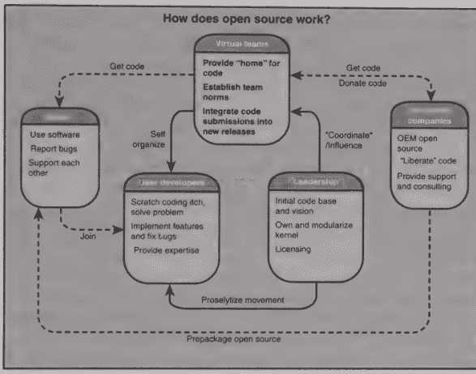

该过程可以总结如下：

- **痛点的产生（An itch develops）**——它可能只是某人想整理数字照片与家人成员分享，也可能复杂到需要在跨国公司的部门间标准化客户信息。痛点是普遍的；也就是说，这种需求是比一个人更广泛的群体。
- **萌芽发生（Germination occurs）**——项目的启动可以采取几种形式。它可能像 `Linux` 一，由一个人建立初始代码库。它可能像 `Apache` 一，通过委员会会议澄清需求并确定方向。它可能像 `Mozilla` 一，赠送免费代码。它可能是向 `SourceForge` 上发布项目。任何产生解决该痛点的生产性活动证据的活动或事件都可以被视为萌芽。
- **项目生根（The project takes roots）**——从启动开始，项目开始成长。这一阶段可以包含若干活动。为项目提供一个“家”，包括一个可访问的代码存储位置。建立相互通信，可以是简单的邮件交换，也可以是带有子小组的邮件列表。建立基于尊重和信任的非正式学习。规范非正式地演变，塑造了沟通、互动和生产力。项目的口碑传播给可能有相同痛点的其他人。
- **培养（Cultivation）**——发生创建、提交、测试和评估代码的反复迭代过程。在这里，用户、开发者或用户/开发者致力于创建、增强和完善产品。代码可能托管在 `CVS` 类环境中，在这些环境中，漏洞和功能请求被跟踪，代码的连续迭代被逐步版本化，目标是达到健壮的、生产级代码的状态。
- **循环收割（Recurring harvest）**——当开源代码达到某些人群有用的状态时发布。它不会进入休眠，而是继续增强循环，通常会有多次发布（Raymond 指，“早期发布，频繁发布”）。在此时，软件对于项目社区内的生产性使用通常具有价值。
- **商业生产性使用（Commercial productive use）**——某些项目（具有广泛痛点吸引力）被发布用于通用，并成为主流商业解决方案的一部分。产品应用了标准的“开源”许可证，被商业 ISV 或 OEM 采用，并提供支持。负责任的商业组织加入社区，通常在人力、托管服务、支持、领导力和增强方面为项目做出贡献，或者通过向该工作贡献相关技术。

几个关键原则促进了开源软件的发展。如果没有这些关键元素，要将一个项目完全演变为生产性现实将更加困难。这些元素包括代码模块化、同行评审、开发者即用户，以及，当然，有效的通信基础设施。

- **代码模块化**——在 `Linux` 示例中，你会看到 `Linux` 内核是模块化的，具有内核状态、安全、设备 I/O、网络、文件系统、进程管理、内存管理等子项目。此外，还有许多用于设备驱动程序、函数、工具和应用程序的项目。`Linux` 的优雅部分源于其架构，该架构支持这些独立模块之间的相互通信。软件包——功能性代码或对象的独立集合，可以在不影响内核或其他软件包的情况下被加载或卸载——是这种模块化架构的反映。

“建议审慎实施模块化原则可能会提高许多自由/开源软件项目的成功率。”这一断言在 Narduzzo 和 Rossi 的论文《自由/开源软件作为复杂的模块化系统》中阐述。

### 同行评审
同行评审可能无法完全描述这一元素，但它包含了这样一个想法：一个人的贡献将受到整个开源社区的观察和分析。一个人的贡献不受私有二进制文件的屏蔽。该过程可以包括言辞如火、接受或拒绝、声誉和责任。因此，既定的同行评审规范倾向于产生高质量的代码。解决方案即使最初不是，最终也会演变为有效、简单且优雅。

### 开发者即用户
关于从用户处收集市场需求的步骤步骤、易孤的流程，将其交给开发者根据感知需求创建代码，然后将其推出去出售的低效，已经有了很多讨论。在开源领域，大多数初始用户也是开发者。他们解决自己的问题，并在此过程中创建更有效的解决方案。这消除了误解，并极大地加快了开发周期。根据 Raymond 的说法，“建立一个基于实际代码的共享表示。”

### 通信基础设施
没有互联网，开源过程将是不可能的。全球访问、即时通信、共享存储和开放标准都是开源开发的关键元素。

结果如何？开源开发导致了高质量的软件。这里有一个开源代码水平的可量化样本。Reasoning 是一种安全检查服务，使用自动化技术发现编码缺陷，如内存泄漏、越界数组访问、错误的内存释放和未初始化的变量。在比较两个开源解决方案（MySQL 和 Linux TCP/IP 栈）与各自的商用版本集合时，Reasoning 发现开源解决方案中的缺陷密度明显低于商业版本

MySQL 每千行代码的缺陷密度为 .09，而商业版本的平均值为 .57。缺陷范围为

## 第 2 章：开源解决方案

商业数据库的缺陷率在 .36 到 .71 之间，仍然显著高于 MySQL。Linux TCP/IP 栈的缺陷率为每千行代码 .10 个，而商业栈中最好的范围在 .15 左右，最差的则超过 1.0 (`http://www.reasoning.com`)。

林斯·托瓦尔斯（Linus Torvalds）简化了这个概念：“我认为从根本上说，开源倾向于产生更稳定的软件。这是处理问题的正确方法。我将其比作科学与巫术。在科学中，整个系统建立在人们研究他人的成果并在其基础上之上。而在巫术中，每个人都有自己的小秘密并守护它——但从不让其他人真正理解并在此基础上进行构建……问题变得足够严重时，你不能让一个人或一家公司独自守护秘密。你必须让所有人共享知识。”

## 总结

本章详尽解释了为什么开源是计算环境的可行解决方案。下一章将在此基础上，并探讨开源在现实世界中的表现。

## 现实世界中的开源

到目前为止，你已经发现了什么是开源、它的起源、优势以及它是如何创建的。如果你需要背景数据来对继续推进的决定感到放心，这些都是很好的信息。本章将进入构建模块——即目前可用的实际产品和解决方案，以帮助你在组织中实施开源。本章涵盖了产品规范和集成，以及真实组织中开源实施的详细案例研究。

值得再次指出，尽管在某些情况下，组织可能会选择仅实施开源软件，但全开源的 IT 实施通常并非如此。大而言，开源通常与专有软件集成，以创建一个能够优化满足组织需求的解决方案。这些需求可能包括异构系统支持与管理、渐进式迁移策略、定制化应用程序支持、收回资本投资，或许多其他特定组织的因素中的之一。

## 需要考虑的集成因素

图 3.1 直观展示了由诺威咨询（Novell Consulting）开发的 Linux 集成通用模型和框架。它被分为两部分，一部分代表桌面以及存在于节点或用户端的平台、应用程序和服务；另一部分代表被认为是后端或数据中心解决方案的基础设施、应用程序和服务。这部分部分都被分为同心圆，用不同的颜色阴影

## 第 3 章：现实世界中的开源

不同的颜色代表不同技术集成复杂性的水平（从外圈的较复杂到中心的最复杂）。

图 3.1

诺威的 Linux 与开源集成框架。

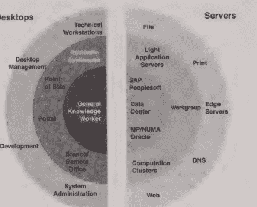

在实施 Linux 和开源解决方案时，从外层环开始并使用分阶段或增量的方法向中心推进通常是有意义的。根据客户需求，先从后端或数据中心区域开始也可能有意义。这些服务可以分阶段、测试并无缝地实施，而永远不会影响大多数终端用户。

一如既往，这是一个“通用”模型，被用作分析的框架。不同的环境需要替代方法。本书的一个目标是系统地处理图中每一项，首先从数据中心侧开始，从外圈向中心进行。

诺威咨询开发了一套实施开源解决方案的分阶段方法。每个阶段都是通用的，并可能包含基础问题，但经验表明，通过全面的检查清单可以最大限度地减少问题，并帮助加速完整、成功的部署。实施阶段包括评估、设计、实施/迁移、培训和支持。以下章节提供了每个部分的简要概述。

## 评估

评估阶段明确目标并确定了可行性。不要轻视这一步——它听起来可能很简单，但在某些情况下评估阶段应该是详尽的。不可避免地，评估阶段发现的信息将决定目标和可行性。以下问题将完善目标并对可行性进行批判性评估：

- 这个开源项目的目标是什么？新功能、降低成本、与合作伙伴集成、还是更好的安全性/可靠性/可扩展性？主要目标、次要目标和辅助目标是什么，应该如何分配权重？是否存在决定项目成功的门槛衡量指标或标准？
- 该项目与现有公司战略的契合程度如何？它是现有目标的扩展，还是在新方向上开辟了天地？组织对适应这种技术的通用准备程度和意愿如何？
- 利益相关者和业务部门的需求是什么（针对管理层、员工、客户、合作伙伴、供应商的业务、技术和政治需求）？
- 逻辑起点在哪里？哪些服务器、服务和应用程序在短期和长期实施/迁移是合理的？
- 有哪些可用开源服务和应用程序满足你的需求并提供相当（或更好）的功能？还需要评估哪些其他替代方案，例如终端服务或仿真？是否存在仅以专有软件形式提供的解决方案？
- 服务器、服务和应用程序以及相关的业务流程的通用步骤是什么，如何才能实施？
- 服务与应用程序、桌面客户端或其他软件之间存在哪些依赖关系？
- 是否需要考虑任何监管政策和要求，例如许可、政府、安全或加密？
- 硬件和服务的整合有哪些机会？
- 你的员工支持 Linux/开源的必要技能水平如何？实施和长期需求之间是否存在差异？
- 该项目的预计成本是多少，在预算和时间限制范围内吗？
- 预计内部收益率、投资回报率或总成本是多少，是否符合既定需求？

## 设计

在定义了目标并确认了可行性后，是开始实施/迁移设计阶段了。在这个阶段，细节将得到细化并建立执行框架。设计问题和活动包括：

- 评估并选择 Linux 发行版。该发行版是多用途、单用途的、企业级还是专注于单一任务的？配置将使用标准软件包列表、自定义列表还是最小功能进行编译？
- 选择应用程序或服务。你需要的服务或应用程序有开源版本吗？如果是，它是否满足所有功能、安全、管理性的要求？如果不是开源，是否存在专有供应商？如果没有，是否可以使用开源组件进行内部开发？
- 设计实施/迁移计划。具体步骤是什么？
- 考虑使用测试平台或阶段配置进行模拟，以帮助确定实际实施/迁移步骤并暴露未发现的问题。
- 如果迁移，确定每个迁移阶段，包括数据、用户、应用程序、连接、服务等。
- 确定服务架构，可能包括文件、打印、身份、目录、消息、协作和网络服务，以及 DNS/DHCP、病毒防护、备份、虚拟专用网络 (`VPN`)、集群、高可用性等。
- 确定应用程序架构。是否需要客户端应用程序、服务器应用程序、客户端/服务器应用程序、终端服务或操作系统仿真？
- 识别符合您特定环境需求的迁移工具和流程。
- 制定培训计划，并考虑到员工现有的 Linux/开源培训及认证水平。

## 实施

实施阶段包括实操试点、测试、配置、部署和培训。以下是几项可能的实施阶段活动：

- 创建阶段性实验室，并为实际实施建立设置程序和验收标准。
- 对迁移人员进行培训。这可能包括使用阶段实验室进行自训，或参加专业培训和课程。
- 邀请经过培训的人员验证迁移试点测试计划、脚本和验收标准。
- 在有限的生产环境试点中部署迁移设计。这可能是针对少数高级用户，或者针对某个具有冗余或故障回滚能力的的特定边缘服务。
- 安装并配置任何所需的迁移工具。
- 安装或迁移服务器操作系统。这可能包括手动操作，也可能通过远程控制、包管理或服务器管理实现自动化。
- 安装或迁移应用程序。
- 迁移用户、组、账户、域以及任何其他所需的管理控制。
- 迁移数据，始终确保存在副本，并在需要时有已建立的回滚方法。
- 验证试点迁移流程和部署，并根据需要进行修改。
- 完成所有服务的迁移/实施并过渡到生产环境。

## 培训

培训可以贯穿于实施/迁移过程。除了针对过渡的员工培训外，还需要针对管理和支持的员工培训。此外，用户可能需要接受有关新应用程序和服务的培训：

- 在所有利益相关者之间建立良好的沟通。这包括关于新服务/应用程序的教育，它们是什么、为什么需要，以及为所有利益相关者带来哪些增强价值。它还可以包括时间表、计划停机和管理层的认可。利用此机会为每次过渡和变更设定预期。
- 管理。管理层对于建立接受变化的良好环境至关重要。确保所有受影响的管理人员对目标、收益、时间表和可能的问题领域有清晰的理解。
- 管理和运维人员。这可能包括对管理软件、管理标准和协议的特定培训，例如简单网络管理协议 (`SNMP`) 或通用信息模型 (`CIM`)、健康监控、日志和报告等。
- 培训帮助热线支持人员，为接待终端用户提供工具和教育。这可能包括支持请求的记录与跟踪、电话支持管理、新应用程序或服务的培训等。

## 培训终端用户
培训可以通过内部培训课程、基于网络或计算机的培训、场外专业培训课程、分发手册、培训师计划或任何一种培训解决方案提供。通过有效的培训，将减少对帮助热线和系统管理资源的需求。

## 支持

在解决方案迁移或实施后，仍然存在提供持续支持和管理的责任。这可能是一个现有管理员易于承担的简单责任，也可能涉及不同地点多个管理人员的努力以及庞大的帮助热线部门。

- 合并管理。寻找通过合并和自动化任务来简化管理的方法、工具和应用程序。这包括具有互操作性、基于标准且使用通用接口的工具。
- 通过创建常见问题集（FAQ）、在线支持数据库以及基于 Web 的聊天、问题提交或远程控制支持解决方案来简化支持。
- 分析支持问题，寻找更简单的方法、替代方案和流程，以避免重复和冗余。
- 如果第三方源能够以相当或更低的成本提供更专业的知识，请考虑外包支持和管理。
- 定期对解决方案进行升级和增强评估，涵盖特征、功能以及所有安全方面。

开源迁移或集成并不必是一个痛苦的过程。许多管理员和 IT 人员已经出于好奇接触了 Linux，因此内部存有专业知识。从边缘服务开始，实施开源解决方案不会对其他服务或终端用户产生重大负面影响。通常，实际迁移会进行非常顺利。一位 Novell 的工作人员在考虑了上述每个因素后，预计实施过程为两周。整个过程一帆风顺地完成，并在四小时内结束。

# Linux 解决方案

每个应用程序、服务或解决方案都需要协议引擎或操作系统。尽管有多种开源操作系统或内核可用，但从实际角度来看，Linux 是市场领导者。Linux 是一个适用于从计算密集型集群到瘦客户端桌面到 Web 服务器等的一切平台。事实上，Linux 可以轻量化到足以嵌入腕表中，也可以强大且可扩展到足以管理着运行着数百个应用程序实例的最大型 IBM 主机。

Red Hat、Debian、Mandrake、TurboLinux 等提供的发行版基于相同的 Linux 内核并包含类似的功能。然而，Novell 认为 SUSE 发行版在管理、支持平台、兼容性测试和先进技术方面具有显著优势。

## SUSE Linux 产品线

Novell 的 SUSE Linux 产品线包括 SUSE Linux Enterprise Server (SLES) 9 和 SUSE Linux Desktop。

### SUSE LINUX ENTERPRISE 9

SUSE Linux Enterprise Server 针对需要扩展性、性能、可靠性和安全性的企业计算用途。该发行版包含许多独特特性，使其特别适用于企业环境，包括表 3.1、3.2 和 3.3 所示的内容。

表 3.1

SUSE Linux Enterprise Server 9 独特特性

| 特性 | 说明 |
| --- | --- |
| Linux 2.6 内核 | 第一个基于 2.6 内核构建的企业级 Linux 服务器操作系统（见表 3.2） |
| YaST | 操作系统、网络服务、存储、集群和应用程序的安装与配置工具 |
| CIM | 用于集成第三方管理工具的 CIM 开放应用程序接口 (API) |
| CKRM | 基于类的内核资源管理，用于大型服务器的类主机分区 |
| 集群 | 支持自动故障转移和高性能计算的集群支持；实现 Open Clustering Framework API，为节点隔离和故障隔离提供低级服务 |
| 热插拔 | 一种在不中断系统的情况下为硬件提供热插拔服务的特性 |
| 认证安全 | 目前正在评估符合 EAL 4+ 合规性的特性 |
| 企业级卷管理器 | 使用多个文件系统的网络存储，具有简单的管理 |
| 用户模式 Linux | 一种用于在相同硬件上实现不同 Linux 配置虚拟化的特性 |
| 分布式复制块设备 (DRBD) | 一种通过多个镜像磁盘创建单个分区的特性（类似于 RAID 1），但运行在网络上） |

表 3.2

SLES 包含的 Linux 2.6 内核特性

| 特性 | 说明 |
| --- | --- |
| 处理器支持 | 可以拥有理论无限数量的处理器；Novell 测试过的 128 CPU 配置 |
| 文件支持 | 提供动态调优以容纳最大同时打开的文件数 |

# 表 3.2

SLES 包含的 Linux 2.6 内核特性（续）

| 特性 | 描述 |
| --- | --- |
| 进程 | 支持运行 65,535 个用户级进程，以及额外的内核级线程进程 |
| 用户 | 支持 40 亿唯一用户 |
| 设备类型 | 支持 4,095 种主设备类型，每类型超过百万个子设备 |
| 设备支持 | 以更好的性能管理更多设备（例如 32,000 个 SCSI 磁盘） |
| 高速 | 支持 USB 2.0 和 FireWire（IEEE 1394 和 1394b） |
| 高吞吐量 | 提供对高速串行（ATA, 5-ATA）设备的支持，可实现 150MB/sec 的吞吐量 |
| 非对称内存访问 | 对于具有数十个或数百个处理器的系统具有更高效的扩展性 |
| 超线程 | 在单个处理器内执行并行线程；提高多线程应用程序的事务速率和性能 |
| 灵活的 I/O 调度器 | 允许根据 I/O 行为策略手动调整 I/O 调度器 |

# 表 3.3

SUSE Linux 9 硬件平台支持

| 平台 | 描述 |
| --- | --- |
| X86 | Intel x86 架构，包括 386、486 和 Pentium 处理器；同 IA-32（32 位架构） |
| AMD64 | 制造商 AMD 对 IA-32 架构的 64 位扩展（包括 Athlon 和 Opteron） |
| Intel EM64T | 扩展内存 64 位技术 (EM64T)，Intel 对 AMD64 的实现（代号为 Nocona，以 Xeon 命名销售） |
| Intel Itanium | HP 和 Intel 开发的 64 位微处理器 (IA-64) |
| IBM Power | IBM 设计的 RISC CPU（通过增强型 RISC 优化了性能） |
| IBM zSeries | 用于 IBM System/390 主机的 IBM 64 位架构 |
| IBM S/390 | 早期的 IBM zSeries 平台 |

此外，SUSE Linux Enterprise 9 包含了其他 Linux 发行版中的功能，例如文件、打印、Web 应用程序、关系数据库和网络服务。

### 第 3 章：现实世界中的开源

内置服务和协议包括 CUPS、DNS、DHCP、NTP、SLP、Postfix、PXE、Proxy、Samba、SNMP、SMTP 等。安全特性包括加密文件系统、证书权威机构、集成防火墙和代理。

### SUSE LINUX 桌面版

Novell SUSE Linux Desktop 是一种终端用户平台，旨在为任何桌面提供完整的解决方案。它包含了 Linux 操作系统，以及一系列应用程序和服务，这些服务为终端用户提供办公生产力应用、客户端服务以及对网络和 Web 服务的访问。表 3.4 提供了概述。

# 表 3.4

SUSE Linux Desktop 特性

| 特性 | 描述 |
|---|---|
| Linux 操作系统 | 2.X 内核，带有用于配置 (YaST)、界面 (KDE, GNOME)、安全、网络服务等标准组件 |
| 标准硬件支持 | X86、笔记本电脑、工作站、存储设备、CD-ROM、DVD、摄像头、平板电脑、PDA、鼠标、键盘、FireWire、PCMCIA 等 |
| 浏览器客户端 | Web 浏览器（Mozilla, Konquerer）、FTP、邮件（Kmail, Evolution, Mozilla Mail）等 |
| 桌面应用程序 | 办公套件（OpenOffice——包含文字处理、电子表格、绘图、演示文稿、数据库访问工具）、通讯录、日历、PIM 等 |

Novell Linux 的独特优势包括 SUSE 通用代码库。所有平台上的所有 SUSE Linux 版本都根于单一代码库。这确保了在所有 Linux 部署（以及所有硬件平台上的所有版本）中一致地使用通用管理工具并进行自动更新。

## 工作原理

Linux 的工作原理可以成为一系列书籍的主题。对于大多数用途来说，Linux 是驱动所有讨论的服务、应用程序或接口的引擎。图像生成、输入/输出、文件管理、数据包生成、安全检查以及数千个进程都是通过操作系统实现的。图 3.2 展示了高层操作系统。

# Linux 解决方案

**图 3.2**

Linux 操作系统由一个核心内核和多个服务组成。

| 设备驱动程序 | 功能 | 软件包 |
|---|---|---|
| | Linux 操作系统 | | | |
| 文件系统 | 内存 | 进程管理 | 网络 | 设备与 I/O | 处理器缓存 | 安全/??? | | |
| | 内核状态管理 | | | |

Linux 中的一个核心概念是`package`（软件包）。在 Linux 中，软件包是一个单一文件，包含一个待安装或作为软件解决方案部分的文件列表。除了文件列表外，软件软件包还包含指示相互依赖关系或其他软件包的规则。

基于网络（而非基于机器）。运行在某台机器上的应用程序可以在另一台机器上显示结果，或者由用户远程控制，就像它们在本地一样。基于 GUI 的 Linux 管理和维护工具与 Windows 中的任何可用工具一样直观、易用且在视觉上有用。

Linux 可以灵活地配置，并包含了集成到所有类型网络中的必要网络工具和功能。可以在不关机服务器的情况下修改并应用配置文件——这是 Linux 的一个主要优势，因为它提供了高级的配置和控制灵活性。

通过这个 Linux 总体概述，你可以看到早期采用 Linux 的许多障碍已经消除。安装和设备检测已经与任何可用工具一样出色。自定义的灵活性无与伦比的，管理、控制和配置也是如此。

## 文件服务

文件共享是网络化的最初灵感。Novell 的起源是因为在 Unix、CPM 和 DOS 操作系统之间共享文件的需求。最简单的解决方案是一个独立的文件“服务器”，它允许从三个不同的“客户端”访问文件。Novell NetWare 文件服务器应而生，随之而来的连接浪潮是巨大的。早期的文件服务包括在局域网（LAN）中使用 IPX 协议的客户端/服务器和点对点连接。

今天，文件服务领域涵盖了跨越多个平台类型、不同设备的海量协议，通过 VPN 和 Internet 在本地和全球范围内。在许多企业环境中，需要根据不同的文件格式在不同的平台上共享文件，并允许从不同的客户端访问，且需要无缝连接。几种开源解决方案（包括 `Samba`、`iFolder` 和 Linux）允许你实现这一目标。

## 你能做什么

Linux 和开源技术为你提供了适应广泛范围文件服务的能力。

## 第 3 章：现实世界中的开源

图 3.3

Linux 技术允许你跨多个服务器和客户端类型共享文件。

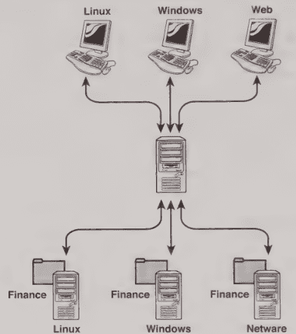

可用的文件服务包括：

- 从 Windows 客户端访问 Linux 文件服务器——`Samba` 是一种开源软件，使 Linux 或 Unix 平台看起来像 Microsoft Windows，用于文件访问和打印。它被称为“协调”软件，因为它允许 Linux、Unix 和 Windows 服务器存在于同一个网络，并被相同的 Windows 客户端访问，而客户端永远检测不到服务器不是 Windows。这种透明访问是通过称为通用内部文件系统（`CIFS`）的协议族处理的。`CIFS` 基于服务器消息块（`SMB`），它是微软文件共享协议的早期版本。对于 Windows 工作站来说，Linux 服务器看起来就像 Windows 服务器 一样，具有相同的目录/文件导航和文件操作能力。

- 从 Linux 客户端访问 Windows 服务器——使用 `Samba`，反向操作也是可能的，允许 Windows 服务器看起来像 Linux 或 Unix 主机。

- 从 Macintosh 客户端访问 Linux 文件服务器——使用 `Netatalk`（AppleTalk 协议族 `ATP` 的内核级实现），Macintosh `OS 9` 或 `OS X` 客户端可以检索、存储和操作 Linux 服务器上的文件，就像这些文件在另一台 Macintosh 机器上一样。

- Linux 到 Linux（Unix 到 Unix）文件共享——网络文件系统（`NFS`）是 Linux 和 Unix 的原生文件共享协议。你可以在这些操作系统之间双向共享文件。

- 以不同格式存储文件——虽然可以使用不同的协议访问基于 Linux 的文件，但也可以使用不同的格式存储。主要支持的格式包括：

  - Reiser—`ReiserFS` 是一种带有日志的文件系统，具有优化的磁盘空间利用率、快速的磁盘访问和快速的访问恢复能力。它是 SUSE Linux 的默认文件系统。

  - Ext 2/3—`ext` 文件系统是 Linux 上标准 `ext2` 文件系统的日志扩展。日志记录减少了崩溃恢复时间，并被广泛用于带有共享磁盘的高可用站点。

  - XFS—`XFS` 是一种高性能的日志文件系统，最初由 SGI 为其 IRRIX 系统开发。

  - JFS—`JFS` 是一种 64 位文件系统，可以支持非常大的文件和分区。`JFS` 提供了一种基于日志的、字节级的文件系统，非常适合高性能系统。

其他支持的文件格式包括 `Lustre`、`ISO9660`（CD-ROM）、`UDF`（DVD/数据包模式）、`EFS`、`CRAMFS`（压缩 RAM 文件系统）、`ROMFS`（小型 ROM 文件系统）、`SYSV`（内存磁盘文件系统）、`BFS`（UnixWare 启动文件系统）、`TMPFS`（SCP/Unix/Coherent）、`UBS`（BSD 及其衍生）、`FAT/VFAT`（Microsoft DOS 和 Windows 9x）、`NTFS`（Microsoft Windows NT）、`HFS`（Macintosh）、`HPFS`（OS/2）、`QNX4` 和 `Minix`。

- 上传和下载文件——Linux 包含了对文件传输协议（`FTP`）的支持，使得经过验证的用户可以从 Internet 上的任何位置上传、下载、复制、删除或重命名文件。

- 在不同工作站上同步文件——你发现自己经常将文件拷贝到软盘或通过电子邮件发送给自己，以便带回家？`NovFolder` 技术让文件可以随你去任何地方。将其视为一种同步机制，它会自动将你工作站上的文件更改同步到 Internet 上的副本，并同步到你指定的任何其他工作站（笔记本电脑、办公室、远程办公室等）。你可以在办公室对 `iFolder` 中的文件进行更改。

# 第 3 章：现实世界中的开源

## 文件同步

在不同工作站上同步文件——你发现自己经常将文件拷贝到软盘或通过电子邮件发送给自己，以便带回家？`NovFolder` 技术让文件可以随你去任何地方。将其视为一种同步机制，它会自动将你工作站上的文件更改同步到 Internet 上的副本，并同步到你指定的任何其他工作站（笔记本电脑、办公室、远程办公室等）。你可以在办公室对 PC 和回家后对 `iFolder` 中的文件进行更改。

## 可用的文件服务

### 从 Windows 客户端访问 Linux 文件服务器
`Samba` 是一种开源软件，使 Linux 或 Unix 平台看起来像 Microsoft Windows，用于文件访问和打印。它被称为“协调”软件，因为它允许 Linux、Unix 和 Windows 服务器存在于同一个网络，并被相同的 Windows 客户端访问，而客户端永远检测不到服务器不是 Windows。这种透明访问是通过称为通用内部文件系统（`CIFS`）的协议族处理的。`CIFS` 基于服务器消息块（`SMB`），它是微软文件共享协议的早期版本。对于 Windows 工作站来说，Linux 服务器看起来就像 Windows 服务器 一样，具有相同的目录/文件导航和文件操作能力。

### 从 Linux 客户端访问 Windows 服务器
使用 `Samba`，反向操作也是可能的，允许 Windows 服务器看起来像 Linux 或 Unix 主机。

### 从 Macintosh 客户端访问 Linux 文件服务器
使用 `Netatalk`（`AppleTalk` 协议族 `ATP` 的内核级实现），Macintosh OS 9 或 OS X 客户端可以检索、存储和操作 Linux 服务器上的文件，就像这些文件在另一台 Macintosh 机器上一样。

### Linux 到 Linux 文件共享
网络文件系统（`NFS`）是 Linux 和 Unix 的原生文件共享协议。你可以在这些操作系统之间双向共享文件。

### 以不同格式存储文件
虽然可以使用不同的协议访问基于 Linux 的，但也可以使用不同的格式存储。主要支持的格式包括：

- `Reiser`—`ReiserFS` 是一种带有日志的文件系统，具有优化的磁盘空间利用率、快速的磁盘访问和快速的访问恢复能力。它是 SUSE Linux 的默认文件系统。
- `Ext 2/3`—`ext` 文件系统是 Linux 上标准 `ext2` 文件系统的日志扩展。日志记录减少了崩溃恢复时间，并被广泛用于带有共享磁盘的高可用站点。
- `XFS`—`XFS` 是一种高性能的日志文件系统，最初由 SGI 为其 IRRIX 系统开发。
- `JFS`—`JFS` 是一种 64 位文件系统，可以支持非常大的文件和分区。`JFS` 提供了一种基于日志的、字节级的文件系统，非常适合高性能系统。

其他支持的文件格式包括 `Lustre`、`ISO9660`（CD-ROM）、`UDF`（DVD/数据包模式）、`EFS`、`CRAMFS`（压缩 RAM 文件系统）、`ROMFS`（小型 ROM 文件系统）、`SYSV`（内存磁盘文件系统）、`BFS`（UnixWare 启动文件系统）、`TMPFS`（SCP/Unix/Coherent）、`UBS`（BSD 及其衍生）、`FAT/VFAT`（Microsoft DOS 和 Windows 9x）、`NTFS`（Microsoft Windows NT）、`HFS`（Macintosh）、`HPFS`（OS/2）、`QNX4` 和 `Minix`。

### 上传和下载文件
Linux 包含了对文件传输协议（`FTP`）的支持，使得经过验证的用户可以从 Internet 上的任何位置上传、下载、复制、删除或重命名文件。

## 与其他网络资源结合使用

管理可以通过 `Novell eDirectory`、`Telnet` 或网络浏览器进行，如果连接了显示器和键盘，也可以基于控制台进行。

### 图 3.5
`iSCSI` 跨越互联网提供 `SAN` 能力。

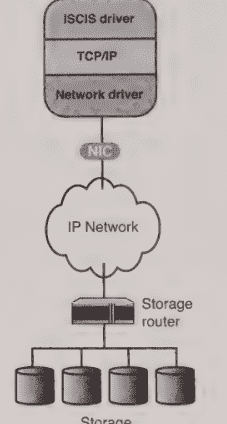

### 扩展文件存储能力
对于具有分布式且有时复杂的存储系统的组织，可以从 `Novell Storage Services` (`NSS`) 提供的存储池和集中管理中获益。`NSS` 是一种存储和文件系统，提供了一种高效利用您存储设备上所有空间的方法。`NSS` 最适用于需要存储和维护大量数据、大量文件或大型数据库的系统。`NSS` 使用多个存储设备的空闲空间，将其组合以创建存储池和逻辑卷，这些卷在物理上大于任何单个文件服务器上的空闲空间。`NSS` 包含了先进的存储技术，可以加速大卷的挂载、通过镜像和条带化数据实现冗余、在文件系统崩溃后快速恢复数据、使用事务跟踪系统 (`TTS`) 保护数据库系统等更多功能。`NSS` 为运行在 NetWare 和 Linux 平台上的存储设备提供了高级文件管理能力和磁盘利用率（见图 3.6）。

### 图 3.6
`Novell Storage Services` 聚合可用存储以创建逻辑卷。

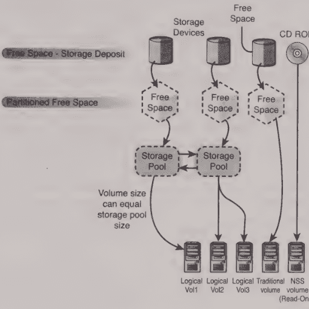

### 从 Linux 工作站映射驱动器
Windows 客户端能够使用 Microsoft 或 Novell 客户端软件映射网络驱动器。这使得驱动器看起来就像本地驱动器，通常带有下一个可用的驱动器号（例如，`F:`）。Linux 客户端现在也可以实现相同的功能。运行 Linux 的工作站映射的网络驱动器对用户在访问大规模存储、`SAN` 或任何其他网络存储时，显示为本地设备。

## 打印服务

打印机共享与文件共享并列，是网络化的主要动力。多年来，网络打印已经演变到几乎任何打印机都可以通过网络进行共享的程度。然而，打印机主要通过 Windows 工作站访问，常见场景涉及使用 Windows 打印管理器来引导打印任务。

有两个变化使得对于许多组织来说，网络打印变得稍微复杂了。这些变化包括能够连接到世界上任何地方任何资源的互联网，以及 Linux 的出现及其在企业网络领域的整合。来自 Novell 和开源社区的、利用互联网并集成 Linux 打印功能的技术包括 `Novell iPrint` 和 `CUPS`。

### 互联网打印如何工作

`iPrint` 和 `CUPS` 都基于互联网打印协议（`IPP`）。`IPP` 是一种打印协议，设计用于运行在互联网协议（`IP`）之上，并支持打印机访问控制、身份验证和加密。与早期的打印协议相比，它安全得多，特别是对于公共网络。通用 Unix 打印系统（`CUPS`）为 Unix 和 Linux 社区开发，作为一种标准的打印系统，它简化了打印机的访问和打印机驱动程序的编写，这在历史上是一个问题，因为所有 Unix 变体都有自己的打印系统。为 `CUPS` 编写的单一打印机驱动程序支持广泛的文件格式。`CUPS` 是一个开源解决方案，截至编写时，`CUPS` 数据库包含了针对 1,233 种不同打印机的 244 个驱动程序。

使用 `CUPS`，可以使用统一资源标识符（`URI`）识别打印机，如果配置得当，可以从互联网上的任何设备访问。打印机可以是带有内置打印服务器的独立单元（将打印数据传递到特定打印机的软件/硬件组合），也可以连接到包含打印服务软件的工作站（Windows、Linux 等）。`CUPS` 可以将打印任务递送到连接的打印机、局域网上的打印机，或通过 `IP` 跨越互联网连接到打印机上的打印机。

`Novell iPrint` 提供了类似的互联网打印能力，但增加了一些实用的功能。跨互联网向远程位置进行打印的主要困难之一是定位和正确识别特定的打印机。打印机 `URI` 和统一资源定位符（`URL`）很难跟踪。`iPrint` 通过使用超文本标记语言（`HTML`）的 Web 可访问地图图像解决了这个问题，这些图像为用户提供了图形化搜索或钻取以查找特定位置所需打印机的能力。为远程打印定位打印机简单且直观。`Novell iPrinter` 实用程序允许管理员轻松创建自定义打印机地图，以为终端用户提供查找和安装打印机的简单方法（见图 3.7）。

### 图 3.7
`Novell iPrint` 帮助定位远程打印机并自动为工作站配置打印。

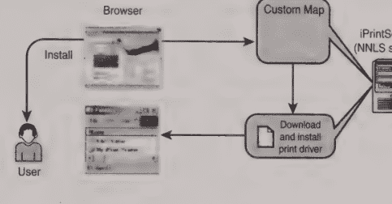

用户从工作站打印到网络打印机，只有在在该特定工作站上安装并配置了该特定打印机型号的驱动程序的情况下才能这样做。远程或不熟悉的打印机往往会带来驱动程序位置和配置问题，`iPrint` 缓解了这些问题。当用户找到 `iPrint` 托管的任何打印机时，该打印机的相应驱动程序将自动下载、安装并配置，并作为标准 Windows 打印机选择列表的一部分。所需的驱动程序设置可以在打印机安装到工作站之前由管理员确定。跨互联网打印变得像打印到桌子上的打印机一样简单。

# 互联网打印是如何实施的

您有多种选项可以使用 `iPrint` 或 `CUPS` 安装基于 `IPP` 的打印。`Novell iPrint` 包含三个组件：`iPrint` 服务器、`iPrint` 客户端和 `iPrint Map Designer`（地图设计师）。`iPrint` 服务器安装在 `NetWare` 或 `Linux` 上，并处理所有 `IPP` 请求。`iPrint` 客户端是标准浏览器的插件，充当网关，将 `Windows` 打印请求转换为 `IPP` 并发送到 `Novell iPrint` 服务器。`iPrint Map Designer` 是一个基于浏览器的工具，管理员可以使用它创建 `iPrint` 打印机位置的图形表示。

安装 `iPrint` 服务器通过每个操作系统的标准方法完成。`iPrint` 可以作为新服务器安装的一部分或以后使用 `iPrint CD` 安装。安装后，用户可以通过网页管理并访问 `iPrint`。要安装 `iPrint` 客户端，点击 `iPrint` 选项，插件将自动安装。

定位打印机时，用户再次访问 `iPrint` 网页，导航 `iPrint` 地图找到所需的打印机并点击它。驱动程序将自动下载并配置到工作站。对于 `Windows` 客户端工作站，`iPrint` 将打印机安装在 `Windows` 打印管理器中，它与其他任何本地或网络打印机一样。`iPrint` 客户端也适用于 `Linux` 客户端。

`iPrint` 的优点之一是所有打印机的驱动程序信息都是集中的。在 `iPrint` 设置过程中，您创建一个 `iPrint` 驱动程序库，维护所有类型打印机的驱动程序集。当需要配置新客户端时，不需要寻找打印机驱动程序。

`iPrint` 服务器安装在 `Linux` 上的工作方式几乎相同，通过网络浏览器访问 `IPP` 服务。`iPrint` 服务器包括驱动程序库、特定的打印机代理（将准备打印的文件重定向到打印机，见图 3.8），整个解决方案可以通过 `eDirectory` 进行访问管理（`eDirectory` 也运行在 `Linux`、`NetWare` 和 `Windows` 上）。

## 图 3.8

`Linux` 的 `Novell iPrint` 配置。

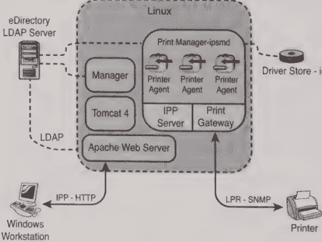

IT 管理员也可以实施传统的 `Linux` 打印服务。如前所述，`Linux` 互联网打印基于 `CUPS`，通过基于 `Linux` 的打印机打印服务器和打印队列访问打印机。可以通过 `YaST` 安装 `CUPS` 并通过 `YaST` 对打印机进行管理。从 `Linux` 打印可以通过 `Linux` 命令行、如 `KDE` 等图形界面或通过应用程序完成。`Linux` 还支持 `LPRng` 和 `lpdfilter`，这些都是传统的 `Linux` 打印服务。

`Samba` 是开源的 `Microsoft SMB/CIFS` 仿真器，当 `Linux` 打印服务器和打印队列与 `Windows` 客户端配合使用时，它可以起到主要的打印作用。`Samba` 允许 `Windows` 工作站访问并打印 `CUPS` 打印机，就像普通或网络打印机一样。`Samba` 处理打印作业的转发、排队和打印管理。`Samba` 通过允许 `Linux` 工作站访问并使用 `Windows` 打印服务，让 `Linux` 计算机能够像 `Windows` 服务器一样作为 `Windows` 服务器运行，无论这些服务是源自 `Windows` 服务器还是安装了 `Samba` 的 `Linux` 服务器。`Novel` 证明的实现侧重于从 `Linux` 服务器向 `Windows` 客户端提供经过身份验证的文件服务，并由 `eDirectory` 管理访问控制。

你可以看到，无论你运行的是仅 `Linux` 的商店，还是大多数组织使用的 `Windows`、`Linux` 和 `NetWare` 混合环境，都有多种打印选项。在纯 `Linux` 的数据中心操作中，你仍然可以通过映射访问连接到互联网的打印机来享受 `iPrint` 的优势。客户端工作站（`Windows` 或 `Linux` 均可）无论打印服务器平台如何都可以访问打印机。`Linux` 可以访问 `Windows` 打印服务反之亦然。`iPrint` 为所有人简化了打印机定位、驱动程序存储和工作站配置。

## 边缘服务

边缘服务的定义已经扩展到包含多种监控、保护和增强“流入”信息的计算——即在客户端和服务器之间传输的数据，包括所有通信层。边缘服务已从以防火墙为主演变为包括代理缓存、`VPN`、入侵检测、防病毒、`Web` 过滤和其他质量服务（`QOS`）解决方案。展望未来，这些服务越来越多地被组合，创建出一类被称为安全网关的解决方案。

开源在流入解决方案的早期进化中发挥了巨大作用，多种技术提供了特定的安全和边缘服务。`Linux`

## 第 3 章：现实世界中的开源

继续在安全网关的增长中发挥关键作用，并且是目前市场上许多现有硬件安全网关的领先操作系统平台。此外，`Linux` 非常适合作为软件安全网关的平台，并且是新新兴的安全网关服务家族中不可或缺的一部分。

作为一个感兴趣的说明，许多组织采用 `Linux` 的共同路径通常从边缘服务开始。在数据中心的边缘或作为分支机构或远程办公室的周边界服务，实施 `Linux` 的唯一明显效果是让情况变得更好。用户端不需要任何不便、速度变慢或需要新的培训；数据中心也不会发生服务中断或更改。边缘的 `Linux` 通常可以加速数据交付或提供更高的安全性。不需要拆除和更换，现有服务通常可以得到显著增强。如果你的组织处于测试和采用 `Linux` 的早期阶段，边缘服务解决方案是一个理想的起点。

那么，使用 `Linux` 和开源建立边缘服务有哪些可用工具呢？你有几种选择。首先，可以配置多种 `Linux`/开源技术来提供安全网关的各个元素，包括代理/缓存内容过滤、防火墙和 `VPN`。或者，你可以从 `Novell` 或任何其他提供安全网关的供应商处选择商业解决方案。再次，这关于互补和替代——什么对你来说构建或购买最合理。

## 构建你自己的

本节检查了开源社区的单项技术以及每种技术提供的功能：

- 缓存/代理——缓存是快速 `Web` 访问的基础元素。从源端提取的信息被临时存储在更靠近用户端的地方。如果你请求一个带有几个图形的 `HTML` 页面，在第一次发出请求时，内容将从源端到用户端的整个路由传输。如果涉及缓存，这些信息将存储在更靠近客户端的地方（可能在浏览器缓存中或局域网内的代理缓存中），这样下一次请求内容时，数据会更近，请求时间也会缩短。缓存提供了更好的感知性能并减少了对带宽的需求。“代理”缓存为多个不同的客户端执行缓存服务（见图 3.9）。

图 3.9

代理缓存将内容存储在更靠近客户端的地方以便快速访问。

互联网协议 (`ICP`) 是一种开发的标准，旨在允许缓存服务器之间通信，以创建多级缓存，以适应复杂的缓存需求。缓存解决方案可以包括用于保护客户端和数据的防火墙。缓存层次结构可以设计为从多个源（外部和内部）提取内容，为热门对象或页面提供高速访问并将延迟降至最低。存在缓存机制，可以确保内容是最新的或新鲜的，并在内容过时或陈旧时启动新请求。

最流行的开源缓存解决方案是 `Squid`。`Squid` 是运行在 `Linux` 上的开源代理缓存服务器，支持对 `HTTP`、`FTP` 和其他 `URL` 进行代理和缓存，允许用于加密会话的安全套层 (`SSL`)、`ICP` 和缓存层次结构，以及带有日志缓存管理接口。你可以在 `http://www.squid-cache.org/` 找到更多关于 `Squid` 的信息。

- 外部访问内容最常见的形式是防火墙。可以使用网络地址转换 (`NAT`) 构建防火墙，`NAT` 随于每个 `Linux` 发行版。防火墙简单来说是一个带有两个网络适配器的服务器——一个连接到内部网络，另一个连接到外部网络；所有来自内部的流量都通过该服务器。使用一种伪装技术，发出的 `IP` 头部被重写，使其看起来来自一个地址。来自外部的响应包被翻译回内部。

- `VPN`——`IP` 安全 (`IPsec`) 是一种用于加密和验证 `IP` 数据包的标准，也可以确保安全通信。`Openswan` 项目（`FreeS/WAN` 的继任者）是一个开源解决方案，使用强加密在不受信的网络（如互联网）上建立安全隧道。它适用于各种类型的互联网流量，包括 `HTTP`、`FTP`、电子邮件、`Telnet` 等。有关 `Openswan` 项目的更多信息，请访问 `http://www.openswan.org`。

- 过滤——过滤领域非常重要，涵盖地址过滤和内容分析。地址过滤可以通过路由实现，在路由器处阻止特定网站的访问，或在过滤发生点（如 `NAT`）。可以阻止特定的 `IP` 地址，阻止一个范围的地址，或根据动态黑白列表进行过滤。例如，黑名单服务提供商跟踪已知产生垃圾邮件的 `IP` 地址并将列表提供给你的路由器，你可以在那里自动阻止流量进入你的网络。

内容过滤包括对 `Web` 和电子邮件数据进行分析和过滤以检测和消除病毒。由于该领域的解决方案通常需要持续更新以应对不断变化的安全威胁，它们通常从独立软件供应商处获得。

除了上述服务外，边缘服务的类别有时被定义为负载均衡——使用虚拟服务器和镜像实现内容交付的性能平滑。

存在 Linux 和开源轻松解决的两个常见负载均衡问题。第一个是简单的 Web 服务器过载，即对内容或对象的请求远超过单个 Web 服务器的承受能力。在这种情况下，可以使用多个 Web 服务器（例如运行 Apache 的 Linux）镜像相同的信息（在相同或不同的位置）。传入的信息请求会被运行 NAT 软件的负载均衡或虚拟服务器拦截，该服务器会重写请求头，将请求定向到最忙、最近或符合特定端口（如 CGI 或 Java 小程序）的镜像服务器。

预设的算法标准。镜像服务器在用户感知不到请求已重定向的情况下交付请求（见图 3.10）。

### 图 3.10

负载均衡或虚拟服务器将请求重定向到最不忙的 Web 服务器。

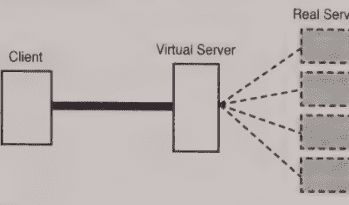

另一种负载均衡方法是使用 DNS 负载均衡。在这种情况下，多个 IP 地址与同一个服务器名称（`www.mycompany.com`）关联。每个不同的 IP 地址都关联到一个托管相同内容的不同物理服务器。每当 Web 服务器接收一个新请求时，DNS 服务器就会以轮询方式（`round-robin`）循环到列表中的下一个 IP 地址（即下一个服务器）。如果有四个具有不同 IP 地址的 Web 服务器，则每台服务器将处理每第四个请求。使用这些或其他方法进行负载均衡，使得以极少的额外工作显著扩展基于 Linux 和开源的 Web 解决方案成为可能。

若干开源技术改进了高级负载均衡问题。查看 Eddie Project (`http://eddie.sourceforge.net/`)，它根据多种不同的负载均衡算法将 URL 请求分散到不同的 Web 服务器。

第二类负载均衡问题出现在使用数据库时，此时查询数量足够大，会导致数据库服务器过载。为了解决这个问题，可以将多个数据库服务器配置为只读镜像或副本，或者将一个数据库配置为可写主节点。当查询请求进入时，该查询被重定向到最不忙的数据库服务器进行处理。如果请求是数据库写入（更新数据库内容），则请求将导向可以写入的单个数据库实例。由于大多数数据库应用程序的读取次数远多于写入次数，这种简单的负载均衡方法对于大多数情况都是足够的。数据库重定向可以使用 NAT 和脚本技术（如 PHP、CGI 或 Perl）完成。

## 购买商业产品

如果你想的不是构建自己的安全网关，Novell 或其他供应商提供了许多选择。值得注意的是，领先的商业安全网关供应商已将 Linux 标准为操作系统平台。Check Point Software Technologies、Symantec、Soft、Secure 和 CyberGuard 提供了基于 Linux 的硬件、软件或组合安全网关解决方案。IBM 的 WebSphere Edge Server 平台允许公司为数据中心和企业的边缘开发自己的解决方案，以及地理分布的内容接入点（PoP）——所有这些都通过产生终端用户流量的网关和代理实现。

商业供应商提供的新兴安全网关技术适用于无线、瘦客户端和数字助理的终端解决方案，以及针对可扩展标记语言（XML）安全的流入监控和管理，包括架构验证、加密以及 XML 路由和处理。

由 Aastoro 提供的 Novell Security Manager 将开源技术与先进的专利工程相结合，提供全面的基于 Linux的安全网关。Novell Security Manager 边缘服务包括防火墙、VPN、正反向代理缓存、病毒过滤、即时消息、Web 过滤、入侵检测、反垃圾、DNS、DHCP 等。将这些服务与基于 Web 和目录的管理集成，可以提供强大的安全性，以及为提供质量解决方案和安全网络提供细粒度的控制。

## DNS/DHCP 服务器与路由

Linux 轻松处理的其他常见边缘服务还包括域名系统（DNS）、动态主机配置协议（DHCP）和路由。同样，这两项服务在几乎每个大型网络中都需要，是 Linux 实现的绝佳起点，因为它们不会直接影响终端用户或业务应用程序，并且可以无缝集成。

### DNS

在高级层次，DNS 将主机或域名映射到 IP 地址。由于人类倾向于使用基于词的名字，而计算机需要基于数字的地址，因此 DNS 被赋予了匹配这两者的任务。每当你输入域名（如 `well.novell.com`）时，都会使用一个 DNS 服务器引导你到达正确的主机。个人用户或小型企业的 DNS 服务器通常由互联网服务供应商托管。在需要子域的大型组织（例如 `support.novell.com`、`forge.novell.com` 等），由公司托管一个为特定域名机器提供导航地址的 DNS 服务器。

DNS 不仅仅是简单的映射。它还包含了导航分级树和域名以确定实际 IP 地址的方法。DNS 同时也支持为同一个域名分配多个地址（即负载均衡），或当多个域名映射到单个 IP 地址时（即虚拟托管）。

DNS 缓存对于提高网站访问性能特别有用。本地 DNS 缓存存储了请求频率最高的网站的主机名/地址映射。与其搜索整个外部 DNS 服务器链来确定 IP 地址，之前解析过的名称存在于本地缓存中，以便快速访问。

有多种开源 DNS Linux 解决方案，最流行的是伯克利互联网域名系统（BIND）。BIND 包含在 SUSE Linux 中并通常在启动时配置。它包含一个域名服务器、一个域名解析器库以及用于验证 DNS 服务器正常运行的工具。DNS 解析也是邮件路由的关键，它列出了接受每个域名邮件交换的邮件交换服务器。

### DHCP

DHCP 在组织中的用法比 DNS 还要常见。简单来说，连接到 IP 网络（内部或互联网）的每台机器必须有一个 IP 地址。静态地址（永久分配给单个设备的 IP 数字或地址）在动态组织中可能短缺或难以管理。DHCP 简化了 IP 地址的管理和分发。

DHCP 提供了多种 IP 地址分配方法，最常见的是动态分配或租赁。DHCP 服务器充当租赁代理，向网络上请求管理员指定的地址池的任何客户端提供 IP 地址。当客户端（例如 Windows 工作站）启动时，网络适配器向网络提交一个 IP 地址的开启请求。DHCP 服务器响应，授予一个指定时间的地址。当客户端关闭或时间段过期时，该地址将回到池中供重用。

DHCP 允许多个内部网络客户端在没有静态或难以获取地址的情况下访问互联网。DHCP 还包含了为整个网络所有人配置的 DNS 服务器地址或网关信息。DHCP 与 BOOTP 兼容，BOOTP 是更早（现在已过时）的 IP 地址租赁版本。

Novell SU Linux 包含了由互联网联盟（ISC）发布的 DHCP 服务器 `dhcpd` 以及两个 DHCP 客户端：`dhclient` 和 `dhcpcd`。DHCP 客户端支持是大多数 Linux 工作站的标准安装内容——除非你明确拒绝安装它的选项。只要网络中某处有一个 DHCP 服务器，每当工作站启动时，IP 地址分配将是自动的。

整个 Web 应用领域非常庞大，足以成为几本书的主题。本节概述了迁移到 Linux 和开源系统的简单介绍，以及几种可能的考虑因素。Web 服务器的实现通常分为静态和动态两类。

每个 Web 服务器都包含一个根 HTML 目录，通常位于 `www/`、`htm/` 或 `htdocs` 目录下。当 Web 浏览器发送 HTTP 请求时，服务器会提供该目录下的文件。如果未请求特定文件，则会提供 `index.html` 文件。对于静态网站，创建者会将 `index.html` 文件设计为首页，并包含指向其他页面和图形的链接。部署网站可以简单到只需创建几个 HTML 页面并将它们复制到 `htdocs` 目录即可。如果服务器主机位于网络中，使用浏览器通过 IP 地址连接即可渲染页面。

Apache 可以提供从简单到极其复杂的网站服务。通常，一个网页（如 `index`）是脚本、进程或对象的集合，这些对象用于动态生成内容和图像。这些页面元素可以在浏览器端生成或处理，也可能是分布在数百个其他 Web 或应用程序服务器上的多层处理和链接的结果。如今的许多网站都是来自遥远多层源的内容、链接、应用程序数据流的复杂聚合。Apache 可以容纳所有这些（见图 3.11）。

### 图 3.11

Web 服务器向 Web 浏览器交付多种类型元素的页面。

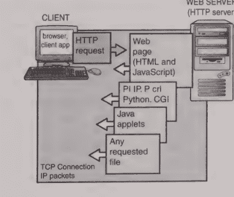

Linux 和 Apache 是基础 Web 服务的核心元素。将这些与其他服务、实用程序和工具相结合，正是静态站点与动态站点的区别。通过以下方式，

## 第 3 章：现实世界中的开源

通过使用额外的编程、数据库和自定义模块，Apache 的功能可以显著扩展。其中一些包括：

- **安全传输**——使用 SSL，客户端与 Web 服务器之间的任何通信或传输都可以进行安全加密。
- **身份验证**——通过轻量级目录协议 (`LDAP`) 和 Novell 目录等目录服务，可以严格控制对特定 Web 资源的访问，使只有经过授权的用户才能访问。
- **虚拟主机**——单台机器上的单个 Apache 实例可以托管多个网站，使单个 Web 服务器表现为多个独立的 Web 服务器。可以根据不同的 IP 地址或不同的主机名配置虚拟主机。

## 活动内容
活动内容是根据客户端变量输入生成的 HTML 页面。`Apache` 提供了三种生成活动内容的方法：

- **服务器端包含 (SSI)**——这些是通过特殊注释嵌入 HTML 页面中的指令。`Apache` 解释注释的内容并将将其结果作为 HTML 页面的一部分交付。
- **通用网关接口 (CGI)**——这些位于某些目录下的程序。`Apache` 将客户端传输的参数转发到这些程序，并返回程序的输出。程序通常用脚本语言编写，也可以用 C、C++ 或任何其他语言。
- **模块**——`Apache` 提供了在请求处理范围内执行任何模块的接口。可用的模块包括适用于 `Perl`、`Python`、`PHP` 和 `Ruby` 的脚本语言模块，它们与 `Apache` 协作创建任何自定义的应用程序或实用程序。

## 内容协商
`Apache` 可以交付适应特定客户端能力的页面内容。基于浏览器的客户端可以是手机、纯文本设备或全功能 PC 浏览器——`Apache` 可以确定客户端类型和能力并据此定制内容。`Apache` 还可以与客户端协商，以确定浏览器期望接收内容的语言并据此交付。

此外，`Apache` 还与各种应用程序服务器协作，这些服务器实现了新一代 Web 可访问应用程序。这些从从遗留应用程序提取信息并开放访问的 XML 连接器，到新的基于 Java 的业务应用程序，再到 Web 数据库前端。应用程序服务器解决方案由独立软件供应商 (ISV) 提供，如 IBM (`WebSphere`)、`BEA` (`WebLogic`) 等，以及 `Jakarta Tomcat` 等开源项目。

Web 服务器是“信息之门”，可以是精细、引人注目且复杂的，也可以是基础、纯文本且简单的。它们也可以出现在组织内的许多位置，对外部开放访问，或从内部进行受控的隐藏访问。Web 服务器用于展示或发布内容，并提供广泛服务的访问。你经常访问的通过 Web 服务器发布的内容可能包括电子邮件、新闻、文档、产品信息、目录和购物网站。Web 服务器促进了具有即时消息、在线日历和调度的完整用户门户，这些门户可以是很小的，支持指向路由器的简单界面。日益，企业级软件应用程序如客户关系管理 (`CRM`)、企业资源计划 (`ERP`)、人力资源 (`HR`) 和财务系统正在整合基于 Web 的用户界面，向广大员工、经理、合作伙伴、客户和供应商展示丰富的内容。Web 服务器无处不在。

基于 Linux 和 `Apache` 实施 Web 服务器可以是一个渐进式的过程，从外围服务和应用程序开始，转向数据中心操作。常见的首次用途是向内网内部提供静态 Web 内容。这可能包括公司资源手册或目录、项目站点或公告板。

接下来的阶段通常包括数据库内容，可以是从产品列表或预算财务信息到内部小组的任何内容。组织可以使用开源数据库（如 `MySQL` 和 `PostgreSQL`）以及脚本工具（如 `PHP` 和 `Perl`）轻松创建基于 Web 的数据库应用程序。此外，许多现有的开源业务应用程序已在 Linux、`Apache`、`MySQL` 和 `PHP` 上进行了预构建。随着对内容的需求变得复杂，就会整合应用程序服务器和定制构建。根据你组织的需求、时间范围和预算，你有内部开发、与咨询伙伴合作或购买现成解决方案的选择。

除了移植到 Linux 的商业版本外，还有许多开源数据库。适用于 Novell SUSE Linux 的两个开源数据库是 `MySQL` 和 `PostgreSQL`。它们都提供了丰富的数据库服务，在结合 `Apache` Web 服务器以及脚本语言和应用程序服务器时，可以向 Web 用户开放数据输入、访问和处理。

## 第 3 章：现实世界中的开源
在所有情况下，Web 服务器都是解决方案的关键组件，`Apache` 是首选的 Web 服务器。`Apache` 拥有最大的市场份额，因此提供了最大的灵活性、兼容性和安全性。

### 工作数据库
从历史上来看，数据库的广泛使用一直存在一个根本性障碍。数据输入和报告输出一直需要数据库知识——这只有在你卷起袖子学习细节时才是可能的。而且，如果你技术足够强大可以编写自己的查询，你就在办公室里维护一台高端工作站，通常还带有数据库许可证和高性能硬件的额外费用。

再次，开源通过扩展任何访问浏览器的数据库创建和处理能力来打破这一障碍。它提供了简单的数据结构开发、处理和报告工具，让不仅仅是数据专家也能了解情况。此外，通过提供在低成本硬件上运行的基于 GPL 软件，显著降低了成本。

正如之前提到的，`PostgreSQL` 源自加州大学伯克利分区的 Ingress 项目。`PostgreSQL` 架构设计用于适应高量环境，同时保持性能和响应。存在管理员和用户的 GUI 工具用于数据库设计和数据处理。最新版本支持 34 种不同的 Unix 和 Linux 平台。

`MySQL` 也是一个快速且响应良好的数据库，通过 `PHP`、`Perl` 和 Java 具有良好的连接性和处理能力。`MySQL` 是多线程、多用户、基于 SQL 的，并包含 ODBC 支持。`MySQL` 所有者 `MySQL AB` 的使命是“定义一种新的数据库标准……基于其”

### 工作组数据库
致力于为广泛的应用部署提供一种更不复杂的解决方案，并大幅降低总拥有成本（TCO）。`MySQL` 已获得广泛普及，目前拥有 500 万活跃安装量。将 `MySQL` 用于 Web 端和业务关键应用程序的公司包括 Yahoo!、`Sabre Holdings`、`Co-Communications`、美联社和美国航空航天局（NASA）。

### 企业数据库
美联社（AP）对 `MySQL` 的实施和使用基于使用开源的原因以及所获收益，提供了一个有趣的案例研究。AP 托管着巨大的仓库，新闻不仅来自世界各地，还提供给 15,000 多个会员机构，这些机构将新闻内容整合到自己的网站中。在面对大型体育或新闻报道时，AP 托管的新闻系统必须并发支持多达 11,000 用户。这包括新闻故事的存储和搜索能力，以及为广告报纸全额托管的 600 个网站。通过 `MySQL`，美联社能够基于非许可绑定的开源软件从零开始重新构建解决方案，这允许它根据需求波动灵活地添加数据库功能。该系统相对容易设置和部署，管理需求极低——它不需要一名全职数据库管理员。

### 工作组数据库
Novel 的一个简单数据库需求是组织和分类运行在 Linux 上的开源解决方案。由于专注于 Linux，公司内部许多小组不仅能够看到有多少可用解决方案，还能根据许多不同因素对它们进行排序和分类，这非常重要。这是数据库技术的完美应用，服务于内部工作组，如产品营销、产品管理、培训和咨询。将这些信息放在 Web 可访问的数据库中，使得公司内任何地方的任何需要的人都能使用。

数据库类型是如何创建和维护数据库的？这是一个名为 `phpMyAdmin` 的开源数据库管理工具。`phpMyAdmin` 是一个用 `PHP` 编写的开源工具，旨在通过 Web 管理 `MySQL`。它可以创建和删除数据库、创建/删除/修改表、删除/编辑/添加字段、执行任何 SQL 语句、管理字段上的键、管理权限、将数据导出为各种格式等。通过 Web 浏览器，任何授权用户都可以创建数据库、填充表和字段、构建查询，然后将他们的工作结果分发给其他任何人。

## 第 3 章：现实世界中的开源
为大众提供数据库能力——无需许可费用，也不需要专门的技术帮助。

稳定性、性能、易用性和价格导致大多数领先数据库公司将高质量的商业应用程序移植到 Linux 上运行。源代码的完全访问使得数据库供应商能够提供扩展，显著增强数据库性能，并根据特定需求和要求定制解决方案。在 Linux 上可用的商业解决方案列表非常详尽，包括以下领导者：

- `Oracle`—`Oracle` 于 1998 年首次将 `Oracle8` 移植到 Linux，从那时以后以 Linux 为标准。所有 `Oracle` 应用开发人员都在 Linux 上开发，随着 `Oracle 10g` 的发布，Linux 已成为 `Oracle` 的基础开发平台。Linux 的 `Oracle` 支持是标准的，与任何其他操作系统平台平等。
- `DB2`—IBM 自 1998 年起在 Linux 上提供 `DB2` 数据库。`DB2` 是一种多媒体、适用于 Web 的关系型数据库管理系统，足以满足大企业的需求，并灵活服务于中小企业。
- `Informix`——另一个 IBM 数据库，`Informix` 软件为事务密集型环境提供最高级的应用性能。企业级 OLTP 和数据仓库解决方案具有可靠性、灵活性和成本效益，这是 IBM 选择在 Linux 上支持 `Informix` 的原因。
- `Sybase`—`Sybase` 在 1999 年在 Linux 上交付了企业级关系型数据库系统。今天，所有 `Sybase` 解决方案（从高端 Adaptive Server Enterprise 到用于嵌入式应用的 Anywhere Studio）都运行在 Linux 上。
- 其他运行在 Linux 上的显著数据库包括 Empress、`SOLID`、`Adabas D`、`D3`、`Flagship`、`jBASE`、`Interbase`、`Ingres`、`Perasive.SQL`、`Polyhedra` 等，更多见 `http://www.linuxlinks.com/Software/Databases/`。唯一没有移植到 Linux 的商业数据库是 Microsoft `SQL Server`。

## 数据库实施

工作组数据库是另一类早期开源和 Linux 实施及迁移的主要目标。如果当前的数据库解决方案来自现有数据库供应商，那么可能有运行在 Linux 上的相同数据库商业版本。在这些情况下，将数据库移动到 Linux 可能只需要复制数据。至少可能需要在没有迁移工具的情况下升级到新的数据库版本。

许多组织正在效仿美联社，基于开源从零重新设计解决方案。优点是灵活性、使用高级 Web 服务的能力，通常有机会将数据管理合并并简化到具有更大扩展能力的单服务器上。

迁移或实施数据库（如边缘服务）对终端用户的影响微乎其微。可以通过 Web 门户访问数据库——无需更改客户端工作站。可以通过中央目录（如 `LDAP` 或 `eDirectory`）控制对数据库的访问。

相反，对结构化数据的 Web 访问会对组织内外的用户产生巨大影响。考虑库存信息的访问、应付账款的自助跟踪、运输交付监控、协作项目跟踪——列表没完没了。数据库访问可以是跟踪和衡量组织目标的强大且有效的工具。Linux 和开源使其变得可靠。

## 轻级应用服务器

Novell 的一个简单数据库需求是组织和分类运行在 Linux 上的开源解决方案。由于专注于 Linux，公司内部许多小组不仅能够看到有多少可用解决方案，还能根据许多不同因素对它们进行排序和分类，这非常重要。这是数据库技术的完美应用，服务于内部工作组，如产品营销、产品管理、培训和咨询。将这些信息放在 Web 可访问的数据库中，使得公司内任何地方的任何需要的人都能使用。数据库类型是如何创建和维护数据库的？这是一个名为 `phpMyAdmin` 的开源数据库管理工具。`phpMyAdmin` 是一个用 `PHP` 编写的开源工具，旨在通过 Web 管理 `MySQL`。它可以创建和删除数据库、创建/删除/修改表、删除/编辑/添加字段、执行任何 SQL 语句、管理字段上的键、管理权限、将数据导出为各种格式等。通过 Web 浏览器，任何授权用户都可以创建数据库、填充表和字段、构建查询，然后将他们的工作结果分发给其他任何人。

## 第 3 章：现实世界中的开源

为大众提供数据库能力——无需许可费用，也不需要专门的技术帮助。

稳定性、性能、易用性和价格导致大多数领先数据库公司将高质量的商业应用程序移植到 Linux 上运行。源代码的完全访问使得数据库供应商能够提供扩展，显著增强数据库性能，并根据特定需求和要求定制解决方案。在 Linux 上可用的商业解决方案列表非常详尽，包括以下领导者：

- `Oracle`—`Oracle` 于 1998 年首次将 `Oracle8` 移植到 Linux，从那时以后以 Linux 为标准。所有 Oracle 应用开发人员都在 Linux 上开发，随着 `Oracle 10g` 的发布，Linux 已成为 Oracle 的基础开发平台。Linux 的 Oracle 支持是标准的，与任何其他操作系统平台平等。

- `DB2`—IBM 自 1998 年起在 Linux 上提供 `DB2` 数据库。`DB2` 是一种多媒体、适用于 Web 的关系型数据库管理系统，足以满足大企业的需求，并灵活服务于中小企业。

- `Informix`—另一个 IBM 数据库，`Informix` 软件为事务密集型环境提供最高级的应用性能。企业级 OLTP（在线事务处理）和数据仓库解决方案具有可靠性、灵活性和成本效益，这是 IBM 选择在 Linux 上支持 `Informix` 的原因。

- `Sybase`—`Sybase` 在 1999 年在 Linux 上交付了企业级关系型数据库系统。今天，所有 `Sybase` 解决方案（从高端 `Adaptive Server Enterprise` 到用于嵌入式应用的 `Anywhere Studio`）都运行在 Linux 上。

- 其他运行在 Linux 上的显著数据库包括 `Empress`、`SOLID`、`Adabas D`、`D3`、`Flagship`、`jBASE`、`Interbase`、`Ingres`、`Perasive.SQL`、`Polyhedra` 等，更多见 `http://www.linuxlinks.com/Software/Databases/`。唯一没有移植到 Linux 的商业数据库是 Microsoft `SQL Server`。

## 数据库实施

工作组数据库是另一类早期开源和 Linux 实施及迁移的主要目标。如果当前的数据库解决方案来自现有数据库供应商，那么可能有运行在 Linux 上的相同数据库商业版本。在这些情况下，将数据库移动到 Linux 可能只需要复制数据。至少可能需要在没有迁移工具的情况下升级到新的数据库版本。

许多组织正在效仿美联社，基于开源从零重新设计解决方案。优点是灵活性、使用高级 Web 服务的能力，通常有机会将数据管理合并并简化到具有更大扩展能力的单服务器上。

迁移或实施数据库（如边缘服务）对终端用户的影响微乎其微。可以通过 Web 门户访问数据库——无需更改客户端工作站。可以通过中央目录（如 `LDAP` 或 `eDirectory`）控制对数据库的访问。

相反，对结构化数据的 Web 访问会对组织内外的用户产生巨大影响。考虑库存信息的访问、应付账款的自助跟踪、运输交付监控、协作项目跟踪——列表没完没了。数据库访问可以是跟踪和衡量组织目标的强大且有效的工具。Linux 和开源使其变得可靠。

在最简单的 Web 服务情况下，存在一个提供者、一个消费者和一个注册表。Web 服务提供者是创建并托管 Web 服务的组织。通常，提供者会在 Web 服务注册表中发布其组织信息和提供的服务信息，消费者可以对注册表进行查询。Web 服务消费者找到 Web 服务（通常通过查询注册表），然后通过与提供者建立连接（称为绑定到 Web 服务）来运行该服务。Web 服务注册表是业务和服务的信息的集合，通过程序化的发布和查询接口，提供者和消费者可以轻松访问。

对 Web 服务的请求及其响应是使用简单对象访问协议（`SOAP`）的，这是一种基于 `XML` 的标准消息协议。这些请求和响应被嵌入在 HTTP 中，以便服务/应用程序/提供者/消费者之间的交互可以在互联网上进行。Web 服务为特定请求执行应用程序逻辑，然后以嵌入在 HTTP 响应中的另一个 `SOAP` 消息的形式返回任何应用程序输出。为了以标准格式指定有关 Web 服务的信息，提供者会创建一个 Web 服务描述语言（`WSDL`）文档来描述其特性。`WSDL` 也是一种基于 `XML` 的格式。

Web 服务的成功源于它们基于通用的行业标准——这些标准随着时间的推移而演，并通过一个不受单一小组或供应商控制的测试和实施过程建立起来。标准实现了跨平台的可移植性、与大量其他应用的集成以及开发和重用的一致性。Web 服务通常包含 `J2EE`、`XML`、`SOAP`、`WSDL` 和 `UDDI`：

- `J2EE`—Java 2 平台企业版（`J2EE`）是使用 Java 技术构建分布式企业级应用的平台。该平台由应用程序服务器或 servlet 容器组成，用于管理和协调 Java servlet、Java 页面（`JSP`）、企业级 Java Bean（`EJB`）以及其他接口和服务的执行。`J2EE` 不依赖于操作系统或硬件，并提供跨位置和跨服务平台的分布式处理。

- `XML`—可扩展标记语言（`XML`）是用于在上下文中定义和描述数据的标准。`XML` 标签描述了特定文本选择代表什么，以及它如何与同一组或层次结构中的其他文本相关。`XML` 使数据及其含义具有可移植性，供其他进程消费，并能在各种设备上以多种格式进行显示。`XML` 是一个重要的 Web 服务标准，因为它同时用于 `SOAP` 和 `WSDL`。

## 第 3 章：现实世界中的开源

- `SOAP`—简单对象访问协议（`SOAP`）是一种用于在去中心化、分布式环境中调用 Web 服务的 XML 消息协议。`SOAP` 的文本格式和类 XML 语法为跨进程的信息交换和跨 Web 调用服务提供了一种简单的机制。`SOAP` 协议提供了一个框架，描述了消息中的内容（封包）、如何处理它（表示数据类型的规则）以及表示远程过程调的标准。

- `WSDL`—Web 服务描述语言（`WSDL`）是一种用于描述 Web 服务能力的协议，包括该服务使用的协议和格式。`WSDL` 在格式上类似于 `XML`，并通过面向文档或面向过程的信息描述网络服务，这些信息说明了 Web 服务是什么、如何建立通信以及位于何处。

- `UDDI`—通用发现与目录集成（`UDDI`）是一种用于注册和发现 Web 服务的标准。它定义了联系信息目录和可用 Web 服务的目录。`UDDI` 定义了一个框架，允许服务能够相互发现，定义它们在互联网上如何交互，并并在全局注册表中共享信息。注册表包括业务实体信息（名称、类别、位置等）、服务信息（类别、通信规范等）以及技术信息（请求/响应、安全、其他元数据）。

## Novell 支持 Web 服务创建

# Novell Web 服务工具与基础设施

Novell 提供了允许您创建 Web 服务解决方案的工具和基础设施组件。Novell `exeND Workbench` 和 Novell `exeND Application Server` 可以单独提供或通过 Novell Open Enterprise Server 提供，它们提供了开发 Web 服务的集成开发环境（IDE）以及部署它们的平台。`exeND Workbench` 是一个可视化开发界面，拥有丰富的向导、编辑器和部署工具。Novell `exeND Application Server` 是一个强大且完整的 `J2EE` 服务器，运行在 Linux、Netware、Windows NT/2000、Unix、HP-UX 和 AIX 上。

## Novell exeND Workbench

Novell `exeND Workbench` 包含了增强的 `J2EE` 组件和服务创建向导、可视化设计器、基于存档的项目以及一键部署到 `J2EE` 应用程序服务器。`exeND Workbench` 是一个面向 `J2EE` 的 IDE，提供者可以使用它基于 `JAX-RPC` 标准（XML 远程过程调用 Java API）创建、部署和维护 Web 服务。`JAX-RPC` 使 Java Web 技术开发者能够创建基于 `SOAP` 的互操作且可移植的 Web 服务——并将它们部署在任何兼容 `J2EE` 的服务器上。Workbench 还可以用于开发符合 `JAX-RPC` 的基于 Java 的 Web 服务消费者。

Workbench 包含以下工具、向导和能力：

- 组件向导—创建 `J2EE` 组件，如 `JSP` 页面、`EJB`、servlet、Java 类、JavaBeans 和标签库
- Web 服务设施—包括创建基于 Java 的 Web 服务组件的向导、`SOAP` 运行时环境以及用于搜索和发布到 Web 服务注册表的注册管理器
- 可视化和文本编辑器—编辑 Java 文件、`JSP` 文件、`XML` 文件、`WSDL` 文档、部署描述符和纯文本文件；编辑器格式包括开源 NetBeans 或原生 Workbench（部署描述编辑器、部署计划编辑器、`WSDL`）；还包括图像和类查看器
- 项目视图—显示项目的结构
- 项目工具—协助构建项目、创建和部署 `J2EE`
- 部署工具—一键部署到 `J2EE` 应用程序服务器
- 版本控制—与版本控制系统集成
- 迁移—自动将 `J2EE` 1.2 更新到 1.3
- `UDDI` 工具—包括一个测试用的 `UDDI` 和 `UDDI` 浏览器
- Web 服务—为 `JAX-RPC` 提供核心技术
- 调试器—调试基于服务器的应用程序
- 注册管理器—定义配置文件、搜索注册表、发布新服务
- 与其他 IDE 集成—结合 `exeND Workbench` 使用顶尖的 `J2EE` 开发工具，如 WebGain Café、Borland Jbuilder、Inline Standard Edition 和 Macromedia Dream Weaver

Novell `exeND Workbench` 提供了一个直观的图形化工具，消除了传统上繁琐的 `J2EE` 部署过程。通过使用 Novell `exeND Workbench` 向导，开发者可以按照以下 `J2EE` 格式创建项目：

- 企业存档 (`EAR`)
- Web 存档 (`WAR`)
- `EJB` 存档 (`JAR`)
- 客户端存档 (`JAR`)
- 资源适配器存档 (`RAR`)
- 简单 Java 存档 (`JAR`)
- 仅部署（不可编译）

## Novell exeND Application Server

Novell `exeND Application Server` 是一个用于构建和部署企业级应用的全面 `J2EE` 认证平台。它支持完整的 Java 企业版标准，包括服务器页面（`JSP` 页面）、企业级 Bean（`EJB`）、基于标准的数据库编程接口（Java 连接，`JDBC`）、目录（Java 命名和目录接口，`JNDI`）、消息（Java 消息服务，`JMS`）、事务（Java 事务 API，`JTA`）、授权（Java 身份验证和授权服务，`JAAS`）、Java 消息服务（`JMS`）、`XML` 解析（Java 解析 API，`JAXP`）以及其他服务，如 `CORBA` 和 `JavaMail`。Novell `exeND Application Server` 可以在多种 Windows、Unix 和 Linux 平台上。Novell `exeND Application Server` 最近被《Network Computing》杂志评为编辑选择，该杂志赞了 `extND Application Server` 无缝的 IDE 集成和企业级功能集。

Novell `extEnd Application Server` 包含一个丰富的 `POA` 管理控制台，允许管理员执行所有系统管理功能，包括图形化查看使用情况和性能、查看日志文件、更改安全设置等。管理功能还通过 `SNMP` 代理提供，用于配合 Tivoli 或 CA (Computer Associates) 管理控制台。

Novel `extEnd Application Server` 的其他功能还包括：

- `jBroker MQ`—包含完整的 Java 消息服务 (`JMS`) 1.0.2 实现，具有点对点和发布/订阅功能。
- `jBroker ORB`—提供 `CORBA` 2.3 服务以及 `RMI-IIOP` 协议；功能包括正向（`IDL` 到 Java）和反向（JavaRMI 到 `IIOP`）协议转换、便携对象适配器 (`POA`)、按值 Java 对象、服务器激活、`IIOP` 连接连接器、可插拔认证支持、`IIOP/SSL`、多播调用、`COS` 名称服务以及对象事务服务的扩展性。
- 企业级 JavaBeans (`EJB` 1.1)—提供功能完备的 `EJB` 服务器，支持会话豆（session beans）和复杂管理的实体豆（entity beans）；`EJB` 能够部署面向对象、分布式、企业级的应用程序。
- Servlets 2.2—支持基于服务器的动态 HTML；servlets 实例化一次并通过缓存重用以获得更好的性能；支持将 `WAR` 既作为打包机制，又作为运行时的应用上下文。
- Java 页面 (`JSP` 1.1)—包含 `JSP`-to-servlet 编译器，可实现更快的编译和错误报告；还通过使用嵌入式 Java 标签实现动态 HTML。
- 其他 `J2EE` 平台服务：
    - `JNDI` 1.2 (Java 命名和目录接口)—标准化了对各种命名和目录服务的访问。
    - `JDBC` 2.0 (Java 数据库连接)—提供对关系型数据库和其他数据存储的访问。
    - `JavaMail` 1.1—提供向服务器发送和接收电子邮件消息的能力。
    - `JTA` 1.0 (Java 事务 API)—为 `J2EE` 组件和客户端提供管理自身事务的方法，并允许多个组件参与单次事务。
    - `XML` (扩展性标记语言)—提供数据定义以及消息和通信层级。

## 第 3 章：现实世界中的开源

- 企业数据连接器—实现与非关系数据库和封装应用程序的连接，例如 `SAP`、`PeopleSoft` 和 `Lotus Notes`（连接器随 Novell `extEND Composer` 提供）。
- 数据源对象—实现自动数据绑定，其中客户端的、感知数据的控件（如文本框、列表框和下拉框）可以无需编写代码绑定到数据源对象的列；还可以与事务处理监器和服务器交互，如 `CICS`、`Tuxedo`、`Microsoft Transaction Server` 等。

### 注意

Imperial Sugar 公司是美国最大的糖精和加工商之一，需要增强客户服务并降低订单处理成本，以便在利润极低的行业中保持竞争力。通过 `extEND` 技术，Imperial Sugar 将旧系统中启用了 `XML` 的销售交易汇成适当的业务流，并在一个先进的基于 Web 服务的门户中将其暴露为 Web 服务，该门户允许客户以电子方式下单，并查看其与公司关系的实时状况。Novell `extEND` 直观的可视化设计环境从主机应用程序中创建服务仅需少量培训，Imperial Sugar 在六周内完成了其 Web 服务架构的设计和实现，随后经过了两个月的测试，之后开始向 10,000 名客户推行。Imperial Sugar 使用 Novell `extEND Application Server` 管理其 Web 服务组件和新的 Imperial 外部网门户应用程序的所有运行时执行。`extEND Application Server` 的负载均衡功能为 Imperial Sugar 外部网的分阶段推行提供了必要的扩展性和性能，其容错性确保了其客户的高可用性。

## 开源 Web 服务工具

你也可以从开源社区获取 Web 服务组件和工具。JBoss（公司）提供 JBoss Application Server，这是一个 `J2EE` 服务器。JBoss 提供了 `CORBA` 2.3 服务以及 `RMI-IIOP` 协议；功能包括正向（`IDL` 到 Java）和反向（JavaRMI 到 `IIOP`）协议转换、便携对象适配器 (`POA`)、按值 Java 对象、服务器激活、`IIOP` 连接连接器、可插拔认证支持、`IIOP/SSL`、多播调用、`COS` 名称服务以及对象事务服务的扩展性。

企业级 JavaBeans (`EJB 1.1`)—提供功能完备的 `EJB` 服务器，支持会话豆和复杂管理的实体豆；`EBs` 能够部署面向对象、分布式、企业级的应用程序。

`Servlets 2.2`—支持基于服务器的动态 HTML；`servlets` 实例化一次并通过缓存重用以获得更好的性能；支持将 `WAR` 既作为打包机制，又作为运行时的应用上下文。

Java 页面 (`JSP 1.1`)—包含 `JSP-to-servlet` 编译器，可实现更快的编译和错误报告；还通过使用嵌入式 Java 标签实现动态 HTML。

其他 `J2EE` 平台服务：
- `JNDI 1.2` (`Java` 命名和目录接口)—标准化了对各种命名和目录服务的访问。
- `JDBC 2.0` (`Java` 数据库连接)—提供对关系型数据库和其他数据存储的访问。
- `JavaMail 1.1`—提供向服务器发送和接收电子邮件消息的能力。
- `JTA 1.0` (`Java` 事务 API)—为 `J2EE` 组件和客户端提供管理自身事务的方法，并允许多个组件参与单次事务。
- `XML` (扩展性标记语言)—提供数据定义以及消息和通信层级。

## 第 3 章：现实世界中的开源

- 企业数据连接器—实现与非关系数据库和封装应用程序的连接，例如 `SAP`、`PeopleSoft` 和 `Lotus Notes`（连接器随 `Novell extEND Composer` 提供）。
- 数据源对象—实现自动数据绑定，其中客户端的、感知数据的控件（如文本框、列表框和下拉框）可以无需编写代码绑定到数据源对象的列；还可以与事务处理监器和服务器交互，如 `CICS`、`Tuxedo`、`Microsoft Transaction Server` 等。

注意

`Imperial Sugar` 公司是美国最大的糖精和加工商之一，需要增强客户服务并降低订单处理成本，以便在利润极低的行业中保持竞争力。通过 `extEND` 技术，`Imperial Sugar` 将旧系统中启用了 `XML` 的销售交易汇成适当的业务流，并在一个先进的基于 Web 服务的门户中将其暴露为 Web 服务，该门户允许客户以电子方式下单，并查看其与公司关系的实时状况。`Novell extEND` 直观的可视化设计环境从主机应用程序中创建服务仅需少量培训，`Imperial Sugar` 在六周内完成了其 Web 服务架构的设计和实现，随后经过了两个月的测试，之后开始向 10,000 名客户推行。`Imperial Sugar` 使用 `Novell extEND Application Server` 管理其 Web 服务组件和新的 `Imperial` 外部网门户应用程序的所有运行时执行。`extEND Application Server` 的负载均衡功能为 `Imperial Sugar` 外部网的分阶段推行提供了必要的扩展性和性能，其容错性确保了其客户的高可用性。

## 开源 Web 服务工具

你也可以从开源社区获取 Web 服务组件和工具。`JBoss`（公司）提供 `JBoss Application Server`，这是一个 `J2EE` 服务器。`JBoss` 提供了 `CORBA 2.3` 服务以及 `RMI-IIOP` 协议；功能包括正向（`IDL` 到 `Java`）和反向（`JavaRMI` 到 `IIOP`）协议转换、便携对象适配器 (`POA`)、按值 `Java` 对象、服务器激活、`IIOP` 连接连接器、可插拔认证支持、`IIOP/SSL`、多播调用、`COS` 名称服务以及对象事务服务的扩展性。

企业级 JavaBeans (`EJB 1.1`)—提供功能完备的 `EJB` 服务器，支持会话豆和复杂管理的实体豆；`EJBs` 能够部署面向对象、分布式、企业级的应用程序。

`Servlets 2.2`—支持基于服务器的动态 HTML；`servlets` 实例化一次并通过缓存重用以获得更好的性能；支持将 `WAR` 既作为打包机制，又作为运行时的应用上下文。

Java 页面 (`JSP 1.1`)—包含 `JSP-to-servlet` 编译器，可实现更快的编译和错误报告；还通过使用嵌入式 Java 标签实现动态 HTML。

其他 `J2EE` 平台服务：
- `JNDI 1.2` (`Java` 命名和目录接口)—标准化了对各种命名和目录服务的访问。
- `JDBC 2.0` (`Java` 数据库连接)—提供对关系型数据库和其他数据存储的访问。
- `JavaMail 1.1`—提供向服务器发送和接收电子邮件消息的能力。
- `JTA 1.0` (`Java` 事务 API)—为 `J2EE` 组件和客户端提供管理自身事务的方法，并允许多个组件参与单次事务。
- `XML` (扩展性标记语言)—提供数据定义以及消息和通信层级。

## 计算集群

`Linux` 集群能力之前已经提到过 `Beowulf`，并对其优势进行了概述。本节将更详细地介绍集群的用途、工作原理以及如何配置。

用于高可用性以及高性能计算的集群，为各种大小的企业提供了安心和可靠的 IT 服务，同时也以以传统成本的一部分提供了超级计算能力。

`Linux` 集群可以同时满足高可用性和高性能的需求。高可用性的示例包括 Web 和电子商务站点冗余、高需求应用故障转移、分布式应用和负载均衡。高性能集群的候选包括有限元素分析、生物科学建模、动画渲染、地震分析和天气预测。

## 高可用性集群

`IDC` 估计，2003 年所有高性能计算出货中 25% 是集群。这是一个增长相当明显的领域。使用集群创建高性能解决方案的包括 `Google`（10,000 节点集群）、`Overstock.com`（用于产品跟踪的 `Oracle` 数据库）、`Burlington Coat Factory`（`IBM Poly` 集群）、`Epiphany` 等。

以下是高可用性集群的工作原理——从简单的双节点集群开始并在此基础上构建。假设你想要确保“始终可用”的服务是电子邮件、`NFS` 和 Web 服务器。对于双节点集群，你将至少有两个服务器——每台服务器都有一个存储驱动器和相同的

## 计算集群

安装的每项服务（邮件、`NFS`、Web）的副本。这些服务器通过两到三条连接在一起。第一条连接是专用的串口电缆，支持 `Heartbeat`（心跳）服务，它会持续监控每个服务（邮件、`NFS`、Web）的状态。如果 `Heartbeat` 检测到一个或多个服务失败，它会立即在第二台服务器上启动相同的的服务。

两个集群服务器之间的第二个连接是专用的数据连接，用于保持两个系统的驱动器镜像并同步状态。这里建议使用 100MB 或 GB 级的连接，特别是当你的服务是数据密集型且频繁变化时。如果某个服务突然切换到第二台机器，它可能需要的数据将会在那里并准备就绪。这种高速数据连接也可以为 `Heartbeat` 提供服务。假设这些服务（邮件、`NFS`、Web）是用于 Web 客户端的，那么会有第三条连接将服务器连接到网络或互联网。为了确保正常运行，你应该为每台服务器配备一个不间断电源（`UPS`），并必须通过 `UPS` 电缆连接。

`Heartbeat` 和保持存储同步的应用程序 `DRDB` 在 `SUSE Linux` 中均可用，并可以通过 `YaST` 安装和管理。它们在其他 `Linux` 发行版或流行的 `Linux` 网站中也可用。你可以选择配置在检测到故障时立即发生故障转移、启动手动故障转移，或者指定根据基于资源优先级或系统可用性的规则按特定顺序执行故障转移操作（见图 3.12）。

# 图 3.12

用于高可用故障转移的简单双节点集群。

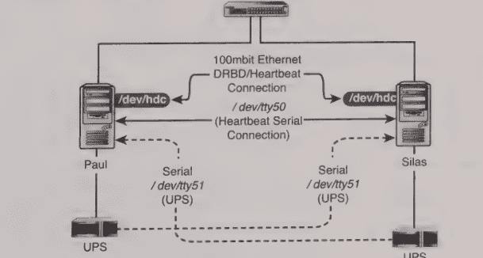

## 第 3 章：现实世界中的开源

现在你已经了解了集群的基础知识，可以进行组合，通过添加服务器和服务来创建任何满足你需求的配置。高可用集群可以从简单到非常复杂不等。你不需要在每台机器上镜像完全相同的服务。你可以指定机器 A 上的某个服务转移到 B 机器，而 A 上的另一个服务转移到 C 机器。如果你不想为每组服务器支付重复硬件的费用，可以配置一台机器作为其他几台机器的故障转移接收端。两三台机器同时故障导致目标服务器过载的可能性微乎其微。你也可以让活动服务运行在几台服务器上（没有空闲的机器），并转移到集群中运行其他服务的服务器上。

集群为存储配置提供了很大的灵活性。通过 `RAID`、镜像或条带的组合，而不是简单地从一台机器故障到另一台机器。你可以使用驱动器创建一个存储阵列。如果需要那种程度的冗余，这些存储系统也可以配置为转移到其他系统。可能性是无限的，通过互联网和 `iSCSI` 等技术，集群可以实现地理分布。

如果你曾想过多出一个“9”的可用性带给你什么，这里是根据特定可靠性水平，你一年内停机频率的总结。在 `Linux` 上使用高可用集群，很容易达到五个 9。

| 等级 | 可用性 | 每年停机时间 |
| :--- | :--- | :--- |
| 1 | 90.0000% | 37 天 |
| 2 | 99.0000% | 3.7 天 |
| 3 | 99.9000% | 8.8 小时 |
| 4 | 99.9900% | 53 分钟 |
| 5 | 99.9990% | 5.3 分钟 |
| 6 | 99.99999% | 32 秒 |

## 高性能集群

# 高性能计算

在 Linux 上的高性能计算方面，每个高性能集群由一个主节点（`master`）和尽可能多的从节点（`slave`）组成。今天一些最大的集群拥有超过 10,000 个节点。所有节点应具有相同的架构（Intel、Apple 等），并且为了获得最佳性能，硬件配置应该是相同的（慢速节点会拖慢整个集群）。因为主节点执行管理功能，强烈建议使用更多的内存和更快的网络、处理器和磁盘速度以获得更好的性能。

## 计算集群

每个节点上都安装了 Linux，要在集群上运行的应用程序则安装在主节点上。在将计算扩展到多台计算机以获得高性能结果之前，应用程序通常必须进行并行化（编写为可以利用多个处理器的形式）。例外是可以在不同数据集上反复运行的串行应用程序（`serial application`）。

集群软件（可以是 `Beowulf` 或任何其他开源或商业版本）也安装在主节点和集群中的每个节点上。高性能集群软件包含了消息传递库（`message-passing libraries`），它们促进了节点之间的高速通信。高效高性能集群还需要节点之间的高速连接。这可以使用几种方法提供，例如以太网、千兆以太网或商业高带宽、低延迟互连技术之一。

### 图 3.13

高性能集群由主节点和从节点组成。

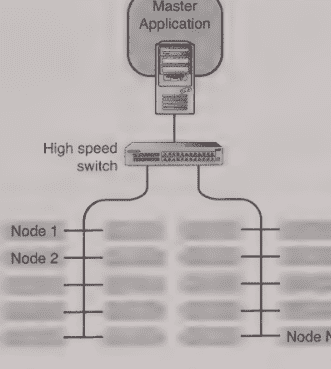

## 第 3 章：现实世界中的开源

从本质上说，配备超线程技术的处理器对于应用程序而言表现为两个逻辑处理器。根据应用程序逻辑，在两个逻辑处理器上执行可以提供更好的整体性能。

多线程或启用 SMP（对称多处理）支持的应用程序可以自动利用超线程技术，为电子商务和企业级软件实现带来更好的性能。特定的微调将进一步增强性能。Novell SUSE 和 Intel 工程师团队紧密合作，确保 SSE 能够利用 Xeon 处理器中的 Intel 超线程技术。

## 网格计算

网格计算的目标是创建独立于特定资源（处理器、内存、存储、网络）的虚拟系统，按需提供计算能力。从理论上讲，网格系统可以根据“需要”提供按需要求的多少或或少的系统资源。这类似于电网，电网中你只需为电表显示的用量付费。网格计算可以为一组或多个小组服务，为一家公司或多家公司服务——网格并不一定绑定到特定的组织单元、企业基础设施或地理位置。Linux 正在成为许多企业以及特定行业服务提供商网格计算的关键要素。

其工作原理如下：Linux/开源技术有助于创建计算网格或解决方案，这些解决方案可以显著扩展以适应不断增加的负载。这些包括负载均衡、故障转移、多处理和集群，以及 Web 服务技术、认证和管理。以 Linux 为中心的技术为创建可扩展的组合或网格服务提供了高度的灵活性，并基于开放标准。这种灵活性结合开放性，使得创建全面或复杂的解决方案成为可能，通过添加更多开源组件即可轻松实现扩展。这些 Linux 和开源应用程序就像构建块，可以相互连接、组合和复制，以创建全球网格化解决方案，服务从微小到巨大的需求。

网格计算允许你根据需要添加或减少服务或底层硬件。如果你正在运行季度财务报告，并在周末需要大量的额外计算能力？可以从网格中调取——这是一个在周通常满载但在周末空闲的资源池。到周一早晨，所有的 CPU 周期将恢复供常规使用。这一概念也扩展到了数据，如实际应用集群 (`RAC`) 等应用程序。

## 数据中心基础设施

Oracle 的网格解决方案提供了可以在平台间自由漂浮且不绑定到特定机器的数据库。这类解决方案越来越多地在刀片硬件上获得支持——由 IBM、SUN、HP、Dell 等制造的专门用于网格机器是 Linux 的理想选择。

IBM 和 Novell SSE 合作，利用 `Globus Toolkit` 为 Linux 和 IBM zSeries 计算机提供网格能力，`Globus Toolkit` 是一系列软件和服务和库，旨在促进网格系统的创建。在 zSeries 计算机（大型主机）上，可以运行数百个 Linux 实例，并根据网格需求动态添加或删除实例。

## 终端服务/瘦客户端

Linux 桌面将在稍后部分详细讨论，但值得注意的是，企业应用程序可以在数据中心进行配置，所有的处理和数据操作都发生在后端，只在客户端显示。这通过开放标准/Linux 技术可以实现，包括 X Windows、Web 服务和某种形式的终端服务。通过 Linux，任何计算机都可以作为另一台计算机的客户端。运行在某台机器上的图形显示和界面可以通过 `Xfree86`（X Windows 的开源版本）控制另一台机器上的应用程序或数据处理。这是真正的分布式计算，并使得广泛的集中式和中央管理的应用程序成为可能。

正如之前过的，Web 服务应用程序也让仅带有浏览器的瘦客户端能够访问、交互并控制企业级应用程序。许多主要的 ERP 解决方案现在都有基于 Web 的客户端，允许用户通过互联网上任何位置的简单浏览器完全访问应用程序数据。

最后，使用多种 Linux 启动技术之一（如 `PXE Boot`），可以创建无磁盘瘦客户端工作站，它们可以访问“胖型”服务器上的所有服务。一个示例场景是使用软盘启动版本的 Linux 启动客户端并连接到服务器——不需要本地硬盘硬盘。然后，服务器将托管或提供对所有应用程序的访问，包括浏览器、办公应用、ERP、大型机访问或 Web 服务应用程序。一切都是中心化的，并由公司 IT 部门进行管理，工作站端几乎不需要任何支持。组织可以在几分钟内为几个到数千个用户提供服务。瘦客户端的实现与良好的网格计算特别契合，使得能够在极少管理或支持工作的情况下大幅扩大或缩小规模。

## 多站点集群

集群在之前的章节中已经介绍过，但在这里再次提到是为了是为了说明它是企业故障转移、高可用性和冗余要求的价值工具。可以使用 VPN 或互联网将地理上的远程站点纳入集群的一部分。例如，主存储区域网络 (`SAN`) 可能位于 A 站，满足特定企业应用程序的数据需求。如果 A 站的 `SAN` 发生故障，则 B 站有镜像 `SAN` 可用。`SAN` 服务的应用程序也可以分离并镜像到其他站点的其他集群，这样在 A 站或 B 站发生任何情况时就有了多站点故障转移网络。高可用集群网络可以使用 Linux 提供的技术建立。加上如 Novell 的 `iSCSI SAN` 等技术，冗余存储阵列可以为互联网上任何地方的紧急情况做好准备。

## 存储

Linux 包含的高端存储能力有利于数据中心级存储解决方案。日志记录文件系统 (`JFS`) 是一种完整的 64 位文件系统，可以支持非常大的文件和分区，是高性能系统的理想选择。。最大文件大小可达 8EB。Novell 存储服务 (`NSS`) 提供了用于备份和版本的快照文件服务。

## 平台支持

Linux 是你可以在任何平台上使用的（从 Atari 到 IBM S390 大型机）唯一操作系统。对于许多应用程序，目前的 x86 架构绰绰有余。但如果你的应用程序需要更先进的硬件，AMD 64 和 Opteron 支持 Linux，Intel 安腾处理器家族 (`IPF`) 也是如此。IBM POWER 系列（64 位）用于 IBM iSeries 和 pSeries 也受支持。Linux 也支持 IBM zSeries。在这些系统上，Linux 可以虚拟化，使得在单台机器上运行数百个 Linux 实例成为可能，每个实例都是独立的操作系统。

### 表 3.5：IBM 硬件上的 Linux 从桌面工作站扩展到最大的大型主机

| 基于 Intel 的服务器的 LINUX | |
| :--- | :--- |
| IBM eServer x | 刀片、1-2 路服务器、工作站、32 位、64 位 |
| IBM eServer Cluster | 高性能集群互连 |
| 基于 POWER 的 LINUX | |
| :--- | :--- |
| IBM eServer OpenPower | 64 位 POWER 服务器 |
| IBM eServer pSeries | 32/64 位、双操作系统、8 路虚拟化服务器池、高级逻辑分区 (`LPAR`)、按需容量、虚拟存储和虚拟以太网 |
| IBM eServer iSeries | |
| 基于 AMD 的 LINUX | |
| :--- | :--- |
| IBM eServer 325 | 64 位双路 AMD Opteron |
| 基于 IBM 大型机的 LINUX | |
| :--- | :--- |
| IBM zSeries S/390 大型机 | 虚拟化和动态分配，单台服务器上运行数百个独立的 Linux 服务器 |

表 3.5 中提到的每种技术都可以用于提供企业级、全数据中心应用程序和服务，且 Linux 兼容或支持所有这些。将 Linux 与商业应用程序和服务相结合，可以以更少的资本支出和管理工作为任何企业公司提供所需的容量和处理能力。

## 企业级应用

到这里，你可能已经在认为你的公司完全可以运行在 Linux 和开源系统上了。即使是支持最大规模实施的所需的基础设施、网络服务和应用服务都是可用的，而且确实有 Web 服务组件可以让你创建自己的应用程序。但如果你想使用那些成熟的应用程序 ISV（软件解决方案供应商）呢？领先的企业级应用在 Linux 上可用吗？那是肯定的！

本节将简要回顾 Linux 上已经可以提供的哪些企业级应用，以及这些供应商提供的一些开源集成解决方案。其中许多公司在使用在前一节讨论过的企业级数据中心解决方案来部署其历史上取得成功的应用程序。在许多情况下，来自 Oracle 等 ISV 的企业级应用在 Linux 上能够提供性能优越的服务。

对于企业级 ISV 将应用迁移或开发到 Linux，其优势是多方面的。首先，客户的解决方案总成本会降低，减少了操作系统许可费的减少、硬件成本的降低以及管理的简化。其次，ISV 可以将其现有的产品线和专业知识扩展到新市场，这些市场可能对价格更敏感、对安全更关注，或者正处于 Linux 迁移或整合的过程中。ISV 还可以通过使用单一代码库创建解决方案的能力来简化开发工作，该代码可以从简单的 x86 处理器一直扩展到 IBM 主机。其他优势还包括利用开源组件的能力，如 Web 服务器、应用服务器、消息服务、存储以及高性能或高可用性架构。

## Oracle

Oracle 自 Linux 出现以来就对其非常认真。正如前面提到的，随着 Oracle 10g 的发布，Linux 已经成为所有 Oracle 开发的内部开发平台。Oracle 声称是 Linux 上提供的首个商业数据库，从那时起，它已经积累了足够的 Linux 知识和信心，能够为支持 Oracle 技术栈的 Oracle 客户提供 Linux 操作系统的无缝且完整的技术支持。所有的 Oracle 产品，包括带有 Real Application Clusters（RAC）的 Oracle Database 10g、Oracle Application Server 10g、Oracle Collaboration Suite、Oracle Developer Suite 10g 以及 Oracle E-Business Suite 均可在 Linux 上。

Oracle 与主要的 Linux 发行版合作，测试并优化操作系统，以有效处理关键任务应用程序。Oracle 与 Novell SUSE 合作，在性能、可靠性、集群和管理领域创建了一系列核心增强功能，以支持 Oracle 客户的企业级部署。Oracle 还通过为 Oracle Cluster File System 等产品贡献源代码来支持开源社区。到 2004 年年中，已有超过 140 万份 Linux 版 Oracle 产品从 Oracle Technology Network 下载。

与 Novell 一样，Oracle 也以各种方式在内部部署了 Linux，以使其基础设施更高效、成本更低。Oracle 内部 IT 组织通过分析发现，基于 Linux 的系统是降低 IT 基础设施成本的最有效方法之一。

## IBM

如前所述，IBM 对 Linux 做出了全硬件承诺，其销售的每一个硬件平台都运行 Linux。这还扩展到了 IBM 广泛的软件产品线。表 3.6 简要概述了 IBM 为多个行业的企业提供的解决方案，这些解决方案在 Linux 以及 IBM 硬件上均可用。

### 表 3.6 IBM 解决方案

| 解决方案 | 说明 |
|---|---|
| WebSphere | 具有企业级应用、门户和商用能力的商用 Web 应用程序服务器 |
| DB2 | 关系型数据库和企业级同步架构 |
| Tivoli | 针对数据、服务、应用程序、操作系统、硬件等的全面的 IT 安全管理器 |
| Finance Foundation | 针对金融或资本市场的实时安全和风险分析 |
| Multimedia Kiosk | 针对零售、旅游、交通、制造、金融和政府的亭式解决方案 |
| Domino | 为 Lotus Notes 用户提供的 Web 访问 |

此外，IBM 在 IBM 硬件和 Linux 上支持大量的合作伙伴 ISV 解决方案。解决方案涵盖各种应用程序，包括工程与分析、银行卡授权、销售点（POS）、ERP、会计、供应链和配送管理。

## 第 3 章：现实世界中的开源

## SAP

SAP 是首批提供关键业务应用的软件供应商之一。由于 Oracle 10g 发布，Linux 是所有 Oracle 开发的内部开发平台。Oracle 声称是 Linux 上提供的第一个商业数据库，并在此积累了足够的知识和信心，能够为 Oracle 客户提供除 Oracle 技术栈之外的 Linux 操作系统的无缝且完整的技术支持。所有的 Oracle 产品，包括带有 Real Application Clusters 的 Oracle Database 10g、Oracle Application Server 10g、Oracle Collaboration Suite、Oracle Developer Suite 10g 以及 Oracle E-Business Suite 均可在 Linux 上运行。

Oracle 与主要的 Linux 发行版合作，测试并优化操作系统，以有效处理关键任务应用程序。Oracle 与 Novell SUSE 合作，在性能、可靠性、集群和管理领域创建了一系列核心增强功能，以支持 Oracle 客户的企业级部署。Oracle 还通过为 Oracle Cluster File System 等产品贡献源代码来支持开源社区。到 2004 年年中，已有超过 140 万份 Linux 版 Oracle 产品从 Oracle Technology Network 下载。

与 Novell 一样，Oracle 也以各种方式在内部部署了 Linux，以使其基础设施更高效、成本更低。Oracle 内部 IT 组织通过分析发现，基于 Linux 的系统是降低 IT 基础设施成本的最有效方法之一。

## IBM

如前所述，IBM 对 Linux 做出了全硬件承诺，其销售的每一个硬件平台都运行 Linux。这还扩展到了 IBM 广泛的软件产品线。表 3.6 简要概述了 IBM 为多个行业的企业提供的解决方案，这些解决方案在 Linux 以及 IBM 硬件上均可用。

### 表 3.6 IBM 解决方案

| 解决方案 | 说明 |
|---|---|
| WebSphere | 具有企业级应用、门户和商用能力的商用 Web 应用程序服务器 |
| DB2 | 关系型数据库和企业级同步架构 |
| Tivoli | 针对数据、服务、应用程序、操作系统、硬件等的全面的 IT 安全管理器 |
| Finance Foundation | 针对金融或资本市场的实时安全和风险分析 |
| Multimedia Kiosk | 针对零售、旅游、交通、制造、金融和政府的亭式解决方案 |
| Domino | 为 Lotus Notes 用户提供的 Web 访问 |

## 第 3 章：现实世界中的开源

## SAP

SAP 是首批提供关键业务应用的软件供应商之一。由于 Oracle 10g 发布，Linux 是所有 Oracle 开发的内部开发平台。Oracle 声称是 Linux 上提供的第一个商业数据库，并在此之后积累了足够的知识和信心，能够为 Oracle 客户提供除 Oracle 技术栈之外的 Linux 操作系统的无缝且完整的技术支持。所有的 Oracle 产品，包括带有 Real Application Clusters 的 Oracle Database 10g、Oracle Application Server 10g、Oracle Collaboration Suite、Oracle Developer Suite 10g 以及 Oracle E-Business Suite 均可在 Linux 上运行。

Oracle 与主要的 Linux 发行版合作，测试并优化操作系统，以有效处理关键任务应用程序。Oracle 与 Novell SUSE 合作，在性能、可靠性、集群和管理领域创建了一系列核心增强功能，以支持 Oracle 客户的企业级部署。Oracle 还通过为 Oracle Cluster File System 等产品贡献源代码来支持开源社区。到 2004 年年中，已有超过 140 万份 Linux 版 Oracle 产品从 Oracle Technology Network 下载。

## IBM

如前所述，IBM 对 Linux 做出了全硬件承诺，其销售的每一个硬件平台都运行 Linux。这还扩展到了 IBM 广泛的软件产品线。表 3.6 简要概述了 IBM 为多个行业的企业提供的解决方案，这些解决方案在 Linux 以及 IBM 硬件上均可用。

### 表 3.6 IBM 解决方案

| 解决方案 | 说明 |
|---|---|
| WebSphere | 具有企业级应用、门户和商用能力的商用 Web 应用程序服务器 |
| DB2 | 关系型数据库和企业级同步架构 |
| Tivoli | 针对数据、服务、应用程序、操作系统、硬件等的全面的 IT 安全管理器 |
| Finance Foundation | 针对金融或资本市场的实时安全和风险分析 |
| Multimedia Kiosk | 针对零售、旅游、交通、制造、金融和政府的亭式解决方案 |
| Domino | 为 Lotus Notes 用户提供的 Web 访问 |

## 第 3 章：现实世界中的开源

## 企业级应用

到这里，你可能已经在认为你的公司完全可以运行在 Linux 和开源系统上了。即使是支持最大规模实施的所需的基础设施、网络服务和应用服务都是可用的，而且确实有 Web 服务组件可以让你创建自己的应用程序。但如果你想使用那些成熟的应用程序 ISV（软件解决方案供应商）呢？领先的企业级应用在 Linux 上可用吗？那是肯定的！

本节将简要回顾 Linux 上已经可以提供的哪些企业级应用，以及这些供应商提供的一些开源集成解决方案。其中许多公司在使用在前一节讨论过的企业级数据中心解决方案来部署其历史上取得成功的应用程序。在许多情况下，来自 Oracle 等 ISV 的企业级应用在 Linux 上能够提供性能优越的服务。

对于企业级 ISV 将应用迁移或开发到 Linux，其优势是多方面的。首先，客户的解决方案总成本会降低，减少了操作系统许可费、硬件成本的降低以及管理的简化。其次，ISV 可以将其现有的产品线和专业知识扩展到新市场，这些市场可能对价格更敏感、对安全更关注，或者正处于 Linux 迁移或整合的过程中。ISV 还可以通过使用单一代码库创建解决方案的能力来简化开发工作，该代码可以从简单的 x86 处理器一直扩展到 IBM 主机。其他优势还包括利用开源组件的能力，如 Web 服务器、应用服务器、消息服务、存储以及高性能或高可用性架构。

## Oracle

Oracle 自 Linux 出现以来就对其非常认真。正如前面提到的，随着 Oracle 10g 的发布，Linux 已经成为所有 Oracle 开发的内部开发平台。Oracle 声称是 Linux 上提供的首个商业数据库，从那时起，它已经积累了足够的知识和信心，能够为 Oracle 客户提供除 Oracle 技术栈之外的 Linux 操作系统的无缝且完整的技术支持。所有的 Oracle 产品，包括带有 Real Application Clusters 的 Oracle Database 10g、Oracle Application Server 10g、Oracle Collaboration Suite、Oracle Developer Suite 10g 以及 Oracle E-Business Suite 均可在 Linux 上运行。

Oracle 与主要的 Linux 发行版合作，测试并优化操作系统，以有效处理关键任务应用程序。Oracle 与 Novell SUSE 合作，在性能、可靠性、集群和管理领域创建了一系列核心增强功能，以支持 Oracle 客户的企业级部署。Oracle 还通过为 Oracle Cluster File System 等产品贡献源代码来支持开源社区。到 2004 年年中，已有超过 140 万份 Linux 版 Oracle 产品从 Oracle Technology Network 下载。

与 Novell 一样，Oracle 也以各种方式在内部部署了 Linux，以使其基础设施更高效、成本更低。Oracle 内部 IT 组织通过分析发现，基于 Linux 的系统是降低 IT 基础设施成本的最有效方法之一。

# IBM

如前所述，IBM 对 Linux 做出了全硬件承诺，其销售的每一个硬件平台都运行 Linux。这还扩展到了 IBM 广泛的软件产品线。表 3.6 简要概述了 IBM 为多个行业的企业提供的解决方案，这些解决方案在 Linux 以及 IBM 硬件上均可用。

### 表 3.6 IBM 解决方案

| 解决方案 | 说明 |
|---|---|
| WebSphere | 具有企业级应用、门户和商用能力的商用 Web 应用程序服务器 |
| DB2 | 关系型数据库和企业级同步架构 |
| Tivoli | 针对数据、服务、应用程序、操作系统、硬件等的全面的 IT 安全管理器 |
| Finance Foundation | 针对金融或资本市场的实时安全和风险分析 |
| Multimedia Kiosk | 针对零售、旅游、交通、制造、金融和政府的亭式解决方案 |
| Domino | 为 Lotus Notes 用户提供的 Web 访问 |

此外，IBM 在 IBM 硬件和 Linux 上支持大量的合作伙伴 ISV 解决方案。解决方案涵盖各种应用程序，包括工程与分析、银行卡授权、销售点（POS）、ERP、会计、供应链和配送管理。

## 第 3 章：现实世界中的开源

# SAP

SAP 是首批提供关键业务应用的软件供应商之一。由于 Oracle 10g 发布，Linux 是所有 Oracle 开发的内部开发平台。Oracle 声称是 Linux 上提供的第一个商业数据库，并在此之后积累了足够的知识和信心，能够为 Oracle 客户提供除 Oracle 技术栈之外的 Linux 操作系统的无缝且完整的技术支持。所有的 Oracle 产品，包括带有 Real Application Clusters 的 Oracle Database 10g、Oracle Application Server 10g、Oracle Collaboration Suite、Oracle Developer Suite 10g 以及 Oracle E-Business Suite 均可在 Linux 上运行。

Oracle 与主要的 Linux 发行版合作，测试并优化操作系统，以有效处理关键任务应用程序。Oracle 与 Novell SUSE 合作，在性能、可靠性、集群和管理领域创建了一系列核心增强功能，以支持 Oracle 客户的企业级部署。Oracle 还通过为 Oracle Cluster File System 等产品贡献源代码来支持开源社区。到 2004 年年中，已有超过 140 万份 Linux 版 Oracle 产品从 Oracle Technology Network 下载。

## 第3 章：现实世界中的开源

虽然某些选项比其他选项更好，但在涉及开源时，应该由客户来决定。开源邮件解决方案包括 `Postfix` 和 `Sendmail`。Linux 上也提供了许多商业电子邮件软件包，但强烈推荐使用 Novell `GroupWise`。

### 背景

在描述可用哪些解决方案之前，花一点时间概述邮件架构是值得的。邮件解决方案通常不是运行在单台机器上的单一应用程序包，而是一系列相互连接的服务的分布式集合，需要多个元素才能将邮件从一个点传输到另一个点。这种分布式特性在考虑如何部署或实施电子邮件时，提供了一定的灵活性。邮件解决方案的常见元素包括：

- `SMTP` 消息传输代理——包括简单邮件传输协议 (`SMTP`) 代理，它们充当邮件邮员的角色，将邮件从一个位置传输到另一个位置。这些进程负责将发出的邮件定向到其他位置的 `SMTP` 代理。它们还负责将来自其他位置的入站邮件定向到本地 `POP` 或 `IMAP` 服务器。
- `POP/IMAP` 消息传输代理——邮局协议 (`POP`) 和互联网消息访问协议 (`IMAP`) 代理将用户特定的消息存储（有时称为邮局）中的邮件传输到单个用户客户端。`POP` 和 `IMAP` 的功能略有不同：在 `POP` 中，所有消息都从消息存储器移动到消息客户端；在 `IMAP` 中，消息可以保留在消息存储中以便进行访问和操作。
- `DNS`——域名服务器充当 `SMTP` 代理的本地或全网查找表。使用 `DNS`，`SMTP` 代理可以根据电子邮件地址的域名确定接收 `SMTP` 代理的正确 IP 地址。
- `LDAP`——轻量级目录访问协议 (`LDAP`) 目录通常用作控制列表，授权访问消息传输代理 (`MTA`)。`LDAP` 目录还被用作白页，用于查找个人的电子邮件地址。
- 电子邮件客户端——客户端应用程序与 `POP/IMAP` 消息传输代理（通常常称为服务器）交互，以发送、检索和组织电子邮件及邮件附件。
- Web 访问——一个常见的邮件需求是能够在任何地方无需邮件客户端即可访问电子邮件。这通过 Web 服务器和基于 Web 的邮件访问服务的组合来实现。
- 邮件保护——对生产力和邮件安全至关重要的是防止病毒和过滤垃圾邮件的能力。这包括带有扫描和删除策略的动态病毒或垃圾邮件识别过滤器。

目前有多种可行的开源邮件解决方案，以及许多符合标准的商业电子邮件应用程序。根据所需的功能水平，领先的开源解决方案对于企业组织是可行的。大多数互联网服务提供商 (`ISP`) 使用开源邮件解决方案，为成千上万的用户提供基于客户端和基于 Web 的邮件访问。通过适当的可扩展负载均衡技术，这些解决方案具有良好的扩展性，并能够充分提供基础电子邮件服务。

最常见的开源邮件解决方案由以下一个或多个组件组成：

- `Sendmail`——`Sendmail` 是一种流行的 Unix 和 Linux 系统的开源消息传输代理。`Sendmail` 起于 20 世纪 80 年代的加州克分大学，是 ARPANET `delivermail` 程序（互联网首个邮件服务）的重写。估计 `Sendmail` 运行着互联网上 40% 以上的邮件服务器，因此它具有对大量用户有用的功能。`Sendmail` 的批评者声称它难以管理且速度缓慢。`Sendmail` 包含了 `SMTP` 和 `POP/IMAP` 代理。
- `Postfix`——`Postfix` 的开发是作为 `Sendmail` 的一种快速、易于管理的替代方案。它最初在 IBM T.J. Watson 研究中心作为 `Vmailer` 和 IBM Secure Mailer 开发。它不会从 root 用户发送邮件，可以在不关机的情况下重新加载设置，并可以使用标准数据库存储配置信息。`Postfix` 还包含 `SMTP` 和 `POP/IMAP` 传输。
- 邮件客户端——几个流行的开源邮件客户端与 `Sendmail` 或 `Postfix` 配合。Mozilla (`Netscape Communicator`) 邮件组件在新的 Mozilla 版本 `Thunderbird` 和 `Firefox` 中得到了增强。Linux Links 的“Mail Clients”部分包含了 117 个不同的开源客户端条目。常见的基于 Windows 的电子邮件客户端包括 `Outlook`、`Pegasus` 和 `Eudora`（注：原文此处提到开源邮件客户端与 `Sendmail` 或 `Postfix` 配合，后文未列出所有 117 个）。

### 第3 章：现实世界中的开源

硬件、操作系统、标准、应用等差异往往会对管理复杂性产生倍增效应。软件开发也是如此，任何被消除或整合的变量都可以减少对管理、支持和资本成本的需求。

最而易见的简化方法是消除对多个平台支持的需求。你不想管理两个版本的应用程序——一个用于 Windows，另一个用于 Linux。得益于包括 `Mono` 和 Novell `extend` 在内的多项技术，你并不需要这样做。使用 `Mono` 框架，可以创建一个同时在 Linux 和 Windows 上运行的应用程序版本，并利用各自的最新技术。通过 Novell `extend`，企业应用开发者可以强大地结合身份、集成和门户服务，以交付相关的业务信息和服务。此外，通过开源 `AMP` 技术（`Apache`、`MySQL`、`Perl/PHP/Python`），开发者可以创建出 Web 可访问、平台无关、可扩展且安全的应用程序。开发者拥有编程的灵活性，且不受选择限制。

#### Mono

`.NET` 被设计为一个快速应用程序开发平台，旨在通过允许开发者在无需担心网络服务或操作系统的情况下编写应用程序来简化编程。其核心思想是：你用任何语言编写模块化的应用程序组件，它们就可以运行在任何操作系统上，并访问互联网和网络服务。这是通过创建一个通用语言基础设施（`CLI`）实现的，它本质上是一种虚拟机。不同的编程语言被转换为通用的中间语言（`CIL`），然后由虚拟机运行。这是一个极佳的主意，但缺点是——它支持的操作系统家族只有 Windows。

`Mono` 的开发作为一个更具包容性的开源解决方案而生的，能够容纳 Unix、Linux 以及 Windows。其目标是让 Unix/Linux 开发者能够构建并部署运行在所有平台上的应用程序，包括 Windows、Unix/Linux、NetWare 和 Mac OS。`Mono` 最大的处也许是它允许为 `.NET` 编写的应用程序运行在 Unix 和 Linux 上。开发者不必对支持哪些操作系统做出排他性决定，而是专注于满足市场需求、跨平台的多系统解决方案。

`Mono` 包含一个 (`.NET`) 通用语言基础设施（`CLI`）虚拟机。该 `CLI` 虚拟机包含类加载器、即时编译器（`JIT compiler`）和垃圾回收运行时。它还包含了类库（包括 `.NET` 和 `Mono`），这些类库可以与任何支持的语言配合，并包含一个 `C#` 语言的编译器。支持的语言包括 `Managed C++`、`JavaScript`、`Eiffel`、`Component Pascal`、`APL`、`Cobol`、`Perl`、`Python`、`Scheme`、`Smalltalk`、`Standard ML`、`Haskell`、`Mercury` 和 `Oberon`。`Mono` 还包含了便于创建产品 API 的工具。

谈到 `Mono`，你不禁好奇它的名字从哪里来。根据 `Mono` 官网 `http://www.mono-project.com`，“`Mono`” 是西班牙语中“猴子”的意思。我们很喜欢猴子。

Mono 最初由 Miguel de Icasa 开发，并由 Ximian 赞助（Ximian 现在是 Novell 的一部分）。需要注意的是，即使 Mono 起始于 Ximian，Novell 并不拥有 Mono。Novell 将继续维护并支持 Mono。Novell 正在开发 Mono 的某些组件，这些组件正处于发布开发和执行环境的关键路径。发布后，它将遵循所有开源软件的演进路径。Novell 将根据客户的需求和请求提供围绕 Mono 的支持和咨询服务。微软向 ECM（国际信息和通信系统标准化组织）贡献了若干技术，这些技术也是 Mono 项目的一部分。

## Novell extND

Novell extND 是一个用于快速开发和部署面向服务的 Web 的全面套件。通过 Novell extND，应用开发者可以强大地结合身份、集成和门户服务，在适当的时间向正确的人员安全地交付相关的业务信息。extND 套件包括：

- 可视化开发工具，帮助你将旧系统转换为 Web 服务，将它们编排到业务流程中，并创建活动门户——无需编写单行代码
- 对 Linux 操作系统的支持，增加了了该行业对 NetWare、Windows、Solaris、HP-UX 和 AIX 最广泛的平台支持
- 符合多项行业标准，使用 XForms 提供与现有系统的集成（这简化了 Web 页面和表单的创建过程），以及 Portlet 1.0 规范（允许不同供应商的 portlet 运行

通过 Novell extND，你可以整合整个组织的 Web 服务和数据，以创建创新的业务解决方案。提供多种预包的 extND 解决方案，包括：

- 安全企业仪表板门户——将来自各种数据源和私有门户的业务信息整合到企业性能的单一综合视图中。
- Novell 合作伙伴门户——向受信任的合作伙伴、供应商和客户安全地开放信息和应用程序，使公司能够加强业务关系并提高效率

## 降低开发成本

显而易见的是，值得再次提到的是，使用 Linux 和开源可以大幅降低内部编程工作以及为 ISV（独立软件供应商）创建产品的成本。公司完全使用开源软件、实用程序和工具来创建可行的应用程序或服务是可能且可行的。

制造线管理程序可以使用 Apache、MySQL、JBoss 和 Mozilla 客户端，同时包含一些私有的脚本或二进制逻辑。整个解决方案不任何额外的版税费用要求。如果解决方案供内部使用，你可以根据需要安装任意数量的实例，而不会产生增量许可费用。如果你是 ISV，只需对私有元素授权，并免费包含开源组件即可。

使用 Linux 和开源创建解决方案可以从两个方面为公司提供竞争优势。首先，通过将解决方案的所有组件作为应用、操作系统和 Web 服务组件包含，解决方案变成了一个完整的包，无需去任何处让它运行起来——“开箱即用”。其次，如果你是 ISV，通过开源支持你的客户，他们的整个解决方案将更加廉廉，无需为操作系统、数据库或客户端授权。

最后，采用 Linux 作为开发平台并利用开源服务的开发者发现，其迁移成本微乎其微。如所述，大量现有的服务可以轻松组合以创建 Web 应用程序。这些包括领先的开源数据库 MySQL、脚本工具如 Perl、PHP 和 Python、Apache Web 服务器、应用服务器 JBoss 和 Tomcat，以及所有支持开放标准技术如 XML、SOAP、UDDI 等。此外，从 `http://www.hotscripts.com`、`http://www.sourceforge.net` 和 `http://forge.novell.com` 等网站可以获得数以千计的现有开源项目用于组合或利用。

在 C 或 Java 中开发的程序员可以通过微小的调整（如果没有需要的话）过渡到 Linux。在 Novell 观察到一个有趣的现象：开发热情有所提高，因为 Linux 作为一个平台非常有利于简洁、优雅的解决方案。开发者喜欢创建

这些是可以被利用、扩展并在广泛用途中发挥价值的解决方案。凭借 Linux 架构、模块化软件包以及可用的 Web 服务，开发者可以创建可重用组件库，为当前及未来的项目做出贡献。简而言之，在 Linux 上开发以及为 Linux 开发是非常酷的。其他采用 Linux 和开源作为开发平台/环境的 ISV 和 Novell 客户也有类似的经历。

## 高性能工作站

每个组织至少有一位或多个“高级用户”，这些人痴迷于榨取技术中每一分可能的能力。这可能是一个财务人员，他们正在建立复杂的定价模型以确定最佳回报率。这可能是一个营销人员，他们不断混合并传递各种模型，以确定目标客户是谁以及他们的购买习惯。这可能是一个工程师，他们为有限元分析连接着复杂的结构网络。无论这些人想要什么样的灵活性、性能和控制权，他们通常具有技术技能来实现他们发现的任何想法。

作为 IT 经理，你的工作应该是释放这些个体。通过他们需要但不想担心的服务来支持他们。你确保他们拥有连接、存储、备份，并免受未经授权入侵者的入侵、免受病毒和停机的影响等。同时，你必须确保所有其他 IT 资产受到保护。

那么，Linux 和开源对这些“高级用户”的优势是什么？这些优势可以分为四类：性能、灵活性、可编程性和成本。

## 性能

Linux 为工作站提供了一些强大的性能能力。首先，运行在 Linux 上或使用任何开源解决方案（如数据库）的应用程序具有极佳的扩展选项。这些优势之前在服务器端提到过，但高级用户可以利用所有的 Linux 扩展选项，包括对称多处理、NUMA、集群、SANS 等。此外，广泛的工作站扩展选项正在从 x86 硬件平台转向 64 位，甚至是主机。可以根据需要增进地获得更多性能，而无需承担完全更换的成本。Linux 的性能让高级用户具备了“以更少投入做更多事”的能力，但他们通常会利用最优秀的工具完成最多的工作。

## 第 3 章：现实世界中的开源

## 灵活性

Linux 在创建解决方案和共享结果方面，为高级用户提供了广泛的灵活性。可以将多台机器结合在一起进行联合计算或信息共享。无论机器是本地的还是远程的，通过相同的 X Windows 界面同时访问一台或多台机器的能力是非常强大的。凭借各种可用服务和实用程序，加上开源项目的选择，高级用户通常可以找到符合其需求的解决方案，或与那些正在解决相同类型问题的人进行协作。

此外，使用 Linux 和开源进行共享或协作是非常灵活且安全的，具有 FTP、Web 服务器、密码保护访问等功能。高级用户可以使用与系统管理员相同的技术，授予或限制对合作者、合作伙伴或公司其他小组的访问权限。定价向导可以安全地为营销部门提供访问，以便他们可以在特定的定价条件下运行带有预测销售数字的模拟场景。

## 可编程性

Linux 和开源提供了巨大的开发辅助工具箱，范围从简单的脚本到你认为任何复杂的面向对象编程。高级用户通常需要修改输入或输出的能力。他们还需要与感兴趣的利益相关者共享信息的能力。开源允许他们做到。结果可以使用 Web 可访问的数据库显示。分析结果可以使用 Web 服务器共享。可以实现自动化流程，并向一个或数千人发送更新或更改通知。

强大的脚本赋予了用户操纵数据库、控制测试场景、产生迭代测试等许多能力。采用 Linux 的 Novell 客户评价说，尽管 Linux 初步看起来比 Windows 复杂，但一旦学会，它不仅更简单，而且强大得多。Linux 和开源解决方案的模块化、分布式、开放、基于 Web 的特性提供了更丰富的开发环境，可以跨平台、跨位置和跨应用程序利用。

## 成本

到目前，这是一个一致的主题，带有开源的 Linux 是低成本的替代方案。即使特殊应用程序是专有的，由于硬件要求的降低和许可费用减少，Linux 上的总成本通常更低。开发内部应用程序可能更便宜，而且可以在不增加版权要求的情况下进行利用。

如果你的高级用户是那种不断寻找技术最大化的类型，那么他们很有可能已经安装了双系统启动。

## 总结

本章涵盖了为什么开源在现实世界中成功，下一章将关注 NetWare 的历史。

# 第 4 章：NetWare 历史

要真正理解 NetWare，你必须了解它的历史。在整个 20 世纪 80 年代和 90 年代初，PC 的接受度迅速增长，NetWare 成为许多实现中事实上的选择操作系统 (NOS)。

1979 年，该公司以 Novell 的名义成立。1981 年，NetWare 的第一个版本在犹他州出现。1983 年，Novell Data System 改名为 Novell。NetWare 的第一个版本主要侧重于文件服务器，其中一台中央计算机负责控制访问和资源。

直到 3.x 系列，所有 NetWare 版本都使用平直文件数据库结构（称为 bindery 索引文件）来存储所有用户和资源信息。尽管这在企业局域网 (LAN) 中运行良好，但它限制了网络增长规模。

Novell 决心打破企业的障碍，于 1993 年发布了 NetWare 4。NetWare 4 取消了 bindery，并提供了 NetWare Directory Services (NDS)。NDS（在后续版本中代表 Novell Directory Services）将用户和资源数据库分到整个企业的服务器上，从根本上让世界变成了它的网络。现在一个办公室的用户可以在无需登录每个服务器的情况下访问另一个办公室服务器上的资源。

NDS 是 eDirectory 的祖先，现在服务着相同的目的，只是规模大得多。eDirectory 在 1999 年首次出现。

意识到互联网是全球网络的工具后，Novell 在 20 世纪 90 年代中期在 John Young 的指导下决定开始放弃其闻名的专利 IPX/SPX 协议，并拥抱 TCP/IP 网络化。NetWare 4.11（称为 IntraNet）提供了 TCP/IP 选项。

NetWare 5 通过包含原生支持将 TCP/IP 标准化。NetWare 6 扩展了这种接受度，包含了更多旨在通过任何支持 Web 的设备的浏览器利用互联网维护网络的实用程序。

最后，NetWare 6.5 在 6 版本的基础上进行了扩展，提供了在整个组织范围内部署开源技术以及通过基于浏览器的界面管理项目的能力。该版本侧重于为虚拟办公室增加价值、维护业务连续性，并提供可用的最强大的 Web 服务。“一体网络”（One Net）是创建该版本的核心准则。

在公司方面，Jack Messman 在 2001 年接替了 1997 年继任的 Eric Schmidt，第二次继任了 Novell 的首席执行官（CEO）。Messman 先生至今仍领导着该公司，如今公司现已成为开源运动的领导者，并正准备发布其迄为止最强大的操作系统。

## 入学者 NetWare 指南

要理解 Open Enterprise Server (OES) 提供了什么，了解 NetWare 演变而来的环境会有帮助。在 4 版本之前的 NetWare 版本使用了大量的命令行工具和简单的菜单。

4 版本引入了用于管理的图形化工具，其中许多工具已经演变成为如今的基于浏览器的实用程序。后续章节中提到了这些工具中的许多，但以下列表总结了你在为 OES 准备环境时可能需要的一些故障排除工具和实用程序。

### 管理工具

以下工具可以帮助你诊断故障并管理网络：

- `ConsoleOne`—这种兼容网络的、基于 Java 的工具允许你从浏览器快速、方便地管理网络资源。
- `iManager`—此基于 Web 的应用程序可以在你的浏览器界面内用于管理、维护和故障排除 eDirectory。
- `iMonitor`—此工具提供了从 Web 浏览器内部对 eDirectory 树中所有服务器进行监控和诊断的能力。
- `Remote Manager`—理解此工具最简单的方法是想象你正坐在服务器控制台前。Remote Manager 让你在 Web 浏览器中获得服务器控制台可以使用的所有功能。

### 客户端工具

以下工具（主要是命令行命令）可以帮助你排除网络客户端的故障：

- `ARP`—显示地址解析协议缓存。这对于识别 MAC 地址有用。
- `IPCONFIG`—显示每个绑定到 TCP/IP 的网络适配器的客户端 IP 地址、子网掩码和默认网关。在某些基于 Windows 的操作系统中，可以通过 `WINIPCFG` 而不是 `IPCONFIG` 获取这些信息。
- `NETSTAT`—显示客户端 TCP/IP 连接协议操作的详情。
- `ROUTE`—显示客户端使用的路由表。可以使用该程序配合多个参数来添加、删除和修改路由表条目。

### IP/IPX 工具

以下工具（主要是命令行命令）可以帮助排除 IP 和 IPX 协议的故障：

- `CONFIG`—返回有关文件服务器的信息，包括名称、加载的驱动程序等。
- `DEBUG`—通过多个 DEBUG 屏幕帮助你识别并解决 TCP/IP 通信问题。
- `NSLOOKUP`—查询域名系统（DNS）名称服务器，让你能够识别服务器的 DNS 配置、诊断 DNS 设置问题，并识别服务器应用程序中的 DNS 问题。
- `PING`—检查远程主机是否可用。
- `TCPCON`—监控 TCP/IP 操作。此服务器控制台实用程序可以显示网络网段、协议和路由表状态的详细信息。
- `TRACERT`—显示到达远程主机的路径。

## 为选择 Novell 和开源

Novell 是为混合、开放和专有 IT 提供最完整技术栈的开源替代方案。Linux、开源技术与 Novell 产品的结合为匹配现实 IT 需求提供了最佳解决方案组合。Novell 的双源战略涵盖了从操作系统到目录服务，以及从桌面到数据中心的安全身份管理。

凭借迁移到 Linux 和开源的经验，以及全球和内部的客户，Novell 证明了其解决方案、最佳实践和咨询专业知识可以帮助任何企业识别其最佳机会并成功迁移到 Linux 和开源——无论是单台服务器还是整个组织。以下是选择 Novell 作为支持你迁移的最佳伙伴的 10 个理由：

- 1. SUSE Linux 技术是针对任务关键应用的最安全、稳定且适用于企业准备的操作系统。Novell 是唯一提供零售 Linux 产品的公司，包括 SUSE LINUX Enterprise Server、面向高级用户的 SUSE LINUX Professional 以及 Novell Desktop。
- 2. Novell 拥有位于操作系统之上的“全栈”服务。过去 20 年开发的在 NetWare 上运行的服务（包括文件、打印、消息、协作、目录、资源管理、安全和应用程序服务器）现在也支持 Linux。
- 3. Novell 拥有一个全球性的技术支持组织，提供 24/7/365 支持——这对于那些希望在问题发生时有人提供支持的 CIO 来说来说是救星。Novell 拥有 650 名接受过 Linux 培训的人员——超过了整个 Linux 发行商的员工总数。
- 4. Novell 提供真正的赔偿——而不只是其他分销商提供的保修保护。Novell 赔偿计划部分由由于拥有 Unix 和 UnixWare 所有权的独特合同和知识产权支持。
- 5. Novell 拥有庞大的咨询团队，有资质帮助客户设计 IT 策略以利用 Linux 的优势。Novell 的迁移计划和解决方案方法论基于真实经验，不仅能解决与 Linux 相关的问题，还能解决业务问题。
- 6. Novell 服务合同允许客户按需购买，并将 Linux 与其其他需求相结合。
- 7. Novell 已经在市场上销售来自 SUSE 和 Ximian 的丰富桌面 Linux 产品。
- 8. 与任何其他供应商相比，Novell 拥有更多专注于交付企业 Linux 的资源和人才。
- 9. Novell 拥有市场上唯一的渠道计划。它包括 4500 多个活跃合作伙伴，其中超过一半支持 Linux。
- 10. Novell 提供 Linux托管服务，帮助客户在降低 IT 成本的同时增加 Linux 的价值。

## 第 5 章：开放企业服务器 (OES) 的兴起与原因

### 操作系统中的服务和实用程序

无论 OES 安装在什么操作系统上，都提供以下服务和实用程序：

- Apache Web 服务器
- 集群支持
- 控制台实用程序
- DNS/DHCP 服务
- eGuide
- FTP 服务器
- iFolder
- iManager
- iMonitor
- iPrint
- iSCSI 支持
- Java 虚拟机 (JVM)
- 多处理器支持
- MySQL 数据库
- NetDrive 客户端
- NetIdentity
- NetStorage
- NICI
- NICI 客户端
- NMAS
- NMAS 客户端
- Novell 客户端
- Novell eDirectory
- Novell Identity Manager
- Novell Remote Manager
- Novell Storage Services (NSS)
- OpenSSH
- Perl 和 PHP
- Quickfinder
- 存储管理服务 (SMS)
- Tomcat Servlet引擎
- Virtual Office

### Linux 中的服务和实用程序

只有当 OES 安装在 Linux 上，才提供以下服务和实用程序：

- Linux 用户管理
- NCP 服务器
- Open WBEM CIMOM
- 包管理
- Samba

### NetWare 中的服务和实用程序

只有当 OES 安装在 NetWare 上，才提供以下服务和实用程序：

- 审计 (Audit)
- ConsoleOne
- DFS
- 原生文件访问 (Native File Access)
- Nterprise Branch Office

## 数据中心迁移策略

图 5.1 所示的“当前状态”面板代表了许多 Novell 客户的典型配置。

图 5.1

一种迁移策略。

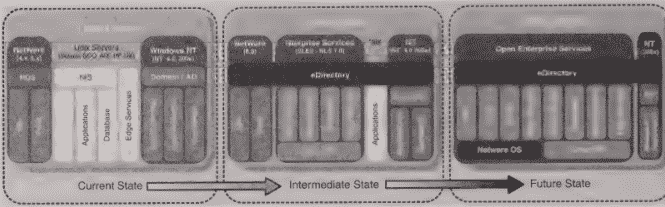

数据中心由多种操作系统、网络服务和应用程序混合组成——这些系统之间往往很少或完全没有集成。很大程度上，数据中心是技术随时间演变和合并的结果，因此它包含了从桌面、工作组以及大型机和集中计算服务演变而来的解决方案。在这种环境中，大多数首席信息官 (CIO) 的主要目标是通过整合、简化和降低成本，同时维持或增强服务。

Novell 解决方案在数据中心的强大潜力在于，Linux 和开源技术能够在低于当前成本的预算范围内实现简化和整合，而不会降低灵活性、管理性、可扩展性或安全性。IT 可以在不牺牲功能、服务或潜力的情况下提供更多价值。下一步就是实施——如何执行。

Novell 咨询公司（Novell Consulting）已经多次为全球企业公司实现了这一点。您可以使用此处列出的步骤作为自己迁移计划的框架，或者如果您想与经验人士合作，Novell 咨询公司随时为您提供服务。

## 启动项目

良好的迁移将从成立项目指导委员会开始。该委员会由高管、IT 管理人员和业务部门经理组成，他们对成功迁移策略带来的收益有着共同利益。在开始，委员会成员应该能够理解并阐述业务目标、项目章程和管理程序、公司沟通计划、变更控制和风险管理程序、验收标准以及关键成功因素。

## 数据中心迁移策略

该委员会应开展或委托进行关于 Linux 和开源就绪性的评估研究，并考虑以下因素：

- Linux 迁移与您的组织战略契合程度，以及您的环境对 Linux 迁移的准备程度如何
- 利益相关者和业务部门的需求是什么（业务、技术和政治方面）
- 从何处开始——从短期和长期来看，哪些服务器、服务和应用程序的迁移是合理的
- 是否有满足您的需求并提供相当（或更好）特性的 Linux 和开源服务及应用程序——如果没有，可能需要评估哪些替代方案（例如，终端服务或操作系统仿真）
- 服务器、服务、应用程序以及相关数据和业务流程如何才能最好进行迁移
- 服务与应用程序、桌面客户端或其他软件之间的任何依赖关系将如何影响您的迁移计划
- 在何处存在硬件和服务的整合机会
- 您的员工是否具备支持 Linux 环境的必要技能，以及随着时间的推移需要考虑哪些维护和支持 Linux 的能力能力

通过这项评估，可以创建一份实施路线图，概述迁移先决条件、阶段性实验室设置与测试、迁移程序和验收标准。

## 计划与设计

每个迁移计划必须适应每个组织的独特性，但应该理解并概述以下通用活动及其对应的程序：

- 服务器迁移路径——设计一条从 Unix、Windows 或 NetWare 到 Linux 的服务器操作系统迁移路径。这包括硬件选择、安装/迁移工具、管理工具等。
- 边缘服务——设计 Linux 网络服务架构，包括 DNS/DHCP、远程服务 (VPN)、集群、高可用性、病毒防护和备份服务。
- 网络服务——设计基础 Linux 服务架构，包括文件和打印、身份、目录、消息与协作以及 Web 服务。
- 应用程序架构——设计一种考虑 Linux 原生应用程序或 Linux 替代方案的应用程序架构，操作系统终端服务最满足您的应用程序需求。解决方案可能包括数据库系统、Web 服务解决方案、Java 应用以及支持 Linux 的 ERP。
- 目录环境——设计一个考虑到需求的目录环境。
- 管理工具——识别迁移期间将使用的管理工具。
- 培训——为员工设计培训计划。

评估之后，可以创建一份实施路线图，概述迁移先决条件、阶段性实验室设置与测试、迁移程序和验收标准。

## 部署

完成培训和试点测试后，就可以进入推广阶段了。根据您现有的邮件和组件服务，该领域可能也可能不是易于迁移的。对于希望保留 Microsoft Exchange 的组织，如带有 Evolution Connector 的 Evolution 客户端等工具允许他们在使用 Linux/开源客户端的同时仍访问 Exchange。如果选定的协作解决方案是 GroupWise，则可以使用 GroupWise 迁移工具整合到运行在 NetWare 或 Linux 上的单一解决方案中。迁移到基于目录的管理可以简化管理工作，而在邮件局/MTA 后端具有增量扩展性则是

# 第五章：开放企业服务器 (OES) 的兴起与原因

这也是一个明显的优势。在合并与收购的情况下，可能需要进行完全迁移，需要转换集中式消息存储和单个客户端消息存储。

## 应用

随着边缘、网络、数据库、文件、打印和协作服务的全部完成迁移，迁移的最后一个类别是应用程序。要迁移的应用程序取决于组织需求以及应用程序在 Linux 上的可用性。如前所述，某些应用程序在短期内可能无法在 Linux 上运行，必须遵循共存策略。如果是如此且应用程序运行在 Windows 上，您仍然可以利用 eDirectory 的通用目录认证优势，并通过 ZENworks 和 iManager 进行集中化管理。

## 持续支持

在过渡过程的任何时候，Novell 都随时为需要帮助的组织提供支持。技术支持可以通过在线、电话、现场上门或通过网络合作伙伴提供。针对 Linux 以及整个 Novell 产品线都提供培训。Novell 远程和托管服务（Novell Remote and Managed Services）可以主动监控和管理所有 Novell 技术。Novell 咨询（Novell Consulting）可以进入您的组织，完成本节列出的任何或全部任务。此外，开源社区仍然是关于 Linux 和开源解决方案的充满活力的信息和培训库。

将数据中心迁移到 Linux 和开源提供了迄为止讨论的所有优势，如下：

- 管理——管理更加简单，因为它是基于目录的、基于 Web 的、跨系统一致的，并通过 eDirectory、iManager、YaST 和 RPM 等强大工具得到了增强。
- 可扩展性——用更少的硬件做更多事情，或利用现有的硬件做更大的事情。集群、创建存储系统的能力、在运行相同平台和应用程序的同时升级更强大的硬件、增量需求、负载均衡——所有这些技术允许您轻松扩展到新需求或周期性需求。
- 灵活性——您有一个平台处理一切——文件、打印、应用程序、边缘、Web 服务等——并具有混合、组合、故障转移以及任何其他所需任务的能力。
- 安全性——平台和应用程序架构本质上是安全的，受到干扰的目标，更容易实现安全。

## 桌面端的迁移策略

成本——较低的许可费用、更低的硬件成本、减少的管理和管理成本、较低的应用成本、更廉价的开发——所有这些因素结合使得 Linux 和开源成为数据中心可行且首选的替代方案。

在桌面端完全迁移到 Linux 和开源是可行、切实且实用的。Novell 咨询已经定义了一套成熟的方法并完善了迁移方案，该过程已在 Novell 和其他客户处经过了充分测试。本节总结了从专有桌面迁移到开源桌面的通用计划，并详细介绍了用于实现此目标的一些工具。

“专有桌面”在很大程度上指的是 Windows——从 Windows 95（在某些组织中仍存在）到 Windows 98、Windows Me、Windows XP、Windows NT、Windows 2000，甚至 Windows 2003 的一切。这些桌面之间的差异可能非常巨大，如果组织内部在使用多个 Windows 版本，那么将其整合到一个可以进行集中和统一管理的单一平台的机会是极具价值的。某些组织可能还在运行 Sun 桌面，它具有与开源桌面的一些相同管理优势，但缺乏灵活性。

在大多数情况下，迁移计划应该由分阶段的方法组成。完全且突然地更换平台、应用程序和服务可能会引入许多变量，导致用户生产力停滞。此外，IT 管理和支持人员可能会被帮助热线电话、培训请求和资源突发事件所淹没。通常，至少应该考虑两个阶段，这些阶段应根据应用程序和操作系统服务进行区分。这两个阶段的实施顺序取决于组织的需求和要求，在大多数情况下，将优先实施开源应用程序。

## 办公生产力应用

办公生产力软件是大多数组织桌面端最常见的应用程序——文字处理、电子表格、演示和图形软件——其次是 Web 浏览器软件和电子邮件客户端。所有这些桌面应用程序都有开源解决方案，并有可同时在 Linux 和 Windows 上运行的版本。这允许您在保留现有操作系统（包括网络资源、安全系统和硬件）的同时，共同或分阶段部署办公应用程序，从而实现开源的分阶段实施。

从您认为最适合测试的应用程序开始。Novell 从 OpenOffice.org 开始，或者 Mozilla——带有其 Web 浏览器和电子邮件客户端——也是一个选择。OpenOffice.org 的用户界面与 Microsoft Office 非常相似，具有常见的下拉菜单命令、文本格式设置、文件控制、打印等功能。对生产力应用理解有限但熟悉 Windows 导航的终端用户来说，使用 OpenOffice.org 软件的困难将很小。

Mozilla Firefox 提供了一个与 Microsoft Internet Explorer 观和感受相似的 Web 浏览器，并增加了弹出窗口拦截器、邮件通知和高级媒体控制等功能。安装时，Mozilla 还会从旧的 Internet Explorer 导入所有相关信息，如收藏、密码、Cookie、浏览历史等——使得从终端用户的角度来看，迁移几乎是无缝的。

在 Linux 上运行的这些开源解决方案的外观和感受与 Windows 上的几乎相同。这使得当底层操作系统最终被替换时，用户无需经过任何应用程序学习曲线即可轻松、无缝地过渡。

值得指出，Novell 提供的管理桌面的工具对于迁移桌面应用程序特别有用。此类活动正是 Novell ZENWorks 桌面管理旨在简化的内容。使用 ZENWorks，管理员有能力对现有桌面软件和硬件进行清点。此外，他们可以向新软件（例如 OpenOffice.org 或 Mozilla）推送到桌面，并在需要时对其进行安装、检查和远程控制。使用 ZENWorks，可以在周末内完成数百台工作站的安装并准备就绪。

# 终端应用程序

我们已经详细讨论了 Web 服务应用程序以及如何使用开源技术、数据库、脚本和其他工具实现仅需 Web 浏览器的应用程序。这些终端应用程序是初始迁移的显而易见的候选。Web 浏览器在 Windows 或 Linux 上均可工作，且浏览器之间差异并不大。终端应用程序对于单一用途的组织可能足够，例如呼叫中心、车间或库存管理。

桌面终端应用程序的主要考虑因素是对浏览器插件的需求。应用程序可能 Java 运行时、媒体播放器、显示增强或特殊的终端应用程序插件。许多插件可以在首次连接后端应用程序时自动安装，并可以通过工作站管理工具（如 ZENworks、YaST 或 RPM）进行配置。

## 应用程序

尽管开源运动如此快速和广泛，但在许多领域，价值巨大的专有应用程序在 Linux 上仍然可用，未来也是如此。IT 需要以最好的方式适应这些应用程序的用户，并有多种选择。

Novell 在此领域的政策（见附录 A，“开源案例”）涉及确定是否存在该应用程序的本地 Linux 版本。如果没有，是否存在提供相应功能的 Linux 应用程序？如果答案是否，是否可以创建一个临时解决方案？这可能包括带有 Linux 和 Windows 的双启动系统、Windows 模拟器或终端服务解决方案。如果这些方案均证明不可行，则实施共存策略，通常是在 Windows 上运行开源应用程序，并对整个工作站使用 ZENworks 进行管理。

# 第5章：开放企业服务器 (OES) 的兴起与

与之前提到的应用程序一样，ZENworks 也可以用于安装 Linux。此外，YaST 和 RPM 等工具非常灵活，允许你根据机器如何安装和配置的预定义规则，启动引导序列并自定义构建。因为应用程序本质上与 Linux 操作系统的其他部分一样进行打包，因此应用程序功能可以包含在初始安装中。同样，所有这些内容都可以远程处理，而无需物理配置每个工作站。

我们讨论的大部分内容概述了开源网络的可能性。事实上，一个规划良好的过渡对于终端用户来说是无缝的。网络文件仍然留在相同的位置——显示为 NetWare 或 Windows 文件。打印机仍然可以通过 iPrint、CUPS 或 Samba 等技术访问。身份验证和登录保持与 LDAP 或 eDirectory 一致。如果规划恰当且数据中心迁移得到了协调，迁移到桌面可以是相对透明的。

在工作站迁移到 Linux 的时候，升级或集成新硬件可能是合适的。Linux 的主要优势之一是可以在广泛的硬件上运行。拥有不同供应商混合或使用不同芯片组的组织可以为用户提供一套与硬件无关的生产力工具。Novell SUSE Linux 支持许多桌面处理器类型，包括 x86、AMD64、Intel EM64T、Intel Itanium 和 IBM POWER。

## 迁移考虑

应该考虑几个变量来决定完全或部分桌面迁移到开源和 Linux 的可行性。这些包括应用程序的使用、用户的熟练程度以及桌面应用程序未来的战略方向。

### 应用程序的使用

如果正在使用的桌面应用程序是专门的，或者不同用户组使用不同的应用程序，那么完全迁移可能不那么理想。例如，如果营销部门大量使用带有全套 Adobe 应用程序包的 Macintosh，而工程部门深陷于 AutoCAD，那么迁移到 Linux 可能是不可可能的。另一方面，如果知识工作者（大多数组织中的 90%）可以使用标准的办公生产力工具（文字处理、电子表格、演示文稿和简单图形程序）高效地完成工作，或者能够通过基于 Web 的解决方案有效地进行协作并访问应用程序，那么没有理由不迁移到 Linux。每个组织都可以根据应用程序的使用情况确定自己的定位，并决定使用带有专有应用程序的专用操作系统、开源与专有应用的共存混合，还是完整的 Linux/开源解决方案最优。

### 用户的熟练程度

Linux 和开源解决方案最容易部署在熟练程度光谱的两端。对于那些只需通过一致界面执行简单、重复任务的非熟练用户来说，这些过程很容易过渡到开源。使用 Web 服务和浏览器，管理被简化了，且终端用户的参与度降至最低。迁移到 Linux 对于高级用户来说也变得简单——这些高级用户是指那些熟悉安装和卸载应用程序、学习新软件，甚至通过数据库查询、脚本和编程进行数据处理的人。在许多情况下，这些用户可能已经尝试过 Linux 或开源解决方案，迁移工作量将微乎其微。

一个良好的迁移计划会准确评估中间区域用户的熟练程度，并确定应该采取哪些步骤来确保平稳过渡。这可能包括意识提高、管理指示和教育、小组或个人培训、在线或打印资源等。Novell 咨询公司开发了详细且有条理的迁移计划，可提供给对迁移感兴趣的客户。

### 战略方向

正如金门大学（见附录 A）的案例研究所示，一个三年、五年或十年的计划对于决定拟考虑迁移的价值至关重要。对于 GGU 而言，要求所有未来 IT 解决方案都基于 Java 和 Oracle 的战略计划极大地倾向于 Linux 和开源。如果你的公司正向 Web 服务、网格计算、移动工作、集成客户/合作伙伴/供应商网络或任何其他常见的访问/分布式解决方案发展，桌面端的 Linux 和开源将帮助你更快速地采用这些技术。

## 桌面知识工作者的方法

虽然许多 IT 经理可能觉得没有他们工作得更愉快，但用户是 IT 存在的根本原因。IT 是执行组织目标的人员思想、行动和活动的支持延伸。因此，IT 的使命应该是提供最好的环境和工具集，以促进业务流程和组织沟通。Linux 和开源对普通知识工作者可以贡献什么？多多！

假设组织内部存在两种桌面场景，通常对其中一种标准化。第一个是基于 Windows 或 Macintosh 的桌面，第二个是主要使用开源软件技术配置的桌面。在第一种情况下，通过 Novell 的优势包括通过 Novell Virtual Office 访问常用资源，以及开源生产力套件可用。在第二种情况下，使用 Novell Linux Desktop 为用户提供了一个完整的开源工作站环境，包括一套全面的桌面解决方案和集中式的软件更新——所有成本更低。

### 专有操作系统桌面

Linux 在桌面上的增长在大多数组织中仍处于早期阶段，增长缓慢的几个常见原因包括：Windows 或 Macintosh 的成熟桌面应用程序比 Linux 更多。普通用户群体对这些应用程序非常熟悉，除非有明显的感知获益，否则他们不愿改变。用户还偏向于某一个操作系统而非另一个，这是因为他们已在理解和使用它上投入了时间。对于许多组织来说，现有的桌面操作系统被视为资本投资，随着用户在特定环境中变得更加熟练和高效，替换它们的成本也会随之增加。

出于这个原因，Novell 完全支持 Windows 和 Macintosh，并提供管理和访问解决方案。Novell 发挥主要作用的技术包括 ZENworks Desktop Management、Nsure Identity Manager 和 Novell Virtual Office。

### ZENWORKS 桌面管理

之前已在针对服务器和工作站的软件管理方面讨论过 ZENworks，但本节指出了它作为桌面控制代理的用处。IT 管理的主要关注点之一是跟踪工作站上到底安装了什么。由于可以快速访问互联网，用户只需几秒钟即可找到、下载并安装应用程序。

ZENworks Desktop Management 作为 Windows 工作站的监控和控制中心。ZENworks 具有配置差异功能，定期捕捉工作站的配置并与之前的配置进行比较，以查看发生了变化。这种差异检查结合补丁管理和远程控制，有助于保护知识工作者的数据。

ZENworks 服务与 Novell eDirectory 集成，因此可以根据策略驱动配置管理单个工作站、工作站组或整个企业。ZENworks 还提供了一种高级工作站解决方案，传统的通过 Unix/Linux X Windows 可——根据存储在 eDirectory 中的用户身份和工作站配置信息，ZENworks 允许个性化迁移，使得每个桌面的设置随用户移动。

### 单点登录——NOVELL NSURE IDENTITY MANAGER

知识工作者很少只访问单一系统。许多用户面临的一个严峻问题是管理访问多种资源的用户名和密码，包括电子邮件、网络访问、数据库、企业应用程序等。Novell 使用 NSure Identity Manager 等技术简化了跨系统管理用户身份和验证信息的业务。实际上，NSure Identity Manager 是一种元目录解决方案，可在不同物理位置的系统中同步凭据。结果是知识工作者实现了单点登录，登录即可访问所有网络资源和应用程序。NSure 帮助建立业务策略和身份属性所有权，使像 HR 等权限部门始终对特定信息拥有权利。在一个用户数据库目录中更改的信息会自动反映在所有其他身份存储库中。

### 用户门户——NOVELL VIRTUAL OFFICE

面临为不同桌面平台上的工作者提供集成资源访问任务的公司可以使用开源/Novell 组合解决方案来实现这一目标。`Novell Virtual Office`是一种基于浏览器的桌面环境，为用户提供网络文件、电子邮件、

# 第 5 章：开放企业服务器 (OES) 的兴起与原因

日历、即时消息、打印机、文档共享以及大量的自定义应用程序和服务。这些服务不依赖于特定的客户端操作系统，可以通过任何标准网络浏览器访问。

虚拟办公室（`Virtual Office`）还包括`Novell Virtual Teams`，它提供了团队创建、文档共享、项目规划等功能。其优势在于，任何工作站平台（`Windows`、`Macintosh`、`Linux`或`Unix`）上的用户都可以随时随地使用相同的标准虚拟桌面环境进行工作。

## 瘦客户端桌面

对于某些类型的用户（例如交易人员或呼叫中心员工），基于 Web 的客户端完全足够了。用户与基于 Web 的应用程序交互，桌面端所需的服务仅浏览器客户端。来自`Mozilla`的开源解决方案、邮件客户端和`RPM`极其丰富，且足以实施和管理此类桌面。适用于仅 Web 访问的`Novell`技术包括`Virtual Office`、`GroupWise`、`extendND Portal`等。

## Novell Linux 桌面

对于有意向迁移到开源桌面环境的组织，`Novell`不仅提供了解决方案，还展示了如何成功实施。`Novell`内部迁移到`Linux`环境的详情见附录 A，但本节将介绍创建完整的开源桌面解决方案的可用工具。

如所述，`Linux`适用于从手表到主机的一切操作系统，桌面端也不例外。无论工作站是笔记本电脑、台式机主机、普通的克隆机，还是带有数百 GB 存储容量的最新高速处理器，`Linux`作为桌面操作系统都能运行良好。如果您的组织对创建仅开源的桌面感兴趣，可以轻松实现这一点。目前的`Linux`发行版（包括`Novell SUSE Linux`）包含了可以自动检测和自动配置硬件的包。`KDE`或`GNOME`图形用户界面（几乎每个`Linux`发行版中都可用）为终端用户提供了类似于`Windows`的导航体验。即使跨不同的操作系统平台，也可以访问文件。网络浏览器、邮件客户端和`Office.org`生产力套件为知识工作者提供了 80%–90% 普通用户所需的所有应用程序。您可以通过从互联网下载所有内容，在零授权成本的情况下完全配置一个新的桌面。

`Novell Linux`桌面 (`NLD`) 是一个集成的桌面操作系统，包含桌面应用程序的桌面环境——所有内容封装在一个包中。`Novell Linux`桌面还与`Novell`的桌面管理解决方案紧密结合，例如`ZENworks Linux Management`，它提供了许多桌面管理功能，其中软件分发和补丁管理是最重要的。

通过`Novell Linux`桌面，操作系统是`SUSE Linux Enterprise Server`的加固版本，包含了特定的桌面功能并排除了不必要的服务器。`Novell Linux`桌面提供了一个视觉丰富且易于导航的桌面环境，类似于`Windows`。此外还包括几个用户生产力及协作应用程序，包括`Evolution`（一个功能全电子邮件和协作客户端）、`Novell`增强版`OpenOffice`、`Mozilla`、常用的浏览器插件，以及数十种其他应用程序和工具。

`OpenOffice.org`是一个高效且完整的办公生产力套件，包含文字处理、电子表格和绘图软件。如果您的环境是混合性质的，或者正处于从`Microsoft Office`到`OpenOffice.org`的逐步迁移过程中，文件可以进行来回共享。`OpenOffice.org`有能力读取或保存`Microsoft`格式的`Word`、`Excel`和`PowerPoint`文档。

包含了`Mozilla`作为网络浏览器，并提供适用于`Adobe Acrobat Reader`、`Real Audio Player`、`Macromedia Flash Player`和`Java 2`运行环境的浏览器插件。`Novell Linux`桌面的工具和实用程序包括即时消息 (`GAIM`)、视频会议 (`GNOME-Meeting`)、3270 支持 (`x3270`)、图形和图像编辑 (`GIMP`) 等。

`Novell Evolution`是`Linux`和`Unix`系统全球最流行、最强大的协作解决方案。它无缝集成了电子邮件、日历、调度、联系人管理和任务列表。`Evolution`的示例功能包括消息的上下文视图、多个日历、`Palm`设备支持以及集成数据管理视图。`Novell Evolution`完全支持开放标准和日历系统，并兼容常见的协作解决方案，如`Microsoft Exchange`、`Novell GroupWise`和`Lotus Domino`。

`Novell Linux`桌面允许用户根据文件系统无缝访问网络文件（`Windows`、`NetWare`和`Unix`系统均适用）。`Novell Linux`桌面的一个大优势是它几乎不需要让熟悉`Windows`的用户学习新的操作系统。其界面（以及`OpenOffice.org`等应用程序）设计为兼容`Windows`，用户可以毫不费力地过渡到`Novell Linux`桌面。`Novell`从`Windows`到`Novell Linux`桌面的迁移进展非常舒适、顺利且快速。

`Novell`兼容并支持所有常见的桌面解决方案。根据组织的需求，您可以保留`Windows`、引入瘦客户端、迁移到纯`Linux`和开源，或支持这三种方案的混合。知识工作者将获得高效工作所需的工具、服务和应用程序，而管理和维护任务则被整合并最小化。

## 业务设备

利用目前讨论的许多开源技术，可以创建“业务设备”，这些设备可以预先配置通用或专用应用程序，并易于部署到不同地点。业务设备（也称为实用桌面）的示例包括销售点（POS）终端、瘦客户端自助机、制造或车间终端、电子邮件或网络浏览站，以及其他单用途客户端。如果这些解决方案适用于您的组织或业务需求，部署此类方案具有多种优势。

### 单一用途配置

如前所述，`Linux`实现可以进行“最小化”配置，仅提供执行特定任务或功能绝对必需的服务或包。这种最小化配置可以防止安全违规，并对性能进行调优。对于业务设备或实用桌面，可以构建专门解决设备需求的`Linux`实现。例如，对于销售点解决方案，可以创建一个自定义客户端配置，包含条形码扫描软件、库存客户端应用程序和收银机缓存。此配置还将排除不必要的服务，如办公生产力应用程序或存储管理。

这些特定的配置或配置文件可以使用`RPM`或`ZENWorks Linux Management`等技术进行集中管理，这些技术跟踪并控制包的包含/排除，并允许管理员保持所有

实用型桌面设备是当前且一致的。如果客户端需要新的功能或程序包，可以从中心站点手动或自动地推送到客户端节点。这些设备节点的一个强大优势是，得益于浏览器技术和网络服务的使用，它们配备了完整的图形化界面。制造车间的流程程序或汽车零件库存系统不必是基于 Alpha 版本，也不必处于没有菜单或窗口选项。

### 多重启动选项

基于`Linux`的业务设备可以从网络启动，消除了对本地硬盘或本地存储的操作系统及应用程序的需求。该设备变成了一个浏览器终端，所有客户端配置都由中心统一管理。谈到“瘦客户端”，这已经是最“瘦”的了。当客户端工作站启动时，它会向`BOOTP/DHCP`服务器查找内核位置和根目录挂载信息。集中管理的初始化脚本可以处理其余的工作。

一组库存终端可以配置为相同的设置，并在中心对这些配置进行管理。如果您需要更改配置（例如添加新的报告选项），只需更改一次即可让所有客户端生效，无需在每个工作站上进行任何物理操作。

`Linux`可以从硬盘、光盘、软盘、网络甚至`USB`设备启动。技术的进步正使得`USB`设备能够携带个人文件和应用程序，以及个人在接入后即可访问其个人环境所需的全部内容，包括对本地和远程资源的访问。

### 客户端管理

之前已经涵盖了多种允许管理员集中且完全地管理远程服务器或客户端的技术。对于实用型桌面设备，这种能力至关重要，因为大多数用户几乎或完全没有技术技能或故障排除经验——客户端解决方案必须尽可能地“防呆”。通常存在同时修改整个客户端集合的需求。诸如`RPM`和`ZENworks Management`等工具可以极大地简化这一过程。

这里举一个简单的例子，你是否注意到你的银行 ATM 机上屏幕侧侧的物理按钮似乎比菜单中的软件选项还要多？假设该 ATM 是一个瘦客户端自助机，它使用`Linux`启用运行，并使用`ZENworks`或`RPM`进行管理。赞助银行决定，为所有通过 ATM 存入 100 美元的客户提供当地职业篮球赛的折扣票。可以为该 ATM 编写一个软件应用程序或程序包，并将其添加到现有的发行版中（使用那些额外按钮之一）。该程序会检查存款金额；如果达到 00 美元或更多，将询问客户是否想要票。如果客户想要，他按下相应的按钮，自助机就会打印出折扣券，甚至直接打印出折扣票。票务程序将一直运行，直到票源用完，然后自动停止。

在这个例子中，创建了一个客户端/服务器应用程序。该客户端/服务器应用程序被添加到现有的发行版中（使用额外按钮之一），并应用于整个客户端范围。

## 业务应用程序

许多客户端可用。

## 客户端硬件

瘦客户端硬件有多种形式。

## 远程与分支机构

在分支机构，有一台专用设备运行着相应的客户端软件，该软件与中心办公室服务器协同工作。NetSphere 分支机构设备还负责自动用户配置、打印和文件访问。中心办公室服务器与分支机构设备之间的连接可以通过标准互联网（DSL、宽带、拨号上网）或专用广域网（WAN）。NetSphere 分支机构的设计旨在适应缓慢或不稳定的连接，在许多情况下，可以消除昂贵的 WAN 连接和 VPN 技术，转而使用具有具有安全套接层（SSL）安全性的更常见且更廉价的互联网连接（参见图 5.2）。

## 图 5.2

中心办公室服务与分支机构设备集成，提供连接、同步、文件和打印服务。

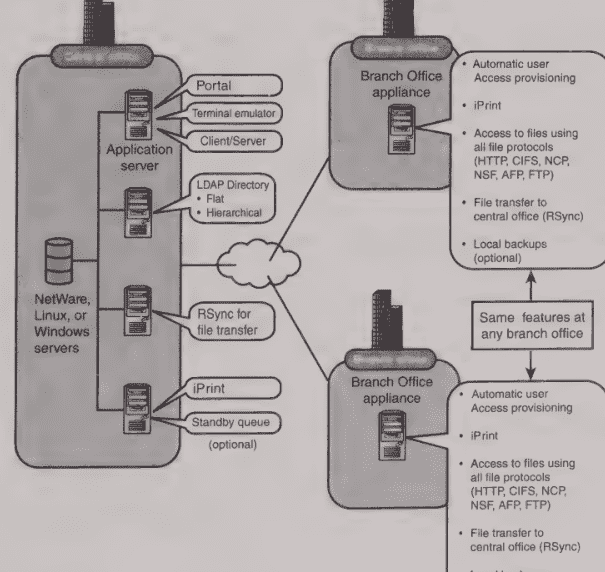

# 第5章：开放企业服务器 (OES) 的兴起与原因

由于先进的设计和架构，NetSphere 分支机构可以通过标准互联网连接提供高级服务。中心站点与分支站点之间共享的服务（目录、文件、打印、身份验证、Web 服务等）是“松耦合”的。实际上，NetSphere 分支机构作为一个缓存工作，根据连接的可用性存储、传输或同步目录信息和文件。文件、打印和身份验证数据存在于两个位置，用户访问其中任何一处都是透明的。如果连接丢失或站点数据不可，用户将继续从本地缓存工作。如果本地系统宕机，可以使用中心站点服务。文件、门户和身份验证服务将继续不受中断。

NetSphere 分支机构可以大幅减少或消除对分支机构任何现场支持的需求。目录、备份、配置和打印支持服务可以在中心站点进行管理，无需物理访问远程办公室。部署非常简单，可以由非技术人员完成。

成功使用 NetSphere 分支机构的跨企业包括 Intermountain Health Care、美国糖尿病协会 (ADA) 和 Mariner Health Care。ADA 估计通过实施 NetSphere 分支机构每年可节省超过 100 万美元。Mariner Health Care 在维持集中化管理和安全访问的同时，为约 300 家机构提供相同质量的网络服务，而无需在每个地点维护服务器的额外开销。此外，他们还拥有一种具成本效益的灾难恢复解决方案，具备从公司总部备份并恢复系统的能力。

通过使用 NetSphere 分支机构，Novell 将其 WAN 成本从每年 900 万（美元）减少到不足 450 万美元，每月远程访问成本减少 60,000 美元，新员工成本每月减少 3,000 美元，内部支持成本每月减少 125,000 美元，全年节省 680 万美元。

## 总结

本章介绍了 OES 具备的功能，并讲解了从多种不同业务过渡的概念。下一章将介绍将服务器安装、迁移和升级到 OES 的过程。

## 安装和升级到开放企业服务器

开放企业服务器 (OES) 是 Novell 推出的具有革命性的操作系统，它拥抱开源并包含了在此之前所有产物的精华。本章将介绍如何在新的操作系统上安装该系统，以及如何从现有操作系统进行升级/迁移。

## 安装注意事项

在开始安装之前，验证是否满足先决条件非常重要。这不仅将为您节省大量时间，还能避免许多挫败。

注意

在迁移到任何新的网络操作系统之前，您应该在实验室环境中彻底测试所有的配置和实施操作。只有当您对实验室获得的性能感到满意后，才考虑在您的生产网络中实施。

本节将检查在开始安装之前必须具备的内容，然后介绍安装过程。

## 最低系统要求

为了满足最低硬件要求，服务器需要 Intel Pentium II 或 AMD K7 或更高版本的处理器。然而，Novell 建议多处理器服务器使用 Pentium III 700MHz 或更高的处理器。

必须至少配备 512MB RAM，且服务器需要一个兼容 ISO9660 的 CD-ROM 驱动器。（建议兼容 El Torito 规范的可启动 CD-ROM 驱动器以便直接从 CD 启动。）

需要一个超级显卡 (SVGA) 或更高级视频适配器和显示器，以及键盘和鼠标。

虽然本书没有涉及这些，但在某些情况下——且始终出于安全考虑——可以在没有直接输入/输出设备的情况下运行服务器。这被称为“无头”服务器。

如果使用 NetWare 安装，Novell 建议硬盘上至少划分一个 1GB 的 DOS 分区，NetWare 分区至少需要 4GB——特别是 SYS: 卷。务必在任何计算中都考虑额外卷所需的空间。

作为服务器，该系统还需要网络接口卡 (NIC)。如果服务器具有多个处理器、热插 PCI (HotPlug PCI) 或任何其他类似属性，您将需要在安装期间能够随时访问这些项目的当前程序驱动程序。

最后，如果您有希望服务器支持的特定服务，您需要确保已拥有支持这些服务所需的硬件。

## 选择路径：Linux 或 NetWare

开放企业服务器可以安装在 SUSE Linux 或 NetWare 上。每个平台都有其自己的优缺点，在许多情况下，您可能会发现最佳解决方案是在您的网络环境中混合使用服务器。

在 SLES 9 上安装的最大优势是，您可以使用开源操作系统进行工作。您不再受限于单一供应商的提供方案，并能够最大限度地利用非专有操作系统的功能。

## 安装注意事项

相反，在 NetWare 上安装的巨大优势是由 Novell 培养的丰富功能和工具。NetWare 网络操作系统在每个新版本中经过了调整，成为市场上最好的。

由于这是一本关于转向开源的书，我们假设您来自 NetWare，因此后续讨论将集中在您将面临的问题。

## 选择文件系统

开放企业服务器是一个真正为您提供尽可能多选择的产品。您不仅可以选择要安装 OES 的操作系统平台，还可以从多种文件系统中进行选择。

文件系统分为三大类：传统的、日志的和虚拟的。传统文件系统包括 ext2、vfat 等。日志文件系统包括 ReiserFS（SUSE 默认）和 ext3。虚拟文件系统（称为虚拟系统切换 VFS）实际上是存在于进程与其他文件系统（传统或日志）之间的混合体。

根据您选择的操作系统和所做的其他选择，共有六种可能的文件系统：

- EXT：不支持日志的传统文件系统

- JFS：日志文件系统

- NSS：一种健壮的日志文件系统（NSS 代表 Novell Storage Services）

- POSIX：一种以跨操作系统兼容性闻名的文件系统

- REISER：SUSE 默认，是一种日志文件系统

- XFS：高性能日志文件系统

注意

获取每种文件系统类型信息的最佳场所是 WikiLearn。关于每种类型的精彩讨论从 `http://twiki.org/cgi-bin/view/Wikilearn/LinuxFilesystems` 开始。

## eDirectory 设计考虑

对于 eDirectory，最重要的是确保您拥有最新版本。OES 包含了 Novell eDirectory v8.7.3，并且你

# 第6 章：安装并升级到 Open Enterprise Server (OES)

在部署 OES 之前，您希望确保您的网络其他部分（假设已经存在）能够支持此版本。您可以在 `support.novell.com` 为您网络上的其他服务器下载最新的 eDirectory 支持包。

在安装 eDirectory 组件时，您需要了解以下信息：

- 树名称 (Tree name)

- 服务器在 eDirectory 服务器内部的路径

- 管理员名称和密码

- 服务器的时区

- 时间同步

## 演示新安装

在开始任何任何安装之前，请进行全系统备份。随后，验证备份数据是否可以恢复。在万一您需要回退到此配置的极低概率情况下，这是您的保险策略。

要开始安装 Open Enterprise Server，只需将第一张 OES CD 插入系统并重启。这将启动部署管理器（Deployment Manager）。

除了在启动时从 CD 引导启动外，还可以通过在 CD 根目录中调用 `NWDEPLOY.EXE` 或 `NWDEPLOYBROWSER.EXE` 在 Windows 2000 或 XP 中运行部署管理器。这两个可执行文件的区别在于：`NWDEPLOY` 需要 Internet Explorer 5 或更高版本，而 `NWDEPLOYBROWSER` 可以在没有 ActiveX 控件的情况下运行。

部署管理器有三大类：

- 网络准备

- 安装/升级选项

- 安装后任务

OES NetWare 安装的三个主要步骤如下：

- 如果需要，配置 DOS 分区

- 安装启动文件并创建 SYS 卷。

- 运行 NetWare 安装向导。

在大多数情况下，OES 可引导 CD-ROM 会自动启动服务器安装过程。如果没有发生这种情况情况，请按照以下步骤创建可引导的分区：

1. 使用 OES NetWare 许可/加密磁盘盘启动服务器。

2. 加载 `FDISK /X`。删除所有现有的分区并创建一个至少 1GB 的主 DOS 分区。

3. 重启服务器并使用 `FORMAT :S/X` 格式化新分区并传输系统文件。

4. 复制在开始之前备份的任何所需的配置文件。这些文件可能包括 `CONFIG.Sys`、`AUTOEXEC.BAT` 和设备驱动程序。

## 安装启动文件并创建 SYS 卷

以下步骤将安装 OES NetWare 启动文件并在系统上创建 SYS 卷：

1. 从 NetWare 6.5 SP3 CD 1 启动。
2. 在语言界面上，选择您想要安装服务器的语言，并按回车。
3. 在区域设置界面上进行选择，并点击“继续”。
4. 读取 NetWare 许可协议，按 F10 接受。
5. 读取 Jset 许可协议，按 F10 接受。
6. 选择“默认”安装或“手动”安装，并按回车。
7. 在准备启动分区界面上进行选择，并点击“继续”。
8. 在服务器设置界面上进行选择，并点击“继续”。启动文件和驱动程序现在被复制到 DOS 分区的 `C:\NWSERVER` 文件夹中。
9. 指定平台支持模块 (PSM)，并点击“继续”。
10. 指定热插拔模块 (HSM) 和存储适配器，并点击“继续”。
11. 指定存储设备，并点击“继续”。
12. 指定网络卡，并点击“继续”。
13. 选择要创建的 SYS: 卷的大小，并点击“创建”（建议至少 4GB）。
14. 在 NSS 管理工具主菜单上点击“继续安装”。

# 第6章：安装并升级到 Open Enterprise Server

新创建的 SYS 卷现在已挂载，所有需要的系统文件已复制到其中。NetWare 安装向导启动并引导完成剩余的安装。

## 运行 NetWare 安装向导

在 NetWare 安装向导启动后，您就快完成安装了。现在您将按照以下步骤完成 OES NetWare 服务器环境的配置：

1. 在产品安装类型界面上选择您想要的安装类型。选项如下：
   - Open Enterprise Server 1.0—这包含 NetWare 6.5 Support Pack 3
   - Open Enterprise Server 1.0—这包含 NetWare 6.5 Support Pack 3
2. 在总结界面上选择您想要的类型。这将在开始之前安装 NetWare 6.5 Support Pack 3。
3. 在组件界面上选择要安装的组件。
4. 在配置界面上选择在开始之前备份的任何所需的配置文件。
5. 在服务器界面上选择您的选择。
6. 在协议界面上选择您的选择。
7. 在域名称界面上选择您的选择。
8. 在时区界面上选择您的选择。
9. 在 eDirectory 安装界面上选择您的选择。
10. 在总结界面上选择您的选择。
11. 在许可界面上选择您的选择。
12. 在证书界面上选择您的选择。
13. 在 LDAP 配置界面上选择您的选择。
14. 在 Novell 身份验证服务 (NMAS) 界面上选择您的选择。
15. 在安装完成窗口点击“是”以重启。

## 升级和迁移

在上一节中，您演示了安装 OES。本节介绍如何升级和迁移现有服务器。如果您在新服务器上安装 OES，可以跳过本章。

根据您所使用的平台，有多种升级和迁移类型。主要类型包括：
- 升级现有的 NetWare 服务器
- 迁移现有的 NetWare 服务器
- 从现有的 Linux 服务器升级
- 从现有的 Linux 服务器迁移
- 从现有的 Windows 服务器迁移

对于 NetWare，有两种升级类型可用：
- 原地升级 (In-Place)
- 服务器合并 (Server Consolidation)

原地升级是最传统的方法。通过此方法，服务器直接从旧版本升级到新版本。

通过服务器合并升级，卷、目录、用户、打印机和打印机代理将从源服务器传输到 OES 目标服务器。

## 原地升级

原地升级将更新操作系统、eDirectory 以及服务器上安装的任何 NetWare 组件。

在开始升级之前，您应该安装服务器上最新的支持包，并进行全备份。所有删除的文件是升级的一部分，因此请确保在升级之前不需要挽回任何删除的文件。

对于 NetWare 6.5，您应该安装 Support Pack 2。对于 NetWare 6.0，应安装 Support Pack 5 或更高版本。对于 NetWare 5.1，应安装 Support Pack 6 或更高版本。对于 NetWare 4.2，应安装 Support Pack 9 或更高版本。

### 注意

NetWare 支持包可以在 http://support.novell.com 找到。

### 注意

虽然 NetWare 4.2 可以升级，但它被称为“低级服务器升级”，且与其他服务器相比步骤略有不同。关于低级服务器升级的章节位于原地升级内容之后。

升级到 OES 可以从以下三个位置之一运行：
- 服务器控制台
- 从部署管理器远程
- 从 iManager 远程

### 从服务器控制台升级

要从服务器控制台执行升级，请遵循以下步骤：

1. 将 NetWare 6.5 SP3 CD 1（操作系统）插入服务器的 CD-ROM 驱动器。
2. 在系统控制台（服务器命令行）中通过输入 `CDROM` 将 NetWare 6.5 SP3 CD 1（操作系统）挂载为 NetWare 卷。接下来输入 `VOLUMES` 确认 CD-ROM 已挂载。
3. 切换到 GUI 控制台并选择 Novell，安装。
4. 在已安装产品界面上点击“添加”。
5. 在“源路径”界面上，突出显示 NetWare 6.5 SP3 CD 1 根目录下的 `PRODUCT.NI`。
6. 点击“确定”返回“源路径”界面，点击“确定”继续。
7. 阅读 NetWare 许可协议，点击“我接受”。
8. 在“许可证书上下文”界面上进行选择，并点击“下一步”。
9. 在“Novell 模块化认证服务 (NMAS)”界面上进行选择，并点击“下一步”。
10. 在“安装完成”窗口中点击“是”，服务器将重启。

OES NetWare 的安装现在已完成。

### 使用部署管理器进行升级

部署管理器 可以在 Windows 9x 或 Windows NT/2000/XP 工作站上运行。要使用部署管理器进行升级，请遵循以下步骤：

1. 将 NetWare 6.5 SP3 CD 1（操作系统）插入工作站。从 CD 根目录运行 `NWDEPLOY.EXE` 以启动部署管理器。
2. 在左侧窗格中选择“升级到 NetWare 6.5”。
3. 在右侧窗格中选择“远程升级服务器”。
4. 阅读 NetWare 许可协议，点击“我接受”。
5. 阅读 Jinfonet 许可协议，点击“我接受”。
6. 在“备份服务器文件”界面上进行选择，并点击“下一步”：
   - 备份服务器目录文件——选择“是”选项按钮以备份现有的服务器文件。
   - 自动重启——选择“是”选项以便服务器在升级完成后自动重启。
   - 允许不支持的驱动程序——选择“是”选项以便在未找到其他合适驱动程序时自动加载未经过 Novell 批准的设备驱动程序。
   - 指定升级类型——选择“默认”或“手动”安装。
7. 在“产品安装类型”界面上选择您要执行的安装类型，并点击“下一步”：
   - Open Enterprise Server 1.0——此选项包含 NetWare 6.5 Support Pack 3 以及 iManager 2.5、Virtual Office 1.5 和 Quickfinder Server（用于替换 Web Search Server）。
   - NetWare 6.5 Support Pack 3——此选项安装 NetWare 6.5 Support Pack 3，但不对 iManager、Virtual Office 和 Web Search Server 进行更新。
8. 在“组件”界面上进行选择，并点击“下一步”。
9. 查看“摘要”界面上的配置设置，并点击“复制文件”。新的服务器文件正在复制，系统将提示您插入 NetWare 6.5 SP3 CD 2（产品）以复制任何需要的产品文件。
10. 在提示处以 Admin 用户身份登录，点击“确定”完成 eDirectory 安装。
11. 检查“eDirectory 摘要”界面上的信息，并点击“下一步”。
12. 在“许可证”界面上进行选择，并点击“下一步”。
13. 在“许可证书上下文”界面上进行选择，并点击“下一步”。
14. 在“Novell 模块化认证服务 (NMAS)”界面上进行选择，并点击“下一步”。
15. 在“安装完成”窗口中点击“是”，服务器将重启。

OES NetWare 的安装现在已完成。

### 使用 iManager 2.0 进行升级

要使用 iManager 升级服务器，请遵循以下步骤：

1. 启动 iManager 并在左侧窗格中选择“安装和升级”。
2. 选择“升级到 NetWare 6.5”。
3. 在右侧窗格中选择“远程升级”。
4. 浏览到 NetWare 6.5 SP3 CD 1（操作系统）的根目录，点击“确定”。

### 安装步骤

- 5. 阅读 NetWare 许可协议，点击“我接受”。
- 6. 阅读 Jinfonet 许可协议，点击“我接受”。
- 7. 在“备份服务器文件”界面上进行选择，并点击“下一步”：
    - 备份服务器启动目录文件——选择“是”选项按钮以备份现有的服务器文件。
    - 自动重启——选择“是”选项按钮以便服务器在升级完成后自动重启。
    - 允许不支持的驱动程序——选择“是”选项按钮以便在未找到其他驱动程序时自动加载未经过 Novell 批准的设备。
- 8. 指定升级类型——选择“默认”或“手动”安装。
- 9. 在“产品安装类型”界面上选择您要执行的安装类型，并点击“下一步”：
    - Open Enterprise Server 1.0——此选项包含 NetWare 6.5 Support Pack 3 以及 iManager 2.5、Virtual Office 1.5 和 Quickfinder Server（用于替换 Web Search Server）。
    - NetWare 6.5 Support Pack 3——此选项安装 NetWare 6.5 Support Pack 3，但不对 iManager、Virtual Office 和 Web Search Server 进行更新。
- 10. 在“组件”界面上进行选择，并点击“下一步”。
- 11. 查看“摘要”界面上的配置设置，并点击“复制文件”。新的服务器文件正在复制，系统将提示您插入 NetWare 6.5 SP3 CD 2（产品）以复制任何需要的产品文件。
- 12. 在提示处以 Admin 用户身份登录，点击“确定”完成 eDirectory 安装。
- 13. 检查“eDirectory 摘要”界面上的信息，并点击“下一步”。
- 14. 在“许可证”界面上进行选择，并点击“下一步”。
- 15. 在“许可证书上下文”界面上进行选择，并点击“下一步”。
- 16. 在“Novell 模块化认证服务 (NMAS)”界面上进行选择，并点击“下一步”。
- 17. 在“安装完成”窗口中点击“是”，服务器将重启。

OES NetWare 的安装现在已完成。

## 执行服务器升级

服务器升级仅在从 NetWare 升级时需要。可以通过以下步骤完成服务器升级：

- 1. 将 NetWare 6.5 SP3 CD 1（操作系统）插入工作站。
- 2. 从 CD 根目录运行 `NWDEPLOY.EXE` 以启动部署管理器。
- 3. NetWare 6.5 SP3 CD 2（产品）以复制任何需要的产品文件。

## 升级与迁移

你可以从 NDS/eDirectory 或 Windows NT 域进行合并。本书本书侧重于将 NetServer 合并到 OES，你应该参考 OES 在线文档。

## 服务器合并升级

Open Enterprise Server 不仅仅是另一个操作系统。服务器合并工具 `SCU` 用于将卷、目录和打印机对象合并到较少的服务器中。

关于 MDAC 的信息可以在 `http://msdn.microsoft.com/library/default.asp?url=/downloads/list/dataaccess.asp` 找到。

## 升级与迁移

10. 创建 SCU 项目后，SCU 将启动验证向导。点击“下一步”开始验证过程。
11. 在“丢弃的文件夹”屏幕上检查源路径和目标路径，点击“下一步”。
12. 在“重复文件解决”屏幕上进行您的选择，并点击“下一步”：
    - 不覆盖现有文件——源文件将不会复制，从而保留现有目标文件。
    - 如果源文件较新则复制源文件——仅当源文件比现有目标文件新时，才会覆盖目标文件。
    - 始终复制源文件——源文件将始终覆盖目标文件。
13. 在“同步文件和文件夹”屏幕上进行您的选择，并点击“下一步”。

### 注意

选择“是”以删除目标服务器上所有在源服务器不存在的文件和文件夹。

14. 在“比较文件和文件夹”屏幕上进行您的选择，并点击“下一步”。
15. 在“文件日期过滤器”屏幕上进行您的选择，并点击“下一步”。如果您想根据文件日期过滤复制，请选择“是”并配置选项：
    - 属性——您可以根据访问、修改和创建文件属性过滤文件。
    - 属性日期——对于每个属性，指定相应的日期以定义过滤的执行方式。
16. 在“通配符选择”屏幕上进行您的选择，并点击“下一步”。
17. 在“检查受托人和所有权”屏幕上进行您的选择，并点击“下一步”。
18. 在“密码验证”屏幕上输入源树和目标树的密码，并点击“下一步”。
19. 点击“下一步”开始验证过程。

### 错误解决

20. 在“错误解决”屏幕上点击“下一步”继续合并。

如果在验证过程中出现任何错误，它们将分为两类列出：
- 在复制文件之前必须解决的错误
- 应该解决但可能不会影响复制过程的错误

现在项目已完全定义，您已准备好执行实际的服务器合并。您可以立即执行，也可以将其调度在其他时间启动——例如服务器运行较慢时。

在“启动 Novell 服务器合并工具”屏幕上，点击“继续”立即执行合并。过程完成后，“处理完成”表单将向您显示错误日志、查看成功日志并关闭合并过程。

## 从 NetWare 服务器迁移

NetWare 迁移向导用于将旧 NetWare 3.x 服务器迁移到新的 OES NetWare 服务器。迁移向导将 NetWare 3.x 绑定中的文件系统和 bindery 对象复制到目标 Novell eDirectory 树中，并将它们转换为 eDirectory 对象。

关于 NetWare 迁移向导的更多信息请参考 OES NetWare 在线文档。

## 从 Windows 服务器迁移

可以使用 NetWare 服务器合并工具对 Windows 服务器进行合并，将所有配置设置从源服务器传输到 OES NetWare 目标服务器。

在从 NT 3.5 和 4.0 迁移期间，域用户以及本地和全局组将被转换为 eDirectory 对象并放置在 eDirectory 树中。共享文件夹将移动到 NetWare 文件系统，权利/权限将 Windows NT 设置转换为 NetWare 受托人权限。

### 注意

截至本文，尚未提供 Windows 2000 或 XP 的直接升级或迁移路径。

## 总结

本章将介绍执行纯净安装的过程，以及您将现有服务器升级或迁移到 Open Enterprise Server 的方法。请记住，理想情况下，在移动到生产网络之前，应在实验室环境中对所有配置和安装进行测试。

# 第 6 章：安装并升级到 Open Enterprise Server

# 第 7 章

# 管理开源

最后，您来到了这对整个开源集成成功至关重要的话题——系统管理。它在两个方面至关重要。首先，开源必须具有管理优势，无论从成本还是简单性角度来看，这使得部署或迁移值得努力。Novell 客户组织通过实施 Linux 系统证明了这是可能的，使用基于浏览器的管理工具或另一个设置工具 `YaST` 管理 Linux 要容易得多。开源的可扩展性还允许 IT 部门在较少的系统中合并服务器、服务、数据和用户，使其管理更具成本效益。

第二个优势是，开源、Linux 和 Novell 技术的结合能够完全实现异构系统的管理。极少（如果有的话）组织是完全基于开源的，因此，管理解决方案不仅要能够适应 Linux，还要适应 Linux、Windows、NetWare 以及它们支持的网络服务和应用程序。Novell 任务的关键策略之一是对包括 Linux 和开源应用程序及服务的各种异构系统提供整体的、全面的跨平台管理。Novell 允许公司使用产品和解决方案实施 Linux 和开源，使集成和管理尽可能无缝。

本章将详细介绍 Linux 和开源管理工具，以及来自 Novell 提供的有助于让部署、迁移和集成尽可能简单无缝的工具。

# 第 7 章：管理开源

Linux、Apache、MySQL、JBoss 等都有大量的控制台和基于浏览的工具。`YaST` 是一项全面的管理工具，提供服务器配置、多系统软件管理等许多功能。Novell `iManager` 是一个可扩展的管理控制台，提供服务以及应用程序的多系统、多平台管理。所有这些工具为 IT 管理人员提供了所需的一切，可以使用简单、自动化、基于策略的方法来管理和维护用户及资源。

### 注意

注意本文讨论的所有产品都包含在 Open Enterprise Server 中。本文讨论的许多产品都是支持的。

## 使用 YaST

`YaST` 已成为 Linux 世界最强大的管理工具，提供服务器配置、多系统软件管理等更多功能。Novell 提供了一个直观的图形界面，引导您进行各种安装设置。

`YaST` 包含了网络服务的配置模块，例如域名系统 `DNS`、动态主机配置协议 `DHCP`、Web 服务器以及 Samba。SUSE `YaST` 还包含一个自动更新服务名为 `YOU` `YaST Update`。

### 图 7.1

`YaST` 引导进行直观的安装。

### 图 7.2

`YaST` 控制中心提供了中心化的界面。

# 第 7 章：管理开源

## Novell eDirectory

目录服务是最强大且广为人知的网络技术之一。互联网和电子商务的演进加强了对可行身份管理服务的需求，允许个人和系统跨所有类型的网络进行安全交互——互联网、内网和外围网；有线到无线；公司和公共网络。关联人员、客户和供应商的身份经过验证，并且对特定应用程序和资源的访问易于管理。

Novell eDirectory 是行业最流行的目录技术。几个特征将真正的目录服务与常见的数据库区分来。这些特征是层次结构、标准支持和分布式系统。

## 层次结构

1988 年，建立了 `X.500` 标准用于管理用户和资源的目录。`X.500` 标准是层次化的，这意味着它看起来像一棵倒置的树。这种层次结构符合世界的分类系统：国家、州、城市、街道、房屋、家庭等。目标是拥有一个能够在全球范围内分类任何资源的目录组织结构。每个资源或用户都可以根据其所属的公司（树）、所属的部门（组织单元）、所属的组（组）以及其独特的特征进行分类。使用层次组织结构，可以对任何两个用户或资源之间的关系，无论它们物理位于何处。

## 继承

层次结构对于目录服务的第二个区别特征——继承至关重要。树中的对象（组织单元、组、用户、服务等）由属性定义——特征如访问权限或描述性属性。继承使得树中的许多对象可以分配或“继承”树中较高对象的属性。例如，一个组对象可能有一个资源定位符 (`URL`) 属性，为组内的 15 人提供访问特定的互联网数据馈。通过在组级别更改一次 `URL` 属性，所有 15 个用户将自动继承对新地址的访问权限。

继承是一项强大的特性，它使得通过几个简单的步骤管理大量的用户和资源成为可能。

## 标准支持

验证身份和授予访问权限的异构且单一的用户管理解决方案多得惊人。许多应用程序都有自己的专用用户数据库；每个领先的操作系统都有自己的域方法；还有数以千计的其他系统为了适应现有的 IT 环境而拼凑在一起。集成、同步和管理这些异构系统是一项艰巨的任务，甚至可以说是不可能的。开放标准的演进提供可扩展或可修改的真实目录特性至关重要。轻量级目录访问协议（`LDAP`）就是该标准。它提供了导入或导出目录对象和属性以及扩展目录架构（添加新的对象类型或属性）的能力。基于开放标准支持将目录整合进行集中管理的能力是真正目录服务的基本需求。随着异构资源跨互联网的连接，开放标准变得越来越重要。

## 分布式系统

从概念上说，目录服务显示为资源信息的中央存储。实际上，企业级目录服务必须具备物理和虚拟维度上的分布能力。为了避免单点故障（例如，在灾难发生时所有目录信息都位于一个物理位置），必须将目录副本放在不同的位置，并以这种方式链接：即使一个位置发生故障，所有信息仍然可以通过其他位置访问。目录还必须具备虚拟层面的分布或划分能力，以便其部分供不同的应用程序使用。例如，某些对象属性（如电话号码和地址）在整个目录网络中都有价值；而其他属性（如目录权限）只需要在用户经常登录的地方可用。Novell eDirectory 使用副本、分区和索引进行分布。

真正的目录服务随后成为资源分布式系统的神经中枢。它持有有关资源的属性或特性信息；它监控状态；它阻止或授予访问；它还包含了在发生故障时保护或修复自身的机制。目录通过将所有管理功能合并到单一服务中，可以极大地简化管理工作。所有的应用程序、用户、外设、设备、组等，都可以通过如 Novell eDirectory 等目录服务通过单一接口进行管理。

## Novell iManager

真正目录服务的力量与 Web 在一个综合管理程序包 Novell iManager 中结合在一起。iManager 从一个基于浏览器的工具提供了网络的全局视图，允许您从任何位置的任何工作站管理 Novell eDirectory 以及许多其他服务。这种集中的 Web 端管理允许您消除管理冗余和不必要的旅行，并为所有类型的资源提供直观的引导式管理过程。

Novell iManager 在管理产品是是独一的，因为它与 eDirectory 有紧密集成。iManager 具有委托管理功能，允许您为个人分配特定的管理任务和职责。委派简单的管理任务（如重置密码或添加网络打印机）让您作为网络管理员能够专注于更直接影响公司底线的战略性项目。

作为一种 eDirectory 管理解决方案，iManager 为 eDirectory 对象、架构、分区、副本和许多其他网络资源提供了单一管理点。iManager 还提供了许多高级功能，将网络管理提升到了新的水平。最值得注意的是，Novell iManager 是一个运行在多种操作系统上的服务器应用程序，包括 `Linux`、`NetWare`、`Windows`、`Solaris` 和 `HP-UX`。这种多平台支持让您在何处以及如何部署管理控制台方面具有灵活性，有助于应对管理复杂异构网络的挑战，在这些网络中，各种应用程序运行在各种操作系统上。

Novell iManager 设计用于适应新服务，并可以轻松扩展以包含多种类型的资源，只要这些资源被添加到您的网络中。iManager 插件工作室（Plug-in Studio）允许您在无需编写单行代码的情况下创建管理操作和任务。利用标准技术和应用程序接口，Novell iManager 为创建自定义管理界面提供了理想的架构。随着新的 Novell 产品被添加到网络中，iManager 控制台将无缝整合与这些产品对应的属性、属性页、对象类型和其他功能。通过 iManager，可以从互联网上的任何位置通过标准 浏览器进行安全、灵活的网络管理。

## RPM 软件包管理器

红帽软件包管理器（`RPM`）是一个用于对安装在不同机器上安装、更新、卸载、验证和查询软件包的精简流程。`Linux` 是以一组单独的文件或包的形式安装的，`RPM` 帮助跟踪和管理这些文件的安装。使用 `RPM`，管理员可以动态构建新的安装镜像，根据原始/唯一的配置重建损坏或崩溃的系统，使用新功能或特性更新系统，并卸载系统的全部或部分。

以下是 `RPM` 工作的一个简单示例。`RPM` 使用配置数据库，该数据库包含了关于特定系统的所有信息，包括创建该系统所使用的包以及包中的每个文件。软件包信息包括包名、校验和和对任何其他包的所有依赖项列表。例如，一个完整的 `Linux` 操作系统可能是一个单一封装文件，包含许多其他包，每个包提供一个功能或服务，且每个包可能都需要其他包。`RPM` 数据库跟踪所有这些依赖关系和关联，并将它们用于手动和自动化管理。

例如，要安装一个仅配置为网络文件系统（`NFS`）服务器的 `Linux` 发行版，您将使用 `RPM`，选择预配置 `NFS` 选项并安装该特定配置。如果安装损坏，可以使用 `RPM` 将还原到原始状态。随着时间的推移，可能需要向现有配置中添加新包。`RPM` 跟踪这些新增项及其依赖项，以及任何减法或删除。

`RPM` 的强大在于它可以配置为自动跟踪和管理具有各种配置的数百台机器。由于 `Linux` 允许您在不关闭系统的情况下添加和删除启动进程，因此 `RPM` 可以作为一个强大的工具，跨网络批量更新工作站或服务器，且对终端用户的影响很小甚至没有。`RPM` 包含了允许您查询系统完整性并确保软件包来自签名或授权源的技术。

Novell 对 `RPM` 的增强包括了除了安装包之外安装补丁的能力。这对于需要快速更新进程以防御安全威胁的组织来说是一项重要功能。Novell 还将 `RPM` 移植到 `NetWare`，在其中可以使用相同的功能加载和卸载 `NetWare` 可加载模块（`NLM`）并更新 `NetWare` 服务。适用于 `Linux` 和 `NetWare` 的 `RPM` 为混合网络中的服务器和工作站管理提供了先进且强大的工具。

# 第7章：开源管理

## Novell ZENworks

在全面的跨平台服务器/工作站管理方面，没有任何工具能与 Novell ZENworks 相拟。ZENworks 通过结合 eDirectory 技术与分布式网络服务提供了无与伦比的管理能力，提供了一个全面的集中管理平台。ZENworks 利用 eDirectory 的面向对象和层次结构特性，允许管理员通过几次简单的操作对整个企业进行微小或广泛的更改。管理是安全的、可委托的，并且是图形化直观的。

Novell ZENworks 套件是一套全面的集成工具，可自动跨服务器、桌面电脑、笔记本电脑和手持设备的整个生命周期实现 IT 管理流程。这一创新解决方案能够根据设备和用户身份动态地维护并执行策略。通过支持 `Windows`、`Linux`、`NetWare`、`Palm`、`Windows CE`、`PocketPC` 和 `RIM BlackBerry` 平台，以及与 Novell eDirectory 和 Microsoft Active Directory 的目录集成，ZENworks 显著增强了对复杂、多样化 IT 环境的管理。此外，它为策略驱动的自动化奠定了基础，可以消除手动系统管理流程并大幅降低成本。

ZENworks 可以作为提供全面支持的套件使用，也可以作为独立的软件包来管理服务器（ZENworks Server Management）、桌面电脑（ZENworks Desktops Management）、个人数字助理（ZENworks Handheld Management）和 `Linux`（ZENworks Linux Management）。使用 Novell ZENworks（适用于 `Linux`、`NetWare` 和 `Windows` 环境）可以完成的若干管理活动如下：

- 软件清单——发现并跟踪安装在服务器或工作站上的所有软件。信息存储在数据库（Oracle 或 PostgreSQL）中，以便进行比较或回滚。
- 硬件清单——发现并跟踪所有硬件元素，包括 BIOS、处理器、内存、硬盘等。这些信息存储在数据库中，用于多种用途，包括差异报告或确定软件需求。
- 软件分发——根据策略或用户需求及身份，集中控制向服务器和桌面电脑（防火墙内外）分发软件。
- 策略驱动的自动化——使用 eDirectory 和基于规则的策略，自动化分发、更新、补丁、回滚、清单等管理任务。例如，如果某特定机器满足最低硬件要求且用户是经理，则安装关联用户与员工评估系统的的软件。
- 个性迁移——再次使用 eDirectory 和策略，根据用户的工作需求、位置、组组成及任何其他相关因素，自动为特定用户配置工作站。为桌面电脑提供能力，让个性化环境随用户而移动。
- 大规模升级——自动化向多台机器同时提供新软件（操作系统、实用程序、包或应用程序）的过程。通过几次简单的操作使用新软件升级整个组织。通过单一操作为网络中的所有服务器提供最新的健康监控控制。
- 补丁管理——使用 ZENWORKS 补丁管理，保持 Linux、NetWare 或 Windows 操作系统的最新安全或性能补丁更新。动态图形化报告为状态提供了视觉参考。
- 软件包管理——将 Linux 中流行的软件包管理工具也应用于 NetWare。在提供基于用户和组的细粒度控制的同时，解决软件包管理冲突和包依赖关系。

ZENworks Linux Management 是 Novell 的一种解决方案，它扩展了 RPM 的功能，提供了更高程度的控制和灵活性。你可以管理几十或数千台机器，创建机器组和软件通道用于软件分发。你可以将权限委托给多个管理员，通过内置报告系统跟踪进度，并进行事务预运行以检查包、包集和通道的依赖关系。其他 ZENWORKS Linux Management 功能包括：用于检查两或多台机器之间差异的机器比较、用于分发 ZENWORKS 服务器以在慢链上加速更新的子网服务器缓存，以及用于在软件事务之前或之后运行脚本的增强事务（见图 7.3）。

这些技术（某些是开源，某些是专有的）提供了强大且全面的跨平台管理工具集。Novell 通过提供兼容 Linux 以及 NetWare 和 Windows 的管理基础设施，验证了其帮助完善和简化异构系统管理和管理的承诺。Linux 管理工具（如 RPM 和 YaST）对于许多管理任务是足够的，但通过使用 eDirectory、iManager 和 ZENWORKS Linux Management，这些工具得到了显著增强。

# 第7 章：开源管理

图 7.3

ZENworks Linux Management 为服务器提供受控的软件包管理。

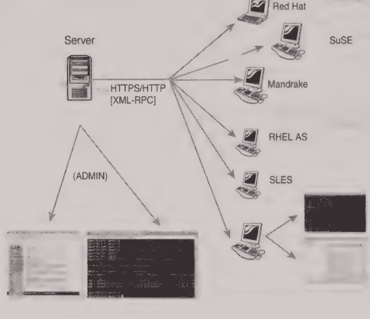

对于大多数组织来说，Linux 和开源的实施将在一段时间内发生，并将涉及多个系统的共存。无论你的组织如何决定，知道有一个桌面管理解决方案可以处理任何选项是好事——那就是 Novell ZENworks。ZENworks 是 Novell 双源策略中的关键元素，因为它为所有桌面工作站（包括专有和开源）提供了一致的管理结构，精简、简化了并提供了具价值的工具。除了 ZENworks 之外，其他桌面管理解决方案包括 Novell SUSE 的 YaST，提供了简化的软件包和补丁管理，当然，还有开源的 RPM 可用。

## 使用 ZENworks 管理

无论你的组织决定在桌面端完全迁移到 Linux、保持现状还是支持混合工作站，知道有一个桌面管理解决方案可以处理任何选项都是好的——Novell ZENworks。ZENworks 是 Novell 双源策略的一个重要元素，因为它为所有桌面工作站（包括专有和开源）提供了一致的管理结构，精简了、简化了并提供了具价值的工具。ZENworks 为工作站和服务器提供相同的功能，具备部署镜像、应用策略、分发应用程序、捕获和跟踪清单以及启用 Linux 和 Windows 远程管理的能力。只要运行 Linux，YaST 和 RPM 也可以管理服务器和工作站。

ZENworks 允许公司管理桌的整个生命周期。通过策略驱动的自动化，管理员可以从单一位置对成千上万台桌面执行标准配置并同时更新配置和软件。个性迁移功能可以完全恢复每个桌面的个人设置和应用程序设置，以尽量减少干扰。通过从 PC 到手持设备的跨操作系统的详细清单报告，ZENworks 帮助公司执行标准配置、准备升级、确定设备位置并满足企业资产报告需求。重要的桌面管理 ZENworks 功能将在后续章节详细介绍。

## 磁盘镜像

ZENworks 允许你通过部署镜像来配置工作站。这可以在新工作站引入时，也可以在已部署的损坏工作站上进行。磁盘镜像可以分类并与特定的工作站或工作站类关联，以便管理。使用预启动执行环境 (PXE)，工作站可以启动、检查新镜像并在工作站操作系统启动之前部署。如果工作站支持 PXE，你无需接触机器即可迁移 Linux。

## 应用策略

策略是一组规则，定义了如何配置和控制工作站、用户和服务器，包括应用程序的可用性和访问、文件访问以及单个桌面的外观和内容。策略包含在策略包中，并在对多个工作站进行批量管理和自定义。策略包是一个 Novell eDirectory 对象，包含一个或多个单独的策略。

# 第 7 章：管理开源

通过策略，管理员可以自动化许多工作站管理任务和活动。例如，规则可以在执行软件安装或应用程序更新等操作之前检查依赖项或先决条件。通过 eDirectory，管理员只需进行一次策略更改，该更改就会反映在与其相关的每个对象（工作站）上。

## 应用程序分发

ZENworks 支持多种获取工作站上软件的方法。应用程序的分发过程可能简单到为已安装的网络应用程序、Web 应用程序或终端应用程序创建一个快捷方式，也可能复杂到在工作站上安装应用程序文件、修改工作站注册表和配置设置以及驱动器路径映射。

ZENworks 为 Windows 提供了 Linux 包管理的功能，具备复制文件、更新注册表以及完全配置工作站以备的能力。ZENworks 包含了应用程序启动器（Application Launcher），它可以通过桌面显示的图标控制应用程序访问，并运行本地代码、Web 应用程序或网络应用程序。

## 硬件/软件清单

ZENworks 可以对工作站硬件和软件进行清单，并将信息存储在数据库中用于系统差异、回滚、许可证管理以及任何其他用途。清单可以按计划间隔生成或根据需要生成，也可用于验证系统兼容性。

## 远程管理

如果管理员无法亲自到达工作站，她可以通过 ZENworks 远程控制虚拟地到达。远程控制允许您从管理控制台控制管理的工作站，提供用户协助并帮助解决工作站问题。远程控制在管理控制台和受管理的工作站之间建立连接。通过远程控制连接，远程操作人员可以超越查看管理的工作站，通过控制它可以亲眼观察问题并进行更改。ZENworks 的主要优势在于不仅为 Linux 工作站和服务器提供这些管理服务，还适用于 Windows 桌面、服务器以及 NetWare 服务器。一个界面即可管理从桌面到数据中心的多个平台。

# 附录 A

# 开源案例研究

本附录研究了开源解决方案的一些真实实施。它探讨了金门大学（Golden Gate University）以及 Novell 等机构经历的转型。

## 数据中心转型研究——金门大学

金门大学（GGU）位于旧金山金融区中心，是加州第五大私立大学的中心枢纽，在全州设有七个不同的地点。该大学在法律、商业管理、信息技术和税务领域提供多种优秀的本科和研究生课程，利用了最先进的技术和学习工具。GGU 面向成年职场人士，其 CyberCampus 允许学生利用互联网按照自己的计划进行工作和学习。

2002 年，GGU 开始对其现有的数据中心技术进行正式评估，旨在简化并整合已变得难以处理的 IT 环境。该大学评估了几种技术，并选择了 Linux 和开源软件，以从 Java 以及与 Oracle 和 Dell 的供应商关系中受益。在编写本文时，GGU 已进入五年整合计划的第二年，基于 Linux 和开源软件的数据中心创建已完成 75%。到目前为止，首席信息官（CIO）Anthony Hill 最大的惊喜是竟然没有重大意外。Linux 和开源软件不仅让大学能够按照原计划整合和简化 Web 服务，还让企业级应用、数据库、电子邮件、网络服务和边缘服务迁移到了 Linux。结果包括能力扩展、管理简化、硬件和软件成本降低，以及更远更高效地利用了 IT 人员资源。

## 过去的情况

与随着互联网增长而演变的的其他组织类似，GGU 曾使用多种技术的混合体。内部解决方案由运行 Unix、NetWare、Solaris、Windows 和 MPE/IX（HP 3000 操作系统）的服务器组成。该大学在五个不同的硬件平台上运行五个不同的数据库，并在 Macintosh、Apache、Microsoft Information Server 和 Sun iPlanet 上托管 Web 服务器。硬件由 Macintosh、Compaq PC、HP 和 Dec Alpha 组成。在此环境中遇到的一些挑战包括：

- 每种技术都需要专门知识，且专业技能不可通用。某些员工工作过度，而另一些则未被充分利用，缺乏备份支持的交叉培训。
- 多个供应商关系导致了复杂的许可、维护和支持协议以及费用。
- 系统之间存在不兼容性，集成程度低且没有共同标准。
- 对于新技术采购的战略方向存在分歧和困惑。

在最初评估时，大学的主要选择是在支持 Unix 或支持 Windows 的解决方案之间做出的。GGU 根据以下标准选择了 Unix：
- Web 服务——从战略角度考虑，基于 Java 和开放标准的解决方案将允许 GGU 创建在五年规划期内最能服务教职员工、员工和学生需求的应用和服务。类 Unix 操作系统（如 Solaris 或 Linux）提供了这种能力，并对 Java 提供完全支持。
- Oracle——GGU 已经在使用 Oracle 企业资源计划（ERP）应用程序，并选择 Oracle 作为数据库解决方案的战略合作伙伴。GGU 希望拥有一个能够在性能和扩展性上继续支持 Oracle 的操作系统平台，并提供可以通过 Web 服务利用的新数据库能力。Unix/Java/Oracle 的组合是最优的。
- 文化契合——作为一家拥有 Unix 高级用户的学术机构，类 Unix 解决方案是理想的。GGU 已经拥有基于 Unix 的应用程序和服务的库。
- 整合潜力——由于有大量的 Web 解决方案、数据中心应用和网络服务，最终解决方案必须在一个能够充分扩展的单一平台上能够支持这三个领域，这至关重要。
- 未来选择——限制选择同样重要。GGU 特别关注 ERP 解决方案的选择自由，并发现更多独立软件供应商（ISV）支持 Oracle 和 Unix，多于支持 Microsoft SQL Server 和 Windows。

随着 GGU 推进整合计划，Linux 成为主流，并成为原始操作系统选择 Solaris 的可行竞争对手。GGU 选择 Dell 作为供应商，因为它可以在低成本 Intel 硬件上提供灵活性，且 Dell 在 Linux 上的支持和扩展性帮助了 GGU 重新考虑 Solaris。大学的成本分析发现，在 Intel 上运行 Linux 比在 Sun 上运行 Solaris 便宜五倍。

GGU 还发现 Linux 人才和管理技能更丰富，开发成本也更低。另一个难以量化但意义巨大的因素是 Linux 的“酷”因素。人们有动力学习和实施 Linux 和开源技术。由于下载软件、低成本硬件和丰富的在线文档，学习和实施的障碍被消除了。GGU 发现其许多内部员工已经尝试过 Linux 并对开源技术表示熟悉。

## 他们是如何做的

大学的迁移始于为期六月的评估阶段，记录了其每个应用程序和服务，并评估其功能和可移植性。在测试阶段，GGU 团队构建了测试配置用于实验和性能分析。团队创建了全比例系统并分阶段实施，在迁移到完全生产环境之前由相应负责人签字。

实施阶段大致遵循了之前章节概述的 Novell 咨询模式，从迁移和整合开始

# 附录 A：开源案例研究

关于 Web 服务器和边缘服务。以下是服务和应用程序实现的简要总结：
- Web 服务器——将静态内容网站整合到运行 Linux、Apache 和 Dell 硬件的新服务器上（GGU 数据中心的所有硬件均为 Dell 制造）
- 数据库——将许多内部开发的数据库应用程序迁移到 Linux 上的 Oracle 9i
- 边缘服务——使用 Linux 提供了多项广泛使用的边缘服务，包括用于防火墙的 Checkpoint、用于主机监控的 Nagios、用于路由器流量监控的 MRTG 等
- 动态网站——使用 Java 重新创建了为各种平台和应用程序编写的动态网站，并将它们整合到 Linux 上，使用了 Apache 和 Resin 应用服务器以及所需的 Oracle
- 课程服务——将多个专门用于开发、管理课程和教学的应用程序转换为 Linux

作为 Novell 的长期客户，GGU 一直严重依赖 NetWare 提供文件、打印和动态主机主机配置协议（DHCP）。通过 Novell Enterprise Linux Services（OES 的前身），Linux 平台上提供了具有相应功能的相同服务。这些技术也将成为 Novell Open Enterprise Services 的一部分，包括 Novell iPrint、带有 Edirectory 的目录服务、带有 iManager 的管理服务、带有 iFolder 和网络文件系统（NFS）、常见互联网文件系统（CIFS）和 Samba 共享以及虚拟办公室。向 Linux 的迁移是透明的，能够保留登录脚本和驱动器映射。

GGU 使用 Novell GroupWise 进行电子邮件、协作和个人规划。GroupWise 也可以运行在 Linux 上，其额外的好处是能够利用 Linux 集群和故障转移能力。GroupWise 支持 POP/IMAP 客户端、Web 客户端或适用于 Windows、Linux 和 Macintosh 的全功能（胖）客户端——对于大学群体来说，这是一个极佳的选择组合。GGU 还将在 Linux 上实施 Novell NetMail，这是一种纯基于标准的 POP/IMAP 邮件服务器，与 Novell Edirectory 紧密集成用于身份管理。GGU 还实施了 Novell iChain 用于基于身份的 Web 安全服务，允许授权用户（包括员工、客户和合作伙伴）在任何时间、任何地方安全地进行身份验证。

## 数据中心迁移案例——金门大学（Golden Gate University）

由于 Windows 教育和生产力桌面应用的普及，加上微软针对高等教育的定价非常优惠，GGU 目前尚未将桌面迁移到 Linux。许多 GGU 学生可以被归类为深度使用 Microsoft 表格、文字处理和演示文程序的高级用户。然而，校园确实部署了基于 Linux 的终端机用于注册和 Web 访问，某些教室配备了具有 Windows 和 Linux 双启动功能的工作站。

GGU 将继续支持其垂直市场的 Windows 应用（例如捐赠系统和校友系统），直到 Linux 或开源系统变得可用。通过使用 Novell ZENworks，GGU 可以将 Linux 和 Windows 平台的服务器和桌面管理相结合，通过单一接口和用于硬件及软件库存的通用数据库来实现简化管理。

## Novell 如何提供帮助

当被问及 Novell 作为战略合作伙伴交付的价值时，Hill 给出了快速且肯定的回答：“Novell 的产品策略与我们对整合的承诺相匹配。”以下是提到的一些关键收益：
- Novell 帮助 GGU 不仅将其整合到单一操作系统平台，还整合到了更少数供应商的战略关系中。Novell 提供了 Linux 以及运行在 Linux 上的许多必需网络服务和应用程序。GGU 现在在数据中心有一个 OS 平台，并且与一个供应商进行平台和网络服务的合作。
- 得益于迁移工具、实用程序以及两个平台在管理上的相似性，从旧网络服务平台（NetWare）迁移到 Linux 是很容易的。
- Novell 为 Linux 提供的合格的商用技术支持是一项主要收益。凭借 Novell 对 Linux 其他其他源技术的支持，GGU 拥有高服务水平，消除了对企业数据中心可用支持质量的任何担忧。
- Novell 的端到端价值链也是一个重要因素。通过 Novell 的解决方案，Linux 和开源被应用于桌面到数据中心。身份管理、网络服务、Web 服务、应用程序和桌面平台、边缘服务——整个链条通过 Novell 产品进行集成、支持和管理。

## 平稳过渡

金门大学确实经历了一些积极的惊喜。最初的计划仅对 Web 服务器和导出数据库应用程序使用 Linux 和开源。然而，在研究了可用解决方案后，GGU 能够实施广泛的基于 Linux 的开源服务，包括 IT 防火墙、入侵检测等。

GGU 简化了 IT 管理，员工共享了相同的技能，并能够执行广泛的服务。这减轻了工作负载，并提供了以前无法获得的人力备份和故障转移选项。

## Novell 开源迁移案例研究

Novell 相信使用自己的产品。它在内部推出了每一个新版本的 NetWare；在收购该公司时迁移到 WordPerfect；在采用 Apache 时迁移了其所有网站；甚至在收购 SUSE 之前，它已经深入了将网络和边缘服务迁移到 Linux 的过程；在拥抱开源时，它将所有桌面迁移到了 OpenOffice.org。此举为 Novell 每年节省了近百万美元的 Microsoft 许可费用。

Novell 环境包含的用户在技术专业知识、组织角色和应用需求方面存在巨大差异。5,000 多名用户拥有约 12,000 台工作站——其中一半以上是笔记本电脑。这种环境的复杂性为 Novell 测试 Linux 桌面采用的各种可能性提供了理想机会。

本节回顾了 Novell 迁移到 OpenOffice.org、Novell Linux 桌面以及数据中心 Linux 的情况，并概述了所采取的步骤，展示了哪些是有效的，哪些是无效的。这种体验与金门大学相似，在进行如此巨大的变革时平稳得令人惊讶。Novell 的桌面和数据中心迁移策略是分开的，并涉及规划和方向，如图 A.1 所示。

# 附录 A：开源案例研究

## Novell 开源迁移案例研究

图 A.1

Novell 桌面和数据中心迁移策略。

节省的优势是巨大的，如果它们能让 Novell 这样的全球性企业受益，其他公司也可以获得同样的收益。

### 桌面

桌面 Linux 迁移的第一阶段是从 Microsoft 产品迁移到开源工具。迁移到 OpenOffice.org 允许用户逐步过渡到开源，而不会产生重大中断。Windows 操作系统保留，并在安装 OpenOffice.org 后临时保留了 Microsoft Office，以防用户在任何情况下需要回滚。

OpenOffice.org 与 Microsoft Office 的相似性使用户能够立即开始使用，没有困难或复杂的学习曲线。Microsoft Office 文档可以在 OpenOffice.org 中打开、修改，并在需要时保存为 Microsoft Office 格式。

OpenOffice.org 迁移成为更大 Linux 迁移的试验。它包含了许多变更管理活动和需求——企业级通信、用户培训和支持以及许可管理——但风险和复杂性小得多。IS&F（Novell 的 IT 部门）能够开发其迁移流程，并利用这个“安全”项目来了解业务的反应。它也让用户进入了完全迁移。

当下一个阶段开始，用户迁移到 Novell Linux 桌面时，他们已经习惯了将 OpenOffice.org 作为主要的办公应用套件。Novell 发现 OpenOffice.org 用户需要接受文件共享策略的培训。文档转换团队定义了制定了 Novell 内部及外部文档共享的标准，并将其提交至执行委员会批准和执行。

这些标准如下：

- 内部协作使用 OpenOffice.org 原生文件格式。
- 使用 PDF 文件向客户和媒体分发只读格式的信息。
- 在与不使用 OpenOffice.org 的外部供应商和合作伙伴合作时，使用 Microsoft 格式。

是否将文档和模板转换为 OpenOffice.org 格式也是一个关注的问题。文档转换团队的成员决定，没有必要进行大规模转换，因为 OpenOffice.org 可以读取 Microsoft Office 格式。相反，团队创建了一个决策树来帮助用户优先考虑转换事项。这些优先级主要基于文档是否正在活跃使用以及它是否为模板。

Novell 于 2003 年年中开始其 Linux 桌面迁移。IS&T（信息与技术部）从业务的各个部门募了 160 名用户参与早期采用计划。他们的目标是解决在 Linux 桌面上工作过程中最初遇到的任何问题和挑战。早期的挑战涉及硬件驱动程序（例如无线）、工具（例如 CD 刻录机）以及应用程序。通过结合 Novell、Ximian 和 SUSE Linux 的技术，这些挑战被迅速克服。驱动程序、工具和应用程序现在已广泛可用，IS&T 为当前和旧的桌面/笔记本平台创建了一个标准库。

他们建立了一个应用程序团队，任务是确定将每个业务功能迁移到新的、基于 Linux 的开源应用程序的最佳路线。在调查了用户需求后，团队通过提三个问题对应用程序进行评估和优先顺序排序：

1. 现有应用程序是否有原生的 Linux 版本？最简单的解决方案是现有应用程序的原生 Linux 版本。例如，Novell iFolder、iPrint、GroupWise 以及其他 Novell 桌面客户端运行在 Linux 上。Novell Enterprise Linux Services 提供后端功能，并在 Linux 服务器上原生运行。这些原生 Linux 应用程序为迁移规划者提供了最快、最易的迁移路径，用户从 Windows 迁移时几乎不需要或完全不需要任何调整。

2. 如果没有原生版本，是否存在提供等效功能的原生 Linux 应用程序？某些应用程序的 Linux 版本仍在开发中。某些应用程序——例如 Microsoft 应用——可能永远无法在 Linux 上运行。在这些情况下，越来越多良好的第三方或开源应用程序通常能提供可靠的替代方案。迁移规划者评估了这些替代应用程序的功能和可用性，选择了承诺转换最简单且生产力最高的应用程序，并启动了培训和支持计划帮助员工完成过渡。

3. 如果既没有原生版本也没有等效的开源应用程序，是否存在可行的过渡性解决方案？在没有合理替代方案的少数情况下，选择了过渡性解决方案来填补空白，直到实施永久的 Linux 解决方案——该解决方案要与所有要求的业务流程匹配。根据需要，这些过渡性解决方案包括在 Linux 环境中模拟 Windows 的终端服务，或允许 Linux 和 Windows 共存的双系统系统。

以下是发生情况的快照：

- 在 12 个月内，90% 的用户使用 OpenOffice.org 作为他们的主要生产力套件，所有新的内部公司文档、表格和演示文均以 OpenOffice.org 格式创建。
- 在 15 个月内，50% 的用户使用了 Novell Linux 桌面。
- 到 18 个月结束，剩余的 5000 多名 Novell 用户已迁移到 Novell Linux 桌面。

此时，Novell 能够消除所有针对桌面 Windows 操作系统和应用程序的 Microsoft 许可费用。

一旦 Novell 宣布其迁移到 Linux 的内部倡议，高管们就组织了一个跨部门指导委员会。该执行委员会为每个被认为对成功迁移至关的关键功能领域定义了一系列业务“轨道”（tracks）。公司领导组织团队来管理每个轨道，并确保在迁移路径上实现关键里程碑。业务轨道和团队职责如下：

- 外部传达——向客户传达 Novell 迁移策略，并解释它将如何使其受益。
- 内部沟通——促进围绕 Linux 迁移的凝聚力，提供持续的进展更新，并创建反馈回路和用户协作机会。
- 应用程序——对用户角色和应用需求进行分类，开发发布策略，并在 Novell Linux 桌面上提供应用程序支持。
- 培训——为新的 Linux 和开源应用程序创建培训计划，并提供指南、常见问题解答（FAQs）和基于网络的参考材料。
- 解决方案——为 OpenOffice.org、桌面和数据中心创建并记录 Linux 和开源迁移方法。
- 桌面——在 Windows 上安装 OpenOffice.org 并定义 Novell Linux 桌面（包括标准应用程序和服务、转换工具和镜像），交付部署指南，并跟踪迁移进度。
- 支持——分配并培训支持人员，开发支持实践，维护问题和解决方案的知识库，并将漏洞和修复反馈回开源社区。
- 文档转换——为全公司的文档和模板转换创建策略并提供资源，并通过知识存储库使迁移后的文档供 OpenOffice.org 应用程序使用。
- 项目管理——协调项目轨道，维护项目计划，验证进度，并向迁移和指导小组报告。

这一策略使得多个轨道能够并行执行，以实现最大程度的速度和效率，同时赋予每个团队追求最佳解决方案所需的自主权。权威线从执行委员会向下延伸，委员会设定了项目的整体方向。项目管理团队确保每个团队坚持目标，并提供团队所需的支持。

考虑到按地区和分组的情况，Linux 和开源在数据中心的益处是巨大的。IS&T 报告显示，Linux 平均每天只有 10 次支持电话，OpenOffice.org 只有 2 次。

### 数据中心

在数据中心，第一个迁移的服务器是运行在 HP-UX 上的 FTP。其他早期候选是 Oracle 数据库，随后是 Novell eDirectory。Novell 的整个网络呈现（外部和内部）现在托管在运行 Apache/Tomcat 的 SU Linux 的 Intel 服务器上。原生 Linux 版本的应用程序首先迁移。例如，Novell iFolder 即使运行在 NetWare 上也被大量使用。

就像金门大学一样，Novell 已将运行在 Oracle 上的数据库迁移到 Linux。在写作期间，来自 Siebel 和 PeopleSoft 的 ERP 应用程序仍在 Novell 的评估阶段。Novell IS&T 仍在制定其他数据中心应用程序迁移到 Linux 的路线图，包括 ERP、资源规划和费用报销等。这些迁移更为复杂，需要跨部门和小组的规划与协调。Novell 已证明数据采用 Linux 是可行且值得的。

作为一家开发公司，Novell 高度依赖漏洞跟踪和问题报告，并在使用 Bugzilla 进行软件开发。此外，Novell 将能够消除现有的专用解决方案。注意的是，标准版 Bugzilla 缺少 Novell 需要的功能。Novell 正在内部添加这些功能并将其贡献开源社区。

Novell IS&T 的整个管理界面都是基于网络的。服务器监控和报告应用程序生成实时统计数据，并汇总到一点，以便人员立即判断全球范围内是否存在问题。作为一项网络化服务，IS&T 可以从互联网上任何具有身份验证凭据的地方通过任何标准网络浏览器访问所有这些信息。

当 Novell 的其他部门采购新软件时，IS&T 要求他们调查 Linux 和开源选项。如果有 Linux 版本，则它是 IS&T 将支持的版本。

作为一家全球性企业，Novell 成功实施了从桌面端到数据中心的 Linux 部署，并在许可费用、更低的硬件成本、简化管理以及更好的可靠性和扩展性方面赢得了优势——这些都是标准的 Linux 和开源带来的收益。Novell 亲眼见证了为什么这项技术以及相关服务能够组织各种规模的机构。对于 Novell 来说，在迁移到 Linux 和开源的过程中，“自食其肉”（eating your own dog food）的体验出奇地美味！

## 其他业务

GGU 只是许多大规模实施 Linux 和开源技术的 Novell 客户中的一个。以下是其他 Novell 客户使用 Linux 和开源技术的亮点。

注意

更多客户案例，请参阅 `http://www.novell.com/success`。

## Burlington Coat Factory

Burlington Coat Factory 已经在 Linux 上运行其企业级业务多年，并用 Web 应用程序取代了“绿色屏幕”。该公司需要更换其旧的大型服务器，因为这些服务器已经过时、复杂且难以管理。在整个企业中实施集群 Intel 服务器提供了更好的性能，同时缩短了管理时间。

通过在 SUSE Linux Enterprise Server 上运行其业务，Burlington 的硬件成本较其之前的 Unix 环境降低了十倍，同时创建了更可靠的基础设施。SUSE Linux 极大提高了可用性，特别是在假日期间的交易高峰期，还提供了支持多个 Oracle 数据库和各种存储设备的可扩展性。

“如果没有 SUSE Linux，我们在部署重型数据中心方面不会取得如此进展，”首席信息官 Michael Prince 表示，“我们还会受到成本的更多限制，最终把钱花在一个远没有稳健的系统上。SUSE Linux 为我们提供了以前零售商无法负担的可靠性水平。”

## Overstock.com

Overstock.com Inc 是一家在线“清仓”零售商，在互联网上销售折扣品牌商品。该公司为客户提供了方便选购廉价商品的机会，同时为其供应商提供了全球分销渠道。Overstock 最近扩展了其技术以适应在线拍卖，为 eBay 提供了在线替代方案。

“在策略上，我们在选择 IT 组件时有三个目标：稳定性、性能，以及程度较轻的成本，”Overstock 网络工程总监 Sam Peterson 说，“Novell SUSE Linux 实现了这三个目标。” Overstock.com 在生产环境中有超过 70 台 SUSE Linux 服务器，每天处理数百万次 Web 请求。所有内部用户和外部客户在与公司交互时都会访问 SUSE Linux 服务器。Overstock.com 还在 Linux 上开发新的内部应用程序。得于 SUSE Linux 随附的大量软件，IT 人员不需要寻找或编译新工具。

Novell SUSE Linux 易于学习和管理。“我们没有为 SUSE 编写‘官方’培训课程，”Overstock 首席网络工程师 Jon Fullmer 说，“我们只是根本不需要。SUSE Linux 和 YaST 的演进几乎消除了对我们 IT 人员进行培训的需求。如果我们引入 Unix 管理员，他们可以在 YaST 中找到需要的内容，不需要对他们进行重新培训。”

# 索引

A

活动内容，生成, 106

适当的技术策略（供应商锁定案例）， 67-68

管理（开源）

- 优势的, 193

eDirectory (Novell), 196-197

iManager (Novell), 198

-RPM, 198-199

YaST, 194

ZENworks (Novell), 200-204

管理架构（Linux 安全）， 60

允许不支持的驱动程序选项（NetWare 6.5 SP3 安装光）

部署管理器升级, 184

iManager 2.0 升级, 185

服务器控制台升级, 183

Alpha 平台端口（Linux）， 36

Alpha 网站, 36

始终复制源文件选项 (SCU), 189

AMD64, SLES 支持, 83

Amerada Hess, Corp., 降低开源硬件成本, 55

Apache HTTP Server。参见 Apache web server

## Apache web server

- 42, 105

身份身份验证, 106

扩展功能, 106

开源开发, 13, 16

技术支持

- 错误报告, 61

讨论日志, 61

文档, 60

常见问题解答 (FAQ), 61

邮件列表, 61

产品下载, 61

培训, 61

环, 61

应用架构（迁移计划, 156）

应用服务器

- 共存策略, 119

定义, 111

- eNd Application Server (Novell)

数据对象, 118

EJB 1.1, 117

企业数据连接器, 118

特性, 116-118

Imperial Sugar 公司使用示例, 118

J2EE平台服务, 117

jBroker MQ, 117

jBroker ORB, 117

JSP 1.1, 177

Servlets 2.2, 177

JBoss Application Server, 118

专有应用服务器, 119

技术支持, 120

Tomcat Application Server (Jakarta), 118

Web 服务器集成, 106-107

Web 服务, 113-114

- 应用栈（开源代码）, 19

数据组织, 21

桌面解决方案, 21

信息组织, 20

信息呈现/消费, 20

栈内栈功能, 20

网络服务, 20

开源解决方案, 21

分发, ZENWorks (Novell), 204

迁移策略部署, 158

- ARP（地址解析协议）

评估阶段（Linux/开源集成框架）,77-78

迁移研究, 155

- Novell 迁移,

初始事件评估, 206

服务/应用实施, 208

迁移方案, 206-207

供应商选择, 207

开源软件开发, 16

数据中心迁移, 215

Linux 桌面, 211-213

OpenOffice.org 迁移, 211

Unix 历史, 8, 10

错误修复（开源开发过程）, 17

- Overstock com Inc. 迁移, 216-217

迁移案例网站, 216

- “大教堂与集市”，“12, 16

CD-ROM 驱动器, OES 安装要求, 176

手机, 终端客户业务应用, 171

认证安全特性 (SLES), 82

CGI（通用网关接口），生成活动内容, 106

CGL（运营商级解决方案, SUSE Linux）, 58

CIFS（通用互联网文件系统）, 88

CIM, SLES, 82

CITI（技术中心）, 密歇根大学, 57

CKRM, SLES, 82

CLI 虚拟机 (Mono), 138

闭源代码, 双源解决方案, 22

集群

- 身份验证服务, 56

Beowulf, 56

Heartbeat, 56

SLES, 82

集群服务

- 数据中心, 128

高可用集群

- 可用性摘要表, 122

专用数据连接, 121

故障转移配置, 121

Heartbeat 连接, 121

存储配置, 122

高性能集群, 122

高速连接, 123

并行化应用, 123

使用示例, 120

扩展性, 124

- 代码分叉（开源软件开发过程）, 16

共存策略（应用）,

OES 桌面迁移策略, 161

协作服务, 迁移策略部署, 157-158

协作解决方案（Linux）, 133-137

商业支持（Linux）, 62-54

B

备份服务器启动目录选项（NetWare 6.5 SP3 安装光）

错误报告（Linux 技术支持）, 61

Bugzilla, 61, 215

Burlington Coat Factory 案例研究, 216

业务设备, 终端客户解决方案, 13

GGU（金门大学）, 205

评估 Novell 协助, 209

- Brian,endorf, 开源开发,

客户端管理, 169

网络启动选项, 169

单用途配置, 168-169

终端客户硬件, 170-171

集群, 56

降低开源硬件成本, 55

BIND（伯克利互联网域名）, 103

装订厂, 146

C

C 语言历史, 8

缓存, 98

创建可引导分区, 179

波士顿咨询集团, 开源开发者, 70

分机构, 企业分机构 (Novell), 171

办公室服务器集成, 173

成本效益, 174

目录/文件同步, 172

互联网连接, 174

技术支持, 174

用户身份验证, 174

## CRM 应用 (Siebel), 132

CUPS (通用 Unix 打印系统)

- 网络打印, 94, 97

- 查找打印机, 96

- 打印机安装, 95

- Samba, 97

Oracle, 110

- Sybase, 110

- 网站, 110

- 实现, 111

# D

- MySQL, 46, 108-109
- PostgreSQL, 45, 108
- 迁移策略防御, 157
- DB2 商业数据库解决方案 (IBM), 110, 131
- DB2 通用数据库 (IBM), 132
- Miguel de Icaza
- CVS (当前版本系统), 开源开发, 16

## 数据中心

- 聚群, 128
- 文件存储, 128
- 网格计算, 126
- 超线程, 125-126
- Linux 平台支持, 128-129
- NUMA (非统一内存访问), 125
- OES (开放企业服务器) 迁移策略, 154
  - 优势, 158-159
  - 评估研究, 155
  - 部署, 155-159
- 对称处理架构, 124
- 终端服务, 127
- 瘦客户端工作站，创建, 127

- 数据管理 (Linux), 35
- 数据组织，应用栈示例, 21
- 数据库服务器作为只读镜像, 101
- 数据库, 108
  - 商业解决方案
    - DB2 (IBM), 110
    - Informix (IBM), 110

## 部署管理器 (Deployment Manager)

- NetWare 服务器就地升级, 184-185
- 开始, 178
- 设计阶段 (Linux/开源集成框架模型), 78

- 美国国防部 (DOD), Unix 历史, 9
- 部署迁移策略, 156
- 数据库, 157
- 目录/身份管理, 156
- 边缘服务, 157
- 文件/打印服务, 157
- 组件服务, 157-158
- 邮件服务, 157-158
- 技术支持, 158
- Web 服务, 157

- Linux, 历史, 12
- Mono, 开发, 45, 139
- Debian, 38, 51
- Debian 社会契约, 51
- DEBUG NetWare/IP/IPX 工具, 148
- 调试器 (扩展 Workbench), 115
- 缺陷 (开源开发), 73

## 桌面服务

## 桌面服务 (Linux)

- GNOME, 40
- KDE, 40
- Mozilla, 41
- OpenOffice.org, 41
- Xfree86, 41
- 桌面解决方案，应用栈示例, 21

- 开发基础设施 (开源软件开发过程), 16

## 开发资源

- 内部, 137
- 成本, 140-141
- 扩展 (Novell), 139
- Mono, 138
- 开源关注, 33

## 开发工具 (Linux)

- Eclipse, 44
- GCC, 44
- Mono, 44
- Perl, 43
- PHP, 43
- Python, 43

## 桌面

- OES (开放企业服务器) 迁移策略, 159
- 应用程序共存策略, 161
- 应用使用, 162
- 未来趋势, 163
- 办公生产力应用, 160
- 操作系统替换, 161-162
- 瘦客户端应用, 160-161
- 用户熟练度, 163
- 瘦客户端桌面，OES (开放企业服务器) 桌面知识工作迁移策略, 166

- 桌面管理 (Linux), 35
- DSFG (Debian 自由软件指南), 51
- DHCP (动态主机配置协议), 35, 103-104
- 目录环境 (迁移计划制定), 156
- 目录管理 (迁移策略), 156

## 目录服务

- 桌面知识工作，OES (开放企业服务器) 迁移策略, 164
- Evolution (Novell), 167
- Mozilla, 167
- NLD (Novell Linux Desktop), 166-167
- Nsure 身份管理器 (Novell), 165
- OpenOffice.org, 167
- 瘦客户端桌面, 166
- 虚拟办公室 (Novell), 165
- ZenWorks, 165

- 作为用户的开发者 (开源开发), 73
- 分布式系统的特征, 197
- 层次结构, 196
- 实例, 196
- 标准支持, 177
- eDirectory (Novell), 196-197
- iManager (Novell), 198
- 讨论日志 (Linux 技术支持), 61
- 无磁盘艺术，瘦客户端应用, 170
- 分布式系统 (目录服务), 197

- 分发 (开源盈利性), 25

## 边缘服务

- 缓存, 98-99
- 内容过滤, 100
- 定义, 97
- DHCP, 103-104
- DNS, 103
- 防火墙, 99
- 负载均衡, 100-101
- 迁移计划制定, 155
- 安全网关, 102
- 静态路由表, 104
- 迁移策略, 157
- VPN, 100

## 发行版 (Linux)

- 可用性, 37
- Debian, 38
- Gentoo Linux, 38
- Mandrakux, 38
- Red Hat Linux, 37
- SUSE Linux, 37
- Ubuntu Linux, 39

## DNS (域名服务器)

- BIND, 103
- 缓存, 103
- 开发, 146
- eDirectory (Novell), 196-197
- 管理, 96
- OES 安装, 177-178
- 开源实现, 23

- 教育 (开源盈利性), 27-28
- 文档 (Linux), 46, 60
- DOD (国防部), 9
- Domino (IBM), 131
- EJB 1.1 (Enterprise JavaBeans 1.1),
- E64 (Intel), SLES 支持, 83

## 不要覆盖现有文件

- 服务器升级, 182, 186
- 下载 (Linux 技术支持), 61
- Eclipse, 44
- 边缘数据, 171

## 模拟器

- 模拟器 (Windows), OES 桌面迁移策略, 161
- 实现, 131
- Oracle, 130-131
- PeopleSoft, 132
- SAP, 132
- Siebel, 132
- 网站, 133

## extend Workbench (Novell), 114

- 接受 J2EE 存档格式, 116
- 组件向导, 115
- 调试器, 115
- 部署工具, 115
- 图形/文本编辑器, 115
- 集成, 116
- jBroker web, 115
- 迁移向导, 115
- 项目工具, 115
- 项目视图, 115
- 注册表管理器, 115
- UDDI 工具, 115
- 版本控制集成, 115
- Web 服务设施, 115
- Web 服务向导, 115

- Enterprise Linux Group, 57
- 企业级卷管理器 (SLES), 82
- ERP 应用 (Siebel 和 PeopleSoft), 215
- eServer ZSeries (IBM), 36
- Mattias Erich, 40
- Evolution (Novell), OES (开放企业服务器) 桌面知识工作迁移策略, 167
- Week, 厂商锁定, 65
- Ext 2/3 文件系统，Linux 文件存储, 89
- EXT 传统文件系统, 177

## extend Application Server (Novell), 139

- 数据源对象, 118
- EJB 1.1, 117
- 企业数据连接器, 118
- 特性, 116-118
- Imperial Sugar 公司使用示例, 118
- J2EE 平台服务, 117
- jBroker MQ, 117
- jBroker ORB, 117
- JSP 1.1, 117
- Novell 合作伙伴门户, 140
- 安全企业仪表板门户, 139
- Servlets 2.2, 117

# F

- FAQ (常见问题), Linux 技术支持, 61
- 反馈 (开源代码), 17-18

## 文件系统, 87

- 驱动器映射, 93
- 文件存储
  - Ext 2/3 文件系统, 89
  - JFS 文件系统, 89
  - NAS, 91

- NSS, 92
- ReiserFS 文件系统, 89
- XFS 文件系统, 89
- 文件同步, 89
- 文件上传/下载, 89
- Linux 文件服务器, 88
- Linux 到文件共享, 89
- 通过 Web 浏览器访问网络文件, 91

# G

- SAN 创建, 91
- 迁移策略部署, 157
- Unix 到 Unix 文件共享, 89
- 从 Linux 客户端访问 Windows 文件服务器, 88
- GCC (GNU 编译器集), 44
- Gentoo Linux, 38
- GGU (金门大学) 迁移案例研究, 20
  - 数据中心, 128
  - 文件存储, 128
  - Ext 2/3 文件系统, 89
  - JFS 文件系统, 89
  - NAS, 91
  - NSS, 92
  - ReiserFS 文件系统, 89
  - XFS 文件系统, 89
  - 初始环境, 206
  - Novell 协助, 209
  - 服务/应用实现, 208
  - 迁移标准，厂商选择, 207
- 文件系统, 日志, 177
- Finance Foundation (IBM), 131
- Firefox (Mozilla), 桌面迁移策略, 160
- 防火墙, 99
- 灵活性
- Globus Toolkit, 网格计算, 127
- GNOME (GHU 网络环境), 40
- GNU, 51-52
- GNU 宣言, 10
- GPL (通用公共许可证), 51
- Linux, 历史, 12
- 开源，开发, 9-10
- 与 BSD 许可证, 52
- 缺乏 (厂商锁定案例) 68
- 功能工作站，纳入, 142
- Scott Granneman, Linux 安全, 59
- 图形编辑器，扩展 Workbench (Novell), 115
- 网格计算, 126
- Forge (Novell) 网站, 48
- Forrester Research, Linux 技术支持, 60
- 自由软件对比开源, 10
- Free Software Foundation, 11, 51
- Freshmarket, 47
- Nat Friedman, Linux 历史, 12
- FTP (文件传输协议)
- 组件服务, 迁移策略部署, 157-158
- GroupWise (Novell), 136
- GGU (金门大学) 案例研究, 208
- 集成, 137
- Linux 文件上传/下载, 89
- Linux 网络服务, 35
- 全系统备份，OES 安装, 178

## 硬件

IBM 公许可证, 52
IBM T.J. Watson 研究中心, 企业 Linux 组, 57
成本
iChain (Novell), GGU (金门大学) 案例研究, 2008
开源优势, 32
减少, 54-55
ICP (互联网缓存协议), 代理缓存, 99
利用 (开源盈利能力), 26
身份管理, 36, 156
iFolder (Novell), 文件同步, 89
OES 安装要求, 176
无头服务器, 176
iManager (Novell), 198
Heartbeat, 高可用集群服务连接, 121
iManager 2.0 (Novell), NetWare 服务器原位升级, 88
层层级结构 (目录服务特性), 196
iManager NetWare 管理工具, 147
高可用集群服务 (Linux)
可用性摘要表, 122
IMAP (互联网消息访问协议) 邮件传输代理 (电子邮件解决方案), 134
专用数据连接, 121
iMonitor NetWare 管理工具, 147
故障转移配置, 121
Imperial Sugar 公司使用示例 (extND 应用服务器), 118
Heartbeat 配置, 存储配置, 122
实施阶段 (Linux/开源集成框架模型), 79
高性能集群服务 (Linux), 122
原位升级 (NetWare 服务器), 181
高速连接, 123
并行化应用程序, 123
关机服务器升级, 186
来自部署管理器 (Deployment Manager), 184-185
使用示例, 120
来自 iManager 2.0, 185-185
来自服务器控制台 (Server Console), 182-184
Hill, GGU (金门大学) 转型案例研究, 205, 209
非正式责任系统 (开源软件开发过程), 15
托管 (虚拟), Apache Web 服务器, 106
信息组织, 应用栈示例, 20
热插拔, SLES, 82
超线程, 125-126
信息呈现/消费, 应用栈示例, 20
Informix 商业数据库 (IBM), 110

# I

IA-64 端口 (Linux), 36
IBM 企业应用, 131
IBM Power, SLES 支持, 83
层层级结构 (目录服务特性), 196
安装 OES, 175
- NetWare 启动文件, 179 (等待, 读取文本流)
- 目录服务特性, 196
安装iPrint (Novell)
配置, 96
互联网打印, 94, 97
定位打印机, 96
打印机安装, 95
管理, 96
- 选择文件系统, 177
- 配置服务器环境, 180-181
- 创建分区, 179
- 创建 SYS 卷, 179
- eDirectory 设计, 177-178
- 完整系统备份, 178
- 安装 NetWare 启动文件, 179
iPrint 驱动程序, 96
IPSec (IP 安全协议), 开源安全, 100
iSCSI (互联网小型计算机接口) 协议, 创建, 91
- Linux NetWare, 176
- 步骤, 179
- 系统要求, 176
- 187-188
ISV (独立软件供应商), Linux 技术支持, 62
IT 管理, 减少成本, 50
Intel SCU,
Intel EM64T, SLES 支持, 83
Itanium, SLES 支持, 83
内部栈功能, 应用栈示例, 20
Itanium (Intel) SLES 支持, 83
内部资源, 137
成本, 140-141
扩展 (Novell), 139
Mono, 138
Itanium 端口 (Linux), 36

## J - K

互联网
开源开发, 121
打印, 94, 97
打印机安装, 95
定位打印机, 96
J2EE (Java 企业版)
扩展 (Novell) 应用服务器, 117
Web 服务, 113
Jakarta Tomcat, 13
内部栈功能, 应用栈示例, 20
硬件/软件 (ZENWKS), 204
IP/IPX (NetWare), 148
IPCONFIG NetWare 工具, 148
IPP (互联网打印协议), 94-95
Jakarta Tomcat 服务器, 118
JavaMail 1.1, 扩展服务器, 117
JAX-RPC (XML 远程过程调用), Web 服务, 114
JBoss 服务器, 14, 42, 118
jBroker MQ (扩展服务器), 117
jBroker ORB (扩展服务器), 117
jBroker Web (扩展工作台), 115
JDBC 2.0 (Java 数据库连接), 扩展服务器, 117

## JFS

JFS (日志文件系统), 77
JNDI 1.2 (Java 命名与目录接口), 扩展服务器, 117
许可证管理 (软件), 50
开源优势, 31
简化, 53
许可证模板
BSD 许可证, 52
IBM 公许可证, 52
LGPL, 51-52
MPL, 52
许可费 (软件), 50
日志文件系统, 77
作业管理 (Linux), 35
Joy, Bill, Unix 历史, 8
JSP 1.1 (服务器), 扩展服务器, 117
JTA 1.0 (Java 事务 API), 扩展服务器, 117
KDE (K 桌面环境), 40
应用栈示例, 20
Evolution (Novell), 167
转型策略, 164
NLD (Novell 桌面), 166-167
身份管理器 (Novell), 165
轻客户端桌面, 166
Virtual Office (Novell), 165
共存策略, 119
扩展 (Novell) 应用服务器, 116-118
私有应用服务器, 119
技术支持, 120
集群服务, 120
高可用集群, 121-122
高性能集群, 127
高性能集群, 120, 123
可扩展性, 124
协作解决方案, 133-137

LAMP 解决方案, 107

LDAP (轻量级目录协议), 36, 134-137, 197

LDP (Linux 文项目), 46

LGPL (较小通用许可证), 51-52

数据中心, 128

集群, 128

创建轻客户端工作站, 127

文件存储, 128

网格计算, 126

超线程, 125-126

## NUMA

并行化应用程序

NUMA 可扩展性, 125

平台支持, 128-129

对称多处理器架构

Debian, 38

Gentoo Linux, 38

Mandrakelinux, 38

Red Flag Linux, 39

Red Hat Linux, 37

SUSE Linux, 37

Turbolinux, 38

终端服务, 127

数据管理, 35

数据库, 46

PostgreSQL, 45

United Linux, 39

文档, LDP,

边缘服务

桌面服务

GNOME, 40

KDE, 40

Mozilla, 41

OpenOffice.org, 41

Xfree86, 41

开发者

缓存, 98

内容过滤, 100

定义, 97

DHCP, 103-104

DNS, 103

防火墙, 99

人口统计学研究, 70

开发过程, 74

通信, 73

缺陷密度, 73

作为用户的开发者, 73

概述, 71

同伴评审, 73

负载均衡, 100-101

安全网关软件, 102

静态路由表, 104

VPN, 100

企业应用

IBM, 131

动机, 69

O'Reilly 开源惯例, 70

开发工具

Eclipse, 44

GCC, 44

Mono, 44

Perl, 43

PHP, 43

Python, 43

实施, 133

Oracle, 130-131

PeopleSoft, 132

SAP, 132

Siebel, 123

网站, 133

特性, 35

文件服务, 87

驱动器映射, 93

文件存储, 91-92

文件同步, 89

文件上传/下载, 89

设备管理, 35

发行版

可用性, 37

Conectica, 39

Linux 文件服务, 访问, 88

Linux 到 Linux 服务, 89

通过 访问, 91

Windows 服务器, 88

web 服务

- 组件组成, 113
- 定义, 111
- 示例, 112
- ExtendWorkbench (Novell), 114-116
- 实现, 119
- J2EE, 113
- JAX-RPC, 114
- SOAP, 113-114
- UDDI, 114
- WSDL, 113-114
- XML, 113

负载均衡, 57, 100-101

- LSP (Linux Scalability Project), 57

# M

- M68K 平台端口 (Linux), 36
- Macintosh 病毒, 59
- 邮件服务, 迁移策略部署, 157-158
- 邮件列表 (Linux 技术支持), 61
- 维护者
- Major, Drew, NetWare 历史, 145
- 管理工具-工作组数据库
- 商业解决方案, 110
- 实现, 111
- MySQL, 108-109
- PostgreSQL, 108
- 迁移计划开发, 156
- NetWare, 147
- Mandelrakelinus, 38
- 映射驱动器, 93
- 市场架构, 20
- MDAC (Microsoft Data Access Components) 网站, 187
- 介质软件, 88
- 消息解决方案, 133
- YaST, 194
- Linux 2.6 内核 (SLES), 82
- Linux Desktop
- Novell 迁移到应用评估优先级, 212-213
- 定义文件共享标准, 211
- 定义/启动业务轨道, 213-214
- OES 桌面迁移策略, 161-162, 166-167
- Linux Scalability Project, 57
- Linux/开源集成框架 (Novell Consulting), 76
- 评估阶段, 77-78
- 设计阶段, 78
- 实现阶段, 79
- 支持阶段, 80-81
- 训练阶段, 79
- Messman, Jack, NetWare 历史, 147
- Microsoft 供应商锁定, 66

从 NetWare 和 Windows Servers 迁移, 190

迁移计划 (迁移策略), 155-156

- 迁移向导 (Extend Workbench), 115
- MIT 许可证, 52
- 手机, 瘦客户端业务应用, 171
- Moglen, Eben, 版权法, 11
- Mono, 44

NDS (Novell Directory Services), 开发, 146

- Nebour, Dale, NetWare 历史, 145
- NET (Mono), 138
- Netatalk, 88
- NetDevice NAS, 91
- NetMail (Novell), GGU (Golden Gate University) 案例研究, 208
- NetEdge 研究小组, 远程/分支机构, 171
- NETSTAT NetWare 客户端工具, 148
- NetStorage Gadget (Novell), 91
- NetWare
- CLI 虚拟机, 138
- 开发, 139
- NET, 138
- 网站, 41
- Mozilla, 52
- MPL, 52
- OES (Open Enterprise Server) 桌面知识工作迁移策略, 67
- 开源, 开发, 13
- Mozilla Firefox, 桌面迁移策略, 160
- MPL (Mozilla Public License), 52
- MULTICS, 77
- 多媒体 Kiosk (IBM), 131
- MySQL, 46, 108
- 客户端工具, 148
- 历史, 145-147
- IP/IPX 工具, 148
- 管理工具, 147
- OES 安装, 176
- 原地升级, 181-188
- 从...迁移, 190
- 服务器整合升级, 181, 187-190
- 启动文件, 安装, 179
- 美联社 (Associated Press) 实施示例, 109
- 开源, 开发, 14
- phpMyAdmin 数据库管理工具, 109
- NetWare 4.2, 服务器升级, 182
- NetWare 6.5 SP3 安装 CD
- 允许不支持的驱动程序选项
- Deployment Manager 升级, 184
- iManager 2.0 升级, 185
- 服务器控制台升级, 183
- 自动重启选项
- Deployment Manager 升级, 184
- iManager 2.0 升级, 185
- 服务器控制台升级, 183

# N

NAS (网络附属存储), 创建, 91

- NCSA (National Center for Supercomputing Applications), 开源, 开发, 13

# 企业分支机构

备份服务器启动目录文件选项

Novell

- Deployment Manager 升级, 184
- 作为 Linux 商业支持, 62-64
- 开源实现, 23-24
- 开源迁移, 选择原因, 149-150
- iManager 2.0 升级, 185
- 服务器控制台升级, 183
- 供应商锁定, 68
- 指定升级类型
- Deployment Manager 升级, 184
- Novell Consulting, Linux/开源集成框架, 76
- iManager 2.0 升级, 185-186
- 评估阶段, 77-78
- 设计阶段, 78
- 实现阶段, 79
- 支持阶段, 80-81
- 训练阶段, 79
- 安装, 180
- NetWare 服务器升级
- 从 Deployment Manager, 184
- 从 iManager 2.0, 186
- 从服务器控制台, 183
- Novell Press 网站, 150
- Novell Security Manager, 102
- Novell 案例研究
- NetWare 6.5 Support Pack 3, 180

# NetWare 安装向导

Linux 迁移

- Open Enterprise Server 1.0, 安装, 180
- 服务器环境, 配置, 180-181
- 评估/优先级, 212-213
- 定义文档标准, 211
- 定义/启动业务轨道, 213-214
- OpenOffice.org 迁移, 211

# NetWare 迁移向导, 190

Network File Gadget (Novell), 91

通过浏览器访问网络文件, 91

网络服务, 35

- NSS (网络存储服务) 创建, 92
- 迁移开发, 156
- 数据中心存储, 128
- NIC (网络接口卡), OES (Open Enterprise Server) 桌面安装要求, 176
- NSS 日志文件系统, 177
- User Identity Manager (Novell), OES (Open Enterprise Server) 桌面工作迁移策略, 166-167
- 企业分支机构 (Novell), 171
- 总部集成, 173
- 成本效益, 174
- 目录/文件同步, 172
- NLM (NetWare 可加载模块), 开发, 146
- Noorda, Ray, Linux 历史, 12

# 企业分支机构

互联网连接, 174
- 技术支持, 174
- 用户认证, 172
- Enterprise Linux Services (Novell), GGU (Golden Gate University) 案例研究, 208
- 未来趋势, 163
- 办公生产应用, 160
- OS 替换, 161-162
- 瘦客户端应用, 160-161
- 用户复杂程度, 163
- 选择文件系统, 177
- 配置服务器环境, 180-181
- 创建引导分区, 179
- 创建 SYS 卷, 179
- 全系统备份, 178
- 安装 NetWare 启动文件, 179
- Linux 于 NetWare, 176
- 系统要求, 176

- OEM (原始设备制造商), Linux 技术支持, 62
- OES (Open Enterprise Server) 可用服务/实用, 152-153
- Linux 仅可用, 153
- NetWare 仅可用, 153
- 数据中心迁移策略, 154
- 优势, 158-159
- 评估研究, 155
- 部署, 156-158
- 开发迁移计划, 155-156
- 桌面知识工作迁移策略, 164
- 演变 (Novell), 167
- Mozilla, 167
- NLD (Novell Linux Desktop), 166-167
- Ns Identity Manager (Novell), 165
- OpenOffice.org, 167
- 瘦客户端桌面, 166
- Virtual Office (Novell), 165
- ZENworks, 165
- 桌面迁移策略, 159
- 应用共存策略, 161
- 应用使用, 162
- 办公生产应用, OES 桌面迁移策略, 160
- OOO (OpenOffice.org), 41
- 桌面迁移策略, 160
- Novell 迁移到, 211
- OES (Open Enterprise Server) 桌面知识工作迁移策略, 167
- 开源, 开发, 14
- 网站, 21
- Open Enterprise Server 1.0 安装, 180
- NetWare 服务器升级
- 从 Deployment Manager, 184
- 从 iManager 2.0, 186
- 从服务器控制台, 183
- 开源优势
- 退出供应商锁定, 32
- 硬性成本, 32
静态路由表, 104
- VPN, 100
- 硬件成本, 54-55
- 实现, 119
- 内部资源, 137
- Extend (Novell), 138
- CLI 虚拟机, 138
- NET, 138
- 消息解决方案, 135
- 邮件客户端, 135
- Postfix, 135
- 工作工作站, 141
- 利润能力, 142
- 咨询公司, 25
- 分发, 26
- 支持, 27
- 安全, 28
- 成本, 48
- VPN, 99
- 许可证费用, 49-50
- 减少, 50
- 软件开发, 16
- 基础设施, 15
- 可用, 62-64
- 志, 61
- 文档, 60
- FAQ, 61
- ISV, 62
- 邮件列表, 61
- OEM, 62
- 产品下载, 61
- 训练, 61
- Webrings, 61
- 供应商锁定, 66-67

# 开源

- 商业支持, 62-64
- 开源实现, 23-24
- 开源迁移, 选择原因, 149-150
- Apache, 105-106
- 应用服务器集成, 107
- 应用服务器解决方案, 106
- LAMP 解决方案, 107
- 根目录, 108
- 用途, 107-108
- 代码发布, 17
- 开发热情, 17
- 反馈, 17-18
- 同伴评审, 17
- 软件过程, 16
- 非正式责任, 15
- 可用, 64
- 错误报告, 61
- 错误修复, 16
- 分叉, 15
- 软件开发, 16
- Apache, 105-106
- 应用服务器集成, 107
- 应用服务器解决方案, 106
- LAMP 解决方案, 107
- 根目录, 108
- 用途, 107-108
- 代码发布, 17
- 开发热情, 17
- 反馈, 17-18
- Linux/开源集成框架
模型 (Novell Consulting), 76
- 评估阶段, 77-78
- 设计阶段, 78
- 实现阶段, 79
- 支持阶段, 80-81
- 训练阶段, 79

# web 服务器

- Apache, 105-106
- 应用服务器集成, 107
- 应用服务器解决方案, 106
- LAMP 解决方案, 107
- 根目录, 108
- 用途, 107-108

web 服务
- 组件组成, 113
- 定义, 111
- 示例, 112
- ExtendWorkbench (Novell), 114-116
- 实现, 119
- J2EE, 113
- JAX-RPC, 114
- SOAP, 113-114
- UDDI, 114
- WSDL, 113-114
- XML, 113

负载均衡, 57, 100-101
- LSP (Linux Scalability Project), 57

# M

- M68K 平台端口 (Linux), 36
- Macintosh 病毒, 59
- 邮件服务, 迁移策略部署, 157-158
- 邮件列表 (Linux 技术支持), 61
- 维护者
- Major, Drew, NetWare 历史, 145
- 管理工具-工作组数据库
- 商业解决方案, 110
- 实现, 111
- MySQL, 108-109
- PostgreSQL, 108
- 迁移计划开发, 156
- NetWare, 147
- Mandelrakelinus, 38
- 映射驱动器, 93
- 市场架构, 20
- MDAC (Microsoft Data Access Components) 网站, 187
- 介质软件, 88
- 消息解决方案, 133
- YaST, 194
- Linux 2.6 内核 (SLES), 82
- Linux Desktop
- Novell 迁移到应用评估优先级, 212-213
- 定义文件共享标准, 211
- 定义/启动业务轨道, 213-214
- OES 桌面迁移策略, 161-162, 166-167
- Linux Scalability Project, 57
- Linux/开源集成框架 (Novell Consulting), 76
- 评估阶段, 77-78
- 设计阶段, 78
- 实现阶段, 79
- 支持阶段, 80-81
- 训练阶段, 79
- Messman, Jack, NetWare 历史, 147
- Microsoft 供应商锁定, 66

从 NetWare 和 Windows Servers 迁移, 190

迁移计划 (迁移策略), 155-156
- 迁移向导 (Extend Workbench), 115
- MIT 许可证, 52
- 手机, 瘦客户端业务应用, 171
- Moglen, Eben, 版权法, 11
- Mono, 44

NDS (Novell Directory Services), 开发, 146
- Nebour, Dale, NetWare 历史, 145
- NET (Mono), 138
- Netatalk, 88
- NetDevice NAS, 91
- NetMail (Novell), GGU (Golden Gate University) 案例研究, 208

# N

- NetEdge 研究小组, 远程/分支机构, 171
- NETSTAT NetWare 客户端工具, 148
- NetStorage Gadget (Novell), 91
- NetWare
- CLI 虚拟机, 138
- 开发, 139
- NET, 138
- 网站, 41
- Mozilla, 52
- MPL, 52
- OES (Open Enterprise Server) 桌面知识工作迁移策略, 67
- 开源, 开发, 13
- Mozilla Firefox, 桌面迁移策略, 160
- MPL (Mozilla Public License), 52
- MULTICS, 77
- 多媒体 Kiosk (IBM), 131
- MySQL, 46, 108
- 客户端工具, 148
- 历史, 145-147
- IP/IPX 工具, 148
- 管理工具, 147
- OES 安装, 176
- 原地升级, 181-188
- 从...迁移, 190
- 服务器整合升级, 181, 187-190
- 启动文件, 安装, 179
- 美联社 (Associated Press) 实施示例, 109
- 开源, 开发, 14
- phpMyAdmin 数据库管理工具, 109
- NetWare 4.2, 服务器升级, 182
- NetWare 6.5 SP3 安装 CD
- 允许不支持的驱动程序选项
- Deployment Manager 升级, 184
- iManager 2.0 升级, 185
- 服务器控制台升级, 183
- 自动重启选项
- Deployment Manager 升级, 184
- iManager 2.0 升级, 185
- 服务器控制台升级, 183

## NAS (网络附属存储), 创建, 91

- NCSA (National Center for Supercomputing Applications), 开源, 开发, 13

# 企业分支机构

备份服务器启动目录文件选项
Novell
- Deployment Manager 升级, 184
- 作为 Linux 商业支持, 62-64
- 开源实现, 23-24
- 开源迁移, 选择原因, 149-150
- iManager 2.0 升级, 185
- 服务器控制台升级, 183
- 供应商锁定, 68
- 指定升级类型
- Deployment Manager 升级, 184
- Novell Consulting, Linux/开源集成框架, 76
- iManager 2.0 升级, 185-186
- 评估阶段, 77-78
- 设计阶段, 78
- 实现阶段, 79
- 支持阶段, 80-81
- 训练阶段, 79
- 安装, 180
- NetWare 服务器升级
  - 从 Deployment Manager, 184
  - 从 iManager 2.0, 186
  - 从服务器控制台, 183
- Novell Press 网站, 150
- Novell Security Manager, 102
- Novell 案例研究
- NetWare 6.5 Support Pack 3, 180

## NetWare 安装向导

Linux 迁移
- Open Enterprise Server 1.0, 安装, 180
- 服务器环境, 配置, 180-181
- 评估/优先级, 212-213
- 定义文档标准, 211
- 定义/启动业务轨道, 213-214
- OpenOffice.org 迁移, 211

# NetWare 迁移向导, 190

Network File Gadget (Novell), 91
通过浏览器访问网络文件, 91
网络服务, 35
- NSS (网络存储服务) 创建, 92
- 迁移开发, 156
- 数据中心存储, 128
- NIC (网络接口卡), OES (Open Enterprise Server) 桌面安装要求, 176
- NSS 日志文件系统, 177
- User Identity Manager (Novell), OES (Open Enterprise Server) 桌面工作迁移策略, 166-167
- 企业分支机构 (Novell), 171
- 总部集成, 173
- 成本效益, 174
- 目录/文件同步, 172
- NLM (NetWare 可加载模块), 开发, 146
- Noorda, Ray, Linux 历史, 12

# 企业分支机构

互联网连接, 174
- 技术支持, 174
- 用户认证, 172
- Enterprise Linux Services (Novell), GGU (Golden Gate University) 案例研究, 208
- 未来趋势, 163
- 办公生产应用, 160
- OS 替换, 161-162
- 瘦客户端应用, 160-161
- 用户复杂程度, 163
- 选择文件系统, 177
- 配置服务器环境, 180-181
- 创建引导分区, 179
- 创建 SYS 卷, 179
- 全系统备份, 178
- 安装 NetWare 启动文件, 179
- Linux 于 NetWare, 176
- 系统要求, 176

- OEM (原始设备制造商), Linux 技术支持, 62
- OES (Open Enterprise Server) 可用服务/实用, 152-153
  - Linux 仅可用, 153
  - NetWare 仅可用, 153
- 数据中心迁移策略, 154
- 优势, 158-159
- 评估研究, 155
- 部署, 156-158
- 开发迁移计划, 155-156
- 桌面知识工作迁移策略, 164
  - 演变 (Novell), 167
  - Mozilla, 167
  - NLD (Novell Linux Desktop), 166-167
  - Ns Identity Manager (Novell), 165
  - OpenOffice.org, 167
  - 瘦客户端桌面, 166
  - Virtual Office (Novell), 165
  - ZENworks, 165
- 桌面迁移策略, 159
  - 应用共存策略, 161
  - 应用使用, 162
  - 办公生产应用, OES 桌面迁移策略, 160
- OOO (OpenOffice.org), 41
- 桌面迁移策略, 160
- Novell 迁移到, 211
- OES (Open Enterprise Server) 桌面知识工作迁移策略, 167
- 开源, 开发, 14
- 网站, 21
- Open Enterprise Server 1.0 安装, 180
- NetWare 服务器升级
  - 从 Deployment Manager, 184
  - 从 iManager 2.0, 186
  - 从服务器控制台, 183
- 开源优势
  - 退出供应商锁定, 32
  - 硬性成本, 32
- 静态路由表, 104
- VPN, 100
- 硬件成本, 54-55
- 实现, 119
- 内部资源, 137
- Extend (Novell), 138
- CLI 虚拟机, 138
- NET, 138
- 消息解决方案, 135
- 邮件客户端, 135
- Postfix, 135
- 工作工作站, 141
- 利润能力, 142
- 咨询公司, 25
- 分发, 26
- 支持, 27
- 安全, 28
- , 48
- VPN, 99
- 许可证费用, 49-50
- 减少, 50
- 软件开发, 16
- 基础设施, 15
- 可用, 62-64
- 志, 61
- 文档, 60
- FAQ, 61
- ISV, 62
- 邮件列表, 61
- OEM, 62
- 产品下载, 61
- 训练, 61
- Webrings, 61
- 供应商锁定, 66-67

# 开源

- 商业支持, 62-64
- 开源实现, 23-24
- 开源迁移, 选择原因, 149-150
- Apache, 105-106
- 应用服务器集成, 107
- 应用服务器解决方案, 106
- LAMP 解决方案, 107
- 根目录, 108
- 用途, 107-108
- 代码发布, 17
- 开发热情, 17
- 反馈, 17-18
- 同伴评审, 17
- 软件过程, 16
- 非正式责任, 15
- 可用, 64
- 错误报告, 61
- 错误修复, 16
- 分叉, 15
- 软件开发, 16
- Apache, 105-106
- 应用服务器集成, 107
- 应用服务器解决方案, 106

# web 服务器
- Apache, 105-106
- 应用服务器集成, 107
- 应用服务器解决方案, 106
- LAMP 解决方案, 107
- 根目录, 108
- 用途, 107-108

## 工作工作站
OSD (开源定义), 11, 51
OSI (开源倡议组织), 11, 51
OSI 网站, 53
Overstock.com Inc. 转型案例研究, 216-217
成本, 142
灵活性，结合, 142
电源，结合, 141
可编程性，结合, 142
PowerPC 平台移植 (Linux), 36
PowerPC 网站, 36
价格（供应商锁定示例）, 67
打印服务, 35, 93

# P
PA-RISC 平台移植 (Linux), 36
PA-RISC 网站, 36
软件包安装 (Linux 安全), 60
并行应用程序, 123-125
合作伙伴门户 (Novell), 140
PDA (个人数字助理), 瘦客户端业务应用, 170
Peeling, Dr. Nic, Macintosh病毒, 59
同行评审 (开源开发), 173
PeopleSoft 企业级应用, 132
Perens, Bruce
Debian, 38
OSD, 51
OSI, 51
Perl (实用提取与报告语言), 43
PHP (个人主页), 43
myMyAdmin 数据库管理工具, 109
PING NetWare IP/IPX 工具, 148
平台移植 (Linux), 36
平台支持 (Linux), 128-129
插件, OES 桌面转型策略, 161
POP (邮局协议) 邮件消息传输代理 (邮件解决方案), 134
POSIX 文件系统, 177
Postfix 邮件解决方案, 135
PostgreSQL, 45, 108
Powell, Kyle, NetWare 历史, 467
Internet 打印, 94, 97
查找打印机, 96
打印机安装, 95
转型策略部署, 157
处理器, OES 安装要求, 176
产品下载 (Linux 技术支持), 61
开源咨询公司的盈利能力, 26-27
分发, 25
硬件利用, 26
软件利用, 26-28
支持, 26-27
培训/教育, 27-28
可编程性，结合到工作工作站, 142
项目文件 (SCU)
创建, 188-190
文件复制，过滤, 189
项目指导委员会评估研究, 155
开发迁移迁移, 155-156
产权法
Linux, 历史, 12
开源，开发, 9-110
专有应用服务器, 119
专有代码
双源解决方案, 22
对比开源代码
应用栈示例, 19-21
代码发布, 17
开发者激情, 17
反馈, 17-18
同行评审, 17
Registry Manager (扩展 Workbench), 115
REISER 日志文件系统, 177
ReiserFS 文件系统, Linux 文件存储, 89
可靠性 (Linux), 58
远程管理, ZENworks (Novell), 204
Remote Manager NetWare 管理工具, 147
远程办事处, Nterprise Branch Office (Novell), 171
专有代码锁定, 64
定义, 65
邮件, 66
示例, 67-68
Microsoft, 66
Novell, 68
开源解决方案，减少, 66-67
代理缓存, 98-99
Python, 43
中央办公室服务器集成, 174
成本效益, 174
目录/文件同步, 172
Internet 连接, 174
技术支持, 174
用户身份验证, 172
Ritchie, Dennis, Unix 历史, 7
root HTML 目录 (Web 服务器), 105
ROUTE NetWare 客户端工具, 148
RPM (RPM 包管理器), 198-199

# Q - R
RAM, OES 安装要求, 176
Raymond, Eric
修复修复, 17
《大教堂与大集市》, 12, 16
代码修复, 16
开源，开发, 12, 15
OSD, 51
OSI, 51
只读镜像，作为数据库服务器, 101
Red Flag Linux, 39
Red Hat Linux, 37
减少
硬件成本, 54-55
软件成本, 49-50
供应商锁定, 66-67

# S
S/390 (IBM), SLES 支持, 83
Samba, 40, 88, 97
SAN (存储区域网络), 创建, 91
SAP 企业应用, 132
Satchell, Dr. Julian, Macintosh 病毒, 59
可扩展性, 55
集群, 56, 124
负载均衡, 57
NUMA, 125
开源优势, 32
SMP, 57
Schmidt, Eric, NetWare 历史, 147
SCO, Linux 历史, 240

# 智能手机
SCSI (小型计算机系统接口) 协议, SAN 创建, 91
SCU (服务器合并工具)
合并升级 (NetWare 服务器), 181
迁移路径 (迁移计划), 155
Always Copy the Source 选项, 189
合并类型，选择, 188
Copy the Source If Newer 选项, 189
Don't Copy Existing Files 选项, 189
安装, 187-188
启动, 188
项目文件
Attribute Dates, 189
Attribute 过滤器, 189
创建, 188-190
文件复制过滤, 189
环境, 180-181
原地升级, 181-186
迁移自, 190
合并升级, 181, 187
Windows, 190
Servlets 2 (应用服务器), 117
Siebel CRM 应用, DB2 Universal数据库 (IBM), 132
Siebel 企业应用, 132
转型策略, 165
SLES (Suse Enterprise Server) 安全功能, 82
安全企业门户, 139
管理, 60
邮件解决方案, 135
防火墙, 99
Linux 网络服务, 35
开源关注, 33
软件包安装, 60
病毒, 59
VPN, 100
CIM, 82
CKRM, 82
集群, 82
DRBD, 82
企业卷管理器, 82
功能, 82-83
硬件平台支持, 83
Hotplug, 82
实现, 86-87
Linux 2 内核, 82
安全网关, 102
Security Manager (Novell), 102
Siebel 和 PeopleSoft 应用, 215
Sendmail 邮件解决方案, 135
Server Console NetWare 原地升级, 182-184
服务器服务 (Linux)
Samba, 40
用户模式 Linux, 82
YaST, 82
SLP (服务位置协议), Linux 网络服务, 35
电话, 瘦客户端应用, 171

# SMB
SMB (服务器消息块), 88
SMP (对称多处理), 57
SMTP 消息传输代理 (邮件解决方案), 134
SNS (域名系统/服务), Linux 网络服务, 35
SOAP (简单对象访问协议), 113-114
成本, 48
许可费, 50
库存, 204
49-50
利用 (开源盈利能力), 26-28
许可管理, 50
许可模板, 52
简化, 53
协调, 88
质量，开源优势, 32
安全网关软件, 102
SourceForge.net 网站, 47
SPARC 平台移植 (可扩展性能架构), 36
指定 the Upgrade 类型 (NetWare 6.5 SP3 安装 CD)
部署管理器升级, 184
iManager 2.0 升级, 185-186
Server Console 升级, 183
Squid
缓存, 99
负载均衡, 57
SSI (服务器端包含), 生成
活动内容, 106
SSL (安全套字)
Apache Web 服务器, 106
Linux 网络服务, 35
Stallman, Richard
自由软件基金, 51
GNU 宣言, 10
GPL, 9
标准支持 (目录服务特性), 197
启动文件 (NetWare), 安装, 179

静态路由表，创建, 104

Strategic Research Corp.,边缘数据, 171

开源的成功, 69

Sun Microsystems, Unix 历史, 9

SunOS (Sun 操作系统), Unix 历史, 9

SuperSet, NetWare 历史, 185

应用服务器, 120

可用性, 64

错误报告, 61

商业支持, 62-64

讨论日志, 61

文档, 60

ISV, 62

邮件列表, 61

OEM, 62

开源优势, 72

开源盈利能力, 26-27

产品下载, 61

培训, 61

网页环, 61

支持阶段 (Linux/开源框架模型), 80-81

Surasaki, Zeev, PHP, 43

SUSE Linux, 37

BIND, 83

CGL, 58

DHCP, 104

网格计算, 127

# 技术支持

历史, 12

可靠性, 58

SLES

对称多处理架构 (数据中心), 124

同步文件, iFolder (Novell), 89

系统管理

认证安全功能, 82

CIM, 82

CKRM, 82

集群, 82

DRBD, 82

优势, 193

eDirectory (Novell), 196-197

iManager (Novell), 198

RPM, 198-199

YaST, 194

企业卷管理器, 82

功能, 82-83

硬件平台支持, 83

Hotplug, 82

实现, 86-87

Linux 2 内核, 特性, 82

用户模式 Linux 特性, 82

YaST, 82

ZENWorks (Novell), 200-201

优势, 203

应用分发, 204

驱动器镜像, 203

硬件/软件库存, 204

策略应用, 203

远程管理, 204

# 技术支持

- 开源关注, 33
- 产品下载, 61
- 培训, 61
- 迁移策略部署, 158
- 网络环路 (webrings), 61
- 技术支持阶段（Linux/开源集成框架模型）, 80-81
- 托瓦尔兹 (Torvalds), 开发, 15
- Linux 历史, 11, 17
- 开源开发, 15-17, 74
- `TRACERT` NetWare IP/IPX 工具, 148
- 传统文件系统, 177
- 培训

### 模板（许可证）

- BSD 许可证, 52
- GPL, 51
- IBM 公共许可证, 32
- LGPL, 51
- MIT 许可证, 52
- MPL, 52
- Linux 技术支持, 61
- 开源关注, 33
- 开源盈利能力, 27-28
- 培训阶段（Linux/开源集成框架模型）, 79
- 培训计划（迁移计划开发）, 156
- 迁移案例研究

### 终端服务

- 数据中心, 127
- OES 桌面迁移策略, 161
- Terpstra, John, 供应商锁定, 65
- 文本编辑器, extEnd Workbench (Novell), 115
- 伯灵顿县工厂 (Burlington County Factory), 216
- GGU (金门大学), 205
- 评估 Novell 协助, 209
- 初始评估, 206
- 服务/应用实施, 208
- 迁移方案选择标准, 206-207
- Thau, Robert, 开源开发, 13
- 瘦客户端应用, OES 桌面迁移策略, 160-161
- 瘦客户端业务应用客户端管理, 169
- 网络启动选项, 169
- 单用途配置, 168-169
- 瘦客户端硬件, 170-171
- 瘦客户端桌面, OES (Open Enterprise Server) 知识工作者迁移策略, 166
- 瘦客户端硬件, 170-171
- 瘦客户端工作站, 127
- Thompson, Ken, Unix 历史, 7-8
- Tivoli (IBM), 131
- Tomcat (Jakarta) 应用服务器, 118

### Novell

- 数据中心迁移, 215
- Linux 桌面迁移, 应用评估/优先级, 212-213
- Linux 桌面迁移, 定义文件共享标准, 211
- Linux 桌面迁移, 定义/启动业务轨道, 213-214
- OpenOffice.org 迁移, 211
- Overstock.com 公司, 216-217
- 网站, 216
- 游博信 Linux, 38

# U

- UDDI (通用发现与目录集成), 114
- 统一 Linux, 39
- 加州大学 伯克利分校, Unix 历史, 8-10
- 密歇根大学, LSP, 57
- Unix 历史, 7-10
    - 降级服务器升级, 182
    - NetWare 原地升级, 182-186
    - 服务器整合升级, 187-190
    - 用户界面 (Linux), 35
    - 用户模式 Linux 特性 (SLES), 82
    - USL (Unix 系统实验室), Unix 历史, 9
    - 工具类桌面, 瘦客户端客户端管理, 169
    - 网络启动选项, 169
    - 单用途配置, 168-169
    - 瘦客户端硬件, 170-171

# V

- 供应商锁定, 64
    - 定义, 65
    - 电子邮件, 66
    - 逃离, 开源优势, 32
    - 缺乏灵活性的示例, 68
    - 价格, 67
- 微软, 66
- Novell, 68
- 开源解决方案的减少, 66-67
- 验证向导 (Verification Wizard), 189
- 虚拟文件系统, 177
- 虚拟托管, Apache Web 服务器, 106
- 虚拟办公室 (Novell), OES (Open Enterprise Server) 知识工作者迁移策略, 165
- 虚拟团队 (Novell), 166
- 病毒, 59
- VPN (虚拟专用网络), 100

# W

- Wall, Larry, Perl, 43
- Web 浏览器
    - 网络文件, 访问, 91
    - OES 桌面迁移策略, 160-161
    - 网页, 通过 Apache Web 服务器的内容协商, 106
- Web 服务器
    - Apache, 105-106
    - 应用服务器集成, 107
    - 应用服务器解决方案, 106
    - JBoss 应用服务器, 42
    - LAMP 解决方案, 107
    - 根 HTML 目录, 105
    - 用途, 107-108
- Web 服务向导 (extEnd Workbench), 115
    - 组件组成, 113
    - 定义, 111
    - 示例, 112
    - extEnd Workbench (Novell), 114-116
    - 实施, 119
    - J2EE, 113
    - JAX-RPC, 114

# Web 服务

- OES (Open Enterprise Server) 知识工作者迁移策略, 166
- SOAP, 113-114
- 迁移策略, 157
- UDDI, 114
- WSDL, 113-114
- XML, 113
- Weber, Steven, 开源开发, 69
- 商业解决方案, 110
- MySQL, 108-109
- PostgreSQL, 108
- 无盘工作站, 170
- WSDL (Web 服务描述语言), 13-14
- 网络环路 (Linux 技术支持), 61
- Wiki 网站, 177
- Wikipedia, 供应商锁定, 65
- Windows 模拟器, OES 迁移策略, 161
- Windows 服务器, 迁移 190
- Windows 病毒, 59
- `WINCFG` NetWare 工具, 146

# X - Y

- x86 平台 (Linux), 36, 83
- XFS 文件系统, 89, 177
- XML (扩展标记语言), 117
- 组件向导, 115
- 配置服务器环境, 180-181
- 安装 NetWare 6.5 Service Pack 3, 180
- 安装 Open Enterprise Server 1.0, 180
- NetWare 迁移向导, 190
- 验证向导 (Verification Wizard), 189
- Web 服务 (extEnd Workbench), 115
- YaST (另一个工具), 82, 194
- Young, John, NetWare 历史, 146
- ZENworks (Novell), 200
- 优势, 203
- 磁盘镜像, 203
- 大批量升级, 201

- 软件包管理, 201
- 补丁管理, 201
- 策略驱动自动化, 200
- 软件发行, 200
- OES (Open Enterprise Server) 知识工作者迁移策略, 165
- ZENworks Linux 管理 (Novell), 201
- 网格计算, 127
- SLES 支持, 83
- zSeries 平台 (IBM), 36

# Novell Press

www.novellpress.com

[img/2cadc77b7c451a163bd1d5d4eb02c79_266_0.png]

# 2005年出版

[img/2cadc77b7c451a163bd1d5d4eb02c79_266_1.png]

《Linux 内核开发》，第二版

Robert Love

ISBN: 0-6723-32720-1

《Novell 认证 Linux 工程师 (CLE)学习指南》

Robb H. Tracy

ISBN: 0-7897-3203-3

美国59.99 • 加拿86.99

《Novell Open Enterprise Server 管理员手册》，SUSE LINUX 版

Jeffrey Harris 和 Mike Latimer

ISBN: 0-6723-32749-X

[img/2cadc77b7c451a163bd1d5d4eb02c79_266_2.png]

《Novell Open Enterprise Server 管理员手册》，NetWare 版

Jeffrey Harris

ISBN: 0-6723-32748-1

《Novell 认证 Linux 专业人员 (CLP)学习指南》

Emmet Dulaney

ISBN: 0-6723-32719-8

美国49.99 • 加拿71.99

《SUSE LINUX Enterprise Server 9 管理员手册》

Peter Kuo 和 Jacques Beland

ISBN: 0-6723-32735-X

[img/2cadc77b7c451a163bd1d5d4eb02c79_266_3.png]

Novell Press 是 Novell 授权的 Novell 产品及相关技术书籍出版商。通过 Novell 与 Pearson Education 的合作，Novell 将 Novell 员工的领域知识与 Pearson 的编辑和营销经验相结合，出版了当今市场上关于 Novell 产品和开源技术的最佳书籍。

# 扩展选择

使用 Novell 迁移到 Linux 和开源。Open Enterprise Server

Linux 和开源软件运动正在从根本上改变 IT 格局。各种规模的企业和组织发现，通过实施开源，可以降低成本、提高性能和可靠性，并为客户提供更好的服务和更多选择。它还引入了 Novell Enterprise Server——这是 Novell 的最新操作系统，客户已经熟悉并依赖它，同时也结合了 Linux 的最佳特性。

- 通过部署 Linux 获得更高的效益和灵活性
- 利用现有基础设施使培训成本降化
- 使用 Linux 和 Novell Enterprise Server 运行您的业务应用程序
- 与领先的网络供应商合作，并接入 Novell 全球生态系统
- 通过经过证明的高可用性、服务故障转移和灾难恢复解决方案降低业务风险
- 通过单一 Web 管理界面管理 NetWare 和 Linux 混合环境，简化 IT 员工的工作负载

[img/2cadc77b7c451a163bd1d5d4eb02c79_267_0.png]

## 关于作者

groupWise、WebAccess 和无线经理。他创建了 Novell 的即时消息系统 GroupWise Messenger。

Peter Clegg 是一位位于犹他州奥勒姆的技术顾问和作家。他撰写网络技术文章已有15多年。

Emmet Dunlay 是《UnixReview》的认证专栏作家，Novell Press 出版的《Novell Certified Study Guide》作者。他拥有18项厂商认证，编写了多本关于 Linux、Unix 和认证学习的书，并在多次会议上发表过。

经 Novell 授权出版。

[img/2cadc77b7c451a163bd1d5d4eb02c79_267_1.png]

读者级别：

中级到高级

书籍书架分类：

网络/Linux/NetWare

美国打印

ISBN 0-672-32722-8

定价：

美国 $29.99

加拿大 $41.99

英国 £21.99 NET UK

9 780672327223
