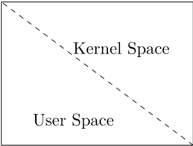
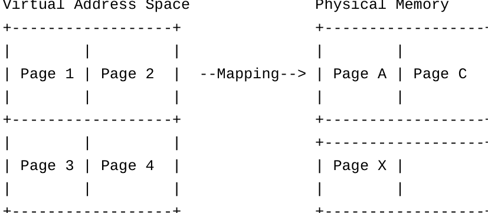

# 高级 Linux 开发：精通系统调用、文件系统与进程间通信

- 9.12 内核调试的高级技术

# 前言

欢迎阅读《专家级 Linux 开发：精通系统调用、文件系统与进程间通信》。本书是为程序员、系统工程师以及热爱 Linux 内部的技术爱好者编写的高级指南。书中深入探讨了 Linux 开发至关重要的众多主题，重点关注系统调用、文件系统、进程间通信，以及进程管理、内存架构和网络编程等补充性课题。

本书的主要目标是对 Linux 的运行机制提供深入且深入的技术分析，重点关注系统级编程。它超越了基础概念，为读者提供了利用复杂系统功能、优化 Linux 应用以及妥善处理调试和安全的知识。无论你是在开发内核模块、构建高性能网络服务，还是实施稳健的安全措施，本书旨在为你提供所需的专业知识。

每一章都经过精心设计，解决 Linux 开发的核心方面。主题以详尽的方式进行探讨，并辅以示例和实际场景，弥合了理论概念与现实应用之间的差距。学习之旅从 Linux 内核和系统调用的全面开始，扩展到同步进程、复杂的内存管理范式以及各种形式的进程间通信。

本文适用于已具备 Linux 基础知识和编程原理的读者。理想的读者包括软件开发者、系统管理员以及渴望成为 Linux 环境专家的计算机科学学生。本书具有极高的价值，可以作为克服实践挑战、增强 Linux 应用程序的性能和可扩展性，以及在项目中充分利用 Linux 系统全部潜力的资源。

此外，每一章都是相互独立的，为寻求优化其 Linux 应用程序的性能、可扩展性和可靠性的高级用户提供了详尽的解释。读者将获得应对复杂的 Linux 生态挑战所需的价值见解和工具，例如设计健壮的系统服务、增强内核功能或构建细粒度的安全框架。

总而言，《专家级 Linux 开发：精通系统调用、文件系统和进程间通信》（Expert Linux Development: Mastering System Calls, Filesystems, and Inter-Process Communication）是任何旨在精通高级 Linux 开发的人士者的核心教材。本书传授了解决 Linux 领域复杂挑战所需的理论知识和实践技能，最终使读者能够最大限地利用 Linux 的能力。

# 第一章

# 理解 Linux 内核与系统调用

Linux 内核作为计算机硬件与应用程序之间的核心接口，通过系统调用协调低级交互。本章将破译内核架构，并阐述系统调用实现和利用的过程。它还指导如何实现自定义系统调用、处理错误以及优化系统调用使用，以确保高效、安全且健壮的应用程序性能。

## 1.1 Linux 内核概述

Linux 内核是一个单体内核（monolithic kernel），负责管理系统资源并促进硬件与软件组件之间的通信。其核心——Linux 内核负责内存管理、进程调度、设备控制和文件系统管理。它充当用户空间应用程序与运行该系统的物理或虚拟硬件之间的中介。

内核架构结合了模块化和单体内核的方法。虽然内核本身是单体内核（意味着它是一个包含各种子系统的单一、整体单元），但它也支持加载动态可加载模块。这些模块引入了灵活性和扩展性，允许管理员和开发者在无需物理重启系统的情况下添加或删除功能。

- **内存管理：** 内核的内存管理系统监控内存使用的所有方面——内存页的分配与释放、内存与磁盘之间的交换，以及每个进程的虚拟地址空间管理。它采用了一种基于页的机制，并辅以复杂的缓存策略来增强性能。

- **进程调度：** Linux 中的进程调度是抢占式的，这意味着内核可以中断正在运行的进程，将 CPU 时间交给另一个进程。这种能力对于维持系统的响应和公平性至关重要。调度器使用算法根据进程优先级和执行历史在内的各种因素决定进程的运行顺序。

- **设备管理：** 内核包含了大量的设备驱动程序，管理各种硬件外设的操作。这些驱动程序将物理操作硬件的复杂性封装成高层接口，用户空间中的软件可以与之交互。

- **文件系统管理：** Linux 内核支持多种文件系统格式，允许系统高效地组织和存储数据。这种能力对于本地存储至关重要，对于网络系统也是如此，因为数据一致性和可访问性是关键。

内部，Linux 内核利用多种数据结构（例如链表、树和哈希表）以及针对性能和扩展性进行优化的算法。设计选择反映了复杂性与功能之间的平衡，旨在适应现代计算应用的多样需求。

Linux 内核的另一个基本方面是对系统调的使用。系统调用作为编程接口，用户空间程序通过该接口向内核请求服务，无论是创建进程、访问文件还是通过网络通信。该接口的设计旨在为各种硬件设置提供标准的抽象，确保应用程序代码在不同系统之间具有移植性。

内核开发是一个持续的过程，改进和新功能不断被集成到系统中。这种动态性质得益于强大的开发者和组织社区，他们为开源项目做出了贡献。系统会定期发布更新和补丁，以解决安全漏洞、引入优化并扩展硬件支持。

作为各种 Linux 发行版和众多嵌入式系统的基础，理解 Linux 内核结构和功能的重要性不言而喻。这些知识可以显著增强开发者优化应用程序性能、增强系统安全的能力，并对 Linux 的持续开发做出有效贡献。

## 1.2 内核空间与用户空间

在架构方面，像 Linux 这样的典型操作系统将其运行架构分为两个主要领域：内核空间（kernel space）和用户空间（user space）。这种区分对于系统操作的安全和性能方面都至关重要。

内核空间是操作系统存在并运行的核心。它是一个特权区域，内核（操作系统的核心部分）在此执行并管理与硬件紧密相关的操作，如内存管理、任务调度和中断处理。运行在内核空间的代码对硬件和所有系统内存具有无限制的访问。此空间中的错误或恶意代码可能导致系统崩溃或产生漏洞。

相反，用户空间是用户应用程序运行的地方。此空间中的应用程序被赋予受限的运行环境，在直接访问系统资源方面受到限制。它们在受限的权限集下运行，防止它们不受限制地影响系统。如果应用程序要执行超出其限制范围的操作（例如从文件或写入文件），它必须通过系统调用向内核发送请求。

- **内存保护：** 内核空间可以直接访问所有可用内存并执行任何 CPU 指令。用户空间应用程序以受限的能力运行，防止它们访问不属于自己的内存，从而保护系统不受错误或恶意行为的影响。

- **性能效率：** 内核空间内的操作执行不需要上下文切换的开销（这在 CPU 从用户模式切换到内核模式时是需要的）。这使得内核操作更快、更高效，但也需要谨慎，因为内核代码中的 bug 可能会损害整个系统。

- **安全性与稳定性：** 用户空间通过将应用程序相互以及与核心系统隔离，提供了一个沙箱环境。这种隔离增强了安全性和稳定性，因为在正常情况下，一个用户空间应用程序的故障或崩溃不会影响其他应用程序或内核。

这两个空间之间的切换由系统调用管理。系统调用作为一个受控的网关，用户空间应用程序通过它向内核请求额外的权限，以执行自己无法完成的任务。调用系统调用时，CPU 从用户模式切换到内核模式，执行请求的任务，然后切换回用户模式。



图 1.1：用户空间与内核空间划分的简单表示

在处理用户空间与内核空间交互的同时保持安全性和效率，是现代操作系统设计核心方面之一的体现。理解这些概念空间如何共存并协作，能够让开发者更好地理解底层的机制，从而通过合理利用系统调用创建更健壮的应用程序。

## 1.3 系统调用简介

系统调用（System Call）是应用程序与 Linux 内核之间至关重要的接口。该接口允许运行程序请求内核服务，通常是与底层硬件管理相关的操作，包括输入/输出处理、内存管理和进程调度。系统调用充当了用户空间应用程序与内核资源交互的受控网关。

为了利用系统调用的优势，开发者必须理解 Linux 操作系统提供的各种类型的系统调用。这些可以大致分为几类：

- **进程控制** - 这些系统调用管理进程的执行。例如，`fork`、`exit` 和 `execve` 被用于创建创建进程、终止进程以及执行新程序。

- **文件操作** - 涉及文件的创建、删除、打开、关闭、读取和写入。`open`、`read`、`write` 和 `close` 等系统系统调用属于这一类。

- **设备操作** - 像 `ioctl` 这样的系统调用允许对设备进行控制。

- **信息维护** - 这些系统调用检索和设置系统信息。例如时间调用，它用于设置或获取系统时间。

- **通信** - 这一类包括管理进程间通信的系统调用，例如通过管道或消息队列（`pipe`、`msgget`）。

尽管每个调用涉及底层的复杂性，但系统调用的触发通常遵循标准化的流程。从用户空间应用程序的角度来看，可以使用 GNU C 库 (`glibc`) 来调用系统调用，它提供了一个抽象层来简化与底层内核的交互。例如，通过 `glibc` 调用 `read` 系统调用可以通过以下 C 代码段演示：

```c
#include <unistd.h>

ssize_t read(int fd, void *buf, size_t count) {
    return syscall(SYS_read, fd, buf, count);
}
```

在此示例中，`syscall` 函数将读取操作的标识符及其参数传递给 Linux 内核。随后，内核会处理实际的文件读取操作。该系统调用的返回值表示读取了多少字节，或者如果发生错误则返回错误代码。

系统调用运行在名为“内核态”（kernel mode）的处理器模式下，这允许它们执行特权硬件操作。当从用户态转换为内核态时，会发生上下文切换（context switch），标志着从低特权的用户空间操作转换为高特权的内核空间操作。这种切换对于通过限制对敏感计算机操作的直接访问来维护系统的安全性和稳定性是必要的。

理解这一执行过程对于旨在最大化其应用程序效率和可靠性的开发者来说至关重要。通过正确掌握何时以及如何使用系统调用，开发者可以设计出既健壮又针对 Linux 系统性能优化的程序。通过对系统调用的智能使用和管理，应用程序实现了与内核更流畅的通信，从而有效地利用了 Linux 强大的功能。

## 1.4 系统调用的工作：从用户空间到内核空间

要理解系统调用从用户空间到内核空间的转换，掌握这一过程背后的机制至关重要。这种转换涉及一个受控程序，用户空间中的应用程序在更高的权限级别（即内核）与操作系统交互。

系统调用的主要触发因素是用户空间应用程序需要请求由于其特权属性只能在内核中执行的服务，例如直接访问硬件和敏感数据管理。实现这一点的机制通常通过软件中断辅助。在 Linux 中，使用的软件中断是 `int 0x80`，在较新的内核中，针对 x86_64 架构使用的是 `syscall` 指令。

1. **执行系统调用指令**：当用户空间应用程序需要执行需要内核级权限的操作时，它会执行特殊的系统调用指令。该指令将控制权临时从用户空间转移到内核空间。这是通过设置与系统调用号及其参数对应的寄存器值来实现。

2. **上下文切换**：执行系统调用指令后，会发生上下文切换。这是一个关键阶段，系统从用户态（低特权）切换到内核态（高特权）。内核接管控制并开始执行其代码来处理请求。保存 CPU 状态，以便系统在系统调用完成后返回原始的用户空间进程。

3. **系统调用分发**：当内核接收控制权时，它使用寄存器中的系统调用号来确定执行哪个内核函数。这种系统调用号到内核函数的映射定义在系统调用表中，该表充当内核的某种 API。

```c
 // 一个系统调用分发器的示例

void system_call_handler(void) {
    int syscall_number = get_syscall_number();
    if (syscall_number >= MAX_SYSCALLS) {
        handle_invalid_syscall(syscall_number);
        return;
    }
    syscall_table[syscall_number]();
}
```

4. **内核执行**：随后执行与系统调用对应的实际内核函数。系统在此函数中与硬件交互或操作受保护的数据。整个操作必须维护系统的完整性和安全性，遵守访问权限和其他安全限制。

5. **返回用户空间**：一旦内核侧的系统调用执行完成，结果将传回用户空间进程，CPU 恢复到用户态。在上下文切换期间保存的进程状态被恢复，用户空间进程恢复执行，就像执行普通函数一样，尽管带有系统调用的结果。

这种高效但复杂的交换机制确保了系统的稳定安全，在防止用户进程执行未经授权的操作的同时允许它们访问服务。通过适当的管理和处理，系统调用是用户应用程序安全有效地与系统资源交互的关键要素。

## 1.5 创建自己的系统调用

在 Linux 中创建自定义系统调用需要了解内核的功能和体系。该过程涉及修改内核源码、编译以及测试内核。为了演示，将引入一个计算三个整数和的简单系统调用。

第一步：定义系统调用。首先，在 Linux 内核源码树中为你的系统调用创建一个文件。按照惯，它可以放在 `linux/kernel/` 目录下。例如，创建一个名为 `addthree.c` 的文件。

```c
#include <linux/kernel.h>
#include <linux/syscalls.h>

SYSCALL_DEFINE3(addthree, int, a, int, b, int, c) {
    return a + b + c;
}
```

此代码段定义了一个新的系统调用 `addthree`，它接受三个整数参数并返回它们的和。`SYSCALL_DEFINE3` 用于定义具有三个参数的系统调用。

第二步：将系统调用添加到系统调用表中。Linux 维护着系统调用表，对于64位系统通常位于 `arch/x86/entry/syscalls/syscall_64.tbl`。添加以下行以分配系统调用号并注册你的系统调用。

`440 64 addthree sys_addthree`

第一列指定系统调用号，第二列指示兼容性（64 表示 64 位）且未被占用。第三列和第四列分别是系统调用名称和函数名。

**第 3 ：包含系统调用头文件。** 确保你的系统调用头文件已包含在内核源码中。可以通过将你的头文件声明添加到 'include/linux/syscalls.h' 中的列表中来实现：

`+ 1 aslinkage sys_addthree(int a, int b, int c);`

**第 4 ：重新构建内核。** 将新系统调用集成到内核后，重新编译内核：

`+ 1 make -j $(nproc)`

随后安装新内核并重启系统以启用新的系统调用。

**第 5 ：测试系统调用。** 为了进行测试，编写一个简单的用户空间程序，使用 syscall 接口调用新的系统调用：

```c
1 #include <stdio.h>
2 #include <unistd.h>
3 #include <sys/syscall.h>
4
5 #define SYS_ADDTHREE 440
6
7 int main()
8 {
9     long result = syscall(SYS_ADDTHREE, 1, 2, 3);
10    printf("The result of addthree(1, 2, 3) is %ld\n", result);
11
12 return 0;
13 }
```

在这里，`#define SYS_ADDTHREE 440` 对应之前指定的系统调用号。该程序使用相关的编号和参数调用 `syscall()` 并显示结果。

这一过程有效地演示了新系统调用在 Linux 内核中的构建与集成。该方法要求对内核架构有细致的理解并进行仔细的处理，以确保系统的稳定安全性。通过遵循这些步骤，开发者可以扩展 Linux 内核的功能以满足特定的应用需求，同时注意维护兼容性和遵守内核编码标准的重要性。

## 1.6 Linux 常用系统调用：示例与用法

系统调用是用户应用程序与 Linux 内核交互的主要机制。理解常用的系统调用及其其实际实现，对于在 Linux 平台上进行高效编程至关重要。本节介绍了几个典型的系统调用，通过简洁的代码示例深入探讨了它们的用法，并解释了它们在 Linux 软件开发大背景下的作用。

### 读与写

`read()` 和 `write()` 系统调用是 Linux 中处理文件 I/O 操作的基础。这些调用分别方便从文件描述符读取和从中写入。在这里，文件描述符是一个整数，用于唯一标识系统中的一个已打开的文件。

```c
#include <unistd.h>
```

```c
#include <fcntl.h>
```

```c
#include <unistd.h>
3 int main() {
    char buffer[128];
    ssize_t bytes_read, bytes_written;
    int fd = open("example.txt", O_RDONLY);
    if (fd == -1)
        return 1; // 打开文件错误

    bytes_read = read(fd, buffer, 128);
    if (bytes_read == -1)
        return 2; // 读取文件错误

    // 将读取的内容到标准输出
    bytes_written = write(STDOUT_FILENO, buffer, bytes_read);
    if (bytes_written == -1)
        return 3; // 写入标准输出错误

    close(fd);
    return 0;
}
```

代码示例打开了 `example.txt` 文件进行读取，然后从中读取最多 128 字节。随后它将这些字节写入标准输出（通常是终端）。每一步都会检查潜在的错误，例如打开、读取或写入失败，并为每种情况返回唯一的错误代码。

### 打开与关闭

`open()` 系统调用用于打开文件并为后续操作分配文件描述符，而 `close()` 则释放文件描述符。


```c
#include <fcntl.h>
#include <unistd.h>

int main() {
    int fd = open("newfile.txt", O_CREAT | O_WRONLY | O_TRUNC, 0644);
    if (fd == -1) {
        return 1; // 打开/创建文件错误
    }
    if (close(fd) == -1) {
        return 2; // 关闭文件错误
    }
}
```

在这个示例中，调用 `open()` 时带有标志，以创建一个用于写入的新文件。如果文件已存在，则会将其截断。模式 `0644` 将文件的权限设置为用户可读可写，组和其他用户只读。错误检查确保了对潜在文件系统 I/O 问题的健壮处理。

### fork

`fork()` 系统调用被广泛用于创建新进程。它通过克隆调用进程来创建一个子进程。新进程随后可以分支去执行与父进程不同的任务。

```c
#include <sys/types.h>
#include <unistd.h>

int main() {
5 pid_t pid = fork();
6
7 if (pid == -1)
8 return 1; // fork 错误
9 else if (pid == 0) {
10 // 子进程
11 execcl("echo", "echo", "Hello from Child!", NULL);
12 } else {
13 // 父进程
14 wait(NULL); // 等待子进程
15 16 return 0;
17 }
```

`fork()` 调用返回两次：一次在子进程中返回 `0`，一次在父进程中返回进程 ID。示例演示了向终端打印 "Hello from Child!"。通过探索这些基本的系统调用，开发者对 Linux 中的进程管理有了更深入的理解。

## 1.7 处理系统调用错误

错误处理是健壮软件不可或缺的一部分，特别是在处理系统调用时。系统调用可能由于各种原因失败，从权限不足到资源限制。当系统调用失败时，它通常返回 `-1` `errno` 被设置为一个值。与系统调用相关的错误包括 `EACCES`（拒绝访问）、`ENOMEM`（内存不足）和 `EINVAL`（无效参数）。

```c
#include <errno.h>
#include <stdio.h>
#include <unistd.h>

int main() {
  if (setuid(0) == -1) {
    fprintf(stderr, "Error setting UID: %s\n", strerror(errno));
    return 1;
  }
  // 继续 setuid 操作
  return 0;
}
```

在上面的示例中，`setuid()` 函数尝试更改进程的有效 ID。如果调用失败，它返回 `-1`，代码使用 `strerror(errno)` 打印错误消息，`strerror` 将 `errno` 值转换为人类可读的字符串。

为了进行更细粒度的错误处理，Linux 支持丰富的调试工具和 API。`perror()` 和 `strerror()` 等函数常用于报告错误。`perror()` 接收一个自定义消息，将其与冒号和空格拼接，随后是当前 `errno` 的标准错误描述。

```c
#include <errno.h>
#include <stdio.h>
#include <unistd.h>

int main() {
    if (close(-1) == -1) {
        perror("close");
        return 1;
    }
    return 0;
}
```

`perror()` 的用处在提供的尝试关闭无效文件描述符的代码段中显而易见。如果 `close()` 失败，它会打印带有 `errno` 定义的错误描述的消息。

系统级编程中的系统错误处理要求对 `errno` 的值进行仔细关注，特别是许多系统调用仅在发生错误时才会修改 `errno`。因此，如果后续逻辑依赖于检查此变量，那么在系统调用之前清除 `errno` 是关重要的。此外，由于 `errno` 是一个全局变量，线程应用程序应以线程安全的方式使用 `errno`，以避免并发系统调用导致的错误结果。使用 `perror()` 和 `strerror()` 是

由于它们本质上是线程安全的，因此它们更适用于多线程应用程序。

通过严谨的错误处理，可以显著提高软件的健壮性和可靠性。监控和记录此类错误还可以提供有关运行时行为和潜在优化的见解，对软件的可维护性做出重大贡献，并提升用户体验。

## 1.8 使用 strace 跟踪系统调用

`strace` 工具是一个强大的工具，它通过监控程序执行的系统调用和接收的信号，提供有关应用程序与 Linux 内核之间交互的深度信息。对于旨在诊断异常应用程序以及理解程序执行的系统操作的开发者和系统管理员来说，该工具至关重要。

要使用 `strace`，从命令行执行它，并指定要跟踪的程序作为参数。可选地，`strace` 可以通过 `-p` 选项使用进程 PID 附加到运行中的进程。

`strace ls`

此命令记录了 `ls` 命令发出的系统调用。输出通常包含一个调用列表，每个条目显示系统调用的名称、其参数、返回值以及在发生错误时的错误代码。

```
execve("/bin/ls", ["ls"], 0x7ffe89a14a0 / * 45 vars
*) = 0
brk(NULL)                               =
0x55976c25c000
...
```

输出中的每一行描述了一个特定的系统调用。示例中的 `execve` 函数启动了 `ls` 命令的进程。返回值 `0` 表示执行成功。

为了获得更详细的输出，包括在每个系统调用上花费的时间，可以添加 `-T` 标志。为了关注特定的系统调用集合，可以使用 `-e` 选项提供过滤器。

```
strace -e trace=open, close, read, write ls
```

此命令将跟踪过滤为仅包含 `open`、`close`、`read` 和 `write` 系统调用。这种过滤在调试特定的资源管理问题或文件处理错误时特别有用。

`strace` 的显著优势之一是可以在不修改、重新编译甚至无法访问应用程序源代码的情况下，理解应用程序与内核之间的交互模式。这使得 `strace` 在源代码不可用的情况下成为不可或缺的工具。

```
1 int main(int argc, char **argv) {
2 printf("Tracing with strace\n");
3 return 0;
4
```

尽管有效，但使用 `strace` 可能会引入明显的开销。由于额外的日志和监控，跟踪过程可能会减慢应用程序。当性能指标至关重要时，可能会将 `strace` 的使用限制在开发环境或特定的调试会话，而不是在生产环境中进行常规监控。

此外，为了降低潜在的安全风险，特别是在跟踪处理敏感数据的应用程序时，确保 `strace` 的输出得到充分的安全和审查至关重要。对 `strace` 及其生成的跟踪日志的访问应受到限制，以防止对系统操作或应用程序行为等敏感信息的未授权访问。

通过明智地利用 `strace` 的功能，开发者和系统管理员可以获得有关系统行为的宝贵见解，帮助彻底调试应用程序并优化系统交互。该工具虽然强大，在使用时应理解其对系统性能和操作安全的影响。

## 1.9 优化系统调用使用

优化系统调用使用对于增强在 Linux 环境下运行的应用程序至关重要。系统调用在 CPU 时间上相对昂贵，主要是因为它们涉及到从用户空间到内核空间的上下文切换。高效使用系统调用可以最大限地减少这些上下文切换，并提高软件应用的整体响应速度。

优化系统调用使用的一个基本方法是尽量减少调用次数。这可以通过最大化每次系统调用所完成的工作，或者将多个原本需要多次调用的操作合并为单调用来实现。这方面精确的例子是使用 `write()` 或 `read()` 系统调用，它们允许在一次调用中写入或读取多个非连续的数据块，而不是多次调用 `write()` 或 `read()`。

```
#include <sys/uio.h>

3 sssize_t writev(int fd, const struct iovec *iov, int iovcnt);
4 ssize_t readv(int fd, const struct iovec *iov, int iovcnt);
```

让我们考虑使用 `writev()` 在一次系统调用中写入三个缓冲区的示例：

```
1 struct iovec iov[3];
2 char *buf1 = "Hello, "
3 char *buf2 = "world";
4 char *buf3 = "!";
5
6 iov[0].iov_base = buf1;
7 iov[0].iov_len = strlen(buf1);
8 iov[1].iov_base = buf2;
9 iov[1].iov_len = strlen(buf2);
10 iov[2].iov_base = buf3;
11 iov[2].iov_len = strlen(buf3);
```

```
13 int fd = open("example.txt", O_WRONLY);
14 writev(fd, iov, 3);
15 close(fd);
```

除了减少系统调用次数，通过减少与内核的交互，可以增强系统性能。例如，减少对 `stat()` 的频繁调用。另一个优化的角度是选择系统调用，例如：

```
1 ssize_t read(int fd, void *buffer, size_t count);
```

在处理错误时，通过有效地管理系统调用，可以显著提升 Linux 应用程序的性能。

通过明智地利用 `strace` 的功能，开发者和系统管理员可以获得有关系统行为的宝贵见解，帮助彻底调试应用程序并优化系统交互。该工具虽然强大，在使用时应理解其对系统性能和操作安全的影响。

## 1.10 系统调用与 Linux 内核的交互

理解系统调用与 Linux 内核之间复杂的交互对于精通 Linux 编程至关重要。系统调用是应用程序与内核通信的主要接口，内核是负责管理 CPU、内存和 I/O 等系统资源的核心。本节将详细说明系统调用如何与其交互，重点介绍这种交互的机制以及对系统性能稳定性的影响。

系统调用实现在内核中，并通过 Linux 系统库暴露给应用程序。当用户空间程序需要内核提供的服务，如文件 I/O、网络通信或进程管理时，它会相应的系统调用。从用户空间到内核空间的转换是通过软件中断实现的，通常在 x86 架构上由 `syscall` 指令触发。该指令将执行从用户模式切换到内核模式，这种关键切换允许内核以特权执行任务，而不损害系统安全性。

内核通过检查传递在特定寄存器，例如 x86 上的 `eax` 中的系统调用号来确认调用。该数字作为系统调用表的索引，系统调用表是一个关键内核数据结构，将数字映射到相应的服务程序。表中的每个项指向内核中实现请求服务的函数。以下代码段示例了用户空间程序如何触发系统调用：

```
size_t read(int fd, void *buffer, size_t count) {
  return syscall(SYS_read, fd, buffer, count);
 }
```

接收到系统调用后，内核必须验证用户程序传递的参数。这一步对于确保指针引用和数据值是可以接受的且不会导致内核不稳定或安全风险至关重要。参数验证通常涉及指针的有效性、确保它们指向用户空间而非内核内存，并对值的范围和对齐情况进行检查。

在参数验证后，内核会执行请求的操作。例如，在从文件描述符进行读取操作时，内核可能会检查文件的可访问性、调整指针并管理缓冲区。一旦操作完成，内核会将结果返回给用户空间，通常通过用于系统调用号的同一寄存器，并辅以设置特定的处理器状态码来指示成功或错误。

至关重要的一点是，虽然系统调用是强大的工具，但由于用户空间到内核空间的上下文切换，它们会带来开销。每次系统调用都会产生不可忽视的性能成本，包括在模式切换上花费处理器的时间、参数验证以及执行状态的保存和恢复。因此，高效使用系统调用是高性能应用的关键。减少系统调用的次数或通过批量处理操作来减少上下文切换可以显著提高应用程序的响应速度和吞吐量。

此外，系统调用会影响 Linux 内核的行为。它们可能会对全局内核结构产生副作用，可能影响调度器，并影响其他运行进程的响应能力和性能。开发者需要意识到这些影响，以设计出健壮且高效的应用程序。

从本质上，系统调用与 Linux 内核之间的每次交互都体现了一条条关键的通信路径，它封装了底层细节的复杂性，确保了硬件和软件资源的安全高效管理。理解这些细节为开发者提供了优化应用程序所需的洞察，并为 Linux 系统软件的健壮生态系统做出重要贡献。

# 第 2 章

探索 Linux 文件系统

本章探讨了 Linux 支持的各种文件系统，如 `ext4`、`XFS` 和 `Btrfs`，并对它们的结构、功能和管理技术提供了详细理解。它涵盖了核心主题，如文件系统层次结构、挂载、权限以及日志、加密和网络文件系统等高级功能。它还涉及了性能考虑因素和故障排除实践，使读者具备了在 Linux 环境中有效管理和优化文件系统的知识。

## 2.1 Linux 文件系统简介

文件系统是控制数据在计算环境中如何存储和检索的根本组件。在 Linux 中，文件系统的多样性和灵活性特别为强劲，支撑了系统大多数的性能和安全能力。本节旨在提供对文件系统是什么的基础理解、它们在 Linux 操作系统中如何运行，以及它们在管理资源和数据方面的关键作用。

Linux 中的文件系统组织并管理位于存储设备，如硬盘、SSD 或远程网络存储上的文件。它提供了一种抽象，允许操作系统和应用程序通过简单且一致的 API 与复杂的硬件细节交互。文件系统的结构涉及目录和子目录，模仿了树形的层次层次结构，从由单个斜杠 `/` 表示的根目录开始。

Linux 文件系统中的每个文件和目录都带有元信息，包括权限、所有权、时间戳以及指向物理设备上数据块的链接。这些元数据在安全性和数据完整性方面起着至关重要的作用，决定了谁可以访问或修改文件。

文件系统管理的常用操作包括创建、删除、读取、写入和修改文件及目录。除了这些基础任务，Linux 文件系统还处理更复杂的问题，如权限管理、磁盘配额分配以及防止数据损坏的日志记录。

Linux 支持多种文件系统类型，每种类型都带有特定功能并适用于各种需求。例如，`ext4` 因其健性和良好的全方位性能而被广泛使用。`XFS` 优用于高效处理大文件和大容量卷，而 `Btrfs` 则提供了快照和动态 inode 分配等高级功能。

高效管理文件系统涉及了缓存机制，例如页缓存和 inode 缓存，通过减少磁盘访问时间来增强性能。这些缓存将频繁访问的数据和元数据存储在内存中，提供了对存储信息的快速访问。

除了本地文件系统，Linux 还支持网络文件系统，允许位于网络上的文件以对用户透明的方式访问。这种能力支持通过网络使用文件资源，就像它们本地连接一样，从而在网络环境的资源分配中提供了巨大的扩展性和灵活性。

由文件系统决定的这一复杂的文件和目录系统被虚拟文件系统 `VFS` 为用户甚至应用程序隔离开来。`VFS` 是一个内核软件层，为所有基于本地和基于网络的文件系统提供标准接口。通过调解所有文件系统操作，`VFS` 确保了应用程序可以与任何安装的文件系统交互，而无需担心底层文件系统的具体实现。

实际上，文件系统在 Linux 中的作用超出了数据存储。它涵盖了系统安全、资源管理和性能优化的方面。理解文件系统的基础、操作和类型是掌握 Linux 强大能力并确保系统最佳功能和安全的第一步。

## 2.2 理解文件系统层次结构标准 FHS

文件系统层次结构标准 `FHS` 定义了 Unix 和类 Unix 操作系统，如 Linux 中的目录结构和目录内容。它由 Linux 基金会维护，作为软件开发者和系统管理员的参考，以确保不同发行版之间的兼容性和一致性。

`FHS` 将所有目录分为三类：必需的、可选的和可变的。必需目录必须在所有符合 `FHS` 的系统中存在，可选目录可能存在，而可变目录可能会发生变化。

- `/bin`： 必需的用户命令二进制文件，必须在单用户模式下可用；对所有用户可用，例如 `cat`, `ls`, `cp`。
- `/boot`： 启动加载器的静态文件。
- `/dev`： 主机特有的系统配置。
- `/etc`： 必需的共享库和内核模块。
- `/mnt`： 挂载临时文件系统的挂载点。
- `/opt`： 添加应用程序软件包。
- `/sbin`： 必需的系统二进制文件，例如 `fschk`, `route`。
- `/usr`： 只读用户数据的次级层次结构；包含了大多数多用户工具和应用程序。
- `/var`： 可变文件——其内容预计在系统正常运行期间会不断变化，如日志、溢出文件。
- `/home`： 用户家目录，可选。
- `/root`： `root` 用户的家目录，可选。

Linux 文件系统中的每个文件和目录都有其特定用途，并遵循规定哪些文件应存储在其中。例如，`/bin` 包含了启动系统和执行基本操作所需的执行程序，它们必须存储在与 `/` 相同的分区上。同时，`/usr` 用于不重要的程序二进制文件，并可以从不同的磁盘挂载。

严格遵守 `FHS` 标准使系统管理员和软件工程师能够预测安装文件和脚本的位置，从而获得更可预测的系统行为和更好的发行版间兼容性。

此外，它简化了系统的管理和配置。例如，当文件组织良好时，备份系统配置文件或更新系统应用程序变得更容易。

`FHS` 的一个重要方面是它如何处理 `/home` 中的 `/var` 中的数据。通过分离系统文件和动态用户文件，`FHS` 最小化了常规操作期间系统故障的风险。此外，位于 `/etc` 的系统级配置文件允许对系统设置进行细粒度控制，这对于安全和调优至关重要。

考虑到文件类型的多样性和现代计算应用的复杂需求，`FHS` 为维护组织且高效的文件系统层次结构提供了一个健壮的框架。这种组织支持高效的系统管理并增强了 Linux 系统的整体稳定性。通过遵循任何标准，Linux 系统确保了开发的应用程序可以在任何符合 `FHS` 的系统中无缝运行。

## 2.3 文件系统类型：ext4, XFS, Btrfs 以及其他


# Linux 文件系统概述

Linux 支持多种文件系统，每种设计都旨在提供特定的优势并适用于特定的场景。本节将深入探讨 `ext4`、`XFS`、`Btrfs` 以及其他主流文件系统的属性、优势和适用。

## `ext4` 文件系统

`ext4` 文件系统是 Linux 中广泛使用的的文件系统，作为其前身 `ext3` 的演进，在性能、扩展性和稳定性方面提供了许多改进。`ext4` 支持多达 16 TB 的文件和高达 1 EB 的文件系统。`ext4` 的显著特性包括：

- 延迟分配：通过在数据即将写入磁盘之前延迟磁盘块的分配来提高性能并减少碎片。
- 日志 `Journaling`：`ext4` 支持日志功能，它在更改提交到主文件系统之前进行记录。这增强了可靠性和恢复过程。
- 区域 `Extents`：区域是一个连续数据块的范围，通过高效地管理文件和减少碎片，改进了 `ext3` 使用的位图映射方法的性能。
- 兼容性 `Compatibility`：`ext4` 与 `ext3` 和 `ext2` 向后兼容，允许在不转换的情况下将 `ext3` 和 `ext2` 挂载为 `ext4`。

`ext4` 的典型用例包括需要日志记录和向后兼容性的通用文件系统场景。

### XFS

`XFS` 由 Silicon Graphics 设计，以其能够高效处理大文件和大型卷容量的能力而闻名。这使得它特别适用于涉及大规模数据操作的应用，例如数字内容流媒体和大数据分析。`XFS` 的主要特性包括：

- 可扩展性 `Scalability`：`XFS` 支持多达 8 EB 的系统和多达 9 EB 的文件大小。
- 分配组 `Allocation groups`：`XFS` 将文件系统划分为分配组，每个组都可以独立管理文件系统。这种设计支持高水平的并行性，在多线程应用程序中具有优势。
- 日志 `Journaling`：`XFS` 使用日志空间来恢复元数据更改，并提供了稳健的崩溃恢复机制。
- 延迟分配和动态 inode `Delayed allocation and dynamic inode`：这些特性有助于磁盘空间和 inode 的高效管理。

由于其动态的先进分配机制和对大文件系统的支持，`XFS` 特别适用于具有大文件和高负载 IO 操作的环境。

### Btrfs (B-树文件系统)

`Btrfs` 是 Linux 中的一种现代文件系统，侧重于容错性、修复机制和易于管理的功能。`Btrfs` 的独特功能包括：

- 写时复制 `Copy-on-write, COW`：此特性维持文件和目录的快照版本成为可能，对于备份和复制过程非常有价值。
- 集成卷管理 `Integrated volume management`：`Btrfs` 允许创建子卷，子卷类似于动态分区，可以独立调整大小并进行管理。
- 数据校验和 `Data checksums`：`Btrfs` 在数据保护方面更进一步，不仅为元数据提供校验和，还为数据提供校验和，有助于防止数据损坏。
- 动态 inode 分配 `Dynamic inode allocation`：没有静态 inode 表，意味着更易于存储管理和更高的存储效率。

`Btrfs` 特别用于数据完整性和灵活存储管理至关重要的环境，例如数据库存储和数据中心。

### 其他文件系统

`JFS` 和 `ReiserFS` 等其他文件系统为 Linux 的文件系统组合贡献了多样性。`JFS` 即日志文件系统由 IBM 设计，提供良好的性能和可靠性，目标针对服务器环境。`ReiserFS` 以其存储效率特别是处理小文件时闻名，是另一个选择，但由于历史操作上的考虑因素，在新安装中较少。

尽管这些文件系统提供了多样化的特性和优势，但选择正确的文件系统至关重要，这取决于部署场景的具体需求，例如对大文件支持的需求、数据完整性水平或并发访问情况下的性能考量。通过检查每个文件系统的架构及其与操作需求的对齐情况，管理员可以针对特定的用例高效地优化其存储解决方案，确保高性能和高可靠性。

## 2.4 挂载和卸载文件系统

文件系统挂载是 Linux 中的一个关键过程，操作系统通过系统的树形结构使用户访问存储设备上的文件和目录。文件系统必须挂载到系统中现有的目录上，作为挂载点。相反，卸载是将挂载的文件系统从文件树中分离，确保除非重新挂载，否则无法访问。

Linux 中挂载文件系统的主要命令是 `mount`，而用于卸载文件系统的相应命令是 `umount`。有效管理挂载和卸载操作对于系统完整性和性能至关重要。

### 挂载过程

要挂载文件系统，通常会使用 `mount` 命令，后跟各种选项，以定义文件系统的源和目标挂载点。例如，要挂载普通分区，可以使用以下命令语法：

```
mount -t type device directory
```

在这里，`type` 指文件系统类型，例如 `ext4`、`XFS`，`device` 是存储设备或分区的路径，例如 `/dev/sda`，而 `directory` 是目标挂载点，例如 `/mnt/data`。

此外，通过 `-o` 选项允许用户指定各种挂载选项，如只读访问 `ro`、读写访问 `rw` 以及其他控制性能和安全行为的选项。

以读写模式挂载 `ext4` 文件系统的示例：

```
mount -t ext4 -o rw /dev/sda1 /mnt/data
```

此命令将分区 `/dev/sda1` 附加到挂载点 `/mnt/data`，并赋予读写权限。

### 卸载文件系统

`umount` 命令用于安全地将文件系统从其挂载点分离。至关重要的是，挂载点内没有文件或目录正在被应用程序或用户使用。活动使用会导致数据损坏或阻止卸载过程成功完成。

`umount` 的基本语法如下：

```
umount directory
```

其中 `directory` 是特定的挂载点。例如，要卸载 `/mnt/data` 目录，应执行：

```
umount /mnt/data
```

对于设备顽固或繁忙的情况，可以使用选项 `-l` 懒惰卸载和 `-f` 强制卸载来促使卸载过程。然而，应该谨慎使用这些选项，因为如果数据仍在写入磁盘，可能会导致数据丢失。

```
umount -l /mnt/data
```

此命令将对 `/mnt/data` 执行懒惰卸载，将文件系统立即从文件树中分离，并在不再忙碌后清理所有资源。

### 启动时自动挂载

为了自动化挂载文件系统，通常会使用 `mount` 命令，后跟各种定义文件系统源和目标挂载点的选项。例如，要挂载普通分区，可以使用以下命令语法：

```
mount -t type device directory
```

在这里，`type` 指文件系统类型，例如 `ext4`、`XFS`，`device` 是存储设备或分区的路径，例如 `/dev/sda`，而 `directory` 是目标挂载点，例如 `/mnt/data`。

此外，通过 `-o` 选项允许用户指定各种挂载选项，如只读访问 `ro`、读写访问 `rw` 以及其他控制性能和安全行为的选项。

以读写模式挂载 `ext4` 文件系统的示例：

```
mount -t ext4 -o rw /dev/sda1 /mnt/data
```

此命令将分区 `/dev/sda1` 附加到挂载点 `/mnt/data`，并赋予读写权限。

## 2.5 属性

- 属性 `Attributes`：Linux 文件系统的日志 `Journaling` 和文件属性。
- 权限 `Permissions`：Linux 文件系统的权限控制。
- 日志 `Journaling`：`ext4` 支持日志功能，它在更改提交到主文件系统之前进行记录。这增强了可靠性和恢复过程。
- 区域 `Extents`：区域是一个连续数据块的范围，通过高效地管理文件和减少碎片，改进了 `ext3` 使用的位图映射方法的性能。
- 兼容性 `Compatibility`：`ext4` 与 `ext3` 和 `ext2` 向后兼容，允许在不转换的情况下将 `ext3` 和 `ext2` 挂载为 `ext4`。

`ext4` 的典型用例包括需要日志记录和向后兼容性的通用文件系统场景。

### XFS

`XFS` 由 Silicon Graphics 设计，以其能够高效处理大文件和大型卷的能力而闻名。这使得它特别适用于涉及大规模数据操作的应用，例如数字内容流媒体和大数据分析。`XFS` 的主要特性包括：

- 可扩展性 `Scalability`：`XFS` 支持多达 8 EB 的系统和多达 9 EB 的文件大小。
- 分配组 `Allocation groups`：`XFS` 将文件系统划分为分配组，每个组都可以独立管理文件系统。这种设计支持高水平的并行性，在多线程应用程序中具有优势。
- 日志 `Journaling`：`XFS` 使用日志空间来恢复元数据更改，并提供了稳健的崩溃恢复机制。
- 延迟分配和动态 inode `Delayed allocation and dynamic inode`：这些特性有助于磁盘空间和 inode 的高效管理。

由于其动态的先进分配机制和对大文件系统的支持，`XFS` 特别适用于具有大文件和高负载 IO 操作的环境。

### Btrfs (B-树文件系统)

`Btrfs` 是 Linux 中的一种现代文件系统，侧重于容错性、修复机制和易于管理的功能。`Btrfs` 的独特功能包括：

- 写时复制 `Copy-on-write, COW`：此特性维持文件和目录的快照版本成为可能，对于备份和复制过程非常有价值。
- 集成卷管理 `Integrated volume management`：`Btrfs` 允许创建子卷，子卷类似于动态分区，可以独立调整大小并进行管理。
- 数据校验和 `Data checksums`：`Btrfs` 在数据保护方面更进一步，不仅为元数据提供校验和，还为数据提供校验和，有助于防止数据损坏。
- 动态 inode 分配 `Dynamic inode allocation`：没有静态 inode 表，意味着更易于存储管理和更高的存储效率。

`Btrfs` 特别用于数据完整性和灵活存储管理至关重要的环境，例如数据库存储和数据中心。

### 其他文件系统

`JFS` 和 `ReiserFS` 等其他文件系统为 Linux 的文件系统组合贡献了多样性。`JFS` 即日志文件系统由 IBM 设计，提供良好的性能和可靠性，目标针对服务器环境。`ReiserFS` 以其存储效率特别是处理小文件时闻名，是另一个选择，但由于历史操作上的考虑因素，在新安装中较少。

尽管这些文件系统提供了多样化的特性和优势，但选择正确的文件系统至关重要，这取决于部署场景的具体需求，例如对大文件支持的需求、数据完整性水平或并发访问情况下的性能考量。通过检查每个文件系统的架构及其与操作需求的对齐情况，管理员可以针对特定的用例高效地优化其存储解决方案，确保高性能和高可靠性。

## 2.6 创建和管理文件系统

创建和管理文件系统是 Linux 系统管理员的一项基础任务。本节涵盖了在 Linux 上创建、格式化、管理和优化文件系统的过程，重点关注 `ext4`、`XFS` 和 `Btrfs`，这些文件系统因其健壮性和功能集而被广泛使用。

创建文件系统：在 Linux 上创建文件系统的过程涉及几个步骤，主要是对存储设备进行分区，然后在该分区上创建并应用文件系统类型。

属性可以如下进行设置：

```
chattr +i /path/to/file
```

此命令使文件变为不可变状态，意味着它不能被修改、删除或重命名。

理解并正确应用权限和属性对于维护系统安全和优化功能至关重要。它允许管理员灵活地界定访问权限和能力，防止未经授权的更改，同时确保合法用户和进程能够不受阻碍地运行。有效管理这些参数的能力是系统管理员的基本技能，而且对于维护 Linux 文件系统的完整性和安全性至关重要。


## 文件系统分区与创建

- 第一步是对存储设备进行分区，通常使用 `fdisk`、`parted` 或 `gparted` 等工具。使用 `fdisk` 创建新分区涉及选择一个磁盘（例如 `/dev/sda`）并配置分区大小和类型。

- 分区完成后，下一步是创建文件系统。这是通过 `mkfs` 工具完成的，该工具包含了针对各种文件系统的特定程序：

```
1 mkfs.ext4 /dev/sda1 # 创建 ext4 文件系统
2 mkfs.xfs /dev/sda2 # 创建 XFS 文件系统
3 mkfs.btrfs /dev/sda3 # 创建 Btrfs 文件系统
```

管理文件系统：一旦创建了文件系统，就需要对其进行高效管理，以确保最佳的性能和可靠性。

- 挂载文件系统：要使用文件系统，必须将其挂载到特定的目录，即挂载点。这是通过 `mount` 命令完成的。

```
1 mount /dev/sda1 /mnt/data # 挂载 ext4 文件系统
```

- 检查文件系统健康：定期使用 `fsck`（针对 ext4）和 `xfs_repair`（针对 XFS）等工具进行检查至关重要：

```
1 fsck /dev/sda1 # 检查 ext4 文件系统
2 xfs_repair /dev/sda2 # 修复 XFS 文件系统
```

- 调整文件系统参数：可以使用特定于每个文件系统的工具来调优参数以获得最佳性能。例如，ext4 的 `tune2fs` 允许调整影响文件系统行为的各种参数。

```
1 tune2fs -m 1 /dev/sda # 在 ext4 文件系统中为 root 预留 1% 的块
```

优化文件系统：文件系统优化至关重要，特别是在 I/O 需求较高的环境中。如调整 ext4 中的日志模式、利用 Btrfs 的压缩以及 Btrfs 的分配组调优等技术都是实用的策略。

- Ext4 日志模式：Ext4 支持不同的日志模式，可以根据系统需求进行设置：

```
data=ordered      # 默认模式，仅对元数据记录日志。
data=journal      # 数据和元数据都会记录日志。
```

- Btrfs 压缩：Btrfs 可以配置为实时压缩数据，从而可能提高读写性能和磁盘空间利用率：

```
1 mount /dev/sda3 /mnt/data -o compress=zstd # 使用 zstd 压缩
```

- XFS 性能调优：XFS 允许调优各种参数，这在大规模存储环境中特别有用：

```
1 xfs_db -x /dev/sda2 # 进入调试外壳
```

在整个过程中，管理员监控任何更改的影响并确保备份是最新的至关重要。适当的文件系统管理不仅可以提高性能，还能增加数据可靠性和系统稳定性。这些能力是维护健壮高效的 Linux 系统的关键组件，确保文件访问和存储操作在各种场景下都能执行。

## 2.7 文件系统健康检查与修复

评估文件系统的健康状况并执行必要的修复是确保数据完整性和系统稳定性的关键任务。在非正常关机、硬件故障或文件系统损坏后，这些程序至关重要。本节讨论了 ext4、XFS 和 Btrfs 的方法。

Ext4 日志模式：Ext4 支持不同的日志模式，可以根据系统需求进行设置：

```
data=ordered      # 默认模式，仅对元数据记录日志。
data=journal      # 数据和元数据都会记录日志。
```

- Btrfs 压缩：Btrfs 可以配置为实时压缩数据，从而可能提高读写性能和磁盘空间利用率：

```
1 mount /dev/sda3 /mnt/data -o compress=zstd # 使用 zstd 压缩
```

- XFS 性能调优：XFS 允许调优各种参数，这在大规模存储环境中特别有用：

```
1 xfs_db -x /dev/sda2 # 进入调试外壳
```

在整个过程中，管理员监控任何更改的影响并确保备份是最新的至关重要。适当的文件系统管理不仅可以提高性能，还能增加数据可靠性和系统稳定性。这些能力是维护健壮高效的 Linux 系统的关键组件，确保文件访问和存储操作在各种场景下都能执行。

## 2.8 高级功能：日志、加密、压缩

日志是现代文件系统中的一项关键功能，增强了可靠性并缩短了故障后的恢复时间。日志的主要目的是在实际写入之前记录文件系统的更改，确保文件系统可以恢复到一致状态。ext4、XFS 和 Btrfs 等文件系统都支持日志。

例如，ext4 的日志功能可以在三种不同模式下运行：

- `data=ordered`：这是默认模式，仅对元数据记录日志。
- `data=journal`：在此模式下，数据和元数据都会记录日志。
- `data=writeback`：此模式允许元数据提交到日志，可以获得更快的性能，但可能会导致损坏。

实现日志需要用户交互。启用 ext4 文件系统的日志可以使用 `tune2fs` 命令：

```
sudo tune2fs -o journal /dev/sda1
```

接下来我们探索文件系统加密。Linux 通过 LUKS 和 dm-crypt 等机制直接支持文件系统加密，这对于保护存储在磁盘上的敏感数据至关重要。

设置 LUKS 进行全盘加密如下所示：

```
sudo cryptsetup luksFormat /dev/sdaN
sudo cryptsetup open /dev/sdaN
```

在完成这些步骤之后，任何写入 `/dev/mapper/encrypted_volume_name` 的数据都将自动加密。

透明压缩技术可以通过文件系统选项被轻松启用。例如，在 Btrfs 中，在新的挂载点上启用 zlib 压缩可以通过以下命令实现：

```
sudo mount /dev/sdX /mnt/point -o compress=zlib
```

这些高级特性对完整性和性能的影响可能是深远的。每个系统和用例都可能在性能、可靠性和资源利用之间产生不同的权衡。因此，虽然通过命令添加这些特性相对直观，但其产生的影响通常在没有经过深度分析和监控的情况下就无法充分理解。如果方法得当，它们在保护和高效管理数据方面的优势将远大于它们带来的开销或复杂性。

## 2.9 虚拟文件系统：procfs 和 sysfs

Linux 中的虚拟文件系统（如 procfs 和 sysfs）为内核与用户空间之间的交互提供了机制。这些文件系统并不存储数据，而是以类文件的接口在文件系统中动态地生成关于系统和内核内部状态的信息。这允许各种实用程序和应用程序访问有关系统状态和配置的关键信息。

procfs（或进程文件系统）挂载在 `/proc`，主要设计用于访问进程信息和系统统计数据。Linux 系统上每个运行的进程都由一个以进程 ID（PID）命名的目录表示。这些目录中的每一个包含文件和子目录，提供了进程状态、内存使用和内部指标的详细信息。

- `/proc/cpuinfo` - 显示 CPU 的信息，例如型号、供应商和配置。
- `/proc/meminfo` - 提供内存状态信息，包括总内存可用内存。
- `/proc/mounts` - 列出所有挂载的文件系统，类似于 `mount` 命令的输出。
- `/proc/partitions` - 显示所有识别驱动器的分区表。

sysfs 也是通过 `/proc/sys/` 等文件管理系统设置不可或缺的一部分，便于在运行时修改内核参数。

另一方面，sysfs 挂载在 `/sys`，使用结构化的设备层次结构组织设备、驱动程序和内核子系统的信息。该文件系统对于现代 Linux 发行版中 udev 设备管理器处理动态设备目录至关重要。它提供了管理和与硬件设备交互所需的模式工具信息。

```bash
### 通过 sysfs 访问设备信息的示例
cd /sys/class/net/eth0/speed
cat speed
```

在 sysfs 中，文件和目录按类型和功能组织，这对于复杂的设备管理场景特别有用。sysfs 内部的关键目录包括：

- `/sys/class/` – 包含按类别分组的设备（例如，net 表示网络设备，block 表示设备）。
- `/sys/devices/` – 提供设备的层次结构视图、它们如何相互连接及其属性。
- `/sys/bus/` – 显示总线信息、连接到总线的设备以及相关的设备驱动程序。

procfs 和 sysfs 具有不同且互补的作用。procfs 的设计针对易用性和简易性进行了优化，主要关注应用程序和系统监控器的进程和统计信息。相反，sysfs 提供了内核设备模型的结构化视图，对于硬件组件的配置和管理具有极高价值。这两个文件系统都是系统管理员和开发人员的重要工具，提供了对 Linux 操作系统内部的深入洞察，便于在用户空间上下进行必要的配置和交互。

## 2.10 网络文件系统：NFS 和 SMB

网络文件系统或分布式文件系统，例如网络文件系统（NFS）和服务器消息块（SMB），在提供通过网络远程访问文件方面起着关键作用。这使得多个用户可以像本地存储一样共享文件，显著增强了协作和资源集中化。

NFS 最初由 Sun Microsystems 在 20 世纪 80 代开发，基于客户端-服务器模型，由 NFS 服务器管理操作。由于无缝集成以及对 Unix 和 Linux 权限的支持，它在 Linux 环境中被广泛使用。NFS 4 是最新版本，比之前的版本提供了更好的安全特性和增强的性能。

NFS 服务器的设置涉及配置 `/etc/exports` 文件，用户在该文件中指定共享哪些目录以及权限权限。NFS 客户端可以挂载这些目录。考虑 `/etc/exports` 文件中的典型配置：

```text
1 /home/shared *(rw,sync,no_subtree_check)
```

在此配置中，目录 `/home/shared` 对所有主机 (*) 都可访问，具有读取和写入权限 (rw)，确保更改在确认写入请求之前已写入磁盘 (sync)，并且不允许进行子树检查 (no_subtree_check)。

要在客户端机器上挂载此共享目录，使用以下命令：

```bash
mount server_name:/home/shared /mnt/nfs/home
```

在这里，server_name 创建 NFS 服务器的主机名或 IP 地址，而 `/mnt/nfs/home` 是共享目录出现的本地挂载点。

转向 SMB 协议（也称为 Samba），它旨在促进 Linux/UNIX 服务器与 Windows 客户端之间的文件共享，同时也支持各种操作的跨平台兼容性。SMB 通过从服务器向客户端网络共享文件或打印机资源来工作。

SMB 服务器的配置涉及编辑 `smb.conf` 文件，通常位于 `/etc/samba/smb.conf`。在该文件中，共享定义如下：

| 行号 | 键 | 值 |
| :--- | :--- | :--- |
| 1 | [sharedfiles] | |
| 2 | path | /srv/samba/share |
| 3 | read only | no |
| 4 | guest ok | yes |

此配置快照创建了一个名为 sharedfiles 的共享，位于 `/srv/samba/share`，它是可写的（read only = no）且在不需要身份验证的情况下访问（guest ok = yes）。

在客户端系统上，连接到 SMB 共享可以使用：

```bash
mount -t cifs //server_name/share /mountpoint
```

## 2.11 文件系统性能调优

优化 Linux 中的文件系统性能对于系统运行至关重要，特别是在需要高速数据访问的环境中。本节深入探讨用于调优文件系统性能的各种策略和工具，重点关注 ext4、XFS 和 Btrfs。

### 选择正确的文件系统

文件系统的选择会影响性能。例如，ext4 适用于通用场景，而 XFS 擅长处理大文件，Btrfs 则提供了快照等高级功能。

- ext4 功能支持延迟分配和日志记录，这有助于更好的磁盘空间管理和可靠性，但在某些场景下可能会引入延迟。
- XFS 由于其规模和架构对并行 I/O 操作进行了优化，使其成为高性能计算和大型数据库的理想选择。
- Btrfs 允许动态 inode 分配，这对于文件和目录数量变化的系统是有益的。

### 调整挂载点

挂载选项在调优性能方面起着至关重要的作用。每个文件系统类型都支持在挂载时调整的一组选项以增强性能。

对于 ext4，使用 `data=writeback` 禁用日志功能可以提高性能，但是以牺牲故障期间的数据完整性为代价的。对于 XFS，通过 `logsize` 增加日志大小可以增强写入型操作的性能。对于 Btrfs，使用 `compress=zlib` 提供压缩以节省磁盘空间并可能减少读写移动。

### 有效利用缓存和缓冲

Linux 利用内存来缓存文件并缓冲 I/O 操作以增强性能。调整 `vm.dirty_background_ratio` 内核参数可以优化用于缓冲区内存量，减少 I/O 时间。

```bash
### 查看当前的 dirty_ratio 设置
cat /proc/sys/vm/dirty_ratio
### 将 dirty_ratio 设置较低的值以减少 I/O 阻塞
echo 20 > /proc/sys/vm/dirty_ratio
```

### 定期文件系统检查与平衡

对于 Btrfs 等文件系统，定期执行检查和平衡操作可以回收元数据和数据块的空间，从而性能。`btrfs balance` 等工具用于此目的。

### 启动 btrfs 平衡操作

```
sudo btrfs start /data
```

**利用 SSD 特有功能**: 许多现代文件系统针对固态硬盘（SSD）进行了优化。禁用 discard（TRIM）支持有助于随着时间的推移维持 SSD 的性能。

- # 启用 discard 选项挂 ext4 文件系统

```
mount -o discard /dev/sdx /mnt/ssd
```

**监控与分析工具**: 如 `iostat`、`vmstat` 和 `btrfs` 等工具提供了文件系统性能的宝贵见解，是识别瓶颈和潜在改进区域不可或缺。

- # 显示 btrfs 文件系统信息

```
btrfs fi show
```

处理影响文件系统性能的多种因素可以确保 Linux 系统的最优配置和运行。每个调整或优化都必须经过仔细测试，因为一个领域的改进可能会导致另一个领域的权衡，且其影响随工作负载和特定的系统配置而异异。因此，持续的监控和增量调整是长期维护文件系统完整性和性能的关键。

## 2.12 调试文件系统问题

在 Linux 系统上调试文件系统问题时，必须应用各种方法论、工具和技术，以有效地识别、诊断和解决发生的问题。最常见的文件系统问题包括损坏、访问错误、性能下降和挂载失败。本节介绍了一种使用系统实用程序、诊断命令和第三方工具来处理这些问题的结构化方法。

检测和识别文件系统问题的本质通常始于观测技术，例如监控系统日志和使用内置诊断工具。`dmesg` 命令对于读取内核消息特别有用，这些消息通常直接从文件系统驱动程序记录，可以指示硬件或驱动程序层面的错误和警告。要从系统日志缓冲区获取与文件系统事件相关的日志条目，可以使用以下命令：

```
dmesg | grep -i fs
```

该命令过滤输出，显示包含 "fs" 不区分大小写匹配的条目（fs 通常用于表示文件系统相关的日志）。

另一个关键工具是 `fsck` 命令，用于检查文件系统的完整性。在使用 `fsck` 时，应卸载文件系统以避免潜在的数据损坏。这里是 ext4 文件系统的 `fsck` 使用示例：

```
sudo mount /dev/sda
sudo fsck.ext4 -f /dev/sda
```

`-f` 选项强制执行检查，即使系统认为文件系统是干净的。`fsck` 的输出对于诊断文件系统内部特定类型的损坏或错误至关重要。

- 第 1 ：检查 inode、块和大小
- 第 2 ：检查目录结构
- 第 3 ：检查目录连接性
- 第 4 ：检查引用计数
- 第 5 ：检查组摘要信息

每次通过都代表文件系统检查的不同方面和层次，确保了彻底的分析和修复过程，这对于维护文件系统的完整性至关重要。

对于关注文件系统性能的情况，`iostat` 和 `iotop` 工具提供了 I/O 操作的可视图，允许管理员查看读写操作和 I/O 等待的实时数据。例如，可以运行 iostat 以每2秒获取一次 I/O 活动的信息：

```
iostat -xm 2
```

该命令以易读格式提供扩展统计数据，每2秒刷新一次，提供了动态监控 I/O 行为的能力。

另一个方面涉及检查硬件健康，因为文件系统问题有时是底层硬件问题的症状。可以使用 SMART Monitoring 工具包中的 `smartctl` 来检查磁盘健康：

```
sudo smartctl -a /dev/sda
```

该命令显示设备 `/dev/sda` 的所有 SMART 信息，帮助识别可能影响文件系统稳定性的硬件故障。

在严重损坏或复杂问题的情况下，可能需要咨询特定的文件系统日志并利用启用调试的内核模块。当启用这些模块时，它们会向系统日志提供详细的调试输出，这对于追踪文件系统异常行为的根源具有性作用。

Linux 在提供详细日志和诊断工具方面的健壮性为系统管理员和开发者配备了诊断和解决大多数文件系统相关问题的能力。理解这些工具的正确用法和输出，结合系统故障排除程序，可以确保 Linux 系统在各种条件下的稳定和可靠。因此，采用这些调查技术标志着在 Linux 文件系统管理领域维护系统和解决问题的一种主动方法。

# 第 3 章

# 进程间通信机制

本章深入探讨 Linux 中提供的各种进程间通信（IPC）机制，如管道、消息队列、共享内存和套接字。它解释了每种 IPC 技术，讨论了适用场景、性能影响和安全考虑。本章还提供了高级 IPC 主题（如远程过程调用 RPC 和 D-Bus）的见解，探讨了如何利用这些机制来设计复杂、高效且可扩展的应用程序，以便进程能够有效地协调或共享数据。

## 3.1 进程间通信 (IPC) 基础

进程间通信（IPC）是一系列多个进程相互通信并同步动作的方法论。进程可以运行在同一台计算机上，也可以通过网络连接到不同的计算机上。在现代计算设备中，IPC 至关重要，因为分离的进程必须通过共享数据和管理操作状态密切协作。本节介绍了 IPC 的概念并对 Linux 环境常用的 IPC 机制类型进行了分类。


IPC 类型：进程通信有多种方式，包括：

- 管道 (`Pipes`) 和 `FIFO`
- 消息队列 (`Message queues`)
- 共享内存 (`Shared memory`)
- 套接字 (`Sockets`)
- 信号量 (`Semaphores`)
- 信号 (`Signals`)

根据延迟、吞吐量复杂性，每种方法都有其优缺点。

管道和 `FIFO` 是 Unix 类系统提供的最老的 IPC 机制之一。管道允许单向数据流，通常在生产者-消费者架构中运行。生产者写入的数据只能由消费者进程读取。命名管道（`FIFO`）在文件系统中被命名时存在，允许无关的进程访问它们。

消息队列提供了一种以消息形式发送和接收数据的机制。这种 IPC 方法有助于进程解耦，因为消息存储在队列中，不需要立即处理。

共享内存允许多个进程访问物理内存的公共段。这是最快的 IPC 方法之一，因为它允许直接访问，减少了对数据拷贝的需求。然而，需要控制访问的机制（如信号量或互斥锁）来防止竞态条件。

套接字更具通用性，适用于网络上进程间的通信。套接字可以是不同类型，例如流（用于面向连接的通信的 `TCP`）或数据报（用于无连接交互的 `UDP`）。

信号量用于在并发系统中由多个进程共同资源。它们在防止竞态条件和确保进程同步方面至关重要。

信号是 IPC 的简单形式，通过向进程发送通知来指示特定事件的发生。为了说明 Linux 中管道的使用，请考虑以下代码片段，它演示了如何创建一个管道，父进程通过该管道向子进程发送数据：

```c
#include <stdio.h>
#include <unistd.h>
#include <stdlib.h>
#include <string.h>

int main() {
    int pipefd[2];
    pid_t cpid;
    char buf;

    if (pipe(pipefd) == -1) {
        perror("pipe");
        exit(EXIT_FAILURE);
    }

    cpid = fork();
    if (cpid == -1) {
        perror("fork");
        exit(EXIT_FAILURE);
    }

    if (cpid == 0) { // 子进程从管道读取
        close(pipefd[1]); // 关闭未使用的写端

        while (read(pipefd[0], &buf, 1) > 0) {
            write(STDOUT_FILENO, &buf, 1);
        }

        write(STDOUT_FILENO, "\n, world!\n", 14);
        close(pipefd[0]);
        exit(EXIT_SUCCESS);
    } else { // 父进程将 argv[1] 发送到管道
        close(pipefd[0]); // 关闭未使用的读端
        write(pipefd[1], "Hello, world!\n", 14);
        close(pipefd[1]); // 读取者将看到 EOF
    }
}
```

```c
36 wait(NULL); // 等待子进程
37 exit(EXIT_SUCCESS);
38 }
39 }
```

执行后，子进程的输出将是父进程通过管道发送的字符串 `"Hello, world!"`，可以通过封装之前的代码块来确认：

Hello, world!

每种 IPC 机制都有特定的使用场景，在某些情况下可能比其他方法更合适，例如用于网络通信的套，或用于高速本地通信的共享内存。理解每种 IPC 方法的基本属性和适用场景，允许开发者构建出高效、响应迅速的应用程序。

## 3.2 管道与 FIFO: 概念与用法

管道（Pipes）和 `FIFO` 是类 Unix 操作系统中基本的进程间通信机制，提供了简单而强大的数据传输手段。本节将探索管道和 `FIFO` 的底层概念、实际用法以及复杂细节。

管道通常是匿名的，且仅存在于进程的生命周期内，提供从一个进程输出到另一个进程输出的单向通道。管道的主要功能是将一个进程的标准输出连接到另一个进程的标准输入，形成生产者-消费者关系。

```c
#include <unistd.h>
int main() {
  int file_descriptors[2];
  pipe(file_descriptors);

  if (fork() == 0) {
    // 子进程
    write(file_descriptors[1], "Hello, world!\n");
    close(file_descriptors[0]); // 关闭读端
  } else {
    // 父进程
    char buffer[100];
    read(file_descriptors[0], buffer, sizeof(buffer));
    printf("Received: %s", buffer);
    close(file_descriptors[1]); // 关闭写端
  }
  return 0;
}
```

上述代码演示了基础的管道操作：父进程创建一个管道并派生出一个子进程。子进程写入管道，父进程读取。以下是运行该程序预期的输出：

**Received:** Hello, world!

`FIFO`（也称为命名管道）通过提供一个命名的接口扩展了匿名管道的能力，该接口独立于进程存在，并可以像普通文件一样被访问。这使得进程（即使是不相关的）也能进行通信。接下来的示例说明了 `FIFO` 的创建和使用：

```c
#include <sys/stat.h>
#include <fcntl.h>
#include <stdio.h>
#include <unistd.h>

int main() {
    char *fifo_path = "/tmp/my_fifo";
    mkfifo(fifo_path, 0666);

    if (fork() == 0) {
        // 子进程
        int fd = open(fifo_path, O_WRONLY);
        write(fd, "Message from child");
        close(fd);
    } else {
        // 父进程
        char buffer[100];
        int fd = open(fifo_path, O_RDONLY);
        read(fd, buffer, sizeof(buffer));
        printf("Parent received: %s", buffer);
        close(fd);
        unlink(fifo_path); // 使用后删除 FIFO
    }
    return 0;
}
```

在示例中，使用 `mkfifo` 创建了 `FIFO`。在使用 fact后，`FIFO` 路径被解除链接（删除）。父进程从中读取。

**Parent received:** Message from child

在通信进程不相关且不存在父子层级的情况下，使用 `FIFO` 特别有利，它允许不同进程之间进行异步通信，这在服务器-客户端模型或守护进程中非常有用。

管道和 `FIFO` 虽然有用，但它们在容量（它们具有有限的缓冲区大小）和阻塞行为（进程可能会阻塞等待读写可用）方面存在局限性。在将管道和 `FIFO` 集成到应用程序架构时，应当充分考虑这些因素，以确保最佳性能和可靠性。

本质上，管道和 `FIFO` 为在进程之间构建通信路径提供了多种且有效的手段。正确应用它们可以为任何系统级应用程序（从 Shell 到更复杂的系统工具）实现高效的数据交换。然而，使用这些机制时必须结合对对其限制及其在各种条件下的行为的理解。

## 3.3 Linux 中的消息队列

Linux 中的消息队列提供了一种进程通过发送和接收消息进行异步通信的方法。该系统运行在内核层级，允许消息的持续时间超过启动进程的寿命，从而使消息队列于其他形式的 IPC 管道。

消息队列在 Linux 中通过 POSIX 标准实现，具体称为 POSIX 消息队列。POSIX 提供的接口允许相对容易地创建、打开、发送、接收和管理队列。与管道相比，消息队列提供了根据优先级选择消息的增强功能，使其更加灵活，并适用于需要一致选择消息的复杂场景。

### 在 Linux 中使用 POSIX 消息队列

管理 POSIX 消息队列的核心函数涉及：

- `mq_open` - 创建或打开消息队列。
- `mq_send`, `mq_timedsend` - 向队列发送消息。
- `mq_receive`, `mq_timedreceive` - 从队列接收消息。
- `mq_close` - 关闭消息描述符。

使用 `mq_open` 创建消息队列时，该函数接收的参数指定了队列的属性，例如最大消息数量和最大消息大小。这些属性仅在创建队列时设置，此后保持不变。这里有一个使用 `mq_open` 创建新消息队列的示例：

```c
#include <queue.h>
#include <fcntl.h>
#include <sys/stat.h>

int main() {
    mq_t mq;
    struct mq_attr attr;

    attr.mq_flags = 0;
    attr.mq_maxmsg = 10;
    attr.mq_msgsize = 1024;
    attr.mq_curmsgs = 0;

    mq = mq_open("/mqqueue", O_RDWR | O_CREAT, 0644, &attr);
    if (mq == (mq_t)-1) {
        perror("mq open");
        return 1;
    }
    // ... 后续实现
}
```

等等，由于原文片段似乎出现了混乱，我根据上下文重新梳理并翻译了逻辑：

```c
#include <queue.h>
#include <fcntl.h>
#include <stdio.h>
#include <string.h>

int main() {
    mq_t mq;
    struct mq_attr attr;

    mq = mq_open("/mqqueue", O_RDWR);
    if (mq == (mq_t)-1) {
        perror("mq open");
        return 1;
    }

    // 假设此处 fork 逻辑
    if (fork() == 0) {
        // 子进程
        mq_send(mq, "Hello, world!", 13, 0);
        mq_close(mq);
    } else {
        // 父进程
        char buffer[100];
        mq_receive(mq, buffer, sizeof(buffer), NULL);
        printf("Received: %s", buffer);
        mq_close(mq);
    }
    return 0;
}
```

消息队列操作中的错误处理对于健壮的应用开发至关重要。应该检查所有 POSIX 消息队列函数的返回值以确保没有发生错误。常见错误包括 `EACCES`（权限错误）、`EEXIST`（队列已存在）和 `ENOSPC`（空间不足）。

此外，用户可以使用 `getattr` 和 `setattr` 查询和修改现有队列的属性。这些函数使得在运行时调整变得可能。

```c
#include <mq.h>
#include <stdio.h>

int main() {
    mq_t mq;
    struct mq_attr attr;

    mq = mq_open("/mqqueue", O_RDWR);
    if (mq == (mq_t)-1) {
        perror("mq open");
        return 1;
    }

    mq_getattr(mq, &attr);
    printf("当前设置 - 最大消息数: %ld, 最大消息大小: %ld\n", attr.mq_maxmsg, attr.mq_msgsize);

    mq_close(mq);
    return 0;
}
```

### 消息队列总结

消息队列提供的灵活性、易用性、可靠性和系统级通信能力使其成为 Linux IPC 工具箱中的重要工具。正确理解和利用消息队列可以显著增强需要异步通信系统的设计。对消息进行优先级排序的能力提供了额外的控制，适用于更复杂的需求。

## 3.4 共享内存：简介与用法

共享内存是一种进程间通信（IPC）方法，允许多个进程访问公共内存空间。它比消息传递等方法更快在进程之间交换信息。本节将讨论在 Linux 中使用共享内存的基础，包括共享内存段的创建和销，以及同步和安全等重要注意事项。

POSIX 标准提供了共享内存操作的 API，包括使用 `shm_open` 创建或打开共享内存对象，以及使用 `shm_unlink` 将其删除。然而，对于具体的实现，System V 共享内存函数更为常用，这些函数包括 `shmget`、`shmat`、`shmdt` 和 `shmctl`。

在 Linux 环境下开始使用共享内存，需要执行几个步骤创建一个共享内存段并将其附加到进程的地址空间。第一步是使用 `shmget`，它可以创建一个新的共享内存段，或者获取对现有段的访问权限。以下是一个演示此点的示例：

```c
#include <sys/ipc.h>
#include <sys/shm.h>

int main() {
    key_t key = 1234; // 共享内存段的 Key
    int shm_id = shmget(key, 1024, IPC_CREAT | 0666);
    if (shm_id < 0) {
        perror("shmget");
        exit(1);
    }
    return 0;
}
```

创建共享内存后，需要通过 `shmat` 将该段附加到进程的地址空间：

```c
void *data;
data = shmat(shm_id, NULL, 0);
if (data == (void *) -1) {
    perror("shmat");
    exit(1);
}
```

在代码中，`shmat` 将由 `shm_id` 标识的共享内存段附加到进程的地址空间，并返回指向段起始地址的指针。第二个参数指定要附加的特定地址，`NULL` 让系统选择此地址。

要解离并移除共享内存，如下使用 `shmdt` 和 `shmctl` 函数：

```c
if (shmdt(shm_id) == -1) {
    perror("shmdt");
    exit(1);
}

if (shmctl(shm_id, IPC_RMID, NULL) == -1) {
    perror("shmctl");
    exit(1);
}
```

共享内存操作中的错误处理至关重要，正如每个案例所示，任何失败都会导致程序退出；可以根据应用需求设计更好的错误处理。

同步机制在共享内存系统中非常重要，以防止竞态条件。可以使用信号量或互斥锁来同步对共享内存的访问。POSIX 信号量可以使用 `sem_open`、`sem_wait`、`sem_post` 和 `sem_unlink` 创建和操作，提供了一种有效同步访问的方法。

最后，处理共享内存的安全性非常重要。由于内存区域可以被多个进程访问，应该实施措施来控制对共享内存段的访问。IPC 机制的正确配置以及对段的警惕监控对于防止未经授权的访问和数据损坏至关重要。

通过正确实现共享内存并注意同步和安全，应用程序可以从高性能 IPC 方法中受益，提高进程间交换的效率。

## 3.5 IPC 中的同步：信号量

信号量是进程间通信（IPC）领域中一种本质工具，提供了一种管理多线程和多进程系统中共享资源并发访问的方法。在进程共享内存或文件，或者在需要协调顺序的环境中，它们尤尤至关重要。

信号量从根本上是一个控制共享资源访问的计数器。计数器的值表示可以并发访问的资源实例数量。通常，信号量提供两个原子操作：

- `wait()`: 此操作将信号量计数器减1。如果计数器大于零，则允许访问，进程继续。如果为零，进程将阻塞，直到另一个进程释放信号量。
- `signal()`: 此操作将信号量计数器加1，信号一个进程已完成对共享资源的使用。这可能会解阻塞另一个进程阻塞的 `wait()` 操作。

在 Linux 系统中，信号量通常通过 System V IPC 机制或 POSIX 标准管理。两者都提供了略有不同的 API 和语义，但通过原子操作控制访问的原理保持不变。

### System V 信号量

System V 信号量实现在信号量集上操作，信号量集是一组可以作为一个单元被访问和释放的信号量。这对于同时管理相关资源特别有用。以下是你在 Linux 环境中通常如何初始化和利用 System V 信号量。

```c
#include <sys/types.h>
#include <sys/ipc.h>
#include <sys/sem.h>

int sem_id;
key_t key;
struct sembuf sops;

// 生成唯一 key
key = ftok("semfile", 'A');

// 创建包含一个信号量的信号量集
semid = semget(key, 1, 0666 | IPC_CREAT);

// 在信号量上执行的操作
sops.sem_num = 0; // 信号量在集合中的索引
sops.sem_op = -1; // 操作（P 操作，信号量减1）
sops.sem_flg = SEM_UNDO; // 确保如果进程提前终止，操作将会被撤销

// 在信号量集上执行操作
semop(semid, &sops, 1);
```


信号量操作中的 `Sem_UNDO` 标志确保如果进程在没有显式释放资源的情况下提前退出，信号量的调整将自动反转，防止死锁。

### POSIX 信号量

POSIX 信号量提供了具名和未命信号量功能。当不相关的进程需要同步时，具名信号量非常有用，因为它们可以通过文件系统的名称访问信号量。

```c
#include <fcntl.h>
#include <sys/stat.h>
#include <semaphore.h>

sem_t *sem;
int main() {
    // 打开一个具名信号量
    sem = sem_open("/semname", O_CREAT, 0644, 1);

    // 等待信号量
    sem_wait(sem);

    // 临界区

    // 信号信号量
    sem_post(sem);

    // 关闭信号量
    sem_close(sem);

    return 0;
}
```

使用 POSIX 信号量的优点包括清理更简单且相比 System V 更加健壮。它们之间的选择通常取决于系统兼容性、易用性和性能。在实现基于信号量的同步时要尽职，因为不当的处理会导致死锁（两个或多个进程互相等待）或资源泄漏（信号量未释放）。

## 3.6 Socket 编程：UNIX 套字和网络 Socket

Socket 编程是一种实现可能位于不同机器进程间通信的方法。在 UNIX 和 Linux 环境中，这通过使用 UNIX 套字和网络 Socket 实现，它们具有不同的角色并基于不同的协议。

UNIX 套字主要用于运行同一台机器的进程之间的通信。它们以数据吞吐量高、资源利用率低而闻名。这种效率的主要原因是 UNIX 套字使用文件系统作为寻址方案，不需要网络协议处理。

创建和使用 UNIX 套字涉及多个函数调用，策略性地放置在你的程序代码中。过程始于系统调用：

```c
int sockfd = socket(AF_UNIX, SOCK_STREAM, 0);
```

此调用返回一个文件描述符，其中 `AF_UNIX` 指定了 UNIX 套字族，`SOCK_STREAM` 表示可靠的流（类 TCP）类型 socket。为了通信，你需要使用 `bind` 系统调用将此 socket 绑定到 UNIX 文件系统中的路径：

```c
struct sockaddr_un addr;

memset(&addr, 0, sizeof(struct sockaddr_un)); // 清空结构

addr.sun_family = AF_UNIX;

strncpy(addr.sun_path, "/unix_socket", sizeof(addr.sun_path) - 1);

bind(sockfd, (struct sockaddr_un*)&addr, sizeof(struct sockaddr_un));
```

为了处理客户端服务器交互，服务器必须使用 `listen` 监听连接请求，并使用 `accept` 接受：

```c
listen(sockfd, 5); // 监听 socket，最多 5 个等待连接
int clientfd = accept(sockfd, NULL); // 接受连接
```

一旦建立连接，可以使用 `write` 和 `read` 调用进行数据传输。当通信结束时，关闭 socket 是关重要的：

```c
close(sockfd);
```

另一方面，网络套接字（Internet sockets）或 TCP/IP 套接字是为跨主机网络通信而设计的。网络套接字在 IP 网络层上运行，并提供了传输层协议如 TCP（可靠、保证顺序、基于流）和 UDP（不可靠、不保证顺序、基于数据报）之间的选择。使用网络套接字进行编程通常看起来相似，但使用的是 `AF_INET` 地址。下面的示例演示了服务器如何设置套接字、绑定到 IP 地址和端口，并开始监听连接：

```c
int sockfd = socket(AF_INET, SOCK_STREAM, 0);

struct sockaddr_in addr;
memset(&addr, 0, sizeof(struct sockaddr_in));
addr.sin_family = AF_INET;
addr.sin_port = htons(8080); // Port号
addr.sin_addr = INADDR_ANY; // 在任何接口上监听

bind(sockfd, (struct sockaddr*)addr, sizeof(struct sockaddr_in));
listen(sockfd, 5);

int clientfd = accept(sockfd, NULL, NULL);
```

通过网络套接字传输数据必须经过仔细管理，以处理网络链路上常见的部分读/写情况：
`ssize_t bytes_send = send(clientfd, buffer, strlen(buffer), 0);`

由于网络套接字暴露在网络中，安全在处理过程中起着至关重要的作用。安全套接字（SSL/TLS）、验证客户端数据以及实现健壮的错误处理等实践对于维护传输数据的完整性和机密性关重要。

本节深入探讨了 UNIX 局域网套接字，不仅揭示了它们的操作语法，还阐明了它们的适用性和注意事项。随着你进一步探索进程间通信（IPC）领域，套接字编程的微妙之处和威力将成为程序员工具箱中无价的财富，促进许多场景和平台之间稳健且可扩展的进程通信。

## 3.7 高级 IPC：远程过程调用 (RPC)

远程过程调用（RPC）是进程间通信中的一种强大技术，允许程序触发另一个地址空间（通常在不同的物理或虚拟机器）中的过程执行。这种能力对于设计需要在网络环境中透明交互的分布式系统至关重要。

RPC 通过允许开发者以函数调用而非网络细节来思考，从而抽象了网络的复杂性。当系统利用 RPC 时，客户端调用远程系统上的一个过程，带有提供的参数执行指定的过程，并等待返回响应。

### The RPC 模型

在 RPC 模型中，通信由客户端发起，客户端向服务器发送执行特定过程的请求。然后，服务器使用客户端提供的参数执行该过程，生成结果并将其发送回给客户端。

- 客户端：通过发起过程调用（向服务器发送请求）来启动 RPC。
- 服务器：等待客户端调用，在调用时运行请求的过程，并将结果返回给客户端。

RPC 架构的一个核心组件是存根（stubs）——代理函数，它们为客户端和服务器隐藏网络通信的细节。客户端有一个客户端存根，服务器端有一个服务器存根。

```c
// Client Stub
int add(int a
```

### 标准协议与工具

可以使用多种协议和标准来实现 RPC 机制，最著名的是 Sun RPC 和 XML-RPC。最近，Google 开发的 gRPC 等框架通过支持 Protocol Buffers 等现代数据格式，并提供身份验证、负载均衡和异步处理等功能而变得流行。

- Sun RPC：传统的、广泛使用的 RPC 系统，主要与 C 和 C++ 应用一起。
- gRPC：现代的开源 RPC 框架，使用 HTTP/2 进行传输，使用 Protocol Buffers 作为接口语言，并提供身份验证、负载均衡、双向流和流量控制等功能。

### 架构考虑

将 RPC 整合到应用程序中需要对几个架构因素进行仔细考虑：

- 延迟与容错性：需要注意处理网络通信中的潜在延迟和中断。
- 安全性：必须使用安全通道，并应严格实施输入验证，以防止数据泄露和拒绝服务（DoS）等攻击。
- 缓存策略：为了提高性能（特别是在分布式系统中），对远程过程的结果进行有效缓存可以减少 RPC 调频率和成本。
- 可扩展性：系统设计应能够随着 RPC 客户端数量或请求速率的增加而实现无缝扩展。

通过高效应用 RPC，分布式系统可以实现更高层次的抽象，提高代码的模块化、可扩展性和可重用性。然而，开发者必须细致地设计并保护 RPC 实现，以在利用这些利益的同时，缓解网络故障和安全漏洞等相关风险。因此，RPC 应慎重地集成到系统架构中，强调健性和系统完整性。

## 3.8 使用 D-Bus 进行 IPC

D-Bus 是一种消息总线系统，为进程间通信（IPC）提供了一个高效的框架，主要用于 Linux，以促进各种系统组件和应用程序之间的通信。它最初为桌面环境设计，因其健壮性和易用性而被广泛采用。

D-Bus 的工作原理允许应用程序通过发送和接收消息进行相互通信。它同时支持点对点和发布/订阅通信模型，确保能够适应不同的需求和场景。该系统由三个主要部分组成：总线守护进程（bus daemon）、客户端库和绑定工具。

`dbus`守护进程充当中间人，在应用程序之间路由消息。每条消息都发送到守护进程，然后根据系统定义的规则将其转发给一个或多个接收应用程序。这种模型抽象了直接 IPC 的复杂性，提供了一种更具扩展且易于管理的方法。

D-Bus 接口使用 XML 表示定义，据此生成 C++、Python或其他语言绑定。这些接口定义了可以与应用程序交互的方法、信号和属性。这种描述允许 D-Bus 透明地处理消息的序列化和反序列化，简化了开发过程。

在 Linux 环境中使用 D-Bus 的典型用如下：

```c
#include <dbus.h>
#include <stdlib.h>
#include <stdlib.h>
int main(int argc, char **argv)
{
DBusError err;
DBusConnection *conn;
int ret;
dbus_error_init(&err);
// 连接到 D-Bus 系统总线
conn = dbus_bus_get(DBUS_BUS_SYSTEM, &err);
if (dbus_error_is_set(&err)) {
    fprintf(stderr, "Connection Error (%s)\n", err.message);
    dbus_error_free(&err);
}
if (conn == NULL) {
    return EXIT_FAILURE;
}
// 添加我们感兴趣的消息规则
dbus_bus_add_match(conn, "type='signal',interface='com.example.SignalInterface", &err);
dbus_connection_flush(conn);
if (dbus_error_is_set(&err)) {
    fprintf(stderr, "Match Error (%s)\n", err.message);
    return EXIT_FAILURE;
}
// 主循环
while (true) {
    // 非阻塞读取下一个消息
    dbus_connection_read_write(conn, 0);
    DBusMessage* msg;
    // 如果没有获取消息则再次循环
    if ((msg = dbus_connection_pop_message(conn)) == NULL) {
        sleep(1);
        continue;
    }
    // 检查是否是来自正确接口且名称正确的信号
    if (dbus_message_is_signal(msg, "com.example.SignalInterface", "ExampleSignal")) {
        printf("Received Signal with header: %s\n", dbus_message_get_signature(msg));
    }
    // 释放消息
    dbus_message_unref(msg);
}
// 关闭连接
dbus_connection_close(conn);
```


在提供的示例中，应用程序连接到系统总线，添加匹配项以监听来自特定接口的信号，并进入等待这些信号的循环。接收到信号后，它会相应地对信号进行处理。

使用 D-Bus 的优势非常许多。它为不同的应用程序提供了一个通用框架，无论它们是用什么语言编写的。此外，D-Bus 提供了高细粒度的权限控制，通过允许精确控制哪些应用程序可以通过总线进行通信，增强了安全性。

尽管有这些优势，在应用程序中实现 D-Bus 时仍需要考虑一些因素。数据到 D-Bus 格式的序列化可能会引入开销，特别是在处理复杂或大型数据结构时。此外，除非得到充分管理，否则对守护进程（daemon）的依赖可能会成为单点故障。

D-Bus 在 Linux IPC 生态系统中的作用对于其适应性和功能丰富性至关重要。它继续是许多桌面和服务器应用程序的骨干，证明了在从简单软件到复杂运行环境的真实应用中的有效性。

## 3.9 IPC 机制比较：性能与用例

Linux 中的进程间通信（IPC）机制是促进进程间数据交换的基础工具。每种技术都具有独特的性能特征，并适用于特定的用例。在本节中，我们将探索 IPC 机制的性能分析和典型应用：管道（pipes)/FIFO、共享内存、套接字（sockets）、远程过程调用（RPC）和 D-Bus。

管道/FIFO：管道对于同一台机器上无进程限制的数据流来说简单且有效。它们提供字节流模型，但没有内置的机制来管理消息边界。FIFO 通过允许无关的进程进行通信扩展了管道的功能。

- 性能：管道和 FIFO 通常为小规模、低延迟通信提供良好的性能。然而，随着数据量的增加，性能会下降，因为它们并不是为高吞吐量而设计的。
- 用例：适用于简单的父子进程通信场景或小规模的生产者消费者问题。

消息队列：消息队列支持基于消息的通信，并提供了一种清晰管理消息边界的机制，能够数据传输。

- 性能：消息队列在通信中可能会引入高延迟，但在保持边界和顺序至关重要的场景下表现。
- 用例：最适用于复杂系统，在这些进程需要可靠且结构化的通信机制，或者需要选择性地检索消息。

共享内存：共享内存允许多个进程访问同一个内存段，能够在 IPC 方法中实现最快的数据访问，因为消除了在客户端和服务器之间拷贝数据的需求。

- 性能：由于直接内存内存，提供了最高性能，尽管它需要同步机制来防止数据损坏。
- 用例：适用于需要高速访问共享数据的应用程序，例如实时仿真系统或游戏。

套接字（Sockets）：套接字提供了一种多功能的通信机制，支持本地（UNIX 域套接字）和网络（TCP/IP, UDP）通信。

- 性能：UNIX 域套接字很快，提供了与 TCP/IP 套接字类似的稳健数据传输能力，但没有网络开销。TCP/IP 和 UDP 套接字在可靠性和速度之间平衡了通信。
- 用例：UNIX 域套接字适用于同一主机上的本地进程通信，而 TCP/IP 和 UDP 用于跨主机的网络通信。

远程过程调用（RPC）：RPC 抽象了函数调用，允许程序在网络上另一台计算机上执行过程。

- 性能：由于网络开销和序列化，其性能通常低于其他 IPC 机制。然而，它简化了分布式应用的定义。
- 用例：广泛用于分布式系统，需要在远程机器上执行操作，例如分布式数据库或云服务。

D-Bus：D-Bus 是一种高级 IPC 机制，允许同一台机器上的多个应用程序进行通信。

- 性能：虽然性能不如低级 IPC 机制，但 D-Bus 提供了一个稳健的消息系统，可以与各种软件架构良好集成。
- 用例：它在桌面环境的应用程序间通信或 Linux 的事件通知系统中特别特别有效。

IPC 机制的选择在很大程度上取决于应用程序的规范，包括性能需求、数据一致性和运行环境。上述讨论概述了每种 IPC 机制的基本特征和应用，帮助开发者根据其用例和性能需求做出明智决策。每种机制都有独特的优势和局限性，必须仔细权衡，以实现稳健、高效且可扩展的系统。

## 3.10 IPC 中的安全考虑

进程间通信（IPC）促进了进程之间的数据共享，可能跨越安全边界。考虑到 IPC 有的复杂性和多样性，必须仔细考虑安全因素，以防止未经授权的访问、数据泄露、操纵和其他恶意活动。

### 身份验证与访问控制

在使用 IPC 机制时，特别是在具有多个用户或多种应用程序的环境中，实施正确的身份验证和访问控制变得至关重要。在这里，使用访问控制机制确保只有授权的实体可以初始化并交互 IPC 通道。

- 管道和 FIFO：实施权限方案或访问控制列表（ACL）来限制访问。利用 `umask` 设置默认权限并利用用户和组 ID 进行强制隔离。
- 消息队列：通过在创建时设置适当权限来确保安全，类似于文件权限。采用 POSIX 能力来实施更严格的控制。
- 共享内存：使用 `shmget` 和 `shmctl` IPC 调用带有受控权限分配并访问共享内存段。结合机制以确保共享内存仅由经过验证和授权的进程访问。
- 套接字：利用套接字级安全功能保护基于套接字的通信，包括传统的 UNIX 套接字权限和用于加密数据交换的更高级的 SSL/TLS 层。

### 确保数据完整性和机密性

保护通过 IPC 通信数据的完整性和机密性对于防止篡改和未经授权的披露至关重要。

- 加密：使用加密来保护在不安全网络上传输的数据。为套接字实施稳健的加密协议，如 SSL/TLS。
- 校验和和哈希（Hash）：对于关键数据交换，纳入校验和和哈希以验证数据完整性。

### 处理窃听和重放攻击

IPC 系统，特别是跨网络运行的（例如套接字），容易受到窃听和重放攻击。缓解这些问题的策略包括：

- 随机数和时间戳：在通信中使用随机数（nonces）和时间戳来防止重放攻击。
- 安全通道：始终使用安全通道，例如 VPN 或加密套接字连接。

### 管理拒绝服务 (DoS) 攻击

DoS 攻击攻击 IPC 机制以耗尽系统资源，导致服务不可用。可以使用这些预防措施：

- 速率限制：对 IPC 通信实施速率限制，防止频繁访问导致资源耗尽。
- 稳健的错误处理：实施能够管理 IPC 调用的错误处理程序，防止崩溃或整个系统不稳定。
- 资源分配监控：监控并控制分配给每次 IPC 操作的资源（如内存和 CPU），确保检测并缓解异常使用模式。

IPC 的安全不仅涉及机制本身的安全，还涉及审计、活动以及对 IPC 相关软件组件的定期更新以修复已知漏洞。安全实践应定期审查和更新，以反映新的网络威胁和不断演变的 IPC 技术。

仔细实施这些策略确保了稳健的防御机制，最终保护了 Linux 系统进程间通信的完整性、机密性和可用性。

## 3.11 常见 IPC 问题排除

诊断管道和 FIFO 问题：管道和 FIFO 作为 IPC 的基础机制，经常遇到阻塞和缓冲区状态的问题。常见的问题是写入进程继续阻塞，因为读取进程没有充分清空缓冲区。

```c
int nbytes;
char buffer[1024];
```

```c
4 while ((nbytes = read(fd, buffer, sizeof(buffer))) > 0)
5 write(STDOUT_FILENO, buffer, nbytes);
```

如果执行停滞，通常是由于缓冲区满且读取器没有按预期读取数据导致的。
- 缓冲区满：写入进程被阻塞

有效的故障排排除涉及检查读取进程是否处于激活状态并能够接收更多数据。像 `strace` 等工具可以监控进程的系统调用，以确认读和写操作是否正在进行。

### 消息队列通信失败：消息队列的问题表现为消息投递失败或意外的消息顺序。常见问题源于消息类型设置不当或权限不足阻塞了发送/接收进程。

```c
1 struct my_msgbuf {
2 long mtype;
3 char mtext[200];
};
```

```c
6 struct my_msgbuf buf;
7 buf.mtype = 1; // 确保此类型在发送者和接收者中匹配
```

当出现差异时，检查消息类型并确保两个进程都在兼容的权限设置下运行可以解决许多问题。利用 `ipcrm` 可以帮助识别和管理可能导致进程无法从头启动的孤立或遗留队列。

### 共享内存问题：损坏和同步问题在共享内存中很常见。如果进程在没有适当同步机制的情况下同时访问共享内存段，可能会报告不一致的数据。

- 实现健壮的锁机制，例如信号量。
- 调查并使用 POSIX 共享内存 (`shm_open`, `truncate`) 和带有适当标志的映射 API (`mmap`)。

调试时 `/dev/shm` 应该列出共享内存段，而 `nm` 和 `objdump` 工具可以检查二进制文件中与共享内存相关的符号或缺失。

### Socket 连接异常终止：连接可能由于网络问题、配置错误或超时而提前关闭。像 `wireshark` 或 `tcpdump` 等监控工具可以帮助捕获包以分析流并确定中断发生的位置。

```c
1 setsockopt(fd, SO_KEEPALIVE, &keepalive, sizeof(int));
```

在提供的示例中，使用 `SO_KEEPALIVE` 有助于保持连接活跃并检测掉落的连接。检查日志是否存在异常的发送或接收返回，并检查是否报告了如 `EPIPE` 或 `ECONRESET` 等错误代码将有助于故障排除。

调试工具和日志提供了必要的诊断，以尽可能地减少停机时间并确保健壮的 IPC 性能。采用系统方法验证并纠正识别出的每个异常行为，对于维护进程之间高效的通信基础设施至关重要。对 IPC 机制及其容错性的进一步探索，可以显著提高复杂应用程序进程间通信的可靠性和响应策略。

## 3.12 IPC 使用的真实世界示例

进程间通信 (IPC) 是现代软件系统开发的基石。本节说明了各种 IPC 机制在真实软件应用中的应用，提供了一个实用视角，补充了前面章节的理论讨论。

### Shell 脚本中的管道和 FIFOs

IPC 最常见的用途之一是在 Unix 类操作系统中，其中管道（pipes）被用于连接多个命令。在这里，一个命令的输出作为另一个命令的输入，创建一个进程链来有效共享数据。考虑以下利用管道的脚本：

```bash
grep 'Error' application.log | sort -c
```

在此示例中，`grep` 过滤出 `application.log` 中以 'Error' 开头的行。输出被排序并传递给 `uniq`，后者会统计出现次数。该链在不需要中间存储的情况下高效地执行了数据分析。

### 用于异步日志系统的消息队列

消息队列在需要异步通信的场景中非常有用。一个典型用例是日志系统，应用程序性能不应受到日志活动的影响：

```c
#include <queue.h>
// 打开消息队列
mqd_t mq = mq_open("/Logqueue", O_CREAT | 0644, NULL);
if (mq == -1) {
    perror("Error opening message queue");
    exit(1);
}
char message = "INFO: Application started.";
// 向队列发送消息
if (mq_send(mq, message, strlen(message), 0) == -1) {
    perror("Error sending to message queue");
}
mq_close(mq);
```

此示例显示了应用程序如何将消息记录到消息队列中，然后由另一个独立的日志进程进行处理。解耦允许主应用程序在不受日志开销影响的情况下运行。

### 视频处理应用中的共享内存

由于涉及大量数据，视频处理应用通常需要快速的 IPC 机制。共享内存允许多个进程直接访问公共数据区域。以下说明了如何在 Linux 环境设置和使用共享内存：

```c
#include <sys/mman.h>
void *shared_memory = mmap(NULL, sizeof(frame_buffer), PROT_READ | PROT_WRITE, MAP_SHARED | MAP_ANONYM);
if (shared_memory == MAP_FAILED) {
    perror("Error mapping shared memory");
    exit(1);
}
```

在这里，`frame_buffer` 可能代表包含视频解码器和渲染器使用的视频数据的结构体。避免了在生产者和消费者进程之间拷贝数据的耗时操作。

### 用于分布式系统的 Socket

在进程跨越多个机器的分布式系统中，Socket 提供了必要的通信通道。一个示例是微服务架构，不同的服务通过网络 Socket 进行通信：

```c
#include <sys/socket.h>
int sockfd = socket(AF_INET, SOCK_STREAM, 0);
if (sockfd < 0) {
    perror("Socket creation failed");
    exit(1);
}
```
（注：Socket 代码的 OCR 文本包含破碎的行号；这些已根据上下文重构为标准的 C 代码块）。

由于 Linux 是一个多用户、多任务的操作系统，它必须并发管理多个进程。这种复杂性要求一个健壮且灵活的进程管理系统不仅能够高效处理进程的创建和销毁，还能优化进程之间的 CPU 时间，以提供响应迅速且稳定的系统环境。

对 Linux 进程架构的理解为探索进程创建、管理和通信等深层次的话奠定了基础。每个方面都相互关联，强调了进程在 Linux 操作系统中的重要性以及它们对系统性能和能力的影响。

## 4.2 创建进程：fork(), vfork(), 和 clone()

Linux 中的进程创建主要通过三个系统调用处理：`fork()`、`vfork()` 和 `clone()`。每个调用都有其独特的用途，并根据应用程序的需求在不同的场景下使用。

`fork()` 是创建新进程（称为子进程）最常用的调用。该系统调用通过克隆调用进程来创建一个新进程。新进程是父进程数据、代码和堆段的副本。以下是 `fork()` 调用的实现方式：

```c
#include <sys/types.h>
#include <unistd.h>
#include <stdio.h>
int main() {
    pid_t pid = fork();
    if (pid == -1) {
        // Error处理
        perror("fork");
        return -1;
    }
    if (pid > 0) {
        // 父进程
        printf("Parent process, pid = %d\n", getpid());
    } else {
        // 子进程
        printf("Child process, pid = %d\n", getpid());
    }
    return 0;
}
```

如果 `fork()` 调用成功，它会返回两次：一次在父进程中，返回值为新创建进程的进程 ID (pid)；一次在子进程中，返回值为 0。在发生失败时，父进程环境中返回 -1。

`vfork()` 的设计是为了在子进程创建以使用 `exec()` 执行新应用程序的情况下具有更高的效率。`vfork()` 在不复制父进程地址空间的情况下创建新进程，这有助于减少进程创建的开销。由 `vfork()` 创建的子进程与父进程共享地址空间，直到它调用 `exec()` 或 `_exit()`，或者父进程恢复执行之后。

这是一个说明 `vfork()` 用法的示例：

```c
1 #include <sys/types.h>
2 #include <unistd.h>
3 #include <stdlib.h>
4
5 int main() {
6     pid_t pid = vfork();
7     if (pid == 0) { // Child process
8         execl("/bin/ls", "ls", NULL);
9
10         exit(0);
11 }
}
```

`clone()` 系统调用扩展了 `fork()` 和 `vfork()`的功能，允许更精确地控制父进程和子进程之间共享执行上下文的部分。`clone()` 在用户级别实现线程，提供了共享地址空间、文件描述符、信号处理程序等选项。

下面是 `clone()` 的用法示例：

```c
1 #define _GNU_SOURCE
2 #include <sched.h>
3 #include <stdio.h>
4 #include <sys/wait.h>
5 #include <signal.h>
int childFunction(void* arg) {
    printf("Child process running\n");
    return 0;
}

int main() {
    char stack[1024*64]; // Define a stack for the child process
    pid_t pid = clone(childFunction, stack + (1024*64), SIGCHLD, NULL);
    if (pid == -1) {
        perror("clone");
        return -1;
    }
    wait(NULL); // Wait for the child process to terminate
    return 0;
}
```


在这个示例中，`clone()`被用于创建一个共享调用进程信号处理程序并使用新栈的进程。`clone()`提供的灵活性使其成为 Linux 中微调进程和线程行为的强大工具。

这些调用中的每一个为管理基于 Linux 的系统中进程的创建和生命周期提供了基础能力。它们允许开发者操作进程地址空间、控制执行并以最符合应用程序需求的方式管理进程，确保系统资源的高效利用。

## 4.3 进程层次结构与孤儿进程/僵尸进程

理解进程关系中形成的层次结构以及孤儿进程和僵尸进程的影响，对于在类 UNIX 环境（如 Linux）中管理程序的生命周期和行为至关重要。Linux 中的进程符合分层次结构，除了系统启动时启动的初始进程外，每个进程都由另一个进程创建。这种关系形成了一个树形结构，不仅规范了进程之间的相互作用，还影响了系统资源管理和清理进程。

**父子关系：** Linux 中的每个进程都通过唯一的进程 ID (`PID`) 创建，并与产生它的进程相连。当父进程通过 `fork()` 或 `clone()` 等系统调用创建新进程时，源进程就成为新子进程的父进程。子进程继承环境变量和文件描述符等属性，但具有一个唯一的 `PID`。这种关系构成了 Linux 进程管理生命周期中的关键部分。

**孤儿进程：** 当父进程在子进程之前退出或终止时，就会产生孤儿进程。在正常操作中，子进程应该报告其状态。

**僵尸进程：** 僵尸进程是指进程已经执行完毕但父进程尚未通过 `wait` 等调用读取其退出状态的进程。僵尸进程在进程表中仍有条目，但不再消耗资源。

```c
int main() {
    struct timespec req = {2, 0}; // 2 seconds
    struct timespec rem;
    if (nanosleep(&req, &rem) < 0 ) {
        perror("nanosleep");
    } else {
        printf("Slept for 2 seconds\n");
    }
    return 0;
}
```

当进程处于睡眠状态时，它会暂时离开运行队列，直到它正在等待的事件发生或超时为止。

**等待状态：** 进程通常在等待 I/O 操作完成或等待来自其他进程的信号时进入等待状态。在此期间，进程不会消耗 CPU 资源。在 I/O 操作完成或接收到信号之前，进程将一直保持在等待状态。当进程等待进程改变状态时，可以使用 `wait` 系统调用：

```c
#include <sys/types.h>
#include <sys/wait.h>
#include <unistd.h>
#include <stdio.h>
```

```c
pid_t pid = fork();
if (pid == 0) {
    // 子进程
    printf("Child process\n");
} else {
    // 父进程
    wait(NULL); // 等待子进程完成
    printf("Child completed\n");
}
return 0;
```

这些进程状态的界定和管理是 Linux 系统多任务处理的基础。对这些状态的高效处理确保了系统资源不浪费，并且进程能够快速响应用户和系统的需求。

进程状态的有效管理对 Linux 系统的响应和稳定性有显著贡献。此处讨论的工具和技术对于优化应用程序和维护系统健康运行的开发者以及系统管理员至关重要。

## 4.5 信号管理：发送和处理信号

信号是 Linux 等类 Unix 操作系统中进程间通信的基本机制。信号代表了进程间通信 (IPC) 的有限形式；它是向进程发送的一种一种异步通知，用于通知其发生某个事件或中断它。理解如何有效管理信号对于开发 Linux 应用程序至关重要。

在 Linux 中，每个信号都通过其整数值和一个以 'SIG' 开头的名称来标识。典型示例包括在用户输入中断字符（通常是 Ctrl-C）时发送的 `SIGINT`，以及通过 `kill` 命令发送的请求终止程序的 `SIGTERM`。

### 发送信号

Linux 提供了向进程发送信号的各种机制。最广泛使用的命令是 `kill` 命令和 `kill()` 函数。命令行工具 `kill` 用于根据进程 ID 向进程发送信号，而 `kill()` 函数可以在程序内部调用，以向任何组进程发送信号。

以下是 `kill()` 函数的示例：

```c
#include <signal.h>
#include <stdio.h>
int main() {
	pid_t pid = 1234; // 要发送信号的进程 ID
	int ret;
	ret = kill(pid, SIGTERM); // 尝试向进程发送 SIGTERM
	if(ret == -1) {
		perror("kill");
	}
	return 0;
}
```

在这段代码中，如果 `kill()` 失败，它将返回 -1 并将 `errno` 设置为错误代码，该错误代码会被 `perror()` 用于打印描述性错误信息。

### 处理信号

进程通过建立信号处理器（signal handlers）来确定如何对信号做出响应。信号处理器是在接收到特定信号时执行的函数。可以使用 `signal()` 函数或更通用的 `sigaction()` 函数来指定信号处理器。

以下是使用 `sigaction()` 设置信号处理器的方法：

```c
#include <stdio.h>
#include <signal.h>
#include <unistd.h>
void sig_handler(int signo) {
    if (signo == SIGINT) {
        printf("received SIGINT\n");
    }
}
int main(void) {
    struct sigaction action;
    action.sa_handler = sig_handler;
    sigemptyset(&action.sa_mask);
    action.sa_flags = 0;
    if (sigaction(SIGINT, &action, NULL) == -1) {
        perror("sigaction");
        return 1;
    }
    // 长时间等待，以便我们可以方便地向此进程发送信号
    while(1) {
        sleep(1);
    }
    return 0;
}
```

示例中，当接收到 `SIGINT` 时，`sig_handler()` 被调用。它只是打印一条消息表示捕获了信号。

在对信号进行详细考虑时，必须考虑到对各种常见问题（如竞态条件和系统调用中断）的健壮性。当信号中断昂贵的调用时，可能会导致部分执行或提前终止。通过处理 `EINVAL`、`EINTR` 等错误，开发者可以使其应用程序免受许多相关问题的影响。

本节为在 Linux 进程中处理信号奠定了基础，说明了处理和发送信号如何让开发者能够更显式、灵活地管理进程生命周期和交互。在 Linux 系统这种充满挑战的环境中，正确的信号处理对于最大化进程的响应和可靠性至关重要。

## 4.6 进程调度：优先级与策略

Linux 中的进程调度决定了进程获得 CPU 时间的顺序。本节深入探讨了进程优先级和调度策略的复杂性，这些策略是确保高效利用 CPU 并满足实时进程要求的支柱。

Linux 使用调度器，根据各种因素（包括优先级级别和预定义的调度策略）来为进程分配时间片。理解这些因素对于开发者来说至关重要。

### 理解优先级

在 Linux 中，每个进程都有一个优先级值。主要有两种类型：`nice` 值和实时优先级。`nice` 值范围从 -20（最高）到 19（最低）。实时优先级范围从 1（最低）到 99（最高）。

要调整进程的 `nice` 值，可以使用 `nice()` 和 `setpriority()` 系统调用。例如：

```c
#include <sys/resource.h>
#include <unistd.h>
int main() {
    int ret;
    ret = nice(5); // 增加 nice 值
    if (ret == -1) {
        perror("nice failed");
    }
    return 0;
}
```

`nice()` 的输出是新的 `nice` 值，失败则返回 -1。

### 调度策略

Linux 支持多种调度策略，决定了调度器如何分配时间：

- `SCHED_OTHER`：大多数进程使用的默认调度策略。
- `SCHED_FIFO`：先进先出实时调度策略，运行直到阻塞或主动让出 CPU。
- `SCHED_RR`：轮询实时调度策略，类似于 `SCHED_FIFO`，但具有固定的时间片。
- `SCHED_BATCH`：用于批处理，该策略假设进程将运行很长时间。
- `SCHED_IDLE`：极低优先级，该策略在没有其他任务可用时运行。

要为进程设置调度策略和优先级，可以使用 `sched_setscheduler()`：

```c
#include <sched.h>
int main() {
    struct sched_param param;
    param.sched_priority = 30;
    if (sched_setscheduler(0, SCHED_FIFO, &param) == -1) {
        perror("sched_setscheduler failed");
        return -1;
    }
    return 0;
}
```

必须仔细考虑每种调度策略的性能影响；如果不当，`SCHED_FIFO` 和 `SCHED_RR` 可能导致进程饥饿，特别是在对实时性能要求高的系统中。相反，`SCHED_OTHER` 和 `SCHED_BATCH` 通过允许系统动态抢占任务提供了灵活性。

## 4.7 守护进程：创建与管理

守护进程是特殊的后台进程，通常在系统启动时启动并一直运行到系统关闭。这些进程没有控制终端，通常用于在 Linux 环境提供服务。常见的示例包括 Web 服务器、文件服务器和数据库服务。守护进程的创建和管理对于系统管理员和高级程序员优化系统效率和可靠性至关重要。

创建守护进程涉及多个步骤，第一步是派生子进程，子进程随后变为孤儿进程并被 `init` 进程（进程 1）采用。这一步对于将守护进程从终端分离并使其独立于用户会话至关重要。

```c
pid_t pid = fork();
if (pid < 0) {
    // 错误处理
    exit(EXIT_FAILURE);
}
```

```c
if (pid > 0) {
    // 父进程
    exit(EXIT_SUCCESS);
}
```

在 `fork` 之后，通过 `setid()` 创建新会话是典型做法。这一步是创建新组和会话的基础，它可以将守护进程从任何控制终端中分离。守护进程将成为新会话和进程组的首进程。

```c
if (setid() < 0) {
    // 错误处理
    exit(EXIT_FAILURE);
}
```

创建会话后，标准做法是将当前工作目录更改根目录（`/`），以避免锁定挂载点并确保守护进程不会阻止文件系统的卸载。

```c
for (int x = sysconf(_SC_OPEN_MAX); x>=0; x--) {
    close(x);
}
int fd0 = open("/dev/null", O_RDWR);
int fd1 = dup(0);
int fd2 = dup(0);
```

对守护进程的有效管理不仅包括设置，还包括持续的控制和响应。这通常涉及信号处理机制的实现。例如，为了优雅地处理关闭请求或重载配置，守护进程会为 `SIGTERM` 和 `SIGHUP` 等信号实现处理器。

```c
struct sigaction sa;
sa.sa_handler = handle_sa_signal;
sigemptyset(&sa.sa_mask);
sa.sa_flags = 0;
sigaction(SIGTERM, &sa, NULL);
sigaction(SIGHUP, &sa, NULL);
```

资源管理也起着至关重要的作用。设置资源限制和优先级可以防止守护进程消耗过多的系统资源。这通常使用 `setrlimit()` 完成。

```c
struct rlimit rl;
getrlimit(RLIMIT_NOFILE, &rl);
rl.rlim_cur = 1024;
setrlimit(RLIMIT_NOFILE, &rl);
```

遵循这些技术确保了守护进程健健、无干扰且高效，在没有直接交互或监控的情况下有效满足系统和用户的需求。由于不同 Linux 发行版和版本的实践略有不同，开发者在部署守护进程时必须考虑特定的系统特性和需求。确保守护进程得到良好管理和正确实现，可以显著提高 Linux 系统的稳定性。

## 4.8 进程通信：管道、套接字和信号

进程间通信（IPC）对于涉及多个进程协作任务的软件开发至关重要。Linux 支持多种 IPC 机制，包括管道、套接字和信号，每种机制适用于不同的场景和需求。

### 管道

管道为进程之间提供了单向通信通道。管道按照生产者-消费者模型运行，一个进程向管道写入数据，另一个进程从中读取。Linux 中最简单的管道形式是匿名管道，使用 `pipe()` 系统调用创建。

```c
int fd[2]; // 管道的文件描述符数组
if (pipe(fd) == -1) {
    perror("pipe");
    exit(EXIT_FAILURE);
}
```

在这里，`fd[0]` 设置为读取，而 `fd[1]` 设置为写入。写入 `fd[1]` 的数据可以从 `fd[0]` 读取。

命名管道（或 FIFOs）是文件系统中存在的另一种变体。它们可以被无关的进程访问，并在创建进程终止后依然存在。

```c
mkfifo("/tmp/myfifo", 0666);
```

这段代码段在 `'/tmp'` 目录中创建了一个名为 `'myfifo'` 的 FIFO，并允许所有用户读写权限。

### 套接字

套接字提供了一种稳健的 IPC 机制，支持面向连接（TCP）和无连接（UDP）通信协议。与管道不同，套接字支持双向通信，并且不仅可以用于单机上的 IPC，还可以用于跨网络机器通信。

使用 `socket()` 调用创建套接字：

```c
int sockfd = socket(AF_INET, SOCK_STREAM, 0);
if (socket(fd) < 0) {
    perror("socket");
    exit(EXIT_FAILURE);
}
```

在这里，`AF_INET` 指定了 IPv4 互联网协议，`SOCK_STREAM` 表示可靠的、基于连接的流（TCP），而 0 是协议值（该类型的默认协议）。

### 信号

信号是发送给进程的简单通知，用于告知其发生了某个事件。例如，“`SIGKILL`”用于指示进程终止，“`SIGUSR1`”和“`SIGUSR2`”专门用于用户定义的条件。

处理信号涉及设置信号处理器 —— 这是一个在接收到信号时执行的函数。这通过 `signal()` 或更健壮的 `sigaction()` 系统调用完成。

```c
#include <signal.h>
void signal_handler(int sig) {
    write(1, "Signal received\n", 16);
}
```

在这个示例中，`signal_handler` 函数被指定处理“`SIGUSR1`”。当接收到此信号时，它只是向标准输出写入“Signal received”。

- 管道适用于进程之间简单的、本地的、线性数据流，作为流水线中的过滤器。
- 套接字更多功能，支持复杂的网络交互和多个连接。
- 信号提供了一种响应系统和事件的轻量级方法，但其异步性质可能使其难以管理并容易产生竞态条件。

理解这些 IPC 机制为构建复杂的应用程序提供了必要的底层技能，这些应用可以利用多个进程（可能分布在几台机器上）进行管理。

## 4.9 资源限制与控制

Linux 中的资源限制对于进程管理至关重要。这些限制主要通过 `getrlimit()` 和 `setrlimit()` 系统调用进行管理。用于管理资源的结构体是 `struct rlimit`。它包含两个字段：`rlim_cur` 和 `rlim_max`。`rlim_cur` 代表软限制，即非根进程可以设置限制；`rlim_max` 代表硬限制，即 `rlim_cur` 可以设置的最大值。这些字段类型类型为 `unsigned long`。

让我们考虑一个实际示例。假设进程需要确保文件大小不超过 100 MB。以下代码段演示了如何使用 `setrlimit` 函数设置此限制：

```c
#include <sys/time.h>
#include <sys/resource.h>
#include <stdio.h>
int main() {
    struct rlimit limit;
    limit.rlim_cur = 100 * 1024 * 1024; // 100 MB 软限制
    limit.rlim_max = 100 * 1024 * 1024; // 100 MB 硬限制
    if (setrlimit(RLIMIT_SIZE, &limit) != 0) {
        perror("setrlimit");
        return 1;
    }
    // 继续文件操作
    return 0;
}
```

上面的示例设置了文件大小。要查询当前限制，使用 `getrlimit` 函数，如下例所示：

```c
#include <sys/time.h>
```


```c
#include <sys/resource.h>
#include <stdio.h>

int main() {
    struct rlimit limit;
    if (getrlimit(RLIMIT_SIZE, &limit) != 0) {
        perror("getrlimit");
        return 1;
    }
    printf("当前软限制: %lu\n", limit.rlim_cur);
    printf("当前硬限制: %lu\n", limit.rlim_max);
    return 0;
}
```

这段代码获取文件大小的当前软硬限制并打印它们。输出通常如下所示：

当前软限制: 104857600
当前硬限制: 104857600

除了文件大小，其他可以通过资源限制管理的常见资源还包括进程数量、内存使用和 CPU 时间。每种资源都有对应的限制标识符，例如

`RLIMIT_NPROC` 用于进程数，`RLIMIT_AS` 用于地址空间大小，`RLIMIT_CPU` 用于以秒为单位的 CPU 时间。为这些资源设置适当的限制可以显著增强系统的稳定性能，特别是在资源竞争可能成为严重问题的多用户环境中。管理资源限制在各种场景中都是极具价值的技术，特别是在应用程序必须保证服务水平的系统中。

## 4.10 使用 ps、top 和 htop 监控进程

理解进程监控对于有效管理系统资源和排除故障至关重要。本节探讨了 Linux 提供的三种监控活动进程的本质工具：`ps`、`top` 和 `htop`。每个工具都提供了不同的功能和界面，适用于不同的需求。

**`ps`** 允许使用不同的选项和标志以可定制的方式显示进程信息。要查看系统上所有运行的进程：

```
ps -e
```

将列出每个进程及其 PID、关联名称和累计执行时间。要查看更详细的视图，包括用户 ID `UID`、内存使用 `RSS`、虚拟内存大小 `VSZ` 和关联终端，可以使用：

```
ps aux
```

若要根据特定标准过滤进程列表，`ps` 支持按用户选择，用户可以使用：

```
ps -u
```

`top` 提供了运行进程的动态实时视图，进程按 CPU 使用率排序列出，并在定义的间隔内刷新。会显示用户、优先级和内存消耗等指标。要启动 `top`，只需执行：

```
top
```

交互模式支持各种命令：按下 `k` 允许你终止进程。同样，按下 `r` 允许用户调整优先级 `nice` 值。

`htop` 是 `top` 的交互版本，具有使用颜色编码输出的用户界面，并支持垂直和水平滚动以及鼠标操作。它显示了丰富的信息集，使其更容易一目了然地阅读和理解。使用 `htop`：

```
htop
```

可以对其面板进行配置，并对不同的数据列和字段进行排序。进程树可视化是另一个 `htop` 区别于 `top` 的特征；它允许用户查看层级结构并跟踪父子进程关系。虽然这三个工具都用于监控进程，但 `ps` 非常适合快照视图和脚本编写，`top` 擅长实时进程管理，而 `htop` 则提供了具有更优可用性和可视化能力的增强交互式体验。选择正确的工具通常取决于用户的偏好、所需的特定细节以及操作的性质，特别是在系统故障排除和性能调优中。这些工具构成了 Linux 中更广泛工具包的一部分，也是有效系统管理和运行监督的基础。

## 4.11 高级调试技术

调试是在 Linux 系统上开发健壮软件的不可或缺的一部分。在本节中，我们重点关注利用 Linux 能力为进程行为提供全面见解并进行有效调试的高级技术。

`strace` 和 `ltrace` 命令：这些工具对于跟踪系统调用和库函数调用至关重要。`strace` 允许开发者查看进程执行了哪些调用，从而理解程序如何与内核交互。同样，`ltrace` 拦截进程执行的动态库调用和接收的信号。

- `strace -c -p [Process_ID]`
- `ltrace -c -p [Process_ID]`

以下是 trace 的典型输出：

```
execve("/bin/ls", ["ls"], /*64 vars */]) = 0
brk(NULL) = 0xa8e800
access("/etc/ld.so.cache", F_OK) = -1 ENOENT (No such file or directory)
```

使用 GDB：GNU 调试器 `GDB` 是底层调试可执行程序的不可或缺的工具。`GDB` 允许详细检查其执行的程序内部发生了什么，或者程序在崩溃前在做什么。

- `gdb program [core dump]`

可以在代码特定行或函数调用处设置断点，以分析执行流或排查特定问题。`GDB` 还支持条件断点、观察点，并可以捕获硬件软件异常。

`Valgrind` 工具对于调试、内存泄漏检测和性能分析至关重要。该工具用于检测内存和线程错误，这使得它在问题常见的多线程应用程序中极具价值。

```
valgrind --memcheck --leak-check=yes --show-reachable=yes --num-callers=20 --track-fds=yes ./program
```

此命令使用 `memcheck` 初始化 `valgrind` 以检查内存泄漏，包括直接泄漏和间接泄漏。

`Tap`：`SystemTap` 为开发者和管理员提供了一种编写和重用简单脚本的方法，用于深度检查运行中的 Linux 系统活动。它允许实时检查读写的数据量、系统调用和网络包，且对系统性能的影响极小。

```
tap -v -e 'probe vfs.read {printf("read performed\n");}'
```

此 `SystemTap` 脚本在虚拟文件系统上执行每次读取操作时打印消息，有助于精确定位文件相关操作。

Performance Co-Pilot `PCP`：一种更全局的系统性能方法，`PCP` 允许实时或从从存储的日志中同步获取、记录和分析系统性能衡量标准，为系统行为提供了独特的视角。

- `pmchart -t isec -h localhost`

此命令启动 `pmchart` `PCP` 套件中的一个工具，以一秒为间隔绘制系统指标图表，有助于检测系统使用率的突发峰值并将其与观察到的应用程序行为异常相关联。

此外，优化性能的另一个核心方面是对进程优先级的有效管理。例如，`nice()` 函数可以用于降低不关键进程的优先级，减少它们对更关键任务 CPU 使用的影响。调整进程的 `nice` 值可以在不重构代码的情况下，显著提高资源分配效率。以下是一个更改进程 `nice` 值的示例：

```c
#include <sys/time.h>
#include <sys/resource.h>
#include <unistd.h>
int main() {
    int ret = nice(10);
    if(ret == -1) perror("nice");
    // Process execution code
    return 0;
}
```

资源限制也是优化进程性能的一个重要考虑因素。通过 `setrlimit` 函数设置资源限制可以防止过度消耗系统资源，从而维持系统稳定性并提高整体多处理效率。考虑以下代码，它限制了进程可以打开的文件描述符数量：

```c
#include <sys/resource.h>
int main() {
    struct rlim limit;
    limit.rlim_cur = 1024;
    limit.rlim_max = 2048;
    if(setrlimit(RLIMIT_NOFILE, &limit) != 0) {
        perror("setrlimit");
        return 1;
    }
    // Process execution code
    return 0;
}
```

最后，通过 `gprof` 或 `perf` 等分析工具对进程行为进行监控和分析至关重要。这些工具可以识别进程执行中的瓶颈，并理解计算时间的分布。性能剖析不仅有助于定位低效代码路径，还为重构和优化提供了见解。

总结来说，调整调度策略、修改进程优先级、设置资源限制以及使用分析工具等优化技术，构成了 Linux 系统增强进程性能的基石。采用这些策略将确保应用性能既健壮高效，从而更密地符合组织的性能目标。通过警这些应用这些方法，可以显著提高系统的响应和稳定性，从而实现更可预测和优化的进程执行行为。

# 第 5 章 内存管理与分配

本章重点关注 Linux 内部内存管理与分配的原理和实践。它从虚拟内存管理的概述开始，解释了 Linux 如何处理内存分配、分页和交换。详细讨论了 `malloc` 和 `mmap` 等关键分配技术，并介绍了高效内存使用的策略以及内存映射和共享内存的处理。本章还深入探讨了诊断和修复内存相关问题的各种工具和技术，以确保 Linux 系统的最佳性能和稳定性。

## 5.1 Linux 内存管理概述

内存管理是操作系统功能的一个基本方面，对于系统的效率和稳定性至关重要。在 Linux 中，内存管理主要处理虚拟内存和物理 RAM，构建了一个抽象层，允许程序在不受干扰的情况下有效运行。Linux 内存管理的指导原则是在提供进程间隔离和保护的同时，实现性能最大化。

Linux 使用硬件和软件技术结合来管理内存。硬件机制包括使用 `MMU` 内存管理单元，它通过分分页机制将虚拟地址转换为物理地址。Linux 内核采用多种算法和数据结构来高效地管理这些映射，并处理内存保护、分配和释放。

内核区分了物理内存和虚拟内存。物理内存指的是系统上实际的 RAM 随机访问存储器，而虚拟内存则通过使用磁盘存储作为临时内存存储来扩展可用内存，虽然速度慢得多，但为程序提供了巨大的内存池。该系统确保运行在 Linux 系统上的每个进程似乎都能访问其隔离的内存空间，从而增强了安全性和稳定性。

Linux 内存管理系统使用三种内存分配：

- 内核分配：为内核及其数据结构分配内存。
- 空间分配：为用户进程分配内存。
- 页分配：以块或页为单位进行内存管理。

内存分配策略由多种机制支持：

- 内存区域 `Memory zones`：根据用途和限制将物理内存分类为不同的块。
- Slab 分配器 `Slab allocator`：针对小型且频繁使用的对象进行优化，以最小化内存分配和释放上花费的时间。
- 伙伴系统 `Buddy system`：处理较大的内存块，管理空闲和使用的内存以实现高效分配。注：原文为 "Budding system"，可能是 "Buddy system" 的笔误

Linux 中的虚拟内存使用页表处理，页表维护了虚拟地址与物理地址之间的映射。Linux 页表结构是分级的，通常由多个级别组成，这减少了页表本身的内存占用。

注：由于原文中存在大量重复段落，译文已根据要求提取核心内容进行翻译

## 5.2 虚拟内存：概念与实现

内存管理是操作系统功能的一个基本方面，对于系统的效率和稳定性至关重要。在 Linux 中，内存管理主要处理虚拟内存和物理 RAM，构建了一个抽象层，允许程序在不受干扰的情况下有效运行。Linux 内存管理的指导原则是在提供进程间隔离和保护的同时，实现性能最大化。

Linux 使用硬件和软件技术结合来管理内存。硬件机制包括使用 `MMU` 内存管理单元，它通过分页机制将虚拟地址转换为物理地址。Linux 内核采用多种算法和数据结构来高效地管理这些映射，并处理内存保护、分配和释放。

内核区分了物理内存和虚拟内存。物理内存指的是系统上实际的 RAM 随机访问存储器，而虚拟内存则通过使用磁盘存储作为临时内存存储来扩展可用内存，虽然速度慢得多，但为程序提供了巨大的内存池。该系统确保运行在 Linux 系统上的每个进程似乎都能访问其隔离的内存空间，从而增强了安全性和稳定性。

交换空间用于为其他进程释放内存。在内存压力较大的情况下，此操作至关重要。Linux 使用了一种名为“按需分页”的惰性分配策略：未分配的虚拟页在被实际访问之前不会分配物理内存，此时会触发“页错误”，内核随后会将一个物理页映射到请求的虚拟地址。

其实现过程可以视觉化如下：



性能和安全考虑决定了虚拟内存的实现必须谨慎。内核需要高效地处理页错误、一致地管理 `TLB` 旁路备用缓冲区，并通过分段和其他控制机制确保防止未经授权的访问。

总而言之，Linux 中虚拟内存的实现涉及硬件能力如 `MMU` 与软件策略包括可分页和可交换内存之间复杂的交互。这种协同作用提供了强大的功能，使 Linux 能够以高效率和灵活性管理内存，确保在各种环境中提供稳健、安全且可扩展的系统性能。

## 5.3 内存分配技术：malloc, calloc, realloc, 和 free

Linux 中的动态内存分配对于高效开发至关重要。本节讨论了四种用于动态内存管理的关键 C 库函数：`malloc`、`calloc`、`realloc` 和 `free`。这些函数为开发者提供了内存分配和释放的显式控制，能够根据应用程序的运行时需求管理内存。

`malloc` 代表内存分配 memory allocation，在运行时预留指定数量的内存。`malloc` 的语法如下：

```
void* malloc(size_t size);
```

在这里，`size` 表示要分配的字节数。`malloc` 返回一个指向已分配内存的 `void*` 指针，如果内存分配失败则返回 NULL。用 `malloc` 分配的内存包含不确定值，必须在使用之前手动初始化。

考虑以下 `malloc` 的示例：

```c
int *array = (int*) malloc(10 * sizeof(int));
if (array == NULL) {
    printf(stderr, "Memory allocation failed\n");
    exit(EXIT_FAILURE);
}
```

这为一个包含 10 个整数的数组分配内存，并检查内存分配是否成功。

`calloc` 与 `malloc` 不同，它会分配内存并将所有位初始化为零。其语法为：

```
void* calloc(size_t num, size_t size);
```

在这里，`num` 是要分配的元素个数，`size` 是每个元素的大小。与 `malloc` 类似，`calloc` 返回指向已分配内存的指针，如果分配失败则返回 NULL。

`realloc` 用于调整已分配内存的大小，而不丢失空间中已存在的数据。`realloc` 的语法如下：

```
void* realloc(void* ptr, size_t newSize);
```

`ptr` 是指向之前分配内存的指针，`newSize` 是新的字节大小。`realloc` 可能会将内存块移动到新位置，在这种情况下将返回新指针。如果 `realloc` 失败，则返回 NULL 原始块保持不变。

`free` 用于释放之前由 `malloc`、`calloc` 或 `realloc` 分配的内存。`free` 的语法如下：

```
void free(void* ptr);
```

其中 `ptr` 是指向要释放内存的指针。`free` 不返回任何值。

每个分配的块都必须对应且仅一次 `free` 调用，以避免内存泄漏——这是动态内存管理中常见的错误。以下是一个演示使用 `realloc` 和 `free` 的示例：

```c
int *array = (int*) malloc(10 * sizeof(int));
if (array == NULL) {
    fprintf(stderr, "Initial memory allocation failed\n");
    exit(EXIT_FAILURE);
}
int *temp = realloc(array, 20 * sizeof(int));
if (temp == NULL) {
    free(array);
    fprintf(stderr, "Memory reallocation failed\n");
    exit(EXIT_FAILURE);
}
array = temp;
free(array);
```

此示例动态地更改了数组的大小，并确保内存被正确释放。

总结，正确使用 `malloc`、`calloc`、`realloc` 和 `free` 是 Linux 应用程序中管理动态内存的基础。这些函数允许内存的分配、初始化、调整大小和释放，实现了灵活且高效的资源管理。

## 5.4 理解内存页和页表

如果不深入理解内存页和页表如何运行，Linux 的内存管理就是不完整的。分页 `paging` 的概念是高效管理虚拟内存的核心。注：原文此处存在大量重复的句子，译文已按要求进行对应处理

私有的写时复制映射。对 `MAP_PRIVATE` 映射区域的更新对其他进程不可见，且不会传递到底层文件中。

如果对 `mmap` 调用成功，它将返回一个指向映射区域的指针。如果失败，函数返回 `MAP_FAILED` 定义为 -1。下面是一个使用 `mmap` 将文件映射到内存的简单示例：

```
1 #include <sys/mman.h>
2 #include <fcntl.h>
3 #include <unistd.h>
4 #include <stdio.h>
5
6 int main() {
7 int fd = open("example.dat", O_RDONLY);
8 if(fd == -1) {
9 perror("Error opening file");
10 return -1;
11 }
12
13 char *map = mmap(NULL, 1000, PROT_READ, MAP_PRIVATE, fd, 0);
14 if(map == MAP_FAILED) {
15 perror("Error mapping file");
16 close(fd);
17 return -1;
18 }
19
20 printf("First 10 bytes of the file: %.*s\n", 10, map);
21
22 if(munmap(map, 1000) == -1) {
23 perror("Error un-mapping file");
```


```
24 }

25

26 close(fd);

return

;

}
```

上述代码打开了一个文件，以只读权限将前 1000 字节映射到内存中，打印前 10 个字节，然后通过取消内存映射和关闭文件来清理工作。

对于诊断和错误处理，检查 `mmap` 及其相关系统调用（如 `munmap`，用于取消之前映射的内存映射）的返回值至关重要。此外，应该仔细地管理文件描述符以避免资源泄漏，特别是在长时间运行的应用程序中。

除了文件映射的基础之外，Linux 的 `mmap` 还支持匿名映射（将 `fd` 设置为 `-1` 并使用 `MAP_ANONYMOUS` 标志），这种映射不受任何文件支持，适用于分配初始化为零的大块内存块。这在实现进程间共享内存的功能时特别有用，因为此时不需要实际的 I/O。

`mmap` 函数和内存映射在需要高性能文件访问、大内存内存管理和进程间通信的场景中是无价的。它绕过了传统的 `read` 和 `write` 系统调用的开销，实现了更快的访问并降低了系统负载。

## 5.6 缓冲区和缓存管理

缓冲区管理和缓存是 Linux 系统内存管理中的重要方面，它们旨在通过减少磁盘访问时间并提高处理速度来优化系统性能。

缓冲区和缓存作为主内存（RAM）中的临时存储位置，用于存放频繁访问或最近使用的数据。也就是说，缓冲区充当硬件和操作系统之间的中间环节，平滑数据流中的不规则，而缓存则存储主内存中最频繁使用部分的副本。

### 缓冲区管理：

在 Linux 中，缓冲区管理系统与 I/O 子系统紧密集成。缓冲区主要用于文件系统 I/O，有助于确保数据完整性并缩短访问磁盘数据的时间。缓冲区用于读取和写入操作。当读取文件时，数据被存储在缓冲区中，如果数据保持不变，随后的读取可以从缓冲区本身满足。写入操作通常先存储在缓冲区中，稍后写入磁盘，这种技术被称为延迟写入，可以通过减少磁盘写入次数来提高性能。

缓冲区缓存（buffer cache）是缓冲区管理的一个关键组件，它在内存中持有磁盘块的内容。缓冲区缓存中的每个缓冲区对应磁盘上的一个特定块。当访问磁盘数据时，内核首先检查缓冲区缓存中是否存在对应的缓冲区。如果存在，则直接使用缓冲区；如果不存在，则从磁盘获取该块，将其放入新缓冲区并添加到缓存中。此过程使用一种算法进行管理，确保最近或最频繁访问的缓冲区保留在内存中。

```
algorithm2e environment not available for pseudocode in this response format.
```

### 缓存管理：

另一方面，缓存管理处理比缓冲区更具波动性的数据。Linux 中的页缓存（page cache）是文件内容的主要缓存机制。与处理磁盘块的缓冲区缓存不同，页缓存与内存页一起。这种更高层次的抽象允许了更细粒度的控制。

Linux 内核使用如最久未使用算法（LRU）等算法来管理缓存。根据年龄对页面进行排序。

- 缓存命中：是
- 页码：1234
- 状态：从缓存提供数据

为了管理缓存，Linux 采用了后台进程。这些机制由如 `vmstat` 和 `iostat` 等工具支持，帮助系统管理员监控情况。

## 5.7 Slab 分配器和内核对象缓存

Slab 分配器最初由 Jeff Bonwick 为 Solaris 操作系统设计，代表了一种旨在减少频繁分配和释放不同大小内核对象所产生开销的内存管理机制。由于其有效性，slab 分配器已被引入 Linux 内核中，通过针对频繁使用对象的特定优化，增强了整体系统性能。

Slab 分配器的主要动机是将对象分类为称为 slabs 的组。

- **缓存 (Cache)**：s 的数组或集合，每个缓存都针对特定的对象大小和构造/析构机制进行了调优。Linux 内核为各种内核结构维护了多个缓存。
- **Slab**：一个连续内存页块，每个页可以拆分成更小的块来存储对象。一个 slab 可以处于三种状态之一：满（full）、部分满（partial）和空（empty）。
- **对象 (Objects)**：这些是存储在 slabs 中的实际数据实例。在特定缓存中，每个对象的大小是均匀的。

### Slab 分配器的操作

slab 分配器执行的操作对于内核内存的高效管理至关重要。这些操作包括：

- **分配 (Allocation)**：当内核请求特定类型的对象时，分配器会在适当的缓存中搜索部分填充的 slab。如果找到了这样的 slab，对象将是...

从该处分配。如果没有可用的部分填充 slab，则会创建一个新的 slab。

- 释放：当对象被释放时，它会被返回到相应的 slab。如果该 slab 变为完全空闲，分配器可能会根据缓存策略和当前内存需求，决定保留该 slab 或将其释放回系统。

- 缓存的增长与收缩：根据系统工作负载和内存状况，缓存可以通过添加更多 slab 来动态增长，或通过移除空 slab 来收缩，从而优化内存使用。

## 内核对象缓存

Slab 分配器的扩展是内核对象缓存机制。该机制允许缓存完全构建的对象，这些对象可能被频繁使用，但创建或销毁的成本很高。缓存完全构建的对象可以显著减少实例化和移除对象所需的时间，从而增强内核操作的性能。

例如，进程管理等任务涉及进程描述符的频繁创建和删除。通过缓存这些描述符，操作系统显著减少了与这些操作相关的开销。

这种对 slab 分配器和内核对象缓存的详细检查，揭示了 Linux 内核中内存管理的复杂性。通过利用这些机制，Linux 确保了内核操作既快速又具有极小的内存占用，从而在对内存要求严格的环境中优化了性能和资源利用。此类子系统的持续完善和优化调整，反映了 Linux 内核适应多样且不断变化的计算格局的能力。

## 5.8 交换管理中的高级概念

交换空间（Swap space）是在物理内存（RAM）不足以存储系统所需的所有活动和非活动页时使用的区域。本节详细阐了交换管理中的高级概念，涵盖交换空间动态、管理算法以及 swappiness 对系统性能的影响。

交换空间对于确保系统在内存使用负担过时能够继续运行至关重要。在运行期间，Linux 内核动态选择内存页移动到交换空间。这一过程由一个名为 `kswapd` 的守护进程促进，它负责维护物理内存页数与交换空间页数之间的最佳平衡。

- `kswapd` 的主要功能是在系统达到预设的空闲内存阈值时释放内存页。

- `kswapd` 通过评估内存页的使用模式，并优先交换不经常访问的页面来运行。

Linux 中的内存页通过一种被称为“最久未使用”（LRU）的算法交换出去。LRU 算法随时间跟踪页面引用情况，并选择最久未被引用的页面首先进行交换。页面的实际交换涉及以下步骤：

- 1. 页面选择：内核根据页面的年龄和活动使用 LRU 算法选择页面。

- 2. 页面写入：将选定的页面写入磁盘上预定义的交换区域。

- 3. 页面释放：写入磁盘后，之前被交换页占用的物理内存被释放，并供其他用户使用。

交换管理中的另一个关键参数是系统的 swappiness 值。该内核参数定义了内核将内存页移动到交换空间的积极程度。swappiness 值的范围从 0 到 100：

- 低的 swappiness 值（接近 0）表示较不激进的交换行为，在物理内存中保留更多页面。

- 高的 swappiness 值（接近 100）表示更激进的交换行为，这可能会提高 I/O 性能，但可能可能增加内存访问的延迟。

要调整 swappiness 值，系统管理员可以使用所示 sysctl 命令：

```
$ sudo sysctl vm.swappiness=10
```

此命令将 swappiness 设置为 10，这对于需要确保高响应级别的系统（如桌面设备或关键服务器）来说是典型的配置。

在交换空间成为系统性能限制因素的场景下，管理员可能会偶尔添加额外的交换空间。这可以通过在文件系统中指定专门的交换分区或交换文件来实现。创建并启用新交换文件的步骤如下：

- 1. 创建一个指定大小（例如 1GB）的空文件作为交换空间。

- 2. 将此文件格式化为交换格式（swap）。

- 3. 启用交换文件，使内核开始使用它。

相应的命令如下：

```
1 $ sudo dd if=/dev/zero swapfile bs=1G count=1
2 $ sudo mkswap /swapfile
3 $ sudo swapon /swapfile
```

为了确保每次系统启动时都使用新的交换文件，必须将其添加到 `/etc/fstab` 文件中。

这种对交换空间的主动和动态管理对于维持系统性能和稳定性至关重要，特别是对于处理大型或可变工作负载的系统。在整体系统效率框架下，RAM 与交换空间之间的平衡相互作用影响着从应用程序响应时间到服务器吞吐量的方方面面。因此，理解和管理交换行为是优化 Linux 操作的重要元素。

## 5.9 内存过度承诺与 OOM Killer

内存过度承诺（Memory overcommitment）是 Linux 内核采用的一种最大化物理内存利用率的技术。它允许进程分配比系统物理可用更多的内存，其假设是应用程序不会同时使用它们请求的所有内存。这种优化策略可以在虚拟化系统等许多进程并发运行的环境中带来显著的效率提升。然而，它引入了系统内存不足（OOM）的风险，如果管理不当，这种情况可能会导致应用程序失败和系统不稳定。

Linux 内核提供了几种处理内存过度承诺的配置，通过 `/proc/sys/vm/overcommit_memory` 进行控制。该文件接受三个主要值：

- 0：内核执行启发式过度承诺处理，通过估计可用内存量，只要它认为可以提供内存，就允许过度承诺。
- 1：此设置允许进程在无限制范围内过度承诺内存。
- 2：在此设置下，内核严格拒绝任何总和超过可用 RAM 和交换空间之和的内存请求。

与过度承诺设置相结合，内核配备了一个内存溢出杀手（OOM Killer）机制，当系统真正耗尽内存时被触发。

该机制通过终止一个或多个进程来释放内存资源。终止进程的选择基于一组启发式因素，包括使用的内存量、进程年龄以及位于 `/proc/$PID/oom_score_adj` 的可配置优先级设置。

为了管理 OOM Killer 的调用和操作，系统管理员可以通过 `/proc/sys/vm/oom_kill_allocating_task` 和 `/proc/sys/vm/oom_dump_tasks` 调整其敏感性。

当 `oom_kill_allocating_task` 设置为 1 时，内核会针对触发内存不足条件的进程。这种方法在管理系统稳定性方面可能更有效，因为它立即移除了最大的负载。或者，当 `oom_dump_tasks` 设置为 1 时，在 OOM 期间会将所有任务的详细信息打印到控制台，有助于诊断和调试。

以下示例展示了脚本快速消耗内存触发 OOM Killer 的场景。该脚本编写在一个持续分配内存的循环中。

```
#include <stdlib.h>
#include <string.h>
int main() {
    while (1) {
        // 分配 1024 字节的块
        char *p = malloc(1024);
        // 填充分配的内存以强制系统提交物理内存
        memset(p, 0, 1024);
    }
    return 0;
}
```

当系统耗尽内存时，可以检查内核日志查看哪个进程被 OOM Killer 杀掉。这是一个示例输出：

```
[ pid ] uid tgid total_vm rss nr_ptes swapaps oom_score_adj name
```

[12345] 0 12345 5668 2300 17 45

### oom_trigger

内存溢出：杀死进程 12345 (oom_trigger) 分数 1000 或牺牲进程

杀死进程 12345 (oom_trigger) total-vm:5668kB, anon-rss:2300kB, file-rss:0kB

内存过度承诺（Memory overcommitment）和 OOM Killer 是 Linux 内存管理系统的关键组成部分，旨在最大化效率的同时保障系统稳定性。对于系统管理员来说，正确配置和理解这些功能对于确保应用程序顺利运行以及系统在高负载下保持稳定至关重要。

## 5.10 调优内存性能

在 Linux 系统中调优内存性能对于实现高吞吐量和效率非常重要，特别是对于内存密集型应用程序。本节概述了可以调整的多种策略和参数，以增强内存利用率并降低系统的延迟和开销。

### 调整内核参数

Linux 提供了几个可以调优内核参数以优化内存性能。可以通过 `/proc` 文件系统或使用 `sysctl` 命令访问这些参数。

- **vm.swappiness** — 该参数控制内核将页面交换出物理内存的程度，以增加可用于缓存的可用 RAM 数量。将此参数设置为较低的值会抑制交换，减少磁盘 I/O，但可能会增加内存溢溢的风险。

```
### 减小 swappiness 值
sudo sysctl vm.swappiness=10
```

- **vm.dirty_ratio** 和 **vm.dirty_background_ratio** — 这些参数决定内核何时开始将脏页刷入磁盘（后台写回），以及进程在何种阈值下开始写入脏数据。

```
# 设置系统脏内存的最大百分比
sudo sysctl vm.dirty_ratio=30
# 设置系统脏内存的后台比例
sudo sysctl vm.dirty_background_ratio=10
```

## 透明巨页 (Transparent Huge Pages)

Linux 支持巨页，允许系统以更大的页面大小管理内存，从而减少页面处理的开销并提高大型数据集的效率。可以通过启用透明巨页 (THP) 在不修改应用程序的情况下自动实现这一过程。

```
# 启用透明巨页
echo echo always > /sys/kernel/mm/transparent_hugepage/enabled
```

启用后，必须监控性能，因为 THP 可能对所有工作负载类型都有益，特别是对于那些小规模随机访问率高的负载。

## NUMA 调优

非均匀内存访问 (NUMA) 架构中，内存访问时间取决于内存和处理器的位置，通过适当调优可以从中显著受益。技术包括局部性感知内存分配和交错策略设置，这些可以通过 `numactl` 命令进行控制。

```
# 以跨 NUMA 节点交错内存运行进程
umactl --interleave=all <application>
```

在 NUMA 系统中持续关注内存相对于处理器亲和性的分配方式，可以大幅减少跨节点内存流量，从而增强性能。

## 监控与分析性能

使用 `vmstat`、`top` 和 `free` 等工具进行定期监控对于理解内存调整如何生效至关重要。可以使用更专业的工具如 `meminfo` 和 `slabtop` 进行详细分析，它们提供了有关 slab 缓存和内存使用的信息。

```
# 显示虚拟内存统计
2 vmstat
procs ---------memory----------swap-----io-----
system ---cpu-----
r b swpd free buff cache si so bi bo in
cs us us id wa st
1 0 0 416484 88100 3002924 0 0 4 84 7
19 5 1 193 1 0
```

通过考虑这些每一个设置和工具，Linux 管理员和性能工程师可以有效地调优系统的内存性能以满足不同的应用程序需求。内存性能调调优的关键在于可用物理内存、缓存需求和交换行为之间取得平衡，这随工作负载需求的变化而异，凸显了定制化方法的必要性。

## 5.11 内存分析与泄漏检测工具

检查 Linux 内存分析和检测内存泄漏需要专门的工具帮助识别内存利用率不理想或内存未被正确释放的区域。本节深入探讨了 Linux 环境中使用的几种主要工具和方法，通过识别和解决内存相关问题来促进有效的内存管理。

Valgrind：一个用于内存调试、泄漏检测和分析的强大工具。Valgrind 通过模拟 CPU 执行的每条指令并跟踪内存使用来工作。以下是基本命令：

```
valgrind --leak-check=full --show-leak-kinds=all --track-origins=yes ./program_name
```

**输出：** Valgrind 的输出提供了关于的信息：

```
==12345== LEAK SUMMARY:
==12345== definitely lost: 200 bytes in 10 blocks
==12345== indirectly lost: 40 bytes in 2 blocks
==12345== possibly lost: 0 bytes in 0 blocks
==12345== still reachable: 0 bytes in 0 blocks
==12345== suppressed: 0 bytes in 0 blocks
```

GNU gprof 将编译与分析的优势结合，通过收集程序的执行分析情况，为占用大部分执行时间或空间的函数提供洞察。要使用 gprof，请用 `-pg` 选项编译程序，并在执行后由 gprof 处理数据。

```
1 gcc -pg -o my_program my_program.c
2 ./my_program
3 gprof ./my_program gmon.out > analysis.txt
```

**GNU 调试器 (gdb)：** 除了作为调试器的功能外，gdb 提供了在运行时手动检查 malloc 和 free 操作以进行初步内存泄漏检测和分析。在特定内存地址上设置观察点有助于追踪内存使用中的异常行为。

SystemTap：这种用于 Linux 系统的高级跟踪工具提供了编写和执行监控运行 Linux 内核脚本的方法。开发者可以编写脚本监控内存分配和释放事件，有效地分析内存使用并发现潜在的内存泄漏。

```
2 probe kernel.function("kmalloc") {
  log("Memory allocated")
}
4 probe kernel.function("kfree") {
```


内存分析和泄漏检测工具的选择主要取决于特定需求，例如开发阶段、内存问题的程度或分析深度。`Valgrind`主要在开发阶段使用其详细输出，而`SystemTap`等可能在部署后分析性能指标的生产场景中使用。

未来，将这些工具集成到定期测试周期中至关重要，以便持续监控和改进应用程序内存使用。这种主动方法可以有效降低内存泄漏未被检测到影响系统稳定性的风险。随着 Linux 的不断演进，内存管理的工具和方法也将不断发展，这需要我们不断学习和适应。

## 5.12 内存安全与保护机制

安全是内存管理的关键方面，涵盖保护内存空间免受未经授权访问和损坏。Linux 与许多现代操作系统一样采用了多种稳健的机制来增强内存安全，包括地址空间布局随机化 `ASLR`、不可执行 `NX` 或禁止执行 `XN` 位以及内存保护键 `MPKs`。

地址空间布局随机化 `ASLR`是一种安全技术，涉及在内存中随机定位进程数据、堆和栈的地址空间区域。这种随机性防止了攻击者可靠地跳转到例如被利用的函数或内存区域。在 Linux 中，`ASLR`的有效使用可以通过位于`/proc/sys/kernel/randomize_va_space`文件中的`randomize_va_space`设置来观察。该文件通常包含值 `'2'`，表示执行基地址以及栈、堆和库的位置都是随机化的。

```
$ /proc/sys/kernel/randomize_va_space
```

`2`

不可执行 `NX` 位是 Linux 支持的另一项关键安全特性，它利用 CPU 硬件能力将某些内存区域标记为不可执行，这意味着从这些区域执行代码尝试将触发异常。该特性对于阻止如栈缓冲区溢出等攻击非常有效，此类攻击试图向内存中注入恶意代码。在 ARM 架构背景下，`NX` 位也被称为永不执行 `XN` 位。

为了进一步增强内存安全性，Linux 在新处理器上实现了内存保护键 `MPKs`以支持这一功能。`MPKs`提供了细粒度的控制，允许用特定的键标记不同的内存区域，然后这些键可以与权限关联以防止未经授权的访问。通过使用`MPKs`，应用程序可以基于每个线程或每个关键区动态控制访问权限，而不会产生像`mprotect()`等传统方法所带来的系统调用开销。

为了说明，这里有一个关于使用`pkey_protect()`的编程示例，用于修改具有特定保护键的内存段的权限。

```c
1 include <sys/mman.h>
2 include <stdlib.h>
3 include <pthread.h>
4 include <stdio.h>
5
6 int main(void) {
7   int pkey;
8   void *buffer = malloc(1024);
```
if (buffer == NULL) {
    perror("Malloc failed");
    return EXIT_FAILURE;
}

// 创建保护键
pkey = pkey_alloc(0, PKEY_DISABLE_ACCESS);
if (pkey == -1) {
    perror("pkey_alloc failed");
    free(buffer);
    return EXIT_FAILURE;
}

// 应用带有读写权限的保护键
if (pkey_mprotect(buffer, 1024, PROT_READ | PROT_WRITE, pkey) == -1) {
    perror("pkey_mprotect failed");
    pkey_free(pkey);
    free(buffer);
    return EXIT_FAILURE;
}

printf("Memory protected with key %d\n", pkey);

// 演示禁用访问
pkey_set(pkey, PKEY_DISABLE_ACCESS);
// 现在此访问尝试将触发段错误
// ((char *)buffer)[0] = 'A';

pkey_free(pkey);
free(buffer);
```
40    return EXIT_SUCCESS;
41 }
```

上面的演示初始化了一个受保护的内存区域并动态修改其权限，展示了`MPKs`在用户空间内存保护中的灵活性和威力。

通过这些高级机制——`ASLR`、`NX/XN`位和`MPKs`——Linux 提供了强大的工具来保护内存免受各种类别的漏洞和攻击，从而增强了系统的整体安全性。面对不断演变的安全威胁，这些特性的持续开发和完善对于维护 Linux 系统的完整性和可靠性至关重要。

# 第6章 同步与锁技术

本章探索了 Linux 中用于管理并发进程和线程间资源访问的至关重要的同步和锁技术。它涵盖了一系列同步原语，包括互斥锁 `mutexes`、信号量 `semaphores`、自旋锁 `spinlock`和屏障 `barriers`，对每种方法的操作和用例提供了深度理解。讨论扩展到死锁及其预防策略，并包含了无锁算法和原子操作等高级主题，这些都是至关重要的。

## 6.1 多线程与多进程中的同步绪论

同步是 Linux 系统中管理跨并发进程和线程资源访问的关键概念。多线程涉及在单个进程内多个线程的执行，而多进程涉及部署多个进程，这种并行执行可以显著优化性能，但也引入了管理共享资源的挑战。在多线程和多进程中，同步确保了一致性并防止损坏。

在 Linux 环境中，基本同步原语的处理是关注重点。考虑以下场景：

- 多个线程写入共享变量结构
- 若干进程需要协调访问文件或数据库
- 资源分配需要互斥以防止冲突

这些场景说明了对安全管理访问机制的需求。后续章节将阐明核心同步技术及其特定应用。

互斥锁广泛用于授予共享资源的独占访问，对于防止执行顺序导致的结果一致至关重要。在 Linux 中，通过使用线程库提供的`pthread_mutex_lock`和`pthread_mutex_unlock`等函数可以实现。

信号量提供了比互斥锁更灵活的机制，不仅提供互斥，还提供了计数资源或事件的能力。它们的实现涉及线程库中的函数，如用于初始化的`sem_init`以及用于信号和等待的`sem_post`、`sem_wait`。

自旋锁主要用于底层内核编程或在睡眠和唤醒进程的开销过大的情况下，线程或进程在循环中等待自旋并反复检查锁是否可用。尽管在短等待情况下非常有效，但在长时间等待条件下会耗费资源。

屏障和条件变量是用于一组线程在某点同步，或在继续执行前满足共享数据特定条件的同步原语。

通过这些机制，多线程和多进程环境中的同步解决了三个基本问题：

- 互斥：确保同一时间只有一个线程或进程访问资源
- 死锁预防：开发策略以避免两个或多个进程无限等待对方持有的资源
- 条件同步：根据状态条件管理进程执行的顺序和计时

本概述为后续章节中讨论的每种同步技术的详细检查奠定了基础，基于在此建立的理论框架，并扩展到实际应用、注意事项和代码示例。

## 6.2 理解互斥锁和信号量

互斥锁和信号量是 Linux 中管理并发进程和线程资源访问的基础同步原语。这两种工具在确保多个线程有效使用系统资源而不发生冲突方面起着关键作用。

### 互斥锁 Mutexes

互斥锁是`mutual exclusion object`的缩写，是一种用于同步资源访问的锁定机制。任何时刻只有一个任务可以获取互斥锁，并且在任何其他任务获取它之前，它必须释放该锁。这确保了当资源被特定线程锁定时对其进行独占访问。

在 Linux 中，互斥锁通常用于并发进程访问且可能被修改的数据结构。Linux 编程中的一个常见示例是保护多个线程共享的链表或数组的访问。

```c
#include <pthread.h>

pthread_mutex_t lock;

void function() {
    pthread_mutex_lock(&lock);
    // 修改共享数据的代码
    pthread_mutex_unlock(&lock);
}
```

在上面的代码段中，`pthread_mutex_t`是 POSIX 线程库中定义的互斥锁类型，通过`pthread_mutex_lock()`和`pthread_mutex_unlock()`函数访问。这确保了通过这些函数调用，数据只有持有互斥锁的线程访问。

### 信号量 Semaphores

与只有锁定或解锁状态的二进制锁不同，信号量可以有多个计数，并且根据可用计数数量，可以有多个线程访问相同资源。初始化为 1 的信号量功能与互斥锁非常相似，但在编写允许有限数量线程并发访问特定资源的场景时，它更具活性。

信号量提供了一种高效的资源计数处理方法，这在管理对句柄池如数据库连接或工作线程集的并发访问时至关重要。

```c
#include <semaphore.h>

sem_t semaphore;

int initialize_and_use_semaphore() {
    sem_init(&semaphore, 0, 2); // 初始化计数为 2 的信号量
    for (int i = 0; i < 2; i++) {
        sem_wait(&semaphore);
        // 限制为 2 个线程并行执行的代码
        sem_post(&semaphore);
    }
    sem_destroy(&semaphore);
    return 0;
}
```

上面的代码演示了初始化计数为 2 的信号量，这允许两个线程同时进入临区域。`sem_wait()`和`sem_post()`函数分别用于递减和增加信号量的值。

### 在互斥锁和信号量之间选择

使用互斥锁还是信号量的选择取决于应用的具体需求。如果要求任何时刻只允许一个线程访问资源，则互斥锁是合适的选择。如果应用涉及允许有限数量并发访问，则信号量更为合适。互斥锁和信号量都是防止竞态条件的重要工具，即防止两个或多个线程尝试同时修改数据的情况。通过理解每种同步类型的行为和应用，开发者可以根据需求选择合适的机制，从而在 Linux 中构建出健壮且可靠的多线程应用程序。

## 6.3 自旋锁 Spinlocks 及其工作原理

自旋锁是一种用于线程或进程竞争资源的同步同步原语。与将线程放入睡眠状态的互斥锁不同，自旋锁让线程在循环中保持活跃，并反复检查锁是否可用。这种方法避免了上下文切换的开销，但如果持有时间过长，可能会效率低下。要理解自旋锁的功能，深入其基本机制至关重要。自旋锁利用原子操作在不经内核干预的情况下实现互斥，在用户空间中模拟便利性。

### 实现自旋锁

在 Linux 系统的多线程应用程序中，你可以使用 POSIX 线程库实现自旋锁。这里是一个如何初始化、使用并销毁简单自旋锁的示例：

```c
#include <pthread.h>

pthread_spinlock_t lock;

void initialize_lock() {
    pthread_spinlock_init(&lock, 0);
}

void destroy_lock() {
    pthread_spinlock_destroy(&lock);
}

void *thread_function(void *arg) {
    pthread_spinlock_lock(&lock);
    // 临界区开始
    // 执行必要操作
    // 临界区结束
    pthread_spinlock_unlock(&lock);
    return NULL;
}
```

在此示例中，`pthread_spinlock_lock`和`pthread_spinlock_unlock`用于封装临界区——任何时刻都应由单个线程执行的代码段。

### 自旋锁的优点和局限性

- 优点：自旋锁的主要优点是避免了由于阻塞引起的上下文切换开销。这在预计等待时间很短，或阻塞开销可能高于在自旋锁中花费的时间的场景下特别有用
- 局限性：另一方面，如果锁被持有较长时间，自旋锁会显著降低系统性能，因为自旋线程消耗了宝贵的 CPU 周期，而这些周期本可以用于实际处理。此外，自旋锁不适用于单处理器系统，也不适用于具有不同优先级的线程

### 考虑自旋锁的替代方案

对于自旋锁开销不合理，或线程预计等待获取锁更长时间的场景，互斥锁或队列锁等机制可能更为理想。这些替代方案涉及将线程放入睡眠状态而不是浪费 CPU 周期，这更适用于长时间等待操作。

尽管有这些局限性，自旋锁在线程行为和调度至关重要的底层或系统编程中，是锁定机制工具箱不可或缺的一部分。正确使用自旋锁可以实现并发编程中显著的性能优化，但需要仔细考虑其使用的上下文以避免常见的陷阱。

## 6.4 读写锁 Read/Write Locks 和读写者问题

读写锁也称为共享-互斥锁，是一种同步原语，用于处理数据资源可以被多个读取者同时访问，但在写入者修改时需要独占访问的情况。这种锁在数据读取频率远高于数据写入操作的场景中至关重要，可以优化系统的并发性和性能。

### 读写锁的基本原理

读写锁维护了资源读取和写入访问之间的区别。多个读取者可以在读取模式下持有锁，这意味着它们并发读取数据。然而，写入访问是独有的；当线程以写入模式获取锁时，没有其他线程可以持有锁。读写锁的实现有所不同，但基本操作通常一致：

- `read_lock()`：获取读取锁
- `read_unlock()`：释放读取锁
- `write_lock()`：获取写入锁
- `write_unlock()`：释放写入锁

### 处理读写者问题

读写问题出现在缺乏适当锁定机制可能导致竞态条件、数据不一致和潜在死锁等问题的场景。为了有效管理这些问题，采用读写锁来平衡并发访问和数据完整性。

```c
int main() {
  pthread_t th1, th2, th3;
  pthread_rwlock_init(&lock, NULL);
  pthread_create(&th1, NULL, reader, NULL);
  pthread_create(&th2, NULL, writer, NULL);
  pthread_create(&th3, NULL, reader, NULL);
  pthread_join(th1, NULL);
  pthread_join(th2, NULL);
  pthread_join(th3, NULL);
  pthread_rwlock_destroy(&lock);
  return 0;
}
```

在上面的示例中，程序初始化了一个读写锁，并创建了两个读者线程和一个写入者线程。输出通常反映了读者可以在写入操作正在进行时并发地访问数据，而写入操作则需要排他性访问。

### 高级考虑因素

在实现读写锁时，开发者必须考虑几个高级因素以确保效率和正确性：

- 优先级策略：许多实现允许配置读者优先或写入者优先，以避免饥饿
- 重入性：与互斥锁类似，重入读写锁允许同一线程多次获取同一个锁而不会导致死锁
- 公平性：可以实现公平的读写锁，以确保锁的获取按照请求顺序进行，从而防止饥饿并确保所有线程都有公平的机会访问资源
- 升级与降级：某些系统支持将读锁升级为写锁反之亦然，尽管这些操作如果处理不当，可能会变得复杂并容易导致死锁

读写锁是开发者同步工具箱中强力的工具，特别是在读密集型环境中极具价值。读写锁的妥当实现和处理可以显著增强需要共享访问可变数据的应用程序的性能稳定性。

## 6.5 屏障与条件变量

屏障 Barriers 和条件变量是同步技术，在并发系统内的线程协调中起着至关重要的作用。它们具有不同的用途，但根本上是为了确保多个线程能够在共享环境中高效且正确地运行。

### 屏障 Barriers

屏障是一种同步原语，用于确保一组线程在所有参与线程到达某个点之前不继续执行。它实际上是一个聚集点，线程在此处暂停执行，直到组中的所有成员到达屏障。

为了在编程上下文中说明屏障的使用，考虑一种场景：多个线程处理数组的不同段，并且必须在合并结果之前等待每个线程完成。以下是一个使用 POSIX 线程库的简单示例：

```c
1 #include <pthread.h>
2 #include <stdio.h>
3 #include <stdlib.h>
4
5 #define NUM_THREADS 5
6 #define DATA_PER_THREAD 100
7
8 pthread_barrier_t barrier;
9
10 void* thread_function(void* arg) {
11     int index = *(int*)arg;
12     // 模拟数据处理。
13     printf("Thread %d processing data.\n", index);
14     sleep(1);
15
// 屏障同步。
16 int wait = pthread_barrier_wait(&barrier);
17 if(wait == PTHREAD_BARRIER_SERIAL_THREAD) {
18     printf("Last to arrive at the barrier.\n");
19 }
20
// 继续后续处理。
21 printf("Thread %d resuming.\n", index);
22 return NULL;
23 }
24
25 int main() {
26     pthread_t threads[NUM_THREADS];
27     int indices[NUM_THREADS];
28     pthread_barrier_init(&barrier, NULL, NUM_THREADS);
29
```


```c
30     for(int i = 0; i < NUM_THREADS; i++) {

31         indices[i] = i;

32         pthread_create(&threads[i], NULL, thread_function, &indices[i]);

33     }

34

35     for(int i = 0; i < NUM_THREADS; i++) {

36         pthread_join(threads[i], NULL);

37     }

38

39     pthread_barrier_destroy(&barrier);

40     return 0;

41 }
```

在上面的代码中，屏障使用线程数（`NUM_THREADS`）进行初始化。每个线程在屏障同步点之前之后都会打印一条消息，最后一个到达屏障的线程会额外打印一条消息。

### 条件变量 (Condition Variables)

条件变量为线程等待某些条件的发生提供了手段。与屏障不同，条件变量不需要所有线程都到达同步点。它们允许线程进入睡眠，并在特定条件改变时逐个或批量地唤醒，从而有助于更复杂的同步逻辑。

例如，假设有多个生产者生成数据，而一个消费者线程处理数据。消费者应该等待直到数据可用，而生产者只有在有可用空间时才生成更多数据。以下是一个 POSIX 线程的示例：

```c
1 #include <pthread.h>
2 #include <stdio.h>
3 #include <stdlib.h>
4
5 #define BUFFER_SIZE 10
6 int buffer[BUFFER_SIZE];
7 int count = 0;
8
9 pthread_mutex_t mutex = PTHREAD_MUTEX_INITIALIZER;
10 pthread_cond_t cond_produced = PTHREAD_COND_INITIALIZER;
11 pthread_cond_t cond_consumed = PTHREAD_COND_INITIALIZER;
12
13 void* producer(void* arg) {
14     for(int i = 0; i < 20; ++i) {
15     pthread_mutex_lock(&mutex);
16     while(count == BUFFER_SIZE) {
17         pthread_cond_wait(&cond_consumed, &mutex);
18     }
19     buffer[count++] = i;
20     pthread_cond_signal(&cond_produced);
21     pthread_mutex_unlock(&mutex);
22     }
23     return NULL;
24 }
25
26 void* consumer(void* arg) {
27   for(int i = 0; i < 20; ++i) {
28     pthread_mutex_lock(&mutex);
29     while(count == 0) {
30       pthread_cond_wait(&cond_produced, &mutex);
31     }
32     int data = buffer[--count];
33     pthread_cond_signal(&cond_consumed);
34     pthread_mutex_unlock(&mutex);
35     printf("Consumed data: %d\n", data);
36     }
37     return NULL;
38 }
39
40 int main() {
41     pthread_t prod, cons;
42     pthread_create(&prod, NULL, producer, NULL);
43     pthread_create(&cons, NULL, consumer, NULL);
44     pthread_join(prod, NULL);
45     pthread_join(cons, NULL);
46     pthread_mutex_destroy(&mutex);
47     pthread_cond_destroy(&cond_produced);
48     pthread_cond_destroy(&cond_consumed);
49     return 0;
50 }
```

在此场景中，条件变量（`cond_produced` 和 `cond_consumed`）配合互斥锁（`mutex`）控制访问和同步。消费者在缓冲区为空时等待 `cond_produced`，生产者在缓冲区满时等待 `cond_consumed`。

## 6.6 死锁：预防、避免与恢复

死锁是并发编程中最挑战性的场景之一，两个或多个进程持有资源并等待其他资源，导致执行永久停止。有效的死锁管理在于理解其预防、避免和恢复的机制。

### 死锁预防

预防死锁涉及设计一种系统，以确保死锁的必要条件（互斥、持有并等待、不可抢占和循环等待）至少有一个无法成立。

- **互斥：** 虽然某些资源（如打印机和文件）本质上需要排他，但减少互斥可以降低死锁风险。这种策略可能涉及池化或其他共享形式。
- **持有并等待：** 系统可以要求进程一次性请求所有资源，从而防止出现持有资源等待其他资源的情况。替代方案是在等待额外资源时释放已持有的资源。
- **不可抢占：** 在安全的情况下，允许系统从一个进程中强制回收资源并将其分配给另一个进程。这种技术仅适用于资源状态可以安全保存和恢复。
- **循环等待：** 对所有资源类型进行全排序，并要求请求按编号递增顺序进行可以防止资源分配图中形成循环。

### 死锁避免

避免策略是动态的，涉及实时决策以确定立即分配资源是否可能导致死锁：

```c
// 银行算法：一种流行的死锁避免策略

function request_resource(process_id, resource_id, resource_count) {

  if (is_safe_state(resource_id, resource_count)) {

    allocate_resource(process_id, resource_id, resource_count);

    return true;

  } else {

    return false;

  }

}
```

```
7    return false; // would lead to unsafe state
8    }
9 }
```

银行算法（Banker’s Algorithm）使用了一种假设的场景（称为安全状态），在该场景下，资源可以满足任何额外的请求而不会导致死锁。每个进程必须预先声明它可能需要的每种资源类型的最大实例。

# 死锁检测与恢复

在某些配置下，预防或避免可能并不实际，系统必须采用机制来检测并从死锁中恢复：

- **检测**：系统维护资源分配和请求图，并在每次获取或释放资源时更新这些图。算法定期分析这些图以定位环，环表示存在死锁。
- **恢复**：一旦检测到死锁，从死锁中恢复通常需要破坏性操作，例如终止进程或抢占资源。

死锁检测算法输出的死锁进程：

```
P1 -> P2
P2 -> P3
P3 -> P1
```

恢复技术反映了系统的需求和操作理念，从根据优先级或其他指标选择受害者，到回滚事务甚至重启系统的部分部分。

通过系统地应用这些策略——预防、避免和恢复——系统可以减轻死锁的负面影响，并增强整体可靠性和性能。未能充分管理死锁会导致资源利用率降低并可能停止系统运行，这凸显了这些措施在高级 Linux 编程中的重要性。

# 6.7 无锁与无等待算法

无锁和无等待算法是并发编程中的高级策略，旨在最小化由锁引入的开销，并避免与锁竞争和死锁相关的复杂性。这些算法确保系统线程在竞争共享资源时不需要传统的阻塞机制，从而提高了系统的吞吐量和响应能力。

# 无锁算法：无锁编程的核心在于保证，无论其他线程的操作如何，至少有一个线程在有限的步数内取得进展。这确保了系统整体继续进展，即使单个线程可能会被延迟。

无锁算法的一个示例是使用原子操作实现的并发栈，详细如下所示：

```cpp
typedef struct {
std::atomic<int> stack;
} LockFreeStack;
void push(LockFreeStack* s, int value) {
int* new_node = new(value);
int* old_head = s->head->load(std::memory_order_relaxed);
do {
new_node->next = old_head;
} while (!s->stack.compare_exchange_weak(old_head, new_node, std::memory_order_relaxed, std::memory_order_relaxed));
}
```

在提供的实现中，`compare_exchange_weak` 用于原子性地更新栈的头部。该操作尝试更新头部指针，如果由于另一个并发操作而失败，它将重试直到成功，从而确保无锁执行。

# 无等待算法：无等待并发更进一步，确保每个线程都能在有限步数内完成其操作，不受其他线程执行情况的影响。这一属性对于实时计算至关重要，因为可预测的执行时间是必须的。

以下伪代码表示了一个使用原子整数更新共享计数器的简单无等待算法：

```cpp
Data: An atomic integer counter Result: Increment the counter in a wait-free manner 
begin 
  expected; 
  do expected = counter.load(std::memory_order_relaxed); 
  while (!counter.compare_exchange_strong(expected, expected + 1,
std::memory_order_relaxed));
```

**使用场景与影响：** 无锁和无等待算法在共享资源竞争激烈的环境中特别有利，因为它们减少了基于锁的技术中常见的线程挂起和上下文切换相关的性能影响。在多核系统中，线程运行在单独的处理器且竞争激烈，这些算法在设计非阻塞数据结构时非常有价值。

采用无锁或无等待算法需要对内存模型、原子操作和系统架构有深入理解，这使得实现和验证比传统的基于锁的技术更复杂。尽管存在这些挑战，但延迟降低和吞吐量带来的收益使得它们在高性能计算环境中值得考虑。

虽然这些算法的部署可以显著增强系统性能，但开发者必须确保它们的使用不会损害稳定性和数据完整性。在这些非阻塞算法中确保正确性涉及大量的测试和形式化验证，因为鉴于它们的异步性质，传统的调试方法可能不再适用。

对无锁和无等待算法的探索强调了此类高级同步技术在现代软件系统开发中的重要性，在这些系统中效率和性能至关重要。这些算法虽然复杂，但为优化并发操作提供了宝贵的工具集，特别是在低延迟和高吞吐量关键的系统中。

## 6.9 Futex：快速用户空间锁

Futex（或快速用户空间互斥锁）是 Linux 中使用的一种创新同步机制。它们旨在弥合用户空间和内核空间之间的差距，为进程提供了一种方法，除非绝对必要，否则避免调用内核。这最小化了上下文切换开销并增强了系统性能。

`futex` 本质上是多个进程或线程共享的整数，用于在通常情况下在不内核干预的情况下管理资源访问。`futex` 背后的核心原理很简单：虽然同步操作可以在用户空间中完成，但只有在队列和等待等复杂操作时才调用内核。

`futex` 的实现涉及原子操作和系统调用的结合。典型的使用场景是从进程尝试对共享整数进行原子比较交换开始的。如果操作指示资源空闲（通常通过检查变量是否为零），进程继续使用资源。如果资源忙，则调用 `futex` 系统调用将进程放入等待队列。

`futex` 机制基于几个关键系统调用，主要是 `FUTEX_WAIT` 和 `FUTEX_WAKE`。这些调用用于管理线程队列：

- `FUTEX_WAIT` 用于在特定的 `futex` 值与预期值匹配时将调用进程置于睡眠状态。它将保持在该状态，直到被另一个线程唤醒或发生超时。

- `FUTEX_WAKE` 用于唤醒一个或多个在 `futex` 值上等待的进程。该操作会遍历进程队列，根据 `futex` 地址选择相关的进程，并根据指定的（如果已指定）选择要唤醒的进程数量。

在系统调用方面，`futex` 的实现最大限度地减少了访问共享资源时上下文切换的需求。由于缓存刷新以及必要的状态保存和恢复操作，上下文切换是非常昂贵的操作；因此，减少上下文切换次数可以显著提高应用程序的效率，特别是在高并发水平下。

考虑一个实际示例，其中多个线程需要递增一个共享计数器：

```c
1 int counter = 0;
2 int futex_val = 0;
3
4 void increment_counter() {
5 while (true) {
6 int c = counter;
7 if (__sync_bool_compare_and_swap(&counter
```

在这段代码中，原子函数 `__sync_bool_compare_and_swap` 尝试增加计数器。如果多个线程进入 `increment_counter`，只有一个线程将成功修改计数器值，其他线程将调用 `FUTEX_WAIT` 进入睡眠。一旦计数器增加，就会调用 `FUTEX_WAKE` 来唤醒一个睡眠的线程。

然而，`futex` 并非没有复杂性。开发者需要处理多个线程可能导致死锁的情况，即无限等待被另一个线程锁定的资源。此外，由于 `futex` 是一种底层机制，正确使用它们需要很好地理解它们在各种运行条件下的行为。

尽管存在这些挑战，`futex` 在高性能 Linux 应用中起着至关重要的作用，因为它们有效地平衡了用户级操作和内核辅助，为开发者处理多线程环境下的同步需求提供了工具。

## 6.10 调试同步问题

在并发编程中调试同步问题（特别是在 Linux 环境下）要求开发者对系统中可用的编程工具和调试工具有深入的了解。同步错误可能表现为死锁、竞态条件、活锁和饥饿，每种错误都需要不同的策略和工具来进行识别和解决。

检测同步问题的常用方法之一是使用支持多线程应用程序的调试器。GNU 调试器 (`GDB`) 在 Linux 环境中广泛用于此。`GDB` 提供了诸功能：在互斥锁操作（`lock`, `unlock`）上设置断点、监视变量以监控变化，以及逐个执行线程以分析操作顺序。

```bash
1 (gdb) threads # 列出所有线程
2 (gdb) thread 2 # 切换到线程 2
3 (gdb) # 显示当前线程的堆栈跟踪
4 (gdb) watch <variable> # 在变量上设置观察点
5 (gdb) break pthread_mutex_lock if <condition> # 在互斥锁上设置条件断点
```

除了 `GDB` 之外，Linux 跟踪工具下一代 (`LTTng`) 提供了另一种强大的机制，用于跟踪应用程序和内核的执行，以分析线程和同步原语随时间的行为。`LTTng` 允许低开销跟踪，这在性能不能被大幅损害的生产环境中是理想的。

此外，`Valgrind`（特别是 `Helgrind` 工具）对于检测程序中的竞态条件和死锁至关重要。`Helgrind` 可以检测 POSIX 同步原语（如互斥锁和信号量）的错误使用。`Helgrind` 会报告错误以及到达错误处的堆栈跟踪，这对于调试非常有价值。

```
==1234== Thread #1 unlocked a non-locked mutex (lock address)
at 0x4C30FAB: pthread_mutex_lock()
../pthread_mutex_lock.c:50
by 0x400784: main (example_code.c:74)
==1234== This conflicts with a previous lock
by 0x400800: thread_function (example_code.c:50)
```


进入`/path/to/xxx`目录，找到`xxx.json`。

在表达式`cvar = avar + bvar`中，加法运算符（`+`）将`avar`与`bvar`相加，得到它们的和`cvar`

在`List.of(arg0, arg1, arg2)`中，`List`接口的工厂方法`of()`接受一系列的元素，返回包含它们的只读列表。

之后我们这样调用`cmd`命令：`cmd arg0 arg1 arg2`。

```
if (condVar > someVal) {console.log("xxx")}
```

在调试复杂的同步问题时，特别是涉及多个锁或依赖链时，可视化线程或进程之间的交互和依赖关系通常很有帮助。为此，`DTrace`和`SystemTap`等工具提供了编写自定义探针和输出的能力，可以绘制锁的获取、持有和释放随变化的图表。

- 使用`DTrace`或`SystemTap`跟踪多个线程和进程的锁活动。
- 分析锁的结果以识别潜在的死锁或过度的锁延迟。此外，Linux中的`futex`（快速用户空间互斥锁）系统提供了一种空间高效的互斥机制，该机制也可以通过专用工具或`GDB`等标准工具的增强进行跟踪和调试。`futex`很大程度上在用户空间管理，可能会遇到传统内核管理的锁中不常见的独特问题。

为了持续维护并避免未来的同步问题，确保代码遵循既定的安全锁模式并一致地使用同步原语至关重要。定期的代码审查和利用静态分析工具可以在代码进入生产环境之前预防性地识别出错误的同步用法。

最后，虽然上述工具和技术至关重要，但培养对Linux调度行为、优先级管理和并发模型的深度知识，将丰富开发者的工具箱，从而能够在预防性地设计健壮系统的同时，并在同步问题发生时有效解决它们。

## 6.11 内核空间与用户空间的同步

内核空间和用户空间同步机制之间的区别至关重要，因为它们在不同的约束下运行，并提供不同程度的复杂性和灵活性。对于设计具有健壮高效并发处理能力的开发者来说，理解这些差异是必要的。

### 内核空间同步

在内核空间中，同步由操作系统直接管理，它提供了许多专门为高速操作和内核调度器集成优化的原语。内核空间同步提供了更低的开销和直接硬件访问，这对于管理中断、内核线程和其他系统级任务至关重要。

- 内核空间中的互斥锁设计得简单且快速。它们不能用于长时间等待的操作，因为这会影响系统响应能力。内核中的互斥锁使用`mutex_t`结构。
- 自旋锁`Spinlocks`是内核编程中另一种底层同步机制。它们在中断上下文中或预期锁时间非常短时特别有用。
- 内核中的信号量使用`semaphore_t`数据结构。与互斥锁相比，它们提供了更大的灵活性，主要用于控制多个进程之间的资源访问。
- 屏`Barriers`和条件变量用于在同步内核中不同线程的状态。

```c
/* 内核空间中自旋锁的示例 */
spinlock_t my_lock;
spin_lock_init(&my_lock);
spin_lock(&my_lock);
/* 临界区 */
spin_unlock(&my_lock);
```

在应用层处理，利用与操作系统同步原语接口的不同库，但通常提供更高层次的抽象。用户空间同步必须管理更多化的情况，例如用户干预、网络延迟和复杂的多线程交互，因此与内核空间相比需要不同的方法。

- 线程`POSIX`线程在用户空间提供了互斥锁、条件变量、读写锁和屏功能。它们允许可移植的多平台同步。
- 用户空间中的信号量通过`POSIX`信号量等库管理。它们处理进程之间或同一进程内线程之间的同步。
- 高级锁机制（例如读写锁和递归互斥锁）为应用级需求定制了更复杂的资源访问控制。

```c
/* 用户空间 mutex_t my_mutex 的示例 */
pthread_mutex_t my_mutex;
pthread_mutex_init(&my_mutex, NULL);
pthread_mutex_lock(&my_mutex);
/* 临界区 */
pthread_mutex_unlock(&my_mutex);
```

```c
pthread_mutex_unlock(&my_mutex);
pthread_mutex_destroy(&my_mutex);
```

用户进程经常受到实现高级功能同步时所需的系统调用开销的困扰。这种开销可以通过增加`futex`的使用程度来缓解，`futex`的设计旨在通过最小的内核干预提供快速的用户态锁机制，除非绝对必要。

在何处部署同步机制很大程度上取决于应用程序的具体需求和限制。内核同步提供了高性能和健壮性，但需要遵守严格的规则以维护系统稳定性。相比之下，用户空间同步提供了更大的灵活性和易用性，但代价是系统调用和上下文切换带来的潜在开销。

关于同步机制位置和类型的决策对软件系统的性能和可靠性具有深刻影响。因此，鼓励开发者在选择内核或用户空间同步技术之前，仔细评估其应用程序的需求，考虑操作系统环境、任务性质和预期并发水平等因素。

## 6.12 高并发环境下的最佳实践

在高并发环境中保持健壮性和效率需要遵循一组最佳实践。这些实践不仅增强了性能，还确保了在Linux系统上运行的安全性和可靠性。

- **最小化锁竞争：** 当多个线程尝试同时获取同一个锁时，就会发生锁竞争，导致等待时间增加和应用程序吞吐量降低。为了减少锁竞争，请使用细粒度锁或无锁数据结构。采用更粒度的锁意味着锁在数据的较小部分，减少了多个线程并发需要同一把锁的概率。

- **选择无扩展锁：** 在选择同步原语时，考虑它们在负载下的可扩展性。自旋锁可能适用于短而快速的操作，因为它们避免了上下文切换的开销。然而，对于较长的操作，互斥锁或读写可能是更好的选择，因为它们会释放处理器，允许其他线程取得进展。

- **利用锁层次结构：** 定义清晰的锁层级并强制执行获取顺序，可以有效防止死锁。这种做法涉及为不同的锁分配顺序，并确保仅按照定义的顺序获取它们。

- **采用线程本地存储：** 在可能的情况下，使用线程本地存储`TLS`来完全避免同步。通过为每个线程维护独立的数据，可以最大限度地减少对共享数据资源的依赖，从而减少对昂贵同步机制的需求。

- **适用时优先使用读写锁：** 在数据结构被频繁读取但修改较少的场景下，读写锁比斥互斥锁提供显著的性能提升。它们允许多个读取者并发访问，仅在写入者获取锁时进行阻塞。

- **适当使用条件变量和屏障：** 条件变量可以帮助减少原本会在忙等中浪费的`CPU`周期。同样，屏障`Barrier`可以有效地在执行流的某些点同步多个线程，确保在所有线程到达该点之前，没有线程继续执行。

- **考虑原子操作：**

```c
// C语言中使用原子递加操作示例
#include <atomic.h>
int main() {
    atomic int value = ATOMIC_VAR_INIT(0);
    atomic_fetch_add(&value, 1); // 原子性地将'value' 加 1
    return 0;
}
```

原子操作提供了一种无锁同步的机制，对于共享变量的简单操作可能非常有效，特别是在竞争较低但可扩展性至关重要的环境中。

- **避免过早优化：** 虽然从开始就引入高级锁机制和复杂模式非常诱人，但请遵循`KISS`原则（保持简单，愚蠢）。在没有详尽性能分析的情况下进行早期优化会导致不必要的复杂性并模糊代码逻辑。在有可靠数据表明实际性能瓶颈所在之前，推迟优化阶段。

- **定期对系统进行分析和监控：** 在类生产环境中对应用程序进行持续分析至关重要。`perf`、`gprof`或`Valgrind`等工具可以了解线程在何处花费最多时间，以及锁在实际负载条件下的表现。这些数据对于做出何时应用优化的明决策非常有价值的。

实施这些最佳实践需要对应用程序领域的特定需求和挑战进行深思熟虑。尽管上述实践可以作为通用指南，但每个并发应用程序可能都需要一种定制的方法，仔细平衡性能、复杂性和开发开销。通过仔细的设计和持续的性能评估，开发者可以成功应对Linux高并发环境下同步的复杂性。

# 第 7 章

# 信号与信号处理

本章深入探讨了Linux中的信号，以及生成和处理这些异步通知的机制。讨论了不同类型的信号（标准信号和实时信号）及其各自的用例。提供了关于自定义信号处理、安全实践以及信号与多线程程序之间交互的详细解释。探索了使用`sigaction`对信号行为进行细致管理的方法，以及关于调试和利用信号控制进程及进程间通信的实用建议。

## 7.1 Linux 信号简介

Linux信号是系统的基础，作为进程之间或进程与操作系统之间通信的机制。信号代表一种异步事件通知，告知进程发生了一个通常需要某种形式立即关注的事件。信号中断运行进程并强制它们处理特定情况或错误的能力，对于创建健壮且响应迅速的应用程序至关重要。

Unix类系统（包括Linux）信号的起源可以追溯到早期设计，当时有限形式的进程通信是关重要的。信号具有多种用途，包括处理异常情况，如除以零、无效内存访问导致的段错误、用户从键盘中断，甚至指示进程终止。这种能力显著增强了开发者对进程管理的控制力。Linux中的每个信号都由一个数字标识，通常由常量定义。例如，`SIGKILL`用于立即终止进程，而`SIGALRM`可用于在定时器过期时通知进程。

尽管信号是强大的工具，但它们本质上受到其异步性质的限制。进程无法预先知道信号何时到达。它可能正处于关键操作中间或处于不一致状态。因此，对信号的精确处理必须快速，并涉及最少的处理，以维护系统稳定性。每个信号都有关联的默认行为，这可能包括忽略信号或终止进程。然而，Linux提供了更改这些信号处理方式的机制。进程可以为特定信号安装自定义处理器，从而定义一个在信号递送时执行的函数。

## 7.2 信号类型：标准信号与实时信号

Linux操作系统利用各种信号向进程通信系统事件的发生。这些信号大致分为两类：标准信号和实时信号。这两类信号具有不同的用途，在递送和处理方面具有不同的特征和行为。

### 标准信号

标准信号定义在`POSIX`标准中，主要用于向执行中的进程报告异常和其他系统级事件。有几种标准信号，每个信号都与特定事件相关。例如：

- 当用户在终端中按下中断键（通常为`Ctrl+C`）时，会生成`SIGINT`信号以终止前台进程。
- 当进程尝试访问其无权限访问内存时，会发生`SIGSEGV`，通常会导致段错误（segmentation fault）。
- `SIGTERM`被发送给进程以请求终止。与`SIGKILL`不同，此信号可以被捕获或忽略，允许进程清理其资源。
- 每当父进程的任一子进程终止或停止时，都会为其发送`SIGCHLD`。

标准信号的处理在某种程度上仅是确定性的。如果在进程处理第一个信号之前，向其发送了多个相同信号的实例，后续的信号可能会合并成单个信号。这意味着在阻塞状态期间发生的多次事件，只会被递送一个信号。

### 实时信号

实时信号（范围从`SIGRTMIN`到`SIGRTMAX`）提供了一种生成信号的方式，这些信号必须比标准信号更具预测性和及时的方式进行处理。它们主要用于实时应用程序，在这些应用中，信号传递的及时性会影响程序的正确性或性能。

实时信号的一些独特特征包括：

- 支持队列。如果向进程发送了多个相同类型的实时信号，它们都会被入队并按顺序递送，而不会合并。
- 顺序保证。实时信号按照它们发送的顺序递送，而标准信号是无法保证的。
- 它们可以携带额外信息，因为每个信号都可以包含该数据，通常在进程或线程之间传递。

处理实时信号需要仔细的设计，以确保维持系统的响应能力和功能。例如，实时信号通常与线程模型结合使用，其中某些线程专门处理特定的信号。

## 在标准信号和实时信号之间进行选择

在决定使用标准信号还是实时信号时，请考虑应用程序的需求。标准信号对于大多数常规应用程序和系统已经足够了。

然而，对于需要即时、有序且特定的信号处理的应用程序（特别是在实时语境下），实时信号更为合适。

两种类型的信号都必须谨慎管理，以避免复杂性并维护系统的稳定性和可预测性。因此，详细的测试和验证至关重要，特别是在多线程环境中处理实时信号时。这种仔细的处理确保了基于信号的通信在高性能Linux应用中仍然是一种有效的机制，从而允许开发者实现健壮且响应迅速的系统。

## 7.3 发送信号：kill, raise 以及其他

在类Unix操作系统（包括Linux）中，信号是进程相互交互的主要方法之一。信号本质上是一个简单的通知，告知进程某个特定事件已经发生。本节分为在进程间或同一进程内发送信号的机制。讨论的函数包括`kill`、`raise`以及其他相关的系统接口。

`kill`函数用于向进程或进程组发送信号。`kill`的原型声明在头文件`signal.h`中，如下：

```c
#include <signal.h>
int kill(pid_t pid, int sig);
```

第一个参数`pid`是进程标识符。正值将信号发送给该ID的进程。当`pid`为0时，信号将发送给当前进程组中的所有进程。`pid`为-1是特殊的：它将信号发送给当前进程有权发送信号的所有进程，但`init`进程除外。`sig`参数指定了要发送的信号编号，例如`SIGINT`或`SIGKILL`。

下面的示例演示了如何使用`kill`发送`SIGTERM`信号：

```c
int ret = kill(1234, SIGTERM);
if (ret == 0) {
    printf("Signal sent successfully\n");
} else {
    perror("kill");
}
```

相比之下，`Raise`函数用于向当前进程发送信号。这对于从同一代码内部触发信号处理程序特别有用。该函数的定义如下所示：

```c
#include <signal.h>
int raise(int sig);
```

`sig`参数是信号编号。下面的示例演示了如何使用`raise`发送`SIGUSR1`信号：

```c
if (raise(SIGUSR1) != 0) {
  perror("raise");
}
```

除了`kill`和`raise`之外，Linux系统提供了`killpg`，它向进程组发送信号。其定义为：

```c
#include <signal.h>
int killpg(int pgrp, int sig);
```

其中`pgrp`是进程组ID。此函数等同于调用带有负`pid`值的`kill`。

在复杂系统中，信号的交换对于维持正常运行至关重要，特别是对于那些依赖进程间及时且同步交互的系统。精通这些函数（`kill`, `raise`, 和 `killpg`）对于处理此类环境的开发者来说是必重要的。适当的用法不仅有助于平滑的进程间通信，还对软件应用的健壮性和可靠性有显著贡献。由于进程可以收到即将到来的操作警告，或被指示终止或重新配置，这些机制的巧妙应用对于构建响应迅速、稳定且用户好的应用程序至关重要。

## 7.4 信号处理：从基础到高级技术

Linux中的信号处理可以在不同的复杂度级别进行，从使用简单信号处理器的基础设置到涉及修改信号掩码、处理竞态条件以及设置异步I/O处理程序的高级技术。本节将探索这些技术，并重点介绍它们的应用和相关代码。

### 使用 signal() 进行基础信号处理

在Linux环境中处理信号最简单的方法是使用`signal()`函数。该函数为特定信号定义处理程序。`signal()`的语法如下：

```c
#include <signal.h>
void (*signal(int sig, void (*func)(int));
```

该函数接受两个参数：信号编号`sig`和信号处理函数的指针。以下是使用`signal()`处理`SIGINT`信号的示例：

```c
#include <stdio.h>
#include <signal.h>
void sigint_handler(int sig) {
    printf("Caught signal %d\n", sig);
}
int main() {
    signal(SIGINT, sigint_handler);
    while(1);
    return 0;
}
```

在这个示例中，当接收到`SIGINT`（通常由`Ctrl+C`生成）时，会执行`sigint_handler`。

### 使用 sigaction() 进行高级信号处理

`signal()`提供了处理信号的基础框架，但`sigaction()`函数提供了更多控制。它允许程序员指定信号管理的额外控制选项，例如信号阻塞和行为。

`sigaction()`的原型所示：

```c
#include <signal.h>
int sigaction(int sig, const struct sigaction *act, struct sigaction *oldact);
```

`sigaction`结构包含了设置处理程序、信号掩码和标志的详细字段。下面是一个常见的用法：

```c
#include <signal.h>
#include <stdio.h>
#include <unistd.h>
void handler(int sig) {
    write(1, "Signal handled\n", 15);
}
int main() {
    struct sigaction sa;
    sa.sa_handler = handler;
    sa.sa_flags = 0; // 无特殊标志
    sigemptyset(&sa.sa_mask);
    sigaction(SIGINT, &sa, NULL);
    while(1)
        sleep(1);
    return 0;
}
```

此配置详细说明了当`SIGINT`触发时，除了执行处理程序外，在处理程序执行期间不会阻塞其他信号（如`sigemptyset(&sa.sa_mask)`所示），且没有设置特殊标志。

管理信号掩码在高级信号处理中至关重要，特别是在多线程应用程序中，在关键操作期间需要阻塞信号。
`sigprocmask()`函数用于阻塞和取消阻塞信号：

```c
#include <signal.h>
void configure_signal_mask() {
sigset_t set;
sigemptyset(&set);
sigaddset(&set, SIGINT);
sigprocmask(SIG_BLOCK, &set, NULL);
}
```


该函数配置进程阻塞 `SIGINT` 信号，防止在执行关键区期间如果触发了 `SIGINT`，信号处理程序就不会被调用。
结合这些技术——利用 `sigaction()`、管理信号掩码以及处理多线程环境中的竞态条件——为 Linux 中的信号处理提供了一种全面的方法。这些技术增强了应用程序的健壮性和可靠性，确保信号以受控且可预测的方式进行处理，有助于满足简单和复杂的系统需求。

## 7.5 信号处理中的安全实践

开发健壮的信号处理机制需要遵守一系列最佳实践，以确保系统的稳定性和可预测性。信号行为往往会给程序执行引入不确定性，特别是如果没有妥善管理。本节阐明了资深开发者采用的几种关键策略，以增强 Linux 环境下信号处理的可靠性和安全性。

### 重入性与信号安全函数

在处理信号时，一个关键考虑因素是信号处理程序中调用的函数的重入性（reentrancy）。如果一个函数在执行过程中被中断，并在之前的调用完成之前被再次调用（即“重入”），则认为它是重入的。Linux 中的大多数系统调用都是重入的，但许多库函数不是。

当信号被处理时，它会中断程序的正常执行流。如果信号处理程序调用了一个重入的函数，而该函数在接收信号时已经在运行，程序可能会进入不一致状态。为了防止此类情况，应该：

- 在信号处理程序内仅使用 POSIX 指定的异步信号安全函数（async-signal-safe functions）。示例包括 `read()`、`write()`、`_Exit()` 和 `signal()`。
- 避免涉及内存分配、I/O 操作或全局状态操作的复杂函数。

### 最小化处理程序的执行时间

信号处理程序应该尽可能地执行。处理程序运行时间越长，额外的信号到达的窗口就越大，并可能导致嵌套调用或信号丢失，特别是当处理程序执行期间未阻塞相同类型的信号时。最小化执行时间的策略包括：

- 在处理程序中执行最少的工作。通常，建议只设置一个标志位或更新一个简单的变量。
- 将大量的处理委托给程序的其他部分，例如通过写入管道（pipe）或指示一个事件，由程序的其他部分轮询并在主执行上下文中处理该事件。

### 避免死锁

在信号处理程序中使用互斥锁（mutexes）等同步原语会导致死锁。如果信号中断了一个持有锁的线程，而处理程序也尝试获取同一个锁，就会发生死锁场景。为了避免此类问题：

- 避免在信号处理程序中使用锁定机制。如果绝对需要同步，请考虑使用原子操作或特殊机制，例如 `sigatomic_t` 类型，该类型设计用于在信号处理程序中进行原子化修改。

### 正确使用 Sigaction 和信号掩码

`sigaction` 结构允许对信号处理进行详细控制，包括指定掩码，以便在特定处理程序运行时阻塞其他信号的进程。这对于以下情况特别有用：

- 防止信号处理程序相互中断，从而保护共享数据免受并发修改，并避免嵌套的处理程序调用。
- 精确定义在处理程序执行期间阻塞哪些信号，从而对程序的信号处理行为提供更精细的控制。

使用 `sigprocmask()` 和 `sigaction` 的 `sa_mask` 字段来阻塞信号，可以确保信号处理的关键区在不受中断的情况下执行，从而增强程序行为的安全性和可预测性。

### 信号处理程序的测试与调试

由于信号的异步性质，调试信号处理中的问题可能特别具有挑战性。建议使用自动化测试框架，这些框架可以在程序执行的各个点模拟信号传递。如 `GDB` 等工具提供了在程序执行期间人工触发信号处理程序的机制，能够对处理程序的行为进行逐逐步分析。

### 经验指南与社区标准

最后，遵循经验指南和社区建立的最佳实践是明智的：

- 查阅详尽文档和社区论坛可以提供对常见陷阱和高效模式的见解。
- 查看来自可靠来源的演示安全信号处理的代码示例也可以加深理解并确保更高的代码质量。

## 7.6 信号与多线程程序

在多线程环境中处理信号为线程的设计和行为增加了一层复杂性。线程的设计初衷是为了促进在同一进程空间内并发运行独立任务。然而，信号本质上并不感知线程——它们是面向进程的。这使得在执行多个线程的系统中处理信号处理时，需要特定的考量。理解哪个线程将处理信号是基础性且至关重要的。默认情况下，除非显式指定，否则发送给进程的信号可以由其内部任何一个线程处理。从应用程序逻辑的角度来看，线程的选择是非确定的，因为它取决于内核内部的调度和管理策略。

为了管理多线程程序中信号处理的这种非确定性，POSIX 标准引入了几种机制，用于在多线程应用程序中引导和管理信号：

- `pthread_sigmask()`：该函数用于在调用线程中阻塞或取消阻塞信号。通过操作信号掩码，单个线程可以避免被某些信号中断，从而有效地允许应用程序将信号处理的责任委托给特定的线程。
- `sigwait()`：该函数与 `pthread_sigmask()` 配合使用，用于同步等待指定的信号。调用 `sigwait()` 的线程可以处理被其他线程阻塞的信号。
- `pthread_kill()`：该函数向同一进程内的特定线程发送信号，而不是向整个进程。当需要精确控制信号目标时，此函数至关重要。

`pthread_sigmask()` 起着至关的作用，特别是在为处理信号的线程设置环境时。以下使用这些函数设置专用信号处理线程的示例：

```c
#define POSIX_C_SOURCE 19939L
#include <pthread.h>
#include <signal.h>
#include <stdio.h>
#include <unistd.h>
```

```c
void* signal_handler_thread(void* arg) {
    sigset_t *set = (sigset_t *) arg;
    int sig;
    while (1) {
        sigwait(set, &sig);
        printf("Received signal %d\n", sig);
    }
    return NULL;
}
```

```c
int main() {
    pthread_t thread;
    sigset_t set;
    sigemptyset(&set);
    sigaddset(&set, SIGUSR1);
    pthread_sigmask(SIG_BLOCK, &set, NULL);
    pthread_create(&thread, NULL, signal_handler_thread, &set);
    sleep(10);
    pthread_kill(thread, SIGUSR1);
    pthread_join(thread, NULL);
    return 0;
}
```

在上面的示例中，主函数在所有线程中阻塞 `SIGUSR1`，创建了一个专门处理此信号的新线程，并使用 `pthread_kill()` 将 `SIGUSR1` 直接发送给该信号处理线程。

这些操作及相关考虑确保了多线程程序中的信号处理符合现代多线程环境的设计和安全要求。随着这些环境的复杂性和规模不断增加，同时管理信号的方法必须不断演进，特别是在维护系统稳定性和预测性至关重要的情况下。

## 7.7 中断与信号的交互

理解 Linux 中中断与信号交互之间复杂的关系，对于开发健壮且响应良好的应用程序至关重要。本节将深入探讨信号如何受中断影响的机制，并其对系统行为和性能的影响。

当硬件或软件中断发生时，它的优先级高于正常的进程执行。这是因为中断是中央处理单元（CPU）用于响应紧急情况的机制。当中断被处理时，CPU 会保存其状态并开始执行中断服务程序（ISR）。正在此背景下，中断与信号之间的关系变得意义重大。

Linux 使用了一种名为“中断掩码”（interrupt masking）的概念来控制哪些中断允许干扰 CPU。在执行 ISR 期间，某些中断可能会被屏蔽（或禁用），以防止高优先级的中断接管。同样，Linux 中的信号处理也可以通过阻塞或取消屏蔽特定信号来控制。这是通过使用 `sigprocmask()` 函数实现的，该函数允许进程在运行时更改其信号掩码。

`sigprocmask()` 的用法示例：

```
sigset_t newmask, oldmask, pendmask;
sigemptyset(&newmask);
sigaddset(&newmask, SIGINT);
sigprocmask(SIG_BLOCK, &newmask, &oldmask);
/* Critical code section */
sigprocmask(SIG_SETMASK, &oldmask, NULL);
```

在多线程程序中，中断与信号之间的交互变得日益复杂。每个线程都可以拥有自己的一组阻塞信号，这些信号最初从线程创建者处继承，稍后可以单独进行修改。这种行为需要仔细的同步和设置，特别是当线程处理异步输入或管理硬件资源时。

值得注意的是，信号通常在系统完成 ISR 后恢复正常执行的时间点被处理。这意味着，如果 ISR 执行时间过长，或者快速连续发生多个中断，信号处理可能会被延迟。`sigaction` 结构中的 `SA_RESTART` 标志可以确保某些被信号处理中断的系统调用会被自动重启，而不是导致调用因错误失败。

```
struct sigaction;
act.sa_handler = handler;
act.sa_flags = SA_RESTART;
sigaction(SIGINT, &act, NULL);
```

关于信号队列，Linux 为每个进程维护一个挂起信号队列，用于处理在信号当前处于阻塞状态时向进程发送同类型信号多个实例的情况。然而，信号队列不适用于具有非队列行为的实时信号；如果这些信号在信号阻塞期间重复发送，它们可能会丢失。

- 仔细设计中断服务程序，以尽可能地缩短其执行时间。
- 策略性地阻塞和取消阻塞信号，以保护代码的关键区域。
- 在适当的地方使用实时信号，我们可以队列并递送多个实例。
- 实现健壮的错误处理，以预判由于 ISR 相关的延迟可能导致信号缺失的情况。

通过全面理解中断如何与信号处理交互，开发者可以设计出高效且可靠的系统，有效管理现代计算环境中固有的并发性。对这些元素的刻意管理确保了系统在遵循性能要求的同时，对异步事件保持预期的响应能力。

## 7.8 使用 sigaction 进行高级信号管理

`sigaction` 函数代表了信号管理中的关键方法，比简单的 `signal()` 函数提供了对信号行为更全面的控制。本质上，`sigaction` 允许程序员为特定信号定义新动作，并可靠地检索任何悬挂的信号。

### sigaction 的结构与初始化

`sigaction` 结构用于指定以下最关键字段：

- `sa_handler`：指向接收到信号时执行的函数。
- `sa_mask`：在处理函数执行期间要被阻塞的信号集。
- `sa_flags`：修改信号行为的标志（例如 `SA_RESTART`）。
- `old_sigaction`：存储被替换的上一个 `sigaction` 结构。

`sigaction` 的初始化可能如下：

```
struct sigaction;
act.sa_handler = handler;
act.sa_flags = SA_RESTART;
sigemptyset(&act.sa_mask);
sigaction(SIGINT, &act, NULL);
```

### 应用 sigaction

`sigaction` 系统调用用于更改对信号采取的动作。参数如下：

```c
int sigaction(int signum, const struct sigaction *act, struct sigaction *oldact);
```

- `signum`：正在设置动作的信号编号。
- `act`：指向指定新动作的结构指针。
- `oldact`：指向存储上一个 `sigaction` 的结构指针。

## 7.9 使用信号实现定时器和超时

在系统编程背景下，使用定时器和实现超时是反复出现的需求，特别是在处理需要时间敏感执行的操作时。Linux 通过信号对这些需求提供了健壮的处理，主要通过使用包括 `SIGALRM`、`SIGVTALRM` 和 `SIGPROF` 在内的定时信号。

Linux 中的定时器主要分为两类：实时定时器和虚拟时间定时器。实时定时器测量现实世界的流逝时间，而虚拟时间定时器仅在进程执行时累积。

### 实时定时器

要设置实时定时器，主要使用 `alarm()` 函数。`alarm()` 调度一个闹钟信号（SIGALRM），在指定的秒数后递给进程。`alarm()` 函数的语法非常简单：

```c
#include <unistd.h>
unsigned int alarm(unsigned int seconds);
```

该函数返回距离任何之前调度的闹钟递送的剩余秒数，如果没有之前设置过闹钟，则返回零。`alarm()` 的实际应用是为特定操作实现超时。这里是一个示例：

```c
#include <stdio.h>
#include <unistd.h>
#include <signal.h>
void handle_sigalrm(int sig) {
    printf("Timeout occurred\n");
}
int main() {
    signal(SIGALRM, handle_sigalrm);
    alarm(5); // 设置 5 秒超时
    pause(); // 等待任何信号递送
    return 0;
}
```

```c
return 0;
}
```

## 虚拟定时器与性能分析定时器

除了实时定时器，POSIX 还允许其他类型的定时器，它们有助于测量进程特定的指标：虚拟定时器 (`SIGVTALRM`) 和性能分析定时器 (`SIGPROF`)。虚拟定时器仅在进程执行时进行跳答，而性能分析定时器在进程执行以及系统代表进程执行任务时都会跳答。

为了管理这些定时器，`setimer()` 对定时器间隔提供了更精细的控制，并允许设置初始间隔和周期间隔。

```c
#include <sys/time.h>
int setimer(int which, const struct iterval *new_value, struct iterval *old_value);
```

`which` 参数决定定时器的类型，选项包括 `ITIM_REAL`、`ITIM_VIRTUAL` 或 `ITIM_PROF`。`new_value` 指定了新的计时间隔，`old_value` 如果不为 `NULL`，则存储之前的定时器值。

```c
struct iterval {
struct timeval it_interval; // 下一个值
struct timeval it_value; // 当前值
};
```

这些定时器的使用在性能分析应用中尤为重要，因为理解在用户内核模式下花费的时间可以指导优化工作。通过信号对计时函数进行详细访问，为开发者提供了强大的工具来处理需要精确计时和性能测量的操作。一如既往，准确处理这些信号是必要的，以避免在多线程环境中出现意料之外的行为，这一话题又回到了之前关于信号处理中安全实践的讨论。`setimer` 的潜力结合适当的信号管理，可以实现复杂的真实世界应用，能够有效利用 Linux 时间控制的复杂性。

## 7.10 信号掩码与队列

信号掩码和信号队列的概念对于管理 Linux 系统中复杂的信号工作流至关重要。信号掩码（Signal masks）的作用阻止某些信号递送给线程或进程，从而在需要时提供信号推迟机制。另一方面，信号队列（Signal queues）管理等待递送的信号堆积，允许根据定义的优先级和特征进行有序且选择性的信号处理。

**信号掩码：** 信号掩码在 Linux 中通过 `sigprocmask()` 函数实现，该函数允许进程指定一组信号并阻止其递送，直到掩码发生变化。`sigprocmask()` 的核心功能涉及修改调用线程的信号掩码，这有效地决定了是否允许处理某些信号。

考虑以下示例，其中进程希望在执行关键操作期间临时封锁 `SIGINT` 和 `SIGTERM` 信号：

```c
#include <signal.h>
#include <stdio.h>
int main() {
sigset_t sigSet, oldSet;
sigemptyset(&sigSet);
sigaddset(&sigSet, SIGINT);
sigaddset(&sigSet, SIGTERM);
sigprocmask(SIG_BLOCK, &sigSet, &oldSet);
// 关键代码段
// ...
// 恢复之前的信号掩码
sigprocmask(SIG_SETMASK, &oldSet, NULL);
return 0;
}
```

在此代码中，`sigprocmask()` 函数通过将 `SIGINT` 和 `SIGTERM` 添加到信号集并阻塞该集合来阻塞这些信号。在关键操作完成后，恢复旧的信号掩码，从而恢复对这些信号的常规处理。

### 信号队列

当信号过剩且高频率产生时，Linux 内核会对其进行队列。然而，并非所有信号都会被队列。标准信号是不进行队列的，如果在信号阻塞期间产生了同一信号的多个实例，可能只会记录一个实例，这可能导致信号丢失。相比之下，实时信号保证会被队列，并保留其到达的顺序。

信号队列与实时信号机制深度集成，如下所示使用实时信号的示例所示：

```c
#include <signal.h>
#include <unistd.h>
#include <stdio.h>
void handler(int sig, siginfo_t *si, void *unused) {
  printf("Received real-time signal %d\n", sig);
}
int main() {
 struct sigaction sa;
// 设置信号处理器
```


```
13  sa.sa_flags = SA_SIGINFO;

14  sa.sa_sigaction = handler;

15  sigemptyset(&sa.sa_mask);

16  sigaction(SIGRTMIN, &sa, NULL);

17

 // 向自己发送信号

raise(SIGRTMIN);

return 0;

}
```

在上述代码中，使用 `sigaction()` 为 `SIGRTMIN`（一种实时信号）建立处理器。随后，`raise()` 函数产生该信号，然后由指定的信号处理器处理。在这里，对实时信号的处理确保了每个信号都被准确地队列并递送。

信号掩码和队列的使用需要仔细考虑信号处理及其对程序行为的影响。

## 7.11 信号的调试与跟踪

由于信号的异步性质，在 Linux 中调试和跟踪信号可能是一项挑战性任务。信号调试从根本上不同于软件调试，因为信号可以在执行的任何点发生。

信号调试的第一个工具是 GNU 调试器 (`GDB`)。`GDB` 提供了许多专门处理信号的功能。首先，设置 `GDB` 在信号递送时拦截它们是至关重要的。以下是在 `GDB` 中进行此类设置的示例：

+ `(gdb) handle SIGUSR1 stop print`

在此条命令中，`SIGUSR1` 是感兴趣的信号。`stop` 关键字配置 `GDB` 在接收到指定信号时停止进程，而 `print` 指令 `GDB` 显示有关信号的信息。此配置允许开发者在信号发生的准确时刻看到进程的状态，为调试提供了宝贵的快照。

信号调试的另一种有力技术是在 `GDB` 中使用 `info signals` 命令，它会列出所有信号的当前状态。此列表包含了信号是正在被处理、忽略还是被设置为默认操作。这些信息对于确认信号在执行的不同阶段是否按预期配置至关重要。

当涉及到跟踪（tracing）时，`trace` 是 Linux 开发者工具箱不可不可缺的工具。它用于监控进程接收的系统调用和信号。该工具在跟踪导致信号之前的事件序列方面非常有效，有助于确定问题根源。要跟踪进程接收的所有信号，可以使用以下命令：

```
trace -e trace=signal -p <pid>
```

在这里，`-e trace=signal` 选项告诉 `trace` 过滤与信号相关的活动，`<pid>` 应该替换为目标进程的标识符。

必要的。这些工具可以从系统执行中捕获广泛的数据，有助于将信号的发生与其他系统活动相关起来。

对这些调试和跟踪工具及技术的深入理解和有效使用，为 Linux 中的信号处理铺平了道路，产生了更稳定、可靠的软件。

## 7.12 信号的现实用例

信号的通用性通过其在各种现实场景中的应用得到了证明。在本节中，我们将探索 Linux 系统中几个著名的信号用例。这些示例说明了信号处理的实践，并强调了信号在现代 Linux 编程中的重要性。

### 进程控制

信号是管理 Linux 中进程状态的基础工具。一个典型的应用是使用 `SIGTERM` 和 `SIGKILL` 信号终止进程。`SIGTERM` 礼貌地请求进程终止，允许其执行清理操作；`SIGKILL` 则强制关闭进程，跳过任何清理工作。

例如，系统管理员经常需要优雅地停止服务或强制终止一个无响应的进程。此类控制的实现可以在下面的代码段中：

```c
#include <signal.h>
#include <sys/types.h>
#include <unistd.h>
int send_termination_request(pid_t pid) {
    return kill(pid, SIGTERM);
}
```

此函数向由 `pid` 标识的进程发送 `SIGTERM`，请求其终止。

### 进程间通信

信号也被用作进程间通信（IPC）机制。进程可以互相发送信号以指示事件或改变执行状态。一个常见的用例是使用信号通知进程新数据的可用性或任务的完成。例如，服务器进程可能利用 `SIGUSR1` 通知工作进程新的工作项已就绪：

```c
#include <stdio.h>
#include <signal.h>
#include <unistd.h>
void signal_handler(int sign) {
    if(sign == SIGUSR1) {
        printf("New work item received.\n");
    }
}
int main () {
    if(signal(SIGUSR1, signal_handler) == SIG_ERR) {
        printf("Error in setting signal handler.\n");
    }
    // 模拟工作
    while(1) {
        pause(); // 等待任何信号
    }
    return 0;
}
```

此示例设置了一个简单的信号处理器来捕获 `SIGUSR1` 信号，允许程序异步响应接收到的新任务。

### 定时器与超时

在对时间敏感的应用中，信号对于实现定时器或处理超时至关重要，特别是使用 `SIGALRM` 时。软件人员可以实现延迟或调度操作，而不阻塞其他操作。这对于非阻塞用户界面和响应式系统至关重要。使用定时信号的一种方法如下例所示：

```c
#include <stdio.h>
#include <unistd.h>
#include <signal.h>
void alarm_handler(int signo) {
    printf("Timer expired\n");
}
int main() {
    signal(SIGALRM, alarm_handler);
    alarm(5); // 设置 5 秒定时器
    pause(); // 程序的下一行将在 5 秒后执行
    printf("Doing some work\n");
    return 0;
}
```

在这里，使用 `alarm()` 来调度在 5 秒后投递的 `SIGALRM`，演示了将定时器纳入应用程序的简单机制。

在专业环境中，这些实践不仅用于周期性任务管理，还用于处理大规模实时数据处理系统中的资源超时。基于信号的定时器的非阻塞特性可以通过确保系统在各种运行条件下保持响应能力，从而显著增强此类系统的性能和可靠性。这种方法还允许开发者创建可以处理多个并发操作的系统，而不需要复杂的多线程架构，后者可能会增加设计复杂度并引入新的 Bug 源。

这里提供的用例强调了信号在管理系统进程、促进进程间通信以及实现高效定时解决方案方面的实用性。信号在使用适当的情况下可以增强各个领域应用程序的性能和响应能力，强调了它们在高级 Linux 编程中的基础性作用。

# 第 8 章
Linux 网络编程

本章深入探讨 Linux 中的网络编程，重点介绍使用 sockets 创建和管理网络应用程序。它解释了基础的 TCP/IP 协议以及流式 socket 和数据报 socket 之间的微妙区别，以及 IPv4 和 IPv6 的细节。讨论还涵盖了高级主题，如使用 SSL/TLS 的安全通信、异步 socket 编程和网络监控工具。实用的代码示例和性能考虑为读者在 Linux 环境中构建高效健壮的网络应用程序提供了必要的工具。

## 8.1 Linux 网络编程基础

Linux 中的网络编程主要通过使用系统调用来实现，这些调用允许应用程序在网络上进行通信。这种通信形式可以使用多种协议完成，其中 TCP/IP 因其健壮性以及在不同操作系统和硬件平台上的广泛支持而最为流行。网络编程通常围绕 socket 的概念展开，socket 是发送和接收数据的端点。

`socket` API 非常详尽并基于 Berkeley Sockets 接口，该接口已成为跨平台网络编程的事实标准。基础系统调用有 `socket`, `bind`, `listen`, `accept`, `connect` 和 `recv`。这些系统调用为创建可以进行点对点通信的服务器和客户端应用程序奠定了基础。

创建一个 socket：

```c
#include <sys/socket.h>
#include <netinet/in.h>
#include <unistd.h>
int sockfd = socket(AF_INET, SOCK_STREAM, 0);
```

一旦创建了 socket，`bind` 调用将将其与端口关联：

```c
struct sockaddr_in addr;
addr.sin_family = AF_INET;
addr.sin_port = htons(12345);
addr.sin_addr.s_addr = INADDR_ANY;
bind(sockfd, (struct sockaddr *)&addr, sizeof(addr));
```

对于服务器，监听传入的连接：

```c
listen(sockfd, 5);
```

要接受连接，服务器使用 `accept`：

```c
int client_fd = accept(sockfd, (struct sockaddr *)&addr, &addrlen);
```

客户端网络涉及使用 `connect` 调用来建立连接：

```c
connect(sockfd, (struct sockaddr *)&addr, sizeof(addr));
```

建立连接后，可以使用 `send` 和 `recv` 进行数据传输：

```c
char *message = "Hello, server";
send(sockfd, message, strlen(message), 0);
char buffer[1024];
recv(sockfd, buffer, sizeof(buffer), 0);
```

网络编程中的错误处理至关重要，因为这些调用许多可能由于各种原因而失败，包括网络超时、主机不可达或权限问题。检查返回值的函数为构建健壮可靠的网络应用程序提供了必要的诊断支持。

```c
#include <string.h>
#include <unistd.h>
int main() {
    int sockfd, newsockfd, portno = 12345;
    struct sockaddr_in serv_addr, cli_addr, sock_addr;
    socklen_t clilen;
    // 创建 socket
    sockfd = socket(AF_INET, SOCK_STREAM, 0);
    if (sockfd < 0) {
        perror("ERROR opening socket");
        exit(1);
    }
    // 绑定
    memset(&serv_addr.sin_family, 0, sizeof(serv_addr));
    serv_addr.sin_family = AF_INET;
    serv_addr.sin_addr.s_addr = INADDR_ANY;
    serv_addr.sin_port = htons(portno);
    if (bind(sockfd, (struct sockaddr *) &serv_addr, sizeof(serv_addr)) < 0) {
        perror("ERROR on binding");
        exit(1);
    }
    // 监听接入连接
    listen(sockfd, 5);
    clilen = sizeof(cli_addr);
    // 接受连接
    newsockfd = accept(sockfd, (struct sockaddr *) &cli_addr, &clilen);
    if (newsockfd < 0) {
        perror("ERROR on accept");
        exit(1);
    }
    // 使用后关闭 socket
    close(newsockfd);
    close(sockfd);
    return 0;
}
```

以及需要进行仔细的考虑，以便充分利用其全部潜力，有效地调优网络应用程序。

## 8.5 异步 I/O：epoll 和 poll

异步机制在网络编程中至关重要，能够高效地处理多个客户端连接，而不阻塞应用程序的执行。在 Linux 提供的各种方法中，`epoll` 和 `poll` 被广泛使用。它们各自提供了监控文件描述符并检测数据可用性或写入就绪绪等变化的不同方法，而无需通过不断轮询这些文件描述符的状态来产生开销。

### Poll 系统调用

`poll` 系统调用提供了一种监控文件描述符的方法，它会等待一个或多个文件描述符变为某些 I/O 操作的“就绪”（例如，可以非阻塞地读取，或写入将不会阻塞）。本质上，`epoll` 检查一组文件描述符，而 `poll` 的基本用法是提供一个文件描述符列表以及要监听的事件，并针对那些发生了指定事件的描述符进行处理。

```c
#include <poll.h>
struct pollfd {
 fd;       /* 文件描述符 */
 short events; /* 请求的事件 */
 short revents; /* 返回的事件 */
};
int poll(struct pollfd *fds, nf_t nfds, int timeout);
```

该函数接收一个 `pollfd` 结构数组，其中每个结构指定一个文件描述符以及 'events' 字段中要监听的事件类型，并通过 'revents' 字段报告实际发生的事件。'timeout' 参数指定了如果没有文件描述符变为就绪，该调用将阻塞的毫秒数。

以下是一个演示如何对单个 socket 描述符使用 `poll` 的示例片段：

```c
struct pollfd fds[1];
fds[0].fd = sockfd;
fds[0].events = POLLIN;
int ret = poll(fds, 1, 5000); // 5 秒超时
if (ret > 0) {
     // 检查 socket 是否就绪
    if (fds[0].revents & POLLIN) {
         // 处理输入
    }
}
```

### epoll 接口

`epoll` 是一种更先进且可扩展的 I/O 事件通知机制，专门设计用于需要扩展到数千个文件描述符的应用程序中替代 `poll`。与 `poll` 不同，`epoll` 可以配置为边缘触发（edge-triggered）或水平触发（level-triggered）模式运行，在处理高量网络连接时提供了更大的灵活性。

```c
1 #include <sys/epoll.h>
2
3 int epoll_create(int size);
4 int epoll_ctl(int epfd, int op, int fd, struct epoll_event *event);
5 int epoll_wait(int epfd, struct epoll_event *events, int maxevents, int timeout);
6
7 struct epoll_event {
8     uint32_t events; /* Epoll 事件 */
9     epoll_data_t data; /* 用户数据变量 */
10 };
```

使用 `epoll` 的操作序列通常涉及：使用 `epoll_create` 创建 `epoll` 实例，通过 `epoll_ctl` 将文件描述符加入其中，最后通过 `epoll_wait` 等待。这种模型最小化了每个事件执行的设置工作，减少了整体系统调用并提升了性能。

`epoll` 的示例例如：

```c
1 int epfd = epoll_create(1);
2 struct epoll_event event;
3 event.events = EPOLLIN; // 监听输入
4 event.fd = sockfd;
5
6 epoll_ctl(epfd,
```

比较 `poll` 和 `epoll`，我们可以发现 `epoll` 为高量和高并发应用程序提供了更好的性能和可扩展性。虽然 `poll` 更简单且对于连接数较少的应用程序已经足够，但 `epoll` 能够仅在活跃的文件描述符上触发而无需每次都重新检查所有描述符，这使其在 Linux 上现代异步 I/O 驱动的应用程序中不可或缺。这种设计高效地管理资源，并确保应用程序可以扩展，而不受处理并发客户端数量的限制。

## 8.6 使用原始套字（Raw Sockets）进行网络编程

Linux 中的原始套字为网络应用程序提供了一种机制，用于访问通常通过 socket 编程无法的底层网络协议。本节探索原始套字的创建、配置和使用，这对于自定义数据包构建、直接协议处理以及实现网络协议等任务至关重要。

### 创建原始套字

要创建原始套字，需要使用 `socket()` 系统调用。原始套字的创建语法与传统 socket ，但使用不同的参数来指定原始套字类型：

```c
1 #include <sys/socket.h>
2 #include <netinet/inet.h>
3 #include <arpa/inet.h>
4
5 int sockfd;
6 sockfd = socket(AF_INET, SOCK_RAW, IPPROTO_RAW);
7 if (sockfd < 0) {
8 perror("Failed to create socket");
9 exit(EXIT_FAILURE);
10 }
```

在此示例中，`AF_INET` 指定 IPv4 协议，`SOCK_RAW` 决定套字类型为原始，`IPPROTO_RAW` 表示 IP 头部由应用程序手动构建。

### 配置原始套字

原始套字的配置对于定义如头部包含、接口选择等行为至关重要。一种常见的配置是通知内核通过 socket 发送的数据中是否包含 IP 头部：

```c
1 int optval = 1;
```


### 发送和接收数据包

使用原始套字，数据包是手动构建的。以下是构建并发送 IP 包的示例：

```c
#include <string.h>
#include <netinet/ip.h>

struct ip;
int datalen = strlen(data);
memset(&ip, 0, sizeof(ip));
ip.version = 4;
ip.ihl = 5;
ip.tos = 0;
ip.tot_len = htons(sizeof(struct iphdr) + datalen);
ip.id = htons(54321);
ip.frag_off = 0;
ip.ttl = 255;
ip.protocol = IPPROTO_UDP;
ip.saddr = inet_addr("192.168.0.1");
ip.daddr = inet_addr("192.168.0.2");
ip.check = 0; // 内核计算校验和

if (sendto(sockfd, &ip, ip.tot_len, 0, (struct sockaddr *)&destination, sizeof(destination)) < 0) {
perror("Send failed");
}
```

### 原始套字的场景

原始套字通常用于需要自定义数据包或协议级交互的应用。示例包括用于安全评估的网络监控工具、追踪包路由并识别瓶颈的网络诊断工具，以及开发和分析网络协议的学术研究。

## 8.7 广播和组播通信

广播和组播通信是现代网络编程的重要要素，特别适用于需要将数据发送给多个接收者的场景。在 Linux 中，这些功能通过特定的网络 socket 类型和底层协议（如用户数据报协议 UDP）来实现。

### 理解广播通信

广播通信意味着将数据发送到局域网中的所有设备。区分网络中的两种广播类型非常重要：本地广播和定向广播。本地广播是发送到一个特殊定义的地址，该地址通常是子网范围内的最大值。例如，对于子网为 192.168.1.0、子网掩码为 255.255.255.0 的网络，广播地址即为 192.168.1.255。

要在基于套字的应用程序中实现广播，必须配置套字以允许广播消息。这通过在套字上设置 `SO_BROCAST` 选项来实现。下面的示例演示了如何在 UDP 套字上启用广播。

```c
#include <sys/types.h>
#include <sys/socket.h>
int enable_broadcast(int sock) {
    int broadcast = 1;
    return setsockopt(sock, SOL_SOCKET, SO_BROCAST, &broadcast, sizeof(broadcast));
}
```

一旦配置好套字，就可以使用标准的 `setsockopt` 函数向广播地址发送消息，并将广播 IP 指定为目标。

### 实现组播通信

组播通信允许将单个数据包传递到加入了特定组播组的一组目标。与向网络上的所有节点发送数据相比，组播更高效，因为它将消息的分发限制在需要接收消息的节点中。

IP 网络上的组播是通过使用为此目的设计的地址范围实现的，对于 IPv4，该范围是 224.0.0.0-239.255.255.255。建立组播发送端或接收端的步骤包括创建套字、绑定套字（发送端可选，接收端必需）以及使用 `setsockopt` 加入组播组。

```c
#include <netinet/in.h>
#include <sys/socket.h>
#include <arpa/inet.h>
int join_multicast_group(int sock, const char* group_ip) {
    struct ip_mreq group;
    group.imr_addr.s_addr = inet_addr(group_ip);
    group.imr_interface.s_addr = htonl(INADDR_ANY);
    return setsockopt(sock, IPPROTO_IP, IP_ADD_MEMBERSHIP, &group, sizeof(group));
}
```

### 性能考量

在网络应用程序中部署广播和组播时，务必考虑对性能的影响。虽然组播通过限制接收者减少了网络负载，但它仍然会产生管理组身份的开销，并且由于组通信动态的固有复杂性，与单播传输相比，可能会导致延迟增加。

此外，开发者还必须意识到扩展性问题。随着组播组数量的增加或广播消息发送频率的增加，网络和参与主机的负载可能会大幅增长，从而影响应用程序性能。

高效使用广播和组播需要精细的网络设计和资源的审慎使用。建议监控网络流量并调整传输频率和数据包大小，以在实时性和资源利用之间取得平衡，从而在不同的网络条件下实现最佳性能。

本节概述了在 Linux 平台网络编程中实现广播和组播通信的重要考量和方法。通过这些实践，应用程序可以有效利用网络向多个目标分发数据。

## 8.8 套字安全套字层 SSL 与传输层安全 TLS

将安全套字层 SSL 和传输层安全 TLS 协议与套字编程集成对于开发安全网络应用程序至关重要。这些协议提供了必要的加密和身份验证，以确保通过网络传输的数据免受窃听和篡改。本文解释了如何在使用 OpenSSL 库的情况下，在 Linux 的套字应用程序中实现 SSL/TLS。

开始之前，需要在头文件中包含 OpenSSL 头文件：

```c
#include <openssl/ssl.h>
#include <openssl/err.h>
```

在使用任何 SSL 函数之前，需要初始化 OpenSSL 库。这通常在应用程序开始时完成：

```c
SSL_load_error_strings();
OpenSSL_add_ssl_algorithms();
```

下一步是创建 SSL 上下文。该上下文将作为创建实际处理加密的 SSL/TLS 结构的工厂：

```c
const SSL_METHOD* method = TLS_server_method(); // 服务器
// const SSL_METHOD* method = TLS_client_method(); // 客户端
SSL_CTX* ctx = SSL_CTX_new(method);
if (!ctx) {
  ERR_print_errors_fp(stderr);
  exit(1);
}
```

设置 SSL 上下文后，下一步是配置上下文使用特定的证书和私钥，这对于通信双方的安全身份识别是必要的：

```c
if (SSL_CTX_use_certificate_file(ctx, "server.crt", SSL_FILETYPE_PEM) <= 0) {
  ERR_print_errors_fp(stderr);
  exit(1);
}
```

```c
if (SSL_CTX_use_PrivateKey_File(ctx, "server.key", SSL_FILETYPE_PEM) <= 0) {
  ERR_print_errors_fp(stderr);
  exit(1);
}
```

```c
if (!SSL_CTX_check_private_key(ctx)) {
    fprintf(stderr, "私钥与公证书不匹配\n");
    exit(1);
}
```

```c
SSL* ssl = SSL_new(ctx);
SSL_set_fd(ssl, client_socket);
if (SSL_accept(ssl) <= 0) {
    ERR_print_errors_fp(stderr);
else {
    // 连接已加密
}
```

在 SSL 安全连接上发送和接收数据将使用 `SSL_write()` 和 `SSL_read()` 函数：

```c
SSL_write(ssl, "Hello", strlen("Hello"));
if (SSL_read(ssl, reply, sizeof(reply)) <= 0) {
    ERR_print_errors_fp(stderr);
}
```

```cpp
// Fill in the IP header
// Fill in the UDP header
// Add payload data if necessary

if (sendto(sockfd, packet, iph->tot_len, 0, (struct sockaddr*)target, sizeof(target)) < 0) {
    perror("Packet send failed");
    return(1);
}
```

该代码段演示了如何创建原始套字 raw socket、构建数据包并发送到特定目标。这种能力对于网络协议测试、网络攻击模拟（用于防御训练）以及网络基础设施的压力测试至关重要。

对数据包嗅探和数据包注入的结合理解为网络流量提供了一个强大的工具包。掌握这些技术使开发者能够严谨地评估网络流量、实现自定义协议，或增强现有网络解决方案的安全性和性能。在复杂且高要求的网络运行时代，在数据包级别分析和合成网络流量的能力是无价的。

## 8.10 网络服务守护进程：设计与实现

在 Linux 中开发网络服务守护进程需要理解底层的网络编程概念以及守护进程中的实际应用。网络服务守护进程的设计目标是无限期运行，通过网络为客户端提供服务。这涉及持续监听传入连接、处理这些连接并有效管理资源。

### 守护进程设计原则：

开发网络服务守护进程的第一步是实现基础设计原则，以确保可靠性、安全可扩展性。这些原则包括：

- **Fork 分叉：** 使用 fork-and-exec 过程来创建子进程。通过 fork，服务器可以并发处理多个客户端请求。每个传入的连接都会触发新进程的 fork，该进程封装了一个客户端会话。以下是守护进程中处理 fork 的示例：

```cpp
int main() {
    int server_fd = socket_setup();
    while(1) {
        int client_fd = accept_connections(server_fd);
        if(fork() == 0) { // 子进程
            handle_client(client_fd);
            exit(0); // 退出子进程
        }
        close(client_fd); // 父进程关闭客户端套字
    }
    close(server_fd); // 关闭服务器套字
}
```

- **线程并发 Concurrency with Threads：** 另一种方法是采用多线程方法来处理多个客户端请求。POSIX 线程 threads 提供了创建、控制和同步线程的方法。示例如下：

```cpp
void *handle_thread(void *arg) {
    int client_fd = *(int*)arg;
    handle_client(client_fd);
    close(client_fd);
    return NULL;
}
int main() {
    int server_fd = socket_setup();
    while(1) {
        pthread_t thread;
        int *client_fd = malloc(sizeof(int));
        *client_fd = accept_connections(server_fd);
        pthread_create(&thread, NULL, handle_thread, client_fd);
        pthread_detach(thread); // 分离线程以在退出时释放资源
    }
    close(server_fd);
}
```

- **资源管理：** 守护进程管理系统资源以避免内存泄漏和描述符耗尽至关重要。定期检查和优化资源利用（例如关闭未使用的套字并释放内存）是必行的。

### 安全考量：

网络守护进程的安全围绕身份验证、数据完整性和机密性展开。SSL/TLS 实现是保护客户端与守护进程之间通信的典型方法。此外，整合额外的安全措施也是必要的，例如：

- 验证所有输入数据以防止注入和其他常见攻击。
- 实现速率限制和连接技术，以缓解拒绝服务 DoS 攻击的风险。
- 采用特权分离 privilege separation，让守护进程以最小权限运行，以限制潜在安全漏洞的影响。

### 有效日志记录与监控：

为了维护和故障排除，有效的日志记录和监控机制是网络服务守护进程设计不可不可缺的一部分。记录执行的操作和异常可以为调试提供见解。

```c
#include <syslog.h>
void log_message(char *message) {
    openlog("daemon", LOG_PID, LOG_CONS);
    syslog(LOG_INFO, "%s", message);
    closelog();
}
```

实施全面的日志至关重要。日志应该记录应用程序进程的详细信息，包括错误状态以及所有输入和输出数据。确保日志记录不会对应用程序的性能产生不利影响是非常重要的。

在应用程序中启用详细日志的示例脚本：

```
### Enabling verbose socket communication logging
export SOCKET_LOGGING=1
./network_application
```

系统生成的日志应该进行系统化的分析。Linux 提供了如 `tcpdump` 和 `wireshark` 等多种工具来监控网络流量。这些工具允许开发者捕获网络上的数据包并分析其是否存在差异。

### 3. 利用网络模拟工具

使用 `netem` 等工具模拟网络条件有助于重现低带宽、延迟或数据包损坏等网络场景。这种受控的环境允许开发者理解应用程序在各种网络条件下的行为。

使用 `netem` 模拟高延迟的示例用法：

```
### Adding 200ms latency to outgoing packets on eth0
 tc qdisc add dev eth0 root delay 200ms
```

### 4. 性能测试

性能测试涉及评估网络应用程序在负载下的表现。可以使用 `iperf` 和 `tcpreplay` 等工具生成网络流量，测试吞吐量以及对应用程序性能的影响。

### 5. 逐步调试

对于无法通过日志或网络监控解决的问题，可能需要使用调试器进行更深层次的调查。可以使用 `gdb` 等工具附加到网络应用程序的进程上，并逐行执行代码，以确定可能发生故障的位置。

使用 `gdb` 调试运行进程的示例：

```
### Attaching gdb to a running process
 gdb -p $(pidof network_application)
```

## 6. 从核心转储 Core Dumps 中提取见

如果网络应用程序崩溃，可能会产生核心转储。该文件对于事后调试具有极价值。可以使用 `gdb` 工具分析核心转储。

```
### Analyzing a core dump with gdb
 gdb -c core $(which network_application)
```

此外，对 socket 选项进行各种调整（例如增加缓冲区大小或调整超时值）可能会解决特定问题。这些选项通常涉及使用 `setsockopt()` 系统调用。

通过应用结构化的故障排除方法，利用适当的工具和技术，并观察应用程序在不同条件下的行为，开发者可以高效地识别并解决网络应用程序开发过程中面临的问题。此外，持续的监控和对事件的快速响应将随着时间的推移增强网络应用程序的稳定性能。

# 第 9 章
## LINUX 调试与性能监控

本章介绍了调试和性能监控的关键技能，以优化和稳定 Linux 应用程序。文中引入了多种工具，如用于调试的 `gdb`、用于系统调用跟踪的 `strace` 以及用于内存检测的 `Valgrind`。此外，本章还涵盖了使用 `gprof` 和 `perf` 工具对应用程序进行分析，并包含了使用 `top`、`vmstat` 等工具的系统监控技术。每种工具都结合真实的故障排除场景进行了背景介绍，提供了识别和解决性能瓶颈及软件漏洞的有效策略。

## 9.1 调试与性能监控工具简介

调试和性能监控对于在 Linux 上开发健壮高效的应用程序是必不可少的。初步探索概述了有助于诊断和纠正功能性及性能相关问题的工具和方法。

调试工具旨在帮助开发者理解程序在执行期间的行为。它们允许检查程序状态和控制流，有助于识别错误——例如段错误、内存泄漏和并发问题。GNU 调试器 `gdb` 是该领域的基础性工具。它支持逐行单步代码、设置断点和检查变量。

考虑一个使用 `gdb` 调试段错误的简单示例：

```c
#include <stdio.h>
int main() {
    int *p = NULL;
    printf("%d\n", *p);
    return 0;
}
```


在 `gdb` 下运行此代码可以识别出空指针解引用，如下所示：
```
(gdb) run
Program received signal SIGSEGV, Segmentation fault.
```

在此阶段，可以使用 `gdb` 检查调用堆栈，并确定错误操作以及导致该操作的代码。

除了调试之外，性能监控对于确保应用程序高效运行至关重要。`top`、`vmstat` 和 `perf` 等工具提供了实时系统统计，这些对于发现瓶颈至关重要。这些工具监控系统性能的各个方面，包括 CPU 使用率、内存消耗和磁盘 I/O，这些对于性能调优和容量规划至关重要。

`top` 命令提供了运行系统的实时视图。它可以显示摘要信息以及由 Linux 内核当前管理的任务列表。以下是 `top` 命令的一个示例：

```
top - 09:36:03 1 day, 1:06, 2 users, load average: 0.01, 0.03, 0.05

Tasks: 251 total, 1 running, 250 sleeping, 0 stopped, 0 zombie

Cpu(s): 5.1 us, 2.0 sy, 0.0 ni, 92.4 id, 0.4 wa, 0.0 hi, 0.1 si, 0.0

KiB Mem : 16316492 total, 1047044 free, 7698080 used, 757436 buff/cache

KiB Swap: 8191996 total, 8164940 free, 27056 used
```

## 9.2 使用 gdb 调试应用程序

`gdb`（GNU 调试器）是 Linux 环境下调试应用程序必不可少的工具。它支持包括 C、C++ 和 Fortran 在内的多种语言。`gdb` 的主要功能允许在代码级别对程序的执行进行详细检查和操作，为程序运行和基本操作提供必要的见解，有助于识别和纠正错误。

从基本操作开始，要调试程序，请使用 `-g` 选项编译代码以包含调试信息，这对于 `gdb` 在调试会话期间提供意义的信息至关重要。

```bash
gcc -g myprogram.c -o myprogram
```

一旦程序编译完成，通过执行命令启动 `gdb`：

```bash
gdb ./myprogram
```

要在你希望 `gdb` 停止执行的地方设置断点，请使用 `break` 命令后跟函数或行号：

```gdb
(gdb) break main
```

```gdb
(gdb) break 25
```

执行 `run` 命令后，`gdb` 会执行程序直到遇到断点为止：

```gdb
(gdb) run
```

当程序停止时，你可以使用 `print` 等命令检查当前状态以显示变量的值：

```gdb
(gdb) print x
```

要操纵执行流，可以使用 `step`（进入函数）或 `next`（跳过函数）逐行通过代码：

```gdb
(gdb) next
```

```gdb
(gdb) step
```

此外，通过 `backtrace` 查看执行堆栈可以获取程序停止时任何时刻的函数调用快照：

```gdb
(gdb) backtrace
```

`gdb` 还允许直接查看和修改程序内存地址的值。要查看一个地址：

```
(gdb) x/8xw 0x404040
```

对于高级调试，`gdb` 支持条件断点、观察点和异常捕获，为处理复杂调试提供了强大的方法：

- 条件断点：当指定条件为真时停止执行。
- 观察点：与断点类似，但在变量值发生变化时触发。
- 异常捕获：允许在除以零或空指针解引用等事件发生时中断。

对变量 `X` 设置大于 10 的条件断点的方法的方法如下：

```
(gdb) break 30 if x>10
```

对于观察点，要监控 `COUNT` 的变化，操作如下：

```
(gdb) watch count
```

`gdb` 附加到正在运行进程的能力是诊断部署应用程序中问题的另一个强大功能。运行中进程的 PID 为：

```
gdb -p 1234
```

同样，在线程或进程之间的协调至关重要的多会话调试中，`gdb` 提供了稳健的机制来管理多个线程并检查它们的状态。

通过单步执行来检查场景，`gdb` 加快了对程序行为理解，从而快速识别并解决各种软件异常。其在模式上的灵活性进一步增强了自动化调试任务。通过网络远程访问 `gdb` 保持其实用性，适应复杂的应用程序架构和多种部署场景。

## 9.3 使用 Gdb 和 trace 进行系统级调试

`trace` 是系统级调试不可不可少的工具，允许开发者拦截并记录进程执行的系统调用和库调用。这些工具对于诊断可执行文件的行为以及应用程序如何与底层 Linux 操作系统交互非常有价值。

### 使用 trace 跟踪系统调用

`trace` 主要用于监控应用程序执行的系统调用。`Trace` 是运行在用户空间中的程序向内核提出的请求；对于处理文件、通信和内存管理等任务至关重要。

要使用 `trace`，请执行命令后跟程序及其参数。例如所示：

```
trace -o output.txt -e trace ./example_program argument
```

`-o` 选项指定 `trace` 的输出文件，`-e` 允许对被跟踪的事件进行过滤。在这种情况下，`trace=all` 指定将跟踪所有类的系统调用。

`trace.txt` 中的输出显示了程序执行的每一个系统调用，以及其参数和返回值。错误代码也会被记录。分析此输出有助于确定程序由于由于系统使用不当、未经授权的文件访问或内存分配不当等问题而失败。

### 解析 trace 输出

```
open("/etc/ld.so.cache", O_RDONLY|O_CLOEXEC) = 3
fstat(3, {st_mode=S_IFREG|0644, st_size=26325, ...}) = 0
mmap(NULL, 26325, PROT_READ, MAP_PRIVATE, 3, 0) = 0x7fc3f4a000
```

在此输出中，程序通过 `open` 系统调用访问 `'/etc/ld.so.cache'`，在成功后（`= 3`），它执行 `fstat` 来检查文件描述符的状态并将文件映射到内存中。

### 使用 ltrace 跟踪库

虽然 `trace` 对系统调用很有用，但 `ltrace` 通过跟踪库调用来实现这一点——即应用程序对 `libc` 等共享库函数的调用，在这些情况下，调试问题对于诊断故障至关重要。

要开始跟踪库调用，请使用以下语法：

```
ltrace -o liboutput.txt ../example_program
```

输出文件 `liboutput.txt` 包含应用程序执行的每个库调用的条目，具有完整的名称、参数和返回值。

### 分析 ltrace 输出

```
__libc_start_main(0x401dbf, 0x7ff6751c, 0x4068e0 <unsigned> ...)
malloc(1024) = 0x1a2c0c10
strcpy(0x1a2c0c10, "Hello, World!") = 0x1a2c0c10
```

此输出显示了程序与 `__libc_start_main` 的交互、通过 `malloc` 进行的内存分配以及通过 `strcpy` 进行的字符串拷贝操作。看到库调用序列及其参数，可以为潜在的内存泄漏或缓冲区溢出提供见解。

`trace` 和 `ltrace` 共同构成了诊断系统级问题的强大组合。通过捕获系统和库调用，开发者可以获得应用程序运行的全视图。这种可见性对于性能调优、错误修复以及确保软件在基于 Linux 系统上的可靠性和安全性是无价的。这些工具的实用性超越了错误检测，通常会揭示与操作系统交互时的低效率或意外行为。通过对这些工具提供的输出进行仔细分析，开发者可以确保应用程序严格遵守预期操作，从而产生健壮高效的软件。

## 9.4 使用 Valgrind 进行内存泄漏和错误检查

`Valgrind` 是检测 Linux 应用程序中内存泄漏和识别内存管理 bug 的有用工具。从根本上说，它通过可执行文件进行插桩工作，允许对每个执行内存分配和释放的操作进行详细监控。

### Valgrind 的安装和基本用法

要使用 `Valgrind`，首先确保你的系统中安装了它。大多数 Linux 发行版都通过包管理器提供 `Valgrind` 包。例如对于 Ubuntu，可以使用以下命令安装 `Valgrind`：

```
sudo apt-get install valgrind
```

安装完成后，你可以启动 `Valgrind` 来诊断你的应用程序。诊断应用程序的最简单 `Valgrind` 形式是：

```
valgrind --leak-check=full ./application
```

### 理解输出

`Valgrind` 的输出由于其详尽可能会让人无从从。以下是发现泄漏时的典型片段：

```
==1234== 40 bytes in 1 blocks are definitely lost in loss record 1 of 1
==1234==    at 0x4C2DB8: malloc (vg_replace.c:299)
==1234==    by 0x4005E2: allocate_memory (example.c:22)
==1234==    by 0x4005B7: main (example.c:28)
```

此输出表示丢失了 40 字节，发生在 `example.c` 22 行的 `allocate_memory` 函数中。

### 检测错误类型

`Valgrind` 不限于检测内存泄漏。它还可以识别其他几种类型的内存错误，包括：

- 使用未初始内存
- 在内存释放后读取/写入内存
- 错误的堆内存释放
- `memmove` 中源和目的指针重叠

可以通过调整 `Valgrind` 命令行工具选项来检测这些错误。以下命令用于检查错误：

```
valgrind --tool=memcheck --leak-check=full --show-reachable=yes --track-origins=yes ./application
```

### 高级功能

`Valgrind` 还提供了高级功能，如：

- `Massif`：一个堆分析器，帮助理解程序的哪些部分随时间消耗最多的内存。
- `Helgrind` 和 `DRD`：用于检测多线程应用程序中竞态条件和死锁的工具。

处理内存错误对于增强应用程序性能和健壮性至关重要。通过在开发周期中定期利用 `Valgrind`，团队可以大大减少难以发现的内存 bug 的发生，并提高软件交付物的质量。

## 9.5 使用 gprof 和 perf 进行性能分析

性能分析（Profiling）是优化和理解应用程序性能的关键步骤。Linux 提供了多种分析应用程序的工具，本节将重点关注 `gprof` 和 `perf` 这两个工具。

### 使用 gprof 进行分析

`gprof` 是一个用于 Unix 应用程序的性能分析工具。它提供了程序中函数调用频率和时长的信息。要使用 `gprof`，应用程序必须使用 `-pg` 标志编译，该标志会插入特殊代码。

程序在使用 `-pg` 标志编译并执行后，会生成一个 `gmon.out` 文件。该文件包含分析数据，`gprof` 使用这些数据生成报告。要从 `gprof` 生成可读的输出，请运行命令：

```
$ gprof [options] [executable-file [profile-data-files...]]
```

该命令会输出分析报告和调用图。分析部分（profile section）显示了函数调用的次数、执行情况以及占总运行时间的百分比。调用图（call graph）绘制了函数之间的调用者-被调用者关系，提供了关于哪些函数调用对性能影响最大的见解。

### 使用 perf 进行分析

与 `gprof` 不同，`perf` 能够对整个系统进行分析，包括内核函数和硬件事件。它不需要重新编译程序，并可以使用进程 ID 附加到进程。

`perf` 有一套工具，但最常用的是 `perf stat`，它提供了程序执行期间事件的摘要：

```
$ perf stat -e event1,event2,... -p [PID] ./your_program
```

此命令允许通过 `-e` 选项对特定事件（如缓存缺失、分支等）进行分析，并可以使用 `-p` 标志附加到进程。

可以通过 `perf record` 和 `report` 实现更详细的分析。`perf record` 采样硬件事件并将数据存储在文件中，然后由 `perf report` 读取该文件以可视化大部分 CPU 周期消耗在处：

```
$ perf record -g .. ./your_program
$ perf report
```

`-g` 选项会生成调用图，类似于 `gprof`，但具有更详细的上下文记录，可以记录系统状态并支持内核级分析。

### 在 gprof 和 perf 之间选择

选择 `gprof` 或 `perf` 取决于分析任务的具体需求。`gprof` 适用于需要函数调用详细信息的用户空间应用程序，特别是在开发或调试阶段。它的侵入性较小，但需要重新编译，且仅对应用程序的用户空间部分进行分析。

另一方面，`perf` 提供了更全面的功能集，适用于用户空间和内核空间，能够在无需重新编译的情况下捕获硬件事件数据。它更多功能且强大，特别适用于复杂应用程序或需要进行系统级分析的场景。

性能分析是一个迭代过程，一轮分析的结果可能会引发进一步的问题和更改。`gprof` 和 `perf` 都是开发者工具箱中至关重要的工具，它们互为补充，提供了系统行为和性能瓶颈的详细视图。有效使用这些工具不仅对于解决当前的系统低效率问题至关重要，对于未来系统升级或扩展中不可预见的性能问题也同样重要。

## 9.6 使用 top、htop 和 vmstat 进行系统监控

为了在 Linux 环境中有效监控系统和应用程序的资源使用，可以使用多种工具：`top`、`htop` 和 `vmstat`。这些实用提供了系统性能的实时洞察，帮助开发者和系统管理员识别过度的 CPU 使用、内存泄漏以及其他潜在的瓶颈或异常。

### 理解 top 的用法

`top` 命令是实时系统监控最常用的工具之一。它提供了系统性能的全面概述，列出了进程活动、内存使用以及消耗最多系统资源进程的信息。`top` 的典型用法是在终端中启动该命令，然后会显示持续更新的系统指标。

```
top - 15:59:36 up 1 day, 3:43, 3 users, load average: 0.84, 0.77, 0.69

Tasks: 195 total, 1 running, 194 sleeping, 0 stopped, 0 zombie

%Cpu(s): 5.1 us, 2.4 sy, 0.0 ni, 92.3, 0.1 wa, 0.0 hi, 0.1 si, 0.0
```

```
MiB Mem: 3926.7 total, 571.7 free, 1851.0 used, 1504.0 buff/cache

MiB Swap: 1024.0 total, 600.4 free, 423.6 used. 3071.3 avail Mem
```


top 的每一行都提供特定信息：CPU 使用情况、内存使用以及所有运行进程的完整列表。理解这些输出对于定位可能影响应用程序性能的 CPU 瓶颈或内存不足等问题至关重要。

### 探索 htop 的增强

虽然 `top` 提供了强大的监控功能，但 `htop` 通过增强的用户界面和额外功能扩展了功能。`htop` 显示彩色编码输出，更容易区分已用和可用资源，并提供了更具交互性的界面。用户可以直接在界面内管理进程（例如 `kill`、`重命名`），这在 `top` 中是无法直接操作的。

- `htop` 提供彩色编码输出。
- 它提供了更具交互性的界面。
- 用户可以直接管理进程（`kill`、`重命名`）。

### 深入研究 vmstat

`vmstat` 提供系统内存、进程、磁盘和 CPU 活动的报告。它是随时间监控系统健康状况的有用工具。

| r | b | swpd | free | buff | cache | si | so | bi | bo | cs | us | sy | id | wa |
| --- | --- | --- | --- | --- | --- | --- | --- | --- | --- | --- | --- | --- | --- | --- |
| 0 | 0 | 423 | 600 | 1504 | 2371 | 0 | 0 | 0 | 0 | 0 | 5 | 2 | 92 | 0 |

虽然 `tcpdump` 在基于命令行的捕获和基础过滤方面表现出色，但 `Wireshark` 提供了一个全面的图形化界面，用于深度分析。`Wireshark` 支持多种网络协议，并能够以用户友好的格式解码并显示捕获的数据。

- 捕获流量：`Wireshark` 可以从命令行或图形界面启动。无论在何种情况下，它都会列出网络接口并允许详细的捕获配置。

- 过滤和分析数据包：一旦捕获了数据包，`Wireshark` 提供了强大的过滤功能。例如，只查看 HTTP 数据包：

-  `http`

- 统计工具和图表：`Wireshark` 提供了许多统计工具来分析流量模式和使用情况。它包括“会话”（Conversations）、端点”（Endpoints）以及各种图形可视化功能，可以通过“统计”（Statistics）菜单访问。

这些工具共同提供了一种在不同粒度上捕获流量的机制，既可以快速评估，也能满足解决复杂网络问题时所需的深度、洞察性分析。工具的选择取决于任务的具体需求——`tcpdump` 用于自动化脚本或快速检查，而 `Wireshark` 则用于详细的交互式分析。有效使用这些工具可以显著增强监控和调试 Linux 应用程序相关方面的能力。

## 9.8 利用系统日志进行故障排除

Linux 中的系统日志是故障排除以及理解系统和应用程序行为的关键资源。日志提供了事件和错误的按时间顺序记录，为调试问题和确保系统稳定性提供了至关重要的见解。

为了充分利用系统日志进行故障排除的潜力，理解 Linux 中的主要日志系统 `syslog` 及其配置是至关重要的。`syslog` 协议被各种软件和服务用于管理日志消息，这些消息按严重程度级别进行分类，级别范围从调试信息到关键系统警报不等。

`syslog` 允许通过配置文件（通常位于 `/etc/syslog.conf` 或 `/etc/rsyslog.conf`，取决于系统）配置日志管理，包括文件位置、优先级和远程日志选项。此文件中的配置条目决定了日志如何被处理和存储。例如，你可以配置 `syslog` 将所有关键消息重定向到特定文件，以将它们与可能不那么紧迫的更详尽的日志分开。

```bash
# syslog 配置行的示例

* .info;mail:none;authpriv:none;cron:none /var/log/messages
```

这条指令告诉 `syslog` 将所有 `info` 信息保存到 `/var/log/messages`，同时排除了来自 `mail`、`authpriv` 和 `cron` 设施的消息，从而清理主消息文件中可能存在的非要要信息。

另一个实用的工具是 `logrotate`，它管理日志文件的轮转、压缩和删除。它通过轮转日志文件直到其达到特定大小或经过给定时间段，帮助维护日志文件的大小。`logrotate` 的配置通常位于 `/etc/logrotate.conf`，并包含了各种日志的设置。

```bash
### logrotate 配置示例
/var/log/syslog {
  daily
  rotate 7
  delaycompress
  compress
  notempty
  create 640 root adm
}
```

在上面的示例中，`logrotate` 被配置为轮转 `syslog` 日志，保留最后七份轮转日志，压缩旧版本（同时延迟对最近的旧日志进行压缩以缓解兼容性问题），并且仅在文件不为空时进行轮转。此外，设置了权限，使得只有 `root` 和组可以读/写新创建的日志文件。

在实际的故障排除中，使用 `grep`、`awk` 和 `sed` 等命令行工具在过滤和处理日志文件以提取精确信息方面是无价的。例如，要在 `/var/log/syslog` 中找到所有特定特定错误，可以使用：

```bash
grep "specific error" /var/log/syslog
```

在复杂场景下，结合这些工具可以构建复杂的分析流水线。例如，使用 `awk` 提取特定字段、对结果进行排序并分别统计唯一条目，可以更清晰地了解系统记录的事件频率和性质。集成如 `manage` 或 `goaccess` 等日志分析工具也可以被考虑。这些工具可以从日志中生成报告，提供更友好的界面和图形化分析，从而简化异常识别。理解并有效使用这些工具可以确保系统日志不仅是数据，更是用于管理、调试和优化系统。定期查看这些日志可以在问题演变成严重问题之前预先识别出潜在问题。

## 9.9 使用 syslog 实现自定义日志

通过 `syslog` 实现自定义日志为日志消息提供了一种灵活且集中的机制，这对于 Linux 系统的运行和维护至关重要。在本节中，我们将探索配置和使用 `syslog` 的实际步骤和最佳实践。

Linux 内核参数可以通过命令行工具进行临时配置，也可以通过修改系统配置文件进行持久化配置。用于运行时修改参数的主要两个工具是 `sysctl` 和直接向 `/proc/sys/` 目录下的特定文件写入值。

使用 `sysctl` 工具调整内核参数时，采用以下语法格式：

```bash
$ sysctl -w parameter_name=value
```

例如，要更改单个进程可以打开的最大文件描述符数量，请执行：

```bash
$ sysctl -w fs.file-max=100000
```

要使这些更改在重启后依然有效，请修改或创建 `/etc/sysctl.conf` 文件或 `/etc/sysctl.d/` 下的专用配置文件条目：

```fs.file-max=100000
```

一个经常被调优的关键内核参数是 `vm.swappiness`，它控制内核将内存交换到磁盘上，而非从缓存中丢弃页面的性能：

```bash
$ sysctl -w vm.swappiness=10
```

较低的值会导致内核减少交换，从而保留更多的内存数据，但在资源有限的系统中可能会增加物理内存压力。

另一个重要的参数是 `kernel.sched_migration_cost_ns`，它定义了将进程从一个 CPU 核心迁移到另一个核心的开销。调整此参数可以影响系统在多处理器上处理多线程应用的效率：

```bash
$ sysctl -w kernel.sched_migration_cost_ns=5000000
```

网络性能也可以通过调整参数如 `net.rmem_max` 和 `net.core.wmem_max`（它们规定了最大缓冲区大小）来解决高吞吐环境下的性能问题：

```bash
$ sysctl -w net.core.rmem_max=1258012
$ sysctl -w net.core.wmem_max=1258012
```

监控这些更改的影响至关重要，应利用 `htop`、`vmstat` 或 `perf` 等工具评估系统行为，并在参数对系统稳定性或性能产生负面影响时将其回滚。

通过脚本以及将其集成到系统启动脚本或配置管理工具中，可以实现调优过程的自动化，确保在系统重启和部署后维持预期的状态：

```bash
#!/bin/bash
# 调整文件描述符限制
sysctl -w fs.file-max=100000
### 降低交换倾向
sysctl -w vm.swappiness=10
# 增加 TCP 缓冲区大小
sysctl -w net.ipv4.tcp_rmem=4096 87380 6291456
sysctl -w net.ipv4.tcp_wmem=4096 65536 6291456
```

在需要精细配置的环境中，内核参数提供了一种强大的机制，可以根据特定的应用程序需求优化系统性能，而无需更改硬件。建议根据负载特征和系统更新定期进行审查和调整，以保持最佳性能。这种做法有效地展示了内核调优在现实场景中的应用，促进了健壮高效的系统架构。

## 9.11 使用 SystemTap 进行实时监控和告警

`SystemTap` 提供了一个强大的基础设施，用于简化 Linux 系统信息的收集。该工具允许开发者编写探针（probes）来探测各种系统事件——内核函数、用户空间函数和定时器——跟踪它们的频率和参数，以实时诊断性能瓶颈和系统问题。

要开始使用 `SystemTap`，需要使用系统包和 `kernel-debuginfo`。这些通常可以通过您的包管理器安装。安装完成后，就可以创建并执行 `SystemTap` 脚本（`.stp`）。这些脚本允许挂载到运行中的进程或内核本身，监控正在发生的操作。

一个基本的 `SystemTap` 脚本结构通常包含三个部分：全局变量声明、激活监控逻辑的探针点（probe points），最后是在触发探针时发生什么的操作块（action blocks）。下面的示例演示了一个监控所有进程系统调用的简单脚本：

```tap
global total_reads
syscall.read {
    total_reads++
}
probe end {
    printf("Total read calls: %d\n", total_reads)
}
```

执行后，该脚本将统计并打印运行期间系统调用的总数。运行该脚本，请将其保存为 `read_count.stp` 并使用以下命令：
`sudo tap read_count.stp`

对于实时监控，可以利用 `SystemTap` 观察一段时间内的详细系统行为，根据特定的系统活动设置告警，或与系统日志功能集成。

例如，实时监控 IO 操作对于防止与磁盘使用相关的性能问题至关重要。下一个示例显示了如何监控指定进程名、文件描述符和写入字节数的写系统调用：

```tap
syscall.write {
    printf("%s wrote bytes to FD %d\n", execname(), $count, $fd)
}
```

`SystemTap` 也可以配置为发送告警。想象这样一个场景：系统管理员需要在当任何进程的打开的文件描述符数量超过特定限制时接收到告警。这可以通过在探针的操作块中添加条件来实现：

```tap
global open_fds
syscall.write {
    printf("%s wrote bytes to FD %d\n", execname(), $count, $fd)
}
if (open_fds > 1000) {
    printf("Alert: %s exceeded FD limit\n", execname())
}
```

## 9.12 高级技术：调试内核

调试内核面临着独特的挑战。除了简单的日志，内核还提供了 `KDB` 和 `KGDB` 等高级工具。`KDB` 是一个内核内置调试器，提供基础功能；而 `KGDB` 则通过提供类似 `gdb` 的接口扩展了这些功能。

设置 `KGDB` 需要编译带有 `CONFIG_KGDB` 的内核，通过串口连接主机和目标机，并初始化 `KGDB`。以下是使用串口的示例：

`kgdboc=ttyS0,15200`

对于需要动态跟踪的情况，强烈推荐使用内核官方的 `ftrace`。这个灵活的工具可以在重新编译内核或重启系统的情况下跟踪函数、上下文切换和其他事件。`ftrace` 通过运行时修改代码来注入跟踪器。以下是开启特定函数跟踪的示例：

```bash
echo 'mod:function_name' > /sys/kernel/debug/tracing/set_trace_filter
echo 1 > /sys/kernel/debug/tracing/on
```

内核调试器的另一个强大工具是 `Kprobes`。`Kprobes` 允许你在内核的任何地方设置断点，并非破坏地收集调试和性能信息。以下是在内核函数上设置 Kprobe 的方法：

```c
#include <kprobes.h>
static struct kprobe kp = {
    .symbol_name = "target function",
};
static int handler_pre(struct kprobe *p, struct pt_regs *regs) {
    printk(KERN_INFO "Pre-handler: Dumping registers\n");
    return 0;
}
static void handler_post(struct kprobe *p, struct pt_regs *regs, unsigned long flags) {
    printk(KERN_INFO "Post-handler: Registers restored\n");
}
static int __init_kprobe_init(void) {
    kp.pre_handler = handler_pre;
    kp.post_handler = handler_post;
    register_kprobe(&kp);
    return 0;
}
static void __exit_kprobe_exit(void) {
    unregister_kprobe(&kp);
}
```

```
26
27 module_init(kprobe_init);
28 module_exit(kprobe_exit);
```


这段代码段演示了如何在 `target_function` 上注册一个 Kprobe，并配有预定义的执行前和后处理程序。

这些高级调试技术为内核操作提供了深刻的洞察，对于面对复杂 Bug 或进行系统级性能优化的专业内核开发者来说是不可或缺的。对这些工具的持续探索和理解不仅能培养出更健壮的内核代码，还能显著缩短开发和故障排除周期。

# 第 10 章 Linux 安全编程

本章重点关注 Linux 环境下的安全编程，涵盖了从认证机制到加密实现的核心主题。它深入探讨了 SELinux 和 AppArmor 等安全框架，并深入研究了使用 PAM 可插拔认证模块来保护服务。讨论还扩展到了安全编码实践、使用 `iptables` 和 `nftables` 进行网络安全，以及用于数据处理安全的加密技术。还包含了关于应用安全补丁、审计和合规性监控的实用建议，使开发者能够构建安全、健壮的 Linux 应用。

## 10.1 Linux 安全编程简介

Linux 安全编程是一门综合性学科，涉及应用各种技术和方法，以保护系统和数据免受未经授权的访问和攻击。Linux 安全的基础基于机密性 Confidentiality、完整性 Integrity 和可用性 Availability 原则，统称为 CIA 三角。这些原则有助于引导有效安全机制的开发和实现。

Linux 安全的第一道防线是用户认证机制。认证是验证用户或系统身份的过程，通常通过用户名和密码完成。然而，现代 Linux 系统通常采用更复杂的方法，例如双因子认证 2FA，通过要求第二种形式的验证提供额外的安全层。

认证之后，授权在决定已认证用户可以访问的资源方面起着至关重要的作用。Linux 通过用户权限和组组成管理授权，这些定义在系统的文件权限中并由内核执行。Linux 中的每个文件和目录都有权限设置，定义了用户可以执行的不同操作。Linux 还利用了多种安全模型来管理和执行系统上的安全策略。主要使用了两个框架：增强型 Linux SELinux 和 AppArmor，它们都提供了限制应用程序能力的方法，确保它们无法执行未经授权的操作。例如，SELinux 遵循最小权限原则，确保进程以其功能所需的最小权限集运行。

除了这些安全模型，Linux 还提供了配置网络相关安全的工具和实用程序。防火墙、`iptables` 和 `nftables` 是 Linux 系统根据预定义的安全规则控制入站和出站网络流量不可或缺的一部分。这些工具对于定义边界防御、防止未经授权的网络访问以及确保数据在系统之间安全流动至关重要。

加密技术的使用通过允许数据进行加密和解密增强了安全性。OpenSSL 等工具促进了数据跨网络的安全传输，通过加密使敏感信息保持机密，防止其在传输过程中被拦截或暴露。

最后，Linux 安全系统通过持续监控和审计进行维护。`audit` 等工具允许管理员跟踪系统内安全相关的事件，有助于检测异常或恶意活动，并确保符合安全策略。定期的安全补丁和更新也至关重要，因为它们修复了可能被攻击者利用的漏洞。

这种全面的安全编程方法使 Linux 系统能够实现并维持健壮的安全态，能够有效应对现代安全威胁。虽然这项任务的复杂性不言而喻，但 Linux 的灵活性和可配置性为开发安全计算环境提供了极佳的平台。

## 10.2 用户认证与授权机制

认证和授权是 Linux 系统安全性的基石。它们是系统判断用户、机器、软件组件或任何其他实体的身份有效性，以及他们访问特定资源权利的机制。程序各不相同，从简单的密码验证到涉及密码、令牌和生物识别扫描组合的多因子认证策略不等。

认证主要处理用户或系统身份的验证。这一过程通常从用户名和密码开始，但由于静态密码固有的弱性，系统越来越多地采用更安全的方法。常见的替代方案包括双因子或多因子认证 MFA 系统，这些系统要求在密码之外进行一个或多个验证步骤。

- 在双因子认证中，用户在提供传统密码的同时，必须提供另一种形式的身份标识。这通常是可以在智能手机或其他安全设备上显示的临时代码。
- 生物识别验证涉及扫描指纹、面部或视网膜。
- 硬件令牌在固定间隔内生成新代码，用户在登录时必须输入该代码。

在代码层面，这些机制增强了登录活动的安全性。以下是一个开发者如何用 C 语言实现简单基于密码系统的示例。请注意，这只是一个基础表示，不应在生产环境中使用。

```c
#include <stdio.h>
#include <stdlib.h>
#include <string.h>
#define MAX_PASSWORD_LENGTH 20
// 模拟密码检查
int verify_password(char *input_password, char *stored_password) {
    return strcmp(input_password, stored_password);
}
int main() {
    char stored_password[MAX_PASSWORD_LENGTH] = "securepassword123";
    char input_password[MAX_PASSWORD_LENGTH];
    printf("Enter password: ");
    fgets(input_password, MAX_PASSWORD_LENGTH, stdin);
    input_password[strcspn(input_password, "\n")] = '\0'; // 删除换行符
    if (verify_password(input_password, stored_password) == 0) {
        printf("Authentication successful!\n");
    } else {
        printf("Authentication failed\n");
    }
    return 0;
}
```

成功时的输出类似于：
Enter password: securepassword123
Authentication successful

除了基于密码的系统外，授权涉及确定用户可以访问的资源。这是通过权限和策略管理的，通常在认证过程之后。Linux 中有多种框架和实用程序可以协助授权，例如：

- Linux 权限 - 根据用户、组和其他确定文件服务的权限。
- 访问控制列表 ACL - 比传统的 Unix 权限更细粒度的控制。
- 基于角色的访问控制 RBAC - 根据角色和职责为用户分配系统访问。

此外，`sudo` 等工具以及 SELinux 和 AppArmor 等框架提供了对 Linux 内核内置授权策略的高级管理。

在编程术中，访问权限的验证可能涉及对比有效用户 ID `euid` 与所有权或权限。这里有一个伪代码算法阐明了这种检查机制：

**算法 2**: CheckFileAccess(file). 输入: 一个文件 identifier, file 输出: 表示访问权限的布尔值，开始 `euid` = GetEffectiveUserID() `permissions` <- GetFilePermissions(file) `owner` <- GetFileOwner(file) if `euid` = `owner` then return CheckPermission(`permissions`, 'owner') else if `euid` in GetGroupMembers(`owner`) then return CheckPermission(`permissions`, 'group') else return CheckPermission(`permissions`, 'others')。

在 Linux 编程中，为了确保适当的身份验证和授权模型，必须与所保护保护的敏感性以及系统的潜在漏洞保持一致。随着混合技术和云技术的出现，能够识别上下文并动态调整权限的自适应安全模型已成为强制性。这些模型通过适应以前静态模型可能无法充分处理的各种场景，有效地降低了风险。

## 10.3 使用 PAM 可插拔身份验证模块

可插拔身份验证模块 PAM 为 Linux 系统上的用户验证提供了一种灵活的机制。PAM 将验证任务划分为独立的模块，这些模块可以在不同的服务名称下进行配置和组织。

### 理解 PAM 架构

PAM 基于一种以模块为中心的架构，其核心理念是模块堆叠的概念。每个需要验证的服务在 `/etc/pam.d/` 目录下都有一个配置文件，并以服务命名。该文件包含一组堆叠的 PAM 模块，这些模块根据模块类型和控制标志决定的顺序进行执行。

PAM 配置文件中列出的主要模块类型有：

- auth - 处理用户的身份验证。
- account - 管理用户账户属性，通常检查账户过期、禁用和登录时间。
- session - 负责在会话开始和结束时需要执行的任务。
- password - 负责密码管理，允许更新和验证。

PAM 服务中的每个模块配置行遵循以下语法：

```
modletype controlflag modulepath arguments
```

`control_flag` 决定了 PAM 如何对模块的成功或失败做出响应，可以包括 `required` 强制、`optional` 可选或 `sufficient` 足够等设置。

### 配置 PAM

要修改或为程序设置身份验证，必须配置与程序相关的 PAM 文件。假设我们正在配置 SSH 安全 Shell。配置文件将是 `/etc/pam.d/ssd`。

以下示例显示了一个典型的 PAM SSH 配置，通过适当的 PAM 模块管理身份验证、账户检查和会话控制：

### 身份验证管理

```
2 auth required pam_unix.so
3 auth optional pam_permit.so
4
5 # 账户管理
6 account required pam_unix.so
7 account required pam_time.so
8
9 # 会话管理
10 session required pam_unix.so
11 session required pam_lastlog.so
```

指令说明：

- `pam_unix.so` 用于标准的 Unix 身份验证。
- `pam_permit.so` 允许所有用户进入，在故障排除期间很有用。
- `pam_time.so` 将用户登录限制在特定时间。
- `pam_lastlog.so` 为会话提供日志功能。

### 创建自定义 PAM 模块

开发者可能需要向 PAM 栈引入新函数。这些模块必须使用 C 或支持的共享对象实现 PAM 接口，并导出必要的 PAM 服务函数。

以下伪代码概述了 PAM 模块的基本结构：

```
Fn PAM_HANDLE
*pamh,inflags,int argc,const char **argv { // 在此处实现身份验证逻辑
if (authentication_success) { return PAM_SUCCESS } Else { return PAM_AUTH_ERR }
}
```

开发的共享对象 `.so` 应该放置在 `/lib/security/` 目录下，以便在 PAM 配置文件中引用。

### 安全实践与考虑因素

当使用 PAM 进行身份验证时：

- 确保模块栈不包含冲突的指令。
- 作为系统检查的一部分，定期审计 PAM 配置。
- 保持 PAM 软件及所有依赖模块的更新，以防止漏洞。Linux 服务器上的系统配置涉及模块的配置以及在需要时自定义模块的能力。通过有效管理 PAM 配置，开发者可以确保安全能够适应不同的需求。

## 10.4 使用 OpenSSL 进行安全通信

OpenSSL 是一个用于传输层安全协议 TLS 和安全套接字协议 SSL 的强大、商业级且功能齐全工具包。它也是一个通用库。本节深入探讨了使用 OpenSSL 应用程序之间的通信。关键主题包括生成加密密钥、创建数字证书以及建立用于数据传输的安全套接字。

### 生成加密密钥

安全通信的基础是强加密密钥。OpenSSL 提供了丰富的工具用于生成私钥及其相应的公证书。SSL/TLS 中使用的两种加密密钥是 RSA 和 ECDSA。以下命令演示了如何生成 RSA 私钥：

```
$ openssl genkey -algorithm RSA -out private_key.pem -pkeyopt rsa_keygen:2048
```

此命令产生一个 2048 位的 RSA 密钥，存储在 `private_key.pem` 文件中。2048 位的密钥长度在安全性和性能之间提供了良好的平衡。对于需要更高安全级别的应用程序，可以使用 4096，但这会由于计算要求的增加而影响性能。对于以密钥长度短但安全性水平与 RSA 相似而著名的 ECDSA 密钥，命令略有不同：

```
$ openssl ecparam -name secp384 -genkey -out ecdsa_private_key.pem
```

这使用 `secp384` 曲线生成一个 ECDSA 私钥，由于其强大的特性，它是推荐的曲线之一。

### 创建数字证书

一旦密钥到位，下一步是创建证书签名请求 CSR，它用于从证书颁发机构 CA 获取证书。对于测试非常有用的自签名证书，可以执行以下操作：自签名 365

```
openssl req -new -key private_key.pem -out request.csr
```

然后使用以下命令生成证书：

```
openssl x509 -req -days 365 -in request.csr -key private_key.pem -out certificate.pem
```

### 建立安全套接字

在此示例中，客户端初始化 SSL 环境，创建一个上下文并连接：

```c
#include <openssl/ssl.h>
#include <openssl/err.h>
void InitializeSSL() {
    SSL_load_error_strings();
    SSL_library_init();
    OpenSSL_add_all_algorithms();
}
int main() {
    InitializeSSL();
    SSL_CTX *ctx = SSL_CTX_new(TLS_client_method());
    if (ctx == NULL) {
        ERR_print_errors(stderr);
        return 1;
    }
    SSL *ssl = SSL_new(ctx);
    if (ssl == NULL) {
        ERR_print_errors(stderr);
        SSL_CTX_free(ctx);
        return 1;
    }
    int sock = create_socket(); // 假设此返回一个有效的 socket
    SSL_set_fd(ssl, sock);
    if (SSL_connect(ssl) != 1) {
        ERR_print_errors(stderr);
        SSL_free(ssl);
        SSL_CTX_free(ctx);
        return 1;
    }
    // 使用 SSL_write 和 SSL_read 进行通信
    SSL_shutdown(ssl);
    SSL_free(ssl);
    SSL_CTX_free(ctx);
    return 0;
}
```

在此示例中，客户端初始化 SSL 环境，创建一个上下文并通过建立的套接字建立连接。此模型可以在服务器端镜像以接受 SSL 连接，确保传输中的数据经过加密且免受窃听。

有效使用 OpenSSL 安全通信需要对加密参数进行仔细选择以及证书的谨慎管理。当这些组件被正确实现时，应用程序可以获得针对一系列威胁的稳健保护。这对于维护在可能不安全网络上传输数据的机密性、完整性和可用性意义重大。

## 10.5 使用 iptables 和 nftables 实现防火墙

防火墙是 Linux 系统上网络基础设施的基础组成部分。Linux 中两个知名且广泛使用的工具是 iptables 和 nftables。这两个工具都提供了数据包过滤、网络地址转换 NAT 和端口重定向强大机制，但它们在方法和实现上存在差异。iptables 多年来一直是事实标准，提供了一个基于规则的强大系统来定义防火墙策略。根据源 IP、目标 IP、端口号和协议类型处理网络数据包。iptables 中的主要工具有：

- filter - 这是默认表，包含数据包过滤链 input、output 和 forward。
- nat - 该表在数据包创建连接时被查询。
- mangle - 用于特殊的数据包修改。
- raw - 为未由连接跟踪系统处理的数据包提供标记机制。

创建一个简单的 iptables 规则来阻止 80 端口的入站流量可以通过命令演示：

```
iptables -A INPUT -p tcp --dport 80 -j DROP
```

```
1 nft add rule filter input t tcp dport 80 drop
```

nftables 相比 iptables 的优势包括：

- 对 IPv4 和 IPv6 配置进行统一管理。
- 通过减少代码重复来提高性能。
- 为复杂规则提供了更具表现力且更简单的语法。虽然具有优势，但需要对新的规则结构和行为变化进行仔细的规划和理解。目前已有许多工具和脚本来帮助这种过渡，例如 `iptables-translate` 命令，它可以自动将 iptables 规则转换为 nftables 格式，如下所示：

```
iptables-translate -A INPUT -p tcp --dport 80 -j DROP
```

`iptables-translate` 会生成相应的 nftables 规则：


`1 nft add rule filter input tcp dport 80 counter drop`

随着 Linux 系统继续适应新的网络挑战和技术，对于开发者来说，理解 `iptables` 和 `nftables` 的功能和用法仍然至关重要。有效利用这些工具可以确保健壮的防火墙配置，以防止未经授权的访问和网络威胁，维护系统的完整性和安全性。向 `nftables` 的转变凸显了 Linux 生态系统中向更精简、更灵活的网络解决方案的广泛趋势，改进了未来应用程序的安全架构。

## 10.6 用于访问控制的 SELinux 和 AppArmor

增强 Linux `SELinux` 和 `AppArmor` 是两个最著名的 Linux 安全模块，它们为强制执行访问控制策略提供了强大的机制。这些工具对于系统管理员和开发者保护应用程序以及防止内核层面的未经授权的访问或修改至关重要。

`SELinux` 基于强制性访问控制 `MAC` 原则运行，这与传统的自主访问控制 `DAC` 不同，它将访问决策权从终端用户手中撤回，并交给系统管理员。这种范式转变需要理解 `SELinux` 框架内的关键组件。

首先，`SELinux` 用一个代表安全信息的标签来封装所有文件、进程和资源。该标签由三部分组成：用户角色、角色和类型。访问决策是根据评估这些标签的策略做出的。

要检查或修改 `SELinux` 中文件或进程的上下文，必须使用如 `ls -Z` 和 `chcon` 等命令。例如，可以通过以下方式更改文件的上下文：

```
1 chcon -t httpd_sys_content /var/www/html/index.html
```

更改 `/var/www/html/index.html` 的上下文
`httpd_sys_content_t`

`SELinux` 策略是全面且复杂的，用策略语言编写，该语言被编译成 `SELinux` 安全服务器消耗的二进制格式。这些策略严格定义了被允许的角色可以在类型上执行的操作。开发者可以使用 `audit2allow` 等工具通过分析日志文件生成 `SELinux` 策略，从而实现更精细的控制。

转向 `AppArmor`，它提供了一种基于配置 `profiles` 概念的不同方法，配置定义了一组决定程序能力的规则。由于其直观的基于配置的系统，`AppArmor` 更容易配置和管理。每个配置允许某些权限，规定程序可以访问哪些文件和能力。

`AppArmor` 配置文件位于 `/etc/apparmor.d`，可以如下方式进行调整或创建：

```
1 #include <tunables/global>
2 /usr/sbin/mysqld
3 #include <abstractions/base>
4 /var/log/mysql/*,
5 /var/log/mysql/* rw,
6 /var/lib/mysql/** rw,
7 /var/lib/mysql/** rwk,
8 }
```

要激活或禁用 `AppArmor` 配置文件，可以使用 `aa-enforce` 和 `aa-complain` 等工具更改配置执行的模式，在不改变配置内容的情况下影响安全行为：

### mysqld 的配置已切换到强制模式。

`SELinux` 和 `AppArmor` 的集成和配置需要精确的理解和仔细的规划，因为微小的配置错误可能导致系统或应用程序功能所必需的服务被拒绝。此外，将这些工具的实现与系统更新以及应用程序架构的变化保持一致，对于维护 Linux 系统的安全性至关重要。

开发者和管理员必须监控任何策略违规或意外行为，这通常通过 `SELinux` 和 `AppArmor` 提供的详尽日志机制来实现。这些日志对于审计、理解访问细节以及调整安全策略以更好地匹配操作需求具有无价的价值，且不会损害系统防御潜在威胁或利用的健壮性。因此，精通这些工具能够开发和维护能够抵御现代网络安全挑战的安全系统。

## 10.7 防止利用的安全编码实践

安全安全编码对于防止软件应用程序中的安全漏洞至关重要。本节详细阐述了有助于保护 Linux 免受攻击和利用的成熟实践和编程技术。

### 输入验证

输入验证是安全编码中关键的第一步。它涉及确保在处理应用程序输入之前检查其有效性。输入验证不当可能导致各种安全问题，如 SQL 注入、跨站脚本 `XSS` 和缓冲区溢出攻击。以下是建议的几种策略：

- 始终对输入数据的类型、长度、格式和范围进行验证。
- 利用正则表达式验证结构化输入，例如电子邮件地址或电话号码。
- 拒绝意外或恶意的输入数据，而不是尝试对其清洗。

以下是在 C 语言中针对数字输入场景执行输入验证的示例：

```c
#include <stdio.h>
#include <stdlib.h>
int main() {
    char input[16];
    printf("Enter a number: ");
```

### 缓冲区溢出保护

缓冲区溢出发生在数据超过缓冲区边界并覆盖相邻内存位置时。Linux 开发者可以使用 `snprintf()` 函数代替 `sprintf()`，通过限制写入字符的数量来防止缓冲区溢出：

```c
#include <stdio.h>
#include <stdlib.h>
int main() {
    char input[16];
    printf("Enter a number: ");
```

### 内存管理

正确的内存管理对于安全编码至关重要。技术包括：

- 始终使用 `memset()` 或 `calloc()` 将内存块为空。
- 在解引用之前检查指针是否为空以防止段错误。
- 适当使用 `free()` 释放内存并设置指针为 `NULL`。

以下是一个使用 C 语言进行动态内存管理的代码示例：

```c
1 #include <stdio.h>
2 #include <stdlib.h>
3 #include <string.h>
4
5 int main() {
6 char *storage = calloc(1, 100);
7 if (!storage) {
8 fprintf(stderr, "Failed to allocate memory.\n");
9 return EXIT_FAILURE;
10 }
11
12 strncpy(storage, "Secure Coding", 100);
13 printf("%s\n", storage);
14
15 free(storage);
16 storage = NULL;
17
18 return EXIT_SUCCESS;
19 }
```

### 避免危险函数

C 语言中的某些函数因不安全而闻名，包括 `strcpy()`、`strcat()`、`sprintf()` 等。它们不进行边界检查，因此会导致缓冲区溢出。更好的方法是使用更安全的替代方案，如 `strncpy()`、`strcat()` 和 `snprintf()`。

```c
#include <stdio.h>
#include <string.h>
int main() {
    char dest[20];
    char *src = "String longer than dest";
    strncpy(dest, src, sizeof(dest) - 1); // 空终止
    dest[sizeof(dest)-1] = '\0'; // 手动空终止
    printf("%s\n", dest);
    return 0;
}
```

## 10.8 加密与解密技术

加密和解密是实现编程数据机密性和完整性的基础。这些过程利用算法将明文转换为不可读的密文，在正确的解密密钥下，可以还原为原始文本。

### 对称加密与非对称加密

对称加密在加密和解密中使用相同的密钥。流行的对称算法包括高级加密标准 `AES`，它因速度和安全性之间的平衡而被广泛使用。`AES` 支持 128、192 和 256 位的密钥，根据安全需求和限制提供灵活性。

对于实际应用，请以下使用 `AES` `CBC` 模式加密和解密数据的示例。这演示了如何使用 `OpenSSL` 命令行工具在 Linux 下保护简单的字符串：

```
echo -n 'This is a secure message' | openssl enc -aes-256-cbc -a -salt \
pass pass:MySecurePassword
```

加密后的数据输出如下：
`U2FsdGkVX19ZbUc5HbFq+Quy2Hh6+vx7bi9P5tJ/14hMdEZCjaR2aNnIF5ZM30`

要解密消息，需要执行以下命令：

```
1 echo -n 'U2FsdGkVX19Zbuc5Bhfq+Quy2H6Xx+7bi9P5St5J/14hMDEZCjaRa2ANnF5SMZ30' | \
2 openssl enc -aes-256-cbc -d -a -salt pass:MySecurePassword
```

非对称加密或公钥加密涉及一对密钥：用于加密的公钥和用于解密的私钥。`RSA` 是最常用的公钥加密系统之一。该系统对于保护需要在需要在不安全网络如互联网上传输的数据以及数字签名特别有用。

以下演示了如何使用 `RSA` 生成公私钥对：
- `1 openssl genpkey -algorithm RSA -out private_key.pem -pkeyopt - rsa_keygen_bits:2048`
- `2 openssl rsa -pbout -in private_key.pem -out public_key.pem`

使用 `RSA` 密钥加密简单文件：
- `1 openssl rsautl -encrypt -inkey public_key.pem -pubin -in file.txt -out file_encrypted.txt`

解密文件需要私钥：
- `1 openssl rsautl -decrypt -inkey private_key.pem -in file_encrypted.txt -out file_decrypted.txt`

### 密钥管理挑战

密钥管理是密码学的基石。密钥管理涉及密钥的保护、生成、交换和销毁。糟糕的密钥管理会导致系统被破解，使稳健的加密算法失效。安全的密钥交换机制如 `Diffie-Hellman` 或使用密钥管理系统 `KMS` 可以缓解这些风险。

### 选择正确的算法

选择合适的加密算法和配置至关重要。这一决策应基于数据敏感性、性能要求和合规性需求等因素。例如，在处理资源有限的环境中，具有较小密钥的对称算法如 `AES` 可能比计算密集型选项更具优势。

当开发者在安全编程工作中加入加密和解密时，遵循密钥管理和算法选择方面的最佳实践变得至关重要。加密技术的部署旨在最大化安全性同时最小化性能开销，确保安全措施不会损害应用程序的功能或用户体验。通过集成稳健的加密方法，开发者可以增强应用程序防御数据泄露的能力，提供一个保护信息完整性和机密性的安全框架。

## 10.9 网络应用程序的安全

在开发通过网络通信的应用时，网络安全至关重要。特别是 Linux 开发者必须处理可能通过应用程序网络接口的各种漏洞。本节探索了增强运行在 Linux 系统上的网络应用程序安全的策略和编程实践。涵盖了 socket 编程增强、安全协议的使用以及处理来自网络接收数据的最佳实践等方面。

保护网络应用程序的一种基本方法是实现稳健的 socket 编程协议。以下演示了如何通过 `OpenSSL` 库使用 `TLS` 建立一个安全的 socket：

```c
1 #include <openssl/ssl.h>
2 #include <openssl/err.h>
3
4 int create_secure_socket() {
5     SSL_load_error_strings();
6     SSL_add_ssl_algorithms();
7
8     const SSL_METHOD* method = TLS_server_method();
9     SSL_CTX* ctx = SSL_CTX_new(method);
10
11     if (!ctx) {
12         perror("Unable to create SSL context");
13         ERR_print_errors_fp(stderr);
14         exit(EXIT_FAILURE);
15     }
16
17     SSL_CTX_set_ecdh_auto(ctx, 1);
18
19     /* Set the key and cert.crt */
20     if (SSL_CTX_use_certificate_file(ctx, "server.crt", SSL_FILETYPE_PEM) <= 0) {
21         ERR_print_errors_fp(stderr);
22         exit(EXIT_FAILURE);
23     }
24
25     if (SSL_CTX_use_PrivateKey_file(ctx, "server.key", SSL_FILETYPE_PEM) <= 0) {
26         ERR_print_errors_fp(stderr);
27         exit(EXIT_FAILURE);
28     }
29
30     return ctx;
31 }
```

在此示例中，初始化了 `SSL` 上下并使用服务器证书和私钥进行了配置。如果任何步骤失败，函数将显示错误消息，确保 socket 在未得到充分保护之前不会运行。

建立安全 socket 后，必须关注应用程序如何处理传入的数据。缓冲区溢出是网络应用程序中常见的漏洞。为了缓解这一点，开发者使用安全函数来限制复制到缓冲区中的字符数量。以下使用 `snprintf` 代替 `sprintf` 的示例：

```c
1 char buffer[1024];
2 int length;
3 if((length = snprintf(buffer, sizeof(buffer), "%s", data_received)) >= sizeof(buffer)) {
4   fprintf(stderr, "Error: buffer overflow detected\n");
5   return -1;
6 }
```


此代码段将传入的数据安全地处理到预定义的缓冲区大小，通过在数据超过缓冲区时进行截断来防止溢出。

使用安全的重要性如何强调都不过。`HTTPS`、`FTPS` 和 `SSH` 等协议应取代其不安全的对应版本。以下是使用 `HTTPS` 的示例：

使用这些工具实施持续监控策略是构建稳健安全合规的基础。通过利用 `auditd` 及相关程序，系统管理员可以确保所有与安全相关的事件都被捕获并审查，从而维持严格的监管，以预判安全漏洞并确保符合既定的安全策略。这种方法不仅有助于检测和响应事件，还能营造一个致力于维护系统完整性的主动安全管理环境。

如本文所述，通过监控和审计实践保持警惕，对于维护现代计算环境中的安全标准至关重要，这可以保护信息免受未经授权的访问并确保持续符合合规要求。

## 10.11 实施安全补丁和更新

实施安全补丁和更新的过程对于维护 Linux 系统的完整性至关重要。本节概述了有效补丁管理的最佳实践和方法、在此过程中常用的工具，以及跨 Linux 系统网络的补丁合规性评估。

### 补丁管理方法论

有效的补丁管理涉及多种方法，以确保安全更新的及时可靠。首先，建立补丁策略至关重要，以识别并分类组织内的资产，详细说明每个类别更新的优先级和频率。其次，应该采用自动化工具来简化流程并减少人为错误的概率。

对于每个识别出的漏洞，必须在阶段环境中评估相应的补丁，以在部署之前验证其有效性和潜在的副作用。补丁部署的工作流如下：

- 1. 识别：监控安全公告通道和厂商补丁发布，以识别适用的安全补丁。
- 2. 评估：评估补丁的严重性及其与环境的相关。
- 3. 测试：在受控的测试环境中应用补丁。
- 4. 部署：将补丁推送到生产系统。
- 5. 验证：检查系统以确保补丁已应用且没有任何功能受到负面影响。

### 补丁管理工具

多种工具对于 Linux 环境下的自动化补丁管理过程具有重要作用。`apt` 和 `yum` 分别是 Debian 和 Red Hat 系统的原生工具，它们提供了补丁下载和安装功能。更复杂的工具如 `Ansible` 和 `Puppet` 为大型网络提供自动化支持，并可以系统地跨多台机器应用补丁。这些工具支持配置且强大的补丁部署、回滚机制和报告功能，对于企业环境至关重要。

以下是使用 `apt` 和 `yum` 更新应用的命令示例：

```bash
### Update system repositories and install available patches using apt

sudo apt update && sudo apt upgrade

### Update system repositories and install available patches using yum

sudo yum check-update && sudo yum update
```

### 补丁合规性监控

监控补丁合规性是实施安全更新的另一个关键方面。`OpenSC`、`Nessus` 和 `Qualys` 等工具提供了全面的扫描能力，有助于识别网络中未修复的漏洞。这些工具遵循通用漏洞披露通用（`CVE`）列表和安全内容自动化协议（`SCAP`）等标准。这些系统生成的合规报告有助于维护网络状况概述并指导必要的行动。

合规工具的示例输出可能如下：

```
Host: 192.168.1.101

Status: Non-Compliant

Missing patches:

CVE-2021-3301: Severity Medium

CVE-2021-3302: Severity Medium

Suggested remedy: Run apt update && apt upgrade
```

此外，集成持续集成（`CI`）工具可以使开发环境中的扫描自动化，确保任何应用程序在生产部署之前都不存在已知漏洞。

通过遵循这些方法、利用适当的工具并保持警惕监控，可以有效降低与 Linux 系统漏洞相关的风险。本节详述的实践对于负责 Linux 系统安全和运行完整性的开发者和系统管理员至关重要。通过持续关注安全更新并遵守全面的补丁管理策略，可以显著增强任何 Linux 环境的安全态势。

## 10.12 高级主题：Rootkit 的检测与预防

Rootkit 的检测和预防涵盖了用于识别和缓解这种最隐蔽的恶意软件形式之一的措施和技术。Rootkit 深度嵌入到系统中（通常在内核级别），允许未经授权的用户控制系统，同时在很大程度上不被标准安全工具检测到。本节将深入探讨用于检测 Rootkit 的方法、预防策略以及针对 Linux 系统管理员的实用指南。

理解 Rootkit：从核心上讲，Rootkit 代表攻击者安装在受害者计算机上的一系列软件工具，用于隐藏恶意活动。检测本质上是困难的，因为 Rootkit 可以拦截并更改操作系统的 API 调用，有效地隐藏其存在的的证据。

### 检测技术：

- 基于特征的检测：这种技术涉及扫描系统以寻找已知的 Rootkit 特征。然而，它对零日 Rootkit 的效果较差，因为后者没有预先被识别的特征。
- 基于异常的检测：在这里，分析系统行为是否偏离了正常运行指标。基于异常的检测可以根据可疑行为识别未知或被修改的 Rootkit。
- 完整性检查：可以使用如 `Tripwire` 等工具来监控文件系统的变化。关键文件系统或配置的意外变化可能暗示了 Rootkit 的存在。

### 预防措施：

- 定期系统更新：保持操作系统和所有已安装软件的最新版本至关重要。许多 Rootkit 利用了补丁和更新解决的漏洞。
- 限制内核模块加载：默认情况下，Linux 允许 root 用户在运行时加载内核模块。禁用此功能可以防止用户空间的 Rootkit 加载恶意内核模块。

以下是一个详细示例，说明如何使用代码片段强制执行限制内核模块加载。

```bash
# Restricting Kernel Module Loading

echo 1 > /proc/sys/kernel/modules_disabled
```

此外，实施强身份验证措施并限制 root 访问对于防止未经授权的用户获得安装 Rootkit 所需的高级权限至关重要。

### 检测工具与软件：

- `chrootkit`：一个用于检查 Rootkit 迹象的轻量程序。
- `rhunter`：一个 shell 脚本，通过将受感染文件的 SHA-256 哈希值与在线数据库中的良好文件进行比较，扫描后门、Rootkit 和本地漏洞，检查 Rootkit 的默认目录、错误的权限、隐藏文件、内核模块中的可疑字符串以及 Linux 系统的特殊测试。

以下伪代码提供了使用 Rootkit 检测工具进行扫描和报告的通用方法。

```text
Data: List of system files, directories, and known rootkit signatures

Result: Report of potential rootkit findings

initialize scanner

for file in system
  if file is rootkitSign
    report file as suspicious

check system directories for unknown entities

check for hidden files and discrepancies in file permissions

if findings are above threshold
  then alert administrator_
```

针对 rootkit 的防护。

虽然完全防止 rootkit 极具挑战性，但概述的检测方法和预防策略代表了在保障 Linux 安全方面迈出的重要一步。严谨的系统管理、先进检测工具的使用以及对安全最佳实践的持续应用，构成了抵御这些有害威胁的坚固防御体系。
