# 探索 Beaglebone：嵌入式 Linux 构建工具与技术指南


## 第 9 章

1. **图 9-1** (a) 带有齿箱的小直流电机；(b) 直流电机的单向控制 (`c09.xhtml_figure9-1`)
2. **图 9-2** 简化的 H 桥描述 (`c09.xhtml_figure9-2`)
3. **图 9-3** 使用示例 H 桥驱动扩展板驱动直流电机 (`c09.xhtml_figure9-3`)
4. **图 9-4** (a) 步进电机外部和内部结构；(b) 全步进驱动信号 (`c09.xhtml_figure9-4`)
5. **图 9-5** 使用开源硬件 `EasyDriver` 板驱动步进电机 (`c09.xhtml_figure9-5`)
6. **图 9-6** 不同类型步进电机的接线配置 (`c09.xhtml_figure9-6`)
7. **图 9-7** 使用 `BBB` 和 `EasyDriver` 接口板驱动步进电机 (`c09.xhtml_figure9-7`)
8. **图 9-8** (a) 使用 `BBB` 控制继电器；(b) 示例扩展板 (`c09.xhtml_figure9-8`)
9. **图 9-9** (a) 典型的二极管钳位电路（不推荐）；(b) 电路对范围内输入信号的响应；(c) 电路对范围外输入信号的削波响应 (`c09.xhtml_figure9-9`)

## 第 9 章图表

10. **图 9-10** 使用 1.8V 供电的光放器保护 `ADC` 输入（推荐）；(a) 保护所有 `BBB` 模拟输入的电路；(b) 线性响应特性；(c) 对超出范围输入的削波响应；(d) 对严重超出范围输入的削波响应 (`c09.xhtml_figure9-10`)
11. **图 9-11** 使用电压分压缩放输入信号，并带有运放器 `ADC` 保护 (`c09.xhtml_figure9-11`)
12. **图 9-12** (a) 一个反转输入的通用运放器信号处理电路；(b) 当 `Vin` 为 0V 到 5V 时的处理输出；(c) 当 `Vin` 为 −5V 到 +5V 时的输出；(d) 输入信号为 1.9V 到 2.1V 时的处理并放大的输出 (`c09.xhtml_figure9-12`)
13. **图 9-13** 连接到 `BBB` 的信号处理电路，使用 `R[1]` 和 `R[2]` 设置增益，使用 `R[3]` 和 `R[4]` 设置偏移 (`c09.xhtml_figure9-13`)
14. **图 9-14** (a) 锐型红外距离测量传感器；(b) 它的模拟输出响应 (`c09.xhtml_figure9-14`)
15. **图 9-15** (a) 为 `GP2D12` 传感器配置的分压器电路；(b) 指数拟合数据的图表 (`c09.xhtml_figure9-15`)
16. **图 9-16** `ADXL335` 模拟加速度计及其与进一步信号处理的 `BBB` 连接 (`c09.xhtml_figure9-16`)
17. **图 9-17** (a) 七段显示器；(b) 典型的引脚顺序；(c) 典型的共极和阴极显示配置 (`c09.xhtml_figure9-17`)
18. **图 9-18** 使用级联的 `74HC595` 8 位串行移寄存器与共极七段显示器阵列的 `SPI` 接口 (`c09.xhtml_figure9-18`)
19. **图 9-19** 使用 `74HC595` 8 位串行移寄存器与字符 `LCD` 模块的 `SPI` 接口 (`c09.xhtml_figure9-19`)
20. **图 9-20** `Newhaven` 显示模块上列表 9-10 的输出 (`c09.xhtml_figure9-20`)
21. **图 9-21** 连接到自定义服务的台式机上的 `COM20` 串口控制台 (`c09.xhtml_figure9-21`)
22. **图 9-22** 连接到自定义服务的台式机上的 `COM20` 串口控制台 (`c09.xhtml_figure9-22`)
23. **图 9-23** 连接蓝牙的 `BeagleBone` (`c09.xhtml_figure9-23`)
24. **图 9-24** Windows 使用内置蓝牙接口连接到 `BeagleBone` (`c09.xhtml_figure9-24`)
25. **图 9-25** 使用蓝牙端口 22 连接到 `BBB` 的 `RealTerm` (`c09.xhtml_figure9-25`)
26. **图 9-26** 使用蓝牙代码库的 `App Inventor` Android 应用示例 (`c09.xhtml_figure9-26`)

## 第 10 章

1. **图 10-1** 本章实现的不同软件通信架构 (`c10.xhtml_figure10-1`)
2. **图 10-2** (a) `Analog Device` 的 `TMP36` 温度传感器；(b) 州仪的 `SensorTag` (`c10.xhtml_figure10-2`)
3. **图 10-3** `BBB` 上的第一个网页 (`c10.xhtml_figure10-3`)
4. **图 10-4** 简单的 `CGI` 脚本示例 (`c10.xhtml_figure10-4`)
5. **图 10-5** 温度传感器网页 (`c10.xhtml_figure10-5`)
6. **图 10-6** `PHP` 温度传感器 (`c10.xhtml_figure10-6`)
7. **图 10-7** `ThingSpeak` 网页传感器示例 (`c10.xhtml_figure10-7`)
8. **图 10-8** 带有 `API` 密钥的 `Xively` 通道 (`c10.xhtml_figure10-8`)
9. **图 10-9** `IFTTT` 配方示例 (`c10.xhtml_figure10-9`)
10. **图 10-10** 客户端/服务器示例 (`c10.xhtml_figure10-10`)
11. **图 10-11** `BBB` 远程监控 (`c10.xhtml_figure10-11`)
12. **图 10-12** `Wi-Fi` 适配器选取及连接到 `BBB` 时的测试结果 (`c10.xhtml_figure10-12`)
13. **图 10-13** `AdaFruit` `pseudo`-`PoE` 线 (`c10.xhtml_figure10-13`)
14. **图 10-14** `T-568B` 的真 `PoE` 接线方案 (`c10.xhtml_figure10-14`)

## 第 11 章

1. **图 11-1** (a) 连接到 `HDMI` 和蓝牙适配器 (b) 蓝牙键盘/触摸板 (`c11.xhtml_figure11-1`)
2. **图 11-2** `BBB` 显示器的截图 (`c11.xhtml_figure11-2`)
3. **图 11-3** `CircuitCo` (`c11.xhtml_figure11-3`)
4. **图 11-4** Windows 上的 `VNC Viewer` (`c11.xhtml_figure11-4`)
5. **图 11-5** `GTK` 应用 (`c11.xhtml_figure11-5`)
6. **图 11-6** `GTK` 温度应用 (`c11.xhtml_figure11-6`)
7. **图 11-7** 使用 `VNC` 的 `Qt` “hello world” (`c11.xhtml_figure11-7`)
8. **图 11-8** `QTimer` 信号和槽 (`c11.xhtml_figure11-8`)
9. **图 11-9** `Qt IDE` 设计 (`c11.xhtml_figure11-9`)
10. **图 11-10** `Qt` `EBB` 温度传感器应用 (`c11.xhtml_figure11-10`)
11. **图 11-11** `UI` 组件和槽 (`c11.xhtml_figure11-11`)
12. **图 11-12** `Qt` 客户端/服务器架构 (`c11.xhtml_figure11-12`)
13. **图 11-13** 菜单和服务器设置框 (`c11.xhtml_figure11-13`)
14. **图 11-14** 多线程服务器 (`c11.xhtml_figure11-14`)
15. **图 11-15** `Qt` 加速度计客户端/服务器应用 (`c11.xhtml_figure11-15`)
16. **图 11-16** `Qt` 加速度计客户端/服务器程序结构 (`c11.xhtml_figure11-16`)
17. **图 11-17** `Qt Creator` “`BeagleBone` `Kit`”配置 (`c11.xhtml_figure11-17`)

## 第 12 章

1. **图 12-1** `Logitech` USB 摄像头 (a) `C270`, (b) `C310`, 和 (c) `C920` (`c12.xhtml_figure12-1`)
2. **图 12-2** 通过 `Xming` 显示 `fswebcam` 摄像头捕捉 (640x360) (`c12.xhtml_figure12-2`)
3. **图 12-3** `OpenCV` 图像处理示例：(a) 摄像头图像；(b) 边缘处理图像 (`c12.xhtml_figure12-3`)
4. **图 12-4** `BBB` 上的 `OpenCV` 人脸检测：(a) 使用 `C270` 摄像头获取；(b) 从 `Lena` 图像加载 (`c12.xhtml_figure12-4`)
5. **图 12-5** (a) 带有多个适配器的七口 USB 集线器；(b) `Sound Blaster` 音适配器；(c) `Dynamode` USB 音适配器 (`c12.xhtml_figure12-5`)
6. **图 12-6** `Bluetooth A2DP` 连接：(a) `Sony Hi-Fi`；(b) 通过主板蓝牙连接 Windows (`c12.xhtml_figure12-6`)

## 第 13 章

1. **图 13-1** `PRU-ICSS` 架构 (`c13.xhtml_figure13-1`)
2. **图 13-2** 部署 `PRU-ICSS` 程序的步骤摘要 (`c13.xhtml_figure13-2`)
3. **图 13-3** 示例 `BBB` `PRU` 电路 (`c13.xhtml_figure13-3`)
4. **图 13-4** `PRU` 输出 (`c13.xhtml_figure13-4`)
5. **图 13-5** `PRU` 寄存器位域 (`c13.xhtml_figure13-5`)
6. **图 13-6** `PRU-ICSS` 内存映射 (`c13.xhtml_figure13-6`)
7. **图 13-7** `PRU` 指令集摘要 (`c13.xhtml_figure13-7`)
8. **图 13-8** (a) 按钮按下测试；(b) 高频切换输出 (`c13.xhtml_figure13-8`)
9. **图 13-9** `PWM` 生成器输出 (`c13.xhtml_figure13-9`)
10. **图 13-10** 用户定义波形输出 (`c13.xhtml_figure13-10`)
11. **图 13-11** `HC-SR04` 超声波距离电路 (`c13.xhtml_figure13-11`)
12. **图 13-12** `HC-SR04` 的削波响应 (`c13.xhtml_figure13-12`)
13. **图 13-13** `HC-SR04` 的削波响应 (`c13.xhtml_figure13-13`)

- 10. 5
- 11. 7
- 12. 8
- 13. 9
- 14. 10
- 15. 12
- 16. 13
- 17. 14
- 18. 15
- 19. 17
- 20. 18
- 21. 20
- 22. 21
- 23. 22
- 24. 23
- 25. 25
- 26. 26
- 27. 27
- 28. 28
- 29. 29
- 30. 30
- 31. 31
- 32. 32
- 33. 33
- 34. 34
- 35. 35
- 36. 36
- 37. 39
- 38. 40
- 39. 41
- 40. 42
- 41. 43
- 42. 44
- 43. 45
- 44. 46
- 45. 47
- 46. 48
- 47. 49
- 48. 50
- 49. 51
- 50. 52
- 51. 53
- 52. 55
- 53. 56
- 54. 58
- 55. 59
- 56. 61
- 57. 62
- 58. 63
- 59. 64
- 60. 65
- 61. 66
- 62. 69
- 63. 72
- 64. 73
- 65. 74
- 66. 75
- 67. 77
- 68. 79
- 69. 80
- 70. 81
- 71. 82
- 72. 84
- 73. 85
- 74. 86
- 75. 88
- 76. 89
- 77. 91
- 78. 92
- 79. 93
- 80. 94
- 81. 96
- 82. 97
- 83. 98
- 84. 100
- 85. 103
- 86. 104
- 87. 105
- 88. 106
- 89. 107
- 90. 108
- 91. 110
- 92. 111
- 93. 114
- 94. 115
- 95. 116
- 96. 117
- 97. 118
- 98. 119
- 99. 120
- 100. 121
- 101. 122
- 102. 123
- 103. 124
- 104. 125
- 105. 126
- 106. 127
- 107. 128
- 108. 129
- 109. 130
- 110. 131
- 111. 132
- 112. 133
- 113. 134
- 114. 135
- 115. 136
- 116. 137
- 117. 138
- 118. 139
- 119. 140
- 120. 141
- 121. 142
- 122. 144
- 123. 149
- 124. 150
- 125. 151
- 126. 152
- 127. 153
- 128. 154
- 129. 155
- 130. 157
- 131. 158
- 132. 159
- 133. 163
- 134. 164
- 135. 165
- 136. 167
- 137. 168
- 138. 169
- 139. 170
- 140. 171
- 141. 172
- 142. 173
- 143. 174
- 144. 175
- 145. 176
- 146. 177
- 147. 179
- 148. 180
- 149. 185
- 150. 187
- 151. 188
- 152. 189
- 153. 190
- 154. 191
- 155. 192
- 156. 194
- 157. 196
- 158. 197
- 159. 198
- 160. 199
- 161. 201
- 162. 202
- 163. 203
- 164. 204
- 165. 205
- 166. 206
- 167. 207
- 168. 208
- 169. 209
- 170. 210
- 171. 213
- 172. 214
- 173. 215
- 174. 216
- 175. 217
- 176. 218
- 177. 219
- 178. 220
- 179. 221
- 180. 222
- 181. 223
- 182. 224
- 183. 225
- 184. 226
- 185. 227
- 186. 228
- 187. 229
- 188. 230
- 189. 231
- 190. 232
- 191. 233
- 192. 234
- 193. 235
- 194. 236
- 195. 237
- 196. 238
- 197. 239
- 198. 240
- 199. 241
- 200. 242
- 201. 243
- 202. 244
- 203. 245
- 204. 246
- 205. 247
- 206. 248
- 207. 249
- 208. 251
- 209. 252
- 210. 253
- 211. 254
- 212. 255
- 213. 256
- 214. 257
- 215. 260
- 216. 262
- 217. 263
- 218. 264
- 219. 265
- 220. 267
- 221. 268
- 222. 269
- 223. 270
- 224. 271
- 225. 272
- 226. 275
- 227. 277
- 228. 278
- 229. 279
- 230. 280
- 231. 281
- 232. 282
- 233. 283
- 234. 285
- 235. 286
- 236. 289
- 237. 292
- 238. 293
- 239. 296
- 240. 297
- 241. 298
- 252. 316
- 253. 319
- 254. 321
- 255. 322
- 256. 323
- 257. 325
- 258. 326
- 259. 327
- 260. 328
- 261. 329
- 262. 330
- 263. 331
- 264. 332
- 265. 334
- 266. 335
- 267. 336
- 268. 339
- 269. 342
- 270. 343
- 271. 344
- 272. 346
- 273. 347
- 274. 348
- 275. 349
- 276. 350


277. 351

278. 352

279. 353

280. 354

281. 355

282. 356

283. 359

284. 360

285. 361

286. 362

287. 363

288. 364

289. 369

290. 370

291. 371

292. 372

293. 374

294. 375

295. 377

296. 379

297. 381

298. 382

299. 383

300. 386

301. 387

302. 388

303. 390

304. 391

305. 392

306. 393

307. 394

308. 395

309. 396

310. 398

311. 399

312. 400

313. 401

314. 403

315. 404

316. 406

317. 408

318. 410

319. 413

320. 414

321. 419

322. 422

323. 423

324. 424

325. 425

326. 426

327. 427

328. 428

329. 429

330. 430

331. 432

332. 433

333. 434

334. 436

335. 438

336. 440

337. 442

338. 443

339. 446

340. 447

341. 448

342. 449

343. 450

344. 451

345. 456

346. 459

347. 460

348. 462

349. 464

350. 466

351. 469

352. 470

353. 473

354. 475

355. 476

356. 477

357. 478

358. 480

359. 481

360. 482

361. 483

362. 486

363. 487

364. 490

365. 492

366. 493

367. 494

368. 495

369. 497

370. 498

371. 499

372. 500

373. 501

374. 502

375. 503

376. 505

377. 506

378. 507

379. 508

380. 510

381. 511

382. 512

383. 513

384. 514

385. 515

386. 516

387. 517

388. 518

389. 521

390. 523

391. 524

392. 525

393. 528

394. 529

395. 531

396. 532

397. 537

398. 538

399. 539

400. 540

401. 541

402. 542

403. 543

404. 544

405. 545

406. 546

## 引言

BeagleBone 太令人惊叹了！考虑到智能手机的普及，手里握着一台每秒执行十亿次指令的计算机似乎是理所当然的——但你可以修改这样一个微小却功能强大的设备的硬件和软件，以适应你自己的需求并创造出自己的发明，这一事实简直是不可思议。更棒的是，你仅需 45 到 55 美元即可买到它。

BeagleBone 板本身对于普通读者来说过于复杂，无法直接使用；正是 BeagleBone 运行`Linux`的能力，使得该平台变得易于获取、灵活适配且功能强大。`Linux`与嵌入式系统的结合，使得开发此类设备变得简单，这些设备能够应对智能建筑、物联网 (IoT)、机器人、智能能源、智慧城市、人机交互 (HCI)、信息物理系统、3D 打印、先进车载系统以及许多许多未来的挑战。

高层`Linux`软件与低层电子学的集成代表了嵌入式系统开发的范式转变。你可以构建一个低层电子电路，然后仅用几条短命令就能安装`Linux` Web 服务器，从而在互联网上控制该电路，这是具有革命性的。你可以轻松地将 BeagleBone 当作一台通用的`Linux`计算机使用，但深入其内部并将其与你设计的电子电路完全接口，要挑战性得多，也更有趣得多——而这正是本书大显身手的地方！

这本书对于发明者、制作人、学生、企业家、黑客、艺术家、梦想家来说应该具有广泛的吸引力——简而言之，任何想要将嵌入式`Linux`的力量带到自己的产品、发明、创作或项目中，并深入了解 BeagleBone 的人都可以。这并不是一本食谱书——在少数例外情况下，这里演示的所有内容其解释深度将让你能够对这里介绍的概念进行扩展的设计、构建和调试。书的最后也没有任何宏大的设计项目需要你购买一套特定的组件和外设以实现非常特定的结果。相反，这本书的目的是为你提供足够的背景知识和“底层”技术细节，以开启并激励你自己的探索。

我深信在做中学学习，因此我提供了一些廉价且易于获取的硬件示例，以便你能够练习。通过这些实操示例，我将详细描述每一步的含义，这样当你替换成自己的硬件组件、模块和外设时，你能够根据需要调整书中内容以适应你的需求。至于那个宏大的项目或发明——那完全取决于你和想象力！

在编写这本书时，我有以下目标和愿景：

*   解释嵌入式 Linux 及其与电子电路的交互——带你从从神秘到精通的主题！
*   为掌握该领域非常广泛且全面的的话题所需的 Linux、电子技术和编程技能提供深入的信息和指导。
*   为书中的每一个主题创建一个实用的“Hello World”硬件和软件示例集，从低层接口、通用输入/输出（`GPIOs`）、模拟数字转换器（`ADCs`）、总线和`UARTs`，到高级库（如`OpenCV`、`Qt`）以及复杂且强大的主题（如与`PRU-ICSS`的实时接口）。
*   确保每个电路和每段代码都专门设计用于`BeagleBone`。书中的每一个电路和代码示例都是在`BeagleBone`上构建并测试的。
*   利用“Hello World”示例构建一个代码库，你可以将其使用并适配到自己的`BeagleBone`项目中。
*   将所有代码以易用的形式发布在`GitHub`上。
*   通过强有数字内容支持本书，例如`DerekMolloyDCU` YouTube 频道上的视频，以及一个自定义网站 [www.exploringbeaglebone.com](http://www.exploringbeaglebone.com)，该网站专门为支持本书而开发。
*   确保在读完这本书后，你拥有了想象、创建和构建高级`BeagleBone`项目所需的一切。

## 为什么选择 BeagleBone Black？

`BeagleBone Black`是一款强大的单板计算机（SBC），虽然市场上还有诸如`Raspberry PI`和`Intel Galileo`等其他 SBC，但`BeagleBone`有一个关键的差异 unique——它是为了被扩展而设计的！例如，`BeagleBone`的微处理器甚至包含了两个额外的片内微控制器，可以用于实时接口——这是其他 Linux SBC 在此领域面临很大困难的。

与大多数其他 SBC 不同，`BeagleBone`是完全开源的硬件。`BeagleBoard.org`基金提供原理图、硬件布局、完整的材料清单（BOM）和技术参考手册，使你能够修改`BeagleBone`设计的设计并将其集成到自己的产品中。事实上，你甚至可以在`Upverter` ([www.upverter.com](http://www.upverter.com)) 上在知识共享署名-相同许可协议下分叉硬件设计（完整原理图请参阅 [tiny.cc/ebb002](http://tiny.cc/ebb002)）。如果你决定将最新的发明推向市场，这将是一个非常有用的功能！

## 本书的结构

毫无疑问，书中的某些主题相当复杂——`BeagleBone`是一个复杂的设备！然而，你掌握该设备所需的所有内容包含在书中，分为三个部分：

*   第一部分：BeagleBone 基础
*   第二部分：接口、控制与通信
*   第三部分：高级 BeagleBone 系统

在书的第一部分，我在第 1 章和第 2 章中介绍了`BeagleBone`平台的硬件和软件，随后提供了三个入门章节：

*   第 3 章：探索嵌入式 Linux 系统
*   第 4 章：电子接口
*   第 5 章：实用的 BeagleBone 编程

如果你是 Linux 专家、电子大师和/或软件高手，请随时跳过入门章节；但对于其他人，我准备了一套简洁但详细的材料，以确保你获得有效且安全地连接`BeagleBone`所需的所有知识。

在书的第二部分（第 6 至 9 章），我提供了关于连接`BeagleBone` `GPIOs`、模拟输入、总线（`I²C`、`SPI`）、`UART`设备和 USB 外设的详细信息。你将学习如何配置交叉编译环境，以便为`BeagleBone`构建大型软件应用程序。部分还描述了如何结合硬件和软件，使`BeagleBone`具备与其物理环境有效交互的能力。

书的最后一部分（第 10 至 13 章）描述了如何将`BeagleBone`用于高级应用，如物联网（IoT）；丰富的用户界面；图像、视频和音频；以及实时接口。在此过程中，你将遇到许多技术，包括`TCP/IP`、`ThingSpeak`、`Xively`、`PoE`、`Wi-Fi`、`Bluetooth`、`cron`、`Apache`、`PHP`、`e-mail`、`IFTTT`、`VNC`、`GTK+`、`Qt`、`XML`、多线程、客户端/服务器编程、`V4L2`、视频流、`OpenCV`、`Boost`、USB 音频、`Bluetooth A2DP`、文字语音以及`PRU-ICSS`。

## 书中的规范

书中充满了源代码示例和片段，你可以用它们构建自己的应用程序。代码和命令显示如下：

```
这是代码的样子。
```

在 Linux 终端执行操作时，通常需要同时显示输入和输出。使用粗体来区分用户输入和输出——例如：

```
用户@beaglebone~$ ping www.exploringbebone.com
PING www.exploringbebone.com (195.7.226.20): 56(84) bytes of data.
64 bytes from 195.7.226.20: icmp_req=1 ttl=55 time=25.6 ms
...
```

`$`提示符表示普通 Linux 用户正在执行命令，`#`提示符表示超级用户（root）正在执行命令。省略符号`...`用于省略对主题至关重要的代码或输出。这样编辑输出可以让你专注于最有用的信息。鼓励你亲自重复书中的步骤，你将看到完整的输出。此外，书中提供了所有示例的源代码。

书中还有一些样式。例如：

*   新术语和重要单词首次出现时使用*斜体*。
*   键盘按键显示为：Ctrl+C。
*   书中所有的 URL 都指向 HTTP 地址并显示为：[`www.exploringbeaglebone.com](http://www.exploringbeaglebone.com)。
*   使用 URL 缩小服务为书中长 URL 创建别名。这些别名的格式为 [tiny.cc/ebb002](http://tiny.cc/ebb002)（例如第 1 章中的链接二）。如果在出版后链接地址发生变化，别名将进行更新。

书中使用了几种功能来识别内容尤为重要或有可用信息：

## 你需要什么

理想情况下，你在阅读本书之前应该拥有一个 BeagleBone Black，以便跟上文中大量的示例。目前，该板由`CircuitCo`和`Embest`制造——这两个制造商的板都与书中的设计和操作兼容。你可以从美国的在线商店（如`Adafruit Industries`、`Digi-Key`、`Mouser`、`SparkFun`和`Jameco Electronics`）购买。国际上也可以从`Farnell`、`Radionics`、`Watterott`和`Tigal`等商店购买。

第 1 章提供了 BeagleBone 推荐和可选配件的完整列表——如果你还没有 BeagleBone，建议在下单之前先阅读该章节。此外，每章都包含了如果你想跟随文本进行操作所需的电子元件和模块列表。书籍官方网站提供了有关如何获取这些组件的详细信息。

## 错错表 (Errata)

我们付出了巨大的努力确保这本书没有错误；然而，总有可能遗漏某些错误。在伴随网站的每个章节网页上都提供了完整的错误勘正列表。如果您在正文或源代码示例中发现任何错误，如果您能通过伴随网站将其发送给我，我将不胜感激，以便我更新网页上的错误勘正列表以及代码库中的源代码示例。

## 数字化内容与源代码

本书的主要伴随网站是 [`www.exploringbeaglebone.com`](http://www.exploringbeaglebone.com)。该网站由书作者维护，包含视频、源代码示例以及进一步阅读的链接。每一章都有自己独立的网页。在网站极小概率无法访问的情况下，您可以在 [`www.wiley.com/go/exploringbeaglebone`](http://www.wiley.com/go/exploringbeaglebone) 找到代码。

我通过 GitHub 提供了所有的源代码，允许您通过一条命令即可将代码下载到您的 BeagleBone 中。您也可以轻松通过 [`tiny.cc/ebb001`](http://tiny.cc/ebb001) 在线查看代码。将源代码下载到您的 BeagleBone 只需在 Linux shell 提示符下输入以下内容即可：

```
$ git clone https://github.com/derekmolloy/exploringBB.git
```

如果您从未用过`Git`，请担心——在第 3 章会有详细的解释。现在，开始冒险之旅吧！

# 第一部分：BeagleBone 基础

## 本部分内容

* 第 1 章：BeagleBone 硬件
* 第 2 章：BeagleBone Black 软件
* 第 3 章：探索嵌入式 Linux 系统
* 第 4 章：电子接口
* 第 5 章：实战 BeagleBone 编程

# 第 1 章：BeagleBone 硬件

在本章中，您将接触 BeagleBone 平台硬件。本章重点介绍 BeagleBone Black 以及该板的各种子系统和物理输入/输出。此外，本章列出了对开发自己的基于 BeagleBone 的项目非常有帮助的配件。在本章结束时，您应该对这个计算平台的强大和复杂性有很好的认识。您还应该意识到保护开发板免受物理损坏的首要步骤。

## 平台简介

BeagleBone 是一个紧凑、低成本、开源的 Linux 计算平台，用于构建连接高层软件和底层电子电路的复杂应用程序。它是原型项目和产品设计的理想平台，利用了 Linux 的强大和自由，并结合直接访问输入输出引脚和总线，允许您与电子元件、模块和 USB 设备接口。BeagleBone 平台的特点是：

* 功能强大，因为它包含一个每秒可执行高达 20 亿次指令的处理器，
* 成本低，仅需 45–55 美元，
* 支持许多电子设备的标准接口，
* 功耗低，运行功率在 1 W（空闲）到 2.3 W（峰值）之间，
* 可以通过扩展板和 USB 设备进行扩展，
* 庞大的创新者和爱好者社区的支持，以及
* 是开源硬件并支持开源软件工具和应用程序。

BeagleBone 运行 Linux 操作系统，这意味着您可以直接与其配合许多开源软件库和应用程序。开源软件驱动程序的可用性也让您能够将 USB 摄像头、键盘和 Wi-Fi 适配器等设备连接到项目中，而无需寻找专有的替代品。因此，您可以访问由天才的开源社区构建的完整代码库；但重要的是，这些代码通常不提供任何形式的保修或保证。如果出现问题，您必须依靠社区的善意来解决。当然，您也可以自己修复问题并将解决方案公开。

BeagleBone 平台由集成在打印电路板 (PCB) 上的高性能微处理器和广泛的软件生态系统组成。物理 PCB 并不是一个完整的产品；它是一个原型参考设计，您可以使用它来构建完整的产品。它是一个开源平台，意味着您可以直接在自己的产品设计中下载并使用 BeagleBone 的硬件原理图和布局图。事实上，尽管 BeagleBone 平台的功能惊人，但它并没有完全暴露德仪器 (Texas Instruments) Sitara AM335x 微处理器的所有功能和接口。

BeagleBone 的一个令人深刻的功能是，它的功能可以通过名为`capes`的扩展板进行扩展，这些板连接到 P8 和 P9 插针（图 1-1 中的两个黑色 2×23 连接行）。您可以设计自己的 capes 并使用这些插针将其安全地连接到 BeagleBone 上。此外，还有许多可以购买的 capes 用于扩展 BeagleBone 的功能。其中一些示例在本章末尾描述。

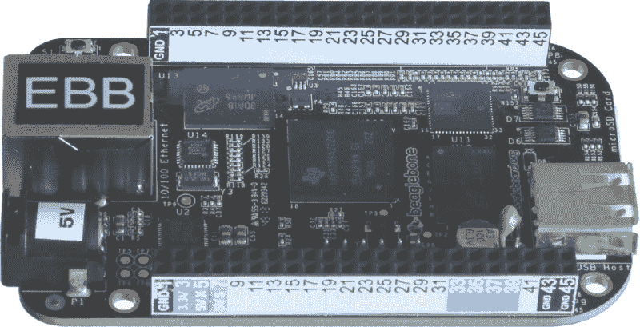

图 1-1 BeagleBone Black 计算平台（带有印刷标签的板）

BeagleBone PCB 由 BeagleBoard.org 的联合创始人 Gerald Coley 设计。然而，板以及部分 capes 由 CircuitCo ([www.circuitco.com`](http://www.circuitco.com)) 制造。BeagleBone Black 的 PCB 布局由 CircuitCo 创建。最近，Element14 ([www.element14.com`](http://www.element14.com)) 已开始制造符合 BeagleBoard.org 标准的 BeagleBone Black。因此，当您购买 BeagleBone 板时，并不是从 BeagleBoard.org 购买的；相反，BeagleBoard.org 是开发者和用户社区的核心。

### 谁应该使用 BeagleBone

任何想要将工程概念转换为真实的交互电子产品、项目、原型或艺术品的人都应该考虑使用 BeagleBone。话虽如此，集成高层软件和底层电子设备并不是一项简单的任务。然而，实现的难度取决于项目所需的复杂程度。


BeagleBone 社区正在努力确保每个兴趣将其集成到项目中中的都能使用 BeagleBone 平台，无论他们是学生、制作人、艺术家还是爱好者。工具和软件开发环境，例如 Jason Kridner 的 `BoneScript` 库（Kridner 是 `BeagleBoard.org` 的联合创始人也是本书的技术编辑）以及 `Cloud9` 集成开发环境 (`IDE`)，允许用户直接在网页浏览器中编写和构建能够控制电子硬件的代码。`BoneScript` 将在第 2 章介绍。诸如 `Blockly` (`code.google.com/p/blockly`) 和 `Snap` (`snap.berkeley.edu`) 等开发工具有可能与 `BoneScript` 集成以进一步提高新用户的易用性。

对于具备电子或计算知识的高级用户来说，BeagleBone 平台提供了额外的开发和定制功能，以满足特定的项目需求。同样，这种定制并非易事：你可能是一个电子领域的专家，但高层软件编程和/或 `Linux` 操作系统可能会让你感到困难。或者，你可能是一个编程大师，但你从未接线过 LED 灯！本书旨在服务所有类型的用户，为每种类型的读者提供足够的 `Linux`、电子和软件知识接触，以确保无论你之前的经验水平如何，都能高效地工作。

## 何时使用 BeagleBone

BeagleBone 非常适合在任何类型的项目中将高层软件与低层电子设备集成。无论你是计划构建一个自动化家居管理系统、机器人、智能显示器、传感器网络、自动贩卖机，还是联网的交互艺术品，BeagleBone 都拥有处理你对嵌入式设备任何想象的功能的能力。

当你为项目中利用 `Linux OS` 时，BeagleBone 相比传统的嵌入式系统（如 `Arduino`、`PIC` 和 `AVR` 微控制器）的主要优势是显而易见的。例如，如果你使用 BeagleBone 构建了一个家庭自动化系统，然后决定想让某些信息在互联网可用，你只需安装 `Apache` Web 服务器即可。然后你可以使用服务器端脚本或你喜欢的编程语言与你的家庭自动化系统接口，以捕并共享信息。或者，你的项目可能需要安全的远程 shell 访问。在这种情况下，你只需使用 `Linux` 命令 `sudo apt‐get install sshd` 即可安装安全 shell（`SSH`）服务器（这些命令将在第 2 章中介绍）。这可能会为你节省数周的开发工作。此外，你放心地知道同样的软件正在全球数百万台机器上安全地运行。

`Linux` 还为你提供了许多 `USB` 外设和适配器的设备驱动支持，使你能够将摄像头、Wi-Fi 适配器和其他低成本消费外设直接连接到你的平台，而无需进行复杂和/昂贵的软件驱动开发。

## 何时你不应该使用 BeagleBone

`Linux OS` 并不是为实时或可预测处理设计的。它的内核不是抢占式的，这意味着一旦处理器开始执行内核代码，就无法被中断。如果你希望每百万分之一秒精确地采样一次传感器，这就会出现问题。如果到了精确的采样时间而内核正忙于其他任务，它就无法被中断。因此，在默认状态下，BeagleBone 不是实时系统应用的理想平台。虽然有实时版本的 `Linux`，但它们目前针对的是非常有经验 `Linux` 开发者。不过，BeagleBone 确实有一个板载解决方案，可以在某种程度上解决这个问题。在 BeagleBone 的 `AM335x` 内部，有两个板载微控制器，称为可编程实时处理单元（`PRUs`），它们可以被编程用于实时接口应用。这是一个在第 13 章中描述的高级主题。

对于实时采样和控制任务，有专用的低成本专用解决方案可供选择（例如 `TI Stellaris ARM` 平台），这些可能更合适。同样重要的一点是，你可以通过电气总线（例如 `I²C`、`UART`、`CAN bus` 和以太网）将此类实时微控制器连接到 BeagleBone，并让 BeagleBone 充当分布式控制系统的中央处理器。这一概念在第 9 章和第 10 章中描述。

BeagleBone 平台发现困难的第二种应用类型是播放高定义视频。软件解码和播放编码视频流的处理器开销是巨大的，超出了 BeagleBone 在高定义视频分辨率下的能力。`Raspberry Pi` (`www.raspberrypi.org`) 板子具有这种能力，因为它的 `Broadcom BCM2835` 处理器是为了多媒体应用设计的，并且具有 `H.264/MPG‐4` 和 `MPG‐2/VC‐1`（通过额外许可）解码器和编码器的硬件实现。对于运行 `XMBC` 家庭媒体中心 (`www.xbmc.org`) 等应用，购买 `Raspberry Pi` (Model B+) 会更好，但对于构建连接电子设备的高级应用，BeagleBone 是明确的选择。

## BeagleBone 文档

本书结合了我在使用 BeagleBone 平台开发的经验，以及关于嵌入式 `Linux`、软件开发和通用电子的支持背景材料，创建了一份关于该平台的构建深度指南。然而，仅凭一本书涵盖所有内容是不可能的，因此我避免了重复描述在本节中描述的关键文档和网站列出的信息。支持文档的第一个起点始终是：

*   **BeagleBoard.org 网站：** 它为该平台提供了主要支持，包括软件指南、社区链接和支持你开发的下载。在网站 `www.beagleboard.org` 上可以找到一个非常优秀的“入门”指南和博客。

    BeagleBone 平台上提供了大量的文档，但最重要的文档如下所示：

*   **BeagleBone Black 系统参考手册 (SRM)：** 这是描述 BeagleBone Black 硬件的核心文档。由 `Gerald Coley` 编写，是一份详尽的文档，部分内容较为复杂，但确保你在拥有这本书的同时也拥有一份是有重要的。它是一份动态文档，大约 125 页，随着 BeagleBone 的每个新版本发布而发布。可以从 BeagleBone 的“入门”页面免费获取。

*   **Sitara AM335x Cortex-A8 参考手册 (TRM)：** BeagleBone 的关键组件是其微处理器，该文档包含了你可能需要的任何内部原理。`AM335x` 是一个复杂的设备，这体现在它的长度上！如果你需要了解微处理器的内部原理或 BeagleBone 的配置，答案可能在该文件中。我在书中多次引用了 `TRM` 中的表格，希望你能够熟悉其中的语言。该文档可以从 `www.ti.com/product/3358` 免费获取。

还有关键网站可以支持你在平台上的学习，提供了教程、论坛、示例代码库、`Linux` 发行版和项目创意来激发你的创意。以下是一些重要网站：

*   **本书的网站：** `www.exploringbeaglebone.com`
*   **我的个人博客站：** `www.derekmolloy.ie`
*   **eLinux.org 网站：** `www.elinux.org`
*   **eewiki：** `www.eewiki.net`
*   **Hipstercircuits.com：** `www.hipstercircuits.com`
*   **OZ9AEC：** `www.oz9aec.net`

如何开始 BeagleBone 平台软件将在第 2 章中介绍。本章的其余部分将讨论 BeagleBone 本身，解释了可用功能，总结了 `SRM`，并提供了一些你喜欢的连接到 BeagleBone 的外设和扩展板（capes）的示例。

# BeagleBone 硬件

BeagleBone Black 的核心是 `Texas Instruments Sitara AM335x Cortex A8 ARM` 微处理器。虽然 BeagleBone Black 是本书的重点，但 `BeagleBoard.org` 还开发了多个板卡，包括 `BeagleBoard`、`BeagleBoard XM`、`BeagleBone`、`BeagleBone Black` 以及 `Arduino Tre`（在单板上结合了 BeagleBoard 和 Arduino）。下一节将详细讨论 BeagleBone，但这里是不同板卡的一些摘要详情（按历史顺序）：

*   **(2008) BeagleBoard ($125):** 原始的基于 ARM 的开源硬件开发板，支持 HD 视频。它拥有 `720MHz ARM A8` 处理器，但没有板载太网。
*   **(2010) BeagleBoard xM ($149):** 与 `BeagleBoard` 相似，但带有 `1 GHz ARM (AM37x)` 处理器、`512 MB` 内存、四个 USB 端口和以太网支持。尽管新的 BeagleBone 板卡成本较低，但 `BeagleBoard xM` 因其用于数字信号处理 (DSP) 应用的 `C64+TMDSP` 核心而广受欢迎。
*   **(2011) BeagleBone ($89):** 比 `BeagleBoard` footprint 小。它拥有 `720MHz` 处理器和 `256 MB` 内存、以太网支持以及底层输入输出（例如模拟数字转换器），但没有板载视频支持。
*   **(2013) BeagleBone Black ($45–$55):** 该板卡增强了 `BeagleBone`，配备 `1 GHz` 处理器、`512 MB` DDR3 内存、以太网、`eMMC` 存储和 HDMI 视频支持。

BeagleBone Black 平台是本书的重点，主要是由于与其他产品相比的功能集和价格；然而，书中的大部分讨论适用于所有平台。

## BeagleBone 版本

正如提到的，有两个版本的 BeagleBone 可供：旧款 `BeagleBone White (BBW)`（或简称 `BeagleBone`）以及新款的 `BeagleBone Black (BBB)`。这两块板的物理尺寸都非常小，可以整齐地放入 Altoids 薄荷糖铁盒内，如图 1-2(a) 所示。传统上，Altoids 铁盒被工程师回收用作电子项目的低成本外壳。考虑到 BeagleBone 板卡的复杂性，它们能放进铁盒内令人印象深刻——这也解释了 BeagleBone 板卡上的圆角设计！可以在外壳上钻孔以接触板卡连接器，但当然，在用它作为板卡外壳之前，必须对铝制铁盒进行电气绝缘。

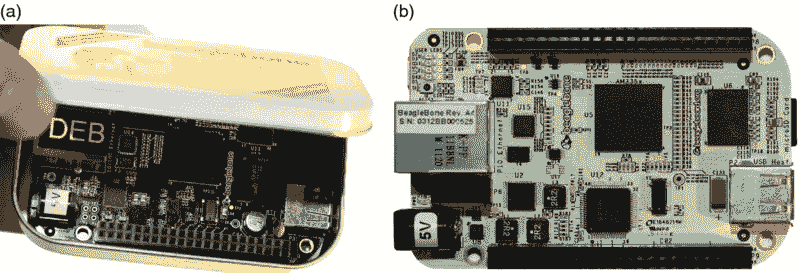

图 1-2 (a) 放在 Altoids 铁盒中的 BeagleBone Black (BBB)；(b) BeagleBone White (BBW)

为了实现如此小的尺寸，组件被紧密地放置在 `BeagleBone` 上，并使用六层 `PCB` 实现互连。例如，`BeagleBone` 平台使用的 `AM335x (ZCZ)` 处理器具有 `324 引`的球网栅阵列，球间距为 `0.80mm`。

表 1-1 列出了 `BBB` 板与 `BBW` 板之间的主要区别。第一个明显的区别是价格。尽管规格有所提高，`BBB` 的价格仅为 `BBW` 的一半略多，与其他嵌入式 `Linux` 板卡（如 `Raspberry Pi (Model B+)`）相比极具竞争力。

| 特性 | BEAGLEBONE BLACK (BBB) | BEAGLEBONE WHITE (BBW) |
| --- | --- | --- |
| 价格 | 约 $45–$55 | 约 $89 |
| 处理器 | `1 GHz AM335x` | `720 Mhz AM3359` |
| 内存 | `512 MB DDR3`（更快的 1.6 GB/s 且功耗更） | `256 MB DDR2` |
| 存储 | 板载 `2 GB eMMC`（Revision C 板为 4 GB eMMC）和 micro-SD 卡 | 仅有 micro-SD 卡 |
| 视频 | 板载 HDMI | 无板载 HDMI。提供可选 cape。 |
| 调试 | 有 JTAG 跳针但未封装 | 可通过 USB 进行 JTAG |
| 串口连接 | 有 TTL 跳针但需要独立电缆 | USB 转串口 |
| 输入/输出插针 | 几乎相同，但由于 BBB 有 eMMC 和 HDMI 功能，可用 GPIO 引可能较少 |

表 1-1 BeagleBone Black (BBB) 对比 BeagleBone White (BBW)

`BBB` 的制造成本通过从 `BBW` 移除某些功能来降低，例如移除 `USB 串口连接`、`USB JTAG 调试仿真` 和电源扩展插针。然而，功能上的提升包含了板载 `eMMC` 存储、`HDMI 视频输出`、双倍内存以及更快的处理器，而价格仅为后一半略多，这意味着 `BBB` 代表了极高的性价比。很明显，`BBB` 达到了价格/性能的甜点，使其成为一个异常流行的平台。`Linux.org` 网站维护着出货数量记录。

## BeagleBone 配件

BBB 板卡配有一根 USB 2.0 线缆（micro-USB 插头到 USB A 插头），用于 BBB（通过 USB 客户端连接器）连接到台式电脑。它*没有*配备 micro-SD 卡，因为 `Linux` 安装程序已位于板载 eMMC 中。它开箱即用，直接进入 `Linux`。BBW 则配备有一张 micro-SD 卡，因为它没有板载 eMMC。

## 强烈推荐的配件

建议在购买 BBB 板板时购买以下配件。如果你计划使用 BBB 进行开发工作，那么你可能需要所有这些配件。

### micro-SD 卡（用于刷录 BBB 镜像）

micro-SD 卡允许你向 BBB 写入新的 `Linux` 镜像。如果你在对 BBB 进行实验时不小心损坏了 `Linux` 文件系统，micro-SD 卡将帮助你恢复系统。理想情况下，你应该准备两张专用的 SD 卡，一个用于启动镜像，另一个用于刷录器镜像。

请购买一张容量至少为 `4 GB` 的 micro-SD 卡。你可能还需要一个 micro-SD 转 SD 的适配器，以便在电脑的读卡器中使用。许多 micro-SD 卡都附带适配器，这比单独购买更便宜。micro-SD 卡应为 `Class 10`（10 级）或更高，因为更快的读写速度可以在写入镜像时为你节省时间。空白的 micro-SD 卡也可以用于额外的文件系统存储（在第 3 章讨论），因此卡容量越大越好。

### 外部 5 V 电源（用于刷录和外设设备）

你可以通过台式电脑/笔记本电脑连接 BBB 的 USB 客户端接口直接为 BBB 供电。对于开始使用 BBB 来说，这完全可以；但一旦你开始连接 Wi-Fi 适配器、USB 摄像头或内置显示器等配件，USB 提供的功率可能无法满足你的配置。某些早期的 BBB 板在不连接外部 `5 V` 电源的情况下，无法正确刷录新的系统镜像。

你可以购买一个直接插市电的 `5 V` 直流调节开关电源。它的直流输出电流至少为 `1 A`；然而，如果可能，你的目标应是 `2 A` 的电流供应（`2 A × 5 V = 10 W`）。电源的 `5 V` 圆柱插头（直径 `5.5 mm`）应为中心正极。如果你计划同时运行多个 BBB，那么你需要使用外部电源（圆柱或 USB）为它们供电，因为同时将两个 BBB 连接到 PC 需要仔细的软件配置，并且在 Windows 下会导致互联网连接不稳定。

### 以太网线（用于网络连接）

BBB 可以使用名为 `Internet-over-USB`（USB 联网）的特殊网络模式，在 BBB 和你的台式电脑之间创建一个虚拟网络；然而，如果你将 BBB 连接到家庭网络，请忘记购买一根 Cat5 网线，通过其 `RJ-45 10/100 以太网` 接口将 BBB 连接到网络。如果你计划同时使用多个 BBB，可以考虑购买一个廉价的四口交换机，并将其放置在你的台式电脑附近（见第 2 章）。

### HDMI 线（用于连接显示器/电视）

BBB 拥有 HDMI 接口，可以轻松地连接到带有 HDMI 或 DVI 接口的显示器或电视。BBB 有一个 micro-HDMI 插座（`HDMI-D`），请注意与你的显示器/电视类型相匹配（通常为 `HDMI-A` 或 `DVI-D`）。你可能需要的线是“HDMI-Micro-D 转 HDMI-A 公头”。一根 `1.8 m`（`6 ft.`）的线价格不应超过 `$10`。购买时要非常小心——HDMI-C (mini-HDMI) 接口不适配 BBB。

或者，你可以购买廉价的（`$3`）micro-HDMI (`HDMI-D`) 转普通 HDMI (`HDMI-A`) 母座适配器，或 micro-HDMI (`HDMI-D`) 转 DVI-D 母座适配器线。这些分别允许你使用标准尺寸的 HDMI-A 或连接到 DVI-D 设备（见 图 1-6(a)）。

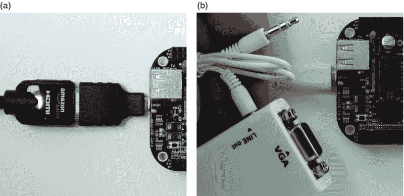

**图 1-6** (a) BBB 连接到 micro-HDMI 转 HDMI 适配器，然后连接到廉价的 HDMI-A 转 DVI-D 线 (b) 带有音频线路输出的 micro-HDMI 转 VGA 适配器

### USB 转串口 UART TTL 3.3 V（用于排查故障）


USB 转串口 UART TTL 串口线是在板卡上的 Linux 发行版出现问题时非常有用的配件之一。我在查找和修复学生板板的问题时，发现它非常有价值。它连接到 BBB 上的`6 pin J1`针脚，该针脚位于`P9`针脚旁边。电线的黑色侧连接到`pin 1`（白色点），绿色侧靠近 USB 主机连接器（见 图 1-7）。BBB 上仅使用三个针脚：`pin 1`接地（黑色）、`pin 4`接收（橙色）和`pin 5`发送（黄色）。

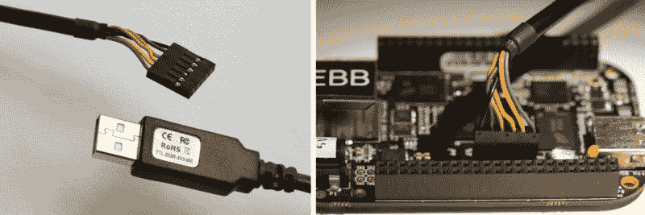

**图 1-7** USB 转 TTL 3.3V 串口线及其与 BBB 的连接（连接颜色为黑、棕、红、橙、黄、绿）

请确保你购买的是`3.3 V`版本。这根线包含一个芯片组，并要求你在台式电脑上安装驱动程序。如果你计划向 BBB 刷录自己的镜像，或者你的板卡无法启动，我建议你购买一根这种线。该线的使用将在第 2 章中讨论。

## 可选配件

以下章节描述了你根据应用可能需要的可选配件（见 图 1-8）。

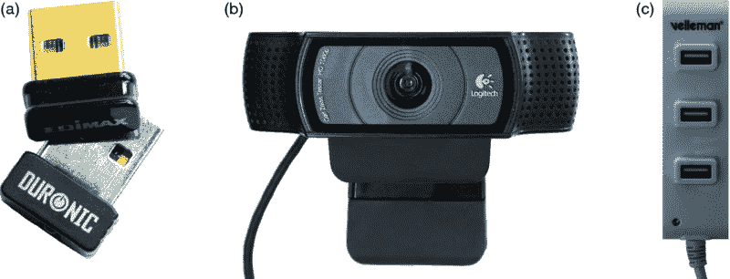

**图 1-8** (a) USB Wi-Fi 适配器；(b) 罗技 C920 摄像头；(c) Velleman USB Hub（总线供电）

### USB Hub（通过 USB 主机连接多个设备）

如果你计划同时向 BBB 连接多个 USB 设备，那么你需要一个 USB Hub。USB Hub 分为总线供电和外部供电。外部供电的 Hub 较贵；但如果你为多个高功耗适配器供电（特别是 Wi-Fi），你可能需要带电源的 Hub。确保在开启 BBB 之前将 USB Hub 接入 BBB 的主机连接器中。我尝试过不同品牌的 USB Hub，它们工作得都很顺畅。

### micro-HDMI 转 VGA 适配器（用于 VGA 视频和声音）

### Wi-Fi 适配器（用于无线网络）

许多不同的 Wi-Fi 适配器可用，如图 1-8(a) 所示；然而，并非所有的适配器都能 BBB 上工作。Linux 发行版和适配器内部的芯片将决定成功的概率。你可以在 [`tiny.cc/ebb103`](http://tinyurl.com/ebb103) 找到已确认工作的适配器列表。但是，请注意，制造商可能会在同一产品中更换芯片，而且从列表中购买适配器并不能保证它一定能工作。如果你能确认计划购买的适配器中的芯片，并将其与列表进行对比评估，你成功的概率会更高。Wi-Fi 配置和应用将在第 10 章中详细讨论，该章节测试了一系列广泛提供的不同低成本适配器。

### USB 摄像头（用于图像采集和视频流传输）

连接 USB 摄像头可以是将图像和视频捕集成到你的 BBB 项目中的一种低成本方法。此外，利用如 Video 4 Linux 和开源计算机视觉（`OpenCV`）等 Linux 库可以让你构建具有视觉”能力的应用程序。

在第 12 章中，将检查不同的摄像头，但文本重点关注了`Logitech C920`摄像头在视频流应用中的使用（见图 1-8(b)）。它是一个相对贵的摄像头（约 70 美元），但它能够直接使用 BBB 传输全高高清视频，因为摄像头内置了`H.264/MPG-4`硬件编码。这极大地减轻了 BBB 的工作负载，使处理器空闲处理其他任务。与 Wi-Fi 适配器一样，在为了特定目的购买摄像头之前，确认该摄像头是否与 BBB 兼容是很有用的。我在第 12 章中测试了几种类型的摄像头。

### USB 键盘和鼠标（用于通用计算）

可以将 USB 键盘和鼠标分别连接到 USB 集线器上，或者使用 2.4 GHz 无线键盘鼠标组合。市上有非常小型的无线手持组合，例如`Rii 174 Mini`、`Rii i10`和`eSynic mini`，它们都包含一个集成了触摸板的手持键盘。USB 蓝牙适配器也有助于将外围设备连接到 BBB。第 11 章中使用了类似的蓝牙键盘/触摸板。

## 扩展板 (Capes)

扩展板是可以附着在 BeagleBone 的`P8`/`P9`扩展接头上的子板。它们被称为 cape（斗篷），因为这些板环绕着`RJ-45`以太网连接器的形状（就像超人侠的斗篷！）。在它们相互兼容的情况下，你可以同时连接多四块扩展板。

某些扩展板使用了大量的引脚。例如，你将在第 11 章中看到`LCD4`扩展板。它使用`P8`接头的第 27 到第 46 号引脚，以及一些模拟输入用于其按钮和电阻式触摸接口。如果你使用`eMMC`启动 BBB，那么剩余用于`GPIO`的引脚就非常少了。此外，`LCD`扩展板没有引出引脚排针。图 1-9 显示了该扩展板连接到 BBB 并运行标准 BBB Debian Linux 发行版的两种视图。

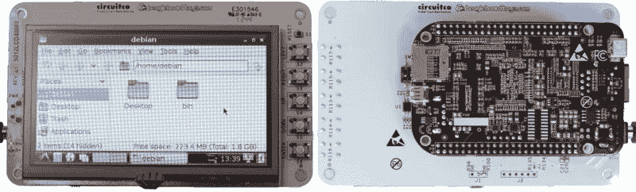

**图 1-9** `LCD4`扩展板（顶视图和底视图）

目前 BeagleBone 有 50 多种扩展板可用；完整列表可以在 [`www.beagleboard.org/cape`](http://www.beagleboard.org/cape) 找到。这里是一些你可能在项目中发现有用的示例扩展板选择（见图 1-10）：

*   `LCD`扩展板有不同的尺寸：7 英（800×480）、4 英（480×272）和 3 英（320×240），其中 4 英版本在图 1-9 中所示。它们具有电阻式触摸屏，这意味着你使用电磁笔（或指甲）与屏幕交互。这与最近手机/平板电脑上的电容触摸屏不同。

*   `Adafruit Proto`扩展板是一种低成本（约 10 美元）的裸板，你可以用它将你的面包板设计转移到更稳固的平台上。其他几种面包板和原型扩展板可用。

*   `Replicape`（179 美元）是一款令人深刻的开源 3D 打印机扩展板，具有五个步进电机驱动器，包括微步进支持。更多信息请参见 [`www.thing-printer.com`](http://www.thing-printer.com)。

*   `Valent F(x) LOGi-Bone` FPGA 开发板扩展板（89 美元）通过`Spartan 6 LX9`为 BBB 增加了 FPGA 能力。FPGA 提供了可编程逻辑块，允许非常快的`I/O`操作，但会增加复杂性。该扩展板还提供了一个`Arduino`接头，使其能够直接与为`Arduino`平台开发的扩展板接口。在第 13 章的开头简要讨论了这种扩展板。

*   有如摄像头扩展板，例如来自 [`www.beagleboardtoys.com`](http://www.beagleboardtoys.com) 的 3.1MP 摄像头扩展板，它在`eMMC`关机时为 BBB 提供了 USB 关机方案。

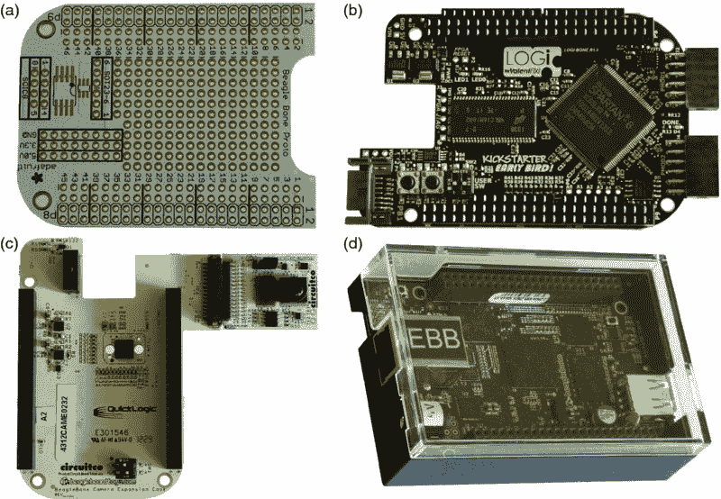

**图 1-10** (a) 扩展板；(b) Valent F(x) LOGi-Bone；(c) 摄像头扩展板；(d) Adafruit case

你必须非常小心 [`tiny.cc/ebb103`](http://tinyurl.com/ebb103) 中的兼容性。未来会有更多扩展板可用。

## 如何毁坏你的 BeagleBone！

BBB 和 BBW 是复杂且脆弱的设备，如果不小心很容易损坏。如果你是从`Arduino`等平台迁移到 BBB，则必须格外小心。与`Arduino`不同，BBB 的处理器无法更换。如果你损坏了处理器，将不得不买一块新板。

以下是你**绝对不要**做的事情：

*   不要通过拔掉电源/USB 电源来关闭 BBB。你应该使用软件关机（通过按一次电源按钮）或按住电源按钮八秒进行“硬”关机。这使得`PMIC`正确关机。如果你必须通过断开电源来移除电源，请在此期间按住重置按钮。

*   不要将带电的 BBB 放在金属表面（例如铝制电脑）或带有杂乱/切断线段、电阻等的工作台上。如果你短路了`P8/P9`接头的引脚，就会很容易毁掉你的板子。你可以从`Adafruit`等供应商购买外壳。

*   不要向`P8/P9`接头连接或提供极低电流以外的电路。许多这些引脚提供的最大电流为 4-6mA，吸收的最大电流为 8mA。电源轨和地线引脚可以提供和吸收更大的电流。`Arduino`每个输入/输出允许 40mA 电流。这个问题在第 4 章和第 6 章中有介绍。

*   `GPIO`引脚兼容 3.3V（`ADCs`兼容 1.8V）。不要连接一个以 5V 供电的电路，否则你会毁掉板子。这在第 4 章、第 6 章和第 8 章中讨论过。

*   不要在 BBB 未通电时向`P8/P9`引脚施电。确保所有自供电接口电路都由 3.3V 电源线控制。这在第 6 章中有介绍。

以下是你应该**始终**遵循的两个步骤：

*   仔细检查你正在使用的引脚编号。每个插头有 46 个引脚，非常很容易插错第 21 号插头连接器而不是第 19 号。对于插头中间的连接，我总是会数两次——从左侧往上数，再从右侧往下数。此外，在[`tiny.cc/ebb105`](http://tinyurl.com/ebb105)提供了一组非常有用的 P8/P9 标签，你可以按 100% 的比例打印并贴到你的 BBB 上，如图 1-1 所示。

*   在将你设计的复杂电路连接到 BBB 之前，请详细阅读 SRM（系统参考手册）。

如果你的 BBB 坏了且这*确实是*你的错，那么恐怕在你完成 [`www.beagleboard.org/support`](http://www.beagleboard.org/support) 所有的检查后，你必须购买一块新板。如果这*不是*你的错，请参阅 BBB SRM 手册和 [`www.beagleboard.org/support`](http://www.beagleboard.org/support) 网站，通过申请退货授权（RMA）编号来返回故障板进行维修。

## 总结

完成本章后，你应该能够：

*   描述 BeagleBone 的功能以及它对不同项目类型的适用性。

*   获取协助你操作 BBB 平台的重要文档。

*   描述 BBB 上的主要硬件系统和子系统。

*   识别你可以购买的用于增强 BBB 能力的重要配件。

*   理解 BBB 作为一个物理计算平台的强大之处和复杂性。

*   了解保护开发板免受物理损坏时需要采取的首要步骤。

## 支持

额外的支持文档的关键来源列在本章的前面。如果你在使用 BeagleBone 平台时遇到困难，且文档中没有描述这些问题，你应该使用以下两个资源：

*   BeagleBoard Google Group，地址为 [`groups.google.com/d/forum/beagleboard`](http://groups.google.com/d/forum/beagleboard)在在发布新问题之前，请先阅读常见问题（FAQs）并搜索现有问题。

*   在 [`www.beagleboard.org/chat`](http://www.beagleboard.org/chat) 或直接在 Beagle IRC 频道（通过在`irc.freenode.net`加入`#beagle`）提供实时聊天。你可以使用免费的 IRC 客户端，如 Linux 的 X‐Chat、Windows 的 HexChat 或 Mac OS X 的 Colloquy。

请记住，该小组和 IRC 频道中的人员是社区成员，他们投入时间来回答问题。

## 备注

# 第 2 章：BeagleBone Black 软件

在本章中，你将接触 Linux 操作系统和可以用于 BeagleBone 的软件工具。本章旨在确保你能够连接到你的 BeagleBone 并控制它。在本章结束时，通过遵循演示如何在 Linux 终端窗口中使用 Linux shell 命令的逐步操作指南，你应该能够“闪烁”系统 LED 灯。在本章中，你还会接触一个名为`BoneScript`的 BeagleBone 函数库，它可以与`Node.js`和 Cloud9 集成开发环境配合使用，构建闪烁相同系统 LED 灯的代码。

## 本章所需的设备：

*   BeagleBone Black 开发板

*   随附的 USB 线（USB A 公头转 mini‐USB A 公头）

*   Micro SD 卡（4 GB 或更大；Class 10+）（可选）

*   网络基础设施和布线（可选）

关于本章的更多细节请参阅 [`www.exploringbeaglebone.com/chapter2/`](http://www.exploringbeaglebone.com/chapter2/)

## BeagleBone 上的 Linux

*Linux 发行版*（Linux distribution）是一个公开的 Linux 版本，它包含了一套软件程序和工具。有很多不同的 Linux 发行版，它们通常侧重于不同的应用。例如，高端服务器用户可能会安装 Red Hat Enterprise、Debian 或 OpenSUSE；桌面用户可能会安装 Ubuntu、Debian、Fedora 或 Linux Mint。列表是无穷无尽的，但所有发行版的内核都是通 Linux 内核，内核是由 Linus Torvalds 在 1991 年构想并创建的。

在决定用于嵌入式系统平台的 Linux 发行版时，选择符合以下条件的发行版是明智的：

*   该发行版稳定且支持良好。

*   有一个良好的包管理器。

*   该发行版精简，适用于低存储占用。

*   对于你的特定设备有良好的社区支持。

*   对于你想要连接的任何外围设备都有驱动支持。

### Linux 发行版

嵌入式系统平台有许多不同的 Linux 发行版，包括用于实时编程的昂贵专有版本。它们的核心都使用主线 Linux 内核，但每个发行版都包含不同的工具和配置，导致了完全不同的用户体验。社区在 BBB 板上使用的主要开源发行版包括 Debian、Ångström、Ubuntu  和 Arch Linux。

*   *Debian*（Debbie 和 Ian 的缩写！）是一个由社区驱动的 Linux 发行版，强调开源开发。Debian 的开发过程中没有商业组织参与；事实上，有一份正式的社会契约（[`tiny.cc/ebb201`](http://tiny.cc/ebb201)）规定 Debian 将保持完全自由（即软件自由意义上的自由）。Debian 发行版用于本书中的许多实际步骤，并推荐作为 BBB 的首选发行版，因为它目前随新的 BBB 板分发。此外，Debian 在书中也用于 Linux 桌面，因为它通过嵌入式 Debian（*Emdebian*）项目提供了出色的跨平台支持（参阅 [`www.debian.org`](http://www.debian.org)）。

*   *Ångström* 是一种稳定且精简的 Linux 发行版，广泛应用于嵌入式系统。Ångström 背后的开发团队擅长为机顶盒、移动设备和网络设备等嵌入式设备定制 Linux 发行版。令人印象的是，Ångström 可以缩小到只有几兆字节闪存的设备上。Ångström 大量使用`BusyBox`（一个可以执行许多任务的单多调用二进制文件），用于创建 Linux 系统中命令行工具的精简版本。我的许多 YouTube 视频使用 Ångström，因为它在很一段时间内是 BeagleBone 的主要发行版。

*   *Ubuntu* 与 Debian 的关系非常密切；事实上，Ubuntu 网站（[`www.ubuntu.com`](http://www.ubuntu.com)）这样描述：“Debian 是构建 Ubuntu 的基石。”Ubuntu 是流行的桌面 Linux 发行版之一，主要因为它专注于让 Linux 对新用户更易用。它很容易安装并具有良好的桌面驱动支持，并且有适用于 BBB 的二进制发行。

*   *Arch Linux* 是一种轻量级且灵活的 Linux 发行版，旨在“保持简单”（keep it simple），通过赋予用户对系统配置的完全控制和责任，特别针对熟练的 Linux 用户。有适用于 BBB 的 Arch Linux 编译版本；然而，与其他发行版相比，它目前对 BBB 的新 Linux 用户支持较少（参阅 [`www.archlinux.org`](http://www.archlinux.org)）。

当你准备好尝试你的 BBB 时，要做的第一件事使用随附的 USB 线将其连接到你的台式电脑。通电后，BBB 将以 USB 客户端模式连接到台式电脑。一旦连接并发现，你的文件管理器（如 Windows 资源管理器）将显示 BBB 的 FAT 分区内容，如图 2-1 所示。BeagleBoard.org 团队编写了一份非常出色的关于 BBB 入门的的 HTML 指南。你应该双击`START.htm`文件在网页浏览器中显示该指南，该指南在图 2-1 中所示。

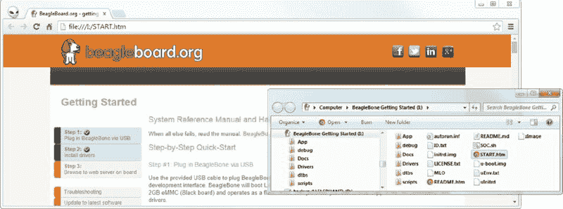

**图 2-1** 设置你的 BBB 的 BBB START.htm 指南

### 安装驱动程序

按照图 2-1 所示指南中的步骤操作，主要涉及浏览到`Drivers`文件夹并安装正确的版本。在 Windows 下，你可能会多次收到 Windows 驱动程序签名警告。继续该过程并`不要点击取消`。在 Windows 8 下，你可能需要以故障排除模式重启电脑以禁用“强制驱动程序签名”——请参见章节网页。此过程完成后，你的台式电脑上将出现几个新设备。例如，你现在将拥有以下设备：

*   访问 BBB 的 FAT 分区（类似于 U 盘）。

*   使用新的`Gadget Serial`驱动程序对 BBB 进行串口访问。

*   一个`Linux USB Ethernet/RNDIS Gadget`（用于 USB 联网）。RNDIS 代表远程网络驱动程序接口规范。

Windows 设备管理器显示了这些新设备。对于 Linux 和 Macintosh 台式电脑的类似步骤可以在启动指南中找到。这些新设备可用于连接到 BBB。

### 网络连接


通过网络连接并与 BBB 通信主要三种方法，每种都有自己的优缺点。第一种是使用`Internet-over-USB`（USB 联网），它通过单根 USB 线创建一个“私”虚拟局域网。第二种是使用`regular Ethernet`（普通以太网），第三种是使用`Ethernet crossover cable`（以太网交叉线）。通过网络连接 BBB 对初学者来说可能是一个障碍。如果你在家里工作并控制自己的网络，这通常很简单；然而，复杂的网络（如大学中的网络）可能为有线和无线通信设有多个子网。在此类复杂的网络中，路由限制可能导致很难、甚至无法通过普通以太网连接到 BBB。所有三种方法都适用于将 BBB 连接到 Windows、Macintosh 和 Linux 台式机。

## Internet-over-USB

标准的 BBB 分发版支持使用`Linux USB Ethernet/RNDIS Gadget`设备进行 USB 联网。对于新用户以及处于复杂网络基础设施中的用户，这可能是开始 BBB 的最佳方式。对于这种设置，你只需要 BBB 板子、随附的 USB 线以及台式电脑的访问权限（理想情况下具有管理员权限级别）。表 2-1 描述了使用 Internet-over-USB 连接 BBB 的优缺点。

| 优点 | 缺点 |
| --- | --- |
| 为初学者提供良好的网络设置。 | 如果不付出巨大努力，每台台式电脑只能连接一台 BBB。 |
| 当你无法访问或控制网络基础设施硬件时，仍可以将 BBB 连接到互联网。 | 网络共享配置可能很困难，尤其是在 Macintosh 台式电脑上。在 BBB 上也必须进行额外的配置。 |
| 电源通过 USB 由你的台式电脑提供。 | 你的台式电脑必须运行才能与互联网之间传输数据。 |

**表 2-1** BBB Internet-over-USB 的优缺点

例如，如果你在 Windows 下完全安装了 BBB 驱动程序，你现在应该有一个新的网络连接（开始 ➢ 输入`view Network Connections`）。图 2-2 捕捉了 Windows 下一个典型的网络连接窗口。在这种情况下，“局域网连接 9”就是`Linux USB Ethernet/RNDIS Gadget`。台式电脑保持连接到你的普通局域网（提供互联网访问），以及一个新的“私”局域网，该网络仅包含你的台式电脑 (`192.168.7.1`) 和你的 BBB (`192.168.7.2`)。你可以打开网页浏览器，并在地址栏中输入`192.168.7.2`连接到 BBB 的 Web 服务器，如图 2-2 所示。

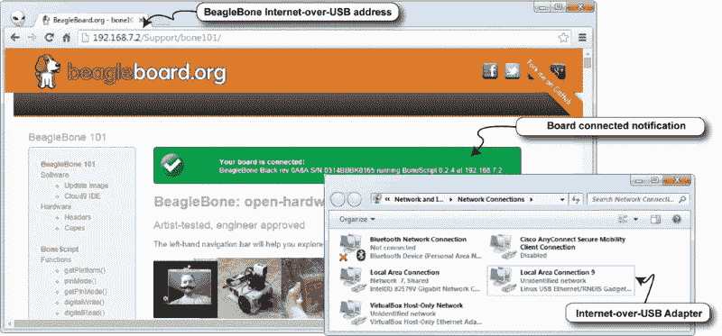

**图 2-2** 带有 Internet-over-USB 连接的 Windows 网络连接 LAN 9 以及网页浏览器连接

此时，你可以使用网页浏览器连接到 BBB 的 Web 服务器，因此你有一个功能完备的私网络；但你可能也希望 BBB 能够直接访问互联网，以便你可以直接在 BBB 上下载文件并更新 Linux 软件。要实现这一点，你需要共享主网络适配器，以便 BBB 的流量可以通过你的台式电脑路由到互联网。例如，在 Windows 下使用以下步骤：

1. 选择提供互联网的主网络适配器（开始 ➢ 输入`view Network Connections`）。右键点击它并选择属性。
2. 在出现的对话框中（如图 2-3 左所示），点击顶部的共享选项卡，并启用允许其他网络用户选项。
3. 在下拉列表中选择你的 BBB LAN（参考图 2-2，这是“局域网连接 9”）。点击确定。
4. 右键点击 BBB LAN（例如 LAN 9）并选择属性。
5. 双击 Internet 协议版本 4。在此对话框中，选择自动获取 IP 地址和自动 DNS 服务器地址（参见图 2-3 右侧）。
6. 点击确定，再次点击确定以保存配置。

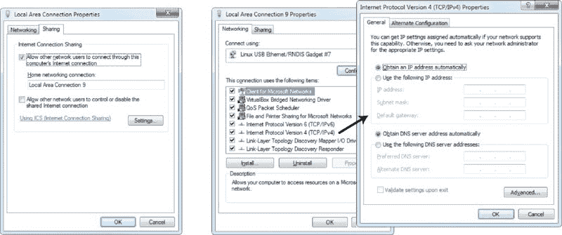

**图 2-3** Windows 下配置网络连接属性

如果一切顺利，你现在不会注意到任何不同，并且应该能够刷新图 2-2 所示的网页。最后两步的影响只有当你打开到 BBB 的终端连接时才能体会。关于 Mac OS X 配置网络共享的视频指南可以在`tiny.cc/ebb202`获取。

## Regular Ethernet

我所说的“普通”以太网是指按照你使用有线连接台式电脑的方式将 BBB 连接到网络。对于家庭用户和高级用户，普通以太网可能是联网和连接 BBB 的最佳解决方案。表 2-2 列出了使用此类连接的优缺点。主要问题是网络的复杂性——如果你了解网络配置并拥有路由器设置的权限，那么这无疑是最好的配置。如果你的网络路由器距离台式电脑较远，可以使用小型网络交换机，价格仅需 10-20 美元。或者，你可以购买带有集成多口路由器的无线接入点，价格为 25-35 美元。这对于无线 BBB 应用非常有用，也可以扩展你的无线网络范围。

| 优点 | 缺点 |
| --- | --- |
| 你可以完全控制 IP 地址设置以及动态/静态 IP 设置。 | 你可能需要网络基础设施的管理员权限或知识。 |
| 你可以将许多 BBB 连接并互连到单个网络（包括无线设备）。 | BBB 需要电源（可以使用市电电源的适配器）。 |
| BBB 可以在不开启台式电脑的情况下连接到互联网。 | 如果网络结构复杂，对于初学者来说，设置会更加复杂。 |

**表 2-2** (#c02.xhtml_tableanchor2-2) 常规 BBB 以太网的优缺点

这种配置面临的首要挑战是在网络上找到你的 BBB。默认情况下，BBB 被配置为请求`Dynamic Host Configuration Protocol`（DHCP）IP 地址。在家庭环境中，此服务通常由运行在集成“调制器-防火墙-路由器-局域网”（或类似的配置）上的`DHCP`服务器提供，该设备将家庭连接到互联网服务提供商（ISP）。

`DHCP servers`从地址池中动态地发放 IP 地址，持续时间为固定的间隔，称为“租期时间”（lease time），该时间在你的 DHCP 配置中指定。当此租期过期时，你的 BBB 在下次连接到网络时将会被分配一个不同的 IP 地址。这可能会让你感到苦恼，因为你可能需要再次在网络上搜索你的 BBB。你可以将 BBB 的 IP 地址设置为`static`（静态），这样它在每次板连接时都会固定在同一个地址。无线连接和静态 IP 连接将在第 10 章中讨论。

有几种方法可以找到 BBB 的动态 IP 地址：

* 使用网页浏览器访问家庭路由器（地址通常为`192.168.1.1`、`192.168.0.1`或`10.0.0.1`）。登录并在“状态”等菜单下查找“DHCP 表”。你应该能看到一个项目，详细列出分配的 IP 地址、物理 MAC 地址以及主机名为“beaglebone”的设备剩余租期，例如：

```
Leased Table
IP Address	MAC Address Client	Host Name	Register Information
192.168.1.116	c8:a0:30:c0:6b:48	beaglebone	Remains 23:59:51
```

* 在 Linux 下使用如`nmap`的端口扫描工具，或使用适用于 Windows 的`Zenmap` GUI 版本（参见[`tiny.cc/ebb203`](http://tiny.cc/ebb203)）。命令`nmap ‐T4 ‐F 192.168.1.*`将扫描子网上的设备。你正在寻找一个具有三个或四个开放端口的项目（例如：用于 SSH 的 22，用于 BBB 指南的 80，用于 Apache Web 服务器的 8080 以及用于 Cloud 9 IDE 的 3000）。它也可能标识为德州仪器（Texas Instruments）。

* 你可以使用 USB 转串口（Serial-over-USB）连接到 BBB 并输入`ifconfig`来查找 IP 地址。该地址是与`eth0`适配器关联的“inet addr”。后文讨论。

一旦获得 IP 地址，你可以在浏览器的地址栏中输入该地址来测试其有效性——上述示例中的`192.168.1.116`。你的浏览器应该显示如 图 2-2 所示的页面。

## 以太网交叉网线

以太网交叉网线是一种经过修改的电缆，允许两个以太网设备直接连接，而无需以太网交换机。它可以以电缆或插拔适配器的形式购买。如果你有 RJ-45 水封工具，你甚至可以通过交换 10Base‐T 或 100Base‐TX 以太网电缆一端的发送对（绿色，白/绿）与接收对（橙色，白/橙色）来制作一条（千兆以太网线则有所不同）。许多台式机具有自动交叉检测功能（Auto‐MDIX），可以使用普通的以太网线。与“USB 转互联网”网络配置类似，当你无法访问网络基础设施和/或“USB 转互联网”网络配置无法正常工作时，可以使用这种连接类型。表 2-3 描述了这种连接类型的优缺点。

| 优点 | 缺点 |
| --- | --- |
| 当你无法访问网络基础设施硬件时，仍然可以连接到 BBB。 | 如果你的台式电脑只有一个网络适配器，你将失去访问互联网的能力。最好配合具有多个适配器的设备使用。 |
| 如果台式电脑有两个网络适配器，BBB 可能拥有互联网访问权限。 | BBB 仍然需要电源（可以使用市电电源的适配器）。 |
| 提供相当稳定的网络设置。 | 除非你的台式机支持 Auto‐MDIX，否则需要特殊的以太网交叉网线或适配器。 |

**表 2-3** (#c02.xhtml_tableanchor2-3) 交叉网线网络的优缺点

## 与 BBB 通信

一旦 BBB 完成了联网，你可能想做的下一件事就是与 BBB 通信。你可以通过 USB 串口连接、USB 转 TTL 或网络连接（如上述讨论的那种）连接到 BBB。网络连接应该是你的关注重点，因为该连接为 BBB 提供了完整的互联网访问。串口连接通常在出现问题时作为备用方案。

## USB 串口连接

如果你安装了 BBB 的驱动程序，Gadget Serial 将允许你使用终端模拟器连接到 BBB。要通过串口连接到 BBB，你需要一个终端程序。Windows 有多种第三方应用程序可用，如`RealTerm` [`tiny.cc/ebb203`](http://tiny.cc/ebb203)) 和`PuTTY` [`www.putty.org`](http://www.putty.org))。大多数桌面 Linux 发行版都包含终端（尝试 Ctrl+Alt+T 或使用`gnome‐terminal`）。Mac OS 默认包含终端（例如使用`screen /dev/tty.usbmodem33`）。

通过串口连接到 BBB 需要某些信息：

* 端口号：你可以通过打开 Windows 设备管理器并在“端口”下找到它。图 2-4 显示了一个设备管理器示例，Gadget Serial 设备列为`COM20`。这在不同机器上会有不同。
* 连接速度：默认情况下，你需要输入`115200`波特来连接 BBB。
* 其他终端应用程序可能需要的信息：数据位 = 8；停止位 = 1；校验位 = 无；以及，流控制 = XON/XOFF。


**图 2-4** (#c02.xhtml_figureanchor2-4) Windows 设备管理器以及使用 PuTTY 串口连接 BBB

使用会话名称保存配置，以便每次想要连接时都可以使用。点击“打开”后，当窗口出现时，请按回车。

```
Debian GNU/Linux 7 beaglebone ttyGS0
默认用户名:密码是 [debian:temppwd]
usb0 的 IP 地址为: 192.168.7.2
beaglebone login:
```

在 Linux 台式电脑上，你可以通过以下命令安装程序并连接到串口设备：

```
molloyd@debian:~$ sudo apt‐get install screen
molloyd@debian:~$ screen /dev/ttyUSB0/ 115200
```

### 使用 USB 转 TTL 3.3 V 线进行串口连接

对于这种串行连接类型，你需要第 1 章中描述的专用电缆。从 Windows 设备管理器中找到与“USB Serial Port”设备相关的 COM 端口。将电缆插入 P9 接口旁边的 6 脚连接器上（黑色引线连接到白色点/J1）。然后你可以使用`PuTTY`（波特率 115,200）打开串行连接，你将看到与上方相同的 BBB 登录提示。然而，当你重启开发板时，你还会看到 BBB 启动时的完整控制台输出，其起始如下：

```
   U-Boot	2013.10-00016-ga0e6bc6 (Feb 25 2014 - 10:27:54)
   I2C:	ready
   DRAM:	512 MiB . . .
```

这是最终的备用连接，因为它允许你看到启动过程中发生的情况，启动过程将在下一章中描述。

## 通过 Secure Shell (SSH) 连接

`Secure Shell (SSH)`是一种非常有用的网络协议，用于网络设备之间安全的加密通信。你可以使用 SSH 终端客户端连接到运行在 BBB 端口 22 上的 SSH 服务器，这允许你执行以下操作：

* 远程登录 BBB 并执行命令。
* 使用`SSH File Transfer Protocol` (SFTP) 在 BBB 之间传输文件。
* 转发 X11 连接，这允许你执行虚拟网络计算（在第 11 章中介绍）。

默认情况下，BBB Linux 发行版运行一个绑定到端口 22 的 SSH 服务器（Debian 上的`sshd`和 Ångström 上的`Dropbear`）。将 SSH 服务器作为远程登录 BBB 的默认方法有几个优点。特别是，你可以通过路由器的端口转发功能将 BBB 的 22 端口开放到互联网。请务必在执行之前确保已为 root 用户账户设置了密码。之后，只要知道 BBB 的 IP 地址，就可以从世界任何地方远程登录你的 BBB。大多数路由器支持的名为`dynamic DNS`服务允许你的路由器向在线服务注册其最新地址。该在线服务会将你选择的域名映射到 ISP 给你的最新 IP 地址。动态 DNS 服务通常有年度费用，它将为你提供格式如[`dereksBBB.servicename.com`](http://dereksBBB.servicename.com)的地址。

## 使用 PuTTY 进行 Secure Shell 连接

PuTTY ([`www.putty.org`](http://www.putty.org)) 之前提到过通过 USB 串行连接 BBB 的方法。PuTTY 是一个免费的开源终端仿真器、串口控制台和 SSH 客户端，你也可以用它通过网络连接到 BBB。PuTTY 有几个非常有用的功能：

* 它支持串口和 SSH 连接。
* 它会安装一个名为`psftp`的应用程序，允许你从桌面计算机通过网络在 BBB 之间传输文件。
* 它支持 SSH X11 转发，这是第 11 章中要求的。

图 2-5 显示了 PuTTY 配置设置：选择`SSH`作为连接类型；输入你的 BBB 的 IP 地址（如果你使用 USB 串行，则输入`192.168.7.2`）；接受端口`22`（默认值）；然后使用有用的名称保存会话以便将来使用。点击 Open 并使用你的用户名和密码登录。你可能会收到一个警告中间人攻击的安全警报，这在不安全的网络上可能需要担心。接受指纹并继续。Mac OS X 用户可以使用非常相似的设置运行 Terminal 应用程序（例如，`ssh -X root@192.168.7.2`）。

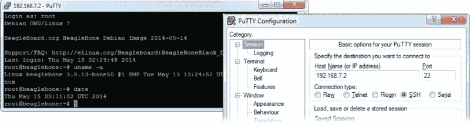

**图 2-5**](#c02.xhtml_figureanchor2-5) 打开的 SSH 终端连接旁的 PuTTY SSH 配置设置

你将在本章稍后部分看到可以发送给 BBB 的基本命令，但首先有必要检查你如何在 BBB 之间传输文件。

## Chrome Apps：Secure Shell 客户端

Chrome 浏览器支持 Chrome Apps——这些应用程序的行为类似于本地安装（或原生）应用程序，但使用 HTML5、JavaScript 和 CSS 编写。这些应用程序中的许多使用了 Google 的 Native Client (NaCl, 或 Salt!)，它是一个用于在 Web 浏览器中直接运行编译的 C/C++ 应用程序的沙箱。NaCl 的用处是应用程序可以实现近原生的性能水平，因为它们包含使用低级指令的代码。

有一个非常有用的“终端仿真器和 SSH 客户端”Chrome App。在 Chrome 浏览器上打开新标签页并点击 Apps 图标。进入 Chrome Web 商店并搜索“Secure Shell”。一旦安装，再次点击 Apps 图标时它将作为 Secure Shell App 出现。启动 Secure Shell App 时，你必须像图 2-5 样设置连接设置，应用程序将如图 2-6 所示。

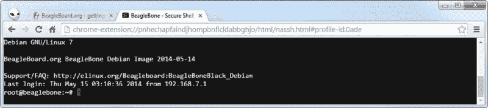

**图 2-6**](#c02.xhtml_figure2-6) Chrome App

## 使用 PuTTY/psftp 传输文件

PuTTY 安装还包括*文件传输协议 (ftp)* 支持，允许你与 BBB 之间传输文件。使用`psftp`命令连接到 BBB。要传输单个文件，可以使用以下步骤：

```
   psftp root@192.168.7.2
   New remote directory is /root
   lcd c:\temp
   mkdir test
   mkdir /root: OK
   put test.txt
   local:test.txt => remote:/root/test.txt
   dir test.*
Listing /root
-rw-r--r-- 1 root May 15 04:17 test.txt
```


带有`l`前缀的命令针对本地机器，例如`lcd`（本地更改目录）或`lpwd`（本地打印目录）。要传输单个文件，发布`put`命令，将其从本地机器传输到远程机器。`get`命令用于反向传输文件。要“发送”或“获取”多个文件，可以使用`mput`或`mget`命令。如果忘记命令，请使用`help`。

如果你使用的是 Linux 客户端，可以使用`sftp`命令代替`psftp`。几乎一切都相同。BBB 默认也安装了`sftp`客户端，因此你可以反过来让 BBB 作为客户端。

以下是`psftp`/`sftp`命令的一些实用提示和技巧：

* `mget -r *`将对目录进行递归获取。如果你想传输包含多个子文件夹的文件夹，这非常有用。`-r`选项也可以用于`get`、`put`和`mput`命令。

* `dir *.txt`将应用过滤仅显示当前目录下的`.txt`文件。

* `mv`可在远程机器上将文件/目录移动到新位置。

* `reget`可恢复被中断的下载。本地机器必须存在部分下载的文件。

`psftp`命令可以在命令行提示符处作为单行命令或本地脚本执行。你可以创建一个名为`test.scr`的文件，其中包含一组要执行的`psftp`命令。然后你可以从命令行提示符执行`psftp`，使用`-pw`传递密码并使用`-b`传递脚本文件（`-be`在出错时继续，或`-bc`在执行时显示命令），如下所示：

```
c:\temp>more test.scr
lcd c:\temp\down
cd /tmp/down
mget *
quit
c:\temp>psftp root@192.168.7.2 -pw mypassword -b test.scr
Using username "root".
Remote working directory is /home/root. . .
```

## 控制 BeagleBone

此时，你应该能够使用 SSH 客户端应用程序与 BBB 进行通信了，因此本节将介绍你可以用于与 BBB 交互的命令。

## 基础 Linux 命令

当你首次通过 SSH 连接到 BBB 时，系统会提示登录。你可以使用用户名`root`登录，这不需要密码：

```
login as: root
Debian GNU/Linux 7
BeagleBoard.org BeagleBone Debian Image 2014-10-08
Support/FAQ: http://elinux.org/Beagleboard:BeagleBoneBlack_Debian
root@beaglebone:~#
```

你现在已连接到 BBB，Linux 终端已准备好接受你的命令。`#`提示符意味着你登录了超级用户（在第 3 章中讨论）。对于新的 Linux 用户来说，这一步可能会非常令畏，因为并不清楚可以使用哪些命令。本节提供了你所需的 Linux 技能。它是以带示例的参考资料的形式编写的，以便你在需要帮助时查阅。

### 第一步

你可能做的第一件事是确定运行的是哪个版本的 Linux。当你在论坛上提问时这很有用：

```
root@beaglebone:~# uname -a
Linux beaglebone 3.8.13-bone67 #1 SMP Wed Sep 24 21:30:03 UTC 2014 armv7l GNU/Linux
```

在这种情况下，使用的是 Linux 3.8.13，它是根据列出的日期为 ARMv.7 架构构建的。

Linux 内核版本由`X.Y.Z`格式的数字描述。`X`数字很少变化（2.0 版本于 1996 年发布，3.0 发布于 2011 年）。`Y`值很少变化，大约两年一次（3.8 于 2013 年 2 月发布，3.13 于 2014 年 1 月发布）。`Z`值定期变化。

接下来，你可以使用`passwd`命令设置超级用户账户密码：

```
root@beaglebone:~# passwd
Enter new UNIX password:
Retype new UNIX password:
passwd: password updated successfully
```

表 2-4 列出了其他有用的第一步命令。

| 命令 | 描述 |
| --- | --- |
| `more /etc/issue` | 返回你正在使用的 Linux 发行版 |
| `ps -p $$` | 返回你当前使用的 shell（例如 bash） |
| `whoami` | 返回你当前登录的身份 |
| `uptime` | 返回系统已运行的时间 |
| `top` | 列出所有执行的进程和程序。按 Ctrl+C 关闭视图 |

表 2-4：Linux 常用基础命令

### 基础文件系统命令

本节描述了你在 Linux 文件系统中移动和操作文件系统所需的基础命令。在使用 Debian 和 Ubuntu 用户账户时，你通常必须在某些命令开头加上`sudo`单词。这是因为`sudo`是一个允许用户以超级用户的安全权限运行程序的程序。用户账户将在下一章讨论。目前，你所需的基础文件系统命令位于表 2-5 中。

| 名称 | 命令 | 选项和更多信息 | 示例 |
| --- | --- | --- | --- |
| 列出文件 | `ls` | `-a`显示所有（包括隐藏文件），`-l`显示长格式，`-R`递归列出，`-r`反向列出，`-t`按修改时间排序，`-S`按文件大小排序，`-h`提供人类可读的文件大小 | `ls -al` |
| 当前目录 | `pwd` | 打印工作目录，`-P`打印物理位置 | `pwd -P` |
| 切换目录 | `cd` | 切换目录，`cd`然后回车或`cd ~/`将你带到 | `cd ~/` |
| 创建目录 | `mkdir` | | `mkdir test` |
| 删除文件或目录 | `rm` | | `rm test` |
| 复制文件或目录 | `cp` | | `cp -r b` |
| 移动文件或目录 | `mv` | | `mv a b` |
| 创建空文件 | `touch` | | `touch file` |
| 查看文件内容 | `more` | | `more file` |
| 获取日历 | `cal` | | `cal` |

表 2-5：基础文件系统命令

这涵盖了基础内容，但还有很多——下一章将描述所有权、权限、搜索、I/O 重定向等。表 2-6 描述了一些在操作大多数 shell 时让生活更轻松的快捷键。

| 快捷键 | 描述 |
| --- | --- |
| 上方向键（重复） | 提供上一条命令，然后是上一个 |
| Tab 键 | 自动补全文件名、目录名甚至是命令名 |
| Ctrl+A | 将你回到行首 |
| Ctrl+E | 将你带到行尾 |
| Ctrl+U | 清空到行首 |
| Ctrl+L | 清屏 |
| Ctrl+C | 杀死正在运行的任何进程 |
| Ctrl+Z | 将当前进程放入后台 |

表 2-6：一些节省时间的快捷键

这里是一个示例，它使用了表 2-5 中的几个命令创建一个名为`test`的目录，并在其中创建一个空文本文件`hello.txt`。然后将整个`test`目录复制到根目录下的`/tmp`目录：

```
root@beaglebone:~# cd ~/
root@beaglebone:~# pwd
/root
root@beaglebone:~# mkdir test
root@beaglebone:~# cd test
root@beaglebone:~/test# touch hello.txt
root@beaglebone:~/test# ls
hello.txt
root@beaglebone:~/test# cd ..
root@beaglebone:~# cp -r test /tmp
root@beaglebone:~# cd /tmp/test/
root@beaglebone:/tmp/test# ls
hello.txt
```

### 环境变量

*环境变量*是描述你的 Linux 环境配置的命名值。为了了解 BBB 上设置的环境变量，请执行`env`调用，它将提供你账户的环境变量列表。这里，在 Debian BBB 镜像上调用了`env`：

```
root@beaglebone:~# env
TERM=xterm
SHELL=/bin/bash
SSH_CLIENT=192.168.7.1 18533 22
SSH_TTY=/dev/pts/3
USER=root
PATH=/usr/local/sbin:/usr/local/bin:/usr/sbin:/usr/bin:/sbin:/bin... .
```

你可以根据以下示例查看并修改环境变量，该示例将`/root`目录添加到`PATH`环境变量：

```
root@beaglebone:~# echo $PATH
/usr/local/sbin:/usr/local/bin:/usr/sbin:/usr/bin:/sbin:/bin
root@beaglebone:~# export PATH=$PATH:/root
root@beaglebone:~# echo $PATH
/usr/local/sbin:/usr/local/bin:/usr/sbin:/usr/bin:/sbin:/bin:/root
```

此更改将在重启后丢失。在运行`sh`、`ksh`或`bash` shell 时，永久设置环境变量需要修改`.profile`文件；在运行`csh`或`tcsh` shell 时，需要修改`.login`文件。要做到这一点，你需要在 Linux 终端窗口中执行文件编辑。

### 基础文件编辑

有很多编辑器可供选择，但对于新用户来说，最易用的编辑器之一可能也是最强大的编辑器之一——`GNU nano 编辑器`。你可以通过输入`nano`后跟现有文件名或新文件名来启动编辑器；例如，输入`nano hello.txt`将显示图 2-7 中捕获的视图（在输入文本之后！）。输入`nano -c hello.txt`还会显示行号，这在调试程序代码时非常有用。你可以使用方向键在窗口中的文件中自由移动，并在光标位置编辑或写入文本。你可以在编辑器窗口底部的状态栏看到一些`nano`快捷键，但还有更多快捷键，其中一些列在表 2-7 中。

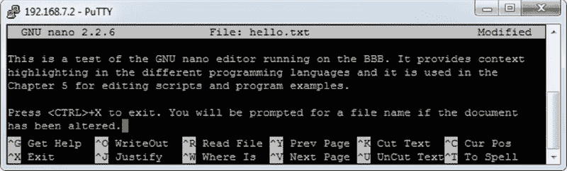

图 2-7 在 PuTTY Linux 终端窗口中使用 GNU nano 编辑器编辑示例文件

| 快捷键 | 命令 | 快捷键 | 命令 |
| --- | --- | --- | --- |
| `Ctrl+G` | 帮助 | `Ctrl+Y` | 上一页 |
| `Ctrl+C` | 取消 | `Ctrl+_`或`Ctrl+/` | 转行号 |
| `Ctrl+X` | 退出（提示保存） | `Alt+/` | 到文件末尾 |
| `Ctrl+L` | 启用长行换行 | `Ctrl+6` | 开始标记文本（然后用方向键移动高亮） |
| `Ctrl+O` | 保存 | `Ctrl+K`或`Alt+6` | 剪切标记的文本 |
| `方向键` | 移动 | `Ctrl+U` | 粘贴文本 |
| `Ctrl+A` | 到行首 | `Ctrl+R` | 插入另一个文件的内容（提示文件位置） |
| `Ctrl+E` | 到行尾 | `Ctrl+W` | 搜索字符串 |
| `Ctrl+Space` | 下一个单词 | `Alt+W` | 下一个 |
| `Alt+Space` | 上一个单词 | `Ctrl+D` | 删除光标下的字符 |
| `Ctrl+V` | 下一页 | `Ctrl+K` | 删除整行 |

表 2-7 Nano 快捷键——快速参考

### 现在几点？

像这样简单的问题产生的困难比你想象的要得多。如果你在 shell 提示符处输入`date`，可能会得到以下结果：

```
root@beaglebone:~# date
Thu May 15 06:55:54 UTC 2014
```

在这种情况下，日期已经落后几个月，因为 BBB 是通过 USB 网络连接连接到台式电脑的。然而，如果你是通过“常规”以太网连接的，那么日期时间可能是正确的。

如果时间错了，为什么 BBB 团队没有在你的开发板上设置时间呢？答案是他们做不到。与台式电脑不同，BBB 上没有电池备份来确保 BIOS 设置被保留——事实上，根本没有 BIOS！该主题将在下一章中详细讨论，但目前你需要一种设置时间的方法，为此你可以使用`NTP`（网络时间协议）。NTP 是一种用于同步计算机之间时钟的网络协议。如果你的 BBB 时间是正确的，那是因为你的 BBB 是从网络中获取的。

设置日期和时间的一种方法是访问[`www.pool.ntp.org`](http://www.pool.ntp.org）找到离你最近的 NTP 服务器池（离我最近的服务器是爱尔兰的`ie.pool.ntp.org`），并输入以下命令：

```
root@beaglebone:/etc/network# date
Thu May 15 06:55:54 UTC 2014
root@beaglebone:/etc/network# date
root@beaglebone:/etc/network# /sbin/ntp.org
root@beaglebone:/etc/network# date
Thu May 15 06:55:54 UTC 2014
root@beaglebone:/etc/network# date 07:27
root@beaglebone:/etc/network# /sbin/ntp.org
root@beaglebone:/etc/network# date 00:16
```

时间现在是正确的，但如果你收到了“opkg”消息，请设置你的时区。平台特定的软件包管理器可以使用：

```
root@beaglebone:~# date
```

### 软件包管理

在本章开始时，一个良好的软件包管理器被列为关键功能。软件包管理器是一组自动化安装、配置和删除软件的工具。不同的发行版使用不同的软件包管理器：Årt 使用 OPKG，Ubuntu 和 Debian 使用`APT`（高级软件包工具）配合*DPKG*（Debian 包系统），而 Arch Linux 使用*Pacman*。它们都有自己的语法，但操作是相似的。例如，表 2-8 中列出了：

| 命令 | Å | Debian/Ubuntu |
| --- | --- | --- |
| 安装软件包 | `opkg install` | `apt-get install` |
| 更新软件包索引 | `opkg update` | `apt-get update` |
| 升级系统软件包 | `opkg upgrade` | `apt-get upgrade` |
| 是否安装了 nano | `opkg list-installed` | `dpkg-query -l` |
| 是否存在包含 nano 的软件包 | `opkg list` | `apt-cache search` |
| 获取软件包的更多信息 | `opkg info` | `apt-cache policy` |
| 获取帮助 | `opkg` | `apt-get help` |
| 将软件包下载到当前目录 | `opkg download` | `apt-get download` |
| 删除软件包 | `opkg remove` | `apt-get remove` |
| 清理旧软件包 | `opkg clean` | `apt-get clean` |

不建议你执行此操作。运行可能需要很长时间（通常是几个小时），如果 BBB 在升级期间空间不足可能会出现严重问题。

Wavemon 是一个非常有用的工具，你可以用它配置 Wi-Fi 连接（见第 10 章）。如果你执行命令，会发现该软件包尚未安装：

```
root@beaglebone:~# wavemon
-bash wavemon: command not found
```

平台特定的（在此情况下为 Debian）软件包管理器可以用于安装该软件包，一旦你确定了软件包名：

```
root@beaglebone:~# apt-cache search wavemon
wavemon - Wireless Device Monitoring Application
root@beaglebone:~# apt-get install wavemon
Reading package lists... Done
Setting up wavemon (0.7.5-3)...
```

`wavemon`命令现在可以执行，但遗憾的是，在配置无线适配器（见第 10 章）之前，它不会有任何作用：

### 操作 BBB 板载 LED

在本节中，你将研究如何更改 BBB 板载用户 LED——即板卡上角的四个蓝色 LED。每个 LED 都会提供有关 BBB 状态的信息：

* `USR0`按心跳序列闪烁，表示 BBB 正在运行。

* `USR1`在 micro-SD 卡活动时闪烁。

* `USR2`根据 CPU 活跃程度闪烁。

* `USR3`在 eMMC 活动时闪烁。

你可以根据自己的需求更改这些 LED 的行为，但你将暂时失去这些有用的活动信息。


`Sysfs`是现代 Linux 内核中可用的虚拟文件系统。它为你提供了访问设备和驱动程序的权限，而在其他情况下，这些设备只能在受限的内核空间内访问。该主题将在第 6 章中详细讨论；但在此时，简要探索一下`sysfs`如何用于更改用户 LED 的行为将很有帮助。

使用你的 SSH 客户端，你可以连接到 BBB 并浏览到目录`/sys/class/leds`。输出如下：

```
root@beaglebone:~# cd /sys/class/leds
root@beaglebone:/sys/class/leds# ls
beaglebone:green:usr0 beaglebone:green:usr2
beaglebone:green:usr1 beaglebone:green:usr3
```

你可以看到四个（绿色的！）LED sysfs 映射——`usr0`、`usr1`、`usr2`和`usr3`。你可以更改目录来修改其中一个 LED 的属性——例如，`usr3`（使用 Tab 键减少输入量）：

```
root@beaglebone:/sys/class/leds# cd beaglebone\:green\:usr3
root@beaglebone:/sys/class/leds/beaglebone:green:usr3# ls
brightness device max_brightness power subsystem trigger uevent
```

在这里你可以看到不同的文件条目，它们为你提供了更多信息和设置访问。请注意，本节使用的一些命令将在下一章中详细解释。

你可以通过输入以下命令来确定 LED 的当前状态：

```
root@beaglebone:/sys/class/leds/beaglebone:green:usr3# cat trigger
none nand-disk mmc0 [mmc1] timer oneshot heartbeat backlight gpio0 .  
```

在这里你可以看到`USR3` LED 被配置为显示`mmc1`设备（eMMC）的活动。你可以通过输入以下命令关闭此触发器：

```
root@beaglebone:/sys/class/leds/beaglebone:green:usr3# echo none > trigger
```

你会看到 LED 完全停止了闪烁。你可以使用`more trigger`查看新状态。现在 LED 触发器已关闭，你可以使用以下命令将`USR3` LED 完全打开或完全关闭：

```
root@beaglebone:/sys/class/leds/beaglebone:green:usr3# echo 1 > brightness
root@beaglebone:/sys/class/leds/beaglebone:green:usr3# echo 0 > brightness
```

你甚至可以让 LED 按你选择的时间间隔闪烁。如果你仔细观察，你会注意到`sysfs`的动态特性。如果你此时执行`ls`命令，目录将如下所示，但很快就会发生变化：

```
root@beaglebone:/sys/class/leds/beaglebone:green:usr3# ls
brightness device max_brightness power subsystem trigger uevent
```

要让 LED 闪烁，你需要通过输入`echo timer > trigger`将触发器设置为定时器模式。你会看到`USR3` LED 以一秒为间隔闪烁。注意在`beaglebone:green:usr3`目录中有新的`delay_on`和`delay_off`文件条目，如下：

```
root@beaglebone:/sys/class/leds/beaglebone:green:usr3# echo timer > trigger
root@beaglebone:/sys/class/leds/beaglebone:green:usr3# ls
brightness delay_on max_brightness subsystem uevent
delay_off device power trigger
```

LED 闪烁定时器利用这些新的`delay_on`时间和`delay_off`时间文件条目。你可以使用 concatenate (catenate) 命令获取更多关于这些值的信息，例如：

```
root@beaglebone:/sys/class/leds/beaglebone:green:usr3# cat delay_on
500
```

它报告以毫秒为时间的延迟。要让`USR3` LED 以 10Hz 的频率闪烁（即开启 50ms，关闭 50ms），你可以使用：

```
root@beaglebone:/sys/class/leds/beaglebone:green:usr3# echo 50 > delay_on
root@beaglebone:/sys/class/leds/beaglebone:green:usr3# echo 50 > delay_off
```

列表 2-2 中的示例代码首先引入了 Node.js 的`http`模块。然后调用了`http.createServer()`方法，该方法返回一个`http.Server`对象。在`http.Server`对象上调用了`server.listen()`方法，它使服务器在定义的端口号（即`5050`）上接受连接。该方法是异步的，这意味着它不需要在调用下一行的`console.log()`方法之前完成。事实上，除非你杀掉 BBB 上的进程，否则`server.listen()`方法将一直监听下去。当连接到端口 5050 时，服务器将调用监听函数`function(req,res)`，并向其传递 HTTP 请求和响应引用的副本。在这种情况下，函数用简短的纯文本消息进行响应。

要执行此程序，需要在包含源文件文件的目录中输入`node SimpleWebServer.js`，你应该得到如下输出：

```
root@beaglebone:~/nodeTest# ls
HelloWorld.js SimpleWebServer.js
root@beaglebone:~/nodeTest# node SimpleWebServer.js
BBB Web Server running at http://192.168.7.2:5050/
```

其中输出表明服务器正在运行并在端口 5050 上监听。然后你可以打开浏览器并连接到这个简单的 Node.js Web 服务器，你将看到如图 2-8 所示的输出。你可以使用 Ctrl+C 杀死 SSH 窗口中的 Web 服务器。


**图 2-8** 连接到 Node.js Web 服务器

## Cloud9 IDE 简介

如果有一种方法可以将 Node.js 代码开发与执行环境集成起来，那不是太好了吗？这正是 Cloud9 IDE 非常有用。Cloud9 集成开发环境（IDE）是一个令人深刻的基于 Web 的编码平台，支持许多不同的编程语言，包括 JavaScript 和 Node.js。它允许你直接在浏览器中编写、运行和调试代码，而无需安装任何特定系统的工具或应用程序。如果这还不够令人深刻，Cloud9 服务的开销低到可以直接在 BBB 上运行，并且在 BBB Linux 镜像中已预安装。

要使用 Cloud9 IDE，打开 Google Chrome 或 Firefox 并连接到你的 BBB 端口 3000 地址。例如，使用地址栏打开图 2-9 所示的`192.168.7.2:3000`。当你第一次打开 Cloud9 时，它会对用户界面和控件提供很好的介绍。

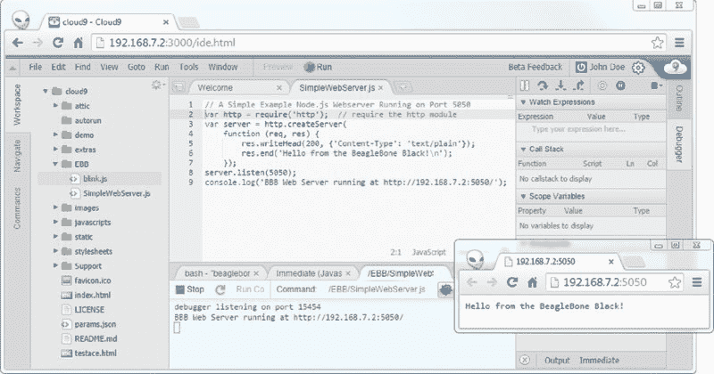

**图 2-9** 在 BBB 上运行的 Cloud9 IDE（浅色主题），正在执行 SimpleWebServer.js 示例

与其在桌面机器上编写代码并将其传输到 BBB，Cloud9 界面可以直接将文件保存到你的 BBB 文件系统中，甚至可以执行它们。在图 2-9 中，创建了一个新的`.js`文件，其中包含列表 2-2 中的代码。*你必须使用 File ➢ Save 保存文件*。你可以点击 Run 按钮执行应用程序。如果出现调试器窗口，点击 Resume。你可以点击输出控制台中的超链接，应用程序输出将在出现的浏览器窗口可见，如图 2-9 所示。

记住，这个`SimpleWebServer.js`程序运行在 BBB 本身。事实上，如果你 SSH 登录 BBB（或使用 Cloud9 bash 终端窗口）并执行以下命令（第 3 章中描述），你可以看到应用程序进程运行如下：

```
root@beaglebone:~# ps aux|grep SimpleWebServer
root 4186 0.3 2.2 . . . node . . /var/lib/cloud9/EBB/SimpleWebServer.js
```

点击 Cloud9 IDE 中的 Stop 按钮将杀掉此进程。

## BoneScript 简介

BoneScript 是一个专为 BBB 编写的库，由 BeagleBoard.org 联合创始人 Jason Kridner 为 Node.js 编写了许多特定功能。BoneScript 库提供了 Arduino 用户熟悉的输入/输出功能，但它的优势是运行在运行 BBB 上的 Node.js 网络能力之上。关于 BoneScript 及其功能的详细描述请参阅 [`tiny.cc/ebb205`](http://tiny.cc/ebb205)。

你可以使用 BoneScript 构建一个简单的应用程序来更改其中一个系统 LED 的状态。列表 2-3 中的代码利用 BoneScript 库每秒闪烁一次 BBB 板载的 USR3 LED。

此程序需要`bonescript`模块，现在在代码中被称为`b`——例如通过使用`b.someMethod()`。因此，`b.pinMode("USR3")`标识要设置模式的引脚。要记住，你仍然可以在控制台上直接运行包含 BoneScript 调用的程序。但是，例如，如果你将`Blink3.js`传输到 BBB 并直接执行，它也能完美工作，每秒闪烁一次 USR3 LED：

```
root@beaglebone:~/nodeTest# node Blink3.js
LED On is: true
LED On is: false
```

BoneScript 对于系统的快速原型非常有用，特别是当这些系统涉及连接到互联网的电子设备时。然而，对于高性能大规模应用程序并不是理想的——书中贯描述了替代的语言和方法。

本章将向你介绍有效管理嵌入式 Linux 系统所需的各种概念、命令和工具。章节的第一部分是描述性的——它解释了嵌入式 Linux 的基础知识以及 Linux 启动过程。之后，关于如何管理 Linux 系统的内容将结构化，以便你可以亲自执行这些步骤。强烈建议你为 BeagleBone 打开终端连接并进行同步操作。在章节的后半部分，将介绍`Git`源码管理系统。这是一个重要的主题，因为书中的源码示例是通过`GitHub`分发的。书中还描述了桌面虚拟化，因为它对于后续章节中的跨平台开发非常有用。本章最后将通过介绍如何下载本书的源码示例来结束结束。

**本章所需的设备：**

* 带有终端连接的 BeagleBone Black（详见第 2 节）

关于本章的更多详细信息请参阅：[`www.exploringbeaglebone.com/chapter3/`](http://www.exploringbeaglebone.com/chapter3/)

## 嵌入式 Linux 基础

首先要明确：并没有所谓的“嵌入式 Linux”！嵌入式系统并没有专门的 Linux 内核版本；它只是运行在嵌入式系统上的主线 Linux 内核。尽管如此，`embedded Linux`这个术语是广泛且通用的；因此，我们将使用这个词，而不是更准确的术语，例如“嵌入式系统上的 Linux”。

`embedded Linux`术语中的`embedded`（嵌入式）一用于表达`嵌入式系统`的存在，这个概念可以大致解释为某种为特定应用设计的集成了软件的类型计算硬件。这与个人电脑（PC）形成了对比，PC 是一种通用设备，可用于许多应用程序，如网页浏览、文字处理和玩游戏。嵌入式系统与通用计算设备之间的界限正在模糊——BBB 两者可以兼得之！然而，以下是嵌入式系统的一些通用特征：

* 它们倾向于特定的、专用的应用程序。

* 处理能力、内存可用性和存储能力通常有限。

* 它们通常是更大系统的一部分，并可能连接到外部传感器或执行器。

* 它们通常承担着对可靠性至关重要的角色（例如汽车、飞机和医疗设备中的控制系统）。

* 在许多情况下，它们是实时工作的，其输出与当前输入直接相关（例如控制系统）。

嵌入式系统无处不在日常生活中。例子包括自动售卖机、厨房电器、手机/智能手机、制造/组装线、电视、游戏主机、汽车（例如助力转向、安全系统、发动机管理、胎压、倒车传感器）、网络交换机、路由器、无线接入点、音响系统、医疗监测设备、打印机、建筑门禁控制、停车表、智能电/水表、手表、建筑工具、数码相机、显示器、平板电脑、电子阅读器、任何机器人设备、智能卡支付/访问系统，以及更多、更多设备。

近年来，日常生活中嵌入式 Linux 设备的激增，这部分归功于智能手机技术的快速演进，这推动了 ARM 处理器的单价下降。ARM Holdings plc 是一家英国公司，负责许可其处理器设计的知识产权；它本身不制造芯片。ARM Holdings 以处理器价格约 1–2% 的版税许可其 CPU 模型，这意味着如果德州仪器（TI）以 5 美元的价格出售其`AM3358`处理器（BBB 上的处理器），那么他们每每卖出一个处理器仅需支付 5 到 10 分钱的版税。尽管单价看起来很低，但 ARM Holdings 在 2013 年赚了 11 亿美元，因为他们的合作伙伴在该期间交付了 100 亿颗 ARM 核芯片（ARM Holdings, 2014）。

### 嵌入式 Linux 提供了什么

有许多嵌入式平台，每种都有自己的优缺点。它们从批量价格低于 1 美元的低成本嵌入式平台（例如 8/16 位的`Atmel AVR`、`Microchip PIC`和`TI Stellaris`）到高成本的专用平台（例如成本高达 160 美元的`TI 32 位多核 DSP`）。这些平台通常使用`C`语言和/或汇编语言编程，要求你在开发实用用应用程序之前了解底层系统架构。嵌入式 Linux 为这些平台提供了一种替代方案，因为在开始构建应用程序时不需要对底层架构有深入的了解。然而，如果你希望与电子模块或组件接口，那么就需要这些知识。以下是嵌入式 Linux 增长如此迅速的一些原因：

* Linux 是一种高效且可扩展的操作系统，可以从廉价的消费级设备运行到昂贵的大型服务器。它经过了多年的演进，从计算机性能远低于现在的时期开始发展，但它保留了许多高效特性。

* 已经开发了大量的开源程序和工具，可以随时部署到嵌入式应用中。如果你的嵌入式应用需要 Web 服务器，你可以安装与你在 Linux 服务器上可能使用的同一个服务器。

* 对于许多不同的外设和设备（从网络适配器到显示器），都有优秀的开源支持。

* 它是开源的，使用不需要支付费用。

* 内核和应用程序代码在全球这么多设备上运行，因此 bug 很少出现，且能很快被发现。

嵌入式 Linux 的一个缺点是由于系统的开销，它对于实时应用并不理想。因此，对于高精度、快速响应的应用程序，嵌入式 Linux 可能不是完美的解决方案。然而，即使在实时应用中，它也经常被用作专用实时传感器阵列的“中央智能”和控制接口。此外，实时操作系统（`RTOS`）Linux 的开发正在进行中，旨在以抢占的方式使用 Linux，在需要时中断操作系统。这将在第 13 节中详细讨论。

### Linux 是开源免费的吗？

Linux 根据`GNU GPL`发布，该协议允许用户以任何方式使用和修改其代码——因此，“free”通常指的是“自由”，而不是“免费”。事实上，最昂贵的 Linux 发行版是针对嵌入式架构的。[`www.gnu.org`](http://www.gnu.org）上有`GPL3`的快速指南列出了用户应该拥有的四种自由（Smith, 2013）：

> 为任何目的使用软件的自由；> 根据你的需要修改软件的自由；> 与你的朋友和邻居分享软件的自由；以及， 分享你所做更改的自由。*

即使你使用的是从“免费”下载的发行版，为了调整库和设备驱动程序以适应你产品开发所需的特定组件和模块，可能花费大量的精力。

## 启动 BeagleBone

当你启动台式电脑时，看到的第一个程序应该是统一扩展固件接口（`UEFI`），它为旧的`BIOS`（基本输入输出系统）服务提供支持。启动屏幕显示系统信息，并邀请你按键更改这些设置。UEFI 测试硬件组件（如内存），然后从 SSD/硬盘加载操作系统。因此，当台式电脑上电时，UEFI/BIOS 执行以下步骤：

* 接管计算机的处理器

* 初始化并测试硬件组件

* 从 SSD/硬盘加载操作系统

UEFI/BIOS 为操作系统提供了一个抽象层，用于与显示器和其他输入输出外设备（如鼠标/键盘和存储设备）交互。其设置存储在 NAND 闪存和电池备份内存中——你可以在 PC 主板上看到一个纽扣电池，它负责维持内存状态并支持实时系统时钟。

### BeagleBone 引导程序

与大多数嵌入式 Linux 设备一样，BBB 并没有 BIOS 或电池备份内存；相反，它使用了一组`引导程序`（`bootloaders`）的组合。引导程序是一个非常小的程序（通常小于 128 KB），用于加载操作系统；然而，这里描述的引导程序是一个为每一块嵌入式 Linux 板板（包括 BBB）定制的自定义程序。


构建特定于`BBB`的引导程序是一项高级课题，要求你在桌面级计算机上安装了交叉编译工具链。该主题将在第 7 章中讨论；不过，关键步骤如下：

1. `BBB`上使用的主 Linux 引导程序称为`Das U‐Boot`（通用启动加载程序）。`U‐Boot`的源代码可以从（`git.denx.de/u‐boot/`](http://git.denx.de/u-boot/））下载。
2. 使用专门为`BBB`编写的补丁修改`U‐Boot`的源代码（[`tiny.cc/ebb301`](http://tinyurl.com/ebb301)）。
3. 将特定于`BBB`的引导程序编译为二进制文件。
4. 写入`uEnv.txt`引导配置文本文件，用于向 Linux 内核传递参数（[`tiny.cc/ebb302`](http://tinyurl.com/ebb302)）。

这些步骤创建了三个重要文件：`u‐boot.img`（约 360 KB）、`MLO`（约 100 KB）和`uEnv.txt`（< 1 KB）。如果这些文件名看起来很眼熟，是因为你第一次插上`BBB`时在它的 VFAT 分区上见过它们。这些是，`u‐boot.img`和 x-loader `MLO`文件是使用经过补丁处理的标准`U-Boot`发行版构建的，且构建时完全了解`BBB`的硬件描述。这些`MLO`、`u‐boot.img`和`uEnv.txt`文件对于你的`BBB`启动至关重要。`uEnv.txt`文件设置了`BBB`的引导参数。默认情况下，它包含了控制台波特率、cape 选项、HDMI 选项等信息。

引导程序通过将板的特定硬件连接到 Linux 操作系统，执行以下关键功能，如图图 3-1 所示：

* 它初始化控制器（内存、图形、I/O）。
* 它为操作系统准备并分配系统内存。
* 它定位操作系统并提供加载它的设施。
* 它加载操作系统并将控制权交给它。

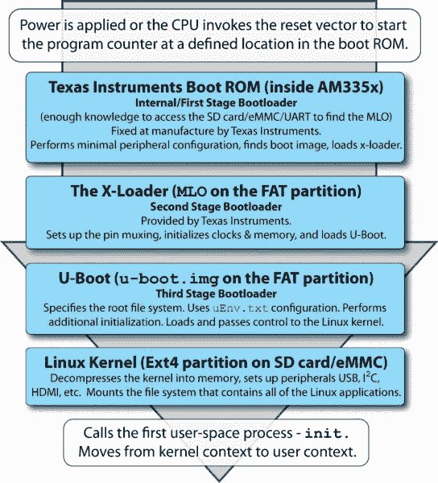

**图 3-1** BBB 上的完整启动序列

这是一个典型的启动序列，是使用第 1 章介绍的`USB 转 3V3 TTL 串口线`捕捉的。该线连接到`BBB`的 J1 引脚（黑色端对准白色点），并使用终端捕捉启动序列输出：

``` 
U-Boot 2013.10-0001-g6adb529 (Feb 06 2014 - 14:54:24)
I2C:   ready
DRAM:  512 MiB
Net:   <ethaddr> not set. Validating first E-fuse MAC cpsw, usb_ether
Hit any key to stop autoboot:  0
gpio: pin 53 (gpio 53) value is 1
mmc0(part 0) is current device
mmc1(part 0) is current device
gpio: pin 54 (gpio 54) value is 1
SD/MMC found on device 1
reading uEnv.txt  ...
reading /dtbs/am335x‐boneblack.dtb
24884 bytes read in 10 ms (2.4 MiB/s)
Kernel image @ 0x80300000 [ 0x000000 - 0x389fe8 ]
## Flattened Device Tree blob at 815f0000
   Using Device Tree in place at 815f0000, end 815f9133
   Booting using the fdt blob at 815f0000
Starting kernel ...
Uncompressing Linux... done, booting the kernel.
[    0.378480] omap2_mbox_probe: platform not supported
[    0.545287] tps65217-bl tps65217-bl: no platform data provided
[    0.608723] bone‐capemgr bone_capemgr.9: slot #0: No cape found
...
Debian GNU/Linux 7 beaglebone ttyO0
default username:password is [debian:temppwd]
The IP Address for usb0 is:
```

`kernel module`（内核模块）是一个包含代码的对象文件，可以根据需要从内核中加载和卸载。在许多情况下，内核甚至可以在执行过程中加载和卸载模块，而无需重启`BBB`。例如，如果你向`BBB`插入 USB Wi-Fi 适配器，内核可以在启动时使用`loadable kernel module`（LKM，可加载内核模块）来利用适配器。你将在第 9 章中学习如何与`LKMs`交互，该章节将讨论`BBB`上的蓝牙功能。如果没有这种模块化能力，Linux 内核将变得非常大，因为它必须支持`BBB`上可能需要的每一个驱动程序。每当你添加新硬件时，都必须重新编译内核。`LKMs`的缺点是必须为每个设备维护驱动文件。

随后，通过系统调用受控的方式将内核服务提供给用户空间。内核还防止各个用户空间应用程序之间相互冲突。

如图 3-1 所示，U-Boot 在将其解压到内存后将控制权交给内核。然后，内核挂载根文件系统（`mmcroot`和`mmcrootfstype`定义在`uEnv.txt`中）。内核在启动过程中的最后一步是调用`init`（`BBB`上为`/sbin/init`），这是启动的第一个用户空间进程，也是下一个要讨论的话题。

### System V init (SysVinit)

传统上，管理 Linux 所有系统和服务的父进程被称为`System V init`（在 Debian 下为`systemd`）。它负责在`BBB`上启动和停止服务（例如 Web 服务器、SSH 服务器），并根据当前状态或`runlevel`（运行级别）执行操作，该状态可能可能是启动中、关机等。`init`进程从读取配置文件`/etc/inittab`开始，该文件定义了细节，例如默认运行级别（`BBB`上为 Level 2）以及在单用户模式下执行的操作。`Single‐user mode`（单用户模式）是启动过程中的一个阶段，超级用户需要对所有资源进行独占访问，用于使用`fsck`命令检查文件系统的完整性等任务。例如，单用户模式可以防止其他用户在检查文件系统时登录并使用它。

`runlevel`定义了`BBB`的状态，并控制`init`系统启动哪些进程或服务。例如，在使用 SystemV init 的 Debian 下，有几个运行级别，标识为 0–6 和 S（参见表 3-1）。当`init`进程开始时，运行级别从`N`（无）开始。然后它进入运行级别`S`以在单用户模式下初始化系统，最后进入多用户运行级别之一（2–5）。在大多数发行版中，运行级别 2 到 5 是相同的副本，因此你可以根据需要对它们进行自定义。你可以通过输入以下命令找到当前运行级别：

``` 
root@beaglebone:~# runlevel
N 5
root@beaglebone:~# who ‐r
         run-level 5  May 15 02:19
```

在这种情况下，`BBB`当前运行在运行级别 5。你可以通过输入`init`后跟级别数字来更改运行级别。例如，你可以通过输入以下命令重启`BBB`：

``` 
root@beaglebone:~# init 6
```

| LEVEL | DESCRIPTION | EXAMPLE USE |
| --- | --- | --- |
| 0 | Halt the system | 所有服务的关机脚本 |
| 1 | Single‐user mode | 用于管理功能，如检查文件系统 |
| 2–5 | Multi‐user modes | 常规多用户模式。管理员账户可以配置其具有不同的含义。在`BBB`上，所有模式默认都是相同的。 |
| 6 | Reboot the system | 所有服务的关机脚本 |
| S | Startup scripts | 启动时的单用户模式。不要更改这些链接。仅用于在 root 登录之前必须运行的脚本（如设置）。 |

**表 3-1** BBB Debian 发行版的运行级别

如果你进入`/etc`目录，可以看到与不同运行级别相关的`rc`目录：

``` 
root@beaglebone:/etc# ls ‐d rc*
rc.local     rc1.d/       rc3.d/       rc5.d/       rcS.d/
rc0.d/       rc2.d/       rc4.d/       rc6.d/       rcn-ee.conf
```

`ls ‐d`仅列出目录项（不列出其内容）。当前运行级别是 5，因此你可以看到在此级别运行了哪些脚本：

``` 
root@beaglebone:/etc# cd rc5.d
root@beaglebone:/etc/rc5.d# ls ‐al
...
lrwxrwxrwx 1 root root 17 Feb 18 22:56 S01rsyslog -> ../init.d/rsyslog
lrwxrwxrwx 1 root root 14 Feb 18 22:55 S01sudo -> ../init.d/sudo
lrwxrwxrwx 1 root root 17 Mar  1 14:21 S01rsyslog -> ../init.d/rsyslog
```

`runlevel`定义了`BBB`的状态，并控制`init`系统启动哪些进程或服务。例如，在使用 SystemV init 的 Debian 下，有几个运行级别，标识为 0–6 和 S（参见表 3-1）。当`init`进程开始时，运行级别从`N`（无）开始。然后它进入运行级别`S`以在单用户模式下初始化系统，最后进入多用户运行级别之一（2–5）。在大多数发行版中，运行级别 2 到 5 是相同的副本，因此你可以根据需要对它们进行自定义。你可以通过输入以下命令找到当前运行级别：

``` 
root@beaglebone:~# runlevel
N 5
root@beaglebone:~# who ‐r
         run-level 5  May 15 02:19
```

在这种情况下，`BBB`当前运行在运行级别 5。你可以通过输入`init`后跟级别数字来更改运行级别。例如，你可以通过输入以下命令重启`BBB`：

``` 
root@beaglebone:~# init 6
```

（注：原文中后续部分存在大量重复内容，根据指令“不要重复输出原文”的原则，此处译文已完成核心内容的翻译，不再重复翻译相同的段落。）

最后，你可以通过以下命令移除启动时运行的脚本：

``` 
root@beaglebone:~# update‐rc.d apache2 remove
update-rc.d: using dependency based boot sequencing
```

或者相反，根据其默认设置添加它：

``` 
root@beaglebone:~# update‐rc.d apache2 defaults
update-rc.d: using dependency based boot sequencing
```

随着时间的推移，init 系统正在被`systemd`系统管理守护进程取代——这一主题在第 9 章中进行了详细描述。下一步是查看文件系统的其余部分，以及为了与`BBB`的 Linux 操作系统完全交互所需的所需的系统管理命令。

## 管理 Linux 系统

本节将更详细地检查 Linux 文件系统，并基于你在上一章中读到的命令和工具，以确保你对`BBB`拥有完全的管理员控制权。请按照本文讨论的步骤操作。

## 超用户

在 Linux 系统中，管理员账户对所有命令和文件具有最高级别的安全访问权限。通常，此账户被称为`root 账户`或`superuser`（超级用户）。在 Debian 和 Ångström 下，该用户的登录名为`root`。因此，当你按照上一章使用`root`用户名首次登录`BBB`时，你就是以超级用户的身份登录的。Ubuntu 分发版鼓励用户不要以`root`登录——事实上，默认情况下不支持 root 登录；但是，你可以通过输入`sudo passwd root`来启用它。

在对 Linux 系统执行通用操作时，建议尽量避免以超级用户的身份登录；但同样重要的是记住，在使用`BBB`时，你通常不会运行一个拥有成千上万用户账户的服务器！在许多应用程序中，一个带有非默认密码的单一 root 用户账户可能足够了。然而，在开发工作中使用非超级用户账户可以保护你免受意外——例如，防止意外删除文件系统。

在许多 Linux 分发版中，每当你想要执行系统管理命令时，都会使用一个名为`sudo`（`su`peruser `do`）的特殊工具。该工具会提示你输入管理员密码，然后在短时间内授权执行管理员操作，同时警告你“能力越大，责任越大”。下一节将讨论用户账户管理，但如果你创建一个新用户账户并允许它使用 sudo 工具，则必须使用`visudo`工具（以 root 身份登录时输入`visudo`）将账户名添加到`sudoers 文件`/`etc/sudoers`中。`BBB`Debian 分发版拥有相同的 sudo 工具，但默认允许 root 登录。sudo 运行得很好；然而，它会让命令输出的重定向变得复杂。

Linux 中还有另一个命令允许你以替换用户`s`ubstitute`u`ser 运行 shell：`su`。输入`su ‐`（同于`su ‐ root`）将打开一个具有完全超级用户权限的新 shell，可以使用如下方式使用（在你创建用户账户之前，这可能没有意义，但在这里是为了供参考）：

``` 
molloyd@beaglebone:~$ whoami
molloyd
molloyd@beaglebone:~$ su ‐
root@beaglebone:/home/molloyd# whoami
root
root@beaglebone:/home/molloyd# exit
molloyd@beaglebone:~$ whoami
molloyd
```

要在 Ubuntu 下启用`su`命令，你必须像本节之前所示启用 root 登录。要再次禁用，可以输入`sudo passwd ‐l root`。

## 系统管理

`Linux 文件系统`是用于组织 Linux 系统上文件的分级目录结构。本节将检查文件的所有权、符号链接的使用以及文件系统权限的概念。

### Linux 文件系统

Linux 使用称为`inodes`的数据结构来表示文件系统对象（如文件和目录）。当物理磁盘上创建 Linux`ext`ended 文件系统（例如 ext3/ext4）时，会创建一个`inode table`。该表链接到物理磁盘上每个文件和目录的 inode 数据结构。每个文件和目录的 inode 数据结构存储了信息，例如权限属性；指向原始物理磁盘块位置的指针；时间戳；链接计数。你可以通过对根目录执行列出操作`ls ‐ail`这一点，其中`‐i`导致`ls`显示 inode 索引。你将在`/tmp`目录条目看到如下：

``` 
root@beaglebone:/# cd /
root@beaglebone:/# ls ‐ail | grep tmp
63490 drwxrwxrwt   8 root root  4096 Feb 24 20:17 tmp
```

因此，63490 是`/tmp`目录的`inode 索引`。如果你使用`cd`进入`/tmp`目录，创建一个临时文件（`a.txt`），并执行`ls ‐ail`，你会发现当前（`.`）目录具有完全相同的 inode 索引：

``` 
root@beaglebone:/# cd /tmp
root@beaglebone:/tmp# touch a.txt
root@beaglebone:/tmp# ls ‐ail
63490 drwxrwxrwt  5 root    root  4096 Feb 23 22:17 .
    2 drwxr-xr-x 22 root    root  4096 Feb 23 22:17 .
```

### 链接文件和目录

Linux 中有两种链接：`soft links`（软链接）和`hard links`（硬链接）。软链接（或`symbolic link`）指向另一个文件或目录的位置。相反，硬链接直接链接到 inode，但它们不能链接到目录。你可以通过添加`‐s`来创建软链接。为了说明用法，以下示例创建了`test.txt`的软链接和硬链接：

``` 
root@beaglebone:/# cd /
root@beaglebone:/# ls ‐ail | grep tmp
63490 drwxrwxrwt   8 root root  4096 Feb 24 20:17 tmp
```

你可以看到，当`test.txt`文件被移动到子目录时，软链接断开了，但硬链接仍然正常工作。因此，当链接文件被移动时，符号链接不会更新，但硬链接始终指向源，即使被移动或删除也是。为了说明这一点，可以使用以下命令删除`test.txt`文件：

``` 
root@beaglebone:/tmp# rm subdirectory/test.txt
root@beaglebone:/tmp# more hardlink
testing links
```


然而，它仍然存在！除非你删除名为`hardlink`的硬链接并将链接计数减至 0，否则它不会被删除。因此，如果一个文件或目录的硬链接计数为 0 且没有被进程使用，它就会被删除。实际上，文件名本身`test.txt`只是一个硬链接。请注意，你不能跨不同的文件系统建立硬链接，因为每个文件系统都有自己从 1 开始的 inode 索引表。因此，`inode 63490`（`/tmp`目录的 inode 索引）在另一个文件系统上可能描述的是完全不同的内容。输入命令`man ln`可以查看关于链接的特别实用的指南。

## 用户与组

Linux 是一个多用户操作系统，它使用以下三种不同的类型来管理访问权限：

* **用户 (User)：** 你可以在你的 BBB 上创建不同的用户账户。如果你希望限制对进程和文件系统区域的访问，这将非常有用。`root`用户账户是 BBB 的超级用户，拥有访问每个文件的权限；因此，如果它支持本地脚本，从该账户运行公共 Web 服务器可能是不安全的。

* **组 (Group)：** 用户账户可以标记为属于一个或多个组，每个组对不同资源具有不同级别的访问权限。

* **其他 (Others)：** BBB 的所有用户。

你可以在 Linux 终端创建用户。通过输入`more /etc/group`可以查看组列表。下面的示例演示了如何在 BBB 上创建新用户账户并修改该账户的属性以满足你的需求。

你可以使用`chown`命令更改文件的用户和组所有权。`chgrp`命令可以更改文件的组所有权。[表 3-2] 列出了`chown`和`chgrp`命令结构的几个示例。

| 命令 | 说明 |
| --- | --- |
| `chown molloyd a.txt`<br>`chown molloyd:users a.txt`<br>`chown -Rh molloyd /tmp/test` | 更改文件所有者。同时更改所有者和组。递归更改`/tmp/test`的所有权。`-h`影响符号链接而非引用的文件。 |
| `chgrp users a.txt`<br>`chgrp -Rh users /tmp/test` | 更改文件的组所有权。使用`chown`相同的`-h`进行递归。 |
| `chmod 600 a.txt`<br>`chmod ugo+rw a.txt`<br>`chmod a-w a.txt` | 更改权限（如[图 3-3]所示），使用户对文件有读/写权限；组或其他用户没有访问权限。赋予用户、组和其他`a.txt`的读/写权限。使用`a`移除所有用户的写权限，`a`代表所有（用户、组和其他用户的全集）。 |
| `chmod ugo=rw a.txt` | 设置所有人的读/写权限。 |
| `umask`<br>`umask -S` | 列出默认权限设置。使用`-S`以更易读的形式显示 umask。 |
| `umask 022`<br>`umask u=rwx,g=rx,o=rx` | 更改所有新创建的文件和目录的默认权限。这里的两个`umask`命令是等效的。如果你设置了此掩码值并创建文件或目录，结果将是：目录为`drwxr-xr-x`，文件为`-rw-r--r--`。你可以在账户的`.login`文件中设置特定的`umask`。 |
| `chmod u+s myexe` | 设置名为`setuid bit`（执行时设置用户 ID）和`setgid bit`（执行时设置组 ID）的特殊位`s`，它允许程序以另一个登录用户的身份执行，但具有文件所有者或所属组的权限。例如，你可以用它来允许特定程序以 root 用户账户的身份执行。 |
| `chmod 6750 myexe`<br>`chmod u=rwxs,g=rxs,o=myexe` | 以绝对方式设置 setuid 位。两个示例都会赋予`myexe`权限`-rwsr-s---`，其中 setuid 和 setgid 位都已设置。出于安全考虑，setuid 位不能应用于 shell 脚本。 |
| `stat /tmp/test.txt` | 为文件或目录提供非常有用的文件系统状态信息，例如其物理设备和 inode 信息；最后访问时间；修改和更改时间。 |

## 文件系统权限

文件系统权限规定了每个对象的访问级别。`chmod`命令允许你更改这些权限。下一个示例显示了如何修改文件。这里是`test.txt`的`stat`示例：

```
root@beaglebone:/tmp# stat test.txt
  File: 'test.txt'
  Size: 0          Blocks: 0        IO Block: 4096   Inode: 72000   Links: 2
  Device: b02h/45826d    044 (-rw--r--) Uid: (0/root)   Gid: (0/root)
  Access: 2014-02-23 16:57:18
  Modify: 2014-02-23 16:57:18
  Change: 2014-02-23 16:57:47 Birth: -
```

最后完成对[图 3-3]的讨论：图中的示例有 22 个硬链接。对于目录来说，这代表子目录的数量、父目录（`..`）和自身（`.`）。该条目由 root 所有，并属于 root 组。下一个条目 4096 是存储该目录内包含的文件元数据所需的大小（最小大小为一个扇区，通常为 4,096 字节）。`ls -lh`以人类可读（`h`）格式列出大小。

最后一点：如果你在根目录下执行目录列表`ls -l`，你会发现`/tmp`目录上有一个`t`位。这被称为粘滞位，意味着写权限不足以删除文件。因此，在`/tmp`目录中，任何用户都可以创建文件，但没有用户删除另一个用户的文件：

```
molloyd@beaglebone:~$ cd /
molloyd@beaglebone:/$ ls -ld tmp
drwxrwxrwt   5 root root  4096 Feb 23 21:17 tmp
```

### 探索文件系统

对于新的 Linux 用户来说，探索 Linux 文件系统可能会困难。如果你在 BBB 上通过`cd /`进入顶级目录并输入`ls`，你将得到如下所示的顶级目录结构：

```
root@beaglebone:/# ls
bin   dev  home  lost+found  mnt  proc  run   selinux  sys  usr
boot  etc  lib   media       opt  root  sbin  srv      tmp  var
```

这一切都意味着什么？简单来说，这些目录每个都有其作用，如果你理解了这些作用，就可以开始了解去何处搜索你需要的配置文件或二进制文件了。表 3-3 简要描述了每个 Linux 顶级子目录的内容。

| 目录 | 描述 |
| --- | --- |
| `bin` | 包含所有用户使用的二进制可执行文件，默认包含在`PATH`环境变量中。另一个目录`/usr/bin`包含不是启动或修复系统核心的可执行文件。 |
| `boot` | 包含 BBB 的设备树二进制文件 |
| `dev` | 包含设备节点（链接到设备驱动程序） |
| `etc` | 本地系统的配置文件 |
| `home` | 用户家目录（`/home/root`可以是 root 用户的家目录） |
| `lib` | 包含标准系统库 |
| `lost+found` | 运行`fsck`（文件系统检查和修复）后，未链接的文件将出现在这里。如果删除了`lost+found`目录，运行`mklost+found`命令将重新创建它。 |
| `media` | 用于挂载可移动介质，如微型 SD 卡 |
| `mnt` | 通常用于挂载临时文件系统 |
| `opt` | 安装第三方（非核心 Linux）“可选”软件包的好地方 |
| `proc` | 这是一个运行在 BBB 上的进程的虚拟文件表示（例如，如果你进入`/proc`并输入`cat iomem`，你可以看到内存映射地址） |
| `root` | Debian 发行版下 root 账户的家目录。在其他发行版中这是`/home/root` |
| `run` | 提供自上次启动以来运行的系统信息 |
| `sbin` | 包含用于 root 用户（超级用户）系统管理的可执行文件 |
| `selinux` | 在 Debian 下，与安全增强型 Linux 控制系统相关 |
| `srv` | 存储与 ftp、web 服务器、rsync 等相关的数据 |
| `sys` | 包含一个描述系统`sysfs`的虚拟文件系统的目录。在第 6 章中进行了详细讨论 |
| `tmp` | 临时文件位置。参见最后一节中关于`t`位的注释 |
| `usr` | 包含所有用户使用的应用程序以及许多子目录，例如`/usr/include`（C/C++ 头文件）、`/usr/lib`（C/C++ 库文件）、`/usr/src`（Linux 内核源码）、`/usr/bin`（用户可执行文件）、`/usr/local`（类似于`/usr`但用于本地用户）以及`/usr/share`（用户间的共享文件和媒体） |
| `var` | 包含变量文件，如系统日志 |

**表 3-3**](#c03.xhtml_tableanchor3-3) Linux 顶级目录

### 文件系统命令

上一节描述了在文件系统上操作文件和目录的命令，但也有操作文件系统本身的命令。你应该检查的第一个命令是`df`（记住为 *d*isk *f*ree 磁盘）和`mount`。`df`命令为你提供了 BBB 上文件系统的概述。如果你添加`-T`选项，它还会列出文件系统类型：

```
root@beaglebone:/# df -T
Filesystem     Type     1K-blocks    Used Available Use% Mounted on
rootfs         rootfs     1715936 1435760    174960  90% /
udev           devtmpfs     10240       0     10240   0% /dev
tmpfs          tmpfs       101052    1492     99560   2% /run
/dev/disk/by-u ext4       1715936 1435760    174960  90% /
tmpfs          tmpfs       252620       0    252620   0% /dev/shm
tmpfs          tmpfs       252620       0    252620   0% /sys/fs/cgroup
tmpfs          tmpfs         5120       0      5120   0% /run/lock
tmpfs          tmpfs       102400       0    102400   0% /run/user
/dev/mmcblk0p1 vfat         98094   87464     10630  90% /boot/uboot
```

`df`命令对于判断你是否缺少磁盘空间非常有用；你可以看到，在这种情况下，根文件系统`rootfs`使用了 90%，有 175 MB 可供额外安装。`rootfs`第二次作为`/dev/disk/by‐uuid`列出……显示它是一个支持大磁盘的 ext4 扩展文件系统。列出的还有几个临时文件系统 (`tmpfs`) 条目，它们实际上指向虚拟文件系统，映射到 BBB 的 DDR3 内存。`/sys/fs`条目在第 6 章中详细讨论。此外，列表中的最后一项是`/dev/mmcblk0p1` vfat 98094 87464 10630 90% /boot/uboot。（注：原文中存在大量重复段落，已按要求去重处理）

| `mount /media/store` | 如果该分区列在`/etc/fstab`中，则将挂载该分区。 |
| `umount /media/store` | 卸载分区。如果该分区上有打开的文件，系统会通知你。 |

**表 3-4**](#c03.xhtml_tableanchor3-4) 文件系统常用命令

BBB 上的 micro-SD 卡可以作为额外的存储设备。如果你正在录制视频数据且 eMMC 存储空间不足，这将非常有用。以下两个示例描述了如何通过 SD 卡启动 Linux 来从`uEnv.txt`意外损坏中恢复 eMMC，以及如何在 BBB 上使用 SD 卡进行额外的文件存储。

### find 和 whereis

`find`命令对于在目录结构中搜索特定文件非常有用。它极其全面；输入`man find`可以查看完整的命令列表。例如，使用以下命令在 BBB 文件系统的某处查找 C++ 头文件`iostream`（这可能需要几秒钟）：

```
root@beaglebone:/# cd /
root@beaglebone:/# find ‐name iostream*
./usr/include/c++/4.6/iostream
```

使用`‐iname`代替`‐name`会忽略搜索名称中的大小写。例如，以下命令可以找到过去 24 小时内修改过的`.gz`扩展文件：

```
root@beaglebone:/# find ‐ctime 1 ‐iname *.gz
./usr/share/man/man5/wavemonrc.5.gz ...
```

`whereis`命令的不同之处在于，它可以用于搜索程序的二进制文件、源代码和手册页：

```
root@beaglebone:~# whereis find
find: /usr/bin/find /usr/bin/X11/find /usr/share/man/man1/find.1.gz
```

在这种情况下，二进制命令位于`/usr/bin`（`X11`是当前目录`.`的符号链接），手册页位于`/usr/share/man/man1`（以 gzip 格式存储以节省空间）。

### more 或 less

`more`命令已经使用过多次，你可能已经掌握了它的用法。它允许你一次一页地查看大文件或输出流。因此，要查看长文件，你可以输入`more filename`。例如，有一个日志文件`/var/log/dmesg`包含了所有的内核输出消息。你可以通过输入`more /var/log/dmesg`来逐行查看此文件。然而，如果你想保持显示简洁，可以使用`‐5`将页长度设置为五行：

```
root@beaglebone:~# more ‐5 /var/log/dmesg
[    0.000000] Booting Linux on physical CPU 0x0
[    0.000000] Initializing cgroup subsys cpuset
[    0.000000] Initializing cgroup subsys cpu
[    0.000000] Initializing cgroup subsys cpuacct
[    0.000000] Linux version 3.13.4-bone5 (root@imx6q-sabrelite-1gb-0)
--More--(1%)
```

你可以使用空格键翻页内容，并使用`q`键退出。还有一个更强大的命令叫做`less`，你可以通过输入以下命令来访问：

```
root@beaglebone:~# less /var/log/dmesg
```

它为你提供了一个完全交互式的视图；你可以使用方向键在文本中上下移动。选项多到无法列举；然而，例如，你可以使用空格键向下翻页，通过输入`/`搜索字符串（例如输入`/usb`来查找与 USB 设备相关的消息），然后按`n`键跳转到下一个匹配项，按`N`键跳转到上一个匹配项。这仅仅是`less`命令能力的一部分。

### Linux 命令

当你在 Linux 终端工作并输入如`date`等命令时，这些命令的输出会被发送到标准输出。结果是输出将显示在你的终端窗口中。

### 标准输入输出重定向 (>, >> 和 <)

可以使用重定向符号`>`和`>>`将输出重定向到文件。你之前使用过后者符号向临时文件添加文本。`>`符号可以将输出发送到新文件。例如：

```
root@beaglebone:~# cd /tmp
root@beaglebone:/tmp# date > a.txt
root@beaglebone:/tmp# more a.txt
Wed Feb 26 15:41:12 UTC 2014
root@beaglebone:/tmp# date > a.txt
root@beaglebone:/tmp# more a.txt
Wed Feb 26 15:41:25 UTC 2014
```

`>>`符号表示你希望向文件追加内容。以下示例说明了在新文件`a.txt`中使用`>>`。

- `head`: 显示输入的前几行。如果你有一个非常长的文件或信息流，并且只想检查前几行，这个命令非常有用。默认情况下，它会显示前 10 行。你可以使用`-n`选项指定行数。例如，要获取`dmesg`命令（显示消息或驱动程序消息，显示内核消息缓冲区）的前五行输出，可以使用以下命令：


```text
root@beaglebone:/tmp# dmesg | head -n5
[    0.000000] Booting Linux on physical CPU 0x0
[    0.000000] Initializing cgroup subsys cpuset
[    0.000000] Initializing cgroup subsys cpu
[    0.000000] Initializing cgroup subsys cpuacct
[    0.000000] Linux version 3.13.4-bone5(root@imx6q-sabrelite-1gb-0)
```

- `tail`：这与 `head` 相似，但它显示文件或流的最后几行。与 `dmesg` 结合使用可以提供有用输出，如下：

```text
root@beaglebone:/tmp# dmesg | tail -n2
[   36.123251] libphy: 4a101000.mdio:00 - Link is Up - 100/Full
[   36.123421] IPv6:ADDRCONF(NETDEV_CHANGE): eth0:link becomes ready
```

- `grep`：一个非常强大的过滤器命令，可以使用文本和正则表达式解析行。你可以使用此命令通过选项过滤输出，包括（`-i`）忽略大小写；（`-m 5`）在匹配五次后停止；（`-q`）静默模式，如果发现任何匹配项将以返回状态 `0` 退出；（`-e`）指定模式；（`-c`）打印匹配计数；（`-o`）仅打印匹配文本；以及（`-l`）列出包含匹配项的文件名。例如，以下命令使用 `-i` 忽略大小写，检查 `dmesg` 输出中字符串“usb”的前三次出现：

```text
root@beaglebone:/tmp# dmesg | grep -i -m3 usb
[    1.948582] usbcore: registered new interface driver usbfs
[    1.948637] usbcore: registered new interface driver hub
[    1.948795] usbcore: registered new device driver usb
```

你可以组合使用管道。例如，通过使用 `head` 并显示 `grep` 输出的前三行，可以获得完全相同的输出：

```text
root@beaglebone:/tmp# dmesg | grep -i usb | head -n3
[    1.948582] usbcore: registered new interface driver usbfs
[    1.948637] usbcore: registered new interface driver hub
[    1.948795] usbcore: registered new device driver usb
```

- `xargs`：这是一个非常强大的过滤器命令，它允许你构建一个参数列表，并使用该列表调用另一个命令或工具。在以下示例中，使用包含三个字符串的文本文件 `args.txt` 来创建三个新文件。`cat` 的输出被传递给 `xargs`，它将这三个字符串作为参数传递给 `touch` 命令，创建三个新文件 `a.txt`、`b.txt` 和 `c.txt`：

```text
molloyd@beaglebone:~$ echo "a.txt b.txt c.txt" > args.txt
molloyd@beaglebone:~$ cat args.txt | xargs touch
molloyd@beaglebone:~$ ls
a.txt  args.txt  b.txt  c.txt
```

其他过滤器命令包括 `awk`（编写任何类型的过滤器）、`fmt`（格式化文本）、`uniq`（查找唯一行）和 `sed`（处理流）。这些命令超出了本文的范围——例如，`awk` 是一门完整的编程语言！[表 3-5] 描述了一些实用的管道命令，让你对如何使用它们有一个了解。

| 命令 | 描述 |
| --- | --- |
| `du \| sort -nr` | `du` 返回磁盘使用量，在本示例中，它将列出当前目录子目录占用的磁盘空间，并根据存储量进行排序，最大的在顶部。 |
| `ls -lt \| head` | 显示当前目录中最新的文件。 |
| `cat urls.txt \| xargs wget` | 下载文本文件 `urls.txt` 中列出的 URL 的文件。 |

[表 3-5] BBB 管道示例

### `echo` 和 `cat`

`echo` 命令简单地“回声”（输出）一个字符串。以下是一些示例：

```bash
echo "hello world"
```

`cat` 命令用于合并和显示文件。例如：

```bash
cat file.txt
```

### `diff`

`diff` 命令允许你找到两个文件之间的差异。它提供基础输出：

```text
molloyd@beaglebone:~$ echo "fish\nbird" > list1.txt
molloyd@beaglebone:~$ echo "shark\nbird" > list2.txt
molloyd@beaglebone:~$ diff list1.txt list2.txt
2c2
< fish
---
> shark
```

输出中的 `2c2` 表示第一个文件的第 2 行变为第二个文件的第 2 行，变化是“fish”变为“shark”。字符 `a` 表示追加，`d` 表示删除。对于并列比较，你可以使用：

```text
molloyd@beaglebone:~$ diff -y -W80 list1.txt list2.txt
fish                               | shark
bird                                    bird
```

其中 `-y` 启用并列视图，`-W80` 将宽度设置为 80 字符。

如果你正在寻找两个文件之间更直观（但也更有挑战性的）差异，可以使用 `vimdiff` 命令，它使用 `vim`（Vi Improved）文本编辑器显示并列比较。输入：

```bash
vimdiff list1.txt list2.txt
```

Vim 作为通用编辑器需要大量练习。使用 VI 键序列：`:q!` 两次退出，或 `:wq` 保存并退出。

### `tar`

`tar` 命令是一个存档工具，允许你将文件和目录合并到一个文件中（类似于未压缩的 zip 文件）。该文件可以被压缩以节省空间。要归档并压缩目录，使用：

```bash
molloyd@beaglebone:~$ tar cvfz newArchive.tar.gz /tmp
```

其中（`c`）表示新建存档，（`v`）表示详细列出文件，（`z`）表示用 gzip 压缩，（`f`）表示后面是文件名。你可能还会看到 `.tar.gz` 表示为 `.tgz`。参见表 3-6 获取更多示例。

| 命令 | 描述 |
| --- | --- |
| `tar cvfz name.tar.gz` | 使用 gzip 格式压缩。 |
| `tar cvfj name.tar.bz2` | 使用 bzip2 压缩（通常延迟较长，但文件更小）。 |
| `tar xvf name.tar.gz` | 解压 gzip 文件（`x` 表示提取）。它会自动检测压缩类型（例如 gzip、bz2）。 |
| `tar xvf name.tar /dir/filename` | 从归包中提取单个文件。也适用于单个目录。根据需要使用 `z` 和 `j`。 |
| `tar rvf name.tar filename` | 向归包添加另一个文件。 |
| `tar cfz name-$(date +%d%m%y).tar.gz /dir/filename` | 创建包含当前日期的归包。对于脚本和 cron 任务备份非常有用。注意：`date` 和 `+%d%m%y` 之间必须有一个空格。 |

### 表 3-6：有用的 `tar` 命令

## `md5sum`

`md5sum` 命令允许你检查哈希值，以验证文件在传输过程中没有被恶意或意外地损坏。在下面的示例中，wavemon 工具被下载 `.deb` 包，但没有安装。可以使用 `md5sum` 命令生成 md5 校验和：

```text
root@beaglebone:~# apt-get download wavemon
Get:1 Downloading wavemon 0.7.5-3 [52.1 kB]
Fetched 52.1 kB in 0s (66.7 kB/s)
root@beaglebone:~# ls
wavemon_0.7.5-3_armhf.deb
root@beaglebone:~# md5sum wavemon_0.7.5-3_armhf.deb
f70117682d2b148b11514337a622eb4c  wavemon_0.7.5-3_armhf.deb
```

现在可以将此校验和与官方校验和进行对比，以确保你拥有一个未被篡改的有效文件。遗憾的是，在网上查找单个软件包的校验和可能困难。如果已经安装（如你在第 2 章中所做的那样），`wavemon` 的校验和位于 `/var/lib/dpkg/info/wavemon.md5sums`。你可以安装 Debian 下名为 `debsums` 的实用程序来检查文件及其组成部分的完整性：

```text
root@beaglebone:~# debsums wavemon_0.7.5-3_armhf.deb
/usr/bin/wavemon                                               OK
/usr/share/doc/wavemon/changelog.Debian.gz                     OK
```

如果你正在构建并分发自己的软件包，那么分发一个校验和文件将很有用。

## Linux 进程

进程是运行在操作系统上的程序实例。你需要能够管理在 BBB 上运行的进程，理解前台和后台进程，并杀死锁定的进程。

### 控制 Linux 进程

`ps` 命令列出当前在 BBB 上运行的进程。输入 `ps` 可以看到下示例中的 BBB 正在运行两个进程：进程 ID（PID）为 2200 的 `bash` 壳和 `ps` 命令本身（其正以 PID 13507 运行）。`ps` 的 PID 每次运行时都不同：

```text
root@beaglebone:~# ps
PID   TTY          TIME CMD
2200  pts/0    00:00:02 bash
13507 pts/0    00:00:00 ps
```

要查看系统上运行的所有进程，请使用 `ps ax`。在下一个示例中，它通过过滤来查找“apache”字符串，以发现运行在 BBB 上的 apache 服务器进程的相关信息：

```text
root@beaglebone:/opt# ps ax | grep apache
869   ?        Ss     0:08 /usr/sbin/apache2 -k start
875   ?        S      0:00 /usr/sbin/apache2 -k start
879   ?        Sl     0:00 /usr/sbin/apache2 -k start
880   ?        Sl     0:00 /usr/sbin/apache2 -k start
13579 pts/0    S+     0:00 grep apache
```

有趣的是，`apache2` 出现了四次，这意味着有四个不同的 Web 服务器进程运行，使其能够处理多个并发连接。

### 前台和后台进程

Linux 是一个多任务操作系统，允许你在使用前台运行的程序的同时在 `background` 运行进程。这一概念类似于窗口系统的行为（例如 Windows、Mac OS X）——例如，当你使用网络浏览器时，桌面时钟会继续更新时间。

运行在终端窗口中的应用程序也是如此。为了演示这一点，这里有一段短小的 C 代码，用于在 Linux 终端中每五秒显示一次“Hello World!”。其具体工作原理将在第 5 章中介绍，但目前你可以使用 nano 文件编辑器将代码原封不动地输入到名为 `HelloWorldSleep.c` 的文件中。

```c
#include <unistd.h>
#include <stdio.h>

int main() {
    while (1) {
        printf("Hello World!\n");
        sleep(5);
    }
}
```

你会看到 `ps`、`sh` 和 `watch` 的 PID 每秒（`1` 秒）变化一次，这清楚地表明 `watch` 实际上是通过 `sh -c` 将命令（`ps`）传递给一个新的 shell 来执行的。`watch` 在列表中出现两次的原因是它在执行 `ps a` 的瞬间会临时生成一个自身的实例。

### BusyBox 多调用二进制文件

正如第 2 章讨论，`BusyBox` 是一个多调用二进制文件，它通过将许多命令合并到一个 `busybox` 命令中来减少开销。你可以输入 `busybox` 查看可用的工具。它在 Ångström 和 Debian 上以不同程度被使用。如果你查看 `/usr/bin` 目录并输入 `ls -al | grep busybox`，可能会看到类似这样的符号链接：

```text
lrwxrwxrwx 1 root  root  17 Mar 18  2013 time -> ../../bin/busybox
lrwxrwxrwx 1 root  root  17 Mar 18  2013 traceroute -> ../../bin/busybox
lrwxrwxrwx 1 root  root  17 Mar 18  2013 unzip -> ../../bin/busybox
lrwxrwxrwx 1 root  root  17 Mar 18  2013 wget -> ../../bin/busybox
lrwxrwxrwx 1 root  root  17 Mar 18  2013 xargs -> ../../bin/busybox
```

所有这些工具都链接回 BusyBox 可执行文件。因此，当你输入 `time` 时，系统会调用 BusyBox 并带有参数 `argv[0]="/bin/usr/time"`（参数将在下一章检查），这允许多调用二进制文件执行正确的任务。

### 其他 Linux 主题

在本书的这里，你已经涵盖了在 BBB 上使用 Linux 的核心命令；然而，关于 Linux 还有很多内容要介绍。例如：如何配置 Wi-Fi 适配器？如何使用 `cron` 在 BBB 上调度任务？这些主题以及许多其他主题将在你阅读剩余章节时详细介绍。例如，Wi-Fi 适配器和 cron 任务将在第 10 章结合物联网背景进行介绍。

## Git

简单来说，`Git` 是一个让你能够跟踪软件项目内容随时间推移而变化的系统。Git 由 Linus Torvalds 设计，如今用于主流 Linux 内核开发。`git` 这个词是英国俚语，意为“愚蠢、无用的人，或卑鄙、令人不快的男人”。根据 kernel.org 上的 Git 常见问题（Git FAQ, 2013），Linus 被引用说：“我是一个自以为大的混蛋，我用自己的名字命名了所有的项目。首先是‘Linux’，现在是‘Git’。”尽管名字听起来一般，但 Git 是一个极其实用的系统，原因有两个：你可以在开发自己的软件时使用 Git，你可以体会到如何与 Linux 内核源码分发协同工作。

Git 是一个用于源码控制管理的分布式版本控制系统（DVCS）。版本控制系统（VCS）用于跟踪和管理任何类型文档的更改。通常，更改过的文档会被标记上修订号和时间戳。可以比较不同的版本，甚至恢复到文档的旧版本。VCS 有两种类型：

- **集中式**：这些系统（如 Apache Subversion（SVN））基于项目有一个唯一的“主”副本。其工作流非常直接：你从中央服务器拉取更改，进行自己的修改，然后将它们提交回主副本。
- **分布式**：使用像 Git 和 Selenic Mercurial 等系统，你不需要拉取更改；而是克隆整个仓库，包括它的整个历史。克隆的仓库与主副本一样完整，在需要时甚至可以成为主副本。幸运的是，按照今天的标准，文本文档和程序源代码并不占用多少磁盘空间。重要的是，DVCS 模型并不会阻止你拥有一个大家都在使用的中央主仓库——看一眼 [`git.kernel.org`](http://git.kernel.org)。

DVCS 相比于集中式版本控制系统（CVCS）的主要优势是，你可以非常快速地在自己的系统上本地提交并测试更改，而无需将它们推送到主副本；但是，当更改达到适当的质量时，可以进行推送。唯一的缺点是存储项目及其整个历史所需的磁盘空间，这会随着时间的推移而增长。

Git 是一个专注于编程源码控制和管理的 DVCS。它允许你创建不影响原始版本的并行开发。你甚至可以恢复到某一个源代码文件的旧版本，或者整个项目的旧版本。这对于大型编程项目特别有用，因为你可能会在项目中尝试一条最终失败的开发路径。如果你有几个人在同一个项目上工作，并行开发的功能也非常重要。

项目及其相关文件和历史被称为仓库（repository），项目的不同版本被称为快照（snapshot）。Git 用 C 语言编写，虽然它源于 Linux 内核代码开发对版本控制工具的需求，但它也被许多其他开源项目使用，如 Eclipse 和 Android。


理解 Git 最简单的方法是实际操作一遍它的步骤。因此，下一节将结构化为步进式指南。所有标准发行版中都安装了 Git。

## 开始使用 Git

在本指南中，我在 GitHub 上创建了一个名为“test”的仓库。最初，它只包含一个带有简短描述的`README.md`文件。

如图 4 所示，几乎所有操作都是本地的。每个文件都会进行校验。这确保了如果外部进行了修改，Git 会感知。Git 使用 40 位的哈希作为校验。这有助于 Git 跟踪本地仓库和远程仓库之间的更改。

### 克隆仓库 (`git clone`)

克隆仓库意味着在你的本地系统中创建仓库所有文件的副本，以及这些更改的历史。你只需执行一次此操作。要克隆仓库，发布命令`git clone`后跟完整的仓库名称：

```
cd ~/
git clone https://github.com/derekmolloy/test.git
Cloning into 'test'...
remote: Counting objects: 3, done.
remote: Compressing objects: 100% (2/2), done.
remote: Total 3 (delta 0), reused 0 (delta 0)
Unpacking objects: 100% (3/3), done.
```

现在你拥有了一个完整的仓库副本。你的仓库与 GitHub 服务器上的版本一样完整，如果你通过网络、文件系统、其他 Git 服务器甚至不同的 GitHub 账户部署它，它可以承担主版本的角色。虽然不需要中央服务器，但通常情况下如此，因为它允许多个用户提交源码到已知的主仓库。仓库在`test`目录中创建，目前包含以下内容：

```
~/test$ ls ‐al
total 24
drwxr-xr-x 3 root root 4096 Feb 22 01:08 .
drwx------ 3 root root 4096 Feb 22 01:02 ..
drwxr-xr-x 8 root root 4096 Feb 22 01:17 .git
-rw-r--r-- 1 root root 61 Feb 21 23:42 README.md
```

你可以看到创建的`README.md`文件，还可以看到一个隐藏的子目录`.git`，它包含了以下文件和目录：

```
~/test/.git$ ls
COMMIT_EDITMSG HEAD      branches description index logs    packed-refs
FETCH_HEAD     ORIG_HEAD config   hooks       info  objects refs
```

隐藏的`.git`文件夹位于项目的根目录下，它包含了关于仓库的所有信息，例如提交信息、日志和数据对象。本章末尾的“进一步阅读”（Further Reading）部分将引导你阅读一本关于 Git 的极佳书籍，该书可以在网上免费获取。幸运的是，在接下来的讨论中，你将不需要对`.git`目录结构进行更改，因为你有 Git 命令来为你完成这些操作。

### 获取状态 (`git status`)

现在仓库已经存在，下一步是向*工作目录*（*working directory*）添加一个新的文本文件，它在那里将处于*未跟踪*（*untracked*）状态。当你调用命令`git status`时，你会看到一条消息，显示存在“未跟踪的文件”：

```
~/test$ echo "Just some Text" > newfile.txt
~/test$ git status
# On branch master
# Untracked files:
#   (use "git add <file>..." to include in what will be committed)
#       newfile.txt
nothing added to commit but untracked files present ...
```

下一步是将这些未跟踪的文件添加到*暂存区*（*staging area*）。然而，如果你不想添加一组文件，你也可以创建一个`.gitignore`文件来忽略这些文件。例如，如果你正在构建 C/C++ 项目并决定不想添加中间生成的`.o`文件，这可能非常有用。这里有一个创建`.gitignore`文件以忽略 C/C++`.o`文件的示例：

```
~/test$ echo "*.o" > .gitignore
~/test$ more .gitignore
*.o
~/test$ touch testobj.o
~/test$ git status
# On branch master
# Untracked files:
#   (use "git add <file>..." to include in what will be committed)
#       .gitignore
#       newfile.txt
nothing added to commit but untracked files present ...
```

在这种情况下，有两个文件是未跟踪的，但没有提到`testobj.o`文件，因为它被正确地忽略了。

### 添加到暂存区 (`git add`)

现在可以通过输入`git add .`将工作目录中的文件添加到*暂存区*，这将添加工作目录中的所有文件。然而，为了清晰起见，这里显式地添加每个文件：

```
~/test$ git add .gitignore
~/test$ git add newfile.txt
```

这两个文件已从工作目录添加到了暂存区。然后可以使用以下命令显示仓库状态：

```
~/test$ git status
# On branch master
# Changes to be committed:
#   (use "git reset HEAD <file>..." to unstage)
#       new file:   .gitignore
#       new file:   newfile.txt
```

要从暂存区删除/移除文件，你可以使用`git rm somefile.ext`。

### 提交到本地仓库 (`git commit`)

一旦你将文件添加到暂存区，就可以将更改从暂存区“提交”到本地 git 仓库中。首先，你可能希望添加你的姓名和电子邮件地址变量，以明确是谁向仓库提交了这些更改：

```
~/test$ git config –global user.name "Derek Molloy"
~/test$ git config –global user.email derek@mailaccount.com
```

这些值针对你的 Linux 用户账户设置的，因此当你下次登录时它们仍然存在。你可以通过输入`more ∼/.gitconfig`看到它们。可以使用`git commit`命令将更改永久地提交到本地 git 仓库：

```
~/test$ git commit ‐m "Testing the Repository"
[master 46207db] Testing the Repository
2 files changed, 2 insertions(+)
create mode 100644 .gitignore
create mode 100644 newfile.txt
```

更改将用用户名标记，并且还需要一条消息。如果你想在行联中详细说明消息，可以使用`-m “the message”`来设置提交消息。

### 推送到远程仓库 (`git push`)

要执行这一步，你必须拥有自己的 GitHub 账户。`git push`命令将任何代码更新推送到远程仓库。你必须注册才能对远程仓库进行更改，以便更改生效。可以如下所示调用（请将用户信息和仓库名称替换为你自己的账户信息）：

```
~/test$ git push
Username for 'https://github.com': derekmolloy
Password for 'https://derekmolloy@github.com':
Counting objects: 7, done.
Compressing objects: 100% (4/4), done.
Writing objects: 100% (6/6), 666 bytes, done.
Total 6 (delta 0), reused 0 (delta 0)
To https://github.com/derekmolloy/test.git
   22df5ee..46207db  master -> master
```

一旦代码推送到远程仓库，代码已推送到远程仓库：

```
~/test$ git pull
Already up-date.
```

### 高级 Git

Git 支持分支概念，这允许你在不同版本的代码上工作。

### 创建分支 (`git branch`)

假设，你想创建一个名为“mybranch”的新分支；你可以使用`git branch mybranch`命令来实现：

```
~/test$ git branch mybranch
~/test$ git checkout mybranch
Switched to branch 'mybranch'
```

现在，为了演示这种工作原理，假设向仓库添加了一个临时文件。你可以看到分支的状态明确显示工作目录中有一个未跟踪的文件：

```
~/test$ touch testbranch.txt
~/test$ ls
README.md newfile.txt test.txt
~/test$ git status
# On branch mybranch
# Untracked files:
#   (use "git add <file>..." to include in what will be committed)
#       testbranch.txt
nothing added to commit but untracked files present ...
```

你可以使用相同的命令将此文件添加到分支的暂存区：

```
~/test$ git add .
~/test$ git status
# On branch mybranch
# Changes to be committed:
#   (use "git reset HEAD <file>..." to unstage)
#       new file:   testbranch.txt
```

你可以将此更改提交到本地仓库的`mybranch`分支。此更改会影响`mybranch`分支，但对 master 分支没有影响：

```
~/test$ git commit ‐m "Test commit to mybranch"
[mybranch 02eb0fb] Test commit to mybranch
1 file changed
+100644 testbranch.txt
~/test$ git status
# On branch mybranch
nothing to commit (working directory clean)
~/test$ ls
README.md newfile.txt testbranch.txt
```

你可以从前面的输出看到`testbranch.txt`已提交到本地仓库，你可以在目录中看到该文件。

如果你现在通过`git checkout master`从`mybranch`分支切换回 master 分支，你会看到请求目录列表时发生了某些有趣的事情：

```
~/test$ git checkout master
Switched to branch 'master'
~/test$ ls
README.md newfile.txt testobj.o
```

是的，`testbranch.txt`文件从目录中消失了。它仍然存在，但以 blob 形式存在于`.git/objects`目录。如果你切换回分支并列出目录，你会看到以下内容：

```
~/test$ git checkout mybranch
~/test$ ls
README.md newfile.txt testbranch.txt testobj.o
```

```
~/test$ git checkout mybranch
Switched to branch 'mybranch'
~/test$ ls
README.md  newfile.txt  testmybranch.txt  testobj.obj
```

文件现在重新出现了。因此，你可以看到分支系统的集成程度有多高。此时，你可以回到`master`分支并对原始代码进行更改，而`mybranch`分支中的更改不会对 master 代码产生任何影响。即使你在同一个文件中更改了代码，也不会影响 master 分支中的原始代码。

### 合并分支 (`git merge`)

如果你想将`mybranch`分支中做的更改应用到 master 项目中，该怎么办？你可以使用`git merge`来实现这一点：

```
~/test$ git checkout master
Switched to branch 'master'
~/test$ git merge mybranch
Updating 46207db..02eb0fb
Fast-forward
 0 files changed
 create mode 100644 testmybranch.txt
~/test$ git status
# On branch master
# Your branch is ahead of 'origin/master' by 1 commit.
nothing to commit (working directory clean)
~/test$ ls
README.md  newfile.txt  testmybranch.txt  testobj.obj
```

现在`testmybranch.txt`文件位于 master 分支中，对 master 中其他文档所做的任何更改都已应用。本地仓库现在比远程仓库领先一个提交，你可以使用`git push`来更新远程仓库。

### 删除分支 (`git branch ‐d`)

如果你想删除一个分支，可以使用`git branch ‐d mybranch`命令：

```
~/test$ git branch ‐d mybranch
Deleted branch mybranch (was 02eb0fb).
~/test$ ls
README.md  newfile.txt  testmybranch.txt  testobj.obj
```

你可以看到`testmybranch.txt`文件仍然存在于 master 项目中，它本应该是这样的，因为该分支已经合并到 master 项目中。如果在执行合并之前删除了该分支，那么该文件将会丢失。

### 关于 Git 的结论

表 3-7 提供了主要 Git 命令的总结。此时，你已经了解了 Git 的核心用法，希望这能鼓励你在自己的项目开发中使用 Git。如果你直接在 BBB 上开发代码，Git 将会非常有用，因为你可以轻松地将开发内容推送到远程仓库。这对于备份代码以及将代码重新部署到多个 BBB 很有用。在本章的最后，提供了如何使用 Git 下载本书源码的说明。在书的后续部分，你将看到如何将 Git 与 Eclipse 开发环境集成，以用于通用的软件管理任务。

| 操作 | 描述 | 操作 | 描述 |
| --- | --- | --- | --- |
| `git clone` | 从远程仓库克隆。 | `git rm` | 从暂存区删除文件或目录。 |
| `git init` | 创建一个全新的仓库。 | `git mv` | 在暂存区中移动或重命名文件或文件夹。 |
| `git pull` | 合并来自主仓库的更改。 | `git log` | 显示提交日志。项目历史。 |
| `git fetch` | 在不合并的情况下查找主仓库中的更改。 | `git tag` | 你可以给一个提交命名，例如，版本 2。 |
| `git status` | 显示项目的状态。 | `git merge [name]` | 合并分支。 |
| `git add` | 添加新文件或编辑现有文件。 | `git show` | 获取有关当前或其他提交的详细信息。 |
| `git diff` | 显示将要提交的差异。 | `git branch [name]` | 创建新分支。使用 `‐d` 删除。 |
| `git commit` | 提交到仓库。 | `git checkout [name]` | 切换到不同的分支。 |
| `git push` | 将更改从本地仓库推送到远程仓库。 | | |

**表 3-7** 主要 Git 命令总结

## 桌面虚拟化

桌面虚拟化允许单台桌面计算机同时运行多个操作系统实例。它使用称为虚拟机管理程序（hypervisors）的技术，该程序由硬件、固件和软件元素组成，用于创建和运行软件模拟机器，即虚拟机（VM）。如果你想在单台计算机上运行多个操作系统实例，VM 提供了创建多启动配置的替代方案。

在虚拟化中，通常有两个或多个不同的操作系统实例。宿主机 OS 是首先安装在物理机器上的操作系统。然后使用虚拟机管理程序软件在虚拟机内创建客体 OS。图 3-5 显示了一个 Windows 桌面计算机，在窗口内运行着客体 Debian 64 位 Linux 虚拟机。

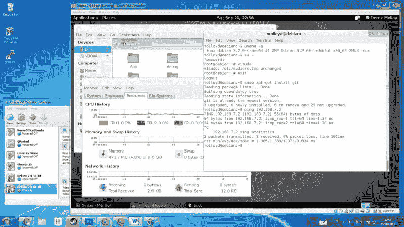

**图 3-5** 在 Windows 宿主机上作为客体操作系统运行 Debian 的 VirtualBox


有很多虚拟化产品可用，但大多数都有高昂的成本和专利许可，并且支持的客体和主机操作系统类型有限。两个最流行的 Linux 桌面产品是 `VMware Player` 和 `VirtualBox`。`VMware Player`（[`www.vmware.com/products/`](http://www.vmware.com/products/)）由 `VMware` 提供，并供个人使用。`VirtualBox`（[`www.virtualbox.org`](http://www.virtualbox.org)）由 `Innotek` 创建，后被 `Oracle` 收购，并免费提供。这两个产品都使用托管型虚拟机管理程序（`Type-2`），这意味着它们运行在操作系统内部，允许你同时使用两台机器。`VirtualBox` 可运行在 `Windows`、`Mac OS X` 和 `Linux` 上。目前，`VMware Player` 不支持 `Mac OS X`；相反，你必须购买名为 `VMware Fusion` 的产品。这两个产品都非常强大且难以区分；但 `VirtualBox` 以 `GPL` 发布，并支持一种名为快照的功能，这非常有用。用户界面允许你对客体操作系统拍摄快照以供以后使用。例如，在进行重大配置更改之前拍摄快照，以便在出现问题时回滚。快照存储了虚拟机设置、磁盘内容的变化以及该点的内存状态。因此，当恢复快照时，虚拟机将从拍摄时的点继续运行。

书中所有的 `Linux` 软件包和软件都是使用虚拟机内的一个 `Debian 64` 位桌面发行版构建的。如果你安装了 `VirtualBox`“增强功能”，你可以在客体和主机操作系统之间复制粘贴文本、共享目录，甚至动态调整 `VirtualBox` 窗口大小。该章节网页提供了在 `Windows` 宿主机上安装 `Linux` 客体系统的建议。

## 本书的代码

现在你已经在 `VirtualBox` 下运行了桌面 `Linux` 安装，或者正在运行普通的 `Linux` 桌面安装，你可以通过打开 `Linux` 控制台/终端并输入以下命令下载书中讨论的所有源码、脚本和文档：

```
~$ sudo apt‐get install git
~$ git clone https://github.com/derekmolloy/exploringBB.git
Cloning into ...
```

## 总结

完成本章后，你应该能够：

* 描述嵌入式 `Linux` 系统的基本概念。

* 描述 `BeagleBone` 等嵌入式 `Linux` 设备如何启动 `Linux` 操作系统。

* 描述重要的 `Linux` 概念，例如内核空间、用户空间和系统初始化。

* 在 `BBB` 上执行系统管理任务。

* 有效地使用 `BBB` 文件系统。

* 使用一系列 `Linux` 命令进行文件和进程管理。

* 使用 `Git` 管理你自己的软件开发项目。

* 使用桌面虚拟化工具（如 `VirtualBox`）在你的桌面电脑主机 `OS` 上安装 `Linux` 发行版。

* 使用 `Git` 下载本书的源代码。

## 进阶阅读

本章对嵌入式 `Linux`、`Linux` 管理、`Git` 和虚拟化进行了风风雨雨式的介绍。以下优秀的读物可以帮助你弥补任何知识空白：

* `Christopher Hallinan` 著，《Embedded Linux Primer: A Practical Real‐World Approach`, `Second Edition`（`Upper Saddle River, NJ: Prentice Hall`, 2011）

* `Debian` 策略手册：[`tiny.cc/ebb303`](http://tinyurl.com/ebb303)

* 要了解更多关于 `Git` 的信息，可以从调用 `man gittutorial` 开始，如果需要详细信息，请参阅 `Scott Chacon` 的优秀参考 `Pro Git` [`www.git‐scm.com/book`](http://www.git-scm.com/book)；此外也有纸质版（`New York: Apress Media`, 2009）。

# 第 4 章：电子接口

本章将介绍为了有效且正确地与 `BeagleBone` 平台协作而所需的实用电子知识。一个章节不能代替数字和模拟电子的完整教科；然而，在将电子元件连接到 `BeagleBone` 的接口引脚之前，你必须熟悉某些概念，因为错误的配置很容易损坏板子。

## 本章所需的设备：

* 本章所需的组件（如果你跟随课程进行操作）：完整列表在本章末尾提供。

* `Digilent Analog Discovery` 或使用数字万用表、信号发生器和示波器。

## 推荐设备

在为 `BBB` 平台开发电路时，拥有以下工具是有用的，这样你就可以在电路连接到 `BBB` 输入/输出口之前对其进行分析，以降低损坏板子的概率。特别是，如果你可以使用数字万用表和混合信号示波器，将非常有帮助。

### 数字万用表

在处理 `BBB` 电路时，数字万用表（`DMM`）是测量电压、电流和电阻/连续性的宝贵工具。你可能已经有一个了，但如果没有，你应该尝试购买一个具有以下功能的设备：

* **自动关机：** 很容易浪费电池。

* **自动量程：** 选择不同的测量范围至关重要。中价位表通常具有自动量程选择功能，可以减少测量所需的时间。

* **连续性测试：** 除非导体发生断路（或电阻过大），否则应提供听性蜂哔声。

* **真有效 RMS 读数：** 大多数廉价表使用平均法计算 `AC(~)` 电流/电压。真有效 `RMS` 表使用 `真均方根` (`RMS`) 计算对读数进行处理，使得在取读数时考虑波形畸变成为可能。这对于分析相控设备、固态器件、电机设备等非常有用。

* **其他有用选项：** 虽然不是必须的但有帮助的：背光显示；数据保持；大数字显示；更多的有效数字；`PC` 连接（理想情况下是光隔离的）；温度探头；二极管测试。

* **外壳：** 寻找质量良好的橡胶塑料外壳。

通常，上述大多数功能在具有良好精度水平（1% 或更高）、高输入阻抗（`>10 MΩ`）和良好测量范围的中价位 `DMM` 上都可以实现。高端万用表主要提供更快的测量速度和更高水平的测量精度；某些还可以提供测量电容、频率、使用红外传感器测量温度、湿度以及晶体管增益等功能。一些著名的品牌有 `Fluke`、`Tenma`、`Agilent`、`Extech` 和 `Klein Tools`。

### 示波器

标准的 `DMM` 为你提供了一个多功能工具，让你能够测量平均电压、电流和电阻。`示波器` 通常只测量电压，但它们让你看到电压如何随时间变化。你通常可以查看在特定带宽和模拟样本数（内存）内捕到的两个或多个电压波形。`带宽`定义了示波器可以准确测量的信号频率范围（通常到 `3dB` 点，即正弦波幅度比真实幅度低 `~30%` 的频率）。为了获得准确的结果，模拟样本数需要是带宽的倍数（你将在本章后面讨论奈奎斯特速率时就会为什么了）；对于现代示波器，此值通常是带宽的 4–5 倍，因此 `25 MHz` 示波器每秒应有 1 亿个或更多样本。带宽和模拟样本数对示波器成本的影响最大。

市有几种廉价的双通道示波器可用，例如 `Owen PDS5022S` `25 MHz`（约 $200）、功能丰富的 `Siglent SDS1022DL` `25 MHz`（约 $325）、`Rigol DS1052` `50 MHz`（约 $325）以及 `Owen SDS6062` `60 MHz`（约 $349）。随着带宽的增加, 价格会大幅上升，`300 MHz` 约为 1500 美元。`Agilent` 数字存储示波器 (`DSOX`) 和混合信号示波器 (`MSOX`) 系列被认为是中高端，价格从 3000 美元 (`100 MHz`) 到 16000 美元 (`1 GHz`)。混合信号示波器还提供数字总线分析工具。记住，中端示波器还需要高质量的 `10×` 探头，探头连接到你的电路。

带有 `Waveforms` 的 `Digilent Analog Discovery`（见图 4-1

**图 4-1** `Waveforms` 应用程序生成信号并显示物理电路的响应

`Analog Discovery` 是生成书中展示的所有示波器图的工具，因为所有示例都是使用真实电路实现的。示波器限制为两个通道，每通道 `5 MHz`，波形发生器和差分示波器均为秒 5000 万样本。因此，它主要面向学生和学习者；然而，它对于决定未来更贵设备的“必备”功能也很有帮助。

还有其他的混合信号 `USB` 示波器，例如 `PicoScopes`，范围从 160 美元到 10000 美元（[`www.picotech.com`](http://www.picotech.com)），以及 `BitScope DSO`，从 150 美元到 1000 美元（[`www.bitscope.com`](http://www.bitscope.com)），后者支持 `Linux`。然而，根据目前 `USB` 示波器上提供的功能 set，带有 `USB` 逻辑分析仪（以提供混合模式功能，例如 `Saleae` 逻辑分析仪——[`www.saleae.com`](http://www.saleae.com)）的台式示波器可能具有最高的性价比。

## 基础电路原理

电子电路包含组件的布局，可以被描述为无源或有源。`有源元件`（如晶体管）是能够自适应控制电流流的元件，而`无源元件`则不能（例如电阻、电容、二极管）。构建电路的挑战在于设计合适组件的合适布局。幸运的是，有`电路分析`方程可以帮助你应对这一挑战。

### 电压、电流、电阻和欧姆定律

你需要理解的最重要方程是`欧姆定律`。它的表述如下：

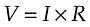

其中：

* `电压`（`V`），单位为`volts`（伏），是驱动电流在电路中流动的`势能`差。在考虑电压时，使用水类比非常有用；许多房屋的阁楼上有一个水箱，连接到房子里的水龙头。打开水龙头时，由于水箱的高度重力的作用，水就会流动。如果水龙头与水箱顶部的高度相同，那么就不会流流动，因为没有势能。电压的行为非常相似；当组件（如电阻）一侧的电压大于另一侧时，电流就可以流过该组件。

* `电流`（`I`），单位为`amps`（安培），是电荷的流动。继续使用水类比，电流就是水从水箱（高势能）流向水龙头（低势能）的过程。记住水龙头仍然具有势能，水会从水槽流出，除非它处于地面（`GND`）。为了让电流水平更有概念，当我们构建与 `BBB` 的 `GPIOs` 接口的电路时，它们通常只提供或吸纳约 5 mA，一个毫培是安培的千分之一。

* `电阻`（`R`），单位为`ohms`（欧姆，Ω），阻碍电荷的流动。电阻是一种通过耗散功率来减少电流流量的元件。它以线性方式实现这一点，耗散功率（`watts` 特，W）由 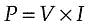给出，或者通过积分欧姆定律给出：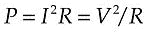。功率以热的形式耗散，所有电阻都有`最大耗散功率额`。常见的金属膜电阻或碳电阻通常耗散 0.125 W 到 1 W，如果这个值必须超过 3 W，价格会大幅增加。最后用水类比，电阻是水和水管之间的摩擦，这会导致加热效应并减少水流。可以通过增加水必须通过的表面积来增加电阻，同时保持水管的横截面积（例如，在主管内放置小水管）。

例如，如果你在使用 5 V 电源时，需要购买一个将电流流量限制在 100 mA 的电阻，如图图 4-2(a) 所示，你应该买哪种电阻？跨越电阻的电压 `V[R]` 必须是 5 V，因为它是电路中唯一的组件。因为 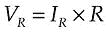，可以得出电阻值应该是 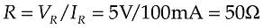，且该电阻耗散的功率可以使用任何一个通用方程 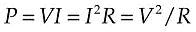 计算为 0.5 W。

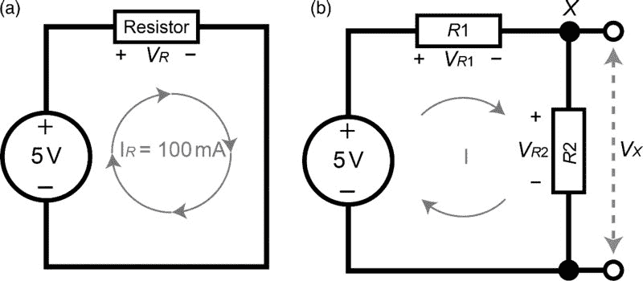

**图 4-2** (a) 欧姆定律示例 (b) 分压器示例

购买一个通孔式、固定值 具有 1% 公差（精度）的金属膜电阻，对于 0.33 W 的电阻大约花费 $0.10，对于 1 W 的功率额定花费 $0.45。你应该注意电路中使用的电阻的功率额定，因为规格不足的电阻可能会烧毁。30 W 的电阻将花费 $2.50 并可能变得非常热——并非所有电阻都是平等的！

### 分压

如果对图 4-2(a) 中的电路进行修改，如图图 4-2(b) 所示添加另一个`串联`电阻，对电路产生什么影响？

* 由于一个电阻在另一个后面（它们是串联的），电流在电路中循环的总电阻是两个值之和：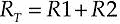。

* 电源电压必须跨越两个电阻，你可以说 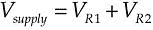。跨越每个电阻的电压与电阻值成反比。这个电路被称为`分压器`。

如果电路如图 4-3(b)所示进行修改，将两个电阻并联，那么你现在就有了一个*分流器*电路。电流将沿着电阻最小的路径流动，因此如果 `R1` = 100 Ω且 `R2` = 200 Ω，那么较大比例的电流将通过 `R1`。那么，这个比例是多少？在这种情况下，`R1` 和 `R2` 两端的电压降均为 5 V。因此，电流 `I[1]` 将为 `I = V/R` = 5V/100 Ω = 50 mA，而电流 `I[2]` 将为 `I` = 5 V/200 Ω = 25 mA。因此，流过 100 Ω电阻的电流是 200 Ω电阻的两倍。显然，电流倾向于电阻最小的路径。

*基尔霍夫定律*规定进入节点的电流之和等于离开该节点的电流之和。这意味着 `I[S] = I[1] + I[2]` = 25 mA + 50 mA = 75 mA。分流规则*可以通述如下：

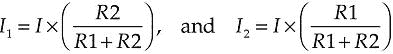

然而，这要求你知道进入节点的电流 `I`（在此情况下为 `I[S]`）的值。要直接计算 `I[S]`，你需要计算两个并联电阻的等效电阻（`R[T]`），其公式如下：


这在图 4-3(b)中为 66.66 Ω；因此 `I[S] = V/R` = 5 V/66.66 Ω = 75 mA，这与初始计算一致。

电源提供的功率：。这应该等于 和消耗的功率之和，总计 0.375 W，证实了能量守恒定律！

## 在面包板上实现电路

面包板是电路原型设计的绝佳平台，它与 `BBB`（树莓派）配合完美。图 4-4 展示了一个面包板，描述了你如何使用两个水平电源轨分别为 3.3 V 和 5 V 供电。记得跨接板上的两个地线轨。

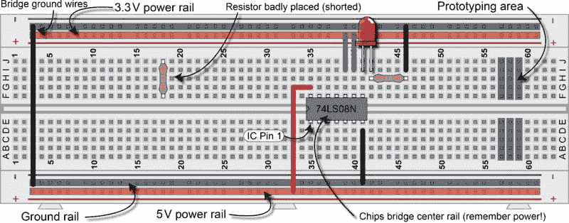

**图 4-4** 带有 7408 IC（四路双输入与门）的面包板

像图 4-4 这样的高质量面包板（830 个接线点）大约花费 6 到 10 美元。大型面包板（3220 个接线点）的价格约为 20 美元。这里是使用面包板的一些提示：

*   尽可能将 `IC` 的第 1 脚引脚放在左下角，这样你可以方便地调试电路。在下压并“咔哒”到位之前，务必将引脚与面包板孔对齐。此外，`IC` 需要电源！

*   让一根线不连接*并不*等同于将其连接到 `GND`（在本章稍后部分讨论）。

*   使用平口螺丝刀从两侧缓慢将 `IC` 从面包板上拨出，以免弯曲 `IC` 的引脚。

*   注意不要通过将两个引脚放在同一个垂直导轨上导致电阻或其他元件短路。此外，在将电阻插入板子之前要修剪引脚，因为过长的引脚可能会意外接触并导致电路调试出现头疼问题。

*   自按按钮通常有四只脚，分为两对连接；确保你的方向是正确的（使用 `DMM` 连续性测试）。

*   回书针是极佳的桥接连接工具！

*   某些板子的电源轨有断开——必要时请跨接。

*   面包板的接线点之间通常有 0.1"的间距（引脚间距），即公制的 2.54 mm。尝试购买所有该间距的元件和连接器。对于 `IC`，选择 `DIP` 封装（`IC` 代码以 `N` 结尾）；对于其他元件，选择“插针式”形式。

*   使用连接线的颜色来表示含义——例如，用红色表示 5 V，黑色表示 `GND`；这在调试电路时非常有帮助。22AWG 股芯线是理想的连接线，并有许多不同颜色的绝缘层可选。虽然有预制好的跳线可用，但长线会导致电路杂乱。选择多种不同颜色的连接线和高质量的剥线器，可以实现最整洁、最稳定的面包板布局。

## 数字万用表 (DMM) 和面包板

一旦你考虑了几项规则，测量电压、电流和电阻就非常简单，如图 4-5：

*   **直流电压** (`DCV`)：与元件并联测量。使用 `COM` 输入。

*   **直流电流** (`DCA`)：串联测量，因此你必须“断开”连接。

*   **电阻** (`Ω`)：不能在电路中测量，前提是断电状态。


**图 4-5** 测量电压、电流和电阻

## 电路：电压调节

在学习了原理之后，本节将讨论一个复杂的电路，然后详细检查元件。

*电压调节器*是一种复杂但易于使用的设备，它可以接受变化的输入电压并输出低于输入电压的恒定电压。电压调节器将输出电压保持在一定范围内，防止电压波动损坏下游元件。

`BBB` 有一个非常先进的电源管理 `IC` (`PMIC`)，可以为不同设备提供不同的电压水平。例如，有一个 5V 输出、一个 3.3V 输出以及一个用于模数转换器的 1.8V 参考电压。你可以使用 `BBB` 5 V 和 3.3 V 驱动你的电路，但受限于某些电流限制。如果 `BBB` 通过 5  口连接到直流电源，则 `P9` 插针上的 `VDD_5V` 引脚（第 5 和 6 脚）可以提供高达 1 A 的电流，`DC_3.3V` 引脚（第 3 和 4 脚）提供 250 mA。

如果你需要驱动电机等应用更大的电流，可能需要使用如图 4-6 所示的电压调节器。你可以直接在面包板上构建它，也可以从 `SparkFun`（[`www.sparkfun.com`](http://www.sparkfun.com)）购买一个“面包板电源模块 5V/3.3V”，价格约为 15 美元。


**图 4-6** `KA7805A`/`LM7805` 电压调节器和示例调节电路


如图 4-6 所示，调节器左侧的引脚是电压输入端。当电流为 500 mA 时，`KA7805/LM7805`电压调节器接受 8 V–20 V 的输入电压范围，并输出（右侧）4.8 V–5.2 V 范围内的电压。中间引脚应连接到地线。电压调节器背部的铝板用于散热。孔允许你螺栓固定散热片，从而允许高达 1 A 的输出电流。

驱动`KA7805/LM7805`电压调节器所需的输入电压约为 8 V。如果你的电源电压低于此值，则可以使用低压差（LDO）电压调节器，它仅需 6 V 的供电即可运行 5V 调节器。图 4-6 所示的实现电路具有以下额外组件，使其能够提供清洁且稳定的 5V、1A 电源：

*   二极管确保了如果电源以错误的极性错误连接（例如，不小心交换了 9V 和 `GND`），电路将免受损坏。像 `1N4001`（1A 电源）这样的二极管成本极低，但缺点是调节器之前的二极管上会有很小的正向电压降（1A 时约为 1 V）。

*   开关可用于开启或关闭电路电源。滑动开关允许电路保持持续供电。

*   正温度系数（PTC）可复位保险丝对于防止过流故障（如意外短路或组件故障）导致的损坏非常有用。PTC 允许`保持电流`以极小的电阻（约 0.25 Ω）通过；但一旦超过了较大的`跳电流`（闸电流），电阻就会迅速增加，表现类似于断路器。当断开电源后，PTC 会冷却（几秒钟）并恢复断开前的特性。在该电路中，`60R110` 或等效的 `Polyfuse` 是合适的，因为它的保持电流为 1.1A，跳电流为 2.2A，最大电压为 60V DC。

*   0.33 μF 电容位于调节器的电源侧，0.1 μF 电容位于调节器的输出侧。这些是数据表中推荐的数值，用于消除来自电源的噪声纹波抑制。稍后将讨论电容。

*   LED 和适当的限流提供了指示灯，可以清晰地显示电源何时供电。稍后将讨论 LED。

## 离散元件

上一个示例电路使用了许多离散元件来构建一个独立的电源电路。在本节中，将更详细讨论组成电源电路的组件类型。这些组件可以应用于许多不同的电路设计，现在讨论它们很重要，因为许多组件被用于设计第 6 章中与 BBB 输入/输出 接口的电路。

### 二极管

简单来说，二极管是一种离散半导体元件，允许电流从一个方向通过而不能从另一个方向通过。正如名称所示，“半”导体既不是导体也不是绝缘体。硅是一种半导体材料，但当它掺杂杂质（如磷）时，它会变得非常有趣。这种负（n 型）掺杂会导致价带中产生束缚较弱的电子。也可以进行正掺杂（p 型），使用硼等杂质在价带中产生一个空穴。当你将一小块 p 型和 n 型掺杂硅连接在一起时，你就得到了一个 pn 结——一个二极管！n 型硅价带中的自由电子流向 p 型硅，形成耗尽层和电势垒，在电流流动之前必须克服这个电势垒。

当二极管处于正偏置时，它允许电流通过；当处于反偏置时，没有电流流动。当阳极（+ve）端上的电压大于阴极（−ve）端上的电压时，二极管处于正偏置状态；然而，偏置必须超过耗尽层电势垒的电压电压电流才能流动，对于硅二极管，这通常在 0.5V 到 0.7V 之间。如果通过在阳极施加比阴极更大的电压使二极管反偏置，则几乎没有电流流动（可能只有 1 nA 左右）。然而，如果不断提高反偏置电压，二极管最终将击穿并允许电流反向流动。如果电流很小，则不会损坏二极管——事实上，一种称为齐纳二极管的特殊二极管设计用于在该击穿区域工作，它可以配置为像电压调节器一样的行为。

`1N4001` 是一种廉的硅二极管，可以使用简单电路，如图 4-7 所示。`1N4001` 具有 50V 的峰值反向电压。如图 4-7 所示，在该电路中，`V[in]` 为正且超过电压电压，电流将流动并在负载 `V[load]` 上产生一个小电压降（0.67 V）。你可以从图 4-7 的示波器中看到这是硅二极管的预期范围。

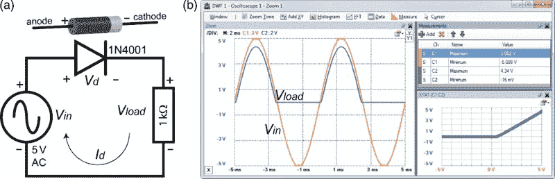

**图 4-7** 5V 电源和 1kΩ 负载 1N4001 的行为

二极管用于图 4-6 所示的电路，因为它是有效的，当 `V[in]` 为负时，`V[load]` 为零。这是因为电流在反偏置时无法流动。如果电压超过了二极管的击穿电压，电流将流动；但由于那是 50V，在这种情况下不会发生。注意图 4-7 的右下角显示了输出电压（y 轴）随输入电压（x 轴）变化的 XY 图。你可以看到对于负输入电压输出电压为 0，一旦达到电压电压，输出电压随输入电压线性增加。这种电路被称为半波整流。

### 发光二极管 (LED)

发光二极管（LED）是一种基于半导体的光源，通常用作设备的状态指示灯。今天，功率 LED 已用于汽车灯、电视背光，甚至取代通用照明（例如家庭照明、交通灯等）的白炽灯，主要由于它们寿命长且将电能转换为光输出的效率极高。LED 为你的电路提供了非常有状态和调试信息，通常用于指示状态为真或假。

和二极管一样，LED 是有极性的。LED 的符号如图 4-8 所示。为了让 LED 发光，需要通过将阳极（+）连接到比阴极（−）更正的源使二极管正偏。例如，可以将阳极连接到 +3.3V，阴极连接到 GND；然而，也要记住将阳极连接到 0V 阴极连接到 –3.3V 将达到相同的效果。

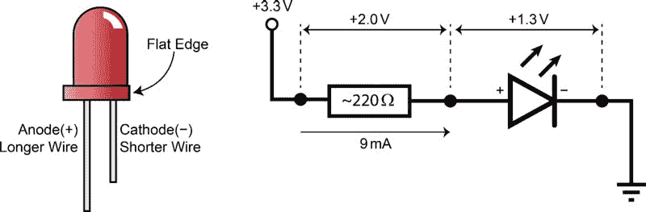

**图 4-8** LED 示例以及带有适当正向电流和电压水平驱动 LED 的电路

图 4-8 展示了一个引脚比另一个长的 LED。较长的引脚是正极（`+`），较短的脚是阴极（`–`）。LED 的塑料外壳还有一个平边，指示了 LED 的阴极（`–`）脚。当 LED 在电路中且引脚被修剪后，这个平边特别有用。

LED 有特定的工作要求，由`正向电压`（forward voltage）和`正向电流`（forward current）定义。每个 LED 都是不同的，你需要参考 LED 的数据表来确定这些值。LED 没有显著的电阻，因此如果你直接将 LED 连接到 BBB 的 3.3 V 电源上，LED 将像短路一样工作，导致流过 LED 的电流极大从而损坏它——更重要的是，会损坏你的 BBB！因此，为了让 LED 在限制范围内运行，你需要一个串联电阻，称为`限流电阻`（current-limiting resistor）。仔细选择此值，以最大地提高 LED 的光输出并保护电路。

参考图 4-8，如果你从 BBB 的 3.3 V 电源为 LED 供电并希望 LED 的正向电压降为 1.3 V，你需要 2 V 的差值落在限流电阻上。LED 规格要求将电流限制为 9 mA，因此你需要按如下计算限流电阻值：

```
As V = IR, then R = V/I = 2 V/0.009 A = 222 Ω
```

因此，点亮 LED 的电路就像图 4-8 所示。这里 220 Ω 电阻与 LED 串联。3.3 V 电源和电阻的组合驱动正偏置的 LED 产生 9 mA 的电流；在该电流下，电阻产生 2 V 的压降，相应地 LED 产生 1.3 V 的正向电压降。请注意，如果你连接到 BBB 的 DC_3.3 V 输出，这是可以的，但对于 BBB 的 GPIO 来说不行，因为 BBB 从 GPIO 引脚提供的最大电流约为 4–6 mA。你很快就会看到这种解决方案，并在第 6 章中再次看到。

值得一提的是，你不应该通过降低 LED 两端的电压来调暗 LED。LED 应被视为一种电流控制设备，流过 LED 的电流会导致正向电压降。因此，尝试用可变电压来控制 LED 的效果可能如你预期的那样。要调暗 LED，你可以使用`脉宽调制`（PWM）信号，本质上是快速切换 LED 的开启和关闭。例如，如果对 LED 应用一个快速的 PWM 信号，其在一半时间内关闭，另一半时间内开启，那么 LED 看起来只发出了约其正常工作条件下光照水平的一半。如果变化足够快，我们的眼睛就看不出单独的变化——它们会在光和黑暗间隔之间取平均值，从而看到一个恒定但较暗的照明。

图 4-9 展示了在不同占空比下的 PWM 方波波信号。`占空比`（duty cycle）是信号高电平时间占信号低电平时间的百分比。在这个示例中，高电平用 3.3 V 电压表示，低电平用 0 V 电压表示。占空比为 0%意味着信号恒低，占空比为 100% 意味着信号恒高。


**图 4-9** 脉宽调制（PWM）信号的占空比

PWM 可用于控制 LED 的亮度，也可以用于控制直流电机的速度、伺服电机的位置等许多应用。你将在第 6 章看到这样的示例，届将使用 BBB 内置的 PWM 功能。

重复信号（`周期信号`）的`周期`（`T`）是完成一个完整周期所需的时间。在图 4-9 的示例中，所有情况下的信号周期均为 4 ms。周期信号的`频率`（`f`）描述了信号在给定时间内通过完整周期的频率。因此，对于周期为 4 ms 的信号，它每秒循环 250 次（1/0.004），即 250 赫兹（Hz）。我们可以说 `f` (Hz) = 1/*T* (s) 或 `T` (s) = 1/*f* (Hz)。一些高端 DMM 可以测量频率，但通常使用示波器来测量频率。PWM 信号需要以适合受控设备的频率进行切换；通常，电机控制的频率在 kHz 范围内。

### 平滑电容与去耦电容

`电容`（capacitor）是一种无源元件，可用于在两个绝缘极板之间储存电能。电容使用`介质材料`（dielectric material），如陶瓷、玻璃或塑料来隔绝两个极板。两种常见的电容是陶瓷和电解。`陶瓷电容`体积小且便宜，会随时间老化。`电解电容`可以储存更大的能量，但也会随时间老化。玻璃、云母钽电容通常更可靠，但价格贵得多。

图 4-11 展示了一个 100 nF (0.1 μF) 陶瓷电和一个 47 μF 电解电容。注意`电解电容`是有极性的，电容表面有带标记负极；像 LED 一样，负极较短。电容的数字标记直观；遗憾的是，在陶瓷电容上可能非常小：

*   第一个数字是电容数值的第一位。

*   第二个数字是电容数值的第二位。

*   第三个数字是零的个数，电容值为 pF（皮法）。

*   额外的字母目前可以忽略，但代表电容的容差和电压额。

因此，例如：

*   104 = 100000 pF = 100 nF = 0.1 μF

*   102 = 1,000 pF = 1 nF

*   472 = 4,700 pF = 4.7 nF

`电容`是一种无源元件，可用于在两个绝缘极板之间储存电能。能量储存在极板之间的电场中。例如，图 4-7 中使用的`平滑电容`，与 1 kΩ 负载并联 10 μF。当电压移除时，电容会放电。这种变化的影响是，现在 2.75 V 到 4.22 V 之间的电压更加稳定，而不是在 0 V 到 4.3 V 之间。

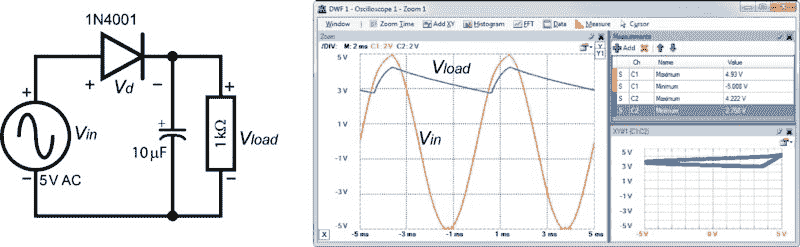

**图 4-10** 1N4001 二极管在 5 V AC 电源、1 kΩ负载和并联 10 μF 电容下的电路和行为

之前介绍的电压调节电路（参见图 4-6）使用了两个电容，通过与电源纹波相反的充放电来平滑电源中的纹波。电容也可用于一种被称为“去耦”的相关功能。

`耦合`（Coupling）通常是指由于电路的两个部分共享电源连接而产生的不良关系。这种关系意味着，如果电路的某突然产生高功率需求，电源电压将略微下降，从而影响电路其他部分的供电电压。集成电路（IC）会在电源线上施加可变负载——事实上，这种负载变化可能非常快，导致其他 IC 的电源线上产生高频电压波动。随着电路中 IC 数量的增加，问题会变得更加严重。

被称为`去耦电容`（decoupling capacitors）的小电容可以作为能量存储器，消除由于这些 IC 负载变化而可能存在于电源线上的噪声信号。图 4-11 所示了一个示例电路，其中较大的 `47 F` 电容滤掉低频变化，而 `0.1 F` 电容滤掉高频噪声。理想情况下，`0.1 F` 电容的引线越短越好，以避免产生与电感相关的不良效应，这将限制其过滤最高水平频率的能力。即使是 BBB 上用于解耦 `AM335x` 球栅阵列 (BGA) 引脚的表面贴装电容也会产生约 `1–2 nH` 的微电感。因此，每两个电源球建议使用 `0.1 F` 电容，且轨迹（板线）必须“尽可能短”（Texas Instruments, 2011）。(1) 完整指南请参见 [`tiny.cc/ebb401`](http://tinyurl.com/ebb401)。

## 三晶体

三晶体是 BBB 微处理器核心组件之一，事实上也是几乎所有其他电子系统的核心组件。简单来说，它们的功能可以是放大信号或开启/关闭信号，取决于需求。BBB 的 GPIO 只能处理非常小的电流，因此在将其与需要较大电流才能运行的电子电路接口接时，我们需要三晶管来帮助。

`双极性结三晶管`（BJTs），通常直接称为`三晶管`，通过在 `pn-junction` 二极管上添加另一个掺杂层形成 `p-n-p` 或 `n-p-n` 三晶管。还有其他类型的三晶管，例如场效应晶体管 (FET)，稍后会讨论。`双极`一词源于电流是由电子和空穴共同携带的。它们有三个端子，第三个端子连接到明治结构的中间层，该层非常窄，如图图 4-12 所示。

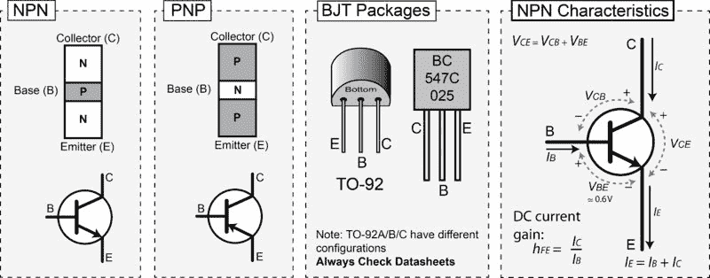

**图 4-12** 双极性结三晶管 (BJTs)

图 4-12 提供了关于三晶管的大量信息，包括端子的命名：`基极` (base, B)、`集极` (collector, C) 和`发射极` (emitter, E)。尽管有两种主要类型的 BJT 三晶管（NPN 和 PNP），但 NPN 三晶管是最常用的。事实上，本章中的三晶管示例都使用单个 `BC547` NPN 三晶管。

`BC547` 是一种 `45 V`、`100 mA` 的通用三晶管，非常常见，成本低，并采用直插式 `TO-92` 封装。`BC547` 引脚的识别请参见图 4-12，但请注意，这种顺序并不适用于所有三晶管——务必检查数据表！`BC547` 的最大 `V[CE]`（即 `V[CEO]`）为 `45V`，最大集极电流 `I[C]` 为 `100mA`。它具有典型直流电流增益 `h[FE]` 在 `180` 到 `520` 之间，取决于使用的组别（例如 A、B、C）。这些特性将在后续章节中解释。

### 作为开关的三晶管

让我们观察图 4-12 所示的 NPN 三晶管特性（最右侧的图）。如果基极-发射极结为正偏，且有一个小电流进入基极 `I[B]`，那么三晶管的行为是允许一个成比例但大得电流 (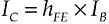) 流集极端子，因为对于像 `BC547` 这样的三晶管，`h[FE]` 的值是 `180` 到 `520`。由于 `I[B]` 远小于 `I[C]`，你也可以假设 `I[E]` 大约等于 `I[C]`。

图 4-13 展示了 BJT 作为开关的示例。在部分 (a) 中，电平的选择为了匹配 BBB 的可用电平。基极电阻选择值为 `2.2 kΩ`，以便基极电流很小（`I = (3.3V - 0.7V)/2200Ω` 约为 `1.2mA`）。集极电阻很小，因此集极电流相当大（`I = (5V - 0.2V)/100Ω` = `48mA`）。

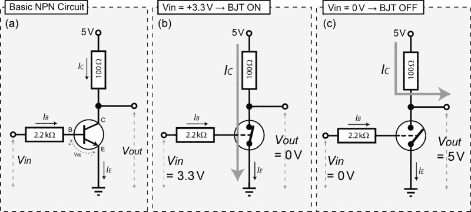

作为开关的 BJT

图 4-13(b) 展示了当基极端子施加 `3.3 V` 输入电压时发生的情况。小的基极电流导致三晶管在集极和发射极之间表现像一个闭合的开关（具有极低的电阻）。这意味着集极-发射极之间的电压降几乎为零，所有的电压降在 `100 Ω` 负载电阻上，导致电流通过发射极直接流向地。三晶管处于`饱和`状态，因为它无法再通过更多电流。由于集极-发射极之间几乎没有电压降，输出电压 `V[out]` 将几乎为 `0V`。

图 4-13(c) 展示了当输入电压 `V[in] = 0V` 施加基极且没有基极电流时发生的情况。三晶管表现像一个开启的开关（电阻极大）。电流无法通过集极-发射极结，因为该电流总是基极电流的倍数，而基极电流为零；因此，大部分电压落在集极-发射极上。在这种情况下，输出 `V[out]` 可以高达 `+5 V`。

因此，该开关的行为有点像一个`inverter`。如果输入电压为 0 V，则输出电压为 +5 V；如果输入电压为 +3.3 V，则输出电压将为 0 V。你可以在图 4-14 中看到该电路的实际测量值，当将 3.3 V 的输入电压加到基极时。在这种情况下，使用 Analog Discovery 波形发生输出一个 1 kHz 的方波，幅度为 1.65 V，偏移量为 +1.65 V（形成 0 V 到 3.3 V 的方波信号），因此它看起来像是一个 3.3V 源开启后关闭，每秒 1,000 次。此图中所有的测量都是在输入为 3.3 V 时采集的。基极发射结结处于正偏置，与之前的二极管一样，这将具有约为 0.7 V 的正向电压。基极-发射极之间的实际电压降为 0.83 V，因此基极电阻上的电压降将为 2.440V。实际基极电流为 1.1mA (`I = V/R` = 2.44 V/2,185 Ω）。该电流开启了晶管，使晶管置于饱和状态，因此集极-发射极之间的电压降非常小（测量值为 0.2 V）。因此，集极电流为 49.8 mA (`I = V/R` = (4.93 V – 0.2 V)/96 approx.）。为了选择合适的基极电阻使 BJT 深度饱和，可以使用以下公式：

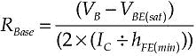

对于基极电压为 3.3 V 的情况，集极电流为 50 mA 且最小增益 `h[FE(min)]` 为 100，= (3.27 – 0.83)/(2 × (0.05/100)) = 2,440 Ω。

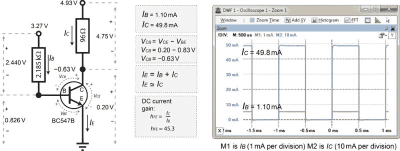

**图 4-14** 晶管作为开关的实现（饱和）以及确认所有关系均成立

你可以在晶管的数据表中找到所有这些值。`V[BE(SAT)]` 通常提供在室温下 `V[BE]` 随 `I[C]` 变化的图中，其中我们需要 `I[C]` 为 50mA。对于 BC547，`V[BE(SAT)]` 的值在 0.6 V 到 0.95 V 之间，取决于集极电流和室温。电阻值进一步除以二，以确保晶管置于深度饱和区域（使 `I[C]` 最大化）。因此，在这种情况下使用了 2.2 k 电阻，因为它是最接近的通用额值。


为什么你对`BBB`要关注这一点？嗯，因为`BBB`只能从其`GPIO`引脚提供或吸收极小的电流，你可以将`BBB GPIO`引脚连接到晶管的基极，这样进入晶管基极的极小电流就可以开启更大的电流，具有更大的电压范围。记住，在图 4-14 的示例中，`1.1 mA`的电流能够开启`49.8 mA`的大电流（大 45 倍，但仍低于`BC547`的`100mA`限制）。在`BBB`上使用这种晶管布局，通过选择合适的电阻值，允许来自`BBB GPIO`的`3.3V`处的`5mA`电流安全地驱动高达`45V`的`100mA`电流。

使用晶管驱动电路的一个限制条件是它们有最大开关频率。如果你将图 4-15 中电路的输入信号频率增加到`500 kHz`，那么输出将发生失真，尽管它仍然从低电平切换到高电平。然而，将其增加到`1 MHz`意味着受控电路永远不会关闭。

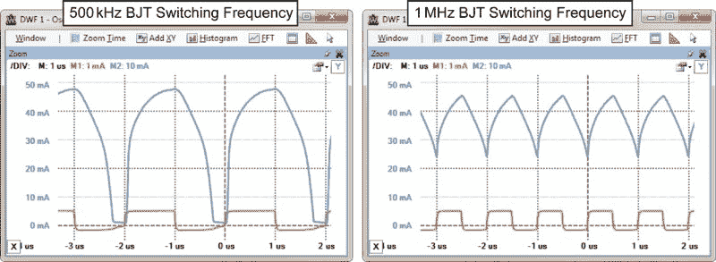

**图 4-15** BJT 电路的频率响应（频率为`500 kHz`和`1 MHz`）

### 作为开关的场效应晶管 (FETs)

使用`BJT`作为开关的更简单替代方案是使用场效应晶管 (`FET`)。`FET`与`BJT`的不同在于，负载电路中的电流流是由控制输入上的电压而非电流来控制的。因此，`FET`被认为是电压控制器件，而`BJT`是电流控制器件。`FET`的控制输入称为`gate` (`G`)，受控电流位于`drain` (`D`) 和`source` (`S`) 之间。

图 4-16 展示了如何使用 n 沟道`FET`作为开关。

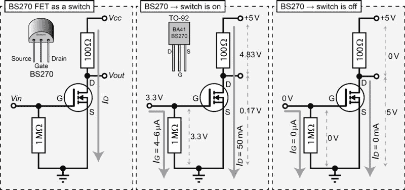

**图 4-16** 场效应晶管 (`FET`) 作为开关

当输入电压为高电平时，`V[out]`为`3.3 V`，但栅极所需的电流为`50 mA`。当`LED`发射器关闭时，没有光落在光电检测晶管上，几乎没有集极发射极电流 (`I[c]`，电压为`0 V`）。封装的两侧之间没有电气连接，因为信号仅通过光传输，为诸如`SFH617A`这样的光耦合器提供了高达`5,300 V[RMS]`的电气隔离。你甚至可以在光耦合器上使用`PWM`，因为它是一个二值开启/关闭信号。

`BS270`还具有一个高电流二极管，用于防止`FET`在驱动直流电机时可能产生的反向感应浪涌保护栅极。

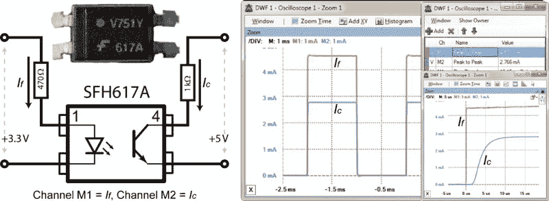

**图 4-18** 具有捕获输入输出特性的光耦合器 (`617A`) 电路

图 4-18 展示了一个光耦合器示例，以及针对所选电阻和电压值产生的示波器波形。这些值的选择与你可能在`BBB`上使用的值保持一致。选择`470 Ω`电阻值是为了允许`3.3 V`输出驱动`LED`发射器产生约`4.5 mA`的正电流`I[f]`。根据数据手册（Vishay Semiconductors, 2013）^(2)，这导致二极管上的的正向电压约为`1.15 V`；`R = V/I` = (`3.3 V` − `1.15 V`)/`0.0045 mA` = `478 Ω`。因此，电路使用了最接近的标称值`470 Ω`构建。

示波器通过使用`Analog Discovery`的差分输入测量已知电阻值两端的电压，并使用两个数学通道除以电阻值来显示电流。在图 4-18 中，你可以看到`I[f]`为`4.571 mA`，`I[c]`为`2.766 mA`。差值的比例即为电流传输率 (`CTR`)，它随`I[f]`电平和及工作温度而变化。因此，在`4.571 mA`下的电流传输率为`60.5%` )，这与数据手册一致。上升时间和下降时间也与数据手册值一致：`t[r]` = `4.6 μs`和`t[f]` = `15 μs`。这些值限制了开关频率。此外，如果高`CTR`对你的电路至关重要，则有具有内置达尔顿晶体管配置的光耦合器，其`CTR`高达`2,000%`（例如`6N138`或`HCPL2730`）。最后，还有高线性模拟光耦合器可用（例如来自`Avago`的`HCNR200`），可用于光隔离模拟信号。

### 开关与按钮

你可能需要处理的其他组件是开关和按钮。它们有许多不同的形式：翘动开关、按钮、选择器、接近开关、摇杆、簧开关、压力开关、温度开关等。然而，它们都遵循相同的二进制原理：中断电流（开）或允许电流流动（闭）。图 4-19 展示了若干种不同的常见开关类型并概述了它们的通用连接方式。

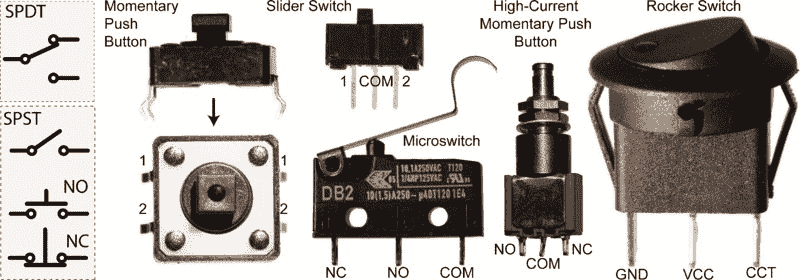

**图 4-19** 各种开关和配置

自动按钮开关（`SPST`，单极单掷）如图 4-19 中所示，要么常开（`NO`），要么常闭（`NC`）。`NO`意味着你必须激活开关允许电流流动，而`NC`意味着当你按下按钮时，电流不流动。对于所示的特定按钮，引脚`1`和引脚`2`始终连接在一起的，在你按下按钮期间，所有四个引脚都连接在一起。观察滑块开关（`SPDT`——单极双掷），公共端 (`COM`）根据滑块的位置连接到`1`或`2`。对于微动开关和大电流按钮，当开关被按下时，`COM`引脚连接到`NC`；当开关处于按下状态时连接到`NO`。最后，所示的翘动开关通常有一个`LED`，当开关关闭时会亮，将电源 (`VCC`) 引脚连接到电路 (`CCT`) 引脚。

所有这些开关类型都会受到机械抖动的影响，这在与如`BBB`等微控制器接口时可能会非常麻烦。开关是机械设备，当被按下时，接触力会导致开关在撞击时从接触点反复弹跳。它只会弹跳很短的时间（通常为毫秒级），但持续时间足以让开关向微处理器施一系列输入。

图 4-20(a) 展示了使用`Analog Discovery`示波器的上升/下降沿触发条件时的实际问题。一个自动按钮放置在一个带有`10 kΩ`电阻的简单串联电路中，测量电阻两端的电压。当开关碰到接触点时，输出突然变为高电，但开关随后从接触点弹回，电压再次下降。在约`2–3 ms`（或更长）之后，它几乎完全稳定。遗憾的是，这种微小的抖动可能会导致数字电路产生错误输入。例如，如果阈值为`3 V`，这可能被读为`10101010`。


**图 4-20** 各种开关和配置（注：原文此处说是图 4-20，但链接是 4-19，我将保持原样）。

`Boolean algebra`函数只有两种可能的输出，要么是`true`（真），要么是`false`（假），这使其成为开发描述“开启”或“关闭”（`high`高或`low`）电子电路的理想框架。逻辑门执行这些布尔代数函数和操作，形成了现代微处理器内部功能的基础，例如`BBB`中的`AM335x`。布尔值不等同于`binary`二进制数——二进制数是整数和小数的二进制表示法，而`Boolean`指的是一种只有两个可能值的数据类型，即`true`或`false`。

通常情况下，你可能需要使用`BBB`的`GPIOs`与不同类型的逻辑门和系统接口，以执行如输入门控或将数据发送到移位寄存器等操作。逻辑门主要分为两类：

*   **组合逻辑：** 当前输出仅取决于当前输入（例如，`AND`、`OR`、译码器、`多路选择器`等）。

*   **序贯逻辑：** 当前输出取决于当前输入和之前的输入。它们被认为具有不同的`states`（状态），对于给定的输入，发生的情况取决于它们所处的状态（例如，`锁存器`、`触发器`、`内存`、`计数器`等）。

组合逻辑电路无论输入的应用顺序如何，对于同一组输入都会提供相同的输出。图 4-21 展示了核心组合逻辑门及其对应的逻辑符号、真值表和`IC`编号。真值表提供了在应用列出的输入时你将从逻辑门获得的输出。

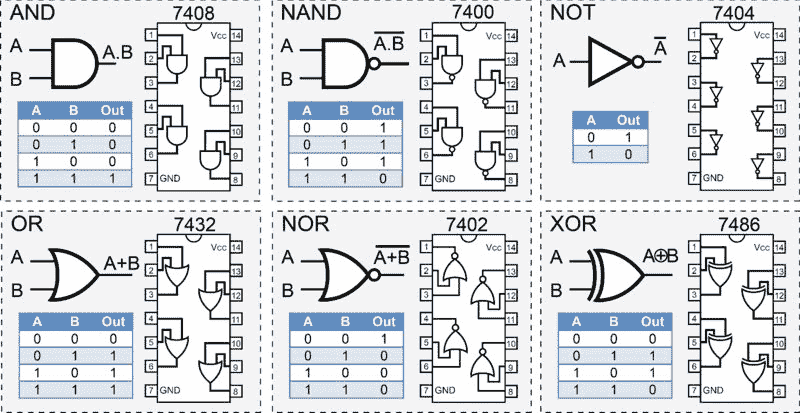

**Figure 4-21** 通用逻辑门

`IC`有一个用于描述其制造商、功能、逻辑族和封装类型的数字。例如，图 4-22(a) 中的`MM74HC08N`制造商代码为`MM`（仙得童半导体），是`7408`（四路双输入与门），属于`HC`（`CMOS`）逻辑族，并采用`N`（塑料双直插）封装。

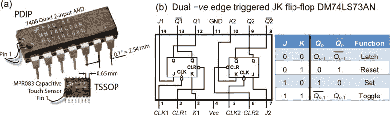

**Figure 4-22** (a) `IC`封装示例 (b) `JK`触发器

`IC`有不同的封装类型。图 4-22(a) 按比例展示了`PDIP`（塑料双直插封装）和小外形封装`TSSOP`（薄缩型小外形封装）。类型有很多：表面贴装、平型封装、小外形封装、芯片级封装和球栅阵列（`BGA`）。在订购`IC`时，必须确认你是否有能力使用它们。`DIP/PDIP` `IC`非常适合在面包板上进行原型制作，因为它们的引脚间距为`0.1"`。现有的适配板可以将小外形封装转换为`0.1"`引脚间距。遗憾的是，如`AM335x`这样的`BGA` `IC`需要复杂的设备才能焊接。

目前市`IC`家族通常是晶体管-晶体管逻辑 (`TTL`)（带有低功率肖特基`LS`）或某种形式的互补金属氧化半导体 (`CMOS`)。表 4-1 使用各自的数据数据表比较了这两类`7408` `IC`。`propagation delay`（传播延迟）是逻辑门所有可能输入中，输入值变化到输出值变化之间最长的延迟。这种延迟限制了逻辑门的运行速度。

| 特性 | SN74LS08N | SN74HC08N |

| --- | --- | --- |

| 家族 | Texas TTL PDIP 低功率肖特基 (LS) | Texas CMOS PDIP 高速 CMOS (HC) |

| `V[CC]`供电电压 | `4.5 V`到`5.5 V` (典型`5 V`) | `2 V`到`6 V` |

| `V[IH]`高电平输入电压 | 最小`2 V` | `V[CC]`@`5 V`最小 = `3.5 V` |

| `V[IL]`低电平输入电压 | 最大`0.8 V` | `V[CC]`@`5 V`最大 = `1.5 V` |

| 传播延迟 (`T[PD]`) | 典型`12 ns`(`LH*`) `17.5 ns`(`HL*`) | 典型`8 ns` |

| 功耗 (@`5 V`) | 最大`5 mW` | 最大`0.1 mW` |

**Table 4-1** 用于`7408`四路双输入与门的两种常用`TTL`和`CMOS` `IC`的比较

图 4-23 展示了当`V[DD]` = `5 V`时`TTL`和`CMOS`逻辑门接受的输入输出电压电。`noise margin`（噪声裕量）是输出电压水平与输入电压水平之间的绝对差。这种噪声裕量确保了如果一个逻辑门的输出（原文在此处中断，根据上下文继续）：

图 4-23 展示了当`V[DD]` = `5 V`时`TTL`和`CMOS`逻辑门接受的输入输出电压电。`noise margin`是输出电压水平与输入电压水平之间的绝对差。这种噪声裕量确保了如果一个逻辑门的输出……

悬空（位于`V[DD]`和`GND`之间）的未使用的`CMOS`输入可能会由于泄漏电流而逐渐充电，根据`IC`的设计，这可能会提供错误的输入，或通过导致直流流（从`V[DD]`流向`GND`）而浪费功率。为了解决这个问题，你可以根据所需的输入状态使用上拉电阻或下拉电阻（这些是具有合适阻值的普通电阻——其作用被称为“上拉”或“下拉”），这些电阻将在下一节中进行详细描述。

### 上拉电阻和下拉电阻

为了避免悬空输入，可以使用如图 4-25 所示的上拉电阻或下拉电阻。如果你希望在开关打开时确保门输入为低电平，则使用下拉电阻；如果你希望在开关打开时确保输入为高电平，则使用上拉电阻。

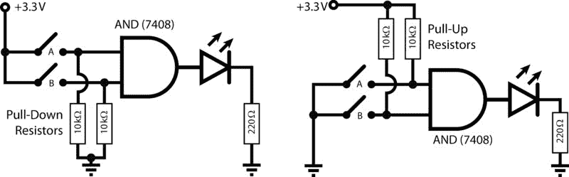

**图 4-25** 下拉电阻和上拉电阻，用于确保开关不会产生悬空输入

这些电阻是非常重要的，因为当开关关闭时，如果省略电阻并用导线代替，开关将形成到地地的短路。下拉/上拉电阻的大小也很重要——它们的值必须足够小，以便在开关打开时牢固地将输入拉低/高，又要足够大以防止开关关闭时产生过大。理想逻辑门具有无限阻抗，任何电阻值（无限除外）都是足够的。然而，真实的逻辑门会泄漏电流，你必须克服这种泄漏。为了最小化功耗，你应该选择实际上能将输入拉低/拉高的最大值。`3.3kΩ`到`10kΩ`的电阻通常工作得很好，当开关关闭时，`3.3V`分别通过它们驱动`1mA`到`0.33mA`的电流，并分别耗散`3.3mW`到`1mW`的功率。对于功率敏感的应用，你可以测试`50k`或更大的电阻。

`BBB`具有薄弱的内部上拉和下拉电阻，可用于此目的。这将在第 6 章中讨论。另一个问题是输入对地会有一些杂散电容。在输入端添加电阻会在输入信号上创建一个`RC`低通滤波器，从而延迟输入信号。这对于手动按下的按钮并不重要，因为前面的示例中延迟大约在`0.1μs`级，但它可能会影响数字通信总线的速度。

### 开集输出和开漏极输出

到本章为止，所有的`IC`都是普通输出，其驱动电压非常接近`GND`或`IC`的电源电压（`VCC`）。如果你连接到使用相同电压水平的另一个`IC`或组件，那么没有问题。然而，如果第一个`IC`的电源电压为`3.3V`，而你需要将输出驱动到电源电压为`5V`的`IC`，那么你可能需要进行`level shifting`。

许多`IC`以`open‐collector outputs`的形式提供，这对于不同逻辑家族之间的接口和电平转换特别有用。这是因为输出并不是特定的电压水平，而是连接到`IC`内部`NPN`三极管的基极输入。`IC`的输出是晶体管的“开路”集极，晶体管的发射极连接到`IC`的`GND`。`IC`内部可以使用`FET` (`74HC03`) 代替`BJT` (`74LS01`)，虽然概念相同，但它被称为`open‐drain output`。图 4-26 说明了这一概念，并提供了一个使用`74HC03`（四路二输入开漏极与非门）驱动`5V`电路的示例电路。开漏配置的优势是`CMOS` `IC`支持`BBB GPIO`上的`3.3V`电平。本质上，图 4-16 中使用的漏极电阻放置在`IC`封装之外，如图 4-26 所示，在这种情况下，它的值为`10kΩ`。

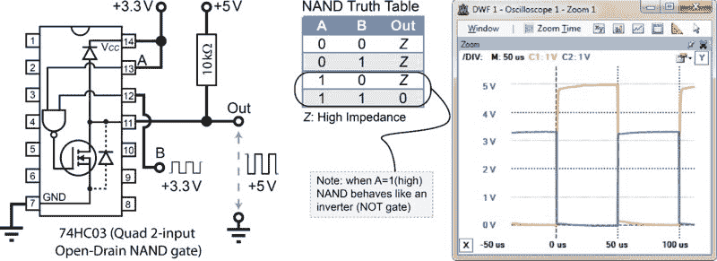

**图 4-26** 开漏电平转换示例

有趣的是，一个输入接高（或两个输入连接在一起）的`NAND`门的行为就像反非门。事实上，每个`NAND`门或`NOR`门都可以复制任何逻辑门的功能，因此它们被称为`universal gates`（通用门门）。

开集输出通常用于将多个设备连接到总线上。你将在第 8 章描述`BBB`的`I²C`总线时看到这一点。当你检查`IC`（如`74HC03`）的数据表中的真表时，你会看到字母`Z`用于表示输出（如图 4-26 所示）。这意味着输出是高阻抗。

### 门间连接

通常需要将单个（驱动）门的输出连接到多个其他门的输入。每个连接的门都会抽取电流，从而限制了连接的门总数。`fan‐out`（扇出数）是连接到驱动门输出的门数量。

`BBB`具有七个模拟数字转换器（`ADC`）输入，可用于采集模拟信号并创建该信号的数字表示。这使得我们能够连接许多不同类型的传感器，例如距离传感器、温度传感器、光级传感器等。然而，你必须小心这些输入口，因为它们不应提供电流或吸入电流，因为传感器的模拟输出可能对输出并联的任何额外负载非常敏感。为了解决这个问题，你首先需要了解放大器的工作原理。

模拟信号是表示某些物理现象测量值的连续信号。例如，麦克风是一种模拟设备（通常称为换能器），它可以将声波转换为电信号，该信号根据声波的幅度，可能在`–5 V`到`+5 V`之间变化。模拟信号使用连续的值范围表示信息，但如果你想用`BBB`处理该信号，你就需要信号的离散数字表示。这种信号是在离散的时间点进行采样，并量化为离散的电压或电流值——例如音频信号会随时间变化，因此为了数字采集人类语音而采样换能信号（例如语音识别），你需要考虑到两个因素：

- **采样率**：定义了你对信号采样的频率。显然，如果你通过每秒采样一次电压来创建离散数字样本，那么语音将无法无法的。

- **采样分辨率**：定义了在信号采样的时间点，你表示电压所需的数字表示数量。显然，如果你只有一个位（`bit`），你只能捕捉到信号是接近`+5 V`还是`–5 V`，同样，语音信号将无法无法的。

### 采样率

要用离散形式完美表示连续信号需要无限的数字数据。幸运的是（！），人类听力性能是有极限的，因此我们可以对离散化的数据量设定限制。例如，`44.1 kHz`和`48 kHz`是编码`MP3`文件常用的数字音频采样率，这意味着如果你使用前者，你每秒必须存储`44,100`个换能器电压样本。采样率通常由保留信号特定频率内容的需求决定。例如，人类（特别是儿童）可以听到频率从约`20 Hz`到约`20 kHz`的音频信号。`奈奎斯特采样定理`指出，采样频率必须是信号中最高频率分量的两倍。因此，如果你想对音频信号进行采样，你需要使用至少是`20 kHz`两倍，即`40 kHz`，这解释了编码`MP3`音频文件时使用的采样率幅度（通常为每秒`44,100`个样本——即`44.1 ks/s`）。

### 量化

`BBB`具有七个 12 位的`ADC`输入，工作在`0–1.8 V`范围内，这意味着对于这种采样分辨率有`2¹² = 4,096`种可能的离散表示（数字）。如果电压恰好为`0 V`，可以使用数字`0`来表示。如果电压恰好为`1.8 V`，我们可以使用数字`4,095`来表示。那么，数字`1`代表什么电压呢？它是` = 0.000439453125 V`。因此，`0`到`4,095`之间的每个数字（`4,096 个值`）代表约`0.44 mV`的步进。

前面的音频采样示例也说明了你在使用`BBB`时面临的挑战之一。如果传感器输出的电压为`–5`到`+5 V`，或者更常见的`0 V`到`+5 V`，你需要将该范围更改为`0`到`1.8 V`之间以兼容`ADC`。在第 6 章，你将看到如何解决这个问题。第二个更复杂的问题是，我们不能向`BBB`的`ADC`电路提供或吸入电流，为了解决这个问题，我们需要引入一个早于数字计算机的强大概念，运算放大器。

### 运算放大器

在本章前面的部分描述了`BJT`晶体管。运算放大器（`op-amps`）由一个`IC`内部的许多`BJT`或`FET`组成（例如`LM741`）。它们可以用于创建许多有用电路，其中一个你将在第 6 章需要，以便安全且正确地从`BBB`的模拟数字转换器中读取数值。

### 理想运算放大器


## 运算放大器

图 4-28(a) 展示了一个理想运算放大器，放置在一个没有反馈的非常基本的电路中（即开路）。运算放大器有两个输入：`非反相输入`（`+`）和`反相输入`（`−`），它产生的输出与它们之间的差值成正比，即 `V[out] = G(V[1] – V[2])`，其中 `V[1]` 和 `V[2]` 分别是这两个输入上的电压电平。`理想`运算放大器的某些特性包括：

- 无限大的开环增益 `G`
- 无限输入阻抗
- 零输出阻抗

`` **图 4-28** (a) 运算放大器 (b) 开路比较器

现实世界的运算放大器没有无限大的开环增益，但 200,000 到 30,000 的电压增益是常见的。这种增益可以被视为无限，这意味着在理论上，即使输入之间存在极微小的差异也会导致完全不切实际的输出。例如，`V[1]` 和 `V[2]` 之间 1V 的差异将导致至少 200,000V 的电压！输出电压无疑受到电源电压（图 4-28(a) 中的 `V[CC]+` 和 `V[CC]−`）的限制。因此，如果你为 BBB 的运算放大器提供 `V[CC]+ = +5 V` 和 `V[CC]− = 0 V (GND)`，真实的最大输出将在 0 V 到 5 V 之间，取决于所使用的运算放大器。同样，现实世界的运算放大器没有无限输入阻抗，但它在 250 kΩ 到 2 MΩ 之间。使用阻抗而不是电阻是因为输入可能是交流的而不只是直流。同样，零输出阻抗是不可能的，但它可能 `<100 Ω`。

LM358 双运算放大器用于以下电路配置（[`www.ti.com/product/lm358`](http://www.ti.com/product/lm358)）。它是一个 PDIP 封装的八引脚 IC，包含两个运算放大器，其典型开路差分电压增益为 100 dB，即电压增益为 100,000（`电压增益 dB = 20 × log (V[out]/V[in])`）。该 IC 的优点之一是它具有宽的电压范围，在 3 V 到 32 V 之间，这意味着你可以使用 BBB 的 3.3 V 或 5 V 电源。LM358 输出通常可以提供高达 30 mA 或吸入高达 20 mA。见图 4-28(b)。

开环运算放大器的行为通过一个示例来解释最为恰当，该示例如图 4-28(b) 所示。请注意，在这种情况下，输入连接到运算放大器的反相输入（`−ve`），而不是非反相输入（`+ve`），这意味着当 `V[in]` 低于参考电压时，`V[out]` 将为正值。该电路使用 `LM358` 构建，电源电压为 `VCC+ = 5V`，`VCC– = 0V`（`GND`）。使用一个 `100kΩ` 电位器来允许 `+ve` 输入上的电压变化。这正是我们实际上与输入电压进行比较的电压，因此该电路被称为`比较器`（comparator）。当 `–ve` 输入上的电压大于 `+ve` 输入上的电压时，即使差异非常微小，输出也会迅速向负方向饱和到 `0V`。当 `–ve` 输入上的电压小于 `+ve` 输入上的电压时，输出 `V[out]` 将立即向 `+ve` 方向饱和到在该配置下应用 `VCC` 时允许的最大值。

该电路的实际输出可以在图 4-29(a) 中看到。图中，电位器被调整以使 `V+` 输入上的电压为 `1.116V`。当 `V–` 低于此值时，输出 `V[out]` 饱和到最大正值；在这种情况下为 `3.816V`（`LM358` 正饱和电压）。当 `V–` 大于 `1.116V` 时，输出 `V[out]` 饱和到最低值，几乎为零（`–2 mV`）。注意这里发生的反相现象。

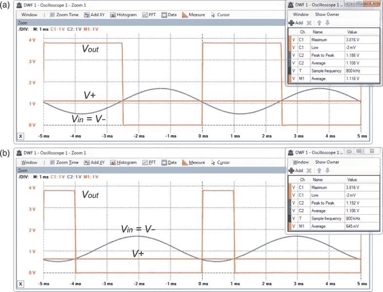

**图 4-29** 比较器电路的输出

如果其他一切保持完全不变，但将电位器调整为给 `V+` 一个不同的值（在此例为 `0.645V`），输出将如图 4-29(b) 所示，此时输出 `V[out]` 的占空比将不同。这种比较器电路也可用于检测低电压情况——例如，当电池的电压输出低于某个值时，点亮警示 LED。第 4-27(b) 中使用的电路示例可以根据控制电压 `V+` 生成具有可控占空比的 PWM 信号。

巨大的开环增益意味着运算放大器通常与反馈一起使用，反馈指向运算放大器的负或正输入端。这种反馈为运算放大器开辟了极其广泛的其他应用领域。

### 负反馈与电压跟随器

当你将运算放大器的输出（`V[out]`）连接回反相输入（`V–`）时，就形成了负反馈。当你向非反相输入（`V+`）施加电压（`V[in]`）并缓慢增加它时，随着 `V[in]` 的增加，`V+` 和 `V–` 之间的差随之增大；然而，输出电压也会根据 `G(V[1] – V[2])` 增加，并反馈到 `V–` 输入，导致输出电压 `V[out]` 减小。本质上，运算放大器试图通过调整输出使反相（`V–`）输入上的电压与非反相（`V+`）输入相同。此操作的影响是 `V[out]` 的值稳定在与 `V+` 上的 `V[in]` 相同；运算放大器的增益越高，这个差值就越接近零。

这种操作本身对我们来说用处不大，除非设置输入电压所需的电流非常小，而运算放大器可以在输出端控制大得电流。由于负反馈使输出电压与输入电压相同，整个配置的增益为 `1`。这种配置被称为`电压跟随器`（voltage follower）或`单位增益缓冲器`（unity-gain buffer），如图 4-30 所示。这种配置非常重要，因为它在第 6 章中被用于保护 BBB 中的 ADC 电路，并用于确保 ADC 参考电压在连接到电路时不会被修改。

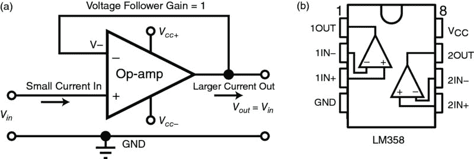

**图 4-30** 电压跟随器运算放大器电路

### 正反馈

负反馈由于其具有稳定影响，是运算放大器中最常用的反馈类型。正反馈配置中的运算放大器是指其输出返回到运算放大器的正非反相输入端。在这种情况下，反馈信号会支持输入信号。例如，可以通过电阻将 `V[out]` 连接到 `V+`，从而为开环运算放大器比较器电路增加迟滞。

## 结语建议

本章涵盖了大量材料。最后，这里有一些关于使用 BBB 的通用建议：

- 永远不要让输入悬空。
- 确保所有的连接都已连接。
- 不要假设某事是正确的！
- 在触摸 `ICs` 之前，先触摸电脑或其他接地物体。
- CMOS `ICs` 对静电敏感，因此用手触摸可能会损坏它们。
- 不要假设元件的值是精确或一致的。

## 总结

完成本章后，你应该能够：

- 描述电气电路的基本原理，在面包板上构建电路，并测量电压和电流
- 在自己的电路中使用离散元件，如二极管、LED、晶极管和电容
- 使用晶极管和 FET 作为开关，控制比仅使用 BBB 输出更大的电流和电压信号
- 互连并接口逻辑门，特别注意悬空引起的问题
- 描述模拟数字转换的原理并设计运算电路
- 结合所有技能构建安全连接到 BBB 的电路

# 第 5 章：BeagleBone 编程

## 注意事项

* **IC**: `74HC73N`, `74HC03N`, `74LS08N`, `74HC08N`, `74HC14`, `LM358N`
* **电阻**: `1MΩ`, `2.2kΩ`, `10kΩ`, `22kΩ`, `47kΩ`, `50kΩ`, `100kΩ`, `220kΩ`, `470kΩ`, `1.2MΩ`
* **电容**: `10μF`, `1μF`, `0.33μF`, `0.1μF`
* **光耦器**: `SFH17A`

## 引言

本章介绍了 BeagleBone 的不同编程选项，包括脚本语言和编译型语言。所有语言都提供了示例，以便你研究每种语言的结构和语法。文中讨论了每种语言的优缺点及其适用场景。随后，本章将重点关注 `C/C++` 语言，描述了面向对象编程（`OOP`）的原理以及为什么它是嵌入式系统开发的必要条件。最后，本章详细介绍了如何使用 GNU 库直接与内核进行交互。单章只能触及编程的表面，但我已经在 `ee402.eeng.ie` 提供了关于 `OOP` 的笔记。

### 本章所需的设备

* 带有控制台的 BeagleBone Black（见第 2 章）
* 桌面级 Linux 安装（例如虚拟机中的 Debian——见第 3 章）

正如第 3 章所述，嵌入式 Linux 本质上是“运行在嵌入式系统上的 Linux”。如果你的编程语言在 Linux 下可用，那么它很可能适用于 BBB。那么，你的语言适合编程吗？这取决于你打算用开发板做什么：

* 你是否正在与电子设备/模块进行交互？
* 你计划编写丰富的接口吗？
* 你计划编写设备驱动程序吗？
* 性能是否重要，或者你只是正在开发早期原型？

每个答案都会影响你对使用何种语言的决策。在本章中，你将接触几种不同的语言，并概述了每个类别的优缺点。在阅读本章时，尽量避免只关注某门喜欢的语言，而是要为当前任务选择正确的语言。嵌入式系统上的编程与桌面电脑上的编程相比如何？以下是需要考虑的点：

* 你应该始终像在桌面 PC 上一样，编写最清晰、最整洁且可维护的代码。
* 在确定代码已完成之前，不要对代码进行优化。
* 你通常需要比在桌面端编程时更注意资源消耗。数据类型的大小至关重要。你必须关注内存可用性、文件系统大小和数据通信带宽。
* 你经常需要了解底层硬件平台。它是如何处理连接的硬件的？有哪些数据总线？你如何与操作系统和底层库进行交互？是否存在实时性限制？

在接下来的讨论中，假设你计划进行某种类型的物理计算——即与 BBB 上不同的输入或输出进行交互。因此，用于描述不同语言结构和语法的示例是一个简单的交互示例。在查看语言本身之前，我们将首先对在 BBB 上运行的不同语言进行简要的性能评估，以便为后续讨论提供背景。

该测试使用了来自 `benchmarksgame.alioth.debian.org` 的 `n`-体基准测试（太阳系中行星的引力交互）代码。代码对所有语言使用完全相同的算法，且 BBB 在所有情况下都处于完全相同的状态。测试对算法进行了 500 万次迭代，以确保用于计时的脚本不需要非常精确。所有程序都输出了相同的正确结果，表明它们都正确运行并完成。该测试可以在书籍的 Git 仓库的 `chp05/performance/` 目录下找到。注意，你必须在 BBB 上安装 `Java` 才能运行所有测试。这将在本章稍后讨论。使用以下调用执行测试：

```
/chp05/performance$ ./run
Running the Tests:
The C/C++ Code Example
-0.169075164 -0.169083134
It took 33 seconds to run the C/C++ test ...
Finished Running the Benchmarks
```

测试结果显示在 表 5-1 中。在第一列中，你可以看到 `1GHz` 下的 `C/C++`、`800MHz` 下的 `Java` 以及 `300MHz` 下的 `Python`。在第二列中，你可以看到 `1GHz` 下的 `C/C++`、`800MHz` 下的 `Java` 以及 `300MHz` 下的 `Python`。在第三列中，你可以看到 `1GHz` 下的 `C/C++`、`800MHz` 下的 `Java` 以及 `300MHz` 下的 `Python`。

| VALUE | BBB@1GHz | BBB@800MHz | BBB@300MHz | DEBIAN 64-bit i7 (3.0GHz) |
| :--- | --- | --- | --- | --- |
| C++ | 33s | 42s | 114s | 0.821s |
| C11 | 38s | 49s | 132s | 0.746s |
| Java | 39s | 49s | 134s | 1.023s |
| Node.js | 78s | 93s | 248s | 4.523s |
| Perl | 917s | 1170s | 3244s | 75.64s |
| Python | 1063s | 1294s | 3586s | 83.92s |

所有程序在执行时都使用了 CPU 的 98% 到 99%。此外，`C++` 程序使用了约 0.1% 的内存，`Java` 和 `Node.js` 程序使用了约 2.3% 的内存，`Python` 应用在执行时使用了约 0.8% 的内存。动态编译延迟都包含在计时内，因为测试脚本包含了以下 Bash 脚本代码来计算每个程序的执行时长：

```bash
Duration="5000000"
echo -e "\nThe C/C++ Code Example"
T="$(date +%s%N)"
./n-body $Duration
T="$(($(date +%s%N)-T))"
T=$((T/1000000))
echo "It took ${T} milliseconds to run the C/C++ test"
```

`C++11` 代码是 2011 年年中获批准的 C++ 编程语言版本（需要 `gcc` 4.7+）。该内容将在第 7 章中再次讨论。该程序包含了针对此版本 C++ 的特定优化，有趣的是，虽然这个版本在桌面计算机上表现得更好，但在 BBB 上的表现却逊色。Java 程序使用了 `+AgressiveOpts` 标志来启用性能优化，使用它是因为这不涉及修改源代码。

`Python` 的结果特别糟糕，这是由于该问题具有算法性质。然而，来自 (debian.org, 2013) 的基准测试表明，从通用处理到算法密集型代码，其运行速度将分别比优化的 `C++` 代码慢 9 到 100 倍。如果你非常熟悉 `Python` 并希望提高其性能，可以研究一下 `Cython`，`Cython` 是一个 Python 编译器，它可以自动移除动态类型能力，并允许你直接从 Python 代码生成 C 代码。在 Debian 镜像上，你可以输入 `apt-get install cython` 和 `apt-get install python-dev`。

最后一列提供了相同代码在桌面计算机虚拟机上运行的结果（在 VirtualBox VM 中运行的 64 位 Ubuntu 3.11.0 内核，在 Intel i7@3.5 GHz 处理器的一个核心上分配了一个线程，以及 10 GB 内存，且没有设置处理限制）。你可以看到应用程序的相对性能大致一致，但请注意，`C++` 程序在单 i7 线程上的运行速度比在 1 GHz 的 BBB 上快 40 倍。希望这能帮助你对标准 BBB 上可以完成的数值处理类型建立预期，特别是在研究信号处理和计算机视觉等计算密集型应用程序时。

如之前讨论的那样，这只是一个面向数值的基准测试，但它在某种程度上指示了你对每种语言应该预期的性能类型。关于语言的性能有很多研究；然而，Hundt (2011) 最近的一项详尽的分析发现，在性能方面，“`C++` 遥遥胜出。然而，它还需要最广泛的调优工作，其中许多工作是在普通程序员无法达到的复杂水平上完成的”（Hundt, 2011）。

### 设置 BBB CPU 频率

在上一节中，BBB 的时钟频率在运行时动态调整的。BBB 具有多种*调度器*（governors），可用于分析性能/功耗率。例如，如果你正在构建一个处理需求很低的电池供电 BBB 应用程序，可以降低频率以节省电源。你可以通过输入以下命令获取有关 BBB 当前状态的信息：

```
root@beaglebone:~# cpufreq-info
... available frequency steps: 300 MHz, 600 MHz, 800 MHz, 1000 MHz
    governors: conservative, ondemand, userspace, powersave, performance
    current CPU frequency is 1000 MHz (asserted by call to hardware).
    cpufreq stats: 300 MHz:95.04%, 600 MHz:0.15%, 800 MHz:0.05%,
       1000 MHz:4.76%  (159)
```

你可以看到不同的调度器，名称分别为 `conservative`、`ondemand`、`userspace`、`powersave` 和 `performance`。要启用其中一个调度器，请输入以下内容：

```
root@beaglebone:~# cpufreq-set -g performance
root@beaglebone:~# cpufreq-info
     current policy: frequency should be within 300 MHz and 1000 MHz.
             The governor "performance" may decide which speed to use
root@beaglebone:~# cpufreq-set -f 800MHz
root@beaglebone:~# cpufreq-info
  current CPU frequency is 800 MHz (asserted by call to hardware)
```

这些命令需要以 root 权限执行。如果你的 BBB 上没有安装这些工具，可以安装 `cpufrequtils` 包。默认调度器是 `ondemand`，当 BBB 达到 95% 的 CPU 负载时，它将动态切换 CPU 频率。

## 脚本语言

脚本语言用于指定脚本文件的计算机编程语言，这些脚本由运行时环境直接*解释*以执行任务。有很多脚本语言可用，如 `Bash`、`Perl` 和 `Python`，这些可以用于自动化 BBB 上的任务执行，例如系统管理、交互，甚至与电子元件进行接口。

### 脚本语言选项


你应该为`BBB`选择哪种脚本语言？这有很多强烈的观点，而且是一个困难的话题，因为`Linux`用户往往有自己喜欢的脚本语言；然而，你应该选择特性适合当前任务的脚本语言。例如：

* **Bash 脚本：**是不需要高级编程结构的短脚本的极佳选择。本书中广泛使用`Bash`脚本处理小型、定义明确的任务，例如上一节中的定时代码。你可以在你的`Bash`脚本中使用第 3 章讨论的`Linux`命令。
* **Perl：**是解析文档或处理数据流的脚本的极佳选择。它允许你编写直观的脚本，甚至支持`OOP`（面向对象）范式。
* **Python：**非常适合需要复杂结构且可能在未来在此基础上开发的脚本。`Python`支持`OOP`范式和动态类型。

这三种脚本语言在`BBB`上已预配置。拥有这些语言的知识非常有用，因为你可能会发现让项目变得非常简单的第三方工具或库。本节简要介绍了每种语言，包括在每种语言中执行相同功能的简洁代码段。最后对脚本语言的优缺点进行了讨论。

在第 2 章中描述了如何使用`Linux Shell`命令更改板载`LED`的状态。可以开启或关闭`LED`，甚至可以让它闪烁。例如，你可以使用：

```
root@beaglebone:/sys/class/leds/beaglebone:green:usr3# echo none > trigger
root@beaglebone:/sys/class/leds/beaglebone:green:usr3# echo 1 > brightness
root@beaglebone:/sys/class/leds/beaglebone:green:usr3# echo 0 > brightness
```

来开关用户`LED`。本节研究了如何以结构化的编程形式完成相同的任务。

### Bash

`Bash`脚本是不需要高级编程结构的短脚本的极佳选择，这正是这里要开发的应用程序。第一个程序利用`echo`和`cat`等`Linux`控制台命令，创建了列表 5-1 所示的简洁脚本，该脚本允许你使用命令行参数选择开启或关闭`USR3 LED`，或将其处于闪烁模式。例如，通过调用`./bashLED on`使用此脚本将开启`USR3 LED`。它还会为你提供触发状态信息：

脚本位于`/chp05/bashLED`目录。如果你是使用`nano`编辑器手动输入的脚本，那么文件需要设置可执行位才能执行（Git 仓库会保留执行位）。因此，为了允许所有用户执行此脚本，请使用以下命令：

```
/chp05/bashLED$ chmod ugo+x bashLED
```

此脚本中发生了什么？首先，所有这些命令行脚本都以`sha-bang` `#!`开头，随后跟的是要使用的解释器名称和路径，在本例中为`#!/bin/bash`。该文件只是一个普通的文本文件，但`sha-bang`是一个“魔数”代码，用于告知操作系统该文件是一个可执行文件。接下来，脚本使用变量`LED3_PATH`定义了你想要更改状态的`LED`路径。这使得如果你想使用不同的用户`LED`或路径，可以方便地更改默认值。

脚本中包含一个名为`removeTrigger`的函数，主要用于演示函数在`Bash`脚本中是如何结构的。该函数在脚本后部分被调用。每个`if`均由`fi`结束。`if`语句后的`;`用于结束该语句，并允许将`then`语句放置在同一行。`elif`关键字意味着`else if`，允许你在一个`if`块中进行多次比较。换行符`\n`用于结束语句。

第一个`if`语句确认传递给脚本的参数数量（`$#`）不等于`1`。记住，调用此脚本的正确格式是`./bashLED on`。因此，`on`将是传递的第一个参数（`$1`），总共将有一个参数。如果没有参数，则会显示正确用法，脚本将带有返回代码`2`退出。该值与`Linux`系统命令一致，其中退出值 2 表示用法不正确。返回值为`0`表示成功，因此任何其他非零返回值通用于表示脚本执行失败。

如果传递的参数是`on`，则代码将显示消息；调用`removeTrigger`函数；并在`LED3`的`/sys`目录下的`brightness`文件写入字符串“1”。剩余的函数以与第 2 章相同的方式修改`USR3 LED`的值。你可以按照以下方式执行脚本：

```
/chp05/bashLED$ ./bashLED
There are no arguments. Usage is:
 bashLED Command, where command is one of
   on, off, flash or status e.g., bashLED on
/chp05/bashLED$ ./bashLED status
The LED Command that was passed is: status
[none] rc-feedback mmc0 mmc1 timer oneshot heartbeat backlight gpio cpu0
/chp05/bashLED$ sudo ./bashLED on
The LED Command that was passed is: on
Turning the LED on
/chp05/bashLED$ sudo ./bashLED flash
/chp05/bashLED$ sudo ./bashLED off
```

注意，调用脚本时前缀了`sudo`。这是必须的，因为脚本是由`molloyd`用户账户执行的。`LED` `sysfs`目录属于`root`账户，普通用户没有写权限来更改状态。出于安全考虑，你不能在脚本上设置`setuid`位以以`root`身份执行。如果用户对此脚本具有写权限，且其`setuid`位被设置为`root`，那么他们就可以向脚本中注入任何想要的命令，并实际上获得对系统的超级用户权限。

在仓库`chp05`目录下有一个短脚本`restoreDefaultLEDs`。它将`BBB`的`LED`恢复到默认状态。关于`Bash`脚本编写的全面在线指南，请参阅`Mendel Cooper`的“高级`Bash`脚本编写指南”：[`www.tldp.org/LDP/abs/html/`](http://www.tldp.org/LDP/abs/html/)。

### Perl

`Perl`是一种功能丰富的脚本语言，它提供了访问海量可重用模块的能力并可以迁移到其他操作系统（包括`Windows`）。`Perl`以其文本处理和正则表达式模块而闻名。在 20 世纪 90 年代后期，它是用于动态生成网页的服务器端脚本的一种流行语言。后来它被`Java` `servlets`、`Java Server Pages` (`JSP`) 和`PHP`等技术取代。该语言自 20 世纪 80 年代诞生以来一直在进化，现在包含了对面向对象（`OOP`）范式的支持。`BBB` `Debian Linux`镜像默认安装了`Perl` 5 (v14+)。列表 5-2 提供了一个`Perl`示例片段，其结构与`Bash`脚本相同，因此没有必要详细讨论。除了语法之外，翻译成`Perl`后实际上几乎没有变化。

代码中有几点小值得注意：文件名上的“<”或“>”符号分别表示文件是以读取还是写入访问的方式打开的；参数通过`$ARGV[0...n]`传递，参数数量可以通过值`$#ARGV`获取；向`/sys`写入值需要经过打开文件、读取或写入、最后关闭文件的过程；参数传递给子程序`writeLED3`并接收为值`$_[0]`和`$_[1]`，这并不是最完美的编程语法，但它运行得很好。要执行此代码，只需输入`sudo ./perlLED.pl on`，因为`sha-bang`会识别`Perl`解释器。你也可以通过输入`perl perlLED.pl status`来执行。

关于安装和使用`Perl` 5的良好资源，请参见 [`learn.perl.org`](http://learn.perl.org) 上的“Learning `Perl`”指南。

### Python

`Python`是一种动态且强类型的`OOP`语言，旨在易于学习和理解。动态类型意味着你不需要为变量关联类型（例如整数、字符、字符串）；相反，变量的值“记住”了自己的类型。因此，如果你创建一个变量`x=5`，变量`x`将表现为整数；如果你随后赋值`x="test"`，它就会表现为字符串。静态类型语言（如`C/C++`或`Java`）不允许在同一作用域内这样重新定义。强类型意味着从一种类型转换为另一种类型需要显式转换。面向对象编程结构的优势将在本章稍后讨论。`Debian`镜像默认安装了`Python`。闪烁`LED`的`Python`示例见列表 5-3。

代码的格式非常重要——事实上，`Python`通过将缩进作为结构元素来强制执行代码布局。例如，在`if len(sys.argv)!=2:`之后，接下来的几行都“缩进”了。如果你没有缩进某一行——例如`sys.exit(2)`行——那么它将不再属于`if`语句的一部分，程序将在此处始终退出。要执行此示例，在`pythonLED`目录下输入以下：

```
/chp05/pythonLED$ sudo ./pythonLED.py flash
Flashing the LED
/chp05/pythonLED$ ./pythonLED.py status
Getting the LED trigger status
none rc-feedback mmc0 mmc1 [timer] oneshot heartbeat gpio cpu0
```

`Python`在`BBB`上非常流行，大多数适用于`BBB`的其他书籍都使用`Python`作为核心编程语言。章节末尾提供了书籍列表。与`Perl`相比，它的语法非常直观，在解释了前面的代码后，没有太多需要解释的内容。

在结束对脚本的讨论时，`BBB`的应用程序有几种强力的选择。表 5-2 列出了在`BBB`上使用命令行脚本的一些优缺点，这是与稍后将讨论的编译语言进行的对比。

| 优点 | 缺点 |
| --- | --- |
| 非常适用于需要调用`Linux`命令的自动化`Linux`系统管理任务。 | 对于复杂的数值或算法任务，性能较差。 |
| 易于修改和适应变化。源代码始终存在，且进行修改不需要复杂的工具链（参见第 7 章）。通常情况下，`nano`是你需要的唯一工具。 | 通常对数据结构、图形用户界面、套接字、线程等的编程支持较差/速度缓慢。 |
| 通常，编程语法和结构简单，与`C++`和`Java`等语言相比，相对容易学习。 | 通常对涉及多个用户自开发模块或组件的复杂应用支持较差（`Python`和`Perl`支持`OOP`）。 |
| 通常对于偶尔编程的程序员来说，解决方案的开发周期非常短。 | 代码公开。直接访问查看你的代码可能会引发知识产权或安全忧虑。 |
| | 缺乏开发工具（例如，重构）。 |

**表 5-2** 在`BBB`上使用命令行脚本的优缺点**

## JavaScript 和 Java

对于刚才讨论的解释型语言，源代码文本文件是通过用户将其传递给运行时解释器来“执行”的，然后由解释器翻译或执行每行代码。`JavaScript`和`Java`具有不同的生命周期，并且是截然不同的语言。

### BBB 上的 JavaScript 和 Node.js

正如第 2 章在“`Node.js`、`Cloud9`和`BoneScript`”部分讨论，`Node.js`是运行在服务器端的`JavaScript`。`JavaScript`设计上是一种解释型语言；但是，得益于`Google`为其`Chrome`网页浏览器开发的`V8`引擎，`Node.js`在被引擎加载时实际上会将`JavaScript`编译为原生机器指令。这被称为*即时* (`JIT`) 编译或*动态翻译*。正如本章开头所示，`Node.js`在数值计算任务中的性能对于解释型语言来说是非常令人深刻的。

列表 5-4 显示了使用`JavaScript`编写并通过调用`nodejs`可执行文件执行的相同`LED`代码示例：

代码位于`/chp05/nodejsLED/`目录，可以通过输入`nodejs nodejsLED.js [option]`来执行。代码的结构与之前的示例相同，语法上没有太大差异；然而，`Node.js`与其他语言之间有一个主要区别：*函数是异步调用的*。到目前为止，讨论的所有语言都遵循顺序执行模式。因此，当调用一个函数时，*程序计数器*（也称为*指令指针*）进入该函数，并且在函数完成之前不会退出。考虑如下代码：

```
functionA();
functionB();
```

调用了`functionA()`后，在`functionA()`完全完成之前，`functionB()`将不会被调用。在`Node.js`中并非如此！在`Node.js`中，首先调用`functionA()`，然后`Node.js`继续执行随后的代码，包括进入`functionB()`，而此时`functionA()`中的代码仍在执行。这为当前应用程序带来了严重的困难，特别是这段代码：

```
case 'flash':
      console.log("Making the LED Flash");
      writeLED("/trigger", "timer", LED3_PATH);
      writeLED("/delay_on", "50", LED3_PATH);
      writeLED("/delay_off", "50", LED3_PATH);
      break;
```

第一次对`writeLED()`的调用设置了`sysfs`文件系统（如第 2 章所述），使其现在包含新的`delay_on`和`delay_off`文件项。然而，由于调用的异步性质，在执行接下来两个`writeLED()`调用之前，第一个`writeLED()`调用尚未完成文件系统的设置。这意味着找不到`delay_on`和`delay_off`文件系统项，导致向它们写入的代码执行失败。你可以通过将程序顶部的调用从`fs.writeFileSync(...)`更改为`fs.writeFile(...)`来测试这一点。

为了解决这个问题，你可以对*同步*（防止线程被中断）调用这三个`writeLED()`函数的代码块，以确保函数是按顺序调用的。或者，如此代码示例所示，你可以使用`Node.js` `writeFile()`函数的特殊版本`writeFileSync()`，以确保修改文件系统的第一个函数调用会阻塞其他`writeFileSync()`用的发生。

`Node.js`允许异步调用，是因为这些调用有助于确保你的代码是“活跃的”。例如，如果你执行了数据库查询，你的代码在等待结果时可能可以做一些其他有用的事情。当结果可用时，将执行一个*回调函数*来处理接收到的数据。这种异步结构非常适合连接互联网的应用程序，在这些程序中，会对网站和Web服务发出发布和请求，并且不清楚何时会收到响应（如果会有的话）。`Node.js`有一个*事件循环*来管理所有的异步调用，根据需要为每个调用创建线程，并确保在异步调用完成其分配的任务时执行回调函数。

### BBB 上的 Java

在本章到目前为止，我们了*解释型语言*，这意味着源代码文件（文本文件）在运行时使用解释器或动态翻译器执行。重要的是，代码以源代码的形式存在，直到使用解释器执行的那一刻。

对于传统的*编译型语言*，源代码（文本文件）使用一组工具（我们暂称之为*编译器*）直接翻译成针对特定平台的机器码。翻译发生在代码开发期间；一旦编译，代码就可以执行而不需要额外的工具。

`Java`是一种混合语言：你在源文件中编写`Java`代码，例如`example.java`，这是一个普通的文本文件。`Java`编译器 (`javac`) 将此源代码编译并翻译成机器指令（称为*字节码*），用于`Java`*虚拟机* (`VM`)。普通的编译代码在硬件架构之间是移植的，但字节码文件（`.class`文件）可以在任何实现了`Java`虚拟机的平台上执行。最初，`Java`虚拟机在运行时解释字节码；但最近，虚拟机采用了动态翻译在运行时将字节码转换为原生指令。

这种生命期的关键优势是编译的字节码在平台之间是移植的；而且因为被编译成通用机器指令，动态翻译成“真正的”机器是非常是非常的。与编译型语言相比，这种结构的缺点是虚拟机为可执行文件的运行增加了开销。

目前，没有嵌入式`Linux`的`Java`开发工具包 (`JDK`)，这阻止了直接在`BBB`上编译代码。此外，`BBB`默认没有安装提供`Java`虚拟机 (`JVM`) 的`Java`运行时 (`JRE`)。章节网页提供了`BBB`上安装`JRE`以及在桌面`Linux`机器安装`JDK`的完整指南。列表 5-5 提供了一个源代码示例，该示例也以字节码形式存在`GitHub`仓库中。

早期的`Java`版本计算性能较差；但较新的版本利用了运行时动态翻译（即时编译，或`JIT`编译），正如本章开头所示，其性能比原生编译的`C++`代码慢（包括动态翻译）不到 20%，只有少量的额外内存开销。表 5-3 列出了在`BBB`上使用`Java`进行开发的一些优点和缺点。

| 优点 | 缺点 |
| --- | --- |

## Java 在 BBB 上的优缺点

| 代码具有可移植性。在`PC`上编译的代码可以在`BBB`或或其他嵌入式`Linux`平台上执行。 | 目前你无法直接在`BBB`上构建`Java`应用程序。 |
| 有海量且广泛的代码库可用，可以完全集成到你的项目中。 | 由于需要环境变量，以`root`身份执行略有困难。 |
| 完全支持面向对象（`OOP`）。 | 它不适合脚本。 |
| 当`BBB`连接到显示器时，可以用于用户界面应用程序的开发。 | 计算性能非常可观，但慢于优化的`C/C++`程序。内存占用略高。 |
| 对多线程支持良好。 | 强类型且没有无符号整数类型。 |
| 使用垃圾回收器具有自动内存分配和释放功能，消除了内存泄漏担忧。 | 如果部署到“涉及或控制硬件”的平台，则需要支付版税费用（`Oracle`, 2014）。 |
| | 沙箱应用程序无法访问系统内存、寄存器或系统调用（通过`/proc`除外）或`JNI`（`Java`原生接口）。 |


`Table 5-3` Java 在 BBB 上的优缺点

在 Debian/Ubuntu 下运行需要访问 `/sys` 目录的 Java 应用程序，你需要程序以 root 权限运行。遗憾的是，由于你需要将字节码（`.class`）文件传递给 Java 虚拟机，必须调用 `sudo` 并创建一个形式如 `sudo sh -c 'java myClass'` 的临时 shell。然而，由于你在用户账户中设置了 `PATH` 和 `JAVA_HOME` 环境变量，这些在 root 账户中不存在。例如：

```
/chp05/javaLED$ export TEST=test
/chp05/javaLED$ sudo sh -c 'echo $TEST'
/chp05/javaLED$ sudo -E sh -c 'echo $TEST'
test
```

在第一情况下，没有输出，因为 `TEST` 环境变量没有传递给 root shell；但添加 `-E` 意味着变量会被传递。遗憾的是，这对于 `PATH` 不起作用，因为为了防止木马程序攻击，root 的 `PATH` 是在 `/etc/sudoers` 文件中设置的。因此，为了执行你的 Java 应用程序，必须使用 `sudo visudo` 修改 `sudoers` 配置文件并添加以下修改：

*   将 `secure_path` 修改为包含 `/usr/java/jre/bin/`。
*   添加行 `Defaults env_keep += "JAVA_HOME"`。

最终可以使用以下命令执行：

```
/chp05/javaLED$ sudo sh -c 'java exploringBB.LEDExample On'
/chp05/javaLED$ sudo sh -c 'java exploringBB.LEDExample Off'
```

## BeagleBone 上的 C 和 C++

C++ 是由 Bjarne Stroustrup 在 1983–1985 年间在贝尔实验室（现 AT&T 实验室）开发的。它基于 C 语言（1972 年命名），C 语言是 Dennis Ritchie 在 20 世纪 70 年代初（1969–1973）为 UNIX 系统开发的。在增加面向对象（OO）框架（最初称为“带类的 C”）之外，C++ 还通过添加如更好的类型检查等特性改进了 C 语言。它迅速获得了广泛使用，这很大程度上归是因为它与 C 编程语言语法的相似性，以及它允许在可能的情况下使用现有的 C 代码。C++ 不是纯面向对象语言，而是一种混合语言，具有面向对象语言的组织结构，但保留了 C 的效率，例如类型变量和指针。

与 Java 不同，C++ 不由单家公司“所有”。1998 年，ISO（国际标准组织）委员会通过了一项全球统一的语言规范，旨在消除各种 C++ 编译器之间的不一致（Stroustrup, 1998）。这种标准化一直持续到现在，C++11 于 2011 年被 ISO 批准（`gcc` 4.7+ 支持标志 `-std=c++11`），并随着 2014 年 8 月 C++14 的批准，更多新特性出现在当今的编译器中。

### 为什么我要在这本书中比其他语言更详细地介绍 C 和 C++？

*   首先，我认为如果你能理解 C 和 C++ 的工作原理，你就能理解任何语言的工作原理。事实上，大多数编译器（Java 原生方法、Java 虚拟机、JavaScript）和解释器（Bash、Perl、Python）都是用 C 编写的。

*   在本章开头，描述了 C/C++ 相对于其他语言的显著性能优势（是的，这仅通过一个随机测试就证明了！）。同样重要的是，在 BBB 上以 1 GHz 运行相同代码，比在 Intel i7 3.5 GHz 处理器的单核心（每个核心可用两个线程）上仅用一个线程（可用四个线程）运行相同代码要慢 40 倍。BBB 上的资源并不充足，不足以因低效而浪费。

*   如果你打算基于本书的内容开发自己的设备驱动程序，或为 Linux 内核开发做出贡献，你需要理解 C 和/或 C++。在本章后面的部分，提供的代码演示了你如何使用 GNU C 库 (`glibc`) 直接与内核空间通信。

*   书中的许多应用示例（如数据和图像处理）都使用了 C++ 和名为 Qt 的全面 C++ 库。

`Table 5-4` C++ 在 BBB 上的优缺点

| 优点 | 缺点 |
| --- | --- |
| 你可以在 BBB 上直接构建代码，也可以进行交叉编译。C/C++ 语言是 ISO 标准，不由单一供应商拥有。 | 编译后的代码不可移植。为 x86 桌面编译的代码无法在 BBB 的 ARM 处理器上运行。 |
| C++ 完全支持过程编程、面向对象，并通过使用 STL（标准模板库）支持泛型。 | 许多人认为这些语言很难精通。倾向于在做任何事情之前需要了解一切。 |
| 它提供了最佳的计算性能，特别是经过优化后；但优化可能困难并会降低代码的可移植性。 | 指针的使用和提供的低级控制使得容易产生内存泄漏。通过仔细的编码可以避免这些问题，并带来比内存管理方案更高的效率。 |
| 可以使用第三方库在 BBB 上进行用户界面应用程序开发。如 Qt 和 Boost 等库提供了组件、网络等大量额外库。 | 默认情况下，C 和 C++ 不支持图形用户界面、网络套接等。需要第三方库。 |
| Linux 内核是用 C 语言编写的，拥有 C/C++ 知识在你以后需要编写驱动程序或为 Linux 内核开发做出贡献时会有帮助。 | 不适合脚本编写（有一种 C shell `csh`，其语法与 C 相似）。也不适合 Web 开发。 |
| 提供对 `glibc` 的低级访问以与 Linux 系统集成。程序可以被 `setuid` 为 root 权限。 | C++ 试图跨越从低级到高级的编程任务，但编写极可扩展的企业级或 Web 应用程序可能困难。 |

下一节将对应用于 BBB 示例中的核心原理进行回顾。其目的是作为一个概述和一组参考示例，供你反复查阅。它还关注了我的学生经常遇到困难的话题，并指出了常见的错误。此外，请记住，我的 OOP 模块课程笔记可以在 [`ee402.eeng.dcu.ie`](http://ee402.eeng.dcu.ie) 公开获取，并附有更多支持材料。

## C 和 C++ 语言概述

以下示例可以使用 `nano` 编辑器编辑，并使用默认安装的 `gcc` 和 `g++` 编译器直接在 BBB 上进行编译。代码位于 `chp05/overview` 目录下。

在任何新语言中，你应该总是编写的第一个示例都是“Hello World”。列表 5-6 和 5-7 分别提供了 C 和 C++ 代码，用于直接比较这两种语言。

`#include` 调用是一个预处理器指令，它在 C 语言情况下会有效加载 `stdio.h` 文件（`/usr/include/stdio.h`），在 C++ 语言情况下加载 `iostream` 头文件（`/usr/include/c++/4.X/iostream`），并将这些内容复制并粘贴到你源文件中的确切位置。这些头文件包含了函数原型，使编译器能够链接并理解如 `stdio.h` 中的 `printf()` 以及 `iostream` 中的 `cout` 流等函数的格式。这些函数的实际实现位于共享库依赖中。

`main()` 函数是你的应用程序代码的起点。你的应用程序中只能有一个名为 `main()` 的函数。`main()` 前面的 `int` 表示程序将向 shell 提示符返回一个数字。如前所述，使用 `0` 表示成功完成，使用 `2` 表示用法不当，使用任何其他数字表示失败条件。在这种情况下，该值通过 `return 0` 这一行返回给 shell 提示符。`main()` 函数默认返回 `0`。记住，你可以在 shell 提示符处使用 `echo $?` 查看最后返回的值。

`main()` 函数的参数是 `int argc` 和 `char *argv[]`。正如你在脚本示例中所看到的，shell 可以向你的应用程序传递参数，提供参数数量（`argc`）和一个字符串数组（`*argv[]`）。在 C/C++ 中，传递的第一个参数是 `argv[0]`，它包含了执行应用程序时使用的名称和完整路径。

C 代码行 `printf("Hello World!\n");` 允许你写入 Linux shell，其中 `\n` 表示换行。`printf()` 函数为输出数字、字符串等提供了额外的格式化指令。注意，每个语句都以分号结束。

C++ 代码行 `std::cout << "Hello World!" << std::endl;` 像 `printf()` 函数一样输出字符串。在这种情况下，`cout` 代表输出流；实际使用的函数是 `<<`，它被称为输出流操作符。语法将在稍后讨论，但 `std::cout` 表示 `std` 命名空间中的输出流。`endl`（结束行）的表示与 `\n` 相同。这看起来可能更冗长，但你将在稍后关于 C++ 类的讨论中看到它的有用之处。这些程序可以通过输入以下命令在 BBB 上直接编译和执行：

```
/chp05/overview$ gcc helloworld.c -o helloworldc
/chp05/overview$ ./helloworldc
Hello World!
/chp05/overview$ g++ helloworld.cpp -o helloworldcpp
/chp05/overview$ ./helloworldcpp
Hello World!
```

C 和 C++ 可执行文件的大小不同，这是因为使用了不同的头文件、输出函数和精确的编译器：

```
/chp05/overview$ ls -l helloworldc*
-rwxr-xr-x 1 molloyd users 5053 Mar 14 12:23 helloworldc
-rwxr-xr-x 1 molloyd users 6559 Mar 14 12:24 helloworldcpp
```

### 编译与链接

你刚刚看到了如何构建一个 C 或 C++ 应用程序，但仍有几个中间步骤在之前的示例中并不明显，因为中间阶段的输出默认不会保留。图 5-1 展示了从预处理一直到链接的完整构建过程。

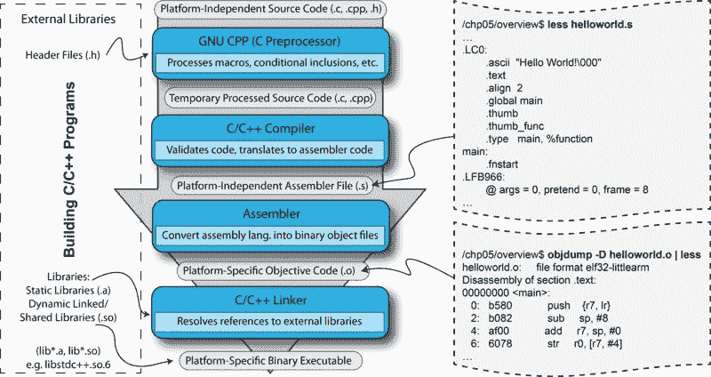

图 5-1 在 BBB 上构建 C/C++ 应用程序

你可以自己执行图 5-1 中的步骤。以下是使用 `Helloworld.cpp` 代码示例执行的实际步骤示例。可以显式地执行这些步骤以便查看每个阶段的输出：

```
/chp05/overview$ ls
helloworld.cpp
/chp05/overview$ g++ -E helloworld.cpp > processed.cpp
/chp05/overview$ ls
helloworld.cpp  processed.cpp
/chp05/overview$ g++ -S processed.cpp -o helloworld.s
/chp05/overview$ ls
helloworld.cpp  helloworld.s  processed.cpp
/chp05/overview$ g++ -c helloworld.s
/chp05/overview$ ls
helloworld.cpp  helloworld.o  helloworld.s  processed.cpp
/chp05/overview$ g++ helloworld.o -o helloworld
/chp05/overview$ ls
helloworld  helloworld.cpp  helloworld.o  helloworld.s  processed.cpp
/chp05/overview$ ./helloworld
Hello World!
```

你可以通过输入 `less processed.cpp` 来查看预处理后的文本格式输出，你将在其中看到必要的头文件被粘贴在代码顶部。在文件的最底部，你会找到自己的代码。该文件被传递给 C/C++ 编译器，编译器会验证代码并生成平台无关的汇编代码（`.s`）。你可以通过输入 `less helloworld.s` 查看此代码，如图 5-1 所示。

该 `.s` 文本文件随后传递给汇编器，汇编器将平台无关的指令转换为 BBB 的二进制指令（`.o` 文件）。如果你使用 BBB，可以通过输入 `objdump -D helloworld.o` 查看生成的汇编语言。对象文件包含通用的二进制代码，尚未提供足够执行的信息。然而，在链接最终的可执行代码后，`helloworld` 包含了特定目标的汇编代码，这些代码已根据需要静态或动态与库结合：

```
/chp05/overview$ objdump -D helloworld
helloworld:     file format elf32-littlearm
Disassembly of section .interp:
00008134 <.interp>:
    8134:    62696c2f     rsbvs   r6, r9, #12032  ; 002f00
    8138:    2d646c2f     stclcs  12, cr6, [r4, #-188]!     ; 0xffffff44
...
```

这些指令的含义本身就是另一本书（请参考 [`infocenter.arm.com`](http://infocenter.arm.com) 参考文档），例如在这种情况下，助记符 `rsbvs` 指的是 ARM 器的两个 16、32 位寄存器（标记为 `r0`–`r15`）上的一种反向减法。最后，为了让你了解，可以对可执行代码进行反汇编，以便对源代码进行逆向工程。例如：

```
/chp05/overview$ objdump -S --disassemble helloworld > test.dump
/chp05/overview$ less test.dump
```

### 编写最短的 C/C++ 程序

`HelloWorld` 示例是 C 或 C++ 中可以编写的最短程序吗？不是，列表 5-8 是最短的有效 C 和 C++ 程序。

这是一个功能完全的 C 和 C++ 程序，它编译时没有错误且运行完美，尽管它没有任何输出。因此，在构建 C/C++ 程序时，不需要库；不需要为 `main()` 指定返回类型，因为它默认是 `int`；在 C++ 中，`main()` 函数默认返回 `0`，而在 C 语言中，它默认返回一个随机数（见下方的 `echo $?` 调用）；而且空函数是一个有效函数。该程序可以如下作为 C 或 C++ 程序进行编译：

```
/chp05/overview$ gcc short.c -o shortc
/chp05/overview$ g++ short.c -o shortcpp
/chp05/overview$ ls -l short*
-rw-r--r-- 1 molloyd users    9 Mar 14 12:34 short.c
-rwxr-xr-x 1 molloyd users 4912 Mar 14 12:40 shortc
-rwxr-xr-x 1 molloyd users 5040 Mar 14 12:40 shortcpp
/chp05/overview$ ./shortc
/chp05/overview$ echo $?
97
/chp05/overview$ ./shortcpp
/chp05/overview$ echo $?
0
```

这是 C 和 C++ 最大的缺点之一。它假设你在编写任何代码之前已经了解该语言的工作原理及其一切。事实上，上一个示例的某些方面可能会被程序员用来展示他们有多聪明，但他们实际上是在展示糟糕的实践，导致代码对不“专家”的程序员变得不可读。例如，如果你重写 `short.cpp` 中的 C++ 代码以包含注释和显式语句，创建 `short2.cpp`，然后使用 `-O3` 优化标志编译两者，输出将如下：

```
/chp05/overview$ more short.cpp
main(){}
/chp05/overview$ more short2.cpp
// A really useless program, but a program nevertheless
int main(int argc, char **argv){
   return 0;
}
/chp05/overview$ g++ -O3 short.cpp -o short1
/chp05/overview$ g++ -O3 short2.cpp -o short2
/chp05/overview$ ls -l short*
-rw-r--r-- 1 molloyd users    9 Mar 14 13:20 short.cpp
-rwxr-xr-x 1 molloyd users 5030 Mar 14 13:28 short1
-rwxr-xr-x 1 molloyd users 5031 Mar 14 13:28 short2
-rw-r--r-- 1 molloyd users  107 Mar 14 12:59 short2.cpp
```

请注意，可执行文件大小的差异仅为一个字节！添加注释、显式返回语句、显式返回类型和显式参数对最终二进制应用程序的大小没有影响。二进制可执行文件之所以长字节，是因为源文件名长了一个字节（即 `short2.cpp` 而不是 `short.cpp`）。然而，这样做的好处是，新手程序员更容易理解代码的实际功能。

你可以使用 `-static` 标志来静态链接库，而不是默认的与共享库动态链接的形式。这意味着编译器和链接器实际上将你的代码所需的所有库程序直接放置在程序可执行文件中：

```
/chp05/overview$ g++ -O3 short.cpp -static -o shortst
/chp05/overview$ ls -l shortst
-rwxr-xr-x 1 molloyd users 455914 Mar 14 12:46 shortst
```

显然，程序可执行文件的大小显著增加了。这种形式的优点之一是，程序可以在没有安装 C++ 标准库的 ARM 系统上执行。


在使用动态链接时，你可以通过调用`ldd`来发现你编译的代码正在使用哪些共享库依赖：

```
/chp05/overview$ ldd short1
   libstdc++.so.6 => /usr/lib/arm‐linux‐gnueabihf/libstdc++.so.6 (0xb...)
   libm.so.6 => /lib/arm-linux-gnueabihf/libm.so.6 (0xb6ea4000)
   libgcc_s.so.1 => /lib/arm-linux-gnueabihf/libgcc_s.so.1 (0xb6e80000)
   libc.so.6 => /lib/arm-linux-gnueabihf/libc.so.6 (0xb6d9b000)
   /lib/ld-linux-armhf.so.3 (0xb6fc9000)
```

你可以看到，BBB 镜像上的`g++`编译器（以及`glibc`）已经过补丁，默认支持生成硬浮点（HardFP）指令。这使得浮点数代码执行速度比使用软浮点 ABI（应用二进制接口）通过软件模拟浮点支持（SoftFP）时更快。

## C/C++ 中的变量和运算符

`const`关键字可以用于防止变量被更改。还有一个`volatile`关键字，它用于通知编译器某个变量可能会在其控制范围之外发生变化，并且编译器不应对该值应用任何类型的优化。如果该变量与另一个进程或物理输入/输出共享，那么这种通知在 BBB 上是非常有用的。

在 C/C++ 中，你可以使用`typedef`关键字定义你自己的类型。例如，如果你不想在之前的`sizeofvariables.c`示例中包含`stdbool.h`头文件，那么可以以这种方式来定义它：

```
typedef char bool;
#define true 1
#define false 0
```

C/C++ 编程中最常见且最容易被误解的错误出现在以下代码段中：

```
if (x=y){
   // 执行主体语句 Z
}
```

主体语句`Z`何时会被执行？答案是只要`y`不等于`0`（`x`的当前值无关！）。错误在于在`if`语句中使用了单个`=`（赋值）而不是`==`（比较）。赋值运算符返回右侧的值，如果`y`不等于`0`，该值将自动转换为`true`。如果`y`等于零，则返回`false`值。Java 不允许这种错误，因为`0`与`false`、`1`与`true`之间没有隐式转换。

## C/C++ 中的指针

指针是一种特殊的变量类型，它存储内存中另一个变量的地址——我们称指针“指向”该变量。列表 5-11 是一个代码示例，演示了如何创建一个指针`p`并使其指向变量`y`：

当这段代码被编译并执行时，将产生以下输出：

```
/chp05/overview$ ./pointers
The variable has value 1000 and the address 0xbede26bc.
The pointer stores 0xbede26bc and points at value 1000.
The pointer has address 0xbede26b8 and size 4.
```

那么，在这个示例中发生了什么？图 5-3 展示了内存位置和涉及的步骤。在步骤 1 中，创建了变量`y`并为其分配了初始值`1000`。然后创建了一个解引用类型为`int`的指针`p`。从本质上说，这意味着建立了一个指针`p`用于`int`值。在步骤 2 中，语句`p = &y;`意味着“让`p`等于`y`的地址”，这把`p`的值设置为 32 位地址`0xbede26bc`。我们现在说`p`指向`y`。这两个步骤可以通过调用`int *p = &y;`完成（即创建一个解引用类型为`int`的指针`p`并将其赋值为`y`的地址）。

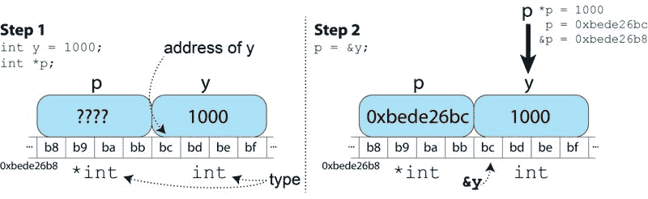

图 5-3 BBB 上的 C/C++ 指针示例（带有 32 位地址）

为什么指针需要解引用类型？例如，如果指针需要移动到数组中的下一个元素，它需要知道应该移动 4 字节、8 字节等。此外，在 C++ 中，你需要能够根据指针的类型来了解如何处理指针的数据。列表 5-12 是一个操作指针和数组的示例。

这将产生如下输出：

```
/chp05/overview$ ./pointerarray
The value of x[0] is 101
The value of x[1] is 201
The value of x[2] is 301
The value of x[3] is 401
The value of x[4] is 501
```

在这个示例中，指针`p`的解引用类型为`int`，并使用语句`int *p = &x[0];`被设置为指向包含五个`int`值的数组中的第一个元素。这里关注的代码行是`(*(p++))++;`（这就是为什么指针这个名字不好听！）。请注意，`()`非常重要，因为它们设定了操作顺序。在这种情况下，内部的`(p++)`使指针指向数组中的下一个元素；但是，由于它是后增，递增发生在这一行结束之后。因此，整行代码可以写成：`(*p)++; p++;`。`(*p)++`意味着增加地址处存储的值，在`for`循环的第一次中将`100`变为`101`。指针符号可能很复杂，但请记住，需要解引用类型是因为在这种情况下`p++`调用需要知道在内存中向前移动 4 字节。如果`p`的解引用类型是`double`（即`double *p;`），那么当调用`p++;`时，指针将移动 8 字节。

在 C/C++ 中使用指针的困难之处在于理解 C/C++ 中的操作顺序，这被称为操作的*优先级*。例如，如果你写了语句：

```
int x = 1 + 2 * 3;
```

`x`的值将会是多少？在这种情况下它将是 7，因为在 C/C++ 中，乘法运算符的优先级高于加法运算符。如果你认为通过语句`*x++`正在增加`x`处的值，也会发生同样的问题，因为`++`运算符将在解引用运算符之前应用，增加了指针并徒劳地解引用了`x`。

C++ 中大约有 58 个运算符，共有 18 个不同的主优先级级别。即使你知道优先级表，仍应该通过使用圆括号`()`来向其他用户明确你在语句中的意图，圆括号在作用域解析运算符（`::`）、递增运算符（`++`）和递减运算符（`--`）之后具有最高优先级。因此，你应该始终写成：

```
int x = 1 + (2 * 3);
```

最后，关于 C 指针的主题，还有一种*空指针*，可以声明为`void *p;`，它有效地表示该指针`p`没有类型。

```
int a = 5;
void *p = &a;
printf("p points at %p and value %d\n", p, *((int *)p));
```

执行时，这段代码将给出输出：

```
The pointer points at 0bea5c8 and value 5
```

## C 风格字符串

C 语言没有内置的字符串类型，而是使用字符数组并以空字符`\0`终止来表示字符串。有一个用于字符串的标准 C 库可以如列表 5-13 所示使用：

代码由示例中的注释进行了解释。执行时，这段代码将产生以下输出：

```
/chp05/overview$ ./cstrings
The string c is: Hello world!
The length of c is 12
The string c is now: Hello World!
cat comes before dog (lexicographically)
The cd string is: Hello to the World
Token:Hello
Token:to
Token:the
Token:World
```

## C 语言中的应用程序

现在你已经掌握了足够的 C 编程，可以查看如何在 C 中编写 LED 闪烁应用程序。列表 5-14 保留了与其他示例相同的结构：

你之前没有见过的唯一主题是在 C 中使用文件，但这个示例应该为`writeLED()`函数提供所需的信息。`FILE`指针`fp`指向文件的描述，标识流、读写位置及其状态。文件使用定义在`stdio.h`中的`fopen()`函数打开，它返回一个 FILE 指针。在这种情况下，它是以写入/更新（`w+`）模式打开的。选项如下：读取（`r`）、写入（`w`）、追加（`a`）、读取/更新（`r+`）和追加/更新（`a+`）。如果你正在处理二进制文件，可以在状态后后追加一个`b`——例如，“`w+b`”将打开一个新的二进制文件进行更新。此外，“`t`”可以用于显式表示文件为文本格式。

欲需标准库中可用 C 函数的完整参考，请参阅[`www.cplusplus.com/reference/`](http://www.cplusplus.com/reference/)。

# C++ 之 C

如前所述，C++ 语言是基于 C 语言构建的，增加了对面向对象类的支持的支持；然而，当你开始进行通用的 C++ 编程时，会立即发现其他一些差异。最初，你注意到的最大的变化是输入/输出流的使用以及字符串的通用使用。

## 第一个示例与 C++ 中的字符串

列表 5-15 显示了字符串示例，已重写为使用 C++ 字符串库：

通过输入`g++ cppstrings.cpp ‐o cppstrings`来编译此代码。执行时，该代码的输出与`cstrings.c`示例相同。在 C++ 中，某些方面变得更加简单，但仍有一些点值得注意。

代码使用了`iostream`和`sstream`头文件，这些是 C++ 头文件。如果你想使用 C 头文件，需要在名称前加一个“c”；因此，为了使用 C 的`string.h`头文件，你需要使用`#include<cstring>`。C++ 中有一个名为*命名空间*（namespaces）的概念，它允许程序员将函数或类限制在特定的范围内。在 C++ 中，所有的标准库函数和类都被限制在*标准命名空间*（standard namespace）。你可以通过使用`std::string`来显式指定你想使用`std`命名空间中的类。然而，这非常冗长。另一种方法是使用`using namespace std;`语句，这会将整个命名空间引入你的代码中。**不要**在你的 C++ 头文件中这样做，因为这将污染任何使用你头文件的人的命名空间。

代码使用了`cout`（它是标准输出流）以及输出流运算符（`<<`）来显示字符串。有一个等效的标准输入流（`cin`）和输入流运算符（`>>`）。输出流运算符“看向”它的右侧并识别数据的类型。它将根据类型显示数据，因此不需要像在`printf()`函数中那样使用`%s`、`%d`、`%p`等。`endl`流操作函数会插入换行符并刷新流。

在此示例中，字符串对象的操作是通过`+`拼接两个字符串，以及通过`<`或`==`比较两个字符串来实现的。这些运算符本质上是像`append()`和`strcmp()`这样的函数。在 C++ 中，你可以为自己的数据类型定义这些运算符的行为（运算符重载）。

## 值传递、指针传递与引用传递

正如你在代码示例所示，函数允许我们编写一段可以从代码中不同位置多次调的代码。向函数传递值有三种主要方式：

*   **按值传递（Pass by value）：** 将创建一个新变量（在以下代码示例中`val`），并将源变量（`a`）值的拷贝存储在这个新变量中。对变量`val`的任何更改都不会对源变量`a`产生任何影响。如果你想防止原始数据被修改，可以使用按值传递；但是必须创建数据的副本，如果你传递的是大型数组（例如图像），那么复制将产生内存和计算开销。按值传递的替代方案是*按常量引用传递*（pass by constant reference）。在下面的示例中，`a`也作为常量引用作为第二个参数传递给函数，并接收为值`cr`。在函数中可以读取`cr`的值，但不能修改它。

*   **按指针传递（Pass by pointer）：** 你可以传递一个指向源数据的指针。对指针（`ptr`）处值的任何修改都会影响源数据。对函数的调用必须传递地址（`&b`——`b`的地址）。

*   **按引用传递（Pass by reference）：** 在 C++ 中，你可以通过引用传递值。函数通过使用取地址符号（`&`）来确定参数是按值传递还是按引用传递。在下面的示例中，`&ref`表示值`c`将按引用传递。函数中`ref`的任何修改都会影响`c`的值。

这是一个包含所有四个示例的函数（`passing.cpp`）：

```
int afunction(int val, const int &cr, int *ptr, int &ref){
   val+=cr;
// cr+=val; // 不允许，因为它是常量
   *ptr+=10;
   ref+=10;
   return val;
}

int main(){
   int a=100, b=200, c=300;
   int ret;
   ret = afunction(a, a, &b, c);
   cout << "The value of a = " << a << endl;
   cout << "The value of b = " << b << endl;
   cout << "The value of c = " << c << endl;
   cout << "The return value is = " << ret << endl;
   return 0;
}
```

执行时，此代码将产生以下输出：

```
/chp05/overview$ ./passing
The value of a = 100
The value of b = 210
The value of c = 310
The return value is = 200
```

如果你在 C++ 中向函数传递一个将被该函数修改的值，那么你可以通过指针或引用传递它；然而，除非你想传递一个将被该函数修改的值，否则不一定……（注：此处原文似乎有重复，翻译按原意顺延）。

*(注：原文提供的文本中存在大量段落内容重复，上述翻译已根据原文逻辑进行了处理。)*

```
/chp05/makeLEDmulti$ sudo ./onled
The current LED Path is: /sys/class/leds/beaglebone:green:usr3
Turning the LED on
/chp05/makeLEDmulti$ ./ledstatus
The current LED Path is: /sys/class/leds/beaglebone:green:usr3
Current trigger details:
[none] rc-feedback mmc0 mmc1 timer oneshot heartbeat ...
```

## 使用类的 C++

面向对象编程是一种编程方法（或范式），它允许将软件组织为对象的集合，这些对象同时包含数据和行为。与你在此为止所看到的函数式编程示例不同，你首先问的不是“它是做什么的？”，而是“它是什么？”。在理论上，这意味着你的代码是为了允许未来对功能进行更改，而无需重新设计代码的结构。此外，它还意味着你可以将代码分解为模块，并在未来的项目中供你和其他人用。

### 面向对象编程概述

接下来的章节将讨论在编写面向对象代码之前你必须理解的几个核心概念。

### 类与对象

想一下电视的概念：你不需要拆掉外壳就可以使用它，因为正面和遥控器上有控制按钮；即使它连接到游戏机，你仍然理解电视；它在你购买时就是完的，具有定义良好的外部需求，如电源和信号输入；而且你的电视不应该崩溃！在许多方面，这个描述捕捉了类中应该存在的属性。

`class`（类）是一种描述。它应该描述你的代码一个定义良好的接口；表示一个清晰的概念；完整且文档齐全；并且是健壮的，内置错误检查。类描述使用两个构建块构建：

*   **状态（或数据）：** 类的状态值。

*   **方法（或行为）：** 类如何与其数据进行交互。方法名称通常包含一个动作动词（例如`setX()`）。

例如，这里是一个说明性的`Television`类的伪代码（即不是真实的 C++ 代码）：

```
class Television{
   int channelNumber;
   bool on;
   powerOn() { on = true; }
   powerOff(){ on = false;}
   changeChannel(int x) { channelNumber = x; }
};
```

因此，示例`Television`类有两个状态和三个方法。这种结构的好处在于你将状态和方法紧密地结合在类结构中。`powerOn()`方法在这个类之外没有任何意义。事实上，你可以在许多不同的类中编写`powerOn()`方法，而无需担心命名冲突。

`object`（对象）是类描述的实现——类的实例。继续使用这个类比，`Television`类是描述你如何构建电视的蓝图，而`Television`对象是这些计划向物理电视的实现。在伪代码中，这种实现可能看起来这样：

```
void main(){
   Television dereksTV();
   Television johnsTV();
   dereksTV.powerOn();
   dereksTV.changeChannel(52);
   johnsTV.powerOn();
   johnsTV.changeChannel(1);
}
```


因此，`dereksTV`和`johnsTV`是`Television`类的对象。它们都有自己独立的状态，因此更改`dereksTV`的通道不会对`johnsTV`产生影响。要调用方法，必须以调用它的对象名称作为前缀（例如`johnsTV.powerOn()`）；在`johnsTV`对象上调用`changeChannel()`方法对`dereksTV`对象没有任何影响。

在本书中，类名通常以大写字母开头，例如`Television`，而对象通常以小写字母开头，例如`dereksTV`。这与许多语言（如 Java）中使用的表示法一致。遗憾的是，C++ 标准库类（例如`string`、`sstream`）并没有遵循这一命名约定。

## 封装

`Encapsulation`（封装）用于隐藏对象的内部机制。在物理电视的类比中，封装是由保护内部电子系统的外壳提供的。然而，你仍然拥有遥控器，它将直接影响内部工作机制的方式。

在 OOP（面向对象编程）中，你可以使用名为`private`的访问修饰符关键字来决定哪些工作需要隐藏（例如电视电子设备），并使用访问修饰符关键字`public`决定哪些是接口（`interface`）的一部分（电视遥控器）。始终将你的类的状态设置为`private`是一个良好的习惯，这样你就可以控制通过你自己设计的公共接口方法来修改它们。例如，伪代码可能会变成如下：

```
class Television{
   private:
      int channelNumber;
      bool on;
      remodulate_tuner();
   public:
      powerOn() { on = true; }
      powerOff(){ on = false;}
      changeChannel(int x) {
         channelNumber = x;
         remodulate_tuner();
      }
};
```

现在，`Television`类拥有私有状态数据（`on`、`channelNumber`），它们只受公共接口方法（`powerOn()`、`powerOff()`、`changeChannel()`）的影响。

## 继承

`Inheritance`（继承）是 OOP 的一个特性，允许从其他类构建类描述。人类经常这样做；例如，如果你被问到“鸭子是什么？”，可能会回答“它是会游泳的鸟，而且它有一个喙。”这个描述是合理的，但它假设了鸟的概念是被理解的。重要的是，该描述说明鸭子具有额外的游泳行为，但它还具有拥有喙的替代行为。你可以用伪代码大致地编写这一点：

```
class Bird{
   public:
     void fly();
     void describe() { cout << "Has a beak and can fly"; }
};

class Duck: public Bird{   // Duck 是一个 Bird
      Bill bill;
   public:
      void swim();
      void describe() { cout << "Has a bill and can fly and swim"; }
};
```

在这种情况下，你可以创建一个`Duck`类的对象：

```
int main(){
   Duck d;        //创建 Duck 对象
   d.swim();      //Duck 类特有
   d.fly();       // 继承自父类 Bird
   d.describe();  //describe() 在 Duck 中被重写，会出现 "Has a bill and can fly and swim"
}
```

这个示例说明了为什么继承如此重要。你可以通过继承并扩展类描述来编写代码（例如`swim()`），或者继承父类并替换行为（例如`describe()`）以提供更具体的实现——这被称为重写（overriding）方法，它是多态性（polymorphism）的一种。多态的另一种形式是重载（overloading），这意味着多个方法可以在同一个类中具有相同的名称，编译器通过不同的参数类型来区分。

你可以通过`IS-A`测试来检查是否具有继承关系；例如，“鸭子是鸟”是有效的，但“鸟是鸭子”是无效的，因为并不是所有的鸟都是鸭子。这与`IS-A-PART-OF`关系形成对比；例如，“喙是鸭子的一部分。”IS-A-PART-OF 关系表明喙是类的成员/状态。当类关系变得复杂时，使用这种简单的检查非常有用。

你也可以对类对象使用指针；例如，为了为两个`Duck`对象动态分配内存，你可以使用：

```
int main(){
   Duck *a = new Duck();
   Bird *b = new Duck(); // 父类指针可以指向子对象
   b->describe();        // 实际上会描述一只鸭子（如果是虚函数）
   //b->swim();          // 不允许！Bird 不“知道” swim() 方法
}
```

有趣的是，`Bird`指针`b`被允许指向一个`Duck`对象。由于`Duck`类是`Bird`类的子类，`Bird`指针可以调用的所有方法，`Duck`对象都“知道”。因此，可以调用`describe()`方法。箭头符号（`b->describe()`）仅仅是编写`(*b).describe()`的一种更整洁的写法。在这种情况下，`Bird`指针`b`的静态类型为`Bird`，动态类型为`Duck`。

最后一点是，可以通过继承使用名为`protected`的额外访问修饰符。如果你想在父类中创建一个方法或状态，并希望它对子类可用，但又不想将其公开，那么请使用`protected`访问修饰符。

## 面向对象的 LED 闪烁代码

这些 OOP 概念现在可以应用于 BBB 上的真实 C++ 程序，方法是将原本面向功能的 C++ 代码重构为一个名为`LED`的类，该类包含了状态和方法。与列表 5-16 所示的代码相比，不同之处在于它允许你使用相同的 OO 代码控制四个用户 LED。因此，使用`LED`类创建了四个不同的 LED 实例对象，每个对象控制 BBB 的四个物理用户 LED 之一。

可以通过输入以下命令编译并执行此代码：

```
/chp05/makeLEDOOP$ ./build
/chp05/makeLEDOOP$ ./makeLEDs status
/chp05/makeLEDOOP$ sudo ./makeLEDs flash
/chp05/makeLEDOOP$ sudo ./makeLEDs off
```

目录`/chp05`中有一个脚本可以将 LED 恢复到标准状态，名为`restoreDefaultLEDs`：

```
/chp05$ sudo ./restoreDefaultLEDs
```

该代码结构为一个单一类`LED`，带有用于路径和数量的私有状态，以及私有实现方法`writeLED()`和`removeTrigger()`。这些状态和辅助方法在类外是不可见的。公共接口方法是`turnOn()`、`turnOff()`、`flash()`和`outputState()`。还有两个公共方法：

- 第一个是构造函数（`函数`），它允许你初始化对象的状态。它通过`LED led(0)`调用，创建一个数字为`0`的`LED`类对象`led`。这与给`int`分配初始值的方式非常相似，例如`int x = 5;`。构造函数必须与类名完全相同（在本例中为`LED`），并且它不能返回任何内容，即使是`void`也不行。

- 最后是析构函数（`∼LED()`）。与构造函数一样，它必须与类名完全相同，并以波浪号（∼）为开头。该方法在对象被销毁时自动调用。你可以在运行代码示例时看到这种现象。

`virtual`关键字也是新的。你可以将这个关键字理解为“允许在对象动态绑定时发生重写”。它应该一直存在（构造函数除外），除非你确定绝对没有子类。移除`virtual`关键字将略微提高代码的性能。

语法`void LED::turnOn(){...}`仅用于声明`turnOn()`方法是与`LED`类关联的。一个`.cpp`文件中可以有很多类，并且两个类可能都拥有`turnOn()`方法；因此，这种显式的关联允许你告知编译器正确的关系。由于这是第一个示例，我将这些代码写在了单个文件中。然而，你将在随后的示例中看到，更好的做法是将代码拆分为头文件（`.h`）和实现文件（`.cpp`）。

希望到这里，C++ 版本的 LED 闪烁代码的布局是清晰的。这个 OOP 版本的优势在于，当你希望提供与系统 LED 交互的额外功能时，你现在有了一个可以在基础上构建的结构。在随后的章节中，你将看到如何构建类似的结构来封装加速度计和温度传感器等电子模块，以及如何使用 OOP 的封装属性，为代码提供接口的程序员隐藏一些更复杂的计算。

## /Proc—进程信息文件系统

在第 3 章中讨论了 Linux 目录结构，其中讨论的一个目录是`/proc`目录——进程信息虚拟文件系统。它为你提供了关于内核运行时状态的信息，并允许你向内核发送控制信息。实际上，它为你提供了一个从用户空间到内核空间的文件型接口。关于`/proc`文件系统的 Linux 内核指南可以查阅 [`tiny.cc/ebb501`](http://tiny.cc.com/ebb501)。例如，如果你输入：

```
/proc# cat cpuinfo
processor       : 0
model name      : ARMv7 Processor rev 2 (v7l)
```

## GLIBC 和 Syscall

Linux GNU C 库`glibc`提供了一系列系统调用的封装函数。它包含了处理文件、信号、数学、用户的功能。参见 [tiny.cc/ebb502](http://tiny.cc.com/ebb502) 的完整描述。如果有等效 glibc 函数，调用它比解析`/proc`条目要简单得多。这里有一个使用 glibc 的简单 C 示例：

```
/chp05/proc$ moreologgedin.c
#include<unistd.h>
#include<stdio.h>
int main(){
   printf("The user logged in is %s\n", getlogin());
   return 0;
}
/chp05/proc$ gcc welgedin.c ‐o who
/chp05/proc$ ./who
The user logged in is molloyd
```

glibc 有许多函数，但其中一个函数特别值得注意，那就是`syscall`函数，因为它根据你传递的参数执行通用系统调用。第一个参数是系统调用号，所有的编号都定义在`/sys/syscall.h`中。你可以打开此文件（`/usr/include/arm‐linux‐gnueabhf/sys/syscall.h`）并搜索，或者可以使用 [`syscalls.kernelgrok.com`](http://syscalls.kernelgrok.com) 搜索你的 Linux 内核架构上的编号。如列表 5-17 所示，`syscall`函数可以传递一个或多个参数。

执行时，此代码将产生输出

```
/chp05/syscall$ ./syscall
The GNU libc version is 2.13
The Current PID is: 3625
The Current PID is: 3625
It is being run by user with ID: 1001
It is being run by user with ID: 1001
```

你可以通过以下方法找到哪个用户账户是 1001：

```
/chp05/syscall$ cat /etc/passwd|grep "1001"
molloyd:x:1001:100::/home/molloyd:/bin/bash
```

因此，你可以使用 C/C++ 通过`syscall`函数直接调用 Linux。你可以通过将所需的属性作为第二和第三参数来调用类似`chmod`的函数（参见`/chp05/syscall/callchmod.cpp`）：

```
int ret = syscall(SYS_chmod, "test.txt", 0777);
```

使用 [`syscalls.kernelgrok.com`](http://syscalls.kernelgrok.com) 并搜索`chmod`。你会看到`eax`为`0x0f`（即`syscall.h`中定义的`SYS_chmod`），`const char __user *filename`为“`test.txt`”，而`mode_t mode`为`0777`，这会将文本文件设置为可执行（-rwxrwxrwx）——这可不是好主意！

## 总结

完成本章后，你应该能够：

* 描述影响你选择用于 BBB 构建应用程序的编程语言的众多问题。

* 在 BBB 上编写基础脚本语言程序代码，以与板载 LED 接口。

* 比较并对比脚本型、混合型和编译型编程语言及其在 BBB 上的应用。

* 编写与 BBB 板载 LED 接口的 C 代码示例。

* 将 C 代码封装在 C++ 类中以提供更好的程序结构。

* 编写能够与 Linux 操作系统命令交互的高级 C/C++ 代码。

## 扩展阅读

本章的大多数章节都包含指向相关网站的链接，用于进一步阅读和参考材料。以下是一些与本章材料相关的编程类书籍列表：

* *Bad to the Bone: Crafting Electronics Systems with BeagleBone and BeagleBone Black*, Steven Barrett and Jason Kridner (Morgan & Claypool, 2013).

* *Getting Started with BeagleBone: Linux‐Powered Electronic Projects with Python and JavaScript*, Matt Richardson (MakerMedia, 2013).

* *Programming the BeagleBone Black: Getting Started with JavaScript and BoneScript*, Simon Monk (McGraw‐Hill/TAB Electronics, 2014).

## 注意事项

# 第二部分：接口、控制与通信

* 第 6 章：接口 BeagleBone 输入/输出

* 第 7 章：交叉编译与 Eclipse IDE

* 第 8 章：接口 BeagleBone 总线

* 第 9 章：与物理环境交互

# 第 6 章：接口 BeagleBone 输入/输出

本章整合了前面章节中的 Linux、编程和电子基础知识，向你展示如何构建电路并编写与 BeagleBone 单线输入/输出接口的程序。在本章中，你将看到实用的示例，解释如何使用通用输入/输出（GPIO）输出二进制信号以开启 LED，或从推按钮读取二进制输入。此外还包含了读取模拟输入和发送脉宽调制（PWM）输出所需的步骤。由于 Linux 内核最近引入的一项变化，与 GPIO 接口是一个相当复杂的话题。然而，BBB 具有引脚管理功能，并且本章中提供了你可以使用的代码，使接口操作变得相当简单。

## 本章所需的设备：

* BeagleBone Black

* 第 4 章的组件集和一个通用光敏电阻

关于本章的更多细节请访问 [`www.exploringbeaglebone.com/chapter6/`](http://www.exploringbeaglebone.com/chapter6/)。

## 通用输入/输出

在书的这里，你已经学习了如何管理 Linux 系统、编写高级编程代码以及构建基础但真实的电子接口电路。现在是时候将这些不同的概念结合在一起，以便你可以构建运行在 Linux 上的软件应用程序，以控制或从你设计的电子电路获取输入。

### GPIO 接口简介

可以通过多种不同方式将电子电路和模块接口到 BBB。例如：

* **使用 BBB P8/P9 扩展头上的 GPIO：** 这在你可以连接的电路类型方面为你提供了灵活性，也是本章的主题。

* **使用 P8/P9 扩展头上的总线（例如 I²C、SPI）或 UART：** 总线连接允许与传感器和显示器等复杂模块进行通信。该主题将在第 8 章讨论。

* **连接 USB 模块（例如键盘、Wi-Fi）：** 如果有 Linux 驱动程序，就可以为 BBB 连接许多不同类型的电子设备。后续章节中提供了示例。

* **通过以太网/Wi-Fi/蓝牙与电子模块通信：** 可以构建网络连接传感器，通过网络连接与 BBB 通信。第 9 章首次介绍了这一主题，第 10 章重点关注了该主题。

与 BBB 操作的下一步是使用 P8 和 P9 扩展头上的 GPIO 和模拟输入将其连接到电路（如第 1 章图 1-4 所示）。之前章节背景材料非常重要，因为这是一个异常复杂的话题，需要时间来适应，特别是关于设备树叠加（device tree overlays）和引脚复用（pin multiplexing）的内容。然而，本章提供了代码和示例电路，你可以使用它们来帮助构建自己的电路。

图 6-1 让你初步了解 BBB P8 和 P9 扩展头上输入和输出的功能。这些许多引脚是*复用的*（multiplexed），意味着它们的功能比图中显示的要多。列出的名称通常描述引脚的默认操作。


**图 6-1** BBB P8/P9 扩展头，标有引脚名称

本章讨论了如何通过以下不同方式与 BBB 的 P8/P9 引脚接口：


**数字输出：** 如何使用 GPIO 开启或关闭电子电路。示例使用了 LED，但这些原理适用于任何类型的电路；例如，你可以使用继电器来开启/关闭高功率设备。提供了电路以确保不会从 GPIO 抽取过多电流。开发了一个 C++ 类以使软件接口变得简单高效。

**数字输入：** 如何在 Linux 下运行的软件应用程序从电子电路读取数字输出。提供了电路以确保对 BBB 的操作是安全的。在章节末尾，还讨论了能够非常高效检测输入状态变化的高级数字输入。

**模拟输入：** 如何使用 BBB 七个板载模拟数字转换器 (ADC) 之一，读取 0 V 到 1.8 V 范围内的电子电路模拟输出。提供了电路以确保不会从参考电源抽取电流，否则其电压值将无法保证。

**模拟输出：** 如何使用 PWM 输出比例信号，该信号可以作为模拟电压电平或作为某些类型设备（如舵机）的控制信号。

本章假设你已经读过第 4 章——特别是使用 FET 的开关电路以及上拉/下拉电阻的使用。

## GPIO 数字输出

图 6-2 所示的示例输出配置使用连接到 `FET` 的 `GPIO` 来切换电路。如第 4 章所述，当电压加到 `FET` 的栅极输入端时，它将关闭虚拟的漏源极“开关”，允许电流从 `5 V` 电源通过 `220 Ω` 限流电阻，通过一个照明 `LED` 流向 `GND`。这种类型电路的优点是它可以应用于许多开/关数字输出应用，因为 `BS270 FET` 数据表表明，它可以在高达 `60 V` 的电压下跨漏源极驱动高达 `400 mA` 的恒流（以及高达 `2 A` 的脉冲电流）。然而，该电路中的最大电流受到 `FET` 的限制（见注释），并且 `SYS_5V` 引脚（`P9_07`）最多能提供 `250 mA`。作为替代，`VDD_5V`（`P9_05` 和 `P9_06`）可以提供高达 `1 A` 的电流，但只有在插入 `5 V DC jack` 电源时它才会激活。

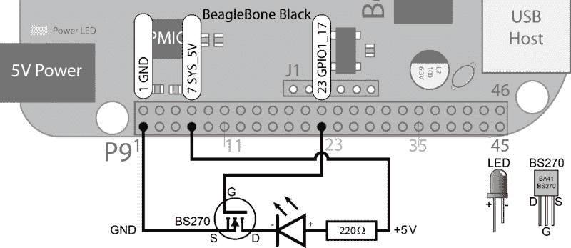

图 6-2 由 `FET` 驱动的 `LED` 电路

`BBB GPIOs` 具有 `3.3 V` 耐压，每个引脚只能输出 `4–6 mA` 并灌入约 `8 mA`。在示例中，使用 `5 V` 电源驱动 `LED` 是安全的，因为 `FET` 的漏源电路永远不会连接到栅极输入。你还会注意到，与第 4 章的示例不同，`FET` 的栅极上没有电阻。在这种特定情况下这是必要的，因为 `BBB` 内部默认在该引脚上启用了内部拉低电阻。这稍后会讨论。

一旦构建好电路并连接到 `BBB`，你就可以启动板并使用 Linux 终端控制 `LED`。目前，你必须以 root 用户身份执行这些操作。在本章结束时，将讨论一种消除该限制的解决方案。

如图 6-1 所示，`P9` 插头引脚 23（`P9_23`）是 `GPIO1_17`。这意味着它是四个 `GPIO` 芯片（`0–3`）中的第二个芯片上的 `32` 个（`0–31`）中的 `GPIO 17`。由于每个芯片上有 `32 GPIOs`，对应于引脚 `GPIO1_17` 的内部 `GPIO` 编号计算如下：(1 × 32) + 17 = 49。总范围将从 `0`（`GPIO0_0`）到 `127`（`GPIO3_31`），但正如之前讨论的，并不是所有的 `AM335x GPIOs` 都在插头上可用。`P8` 插头的 `GPIOs` 也可以使用，但为了保持图形简洁，选择了 `P9` 插头的 `GPIOs`。要启用 `GPIO 49`，请在 Linux shell 提示符执行以下命令：

```
root@beaglebone:∼# cd /sys/class/gpio
root@beaglebone:/sys/class/gpio# ls
export gpiochip0 gpiochip32 gpiochip64 gpiochip96 unexport
root@beaglebone:/sys/class/gpio# echo 49 > export
root@beaglebone:/sys/class/gpio# ls
export gpio49 gpiochip0 gpiochip32 gpiochip64 gpiochip96 unexport
```

你可以看到出现了一个新的 `sysfs` 目录，可以使用以下方式更改 `GPIO` 的属性：

```
root@beaglebone:/sys/class/gpio# cd gpio49
root@beaglebone:/sys/class/gpio/gpio49# ls -l
total 0
-rw-r--r-- 1 root root 4096 May  4 19:43 active_low
-rw-r--r-- 1 root root 4096 May  4 19:43 direction
-rw-r--r-- 1 root root 4096 May  4 19:43 edge
drwxr-xr-x 2 root root    0 May  4 19:43 power
lrwxrwxrwx 1 root root    0 May  4 19:43 subsystem -> ...
-rw-r--r-- 1 root root 4096 May  4 19:43 uevent
-rw-r--r-- 1 root root 4096 May  4 19:43 value
root@beaglebone:/sys/class/gpio/gpio49# cat direction
in
root@beaglebone:/sys/class/gpio/gpio49# echo out > direction
root@beaglebone:/sys/class/gpio/gpio49# cat direction
out
```

现在 `GPIO` 已配置为输出并可以更改值，从而导致 `LED` 的开启和关闭：

```
root@beaglebone:/sys/class/gpio/gpio49# echo 1 > value
root@beaglebone:/sys/class/gpio/gpio49# echo 0 > value
```

如果你此时想这样做，可以通过以下方式移除 `GPIO`：

```
root@beaglebone:/sys/class/gpio# echo 49 > export
```

因此，当按钮被按下时值为 `1`，当释放时值为 `0`。每当你输入 `cat value` 时，你都在对输入进行 `polling`（轮询）以检查值。这种方法的缺点是，除非你不断地轮询 `value` 状态，否则你无法识别输入值的变化。

有趣的是，如果你不在 `P9_12` 上连接任何东西（它是 `GPIO1_28 = GPIO 60`），并输入相同的命令序列，你将得到不同的输出：

```
root@beaglebone:/sys/class/gpio# echo 60 > export
root@beaglebone:/sys/class/gpio# cd gpio60
root@beaglebone:/sys/class/gpio/gpio60# echo in > direction
root@beaglebone:/sys/class/gpio/gpio60# cat direction
in
root@beaglebone:/sys/class/gpio/gpio60# cat value
1
```

当输入端没有连接任何东西时，它记录了一个值 `1`。这是因为该输入通过内部的 `pull-up`（上拉）电阻连接到 3.3 V 线路。此时应该很清楚了，你需要理解 GPIO 配置（包括这些内部电阻），才能正确使用 GPIO 引脚。

## GPIO 配置

上拉电阻和下拉电阻的重要性在第 4 章中进行了详细讨论。它们确保了开路开关不会导致 GPIO 输入浮空。此类外部电阻通常是“强型”上拉/下拉电阻，因为它们使用较小的电阻值（例如 5–10 kΩ）“强力”地将输入固定到高/低值。

### 内部上拉和下拉电阻

BBB 具有“弱”`internal pull-up`（内部上拉）和 `internal pull-down`（内部下拉）电阻，可以通过使用 Linux 设备树在 `AM335x` 中设置内部寄存器来配置，这将在下一节中讨论。

你可以通过在引脚与 GND 之间连接一个 100 kΩ 电阻来物理检查引脚上是否启用了内部上拉或下拉电阻（如图 6-5(a) 所示，其中阴影区域代表 AM335x 内部的功能），然后在引脚与 3.3 V 电源之间连接一个电阻（如图 6-5(b) 所示）。如果你将一个 100 kΩ 电阻（我使用的那个实际值为 98.6 kΩ）连接到 `P8_12` 并测量其两端电压，你会发现当电阻连接到 GND 时电压降为 0 V，而当它连接到 3.3 V 电源时，我测量到的是 2.739 V（而不是 3.3 V）。这表明启用了内部下拉电阻，且这些电阻的组合类似于分压器电路。你甚至可以像图 6-5(b) 那样估算出内部下拉电阻的值。

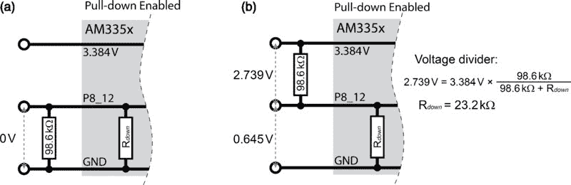

**图 6-5** 内部下拉电阻示例，连接了外部电阻：(a) 从引脚连接到 GND，(b) 从引脚连接到 3.3 V 电源

显然，`P8_12`（即 `GPIO1_12`）启用了内部下拉电阻，但如果你对 `P8_26`（即 `GPIO1_29`）进行相同的测试，将得到完全不同的响应。当你像图 6-5(a) 所示连接电阻时，在 100 kΩ 电阻两端会产生 ~2.624 V 的电压降，而当你像图 6-5(b) 所示连接时，电压降几乎为 0 V（~0.162 V）。这是因为 `P8_26` 启用了内部上拉电阻。通过相同的计算可以得出内部上拉电阻值约为 28.6 kΩ。

你需要将这些电阻值考虑进你的输入/输出电路中，并且在某些情况下能够更改内部电阻配置。下一节，请记住物理测量结果表明 `P8_12` 具有下拉电阻，`P8_26` 具有上拉电阻，两者默认都是启用的。

### GPIO 引脚配置设置

除了将引脚配置为上拉或下拉电阻配置外，每个引脚还有七种不同的模式。这被称为引脚的 `multiplexer mode`（`mmode`），使用三位二进制数设置，如表 6-1 第一行所示。该表基于 `AM335x TRM` 中提供的信息（GPIOs conf_<module>_<pin> - TRM 第 9-60 节）。使用这些位设置，你可以构建一个七位值，用于通过设备树覆盖在 Linux 中配置 GPIO 引脚的精确行为，稍后将讨论。

| BIT | AM335x FIELD | DESCRIPTION |
| --- | --- | --- |
| 0,1,2 | `mmode` | 多路复用模式：使用三个最低位。 |
| 3 | `puden` | 启用上拉或下拉。 |
| 4 | `putypes` | 选择上拉或下拉。 |
| 5 | `rxactive` | 接收器激活。 |
| 6 | `slewctrl` | 变化率控制。 |
| 7 | `mmode` | 模式 7 为 GPIO。 |

## 图 6-7 BBB P9 Header 引脚

```
Head   $PINS  ADDR/OFFSET  GPIO      Name     Mode7
P8_12    12    0x830/030    44     GPIO1_12  gpio1[12] ...
P8_26    31    0x87c/07c    61     GPIO1_29  gpio1[29] ...
```

引脚名称与其 `Mode7` 值相同这一事实意味着 `Mode7` 极可能是默认启用的。你可以在 Linux 中进行如下测试：

```
molloyd@beaglebone:∼$ sudo su -s /bin/bash
root@beaglebone:/home/molloyd# cd /sys/kernel/debug/pinctrl/
root@beaglebone:/sys/kernel/debug/pinctrl# ls
44e10800.pinmux  pinctrl-devices  pinctrl-handles  pinctrl-maps
root@beaglebone:/sys/kernel/debug/pinctrl# cd 44e10800.pinmux/
root@beaglebone:/sys/kernel/debug/pinctrl/44e10800.pinmux# ls
gpio-ranges  pinconf-pins  pinmux-functions  pins
inconf-groups  pingroups  pinmux-pins
root@beaglebone:/sys/kernel/debug/pinctrl/44e10800.pinmux# more pins
registered pins: 142
...
pin 12 (44e10830) 00000027 pinctrl-single
...
pin 31 (44e1087c) 00000037 pinctrl-single
...
```

引脚编号是该引脚的 `$PINS` 值。因此，你可以看到 `P8_12`（`$PINS`  `12`）处于 `0x27` 模式，这是 `Mode7`（`gpio1[12]`）中的一个输入模式，并启用了下拉电阻。同样，`P8_26` 的 `$PINS` 值为 `31`，处于 `0x37` 模式。这是 `Mode7`（`gpio1[29]`）中的一个输入模式，并启用了上拉电阻。查看 `pins` 文件证实了早前使用 DMM 对 100 kΩ 电阻进行测试的结果。

在该目录下有更多关于哪些引脚被分配的信息。例如，使用以下命令检查引脚是否已分配：

```
/sys/kernel/debug/pinctrl/44e10800.pinmux# cat pinmux-pins
Pinmux settings per pin
Format: pin (name): mux_owner gpio_owner hog?
pin 0 (44e10800): mmc.11 (GPIO UNCLAIMED) function pinmux_emmc2_pins
group pinmux_emmc2_pins
...
pin 12 (44e10830): (MUX UNCLAIMED) (GPIO UNCLAIMED)
...
pin 31 (44e1087c): (MUX UNCLAIMED) (GPIO UNCLAIMED)
```

你可以看到引脚 0 被分配给了 eMMC，但使用 DMM 测试的 P8 接器上的引脚未被占用，可以供使用。

你实际上可以使用直接访问 `/dev/mem` 的 C 代码来查询内存地址本身的值。由于 `P8_12`（`$PINS12`）映射到内存地址 `44e10830`（见图 6-6 中的 ADDR 列或之前的 `pinmux-pins` 文件），你可以按照以下步骤安装 Jan-Derk Bakker 的 `devmem2` 程序：

```
∼$ wget http://www.lartmaker.nl/lartware/port/devmem2.c
--2014-05-05 11:22:54--  http://www.lartmaker.nl/lartware/port/devmem2.c
...
2014-05-05 11:22:54 (14.7 MB/s) - 'devmem2.c' saved [3551/3551]
∼$ gcc devmem2.c -o devmem2
∼$ sudo ./devmem2 0x44e10830
/dev/mem opened.
Memory mapped at address 0xb6f5f000.
Value at address 0x44E10830 (0xb6f5f830): 0x27
```

对于 `$PINS12`，值 `0x27` 是符合预期的。你可以研究 `devmem2` 的源代码，看看如何将其集成到你的项目中。

### 使用 C++ 控制 GPIO

本书编写了一个 C++ 类来封装 BBB 上的 GPIO 功能，以便更方便地使用。以下是该类描述的一个片段，列出了它的基础 I/O 功能。从此代码片段中移除的高级功能将在末尾进行讨论。该功能的实现如下：

当 `BeagleBone` 运行旧版本的 Linux 内核时，对这些 Linux 内核所需的特定修改是通过一个名为 `board-am335xevm.c` 的文件直接应用于 Linux 源代码的。旧版本的 Linux 内核（`3.7` 之前）还提供了一个易用的 OMAP MUX 来处理 BeagleBone 引脚的配置。ARM 架构微处理器的普及导致 Linux 内核定制的激增。因此，Linus Torvalds 对直接在 Linux 主线内核中添加大量代码来描述每个制造的 ARM 设备的每一个功能感到不快（`board-am335xevm.c` 有超过 4,000 行代码）。因此，使用最新 Linux 内核的新 ARM 板卡改用扁平化设备树（FDT）模型，这种技术已被 PowerPC 开发者使用了多年（Kridner, 2013）。(1）

## 扁平化设备树 (FDT)

`FDT` 仅仅是一个描述板上硬件的数据结构。在接下来的 GitHub 仓库目录中，提供了 BBB Linux 3.8.13 内核的设备树，供你审查：

```
∼/exploringbb/chp06/deviceTree/DTSource3.8.13$ ls
am335x-bone-common.dtsi  am335x-boneblack.dts  skeleton.dtsi
am335x-bone.dts          am33xx.dtsi           tps65217.dtsi
```

特别注意检查文件 `am335x-bone-common.dtsi` 的开头，如列表 6-2 所示。


该文件描述了 CPU、内存、USR LED 和`I2C0`总线。关于 FDT 中每个字段含义的完整描述，请参见 [`devicetree.org/Device_Tree_Usage`](http://devicetree.org/Device_Tree_Usage)。某些值看起来应该很熟悉；例如，`pinmux`偏移量列为`44e10800`，正如图 6-6 和图 6-7 中的表格所示。你可以看到第一个`USR LED0`连接到相对于`44e10800`偏移`0x54`处的`GPIO1_21`，正如相同的表格所示。此外，引脚模式为`0x07`（快速、输出、拉低、启用、模式 7）。

该文件使用设备树编译器 (`DTC`) 编译成二进制格式，并放置在 Linux 启动镜像的`/boot/uboot/dtbs`，如下：

```
root@beaglebone:/boot/uboot/dtbs# ls am*
am335x-boneblack.dtb  am335x-evm.dtb    am335x-tester.dtb
am335x-bone.dtb       am335x-evmsk.dtb
```

这些文件被用启动过程的一部分。要修改 BBB 上启用的硬件，你可以修改这些 DTS 文件，使用编译器对其进行编译，将它们部署到启动目录，然后重启板板。然而，这将非常繁琐。

## 设备树叠加层 (DTOs)

遗憾的是，FDT 不适用于输入输出的运行时配置（即 Linux 启动后），如果没有替代方案，这将为 BBB 动态添加扩展板（cape）或添加虚拟叠加层变得极其困难。幸运的是，Pantelis Antoniou (Antoniou Consulting) 使用设备树叠加层 (DTOs) 和扩展板管理器开发了解决方案（详见 [`www.elinux.org/Capemgr`](http://www.elinux.org/Capemgr) 中的描述）。解释 DTO 的最佳方法是编写一个并将其部署到你的 BBB。关于 Linux 设备树的更多信息，请参阅 [`www.elinux.org/Device_Tree`](http://www.elinux.org/Device_Tree) 中的指南以及 Jason Kridner 的指南 [`tiny.cc/ebb605`](http://tiny.cc/ebb605)。

### 编写叠加层

如果你查看图 6-7（该图描述了 P9 引脚），你会发现`P9_11`和`P9_13`分别分配给 UART4 的接收器和发射器引脚。在本例中，假设你已经决定将这些引脚重新分配到`GPIO0_30`和`GPIO0_31`，它们在两种情况下都是 Mode7。DTO 的编写方式如列表 6-3 所示。

### 编译并部署叠加层

在 BBB 上，使用设备树编译器 (`dtc`) 以以下语法将设备树源文件 (`.dts`) 编译为设备树二进制对象 (`.dtbo`)（使用 `00A0` 作为版本号）：

```
$ dtc -O dtb -o EBB-GPIO-Example-00A0.dtbo -b 0 -@ EBB-GPIO-Example.dts
```

目录中有一个构建脚本 (`build`)。要部署叠加层，将输出文件拷贝到`/lib/firmware`目录：

```
$ sudo cp EBB-GPIO-Example-00A0.dtbo /lib/firmware
```

## 管理器

槽位 0–3 留给物理连接的扩展板，而设备树叠加层（虚拟扩展板）将获得更高的槽位分配。你可以使用`sysfs`目录中的文件获取有关占用槽位的详细信息，例如：

```
molloyd@beaglebone:$ cd /sys/devices/bone_emgr.9/
ls
baseboard  modalias  slot-4  slot-7  slots      uevent
driver     power     slot-5  slot-8  subsystem
```

槽位号取决于连接到 BBB 的真实和虚拟扩展板。使用以下命令获取槽位 7 叠加层的详细信息：

```
molloyd@beaglebone:$ cd /sys/devices/bone_emgr.9/slot-7/
ls
board-name             header         part-number   sys-5v     version
dc-supplied            manufacturer   pin-usage     vdd-3v3
eeprom-format-revision number-of-pins serial-number vdd-5v
```

### 加载设备树

如第 3 节所述，环境变量不会传递到 root 用户会话。要永久解决`SLOTS`和`PINS`的此问题，请以 root 身份登录并输入`visudo`。在包含`env_reset`的行下，设置`sudo`以在`su`调用时保留`SLOTS`和`PINS`环境变量：

```
Defaults     env_reset
Defaults     env_keep += "SLOTS"
Defaults     env_keep += "PINS"
```

保存更改，并使用以下命令（**不要**使用`sudo su -`），你会看到变量已传递到 root 用户会话。然后，按照以下方式加载新的叠加层`BBB-GPIO-Example`：

```
molloyd@beaglebone:/lib/firmware$ sudo su
root@beaglebone:/lib/firmware# echo EBB-GPIO-Example > $SLOTS
root@beaglebone:/lib/firmware# cat $SLOTS
 0: 54:PF---
 1: 55:PF---
 2: 56:PF---
 3: 57:PF---
 4: ff:P-O-L Bone-LT-eMMC-2G,00A0,Texas Instrument,BB-BONE-EMMC-2G
 5: ff:P-O-L Bone-Black-HDMI,00A0,Texas Instrument,BB-BONELT-HDMI
 6: ff:P-O-L Override Board Name,00A0,Override Manuf,EBB-GPIO-Example
```

该叠加层（overlay）已加载到第 6 槽位。你可以通过查看各个槽位和/或通过输入`dmesg|more`查看虚拟 cape 附加到槽位时的日志来验证叠加层是否正确加载——例如，在此案例中可以使用`dmesg|grep EBB`。

最后，为了测试叠加层工作是否正常（记得 P9_11 是`$PINS` 28，P9_13 是`$PINS29`），你可以执行以下操作：

```
root@beaglebone:/lib/firmware# cat $PINS |more
registered pins: 142
pin 0 (44e10800) 00000031 pinctrl-single
...
pin 28 (44e10870) 00000007 pinctrl-single
pin 29 (44e10874) 00000037 pinctrl-single
```

引脚的设置与列表 6-3 中设备树叠加层文件中的请求完全一致，其中 P9_11 设置为模式`0x07`，P9_13 设置为模式`0x37`。

## 移除叠加层

你可以通过向 cape 管理器传递负号后跟槽位来从槽位中移除叠加层，具体如下：

```
root@beaglebone:/lib/firmware# echo -6 > $SLOTS
root@beaglebone:/lib/firmware# cat $SLOTS
 0: 54:PF---
 1: 55:PF---
 2: 56:PF---
 3: 57:PF---
 4: ff:P-O-L Bone-LT-eMMC-2G,00A0,Texas Instrument,BB-BONE-EMMC-2G
 5: ff:P-O-L Bone-Black-HDMI,00A0,Texas Instrument,BB-BONELT-HDMI
```

此过程适用于大多数槽位，但在编写时，这可能会导致某些 cape 的 Linux 终端死锁，需要重启 BBB。HDMI 和 eMMC 叠加层占据了 P8/P9 插针排的许多引脚，为了访问替代引脚，必须移除这些叠加层。禁用 HDMI cape 或 eMMC 并不简单，因为你必须修改`uEnv.txt`文件，需要使用 Notepad++（普通的记事本无法正常工作）或类似的应用程序，或者直接在 BBB 上如下操作：

```
molloyd@beaglebone:/media$ sudo mkdir /mnt/vfat
molloyd@beaglebone:/media$ sudo mount /dev/mmcblk0p1 /mnt/vfat
molloyd@beaglebone:/media$ cd /mnt/vfat/
molloyd@beaglebone:/mnt/vfat$ sudo nano uEnv.txt
```

取消下行的行的注释，但请小心不要取消相似的 HDMI/eMMC 行，否则你的 BBB 将无法从 eMMC 启动：

```
##Disable HDMI
optargs=capemgr.disable_partno=BB-BONELT-HDMI,BB-BONELT-HDMIN
```

卸载文件系统并重启：

```
molloyd@beaglebone:/mnt/vfat$ cd ..
molloyd@beaglebone:/mnt$ sudo umount /mnt/vfat
molloyd@beaglebone:/mnt$ sudo reboot
molloyd@beaglebone:∼$ cat $SLOTS
...
 4: ff:P-O-L Bone-LT-eMMC-2G,00A0,Texas Instrument,BB-BONE-EMMC-2G
 5: ff:P-O--- Bone-Black-HDMI,00A0,Texas Instrument,BB-BONELT-HDMI
 6: ff:P-O--- Bone-Black-HDMIN,00A0,Texas Instrument,BB-BONELT-HDMIN
```

字母“L”表示该 cape 已启用，如果缺失，则表示该 cape 已禁用。如果你需要禁用 eMMC 以使用它占据的排针引脚，请注意 BBB 必须从 SD 卡启动。如果你在`uEnv.txt`文件中引入了错误，BBB 可能无法启动。请查看第 3 章中间关于如何解决此类问题的说明。

BBB 的`/lib/firmware`目录下有许多叠加层。例如，有用于启用第 8 章中需要的 I²C 和 SPI 总线的叠加层：

```
root@beaglebone:/lib/firmware# ls SPI
```

## 加载叠加层

如果你希望每次启动时都加载叠加层，请如前所述修改`uEnv.txt`文件，并添加新的`optargs`行：

```
##Disable HDMI
optargs=capemgr.disable_partno=BB-BONELT-HDMI,BB-BONELT-HDMIN
```

重启后，你将在槽位中看到新项：

```
molloyd@beaglebone:∼$ cat $SLOTS
 4: ff:P-O-L Bone-LT-eMMC-2G,00A0,Texas Instrument,BB-BONE-EMMC-2G
 5: ff:P-O-L Bone-Black-HDMI,00A0,Texas Instrument,BB-BONELT-HDMI
 6: ff:P-O-L Bone-Black-HDMIN,00A0,Texas Instrument,BB-BONELT-HDMIN
```

字母“L”表示该 cape 已启用，如果缺失，则表示该 cape 已禁用。如果你需要禁用 eMMC 以使用它占据的排针引脚，请注意 BBB 必须从 SD 卡启动。

## 模拟输入

AM335x 有一个逐次近似寄存器（SAR），采样率达每秒 200,000 次。该输入在第 4 章中有所描述。

## 启用模拟输入

默认情况下这些输入是禁用的，因此你需要使用 cape 管理器启用它们：

```
molloyd@beaglebone:/lib/firmware$ sudo su
root@beaglebone:/lib/firmware# echo BB-ADC > $SLOTS
root@beaglebone:/lib/firmware# cat $SLOTS
 0: 54:PF---
 1: 55:PF---
 2: 56:PF---
 3: 57:PF---
 4: ff:P-O-L Bone-LT-eMMC-2G,00A0,Texas Instrument,BB-BONE-EMMC-2G
 5: ff:P-O-L Bone-Black-HDMI,00A0,Texas Instrument,BB-BONELT-HDMI
 6: ff:P-O-L Bone-Black-HDMIN,00A0,Texas Instrument,BB-BONELT-HDMIN
 7: ff:P-O-L Override Board Name,00A0,Override Manuf,BB-ADC
```

一旦你将`BB-ADC`叠加层附加到槽位，你将在`devices`目录下看到新项，其中包含允许读取原始值的文件：

```
/sys/bus/iio$ ls
iio:0  iio_sysfs_trigger
```

```
/sys/bus/iio/devices/iio:0$ ls
buffer           in_voltage_2_raw  in_voltage_6_raw  scan_elements
dev              in_voltage_3_raw  in_voltage_7_raw  subsystem
in_voltage_0_raw  in_voltage_4_raw  name             trigger
in_voltage_1_raw  in_voltage_5_raw  power            uevent
```

如果你读取模拟输入（AIN0），使用`cat in_voltage0_raw`，在没有连接的情况下，结果将是 0 到 4095 之间的整数。BBB 拥有 12 位 ADC（2¹² = 4096），这意味着返回的值将是 0 到 2¹² - 1（0 到 4095）之间的值。你可以通过以下方式进行测试：

```
/sys/bus/iio/devices/iio:0$ cat in_voltage0_raw
3831
/sys/bus/iio/devices/iio:0$ cat in_voltage0_raw
3847
```

#### 输入应用——简单光度计

接下来，我们将构建一个简单的光度计应用程序，以演示如何在 BBB 上附加传感器电路，用于采样和数据记录应用程序。

为`典型光敏电阻`(LDR)电压分压器电路选择合适的配对电阻值`R`，一个很好的经验法是使用方程``，其中`R[MIN]`是 LDR 被遮挡（例如用手指遮住）时的测量电阻值，而`R[MAX]`是光源（例如手机手电筒应用）靠近其表面时 LDR 的测量电阻值。在这个示例中，LDR 被遮挡时的电阻为 6 kΩ，当光源靠近时电阻为 100 Ω。因此，上述公式得出的`R`值为 775 Ω，因此将一个 470 Ω 和一个 330 Ω 的电阻串联即可为电位分压器提供合适的值。你可以按照图 6-9 所示所示接线电路，但这并不是推荐的配置。

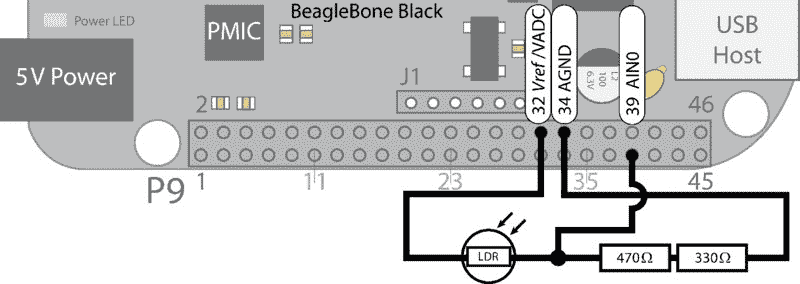

**图 6-9** ADC LDR 电路（不推荐）

图 6-9 中电路的问题在于它将从`Vref`/VADC(P9_32)`引脚抽取电流并作为可变负载。`Vref`和`AGND`之间的电阻从最亮情况下的 900 Ω 到最暗情况下的 6.8 kΩ不等。在最亮的情况下，由于`Vref` = 1.8 V，这意味着从`Vref`输出的电流`I` = 1.8 V/900 Ω = 2 mA。如果你连接七个这样的独立电路，可能会从`Vref`抽取高达 14 mA 的电流，这可能会损坏 BBB。AM335x 模拟前端 (AFE) 在输入之间之间切换，但电源电压将为所有七个电路供电。即使电流大不足以损坏 BBB，从`Vref`抽取电流也会影响参考电压本身的电平，这违背了设置参考电压的目的。

为了避免从 BBB 的 1.8 V`Vref`抽取任何显著电流，可以使用运放电压跟随电路。这种运放配置在第 4 章中讨论过。图 6-10 中描述的实现使用了 LM358P（双运算放大器）IC，其中`V[CC]`连接到`SYS_5V`轨（也可以使用 DC_3.3V），第二个运放的正输入端`2IN+`连接到 BBB 的 1.8 V 模拟参考电压`Vref`/VADC(P9_32)`。


**图 6-10** 使用电压跟随电路的 ADC LDR 电路（推荐）

可以使用`sysfs`从 ADC 读取原始电压电平。对于以下示例值，第一次读取是在普通室内光水平下进行的，第二次读取是在 LDR 被遮挡时进行的，第三次读取是在光源非常靠近传感器时进行的：

```
/sys/bus/iio/devices/iio:device0# cat in_voltage0_raw
959
/sys/bus/iio/devices/iio:device0# cat in_voltage0_raw
304
/sys/bus/iio/devices/iio:device0# cat in_voltage0_raw
3651
```


由于本节开始时的电阻计算，该电路提供了良好的十进制输入值范围。对于`LM358`，输入偏移和输入偏置所需的电流通常分别为`2 nA`和`20 nA`，这意味着它不会从`BBB`的`Vref`引脚（`P9_32`）抽取任何显著电流。该电路的实际测量电压和电流值显示图 6-11 中，其中从`in_voltage0_raw`读取的“光照水平”值为`3,466`。从图中可以清楚看到，几乎没有电流从模拟`Vref`、`AGND`或`AIN0`引脚流出流入，尽管流过`LDR`的电流约为`2 mA`（因为房间里的光线明亮，`LDR`电阻较低）。


**图 6-11** 运放处于电压跟随配置时的测量电压和电流值

非常重要的是，这种配置对`Vref`输出没有负载效应。这与图 6-9 中的配置形成对比，在后者，`LDR`和电阻会负载`Vref`输出，导致参考电压随光照水平的变化而产生偏。注意，底部`GND`轨上的`1.97 mA`电流是返回接地点的电流。

```
molloyd@beaglebone:∼$ cd /sys/devices/ocp.3/pwm_test_P9_22.15/
molloyd@beaglebone:/sys/devices/ocp.3/pwm_test_P9_22.15$ ls -l
total 0
lrwxrwxrwx 1 root root    0 May  7 12:41 driver -> ...
-rw------- 1 root root 4096 May  7 12:41 duty
-r--r--r-- 1 root root 4096 May  7 12:41 modalias
-rw------- 1 root root 4096 May  7 12:41 period
-rw------- 1 root root 4096 May  7 12:41 polarity
drwxr-xr-x 2 root root    0 May  7 12:41 power
-rw------- 1 root root 4096 May  7 12:41 run
lrwxrwxrwx 1 root root    0 May  7 12:27 subsystem -> ...
-rw-r--r-- 1 root root 4096 May  7 12:27 uevent
```

要设置`PWM`信号，周期是以纳秒（nanoseconds）为单位提供的。因此，要输出周期为`10 μs`占空比为`50%`的`PWM`信号，你需要设置时间周期而不是占空比百分比：

```
/sys/devices/ocp.3/pwm_test_P9_22.15$ sudo su
/sys/devices/ocp.3/pwm_test_P9_22.15# echo 5000 > duty
/sys/devices/ocp.3/pwm_test_P9_22.15# echo 10000 > period
/sys/devices/ocp.3/pwm_test_P9_22.15# echo 1 > run
```

如果你在`P9_22`引脚和`GND`之间连接一个`DMM`（数字万用表），当占空比周期设置为`5,000`且周期设置为`10,000`时，测得的电压应为`1.657 V`（即在每个周期的另一半时间内输出为`3.314 V`，在另一半时间内输出为`0 V`，`DMM`将其取平均值得到`1.657 V`）。默认情况下，更改占空比周期会导致以下`DMM`测量值：`0 → 3.314 V`，`2500 → 2.485 V`，`7500 → 0.828 V`以及`10,000 → 0.6 mV`。可以通过使用`echo 0 > polarity`修改极性来反转这种关系（例如`10,000 → 3.314 V`）。设置这些值可以为你提供`DAC`能力，并结合光耦合器或晶体管来限制从`GPIO`引脚抽取的电流。

占空比必须小于周期，因此如果你正在减小周期，请先设置占空比；否则你将得到“Invalid argument”（无效参数）错误。图 6-12 和 6-13 显示了当指定`100 kHz`和`1 MHz`的`PWM`信号时`BBB`的输出。


**图 6-12** 周期为`10,000 ns`（`100 kHz`）占空比为`50%`的`PWM`周期


**图 6-13** 周期为`1,000 ns`（`1 MHz`）占空比为`50%`的`PWM`周期

在`1 MHz`的阶跃响应中，图 6-12(b) 中可以清楚地看到电压信号的意外振荡，这被称为振铃（ringing）。然而，许多使用`PWM`的应用需要的频率较低，因此这并不是一个问题。例如，控制一个典型的舵机需要几十毫秒的周期（即频率小于`100 Hz`）。

`GitHub`存储库中提供了一个名为`PWM`的`C++`类，用于设置`PWM`信号或输出模拟电压。该代码要求应用合适的`DTO`，并将`PWM`引脚名称传递给`PWM`类的构造函数。例如，使用以下代码执行前面的步骤（参见`chp06/API/gpio/PWM.h`）：

```
PWM pwm("pwm_test_P9_22.15");   //创建 PWM 对象
pwm.setPeriod(10000);           //以纳秒为单位设置周期
pwm.setDutyCycle(50.0f);        //可以使用百分比或纳秒时间
pwm.setPolarity(PWM::ACTIVE_LOW);   //ACTIVE_LOW 或 ACTIVE_HIGH
pwm.run();                      //开始输出
```

或者，在`P9_22`上输出模拟电压：

```
PWM pwm("pwm_test_P9_22.15");
```

### 输出模拟电压在 P9_22

舵机电机由三根线组成：黑、红、黄。黑线连接到`GND`，红线连接到`5V`，黄线通过`PWM`控制。舵机电机的位置取决于占空比周期。当占空比周期设置为`5,000`且周期设置为`10,000`时，通过用`DMM`测得的电压应为`1.657 V`。默认情况下，更改占空比周期会导致如下的`DMM`测量值：`0 → 3.314 V`，`2500 → 2.485 V`，`7500 → 0.828 V`以及`10,000 → 0.6 mV`。可以通过使用`echo 0 > polarity`修改极性来反转这种关系（例如`10,000 → 3.314 V`）。设置这些值可以为你提供`DAC`能力，并结合光耦合器或晶体管来限制从`GPIO`引脚抽取的电流。

占空比必须小于周期，因此如果你正在减小周期，请先设置占空比；否则你将得到“Invalid argument”（无效参数）错误。图 6-12 和 6-13 显示了当指定`100 kHz`和`1 MHz`的`PWM`信号时`BBB`的输出。

电压信号的意外振荡，被称为振铃（ringing），在图 6-12(b) 的`1 MHz`阶跃响应中可以清楚地看到。然而，许多使用`PWM`的应用需要的频率较低，因此这并不是一个问题。例如，控制一个典型的舵机需要几十毫秒的周期（即频率小于`100 Hz`）。

`GitHub`存储库中提供了一个名为`PWM`的`C++`类，用于设置`PWM`信号或输出模拟电压。该代码要求应用合适的`DTO`，并将`PWM`引脚名称传递给`PWM`类的构造函数。例如，使用以下代码执行前面的步骤（参见`chp06/API/gpio/PWM.h`）：

```
PWM pwm("pwm_test_P9_22.15");   //创建 PWM 对象
pwm.setPeriod(10000);           //以纳秒为单位设置周期
pwm.setDutyCycle(50.0f);        //可以使用百分比或纳秒时间
pwm.setPolarity(PWM::ACTIVE_LOW);   //ACTIVE_LOW 或 ACTIVE_HIGH
pwm.run();                      //开始输出
```

或者，在`P9_22`上输出模拟电压：

```
PWM pwm("pwm_test_P9_22.15");
```

## 高级 GPIO 话题

之前描述的`GPIO`数字输入应用的一个严重问题是它需要反复轮询`sysfs`文件以确定状态是否发生了变化。这非常消耗处理器，或者如果降低检查频率，可能会导致长时间延迟。本节探讨了如何使用两种不同的技术来解决这个问题。第一种技术涉及对`GPIO C++`类进行显著增强，第二种技术使用`Linux GPIO-KEYS`驱动。

### 更多 C++ 编程

为了理解第一种技术，有必要检查一些要使用的额外的`C/C++`编程概念，这些概念可以通用地增强您的`BBB`应用。回调函数、`POSIX`线程和`Linux`系统轮询的使用可以创建一个高效的`GPIO`轮询，其`CPU`开销极小且响应速度快（例如，小于`0.5 ms`）。本章编写的`GPIO`类已增强以支持此功能，因此你只需要对这些编程技术的概述即可。

### 回调函数

第 2 章描述了在`Node.js`异步函数调用中回调函数的使用。本质上，`callback function`（或`listener function`，监听函数）是在当某种类型的事件发生时执行的函数。这对于像`JavaScript`这样的异步函数调用至关重要，但在`C++`应用中同样有用。例如，在增强型的`GPIO`类中，使用了这种结构，以便在物理按钮被按下时执行某个函数。

回调函数在`C++`中通常使用函数指针实现。`Function pointers`是存储函数地址的指针。可以将这些指针传递给其他函数，这些函数可以对函数指针解引用并调用传递过的函数。这在列表 6-4 的代码示例中得到了演示。

使用`typedef`创建类型只是为了方便在以后阶段更改类型，并在某种程度上简化了语法。`callbackFunction()`的地址作为指针传递给`doSomething()`函数。执行该代码时，输出结果如下所示：

```
Hello BeagleBone
I am the Callback Function! var=10
Value of y is: 20
```

这种编程结构在用户界面编程（及其底层）中非常常见，当用户与按钮和菜单等显示用户界面组件交互时，就可以调用这些函数。将相同的结构应用于物理按键和开关是合理的。

### POSIX 线程

`POSIX threads`（`Pthreads`）是一组`C`函数、类型和常量，它们提供了在`BBB`上的`C/C++`应用程序中实现线程所需的所有内容。在代码中添加`threading`允许代码的部分以看似并发的方式执行（`BBB`拥有单核处理器），每个线程接收一个处理时间的“切片”。

要在应用程序中使用`Pthreads`，你需要包含`pthread.h`头文件，并在使用`gcc`/`g++`编译和链接代码时使用`-pthread`标记。所有的`Pthread`函数都带有`pthread_`前缀。列表 6-5 是在`BBB`上使用`Pthreads`创建两个并行计数器的示例（注释描述了代码结构）：

按照如下方式构建和执行将产生以下输出：

```
∼/exploringbb/chp06/pthreads$ g++ -pthread pthreads.cpp -o pthreads
∼/exploringbb/chp06/pthreads$ ./pthreads
The value of x=0 and y=0
The value of x=0 and y=1
The value of x=1 and y=2
The value of x=2 and y=3
The value of x=3 and y=4
Final: x=5, y=5 and z=5
```

再次运行，你可能会得到不同的输出！

```
The value of x=0 and y=0
The value of x=1 and y=1
The value of x=1 and y=2
The value of x=2 and y=3
The value of x=3 and y=4
Final: x=5, y=5 and z=5
```

代码每次可能会产生略有不同的结果。引入`usleep()`调用是为了鼓励线程管理器在这一点切换回主线程。虽然输出的顺序可能会发生，但由于`pthread_join()`函数的调用，最终结果将始终保持一致，因为该函数会在此点阻塞执行，直到线程运行完毕。

### Linux poll (sys/poll.h)

在本章开头，展示了可以通过检查`value`文件的状态来检测按钮状态的代码。这是一个非常消耗处理器资源的操作，并不实际实用。如果你列出`/sys/class/gpio`目录的内容，可能还会注意到名为`edge`的文件项，到目前为止它没有任何关联：

```
molloyd@beaglebone:/sys/class/gpio$ sudo sh -c "echo 115 > export"
molloyd@beaglebone:/sys/class/gpio$ cd gpio115
molloyd@beaglebone:/sys/class/gpio/gpio115$ ls
active_low  direction  edge  power  subsystem  uevent  value
```

你可以使用来自`sys/poll.h`头文件的系统函数`poll()`，其语法如下：

```
int poll(struct pollfd *ufds, unsigned int nfds, int timeout);
```

其中第一个参数指定指向`pollfd`结构数组的指针，每个结构标识要监控的文件项以及要监控的事件类型（例如，用于读取操作的`EPOLLIN`、边缘触发的`EPOLLET`和用于紧急数据的`EPOLLPRI`）。下一个参数`nfds`指定第一个参数数组中的元素。最后一个参数指定以毫秒为单位的超时时间。如果此值为`-1`，则内核将无限等待数组中标识的活动。此代码已添加到以下增强型`GPIO`类的`waitForEdge()`方法中。

### 增强型 GPIO 类

刚刚讨论的编程概念非常复杂，如果你是第一次看到它们，可能会很难理解；然而，这些技术已用于增强`GPIO`类，使其比以前更快、更高效。列表 6-6 中的代码整合了早期的`GPIO`功能和这里刚刚介绍的编程概念。还提供了公共接口方法。评估该类性能的测试用例如所示。

对于刚刚介绍的增强`GPIO`代码的替代方案是使用`GPIO-KEYS`覆盖层，这将产生一个类似于键盘的新型`Linux`设备。可以对该设备进行按键事件查询，但它需要自定义覆盖层。列表 6-9 中的示例构建了一个单按键键盘，使用了`P9_15`（`GPIO48`），但它可以扩展为具有许多按键的。请注意，此代码是使用`LCD7 Cape DTO`作为参考编写的。各种`cape`的覆盖层为所使用的`DTO`语法提供了极佳示例。使用以下命令下载完整的`cape`源码：

```
$ git clone https://github.com/jadonk/cape-firmware.git
```

该覆盖层可以使用本章之前介绍的自定义覆盖层的相同过程进行编译和部署：

```
$ dtc -O dtb -o BB-BONE-KEYS-00A0.dtbo -b o -@ BB-BONE-KEYS-00A0.dts
$ ls
BB-BONE-KEYS-00A0.dtbo  BB-BONE-KEYS-00A0.dts  build
$ sudo cp BB-BONE-KEYS-00A0.dtbo /lib/firmware
$ sudo sh -c "echo BB-BONE-KEYS > $SLOTS"
$ cat $SLOTS
...
9: ff:P-O-L Override Board Name,00A0,Override Manuf,BB-BONE-KEYS
```

与之前一样，可以使用`dmesg`来检查可能出现的任何问题。添加到`BBB`的新设备`event1`可以通过`cat`连接以便在按下按钮时显示其输出；然而，输出将将是人类可读的形式：

```
$ cd /dev/input
/dev/input$ ls
by-path  event0  event1  mice
molloyd@beaglebone:/dev/input$ sudo cat event1
3eS
   3eS
     3eSB
```

必须编写代码来正确查询此设备。列表 6-10 使用`linux/input.h`头文件以及[`www.kernel.org`](http://www.kernel.org)中的输入文档为`BBB`构建了一个示例，该示例可以解析按下虚拟键盘按钮时发生的事件。

如图 6-16(a)所示，一个按钮连接到`P9_15`（`GPIO 49`），因为覆盖层中的模式设置为`0x37`，所以`P9_15`上的输入在按钮未按下时为高电平，按下时为低电平。列表 6-10 中的代码可以如下进行测试：


**图 6-16** (a) 配置了内部上拉电阻使其变为低电平有效的按下按钮，以及 (b) Bone Keys C++ 示例的时间响应

```
∼/exploringbb/chp06/BONE-KEYS$ g++ bone_keys.cpp -o bone_keys
∼/exploringbb/chp06/BONE-KEYS$ ./bone_keys
You must run this program as root. Exiting.
∼/exploringbb/chp06/BONE-KEYS$ sudo ./bone_keys
Starting BB-BONE-GPIO Test (press 10 times to end):
Press  : Code 28 Value 1
Release: Code 28 Value 0 ...
```


值`28`是 Enter 键的 Linux 键码。此代码的测试版本位于`/chp06/GPIO/tests/test_gpiokeys.cpp`，接收到事件时会触发 LED 灯亮。

这种方法的性能记录在图 6-16(b)中，虽然它的响应比增强的`GPIO`类慢，但仍然处于去抖范围内。这种方法的主要优势是，你可以将 Linux`event1`设备重定向到第三方应用程序，而无需重写它们以使用自定义的`GPIO`类。

## 在不使用 sudo 的情况下使用 GPIO

在本章中，所有与 GPIO 接口的程序都使用`sudo`执行。这可能令人沮丧，但以超级用户身份运行应用程序是危险，因为编码错误可能会损坏文件系统。设置 GPIO 使其由特定用户或组所有，同时保护文件系统将非常有用。

为了解决这个问题，你可以使用 Linux 的一项高级功能`udev rules`，它允许你自定义运行在 BBB Debian 发行版上的`udevd`服务的行为。该服务提供了对 BBB 上设备的一些用户空间控制控制，例如重命名设备、更改权限以及在设备连接时执行脚本。第一步是查找`/sys/class/gpio`目录的信息：

```
∼$ udevadm info ---path=/sys/class/gpio ---attribute-walk
...
  looking at device '/class/gpio':
    KERNEL=="gpio"
    SUBSYSTEM=="subsystem"
    DRIVER==""
```

规则包含在`/etc/udev/rules.d`目录。可以使用这些值作为文件添加新规则。

*   [`www.exploringbeaglebone.com/API/`](http://www.exploringbeaglebone.com/API/)：提供本章描述的`GPIO`、`PWM`、`ServoMotor`和`Analog`类的文档。

# 第 7 章：交叉编译与 Eclipse IDE

在本书之前，所有代码都直接在 BeagleBone 上进行编译和执行。然而，对于较大的项目，这可能是不实际的，因为你可能需要在在一个项目中管理许多源文件。此外，在 BBB 上构建大型项目的编译时间可能很慢。本章首先描述了如何使用你的台式电脑开发可以直接部署到 BBB 的应用程序。随后介绍了 Eclipse 集成开发环境 (IDE)，它允许高级开发功能，例如远程调试。本章最后通过概述如何构建自定义的 Linux 内核来结束。

## 本章所需的设备

*   一台运行 Linux（理想情况下是 Debian）的台式电脑，或在虚拟机中运行的 Debian
*   用于用于部署和调试的 BeagleBone Black

关于本章的更多细节请参阅 [`www.exploringbeaglebone.com/chapter7/`](http://www.exploringbeaglebone.com/chapter7/)。

## 设置交叉编译工具链

本节描述了如何使用你的台式电脑为 BBB 构建代码建立一个功能全交叉编译环境。在台式电脑（例如 Intel x86）上执行的典型 C/C++ 编译器只会为该平台构建可执行的机器码。因此，需要一个`cross-compiler`（交叉编译器），因为它能够直接从你的台式电脑为 BBB 的 ARM 平台创建可执行代码，尽管它的硬件架构不同。

此任务通常在台式电脑上使用 Linux，因为将在 Windows/Mac 设备上编写的代码交叉编译并运行在 ARM 设备上是一个极其极具挑战性的过程，特别是在集成第三方库时。因此，如果你使用 Windows/Mac OS X 环境，可以使用第 3 章中描述的 VirtualBox 配置。事实上，本章中的所有示例都使用了 Debian 64 位的 VirtualBox 虚拟机。

跨平台开发的环境和配置是一个不断演变的过程。虽然本章中的所有步骤在出版时都是有效的，但随着 Linux 内核、工具链以及 Eclipse 开发环境的更新，本章中的某些步骤完全可能会 way。请访问与本章相关的网页以检查更新：[`www.exploringbeaglebone.com/chapter7`](http://www.exploringbeaglebone.com/chapter7)。本章的主要目标是确保你掌握交叉编译背后的概念，并看到各种工具使用的实际示例。

如果你想交叉编译 Linux 应用程序，第一步是安装`Linux toolchain`（Linux 工具链）。`toolchain`（工具链）之名其实，因为它是一组软件开发工具和库（如`gcc`、`gdb`、`glibc`）链在一起，使你能够在一种操作系统和一种类型的机器上构建可执行代码（例如 Intel x86 机器上的 64 位 Linux OS），但能够在不同的操作系统和/或不同的架构上执行它们（例如 ARM 设备上的 32 位 Linux OS）。

我之前创建过一个关于在 Ubuntu 下将软浮交叉编译工具链集成到 Ångström 的完整视频；虽然已经发生了变化（包括访问 Ångström 发行版网站的问题），但视频中的指令大部分程度上仍然有效（参见 [`tiny.cc/ebb701`](http://tiny.cc/ebb701)）。仅在一本书中是不涵盖所有内容的，因此在这里我专注于适用于 Debian 的硬浮工具链。请使用以下讨论，结合本章节网页上提供的 YouTube 视频，来完成任一工具链的安装。

### 适用于 Debian 的工具链

首先，你可以通过单独输入以下命令或使用`&&`组合输入来发现关于你的 Linux 版本的详细信息：

```
molloyd@beaglebone:~$ uname -a && cat /etc/os-release && cat /proc/version
Linux beaglebone 3.8.13-bone50 #1 SMP Tue May 13 2014 armv7l GNU/Linux
PRETTY_NAME="Debian GNU/Linux 7 (wheezy)"
NAME="Debian GNU/Linux"
```

在此示例中，台式机上使用了 Debian 7.x 镜像。此描述中的步骤基于 [`tiny.cc/ebb702`](http://tiny.cc/ebb702) 的工作。台式机使用了 Debian 64 位的“Wheezy”VirtualBox 虚拟机，因此需要按照以下步骤（在台式机上）安装工具：

1.  切换到 root shell：

```
molloyd@debian:~$ sudo sh -
```

2.  进入`/etc/apt`目录并将任何必要的仓库添加到你的` sources.list`文件中：

```
root@debian:~# cd /etc/apt
root@debian:/etc/apt# nano sources.list
```

3.  检查你的发行版所需的仓库。在这种情况下，需要将以下条添加到` sources.list`文件的末尾：

```
#Emdebian entries
deb http://www.emdebian.org/ main
deb http://www.emdebian.org/ unstable
```

4.  保存文件并返回 shell，安装`emdebian-keyring`：

```
root@debian:~# apt-get install emdebian-keyring
root@debian:~# apt-get update
```

使用`apt-get update`下载最新的软件包列表。使用`apt-cache`搜索最新的编译器。

```
root@debian:~# apt-cache search gnueabhf
binutils-arm-linux-gnueabf - GNU binary utilities, arm-linux-gnueabf
g++-4.7-arm-linux-gnueabf - GNU C++ compiler
gcc-4.7-arm-linux-gnueabf - GNU C compiler
gcc-4.7-arm-linux-gnueabf-base - GCC, the Compiler Collection
```

你可以从列表中看到，编写时支持硬浮的最新 g++ 版本是`g++-4.7-arm-linux-gnueabf`。安装适用于你的最新版本以及任何自动识别的依赖项。

```
~# apt-get install build-essential libc6-armhf-cross libc6-dev-armhf-cross
~# apt-get install binutils-arm-linux-gnueabf
~-dev gcc-4.7-arm-linux-gnueabf g++-4.7-arm-linux-gnueabf
```

请注意这里使用的是硬浮。如果你想为不同的平台使用软浮，你需要将列表中的 *armhf* 替换为 *armel*，并将 *gnueabhf* 替换为 *gnueabi*。如果在依赖项上遇到问题，输入`sudo apt-get autoremove`并尝试旧版本的`gcc`和`g++`编译器。

如果进展顺利，此时你可以执行交叉编译器；但你可能安装了多个版本，或者将来你希望安装多个版本。如果你切换到`/usr/bin`并执行`ls arm*`，你可能会看到类似的内容：

```
root@debian:/usr/bin# ls arm*
arm-linux-gnueabihf-g++-4.7    arm-linux-gnueabi-readelf
arm-linux-gnueabihf-gcc-4.6    arm-linux-gnueabi-strings
arm-linux-gnueabihf-gcc-4.7    arm-linux-gnueabi-strip
```

为了方便起见，你可以为你所需的编译器版本创建通用符号链接。在这种情况下，创建了指向`gXX‐4.7`编译器的符号链接。在下一节配置 Eclipse 构建设置时，将使用此通用符号链接：

```bash
. . ./usr/bin# ln ‐s arm‐linux ‘’gnueabihf ‘’gcc ‘’4.7 arm‐linux ‘’gnueabihf ‘’gcc
. . ./usr/bin# ln ‐s arm‐linux ‘’gnueabihf ‘’g++ ‘’4.7 arm‐linux ‘’gnueabihf ‘’g++
```

你可以从任何位置通过以下命令来测试这些符号链接是否有效（因为`/usr/bin`默认在`PATH`中）：

```
molloyd@debian:~$ arm‐linux ‘’gnueabihf ‘’g++ 톰v
gcc version 4.7.2 (Debian 4.7.2-5) . . .
```

### 测试工具链

此时，你可以在配置 Eclipse 之前构建一个测试应用程序，以检查一切是否运行正常。你应该编写一个小的 C++ 程序，在你的桌面机上构建它，然后将其部署到 BBB。例如，在桌面机上输入以下内容：

```bash
molloyd@debian:~$ nano testARM.cpp
molloyd@debian:~$ more testARM.cpp
#include<iostream>
int main(){
   std::cout << "Testing Toolchain" << std::endl;
   return 0;
}
molloyd@debian:~$ arm‐linux ‘’gnueabihf ‘’g++ testARM.cpp 톰o testARM
molloyd@debian:~$ ./testARM
bash: ./testARM: cannot execute binary file
```

此时，二进制可执行文件将在你的桌面机上无法执行，因为包含了 ARM 硬件浮点指令。但请注意，如果你安装了`QEMU`（在本章节的“安装更改根目录”部分），程序将可以执行。接下来，将二进制可执行文件传输到 BBB：

```bash
molloyd@debian:~$ sftp molloyd@192.168.7.2
BeagleBoard.org BeagleBone Debian Image 2014-05-14
Connected to 192.168.7.2.
sftp> put testARM
Uploading testARM to /root/testARM . . .
sftp> exit
```

最后，SSH 连接到 BBB 以确认新的二进制文件是否工作正常：

```bash
molloyd@debian:~$ ssh root@192.168.7.2
BeagleBoard.org BeagleBone Debian Image 2014-05-14 . . .
molloyd@beaglebone:~$ ./testARM
Testing Toolchain
```

成功！如果你看到此输出，说明你能够在桌面机上构建一个可以在 BBB 上直接执行的二进制文件。下一节是一个高级主题，如果你想在交叉编译环境中使用第三方库，则需要阅读该部分。如果你愿意，目前可以先跳过本节，直接进入“使用 Eclipse 进行交叉编译”部分。

## 使用第三方库进行交叉编译（多架构）

此节对于交叉编译 C/C++ 应用程序并非必须；但在未来，你可能需要添加第三方库来完成如处理和数值计算等任务。传统上，这是一个非常困难的话题，但得亏 Debian 和 Ubuntu 最近的发布，这个问题已变得更容易处理了。

为了本文讨论的目的，你应该已经准备好了交叉编译器，并且目前能够交叉编译使用标准 C/C++ 库的应用程序。然而，如果你想构建一个使用第三方库的 C/C++ 应用程序呢？如果你在 x86 桌面机上安装该库，那么该库代码将包含原生 x86 指令。如果你想使用该第三方库并部署到 BBB，那么你需要使用包含 ARM 机器指令的库。

传统上，我们使用诸如`xapt`等工具，它可以实时将 Debian 包转换为跨平台版本（例如`xapt 톰a armhf 톰m libopencv‐dev`）。然而，Debian 的最新版本现在支持`multiarch`——多架构软件包安装。

以下是一个如何使用支持多架构的包安装器在桌面机上安装 BBB armhf 库的示例。你可以使用以下命令确定当前架构（在 x86 64 位桌面机上）：

```bash
molloyd@debian:~$ dpkg --print‐architecture
amd64
molloyd@debian:~$ dpkg --version
Debian 'dpkg' package management program version 1.16.15 (amd64).
```

`dpkg`版本必须大于 1.16.2 才能支持 multiarch。你可以使用以下命令为 BBB Debian 镜像添加 armhf 目标架构：

```bash
molloyd@debian:~$ sudo dpkg --add‐architecture armhf
molloyd@debian:~$ dpkg --print‐foreign‐architectures
armhf
```

执行更新后，安装示例第三方库软件包（注意包名后的`armhf`）：

```bash
molloyd@debian:~$ sudo apt‐get update
molloyd@debian:~$ sudo apt‐get install libicu-dev
Reading package lists...
Building dependency tree
Reading state information...
The following NEW packages will be installed:
  libicu66:armhf libicu-dev
2 to be installed, 0 not be removed.
Do you want to continue? [Y/n] Y
Selecting previously selected package libicu-dev:armhf (armhf architecture)
Checking dependencies...
  libicu-dev:armhf - depends on libicu66:armhf;
  The following NEW packages will be installed:
  libicu66:armhf
The following NEW packages will be INSTALLED:
  libicu66:armhf [v66.1-25]
  libicu-dev:armhf [v66.1-25]
After this operation, 12.4 MB of additional disk space will be used.
Do you want to continue? [Y/n] Y
Unpacking libicu66:armhf (66.1-25)armhf)...
Setting up libicu66:armhf (66.1-25)armhf)...
Extracting libicu-dev:armhf (66.1-25)armhf)...
Setting up libicu-dev:armhf (66.1-25)armhf)...
Processing triggers for root (on-root)...
```

```
molloyd@debian:~$ sudo mkdir /BBBchroot
molloyd@debian:~$ sudo apt‐get install debootstrap
molloyd@debian:~$ sudo debootstrap --foreign --verbose --arch=armhf
--include=aptitude,iputils‐ping,module‐init‐tools,ifupdown,iproute,
nano,wget,udev wheezy /BBBchroot http://ftp.us.debian.org/debian
I: Retrieving Release . . .
```

你现在有了一个针对 ARM 硬浮点（hard floats）的根文件系统，它就在你桌面主机的主根目录下（在本例中为`/BBBchroot`）。你可以查看此目录中的文件，甚至尝试执行命令，但它们会失败，因为它们包含了 ARM 机器指令。


```
molloyd@debian:~$ cd /BBBchroot/
molloyd@debian:/BBBchroot$ ls
bin   debootstrap  etc   lib  proc  run   selinux  tmp  var
boot  dev          home  mnt  root  sbin  sys      usr
molloyd@debian:/BBBchroot$ cd bin
molloyd@debian:/BBBchroot/bin$ ls
. . .     findmnt     mkdir     rbash        sync     which     . . .
molloyd@debian:/BBBchroot/bin$ ./mkdir
bash: ./mkdir: cannot execute binary file
```

# 模拟 armhf 架构

为了模拟 `armhf` 架构，你可以安装一个名为 `QEMU` 的包，它允许你在 `x86` 机器上模拟 `ARM` 微处理器。这被称为“用户模式仿真”。`QEMU` 还可以像 `VirtualBox` 一样执行全系统模式仿真。你可以通过输入以下命令安装 `QEMU` 用户模式仿真包：

```
molloyd@debian:~$ sudo apt‐get install qemu‐user‐static
```

接下来，将静态编译的仿真器放在更改根目录的目录中。一旦你执行了 `chroot` 命令，你将无法访问新根目录之外的任何文件，包括动态库（记住你将处于 `chroot` 监狱中）。步骤如下：

```
molloyd@debian:~$ cd /usr/bin
molloyd@debian:/usr/bin$ sudo cp qemu‐arm‐static /BBBchroot/usr/bin
```

现在你可以将根目录切换到 `/BBBchroot` 目录：

```
molloyd@debian:~$ sudo chroot /BBBchroot/
```

你应该会看到以下 `shell` 提示符，这是因为没有 `passwd` 文件。你需要完成之前调用 `debootstrap` 命令时指定的包的安装，并为 `root` 账户设置密码：

```
I have no name!@debian:/# uname ‐a
Linux debian 3.2.0-4 #1 SMP Debian 3.2.60-1+deb7u3 armv7l GNU/Linux
I have no name!@debian:/# cd /debootstrap
I have no name!@debian:/debootstrap# ./debootstrap --second‐stage
I have no name!@debian:/debootstrap# passwd
I have no name!@debian:/debootstrap# exit
```

当你再次调用 `chroot` 命令时，你现在应该有一个“root”提示符，且包已经安装，例如：

```
molloyd@debian:~$ sudo chroot /BBBchroot/
root@debian:~# ping 8.8.8.8
PING 8.8.8.8 (8.8.8.8) 56(84) bytes of data. . . .
```

你现在可以在 `chroot` 中构建代码并将其部署到 `BBB`，但为了实现这一点，你需要在 `chroot` 中安装 `build‐essential` 包，即使你已经在主根目录中安装了它。首先，你必须如下所示识别包源：

```
root@debian:~# nano /etc/apt/sources.list
root@debian:~# more /etc/apt/sources.list
deb http://ftp.us.debian.org/debian wheezy main
deb-src http://ftp.us.debian.org/debian wheezy main
root@debian:~# apt‐get update
root@debian:~# apt‐get install build-essential
```

然后你就可以写一个简单的 `C++` 示例，该示例可以使用 `QEMU` 在 `chroot` 中运行并远程部署到 `BBB`：

```cpp
root@debian:~# more test.cpp
#include<iostream>
int main(){
   std::cout<<"Hello World running on armhf\n";
}
root@debian:~# g++ test.cpp ‐o testARM
root@debian:~# ./testARM
Hello World running on armhf
```

尽管出现了这条消息，但它尚未发送到 `BBB`。它是在桌面机器上使用 `QEMU` 真的。将此二进制文件传输到 `BBB` 以测试它在那里也能工作。为了做到这一点，你可以在更改根目录中安装 `openssh‐client` 包。当然，你可以退出更改根目录并直接传输，但此步骤将让你从现在起可以直接从更改根目录内部直接传输文件：

```
root@debian:~# apt‐get install openssh‐client
root@debian:~# sftp molloyd@192.168.7.2
molloyd@192.168.7.2's password: 
molloyd@192.168.7.2's password: 
```

`Eclipse IDE` 现在已配置好使用在本章开头设置的交叉编译工具链进行交叉编译。你可以选择 `Project ➢ Build All`，然后通过点击绿色箭头或（`Run ➢ Run`）在桌面机器上运行。在图 7-2 中，这将在控制窗口中显示 `!!!Hello World!!!` 消息。只有在你安装了 `QEMU` 时，它才会出现在桌面电脑上，因为可执行文件包含 `ARM` 机器码，这从图 7-2 左上角高亮的二进制名称“`BBBTest` [arm/le]”可以看出。


**图 7-2** `Eclipse IDE` 正在交叉编译 `Hello World` `C++` 示例应用程序

前面的步骤提供了在 `Luna` 中配置交叉编译设置的快速方法。旧版本的 `Eclipse`（例如 `Kepler`）要求你使用项目设置来配置交叉编译器。该选项在 `Eclipse Luna` 中仍然可用——选择刚刚创建的项目，然后进入 `Project ➢ Properties`（如果选项是灰色的，可能意味着项目未被选中）。进入 `C/C++ Build ➢ Settings`，并在 `Tool Settings` 选项卡下，你应该看到如图 7-3 所示的 `Cross Settings`。实际上来说，这些设置意味着使用 `arm‐linux‐gnueabihf‐g++` 命令（在本章开头描述的符号链接）来编译项目代码。


**图 7-3** `Eclipse Luna` 的交叉编译设置

虽然可能不需要显式设置 `C/C++` 包含和库设置，但在后期阶段可能是必要的，特别是当使用第三方库时。要此操作，进入 `Project ➢ Properties ➢ C/C++ General ➢ Paths and Symbols`，并根据你的 `gcc` 和 `g++` 版本设置以下内容：

*   `Includes (tab) ➢ GNU C (Include directories) ➢ Add ➢ File System ➢ File System ➢ /usr/arm‐linux‐gnueabihf/include` 并点击 `Add`

*   `Includes (tab) ➢ GNU C++ (Include directories) ➢ Add ➢ File System ➢ File System ➢ /usr/arm‐linux‐gnueabihf/include/c++/4.7.2` 或你的当前版本。

*   `Library Paths (not Libraries) ➢ Add ➢ File System ➢ File System ➢ /usr/arm‐linux‐gnueabihf/lib`

*   点击 `OK` 应用配置。

现在你应该能够直接将二进制应用程序部署到 `BBB`，因为它包含了 `ARM` 机器码指令。你可以使用 `sftp` 将二进制应用程序传输到 `BBB`，但从长远来看，如果你能在 `Eclipse` 内部直接连接到 `BBB` 会更好——为此你可以使用 `Remote System Explorer` 插件。

### 远程系统资源器

`Remote System Explorer (RSE)` 插件允许你通过 `BBB` 上的 `SSH` 服务器，通过网络连接在你的 `Eclipse` 环境与 `BBB` 之间建立直接连接。你可以使用 `Help ➢ Install New Software` 在 `Eclipse` 中安装 `RSE`。在 `Work with:` 部分选择“`Luna` . . .”，然后选择 `General Purpose Tools ➢ Remote System Explorer User Actions`。点击 `Next`，按照步骤操作，然后重启 `Eclipse`。

你现在应该在 `Eclipse` 中拥有 `RSE` 功能。进入 `Window ➢ Show View ➢ Other ➢ Remote Systems ➢ Remote Systems`。在出现的 `Remote Systems` 帧中，点击 `Define a Connection to a Remote System` 图标，并在 `New Connection` 对话中选择以下内容：

*   选择 `Linux Type ➢ Next`。

*   `Host Name`: 输入你的 `BBB` IP 地址——例如 `192.168.7.2`

*   `Connection Name`: 将其更改为“`BeagleBone Black`” `➢ Next`

*   `[Files] Configuration ➢ ssh.files ➢ Next`

*   `[Processes] Configuration ➢ processes.shell.linux ➢ Next`

*   `[Shells] Configuration ➢ ssh.shells ➢ Next`

*   `[Ssh Terminals]` (无需修改) `➢ Finish`

你可以在底部帧中右键点击 `BeagleBone Black` 并选择 `Connect`。最新版本的 `Eclipse` 使用主密码系统来管理所有连接的密码。你应该能看到图 7-4 所示的对话框。在此示例中，`BBB` 上使用 `molloyd` 用户账户作为部署可执行代码的账户。


**图 7-4** 首次连接到 `BBB`

一旦连接到 `BBB`，你就可以进入 `Project Explorer` 窗口，右键点击刚刚构建的可执行文件 (`BBBTest [arm/le]`) 并选择 `Copy`。然后进入 `Remote Explorer` 上的目录，例如 `tmp`（参见图 7-5）。右键点击它并选择 `Paste`。该文件现在位于 `BBB` 上，并可以在 `BBB` 执行。

### 远程调试

远程调试是开发全功能交叉开发平台配置的下一步。由于你可能计划与物理连接到 `BBB` 的硬件模块进行交互，如果可以在 `BBB` 上实时调试代码将是理想的。使用 `Eclipse` 进行远程调试允许你直接在桌面机器的 `Eclipse` 内部控制执行步骤，甚至查看调试消息和内存值。

对于此示例，你可以使用从 `Git` 仓库克隆的 `makeLED.cpp` 示例。在编辑器中选择 `makeLED.cpp` 文件（参考图 7-6），并使用“文件 ➢ 另存为”将此文件添加到当前项目 `~/workspace/BBBTest` 中。注释掉 `HelloWorld` 示例中的 `main()` 函数，因为在一个 `C/C++` 项目中不能有两个 `main()` 函数。

在 `BBB` 上，你需要运行调试服务器 `gdbserver`，以便 `Eclipse` 安装程序能够连接到调试器。该工具在 `Debian BBB` 镜像中默认安装，但你可以使用以下命令来安装或更新它：

```
molloyd@beaglebone:~$ sudo apt‐get install gdbserver
```

当桌面机器上的 `Eclipse IDE` 通过 `RSE` 调用 `gdbserver` 时，该程序会在 `BBB` 上执行。在 `Linux` 桌面机上，你需要按照如下所示安装 `GNU` 多架构调试器：

```
molloyd@debian:~/$ sudo apt‐get install gdb‐multiarch
```

然后并在桌面机上，使用 `nano` 在项目文件夹中创建一个名为 `.gdbinit` 的文件，并添加行 `set architecture arm`：

```
molloyd@debian:~/workspace/BBBTest$ more .gdbinit
set architecture arm
```

`Eclipse` 需要配置使用多架构调试器。进入“运行 ➢ 调试配置 ➢ 调试器”，并删除任何当前的调试配置。在左侧选择“`C/C++ Remote Applications`”并右键点击它创建一个新配置。在示例中，它被称为“`BBBTest Debug`”，如图 7-7 所示。


**图 7-7** 设置调试配置

将调试器命令从 `gdb` 改为 `gdb‐multiarch`，如图 7-8 所示。你还需要附加刚刚创建的 `.gdbinit` 文件。点击“`GDB command File`”右侧的浏览并找到你的工作空间目录。你可能需要右键点击文件资源管理器窗口并选择“显示隐藏文件”以找到 `.gdbinit` 文件。该配置文件可以用于设置许多更多配置选项。例如，它可以用于配置远程服务器并选择不同的断点。


**图 7-8** 设置 `gdb‐multiarch`

任何程序参数都可以添加到图 7-8 中的“参数”选项卡中。在示例中使用了字符串“`flash`”。当 `gdbserver` 命令执行时，该参数将传递给在 `BBB` 上执行的应用程序。

最后，在 `Gdbserver` 设置选项卡下（参见图 7-9），为 `gdbserver` 命令设置执行文件路径和任意端口号。这允许桌面计算机远程调用 `BBB` 上的 `gdbserver` 命令，并通过其端口号通过 `TCP` 连接到它。


**图 7-9** 设置 `BBB` `gdbserver` 端口

使用主窗口中绿色“小虫”右侧的向下箭头启动调试器（该图标如图 7-10 所示），并选择“`DebugBBBTest Debug`”选项。


**图 7-10** 调试透视图

图 7-10 是调试透视图运行中的屏幕截图。你可以看到程序目前停在程序代码第 36 行的断点处。此时的输出在底部的“控制台”窗口中可见。这种调试视图在开发复杂应用程序时是非常价值的，特别是当 `BBB` 连接到电子电路和模块时。此时，你可以使用“单步跳过”按钮逐行执行你的代码，观察变量值，同时查看程序如何与物理连接的电路进行交互。

### 自动文档生成 (Doxygen)

随着你的 `BBB` 项目功能和复杂性的增长，代码的自文档化将变得特别重要。如果你在命名变量和方法时遵循第 5 章中讨论的良好编程实践，你就不需要为每一行代码编写文档。相反，你应该使用 `Doxygen` 或 `Javadoc` 这样的自动文档工具为每个类、方法和状态编写内联文档注释。这将使其他程序员能够立即理解你的代码的功能以及它是如何组织的。

`Javadoc` 是一种自动文档生成器，可直接从 `Java` 源代码生成 `HTML` 代码。同样，`Doxygen` 是一个可以用于从带注释的 `C++` 源文件生成 `HTML`、`LaTeX` 以及其他格式文档的工具。`Doxygen` 还可以为第 5 章中讨论的其他编程语言生成文档，但接下来的讨论重点在于如何使用它生成 `C++` 文档，以及它如何与 `Eclipse IDE` 集成。记录 `C++` 文档的示例输出如图 7-11 所示。


**图 7-11** `Doxygen` 输出示例

首先，你需要在 `Linux` 上使用以下命令安装 `Doxygen`：

```
molloyd@debian:~$ sudo apt‐get install doxygen
```

根据安装情况，它可能会下载额外的依赖。安装完成后，将仓库中的 `GPIO.h` 和 `GPIO.cpp` 文件复制到临时目录（例如 `~/Temp`），然后按照如下方式构建文档：

```
molloyd@debian:~/Temp$ doxygen -g
```

这创建一个 `Doxyfile` 配置文件。接下来，对 `Doxyfile` 调用 `doxygen` 命令：

```
molloyd@debian:~/Temp$ doxygen Doxyfile
```

这会自动生成你可以为项目自定义的页眉、页脚和样式表。你可以看到 `html` 和 `latex` 文件夹包含了生成的文档。你可以通过浏览（例如，在 `Chromium` 中地址栏输入 `file://` 并按回车）访问 `~/Temp/html/` 目录并打开 `index.html` 文件查看输出。关于 `Doxygen` 功能的详细手册可以在 `www.doxygen.org`。

#### 在 Eclipse 中添加 Doxygen 支持

通过上述步骤生成的文档相当有限。它是链接的并捕获了方法和状态，但没有更深层的描述。通过将 `Doxygen` 集成到 `Eclipse`，你可以直接配置和执行 `Doxygen` 工具，还可以提供集成到生成文档中的内联注释。第一步是在编辑器中启用 `Doxygen`。


在 Eclipse 中，进入“窗口 ➢ 首选项 ➢ C/C++ ➢ 编辑器”。在底部窗口中，“工作区默认”下选择 Doxygen。应用设置，然后在编辑器中任何方法上方输入 `/**` 并按回车键，IDE 将自动生成如下注释：

```cpp
/**
 * @param number
 */
GPIO::GPIO(int number) {
```

然后你可以添加关于该方法功能的描述，如下例所示：

```cpp
/**
 * General Purpose Input/Output (GPIO) 类的构造函数。它
 * 将自动导出 GPIO。
 * @param number 用于 BBB 引脚的 GPIO 编号
 */
GPIO::GPIO(int number) {
```

要完成安装，你可以通过以下方式为 Eclipse 安装 `Eclox plug‐in`：进入 `Help`（帮助）➢ `Install New Software`（安装新软件），按照之前出的步骤添加新站点 `http://download.gna.org/eclox/update/`，然后选择并安装 `Eclox plug‐in`。重启 Eclipse 后，选择 `File`（文件）➢ `New`（新建）➢ `Other`（其他）➢ `Other`（其他）➢ `Doxyfile`，以向你的 `src/` 目录添加一个 Doxygen 配置文件 `Doxyfile`。

现在你的项目中多了一个带有 `.doxyfile` 扩展的新文件，你可以如图 7-12

**图 7-12**](#c07.xhtml_figureanchor7-12) 在 Eclipse 中运行的 Doxygen Eclox 插件

此时，你已经拥有了为 BBB 交叉编译应用程序的所有内容。本章的下一部分将概述你如何能够交叉编译 Linux 内核本身并部署自定义的 Linux 发行版。

## 为 BBB 构建 Debian

BBB 在出厂时包含一个完整的 Linux 发行版；然而，高级用户可能希望将此镜像替换为精简镜像，和/或可能希望安装支持特定功能的 Linux 内核（例如，实时内核支持）。本章描述的工具可以在桌面 Linux 安装下为你的 BBB 构建 Linux 内核。由于该过程涉及的步骤在不断变化，因此它们已列在章节网页 `www.exploringbeaglebone.com/chapter7` 上，本节中对这些步骤进行了摘要。

Robert C. Nelson 是 Digi‐Key 公司的一名应用工程师，该公司是北美大型电子元件分销商。他自封为内核黑客，并在开发 BBB 的 Debian Linux 镜像以及许多其他嵌入式 Linux 设备方面发挥了关键作用。他提供了一套用于为 BBB 构建 Linux 的完整脚本。Robert 开发了一个脚本，让你能够直接在桌面计算机上构建 Debian 镜像。脚本及其使用的完整指南可以在此处获取：`tiny.cc/ebb703`。

以下是构建并向 BBB 写入新 Linux 镜像涉及的步骤摘要：

1.  **构建 U‐Boot**：从 `git.denx.de` 下载启动加载器的源码，并针对 AM335x 处理器应用最新的 u‐boot 补丁。使用本章开头描述的交叉编译工具链构建启动加载器。构建完成后，你将获得一个 x‐loader `MLO` 文件和一个 `u‐boot` 文件，它们允许你启动自定义的 Linux 内核。

2.  **构建 Linux 内核**：使用来自 `RobertCNelson` GitHub 账号的脚本克隆 Linux 内核源码。调用 `./build_kernel.sh` 脚本启动构建过程。这将提示你安装任何缺失的依赖项。构建过程开始后，你将被邀请使用内核配置工具自定义内核设置，该工具如图 7-13

**图 7-13**](#c07.xhtml_figureanchor7-13) 内核配置工具

## 总结

完成本章后，你应该能够：

*   在桌面 Linux 上安装交叉编译工具链，使用你的桌面为 BBB 构建应用程序。

*   使用多架构包管理器安装交叉编译可能需要的多架构库。

*   在 Linux 桌面上设置切换根目录（change root）以维护 ARM Linux 发行版。

*   使用 QEMU 在桌面上模拟 ARM 架构。

*   安装并配置用于交叉编译的 Eclipse 集成开发环境 (IDE)。

*   配置用于远程部署、远程调试、GitHub 集成和自动化文档。

*   描述构建自定义 Linux 发行版涉及的步骤，并使用外部资源构建内核。

## 扩展阅读

本章的步骤可能会根据 Linux 发行版、Eclipse 版本和内核配置而变化。如果你在配置方面遇到困难，或者希望为他人更容易完成本章介绍的任务贡献信息，请访问 `www.exploringbeaglebone.com/chapter7/`。

在第 6 章中，详细讨论了 GPIOs 和模拟 I/O 的使用，这清楚地说明了你如何将 BBB 连接到独立组件。本章研究了可以使用 BBB 上提供的总线接口进行的更复杂的通信。`总线通信` 是一种使用标准通信协议在嵌入式平台的高层组件之间传输数据的机制。最常用的嵌入式系统总线在 BBB 上均可用，它们是本章的主题：`集成电路`（`I²C`）和`串行外接口`（`SPI`）。此外，还讨论了`通用异步收发器`（`UART`）设备。这些是可以配置并用于发送和接收串行数据的计算机硬件设备。结合适当的驱动接口，UART 可以实现标准的串行通信协议，如 RS-232、RS-422 或 RS-485。

理解总线通信协议和设备的行为及用法，使得构建高级 BBB 电子系统成为可能。大量的复杂传感器、执行器、输入设备、I/O 扩展器和其他微控制器符合这些通信协议，BBB 能够与它们全部进行通信。

本章讨论的话题将通过实际设备示例进行演示，这些设备是根据其广泛可用性和低成本选择的。然而，本章的重点在于传授使用 BBB 总线的技巧，而不仅仅是描述所使用的特定总线设备。为此，章节提供了通用的通信代码，你可以使用它们并将描述的原理应用于你选择的任何设备。

## I²C

`集成电路`（`IIC` 或 `I²C`）是一种飞利浦在 20 世纪 80 年设计的简单双线总线，用于将微处理器或微控制器连接到低速外围设备。`主`设备（如 BBB）控制总线，许多可寻址的`从`设备可以连接到同一两根线上。多年来，它一直很受欢迎，主要由于其相对简单且应用广泛。它目前被用于智能手机、绝大多数微控制器，甚至是大型服务器农场的环境管理应用中。以下是 I²C 总线的一些通用特性：

*   通信只需要两条信号线：用于数据双向传输的`串行数据`（`SDA`）线用于同步数据传输的`串行时钟`（`SCL`线。由于总线使用这种同步时钟信号，数据传输被称为`同步`传输。因为同一条 SDA 线可以用于发送和接收数据，所以传输被认为是是`双向`的。

*   总线上的每个设备都可以作为主设备或从设备。`主设备`是发起通信的设备，而`从设备`是响应的设备。指定的从设备不能主动与主设备建立通信。

*   连接到总线上的每个从设备都预先分配了一个唯一地址，该地址为 7 位或 10 位形式。在接下来的示例中，使用了 7 位寻址，即 `0x00` 到 `0x80`（`2⁷ = 128[10] = 0x80`）。

*   它具有真正的`多主总线功能`，包括当两个或多个主设备同时激活时的从冲突检测和仲裁。

*   内置了标准的芯片噪声滤波。

### I²C 硬件

图 8-1(a) 展示了多个从设备到 I²C 总线的连接。到 SDA 和 SCL 线的所有输出连接均为开漏极配置（在第 4 章中讨论），其中所有设备共享一个公共地连接。这意味着不同逻辑族的设备可以在总线上进行混合使用，并且可以在单个总线上添加大量设备。理论上，单个总线上可以连接多达 128 个设备，但这样做会大大增加互连线的电容。总线的设计是为了用于短距离工作，因为长总线容易受到电磁干扰和`电容效应`（例如，一对 22 AWG 屏蔽电线的电容约为 15 pF/ft）。


图 8-1 (a) I²C 总线配置；(b) 将 ADXL345 连接到 BBB 上的 I2C2 总线

`传输线电容`对数据传输速率有巨大影响。在第 4 章（见图 4-10）中，当一个 10 F 电容与电阻负载并联并施加交流电压电源时，电容对负载两端的电压具有非常明显的平滑作用。这种平滑作用在数字数据传输中是不受欢迎的——例如，如果一个随机二进制信号（0 V–3.3 V）以高频率切换，那么严重的平滑可能会导致恒定的 1.65 V 信号，该信号不携带任何二进制信息。通常，总线长度越长，连接的 I²C 设备越多，数据传输速度就越慢。提供的 I²C 重继器充当电流放大器，帮助解决与长线相关的问题。

BBB 支持高达 400 kHz 的总线频率。NXP（原飞利浦的一个部门）拥有更新的 I²C 快速模式+ (FM+) 设备，可以以 1 MHz 的速度通信，但 BBB 上不支持此功能。

I²C 总线在 SDA 和 SCL 上需要上拉电阻（`R[P]`），如图 8-1 所示。这些被称为`终端电阻`，其值通常在 1 kΩ 到 10 kΩ 之间。它们的作用在没有 I²C 设备将线路拉地时，将 SDA 和 SCL 线拉至 VCC。这种上拉配置允许多个主设备接管总线，并允许从设备“拉伸”时钟信号（即保持 SCL 低电）。`时钟拉伸`可供从设备减慢数据传输，直到其完成处理并准备传输。这些电阻通常存在于与 I²C 设备关联的板上。

图 8-1(a)所示的`串行电阻`（`R[S]`）通常值较小（例如 250Ω），并有助于防止过流情况。I²C 设备使用密特触发输入（见第 4 章）连接到 SDA 和 SCL 线，通过内置程度的开关迟滞来减少信号噪声的影响。

在本章讨论的 I²C 演示应用中，BBB 是主设备，而 ADXL345 是从设备。ADXL345 位于一个已带有 4.7 kΩ 终端电阻的开发板上。该传感器如图 8-1(b)所示连接到 BBB。

I²C 从设备地址由从设备本身决定。例如，ADXL345 开发板的地址为 `0x53`，这是在制造时确定的。许多设备（包括 ADXL345）具有选择输入，允许你在定义范围内更改此值。然而，连接到设备的开发板需要支持这种更改地址的功能。在接下来的示例中，你无法将两个 ADXL345 开发板设备连接到同一个总线上，因为它们的地址会冲突。但是，有可用的 I²C 复用器，可以帮助你解决这个问题。

关于 I²C 总线的更多文档可以直接从 NXP 处获取，访问[`tiny.cc/ebb802`](http://tiny.cc/ebb802)。

### ADXL345 加速度计

Analog Devices 的 ADXL345 是一种小型、低成本的加速度计，它可以测量相对于地球重力方向的角位置。例如，一个静静止放置在地球表面的单轴加速度计，如果其敏感轴与地球重力平行，它将测量出垂直向上的 `1g`（9.81 m/s²）加速度。虽然加速度计可以提供绝对方向测量，但它们容易受到高频噪声的影响，因此通常与陀螺仪配合使用，以精确测量方向的变化（例如在游戏控制器中）。然而，对于需要测量低频绝对旋转的应用，加速度计具有出色的特性。为了简单起见，随后的讨论将单独使用加速度计，因为主要目标是让读者理解 I²C 总线。

ADXL345 可以被设定为使用固定的 10 位分辨率测量值，或在高达 `±16g` 的量范围内使用 13 位分辨率。它可以通过 I²C 或 SPI 总线连接到 BBB，这使其成为本章中作为示例设备的理想传感器。即使你没有这种特定的传感器，后续的讨论完全代表了将任何类型的 I²C 传感器连接到 BBB 所需的步骤。章节网页列出了可以购买此种特定传感器的供应商。

ADXL345 的数据手册是一份重要的文档，应该结合本章一起阅读。它在章节网页中提供了链接，或者可以通过 [`www.analog.com/ADXL345`](http://www.analog.com/ADXL345)（或 [`tiny.cc/ebb801`](http://tiny.cc/ebb801)）访问。

与 ADXL345 的物理连接如图图 8-1](#c08.xhtml_figure8-1)(b) 所示。当 CS 输入接高电平时，ADXL345 进入 I²C 模式。拆开发板（breakout board）包含了 I²C 总线正常工作所需的电阻。ADXL345 的 ALT 地址引脚在拆开发板上固定到 GND，使设备位于 I²C 地址 `0x53`。

`I2C0` 和 `I2C2` 总线在 Debian BBB 镜像中默认存在，但可能错误的是，它们分别映射到 Linux 设备名称 `i2c-0` 和 `i2c-1`。你可以使用以下命令启用第二个公共 I²C 总线（参见表 8-1）`i2c-2` (I2C1)：

```
molloyd@beaglebone:/dev$ sudo sh -c "echo BB-I2C1 > $SLOTS"
molloyd@beaglebone:/dev$ ls i2*
i2c-0  i2c-1  i2c-2
```

| 硬件总线 | 软件设备 | SDA 引脚 | SCL 引脚 | 说明 |

| --- | --- | --- | --- | --- |

| I2C0 | `/dev/i2c-0` | N/A | N/A | 用于 HDMI 控制的内部总线。 |

| I2C1 | `/dev/i2c-2` | P9_18 | P9_17 | 通 I²C 总线。默认禁用。 |

| I2C2 | `/dev/i2c-1` | P9_20 | P9_19 | 普通 I²C 总线。默认启用。 |

**表 8-1** BBB Debian 镜像上的 I²C 总线

### 使用 Linux I2C-Tools

Linux 提供了一组名为 `i2c-tools` 的工具用于与 I²C 总线设备交互；它包括总线探测工具、芯片转储工具和寄存器级访问助手。这些工具已经安装在 BBB Debian 镜像中，但可以使用以下方法在不同的镜像上更新或安装它们：

```
molloyd@beaglebone:~$ sudo apt-get install i2c-tools
i2c-tools is already the newest version.
```

#### i2cdetect

第一步是检测总线上是否存在设备。当启用第二个公共 I²C 总线，且时钟线（SCL）或数据线（SDA）未连接到任何设备时，`i2cdetect` 命令将显示如下输出：

```
molloyd@beaglebone:~$ i2cdetect -l
i2c-0  i2c     OMAP I2C adapter     I2C adapter
i2c-1  i2c     OMAP I2C adapter     I2C adapter
i2c-2  i2c     OMAP I2C adapter     I2C adapter
```

然后可以探测 `/dev/i2c-1` 总线上的连接的设备：

```
molloyd@beaglebone:~$ i2cdetect -y -r 1
      0  1  2  3  4  5  6  7  8  9  a  b  c  d  e  f
00:     -- -- -- -- -- -- -- -- -- -- -- -- -- -- -- --
10:  -- -- -- -- -- -- -- -- -- -- -- -- -- -- -- --
20:  -- -- -- -- -- -- -- -- -- -- -- -- -- -- -- --
30:  -- -- -- -- -- -- -- -- -- -- -- -- -- -- -- --
40:  -- -- -- -- -- -- -- -- -- -- -- -- -- -- -- --
50:  -- -- -- -- -- -- -- -- -- -- -- -- -- -- -- --
60:  -- -- -- -- -- -- -- -- -- -- -- -- -- -- -- --
70:  -- -- -- -- -- -- -- -- -- -- -- -- -- -- -- --
```

| 0x37 | `DATAZ1` | R | Z 轴数据 1：高有效字节 |

源自 Analog Devices ADXL345 数据手册的表 19。总共有 30 个可访问的寄存器。

## 表 8-2 ADXL345 寄存器映射中的子集

如前所述，来自 Analog Devices 的 `ADXL345` 数据手册可以在 [`www.analog.com/ADXL345`](http://www.analog.com/ADXL345) 找到。这是一份非常详尽且编写良好的数据手册，详细介绍了设备的每一个功能。事实上，在使用新的总线设备时，真正的挑战在于解读数据手册以及设备行为的复杂性。`ADXL345` 有 30 个公共寄存器，表 8-2 列出了本章访问的寄存器。其他寄存器允许你设置节电空闲时间、方向偏移以及针对自由落体、击打和双击检测的中断设置。

`x`、`y` 和 `z` 轴加速度值使用 10 位或 13 位分辨率存储；因此，每次读取都需要两个字节，因为数据是以 16 位补码形式表示的（见第 4 章）。要以 13 位模式进行采样，必须将 `ADXL345` 设置为 ±16 *g* 范围。图 8-2（源自 `ADXL345` 数据手册）描述了读写设备时所需的信号序列。


## 图 8-2 ADXL345 设备上单次/多次读/写操作所需的时序

图片由 Analog Devices, Inc. 提供。

例如，若要向设备寄存器写入单个字节，第一行中的主/从站访问模式如下所示：

1. 主站发送一个 `start bit`（即在 `SCL` 为高电平时，将 `SDA` 拉低电平）。

2. 在时钟翻转期间，一次位地传输 7 位从站地址。

3. 发送读位（`1`）或写位（`0`），取决于主站是想从从站寄存器读取还是写入数据。

4. 从站随后通过 `acknowledge bit`（`ACK = 0`）进行响应。

5. 在写模式下，主站一次位发送一个字节的数据，随后从站发回一个 `ACK` 位。若要写入寄存器，先发送寄存器地址，然后发送要写入的数据值。


6. 最后，为了结束通信，主站发送一个`stop bit`（即在`SCL`为高电平时，允许`SDA`浮空高电平）。

这些握手序列将很快通过对设备进行读写操作以及物理分析 I²C 总线通信来得到确认。

### i2cget

`i2cget`命令可读取寄存器的值以测试设备，或作为 Linux Shell 脚本的输入。例如，要读取连接设备的`DEVID`（在此情况下应为`0xE5`），请使用以下命令：

```
molloyd@beaglebone:~$ i2cget -y 1 0x53 0x00
0xe5
```

Analog Discovery 数字逻辑分析仪功能可用于物理分析 I²C 总线，以便在数据写入和读取 I²C 总线时查看`SDA`和`SCL`信号的交互。逻辑分析仪功能具有 I²C、SPI 总线和 UART 设备的解释器，可以显示总线上携带串口数据的十六进制等效值。图 8-3 捕捉了上述示例中使用`i2cget`命令的信号转换。在这里，你可以看到时钟以*I²C 标准数据传输模式*（100 kHz）运行。该加速度计还支持*快速数据传输模式*（400 kHz）。图 8-3 中显示的时序信号确认了图 8-2 中第三行关于单字节读取的信号。图 8-3 中的顶行（I2C2）详细解释了显示在第二行和第三行的`SDA`和`SCL`信号。


## 图 8-3 使用 i2cget 读取 DEVID 寄存器值

### i2cset

`i2cset`命令用于设置寄存器。这是必须的，例如通过向地址为`0x2D`的`POWER_CTL`寄存器写入`0x08`将`ADXL345`退出节电模式。值的写入和确认方式如下：

```
molloyd@beaglebone:~$ i2cset -y 1 0x53 0x2D 0x08
molloyd@beaglebone:~$ i2cset -y 1 0x53 0x2D 0x08
molloyd@beaglebone:~$ i2cset -y 1 0x53 0x2D 0x08
```

数据类型在此函数中至关重要，因为寄存器数据是以补码形式返回的。如果使用`int`类型（大小为 32 位，`int32_t`）而不是 16 位`short`整数数据（`int16_t`），那么符号位将会错位。该函数将高字节左移（乘以）8 位（等于乘以`2⁸` = `256`），并将结果与低字节进行位或（OR）操作（这会将低字节替换为移位引入的 8 个零）。这产生了一个由两个独立的 8 位值（`uint8_t`）创建的 16 位符号值（`int16_t`）。执行时，`ADXL345.cpp`程序将产生如下输出，程序将在同一行控制台线上更新加速度数据：

```
molloyd@beaglebone:~/exploringbb/chp08/i2c/test$ ./ADXL345
Starting the ADXL345 sensor application
The Device ID is: e5
The POWER_CTL mode is: 08
The DATA_FORMAT is: 00
X=13 Y=-35 Z=232 sample=17
```

还需要额外的代码将这些值转换为俯仰（pitch）和横滚（roll）形式。这将在下一节中添加到 C++ 类中。供你参考，逻辑分析仪显示，在 100 kHz 的总线波速率下，读取全套 40 个寄存器需要 4.19 ms。

## 使用 C++ 类封装 I²C 设备

第 5 节描述了面向对象的编程，认为它是开发嵌入式系统代码的合适框架。作为一名程序员，你的主要目标之一应该是避免重复编写相同的代码。你可以反复地在项目之间复制和粘贴代码，但如果你随后发现错误，则必须在多个位置进行纠正。当你忘记更改一个或多个位置处复制的代码时，就会产生危险性。

可以编写一个特定的 C++ 类来封装`ADXL345`加速度计的功能；由于你可能需要编写代码来控制多种不同类型的 I²C 设备，如果能将通用的 I²C 代码提取并放在父类中，将非常有用。为此，本章编写了一个名为`I2CDevice`的类，它捕获了与 I²C 总线设备相关的通用功能。你可以扩展此代码来控制任何类型的 I²C 设备。你可以在`chp08/i2c/cpp/`目录下的`I2CDevice.cpp`和`I2CDevice.h`文件找到它。在本章稍后，代码被进一步重构并放置在 GitHub 的`/library/bus`目录下。该类的结构的列表 8-2 所示。

实现代码可在`chp08/i2c/cpp/`目录获取。该类可以扩展以控制任何类型的 I²C 设备，在这种情况下，它被用作名为`ADXL345`的特定设备实现类的父类。因此，你可以说`ADXL345`**是一个**`I2CDevice`。这种继承关系意味着`I2CDevice`类中提供的任何方法现在都可以在列表 8-3 中的`ADXL345`类中使用（例如，`readRegister()`）。

枚举结构用于限制范围和分辨率选择范围，使其仅包含有效选项。可以使用以下短示例（`application.cpp`）来测试此结构：

```
int main(){
   ADXL345 sensor(1,0x53);   // sensor 位于总线 1，地址为 0x53
   sensor.setResolution(ADXL345::NORMAL);   // 使用 10 位分辨率
   sensor.setRange(ADXL345::PLUSMINUS_4_G); // 范围为 +/-4g
   sensor.displayPitchAndRoll();   // 将传感器设置为显示模式
   return 0;
}
```

可以如下所示构建并执行此代码，其中俯仰和横滚是各自在 ±90° 之间变化的角度值：

```
/chp08/i2c/cpp$ g++ application.cpp I2CDevice.cpp ADXL345.cpp ‐o ADXL345
/chp08/i2c/cpp$ ./ADXL345
Pitch:5.71592 Roll:-31.5256
```

你可以使用这个通用结构为任何类型的 I²C 传感器构建封装类，它运行得非常完美。然而，在本章稍后，必须解决一个额外的软件设计问题，这意味着这里为`ADXL345`类提出的结构需要进一步修改。

## SPI

`串行外接口 (SPI)`总线是一种快速、全双工的同步串行数据链路，使 BBB 等设备能够在短距离内与其他设备通信。因此，像 I²C 一样，SPI 总线是同步的，但与 I²C 总线不同，SPI 总线是`全双工`的。这意味着它通过单独的发送数据和接收数据线路同时传输和接收数据。

在本节中引入了 SPI 总线，并开发了两个独立的应用程序。第一个使用 SPI 总线通过无处不在的`74HC595`八位移位寄存器驱动 LED 条形显示。第二个应用程序接口到 ADXL345，这次使用的是 SPI 总线而不是 I²C 总线。

### SPI 硬件

SPI 通信发生在单个主设备和一个或多个从设备之间。图 8-4(a) 展示了单个从机示例，主设备之间连接了四根信号线。要与从设备通信，执行以下步骤：

1. `SPI 主设备`将片选 (CS) 线拉低，激活客户端设备——它是低电平有效。此线也称为`从选 (SS)`。

2. 经过短暂延迟后，SPI 主设备发出时钟周期，通过主出从入 (MOSI) 线发送数据并在主入从出 (MISO) 线接收数据。`SPI 从机`设备从`MOSI`线读取并在`MISO`线传输数据。每个时钟周期发送一位并接收一位。数据通常按字节（8 位）块发送。

3. 完成后，SPI 主设备停止发送时钟信号并将`CS`线拉高，禁用 SPI 从机。


与 I²C 不同，SPI 总线在通信线上不需要上拉电阻，因此连接非常简单。I²C 与 SPI 的总结对比见表 8-3。

| | I²C | SPI |

| --- | --- | --- |

| 连接性 | 两根线，最多可连接 128 个寻址设备。 | 通常为四根线，对于多个从机设备则需要额外的逻辑。 |

| 数据速率 | I²C 快速模式为 400 kHz。使用半双工通信。 | 性能更快，通常超过 10 MHz。全双工（三线变体除外）。 |

| 硬件 | 需要上拉电阻。 | 不需要上拉电阻。 |

| BBB 支持 | 完全支持两个外部总线（加上一个内部总线）。 | 完全支持两个总线。每个总线只有一个从选引脚。 |

| 特性 | 可以有多个主设备。从机具有地址、确认传输并可以控制数据流。 | 简单快速，但只有一个主设备，没有寻址，从机无法控制数据流。 |

| 应用 | 间歇访问设备，例如实时时钟、EEPROM。 | 提供数据流的设备，例如 ADC。 |

SPI 总线使用四种不同模式之一运行，该模式根据 SPI 从机设备数据表中定义的规范进行选择。数据使用时钟信号进行同步，并设置表 8-4 中描述的`SPI 通信模式`之一来描述同步是如何执行的。`clock polarity`定义了时钟在空闲时（即`CS`为高电平时）是低电平还是高电平。`clock phase`定义了`MOSI`和`MISO`线的数据是在时钟信号的上升沿还是下降沿采样。当时钟极性为`1`时，时钟信号等同于极性为`0`的相同信号的反相。因此，一种时钟信号极性的上升沿等同于另一种极性的下降沿。你需要检查从机设备的数据表以确定 SPI 模式。

| 模式 | 时钟极性 (CPOL) | 时钟相位 (CPHA) |

| --- | --- | --- |

| `0` | `0` (空闲时低电平) | `0` (数据在时钟信号的上升沿采样) |

| `1` | `0` (空闲时低电平) | `1` (数据在时钟信号的下降沿采样) |

| `2` | `1` (空闲时高电平) | `0` (数据在时钟信号的下降沿采样) |

| `3` | `1` (空闲时高电平) | `1` (数据在时钟信号的上升沿采样) |

**表 8-4 SPI 通信模式**

SPI 协议没有定义最大数据速率、流控制或通信确认。因此，实现方式因设备而异，所以研究每个类型 SPI 从机设备的数据表非常重要。有一些三线 SPI 变体，它们使用单根双向`MISO/MOSI`线代替两条独立的线。例如，`ADXL345`传感器支持`I²C`以及`四线`和`三线 SPI`通信。

### BBB 上的 SPI

第 6 章图 6-7 中的`P9`引脚布局表明，可以从该引脚访问`SPI0`和`SPI1`总线。`SPI1`与`mcasp0_pins`冲突，因此要使用`SPI1`必须禁用`HDMI`。如图图 8-4(b)所示，`SPI0`的引脚如下：

*   **Chip Select:** `P9_17` `spi0_cs0` (Mode 0) `$PINS 87 Offset 0x15C`。

*   **MOSI:** `P9_18` `spi0_d1` (Mode 0) `$PINS 86 Offset 0x158`。

*   **MISO:** `P9_21` `spi0_d0` (Mode 0) `$PINS 85 Offset 0x154`。

*   **Clock:** `P9_22` `spi0_sclk` (Mode 0) `$PINS 84 Offset 0x150`。

`SPI0`和`SPI1`总线默认被禁用，因此要启用它们，你需要使用第 6 章描述的设备树覆盖层（overlays）。`BB‐SPIDEV0‐00A0.dts`文件定义了如何配置此覆盖层，启用了内部上拉电阻，并按列表 8-4 中的部分列表定义了输入/输出。完整列表链接自该章节相关的网页中。

#### 启用第一个 SPI 总线 (SPI0)

要启用 SPI 总线，必须加载所需的覆盖层，使用第 6 章中讨论的相同语法：

```
molloyd@beaglebone:/lib/firmware$ ls *SPI*
ADAFRUIT ‘’SPI0‐00A0.dtbo  BB ‘’SPIDEV0 ‘’00A0.dtbo  BB ‘’SPIDEV1A1 ‘’00A0.dtbo
ADAFRUIT-SPI1-00A0.dtbo  BB-SPIDEV1-00A0.dtbo
molloyd@beaglebone:/lib/firmware$ sudo sh ‐c "echo BB ‘’SPIDEV0 > $SLOTS"
molloyd@beaglebone:/lib/firmware$ cat $SLOTS
...
 4: ff:P-O-L Bone-LT-eMMC-2G,00A0,Texas Instrument,BB-BONE-EMMC-2G
 5: ff:P-O-L Bone-Black-HDMI,00A0,Texas Instrument,BB-BONELT-HDMI
 7: ff:P‐O‐L Override Board Name,00A0,Override Manuf,BB ‘’SPIDEV0
```

如果覆盖层正确加载到插槽中，那么`/dev`中现在会有两个新设备如下所示，其中`spidev1.0`表示总线 1 上的片选：

```
molloyd@beaglebone:/lib/firmware$ cd /dev
molloyd@beaglebone:/dev$ ls sp*
spidev1.0  spidev1.1
```

#### 测试 SPI 总线

要测试 SPI 总线，可以使用名为`spidev_test.c`的程序，该程序从[`www.kernel.org`](http://www.kernel.org)获取。然而，在写作时的最新版本增加了对双路的支持...are supported. the... the of of the the the the of is is ` `00/0008/spi`testtest/testtesttesttesttesttesttest the the the the the the the the the

///008///spidev_test$ gcc spidev_test.c -o spidev_test

```


```

molloyd@beaglebone:/dev$ echo ‐ne "\x00" > /dev/spidev1.0

```

然而，这可能无法完全按照预期工作，因为当前的 SPI 通信模式默认情况下与图 8-5 中连接的 74HC595 操作未对齐。作为一个测试，确认电路是否有某种程度的响应是有用的。传输模式的问题在下面的代码示例得到了修正。

### 使用 C 语言 SPI 通信

可以编写一个 C 程序来控制 LED 波形图。对`/dev/spidevX.Y`设备执行基本的`open()`和`close()`操作是可行的，但如果你需要更改底层 SPI 传输参数，则需要一个更复杂的接口。

后续程序使用了 Linux 用户空间 SPI API，该 API 支持读写 SPI 从机设备。它通过 Linux`ioctl()`请求进行访问，这些请求通过`sys/ioctl.h`和`linux/spi/spidev.h`头文件支持 SPI。有关使用此 API 的完整指南可以访问[`www.kernel.org/doc/Documentation/spi/`](http://www.kernel.org/doc/Documentation/spi/)。

列表 8-5 中的程序将使波形图中的 LED 从 00000000 循环到 11111111，并将计数输出到 Linux 终端。`transfer()`函数是代码示例最重要的部分。

`main()`函数设置了 SPI 控制参数。这些是`ioctl()`请求，允许你覆盖设备当前的参数设置，如下所示，其中`xx`均代表`RD`（读）和`RW`（写）：

* `SPI_IOC_xx_MODE`: SPI 传输模式 (0–3)
* `SPI_IOC_xx_BITS_PER_WORD`: 每个字字的位数
* `SPI_IOC_xx_LSB_FIRST`: 0 为 MSB 优先，1 为 LSB 优先
* `SPI_IOC_xx_MAX_SPEED_HZ`: 最大传输速率（单位为 Hz）

目前的 Linux 实现仅提供同步传输。执行时，此代码将产生如下输出，其中计数值在终端窗口的单行中持续增加：

```
molloyd@beaglebone:~/exploringbb/chp08/spi/spi595Example$ ./spi595

SPI Mode is: 3

SPI Bits is: 8

SPI Speed is: 1000000

Counting through all of the LEDs:

 163
```


同时，此代码正在向`74HC595`发送信号，如图 8-6 中 Analog Discovery 的 SPI 解释器捕捉所示，当计数为`163[10] = 0xA3`时。此时，`CS`线被拉低，而 SPI 主机在短延时后翻转“空闲时为高电”的时钟（`SCLK`）。然后，数据通过`SDIO`线发送到`74HC595`，高位（`MSB`）优先，并在时钟信号的上升沿进行传输。这证实了 SPI 传输是在模式 3 下进行的，正如表 8-4 所示。


**图 8-6** 74HC595 SPI 信号与输出

总传输时间少于`18μs`。如果通道保持打开，且每个字节传输之间没有延迟，在`1MHz`下最大传输速度可`91 kB/s (727 kb/s)`。

### C++ 中的双向 SPI 通信

`74HC595`示例从 BBB 发送数据到`74HC595`，因此这是一个单向通信示例。可以使用`74HC595`的`Q[H,]`串口输出（引脚 9）作为双向数据传输的测试示例，因为当八位数据移入`74HC595`时，之前的八位通过此输出引脚移出。该引脚可以连接到 BBB 的`MISO`输入。然而，可以使用`ADXL345`传感器演示一个更通用的涉及寄存器寻址的双向通信示例。

如前所述，`AXL345`同时具有`I²C`和 SPI 通信接口。这使其成为此处检查双向 SPI 通信的有用设备，因为寄存器结构已经详细讨论过。此外，它的使用带来了一些有趣的软件设计挑战。在后续示例使用了第二个 SPI 总线，以便进行测试并临时保留之前的电路。

#### 第二个 SPI 总线 (SPI1)

第二个 SPI 总线`SPI1`可以启用，但如果 HDMI 接口正在使用则不能启用。可以使用第 6 章中描述的步骤（参见“移除 Overlay”）来禁用 HDMI overlay。当加载第二个 overlay 时，槽位应填充如下：

```
molloyd@beaglebone:~$ sudo sh ‐c "echo BB‐SPIDEV1 > $SLOTS"
molloyd@beaglebone:~$ 
```

为了封装 SPI 总线的软件接口，还编写了一个 C++ `class`，使用了第 5 章中描述的面向对象编程（OOP）技术。在讨论它之前，有一个有趣的 OOP 设计问题需要解决。从理论上讲，如果你的 OOP 结构设计得当，那么你不应该编写两次相同的代码。这是理想的，因为复制和粘贴代码会导致代码量翻倍，并且需要进行调试和维护。在本章的较早部分，介绍了一种结构，其中`ADXL345`类是`I2CDevice`类的子类。考虑到当时获得的信息，这是一个合理的设计。然而，由于`ADXL345`也具有一个 SPI 接口，现在有必要更新软件结构。一种可能的解决方案如图 8-9(a)所示，该图以伪 UML 形式呈现。


图 8-9 (a) 简单的 OOP 结构（不推荐）；(b) 更合适的 OOP 设计

遗憾的是，这种结构涉及代码的复制和粘贴，因为`I2C_ADXL345`和`SPI_ADXL345`类中必须编写相同的代码。由于这段代码是用 C++ 实现的，你可以使用某种形式的多继承，但你必须构建函数指针开关，或者显式地指示你正在使用`I2CDevice::readRegister()`方法还是`SPIDevice::readRegister()`方法。

另一种结构如图 8-9(b) 所示。在这种设计中，创建了一个名为`BusDevice`的新抽象类，它描述但未实现`I²C`和 SPI 设备共有的方法（例如`readRegister()`或`writeRegister()`）。这些方法的实际实现分别在`I2CDevice`和`SPIDevice`子类中提供。`ADXL345`类的构造函数现在期望一个`BusDevice`对象。然而，由于它是一个抽象类，你实际上传递的是其中一个子类（`I2CDevice`或`SPIDevice`）对象的指针。`ADXL345`类代码现在只需要在一个位置编写。

这种结构的另一个优势是，如果你正在为不同类型的加速度计编写代码（例如博世`BMA180`），你可以创建一个新的通用类（例如`Accelerometer`），它将包含所有加速度计类型共同的功能，例如俯角和滚角值的数值计算。

这种方法似乎过于复杂，但实际用法非常简单。例如，假设有两个`ADXL345`传感器连接到 BBB，一个到 SPI 总线，另一个到 I2C 总线，你可以使用相同的`ADXL345`类以以下方式创建两个对象：

```
int main() {
   SPIDevice spi(1,0);
   ADXL345 acc1(&spi);
   acc1.displayPitchAndRoll(100);

   I2CDevice i2c(1,0x53);
   ADXL345 acc2(&i2c);
   acc2.displayPitchAndRoll(100);
}
```

控制`I²C`和 SPI 设备的类已添加到 GitHub 仓库的库目录下的`/library/bus/`，并在列表 8-6、8-7 和 8-8 中提供了部分列表。

列表 8-7 中的 SPI 类也可以以独立的形式使用。例如，为了在不使用特定加速度计子类的情况下对`ADXL345`设备进行读写，可以使用以下代码结构：

```
int main() {
   SPIDevice spi(1,0);             // 总线 1 上的片选 0
   spi.setSpeed(1000000);          // 将速度设置为 1 MHz
   cout << "The device ID is: " << (int) spi.readRegister(0x00) << endl;
   spi.setMode(SPIDevice::MODE3);  // 将模式设置为 Mode3
   spi.writeRegister(0x2D, 0x08);  // ADXL345 的 POWER_CTL
   spi.debugDumpRegisters(0x40);   // 转储从 0x00 开始的 64 个寄存器
}
```

这在编译和执行时将得到以下输出（`0xE5 = 229[10]`）：

```
molloyd@beaglebone:~$ ./SPITest
The device ID is: 229
SPI Mode: 3
Bits per word: 8
Max speed: 1000000
Dumping Registers for Debug Purposes:
e5 00 00 00 00 00 00 00 00 00 00 00 00 00 00 4a
82 00 30 00 00 01 ff 3a 00 00 00 6c 00 00 00 00
00 00 00 00 00 00 00 00 00 00 00 00 0a 08 00 00
02 00 05 00 fd ff e9 00 00 00 00 00 00 00 00 00
```

再次强调，逻辑分析仪对于调试 SPI 总线通信中可能出现的问题非常有用。例如，图 8-10 捕到了地址`0x00`处的读取操作。你可能会注意到发送的值是`0x80`而`0x00`。这是因为（如图 8-7 所示），起始位必须为 1 才能读取，为 0 才能写入地址。发送`0x00`是对地址`0x00`的写入请求（这是可能的），发送`0x80`（即`10000000 + 00000000`）是读取地址`0x00`值的请求。在两种情况下第二位都是 0，因此禁用了多字节读取功能。


图 8-10 使用 SPI 读取 ADXL345 0x00 寄存器

### 三线 SPI 通信

`ADXL345`支持*三线 SPI*（半双工）。在这种模式下，数据在同一`SDIO`线上进行读取和传输。要在`ADXL345`上启用此模式，必须向`0x31` (`DATA_FORMAT`) 寄存器写入`0x40`，并在`ADXL345`的`SD0`和`V[CC]`之间放置一个`10kΩ`电阻。图 8-11 展示了应该发生的通信。


图 8-11 ADXL345 三线通信
*图片感谢 Analog Devices, Inc.*

在`ch08/spi/3wire`中有一个该设备树的草案项目。遗憾的是，在编写时 Linux 发行版尚未不支持。

### BBB 上的多个从设备

SPI 总线的优势之一是它可以与*多个从设备*共享，只要通信时只有一个处于激活状态。在大多数微控制器上，GPIO 引脚可以作为从引脚。如果你希望 Linux SPI 接口保留对从设备的控制权，可以使用类似图 8-12 所示的配置。这种配置使用了或门和一个反相器来确保只有一个`CS`被拉低。在图 8-12(a) 中，`ADXL345`从设备在`CS = 0`且`GPIO = 0`时激活，在图 8-12(b) 中，第二个从设备在`CS = 0`且`GPIO = 1`时激活。


使用 GPIO 引脚和额外逻辑控制多个从设备

对于两个以上的从设备，3 转 8 解码器（例如`74HC138`）将是一个很好的解决方案。它具有反相输出，这意味着在任何时刻只有一个输出为低电平。该设备可以使用 BBB 的三个 GPIO 控制，并可以启用八个从设备之一（`2³ = 8`）。还有具有反相输出的 4 转 16 解码器，例如`74HC4515`，它允许你仅用四个 GPIO 就控制 16 个从设备（`2⁴ = 16`）。对于这两个设备，BBB 的`CS`输出都可以连接到它们的输入（端）。


取决于所使用的特定从设备，GPIO 输出结合单个反相器可能就足够了，因为你可以“永久”地将从设备的线路拉低，而忽略主机的`CS`输出。但这对于`74HC595`示例不起作用，因为 BBB 的`CS`线用于将数据锁存到输出 LED 中。

`通用异步收发器 (UART)` 是一种微处理器外外围设备，用于在两个电子设备之间以逐位的方式进行串行数据传输。UART 原初是独立的集成电路（IC），但现在通常集成在主微处理器/微控制器中。从严格来说，`UART`并不是总线，但它实现串行数据通信的能力与之前描述的`I2C`和 SPI 总线的相似有所重叠。`UART`被描述为异步的，是因为发送者不需要向接收者发送时钟信号来同步传输，而是约定了一种通信结构，使用起始位和停止位来同步数据的传输。由于不需要时钟，数据通常只使用两根信号线进行发送。就像普通的电话线一样，一端的`传输数据连接` (`TXD`) 连接到另一端的`接收数据连接` (`RXD`)，反之亦然。

传统上，UART 一直配合电平转换器/线路驱动器来实现如`RS‐232`或`RS‐485`等接口，但对于短距离通信，可以使用 UART 的输出和输入原始逻辑电平，使两个 UART 相互通信。请注意，这是 UART 完全可行但非标准的用法。

每秒的符号数量被称为`波特率`或调制速率。在某些编码方案中，一个符号可以代表两个位（例如，通过正交相移键控 (`QPSK`) 使用四种状态）。那么`比特率`将是波特率的两倍。然而，对于简单的双电平 UART 连接，波特率等于比特率。

发送器和接收器在通信开始前约定好比特率。`字节率`略低于比特率的 1/8，因为与串行数据传输相关的开销位。当发送器发送`起始位`（逻辑低电）时传输开始，如图 8-13 所示。在接收端，检测到起始位的下降沿，然后在 1.5 个位周期后采样第一个位值。随后的每个位在 1.0 个位周期后采样一次，直到传输完约定的位数（通常为七位或八位）。`校验位`是可选的（尽管两个设备都必须配置为使用或不使用）；如果使用，它可以识别是否发生了传输错误。它的高低取决于采用的是奇校验还是偶校验（`parity checking`）。最后，发送一个`停止位`（或可选的两个停止位），它始终是一个逻辑高值。本节随后的示例均使用标准的`8N1`格式，这意味着每帧中发送八个位，没有校验位且有一个停止位。


**图 8-13** 单字节传输的 UART 传输格式

### BBB 上的 UART

BBB 有四个 UART，可以通过其`P8`和`P9`引脚访问，引脚位置如表 8-5 所示。

| | UART1 | UART2 | UART3 | UART4 | UART5 |
| --- | --- | --- | --- | --- | --- |
| TXD | P9_24 (0) | P9_21 (1) | 未引出 | P9_13 (6) | P8_37 (4) |
| RXD | P9_26 (0) | P9_22 (1) | 未引出 | P9_11 (6) | P8_38 (4) |

**表 8-5** BBB UART 引脚（括号内为复用模式）

对于后续示例，使用了 BBB 的`UART4`。如表 8-5 详细所示，`UART4`的引脚如下：

* `P9_13 UART4_TXD`: 向接收器传输数据的输出
* `P9_11 UART4_RXD`: 接收来自发送器数据的输入

第一个测试是将这两个引脚连接在一起，如图 8-14(a)所示，使 BBB 的`UART4`字面上在“自言自语”。一旦完成后，将加载`UART4`叠加层以启用 UART，否则将没有可用的终端设备：


**图 8-14** (a) UART 环回测试；(b) 配置 minicom 程序设置

```
molloyd@beaglebone:/lib/firmware$ ls *UART*
ADAFRUIT-UART1-00A0.dtbo  BB-UART1-00A0.dtbo  BB-UART4-RTSCTS-00A0.dtbo
ADAFRUIT-UART2-00A0.dtbo  BB-UART2-00A0.dtbo  BB-UART5-00A0.dtbo
ADAFRUIT-UART4-00A0.dtbo  BB-UART2-RTSCTS-00A0.dtbo
```

```
molloyd@beaglebone:/lib/firmware$ ls *UART*
ADAFRUIT-UART1-00A0.dtbo  BB-UART1-00A0.dtbo  BB-UART4-RTSCTS-00A0.dtbo
ADAFRUIT-UART2-00A0.dtbo  BB-UART2-00A0.dtbo  BB-UART5-00A0.dtbo
ADAFRUIT-UART4-00A0.dtbo  BB-UART2-RTSCTS-00A0.dtbo
```

（此处省略重复的 ls 命令输出，内容与原文一致）

```
molloyd@beaglebone:/lib/firmware$ ls *UART*
ADAFRUIT-UART1-00A0.dtbo  BB-UART1-00A0.dtbo  BB-UART4-RTSCTS-00A0.dtbo
ADAFRUIT-UART2-00A0.dtbo  BB-UART2-00A0.dtbo  BB-UART5-00A0.dtbo
ADAFRUIT-UART4-00A0.dtbo  BB-UART2-RTSCTS-00A0.dtbo
```


### Arduino 示例

`Arduino`（[`www.arduino.cc`](http://www.arduino.cc)）是一种流行的、低成本且强大的微控制器，可以作为 BBB 非常有辅助控制器。Arduino 平台被设计为嵌入式系统的入门平台。它使用 Arduino 语言进行编程，这些开发环境都设计得尽可能对用户友好。对 Arduino 的深入研究超出了本书的范围，但它是测试 BBB UART 功能的合适平台。它还可以用于开发 BBB 应用，在保持高级控制的同时将工作负载分配给其他嵌入式系统。

Arduino 有多种形式。然而，为了此任务选择开源硬件 3.3V Arduino Pro Mini 有三个原因：

- 电压与 BBB 一致，简化了通信，因为不需要电平转换电路。
- 它是一个低成本的开源硬件设备（小于 10 美元），尺寸仅为 1.3" × 0.7"（33⊊mm × 18��mm）。
- 板上没有 USB 输入（减小了尺寸和成本），但可以使用第一章中讨论的相同 USB 转串口 UART TTL 3.3V 线缆进行编程。

图 8-15 展示了 Arduino 的编程环境，显示的程序可用于测试到 Arduino 的 UART 连接是否工作正常。代码可以在 GitHub 仓库的`/chp08/uart/arduino/BBBSerialEcho.ino`中找到。Arduino 平台使用 Arduino 的`RXD`和`TXD`引脚对 Arduino 微控制器进行编程，因此在对其编程时，这些线上会传输大量的伪数据。


图 8-15 Arduino 平台

`setup()`函数在程序启动时调用一次。它将串口配置为使用 9,600 波特率和`8N1`格式。它还设置了板载 LED 为输出模式，以便以视觉方式指示交互。

`loop()`函数将尽可能快地重复。在这种情况下，它会等待`RXD`引脚上出现可用串口数据。当数据可用时，LED 点亮，并从`RXD`引脚读取一个字符。然后将该字符写入`TXD`引脚。程序睡眠 100 毫秒以确保 LED 闪烁可见，然后再次关闭。随后程序进入循环，准备接收来自`RXD`引脚的下一个字符。

可以通过点击 Arduino 开发环境右上角的按钮打开串口监视器窗口。选择与程序代码中对应的波特率。在文本字段中输入字符串并点击发送按钮时，该字符串将发送到 Arduino，响应应显示在文本区域中。

一旦你确定 Arduino 程序运行正常，它就是测试 BBB UART 功能的理想平台。

### BeagleBone 到 Arduino 的串口通信

使用 Arduino Pro Mini 3.3 V 来测试 BBB 的 UART 通信能力，首先使用`minicom`程序，然后编写一个 C 程序来向 Arduino 回显（echo）信息。在下一节中，这将被进一步开发为创建一个串口客户端/服务器命令控制框架。

#### 使用 Minicom 程序进行回显

上一节的 Arduino 代码已经过微调，以增加波特率并移除 LED 闪烁功能，如列表 8-9 所示。

此程序应上传到 Arduino，随后它将开始执行并等待其`RXD`引脚上的通信。下一步是如图 8-16 所示连接 Arduino，确保 BBB 的`TXD`引脚连接到 Arduino 的`RXD`引脚，且 BBB 的`RXD`引脚连接到 Arduino 的`TXD`引脚。


图 8-16 BBB 与 Arduino Pro Mini 3.3 V 之间的 UART 通信

当你修改 Arduino 源代码并将其上传到 Arduino 时，每次在连接 USB 转串口 UART TTL 3.3 V 线之前，都应该断开与 BBB 的 UART 连接。否则，为 Arduino 编程的过程可能会失败。

一旦 Arduino 连接到 BBB，下一步是打开`minicom`程序并测试连接。Arduino 代码中的波特率设置为 115,200，因此必须向`minicom`命令传递相同的设置。如果连接显示的数据不正确，则请将波特率降低到较低速率，例如 57,600、38,400、19,200 或 9,600：

```
molloyd@beaglebone:~$ minicom -b 115200 -o -D /dev/ttyO4

Welcome to minicom 2.6.1

OPTIONS: I18n

Compiled on Feb 11 2012, 18:45:56.

Port /dev/ttyO4

Press CTRL-A Z for help on special keys

This string is being sent character by character to the Arduino
```

Analog Discovery 拥有一个用于分析串口数据通信的解释器。逻辑分析仪可以并行连接到`TXD`和`RXD`线，以分析从 BBB 到 Arduino 的数据传输。当仅传输字母“A”时，生成的信号示例显示图 8-17 所示可以观察到起始位和停止位，以及从 BBB 向 Arduino 发送的八位数据（最低位优先），采样位周期为 8.7 μs。


图 8-17 BBB 与 Arduino Pro Mini 3.3 V 之间的 UART 通信分析

在 115,200 的波特率下，由于起始位、停止位和校验位的开销，有效字节率会略低。Arduino 响应延迟是 Arduino 从其`RXD`输入读取字符并传回其`TXD`输出的时间。

#### C 语言中的 UART 回显示例

下一步是编写一个 C 程序。波特率设置为 9,600。此代码使用了`termios`库，它提供通用的终端接口。`termios`结构具有以下成员：

- `tcflag_t c_iflag`：输入模式
- `tcflag_t c_oflag`：输出模式
- `cflag_t c_cflag`：控制模式
- `tcflag_t c_lflag`：本地模式
- `cc_t c_cc`：特殊字符

在 BBB 控制台上输入`man termios`可获取`termios`功能的完整描述。

### Arduino 的 UART 控制

克服第一章中提到的 BBB 实时性局限性的方法之一是将部分工作外包给其他嵌入式控制器，例如 Arduino、PIC 和 Stellaris 平台提供的控制器。这些嵌入式微控制器与 BBB 共享用于此任务的常用接口，包括 SPI、I²C 和 GPIO 的使用。然而，使用 UART 连接可能是最简单的，而且两个控制器之间可以存在一定程度的物理距离。表 8-6 列出了使用 UART 与 I²C 或 SPI 的优缺点。

| 优点 | 缺点 |
| --- | --- |
| 简单的单线传输和单线接收数据，带有错误检查。 | 与 SPI 相比，典型的最大数据速率较低（通常为 460.8 kb/sec）。 |
| 嵌入式设备和桌面计算机之间的连接接口简单，特别是当通信是外部的或跨越显著距离（数十英尺）时。I²C 和 SPI 不适用于外部/远程通信。 | 因为它是异步的，两个设备的时钟必须准确，特别是在高波特率下。你应该研究用于高速外部异步数据传输的 CAN 总线。 |
| 可以直接连接流行的 RS-232 物理接口，实现长距离通信（15 米或以上）。电缆越长，速度越慢。RS-422/485 允许在 100 米内以超过 1 Mb/s 的速度运行。 | UART 设置需要在传输之前已知，例如波特率、数据大小和校验类型。 |

表 8-6 UART 通信的优缺点

列表 8-9 中的 Arduino 代码已按列表 8-11 所示进行了调整。该代码设计为接收两个字符串命令，“on”或“off”。如果程序在其`RXD`输入上接收到“on”命令，它将点亮板载 LED 并在其`TXD`输出上通过“LED On”进行响应。对于“off”命令也是如此，它将关闭 LED 并发送“LED off”作为响应。如果命令字符串不被识别，它将简单将命令字符串回显给发送者。该程序将在 Arduino 上永久运行。

列表 8-12 所示的 C 程序发送了命令行参数，该参数在运行时通过`UART`连接传递到 Arduino 上的可执行程序。它遵循与前一节中 echo 示例相同的语法，不同之处在于 C 程序和 Arduino 程序代码中的波特率均已增加到`57,600`。

当执行代码时，将产生以下输出，同时 Arduino 上的 LED 将按预期点亮和熄灭：

```
molloyd@beaglebone:~/exploringbb/chp08/uart/uartC$ ./uart on

The following was read in [6]: LED On

molloyd@beaglebone:~/exploringbb/chp08/uart/uartC$ ./uart off

The following was read in [7]: LED Off

molloyd@beaglebone:~/exploringbb/chp08/uart/uartC$ ./uart HelloArduino

The following was read in [12]: HelloArduino
```


数据传输可以通过图 8-18 观察。Arduino 的响应时间小于在 `57,600` 波特率下传输命令并响应的时间。


**图 8-18** 向 Arduino 发送命令“On\0”并接收响应字符串“LED On”

通过定义单字节命令和响应列表可以提高代码性能，以尽量减少数据传输时间。此外，值得提到的是第 5 章中讨论的多调用二进制文件示例可以修改为在 BBB 上创建单单词 Linux 命令，这些命令将直接在 Arduino 上执行。

此框架可用于创建一个简单的分布式嵌入式控制器平台。另一种方案是使用 BBB 板载和通过第三方扩展板提供的 `CAN` 总线控制器。在第 10 章中，还介绍了一种基于网络套接字的框架。这是一个非常强大的框架，通过其网络接口连接高层嵌入式计算平台。

## 逻辑电平转换

如本章始终提到的，意识到与 BBB 通信时使用的电压电平非常重要。如果你连接了一个使用 `5 V` 逻辑电平的设备，当该设备向 BBB 发送高电平时，它将向 BBB 的输入引脚施加 `5 V` 电压。这可能会永久损坏 BBB。许多嵌入式系统具有过压耐受输入，但 BBB 没有。因此，如果你希望将总线连接到 `5 V` 或 `1.8 V` 逻辑电平电路，则需要电平转换电路。

对于单向数据总线（如四线 `SPI`），可以使用二极管（利用其 `∼0.6 V` 正向压降特性）结合电阻或晶体管来实现逻辑电平转换。然而，像 `I²C` 总线这样的双向数据总线更为复杂，因为电平必须在单根线上两个方向进行转换。这需要使用如 `N` 道 MOSFET（例如 `BSS138`）等器件的电路。它们提供贴装封装，不幸的是，插件形式的替代品非常少。幸运的是，这是一个常见问题，几家供应商都提供了简单的单向和双向转接板解决方案，包括：

- Sparkfun 逻辑电平双向转换器（`BOB-12009`），它使用 `BSS138` MOSFET（约 `$3`）。
- Adafruit 四通道双向电平移位器（`ID:757`），它使用 `BSS138` MOSFET（`1.8 V` 到 `10 V` 移位）（约 `$4`）。
- Adafruit 八通道双向逻辑电平转换器（`ID:395`），它使用自动感应方向的 `TI TXB0108` 电平转换器（`1.2` 到 `3.6 V` 或 `1.65` 到 `5.5 V` 转换），但由于需要上拉电阻，它与 `I²C` 配合不佳（约 `$8`）。然而，它可以在高于 `10 MHz` 的频率下切换。
- Watterott 四通道电平移位器（`20110451`），它使用 `BSS138` MOSFET（约 `$3`）。

这些产品部分显示在图 8-19 中。除了 Adafruit 八通道转换器，它们都使用 `BSS138` MOSFET。进行了小型测试以检查这些器件的切换频率，如图 8-20 所示，从示波器图中可以清楚看到数据切换性能。


**图 8-19** Adafruit 八通道转换器


**图 8-20** 频率测试

完成本章后，你应该能够：

- 描述 BBB 上最常用的总线或接口，并为你的应用选择正确的总线。
- 配置 BBB 以启用 `I²C`、`SPI` 和 `UART`。
- 在 BBB 上连接到其 `I²C` 接口的电路，并使用 Linux I2C-Tools 与这些电路通信。
- 使用移位寄存器构建连接到 `SPI` 总线的电路，并编写控制低级 `SPI` 通信的 C 代码。
- 编写连接到 `I²C` 和 `SPI` 总线设备的 C 代码，以及封装这些设备功能的 C++ 代码。
- 同时使用 Linux 工具和自定义 C 代码在 `UART` 设备之间进行通信。
- 构建一个使用与 Arduino UART 连接来“外包”负载的简单分布式系统。
- 在电路中添加逻辑电平转换电路，以便在不同逻辑电压的设备之间进行通信。

- *Serial Programming HOWTO*, Gary Frerking, Revision 1.01，位于 [`tiny.cc/ebb804`](http://tiny.cc/ebb804)。

# 第 9 章：与物理环境交互

在本章中，你将学习如何在 GPIO 和总线接口的知识基础上进行扩展。特别是，你可以结合硬件和软件，使 BBB 能够通过以下三种方式与其物理环境进行交互：首先，通过控制电机等执行器，BBB 可以影响其环境，这对于机器人和家庭自动化等应用非常重要。其次，BBB 可以通过与传感器通信来收集其物理环境的信息。第三，通过连接显示模块，BBB 可以展示信息。本章将解释如何实现这些交互中的每一种。物理交互硬件和软件为你提供了构建高级项目的能力；例如，构建一个能够感知并与其环境交互的机器人平台。本章最后将介绍一个框架，使你能够通过有线串口连接或无线蓝牙连接到桌面电脑或移动设备，远程控制 BBB。

## 本章所需的设备

- BeagleBone Black、数字万用表（DMM）和示波器
- 直流电机和 H 桥接口板
- 步进电机和 EasyDriver 接口板
- 运算放大器（LM358、MCP6002/4）、二极管、电阻、5V 继电器
- 锐森红外距离传感器
- 74HC595 串位寄存器
- 七段显示模块
- LCD 字符显示模块
- ADXL335 模拟三轴加速度计
- 蓝牙适配器（例如 Kinivo BTD-400 蓝牙 4.0 USB）

本章的更多细节请访问 [`www.exploringbeaglebone.com/chapter9/`](http://www.exploringbeaglebone.com/chapter9/)。

## 连接执行器

BBB 可以控制电动机使物理设备移动或运行。它们将电能转换为机械能，设备借此作用于周围。将能量转换为运动的设备通常被称为`执行器`。将 BBB 连接到执行器提供了丰富的应用可能性，包括机器人控制、家庭自动化（浇植物、控制百帘）、摄像头控制、无人机（UAV）、3D 打印机控制等。

电机通常提供围绕固定轴的旋转运动，可用于驱动轮子、泵、皮带、电阀、轨道、转塔、机械臂等。相比之下，`线性执行器`产生直线运动，这对于数控机（CNC）机器和 3D 打印机的位置控制非常有用。在某些情况下，它们使用螺杆将旋转运动转换为线性运动，螺杆在旋转时带动螺纹螺母沿其长度平移。在其他情况下，电磁铁通过电流的磁效应线性地移动轴。

BBB 常用于三种主要类型的电机：伺服电机、直流电机（DC）和步进电机。表 9-1 提供了这些电机类型的摘要比较。第 6 章讨论了如何通过 `PWM` 输出连接伺服电机（也称为`精密执行器`），因此本节重点介绍如何连接直流电机和步进电机。

| | 伺服电机 | 直流电机 | 步进电机 |
| --- | --- | --- | --- |
| 典型应用 | 需要高扭矩、精确旋转时 | 需要快速、连续旋转时 | 需要慢速且精确旋转时 |
| 控制硬件 | 通过 `PWM` 控制位置。不需要控制器。可能需要 `PWM` 调节。 | 通过 `PWM` 控制速度。需要额外的电路来管理功率需求。 | 通常需要控制器来为步进线通电。BBB 可以承担此角色，但外部控制器更优且更安全。 |
| 控制类型 | 闭环，使用内置控制器 | 通常使用光电编码器反馈的闭环 | 通常是开环，因为运动是精确的且可以计算步数 |
| 特性 | 已知绝对位置。通常旋转角度有限。 | 可以驱动非常大的负载。通常带有齿轮以提供极高扭矩。 | 静止时具有全扭矩。能以极低速度旋转大负载。有振动倾向。 |
| 示例应用 | 转向控制器、摄像头控制和小型机械臂 | 移动机器人运动、风扇、水泵和电动汽车 | 数控机、3D 打印机、扫描仪、线性执行器和摄像镜头 |

**表 9-1** 常见电机类型摘要比较

高电流感性负载与 BBB 的连接具有挑战性——它们所需的电流总是大于 BBB 能够提供的电流，并且会产生对接口电路极有害的电压尖峰。本节讨论的应用通常需要二次电源，对于移动平台，可能是外部电池包；对于大功率电机，可能是高电流电源。BBB 需要与这些电源隔离；因此，这里描述了用于连接直流电机和步进电机的通用电机控制板。电路还专门为连接继电器设备进行了精心设计。

### 直流电机

直流电机用于许多应用，从玩具到先进机器人。当需要连续旋转时（例如电动汽车的轮子），它们是理想的电机。通常，它们只有两个电气端子，对其施加电压。通过改变此电压可以控制旋转速度和方向。力使物体绕轴旋转的趋势称为`扭矩`，对于直流电机来说，扭矩通常与电流成正比。

直流电机（如图 9-1(a) 所示）所需的电流通常大于 BBB 能提供的电流；因此你可能想仅用晶体管或 `FET` 从 BBB 驱动它们。不幸的是，这种效果并不好，由于一种被称为`感应反向`的现象，它会导致流过电感器（即电机的线圈）的电流突然中断时产生巨大的电压尖峰。即使对于中等功率的电源，这种大电压在极短的时间内可能超过 1kV。第 4 章讨论的 `FETs` 漏源电压不能超过 60V，因此会被此类电压损坏。图 9-1(b) 展示了解决此问题的简单方案：在直流电机的端子之间跨接一个`续感二极管`（又称流二极管）。


**图 9-1**（a）带集成的小直流电机；（b）直流电机的单向控制

续感二极管在电机正常运行期间处于反偏状态，因此不会产生影响。然而，二极管会在感应电压尖峰的作用下正偏。因此，电压尖峰被限制在电机电源电压（加上二极管的正向压降，约 0.7V）上。可以在续感二极管串联一个电阻或齐尔纳二极管以进一步提高保护水平。

该配置的替代方案是将齐纳二极管跨接 FET 的漏极-源极（或晶体管的集极-发射极）。齐纳二极管将漏极-源极之间的电压限制在其反向击穿电压。这种替代配置的缺点是地电源必须承受巨大的电流尖峰，这可能会导致第 4 节中讨论的那种电路噪声。使用其中任何一种保护，都可以使用 BBB 的 PWM 输出来控制直流电机的速度。当 PWM 空比为 50% 时，电机的旋转速度将只有直接连接电机电源电压速度的一半。

之前的方法提供了直流电机的单向控制。对于`双向控制`，可以使用名为`H 桥`的电路配置，其电路布局形状类似于字母 H，如图 9-2 所示。注意，它带有齐纳二极管来保护四个 FET。为了使电机向正向（假设为顺时针）方向驱动，可以开启左上和右下角的 FET。这会导致电流从直流电机的正极流向负极。当相反的一对 FET 被开启时，电流从电机的负极流向正极，电机将反转（逆时针旋转）。如果两个相反的 FET 被关闭（开路），则电机将不会旋转。


**图 9-2** 简化的 H 桥描述

BBB 的四个 PWM 扩展接头引脚可以连接到 H 桥电路，但必须特别小心，确保电路左侧或右侧的两个 FET 不会同时开启，否则会导致巨大的电流“直通电流”（`shoot-through current`）——电机电源实际上会短路（从 `V[M]` 到 `GND`）。由于电机电源通常使用大电流能力的电源，这是非常危险的，因为它甚至会导致电源或电池爆炸！一种更简单更安全的方法是使用已经封装在 IC 中的 H 桥驱动器，例如 `SN754410`，这是一个四路大电流半 H 驱动器，每个驱动器在 4.5V 至 36V 下可驱动 1A 电（参见 [`tiny.cc/ebb901`](http://tiny.cc/ebb901)）。

### BBB 直流电机驱动器电路

最近引入了许多驱动器，可以使用比 `SN754410` 更小的封装驱动更大的电流。在本示例中，使用了来自 [`www.pololu.com`](http://www.pololu.com) 扩展板上的 `DRV8835` 双低电压电机驱动器载板，如图 9-3 所示。`DRV8835` 本身尺寸仅为 2mm × 3mm，在电机电源电压高达 11V 时，每个 H 桥可以驱动 1.5A（最大）。它可以使用 2V 到 7V 的逻辑电平驱动，这使其能够与 BBB 使用。


**图 9-3** 使用示例 H 桥驱动器扩展板驱动直流电机

`DRV8835` 扩展板可以如图 9-3 所示连接到 BBB。该电路使用了 BBB 的四个引脚：

- `P9_3` 为控制逻辑电路提供 3.3V 电源。
- `P9_45` 为逻辑电源电路提供 `GND`。
- `P9_42` 提供来自 BBB 的 PWM 输出，用于控制电机的旋转速度，因为它连接到 `DRV8835` 上的 `A[ENABLE]` 输入。
- `P9_41` 提供 GPIO 输出，用于设置电机是顺时针旋转还是逆时针旋转，因为它连接到 `A[PHASE]` 输入。

电机电源电压根据所选直流电机的规格进行设置。通过将 `Mode` 引脚拉高，`DRV8835` 处于 `PHASE/ENABLE` 模式，这意味着一个输入用于方向，另一个输入用于确定旋转速度。

### 使用 sysfs 控制直流电机

使用如图 9-3 所示的接线，可以使用 `sysfs` 控制直流电机。在本示例中，`P9_41`（`GPIO3_20 = 116`）连接到 `A[PHASE]` 输入。因此，可以启用此引脚，并使用以下命令控制电机旋转方向（需禁用 HDMI 叠加层）：

```bash
molloyd@beaglebone:/sys/class/gpio/$ echo 116 > export
molloyd@beaglebone:/sys/class/gpio/$ cd gpio116
molloyd@beaglebone:/sys/class/gpio/gpio116$ ls
```

在本章结束处，将提供一种描述，展示如何使用 Eclipse IDE 将代码编译为动态链接库（例如 `libEBBLibrary.so`）。这允许你根据自己的需求修改该库。

### 步进电机

与接入直流电压时连续旋转的直流电机不同，`步进电机`通常以离散的固定角度步进旋转。例如，本章使用的步进电机每转旋转 200 个 `steps`，因此其`步角`为 1.8°。电机每接收到输入端的脉冲就会步进一步，因此旋转速度与脉冲施加频率成正比。

步进电机的定位非常精确，因为它们的定位误差通常小于步进角的 5%（即通常为 ±0.1°）。误差不会在多个步之间累积，因此步进电机可以以开环形式控制，无需反馈。与伺服电机不同但与直流电机相似，如果没有增加旋转编码器等设备，就无法轴的绝对位置；编码器通常包含一个绝对位置参考，可以通过单次轴旋转来确定位置。

如图 9-4(a) 所示，步进电机具有固定在旋转轴上的齿形永久磁铁，称为`转子`。转子周围环绕着线圈（分为若干`相位`），线圈固定在电机的静止部分（`定子`）。线圈是电磁铁，通电时会根据线圈激活的顺序，按顺时针或反时针方向吸引齿形轴，如图 9-4(b) 所示的全步驱动所示：

- **全步：** 两个相位始终开启（最大扭矩）。
- **半步：** 步进分辨率加倍。在两个相位开启和单相位开启之间切换（扭矩约为最大扭矩的 3/4）。
- **微步：** 使用正弦和余弦波形相位电流来驱动电机步进，而不是图 9-4(b) 所示的开启/关闭电流，从而允许更高的步进分辨率（尽管扭矩会显著降低）。


**图 9-4**（a）步进电机的外部内部结构；（b）全步驱动信号

#### EasyDriver 步进电机驱动器

生成步进电机脉冲信号的一种简单方法是使用步进电机驱动板。EasyDriver 板（如图 9-5 所示）是一种广泛提供的廉价（约 15 美元）开源硬件步进电机驱动板。它可以用于驱动如图 9-6 所示的四线、六线和八线步进电机。该板输出驱动能力在 7V 到 30V 之间，每相位 ±750mA。该板使用 `Allegro A3967 带翻译器的微步驱动器`，支持全步、半步、四分之一和八分之一微步模式。此外，该板可以使用 5V 或 3.3V 逻辑电平驱动，这使其成为 BBB 的理想板。对于 3.3V 逻辑控制电平，有一个需要焊接桥接的跳线（`SJ2`）。


**图 9-5** 使用开源 EasyDriver 板驱动步进电机


**图 9-6** 不同类型步进电机的接线配置

研究此板的意义在于，许多板子可以用于设计非常相似的高功率步进电机。

#### BBB 步进电机驱动器电路

EasyDriver 板可以如图 9-7 所示连接到 BBB，使用 GPIO 产生每个控制信号。引脚描述见于图 9-5 中，图中提供了一个 `MS1/MS2` 输入的表格。提供了一个名为 `StepperMotor` 的 C++ 类，可以接受可选的 GPIO 编号。


**图 9-7** 使用 BBB 和 EasyDriver 接口板驱动步进电机

#### 使用 C++ 控制步进电机

列表 9-3 展示了一个类的描述，该类可以使用五个 BBB GPIO 引脚控制 EasyDriver 驱动板。此代码可以被修改以驱动大多数类型的步进驱动板。

列表 9-4 中的库代码用于创建一个 `StepperMotor` 对象，并以全步分辨率逆时针旋转电机 10 次。然后，它使用一个线程步进函数，以八分之一步分辨率在 5 秒内顺时针微步驱动电机旋转一整圈。

调用相关的构建脚本后，可以执行程序，并应该得到以下输出：

```text
molloyd@beaglebone:~/exploringbb/stepper$ ./StepperApp

Starting Stepper Example:

Rotating 10 times at full step...

Finished 10 times

Performing micro-stepping:

1 seconds has passed...

2 seconds has passed...

3 seconds has passed...
```


`4 seconds has passed...`

`5 seconds has passed...`

`End of Stepper Example`

需要注意的是，线程旋转在 5 秒后完成，在此期间应用扭矩。最后调用`m.sleep()`会移除步进线圈电源，从而消除扭矩。

可以使用`74HC595`和`SPI`总线进一步减少用于此控制器的引脚数量。该主题将在本文后的“接口显示模块”部分进行讨论。

## 继电器

传统的继电器是电磁开关，通常用于低电压/低电流信号控制高电压/高电流信号。它们的构造允许低功率电路施加磁力驱动内部移动开关。内部开关可以开启或关闭通常包含高功率直流或交流负载的第二个电路。继电器本身的选择取决于功率需求；电路是设计为高功率部分常通还是常断开；以及并行切换的电路数量。

电磁继电器（`EMR`）容易产生抖动和机械疲劳，因此寿命有限，特别是当开关频率超过每分钟几次时。快速切换`EMR`还会导致其过热。较新的固态继电器（`SSR`）是由`FET`、晶闸管和光耦合器组成的电子开关。它们没有运动部件，因此具有更长的寿命和更高的开关频率（约`10kHz`）。缺点是`SSR`价格较贵，且由于过载或接线不当容易发生故障（通常在“开启”状态下故障）。它们通常安装散热器并在负载电路中安装快熔保险丝。

可以切换极高电流和电压的`EMR`和`SSR`。这使得它们特别适用于智能家居安装、市电设备控制、车辆应用中的高电流直流切换以及机器人应用中的高电流感性负载供电。

图 9-8(a) 展示了用于将`BBB`连接到继电器的电路类型。重要的一点是，所选的继电器能够在`5 V`下进行切换，并且像图 9-2 中的电机电路一样，在继电器感性负载并联一个续流二极管以保护`FET`免受损坏。`Pololu`（[`www.pololu.com`](http://www.pololu.com)）销售一种小型`SPDT`继电器套件（约 4 美元），如图 9-8](#c09.xhtml_figure9-8)(b) 所示，该套件可以使用`Omron G5LE`继电器切换`30 V`直流下的`8A`电流。扩展板包含一个`BSS138 FET`、续流二极管以及指示继电器切换到开启状态的`LED`——即关闭连接到常开 (`NO`) 输出的电路。


**图 9-8** (a) 使用`BBB`控制继电器；(b) 扩展板示例

继电器可以连接到普通的`GPIO`进行控制。例如，如果继电器如图 9-8(a) 所示连接到`P8_17` (`GPIO0_27`)，则可以使用以下方法进行切换：

```
molloyd@beaglebone:/sys/class/gpio$ echo 27 > export
molloyd@beaglebone:/sys/class/gpio$ cd gpio27
molloyd@beaglebone:/sys/class/gpio/gpio27$ echo out > direction
molloyd@beaglebone:/sys/class/gpio/gpio27$ echo 1 > value
molloyd@beaglebone:/sys/class/gpio/gpio27$ echo 0 > value
```

## 与模拟传感器建立接口

*换能器*是一种将一种形式能量的变化转换为另一种形式能量的比例变化的设备。例如，麦克风是一种声学换能器，它将声波的变化转换为电信号的比例变化。事实上，执行器也是换能器，因为它们将电能转换为机械能。

换能器的主要作用是将物理环境的信息转换为电信号（电压或电流），它们被称为*传感器*。传感器可能包含额外的电路以进一步对电信号进行处理（例如，通过过滤噪声或对数值取时间平均），这种组合通常被称为*仪器*。事实上，传感器、换能器和仪器这些术语通常是可以互换使用的，因此不应过度解读它们之间的区别。与传感器建立接口可以让你使用`BBB`构建出极其多样的项目类型，其中一些描述在表 9-2 中。

| 测量项目 | 应用场景 | 示例传感器 |
| --- | --- | --- |
| 温度 | 智能家居、天气监测 | `TMP36`温度传感器。`MAX6605`低功耗温度传感器 |
| 光照强度 | 房屋自动化、显示对比度调整 | 胶型光敏管/光电探测器 (`PDV-P8001`) |
| 距离 | 机器人导航、倒车感应 | `Sharp`红外近距离传感器（例如`GP2D12`） |
| 触摸 | 用户界面、接近检测 | 容式触摸。`BBB`的`ADC`具有触摸屏功能 |
| 加速 | 方向、碰撞检测 | `ADXL335`加速度计。`LPR530`陀螺仪检测方向变化。 |
| 声音 | 语音录制和识别、紫外线计 | `MAX9814`电容麦克风、`ADMP401` MEMS麦克风 |
| 磁场 | 非接触式电流测量、家庭安全、非接触开关 | `SCT-013-000` 100 A非侵入式电流传感器。霍尔效应和簧开关。`AD22151`线性磁场传感器 |
| 运动检测 | 家庭安全、野生动物摄影 | `SE-10` PIR运动传感器 |

**表 9-2** 示例模拟传感器类型和应用

`ADXL345` I²C/SPI 数字加速度计在第 8 章中讨论，而表 9-2 指出了另一个加速度计`ADXL335`，它是一种模拟加速度计。本质上，`ADXL345`数字加速度计是一种模拟传感器，同时也包含滤波电路、模数转换和输入/输出电路。通常情况下，模拟和数字传感器都可以执行相似的任务。表 9-3 提供了数字传感器与模拟传感器的总结比较。

| 数字传感器 | 模拟传感器 |
| --- | --- |
| ADC 由传感器处理，释放了有限的微控制器 ADC 输入。 | 提供连续电压输出并具有极快采样率的能力。 |
| 围绕嵌入式 Linux 的实时问题（如可变采样周期）并不显著。 | 通常价格较便宜，但可能需要外部组件来配置传感器参数。 |
| 通常包含可以通过寄存器配置和控制的高级滤波器。 | 输出通常易于理解，不需要复杂的数据表。 |
| 总线接口允许连接许多传感器。 | 接口连接相对容易。 |
| 对噪声不敏感。 | 接口连接相对容易。 |

**表 9-3** 数字与模拟传感器的比较

### 保护 BBB 输入

`BBB`的`ADC`很容易损坏。此外，表 9-2 中描述的许多模拟传感器需要`3.3 V`或`5 V`电源。在原型化新的传感器接口时这是一个特别的问题，因为连接错误可能会损坏`BBB`。内部电路主要用于静电释放 (`ESD`) 保护。

#### 二极管钳位

图 9-9(a) 展示了一个用于限制`ADC`电平的简单二极管钳位电路。电路由两个二极管和一个限流电阻组成。当电压在`0 V`到`Vref`范围内时，二极管反偏置。电流流入虚拟的`AIN0`输入，当应用在`0 V`到`Vref`范围内振荡的正弦波 (`V[IN]`) 时，电路运行如图 9-9](#c09.xhtml_figure9-9)(b) 所示。然而，如果`V[IN]`超过`Vref`电平（加上二极管的正压降），则上方二极管正偏，电流将流入`Vref`轨道。如果`Vref`为`1.8 V`并使用硅二极管（约`0.7 V`正压），则该信号将被钳位在`2.5 V`。对于下方二极管，如果`V[IN]`低于`0V`到`0.7 V`，则二极管将正偏，`AGND`将提供电流。电阻`R*`可用于限制电流水平。当输入应用超出允许范围的正弦波时，产生的钳位输出如图 9-9](#c09.xhtml_figure9-9)(c) 所示。


图 9-9(a) 中的钳位电路不建议与`BBB`一起使用，原因有二。首先，典型硅二极管的正向电压压降会将非钳位范围扩展到大约`−0.7 V`到`2.5 V`，这远远超出了接受范围。可以使用更贵的肖特基二极管，它们在`2mA`和`25°C`下的正向压降约为`0.25 V`（例如，`1N5817G`）。这会将有效输出范围缩小到大约`−0.25 V`到`2.05 V`，虽然有所改善但仍理想。第二个原因是当发生钳位时，电流必须从`BBB`的`AGND`或`Vref`轨引入或排出。向`Vref`轨吸入电流可能会损坏`Vref`输入和/影响参考电压电平。然而，二极管钳位总优于完全没有保护。

## 运放大器钳位

图 9-10(a) 展示了一个保护`BBB` `ADC`电路的推荐电路。虽然它看起来很复杂，但连接相对容易，因为它只需要三个集成电路（`IC`）和七个电阻即可保护所有七路`AIN`。该电压跟随电路使用`5 V`供电的单运放大器封装，为低电压运放大器阵列提供`1.8 V`电压参考源。微芯`MCP6001/2`或`LM358`可用于此电压供应任务。


**图 9-10** 使用`1.8 V`供电运放大器保护`ADC`输入（推荐）；(a) 保护所有`BBB`模拟输入的电路；(b) 线性响应特性；(c) 对超出范围输入的削波响应；(d) 对大幅超出范围输入的削波响应

一组由`1.8 V`供电的现代运放大器（即`V[CC+] = 1.8 V`）配置为电压跟随配置，并放置在每个`BBB` `ADC`输入（`AIN0`到`AIN6`）之前。这些运放大器的电源为`V[DD] = V[CC+] = 1.8 V`，`V[SS] = V[CC−] = GND`，因此它们的输出电平无法超出`0 V`到`1.8 V`的范围`MCP600x`是一种廉价的`DIP`封装运放大器，适用于此角色。特别是`MCP6004`在一个封装内有四个运放大器，因此只需要两个`MCP6004`（加上`1.8 V`电源电路运放大器）即可保护所有七路`ADC`输入。

图 9-10(b) 展示了当幅值为`0.9V`正弦波（偏置于`+0.9 V`）应用于`Analog0`电路输入时，该电路的行为。输出信号精确地叠加在输入信号上。较旧的运放大器（包括`LM358`）难以处理这种*轨到轨操作*（即`0 V`到`1.8 V`），并且在靠近轨电压时表现出非线性方式。如图 9-10(b) 中`Analog0`输入相对于`AIN0`输出的图表所示，即使在电源轨电压水平下，也存在非常强的线性关系。图 9-10(c) 和 (d) 展示了输入信号（意外地）超过允许范围的后果。在两种情况下，输出均被钳位在`0 V`到`1.8 V`范围内，`BBB` `ADC`得到了保护，尽管固然输入到`ADC`的信号被失真了。

该电路可以如图 9-10 所示连接到`BBB`，并可以使用以下步骤在终端中评估其影响：

```
molloyd@beaglebone:~$ sudo sh -c "echo BB-ADC > $SLOTS"
molloyd@beaglebone:~$ cat $SLOTS | grep ADC
 7: ff:P-O-L Override Board Name,00A0,Override Manuf,BB-ADC
molloyd@beaglebone:~$ cd /sys/bus/iio/devices/iio:device0
```

将`Analog0`处的`DC`电压水平设置为`0 V`、`0.9 V`、`1.8 V`和`2.1 V`，将导致来自 12 位`ADC` (0-4095) 的相应原始输入值如下：

```
molloyd@beaglebone:/sys/bus/iio/devices/iio:device0$ cat in_voltage0_raw
94
molloyd@beaglebone:/sys/bus/iio/devices/iio:device0$ cat in_voltage0_raw
214
molloyd@beaglebone:/sys/bus/iio/devices/iio:device0$ cat in_voltage0_raw
4092
molloyd@beaglebone:/sys/bus/iio/devices/iio:device0$ cat in_voltage0_raw
4093
```

（注：由于原文文本中`cat`命令部分存在重复行错误，此处遵循原文逻辑进行翻译）

将`Analog0`处的`DC`电压水平设置为`0 V`、`0.9 V`、`1.8 V`和`2.1 V`，将导致来自 12 位`ADC` (0-4095) 的相应原始输入值如下：

```
molloyd@beaglebone:/sys/bus/iio/devices/iio:device0$ cat in_voltage0_raw
94
molloyd@beaglebone:/sys/bus/iio/devices/iio:device0$ cat in_voltage0_raw
214
molloyd@beaglebone:/sys/bus/iio/devices/iio:device0$ cat in_voltage0_raw
4092
molloyd@beaglebone:/sys/bus/iio/devices/iio:device0$ cat in_voltage0_raw
4093
```

（注：由于原文文本中`cat`命令部分存在重复行错误，此处遵循原文逻辑进行翻译）

将`Analog0`处的`DC`电压水平设置为`0 V`、`0.9 V`、`1.8 V`和`2.1 V`，将导致来自 12 位`ADC` (0-4095) 的相应原始输入值如下：

```
molloyd@beaglebone:/sys/bus/iio/devices/iio:device0$ cat in_voltage0_raw
94
molloyd@beaglebone:/sys/bus/iio/devices/iio:device0$ cat in_voltage0_raw
214
molloyd@beaglebone:/sys/bus/iio/devices/iio:device0$ cat in_voltage0_raw
4092
molloyd@beaglebone:/sys/bus/iio/devices/iio:device0$ cat in_voltage0_raw
4093
```

（注：由于原文文本中`cat`命令部分存在重复行错误，此处遵循原文逻辑进行翻译）

将`Analog0`处的`DC`电压水平设置为`0 V`、`0.9 V`、`1.8 V`和`2.1 V`，将导致来自 12 位`ADC` (0-4095) 的相应原始输入值如下：

```
molloyd@beaglebone:/sys/bus/iio/devices/iio:device0$ cat in_voltage0_raw
94
molloyd@beaglebone:/sys/bus/iio/devices/iio:device0$ cat in_voltage0_raw
214
molloyd@beaglebone:/sys/bus/iio/devices/iio:device0$ cat in_voltage0_raw
4092
molloyd@beaglebone:/sys/bus/iio/devices/iio:device0$ cat in_voltage0_raw
4093
```

（注：由于原文文本中`cat`命令部分存在重复行错误，此处遵循原文逻辑进行翻译）

将`Analog0`处的`DC`电压水平设置为`0 V`、`0.9 V`、`1.8 V`和`2.1 V`，将导致来自 12 位`ADC` (0-4095) 的相应原始输入值如下：

```
molloyd@beaglebone:/sys/bus/iio/devices/iio:device0$ cat in_voltage0_raw
94
molloyd@beaglebone:/sys/bus/iio/devices/iio:device0$ cat in_voltage0_raw
214
molloyd@beaglebone:/sys/bus/iio/devices/iio:device0$ cat in_voltage0_raw
4092
molloyd@beaglebone:/sys/bus/iio/devices/iio:device0$ cat in_voltage0_raw
4093
```

（注：由于原文文本中`cat`命令部分存在重复行错误，此处遵循原文逻辑进行翻译）

将`Analog0`处的`DC`电压水平设置为`0 V`、`0.9 V`、`1.8 V`和`2.1 V`，将导致来自 12 位`ADC` (0-4095) 的相应原始输入值如下：

```
molloyd@beaglebone:/sys/bus/iio/devices/iio:device0$ cat in_voltage0_raw
94
molloyd@beaglebone:/sys/bus/iio/devices/iio:device0$ cat in_voltage0_raw
214
molloyd@beaglebone:/sys/bus/iio/devices/iio:device0$ cat in_voltage0_raw
4092
molloyd@beaglebone:/sys/bus/iio/devices/iio:device0$ cat in_voltage0_raw
4093
```

（注：由于原文文本中`cat`命令部分存在重复行错误，此处遵循原文逻辑进行翻译）


图 9-9(a) 中的钳位电路不建议与 BBB 一起使用，原因有二。首先，典型硅二极管的正向压降会将非钳位范围扩展到大约 −0.7 V 到 2.5 V，这远远超出了接受范围。可以使用更贵的肖特基二极管，它们在 2mA 和 25°C 下的正向压降约为 0.25 V（例如，`1N5817G`）。这会将有效输出范围缩小到大约 −0.25 V 到 2.05 V，虽然有所改善但仍不理想。第二个原因是当发生钳位时，电流必须从 BBB 的 `AGND` 或 `Vref` 轨引入或排出。向 `Vref` 轨吸入电流可能会损坏 `Vref` 输入和/影响参考电压电平。然而，二极管钳位总优于完全没有保护。

## 运放大器钳位

一个保护 BBB ADC 电路的推荐电路展示在图 9-10(a)中。虽然它看起来很复杂，但连接相对容易，因为它只需要三个集成电路（IC）和七个电阻即可保护所有七路 `AIN`。该电压跟随电路使用 5 V 供电的单运放大器封装，为低电压运放大器阵列提供 1.8 V 电压参考源。微芯 `MCP6001/2` 或 `LM358` 可用于此电压供应任务。


**图 9-10** 使用 1.8 V 供电运放大器保护 ADC 输入（推荐）；(a) 保护所有 BBB 模拟输入的电路；(b) 线性响应特性；(c) 对超出范围输入的削波响应；(d) 对大幅超出范围输入的削波响应

一组的现代运放大器，由 1.8 V 供电（即 `V[CC+] = 1.8 V`），被配置为电压跟随配置，并放置在每个 BBB ADC 输入（`AIN0` 到 `AIN6`）之前。这些运放大器由 `V[DD] = V[CC+] = 1.8 V` 和 `V[SS] = V[CC−] = GND` 供电，因此它们的输出电平无法超出 0 V 到 1.8 V 的范围。`MCP600x` 是一种廉的 DIP 封装运放大器，适用于此角色。特别是 `MCP6004` 在一个封装内有四个运放大器，因此只需要两个 `MCP6004`（加上 1.8 V 电源电路运放大器）即可保护所有七路 ADC 输入。

图 9-10(b) 展示了当幅值为 0.9V 正弦波（偏置于 +0.9 V）应用于 `Analog0` 电路输入时，该电路的行为。输出信号精确地叠加在输入信号上。较旧的运放大器（包括 `LM358`）难以处理这种轨到轨操作（即 0 V 到 1.8 V），并且在靠近轨电压时表现出非线性方式。如图 9-10(b) 中 `Analog0` 输入相对于 `AIN0` 输出的图表所示，即使在电源轨电压水平下，也存在非常强的线性关系。图 9-10(c) 和 (d) 展示了输入信号（意外地）超过允许范围的后果。在两种情况下，输出均被钳位在 0 V 到 1.8 V 范围内，BBB ADC 得到了保护，尽管固然输入到 ADC 的信号被失真了。

该电路可以如图 9-10 所示连接到 BBB，并可以使用以下步骤在终端中评估其影响：

```
molloyd@beaglebone:~$ sudo sh ‐c "echo BB‐ADC > $SLOTS"
molloyd@beaglebone:~$ cat $SLOTS|grep ADC
 7: ff:P-O-L Override Board Name,00A0,Override Manuf,BB-ADC
molloyd@beaglebone:~$ cd /sys/bus/iio/devices/iio:device0
```

将 `Analog0` 处的 DC 电压水平设置为 0 V、0.9 V、1.8 V 和 2.1 V，将导致来自 12 位 ADC (0-4095) 的相应原始输入值如下：

```
molloyd@beaglebone:/sys/bus/iio/devices/iio:device0$ cat in_voltage0_raw
94
molloyd@beaglebone:/sys/bus/iio/devices/iio:device0$ cat in_voltage0_raw
214
molloyd@beaglebone:/sys/bus/iio/devices/iio:device0$ cat in_voltage0_raw
4092
molloyd@beaglebone:/sys/bus/iio/devices/iio:device0$ cat in_voltage0_raw
4093
```

（注：由于原文文本中 cat 命令部分存在重复行错误，此处遵循原文逻辑进行翻译）


图 9-9(a) 中的钳位电路不建议与 BBB 一起使用，原因有二。首先，典型硅二极管的正向压降会将非钳位范围扩展到大约 −0.7 V 到 2.5 V，这远远超出了接受范围。可以使用更贵的肖特基二极管，它们在 2mA 和 25°C 下的正向压降约为 0.25 V（例如，`1N5817G`）。这会将有效输出范围缩小到大约 −0.25 V 到 2.05 V，虽然有所改善但仍不理想。第二个原因是当发生钳位时，电流必须从 BBB 的 `AGND` 或 `Vref` 轨引入或排出。向 `Vref` 轨吸入电流可能会损坏 `Vref` 输入和/影响参考电压电平。然而，二极管钳位总优于完全没有保护。

## 运放大器钳位

一个保护 BBB ADC 电路的推荐电路展示在图 9-10(a)中。虽然它看起来很复杂，但连接相对容易，因为它只需要三个集成电路（IC）和七个电阻即可保护所有七路 `AIN`。该电压跟随电路使用 5 V 供电的单运放大器封装，为低电压运放大器阵列提供 1.8 V 电压参考源。微芯 `MCP6001/2` 或 `LM358` 可用于此电压供应任务。


**图 9-10** 使用 1.8 V 供电运放大器保护 ADC 输入（推荐）；(a) 保护所有 BBB 模拟输入的电路；(b) 线性响应特性；(c) 对超出范围输入的削波响应；(d) 对大幅超出范围输入的削波响应

一组的现代运放大器，由 1.8 V 供电（即 `V[CC+] = 1.8V`），被配置为电压跟随配置，并放置在每个 BBB ADC 输入（`AIN0` 到 `AIN6`）之前。这些运放大器由 `V[DD] = V[CC+] = 1.8V` 和 `V[SS] = V[CC−] = GND` 供电，因此它们的输出电平无法超出 0 V 到 1.8 V 的范围。`MCP600x` 是一种廉的 DIP 封装运放大器，适用于此角色。特别是 `MCP6004` 在一个封装内有四个运放大器，因此只需要两个 `MCP6004`（加上 1.8 V 电源电路运放大器）即可保护所有七路 ADC 输入。

图 9-10(b) 展示了当幅值为 0.9V 正弦波（偏置于 +0.9 V）应用于 `Analog0` 电路输入时，该电路的行为。输出信号精确地叠加在输入信号上。较旧的运放大器（包括 `LM358`）难以处理这种轨到轨操作（即 0 V 到 1.8 V），并且在靠近轨电压时表现出非线性方式。如图 9-10(b) 中 `Analog0` 输入相对于 `AIN0` 输出的图表所示，即使在电源轨电压水平下，也存在非常强的线性关系。图 9-10(c) 和 (d) 展示了输入信号（意外地）超过允许范围的后果。在两种情况下，输出均被钳位在 0 V 到 1.8 V 范围内，BBB ADC 得到了保护，尽管固然输入到 ADC 的信号被失真了。

该电路可以如图 9-10 所示连接到 BBB，并可以使用以下步骤在终端中评估其影响：

```
molloyd@beaglebone:~$ sudo sh -c "echo BB-ADC > $SLOTS"
molloyd@beaglebone:~$ cat $SLOTS|grep ADC
 7: ff:P-O-L Override Board Name,00A0,Override Manuf,BB-ADC
molloyd@beaglebone:~$ cd /sys/bus/iio/devices/iio:device0
```

将 `Analog0` 处的 DC 电压水平设置为 0 V、0.9 V、1.8 V 和 2.1 V，将导致来自 12 位 ADC (0-4095) 的相应原始输入值如下：

```
molloyd@beaglebone:/sys/bus/iio/devices/iio:device0$ cat in_voltage0_raw
94
molloyd@beaglebone:/sys/bus/iio/devices/iio:device0$ cat in_voltage0_raw
214
molloyd@beaglebone:/sys/bus/iio/devices/iio:device0$ cat in_voltage0_raw
4092
molloyd@beaglebone:/sys/bus/iio/devices/iio:device0$ cat in_voltage0_raw
4093
```

（注：由于原文文本中 `cat` 命令部分存在重复行错误，此处遵循原文逻辑进行翻译）


图 9-9(a) 中的钳位电路不建议与 BBB 一起使用，原因有二。首先，典型硅二极管的正向压降会将非钳位范围扩展到大约 −0.7 V 到 2.5 V，这远远超出了可接受范围。可以使用更昂贵的肖特基二极管，它们在 2mA 和 25°C 下的正向压降约为 0.25 V（例如，`1N5817G`）。这会将有效输出范围缩小到大约 −0.25 V 到 2.05 V，虽然有所改善，但仍不理想。第二个原因是，当发生钳位时，电流必须从 BBB 的 `AGND` 或 `Vref` 电源轨引入或排出。向 `Vref` 电源轨吸入电流可能会损坏 `Vref` 输入和/或影响参考电压电平。然而，二极管钳位总比完全没有保护更好。

## 运放钳位

图 9-10(a) 展示了一种保护 BBB ADC 电路的推荐方案。虽然它看起来很复杂，但连接相对容易，因为它只需要三个 IC 和七个电阻即可保护全部七个 `AIN`。该电压跟随电路使用一个由 5 V 供电的单运放封装，为一组低电压运放提供 1.8 V 电压参考源。Microchip 的 `MCP6001/2` 或 `LM358` 可用于此电压供应任务。


**图 9-10** 使用 1.8 V 供电运放保护 ADC 输入（推荐）；(a) 保护所有 BBB 模拟输入的电路；(b) 线性响应特性；(c) 对超出范围输入的削波响应；(d) 对大幅超出范围输入的削波响应

一组现代运放由 1.8 V 供电（即 `V[CC+] = 1.8 V`），配置为电压跟随器，并置于每个 BBB ADC 输入（`AIN0` 到 `AIN6`）之前。这些运放的供电为 `V[DD] = V[CC+] = 1.8 V`，以及 `V[SS] = V[CC−] = GND`，因此其输出电压不可能超出 0 V 到 1.8 V 的范围。`MCP600x` 是一种适用于此用途的低成本 DIP 封装运放。特别是，`MCP6004` 在一个封装内集成了四个运放，因此只需两个 `MCP6004`（外加用于 1.8 V 电源电路的运放）即可保护全部七个 ADC 输入。

图 9-10(b) 展示了当一个幅值为 0.9V、偏置为 +0.9 V 的正弦波施加到 `Analog0` 电路输入端时，该电路的行为。输出信号与输入信号完全重合。较旧的运放（包括 `LM358`）难以进行这种*轨到轨操作*（即 0 V 到 1.8 V），并且在接近电源轨电压时会表现出非线性。如图 9-10(b) 中 `Analog0` 输入与 `AIN0` 输出之间的关系所示，即使在电源轨电压水平下，两者仍保持非常强的线性关系。

图 9-10(c) 和 (d) 展示了输入信号意外超出允许范围时的后果。在两种情况下，输出均被钳位在 0 V 到 1.8 V 的范围内，BBB ADC 得到了保护，当然，输入 ADC 的信号会发生失真。

该电路可以按照图 9-10 所示连接到 BBB，并通过终端中的以下步骤评估其影响：

```bash
molloyd@beaglebone:~$ sudo sh ‐c "echo BB‐ADC > $SLOTS"
molloyd@beaglebone:~$ cat $SLOTS|grep ADC
 7: ff:P-O-L Override Board Name,00A0,Override Manuf,BB-ADC
molloyd@beaglebone:~$ cd /sys/bus/iio/devices/iio:device0
```

将 `Analog0` 处的直流电压设置为 0 V、0.9 V、1.8 V 和 2.1 V 时，12 位 ADC（0-4095）对应的原始输入值如下：

```text
molloyd@beaglebone:/sys/bus/iio/devices/iio:device0$ cat in_voltage0_raw
94
molloyd@beaglebone:/sys/bus/iio/devices/iio:device0$ cat in_voltage0_raw
214
molloyd@beaglebone:/sys/bus/iio/devices/iio:device0$ cat in_voltage0_raw
4092
molloyd@beaglebone:/sys/bus/iio/devices/iio:device0$ cat in_voltage0_raw
4093
```

- 运放的 `Vcc−` 输入连接到 `GND`。这代表了使用 BBB 构建的典型电路类型，因为无法直接获得 `-5 V` 电源。
- 如果使用 `LM358`，则需要一个负载电阻，以防止输出被钳位在 `0.7 V` 以下。根据美国国家半导体公司（1994）的说明：“`LM358` 输出电压需要比地高出大约一个二极管压降，以便为内置垂直 PNP 晶体管提供偏置，用于输出电流抽取应用。”^(2)
- `1.8 V` 电平可以通过 BBB 上的模拟电压基准提供，但在未使用前文所示电压跟随电路的情况下，不要直接连接该电压。或者，也可以使用 `5 V` 电源配合分压器。
- 可以在 `V[IN]` 输入端使用 `100 F` 去耦电容，以去除输入传感器信号的直流分量。然而，对于许多传感器电路而言，传感器信号的直流分量十分重要，不应将其去除。


**图 9-12** [（a）一个反相输入的通用放大器信号调理电路；（b）当 `Vin` 为 `0 V` 到 `5 V` 时的调理输出；（c）当 `Vin` 为 `-5 V` 到 `+5 V` 时的输出；（d）当输入信号为 `1.9 V` 到 `2.1 V` 时的调理放大输出](#c09.xhtml_figureanchor9-12)

图 9-12(a) 中的电路根据电位器的设置，对输入信号进行放大（或衰减）、偏移和反相：

- 使用可调增益电位器设置增益，其中 。
- 使用可调偏移电位器设置偏移。该设置可用于将输出信号的中心置于 `0.9 V`。
- 输出电压约为 。因此，输出是输入信号反相并缩放后的版本。
- 信号反相（可以看到，当输入处于最小值时，输出处于最大值）是所用电路的结果。虽然可以实现同相电路，但配置会更加复杂。可以在软件中通过从 `4,095` 减去接收到的 ADC 输入值来修正反相。

在图 9-12(b)、(c) 和 (d) 中，偏移电压设置为 `0.9 V`，并调整增益，使输出信号在不发生削波的情况下最大化（范围为 `0 V` 到 `1.8 V`）。在图 9-12(b) 中，调整增益和偏移，将 `0 V` 到 `+5 V` 的信号映射为 `1.8 V` 到 `0 V` 的反相输出信号。在图 9-12(c) 中，`-5 V` 到 `+5 V` 的信号被映射为 `1.8 V` 到 `0 V` 的信号。最后，在图 9-12(d) 中，`1.9 V` 到 `2.1 V` 的输入信号被映射为 `1.3 V` 到 `0 V` 的输出（在这种情况下，这是 `LM358` 的极限）。最后一种情况将用于下一节的示例应用。

图 9-13 展示了连接到 BBB 的放大器信号调理电路的完整实现。在这个示例中，总共只需要两个放大器。这是因为左侧的 `MCP6002` 同时用于信号调理和 ADC 输入保护。之所以能够实现这一点，是因为它使用 `V[CC] = 1.8 V` 供电，而该电压由右侧的 1.8 V 电压跟随电路提供。`MCP6002` 是双运放封装，之所以使用它，是因为 `MCP6001` 没有现成的 DIP 封装。你可以使用 `MCP6002` 调理两个独立的传感器信号。


**图 9-13** [连接到 BBB 的信号调理电路，使用 `R[1]` 和 `R[2]` 设置增益，使用 `R[3]` 和 `R[4]` 设置偏移](#c09.xhtml_figureanchor9-13)


图 9-12 中的电位器被图 9-13 中的固定值电阻器所取代，以演示如何配置固定偏移和增益。此外，`MCP6002` 在输出端不需要负载电阻，但在 `V[IN]` 输入端可以使用 `100 F` 去耦电容来去除输入传感器信号的直流分量。然而，对于许多传感器电路，传感器信号的直流分量很重要，不应去除。

`1.8 V` 电平可以通过 BBB 上的模拟电压基提供，但在没有使用前文所示电压跟随电路的情况下请勿连接它。或者，可以使用 `5 V` 电源配合分压器。

放大器的 `Vcc−` 输入连接到 `GND`，这代表了使用 BBB 构建的典型电路类型，因为无法直接获得 `-5 V` 电源。

如果使用 `LM358`，则需要一个负载电阻以防止输出被钳位在 `0.7 V` 以下。根据美国国家半导体公司（1994）的说明，"`LM358` 输出电压需要比地高大约一个二极管压降，以偏置内置垂直 PNP 晶体管，用于输出电流抽取应用。"


**图 9-12** (a) 一个反转输入的通用放大器信号调电路；(b) 当 `Vin` 为 `0 V` 到 `5 V` 时的调输出；(c) 当 `Vin` 为 `-5 V` 到 `+5 V` 时的输出；(d) 当输入信号为 `1.9 V` 到 `2.1 V` 时的调理后的放大输出

在图 9-12(a)中的电路根据电位器的设置来放大（或衰减）、偏移并反转输入信号：

*   增益使用可调增益电位器设置，其中 。

*   偏移使用可调偏移电位器设置。这可以用于将输出信号中心置在 `0.9 V`。

*   输出电压约为 。因此，输出是输入信号的反转和缩放后的版本。

*   信号的反转（你可以看到当输入处于最小值时，输出处于最大值）是所用电路的结果。可以实现反相电路，但配置起来更复杂。可以在软件中通过从 `4,095` 减去接收到的 ADC 输入值来修正反转。

在图 9-12(b), (c), 和 (d)中，偏移电压设置为 `0.9 V`，并调整增益以使输出信号最大化（在 `0 V` 到 `1.8 V` 之间）而不产生裁剪。在图 9-12(b)中，调整增益和偏移将 `0 V` 到 `+5 V` 的信号映射到 `1.8 V` 到 `0 V` 的反转输出信号。在图 9-12(c)中，`-5 V` 到 `+5 V` 的信号映射到 `1.8 V` 到 `0 V` 的信号。最后，在图 9-12(d)中，`1.9 V` 到 `2.1 V` 的输入信号映射到 `1.3 V` 到 `0 V` 输出（在这种情况下这是 `LM358` 的极限）。最后一种情况应用于下一节的示例应用。

图 9-13 展示了连接到 BBB 的放大器信号调电路的完整实现。在这个示例中，总共只需要两个放大器。这是因为左侧的 `MCP6002` 同时用于信号调理和保护 ADC 输入。这是可能的因为它使用 `V[CC] = 1.8 V` 供电，该电压由右侧的 `1.8 V` 电压跟随电路提供。`MCP6002` 是双放大器封装，之所以使用它是因为 `MCP6001` 无法直接获得 DIP 封装。你可以使用 `MCP6002` 调理两个独立的传感器信号。


**图 9-13** 连接到 BBB 的信号调电路，使用 `R[1]` 和 `R[2]` 设置增益，使用 `R[3]` 和 `R[4]` 设置偏移

图 9-12 中的电位器被图 9-13 中的固定值电阻器所取代，以演示如何配置固定偏移和增益。此外，`MCP6002` 在输出端不需要负载电阻，但在 `V[IN]` 输入端可以使用 `100 F` 去耦电容来去除输入传感器信号的直流分量。然而，对于许多传感器电路，传感器信号的直流分量很重要，不应去除。

### 模拟接口示例

现在 BBB 的 ADC 输入已可以使用放大器钳位保护免受损坏，将讨论两个接口示例。第一个示例演示了如何进行偏移和缩放。

#### 红外距离传感

Sharp 红外距离测量传感器对于机器人应用（例如物体检测和巡线跟随）以及接近开关（例如自动水龙头）非常有用。它们也可以安装在伺服电机上用于计算距离图。它们在室内环境中工作良好，但在直射阳光下应用有限。

为了解决第二个问题，可以使用分压器配置将输出电压范围从 `0V–2.6V` 映射到 `0V–1.8V`。如图图 9-15(a)所示，可以使用 `10kΩ` 电位器来完成这项任务，其中 `69.2%` (100 × `1.8V/2.6V`) 的电压需要在下电阻上产生。因此，如果总电阻为 `10kΩ`，则下电阻应为 `6.92kΩ`。如果要用固定电阻永久替换可调电位器，可以使用 `6.8kΩ` 和 `3.3kΩ`。精度并不是十分重要，因为放大器电路会保护 ADC 输入，且传感器本身会根据实际使用的电阻值单独校准。


图 9-15 (a) 为 GP2D12 传感器配置的分压器电路；(b) 指数拟合数据的图

为了解决第三个问题，图 9-15(a)中的电路包含一个低通 RC 滤波器以消除高频信号噪声。上一步确定串联电阻约为 `3.3kΩ`；因此，必须选择一个适合截止采样频率的电容值，在这种情况下考虑到奈奎斯特判则约为 `52Hz`（即 2 × 26Hz）。根据公式 ，`1μF` 的电容值是一个合适的值。

为了解决最后一个问题，可以建立一个小型测试台来校准距离传感器。可以将卷尺放在传感器前方，并将一个物体放置在距离传感器 `10cm` 到 `80cm` 之间的不同位置。在我的情况下，这为图 9-15(b)中的表格提供了原始数据，这些数据以正方形标记绘制在图表中。

这些原始数据并不精细，无法确定 ADC 测量值在两个对应值中间时所代表的距离值。因此，可以使用曲线拟合来提供一个可以在程序代码中实现的表达式。可以将数据提供给 Wolfram Alpha 网站上免费提供的曲线拟合工具，网址为 [`www.wolframalpha.com`](http://www.wolframalpha.com)。使用命令字符串：

```
exponential fit {3925,10}, {2790,15}, {2200,20}, {1755,25}, {1528,30},
{1273,40}, {851,50}, {726,60}, {620,70}, {528,80}
```

结果得到表达式 （参见 [`tiny.cc/ebb904`](http://tiny.cc/ebb904)）。该曲线在图 9-15(b)中用三角形标记绘制。它也可以使用以下命令字符串使用二次方程进行建模：

```
quadratic fit {3925,10}, {2790,15}, {2200,20}, {1755,25}, {1528,30},
{1273,40}, {851,50}, {726,60}, {620,70}, {528,80}
```

得到表达式 （参见 [`tiny.cc/ebb905`](http://tiny.cc/ebb905)）。

注意，此过程可以用于许多类型的模拟传感器，提供一个可用于在测量传感器值之间进行插值的表达式。哪种类型的拟合曲线最适合数据取决于传感器的底层物理过程。例如，你可以使用 Wolfram Alpha 网站上的 `linear fit` 命令来推导出第 6 章描述的 LDR 的表达式。可以编写一个 C++ 代码示例来读取 ADC 值并转换为距离，如列表 9-6 所示，指数拟合表达式被写在行中。

当执行代码示例时，它将继续以厘米为单位输出检测物体距离，持续约 100 秒：

```
molloyd@beaglebone:~/exploringbb/chp09/IRdistance$ ./build
molloyd@beaglebone:~/exploringbb/chp09/IRdistance$ ./IRdistance
Starting the IR distance sensor program:
The distance is: 17.7579 cm
```

如果此类代码的执行速度对应用至关重要，那么最好使用查找表 (LUT) 填充转换后的值。这意味着每个值只计算一次，要么是在程序的初始化阶段，或者是在代码开发期间，而不是每次读取都计算。

#### ADXL35 示例

`ADXL35` 是一种三轴加速度计，输出与加速度成比例的模拟电压。输出电压位于 `1.5V`，对于 ±2g，范围为 ±30mV。要在 BBB 上使用 `ADXL35`，你需要将引脚连接到 ADC 输入。下面的 C++ 代码示例显示了如何读取 ADC 值并转换为加速度。

```cpp
#include <iostream>
#include <fcntl.h>
#include <unistd.h>
#include <stdint.h>

int main() {
    int fd = open("/sys/iio/device0/in_voltage_x", O_RDONLY);
    if (fd < 0) {
        perror("Error open");
        return 1;
    }
    char buf[16];
    while (true) {
        ssize_t bytes = read(fd, buf, sizeof(buf) - 1);
        if (bytes <= 0) break;
        buf[bytes] = '\0';
        int32_t val = std::stoi(buf);
        double voltage = (val / 4095.0) * 3.3;
        double acceleration = (voltage - 1.5) / 0.030;
        std::cout << "Acceleration: " << acceleration << " g" << std::endl;
        usleep(100000);
    }
    close(fd);
    return 0;
}
```

#### 性能考量


**图 9-17** (a) 七段显示器；(b) 典型的引脚排序；(c) 典型的共阳极和共阴极显示配置

七段显示器被描述为*共阴极*或*共阳极*显示器。这意味着组成显示器的 LED 阵列的阴极或阳极是如图 9-17(c) 所示连接在一起的。你不应通过仅在共阳极或共阴极连接处放置单个电阻器来限制通过显示器的电流，因为受限的电流将在所有亮起的段之间分担。这将导致光照水平不均匀，其强度取决于亮起段的数量。因此，每个七段显示器需要八个限流电阻器。可以使用电阻网络，用以简化此类接线配置（见图 8-5）。

可以使用每个七段模块 8 个 GPIO 引脚来驱动这些显示器，也可以使用串行移位寄存器和 SPI 接口，这提供了以下优势：

*   无论使用多少个七段显示器模块，仅需三个 SPI 引脚。使用 GPIO 则每增加一个七段显示器模块就需要额外的 8 个输出。

*   七段显示器具有广泛的尺寸和颜色。例如，SparkFun 甚至提供了大型 6.5 英寸七段显示器。

*   不需要添加 `FET` 或 `BJT` 来切换单个段，因为大多数 `74HC595` 的每个引脚都能提供 70 mA。

图 9-18 展示了一种接线配置，该配置可用于通过 SPI 接口将共阴极七段显示器阵列连接到 BBB。这与图 8-5 中的电路相似，不同之处在于 `74HC595` IC 之间是*级联*的（即将一个级的串行输出作为下一级的串行输入），这种级联是通过将一个级的串行输出 `Q[H']` 连接到下一级的 `SER` 输入来实现的。如果此种配置中有三个七段显示器，那么在使用 BBB 的 `SPI0_CS0` 线锁存 `74HC595` 之前，需要向 BBB 的 `SPI0_D1` 输出移位 24 位（3 × 8 位）。


**图 9-18** 使用级联的 `74HC595` 8 位串行移位寄存器通过 SPI 接口连接共阴极七段显示器阵列

提供了一个名为 `SevenSegmentDisplay` 的 C++ 类，它使用第 8 章中的 `SPIDevice` 类向段发送数据。该类的定义列在列表 9-7 中，实现文件位于 `/library/display/SevenSegmentDisplay.cpp`。

该类可以使用名为 `symbols` 的静态常量字符数组显示从 0 到 9 以及 A 到 F 的数字/符号。这些符号在 `SevenSegmentDisplay.cpp` 文件中的定义如下：

```
// 描述每个符号 LED 状态的二进制数据
// A(顶) B(右上) C(右下) D(底)
// E(左下) F(左上) G(中)  H(点)   (msb) HGFEDCBA (lsb)
const unsigned char SevenSegmentDisplay::symbols[16] = {
     0b00111111, 0b00000110, 0b01011011, 0b01001111,     //0123
     0b01100110, 0b01101101, 0b01111101, 0b00000111,     //4567
     0b01111111, 0b01100111, 0b01110111, 0b01111100,     //89Ab
     0b00111001, 0b01011110, 0b01111001, 0b01110001      //CdEF
};
```

例如，`0b00111111` 显示零符号，因为所有段都亮了，除了"小数点"（DP）和中间段（G）——参见图 9-17(b)。列表 9-8 中的代码提供了一个如何使用共阴极七段显示器阵列的示例，如图 9-18 所示。`SevenSegmentDisplay` 类的构造函数需要一个 `SPIDevice` 对象和显示电路中存在的段数。

如果电路按照图 9-18 所示构建（但只有两个段）并连接到 SPI0 总线，那么列表 9-8 中的代码将以十六进制计数直到达到 `0xFF`，随后使用 BBB 的 `SPI0_CS0` 线从 0 到 9 十进制计数。这展示了该类提供的功能。DP 段亮起——它可以作为任何"小数点"。要构建并执行此代码，必须确保加载了 `SPIDEV0`：

```
~/exploringbb/c09/sevensegment$ sudo sh -c "echo BB-SPIDEV0 > $SLOTS"
~/exploringbb/c09/sevensegment$ cat $SLOTS|grep
13: ff:P-L Override Board Name,00A0,Override Manuf,BBIDEV0
molloyd@beaglebone:~/exploringbb/c09/sevensegment$ ./build
molloyd@beaglebone:~/exploringbb/c09/sevensegment$ ./SevenSegmentApp
Starting EBB Seven Segment Example
Counting in hexadecimal 0x00 to 0xFF
```

（注：由于原始文本中存在部分内容的重复和乱码，译文已根据逻辑进行了对齐以确保通顺。）

你可以使用八位或四位模式与字符型 LCD 模块建立接口，但这两种模式提供的功能没有区别。四位接口需要的接口连接较少，但每个 8 位值都必须分两个步骤写入——先写低四位（`nibble`），后写高四位（`nibble`）。

向字符型 LCD 模块写入数据需要两条线：`RS` 线（寄存器选择信号）和 `E` 线（操作使能信号）。图 9-19 中的电路设计为使用四位接口，因为它只需要 6 根线，而八位接口需要 10 根。这意味着当模块处于四位模式时，可以使用单个 8 位 `74HC595` 与模块建立接口。缺点是软件编写起来会稍微复杂一些，因为每个字节都必须分两个字节组写入。四位接口使用输入 `DB4–DB7`，而八位接口则需要使用 `DB0–DB7`。

可以从显示器读取数据值，但在本应用中并非必需的；因此，`R/W`（读写选择信号）被连接到 `GND` 以将显示器置于写模式。通过 `VCC` (5V) 和 `VSS` (`GND`) 供电。`VEE` 设置显示对比度，必须处于 `VSS` 和 `VCC` 之间的电平。可以使用 `10kΩ` 多圈电位器对显示对比度进行精确控制。最后，`LED+` 和 `LED−` 连接提供 LED 背光电源。

显示字符地址代码在图 9-19 中的模块上所示。使用 `commands`（见数据手册第 6 页）可以将 `data` 值发送到这些地址。例如，要在左上角显示字母 A，使用四位接口时可以使用以下步骤：

*   通过向 `D4–D7` 发送值 `00000001` 来清除屏。该值应分两部分发送：低位字节组 (0001)，然后是高位字节组 (0000)。在发送每个字节组后，`E` 线先置高后置低。需要 `1.52ms` 的延迟（数据手册第 6 页）。模块在 `RS` 线为低电平时预期接收一个 `command`。发送此命令后，光标被放置在左上角。

*   写入数据 `01000001 = 65[10] = "A"`（见数据手册第 9 页），先发送低位字节组，后发送高位字节组。在发送每个字节组后，`E` 线先置高后置低。模块在 `RS` 线置高时预期接收 `data`。

提供了一个 C++ 类供你使用 SPI 接口将 BBB 接入到显示模块。该类假设 `74HC595` 线的连接如图 9-19 所示，且数据表示如表 9-4 所示。代码没有使用 `74HC595` 上的位 2 (`Q[D]`) 和位 3 (`Q[C]`)，因此你可以将这些引脚重新用于你自己的应用程序。例如，一个引脚可以连接到 FET 的栅极并用于控制背光的开启和关闭。类定义在列表 9-9 中，实现在相关的 `LCDCharacterDisplay.cpp` 文件中。


|  | BIT 7 MSB | BIT 6 | BIT 5 | BIT 4 | BIT 3 | BIT 2 | BIT 1 | BIT 0 LSB |
| --- | --- | --- | --- | --- | --- | --- | --- | --- |
| 字符 LCD 模块 | D7 | D6 | D5 | D4 | 未使用 | 未使用 | E | RS |
| 74HC595 引脚 | Q[H] | Q[G] | Q[F] | Q[E] | Q[D] | Q[C] | Q[B] | Q[A] |

**表 9-4** 74HC595 数据位到字符 LCD 模块输入的映射，适用于 C++ `LCDCharacterDisplay` 类。

构造函数需要一个 `SPIDevice` 对象以及关于字符显示模块的宽度和高度详情（以字符为单位）。构造函数提供了在显示器上定位光标的功能，并描述光标的行为（例如闪烁或向左/右移动）。该类可以像列表 9-10 所示，创建一个 `LCDCharacterDisplay` 对象，显示字符串，并在模块上显示从 0 到 10,000 的计数。

列表 9-10 中的代码示例可以使用以下步骤构建并执行：

```bash
~/exploringbb/chp09/LCDcharacter$ sudo sh ‐c "echo BB‐SPIDEV1 > $SLOTS"
~/exploringbb/chp09/LCDcharacter$ cat $SLOTS|grep SPI
14: ff:P-O-L Override Board Name,00A0,Override Manuf,BB-SPIDEV1
~/exploringbb/chp09/LCDcharacter$ ./build
~/exploringbb/chp09/LCDcharacter$ ./LCDApp
```

```text
PID USER      PR  NI  VIRT  RES  SHR S  %CPU %MEM    TIME+  COMMAND
18227 root      20  0     0    0    0 S  34.6  0.0   25:02.50 spi2
20967 molloyd   20  0  2708  988  856 S  33.9  0.2   0:04.15 LCDApp
```

这表明 `LCDApp` 程序及其相关的 `spi2` 平台设备在该模块刷新率下利用了 68.5% 的可用 CPU 时间。明确来说，显示器保持其当前的显示状态而不需要任何 BBB 开销，只有在更改显示内容时才刷新。

## 远程控制 BeagleBone

第 8 章的最后一节描述了一个框架，该框架可以使 BBB 控制控制器（如 Arduino），并通过串口数据连接向其发送命令。正如本章所述，BBB 本身对于执行、传感和信息显示应用非常有用。就像 Arduino 一样，BBB 本身可以被配置为串口服务器设备，使其能够执行从另一个“主”设备（如台式电脑、服务器机器或另一个 BBB）发送的命令。例如，BBB 可以作为远程控制机器人的中央处理器，通过有线串口链路或无线蓝牙连接接收命令。

下一章描述了如何使用 Internet 套接字通过固定线路或无线以太网开发类似的框架。然而，根据应用程序，由于基础设施需求和/或功率限制，以太网或 Wi-Fi 可能不是可行方案。因此，本节讨论了使用串口进行远程控制。

在 BBB 上建立串口服务器之前，必须讨论系统管理守护进程 `systemd`，它用于在 Linux 下启动和停止服务。守护进程（Daemons）是后台进程（通常以字母 d 结尾），如果你打算重新配置当前的串口接口或设计一个 BBB 启动时自动启动的应用程序，理解 `systemd` 特别重要。

### 使用 `systemd` 管理服务

`systemd` 的开发是为了取代第 3 章中讨论的 `init` 系统。它是 Linux 开发中一个备有争议的话，但随着时间的推移，`init` 可能会在 BBB 上被 `systemd` 完全取代。`systemd` 是 BBB 上执行的第一个守护进程，也是 BBB 关机时最后一个终止的进程。它的主要作用是管理 BBB 上提供的许多服务。它提供了更快的启动速度，因为它设计为执行更少的脚本并并行执行。然而，它对脚本的支持不如 `init` 那么完善。输入 `systemctl` 可以提供 BBB 上运行的所有服务的完整列表（使用空格键分页，使用 `q` 退出）：

```text
molloyd@beaglebone:~$ systemctl list‐units ‐t service
UNIT                   LOAD    ACTIVE  SUB      JOB DESCRIPTION
acpid.service          loaded  active  running  ACPI event daemon ...
```

例如，使用以下命令查找 BBB 上运行的终端服务：

```text
molloyd@beaglebone:~$ systemctl list‐units ‐t service |grep tty
getty@tty1.service          loaded active running Getty on tty1
serial-getty@ttyGS0.service loaded active running Serial Getty on ttyGS0
serial-getty@ttyO0.service  loaded active running Serial Getty on ttyO0
```

列表中的第二个服务被称为 `gadget serial`。它是 `Serial‐over‐USB` 连接的 BBB 端，该连接在第 2 章中讨论过（见图 2-4）。连接的 Windows 端在设备管理器中显示为端口——在我的情况下是“Gadget Serial (COM20)”。你可以通过以下方式获取此服务的状态：

```text
molloyd@beaglebone:~$ systemctl status serial‐getty@ttyGS0.service
serial-getty@ttyGS0.service - Serial Getty on ttyGS0
 Loaded:loaded(/etc/systemd/system/serial-getty@ttyGS0.service;enabled)
 Active:active(running) since Sun, 01 Jun 2014 20:45:42 +0000; 8m ago
 Main PID: 21142 (agetty)
 CGroup: name=systemd:/system/serial-getty@.service/ttyGS0
  21142 /sbin/agetty -s ttyGS0 115200 38400 9600
```

gadget serial `agetty` 通常被简单称为 `getty`（“get teletype”——因此名为 `PuTTY!` 是一个管理终端连接的 Linux 程序）。`systemd` 服务作为进程运行，可以使用以下命令进行查看：

```text
molloyd@beaglebone:~$ ps ‐ef|grep GS0
root 918 1 0 13:46 ttyGS0 00:00:00 /sbin/agetty -s ttyGS0 115200 38400
```

使用任一种方法你都可以看到服务正在运行。在此类服务上可以执行多个命令，例如：

- `systemctl start [name]`：启动服务。
- `systemctl stop [name]`：停止正在运行的服务。
- `systemctl restart [name]`：重启运行的服务。
- `systemctl enable [name]`：启用服务在启动时运行。
- `systemctl disable [name]`：禁用服务在启动时启动。

提供 BBB 远程控制的一种方法是将串口服务替换为自定义应用程序服务。要将 gadget serial 服务替换为自定义控制服务，必须先将其停止并禁用其开机启动，使用以下步骤：

```text
molloyd@beaglebone:~$ sudo systemctl stop serial‐getty@ttyGS0.service
molloyd@beaglebone:~$ ps ‐ef|grep ttyGS
molloyd@beaglebone:~$ ls /dev/ttyGS*
/dev/ttyGS0
```

执行此步骤后，不应该有 `ttyGS0` 进程在运行，但设备仍然存在。`systemctl` 也应该显示其为空闲：

```text
molloyd@beaglebone:~$ systemctl status serial‐getty@ttyGS0.service
serial-getty@ttyGS0.service - Serial Getty on ttyGS0
 Loaded: loaded(/etc/systemd/system/serial-getty@ttyGS0.service;enabled)
 Active: inactive (dead) since Sun, 29 Jun 2014 ...
```

然后可以如下所示禁用其开机启动：

```text
molloyd@beaglebone:~$ sudo systemctl disable serial‐getty@ttyGS0.service
rm '/etc/systemd/system/getty.target.wants/serial-getty@ttyGS0.service'
```

现在可以部署一个绑定到 `/dev/ttyGS0` 的自定义服务了。

### BBB 到桌面的串口连接

列表 9-11 展示了一个定制的串口服务器，用于远程控制 BBB。对于此示例，有几个自言自懂的命令：“LED on”（开启 LED）、“LED off”（关闭 LED）和“quit”（退出）。这些命令可以与本章中的执行器和传感器示例相关。本质上，这允许你创建一个到 BBB 的自定义串口终端连接，其中此类命令是与 BBB 交互的唯一允许操作。相同的代码示例可以修改。

### 开机时启动自定义服务

要设置自动启动的服务，你应该首先将 `.service` 文件放置在 `/lib/systemd/system`。`.service` 文件本身描述了每个服务启动的顺序。

```ini
[Unit]
Description=BBB Serial Server (from EBB)
Before=getty.target

[Service]
ExecStart=/usr/bin/BBBServer /dev/ttyGS0
SyslogIdentifier=BBBServer
Restart=on-failure
RestartSec=10

[Install]
WantedBy=multi-user.target
```

设置 `Multi‐user.target` 与第 3 章中讨论的 `init` “运行级别 3”相关。可以通过调用 `systemctl` 来启用服务，如下：

```text
/lib/systemd/system# systemctl enable bbb‐serial‐service.service
ln -s '/lib/systemd/system/bbb-serial-service.service' ...
/lib/systemd/system# systemctl start bbb ‘‘serial‐service.service
/lib/systemd/system# systemctl status bbb‐serial‐service.service
bbb-serial-service.service - BBB Serial Server (from EBB)
  Loaded: loaded(/lib/systemd/system/bbb-serial-service.service;enabled)
  Active: active(running) since Sun, 29 Jun 2014 19:40:43 +0000;6s ago
```

串口服务器现在运行在 BBB 上，你可以像以前一样通过连接桌面式机上的 `COM20` 来访问它。`quit` 命令的设计并不够好，因为它会终止服务——如果你使用这段代码作为模板，可能应该将其删除。如果如图 9-22 所示输入命令，在调用 `quit` 后，服务将返回以下状态：


图 9-22 桌面式机连接到自定义服务的 `COM20` 串口控制

```text
/lib/systemd/system#systemctl status bbb‐serial‐server.service
bbb-serial-server.service - BBB Serial Server (from EBB)
   Loaded: loaded(/lib/systemd/system/bbb-serial-server.service;enabled)
   Active: inactive(dead) since ...
Jun 29 19:42:45 beaglebone BBBSerialServer[3268]: Led on
Jun 29 19:42:47 beaglebone BBBSerialServer[3268]: LED on
Jun 29 19:43:37 beaglebone BBBSerialServer[3268]: quit
```

## 蓝牙

蓝牙是一种流行的无线通信系统，由爱立信（Ericsson）创建，现由蓝牙特殊兴趣小组（蓝牙 SIG）管理。蓝牙被设计为一种开放标准，允许不同类型的设备在短距离内进行无线通信。它通常用于音频耳机、键盘、计算机鼠标、医疗设备等许多应用程序的数字数据传输。BBB 并没有内置蓝牙支持，但可以使用低成本的 USB 蓝牙适配器添加蓝牙支持。

### 安装适配器

蓝牙适配器的选择非常重要——并不是每个适配器都受 Linux 驱动支持。理想情况下，你应该在购买之前确定它是否有 Linux 支持以及它是否与 BBB 兼容。遗憾的是，这并不总是可能的；此外，由于 Linux 设备驱动程序的支持通常取决于芯片组，甚至可能出现两个型号相同且表面上功能相同的设备具有不同的芯片组，导致其中一个被 Linux 支持而另一个则不然。本节使用的蓝牙适配器是 Kinivo BTD-400 蓝牙 4.0 USB 适配器（约 15 美元），如图 9-23 所示。它是常见的，当前版本使用了具有良好 Linux 支持的博通（Broadcom）芯片组。


图 9-23 连接蓝牙的 BeagleBone

第一步是安装 BBB 上蓝牙连接所需的包。检查 BBB 上是否有足够的可用空间，因为安装大约需要 200 MB 的存储空间：

```bash
molloyd@beaglebone:~$ sudo apt‐get update
molloyd@beaglebone:~$ sudo apt‐get install bluetooth bluez‐utils
```

安装完成后，应关闭 BBB 并适配器插入 BBB 的 USB 接口。一旦板卡启动，你可以使用以下命令列出当前连接到 BBB 的 USB 模块，其中 Broadcom Corp. 项目表示已检测到该设备：

```text
root@beaglebone:~# lsusb
Bus 001 Device 002: ID 0a5c:21e8 Broadcom Corp. ...
```

### 可加载内核模块

Linux 可加载内核模块（LKM）是一种在运行时向 Linux 内核添加代码的机制。它们是设备驱动程序的理想选择，允许内核与硬件进行通信，而无需让内核了解硬件的工作原理。LKM 的替代方案是将每个驱动程序的代码都构建到 Linux 内核中，这将导致内核尺寸变得不切，并需要不断重新编译内核。LKM 在运行时加载，但它们并不存在于用户空间——它们本质上是内核的一部分。当蓝牙适配器插入 BBB 时，你可以使用 `lsmod` 命令来查找当前加载了哪些模块。例如：

```text
molloyd@beaglebone:~$ lsmod
Module                  Size  Used by
btusb                   9835  0
bluetooth             150504  24 bnep,btusb,rfcomm
rfkill                 16656  2 bluetooth
```

`modprobe` 命令允许你在运行时向 Linux 内核添加或移除一个 LKM。然而，如果一切运行正常，该模块应该会自动加载。你可以检查 `dmesg` 以查看 BBB 启动时可能出现的错误。使用 `cat /proc/modules` 可以提供关于已加载模块的类似信息，但格式的可读性较差。

### 配置蓝牙适配器

`hcitool` 命令用于配置蓝牙连接，如果传递 `dev` 参数，它会提供本地蓝牙设备的信息：

```text
molloyd@beaglebone:~$ hcitool dev
Devices:    hci0    00:02:72:C8:2F:FF
```

这是连接到我的板卡的适配器的硬件设备地址。使用此命令你可以扫描设备、显示连接、显示电量并执行许多更多功能——详情请查看 `man hcitool`。此时，你应该能够扫描附近的蓝牙设备。确保这些设备是可发现的——即它们在进行扫描时可以被找到。例如，在 Windows 下，你必须显式地使适配器变为可发现，通过 Windows ➢ 任务栏 ➢（蓝牙图标）➢ 右键点击 ➢ 打开设置，并启用“蓝牙设备查找此电脑”。要扫描附近的蓝牙设备，请使用：

```text
molloyd@beaglebone:$ hcitool scan
Scanning    00:26:83:32:CF:0D     DEREKMOLLOY-PC
```


这意味着 `BBB` 上的适配器已经发现了我的桌面电脑 `DEREKMOLLOY-PC`（`hcitool scan` 命令可能会激活附近房间内使用蓝牙遥控器的蓝牙设备——例如，智能电视！）。`BBB` 可以使用以下命令查询可用服务：

```
root@beaglebone:$ sdptool browse 00:26:83:32:CF:0D
Browsing 00:26:83:32:CF:0D ...
Service Name: Service Discovery
Service Provider: Microsoft...
```

此输出之后是一长串可用服务，例如音频源、音频接收器、`FTP` 服务器、打印服务等，每个服务都有唯一的通道号。第 11 章将探讨如何将设备配到 `BBB`。然而，本章描述了如何从桌面电脑、平板电脑或手机向 `BBB` 发命令。

## 使 BBB 可发现

如果 `BBB` 要作为无线服务器，让客户端能够发现它至关重要。使用 `hciconfig` 命令可以配置蓝牙设备（`hci0`）开启页面和查询扫描，如下：

```
molloyd@beaglebone:$ sudo hciconfig hci0 piscan
```

`BBB` 需要一个串口端口配置文件（`SPP`）来定义如何通过蓝牙连接虚拟串口。可以使用 `sdptool` 为通道 22 配置串口端口配置，并查找可用服务的详情：

```
molloyd@beaglebone:$ sudo sdptool add --channel=22 SP
molloyd@beaglebone:$ sudo sdptool browse local
```

此时，可以使用桌面电脑扫描设备。`BBB` 应该被识别为 `beaglebone-0`。Windows 系统会安装多个设备驱动程序，如 图 9-24 所示。这些蓝牙服务在 `BBB` 上默认发布，但并不可用。然而，为了允许 `BBB` 和桌面电脑之间进行通信，需要在通道 22 上建立串口连接。当使用 `sdptool` 添加通道 22 时，桌面电脑可用服务列表中会出现“串口端口 (`SPP`)”选项——在我的情况下，它是 `COM22`。

`BBB` 需要运行一个能够监听通道 22 上的入站连接的服务。可以使用 `rfcomm` 配置工具来监听特定蓝牙信道上的连接，在 `SSH` 会话中的操作如下所示：

```
molloyd@beaglebone:$ sudo rfcomm listen /dev/rfcomm0 22
Waiting for connection on channel 22
```

随后，可以从桌面机器使用 `PuTTY` 通过连接到相关的 `COM` 端口来为 `BBB` 打开一个串口终端。在我的案例中，它是 `COM22`，默认波特率是 `115,200`。当与 `BBB` 建立连接后，`SSH` 窗口会显示：

```
molloyd@beaglebone:$ sudo rfcomm listen /dev/rfcomm0 22
Waiting for connection on channel 22
Connection from 00:26:83:32:CF:0D to /dev/rfcomm0
Press CTRL-C for hangup
```

*不要*停止此服务。当服务正在监听时，为 `BBB` 开启第二个 `SSH` 终端。在第二个 `SSH` 终端中，你可以对与蓝牙串口连接 `rfcomm0` 关联的设备进行 `cat` 和 `echo` 操作：

```
molloyd@beaglebone:/dev$ cat rfcomm0
Hello BeagleBone Black! from the desktop computer
^C
molloyd@beaglebone:/dev$ echo "Hello Desktop PC! from the BBB">>rfcomm0
```

图 9-25 展示了 `RealTerm` 应用程序（[`realterm.sourceforge.net/`](http://realterm.sourceforge.net/））通过蓝牙连接到 `BBB` 界面。


图 9-25 使用蓝牙端口 22 连接到 `BBB` 的 `RealTerm`

此时显然设备正在正常工作，你可以按照如下方式将 `minicom` 终端连接到 `RealTerm` 应用：

```
molloyd@beaglebone:/dev$ minicom ‐b 115200 ‐o ‐D /dev/rfcomm0
```

你也可以使用具有蓝牙功能的平板电脑或手机设备直接与 `BBB` 通信。“Bluetooth Module CI”Android 应用程序在直接连接 `BBB` 时效果完美，许多其他应用也是如此。

## 使用蓝牙进行 Android 应用开发

针对 Android 和 iOS 的蓝牙移动应用开发都有大量的资源可用。一个极好的起点是 `MIT App Inventor`（[`appinventor.mit.edu`](http://appinventor.mit.edu)）。它包含了一种非常创新的基于 Web 的移动应用开发图形化语言（类似于 `MIT Scratch`）。你可以将 Android 平板电脑或手机与 `App Inventor` 环境配对，并在移动设备上实时查看你的代码开发。`App Inventor API` 拥有蓝牙客户端和服务器库，可以集成到你的程序代码中。图 9-26 展示了一个使用 `App Inventor 2` 构建并在我的手机上运行的完整蓝牙应用。它正在与 `BBB` 上执行的 `minicom` 会话通信，同时在第二个终端窗口中启动了 `rfcomm` 服务。`rfcomm` 服务在第二个终端窗口中启动。

在本章中，你将学习到物联网（`IoT`）的概念。文中讨论了两种新传感器——一个简单的温度传感器和一个更复杂的蓝牙低功耗（`BLE`）传感器。通过 `BBB`，这些传感器是连接到互联网的示例“物体”（`things`）。文中描述了几种不同的 `IoT` 通信架构：第一种架构将 `BBB` 配置为 Web 服务器，使用服务器端脚本来显示传感器数据。接下来，描述了自定义的 `C/C++` 代码，这些代码可以将传感器数据推送到互联网以及平台服务（`PaaS`）产品，例如 `ThingSpeak` 和 `Xively`。最后，描述了一对用于高速传输控制协议（`TCP`）套接通信的客户端/服务器对。本章的后半部分介绍了一些管理分布式 `BBB` 传感器的技术以及物理网络主题，包括使用 `Wi-Fi` 将 `BBB` 连接到互联网；为 `BBB` 设置静态 IP 地址；在 `BBB` 上使用以太网供电（`PoE`）。在本章结束时，你应该理解 `BBB` 利用 Linux 软件构建复杂的网络附属设备的强大之处，并能够构建自己的 `IoT` 设备。

本章所需的设备：

* `BeagleBone Black`

* `Analog Devices TMP36` 温度传感器

* 带有蓝牙适配器的 `Texas Instruments SensorTag`（可选）

* 兼容 Linux 的 USB `Wi-Fi` 适配器

本章的更多细节请参阅 [`www.exploringbeaglebone.com/chapter10/`](http://www.exploringbeaglebone.com/chapter10/)。

## 物联网 (IoT)

物联网（`IoT`）和信息物理系统（`cyber-physical systems`）这两个术语被广泛用于描述通过连接分布式嵌入式设备，将网页和互联网扩展到物理领域。目前，互联网主要是人的网络——而 `IoT` 概念设想，如果物理传感器和执行器可以连接到互联网，那么就可以实现一系列全新的应用程序和服务。例如，如果家庭环境中的传感器相互通信并与互联网通信，那么它们在功能上就能变得“智能”——一个可以获取天气预报的家庭供暖系统可能会更高效，并提供更舒适的环境。在智能家居中，`IoT` 设备能够自动处理繁琐任务；管理安全；并提高效率、无障碍性和便利性。然而，`IoT` 也广泛应用于许多大型行业，如能源管理、医疗保健、运输和物流。

在第 9 章中，详细讨论了与物理环境的交互。当物理世界可以被连接到互联网的设备（如执行器）作用时，这些设备通常被称为 `CPS`。`IoT` 和 `CPS` 术语经常互用，某些行业（如智能制造）倾向于使用 `CPS` 一词。然而，将 `CPS` 视为一个基础组件，通过与 Web 传感器和大型通信框架相结合来形成 `IoT`，这并不合理。

在本章中，描述了用于实现 `IoT` 或 `CPS` 的多种软件通信架构。图 10-1 展示了本章实现的不同通信架构的摘要。


图 10-1 本章实现的不同软件通信架构

图 10-1 中的每种架构都有不同的结构，且每种架构都可以应用于不同的通信场景：

1. `BBB` Web 服务器：连接到传感器并运行 Web 服务器的 `BBB` 可以在 Web 浏览器请求时向 Web 提供信息。通信使用超文本传输协议（`HTTP`）进行。

2. `BBB` Web 客户端：`BBB` 可以通过 `HTTP` 请求与 Web 服务器建立联系以发送和接收数据。编写了一段 `C/C++` 程序，使用 `TCP` 和 `TCP sockets` 构建了一个基础 Web 浏览器，该浏览器可以通过 `HTTP` 进行通信，或者在必要时通过 `HTTPS` 进行安全通信。

3. `BBB` TCP 客户端/服务器：展示了自定义的 `C++` 客户端和服务器，它们可以使用用户定义的通信协议进行高速相互通信。

4. 使用 `PaaS` 的 `BBB` Web 传感器：编写代码使 `BBB` 使用 `HTTP` 和自定义的 `APIs` 向 `ThingSpeak` 和 `Xively` 等 Web 服务发送数据并接收数据。这些代码允许你构建大型传感器数组，这些传感器可以相互通信并在远程服务器上存储数据。此外，这些 Web 服务可用于存储数据的可视化处理。

在检查这些通信架构之前，你需要一个连接到互联网的“物体”（`thing`），为此讨论了两种新传感器。

## 更多传感器（物体！）

图 10-2 展示了两种新传感器：`Analog Devices TMP36` 温度传感器和 `Texas Instruments SensorTag`。整个章节都使用了 `TMP36`，因为它成本低廉（1–2 美元）且广泛可用。引入 `SensorTag`（约 25 美元）是因为它展示了 `Bluetooth 4.0/LE` 功能——这是一种低功耗蓝牙协议，非常适合将物理物体连接到你的 `BBB`。


图 10-2 (a) Analog Device TMP36 温度传感器；(b) Texas Instruments SensorTag

### 环境温度传感器

`Analog Devices TMP36` 是一种三引脚（`TO-92`）模拟传感器，可测量 -40°C 到 +125°C 范围内的温度，精度为 ±1°C。它可以使用 `BBB` 引脚提供 3.3V 或 5V 电源，其输出比例为 10mV/°C。这意味着最小电压为 0.75V – (65 × 0.01V) = 0.1V，最大输出电压为 1.75V。

`BBB ADC` 的高输入阻抗意味着供给 `BBB` 的电流仅为几纳安，因此传感器可以安全地直接连接到 `BBB`。图 10-2(a) 标识了传感器到 `BBB` 的接线配置。要设置并构建示例代码，请遵循这些步骤：

```bash
~/exploringBB/chp10/tmp36$ sudo sh -c "echo BB-ADC > $SLOTS"
~/exploringBB/chp10/tmp36$ cat $SLOTS|grep ADC
7: ff:P-L Override Board Name,00A0,Override Manuf,BB-ADC
~/exploringBB/chp10/tmp36$ g++ tmp36.cpp -o tmp36
```

通过向程序传递 0，可以使用 `AIN0` 计算温度：

```bash
~/exploringBB/chp10/tmp36$ ./tmp36 0
Starting the TMP36 temperature sensor program
The ADC value is: 1775
The temperature is: 28.0029 degrees Celsius.
```

将 `ADC` 值（在本例中为 1775）转换为摄氏度温度所需的 `C/C++` 代码用 C 代码表示如下：

```cpp
float getTemperature(int adc_value){
   float cur_voltage = adc_value * (1.80f/4096.0f);
   float diff_degreesC = (cur_voltage-0.75f)/0.01f;
   return (25.0f + diff_degreesC);
}
```

`TMP36` 数据手册提供了如何使用双绞线对传感器进行接线，使其在物理上远离 `BBB` 本身的细节。这种配置允许传感器用于外部温度监控应用。`TMP35/36/37` 的数据手册可在 `tiny.cc/ebb1001` 获取。

### Texas Instruments SensorTag

`Bluetooth Low Energy` (`LE`)（也称为 `Bluetooth Smart`）是一种用于无线个人域网应用的技术，例如家庭自动化、医疗保健和家庭娱乐。`Bluetooth Smart` 专注于低功耗应用，同时仍保持与普通蓝牙相同的通信范围。图 10-2(b) 所示的 `SensorTag`，其静态电流消耗为 8 μA，这使其能够依靠一节小型 `CR2032` 电池运行数个月。`SensorTag` 是一个 `Bluetooth Smart 开发套件`，特别针对智能手机应用开发者。然而，它也可以作为传感器节点供 `BBB` 使用，从其环境中收集数据。

### 连接到 Bluetooth Smart 设备

要使用 `SensorTag`，首先安装蓝牙软件包：

```
molloyd@beaglebone:~$ sudo apt-get install bluetooth
```

该软件包包含了第 9 章中讨论的工具，例如用于配置蓝牙连接的主机控制器接口工具 (`hcitool`)。`hcitool` 可执行文件还包含低功耗设备命令，如扫描 (`lescan`)、添加白名单 (`lewladd`)、创建连接 (`lecc`)、断开连接 (`ledc`) 和更新连接 (`lecup`)。

要连接 `SensorTag`，按下 `SensorTag` 侧面的按钮，扫描其蓝牙 ID 并按照如下方式连接：

```
molloyd@beaglebone:~$ sudo hcitool lescan
LE Scan ...   BC:6A:29:AE:D1:27 SensorTag
molloyd@beaglebone:~$ sudo hcitool lewladd BC:6A:29:AE:D1:27
molloyd@beaglebone:~$ sudo hcitool lewlsz
White list size: 32
molloyd@beaglebone:~$ sudo /etc/init.d/bluetooth restart
[ ok ] Restarting bluetooth (via systemctl): bluetooth.service.
molloyd@beaglebone:~$ sudo hcitool lecc BC:6A:29:AE:D1:27
Connection handle 64
```

在开始控制 `SensorTag` 之前，它需要最新版本的 Linux `Bluez` 蓝牙堆栈，你可能需要自行编译它。

### 构建 Linux 软件包

在 Linux 中，通常情况下软件软件包的最新版本并不包含在当前的发行表中——它们可能需要更严格的测试。开源软件的一个大优势是你可以自己编译并将此类软件包添加到你的 Linux 安装中。遗憾的是，这项任务并不总是那么简单——可能需要满足某些相互依赖关系，或者软件可能尚未准备好发布。

随 Debian 分发的 `Bluez` 蓝牙堆栈版本（编写时为 v5.18）需要更新，以便与 `SensorTag` 成功通信。你可以使用浏览器在 [`www.kernel.org/pub/linux/bluetooth/`](http://www.kernel.org/pub/linux/bluetooth/) 找到最新版本的 `Bluez`。下载它并安装任何依赖项（否则在你尝试编译代码时会识别出它们），在 `BBB`^(2) 上操作如下：

```
~$ wget http://www.kernel.org/pub/linux/bluetooth/bluez-5.18.tar.xz
~$ tar xvf bluez-5.18.tar.xz
~$ sudo apt-get install libusb-dev libudev-dev libdbus-1-dev
~$ sudo apt-get install libical-dev libreadline-dev
~$ cd bluez-5.18
```

然后使用以下步骤构建软件包。此编译的 `--enable-library` 标志允许编写直接与 `Bluez` 库接口的 `C/C++` 代码：

```
molloyd@beaglebone:~/bluez-5.18$ ./configure --enable-library
molloyd@beaglebone:~/bluez-5.18$ make
molloyd@beaglebone:~/bluez-5.18$ sudo make install
```

`gatttool` 用于访问蓝牙设备上的服务，且 `make install` 脚本默认不会安装它。因此，你找到找到并替换该工具的当前版本：


`molloyd@beaglebone:~/bluez-5.18$ whereis gatttool`
`gatttool: /usr/bin/gatttool /usr/bin/X11/gatttool`
`molloyd@beaglebone:~/bluez-5.18$ sudo cp attrib/gatttool /usr/bin`

### 控制蓝牙 Smart 设备

最新版本的`gatttool`现在已安装，可用于访问 SensorTag 服务，这可能需要按下 SensorTag 侧面的按钮。然后你可以连接到传感器并读取和写入句柄（如寄存器），完整的属性集在`tiny.cc/ebb1002`中进行了描述。例如，以下命令从句柄`0x1D`处连接到 SensorTag 并读取制造商名称字符串：

```
molloyd@beaglebone:~$ gatttool -b BC:6A:29:AE:D1:27 --interactive
[BC:6A:29:AE:D1:27][LE]> connect
Attempting to connect to BC:6A:29:AE:D1:27 ... Connection successful
[BC:6A:29:AE:D1:27][LE]> char-read-hnd 0x1D
Characteristic value/descriptor: 02 1e 00 29 2a
```

或者，读取`0x25`处的红外 (IR) 温度传感器，该传感器在向句柄`0x29`写入`01`之前处于未激活状态：

```
[BC:6A:29:AE:D1:27][LE]> char-read-hnd 0x25
Characteristic value/descriptor: 00 00 00 00
[BC:6A:29:AE:D1:27][LE]> char-write-cmd 0x29 01
[BC:6A:29:AE:D1:27][LE]> char-read-hnd 0x25
Characteristic value/descriptor: e8 fe 24 0d
```

也可以使用`gatttool`命令在单行内读取值。例如，以下命令在单行内读取制造商字符串：

```
~$ gatttool -b BC:6A:29:AE:D1:27 --char-read --handle=0x1D
Characteristic value/descriptor: 02 1e 00 29 2a
```

下一个示例读取温度传感器（必须连续执行，例如在脚本中）：

```
~$ gatttool -b BC:6A:29:AE:D1:27 --char-write --handle=0x29 --value=01
~$ gatttool -b BC:6A:29:AE:D1:27 --char-read --handle=0x25
Characteristic value/descriptor: ce fe c4 0c
```

红外传感器还返回两个 16 位值——物体温度（芯片温度）和环境温度（目标温度）。这些值转换为 °C 的公式见`tiny.cc/ebb1003`。

Mike Saunby（`mike.saunby.net`）的优秀 Python 代码示例可解析 SensorTag 的数据：

```
~$ git clone git://github.com/msaunby/ble-sensor-pi.git
~$ cd ble-sensor-pi/sensortag/
~$ python sensortag.py BC:6A:29:AE:D1:27
```

## 作为 Web 服务器的 BeagleBone

嵌入式 Linux 设备相对于传统嵌入式系统的优势在于大量的开源软件。在本节中，将在 BBB 上安装并配置 Web 服务器。与典型的非 Linux 嵌入式平台相比，这个过程非常简单。事实上，更困难的挑战之一是选择哪种 Linux Web 服务器！有轻量级服务器如 lighttpd、Boa、Monkey 和 Nginx，但 Apache 是一个很好的入门 Web 服务器——事实上，它目前已安装在 BBB Debian 镜像中了。当你熟悉了 Apache 后，就可以研究专门为嵌入式 Linux 设备设计的 Web 服务器解决方案。

在 BBB 上运行 Web 服务器为你提供了许多应用可能性，包括：

* 向世界展示通用的 Web 内容。
* 集成传感器并向世界显示其值。
* 集成传感器并用其进行设备间的通信。
* 为运行在 BBB 上的工具提供 Web 界面。

Apache 服务器目前存在于 BBB Debian 发版中。你可以使用以下命令来安装或升级它：

```
molloyd@beaglebone:~$ dpkg --get-selections|grep apache
apache2                                install
molloyd@beaglebone:~$ sudo apt-get update
molloyd@beaglebone:~$ sudo apt-get install apache2
```

在 BBB Debian 镜像上，Apache Web 服务器默认运行在端口号`8080`。`port number`是一个可以与 IP 地址结合的标识符，用于为通信会话提供端点。它被用于识别客户端所需的软件服务。例如，你可以使用网络统计 (`netstat`) 命令来查找在 BBB 上正在监听端口的服务列表：

```
molloyd@beaglebone:~$ sudo netstat -tlpn
Active Internet connections (only servers)
Proto Local Address  Foreign Address   State      PID/Program name
tcp6  :::22          :::*              LISTEN     936/sshd
tcp6  :::8080        :::*              LISTEN     1055/apache2
tcp6  :::80          :::*              LISTEN     1/systemd  ...
```

因此，当接收到针对端口`8080`的网络请求时，它会被指向 Apache2 Web 服务器应用程序。不安全网络流量的常用端口号为`80`——当你在浏览器中输入 URL 时即假设此值。你可以从前面的列表中看到，端口`80`目前被指向`systemd`，而它反过来使用`bonescript.service`来提供 Bone101 网页。

### 配置 Apache Web 服务器

可以使用`/etc/apache2/`下的文件来配置 Apache：

```
molloyd@beaglebone:/etc/apache2$ ls
apache2.conf  envvars  mods-available  ports.conf       sites-enabled
conf.d        magic    mods-enabled    sites-available
```

其中核心配置文件如下：

* `apache2.conf`是服务器的主配置文件。
* `ports.conf`用于配置虚拟服务器端口号（在 BBB Debian 镜像上默认设置为端口`8080`）。
* `sites-available`目录包含任何虚拟站点的配置文件，而`sites-enabled`目录应该包含一个指向`sites-available`目录中配置文件的符号链接，以便激活站点。应使用`a2ensite`和`a2dissite`命令来启用和禁用站点。这里有一个示例配置文件，你应该在其中设置`ServerAdmin`电子邮件地址和文档根（默认是`/var/www`）。

除了配置文件外，还可以模块进一步扩展 Apache 的功能（例如提供 Python 支持，完整列表请见`tiny.cc/ebb1004`）。你可以通过以下命令识别当前编译进 Apache 的模块：

```
molloyd@beaglebone:/etc/apache2$ apache2 -l
Compiled in modules: core.c   mod_log_config.c   mod_logio.c
mod_version.c  worker.c   http_core.c   mod_so.c
```

### 创建网页和 Web 脚本

为 BBB Web 服务器创建一个简单的网页，你可以使用 nano 编辑器和一些基础 HTML 语法，如下：

```
molloyd@beaglebone:/var/www$ nano index.html
molloyd@beaglebone:/var/www$ more index.html
<HTML><TITLE>BBB First Web Page</TITLE>
<BODY><H1>BBB First Page</H1>
The BeagleBoneBlack test web page.
</BODY></HTML>
```

现在，当你使用浏览器连接到 BBB Web 服务器时，你将看到图 10-3 所示的内容。


**图 10-3**(#c10.xhtml_figureanchor10-3) BBB 上的第一个网页

网页是展示静态内容的理想选择，通过使用 KompoZer、CoffeeCup 或 Notepad++ 等编辑器，你可以快速为个人 Web 服务器构建 HTML 内容。然后你可以使用家庭路由器的端口转发功能和动态 DNS 服务将你的静态内容分享给世界。

还可以为 BBB 开发更高级的动态网页内容，以接口物理环境，执行读取传感器数据或驱动电机等任务。实现这一点的相对简单的方法是使用通用网关接口 (`CGI`) 脚本。`sites-enabled`目录中的（或链接）配置文件指定了可以放置脚本的目录位置，以便通过浏览器请求执行它们。默认位置是`/usr/lib/cgi-bin/`目录，可以在此处创建如下简单脚本（参见 GitHub 仓库中的`/chp10/cgi-bin/test.cgi`）：

```
molloyd@beaglebone:~$ cd /usr/lib/cgi-bin/
molloyd@beaglebone:/usr/lib/cgi-bin$ sudo nano test.cgi
molloyd@beaglebone:/usr/lib/cgi-bin$ more test.cgi
#!/bin/bash
echo "Content-type: text/html"
echo '<html><head>'
echo '<meta charset="utf-8">'
```

随后可以按照列表 10-1 所示编写 PHP 程序并将其放置在`/var/www`目录下。与 CGI 脚本一样，它通过执行`tmp36raw`程序与 TMP36 接口，产生的输出如图 10-6 所示。


图 10-6 PHP 温度传感器

### 用自定义 Web 服务器替换 Bone101

Bone101 Web 服务器提供了关于如何开始使用 BBB 的非常有价值的信息；然而，它占用了默认的 Web 端口（80 端口）。如果你想用自定义的 Web 服务器替换 Bone101，可以关闭`bonescript`服务并配置自定义服务器使用 80 端口。你可以按照以下步骤关闭`bonescript`服务。首先调用：

```bash
~$ systemctl list-units -t service |grep bonescript
```

以确认`bonescript.service`正在运行。要停止该服务，你需要先停止`bonescript.socket`，然后停止服务，如下：

```bash
~$ sudo systemctl stop bonescript.socket
~$ sudo systemctl stop bonescript.service
~$ sudo systemctl disable bonescript.socket
~$ sudo systemctl disable bonescript.service
```

然后你可以通过修改`ports.conf`文件使其监听 80 端口，从而配置 Apache2 服务器使用 80 端口：

```bash
/etc/apache2$ sudo nano ports.conf
/etc/apache2$ more ports.conf|grep 80
NameVirtualHost *:80
Listen 80
```

然后修改`/sites-enabled`目录下的（或其中链接的）文件，将`VirtualHost`端口设置为 80，并按照如下方式重启 Apache2 服务器：

```bash
/etc/apache2/sites-enabled$ more 000-default |grep 80
<VirtualHost *:80>
/etc/apache2$ sudo systemctl restart apache2.service
```

## C/C++ Web 客户端

在 BBB 上安装 Web 服务器为其提供了一种简单、直观的方式来向客户端浏览器应用程序展示信息。重要的一点是，理解客户端和服务器之间的区别与互联设备的硬件能力无关；相反，它取决于每个设备在特定时间点所扮演的角色。例如，当使用其 Apache Web 服务器从 BBB 获取网页时，台式电脑的 Web 浏览器就是 BBB Web 服务器的客户端。表 10-1 提供了这两种类型应用程序特征的总结，两者结合使用时被称为客户端-服务器模型。

| 服务器应用程序 | 客户端应用程序 |
| --- | --- |
| 通常专门用于单一服务的特殊应用程序 | 通常临时变为客户端，但在本地执行其他计算 |
| 通常在系统启动时调用，并尝试永久运行 | 通常由用户为单个会话而调用 |
| 被动地等待（可能是无限期地）客户端应用程序的连接 | 主动与服务器建立联系。客户端必须知道服务器的地址 |
| 接受客户端应用程序的连接 | 可以同时访问多个服务器 |
| 通常在共享机器上运行 | 通常在本地机器上运行 |

表 10-1 服务器与客户端应用程序的特性

当 BBB 充服务器时，它被动等待来自客户端机器的连接，但在许多情况下，BBB 可能需要主动联系另一台机器上的服务器。在这些情况下，BBB 必须作为该服务器的客户端。在本书的此时，你已经在 BBB 上使用过许多此类客户端网络应用程序，如`ping`、`wget`、`ssh`、`sftp`等，这些应用程序可以在 shell 脚本中使用。然而，如果你能在 C/C++ 代码内部生成客户端请求，也将非常有用，为此你可以使用网络套接字（sockets）。

### 网络通信基础

Socket 字是一个使用 IP 地址和端口号定义的网络端点。IP 地址（版本 4）简单是一个 32 位数字，表示为四个八位值（例如`192.168.7.2`），而端口号是一个 16 位无符号整数（0-65,535），可用于向单个 IP 地址启用多个并发通信。1024 以下的端口通常限制为 root 访问，以防止用户劫持核心服务（例如：HTTP 的 80，FTP 的 20/21，SSH 的 22，HTTPS 的 443）。

套接字的描述还必须定义套接字类型，指示它是流套接字（stream socket）还是数据报套接字（datagram socket）。流套接字使用传输控制协议（TCP），它在传输时间不是关键因素的情况下提供可靠的数据传输。其可靠性意味着它用于 HTTP、电子邮件 (SMTP) 和 FTP 等服务，在这些服务中数据必须可靠正确地传输。第二种套接字是使用用户数据报协议（UDP）的数据报套接字，它的可靠性较低但比 TCP 快得多，因为对数据包没有错误检查。对时间敏感的应用，如 IP 电话（VoIP），使用 UDP，因为数据中的错误将以噪声的形式出现在输出中，但对话不会因等待丢失数据重传而暂停。

当两个网络套接字之间建立通信时，称为连接（connection）。然后可以使用`write`和`read`函数在该连接上发送和接收数据。需要注意的是，连接也可以在运行单台机器上的两个进程（程序）之间创建，从而用于进程间通信。

### C/C++ Web 客户端

通过包含`sys/socket.h`头文件，可以为你的程序添加对 C/C++ 套接字通信的全方位支持。此外，`sys/types.h`头文件包含系统调用中用的数据类型，而`netinet/in.h`头文件包含处理互联网域名地址所需的结构。

列表 10-2 是一个基础 Web 浏览器应用程序的 C 源代码，它可以连接到 HTTP Web 服务器、检索网页并原始 HTML 格式显示它——类似于普通的 Web 浏览器，但没有精美的渲染。代码执行了以下步骤：

1. 服务器名称作为字符串参数传递给程序。程序使用`gethostbyname()`将此字符串转换为 IP 地址（存储在`hostent`结构中）。
2. 客户端使用`socket()`系统调用创建一个 TCP 套接字。
3. 使用`hostent`结构和端口号（80）创建一个`sockaddr_in`结构，指定要连接的端点地址。该结构还将地址族设置为 IP (`AF_INET`) 和网络字节序。
4. 使用`connect()`系统调用将 TCP 套接字连接到服务器——通信通道现在开启。
5. 使用`write()`系统调用向服务器发送 HTTP 请求，并使用`read()`系统调用从服务器读取固定长度的响应。显示 HTML 响应。
6. 客户端断开连接并使用`close()`关闭套接字。

此代码可以如下所示构建和执行。在示例中，通过使用 localhost 请求本地 BBB Web 服务器的简单网页，localhost 本质上意味着“此设备”，它使用 Linux 回环虚拟网络接口 (`lo`)，其 IP 地址为`127.0.0.1`：


进入`/path/to/xxx`目录，找到`xxx.json`。

在表达式`cvar = avar + bvar`中，加法运算符（`+`）将`avar`与`bvar`相加，得到它们的和`cvar`

在`List.of(arg0, arg1, arg2)`中，`List`接口的工厂方法`of()`接受一系列的元素，返回包含它们的只读列表。

之后我们这样调用`cmd`命令：`cmd arg0 arg1 arg2`。

```
if (condVar > someVal) {console.log("xxx")}
```


直接从 BBB 发送电子邮件非常有用，这样检测到的系统问题就可以转继给潜在的远程管理员。此外，在发生传感器事件时发送电子邮件很有用——例如，如果房间温度超过 30°C，就可以发送电子邮件。有很多邮件客户端应用程序，但如果你使用安全的简单邮件传输协议（SMTP）服务器（如 Gmail），那么`ssmtp`程序运行良好。使用以下命令安装`ssmtp`：

```
molloyd@beaglebone:~$ sudo apt-get install ssmtp mailutils
```

在文件`/etc/ssmtp/ssmtp.conf`中配置电子邮件设置。例如，要配置 BBB 通过 Gmail 账户发送电子邮件，请替换以下内容中的帐户名和密码字段：

```
molloyd@beaglebone:/etc/ssmtp$ more ssmtp.conf
# Config file for sSMTP sendmail
root=myaccountname@gmail.com
mailhub=smtp.gmail.com:587
AuthUser=myaccountname@gmail.com
AuthPass=mysecretpassword
UseTLS=YES
UseSTARTTLS=YES
rewriteDomain=gmail.com
hostname= myaccountname@gmail.com
```

可以通过从终端发送电子邮件来测试设置：

```
molloyd@beaglebone:~$ ssmtp toname@destination.com
To: toname@destination.com
From: myaccountname@gmail.com
Subject: Testing 123
Hello World!^d
```

在消息末尾输入`Ctrl+D`即可发送电子邮件。另一种方法是将消息文本（与刚才显示的相同，包括收件人/发件人/主题行）放在文件中（例如`~/.message`），然后使用以下调用发送：

```
~$ ssmtp toname@destination.com < ~/.message
```

或者，你可以直接使用`mail`工具（来自`mailutils`软件包）：

```
~$ echo "Test Body" | mail -s "Test Subject" toname@destination.com
```

所有消息都使用用户的 Gmail 账户发送。此命令可以添加到脚本中，或封装在使用`system()`调用的 C++ 程序中，如列表 10-9 所示。此示例可以使用 C 或 C++，但 C++ 字符串使此任务更加简单。

执行时，列表 10-9 中的程序输出以下内容：

```
molloyd@beaglebone:~/exploringBB/chp10/cppMail$ ./cppMail
Command: ...
```

## If Then That (IFTTT)

IFTTT 允许你在特定事件发生时通过 BBB 发送电子邮件来构建相当复杂的交互。例如，如果触发了运动传感器，你可以给某人发消息。某些物理设备也可以触发 IFTT，例如 Nest 设备、WeMo 开关、SmartThings 设备和 Aros 智能空调。

## C++ 客户端/服务器

本章之前描述的 C/C++ 客户端应用程序使用 HTTP 和 HTTPS 连接到 Web 服务器并检索网页。在本节中，描述了一个 TCP 服务器，TCP 客户端可以连接到该服务器以交换信息，这些信息不必是 HTTP 格式。本节复用了本章之前使用的`SocketClient`类，并描述了一个名为`SocketServer`的新类。

在步骤 3 中，服务器从连接中读取消息并向客户端发送一条新消息，内容为“The Server says thanks!”。客户端读取响应消息并显示在终端上。然后，客户端和服务器都关闭网络接字。程序是异步运行——在这种情况下，它们一直运行完毕。


**[图 10-10]](#c10.xhtml_figureanchor10-10)** 客户端/服务器示例

完整的示例位于`/chp10/clientserver/`目录中。列表 10-10 中的`client.cpp`程序使用了网络子目录中的`SocketClient`类（参见列表 10-4）。

列表 10-11 中的`SocketServer`类是新节点，它的行为与`SocketClient`类完全不同。通过向构造函数传递端口号来创建该类的对象。当调用`listen()`方法时，在服务器接受连接之前，程序计数器不会从该方法调用返回。

列表 10-12 中的`server.cpp`代码示例创建了`ServerSocket`类的对象并等待客户端连接。

此示例的代码可以使用`chp10/clientserver`目录下的`build`脚本进行构建。然后可以执行服务器：

```
~/exploringBB/chp10/clientserver$ ./server
Starting EBB Server Example
Listening for a connection...
```

服务器将在此处等待，直到收到客户端请求。为了执行客户端应用程序，可以使用同一台 BBB 另一个终端会话、另一台 BBB 或 Linux 桌面机器。可以通过传递服务器的 IP 地址来执行客户端应用程序。端口号（54321）在客户端程序代码中定义：

```
~/exploringBB/chp10/clientserver$ ./client 192.168.7.2
Starting EBB Client Example
Sending [Hello from the Client]
Received [The Server says thanks!]
End of EBB Client Example
```

当客户端连接到服务器时，客户端和服务器同时执行，产生上述和后续输出：

```
~/exploringBB/chp10/clientserver$ ./server
Starting EBB Server Example
Listening for a connection...
Received from the client [Hello from the Client]
Sending back [The Server says thanks!]
End of EBB Server Example
```

此代码在下一章中将进一步改进，添加线程支持，并使其能够比简单字符串更好的结构进行通信。然而，应该明确的是，此代码允许位于世界任何地方的 Linux 客户端/服务器之间相互通信。客户端/服务器通过发送和接收字节进行通信；因此，通信速率可以极高，仅限于物理网络基础设施。

## 管理远程 IoT 设备

远程网络传感器的一个困难是它们可能位于物理上无法访问或遥的地方。此外，系统停机可能会导致大量数据丢失。如果问题变得明显，你可以 SSH 进入 BBB 并重启应用程序或执行系统重启。在本节中介绍了两种完全不同的管理方法——第一种基于 Web 的手动监控，第二是通过使用 Linux 看门狗定时器的自动监控。

### BeagleBone 远程监控

在本章中选择 Apache Web 服务器的优势之一是它支持许多开源服务。其中一个示例是名为`Linux-dash`的远程监控服务。Apache 服务器可能已在本章之前的步骤中安装过，但为了完整起见，在这里总结了安装步骤：

```
~$ sudo apt-get install apache2 apache2-utils
~$ sudo apt-get install php5 curl php5-curl php5-json
~$ sudo service apache2 restart
~$ cd /var/www
/var/www$ sudo git clone https://github.com/afaqurk/linux-dash.git
```

这些步骤将在 BBB 的 Apache Web 服务器上运行一个服务，可以通过 BBB IP 地址上的 URL：`/linux-dash/`访问。你可以远程连接到 BBB 以查看系统信息，如图 10-11 所示。这种方法可以帮助你快速识别系统问题，例如异常负载、网络流量等，但它仍需要你手动检查网页。


**[图 10-11]](#c10.xhtml_figure10-11)** BBB 远程监控

### Linux 看门狗定时器

自动判断应用程序是否出现重大问题的解决方案是使用看门狗定时器。Debian 发行版启用了看门狗驱动支持，因此`/dev`中有一个看门狗设备（`/dev/watchdog`）。你可以通过以下命令检查其功能：

```
root@beaglebone:/dev# ls -l watchdog
crw------- 1 root root 10, 130 Apr 25 00:07 watchdog
root@beaglebone:/dev# cat > watchdog
Testing but quitting now  ^C
```

上述步骤不会导致 BBB 重启。然而，如果你向`watchdog`写入任何内容，不要关闭文件，并在按下回车键后等待 50 秒；那么 BBB 就会重启！

```
root@beaglebone:/dev# cat > watchdog
Testing but quitting now  ^C
```

看门狗定时器可以直接集成到程序代码中。例如，列表 10-13 是一个看门狗定时器，它在你每次“喂狗”（kick the dog）时打开设备并向其写入内容。如果你在代码中每 15 秒读取一次传感器值，那么你每次读取传感器值时也要“喂狗”。这样，如果应用程序锁死，BBB 就会自动重启。Debian 发行版。

## IoT 物理网络

在某些 IoT 应用中，BBB 可能需要无线连接到互联网。或者，目标位置可能没有市电供应。本节描述了如何为 BBB 使用 USB Wi-Fi 适配器以及如何使用以太供电（PoE）为 BBB 供电。

### BeagleBone 和 Wi-Fi

BBB 可以使用不同的标准与其他设备无线通信，每种标准都有其优缺点，如表 10-3 总结所示。

|  | 蓝牙 | ZIGBEE | WI-FI | 自定义 |
| --- | --- | --- | --- | --- |
| 标准 | IEEE 802.15.1 | IEEE 802.15.4 | IEEE 802.11 | 2.4 GHz 自定义 |
| 范围 | 10m 到 100m | ~100m | 10m 到 100m | 10 到 100m |
| 功耗 | 低 | 极低 | 高 | 极低 |
| 数据速率 | <2.1 Mb/s | <250 kb/s | 10 到 300 Mb/s | 250 kb/s |
| 拓扑 | 星型 | 网格/星型 | 星型 | 星型 |
| 组织机构 | Bluetooth SIG | ZigBee Alliance | Wi-Fi Alliance | 无 |

**[表 10-3]](#c10.xhtml_tableanchor10-3)** 不同无线标准的比较总结

第 9 章讨论了蓝牙通信，本节讨论了 Wi-Fi。ZigBee 通信也可以通过 BBB 实现，通常通过使用`XBee`模块。`XBee`模块可以被控制，并可以通过 BBB 上的`UART`设备进行通信。此外，低成本、低功耗的自定义 2.4 GHz 收发器模块可用，但它们需要投入时间来开发相应的软件接口。

## 无线网络适配器

本节测试了各种流行的低配置 USB `Wi-Fi 适配器`，适配器和摘要结果如图图 10-12 所示。这些结果仅供参考，可能无法重复，因为产品版本修订和 Linux 更新可能会影响结果。


**图 10-12** 连接到 BBB 的 Wi-Fi 适配器选及测试结果

插入 USB 适配器并启动 BBB 后，你可以使用`lsusb`命令确认适配器是否被检测到，输出应具有如下形式：

```
root@beaglebone:~# lsusb
Bus 001 Device 002: ID 0bda:8178 Realtek Semiconductor Corp.
  RTL8192CU 802.11n WLAN Adapter  ...
```

适配器应该被 BBB 检测到并识别其芯片组（在此例中为`RTL8192CU`）。你可以搜索适用于你适配器的最新固件：

```
root@beaglebone:~# sudo apt-get update
root@beaglebone:~# apt-cache search RTL8192
firmware-realtek - Binary firmware for Realtek network adapters
root@beaglebone:~# sudo apt-get install firmware-realtek
```

如果一切顺利，适配器应该在调用`ifconfig`时显示为`wlanX`：

```
root@beaglebone:~# ifconfig -a
wlan0     Link encap:Ethernet  HWaddr 80:1f:02:4b:6d:7a
          BROADCAST MULTICAST  MTU:1500  Metric:1 ...
          RX bytes:0 (0.0 B)  TX bytes:0 (0.0 B)
```

随后可以在`/etc/network/interfaces`配置文件中对适配器进行配置：

```
iface wlan0 inet dhcp
```

如果网络连接经过加密，那么这些设置是不够的，但它们允许你确定自己的网络设置：

```
root@beaglebone:/etc/network# ifup wlan0
Internet Systems Consortium DHCP Client 4.2.2 ... ^C
```

输入`Ctrl+C`停止连接网络。然后你可以扫描无线网络接入点，它们将为你提供下一步所需的设置：

```
root@beaglebone:~# iwlist wlan0 scan
wlan0     Scan completed :
          Cell 01 - Address: 20:4E:7F:66:AD:0A
               Channel:1          Frequency:2.412 GHz (Channel 1)
               Quality=70/70      Signal level=-35 dBm
               Encryption key:on  ESSID:"dereksSSID"
               Bit Rates:24 Mb/s; 36 Mb/s; 48 Mb/s; 54 Mb/s
               IE: IEEE 802.11i/WPA2 Version 1
                   Group Cipher : TKIP
                   Pairwise Ciphers (2) : CCMP TKIP
                   Authentication Suites (1) : PSK
```

然后你可以使用你的无线接入点名称 (`SSID`) 和网络密码生成一个`WPA passphrase`，如下所示：

```
~# sudo wpa_passphrase dereksSSID myPassword > /etc/wpa.conf
network={
   ssid="dereksSSID"
   #psk="myPassword"
   psk=db23f50e71b7de4fc1234acef72f9e04a4a8c060131cdf2234ceef427f355805
}
```

随后你可以向生成的文本文件中添加其他设置。例如：

```
root@beaglebone:~# more /etc/wpa.conf
network = {
   ssid="dereksSSID"
   key_mgmt=WPA-PSK
   pairwise=CCMP TKIP
   group=CCMP TKIP
   psk=db23f50e71b7de4fc1234acef72f9e04a4a8c060131cdf2234ceef427f355805
}
```

之后，可以将此配置文件链接到`/etc/network/interfaces`配置文件中，并包含以下条目：

```
root@beaglebone:~# more /etc/network/interfaces
# WiFi Example
iface wlan0 inet dhcp
  wpa-conf /etc/wpa.conf
```

如果你正在测试多个 Wi-Fi 适配器（例如`wlan0`、`wlan1`），那么它们都可以指向`/etc/network/interfaces`文件。BBB 默认配置为使用`auto wlan0`和`iface wlan0 inet dhcp`。如果你需要重启网络，可以使用以下命令：

```
root@beaglebone:~# sudo /etc/init.d/networking restart
root@beaglebone:~# ifconfig
```

BBB 在重启后将拥有一个静态的 IP 地址。相同的步骤也适用于其他适配器项，例如`wlan0`无线以太网适配器。不要选择 DHCP 池内或分配给其他设备的地址，否则会导致网络 IP 冲突。

### 以太网供电 (PoE)


将`BBB`作为网络传感器使用时，一个常见的困难与电源供应有关。可以使用电池为`BBB`供电，并且有很多`USB battery pack`解决方案可以胜此任。例如，`IntoCircuit Power Castle 11.2Ah`（约 40 美元）是一个热门选择，理论上它在平均负载下可以为`BBB`供电约 50 小时（如果使用 Wi-Fi，这一持续将大幅减少）。例如，这种电池配置可以用于`BBB`移动机器人平台。

如果在没有方便电源插座的远程位置（例如花园、大门/入口）需要固定安装，那么`以太网供电`（`PoE`）是一个很好的选择。普通以太网线（Cat 5e 或 Cat 6）包含四对绞在一起的线，以抵消来自外部电源的电磁干扰。因此，低成本的`非屏蔽绞对`（`UTP`）线可以传输长达 100 米/328 英的距离数据（和电力）。

对于标准以太网（100Base-T），只有两对双绞线实际上用于数据传输；因此，另外两对可以用于传输电力。然而，也可以在传输数据信号的线对上注入`共模电压`。这是可以实现的，因为基于双绞线的以太网（类似于 CAN 总线、USB 和 HDMI）使用`差分信号`，这意味着接收器读取两个信号之间的差值，而不是它们相对于地的电平。外部干扰以相同的方式影响这对中的每根线，因此其影响被差分信号有效抵消。因此，`PoE`可以利用网络线为连接的设备供电。这种结构通常用于 VoIP 电话和 IP 摄像机。

`BBB`内部不支持`PoE`，因此有两种主要的外部选项：

* **使用伪（pseudo）PoE 布线结构：** `Adafruit`销售一种`被动 PoE 注入器线缆`（约 6 美元），如图图 10-13 所示，可以使用普通的 5V 电源将电源注入到未使用的双绞线中，然后在电缆的另一端提取该电源。**在任何情况下都不应将此类电缆连接到真正的 PoE 交换机！**

* **使用真正的 PoE (IEEE 802.3af) 交换机：** 为了远程传输电力，`PoE`交换机提供 48V 直流电源。因此，需要一个`PoE 电源提取模块`将此电压降压到`BBB`可以接受的水平。


**图 10-13** AdaFruit 伪-PoE 线缆

### PoE 电源提取模块 (PEM)（高级主题）

最近，出现了提供`PoE`功能的低成本网络交换机。可以购买`电源提取模块` (PEM) 将这些交换机提供的 48V 直流电压降至较低的固定直流电平（例如 3.3V、5V、12V）。本节使用的低成本（10-15 美元）PEM 是`PEM1305` (`tiny.cc/ebb1006`)，它可以为`BBB`提供 5V 电。`PoE` (802.3af) 交换机可以为每个连接设备提供高达 15.4W 的功率。IEEE 802.3af 标准（IEEE 标准协会，2012）要求真正的`PoE`设备支持两种类型的`PoE`：^(1)

* **Type-B PoE：** 使用备用线对传输电力。数据线对不受影响。

* **Type-A PoE：** 使用数据线上的 48V 共模直流电压传输电力。备用线对不被使用。

千兆以太网使用所有四对线传输数据，因此 Type-A PoE 可能会在未来的 PoE 网络交换机中占据主导地位。

图 10-14 展示了一个可以使用`PoE` (IEEE 802.3af) 电源为`BBB`供电的电路。`PEM1305`可以从 type-A 和 type-B PoE 配置中提取提取。然而，你必须将模块连接到直流隔离变压器，以便从数据线中提取提取。为了做到这一点，你可以使用带有中心抽输出的`MagJack`（集成磁性的插座，例如 Belfuse 0826-1X1T-GJ-F）。`MagJack`包含为`PoE` PEM 提供 48V 电源所需的隔离变压器，并以以太网信号电平安全地将数据对传输到`BBB`的以太网接口。


**图 10-14** 用于 T-568B 接线方案的 PoE 连接

放置在`PEM1305`输入侧的电阻用于选择`PoE`交换机的功率输出电平——准确选择功率输出电平可以获得更高效率的实现。输出电压调节电阻可以进一步细化 PEM 输出电压电平。PEM 引脚输出可以直接连接到 5V 直流接口，或连接到`BBB` P9 接头上的`P9_01` (GND) 和`P9_05` (VDD_5V) 引脚。

## 总结

完成本章后，你应该能够完成以下操作：

* 通过蓝牙智能连接 Analog Devices TMP36 温度传感器和德州仪器 SensorTag。

* 在`BBB`上安装并配置 Web 服务器，并使用它显示静态 HTML 内容。

* 增强 Web 服务器以发送使用 CGI 脚本和 PHP 脚本来连接`BBB`传感器的动态 Web 内容。

* 为 C/C++ 客户端应用程序编写代码，该程序可以使用 HTTP 或 HTTPS 进行通信。

* 使用 HTTP 和自定义 API 连接到平台即服务 (PaaS) 产品，如 ThingSpeak 和 Xively。

* 使用 Linux cron 调度器在`BBB`上结构化工作流。

* 直接从`BBB`发送电子邮件并将其作为 IFTTT 等 Web 服务的触发器。

* 构建一个 C++ 客户端/服务器应用程序，可以在任何两个 TCP 设备之间以高速度和低开销进行通信。

* 使用监控软件和看门代码管理远程`BBB`设备，以确保部署的服务稳健性。

* 配置`BBB`使用 Wi-Fi 适配器和静态 IP 地址，并接线`BBB`利用以太网供电 (PoE)。

## 延伸阅读

以下额外链接提供了本章主题的更多信息：

* TI SensorTag 用户指南：`tiny.cc/ebb1003`

* Linux socket 编程：`tiny.cc/ebb1007`

* Debian 版 Apache：`tiny.cc/ebb1008`

* Debian 网络配置：`tiny.cc/ebb109`

* Xively REST API：`tiny.cc/ebb1010`

* PoE 基础知识：`tiny.cc/ebb1011`

* TI SensorTag YouTube 视频：`tiny.cc/ebb1012`

## 本章所需的设备：

* BeagleBone Black

* Analog Devices TMP36 温度传感器

* 第 1 章中的 USB/HDMI 附件（可选）

* ADXL345 加速度计（可选）

本章的更多资源可以访问：[`www.exploringbeaglebone.com/chapter11/`](http://www.exploringbeaglebone.com/chapter11/)。

## 丰富的 UI BBB 架构

在第 9 章中，介绍了廉价的 LED 显示器和字符 LCD 显示器。它们可以与传感器、开关或键盘模块结合，形成简单的低成本 UI 架构，足以对于许多应用程序，例如配置或与硬件设备交互（如自动售卖机、打印机控制接口等）。然而，`BBB`拥有强大的处理器，当结合 Linux 系统时，能够提供非常复杂的的用户界面——类似于你在桌面电脑和/或移动设备上常见的界面。

`BBB`的 LCD 控制器和 HDMI 帧缓冲器使其能够直接连接到物理显示器（例如显示器、电视机或 LCD 触摸屏），创建一个复杂的自包含式物理 UI 设备。这是`BBB`的应用之一，展示了嵌入式 Linux 的强大之处，因为它支持 GTK+ 和 Qt 等开源 UI 开发框架。这些框架提供了视觉组件库（又称`widgets`），你可以通过组合这些组件来创建具有相当交互深度的应用程序。

在检查软件开发框架之前，本节首先介绍了四种不同的`BBB` UI 硬件架构：

* **通用计算**：通过 HDMI 将`BBB`连接到显示器/电视，并通过 USB 连接键盘和鼠标，它可以作为通用计算机使用。

* **LCD 触摸屏显示**：通过在`BBB`的 P8/P9 引脚上附加一个 LCD 触摸屏扩展板（cape），它可以作为一个独立的 UI 设备使用。

* **虚拟网络计算 (VNC)**：通过在连接到网络的`BBB`上使用远程访问和控制软件，它可以控制虚拟显示器 UI。

* **远程胖客户端应用程序**：通过在连接到网络的`BBB`上自定义客户端/服务器编程，可以通过发送和接收消息与远程 UI 交互。

本节将详细描述这些架构，但为了给讨论提供一些背景，表 11-1 总结了每种方法在`BBB`上使用时的优缺点。

| 方法 | 优点 | 缺点 |
| --- | --- | --- |
| BBB 作为通用计算机 | 低功耗的低成本计算平台。通过连接到电视/显示器，是网络连接信息显示点应用的理想选择。可以使用 USB 键盘和鼠标与其交互。 | 需要专用的显示器/电视。BBB 缺乏替代现代桌面电脑的处理能力。BBB HDMI 分辨率有限，且使用了大量的 P8/P9 引脚。 |
| 带有 LCD 触摸屏的 BBB | 非常便携的交互式显示，可以使用电池供电。适用于自定义 UI 过程控制。有多种尺寸可选。 | 昂贵。占用许多引脚（剩余部分未提及）。通常是电阻式触摸，而非电容式触摸。 |
| VNC | BBB 不需要显示器（释放引脚）。BBB 可以电池供电并无线传输。 | 需要桌面电脑/平板设备和网络连接。通过网络连接更新显示可能会缓慢。 |
| 胖客户端应用程序 | BBB 不需要显示器。BBB 可以电池供电并无线传输。BBB 处理器开销极低，因为显示由桌面电脑更新。可以同时显示多个屏幕。 | 需要自定义应用程序开发（例如使用 TCP 套接字编程）。需要网络连接以及运行胖客户端应用程序的设备。 |

**表 11-1** 不同 BBB UI 架构的优缺点

### 作为通用计算机的 BBB

`BBB`是非常强大的嵌入式设备，这很大程度上归功于它的 1 GHz ARM-A8 处理器和 512 MB DDR3 RAM。`BBB`上的 HDMI 视频输出功能意味着它可以直接连接到显示器/电视，使其能够配置为通用桌面电脑。例如，图 11-1(a) 展示了使用微 HDMI 适配器（在第 1 章中描述）配合 Kinivo 蓝牙适配器的情况，共同为视频输出和键盘/鼠标输入提供支持。图 11-1(b) 显示了本示例中使用的廉价蓝牙键盘/触控板——这是一个紧凑型设备，按比例与`BBB`等大显示。


**图 11-1** (a) 连接到 HDMI 和蓝牙适配器 (b) 蓝牙键盘/触控板

以太网连接器可提供网络支持，可以将带电源 USB 集线器连接到`BBB`以支持更多设备，例如 Wi-Fi 适配器或独立的键盘和鼠标外设。图 11-2 显示了使用 HDMI 接口直接连接到电脑显示器时`BBB`显示输出的截图。


**图 11-2** BBB 显示截屏

说明一下，此显示运行在分辨率为 1680 × 1050 像素的独立显示器上，是在`BBB`上使用一个名为`scrot`的 Linux 工具捕的，该工具可以从 CLI 安装并执行：

```
molloyd@beaglebone:~$ sudo apt-get install
molloyd@beaglebone:~$ scrot.png
```

#### 连接蓝牙输入

对于这种架构，普通的 USB 键盘和鼠标可以直接连接到`BBB`。蓝牙键盘/触控板也有用，因为它们可以复用于其他应用程序，例如无线机器人控制和家庭自动化。Kinivo 蓝牙适配器（见第 9 章）可以直接与手持`iPazz 蓝牙键盘和触控板`（约 20 美元）等设备交互。可以使用以下步骤配置设备：

```
molloyd@beaglebone:~$ sudo apt-get install bluez
molloyd@beaglebone:~$ hcitool scan
Scanning .  .  .
        00:26:83:32:CF:0D       DEREKOLLOY-PC
        54:46:6B:01:E2:13       bluetooth iPazz
molloyd@beaglebone:~$ sudo bluez-simple-agent hci0 54:46:6B_01:E2:13
RequestPinCode (/org/bluez/2130/hci0/dev_54_46_6B_01_E2_13)
Enter PIN Code: 0000
```

为了配对设备，在前面的指令中输入了 码 0000，因此在蓝牙设备上也必须输入 0000（然后按 Enter），结果如下：

```
Release
New device (/org/bluez/2130/hci0/dev_54_46_6B_01_E2_13)
```

该设备现在已供`BBB`可用，但尚未被信任或配置为输入设备。最后的几个步骤如下：

```
~$ sudo bluez-test-device trusted 54:46:6B:01:E2:13 yes
~$ sudo bluez-test-input connect 54:46:6B:01:E2:13 yes
```

蓝牙键盘/触控板现在已连接到`BBB`，从现在起它将自动连接。它可以控制图 11-2 中显示的通用计算环境。

### 带有 LCD 触摸屏扩展板的 BBB

`BBB`的 AM335x 单芯片系统（SoC）包含一个`LCD controller`（`LCDC`），它可以使用 TI Linux LCDC 和背光驱动程序驱动 LCD 模块（最高支持 2,048 × 2,048 的 24 位像素活动 TFT 配置）。如第 1 章讨论的 LCD4 cape（图 1-9），LCD 触摸屏显示可以如图 11-3

Figure 11-3 CircuitCo LCD4 cape

来自 CircuitCo 的 LCD cape 与`BBB`完全兼容，`BBB`的 Debian 镜像在使用它们时不需要特定的软件配置。触摸屏界面在首次使用时必须校准——对于这项任务以及日常使用，尼龙笔笔是一种实用的配件，因为电阻式触摸屏需要加压，这可能会导致划痕。上一节提到的蓝牙键盘/触控板也可以在连接到 LCD 显示器时控制`BBB`，这非常有用，因为使用屏幕触摸键盘输入文本可能会令人沮丧。

### 虚拟网络计算 (VNC)

虚拟网络计算（`VNC`）允许在一台计算机（服务器）上的桌面应用程序被另一台计算机（客户端）共享并远程控制。VNC 客户端上的按键输入和鼠标交互通过网络传输到 VNC 服务器。VNC 服务器确定这些交互产生的影响，然后更新 VNC 客户端机器上的远程`frame buffer`（包含位图图像数据的 RAM）。VNC 使用`remote frame buffer protocol`，它与 Windows 操作系统紧密耦合的`remote desktop protocol`（`RDP`）类似，但由于 VNC 在帧缓冲区级别工作，因此适用于许多操作系统。

`BBB`充当 VNC 服务器不需要物理显示器，这意味着分配给 HDMI 输出的 P8/P9 接口引脚可以重新定义用途。重要的是，通过 VNC，Linux 应用程序在`BBB`上使用其处理器执行，但帧缓冲区显示是在远程机器上更新的。

#### 使用 VNC Viewer 使用 VNC

有很多 VNC 客户端应用程序可用，但这里描述的是 VNC Viewer，因为它适用于 Windows、Mac OS X 和 Linux 平台。它可以从 [`www.realvnc.com`](http://www.realvnc.com) 免费下载并安装。一旦运行，就会出现登录界面，请求 VNC 服务器地址。然而，对于此配置，你必须确保在登录之前`BBB`正在运行 VNC 服务器。`BBB` Debian 发行版默认安装了`tightvncserver`。当你第一次执行服务器时，系统会提示你为远程访问定义密码，如下：

```
molloyd@beaglebone:~$ tightvncserver
You will require a password to access your desktops.
Password:
New 'X' desktop is beaglebone:1 ...
```

一旦服务器运行，你可以检查进程描述来确定端口号——在这里它运行在端口 5901：

```
molloyd@beaglebone:~$ ps aux|grep vnc
molloyd  24463  1.0  1.7  11364  8916 pts/2 S 16:15 0:00 Xtightvnc :1
-desktop X -auth /home/molloyd/.Xauthority -geometry 1024x768 -depth
24 -rfbwait 120000 -rfbauth /home/molloyd/.vnc/passwd -rfbport 5901 ...
```

然后你可以在桌面机器上使用服务器地址及其端口号（例如 192.168.7.2:5901）启动 VNC Viewer 会话。`BBB`的桌面包含在一个窗口框内，如图 11-4

Figure 11-4 Windows VNC Viewer

#### 使用 Xming 和 PuTTY 使用 VNC

用于 Windows 的 Xming X Server ([`tiny.cc/ebb1101`](http://tiny.cc/ebb1101)) 结合 PuTTY 是完成相同任务的不同方法；然而，它不需要在`BBB`上运行 VNC 服务器。一旦安装并运行 Xming，它只会出现在 Windows 任务栏中并带有一个“X”图标。PuTTY BBB 会话可以通过 Connection ➢ SSH ➢ X11 配置，将“Enable SSH X11 forwarding”定向到本地 X 显示位置，并将 X 显示位置设置为`:0.0`。

当打开通到`BBB`的 SSH 会话时，你只需执行以下指令，即可显示`xterm`和`xeyes`。

### 胖客户端应用程序


在上一章的开始，`BBB`被配置为 Web 服务器——本质上，`BBB`正在向运行在客户端机器上的*thin-client*（瘦客户端）Web 浏览器提供数据。温度传感器应用程序在 `BBB`上执行，数据并使用 Apache Web 服务器和 CGI/PHP 脚本向客户端提供数据。对于瘦客户端应用程序，大部分处理工作发生在服务器机器上（*server-side*）。相比之下，*fat-client*（胖客户端，也称为 *thick-client*）应用程序在客户端机器上（*client-side*）执行，并向服务器发送和接收数据消息。最近的计算架构设计趋势已从胖客户端架构转向瘦客户端（以及云）基于浏览器的框架。然而，后者通常在强大的服务器集群上实现，不适用于部署在嵌入式设备上。在使用 `BBB`时，客户端桌面机器很可能是计算能力更强的设备。

胖客户端应用程序的开发和部署通常比瘦客户端应用程序复杂，但它减少了对服务器的需求，同时允许在客户端上进行高级功能和用户交互。在本章的后面部分，将开发在桌面计算机上执行并通过 TCP socket 与 `BBB`通的胖客户端 UI 应用程序。相应的，`BBB`连接到 `TMP36`温度传感器和 `ADXL345`加速度计，并将传感器数据提供给远程 UI 应用程序。重要的是，胖客户端使用桌面计算机的资源进行图形显示，因此 `BBB`的计算成本最小。因此，不同桌面计算机上的许多胖客户端可以同时与单个 `BBB`通信。

一旦 `BBB`可用显示框架，下一步可能的步骤就是编写可以利用其优势的丰富 UI 应用程序。此类应用程序被称为`图形用户界面`（`GUI`）应用程序；如果你用过桌面式电脑、平板电脑或智能手机，那么你对它们的用法非常熟悉。在 `BBB`上实现 GUI 应用程序有许多不同的方法——例如，Java 通过其`抽象窗口工具包`（`AWT`）库对 GUI 开发提供了全面的内置支持，而 Python 则拥有如 `pyGTK`、`wxPython` 和 `Tkinter` 等库。

在 `BBB`上使用 C/C++ 开发 GUI 应用程序有两种明确的选择：`GIMP Toolkit`（`GTK+`）和 `Qt` 跨平台开发框架。本节将介绍你如何开始使用这两种方案。需要注意的是，本节中的应用程序无论是直接在 `BBB`上使用（即：通用计算机或触摸屏形式）还是通过 VNC 使用，都能正常运行。`GTK+` 和 `Qt`也可以作为构建胖客户端应用程序的基础，这将在本书的稍后部分介绍。

### BBB 上的 GTK+ 简介

`GTK+` ([`www.gtk.org`](http://www.gtk.org)) 是用于创建 GUI 应用程序的跨平台工具包。它因在`Linux GNOME 桌面`和`GNU Image Manipulation Program`（`GIMP`）中使用而最闻名。图 11-5 展示了使用 VNC 在 `BBB`上运行的示例 `GTK+` 应用程序。如果应用程序直接在 `BBB`上运行（例如，参见图 11-3），该应用程序同样可以完美运行。


**图 11-5** `GTKsimple`应用程序

#### “Hello World” GTK+ 应用程序

图 11-5 所示应用程序的代码位于列表 11-1 中。该应用程序由单个标签组成，其中包含“Hello BeagleBone”文本，该文本已添加到 `GTK+` 窗口中。代码中的每行代码在列表中都进行了注释，以解释重要的步骤。

可以使用以下调用来编译应用程序，该调用也包含在 Git 仓库的构建脚本中（使用反引号 ` `，而不是单左引号字符 ‘）：

```
molloyd@beaglebone:~/exploringBB/chp11/gtk$ g++ `pkg-config --libs
--cflags glib-2.0 gtk+-2.0` GTKsimple.cpp -o gtksimple
```

此调用使用了 `pkg-config`，这个工具在 Linux 下构建应用程序和库非常有用，因为它插入了正确的依赖系统的选项。它通过收集 Linux 系统上安装的库的元数据来实现此。例如，要获取当前 `GTK+` 库的信息，可以使用以下：

```
molloyd@beaglebone:~$ pkg-config --modversion gtk+-2.0
2.24.10
```

图 11-5 中的应用程序在点击 X 按钮（右上角）时不会退出——窗口本身消失了，但程序继续执行。这是因为之前的代码没有定义在点击 X 按钮时应该发生什么——你需要将一个“关闭”函数与点击按钮时生成的信号关联起来。

#### 事件驱动编程模型

GUI 应用程序通常使用`事件驱动编程模型`。在这种模型下，应用程序在主循环中等待，直到检测到事件（例如用户点击按钮的操作），该事件会触发执行的回调函数。在 `GTK+` 中，用户操作会导致主循环将事件传递给 `GTK+`，它是通过调用 `gtk_init()` 化的。`GTK++` 然后将此事件传递给图形小部件，小部件反过来发射信号。这些信号可以附加到你自己设计的回调函数或窗口函数上。例如，以下 `GTK+` 代码会在点击窗口 X 按钮时退出应用程序：

```
g_signal_connect(window, "destroy", G_CALLBACK (gtk_main_quit), NULL);
```

信号被附加到 `window` 句柄，当接收到名为 `destroy` 的信号时，将调用 `gtk_main_quit()` 函数，导致应用程序退出。最后一个参数是 `NULL`，因为不需要向 `gtk_main_quit()` 函数传递数据。

#### GTK+ 温度应用程序

列表 11-2 提供了更完整的 `GTK+` 应用程序的全源代码，该程序在 `BBB`上运行，如图 11-6。它使用了第 10 章中相同的 `TMP36`温度传感器和 ADC 配置（例如在列表 10-5 中）。此示例是一个 GUI 应用程序，在点击按钮时读取 `BBB` ADC，然后在标签中显示温度。在这个示例中，信号被连接到 `button` 对象，因此当点击它时会调用回调函数 `getTemperature()`。


**图 11-6** `GTKtemperature`应用程序

### BBB 上的 Qt 简介

Qt（读作“cute”）是一个使用标准 C++ 的强大跨平台框架。它提供了用于 GUI 开发、数据库访问、线程管理、网络等的 C++ 库。重要的是，在此框架下开发的代码可以在 Windows、Linux、Mac OS X、Android、iOS 以及像 `BBB`这样的嵌入式平台上运行。下一节将更详细地描述 Qt，但从一个简单的“hello world”示例开始是很有用的，如图 11-7 所示，它可以直接在 `BBB`上或使用 VNC 编译并执行。


**图 11-7** 使用 VNC 执行的 Qt hello world 示例

#### 在 BBB 上安装 Qt 开发工具

第一步是在 `BBB`上安装 Qt 开发工具。以下代码段中的最后一个命令安装了全套工具包（需要 ~200MB 存储空间）。中间的命令识别了该套件的组成组件：

```
molloyd@beaglebone:~$ apt-get update
molloyd@beaglebone:~$ apt-cache search qt4
molloyd@beaglebone:~$ apt-get install qt4-dev-tools
```

可以使用以下命令测试安装的版本：

```
molloyd@beaglebone:~$ qmake -version
QMake version 2.01a
Using Qt version 4.8.2 in /usr/lib/arm-linux-gnueabhf
```

#### “Hello World” Qt 应用程序

列表 11-3 是一个非常简洁的 Qt 应用程序，可以用于测试——并不代表良好的 Qt 编程实践！它使用 `QLabel` 类对象（该类是 `QWidget` 类的子类）在应用程序中显示消息。*小部件*（widget）是使用 Qt 创建 GUI 的主要 UI 元素。父类 `QWidget` 提供了在屏幕显示上渲染（绘制）子类对象所需的代码。

列表 11-3 中的 `simpleQt.cpp` 文件是在执行后续步骤之前目录中唯一需要的文件。然后可以使用 `qmake` 跨平台 Makefile 生成器来创建默认项目：

```
molloyd@beaglebone:~/exploringBB/chp11/simpleQt$ ls
simpleQt.cpp
molloyd@beaglebone:~/exploringBB/chp11/simpleQt$ qmake -project
molloyd@beaglebone:~/exploringBB/chp11/simpleQt$ ls
simpleQt.cpp  simpleQt.pro
molloyd@beaglebone:~/exploringBB/chp11/simpleQt$ more simpleQt.pro
######################################################################
# Automatically generated by qmake (2.01a) Thu May 15 03:07:20 2014
######################################################################
TEMPLATE = app
TARGET =
DEPENDPATH += .
INCLUDEPATH += .
SOURCES += simpleQt.cpp
```

此 `.pro` 文件描述了项目设置，如果需要，可以手动编辑以添加额外的依赖项。然后可以再次执行 `qmake` Makefile 生成器，这次不带 `-project` 参数：

```
molloyd@beaglebone:~/exploringBB/chp11/simpleQt$ qmake
molloyd@beaglebone:~/exploringBB/chp11/simpleQt$ ls
Makefile  simpleQt.cpp  simpleQt.pro
```

这一步会在当前目录下创建一个 `Makefile` 文件，允许通过调用 `make` 来构建执行文件，而 `make` 又会使用 `g++` 构建最终应用程序：

```
molloyd@beaglebone:~/exploringBB/chp11/simpleQt$ make
g++ -c -pipe -O2 -Wall -W ... -o simpleQt.o simpleQt.cpp ...
```

可执行文件现在已于目录中，并可以如下方式执行，这将产生之前图 11-7 所示的视觉显示：

```
molloyd@beaglebone:~/exploringBB/chp11/simpleQt$ ls
Makefile  simpleQt  simpleQt.cpp  simpleQt.o  simpleQt.pro
molloyd@beaglebone:~/exploringBB/chp11/simpleQt$ ./simpleQt
```

显然，使用 `qmake` 构建 Qt 应用程序涉及额外的步骤，但为了利用 Qt 的跨平台特性，这些步骤是必要的。例如，你可以在桌面机器上执行类似的步骤来构建相同的应用程序，无论其操作系统何如何。

# Qt 入门

Qt 是一个用 C/C++ 编写的完整跨平台开发框架。每个模块都可以通过在 C++ 程序中包含必要的头文件并在项目 `.pro` 文件中标识该模块来添加到你的项目中。例如，要包含 `QtNetwork` 模块中的类，你需要在程序代码中添加 `#include<QtNetwork>`，并在 `qmake` `.pro` 文件中通过 `QT += network` 链接该模块。表 11-2 提供了重要的 Qt 模块列表。

| 名称 | 描述 |
| --- | --- |
| `QtCore` | 包含核心非 GUI 类，如 `QString`、`QChar`、`QDate`、`QTimer` 和 `QVector`。Qt 项目默认包含它，因为所有其他 Qt 模块都依赖于此模块。 |
| `QtGui` | 核心模块，为 `QtCore` 模块添加 GUI 支持，包含如 `QDialog`、`QWidget`、`QToolbar`、`QLabel`、`QTextEdit` 和 `QFont` 等类。此模块默认包含——如果你的应用程序没有 GUI，则可以在 `.pro` 文件中添加 `Qt -= gui`。 |
| `QtMultimedia` | 包含低级多媒体功能的类，如 `QVideoFrame`、`QAudioInput` 和 `QAudioOutput`。要使用此模块，请在源文件中添加 `#include <QtMultimedia>`，并在 `.pro` 文件中添加 `QT += multimedia`。 |
| `QtNetwork` | 包含通过 TCP 和 UDP 进行网络通信的类，包括 SSL 通信，包含 `QTcpSocket`、`QFtp`、`QLocalServer`、`QSslSocket` 和 `QUdpSocket` 等。同上，使用 `#include <QtNetwork>` 和 `QT += network`。 |
| `QtOpenGL` | `Open Graphics Library` (`OpenGL`) 是一种用于 3D 计算机图形的跨平台应用程序编程接口 (API)，广泛用于工业可视化和计算机游戏应用。此模块使得通过 `QGLBuffer`、`QGLWidget`、`QGLContext` 和 `QGLShader` 等类在你的应用程序中包含 `OpenGL` 变得简单。同上，使用 `#include <QtOpenGL>` 和 `QT += opengl`。`AM335x` 具有 `OpenGL` 硬件加速能力，但目前很难利用。 |
| `QtScript` | 使你的 Qt 应用程序可以脚本化。`脚本` 用于 Microsoft Excel 和 Adobe Photoshop 等应用程序，使用户自动化重复任务。`QtScript` 包含一个 JavaScript 引擎，你可以在核心应用程序中使用它来关联脚本中的功能。它还可以用于将你的应用程序的内部功能暴露给用户，允许他们添加新功能。 |
| `QtSql` | 包含使用 SQL 语言与数据库交互的类，如 `QSqlDriver`、`QSqlQuery` 和 `QResult`。同上，使用 `#include <QtSql>` 和 `QT += sql`。 |
| `QtSvg` | 包含创建和显示比例矢量图形 (SVG) 的类，如 `QSvgWidget`、`QSvgGenerator` 和 `QSvgRenderer`。同上，使用 `#include <QtSvg>` 和 `QT += svg`。 |
| `QtTest` | 包含使用 `QTest` 工具对 Qt 应用程序进行单元测试的类，如 `QSignalSpy` 和 `QTestEvent`。同上，使用 `#include <QtTest>` 和 `QT += testlib`。 |
| `QtWebKit` | 提供网络浏览器引擎以及用于渲染和交互网页内容的类，如 `QWebView`、`QWebPage` 和 `QWebHistory`。同上，使用 `#include <QtWebKit>` 和 `QT += webkit`。 |
| `QtXml` | 可扩展标记语言 (XML) 是一种人类可读的文档格式，用于传输和存储数据。`QtXml` 模块为 XML 数据提供了流读取器和写入器，包含 `QXmlReader`、`QDomDocument` 和 `QXmlAttributes` 等类。同上，使用 `#include <QtXml>` 和 `QT += xml`。 |

**表 11-2** 重点模块摘要

### QObject 类

`QObject` 类是几乎所有 Qt 类和所有控件的基类。(1) 这意味着大多数 Qt 类共享内存管理、属性和事件驱动编程的通用功能。

Qt 通过在它的*元对象系统* (Meta-Object System) 中使用 `QMetaObject` 对象存储关于每个派生自 `QObject` 的类信息来实现内省。当你使用 Qt 构建项目时，你会发现在构建目录中出现了新的 `.cpp` 文件——这些是由*元对象编译器* (*moc*) 创建的。(2) 随后 C++ 编译器会将这些文件编译成普通的 C/C++ 目标文件 (`.o`)，最终链接以创建可执行文件。

### 信号与槽

与 `GTK+` 类似，Qt 拥有一种事件驱动编程模型，允许使用*信号与槽* (signals and slots) 机制将事件和状态变化相互连接。例如，一个 Qt 按钮控件可以配置为：当被点击时，它会产生一个*信号*，而该信号已连接到一个*槽*。槽类似于回调函数，在接收到信号时会执行用户定义的函数。重要的是，信号与槽机制可以应用于非 GUI 对象——它可以用于任何以方式派生自 `QObject` 类的对象之间的内部通信。信号与槽提供了一种强大的机制，这可能是 Qt 框架最独特的特征之一。

不久开发了一个功能齐全的 Qt 温度传感器应用程序，它大量使用了信号和槽。例如，该应用程序通过读取 ADC 值每五秒更新一次温度显示；图 11-8 展示了这一过程是如何实现的。在这个示例中，`QTimer` 类有一个名为 `timeout()` 的信号，每当名为 `timer` 的对象“超时”时（它在五秒后超时），该信号就会发射。该信号连接到名为 `mainWindow` 的 `QMainWindow` 类对象的 `on_updateTemperature()`槽上。该连接是通过如下形式的调用实现的：


**图 11-8** `QTimer`信号与槽示例

```
QObject::connect(source,SIGNAL(signature),destination,SLOT(signature));
```


其中 `source` 和 `destination` 是派自 `QObject` 类的对象。`signature` 是函数名和参数类型（不包含变量名）。

网站 [`qt‐project.org`](http://qt-project.org) 对信号和槽的行为提供了极详的描述，但这里有一些关于信号、槽和连接的进一步总结，可以帮助你入门：

- 信号可以连接到任意数量的槽。
- 信号定义在代码的信号部分（在 `signals:` 标签下，通常位于类头文件中）。
- 信号“方法”必须返回 `void` 且不能有任何实现。
- 使用 `emit` 关键字可以显式发射信号。
- 槽可以连接到任意数量的信号。
- 槽定义在代码的槽部分（在 `slots:` 标签下，该标签可以是 `public`、`private` 或 `protected`）。
- 槽是具有完整实现的普通方法。
- 连接可以显式地建立（如之前所示的定时器示例），也可以在下一节使用 Qt 图形化设计工具时自动创建。

## Qt 开发工具

Qt 框架还有相关的开发工具。除了 `qmake` 工具外，还有一个功能齐全的 IDE 类 `Qt Creator`，它在本质上与 Eclipse 相似，但专门为 Qt 开发量身定制的。该 IDE 在图 11-9 中所示，适用于 Linux、Windows 和 Mac OS X，并且其 `Qt Designer` 工具甚至可以直接在 BBB 上运行。`Qt Creator` 可用于构建原生应用程序，也可以通过安装跨平台工具链（类似于 Eclipse）为 BBB 交叉编译应用程序。


**图 11-9** Qt Creator IDE 视觉设计编辑器

Qt Creator 提供的关键特性之一是它的`视觉设计编辑器`，它允许你交互式地将小部件拖放到称为 `forms` 的窗口设计中。该界面使你能够轻松地配置小部件的属性，并提供了一种简单的方法来为 UI 组件启用信号并关联槽。例如，要编写在点击“设置警报”按钮时执行的代码（请参考图 11-9），你只需右键点击按钮并选择“转到槽”（Go to slot），这将弹出一个带有可用信号列表的对话框（如 `clicked()`、`pressed()` 和 `released()`）。一旦选择了某个信号，IDE 将自动启用该信号，提供槽代码模板，并将信号与槽关联。表单 UI 的属性存储在 XML 文件中并与项目关联（例如 `mainwindow.ui`）。

## Qt 温度传感器 GUI 应用程序

在本节中，使用 Qt Creator IDE 构建了一个功能齐全的 GUI 温度传感器应用程序，如图 11-10 所示。无论使用什么 UI 架构，该应用程序都会直接在 BBB 上运行——事实上，如果你回看图 11-2 和图 11-4，你会发现它在所示的两个不同框架中都有出现。该应用程序演示了 Qt 在 BBB 上的某些功能，同时考虑了需要学习的代码量。它可以大扩展——例如，它还可以提供历史图表或花哨的显示盘。此示例应用程序支持以下功能：

- 定时器线程每五秒使用 TMP36 温度传感器从 BBB ADC 输入读取一次数。
- 使用 LCD 风格的浮点温度显示。
- 提供最低和最高温度的显示。
- 使用滑块，允许你选择触发警报的温度。警报会触发对话框的显示。
- 提供了一种机制，通过点击华氏度单选按钮将主显示从摄氏度标转换为华氏度标。
- 在窗口底部使用了状态显示。


**图 11-10** Qt EBB 温度传感器 GUI 应用程序

该应用程序的完整源代码和执行文件可以在 Git 仓库 `/exploringBB/QtTemperature` 中找到。该应用程序有三个重要的源需要描述，第一个位于列表 11-4 中。它提供了应用程序的 `main()` 入点，其中创建了 `QApplication` 和 `MainWindow` 类的实例。`QApplication` 类管理 GUI 应用程序控制流（主循环）。`MainWindow` 类定义在列表 11-5 和 11-6 中。

`MainWindow` 类是 `QMainWindow` 类的子类（后者是 `QWidget` 的子类，最终是 `QObject`）。这意味着父类中可用的任何方法在 `MainWindow` 类中也可用。

图 11-11 展示了 UI 组件与列表 11-5 中声明并在列表 11-6 中定义的槽之间的关系。定时器代码也进行了总结——它不是 GUI 组件，但它确实会生成 `timeout()` 信号，该信号连接到 `on_updateTemperature()` 槽。列表 11-5 和 11-6 中代码的准确性质由注释描述。然而，完全理解代码最清晰的方法是编辑它并查看你的编辑产生了什么影响。你不需要温度传感器来执行代码，但在没有传感器的情况下，温度显示将固定在 25°C。


**图 11-11** UI 组件和关联槽

## 简单的 Qt 跨平台开发

Qt 温度传感器应用程序 GUI 可以直接在 BBB 上使用 Qt Designer 进行编辑（通常以通用计算机的形式，或通过使用 VNC）。Qt Designer 可以从 BBB 启动栏（在 Programming ➢ Qt 4 Designer 下）直接获取，或通过在 shell 提示符输入 `designer` 获取。安装 Qt Designer 是由于之前的以下调用：

```
molloyd@beaglebone:~$ sudo apt-get install qt4-dev-tools
```

如果你发现在 BBB 上使用 Qt Designer 和 `qmake` 太慢或太繁琐，你可以在台式电脑上开发并调试应用程序，然后将其传输到 BBB。例如，在这个项目中，你应该使用 `sftp`、`scp` 或 `rsync` 将以下文件从台式机复制到 BBB（请参见关于 `scp` 和 `rsync` 的后续特性）：

```
molloyd@beaglebone:~/tmp$ ls
Temperature.pro  main.cpp  mainwindow.cpp  mainwindow.h  mainwindow.ui
molloyd@beaglebone:~/tmp$ qmake
molloyd@beaglebone:~/tmp$ ls
Makefile         main.cpp        mainwindow.h
Temperature.pro  mainwindow.cpp  mainwindow.ui
molloyd@beaglebone:~/tmp$ make
/usr/bin/uic-qt4 mainwindow.ui -o ui_mainwindow.h ...
molloyd@beaglebone:~/tmp$ ls
Makefile         main.cpp        mainwindow.h   moc_mainwindow.cpp
Temperature      main.o          mainwindow.o   moc_mainwindow.o
Temperature.pro  mainwindow.cpp  mainwindow.ui  ui_mainwindow.h
molloyd@beaglebone:~/tmp$ ./Temperature &
```

输出将如图 11-10 所示（当使用 VNC 时）。

遗憾的是，这种方法无法让你在通过上述步骤构建软件之前，在连接的 BBB 硬件上进行测试。为了实现全跨平台 Qt 开发，需要本章末描述的更全面的方法。

# 远程 UI 应用程序开发

在第 10 章中，引入了一种 C++ 客户端/服务器应用程序，可以使用 TCP 套接字运行在两台不同机器（或同一台机器）上的两个进程之间的直接通信。这些机器可能位于相同的物理/无线网络上，甚至可能位于不同的大陆。直接套接字通信需要程序员构建自己的进程间通信协议——这导致了编程开销，但也带来了非常高效的通信，其限制仅真正取决于网络速度。

作为第一个应用程序，我们将 Qt 温度传感器 GUI 应用程序的功能与 C++ 客户端/服务器应用程序（来自第 10 章）结合。这使得能够创建一个胖客户端（fat-client）GUI 温度应用程序，该程序可以与运行在 BBB 上的温度服务进行相互通信。温度服务的服务器代码在第 10 章所示代码的基础上进行了增强，使其成为多线程。这一变化允许许多客户端应用程序同时连接到服务器。该架构如图 11-12 所示。


**图 11-12** Qt 胖客户端 GUI 应用程序客户端/服务器架构

Qt GUI 应用程序的完整源代码位于 `chp11/QtSocketsTemperature` 目录，服务器源代码位于 `chp11/threadedTemperatureServer` 目录。

## 胖客户端 Qt GUI 应用程序

在本节中，对本章早些时候的 Qt 温度传感器 GUI 应用程序进行修改，使其“联网”。这意味着应用程序不需要运行在 BBB 上；GUI 应用程序可以运行在桌面机器上，并通过 TCP 套接字与 BBB 传感器通信。为了实现这一结果，对 GUI 应用程序代码进行了以下更改：

1. 应用程序添加了一个新的对话框，用于输入服务器 IP 地址、服务端口号和读取刷新频率。该对话框如图 11-13 所示。
2. GUI 应用程序不再从 BBB ADC 读取，而是打开 TCP 套接字并与 BBB 服务器应用程序通信。客户端应用程序向服务器发送字符串 `getTemperature`。服务器程序设计为响应温度，该温度是从连接到 ADC 输入的 TMP36 传感器读取的。
3. 应用程序 UI 上启用了一个菜单，用于打开服务器设置对话框或退出应用程序。也可以使用相应的快捷键 `Ctrl+S` 或 `Ctrl+X`。


**图 11-13** 菜单和服务器设置对话框

第一个更改涉及向项目中添加一个名为 `ServerSettingsDialog` 的新类，如列表 11-7 所示，该类与对话框（及其 `serversettingsdialog.ui` XML 文件）关联。该类的作用是作为对话框中输入值的封装器——例如，当调用 `getIPAddress()` 方法时，它将返回用户在 `QSpinBox` 中输入的 IPv4 地址，通过返回单个 32 位无符号整数（`quint32`）。

第二个更改涉及在 `getSensorTemperature()` 方法中添加套接字代码，如列表 11-8 所示。此代码使用了 `QtNetwork` 模块，这要求你在 `SocketsTemperature.pro` 项目文件中添加：

```
QT       += core gui network
```

以便项目链接到该模块。使用 `QTcpSocket` 类创建到 BBB TCP 温度服务器的客户端连接。BBB 上使用常规 TCP 套接字，这不会导致字符串数据传输出现任何困难。有趣的是，你可以在连接的任一端地使用 Java 套接字代码——只需确保字节顺序保持不变即可。

第三个更改通过列表 11-8 中的 `createActions()` 方法实现，该方法在被类构造函数调用时创建 GUI 菜单。它向菜单添加了两个操作：退出（Exit）项退出应用程序，设置（Settings）项触发 `on_openSettings()` 槽的执行。

在这种架构中，BBB 不需要更新应用程序的客户端——相反，它管理套接字连接、处理字符串并从 ADC 输入读取值。此类操作在 BBB 上的开销非常低，因此它能够同时处理许多客户端请求。遗憾的是，第 10 章中提供的服务器代码无法处理并发请求；它按顺序处理请求。

## 多线程服务器应用程序

对于许多服务器应用程序而言，服务器能够处理多个并发请求至关重要——例如，如果 Google 搜索网页只能按顺序处理请求，那么可能会出现长队列和/或拒绝连接！图 11-14 展示了多线程服务器应用程序与两个独立客户端同时通信必须经历的步骤。步骤如下：

1. TCP 客户端 1 请求连接到 BBB TCP 服务器。它必须知道服务器的 IP 地址（或名称）和端口号。
2. BBB TCP 服务器创建一个线程（连接处理器 1），并将 TCP 客户端的 IP 地址和端口号传递给它。BBB TCP 服务器立即开始监听新连接（端口 5555）。连接处理器 1 线程随后与 TCP 客户端 1 建立连接并开始通信。
3. TCP 客户端 2 请求连接到 BBB TCP 服务器。连接处理器 1 正在与 TCP 客户端 1 通信，但 BBB TCP 服务器也在监听连接。
4. BBB TCP 服务器创建一个线程（连接处理器 2），并将第二个 TCP 客户端的 IP 地址和端口传递给它。BBB TCP 服务器立即开始监听新连接。连接处理器 2 线程随后与 TCP 客户端 2 建立连接并开始通信。


**图 11-14** 多线程服务器

此时，两个客户端/连接处理器对之间正在同时进行通信，服务器主线程正在监听新连接。客户端/连接处理器的通信可能会持续很长时间——例如对于 YouTube 或 Netflix 等视频流媒体服务。

如果连接处理程序对象没有实现为线程，那么服务器必须等待客户端/连接处理程序之间的通信完成后，才能再次监听新连接。按照所描述的结构，服务器仅在构建新的连接处理程序线程对象时处于不可用状态。一旦对象创建，服务器就会返回监听状态。客户端套接连接具有可配置的超时限制（通常为秒级），因此服务器的短暂处理延迟不应导致连接被拒绝。

在 `chp11/threadedclientserver` 目录下提供了一个 C++ 多线程客户端/服务器示例。`ConnectionHandler` 类中存在一个人为的五秒延迟，用来确凿地证明正在进行并发通信。例如，你可以在 BBB 上打开三个终端会并启动服务器：

```bash
~/exploringBB/chp11/threadedclientserver$ ls
build  client  client.cpp  network  server  server.cpp
~/exploringBB/chp11/threadedclientserver$ ./server
Starting EBB Server Example
Listening for a connection...
```

随后在下一个终端中启动 TCP 客户端 1：

```bash
~/exploringBB/chp11/threadedclientserver$ ./client localhost
Starting EBB Client Example
Sending [Hello from the Client]
```

然后在最后一个终端中启动 TCP 客户端 2（快点——延迟有五秒钟！）：

```bash
~/exploringBB/chp11/threadedclientserver$ ./client localhost
Starting EBB Client Example
Sending [Hello from the Client]
```

第二个客户端在第一个客户端等待（人为延迟）响应时能够连接，这一事实意味着服务器必须是多线程的。服务器的最终输出如下：

```bash
~/exploringBB/chp11/threadedclientserver$ ./server
Starting EBB Server Example
Listening for a connection...
Received from the client [Hello from the Client]
Sending back [The Server says thanks!]
  but going asleep for 5 seconds first....
Received from the client [Hello from the Client]
Sending back [The Server says thanks!]
  but going asleep for 5 seconds first....
```

两个客户端将显示相同的最终输出：

```bash
~/exploringBB/chp11/threadedclientserver$ ./client localhost
Starting EBB Client Example
Sending [Hello from the Client]
Received [The Server says thanks!]
End of EBB Client Example
```

`ConnectionHandler` 类的定义在列表 11-9 中。该类的结构略为复杂，以便在创建类对象时创建并启动一个线程。这段代码可以作为模板——只需重写 `threadLoop()` 的实现即可。

## 一个多线程温度服务

上一节的代码在本节中被修改，以创建列表 11-10 中的多线程温度服务，该程序位于 `chp11/threadedTemperatureServer` 目录。在这个示例中，网络请求和响应字符串的长度很短（例如，"getTemperature" 和 "25.5555"）。此外，你可能不需要每几分之一就检查一次房间温度。因此，在这个示例中，多线程方法有些过度了。然而，这种结构对于流式数据应用程序非常重要，因此接触它是有用的。

可以使用与服务器同一目录下的 `temperatureClientTest` CLI 测试应用程序来测试温度服务器代码，具体使用以下命令：

```bash
~/exploringBB/chp11/threadedTemperatureServer$ ./temperatureServer
Starting EBB Server Example
Listening for a connection...
```

然后在不同的终端中执行测试客户端：


进入`/path/to/xxx`目录，找到`xxx.json`。

在表达式`cvar = avar + bvar`中，加法运算符（`+`）将`avar`与`bvar`相加，得到它们的和`cvar`。

在`List.of(arg0, arg1, arg2)`中，`List`接口的工厂方法`of()`接受一系列的元素，返回包含它们的只读列表。

之后我们这样调用`cmd`命令：`cmd arg0 arg1 arg2`。

```bash
if (condVar > someVal) {console.log("xxx")}
```


`molloyd@beaglebone:~$ lsusb`

```
Bus 001 Device 002: ID 1a40:0201 Terminus Technology Inc. FE 2.1 7-port Hub
Bus 001 Device 001: ID 1d6b:0002 Linux Foundation 2.0 root
Bus 002 Device 001: ID 1d6b:0002 Linux Foundation 2.0 root
Bus 001 Device 003: ID 046d:082d Logitech, Inc.
Bus 001 Device 004: ID 041e:30d3 Creative Technology, Sound Blaster!
Bus 001 Device 005: ID 0a5c:21e8 Broadcom Corp.
Bus 001 Device 006: ID 0d8c:013c C-Media Electronics,Inc.CM108 Audio
Bus 001 Device 007: ID 046d:0825 Logitech, Inc. Webcam C270
Bus 001 Device 009: ID 046d:081b Logitech, Inc. Webcam C310
```

输出列出了摄像头、两个 USB 音适配器和一个蓝牙适配器的设备 ID。ID 中出现“Logitech”表明 BBB 对这些设备已具有某种程度的 Linux 支持。如果并非如此，你将不得不从摄像头制造商获取专有的 Linux 驱动程序。可以使用以下命令显示 USB 摄像头可用模式的完整信息：

```
molloyd@beaglebone:~$ lsusb v|less
```

该命令产生详细的详细输出。此外，可以使用以下命令列出当前加载的内核模块 (LKMs)：

```
molloyd@beaglebone:~$ lsmod
Module                  Size  Used by
libcomposite           15028  1 g_multi
bluetooth             159258  24 bnep,btusb,rfcomm
uvcvideo               57013  0
snd_hwdep               4885  1 snd_usb_audio
videobuf2_vmalloc       2490  1 uvcvideo    . . .
```

`uvcvideo` LKM 支持符合 UVC（USB 视频类）标准的设备，例如已连接的三个摄像头。`videobuf2_vmalloc` LKM 是 Video4Linux 视频缓冲的内存分配器。如果一切运行都符合预期，应该会有新的视频和音频设备可用，可以使用以下命令列出它们：

```
molloyd@beaglebone:~$ ls /dev/{vid,aud}*
/dev/audio   /dev/audio2  /dev/audio4  /dev/video0  /dev/video2
/dev/audio1  /dev/audio3  /dev/audio5  /dev/video1
```

设备 `/dev/audio` 映射到 HDMI 音频设备，只有在启用 HDMI 扩展板时才会出现。其他音频设备映射到两个 USB 音频适配器和三个 USB 摄像头。

## Video4Linux2 (V4L2)

`Video4Linux2` (V4L2) 是一个视频采集驱动框架，它与 Linux 内核紧密集成，并由 `uvcvideo` LKM 支持。它为视频设备提供驱动程序，例如摄像头、PCI 视频采集卡以及电视 (DVB-T/S) 调谐器卡/外设。V4L2 主要通过以下接口支持视频（及音频）设备：

- 视频采集接口：用于从采集设备（如摄像头、电视调谐器或视频采集设备）采集视频
- 视频输出接口：用于视频输出设备，例如视频传输设备或视频流设备
- 视频叠加接口：允许直接显示视频数据，而无需 CPU 对数据进行处理
- 视频消隐间隔 (VBI) 接口：提供对在模拟视频信号 VBI 期间传输的旧数据的访问（例如文字电视）
- 无电接口：提供对 AM/FM 调谐器音频流的访问

V4L2 支持多种设备，简单来说：它非常复杂！除了支持视频输入/输出外，V4L2 API 还有编解码器和视频效果设备的存根（stubs），这些允许对视频流数据进行操作。本节的重点是通过执行以下步骤（顺序不一定）使用 V4L2 从摄像头设备中采集视频数据：

- 打开 V4L2 设备
- 修改设备属性（例如摄像头亮度）
- 约定数据格式和输入/输出方法
- 执行数据传输
- 关闭 V4L2 设备

V4L2 的主要文档可以在 [`www.kernel.org`](http://www.kernel.org) 的 [`tiny.cc/ebb1203`](http://tiny.cc/ebb1203) 获取，V4L2 API 规范可以在 [`tiny.cc/ebb1204`](http://tiny.cc/ebb1204) 获取。

## 图像采集工具

第一步是安装 V4L2 开发库、抽象层、实用程序以及适用于 V4L2 兼容设备的简单摄像头应用程序。在安装系统库之前，务必更新包列表，以获取最新软件包及其依赖项的信息：

```
molloyd@beaglebone:~$ sudo apt-get update
molloyd@beaglebone:~$ apt-cache search v4l2
fswebcam - 轻量且灵活的摄像头程序
libv4l-dev - video4linux 支持库集合 . . .
```

然后，安装本节所需的包：

```
molloyd@beaglebone:~$ sudo apt-get install libv4l-dev v4l-utils fswebcam
 gpicview libav-tools
```

随后可以使用 `fswebcam` 应用程序测试连接的摄像头是否工作正常。这是一个异常强大强大且易于使用的应用程序，最佳用法是编写配置文件（如列表 12-1 所示），该文件包含了选择设备、采集分辨率、输出文件类型以及添加标题幅的设置。它甚至可以通过添加 `loop` 条目（指定帧与帧之间的时间，以秒为单位）来实现连续循环运行。

可以通过在执行时传递配置文件名来为 `fswebcam` 应用程序配置这些设置：

```
. . ./chp12/fswebcam$ ls
fswebcam.conf
. . ./chp12/fswebcam$ fswebcam -c fswebcam.conf
--- Opening /dev/video0. . . Trying source module v4l2. . .
/dev/video0 opened. --- Capturing frame. . .  . . .
```

然后可以使用 `gpicview` 查看图像，这要求你已为 BBB 连接了显示器，例如 VNC 连接：

```
. . ./chp12/fswebcam$ gpicview exploringBB.png
```

这将产生类似图 12-2 所示的输出。图像数据已被修改，包含一个格式化的底部文本幅，其中包含标题以及图像采集的日期。全分辨率采集图像示例可以在章节网页上找到。


图 12-2 使用 `gpicview` 通过 Xming 显示的 `fswebcam` 摄像头采集画面 (640x360)

有趣的是，`fswebcam` 应用程序可以循环运行，并结合 Apache Web 服务器（如第 10 章所述）创建一个简单的网络摄像头，它使用一个网页链接到 BBB 文件系统中采集的图像文件。

## Video4Linux2 实用程序

V4L2 提供了一系列用户空间实用程序，可用于获取有关连接的 V4L2 兼容设备的信息。也可以使用用户空间实用程序更改摄像头设置；但是，执行的应用程序可能会被设置为覆盖此类更改。这些工具最重要的作用是验证连接的 V4L2 设备是否运行正常。你可以使用以下命令列出可用 V4L2 设备：

```
molloyd@beaglebone:~$ v4l2-ctl --list-devices
HD Pro Webcam C920 (usb-musb-hdrc.1.auto-1.1): /dev/video0
UVC Camera (046d:081b) (usb-musb-hdrc.1.auto-1.6): /dev/video1
UVC Camera (046d:0825) (usb-musb-hdrc.1.auto-1.7): /dev/video2
```

设备按照它们连接到 USB 集线器的顺序出现。你可以通过列出模式来获取特定设备的信息（在此实例中`-d 0` 指的是 HD Pro C920）：

```
molloyd@beaglebone:~$ v4l2-ctl --all -d 0
Driver Info (not using libv4l2):
        Driver name   : uvcvideo
        Card type     : HD Pro Webcam C920
        Bus info      : usb-musb-hdrc.1.auto-1.1
        Driver version: 3.8.13
        Capabilities  : 0x84000001  Video Capture  Streaming
```

可以使用某些控制选项来配置摄像头，可以通过 `--list-ctrls` 选项访问如下：

```
molloyd@beaglebone:~$ v4l2-ctl --list-ctrls -d 0
   brightness (int) : min=0 max=255 step=1 default=128 value=128
     contrast (int) : min=0 max=255 step=1 default=128 value=128
   saturation (int) : min=0 max=255 step=1 default=128 value=128
         gain (int) : min=0 max=255 step=1 default=0 value=0  . . .
```

对于 C920，其他控制项包括白平衡、色温度、锐度、背光补偿、曝光（自动或绝对）、对焦、缩放以及对云台的支持。例如，要将设备 0 的亮度更改为 100（如前面的代码所示为 128），你可以使用：

```
molloyd@beaglebone:~$ v4l2-ctl --set-ctrl=brightness=100 -d 0
molloyd@beaglebone:~$ v4l2-ctl --list-ctrls -d 0 |grep brightness
   brightness (int) : min=0 max=255 step=1 default=128 value=100
```

你还可以列出摄像头的模式。在这种情况下，有三种视频采集像素格式，带有 *fourcc* 色彩空间视频代码：`YUYV`（具有一个亮度两个色道的常用广播格式）、`H264`（一种常见的现代帧间视频压缩格式）和`MJPG`（一种常见的但较旧的帧内运动 JPEG 视频压缩格式）。可以使用以下命令获取列表：

```
molloyd@beaglebone:~$ v4l2‐ctl --list‐formats ‐d 0
ioctl: VIDIOC_ENUM_FMT
        Index       : 0                       Type   : Video Capture
        Pixel Format: 'YUYV'                  Name   : YUV 4:2:2 (YUYV)
        Index       : 1                       Type   : Video Capture
        Pixel Format: 'H264' (compressed)     Name   : H.264
        Index       : 2                       Type   : Video Capture
        Pixel Format: 'MJPG' (compressed)     Name   : MJPEG
```

C270 和 C310 摄像头没有 H.264 模式，但它们在索引 `0` 和 `1` 处都具有 `YUYV` 和 `MJPG` 压缩像素格式。可以通过以下方式显式设置摄像头的分辨率和像素格式：

```
~$ v4l2‐ctl --set‐fmt‐video=width=1920,height=1080,pixelformat=1 ‐d 0
~$ v4l2‐ctl --all ‐d 0
Driver Info (not using libv4l2):
        Driver name   : uvcvideo
        Card type     : HD Pro Webcam C920 . . .
        Capabilities  : 0x84000001     Video Capture    Streaming
Format Video Capture:
        Width/Height  : 1920/1080      Pixel Format    : 'H264'
        Field         : None           Bytes per Line  : 3840
        Size Image    : 4147200        Colorspace      : SRGB
Crop Capability Video Capture:
        Bounds        : Left 0, Top 0, Width 1920, Height 1080
        Default       : Left 0, Top 0, Width 1920, Height 1080
        Pixel Aspect  : 1/1
Video input : 0 (Camera 1: ok)
Streaming Parameters Video Capture:
        Capabilities  : timeperframe   Frames per second: 30.000 (30/1)
        Read buffers  : 0              Priority: 2
```

此输出提供了非常有有用的状态信息，例如分辨率、视频帧图像大小、帧率等。

## 编写 Video4Linux2 程序

与 Linux 中的其他设备（例如第 8 章中的 SPI）一样，可以通过调用 `open()` 来打开其 `/dev/videoX` 文件系统项，从而向视频设备发送数据并从中接收数据。遗憾的是，这种方法无法提供视频设备所需的控制水平或性能水平。相反，需要低级输入/输出控制（`ioctl()`）调用来配置设备设置，并使用内存映射（`mmap()`）调用来执行图像帧内存拷贝，而不是使用逐字节的串行传输。

Git 仓库的 `/chp12/v4l2/` 目录包含程序，这些程序使用 V4L2 及其低级 `ioctl()` 调用执行视频帧捕捉和视频采集任务：

- `grabber.c`: 使用 `libv4l2` 从摄像头将原始图像帧数据抓取到内存中。图像可以写入文件系统。
- `capture.c`: 将原始视频数据抓取到流或文件中。其执行速度快到可以用于实时视频捕捉。

这些代码示例几乎完全基于 V4L2 项目团队提供的示例。代码太长，无法在此显示，但你可以在 Git 仓库中查看。要编译并执行代码示例，请使用以下步骤：

```
. . ./chp12/v4l2$ ls *.c
capture.c  grabber.c
. . ./chp12/v4l2$ gcc ‐O2 ‐Wall `pkg‐config --cflags --libs libv4l2`
  grabber.c ‐o grabber
. . ./chp12/v4l2$ gcc ‐O2 ‐Wall `pkg‐config --cflags --libs libv4l2`
  capture.c ‐o capture
. . ./chp12/v4l2$ ./grabber
. . ./chp12/v4l2$ ls *.ppm
grabber000.ppm  grabber005.ppm  grabber010.ppm  grabber015.ppm . . .
. . ./chp12/v4l2$ gpicview grabber000.ppm
```

`.ppm` 文件格式描述了一种未压缩的彩色图像格式，`gpicview` 将显示它。你可以使用 `gpicview` 上的“前进”按钮遍历 20 帧图像。要使用 `capture.c` 程序捕捉数据，请使用以下选项：

```
molloyd@beaglebone:~/exploringBB/chp12/v4l2$ ./capture ‐h
Usage: ./capture [options]
Version 1.3    Options:
-d | --device name   视频设备名称 [/dev/video0] . . .
-f | --format        强制格式为 640x480 YUYV
-F | --formatH264    强制格式为 1920x1080 H264
-c | --count         要抓取的帧数 [100] - 使用 0 表示无限
示例用法: capture -F -o -c 300 > output.raw
捕捉 300 帧 1920x1080 的 H.264。使用 raw2mpg4 脚本转换为 mpg4
```

如果你有 C920 摄像头，可以使用以下命令中的第一个捕捉 100 帧 H.264 数据。然后使用第二个命令将 `.raw` 文件转换为 `.mp4` 文件格式，该文件可以在桌面机器上播放。


# 使用 Video4Linux2 进行视频捕捉

进入`/chp12/v4l2/`目录，执行以下命令捕捉视频数据：

```
. . ./chp12/v4l2$ ./capture ‐d /dev/video0 ‐F ‐o ‐c 100 > output.raw
Force Format 2
........................................................................
. . ./chp12/v4l2$ avconv ‐f h264 ‐i output.raw ‐vcodec copy output.mp4
. . ./chp12/v4l2$ ls 裸 l output*
-rw-r--r-- 1 molloyd molloyd 2065429 Sep  8 01:23 output.mp4
-rw-r--r-- 1 molloyd molloyd 2063177 Sep  8 01:22 output.raw
```

文件大小几乎相同，因为视频数据实际上是以原始 H.264 格式捕捉的。转换是使用`avconv`（Libav）工具完成的，它是 FFmpeg 项目的一个分支，受 Debian Linux 发行版的良好支持。`-vcodec copy`选项允许在不对视频数据格式进行转码的情况下复制视频。

`capture.c`程序也可以用于 C270 和 C310 等摄像头，这些摄像头没有硬件 H.264 功能：

```
v4l2‐ctl --list‐formats ‐d 0
        ioctl: VIDIOC_ENUM_FMT
        Index       : 0                       Type   : Video Capture
        Pixel Format: 'YUYV'                  Name   : YUV 4:2:2 (YUYV)
        Index       : 1                       Type   : Video Capture
        Pixel Format: 'H264' (compressed)     Name   : H.264
        Index       : 2                       Type   : Video Capture
        Pixel Format: 'MJPG' (compressed)     Name   : MJPEG
~$ v4l2‐ctl --set‐fmt‐video=width=1920,height=1080,pixelformat=1 ‐d 0
~$ v4l2‐ctl --all ‐d 0
Driver Info (not using libv4l2):
        Driver name   : uvcvideo
        Card type     : HD Pro Webcam C920 . . .
        Capabilities  : 0x84000001     Video Capture    Streaming
Format Video Capture:
        Width/Height  : 1920/1080      Pixel Format    : 'H264'
        Field         : None           Bytes per Line  : 3840
        Size Image    : 4147200        Colorspace      : SRGB
Crop Capability Video Capture:
        Bounds        : Left 0, Top 0, Width 1920, Height 1080
        Default       : Left 0, Top 0, Width 1920, Height 1080
        Pixel Aspect  : 1/1
Video input : 0 (Camera 1: ok)
Streaming Parameters Video Capture:
        Capabilities  : timeperframe   Frames per second: 30.000 (30/1)
        Read buffers  : 0              Priority: 2
```

此输出提供了非常有用的状态信息，例如分辨率、视频帧图像大小、帧率等。

## 编写 Video4Linux2 程序

与 Linux 中的其他设备（例如第 8 章中的 SPI）一样，可以通过调用`open()`来打开其`/dev/videoX`文件系统项，从而向视频设备发送数据并从中接收数据。遗憾的是，这种方法无法提供视频设备所需的控制水平或性能水平。相反，需要低级输入/输出控制（`ioctl()`）调用来配置设备设置，并使用内存映射（`mmap()`）调用来执行图像帧内存拷贝，而不是使用逐字节的串行传输。

Git 仓库的`/chp12/v4l2/`目录包含程序，这些程序使用 V4L2 及其低级`ioctl()`调用执行视频帧捕捉和视频采集任务：

* `grabber.c`：使用`libv4l2`从摄像头将原始图像帧数据抓取到内存中。图像可以写入文件系统。

* `capture.c`：将原始视频数据抓取到流或文件中。其执行速度快到可以用于实时视频捕捉。

这些代码示例几乎完全基于 V4L2 项目团队提供的示例。代码太长，无法在此显示，但你可以在 Git 仓库中查看。要编译并执行代码示例，请使用以下步骤：

```
. . ./chp12/v4l2$ ls *.c
capture.c  grabber.c
. . ./chp12/v4l2$ gcc ‐O2 ‐Wall `pkg‐config --cflags --libs libv4l2`
  grabber.c ‐o grabber
. . ./chp12/v4l2$ gcc ‐O2 ‐Wall `pkg‐config --cflags --libs libv4l2`
  capture.c ‐o capture
. . ./chp12/v4l2$ ./grabber
. . ./chp12/v4l2$ ls *.ppm
grabber000.ppm  grabber005.ppm  grabber010.ppm  grabber015.ppm . . .
. . ./chp12/v4l2$ gpicview grabber000.ppm
```

`.ppm`文件格式描述了一种未压缩的彩色图像格式，`gpicview`将显示它。你可以使用`gpicview`上的“前进”按钮遍历 20 帧图像。要使用`capture.c`程序捕捉数据，请使用以下选项：

```
molloyd@beaglebone:~/exploringBB/chp12/v4l2$ ./capture ‐h
Usage: ./capture [options]
Version 1.3    Options:
-d | --device name   视频设备名称 [/dev/video0] . . .
-f | --format        强制格式为 640x480 YUYV
-F | --formatH264    强制格式为 1920x1080 H264
-c | --count         要抓取的帧数 [100] - 使用 0 表示无限
示例用法: capture -F -o -c 300 > output.raw
捕捉 300 帧 1920x1080 的 H.264。使用 raw2mpg4 脚本转换为 mpg4
```

如果你有 C920 摄像头，可以使用以下命令中的第一个捕捉 100 帧 H.264 数据。然后使用第二个命令将`.raw`文件转换为`.mp4`文件格式，该文件可以在桌面机器上播放：

```
. . ./chp12/v4l2$ ./capture ‐d /dev/video0 ‐F ‐o ‐c 100 > output.raw
Force Format 2
........................................................................
. . ./chp12/v4l2$ avconv ‐f h264 ‐i output.raw ‐vcodec copy output.mp4
. . ./chp12/v4l2$ ls 裸 l output*
-rw-r--r-- 1 molloyd molloyd 2065429 Sep  8 01:23 output.mp4
-rw-r--r-- 1 molloyd molloyd 2063177 Sep  8 01:22 output.raw
```

文件大小几乎相同，因为视频数据实际上是以原始 H.264 格式捕捉的。转换是使用`avconv`（Libav）工具完成的，它是 FFmpeg 项目的一个分支，受 Debian Linux 发行版的良好支持。`-vcodec copy`选项允许在不对视频数据格式进行转码的情况下复制视频。

`capture.c`程序也可以用于 C270 和 C310 等摄像头，这些摄像头没有硬件 H.264 功能：

```
v4l2‐ctl --list‐formats ‐d 0
        ioctl: VIDIOC_ENUM_FMT
        Index       : 0                       Type   : Video Capture
        Pixel Format: 'YUYV'                  Name   : YUV 4:2:2 (YUYV)
        Index       : 1                       Type   : Video Capture
        Pixel Format: 'H264' (compressed)     Name   : H.264
        Index       : 2                       Type   : Video Capture
        Pixel Format: 'MJPG' (compressed)     Name   : MJPEG
~$ v4l2‐ctl --set‐fmt‐video=width=1920,height=1080,pixelformat=1 ‐d 0
~$ v4l2‐ctl --all ‐d 0
Driver Info (not using libv4l2):
        Driver name   : uvcvideo
        Card type     : HD Pro Webcam C920 . . .
        Capabilities  : 0x84000001     Video Capture    Streaming
Format Video Capture:
        Width/Height  : 1920/1080      Pixel Format    : 'H264'
        Field         : None           Bytes per Line  : 3840
        Size Image    : 4147200        Colorspace      : SRGB
Crop Capability Video Capture:
        Bounds        : Left 0, Top 0, Width 1920, Height 1080
        Default       : Left 0, Top 0, Width 1920, Height 1080
        Pixel Aspect  : 1/1
Video input : 0 (Camera 1: ok)
Streaming Parameters Video Capture:
        Capabilities  : timeperframe   Frames per second: 30.000 (30/1)
        Read buffers  : 0              Priority: 2
```

此输出提供了非常有用的状态信息，例如分辨率、视频帧图像大小、帧率等。

## 流视频

可以使用 BBB 捕捉并流传输实时视频。Logitech C920 摄像头对于这一目的特别有用，因为它具有内置的 H264 编码器。原始 1080p H264 数据可以直接从摄像头传递到网络流而无需转码，这意味着 BBB 的计算负载很低。流脚本可在`/chp12/v4l2/`目录中。例如，列表 12‐2 提供了一个通过 UDP 将 H.264 发送到桌面电脑 192.168.7.1 的脚本。

还有一个脚本可以将视频流多播到多个网络点（`streamVideoMulti`），使用广播网络地址`226.0.0.1`并使用实时传输协议（RTP）流传输视频（`streamVideoRTP`）。

你可以构建一个自定义 Qt 应用程序在桌面计算机上接收视频流。这可以与第 11 章中的 Qt 客户端/服务器相结合，提供网络控制和视频流支持。更多细节请见 [tiny.cc/ebb1206](http://tiny.cc/ebb1206)。

第二个 BBB 可用于接收网络视频流；但是它没有足够的性能将 HD 视频流渲染到显示器上。有趣的是，可以使用 Raspberry Pi B/B+ 捕捉 UDP 流并使用利用 Raspberry Pi 的 H264 硬件解码器的视频播放器显示它。例如，`OMXplayer`支持硬件解码，并用于打开网络广播流，如下所示：

```
molloyd@raspberryPI$ omxplayer ‐o hdmi udp://226.0.0.1:123
```

树莓派可以解码 C920 视频流并在显示器上实时显示，尽管会有不同程度的延迟。

## 图像处理与计算机视觉

一旦在 BBB 上连接了 USB 摄像头或摄像头扩展板（camera cape），就可以捕捉图像并使用一个名为开源计算机视觉（OpenCV）的全面高级库对其进行处理。`OpenCV`（[`www.opencv.org`](http://www.opencv.org)）提供了用于计算机视觉的跨平台函数库，例如手势识别、运动理解、运动跟踪、增强现实和运动结构恢复。它还为神经网络、支持向量机、分类和决策树学习等应用提供了支持库。`OpenCV`使用 C/C++ 编写，并针对实时应用进行了优化，包括对多核编程的支持。BBB 的 Debian 镜像默认安装了`OpenCV`库。

### 使用 OpenCV 进行图像处理

`OpenCV`支持`V4L2`并提供了一个捕捉图像数据的高级接口，可以替代`grabber.c`程序。列表 12-3 是一个从网络摄像头捕捉数据并使用一些简单图像处理技术对其进行过滤的 OpenCV 应用。它执行的步骤如下：

1. 从网络摄像头捕捉图像

2. 将图像转换为灰度格式

3. 对图像进行模糊处理以消除高频噪声

4. 检测图像亮度变化剧烈的区域。这是通过使用名为边缘检测器的图像处理算子实现的——在本例中使用了`Canny`边缘检测器

5. 将图像文件存储到 BBB 文件系统中

`OpenCV`使用文件命名规范，其中`.hpp`文件扩展名用于包含 C++ 代码的头文件。这种规范允许 C 语言版本的头文件（例如`opencv.h`）与 C++ 头文件（例如`opencv.hpp`）并存存在。由于`OpenCV`混合了 C 和 C++ 代码，这是区分这两种形式的合适方法。

此示例可以通过以下方式构建和执行，其输出结果如图 12-3 所示：


图 12-3 OpenCV 图像处理示例：(a) 网络摄像头图像；(b) 处理后的图像

```
. . ./chp12/openCV$ g++ ‐O2 `pkg‐config --cflags --libs opencv` boneCV.cpp
  ‐o boneCV
. . ./chp12/openCV$ ./boneCV
Started Processing - Capturing Image
Processing - Performing Image Processing
Finished Processing - Saving images
. . ./chp12/openCV$ ls *.png
capture.png  edges.png  grayscale.png
. . ./chp12/openCV$ gpicview capture.png
```

同一目录下的第二个示例程序可以测试使用`OpenCV`进行图像处理的性能。在每次迭代中，它以 640×480 的分辨率进行图像捕捉，将图像转换为灰度格式，并执行边缘检测操作。程序执行 100 次迭代，然后测量执行时间：

```
. . ./chp12/openCV$ ./boneCVtiming
It took 21.2737 seconds to process 100 frames
Capturing and processing 4.70065 frames per second
```

在此测试期间，该应用程序使用了 95% 的 CPU 和 6% 的内存容量。

### 使用 OpenCV 进行计算机视觉

图像处理通过滤波器（例如平滑、对比度增强）或变换（例如缩放、旋转、拉伸）来操作图像，目的是增强甚至减少数字图像的内容信息。图像处理是计算机视觉中使用的工具之一，计算机视觉的目标通常是“理解”数字图像中的内容。

计算机视觉应用通常尝试通过根据视觉数据进行推理、决策和采取行动来模拟人类视觉的能力。例如，本节描述的`OpenCV`应用使用 BeagleBone 处理图像数据并应用计算机视觉技术，以确定网络摄像头帧或图像文件中是否存在人脸。重要的是，该方法是为人脸检测设计的，而不是人脸识别。人脸检测可用于安全和摄影等应用；然而，所需的处理具有巨大的计算开销，不适合在 BBB 上以高帧率运行。


列表 12-4 提供了一个使用 `OpenCV` 进行人脸检测的计算机视觉应用示例。它使用基于 `Harr` 特性的级联分类器，该分类器利用相邻矩形图像区域的特征来识别感兴趣区域——例如，在人脸中，眼睛附近的区域强度比脸颊区域要暗。可以使用此类观察检测到人脸。有用的是，`OpenCV` 提供了一些用于检测人脸的编码规则，这些规则已在该示例中使用。

计算机视觉是一个整个研究领域，在能够执行一些更复杂的操作之前，你需要投入大量时间。“进一步阅读”部分提供了用于入门的资源链接。

可以使用以下命令构建并执行人脸检测示例：

```
. . ./chp12/openCV$ g++ ‐O2 `pkg‐config --cflags --libs opencv` face.cpp ‐o face
. . ./chp12/openCV$ ./face
Starting face detection application
Capturing from the webcam
Successfully captured a frame.
Face at: (697,470)  Face at: (470,152)  Face at: (82,192) Face at: (966,296)
. . ./chp12/openCV$ ./face Lena.png
Starting face detection application
Loading the image Lena.png
Face at: (217,201)
```

执行时，结果将显示图 12-4 中的图像（如果配置了 X Window 会话），用省略号识别图像中检测到的脸。


图 12-4 BBB 上的 OpenCV 人脸检测：(a) 使用 C270 实时捕捉；(b) 从 Lena 图像文件加载

### Boost

与 `OpenCV` 类似，`Boost`（[`www.boost.org`](http://www.boost.org)）提供了全面的 C++ 源代码，可用于 BBB 许多应用程序。有多线程、数据结构、算法、正则表达式、内存管理、数学等库。可用的库范围极其广泛，无法在此详列，但完整列表可以在 [`www.boost.org/doc/libs/`](http://www.boost.org/doc/libs/) 获取。可以使用以下方法在 BBB 上安装 `Boost`：

```
molloyd@beaglebone:~$ sudo apt‐get install libboost‐dev
Setting up libboost-dev (1.49.0.1) . . .
```

列表 12-5 是使用 `Boost` 库计算两个二维点之间几何距离的示例。

与 `OpenCV` 类似，它使用了 `.hpp` 扩展。它还大量使用了 C++ 命名空间。前面的代码可以使用以下方式构建和执行：

```
~/exploringBB/chp12/boost$ g++ testBoost.cpp ‐o testBoost
~/exploringBB/chp12/boost$ ./testBoost
The distance between points is: 2.82843
```

## BeagleBone 音频

有多种方法可以使用 BBB 的音频输入和输出，包括：

- **HDMI 音频：** 此输出在 BBB 上默认启用，允许通过 HDMI（而非 DVI）将音频信号发送到电视。

- **USB 音频：** 可以向 BBB 连接低成本的 USB 适配器，这些适配器具有支持音频输入出的 Linux 。此外，USB 摄像头也可以作为音频设备。

- **蓝牙音频：** 可以兼容 Linux 的蓝牙适配器从外部蓝牙录音机/扬声器输入或向其输出。

- **多通道音频串行端口 (McASP):** BBB 具有 `McASP` 头部引脚，可与支持 `McASP` 的音频解码器接口（例如 TI 的 `TLV320AIC` 系列）。这是一项复杂的任务，需要专用的（通常是 SMT）组件。

也可以使用内置的 `ADC` 输入在低采样率下采集音频事件。例如，SparkFun 电容式麦克风转接板（`BOB-09964`）可以通过运算放大电路连接到 BBB 的 `ADC`（在 `GND` 线上有一个 `10kΩ` 电位器），并用于撞击检测（例如敲门）等任务。此类麦克风电路的采样率可以使用带有 `SPI` 接口的外部 `ADC` 来提高，例如廉价的 ($3) `MCP3008`，它具有八个 10 位的 `ADCs`。此外，TI `ADS8326` 16 位 250kS/s `SPI` 输出可以连接到 `PRU-ICSS`，该内容在第 13 节中描述。

在本节中，将检查最常用的方法，以及允许你执行基础音频输入/输出任务的软件。

## 核心音频软件工具

本书的这一部分使用了以下工具：

- **MPlayer:** 一个适用于 Linux 的电影播放器，对音频设备具有优化的内置支持。它在 BBB 上作为 MP3 音频流播放器效果非常好。

- **ALSA utilities:** 包含用于配置和使用 `ALSA`（高级 Linux 声音架构）设备的工具。它包括用于音频流播放和录制的 `aplay`/`arecord` 实用；用于控制音量水平的 `amixer` 工具；以及 `speaker-test` 程序。

- **Libav:** 包含处理多媒体数据的库和程序。特别是 `avconv` 是一种快速的视频音频转换工具，还可以用于从设备捕获音频数据或向网络流传输数据（参见 [`libav.org/avconv.html`](http://libav.org/avconv.html)）。

要安装这些工具，请确保你的软件包列表是最新的，并按照以下方式安装工具：

```
~$ sudo apt-get update
~$ sudo apt-get install mplayer alsa-utils libav-tools
```

## BBB 的音频设备

在安装完核心软件后，下一步是利用连接到 BBB 的音频设备。在本节中，使用了一个示例，其中六个音频设备同时连接到 BBB——HDMI 音频接口、三个摄像头和两个 USB 音频适配器。记住，必须启用 HDMI 扩展板才能利用 HDMI 音频输出。

### HDMI 和 USB 音频播放设备

图 12-5(a) 展示了连接了三个 USB 设备的 USB 集线器——两个 USB 音频适配器和一个蓝牙适配器。当这三个摄像头也连接到 Velleman USB 集线器上时，调用 `lsusb` 将得到如下结果：


**图 12-5** (a) 带有多个适配器的七路端口 USB 集线器；(b) Sound Blaster 音频适配器；(c) Dynamode USB 音频适配器

```
molloyd@beaglebone:~$ lsusb
. . .
Bus 001 Device 003: ID 046d:082d Logitech, Inc.
Bus 001 Device 004: ID 041e:30d3 Creative Technology, Sound Blaster Play!
Bus 001 Device 006: ID 0d8c:013c C-Media Electronics,Inc.CM108 Audio
Bus 001 Device 007: ID 046d:0825 Logitech, Inc. Webcam C270
Bus 001 Device 009: ID 046d:081b Logitech, Inc. Webcam C310
```

图 12-5(a) 中的 USB 集线器不是带电源的集线器；然而，BBB 通过 BBB 5V 连接器使用 2A 电源供电，这为同时使用所有这些设备提供了足够的功率。Sound Blaster ($20) 和 Dynamode ($5) USB 适配器分别在 图 12-5(b) 和 (c) 中展示。这些适配器可以热插到 BBB 上，在 Linux 运行期间，可以动态加载和卸载它们的 `LKMs`。

当将各种适配器连接到 BBB 时，你可以通过以下方式获取有关它们的信息：

```
molloyd@beaglebone:~/exploringBB/chp12/audio$ cat /proc/asound/pcm
00-00: HDMI nxp-hdmi-hifi-0 :  : playback 1
01-00: USB Audio : USB Audio : capture 1
02-00: USB Audio : USB Audio : playback 1 : capture 1
03-00: USB Audio : USB Audio : capture 1
04-00: USB Audio : USB Audio : capture 1
05-00: USB Audio : USB Audio : playback 1 : capture 1
```

在这种情况下，HDMI 适配器仅具备播放功能，两个 USB 适配器具备播放和捕获功能，而 USB 摄像头仅具备捕获功能。另一种方法是使用 `aplay` 工具列出可用的播放设备：

```
molloyd@beaglebone:~/exploringBB/chp12/audio$ aplay -l
**** List of PLAYBACK Hardware Devices ****
card 0: Black [TI BeagleBone Black], device 0: HDMI nxp-hdmi-hifi-0 []
  Subdevices: 1/1 Subdevice #0: subdevice #0
card 2: Device [USB PnP Sound Device], device 0: USB Audio [USB Audio]
  Subdevices: 1/1 Subdevice #0: subdevice #0
card 5: U0x41e0x30d3 [USB Device 0x41e:0x30d3], device 0:  [USB Audio]
  Subdevices: 1/1 Subdevice #0: subdevice #0
```

一旦识别了设备，你就可以使用 `mplayer` 和 `aplay` 工具分别在 Dynamode 和 Creative Sound Blaster USB 适配器上播放音频文件，如下：

```
. . ./chp12/audio$ mplayer -ao alsa:device=hw=2 320sample.mp3
. . ./chp12/audio$ mplayer -ao alsa:device=hw=5 320sample.mp3
. . ./chp12/audio$ aplay -D plughw:2,0 cheering.wav
. . ./chp12/audio$ aplay -D plughw:5,0 cheering.wav
```

Sound Blaster 适配器 (card 5) 的音质比 Dynamode 适配器 (card 2) 听起来更丰富。然而，Dynamode 适配器的质量对于其价格来说很好，且它的手动音量控制功能非常有用。

HDMI 设备适配器也可以使用，方法是将 BBB 直接连接到 HDMI 接收器或 HDMI 电视（或带有内置扬声器的显示器），或者通过使用图 6(b) 将 HDMI 音频提取到 3.5mm 立体声接口。当没有音频流播放时，提取出的音频质量可能会波动，并可能受到噪声影响。

要测试输出设备，可以使用 `speaker-test` 程序（其中 `-c2` 表示要测试两个通道）：

```
../chp12/audio$ speaker-test -D plughw:2,0
```

ALSA 工具还提供有关 USB 设备的详细信息。例如，可以使用 `amixer` 获取和设置适配器的可用属性。在 Sound Blaster 设备上 `amixer` 提供其当前状态：

```
. . ./chp12/audio$ amixer -c 5
Simple mixer control 'Speaker',0
  Capabilities: pvolume pswitch-joined penum
  Playback channels: Front Left - Front Right
  Limits: Playback 0 - 151
  Mono: Front Left: Playback 44 [29%] [-2.13dB] [on]
  Front Right: Playback 44 [29] [-20.13dB] [on]
Simple mixer control 'Mic',0
  Capabilities: pvolume pvolume-joined cvolume cvolume-joined pswitch
    pswitch-joined cswitch cswitch-joined penum
  Playback channels: Mono    Capture channels: Mono
  Limits: Playback 0 - 32 Capture 0 - 16
  Mono: Playback 23 [72%] [34.36dB] [off] Capture 0 [0%] [0.00dB] [on]
Simple mixer control 'Auto Gain Control',0
  Capabilities: pswitch pswitch-joined penum
  Playback channels: Mono    Mono: Playback [on]
```

获取其可用控制设置，请使用以下：

```
. . ./chp12/audio$ amixer -c 5 controls
numid=2,iface=MIXER,name='Mic Playback Switch'
numid=3,iface=MIXER,name='Mic Playback Volume'
numid=6,iface=MIXER,name='Mic Capture Switch'
numid=7,iface=MIXER,name='Mic Capture Volume'
numid=8,iface=MIXER,name='Auto Gain Control'
numid=4,iface=MIXER,name='Speaker Playback Switch'
numid=5,iface=MIXER,name='Speaker Playback Volume'
numid=1,iface=PCM,name='Playback Channel Map'
```

因此，为了控制扬声器音量设置，你可以使用此：

```
~$ amixer ‐c 5 cset iface=MIXER,name='Speaker Playback Volume' 10,10
numid=5,iface=MIXER,name='Speaker Playback Volume'
  ; type=INTEGER,access=rw---R--,values=2,min=0,max=151,step=0
  : values=10,10 | dBminmax-min=-28.37dB,max=0.06dB
```

此命令调整 Sound Blaster USB 声卡输出输出的音量——`10,10` 值是左右声道音量的百分比设置，因此 `0,30` 将关闭左声道并将右声道的音量设置为 30%。

### 网络电台播放

你可以使用相同的 `mplayer` 应用程序播放网络电台频道。例如，通过 [`www.xatworld.com/radio‐search/`](http://www.xatworld.com/radio-search/) 你可以搜索你喜的广播电台以确定其 IP 地址。然后你可以使用以下命令将音频流传输到 USB 适配器：

```
. . ./chp12/audio$ mplayer ‐ao alsa:device=hw=5 http://178.18.137.246:80
MPlayer svn r34540 (Debian), built with gcc-4.6 (C)
Connecting to server 178.18.137.246[178.18.137.246]: 80. . .
Name   : Pinguin Radio
Genre  : Alternative
Website: http://www.pinguinradio.nl
Public : yes
Bitrate: 320kbit/s . . .
AO: [alsa] 44100Hz 2ch s16le (2 bytes per sample)
Video: no video Starting playback. . .
A: 533.8 (08:53.7) of -0.0 (unknown) 35.0% 45%
ICY Info: StreamTitle='Sun Kil Moon  - Ben's My Friend ';
A: 842.9 (14:02.8) of -0.0 (unknown) 35.4% 45%
ICY Info: StreamTitle='Cage the Elephant  - Shake Me Down ';
```

该流在 BBB 上运行时占用 34% 的 CPU 和 1.7% 的内存，且音质良好（无论你对音乐本身怎么想！）。事实上，有了多个音频输出设备，配置 BBB 同时连接到多个网络电台流并将音频流传输到不同的音频适配器并不困难。

### 录制音频

USB 适配器和 USB 摄像头可以直接将音频捕获到 BBB 文件系统中。你可以使用 `arecord` 工具来提供可用设备列表——例如，当连接了一个摄像头两个 USB 音频适配器时：


进入`/path/to/xxx`目录，找到`xxx.json`。

在表达式`cvar = avar + bvar`中，加法运算符（`+`）将`avar`与`bvar`相加，得到它们的和`cvar`。

在`List.of(arg0, arg1, arg2)`中，`List`接口的工厂方法`of()`接受一系列的元素，返回包含它们的只读列表。

之后我们这样调用`cmd`命令：`cmd arg0 arg1 arg2`。

```
if (condVar > someVal) {console.log("xxx")}
```

---

```
molloyd@beaglebone:~$ arecord ‐l
**** List of CAPTURE Hardware Devices ****
card 1: Device [USB PnP Sound Device], device 0: USB Audio [USB Audio]
  Subdevices: 1/1   Subdevice #0: subdevice #0
card 2: U0x46d0x825 [USB Device 0x46d:0x825], device 0: . . .  [USB Audio]
  Subdevices: 1/1   Subdevice #0: subdevice #0
card 3: U0x41e0x30d3 [USB Device 0x41e:0x30d3], device 0:. .  [USB Audio]
  Subdevices: 1/1   Subdevice #0: subdevice #0
```

这些设备也位于以下`/proc`路径并索引：

```
molloyd@beaglebone:~/tmp$ cat /proc/asound/cards
0 [Black  ]: TI_BeagleBone_B - TI BeagleBone Black
  TI BeagleBone Black
1 [Device ]: USB-Audio - USB PnP Sound Device
  USB PnP Sound Device at usb-musb-hdrc.1.auto-1.2, full speed  . . .
```

你可以使用`arecord`工具和设备地址从每个音频捕获设备录制音频。有趣的是，当上述摄像头在仅录制音频时，LED 并不会亮起！

```
molloyd@beaglebone:~/tmp$ arecord ‐f cd ‐D plughw:3,0 ‐d 20 test3.wav
Recording WAVE 'test3.wav' : Signed 16 bit Little Endian, Rate 44100 Hz
molloyd@beaglebone:~/tmp$ arecord ‐f cd ‐D plughw:2,0 ‐d 20 test2.wav
Recording WAVE 'test2.wav' : Signed 16 bit Little Endian, Rate 44100 Hz
```

波形音频格式 (WAV) 存储未压缩的音频数据，这会迅速消耗 BBB 的文件存储空间。为了避免这种情况，你可以使用 LAME MP3 编码器将 WAV 文件压缩为流行的 MP3 压缩格式，如下：

```
molloyd@beaglebone:~/tmp$ sudo apt-get install lame
molloyd@beaglebone:~/tmp$ lame test2.wav output.mp3
LAME 3.9.5 32bits (http://lame.sf.net)
Using polyphase lowpass filter, transition band: 16538 Hz - 17071 Hz
Encoding test2.wav to output.mp3
Encoding as 44.1 kHz j-stereo MPEG-1 Layer III (11x) 128 kbps qval=3
    Frame         | CPU time/estim | REAL time/estim | play/CPU | ETA
   767/767  (100%)|   0:09/0:09|   2.980x:00
```

在使用了两个 USB 适配器的 BBB 上进行了录制测试。使用 Zoom H1 手持录音机（[www.zoom.co.jp/products/h1](http://www.zoom.co.jp/products/h1)）来采集声音（这是一个必要的动作）。Zoom H1 的立体声输出连接到每个适配器的立体声，并使用以下步骤录制每个适配器的音频：

```
. . ./audio/testMicrophone$ arecord ‐f cd ‐D plughw:2,0 ‐d 45 testX.wav
. . ./audio/testMicrophone$ lame ‐b 128 testX.wav testX.mp3
```

音频的数字副本（即从 Zoom H1 数字复制的）也提供了 Git 仓库中供比较。三个文件都以 44.1 kHz 的采样率进行编码，比特率为 128 kbps。你可以使用地址 [`tiny.cc/ebb1208`](http://tiny.cc/ebb1208) 直接在桌面电脑上播放这些文件：

```
. . ./audio/testMicrophone$ ls
ZoomH1DigitalSource.mp3  testCreative.mp3  testDynamode.mp3
```

与原始音频数据相比，两个版本都能听到线路噪声，但每个 USB 音频适配器的录音质量并没有显著差异。

### 音频网络流

在本章前面的部分，介绍了使用`avconv`将视频流到网络。也可以使用相同的应用程序将音频设备捕获的音频实时流到网络。例如，这里是使用 UDP 将来自`2,0`的音频流到桌面电脑（`192.168.7.1`）所需的命令：

```
molloyd@beaglebone:~/tmp$ avconv ‐ac 1 ‐f alsa ‐i hw:2,0 ‐acodec
libmp3lame ‐ab 32k ‐f udp 192.168.7.1:1234
avconv version 0.8.15 (c) built on Aug  9 2014 23:45 with gcc 4.6.3
[alsa @ 0x40b60] Estimating duration from bitrate, may be inaccurate
Input #0, alsa, from 'hw:2,0': . . .
Output #0, mp3, to 'udp://192.168.7.1:1234': . . .
size=547kB time=139.99 bitrate=32.0k/s
```

可以使用像 VLC 这样的桌面播放器打开网络流。例如，在 VLC 中使用 媒体 ➢ 打开网络流，并将网络 URL 设置为“`udp://@1234`”。在这种情况下，以这种形式从 BBB 流音频的 CPU 负载为 52%。

### 蓝牙 A2DP 音频

蓝牙适配器的使用在第 9 章中首次介绍，用于通用串口通信。它在第 10 章中再次用于连接 TI SensorTag，并在第 11 章中将外设连接到 BBB。在这里，蓝牙再次与 BBB 使用——这次是与音频设备通信。

蓝牙无线通信系统最常用的用途之一是将智能手机连接到车载音频系统或家庭娱乐中心。为了这一目的，可以使用蓝牙*高级音频传输配置*（*A2DP*）从媒体源到媒体接收端流高质量的立体声音频。*源设备*（*SRC*）作为数字音频流的源（例如蓝牙耳机、手机媒体播放器），以压缩格式发送到*接收端设备*（*SNK*）（例如蓝牙耳机、立体声接收器、车载接收器）。

当连接到 USB 蓝牙适配器时，可以将 BBB 配置为作为 A2DP SRC 或 SNK。在这个示例中，BBB 被配置为 SRC，连接到 Hi-Fi 系统和 Windows PC SNK。有很多低成本的 A2DP 音频接收器提供 3.5mm 立体声插的音频输出，可以用于为 Hi-Fi 系统补加 A2DP 功能。然而，作为测试平台的索尼 Hi-Fi 系统内置了 A2DP 支持。

将蓝牙适配器连接到 BBB 后，第一步是安装必要的包，配置 BBB 以支持 A2DP，并测试蓝牙音频接收端（SNKs）是否可见：

```
molloyd@beaglebone:~$ sudo apt‐get update
molloyd@beaglebone:~$ sudo apt‐get install bluez‐utils bluez‐alsa
molloyd@beaglebone:~$ hcitool scan
Scanning . . .   00:26:83:32:CF:0D       DEREKMOLLOY-PC
                  00:1D:BA:2E:BC:36       CMT-HX90BTR
```

BBB 检测到了桌面电脑 PC 和索尼 Hi-Fi 系统。随后必须配置 BBB 启用以下蓝牙配置文件：

```
molloyd@beaglebone:~$ cd /etc/bluetooth/
molloyd@beaglebone:/etc/bluetooth$ sudo nano audio.conf
molloyd@beaglebone:/etc/bluetooth$ more audio.conf
# 音频服务的配置文件
[General]
Enable=Source,Sink,Media,Socket          . . .
```

然后你可以使用以下命令连接到 SNKs（在第一步中，你可能需要在两台设备上输入代码（例如 0000）来配对设备）：

```
molloyd@beaglebone:~$ sudo bluez‐simple‐agent hci0 00:1D:BA:2E:BC:36
molloyd@beaglebone:~$ sudo bluez‐test‐device trusted 00:1D:BA:2E:BC:36 yes
```

最后，必须创建一个新文件`/etc/asound.conf`以便 ALSA 正常工作（在本例的 Hi-Fi 系统）：

```
molloyd@beaglebone:/etc$ sudo nano asound.conf
molloyd@beaglebone:/etc$ more asound.conf
pcm.bluetooth {
        type bluetooth
        device "00:1D:BA:2E:BC:36"
        profile "auto"
}
```

使用`systemctl`重启蓝牙服务：

```
molloyd@beaglebone:/etc$ systemctl list‐units|grep bluetooth
bluetooth.service         loaded active running       Bluetooth service
bluetooth.target          loaded active active        Bluetooth
molloyd@beaglebone:/etc$ sudo systemctl restart bluetooth.service
```

现在，你可以使用`MPlayer`工具和在`/etc/asound.conf`中配置的 ALSA 设备向蓝牙 SNK 播放 MP3 文件。Git 仓库中有一些知识共享的 MP3 文件供你使用：

```
~/chp12/audio$ mplayer ‐ao alsa:device=bluetooth 320sample.mp3
MPlayer svn r34540 (Debian)(C) 2000-2012 MPlayer Team . . .
Playing 320sample.mp3\.    libavformat version 53.21.1 (external)
检测到纯音频文件格式 . . .
AUDIO: 44100 Hz, 2 ch, floatle, 320.1 kbit/11.34% . . .
Starting playback. . . A: 103.0 (01:43.0) of 103.0 (01:43.0) 33.4%
```

音频在索尼 Hi-Fi 上正常播放，显示如图 12-6(a)所示的消息。通过这种方式播放音频，对于 44.1 ks/s、320 Kb/s 的 MP3 音频文件，BBB 的负载可接受的 41% CPU 和 1.7% 内存。


**图 12-6](#c12.xhtml_figureanchor12-6) 蓝牙 A2DP 连接：(a) 索尼 Hi-Fi；(b) 通过主板蓝牙连接的 Windows 

相同的步骤可以将 BBB 连接到 Windows 电脑蓝牙音频 SNK。确保通过右键点击“beaglebone-0”设备并选择“高级操作 ➢ 连接到立体声源设备”，在蓝牙设备上启用音频接收器（Audio Sink）选项，这将导致如图 12-6(b)所示的对话框设置。

你可以使用前面描述的`MPlayer`工具播放网络广播电台。例如，要将同一个网络广播电台传输到你的蓝牙 Hi-Fi 系统，请使用：

```
~$ mplayer ‐ao alsa:device=bluetooth http://178.18.137.246:80
MPlayer svn r34540 (Debian), 2000-2012 MPlayer Team
Playing http://178.18.137.246:80\.   . .   Bitrate: 320kbit/s
ICY Info: StreamTitle='Radiohead  - Weird Fishes';
A: 654.2 (10:54.2) of -0.0 (unknown) 32.8% 46%
```

该流在 BBB 上运行时占用 34% 的 CPU 和 1.7% 的内存，音质极佳。

### 文本转语音

一旦为 BBB 连接了工作的播放适配器，你就可以利用 Linux 工具和在线服务执行一些有趣的音频应用。其中一种应用就是文本转语音——使用在线和离线工具，可以在 BBB 上生成非常高质量的语音输出。本节描述了两个示例：第一个“利用”了 Google 在线翻译器的功能，第二个则使用 Android 文本转语音（TTS）引擎。

#### 在线文本转语音

Google 的翻译服务提供了质量非常佳的文本转语音输出。它可以直接从浏览器调用——例如，为字符串“Hello from the BeagleBone Black”生成 MP3 音频采样，你可以构造如下格式的 URL（空格字符被编码为 `%20`）：[`http://translate.google.com/translate_��_ tts?tl=en&q=Hello%20from%20the%20BeagleBone%20Black`](http://translate.google.com/translate%E2%80%8A_%E2%80%Atts?tl=en&q=Hello%20from%20the%20BeagleBone%20Black)

你可以在[`tiny.cc/ebb1209`](http://tiny.cc/ebb1209)收听输出。通过更改`tl`值，可以将音频调整为强烈的法语口音（而非翻译），例如改为`fr`（在[`tiny.cc/ebb1210`](http://tiny.cc/ebb1210)收听）：[`https://translate.google.com/translate_ _ tts?tl=fr&q=Hello%20from%20the%20BeagleBone%20Black`](https://translate.google.com/translate%E2%80%8A_%E2%80%Atts?tl=fr&q=Hello%20from%20the%20BeagleBone%20Black)

你可以使用`MPlayer`工具和在`/etc/asound.conf`中配置的 ALSA 设备将输出文件传递给蓝牙 SNK，如`chp12/speech`所示：

```
. . .chp12/speech$ mplayer -ao alsa:device=bluetooth 5https.google.com/translate_tts?tl=en&q=Hello%20from%20the%20BeagleBone%20Black"
```

脚本可以调整为接受命令行参数，如下：

```
. . .chp12/speech$ ./speech.sh 1 2 3
. . .chp12/speech$ more speech.sh
#!/bin/bash
mplayer -ao alsa:device=hw=5"
```

"Hello%20from%20the%20BeagleBone%20Black"

```

不幸的是，你的 BBB 必须保持在线此脚本才能正常工作——Google 未来可能会更改在线服务的接口或可用性。

#### 离线文本转语音

你可以使用 Pico TTS 引擎进行离线应用。可以通过以下方式安装并使用该引擎：

```

~/$ sudo apt‐get install libttspicoutils

 . .chp12/speech$ pico2wave -w picoTest.wav "Test of using the text to speech Android engine on the BeagleBone Black"

. . .chp12/speech$ ls

picoTest.wav

. . .chp12/speech$ mplayer -ao alsa:device=hw=5 picoTest.wav

```

或者，单行执行：

```

$ pico2wave -w test.wav "test" | mplayer -ao alsa:device=hw=5 test.wav
```


输出质量不如在线服务，但仍然非常令人印象。

## 蓝牙语音读钟和温度传感器

你可以将`TTS`引擎集成到自己的应用程序中。例如，列表 12-6 和 12-7 展示了如何分别使用在线和离线`TTS`引擎开发语音读钟。在本例中，脚本使用蓝牙适配器将输出传输到蓝牙 Hi-Fi 系统，但你可以根据特定配置对其修改。

此代码可以调整为使用第 10 章开头描述的`TMP36`温度传感器。`/chp10/tmp36/`目录下的`tmp36raw`可执行文件可以在列表 12-6 和 12-7 的脚本中调用，以创建语音读钟温度服务，如列表 12-8 所示（记得加载 BBB-ADC 扩展卡！）。

最后，也可以在 BBB 上安装 CMU Sphinx 语音识别工具包。与 Nuance 的 Dragon NaturallySpeaking 等商业产品相比，开源语音识别工具以难以训练而闻名。然而，只要投入一些时间，`PocketSphinx`就可以通过训练来提供良好的结果。要在 BBB 上安装它，你必须手动下载并构建两个仓库：`sphinxbase`和`pocketsphinx`。你可以使用 SourceForge（[`sourceforge.net`](http://sourceforge.net)）来查找这两个仓库的最新版本。在 BBB 上直接进行构建，步骤如使用`./configure –enable‐fixed`，然后执行`make`和`sudo make install`。

## 总结

完成本章后，你应该能够完成以下操作：

* 结合 USB 摄像头和 Linux Video4Linux2 驱动及 API，在 BBB 上采集图像和视频数据。
* 使用 Video4Linux2 工具从视频采集设备获取信息并调整其属性。
* 使用 Linux 以及 UDP、多播和 RTP 流将视频数据流传输到互联网。
* 使用 OpenCV 在 BBB 上进行基础图像处理。
* 使用 OpenCV 执行计算机视觉人脸检测任务。
* 在 BBB 上利用 Boost C++ 库。
* 使用 HDMI 音频和 USB 音频适配器在 BBB 上播放音频数据。音频数据可以是来自 BBB 文件系统或网络广播的原始波形或压缩 MP3 数据。
* 使用 USB 音频适配器或摄像头录制音频数据。
* 使用 UDP 将音频数据传输到互联网。
* 将音频播放到蓝牙 A2DP 音频设备（如 Hi-Fi 系统）。
* 使用文本转语音（TTS）方法将 BBB 上执行的命令文本输出语音化。

## 延伸阅读

本章提供了许多网站和文档链接。关于这些主题的更多链接和信息可以在[`www.exploringbeaglebone.com/chapter12/`](http://www.exploringbeaglebone.com/chapter12/)以及以下地址找到：

* Video4Linux2 核心文档：[`tiny.cc/ebb1203`](http://tiny.cc/ebb1203)
* V4L2 API 规范：[`tiny.cc/ebb1204`](http://tiny.cc/ebb1204)
* 计算机视觉级联分类：[`tiny.cc/ebb1207`](http://tiny.cc/ebb1207)
* CVonline: 进化的、分布的非专利、在线计算机视觉汇编，[`tiny.cc/ebb1211`](http://tiny.cc/ebb1211)
* 《The Boost C++ Libraries》，Boris Schäling：`tiny.cc/ebb1214`

# 第 13 章：实时 BeagleBone 接口

在本章中，你将学习与 BeagleBone 的实时接口交互。Linux 默认是非抢占式操作系统，这意味着它在执行某些实时接口任务时存在困难，例如在 GPIO 上以高速度生成或采样位模式。BBB 具有两个可编程的实时单元（PRU），可用于某些实时操作，这正是本章的重点。本章描述了输入和输出示例，以帮助解释 PRU 及其涵盖的工业通信子系统（PRU-ICSS）的操作。最后，将通过两个应用演示 BBB 的实时能力：第一个应用在 GPIO 上生成自定义波形，第二个应用使用低成本超声距离传感器，该传感器需要精确的时序来通信与障碍物的距离。

## 本章所需的设备

* BeagleBone Black
* LED、FET（例如`BS270`）、按钮开关、电容和电阻
* 示波器（可选，但很有用）
* HC-SR04 超声传感器和逻辑电平转换板

本章的更多资源可以在[`www.exploringbeaglebone.com/chapter13/`](http://www.exploringbeaglebone.com/chapter13/)获取。

## 实时 BeagleBone

书中贯介绍了将 Linux 操作系统与嵌入式系统集的优势。Linux 平台提供的设备驱动程序、软件包、编程语言和软件 API 的数量和质量是巨大的。然而，某些即使在低成本微控制器上你可能认为理所当然的特性可能是缺失的——其中最显著的是以时间敏感的方式执行输入/输出操作的能力。如果系统能够在无论系统负载如何的情况下在指定的时间范围内（通常是毫秒/微秒级）内保证有效响应，则被描述为实时系统。

实时系统通常用于任务关键型应用。硬实时系统用于错过截止日期可能导致整个系统故障的应用（例如：助力转向、自平衡机器人）。软实时系统用于需要满足截止期的应用。在此类应用中，错过截止日期可能会导致服务质量下降，但绝不会导致系统故障（例如：视频直播、手机通信）。主线 Linux 内通常通常满足软实时需求（例如：播放桌面音频），但它并不是为了满足硬实时需求设计的。

### 实时内核

第 6 章详细描述了 BBB GPIO 的使用方法，同样介绍了使用`sysfs`时存在的切换频率限制。特别是图 6-3 展示了一个以约 2.2⊊kHz 切换 GPIO 输出的 Shell 脚本结果，从图中可以清楚地看到输出信号遭受了抖动（即周期性信号偏离了真实的周期性）。在第 6 章中，当使用更复杂的 C/C++ 程序来增加切换频率时，也出现了了相同的抖动问题。这在很大程度上是因为主线 Linux 是非抢占式操作系统。例如，可能已经到了需要以时间敏感的方式翻转 GPIO 的时间了，但 Linux 进程调度器可能已经决定应该执行 Apache Web 服务器。由于 Linux 是非抢占式操作系统，Apache 在完成其内核服务时间之前无法被中断。因此，GPIO 的翻转将被延迟并产生信号抖动。

抢占式调度意味着内核调度基于基于要执行任务的优先级。因此，如果 GPIO 翻转任务被指定为优先级高于 Apache Web 服务器，那么 Apache 任务将被中断，即使其内核服务时间尚未结束。对于硬实时系统，抢占周期通常在微秒级或更低。任务的延迟是衡量系统实时性能的关键指标，它在很大程度上取决于在同一台机器上运行的相同或更高优先的任务。

在 BBB 上实现抢占式调度的一种方法是对 Linux 内核构建版本应用 RT-Preempt 补丁（也称为`PREEMPT_RT`）。该补丁将主线 Linux 内核转换为抢占式系统（中断处理和某些受自旋锁保护的区域除外）。要应用该补丁，你必须重新编译 Linux 内核（见第 7 章）并在构建配置中添加`CONFIG_PREEMPT_RT_FULL=y`（更多细节请参见[`tiny.cc/ebb1301`](http://tiny.cc/ebb1301)）。当应用于 BBB 时，RT-Preempt 补丁通常会导致在执行 C/C++ 实时应用时产生个位数毫秒的最坏情况延迟时间。

Xenomai（[`www.xenomai.org`](http://www.xenomai.org)）提供了一种不同的解决方案。它通过名为`Cobalt`的实时协内核补充了主线 Linux，该协内核负责执行所有对时间敏感的活动。该协内核的优先级比 Linux 高——它处理硬件中断并将虚拟中断传递给底层的 Linux 内核。Machinekit（[`tiny.cc/ebb1302`](http://tiny.cc/ebb1302)）发行版是入门 BBB 上使用 Xenomai 的良好方法，因为它基于 BBB 的官方 Debian 发布版。该发行版专门针对计算机数值控制（CNC）和 3D 打印应用。

请注意，BBB 也可以不使用主线 Linux 而运行。例如，以下平台可以免费下载：

* **基于 ARM 的 TI Sitara 处理器的 StarterWare:** 这是一个用于 BBB 等设备的`no-OS`平台。它提供了一个设备抽象层（例如用于`UART`、`SPI`、`I²C`、`LCD`、`Ethernet`），可以使用开源工具和基于 C 的库 API 进行编程，以构建可以执行外设配置和 I/O 的应用程序。详情请参见[`tiny.cc/ebb1303`](http://tiny.cc/ebb1303)。
* **OMAP 和 Sitara 上的 QNX Neutrino RTOS:** 这是一个功能全实时操作系统（RTOS），适用于车载、数字仪表和智能家居显示器的 BBB 参考设计。请参见[`tiny.cc/ebb1304`](http://tiny.cc/ebb1304)和[`tiny.cc/ebb1305`](http://tiny.cc/ebb1305)。

虽然这两种商业方案适用于硬实时应用，但它们都不是通用操作系统，且需要大量的专业知识。

## 实时硬件解决方案

在第 8 章中，描述了一种通信框架，可以将实时处理卸载到低成本微控制器，例如`Arduino`、`Atmel AVR`和`TI Stellaris`平台。该框架使用`UART`设备进行通信，但也可以使用`SPI`或`I²C`总线。使用该框架，可以将一组微控制器连接到 BBB，并用于负责硬实时处理和接口交互。BBB 就可以用于集中式高级任务，如 GUI 显示、网络通信、数据聚合/存储以及算法调优。

BBB 有多种复杂的扩展板（capes）用于实时处理，最著名的是`Valent F(x) LOGi-Bone FPGA 开发板`，它在第 1 章中所示（见图 1-10）。硬件描述语言（HDL），如`Verilog`或`VHDL`，可用于`现场可编程门阵列`（`FPGAs`）以创建高速逻辑电路。FPGA 对并行处理特别有用，因为它们可以在单个时钟周期内执行数千次操作。遗憾的是，并非所有任务都适合并行实现，而且开发 FPGA 软件的学习曲线非常陡。LOGi-Bone 扩展板为 FPGA 开发提供了很好的介绍，因为相关的应用程序是开源的，并且不断增长的用户社区正在该平台上工作。[`tiny.cc/ebb1306`](http://tiny.cc/ebb1306)中的指南提供了将扩展板连接到 BBB 所需步骤的详细概述。

BBB 的`AM335x`处理器有两个可编程实时单元（`PRUs`），可以用于某些实时接口操作，这些是本章的重点。这是一个高级主题，无法在一个章节内涵盖 PRU 上的所有可用功能。因此，本章的目标是传授对核心原理的理解，通过展示一些可以作为你自己实现基础的实用示例来让你入门。此外，底层技术和软件正在不断开发，请检查章节网页以获取更新。

## PRU-ICSS 架构

BBB `AM335x`处理器上的可编程实时单元和工业通信子系统（`PRU-ICSS`）包含两个 32 位的 200MHz RISC 核心，称为`PRUs`。这些 PRU 有它们自己的本地内存分配，但它们也可以使用 BBB 的`P8/P9`引脚，触发中断并与 Linux 主机设备共享内存。

`PRU-ICSS`是通用嵌入式 Linux 平台的的重要补充，因为它可以为具有硬实时限制的接口应用程序提供支持。需要注意的是，`PRU-ICSS`并不是硬件加速器——它不能用于提高在 Linux 主机设备上执行的代码的通用性能。相反，它可以操作输入、输出和内存映射数据结构来实现自定义通信接口（例如，简单的 I/O 操作、位带法 bit-banging、`SPI`、`UARTs`）。例如，在本章中，`PRU-ICSS`通过测量`PWM`信号属性来接口超声距离传感器。

`PRU-ICSS`架构如图 13-1 所示。有两个独立的 32 位 RISC PRU 核心（`PRU0`和`PRU1`），每个核心具有 8 KB 的程序内存和 8 KB 的数据内存。程序内存存储每个 PRU 执行的指令，数据内存通常用于存储程序指令操作的单个数据值或数据数组。`PRU0`使用`Data RAM0`，`PRU1`使用`Data RAM1`；然而，每个 PRU 都可以访问另一个 PRU 的数据内存，以及额外的 12 KB 通用共享内存。


**图 13-1** PRU-ICSS 架构
根据德州仪器提供的图像为 BBB 定制

在 BBB 上可用的`PRU-ICSS`子系统是第二代`PRUSSv2`，但并非所有功能在 BBB 平台上都可用。除了 PRU 核心和内存块外，最重要的模块如图 13-1 所示，包括：

* **增强型 GPIO (EGP):** PRU 子系统有一组特定的快速 GPIO，其中许多可以通过`P8/P9`插头访问。
* **OCP 主端口:** 方便访问外部主机内存。例如，该模块允许 PRU 操作第 6 章中使用的 GPIO 状态。
* **带可选累加的乘法器 (MAC):** 该模块可用于乘两个 32 位操作数并提供 64 位结果。
* **中断控制器 (INTC):** 中断控制器可用于通知每个 PRU 事件已发生，或通知主机设备事件（例如，PRU 程序已运行完成）。
* **暂存器 (SPAD):** 提供三组 30 × 32 位的寄存器，在两个 PRU 核心之间共享。
* **UART0:** `P8/P9`插头上有一个带有专用 192MHz 时钟的 UART 设备。

交换中心资源（`SCR`）将 PRUs 与`PRU-ICSS`内部的其他资源连接起来。PRUs 可以通过接口/OCP 主端口访问`AM335x`上的所有资源（例如常规 GPIO）。Linux 主机内存也可以被 PRUs 使用；但其速度比使用 PRU 内存慢几，因为内存访问需要路由到`PRU-ICSS`外部，再通过`PRU-ICSS`接口/OCP 从机端口返回。

### 重要文档

描述 PRU-ICSS 的最重要文档在此处以及章节网页中提供了链接：

* **AM335x PRU-ICSS 参考指南:** 该文档是 PRU-ICSS 硬件的主要参考资料（289 页）：[`tiny.cc/ebb1307`](http://tiny.cc/ebb1307)。
* **德州仪器 PRU Wiki:** [`tiny.cc/ebb1308`](http://tiny.cc/ebb1308)
* **PRU Linux 应用加载器 API 指南:** [`tiny.cc/ebb1309`](http://tiny.cc/ebb1309)
* **PRU 调试器用户指南:** [`tiny.cc/ebb1310`](http://tiny.cc/ebb1310)

本章中的描述多次引用了前面的文档，因此将这些文档放在手边是很有用的。

## 开始使用 PRU‐ICSS

本节将开发一个“hello world”LED 闪烁应用程序，以便你快速上手 PRU‐ICSS。随后的章节将提供更详细的说明。由于需要执行几个步骤，因此像图 13-2 所示进行映射将会。所示，一旦创建了自定义设备树覆盖层（overlay），就必须编写 Linux 主机程序（`.c`）和一个 PRU 程序（`.p`）。Linux 主机程序的作用是将 PRU 程序二进制文件（`.bin`）传输到 PRU‐ICSS，然后作为 PRU 与 Linux 主机之间的通信桥梁。本节采用了这些步骤来部署“hello world”示例。


图 13-2 部署 PRU‐ICSS 程序的步骤摘要

### PRU‐ICSS 增强 GPIO

每个 PRU 都有组具有增强功能的 GPIO，例如并行转串行。它们的内部信号名称遵循以下命名规范：`pr1_pruX_pru_r3Y_Z`，其中`X`是 PRU 编号（0 或 1），`Y`定义引脚是输入（1）还是输出（0），而`Z`是引脚编号（0–16）。例如，`pr1_pru0_pru_r30_5`是`PRU0`的输出 5，而`pr1_pru0_pru_r31_3`是`PRU0`的输入 3。

在第 6 章中，图 6‐6 和 6‐7 列出了 P8 和 P9 引脚上可用的增强 GPIO 引脚。从这些图中可以看出，为了利用这些输入/输出，必须使用设备树覆盖层将引脚复配置为`Mode5`或`Mode6`。并不是所有的引脚都导出到了 P8/P9 引脚——例如，没有`PRU0` 8–13 或`PRU1` 14–15（包含在内）引脚可用，且`PRU0/1` 16 仅为输入。

图 13-3 展示了一个使用两个增强 PRU 引脚的电路。该电路用于本章中的许多示例。要使用增强 GPIO，必须创建并加载设备树覆盖层。


图 13-3 一个 BBB PRU 电路示例

### PRU‐ICSS 设备树覆盖层

列表 13‐1 提供了一个设备树覆盖层，可以用于本章中的所有示例。它启用了两个普通 GPIO 和两个增强 PRU GPIO，如下：

* P9_11: `gpio0[30]` 输出 ($PINS 28, mode 7, pull‐down) `0x07`
* P9_13: `gpio0[31]` 输入 ($PINS 29, mode 7, pull‐down) `0x27`
* P9_27: `pr1_pru0_pru_r30_5` 输出 ($PINS 105, mode 5, pull‐down) `0x05`
* P9_28: `pr1_pru0_pru_r31_3` 输入 ($PINS 103, mode 6, pull‐down) `0x26`

为了让此覆盖层正确加载，禁用 HDMI，因为它与上述增强 GPIO 引脚冲突（见第 6 章）。你可以使用图 6‐7 验证此覆盖层中的地址设置和引脚复用设置。

可以使用以下步骤构建并部署此覆盖层：

```bash


`molloyd@beaglebone:~/exploringBB/chp13/overlay$ ls`

`EBB-PRU-Example.dts  build`

`.../chp13/overlay$ ./build`

Compiling the overlay from `.dts` to `.dtbo`

`.../chp13/overlay$ ls`

`EBB-PRU-Example-00A0.dtbo  EBB-PRU-Example.dts  build`

`.../chp13/overlay$ sudo cp EBB-PRU-Example-00A0.dtbo /lib/firmware`

`.../chp13/overlay$ sudo sh -c "echo EBB-PRU-Example > $SLOTS"`

`.../chp13/overlay$ cat $SLOTS`

` 8: ff:P-O-L Override Board Name,00A0,Override Manuf,EBB-PRU-Example`

在执行任何后续示例之前，必须加载覆盖层。你可以使用`dmesg`检查加载问题，并连接`$PINS`来验证 PRU GPIO 引脚设置——例如：

```bash
molloyd@beaglebone:/$ sudo cat $PINS|grep '103\|105'
pin 103 (44e1099c) 00000026 pinctrl-single
pin 105 (44e109a4) 00000005 pinctrl-single
```

重要的是，如果你输入`lsmod`，现在你应该能看到`uio_pruss`模块已加载（如果没有，请使用`modprobe uio_pruss`）：

```bash
~/exploringBB/chp13/overlay$ lsmod
Module                  Size  Used by
uio_pruss               4066  0
```

## PRU‐ICSS 软件包

BBB Debian 镜像已预装了对 PRU‐ICSS 的支持。如果你正在使用不同的发行版或需要升级安装，请查看关于手动构建 PRU 包的注释。

*PRU‐ICSS 软件包*包含了 *PRU Linux Application Loader API*，它在示例中用于将 PRU 程序加载到 PRU‐ICSS 中。它也可以用于 PRU 与 Linux 用户空间之间的通信。你可以通过以下命令检查 PRU Linux Application Loader API 是否已安装：

```bash
molloyd@beaglebone:/usr/include$ ls pru*
pruss_intc_mapping.h  prussdrv.h
molloyd@beaglebone:/usr/lib$ ls libpru*
libprussdrv.a  libprussdrv.so  libprussdrvd.a  libprussdrvd.so
```

PRU‐ICSS 软件包包含了 CLI *PRU Assembler*，它用于构建可由 PRUs 执行的二进制镜像。源文件程序（`.p`）用汇编语言编写，必须编译成*小端字节二进制文件*才能在 PRUs 上执行。BBB Debian 发行版默认也安装了 PRU 汇编器：

```bash
molloyd@beaglebone:~$ pasm
PRU Assembler Version 0.84
Copyright (C) 2005-2013 by Texas Instruments Inc.
Usage:pasm[-V#EBbcmLldz][-Idir][-Dname=value][-Cname]InFile[OutFile]...
```

## 第一个 PRU 程序

第一个 PRU 程序旨在闪烁连接到`pr1_pru0_pru_r30_5`的 LED，直到连接到`pr1_pru0_pru_r31_3`的按钮被按下（参考图 13-3）。PRU 程序的代码在列表 13‐2 中。

关于可用汇编指令的详细信息在本章稍后提供，但列表 13‐2 中使用的重要指令如下：

* `SET r30.t5`: 将寄存器 30 的第 5 位设置为高电。`REG30` 用于设置 PRU0 GPIO 引脚高电。第 5 位特地控制`pr1_pru0_pru_r30_5`引脚输出。
* `MOV r0, DELAY`: 将延迟值（即 5,000,000）存储在寄存器`REG0`中。在这里使用寄存器就像在 C 中使用变量一样。汇编操作在寄存器上进行。
* `DELAYON`: 代码可以跳转到的自定义标签。
* `SUB r0, 1`: 从`REG0`减去`1`并将结果存储在`REG0`中。这等同于代码`REG0 = REG0 - 1`。
* `QBNE DELAYON, r0, 0`: 如果`REG0`不等于 0 则执行快速跳转。这创建了一个循环这两条指令 5,000,000 次的循环（正好 50ms!）。
* `CLR r30.t5`: 清除寄存器 30 的第 5 位，将输出低电并关闭 LED。
* `QBBC START, r31.t3`: 如果`r31.t3`位清除（即 0）则快速跳转到`START`。`REG31`是读取输入状态的寄存器——`t3`是第 3 位，连接到`pr1_pru0_pru_r31_3`引脚。由于按钮输入引脚在覆盖层中配置为启用下拉，未按下时返回`0`，按下时返回`1`。如果未按下，程序将无限循环，持续闪烁 LED。当程序执行期间在此点首次发现按钮按下状态时，程序将继续执行下一行。
* 下一条指令稍后讨论。该指令产生一个发送到主机程序的中断，通知其 PRU 程序结束。程序最后调用`HALT`结束。

可以使用调用`pasm`汇编器对该程序进行汇编，它将识别语法错误。应该带有`-b`选项调用它，结果生成一个小端二进制文件：

```bash
molloyd@beaglebone:~/exploringBB/chp13/ledButton$ pasm -b ledButton.p
PRU Assembler Version 0.84
Copyright (C) 2005-2013 by Texas Instruments Inc.
Pass 2 : 0 Error(s), 0 Warning(s)
Writing Code Image of 13 word(s)
```

这在同一目录下生成了一个文件`ledButton.bin`。该文件大小为 52 字节（13 个字），可以轻松放入 8 KB 的 PRU 程序内存中。下一步是编写一个 Linux 宿主机程序，用于将小端字节二进制程序放置到 PRU 指令内存中。

列表 13‐3 提供了 C 宿主机程序的源代码，该程序在 Linux 用户空间运行，并使用 PRU Linux Application Loader API。它将 PRU 程序二进制文件（`ledButton.bin`）传输到 PRU，执行它，并等待响应（即按下按钮时）。代码中已通过注释进行了说明，有关用用函数的更多细节请参阅 *PRU Linux Application Loader API Guide*。

可以使用以下命令编译并执行此程序：

```bash
.../chp13/ledButton$ gcc ledButton.c -o ledButton -lpthread -lprussdrv
.../chp13/ledButton$ sudo ./ledButton
EBB PRU program completed, event number 1.
.../chp13/ledButton$ sudo ./ledButton
EBB PRU program completed, event number 2.
```

程序每执行一次，LED 就会以 10 Hz 的频率闪烁直到按下按钮。按下按钮时，将显示事件号——然后每次运行程序时事件号都会加 1，直到断电，此时它将重置为 0。此程序必须以超级权限执行，否则会导致段错误（segmentation fault）。

该应用程序的一个非常令人印象深刻的特征是输出信号的规律性，当电路连接到示波器时可以观察到。图 13-4 展示了输出和频率测量，从测量结果可以看出，信号并没有受到第 6 章类似电路的抖动问题。此外，程序运行的开销微忽略不计（0.2% CPU，0.3% MEM）：


**图 13-4** PRU 示例输出

```bash
~/exploringBB/chp13/ledButton$ ps aux|grep ledButton
root 9966 0.2 0.3 3512 1548 pts/1 S+ 14:30 0:00 sudo ./ledButton
```

## PRU‐ICSS 详细介绍

有一个可运行的示例是有用的，但必须更详细地介绍 PRU‐ICSS 的某些功能，以确保你能够基于先前的示例编写自己的应用程序。

### 寄存器

在上一个示例中，一个寄存器（`REG0`）被用作存储和减少时间延迟的内存位置。*寄存器*提供了访问数据的快速方式——汇编指令应用于寄存器，并在单个时钟周期内完成。然而，每个 PRU 核心都有 32 个寄存器（0–31）。寄存器`REG1`到`REG29`是通用寄存器，而`REG30`和`REG31`是特殊用途寄存器，`REG0`用于索引（或作为通用寄存器）。需要注意的是，对于微控制器来说，30 个通用寄存器是一个慷慨数字，因为它们可以被重复使用。例如，在之前的 PRU 程序中，两个延迟都是使用单个寄存器完成的。

寄存器值为 32 位的值，可以使用后缀表示法访问，如图 13-5 所示。在之前显示的列表 13‐2 中，`REG30`的第 5 位通过`r30.t5`访问。有三种后缀：

* 字`.w`*n*（其中 *n* 为 0 . . . 2）
* 字节`.b`*n*（其中 *n* 为 0 . . . 3）
* 位`.t`*n*（其中 *n* 为 0 . . . 31）


**图 13-5** PRU 寄存器位域表示法

注意的是，有三个字索引——`w1`偏移了 8 位，因此与`w0`和`w2`的内容重叠。图 13-5 还提供了一些用法——例如，`r2.w1.b1`请求字`1`的第`1`字节，其长度为 8 位（即`r2`的第 16 到 23 位）。这等同于对`r2.b2`（8 位）的请求，但*并不*等同于`r2.w2`，具有相同的起始地址但长度为 16 位。非法寄存器调用的示例包括`r2.w2.b2`、`r2.t4.b1`、`r2.w1.t16`和`r2.b0.b0`。

`REG31`被称为 *PRU 事件/状态寄存器* (`r31`）。它是一个复杂的寄存器，其行为取决于你是在写入它还是读取它。当写入`REG31`时，它提供了一种向中断控制器 (INTC) 发送输出事件的机制。向五个低有效位（`PRU_VEC[4:0]`）写入事件号（0 到 31）并将第 5 位（`PRU_VEC_VALID`）置高，即可将事件发送到 Linux 宿主机。列表 13‐2 的倒数第二行正是这样做的。该行的写法如下：

```asm
MOV     R31.b0, PRU0_R31_VEC_VALID | PRU_EVTOUT_0
```

它可以被重写为`MOV R31.b0, 32|3`或`MOV b31.b0, 35`。本质上，这意味着“将数字 35[10] 存储在`REG31`的最低有效字节中”。这将第 5 位置高（即`bit 5`）。

### 本地和全局内存

PRU 具有通用本地内存，可以被两个 PRU 使用。图 13-6 展示了映射。

注意的是，有三个字索引——`w1`偏移了 8 位，因此与`w0`和`w2`的内容重叠。图 13-5 还提供了一些用法——例如，`r2.w1.b1`请求字`1`的第`1`字节，其长度为 8 位（即`r2`的第 16 到 23 位）。这等同于对`r2.b2`（8 位）的请求，但*并不*等同于`r2.w2`，具有相同的起始地址但长度为 16 位。非法寄存器调用的示例包括`r2.w2.b2`、`r2.t4.b1`、`r2.w1.t16`和`r2.b0.b0`。

一旦执行此代码，你就可以使用`devmem2`工具和图 13-6 中的地址映射从 Linux 用户空间访问内存地址，结果如下：

```
~/exploringBB/chp13/devmem2$ sudo ./devmem2 0x4a300000
Memory mapped at address 0xb6ff7000.
Value at address 0x4A300000 (0xb6ff7000): 0xFEEDBBB0
~/exploringBB/chp13/devmem2$ sudo ./devmem2 0x4a302000
Value at address 0x4A302000 (0xb6f15000): 0xFEEDBBB1
~/exploringBB/chp13/devmem2$ sudo ./devmem2 0x4a334000
Value at address 0x4A334000 (0xb6fad000): 0x0
~/exploringBB/chp13/devmem2$ sudo ./devmem2 0x4a338000
Value at address 0x4A338000 (0xb6fc1000): 0xFEEDBBB3
```

前面的值确认映射是正确的，并且`devmem2`对于验证内存中的值是否符合预期非常有用（记住它也可以写入内存）。第三个地址（PRU0 指令 RAM）的值为`0x0`，而不是`0xFEEDBBB2`。这是因为前面的 C 代码段的最后一行将 PRU 程序（`memExample.bin`）写入了 PRU0 指令 RAM。正如预期的，这覆盖了之前设置的`0xFEEDBBB2`值。

PRU 还有一个`常量表`，它包含了一份在内存加载和存储操作中常用的地址列表。这减少了将内存指针加载到寄存器所需的时间。大多数常量是固定的，但某些可以通过 PRU 控制寄存器进行编程。常量表稍后会被利用，以便 PRU 访问 PRU-ICSS 之外的普通 GPIO。

### PRU 汇编指令集

PRU-ICSS 具有一个较小的 RISC`指令集架构`(`ISA`)，包含大约 45 条指令，可以分类为算术操作、逻辑操作、寄存器加载和存储以及程序控制。每条指令的摘要描述见图 13-7。每条指令的完整描述可详阅*AM335x PRU-ICSS 参考指南*。


**图 13-7** PRU 指令集摘要

指令由一个`操作码`(`opcode`) 和数量变数量的操作数组成，其中第三个操作数通常可以是寄存器或`立即数值`（一个简单的数字或评估为常量值的表达式）。例如：

```asm
ADD  REG1, REG2, OP(255)
```

其中`ADD`是评估为操作码的助记符（例如`ADD`对应`0x01`），^(2) `REG1`是目标寄存器，`REG2`是源寄存器，而`OP(255)`可以是另一个寄存器字段或立即数值——对于`ADD`操作，它必须处于或评估为`0[10]`到`255[10]`的范围。以下是一些示例用法：

```asm
MOV   r1, 0x25        // set r1 = 0x25 = 37 (dec)
MOV   r2, 0b100       // set r2 = 100 (binary) = 4 (dec)
ADD   r1, r1, 5       // set r1 = r1 + 5 = 42 (dec)
ADD   r2, r2, 1<<4    // set r2 = r2 + 10000 (bin) = 20 (dec)
```

```c
#define GPIO0 0x44e07000          // GPIO Bank 0, 参见 AM335x TRM
#define GPIO1 0x4804c000          // GPIO Bank 1, Tab.2.2 Peripheral Map
#define GPIO2 0x481ac000          // GPIO Bank 2,
#define GPIO3 0x481ae000          // GPIO Bank 3,
#define GPIO_CLEARDATAOUT 0x190   // 用于清除 GPIO 寄存器
#define GPIO_SETDATAOUT   0x194   // 用于设置 GPIO 寄存器
#define GPIO_DATAOUT      0x138   // 用于读取 GPIO 寄存器
#define GPIO0_30 1<<30            // P9_11 gpio0[30] 输出 - bit 30
#define GPIO0_31 1<<31            // P9_13 gpio0[31] 输入 - bit 31
```

PRU 代码见列表 13-5。它与列表 13-2 类似，区别在于 GPIO 地址必须加载到寄存器中并在位级别上进行操作。这里未列出 C 代码，因为它与列表 13-3 非常相似。不过，完整项目可以在`/chp13/gpioLEDButton/`仓库目录找到。

列表 13-1 中的设备树叠加配置了两个普通 GPIO 引脚：P9_11（输出）和 P9_13（输入）。如图 13-3 所示，P9_11 应连接到 FET 栅极输入，P9_13 应连接到按钮。在执行应用程序之前，请确保叠加已加载且 GPIO 已按照如下方式进行导出：

```bash
/lib/firmware$ sudo sh -c "echo EBB-PRU-Example > $SLOTS"
/lib/firmware$ cat $SLOTS
```


8: `ff:P-O-L Override Board Name,00A0,Override Manuf,EBB-PRU-Example`

```
/sys/class/gpio$ sudo sh -c "echo 30 > export"
```

```
/sys/class/gpio$ sudo sh -c "echo 31 > export"
```

执行代码时，将产生输出类似于图 13.4 中所示：

```bash
~/exploringBB/chp13/gpioLEDButton$ sudo ./ledButton
EBB PRU program completed, event number 1.
```

### 一个 PRU PWM 生成器

如第 6 章所述，PWM 有许多应用，例如电机和照明控制，BBB 上提供了硬件 PWM 支持，可以直接从 Linux 用户空间进行访问。然而，`sysfs` 调整占空比的速度较慢，并且容易出现与普通 GPIO 相同的非抢占延迟问题。在下一节中，PWM 将用于输出正弦波，通过随时间循环快速改变频开关数字输出的占空比来实现。在本节中，我们通过设置具有恒定占空比的方波来为此做准备。

列表 13-6 是加载 PRU 程序的 Linux 主机代码。它还使用 `prussdev_pru_write_memory()` 函数来传输 PWM 占空比百分比和延迟因子（即每个周期 100 个样本中每个样本应有的多少条指令 × 5ns）。列表 13-6 代码中传递的值将产生一个占空比为 75% 且周期约为 11μs 的 PWM 信号（即：每个周期 100 个样本 × 每个样本 10 个延迟步长 × 每个延迟 2 条指令 × 每条指令 5ns + 循环开销）。

PRU 代码见列表 13-7。它包含一个主循环，每个信号周期循环一次，直到连接到 `r31.t3` 的按钮被按下。主循环内部有两个嵌套循环。一个循环遍历信号高电平的样本数，另一个循环遍历信号低电平的样本数。嵌套迭代的总数为 100 次，每次迭代都有一个用户配置的延迟。

电路接线如图 13-3 所示，此示例也使用了相同的设备树叠加。电路的输出显示在图 13-9 中。在 `P9_27` 输出引脚上增加了一个简单的低通滤波器，产生了图 13-3 中的"低通滤波输出"信号。在本例中，RC 滤波器由一个连接到 `P9_27` 的 4.7kΩ 电阻和一个从电阻输出端连接到 GND 的 0.1μF 电容组成（即：滤波器*不是*直接连接在 `P9_27` 和 GND 之间）。RC 滤波器产生了时间平均输出，这代表了占空比。例如，如果 PWM 占空比为 75%，则 RC 滤波器的输出电压约为 `0.75 × 3.3V = 2.625V`，如图 13-9 所示。

**图 13-9** PRU PWM 生成器

### PRU 正弦波生成器

作为正弦波生成器的 PRU PWM 生成器代码可以被用于在 GPIO 引脚上生成用户定义的波形。这是通过随时间快速改变 PWM 信号占空比并通过低通滤波器来实现的。图 13-10(b) 显示了这种电路，其中使用了 4.7kΩ 电阻和 4.7nF 电容作为低通滤波器。平滑后的输出在图 13-10(a) 中显示为随时间变化的 PWM 信号。完整项目位于`chp13/sineWave`。


**图 13-10** 用户定义的波形

### 声波传感器应用

HC-SR04 是一种低成本（约 5 美元）声波传感器，可利用声速确定障碍物的距离。该传感器的范围约为 1 英寸（2.5cm）到 13 英尺（4m）。与第 9 章使用的红外距离传感器不同，它不受阳光影响，但对反射效果较差的软材料效果不好。它是一个 5V 传感器，因此需要逻辑电平转换电路（如第 8 章末尾所述）。最终电路如图 [图 13-11](#c13.xhtml_figure13-11) 所示。它使用了本章之前描述的相同设备树叠加。


**图 13-11** HC-SR04 声波距离传感器电路

图 13-12 说明了如何与此传感器交互。向传感器的 `Trig` 输入发送一个 `10μs` 的触发脉冲；传感器随后在其 `Echo` 输出上产生一个脉冲，脉冲宽度与障碍物的距离对应（约为 `150μs` 到 `25ms`，如果范围内没有障碍物则为 `38ms`）。


**图 13-12** HC-SR04 信号响应

Linux 的非抢占特性意味着，很难通过普通的 GPIO 从 Linux 用户空间直接使用此传感器。该传感器的 UART 版本，其中包含一个微控制器，但价格要贵得多。事实上，这里介绍的解决方案足够快，可以让你将十个或更多此类传感器连接到单个 PRU 上——一个触发信号可以同时发送到多个传感器，可以使用不同的增强型 GPIO 来测量每个传感器的响应信号。汇编语言代码按照以下结构开发：

1. 初始化以设置共享内存。
2. 开始主循环。
3. 向输出引脚发送脉冲。输出引脚（`P9_27`）设置为高电平，代码恰好延迟 `10 μs` 后切换为低电平。
4. 轮询输入引脚（`P9_28`）直到变为高电平。此时，一个"宽度"计时器计数直到输入引脚变为低电平。
5. 将宽度计时器值写入共享内存。代码产生一个中断，主循环重新开始。

项目代码位于 `/chp13/ultrasonic/` 目录。列表 13‐10 包含一个用于等待发送中断的线程函数。它等待一个与通知应用程序即将终止的中断（`PRU_EVTOUT_0`）不同的中断（`PRU_EVTOUT_1`）。该中断通知 Linux 主机应用程序，PRU 程序已在内存中放置了一次新的测量结果。

PRU 代码在列表 13‐11 中。程序按照描述的方式循环，并在每当新样本就绪时使用代码行 `MOV R31.b0, PRU0_R31_VEC_VALID | PRU_EVTOUT_1` 产生中断。这就是列表 13‐10 中的线程函数正在等待的中断。

该代码示例可以使用构建脚本构建，执行时将得到如下输出：

```bash
 ~/exploringBB/chp13/ultrasonic$ sudo ./ultrasonic
Distance is 6.965540 inches (17.774137 cm)
PRU program completed, event number 169.
The data that is in memory is:
- the number of samples used is 5.
- the time delay used is 2.
- the last distance sample is 103090.
-- A distance of 6.965540 inches (17.774137 cm).
```

每当 Linux 主机代码接收到中断时，程序输出会在单个 shell 控制台行更新。这将持续到达到用户定义的最大样本数。信号输出如图 13-13 所示。在本示例中，采样率是变化的，部分是为了演示中断的使用。如果需要，可以更改为固定采样周期；然而，固定采样率必须考虑到传感器在未检测到障碍物时返回的 `38 ms` 脉冲。


**图 13-13** HC‐SR04 的信号响应

## 额外的 PRU‐ICSS 工具

两个额外的工具可以帮助 PRU‐ICSS 的开发。第一个是 PRU 调试器，第二个是 TI C 编译器，用于编写 PRU 程序以代替编写汇编代码。

### PRU 调试器

PRU 调试器 `prudebug`（[tiny.cc/ebb1310](http://tiny.cc/ebb1310)）是识别 PRU 程序代码问题的有用工具。它可以在单独的终端执行，并用于 PRU 程序停止时查看寄存器。例如，它可以显示此处所示寄存器：

```
 PRU0> R
Register info for PRU0
    Control register: 0x00000001
      Reset PC:0x0000  STOPPED, FREE_RUN, COUNTER_DISABLED, NOT_SLEEPING
    Program counter: 0x0012
      Current instruction: HALT
    R00: 0x0000000a    R08: 0xd626828a    R16: 0xced9df71    R24: 0x0e492713
    R01: 0x00000000    R09: 0xf4847bf7    R17: 0xdc1d5f3e    R25: 0x73ac4b40
    R02: 0x4804c194    R10: 0xbb7ff666    R18: 0xe44e9ecd    R26: 0x3a00158f
    R03: 0x00020000    R11: 0x531ad382    R19: 0xc9087283    R27: 0xaa7a1ae9
    R04: 0x00000005    R12: 0x4011dcbf    R20: 0xfdf1003c    R28: 0x0f5fe4dd
    R05: 0x00000000    R13: 0xe2259f2e    R21: 0xc763fc2c    R29: 0xe6b71da6
    R06: 0x00000000    R14: 0x92f9ba70    R22: 0xe6516729    R30: 0x3024130e
    R07: 0xabcd1234    R15: 0xe6c171fc    R23: 0xf0990d24    R31: 0x00000000
PRU0>
```

它还可以用于将二进制文件加载到 PRU 中，显示指令/数据内存空间，反汇编指令内存空间，以及启动/停止或单步执行 PRU。这非常有用，因为由于缺少标准输出，调试在 PRU 上的程序非常困难。

### TI PRU C 编译器

TI 作为 *Code Composer Studio v6 (CCSv6)* 的一部分发布了 *PRU 代码生成工具 (CGT)*。PRU CGT 也以 CLI 形式发布。以下示例使用了 ARM A8 版本（~40MB），可以从地址 [`tiny.cc/ebb1311`](http://tiny.cc/ebb1311) 免费下载并安装在 BBB 上。你需要注册以下载安装程序，然后将其传输到 BBB。以下步骤在 BBB 上安装 CGT：

```bash
 molloyd@beaglebone:~/ $ ls
ti_cgt_pru_2.0.0B2_armlinuxa8hf_installer.sh
~/$ chmod ugo+x ti_cgt_pru_2.0.0B2_armlinuxa8hf_installer.sh
~/$ ./ti_cgt_pru_2.0.0B2_armlinuxa8hf_installer.sh
```


## 总结

完成本章后，你应该能够执行以下操作：

*   描述可以在`BBB`上使用的实时内核和硬件解决方案。
*   编写可以闪烁`LED`的`PRU`程序，并使用`Linux`主机应用程序将其传输到`PRU-ICSS`。
*   描述`PRU-ICSS`的重要特性，如结构、寄存器、内存寻址和汇编指令。
*   编写与`Linux`主机应用程序共享内存的`PRU`程序。
*   编写连接`Linux`主机空间中普通`GPIO`的`PRU`程序。
*   编写生成`PWM`信号的`PRU`程序，并使其在`BBB GPIO`引脚上输出用户定义的模拟波形。
*   将`PRU`应用于时间测量重要的传感器接口应用，例如连接超声波距离传感器。
*   使用中断在关键事件发生时通知`Linux`主机，例如新传感器数据可用。
*   使用`PRU`调试器和德州仪器的`PRU`代码生成工具来辅助`PRU-ICSS`应用开发，包括编译和加载运行在`PRU`上的`C`程序。

## 延伸阅读

本章中提供了许多网站和文档链接。有关本章主题的更多链接和信息可以在[`www.exploringbeaglebone.com/chapter13/`](http://www.exploringbeaglebone.com/chapter13/)获取。

## 注意事项

### Exploring BeagleBone

**出版商**

`John Wiley & Sons, Inc.`
`10475 Crosspoint Boulevard`
`Indianapolis, IN 46256`

[`www.wiley.com`](http://www.wiley.com)

Copyright © 2015 by `John Wiley & Sons, Inc.`, Indianapolis, Indiana
加拿大同步出版
ISBN: `978-1-118-93512-5`
ISBN: `978-1-118-93513-2` (ebk)
ISBN: `978-1-118-93521-7` (ebk)

本出版物的任何部分均不得复制、存储在检索系统中或以任何形式或通过任何手段（电子、机械、复印、录制、扫描或其他方式）传输，除非符合 1976 年《美国版权法》第 107 节或第 108 节的规定，并获得出版商事先书面许可，或通过向版权许可中心支付相应的每份副本费用获得授权（`222 Rosewood Drive, Danvers, MA 01923`, (978) 750-8400, fax (978) 646-8600）。向出版商申请许可应请致：`Permissions Department, John Wiley & Sons, Inc., 111 River Street, Hoboken, NJ 07030`, (201) 748-6011, fax (201) 748-6008，或在线访问：[`http://www.wiley.com/go/permissions`](http://www.wiley.com/go/permissions)。

**责任限制/免责声明：** 出版商和作者对本作品内容的准确性或完整性不做任何陈述或保证，并特别否认所有保证，包括但不限于对特定用途的适用性的保证。销售或促销材料可能创建或扩大任何保证。本文包含的建议和策略可能不适用于所有情况。如果接线不当，书中描述的电路可能会对设备造成损坏或导致人身伤害。本书的销售基于以下理解：即出版商并不提供法律、会计或其他专业服务。如果需要专业协助，应寻求能力能力的人士的服务。出版商和作者均对由此产生的损害不承担责任。在书中引用某个机构或网站作为引用和/或潜在的进一步信息来源，并不意味着作者或出版商认可该机构或网站可能提供的信息或可能做出的建议。此外，读者应注意，书中列出的互联网网站在本书编写期间到阅读期间之间可能已经发生了变化或消失。

有关我们其他产品和服务的通用信息，请联系我们的美国客户服务部门：(877) 762-2974；美国境外请拨：(317) 572-3993 或传真至：(317) 572-4002。

`Wiley`以多种印刷和电子格式以及按需打印的形式出版。本书标准印刷版中包含的一些材料可能未包含在电子书或按需打印版中。如果本书提到的媒体（如`CD`或`DVD`）未包含在你购买的版本中，您可以在[`http://booksupport.wiley.com`](http://booksupport.wiley.com)下载这些材料。欲需了解有关`Wiley`产品的更多信息，请访问[`www.wiley.com`](http://www.wiley.com)。

**美国国会图书馆控制号：** `2014951016`

**商标：** `Wiley`和`Wiley`标志是`John Wiley & Sons, Inc.`及其或关联公司在美国及其他国家的商标或注册商标，未经书面许可不得使用。`Linux`是`Linus Torvalds`的注册商标。所有其他商标均为其各自所有者的财产。`John Wiley & Sons, Inc.`与书中提到的任何产品或供应商均无关联。

*送给 Sally, Daragh, Eoghan, Aidan 和 Sarah*
*（按年龄顺序，而非偏好顺序！)*

## 关于作者

**Derek Molloy 博士**是爱尔兰都柏林大学工程与计算学院电子工程系的高级教师。他在本科和研究生阶段教授嵌入式系统的面向对象编程、数字和模拟电子以及 3D 计算机图形学课程。他的研究贡献主要在计算机和机器视觉、3D 图形与可视化以及在线学习领域。

`Derek`针对`BeagleBone`平台和各种嵌入式`Linux`主题制作了热门的`YouTube`系列。他的视频让数百万人了解`BeagleBone`、嵌入式`Linux`和数字电子主题。2013 年，他建立了一个个人网站/博客，每天有数千人访问，该网站整合了他的`YouTube`视频以及支持材料、源代码和用户讨论。

`Derek`在教学方面获得了多项奖励。他在本科工程教育中采用“边做中学”的方法，利用电子套件和在线视频内容，获得了 2012 年爱尔兰学习技术协会（`ILTA`）国家级*教学创新奖*。2012 年，在学生和同仁的热烈提名下，他还获得了都柏林大学*校长教学卓越奖*。

你可以在他的个人网站[`www.derekmolloy.ie`](http://www.derekmolloy.ie)了解更多关于`Derek`和他的工作。

## 关于技术编辑

**Jason Kridner** 是德州仪器公司（`TI`）`Sitara ARM`处理器的软件社区开发经理。在`TI`工作的 20 多年里，他一直是`TI`开源倡议的活跃领导者，并在创建开源开发工具方面发挥了关键作用，例如`BeagleBoard`、`BeagleBoard-xM`、`BeagleBone`，以及现在的`BeagleBone Black`——这是一种基于`TI 1 GHz Sitara AM335x ARM¯ Cortex-A8`处理器的、信用卡大小的`Linux`计算机平台，运行`Android 4.0`和`Ubuntu`软件。作为知名的行业专家，`Kridner`参加了各种行业和开发者展会，包括`Maker Faire`、`OSCON`、`CES`、`Design`、`Android Builders Summit`、`Linux Collaboration Summit`和`Embedded Linux Conference`。

**Robert Zhu** 是微软`Windows`操作系统组的主开发经理。他是计算机工程中`OS`前沿开发、研究和设计的专家，例如内核、设备驱动程序和板支持包。`Robert`还为`OEM`提供驱动程序开发和`Windows OS`研究的培训课程。在微软工作之前，他曾在美国数字设备公司（`DEC`）担任高级软件工程师，负责 64 位`DEC Alpha`平台上的工作站服务器优化和`Windows`性能调优，并在加拿大的摩托罗子无线部门担任软件主管。他在华华盛顿大学获得计算机科学硕士学位；在加拿大西蒙弗雷泽大学（`SFU`）获得计算与电气工程硕士学位；在清华大学获得工程学士学位；并在加拿大`SFU`工程科学学院完成研究生学习。`Robert`是 *Windows Phone 7 Programming for Android and iOS Developers*、*Windows Phone Programming Essentials* 以及 *Learn 2D Game Development with C#* 的合著者之一。

## 致谢

**采购编辑**
`Jim Minatel`

**项目编辑**
`Adaobi Obi Tulton`

**技术编辑**
`Rob Zhu`
`Jason Kridner`

**制作编辑**
`Dassi Zeidel`

**校对**
`Luann Rouff`

**内容开发与组装经理**
`Mary Beth Wakefield`

**市场总监**
`David Mayhew`

**市场经理**
`Carrie Sherrill`

**专业技术与策略总监**
`Barry Pruett`

**业务经理**
`Amy Knies`

**副经理**
`Jim Minatel`

**封面项目协调员**
`Patrick Redmond`

**校对员**
`Amy J. Schneider`

**索引员**
`John Sleeva`

**封面设计师**
`Wiley`

**封面图片**
由`Derek Molloy`提供

# 致谢

感谢`Wiley`出版社的所有同仁在此项目中所付出的卓越工作：感谢`Mary E. James`鼓励我接手这个项目，并给予我足够的空间来编写一本能够引发深层次学习的书；感谢`Jim Minatel`在本书开发过程中提供的专业支持和帮助；感谢项目编辑`Adaobi Obi Tulton`，她确保了切切按计划进行，并耐心处理了我无数、无数的问题——我非常感谢她的辛勤、勤勉、鼓励和支持；感谢制作编辑`Dassi Zeidel`，她付出的努力将一切整合在一起，创造出如此精美的最终成品；感谢文稿编辑`Luann Rouff`将本书严谨地翻译成易读的美国英语，并添加了所有那些牛津逗号！感谢技术编辑`Robert Zhu`（微软）和`Jason Kridner`（`BeagleBoard.org Foundation`）对书中技术内容提供的专家评审和建设性反馈。还要感谢`Cathy Wicks`（德州仪器）和`Nuria Llin`（德州仪器）在本书开发过程中提供的建议和支持。

也感谢数千花时间对我的`YouTube`视频、博客和网站文章发表评论的人。我非常感谢所有的反馈、建议和评论——这确实帮助了书中主题的开发。

都柏林市大学电子工程学院是一个非常好的工作场所，这很大程度上是因为它的团队凝聚力，以及对严谨、创新且易于获取的工程教育的承诺。感谢学院院长`Patrick McNally`以及学院的所有同事，在本书开发期间对我的支持、鼓励，甚至是包容。感谢（我的哥哥）`David Molloy`提供的专业软件建议和支持。感谢你，`David`，让我保持脚踏实地！感谢`Jennifer Bruton`对书中的电路、软件和内容进行细致且专业的评审。感谢你，`Jennifer`，愿意倾听！感谢`Noel Murphy`对硬件章节的严谨评审——他显然错过了成为技术文稿编辑的职业！还要感谢`Martin Collier`、`Pascal Landais`、`Michele Pringle`、`Robert Sadleir`、`Ronan Scaife`和`John Whelan`提供的专业知识、支持和建议，我曾多次寻求他们的帮助。

当然，我最大的感谢必须献给我的家人。这本书花费了七个月的时间写就，主要是在晚上和周末完成的。感谢我的妻子`Sally`以及我们的孩子们`Daragh`、`Eoghan`、`Aidan`和`Sarah`，在我写这本书期间对我的包容。感谢我的妈妈、爸爸、`David`和`Catriona`一生以来的灵感、支持和鼓励。最后，感谢我的亲属们慷慨原谅我在过去七个月里缺席家庭活动——我现在再也没有借口了！

# WILEY 终端用户许可协议

访问`www.wiley.com/go/eula`获取`Wiley`电子书用户许可协议 (`EULA`)。
