# Fedora Linux 工作站 40 快速指南

## 前言

欢迎来到 Fedora Linux 的世界！本书旨在成为你学习 Fedora 的全能指南，无论你对该操作系统的了解程度如何，或是想要进一步学习的需求有多么迫切。Fedora 以其创新性、对开源理念的坚守以及社区驱动的开发模式而闻名。作为一款前沿的 Linux 发行版，它为服务器和桌面环境提供了稳定的基础。系统管理员、开发者和技术爱好者都钟爱 Fedora，因为它的每个版本都会集成软件和技术领域的最新进展。

### 目标读者

所有对学习 Fedora Linux 感兴趣的用户都是本书的目标读者。本书既适合刚踏入 Linux 领域的新手，也适合寻求深度分析和实用信息的资深用户。无论你是要配置自己的桌面环境，还是想要探索庞大的开源软件生态，本书都将是你值得信赖的参考资料。所以，斟满你喜欢的饮品，坐定下来，让我们一同开启这段学习之旅吧。欢迎加入 Fedora Linux 社区，祝你学习愉快！

### 本书使用的格式约定

全书会使用特定的格式约定，帮助你更轻松地浏览和理解内容：

- **命令行示例**：你可以在终端中运行的命令会按照以下格式呈现：

```bash
ls -la
```

- **文件路径和代码片段**：文件路径和代码片段会按照以下格式呈现：

```text
/etc/hosts
```

- **语法格式**：命令的语法会按照以下格式呈现：


`ls [option] [file/directory]`

### 反馈

我们致力于优化本书内容，为你提供最佳的学习体验，因此你的反馈对我们至关重要。如果你有任何疑问、意见或建议，请随时通过 1skgoyal@gmail.com 联系我们。

Shiv Kumar Goyal

## 第1章：简介

Linux 是一款类 UNIX 操作系统。1991 年，林纳斯·托瓦兹将 Linux 作为一个开源项目创建。它以稳定性、安全性和可扩展性著称。Linux 支撑着海量设备，从个人电脑、服务器到嵌入式系统、超级计算机，都有它的身影。来自全球的开发者和贡献者共同协作，持续完善其功能，为 Linux 提供了强有力的支持。Linux 体现了自由开源软件（FOSS）的理念，为用户提供了无与伦比的自定义和开发自由度，因此备受全球个人、企业和政府的喜爱。市面上有大量符合开源标准的 Linux 发行版，其中 Fedora Linux 是最受欢迎、使用最广泛的发行版之一。Fedora Linux 充分展现了社区驱动式开源开发的力量。它由红帽公司于 2003 年推出，是 Red Hat Linux 项目的延续。它包含大量采用各类自由开源许可证发布的软件，致力于始终处于开源技术的前沿。经过多年发展，Fedora 已成为一款集创新性、可靠性和协作精神于一身的前沿操作系统。无论你是资深的 Linux 爱好者、寻求稳定平台的开发者，还是想了解开源软件世界的初学者，Fedora 都能为你提供有趣且易用的使用环境。

从根本上说，Fedora 代表了 Linux 社区所特有的探索与发现精神。它是新功能和先进技术的试验场，其企业级对应版本红帽企业 Linux（RHEL）的演进也经常受到 Fedora 的影响。通过这种动态的协作关系，Fedora 用户既能享受到前沿技术带来的便利，也能确保其计算环境的安全可靠。

### Fedora Linux 操作系统架构

Fedora Linux 采用模块化设计，基于 Linux 内核，并使用 `systemd` 进行系统管理。Linux 内核是操作系统的组成部分，负责与计算机硬件交互，管理内存、算力等系统资源。在 Linux 内核之上，Fedora Linux 提供了大量运行操作系统所需的软件工具和应用。它支持多种桌面环境，包括 GNOME、KDE Plasma 和 Xfce，以满足不同用户的使用偏好。`Dnf` 负责包管理，确保软件的安装和更新高效且安全。Fedora 的架构优先考虑社区参与、创新性，以及在不同硬件平台和计算环境中的适配性。

### Fedora Linux 生命周期

Fedora Linux 遵循可预测的 6 个月发布周期，每个新版本都会带来更新的功能和软件包。每个版本会获得约 13 个月的月度更新，这些更新分为活跃维护和生命周期终止两个阶段。从技术层面来说，13 个月的生命周期是这样实现的：在 X+2 版本发布后，仍为 X 版本提供为期 1 个月的支持。这使用户可以选择“跳过某个版本”，而不会影响系统的持续更新能力。为了保障连续性和安全性，Fedora 简化了相邻版本之间的升级流程。通过用户反馈和用户参与，Fedora 的社区驱动策略促进了前沿技术的早期应用和系统的持续改进。

### Fedora Linux 的优势

- **前沿技术**：Fedora 每 6 个月发布一次更新，你可以始终获取最新版本的内容。旗舰版始终是最新的版本，没有长期支持（LTS）版本。
- **社区驱动开发**：Fedora 得益于庞大且活跃的开发者与贡献者社区，大家共同努力持续优化操作系统。
- **稳定性与安全性**：Fedora 集成了 SELinux 以强化安全措施，通过严格的安全策略防范未授权访问和各类威胁。
- **易于使用**：Fedora 上手非常简单，正是因为易用性高，它成为许多追求强大、安全、灵活系统的用户的首选操作系统。
- **灵活且强大**：你可以完全掌控自己的服务和基础设施，并根据自身需求和技术规格进行自定义调整。
- **桌面环境选择丰富**：Fedora 提供包括 GNOME、KDE Plasma、Xfce、LXQt 在内的多种桌面环境，满足不同用户和硬件配置的需求。
- **丰富的软件资源**：Fedora 提供了大量所需的软件工具和应用。

通用计算。随着你对 Fedora Linux 的了解不断深入，请拥抱其致力于开源原则、社区参与和创新的理念。Fedora 提供了一个集丰富应用程序、稳固架构与易用界面于一体的平台，兼顾工作与探索需求。无论你的知识水平如何，Fedora 强大的环境与友好的社区都能保证你充分探索其各项功能。

## 所需的硬件配置

选择合适的硬件配置对于提升你的 Fedora Linux 使用体验至关重要。选用合适的组件能够保障系统流畅运行与稳定。了解 Fedora 的硬件要求（包含 CPU、内存、存储和显卡）能够帮助你成功搭建系统，满足从基础到高级的各种计算需求。下表展示了安装 Fedora 所需的最低和推荐配置。虽然你可以使用最低配置安装 Fedora，但推荐配置的体验会更好。

| 硬件 | 最低要求 | 推荐配置 |
|----------|------------------|-------------|
| 处理器 | 2 GHz 双核 | Intel Core i3 |
| 内存 | 2 GB | 4 GB |
| 硬盘 | 15 GB | 50 GB |
| 显卡 | 任意 | 任意 |
| U盘 | 8 GB | 8 GB |

这些规格参数能够确保你在使用 Fedora Linux 执行各类任务（包括软件开发、多媒体编辑，以及基础网页浏览和办公）时获得流畅高效的体验。根据特定的使用场景，或是专用软件、外设所需的额外硬件，可能需要进行配置调整。如需了解升级和兼容性相关信息，请始终查阅最新的 Fedora 官方文档或社区资源。

### 版本与变体

Fedora 提供三个正式版本，每个版本都有特定的用途。

| 版本 | 适用场景 |
|---------|----------|
| Workstation（工作站版） | 台式机与笔记本 |
| Server（服务器版） | 服务器 |
| CoreOS | 云基础设施 |

除上述三个版本外，Fedora 还推出两个新版本。

| 版本 | 适用场景 |
|---------|----------|
| Silverblue | 桌面容器场景 |
| IoT | 物联网 |

Fedora 默认搭载 GNOME 桌面环境，不过也提供 KDE、LXDE、XFCE、LXQT、Mate、Cinnamon、SOAS 等其他额外的桌面环境可供选择。如果你偏好某类特定的桌面环境，可以选择对应的定制版本（spin）。不仅如此，即使在安装完成后，你也可以更换为其他桌面环境。本书中我们将安装并探索 Fedora 默认的 GNOME 版本。GNOME 提供了现代化且友好的用户界面，以简洁、高效、易用为核心特点。以下是 GNOME 桌面的部分核心特性：

- 简洁直观的用户界面
- 支持扩展功能，用户可借此定制桌面、优化使用体验。
- 应用生态与桌面环境的集成度更高。
- 配套 GTK（GNOME 工具包）等开发工具，对开发者友好
- 原生设计保障安全性
- 支持多语言及国际化功能

总体而言，GNOME 因其在易用性、自定义能力、性能和可访问性方面的优势，是追求高级、功能丰富的桌面环境的 Linux 用户的优选。

### 下载与介质准备

你可以使用 Fedora Media Writer 这款易于使用的工具制作可启动 U 盘，它能够将 Fedora Linux 安装到电脑中。该工具支持自动下载与校验 Fedora 镜像，兼容 Linux、macOS 和 Windows 系统。该工具界面友好，用户可选择特定的 Fedora 版本或定制版本（spin），简化操作流程。本章中我们将在微软 Windows 系统上使用 Fedora Media Writer 完成下载与介质写入操作。请在 Windows 系统上打开你常用的浏览器，访问以下页面下载 Fedora Media Writer：

`https://getfedora.org/en/workstation/download/`

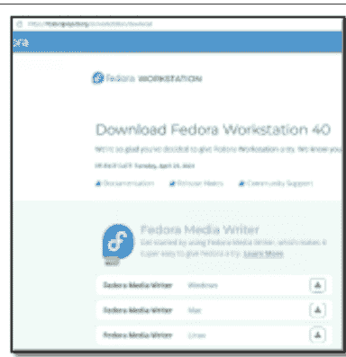

1. 下载 Fedora Media Writer。
2. 双击下载好的文件安装 Media Writer。
3. 安装完成后，通过开始菜单启动 Fedora Media Writer。在启动后的首界面，保持选中**自动下载**选项，点击**下一步**。

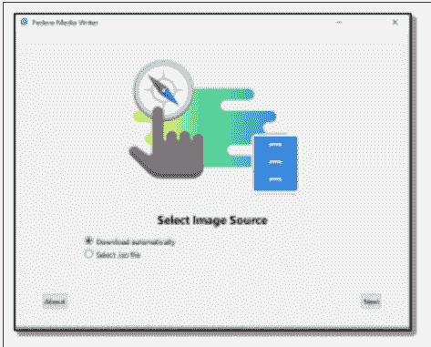
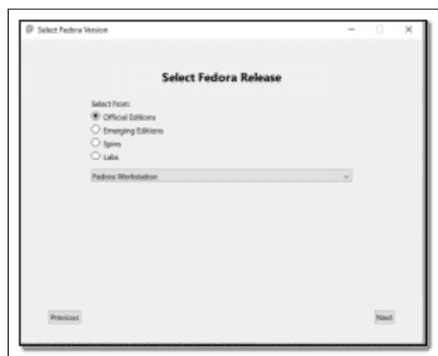

4. 保持所有预选选项不变（官方版本与 Fedora 工作站版），点击**下一步**。
5. 插入 U 盘。

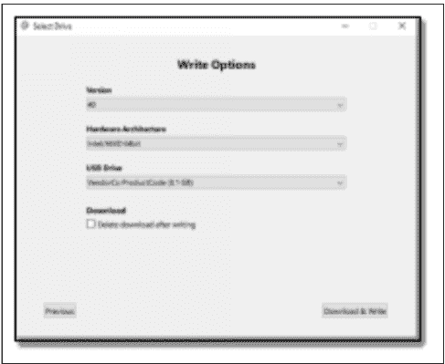

6. 在写入选项界面，确认 U 盘设备无误后，点击**下载并写入**按钮。
7. 下载与写入操作将自动开始。

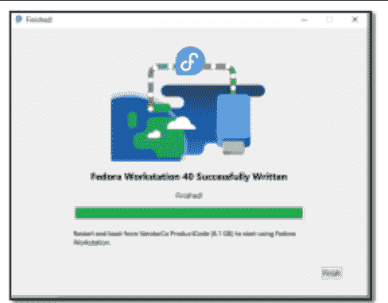

8. 写入流程完成后，拔出 U 盘。介质制作流程全部完成后，你可以在下一章使用这块可启动 U 盘开始安装 Fedora Linux。

## 第5章

### 安装步骤

安装 Fedora Linux 将为你开启一扇通往稳定、灵活操作系统的大门。本章将一步步带你完成整个安装流程，即使你此前没有任何 Linux 或计算机网络相关经验，也能轻松操作安装系统。本章将提供你所需的所有信息与资源，从系统准备、安装选项选择，到分区配置、安装后设置，助你顺利完成 Fedora Linux 安装并放心使用。以下是 Fedora Linux 的通用安装步骤：

1. 安装介质制作完成后，将其插入目标设备。
2. 启动计算机。
3. 修改启动顺序，将 U 盘设为第一启动设备。你可以参考系统说明书修改启动顺序，就我本人的联想笔记本而言，启动快捷键是 F12。

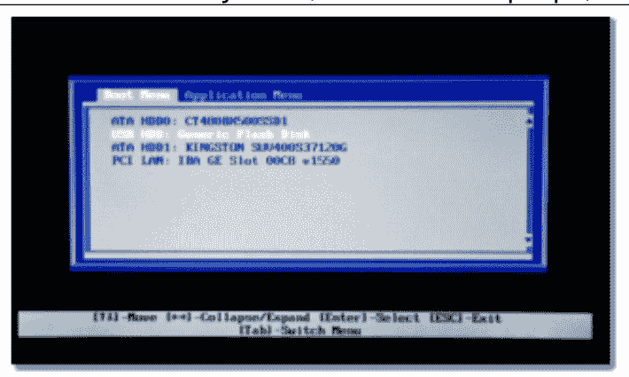

4. 选择 U 盘作为启动设备。

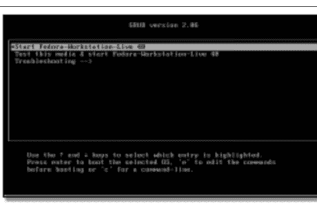

5. 选择**启动 Fedora-Workstation-Live 40**，按下回车键。

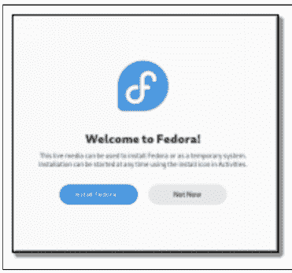

6. 按下**安装 Fedora**选项。
7. 选择语言与键盘布局。

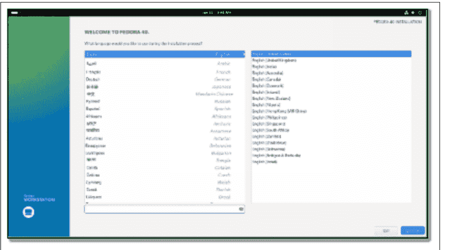
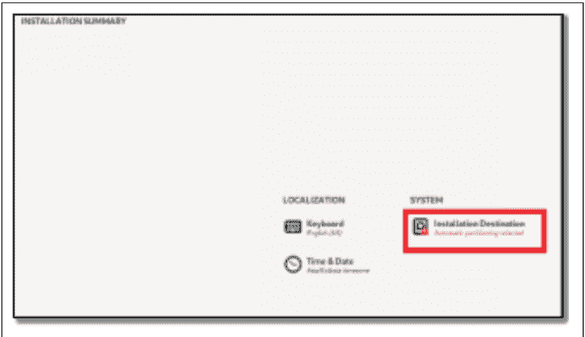

8. 点击“安装目标位置”（带有橙色标识的选项）。

### 磁盘配置

Fedora 工作站版安装时默认使用的文件系统是 Btrfs（B 树文件系统）。Btrfs 是一款现代写时复制（COW）文件系统，相较于 Ext4 等早期文件系统，具备快照、子卷等多种高级功能。工作站版安装过程中，你可以选择自动存储配置，该配置的磁盘布局如下：

| 挂载点 | 功能 | 文件系统类型 |
|-------------|----------|-----------------|
| `/boot/efi` | EFI 系统分区 | FAT 32 |
| `/boot` | 启动分区 | ext4 |
| `/` | 根子卷 | Btrfs |
| `/home` | 用户 home 子卷 | Btrfs |

根子卷用于存储系统安装文件，用户 home 子卷则存储用户数据及相关设置。

### 交换空间

如果你此前使用过 Fedora 或其他 Linux 系统，可能对交换空间有所了解。Fedora 工作站版不使用独立的交换分区，而是采用 ZRAM。ZRAM 是 Linux 的一项新特性，它将交换文件存储在压缩后的内存中，而非此前使用的硬盘中。内存的读写速度本来就远快于硬盘。在 Fedora 工作站版的安装器磁盘分区环节，除了默认的自动存储配置外，你还可以选择多种其他磁盘配置选项。这些选项可以让你根据自身需求自定义驱动器的分区与使用方式，满足复杂存储配置或特定需求。以下是一些可供选择的自定义磁盘配置选项：

- **手动配置：** 你可以根据自身偏好手动配置分区，而非使用安装器自动分区。这需要为`/`、`/home`、`/boot`、`/var`以及其他文件夹创建独立分区。手动分区可让你完全掌控磁盘空间的分配。
- **高级自定义（Blivet GUI）**：Blivet 是一款功能强大且灵活的存储管理应用，支持创建自定义磁盘分区、配置 LVM（逻辑卷管理）、处理加密等操作。

为简化操作，我们在 Fedora 安装过程中将使用**自动**存储配置。选择**自动**选项，然后点击“完成”。

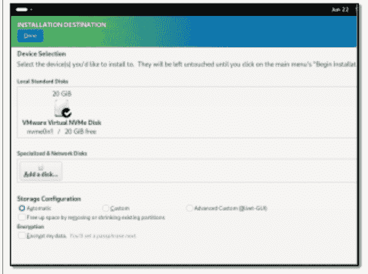

> 注意：此步骤适用于目标设备上的全新硬盘。如果系统中存有数据，请在安装前先做好备份。该步骤会清空计算机上的所有数据。

10. 如果系统已连接互联网，安装流程会自动确定时区；否则请手动选择对应的时区、日期和时间。完成设置后，点击**完成**按钮。

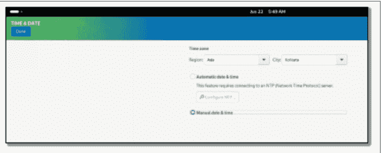

11. 按下**开始安装**。

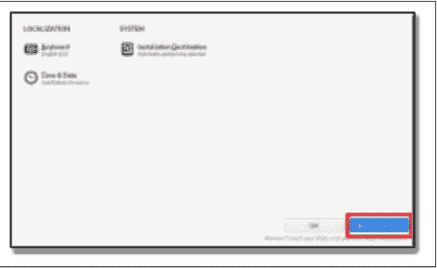

12. 系统将开始复制文件。

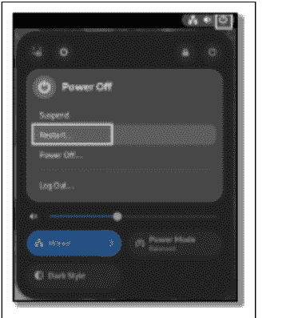

13. 按下**完成安装**，然后正常重启计算机。重启后，系统将执行安装后的任务。

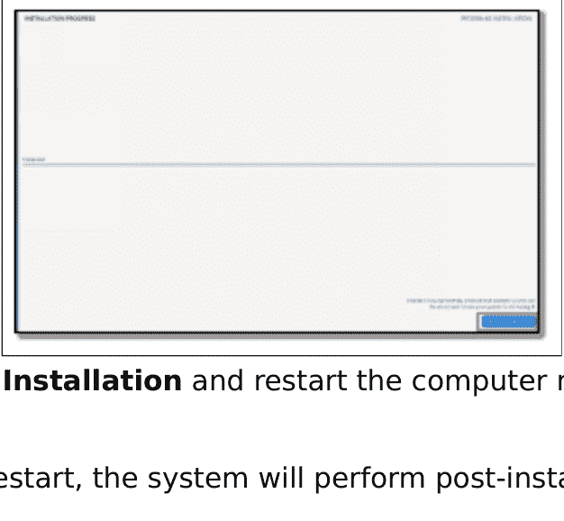

### 安装后任务

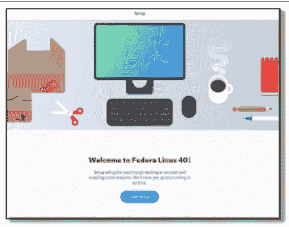

1. 在首个设置界面按下**开始**。

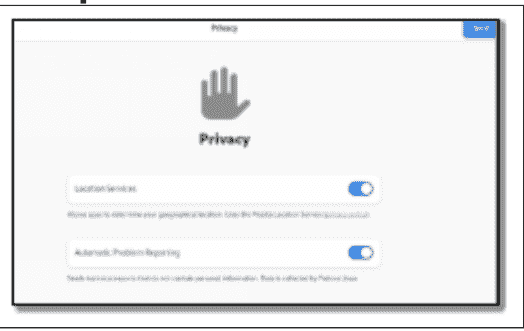

2. 在隐私设置界面按下**下一步**。
3. 按下**启用第三方软件源**，然后再次按下**下一步**。

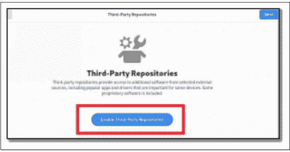

4. 向下滚动至下一界面，点击**允许**。
5. 输入你的全名，然后按下**下一步**。

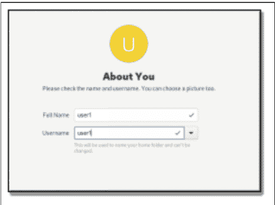

6. 两次输入密码，然后按下**下一步**。

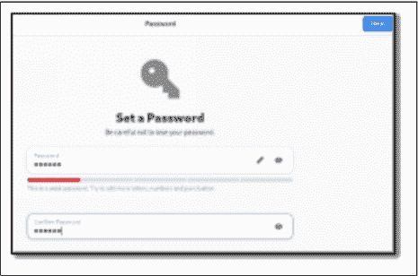

请记好该密码，后续所有管理员操作都需要用到它。

7. 按下**开始使用 Fedora**。

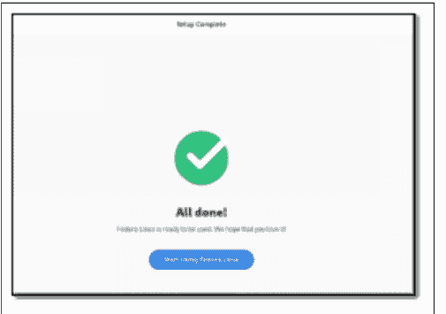

安装完成后，你可以按下**浏览简介**开始系统导览，也可以选择**跳过**。

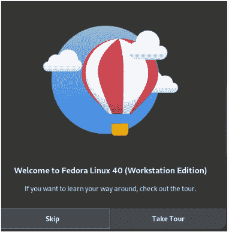

Fedora 完全安装完成后，你就可以开始探索这款功能丰富且安全的操作系统了。在后续章节中，我们将共同开启 Fedora Linux 的探索之旅，深入了解其丰富的功能特性。

## 第6章

### 认识你的桌面

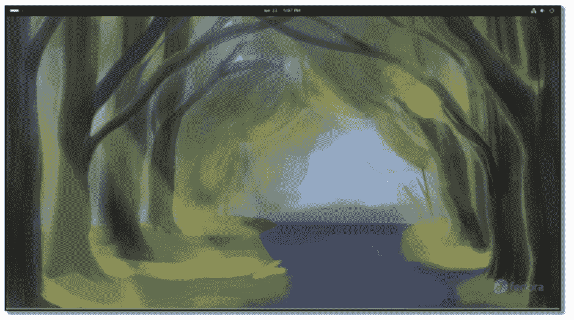

Fedora Linux 历来以 GNOME 作为默认桌面环境。GNOME（GNU 网络对象模型环境）是一款注重简洁性、易用性和可访问性的现代化桌面环境，拥有简单易用的界面，旨在提升用户工作效率。Fedora Linux 40 搭载了最新版本的 GNOME 46，其代号为“加德满都”。以下是对 GNOME 的详细介绍：

### 核心组件

GNOME 桌面环境的核心组成部分是协同工作的基础软件组件和工具，共同为 Linux 操作系统提供完整的用户界面和桌面体验。以下是 GNOME 的主要核心组件：

### GNOME Shell

GNOME Shell 是桌面的用户界面，也是 GNOME 的核心组件之一，负责执行切换窗口、打开应用、显示通知等标准 UI 任务。GNOME Shell 的主要组件如下：

- 顶部面板
- 系统菜单
- 活动概览
- 系统状态区
- 程序坞（Dash）
- 窗口选择器
- 搜索栏
- 应用切换器

### GTK（GIMP 工具包）

GTK 是一款免费跨平台的小部件工具包，可用于创建图形用户界面（GUI）、应用程序及小部件，同时支持自由软件和专有软件。它是 Wayland 和 X11 窗口系统中最受欢迎的工具包之一。

### GNOME 应用

在 GNOME 桌面中，GNOME 核心程序负责处理日常任务，通常会在 GNOME 系统中预装。以下是常见的应用程序列表：

- 文件：GNOME 默认的文件管理器。
- 终端：终端模拟器。
- 设置：系统设置控制面板。
- 日历、联系人和待办事项
- 音乐
- 视频

### GNOME 会话管理器

GNOME 会话管理器负责管理 GNOME 桌面环境的登录和会话操作，通常在用户在登录界面输入必要凭据后由显示管理器（如 GDM3）启动。

### 桌面组件说明

本节将重点介绍构成 Fedora 桌面界面的关键元素，阐述其核心组件对提升易用性和工作效率的重要性。

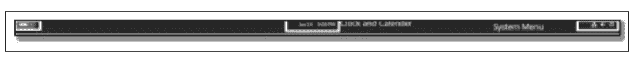

### 顶部面板

顶部面板分为三个主要区域：

- 系统菜单
- 时钟
- 活动按钮

### 系统菜单

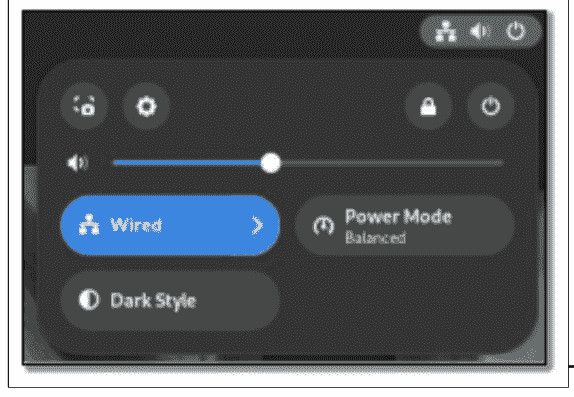

面板右上角有电源、扬声器、网络、电池和蓝牙图标。点击任意图标即可打开**系统菜单**，你可以通过该菜单调整扬声器和麦克风音量，还可以修改网络和蓝牙设置，同时也能找到系统设置、锁屏和关机菜单的快捷入口。

### 时钟

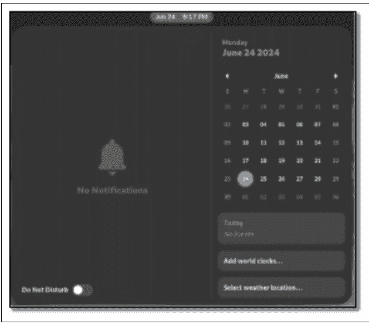

面板中间是时钟，默认以 24 小时制显示星期和当前时间。如有需要，你可以在系统设置中修改时间格式。点击时钟会弹出一个对话框，右侧显示日历，左侧显示所有任务通知，还带有一个勿扰滑动按钮，在你忙碌时可用来忽略通知。

### 活动按钮

顶部面板左侧是**活动**按钮。在 Fedora 的桌面设计中，活动按钮是核心导航入口，可提升工作区管理和多任务操作的效率。点击活动按钮，或按下键盘上的 Super 键（又称 Windows 键），即可打开活动概览，查看所有已打开的应用、虚拟桌面和常用应用。

### 活动概览元素

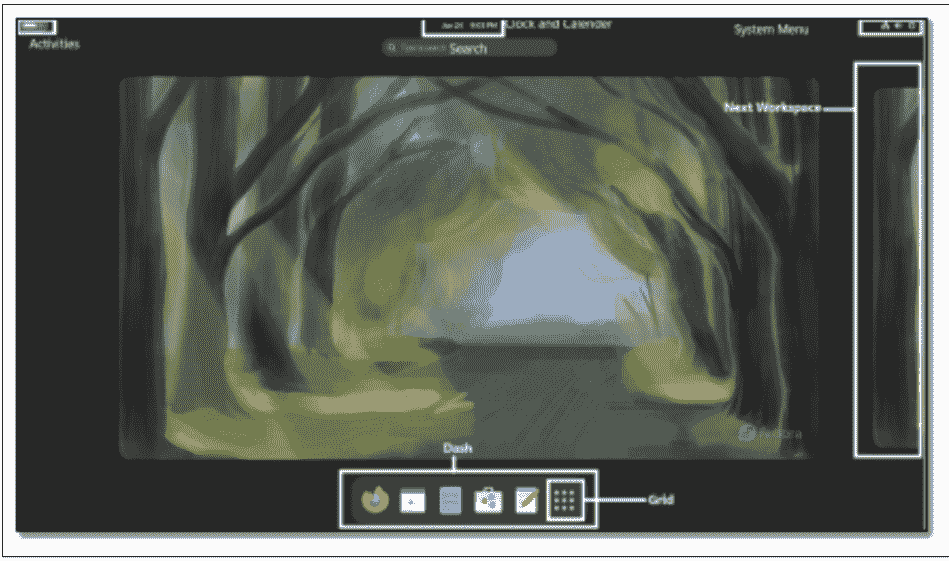

### 搜索栏

搜索栏是活动概览界面的主要元素之一，可用于在计算机中搜索应用、文档、设置、日历事件等内容。例如，在搜索栏中输入“计算器”，就会显示对应的计算器应用。

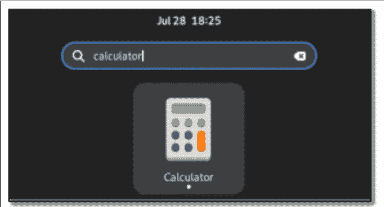

点击图标即可打开计算器应用。

### 窗口预览（窗口列表）

活动概览的第二个元素是所有已打开应用窗口的预览。点击目标应用窗口即可切换到该应用。要关闭正在运行的应用窗口，将鼠标悬停在窗口上，然后点击 X 按钮即可。

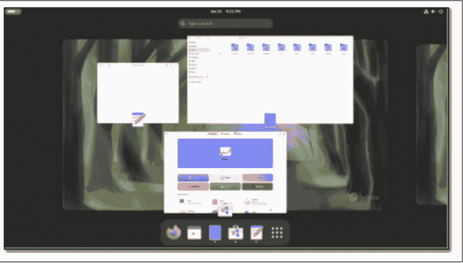
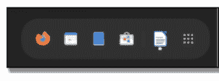

### 程序坞（Dash）

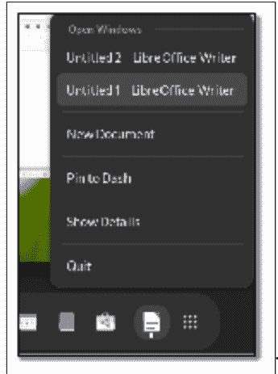

活动概览底部可以看到 Dash 栏（即程序坞）。程序坞可以让你快速访问常用和正在运行的程序。点击程序坞中的应用图标即可打开对应应用；图标底部的小圆点表示该应用正在运行。点击任何正在运行的应用图标，会打开该应用的最新窗口。右键点击图标可打开上下文菜单，通过该菜单可以打开新窗口，或选择该应用正在运行的任意窗口，还可以将当前应用添加或移出常用列表（Dash）。

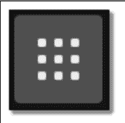

### 网格视图

仪表栏右侧有一个网格图标。点击该图标后，会显示所有应用程序的列表。图标按网格形式排列。程序列表可能包含多页；要翻到下一页，可使用鼠标的滚轮（中键）或点击网格底部的圆点。应用程序文件夹包含网格中的部分应用。点击应用程序文件夹即可查看其中包含的所有应用的列表。搜索栏可让你从应用列表中搜索所需应用。网格布局还在搜索栏下方包含了一个工作区列表。

### 设置

点击系统菜单中的“设置”将打开系统和硬件设置面板。配置界面分为两个窗格：左侧窗格显示设置列表，右侧窗格显示所选设置的说明。可使用鼠标滚轮滚动设置列表。假设你想更改电脑的桌面背景，在左侧窗格中选择“外观”，然后在右侧窗格中从可用壁纸列表里选择壁纸即可。搜索选项也位于系统设置的顶部栏中，使用搜索选项可以查找任何与设置相关的内容。假设你想更改日期和时间，只需按下搜索按钮输入日期即可，系统会在左侧窗格中提供所有与日期相关的选项列表。

#### 注销

Linux 允许你与其他用户共用这台设备。若要允许其他用户访问你的电脑，请先注销。当你选择**注销**时，所有已打开的程序都会关闭。

#### 锁定

当你短时间不使用电脑时，最好锁定屏幕，避免他人擅自使用。系统屏幕锁定后，所有正在运行的应用程序会继续运行。如需重新登录，输入你的登录密码即可解锁屏幕。如果你长时间离开电脑，系统会自动锁定屏幕。要手动锁定屏幕，可点击顶部栏右侧的系统菜单，然后点击挂锁图标。也可以使用 Super+L 键盘快捷键锁定屏幕。解锁时，在锁定屏幕上输入密码并按 ENTER 键即可。

#### 挂起

对于笔记本电脑，Fedora 会在盖子闭合时将系统切换至挂起模式。为了节能，系统在挂起模式下功耗极低。所有应用程序在挂起模式下会继续运行，但屏幕和其他非必要组件会关闭以节省电量。要手动将系统切换至挂起模式，可点击顶部栏右侧的系统菜单，点击电源按钮打开折叠菜单，然后选择**挂起**选项。

#### 关机/重启

要关闭或重启电脑，点击顶部栏右侧的系统菜单，然后点击电源按钮打开折叠菜单，再选择**关机**或**重启**选项。随后会弹出对话框，点击对应的按钮即可。

### 窗口

GNOME 通过窗口展示你正在运行的应用程序，这是同时运行多个进程的方式之一。你启动的每个应用程序都会在新窗口中打开，本节将介绍窗口的相关操作。

### 列出窗口

只需点击“活动”按钮即可查看所有打开的窗口。要从列表中选择窗口，使用鼠标左键即可。

### 切换窗口

你可以通过键盘在窗口间切换。要打开窗口切换器，按下 Super 键+TAB。按住 Super 键，松开后按下 TAB 键即可在打开的窗口间循环切换。

> **注意**：你键盘上的这个按键被称为 Super 键。

### 最大化与还原窗口

你可以最大化窗口，让其内容铺满整个桌面，也可以取消最大化（还原）窗口到原来的大小。

#### 最大化窗口

要最大化窗口，按住鼠标左键点击窗口标题栏以抓取标题栏，将其拖动到顶部栏即可。另一种方法是双击窗口标题栏上的鼠标左键。使用键盘的话，按下 Super+向上箭头即可最大化窗口。

#### 还原窗口

要将窗口恢复到原始大小，抓取窗口标题栏并将其拖离顶部栏，或者直接双击窗口标题栏即可。使用键盘还原窗口的话，按下 Super+向下箭头即可。

### 平铺窗口（窗口贴靠）

你可以将两个窗口并排摆放，方便复制文件或对比两个窗口的内容。该功能在微软 Windows 系统中被称为“窗口贴靠”。要将窗口贴靠到屏幕左侧，按下 Super+向左箭头；要将窗口贴靠到屏幕右侧，选中窗口后按下 Super+向右箭头。使用鼠标贴靠窗口的话，抓取窗口标题栏并将其拖动到屏幕左侧或右侧，直到半个屏幕被高亮显示即可。

### 工作区

工作区是用于优化窗口管理的虚拟桌面。如果有多个处于活动状态的工作区，搜索栏下方会显示工作区列表。要切换工作区，点击对应工作区即可。工作区也会显示在窗口列表的左右两侧。只需将正在运行的应用程序窗口拖动到新工作区即可：如果是第一个工作区，就拖动到右侧；如果有超过两个工作区，就拖动到左侧。工作区的数量默认是动态的，不过你也可以在选项中设置固定数量的工作区。

### 切换工作区

工作区本质上是虚拟桌面，相当于在同一桌面上配备多台显示器。如果你同时使用多个应用程序，工作区是非常出色的整理工具。

- 要将应用程序从一个工作区移动到另一个工作区，按下“活动”按钮查看窗口和工作区列表，抓取窗口标题栏并将其移动到屏幕右侧的新工作区即可。
- 删除工作区中的所有窗口即可移除该工作区。
- 如果你有多个工作区，搜索栏和窗口列表之间会出现工作区选择器。
- 要切换到某个工作区，可以点击“活动”按钮后选择对应工作区，也可以使用键盘快捷键 Super+PageDown 或 Super+PageUp（在屏幕右侧操作）。
- 要移动到某个工作区，点击“活动”按钮选择对应工作区，或者按下键盘上的 Super+PageDown 和 Super+PageUp 快捷键即可。

### 获取帮助

获取 Fedora Linux 的支持非常简单。在图形用户界面环境中，按下 F1 键即可获取当前活动应用的相关信息。假设你正在使用文本编辑器，需要获取相关帮助，按下 F1 键即可。

### 命令行帮助

使用命令行界面时，有多种方式可以获取帮助。

#### 手册页

Linux 中的 `man` 命令用于显示任意命令的用户手册页。你可以通过 `man` 命令获取命令的基本使用帮助，以及所有选项和开关的相关说明。

##### 语法

```
man command
```


## 示例

```
man cp
```

## Info命令

`info`命令可以提供关于命令的详细信息。

### 语法

```
info command
```

### 示例

```
info cp
```

## --帮助

要快速获取帮助，你也可以为命令添加`--help`选项。

### 示例

```
cp --help
```

## apropos关键字搜索

如果你不知道执行某项任务对应的命令，可以使用`apropos`命令搜索手册页。

### 示例

```
apropos copy
```

该命令会显示所有名称或描述中包含“copy”字符串的命令。

## whatis命令查询

`whatis`命令用于展示命令的单行用法。

### 语法

```
whatis command
```

### 示例

```
whatis cp
```

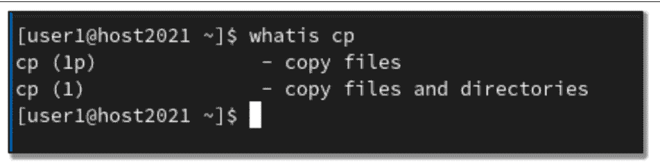

如果你遇到任何 Fedora 相关问题，都可以前往 https://ask.fedoraproject.org/ 向 Fedora 社区寻求帮助。

## 第8章 Sudo

`sudo`命令允许你以其他用户的安全权限运行应用程序（默认情况下为超级用户）。它会要求你输入个人密码，并通过校验系统管理员配置的名为`sudoers`的文件来确认你的命令请求。该方法允许你将部分管理职责委托给权限较低的用户，且无需提供管理员的密码。

修改系统配置的特权命令示例：

```
sudo dnf install gzip
```

或更改主机名：

```
sudo hostnamectl set-hostname host2021
```

### 以其他用户身份运行命令

**语法**

```
sudo -u user command
```

**示例**

```
sudo -u user2 hostnamectl
```

在**交互模式**下使用`sudo`：

```
sudo -i
```

### 修改 Sudo 配置

Sudo 的配置保存在`/etc/sudoers`文件中。要修改 sudo 配置，请使用`visudo`命令。该命令本质上会启动 vi 编辑器并修改`/etc/sudoers`文件。管理员必须运行`visudo`命令。`/etc/sudoers`文件包含用户列表以及他们可执行的命令：

```
user host=(users) [NOPASSWORD:]commands
```

### 示例

```
%operators localhost = (apache) /usr/sbin/
```

## 第9章 更新

更新包括关键错误修复、安全补丁和新功能。定期更新有助于提升计算机操作系统和程序的性能、稳定性与安全性。安装更新可确保系统安全高效地运行。

Fedora 会自动检查已安装程序的新更新，并提醒你进行更新。全新安装后，你可以通过两种方式手动更新系统：图形用户界面或命令行。

### 通过图形用户界面更新系统

1. 点击 **Activities**。


2. 点击停靠栏上的软件图标。

3. 点击“更新”选项卡。

4. 点击**更新**（部分情况下为**重启并更新**）。

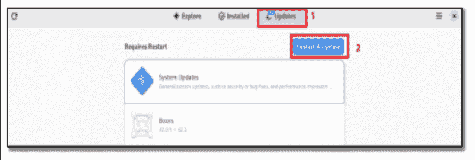

5. 如果选择“重启并更新”，系统将在更新完成后重启；否则，系统仅完成更新。

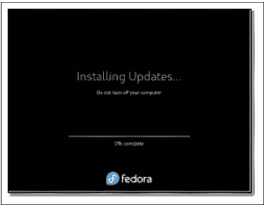

### 使用命令行更新

```
sudo dnf -y update
```

## 第10章 添加桌面环境

与其他 Linux 发行版一样，Fedora 支持自定义使用体验、提升性能、访问特定软件、个性化桌面环境，以及探索 Linux 生态系统的其他元素。如果你想添加更多自选的桌面环境，可以轻松将其安装到现有系统中。

添加或更换桌面环境的原因通常包括以下几点：

- **用户偏好**：不同的桌面环境提供独特的用户界面和工作流。
- **性能**：部分桌面环境比其他环境占用更少的系统资源。
- **应用可用性**：部分应用或工具可能在特定桌面环境中可用性更高或兼容性更好。
- **自定义能力**：每个桌面环境都有独有的自定义选项，这些选项在其他环境中可能并不提供。
- **探索与学习**：尝试多种桌面环境有助于你深入了解其他 Linux 桌面用户界面及生态系统。

如前所述，Fedora 40 的默认桌面环境是 GNOME3。它在硬件加速下运行效果最佳。建议使用旧显卡技术或有特定桌面环境需求的用户选择其他桌面环境。

桌面环境可添加到现有安装中，并通过登录界面访问。要列出可用的桌面环境，请运行`dnf grouplist`命令：

```
sudo dnf grouplist -v hidden | grep Desktop
```

### 安装所需的桌面环境

```
sudo dnf groupinstall "KDE Plasma Workspaces"
```

上述命令用于安装 KDE 桌面环境，你也可以通过相同方式安装其他桌面环境。

### 命令行界面

Fedora 为大多数任务提供了非常友好的图形用户界面，但在使用 Linux 时，你也需要熟悉命令行界面。本章将介绍命令行界面。

### GNOME 终端

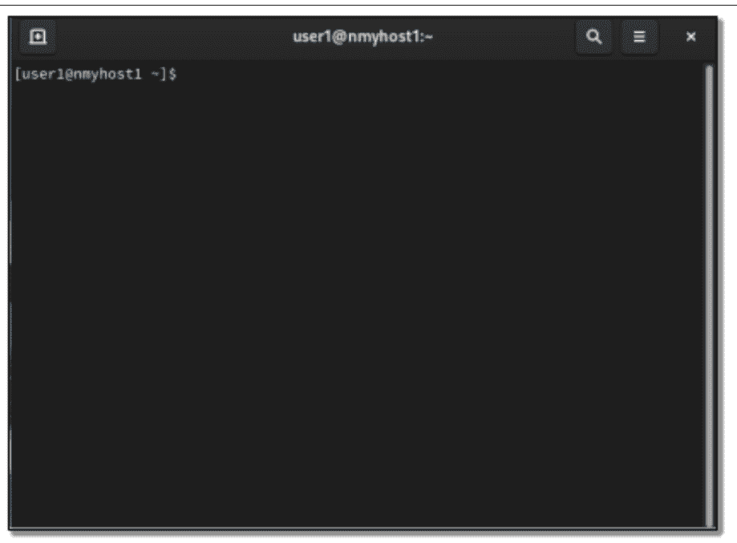

GNOME 终端是一款与 GNOME 桌面环境配套的终端模拟器。终端可访问 Linux Shell 环境，用于运行程序。终端提供交互式命令行界面。与图形用户界面不同，你需要输入应用程序名称后按下 Enter 键来启动程序，这被称为命令行输入。

### 打开 GNOME 终端

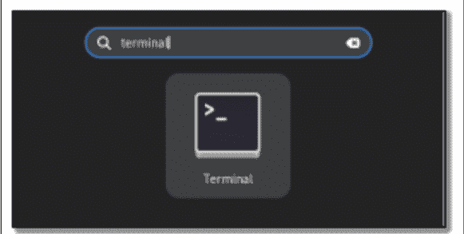

按下 **Activities**，在搜索栏中输入`terminal`，然后选择终端图标。

### 快捷键

以下是 GNOME 终端的一些基础快捷键：

| 键盘快捷键 | 功能 |
|-------------------|------|
| Ctrl + A | 将光标移至命令提示符开头 |
| Ctrl + E | 将光标移至命令提示符末尾 |
| Ctrl + U | 清空当前行 |
| 鼠标中键点击 | 粘贴高亮的文本 |
| Tab | 补全命令 |
| 向上/向下方向键 | 显示命令历史 |
| Ctrl + C | 终止当前进程 |
| Ctrl + Z | 挂起前台进程 |

### 命令

让我们了解一些基础且重要的命令。

#### `date`

打印或修改系统日期和时间。

**语法**

```
date
```

**示例**

- 查看日期：

```
date
```

- 设置日期：

```
sudo date -s "24 feb 2017 19:00"
```

#### `cp`

复制文件的命令。

**语法**

```
cp <options> source destination
```

**示例**

```
cp /home/abc.txt /home1/
```

- 递归复制目录中的所有文件：

```
cp -R /home/* /home1/
```

- 覆盖前发出提示：

```
cp -i /home /home1
```

- 将所有新文件复制到目标目录：

```
cp -u * /tmp
```

- 强制复制文件：

```
cp -f /tmp/abc.txt /backup/.
```

- 不替换已有文件，直接跳过：

```
cp -n * /backup/.
```

#### `ls`

列出文件名。

**语法**

```
ls -<options>
```

**示例**

| 命令 | 说明 |
|---------|-------------|
| `ls -al` | 列出目录和文件 |

#### `cat`

显示文本文件。

**语法**

```
cat filename
```

**示例**

```
cat abc.conf
```

#### `rm`

删除单个文件、多个文件或目录。

**语法**

```
rm filename
```

**示例**

```
rm abc.conf
```

递归删除`abc`目录：

```
rm -r abc
```

#### `more`

每次分页显示一整屏文本。

**语法**

```
more filename
```

**示例**

```
more /etc/hosts
```

#### `less`

`less`命令是一个与`more`类似的程序，但支持在文件中向前和向后浏览。

**语法**

```
less filename
```

**示例**

```
less /etc/hosts
```

#### `mv`

`mv`命令用于将文件从一个位置移动到另一个位置，也可以使用该命令重命名文件而无需移动其位置。

##### 移动文件

**语法**

```
mv filename destination_directory
```

**示例**

```
mv a.txt /tmp/
```

该命令会将当前目录下的`a.txt`文件移动到`/tmp`目录。

##### 重命名文件

**语法**

```
mv filename newfilename
```

**示例**

```
mv a.txt b.txt
```

#### `grep`

在一个或多个文件中搜索字符串，并显示所有包含该字符串的行。

**语法**

```
grep string file
```

**示例**

```
grep '127.0.0.1' /etc/hosts
```

#### `head`

将文件的前 10 行输出到标准输出，你也可以指定要显示的行数。

**语法**

```
head option file
```

**示例**

```
head -20 /etc/mime.types
```

该命令会显示`mime.types`文件的前 20 行。

#### `tail`

将文件的最后 10 行输出到标准输出，你也可以指定要显示的行数。

**语法**

```
tail option file
```

**示例**

```
tail -20 /var/log/logfile
```

该命令会显示该文件的最后 20 行。

使用`tail`持续监控文件：

```
tail -f /var/log/logfile
```

该命令会持续显示不断增长的文件的末尾，按下`Ctrl + C`即可中断。

#### `diff`

比较两个文件。

**语法**


# diff

- **功能**：比较两个文件的差异
- **语法**：`diff file1 file2`
- **示例**：要比较`abc.txt`和`bbc.txt`的差异，运行`diff abc.txt bbc.txt`

# file

- **功能**：判断文件类型
- **语法**：`file file_name`
- **示例**：`file bbc.txt`

# echo

- **功能**：显示指定文本
- **语法**：`echo text`
- **示例**：`echo hello`

## 使用Nano编辑文件

Nano是一款专为命令行模式编辑文件设计的文本编辑器，高度借鉴了非常流行的Pico文本编辑器。本章我们将介绍Nano编辑器的基础用法。

### 启动Nano

打开命令终端，输入`nano`即可启动编辑器，或者输入`nano file_name`直接打开指定文件。

### 保存文件

按下`Ctrl + o`保存文件，编辑器会提示你输入文件名。

### 搜索与替换

- 搜索文本：按下`Ctrl + w`，输入要搜索的文本，即可在文档中找到匹配内容；按下`Alt + w`可查找下一个匹配项。
- 替换文本：按下`Ctrl + \`，输入要搜索的文本，再输入替换文本并按回车。按下`y`可替换当前匹配项，按下`a`可替换所有匹配项。

### 光标移动

你可以使用方向键在编辑器中移动光标：按下`Ctrl + a`将光标移到行首，按下`Ctrl + e`将光标移到行尾。

### 复制与粘贴

- 选择文本：按下`Ctrl + ^`标记选择起始位置，按下`Alt + ^`标记选择结束位置。
- 粘贴：将光标移到目标位置，按下`Ctrl + o`进行粘贴。

### 剪切与粘贴

- 按下`Ctrl + ^`标记剪切起始位置，移动光标选中要剪切的内容，再按下`Ctrl + k`完成剪切。
- 将光标移到目标位置，按下`Ctrl + u`粘贴剪切的内容。

### 文本对齐

按下`Ctrl + j`可对选中的文本进行对齐（自动换行以适应屏幕宽度）。

### 退出

按下`Ctrl + x`退出Nano。如果存在未保存的更改，系统会提示你保存。

Nano是一款功能强大且易用的文本文件编辑工具。其简洁的命令和直观的界面让使用门槛极低。无论你是刚入门的新手，还是寻找高效轻量编辑器的资深用户，其精心设计的功能都能满足所有人的需求。

## 第13章 个性化你的桌面

GNOME桌面的风格和外观可以非常轻松地修改。你可以根据自己的喜好和使用习惯定制桌面。我们将调整多个设置来自定义你的桌面，不需要修改每一个设置。

### 更改系统主题

GNOME 46的亮点之一就是深色主题。要修改系统主题：

1. 在**系统菜单**中点击**设置**图标。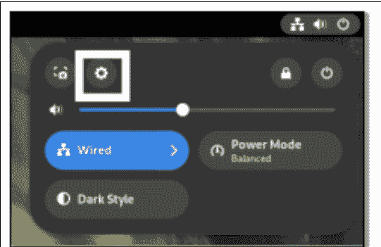
2. 在设置窗口的左侧面板中点击**外观**。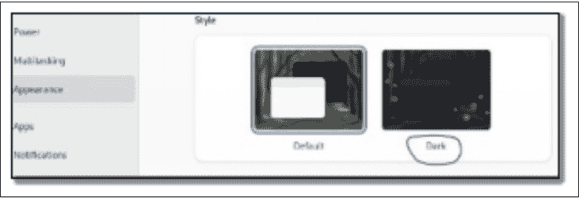
3. 选择主题，你可以选择浅色或深色主题。

### 更改桌面背景

1. 在左侧面板中选择**外观**。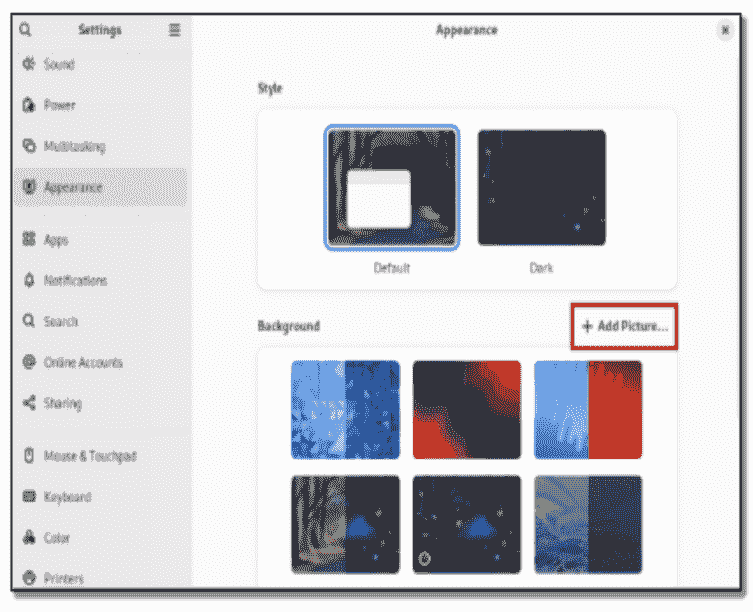
2. 在右侧面板中，找到背景类别的图片，部分图片采用双色调设计，分别对应浅色和深色主题的壁纸。从列表中选择一张图片。
3. 要添加其他图片作为背景，点击**添加图片**。系统会显示用户的图片文件夹，选中图片后点击**打开**按钮。之后你可以点击刚添加的图片，将其设置为桌面背景。

### 更改提示音

系统会为每条消息或事件播放提示音。要更改提示音：

1. 在设置窗口的左侧面板中选择**声音**。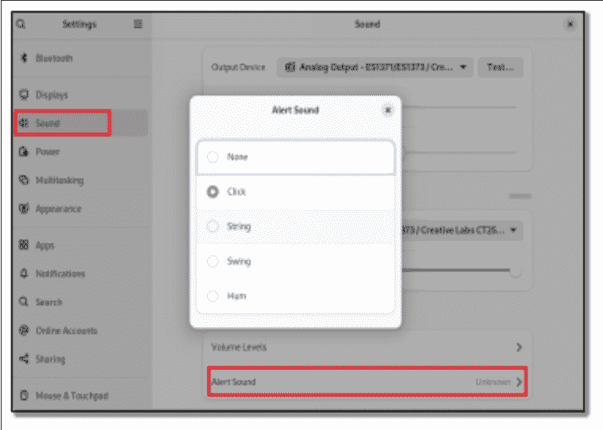
2. 在右侧面板中选择**提示音**。
3. 在弹出的窗口中选择你想要的声音。

### 更改屏幕隐私

#### 自动熄屏

当你一段时间不使用电脑时，屏幕会自动熄灭以保护隐私。相关设置如下：

1. 在设置窗口的左侧面板点击**隐私与安全**。
2. 点击**屏幕锁定**。
3. 选择**熄屏延迟**，设置屏幕自动熄灭的时长，可以在右侧面板的下拉菜单中选择1到15分钟。如需关闭自动熄屏功能，在下拉菜单中选择“从不”即可。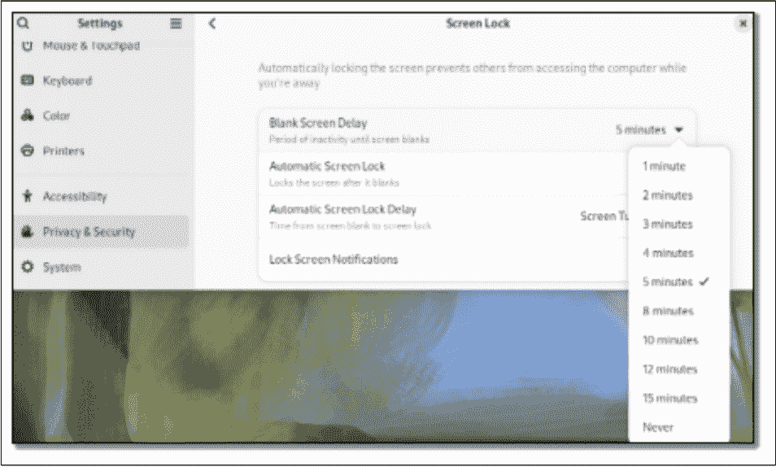

#### 自动锁屏

自动锁屏是设备的安全与隐私功能，当电脑一段时间无操作后，屏幕会自动锁定，你需要输入登录密码才能解锁。要更改自动锁屏的设置，请在设置窗口的**屏幕锁定**面板中调整以下设置：

1. **自动锁屏**：将滑块向右滑动以启用自动锁屏功能。
2. **自动锁屏延迟**：使用下拉菜单选择无操作的时长，可从30秒到1小时。
3. **锁屏时显示通知**：使用滑块启用或禁用锁屏通知。

个性化你的Linux桌面绝不只是为了好看，更是为了打造能提升你的工作效率、体现个人风格的使用环境。定制化过程涵盖功能与美观两个维度，从自定义主题、图标，到设置工作流和隐私选项都包含在内。本章之外还有更多桌面定制化的内容等你探索，你可以调整更多设置来适配自己的工作流和个人喜好。通过将各项功能调整成你想要的样子，你不仅能提升桌面的视觉观感，还能打造完全属于你的工作空间。拥抱Linux的自由，探索无限可能，打造每一天都能给你带来灵感和力量的桌面环境。

### 更改日期、时间及时区

任何计算机系统的日期和时间设置都至关重要。大量操作（例如自动备份、系统日志）都依赖日期和时间。调整Linux桌面的日期和时间，可以保障系统稳定运行、提升安全性、促进协作并维护系统完整性，是打造可靠、高效计算机环境的必备操作。

日期和时间会显示在顶部栏的中央。如果时钟上的日期和时间不准确或格式错误，你可以按照以下步骤修改：

1. 在**系统菜单**中点击**设置**。
2. 在设置窗口的左侧面板中选择**系统**。
3. 在右侧面板中选择**日期和时间**。
4. 将**自动日期和时间**的开关切换到关闭状态，即可手动更新日期和时间。当开关处于开启状态时，系统会从互联网自动更新时间。
5. 点击**日期和时间**，即可调整时间和日期。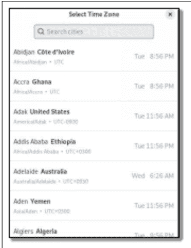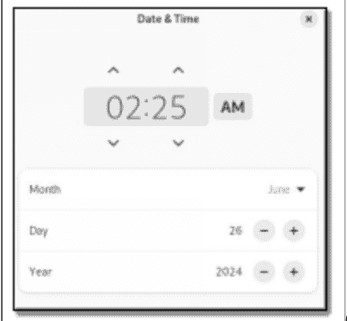
6. 如果当前时区错误，你可以通过搜索**时区**来修改它。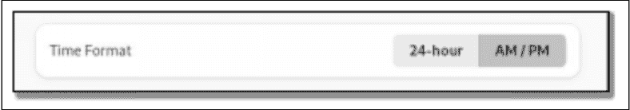
7. 如有需要，可以使用开关将时间格式从24小时制切换为AM/PM制，或反向切换。

日期和时间相关设置如下表：

| 设置项 | 说明 | 当前状态 |
| --- | --- | --- |
| 自动日期和时间 | 需要联网 | 关闭 |
| 日期和时间 | - | 2024年6月26日，凌晨2:16 |
| 自动时区 | 需要开启定位服务并联网 | 开启 |
| 时区 | - | IST（印度加尔各答） |
| 时间格式 | - | 24小时制 AM/PM |

### 时钟与日历

时钟与日历设置板块用于控制顶部栏中日期和时间的显示方式，右侧的滑动按钮可以显示或隐藏以下内容：

| 选项 | 说明 |
| --- | --- |
| 星期 | 显示或隐藏星期 |
| 日期 | 显示或隐藏日期 |
| 秒数 | 显示或隐藏秒数 |
| 周数 | 在下拉日历中显示周数 |
| 显示在下拉日历中 | 显示或隐藏下拉日历 |

### 命令行

你也可以使用`timedatectl`命令修改系统的日期和时间。

#### 显示当前日期和时间

运行以下命令查看当前日期和时间：

```bash
timedatectl
```

#### 修改当前时间

##### 语法

```bash
timedatectl set-time HH:MM:SS
```

##### 示例

要修改时间，请输入24小时制格式的时间。例如，将时间设置为下午2:28：

```bash
sudo timedatectl set-time 14:28:00
```

#### 修改当前日期

> **注意**：修改时间时必须同时设置日期，否则当前时间将被重置为00:00:00

##### 语法

```bash
timedatectl set-time YYYY-MM-DD HH:MM:SS
```

##### 示例

```bash
sudo timedatectl set-time "2022-07-11 14:28:00"
```

如果系统在安装时已连接到互联网，系统会通过NTP自动从网络同步时间。使用以下命令可禁用NTP同步。

##### 语法

```bash
timedatectl set-ntp true or false
```

##### 示例

```bash
sudo timedatectl set-ntp false
```

#### 时区

#### 列出可用时区

```bash
timedatectl list-timezones
```

#### 更改当前时区

##### 语法

```bash
timedatectl set-timezone time_zone
```

##### 示例

```bash
sudo timedatectl set-timezone Asia/Muscat
```

#### date命令

显示当前日期和时间

```bash
date
```

#### 更改当前时间

##### 语法

```bash
date --set HH:MM:SS
```

##### 示例

```bash
sudo date --set 14:28:00
```

#### 更改当前日期和时间

##### 语法

```bash
date --set YYYY-MM-DD HH:MM:SS
```

##### 示例

```bash
sudo date --set "2020-04-11 14:28:00"
```

按照本章中的操作步骤，你可以有效管理Fedora Linux的日期和时间设置，确保系统和应用配置正确。如果遇到问题或需要进一步自定义设置，请参考Fedora官方文档或搜索额外的在线支持。

## 第15章 网络

### 计算机网络究竟是什么？

计算机网络是互联的计算机和计算设备的集合。这种连接允许该组内的多台计算机和设备之间进行通信。计算机和设备可以通过有线、光纤或微波进行通信。网络有多种类型，但我们将重点介绍TCP/IP，因为它是使用最广泛的协议。TCP/IP广泛应用于局域网（LAN）和广域网（WAN），包括互联网。个人电脑通常使用网络连接到互联网，或共享文件和打印机。网络连接可以是有线的，也可以是无线（如Wi-Fi）的。本章将介绍这两种网络类型。

### 📶 连接无线网络

如果你在桌面顶部栏看到了Wi-Fi图标，说明你的系统已连接到无线网络。否则，请按照以下步骤连接家庭或办公无线网络：

- 点击**系统菜单**。
- 点击**Wi-Fi**按钮右侧的“>”符号，即可显示可用网络。
- 点击要使用的Wi-Fi网络名称。

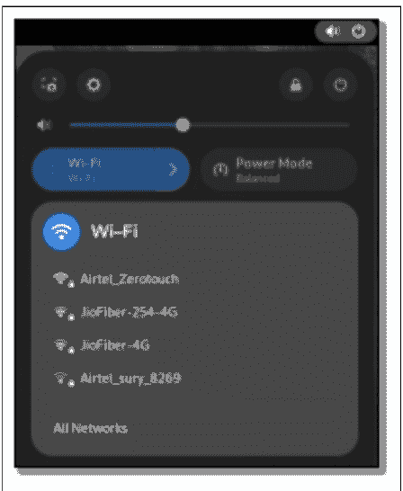

- 如果网络设有密码保护，在密码输入框中输入密码后，点击**连接**。


- 网络连接成功后，顶部栏会显示Wi-Fi图标。

### 更改Wi-Fi密码

如果因任何原因你在Wi-Fi路由器上更改了Wi-Fi网络密码，就必须在设备上配置相同的密码，否则下次将无法连接。

- 打开“设置”。
- 点击左侧面板中的“Wi-Fi”。在“可见网络”区域中，点击所选网络名称右侧的齿轮按钮，会弹出窗口。

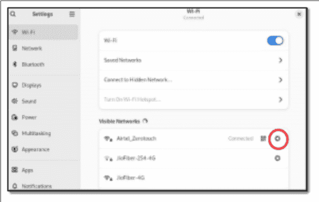

- 在“安全”标签页中，修改密码后点击“应用”。

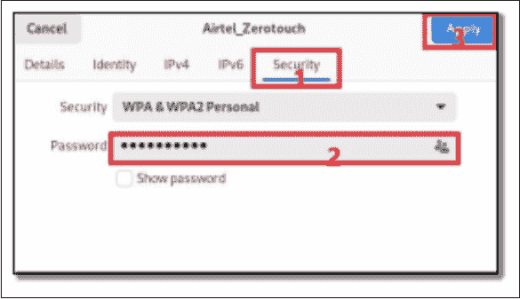

### 有线网络

连接有线网络非常简单，只需将网线插入电脑即可。系统会自动为可用网络配置网络设置。系统连接到有线网络后，顶部栏会显示网络图标。

### 手动配置有线网络

大部分时候有线网络会自动配置，但在某些情况下（特别是办公环境中），你需要手动指定IP地址，这种配置方式被称为“静态IP地址配置”。

#### 配置静态IP地址的方法

- 进入系统菜单。
- 点击**有线**按钮右侧的“>”符号。

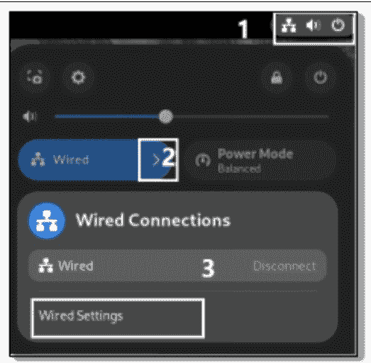

- 点击**有线**设置。
- 此时会弹出网络设置窗口。

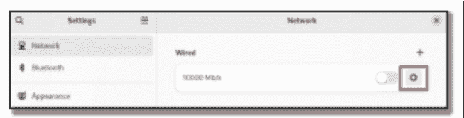

- **有线**字段会显示网络状态，点击齿轮图标。
- 此时会打开**有线**配置文件对话框。


- 在“详细信息”标签页中，确保已勾选**自动连接**选项。
- 点击“IPv4”标签页。

1. 点击**手动**单选按钮。
2. 输入IP地址。
3. 输入子网掩码。
4. 输入网关。
5. 输入DNS。


- 点击**应用**。

#### 命令行

#### 显示IP地址

```bash
ip addr show
```

#### 显示链路状态

```bash
ip link show
```


高亮文本显示链路状态。

#### 显示路由表

```bash
ip route
```

#### 检查网络连通性

##### 语法

```bash
ping ipaddress/hostname
```

##### 示例

```bash
ping 192.110.22.121
```

#### 检查并更改主机名

Linux中的计算机名称称为主机名，要更改主机名，可以使用`hostnamectl`命令。

##### 显示当前主机名

```bash
hostnamectl
```

##### 更改主机名

###### 语法

```bash
hostnamectl set-hostname newname
```

###### 示例

```bash
sudo hostnamectl set-hostname myhost1
```

##### dig命令：DNS查询并显示结果

###### 语法

```bash
dig hostname
```

###### 示例

```bash
dig microsoft.com
```

##### telnet

用于连接目标主机端口，或测试主机和端口的可达性。

###### 语法

```bash
telnet hostname port
```

###### 示例

```bash
telnet myserver1 8080
```

##### nslookup

查询互联网域名服务器。

###### 语法

```bash
nslookup hostname
```

###### 示例

```bash
nslookup microsoft.com
```

##### scp

通过网络在两台主机之间安全复制文件。

###### 语法

```bash
scp filename user@targetserver:/path
```

###### 示例

```bash
scp ast.txt user1@server2:/home/user1
```

##### ssh

用于安全登录目标服务器。

###### 语法

```bash
ssh user@targethost
```

###### 示例

```bash
ssh user1@server2
```

##### nmap

扫描服务器的开放端口。

###### 语法

```bash
nmap hostname
```

###### 示例

```bash
nmap cloudflare.com
```

### 应用管理

Fedora是一款开源操作系统，可访问多种软件，其中大部分可免费使用。分发这些软件的不同公司采用多种形式的协议，通常称为许可证。软件仓库是存储这些软件产品的站点。Fedora Workstation默认启用一系列软件仓库，支持你更新预装软件、安装新的软件包和程序。

工作站默认的软件仓库包括：

- **官方Fedora RPM仓库：** 所有Fedora工作站系统组件和必备应用都可以通过Fedora官方仓库以RPM格式获取。
- **Fedora Flatpak仓库：** Flatpak是访问和管理Fedora及其他Linux发行版上大量桌面应用的便捷方式，凭借其沙盒机制具有灵活性和安全优势。Flatpak软件分发工具已在工作站上预装，同时提供由Fedora团队制作并托管的Flatpak应用仓库，支持安装。
- **Linux供应商固件服务（LVFS）：** Linux供应商固件服务（LVFS）是一个旨在以统一、安全的方式向Linux用户分发固件升级的项目。Fedora工作站使用`fwupd`工具从LVFS下载固件更新，该功能默认启用。

### 第三方仓库

在某些情况下，用户可能希望添加第三方仓库，以获取官方仓库中未提供的新软件或软件包。Fedora Workstation自带多个第三方仓库，这些软件仓库由Fedora以外的项目和组织维护，可提供比默认仓库更丰富的软件选择。用户可以在初始设置过程中或软件中心中通过点击按钮轻松启用它们。

### 软件中心

Fedora Workstation默认自带GNOME软件应用，它提供了用于管理本机软件的用户友好型图形界面，软件中心是最便捷的管理方案，你可以用它来安装、卸载和更新应用。

以下是Fedora Workstation上GNOME软件的主要特性和功能：

- **图形化软件包管理：** 提供经过筛选的应用集合，在图形环境中按类别整理以便轻松浏览，用户可以通过生产力、游戏、实用工具等分类查找应用。
- **系统更新：** GNOME软件会提醒用户已安装软件的可用更新，包括操作系统升级和安全修复，你可以直接通过用户界面（UI）管理和应用这些更新。


- **Flatpak集成：** Fedora Workstation的GNOME软件支持Flatpak，可同时管理Flatpak应用和标准RPM程序。搜索应用时，GNOME软件会显示是否

#### 启动软件中心


点击停靠栏中的应用图标，或者进入 **活动** 概览，在搜索框中输入「软件」。


#### 界面

顶部栏中央有三个标签页：**探索**、**已安装**和**更新**。

「探索」标签页会按分类展示所有可用软件的列表。

「已安装」标签页会展示当前已安装在你电脑上的所有软件列表。

「更新」标签页会展示当前已安装软件的所有可用更新列表。

点击菜单按钮可以管理软件源和更新偏好设置。

#### 安装软件

### 按分类安装

「探索」标签页会按分类展示软件，你可以点击任意分类查看可用软件列表。

- 1. 选择一个分类，例如这里我们选择「工作」。


- 2. 从列表中点击需要的软件，带有蓝色对勾的为已安装软件。


- 3. 在软件详情页点击 **安装** 按钮。

- 4. 在身份验证页面输入密码，点击 **验证**。

- 5. 进度条会显示完成百分比。

### **搜索并安装**

如果你知道要安装的软件名称，搜索是最快捷的安装方式。

在首页点击搜索图标，在搜索框中输入你要安装的软件名称。

假设你要安装 **Shotwell**。

- 1. 在搜索框中输入`shotwell`。


- 2. 从软件列表中点击要安装的软件。


- 3. 在软件详情页点击 **安装**。

- 4. 安装流程会启动，进度条会展示安装进度。

#### 卸载已安装软件

某些时候你可能需要删除已安装的应用来释放磁盘空间。

要卸载已安装的应用，先打开软件中心。

- 1. 点击 **已安装** 标签页，选择要卸载的软件，这里假设你要卸载名为 **Boxes** 的软件。

- 2. 点击 **卸载** 按钮。


- 3. 再次点击 **卸载** 确认操作。


- 4. 卸载流程会启动。

- 5. 卸载完成后，该软件会从已安装列表中消失。

#### **命令行**

### **DNF**

DNF 是面向 Fedora、Red Hat、CentOS 等基于 RPM 包管理系统的操作系统的命令行软件管理工具。

你也可以使用旧的 **yum** 命令替代 DNF。

大多数包管理操作，比如修改系统全局配置、安装应用等，都需要管理员权限（通过`sudo`获取）。

因此使用 DNF 命令时需要在后面跟上`sudo`命令，并在密码提示处输入你自己的用户密码。

#### 列出所有软件源

该命令会展示所有软件源及其状态（启用/禁用）

##### 语法

```bash
dnf repolist all
```

##### 示例


#### 安装软件包

##### 语法

```bash
dnf install software_name
```

##### 示例

```bash
sudo dnf install thunderbird
```

#### 卸载软件包

##### 语法

```bash
dnf remove software_name
```

##### 示例

```bash
sudo dnf remove thunderbird
```

#### 更新所有软件包

用于将所有已安装软件更新到最新版本

##### 语法

```bash
dnf update
```

##### 示例

```bash
sudo dnf -y update
```

下载并安装更新前会要求确认，输入`y`并按回车键即可继续更新。

#### 更新指定软件包

你也可以通过指定软件包名称来更新单个软件包

##### 语法

```bash
sudo dnf update package_name
```

##### 示例

```bash
sudo dnf update firefox
```

下载并安装更新前会要求确认，输入`y`并按回车键即可继续更新。

#### 搜索软件包

##### 语法

```bash
dnf search string
```

##### 示例

```bash
dnf search vim
```

#### 列出已安装软件包

##### 语法

```bash
dnf list installed
```

运用本章介绍的技巧，你可以高效管理 Fedora 40 的应用，让系统保持定制化且处于最新状态。

## 第 17 章

### 启用第三方软件源

要获取专有、非自由软件以及额外编解码器，需要启用第三方软件源。

尽管第三方软件源可以在系统安装后的阶段启用，但出于某些原因它们默认是关闭的，启用或禁用的步骤如下：

#### 使用图形界面

- 1. 打开软件中心。

- 2. 点击菜单按钮。

- 3. 选择 **软件源**。


- 4. 要启用第三方软件源，将开关拨到开启位置。

#### 使用命令行

##### 查看当前软件源

```bash
sudo dnf repolist
```


##### 添加 Fedora 官方提供的第三方软件源

```bash
sudo dnf install fedora-workstation-repositories
```

添加后列出所有软件源

```bash
sudo dnf repolist all
```

##### 管理第三方软件源

Fedora 系统提供了`dnf config-manager`命令来管理软件源配置。

添加第三方软件源的步骤如下：

###### 启用所需软件源

新添加的软件源默认是禁用状态，要启用单个软件源，执行以下命令。

##### 语法

```bash
sudo dnf config-manager --set-enabled <name of repository>
```

##### 示例

```bash
sudo dnf config-manager --set-enabled rpmfusion-nonfree-steam
```

###### 禁用软件源

类似地，如果不需要某个软件源，可以将其禁用。

##### 语法

```bash
sudo dnf config-manager --set-disabled <name of repository>
```

##### 示例

```bash
sudo dnf config-manager --set-disabled rpmfusion-nonfree-steam
```

##### 移除第三方软件源

要 **移除** 第三方软件源

```bash
sudo dnf remove fedora-workstation-repositories
```

#### .repo 文件

在 Fedora 和其他基于 Red Hat 的 Linux 发行版（如 CentOS）中，`.repo`文件是 DNF 包管理器的配置文件。

这些文件通常存放在`/etc/yum.repos.d/`目录下，系统需要读取其中的信息才能从特定软件源获取并安装软件包。

要向 Fedora 添加新软件源，通常需要在`/etc/yum.repos.d/`目录下创建`.repo`文件，格式如下：

```ini
[Name]
name=Name of the repository
baseurl=https://example.com/repo/fedora/$releasever/$basearch/
enabled=1
gpgcheck=1
gpgkey=https://example.com/repo/RPM-GPG-KEY-example
```

#### 字段说明

- **name**：软件源名称。

- **baseurl**：存放软件源元数据和软件包的 URL 地址。

- **enabled**：设为`1`表示启用该软件源，设为`0`表示禁用。

- **gpgcheck**：设为`1`表示启用 GPG 签名验证，设为`0`表示禁用。

- **gpgkey**：用于软件包签名的 GPG 密钥的 URL 或本地路径。

> **GPG 密钥**

> GPG 密钥是一种加密密钥，用于验证从软件源下载的软件包的完整性和合法性。通常每个软件源都会附带一个或多个 GPG 密钥。为了确保你安装的软件包是真实且未被篡改的，向系统添加软件源时可能需要导入并信任该软件源的 GPG 密钥。

```ini
user1@fedora:/etc/yum.repos.d$ cat google-chrome.repo
[google-chrome]
name=google-chrome
baseurl=https://dl.google.com/linux/chrome/rpm/stable/x86_64
skip_if_unavailable=True
gpgcheck=1
gpgkey=https://dl.google.com/linux/linux_signing_key.pub
enabled=0
```

#### 定义额外第三方软件源

向系统添加第三方软件源通常包含多个步骤，比如安装第三方提供的软件源定义文件。但添加前需要注意，未经妥善维护或不可信的第三方软件源可能会引发问题，添加前务必仔细核查其来源和稳定性。以下是通用操作流程：

##### 语法

```bash
sudo dnf config-manager --add-repo https://url.com/name.repo
```

该命令会在系统中添加 repo 文件并定义软件源，你也可以手动下载 repo 文件后复制到`/etc/yum.repos.d`目录下。

#### 更新软件源元数据

添加或修改软件源后，需要使用 DNF 更新软件源信息。

##### 语法

```bash
sudo dnf clean expire-cache
sudo dnf repolist
```

#### 移除额外软件源

要删除软件仓库，请从`/etc/yum.repos.d/`目录中删除对应的`.repo`文件。高效的仓库管理对于从各类来源安装和更新软件包至关重要。请根据你自身的仓库配置和需求调整命令。在 Fedora 系统上添加或管理仓库时，务必优先保障安全性和可靠性。

## 第18章：管理文件和文件夹

Linux将数据存储在文件中。所有文件都被整理到文件夹中。文件夹可以包含子文件夹。这些文件夹以树状结构组织，这种结构被称为文件系统。

### 文件夹


所有文件，无论是数据、程序还是文件夹，都存放在文件夹中。文件夹也被称为目录，是组织文件的一种方式。这些文件夹可以包含子文件夹，甚至多级子文件夹。在本例中，`abc`和`xyz`是根目录下的文件夹，`cde`是`abc`下的子文件夹。表示`abc`和`xyz`时，我们分别写为`/abc`和`/xyz`；表示`cde`时，写为`/abc/cde`。

### 路径

文件或文件夹的“路径”就是它的存储位置。

### 主文件夹

在多用户环境中，每位用户都有自己的主文件夹。主文件夹用于存放用户的个人文件，包括文档、图片、音乐和视频。

文件管理器

Fedora系统自带“文件”这款文件管理器，可用于浏览计算机内以及外置硬盘、U盘、DVD-ROM等外部存储设备上的文件和文件夹。该文件管理器还支持浏览远程文件服务器和网络共享中的文件。要打开文件管理器，可以点击停靠栏上的“文件”图标，也可以在搜索栏中输入“files”来启动。

### 文件管理器基础

文件管理器分为两个窗格：左侧是侧边栏（书签栏），右侧是主显示区域。顶部栏的右侧有全局搜索按钮，该功能随GNOME 46一同推出，使用十分简便：只需点击新的全局搜索按钮，或使用`Ctrl+Shift+F`快捷键激活它，然后输入搜索内容即可搜索所有已配置的搜索位置。

#### 导航按钮：

后退（<）和前进（>）按钮位于地址栏左侧。这两个导航按钮的功能与网页浏览器中的前进、后退按钮类似。

#### 主菜单：

点击顶部栏上的菜单按钮，即可调整右侧窗格的偏好设置。

#### 地址栏：

地址栏位于顶部栏的中央，是主要的导航工具，会显示当前所在位置。点击地址栏，或按下`Ctrl+L`组合键，即可激活可编辑输入框，你可以在其中输入或粘贴路径、网址或关键词，直接跳转到目标位置。

#### 上下文菜单：

地址栏旁的上下文菜单会显示与当前地址栏条目相关的选项，通常支持新建文件夹、编辑位置、复制位置、打开终端以及查看属性等操作。

#### 搜索：

搜索图标用于在当前文件夹中查找文件和文件夹。

#### 切换视图：

切换视图按钮可用于在图标视图和列表视图之间切换。切换视图按钮旁有一个下拉菜单，你可以在其中修改可显示的列以及排序选项。


#### 浏览文件夹内容

#### 主显示区域：

双击主显示区域中的任意文件夹，即可列出其内容。要打开文件，可以双击该文件，也可以使用鼠标的中键。要返回上一位置，可以点击顶部栏上的返回按钮，或者点击路径栏中的位置文件夹。文件管理器还支持标签页视图，方便你管理文件和文件夹。要在新标签页中打开文件夹，可以使用鼠标中键点击该文件夹，也可以在文件夹上单击右键，选择**在新标签页中打开**。你也可以通过右键单击文件夹，在新窗口中打开它。点击搜索图标即可查找任意文件或文件夹。

#### 侧边栏：

侧边栏也被称为“收藏栏”，会显示文档、桌面、音乐、图片等书签。你也可以将自己常用的文件夹添加到侧边栏作为书签：将文件夹拖拽到侧边栏，再放到动态显示的**新建书签**上即可完成添加。


#### 上下文菜单

右键单击任意文件或文件夹即可打开上下文菜单，你可以通过该菜单执行重命名、复制、粘贴、移至回收站等各类操作。上下文菜单中的选项会根据所选对象的不同而变化。


### 重命名文件或文件夹

要修改文件或文件夹的名称，右键单击该文件或文件夹，然后在上下文菜单中选择**重命名**。你也可以选中文件或文件夹后，按下键盘上的`F2`键来重命名。在对话框中输入文件或文件夹的新名称，然后按下**重命名**即可。


### 复制

复制文件有多种方法。

#### 使用鼠标

- 右键单击你想要复制的文件或文件夹。

- 在上下文菜单中选择**复制**。

- 打开你要粘贴文件或文件夹的目标文件夹。

- 右键单击，然后在上下文菜单中选择**粘贴**。


#### 使用键盘

- 选中你想要复制的文件或文件夹。

- 同时按下`Ctrl+C`组合键。

- 跳转到目标位置。

- 要粘贴，按下`Ctrl+V`组合键。

### 移动文件或文件夹

要移动文件或文件夹，你可以使用以下方法：

#### 使用鼠标

- 右键单击你想要移动的文件或文件夹，然后在上下文菜单中选择**剪切**。

- 打开目标位置。

- 右键单击，然后在上下文菜单中选择**粘贴**。

#### 使用键盘

- 选中你想要移动的文件或文件夹。

- 同时按下`Ctrl+X`组合键进行剪切。

- 跳转到目标位置。

- 要粘贴，按下`Ctrl+V`组合键。

### 通过拖放复制或移动文件

要通过拖放方式将文件从一个位置复制到另一个位置，请按以下步骤操作：

- 跳转到包含你想要复制的文件的文件夹（源文件夹）。

- 打开新窗口或标签页，跳转到你想要复制文件的目标文件夹。

- 将两个窗口并列摆放。


- 切换到源窗口。

- 在你想复制的文件或文件夹上单击鼠标左键并按住，然后按下`Ctrl`键，将文件或文件夹拖拽到目标窗口，松开鼠标和`Ctrl`键即可完成复制。如果要移动文件或文件夹，拖拽时无需按下`Ctrl`键。


### 删除

如果文件或文件夹不再需要，你可以将其删除以释放磁盘空间。

- 选中你想要删除的文件或文件夹。

- 右键单击，然后在上下文菜单中选择**移至回收站**。你也可以直接按下键盘上的`Delete`键。选中的文件或文件夹会被移入回收站，如果不小心误删了文件或文件夹，你可以很轻松地从回收站中恢复它。


## 清空回收站


要回收被删除文件占用的磁盘空间：

- 右键单击左侧窗格中的回收站图标。
- 在上下文菜单中选择**清空回收站**。
- 在确认弹窗中按下**清空回收站**。


## 不经过回收站直接永久删除文件

要不经过回收站直接永久删除文件或文件夹：

- 选中你想要删除的文件或文件夹。
- 按住键盘上的`Shift`键，同时按下`Delete`键。
- 在提示窗口中按下`Delete`键确认操作。


## 更改视图


文件管理器默认以图标视图显示文件和文件夹。要切换图标视图和列表视图，可以使用文件管理器顶部栏上的切换视图按钮。你也可以使用快捷键`Ctrl+1`切换到列表视图，使用`Ctrl+2`切换到图标视图。

## 排序

要在列表视图中对文件和文件夹进行排序：

- 切换到列表视图。
- 单击列标题可对列表排序。再次按下同一列标题可将视图反序排序。


## 视图选项


在列表视图中，视图选项下拉菜单可让你缩放视图、对列排序，以及选择需要显示的列。

总而言之，Fedora Linux 的 **GNOME 文件** 提供了稳定且直观的界面，优化了整个文件管理体验。它与 **GNOME** 桌面环境深度集成，从而实现了便捷的导航、高效的文件与目录管理。凭借简洁的设计与丰富的自定义选项，**GNOME 文件** 无论你是在管理文档、多媒体文件还是应用程序，都具有极高的易用性。依托 **GNOME** 的能力，`Files` 不仅简化了文件操作，还通过分屏视图、批量重命名、快速访问网络位置等功能进一步提升了使用效率。随着 Fedora 的持续迭代，**GNOME 文件** 依然是追求实用性与可靠性的用户进行文件管理时的必备工具。

## 用户管理

Linux 是多用户操作系统，支持多个用户同时访问同一系统。你可以为计算机的每个使用者创建独立的用户账户，让每个用户的数据相互隔离且安全，从而保障所有用户的隐私。用户还可以根据自己的喜好自定义桌面环境。

## 用户究竟是什么？

**用户**就是任何使用计算机的人。Linux 会为系统上的每个用户分配唯一的用户标识符，即 `UID`（用户ID）。该 `UID` 仅用于系统内部。

## 标准用户与管理员

管理员是拥有操作系统及其配置完整访问权限的特殊用户。管理员账户仅用于执行管理任务。在传统 Unix 系统中，存在专门用于执行管理任务的 `root` 用户；而在现代 Linux 系统中，也可选择为任意用户授予管理员权限。你还可以对用户的权限进行细粒度的调整。

**管理员**用户拥有无限制的权限：管理员可以访问任意文件、运行任意程序、执行任意系统调用，还可修改任意设置。与标准用户不同，管理员还可以访问其他用户的文件和文件夹。系统在安装时会自动创建一个管理员用户。创建新用户时，你可以选择标准用户或管理员作为用户账户类型。

## 添加用户

创建用户的步骤如下：

1. 在系统菜单中，单击 **设置**。
2. 在设置窗口中，左侧选择「系统」，右侧选择「用户」。
3. 单击 **解锁**。输入你的密码，然后单击 **身份验证**。


4. 单击 **添加用户**。


5. 在 **添加用户** 对话框中执行以下操作：
   - 输入用户的 **全名**。
   - 如有需要，可修改系统自动生成的登录名。
   - 选择 **标准** 或 **管理员** 作为用户类型。
   - 你可以立即设置密码，也可允许用户首次登录时自行设置密码。
   - 单击 **添加**。


你可以在「其他用户」下找到最近创建的用户。

## 测试新用户

要测试该用户，请打开系统菜单，选择 **关机/注销**，然后单击 **注销**。在登录界面选择该用户并输入密码，按回车键。如果你勾选了 **允许用户下次登录时设置密码**，请输入新密码后按回车键，再次输入相同密码后按回车键。登录完成后，继续执行安装后的后续步骤。

## 修改用户

要修改任意用户的属性，你需要使用安装时创建的管理员用户账户。


- 要修改任意用户的设置，请先解锁用户选项，然后单击 **解锁** 按钮。输入你的密码，单击 **身份验证**。
- 从用户列表中选择要修改的用户。
- 单击铅笔图标修改全名。


- **密码：** 要修改用户的密码及密码设置，请单击大于号（`>`）。
- **自动登录：** 设置系统启动时，该用户账户自动登录，无需输入密码。
- **管理员** 滑动按钮可让你在标准用户与管理员账户类型之间切换。
- 要修改用户的 **语言** 设置，请单击大于号（`>`）。

## 删除用户

如果你发现某个用户账户不再需要，可以轻松删除该用户：

1. 打开设置，选择「用户」。
2. 单击 **解锁**。
3. 选择要删除的用户。
4. 单击 **删除用户** 按钮。
5. 在确认对话框中，通过滑动按钮选择删除或保留该用户的文件。
6. 单击「删除」选项即可删除该用户。


### 确认删除用户？

删除账户后，该用户将无法再使用此设备

- 删除文件和设置
- 取消
- 删除

## 命令行

### 显示用户信息

```
id
```

### 添加用户

#### 语法

```
useradd options username
```

#### 示例

```
sudo useradd david
```

### 修改用户

#### 语法

```
usermod options username
```

#### 示例

```
sudo usermod -c "David Karl" david
```

本示例中将用户全名修改为 `David Karl`。

### 删除用户

#### 语法

```
userdel username
```

#### 示例

```
sudo userdel david
```

### 修改自身密码

#### 语法

```
passwd
```

### 修改其他用户的密码

#### 语法

```
passwd username
```

#### 示例

```
sudo passwd david
```

## 第 20 章

### 听音乐

#### 界面


你会在左侧面板中看到分类列表，右侧面板则会展示歌曲列表。你可以通过顶部的 **浏览** 或 **查看全部** 按钮切换右侧面板的显示方式。菜单按钮可让你调整 `Rhythmbox` 的视图与偏好设置，例如可见列、音轨交叉淡入淡出功能等。


点击 **导入** 按钮后，保存在用户音乐文件夹中的所有音乐文件都会自动添加到列表中。要将列表中的音轨添加到播放列表，请选择 **导入列表中的音轨**。


要修改音乐库的默认存储位置，请打开 `Rhythmbox` 的选项菜单，选择「库位置」。

#### 创建播放列表

右键单击选中的音轨，选择 **添加到新播放列表**。输入新播放列表的名称后按下回车键即可。


#### 向播放列表添加歌曲

直接将音乐文件拖入播放列表即可。或者右键单击选中的内容或音轨，选择 **添加到播放列表**，再从列表中选择目标播放列表。

#### 控制按钮

双击歌曲即可播放，也可以选中歌曲后单击控制栏的播放按钮。


播放、暂停和切歌的控制按钮还会出现在通知栏中。

#### 修改音轨属性

你可以修改歌曲的属性，例如歌手名、专辑、作曲者等。右键单击音轨，在弹出的上下文菜单中选择「属性」即可修改属性。在属性窗口中修改对应字段后，单击「关闭」按钮即可。你还可以编辑该

可同时编辑多首歌曲的属性。要选择多个音轨，请在选中时按住键盘上的`Shift`键 ，右键点击要编辑的歌曲，选择“属性”。

## 第21章 播放视频

Fedora自带一款名为`Video`的视频播放器程序，双击任意视频即可播放。在本章中，我们将了解`VLC`播放器，这是一款功能多样的音视频播放工具。`VLC`是一款广为人知的程序，能够播放几乎所有类型的音视频格式，这也是它普及度高的核心原因之一。`VLC`的用户界面相对简洁，如果你用其他应用无法播放某些音视频文件，可以尝试使用`VLC`。我们首先会安装这款应用，再介绍它的使用方法。

### 安装VLC

要安装`VLC`播放器，请按下 **Activities**，在搜索栏中输入`terminal`，然后点击终端图标。在终端窗口中，输入以下命令：

- 如果尚未添加`rpmfusion free`软件源，请先执行以下命令添加该源：

```
dnf install https://download1.rpmfusion.org/free/fedora/rpmfusion-free-release-$(rpm -E %fedora).noarch.rpm
```

- 安装`VLC`播放器：

```
sudo dnf install -y vlc
```

### 播放视频

使用`VLC`播放视频有两种方式：

- 通过文件管理器操作。
- 在`VLC`中直接打开文件。

### 使用文件管理器

- 启动文件管理器并进入目标文件夹，右键点击视频文件，在右键菜单中选择“用其他应用打开”。
- 在列表中选择`VLC`播放器，勾选“始终用于此文件类型”选项。
- 点击“打开”按钮。

### 在VLC中打开视频

- 按下 **Activities**。
- 在搜索栏中输入`VLC`，选择`VLC`图标。

  

- 点击 **媒体**，选择 **打开文件**，浏览到目标文件夹，选中文件后点击 **打开**。

Fedora自带的`Rhythmbox`是一款功能丰富、界面直观的音乐播放器，可与`GNOME`桌面环境无缝集成。对于喜爱音乐的用户来说，`Rhythmbox`凭借音乐库管理、多音频格式兼容等强大功能，搭配美观的界面，为Fedora体验增色不少。你可以使用`Rhythmbox`的插件和自定义功能，进一步打造个性化的听歌体验。它可靠的性能和简便的操作，也让其成为追求功能全面、体验有趣的音乐播放方案的Fedora用户的绝佳选择。

## 第22章 照片

 智能手机和数码相机的普及催生了数码摄影的新时代。数码照片和实物照片一样，需要进行良好的管理与整理。你可以使用`Shotwell`来整理图片，它支持从磁盘或相机导入照片，还能帮你整理照片、以全屏模式查看图片，需要时也可以导出图片。`Shotwell`未预装在标准版Fedora中，安装方法如下：打开软件管理器，搜索`Shotwell`，点击安装即可。


### 打开Shotwell

要打开 **Shotwell**，请按下 **Activities**，在搜索栏中输入“shotwell”，然后点击`Shotwell`图标。

 

启动`Shotwell`后，它会自动导入用户图片文件夹中的所有照片。你也可以从U盘、外置硬盘、SD卡等其他位置导入图片，从其他文件夹导入图片的方法如下：

- 在“文件”菜单中选择 **从文件夹导入**。
- 导航到目标文件夹。
- 点击 **确定**。

 

此时`Shotwell`会提示你是将照片复制到媒体库，还是原地导入。如果选择 **原地导入**，那么当源存储（如可移除存储设备）不可用时，图片将无法访问。

### 事件

 左侧面板会根据图片的元数据展示 **事件**，这些事件对照片管理非常有用。

### 以全屏模式查看图片

要以全屏模式查看图片，请点击图片后按下`F11`键，再次按下`F11`即可退出全屏模式。

### 图片编辑

 

`Shotwell`的底部工具栏还提供了一些基础图片编辑功能，例如红眼消除、拉直、旋转和画质增强。要调整参数，请先选中图片，再点击底部的对应按钮。

### EXIF信息

摄影爱好者可以在左侧面板查看照片的`EXIF`信息，包括快门速度、`ISO`、光圈等参数。

总而言之，`Shotwell`提供了一种简单直观的图片管理与编辑方式。它与`GNOME`的深度集成和简洁的UI，使其成为管理和优化照片库的实用工具。你可以利用`Shotwell`的标签、编辑、分享等功能优化照片处理流程。`Shotwell`凭借可靠的性能和以用户为中心的设计，体现了Fedora为用户提供强大且易用的应用的承诺。你可以进一步探索它的功能，提升在Fedora Linux上的数码照片管理体验。

### 编写文档

Fedora Workstation是一个完整的桌面环境，包含几乎所有的日常任务所需工具。它预装了`LibreOffice`这款综合性办公套件用于文档处理。与微软Office相比，`LibreOffice`是一款免费开源的办公套件，包含以下应用：

| LibreOffice | 用途 | MS Office 对应软件 |
|-------------|-----|----------------------|
| Writer | 文字处理 | Word |
| Calc | 电子表格 | Excel |
| Impress | 演示文稿 | PowerPoint |
| Draw | 矢量图形和流程图 | Publisher |

### LibreOffice自定义

如果你正从Microsoft Word迁移到`LibreOffice Writer`，本章介绍的一些自定义设置会让你更易适应。

#### 安装微软字体

建议安装微软常用字体，以提升与MS Office套件的兼容性：

- 打开 **终端**，在命令行中输入以下命令。请注意，以下命令为单行内容：


```sudo dnf install https://downloads.sourceforge.net/project/mscorefonts2/rpms/msttcore-fonts-installer-2.6-1.noarch.rpm```
输入密码后按下 `Enter` 键。

#### 设置默认字体


字体安装完成后，按下 `Activities`，在搜索栏中输入“writer”，点击 `Writer` 图标打开 `LibreOffice Writer`。点击主菜单中的 `工具`，选择 `选项`。在左侧面板中双击 `LibreOffice Writer`，选择 `基本字体`，在右侧面板中将 `默认` 字体改为 `Arial`，`标题` 字体改为 `Times New Roman`。

 

### 更改图标样式

- 在左侧面板中点击 `LibreOffice`，再点击 `视图`。
- 在图标样式的下拉菜单中选择 `Breeze`。
- 将工具栏、标签栏和侧边栏的图标尺寸调整为小尺寸。


#### 更改文件格式为 docx


虽然 `ODF` 是开放文档格式，但在 `Windows` 系统上与 `MS Word` 共享文档时，`docx` 格式是更优选。

- 在左侧面板中双击 `加载` / `保存`。
2. 选择“常规”。
3. 使用下拉菜单将 `始终另存为` 更改为 `Word 2007-365(*.docx)`。
4. 取消勾选「未以 `ODF` 或默认格式保存时」。
5. 点击 `确定`。

#### 更改用户界面

如果您来自 `Windows` 系统 `Microsoft Word` 的使用环境，可能会怀念 `LibreOffice` 中的功能区界面，但您可以按照以下步骤调整 `LibreOffice` 界面，使其达到类似的效果：

- 1. 从 `视图` 菜单中选中 `用户界面`。
2. 选中 `选项卡式`。


- 3. 选中 `全部应用` 按钮，再点击 `关闭`。


### Writer

本质上，自定义 `LibreOffice Writer` 使其外观与 `Microsoft Word` 一致，核心在于提升用户体验、增强兼容性、简化不同办公套件之间的切换流程，进而提高工作效率，减少文档创建与协作过程中可能产生的摩擦。
