# Linux 设备极


## 作者简介：迈克尔·巴泽尔

迈克尔·巴泽尔代表政府调查计算机犯罪超过 20 年。在大部分时间里，他被指派到联邦调查局的网络犯罪特勤组，专注于各种在线调查和开源情报（OSINT）收集。作为一名调查员和通过美国法警局宣誓的联邦官员，他参与了许多重大刑事调查，包括在线诱骗儿童、儿童绑架、绑架、未破谋杀案、恐怖主义威胁以及高级计算机入侵。他已培训了数千人使用他的调查技术和隐私控制策略。

离开政府工作后，他担任电视剧黑客剧集 *《黑客军团》*（Mr. Robot）第一季的技术顾问。他的书籍 *《OSINT 技术》*（OSINT Techniques）和 *《极致隐私》*（Extreme Privacy）被多个政府和私营组织用作情报收集和隐私强化的培训手册。他现在主持 *《隐私、安全和 OSINT 节目》*（Privacy, Security, and OSINT Show），并协助个人客户实现终极隐私，无论是主动预防还是应对不希望的情况。有关其服务的更多详细信息可在 *IntelTechniques.com* 上找到。

## 前言：Linux 设备

我于 2012 年写了我的第一本隐私相关书籍，题为 *《从互联网上隐藏》*（Hiding From The Internet）。最终演变为 *《极致隐私》*（Extreme Privacy） 的标题，这是一本 517 页的大型教科书，现为第四版，于 2022 年初发布。2023 年初，我与员工开始讨论未来第五版的可能性。当时有些阻力。我们刚刚发布了 550 页的 *《OSINT 技术》*（OSINT Techniques） 教科书，我们都对整个过程感到精疲力竭。攻击 *《极致隐私》* 新版本的想法当时似乎让人不知所措。我们提出了较小书籍的想法。

*《极致隐私》* 的许多读者对单卷中包含的信息总量表达了沮丧。由于有 320,000 字，一次性消化所有内容可能令人难以承受。其他批评是，读者不一定需要书中的所有信息。有些人希望专注于信托、有限责任公司和游牧常驻地，不需要所有以技术为主题的章节。另一些人只想了解安全计算机、移动设备和其他技术主题，并不关心我关于匿名住所或汽车的看法。这是有用的反馈，并影响了发布这本数字书籍的决定。*《极致隐私》* 受到的最大批评是关于格式。我较大的 OSINT 和隐私书籍仅提供印刷版。这令许多希望避免亚马逊或更喜欢在屏幕上阅读的读者感到不满。随着本次发布以及之前的 *《移动设备》* 电子书，我们仅提供 PDF 文件。没有正式的印刷版，我们已排除了亚马逊在整个出版过程中的参与。这使我们能够提供更低的价格，并且每笔购买的 90% 直接支持我们的免费播客。如果你购买了这本书，感谢你的支持！

我们意识到，原生 PDF 将导致该作品在线被盗版。我们接受这一点。我们相信，通过提供免费的适当更新，我们可以为合法购买者提供进一步的好处。如果我们必须修改现有内容或添加全新的章节，我们可以向所有购买者发送电子邮件广播，允许他们免费下载带有所有更新的新副本。由于该作品的每个副本都带有可见和隐藏的唯一代码水印，我们可以阻止那些未经同意发布该书籍的人获取更新。总体而言，我们希望奖励支持我们的人，提供可搜索、可复制、可更新和可打印的文档，即使有失去一半销售额给盗版者的风险。

在 *《极致隐私：Linux 设备》* 中，我继续我们教程的新方法。它不是 *《极致隐私》*（印刷书）的替代品。请将其视为关于 Linux 设备更彻底的补充。我希望这能进一步延续这一系列较短的卷，每一卷都专注于一个特定主题。这允许人们仅以更实惠的价格购买他们需要内容。它还允许我们更快速地发布内容，因为我们可以根据需要在一次专注于一个领域，而不是将内容保留给潜在的未来发布。免费更新对每个人都是有益的。我现在仅呈现我们关于构建最佳 Linux 设备的数字指南。

## 引言

几年前，我开始使用 Linux 作为我全职的主要操作系统。几十年来我一直涉足 Linux，并在我的 OSINT 书籍中大量依赖它用于虚拟机，但我并没有将其作为我的日常驱动，直到我最终对微软和苹果强加给我的隐私侵犯感到受够了。Windows 和 macOS 操作系统不断监控您的使用情况并收集有关您的设备、位置、文档和整体活动的敏感数据。他们声称存储这些数据是为了您的利益，以提供定制的计算体验。这可能是真的，但当这些数据泄露、被入侵或被法院命令交出时会发生什么？我们能做些什么来离开这个隐私和安全风险的生态系统？

我认为答案是 Linux。如果你只熟悉 macOS 或 Windows 环境，我想你会对使用 Linux 作为计算机操作系统的易用性和简单性感到惊喜。会有一些学习曲线，但我保证阅读此指南的任何人可以进行转换。我相信在每日使用一个月后，你会更喜欢 Linux。你甚至可能在完全投入 Linux 后发现 macOS 和 Windows 机器难以使用。

这本书将帮助你创建一台不向苹果、微软或其他滥用此信息的提供商发送任何敏感数据的机器。我们将阻止他们在我们购买的硬件中归档我们的活动。使用我们的操作系统或下载应用程序不需要在线账户。我们将完全控制我们的设备和操作系统。使用我们的系统永远不需要请求姓名、电话号码或物理地址。我们将夺回隐私，同时拥有满足我们独特需求的完美机器。

整本书都是为对极致隐私感兴趣的读者设计的。我不会粉饰我的观点，也不会为了便利而提供不太安全的选项。我会解释每一个步骤，并且永远不对读者的技术水平做出假设。这是我们为每个新客户的 Linux 设备制定的完整剧本。它由我们的内部客户教程和员工手册组成，并由我提供扩展细节。它应该允许你根据你的需求创建完美的私密且安全的 Linux 设备。我不遗漏任何东西，并包含许多 *《极致隐私，第 4 版》* 中此前省略的新策略。

在我们开始之前，我提供最后一条至关重要的信息。我鼓励你在阅读过程中形成自己的观点。有时你可能与我意见相左，这是理想的。这意味着你真的在思考这些如何适用于你。**如果每个人都无条件地同意我说的每一个字，那么我可能没有说出任何有趣的东西。如果这本书只呈现没有人能够反驳的内容，那么就没有必要存在这本文字。** 请保持开放的心态和尝试新事物的意愿。让我们开始。


# 第一章：为什么要选择 Linux？

我在引言中提到过，Windows 和 macOS 设备会收集并存储关于你如何使用其产品的数据。让我们深入探讨一下这一点。2019 年，我请求苹果公司提供所有存储有关我个人的数据。我当时正准备录制一期播客，主题是有关苹果收集的所有关于我们的数据，我希望亲眼目睹这种“破坏”的第一手资料。我拥有几个使用别名注册的 Apple ID 账户，因此我从每个账户请求了数据。由于我从未向苹果提供我的真名，我原以为泄露无关紧要。我错了。苹果提供的数据证实，他们知道以下关于我“匿名”苹果账户的信息：

- 我在创建账户时提供的完整别名姓名和电子邮件地址
- 我在创建账户时提供的别名实体地址
- 所有设备的序列号
- 我首次使用这些电子邮件地址与苹果进行交互的日期
- 使用设备期间获取的多个 IP 地址
- 分配给所有设备的内部计算机名称
- 系统重新格式化的日期/时间
- 最后一次访问 iTunes、FaceTime 和 iCloud 的日期/时间及 IP 地址
- 使用设备期间我的时区
- 在登录苹果账户时提供的 VoIP 电话号码
- 我曾经输入到苹果邮件（Apple Mail）中的一个备用电子邮件地址
- 我通过官方苹果音乐（Apple Music）应用收听过的歌曲
- 我暂停播放时的歌曲中的具体时刻
- 我从苹果服务器流媒体传输媒体时的 IP 地址
- 在引导过程中识别出的我偏好的音乐艺术家
- 我在 2017 年访问过的 iPhone 的序列号
- 通过 iOS 设备订阅的所有播客
- 已完成或暂停的播客集数标题（多达数百个）
- 播客订阅的日期和收听时间
- 我评论过的播客，包括完整的评论文本
- 下载到设备上的所有应用购买记录，包括免费应用
- 下载过程中分配的所有 IP 地址
- 通过苹果图书（Apple Books）下载的所有书籍
- 我在连接期间使用的数百个 IP 地址
- 苹果日历中所有条目的导出
- 保留在 iCloud 中的文档和联系人
- 从苹果邮件自动存储的联系人
- 在苹果邮件中访问的收件人电子邮件地址
- 发送邮件的日期和时间
- **从发出的邮件头中提取我的真实姓名**

我要提醒的是，在我自以为匿名的同时，所有这些数据都被监控、收集和存储。在苹果设备上根本不存在匿名性，因为数字足迹最终会识别任何用户。如果你阅读了我的数字指南*《极端隐私：macOS 设备》*，你会知道我们可以阻断大部分这种遥测数据，但这维护起来可能很繁琐。我认为我们不应该需要采取如此极端的措施来阻止公司进行这种入侵。

微软也不遑多让。默认情况下，Windows 10 和 11 需要微软在线账户才能安装操作系统。某些版本允许你通过离线方式完全绕过账户创建，但微软正在推动在 Windows 11 中消除这一选项。接收重要的软件更新并不需要活跃的微软账户，但微软的遥测服务持续收集以下数据，以及众多其他详细信息，并将其发送到西雅图的公司服务器：

- 来自你键盘的打字诊断数据
- 麦克风传输
- 计算机上所有媒体文件的索引
- 网络摄像头数据
- 浏览历史
- 搜索历史
- 位置活动
- 由 HealthVault、Microsoft Band 和其他跟踪器收集的健康活动
- 跨微软应用生态系统的隐私设置

这些数据使得识别你、你的位置以及所有在线活动变得非常容易。微软声称收集这些数据只是为了增强你的体验，但我认为这种活动具有侵入性且没有必要。这正是 Linux 发挥作用的地方。请考虑以下关于 Linux 相对于 Windows 和 macOS 系统优势的大纲：

- Linux 操作系统在安装或使用期间不需要账户。你不需要提供姓名、电子邮件地址、实体地址、电话号码、用户名或信用卡即可使用你购买的系统。
- 大多数 Linux 发行版要么没有遥测功能，要么数据收集极少，且可以轻松禁用。与 macOS 不同，下载官方软件没有账户要求。仅此一点就是巨大的隐私优势。
- 我认为 Linux 系统的安全性比微软 Windows 好得多。大多数恶意软件瞄准 Windows 系统，不仅因为个人和专业领域中有大量 Windows 用户，还因为程序访问系统资源的总体能力。确实有针对 Linux 和 macOS 的病毒和其他恶意程序，但相当罕见。每当你听到某台机器感染勒索软件或其他计算机病毒的消息时，几乎可以确定涉及的是 Windows 系统。虽然我认为 macOS 系统比 Linux 或 Windows 更安全，但隐私入侵抵消了许多优势。
- Linux 完全免费且开源。这意味着所有 Linux 操作系统都是透明的，任何人都可以审计。有许多活跃的 Linux 社区深入研究所有代码，以确保后台没有恶意行为。微软和苹果将他们的代码隐藏在公众视野之外，我们永远无法真正知道情况可能有多糟糕。开源代码还允许人们创建许多不同版本的 Linux，以满足特定需求和利基市场。我们很快就会讨论 Linux 的许多发行版，以及哪个最适合你的需求。
- Linux 的几乎每个方面都可以修改和自定义。如果你是 macOS 用户，你会知道无法卸载 Mail、Photos、Facetime、Music 等标准苹果软件以及其他不想要的应用。你只能继续使用它们。大多数 Linux 系统以最少程序开始，允许你选择添加什么。你可以移除任何想要的内容，永远不会被困在默认的标准应用列表中。
- Linux 是一个轻量级的操作系统。它在现代和传统硬件上运行流畅，这使得无需购买昂贵的新机器即可轻松进行测试。
- 由于 Linux 可以安装在几乎任何计算机硬件上，我们可以对每个部件进行非常细致的选择。大多数 Linux 机器允许你修改所有部件，包括电池、RAM、驱动器等。如果你购买了一台 MacBook Pro，然后决定升级这些规格中的任何一个，你可能就无能为力了。你将不得不购买一台全新的机器。

我可以提供更多我更喜欢 Linux 而非传统系统的理由，但我认为上述要点对大多数人来说已经足够。我不尝试说服你去尝试 Linux，我更愿意解释我如何自定义自己的 Linux 使用方式，以及针对客户的过程。我相信在本指南结束时，你将准备好构建或购买你自己的 Linux 设备。接下来，让我们着手处理硬件选择，这可能会令人不知所措。

# 第二章：硬件配置

如果你是 macOS 用户，你仅限于苹果批准和销售的具体硬件。如果你想要一台笔记本电脑，你只有少数几个选项，且优化程度有限。Linux 是另一种野兽。由于它几乎可以在任何计算机硬件上运行，选择是无穷无尽的。你很可能拥有一台旧的计算机，它可以毫不费力或投入很少地运行 Linux。如果没有，你可能拥有一台 macOS 或 Windows 设备，其中可以承载一个 Linux 虚拟机。如果你决定购买一台专门为 Linux 设计的新计算机，你将面临一组令人不知所措的新选择。让我们理清所有这些选项。

### 二手设备
测试 Linux 的最佳方法之一是将其安装到退役的机器上。如果你的计算机能够运行 Windows，它很可能也能处理 Linux。如果你拥有一台苹果计算机，情况就不那么简单了。2016 年之前制造的较旧苹果计算机应该能够处理几乎任何 Linux 变体。如果你有一台较新的基于 Intel 的带有触控栏的笔记本电脑，你需要一个来自 t2linux.org 的 Linux 特殊变体。如果你的设备是 2020 年之后制造且配有最新苹果处理器，我不建议尝试安装 Linux。其他一切应该都是可能的。我专门保留旧笔记本电脑用于测试新的 Linux 构建版本。

### 虚拟机
如果你只有一台计算机，那么 Linux 虚拟机是理想的实验工具。第八章详细介绍了如何在任何 Linux、macOS 或 Windows 平台上创建虚拟机。它还解释了如何在你的 Linux 主机中构建 Linux 和 Windows 虚拟机。一旦创建完成，你的虚拟机将表现得就像主机上的传统安装一样。

### 新计算机
这始终是我的首选。如果你决定投身于 Linux 生活方式，购买一台带有你自己规格的专业 Linux 机器是理想的。这也开启了多个制造商、型号和自定义选项的闸门。然而，我将带你浏览我推荐的选项。一台预装 Linux 的新机器不仅是最容易入手的方式，它应该能为你的日常活动提供最佳的集成效果。在本章的剩余部分，我将假设你想购买一台专门用于 Linux 体验的新计算机。但是，下一章解释了如何在任何兼容设备中安装 Linux。现在，让我们关注硬件选项。

有成千上万的新旧机器可以很好地运行 Linux。你可能对联想 ThinkPad 笔记本电脑有偏好，你可能想坚持使用熟悉的东西。也许你更喜欢戴尔机器。联想和戴尔在 Linux 上都能表现出色，但我认为我们可以做得更好。让我们从处理器开始。处理器是让计算机完成你指示它执行的所有功能和任务的主要芯片。它是计算机的心脏。它也可能是外部攻击的第一个漏洞。自 2008 年以来，几乎所有制造的英特尔处理器都拥有一种名为英特尔管理引擎（Intel ME）的软件。它是直接嵌入芯片的专有固件子系统。它是一个小型操作系统。安装在计算机上的任何传统操作系统，如 Linux，都无法控制 Intel ME。Intel ME 软件在启动时、计算机运行期间以及休眠期间都会运行。只要芯片组供电，即使系统关闭，它也会继续运行。


英特尔 ME 和 AMD 的对应选项 AMD 安全技术（AMD ST）的合法用途是允许设备在低功耗状态下进行管理。大型计算机网络的管理员可以利用这项技术来远程控制网络中计算机的许多方面。担忧的产生是因为英特尔 ME 对设备所有方面具有控制权，这些功能背后的闭源代码的整体保密性，以及自 2017 年以来已报告的几个已知漏洞。

让我们进行一次现实检查。英特尔 ME 和 AMD ST 并不是监控机器上输入的所有内容，也不是允许陌生人在远程访问你的屏幕。这需要在你设备及其连接的网络上进行大量的配置。你可能永远不会在使用启用了英特尔 ME 的芯片时遇到任何问题。我的担忧是任何新的未披露的漏洞可能被犯罪分子滥用。这提出了我对我的 Linux 设备的第一个要求。我希望机器禁用英特尔 ME。

你很可能永远找不到一台完全从处理器中移除所有英特尔 ME 痕迹的计算机。然而，有一个活跃的个人和公司社区一直在努力最小化系统中允许运行的英特尔 ME 进程。默认禁用英特尔 ME 的基于 Linux 机器最活跃的供应商是 System76 (system76.com)。

一家名为 Purism 的公司之前曾提供没有英特尔 ME 的笔记本电脑，但我强烈建议避免购买 Purism 的产品。他们仍然在试图履行多年前购买的基于 Linux 手机订单。在某些情况下，人们已经等待五年他们的设备才能发货，同时被客服忽视。他们拒绝为未发货的商品退款。请避开他们。

System76 只销售面向 Linux 用户并随附 Linux 系统的设备。我下了几台定制机器的订单，它们第二天就从科罗拉多州发货。他们的大多数笔记本电脑默认禁用英特尔 ME。

我更喜欢 System76 而不是其他供应商的第二个原因是他们使用称为 Coreboot 的开源固件。该软件替换了大多数主板中包含的专有代码。它通常更快、更安全。更重要的是，它移除了可能在硬件层面做坏事的隐藏闭源代码。

希望你已经决定你也希望拥有禁用英特尔 ME 并用 Coreboot 替代标准固件的机器。这意味着你需要一台来自 System76 的基于 Intel 的机器。听起来很简单，对吧？你仍然有很多选择。

System76 目前提供九种不同的笔记本电脑型号和四种台式机变种。

让我们从笔记本电脑与台式机的讨论开始。我有一台 System76 Thelio 台式电脑，用于所有数据泄露工作。我更喜欢台式机，因为我可以轻松扩展存储，并允许台式机在我离开时完成耗时任务。我也喜欢那种离开电脑的感觉，而不是始终让笔记本电脑在伸手可及的范围内。然而，我通常不向大多数人推荐台式机。笔记本电脑是便携的，并包含屏幕、键盘和触控板。它们也更常见，适合我的大多数客户。如果你需要台式机，你知道你的原因，不需要我的意见。

如果你看着 System76 的九款笔记本电脑感到困惑，你并不孤单。在我决定购买自己的机器之前，我花了几个小时消化所有选项。由于我们只能在基于 Intel 的设备上拥有 Coreboot 和禁用的英特尔 ME，这排除了搭载 AMD 芯片的 Pangolin。这给我们留下了八个选项。

Gazelle、Adder、Oryx、Serval 和 Bonobo 笔记本电脑是极其强大的机器，面向需要 4K 屏幕（最大 17 英寸）、独立显卡和顶级处理器的人。如果你整天处理 HD 视频或需要高端游戏机器，这些适合你。然而，它们不适合我或我的客户。这给我们留下了三个选择。

Galago Pro、Lemur Pro 和 Darter Pro 都能满足我们的需求。最终用户需要查看它们并决定哪个是最合适的。Galago Pro 只有五小时的电池续航，Lemur Pro 没有以太网端口。这就是为什么 Darter Pro 是我当前的笔记本电脑，也是我经常发给我的客户的设备。它拥有更大的 15 英寸屏幕，USB-A 和 USB-C 端口，microSD 卡槽，以及九小时的电池。我也更喜欢 Darter Pro 的键盘，它右侧包含数字小键盘，但有些人可能不喜欢略微向左移位的标准键盘。

如果你想要更便携（且轻得多）的 14 英寸屏幕设备，我更喜欢 Lemur Pro，但请注意，如果你对以太网端口很重要，它没有该端口。接下来是规格。在撰写本文时，我选择了以下选项。

- **处理器：** 我选择了默认的 Intel i5 1340p 处理器，我认为这对于日常任务绰绰有余。升级到 i7 需要多支付 200 多美元，大多数用户永远不会充分利用额外的马力。如果你知道你将执行受益于此升级的密集型处理任务，它可能值得。如果你大部分时间都在浏览器中度过，你不会看到任何改进。这与我在 macOS 指南中的建议相矛盾，在那里我鼓励用户使用更高的规格。这是因为 macOS 机器无法升级，我们希望尽可能好地保护未来兼容性。

- **内存：** 默认的 8 GB 内存低于我的需求。由于我经常打开虚拟机，我认为 16 GB 内存更合适。

- **操作系统驱动器：** 默认的 250 GB 磁盘空间可能对大多数人来说够用了，但我发现它有限制。我还发现默认驱动器的 3,300 MB/s 读取速度并不理想。我更喜欢将尺寸增加到 1 TB，并使用 PCIe Gen4 驱动器将速度提高到 7,000 MB/s。如果你曾经需要处理大量数据，你会感激这个升级。尺寸增加 4 倍，速度增加 2 倍，仅多花 115 美元。

我的定制配置总价为 1,259.00 美元。同等配置的苹果笔记本电脑将是这个价格的两倍。我想强调，我选择的笔记本电脑可能与你不同。没有完美的机器。做你自己的研究，找到适合你的型号。观看在线评测视频，以了解任何设备的现实表现。Galago Pro、Lemur Pro 和 Darter Pro 都包含 Coreboot 和禁用的英特尔 ME，并且非常便携。所有 System76 计算机都有选择随附 Ubuntu 或 Pop!_OS 的选项，如下所述。

我相信一些读者在质疑我对 System76 产品的热情。为了完全的透明度，我没有从 System76 获得任何报酬来推广本书中的产品。我购买了自己的机器，我并不是 System76 的附属人员。我从任何过去或未来的订单中都没有收到回扣。事实上，我很难让他们的新闻团队回应我多次请求，询问是否允许在这个指南中使用他们的商标名称。

# 第三章：操作系统配置

我将假设你现在已经确定了开始 Linux 之旅的方式。无论你决定用旧电脑测试，在虚拟机中玩耍，还是用全新的笔记本电脑投身 Linux 世界，整章（以及本书的其余部分）都适用于你。我们接下来的讨论是关于哪种 Linux 版本最适合你的需求。这里我总是看到激烈的辩论。提供 Linux 变体的偏好类似于声明哪种宗教最好。有许多坚定的 Linux 狂热者，无论我走哪条路都会斥责我。让我们撕掉这个创可贴，直接进入主题。我对 Linux 安装的首选是 **Pop!_OS**。好了，我说了。我知道你们中的许多人现在正在对我大喊大叫。在你磨利你的草叉之前，请允许我解释其他一些流行的选项，以及我选择 **Pop!_OS** 作为日常笔记本电脑的原因。

- **Qubes OS**：每当我在我的节目中提到 Linux 时，许多人写信告诉我应该推荐 Qubes OS。Qubes OS 是一个以安全为重点的 Linux 操作系统，旨在通过虚拟化隔离提供安全。它允许你在自己隔离的虚拟机中启动每个应用程序。这相当令人印象深刻，极其安全。然而，它也可能很烦人。从 macOS 或 Windows 到 Qubes OS 的学习曲线更陡峭，日常使用可能很棘手。我有一次尝试使用 Qubes OS 30 天，但在试图执行日常任务时因大量挫折而失败。如果你全职使用 Qubes OS，我尊重你。对大多数人来说，我认为这有点过头，更可能让他们回到更容易的传统系统。

- **Kali**：许多人提倡使用名为 Kali 的 Linux 构建，它预载了众多与安全相关的工具。然而，Kali 旨在作为虚拟机运行，我认为它永远不应该用于个人使用。

- **TAILS**：整个 TAILS 操作系统依赖于 Tor 网络以增强在线匿名性。然而，它不是作为宿主设计的。它设计为从外部驱动器启动，在会话关闭后不会在计算机上留下痕迹。与 Kali 类似，它不旨在作为日常驱动程序宿主使用。

- **Debian**：Debian 设计用作宿主，并提供非常极简的软件体验。我认为 Debian 对于拥有大量 Linux 经验的人来说是一个很好的选择。我使用过一段时间，但遇到了驱动程序问题和偶尔的软件冲突。在之前的选项中，它是我们最接近完全功能 Linux 宿主操作系统的选项。

- **Ubuntu**：这可能是最熟悉的选择，因为它是最受欢迎的 Linux 发行版之一。它是一个极好的入门操作系统，因为它通常在启动时就能正常工作。它有自己应用程序商店，许多软件开发者提供在线步骤以使他们的应用程序在 Ubuntu 上工作。我推荐将 Ubuntu 用于 OSINT 虚拟机，如我在《OSINT 技术》书中所述，多年来它一直运行得很好。然而，有一些小事困扰我。首先，Ubuntu 推动你使用他们自己的 Snap 软件安装，并想方设法禁止你使用更传统的安装流程。传闻 Ubuntu 在 2024 年中完全放弃 Snap 选项，但我们目前只能忍受。他们还包含一些次要的遥测数据，需要禁用。我认为 Ubuntu 和一个名为 Mint 的变体都可以作为任何人的日常 Linux 驱动程序，但我相信我们有更好的选择。


+ Pop!_OS：最后，这是我为自己和客户端首选的操作系统。Pop!_OS基于Ubuntu，但针对隐私和安全进行了重新设计。它与标准Ubuntu存在许多差异，包括以下几点。
    - Pop!_OS安装程序默认应用全盘加密。
    - 所有遥测功能均已禁用，第三方连接需手动选择加入。
    - 应用商店可以安装和更新Flatpak/Deb程序。
    - 未安装Snap。
    - Pop!_OS拥有更好的窗口平铺选项。
    - 它包含一个恢复分区，以便在需要时轻松还原系统。
    - 它感觉更流畅，更精致。

虽然本指南中除上述内容外的绝大部分内容都适用于Ubuntu、Mint或其他任何基于Debian的发行版，但我在演示中将专注于Pop!_OS。请不要因此阻碍你去尝试其他选项。我必须为示例选择一个操作系统，我选择了Pop!_OS，因为这是我每天使用的系统。在Ubuntu中复制所有这些技术应该非常容易，只需极少甚至无需更改。如果你使用的是Arch、Fedora、Manjaro或其他Linux版本，你知道自己选择它的原因，应继续按照自己的偏好进行。

如果你购买的电脑已包含Pop!_OS，可以跳过下一节。对于那些在专用主机计算机上自行安装Pop!_OS（或其他任何版本的Linux）的人，你需要创建一个可启动的USB安装驱动器。我执行了以下步骤来创建自己的驱动器。

- 访问 https://pop.system76.com/ 并点击“Download”。
- 选择“Download 22.04 LTS”选项并允许下载。
- 从 https://etcher.balena.io/ 安装Balena Etcher。
- 启动Balena Etcher并点击“Flash from file”。
- 选择下载的iso文件。
- 点击“Select target”并选择你的USB驱动器。
- 点击“Flash”并等待过程完成。

请注意，这将完全擦除所选的USB驱动器，请小心。过程结束后，你应该有一个可用于Linux安装的可启动USB驱动器。将此驱动器插入你的电脑并开机。立即按下显示启动选项的按键。这通常是ESC、F1、F7、F8、F10或DEL。一旦加载了启动选项屏幕，选择带有Linux安装的USB驱动器。安装任何Linux发行版（包括Pop!_OS）的具体流程会随时间变化。然而，在本指南撰写期间使用的以下步骤应能帮助你完成流程。我使用Pop!_OS的经验如下所示。

- 点击“Try or Install Pop!_OS”。
- 选择你期望的语言、位置和键盘。
- 选择干净安装并选择你的内部驱动器。
- 点击“Erase and Install”。
- 提供你期望的计算机名称和密码。
- 选择默认选项以加密驱动器。
- 如果需要，允许使用相同的Linux密码进行驱动器加密。这更方便，但可能存在安全风险。如果你想要额外的保护层，可以为驱动器加密和Linux分别指定唯一密码，但这对大多数用户来说可能过于繁琐。我对两个选项使用相同的密码。
- 允许过程完成并点击“Restart Device”。

当计算机重新启动时，应该会显示一个屏幕，要求你用密码解锁加密磁盘。这是Pop!_OS默认的底层保护。同样的保护也可以在安装Ubuntu或其他系统时配置。解锁驱动器只是允许访问它。然后你应该看到Pop!_OS的用户选择和密码输入屏幕。这会解锁你的Pop!_OS版本并启动机器。按照以下步骤继续完成一次性设置。

- 选择你的布局选项并点击“Next”。
- 选择你的顶栏选项并点击“Next”。
- 点击两次“Next”以继续通过菜单。
- 选择你期望的外观并点击“Next”。
- 选择你的Wi-Fi（如果可用），提供密码并点击“Next”。
- 保持位置服务禁用并点击“Next”。
- 选择你期望的时区并点击“Next”。
- 点击“Skip”以跳过任何在线账户，然后点击“Start Using Pop!_OS”。

有些人对每次启动都需要输入两次相同密码感到烦恼。我不介意，但我尊重关于冗余性的疑问。如果你知道解密驱动器的密码，我认为如果禁用登录Pop!_OS的次要密码，并不会带来巨大的安全问题。这可以通过以下步骤完成，且随时可以撤销，但请注意我稍后将给出的警告。

- 启动位于Dock右下角的设置应用程序。
- 在左侧菜单中选择“Users”。
- 点击“Unlock”并输入你的密码。
- 启用“Automatic Login”开关。
- 关闭设置，点击左上角菜单栏并选择“Power Off / Log Out” > “Restart” > “Restart”来重启计算机。

现在你应该只需输入解密密码即可。一旦通过该屏幕，Pop!_OS应该正常启动。**我想强调这是可选的。** 如果你为解密和登录选择了不同的唯一密码，你不应该启用自动登录。由于Linux密钥环的解锁方式，这也可能导致某些程序比手动输入密码时更频繁地要求你输入密码。始终根据你的需求确定便利性和安全性之间的适当平衡。启用自动登录不会抹去账户密码，或在需要密码时降低安全性，但它可能比每次启动都输入密码带来不便，而后者是我所做的。

Pop!_OS默认比Ubuntu更注重隐私，但我仍然喜欢做一些修改。我在每次新安装后进行以下操作。

- 启动位于Dock右下角的设置应用程序。
- 点击左侧菜单中的“Bluetooth”并禁用开关。
- 点击左侧菜单中的“Privacy”并禁用“Connectivity Checking”。
- 点击“File History & Trash”并禁用所有选项。

虽然以下内容与隐私或安全无关，但我认为这些修改增强了我对Linux的使用体验。你的偏好可能不同。

- 点击“Screen”并将“Blank Screen Delay”更改为较长的时间段。
- 返回主屏幕，点击左侧菜单中的“Power”并禁用“Automatic Screen Brightness”和“Dim Screen”。
- 点击“Automatic Suspend”并禁用所有选项。
- 启用“Show Battery Percentage”。

与Ubuntu类似，Pop!_OS提供许多图像用作我们的背景壁纸。在桌面上右键点击会显示一个菜单，其中有“Change Background”选项。然而，我更喜欢没有图像的纯色背景。与Ubuntu类似，Pop!_OS没有提供将背景更改为纯色的菜单选项。让我们修复这个问题。以下Terminal命令完全移除背景图像，在桌面上留下纯蓝色背景。你可以从Dock底部的黑色图标启动Terminal。

```
gsettings set org.gnome.desktop.background picture-uri ''
```

这更好了，但我更喜欢稍微柔和的蓝色，我用以下Terminal命令更改它。这个命令和本章中的其他命令应该作为单个命令在一行内执行。你的PDF查看器可能会拆分行，你需要将每个命令中的所有移动同一行。

```
gsettings set org.gnome.desktop.background primary-color 'rgb(66, 81, 100)'
```

你可以更改数字以创建适合你桌面的完美颜色。https://www.w3schools.com/colors/colors_rgb.asp 网站应能提供帮助。

我喜欢的下一个修改是将Dock从底部移动到左侧，使用以下Terminal命令。

```
gsettings set org.gnome.shell.extensions.dash-to-dock dock-position LEFT
```

接下来，我更喜欢缩小图标的默认大小，因为我很快将添加许多程序。你可以使用以下Terminal命令将数字更改为适合你屏幕大小的任何大小。

```
gsettings set org.gnome.shell.extensions.dash-to-dock dash-max-icon-size 30
```

当你右键点击文件或文件夹以删除它时，你目前有一个“Move to Trash”选项。以下Terminal命令在Trash条目下方添加一个新的标题为“Delete Permanently”选项。这允许我完全绕过Trash，直接消除任何期望的内容。

```
gsettings set org.gnome.nautilus.preferences show-delete-permanently true
```

默认情况下，大多数Linux操作系统隐藏“hidden”文件。这些通常是系统文件，但也可能包括我们需要访问的缓存和配置文件。因此，我执行以下两个Terminal命令，以便随时使这些有价值的文件可见。

```
gsettings set org.gnome.nautilus.preferences show-hidden-files true
gsettings set org.gtk.Settings.FileChooser show-hidden true
```

你可能有待处理的操作系统更新，现在应该应用它们。

- 点击Dock栏中设置旁边的“Pop!_Shop”图标。
- 点击“Installed”标签页，然后点击“Update All”。

一旦我们开始安装应用程序，你将在这个菜单中看到额外的更新选项。我通常每周至少启动一次Pop!_Shop以应用所有更新。

虽然你可能会受到诱惑开始安装你期望的所有应用程序，但请


稍等。下一章将讨论防火墙，它能帮助我们屏蔽来自设备的非必要传出流量。这是保护隐私和安全的关键步骤。

# 第四章：DNS 配置

只要你为任何设备启用互联网连接，系统就会开始向各种服务器发送信息。这可能包括无害的数据，例如检查更新、时间同步或检索待处理的消息。

虽然大多数 Linux 操作系统不会像微软和苹果那样发送侵入性的遥测数据，但第三方应用程序可能会这样做。我们信任的许多应用实际上正在我们背后发送关于我们的使用信息。我的目标是提供能够减少或消除这种暴露的选项。我们可以通过使用第三方 DNS 服务来实现这一点。

如果你读过我的 macOS 指南，你会知道该章节侧重于使用软件防火墙而非 DNS。虽然 Linux 上存在一个名为 Open Snitch 的防火墙应用程序，但我目前不推荐它。它长期以来都存在相当多的错误，并且在 Ubuntu 或 Pop!_OS 中运行时，每次启动该应用程序都需要调整执行方式才能正常工作。虽然我坚持认为 macOS 设备需要软件防火墙，但我并不认为 Linux 有必要这样做。我在 macOS 上使用 Little Snitch 的主要目的是阻断与 Apple 的连接。Linux 并不存在这些问题。然而，我认为我们确实需要某种形式的内容过滤。

首先，我们应该理解域名系统（DNS）的性质。DNS 可能是一个令人望而生畏的主题。用最基本和简单的解释来说，DNS 将域名（如 inteltechniques.com）转换为 IP 地址，以定位适当的内容。在典型配置中，你的家庭或移动互联网服务提供商（ISP）会在没有你参与的情况下静默处理你的 DNS 查询。换句话说，无论你是否使用 SSL 加密，你的 ISP 都知道你访问过的每一个网站域名，并且知道你的计费详情。如果你不是匿名购买互联网或蜂窝服务的，那么他们也知道你的身份。ISP 通过这种方式收集大量有关你的有价值信息，并经常将这些详细信息出售用于营销目的。我要阻止这种行为。

默认情况下，你的 Linux 设备依赖于你所连接的网络提供的 DNS 服务。这可能是你的家庭 Wi-Fi 或蜂窝提供商的服务。你可以选择为设备生成的所有查询指定不同的 DNS 服务器。我为所有客户的桌面设备和手机都实施了 NextDNS（nextdns.io）服务。

NextDNS 执行导航网络流量所需的 DNS 查询，但它还包含过滤选项。我稍后将通过从我的测试设备进行的实际配置演示来解释这一点。首先，在 https://my.nextdns.io/signup 创建一个免费账户。任何掩码或私有电子邮件地址都应被接受，且不需要支付来源。我使用了别名。免费层每月允许 30 万次查询，无需费用。

注册后，你应该被带到 NextDNS 用户门户，在“设置指南”下应显示“Linux”菜单选项。第一个选项应显示首选的 "systemd" 安装方式，但它可能与 VPN 应用程序冲突。相反，我们将使用以下终端命令安装 NextDNS。

```
sh -c "$(curl -sL https://nextdns.io/install)"
```

提供以下响应：

-   输入 "i" 进行安装，并在提示时提供你的密码。
-   输入你的 NextDNS 配置文件 ID，例如 d4c2af。
-   输入 "Y" 以报告设备名称，输入 "n" 以设置为路由器。
-   输入 "y" 以启用缓存，输入 "y" 以启用即时刷新。
-   输入 "Y" 以设置本地 DNS 主机。

安装完成后，这将启动 NextDNS 作为你的系统 DNS 提供商。你可以随时使用以下命令来启动、重启或停止该服务。

```
nextdns start
nextdns restart
nextdns stop
```

每次启动计算机时，DNS 服务应保持与上次关机时相同的状态。如果你在 NextDNS 处于激活状态时关闭机器，它应在下次启动时处于激活状态。在第九章中，我们将创建一个脚本，以便于启用和禁用 NextDNS，这在讨论 VPN 时可能很重要。**如果你的机器无法连接到互联网，请执行 nextdns restart。** 这通常能解决这种情况。

只要此连接处于活动状态，你的 Linux 设备就会使用 NextDNS 进行所有 DNS 查询，你可以在 NextDNS 门户中查看这些请求的日志。这可能让一些读者感到不安。你门户中的“日志”标签页会识别出从你的设备做出的每一个连接。这可能是一个隐私问题，但它有许多好处。我们现在可以应用过滤器来阻止许多不需要的连接。

点击“隐私”标签页，并注意自动应用的阻止列表。如果未应用，请添加“NextDNS Ads & Trackers Blocklist”。此数据库阻止超过 100,000 个与广告、跟踪器和恶意软件相关的连接。这将阻止许多不需要的连接，如弹出式广告、跟踪代码、遥测和用户分析。你现在拥有更强大的保护。下面的图片显示了我的配置和菜单。

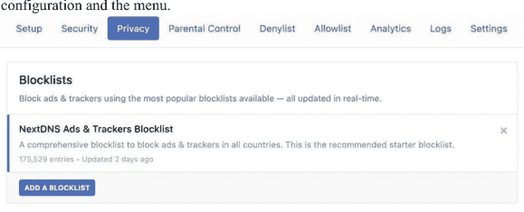

再次点击“日志”标签页并查看流量。你可能需要刷新页面才能看到新结果。我的结果如下所示。

| 域名/服务器 | 操作/状态 |
| --- | --- |
| 🌐 virginia.time.system76.com | 🔒 几秒前 |
| 🌐 paris.time.system76.com | 🔒 几秒前 |
| 🌐 oregon.time.system76.com | 🔒 几秒前 |
| 🌐 ohio.time.system76.com | 🔒 几秒前 |
| 🌐 brazil.time.system76.com | 🔒 几秒前 |
| 🌐 2.ubuntu.pool.ntp.org | 🔒 几秒前 |
| 🌐 api.pop-os.org | 🔒 几秒前 |
| 🌐 1.ubuntu.pool.ntp.org | 🔒 几秒前 |
| 🌐 0.ubuntu.pool.ntp.org | 🔒 几秒前 |
| 🌐 ntp.ubuntu.com | 🔒 几秒前 |

这看起来可能令人不安，因为除了重启系统外我们什么都没做，而这些多个连接却在传输数据。然而，这是无害的。除了 "apt.pop-os.org" 之外的所有连接都是时间服务器，旨在确保我们的时钟正确同步。"apt" 连接正在查找可能需要应用的软件更新。这些结果证明过滤正在起作用。NextDNS 正在执行我们的所有 DNS 查询，并过滤它认为恶意或侵入性的任何内容。

对时间服务器的这些多个查询可能看起来有点过度。五个 System76 时间服务器是默认选项，而 "ntp" 服务器是后备方案。由于 System76 使用加密的网络时间安全（NTS）协议，我更倾向于仅依赖它们。如果你想移除任何选项，你可以通过修改几个系统文件来实现。然而，我们有一个问题。

我们需要修改的文件是受保护的系统文件。如果我们导航到这些文件并双击打开，我们将处于只读模式，无法修改内容。我们可以使用以下终端命令来“作弊”，该命令以管理权限打开“文件”应用程序（Nautilus）。执行后，系统将提示输入你的 Linux 密码。

`sudo nautilus`

此时你应该看到一个具有管理权限的文件资源管理器。考虑以下步骤。

-   导航到 "Computer" > "etc" > "chrony" > "sources.d"。
-   双击名为 "system76-nts.sources" 的文件。
-   移除任何不需要的服务器，然后点击“保存”。
-   关闭所有打开的窗口。

如果你想禁用非加密的 Ubuntu 后备选项，请执行以下操作。

-   在终端中执行 `sudo nautilus`。
-   导航到 "Computer" > "etc" > "chrony"。
-   双击名为 "chrony.conf" 的文件。
-   删除包含 "ubuntu.pool.ntp.org" 的每行。
-   将 "pool ntp.ubuntu.com" 更改为 "pool pool.ntp.org" 并点击“保存”。


- 关闭所有打开的窗口。

让我们重启并重新查看我们的 NextDNS 日志。我移除了国际 System76 服务器和所有 Ubuntu 选项。我将其中一个后备选项替换为标准公共服务器，而不是 Ubuntu 的选项。目前我的所有连接显示如下所示。

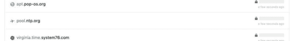

这些都是一些非常微小的修改，可能对我们的隐私或安全几乎没有影响。我宁愿避免使用 Ubuntu 选项，而选择更通用的后备服务器，我对 System76 实施的同步协议的安全性表示赞赏。让我们继续看看一些实际的好处。

在你的设备上打开 Firefox 浏览器并访问几个网站。然后，刷新 NextDNS 日志页面并注意其中的差异。你很可能会看到一些连接被允许，而另一些则被阻止。这就是过滤列表在起作用。如果你看到某个你不想发生的连接被允许，你可以复制该域名并将其添加到“拒绝列表”标签中。我曾经对一个被应用程序查询以发送关于我使用情况的“匿名”分析数据的域名这样做了。我稍后我会提供更详细的示例。

如果你计划在你的设备上全天候使用 NextDNS，我强烈建议你修改日志记录方面。在你的 NextDNS 门户中点击“设置”标签，并查看“日志”部分。你可以完全禁用日志，或更改保留期限。在测试我的设备时，我选择后者。我保留日志启用；禁用“记录客户端 IP”；启用“记录域名”；并将保留期限设置为“1 小时”。这样，我始终可以连接到门户查看哪些内容被阻止和允许，但日志将在每次活动一小时后被清除。在我配置移动或桌面设备时可以进行修改，并立即看到结果。

一旦我配置好所有需要的 NextDNS 设置，我就会完全禁用日志记录。这将消除我通过 NextDNS 的互联网活动历史记录。我们将在后续章节中依赖这些日志，所以暂时不要完全禁用它们。如果需要，你可以随时使用“清除日志”按钮清除所有日志。

接下来，你应该确保你的连接是加密的。在 Firefox 中访问 https://test.nextdns.io 以进行测试。你应该看到“protocol:DOH”（如果你使用稍后解释的浏览器设置，则是 DNS over HTTPS）或“protocol:DOT”（使用此操作系统 DNS 选项的 DNS over TLS）。如果你看到其中任何一种，说明你正在将你的很大一部分互联网流量隐藏起来，使其不被你的 ISP 和 VPN 看到。

在 Firefox 浏览器打开时，访问 yahoo.com 并允许整个页面加载。如果你熟悉该网站，你可能会注意到大部分弹出广告、嵌入视频和闪烁的广告都不复存在了。这是因为 NextDNS 在这些连接到达你的设备之前就已经阻止了它们。接下来，返回你的 NextDNS 门户并重载日志页面。结果可能需要几分钟才会出现。你应该看到类似以下内容。

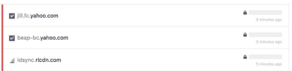

左侧的红色条确认了哪些传入连接被阻止。我们可以看到我们的阻止列表正在起作用。在 yahoo.com 上，数十个广告和跟踪器被轻松阻止，我们无需付出任何努力。我们不需要任何浏览器扩展或防火墙应用程序。这就是 NextDNS 的真正力量。这种阻止策略更加清洁，资源使用最少。它还可以防止与 VPN 应用程序产生冲突。这是很多值得消化的信息。让我们总结一下一些关键的要点。

- 默认情况下，你的互联网服务提供商提供 DNS 服务，并且通常恶意使用这些数据。当你在 Linux 设备上配置 NextDNS 时，你正在使用他们的查询服务。
- 此外，阻止列表可以防止应用程序发送有关你使用情况的遥测和分析数据。这在下一章中将会变得更加明显。
- 请记住免费层级的限制。大多数人每月的查询量不会超过 300,000 次。
- 如果你有多个设备，你可以为每个设备创建账户，或者支付少量费用使用 NextDNS 的高级服务。

一些读者可能会对我选择 NextDNS 而不是 AdGuard 作为过滤 DNS 提供商感到不满。我的理由如下。

- 我更加信任 NextDNS。创始人是公开可见的，我知道谁在运营这家公司。他们是声誉良好的人，在此领域非常活跃，并且对他们的服务原因保持透明。
- 高级层级的商业模式解释了资源资金的来源。
- AdGuard 是一家俄罗斯公司，后来迁往塞浦路斯，但其基础设施仍保留在俄罗斯。俄罗斯 CEO 在互联网上露面极少，但没有任何关于其他所有者的信息。
- NextDNS 的支持更优秀。当我联系这两家公司询问产品问题时，只有 NextDNS 回复了。其中一位所有者提供了完整细节。
- AdGuard 最近宣布了一个类似于 NextDNS 的新计划，该计划将允许自定义过滤。然而，我要求信息的邮件没有得到回复。NextDNS 的自定义选项已经过彻底测试和审查。

关于 DNS 的最终隐私考虑是账户制与公共可用服务器。虽然自定义 NextDNS 账户在阻止（或允许）连接方面非常棒，但也带有一些风险。既然你有一个账户，所有查询都可能被追溯回特定用户。禁用日志应该可以防止这种情况，但法院命令可能会覆盖你的设置。使用别名应该会带来安慰。公共 NextDNS 服务器不需要账户，但不提供自定义过滤。如果你想在没有账户的情况下过滤广告，我相信 AdGuard 目前是你最好的选择（dns.adguard.com）。然而，你无法修改保护。如果他们阻止了一个域名，就没有办法解除阻止。再次说明，这里 NextDNS 的自定义过滤更为优越。

你厌倦 DNS 了吗？关于正确使用 DNS 服务有很多观点。它们对每个人来说都不是完美的。我希望你利用这里提供的信息，将其作为你制定自己的 DNS 和 VPN 策略的起点。请在锁定自己的计划之前考虑剩余的章节。在第六章中，我们将依赖 NextDNS 进一步增强设备的隐私和安全。

现在，你的操作系统已正确配置，并且设置了 DNS 过滤来保护你免受数据入侵，我们可以开始在新机器上安装我们将要使用的应用程序了。

# 第五章：应用程序

Pop!_OS 拥有自己的应用程序安装商店，称为 Pop!_Shop，就像 Ubuntu 拥有 Snap Store 一样。我通常更喜欢直接从软件提供商安装敏感的 Linux 应用程序，以便我知道我接收到的是官方且更新的内容。然而，我确实使用 Pop!_Shop 来安装和更新大多数通用应用程序。让我们通过一个例子来演练一下。

## 密码管理器

我只推荐能够轻松导出备份以便在其他机器上使用的开源加密密码管理器。我认为本书的每一位读者都应该拥有密码管理器，我推荐两种选项以提供两种独特的体验。我们也将安装两者。

**离线 - KeePassXC** (keepassxc.org)：如果你想要极致的隐私，并且无法忍受将你的密码存储在云中的想法，无论其加密和安全程度如何，那么离线密码管理器适合你。我使用 KeePassXC，并确保我有一个良好的备份。

**在线 - Bitwarden** (bitwarden.com)：如果手动同步你的密码数据库到任何其他设备或备份驱动器这一想法让你想要放弃密码管理器的安全优势，那么 Bitwarden 是最佳选择。它比 KeePassXC 更容易，并且跨设备保持你的所有密码更新，但它也在技术上将你的密码的加密版本存储在互联网上。这些数据受强加密保护，甚至 Bitwarden 的员工也无法访问你的数据，但你承担了一点风险。它还可以处理所有软件令牌 2FA，同时自身受到硬件 YubiKey 的保护。我的大多数客户选择 Bitwarden，而少数极端者选择 KeePassXC。

KeePassXC 官方网站提供了在多种 Linux 环境中安装其应用程序的十种不同方法。第一种是 AppImage。你可以简单地下载此文件，右键点击，选择属性，勾选“允许将文件执行作为程序”，然后双击进行安装。然而，这不是我首选的方法。我需要经常手动检查更新，因为这个 AppImage 无法自我更新（而不是允许我的系统应用更新）。

第二种选择是通过 Flatpak 安装。Flatpak 是用于 Linux 软件部署和包管理的实用工具。它提供了一个沙盒环境，用户可以在其中运行应用软件，使其与系统的其余部分隔离。这对密码管理器来说似乎是一个很棒的选择，但我预见到一个问题。如果我想在 Firefox 中使用 KeePassXC 浏览器扩展，由于这种安全的隔离，它可能无法连接到 KeePassXC 数据库。让我们继续。

第三种选择是 Snap 包，但我这台机器上没有 Snap（我也不想要它）。最后，第四种和第五种选项提供了针对 Ubuntu 和 Debian 的解决方案。由于 Pop!_OS 基于 Ubuntu，而 Ubuntu 基于 Debian，这些应该对我们有效。在继续之前，让我们看看官方 Pop! Shop 中的选项。如果我在 Pop! Shop 中搜索 *KeePassXC*，我会收到该软件的一个结果（不要与 KeePassX 混淆）。点击该条目会显示一个带有安装选项的菜单。我可以选择默认的 Flatpak 选项，或者将下拉菜单更改为 Ubuntu（deb）选项。第二个选项应该与通过终端使用以下命令安装相同。

```bash
sudo apt install keepassxc -y
```


让我们来验证一下我们的理论，并执行上一条命令手动安装 KeePassXC。安装完成后，重新打开 Pop! Shop 并点击“已安装”选项卡。如果你向下滚动，应该能在已安装的应用程序和服务列表中找到 KeePassXC。点击该项目，注意屏幕的变化。Ubuntu（deb）选项现在确认该应用已安装，并提供了一个按钮选项来卸载它。下图显示了我的结果。


这并不意味着我总是更倾向于使用 Apt 安装而非 Flatpak。在这种场景下，选择这种方式是最优的，因为需要另一个应用程序（Firefox）才能连接到该程序。通过终端手动安装排除了 Pop! Shop 版本可能受到污染的风险。由于这是一个敏感应用程序，我希望仔细审查任何安装和更新选项。当我们执行本章末尾介绍的每周命令时，该应用程序将会被更新。

让我们对 Bitwarden 进行重复操作。在 Pop! Shop 中搜索 Bitwarden 只提供了一个安装选项，但并没有告诉我太多关于它的信息。Bitwarden 官网没有提及 Flatpak，而在线搜索告诉我 Flatpak 中的 Bitwarden 版本并非官方发布。虽然这个版本可能没有恶意意图，但我希望密码管理器直接来自官方来源。

与 KeePassXC 不同，对于 Bitwarden，我更倾向于 AppImage 安装方式。这是因为你可以从他们的网站下载官方应用程序，并且它可以自动获取更新，无需任何软件仓库。然而，存在一个新问题。Pop! OS 处理 AppImage 的默认方式会导致许多程序无法打开。下载、修改权限并执行后，很可能什么都不会发生。这就是为什么我更喜欢另一种名为 AppImageLauncher 的 AppImage 管理器。我在终端中执行了以下操作。

```bash
sudo add-apt-repository ppa:appimagelauncher-team/stable -y
sudo apt update
sudo apt install appimagelauncher -y
```

现在 AppImageLauncher 已安装，我们只需双击任何 AppImage 文件即可，包括直接从 Bitwarden 官网下载的程序。执行此操作时，你应该看到一个新的窗口，默认选项是可以接受的。首次通过此新应用程序启动 AppImage 时，系统会提示将 AppImageLauncher 集成到你的系统中。我选择了“集成并运行”。现在你应该会在应用程序菜单中看到嵌入的任何 AppImage 程序，并且可以右键点击这些条目来卸载它们或将它们固定到你的 Dock 中。我们现在可以在 Pop! Shop 中搜索 Bitwarden 来检查我们的工作。下图显示了我的结果。即使我已经安装并运行了该程序，Pop! Shop 仍只提供安装 Bitwarden 的选项。这就是我们知道我们没有安装 Flatpak 版本的原因。

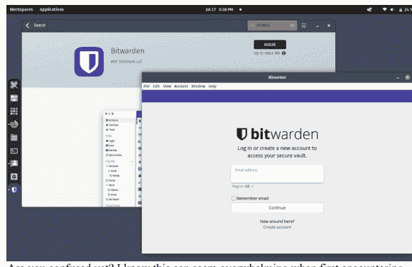

你是否感到困惑？我知道第一次接触 Linux 时这可能会显得令人不知所措。我的软件安装策略很简单。我在网络浏览器中搜索任何敏感程序，访问该应用程序的官方网站，并根据其推荐确定官方的软件安装方式。如果可以提供 “deb” 或 “apt” 解决方案，我通常会更倾向于这样，以便将程序整合到我的系统中。如果官方网站和 Pop! Shop 上只有 Flatpak 选项，并且我确信该应用程序可以在完全隔离的环境中运行，那么我会安装该选项。如果自动更新程序的唯一方式是使用官方 AppImage 文件，我会复制我们刚才完成的教程。在接下来的指南其余部分中，我们将有更多的练习机会。

## 日历与联系人

Pop! OS 拥有默认的日历和联系人应用程序，可以从 Dock 中的“显示应用程序”图标访问。默认情况下，在这些程序中输入的任何数据都会存储在本地加密驱动器中。如果你只需要在 Linux 设备上使用日历和联系人，这些选项应该效果很好。然而，本地存储的数据可能不足以满足你的需求。大多数人希望跨多个设备同步其日历事件和联系人数据，尤其是与他们的手机同步。你有两个安全选项来实现这一点。

如果你使用 Proton Mail、Tutanota 或 Skiff Mail 作为你的电子邮件，所有存储的联系人和日历条目都经过端到端加密以保护你的隐私（Proton Mail 不对姓名和电子邮件地址进行加密，以便其系统正常运行，但电话号码和备注受到保护）。这将允许你在网络浏览器和移动设备电子邮件应用中看到你的数据。然而，这些服务均无法将你的数据同步到标准的 Linux 日历和联系人应用程序（或移动等效应用）。在移动设备上，这意味着电话应用和活动通知无法访问这些数据。为了完全的安全同步，我们需要 EteSync。

EteSync (etesync.com) 是一项提供端到端加密日历、联系人和笔记数据的服务。每月 $2，他们会在服务器上以安全方式存储你的数据，使其无法访问你的任何数据。然后你可以将 EteSync Bridge 软件下载到你的 Linux 机器和移动设备上。该软件将你的加密 EteSync 数据连接到任何日历或联系人应用程序。在这些应用中所做的任何更改都会立即反映在 EteSync 数据中。然后你可以将此数据与其他设备（如智能手机）同步。一次性设置可能会有些麻烦，但应无需重复。如果你想在 Linux 中使用能够安全同步到其他设备的传统日历和联系人应用程序，EteSync 是最佳选择。让我们安装它。

首先，在 https://pim.etesync.com/signup 创建一个免费试用账户。这允许一周内无限制访问。建立服务凭据后，登录你的账户并创建新的日历和地址簿。标题可以随意命名，然后导航至 https://github.com/etesync/etesync-dav/releases/latest 并下载标题为 "linux-amd64-etesync-dav" 的文件。获取文件后，在终端中执行以下操作。

```bash
cd Downloads
chmod +x linux-amd64-etesync-dav
./linux-amd64-etesync-dav
```

这应该会启动你的浏览器并跳转到一个接受你免费试用 EteSync 凭据的页面。你需要“添加”你的账户，然后使用相同的信息登录。现在你已经与 EteSync 服务器同步。

接下来，你需要一个应用程序来连接你的新安全 EteSync 账户并以可查看的形式同步数据。为此，我更喜欢 Thunderbird。Thunderbird 是一个集电子邮件、日历和联系人于一体的一体化解决方案，我们将用它完成几项任务。按以下步骤安装和配置它。

- 打开 Pop! Shop 并搜索 "Thunderbird"。
- 点击条目以查看应用程序详情。
- 将 Flatpak 安装选项更改为 "Pop! OS (deb)"。
- 点击 "安装"。
- 启动 Thunderbird 并取消任何向导或欢迎窗口。
- 如果提示，选择暂时不使用电子邮件使用 thunderbird 的选项。
- 点击左侧菜单中的日历图标，然后点击 "Calendar" 旁边的 "+"。
- 选择 "On the Network" 并点击 "Next"。
- 输入你的 EteSync 用户名。
- 返回浏览器中 http://localhost:37358/web 页面。
- 点击 "Collection Lists" 链接。
- 右键点击你的日历链接并选择 "Copy link"。
- 返回 Thunderbird 并将此链接粘贴到位置字段中。
- 点击 "Find Calendars"，并在提示时提供你的 EteSync 密码。
- 点击 "OK" 并允许连接完成。
- 识别出日历后，点击 "Subscribe"。

让我们测试所有内容。打开你的浏览器并导航到 https://pim.etesync.com。登录你的账户并点击日历选项卡。在今日日期中创建一个新条目，标签为 "Test"。现在打开 Thunderbird 并确保你在日历部分。你应该看到你的 EteSync 日历以及 "Home" 默认日历。下图显示了我自己的结果。如图所示，我的 Thunderbird 日历显示了新条目。如果你的没有显示，请右键点击你的 EteSync 日历并选择 "Synchronize Calendars"。


如果在 Pop!_OS 中打开自带的日历应用程序，您也应该能看到 EteSync 账户中的任何条目。这是因为 EteSync 正在向 Thunderbird 提供数据，而 Thunderbird 又将这些数据提供给其他任何传统的日历应用程序。如果您更喜欢自带的选项而非 Thunderbird，您可以使用它。个人而言，我在所有的日历、联系人和电子邮件中均使用 Thunderbird，稍后将会对此进行说明。

首先，这一切值得吗？仅仅为了同步日历，这似乎花费了很多精力。您可以直接使用 Google 账户来复制所有这些功能，而无需如此麻烦。然而，我们将隐私看得比便利性更重要。让我们来消化一下我们取得的成就，以及它可能比传统方式访问这些数据带来更多的好处。

EteSync 使用端到端加密安全地存储您的所有日历和联系人信息。他们无法访问您的任何数据，因为它是使用您的凭证进行加密的。除了您本人，没有人可以看到这些信息。您的 Linux 机器被设置为将 EteSync 的数据同步到您的 Thunderbird 软件中。您在 Thunderbird（或自带日历应用程序）中进行的任何更改都会同步到您的 EteSync 账户。任何其他装有 EteSync 的设备也可以同步这些数据。每当我在 Thunderbird 中修改日历时，该更改会同步到我的 EteSync 账户，然后也会同步到我的移动设备和第二台笔记本电脑。通过这种方式，我在生活中的所有设备上都拥有完全加密的日历。我还可以与我的员工共享日历以供小组使用。

设置过程有些麻烦，但对我来说值得。然而，我们还没有做完。之所以这一切能够运行，是因为在我们按照前面的说明启动后，EteSync 服务器一直在后台运行。如果我们想要具备持续的同步能力，就需要让它一直运行。我们可以通过以下步骤实现。

- 从 Dock（程序坞）启动“显示应用程序”并搜索“Startup”（启动）。
- 启动 Startup Applications（启动应用程序）程序。
- 点击“Add”（添加），并将名称标记为“EteSync”。
- 点击“Browse”（浏览）并选择 Downloads（下载）文件夹中的“linux-amd64-etesync-dav”。
- 点击“Add”（添加）然后点击“Close”（关闭）。

现在，当设备启动时，您的 EteSync 程序应该会启动。然而，让我们测试一下。关闭所有已打开的应用程序并重启系统。启动 Thunderbird 并右键点击您的其中一个 EteSync 日历，选择“Synchronize Calendars”（同步日历）。如果您没有收到连接错误，那就设置成功了。如果您想进一步测试，可以重新登录 Web 浏览器版本，添加一个新事件，再次刷新 Thunderbird，并确认您看到了该更改。

我根本不想看到本地日历。我右键点击了“Home”（主）日历并选择了“Delete Calendar”（删除日历）。这防止我错误地修改未同步的日历。

EteSync 是我发现的唯一一种能够以安全方式同步此类数据并允许在机器上本地访问的服务。对我而言，每月 2 美元的费用是值得的。在正式承诺使用前，您应该先通过试用期测试该服务。如果您只需要在基于浏览器的服务内同步这些数据，而不需要在自带应用中访问，那么 Proton Mail、Tutanota 或 Skiff 可能就完全足够了，而且没有任何费用。了解您的选择并评估您自己的需求。

我们现在可以复制这些步骤，以将我们在 EteSync 中的联系人同步到我们的 Linux 设备。

- 重新启动 Thunderbird 并取消任何向导或欢迎窗口。
- 点击左侧菜单中的联系人图标。
- 点击“New Address Book”（新建地址簿）旁边的下拉菜单。
- 选择“Add CardDAV Address Book”（添加 CardDAV 地址簿）。
- 输入您的 EteSync 用户名。
- 回到您浏览器中位于 http://localhost:37358/web 的页面。
- 点击“Collection Lists”（集合列表）链接。
- 右键点击您地址簿的链接并选择“Copy link”（复制链接）。
- 返回 Thunderbird 并将此链接粘贴到位置字段中。
- 点击“Continue”（继续）并在提示时提供您的 EteSync 密码。
- 点击“OK”（确定）并允许连接完成。
- 当地址簿被识别后，点击“Continue”（继续）。

现在，您的 Thunderbird 实例应该正在将所有联系人和日历同步到 EteSync 服务器。如果您的集合列表中没有日历或地址簿，您需要重新登录 EteSync 并创建它们。虽然 EteSync 具有安全笔记选项，但我并不使用它。我更喜欢 Standard Notes，稍后将会对此进行说明。您现在可以使用我的 *Extreme Privacy: Mobile Devices*（极致隐私：移动设备）指南将您的 Android 或 iOS 设备同步到 EteSync，以获得完整的联系人和日历解决方案。我的 GrapheneOS 设备始终拥有最新的更改。

## 电子邮件

在日常电子邮件任务中，我总是更喜欢在登录到服务商网站的情况下通过 Web 浏览器处理，但我坚持要在我的 Linux 机器上使用传统的电子邮件客户端。我认为我们都应该拥有电子邮件信息的完整备份，而永远不应盲目依赖任何电子邮件服务商在我们需要内容时依然存在。如果他们倒闭、遭受网络攻击或触发我们的账户被标记为欺诈怎么办？如果我们使用自己的域名来处理所有电子邮件，我们可以将其转发到不同的服务商。如果我们失去对电子邮件账户的访问权限，我们所有本地保存的信息依然存在。

与之前关于日历和联系人的教程类似，我更喜欢使用 Thunderbird 作为我的 Linux 电子邮件客户端。启动 Thunderbird 后，您可以使用他们的入门欢迎菜单，或者通过点击“Choose What to Set Up”（选择要设置的内容）下的“Email”（电子邮件）选项手动配置电子邮件账户。然后，您输入由服务商提供的电子邮件凭证。对于大多数传统电子邮件服务来说，这应该相当简单。加密选项存在一些障碍。

如果您使用 Tutanota 或 Skiff 作为加密电子邮件服务商，您无法将电子邮件消息自动同步到电子邮件客户端。我主要依赖 Proton Mail 作为我的服务商，他们提供了一个“Bridge”（桥接），使这个过程相当容易。Pop!_Shop 有非官方的 Flatpak 版本可供使用，但我对将程序安装交给未知的在线个人心存顾虑。因此，我直接从 https://proton.me/mail/bridge 下载“.deb”文件。这是一个官方构建版本，会在应用程序中提示安装任何官方更新。然后，我可以右键点击下载的文件，选择“Open with Eddy”（用 Eddy 打开），并点击“Install”（安装）。完成后，我可以启动 Proton Mail Bridge 应用程序并按照提示配置服务。

一旦 Proton Mail Bridge 正常工作，它将以加密方式在本地同步您的账户，但这不会让您访问我的消息。为此，我们必须配置 Thunderbird 以保持我们的消息同步、索引并在离线状态下可搜索。在电子邮件账户设置菜单中，提供您想要的名称以及 Proton Mail Bridge 应用程序中提供给您的凭证。这些将与登录其网站时提供的详细信息不同。其余的详细信息应该会自动导入。如果没有，请遵循 https://proton.me/support/protonmail-bridge-clients-windows-thunderbird 上的详细说明。

我不希望将 Thunderbird 呈现为 Apple Mail 或 Outlook 的克隆版。它可能看起来有些过时，但我们关心的只是功能。我从不使用 Thunderbird 发送电子邮件。我只使用它作为从我的电子邮件服务商处检索和归档数据的方式。我依赖 Web 浏览器直接连接到我的服务商进行日常电子邮件使用。我机器上的内容仅用于离线使用和归档。我每周至少启动 Thunderbird 和 Proton Mail Bridge 一次，以同步所有新数据。备份可能永远都用不到，但如果灾难发生，我会感到宽慰。

## 笔记

我是 **Standard Notes** (standardnotes.com) 的忠实粉丝。免费版本提供完全端到端加密（E2EE）的数据。只有您能看到您的内容，并且您可以将所有数据同步到任何其他桌面或移动设备。我全天依赖我的笔记。付费版本引入了更多文本格式化选项和电子表格条目，但我更喜欢免费版纯文本的感觉。然而，付费版包括存储双因素身份验证（2FA）代码的能力，这是一个巨大的优势。这使我拥有一个真正跨平台、开源、加密的应用程序用于我的 2FA。

Standard Notes 在 Pop!_Shop（Flatpak）中有一个条目，但它也是由社区提供的仓库。我更喜欢直接从服务商下载敏感应用程序，就像我对 Proton Mail Bridge 所做的那样。如果这是一个简单的文本编辑器，我不会介意使用 Pop!_Shop。然而，这是我对极敏感的加密笔记程序。因此，我导航到位于 https://standardnotes.com/download/linux 的官方网站，并通过“Begin Download”（开始下载）链接下载 AppImage 文件。然后我右键点击下载的文件并选择“Open With AppImageLauncher”（用 AppImageLauncher 打开）。我总是选择“Integrate and Run”（集成并运行）选项并允许过程完成。如果有待处理的更新，Standard Notes 会在应用程序内提示您。

## 书籍

我更喜欢 Calibre (calibre-ebook.com) 作为我的电子书库软件。它允许我收集我购买或下载的书籍，并将它们同步到几乎任何电子书阅读器。它可以安全地安装在 Pop!_Shop 应用程序中。

## 消息

我强烈建议您和您的联系人采用加密（E2EE）消息进行所有通信。Signal (signal.org)、Element (element.io) 和 Wire (wire.com) 为语音、视频和文本提供开源 E2EE 平台。还有许多其他很好的选择，但对于新接触这一理念的人来说，这些是最好的。您可以按照其网站上的 Linux 安装步骤安装其中任何或所有程序。


## VLC

Pop!_OS 不包含任何强大的媒体播放器。如果你经常会遇到各种音频和视频文件，我强烈建议从 Pop!_Shop 安装 VLC。

## 办公

Pop!_OS 包含 LibreOffice 应用程序套件，用于文字处理、电子表格和演示文稿。不过，我更喜欢用 ONLYOFFICE 来完成这些任务。它可以安全地从 Pop!_Shop 安装。

## BleachBit 清理工具

使用一段时间后，你的 Linux 设备很可能会充斥着旧的缓存文件、残留数据和其他不必要的文件。我建议每周运行一次 BleachBit 以保持系统整洁。我倾向于使用 Pop!_Shop（Flatpak）中的“BleachBit（以 root 身份运行）”选项。首次启动时，我接受默认配置。然后我选择所有选项，除了“释放磁盘空间”（"Free Disk Space"），并点击“清理”（"Clean"）。在本书的这个阶段，由于我使用的是新机器，我成功释放了 1.02 GB 的数据。

## 实用工具

我喜欢在任何 Linux 发行版中添加一些系统实用工具，包括用于 RSS 的 GNOME Feeds、用于播客的 GNOME Podcasts，以及用于清理文件中个人信息的 Metadata Cleaner。这些工具都可以通过 Pop!_Shop 使用默认选项安装。为了让 Metadata Cleaner 正常工作，你还需要一个名为 mat2 的工具，可以通过终端使用以下命令安装：

```
sudo apt install mat2 -y
```

重启后，你可以右键点击任何可能包含隐藏元数据的图片、视频或其他文件，并清理其内容。这会在原文件旁边生成一个新文件，文件名中会添加“clean”。

## 虚拟货币

如果你需要访问虚拟货币，我总是推荐使用基于软件的离线钱包，而不需要第三方交易所。我使用 Electrum 处理比特币，使用 Monero GUI 钱包处理门罗币。虽然你可以在 Pop!_Shop 或其他软件仓库中找到这些程序，但我建议仅从它们的原始来源直接安装。我从位于 https://electrum.org/#download 的官方 Electrum 网站获取 AppImage 文件，然后右键点击该文件使用 AppImageLauncher 进行安装。接着，我从位于 https://web.getmonero.org/downloads 的官方网站下载压缩的 Linux 64 位文件，解压后右键点击 Monero AppImage 文件以完成安装过程。

## 应用程序更新

你应该保持新安装软件的更新。Pop!_Shop 中的“已安装”（"Installed"）标签页允许你修补操作系统以及任何 Flatpak/Deb 程序，但它不会更新所有单独的应用程序。我在本地笔记应用中数字备好了以下命令，以便轻松复制和粘贴，但后续章节将介绍一个自定义脚本，自动执行所有这些命令。

```
sudo apt update
sudo apt upgrade -y
sudo apt full-upgrade -y
pop-upgrade release upgrade
sudo apt autoremove -y
sudo apt autoclean -y
flatpak update -y
```

现在，你应该拥有一台稳定、安全、私密、已更新、已清理并包含日常使用基本应用程序的 Linux 电脑。虽然还有更多事情要做，但你已经完成了**步骤**。当我们稍后在书中创建自定义维护脚本时，我们将添加更多命令，以确保系统保持整洁。

尽管大多数人依赖这些应用程序提供商来存储加密数据，但极度注重隐私的人可能会考虑自托管作为一种选择。这个话题超出了本指南的范围，但网上有充足的信息可以帮助自托管 Bitwarden、EteSync、Standard Notes 等。接下来，我们必须处理系统中最重要的程序：网络浏览器。

## DNS 条目

这是一个回顾你的 NextDNS 门户并检查日志的好时机。我喜欢启动每个程序一次然后关闭，再查看 NextDNS 中建立了哪些类型的连接。在我的机器上，损害相当轻微，如下面图片（顶部）所示。Thunderbird 是最大的问题，因为它与其自己的服务器同步。这并不是恶意的，但如果愿意，你可以阻止这些请求。Standard Notes 连接到其自己的服务器进行数据同步，所以没有危害。如果你担心 ONLYOFFICE 向服务器发送数据，你可以在 NextDNS 中阻止整个域名。这将允许程序完全离线使用。我进行了此更改（第二张图片），在下次启动时连接被阻止（第三张图片）。

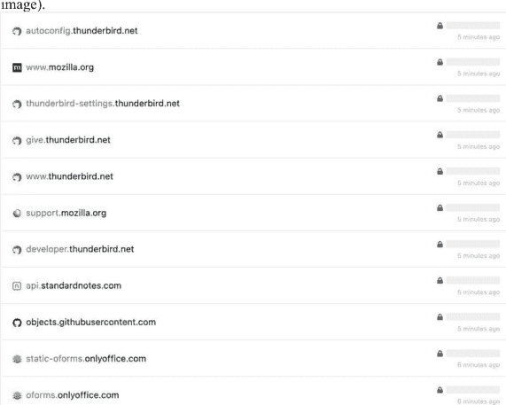

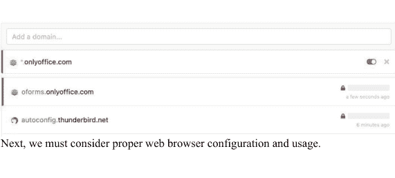

接下来，我们必须考虑适当的网络浏览器配置和使用方法。

# 第六章：网络浏览器

在考虑连接各种网站以充分利用我们的新 Linux 构建之前，我们应该正确配置网络浏览器。对于日常浏览，我推荐使用 Firefox 网络浏览器，并有限地使用其他浏览器完成特定任务。Firefox 已包含在大多数 Linux 发行版中，且默认安装的 Pop!_OS 版 Firefox 是**首选**的，满足我们的需求。启动 Firefox 并考虑以下修改：

- 点击右上角的 Firefox 菜单，选择“设置”（"Settings"）。
- 在“常规”（"General"）选项中，取消勾选“浏览时推荐扩展”（"Recommend extensions as you browse"）和“浏览时推荐功能”（"Recommend features as you browse"）。这防止部分互联网使用信息发送给 Firefox。
- 在“主页”（"Home"）选项中，将“主页和新窗口”（"Homepage and new windows"）和“新标签页”（"New tabs"）更改为“空白页”（"Blank page"）。这防止 Firefox 加载其默认页面。
- 禁用所有“Firefox 主页内容”（"Firefox Home Content"）选项。
- 在搜索选项中，将默认搜索引擎更改为 DuckDuckGo，并取消勾选“提供搜索建议”（"Provide search suggestions"）下的所有选项。这防止查询直接发送到 Google，并阻止 Google API 提供搜索建议。
- 点击“隐私与安全性”（"Privacy & Security"）菜单选项，选择“严格”（"Strict"）保护。
- 勾选标题为“Firefox 关闭时删除 cookie 和站点数据”（"Delete cookies and site data when Firefox is closed"）的复选框。
- 取消勾选标题为“显示有关密码泄露网站的警报”（"Show alerts about passwords for breached websites"）的复选框。
- 取消勾选标题为“建议并生成强密码”（"Suggest and generate strong passwords"）的复选框。
- 取消勾选标题为“自动填充登录和密码”（"Autofill logins and passwords"）的复选框。
- 取消勾选标题为“询问是否保存网站的登录和密码”（"Ask to save logins and passwords for websites"）的复选框。
- 取消勾选标题为“自动填充地址”（"Autofill addresses"）的复选框。
- 取消勾选标题为“自动填充信用卡”（"Autofill credit cards"）的复选框。
- 将历史记录设置更改为“Firefox 将使用自定义历史记录设置”（"Firefox will use custom settings for history"）。
- 取消勾选“记住浏览和下载历史”（"Remember browsing and download history"）和“记住搜索和表单历史”（"Remember search and form history"）。
- 勾选标题为“Firefox 关闭时清除历史”（"Clear history when Firefox closes"）的复选框。不要勾选标题为“始终使用隐私浏览模式”（"Always use private browsing mode"）的复选框，因为这会破坏 Firefox 容器。
- 从“地址栏”（"Address Bar"）菜单中取消勾选“浏览历史”（"Browsing history"）。
- 在权限菜单中，点击位置、相机、通知和虚拟现实旁边的“设置”。勾选每个选项中标题为“阻止新请求...”（"Block new requests..."）的复选框。如果你在此浏览器中永远不需要音频通信，你可以对麦克风执行相同操作。
- 取消勾选“Firefox 数据收集和用途”（"Firefox Data Collection and Use"）下的所有选项。
- 取消勾选“欺骗性内容和危险软件保护”（"Deceptive Content and Dangerous Software Protection"）下的所有选项。这将防止 Firefox 向第三方服务共享潜在的恶意网站访问。
- 选择“在所有窗口中启用仅限 HTTPS 模式”（"Enable HTTPS-Only Mode in all windows"）。

这些设置是我所说的基础设置，对大多数读者可能已经足够。在这里，我想偏离之前的写法。在本次出版之前，我通常介绍几个可以在 Firefox "about:config" 菜单中修改的设置。我不再推荐这样做，这可能会让一些隐私狂热者不满。在放弃这一章节之前，请考虑我的理由。我此前建议的目的主要是为了防止浏览器指纹识别或画布识别。这种行为常被在线网站滥用，以跟踪你在互联网上的导航。如果我拥有一个服装网站，并且能从你的浏览器收集众多标识符，你就与其他所有访问过我网站的人不同。当你一周后回来时，我知道你是同一个用户，并可以继续跟踪你在我的网站内的活动。

以前，我建议读者更改各种设置，例如网站知道您当前电池电量的能力，以便在窥探你连接的恶意系统眼中让你显得不那么独特。如今，得益于指纹识别技术的进步，我认为这些设置可能弊大于利。如果你是该站点唯一禁用此设置的访客，你在系统中会显得比什么都没做时更加独特。

冒着冒犯一些读者的风险，我坚信以下陈述。我们再也无法通过对浏览器进行修改来战胜现代浏览器指纹识别了。我们做出的任何更改，或添加的任何扩展，几乎总是在复杂的指纹识别系统眼中使我们成为独特的访客。你采取越多行动融入人群，你就可能越显眼。虽然存在例外，但对于一般使用而言，网站将继续跟踪我们。它们还会随时收集我们的 IP 地址、已安装的字体、视频特征、位置指标和浏览器规格。这一点永远不会改变。

此外，当前推荐的许多 about:config Firefox 隐私调整会破坏其他所需功能。如果你试图通过 WebRTC 阻止所有可能的 IP 地址泄露，你很可能会破坏在浏览器中使用语音和视频会议的能力。保护与功能之间必须保持平衡。

使用 VPN（稍后解释）以及之前的 Firefox 设置可以阻止大多数入侵。由于 Firefox 不在一个域名之间共享 cookie，我们默认拥有强大的隐私。如果你想要纯粹的匿名，那就离开互联网。如果你需要尽可能多的保护，请考虑稍后介绍的 Tor 浏览器。

接下来，我将讨论大量有用的浏览器扩展，称为附加组件。

我在每台电脑上安装的首要必要附加组件是 uBlock Origin。它默认阻止许多广告和跟踪脚本，但还可以阻止页面上尝试运行的任何其他类型的脚本。这有助于防止跟踪、恶意代码执行、位置共享以及可能损害你隐私和安全的许多其他过程。

此附加组件完全免费且开源。它高度可定制，同时保持相对易用。uBlock Origin 根据阻止列表中指定的跟踪器的黑名单工作。该附加组件预启用了一些列表，但可以通过偏好设置中的简单复选框添加更多列表。请记住，你启用的黑名单越多，在浏览器内工作可能会越困难。这一部分一开始可能看起来有点令人不知所措，但尝试高级设置应有助于你理解其功能。

我此前推荐过 NoScript、Adblock Plus、Privacy Badger 和 Disconnect 作为隐私附加组件，以帮助阻止不必要的广告、跟踪和分析。这些组件不再存在于我的任何系统中。现在我只使用 uBlock Origin，因为它取代了所有这些选项。让我们从基础知识开始。


从 Firefox 附加组件页面安装 uBlock Origin，或直接访问该应用程序的网站 [https://addons.mozilla.org/en-US/firefox/addon/uBlock- origin/](https://addons.mozilla.org/en-US/firefox/addon/uBlock- origin/) 进行安装。现在，你已获得基础级别的保护。默认情况下，大多数已知的侵入性广告、跟踪代码和恶意内容都会被拦截。仅这一步就能提供互联网所需的重要保护。然而，我们可以更进一步。

点击菜单栏中的 uBlock Origin 图标，然后选择右侧的“Dashboard”（仪表板）图标，该图标显示为设置选项。这将打开一个新标签页，显示程序的配置页面。在“Settings”（设置）选项卡中，点击“我是高级用户”选项。从今往后，uBlock Origin 图标将显示扩展菜单。点击“Filters”（过滤器）选项卡，并考虑启用可能保护你计算机的额外数据集。我觉得默认列表已经足够了，但我会在“Privacy”（隐私）下启用“Block access to LAN”（阻止访问局域网）。现在，你拥有了扩展保护，该保护将应用于所有访问的网站，无需你进行任何交互。当你遇到广告很多的网页（例如新闻媒体网站）时，它应该会加载得更快。它会拦截许多弹出窗口和自动播放媒体，这些在你进行研究时可能相当烦人。

在你按照上述说明启用高级设置后，点击 uBlock Origin 图标现在应显示一个扩展菜单，该菜单将随你访问不同网站而变化。为了说明该菜单的功能，我将使用网站 cnn.com 进行演示。图 6.01 显示了加载该网站时 uBlock Origin 的默认视图。向下滚动这个已加载或被拦截的脚本列表，你可以看到几个可疑的脚本，如 Twitter、Amazon 和 Turner。这些脚本允许跨多个网站进行跟踪，是监测你的兴趣、浏览历史和购物习惯的技术。

此菜单分为三列。第一列仅标识代码类型或脚本的域名。第二列是全局设置。在此处所做的任何更改都将应用于所有网站访问。第三列包含当前网站的设置。单个加号 (+) 表示从该特定选项允许的脚本少于十个。两个加号表示允许了十到一百个脚本。单个减号 (-) 表示从该域拦截了九个以内的脚本，而两个减号则告诉我们拦截了十到一百个脚本。

在图 6.01 中，我们知道有超过十个脚本被允许在 cnn.com 上运行，并且至少有一个脚本被阻止向 Twitter 发送数据。这都是默认行为，提供了功能性和安全性之间的平衡。uBlock Origin 决定哪些内容应该被允许，哪些应该被拦截。

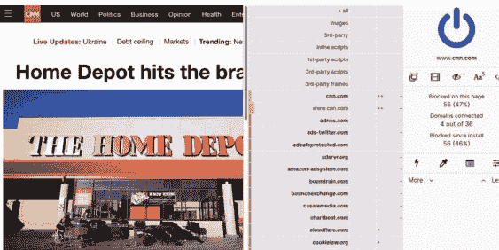

图 6.01: uBlock Origin 的高级视图。

使用同一个页面，让我们修改选项。在图 6.02（左）中，我点击了第三列第一个单元格的最右侧部分。这使整个第三列变为红色。此操作激活了刷新页面的选项（箭头）和保存更改的选项（挂锁图标）。点击挂锁图标并刷新页面，我得到了图 6.02（右）中的示例。由于我拦截了所有脚本，页面无法完全执行。它无法加载图像、设计脚本或任何 JavaScript。这完全没有用处，所以我通过点击第三列顶部单元格的左侧（灰色）部分禁用了我的操作，这使整列变回灰色。保存这些更改并刷新页面，带我回到了图 6.01 中的示例。

我们还可以将其推向另一个极端。在图 6.03（左）中，我点击了右上角的“电源按钮”。这使整个左边缘变为绿色，并允许所有脚本在 cnn.com 上加载。这包括几十个可以在页面上加载广告的侵入性脚本。你还可以看到，小加号确认脚本被允许运行，而图 6.03（右）中的减号则说明相反的情况。对于大多数用户来说，这种许可似乎是不负责任的。

接下来，我们将修改第二列（中间列），这将全局应用设置。默认情况下，所有选项都是灰色的，这是大多数用户所期望的。这表明默认的拦截列表适用，并且只有侵入性脚本会在任何地方被拦截。为了演示，我点击了第二列顶部单元格的右侧（红色）部分。这使整列变为红色，并指示所有网站上的所有脚本都将被拦截。在我保存更改后，每个网站将只加载最基本的文本内容。这将禁止我们的许多使用场景。

加载 Twitter 个人资料等页面导致没有可用内容。通过点击 uBlock Origin 图标，然后点击第三列中特定单元格的左侧（灰色）部分，我在没有允许页面上所有内容启用了这些脚本。在图 6.03（右）中，你可以看到颜色的差异。在这个例子中，整个第二列是红色的。这表明所有脚本都在全局范围内被拦截。第三列大部分是红色的，但 twitter.com 和 twimg.com 的选项是灰色的。如果得到 uBlock Origin 规则批准，这些脚本将仅在该域名上允许。如果加载一个包含 Twitter 脚本的博客，它们仍会被忽略。

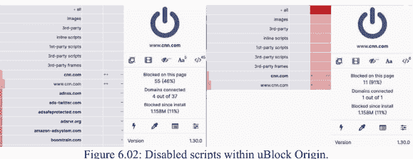

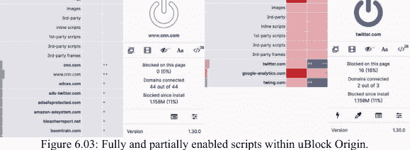

这些是极端的例子。让我们回归一些理智。以下是我建议使用 uBlock Origin 的方式：安装，启用高级选项，然后继续你的工作。当你到达一个阻止你希望查看内容的网站时，打开菜单，点击第三列顶部单元格的左侧（灰色）部分。这将允许该页面上所有内容加载，且仅限该页面。当你即将导航到一个可疑的网站，该网站可能会试图在你的机器上安装恶意代码时，点击第二列顶部单元格的右侧（红色）部分。这将拦截所有页面上的所有脚本。进行你的使用，并在完成后撤销更改。记住在每次更改后点击保存按钮（挂锁图标）并刷新页面。

希望你能练习这些设置并了解该程序如何工作。这是一个令人惊叹的选项，它已保护过我很多次。如果你操作得当，你很可能完全搞砸了你的设置，现在正在拦截你需要的东西，同时允许你不想要的东西。别担心，我们首先将全局（第二列）设置变回灰色（顶部单元格的左侧部分）即可撤销所有错误。接下来，返回该附加组件的仪表板设置，点击“我的规则”选项卡。在第二列（临时规则）中，选择所有文本并按下键盘上的删除键。点击同一列中的“保存”按钮，然后点击“提交”按钮以在所有地方应用这些设置。这会重置我们的扩展，并无论你的修改如何，都带我们回到默认使用状态。

如果你将来在设置上走得太远，这一点很重要。卸载并重新安装扩展并不总是能清除你系统中的这些数据。uBlock Origin 相对于其他选项的主要优势是简单功能，可以在不进行自定义的情况下拦截恶意脚本，同时拥有允许或拦截任何或所有脚本的选项。这类附加组件中很少见。另一个好处是能够绕过网站限制，例如新闻网站阻止访问文章，除非访问者拥有订阅服务。考虑以下《洛杉矶时报》的例子。访问该页面允许你免费查看三篇文章，但你必须拥有付费订阅才能继续阅读。如果我在该页面上点击 uBlock Origin 菜单，选择第三列（右侧列）中“第三方脚本”设置下的右侧（红色）选项，然后选择挂锁图标并重新加载页面，我会看到不同的结果。现在我被允许查看该文章。这是因为该网站依赖第三方脚本来识别访问者是否登录到该服务。这种修改使你可以无限查看该网站及其他数千个网站上的文章而无需注册。

我日常使用的下一个 Firefox 附加组件是 Mozilla 的 **Multi-Account Containers**（多账户容器）选项。它可以在 addons.mozilla.org/firefox/addon/multi-account-containers 找到。在 2021 年之前，我使用此服务创建独立的容器，将网站 Cookie 隔离开来。然而，Firefox 在 2021 年 2 月发布的第 86 版中引入了“Total Cookie Protection”（全面 Cookie 保护）。因此，每个域的临时互联网文件被限制在起源的网站内（当在“增强型跟踪保护”下选择“严格”时）。Firefox 为每个加载的网站创建一个虚拟容器。Facebook 无法看到从 Amazon 下载的 Cookie，反之亦然。许多人认为这消除了对 Multi-Account Containers 的需求，但我不这么认为。

Multi-Account Containers 允许你在无需清除历史记录、注销或登录以及使用多个浏览器的情况下，分离不同类型的浏览。这些容器标签类似于普通标签，除了你访问的网站将拥有浏览器存储的独立切片。这意味着你的网站偏好、登录会话和广告跟踪数据不会携带到新的容器中。同样，你在新容器中进行的任何浏览都不会影响你其他容器的登录会话或跟踪数据。

考虑一个例子。我有一个容器标签打开，我使用它登录 Twitter 账户。我想在同一浏览器中登录另一个 Twitter 账户。如果我打开一个新标签并前往 twitter.com，我会自动登录到与前一标签相同的账户。但是，如果我打开一个新的容器标签，我会被提供登录新 Twitter 账户的选项。我仅为这些事件中的每一个打开一个独特的容器标签。每个都将会话视为独特的，且没有数据从一个服务共享到另一个服务。安装后，你会在右上角看到一个新图标，显示为三个方块。点击它并选择你要打开的容器。默认选项包括诸如个人和购物等选择，但你可以按任何你想要的方式修改这些。我有十个容器，标题为 Private01 到 Private10。你可以从容器菜单中创建、删除和编辑容器。当你点击编辑容器或 + 按钮时，你可以更改与容器关联的颜色或图标，或更改容器名称。

我还使用此扩展以快速访问我所有的 Google Voice 号码。我为我拥有的每个 Google Voice 号码创建了一个新容器。然后我在每个容器中登录到适当的账户，并禁用了退出时清除 Cookie 的选项。今天，我可以启动 Firefox，选择带有我要使用的号码的容器，并立即通过我的桌面接听或接受来电。完成后，我可以完全关闭浏览器。我还更改了图标和名称以反映此目的。当我与金融机构通话，他们想以他们的记录上的特定号码回拨时，这最有帮助。打开浏览器并立即就绪比


连接到 Google Voice；打开我的密码管理器；输入我的凭据；提供双因素认证；访问账户；允许我的麦克风；并接受通话。如果设备被盗，我的设备已加密并受强密码保护。

一些读者可能会对我的 Firefox 设置感到沮丧，并坚持使用基于 Chromium 的浏览器。我完全尊重这一点，并提供 Brave 浏览器作为选项。Brave 基于 Chromium，这是 Google Chrome 浏览器的骨架。Brave 坚持认为他们已删除了 Chromium 默认发起的所有对 Google 的调用，并实现了使用 Quad9 作为 DNS 提供商（代替 Google）。然而，Brave 因注入代码劫持联盟网页链接以及推广其嵌入式奖励程序而受到了强烈批评。如果你**需要**一个像 Chrome 一样的浏览器，我推荐 Brave 而不是 Chrome。如果你可以使用 Firefox，我发现它在隐私方面更加专注。就个人而言，我绝不会使用任何基于 Chromium 的桌面浏览器，包括 Brave。

## KeePassXC-Browser

如果你安装了 KeePassXC 密码管理器并希望访问 Firefox 内的自动填充功能，请从他们网站的 Firefox 存储库安装官方扩展：https://addons.mozilla.org/en-US/firefox/addon/keepassxc-browser。安装完成后，执行以下操作。

- 打开你的 KeePassXC 数据库并点击设置图标。
- 选择“浏览器集成”菜单选项。
- 选择“启用浏览器集成”并启用“Firefox”。
- 点击“确定”并返回 Firefox。
- 点击 KeePassXC 图标，然后点击“连接”。
- 提供一个唯一名称，例如“Firefox”，并点击“保存并允许访问”。

现在，你的 Firefox 浏览器可以访问存储在 KeePassXC 数据库中的密码，而无需通过你的互联网连接传输任何数据。

## 缺失的图标

Firefox 最近进行了一项更改，将所有扩展程序隐藏在了工具栏中的“扩展程序”图标内。我不喜欢这一点，更希望能立即访问我的扩展程序。以下两张图片显示了默认配置（上图）和修改后的外观（下图）。我在 Firefox 中执行了以下操作。

- 点击右上角的拼图图标。
- 右键点击每个条目并选择“固定到工具栏”。
- 右键点击工具栏并选择“自定义工具栏”。
- 拖走任何不需要的选项，并按需重新排列。
- 点击右下角的“完成”。

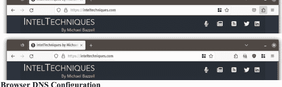

## 浏览器 DNS 配置

如果你将 NextDNS 配置为你的 DNS 查询和过滤提供商，则无需修改 Firefox 内的 DNS 设置。默认情况下，Firefox 将使用系统 DNS，而我们之前已将其配置为 NextDNS。你对 Firefox DNS 设置所做的任何更改都会在通过 Firefox 查询网站时覆盖你的系统 DNS。这会移除你的过滤选项。然而，你可能需要将 Firefox 查询切换到另一个提供商。如果你因大量使用浏览器而超过了每月 300,000 次查询限额，或者希望在不影响 Linux 设备其余部分保护的情况下使用无过滤的浏览器，你可能希望做出更改。总体而言，DNS 使用的顺序如下。

- 如果你的网页浏览器分配了自定义 DNS，则该浏览器内的所有查询都将使用指定的 DNS，无论 Linux 中的其他设置如何。
- 如果你在浏览器内没有分配 DNS，则你的 DNS 查询将根据在 Linux 中分配的提供商执行。
- 如果你未在浏览器或 Linux 中分配任何 DNS 提供商，则你的 DNS 将依赖于你的网络（可能是 ISP）。

我真的很喜欢将 NextDNS 作为整个 Linux 系统的 DNS 服务，因为它可以过滤来自某些已安装应用程序的不需要的连接，例如前一章中的 ONLYOFFICE 示例。然而，我真的不需要在 Firefox 中进行那种程度的过滤，因为 uBlock Origin 在浏览器扩展内通过即时访问实现了同样的功能。我在 Firefox 中执行了以下操作。

- 导航回“设置”菜单并选择“隐私与安全”。
- 向下滚动到“DNS over HTTPS”部分。
- 点击“最大保护”选项并选择“NextDNS”。

现在，你的浏览器将在加密连接到 NextDNS 中执行所有 DNS 查询，无论 Linux 中的其他设置如何。这是 NextDNS 的公共实例，与你的账户无关。请注意，这仅适用于从此 Firefox 安装中访问的网站，而不适用于任何其他应用程序。

从现在开始，我的操作系统或其他应用程序的所有域名查询将由 NextDNS 执行并与我的账户关联。过滤是激活的。Firefox 内的所有 DNS 查询将通过公共 NextDNS 服务器执行，并且不会与我的账户关联。将没有过滤，uBlock Origin 扩展将是唯一的内容过滤提供商。Firefox 的查询不会计入我从 NextDNS 获得的每月免费配额。

## VPN 配置

虚拟专用网络（VPNs）通过将你的互联网流量路由通过安全隧道，提供了安全性和隐私的良好混合。隧道通往 VPN 的服务器并加密你的设备与该服务器之间的所有数据。这确保了任何在流量到达远程服务器之前监视你的人都不会找到可用的未加密数据。通过远距离服务器也提供了隐私。因为你的流量看起来像是从 VPN 的服务器发起的，网站更难跟踪你、聚合关于你的数据以及确定你的位置。

虚拟专用网络并非完美的匿名解决方案。重要的是要注意，VPN 提供隐私，而非匿名。就隐私目的而言，最好的 VPN 是声誉良好的提供商的付费订阅。市面上有几个优秀的付费 VPN 提供商，我强烈推荐它们而不是免费提供商。免费提供商通常通过非常可疑的手段变现，例如数据聚合。付费 VPN 提供商通过直接向销售服务来变现，信誉良好的提供商不会收集或变现你的数据。付费提供商还提供许多增加你整体隐私和安全性的选项。

我目前使用并推荐 Proton VPN 作为我的主要 VPN，并在 VPN 被积极阻断时，将 Private Internet Access (PIA) 作为有限的专用 IP 二级选项。导航至 **inteltechniques.com/vpn.html** 获取更多信息和最佳的联盟购买链接。购买包括无限使用、同时连接多个设备以及快速速度。我用比特币在别名下支付我的 VPN 费用，但这可能对许多读者来说有些过火。

对于大多数读者，以及我咨询过的几乎每个客户，我建议坚持使用 VPN 公司提供的标准 Linux 应用程序。这些品牌应用程序应该能满足大多数需求。Proton VPN 可以在 Pop!_Shop 中下载，这是由 Proton 提供的官方版本。安装完成后，只需提供你的账户凭据并启动你的 VPN 连接即可。幸运的是，Proton VPN 使他们的应用程序完全开源。这使得在其中隐藏恶意编程变得更加困难。

我的 VPN 政策很简单，但我对 VPN 公司的看法可能很复杂。任何我从我的 Linux 设备连接到互联网的时候，我都通过我的 VPN 连接。我依赖 Proton VPN 通过其应用程序在我的 Linux 设备上连接，**仅在我旅行时**。家庭设备通过 Proton VPN 防火墙受到保护，如 *Extreme Privacy, 4th Edition* 中所述。在家里，由于 VPN 防火墙的存在，我从未需要在我的计算机内部启动 VPN。我在任何 Linux VPN 应用程序上都会遇到持续的问题，所以只要有可能，我更喜欢依赖我的家庭网络防火墙，同时禁用任何 Linux VPN 应用。我比大多数商业选项更信任 Proton VPN，我相信他们的商业模式是最透明的。在瑞士托管提供了来自模糊政府入侵的某些方面的隐私，但国际服务器始终可能被入侵。关于我的 VPN 推荐和配置的任何更新都将在我的网站 **inteltechniques.com/vpn.html** 上发布。

依赖 VPN 公司是很困难的。我们将大量信任寄托于我们选择的提供商，而我们对母公司了解甚少。有人认为，庞大的母公司可能对从数百万 VPN 用户那里收集的数据怀有不良意图。也有人认为，在它们巨大的干草堆中作为一根小小的针可能具有其自身的好处。我相信所有 VPN 都有缺陷，但对我们来说仍然是必需的。几乎所有的 VPN 提供商都依赖全球各地租用的服务器，这些服务器超出了它们的控制范围。一些提供商在不知情的情况下使用与其竞争对手相同的服务器。

使用 VPN 时，你只是将你的互联网历史记录托付给他人。这表面上听起来很糟糕，但这比什么都不做要好。没有 VPN，我们知道我们的 ISP 正在监控、收集和共享我们的互联网活动。使用 VPN 时，我们被告知这些信息未被记录或共享。我们是无懈可击的吗？不。然而，我宁愿尝试隐藏我的流量，也不愿什么都不做。**我为 VPN 的主要目的是防止像我的电子邮件提供商这样的服务知道我真实的家庭 IP 地址。** 你的需求可能不同。

有些人可能会质疑，当你将所有流量通过 VPN 而不是通过你的 ISP 发送时，共享了多少关于你的在线历史的数据。总有


## 虚拟私人网络（VPN）的使用及其隐私影响

这些漏洞可能会暴露比预期更多的数据，但我们可以讨论一些关于互联网流量的误解。首先，我们应当解决 SSL/TLS 的问题。SSL（安全套接字层）及其后继者 TLS（传输层安全协议）是用于在联网计算机之间建立经过身份验证且加密的链接的协议。这与你在浏览器地址栏中看到任何以 "https" 开头的网站时显示的锁形图标有关。这表示连接是安全的，但这究竟意味着什么？我将通过几个例子来简化说明这项技术。假设你正使用直接连接到互联网服务提供商（ISP）的家用电脑，并且没有使用 VPN。你连接到 Google 并搜索 "inteltechniques"。呈现给你的响应 URL（包括查询的搜索结果）是 `https://www.google.com/search?q=inteltechniques`。你的互联网服务提供商（ISP）知道你通过 Google 进行了搜索吗？是的。他们知道你搜索了 "inteltechniques" 吗？不。这是因为 Google 加密了实际的搜索 URL。你的互联网连接提供商只能看到被访问的域名。它无法看到有关特定页面的任何详细信息或输入的任何凭据。

这就是为什么网站的 https 版本如此重要。你的浏览器可以看到这个完整的 URL，但它不会直接将其中的任何详细信息与你的提供商共享。现在，让我们引入一个 VPN。连接到你的 VPN（例如 Proton VPN）后，你进行同样的搜索。你的 ISP 知道你通过 Google 进行了搜索吗？不。你的 VPN 提供商知道你通过 Google 进行了搜索吗？是的。你的 VPN 提供商知道你搜索了 "inteltechniques" 吗？不。为什么这很重要？每个人都有独特的威胁模型，但我将介绍几种你可能担心的场景。

首先，考虑我通过民事诉讼起诉你，并且我说服法官授予我收集你互联网活动的法院命令。由于我知道你的居住地，我可以推测你的互联网服务提供商。法院命令向你 ISP 索取你的互联网活动。如果你的 ISP 记录你的流量（大多数都会这样），响应将告诉我你访问过的每个域名以及发生的具体日期和时间。我可以使用这些信息来证明你访问过特定网站，或向指定服务传输了大量数据。如果你启用了 VPN，我只能证明你的设备是通过 VPN 连接的。我无法知道你活动涉及的任何域名。向 VPN 提供商发出的第二份法院命令也不会揭示这些数据。信誉良好的 VPN 不记录此类流量，且 IP 地址在成千上万的用户之间共享。

接下来，假设我想知道你住在哪里。我知道你的电子邮件提供商是 Gmail，向他们发出的传票将揭示你在特定日期和时间的 IP 地址。如果该 IP 地址属于你的互联网服务提供商，第二份传票将披露服务地址（你的家）。如果该 IP 地址属于你的 VPN 提供商，它将不会揭示关于你或 VPN 账户的任何详细信息。向 VPN 提供商发出的关于该 IP 地址信息的传票将不会揭示任何日志，只会解释成千上万的陌生人之间 IP 地址共享的情况。

现在，让我们结合之前提到的策略来挫败这种行为。由于你始终连接到 VPN，你的 ISP 不了解你的互联网流量。向他们发出的传票不会揭示你访问的网站。由于 Proton Mail 不以明文形式记录你的 IP 地址，他们无法确定你的真实 IP 地址。由于 Proton VPN 和 Proton Mail 是瑞士公司，它们不会回应来自美国的传票。如果你在购买 VPN 服务时未提供真实姓名，VPN 提供商无法从你的账户中获取任何信息（例如个人信用卡号或家庭地址）。我希望你现在能明白，所有这些策略都在相互加强。

没有哪家 VPN 公司是完美的，所有公司都可能会留下潜在的数字痕迹。我选择最有可能保护我的选项，因为它失去的代价最大。如果 Proton VPN 被查获存储或出售用户数据，其整个公司都将失去所有信誉和许多客户。如果一家拥有多个 VPN 品牌的大公司被查获这样做，他们只需关闭其中一个品牌，并为另一个品牌启动新的营销活动即可。我相信，与大型 VPN 公司相比，Proton VPN 有更大的动力来保护其产品和声誉。

**重要提示：** 在各种 Linux 环境中对 Proton VPN 进行大量测试时，我遇到了在启用或禁用 VPN 后互联网连接中断的情况。这是由于 NextDNS 和 Proton DNS 之间的冲突造成的。如果你遇到这种情况，在终端中运行以下命令将重启 NextDNS 服务，应能解决此问题。我会在下一页详细介绍更多相关内容。

```bash
nextdns restart
```

### VPN 的 DNS

需要注意的是，如果你在电脑上使用 VPN 应用程序，它很可能会忽略你在设备上进行的任何 DNS 修改，并使用自己的服务器。这对于许多情况是可以接受的，但并非对每个人都理想。通过允许你的 VPN 保护所有流量并提供所有 DNS 查询，你将所有的鸡蛋放在同一个篮子里，不再享受 NextDNS 的过滤功能。你正在信任你的 VPN 提供商，使其有能力记录你的所有互联网历史和流量。如果你使用的是可靠的 VPN，这可能不是巨大的威胁，但我们可以做得更好。我将假设你已如前所述配置了 NextDNS，并修改你的浏览器以使用公共 NextDNS 服务器。如果你未对 VPN 应用程序的 DNS 设置采取任何行动，则以下情况适用：

- 当你的 Linux VPN 应用程序禁用时，你的整个 Linux 系统使用 NextDNS 账户进行所有带有过滤的 DNS 查询，而 Firefox 使用公共 NextDNS 服务器进行无过滤的查询。
- 当你的 Linux VPN 应用程序启用时，它使用自己的 DNS，你的操作系统内没有 NextDNS 的过滤，但 Firefox 仍然使用其自己的公共 NextDNS 服务器进行无过滤的查询。

如果你想改变这种情况，你只需在连接到 VPN 后重启 NextDNS 服务即可。以下是我在 Linux 设备上需要启动随后终止 Proton VPN 应用程序时的策略。

- 启动 VPN。
- 重启 NextDNS 服务并进行我的在线活动。
- 完成后终止 VPN。
- 重启 NextDNS 服务。

如果我的 NextDNS 服务正在运行，我启动 VPN，VPN 开始使用其自己的 DNS 服务器。在某些情况下，由于两种服务相互竞争，你的整个互联网连接可能会断开。当我重启 NextDNS 时，它会覆盖 VPN 的 DNS 服务器。当我终止 VPN 时，它也可能终止任何冲突的 DNS，这就是为什么我在关闭 VPN 后立即重启 NextDNS 的原因。在第九章中，我们将为此创建一个简单的脚本。让我们回顾一下。

- 我已在 Pop!_OS 安装中配置了我的 NextDNS 账户，如第四章中先前所述。它是我所有应用和系统本身的通用 DNS。我启用了过滤。
- 在我的 Firefox 浏览器中，我将安全 DNS 选项设置为 "Max"，并选择 NextDNS 作为选项。Firefox 内的所有 DNS 查询都通过公共服务器进行，不进行过滤。我的 Ublock Origin 扩展将处理所有不需要的流量的过滤。
- 我安装了 Proton VPN，但我很少打开它。我使用网络范围的家庭防火墙，如《极端隐私》第四版中所述。这为我提供了机器上的 VPN 保护，无需 Linux VPN 应用程序，并允许我在 Linux 软件中指定任何 DNS 服务器。
- 当我不在家时，我启动 Proton VPN 应用程序，然后重启我的 NextDNS 服务。然后，我的 Linux 系统和所有非 Firefox 应用都将使用此 DNS 并受益于过滤服务。我还在关闭 VPN 后重启 NextDNS 服务。

对于大多数人来说，总体目标是阻止你的 ISP 窥探你的流量。即使你不更改 VPN 的 DNS，所有这些情况都能防止这一点。至于你要走到哪一步，取决于你。

### Tor 浏览器

如果你关注各种隐私相关社区，你会听到许多人推崇 Tor 浏览器。这个基于 Firefox 的浏览器仅通过 Tor 网络连接互联网，无需 VPN 即可隐藏你的真实 IP 地址。由于每个 Tor 浏览器用户都有完全相同的浏览器配置，当网站试图对我们进行指纹识别时，我们可能不会被视为独特用户。然而，这并不完美。如果你是访问我虚构服装网站的唯一 Tor 浏览器用户，你就会显得非常显眼。此外，许多网站完全阻止来自 Tor 网络的连接。如果你试图在 Tor 内登录银行，预计会被阻止。更糟糕的是，你的账户可能会被暂停。

我只在需要依赖 Tor 浏览器才能访问 Tor 网络内特定网站（通常以 ".onion" 结尾）的调查中使用 Tor 浏览器。对于其他情况，我依赖我经过加固的 Firefox，如前所述。在 Linux 中安装 Tor 浏览器从来都不是简单的。在 Pop!_Shop 中搜索 Tor 会提供多个选项。在撰写本文时，我发现以下方法在 Pop!_OS 上效果最好。

- 打开 Pop!_Shop 并搜索 "Tor"。
- 选择标题为 "Tor Browser Launcher" 的选项并安装默认选项。
- 从 "显示应用程序" 菜单中启动 "Tor Browser"。
- 允许安装完成并启动浏览器。
- 启用 "始终自动连接" 选项并点击 "连接"。

现在你应该能够随时启动 Tor 浏览器并立即开始使用程序。你的网络浏览器是你通往互联网的窗口。请确保你已根据你的需求对其进行加固，但切勿将其限制到阻碍你必要的在线活动的程度。拥有加固版的 Firefox 将为日常在线行为提供很好的隐私保护，而 Tor 浏览器将用于更敏感的任务。


# 第七章：VoIP 服务

在将计算机配置得尽可能私密和安全之后，你可能希望利用互联网连接进行传统的电话通话。正如我在之前关于移动设备的数字指南中所解释的，我从不希望依赖与我的移动设备关联的号码来进行日常通讯。因此，我们需要一种方法来拨打和接听标准电话并收发短信，而不使用我们的蜂窝计划。在 GrapheneOS（移动端）中，我依赖一个名为 Signetice 的应用程序和各类互联网协议语音（VoIP）提供商来进行所有电话通话。桌面 Linux 系统将依赖一个名为 Linphone 的应用程序，以与这些相同的提供商配合使用。在配置我们的设备之前，让我们先理解为什么我们应该谨慎对待真实蜂窝号码的使用。

-   当你通过标准蜂窝号码拨打电话和发送短信时，服务提供商会永久存储此活动的日志。这些日志记录了你所有的通讯，并可被员工、政府机构和犯罪分子访问。我亲眼目睹通话和短信日志在刑事和民事审判中作为主要证据被使用。

-   你的蜂窝电话号码通常被用作你账户的主要标识符。如果我知道你的号码，我就可以利用这一细节获取更多信息，例如移动设备的位置历史。你的蜂窝提供商会根据你连接的蜂窝塔始终存储你的位置。我可以滥用法院命令来获取这些细节，或者雇用一个犯罪分子入侵你的账户。在过去几年里，我们知道赏金猎人仅凭知道蜂窝号码就能实时定位移动设备。无需法院命令。记者多年来一直能够追踪人们的活动。

-   蜂窝电话号码容易遭受 SIM 卡互换攻击。如果我知道你的主要号码，我可以通过各种手段接管你的账户，并成为该号码的新所有者。我可以冒充你并接收本应发给你的通讯。如果你使用该号码进行双因素认证，我现在就拥有了第二个验证因子。

-   当你将电话号码提供给朋友和家人时，他们很可能会将其存储在联系人中，并将你的名字与该条目关联。随后，某人可能会下载一个恶意应用，该应用请求访问联系人列表，并将联系人发送到可查询的在线数据库。过去我们已经看到了这种情况，包括像 TrueCaller 和 Mr. Number 这样的来电识别服务，它们将私人联系人详情共享给了全世界。你是否曾收到来自 LinkedIn 的邮件，邀请你与某人联系？当那个人同意与服务共享他们的联系人（包括电子邮件地址和电话号码）时，这种情况就会发生。Twitter 也希望从愿意共享这些详情的任何成员那里获取这些信息。只需发生一次，你的蜂窝号码就会公开地与你的真名关联。

使用 VoIP 号码可以消除这些担忧中的大部分。请考虑以下几点。

-   VoIP 通话和消息也会在 VoIP 提供商的门户网站中记录。
-   然而，我们可以更好地控制这些信息，并拥有选项在需要时永久清除内容。
-   VoIP 通讯不具备蜂窝连接相同的详细位置信息。虽然 VoIP 提供商可能拥有连接的 IP 地址，但没有提供精确 GPS 坐标的蜂窝塔。如果你入侵我的 VoIP 账户，你将永远无法得知我的真实位置。
-   如今非法接管蜂窝账户非常简单。可以在一小时内完成。将一个 VoIP 号码转移给另一个提供商可能需要一周多时间，并且对此操作的通知将允许你阻止它。每当我被迫使用电话号码进行双因素认证时，我总是更倾向于使用 VoIP 号码而非蜂窝账户。
-   你无法阻止朋友和家人将你的电话号码与滥用应用程序或服务共享。如果他们只知道你的 VoIP 号码，风险就会更低。一旦 VoIP 号码在公开泄露并与你的真名关联，你如愿意可以轻松更换它。如果你拥有多个 VoIP 号码，你可以将它们隔离用于不同用途。当全世界都知道某个 VoIP 号码属于你时，它无法像蜂窝号码那样被滥用。再次强调，VoIP 号码不能共享你的位置。

解决所有这些问题的方法就是永远不要使用真实的蜂窝号码。相反，我们将只使用 VoIP 号码进行所有通话和标准短信。在接下来的页面中，我将解释如何配置各种 VoIP 服务用于电话通话和短信。我的目标是让你创建自己的 VoIP 产品，使你能够以最低成本在新的安全 Linux 设备上拨打和接听电话。此外，这些号码将由你掌控。你将不需要维持对 Google Voice 账户的访问权限即可享受 VoIP 通话的好处。

本节内容技术性较强，但任何人都可以复制这些步骤。与所有在线服务一样，这些步骤中的任何一步都可能在不通知的情况下发生变化。在配置过程中，你很可能会遇到与我教程略有不同的变体。请侧重于总体方法，而不是确切步骤。以下内容解释了我为创建自己的 Twilio VoIP 解决方案所采取的每一个步骤。之后，我提供了其他可能对某些读者更合适的选项。请在做任何决定之前读完整个章节。本章的大部分内容与之前发布的移动和 macOS 指南中的 VoIP 内容相同。

在我们深入研究各种选项之前，我们必须稍作停顿，讨论一下域名注册。我鼓励你在继续之前消化下一部分内容。你现在采取的步骤可能会让之后的一切变得更加容易。

## 域名注册

在以往的文章中，我解释了在注册在线服务时使用匿名电子邮件转发服务和临时访问提供商的方法。我提供了教程，向各种服务提供这些掩码和一次性地址以保护我们的隐私。如今，我认为你应该为使用你新的私密且安全的 Linux 设备建立一个新域名。许多注重隐私的电子邮件服务正在被在线提供商积极屏蔽。如果你尝试使用 SimpleLogin 的掩码电子邮件地址来开通新的蜂窝服务线路，很可能被阻止。如果你试图欺骗 VoIP 提供商接受 Mailinator 或 10MinuteMail 地址来创建新账户，预期会被立即暂停服务。鉴于此，随着我继续配置我的 Linux 设备，我希望拥有一个可识别域名关联的无限数量的可接受电子邮件地址。

你可以简单地购买一个新域名，例如 vandyalay-industries.net，并将其配置为电子邮件访问，但这可能不是最好的主意。许多 VoIP 服务公司现在正在审查新账户。如果你使用全新域名注册，他们可以看到这一点。许多欺诈预防系统会屏蔽在过去 30 到 60 天内创建的域名的任何注册。因此，我更喜欢那些最近过期并从注册商处删除的现有域名。

首先，我访问 expireddomains.net，然后点击“已删除域名”标签。然后，我按以下类别排序，直到看到想要的域名结构。

-   BL：已知反向链接数量
-   ABY：在 Archive.org 上首次看到该域名的年份
-   ACR：Archive.org 抓取结果数量
-   Reg：与该域名匹配的顶级域名（TLD）数量

下面是一些随机结果的示例。虽然其中两个有一些互联网历史，但它们看起来都不像能够通过人工审查的传统商业域名。为此目的，我只获取 “.com” 地址，因为某些提供商会屏蔽较新的 TLD，例如 “.work”。

| 域名 | BL | DP | ABY | ACR | Dmoz | C | N | Q | B | Reg | RDT |
|---|---|---|---|---|---|---|---|---|---|---|---|
| esolo.top | 0 | 0 | 2021 | 1 | - | ** | ** | ** | ** | 12 | 10 K |
| bhc331.top | 0 | 0 | - | - | 0 | - | ** | ** | ** | 0 | - |
| bananad.top | 2 | 0 | - | 0 | - | - | ** | ** | ** | 4 | 226 |

接下来，将这些结果与以下内容进行对比，这些是我通过按每个类别排序找到的。个人而言，我喜欢 "Rental-Bus.com" 和 "PrairieBoard.com"。其中任何一个都应该能作为合法的公司名称通过审查。"PrairieBoard.com" 可以被呈现为一个代表几乎任何业务的董事会实体。对于一台计算机来说，这似乎有点过度，但我认为这是合理的。购买后，我保留与该域名关联的电子邮件地址，仅用于我新的 Linux 设备。当我们进入 VoIP 提供商部分时，你会很高兴你在这方面采取了主动措施。

| 域名 | BL | DP | ABY | ACR | Dmoz | C | N | Q | Reg | RDT | 状态 |
|---|---|---|---|---|---|---|---|---|---|---|---|
| PrairieBoard.com | 0 | 0 | - | 0 | ** | ** | ** | 0 | 1 | 2 天 | 可用 |
| neamemories.com | 0 | 0 | - | 0 | ** | ** | ** | 0 | 0 | 昨天 19:44 | 可用 |
| FishyChat.com | 0 | 0 | - | 0 | ** | ** | ** | 0 | 0 | 昨天 19:45 | 可用 |
| BankerSkit.com | 0 | 0 | - | 0 | ** | ** | ** | 0 | 0 | 今天 19:04 | 可用 |
| Rental-Bus.com | 0 | 0 | - | 0 | ** | ** | ** | 2 | 2 | 3 天 | 可用 |
| bialdi.com | 0 | 0 | - | 0 | ** | ** | ** | 0 | 2 | 7 天 | 可用 |
| polisick.com | 163 | 2 | - | 0 | ** | ** | ** | 0 | 0 | 昨天 19:43 | 可用 |
| GoodStuffForGoodPeople.com | 0 | 0 | - | 0 | ** | ** | ** | 0 | 0 | 昨天 19:42 | 可用 |

接下来，我喜欢通过 Whoisology.com 等在线服务验证域名注册历史。许多在线服务，尤其是 VoIP 提供商，可以复制这种类型的搜索，所以我想了解如果他们的系统审查与新账户关联的域名，他们会看到什么。以下是 rental-bus.com 的条目。你可以看到域名注册自 2013 年 4 月起已被捕获。如果我购买这个已释放的域名，并在购买时提供电子邮件账户，使用它可能会比使用一个从未在线出现过的新域名显得更加合法。


最后，我想购买一个域名并从中生成电子邮件转发服务。有许多域名注册商和Web托管商可以满足需求，但我更喜欢Cloudflare。每年只需9美元，我就可以拥有这个域名，并将无限量的传入邮件通配符地址转发到任何外部加密邮件提供商，例如Proton Mail。我不需要从第三方提供商购买托管计划。在本示例中，我创建了一个免费的Cloudflare账户，并将其与一个新的Proton Mail电子邮件地址相关联。

一旦我登录Cloudflare并显示我的账户门户，我就导航到“域名注册”>“注册域名”。然后我搜索了rental-bus.com，并得到以下结果。

## 查找域名

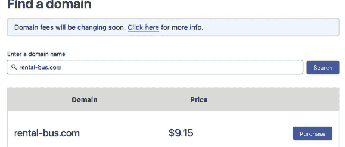

我以9.15美元的价格购买了一个域名，并使用了一张经过掩码处理的Privacy.com卡进行交易，但也可以使用传统的信用卡。在此过程中，我被要求提供我的姓名、实体地址、电子邮件地址和电话号码。这些信息如下：

- 提供虚假信息可能导致失去域名。我仅在域名被滥用于发送垃圾邮件时见过这种情况，但它也可能发生在我们身上。我们应该遵守规则。
- 提供别名和不存在电子邮件地址是失去域名控制的必然方式。如果将来需要您通过电子邮件或身份证验证域名的所有权，您将无法确认您的身份。

因此，让我们诚实地……有点吧。每次我注册域名时，我都会提供我真实名字和中间名的简化版本作为我的全名。如果我的全名是“Michael John Bazzell”，我可能会提供“Mich John”作为我的名字。我有朋友叫我Mike，但我从未见过他们拼写它。因此，也许在他们的脑海中它是“Mich”。如果我的中间名是John，且我的祖母经常叫我Michael John，那就是我的真名。

接下来，他们要求一个实体地址。我在旅行期间总是住在酒店时购买新域名。从技术上讲，那是我当晚的家。我在注册时总是包括房间号。我通常也提供酒店电话号码，因为域名注册总是通过电子邮件验证。我提供与Cloudflare相同的Proton Mail电子邮件地址作为域名注册联系人。我保存了酒店收据的数字副本，包括我的名字和中间名，以及入住日期和房间号，以防我被要求提供所提供住址的证明（我从未被要求过）。这是否过度？也许。Cloudflare不会公开共享您的任何注册详细信息，并且需要法院命令才能释放这些信息。然而，数据泄露或不良员工可以很容易地消除我为了尽可能匿名所做的一切努力。因此，我将信息掩码到我认为可以舒适地呈现为我自己的程度。

一旦我拥有该域名，我导航到“Websites”并选择我的新域名。然后我点击“Email”标签，并完成“Email Routing”要求。在撰写本文时，以下情况适用。请注意，Cloudflare的措辞变化迅速，因此您可能会看到一些细微差异。

- 点击“Get started”按钮。
- 创建自定义电子邮件地址，例如“comms@rental-bus.com”。
- 提供一个目标地址，您的传入邮件将转发到该地址。
- 点击“Create and continue”。
- 在您的接收邮件账户中确认请求。
- 点击“Add records and enable”以应用适当的DNS设置。

在此场景中，发送到“comms@rental-bus.com”的任何邮件将转发到我之前提供的Proton Mail电子邮件地址。您现在应该点击Cloudflare门户中的“Email”>“Email Routing”。然后，点击“Routes”标签，并启用“Catch-all addresses”。这将允许发送到您新域名的任何邮件转发到您的接收地址。如果您使用“VoIPcall@rental-bus.com”、“sales@rental-bus.com”、“manager@rental-bus.com”等电子邮件地址注册服务，它们都将自动转发到您的接收地址。这允许您在没有任何电子邮件配置的情况下即时创建新地址。请注意，这些地址只能接收消息，您无法从中发送。显然，您不一定需要使用Cloudflare来做这件事。您可以在任何Web托管商注册域名，并支付电子邮件服务费用。由于成本原因，我更喜欢这种方法，因为我拥有许多用于特定目的的域名。相比之下，通过Namecheap的域名和电子邮件托管起价每年30美元。**遵循本书其余部分，您完全不需要自定义域名。** 如果您没有获取VoIP服务的计划，您可能可以完全跳过这一步。我发现绕过大多数电话服务提供商的欺诈过滤器很有益处，因此我希望在我需要之前配置好所有内容。让我们继续。

## Twilio VoIP 服务

当一个应用或服务宣传“Burner Phone”（备用电话）、“Second Phone”（第二部电话）、“Second Line”（第二线路）或其他诱人的措辞时，它们实际上并不提供电话号码或电话服务。几乎全部依赖于称为Twilio的VoIP服务。即使是MySudo也通过Twilio提供访问。这些公司通过Twilio购买号码和服务，并向您推销该服务。如果我们消除中间商呢？您可以创建自己的Twilio账户，购买一个号码，并在没有任何第三方参与的情况下拥有服务。这种DIY选项说起来容易做起来难，但是一个非常可行的任务。

第一步是从桌面计算机在Twilio (twilio.com) 创建一个新账户。这将是最难的部分。作为注册的一部分，您必须向Twilio提供姓名、电子邮件地址和电话号码。Twilio拥有强大的欺诈机制，以暂停那些看起来可疑的账户。在测试此策略的初期，我的账户立即被暂停。我提供了一个模糊的姓名、备用电子邮件地址和Google Voice号码，同时连接到VPN。这触发了账户暂停，我被要求回复支持邮件，解释我将如何使用Twilio。

这开始了与两名Twilio支持人员的沟通。在与客户服务交谈时，我建议VPN IP地址可能是暂停的原因。在提供公司名称、“更好”的电子邮件地址以及说明我将把产品用于企业VoIP解决方案之后，我的账户恢复了。**如果您陷入这种网状的打击中，我劝诫您不要让他们知道您正在遵循本书中的协议来建立VoIP服务。** Twilio不喜欢我或我的整体受众。与我们相比，大企业才是主要客户。

创建免费账户后，您的账户将受到严重限制。Twilio的个人员工将分析您的注册详情，并决定是否可以将您“升级”为完全功能账户。如果您应用以下准则，我认为您会在小时内发现您的账户限制被解除。

- 提供您真实的名字和中间名，特别是如果他们很普通。根据我的经验，不需要真实的姓氏。
- 如果按照上一章所述创建了自定义域名，请提供与该域名关联的电子邮件地址。来自Proton Mail、Tutanota或掩码提供商的隐私主题地址将被标记，账户将被暂停。Gmail和其他免费地址将受到严格审查（或完全阻止）。
- 如果可能，在没有VPN保护的情况下注册。我稍后解释VPN的使用，但这可能成为所有新账户的触发因素。公共Wi-Fi，如当地图书馆，通常工作良好。
- 提供的电话号码可以是现有的VoIP号码或任何您有权访问的固定电话。如果您有旧的Google Voice号码，这应该能很好地工作。


Twilio 的员工很可能会给你发邮件，询问你打算如何使用他们的服务。千万不要忽略这封邮件。你必须让他们相信，你有资格为他们的产品付费。我通常会提供类似以下内容的回复。

- “我是一名软件开发人员，我的老板让我研究一下 Twilio API，希望能用 VoIP 服务替代我们的固定电话。我计划购买几个 SIP 号码并将其分配给员工。”
- “我为几家公司提供 L.T. 服务，他们正在询问 VoIP 服务。我希望测试一下 Twilio API，看看它如何融入他们现有的系统。”
- “我的一个客户目前使用 Mlnxy 进行 VoIP 服务，但他们对产品不满意。他们让我研究 Twilio API，看看是否有迁移到你们环境的可能性。”

**切勿逐字照搬上述任何段落！** 如果我们都发送同样的邮件，我们的账号都会被封禁。请借鉴这些通用思路，制定你自己使用的理由。虽然我们在某种程度上具有误导性，甚至可能不诚实，但并不存在欺诈行为。我们会为我们所需的服务付费。我目睹了许多读者的账号因声称只需一两个号码用于个人用途而遭到封禁。如果你需要回复 Twilio 的邮件，且你使用了通过 Cloudflare 托管的自定义域名，那就多了一个麻烦。你无法从注册时提供的地址发送邮件。不过，这并不是强制要求的。在你的 Twilio 控制面板中，在左侧菜单导航至“文档与支持” > “支持中心”，并选择“工单历史”。你应该能看到 Twilio 员工发送的任何消息副本。你可以选择需要处理的消息，并直接在控制面板内回复。这将通过你的注册邮箱地址发送给 Twilio 员工。

一旦你的账号获得批准且你支付了服务费，你就会隐入背景中，Twilio 员工大概率不会再联系你。只要你不制造任何显得可疑的情况，或者违反他们的服务条款，他们应该就会把你晾在一边。如果 Twilio 要求提供政府签发的身份证件副本，请予以抵制。在最初的封禁解除后，我能够在不提供身份证件的情况下激活了两个账号。总的来说，他们只是想拥有付费且不乱用其网络的用户。

现在我将假设你已创建一个具有强密码的 Twilio 账号，并且该账号已由 Twilio 员工升级为正式版。你账户中的免费额度允许你测试该服务的许多功能，但在你的账号完全可用于对外通信之前，需要存入 20 美元。我使用了一张经过遮蔽的借记卡支付。然而，我认为使用真实的信用卡并没有太大的问题。很多人会认为这是鲁莽的行为，因为它会留下指向你真实身份的数字痕迹。这是真的，但请考虑以下几点。

如果你将使用与真实身份关联的 VoIP 号码，无论如何都会留下痕迹。如果我把一个新的 VoIP 号码给我的朋友、家人和同事，通过使用情况、日志和联系人共享，这个号码将会与我联系在一起。使用 VoIP 的全部意义在于，以侵入性更低的方式在真实身份下接听和拨打电话。行为模式会将你识别为账户持有者，这没什么问题。我不认为我们需要对 VoIP 服务商保持完全的匿名。然而，我认为我们应该对蜂窝网络运营商保持匿名。如果有人调查该 VoIP 账号，他们可能依然能根据所拨打的号码建立起关联。因此，我认为使用真实的信用卡支付这些服务没有问题。如果要求使用真实姓名，我也不认为这有问题。如果你按照我在《*Extreme Privacy 第四版*》中的建议，在你的名字和中间名下办理了一张副卡，那就更好了。让我们回到 Twilio 账号。点击左上角的“向下箭头”应该允许你创建一个新的账号，这曾经被称为“项目”。如果缺少此选项，请访问 [https://www.twilio.com/console/projects/summary](https://www.twilio.com/console/projects/summary) 并选择“创建新账号”。提供一个通用的账号名称。我将其命名为“VoIP”。这可能要求你确认一个电话号码以“证明你是人类”。幸运的是，他们在这里接受 VoIP 号码，我提供了一个 Google Voice 号码。在确认号码后，回答关于你期望用法的提示问题。这里的回答不会影响你的账号。

一旦你的新项目创建完成，你应该能看到至少 10 美元的测试余额。现在是时候配置我们的 VoIP 电话号码了。首先，根据以下配置，确定离你最近的 Twilio 服务器所在地。我将使用“东海岸”美国选项，因此我的示例服务器将是 [phone number].sip.us1.twilio.com。在美国，最稳定的选项是“us1”。

- 北美 弗吉尼亚：[phone number].sip.us1.twilio.com
- 北美 俄勒冈：[phone number].sip.us2.twilio.com
- 欧洲 都柏林：[phone number].sip.ie1.twilio.com
- 欧洲 法兰克福：[phone number].sip.de1.twilio.com
- 南美 圣保罗：[phone number].sip.br-1.twilio.com
- 亚太 新加坡：[phone number].sip.sg1.twilio.com
- 亚太 东京：[phone number].sip.jp1.twilio.com
- 亚太 悉尼：[phone number].sip.au1.twilio.com

如果以下菜单项已更改，请在他们的在线 Twilio 文档中搜索更新。Twilio 经常在没有警告或文档的情况下更改菜单选项。如果我看到重大变化，我会更新这份 PDF 并通知你下载免费的更新文档。让我们开始吧。

在 Twilio 仪表盘中，点击“获取试用号码”。使用搜索功能查找你期望区号内的号码。这将从你的余额中扣除 1 美元。如果不存在此选项，请点击左上角菜单中的“Develop”链接，然后点击“Phone Numbers”，接着点击“Manage”，再点击“Active Numbers”，最后点击“Buy a Number”。点击所需号码旁边的“Buy”。我的演示号码是“2025551212”。请继续执行以下操作。

- 点击左侧菜单中的“Voice”链接。
- 选择“Manage”菜单选项。
- 点击“SIP Domains”选项并点击“+”创建新域名。
- 将分配的电话号码输入为“Friendly Name”，例如“2025551212”。将分配的电话号码输入为“SIP URI”，例如“2025551212”。
- 在“Voice Authentication”下，点击“Credential List”旁边的“+”。
- 输入你的号码的“Friendly”名称，例如“2025551212”。
- 输入你的号码的“Username”，例如“2025551212”。
- 输入一个安全密码并点击“Create”。
- 在“SIP Registration”下，点击“Disabled”按钮以启用它。
- 在“Credentials List”下拉菜单中，选择你的电话号码。
- 点击“Save”。
- 导航至 [https://www.twilio.com/console/runtime/twiml-bins](https://www.twilio.com/console/runtime/twiml-bins)。
- 在左侧菜单中，点击“TwiML Bins”旁边的三个点。
- 点击“Pin to Sidebar”。
- 点击“+”创建一个新的 TwiML Bin。
- 提供一个“Friendly”名称为“incomingvoice”。
- 将以下文本放入 TwiML 框中。将“2025551212”替换为你的号码。

```
"<?xml version="1.0" encoding="UTF-8"?>
<Response>
  <Dial answerOnBridge="true">
    <Sip>2025551212@2025551212.sip.us1.twilio.com</Sip>
  </Dial>
</Response>"
```

- 点击“Create”和“Save”。
- 在左侧菜单中点击“Phone Numbers” > “Manage” > “Active Numbers”。
- 点击你的电话号码。
- 在“Voice & Fax”下的“A Call Comes In”中，选择“TwiML Bin”。
- 在下拉菜单中选择“incomingvoice”并点击“Save”。
- 在左侧菜单中点击“TwiML Bins” > “My TwiML Bins”。
- 点击加号创建一个新的 bin。
- 提供一个“Friendly”名称为“outgoingvoice”。
- 将以下文本放入 TwiML 框中。

```
"<?xml version="1.0" encoding="UTF-8"?>
<Response>
  <Dial answerOnBridge="true" callerId="{{#e164}}{{From}} {{/e164}}">
    {{#e164}}{{To}}{{/e164}}
  </Dial>
</Response>"
```

- 点击“Create”和“Save”。
- 在菜单中点击“Voice” > “Manage” > “SIP Domains”。
- 选择你的域名。
- 在“Call Control Configuration” > “A Call Comes In”下，将“Webhook”更改为“TwiML Bin”，并在下拉菜单中选择“outgoingvoice”。
- 点击“Save”。

你可能注意到关于 75 美元紧急呼叫费的警告。这是为了诱导你将实体家庭地址与你的账号关联，并为此特权支付月费。这是不必要的。然而，出于某些原因，从该 VoIP 号码拨打的 911 呼叫可能会产生 75 美元的 Twilio 费用。我绝不会从这些号码拨打 911。如果有真正的紧急情况，我会直接使用设备上的拨号应用通过蜂窝网络连接。这将把我的真实蜂窝号码透露给接线员，但在紧急情况下，隐私不应是优先事项。你现在已经准备好使用新号码接听和拨打电话了。你不能通过 Twilio 的网站做到这一点，因为你需要为此目的设计软件，如下文所述。

## **Twilio Linphone 配置**

你现在已经创建了一个 SIP 域名和凭据，允许你将 Twilio 账号与名为 **Linphone**（linphone.org）的 VoIP 软件关联，该软件可以从 Pop! Shop 安装。以下配置步骤应适用于所有 Linphone 应用程序，但你可能会在不同平台上看到细微的变化。你需要在每个希望用于 VoIP 通话的 Linux 设备上重复执行每个步骤。启动 Linphone 并执行以下操作。


- 如果提示，请选择“使用 SIP 账户”。如果该选项不存在，请单击“主菜单”按钮，然后选择“账户助手”。
- 如果有提示，请单击关于任何限制的“我理解”。
- 输入您的号码作为“用户名”，例如“2025551212”。
- 输入您的电话号码的“显示名称”，例如“2025551212”。
- 输入适当的“SIP 域名”，例如 2025551212.sip.us1.twilio.com。
- 输入您之前为凭据账户创建的“密码”。
- 将“传输协议”更改为“TLS”。如果失败，请尝试“UDP”或“TCP”。

单击确认按钮，直到返回到主应用程序。现在您可以单击左上角的号码选择区域以选择您的新账户，或者在添加更多账户时在多个账户之间进行选择。如果 Linphone 到 Twilio 的连接成功，您应该会在账户旁边看到绿色或灰色的指示灯。现在我们可以进行第一次通话了。

- 确认在 Linphone 应用程序中已选中您的 Twilio 账户。
- 在顶部的搜索字段中，输入任何已知的电话号码。
- 单击“电话”按钮以发起呼叫。

您应该会收到一条自动化消息，感谢您使用您的演示账户。我不得不单击三个点，然后单击“多媒体参数”，以选择适当的传入和传出声音属性。这证实了我们可以向 Twilio 服务器发起呼叫，但我们还远未达到对真实号码的无限制使用。只要您收到来自 Twilio 的确认测试呼叫消息，您的配置就完成了。如果您希望移除所有限制，以便拨打和接听任何号码的电话，您必须“升级”账户。以下步骤应在 Twilio 门户中执行。

- 返回左上角菜单中的仪表板。
- 单击“升级”链接并提供所有请求的账单详情。
- 提供任何信用卡、借记卡或注册预付卡。
- 向账户充值 $20。

现在您应该拥有一个无限制的 Twilio 账户，该账户应完全可用于语音通话。在确认您的测试呼叫之前，请勿升级账户。您还应该有一个功能齐全的 VoIP 应用程序，可以方便通话。Linphone 可以随时从您的 Linux 设备发起呼叫。您可以通过重复此过程添加任意数量的号码。只要 Linphone 应用程序处于打开状态且您的状态为“绿色”，传入的呼叫就会让您的 Linux 设备“响铃”。在创建数十个新号码之前，让我们讨论一下成本。每个 Twilio 号码每月会从您的余额中扣除 $1.15。如果您遵循了这些步骤，您的初始电话号码的余额足以使用近三年。传入和传出呼叫费用为每分钟 $0.004。在编写本教程期间的测试中，我总共花费了 $1.21。如以下所述，这种策略有几个巨大的好处。

- 现在您可以通过 Linux 设备拨打和接听电话。
    - Windows、Linux、Android 和 iOS 也通过 Linphone 获得支持。
- 您对您的号码拥有更多的控制权。您不必受制于 Google 及其数据收集来处理通话。
- 只要您有足够的资金支持，您可以添加任意数量的号码。我通过 Twilio 拥有五个号码，并且可以通过我拥有的每个设备访问它们。包括我的使用量在内，我每年的成本约为 $70。Twilio 不知道我的真名，我的账户只关联了一个自定义域名电子邮件地址和一个 Google Voice 号码。
- 您可以将号码转入 Twilio。如果您计划取消手机或 VoIP 号码，您可以将其转入 Twilio，并仍然可以通过 Linphone 访问。
- 此过程与自定义 Android 操作系统配合良好，例如 GrapheneOS，如*极端隐私：移动设备*指南中所述。
- 您可以拨打国际号码（成本较高）。大多数 VoIP 提供商，如 Google、Twilio 和其他，会限制拨打附近国家的电话。您可以通过导航至 Programmable Voice > Calls > Geo Permissions 在 Twilio 中启用任何国家。

请将此 VoIP 策略视为类似于有线电话服务。在测试此策略期间配置 Linphone 应用程序中的 Twilio 时，我遇到了一些设备在使用时出现认证错误。这些错误通常声称提供给 Linphone 的 Twilio 凭据失败，并提示用户输入正确的密码。提供正确的密码会失败。这似乎是由于 Twilio 暂时阻止访问，原因包括无效尝试次数过多、协议设置不正确，或在六分钟阈值内从移动设备启动和关闭 Linphone 的次数过多。任何账户限制应在不活动二十分钟后重置，但 Linphone 中的以下设置应缓解这些问题。导航至 首选项 > 设置 > SIP 账户 > 代理账户，并单击铅笔图标（编辑），确认以下内容。

- 传输协议：TLS
- 注册：已启用
- 发布存在信息：已启用
- ICE/AVPF/STUN/TURN：已禁用
- 出站代理：已禁用

Linphone 软件接受多个号码用于传入和传出呼叫。但是，其菜单仅允许您从最近添加的（默认）号码发起传出呼叫。您可以在左上角的号码选择菜单中选择传出呼叫的默认号码。

需要注意的是，VoIP 电话通话和消息未加密，我们不应期望隐私。然而，我与我的真实身份有一些隔离。我主要将这些号码用于传出呼叫，例如拨打给企业的电话。这种策略是一种经济实惠的选择，允许进行电话通话而无需依赖您的蜂窝运营商提供的号码。它还可以用于隔离传出“垃圾”呼叫，这些呼叫可能会滥用您的号码。Twilio 有能力查看我们的日志，但如果我们通过官方号码进行呼叫，任何蜂窝运营商都可以这样做。稍后我们将根据需要清除这些日志。

此过程最大的特点是能够拥有经济实惠的 VoIP 号码，而无需第三方服务。任何时候您允许第三方服务促进您的通话，您也就允许它们拦截并查看您的数据。所有这些服务都依赖于像 Twilio 这样的 VoIP 提供商，因此我认为我们应该考虑创建自己的解决方案，并消除任何不必要的额外公司。

VoIP 解决方案在与传统蜂窝通信相比时往往存在限制。Twilio，以及任何依赖 Twilio 的服务，并不总是支持“短代码”。这些是缩写电话号码，通常是 5 或 6 位数字。它们通常用于发送带有验证码的 SMS 和 MMS 消息，以访问账户。我认为这些号码是固定电话的替代品，允许我发送和接收语音通话和个人短信。我维护一个单独的 Google Voice 账户，可以接收短代码。我稍后会对此进行更多说明。

默认情况下，当您从 Twilio 号码发起呼叫时，来电显示上没有关联的名称。有些人可能希望如此，但对于其他人来说，这可能是一场虚假信息运动。在我用于真实身份个人通话的一个 Twilio 号码上，我在来电显示中添加了我的名字。这样，当我从 Twilio 号码拨打银行或信用卡公司时，我的名字会作为来电者显示在他们的屏幕上。这增加了额外的保障。在另一个我使用别名名的号码上，我更喜欢该别名显示为来电者。这也增加了作为别名的通话可信度。Twilio 要求您联系他们的支持团队以请求这些修改。

总体而言，我将此方法视为一种简单且经济实惠的电话号码线，为我提供无限的号码可供选择。在需要时，我可以通过笔记本电脑或移动设备发起呼叫，而无需暴露我的真实蜂窝号码。我可以接受笔记本电脑上的传入呼叫，就像传统固定电话一样。另一端的人不知道我正在使用 VoIP 而不是标准电话线。凭经验，在拥有稳定互联网连接的情况下，VoIP 呼叫可能比信号较弱的蜂窝呼叫更可靠。

## Twilio 短信消息

Linphone 没有内置语音信箱或 SMS/MMS 短信功能，仅用于语音通话。如果您希望拥有发送与此新 Twilio 号码关联的 SMS/MMS 短信的功能，您必须创建一个可以促进此通信的环境。您有几个选项，但我将提出我建议的方法。以下内容允许您将任何传入的短信文本消息转发到另一个电话号码，例如 Google Voice 或任何其他号码。这是文本消息转发的最简单选项。

- 单击左侧菜单中的“TwiML Bins”选项，然后单击“My TwiML Bins”。
- 单击加号添加新存储桶，并提供名为“incomingsms”的名称。
- 在 TwiML 字段中插入以下内容，将“12125551212”替换为您自己的接收号码，然后单击“保存”。
  ```xml
  <Response><Message to="+12125551212">{{From}}:
  {{Body}}</Message></Response>
  ```
- 单击“Phone Numbers”、“Manage”、“Active Numbers”，然后选择号码。
- 在“Messaging”和“收到消息时”下，选择“TwiML Bin”。
- 在右侧字段中选择“incomingsms”，并单击“保存”。

所有传入的文本消息现在都应转发到您的另一个号码。请注意，您会从 Twilio 余额中支付少量费用，用于传入和转发的文本消息。高级用户可能希望立即将传入的 SMS 文本消息转发到电子邮件地址。**这需要在线 web 服务器以及上传文件到该服务器的知识。** 共享主机和任何自定义域名都足够。创建一个名为 twilio.php 的文本文件，内容如下。将“your@email.com”更改为您想要接收通知的地址。将“@yourdomain.com”更改为您的实际域名。将此文件上传到您的 web 主机。

```php
<?php
$to = "your@email.com";
```


$subject = "Text Message from ${$_REQUEST['From']} to ${$_REQUEST['To']}";
$message = "${_REQUEST['Body']}";
$headers = "From: twilio@yourdomain.com";
mail($to, $subject, $message, $headers);

进入你的 Twilio 仪表板并执行以下操作：

- 点击“电话号码”、“管理”、“活动号码”，并选择该号码。
- 在“消息”和“收到新消息时”下方，将两者均更改为“Webhook”。
- 在两个字段中提供你之前创建的 PHP 文件的完整地址。这可能类似于 `https://yourdomain.com/twilio.php`。

从另一个号码测试你的新短信选项。任何发送到你的 Twilio 号码的传入短信现在都应被转发到你的电子邮件。主题将显示为“来自 2125551212 发往 6185551212 的短信”，正文将包含发送的消息。我更喜欢这个选项，因为它不需要另一个电话号码（如 Google Voice）来接收消息。当我在车辆维护期间向我的汽车经销商提供这个 Twilio 号码时，当他们发送短信通知我车辆已准备好时，我会收到一封电子邮件。

如果你希望从你的 Twilio 号码发送短信消息，Twilio 仪表板中有一个“试一试”功能，但我发现这个过程很繁琐，且需要你始终登录 Twilio。相反，请考虑 Twilio 的“快速部署”选项。

首先，访问 `https://www.twilio.com/code-exchange/browser-based-sms-notifications`。接下来，确认“账户名称”是你为此流程创建的 VoIP 项目。如果你有多个号码，请选择相应的选项。最后，创建一个密码，以防止随机人员找到你的项目并发送消息。这应该是一个相当安全的密码，但也应该容易记忆。点击“部署我的应用程序”，你将看到一个类似于 `https://sms-notifications-6431-bf4jjg3.twil.io/index.html` 的 URL。

访问此页面会显示一个表单，允许从你的新 Twilio 号码发送无限量的 outgoing 短信消息。输入一个或多个目标号码；应用你的应用程序密码；并编写你的消息。务必在浏览器中收藏此页面，以便轻松访问。如果你想回复收到的消息，你可以打开你的新 Twilio 页面并从中发送。

**为了透明起见，我不会这样做。** 这实在太费劲了。此外，Twilio 对 outgoing 短信有一个未知的阈值。如果你超过了这个阈值，他们会要求提供由 IRS 颁发的 SSN 或 EIN 才能继续服务。这是为了打击短信垃圾信息。我不想参与其中。**我只是将这些 VoIP 号码视为一种进行电话拨打、接听电话以及接收短信的方式。** 如果你在寻找一种向他人发送无限消息的方法，请考虑本书前面提到的安全加密选项。

### Twilio 语音信箱配置

接下来，考虑语音信箱。有些人可能不希望有留下语音消息的选项。到目前为止的说明将使你的 Signetix 应用程序响铃 30 秒然后挂断，或者如果 Linphone 未打开和连接，则立即终止呼叫。对于某些号码，我更喜欢这样，因为我不希望来电者能够录制消息。然而，我们可以启用语音信箱，告诉 Twilio 录制消息，将其保存在他们的服务器上，并给我们发送录音链接的电子邮件。请在 Twilio 仪表板中执行以下操作：

- 访问 `https://www.twilio.com/labs/twimlets/my/` 以访问 Twimlets。
- 选择“语音信箱”，然后选择“创建新的 Twimlet”。
- 提供你希望接收语音信箱通知的电子邮件地址。
- 提供你希望的 outgoing 问候语。
- 选择“True”以将消息转录为文本，或选择“False”以避免转录。请注意，转录会增加额外成本，但不会影响收听语音消息的能力。出于隐私原因，我不进行转录。
- 点击“保存 URL”，然后提供昵称“voicemail”。
- 复制类似于 `http://twimlets.com/AC5b84e8/voicemail` 的 URL。
- 在左侧菜单中点击“TwIML Bins”并选择“incomingvoice”。
- 用以下内容替换当前文本：

```xml
<?xml version="1.0" encoding="UTF-8"?>
<Response>
  <Dial answerOnBridge="true" timeout="30"
        action="http://twimlets.com/AC5b84e8/voicemail">
    <Sip>2125551212@2125551212.sip.us1.twilio.com</Sip>
  </Dial>
</Response>
```

- 用你的 URL 替换 `http://twimlets.com/AC5b84e8/voicemail`。
- 用你自己的号码替换 `2125551212`。
- 如有必要，用你自己的服务器位置替换 `us1`。
- 点击“保存”并测试服务。

如果你的 Linphone 应用程序已打开并连接，来电应该响铃 30 秒。如果你未能在此期间接听电话，语音信箱系统将播放通用问候语并允许来电者录制消息。如果 Linphone 已关闭或未连接到 Twilio，问候语将立即播放。如果来电者留下了语音信箱，你将收到发往所提供地址的电子邮件，其中包含收听录制的 MP3 文件的链接。此录音也可以通过在 Twilio 仪表板中导航到“语音” > “概览”来访问。

类似于 Google Voice，你可以从此菜单中删除录制的文件。此文件不是安全的或私密的。它非常类似于传统蜂窝服务提供商或 Google Voice 存储可供设备访问的语音信箱的方式。如果你的 Twilio 账户中没有任何准备接听的设备连接，当有来电时，你期望在 Twilio“监控”菜单中看到错误消息。这些消息旨在通知你你的电话系统未能接收呼叫，可以忽略它们。

在你承诺语音信箱转录之前，请考虑我对 Twilio 账户净化的想法，这将在下一节中介绍。如果需要，请在“语音” > “设置” > “日志存档”中禁用 Twilio 的“每日呼叫日志存档”记录功能。这并不会阻止 Twilio 存储 VoIP 呼叫元数据，但它确实消除了一层内部日志记录。

请记住，额外的号码会更快消耗资金。只有在你理解你需要它们的原因时，我才建议增加额外的号码。对每个需要的号码重复之前的步骤。在编写此更新时，我配置了一个免费电话号码。此号码的每月费用为 2.00 美元（是标准号码价格的两倍），但它呈现出更专业的外观。我也目睹过免费电话号码在用作号码验证时表现不同。其中一家银行完全拒绝任何 VoIP 号码，因为我需要 2FA 授权号码。然而，提供一个 VoIP 免费电话号码通过了审查。当我在 PayPal 上尝试时，免费电话号码被完全拒绝。这方面似乎没有标准。测试不同的选项可能让你找到最适合你的选项。你现在可以在 Linphone 应用程序中选择多个不同的号码。无论选择哪个作为默认号码，都可以从该号码完成 outgoing 呼叫。任何号码的来电都会使应用程序响铃并允许连接，无论默认账户如何。传入的短信将存储在 Twilio 仪表板中，语音信箱将被转录并发送到你的电子邮件地址。只要你有资金支持，你就可以无限复制此过程。

## Twilio 账户净化

如果你使用任何手动 SMS/MMS 消息选项，消息元数据和内容将保留在 Twilio 的服务器上，并可能由员工访问。你收到的每一条语音信箱也作为 MP3 文件保留在他们的服务器上，可以通过直接 URL 访问，无需任何凭据。让我们确定手动删除此数据的方法，从存储的短信开始。很快将介绍一个自动化选项。

- 访问 `https://console.twilio.com`。
- 记下“Account SID”和“Account Token”。
- 在左侧菜单中点击“消息”，然后点击“概览”。
- 通过点击日期打开任何“最近消息”，并记下“Message SID”。

现在你可以打开终端并执行命令来删除每条消息。如果你的“Account SID”是 `11`，“Account Token”是 `22`，“Message SID”是 `33`，命令如下：

```bash
curl -X DELETE https://api.twilio.com/2010-04-01/Accounts/11/Messages/33.json \ -d "Body=" -u 11:22
```

如果你需要清除数百条消息，这可能非常令人烦恼。在网站上删除语音信箱和呼叫日志更直接。以下步骤允许你从控制台中删除这些数据：

- 访问 `https://www.twilio.com/console/voice/dashboard`。
- 在“录音”下带有箭头图标的任何日志条目中打开。
- 点击“删除此呼叫日志”并确认。
- 如需要，从此位置删除单个呼叫日志。

Twilio 默认存储 13 个月的呼叫日志历史。如果你拥有许多需要删除的录音，你可以使用以下说明使用批量删除工具：

- 前往 `https://www.twilio.com/console/voice/recordings/recording-logs`。
- 点击“选择”、“全选”、“操作”、“删除录音”，然后确认。

如果你启用了呼叫转录服务，你可能希望删除存储在账户中的所有语音信箱文本转录：

- 在左侧菜单中点击“监控”、“日志”，然后点击“呼叫转录”。
- 打开每个转录并点击“删除此转录”。

在编写这一节时，我意识到我的数据很长一段时间没有净化。我的 Twilio 仪表板拥有关于我的健康、家人、朋友和工作的语音信箱和文本转录。我花了一个小时清理了所有数据，然后使用之前的教程禁用了转录。这为我节省了每次呼叫 0.05 美元的费用，并消除了另一个可能存储敏感信息的地方。我们还可以通过以下修改禁用 Twilio 的一些日志记录。


在左侧菜单中点击“Voice”、“Settings”和“General”。
-   禁用“Request Inspector”并点击“Save”。

所有这些日志记录看起来可能过于侵入。确实如此，但这并非 Twilio 独有。Twilio 所做的与其他电信提供商（包括蜂窝和固定电话公司）并无二致。我们可以在一定程度上控制数据的存储方式，但我不想在此制造不切实际的期望。虽然 Twilio 看起来可能已经删除了您的通话日志、语音邮件、短信和转录记录，但这些数据很可能仍以其系统内的某种形式存在。我们唯一的目标是从仪表板中移除数据。对于传统的电话通话和短信，不要指望有任何隐私保障。VoIP 服务绝不应用于敏感通信。请假设所有记录都会被永久存储。

## Telnx VoIP 服务

在过去的文章中，我强烈推荐过一款名为 Telnx 的 Twilio 替代方案。当时，他们对新账号的限制较少，并鼓励人们尝试其服务。如今，我建议在继续之前务必谨慎。这是由于以下几个问题。

-   Telnx 仅向已确认的企业提供账号。不过，您的新自定义域名邮箱地址可能就足够了。
-   Telnx 不再提供实质性的客户支持。支持工单只能收到模板回复，最终在未解决问题的情况下被关闭。拨打其支持热线只会被告知发送邮件，而这些邮件从未得到回复。如有需要，您必须自行进行故障排查。
-   Telnx 不提供语音邮件服务。
-   Telnx 不允许像 Twilio 那样从系统中删除用户日志或短信。
-   如果其自动欺诈系统检测到异常活动，Telnx 会暂停付费账号。我曾亲身经历过这种情况，当一个闲置账号在他们看来显得可疑时，账号就被暂停了。当我询问此做法时，我并未得到回应。

然而，我知道有些人更喜欢 Telnx 而非 Twilio。他们的月度号码费用稍低，而且冗余总是好事。如果 Twilio 教程未能产生您期望的使用效果（可能是由于账号被暂停），您可以考虑 Telnx（[https://refer.telnx.com/refer/zrfmo](https://refer.telnx.com/refer/zrfmo)）。这家 VoIP 提供商复制了 Twilio 提供的服务，但其设置过程更简单。既然您现在已经了解了 Twilio，我将在此简要介绍 Telnx 的步骤。

-   在 [https://refer.telnx.com/refer/zrfmo](https://refer.telnx.com/refer/zrfmo) 创建一个免费账号。此特定网址提供 20 美元的免费额度，可立即使用。
-   提供之前解释过的自定义域名邮箱地址。
-   如果被询问用途，请选择“SIP Trunking”。

现在您应该已经登录到 Telnx 门户。您可以创建第一个连接并购买电话号码。

-   从侧边菜单点击“Voice”然后“SIP Trunking”。
-   点击“+ Add SIP Connection”按钮。
-   输入您希望为连接起的名称（我选择了“VoIP”）。
-   点击“Create Sip Connection”。
-   启用“Credentials”作为“Connection Type”。
-   复制自动生成的用户名和密码。
-   点击“Save and finish editing”。
-   点击“Numbers”、“My Numbers”和“Search & Buy Numbers”。
-   输入位置并点击“Search Numbers”。
-   选择一个号码并点击“Add to Cart”。
-   点击右上角的“Cart”。
-   在“Connection or Application”下，选择您的连接（我之前的连接名为“VoIP”）。
-   使用您的免费额度点击“Place Order”购买号码。
-   点击“Voice”、“Outbound Voice Profiles”然后“Add new profile”。
-   提供名称“outgoingvoice”并点击“Create”。
-   点击“Outbound Voice Profiles”然后“outgoingvoice”旁边的“Edit”图标。
-   选择您的连接（VoIP）并点击“Add Connection/Apps to Profile”。
-   点击“Voice”、“Sip Trunking”、“SIP Connections”然后连接右侧的“Outbound Options”。
-   在“Caller ID Override”中输入您的新电话号码，然后点击“Save”。

## Telnx Linphone 配置

-   启动 Linphone 并点击“Home”按钮。
-   选择 Account Assistant。
-   选择“Use A SIP Account”。
-   输入 Telnx 提供的登录名作为“Username”。
-   输入您的电话号码作为“Display Name”，例如“2025551212”。
-   将“SIP Domain”输入为“sip.telnx.com”。
-   输入 Telnx 提供的登录凭证的“Password”。
-   将“Transport”更改为“TLS”。如果失败，请尝试“UDP”或“TCP”。

现在，您的 Linphone 应用可以在不添加资金的情况下进行和接收电话。这是 Telnx 独有的。如果您希望承诺将 Telnx 作为您的 VoIP 提供商，请务必向您的账号添加 20 美元的新资金，以防止试用期终止。这提供了足够的额度（40 美元），可以为单个号码和用量提供超过三年的 VoIP 服务。

Telnx 不向其 Web 门户或另一个号码提供原生短信转发。唯一的选项是像我们对 Twilio 做的那样，自行托管一个转发器到电子邮件地址。如果您有自己的域名和共享网络托管，请创建一个标题为 telnx.php 的文本文件，内容如下。将“your@email.com”更改为您希望接收通知的地址。将“@yourdomain.com”更改为您的实际域名。

```php
<?php
$to = "your@email.com";
$subject = "Text Message from {$_REQUEST['From']} to {$_REQUEST['To']}";
$message = "{$_REQUEST['Body']}";
$headers = "From: telnx@yourdomain.com ";
mail($to, $subject, $message, $headers);
```

将文件上传到您的网络托管。之后，您的特定 URL 可能类似于 [https://yourdomain.com/telnx.php](https://yourdomain.com/telnx.php)。在 Telnx 内部，请执行以下操作。

-   点击“Messaging”、“Programmable Messaging”然后“Add New Profile”。
-   提供名称“sms”并选择“Twilio API”。
-   在两个“webhook”字段中，输入之前创建的 PHP 文件的 URL。
-   点击“Save”。
-   在左侧菜单中点击“Numbers”然后“My Numbers”。
-   在您的号码条目中，在“Messaging profile”字段中选择“sms”。
-   如果被提示，请确认费率通知。

传入的短信现在应该会被转发到您的电子邮件地址。主题将标识发送者和接收者，而消息正文将显示短信内容。这种方法防止了 Telnx 像 Twilio 那样在其自己的服务器上存储您所有传入消息（内容），但他们仍然维护永久日志。他们仍然有能力拦截并查看内容，但这种情况不太可能。一旦消息路由到您的电子邮件，您应该是内容的唯一宿主（但不是日志的宿主）。

如果您想从新的 Telnx 号码发送短信，请依次点击“Messaging” > “Programmable Messaging” > “Learn & Build” > “Send & Receive a Message”。您可以使用在线表单向任何号码发送 SMS 短信。您也可以使用该页面提供的命令在终端中发送消息。与 Twilio 类似，我不使用此功能。我从不使用 VoIP 号码进行来回对话。我只需要接收偶尔的确认短信，这些短信由两家提供商转发到我的电子邮件。

您可以在 Telnx 门户中自定义传出电话期间显示的来电显示名称。从菜单中点击“Numbers” | “My Numbers”，然后在下拉菜单中选择“Caller ID/CNAM Listing”服务区域。启用“CNAM Listing”和“Caller ID Name”选项，然后输入任何期望的名称。可能需要一周时间才能生效。请务必通过“Security”部分的“My Account”启用双因素身份验证（2FA）。

虽然这种配置比 Twilio 简单，但功能较少。然而，也有 Twilio 不具备的优势。请考虑以下方面。

-   在使用 Twilio 时，未接通的电话直接转入语音邮件，消息被转录并发送给我。而在 Telnx，未接通的电话会在大约 30 秒后断开连接。有一个语音邮件选项，但需要付费的第三方服务。如果您需要语音邮件和转录功能，Twilio 是最佳选择。
-   Twilio 允许传入的短信原生直接投递到您的仪表板或转发到任何其他号码。Telnx 要求您自行托管消息转发服务器才能实现此功能。如果您需要号码支持传入 SMS 文本而不依赖第三方服务，那么 Twilio 是合适的选择。如果您有自己的网站，复制此过程相当简单。
-   Twilio 拥有许多欺诈触发机制，可能会影响我们的使用。许多读者报告仅仅创建账号并允许访问都遇到了困难。Telnx 在注册“企业”邮箱地址时提供即时访问。然而，我目睹过 Telnx 暂停使用 VPN 后通过免费电子邮件域名创建的账号。始终提供一个与自定义域名关联的电子邮件地址，并在连接到公共 Wi-Fi 时操作，以获得获得新账号的最高几率。由于您将使用此服务进行与真实姓名相关的电话通话和接收，我很少看到使用别名注册的充分理由。
-   Telnx 和 Twilio 的定价和整体通话质量几乎相同。

我目前通过这两种服务维护号码，并将每个都配置到 Linphone 中。如果我被迫只依赖一种服务，我会选择 Twilio，因为其语音邮件记录、清理选项和整体稳定性。如果您有一个 Telnx 账号并且它适合您，那很好。然而，我鼓励其他人将精力集中在 Twilio 上。我目前通过 Twilio 维护多个号码，并将每个都配置到 Linphone 中。传入的 SMS 文本消息通过我的网站转发到我的电子邮件账号。


服务并不完美。Twilio 经常在不通知的情况下更改其设置，且客服响应并不总是及时。

## VoIP.ms 服务

几年前，我曾尝试从 VoIP.ms 获取 VoIP 服务。每次我注册账户时，它都会被立即暂停，并且客服人员要求我向他们发送未定向的照片身份证明。我一直拒绝这样做。这让我感到失望，因为 VoIP.ms 提供了一种独特的方式，可以在语音服务之外获取双向短信通信。2023年7月，我联系了 CEO 并询问了这个问题。他表示，他们目前正在尝试修改其欺诈控制措施，希望能尽量减少因了解你的客户 (KYC) 监管要求而需要提供身份证明的需求。如今，我拥有一个可用的 VoIP.ms 账户，并鼓励你测试他们的服务。如果你能够获得一个正常运行的账户，我认为你会发现它比之前两个提供商更易于使用。首先，你需要通过注册 **https://voip.ms/en/invite/Mzc2NjM3** 来拥有一个账户。使用此链接注册后，当你向余额添加 15 美元时，你会获得 10 美元的免费额度，并且你的新账户受到的审查会少一些。但是，请注意我在此章节开头的所有评论。如果你提供一个使用一次性电子邮件和 CMRA 地址的“约翰·史密斯”（John Doe），那么你可以预期账户会被暂停。由于我们将使用这些 VoIP 号码与我们圈子里的人进行通信，作为我们蜂窝号码的替代方案，我没有理由在这个服务中使用别名。7月下旬，该联盟链接的统计数据显示，使用该链接的人中有 35% 能够开户，而 65% 因身份验证待定而被拒绝（我们看不到任何姓名或其他账户详细信息）。对此我没有解决方案。如果你能够获得服务，请考虑添加一个号码并将其通过以下步骤连接到 Linphone。

- 在 web 浏览器中登录你的 VoIP.ms 门户。
- 导航至 “DID Numbers” > “Order DID(s)”。
- 选择你期望的国家、州和位置，然后查看号码。
- 选择你期望的号码和计划（我更喜欢“Per Minute”）。
- 选择离你较近的服务器，点击“Order DID”，并确认订单。
- 点击 “Sub Accounts” > “Create Sub Account”。
- 将用户名修改为你的10位数字（例如：12345_2025551212）。
- 输入一个强密码。
- 选择你的 DID 号码作为来电显示，并点击“Create Account”。
- 导航至 “DID Numbers” > “Manage DID(s)”。
- 选择你的号码并点击“Edit Selection-All Settings at Once”。
- 将 “SIP/IAX” 更改为新的 Sub Account。
- 打开 Linphone 应用。
- 如果被提示，选择“Use a SIP Account”。如果不存在此选项，点击“Home”按钮并选择“Account Assistant”。
- 如果被提示，点击关于限制的“I understand”。
- 输入之前创建的 Sub Account 用户名的“Username”。
- 输入你的电话号码作为“Display Name”，例如“2025551212”。
- 输入之前选择的“SIP Domain”，例如“atlanta.voip.ms”。
- 输入你之前为凭证账户创建的“Password”。
- 将“Transport”更改为“UDP”。如果这曾经失败，请尝试“TCP”。
- 点击“Use”。

现在，你应该能够像之前的教程一样，通过 Linphone 从这个账户进行测试通话，你的语音拨打账户应该像 Twilio 和 Telnyx 一样正常工作。如果你计划只使用 VoIP.ms 的语音功能，那么你就已经设置好了。然而，短信与其他提供商不同。VoIP.ms 的独特之处在于他们通过自己免费开源的移动应用程序提供真正的双向短信通信。

如果你使用 VoIP.ms 进行语音通话，并且你是 Android 用户，我推荐 F-Droid 中可用的官方 VoIP.ms 短信应用程序。Apple iOS 用户应考虑 Groundwire。我在 *Extreme Privacy: Mobile Devices* 数字指南中为每个选项提供了完整的教程。

如果你更喜欢将所有传入的短信转发到电子邮件地址，请在 VoIP.ms 门户中执行以下操作。

- 导航至 “DID Numbers” > “Manage DIDs”。
- 点击你期望号码旁边的“Edit DID”图标。
- 在“Message Service”部分，选择电子邮件转发选项。
- 输入你期望的电子邮件地址并应用更改。

由于我使用移动应用程序通过 VoIP.ms 发送和接收短信，我**不**执行这些任务。你只能选择其中一个选项。如果你更喜欢通过移动设备进行短信通信，VoIP.ms 及其移动应用程序是最佳选择，正如 *Extreme Privacy: Mobile Devices* 中所述。

我目前通过所有三种服务维护号码，并将每个都配置到 Linphone 中。如果被迫只依赖一种服务，我会选择 Twilio，因为它的语音信箱选项、整体稳定性以及轻松清理我账户的能力。如果你需要容易的双向移动短信通信，VoIP.ms 是明确的赢家。如果你有一个 Telnyx 账户并且它对你有效，那就很好。对于每个人来说，没有完美的选项。尽管 Twilio 在创建账户时有自己的障碍，但他们实际上是我获得服务的第一家 VoIP 公司。预料到所有三个提供商都会出现与欺诈相关的障碍，但要知道你通常可以克服这些暂时的麻烦。许多人询问像 JMP.chat 这样的服务。JMP 也使用 Twilio 号码，但每月收取 3 美元（是成本的三倍）。我认为没有理由向中间商支付这笔费用，因为你可以用更少的钱购买自己的号码。

## VoIP 号码决策

我在 Twilio、Telnyx 和 VoIP.ms 的账户为我提供了十几个可支配的电话号码。我从未发现自己没有可用的方式来拨打和接打电话及短信。我再提醒你一次，冗余对于这种生活方式至关重要。然而，你到底需要多少个号码？这因人而异。正如下面所述，我的大多数客户只需要两个 VoIP 号码。

**个人号码：** 这是你会提供给那些知道你真名的人的号码，以替代提供你的真实蜂窝号码。这可能包括拒绝迁移到安全通信的朋友和家人。它可以是从你之前的蜂窝账户移植过来的号码，也可以是一个拥有全新开始的全新号码。我有一个 VoIP 号码，它是来自我过去、永远不会拥抱 Signal 或其他安全通信方式的人的默认通信方式。如果我在来电显示服务中搜索那个号码，它会显示我的全名。它很好地发挥了其作用，并保持了我的真实蜂窝号码的隐私。

**别名号码：** 这是在你不希望与你真名相关的任何情况下使用的号码。这可能是在等待餐厅叫位时提供给餐厅的号码，或者是修理“约翰·史密斯”车辆的机械师使用的号码。它是一个垃圾号码，当公司使用来电显示查询服务在其系统中时，你不想让他们看到你的名字作为所有者时可以使用它。

我认为除了你真实的蜂窝号码外，两个号码是我们 VoIP 需求的基本要求。然而，如果愿意，你可以做得更多。我的许多客户专门隔离一个 VoIP 号码用于与他们的雇主使用。这防止了同事知道你的个人号码，并允许你在需要时“关闭”而不暂停来自朋友和家人的所有通信。一些客户沉迷于此，拥有超过二十个用于各种目的的号码。我总是建议从小开始，逐步增加。虽然我享受拥有许多号码可支配，但我也为这种奢侈支付了更高的费用。我的许多号码在整个月里从未被使用，但我仍然支付月度费用以获取访问权限。只有在你意识到对它们的具体需求时才添加新号码。

## VoIP 接受问题

VoIP 号码在传入和传出电话方面表现出色。如果你愿意配置选项，它们在转发传入短信方面也可以很好地工作。

传出短信可能很麻烦。真正的问题发生在一个组织拒绝允许你为服务提供 VoIP 号码时。许多银行要求使用真实的蜂窝电话号码才能使用其在线银行。当你提供 VoIP 号码时，你很可能被拒绝连接。如果你尝试在创建许多社交网络账户时提供 VoIP 号码，你会被拒绝账户。这是一场持续的斗争。

如果你有兴趣将你的真实蜂窝号码移植到 VoIP 账户，或转发 VoIP 呼叫到其他号码，请下载我的指南 *Extreme Privacy: Mobile Devices*。

这里有很多内容需要消化。花时间并确定最适合你的每日通信策略的路径。


# 第八章：虚拟机

虚拟机（VMs）虚拟化或模拟了特定的计算机系统。它们是在计算机操作系统之上的计算机操作系统。最常见的情况是，软件程序在操作系统内运行，而单个操作系统可以启动于该程序之中。每个虚拟机都独立于其他虚拟机和宿主操作系统。一个虚拟机的环境不会对其余任何环境产生影响。

简而言之，这是一种在单台计算机内拥有多台计算机的方式。虚拟机提供了一个“干净”的环境，不受其他互联网使用行为的污染。你可以在几分钟内克隆原始虚拟机，并立即丢弃它们。我们将使用虚拟机，以便将特定的计算机使用行为与日常使用（该日常使用经常受到在线跟踪的轰炸）隔离开来。

当我在其他指南中讨论 Windows 和 macOS 系统时，我曾鼓励读者考虑使用 Linux 虚拟机来处理敏感任务，例如银行操作。如果你现在使用的是 Linux 宿主系统，我认为对于许多读者来说，次要的 Linux 虚拟机是多余的。你在宿主系统中已经拥有了极佳的隐私和安全。因此，本指南中的指导将聚焦于以下领域。

- 在 Windows 宿主上创建 Linux 虚拟机，以便实验 Linux 或为特定任务拥有安全的 Linux 环境。
- 在 macOS 宿主上创建 Linux 虚拟机，以便实验 Linux 或为特定任务拥有安全的 Linux 环境。
- 在 Linux 宿主上创建 Linux 虚拟机，以便实验其他 Linux 构建版本或为特定任务拥有次要的 Linux 环境。
- 在 Linux 宿主上创建 Windows 虚拟机，以便在 Linux 内拥有传统的 Windows 操作系统选项。
- 在 Linux 宿主上创建 Android 虚拟机，以便在 Linux 内拥有传统的 Android 操作系统选项以启动移动应用。

在创建虚拟机之前，你必须拥有虚拟机软件。有几个免费和付费程序允许你创建和执行虚拟机。高级选项如 VMware 提供免费版本，但其功能极其有限。Parallels 在 macOS 上运行良好，但价格昂贵。VirtualBox 一直是创建虚拟机的免费黄金标准，但它与较新的 macOS 机器兼容性不佳。UTM 在 M 系列 Apple 处理器上运行良好，但不适用于其他系统。这样的列表还有很多。因此，我将在以下几页中详细介绍每个选项。

### 在 Windows 宿主上创建 Linux 虚拟机

对于 Windows 宿主上的 Linux 虚拟机，我推荐 VirtualBox (virtualbox.org)。完整的安装步骤可以在 virtualbox.org 找到，但通常并不直观。在本文撰写时，以下步骤在 Windows 中安装了 VirtualBox。

- 访问 virtualbox.org/wiki/Downloads。
- 点击适合你操作系统的第一个相应链接，例如“Windows Hosts”。
- 选择最高版本但不包括“Beta”，例如“7.0.0”。
- 下载适合 Windows 的相应“exe”文件。
- 下载适合你版本的扩展包（Extension Pack），例如“7.0.0.vbox-extpack”。
- 使用所有默认设置安装 exe 文件。
- 双击扩展包并将其安装到 VirtualBox 中。

虽然 VirtualBox 对个人使用是免费的，但请确保你或你的组织满足软件使用要求，特别是免费的扩展包许可。VirtualBox 运行唯一的硬件要求是一台支持虚拟化的计算机。任何现代 Windows 宿主系统在不进行任何修改的情况下都应能正常工作。

过去五年内制造的大多数中端和高端计算机应该都没有问题，但可能要求你在启动时进入 BIOS（基本输入/输出系统）启用虚拟化支持。上网本、旧机器和廉价低端计算机很可能会给你带来问题。如果你不确定是否满足此要求，请搜索你的电脑型号后加上“virtualization”（虚拟化），你应该能找到答案。本节其余部分将假设你的 Windows 宿主计算机满足此要求，并且现在已拥有 VirtualBox。

首先，我们需要像之前解释的那样下载 Pop! OS ISO 文件。此文件的行为类似于安装 Windows 或其他操作系统的物理 CD。将文件保存到你的桌面或你容易访问的任何位置。预期文件大小约为 3 GB。接下来，打开 VirtualBox 并点击标有“New”（新建）的按钮。以下内容创建了适合我们需求的虚拟机。这些确切步骤经常变化，但这应提供所需的一般设置。

- 提供名为“Pop! OS”的名称，并选择保存机器的位置。
- 类型选择“Linux”，版本选择“Ubuntu 22.04 (64-bit)”，然后点击“Next”（下一步）。
- 在 Base Memory（基本内存）下，移动滑块选择系统内存的 50%。
- 在 Processors（处理器）下，移动滑块选择资源的 50%。
- 点击“Next”（下一步）然后点击“Create”（创建）。
- 保持硬盘文件类型为“VDI”然后点击“Next”（下一步）。
- 选择默认的“Dynamically allocated”（动态分配）选项，然后点击“Next”（下一步）。
- 选择你期望的虚拟硬盘大小。如果你有一个大型内部驱动器，50 GB 应该足够了。如果你受限，你可能需要减小该数字。
- 点击“Create”（创建）。

你的虚拟机已创建，但启动时它不会做任何事。我们需要告诉它从我们之前下载的 ISO 文件启动。在左侧菜单中选择你的新机器并完成以下步骤。

- 点击 Settings（设置）图标，然后点击 Storage（存储）图标。
- 点击在左侧菜单中显示“Empty”（空）的 CD 图标。
- 在“Optical Drive”（光驱）选项中，点击最右侧的小蓝圈。
- 选择“Choose a disk file”（选择磁盘文件）。
- 选择之前下载的 Pop! OS ISO，然后点击“Open”（打开）。
- 点击“OK”（确定），然后在主菜单中点击“Start”（启动）。
- 如果收到提示，请点击“Start”（启动）确认你的选择。

你的 Pop! OS 安装过程现在应在新窗口中开始。你应该正在启动之前下载的 ISO 文件，其行为就好像你将一张 Pop! OS 安装 CD 放入虚拟计算机中一样。这是你在宿主操作系统之上运行的第一个虚拟机。如果窗口太小，请在 VirtualBox 菜单中点击“View”（显示）、“Virtual Screen”（虚拟屏幕），然后点击“Scale to 200%”（缩放到 200%）。如果可能，请避免这样做，因为这可能会导致后续查看问题。完成操作后，考虑如果显示内容显得过大，可反转此设置。我们现在可以根据之前的教程完成 Pop! OS 的安装。

你现在应该拥有一个功能正常的虚拟机，其中包含我们需要使用互联网的基本程序。默认情况下，它使用宿主计算机的互联网连接，如果你连接了 VPN，则会利用你宿主的 VPN。从技术上讲，我们可以立即开始使用这台机器，但体验会变得令人沮丧。我们需要采取一些额外步骤来配置设备以优化使用。第一步应该是安装 VirtualBox 的 Guest Additions（客户机增强）软件。这将使我们能够利用更好的屏幕分辨率和其他便利性。执行以下步骤。

- 在 VirtualBox 菜单中，选择“Devices”（设备） > “Insert Guest Additions....”（插入 Guest Additions....）。
- 当对话框弹出时，点击“Run”（运行）。
- 如果没有对话框存在，请在 Dock 中的 CD 上右键点击“autorun.sh”。
- 选择“Run as Program”（作为程序运行），并在提示时输入密码。
- 允许过程完成，按回车键，并重启虚拟机。

你现在应该已经安装了 VirtualBox Guest Additions。你可以通过调整窗口大小来测试这一点。如果你将 Pop!_OS 虚拟机全屏显示，你应该看到整体屏幕分辨率随之改变。如果你之前在 VirtualBox 中更改了窗口的缩放比例，请将其改回 100%。如果屏幕仍然太小，请右键点击 Pop!_OS 桌面并选择“Display Settings”（显示设置）。如果该选项存在，请选择 200% 的“scale”（缩放），看看是否更适合你。总体而言，我更愿意在 Pop!_OS 虚拟机内部修改分辨率，而不是在 VirtualBox 设置中修改。我希望 Pop!_OS 虚拟机在全屏模式下拥有尽可能高的分辨率，如果需要，可以选择较高的缩放比例。

如果一切看起来运行正常，你可以右键点击左侧 Dock 中的 CD 图标并选择“Eject”（弹出）。如果运行不正常，请双击 CD 图标并在右上角选择“Run Software”（运行软件）以重复该过程。接下来，我们应该在 VirtualBox 程序中进行一些修改，以获得更好的功能体验。点击右上菜单关闭虚拟机。在 VirtualBox 中，选择你的虚拟机并点击“Settings”（设置）图标。接下来，执行以下操作。

- 在“General”（常规）图标中，点击“Advanced”（高级）选项卡。
- 将“Shared clipboard”（共享剪贴板）和“Drag 'n' Drop”（拖放）更改为“Bidirectional”（双向）。
- 在“Display”（显示）图标中，将“Video Memory”（视频内存）更改为最大值。
- 在“Shared Folders”（共享文件夹）图标中，点击绿色的“+”。
- 点击“Folder Path”（文件夹路径）下方的下拉菜单并选择“Other”（其他）。
- 选择你要在宿主上共享数据的所需文件夹。
- 选择“Auto-mount”（自动挂载）选项，然后点击“OK”（确定）。
- 点击“OK”（确定）关闭设置窗口。
- 重启你的虚拟机。

你现在应该拥有更强大的显示、复制粘贴功能，以及一个新共享文件夹，该文件夹将你的虚拟机与你桌面上的宿主连接起来。你可以直接从虚拟机复制文件到宿主，反之亦然。

### 快照

虚拟机的一大功能是使用快照。这些“冻结”的时刻允许你恢复到原始配置或保存最佳设置。大多数用户按照前面详述的方式安装虚拟机，然后立即创建一个未使用环境的快照。当你意外删除或破坏某个功能时，你可以恢复到之前创建的快照，从而消除重新安装的需要。完全关闭虚拟机，并执行以下操作。

- 在 VirtualBox 菜单中，点击右上角的“Snapshots”（快照）按钮。


- 点击蓝色相机图标以“创建快照”。
- 创建一个名称并点击“确定”。

现在你可以像往常一样使用你的虚拟机了。如果你希望恢复到创建快照时机的机器状态，请遵循以下说明：
- 完全关闭虚拟机。
- 在 VirtualBox 菜单中，点击“快照”并选择要应用的快照。
- 点击带有箭头的蓝色相机图标以“恢复快照”。
- 拒绝保存当前数据的选项，并点击“恢复”。

可选地，如果你希望删除某个快照，只需点击带有红色“X”的图标即可。这将删除数据文件以消除浪费的空间，但一旦删除，你就无法恢复到该映像。它不会影响当前的机器状态。许多用户在创建较新的干净机器后会删除旧的、冗余的快照。

我真希望能说每一位读者都能轻松地在任何计算机上构建虚拟机。但事实并非如此。虽然大多数计算机都支持虚拟机使用，但许多计算机需要进行轻微修改才能允许虚拟化。让我们来看看 VirtualBox 呈现的最常见错误。

**VT-x 已禁用：** 此类错误的任何变体都是你的虚拟机无法启动的最常见原因。这表明你电脑的处理器要么不支持虚拟化，要么该功能未启用。修复方法因机器和处理器品牌而异。在电脑刚开机、操作系统启动之前立即进入机器的 BIOS。通常通过立即按下 delete、F2、F10 或其他指定键直到出现 BIOS 菜单来实现。进入 BIOS 后，你可以通过键盘在菜单中导航。在许多 Intel 处理器中，你可以打开“高级”选项卡并将“虚拟化 (VT-x)”设置为“启用”。对于 AMD 处理器，请打开“M.I.T.”选项卡、“高级频率”设置、“高级核心”设置，然后将“SVM 模式”设置为“启用”。如果这些选项均未出现，请在在线搜索中加上你的电脑型号和“虚拟化”一词以查找说明。

**VT-x 不可用：** 这通常只出现在 Windows 10 和 11 机器上。导航到 Windows 控制面板并打开“程序和功能”。点击“启用或禁用 Windows 功能”并取消勾选所有“Hyper-V”功能。点击“确定”并重启。如果 Hyper-V 选项未启用，请启用 Hyper-V，重启计算机，禁用 Hyper-V，并再次重启。使用这些新设置尝试启动你的虚拟机。这似乎有些反直觉，但这是有道理的。旧版本的 VirtualBox 在你使用 Windows 中的“Hyper-V”时无法运行。基本上，两个系统都试图获取处理器虚拟化功能的独占访问权。Windows 中的 Hyper-V 首先获得访问权并阻碍了 VirtualBox 对功能的使用。最新版本的 VirtualBox 试图修正这一点。如果之前的设置没有帮助，请尝试在 Windows 中重新启用所有 Hyper-V 选项，重启，并再次尝试启动你的虚拟机。如果你仍然遇到问题，请阅读 VirtualBox 手册中的故障排除章节，位于 virtualbox.org/manual/ch12.html。展开收到的任何错误，并搜索提供的错误代码以识别更多解决方案。

**VirtualBox 显示：** 以前版本的某些读者报告在 VirtualBox 中无法调整虚拟机窗口大小，且“自动调整客户机显示”菜单选项呈灰色。以下在 Linux 虚拟机终端中的命令应该可以修复此问题。如果你不确定，运行这些命令是没有害处的。

```bash
sudo apt update
sudo apt install -y build-essential dkms gcc make perl
sudo rcvboxadd setup
reboot
```

## 在 macOS 主机上创建 Linux 虚拟机

我认为 UTM (mac.getutm.app) 是 Apple 电脑最好的虚拟化软件。这款卓越且免费开源的软件在 macOS 上的表现优于任何其他免费或付费产品。请确保已安装 Homebrew (brew.sh)，然后通过终端使用以下命令安装它。

```bash
brew install --cask utm
```

UTM 允许 macOS 用户在任何拥有 Intel 或 ARM (Apple) 处理器的主机上启动几乎任何虚拟系统。这意味着它将适用于任何 Apple 电脑，无论硬件如何。UTM 使用 Apple 的 Hypervisor 虚拟化框架，在 Apple Silicon 上以接近原生的速度运行 ARM 操作系统。在基于 Intel 的机器上，可以虚拟化传统的 x86/x64 操作系统。此外，还提供了较低性能的模拟功能，可以在 Apple Silicon 上运行 x86/x64，也可以在 Intel 上运行 ARM64。这为我们提供了几乎任何想要的选项，并且是该程序独有的。即使是付费替代品也没有提供所有这些功能。该软件依赖于 QEMU，而 QEMU 过去总是难以配置。现在我完全依赖 UTM 来管理我 macOS 机器上的所有虚拟机，并发现它优于 Windows 或 Linux 主机。

打开 UTM 后，你可以选择“创建新的虚拟机”。如果此选项不可见，你可以通过点击程序菜单中的“文件” > “新建”来复制此操作。选择此项会提供对读者可能来说是新的事物。你可以选择对新虚拟机进行“虚拟化”或“模拟”。我们应该理解这两者的区别。

**虚拟化：** 这个过程是在硬件（通常是 hypervisor）的帮助下完成的。它通过从主机系统分配专用资源给新创建的虚拟系统，将单台物理计算机的硬件资源虚拟地共享到多个虚拟设备中。这通常比模拟快得多，也是我们将为新虚拟机选择的选项。如果你拥有 M1、M2 或更新的 Apple 处理器，你不能虚拟化 x86/x64 操作系统，只能虚拟化基于 ARM 的系统。同样，你也不能从 x86/x64 机器上虚拟化基于 ARM 的系统。在使用虚拟化时，操作系统必须是为设备中存在的处理器创建的。

**模拟：** 这个过程更为宽容，但可能较慢。它使用软件来模拟特定的硬件。这意味着虚拟机需要一个软件解释器将其代码翻译为主机系统的语言。这会消耗大量资源并可能导致性能拖沓。由于虚拟机不在主机的物理硬件上运行，与虚拟化相比，模拟速度更慢。相比之下，在虚拟化中，客户系统可以直接访问主机分配的资源，从而获得更好的速度。拥有此选项是很好的，但本章中我们不会使用它。让我们一起在 UTM 中构建第一个 Linux 虚拟机。选择“虚拟化”选项，然后选择“Linux”。这导致我们需要根据硬件选择正确的路径。你必须为处理器选择适当版本的 Linux。如果你拥有 Intel 设备，可以使用之前用于安装到主机的标准 Pop!_OS ISO 文件。你也可以使用其网站上可用的 Ubuntu ISO。如果你拥有 M1、M2 或更新的处理器，你需要 Ubuntu 的 ARM 版本，因为 Pop!_OS 无法在你的机器上工作。以下是当前的每个版本的下载链接。

- Intel 设备的 Pop!_OS: https://pop.system76.com
- Intel 设备的 Ubuntu: https://ubuntu.com/download
- ARM 设备的 Ubuntu: https://cdimage.ubuntu.com/jammy/daily-live/current/

如果选择 ARM 版本，请务必不要误选 AMD 版本。在我们继续之前，让我们更多地谈谈这些版本。Pop!_OS 和 Ubuntu 22.04 桌面 LTS 是适用于所有 Windows 和 Linux 主机以及较旧 macOS 机器的版本。它们是长期支持版本，支持到 2027 年。对于基于 Intel 的机器来说，这是简单的选择。Apple M1、M2 及更新的机器较为棘手。它们需要 Ubuntu 的 ARM 版本，但 Ubuntu 目前不提供官方的 ARM LTS 版本。然而，他们确实支持自官方 22.04 LTS 发布以来开始的一个每日 ARM 构建版本。我们可以下载 LTS 服务器版并根据我们的需求进行修改，但我发现这是不必要的。基于当前 LTS 版本的 ARM 桌面每日构建版本对我工作良好。然而，我绝不会使用 22.10、23.04、23.10 等版本的每日版本。这些版本往往有更多的 bug 和问题。如果你在阅读此内容时是在 2024 年 4 月之前，你应该下载 22.04 的每日 ARM 构建版本。2024 年，希望我们将拥有官方的 LTS ARM 版本。如果没有，请使用 24.04 的 ARM 每日版本。

一旦你下载了适合你系统的 Linux 版本，点击 UTM 中的“浏览”按钮并选择下载的 ISO 文件。保持“使用 Apple 虚拟化”选项未勾选是安全且稳定的方法。然而，M1、M2 或更新设备在将来选择此选项可能会运行得更好。暂时保持未勾选，因为你以后可以随时构建另一台机器来比较性能。在撰写本文时，它在 Linux 上不起作用。点击“继续”。

选择你系统内存的一半和 CPU 核心。如果你有 16 GB 的 RAM 和一个八核处理器，你会将 RAM 更改为“8192”，并将 CPU 核心更改为“4”。永远不要将核心保留为“默认”，因为这可能会让操作系统困惑。完成后点击“继续”。驱动器的大小应设置为你将永远需要的最大值。这不是虚拟机随着其增长的大小，它只是最大值。我将其设置为“100” GB。

我更喜欢启用文件共享，因为它使你更容易从调查中提取证据到主机上。浏览到你想要的共享文件夹（我选择了下载）并点击“继续”。完成整个流程并点击箭头图标以启动你的新 Linux 虚拟机。现在你准备安装 Linux 了。如果安装 Pop!_OS，请遵循以前的指南进行配置。如果安装 Ubuntu，请在 UTM 中的新虚拟机初次启动后考虑以下事项。

### 仅限 Ubuntu 22.04 LTS 桌面版：

- 选择“试用或安装 Ubuntu”。
- 选择“安装 Ubuntu”。
- 选择你期望的语言和位置，然后点击“继续”。

### 仅限 Ubuntu 22.04 ARM 每日桌面版：

- 选择“试用或安装 Ubuntu”。
- 如果提示，输入用户名“ubuntu”和密码“password”。
- 双击桌面上的“安装 Ubuntu 22.04.1 LTS”。
- 选择你的语言和键盘布局，然后点击“继续”。


## 适用于所有 Ubuntu 安装：

- 选择“正常安装”、“下载更新”和“安装第三方…”。
- 点击“继续”。
- 选择“擦除磁盘并安装 Ubuntu”，然后点击“立即安装”。
- 通过“继续”进行确认。
- 选择你所需时区，点击“继续”。
- 为每个字段输入所需名称、用户名、计算机名称和密码。
- 选择“自动登录”，点击“继续”。
- 让 Ubuntu 完成安装，选择“立即重启”。
- 点击 UTM 虚拟机窗口右上角的“CD”图标；高亮 CD/DVD 选项，然后点击“弹出”。然后按“Enter”键重启虚拟机，或点击 UTM 内的“左箭头”图标。
- 如有必要，选择 UTM 窗口中的“电源”或“重启”图标。

此时你的设备应已启动至登录屏幕。如果再次启动到安装 ISO，请关闭机器。在主 UTM 窗口中，选择你的新机器并点击右上角的设置图标。在“驱动器”下，识别 CD/DVD 驱动器并将“映像类型”更改为“无”。重启虚拟机并启动到 Ubuntu 桌面。以下步骤将完成默认配置。

- 点击“跳过”然后“下一步”。
- 当询问是否帮助改进 Ubuntu 时，选择“否”然后“下一步”。
- 点击“下一步”然后“完成”以移除欢迎屏幕。
- 如果提示安装更新，点击“稍后提醒我”。
- 继续到标题为“Ubuntu 自定义”的章节。

## Ubuntu 自定义

你现在应该已拥有一个在你的 Intel 或 ARM macOS 设备上运行的 Ubuntu 虚拟机。与 VirtualBox 的步骤不同，UTM 不需要在虚拟机内安装任何特殊的扩展包或软件即可调整显示尺寸。你应该能够随意调整屏幕，或使其全屏以获得最佳视图。然而，暂时不要进入全屏模式。我们仍有工作要做，我希望你能轻松访问菜单栏。记得始终使用 Ubuntu 内可用的最高分辨率，然后在 Ubuntu 显示偏好中选择合适的 100%、200% 或其他额外选项。你可以右键点击 Ubuntu 桌面并选择“显示设置”来查看此菜单。此外，没有令人担忧的许可证限制。这对我们所有人来说都是更好的情境。

一些期望功能，如剪贴板和文件共享，需要安装 UTM 的 Spice 守护进程。从 Ubuntu 内的应用程序菜单启动终端，并执行以下命令，这也将修改我们的背景以匹配之前的教程。你可能已经拥有所需软件，但让我们确保一下。

```
sudo apt install spice-vdagent spice-webdavd
gsettings set org.gnome.desktop.background picture-uri ''
gsettings set org.gnome.desktop.background primary-color 'rgb(66, 81, 100)'
```

复制和粘贴功能现在应该已经生效，否则你可能在 Ubuntu 的“文件”中看不到你的共享文件夹。以下内容应可修复此问题。

- 关闭虚拟机并关闭窗口。
- 在主 UTM 窗口中，点击右上角的“设置”图标。
- 在左侧选择“共享”。
- 将“目录共享模式”更改为“Spice WebDAV”，点击“保存”。
- 重启虚拟机。
- 点击 UTM Ubuntu 虚拟机右上角的“共享文件夹”图标。
- 确认你期望的共享文件夹位置。
- 打开 Ubuntu 内的“文件”应用程序。
- 点击左侧菜单中的“其他位置”选项。
- 点击标题为“Spice 客户端”的文件夹，等待虚拟机识别它。
- 确认你可以在“文件”的左侧菜单中访问共享文件夹。

共享变得对 Ubuntu 可用可能需要几分钟。一旦可用，它应会一直显示直至虚拟机重启。每当你需要访问共享文件夹时，只需在该会话中点击“其他位置”下的 Spice 文件夹即可。现在你可以直接从虚拟机复制文件到宿主机，反之亦然。通常只在虚拟机启动一段时间后且需要共享文件夹时，我才执行此操作。接下来，我们应该考虑 Ubuntu 内的隐私和安全设置。前两条终端命令禁用了 Ubuntu 的崩溃报告和使用统计，而操作系统内的剩余步骤则增强了我们整体的隐私和安全。

```
sudo apt purge -y apport apport-symptoms ubuntu-report
sudo apt autoremove -y
```

- 从应用程序菜单启动“设置”。
- 点击“通知”，禁用两个选项。
- 点击“隐私”选项，然后点击“屏幕”并禁用所有选项。
- 点击“文件历史记录和废纸篓”，然后禁用任何选项。
- 点击“诊断”，然后更改为“从不”。
- 点击返回箭头并点击“电源”，将“屏幕空白”更改为“从不”。
- 点击“自动挂起”并禁用该功能。
- 关闭所有设置窗口。

保持此虚拟机上的软件更新至关重要。有不同的方法来实现这一点，但我将聚焦于操作系统应用中最简单的方法。在这样做时，可能是时候为 Dock 添加一些常用应用程序了。执行以下步骤。

- 启动应用程序菜单（左下角的九个点）。
- 在搜索框中键入 Terminal。
- 右键点击该应用程序并选择“添加到收藏夹”。
- 在搜索框中键入 Software 并右键点击“Software Updater”。
- 选择“添加到收藏夹”。
- 按 Esc 键直到所有窗口消失。
- 从 Dock 启动 Software Updater 图标；点击“立即安装”；并更新所有选项。

UTM 提供简单的 USB 设备访问。当任何 USB 驱动器连接到宿主机时，选择 UTM 虚拟机窗口右上角的“USB 设备”图标。这将该驱动器显示在 Ubuntu 的 Dock 中以便文件传输。如果在虚拟机运行时插入 USB 设备，它应该会提示你选择它。当虚拟机关闭且虚拟机窗口关闭时，你会在主 UTM 应用右上角看到针对所选虚拟机的选项。我们将重点关注“克隆所选虚拟机”和“共享”菜单选项。点击克隆选项简单地提供一个制作完整克隆的选项。这允许我们保留原始虚拟机并在需要时制作副本。共享选项允许我们将整个虚拟机导出到“.utm”文件中以便轻松归档或共享。对话框将提示你选择导出位置。如果你希望查看 UTM 中所有虚拟机的位置，请在 macOS 宿主机中导航至以下目录。

`/Users/[你的 macOS 用户名]/Library/Containers/UTM/Data/Documents/`

如果此位置不方便，我相信确实如此，你可以使用主窗口中的“移动所选虚拟机”选项将虚拟机移动到任何期望的文件夹。我把我所有的虚拟机都放在 macOS 宿主机的专用文件夹中。注意你只能通过按钮选项移动它们一次。

### 在 Linux 宿主机上创建 Linux 虚拟机

在本章的第一部分，我解释了如何使用 VirtualBox 在 Windows 系统中创建 Linux 虚拟机。那些说明也适用于使用 VirtualBox 在 Linux 宿主机上创建 Linux 虚拟机。然而，我认为有更好的方法。QuickEMU（https://github.com/quickemu-project/quickemu）提供预先构建的虚拟机，需要很少的操作。安装软件并使用以下命令与其交互。

```bash
sudo add-apt-repository ppa:flexiondotorg/quickemu -y
sudo add-apt-repository ppa:yannick-nauray/quickgui -y
sudo apt update
sudo apt install quickemu -y
sudo apt install quickgui
```

安装后，打开 QuickGUI 应用程序并执行以下操作。

- 点击“创建新机器”，然后点击“选择”按钮。
- 搜索“pop”并选择“Pop!_OS”。
- 点击“版本”并选择最新选项，例如“22.04”。
- 选择“Intel”选项并点击“下载”按钮。
- 允许下载完成并点击“关闭”按钮。
- 使用左上角的“X”关闭“下载器”菜单。

现在你可以随时点击“管理现有机器”按钮来访问你的虚拟机。点击任何机器旁边的播放按钮（右箭头）以启动它。使用全屏按钮最大化你的虚拟机。重复之前的教程以便复制本书中的 Pop!_OS 机器。你也可以轻松地在此软件中试验超过 300 种不同的 Linux 构建。

QuickEMU 提供 macOS 安装选项，但我发现它不可靠。Android 选项有效，但版本是 9.0 且相当过时。我们很快就会使用更好的东西。

### 在 Linux 宿主机上创建 Windows 虚拟机

对于需要拥有 Microsoft Windows 的 Linux 宿主机，我推荐使用 VirtualBox（virtualbox.org）。这允许你在需要时启动 Windows 应用程序。Linux 的 VirtualBox 安装说明如下，在终端中执行。

```bash
sudo apt update
sudo apt install virtualbox virtualbox-ext-pack -y
```

接下来，你需要一份 Windows 11 安装介质。我更喜欢在 https://www.microsoft.com/software-download/windows11 的“磁盘映像”部分下的“Windows 11（适用于 x64 设备的多版本 ISO）”。下载后，启动 VirtualBox 并执行以下操作。

- 点击“新建”按钮。
- 提供名称“Windows 11”并确认你期望的位置。
- 选择下载的 ISO 文件并选择你期望的版本。
- 确认类型为“Microsoft Windows”，版本为“Windows 11（64 位）”。


- 启用“跳过无人值守安装”并点击“下一步”。
- 在基础内存下，移动滑块以选择 50% 的系统内存。
- 在处理器下，移动滑块以选择 50% 的资源。
- 点击“下一步”，保持硬盘文件类型不变。
- 点击“下一步”和“完成”。
- 禁用计算机的互联网连接。

我们不希望启用互联网访问，因为如果微软能连接到他们的服务器，他们会要求你创建一个在线账户。点击开始以启动你的新机器。当显示从磁盘启动的选项时，按空格键。我倾向于通过双击顶部菜单栏来最大化窗口。按照步骤将 Windows 11 安装到你的虚拟机中。当提示输入许可证时，选择“我没有产品密钥”，并允许安装过程完成。这可能花费一些时间。注意每个选项，并选择最佳的隐私和安全选项。这些选项经常变化，因此我不会在此逐一列举。完成后，关闭 Windows 11 并退出 VirtualBox。

现在你应该拥有一台功能正常的 Windows 11 虚拟机。你可以以“试用”模式使用三十天，届时如果你希望继续使用 Windows，则需要构建一台新机器。如果有可用的有效许可证，你也可以应用它。

重新启用计算机的互联网访问并重启虚拟机。默认情况下，你的虚拟机使用宿主计算机的互联网连接，如果连接了 VPN，则会利用宿主机的 VPN。我们可以立即开始使用这台机器，但体验可能会令人沮丧。我们需要采取额外的步骤来配置设备以进行最佳使用。第一步应该是安装 VirtualBox 的来宾增强软件。这将让我们利用更好的屏幕分辨率和其他便利功能。在 Windows 11 虚拟机中执行以下步骤。

- 在 VirtualBox 菜单中，选择“设备” > “光驱” > “从虚拟驱动器中移除磁盘”，然后选择“设备” > “插入来宾增强 CD 映像”，如果提示则选择“下载”。
- 当对话框弹出时，点击“运行”。
- 允许过程完成，按返回键，并重启虚拟机。

现在你应该已经安装了 VirtualBox 来宾增强软件。你可以通过调整屏幕大小来测试这一点。如果你将虚拟机设为全屏，你应该看到整体屏幕分辨率随之改变。接下来，我们应在 VirtualBox 程序中进行一些修改，以获得更好的功能体验。关闭虚拟机。在 VirtualBox 中，选择你的虚拟机并点击“设置”图标。然后，执行以下操作。

- 在“常规”图标中，点击“高级”选项卡。
- 将“共享剪贴板”和“拖放”更改为“双向”。
- 在“显示器”图标中，将“视频内存”更改为最大值。
- 在“共享文件夹”图标中，点击绿色的“+”。
- 点击“文件夹路径”下的下拉菜单并选择“其他”。
- 选择要在主机上共享数据的目标文件夹。
- 选择“自动挂载”选项，然后点击“确定”。
- 点击“确定”关闭设置窗口。
- 重启你的虚拟机。

现在你应该拥有更强大的显示、复制和粘贴功能，以及一个新的连接虚拟机与主机的共享文件夹（位于桌面上）。你可以直接将文件从虚拟机复制到主机，反之亦然。VirtualBox 存在很多 bug，你的体验可能与我略有不同。搜索任何错误或问题，我相信你会发现一位在线陌生人已经解决了同样的问题。你可以像之前 VirtualBox Linux 章节中那样应用快照。

## 在 Linux 主机上创建 Android 虚拟机

我喜欢能够在我的 Linux 主机中启动移动应用程序。这需要一台 Android 虚拟机，我认为 **Android Studio** (developer.android.com/studio) 是我们最佳的选择。它可以安装在 Pop!_Shop 中。该软件由 Android 的制造商标 Google 维护。它专为需要在桌面环境中创建和测试移动应用程序，然后再将其应用到实际移动设备的 Android 开发人员而设计。Android Studio 也可用于 Windows 和 macOS，但我在这里只讨论 Linux 版本。安装完成后，执行以下操作。

- 启动 Android Studio。
- 不要导入任何设置，但允许任何默认下载。
- 对于分析，选择“不发送”，然后在欢迎向导中点击“下一步”。
- 选择“标准”选项并点击“下一步”。
- 选择你希望的外观，然后连续两次点击“下一步”。
- 接受两个协议并点击“下一步”。
- 点击“完成”并允许下载。

Android Studio 将下载许多项目，这可能花费一些时间。如果收到任何下载错误，请选择“重试”选项。一旦所有项目都成功下载，点击“完成”，它应该启动新的应用程序窗口，并且应该执行以下操作。

- 点击“新建项目”，然后点击“下一步”以确认“空活动”。
- 为你的应用程序提供一个名称并点击“完成”。
- 允许所有额外的默认下载并点击“完成”。

应用程序将导航到主开发者面板，你应该看到右下角有几个下载仍在继续。在继续之前，请允许所有操作完成。然后你应该看到右侧有一个名为“设备管理器”的垂直栏。点击它应该会显示一个虚拟设备，标题可能与 `Pixel_3a"` 类似。这很可能包含最新版本的 Android，但我们也应该探索其他选项。点击“创建设备”按钮，如图 8.01 所示。这允许你从许多虚拟 Android 选项中进行选择。我选择在我的可用设备中添加一个 Pixel 6 Pro，并选择了最新的 API 级别，这也如图 8.01 所示。

在我们启动第一个设备之前，我们应该考虑一项重要的调整。由于 Android Studio 面向开发人员，虚拟 Android 设备在开发者门户中启动。我更喜欢我的设备在独立的窗口中启动，因此我在 Android Studio 的“文件” > “设置”菜单中进行了以下配置更改。

- 点击“工具”，然后选择“仿真器”。
- 禁用“在工具窗口中启动”并点击“确定”。

现在选择你希望的设备并点击箭头按钮启动。你应该看到与 **图 8.02** 类似的设备。你现在正在桌面环境中运行一个虚拟版本的 Android。如有需要，你可以跟随我的*极端隐私：移动设备*指南或*OSINT 技术*书籍来配置完整的 Android 设备。

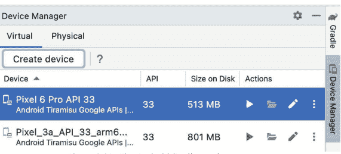

图 8.01：Android Studio 设备管理器。

## Android Emulator - Pixel_6_Pro_API_33:5554

11 月 6 日，星期日


图 8.02：Android Studio 中的虚拟设备屏幕。

在这些屏幕上的导航与物理设备完全相同。然而，使用鼠标和键盘控制它们可能需要一些练习。你可以随时点击浮动栏上的圆圈返回主屏幕。方形按钮允许你浏览打开的应用程序，向上滑动以关闭它们。左箭头让你在应用内后退一步。在移动应用之前，始终按住应用，左右拖动屏幕可在主页空间之间导航。

由于我们是在电脑屏幕上操作虚拟设备，因此有一些细微差别需要讨论。默认情况下，通过宿主计算机获取互联网访问权限。如果你发现应用程序似乎停止了通信，请检查并确保“Wi-Fi”已启用。我曾经历过无法解释的互联网中断，通过重新启用“设置”下的 Wi-Fi 解决了问题。关闭设备的最简单方法是点击浮动栏顶部的电源按钮。先关闭设备，以便我们可以探索克隆选项。一旦屏幕变黑，点击浮动栏中的“X”并返回 Android Studio 应用程序。

一旦你将 Android 设备配置为完全符合你的需求，你就可以通过 Android Studio 应用程序创建克隆。在断电状态下，从设备管理器中选择你的设备；点击三个点以展开菜单；并选择“重复”。你也可以在此屏幕上删除任何不需要的设备。

虚拟机是我们现在习以为常的奢侈品，我每天都依赖我的虚拟机。只需几个简单的步骤，我们就可在单个硬件内拥有无限的计算机。


# 第九章：自定义脚本

我详细介绍过许多加固和清理新 Linux 系统的方法。本章之前所有内容都依赖手动配置。接下来，让我们通过创建自己的 Linux 维护脚本，自动化许多日常或每周任务。我理解有些读者可能只想直接下载一个配置好的脚本并立即使用。以下终端命令将下载该脚本，使其在你的 Linux 机器上可执行，下载快捷方式文件，并将两者移动以在“应用程序”菜单中创建一个“Maintenance”快捷方式。本章的其余部分将解释如何创建你自己的脚本。

```bash
wget https://inteltechniques.com/data/maintenance.sh
chmod +x maintenance.sh
wget https://inteltechniques.com/data/maintenance.desktop
sudo mv maintenance* /usr/share/applications/
```

下一页显示该脚本的完整文本。它标识该文件为 bash 脚本；清除屏幕；并提供一个包含七个可选菜单项的菜单。下图显示了脚本完成并执行后的样子。您需要输入想要执行的功能对应的数字，然后按下 Enter 键。在任何提示符下不输入数字而直接按 Enter 键，会再次显示原始菜单。每个选项对应本指南前面介绍的命令。如果您想修改此脚本，请选择选项“6”以管理员权限启动文件查看器，导航到 `/usr/share/applications` 并编辑 `maintenance.sh` 文件。

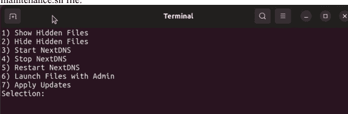

现在，让我们理解如何手动构建这个脚本。使用您自己 Linux 机器上的文本编辑器应用程序，将下一页中展示的所有代码（Courier New 11 点字体）复制到一个新文件中，并将该文件保存为“文档”文件夹内的 `maintenance.sh`。

```bash
#!/bin/bash
clear
COLUMNS=12
PS3='Selection: '
options=(
"Show Hidden Files"
"Hide Hidden Files"
"Start NextDNS"
"Stop NextDNS"
"Restart NextDNS"
"Launch Files with Admin"
"Apply Updates" )
select opt in "${options[@]}"
do
case $opt in
"Show Hidden Files")
gsettings set org.gnome.nautilus.preferences show-hidden-files true
gsettings set org.gtk.Settings.FileChooser show-hidden true
;;
"Hide Hidden Files")
gsettings set org.gnome.nautilus.preferences show-hidden-files false
gsettings set org.gtk.Settings.FileChooser show-hidden false
;;
"Start NextDNS" )
nextdns start
;;
"Stop NextDNS" )
nextdns stop
;;
"Restart NextDNS" )
nextdns restart
;;
"Launch Files with Admin" )
sudo nautilus
;;
"Apply Updates")
sudo apt update
sudo apt upgrade -y
sudo apt full-upgrade -y
pop-upgrade release upgrade
sudo apt autoremove -y
sudo apt autoclean -y
flatpak update -y
;;
esac
done
```

这是一个相当基础的 Bash 脚本，但让我们逐步解析每个部分，以便理解其功能，以便将来可以复制此类脚本。

- `#!/bin/bash`: 第一行被称为'she-bang'。它将文本文件标识为待执行的命令脚本。
- `clear`: 该命令简单清除屏幕，以便呈现干净的菜单。虽然在此脚本中不是必需的，但我喜欢在呈现任何内容前清除屏幕。这消除了可能让观众困惑的其他文本。
- `COLUMNS=12`: 该命令在列中显示内容。它防止菜单选项被显示为单条水平线。如果菜单项不符合预期，您可以修改此数字。
- `PS3='Selection: '`: PS 是 Prompt Statement（提示语句）的缩写。PS3 显示一个选择菜单，您可以选择对应的数字来执行选项。这基本上为脚本中未来项目的选择创建了一个选项。
- `options=("Restart NextDNS")`: 这是放置菜单选项的地方。这些选项的措辞应与我们希望它们在终端中出现的样子完全一致。没有数量限制，且每个选项都应置于各自的引号中。
- `select opt in "${options[@]}"`: 这继续菜单功能。
- `do`: 这开始执行我们的菜单过程。
- `case $opt in`: 这用作 if/then 风格语句的替代方案。它是一种更简单的方式，用于在一个脚本中呈现多个执行的选择，该脚本可以无限循环。
- `"Restart NextDNS" )`: 这标识我们将为其指定命令或命令序列的菜单选项。它应与前面部分列出的选项逐字匹配。
- `nextdns restart`: 这是我们希望在选择菜单项时执行的终端命令。
- `;;`: 这标识所选菜单项内命令的结束。
- `esac`: 该命令（case 的反向拼写）结束我们的 case 语句。
- `done`: 这是脚本的结束。

接下来，您需要在“文档”文件夹中创建一个“maintenance.desktop”文件，该文件告诉操作系统从您的应用程序菜单启动脚本。以下是我使用的代码。

```ini
[Desktop Entry]
Type=Application
Name=Maintenance
Categories=Application;Maintenance
Exec=/usr/share/applications/maintenance.sh
Terminal=true
```

现在，您需要使脚本可执行，并将这两个文件移动到操作系统能够访问且不会碍事的位置。我使用了以下命令。

```bash
cd Documents
chmod +x maintenance.sh
sudo mv maintenance* /usr/share/applications/
```

您现在应该在应用程序菜单中看到一个新的快捷方式选项，标题为“Maintenance”。下图显示了我的示例。点击此快捷方式将启动脚本。我每周启动此脚本来应用所有更新，如下一章所述。


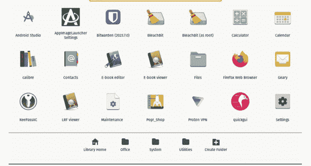

## Twilio 清理脚本

我之前解释了 Twilio 是我首选 VoIP 提供商的原因。如果您经常使用 Twilio 号码，手动清理存储在 Twilio 服务器上的数据相当耗时。我拥有一个自动化脚本，代表我执行所有操作，并在需要时提供关于我账户的信息，所有这些都无需登录我的 Twilio 账户。让我们从使用以下步骤安装 Twilio CLI 工具开始。这仅适用于您拥有 Twilio 账户的情况。

- 导航到 `https://github.com/twilio/twilio-cli/releases`。
- 展开最新的“Assets”区域，直到找到一个包含“amd64.deb”文件的条目。
- 下载该文件，例如“`twilio-5.10.0-amd64.deb`”。
- 右键点击下载的文件，选择“Open with Eddy”（使用 Eddy 打开），然后点击“Install”（安装）。

安装完成后，在终端中执行以下命令。

```bash
twilio login
```

这将要求您提供 Twilio SID 和 Token，可以在您的门户中找到。提示时，请提供名称为“CLI”。接下来，执行以下命令。

```bash
twilio profiles:use CLI
```

这将生成适当的配置文件，告诉您的计算机在所有后续命令中使用此配置文件和提供的凭据。现在，您可以使用以下终端命令手动与 Twilio CLI 进行交互。

```bash
twilio phone-numbers:list
twilio api:core:calls:list
twilio api:core:messages:list --properties='sid,from,body'
twilio api:core:recordings:list
twilio api:core:transcriptions:list
```

我们现在可以在一个脚本中自动化清理步骤，该脚本可以使用以下终端命令下载和安装。

```bash
cd ~/Documents
wget https://inteltechniques.com/data/twilio.sh
chmod +x twilio.sh
wget https://inteltechniques.com/data/twilio.desktop
sudo mv twilio* /usr/share/applications/
```

脚本内容显示在下一页中。

```bash
#!/bin/bash
COLUMNS=12
PS3='Selection: '
options=("Fetch Numbers" "Fetch Calls" "Fetch Messages" "Fetch Recordings" "Fetch Transcriptions" "Delete All")
select opt in "${options[@]}"
do
case $opt in
"Fetch Numbers")
twilio phone-numbers:list
;;
"Fetch Calls")
twilio api:core:calls:list
;;
"Fetch Messages")
twilio api:core:messages:list --properties="sid,from,body"
;;
"Fetch Recordings")
twilio api:core:recordings:list
;;
"Fetch Transcriptions")
twilio api:core:transcriptions:list
;;
"Delete All")
twilio api:core:calls:list > ~/Desktop/calls.txt
cd ~/Desktop/ && sed -i '/^SID/d' calls.txt
sed -i 's/ .*//' calls.txt
sed 's/\twilio api\:core\:calls\:remove \\-\-sid /' calls.txt > calls.sh
chmod +x calls.sh && ./calls.sh
rm calls.txt && rm calls.sh
twilio api:core:messages:list > ~/Desktop/messages.txt
cd ~/Desktop/ && sed -i '/^SID/d' messages.txt
sed -i 's/ .*//' messages.txt
sed 's/\twilio api\:core\:messages\:remove \\-\-sid /' messages.txt > messages.sh
chmod +x messages.sh && ./messages.sh
rm messages.txt && rm messages.sh
twilio api:core:recordings:list > ~/Desktop/recordings.txt
cd ~/Desktop/ && sed -i '/^SID/d' recordings.txt
sed -i 's/ .*//' recordings.txt
sed 's/\twilio api\:core\:recordings\:remove \\-\-sid /' recordings.txt > recordings.sh
chmod +x recordings.sh && ./recordings.sh
;;
esac
done
```


rm recordings.txt && rm recordings.sh
twilio api:core:transcriptions:list > ~/Desktop/transcriptions.txt
cd ~/Desktop/ && sed -i '/^SID/d' transcriptions.txt
sed -i 's/ .*//' transcriptions.txt
sed 's/\twilio api:core:recordings::remove \\\sid '/' transcriptions.txt > transcriptions.sh
chmod +x transcriptions.sh && ./transcriptions.sh
rm transcriptions.txt && rm transcriptions.sh
;;
esac
done

现在你应该能在应用程序菜单中看到一个新的快捷方式选项，标题为“Twilio”。点击它即可启动脚本，其外观应如下所示。前五个选项允许你轻松监控账户详情。选项“6”会删除存储在 Twilio 日志中的所有电话、消息、录音和转录记录。

- 1) 获取号码
- 2) 获取通话
- 3) 获取消息
- 4) 获取录音
- 5) 获取转录
- 6) 删除全部

选择：

请始终将此处内容作为模板，以便你想创建自己的脚本和快捷方式时使用。实际上，你在终端中执行的几乎任何活动都可以使用 Bash 脚本进行自动化。修改维护脚本中引号内的函数名称以及紧随其后的终端命令，应该能为你提供一个很好的开端。

# 第十章：更新与维护

我希望你现在已为你的需求专门配置了理想的 Linux 设备。接下来，你需要确保保持这种状态。我鼓励你制定一套最适合你的 Linux 维护时间表。我的习惯是在星期五下午，即我的数字工作周结束时，执行所有计算机维护任务。恰好我在 2023 年 7 月 21 日星期五撰写这一章。这使得记录我的整个流程变得轻而易举。当我能够关闭计算机而不中断任何待办工作时，我通常会每周采取以下操作一次。

首先，我打开维护脚本并快速启动选项 7。这将应用所有 Apt、Pop!_OS 和 Flatpak 更新，并删除这些更新中不必要的项。然后，我启动 Pop!_Shop，仅为了确保没有脚本可能遗漏的待处理更新。接下来，我检查“设置”>“系统升级与恢复”中的任何额外更新。我以 root 身份运行 BleachBit 并清理除“释放磁盘空间”以外的所有内容。最后，我重启机器。

一旦我的计算机完全更新、清理并重启后，我喜欢进行一次完整备份。不需要付费程序。相反，我依赖一个名为 FreeFileSync 的免费且开源的程序，该程序在 Pop!_Shop 中可用。该程序可用于同步任意两个文件夹，但我们只关注主目录。首先，我们需要格式化外部驱动器。我强烈推荐使用外部 USB SSD，例如 SanDisk Extreme 系列驱动器。如果你有一个 1 TB 或更小的内部驱动器，82 美元的 SanDisk 1 TB Extreme 便携 SSD（[https://amzn.to/42S7x7M](https://amzn.to/42S7x7M)）将非常适用。更大的内部驱动器需要更大的外部设备。这些驱动器的更昂贵的“专业版”版本对我们的目的不会提供太大益处。我按照以下步骤专门格式化我的外部 SSD 用于备份。

- 在 Pop!_OS 中，启动“文件”并右键点击你的外部驱动器。
- 选择“格式化”并提供名称，例如“Backup”。
- 如果你只会在 Linux 上使用它，请选择“仅限 Linux 系统使用的内部磁盘 (Ext4)”。
- 如果你想加密驱动器，请选择“密码保护卷”选项。
- 点击“下一步”，如果提示请输入安全的密码。
- 点击“下一步”直到你到达“格式化”选项并点击它。

如果你加密了驱动器（我推荐这样做），该过程需要一些时间才能完成。每次将驱动器插入你的机器时，你都需要用密码解锁它。现在，让我们在 FreeFileSync 中进行第一次备份。

- 关闭任何弹出窗口，并点击左侧“拖放”区域中的“浏览”。
- 在左侧菜单中点击你的主文件夹，通常用房子图标标识。
- 点击“打开”按钮，然后点击右侧“拖放”区域中的“浏览”。
- 选择你的外部硬盘并点击“创建文件夹”。
- 在你的 USB 磁盘上创建一个名为“backup”的文件夹，按回车键，然后点击“打开”。
- 点击“同步”附近绿色齿轮旁边的右箭头图标。
- 将选项更改为“镜像”。

镜像选项确保外部驱动器上的数据始终是计算机上内容的精确副本。如果你的系统名称是“pop”，外部驱动器标签为“backup”，你的界面可能看起来与我下面展示的类似。你可以使用“另存为”图标保存此配置，并将其命名为“Home Backup”。

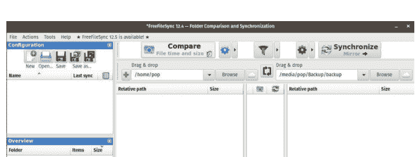

接下来，点击“比较”并允许分析。你可能会收到警告，说 FreeFileSync 正试图访问你的桌面、下载和其他文件夹，但对于此目的是可以接受的。你也可能会收到关于某些区域对程序不可访问的警告。发生这种情况时，我会点击“全部忽略”。完成后，你应该会看到所有将同步的文件摘要。点击“同步”按钮开始备份过程，第一次运行可能需要一些时间。

下次你需要备份数据时，你可以连接你的驱动器；输入密码解锁加密；打开 FreeFileSync；并再次选择“比较”按钮。这次，你应该只会看到自上次备份以来已修改的文件。然后，同步过程应该会快得多。

备份完成后，我打开我的邮件客户端，并将所有邮件从我的提供商处获取到我的机器上。我特意不在备份之前这样做。万一我从提供商服务器中删除了一封重要邮件，这也会删除我机器上的离线副本，我知道我之前的备份包含上周存在的所有邮件。这虽然是个小问题，但过去曾帮我避免过麻烦。

如果条件允许，我现在会关闭机器，看看我能度过周末而不重启它多久。有些周末比其他周末更好。周一早上，我知道我有一台整洁、干净且已更新的 Linux 机器，准备迎接新一周的工作。

## 结语

我希望你现在拥有一个私密且安全的 Linux 设备，它不会将你所有的活动与 Microsoft、Apple 或 Google 共享。我相信你会发现新设备的极简主义和简洁性是一种优越的体验。我以身作则，按照本指南配置了自己的 Pop!_OS 设备。我不再担心不必要的数据收集或对我日常使用情况进行窃听。使用几周后，我的笔记本电脑不再感觉“脏乱”了。当你离开那个数据收集的世界时，会有一种极大的自由感。

如果本文档需要更新，所有修改都是完全免费的。如果你通过我的网站购买了此 PDF，当修订版可供下载时，你会通过电子邮件收到通知。如果你从盗版网站下载了未经授权的副本，请考虑购买正版。你 15 美元的购买支持了我无广告的播客以及创建和更新这些指南所涉及的所有研究。

感谢持续关注隐私、安全与 OSINT。

~MB

IntelTechniques.com
