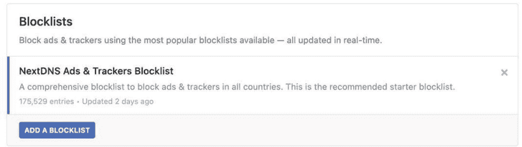
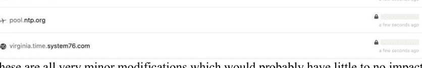
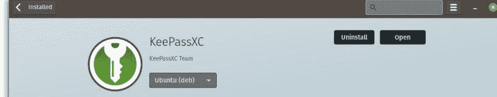
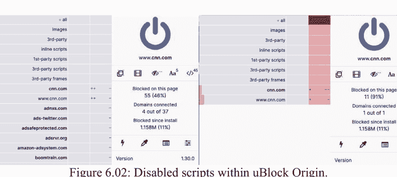
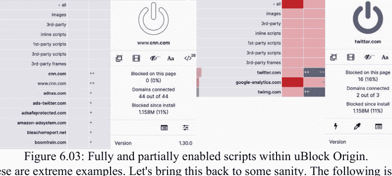
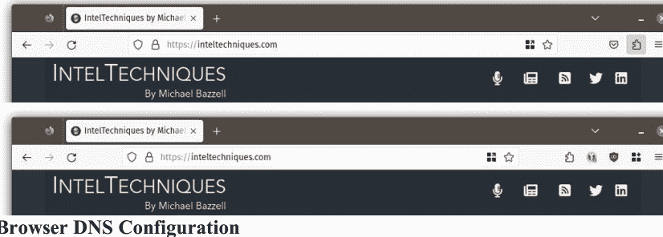
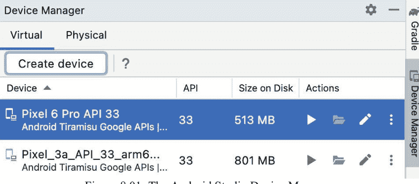
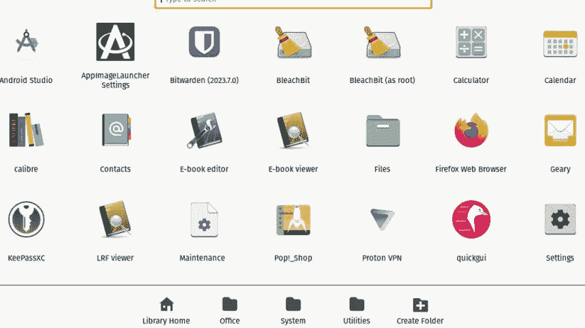

# 极致隐私：Linux 设备

## 关于作者：MICHAEL BAZZELL

Michael Bazzell 代表政府调查计算机犯罪的时间超过了 20 年。在那的大部分时间里，他被分配到 FBI 的网络犯罪任务组，专注于各种在线调查和开源情报 `OSINT` 收集。作为美国法务局的调查员和宣誓的联邦官员，他参与了许多重大刑事调查，包括在线诱骗儿童、儿童绑架、绑持、悬案杀人案、恐怖威胁和高级计算机入侵。他已培训了数千人使用他的调查技术和隐私控制策略。

离开政府工作后，他曾担任黑客剧集《先生机器人》`Mr. Robot` 第一季的技术顾问。他的书籍《OSINT 技术》和《极端隐私》被多个政府和私营机构作为情报收集和隐私加强的训练手册。他现在主持《隐私、安全与 OSINT 显示》，并协助个人客户在主动或作为应对不利情况的情况下实现终极隐私。关于他的服务的更多信息，可以在 `IntelTechniques.com` 找到。

## LINUX 设备序言

我在2012 年写了我的第一本与隐私相关的书籍《躲避互联网》`Hiding From The Internet`。这最终演变成了《极端隐私》的标题，现在是第四版 517 页的大型教科书。2023 年，我开始与员工讨论出版第五版的可能性。这遇到了一些阻力。我们刚刚发布了 550 页的《OSINT 技术》教科书，我们都因这一过程精疲力竭。在当时，编写新版本的《极端隐私》的想法似乎令人难以负担。我们曾提过出一本小书的想法。

《极端隐私》的许多读者对书中呈现的信息总量表示沮丧。在 320,000 字的量下，一次性删除将是巨大的。其他批评是，读者并不一定需要书中所有的信息。有些人想关注信托、有限责任公司 `LLCs` 和游牧移动，不需要所有以技术为主题的章节。另一些只想学习安全计算机、移动设备和其他技术设备，不在乎我对匿名家庭或汽车的想法。这是非常有用的反馈，并影响了发布本数字书籍的决定。对《极端隐私》最大的批评是关于格式的。我庞大的 OSINT 和隐私书籍仅提供纸质版。这让许多想要避免亚马逊或倾向于在屏幕上阅读的读者感到不快。随着这次发布以及之前的移动版电子书，我们只提供 PDF。没有官方版本，我们已经从整个出版过程中剔除了亚马逊。这使我们能够提供更低的价格，并且每次购买的 90% 将支持我们的免费播客。

我们意识到原生 PDF 将导致此作品在线上立即被盗版。我们接受这一点。我们相信通过在适当的时候提供免费更新可以为合法购买者提供更多益处。如果我们需要修改现有内容或添加新章节，我们可以向所有购买者发送群发邮件，允许他们免费下载带有所有更新的新副本。本作品的每份副本都带有可见和隐藏的唯一代码，我们可以阻止未经许可发布该书籍的人获取更新。总的来说，我们希望通过为那些支持我们的人提供可搜索、可复制、可更新和可打印的文档，即使面临销售流失给盗版者的风险。

通过《极端隐私：Linux 设备》，我继续对我们的教程采用这种方法。它不是《极端隐私》`纸质书` 的替代品。请将其视为关于 Linux 设备的详尽补充。我的希望这将继续这一系列专注于一个特定主题的短卷本。这允许人们在需要时以更实惠的价格购买内容。它也允许我们更快速地发布内容，因为我们可以根据需要将精力集中在一个领域上，而不是为潜在的未来发布预留内容。免费更新对所有人都是双赢。现在我专门介绍我们的仅关于构建最佳 Linux 设备的数字指南。

## 引言

几年前，我开始将 Linux 作为我的全职主要操作系统。我接触 Linux 已几十年，并在我的 OSINT 书籍中深度依赖它运行虚拟机，但直到我终于受够了微软和苹果强加给我的隐私侵犯，我才将其作为我的日常系统。Windows 和 macOS 不断监控你的使用情况，并收集有关你的设备、位置、文档和整体活动的敏感数据。它们声称存储这些信息是为了你的利益，以便提供定制计算体验。这可能是真的，但当这些数据泄露、破解或被法院要求交同时会发生什么？我们能做什么来离开这个充满隐私安全风险生态系统？

我认为答案是 Linux。如果你只熟悉 macOS 或 Windows 环境，你将对使用 Linux 作为电脑操作系统的简单和方便感到惊喜。这将有一个学习曲线，但我保证任何阅读本指南的人都可以切换。

## 第一章：为什么要选择 Linux？

我在引言中提到，Windows 和 macOS 设备会收集并存储有关你使用其产品的数据。让我们深入探讨这一点。2019 年，我向 Apple 索取了所有关于我的存储数据。我原本准备录制一期播客，讨论 Apple 对我们所有人收集的数据，并想亲眼看看这些数据。我拥有几个使用别名的多个 Apple ID 账号，因此我向每个账号都请求了数据。由于我从未向 Apple 提供过我的真实姓名，我以为这种暴露并无大碍。我错了。Apple 提供的数据证实了了我这些“匿名”Apple 账号的以下信息：

- 我在创建账户时提供的完整别名和电子邮件地址
- 我在创建账户时提供的物理地址
- 所有设备的序列号
- 我首次在 Apple 使用这些地址的日期
- 使用分配给所有设备的账户名拥有的多个 IP 地址
- 分配给所有设备的内部计算机名称
- 任何系统重格式化的日期/时间
- 最后访问 iTunes、FaceTime 和 iCloud 的日期/时间及 IP 地址
- 我使用设备期间的时区
- 登录 Apple 账户时提供的 VoIP 电话号码
- 我曾在 Apple Mail 中输入过的备用电子邮件地址
- 我在官方 Apple Music 应用中听过的歌曲
- 歌曲播放期间我暂停的时刻
- 从 Apple 服务器流媒体传输期间我的 IP 地址
- 在注册过程中识别出的偏好音乐人
- 我在 2017 年访问过的一个 iPhone 的序列号
- iOS 设备订阅的所有播客
- 已完成或暂停的播客节目标题（数百个）
- 播客订阅日期和收听时间
- 我曾留过评论的播客，包括完整的评论文本
- 下载到设备上的所有应用购买，包括免费应用
- 下载期间分配的所有 IP 地址
- 通过 Apple Books 下载的所有书籍
- 我连接期间使用的数百个 IP 地址
- Apple 日历中所有条目的导出
- 留在 iCloud 中的文档和联系人
- Apple Mail 自动存储的联系人
- 在 Apple Mail 中访问的收件人地址
- 从发出的邮件头部中提取出的真实姓名

我提醒你，在我认为我是匿名的时候，这些数据一直被监控、收集和存储着。Apple 设备根本不存在匿名性，因为数字足迹最终会识别任何用户。如果你遵循了我的数字指南 **Extreme Privacy: macOS Devices**，你就知道可以阻止所有的遥测数据，但维护起来是一件苦事。我相信我们不应该采取这种极端措施来防止公司的这种入侵。

微软也并不好到。默认情况下，Windows 10 和 11 需要 Microsoft 在线账户才能安装操作系统。某些版本允许你通过离线完全跳过账户创建，但微软正努力在 Windows 11 中消除这一选项。接收重要的软件更新不需要活跃的 Microsoft 账户，但微软的遥测服务会收集以下数据以及许多额外细节，并发送到位于西雅图的公司服务器：

- 来自键盘的输入诊断数据
- 麦克风传输
- 计算机上所有媒体文件的索引
- 摄像头数据
- 浏览历史
- 搜索历史
- 位置活动
- HealthVault、Microsoft Band 以及其他追踪收集的健康活动
- Microsoft 应用生态系统中的隐私设置

Linux 的几乎每个方面都可以被修改和自定义。如果你是 macOS 用户，你知道你无法卸载 Apple 自带软件，如 Mail、照片、Facetime、音乐以及其他不需要的应用。你被它们困住了。大多数 Linux 系统从极简程序开始，允许你选择应该添加什么。你可以删除任何想要的内容，而永远不会受限于默认的内置应用列表。

- Linux 是一个非常轻级的操作系统。它在现代和旧硬件上都能运行良好，这允许在不购买新的昂贵机器的情况下进行轻松测试。
- 既然 Linux 可以安装在几乎任何计算机硬件上，我们可以对每个部分都非常有选择性。大多数 Linux 允许你修改所有部分，包括电池、内存、驱动器等。如果你购买了 MacBook Pro 以后决定升级这些规格的任何一项，你可能就没机会了。

我可以提供更多我为什么倾向于 Linux 而非传统系统的理由，但我认为之前的观点对大多数人来说已经足够了。与其试图让你尝试 Linux，我更倾向于解释我如何自定义自己的 Linux 使用方式，以及为客户提供的流程。我相信在指南结束时，你将准备好构建或购买你自己的 Linux 设备。接下来，让我们处理硬件选择，这可能会让人感到无从措。

## 第二章：硬件配置

Intel ME 以及 AMD 称为 AMD 安全技术 `AMD Secure Technology`，`AMD ST` 的选项，其合法目的是允许您的设备在低功耗状态下进行管理。大型计算机网络的管理员利用这项技术来远程控制网络内计算机的许多方面。这种担忧源于 Intel ME 对设备所有方面的控制、对这些功能背后闭源代码的整体不透明性，以及自 2017 年以来被报告的几个已知漏洞。

让我们面对现实吧。Intel ME 和 AMD ST 并不会监控机器上的所有内容，也不会允许陌生人访问你的系统。这需要对你的设备以及它连接的网络进行大量的配置。在使用启用 Intel ME 的设备时，你可能永远不会遇到任何问题。我担心的是任何可能被犯罪分子利用的新型未披露漏洞。这构成了我对我的 Linux 设备的要求。我拥有一台禁用了 Intel ME 的机器。你可能永远找不到一台从处理器中完全删除了所有 Intel ME 的电脑。然而，存在一个活跃的个人和公司社区，他们不断努力将要在系统中运行的 Intel ME 进程减少到最低。最活跃的供应商是 System76 `system76.com`。

一家名为 Purism 的公司此前提供过不带 Intel 的笔记本电脑，但我强烈建议不要从 Purism 购买。在购买几年后，他们仍在努力完成其基于 Linux 的手机订单。在某些情况下，人们已经等待了五年才等到设备发货，却被客户支持部门忽略。他们拒绝为未发货物品退款。请避开他们。System76 只销售针对 Linux 用户的设备，并且在我发货时它运行的是 Linux 系统。我订购了多台定制机器，它们在第二天就从科罗拉多州发货了。他们的大多数笔记本电脑默认禁用了 Intel ME。我倾向于选择 System76 而不是其他供应商的第二个原因是他们使用了开源固件。这种软件替换了大多数主板包含的专有代码。它通常速度更快且更安全。更重要的是，它移除了可能在硬件级别执行操作的隐藏闭源代码。

希望你已经决定也想要一台禁用 Intel ME 而不是使用出厂固件的机器。这意味着你需要一台来自 System76 的 Intel 平台机器。听起来很容易，对吧？你仍然有很多选择。System76 目前提供九种不同的桌面电脑机型和四种桌面变体。让我们从我所有的渗透工作中使用的笔记本电脑对比 System76 Helio 桌面电脑开始。我更倾向于使用桌面电脑，因为我可以轻松扩展存储空间，并在我离开时让桌面完成长时间的任务。我也喜欢那种离开电脑的感觉，而不是让笔记本电脑一直触手可及。然而，我通常不向大多数人推荐桌面电脑。笔记本电脑是便携的，并且包含了屏幕、键盘和触摸板。它们对于我的大多数客户来说更常见、更合适。如果你需要桌面电脑，你知道原因，不需要我的建议。

如果你正在看九款 System76 笔记本电脑并感到困惑，你并不孤单。在决定购买自己的机器之前，我花了几个小时来消化所有的选项。由于在 Intel 平台设备上我们只能使用 Coreboot 并禁用 Intel ME，这排除了 Pangolin 机型。这留给我们八种选择。

Gazelle、Adder、Oryx 和 Bonabo 笔记本电脑是极其强大的机器，针对需要高达 17 英寸 4K 屏幕、独立显卡和顶级处理器的人群。如果你整天都在处理高清 视频，或者需要一台高端游戏机，这些是适合你的。但是，它们不适合我或我的客户。这留给我们三个选择。

Galago Pro、Lemur Pro 和 Darter Pro 都能满足我们的需求。终端用户需要查看它们并决定哪种是最好的。Galago Pro 有五小时电池续航，而 Lemur Pro 没有太网口。这就是为什么 Darter Pro 是我目前的笔记本电脑，而且该设备通常也满足我的客户。它有 15 英寸屏幕、USB-C 端口、microSD 卡槽和九小时电池。我更喜欢 Darter Pro 的键盘，它右侧带有数字小键盘，但有些人可能不喜欢稍微向左偏移的标准键盘。

如果你想要一个 14 英寸的便携（且轻得多）设备，我更倾向于 Lemur Pro，但如果这对你很重要，它没有以太网口。接下来是规格。在撰写本文时，我选择了以下选项。

**处理器：** 我选择了 Intel i5-1340p 处理器，我认为它对于日常任务绰绰有余。升级到 i7 需要额外花费 200 多元，大多数用户永远无法利用这些额外的动力。如果你知道你将执行能够从此升级中受益的密集型任务，那么它是值得的。如果你大部分时间都在浏览器中度过，你不会相信的。这与我的规范相矛盾。在 macOS 指南中，我们鼓励用户选择更高的规格。因为 macOS 机器无法升级和更新到完美，而我们可以。

**内存：** 默认的 8 GB RAM 是我所需要的。由于我开启了虚拟机，我认为 16 GB RAM 更合适。

**OS 硬盘驱动器：** 默认的 250 GB 磁盘空间适用于大多数人，但我发现它很局限。我更倾向于将其增加到 1 TB，并使用 PCIe Gen4 驱动器将速度提升到 7,000 MB/s。如果你需要处理大量数据，你会感激这次升级。容量增加 4 倍、速度提升 2 倍仅需 115 美元。

我的定制结果导致总价为 1,259.00 美元。同类的 Apple 笔记本电脑将是这个数字的两倍。

## 第三章：系统配置

希望你已经决定也想要一台禁用 Intel ME 而不是使用出厂固件的机器。这意味着你需要一台来自 System76 的 Intel 平台机器。

如果你想要一个 14 英寸的便携（且轻得多）设备，我更倾向于 Lemur Pro，但如果这对你很重要，它没有以太网口。接下来是规格。在撰写本文时，我选择了以下选项。


## 处理器
我选择了 Intel i5-1340p 处理器，我认为它对于日常任务绰绰有余。升级到 i7 需要额外花费 200 多元，大多数用户永远无法利用这些额外的动力。如果你知道你将执行能够从此升级中受益的密集型任务，那么它是值得的。如果你大部分时间都在浏览器中度过，你不会相信的。这与我的规范相矛盾。在 macOS 指南中，我们鼓励用户选择更高的规格。因为 macOS 机器无法升级和更新到完美，而我们可以。

## 内存
默认的 8 GB RAM 是我所需要的。由于我开启了虚拟机，我认为 16 GB RAM 更合适。

## OS 硬盘驱动器
默认的 250 GB 磁盘空间适用于大多数人，但我发现它很局限。我更倾向于将其增加到 1 TB，并使用 PCIe Gen4 驱动器将速度提升到 7,000 MB/s。如果你需要处理大量数据，你会感激这次升级。容量增加 4 倍、速度提升 2 倍仅需 115 美元。

我的定制结果导致总价为 1,259.00 美元。同类的 Apple 笔记本电脑将是这个数字的两倍。我想要一台禁用 Intel ME 而非出厂固件的机器。这意味着你需要一台来自 System76 的 Intel 平台机器。听起来很容易，对吧？你仍然有很多选择。System76 目前提供九种不同的桌面电脑机型和四种桌面变体。让我们从我所有的渗透工作中笔记本电脑对比 System76 Helio 桌面电脑开始。我更倾向于使用桌面电脑，因为我可以轻松扩展存储空间，并在我离开时让桌面完成长时间的任务。我也喜欢那种离开电脑的感觉，而不是让笔记本电脑一直触手可及。然而，我通常不向大多数人推荐桌面电脑。笔记本电脑是便携的，并且包含了屏幕、键盘和触摸板。它们对于我的大多数客户来说更常见、更合适。如果你需要桌面电脑，你知道原因，不需要我的建议。

我想你已经确定了要使用的系统……（重复）在你开始你的 Linux 之之旅之前，请允许我介绍一些流行的选项……

### Qubes
每当我提到 Linux 时，许多人留言告诉我我应该推荐 Qubes OS。Qubes OS 是一种专注于安全的 Linux 操作系统，旨在通过隔离来提供安全。它允许将每个应用程序都运行在自己的隔离虚拟机中。这非常令人印象深刻且极其安全。然而，它也可能令人讨厌。从 macOS 或 Windows 过去的学习曲线非常陡峭，日常使用可能会很困难。如果你长期使用 Qubes，你会获得我的尊重。

### Kali
许多人建议使用名为 Kali 的 Linux 版本，它预装了许多安全相关的工具。然而，Kali 被设计为在虚拟机中执行，我认为不应该用于个人使用。

### TAILS
整个操作系统依赖网络来增加在线匿名性。然而，它并不是作为主机设计的。它被设计为从外部设备启动，并在会话关闭后在计算机上不留下任何痕迹。与 Kali 一样，它不打算作为日常驱动使用。

### Debian
`Debian` 被设计用作主机，并提供了一种极简的软件体验。我相信对于有丰富 Linux 经验的人来说，`Debian` 是很好的选择。我用过一段时间，但遇到了驱动程序问题和软件冲突。在之前的选项中，它是我们最接近全功能操作系统的选择。

### Ubuntu
这可能是最著名的选择，因为它是受欢迎的 Linux 发行版之一。它是一个著名的初学者的操作系统，因为通常启动后即可工作。它有自己的应用程序商店，许多开发者也提供了在线步骤让他们的应用程序在 Ubuntu 上运行。我推荐将 Ubuntu 用于 OSINT 虚拟机，正如我在《OSINT Techniques》书中描述的那样，它多年来一直运行良好。然而，这里有很多事情困扰我。首先，Ubuntu 推崇你使用 Snap 安装，并极力阻止你使用更传统的安装方法。它们还包含了一些需要禁用的遥测。我认为 Ubuntu 以及 Mint 变体都可以被任何人作为 Linux 驱动，但我认为我们有一个更好的选择。

### Pop!_OS
终于，我为自己和客户找到了我最喜爱的操作系统。

`Pop!_OS` 基于 Ubuntu，针对隐私和安全进行了重新设计。它与原版 Ubuntu 有许多不同之处，包括以下内容。

虽然本指南的其余部分也适用于 Ubuntu、Mint 或任何其他基于 Debian 的发行版，但我在演示中将重点关注 Pop! OS。请不要让这影响你去测试其他选项。我选择 Pop!_OS 是因为我每天都在使用。在 Ubuntu 中通过极少（甚至无需）修改就可以很容易复制所有的技术。如果你使用的是 Arch、Fedora、Manjaro 或其他发行版的 Linux，你有自己的理由，应该按照自己的喜好进行。

如果你购买的机器预装了 Pop!_OS，你（或任何其他版本的 Linux）可以跳过下一步。

若要在专用主机上安装 Pop! OS 或任何其他 Linux，你需要创建一个可启动的 USB 安装驱动器。我演示了创建自己的驱动器的过程。

- 导航到 `https://pop.system76.com/` 并点击“Download”（下载）
- 选择“Download 22.04 LTS”选项并允许下载
- 从 `https://etcher.balena.io/` 安装 Balena Etcher
- 启动 Balena Etcher 并点击“Flash file”（烧录文件）
- 选择下载的 iso 文件
- 点击“Target”（目标）并选择你的 USB 盘
- 点击“Flash”（开始）并等待过程完成

请注意，这将完全擦除所选 USB 盘，因此请小心。过程结束后，你应该有一个准备好用于安装 Linux 的启动 USB 盘。

将此驱动器插入电脑并启动。立即按下显示启动选项的键。这通常是 ESC、F1、F7、F8、F10 或 DEL。一旦加载启动选项屏幕，选择带有 Linux 安装程序的 USB 盘。安装任何 Linux 发行版（包括 Pop!_OS）的具体过程会随时间改变。然而，编写本指南时使用的以下步骤应该帮助你完成过程。我对 Pop!_OS 的经验概述如下：

- 点击“Try or Install Pop!_OS”（尝试或安装 Pop!_OS）
- 选择你的语言、位置、键盘。
- 选择“clean install”（清洁安装）并选择你的内部驱动器。
- 点击“Erase Install”（清除安装）
- 提供你所需的计算机名称和密码。
- 选择默认选项加密驱动器。
- 如果需要，允许对磁盘加密使用相同的 Linux 密码。这种方式更方便，但可能会带来安全风险。如果你想要额外的保护层，可以为磁盘加密和 Linux 的每个选项指定唯一密码，但对大多数用户来说这可能过头了。我在这两个选项中都使用相同的密码。
- 等待过程完成并点击“Restart Device”（重启设备）。

当电脑重启时，你将看到一个需要输入密码解锁加密磁盘的屏幕。这是 Pop! OS 默认提供的第一层保护。在安装 Ubuntu 或或其他系统时也可以配置相同的保护。解锁驱动器仅允许访问它。随后，你将看到 Pop! OS 用户选择和密码输入界面。这将解锁你的 Pop! OS 版本并启动机器。按照以下步骤继续完成一次性设置：

- 选择你的 Dock（程序栏）布局选项并点击“Next”（下一步）
- 选择你的 Top Bar（顶栏）选项并点击“Next”
- 连续点击两次“Next”继续菜单。
- 选择你喜欢的外观并点击“Next”
- 选择你的 Wi-Fi（如果可用），提供密码并点击“Next”
- 保持位置服务禁用状态并点击“Next”
- 选择你的时区并点击“Next”
- 点击“Skip”（跳过）忽略任何账户界面，然后点击“Start Pop! OS”。

有些人对在启动时需要输入两次密码感到烦恼。我不介意这一点，但我尊重对冗余性的要求。我认为如果禁用登录 Pop! OS 的次要密码，并没有安全问题。可以通过以下步骤实现，并随时撤销，但请注意稍后提出的警告。

- Dock 右下角的 Settings 应用。
- 在左侧菜单中选择“Users”（用户）。
- 点击“Unlock”（解锁）并输入密码。
- 启用“Automatic Login”（自动登录）开关。
- 关闭设置，通过右上菜单栏选择“Power Off / Log Out”（关机 / 注销）>“Restart”（重启）>“Restart”。

现在你应该会被提示输入解密密码。通过该界面后，Pop! OS 应该会正常启动。**我想说明这是可选的。** 如果你为每次解密和登录选择了唯一密码，则你不应该启用自动登录。由于 Linux 密钥环（keyringing）的解锁方式，这会导致某些程序要求密码的频率比登录时手动输入时高得多。启用自动登录不会删除账户密码，也不会在其他需要密码时降低安全性，但如果你每次启动都手动输入密码（我是这么做的），它可能会增加更多不便。Pop! OS 默认情况下比 Ubuntu 更注重隐私，但我仍然喜欢进行一些修改。我在新安装后执行以下操作：

- 启动 Dock 右下角的 Settings 应用。
- 在左侧菜单中点击“Bluetooth”（蓝牙）并禁用开关。
- 在左侧菜单中点击“Privacy”（隐私）并禁用“Connectivity Checking”（连接检查）。
- 点击“File History & Trash”（文件历史与垃圾箱）并禁用一切。

虽然以下内容与隐私或安全无关，但我发现这些修改可以增强我使用 Linux 的体验。你的喜好可能与之不同。

- 点击“Screen”（屏幕）并将“Blank Screen”（屏屏）更改为更的时间。
- 返回主界面，点击左侧菜单中的“Power”（电源）并禁用“Automatic Screen Brightness”（自动亮度）。
- 点击“Automatic Suspend”（自动挂起）并禁用“Dim Screen”（调暗屏幕）。
- 启用“Show Battery Percentage”（显示电池量百分比）。
- 点击 Settings 旁 Pop!Shop 图。
- 点击“Installed”（已安装）标签页然后点击“Update All”（全部更新）。

一旦我们开始安装应用程序，你将在菜单中看到额外的更新选项。我通常每周至少启动一次 Pop!Shop 以应用所有更新。虽然你可能忍不住想开始安装所有需要的应用程序，但请等一下。下一章将讨论防火墙，它可以帮助我们阻止设备发出不必要的出站流量。这是保护我们隐私和安全的关键步骤。

# 第四章：DNS 配置

当你为任何设备启用互联网连接的瞬间，系统就会开始向各种服务发送信息。这可能包括有害数据，例如检查更新、时间同步、检索任何待处理的消息。大多数 Linux 操作系统不会像微软和苹果公司那样发送侵入性遥测数据，但第三方应用程序可能会。我们信任的许多应用程序实际上在背后背地地发送关于你的使用信息。我的目标是提供可以减少或消除这种暴露的选项。我们实现这一目标的方法是通过第三方 DNS 服务。

如果你读过我的 macOS 指南，就会知道这一章侧重于使用软件防火墙而不是 DNS。虽然 Linux 有一个名为 OpenSwitch 的防火墙，但我并不推荐它。它已经存在了很长时间 Bug，而且在 Ubuntu 或 Pop! OS 上无法正常工作，每次启动应用程序时都必须调整执行方式。我坚持在 macOS 上使用软件防火墙，而这在 Linux 上是认为是必要的。我在 macOS 上使用 Little Snitch 的主要用途是连接 Apple。Linux 并不存在这些担忧。然而，我确实需要某种内容过滤。首先，我们应该理解域名系统（DNS）的本质。DNS 是一个非常复杂的话题。用基础且简单的解释来说，它将域名（例如 inteltechniques.com）翻译成 IP 地址，以便定位适当的内容。在典型的设置中，你的家庭或移动服务提供商（ISP）会在你请求的情况下连接你的查询。换句话说，无论是否有 SSL 加密，你的 ISP 都知道你访问的每个网站，并知道你的账详情。如果你不是匿名购买互联网或手机服务，他们就知道你的身份。ISP 会收集大量关于你的价值信息，并经常将这些细节出售用于营销目的。我想阻止这种行为。默认情况下，你的 Linux 设备依赖于所连接网络的 DNS 服务。这可能是你的家庭 Wi-Fi 或移动运营商提供的服务。你可以为从设备产生的所有查询指定一个不同的 DNS 服务器。为所有的桌面设备和手机实施 NextDNS (`nextdns.io`) 服务。

NextDNS 处理导航网络流量所需的查询，它还包含过滤选项。我将通过我的测试设备上演示的实际配置来解释这一点。首先，在 `https://my.nextdns.io/signup` 创建一个免费账户。任何掩码或私有邮箱服务都应该被接受，且不需要支付服务。免费层每月允许免费最多 300,000 次查询。

注册后，你将被带到 NextDNS 用户门户，那里在“Setup Guide”下应该显示一个“Linux”菜单。第一个选项应该显示首选的“systemd”安装，但可能会与 VPN 应用程序冲突。相反，我们将使用以下终端命令安装 NextDNS。

```bash
sh -curl -sL https://nextdns.io/install
```

提供以下内容：

- 输入 "i" 安装，并在提示时提供你的密码。
- 输入你的 NextDNS 配置文件 ID，例如 `d4e2af`。
- 输入 "Y" 报告设备名称，输入 "n" 设置路由器。
- 输入 "y" 启用缓存，输入 "y" 启用快速刷新。
- 输入 "Y" 设置本地 DNS hosts。

安装后将启动 NextDNS 作为你的 DNS 提供商。你可以使用以下命令随时启动、重启或停止服务。

```bash
nextndns start
nextndns restart
nextndns stop
```

每次启动电脑时，DNS 服务器都应该保持与上次关机时相同的状态。如果你在 NextDNS 激活时关闭机器，它在下次启动时也应该是激活状态。在第第九章中，我们将创建一个脚本，允许轻松启用和禁用 NextDNS，这在我们讨论 VPN 时可能很重要。如果你的机器无法连接互联网，请执行 `nextndns restart`。

只要此连接处于激活状态，你的 Linux 设备就会所有 DNS 查询使用 NextDNS，你可以在 NextDNS 门户中看到这些请求的日志。门户中的“Logs”标签标识了从你的设备发出的每一个连接。这可能是一个隐私问题，但它有许多好处。我们现在可以应用过滤器来阻止许多不需要的连接。

点击“Privacy”标签，并注意自动应用的黑名单。如果没有应用，请添加“NextDNS Ads & Trackers Blocklist”。该数据库阻止了超过 100,000 个与广告、跟踪器和恶意软件相关的连接。这将阻止许多如弹出窗口广告、跟踪代码、遥测和用户分析等不必要的连接。你现在有了更强大的保护。下面的图片显示了我的配置和菜单。

| Setup | Security | Privacy | Parental Control | Denylist | Allowlist | Analytics | Logs | Settings |

| :--- | :--- | :--- | :--- | :--- | :--- | :--- | :--- | :--- |



再次点击“Logs”标签查看流量。你可能需要刷新页面以看到新结果。我的显示如下：

- virginia.time.system76.com
- paris.time.system76.com
- oregon.time.system76.com
- ohio.time.system76.com
- brazil.time.system76.com
- 2.ubuntu.pool.ntp.org
- apt.pop-os.org
- 1.ubuntu.pool.ntp.org
- 0.ubuntu.pool.ntp.org
- ntp.ubuntu.com

这看起来可能令人警觉，因为这些多个连接在不重启系统的情况下向我们传输数据。然而，这是无害的。除了“apt.pop-os.org”之外，所有的连接都是时间服务器，试图确保你的时钟同步正确。“apt”连接正在寻找任何可能需要应用的软件更新。这些结果证明过滤正在正常工作。NextDNS 执行了我们所有的 DNS 查询，并过滤任何它认为恶意或侵入性的内容。

对时间服务器进行多次查询似乎有些多此一举。五个 System76 时间服务器是默认选项，而“ntp”服务器是备用的。由于 System76 使用了加密的网络时间安全 (NTS) 协议，我更倾向于依赖它们。如果你想移除其中任何一个，可以通过修改几个系统文件来实现。然而，我们面临一个问题。

这些需要修改受保护的系统文件。如果我们导航到它们并双击打开，我们将处于只读模式，无法修改内容。我们可以使用以下终端命令来“作弊”，该命令以管理员权限打开“文件”应用程序。执行后，将提示你输入 Linux 密码。

```bash
sudo nautilus
```

现在你应该看到一个拥有管理员权限的文件管理器。考虑以下操作：

- 导航到“Computer” >“etc” >“chrony” >“sources.d”。
- 双击名为“system76-nts.sources”的文件。
- 移除任何不需要的服务器并点击“Save”。
- 关闭所有打开的窗口。

如果你想禁用非加密的 Ubuntu 备用选项，请执行：

- 执行 `sudo nautilus`
- 导航到“Computer” >“etc” >“chrony”。
- 双击名为“chrony.conf”的文件。
- 移除包含“ubuntu.pool.ntp.org”的每一行。
- 将“pool ntp.ubuntu.com”改为“pool ntp.ntp.org”并点击“Save”。
- 关闭所有打开的窗口。

让我们重启并重新查看 NextDNS System76 服务器，并将国际备用选项替换为标准的公共服务器，而不是 Ubuntu 的选项。我的总连接现在显示所示。




这些都是细小的修改，对我们的隐私或安全可能影响很小。相比于 Ubuntu 的选项，我转于 System76 对安全协议的实现感到更好。让我们进入一些实际的益处。

`jill.fc.yahoo.com`

`beap-bc.yahoo.com`

`idsync.rlcdn.com`

左侧的红条确认了哪些入站连接被拦截。我们可以看到我们的黑列表正在生效。在 yahoo.com 上，几十个广告和追踪器在不需要我们任何操作的情况下被拦截。我们不需要任何浏览器扩展或防火墙应用程序。这就是 NextDNS 的真正威力。这种拦截策略更加干净，资源占用极低。它还能防止与 VPN 应用程序冲突。这些信息需要消化。让我们总结一下一些要点。默认情况下，你的互联网服务供应商提供 DNS 请求，并且经常恶意利用数据。当你在 Linux 设备上配置 NextDNS 时，你实际上在使用他们的查询服务。此外，这可以防止应用程序发送有关你使用的遥测和分析。这在下一章中将变得非常明显。记住免费版的限制。大多数人每月的查询不会超过 300,000 次。如果你有多个设备，可以为每个设备创建一个账户，或者支付小额费用使用 NextDNS 的高级服务。有些读者可能对我选择 NextDNS 而不是 AdGuard 作为过滤 DNS 供应商感到不满。我的理由如下：

- 我们对 NextDNS 更有信任。创始人是公开可见的，我知道是谁在运营公司。他们是声誉良好的人，一直参与该领域，并对服务的理由非常透明。
- 高级业务模式解释了资源的资金来源。
- AdGuard 是一家俄罗斯公司，已搬往塞浦路斯，但基础设施仍留在俄罗斯。一位俄罗斯 CEO 在互联网上的存在感极低，没有关于其他所有者的信息。
- NextDNS 的支持一直非常好。当我就产品问题联系他们时，只有 NextDNS 了回复。其中一个所有者提供了完整的细节。
- AdGuard 最近宣布了一个类似于 NextDNS 的新计划，但将不会使用。然而，我请求信息的邮件没有得到回复。NextDNS 的自定义选项经过了彻底测试和审查。

关于 DNS 的最后一个隐私考虑是基于账户的公共服务器。虽然 NextDNS 账户对于拦截（或允许）连接非常棒，但确实带有一定的风险。如果你有一个账户，所有查询都可以追溯到特定的用户。禁用日志应该防止这一点，但法院命令可能会覆盖你的配置。使用别名可以提供安全感。公共 NextDNS 服务器不需要账户，但不提供自定义过滤。如果你想在没有账户的情况下过滤广告，我相信 AdGuard 是你目前的最佳选择（`dns.adguard.com`）。然而，你无法修改防护。如果他们屏蔽了一个域名，你无法解封。再次，使用 NextDNS 的自定义过滤更优。

你对 DNS 感到厌倦了吗？关于使用 DNS 服务的正确方法有很多观点。目前还没有哪种方法是适合所有人的。希望你参考这里提供的信息，并将其作为制定自己的 DNS 和 VPN 策略的起点。在确定自己的计划之前，请考虑剩余的章节。在第六章中，我们将依靠 NextDNS 进一步增强你设备的隐私和安全。现在你已经正确配置了操作系统并建立了 DNS 过滤来保护你免受数据入侵，我们终于可以开始安装在新机器上使用的应用程序了。

# 第五章：应用程序

Pop!_OS 拥有自己的应用程序商店，称为 Pop!_Shop，就像 Ubuntu 有 Snap Store。我通常倾向于直接从软件提供那里安装敏感的 Linux 应用程序，以便确保获得的是官方且更新的内容。然而，我使用 Pop!_Shop 来安装和更新大多数通用应用程序。让我们通过示例来操作。

## 密码管理器

我推荐开源加密密码管理器，它们可以轻松导出备份并在另一台机器上使用。我相信这本书的每位读者都应该拥有一个密码管理器，我推荐两个提供独特体验的选择。我们也将安装。

**离线 - KeePassXC (`keepassxc.org`)：** 如果你追求隐私且无法容忍将密码存储在云端（无论加密和安全性如何），那么离线密码管理器适合你。我使用 KeePassXC 并确保我有良好的备份。

**在线 - Bitwarden (`bitwarden.com`)：** 如果手动将密码数据库同步到任何其他设备或备份驱动器的想法让你想放弃密码管理器的安全益处，那么 Bitwarden 是最佳选择。它比 KeePassXC 简单得多，并保持所有密码跨设备访问，但从技术上说它在互联网上存储了密码的加密版本。这些数据受强加密保护，即使是 Bitwarden 的员工无法访问你的数据，但你面临着轻微风险。它还可以在硬件 YubiKey 的保护下处理软件令牌 2FA。我的大多数客户选择 Bitwarden，而不是少数使用 KeePassXC 的极端分子。

KeePass 官方网站提供了十种在 Linux 环境中安装此应用程序的方法。第一种是 AppImage。你只需下载此文件，右键点击，选择属性，勾选“允许作为程序执行”，然后双击它进行安装。然而，这不是我的首选方法。我需要经常手动检查更新，因为这个 AppImage 无法自动更新（而不是允许我的系统应用更新）。

第二个选项是安装 Flatpak。Flatpak 是一个用于 Linux 软件部署和包管理的工具。它提供了一个沙箱环境，用户可以在其中与系统的其他部分隔离运行软件。这对于密码管理器来说似乎是一个很棒的选择，但如果我想在 Firefox 上使用 KeePassXC 浏览器扩展，它可能无法通过这种隔离连接到 KeePassXC 数据库。让我们继续。

第三种选项是 Snap 软件包，Ubuntu 和 Debian 上没有 Snap。Pop!_OS 基于 Ubuntu，而 Ubuntu 基于 Debian，这些对我们来说应该运行良好良好。在继续之前，让我们看看官方 Pop!_Shop 中的的选项。如果我在 Pop!_Shop 中搜索 KeePassXC，我收到一个该软件的的结果（不要与 KeePassXC 混淆）。点击该项目会显示一个带有下拉菜单的界面，可以选择默认的 Flatpak 选择或更改为 Ubuntu (`deb`) 选项。第二个选项与通过终端使用以下命令安装相同：

```
sudo apt install keppassxc -y
```

让我们测试一下理论并执行之前的命令来手动保留 KeepPassXC。安装后，重新打开 Pop!_Shop 并点击“已安装”（Installed）选项卡。如果你向下滚动，你将在已安装的应用程序和服务列表中找到 KeepXC。Ubuntu (`deb`) 选项现在确认它已安装，并提供了点击按钮卸载的选项。下面的图片显示了我的结果。



这并不意味着我总是倾向于 Apt 安装而不是 Flatpak。在这种情况下，它是我需要另一个应用程序（Firefox）连接到程序时的最佳选择。通过终端手动安装消除了 Pop!_Shop 版本可能被污染的任何疑虑。由于这是一个敏感应用程序，我想仔细检查它并更新选项。此应用程序将在执行本章末尾提供的每周命令时进行更新。让我们用 Bitwarden 重复一遍。Pop!_Shop 仅显示一种安装，但它没有告诉我……Bitwarden 网站没有提到 Flatpak，网络搜索告诉我 Flatpak 版本的 Bitwarden 不是官方发布版本。这可能没有恶意，但我只想直接从官方源获取密码管理器。

与 KeepPassXC 相，我倾向于为 Bitwarden 使用 Appimage 安装。这是因为你可以从他们的网站下载官方应用程序，它会自动获取更新，不需要任何软件仓库。然而，出现了一个新问题。Pop! OS 处理 AppImages 的默认方式经常无法打开。下载、修改权限并执行后，很有可能什么都没有发生。这就是为什么我倾向于使用另一个名为 AppImageLauncher 的 AppImage 管理器。我在终端中执行了：

```
sudo apt update
```

安装完成后，我可以简单地双击任何 AppImage 文件，包括直接从其网站下载的 Bitwarden 程序。这样做时你会看到一个新窗口，且默认选项是可以接受的。第一次从此新应用程序启动 AppImage 时，系统会提示你将 AppImageLauncher 集成到系统中。我选择了“集成并运行”。现在你将看到任何 AppImage 程序都嵌入到你的应用程序菜单中，你可以右键点击条目来卸载它们或固定到 Dock 上。我们现在可以在 Pop!_Shop 中搜索 Bitwarden 来检查我们的工作。下面的图片显示了我的结果。Pop!_Shop 仅给我安装 Bitwarden 的选项，尽管我已经安装并运行了该程序。这就是我们知道没有安装 Flatpak 版本的原因。

你感到困惑了吗？我知道初次接触 Linux 时这可能让人无所措。我的软件安装策略很简单：如果我在网页浏览器中搜索任何程序，我会访问该应用程序的官方网站，并根据他们的推荐识别官方的安装方法。如果有 "`deb`" 或 "`apt`" 解决方案，我通常会优先选择该方案，以便将程序集成到我的系统中。如果官方网站和 Pop!Shop 提供了 Flatpak 选项，且该应用程序可以在完全隔离的环境中运行，我将安装它。如果更新程序的唯一方法是使用官方的 AppImage 文件，我将复制我们刚刚完成的教程。在指南的剩余部分中，我们会有更多的练习。

## 日历与联系人

Pop! OS 拥有默认的日历和联系人应用程序，可以通过 Dock 栏中的“显示应用程序”图标访问。默认情况下，在这些程序中输入的任何数据都存储在本地加密驱动器中。如果你只需要在 Linux 设备上使用日历和联系人，这些选项应该很好用。然而，本地存储的数据可能无法满足你的需求。大多数人希望跨多个设备同步他们的日历事件和数据，特别是同步到手机。为此你有两个安全的选项：如果你对所有内容使用 Proton Mail、Tutanota 或 Skiff Mail，联系人和日历项目将经过端到端加密以保护你（Proton Mail 不加密名称和电子邮件地址以便其系统正常运行），但它允许你在网页浏览器和移动设备应用中查看数据。然而，这些服务都无法将你的数据同步到内置日历和联系人应用程序（移动端对应的）。在移动设备上，这意味着电话应用和事件通知无法访问这些数据。为了完全安全的同步，我们需要 EteSync。

EteSync (`etesync.com`) 是一项提供端到端加密日历、联系人和笔记数据的服务。每月 2 美元，他们会将你的数据安全地存储在他们的服务器上，他们无法访问你的任何数据。你可以将 EteSync Bridge 软件下载到你的 Linux 和移动设备上。该软件将你加密的 EteSync 数据连接到任何日历或联系人应用程序。在这些应用中进行的任何更改都会反映在 EteSync 数据中。你可以将此数据与任何其他设备（如智能手机）同步。一次性设置很麻烦，但不应该重复。如果你想在 Linux 中使用可以安全同步到另一个设备的传统日历和联系人应用程序，EteSync 是你的最佳选择。让我们安装它。

首先，在 `https://pim.etesync/signup` 创建免费试用账户。建立服务凭据后，登录你的账户并创建一个新的日历和地址簿。以你喜欢的任何方式命名，导航到 `https://github.com/etesync/etesync-dav/releases/latest` 并下载名为 "`linux-amd64-etesync-dav`" 的文件。

```
chmod +x linux-amd64-etesync-dav
./linux-amd64-etesync-dav
```

这应该启动你的浏览器并进入一个接受你免费试用 EteSync 凭据的页面。你需要“添加”账户，然后使用相同的信息登录。你现在已同步到 EteSync 服务器。

接下来，你需要一个可以连接到新 EteSync 账户并以可视形式同步数据的应用程序。为此，我更倾向于 Thunderbird。Thunderbird 是一个全位的电子邮件、日历和联系人解决方案，我们将用它执行若干任务。按照以下步骤安装并配置它：

- 打开 Pop! Shop 并搜索 "`Thunderbird`"
- 点击进入应用程序详情。
- 将 Flatpak 安装选项更改为 "`Pop!OS (deb)`"
- 点击“Install!”
- 启动 Thunderbird 并取消任何向导或欢迎窗口。
- 如果收到提示，选择在不使用电子邮件的情况下使用 thunderbird（目前）。
- 点击左侧菜单中的日历图标，然后点击“Calendar”旁边的“+”
- 选择“On the Network”并点击“Next”
- 输入你的 EteSync 用户名。
- 返回浏览器并访问 `http://localhost:37358/.web` 页面。
- 点击“Collections Lists”
- 右键点击你的日历链接并选择“Copy link”
- 返回 Thunderbird 将此内容粘贴到位置字段。
- 点击“Find Calendars”并在提示时提供你的 EteSync 密码。
- 点击“OK”并允许连接完成。
- 一旦日历被识别，点击“Subscribe”。

让我们测试一切。打开浏览器并导航到 `https://pim.etesync.com`。登录你的账户并创建日历标签。在今天的日期创建一个标记为“Test” 的新条目。现在打开 Thunderbird 并确保你处于日历部分。你应该看到你的 EteSync 日历以及默认的“Home”日历。下图显示了我自己的结果。如你所示，我的 Thunderbird 日历显示了这个新条目。如果没有，右键点击你的 EteSync 日历并选择“Synchronize Calendars”。

如果你用 Pop!_OS 打开日历应用程序，也应该能看到来自 EteSync 账户的任何条目。这是因为 EteSync 正在向 Thunderbird 提供数据，而 Thunderbird 将该数据提供给任何其他日历应用程序。如果你更喜欢内置选项而不是 Thunderbird，可以使用它。个人而言，我使用 Thunderbird 处理所有的日历、联系人和电子邮件，这很快就会解释。首先，这一切值得吗？

这看起来仅仅为了同步一个日历就要花很多精力。然而，我们对隐私的关注超过了便利性。让我们开始不费力地复制这一切。然而，我们在乎我们成就的内容以及它可能如何……

## 电子邮件

我倾向于在网页浏览器中处理日常任务，但也坚持在我的 Linux 机器上使用传统的电子邮件客户端。我们都应该对消息有完整的备份，并且永远不要盲目信任我们的电子邮件提供商在我们需要内容时会在那里。如果他们破产、遭受网络攻击或将我们的账户标记为欺诈怎么办？如果我们为所有邮件使用自己的域名，就可以将其转发到另一个提供商。

更新。然后我可以右键点击下载的文件，选择“用 Eddy 打开”，并点击“安装”。完成后，我可以启动 Proton Mail Bridge 应用程序并按照提示配置服务。

一旦 Proton Mail Bridge 开始运行，它将以加密的方式在本地同步您的账户，但这不会让您访问我的消息。为此，我们必须配置 Thunderbird 以使我们的消息保持同步、索引和可离线搜索状态。在账户设置菜单中，提供您所需的名称以及 Proton Mail Bridge 应用程序内提供的凭据。这些凭据与登录其网站时提供的详情不同。其余细节应会自动导入。如果没有导入，请按照 `https://proton.me/support/proton-mail-bridge-clients-windows-thunderbird` 中的详细说明操作。

我不希望将 Thunderbird 呈现为 Apple Mail 或 Outlook 的克隆版本。它对你看起来像，但功能才是我们需要的。我从不从 Thunderbird 发送邮件。我依赖网络浏览器直接连接到服务商来处理日常邮件。我机器上的内容用于离线使用和存档。我每周至少启动一次 Thunderbird 和 Proton Mail，以同步所有新数据。备份可能永远 never需要，但如果发生灾难，我会感到很安心。

## 注意事项

我是 Standard Notes (`standardnotes.com`) 的忠实粉丝。免费版本提供端到端加密 (E2EE) 数据。只有你能看到自己的内容，并且可以将所有数据同步到任何桌面或移动设备。我每天都依赖我的笔记。付费版本引入了更多格式选项和表格条目，但我更偏好免费编辑器的纯文本手感。然而，付费版包含了存储双重身份验证 (2FA) 代码的能力，这是一个巨大的优势。这让我能够拥有一个真正跨平台、开源且加密的 2FA 应用程序。

Pop!_Shop 中有一个 Standard Notes (Flatpak)，但它也是社区提供的仓库。我倾向于直接从提供者下载任何敏感程序，就像我下载 Proton Mail Bridge 一样。如果只是一个简单的文本编辑器，使用 Pop_Shop 没有问题。然而，这是我的加密笔记程序，对我来说极其敏感。因此，我访问官方网站 `https://standardnotes.com/download/link` 并通过“Begin Download”链接下载 AppImage 文件。右键点击下载的文件并选择“用 AppLauncher 打开”。我总是选择“整合并运行”选项并允许过程完成。如果有任何待处理的更新，Standard Notes 会在应用程序内提示你。

## 书籍

我更喜欢 Calibre (`calibre-ebook.com`) 作为我的电子书库软件。它允许我收集已购买或下载的书，并将它们同步到几乎任何电子书阅读器。它可以安全地安装在 Pop!_Shop 应用中。

## 消息

我强烈建议你和联系人在所有通信中使用加密 (E2EE) 消息。Signal (`signal.org`)、Element (`element.io`) 和 Wire (`wire.com`) 为语音、视频和文本提供了开源 E2EE 平台。还有许多其他出色的选项，但对于初次接触这一概念的人来说，这些是最好的。按照它们网站上的 Linux 安装步骤，可以安装任何或全部程序。

## VLC

Pop!_OS 不包含任何强大的媒体播放器。如果你遇到各种音频和视频文件，我强烈建议从 Pop!_Shop 安装 VLC。

### 办公

Pop!_OS 包含了 LibreOffice 办公件，用于文字处理、电子表格和演示文稿。为此我更偏好 ONLYOFFICE。它可以从 Pop!_Shop 安全安装。

### BleachBit 清洁器


一段时间后，你的 Linux 设备可能会充满旧缓存文件、遗留数据和其他不需要的文件。我建议每周清理 BleachBit 以保持整洁。我更喜欢 Pop!_Shop (Flatpak) 中的 BleachBit (root) 选项。我在启动时接受默认配置。然后我选择除“释放磁盘”之外的所有选项并点击“清理”。在这一点上，在新机器上操作时，我释放了 1.02 GB 的数据。

### 工具

我倾向于在任何 Linux 发行版中添加几个系统工具，包括用于 RSS 的 GNOME Feeds、用于播客的 GNOME Podcasts 以及用于清除文件中个人信息的 Metadata Cleaner。这些都可以在 Pop_Shop 中以默认设置安装。为了让 Metadata Cleaner 运行，你还需要一个名为 `mat2` 的工具，可以通过终端通过以下命令安装：

```
sudo apt install mat2 -y
```

重启后，你可以右键点击任何可能包含隐藏元数据的图像、视频或其他文件并清理内容。将在原始文件旁边生成第二个文件，文件名中会加上“clean”。

### 虚拟货币

如果你需要访问虚拟货币，我总是建议使用离线软件钱包，而不需要第三方交易所。我依赖 Ethereum 处理比特币，并使用 Monero GUI Wallet 处理 Monero。你可以在 Pop!Shop 或另一个软件仓库中找到这些程序，但我只会从它们的原始源直接安装。我从 `https://ethereum.org/#download` 的官方站点获取镜像文件，然后右键点击文件用 AppLauncher 安装。我从官方网站 `https://www.getmonero.org/downloads` 下载了 64 位文件，解压它，然后右键点击 Monero 镜像完成安装过程。

### 应用程序更新

你需要保持新安装软件的更新。Pop!Shop 中的“已安装”选项卡允许你修补操作系统和 Flatpak/deb 程序，但它不会更新所有单独的应用。我将以下命令保存在我的本地笔记应用中，以便复制粘贴。

```
sudo apt update
sudo apt upgrade -y
sudo apt full-upgrade -y
pop-upgrade release upgrade
sudo apt autoremove -y
sudo apt autclean -y
flatpak update -y
```

你应该拥有一个稳定、安全、隐私、已更新并包含日常所需程序的 Linux 系统。还有很多工作要做，但你已经完成了基础工作。当我们之后创建自定义维护脚本时，我们将添加更多命令来确保系统整洁。

虽然大多数人依赖这些应用程序存储加密数据，但极端隐私追随者会考虑自托管。这个主题超出了本指南的范围，但网上有大量信息可以协助自托管 Bitwarden、EteSync、Standard Notes 等。接下来，我们必须处理系统中最重要的程序：浏览器。

## DNS 条目

现在是回到你的 NextDNS 门户并检查日志的好时机。我喜欢启动每个程序然后关闭它，查看 NextDNS 中产生了哪些类型的连接。对我的机器造成的损害很小，如下所示（顶部）。Thunderbird 是最大的罪祸首，因为它与自己的服务器进行同步。这并没有恶意，但如果你需要，可以阻止这些请求。Standard Notes 会连接到自己的服务器数据，如果你担心 ONLYOFFICE 向其服务器发送任何数据，可以在 NextDNS 中阻止整个域名。这将允许程序完全离线使用。我做了此更改（第二张图片），并在下次启动时阻止了连接（第三张图片）。

| autoconfig.thunderbird.net | 5 minutes ago |

| www.mozilla.org | 5 minutes ago |

| thunderbird-settings.thunderbird.net | 5 minutes ago |

| give.thunderbird.net | 5 minutes ago |

| www.thunderbird.net | 5 minutes ago |

| support.mozilla.org | 5 minutes ago |

| developer.thunderbird.net | 5 minutes ago |

| api.standardnotes.com | 5 minutes ago |

| objects.githubusercontent.com | 5 minutes ago |

接下来，我们必须考虑适当的网络浏览器配置和使用。

# 第六章：网络浏览器

在考虑连接到各种网站以充分利用我们新的 Linux 构建之前，我们应该妥善地配置我们的网络浏览器。我建议大多数日常浏览使用 Firefox 浏览器，并在特定任务中限量使用其他浏览器。大多数 Linux 发行版都已包含 Firefox，而且对于我们的需求，通过操作系统安装 Firefox 是更优的。启动 Firefox 并考虑以下修改。

- 点击右上角的 Firefox 菜单并选择“设置”

- 在“通用”选项中，取消勾选“在您浏览时推荐扩展程序”和“在您浏览时推荐功能”。这可以防止某些网络使用数据发送到 Firefox。

- 在“主页”选项中，将“主页和新窗口”以及“新标签页”更改为“空白页”。这可以防止 Firefox 加载它们的默认页面。

- 禁用“Firefox 主页内容”。

- 在“搜索”选项中，将默认搜索引擎更改为 DuckDuckGo，并取消勾选“提供搜索建议”下的所有选项。这可以防止查询直接发送到 Google，并阻止 Google API 提供建议。

- 点击“隐私与安全”菜单选项并选择“严格”。

- 勾选“在 Firefox 关闭时删除 Cookie 和数据”。

- 取消勾选“对受损网站显示密码警报”。

- 取消勾选标题为“建议和生成密码”。

- 取消勾选“自动填充登录名和密码”。

- 取消勾选“询问是否保存网站的登录名和密码”。

- 取消勾选标题为“自动填充地址”。

- 取消勾选标题为“自动填充信用卡”。

- 将历史记录设置为“Firefox 使用自定义历史设置”。

- 取消勾选“记住浏览和下载历史”以及“记住搜索和表单历史”。

- 勾选“当 Firefox 关闭时清除”。不要勾选“始终使用隐私浏览模式”，因为这将破坏 Firefox 容器（Containers）。

- 从“地址栏菜单”中取消勾选“浏览历史记录”。

- 在“权限”菜单中，点击位置、摄像头、通知和虚拟现实旁边的“设置”。勾选每个项目旁边的“阻止新请求...”复选框。如果你以后需要在此浏览器中进行音频通信，可以对麦克风进行同样的操作。

- 取消勾选“Firefox 数据收集和使用”下的所有选项。

- 取消勾选“欺骗性内容和危险软件保护”下的所有选项。这可以防止 Firefox 与第三方服务共享潜在的恶意网站访问。

- 选择“在所有窗口中启用仅 HTTPS 模式”。

这些设置是我所指的基础设置，对大多数读者来说可能足够了。这是我想要与之前的写作不同的地方。在此出版之前，我总是介绍几个可以在 Firefox `about:config` 菜单中修改的设置。我现在不再推荐这样做，这可能会让一些隐私狂热者感到不悦。在放弃这一章之前，请考虑我的理由。

我之前的建议目的主要是为了防止浏览器指纹识别或嗅探。这种活动经常被在线网站滥用，它们试图在你浏览互联网时跟踪你。如果我拥有一个网站，并可以从你的浏览器中收集唯一标识符，那么我就与访问过我网站的所有其他人独一无二了。当你一周后回来时，我知道你是同一个用户，并可以继续跟踪你在我网站内的活动。

此前，我建议读者更改各种设置（例如获取当前电池电量的能力），以便让你在窥探你连接的恶意系统中看起来不那么独特。今天，得益于指纹技术的进步，我相信那些设置可能害大于利。如果你是该网站唯一的访客并执行了此设置，你现在看起来会比以前更加独特。

在可能冒犯某些读者的风险下，我认同以下陈述：我们无法再通过修改浏览器来击败现代浏览器指纹识别。我们所更改的任何内容或添加的任何扩展程序，在他人和指纹系统眼中总是让你成为一个独特的访问者。你为了明智地融入人群而采取的行动反而会让你脱颖而出。尽管这具有欺骗性，但对于一般用途，网站将继续跟踪我们。他们也会一直收集我们的 IP 地址、安装的字体、视频特征、位置指标和浏览器规格。这永远不会改变。

此外，目前推荐的许多 `about:config` 隐私设置会破坏其他想要实现的功能。如果你尝试通过 WebRTC 阻止所有可能的 IP 地址泄露，你可能也会阻止在浏览器中使用语音和保护功能。在保护和功能之间必须存在平衡。如前所述，使用 VPN 以及之前的 Firefox 设置默认就具有很强的隐私性。如果你想要纯粹的匿名性，请远离互联网。如果你需要尽可能多的保护，请考虑后文介绍的 Tor Browser。

接下来，我将讨论我在每台电脑上都会安装的第一个关键插件：uBlock Origin。它默认阻止许多广告和跟踪脚本，但它也可以阻止任何诱惑在页面上运行的脚本。这有助于防止跟踪、恶意代码执行、位置共享以及许多可能破坏你的隐私和安全的进程。

该插件完全免费且开源。它具有高度可定制性，同时保持相对易用。uBlock Origin 通过黑列表工作，阻止列表中指定的跟踪器。该插件带有几个已启用的列表，但还可以通过偏好中的简单复选框添加更多列表。请记住，启用的黑列表越多，在浏览器中运行就可能越困难。这一部分起初看起来可能有些杂乱，但尝试高级设置应该帮助你理解其功能。

我以前推荐过 NoScript、Adblock Plus、Privacy Badger 和 Disconnect 作为有助于停止不必要的广告、跟踪和分析的隐私插件。这些现在不再出现在我的任何系统上。我只使用 uBlock Origin，因为它取代了所有选项。让我们从基础开始。

## Home Depot 击中了要害


图 6.01：uBlock Origin 的高级视图。

通过此页面，我们可以修改选项。在图 6.02（左侧）中，我点击了第三列第一个单元格的最右侧部分。这使得整个红色列变了色。此操作激活了刷新页面（箭头）选项和保存锁头的选项。点击锁头并刷新脚本后，图 6.02（右侧）中显示的页面呈现在我面前。由于我禁用了所有脚本，页面无法完全执行。它可以加载图像、设计脚本或任何 JavaScript。这完全没有用处，因此我通过点击第三列顶部单元格的左侧（灰色）区域禁用了它，使整列变回了灰色。保存这些更改并刷新页面后，我回到了图 6.01 中的示例。

我们也可以走向另一个极端。在图 6.03（左侧）中，我点击了右上角的“电源按钮”。这使得左边缘完全变色，并允许 cn.com 加载所有脚本，包括删除了页面上的侵入性广告。你也可以看到小加号确认脚本被允许运行，而图 6.03（右侧）中的减号则表示相反的情况。对于大多数用户来说，这种许可似乎是不负责任的。

接下来，我们将修改第二列（中间列，将应用于全局范围）。默认情况下，所有选项都是彩色的，这是大多数用户的意愿。这表明默认阻止列表有效，只有侵入性脚本会在任何地方被阻止。为了演示，我点击了第二列顶部单元格的右侧（红色）部分。这使得整个区域变为红色，表示所有网站的脚本都将被阻止。保存我的更改后，每个网站将只加载最基础的文本。这将限制我们的很多用法。

加载 Twitter 个人资料页没有产生可用内容。通过点击 uBlock Origin 图标并点击第三列中特定单元格的左侧（灰色）部分，我启用了这些部分，而没有允许页面上的所有内容。在图 6.03（右侧）中，你可以看到颜色的差异。在这个示例中，第二列是红色的。这表示所有脚本都被全局阻止。twitter.com 和 twimg.com 的第三列是灰色的。这些脚本将被允许运行，但在经过 uBlock Origin 规则许可的情况下，仅限该域名。如果我加载一个带有 Twitter 脚本的博客，它们仍然会被忽略。





这些都是极端示例。让我们回归理性。以下是我推荐使用 uBlock Origin 的方法：安装、启用高级选项，然后继续工作。当你访问一个阻止了你想查看内容的网站时，打开菜单并点击第一列顶部的（灰色）部分。这将允许该页面加载所有内容，且仅限该页面。当你准备访问一个可能尝试在你的机器上安装恶意代码的可疑网站时，点击第二列的右侧（红色）部分。这将阻止所有页面上的脚本。在使用后撤销更改即可。

希望你正在练习这些设置并学习它们是如何运作的。这是一个非常强大的选项，曾多次保护过我。如果你操作错误，很可能是弄乱了设置，现在正在阻止你想做的事情。不要担心，我们可以撤销所有错误，首先将全局（第二列）改回灰色（顶部列的左侧部分）。然后，返回扩展的仪表板设置，点击“我的规则”选项卡。在第二列（临时规则）中，选择所有文本并按下键盘上的删除键。点击该列中的“保存”按钮，然后点击“提交”按钮以应用所有更改。这重置了我们的扩展，无论你做了什么修改，都会让我们回到默认使用状态。如果你在运行期间设置得过头了，这一点非常重要。删除并重新安装扩展也会清除系统中的这些数据。uBlock Origin 相比其他选项的主要优势是能够简单地无需自定义即可阻止恶意脚本，同时我们随时都有选项允许或阻止任何脚本。另一个优点是能够绕过网站限制，例如新闻网站在访问者拥有订阅服务之前阻止文章。考虑以下关于《洛杉矶时报》的示例。访问页面允许你免费查看三篇文章，但你必须拥有付费订阅才能继续使用该网站。如果我在此页面上点击 uBlock Origin 菜单，选择右侧（第三列）的（红色）选项。

连接 Google Voice；打开我的密码管理器；输入凭据；提供双重身份验证（2FA）；访问账户；允许使用麦克风；接听电话。我的设备经过加密并设置了强密码，以防被盗。

某些读者可能对我对 Firefox 的设置感到困扰，并坚持使用基于 Chromium 的浏览器。我完全尊重这一点，并提供了 Brave浏览器的选项。Brave 构建于 Chromium，这是 Google Chrome 浏览器的内核。Brave 坚持认为他们已经删除了所有对 Google 的调用（而不是 Google）。然而，Brave 因注入以劫持联盟网络链接以及其增加奖励计划的整体推动面临了强烈批评。如果你**需要**一个类 Chromium 的桌面浏览器，我推荐 Brave 而不是 Chrome。如果你使用 Firefox，我发现它更注重隐私。个人而言，我永远不会使用任何基于 Chromium 的浏览器，包括 Brave。

## KeepPassXC-Browser

如果你安装了 KeepPassXC 密码管理器并想在 Firefox 中访问自动填充功能，请从你网站上的 `addons.mozilla.org/en-US/firefox/addon/keeppassxc-browser` 从 Firefox 仓库安装官方扩展。安装后，执行以下操作：

- 打开你的 KeepPassXC 数据库并检查设置图标。

- 选择“浏览器集成”（Browser Integration）选项菜单。

- 选择“启用浏览器集成”并启用“Firefox”。

- 点击“确定”并返回 Firefox。

- 点击 KeepPassXC 图标并点击“连接”。

- 提供一个唯一名称，例如“Firefox”，并点击“保存并允许访问”。

现在你的 Firefox 浏览器可以访问存储在 KeepPassXC 数据库中的密码，而无需通过互联网连接发送任何数据。

## 丢失图标

Firefox 最近进行了一项更改，将所有扩展隐藏在工具栏的“扩展”图标中。我不喜欢这样，倾向于直接访问我的扩展。以下两张图片显示了默认配置（顶部）和修改后的外观（底部）。我在 Firefox 中进行了以下操作：

- 点击右上角的拼图图标。

- 右键点击每个扩展并选择“固定到工具栏”。

- 右键点击工具栏并选择“自定义工具栏”。

- 拖动任何不需要的选项并根据需要重新排列。

- 点击右下角的“完成”。



### 浏览器 DNS 配置

如果你将 NextDNS 配置为 DNS 查询和过滤提供商，则不需要修改 Firefox 的 DNS 设置。默认情况下，Firefox 将使用我们之前配置过 NextDNS 的系统 DNS。你对 Firefox DNS 设置所做的任何更改将在通过 Firefox 进行查询时覆盖你的系统 DNS。这将移除你的过滤选项。然而，你可能需要将 Firefox 的查询切换到另一个提供商。如果你因为频繁使用浏览器或使用未过滤的浏览器保护其他 Linux 设备而超过了每月 300,000 次查询，你可能想要进行更改。总体而言，DNS 使用顺序如下：

- 如果浏览器分配了自定义 DNS，则来自该浏览器的所有查询将使用指定的 DNS，无论 Linux 内的任何其他设置。

- 如果你在浏览器内没有分配 DNS，则你的 DNS 查询将在 Linux 内分配的提供商处进行。

- 如果你不在浏览器或 Linux 内分配任何 DNS 提供商，则你的 DNS 将依赖于网络（如 ISP）。

我喜欢 NextDNS 作为我整个 Linux 系统的 DNS 服务器，因为它过滤了某些安装应用程序的意外连接，例如上一章的 ONLYOFFICE 示例。然而，我并不真的需要在 Firefox 内部进行这种过滤，浏览器扩展可以通过立即访问实现相同的功能。我在 Firefox 中执行了以下操作：

- 回到“设置”菜单并选择“隐私与安全”。

- 滚动到“DNS over HTTPS”。

- 点击“最大保护”选项并选择“NextDNS”。

你的浏览器现在将通过加密连接到 NextDNS 进行 DNS 查询，无论 Linux 内的任何其他设置。这是 NextDNS 的公共实例，与你的账户无关。请注意，这仅适用于从此安装的 Firefox 访问的网站，而不适用于任何其他应用程序。

从现在起，来自我的操作系统或其他应用程序的所有域名查询都将由 NextDNS 执行并与我的账户关联。过滤已激活。Firefox 中的 DNS 查询将通过公共 NextDNS 服务器进行，不会与我的账户关联。这将没有过滤，且 uBlock Origin 扩展将不会计入我的每月


## VPN 配置

虚拟专用网络（VPN）通过通过安全隧道传输流量，提供了安全性和隐私的良好平衡。隧道通向 VPN 服务器，并加密你的设备与该服务器之间的所有数据。这确保了任何在流量到达远程服务器之前进行监控的人都无法找到可用的、未加密的数据。使用远程服务器也提供了隐私。因为你的流量看起来源自 VPN 服务器，网站追踪你、聚合关于你的数据以及精确定你的位置将变得更加困难。

虚拟专用网络并非完美的匿名解决方案。重要的是，VPN 为你提供的是隐私，而不是匿名性。用于隐私目的的最佳 VPN 是来自信誉良好的提供商的付费订阅。市上有几家非常优秀的付费 VPN 提供商，我强烈推荐它们而不是免费提供商。

免费提供商通常通过非常可疑的手段获利，例如数据聚合。付费 VPN 提供商通过向你出售服务直接获利，信誉良好的提供商不会收集或变现你的数据。付费提供商还提供了许多可以增加你整体隐私和安全的选项。

我目前使用 Proton VPN 作为我的主要 VPN，并在 VPN 被积极拦截时将 Private Internet Access (PIA) 作为有限的备用 IP 选项。访问 inteltechniques.com/vpn.html 以获取更多信息和最佳联盟购买链接。购买包括无限使用、同时连接多个设备和快速速度。我使用别名通过比特币支付 VPN 费用，这对许多读者来说可能有些过度了。

对于大多数读者，以及我的几乎每一个客户端，我建议坚持使用标准的 Linux。可以从 `Pop!Shop` 下载 Proton VPN，那是 Proton 提供的官方版本。一旦安装，只需提供你的账户并启动你的 VPN 即可。幸运的是，Proton VPN 已将其应用程序开源。这使得在其中隐藏（后）变得困难得多。

我的 VPN 策略非常严格，但我对 VPN 公司的看法可能很复杂。我通过他们的应用依赖 Proton VPN。我在任何 Linux 应用程序上都会遇到不断出现的问题，因此我倾向于尽可能依靠我的家庭网络，禁用任何 Linux 应用。我比大多数商业选项更信任 Proton VPN，并相信他们的业务模式是最透明的。托管在瑞士可以在某些方面规避模糊的政府侵入，但国际服务器可能会被破解。有关我的 VPN 建议和配置的任何更新将发布在我的网站 inteltechniques.com/vpn.html 上。依赖一家 VPN 公司是困难的。我们信任提供商，因为我们并不了解巨母公司对从数百万 VPN 用户那里收集的数据可能的意图。人们也可以认为，草堆中的一根小针可能有它自己的用处。

使用 VPN 时，你是将你的历史交给了他人。这在表面听起来很糟糕，但比什么都不做要好。没有 VPN，我们知道 ISP 正在监控、收集和共享我们的互联网活动。有了 VPN，我们被告知这些内容不会被记录或共享。我们无懈可击吗？不是。然而，我宁愿尝试隐藏我的流量也不愿什么都不做。**我使用 VPN 的主要目的是防止此类服务知道我的真实 IP 地址。** 你的需求可能不同。

有些人可能会质疑，当你将所有流量通过 VPN 而不是 ISP 时，关于你的在线历史共享的数据量。总会有某些漏洞可能会暴露比意图更多的数据，但我们可以讨论一下关于你网络流量的一些误区。首先，我们应该处理 SSL。SSL（安全套接层）及其继任者 TLS（传输层安全）是用于在网络计算机之间建立身份验证和加密链接的协议。当你看到任何网站以“https”开头时，你会在浏览器地址栏中看到一个锁头图标。这表示连接是安全的，但这意味着什么呢？我将通过几个例子来简化这项技术。假设你正在家里的电脑上，直接连接到你的服务提供商（ISP）。你没有使用 VPN。你连接到 Google 并搜索了“inteltechniques”。呈现给你的响应 URL（包括查询结果）是 https://www.google.com/search?q=inteltechniques。你的互联网服务提供商（ISP）知道你曾在 Google 上进行过搜索吗？是的。他们知道你搜索了“inteltechniques”吗？不是。这是因为 Google 加密了实际的搜索 URL。你的互联网连接提供商只能看到指向的域名。它无法看到关于特定页面的任何细节或输入的任何凭据。

这就是为什么网站的版本如此重要性。你的浏览器可以看到这个 URL，但它不会直接与你的提供商共享任何细节。现在，让我们引入 VPN。通过连接你的 VPN（使用 Proton VPN），你进行了相同的搜索。你的 ISP 知道你曾在 Google 上进行过搜索吗？不是。你的 VPN 提供商知道你曾在 Google 上进行过搜索吗？是的。你的 VPN 提供商知道你搜索了“inteltechniques”吗？不是。为什么这很重要？每个人都有独特的兴趣，但我将展示几个你可能关心的场景。首先，考虑一下我通过民事诉讼成为了现在的你，并且我已经说服了法官授予了一份法院命令，要求收集你的互联网活动记录。由于我知道你住在哪里，我可以假设自己是你的互联网服务提供商。一份法院命令被发给你的 ISP，以获取你的互联网活动。如果你的 ISP 记录流量（大多数 ISP 都是如此），响应将告诉我你每天访问了哪些网站以及发生的日期和时间。我可以使用此来证明你正在访问网站或向指定的服务传输大量数据。如果你开启了 VPN，我只能证明你的设备通过 VPN 连接了连接。它不会获知关于你活动的任何细节。向 VPN 提供商发出的第二个法院命令将不会提供这些数据。可靠的 VPN 不记录流量，而且 IP 地址是在数千用户之间共享的。

接下来，我想知道你住在哪里。我知道你的邮箱提供商是 Gmail，一份传票将揭露你在特定日期和时间的 IP 地址。如果这个 IP 地址属于你的互联网服务提供商，那么第二个传票将披露服务地址（家）。如果 IP 地址属于你的 VPN 提供商，它将不会泄露关于你或 VPN 账户的任何细节。向 VPN 提供商索取有关 IP 地址信息的传票将不会显示任何日志，也不会关于数千陌生人之间的共享。

现在让我们考虑之前提到的阻止这种行为的策略。由于你始终连接到 VPN，你的 ISP 对你的网络流量一无所知。传票不会以明文形式记录你的 IP 地址，他们无法确定你的真实 IP 地址。由于 Proton VPN 和 Proton Mail 是总部位于瑞士的公司，它们不会响应来自美国的传票。如果你在购买 VPN 服务时没有提供真实姓名，那么你无法从 VPN 提供商处获得关于你账户的任何信息（如个人信用卡号或家庭地址）。我希望你现在看到这些策略都是相辅相成的。

没有任何 VPN 是完美的，都会暴露潜在风险。我选择最可能保护我的选项，因为我损失最多。如果 Proton VPN 被发现存储或售卖用户数据，他们的整个公司将失去所有信誉和许多客户。如果拥有多个 VPN 品牌的公司发现了这种情况，他们可以简单地关闭一个，并为另一个启动新的营销活动。我相信 Proton VPN 比那些大型 VPN 公司有更多动力保护他们的产品和声誉。

**重要提示：** 在各种 Linux 环境下对 Proton VPN 进行大量测试期间，我遇到过启用 DNS 后网络连接停止的情况。这是由于 NextDNS 和 Proton DNS 之间的冲突。如果这种情况发生在你身上，在终端中运行以下命令将重启 NextDNS 服务并应该解决问题。我将在下一页详细讨论更多内容。

```
nextdns restart
```

如果你在电脑上使用 VPN 应用程序，它可能会忽略设备上及其服务器上进行的任何 DNS 修改。这在许多情况下是可以接受的，但并非对人都适用。通过允许你的 VPN 安全所有流量并提供所有 DNS 查询，你将你所有的查询都放在一个篮子里，不再从 NextDNS 的过滤中获益。你信任你的 VPN 提供商具有记录你所有互联网历史和流量的能力。如果你使用的是信赖的 VPN，这可能不是一个巨大的威胁，但我们可以做得更好。我假设你已按照之前的说明配置了 NextDNS，并修改了你的浏览器以使用 NextDNS 服务器。如果你在 VPN 应用程序的 DNS 设置中不采取行动，则适用以下情况：

- 当你的 VPN 应用程序禁用时，你的整个 Linux 系统使用你的 NextDNS 账户进行带有过滤的所有 DNS 查询，而 Firefox 使用一个公共 DNS 服务器进行查询过滤。
- 当你的 VPN 应用程序启用时，它使用的是它自己的 DNS 且没有 NextDNS 的过滤，而 Firefox 仍在使用它自己的公共 NextDNS 服务器进行无过滤的查询。
- 如果你想更改这一点，你只需要在连接到 VPN 后重启 NextDNS 服务。以下是我在 Linux 设备上启动并稍后终止 Proton VPN 应用程序时的策略。
- 启动 VPN。
- 重启 NextDNS 服务并进行我的在线活动。
- 终止 VPN。
- 重启 NextDNS 服务。

如果我的 NextDNS 服务正在运行且我启动 VPN，VPN 将开始使用它自己的 DNS 服务器。在某些情况下，你的整个互联网连接可能会禁用，因为两个服务正在互相争夺。当我重启 NextDNS 时，它会覆盖 VPN DNS 服务器。当我终止 VPN 时，它可能也会终止任何冲突的 DNS，这就是为什么我在关闭 VPN 后会立即重启 NextDNS。在第九章中，我们将为此创建一个简单的脚本。让我们总结一下。

- 我已在我的 Pop!OS 安装中配置了 NextDNS 账户，正如第四章所提到的。它是我所有应用程序和系统本身的全捕获 DNS。我开启了过滤。
- 在我的 Firefox 浏览器中，我将安全 DNS 设置为“Max”使用 NextDNS。Firefox 中的所有查询将通过公共服务器进行。uBlock Origin 插件将处理不良流量的过滤。
- 我安装了 Proton VPN，但我很少使用。我使用 Extreme Privacy 4th Edition 作为网络防火墙。这为我的机器提供了某种保护。
- 当我不在家时，我会启动 VPN 应用程序，然后重启 NextDNS 服务。我的 Linux 系统将使用 NextDNS 进行所有 DNS 查询。我在关闭 VPN 后也会重启 NextDNS。

对于大多数人来说，总目标是防止 ISP 监听你的流量。所有这些情况都可以防止这一点，即使你没有更改 VPN DNS。你想做到何种程度取决于你自己。

## Tor Browser

如果你关注各种隐私社区，你会听到很多人推崇 Tor Browser。这个基于 Firefox 的浏览器仅通过 Tor 网络连接到互联网，这隐藏了你的 IP 地址。由于每个 Tor 用户具有相同的浏览器配置，当网站尝试对你进行指纹识别时，你可能看起来不像独特的用户。然而，这并不完美。如果你是某个虚拟服装网站唯一的 Tor Browser 访问者，此外许多网站完全阻止来自 Tor 网络的连接。如果你尝试从 Tor 登录银行，会被拦截。更糟糕的是，你的账户可能会被挂。

我将 Tor Browser 用于依赖它通常以“.onion”结尾的调查。对于其他一切，我依赖于硬化的 Firefox，如前所述。在 Linux 中安装 Tor Browser 非常简单。在 Pop! 中搜索 Tor 会显示多个选项。在写作期间，我发现以下方案对 Pop! 最有效。

- 打开 Pop!Shop 并搜索“Tor”。
- 选择“Tor Browser Launcher”选项并安装默认选项。
- 启动“Tor Browser”以完成并启动浏览器。
- 启用“始终自动连接”并点击“连接”。

你不应该能够随时启动 Tor 并立即使用该程序。你的浏览器是你通往互联网的窗口。确保你已根据自己的需求对其进行了硬化，但不要到限制了你必要的在线活动的程度。拥有硬化的 Firefox 版本可以为日常行为提供极大的隐私，而 Tor Browser 则适用于更敏感的任务。

## 第七章：VoIP 服务

现在你已经将计算机配置得尽可能私化和安全了，你可能希望通过互联网连接进行传统的电话通话。正如我之前关于移动设备的数字指南中所解释的，我从不希望依赖与移动设备关联的号码进行日常通信。因此，我们需要一种在不使用蜂窝套餐的情况下拨打和接收标准电话及短信的方法。我依靠一个名为 Sipetic 的应用程序和 IP 协议（VoIP）提供商来处理所有的电话。桌面 Linux 系统将依靠一个名为 Linphone 的应用程序来配合这些提供商。在配置设备之前，让我们先了解为什么在使用真实蜂窝号码时应该保持谨慎。

- 当你通过标准的蜂窝号码拨打电话和发送消息时，服务提供商会存储此类活动的永久性日志。该日志记录了你所有的通信，并可以被员工、政府和犯罪分子访问。我曾目睹手机和短信日志在刑事和民事审判中被作为主要证据。
- 你的蜂窝号码通常用作账户的主要标识符。如果我知道你的号码，就可以可以通过此细节获取更多信息，例如移动设备的位置历史。你的设备会根据你连接的基站始终存储你的位置。我可以获取法院令获得这些细节，或者我了解到赏金猎人只需通过知道蜂窝号码就能实时定位移动设备，这不需要任何法院令。记者们已经能够追踪人们的移动多年。
- 蜂窝号码容易受到 SIM 卡劫持攻击（SIM-swapping attacks）。如果我知道你的主号码，可以通过各种策略接管你的账户，并成为该号码的新主人。我可以伪装成你并接收本该给你的通信。如果你使用该号码进行双重验证，那么现在我拥有了第二个因子。
- 当你把电话号码留给亲家人时，他们可能会将其存储在联系人中并将你的名字与该条目关联。某人下载了一个请求访问联系人列表的恶意应用程序，将联系人发送到可以查询的在线数据库中。我们过去在几个应用中都见过这种情况，包括 TrueCaller，它向世界共享了私人的联系人详情。你是否收到过 LinkedIn 的邮件，要求你和你认识的人建立联系？当一个人同意与服务共享其联系人（包括电子邮件和电话号码）时，就会发生这种情况。Twitter 也想从任何愿意分享的成员那里获取这些细节。只需一次，你的蜂窝号码就会公开与你的真实姓名绑定。

使用 VoIP 消除了许多此类顾虑。考虑以下几点：

- VoIP 电话和消息在 VoIP 提供商的门户记录。
- 然而，我们对这些信息有更多控制权，并且可以随地永久清除内容。
- VoIP 通信不具备蜂窝连接那样的位置细节。虽然 VoIP 提供商可能拥有连接的 IP 地址，但没有基站能提供精确的 GPS 坐标。如果你破解我的 VoIP 账户，你永远无法得知我的真实位置。
- 非法接管蜂窝账户轻而易举，可以在一小时内完成。将 VoIP 号码转移到另一个提供商可能需要一周以上的时间，而此类操作的通知将让你能够停止。每当我被迫使用电话号码进行双重验证时，我总是倾向于使用 VoIP 号码而不是蜂窝账户。
- 你无法阻止亲友向滥用电话的机构分享你的电话号码。如果他们只知道你的 VoIP，风险就会更小。一旦 VoIP 号码公开并与你的名字关联，你可以根据需要轻松更改它。如果你有多个号码，可以将它们用于各种用途。当世界知道某个 VoIP 号码属于你时，它无法像蜂窝号码那样被滥用。再次，VoIP 无法共享你的位置。

解决这一切的方案是永不使用真实的蜂窝号码。相反，我们将仅使用 VoIP 号码进行所有的通话和标准短信。在接下来的页面中，我将解释如何配置各种用于电话通话和短信的 VoIP 服务。我的目标是让你创建一个自己的 VoIP 产品，让你能够在你安全的 Linux 设备上以极低的成本拨打和接收电话。此外，移动设备掌握在你自己手中。为了享受 VoIP 服务的便利，你不需要维护 Google 账户访问。这一部分具有技术性，但任何人都可以重复这些步骤。对于所有在线服务，这些步骤都可能在不通知的情况下发生变化。你可能会遇到与原文有所不同的情况。

### 立即注册

### rental-bus.com

Whisology 是一个可搜索的反向 whois 域名所有权数据库，拥有数十亿记录和数万个数据点。

这是 Whisology 针对域名 rental-bus.com 最新的历史查询。检查下方是否有任何记录（地址、电话、电子邮件等）以进行查询。


### 管理联系人

### 其他详情

管理员联系人是控制域名的个人或组织。

这些是与域名相关的技术细节及连接信息。

### 历史 Whois 查询

| 姓名 | 日期 | 注册商名称 | 创建日期 |
| --- | --- | --- | --- |
| 2022年9月 | 2022年6月 | Network Solutions, LLC(500,237) | 2004-11-08(1,475) |
| 2022年3月 | 2021年12月 | | |
| 2021年6月 | 2021年6月 | | |
| 2021年3月 | 2020年12月 | | |
| 2020年9月 | 2020年6月 | | |
| 2020年3月 | 2019年12月 | | |
| 2019年9月 | 2019年6月 | | |
| 2019年3月 | 2018年12月 | | |
| 2018年6月 | 2017年12月 | | |
| 2017年9月 | 2017年6月 | | |
| 2017年3月 | 2016年12月 | | |
| 2016年6月 | 2016年6月 | | |
| 2016年4月 | 2015年12月 | | |
| 2015年8月 | 2014年12月 | | |
| 2014年8月 | 2013年8月 | | |
| 2013年12月 | 2013年4月 | | |

| 机构 | 电子邮件 | 记录数量 | 更新日期 |
| --- | --- | --- | --- |
| 141 W JACKSON BLVD STE. 300A (26) | itflandsberg@icloud.com | networksolutions.com,593,499 | 2020-12-14(1,966) |
| Global Registrar | Changes: +112(37,59) | | Changes: -467(73,481) |

| 街道 | 到期时间 | 邮政编码 / 地区 | 存档日期 |
| --- | --- | --- | --- |
| 2 | CHICAGO(272,565) | 2022-11-05(8,691) | 2023-07-29 |
| Region | IL(273,576) | NS29.1AND-COM1(453) | |


| | Changes: +112(37,59) | NS30.1AND-COM1(453) | | |

| Country | UNITED STATES(92,102,163) | | |

| | Changes: +11(1,56) | Changes: -136(3,389) | |

* 表示你当前查看的日期

不包含此域名的 WHOIS 数据

最后，我想买一个域名并从中生成邮件转发服务。有很多域名注册商和网络主机可以满足需求，但我喜欢 `Cloudflare`。每年 9 美元，我就可以拥有这个域名并将无限入站邮件地址转发到任何外部邮件提供商（例如 `Proton Mail`）。我不需要从第三方供应商购买托管计划。在这个示例中，我创建了一个免费的 `Cloudflare` 账户，并将其关联到一个新的 `Proton Mail` 地址。

一旦我登录 `Cloudflare` 并进入账户门户，我便导航到“域名注册” > “注册域名”。我搜索了 `rental-bus.com` 并得到了以下结果。

## 查找域名

将显示域名费用。点击此处获取更多信息。

输入域名

| 域名 | 价格 |
| --- | --- |
| rental-bus.com | $9.15 |

我花 9.15 美元买了一个域名，并使用了 `Privacy.com` 的虚拟卡进行交易，也可以使用真实的信用卡。在过程中，我被要求提供姓名、物理地址、电子邮件地址和电话号码。这些都是 `ICANN`（控制域名注册的实体）的要求。你可以在这里撒谎，但我不建议这样做，原因有二：

- 提供虚假信息可能会导致丢失域名。我只见过在域名被滥用发送垃圾邮件时发生这种情况，但也可能发生在我们身上。我们应该遵守规则。
- 提供别名和不存在的电子邮件地址会导致失去域名控制权。如果你被要求通过电子邮件或 ID 验证域名所有权，你将无法进行确认。

因此，让我们诚实一点……某种程度上。每当我注册域名时，我都会提供一个简写版本作为我的全名。如果我的名字是“Michael John Bazzell”，我可能会提供“Michael John”作为我的名字。我的朋友会叫打电话，但……

- `Twilio` 员工可能会给你发邮件，询问你计划如何使用他们的服务。不要忽略此邮件。你必须说服他们，你值得购买他们的产品。我通常会提供类似以下的内容：“我是一名软件开发人员，我的老板让我研究 `Twilio API`，希望将我们的座电话替换为 `VoIP` 服务。我计划购买几个 `SIP` 号并将它们分配给员工。”

“我为几家公司提供 IT 服务，他们正在询问 `VoIP` 服务。我想使用 `Twilio API` 看看它将如何融入到他们现有的系统中的。”

“我的一位客户目前使用 `Telnyx` 的 `VoIP` 服务，并且对他们的产品不满意。他们要求我研究 `Twilio API`，以便在他们的环境中进行潜在的迁移。”

**千万不要原封不动地使用任何一段话！** 如果我们都发送相同的邮件，我们都会被封禁。采取这些通用的想法，并为你自己的使用用途制定理由。虽然理由听起来很糟糕，甚至可能不诚实，但这里并不涉及欺诈。我们会为需要的服务付费。我目睹过许多读者的账户在他们建议只需要几个号码供个人使用后被封禁。如果你被要求回复 `Twilio` 的邮件，并且你使用了由 `Cloudflare` 托管的自定义域名，你就有了一个新问题。你无法从注册期间提供的地址发送邮件。在你的 `Twilio` 门户中，导航到左菜单中的“Domain and Support”（域名与支持）“Support Center”（支持中心），并选择“Ticket History”（工历史）。你会看到 `Twilio` 员工发送的任何消息的副本。你将联系 `Twilio` 员工处理相关消息并在门户内直接回复。

一旦你的账户获得批准并支付了服务费用，你就会消失在背景中，可能再也不会收到 `Twilio` 员工的联系。只要你不制造看起来可疑的情况，或不违反他们的服务条款，他们就不会打扰你。如果 `Twilio` 要求提供政府身份证明副本，请拒绝。我能够支持那些不遵守网络规则的用户。

现在我假设你已经有一个带有强密码的 `Twilio` 账户，并且该账户已通过 `Twilio` 员工的升级。账户中的免费额度允许你测试服务的许多功能，在账户完全可以用于外部通信之前，需要存 20 美元。我是用一张掩体借记卡支付的。然而，我不认为使用真实的信用卡有什么大问题。许多人会认为这是轻率的，并且会留下你真实身份的数字轨迹。事实如此，但请考虑以下几点。

如果你使用与真实身份相关的 `VoIP` 号码，就会留下痕迹。如果我给朋友、家人和同事提供 `VoIP` 号码，它将通过日志、联系人和聊天与我关联。`VoIP` 的重点是以一种低侵入性的方式在你的真实身份下拨接电话。行为模式会将你识别为账户持有者，这是没问题的。认为我们需要对 `VoIP` 供应商保持匿名。但是，我相信我们应该对手机运营商保持匿名。如果有人调查该 `VoIP` 账户，他们很可能根据拨打的号码建立这种关联。因此，我不认为使用真实信用卡支付这些服务存在问题。如果被要求，使用你的真实姓名也没有问题。如果你遵循了我在《极端隐私》第四版中的建议，并以你的姓名的名义获得了一张副信用卡，那就更好了。

让我们回到 `Twilio` 账户。点击上上角的“向下箭头”可以创建一个新账户，这以前被称为“project”（项目）。如果缺少此选项，请前往 `https://www.twilio.com/console/projects/summary` 并选择“Create new account”（创建新账户）。提供一个通用的名称。我给我的账户起 `VoIP`。这可能要求你确认电话号码以“证明你是人类”。

幸运的是，这里接受 `VoIP` 号码，我提供了一个 `Google` 号码。确认号码后，回答有关你预期用途的问题。此处的回答对你的账户没有影响。

一旦你创建了新项目，你将看到至少 10 美元的测试余额。现在是配置你的 `VoIP` 电话号码了。首先，根据以下配置确定离你最近的 `Twilio` 服务器所在地。我将使用美国的“美国东岸”选项，因此我的示例服务器将是 `[phone number]sip.us1.twilio.com`

- 北美 弗吉尼亚州：`[phone number]sip.us1.twilio.com`
- 北美俄勒冈州：`[phone number]sip.us2.twilio.com`
- 欧洲 柏林：`[phone number]sip.ie1.twilio.com`
- 欧洲 法兰克福：`[phone number]sip.de1.twilio.com`
- 南美 圣保罗：`[phone number]sip.br1.twilio.com`
- 亚太 新加坡：`[phone number]sip.sg1.twilio.com`
- 亚太 东：`[phone number]sip.jp1.twilio.com`
- 亚太 悉尼：`[phone number]sip.au1.twilio.com`

如果以下菜单项发生变化，请在其 `Twilio` 在线文档中搜索更新。`Twilio` 经常在没有预警或文档的情况下更改菜单选项。如果我看到变化，我会更新此 PDF，并通知你下载免费的更新文档。让我们开始吧。

在 `Twilio` 仪表板中，点击“Get a Trial”（获取试用）。使用搜索功能查找你所需区域内的号码。这将从你的余额中扣除 1 美元。如果没有此选项，点击左菜单中的“Develop”（开发）链接，然后是“Phone Numbers”（电话号码），然后是“Active Numbers”（活跃号码），最后是“Buy a Number”（购买号码）。点击所需号码旁边的“Buy”（购买）。我的演示号码是“202555212”。继续以下操作：

- 点击左菜单中的“Voice”（语音）。
- 选择“Manage”（管理）菜单选项。
- 点击“SIP Domains”（SIP 领域）选项并点击“+”创建一个新领域。
- 将分配的号码作为“Friendly Name”（友好名称），例如“2025552122”。将分配的号码作为“SIP URI”，例如“2025552122”。
- 在“Voice Authentication”（语音验证）下，点击“Credential List”（凭据列表）旁边的“x”。
- 输入你的名字作为“Friendly”，例如“2025552122”。
- 输入你的号码作为“Username”（用户名），例如“2025552122”。
- 输入安全的密码并点击“Create”（创建）。
- 在“SIP Registration”（SIP 注册）下，点击“Disabled”（禁用）按钮将其启用。
- 在“Credentials”（凭据）下拉列表中选择你的电话号码。
- 点击“Save”（保存）。
- 访问 `https://www.twilio.com/console/runtime/twiml-bins`。
- 在左菜单中点击“TwML Bins”旁边的三个点。
- 点击“Pin to Sidebar”（固定到侧边栏）。
- 点击“+”创建一个新的 TwiML Bin。
- 提供一个名为“incoming”（入站）的“Friendly”名称。
- 如果系统提示，选择“使用 SIP 账户”。如果没有此选项，请点击“主页”按钮并选择“账户助手”。
- 如果系统提示，在看到任何限制条件后点击“我理解”。
- 输入您的手机号码作为“用户名”，例如“2025551212”。
- 输入您的手机号码作为“显示名称”，例如“2025551212.sip.us1.twilio.com”。
- 输入您之前创建的“密码”。
- 将“传输协议”更改为“TLS”。如果失败，请尝试“UDP”或“TCP”。
- 点击直到您可以拨打电话。您现在可以在左上角的选择区域点击您的账户，或者添加多个账户。您应该看到账户旁边显示绿色或灰色指示灯，如果成功，现在就可以拨打电话了。
- 在 `Linphone` 应用中确认您的账户已正确选择。
- 在顶部的搜索字段输入任何电话号码。
- 点击“电话”图标以发起拨打。
- 在 `Linphone` 应用中配置 `Twilio` 时，我遇到了一些身份验证错误。这些错误通常称 `Linphone` 的凭据失败，并提示用户输入正确的密码。使用正确的密码失败，是 `Twilio` 由于尝试过多、协议设置错误或在六十分钟阈值内多次从移动设备启动而临时阻止访问。在活动二十分钟后，任何账户限制都将重置。在 `Linphone` 中的以下设置可以缓解这些问题。导航到偏好设置 > 设置 > SIP 账户 > 代理账户，点击铅笔图标（编辑）确认以下内容：

- 传输
- 注册：启用
- 发布信息：启用
- ICE/AVPF/STUN/TURN：禁用
- 出站代理：禁用

`Linphone` 软件接受多个入站和出站电话号码。然而，其菜单仅允许您从最近添加（默认）号码拨打电话。您可以在左上角的菜单选择中选择出站默认号码。

需要注意的是，`VoIP` 电话和消息没有加密，我们不应期望隐私。然而，这实现了与真实身份的隔离。我使用这些号码进行拨出电话，例如拨给企业。这种策略是一种廉的方案，允许在不依赖运营商提供的号码的情况下拨打电话。它也可以用于隔离可能滥用您用户的“垃圾”电话。`Twilio` 有能力查看我们的日志，但如果我们通过官方号码拨打电话，您的运营商也会这样做。稍后我们将根据需要清理这些通话记录。

此过程最大的功能是可以在无需第三方服务的情况下拥有廉价的 `VoIP` 号。每当您使用时，都可以维护您的隐私。这是处理通信的一种强大方式。

# Twilio 短信消息

`Linphone` 没有内置语音信箱或短信消息功能，仅用于语音通话。如果您希望发送与此新号码关联的 SMS/MMS 消息，必须创建一个可以实现此功能的环境。您几个选择，但我推荐我的方法。以下方法允许您将任何入站短信转发到另一个号码（例如 `Google Voice`）。这是短信最简单的选项。

- 点击左侧菜单中的“TwML Bin”选项，然后点击“我的 TwML Bin”。
- 点击“+”号添加新 Bin，并命名为“incomingsms”。
- 在 TwML 字段中插入以下内容，并将"+1225551222”替换为您的号码：

<Response>
<Message To="+1225551222">{From}</Message>
<Body>{Body}</Body>
</Response>

- 点击“电话号码”，“活动号码”，然后选择号码。
- 在“消息”下，“收到消息时”中，选择 TwML Bin。
- 在字段中选择“incomingsms”并点击“保存”。

所有入站短信现在都应该转发到您的其他号码。请注意，`Twilio` 消息到电子邮件的入站和转发短信都需要支付少额费用。

```php
$subject = "Text Message from ${_REQUEST['From']}";
$message = "{$subject, ${_REQUEST['Body']}\n";
$headers = "From: twilio@yourdomain.com";
mail($to, $message, $headers);
```

导航到您的 `Twilio` 控制面板并执行以下操作。

- 点击“Phone Numbers（电话号码）”、“Manage（管理）”、“Active Numbers（活跃号码）”，并选择一个号码。
- 在“Messaging（消息）和“A Message Comes In（收到消息）下，将两者均更改为“Webhook”（网络钩）。
- 在两个字段中均提供您之前创建的 PHP 文件的完整地址。

从任何号码测试您的短信选项。现在发送到您的 `Twilio` 号的任何入站短信都应该被转发到您的邮箱。主题将显示为“Text Message from 2125551212 to 6185551212”，正文将包含发送的消息。我更倾向于这种选项，因为它不需要像 `Google Voice` 这样的号码来接收消息。当我在维修期间向汽车经销商提供这个 `Twilio` 号码时，当他们向我的车辆发送短信，我会收到一封邮件。

如果您想从您的 `Twilio` 号码发送短信，`Twilio` 控制面板中有一个“Try it out（尝试）”功能，但我发现这个过程非常繁琐，并且取决于您一直登录 `Twilio`。相反，请考虑 `Twilio` 的“Quick Deploy（快速部署）”选项。

首先，导航到 `https://www.twilio.com/code-exchange/browser-based-notifications`。然后，确认您为此项目创建的“Account Name（账户名称）”。如果有多个号码，请选择合适的选项。最后，创建一个密码，防止他人找到您的项目并发送消息。这应该是一个安全的密码，但也应该是易记的。点击“Deploy application（部署应用程序）”，您将看到一个类似于 `https://sms-notifications-6431-bf4igq3.twilio.io/index.html` 的 URL。

访问此页面会显示一个表单，允许从您的新 `Twilio` 号码发送无限外发短信。输入一个或多个目标号码；应用您的密码；编写您的消息。务必在浏览器中标记此页面以便于访问。如果您想对收到的消息进行回复，可以打开您的新 `Twilio` 页面并在那里发送。

坦诚地说，不要这样做。这实在太费精力了。此外，`Twilio` 对于外发短信有一个未知的阈值。如果您超过了该阈值，他们将要求您提供由美国税务局（IRS）颁发的 SSN 或 EIN 以继续服务。这是为了打击垃圾信息。我不想参与其中。我只将 `VoIP` 号视为拨打和接电话以及接收短信的方式。如果您正在寻找向他人发送无限消息的方法，请确认此书中之前提到的安全加密选项。

# Twilio 语音配置

接下来，考虑语音信箱（voicicemail）。有些人倾向于没有留留言的选项。到目前为止的指令将让您的 Signup 应用程序响 30 秒然后挂断，或者如果 iPhone 没有打开并连接，则直接终止通话。对于某些号码我喜欢这样，我不希望呼叫能够录制消息。但是，我们可以启用语音信箱，告诉 `Twilio` 录制消息并保存到他们的服务器，然后向我们发送录音链接。在 `Twilio` 控制面板中执行以下操作。

- 导航到 `https://www.twilio.labs/twimlets/my/` 以访问 Twimlets。
- 选择“Voicemail（语音信箱）”然后“Create New Twim（创建新 Twim）”。
- 提供您所需的电子邮件地址以接收语音信箱通知。
- 选择“True”将消息转录为文本或选择“False”以避免转录。注意，转录会产生额外费用且不影响收听语音消息的能力。出于隐私考虑，我没有进行转录。
- 点击“URL”提供一个名为“voicemail”的昵称。
- 复制 URL，类似于“https://twilio.twimlets/AC5b84e8/voicemail”。
- 点击菜单中的“TwML Bins”并选择“incomingvoice（入站语音）”。
- 将当前文本替换为如下：

```xml
<xml version="1.0" encoding="UTF-8"?>
<Response>
<Dial AnswerBridge="true" timeout="30" action="https://twilio.twimlets/AC5b84e8/voicemail">
<Sep>21551212@21551212.us1.twilio.com</Sep>
</Dial>
</Response>
```

- 将“https://twilio.twimlets/AC5b84e8/voicemail”替换为您的号码。
- 将“21551212”替换为您自己的号码。
- 如果必要，将“us1”替换为您的服务器位置。
- 点击“Save（保存）”并测试服务。

如果您的 `Linphone` 已打开并连接，入站电话应该会响 30 秒。如果您在在此时间内没有接听，语音信箱系统将显示通用候语并允许呼叫者录制消息。如果 `Linphone` 关闭或未连接到 `Twilio`，候语将发送到提供的电子邮件地址，其中包含录制的 MP3 文件的链接。您也可以通过导航到 `Twilio` 控制面板中的“Voice（语音） > Overview（概览）”访问此录音。


与 Google Voice 类似，您可以从此备录中删除录制的文件。此文件并不安全也不私密。它与传统的移动运营商或 Google Voice 存储供您的设备使用的语音信箱非常相似。如果您的 Twilio 账户没有连接任何可以在来来时接收的设备，请准备好在 Twilio 的“Monitor（监控）”菜单中看到错误信息。这些是为了通知您的电话系统无法接收通话，可以忽略。

在提交语音信箱转录之前，请考虑我在下一节中提出的关于 Twilio 账户清理的想法。如果需要，在 Twilio 的“Voice > Settings > Log Archives”中禁用“Daily Logs Archive（日志存档）”功能。这不会阻止 Twilio 发送 VoIP 通话元数据，但它消除了内部日志的小层。

请记住，额外的号码将充分提取事实。如果您理解需要额外号码的原因，我建议增加号码。为每个需要的号码重复之前的步骤。在编写此更新时，我创建了一个免费号码。该号码的月费为 2.00 美元（标准号码价格的两倍），但它看起来更专业。我见见过免费号码在用作号码验证时表现不同。我的一家银行绝对拒绝将任何 VoIP 号码作为我要求的 2FA 验证码。然而，提供免费号码通过了审查。如果我在 PayPal 上尝试这样做，免费号码被绝对拒绝了。这方面似乎没有标准。测试不同的选项可能会让您找到自己的最佳选择。您现在可以选择书中之前提到的安全加密选项。

- 点击左侧菜单中的“Voice（语音）”、“Settings（设置）和“General（通用）”。

- 禁用“Request Inspector（请求检查器）”并点击“Save（保存）”。

日志似乎可以避免。确实可以，但这并不是 Twilio 特有的。Twilio 的做法与其他任何电信供应商（包括移动和固定电话公司）并无二。我们可以控制数据的存储方式，但我不想提供虚假的预期。虽然 Twilio 似乎已经删除了你的通话、语音邮件、消息和转录，但它们很可能存储在他们系统的某个地方。我们唯一的目标是从我们的仪表板中删除数据。VoIP 服务绝不应用于敏感通信。会有大量内容被永久存储。

# Telnyx VoIP

在文章中，我强烈推荐一个名为 Telnyx 的 Twilio 替代方案。当时，他们对新账户的审查并不严格，并鼓励人们尝试他们的服务。今天，在继续之前请保持谨慎。这是由于以下几个问题：

- Telnyx 仅向经过认证的企业提供服务。然而，你的自定义域名地址可能就足够。

- Telnyx 不再提供实际客户支持。支持工单只能收到回复，且最终会在没有解决方案的情况下关闭。拨打他们的支持热线会要求你发送电子邮件，而邮件永远得不到。如果需要，你需要自己进行故障排除。

- Telnyx 不提供语音邮件服务。

- Telnyx 不允许像 Twilio 那样从其系统中删除用户日志或消息。

- 如果其自动欺诈系统检测到异常活动，Telnyx 会挂起账户。当我账户看起来可疑时经历过这种情况。当我质疑这种做法时，我被忽视了。

然而，我知道有些人人更倾向于使用 Telnyx 而不是 Twilio。他们的月费较低，而且冗余总归好事。如果 Twilio 教程没有生成 Twilio 提供的服务，但他们的设置过程更简单。既然你已经了解了 Twilio，我将简述 Telnyx 的步骤。

- 在 `https://refer.telnyx.com/refer/zrfmo` 创建账户。此特定 URL 提供 $20 的积分额度，可以立即使用。

- 提供自定义域名地址，之前已解释过。

- 如果提示用途，请选择“SIP Trunking（SIP 中继）”。

你应该已经登录 Telnyx 门户。你现在可以创建你的第一个连接并购买电话号码。

- 从侧边菜单点击“Voice”，然后点击“SIP Trunking”。

- 点击“+ Add Sip Connection（添加 SIP 连接）”按钮。

- 输入你想要为连接指定的名称（我选择了“VoIP”）。

- 点击“Create Sip Connection（创建 SIP 连接）”。

- 将“Credentials（凭证）”启用“Connection Type（连接类型）”。

- 复制自动生成的用户名和密码。

- 点击“Save and finish editing（保存并完成）”。

- 点击“Numbers（号码）”、“My Numbers（我的号码）”“Search & Buy Numbers（搜索并购买号码）”。

- 输入位置并点击“Search Numbers（搜索号码）”。

- 选择号码并点击“Add to Cart（加入购物车）”。

- 点击右上角的“Cart（购物车）”。

- 在“Connection or Application（连接或应用）”下，选择你的连接（我之前创建的是“VoIP”）。

- 点击“Place Order（下单）”使用你的免费积分购买号码。

- 点击“Voice”、“Outbound Voice Profiles（出站语音配置文件）”然后点击“Add new profile（添加新配置文件）”。

- 提供名称“outgoingvoice”并点击“Create（创建）”。

- 点击“Outbound Voice Profiles”然后点击“outgoingvoice”旁边的“Edit（编辑）”图标。

- 选择你的连接（VoIP）并点击“Add Connection/Apps to Profile（将连接/应用添加到配置文件）”。

- 点击“Voice”、“SIP Trunking”、“SIP Connections”，然后点击连接右侧的“Outbound Options（出站选项）”。

- 在“Caller ID Override（显示 ID 覆盖）”中输入你的新电话号码，然后点击“Save（保存）”。

# Telnyx iPhone 配置

- 启动 iPhone 并点击“首页”按钮。

- 选择账户助理。

- 选择“Use A SIP Account（使用 SIP 账户）”。

- 输入 Telnyx 提供的你的登录“Username（用户名）”。

- 输入你的电话号码作为“Display Name（显示名称）”。

- 输入你的电话号码，例如“202551212”。

- 输入“SIP Domain（SIP 域名）”为“`sip.telnyx.com`”。

- 输入 Telnyx 提供的登录“Password（密码）”。

将“Transport（传输协议）”更改为“TLS”。如果失败，尝试“UDP”或“TCP”。你的 iPhone 现在可以在没有资金的情况下拨打和接收。为了终止试用，请确保为你的账户充值 $20 资金以提供三年的 VoIP 服务，包括短信。

Telnyx 不提供短信到你的门户或其他号码。唯一的选项像我们使用 Twilio 那样转发到电子邮件。如果你有自己的域名和共享主机，创建一个标题为 `telnyx.php` 的文本文件，内容如下。将“your@email.com”更改为你接收通知的地址。将“yourdomain.com”更改为实际域名。

```php
<?php
$to = "your@email.com";
$subject = "Text Message from $_REQUEST['From'] to $_REQUEST['To']";
$message = "{$REQUEST['Body']}";
$headers = "From: telnyx@yourdomain.com ";
mail($to, $subject, $message, $headers);
```

将文件上传到你的网络主机。之后，你的特定 URL 可能类似于 `https://yourdomain.com/telnyx.php`。在 Telnyx 中，执行以下操作。

- 点击“Messaging”、“Programmable Messaging”，然后“Add New Profile（添加新配置文件）”。

- 提供名称“sms”并选择“Text API”。

- 在两个“webhook”字段中，输入之前创建的 PHP 文件的 URL。

- 点击“Save（保存）”。

- 点击左菜单中的“Numbers”、“My Numbers”。

- 在你的号码条目中，在“Messaging”配置文件中选择“sms”。

- 如果提示，确认费率通知。

短信应转发到你的电子邮件地址。主题将识别发送者和收件者，消息主体将显示短信内容。这种方法防止了 Telnyx 在其自己的服务器上存储你所有的入站消息（内容），但他们仍然保留永久日志。他们仍然有拦截并查看内容的能力，但这是可能的。如果消息路由到你的电子邮件，你将是内容的唯一主机（但不是日志）。

如果你想从你新的 Telnyx 发送短信，点击“Messaging” >“Programmable Messaging” >“Learn & Build” >“Send & Receive a Message”。你可以使用在线表单向你的号码发送短信。

服务并非完美。Twilio 经常在不通知的情况下更改设置，而且支持部门并不总是能够响应。

## VoIP.ms 服务

几年前，我首次尝试从 VoIP.ms 获取 VoIP 服务。每当我开设账户时，账户就会立即封禁，支持人员要求向他们发送未脱敏的身份 ID。我总是拒绝。这非常令人失望，因为 VoIP.ms 提供了一种独特的方式来获取带有语音服务的双向短信功能。2023 年 7 月，我联系了 CEO 并询问了这个问题。他表示，他们目前正在尝试修改欺诈控制，希望尽可能减少“了解您的客户”（KYC）监管要求对 ID 的需求。现在，我拥有一个可以使用的 VoIP.ms 账户，我鼓励你测试该服务。如果你能够获得一个有效的账户，你会发现它比之前的两个提供商容易得多。首先，你需要在在`https://voip.ms/invite/Mc2NJ3` 注册账户。

使用此链接应该为你提供 10 美元的免费额度，使你的余额增加 15 美元，并对你的新账户减少一些审查。不过，请注意我在本章开头的所有评论。如果你为“John Doe”提供一个一次性邮箱和 Gmail 地址，就会会被封禁。由于我们将这些 VoIP 号码与圈子内的人作为手机号码的替代品使用，我认为没有理由在这项服务中使用别名。7 月底，该联盟链接显示，使用该链接的人中有 35% 能够开通账户；65% 的人被拒绝了身份验证（我们不使用任何姓名或其他账户详情）。对此我没有办法。如果你能够获得服务，可以考虑添加一个号码并按照以下步骤将其连接到 iPhone：

- 在网页浏览器中登录你的 VoIP.ms 门户网站。

- 导航到“DID Numbers”（DID 号码） > “Order DID(s)”（订购 DID）。

- 选择你所在的国家

你应该能够像之前的教程一样，通过 Linphone 从此账户拨打测试电话，你的语音通话功能应该与 Twilio 和 Telnyx 相同。如果你计划仅使用 VoIP.ms 的语音功能，那么你就准备好了。然而，短信功能与其他提供商不同。VoIP.ms 的独特之处在于，他们通过其免费的开源移动应用程序提供真正的双向短信通信。

如果你正在使用 VoIP.ms 进行语音通话，并且你是 Android 用户，我建议使用 F-Droid 中提供的官方 VoIP.ms 应用程序。Apple iOS 用户应该考虑 Groundwire。我在**Extreme Privacy: Mobile Devices**（极端隐私：移动设备）数字指南中提供了这些选项的完整教程。

如果你希望将所有入站短信转发到邮箱地址，请在 VoIP.ms 门户网站中连接以下项：

- 导航到“DID Numbers” > 你想要的号码旁边。

- 点击号码旁边的“Edit DID”（编辑 DID）图标。

- 在“Message Service”（消息服务）部分，选择邮箱转发选项。

- 输入你的邮箱地址并应用更改。

由于我使用手机通过 VoIP.ms 发送和接收短信，我不执行这些任务。你必须只选择一种。如果你更倾向于使用手机发送短信，那么配合手机 App 的 VoIP.ms 是最佳选择，正如**Extreme Privacy: Mobile Devices** 中解释的那样。我通过三个服务管理号码，并将每个服务配置为内联（Inline）。如果你倾向于只依赖某一个服务，由于语音信箱选项、整体稳定性以及轻松清理账户的能力，Twilio 会是首选。如果你需要两个手机短信功能，VoIP.ms 是明显的赢家。如果你有 Telnyx 账户且它对你有效，那么没有适用于所有人的完美选择。虽然 Twilio 在创建期间也有自己的阻碍，但他们是第一个真正产出服务的 VoIP 公司。预见到所有提供商都会出现与欺诈相关的号码，但要清楚你通常可以突破这些暂时的困扰。许多人询问诸如 JMP.chat 之类的服务。VoIP 也要每月花费 3 美元（是成本的三倍）。既然你可以以更低的价格买到号码，我没有理由给一个男人付钱。

## VoIP 号码决策

我来自 Twilio、Telnyx 和 VoIP.ms 的账户提供了十多个可供我调用的号码。我再次提醒你，冗余是这种生活方式的关键。然而，会有多少电话和短信？你真的需要多少个号码？这将因每位读者而异。我的大多数客户只需要两个 VoIP 号码，如下所示。

**个人号码（Personal Number）：** 这是你提供给认识你真实姓名的人的号码，以代替隐藏真实的手机号码。这可能包括拒绝迁移旧账户的朋友和家人，或者一个用于开启新开始的全新号码。我有一个 VoIP 号码作为我过去的人的默认通信方式，他们永远不会使用 Signal 或或其他安全通信方式。如果我在主叫 ID 服务中搜索号码，它会显示我的全名。它很好地发挥了作用，并保持了我真实号码的私密性。

**别名号码（Alias Number）：** 这是你在任何不想与真实姓名关联的情况下使用的号码。这可能是为了在餐厅等位时提供的号码，或者给修理“John Smith”车辆的技师提供的号码。当你不想让公司在系统内部使用主叫 ID 查询服务时看到你的所有者姓名时，这是一个你可用的垃圾号码。

我认为除了你真实的手机号码外，两个号码是我们 VoIP 需求的最低要求。然而，如果需要，你也可以更进一步。我的许多客户会专门隔离一个 VoIP 号码供其雇主使用。这防止了同事知道你的个人号码，并让你在需要时“关闭”，而无需暂停与朋友家人的所有通信。有些人对此上瘾，并为了各种目的拥有二十多个号码。

我总是建议从小开始并逐步增加。虽然我喜欢有很多号码可供调用，但也为这种奢侈支付了溢价。我的许多号码在整个月内从未使用过，但我仍然需要支付月费才能访问。只有当你意识到有特定需求时，才添加新号码。

## VoIP 接受问题

VoIP 号码适用于入站和出站电话。如果你愿意配置相关选项，它们可以很好地转发入站短信。出站短信可能会很麻烦。真正的问题发生在组织拒绝让你提供 VoIP 号码进行服务时。许多银行需要真实的手机号码才能使用在线银行。如果你提供 VoIP 号码，可能会被拒绝连接。如果你在创建社交网络账户时尝试提供 VoIP 号码，账户会被拒绝。这是一场持续的战斗。

如果你兴趣将真实的手机号码导入 VoIP 账户或将 VoIP 通话转发到其他号码，请下载我的指南《Extreme Privacy: Mobile Devices》。这里有很多内容需要消化。花点时间为你的日常通信策略确定最佳路径。

# 第八章：虚拟机

虚拟机（VMs）视觉化或模拟特定的计算机系统。它们是计算机操作系统上的计算机操作系统。通常情况下，一个软件程序在操作系统内执行，而单个操作系统可以在其中启动。简单来说，这是一种在你的主机上拥有多个计算机的方法。

虽然 VirtualBox 是供个人使用的，但请确保你或你的组织符合 VirtualBox 的使用要求，特别是免费扩展包（Extension Pack）许可证。VirtualBox 运行的唯一要求是支持支持虚拟化的计算机。任何现代 Windows 宿主机都无需任何修改即可运行。过去五年内的大多数中高高端电脑都没有问题，但可能需要你在启动期间 BIOS（基本输入/输出）系统中启用虚拟化支持。上网电脑、旧机器和廉价的低端电脑会给你带来麻烦。如果你对这一要求有疑问，搜索你的电脑型号加上“virtualization”，你就能找到答案。本节其余部分将假设你的 Windows 宿主机已符合此要求并已安装 VirtualBox。

首先，我们需要像之前解释的那样下载 Pop! OS ISO 文件。该文件的行为类似于物理 CD，可以安装 Windows 或任何其他操作系统。将文件保存到桌面或任何你方便访问的地方。请接受文件大小约为 3 GB。接下来，打开 VirtualBox 并点击标记为“New”（新建）的按钮。这将创建一个适合你需求的虚拟机（VM）。这些步骤经常变化，但应该应该提供所需的通用设置：

- 为“Pop! OS”提供一个名称并选择保存该机的位置。

- 选择“Linux”作为类型，“Ubuntu 22.04 (64-bit)”作为版本，并点击“Next”（下一步）。

- 在 Base Memory（基本内存）下，将滑动条选择至系统内存的 50%。

- 在 Process（处理器）下，将滑动条选择至资源的 50%。

- 点击“Next”然后点击“Create”（创建）。

- 将硬盘类型保留为“VDI”并点击“Next”。

- 选择默认选项“Dynamically allocated”（动态分配）并点击“Next”。

- 选择你所需的虚拟硬盘驱动的大小。如果你有一个较大的内部硬盘，50 GB 应该足够了。如果你受到空间限制，你可能需要减小该数字。

- 点击“Create”。

你的虚拟机已创建，但它在启动时不会执行任何操作。我们需要告诉它从我们之前下载的 ISO 文件启动。在左侧菜单中选择你的新机器并完成安装。

- 点击 Settings（设置）图标，然后点击 Storage（存储）。

- 点击左侧菜单中显示“Empty”（空）的 CD 图标。

- 点击“Optical Drive”（光驱驱动器）选项右侧的小蓝色圆圈。

- 选择“Choose a disk file”（选择磁盘文件）。

- 选择之前下载的 Pop! OS 文件，然后点击“Open”（打开）。

- 在主菜单中点击“OK”，然后点击“Start”（启动）。

- 点击“Start”。


# Pop! OS 安装过程

Pop! OS 安装过程现在应该在一个新窗口中启动。你将从下载的 ISO 文件启动，其表现就像你将 Pop! OS CD 插入了虚拟计算机一样。这是你运行在操作系统之上的第一台虚拟机。如果窗口太小，在 VirtualBox 菜单中点击“View”（视图）、“Virtual Screen”（虚拟屏幕），然后选择“Scale to 200%”（缩放到 200%）。如果可能，请避免这样做，因为可能会导致显示问题。如果完成后太大，可以考虑反转此设置。我们现在可以按照之前的教程完成 Pop! OS 的安装。

你应该拥有一个运行良好的虚拟机，其中包含了我们访问互联网的基本程序。默认情况下，它使用你宿主机的互联网连接，如果你连接了 VPN，并将利用宿主机的 VPN。从技术上讲，我们可以立即开始使用这台机器，但体验会令人沮丧。我们需要选择一些额外的步骤来配置设备以获得最佳用途。第一步应该是安装 VirtualBox Guest Additions（增强功能卡）。这将允许我们利用更好的屏幕分辨率和其他便利功能。执行以下步骤。

- 在 VirtualBox 菜单中，选择“Devices”（设备） > “Insert Guest Additions...”（插入增强功能...）。
- 当对话框弹出时点击“Run”（运行）。
- 如果没有显示对话框，在 CD 中右键点击“autorun.sh”，并
- 选择“As Program”（作为程序）并在提示时选择你的密码。
- 让进程完成，按 Return（回车键）并重启。

你应该已经安装了 VirtualBox Guest Additions。你可以通过调整屏幕大小来测试这一点，如果你将 Pop! OS 设置为全屏，你将看到整个屏幕分辨率随之改变。如果你之前在 VirtualBox 中更改了窗口缩放，请将其更改 100%。如果屏幕仍然太小，右键点击 Pop! OS 选择“Display Settings”（显示设置）。如果该选项可用，选择 200% 的“scale”（缩放）看看哪种对你更好用。总体来说，我宁愿在 Pop! OS 虚拟机内部修改分辨率，而不是在 VirtualBox 设置中。我喜欢 Pop! OS 在全屏模式下拥有最高分辨率，并在我需要时提供更高缩放的选择。

如果一切看起来正常，你可以右键点击左侧 Dock 中的 CD 图标并选择“Eject”（弹出）。如果没有，双击 CD 图标并选择右上角的“Run Software”（运行软件）来准备进程。接下来，我们应该在 VirtualBox 程序中进行一些修改以体验更好的功能。点击右上菜单关闭虚拟机。在 VirtualBox 中，选择你的虚拟机并点击“Settings”（设置）图标。接下来执行以下操作。

- 在“General”（通用）图标中，点击“Advanced”（高级）选项卡。
- 将 Shared clipboard（共享剪板）和“Drag Drop”（拖放）改为“Bidirectional”（双向）。
- 在“Display”（显示）图标中，将“Video Memory”（显存）调最大。
- 在“Shared Folders”（共享文件夹）图标中，点击绿色的 "+"。
- 点击“Folder Path”（文件夹路径）下的下拉菜单并选择“Other”（其他）。
- 在宿主机上选择一个文件夹来交换数据。
- 选择“Auto-mount”（自动挂载）选项然后点击“OK”。

```
sudo apt install -y build-essential dkms gcc make perl
sudo vboxboxadd setup
reboot
```

# 在 macOS 宿主机上创建 Linux 虚拟机

我认为 UTM (`mac.getutm.app`) 是苹果电脑最好的虚拟化软件。这款卓越的开源软件在 macOS 上的运行效果优于任何免费或付费产品。通过以下命令从终端（Terminal）安装（假设你已安装了 Homebrew (`brew.sh`)）：

```
brew install --cask utm
```

UTM 允许 macOS 用户在带有 Intel 或 ARM (Apple) 处理器的宿主机上启动几乎任何虚拟系统。这意味着它适用于任何苹果 电脑，无论硬件配置如何。UTM 采用 Apple 的虚拟化框架（Virtualization framework），在 Apple Silicon 上以原生速度运行操作系统。在基于 Intel 的机器上，可以对传统的 x86/x64 操作系统进行虚拟化。此外，低级仿真可以在 Apple Silicon 上运行 x86/x64，以及在 Intel 上运行 ARM64。那些付费替代品并不提供所有这些功能。该软件依赖于 QEMU，而 QEMU 通常很难配置。现在我所有的 macOS 机器上的所有虚拟机都完全依赖 UTM，我觉得它优于 Windows 或 Linux 宿主机。

打开 UTM 后，你可以选择“创建新虚拟机”（Create New Virtual Machine）。如果看不到此选项，可以通过点击程序菜单中的“文件”（File） > “新建”（New）来执行相同操作。此选择会呈现几个读者可能需要的选项。你可以为你的新虚拟机选择“虚拟化”（Virtualize）或“仿真”（Emulate）。我们需要理解它们的区别。

**虚拟化：** 这一过程借助硬件完成，通常由虚拟机管理程序通过向新创建的虚拟系统分配系统资源，将单个物理计算机的硬件资源虚拟地共享给多个虚拟设备。这通常比仿真快得多，也是我们为新虚拟机选择的选择。如果你拥有 M1、M2 或更新的处理器，你无法虚拟化 x86/x64 操作系统，只能虚拟化 ARM 系统。同样，你无法从 x86/x64 机器虚拟化 ARM 系统。使用虚拟化时，操作系统必须为设备中存在的处理器创建。

**仿真：** 这一过程更加宽容，但速度可能很慢。它使用软件来仿真特定的硬件。这意味着虚拟机需要一个软件解释器将其代码翻译成宿主机系统的语言。这会消耗大量资源并导致运行缓慢。由于虚拟机没有运行在宿主机的物理硬件上，仿真比虚拟化慢。相比之下，在虚拟化中，客户系统直接访问宿主机分配的资源，从而获得更好的速度。拥有这个选项很棒，但我们在本章中不会使用它。

让我们一起在 UTM 中构建我们的第一个 Linux 虚拟机。选择“虚拟化”（Virtualize）选项，然后选择“Linux”。这使我们需要根据我们的硬件选择正确的路径。你必须为你的处理器选择合适的 Linux 版本。之前使用 Pop! OS ISO 文件将其安装到宿主机上。你也可以使用其网站上提供的 Ubuntu ISO。如果你拥有 M1、M2 或后续的处理器，你需要 ARM 版本的 Ubuntu，因为 Pop!_OS 无法在你的机器上运行。以下是每个版本的当前下载链接：

- 适用于 Intel 设备的 Pop!OS：https://pop.system76.com/download
- Intel 设备的 Ubuntu：https://ubuntu.com/download
- ARM 设备的 Ubuntu：https://cdimage.ubuntu.com/jammy/daily-live/current/

如果选择 ARM 版本，请确保你没有意外选择 AMD 版本。在继续之前，我们来讨论这些版本。Pop!_OS 和 Ubuntu 22.04 Desktop LTS 是适用于 Windows 和 Linux 宿机的版本，是支持到 2027 年的长期版本。它们是基于 Intel 机器的简单选择。Apple M1、M2 和更新的机器比较复杂。它们需要 ARM 版本的 Ubuntu，但 Ubuntu 目前尚未提供官方的 LTS 发布版本（桌面）。不过它们支持 ARM 构建。我们可以下载 LTS Server 版本并对其进行修改，但我认为没有必要。基于当前 LTS 版本的 ARM 桌面每日构建（daily build）对我来说很好。然而，我永远不会使用如 22.10、23.4、23.10 等版本的每日版本，这些版本倾向于有更多的 Bug 和问题。如果你在 2024 年 4 月之前读到这里，你应该下载 22.04 的 ARM 每日构建版本。在 2024 年，希望我们会有官方的 LTS 发布。如果没有，请使用 24.04 的 ARM 每日版本。

一旦你下载了适用于你系统的 Linux 版本，点击 UTM 中的“浏览”（Browse）按钮并选择下载的 ISO 文件。不勾选“使用虚拟化”（Use Virtualization）是一个安全且稳定的方法。然而，M1、M2 或更新的设备在未来勾选此选项可能会运行得更好。暂时不要勾选，因为以后可以使用此选项构建另一个机器来比较性能。在写作期间，它在 Linux 上无法运行。点击“继续”（Continue）。

选择系统的一半内存和 CPU 核心。如果你有 16 GB RAM 和八核处理器，将 RAM 改为“8192”，并将 CPU 核心改为“4”。永远不要让核心保持为“默认”（Default），因为这可能会误导操作系统。完成后点击“继续”。驱动器构建的大小应设置为你未来可能需要的最大值。它不是虚拟机增长时的大小，但它是唯一的最大值。我将我的设置为“100” GB。

我倾向于启用文件共享，因为这更容易从你的调查中将证据提取到共享文件夹中（我选择了 Downloads），然后点击“继续”。完成整个过程并点击箭头图标启动你的新 Linux 虚拟机。操作系统，安装 Pop! 时，请遵循提供的指南进行配置。如果安装 Ubuntu，请在 UTM 中首次启动虚拟机后考虑以下步骤。

## Ubuntu 22.04 LTS 桌面版专用

- 选择“尝试或安装 Ubuntu”。
- 选择“安装 Ubuntu”。
- 选择所需的语言和位置，然后点击“继续”。

## Ubuntu 22.04 ARM 每日桌面版专用

- 选择“尝试或安装 Ubuntu”。
- 如果提示，输入用户名“ubuntu”和密码“password”。
- 双击桌面上的“Install Ubuntu 22.04.1 LTS”。
- 选择你的语言和键盘布局并点击“继续”。

## 所有 Ubuntu 安装步骤

- 选择“常规安装”、“下载更新”和“安装第三方...”。
- 点击“继续”。
- 选择“擦除磁盘并安装 Ubuntu”，然后点击“现在安装”。
- 点击“继续”确认。
- 选择你所需的时区并点击“继续”。
- 为每个字段输入所需的名称、用户名、计算机名称和密码。
- 选择“自动登录”并点击“继续”。
- 允许 Ubuntu 完成安装并选择“现在重启”。
- 点击虚拟机窗口右上角的“CD”图标；突出显示 CD/DVD 选项并点击“弹出”（Eject）。然后按“回车”键重启虚拟机或点击 UTM 内的“左三角形”。
- 如果必要，选择 UTM 窗口中的“电源”或“重启”图标。

你的设备现在应该启动到安装 ISO，关闭机器。在 UTM 主窗口中，选择你的机器并点击右上角的图标。在“驱动器”下，识别 CD/DVD 驱动器并将“映像类型”更改为“无”（None）。重启虚拟机并进入 Ubuntu 桌面。后续步骤将完成配置。

- 点击“跳过”然后点击“下一步”
- 选择“否”然后点击“下一步”以帮助改进 Ubuntu。
- 点击“下一步”然后点击“完成”移除欢迎界面。
- 如果提示安装更新，点击“稍后提醒”。
- 继续进入“Ubuntu 定制”部分

## Ubuntu 定制

你已经在你的 Intel 或 ARM 设备上运行了一个 Ubuntu 虚拟机。与某些步骤不同，UTM 不需要在虚拟机内安装任何扩展包或软件即可调整大小。你应该能够调整屏幕，或将其全屏以查看。不要直接进入全屏模式。我们还有一些工作要做，而且我想方便地访问菜单栏。记住始终在 Ubuntu 内使用可最高分辨率，然后在 Ubuntu 显示偏好设置中选择 100%、200% 或其他选项。你可以右键点击 Ubuntu 桌面并选择“显示设置”查看此菜单。此外，没有令人担忧的许可限制。这对我们所有人来说都是更好的情况。

某些所需功能（如剪贴板和文件共享）需要安装 UTM 的 Spice 守护。从应用程序菜单启动终端并执行以下命令，这将修改你的背景以与之前的教程匹配。你可能已经安装了所需的软件，但让我们确保一下。

```
sudo apt install spice-vdagent-desktop background-picture-uri ''
gsettings org.gnome.desktop.background primary-color 'rgb(66, 81, 100)'
```

复制和粘贴功能现在可用，但你可能在 Ubuntu 的文件管理器中看不到共享文件夹。以下操作可以解决此。

- 关闭虚拟机并关闭窗口。
- 在 UTM 主窗口中，点击右上角的“设置”图标。
- 选择左侧的“共享”。
- 将“目录共享模式”更改为“SpiceDAV”并点击“保存”。
- 重启虚拟机（VM）。
- 点击 UTM Ubuntu 虚拟机右上角的“共享文件夹”（Shared folder）图标。
- 确认你所需的共享文件夹位置。
- 在 Ubuntu 中打开“文件”（Files）应用程序。
- 点击左侧菜单中的“其他位置”（Other Locations）选项。
- 点击文件夹“Spice client”并等待虚拟机识别它。
- 确认你可以在“文件”的左侧菜单中访问共享文件夹。

共享文件夹可能需要几分钟时间才能对 Ubuntu 可用。一旦可用，它应该会在虚拟机重启后出现。每当你需要访问共享文件夹时，只需点击该会话中“其他位置”下的对应文件夹即可。你现在可以直接将文件从虚拟机直接复制到宿主机，反之亦然。我通常会在虚拟机启动一段时间且需要共享文件夹时执行此操作。接下来，我们应该考虑 Ubuntu 内部的隐私和安全设置。前两条命令可以在禁用 Ubuntu 崩溃报告和使用统计的同时，维护我们的整体隐私和安全。

```
sudo apt purge -y apt-report ubuntu ubuntu-report
sudo apt autoremove -y
```

- 从应用程序菜单启动“设置”（Settings）。
- 点击“通知”（Notifications）并禁用两个选项。
- 点击“隐私”（Privacy），然后点击“屏幕”（Screen）并禁用所有选项。
- 点击“文件记录与回收箱”（File History & Trash），然后禁用任何选项。
- 点击“诊断”（Diagnostics），将其改为“永从”（Never）。
- 点击返回箭头并点击“电源”（Power），将“空屏”（Blank Screen）改为“永从”。
- 点击“自动挂起”（Automatic Suspend）并禁用该功能。
- 关闭所有设置。

在 Ubuntu 虚拟机上分享这些工作是非常重要的。有不同的方法可以，但我将专注于操作操作系统应用程序中最最简单的方法。在我们进行此操作的同时，将一些常用的应用程序添加到 Dock 中是一个很好的时。执行以下步骤：

- 启动应用程序菜单（左下角的九个点）。
- 在搜索字段中输入 Terminal。
- 右键点击该应用程序并选择“添加到收藏夹”（Add to Favorites）。
- 在搜索字段中输入 Software，并右键点击“软件更新器”（Software Updater）。
- 选择“添加到收藏夹”。
- 一直按退出 键，直到所有窗口消失。
- 从 Dock 启动“软件更新器”图标；点击“现在安装”（Install Now）；并更新所有选项。


UTM 提供了简单的 USB 设备访问功能。当任何 USB 设备连接到宿主机时，选择 UTM 虚拟机窗口右上角的“USB 设备”（USB Devices）图标。这将免费在 Ubuntu 的 Dock 中显示该驱动器。如果你在虚拟机运行时插入 USB 设备，它将提示你选择它。

当虚拟机关闭且虚拟机窗口关闭时，你会在 UTM 主应用程序的右上角看到所选虚拟机的选项。我们将关注“克隆所选”（Clone selected）和“共享”（Share）菜单选项。点击克隆选项会提供创建一个完整克隆的选项。这允许我们保留原始虚拟机，并根据需要随时创建副本。“共享”选项允许我们将整个虚拟机导出为 “.utm” 文件，以便于于归档或共享。对话框将提示你选择导出位置。如果你以后想查看 UTM 内部虚拟机的位置，请在 macOS 宿主机中导航到以下目录：

`/Users([你的 macOS 用户名)/Library/UTM/Data/Documents/`

如果此位置不方便（我相信确实不方便），你可以通过主窗口中的“移动所选虚拟机”（Move selected VM）选项将虚拟机移动到任何所需的文件夹。我将所有的虚拟机都放在 macOS 宿主机上的专用文件夹中。请注意，你只能使用按钮选项移动一次。

# 在 Linux 宿主机上创建 Linux 虚拟机

在本章的第一节中，我解释了使用 VirtualBox 在 Windows 系统中创建 Linux 虚拟机。这些指令也适用于使用 VirtualBox 在 Linux 宿主机上创建 Linux 虚拟机。然而，我认为有更好的。QuickEMU (`https://github.com/quickemu-project/quickemu`) 提供了预构建的虚拟机，只需要极少的努力。安装软件并使用以下命令交互：

```
sudo apt add-repository ppa:flexiondotorg/quickemu -y
sudo apt add-repository ppa:yannick-mauray/quickgui -y
sudo apt update
sudo apt install quickemu
sudo apt install quickgui
```

安装后，打开 QuickGUI 应用程序并执行以下操作。

- 点击“创建新机器”（Create new machines）并点击“选择”（Select）按钮。
- 搜索“Pop”并选择“Pop_ OS”。
- 点击“版本”（Version）并选择最后一个选项，例如“22.04”。
- 选择“Intel”选项并点击“下载”（Download）按钮。
- 等待下载完成并点击“关闭”（Dismiss）按钮。
- 点击左上角的“X”关闭“下载器”（Downloader）菜单。

你现在可以点击“管理机器”（Manage machines）按钮随时访问你的虚拟机。点击旁边的播放按钮（右箭头）来启动任何虚拟机进行使用。使用全屏模式使你的虚拟机最大化。按顺序重复之前的教程，以便在书中复制 Pop! OS。你也可以尝试在该软件内构建的 300 多种 Linux 版本。

QuickEMU 提供了 macOS 安装，但我发现它不可靠。Android 选项有效，但版本是 9.0 且相当旧。我们很快就会使用更好的。

# 在 Linux 宿主机上创建 Windows 虚拟机

对于需要微软 Windows 的宿主机，我推荐使用 VirtualBox (`virtualbox.org`)。这允许你在需要时启动 Windows。Linux 的 VirtualBox 安装指令如下：

```
sudo apt update
sudo apt install virtualbox virtualbox-ext-pack -y
```

接下来，你需要一个 Windows 11 安装介质。我更倾向于使用 `https://www.microsoft.com/software-download/windows11` 中“磁盘映像”部分下的 Windows 11 (适用于 x64 设备的多版本 ISO)。下载后，启动 VirtualBox 并执行以下操作。

- 点击“新建”（New）按钮。
- 提供“Windows 11”的名称并确认你所需的位置。
- 选择下载的 ISO 文件并选择你编辑过的版本。
- 确认“Microsoft Windows”为类型，“Windows 11 (64位)”为版本。
- 启用“跳过无人参与安装”（Skip unattended installation）并点击“下一步”（Next）。
- 在“基本内存”（Base Memory）下，移动滑块选择系统内存的 50%。
- 在“处理器”（Processors）下，移动滑块选择资源的 50%。
- 点击“下一步”（Next）并保持硬盘文件类型不变。
- 点击“下一步”（Next）和“完成”（Finish）。
- 禁用计算机的互联网连接。

我们不希望启用互联网访问，因为如果它可以连接到微软服务器，微软将要求你创建一个在线帐户。开始启动你的新机器。当显示启动选项时，按下空格键。我将尝试通过双击菜单栏来使窗口最大化。按照步骤在你的虚拟机中安装 Windows 11。许可证选择“我没有产品密钥”（I don't have a product key）并允许安装过程完成。这可能需要一些时间。注意每个选项，并选择最佳的隐私安全选项。这些选项会变化，因此我将在这里识别每一个。完成后，关闭 Windows 11 并关闭 VirtualBox。

你现在应该有一个功能良好的 Windows 11 虚拟机。你可以在此进行“试用”三十天，届时你需要构建新机器。你也可以申请有效的许可证。

重新启用互联网访问并重启虚拟机。默认情况下，你的虚拟机正在使用宿主机的连接，如果你有 VPN，它也会利用 VPN。我们可以采取额外的步骤来配置设备以获得最佳用法。第一步应该是安装 VirtualBox 增强功能（Additions）。这将允许我们利用更好的屏幕分辨率和其他便利。在 Windows 11 虚拟机中执行以下步骤。

- 在 VirtualBox 菜单中，选择“设备”（Devices） > “光驱器”（Optical Drives） > “从虚拟驱动器中移除磁盘”，选择“设备”（Devices） > “插入客体系增强光镜像”（Insert Guest Additions CD Image）并根据提示点击“下载”（Download）。
- 当对话框弹出时点击“运行”（Run）。
- 允许过程完成，按回车键并重启虚拟机。

你现在应该已经安装了 VirtualBox 增强功能。你可以通过调整屏幕大小来测试。如果你将虚拟机设置为全屏，你会看到整体分辨率随之变化。接下来，我们应该在 VirtualBox 程序中进行一些修改以获得更好的功能。关闭虚拟机。在 VirtualBox 中，选择你的虚拟机并点击“设置”（Settings）图标。接下来执行以下操作。

- 在“常规”（General）图标中，点击“高级”（Advanced）选项卡。
- 将“共享贴板”（Shared clipboard）和“拖放”（Drag n Drop）改为“双向”（Bidirectional）。
- 在“显示”（Display）图标中，将“显存”（Video Memory）调最大。
- 在“共享文件夹”（Shared Folders）图标中，点击绿色的 "+"。
- 点击“文件夹路径”（Folder Path）下的下拉菜单并选择“其他”（Other）。
- 选择宿主机上的一个共享文件夹来来传输数据。
- 选择“自动挂载”（Auto-mount）选项然后点击“确定”（OK）。
- 点击“确定”（OK）关闭设置窗口。
- 重启你的虚拟机。

你现在应该拥有更强大的显示能力、复制粘贴功能，以及一个将虚拟机与宿主机桌面连接的新型共享文件夹。你可以复制文件直接从虚拟机到宿主机，反之亦然。VirtualBox 有很多 Bug，你的体验可能与我略有不同。搜索任何错误或问题，我相信你一定会找到一个解决过相同问题的在线陌生人。你可以像之前的 VirtualBox Linux 章节一样使用快照（Snapshots）。

## 在 Linux 宿主机上创建 Android 虚拟机

我喜欢在 Linux 宿主机上启动移动应用程序的能力。这需要一个 Android 虚拟机，我认为最佳选择是 [Android Studio](developer.android.com/)。它可以安装在 Pop!OS 中。该软件由 Android 的主宰 Google 维护。它专为 Android 开发者设计，以便他们在将应用程序应用于移动设备之前，在桌面环境中创建和测试。Android Studio 也适用于 Windows 和 macOS，但我在这里将只讨论 Linux 版本。安装完成后，请执行以下操作。

- 启动 Android Studio。
- 不要导入任何设置，但允许任何下载。
- 在分析中选择“不发送（Don't Send）”，并在欢迎向导中点击“下一步（Next）”。
- 选择“标准（Standard）”选项并点击“下一步（Next）”。
- 选择你喜欢的外观并点击“下一步（Next）”。
- 点击两项协议，然后点击“下一步（Next）”。
- 点击“完成（Finish）”并允许下载。

Android Studio 将下载大量项目，这可能需要一些时间。如果你遇到任何下载失败，选择“重试（Retry）”选项。一旦所有内容下载成功，点击“完成（Finish）”，它应该启动新的应用程序窗口，并执行以下操作：

- 点击“新建项目（New Project）”，点击“下一步（Next）”确认“空活动（Empty Activity）”。
- 为你的设备提供名称并点击“完成（Finish）”。
- 允许所有附加下载并点击“完成（Finish）”。

应用程序将进入主开发者面板，你应该看到右下角有持续下载。在继续之前，允许全部完成。你应该看到右侧有一个标题为“设备管理器（Device Manager）”的垂直栏。点击此处应显示一个虚拟设备，标题可能为“Pixel 3a”。这可能包含最新版本的 Android，我们也应该探索其他选项。点击如图 8.01 所示的“创建设备（Create device）”按钮。我选择向我的设备添加了 Pixel 6 Pro，并选择了最新的 API 级别，这也可以在图 8.01 中看到。在我们启动第一个设备之前，我们应该考虑一个重要的调整。由于 Android Studio 面向开发人员，Android 设备会在开发者门户中启动。我更喜欢设备在自己的窗口中启动，因此我在 Android Studio 的“文件（File）”>“设置（Settings）”菜单中进行了以下配置更改。

- 点击“工具（Tools）”然后点击“模拟器（Emulator）”。
- 禁用“在工具窗口中启动（Launch in a tool window）”并点击“确定（OK）”。

现在选择你的设备并点击箭头启动。你应该看到一个与图 8.02 类似的设备。你现在你的桌面环境中运行 Android 的虚拟版本。如果需要，你可以遵循我的《极端隐私：移动设备》指南或《OSINT 技术》来配置一个完整的 Android 设备。



图 8.01：Android Studio 设备管理器。


图 8.02：Android Studio 内部的虚拟设备屏幕。

这些屏幕的操作与物理设备完全相同。然而，使用鼠标和键盘控制它们可能需要一些练习。你可以随时点击悬浮栏上的圆形返回主屏幕。正方形按钮允许你浏览应用程序并向上滑动关闭它们。左箭头带你返回应用内退回上一步。

由于我们正在使用虚拟设备，这些屏幕的操作与物理设备完全相同。然而，使用鼠标和键盘控制它们可能需要一些练习。你可以随时点击悬浮栏上的圆形返回主屏幕。正方形按钮允许你浏览应用程序并向上滑动关闭它们。左箭头带你返回应用内退回上一步。

由于我们正在使用虚拟设备，这些屏幕的操作与物理设备完全相同。然而，使用鼠标和键盘控制它们可能需要一些练习。你可以随时点击悬浮栏上的圆形返回主屏幕。正方形按钮允许你浏览应用程序并向上滑动关闭它们。左箭头带你返回应用内退回上一步。

## 自定义环境

我创建了一个脚本来自动化某些重复性任务。如果你需要频繁管理多个 Android 实例，这个脚本非常用。

```bash
#!/bin/bash
clear
COLUMNS=12
PS3='Selection: '
options=(
"Show Hidden Files"
"Hide Hidden Files"
"Start NextDNS"
"Stop NextDNS"
"Restart NextDNS"
"Launch Files with Admin"
"Apply Updates")

select opt in "${options[@]}"
do
  case $opt in
    "Show Hidden Files")
      gsettings set org.gnome.nautilus.preferences show-hidden-files true
      gsettings set org.gtk.FileChooser show-hidden-files true
      ;;
    "Hide Hidden Files")
      gsettings set org.gnome.nautilus.preferences show-hidden-files false
      gsettings set org.gtk.FileChooser show-hidden-files false
      ;;
    "Start NextDNS")
      nextdns start
      ;;
    "Stop NextDNS")
      nextdns stop
      ;;
    "Restart NextDNS")
      nextdns restart
      ;;
    "Launch Files with Admin")
      sudo nautilus
      ;;
    "Apply Updates")
      sudo apt update
      sudo apt upgrade -y
      sudo apt full-upgrade -y
      pop-upgrade release upgrade
      sudo apt autoremove -y
      sudo apt autoclean -y
      flatpak update -y
      ;;
    *) echo "invalid option $REPLY"; ;;
  esac
  break
done
```

` 标签后直接结束了），但根据您提供的开头和上下文，我为您翻译了这部分内容。以下是针对您提供文本的翻译：

`PS3='Selection: ';` `PS` 是 Prompt Statement（提示语句）的缩写。`PS3` 给出一个选项菜单，您可以在其中选择相应的数字来执行该选项。这为脚本中后续项目的选择创建了一个基础选项。

`options=(RestartNextDNS);` 这是我们放置菜单选项的地方。这些词应该与我们希望在终端（Terminal）中显示的完全一致。没有限制，且应该放在引号内。

`select opt in "${options[0]}";` 这继续了菜单功能。

`do:` 这是我们执行菜单的过程。

`case opt in:` 用作 `if/then` 语句的替代方案。它是在一个可以无限循环的脚本中展示多个执行任务的更简单的方法。

`"RestartNextDNS" );` 这标识了我们将为之指定命令或系列命令的菜单选项。它必须与上一节中列出的选项完全匹配。

```
nextdns restart: 这是我们希望在选择菜单项时执行的终端命令。
;;; 此命令（case 的反向）结束了我们选择的 case 语句。
esac:
done. 这是我们脚本的结束。
```

接下来，您需要在“文档”（Documents）文件夹中创建一个“maintenance.desktop”文件，它告诉操作系统从您的应用程序菜单中启动该脚本。以下是我使用的代码。

```
[Desktop Entry]
Type=Application
Name=Maintenance
Categories=Application;Maintenance
Exec=/usr/share/applications/maintenance.sh
Terminal=true
```

现在，您需要让脚本具有可执行权限，并将这两个文件移动到一个既不干扰使用又能被操作系统看到。我使用了以下命令。

```bash
cd Documents
chmod +x maintenance.sh
sudo mv maintenance* /usr/share/applications/
```

您现在应该可以在您的应用程序菜单中看到一个名为“Maintenance”的新快捷方式选项。下面的图片显示的是我的。点击此将启动脚本。每周运行此脚本以应用所有更新，正如下一章中讨论的。



# Twilio 清理脚本

我之前解释过 Twilio 是我首选的 VoIP 供应商。如果您经常使用 Twilio 号，手动清理存储在 Twilio 服务器上的数据将非常耗时。我拥有一个自动化脚本，可以代表我执行所有操作，而无需登录我的 Twilio 账户。让我们从以下步骤安装 Twilio CLI 开始。这在您拥有 Twilio 账户时才适用。

- 访问 `https://github.com/twilio/twilio-cli/releases`。
- 展开隐藏的“Assets”区域，直到找到一个包含“amd64.deb”文件的项。
- 下载文件以清理“twilio-5.10.0-amd64.deb”。


- 右键点击下载的文件，选择“用 Eddy 打开”，并点击“Install”。

安装完成后，在终端中执行以下操作。这将要求您输入 Twilio SID 和 Token，这些可以在您的门户（portal）中找到。在提示时，提供名称“CLI”。接下来，执行以下操作。

```bash
twilio profiles:use CLI
```

这将生成一个配置文件，允许您的计算机在未来的所有命令中使用此配置文件的默认凭据。您可以使用以下终端命令手动与 Twilio CLI 交互。

```bash
twilio phone-numbers:list 显示您账户中的当前号码。
twilio api:core:calls:list 显示日志文件中的所有语音通话记录。
--from,body 显示存储在账户中的短信消息。
twilio api:core:recordings:list 显示所有语音邮件录音。
twilio api:core:transcriptions:list 显示所有语音邮件转录文本。
```

我们现在可以在脚本中自动化清理步骤，可以通过以下终端命令下载并安装它。

```bash
cd ~/Documents
wget https://inteltechniques.com/data/twilio.sh
chmod +x twilio.sh
wget https://inteltechniques.com/data/twiliodesktop
sudo mv twilio*: /usr/share/applications/
```

脚本内容显示在以下页面。

```bash
#!/bin/bash
COLUMNS=12
PS3='Selection: '
options=("Fetch Numbers" "Fetch Calls" "Fetch Messages" "Fetch Recordings" "Fetch Transcriptions" "Delete All")
select opt in "${options[@]}"
do
  case $opt in
    "Fetch Numbers"
      twilio phone-numbers:list
      ;;
    "Fetch Calls"
      twilio api:core:calls:list
      ;;
    "Fetch Messages"
      twilio api:core:messages:list --properties="sid,from,body"
      ;;
    "Fetch Recordings"
      twilio api:core:recordings:list
      ;;
    "Fetch Transcriptions"
      twilio api:core:transcriptions:list
      ;;
    "Delete All"
      twilio api:core:calls:list > ~/Desktop/calls.txt
      cd ~/Desktop/ && sed -i '/^SID/d' calls.txt
      sed -i 's/.**/' calls.txt
      sed 's/~/twilio api:core:calls:remove -sid /' calls.txt > calls.sh
      chmod +x calls.sh && ./calls.sh
      rm calls.txt && rm calls.sh
      twilio api:core:messages:list > ~/Desktop/messages.txt
      cd ~/Desktop/ && sed -i '/^SID/d' messages.txt
      sed -i 's/.**/' messages.txt
      sed 's/~/twilio api:core:calls:remove -sid /' messages.txt > calls.sh
      chmod +x calls.sh && ./calls.sh
      rm messages.txt && rm calls.sh
      twilio api:core:messages:list > ~/Desktop/messages.txt
      cd ~/Desktop/ && sed -i '/^SID/d' messages.txt
      sed -i 's/.**/' messages.txt
      sed 's/~/twilio api:core:calls:remove -sid /' messages.txt > calls.sh
      chmod +x calls.sh && ./calls.sh
      rm messages.txt && rm calls.sh
      twilio api:core:recordings:list > ~/Desktop/recordings.txt
      cd ~/Desktop/ && sed -i '/^SID/d' recordings.txt
      sed -i 's/.**/' recordings.txt
      sed 's/~/twilio api:core:calls:remove -sid /' recordings.txt > calls.sh
      chmod +x calls.sh && ./calls.sh
      rm recordings.txt && rm calls.sh
      twilio api:core:transcriptions:list > ~/Desktop/transcriptions.txt
      cd ~/Desktop/ && sed -i '/^SID/d' transcriptions.txt
      sed -i 's/.**/' transcriptions.txt
      sed 's/~/twilio api:core:calls:remove -sid /' transcriptions.txt > calls.sh
      chmod +x calls.sh && ./calls.sh
      rm transcriptions.txt && rm calls.sh
  esac
done
```

接下来，点击“Compare”（比较）并允许分析。你可能会收到警告，提示 FreeFileSync 正在尝试访问你的桌面、下载和其他文件夹，这对于实现该目的来说是可以接受的。你也可能收到关于程序无法访问的区域的警告。当这种情况发生时，我会点击“Ignore All”（全部忽略）。完成后，你将看到所有将要同步的文件摘要。点击“Synchronize”（同步）按钮将开始备份过程，首次运行可能需要一些时间。

下次当你需要备份数据时，只需连接你的驱动器；输入密码解锁加密；运行 FreeFileSync；并再次选择“Compare”（比较）按钮。这一次，系统应该只会显示自上次备份以来修改过的文件。这时，同步过程将会快得多。

在完成备份后，我会打开电子邮件客户端，并将从服务商处获取的所有邮件下载到本地机器上。我特意不会在备份之前执行操作。万一我在服务商的服务器上删除了某封重要的邮件（这将同时删除我机器上的离线副本），我确定我的之前的备份中包含了上周存在的所有邮件。这虽然微不足道，但在过去确实救过我的急。

如果可以的话，我现在会关机，看看在周末期间不启动电脑能坚持多久。有些周末比其他周末要好一些。周一早上，我知道我有一台整洁、干净且更新过的 Linux 机器准备好迎接这一周的工作。

# 结论

我希望你现在拥有一台私有且安全的 Linux 设备，它不会与 Microsoft、Apple 或 Google 共享你所有的活动。我相信你会发现新设备的极简主义和简单性是一种卓越的体验。我身体力行，并根据本指南配置了了自己的 Pop!OS 设备。我不再担心那些不必要的数据收集或对我日常使用的窃听。在使用几周后，我的笔记本电脑不再感觉是“脏脏兮兮”的。当你离开那个数据收集的世界时，会有巨大的自由感。

如果本文档需要更新，所有修改都是完全免费的。如果你通过我的网站购买了此 PDF，当修订版可以下载时将通过电子邮件通知你。如果你是从书籍盗版网站下载的未经授权的版本，请考虑购买正版。你 15 美元的购买将支持我的无广告播客以及创建和更新这些指南所需的所有研究。

感谢你对《隐私、安全与 OSINT》的持续关注。

~MB

IntelTechniques.com
