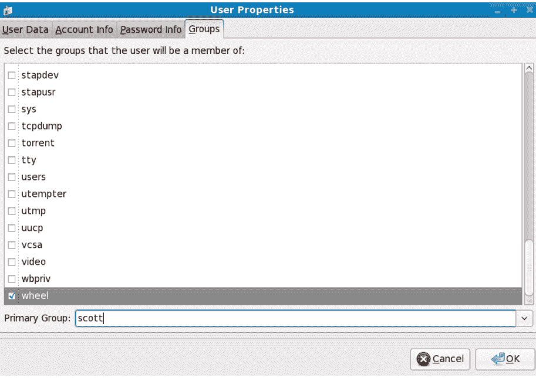
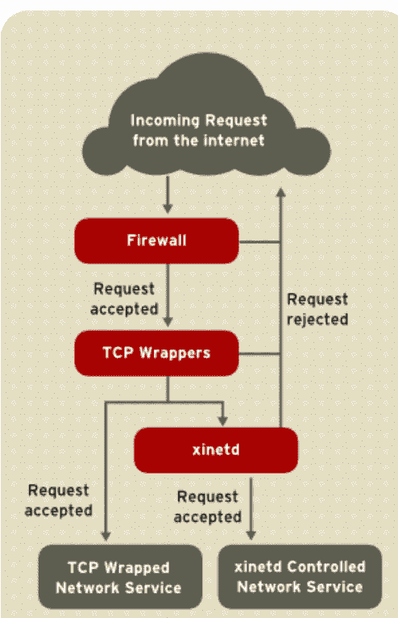
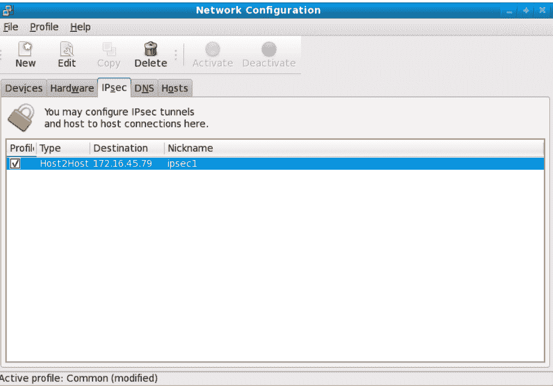
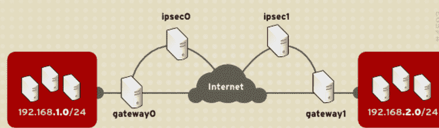
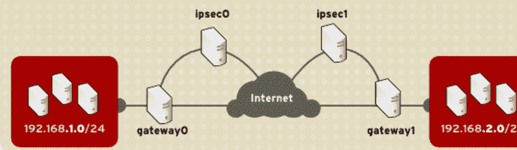
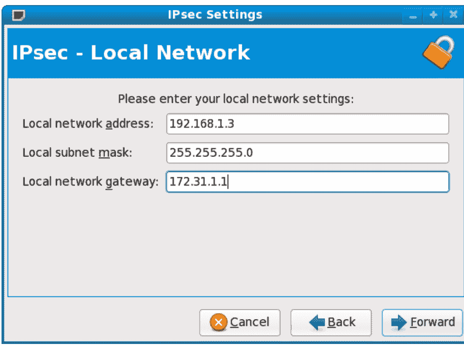
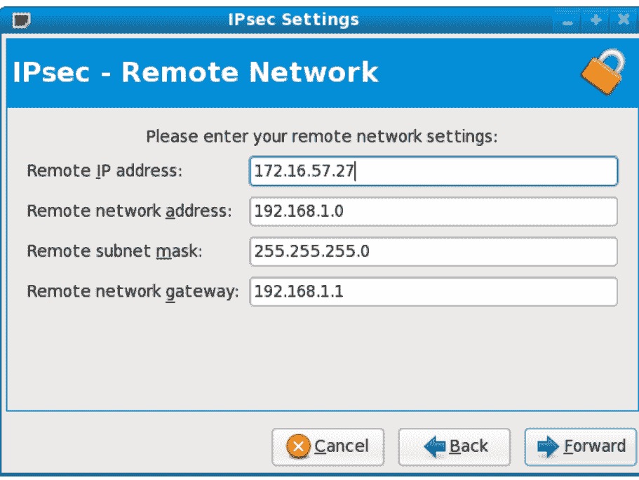

# Fedora 11 安全指南：Fedora Linux 安全加固指南 (1.0 版)

Johnray Fuller

John Ha

David O'Brien

Scott Radvan

Eric Christensen

| 作者 | 联系信息 |
| --- | --- |
| Johnray Fuller | jrfuller@redhat.com |
| John Ha | jha@redhat.com |
| David O'Brien | daobrien@redhat.com |
| Scott Radvan | sradvan@redhat.com |
| Eric Christensen | sparks@fedoraproject.com |

## Linux 安全指南旨在帮助 Linux 用户学习保护工作站免受本地和远程入侵、利用和恶意活动的过程。《Linux 安全指南》详细介绍了为数据中心、工作场所和家庭创建安全计算环境的规划和涉及的工具。通过适当的管理知识、警惕和工具，运行 Linux 既可以保持功能性，又能防御大多数常见的入侵和漏洞利用方法。

# 前言

# 1. 文档规范

本手册使用了了几种约定来突出某些单词和短语，并对特定信息引起注意。

在 PDF 和纸质版中，本手册使用了来自 Liberation Fonts¹ 族的字体。如果您的系统中安装了该字体集，HTML 版本也会使用它。如果未安装，则将显示替代但等效的字体。注意：红帽企业 Linux 5 及更高版本默认包含了 Liberation 字体集。

## 1.1. 排版约定

我们使用了四种排版约定来强调特定的单词和短语。这些约定及其适用情况如下。

**等宽粗体**

用于突出系统输入，包括 shell 命令、文件名和路径。也用于突出按键和按键组合。例如：

> 要查看当前工作目录下的文件 `my_next_bestselling_novel` 内容，请在 shell 中输入 `cat my_next_bestselling_novel` 命令并按下 `Enter` 执行该命令。

上述内容表示了一个文件名、一个 shell 命令和一个按键，它们都以等宽粗体形式呈现，并由于上下文而得以区分。

按键组合可以通过连接组合中每个部分的连字符与单个按键区分开来。例如：

按下 `Enter` 执行命令。

按下 `Ctrl+Alt+F1` 切换到第一个虚拟终端。按下 `Ctrl+Alt+F7` 返回您的 Windows 会话。

第一段突出了特定的按键。第二段突出了两个按键组合（一组同时按下的三个按键）。

如果讨论了代码，段落中提及的类名、方法、函数、变量名和返回值将以如下形式呈现：`等宽粗体`。例如：

与文件相关的类包括用于文件系统的 `filesystem`、用于文件的 `file` 以及用于目录的 `dir`。每个类都有其关联的权限集。

**比例粗体**

这表示在系统中遇到的单词或短语，包括应用程序名称；对话框文本；带标签的按钮；复选框和单选按钮标签；菜单标题和子菜单标题。例如：

从菜单栏选择 System → Preferences → Mouse 来启动鼠标偏好（Mouse Preferences）。在 Buttons 选项卡中，选择 Mouse Preferences。

**比例粗体**

这表示在系统中遇到的单词或短语，包括应用程序名称；对话框文本；带标签的按钮；复选框和单选按钮标签；菜单标题和子菜单标题。例如：

## 1.2. 引用块约定

终端输出和源代码列表在视觉上与正文区分。

发送到终端的输出采用等宽正体并呈现如下：

| books | Desktop documentation drafts mss stuff |
| books_tests | Desktop downloads images scripts |

源代码列表同样采用等宽正体，但添加了如下语法高亮：

```java
package org.jboss.book.jca.ex1;
import javax.naming.InitialContext;
public class EchoClient {
    public static void main(String[] args)
    throws Exception {
        InitialContext inCtx = new InitialContext();
        Object ref = inCtx.lookup("EchoBean");
        EchoHome home = (EchoHome) ref;
        Echo echo = home.create();
        System.out.println("Created Echo");
        System.out.println("Hello" + " " + echo.echo("Hello"));
    }
}
```

## 1.3. 注释与警告

最后，我们使用三种视觉样式来引起可能被忽略的信息。

> > **注意**：注释是针对当前任务的提示、快捷方法或替代方案。忽略注释不会产生负面后果，但你可能会错过让生活更轻松的技巧。

> > **重要**：重要框详细说明了容易被忽略的内容：仅适用于当前会话的更改，或者在更新之前需要重启的服务。忽略标记为“重要”的框不会导致数据丢失，但可能会引起不满和沮丧。

> > **警告**：不应忽略警告。忽略警告极有可能导致数据丢失。

## 2. 我们需要反馈！

关于 Linux 安全指南项目的更多信息可以在 https://fedorahosted.org/securityguide 找到。

针对安全指南提供反馈，请在 https://bugzilla.redhat.com/enter_bug.cgi?component=security-guide&product=Fedora%20Documentation 提交错误。

# 第一章. 安全概述

由于对强大的网络化计算机的依赖日益增加，这些计算机用于帮助业务运营并跟踪我们的个人信息，整个行业已经围绕网络和计算机安全实践而形成。企业开始寻求安全专家的知识和技能，以对系统进行适当审计，并根据组织的运营需求量身定制解决方案。由于大多数组织在性质上日益具有动态性，员工可以在本地和远程访问 IT 资源，保护计算环境的需求已变得愈发突出。

遗憾的是，大多数组织（以及个人用户）将安全视为事后考虑，这是一个为了追求更高的性能、生产力和预算考虑而被忽视的过程。适当的安全措施实施往往是在“事后剖析”后才采取的——即在发生未经授权的入侵之后。安全专家认为，在将站点连接到互联网等不受信赖的网络之前，采取正确的措施是阻止损耗尝试的有效手段。

## 1.1. 安全简介

### 1.1.1. 什么是计算机安全？

计算机安全是一个通用术语，涵盖了计算和信息处理的广泛领域。行业依赖计算机系统和网络进行日常业务交易，并访问有关其数据的关键信息，将其视为整体资产的重要组成。一些术语和指标已进入我们的日常词汇，例如总拥有成本（TCO）和高可用性，作为其规划和流程管理成本的一部分。在某些行业中，还有服务质量（QoS）。在电子商务等行业中，数据的可用性和可信度可能是成功与失败的区别。

### 1.1.1. 计算机安全是如何产生的？

由于对公共网络披露个人、财务和其他其他限制信息的依赖程度日益增加，信息安全在多年来不断演变。有许多案例，例如 Mitnick 案和“Vladimir Levin”案，促使各各的组织重新审视它们处理信息的方式，以及信息的传输和泄露方式。互联网的普及是促使数据安全努力加强的最重要进展之一。

越来越多的人正在使用个人计算机来访问互联网提供的资源。由于研究、信息技术、电子邮件和商业交易的发展，互联网被认为是 20 世纪最重要的进展之一。

互联网及其协议是作为一种基于信任的系统而开发的。这意味着，该协议的设计初衷并不是为了安全。TCP/IP 通信栈中没有内置经过批准的安全标准，导致其暴露于网络中潜在的恶意用户和进程面前。现代发展使互联网通信变得安全，但仍有若干次引起国家关注的事件提醒我们，没有任何东西是完全安全的。

> http://law.jrank.org/pages/3791/Kevin-Mitnick-Case-1999.html

> http://www.livinginternet.com/ila/hackers_levin.html

### 1.1.1.2. 今天的安全

2000 年 2 月，一次分布式拒绝服务（DDoS）攻击在互联网上几个流量最大的网站上爆发。该攻击导致 yahoo.com、cnn.com、amazon.com、fbi.gov 以及其他几个网站对普通用户完全无法访问，因为它通过大量的、沉重的 ICMP 包（也称为 ping 洪泛）占用了数小时的路由器。该攻击是由黑客及其助手使用特意创建的广泛获取的程序发起的，这些程序扫描有漏洞的网络服务器，然后对每个受感染的服务器发起攻击，淹没受害者网站并使其失效。许多人将此攻击归咎于路由器和协议结构在接受所有入站数据方面的根本缺陷，无论数据包从哪里发送或出于什么目的发送。

2007 年，一次利用广为人知的加密等隐私（WEP）无线加密协议漏洞的数据泄露，导致一家全球金融机构被盗了超过 4500 万信用卡号。

在另一起事件中，存储在备份带上的 220 万名患者的账单记录从快递员的前座椅被盗取。

# 第一章. 安全概述

### 1.1.1.2. 今天的安全

### 1.1.3.2. 技术控制

技术控制以技术为基础，控制整个物理结构和网络对敏感数据的访问和使用。技术控制的范围广泛，涵盖了以下技术：

- 加密
- 智能卡
- 网络身份验证
- 访问控制列表 (ACLs)
- 文件完整性审计软件

### 1.1.3.3. 行政控制

行政控制定义了安全的因素。它们涉及组织内所有级别的人员，并通过以下手段决定哪些用户可以访问哪些资源和信息：

- 培训与意识
- 灾难备备与恢复计划
- 人员招聘与离职策略
- 人员注册与核算

### 1.1.4 结论

现在你已经学习了安全的起源、原因和方面，你将发现更容易地针对 Fedora 采取适当的行动。了解哪些因素和条件构成了安全性，对于规划和实施适当策略至关重要。在这些信息的基础上，随着你深入研究安全流程的细节，过程可以形式化，路径也会变得更加清晰。

## 1.2 漏洞评估

在拥有时间、资源和动力的情况下，破解者（cracker）可以进入任何系统。归根结底，目前所有可用的安全程序和技术都无法保证任何系统完全免受入侵。路由器帮助保护通往互联网的网关。防火墙帮助保护网络边缘。虚拟专用网络以加密流的形式安全地传输数据。入侵检测系统会向你警告恶意活动。然而，这些每项技术的成功都取决于许多变量：

- 负责配置、监控和维护这些技术的人员的专业知识。
- 快速高效地补丁和更新服务及内核的能力。
- 相关人员对网络保持警惕的能力。

鉴于数据系统和技术的动态状态，保护企业资源可能非常复杂。由于这种复杂性，很难为所有系统找到专家。虽然可能拥有在信息安全许多领域具有高水平知识的人员，但很难留住在多个领域都是专家的员工。这主要是因为信息安全的每个领域都需要不断的关注和专注。信息安全不是静止的。

### 1.2.1 像破解者一样思考

假设你管理一个企业网络。此类网络通常由操作系统、应用程序、服务器、网络监控器、入侵检测系统等组成。现在想象尝试跟上这些每一个设备。考虑到今天软件和网络环境的复杂性，漏洞和 Bug 是肯肯定的。在一个具有异构系统的大型组织中，保持企业网络的补丁和更新可能是一项艰巨的任务。

将专业知识要求与保持更新的任务相结合，不可避免地会发生不利事件、系统被攻破、数据损坏和服务中断。

为了增强安全技术并帮助保护系统、网络和数据，你必须像破解者一样思考，通过检查漏洞来评估你系统的安全性。针对你自己的系统和网络资源的预防性漏洞评估，可以揭示在破解者利用之前就可以解决的潜在问题。

漏洞评估是对你的网络和系统安全的内部审计；其结果表明了你的网络的机密性、完整性和可用性（如第 1.1.1.3 节“安全标准化”所示）。通常，漏洞评估从侦察阶段开始，在此期间会收集有关目标系统和资源的重要数据。这导致了就绪阶段，在该阶段基本上会检查目标是否存在所有已知的漏洞。就绪阶段在报告阶段完成，将发现的结果归分为高、中、低风险类别；并讨论了提高目标安全性（或降低风险）的方法。

如果你对你的家进行漏洞评估，你可能会检查家里的每一扇门是否关闭并锁好。你还会检查窗户，确保它们紧闭并扣好插销。同样的概念也适用于系统、网络和电子数据。恶意用户是你数据的小偷和捣破坏者。关注他们的工具、心态和动机，你就可以对他们的行动做出反应。

### 1.2.2 定义评估与测试

漏洞评估可以分为两种类型：从外向内看（Outside looking in）和从内向向（Inside looking around）。

在执行从外向内的漏洞评估时，你正试图从外部攻破你的系统。处于公司外部使你拥有破解者的视角。当你看到破解者所看到的时——你 DMZ 上的公共路由 IP 地址、防火墙的外部接口等。DMZ 代表“非军事化区”，它对应于受信任网络（如私有局域网）和不可信外部网络（如公共互联网）之间的计算机或子网。通常，DMZ 包含访问互联网流量的设备，如 Web (HTTP) 服务器、FTP 服务器、SMTP（电子邮件）服务器和 DNS 服务器。

当你执行从内向外的漏洞评估时，你处于某种优势，因为你是内部人员，你的状态是受信任的。这是你和你的同事登录到系统后的视角。你的打印服务器、文件服务器、数据库和其他资源。

这两种类型的漏洞评估之间存在显著区别。作为公司内部人员，你拥有的比任何外部人员更高的权限。尽管在今天大多数组织中，安全配置是为了将入侵者挡在外面。对于组织内部（如部门防火墙、用户级访问控制、内部资源的身份验证程序等）的保护很少。在从内部查看时，大多数系统都是公司内部的。一旦你把自己置于公司外部，就会被赋予不可信状态。你从外部可以获得的系统和资源非常有限。

- 结果是系统保持更新并修复了漏洞
- 促进增长并有助于开发员工的专业知识
- 减少财务损失和负面声誉

### 1.2.2.1. 建立方法论

为了帮助选择漏洞评估工具，建立一套漏洞评估方法论是有帮助的。遗憾的是，目前还没有预定义的或行业认可的方法论；然而，常识和最佳实践可以作为足够的指导。

目标是什么？我们是在查看一台服务器，还是在查看我们的整个网络以及网络内部的所有内容？我们是在公司的外部还是内部？这些问题的答案至关重要，因为它们不仅决定了选择何种工具，还决定了使用工具的方式。

要了解更多关于建立方法论的信息，请参考以下网站：

- * http://www.isecom.org/osstm/ 开源安全测试方法论手册 (OSSTMM)
- * http://www.owasp.org/ Web 应用程序安全项目

### 1.2.3. 评估工具

可以使用某种形式的信息收集工具来构建评估。在评估整个网络时，首先映射第一个主机以找到正在运行的主机。一旦定位，逐一检查每个主机。专注于这些主机需要另一组工具。知道使用哪些工具是发现漏洞最关键的步骤。

就像日常生活的各个方面一样，有许多不同的工具可以执行相同的工作。这一概念也适用于漏洞评估、系统评估，甚至是网络评估（基于所使用的协议）。某些工具是免费的，另一些则不是。某些工具直观且易于使用，而另一些工具则晦涩且文档匮乏，但具有其他工具所不具备的功能。

寻找正确的工具可能是一项艰巨的任务，最终，经验至关重要。如果可能，建立一个测试实验室并尝试尽可能多的工具，注意每个工具的优缺点。查看该工具的 README 文件或页面。此外，可以在互联网上寻找更多信息，例如文章、分步指南，甚至是针对特定工具的邮件列表。

所讨论的工具只是可用工具的一个样本。

### 1.2.3.1. 使用 Nmap 扫描主机

Nmap 是 Fedora 中包含的一款流行工具，可用于确定网络布局。Nmap 已经存在多年，可能是收集信息时最常用的工具。它包含了一份极佳的地图，提供了其选项和用法的详细描述。管理员可以在网络上使用 Nmap 来查找系统以及这些系统上的开放端口。

Nmap 是漏洞评估中一个胜任的首选工具。你可以映射网络内部的主机，甚至扫描允许 Nmap 识别特定主机上的操作系统。Nmap 是建立安全服务策略策略和停止未使用服务的良好基础。

### 1.2.3.1.1. 使用 Nmap

可以在 shell 提示符中输入 `nmap` 命令，后跟要扫描机器的主机名或 IP 地址来运行 Nmap。

```
nmap foo.example.com
```

扫描结果（可能需要几分钟，取决于主机所在的位置）应该类似于所示：

```
Starting Nmap 4.68 ( http://nmap.org )
Interesting ports on foo.example.com:
Not shown: /17 filtered ports
PORT STATE SERVICE
22/tcp open ssh
53/tcp open domain
70/tcp closed gopher
80/tcp open http
113/tcp closed auth
```

Nmap 测试最常见的网络端口是否正在监听或等待服务。这些知识对于想要关闭不必要或未使用服务的管理员很有帮助。

有关使用 Nmap 的更多信息，请参考以下 URL 的官方主页：

http://www.insecure.org/

### 1.2.3.2. Nessus

Nessus 是一款全功能安全扫描器。Nessus 的插件架构允许用户针对其系统和网络进行定制。对于任何扫描器来说，Nessus 的好坏取决于它所依赖签名数据库。幸运的是，Nessus 经常更新，并具有完整的报告、主机扫描和实时漏洞搜索功能。记住，即使是像 Nessus 这样强大且频繁更新的工具，也可能存在误报和漏报。

> 注意

> Nessus 客户端和服务器软件包含在 Fedora 仓库中但需要订阅才能使用。它被包含在本文中，供可能感兴趣使用这款流行应用程序的用户参考。

有关关于 Nessus 的更多信息，请参考以下 URL 的官方网站：

http://www.nessus.org/

### 1.2.3.3. Nikto


Nikto 是一款优秀的通用网接口 (CGI) 脚本扫描器。Nikto 不仅检查漏洞，而且以规避的方式进行，以规避入侵检测系统。它附有详尽的文档，应在运行程序之前仔细审阅。如果你有设置 CGI 脚本的 Web 服务器，Nikto 可以作为检查这些服务器安全性的极佳资源。

有关 Nikto 的更多信息可以在以下 URL ：

http://www.cirt.net/code/nikto.shtml

## 1.2.3.4. VLAD 扫描器

VLAD 是由 Bindview, Inc. 的 RAZOR 团队开发的漏洞扫描器，检查 Sans Top 常见安全问题列表（SNMP 问题、文件共享问题等）。虽然功能没有 Nessus 多样，但 VLAD 值得研究。

> 注意
>
> Vlad 未包含在 Fedora 中且不受支持。它被包含在本文中，供可能感兴趣使用这款流行应用程序的用户参考。

有关 VLAD 的更多信息可以在 RAZOR 团队网站找到：

http://www.bindview.com/Support/Razor/

## 1.2.3.5. 预测你的未来需求

根据你的目标和资源，有很多可用工具。有无线网络、Windows 系统、Linux 系统以及其他工具。评估的另一个重要部分可能是审查物理安全、人员安全或 VoIP/PBX 网络评估。新概念，如“战行”（war walking），涉及扫描企业物理结构的无线网络，这些是你可以调查并在需要时纳入评估的新概念。想象力和暴露是规划和进行漏洞评估的唯一限制。

## 1.3 攻击者与漏洞

为了规划和实施良好的安全策略，首先要意识到有动机的攻击者利用漏洞破坏系统。然而，在详细介绍这些问题之前，必须定义识别攻击者时使用的术语。

### 1.3.1. 黑客简史

“黑客”一词的现代含义可以追溯到 20 世纪 60 年代的理工学院（MIT）技术成员铁路俱乐部，该俱乐部设计了比例精确、细节复杂的火车模型。黑客是对发现解决问题的巧妙技巧或变通方案的俱乐部成员的称呼。

从那以后，这个词已被用来描述从电脑爱好者到天才程序员的各种群体。黑客的一个共同特征是愿意解释计算机系统和网络是如何工作的，且几乎没有外部动因。开源软件开发者通常认为自己和同事是黑客，并将该词视为尊重的标志。

通常，黑客遵循某种形式的黑客伦理，该伦理规定对信息和专业知识的追求是必不可少的，分享这些知识是黑客对社区的责任。在追求知识的过程中，许多人喜欢绕过计算机系统安全控制的挑战。因此，媒体经常使用“黑客”一词来描述那些……对于这种类型的黑客，更准确的术语是“破解者”（cracker）——这是一个由黑客在 80 年代中期创建的词，用于区分这两个群体。

## 第 1 章 安全概述

### 1.3.1.1. 灰色的地带

在发现并利用系统及网络漏洞的群体中，存在着几个不同的群体。这些群体根据他们在执行安全调查时“佩戴”的帽子颜色来描述，这反映了他们的意图。

**白帽黑客**（White hat hacker）是指测试网络和系统以检查其性能并确定其对入侵的脆弱程度的人。通常，黑客会破解自己的系统或客户指定其进行安全审计的系统。学术研究人员和专业顾问是白帽黑客的两个例子。

**黑帽黑客**（Black hat hacker）与破解者（cracker）同义。通常，破解者对编程和破解系统的规模关注较少。他们通常依赖破解程序并利用系统中的已知漏洞来获取敏感信息以谋利，或对目标系统或网络造成损害。

另一方面，**灰帽黑客**（Gray hat hacker）在大多数情况下拥有白帽黑客的技能和意图，但偶尔会将知识用于不高尚的场合。灰帽黑客可以被看作戴着黑帽以实现个人目的的白帽。

灰帽黑客通常认同另一种形式的黑客伦理，即只要黑客不实施盗窃或违背机密性，进入系统是可以接受的。然而，一些人认为，进入系统的行为本身就是不道德的。

无论入侵者的意图如何，了解破解者可能尝试利用的弱点都是重要的。本章其余部分将关注这些问题。

### 1.3.2. 对网络安全的威胁

在配置网络以下方面时，不当的实践会增加攻击风险。

#### 1.3.2.1. 不安全的架构

配置不当的网络是未经授权用户的入侵入口。将一个基于信任的开放本地网络漏洞暴露在高度安全的互联网上，就像在犯罪高发社区里留一扇没关严的门——在任意的时间内可能都不会发生什么，但最终会有人利用这个机会。

##### 1.3.2.1.1. 广播网络

系统管理员未能意识到网络硬件在其安全方案中的重要性。简单的硬件如广播或非交换交换机上的集线器和路由器；即当节点跨网络传输数据到接收节点时，集线器或路由器会发送数据包的广播，直到接收节点接收并处理数据。这种方法最容易受到外部入侵者和本地主机上未经授权用户的地址解析协议（ARP）或介质访问控制（MAC）地址欺骗。

##### 1.3.2.1.2. 集中式服务器

另一个潜在风险是使用集中计算。许多企业的一种极端削减成本措施是将所有服务整合到一台强大的机器上。这可能很方便，因为它更容易管理，且成本远低于多服务器配置。然而，集中式服务器引入了网络中的单点故障。如果中央服务器被攻破，可能会导致网络完全失效，或者更糟，容易受到数据操纵或窃取。在这些情况下，中央服务器将变成一个允许访问整个网络的敞大门。

### 1.3.3. 对服务器安全的威胁

服务器安全与网络安全同样重要，因为服务器通常持有组织大量的重要信息。如果服务器被攻破，其所有内容都可能被破解者窃取或操纵。以下章节详细阐述了一些主要问题。

#### 1.3.3.1. 未使用的服务和开放的端口

Fedora 的完整安装包含 1000 多个应用程序和库包。然而，大多数服务器管理员并不选择安装发行版中的每个包，而是倾向于安装基础包，其中包含几个服务器应用程序。

系统管理员中一种常见的现象是安装系统时没有注意实际上安装了哪些程序。这可能会导致问题，因为可能安装了不需要的服务，这些服务使用默认设置进行配置，并可能被关闭。这可能导致 Telnet、DHCP 或 DNS 等不需要的服务在管理员未察觉的情况下运行在工作站上，反过来可能导致服务器产生多余的流量，甚至为破解者提供进入系统的潜在路径。有关关闭和禁用未用服务的信息，请参阅第 2.2 节“服务器安全”。

#### 1.3.3.2. 未修补的服务

默认安装中包含的大多数应用程序都是坚固且经过彻底测试的软件。。由于在生产环境中已使用多年，它们的代码已经经过了彻底的精炼，许多漏洞已被发现并修复。

然而，世界上没有没有完美的软件，总有进一步完善的空间。此外，由于进入生产环境的原因，软件往往没有预期的那样精炼，或者可能没有其他服务器软件受欢迎。

开发者和系统管理员经常在服务器应用程序中发现可利用的漏洞，并在漏洞跟踪和安全相关的网站上发布信息，例如 Bugtraq 邮件列表（http://www.securityfocus.com）或计算机应急响应小组（CERT）网站（http://www.cert.org）。尽管这些机制是向社区提醒安全漏洞的有效方法，但及时修补系统仍取决于管理员。这一点尤为真实，因为破解者也可以访问这些相同的漏洞跟踪服务，并在他们需要时使用这些信息来跟踪未修补的系统。良好的系统管理需要警惕、漏洞跟踪和适当的维护，以确保更安全的计算环境。

有关保持系统更新的更多信息，请参考第 1.5 节“安全更新”。

#### 1.3.3.3. 疏于管理

未能及时修补系统的管理员是对服务器安全最大的威胁之一。根据系统管理员、审计、网络安全学院的说法，产生漏洞的主要原因是管理员未能更改默认密码。

```
http://www.sans.org/resources/php
```

#### 1.3.3.4. 本身不安全的服务

即使是最为警惕的组织，如果他们选择的网络本质上是不安全的，也可能受害。例如，许多服务是在假设在局域网内使用的范围内开发的，但现在可以在互联网上可用。

不安全网络服务的一类是那些需要用户名和密码进行验证的服务。Telnet 和 FTP 就是此类服务。如果数据嗅探软件监控远程用户与服务器之间的流量，密码很容易被拦截。

从本质上讲，服务还可能容易受到安全行业所谓的中间人攻击。在这种攻击类型中，破解者通过跟踪网络上的服务器名称将其重定向而非目标服务器。当有人打开服务器的远程会话时，攻击者充当透明媒介，坐在服务器和用户之间。然后他们就可以获得管理权限。

另一类不安全的服务包括文件系统和信息服务，如 NFS 或 NIS，它们是为了局域网设计的，但不幸的是扩展到了广域网。NFS 默认没有任何身份验证或安全机制防止破解者挂载 NFS 共享并访问其中的任何内容。NIS 同样拥有网络上每台计算机必须知道的重要信息，位于明文 ASCII 或 DBM 数据库中。获取数据库的破解者可以访问网络上的每个用户账户，包括管理员帐户。

默认情况下，Fedora 发布时关闭了所有服务。然而，由于管理员发现自己必须使用这些服务，仔细配置至关重要。有关设置安全方式的更多信息，请参阅第 2.2 节“服务器安全”。

### 1.3.4. 对工作站和家庭电脑安全的威胁

工作站和家庭电脑可能不像网络或服务器那样容易受到攻击，但由于它们包含敏感数据（如信用卡信息），它们也是系统破解者的目标。工作站还可能在用户不知情的情况下被占用，被攻击者用于协调攻击的“从机”。由于这些原因，了解工作站的漏洞可以节省用户重新安装操作系统或从数据被窃中恢复的痛苦。

#### 1.3.4.1. 糟糕密码

糟糕密码是攻击者获取系统访问权限的方法之一。有关创建密码时避免常见陷阱的更多信息，请参阅第 2.1.3 节“密码安全”。

#### 1.3.4.2. 易受客户端应用程序

尽管管理员可能拥有完全安全且经过修复的服务器，但这并不意味着远程用户在访问它时是安全的。例如，如果服务器在公共网络上运行 Telnet 或 FTP 服务，攻击者可以捕获在网络上传输的明文格式的用户名和密码，然后使用这些账户信息访问远程用户的工作站。

即使使用 SSH 等安全协议，如果远程用户不更新其客户端应用程序，也可能受到某些攻击。例如，v.1 版本的 SSH 客户端容易受到来自恶意 SSH 服务器的 X 转发攻击。一旦连接到服务器，攻击者就可以通过网络捕获客户端的任何按键记录和鼠标点击。这个问题在 v.2 SSH 协议中已得到修复，但需要用户自己跟踪哪些应用程序存在漏洞并根据需要进行更新。

第 2.1 节“工作站安全”更详细讨论了管理员和家庭用户应该采取哪些步骤来限制计算机工作站的脆弱性。

## 1.4. 常见漏洞与攻击

表 1.1 “常见漏洞”详细列出了入侵者访问组织网络资源时使用的一些最常见的漏洞和切入点。这些常见漏洞的关键在于解释了它们是如何执行的，以及管理员如何妥善保护其网络免受攻击。

| 漏洞 |or | 备注 |
|---|---|---|
| 空密码或默认密码 | 将管理员密码留空或使用产品设置的默认密码。这在路由器和防火墙等硬件设备中最为常见，尽管某些在 Linux 上运行的服务包含默认管理员密码（但 Fedora 11 并不分发这些密码）。 | 通常与路由器、防火墙、VPN 和网络附属存储 (NAS) 应用等网络硬件相关。在许多旧操作系统中常见，特别是那些捆绑服务的系统（如 UNIX 和 Windows）。管理员有时在忙中创建特权账户并留空密码，为发现该账户的恶意用户创建了完美的切入点。 |
| 默认共享密钥 | 安全服务有时为了开发或评估目的封装默认密钥。这些密钥未被更改并放置在互联网上的生产环境中，所有具有相同密钥的用户都可以访问该共享密钥资源及其包含的任何敏感信息。 | 最常见于无线访问点和预配置的安全服务器设备。 |
| IP 欺骗 | 远程机器充当你的本地网络，寻找你服务器的漏洞，并安装后门程序或木马以获得你网络资源的控制。 | 欺骗相当困难，因为它涉及攻击者预测 TCP/IP 序列号以协调与目标系统的连接，但有多种工具可以帮助黑客利用此类漏洞。这取决于目标系统运行的服务（如 rsh、telnet、FTP 等），这些服务使用了基于源的认证技术，与 PKI 或 ssh 或SSL/TLS 中使用的其他加密认证形式相比，这些技术是不被推荐的。 |
| 窃听 | 通过监听网络上两个活动节点之间的连接，收集在两个节点之间传输的数据。 | 这种攻击适用于明文传输协议，如 Telnet、FTP 和 HTTP 传输。远程攻击者必须能够访问局域网内受损的系统才能执行此类攻击，通常黑客需要先通过活跃的攻击（如 IP 欺骗或中间人攻击）来破坏局域网上的系统。预防措施包括使用带有加密密钥交换的服务、一次性密码或加密认证以防止密码嗅探；还建议在传输过程中使用强加密。 |
| 服务漏洞 | 攻击者在互联网上运行的服务中发现缺陷或漏洞；通过此漏洞，攻击者破坏整个系统及可能存在的任何数据，并可能破坏网络上的其他系统。 | 基于 HTTP 服务（如 CGI）容易受到远程命令执行甚至交互式 shell 访问。即使 HTTP 服务以“nobody”等非特权用户运行，配置文件和网络地图等信息也可以被读取，或者攻击者可以启动拒绝服务攻击，耗尽系统资源或导致其他用户无法使用。服务有时在开发和测试期间存在未被察觉的漏洞；这些漏洞（例如缓冲区溢出，攻击者使用填充应用程序内存缓冲器的任意值导致服务崩溃，从而获得一个交互式命令提示符，并从中执行任意命令）可以赋予攻击者完全的管理员权限。 |
| 应用程序漏洞 | 攻击者发现桌面和工作站应用程序（如电子邮件客户端）的缺陷并执行任意代码、植入木马进行破坏或导致系统崩溃。如果受损的工作站对网络其余部分具有管理权限，则可能发生进一步的利用。 | 管理员应确保服务不以 root 用户运行，并密切关注来自供应商或 CERT 和 CVE 等安全组织的应用程序补丁和错误更新。由于员工缺乏防止或检测破坏的知识或经验，工作站和桌面更容易受到攻击；因此，告知个人在安装未经授权的软件或垃圾邮件时所承担的风险至关重要。可以实施防护措施使邮件客户端软件不自动打开或执行攻击。此外，通过 Red Hat Network 或系统管理服务自动更新工作站软件可以减轻多席安全部署的负担。 |
| 拒绝服务 (DoS) 攻击 | 攻击者或攻击者小组通过向目标主机（服务器、路由器或工作站）发送未经授权的数据包来协调一个组织的网络或服务器资源。这迫使资源无法供合法用户使用。 | 美国最报道的 DoS 案例发生在 2000 年。几个高流量的商业和政府网站由于多个具有高带宽连接的受损系统作为“僵尸”或定向广播节点进行洪泛攻击而变得脆弱。源包通常是伪造的（以及重发的），使得调查攻击的真实来源变得困难。使用 iptables 进行入站过滤（IETF rfc2267）的进展以及网络入侵检测系统（sort）有助于管理员追踪和防止 DoS 攻击。 |

表 1.1. 常见漏洞

## 1.5. 安全更新

随着安全漏洞的发现，必须更新受影响的软件以限制潜在的安全风险。如果软件是当前支持的 Fedora 发行版中包的一部分，Fedora 承诺尽可能发布修复该漏洞的更新包。通常，关于特定安全漏洞的公告会附带补丁（或源代码）。该补丁随后应用于 Fedora 包并作为错误更新发布。然而，如果公告未包含补丁，开发者首先与维护人员合作解决问题。一旦针对系统软件发布了错误更新，建议尽快更新受影响的软件包，以减少系统可能受影响的时间。

### 1.5.1. 更新软件包

在更新系统软件时，从可靠源下载更新非常重要。攻击者可以重新构建一个与修复程序版本号相同的包，但包含不同的安全漏洞并发布到互联网上。如果发生这种情况，针对原始 RPM 进行验证的安全措施将无法检测到漏洞。因此，仅从可靠源（如 Fedora）下载 RPM 并检查签名以验证其完整性非常重要。

> 注意
>
> Fedora 包含一个方便的图标，当有更新时会显示警告。

### 1.5.2. 验证签名包

所有 Fedora 软件包都使用 GPG 密钥签名。GPG 代表 GNU Privacy Guard（或 GnPG），是一种用于确保分发文件真实性的免费软件包。例如，私钥（秘密）锁定包，而公钥则解锁并验证包。如果 Fedora 分发的公钥在 RPM 验证期间不匹配，则该包可能已被更改，因此不可信。

Fedora 内的 RPM 工具在安装 RPM 包之前会自动尝试验证 GPG 签名。如果未安装 GPG 密钥，请从安全的静态位置（例如 Fedora 安装光盘或 DVD）导入。

假设光盘挂载在 `/mnt/cdrom`，使用以下命令将其导入密钥环（系统的密钥数据库）：

```
rpm --import /mnt/cdrom/RPM-GPG-KEY
```

要显示所有用于 RPM 验证的密钥列表，请执行以下命令：

```
rpm -qa gpg-pubkey*
```

输出类似于所示：

```
gpg-pubkey-db42a60e-37ea538
```

```
rpm -qi gpg-pubkey-db42a6e-37ea5438
```

在安装 RPM 文件之前，验证其签名至关重要，这可以确保它们没有从原始包源被更改。若要一次性验证所有下载的文件，请执行以下命令：

```
rpm -K /tmp/updates/*.rpm
```

对于每个包，如果 GPG 密钥验证成功，命令将返回 `gpg OK`。如果验证失败，请确保你正在使用正确的 Fedora 公钥，这也是为了验证内容的来源。未通过 GPG 验证的包不应安装，因为其来源可能已被第三方修改。

在验证 GPG 密钥并下载与错误报告（errata）相关的所有包后，请在 shell 提示符下 root 身份安装这些包。

### 1.5.3 安装签名包

大多数包的安装可以通过执行以下命令安全完成（内核包除外）：

```
rpm -Uvh /tmp/updates/*.rpm
```

内核包，请使用以下命令：

```
rpm -ivh /tmp/updates/<kernel-package>
```

将上一个示例中的 `<kernel-package>` 替换为内核 RPM 的名称。

一旦机器使用新内核安全地重启，可以使用以下命令删除旧内核：

```
rpm -e <old-kernel-package>
```

将上一个示例中的 `<old-kernel-package>` 替换为旧版本内核 RPM 的名称。

> 注意
>
> 移除旧内核是一项要求。默认的启动加载程序 GRUB 允许安装多个内核，并在启动时从菜单中进行选择。

> 重要
>
> 在安装任何安全错误修复之前，请务必阅读错误报告中包含的任何特殊说明并仔细执行。有关应用由错误修复更新所做出的更改的通用说明，请参阅第 1.5.4 节“应用更改”。

### 1.5.4 应用更改


在下载并安装安全错误修复和更新后，停止使用旧软件并开始使用新软件非常重要。具体如何操作取决于已更新的软件类型。以下列表列出了软件的大类类别，并提供了包升级后使用更新版本的说明。

> 注意
>
> 通常情况下，重启系统是确保使用软件软件包最新版本的最安全方法；然而，此选项并非总是必须的，系统管理员也并不总是拥有该权限。

### 应用程序

用户空间应用程序是任何由系统用户启动的程序。通常，此类应用程序仅在用户、脚本或自动化任务启动它们时才使用，并且不会持续很长时间。

一旦此类用户空间应用程序完成更新，请停止系统上的任何应用程序实例并重新启动程序以使用更新后的版本。

### 内核

内核是 Fedora 操作系统的核心软件组件。它管理对内存、处理器和外围设备的访问，并调度所有任务。

由于其核心作用，内核无法在不停止计算机的情况下重启。因此，在系统重启之前，无法使用更新后的内核版本。

### 共享库

共享库是代码单元（例如 `glibc`），被多个应用程序和服务使用。利用共享库的应用程序通常在应用程序初始化时加载共享代码，因此任何使用更新后库的应用程序都必须停止并重新启动。

要确定哪些运行中的应用程序链接到特定库，请使用以下示例中的 `lsof` 命令：

```
lsof /lib/libwrap.so*
```

此命令返回所有使用 TCP wrappers 进行宿主机访问控制的运行程序列表。因此，如果更新了 `tcp_wrappers` 包，必须停止并重新启动任何程序列表。

### SysV 服务

SysV 服务是在启动过程中启动的持久性服务器程序。SysV 服务的示例包括 `sshd`、`vsftpd` 和 `xinetd`。

由于这些程序通常只要机器启动就会持续运行，因此在包升级后，每个更新的 SysV 服务都必须停止并重新启动。这可以使用“服务配置工具”或通过登录 shell 提示符并按如下例执行 `/sbin/service` 命令来实现：

```
/sbin/service <service-name> restart
```

在上一个示例中，将 `<service-name>` 替换为服务的名称，例如 `sshd`。

### xinetd 服务

由 `xinetd` 超级服务控制的服务仅在存在活动连接时运行。由 `xinetd` 控制的服务示例包括 Telnet、IMAP 和 POP3。

由于 `xinetd` 每次接收到请求时都会启动这些服务的新实例，因此升级后发生的连接将由更新后的软件处理。然而，如果在升级受 `xinetd` 控制的服务时存在活动连接，这些连接将继续由旧版本的软件提供服务。

要杀掉特定 `xinetd` 控制的服务实例，请先升级该服务的包，然后停止当前运行的进程。要确定进程正在运行，请使用 `ps` 命令并使用 `kill` 或 `killall` 命令停止服务的当前实例。

例如，如果发布了安全错误修复 `imap` 包，请升级包，然后在 shell 提示符中作为 root 用户输入以下命令：

```
ps -aux | grep imap
```

此命令返回所有活跃的 IMAP 会话。可以通过执行以下命令终止单个会话：

```
kill <PID>
```

如果未能终止会话，请改用以下命令：

```
kill -9 <PID>
```

在上几个示例中，将 `<PID>` 替换为进程标识符（在 `ps` 的第二列中找到），用于 IMAP 会话。

要杀死所有 IMAP 会话，执行以下命令：

```
killall imapd
```

## 网络安全

### 2.1. 工作站安全

网络安全始于工作站。无论是锁定个人机器还是保护企业系统，良好的安全策略始于单台计算机。计算机网络的安全性取决于最弱的节点。

### 2.1.1. 评估工作站安全

在评估工作站安全性时，请考虑以下因素：

- BIOS 和启动加载器安全：用户是否可以物理访问机器并在无密码进入单用户模式？
- 密码安全：机器上的账户安全性如何？
- 管理控制：谁拥有系统账户？他们拥有多少管理权限？
- 可用网络服务：哪些服务正在监听请求？哪些服务应该运行？
- 个人防火墙：是否需要防火墙？
- 安全增强通信工具：工作站之间应该使用哪些工具，哪些工具应该避免？

# 第 2 章 保护您的网络

用户模式反过来允许他们在系统上启动任意进程或复制敏感数据。

- 防止系统启动 — 某些 BIOS 允许对启动过程进行密码保护。激活后，攻击者将被强制在 BIOS 启动加载程序之前输入密码。

由于不同计算机制造商设置 BIOS 密码的方法各异，请参阅计算机用户手册获取特定说明。

如果您忘记了 BIOS 密码，可以通过主板上的跳线帽或通过断开 CMOS 电池来重置。出于这个原因，如果可能，锁定机箱是一个良好的习惯。但是，在尝试断开 CMOS 电池之前，请参阅计算机或主板的说明。

## 2.1.2.1.1. 保护非 x86 平台

其他架构使用不同的程序来执行低级任务，这些大致相当于 x86 系统上的 BIOS。例如，Intel® Itanium™ 计算机使用扩展固件接口 `EFI` 壳层。

有关保护其他架构上类 BIOS 程序的指令，请参考制造商的说明。

## 2.1.2.2. 引导加载程序密码

对 Linux 引导加载器进行密码保护的主要原因如下：

- 防止访问单用户模式 — 如果攻击者能够将系统启动到单用户模式，他们将自动登录，而无需提示 root 密码。
- 防止访问 GRUB 控制台 — 如果机器使用 GRUB 作为引导加载程序，攻击者可以使用 GRUB 编辑器界面更改其配置，或使用 `cat` 命令收集信息。
- 防止访问不安全的操作系统 — 如果是双启动系统，攻击者可以在启动时选择一个操作系统（例如 DOS），该系统会忽略访问控制和文件权限。

Fedora 在 x86 平台上使用 GRUB 引导加载程序。如需详细查看 GRUB 信息，请参阅《红帽安装指南》。

## 2.1.2.2.1. 为 GRUB 设置密码保护

您可以通过在配置文件中添加密码指令来配置 GRUB，解决第 2.1.2.2 节“引导加载程序密码”中列出的两个问题。要执行此操作，首先选择一个强密码，以 root 身份打开 shell，然后输入以下命令：

```
/sbin/grub-md5-crypt
```

在提示时，输入 GRUB 密码并按 **Enter**。这将返回密码的 MD5 哈希值。

接下来，编辑 GRUB 配置文件 `/boot/grub/grub.conf`。打开文件，在文档主部分的 `timeout` 行下方，添加以下行：

```
password --md5 <password-hash>
```

将 `<password-hash>` 替换为由 `/sbin/grub-md5-crypt` 返回的值。

下次系统启动时，GRUB 菜单将防止在不先按下 `p` 并在输入 GRUB 密码的情况下访问编辑器或命令界面。

遗憾的是，这种解决方案并不能防止攻击者在双启动环境中启动到不安全的操作系统。必须编辑 `/boot/grub/grub.conf` 文件的其他部分。

找到您想要保护的操作系统的标题行，并在其下方添加添加带有 `lock` 指令的行。

对于 DOS 系统，段（stanza）的开头应类似于：

```
title DOS lock
```

> 警告
>
> 为了使此方法正常生效，`/boot/grub/grub.conf` 文件的主部分必须存在密码行。否则，攻击者可以访问 GRUB 编辑器界面并移除锁定行。

要为特定的内核或操作系统创建不同的密码，请在段中添加 `lock` 行，随后跟一个密码行。

每个受唯一密码保护的段应以类似于以下示例的行开头：

```
DOS lock password --md5 <password-hash>
```

## 2.1.3. 密码安全

密码是 Fedora 用于验证用户的主要方法。密码是 Fedora 用于验证用户的主要方法。出于这个原因，如果可能，锁定机箱是一个良好的习惯。但是，在尝试断开 CMOS 电池之前，请参阅计算机或主板的说明。

密码是 Fedora 用于验证用户的主要方法。出于这个原因，如果可能，锁定机箱是一个良好的习惯。但是，在尝试断开 CMOS 电池之前，请参阅计算机或主板的说明。

为了安全，在创建强密码时，请遵循以下指南：

- 不要只使用数字或字母 — 在创建密码时，不要只使用数字或字母。

一些不安全的示例包括：

- `867530`
- `juan`
- `hackme`
- 不要使用可识别的单词 — 在创建密码时，不要使用可识别的单词。

一些不安全的示例包括：

- `john1`
- `DS-9`
- `mental123`
- 不要使用外语言单词 — 在创建密码时，不要使用外语言单词。

一些不安全的示例包括：

- `cheguevara`
- `bienvenido1`
- `1db`
- 不要使用黑客术语 — 如果你认为使用黑客术语（也称为 l337）很好，请重新考虑。

一些不安全的示例包括：

- `H4X0R`
- `1337`
- 不要使用个人信息 — 在创建密码时，避免使用任何个人信息。如果攻击者知道你的身份，推断你密码的任务将变得更容易。以下是创建密码时应避免的信息类型：

一些不安全的示例包括：

- 你的名字
- 宠物的名字
- 家庭成员的名字
- 任何生日
- 你的电话号码或邮政编码
- 不要反转可识别的单词 — 良好的密码检查器总是反转常用词，因此反转糟糕的密码并不会使其更安全。

一些不安全的示例包括：

- `R0X4H`
- `nauj`
- `9-DS`
- 不要写下你的密码 — 永远不要将密码写在纸上。记忆要安全得多。
- 不要对所有机器使用相同的密码 — 为每个机器分离密码是重要的。这样，如果一个系统被破解，你的所有机器都不会立即面临风险。

以下指南将帮助您创建强密码：

- 使密码至少包含 8 个字符 — 密码越长越好。如果使用 MD5 密码，应为 15 个字符或更多。对于 DES 密码，使用最大长度（8 个字符）。
- 混合大小写 — 大小写敏感，因此混合大小写以增强密码强度。
- 混合字母和数字 — 在密码中添加数字，特别是当添加到中间时（而是在开头或结尾），可以增强密码强度。
- 包含非字母数字字符 — 特殊字符如 `&`、`$` 等可以极大地提高密码强度（在使用 DES 密码时这是不可能的）。

## 第 2 章 您的网络安全

- 选择一个你记得住的密码 如果如果你记不住密码，那么世界上最好的密码也无用于事；请使用缩写或其他助记符来帮助记忆密码。

有了了这些规则，要创建一个既符合所有密码标准，又能避开坏密码特征的密码，似乎很困难。幸运的是，你可以采取一些步骤来生成一个易于记住又安全的密码。

## 2.1.3.1.1. 安全密码创建方法论

人们使用许多方法来创建安全密码。最流行的方法之一是使用缩写。例如：

- 想一个易于记住的短语，例如：
- "over the river and the woods, grandmother's house we go."（越过河流和森林，我们去外祖母的家。）
- 接下来，将其转换为缩写（包括标点符号）。
- 通过数字和字母替换缩写来增加复杂性。例如，用 7 替换 t，用符号 `@` 替换 a：
- 通过大写至少一个字母来增加复杂性，例如 H：
- 最后，永远不要在任何系统中使用上述示例密码。

虽然保护密码至关重要，但妥善管理它们同样重要，特别是对于大型组织中的系统管理员而言。下一节详细介绍了在组织内部创建和管理用户密码的良好实践。

## 2.1.3.2. 在组织内创建用户密码

如果一个组织有大量用户，系统管理员有两个基本选项来强制使用好密码。他们可以为用户创建密码，或者让用户创建自己的密码，同时验证密码质量是否可接受。

为用户创建密码可以确保密码是良好的，但随着组织的扩大，这可能是一项艰巨的任务。它还增加了用户记录自己密码的风险。

出于这些原因，大多数系统管理员倾向于让用户创建自己的密码，但会积极验证密码是良好的，并在情况下通过密码老化强制用户定期更改密码。

## 2.1.3.2.1. 强制使用强密码

对于系统管理员来说，验证组织内使用的密码足够强度是防止入侵的好主意。当用户被要求创建或更改密码时，他们可以使用命令行应用程序 `passwd`，该程序感知*可插拔认证管理器 (PAM)*，因此会检查密码是否太短或其它容易被破解。这种检查是使用 `pam_cracklib.so` PAM 模块执行的。由于 PAM 是

密码安全

创建时执行的密码检查并没有像对密码运行密码破解程序那样有效地发现坏密码。

Fedora 下有许多可用的密码破解程序，尽管没有一个随操作系统分发。以下是一些流行的密码破解程序的简要列表：

- The Ripper — 一个快速且灵活的密码破解程序。它允许使用多个单词列表，并能够进行暴力破解。你可以在 http://www.openwall.com/john/ 获取它。
- Crack — 可能是最著名的密码破解软件，Crack 非常快，尽管不像 John Ripper 那样容易使用。可以在 http://www.crypticide.com/alemcm/security/c50-faq.html 获取。
- Slurpie — Slurpie 与 John Ripper 和 Crack 类似，但它设计用于在多台计算机上同时运行，创建分布式密码破解攻击。可以在 http://www.ossrack.com/distributed.htm 与许多其他安全评估工具一起找到。

> 警告

在尝试破解组织内的密码之前，务必获得书面授权。

## 2.1.3.2.2. 密码短语 (Passphrases)

密码短语是当今系统安全的基石。遗憾的是，生物识别和双因子认证等技术在许多系统中尚未普及，这已成为一个问题。如果使用密码来保护系统，应该考虑使用密码短语。短语比密码长，即使使用数字和符号等非标准字符实现，也能比密码提供更好的保护。

## 2.1.3.2.3. 密码老化

密码老化是系统管理员用于防御组织内坏密码的另一种技术。密码老化意味着在指定的期间（通常为 90 天）后，用户会被提示创建新密码。背后的理论是，如果强制用户定期更改密码，那么被破解的密码对入侵者来说有效期是有限的。然而，密码老化的缺点是用户更有可能把密码写下来。

在 Fedora 下有两个主要程序可以指定密码老化策略：`change` 命令或图形化用户管理器（`system-config-users`）应用程序。

`change` 命令的 `-M` 选项指定了密码有效的最大天数。例如，要设置用户的密码在 90 天后过期，使用以下命令：

```
chage -M 90 <username>
```

## 第 2 章 您的网络安全

在上述命令中，将 `<username>` 替换为用户名。要禁用密码过期，传统做法是在 `-M` 选项后使用值 99999（这相当于 273 多年）。

你也可以在交互模式下使用 `chage` 命令修改多个密码老化和账户详情。使用以下命令进入交互模式：

```
chage <username>
```

以下是使用该命令的交互会话示例：

```
root@interch1]# chage davido
Changing the age information for davido
Minimum Password Age: 0
Maximum Password Age: 99999
Last Password Change (YYYY-MM-DD): 2006-08-18
Password Warning Days: 7
Inactive days: -1
Account Expiration Date (YYYY-MM-DD): 1969-12-31
root@interch1]#
```

可用选项的信息请参考 `chage` 手页。

你也可以按照如下方法使用图形用户管理器创建密码老化。执行此操作需要管理员权限。

1. 点击面板上的“系统（System）”，指向“管理（Administration）”，然后点击“用户和组（Users and Groups）”显示用户管理器。
2. 点击“用户（Users）”选项卡，选择所需的的用户。
3. 点击工具栏上的“属性（Properties）”显示用户属性框（或从“文件”菜单中选择“属性”）。
4. 点击“密码信息（Password Info）”选项卡，勾选“启用过期（Enable expiration）”。
5. 在“有效期（Days）”字段中输入所需的值，并点击“确定（OK）”。

![41d4f31e0edc30c790278ea3a44_38_0.png 指定密码老化选项

### 2.1.4. 行政控制

管理家时，用户必须作为 root 用户或通过 setuid 程序（如 `sudo` 或 `su`）获取有效权限来执行某些任务。setuid 程序是以程序所有者的用户 ID `UID` 而不是操作用户的身份运行。此类程序在长格式列出的所有者部分用 s 表示，例如所示：

```
-rwsxr-x 1 root root 47324 May 1 08:09 /bin/su
```

> 注意 s 可能是大写或小写。如果是大写，意味着底层权限位未设置。

对于组织的系统管理员来说，必须决定组织内的用户对机器拥有多少访问权限。通过一个名为 `pam_console.so` 的 PAM 模块，通常留给 root 用户的活动（如重启和挂载可移动介质）可以在控制台登录的第一个用户可以使用（更多信息请参阅第 2.4 节“可插拔认证模块 (PAM)”）。然而，没有管理员权限的情况下，无法执行其他系统管理任务，如更改网络设置、配置新鼠标或挂载网络设备。因此，系统管理员必须决定网络上的用户应该获得多少访问权限。

## 第 2 章 保护您的网络

### 2.1.4.1. 允许 root 访问

如果组织内部的用户是受信任的且精通计算机，那么允许他们获得 root 权限可能不是问题。允许用户使用 root 权限意味着一些简单的活动（如添加设备或配置网络接口）可以由个人用户处理，让系统管理员能够专注于处理网络安全和其他重要问题。

另一方面，给个人用户 root 权限可能会导致以下问题：

- *机器配置错误* — 拥有 root 权限的用户可能会错误配置机器，并需要协助来解决问题。更糟糕的是，他们可能在不知情的情况下打开安全漏洞。


- *运行不安全的服务* — 拥有 root 权限的用户可能会在他们的机器上运行不安全的服务器（如 FTP 或 Telnet），这可能导致用户名和密码面临风险。这些服务以明文形式在网络上传输这些信息。

- *以 root 身份运行邮件附件* — 虽然这种情况罕见，但影响 Linux 的病毒确实存在。然而，当它们构成威胁时，它们是由 root 用户运行的。

### 2.1.4.2. 禁止 root 访问

如果管理员出于这些或其他原因不方便允许用户登录，则应保留 root 密码，并通过引导加载程序密码保护禁用对运行级别 1 或单用户模式的访问（有关此主题的更多信息，请参考第 2.1.2.2 节“引导加载程序密码”）。

表 2.1，“禁止 root 账户的方法”描述了管理员可以确保禁止 root 用户的操作：

| 方法 | 描述 | 影响 | 不影响 |
| :--- | :--- | :--- | :--- |
| 更改 root shell。 | 编辑 `/etc/passwd` 文件并将 shell 从 `/bin/bash` 更改为 `/sbin/nologin`。 | 防止访问 root shell 并记录任何尝试。防止以下程序访问 root 账户：`login`、`gdm`、`kdm`、`xdm`、`su`、`ssh`、`scp`、`sftp` | 不需要 shell 的程序，例如 FTP 客户端、邮件客户端和其他许多程序。 | 以下程序不会阻止访问 root 账户：`sudo`、`FTP 客户端`、`邮件客户端` |
| 通过任何控制台设备 (tty) 禁用 root 访问。 | 在连接到计算机的任何设备上设置空的 `/etc/passwd` 登录。 | 防止通过控制台或网络访问 root 账户。防止以下程序访问 root 账户：`login`、`kdm` | 不登录 root 但通过 setuid 或其他机制执行管理任务的程序。以下程序不会阻止访问 root 账户：`su` |

## 管理控制

| 方法 | 描述 | 不影响 |
| :--- | :--- | :--- |
| 禁用 root SSH 登录。 | 编辑 `/etc/ssh/sshd_config` 文件并将 `PermitLogin` 参数设置为 no。 | 防止通过 OpenSSH 工具套访问 root。防止以下程序访问 root 账户：`ssh`、`scp`、`sftp` | 这仅阻止了对 OpenSSH 工具套的访问。（此处原件内容缺失） |
| 使用 PAM 限制对服务的 root 访问。 | 编辑 `/etc/pam.d/` 下目标服务的文件。确保在身份验证时需要 `pam_listfile.so`。 | 防止对 PAM 感知的网络服务的 root 访问。防止以下服务访问 root 账户：FTP 客户端、邮件客户端、`login`、`gdm`、`kdm`、`xdm`、`ssh`、`sftp` | 任何 PAM 感知的服务 |

详情请参考第 2.1.4.2.4 节，“使用 PAM 禁用 root”。

表 2.1. 禁用 root 账户的方法

### 2.1.4.2.1. 禁止 root shell

为了防止用户直接以 root 身份登录，系统管理员可以在 `/etc/passwd` 文件中将 root 账户的 shell 设为 `/sbin/nologin`。这防止了通过需要 shell 的命令（如 `sudo` 和 `ssh` 命令）访问 root 账户。

> 不需要访问 shell 的程序（例如邮件客户端或某些命令）仍然仍然可以访问 root 账户。

### 2.1.4.2.2. 禁止 root 登录

为了进一步限制对 root 账户的访问，管理员可以通过编辑 `/etc/security` 文件来禁用控制台上的 root 登录。该文件列出了 root 用户允许登录的设备。如果该文件不存在，root 用户可以通过系统上的任何通信设备登录，无论是通过控制台还是原始网络接口。这是危险的，因为用户可以通过 Telnet 以 root 身份登录其机器，Telnet 会在网络上以明文传输密码。默认情况下，Fedora 的 `/etc/security` 允许 root 用户在物理连接到机器的控制台上登录。要防止 root 登录，请通过输入命令删除此文件的内容：

```bash
echo > /etc/security
```

> 警告

空的 `/etc/security` 文件并阻止 root 用户使用 OpenSSH 工具套进行远程登录，因为控制台在身份验证之后才会打开。

### 2.1.4.2.3. 禁止 root SSH 登录

Fedora 默认禁用了通过 SSH 协议的 root 登录；但如果启用了此选项，可以通过编辑 SSH 守护进程的文件（`/etc/ssh/sshd_config`）再次禁用。将以下行：

```
PermitRootLogin yes
```

更改为：

```
PermitRootLogin no
```

要使这些更改生效，必须重启 SSH 守护进程。可以通过以下命令完成：

```bash
systemctl restart ssh
```

### 2.1.4.2.4. 使用 PAM 禁用 root

PAM 通过 `/lib/security/pam_listfile.so` 提供了极大的灵活性来拒绝特定账户。管理员可以使用此模块引用允许登录的用户列表。以下是如何使用该模块的示例（如果行尾有 \ 字符则不需要）：

```
auth required /lib/security/pam_listfile.so item=user sense=deny file=/etc/root_users on=success
```

这指示 PAM 咨询 `/etc/root_users` 并拒绝访问。管理员可以更改此文件的名称，并为每个服务保留单独列表或使用一个中央列表。如果您想拒绝多个服务，可以在 PAM 文件中添加类似的行，例如 `/etc/pam.d/pop`、etc/pam.d/imap 或 `/etc/pam.d/ssh`。

有关 PAM 的更多信息，请参考第 2.4 节，“可插身份验证模块 (PAM)”

### 2.1.4.3. 限制 root 访问

与其完全禁止对 root 用户的访问，管理员可能希望通过 `su` 或 `sudo` 等程序允许。

#### 2.1.4.3.1. su 命令

当用户执行 `su` 命令时，会提示输入 root 密码，验证通过后获得 root shell。

通过 `su` 命令登录后，用户即为 root 用户并对系统具有管理权限。此外，一旦用户成为 root，他们可以在不提示密码的情况下使用 `su` 命令更改系统上的任何用户。

由于此程序功能强大，组织内的管理员可能希望限制可以使用该命令的用户。简单的方法之一是将用户添加到名为 wheel 的特殊管理组。执行此操作请以 root 身份运行以下命令：

```bash
usermod -G wheel <username>
```

在上述命令中，将 `<username>` 替换为要加入 wheel 组的用户。

您也可以使用用户管理器修改组关系，如下。注意：执行此过程需要管理员权限。

1. 点击面板上的系统菜单，指向管理，然后点击用户和组以显示用户管理器。或者，在 shell 提示符输入命令 `system-config-users`。

2. 点击用户选项卡，并在用户列表中选择所需的用户。

3. 点击工具栏上的属性选项卡以显示用户属性对话框（或在文件上选择属性）。

4. 点击组选项卡，勾选 wheel 组复选框，然后点击确定。参考图 2.2，“将用户添加到 'wheel' 组。”

用文本编辑器打开 `su` 的 PAM 配置文件 (`/etc/pam.d/su`)，并移除以下行的注释符号 `#`：

```
auth required /lib/security/$ISA/pam_wheel.so su use_uid
```

此更改意味着只有 wheel 组的成员可以使用此程序。这种访问仍然受 SELinux 实施的限制（如果它已启用）。

# 第 2 章 保护您的网络



图 2.2. 向“wheel”组添加用户。

> 注意

root 用户默认是 wheel 组的一员。

## 2.1.4.3.2. sudo 命令

`sudo` 命令提供了一种为用户提供管理权限的另一种方法。当受信任的用户在管理命令前加上 `sudo` 时，系统会提示他们输入自己的密码。然后，在通过身份验证且假设该命令被允许的情况下，该管理命令将以 root 用户的身份执行。

`sudo` 命令的基本格式如下所示：

```
sudo <command>
```

在上面的示例中，`<command>` 将被替换为通常留给 root 用户的命令，例如 `mount`。

> 重要

使用 `sudo` 命令的用户在离开机器前应格外注意注销，因为 `sudoers` 用户在五分钟的期限内可以再次使用该命令，而无需提示密码。此设置可以通过配置文件 `/etc/sudoers` 进行更改。

## 可用网络服务

`sudo` 命令提供了完整的审计跟踪。每次成功的身份验证都会记录在 `/var/log/messages` 文件中，用用户名称发布的命令将记录在 `/var/log/secure` 文件中。

`sudo` 命令的另一个优势是管理员可以根据需要允许不同用户访问特定的命令。

想要编辑 `sudo` 配置文件 `/etc/sudoers` 的管理员应使用 `visudo` 命令。

要赋予完全管理权限，请输入 `visudo` 并在用户权限规范部分添加类似下所示的行：

```
juan ALL:(ALL) ALL
```

此示例显示用户 `juan` 可以从任何主机使用 `sudo` 并执行任何命令。

下面的示例说明了在配置 `sudo` 时可以实现的粒度控制：

```
%users localhost:/bin/shutdown -h now
```

此示例表示，只要是从控制台发出的命令，任何用户都可以使用 `/sbin/shutdown -h` 命令。

该页面列出了此文件选项的详细列表。

## 2.1.5. 可用网络服务

对于组织内的系统管理员来说，用户对管理控制的访问是一个重要问题，但对于任何操作和管理 Linux 系统的人来说，监控哪些网络服务处于激活状态至关重要。

许多服务作为网络服务运行。如果网络服务在机器上运行，那么服务器应用程序（称为守护进程）就会在一个或多个网络端口上监听连接。这些服务器中的每一个都应该被视为潜在的攻击途径。

## 2.1.5.1. 服务的风险

网络服务会给 Linux 系统带来许多风险。以下是一些主要问题的列表：

- 拒绝服务攻击 (DoS) — 通过向服务发送大量请求，拒绝服务攻击会导致系统在尝试回答收到的每个请求时变得无法使用。

- 脚本漏洞攻击 — 如果服务器使用脚本来执行服务器端操作（如 Web 服务器通常所做），破解者可以攻击编写的脚本。这些脚本漏洞攻击可能导致缓冲区溢出状况，或允许攻击者更改系统上的文件。

- 缓冲区溢出攻击 — 连接到 0 到 1023 号端口的服务必须以管理用户身份运行。如果应用程序存在可利用的缓冲区溢出漏洞，攻击者就可以以运行守护进程的用户身份访问系统。由于存在可利用的缓冲区溢出，破解者使用自动化工具识别漏洞，一旦获得访问权限，他们就会使用自动化 rootkit 维持对系统的访问。

> 注意 Fedora 通过 ExecShield 缓解了缓冲区溢出漏洞的威胁，ExecShield 是一种支持 x86 兼容的单处理器和多处理器内核的可执行内存分段和保护技术。ExecShield 通过将虚拟内存分为可执行段和非执行段来降低缓冲区溢出的风险。任何尝试在可执行段之外执行程序代码（例如从缓冲区溢出漏洞注入的恶意代码）都会触发段错误并终止。

ExecShield 还包括对 AMD64 平台上的无执行 (NX) 技术以及在 Itanium 和 Intel® 64 系统上的执行禁用 (XD) 技术的支持。这些技术与 ExecShield 配合工作，防止恶意代码在虚拟内存的可执行部分运行，其粒度为 4KB 的可执行代码，降低了来自隐蔽缓冲区溢出攻击的风险。

> 重要 为了减少在网络上遭受攻击的风险，应关闭所有未使用的服务。

## 2.1.5.2. 识别和配置服务

为了确保安全，Fedora 中安装的大多数网络服务默认都是关闭的。然而，也有一些例外：

- `cupsd` — Fedora 的默认打印服务器。

- `lpd` — 备用打印服务器。

- `xinetd` — 一个控制一系列从属服务器（如 gssftp 和 telnet）连接的超级服务器。

- `sendmail` — SendMail 传输代理 (MTA) 默认启用，但仅监听来自本地的连接。

- `sshd` — OpenSSH 服务器，是 Telnet 的安全替代品。

在决定是否让这些服务运行时，应根据需要判断。

对于未使用的服务，最好根据常谨慎。不要运行 `portmap`。

## 可用网络服务

## 服务配置

| 程序 | 服务 | 描述 | 启用 | 禁用 | 自定义 | 启动 | 停止 | 重启 |
| :--- | :--- | :--- | :--- | :--- | :--- | :--- | :--- | :--- |
| `cupsd` | | Fedora 的默认打印服务器 | | | | | | |
| `lpd` | | 备用打印服务器 | | | | | | |
| `xinetd` | | 控制一系列从属服务器（如 gssftp 和 telnet）连接的超级服务器 | | | | | | |
| `sendmail` | SendMail 传输代理 (MTA) | 默认启用，但仅监听来自本地的连接 | | | | | | |
| `sshd` | OpenSSH 服务器 | 是 Telnet 的安全替代品 | | | | | | |
| `rpcbind` | | | | | | | | |
| `rsync` | | | | | | | | |
| `syslog` | | | | | | | | |
| `auth` | | | | | | | | |
| `troubleshoot` | | | | | | | | |
| `smartd` | | | | | | | | |
| `smoltd` | | | | | | | | |
| `snmpd` | | | | | | | | |
| `snptrap` | | | | | | | | |
| `sshd` | | | | | | | | |
| `udev-post` | | | | | | | | |
| `vsftpd` | | | | | | | | |
| `winbind` | | | | | | | | |
| `wpa_supplicant` | | | | | | | | |
| `ybind` | | | | | | | | |

## 第 2 章 保护您的网络

`finger` 和 `rwhod` 等其他服务会暴露有关系统用户的信息。

应避免本质上不安全的服务和 shell 程序（`login`、`rsh` 和 `telnet`），而优先使用 SSH。有关 `sshd` 的更多信息，请参阅[第 2.1.7 节，“增强安全性的通信工具”]()。

FTP 对远程 shell 的安全性本质上并不危险，但必须对 FTP 服务器进行仔细的配置和监控以避免问题。有关保护 FTP 的更多信息，请参阅[第 2.2.6 节，“保护 FTP”]()。

应该仔细实现并置于防火墙后的服务包括：

- `finger`

- `authd`（在之前的 Fedora 版本中此称为 `ident`。）

- `netdup`

- `netdump`

- `nfs`

- `rwhod`

- `sendmail`

- `smb` (Samba)

- `bypasswdd`

- `ypserv`

- `ypxfrd`

有关保护网络服务的更多信息，请参阅[第 2.2 节，“服务器安全”]()。

下一节将讨论用于设置简单防火墙的工具。

## 2.1.6. 个人防火墙

在配置了必要的网络服务后，实施防火墙是非常关重要的。

> **重要**

> 您应该在连接到互联网或任何其他不受信任的网络*之前*，配置必要的服务并实施防火墙。

防火墙防止网络数据包访问系统的网络接口。如果对防火墙拦截的端口发出请求，该请求将被忽略。如果服务正在监听这些被拦截的端口之一，它将无法接收数据包，并实际上被禁用。因此，在配置防火墙时应注意阻止对未未使用端口的访问，同时不要阻止对配置的服务的服务端口的访问。

对于大多数用户来说，配置简单防火墙的最佳工具是 Fedora 自带的图形化防火墙配置工具：防火墙配置工具 (`system-config-firewall`)。该工具使用控制面板界面为通用防火墙创建 `iptables` 规则。

请参阅第 2.2 节“基本防火墙配置”，获取有关使用该应用程序及其可用选项的更多信息。

对于高级用户和服务器管理员，使用 `iptables` 手动配置防火墙是更好的选择。请参阅第 2.8 节“防火墙”获取更多信息。请参阅第 2.9 节“IPTables”获取 `iptables` 命令的全面指南。

## 2.1. 增强安全性的通信工具

随着互联网规模和普及的增长，通信拦截的威胁也随之增加。多年来，人们开发了工具在通信通过网络传输时对其加密。

Fedora 自带两个基本工具，它们使用基于公钥加密的高级加密算法来保护在网络中传输的信息。

- OpenSSH — 用于加密网络通信的 SSH 协议的免费实现。

- Gnu Privacy Guard (GPG) — 用于加密数据的 PGP（Pretty Good Privacy）加密的免费实现。

OpenSSH 是访问远程机器更安全的方法，取代了 `telnet` 和 `rsh` 等旧的未加密服务。OpenSSH 包含一个名为 `sshd` 的网络和服务命令行客户端应用程序：

- `ssh` — 安全的远程控制台访问客户端。

- `scp` — 安全的远程复制命令。

- `sftp` — 安全伪 ftp 客户端，允许交互式文件会话。

有关 OpenSSH 的更多信息，请参阅第 3.6 节“安全 Shell”。

> 重要


> 虽然 `sshd` 服务本质上是安全的，但必须保持服务更新以防止安全威胁。请参阅第 1.5 节“安全更新”获取更多信息。

`GPG` 是确保电子邮件通信的一种方法。它可以既用于在公网通过电子邮件发送敏感数据，也可用于保护硬盘上的敏感数据。

## 2.2. 服务器安全

当系统在公共网络上作为服务器使用时，就会成为攻击目标。对于系统管理员来说，加固系统和锁定服务至关重要。

在深入特定问题之前，查看以下增强服务器安全性的通用建议：

- 保持所有服务更新，以防止最新的威胁。
- 尽可能使用安全协议。
- 尽可能每台机器仅提供一种类型的网络服务。
- 仔细监控所有服务器的可疑活动。

## 2.2.1. 使用 TCP Wrappers 和 xinetd 保护服务

`TCP Wrappers` 为各种网络服务提供访问控制。大多数现代网络服务（如 `SSH`、`Telnet` 和 `FTP`）都使用 `TCP Wrappers`，它在入站请求和请求的服务之间进行守卫。

当 `TCP Wrappers` 与 `xinetd` 配合使用时，其提供的优势会增强，`xinetd` 是一个超级服务器，提供额外的访问、日志、绑定、重定向和资源利用控制。

> 将 `iptables` 防火墙规则与 `TCP Wrappers` 和 `xinetd` 结合使用以创建服务访问控制的冗余是一个好主意。请参阅第 2.8 节“防火墙”获取有关使用 `iptables` 命令实现防火墙的更多信息。

以下子节假设对每个主题均有基础知识，并关注特定的安全选项。

### 2.2.1.1. 使用 TCP Wrappers 增强安全性

`TCP Wrappers` 的功能不仅限于拒绝访问服务。本节说明了如何使用它们发送连接横幅（banners）、警告来自特定主机的攻击以及增强日志功能。请参考 `hosts_options` 手页获取相关信息。

#### 2.2.1.1.1. TCP Wrappers 和连接横幅

在用户连接时显示合适的横幅是让攻击者知道系统保持警惕的好方法。在本示例中使用 `banner` 选项。为了实现这一点，在 `/etc/` 创建一个文件，内容如下：

```
Hello, %c
不当的使用将导致您的访问被移除。
```

`%c` 令牌提供主机名或 IP 地址。为了在入站连接时显示此横幅，在 `/etc/hosts.allow` 中添加以下行：

```
vsftpd : ALL :
```

#### 2.2.1.1.2. TCP Wrappers 和攻击警告

如果检测到特定主机或网络正在攻击服务器，可以使用 `TCP Wrappers` 警告管理员。在本示例中，检测到来自 `206.182.68/24` 的破解者。在 `/etc/hosts.deny` 中放置以下行：

```
ALL : spawn /bin/date %d >> /var/log/intruder_alert
```

`%d` 令牌提供攻击者尝试访问的服务名称。为了允许连接并进行记录，放置 `spawn` 指令

> 注意 由于 `spawn` 指令会执行任何 shell 命令，因此在特定客户端尝试连接时创建一个特殊脚本是一个好主意。

#### 2.2.1.1.3. TCP Wrappers 和增强日志

如果某些类型的连接比其他类型更关注，可以使用 `severity` 选项提高日志级别。在本示例中，任何尝试连接到服务器端口 23（`Telnet` 端口）的人都是黑客。为了表示这一点，在日志文件中使用 `emerg` 标记 own默认标记 `info`。要这样做，在 `/etc/hosts.deny` 中放置以下行：

```
in.telnet : ALL : severity emerg
```

这使用了 `authpriv` 日志设施，但优先级从默认值 `info` 提高到 `emerg`，会将日志直接发布到控制台。

### 2.2.1.2. 使用 xinetd 增强安全性

本节重点介绍使用 `xinetd` 设置陷阱服务（trap service）并使用它控制任何 `xinetd` 服务可用的资源级别。为服务设置资源限制有助于防止拒绝服务 (`DoS`) 攻击。请参考 `xinetd` 和 `xinetd.conf` 页面获取可用选项列表。

#### 2.2.1.2.1. 设置陷阱

`xinetd` 的一个重要功能是能够将主机添加到全局拒绝访问列表（`no_access` list）。列表上的主机在一段时间内或直到 `xinetd` 重启之前，被拒绝访问由 `xinetd` 管理的服务。您可以使用 `SENSOR` 属性来实现此功能。这是阻止尝试扫描服务器端口的主机的简单方法。

设置 `SENSOR` 的第一步是选择一个您不计划的服务。在本示例中，使用了 `Telnet`。

## 第 2 章 保护您的网络

编辑 `/etc/xinetd.d/telnet` 文件并将 `flags` 行更改为：

| `flags = SENSOR` |

添加以下行：

| `deny_time = 30` |

这将拒绝来自该主机在 30 分钟内对该端口发起的任何进一步连接尝试。`deny_time` 属性的其他可用值为 `FOREVER`（它将保持禁用状态直到 `xinetd` 重启）以及 `NEVER`（它允许连接并记录日志）。

最后，最后一行应为：

| `disable = no` |

这将启用陷阱（trap）本身。

虽然 `SENSOR` 是检测和停止来自不可信主机的连接的好方法，但它有两个缺点：

- 它对隐藏扫描（stealth scans）无效。
- 知道正在运行 `SENSOR` 的攻击者可以通过伪造其 IP 地址并连接到被禁端口，对特定主机发起拒绝服务攻击（DoS）。

#### 2.2.1.2.2. 控制服务器资源

`xinetd` 的另一个重要功能是能够对对其控制的服务设置资源限制。

它通过以下指令实现：

- `cps = <number_of_connections> <wait_period>` — 限制传入连接的速率。该指令接受两个参数：
  - `<number_of_connections>` — 每秒处理的连接数。如果传入连接的速率高于此值，服务将被临时禁用。默认值为五十 (50)。
  - `<wait_period>` — 在禁用后重新启用服务之前等待的秒数。默认间隔为十 (10) 秒。
- `instances = <number_of_connections>` — 指定允许访问服务的总连接数。该指令接受整数值或 `UNLIMITED`（无限制）。
- `per_source = <number_of_connections>` — 指定每个主机允许访问服务的连接数。该指令接受整数值或 `UNLIMITED`。
- `rlimit_as =` — 指定服务可以占据的内存地址空间大小，单位为千 KB 或 MB。该指令接受整数值或 `UNLIMITED`。
- `rlimit_cpu = <number_of_seconds>` — 指定服务占用 CPU 的时间，以秒为单位。该指令接受整数值或 `UNLIMITED`。

使用这些指令可以帮助防止单个 `xinetd` 服务导致系统过载，从而拒绝服务。

## 2.2.2. 保护 portmap

`portmap` 服务是用于 `NIS` 和 `NFS` 等 `RPC` 服务的动态端口守护进程。它具有脆弱的身份验证机制，并能够为其控制的服务分配广泛的端口。由于这些原因，它很难被保护。

> 注意
>
> 保护 `portmap` 仅影响 `NFSv2` 和 `NFSv3` 的实现，`NFSv4` 不再需要它。如果您计划实现 `NFSv2` 或 `NFSv3` 服务器，则需要 `portmap`，并且适用于以下章节。

如果运行 `RPC` 服务，请遵循以下基本规则。

### 2.2.2.1. 使用 TCP Wrappers 保护 portmap

使用 `TCP Wrappers` 限制哪些网络或主机可以访问 `portmap` 服务是非常重要的，因为它没有内置的身份验证形式。

此外，在限制访问服务时，仅使用 IP 地址。避免使用主机名，因为它们可能被 DNS 投毒或其他方法伪造。

### 2.2.2.2. 使用 iptables 保护 portmap

为了限制对 `portmap` 服务的访问，在服务器上添加 `iptables` 规则并限制对特定网络的访问是一个好主意。

以下是两个 `iptables` 命令示例。第一个允许来自 `192.168.0.0/24` 网络到端口 111（`portmap` 服务使用）的 TCP 连接。第二个允许来自本地主机（`localhost`）到相同端口的 TCP 连接。对于 Nautilus 使用的 `sg_fam` 服务是必要的。所有其他数据包将被丢弃。

```
iptables -A INPUT -p tcp -s 192.168.0.0/24 --dport 111 -j DROP
iptables -A INPUT -p tcp -s 127.0.0.1 --dport 111 -j ACCEPT
```

类似地限制 UDP 流量，请使用以下命令。

```
iptables -A INPUT -p udp -s 192.168.0.0/24 --dport 111 -j DROP
```

> 注意
>
> 关于使用防火墙的更多信息，请参考以下章节。

## 2.2.3. 保护 NIS

网络信息服务（`NIS`）是一种与 `portmap` 配合使用的服务。

### 2.2.3.1. 仔细规划网络

### 2.2.3.2. 使用密码域和主机名

### 2.2.3.3. 编辑 /var/securenets 文件

### 2.2.3.4. 分配静态端口并使用 iptables 规则

### 2.2.3.5. 使用 Kerberos 身份验证

## 第 2 章 保护你的网络

由于 `Kerberos` 使用密钥加密法，网络上永远不会传输任何密码哈希值，这使得系统安全得多。有关 `Kerberos` 的更多信息，请参阅第 2.6 节“`Kerberos`”。

## 2.2.4. 保护 NFS


> > 注意
>
> Fedora 中包含的 `NFS` 版本（`NFSv4`）不再需要第 2.2.2 节“保护 Portmap”所述的 `portmap` 服务。`NFS` 流量现在所有版本中都使用 TCP 而不是 UDP。在使用 `NFSv4` 时，`NFSv4` 包含了 `Kerberos` 用户和组认证，这是 `RPCSEC_GSS` 内核模块的一部分。由于 Fedora 支持 `NFSv2` 和 `NFSv3`（这两者都利用 `portmap`），因此仍然保留了关于 `portmap` 的信息。

### 2.2.4.1. 仔细规划网络

现在 `NFS` 已经能够通过 `Kerberos` 在网络上传递所有文件信息，如果存在防火墙或位于分段网络，正确配置服务至关重要。`NFSv2` 和 `NFSv3` 仍然不安全地传输数据，应当被考虑在内。在所有这些方面进行仔细的网络设计可以防止安全泄露。

### 2.2.4.2. 警惕语法错误

`NFS` 服务器通过配置 `/etc/exports` 文件来确定要导出的文件系统以及导出这些目录的主机。编辑此文件时，注意不要添加多余的空格。

例如，`/etc/exports` 文件中的以下行将 `/tmp/nfs` 目录以读写权限共享给主机 `bob.example.com`。

```
/tmp/nfs bob.example.com(rw)
```

另一方面，`/etc/exports` 文件中的这一行由于在主机名后有一个空格字符，它将相同的目录以只读权限共享给主机 `bob.example.com`，并向所有人以读写权限共享。

```
/tmp/nfs bob.example.com (rw)
```

使用 `showmount` 命令检查任何配置的 `NFS` 共享是一个良好的习惯，用以验证共享了哪些内容：

```
showmount -e <hostname>
```

### 2.2.4.3. 不要使用 no_root_squash 选项

默认情况下，`NFS` 将 `root` 用户更改为 `nobody` 用户（一个无特用户账户）。这会将所有 `root` 创建的文件的所有者更改为 `nobody`，从而防止设置了 `setuid` 位的程序被上传。

如果使用了 `no_root_squash`，远程 `root` 用户将能够更改共享文件系统上的任何文件，并让应用程序感染木马，供其他用户无意中执行。

### 2.2.4.4. NFS 防火墙配置

用于 `NFS` 的端口由 `rpcbind` 动态分配，这在创建防火墙规则时可能会导致问题。为了简化此过程，使用 `/etc/sysconfig/nfs` 文件指定要使用的哪些端口：

- `MOUNT_PORT` — `mountd` (`rpc.mount`) 的 TCP 和 UDP 端口
- `STAT_PORT` — `status` (`rpc.statd`) 的 TCP 和 UDP 端口
- `LOCKD_TCPPORT` — `nlockmgr` (`rpc.lockd`) 的 TCP 端口
- `LOCKD_UDPPORT` — `nlockmgr` (`rpc.lockd`) 的 UDP 端口

指定的端口号不能被任何其他服务使用。配置防火墙以允许指定的端口号，以及 TCP 和 UDP 端口 2049 (`NFS`)。

在 `NFS` 服务器上运行 `rpcinfo -p` 命令以查看使用了哪些端口和 `RPC` 程序。

## 2.2.5. 保护 Apache HTTP Server

`Apache HTTP Server` 是 Fedora 附带的最稳定、安全的服务之一。有大量的选项和技术可以保护 `Apache HTTP Server` —— 多到无法深入研究。下节将介绍保护 `Apache HTTP Server` 的一些良好实践。

如果存在防火墙或位于分段网络，正确配置服务至关重要。在运行 `Apache HTTP Server` 之前，确保任何脚本都是安全的。在 `httpd/httpd.conf` 中配置以下选项，以 `root` 用户执行以下命令：

1. `chown <directory_name>`
2. `chmod 755 <directory_name>`

在 `/etc/httpd/httpd.conf` 中配置以下选项：

**FollowSymLinks**

该指令默认开启，在 Web 使用符号链接时要小心。

**Indexes**

该指令默认开启，在访问目录时可能需要它。

**UserDir**

该指令默认开启，在用户目录时可能需要它。

**Exec**

该指令默认关闭，除非绝对需要。

**SSI**

该指令默认关闭，除非绝对需要。

`Apache HTTP Server` 是 Fedora 附带的最稳定、安全的服务之一。有大量的选项和技术可以保护 `Apache HTTP Server` —— 多到无法深入研究。下节将介绍保护 `Apache HTTP Server` 的一些良好实践。在运行 `Apache HTTP Server` 之前，确保任何脚本都是安全的。在 `httpd/httpd.conf` 中配置以下选项，以 `root` 用户执行以下命令：

1. `chown <directory_name>`
2. `chmod 755 <directory_name>`

在 `/etc/httpd/httpd.conf` 中配置以下选项：

**FollowSymLinks**

该指令默认开启，在 Web 使用符号链接时要小心。

**Indexes**

该指令默认开启，在访问目录时可能需要它。

**UserDir**

该指令默认开启，在用户目录时可能需要它。

**Exec**

该指令默认关闭，除非绝对需要。

**SSI**

该指令默认关闭，除非绝对需要。

## 第 2 章 保护网络安全

## 2.2.6.3. 用户账户

由于 `FTP` 在不安全网络上通过未加密的用户名和密码进行身份验证，因此禁止系统用户通过其用户账户访问服务器是一个做法。

要禁用 **`vsftpd`** 中的所有用户账户，请在 `/etc/vsftpd/vsftpd.conf` 中添加以下指令：

```
local_enable=NO
```

### 2.2.6.3.1. 限制用户账户

要对特定帐户或账户组（例如 `root` 用户和具有 `sudo` 权限的用户）禁用 `FTP`，最简单的方法是使用第 2.1.4.2.4 节“使用 PAM 禁用 root”提到的 `PAM` 列表文件。`vsftpd` 的 `PAM` 配置文件为 `/etc/pam.d/vsftpd`。

也可以在每个服务内部禁用用户账户。

要禁用 **`vsftpd`** 中的用户账户，请将用户名添加到 `/etc/vsftpd.ftpsusers`。

## 2.2.6.4. 使用 TCP Wrappers 控制访问

按照第 2.2.1.1 节“使用 TCP Wrappers 增强安全性”所述，使用 `TCP Wrappers` 控制每个 `FTP` 守护程序的访问。

## 2.2.7. 保护 Sendmail

`Sendmail` 是一种邮件传输代理 (`MTA`)，使用简单邮件传输协议 (`SMTP`) 在 `MTA` 之间传递电子邮件，并传递给客户端或代理。`MTA` 能够加密彼此之间的流量，但大多数不能，因此在任何公共网络上发送电子邮件本质上是一种不安全的通信形式。

建议任何计划实现 `Sendmail` 服务器的人关注以下问题。

### 2.2.7.1. 限制拒绝服务攻击

由于电子邮件的特性，检测到的攻击者可以轻易向服务器填充邮件并导致拒绝服务。通过为 `/etc/sendmail.mc` 中的指令设置限制，可以限制此类攻击的有效性。

- **CONNECTION_RATE_THROTTLE** — 服务器每秒接收的连接数。默认情况下，`Sendmail` 不限制连接数。如果设置了限制并达到，后续连接将被拒绝。
- **MAX_DAEMON_CHILDREN** — 服务器可以创建的最大进程数量。默认情况下，`Sendmail` 不限制子进程数量。如果设置了限制并达到，后续连接将被拒绝。
- **MIN_FREE_BLOCKS** — 服务器接收邮件必须可用的最小空块数。默认为 100 块。
- **MAX_HEADERS_LENGTH** — 消息头的最大接受大小（字节）。


- `MAX_MESSAGE_SIZE` — 单条消息的最大接受大小（字节）。

### 2.2.7.2. NFS 和 Sendmail

永远不要将邮件池目录 `/var/spool/mail/` 放在 NFS 共享卷上。

NFSv2 和 NFSv3 不对用户和组 ID 保持控制，或者多个用户具有相同的 UID，从而接收并读取彼此的邮件。

> 注意：使用 Kerberos 的 NFSv4 并非如此，因为 SECRPC_GSS 内核模块不利用基于 UID 的身份验证。然而，将邮件池目录放在 NFS 共享卷上仍被认为是良好的做法。

### 2.2.7.3. 仅邮件用户

为了防止 Sendmail 服务器上的本地用户漏洞，最好让邮件用户仅使用电子邮件程序访问 Sendmail 服务器。不应允许邮件服务器上开启 Shell 账户，并且 `/etc/passwd` 文件中的所有用户 shell 都应设置为 `/sbin/nologin`（root 用户可能除外）。

## 2.2.8. 验证哪些端口正在监听

配置网络服务后，注意系统网络接口上实际上哪些端口正在监听很重要。任何开放的端口都可能是入侵的证据。

列出网络监听端口有两种基本方法。较不可靠的方法是使用 `netstat -an` 或 `lssof -i` 等命令查询网络栈。这种方法不太可靠，因为这些程序并不是从网络连接到机器，而是检查系统上运行了什么。出于这个原因，这些应用程序是攻击者频繁替换的目标。如果黑客未经授权开启了网络端口，他们尝试通过用自己的修改版本替换 `netstat` 和 `lssof` 来掩盖踪迹。

检查网络哪些端口正在监听更可靠的方法是使用 `nmap` 等端口扫描器。

从控制台执行以下命令可以确定哪些端口正在监听来自网络的 TCP 连接：

```
nmap -sT -0 localhost
```

```
此 Nmap 4.68 ( http://nmap.org ) 在 2009-03-06 12:00 EST 的输出
localhost.localdomain (127.0.0.1) 上的有趣端口
未显示: 1711 closed ports
PORT STATE SERVICE
22/tcp open ssh
25/tcp open smtp
111/tcp open auth
113/tcp open open
631/tcp open ipp
834/tcp open unknown
2601/tcp open zebra
32774/tcp open times-rpc11
Device type: general purpose
```

## 第 2 章 保护您的网络

- 将 Kerberos 和 NSS 统一，使得使用智能卡登录操作系统的用户也能获得 Kerberos 凭据（这允许他们登录到文件服务器等）。

### 2.3.2. 开始使用您的新智能卡

在您使用智能卡登录系统并利用该技术提供的增强安全选项之前，您需要执行一些基础的安装和配置步骤。下文将对这些步骤进行描述。

> 注意：本节提供了使用智能卡的高级概述。更详细的信息请参阅《Red Hat Certificate System Enterprise Client Guide》。

1. 使用您的 Kerberos 用户名和密码进行登录。
2. 确保您已加载了 `nss-tools` 软件包。
3. 下载并安装您公司特定的根证书。使用以下命令安装根 CA：

```bash
certutil -A -d /etc/pki/nssdb -n "root ca cert" -t "CT,C,C" -i /.ca_cert_in_base64_format.crt
```

4. 验证您的系统中是否安装了以下 RPM 包：`esc`、`pam_pkcs11`、`coolikey`、`ifd-edge`、`cid`、`gdm` 和 `authconfig-gtk`。
5. 启用智能卡登录支持
   a. 在 Gnome 标题栏上，选择（Select）->管理（Administration）->验证（Authentication）。
   b. 如果必要，输入您的机器密码。
   c. 在验证配置对话框中，点击验证表格。
   d. 选择配置智能卡（Configure Smart Card...）按钮显示智能卡设置对话框，并指定所需的设置：
     - 登录时需要智能卡 — 取消选此框。在您使用智能卡成功登录后，可以选择此选项，以防止用户在不使用智能卡的情况下登录。
     - 移除卡片 — 这控制在您登录后移除智能卡时发生的情况。可用选项有：
       - 锁定（Lock）：移除智能卡将锁定 X 屏幕。
       - 忽略（Ignore）：移除智能卡没有影响。
6. 如果您需要启用在线证书状态协议 (OCSP)，请打开 `/etc/pam_pkcs11/pam_pkcs11.conf` 文件，并找到以下行：

```
enable_ocsp = false;
```

将此值更改为 true，如：

```
enable_ocsp = true;
```

7. 注册您的智能卡。
8. 如果您使用的是 CAC 卡，您还需要执行以下步骤：
   a. 切换到根账户并创建一个名为 `/etc/pam_pkcs11/cn_map` 的文件。

```
MY_CAC_CN.123454 -> myyloginid
```

其中 `MY_CAC_CN.123454` 是您的 CAC 上的通用名称（Common Name），`myyloginid` 是您的 UNIX 登录 ID。
9. 注销。

### 2.3.2.1. 故障排除

如果在让智能卡工作遇到困难，请尝试使用以下命令定位问题源：

```
pklogin_finder debug
```

如果您在插有已注册智能卡的情况下以调试模式运行 `pklogin_finder` 工具，它将尝试输出有关证书有效性的信息，并尝试成功从卡片上的证书中映射登录 ID。

### 2.3.3. 智能卡注册的工作原理

当智能卡接收到由有效的证书颁发机构 (CA) 签署的适当证书时，即认为智能卡已注册。这涉及以下几个步骤：
1. 用户将智能卡插入工作站的智能读取器中。此事件由企业安全客户端 (ESC) 识别。
2. 用户桌面上将显示注册页面。用户完成所需的详情，用户系统连接到令牌处理系统 (TPS) 和 CA。
3. TPS 使用由 CA 签署的证书注册智能卡。

### 2.3.4. 智能卡登录的工作原理

本节简要概述了使用智能卡登录的流程。

图 2.4 智能卡注册的工作原理

1. 当用户将智能卡插入智能卡读取器时，此事件由 PAM 设施识别，随后提示用户输入 PIN 码。
2. 系统查找用户当前的证书并验证其有效性。然后将证书映射到用户的 UID。
3. 结果将针对 KDC 进行验证并授予登录权限。

### 智能卡登录是如何工作的？

图 2.5 智能卡登录的工作原理

> 注意：您无法使用未注册的卡片登录，即使它已经格式化。

您在注册新卡之前，需要使用已格式化且已注册的卡登录，或者不使用智能卡。

请参考第 2.6 节“Kerberos”和第 2.4 节“可插身份模块 (PAM)”获取更多关于 Kerberos 和 PAM 的信息。

### 2.3.5. 配置 Firefox 使用 Kerberos 进行单点登录

您可以配置 Firefox 使用 Kerberos 进行单点登录。为了使此功能正常工作，您需要配置您的浏览器将 Kerberos 凭据发送给适当的 KDC。下节描述了实现此点的配置更改和其他要求。

- 在 Firefox 地址栏中输入 `about:config` 显示当前配置选项列表。
- 在 **Filter**（筛选）字段中，输入 `negotiate` 以限制选项列表。
- 双击 `network.negotiate-auth.trusted-uris` 条目显示*输入字符串值*（Enter string value）对话框。
4. 输入您想要验证的域名称。

> 注意：您无法使用未注册的卡片登录，即使它已经格式化。

您需要使用已格式化且已注册的卡登录，或者不使用智能卡，然后可以注册新卡。

请参考第 2.6 节“Kerberos”和第 2.4 节“可插身份模块 (PAM)”获取更多关于 Kerberos 和 PAM 的信息。


### 2.3.5. 配置 Firefox 使用 Kerberos 进行 SSO

您可以配置 Firefox 使用 Kerberos 进行单点登录。为了使此功能正常工作，您需要配置您的浏览器将 Kerberos 凭据发送给适当的 KDC。下节描述了实现此点的配置更改和其他要求。

- 在 Firefox 地址栏中输入 `about:config` 显示当前配置选项列表。
- 在 `Filter`（筛选）字段中，输入 `negotiate` 以限制选项列表。
- 双击 `network.negotiate-auth.trusted-uris` 条目显示*输入字符串值*（Enter string value）对话框。
- 输入您想要验证的域名称。

> 注意：您无法使用未注册的卡片登录，即使它已经格式化。

您需要使用已格式化且已注册的卡登录，或者不使用智能卡，然后可以注册新卡。

请参考第 2.6 节“Kerberos”和第 2.4 节“可插身份模块 (PAM)”获取更多关于 Kerberos 和 PAM 的信息。

# 第 2 章 安全您的网络

在进行任何修改之前，请参阅第 2.4.3 节“PAM 配置格式”获取更多信息。

## 2.4.1. PAM 的优势

PAM 提供了以下优势：

- 一种用的认证方案
- 为系统管理员和应用程序开发者对认证提供了极大的灵活性和控制力
- 一个单一且文档完善的库，允许开发者编写程序，而无需创建自己的认证方案。

## 2.4.2. PAM 配置文件

`/etc/pam.d/` 目录包含每个感知 PAM 的应用程序的 PAM 配置文件。在 PAM 的早期版本中使用了 `/etc/pam.conf` 文件，但该文件现在已弃用，仅在 `/etc/pam.d/` 目录不存在时才使用。

### 2.4.2.1 服务文件

每个感知 PAM 的应用程序或服务在 `/etc/pam.d/` 目录下都有一个文件。该目录中的每个文件都与其所控制的服务同名。感知 PAM 的程序负责定义其服务名称，并在 `/etc/pam.d/` 目录下安装其自身的 PAM 配置文件。

## 2.4.3. PAM 文件格式

每个 PAM 配置文件包含一组格式如下的指令：

```
<module interface> <control flag> <module name> <module arguments>
```

这些元素中的每一个将在随后的章节中进行解释。

### 2.4.3.1 模块接口 (Module Interface)

目前可用四种 PAM 模块接口。每种接口对应于授权过程的不同阶段：

- `auth` — 该模块验证用户。例如，它请求并验证密码的有效性。具有此接口的模块还可以设置凭据，例如组成员关系或 Kerberos 票据。
- `account` — 该模块验证访问是否被允许。例如，它可能会检查用户账户是否过期，或者用户是否允许在当天的特定时间登录。
- `password` — 该模块用于更改密码。
- `session` — 该模块配置并管理用户会话。具有此接口的模块可以执行允许访问所需的额外任务，如挂载用户的家目录并使用户的邮件信箱变得可用。

注意：单个模块可以提供任何或所有模块接口。在 PAM 配置文件中，模块接口是定义的第一个字段。例如，配置中的典型行可能如下：

```
auth required pam_unix.so
```

这指示 PAM 使用 `pam_unix.so` 模块的接口。

### 2.4.3.1 堆叠模块接口 (Stacking Module Interfaces)

模块接口指令可以堆叠或相互放置，以便多个模块共同用于一个目的。模块的控制标志（control flag）使用 `sufficient`（足够）或 `requisite`（必须）值（更多信息请参阅 2.4.3.2 节“控制标志”），然后列出的模块顺序就是认证过程。堆叠使得管理员更容易在允许用户认证之前要求特定的条件。例如，`login` 命令使用了多个模块，如其配置文件所示：

```/etc/pam.d/login
#PAM-1.0
auth sufficient pam_rootok.so
auth required pam_console.so
include system-auth
account required pam_permit.so
```

- 第一行是注释，不被处理。
- `auth sufficient pam_rootok.so` — 此行使用 `pam_rootok.so` 模块通过验证其 UID 为 0 来检查当前用户是否为 root。如果此测试成功，则不再考虑其他模块。
- `auth required pam_console.so` — 此行使用 `pam_console.so` 模块尝试认证用户。如果该用户已登录，`pam_console.so` 会检查 `/etc/security/` 中是否存在与服务同名的文件。如果存在该文件，认证成功并传递给下一个模块。
- `include system-auth` — 此行被注释，不被处理。
- `account required pam_permit.so` — 此行使用 `pam_permit.so` 模块允许 root 用户或登录用户。

## 2.4.3.2. 控制标志 (Control Flag)

所有 PAM 模块生成调用生成成功或失败的结果。控制标志告诉 PAM 如何处理结果。模块可以按照特定的顺序堆叠，控制标志决定了特定模块的成功或失败对于将用户认证到服务的整体目标有多重要。

有四个预定义的控制标志：

- `required` — 模块结果必须成功，认证才能继续。如果在此处测试失败，在所有引用该接口的模块测试完成之前，用户不会收到通知。
- `requisite` — 模块结果必须成功，认证才能继续。如果在此处测试失败，用户将立即收到消息，该消息反映了第一个失败的 `required` 或 `requisite` 模块测试。
- `sufficient` — 如果模块结果失败，则忽略该结果。然而，如果标记为 `sufficient` 的模块结果成功，且之前没有 `required` 模块失败，则不需要其他结果，且用户即被成功认证到服务。
- `optional` — 忽略模块结果。只有当没有其他模块引用该接口时，标记为 `optional` 的模块才对成功认证变得必要。

`required` 模块调用的顺序并不关键。只有只有 `sufficient` 和 `requisite` 控制标志会导致顺序变得重要。

一种新的控制语法允许更高的精确度，现在已适用于 PAM。位于 `/usr/share/doc/pam-<version-number>/` 目录下的手册（其中 `<version-number>` 是你系统中 PAM 的版本号）详细描述了这种新语法。

## 2.4.3.3. 模块名称 (Module Name)

模块为 PAM 提供可插拔模块。模块为 PAM 提供包含指定接口的模块。在较旧版本的 Fedora 中，模块的完整路径在配置文件中提供。但由于 64 位系统的出现，感知 PAM 的模块存储在 `/lib64/` 目录下，因此路径被省略了。

### 2.4.3.4. 模块参数 (Module Arguments)

PAM 使用参数在认证期间向可插拔模块传递信息。例如，`pam_userdb.so` 模块使用存储在 Berkeley DB 文件中的信息来认证用户。Berkeley DB 是许多应用程序嵌入的开源数据库系统。以下是配置文件中典型的 `pam_userdb.so` 行：

```
required pam_userdb.so db=<path-to-file>
```

无效参数通常会被忽略，且不会影响 PAM 模块的成功或失败。然而，某些模块可能会无效参数失败。错误报告到 `/var/log/secure`。

## 2.4.4. 示例配置文件

以下是一个 PAM 配置示例：

```
#PAM-1.0
auth required pam_security.so
auth required pam_unix.so nullock
auth required pam_nlogin.so
account required pam_unix.so
password required pam_cracklib.so retry=3
session required pam_unix.so
```

- 第一行是注释，通过开头的井号（`#`）标识。
- 第四行 `pam_security.so` — 该模块确保如果用户尝试以 root 身份登录，用户登录的 TTY 是否位于 `/etc/security` 文件（如果该文件存在）。如果 TTY 不在文件中，任何以 root 登录的尝试将失败并显示错误信息。
- `auth required pam_unix.so nullock` — 该模块提示用户密码，然后使用存储在 `/etc/passwd` 以及（如果存在）`/etc/shadow` 中的信息检查密码。
- 参数 `null` 指示 `pam_unix.so` 模块允许空密码。
- `auth required pam_nlogin.so` — 这是最后的认证步骤。它检查 `/etc/nlogin` 文件是否存在。如果存在且用户不是 root，则认证失败。

注意：在此示例中，即使第一个 auth 模块失败，也会检查所有三个 auth 模块。这防止了用户知道他们的认证是在哪个阶段失败的。这种知识落在攻击者手中可能会让他们更容易推断出如何破解系统。

- `account required pam_unix.so` — 该模块执行任何必要的账户验证。例如，如果启用了密码，`pam_unix.so` 模块的账户接口会检查账户是否过期，或者用户是否未在允许期限内更改密码。
- `password required pam_cracklib.so retry=3` — 如果密码过期，`pam_cracklib.so` 组件会提示新密码。它会测试新创建的密码以查看其是否容易被基于字典的密码破解程序确定。

# 第 2 章 保护您的网络

- 参数 `retry=3` 指定了如果在第一次测试时失败，用户还有两次机会创建强密码。
- `password required pam_unix.so shadow nullock authtok` — 这一行指定程序将更改用户的密码，它应该使用 `pam_unix.so` 模块的密码接口来执行。
- 参数 `shadow` 指令模块在更新用户密码时创建影子密码。
- 参数 `nullock` 指令模块允许用户从空密码更改密码，否则空密码被视为账户锁定。
- 该行的最后一个参数 `use authtok` 为 PAM 模块排序的重要性提供了一个很好的示例。该参数指示模块不要向用户提示输入新密码。相反，它接受由之前的一个密码模块所记录的任何密码。在这种情况下，出于安全考虑，所有新密码在被接受之前都必须通过 `pam_cracklib.so` 的测试。
- `session required pam_unix.so` 最后一行指令由 `pam_unix.so` 模块的接口管理会话。该模块会在每个会话的开始和结束时将用户名和服务类型记录到 `/var/log/secure`。该模块可以通过与其他会话模块堆叠来增加额外功能。

## 2.4.5. 创建 PAM 模块

你可以随时创建或添加 PAM 模块，供感知 PAM 的应用程序使用。

例如，开发者可能会创建一个一次性密码生成方法以及一个支持该方法的 PAM 模块。感知 PAM 的程序可以立即使用新模块和密码方法，而无需重新编译或进行其他修改。

这允许开发者和系统管理员对不同的程序进行混合组合以及测试身份验证方法，而无需重新编译它们。

关于编写模块的文档包含 `/usr/share/doc/pam-<version-number>/` 目录下，其中 `<version-number>` 是你系统中 PAM 的版本号。

## 2.4.6. PAM 与管理凭据缓存

Fedora 中的许多图形化管理工具为用户提供长达五分钟的提升权限。理解此机制的工作原理非常重要，因为在 `pam_timestamp.so` 生效时离开终端的用户将把机器暴露给任何具有物理访问控制台的人。

在 PAM 时间戳方案中，图形化管理应用程序在启动时提示用户输入 root 密码。当用户通过验证后，`pam_timestamp.so` 会创建一个时间戳文件。默认情况下，它创建在 `/var/run/sudo/` 目录下。如果时间戳文件已存在，图形化管理程序不会提示密码。相反，`pam_timestamp.so` 会刷新时间戳文件，为用户保留五分钟不受受挑战的管理访问。

你可以通过检查 `/var/run/sudo/<user>` 文件来验证时间戳文件的实际状态。对于桌面，相关文件是 `root`。如果它存在且时间戳小于五分钟，则凭据是有效的。时间戳文件的存在通过出现在面板区域的身份验证图标来指示。

### 2.4.6.1. 删除时间戳文件

在 PAM 时间戳激活时离开控制台之前，建议销毁时间戳文件。要在图形化环境中执行此操作，点击面板上的身份验证图标。这将弹对话框。点击“Authorization”（授权）以销毁。

你目前有权在不输入密码的情况下配置系统级设置（影响所有用户）。你可以放弃。

关于时间戳文件，你应该注意以下点：

- 如果使用 `ssh` 远程登录系统，请使用 `/sbin/pam_timestamp -k root` 来销毁时间戳文件。
- 你需要从启动特权应用程序的同一个终端运行 `/sbin/pam_timestamp -k` 命令。
- 你必须以调用 `pam_timestamp.so` 模块的用户身份登录才能使用 `/sbin/pam_timestamp -k` 命令。不要以 root 身份登录以使用此命令。
- 如果你想杀死桌面上的凭据（不使用“Authorization”操作），请使用以下命令：

`/sbin/pam_timestamp -k root`

未使用此命令将只会从你运行命令的 pty 中移除凭据（如果有的话）。有关销毁时间戳文件的更多信息，请参考 `pam_timestamp` 页面。

### 2.4.6.2. 常用 PAM 时间戳指令

`pam_timestamp.so` 模块接受多个指令。以下是最常用的两个：

- `timestamp_timeout` — 指定时间戳文件有效的期限（秒）。默认值为 300（五分钟）。
- `timestampdir` — 指定存储时间戳文件的目录。默认值是 `/var/run/sudo`。

有关控制 `pam_timestamp.so` 模块的更多信息，请参阅第 2.8.9.1 节“安装文档”。

## 2.4.7. PAM 与设备所有权

在 Fedora 中，第一个登录机器物理控制台的用户可以像 root 用户一样正常操作设备并执行任务。这由一个名为 `pam_console.so` 的 PAM 模块控制。

### 2.4.7.1. 设备所有权


当用户登录 Fedora 系统时，登录或图形化登录程序、`gdm` 和 `xdm` 会调用 `pam_console.so`。如果这是第一个登录物理控制台（称为控制台）的用户，该模块将授予用户通常由 root 拥有的各种设备的所有权。控制台用户拥有这些设备直到该用户的最后一个会话结束。用户注销后，设备所有权将恢复给 root 用户。

受影响的设备包括限于声卡、磁盘设备和 CD-ROM 设备，简化了控制台用户的任务。

你可以通过编辑以下文件找到由 `pam_console.so` 控制的设备列表：

- `/etc/security/console.perms`
- `/etc/security/console.perms-50-default`

你可以更改列出的不同设备的权限，或者覆盖默认值。与其修改 `50-default.perms` 文件，不如创建一个新文件（例如 `xx-name.perms`）并输入所需的修改。新默认文件名必须以大于 50 的数字开头（例如 `51-default.perms`）。这将覆盖 `50-default.perms` 文件。

> 警告 如果 `gdm`、`kdm`、`xdm` 显示管理器配置文件已更改允许用户登录且配置为在5级运行，建议将 `/etc/security/console.perms` 中的指令更改为以下值：

```
<console>=tty[0-9]* vc/[0-9]* :0\.[0-9]* :0\.[0-9] :0
<console>=. :0
```

这将防止远程用户访问机器上的设备和受限应用程序。

如果 `gdm`、`kdm` 和 `xdm` 显示管理器配置文件已更改允许远程用户登录，且主机配置为在5级以外的多个用户级别，建议完全删除`<console>` 指令并将指令更改为以下值：

```
<console>=tty[0-9][0-9] vnc/[0-9][0-9]*
```

### 2.4.7.2. 访问

控制台用户还可以访问位于 `/etc/security/console.apps/` 目录下的某些程序。

该目录包含配置文件，允许控制台用户运行 `/sbin` 和 `/usr/sbin` 中的应用程序。

这些配置文件名与其设置的应用程序相同。

控制台用户访问的一组特殊的应用程序是三个关机或重启系统的程序：

- `/sbin/halt`
- `/sbin/reboot`
- `/sbin/poweroff`

# 第 2 章 保护网络安全

- `pam_console` — 描述 `pam_console.so` 模块的作用。它还描述了 PAM 配置文件条目的正确语法。
- `console.apps` — 描述 `/etc/security/console.apps` 配置文件的格式和可用选项，该文件定义了 PAM 分配给控制台用户的可用应用程序。
- `console.perms` — 描述 `/etc/security/console.perms` 配置文件的格式和可用选项，该文件指定了 PAM 分配给控制台用户的权限。
- `pam_timestamp` — 描述 `pam_timestamp.so` 模块。
- `/usr/share/doc/pam-<version-number>` — 包含系统管理员指南、《模块编写者手册》、《应用程序开发者手册》，以及 PAM 标准 DE-RFC 80 的副本，其中 `<version-number>` 是 PAM 的版本号。
- `/usr/share/doc/pam-<version-number>/txts/README.txt` — 包含关于 `pam_timestamp.so` 模块的信息，其中 `<version-number>` 是 PAM 的版本号。

## 2.4.8.2. 有用的 PAM 网站

- `http://www.kernel.org/pub/linux/pams/` — Linux-PAM 项目的主要发布网站，包含 PAM 模块信息、常见问题解答（FAQ）以及额外的 PAM 文档。

> 注意

上述网站中的文档针对最后发布的上游 PAM 版本，对于 Fedora 中包含的 PAM 版本可能并非 100% 准确。

## 2.5. TCP Wrappers 和 xinetd

控制网络服务的访问是服务器管理员面临的最重要安全任务之一。Fedora 为此提供了若干种工具。例如，基于 `iptables` 的防火墙可以过滤内核网络栈中的网络数据包。对于利用它的网络服务，TCP Wrappers 通过定义哪些主机允许或不允许连接到“封装（wrapped）”网络服务来增加额外的保护层。其中一个网络服务就是 `xinetd` 超级服务器。该服务被称为超级服务器是因为因为它控制对网络服务子集的连接并精细化访问控制。

图 2.9 “网络服务的访问控制”是这些工具如何协同工作保护网络服务的基本插图。

## TCP Wrappers



图 2.9. 网络服务的访问控制

本章重点关注 TCP Wrappers 和 xinetd 在控制网络服务访问中的作用，并回顾了如何使用这些工具来增强日志记录和利用管理。有关使用 iptables 使用防火墙的信息，请参阅第 2.9 节“IPTables”。

### 2.5.1. TCP Wrappers

TCP 包 `tcp_wrappers` 默认安装，为网络服务提供基于主机的访问控制。该包中最重要的组件是 `/usr/lib/libwrap.library`。通常来说，TCP 封装的服务是指针对 `libwrap` 库编译的服务。

当对封装的 TCP 服务发起连接尝试时，该服务首先引用主机的访问文件 `/etc/hosts.allow` 和 `/etc/hosts.deny` 来确定客户端是否允许连接。在大多数情况下，它使用 syslog 守护进程 `syslog` 将请求客户端的名称和请求的服务名称写入 `/var/log/secure` 或 `/var/log/messages`。

如果允许客户端连接，TCP Wrappers 将释放对请求服务的控制权，并且不再参与客户端与服务器之间的通信。

除了访问控制和日志记录外，TCP Wrappers 可以在拒绝或释放对请求网络服务的控制权之前，执行命令与客户端进行交互。

由于 TCP Wrappers 是任何服务器管理员安全工具箱中宝贵补充，Fedora 中的大多数网络服务都链接到了 `libwrap.a` 库。此类应用程序包括 `/usr/sbin/sshd`、`/usr/sbin/sendmail` 和 `/usr/sbin/xinetd`。

> 注意

要确定某个服务是否链接到 libwrap，请输入命令：

```bash
ldd <binary-name> | grep wrap
```

将 `<binary-name>` 替换为服务的名称。如果输出显示 libwrap，则该服务已链接到该库。

## 2.5.1. TCP Wrappers 的优势

与其他管理网络服务访问的技术相比，TCP Wrappers 提供了以下优势：

- 多协议的集中化管理 — TCP Wrappers 允许为各种服务提供一套公共访问规则。
- 使用方便 — 无需重启网络服务即可修改访问规则。
- 日志记录 — 所有的连接尝试都可以记录以供审计。

## 2.5.2. Wrappers 配置文件

为了确定客户端是否允许连接，TCP Wrappers 引用两个文件，通常称为 `hosts.allow` 和 `hosts.deny`。

当被 TCP Wrappers 封装的服务接收到请求时，它执行以下步骤：

1. 它引用 `/etc/hosts.allow`。服务顺序解析该文件。如果发现匹配的规则，则允许连接。如果没有，则进入下一步。
2. 它引用 `/etc/hosts.deny`。服务顺序解析该文件。如果发现匹配的规则，则拒绝访问。如果没有，则授予访问。

使用 Wrappers 时需要考虑的重要点如下：

- 因为 `hosts.allow` 中的规则首先应用，因此它们的优先级高于 `hosts.deny` 中的规则。
- 每个文件中的规则从上到下读取，对于给定服务的第一个匹配规则是唯一生效的规则。
- 如果在两个文件中都没有找到该服务的规则，或者两个文件都不存在，则授予访问。
- TCP 封装的服务不缓存访问文件的规则，因此对 `hosts.allow` 或 `hosts.deny` 的更改会立即生效。

> 警告

如果 hosts 文件的最后一行不是换行符（通过回车键创建），则文件的最后一条规则将失败并将错误记录到 `/var/log/messages` 或 `/var/log/secure`。对于未使用反斜杠跨行的规则也是如此。以下示例说明了这些情况下相关的日志消息部分：

```
warning: /etc/hosts.allow, line 20: missing newline
```

### 2.5.2.1. 访问规则格式

`/etc/hosts.allow` 和 `/etc/hosts.deny` 的格式相同。每个规则必须单独一行。以井号 `#` 开头的空会被忽略。

每个规则使用以下基本格式控制网络服务的访问：

```
<daemon list> <client list> [: <option>: <option>: ...]
```

- **daemon list** — 进程名（而非服务名）的逗号分隔列表或 ALL 通配符。守护进程列表也接受运算符（参见第 2.5.2.1.4 节“运算符”）以提供更大的灵活性。
- **client list** — 受规则影响的主机名、主机 IP 地址、特殊模式或通配符的逗号分隔列表。客户端列表也接受第 2.5.2.1.4 节中列出的运算符，以提供更大的灵活性。
- **<option>** — 当规则被触发时执行的可选动作或逗号分隔的动作列表。选项字段支持扩展、启动 shell 命令、允许或拒绝访问以及更改日志行为。

> 注意

有关上述专业术语的更多信息可以在本指南的其他部分找到：

- 第 2.5.2.1.1 节，“通配符”
- # 第2章 保护您的网络
- 第 2.5.2.1.2 节，“模式”（Patterns）
- 第 2.5.2.2.4 节，“扩展”（Expansions）
- 第 2.5.2.2 节，“选项字段”（Option Fields）

以下是一个基础 hosts 访问规则：

```
vsftd : .example.com
```

该规则指示 TCP Wrappers 监控 example.com 域内任何主机对 FTP 守护进程 `vsftd` 的连接。如果此规则出现在 hosts.allow 中，则连接被接受。如果它出现在 hosts.deny 中，则连接被拒绝。

下一个 hosts 规则示例更为复杂，使用了两个选项字段：

```
sshd : .example.com \: spawn /bin/echo \/var/log/sshd.log \: deny
```

注意，每个选项字段前面都有一个反斜杠 `\`。使用反斜杠是为了防止规则因长度限制而失效。

该示例规则规定，如果来自 example.com 域内的主机尝试连接到 SSH 守护进程 `sshd`，则执行 echo 命令将内容添加到特殊日志文件中，并拒绝连接。由于使用了两次 deny 选项，因此它出现在 hosts.allow 文件中。请参阅第 2.5.2.2 节“选项字段”以更详细查看可用选项。

## 2.5.2.1.1. 通配符

通配符允许 TCP Wrappers 轻松匹配一组守护进程或主机。它们被频繁用于访问规则的客户端列表字段。

可用通配符如下：

- ALL — 匹配所有内容。它可以同时用于守护进程列表和客户端列表。
- LOCAL — 匹配任何不包含点 `.` 的主机机，例如 localhost。
- KNOWN — 匹配主机名和主机地址已知或用户已知的主机。
- UNKNOWN — 匹配主机名或主机地址未知或用户未知的主机。
- PARANOID — 匹配主机名与地址不匹配的主机。

> 重要提示

> 应谨慎使用 KNOWN、UNKNOWN 和 PARANOID 通配符，因为它们依赖于正常工作的 DNS 服务器才能正确运行。任何域名解析的故障都可能导致合法用户无法访问服务。

## 2.5.2.1.2. 模式

模式可以用于访问规则的客户端字段，以更精确地指定客户端主机组。

以下是客户端字段条目的常用模式列表：

- 以点 `.` 开头的主机名 — 在主机名开头放置点，可以匹配所有共享该名称列出部分的主机。以下示例适用于 example.com 域内的任何主机

```
ALL \: .example.com
```

- 以点 `.` 结尾的 IP 地址 — 在 IP 地址末尾放置点，可以匹配所有共享 IP 地址初始数值组的主机。以下示例适用于 192.168.x.x 网络内的任何主机：

```
ALL \: 192.168.x
```

- IP 地址/子网掩码 — 子网掩码表达式也可以作为模式控制对特定组 IP 地址的访问。以下示例适用于地址范围为 192.168.0.0 到 192.168.1.255 的任何主机：

```
ALL \: 192.168.0.0/255.255.254.0
```

> 重要：在 IPv4 地址空间工作时，不支持地址/前缀长度（prefixlen）对声明（CIDR 表示法）。只有 IPv6 规则可以使用此格式。

- IPv6 地址/前缀长度 — `[net]/前缀长度` 也可以作为模式控制对特定组 IPv6 地址的访问。以下示例适用于地址范围为 3ffe0:505:2:1:: 到 3ffe0:505:2:1:ffff:ffff:ffff:ffff 的任何主机：

```
ALL \: [3ffe:505:2:1::]/64
```

- 星号 `*` — 星号可以匹配一组主机名或 IP 地址，只要它们没有在包含其他类型模式的客户端列表中混合。以下示例适用于 example.com 域内的任何主机：

```
ALL \: *.example.com
```

- 斜杠 `/` 如果客户端列表以斜杠开头，则它被视为文件名。这在需要指定大量主机时非常有用。以下示例让 TCP Wrappers 参考 `/etc/telnet.hosts` 文件来处理所有 Telnet 连接：

```
in.telnetd : /etc/telnet.hosts
```

TCP Wrappers 也接受其他较少使用的模式。请参阅 hosts_access man 5 进获取更多信息。

# 第2章 保护您的网络

> **警告**

> 使用主机名和域名时请务必小心。攻击者可以使用各种技巧来绕过准确的名称解析。此外，DNS 服务的中断会导致即使是授权用户无法使用网络服务。因此，尽可能使用 IP 地址是最好的。

## 2.5.2.1.3. Portmap 和 TCP Wrappers

**portmap** 的 TCP Wrappers 实现不支持主机查找，这意味着 **portmap** 无法使用主机名来识别主机。因此，**hosts.allow** 中用于 portmap 的访问规则必须使用 IP 地址或关键字 **ALL** 来指定主机。

对 **portmap** 的更改可能立即生效。您可能需要重启 **portmap** 服务。

广泛的服务（如 NIS 和 NFS）依赖 **portmap** 运行，请注意这些局限性。

## 2.5.2.1.4. 运算符

目前，访问规则接受一个运算符：EXCEPT。它可以同时用于守护进程列表和客户端列表。

**EXCEPT** 运算符允许对相同范围内的匹配进行排除。在以下 hosts.allow 文件的示例中，所有 .com 主机允许连接所有服务，除了 cracker.com。

```
ALL: .com EXCEPT cracker.com
```

在另一个 hosts.allow 文件的示例中，来自 192.168.0 网络的用户可以使用所有服务，除了 FTP：

```
ALL EXCEPT 192.168.0
```

> 注意

> 从组织角度来看，避免使用 **EXCEPT** 运算符通常更容易。这允许管理员快速扫描文件以查看哪些主机被允许或拒绝访问服务。

## 2.5.2.2. 选项字段

除了允许和拒绝的基础规则外，Fedora 的 TCP Wrappers 实现通过**选项字段**扩展了访问语言。通过在访问规则中使用选项字段，管理员可以完成各种任务，例如日志行为、合并访问控制以及启动 shell 命令。

### 2.5.2.2.1. 日志

管理员可以通过使用 **severity** 指令轻松更改规则的日志设施和优先级。

在以下示例中，来自 example.com 域内任何主机到 SSH 守护进程的连接将记录到默认的 **authpriv** 设施（因为没有指定设施值），优先级为 **emerg**

```
sshd : .example.com : severity emerg
```

```
sshd : .example.com : severity local0.alert
```

> 注意

> 在实践中，除非 syslog 守护进程 `syslogd` 配置为记录到 local0 设施，否则此示例无法工作。有关配置自定义日志设施的信息，请参阅 syslog.conf man 页。

### 2.5.2.2.2. 访问控制

选项字段还允许管理员通过在规则最后添加 **allow** 或 **deny** 指令显式允许或拒绝主机。

对于以下示例，两个规则允许来自 client-1.example.com 的 SSH 连接，但拒绝来自 client-2.example.com 的连接：

```
sshd : client-1.example.com : allow
sshd : client-2.example.com : deny
```

### 2.5.2.2.3. Shell 命令

选项字段允许访问规则通过以下指令启动 shell 命令：

- **spawn** — 作为子进程启动命令。该指令可以执行诸如使用 `//sbin/base_finger` 获取请求客户端的更多信息或使用 `echo` 命令创建特殊日志文件等任务。


在以下示例中，来自 `example.com` 域尝试访问 Telnet 服务的客户端将记录到一个特殊文件中：

```
in.telnetd : .example.com \
; spawn /bin/echo /bin/date >>/var/log/telnet.log \
```

: allow

- `twist` — 用指定的命令替换请求的服务。此指令通常用于为入侵者设置陷阱（也称为“蜜罐罐”）。它也可以用于向已连接的客户端发送消息。`twist` 指令必须出现在规则行的末尾。

在下面的示例中，尝试从 `example.com` 域名访问 FTP 服务的客户端将通过 `echo` 命令接收到一条消息：

```
vsftpd .example.com \
  t twist /bin/echo "421 This domain has been black-listed, Access denied!"
```

有关 shell 命令的更多信息，请参考 `hosts_options` 的 man 页面。

### 2.5.2.2.4. 扩展 (Expansions)

扩展与 `spawn` 和 `twist` 指令配合使用时，提供有关客户端、服务器和进程的信息。

以下是支持的扩展列表：

- `%a` 返回客户端的 IP 地址。
- `%A` 返回服务器的 IP 地址。
- `%c` 返回各种客户端信息，例如用户名和主机名，或用户名和 IP 地址。
- `%d` 返回守护进程名称。
- `%h` 返回客户端的主机名（如果主机名不可用则返回 IP 地址）。
- `%H` 返回服务器的主机名（如果主机名不可用则返回 IP 地址）。
- `%n` 返回客户端的主机名。如果不可用，打印 `unknown`。如果客户端的主机名和主机地址不匹配，打印 `paranoid`。
- `%N` 返回服务器的主机名。如果不可用，打印 `unknown`。如果服务器的主机名和主机地址不匹配，打印 `paranoid`。
- `%p` 返回守护进程的进程 ID (PID)。
- `%s` 返回各种服务器信息，例如守护进程以及服务器的主机或 IP 地址。
- `%u` 返回客户端的用户名。如果不可用，打印 `unknown`。

下面的示例规则将扩展与 `spawn` 命令结合，在自定义日志文件中识别客户端主机。

当来自 `example.com` 域名的主机尝试连接到 SSH 守护进程 (`sshd`) 时，执行 `echo` 命令记录该尝试（包括客户端主机名，通过使用 `%h` 扩展），写入特殊文件：

```
sshd .example.com \
  : spawn /bin/echo `/bin/date` access denied to %h>>/var/log/sshd.log \
  : deny
```

同样，扩展也可以用于向客户端返回个性化消息。在下面的示例中，尝试从 `example.com` 域名访问 FTP 服务的客户端将被告知它们已被服务器封禁：

```
vsftpd .example.com \
  : twist /bin/echo "421 %h has been banned from this server!"
```

有关可用扩展完整列表以及额外的访问控制选项，请参考 `hosts_access` 主页第 5 部分（`man 5 hosts_access`）以及 `hosts_options` 的主页。

有关 TCP Wrappers 的更多信息，请参考第 2.5.5 节“附加资源”。

## 2.5.3. xinetd

`xinetd` 守护进程是一个 TCP 的超级服务，用于控制对流行网络服务（FTP、IMAP 和 Telnet）子集的访问。它还为访问控制、增强日志记录、绑定、重定向和资源利用控制提供了特定服务的配置选项。

当客户端尝试连接到 `xinetd` 控制的网络服务时，超级服务会接收请求并检查任何 TCP Wrappers 访问控制规则。

如果允许访问，`xinetd` 将验证该连接在其针对该服务的规则下是允许的。它还会检查该服务是否可以分配更多资源，以及它是否违反任何定义的规则。

如果满足所有条件（即允许访问该服务：该服务未达到资源限制；且该服务未违反任何定义的规则），`xinetd` 将启动请求服务的实例并将连接控制权交给该实例。在连接建立后，`xinetd` 不再参与客户端与服务器之间的通信。

## 2.5.4. xinetd 配置文件

`xinetd` 的配置文件如下：

- `/etc/xinetd.conf` — 全局 `xinetd` 配置文件。
- `/etc/xinetd.d/` — 包含特定服务文件的目录。

### 2.5.4.1. /etc/xinetd.conf 文件

`/etc/xinetd.conf` 文件包含影响 `xinetd` 控制的每个服务的通用配置设置。它在 `xinetd` 服务首次启动时被读取，因此若要使配置更改生效，您需要重启 `xinetd` 服务。以下是一个 `/etc/xinetd.conf` 示例：

```
defaults {
  instances = 60
  log_type = SYSLOG authpriv
  log_on_success = HOST PID
  log_on_failure = HOST
  cps = 25 30
}
includeir /etc/xinetd.d
```

这些行控制 `xinetd` 的以下方面：

- `instances` — 指定 `xinetd` 可以处理的最大并发请求数。
- `log_type` — 配置 `xinetd` 使用 `authpriv` 日志设施，它会将日志条目写入 `/var/log/secure` 文件。添加 `FILE /var/log/xinetdlog` 指令将在 `/var/log/` 下创建一个名为 `xinetdlog` 的自定义日志文件。
- `log_on_success` — 配置 `xinetd` 记录成功的连接尝试。默认情况下，记录远程主机的 IP 地址和处理请求的服务进程 ID。
- `log_on_failure` — 配置 `xinetd` 记录失败的连接尝试。
- `cps` — 指定每秒连接数。
- `include /etc/xinetd.d` — 包含特定服务的配置文件。

## 第 2 章. 网络安全

## 第 2 章 保护您的网络

有关日志选项的列表，请参阅 `xinetd.conf` 手页。

### 2.5.4.3.2. 访问控制选项

`xinetd` 服务的用户可以选择使用 TCP Wrappers 主机访问规则、通过 `xinetd` 配置文件提供访问控制，或将两者结合。有关 TCP Wrappers 主机访问控制文件的更多信息，请参阅第 2.5.2 节，“TCP Wrappers 配置文件”。

本节讨论了如何使用 `xinetd` 控制对服务的访问。

> 注意
> 与 TCP Wrappers 不同的是，只有当 `xinetd` 管理员重启 `xinetd` 服务时，访问控制的更改才会生效。
> 同样，与 TCP Wrappers 不同，通过 `xinetd` 进行的访问控制仅影响由 `xinetd` 控制的服务。

`xinetd` 的主机访问控制方法与 TCP Wrappers 使用的方法有所不同。TCP Wrappers 将所有访问配置放在两个文件中，即 `/etc/hosts.allow` 和 `/etc/hosts.deny`，而 `xinetd` 的访问控制则位于 `/etc/xinetd/` 目录下的每个 `xinetd` 配置文件中。

`xinetd` 支持以下访问选项：

- `only_from` — 仅允许指定的主机使用该服务。
- `no_access` — 阻止主机使用该服务。
- `access_times` — 指定可以使用特定服务的时间范围。时间范围必须以 24 小时格式说明，即为 `HH:MM-HH:MM`。

`only_from` 和 `no_access` 选项可以使用 IP 地址列表或主机名列表，也可以指定整个网络。与 TCP Wrappers 一样，将 `xinetd` 访问控制与增强型日志配置相结合，可以在记录每次连接的同时通过阻止禁止的主机来提高安全性。

例如，可以使用以下 `/etc/xinetd.telnet` 文件阻止来自特定网络组的 Telnet 访问，并限制所有用户登录的总体时间：

```
service telnet
{
  disable = no
  flags = REUSE
  socket_type = stream
  wait = no
  user = root
  server = /usr/kerberos/sbin/telnetd
  log_on_failure = USERID
  no_access = 172.16.45.0/24
  log_on_success = HOST
  access_times = 00:45-16:15
}
```

在此示例中，当来自 `10.0.1.0/24` 网络的客户端（如 `10.0.1.2`）尝试访问 Telnet 服务时，它会收到以下消息：

# xinetd 配置文件

远程主机关闭了连接。

此外，他们的登录尝试被记录在 `/var/log/messages` 中，如下：

```
Sep 7 14:58:33 localhost xinetd[5285]: PAIL: telnet address from=172.16.45.107
Sep 7 14:58:33 localhost xinetd[5283]: START: client pid=5285 from=172.16.46.107
Sep 7 14:58:33 localhost xinetd[5283]: EXIT: client status=0 pid=5285 duration=(sec)
```

当将 TCP Wrappers 与 `xinetd` 控制结合使用时，理解两种访问控制机制之间的关系至关重要。

以下是客户端请求连接时 `xinetd` 执行的事件序列：

1. `xinetd` 守护进程使用 `libwrap.a` 库调用访问 TCP Wrappers 访问规则。如果拒绝规则匹配客户端，则客户端被丢弃。如果允许规则匹配客户端，则将客户端传递给 `xinetd`。
2. `xinetd` 守护进程检查其自身的针对 `xinetd` 服务和请求服务的访问控制规则。如果拒绝规则匹配客户端，则客户端被丢弃。否则，`xinetd` 启动请求服务的实例，并将连接的控制权交给该服务。

> 重要：在结合 `xinetd` 访问控制使用 TCP Wrappers 访问控制时，应小心。配置不当可能会导致意外影响。

### 2.5.4.3.3. 绑定与重定向选项

`xinetd` 的配置文件支持将服务绑定到 IP 地址，并将该服务的入站请求重定向到另一个 IP 地址、主机名或端口。

绑定通过特定服务配置文件中的 `bind` 选项控制，并将服务链接到系统上的一个 IP 地址。当配置此项时，`bind` 选项仅允许指向正确 IP 地址的请求访问服务。您可以根据需要使用此方法将不同的服务绑定到不同的网络接口。

对于具有多个网络适配器或多个 IP 地址的系统特别有用。在这样的系统上，可以配置反向服务（例如 Telnet）仅在连接到私有网络的接口上监听，而不是连接到互联网的接口。

`redirect` 选项接受带有端口号的 IP 地址或主机名。它配置服务将对该服务的任何请求重定向到指定的主机和端口号。此功能可以指向同一系统上的另一个端口、将请求重定向到同一台机器上的不同 IP 地址、将请求转移到完全不同的系统和端口号，或这些选项的任何组合。因此，连接到系统上某个服务的用户可能会在不受中断的情况下路由到另一个系统。

`xinetd` 守护进程能够通过创建一个存活的进程来实现这种重定向。

## 保护您的网络

将 `xinetd` 访问控制与增强型日志配置相结合，可以在阻止禁止的主机的同时记录每次连接来提高安全性。

例如，以下 `/etc/xinetd.telnet` 文件可以阻止来自特定网络组的 Telnet 访问，并限制所有用户可以登录的总体时间：

```
service telnet
{
  disable = no
  flags = REUSE
  socket_type = stream
  wait = no
  user = root
  server = /usr/kerberos/sbin/telnetd
  log_on_failure = USERID
  no_access = 172.16.45.0/24
  log_on_success = HOST
  access_times = 00:45-16:15
}
```

在此示例中，当来自 `10.0.1.0/24` 网络的客户端（如 `10.0.1.2`）尝试访问 Telnet 服务时，它会收到以下消息：

# xinetd 配置文件

远程主机关闭了连接。

此外，他们的登录尝试被记录在 `/var/log/messages` 中，如下：

```
Sep 7 14:58:33 localhost xinetd[5285]: PAIL: telnet address from=172.16.45.107
Sep 7 14:58:33 localhost xinetd[5283]: START: client pid=5285 from=172.16.46.107
Sep 7 14:58:33 localhost xinetd[5283]: EXIT: client status=0 pid=5285 duration=(sec)
```

绑定和重定向选项的优势在它们结合使用时最为明显。通过将服务绑定到 IP 地址，并将请求重定向到另一个 IP 地址，只有防火墙和内部系统可以访问。

`xinetd` 提供了更多管理选项。请参阅 `xinetd.conf` 以获取更多信息。

## 2.5.5. 额外资源

关于 TCP Wrappers 和 `xinetd` 的更多信息可以通过系统文档和互联网获取。

### 2.5.5.1. 已安装 Wrappers 的文档

系统中的文档是查找 TCP Wrappers、`xinetd` 和访问控制额外配置选项的好地方。

- `/usr/doc/tcp_wrappers-<version>/` — 此目录包含一个 README 文件，讨论了 TCP Wrappers 的工作原理以及主机名和地址欺骗的技巧。
- `/usr/share/doc/xinetd-<version>/` — 此目录包含一个 README，讨论了访问控制和 `xinetd` 的各个方面，并提供了多种关于在 `/etc/xinetd/` 中修改特定服务配置文件的建议。
- TCP Wrappers 和 `xinetd` 相关页面 — 针对涉及 TCP Wrappers 和 `xinetd` 的各种应用程序和配置文件，存在许多帮助页（man pages）。以下是一些最重要的页面：

#### 服务器应用程序

- `man xinetd` — `xinetd` 的页面。

#### 配置文件

- `man 5 hosts_access` — TCP Wrappers `hosts` 访问控制文件的页面。
- `man hosts_options` — TCP Wrappers 选项字段页面。


- `man xinetd.conf` — 列出 xinetd 配置选项的页面。

### 2.5.5.2. 有用的 TCP Wrappers 网站

- `http://www.xinetd.org/` — xinetd 首页，包含示例配置文件、完整功能列表以及不常用的常见问题解答（FAQ）。

- `http://www.docst.com/docs/2133633/An-Unofficial-Xinetd-Tutorial` — 详尽教程讨论了许多优化 xinetd 配置文件的方法，以满足特定的安全目标。

### 2.5.5.3. 相关书籍

Brian Hatch, James Lee 和 George Kurtz 著《Hacking Linux》，Osbourne/McGraw-Hill — 一个包含 TCP Wrappers 和 xinetd信息的优秀资源。

## 2.6. Kerberos

网络内部的系统安全和完整可能会非常复杂。可能需要几位管理员的时间来跟踪网络上运行着哪些服务以及这些服务的使用方式。

## 第 2 章：保护您的网络

此外，当协议使用的方法本质上不安全时，对网络服务进行用户身份验证可能是危险的，这一点通过传统的 FTP 和 Telnet 协议在网络上传输未加密密码的情况得到了证明。

Kerberos 是一种消除对允许不安全认证方法的需求的方法，从而增强整体网络安全性。

### 2.6.1. 什么是 Kerberos？

Kerberos 是由 MIT 创建的一种网络认证协议，它使用对称密钥加密对用户对网络服务进行身份验证，这意味着密码永远不会实际在网络上传输。

因此，当用户使用 Kerberos 对网络服务进行身份验证时，试图通过监控网络流量来收集密码的未经授权用户将受到有效阻挡。

### 2.6.1.1. Kerberos 的优点

大多数传统的网络服务使用基于密码的认证方案。此类方案要求用户通过提供用户名和密码对给定的网络进行身份验证。遗憾的是，许多服务的认证信息传输是不加密的。为了使此类方案保持安全，网络必须对外部人员是不可的，且网络上的所有计算机和用户必须被完全彻底地信任。

即使如此，连接到互联网的网络也不能再被假设是安全的。任何获得网络访问权的攻击者都可以使用简单的数据包分析器（也称为数据包嗅探器）拦截用户名和密码，破坏用户账户和整个安全基础设施的完整性。

Kerberos 的设计目标是消除跨网络传输未加密密码的情况。如果使用得当，Kerberos 可以有效消除数据包嗅探器本会对网络构成的威胁。

### 2.6.1.2. Kerberos 的缺点

尽管 Kerberos 消除了一种常见且严重的安全威胁，由于各种原因，实施起来可能会困难：

- 将用户从标准的 UNIX 密码数据库（如 `/etc/passwd` 或 `/etc/shadow`）迁移到 Kerberos 密码数据库可能是机械的，因为没有自动化机制来执行此任务。请参考在线 Kerberos FAQ 中的问题 23：

`http://www.nrl.navy.mil/CCS/people/kenh/kerberos-faq.htm`

- Kerberos 与大多数服务器所使用的可插拔认证模块（PAM）系统只有部分兼容。有关此问题的更多信息，请参阅第 2.6.4 节“Kerberos 与 PAM”。

- Kerberos 假设每个用户都是可信的，但在网络上使用的是不可信的主机。其主要目标是防止未加密密码跨该网络传输。然而，如果除了正确的用户之外的任何人访问了颁发票据的系统，则客户端和服务器共享密钥的系统将用于加密和解密通信。

- 要使应用程序使用 Kerberos，必须修改其源代码以对 Kerberos 库进行适当调用。以这种方式修改的应用程序被认为是感知 Kerberos 的（Kerberos aware）。对于某些应用程序，由于应用程序的大小或设计，这可能会非常困难。Kerberos 是一个“全或无”的解决方案。如果网络上使用了 Kerberos，任何传输到服务的未加密密码都面临风险。因此，网络从使用感知 Kerberos 的客户端/服务器应用程序中获益。

### 2.6.2. Kerberos 术语

Kerberos 拥有自己的术语来定义服务的各个方面。在学习 Kerberos 如何工作之前，学习以下术语是重要的。

- AS — 颁发票据的服务器，它向用户提供分发票据（TGT）。它与密钥发行中心（KDC）运行在同一台主机上。

- 密文 — 客户端，网络上的一个实体，可以从 KDC 获取票据。

- 客户端 — 接收票据的实体。

- 凭据 — 一组临时电子凭据，用于验证特定服务的身份。也称为票据。

- 凭据缓存文件 — 凭据的文件，通过 Kerberos 提供给用户。

- GSS-API — 允许网络（如 IMAP）使用 GSS-API。

- 密文 — 加密数据。这些值通过哈希函数。

- 哈希 — 通过哈希函数生成的字符串。数字值。

- 哈希函数 — 从字符串生成*哈希值*的方法。这些值通常用于确保传输的数据未被篡改。

- 密钥 — 用于加密和解密数据。如果没有正确的密钥，无法解密加密数据（密文）。

- 密钥发行中心（KDC） — 颁发 Kerberos 票据的服务器，通常与票据授予服务器（TGS）运行在同一台主机上。

- 密钥表（keytab） — 包含主体及其密钥的文件。服务器从密钥表而不是使用 `kinit` 获取密钥。默认密钥表为 `/etc/krb5.keytab`。KDC 管理服务器 `/var/kerberos/krb5dc/sbin/kadmind` 使用的是其他文件（`/var/kerberos/krb5dc/kad5.keytab`）。请参考 `kinit` 页面获取更多信息。

- `kinit` — 允许已登录的主体缓存初始票据授予票据（TGT）的命令。

- 主体（principal）或主体名称（principal name） — 使用 Kerberos 进行身份验证的用户或服务的唯一名称。主体遵循 `root/Instance@REALM` 格式。对于典型用户，根与其登录 ID 相同。实例是可选的。如果主体具有实例，则通过斜杠（/)与根分开。空字符串（""）被认为是有效实例（与默认 NULL 实例不同），但使用可能会混乱。域内的所有主体都有自己的密钥，用户密钥来自密码，服务密钥随机生成。

- 域（realm） — 使用 Kerberos 的网络，由一个或多个称为 KDC 服务器和大量的客户端组成。

- 服务 — 通过网络访问的程序。

- 票据 — 用于验证特定服务的身份的临时电子凭据。也称为凭据。

- 票据授予服务器（TGS） — 分发所需服务票据的服务器，这些票据反过来提供给用户访问服务。TGS 通常与密钥发行中心（KDC）运行在同一台主机上。

- 票据授予票据（TGT） — 一种允许客户端无需向 KDC 申请即可获取票据的特殊票据。

- GSS-API — 通用安全应用接口（由互联网工程任务组发布的 RFC-2743 定义）是提供安全服务的函数集。此 API 用于对客户端和服务之间进行身份验证，而无需任何一个程序了解底层机制。

## Kerberos 工作原理

未加密密码

明文的、人类可读的密码。

## 2.6.3. Kerberos 工作原理

Kerberos 与用户名/密码身份验证方法不同。它不是通过对每个用户进行身份验证来检查网络服务，而是使用对称加密和信任的第三方（KDC）来对一组网络服务进行身份验证。当用户向 KDC 进行身份验证时，KDC 会向用户机器发送一个针对该用户的票据（ticket），而支持 Kerberos 的服务会在用户机器上查找该票据，而不是要求用户使用密码进行身份验证。

当支持 Kerberos 的网络上的用户登录工作站时，该主体（principal）将作为向认证服务器请求 TGT 的请求的一部分发送到 KDC。该请求可以由登录程序发送，从而对用户是透明的，也可以在用户登录后由 `kinit` 程序发送。

KDC 在数据库中检查该主体。如果找到了该主体，KDC 会创建一个 TGT，该 TGT 使用用户的密钥进行加密并返回给该用户。

客户端上的登录程序或 `kinit` 程序使用从服务器计算出的用户密钥来解密 TGT。用户密钥仅用于客户端，不通过网络传输。

TGT 在一段时间后（通常为十到二十四小时）会过期，并存储在客户端的凭据缓存中。加密密钥被设置为泄露供攻击者在短时间内使用。TGT 发行后，在 TGT 过期或用户注销重新登录之前，用户无需重新输入密码。

每当用户需要访问网络服务时，客户端软件使用 TGT 向 TGS 请求该特定服务的新票据。然后，该票据将用于透明地对该服务进行用户身份验证。

> 警告：如果网络上的用户通过传输明文密码对不支持 Kerberos 的服务进行身份验证，Kerberos 系统可能会被破解。强烈不建议使用不支持 Kerberos 的服务。此类服务包括 Telnet 和 FTP。然而，优于使用其他不安全的协议（如 SSH 或 SSL 保护的服务），尽管这并非理想。

这只是 Kerberos 身份验证工作原理的概述。请参阅第 2.6.10 节 **附加资源* 以获取更多深度信息的链接。

> 注意：Kerberos 依赖于以下网络服务才能正常运行。- 网络上机器之间的大致时钟同步。

应在网络服务器上设置时钟同步程序，例如 `ntp`。请参阅 `/usr/share/ntp-<version-number>/index.html` 了解设置网络时间协议服务器的详情（其中 `<version-number>` 是系统中安装的 `ntp` 软件包的版本号）。

## 第 2 章 保护您的网络

- 域名系统服务 (DNS)。

你应该确保网络上的 DNS 条目和主机都已正确配置。请参阅 `/usr/share/doc/krb5-server-<version-number>` 中的《Kerberos V5 系统管理员指南》获取更多信息（其中 `<version-number>` 是系统中安装的 `knrb5-server` 的版本号）。

## 2.6.4. Kerberos 与 PAM

支持 Kerberos 的服务不使用可插拔模块（PAM）——这些服务完全绕过了 PAM。然而，使用 PAM 的应用程序如果安装了 `pam_krb5` 模块（由 `pam_krb5` 软件包提供），可以使用 Kerberos 进行身份验证。`pam_krb5` 软件包包含示例配置文件，允许登录和 gdm 等服务使用用户的密码对用户进行身份验证并获取初始凭据。如果访问网络服务器始终使用支持 Kerberos 的服务或使用 GSS-API 的服务（如 IMAP），则网络可以被认为是安全的。

> 重要：管理员应小心不要允许用户使用 Kerberos 密码对大多数网络进行身份验证。这些服务使用的许多协议在通过网络发送密码之前不会加密，这破坏了 Kerberos 系统的优势。例如，不应允许用户使用与 Kerberos 身份验证相同的密码登录 Telnet。

## 2.6.5. 配置 Kerberos 5 服务器

在设置 Kerberos 时，首先安装 KDC。如果需要设置从服务器，先安装主服务器。

配置第一个 Kerberos KDC，请遵循以下步骤：

1. 在配置 Kerberos 之前，确保所有客户端和服务器上的同步和 DNS 运行正常。特别注意 Kerberos 服务器与客户端之间的同步。如果服务器与客户端之间的时间差大于五分钟（这在 Kerberos 5 中是可以配置的），Kerberos 客户端将无法向服务器进行身份验证。这种同步对于防止攻击者使用旧 Kerberos 票据伪装成有效用户是必要的。

即使你使用的是 Fedora，建议设置兼容网络时间协议 (NTP) 的客户端/服务器网络。为此请遵循 `ntp` 软件包。参阅 `/usr/share/doc/ntp-<version-number>/index.html`（其中 `<version-number>` 是系统中安装的 `ntp` 软件包的版本号）获取如何设置网络时间协议服务器的详情，并访问 `http://www.ntp.org` 获取有关 NTP 的更多信息。

2. 在运行 KDC 的专用机器上安装 `krb5-libs`、`krb5-server` 和 `krb5-workstation` 软件包。该机器需要非常安全——如果可能，它不应运行 KDC 以外的任何服务。

3. 编辑 `/etc/kerberos.conf` 以反映域到实的映射。可以通过将 EXAMPLE.COM 和 example.com 替换为 Kerberos 服务器的名称来构建简单的领域。按照习惯，真实名称使用大写，所有主机名使用小写。有关这些配置文件的完整细节，请参阅各自的页面。

4. 在 shell 提示符中使用 `kdb5_util` 工具创建数据库：

```
/usr/kerberos/sbin/kdb5_util create -s
```

`create` 命令创建存储 Kerberos 领域密钥的数据库。`-s` 选项创建一个存储主密钥的存储文件（stash file）。如果没有可以读取密钥的存储文件，Kerberos 服务器 (`krb5kdc`) 每次启动时都会提示用户输入主服务器密码（用于重新生成密钥）。

5. 编辑 `/var/kerberos/krb5kdc/kadms.acl` 文件。此文件由 `kadmin` 用于确定哪些主体具有 Kerberos 数据库的管理权限以及它们的访问级别。大多数组织可以使用单行代码来实现：

```
*admin@EXAMPLE.COM *
```

数据库中的大多数用户由单个主体表示（带有一个 NULL 或空实例，例如 `joe@EXAMPLE.COM`）。在此配置下，具有 admin 实例的第二个主体的用户（例如 `joe/admin@EXAMPLE.COM`）能够对 Kerberos 数据库行使完全权力。

在服务器上启动 `kadmin` 后，任何用户都可以在领域内的任何客户端或服务器上通过运行 `kadmin` 访问其服务。然而，只有 `kadms.acl` 中列出的用户才能以修改自己密码以外的任何方式修改数据库。

> `kadmin` 工具通过网络与 `kadmin` 服务器通信，并使用 Kerberos 处理身份验证。因此，在通过网络连接到服务器进行管理之前，必须已经存在第一个主体。使用 `kadmin.local` 命令创建第一个主体，该命令专门设计用于与 KDC 相同的主机，且不使用 Kerberos 进行身份验证。

在 KDC 终端执行以下 `kadmin.local` 命令创建第一个主体：

```
/usr/kerberos/sbin/kadmin.local -q "addprinc username username/admin"
```

6. 使用以下命令启动 Kerberos：

```
/sbin/service kerb5kdc start
/sbin/service kadmin start
/sbin/service kerb524 start
```

## 第 2 章 保护您的网络

- 7. 在 **kadmin** 中使用 **addprinc** 命令为用户添加主体（principals）。**kadmin** 和 **kadmin.local** 是指向 KDC 的命令行界面。因此，在启动 **kadmin** 程序后，可以使用许多命令——例如 **addprinc**。更多信息请参阅 **kadmin** 手册页。

- 8. 验证 KDC 是否正在颁发票据。首先，运行 **kinit** 获取票据并将其存储在凭据缓存文件中。接下来，使用 **klist** 查看缓存中的凭据列表，并使用 **kdestroy** 销毁缓存及其凭据。

> > **注意：**默认情况下，**kinit** 使用相同的系统登录用户名（Kerberos 服务器）进行身份验证。如果该用户名与 Kerberos 数据库中的主体不对应，**kinit** 将输出错误信息。如果发生这种情况，请在命令行上为 **kinit** 提供正确主体的名称作为参数（**<principal>**）。

完成这些步骤后，Kerberos 服务器应该就能正常运行。

## 2.6.6. 配置 Kerberos 5 客户端

设置 Kerberos 5 客户端比设置服务器要简单得多。至少，客户端包为每个客户端提供了一个有效的 **krb5.conf** 配置文件。虽然 **ssh** 和 **login** 是远程登录客户端系统的首选方法，但 Kerberos 版本的 **rsh** 和 **login** 仍然可用；部署它们需要进行一些更改。

- 1. 确保 Kerberos 客户端与 KDC 之间已建立时间同步。更多信息请参阅[第 2.6.5 节，“配置 Kerberos 5 服务器”](#)。此外，在配置 Kerberos 客户端程序之前，请验证 DNS 是否工作正常。

- 2. 在所有客户端机器上安装 **krb5-libs** 和 **krb5-workstation** 包。为每个客户端提供一个有效的 **/etc/krb5.conf** 文件（通常这可以是 KDC 使用的同一个 **krb5.conf** 文件）。

- 3. 在领域（realm）中工作之前，使用 Kerberos 身份验证通过 **ssh** 或 Kerberos **rsh**、**kshd** 和 **klogin** 连接的用户，所有这些服务器都需要访问*主机*服务的主体。此外，为了使用 Kerberos 化的 **rsh** 和 **login** 服务，该工作站必须安装 **xnetd** 包。

使用 **kadmin** 在 KDC 上为工作站添加一个主体。在这种情况下，实例是工作站的主机名。使用 **kadmin** 的 **addprinc** 命令的 **-randkey** 选项创建主体并为其分配随机密钥：

```
addprinc -randkey host/blah.example.com
```

现在主体已经创建，可以在工作站本身上运行 **kadmin** 并使用 **kadmin** 内的 **ktadd** 命令为工作站提取密钥：

```
ktadd -k /etc/krb5.keytab host/blah.example.com
```

- 4. 要使用其他 Kerberos 化的网络服务，必须先启动它们。以下是一些常见的 Kerberos 服务列表及其说明：


- 带有 GSS-API 的 OpenSSH：如果客户端和服务器的配置启用了 `GSSAPIAuthentication`，则可以使用它验证用户对服务器的身份。如果客户端也启用了 `GSSIDelegateCredentials`，则用户的凭据在远程系统中可用。

- rsh 和 login —— 要使用 Kerberos 化的 rsh 和 login 服务，请启用 `login`、`eklogin` 和 `kshell`。

- Telnet —— 要使用 Kerberos 化的 Telnet，必须启用 `kb5-telnet`。

- FTP —— 要提供 FTP 访问，为根为 ftp 的主体创建中心并提取密钥。确保将实例设置为 FTP 服务器的完全限定主机名，然后启用 `gssftp`。

- IMAP —— 要使用 Kerberos 化的 IMAP 服务器，如果 `cyrus-imap` 也安装了 `cyrus-sasl-gsapi` 包，它将使用 Kerberos 5。`cyrus-sasl-gsapi` 包包含支持 GSS-API 身份验证的 Cyrus SASL 插件。Cyrus IMAP 应该配合 Kerberos 正常工作，因为 cyrus 用户能够在 `/etc/krb5.keytab` 中找到主体密钥，且该主体的根是 để imaju（通过 `kadmin` 创建）。

`cyrus-imap` 的替代方案可以在 `dovet` 包中找到，该包也包含在 Fedora 中。该包包含一个 IMAP 服务器，但不支持 GSS-API 和 Kerberos。

- CVS —— 要使用 Kerberos 化的 CVS 服务器，`gserver` 使用 `crovs` 的主体并且与 CVS 服务器完全相同。

## 2.6. 域到领域映射

当客户端尝试访问在特定服务器上运行的服务时，它知道服务的名称（host）和服务器的名称（foo.com），但由于网络中可能部署了多个，它必须获取服务所在的领域名称。

默认情况下，领域名称取服务器的 DNS 名称的大写。

```
foo.example.org — EXAMPLE.ORG
foo.example.com — EXAMPLE.COM
foo.example.com — EXAMPLE.COM
```

（注：原文此处存在大量重复的无效 OCR 文本，已根据要求进行过滤处理。）

```bash
kadmin: add_principal -randkey host/slavekdc.example.com
```

创建主体 `host/slavekdc.example.com@EXAMPLE.COM`。

```bash
kadmin: ktadd host/slavekdc.example.com@EXAMPLE.COM
```

已将主体 `host/slavekdc.example.com`（kvno 3，加密类型 DES cbc mode with HMAC/sha1）添加到 keytab `WFILE:/etc/krb5.keytab`。

已将主体 `host/slavekdc.example.com`（kvno 3，加密类型 ArcFour with HMAC/md5）添加到 keytab `WFILE:/etc/krb5.keytab`。

已将主体 `host/slavekdc.example.com`（kvno 3，加密类型 DES with HMAC/sha1）添加到 keytab `WFILE:/etc/krb5.keytab`。

已将主体 `host/slavekdc.example.com`（kvno 3，加密类型 DES cbc mode with RSA-MD5）添加到 keytab `WFILE:/etc/krb5.keytab`。

```bash
kadmin: quit
```

通过该服务，从 KDC 可以验证任何连接到它的客户端。显然，并不是所有客户端都应该允许为从 kprop 服务提供新的领域数据库。为了限制访问，从 KDC 上的 kprop 服务将只接受来自 `/var/kerberos/krb5kdc/kprop.acl` 中列出的客户端的更新。将主 KDC 的主机服务名称添加到该文件中。

```bash
# echo masterkdc.example.com@EXAMPLE.COM > /var/kerberos/krb5kdc/kprop.acl
```

一旦从 KDC 拥有了数据库的副本，你还需要用于加密该数据库的主密钥。如果你的 KDC 主密钥存储在主 KDC 上的 stash 文件中（通常为 `/var/kerberos/krb5kdc/.REALM`），请使用任何可用的安全方法将此副本拷贝到从 KDC，或者通过运行 `kdb5util create -` 并提供相同的密码，在从 KDC 上创建一个虚假的数据库和相同的 stash 文件（该虚拟数据库将被第一次成功的数据库传播所覆盖）。

确保从 KDC 的防火墙允许主 KDC 使用 TCP 端口 754 (`kprop_prop`) 与其通信，并启动 kprop 服务。双重检查 `kadmin` 服务已禁用。

现在执行手动数据库测试：在主 KDC 上将领域数据库导出到 kprop 命令将读取的默认文件（`/var/kerberos/krb5kdc/slave_datatrans`），并使用 `kprop` 命令将其内容传输到从 KDC。

```bash
# /usr/kerberos/bin/kdb5_dump /var/kerberos/krb5kdc/slave_datatrans kprop
slavekdc.example.com
```

使用 `klist` 验证系统工作的 `krb5.conf` 确保你的领域 KDCs 列表中仅列出从 KDC，现在可以正确地从从 KDC 获取初始凭据。

此外，只需创建一个脚本导出数据库并运行 `kprop` 命令将数据库依次传输到每个从 KDC，并确保 `cron` 服务定期运行该脚本。

## 2.6.9 设置跨领域认证

跨领域认证（Cross-realm authentication）是用于描述一个领域的客户端（通常是用户）使用 Kerberos 验证属于其自身其他领域的服务（通常是运行在特定服务器系统上的服务器进程）的情况的术语。

## 第 2 章：保护你的网络

在最简单的情况下，为了让名为 `A.EXAMPLE.COM` 的领域的客户端访问 `B.EXAMPLE.COM` 领域的服务，双方必须共享一个名为 `krbtgt/B.EXAMPLE.COM@A.EXAMPLE.COM` 的主体的密钥，且两个密钥必须关联相同的密钥版本号（kvno）。

要实现这一点，请选择一个非常强的密码或短语，使用 `kadmin` 在两个领域中为该主体创建条目。

```bash
# kadmin -r A.EXAMPLE.COM kadmin: add principal krbtgt/B.EXAMPLE.COM@A.EXAMPLE.COM Enter
password for principal "krbtgt/B.EXAMPLE.COM@A.EXAMPLE.COM": Re-enter password for principal "krbtgt/B.EXAMPLE.COM@A.EXAMPLE.COM": Principal: "krbtgt/B.EXAMPLE.COM@A.EXAMPLE.COM" created
quit
kadmin -r B.EXAMPLE.COM kadmin: add principal krbtgt/A.EXAMPLE.COM@B.EXAMPLE.COM Enter
password for principal "krbtgt/A.EXAMPLE.COM@B.EXAMPLE.COM": Re-enter password for principal "krbtgt/A.EXAMPLE.COM@B.EXAMPLE.COM": Principal: "krbtgt/A.EXAMPLE.COM@B.EXAMPLE.COM" created.
quit
```

使用 `getprincipal` 命令验证两个条目是否具有匹配的版本号 kvno 值和加密类型。

> 仅导出数据库是不够的

> 具有安全意识的管理员可能会尝试使用 `add_principal` 命令的 `-randkey` 来分配领域密钥而不是密码，从第一个领域的数据库中导出新条目，并将其导入到第二个领域。除非领域密钥的主密钥是相同的，或者数据库转储文件中包含的密钥本身已使用主密钥加密，否则这种方法不起作用。

`A.EXAMPLE.COM` 领域的客户端现在能够验证 `B.EXAMPLE.COM` 领域的服务。另一个，`B.EXAMPLE.COM` 领域现在信任 `A.EXAMPLE.COM`。这引出了一个重要的点：跨领域信任是双向的。如果 `B.EXAMPLE.COM` 领域信任 `A.EXAMPLE.COM`，那么 `A.EXAMPLE.COM` 领域也必须信任 `B.EXAMPLE.COM`。

## 第 2 章 保护您的网络

- **ORG 和 EXAMPLE.ORG** 共享用于 `krbtgt/EXAMPLE.ORG@ORG` 的密钥

- **EXAMPLE.ORG 和 PROD.** 共享用于 `krbtgt/PROD.EXAMPLE.ORG@ORG` 的密钥

另一种更复杂但也更灵活的方法涉及配置 `/etc/krb5.conf` 中的 `capaths` 部分，使得拥有某个领域（realm）凭据的客户端能够查找链中的下一个 `krbtgt`，最终能够实现对服务器的身份验证。

`capaths` 的格式相对直观；系统中的每个条目以客户端可能存在的领域命名。在该子项内部，客户端必须获取凭据的中间领域集被作为值列出，这些值与服务可能所需的领域对应。如果没有中间领域，则使用值 `""`。

这是一个示例：

```
[capaths]
A.EXAMPLE.COM =
B.EXAMPLE.COM =
C.EXAMPLE.COM = B.EXAMPLE.COM
D.EXAMPLE.COM = B.EXAMPLE.COM
E.EXAMPLE.COM = C.EXAMPLE.COM
```

在这种情况下，`A.EXAMPLE.COM` 领域中的客户端可以直接从 `A.EXAMPLE.COM` KDC 获取 `B.EXAMPLE.COM` 的跨领域凭据。

如果客户端希望联系 `C.EXAMPLE.COM` 领域中的服务，它们首先需要从 `B.EXAMPLE.COM` 领域获取必要的凭据（这需要 `krbtgt/B.EXAMPLE.COM` 存在），然后使用这些凭据获取用于 `C.EXAMPLE.COM` 领域的凭据（使用 `krbtgt/C.EXAMPLE.COM/B.EXAMPLE.COM`）。

如果客户端希望联系 `D.EXAMPLE.COM` 领域中的服务，它们首先需要从 `B.EXAMPLE.COM` 领域获取必要的凭据，然后从 `C.EXAMPLE.COM` 领域获取凭据，最后获取用于 `D.EXAMPLE.COM` 领域的凭据。

> 注意

若没有 `capath` 指明其他情况，Kerberos 假设跨领域信任关系形成层级结构。

`A.EXAMPLE.COM` 领域中的客户端可以直接从 `B.EXAMPLE.COM` 获取跨领域凭据。如果没有 `""` 指明，客户端将尝试使用层级路径，在此情况下：

```
A.EXAMPLE.COM -> EXAMPLE.COM -> B.EXAMPLE.COM
```

## 2.6.10. 其他资源

有关 Kerberos 的更多信息，请参考以下资源。

### 2.6.10.1. 已安装 Kerberos 文档

- PostScript 和 HTML 格式的 Kerberos V5 安装指南和 Kerberos V5 系统管理员指南。可以在 `/usr/share/doc/krb5-server-<version-number>/` 中找到（其中 `<version-number>` 是系统上安装的 `krb5-server` 包的版本号）。

- PostScript 和 HTML 格式的 Kerberos V5 UNIX 用户指南。可以在 `/usr/share/doc/krb5-workstation-<version-number>/` 目录中找到（`<version-number>` 是系统上安装的 `krb5-workstation` 包的版本号）。

- Kerberos man 手页 — 包含许多涉及 Kerberos 实现的各种应用程序和配置文件的 man 页。以下是一些重要页面的列表。

#### 客户端应用程序

- `man kerberos` — Kerberos 系统的介绍，描述了凭据的工作原理，并提供了获取和销毁 Kerberos 票据的建议。man 页底部引用了许多相关的 man 页。

- `man kinit` — 描述如何使用此命令获取并缓存票据授予票据（TGT）。

- `man destroy` — 描述如何使用此命令销毁 Kerberos 凭据。

- `man klist` — 描述如何使用此命令列出缓存的 Kerberos 凭据。

#### 管理应用程序 — 描述如何使用此命令管理 Kerberos V5 数据库。

- `man kdb5 util` — 描述如何使用此命令创建 Kerberos V5 数据库并执行低级管理功能。

#### 服务器文件

- `man krb5kcd` — 描述 Kerberos V5 KDC 可用的命令行选项。

- `man kadminmd` — 描述 Kerberos V5 管理服务器可用的命令行选项。

#### 配置文件

- `man krb5.conf` — 描述 Kerberos V5 库配置文件中的可用格式和选项。

- `man kdc.conf` — 描述 Kerberos V5 AS 和 KDC 配置文件中的可用格式和选项。

### 2.6.10.2. 有用的 Kerberos 

- [http://www.mit.edu/kerberos/www/](http://www.mit.edu/kerberos/www/) — Kerberos: MIT 的网络认证协议网页。

- [http://www.nrl.navy.mil/CCS/people/kenh/kerberos-faq.html](http://www.nrl.navy.mil/CCS/people/kenh/kerberos-faq.html) — Kerberos 常见问题解答 (FAQ)。

- [http://athena-dist.mit.edu/pub/kerberos/doc/unix.PS](http://athena-dist.mit.edu/pub/kerberos/doc/unix.PS) — 由 Jennifer G. Steiner, Clifford Neuman 和 Jeffrey I. Schlier 编写的《Kerberos:开放网络系统的认证服务》PostScript 版本。该文档是描述 Kerberos 的原始文档。

- [http://web.mit.edu/kerberos/dialogue.html](http://web.mit.edu/kerberos/dialogue.html) — Bill Bryant 于1988年编写的《设计认证系统：四个场景的对话》，由 Theodore Sto' 修改。该文档是两个开发人员之间的对话，他们正为创建一个 Kerberos 风格的身份验证系统而苦恼。讨论的对话式风格为完全不熟悉 Kerberos 的人员提供很好的起点。

- [http://www.nlm.gov/~jar/HowToKerb.html](http://www.nlm.gov/~jar/HowToKerb.html) — 《如何让你的站点 Kerberos 化》是网络 Kerberos 化的良好参考。

- [http://www.networkcomputing.com/networkdesign/kerb1.html](http://www.networkcomputing.com/networkdesign/kerb1.html) — 《Kerberos 网络设计手册》是对 Kerberos 系统的详尽概述。

## 2.7. 虚拟专用网络 (VPN)

拥有分支机构的机构通过专线相互连接，以提高效率并保护传输中的敏感数据。许多企业使用帧中继（frame relay）或异步传输模式（ATM）线路作为端到端网络解决方案来连接一个办公室与其他办公室。对于希望扩展规模而不想支付企业级数字电路高昂成本的中小型企业（SMB）来说，这可能是一个昂贵的方案。

为了满足这一需求，虚拟专用网络（VPN）被开发出来。VPN 与电路具有相同的功能原理，允许双方（或两个网络）之间进行安全的数字通信，从现有的局域网（LAN）创建广域网（WAN）。其不同之处在于[等待，OCR 文本此处根据提供的输入中断或重复了逻辑]。

（注：*2.7 节提供的 OCR 文本源中包含大量重复/乱码片段。我已按照指令处理了提供的文本，纠正了明显的错误同时保留了所有信息。*）

## 第 2 章 保护您的网络

- `/etc/racoon/racoon.conf` — `racoon` 守护进程配置文件，用于配置 IPsec 连接的各个方面，包括连接中使用的身份验证方法和加密算法。请参阅 `racoon.conf(5)` 帮助页以获取可用指令的完整列表。

在 Fedora 上配置 IPsec，请使用网络管理工具，或手动编辑网络和 IPsec 配置文件。

- 若要通过 IPsec 连接两个连接网络的主机，请参阅第 2.7.6 节“IPsec 主对主机配置”。

- 若要通过 IPsec 连接一个局域网/广网到另一个，请参阅第 2.7.7 节“IPsec 网络对网络配置”。

## 2.7.6. IPsec 主对主机配置

可以配置 IPsec 通过主对主机连接将一台桌面电脑或工作站连接到另一台。这种类型的连接使用每个主机所连接的网络在它们之间创建一个安全隧道。主对主机连接的要求非常少，每台主机上的 IPsec 配置也也是如此。主机只需要到载体网络（如互联网）和 Fedora 的专用连接即可创建 IPsec 连接。

### 2.7.6.1. 主对主机连接

主对主机 IPsec 连接是两个系统之间的加密连接，两个系统都运行具有相同身份验证密钥的 IPsec。当 IPsec 连接激活时，两个主机之间的任何网络流量都将被加密。

要配置主对主机 IPsec 连接，请对每台主机执行以下步骤：

> 注意


> 您应该在正在配置的实际机器上执行以下操作。避免尝试从远程配置和建立 IPsec 连接。

1. 在命令行 shell 中，输入 `system-config-network` 启动网络管理工具。

2. 在 IPsec 标签页，点击 `New`（新建）启动 IPsec 配置向导。

3. 点击 `Forward`（下一步）开始配置主对主机 IPsec 连接。

4. 为连接输入唯一名称，例如 `ipsec0`。如果需要，勾选框以便在计算机启动时自动激活连接。点击 `Forward`（下一步）继续。

5. 选择 `Host to Host encryption`（主机对主机加密）作为连接类型，然后点击 `Forward`（下一步）。

6. 选择要使用的加密类型：手动或自动。

如果您选择手动加密，则在过程后期必须提供加密密钥。如果您选择自动加密，则由 `racoon` 守护进程管理加密密钥。如果您想使用自动加密，必须安装 `ipsec-tools` 软件包。

点击 `Forward`（下一步）继续。

7. 输入远程主机的 IP 地址。

要确定远程主机的 IP 地址，请**远程主机上**使用以下命令：

```
[root@myServer ~]# /sbin/ifconfig <device>
```

其中 `<device>` 是您想用于 VPN 连接的以太网设备。

如果系统中仅存在以太网卡，设备名称通常为 `eth0`。一个示例显示了此命令的相关信息（注意这仅为示例输出）：

eth0 |

| :--- |

| Link encap:Ethernet Hwaddr 00:0C:6E:EB:98:1D |

| inet addr:172.16.44.192 Bcast:172.16.45.255 Mask:255.255.254.0 |

IP 地址是 `inet addr:` 标签后的数字。

> 注意

> 对于主机对主机连接，两台主机都应该具有公共的可路由地址。或者，两台主机都可以具有私有的、不可路由地址（例如 `10.x.x.x` 或 `192.168.x.x` 范围），只要它们处于同一个局域网内。

如果主机位于不同的局域网，或其中一个有公共地址另一个有私有地址，请参阅第 2.7.7 节“IPsec 网络对网络配置”。

8. 如果在 `6` 中选择了手动加密，请指定要使用的加密密钥，或点击 `Generate`（生成）创建一个。

a. 指定身份验证密钥或点击 `Generate`（生成）生成一个。它可以是数字和字母的任意组合。

b. 点击 `Forward`（下一步）继续。

9. 验证 `IPsec — Summary` 页面上的信息，然后点击 `Apply`（应用）。

10. 点击 `File = Save`（文件 = 保存）保存配置。

可能需要重启网络使更改生效。要重启网络，请使用以下命令：

```
[root@myServer ~]# service network restart
```

11. 从列表中选择 IPsec 连接并点击 `Activate`（激活）按钮。

12. 对另一台主机重复整个过程。在其他主机上使用与步骤 `8` 相同的密钥至关重要。否则，IPsec 将无法工作。

配置 IPsec 连接后，它将出现在 IPsec 列表中，如图 2.10“IPsec 连接”所示。

# 第 2 章 保护您的网络



图 2.10. IPsec 连接

当配置 IPsec 连接时，会创建以下文件：

- `/etc/sysconfig/network-scripts/ifcfg-<nickname>`
- `/etc/sysconfig/network-scripts/keys-<nickname>`
- `/etc/racoon/remote-conf`

如果选择了自动加密，`/etc/racoon.conf` 将被修改。

当接口启动时，`/etc/racoon.conf` 将被修改。

## 2.7.6.2. 手动 IPsec 主对主机配置

创建 IPsec 连接的第一步是收集主机的系统和网络信息。对于主对主机连接，您需要：

- 每个主机的 IP 地址
- 唯一名称，例如 `ipsec1`。这用于识别 IPsec 连接并将其区分。
- 固定加密密钥或由 `racoon` 自动生成的密钥。
- 会话期间使用的身份验证。

### 主对主机配置

例如，假设工作站 A 和工作站 B 通过 IPsec 隧道连接彼此。它们想使用预共享密钥连接，让 `racoon` 自动生成身份验证密钥。用户决定将连接命名为 `ipsec1`。

> 注意

> 您应该选择包含大小写字母、数字和符号的 PSK。易猜的 PSK 会构成安全风险。

不需要为每个主机使用相同的连接名称。选择一个方便且有意义的名称。

以下是工作站 A 与工作站 B 连接的主对主机 IPsec 配置。示例中标识连接的唯一名称为 `ipsec1`，因此生成的文件为 `/etc/sysconfig/network-scripts/ifcfg-ipsec1`。

```
DST=X.X.X.X TYPE=IPSEC
ONBOOT=no
IKE_METHOD=PSK
```

对于工作站 A，`X.X.X.X` 是工作站 B 的 IP 地址。对于工作站 B，`X.X.X.X` 是工作站 A 的 IP 地址。此连接在启动时不启动（`ONBOOT=no`），并且它使用预共享密钥进行身份验证（`IKE_METHOD=PSK`）。

以下是预共享密钥文件（称为 `/etc/sysconfig/network-scripts/keys-ipsec1`）的内容，两台工作站都需要它进行身份验证。该文件的内容在两台工作站上应该是相同的，并且只有 root 用户可以读写此文件。

> 重要

> 要更改 `keys-ipsec1` 文件以便只有 root 用户读取，在创建文件后使用以下命令：

```
[root@myServer ~]# chmod 600 /etc/sysconfig/network-scripts/keys-ipsec1
```

身份验证密钥可以随时更改，编辑两台工作站上的 `keys-ipsec1` 文件。身份验证密钥必须相同以确保连接。

下一个示例显示了与根主机建立阶段 1 连接的特定配置。文件名为 `X.X.X.X.conf`，其中 `X.X.X.X` 是远程 IPsec 主机的 IP 地址。注意，此文件在 IPsec 隧道激活时自动生成，不应进行编辑。

```
remote X.X.X.X{
  exchange_mode aggressive;
  my_identifier address;
  proposal (
```

# 第 2 章 保护您的网络

```text
encryption_algorithm 3des;
hash_algorithm sha1;
authentication_method pre_shared_key;
dh_group 2;
}
```

当 IPsec 连接初始化时，创建的默认阶段 1 配置文件包含 Fedora IPsec 实现中使用的以下语句：

`remote X.X.X.X`

指定此配置文件的后续段仅适用于由 `X.X.X.X` IP 地址标识的远程节点。

`exchange_mode aggressive`

Fedora 上 IPsec 的默认配置使用激进认证模式（aggressive authentication mode），这在降低连接开销的同时，允许为具有多个主机的多个 IPsec 连接进行配置。

`my_identifier address`

指定在身份验证节点时使用的标识方法。Fedora 使用 IP 地址来识别节点。

`encryption_algorithm 3des`

指定身份验证期间使用的加密算法。默认情况下使用三重数据加密标准 (3DES)。

`hash_algorithm sha1:`

指定节点之间阶段 1 协商期间使用的哈希算法。默认情况下使用版本 1 哈希算法。

`authentication_method pre_shared_key`

指定节点协商期间使用的认证方法。默认情况下，Fedora 使用共享密钥进行认证。

`dh_group 2`

指定用于建立动态生成会话密钥的 Diffie-Hellman 组号。默认使用 modp1024 (group 2)。

## 2.7.6.2.1. Racoon 配置文件

`/etc/racoon/racoon.conf` 文件在所有 IPsec 节点上应该是相同的，但 `include "etc/racoon/X.X.X.X.conf"` 语句除外。该语句（以及文件引用）在 IPsec 隧道激活时生成。对于 Workstation A，`include` 中的 `X.X.X.X` 是 Workstation B 的 IP 地址。对于 Workstation B，情况则反之。以下显示了 IPsec 连接激活时典型的 `racoon.conf` 文件。

```text
# Racoon IKE 守护进程配置文件。
# 请参见 'man racoon.conf' 以获取格式和条目的描述。
path include "/etc/racoon";
path pre_shared_key "/etc/racoon/psk.txt";
path certificate "/etc/racoon/certs";
```

```text
sainfo anonymous
{
```

## IPSec 主机对主机配置

```text
pfs_group 2;
lifetime 1 hour ;
encryption_algorithm 3des, blowfish 448, rijndael;
authentication_algorithm hmac_sha1, hmac_md5;
compression_algorithm deflate;
}
```

`include "/etc/racoon/X.X.X.conf";`

默认的 `racoon.conf` 文件包含了为 IPsec 配置、预共享密钥文件和证书定义的路径。`sainfo anonymous` 中的字段描述了 IPsec 节点之间的阶段 2 SA（安全关联））——IPsec 连接的性质（包括使用的支持加密算法）以及密钥交换方法。以下列表定义了阶段 2 的字段：

`sainfo anonymous`

表示可以与任何提供匹配 IPsec 凭据的对端匿名初始化 SA。

### pfs_group 2

定义 Diffie-Hellman 密钥交换协议，决定了 IPsec 节点在 IPsec 连接阶段使用临时会话密钥的方法。默认情况下，Fedora IPsec 实现使用 Diffie-Hellman 加密密钥组的组 2（或 modp1024）。组 2 使用 1024 位模幂运算，即使私钥被泄露，也能防止攻击者解密之前的 IPsec 事务。

### lifetime 1 hour

此参数指定 SA 的生存周期，可以用小时或数据字节来量化。Fedora IPsec 的默认实现指定了一小时生存周期。

### encryption_algorithm 3des, blowfish 448, rijndael

指定阶段 2 支持的加密密码算法。Fedora 支持 3DES、448 位 Blowfish 和 Rijndael（高级加密标准 AES 中使用的密码算法）。

### authentication_algorithm hmac_sha1, hmac_md5

列出用于认证的支持的哈希算法。支持的模式为 sha1 和 md5 哈希消息认证码 (HMAC)。

### compression_algorithm deflate

定义用于 IP 载荷压缩 (IPCOMP) 支持的压缩算法，这允许在慢速连接上更快地传输 IP 报文。

要启动连接，请在每个主机上使用以下命令：

```bash
[root@myServer ~]# /bin/ifup <nickname>
```

`<nickname>` 是您为 IPsec 连接指定的名称。

要测试 IPsec 连接，运行 `tcpdump` 工具以验证主机之间传输的网络数据包，并验证它们已通过 IPsec 加密。数据包应包含 AH 头以及 ESP 报文。ESP 意味着它是被加密的。例如：

```bash
[root@myServer ~]# tcpdump -n -1 eth0 host <targetSystem>
IP 172.16.45.107 > 172.16.44.192: AH(spi=0x0954ccb6,seq=0xbbb): ESP(spi=0x0c9f2164,seq=0xbbb)
```

# 第 2 章 保护您的网络

## 2.7.7. IPsec 网络到网络配置

IPsec 也可以配置为通过网络到网络连接将整个网络（如 LAN 或 WAN）连接到远程网络。网络到网络连接需要在连接的网络的每侧设置 IPsec 路由器，以透明地处理从 LAN 上的节点到远程 LAN 上的节点的路由信息。图 2.11 “网络到网络 IPsec 隧道连接”显示了一个网络到网络的 IPsec 隧道连接。



图 2.11. 网络到网络的 IPsec 隧道连接

此图显示了两个由互联网隔开的独立 LAN。这些 LAN 使用 IPsec 路由器通过互联网上的安全隧道进行认证并启动连接。在传输过程中被截获的数据包需要通过暴力解密才能破解保护 LAN 之间数据包的密码。从 `192.168.1.0/24` 范围内的一个节点到另一个节点的通信过程对节点来说是完全透明的，因为 IPsec 数据包的处理、加密/解密和路由完全由 IPsec 处理。

网络到网络的 IPsec 关需要：

- 用于 IPsec 配置的 IPsec 路由器的公网 IP 地址
- 局域网范围
- 用于 IPsec 的网关
- 固定加密密钥或自动生成的密钥
- 在会话期间使用的认证密钥

### 2.7.7.1. 网络到网络 (VPN) 连接

网络到网络的 IPsec 连接使用两个 IPsec 路由器，每个网络一个，通过其路由 `192.168.2.0/24` 子网。

# IPsec 网络到网络配置

需要公网 IP 地址以及连接到各自私有网络的以太网设备。



图 2.12. 配置

使用以下步骤配置网络到网络的 IPsec 连接：

1. 在命令终端中运行 `system-config-network` 以启动**网络管理工具**。

2. 在 `IPsec` 选项卡上，点击 `New` 开始 IPsec 配置向导。

3. 点击 `Forward` 开始配置网络到网络的 IPsec 连接。

4. 为连接输入唯一名称，例如 `ipsec0`。如果需要，勾选选框在计算机启动时自动激活连接。点击 `Forward` 继续。

5. 选择 `Network to Network encryption (VPN)` 作为连接类型，然后点击 `Forward`。

6. 选择要使用的加密类型：手动或自动。

如果选择手动加密，必须在过程后期提供加密密钥。如果选择自动加密，则由 `racoon` 守护进程管理加密。如果想使用自动加密，则必须安装 `ipsec-tools` 软件包。

点击 `Forward` 继续。

7. 在 `Local Network` 页面上，输入以下信息：

- `Local Network Address` — 连接到私有网络的 IPsec 路由器上的设备 IP 地址。
- `Local Subnet Mask` — 本地网络 IP 地址的子网掩码。
- `Local Network Gateway` — 私有网络的网关。

```

## 第 2 章 保护您的网络



图 2.13 本地网络信息

- 8. 在“远程网络”（Remote Network）页面上，输入以下信息：
  - `远程 IP 地址 (Remote IP Address)` — 另一个私有网络的 IPsec 路由器的公可用 IP 地址。在示例中，对于 `ipsec0`，输入 `ipsec1` 的公可用 IP 地址，反之亦然。
  - `远程网络地址 (Remote Network Address)` — 另一个 IPsec 路由器后私有子网的网络地址。在示例中，配置 `ipsec1` 时，输入 `192.168.1.0`；配置 `ipsec0` 时，输入 `192.168.2.0`。
  - `远程子网掩码 (Remote Subnet Mask)` — 远程 IP 地址的子网掩码。
  - `远程网络网关 (Remote Network Gateway)` — 远程网络的网关 IP 地址。
  - 如果在第 6 步中选择了手动加密，请指定要使用的加密密钥，或点击**生成（Generate）**创建一个。

指定一个身份密钥或点击**生成（Generate）**生成一个。该密钥可以是数字和字母的任意组合。

点击**向前（Forward）**继续。



9. 验证 IPsec — 摘要（Summary）页面上的信息，然后点击“应用（Apply）”。

10. 选择 文件（File）=> 保存（Save）以保存配置。

11. 从列表中选择 IPsec 连接，然后点击“激活（Activate）”以激活连接。

12. 启用 IP 转发：
  a. 编辑 `/etc/sysctl.conf` 并将 `net.ipv4.ip_forward` 设置为 `1`。
  b. 使用以下命令启用更改：

```
[root@myServer ~]# /sbin/ipsec -p /etc/sysctl.conf
```


网络脚本会自动激活 IPsec 连接，并在必要时创建网络路由以通过 IPsec 路由器发送数据包。

## 2.7.7.2 手动 IPsec 网络到网络配置

假设 LAN A (`lana.example.com`) 和 LAN B (`lanb.example.com`) 希望通过 IPsec 隧道相互连接。LAN A 的网络地址位于 `192.168.1.0/24` 范围，LAN B 使用 `192.168.2.0/24` 范围。网关 IP 地址 LAN A 为 `192.168.1.254`，LAN B 为 `192.168.2.254`。IPsec 路由器与每个 LAN 网关分离，使用两个网络设备：`eth0` 分配一个从外部访问的静态 IP 地址以访问 Internet，而 `eth1` 作为路由点，用于处理并传输从一个网络到远程网络节点的 LAN 数据包。

每个网络之间的 IPsec 连接使用值为 `r3dh4tlinux` 的预共享密钥，A 和 B 的管理员同意 `racoon` 在每个 IPsec 路由器之间自动生成并共享身份密钥。LAN A 的管理员决定将 IPsec 连接命名为 `ipsec0`，而 LAN B 的管理员将 IPsec 连接命名为 `ipsec1`。

示例显示了用于 LAN A 网络到网络 IPsec 连接的 `ifcfg` 文件内容。示例中用于识别连接的唯一名称是 `ipsec0`，因此生成的文件为 `/etc/sysconfig/network-scripts/ifcfg-ipsec0`。

```
TYPE=IPSEC

ONBOOT=yes

KE_METHOD=PSK

SRCGW=192.168.1.254

DSTGW=192.168.2.254

SRCNET=192.168.1.0/24

DSTNET=192.168.2.0/24

DST=X.X.X
```

以下列表描述了该文件的内容：

- `TYPE=IPSEC`
  指定连接类型。

- `ONBOOT=yes`
  指定连接在启动时启动。

- `IKE_METHOD=PSK`
  指定连接使用预共享密钥方法进行身份验证。

- `SRCGW=192.168.1.254`
  源网关的 IP 地址。对于 LAN A，这是 LAN A 网关；对于 LAN B，这是 B 网关。

- `DSTGW=192.168.2.254`
  目标网关的 IP 地址。对于 LAN A，这是 LAN B 网关；对于 LAN B，这是 LAN A 网关。

- `SRCNET=192.168.1.0/24`
  指定 IPsec 连接的源网络，在示例中，这是 LAN A 的网络范围。

- `DSTNET=192.168.2.0/24`
  指定 IPsec 连接的目标网络，在示例中，这是 LAN B 的网络范围。

- `DST=X.X.X.X`
  LAN B 的外部可用 IP 地址。

示例显示了预共享密钥文件 `/etc/sysconfig/network-scripts/keys-ipsec`（其中 X LAN A 为 0，LAN B 为 1）的内容，两个网络使用该文件进行身份验证。该文件的内容应当相同，且只有 root 用户才能读取或写入此文件。

### IPsec 网络到网络配置

`IKE_PSK=r3dh4tl1nux`

> 重要提示
> 要更改 `keys-ipsecX` 文件使得只有 root 用户可以读取或编辑该文件，请在创建文件后使用以下命令：

```bash
chmod 600 /etc/sysconfig/network-scripts/keys-ipsec1
```

如需更改身份密钥，请编辑两个 IPsec 路由器上的 `keys-ipsecX`。两个密钥必须相同以确保正常连接。

以下示例是用于 IPsec 连接的 `/etc/racoon/racoon.conf` 文件内容。注意，文件底部的 `include` 行是自动生成的，仅在 IPsec 隧道激活时才会显示。

```
# Racoon 守护进程配置文件。

# 请参考 'main raccoon.conf' 获取格式和条目的描述。

path include "/etc/racoon/"

path pre_shared_key "/etc/racoon/ps.txt"

path certificate "/etc/racoon/certs"

sainfo anonymous

{

pfs_group 2;

lifetime time 1 hour;

encryption_algorithm 3des, blowfish 448, rijndael;

authentication_algorithm hmac_sha1, hmac_md5;

compression_algorithm deflate;

}

include "/etc/racoon/X.X"
```
（注：配置文件的 OCR 文本严重乱码；我根据标准 racoon 配置和上下文进行了重构。）

# 防火墙

保护关键企业信息的 PC 到数据中心解决方案。防火墙可以是独立的硬件解决方案，例如 Cisco、Nokia 和 Sonicwall 的防火墙设备。Checkpoint、McAfee 和 Symantec 等供应商也为家庭和商业市场开发了专有的软件防火墙解决方案。

除了硬件防火墙和软件防火墙的区别外，防火墙的功能方式也存在，，了不同的解决方案。表 2.2 “防火墙类型”详细介绍了三种常见的防火墙类型及其工作原理：

| 方法 | 描述 | 优点 | 缺点 |
| --- | --- | --- | --- |
| NAT | 网络地址转换 (NAT) 将 IP 子网置于一个或一小组公共地址池之后，将所有请求伪装成单个源而非多个源。Linux 内核通过 Netfilter 内核内置了此功能。 | - 可以对局域网上的机器进行透明化配置 - 保护一个或多个 IP 地址后的许多机器和服务简化了管理工作 -可以通过打开和关闭 NAT 防火墙/网关上的端口来限制用户对局域网的访问 | - 一旦用户连接到防火墙的服务出口，就无法防止恶意活动 |
| 数据包过滤 | 数据包过滤读取通过局域网的每个数据包。它可以通过报头信息读取并处理数据包，并根据防火墙管理员实施的一组可编程规则过滤数据包。Linux 内核通过 Netfilter 内核内置了数据包过滤功能 | - 可以通过 iptables 前端进行自定义 - 不需要在客户端进行自定义，因为所有网络活动都在路由器层过滤而非应用层过滤 - 由于数据包不通过代理传输，由于从客户端到远程主机的直接连接，网络性能更快 | - 无法像代理防火墙那样过滤数据包内容 - 在协议层处理数据包，无法在应用层过滤数据包 - 复杂的网络架构可能使建立防火墙规则变得困难，特别是当与 IP 映射或本地子网及 DNS 网络结合时 |
| 代理 | 代理防火墙将所有协议或来自局域网客户端的请求发送到代理，由代理代表客户端向 Internet 发起请求。代理机器在恶意用户和内部网络客户端之间充当缓冲区。 | - 可以控制哪些应用程序和协议在局域网外运行 - 部分服务器在本地缓存频繁访问的数据，而不是使用 Internet 请求。这有助于减少带宽消耗 - 代理服务器可以进行密密记录和监控，允许对通过单个源传输的网络资源利用进行更严格的控制，而不是直接从客户端到远程服务 | - 代理是特定特定的（HTTP、Telnet 等）或受协议限制的（大多数代理仅适用于 TCP 连接的服务） - 应用服务无法在代理后运行，因此您的应用程序服务器必须使用单独的网络安全形式 - 代理可能会成为网络瓶颈，因为所有请求和传输都是 |

## 第 2 章 保护您的网络

## 2.8.1. Netfilter 和 IPTables

Linux 内核具有一个强大的网络子系统 *Netfilter*。Netfilter 子系统提供有状态或无状态的数据包过滤，以及 NAT 和 IP 伪装服务。Netfilter 还具有对 IP 头部信息进行*修改*的能力，用于高级路由和连接状态管理。Netfilter 使用 *iptables* 工具进行控制。

### 2.8.1.1. IPTables 概述

Netfilter 的强大和灵活性是通过 **iptables** 管理工具实现的，这是一个命令行工具，其语法与它的前身 **ipchains** 相似。

语法相似并不意味着实现相似，**ipchains** 需要复杂的规则集来过滤源路径；过滤目的地；以及过滤源和目的端口。

相比之下，**iptables** 使用 Netfilter 子系统来增强网络连接、检查和处理。**iptables** 具有高级日志、路由前和路由后操作、网络地址转换和转发总计，全部在一个命令行界面中实现。

本节提供了 **iptables** 的概述。更多详细信息，请参阅 [第 2.9 节，IPTables]。

## 2.8.2. 基础防火墙配置

就像建筑试图防止火灾蔓一样，计算机防火墙试图防止恶意软件扩散到您的计算机。它还有助于防止未经的用户访问您的计算机。

在默认的 Fedora 安装中，您的计算机或网络与任何不可信的网络（即 Internet）之间存在一个防火墙。它决定了您的远程用户可以访问哪些服务。配置适当的防火墙可以极大提高您系统的安全性。建议为任何连接 Internet 的 Fedora 配置防火墙。

## 2.8.2.1. 防火墙配置工具

在 Fedora 安装的**防火墙配置**屏幕期间，您被赋予启用基本防火墙以及允许特定设备、入站服务和端口的选项。

安装后，您可以使用**防火墙配置工具**更改您的偏好。

启动此应用程序，请使用以下命令：

```
[root@myServer ~] # system-config-firewall
```

## 防火墙配置

在这里您可以定义哪些服务是受信任的。受信任的服务可以从所有主机和网络访问。

| 服务 | 端口/协议 |
| --- | --- |
| WWW (HTTP) | 80/tcp |
| SSH | 22/tcp |
| WWW (HTTPS) | 443/tcp |
| Samba Client | 137/udp, 138/udp |
| Samba | 137/udp, 138/udp, 139/tcp, 445/tcp |
| RADIUS | 1812/udp, 1813/udp |
| POP3-over SSL | 995/tcp |
| OpenVPN | 2094/udp |
| NFS4 | 2049/tcp, 2049/udp |
| 网络打印服务器 (IPP) | 631/tcp, 631/udp |
| 网络打印客户端 (IPP) | 631/udp |
| 多播 DNS (mDNS) | 5353/udp |

防火墙已启用。

**图 15. 防火墙配置工具**

> 注意
> 防火墙配置工具仅配置基本防火墙。如果需要更复杂的规则，请参阅第 2.9 节“IPTables”。

## 2.8.2.2. 启用和禁用防火墙

- 禁用防火墙，除非您在受信网络（非 Internet）上运行或需要使用 iptables 配置自定义规则。
- 启用 —— 系统将拒绝请求，例如 DNS 响应。

> 警告
> 防火墙配置和任何自定义规则存储在 `/etc/sysconfig/iptables`。如果您选择禁用。

## 2.8.2.3. 受信任的服务

在**信任服务**列表中启用选项允许指定的服务通过防火墙。

### WWW (HTTP)

HTTP 协议被 Apache（以及其他 Web 服务器）用于提供网页。如果您计划让您的 Web 服务器公开，请勾选此复框。对于本地查看网页或开发网页，不需要此选项。此服务需要安装 `httpd` 包。

### WWW (HTTPS)

启用 HTTPS 将为 HTTPS（HTTP 的 SSL 版本）打开端口。如果需要此服务，请勾选 WWW (HTTPS) 复框。

### FTP

FTP 协议用于在机器之间传输文件。如果您计划让您的 FTP 服务器公开，请勾选此复框。此服务需要安装 `vsftpd` 包。

### SSH

Secure Shell (SSH) 是一个用于登录远程机器并执行命令的套件。要允许通过 ssh 访问机器，请勾选此复框。此服务需要安装 `openssh-server` 包。

### Telnet

Telnet 是用于登录远程机器的协议。Telnet 通信未加密，无法防止网络嗅探。不建议允许入站 Telnet 。要允许通过 telnet 访问机器，请勾选此复框。此服务需要安装 `telnet-server` 包。

SMTP 协议允许远程主机连接到您的机器以投递邮件。如果您使用 POP3 或 IMAP 从 ISP 服务器收集邮件，或者使用 fetchmail 等工具，则不需要启用此服务。要允许向您的远程机器投递邮件，请勾选此复框。注意，配置不当的 SMTP 服务器允许远程访问您的服务器来发送垃圾邮件。

### NFS4

网络文件系统 (NFS) 是一种常用的 *NIX 系统文件共享协议。该协议的第 4 版本比之前的版本更安全。如果您想与其他网络用户共享系统上的文件或目录，请勾选此复框。

### Samba

Samba 是微软专有 SMB 网络协议的实现。如果您需要与 Microsoft Windows 机器共享文件、目录和本地连接的打印机，请勾选此复框。

## 2.8.2.4. 其他端口

防火墙配置工具包含一个“其他端口”部分，用于指定被 iptables 信任的自定义 IP 端口。例如，允许 IRC 和网络打印协议 (IPP) 通过防火墙，请将它们添加到以下“其他端口”部分：

```
194:tcp, 631:tcp
```

## 2.8.2.5. 保存设置

点击确定保存更改并启用或禁用防火墙。如果选择了“启用防火墙 (Enable firewall)”，这些选项将被翻译为 iptables 命令并写入 `/etc/sysconfig/iptables` 文件。同时也会启动 iptables 服务，以便防火墙在保存选项后立即激活。如果选择了“禁用防火墙 (Disabled firewall)”，则会删除 `/etc/sysconfig/iptables` 文件并立即停止 iptables 服务。

所选选项还被写入 `/etc/sysconfig/system-config-securitylevel` 文件，以便在下次启动应用程序时可以恢复设置。请勿手动编辑此文件。

尽管防火墙会立即激活，但 iptables 服务并未配置为在系统启动时自动启动。更多信息请参阅第 2.8.2.6 节“激活 IPTables 服务”。

## 2.8.2.6. 激活 IPTables 服务

只有在 iptables 服务运行时，规则才会生效。要手动启动服务，请使用以下命令：

```
[root@myServer] # service iptables restart
```

要确保 iptables 在系统启动时启动，请使用以下命令：

```
[root@myServer] # chkconfig --level 345 iptables on
```

Fedora 中不包含 iptchains。但是，如果安装了 iptchains（例如，执行了升级且系统之前有 iptables），则不应同时激活 iptchains 和 iptables 服务。要禁用 iptchains 服务并配置为不在启动时启动，请使用以下两个命令：

```
[root@myServer] # service iptchains stop
[root@myServer] # chkconfig --level 345 iptchains off
```

## 2.8.3. 使用 IPTables

使用 iptables 的第一步是启动 iptables 服务。使用以下命令启动 iptables 服务：

```
[root@myServer] # service iptables restart
```

## 第 2 章 保护网络安全

> 注意
> 如果你打算仅使用其他服务，可以关闭 iptables 服务。如果你禁用了 iptables 服务，请记住也停用 IPv6 网络。永远不要在没有匹配的防火墙的情况下让网络设备处于激活状态。

要强制 iptables 在系统启动时默认激活，请使用以下命令：

```
[root@myServer ~] # hkconfig --level 34 iptables on
```

这将强制 iptables 在系统以运行级别 3、4 或 5 启动时运行。

## 2.8.3.1. IPTables 命令语法

以下 iptables 命令说明了基本的命令语法：

```
[root@myServer ~] # iptables -A <chain> -j <target>
```

--

`-A` 选项指定要附加到 `<chain>` 的规则。每个链（chain）都由一条或多条规则组成，因此被称为规则集（ruleset）。

三个内置链是 INPUT、OUTPUT 和 FORWARD。这些链是永久的，无法删除。链指定了数据包被处理的时间点。

`-j <target>` 选项指定规则的目标（target）；即如果数据包匹配规则，执行的操作。内置目标的示例有 ACCEPT、DROP 和 REJECT。

请参阅 iptables 帮助页面（man page）以获取可用链、选项和目标。

## 2.8.3.2. 基本防火墙策略

建立基础防火墙策略为构建更详细的用户自定义规则奠定了基础。

每个 iptables 链由一个默认策略和零或多个规则组成，这些规则与默认策略共同工作，定义防火墙的整体规则。具有安全意识的管理员通常实施 DROP 默认策略，并根据情况仅允许特定的数据包。例如，以下策略阻止网络网关上所有的入站和出站流量：

```
[root@myServer ~] # iptables -P INPUT DROP
[root@myServer ~] # iptables -P OUTPUT DROP
```

还建议拒绝转发包——即从防火墙路由到目的节点的网络流量——以限制内部客户端意外暴露在网上。要实现这一点，请使用以下规则：

```
[root@myServer ~] # iptables -P FORWARD DROP
```


当为为每个链建立了默认策略后，就可以针对你特定的网络和安全需求创建并保存更多规则。

接下来的章节描述了如何保存 `iptables` 规则，并概述了你在构建 `iptables` 防火墙过程中可能实施的一些规则。

## 2.8.3.3. 保存并恢复 IPTables 规则

`iptables` 的更改是瞬时的；如果系统重启或重启了 `iptables` 服务，规则将自动刷新并重置。要保存规则以便在启动 `iptables` 服务时加载它们，请使用以下命令：

```
root@myServer ~ # service iptables save
```

规则存储在 `/etc/sysconfig/iptables` 文件中，每当服务启动或机器重启时都会应用。

## 2.8.4. 常见 IPTables 过滤

防止远程攻击者访问局域网（LAN）是网络安全最重要的方面之一。局域网的完整性应当得到保护。由于管理员通常实施 `DROP` 默认策略，并根据情况仅允许特定的数据包。例如，以下策略阻止了网络网关上所有的入站和出站流量：

```
[root@myServer ~] # iptables -P INPUT DROP
[root@myServer ~] # iptables -P OUTPUT DROP
```

还建议拒绝转发包——即从防火墙路由到其目的节点的网络流量——以限制内部客户端意外暴露在网上。要实现这一点，请使用以下规则：

```
[root@myServer ~] # iptables -P FORWARD DROP
```

## 第 2 章 保护网络安全

> 注意
> 如果你打算仅使用其他服务，可以关闭 `iptables` 服务。如果你禁用了 `iptables` 服务，请记住也停用 IPv6 网络。永远不要在没有匹配的防火墙的情况下让网络设备处于激活状态。

要强制 `iptables` 在系统启动时默认激活，请使用以下命令：

```
[root@myServer ~] # hkconfig --level 34 iptables on
```

这将强制 `iptables` 在系统以运行级别 3、4 或 5 启动时运行。

## 2.8.3.1. IPTables 命令语法

以下 `iptables` 命令说明了基本的命令语法：

```
[root@myServer ~] # iptables -A <chain> -j <target>
```

`-A` 选项指定要附加到 `<chain>` 的规则。每个链（chain）都由一条或多条规则组成，因此被称为规则集（ruleset）。

三个内置链是 `INPUT`、`OUTPUT` 和 `FORWARD`。这些链是永久的，无法删除。链指定了数据包被处理的时间点。

`-j <target>` 选项指定规则的目标（target）；即如果数据包匹配规则，执行的操作。内置目标的示例有 `ACCEPT`、`DROP` 和 `REJECT`。

请参阅 `iptables` 帮助页面（man page）以获取可用链、选项和目标。

## 2.8.3.2. 基本防火墙策略

建立基础防火墙策略为构建更详细的用户自定义规则奠定了基础。

每个 `iptables` 链由一个默认策略和零或多个规则组成，这些规则与默认策略共同工作，定义防火墙的整体规则。具有安全意识的管理员通常实施 `DROP` 默认策略，并根据情况仅允许特定的数据包。例如，以下策略阻止了网络网关上所有的入站和出站流量：

```
[root@myServer ~] # iptables -P INPUT DROP
[root@myServer ~] # iptables -P OUTPUT DROP
```

还建议拒绝转发包——即从防火墙路由到其目的节点的网络流量——以限制内部客户端意外暴露在网上。要实现这一点，请使用以下规则：

```
[root@myServer ~] # iptables -P FORWARD DROP
```

## 2.8.5. FORWARD AND NAT Rules

大多数 ISP 只有有限的公共 IP 地址提供给其服务的组织。

因此，管理员必须找到替代方案来共享 Internet 服务，而无需为局域网内的所有节点提供公共 IP 地址。

边缘路由器（如防火墙）可以接收来自 Internet 的入站传输，并将包路由到目标局域网节点。同时，防火墙/网关可以将局域网节点的出站请求路由到远程 Internet。

这种流量转发有时是危险的，特别是考虑到现代破解工具可以伪造 IP 地址，并让攻击者的机器充当局域网中的节点。

为了防止这一点，`iptables` 提供了路由和转发策略，可以通过实施这些策略来防止资源的异常使用。

`FORWARD` 链允许管理员控制哪些包可以在局域网内部路由。例如，为了允许整个局域网的转发（假设防火墙/网关在 `eth0` 上分配了内部 IP 地址），使用以下规则：

```
@myServer ~ # iptables -A FORWARD -i eth1 -j ACCEPT
@myServer ~ # iptables -A FORWARD -o eth1 -j ACCEPT
```

此规则管理防火网关对内部网络的访问。网关将一个局域网节点的数据包路由到其目的节点，所有数据包通过其 `eth1` 设备通过。

> ### 重要
> 创建 `iptables` 规则时，顺序至关重要。
> 如果规则指定来自 `192.168.0.0/24` 的包被丢弃，它们将在任何允许规则之前处理。
> 如果规则指定来自 `192.168.0.0/24` 的包被允许，它们将在任何丢弃规则之前处理。
> 为了确保顺序，使用 `-I` 选项将规则插入链开头，而不是使用 `-A` 附加到末尾。例如：

```
root@myServer ~ # iptables -I INPUT 1 -p tcp --dport 22 -j ACCEPT
```

这将确保在通用丢弃策略之前允许从本地网络进行 SSH 访问。

> 注意
> 默认情况下，Fedora 内核的 IPv4 策略拒绝对 IP 转发的支持。这阻止了运行 Fedora 的机器作为专用的边缘路由器。要启用 IP 转发，请使用以下命令：

## FORWARD 和 NAT 规则

```
[root@myServer ~] # sysctl -w net.ipv4.ip_forward=1
```

此配置更改仅对当前会话有效，在重启或重启网络服务后不会持续。要永久设置 IP 转发，请按如下编辑 `/etc/sysctl.conf` 文件：

找到以下行：

```
net.ipv4.ip_forward = 0
```

将其修改为：

```
net.ipv4.ip_forward = 1
```

使用以下命令使 `sysctl.conf` 文件中的更改生效：

```
[root@myServer ~] # sysctl -p /etc/sysctl.conf
```

## 2.8.5.1. 后路由（Postrouting）和 IP 伪装（IP Masquerading）

防火墙内部设备接受转发包允许 LAN 节点之间相互通信；它们仍然无法与互联网通信。

为了让具有私 IP 地址的 LAN 节点与外部公共网络通信，需要配置防火墙进行 IP 伪装，这将 LAN 节点的请求伪装为防火墙外部设备的 IP 地址（在本例中为 `eth0`）：

```
[root@myServer ~] # iptables -t nat -A POSTROUTING -o eth0 -j MASQUERADE
```

此规则使用 NAT 数据包匹配表（`-t nat`），并为防火墙外部设备（`-o eth0`）指定了内置的 `POSTROUTING` 链（`-A POSTROUTING`）。

`POSTROUTING` 允许数据包在离开防火墙外部设备时被修改。

指定 `-j MASQUERADE` 目标是将节点的私有 IP 地址映射到防火墙/网关的外部地址。

## 2.8.5.2. 预路由（Prerouting）

如果您在内部网络中有一个想要从外部访问的服务器，可以使用 NAT 中 `PREROUTING` 链的 `-j DNAT` 来指定目的 IP 地址和端口，请求连接到您的内部服务的入站数据包可以转发到该处。

例如，如果您想将入站的 HTTP 请求转发到位于 `172.31.0.23` 的专用 Apache HTTP 服务器，请使用以下命令：

```
[root@myServer ~] # iptables -t nat -A PREROUTING -i eth0 -p tcp --dport 80 -j DNAT --to 172.31.0.23:80
```

此规则指定 `nat` 使用内置的 `PREROUTING` 链将入站的 HTTP 请求专门转发到列出的目的 IP 地址 `172.31.0.23`。

## 第 2 章 保护您的网络

注意
如果您在 `FORWARD` 链中使用了默认 `DROP` 策略，则必须追加一条规则
转发所有入站的 HTTP 请求，以便进行目的 NAT 路由。要实现这一点，请执行以下命令：

```bash
root@myServer ~ # iptables -A FORWARD -i eth0 -p tcp --dport 80 -d 172.31.0.23 -j ACCEPT
```

此规则将来自防火墙的所有入站 HTTP 请求转发到预设的目的地：防火墙后的 Apache 服务器。

## 2.8.5.3. DMZ 和 IPTables

您可以创建 `iptables` 将流量路由到非军事化区（DMZ）中的某些机器，例如专用的 HTTP 或 FTP 服务器。DMZ 是一个特殊的本地子网，专门用于在公共载体（如互联网）上提供服务。

例如，设置一条规则将入站 HTTP 请求路由到位于 `10.0.4.2` 的专用 HTTP 服务器（位于 LAN 的 `162.168.1/24` 范围之外），NAT 使用 `PREROUTING` 表将数据包转发到相应的目的地：

```
root@myServer ~ # iptables -t nat -A PREROUTING -i eth0 -p tcp --dport 80 -j DNAT --to destination 10.0.4.2:80
```


通过此命令，来自 LAN 到 80 端口的所有连接都将路由到与内部网络其他部分隔离的网络上的 HTTP 服务器。这种形式的网络分可以比允许 HTTP 连接到网络上的机器更安全。

如果 HTTP 服务器配置为接受安全连接，则必须同样转发 443 端口。

## 2.8.6. 恶意软件和伪造 IP 地址

可以创建更多规则来控制对 LAN 内部子网甚至特定节点的访问。您还可以限制某些应用程序或程序（如木马、蠕虫和其他客户端/服务器节点）与其服务器通信。

例如，木马会扫描网络中端口 31337 到 31340 服务（在破解术语中称为“精英端口”）。

由于没有合法的服务通过这些非标准端口进行通信，拦截这些端口可以减少您的网络中可能受感染的节点独立与其远程主服务器通信的机会。

以下规则丢弃所有使用端口 31337 端口的 TCP 流量：

```
root@myServer ~ # iptables -A OUTPUT -i eth0 -p tcp --dport 31337 --sport 31337 -j DROP

root@myServer ~ # iptables -A FORWARD -i eth0 -p tcp --dport 31337 --sport 31337 -j DROP
```

您还可以阻止尝试通过伪造 IP 地址范围进行渗透的外部连接。

例如，如果您在 `FORWARD` 链中使用了默认 `DROP` 策略，则必须追加规则
转发所有入站 HTTP 请求以便进行目的 NAT 路由。要实现这一点，执行以下命令：

```bash
root@myServer ~ # iptables -A FORWARD -i eth0 -p tcp --dport 80 -d 172.31.0.23 -j ACCEPT
```

此规则将来自防火墙的所有入站 HTTP 请求转发到预设的目的：防火墙后的 Apache 服务器。

## 2.8.5.3. DMZ 和 IPTables

您可以创建 `iptables` 将流量路由到非军事化区（DMZ）中的某些机器，例如专用的 HTTP 或 FTP 服务器。DMZ 是一个专门用于公共载体（如互联网）提供服务的特殊本地子网。

例如，设置一条规则将入站 HTTP 请求路由到位于 10.0.4.2 的专用 HTTP 服务器（位于 LAN 的 162.168.1/24 范围之外），NAT 使用 `PREROUTING` 表将数据包转发到相应的目的地：

```
root@myServer ~ # iptables -t nat -A PREROUTING -i eth0 -p tcp --dport 80 -j DNAT --to destination 10.0.4.2:80
```

通过此命令，来自 LAN 到 80 端口的所有连接都路由到与内部网络其他部分隔离的网络上的 HTTP 服务器。这种形式的网络分可以比允许 HTTP 连接到网络上的机器更安全。

如果 HTTP 服务器配置为接受安全连接，则必须转发 443 端口。

## 2.8.6. 恶意软件和伪造 IP 地址

可以创建更多规则来控制对 LAN 内部子网甚至特定节点的访问。您还可以限制某些应用程序或程序（如木马、蠕虫和其他客户端/服务器节点）与其服务器通信。

例如，木马会扫描网络中端口 31337 到 31340 服务（在破解术语中称为“精英端口”）。

由于没有合法的服务通过这些非标准端口进行通信，拦截这些端口可以减少您的网络中可能受感染的节点独立与其远程主服务器的机会。

以下规则丢弃所有使用端口 31337 端口的 TCP 流量：

```
root@myServer ~ # iptables -A OUTPUT -i eth0 -p tcp --dport 31337 --sport 31337 -j DROP

root@myServer ~ # iptables -A FORWARD -i eth0 -p tcp --dport 31337 --sport 31337 -j DROP
```

您还可以阻止尝试通过伪造 IP 地址范围进行渗透的外部连接。

例如，如果您在 `FORWARD` 链中使用了默认 `DROP` 策略，则必须追加规则
转发所有入站 HTTP 请求以便进行目的 NAT 路由。要实现这一点，执行以下命令：

```bash
root@myServer ~ # iptables -A FORWARD -i eth0 -p tcp --dport 80 -d 172.31.0.23 -j ACCEPT
```

此规则将来自防火墙的所有入站 HTTP 请求转发到预设的目的：防火墙后的 Apache 服务器。

## 2.8.7. IPTables 和连接跟踪

您可以使用 `state` 模块根据连接状态来检查并过滤数据包。支持以下状态：

- `NEW`: 数据包属于一个新连接。
- `ESTABLISHED`: 数据包属于一个已建立连接。
- `RELATED`: 数据包与现有连接相关。
- `INVALID`: 数据包不属于任何已知连接。

例如，仅允许已建立和相关的流量：

```
[root@myServer ~] # iptables -A INPUT -m state --ESTABLISHED,RELATED -j ACCEPT
```

## 2.8.8. IPv6

下一代互联网协议（IPv6）的引入扩展了 32 位地址限制。Fedora 使用 `ip6tables` 命令支持 IPv6。在 Fedora 中，这两个服务都已启用。

## 2.8.9. 更多资源

防火墙和 Linux Netfilter 子系统有几个方面在本章中未涵盖。更多信息请参考以下资源：

### 2.8.9.1. 安装的防火墙文档

- 参考第 2.9 节“IPTables”，获取有关 `iptables` 命令的更多详细信息以及许多选项的定义。
- `iptables` 手册包含各种选项的要概述。

### 2.8.9.2. 有用的防火墙网站

- http://www.netfilter.org/ — Netfilter 官方首页
- http://www.ldp.org/ — Linux 文档项目包含多个与防火墙创建和管理相关的有用指南。
- http://www.iana.org/assignments/port-numbers — 由互联网分配数字机构分配的注册和常用服务端口官方列表。

### 2.8.9.3. 相关文档

- Red Hat Linux Firewalls, Bill McCarthy; Red Hat Press — 使用源数据包过滤技术（Netfilter 和 iptables）构建网络和服务器的全面参考。涵盖了分析防火墙日志、开发防火墙规则以及使用各种图形工具自定义防火墙的主题。
- Linux Firewalls, Robert Ziegler; New Riders Press — 包含了大量关于使用 2.2 链以及 Netfilter 和 iptables 构建防火墙的信息。还涵盖了远程访问问题和入侵检测系统等其他安全主题。

## 2.9. IPTables

Fedora 包含了用于网络数据包过滤的高级工具——即控制数据包进入、离开和通过内核内网络堆栈的过程。2.4 之前的内核版本依赖 `ipchains` 进行数据包过滤，并在过滤过程的每个步骤应用规则列表。2.4 内核引入了 `iptables`（也称为 `netfilter`），它与 `ipchains` 相似但大大扩展了过滤网络数据包的范围和控制能力。

本章重点介绍数据包过滤的基础，定义了 `ipchains` 和 `iptables` 之间的区别，解释了 `iptables` 命令的各种选项，以及过滤规则如何在系统重启之间保持。

请参考 2.9.7 节“附加资源”，获取有关如何构建 `iptables` 规则的说明。

> **重要**
2.4 及更高版本的内核的默认防火墙机制是 `iptables`，但如果在启动时已经存在 `ipchains`，则内核会抛出错误并无法启动 `iptables`。

`ipchains` 的功能不受这些错误的影响。

## 2.9.1. 包过滤

Linux 内核使用 `Netfilter` 设施来过滤数据包，允许某些通过系统而拦截其他的。该设施内置于 Linux 内核，并有三个内置表：

- `filter` — 处理数据包的默认表。
- `nat` — 用于创建新连接和网络地址转换 (NAT)。
- `mangle` — 用于特定类型数据包修改。

每个表都有一组内置链，对应 netfilter 对数据包执行的操作。

`filter` 表的内置链如下：

- `INPUT` — 针对主机的数据包。
- `OUTPUT` — 本地生成的数据包。
- `FORWARD` — 路由通过主机的数据包。

`nat` 表的内置链如下：

- `PREROUTING` — 数据包到达时修改。
- `OUTPUT` — 在本地生成的数据包发送之前修改。
- `POSTROUTING` — 在数据包发送之前修改。

`mangle` 表的内置链如下：

- `INPUT` — 针对主机的数据包。
- `OUTPUT` — 在本地生成的数据包发送之前修改。
- `FORWARD` — 路由通过主机的数据包。

## 2. 安全你的网络

- `PREROUTING` — 在数据包路由之前修改。
- `POSTROUTING` — 在数据包发送之前修改。

每个接收或来自 Linux 系统的数据包至少适用于一个表。然而，在链的末尾，数据包可能会受到多个规则的影响。这些规则的结构和目的可能不同，除非使用特定的协议和地址集来识别进入或离开特定 IP 地址。

> 注意
默认情况下，防火墙规则保存在 `/etc/sysconfig/iptables` 文件中。`iptables` 在任何 DNS 相关服务之前启动。这意味着防火墙规则只能引用数字 IP 地址（例如 192.168.0.1）。域名（例如 host.example.com）在这些规则中产生错误。

无论如何，当数据包匹配表中的某个特定规则时，将应用目标或操作。如果规则指定 `ACCEPT` 目标，数据包将跳过规则的后续检查并继续连接。如果规则指定 `DROP` 目标，数据包将被拒绝访问且不发送回主机。如果规则指定 `QUEUE` 目标，数据包将传递到用户空间。如果规则指定 `REJECT` 目标，数据包将被丢弃，但会发送数据包的发送者。

每个链都有 `ACCEPT`、`DROP`、`REJECT` 或 `QUEUE` 默认策略。如果链中没有任何规则适用于该数据包，则根据默认策略处理该数据包。

`iptables` 命令配置这些表，并在必要时设置新表。

## 2.9.2. IPTables 与 IPTchains 的区别

`ipchains` 和 `iptables` 使用在 Linux 内核中运行的规则链，根据指定的规则或集来过滤数据包。然而，`iptables` 提供了一种更具扩展性的数据包过滤方式，让管理员拥有更大的控制权，而不会将复杂性封装到系统内部。

你应该意识到 `ipchains` 和 `iptables` 之间的显著差异：

使用 `iptables` 时，每个过滤的数据包只使用一个链的规则，而不是多个链。

例如，使用 `ipchains` 进入系统的 `FORWARD` 包必须经过 `INPUT`、`FORWARD` 和 `OUTPUT` 链。然而，`iptables` 仅在目标是本地系统时将其发送到 `INPUT` 链，仅在本地生成数据包时将其发送到 `OUTPUT` 链。因此，在实际处理数据包的链中放置规则设计是非常重要的。

`DENY` 目标已改为 `DROP`。

在 `ipchains` 中，匹配链规则的数据包可以重定向到 `DENY` 目标。该目标在 `iptables` 中必须改为 `DROP`。

在规则中放置选项时，顺序很重要。

在 `ipchains` 中，规则选项的顺序无关。

`iptables` 命令具有更严格的语法。`iptables` 命令要求在源端口之前指定协议（ICMP、TCP 或 UDP）。

网络接口必须与防火墙规则中的正确链关联。

例如，输入接口（`-i` 选项）只能用于 `INPUT` 或 `FORWARD` 链。同样，输出接口（`-o` 选项）只能用于 `FORWARD` 或 `OUTPUT` 链。

换句话说，`INPUT` 链和输入接口协同工作；`OUTPUT` 链和输出接口协同工作。`FORWARD` 链同时与输入接口和输出接口工作。

`OUTPUT` 链不被输入接口使用，`INPUT` 链对通过输出接口的数据包可见。

这不是更改的完整列表。请参考 2.9.7 节“附加资源”以获取更具体的信息。

## 2.9.3. IPTables 命令选项

使用 `iptables` 命令创建数据包过滤规则。数据包的以下方面经常被用作标准：

- `数据包类型` — 指定命令的数据包类型。
- `数据包源/目的` — 根据数据包的源或目的指定命令过滤哪些数据包。
- `目标` — 指定对匹配上述标准的数据包采取的操作。

请参考 2.9.3.4 节“IPTables 匹配选项”和 2.9.3.5 节“目标选项”，以获取处理数据包这些方面的更具体的选项。

与特定 `iptables` 使用的选项必须在逻辑上分组。在满足每个参数和选项之前，规则是有效的。

### 2.9.3.1. iptables 命令的结构

许多 `iptables` 命令具有以下结构：

```
iptables [-t <table-name>] <command> <chain-name> <parameter>-option
```


`<table-name>` — 指定适用的表。如果省略，则使用 `filter` 表。`<command>` — 指定执行的操作，如追加或删除。`<chain-name>` — 指定要编辑、创建或删除的链。`<parameter>`-option — 指定如何处理数据包的参数和选项对。

例如，从链中移除规则的命令可以非常短：

```
iptables -D <chain-name> <integer>
```

相比之下，使用各种参数和选项向内核添加规则的命令可能很长。本节介绍了常用的选项。

输入 `iptables -h` 查看列表。

### 2.9.3.2. 命令选项

命令选项指示 `iptables` 执行特定操作。每个 `iptables` 只允许一个命令选项。除了帮助外，所有命令均为大写。

`iptables` 命令如下：

- `A` 将规则添加到指定链的末尾。与描述的 `-I` 选项不同，它接受整数参数。它将规则添加到指定链的末尾。
- `C` 在将规则添加到用户指定的链之前检查特定规则。此命令可以通过提示输入额外的参数和选项来帮助你构建 `iptables` 规则。
- `D <integer> | <rule>` 通过数字（例如链中的第五条规则）或规则指定删除链中的规则。规则指定必须精确匹配现有的规则。
- `E` 重命名用户定义的链。用户定义链是任何默认现有链以外的链。（参考 `-N` 选项获取创建用户定义链的信息）。这是一种外观上的变化，不会影响表的结构。
- `F` 清空选定的链，这实际上删除了链中的所有规则。如果没有指定链，此命令将清除所有链中的所有规则。
- `h` 提供命令结构的列表，以及命令参数和选项的快速摘要。
- `I [<integer>]` 在用户定义的整数参数指定的位置将规则插入指定的链中。如果没有指定参数，则将规则插入到链的顶部。

## IPTables 命令选项

> 当使用带有整数参数的 `-I` 添加规则时，这一点尤为重要。如果你在向链添加规则时指定了一个已存在的数字，`iptables` 将将新规则添加到现有规则之前（或上方）。

- `-L` 在命令后列出链中的所有规则。若要列出默认过滤器表中所有链中的所有规则，请不要指定链或表。否则，应使用以下语法列出特定表在特定链中的规则：
```
-L <chain-name> -t <table-name>
```
`-L` 命令选项的额外选项（用于提供规则并允许更详细的规则描述）见第 2.9.3.6 节“列出选项”。

- `-N` 创建一个具有用户指定的的链。链名必须是唯一的，否则将显示错误信息。
- `-P` 设置指定链的默认策略，这样当数据包遍历整个链而未匹配任何规则时，它们将被发送到指定的节点，如 `ACCEPT` 或 `DROP`。
- `-R` 替换指定链中的规则。规则的编号必须在链名称之后。链中的第一条规则对应数字一。
- `-X` 删除用户指定的链。你无法删除内置链。
- `-Z` 将表中所有链的字节和数据包计数器置零。

## 2.9.3.3. IPTables 参数选项

某些 `iptables` 命令（包括用于特定链内添加、追加、删除、插入或替换规则的命令）需要各种参数来构建数据包过滤规则。

- `-c` 重置特定规则的计数器。此参数接受 `PKTS` 和 `BYTES` 来指定要重置哪个计数器。
- `-d` 设置匹配规则包的目标主机、IP 地址或网络。匹配规则时，支持以下 IP 地址/子掩码格式：
- `N.N.N.M.M` — 其中 `N.N.N` 是 IP 地址范围，`M.M.M` 是子掩码。
- `N.N.N/M` — 其中 `N.N.N` 是 IP 地址范围，`M` 是掩码。
- `-f` 仅此规则适用于分片包。你可以使用叹号 `(!)` 选项添加到此参数，以指定仅匹配未分片的数据包。

> 注意：区分分片包和未分片数据包是有意义的，尽管分片包是协议的标准部分。

## 保护您的网络

分片最初设计允许 IP 数据包在不同大小的网络上传输，但现在更常用于使用恶意数据包生成 DoS 攻击。值得注意的是，IPv6 完全禁止分片。

- `-i` 设置入接口，例如 `eth0` 或 `eth1`。在 `iptables` 中，此可选参数在配合 `filter` 表时仅可用于 `INPUT` 和 `FORWARD` 链；在配合 `nat` 和 `mangle` 表时，仅可用于 `PRERUTING` 链。此参数接受与入站网络接口 `(-i)` 相同的选项。
- `(!)` 反转方向，意味着任何指定的接口都排除在此规则之外。
- `(+)` 通配符字符，用于匹配所有符合指定字符串的接口。例如，`*` 将适用于其他接口。如果使用了 `-i` 但没有指定接口，则每个接口都会受到该规则的影响。
- `-j` 当数据包匹配规则时，跳转到指定的节点。标准节点有 `ACCEPT`、`DROP`、`QUEUE` 和 `RETURN`。还可以通过 `iptables` 包默认加载的模块使用扩展选项。这些模块中的有效标签包括 `LOG`、`MARK` 和 `REJECT` 等。有关这些及其他目标的更多信息，请参阅 `iptables` 手册。
- `-o` 设置规则的输出接口。此选项仅对 `OUTPUT` 和 `FORWARD` 链有效。该规则的计数器加 1。
- `-p <protocol>` 设置受规则影响的 IP 协议。可以是 `icmp`、`tcp`、`udp`、`all`，也可以代表不同协议的数值。你也可以使用 `/etc/protocols` 文件中列出的任何协议。`“all”` 协议将规则应用于每个协议。如果规则中没有列出协议，则默认为`“all”`。
- `-s` 使用与目标 `(-d)` 相同的语法设置特定数据包的源。

## 2.9.3.4. IPTables 匹配选项

不同的协议提供了特殊的匹配选项，可以配置以匹配特定数据包，但必须在 `iptables` 命令中指定协议。例如，`-p <protocol-name>` 启用指定协议的选项。注意，你也可以使用协议数字代替协议名称。参考以下示例，它们的效果相同：

```
iptables -A INPUT -p icmp --icmp-type any -j ACCEPT
```

```
iptables -A INPUT -p 583 --icmp-type any -j ACCEPT
```

服务定义提供在 `/etc/services` 文件中。为了可读性，建议使用服务名称而非端口号。

> 警告
保护 `/etc/services` 文件以防止未经授权的编辑。如果此文件可编辑，攻击者可以使用它开启你机器上已关闭的端口。要保护此文件，请以 root 身份输入以下命令：

```bash
[root@Server]# chown root:root /etc/services
[root@Server]# chmod 644 /etc/services
[root@Server]# chattr +i /etc/services
```

这可以防止文件被删除或对其创建链接。

### 2.9.3.4.1. TCP 协议

TCP 协议提供了匹配选项 `(-p tcp)`：

- `--dport` 设置数据包的目标端口。要配置此选项，请使用网络服务名称（如 `www` 或 `smtp`）；端口号；端口范围。要指定端口范围，请用冒号 `(:)` 分隔两个数字。例如：`-p tcp --dport 3000:3200`。最大的有效范围是 `0:65535`。在 `--dport` 选项后使用叹号 `(!)` 可以匹配不使用该服务或端口的所有包。要浏览网络服务的名称、别名及其使用的端口号，请查看 `/etc/services` 文件。目标端口匹配选项等同 `--dport`。

- `--sport` 使用与 `--dport` 相同的选项设置数据包的源端口。源端口匹配选项等同 `--sport`。

- `--syn` 适用于所有设计用于启动通信的 TCP 包（称为 SYN 包）。带有有效负载的数据不受影响。在 `--syn` 选项后使用叹号 `(!)` 可以匹配所有非 SYN 数据包。

- `--tcp-flags <tested flag list> <set flag list>` — 允许设置特定位（标志）的 TCP 包匹配规则。`tcp-flags` 匹配选项接受两个参数。第一个参数是掩码；要检查数据包中的标志逗号分隔列表。第二个参数是规则必须设置的标志逗号分隔列表。可能的标志有：
- `ACK`
- `FIN`
- `PSH`
- `RST`
- `SYN`
- `URG`
- `ALL`
- `NONE`

例如，包含以下指定的 `iptables` 规则仅匹配了 SYN 标志且未设置 ACK 和 FIN 标志的 TCP 包：

```
--tcp-flags ACK,FIN SYN
```

在 `--tcp-flags` 后使用叹号 `(!)` 可以反转匹配选项的效果。

- `--tcp-option` — 尝试匹配特定数据包内可以设置的 TCP 特定选项。此匹配选项可以使用叹号 `(!)` 反转。

## 2.9.3.4.4. 额外的匹配选项模块

通过 `iptables` 命令加载的模块可以使用额外的选项。

要使用匹配选项模块，通过 `-m <module-name>` 加载模块，其中 `<module-name>` 是模块的名称。

默认提供了许多模块。你也可以创建模块来提供额外的功能。

以下是常用模块的部分列表：

- `limit` 模块 — 限制匹配到规则的数据包数量。

当与 `LOG` 目标配合使用时，`limit` 模块可以防止大量的匹配数据包用重复性消息填满系统日志，或占用系统资源。

有关 `LOG` 目标的更多信息，请参阅第 2.9.3.5 节“目标选项”。

`limit` 模块启用了以下选项：

- `--limit` 设置特定时间段内的最大匹配数，格式指定指定为 `<value>/<period>` 对。例如，`--limit 5/hour` 允许每小时五条规则。

周期可以用秒、分钟、小时或天来指定。

如果没有指定数字和时间，则默认值为 `3/hour`。
- `--limit-burst` 设置一次性能够匹配规则的数据包数量限制。

此选项以整数指定，并应与 `--limit` 选项配合使用。

如果没有指定值，则默认值为五 `(5)`。
- `state` 模块 启用状态匹配。

`state` 模块启用了以下选项：

- `--state` 匹配具有以下连接状态的数据包：

- `ESTABLISHED` 匹配的数据包与已建立的连接中的其他数据包相关。如果你想维护客户端和服务器之间的连接，则需要接受此状态。
- `INVALID` — 匹配的数据包无法关联到已知连接。
- `NEW` — 匹配的数据包要么正在创建一个新连接，或者是之前看到的双向连接的一部分。如果你想允许新连接到服务，则需要接受此状态。
- `RELATED` — 匹配的数据包正在以某种方式与现有连接建立新的关系。例如 FTP，它使用一个连接用于控制流量（端口 21），并使用另一个单独连接用于数据传输（端口 20）。

这些连接状态可以通过逗号隔开来组合使用，例如 `-m state --state INVALID, NEW`。

## 第 2 章，保护你的网络

- `mac` 模块 — 启用硬件 MAC 地址匹配。

`mac` 模块启用了以下选项：

- `mac-source` — 匹配发送数据包的网卡的 MAC 地址。要从规则中排除某个 MAC 地址，在 `--mac-source` 匹配选项后放置感叹号字符 `(!`)。

参阅 `iptables` 页面以获取通过模块提供的更多匹配选项。

## 2.9.3.5. 目标选项

当数据包匹配了特定规则时，规则可以将数据包定向到多个不同的目标，从而决定适当的操作。每个链都有一个默认目标，如果该链上没有规则匹配数据包，或者没有规则匹配指定的目标，则使用该默认目标。

以下是标准目标：

- `user-defined-chain` — 表中的用户自定义链。用户自定义链的名称必须唯一。此目标将数据包传递到指定的链。
- `ACCEPT` — 允许数据包通过目的地或另一个链。
- `DROP` — 丢弃数据包而不响应请求者。发送数据包的系统不会收到失败通知。
- `QUEUE` — 数据包排队等待用户空间应用程序处理。
- `RETURN` — 停止检查当前链中的数据包规则。如果带有 `RETURN` 目标的数据包匹配了另一个链中的规则，则数据包将返回第一个链，并从上次中断的地方继续检查。如果 `RETURN` 规则是内置链且数据包无法移动回其之前的链，则使用当前链的默认目标。

此外，还有许多扩展允许指定其他目标。这些扩展被称为目标模块或匹配选项，并且仅适用于特定的表和情况。有关匹配选项模块的更多信息，请参阅第 2.9.3.4.4 节“额外的匹配选项模块”。

有许多扩展目标模块，其中大多数只适用于特定的表或情况。以下是 Fedora 默认包含的一些最流行的目标模块：

- `LOG` — 记录所有匹配此规则的数据包。数据包由内核记录，`/etc/syslog.conf` 文件决定这些日志条目记录的位置。默认情况下，它们被放置在 `/var/log/messages` 文件中。

在 `LOG` 目标之后可以使用额外选项来指定记录的方式：

- `log-level` — 设置日志事件的优先级。参阅 `syslog.conf` 页面获取优先级级别列表。
- `log-options` — 记录 IP 数据包头中设置的任何选项。
- `log-prefix` — 在写入日志行之前放置一个多达 29 个字符的字符串。这对于结合数据包日志编写 syslog 过滤器很有用。

> 注意
由于此选项存在问题，你应该在 `log-prefix` 值末尾添加一个空格。
- `--log-tcp-options` — 记录 TCP 数据包头中设置的任何选项。
- `--log-tcp-sequence` — 在日志中写入数据包的 TCP 序列号。
- `REJECT` — 向远程发送错误包。

`REJECT` 目标接受 `-type`（其中 `<type>` 是拒绝类型）的数据包。其他扩展，包括伪装（masquerading）和修改（mangle），可以在 `iptables` 页面中找到。

## 2.9.3.6. 列出选项

`iptables -L` 命令提供了链的基本概览。额外选项：

- `-v` 显示详细输出。
- `-n` 以数字格式显示。
- `-x` 将数字扩展为精确值。
- `-t <table>` 指定表名。
- `--line-numbers` 按顺序列出规则。

## 2.9.3.4. 保存规则

使用 `iptables` 创建的规则存储在内存中。如果在保存之前重启系统，规则将丢失。为了让 netfilter 规则在重启后持久，需要将它们保存到 `/etc/sysconfig/iptables`。这将执行 `iptables-save` 程序。

你也可以将 `iptables` 规则保存到单独的文件中以便发布。要保存规则，以 root 身份输入以下命令：

```
[myServer]# iptables-save <filename>
```
其中 `<filename>` 是规则集的自定义名称。

> 重要 如果发布 `/etc/sysconfig/iptables` 文件，请执行 `service ipt restart`。

## 2.9.5. ipt 控制脚本

在 Fedora 中有两种基本方法控制 `iptables`：

- **防火墙配置工具 (`system-config-securitylevel`)** — 用于创建、激活和保存防火墙规则的图形界面。更多信息请参阅第 2.8.2 节“基本防火墙配置”。
- **`/sbin/service iptables <option>`** — 使用脚本操作 `iptables` 的各种功能。选项包括：
  - **`start`** — 如果配置了防火墙（即存在 `/etc/sysconfig/iptables`），则完全停止所有运行的 `iptables` 并使用 `/sbin/iptables-restore` 命令启动。此选项仅当 `iptables` 内核模块已加载时有效。
  - **`stop`** — 如果防火墙正在运行，则清空内存中的防火墙规则，并卸载所有 `iptables` 模块和助手。

以 root 身份输入以下命令检查此模块是否加载：

```
[myServer ~]# lsmod | grep iptables
```


如果此命令没有输出，则说明模块未加载。如有需要，使用 `/sbin/rmmod` 命令删除模块。

如果 `/etc/sysconfig/iptables-config` 文件中的 `IPTABLES_SAVE_ON_STOP` 指令从默认值更改为 `yes`，当前规则将保存到 `/etc/sysconfig/iptables`，并且任何现有规则将移动到 `/etc/sysconfig/iptables.save`。

有关 `iptables-config` 文件的更多信息，请参考第 2.9.5.1 节“IPTables 控制脚本配置文件”。

- restart 如果防火墙正在运行，内存中的规则将被清除，如果在 `/etc/sysconfig/iptables` 中进行了配置，则会重新启动防火墙。此选项仅在未加载 ipchains 内核模块时起有效。

如果 `/etc/sysconfig/iptables-config` 文件中的 `IPTABLES_SAVE_ON_RESTART` 指令从默认值更改为 `yes`，当前规则将保存到 `/etc/sysconfig/iptables`，并且任何现有规则将移动到 `/etc/sysconfig/iptables.save`。

有关 `iptables-config` 文件的更多信息，请参考第 2.9.5.1 节“IPTables 控制脚本配置文件”。

- status 显示防火墙状态并列出所有活动规则。

此选项的默认配置在每个规则中显示 IPTables 地址。要显示域名和主机信息，请编辑 `/etc/sysconfig/iptables-config` 文件并将 `IPTABLES_STATUS_NUMERIC` 的值更改为 `no`。有关 `iptables-config` 文件的更多信息，请参考第 2.9.5.1 节“IPTables 控制脚本配置文件”。

- panic 清空所有规则。所有配置表的策略被设置为 `DROP`。

如果已知服务器发生拥堵，则此选项可能非常有用。与其物理断开网络连接或关闭系统，您可以使用此选项停止所有网络流量，但让机器处于准备好分析或其他取证的状态。

- save 使用 `iptables-save` 将规则保存到 `/etc/sysconfig/iptables`。有关更多信息，请参考第 2.9.4 节“保存 IPTables 规则”。

> 注意
要使用相同的 init 脚本命令对 netfilter 使用 IPv6，请在本文节列出的 `/sbin/service` 命令中使用 `ip6tables` 替换 `iptables`。有关 IPv6 和 netfilter 的更多信息，请参考第 2.9.6 节“IPTables 与 IPv6”。

## 2.9.5.1. IPTables 控制脚本配置文件

脚本中 iptables 的行为由 `/etc/sysconfig/iptables-config` 文件控制。以下是文件中包含的指令列表：

- `IPTABLES_MODULES` — 指定在防火墙激活时加载的额外 iptables 模块列表，用空格分隔。这可以启用连接跟踪和 NAT 辅助程序。

- `IPTABLES_MODULES_UNLOAD` — 在重启和停止时卸载模块。此指令接受以下值：

  - `yes` — 默认值。为了实现防火墙重启或停止的状态，必须设置此选项。
  - `no` — 仅在卸载 netfilter 模块出现问题时才应设置此选项。

- `IPTABLES_SAVE_ON_STOP` — 在防火墙停止时将当前防火墙规则保存到 `/etc/sysconfig/iptables`。此指令接受以下值：

  - `yes` — 在防火墙停止时将规则保存到 `/etc/sysconfig/iptables`，并将之前的版本移动到 `/etc/sysconfig/iptables.save` 文件。
  - `no` — 默认值。在防火墙停止时不保存现有规则。

- `IPTABLES_SAVE_RESTART` — 在防火墙重启时保存当前防火墙规则。此指令接受以下值：

  - `yes` — 在防火墙重启时将规则保存到 `/etc/sysconfig/iptables`，并将之前的版本移动到 `/etc/sysconfig/iptables.save` 文件。
  - `no` — 默认值。在防火墙重启时不保存现有规则。

- `IPTABLES_SAVE_COUNTER` — 保存并恢复所有链和规则中的所有数据包和字节计数器。此指令接受以下值：

  - `yes` — 保存计数器值。
  - `no` — 默认值。不保存计数器值。

- `IPTABLES_STATUS_NUMERIC` — 以数字格式输出 IP 地址，而不是域名或主机名。此指令接受以下值：

  - `yes` — 默认值。在状态输出中仅返回 IP 地址。
  - `no` — 在状态输出中返回域名或主机名。

## 2.9.6. IPTables 与 IPv6

如果安装了 `iptables-ipv6` 包，Fedora 中的 netfilter 就可以过滤下一代 IPv6 互联网协议。用于管理 IPv6 netfilter 的命令是 `iptables`。

该命令的大多数指令与 `iptables` 的指令相同，但 nat 表尚未被支持。这意味着目前还无法执行 IPv6 网络地址转换任务，例如伪装和端口转发。

`iptables` 的规则保存存在 `/etc/sysconfig/iptables` 文件中。由 `iptables` 脚本保存的之前的规则保存在 `/etc/sysconfig/iptables.save` 文件中。

`iptables` 工具件的配置选项存储在 `/etc/sysconfig/iptables-config` 中，每个指令的名称与其 `iptables` 对应项略有不同。

## 加密

有两种需要保护的数据类型：静态数据和传输中数据。没有单一的实现可以防止所有破坏方法，因此理解这两种数据并使用适当的策略是重要的。

### 3.1. 静态数据

静态数据是指存储在硬盘、磁带、DVD或其他介质上的数据。这类信息最大的威胁是被盗。办公室中的笔记本电脑、通过邮寄寄出的 CD 以及留在错误位置的备份磁带都是数据可能泄露的例子。

### 3.2. 全盘加密

全盘或分区加密是保护您的数据的最佳方式之一。不仅每个文件都得到了保护，可能包含文件的临时存储空间也得到了保护。Fedora 9 及更高版本原生支持 LUKS 加密。LUKS 在计算机关闭时加密您的硬盘分区。这可以防止攻击者通过用户模式登录您的计算机或其他获取访问。

全盘加密解决方案（如 LUKS）仅在计算机关闭时保护数据。一旦计算机开启并 LUKS 解密，任何通常可以访问文件的人都可以访问。为了在计算机开启时保护您的文件，请将全盘加密与其他解决方案（如文件加密）结合使用。

### 3.3. 文件加密

GnuPG 是 PGP 的开源版本，允许您对文件或电子邮件进行签名和加密。这对于维护消息或文件的完整性以及保护文件中包含信息的机密性非常有用。对于电子邮件，GPG 提供了双重保护。它不仅可以提供静态数据保护，在信息跨网络发送时提供传输中数据保护。

文件加密用于保护离开您的计算机的文件，例如当您通过邮寄发送 CD 时。某些文件加密解决方案会留下加密文件的残留，具有物理访问计算机权限的攻击者在某些情况下可以恢复它们。您的用户名和密码不应在没有保护的情况下在网络上传输，否则可能会被拦截并被他人用来冒充您。

# 第 3 章 加密

或获取敏感信息的访问。其他私有信息如银行账户信息在跨网络传输时也应受到保护。如果网络会话经过加密，那么你就不必过于担心数据在传输过程中被破解。

传输中的数据（Data in motion）特别容易受到攻击者的攻击，因为攻击者不需要位于存储数据的计算机附近，而只需要位于传输路径的某处。加密隧道可以保护通信路径。

## 3.5. 虚拟专用网络 (VPN)

虚拟专用网络（VPN）在跨越所有端口的计算机或计算机网络之间提供加密隧道。在使用 VPN 的情况下，来自客户端的所有网络流量都会通过隧道转发到服务器。这意味着客户端在逻辑上与其连接的服务器处于同一网络中。VPN 非常常见，且易于使用和设置。

## 3.6. 安全外壳 (Secure Shell)

安全外壳 (SSH) 是一种强大的网络协议，用于通过安全通道与其他系统进行通信。通过 SSH 的传输经过了加密，并免受拦截。加密密钥还可用于比传统的用户名和密码提供更好的身份验证方法。

SSH 非常易于激活。只需启动 `sshd` 服务，系统就会开始接受连接，并在连接过程中提供正确的用户名和密码时允许访问系统。SSH 的标准 TCP 端口为 22，但可以通过修改配置文件 `/etc/sshd_config` 并重启服务来更改它。该文件还包含 SSH 的其他配置选项。

安全外壳 (SSH) 也在计算机之间提供加密隧道，但仅使用单个端口。可以在 SSH 隧道上进行端口转发，流量在通过该隧道时会被加密，但端口转发并不像 VPN 那样灵活。

## 3.7. LUKS 磁盘加密

Linux 统一密钥设置（Linux Unified Key Setup，简称 LUKS）允许你对 Linux 计算机上的分区进行加密。这对于移动计算机和可移动存储介质尤为重要。LUKS 允许多个用户密钥解密一个主密钥，主密钥用于对分区进行批量加密。

### 3.7.1. Fedora 中的 LUKS 实现

Fedora 9 利用 LUKS 执行文件加密。默认情况下，在安装过程中加密文件系统的选项未勾选。如果你选择了加密硬盘的选项，系统将提示你输入密码短，并在每次启动计算机时都会询问该密码。该密码用于“解锁”用于解密分区的批量加密密钥。如果你选择修改默认分区表，可以选择你想加密的分区。这可以在分区表设置中进行。

Fedora 默认的 LUKS 实现是 AES 128 配合 SHA256 哈希算法。加密算法包括：

> 1 [http://www.redhatmagazine.com/2007/11/27/advanced-ssh-configuration-and-tunneling-we-dont-need-no-stinking-vpn-software

- AES - 高级加密标准 - FIPS PUB 197
- Twofish（一种 128 位块加密算法）
- Serpent
- cast5 - RFC 2144
- cast6 - RFC 2612

### 3.7.2. 手动加密目录

> 警告
> 此过程将删除你正在加密的分区上的所有数据。将丢失你所有的信息！在开始此过程之前，请务必将数据备份到外部源！

### 如果你运行的是 Fedora 9 版本并想要加密分区，或者你想在安装当前版本的 Fedora 后加密分区，以下说明适用于你。示例演示了如何加密你的 home 目录，但任何分区都可以使用。

以下步骤将擦除你所有的现有数据，因此在开始之前确保有一个测试备份。这还需要你为 `/home` 准备一个单独的分（在我的情况下是 `/dev/VG00/LV_home`）。以下所有操作必须以 root 身份执行。任何一个步骤失败都意味着在该步骤成功之前你不能继续。

### 3.7.3. 逐步操作说明

- 1. 进入运行级别 1：`telinit`
- 2. 卸载现有的 /home：`umount /home`
- 3. 如果失败，使用 `fuser` 找到并杀死占用 /home 的进程：`fuser -mk /home`
- 4. 验证 /home 已不再被挂载：`cat /proc/mounts | grep home`
- 5. 用随机数据填充分区：`dd if=/dev/urandom of=/dev/VG00/LV_home`。此过程需要数小时才能完成。

> 重要
> 然而，为了对入侵尝试提供良好的保护，该过程是必不可少的。只需让它运行一晚即可。

- 6. 初始化分区：`cryptsetup --verbose --passphrase luksFormat /dev/VG00/LV_home`
- 7. 打开新加密的设备：`cryptsetup luksopen /dev/VG00/LV_home home`
- 8. 检查是否存在：`ls -1 /dev/mapper | grep home`
- 9. 创建文件系统：`mkfs.ext3 /dev/mapper/home`
- 10. 挂载使其可见：`mount /dev/mapper/home /home`
- 11. 检查可见性：`df -h | grep home`
- 12. 在 `/etc/crypttab` 中添加以下：`home /dev/VG00/LV_home none none`
- 13. 编辑你的 `/etc/fstab`，删除旧的 /home 条目并添加 `/dev/mapper/home /home ext3 defaults 1 2`
- 14. 验证你的 fstab
- 15. 重启系统
- 16. 登录系统
- 17. 检查 /home 挂载情况
- 18. 完成

## 第 3 章 在 GNOME 中加密 GPG 密钥

### 3.9.1. 在 GNOME 中创建 GPG 密钥

安装 Seahorse 工具，它可以让 GPG 密钥管理变得简单。等待 PackageKit 启动。进入系统 > 管理 > 添加/删除软件，在框中搜索 Seahorse 并点击选择。勾选“seahorse”软件包旁的复选框并选择“应用”以添加软件。您也可以通过命令 `sudo d yum install seahorse` 在命令行安装 Seahorse。

要创建密钥，从“应用程序 > 杂项”菜单中选择“密码和加密密钥”，这将启动 Seahorse 应用程序。从“密钥”菜单选择“创建新...”，然后选择“GPG”，最后点击“继续”。输入您的全名、电子邮件地址以及一个可选的注释，用于描述您的身份（例如：John C. Smith, smith@example.com, The Man）。点击“创建”。将弹出一个对话框要求为密钥设置密码。选择一个既强大又容易记住的密码。点击“确定”，密钥即已创建。

> 警告
> 如果您忘记了密码，该密钥将无法使用，任何使用该密钥加密的数据都将丢失。

要查找您的 GPG 密钥 ID，请查看新创建密钥对应的“密钥 ID”列。在大多数情况下，如果被要求输入密钥 ID，您应该在密钥 ID 前加上“0x”，例如“0x6789ABCD”。您应该对您的私钥进行备份并将其存储在安全的地方。

### 3.9.2. 在 KDE 中创建 GPG 密钥

从主菜单选择“应用程序 > 工具 > 加密工具”启动 KGPG 程序。如果您从未用过 KGPG，请按照引导完成创建自己的 GPG 密钥环的过程。对话框会提示您创建一个新的密钥对。输入您的姓名、地址和可选的注释。您还可以为密钥选择过期时间，以及密钥强度（位数）和算法。下一个对话框会提示您输入密码。此时，您的密钥将出现在 KGPG 窗口中。

> 警告
> 如果您忘记了密码，该密钥将无法使用，任何使用该密钥加密的数据都将丢失。

要查找您的 GPG 密钥 ID，请查看新创建密钥对应的“密钥 ID”列。在大多数情况下，如果被要求输入密钥 ID，您应该在密钥 ID 前加上“0x”，例如“0x6789ABCD”。您应该对您的私钥进行备份并将其存储在安全的地方。

### 3.9.3. 使用命令行创建 GPG 密钥

使用以下命令：`gpg --gen-key`

此命令生成一个包含公钥和私钥的密钥对。其他人使用您的公钥来验证和/或解密您的通信。请尽可能地分发您的公钥，特别是发送给那些您认为会接收您的真实通信的人员，例如邮件列表。例如，Fedora 文档项目要求参与者在自介绍中包含一个 GPG 公钥。

## 使用命令行创建 GPG 密钥

一系列提示将引导您完成整个过程。如果需要，按 **Enter** 键来分配一个值。第一个提示让您选择偏好的密钥类型：

请选择您想要的密钥类型：(1) DSA 和 ElGamal (默认) (2) DSA (仅限签名) (4) RSA (仅限签名) 您的选择是？？在所有情况下，默认都是正确的选择。DSA/ElGamal 密钥允许您不仅对通信进行签名，还可以加密文件。

接下来，选择密钥大小：最小密钥大小为 768 位，默认密钥大小为 1024 位，建议密钥大小为 2048 位。您想要密钥大小？(1024) 再次，默认值对几乎所有用户都是足够的，并代表了“极强”的安全级别。

接下来，密钥何时过期。使用默认值（“无”）选择过期日期是一个好主意。例如，如果密钥上的电子邮件地址失效，过期日期将提醒他人停止使用该公钥。

请指定密钥的有效期。0 = 密钥不过期 2 = 密钥若干天后过期 w = 密钥若干周后过期 m = 密钥若干月后过期 y = 密钥若干年后过期 y 有期为：

输入值 `1y` 将使密钥有效期一年（如果您改变主意，可以在密钥生成后更改此过期日期）。

在 `gpg` 命令询问签名信息之前，会显示以下提示：**这是否正确 (y/n)** 输入 **y** 完成过程。

接下来，输入您的姓名和地址。如果您作为真实个人进行身份验证，请记住这个过程。出于这个原因，请包含您的真实姓名。不要使用别名或代号，因为这可能会模糊您的身份。

为您的 GPG 密钥输入电子邮件地址。如果您选择虚假地址，他人将难以找到您的公钥来验证您的通信。如果您在邮件列表的 [DocsProject/Selfintroduction] 中使用此 GPG 密钥，请输入您在该列表中使用的电子邮件地址。

使用注释字段包含别名或其他信息。（某些人为不同目的使用不同的密钥，并用注释标识每个密钥，例如“办公”或“源项目”。）

在确认提示处，如果所有输入项都正确，输入字母 O 继续，或者使用其他字母修复任何问题。最后，为您的密钥密钥输入密码。`gpg` 程序允许您输入两次密码以确保没有拼写错误。

最后，`gpg` 会生成随机数据。

## 4. 信息安全通用原则

以下通用原则提供了安全概述：

- 对通过网络传输的数据进行加密，以防止中间人攻击和窃听。
- 最小化安装和运行的软件。
- 使用增强安全的软件和工具，例如用于强制访问控制 (MAC) 的 SELlinux、用于包过滤的 Netfilter iptables (防火墙)，以及用于加密文件的 GNU 隐私卫士 (GPG)。
- 如果可能，将每个网络服务运行在独立的系统上，以降低服务被破坏后影响其他服务的风险。
- 维护用户账户：创建并执行强密码策略；删除未使用的用户账户。
- 定期检查系统和应用程序日志。默认情况下，安全日志被写入 `/var/log/secure` 和 `/var/log/audit/log`。注意：发送到专用日志服务器可以防止攻击者轻易修改日志以规避检测。
除非绝对必要，否则不要以 root 身份登录。建议管理员使用 `sudo` 执行命令。

### 4.1. 提示、指南和工具

国家安全局 (NSA) 为许多操作系统提供了加固指南和提示，帮助政府机构、企业和个人保护其系统。以下指南（PDF 格式）为 Red Enterprise Linux 5 提供指导：

- Red Enterprise Linux 5 加固提示
- Red Enterprise Linux 5 安全配置指南

信息系统 (ISA) 提供文档、检查清单和测试以帮助保护您的系统（信息保障支持环境）。安全技术实施指南（PDF）是一份针对 UNIX 安全非常具体的指南 - 需要高级 UNIX 知识，并建议阅读此指南。

DISA UNIX 安全检查清单版本 5，发布 1.16 提供了一系列文档和检查清单，涵盖了从正确的所有权和权限到补丁控制的内容。

此外，DISA 提供了 UNIX SPR 脚本⁸，允许管理员检查系统上的特定设置。这些脚本提供了 XML 格式的报告，列出任何已知的漏洞设置。

## 安全安装

安全始于你第一次将 CD 或 DVD 放入磁盘驱动器安装 Fedora 的时刻。从一开始就开始配置系统将有助于实施额外的安全设置。

## 5.1. 磁盘分区

NSA 建议为 `/boot`、`/home`、`/tmp`、`/var` 和 `/var/tmp` 保持独立分区。每个分区的原因各不相同，我们将逐一讨论这些分区。

- `/boot` - 这是系统启动时读取的第一个分区。用于引导系统进入 Fedora 的引导加载程序和内核镜像都存储在此分区中。此分区不应加密。如果此分区包含在 `/` 中，且该分区被加密或变得变得不可用，那么你的系统将无法启动。

- `/home` - 当用户数据存储在 `/` 而不是独立分区时，分区的故障会导致操作系统变得不稳定。此外，将数据保留在 `/home` 分区中，将系统升级到 Fedora 的下一个版本要容易得多，因为数据在安装过程中不会被覆盖。如果根分区（/）损坏，你的数据可能会永久丢失。使用独立分区可以更程度地防止数据丢失。你也可以针对此分区进行频繁备份。

- `/tmp` 和 `/var` - `/tmp` 和 `/var/tmp` 目录都用于存储不需要长时间保存的数据。然而，如果大量数据涌入其中一个目录，可能会耗尽所有的存储空间。如果发生这种情况，且这些目录存储在 `/` 中，那么你的系统可能会变得不稳定并崩溃。出于此原因，将这些目录移动到它们自己的分区是一个好主意。

## 5.2. 利用 LUKS 分区加密

从 Fedora 9 开始，Linux 统一密钥设置磁盘格式（LUKS）加密的实现变得简单许多。在安装过程中，系统会向用户提供加密分区的选项。用户必须提供一个密码，该密码将作为解锁批量密钥的密钥，用于保护分区数据。

然而，Fedora 8 并没有内置 LUKS 支持；但可以很容易实现。提供了分步操作程序，允许用户在 Fedora 8 安装中实现分区加密。

> 5 http://fedoraaproject.org/wiki/Security_Guide/9/LUKSDiskEncryption
> 2 http://fedoraaproject.org/wiki/Security_Guide/9/LUKSDiskEncryption#Step-by-Step_Instructions

## 软件维护

软件维护对于维护安全系统至关重要。在软件发布后及时打上补丁，以防止攻击者利用已知漏洞渗透你的系统。

## 6.1. 安装最小化软件

最佳实践是仅安装你使用的软件包，因为计算机上的每种软件都可能包含漏洞。如果你是从 DVD 介质安装，请利用机会在安装期间准确选择你想要安装的包。当你需要另一个包时，可以随时将其添加到系统层。

## 6.2. 计划和配置安全更新

所有软件都包含错误。这些错误可能会导致漏洞，使你的系统暴露给恶意用户。未修补的系统是计算机入侵的常见原因。你应该有一个计划及时安装安全补丁，以关闭这些漏洞，使它们无法被利用。

对于家庭用户，应该尽快安装安全更新。配置自动安装安全更新是避免记忆的一种方法，但存在风险，即某些内容可能会与你的配置或系统或其他软件产生冲突。

对于企业或高级用户，应该对安全更新进行测试并安排安装。在补丁发布与安装到系统之间，需要额外的控制措施来保护系统。这些控制取决于具体的漏洞，但可能包括额外的防火墙规则、使用外部防火墙或更改软件设置。

## 6.3. 调整自动更新

Fedora 配置为每天计划应用所有更新。如果你想更改系统安装更新的方式，必须在“软件更新偏好”（Software Update Preferences）中进行。你可以更改计划、应用的更新类型或接收可用更新通知。

在 Gnome 中，你可以在以下位置找到更新控制：系统 -> 偏好 -> 系统软件更新。在 KDE 中，它位于：应用程序 -> 设置 -> 软件更新。

## 6.4. 从已知仓库安装签名包

软件包通过存储库发布。所有知名的仓库都使用公钥技术来证明该包是由仓库发布的。签名确保了仓库自签名应用以来没有发生更改。这可以防止安装可能在下载之前在包创建后被恶意篡改的软件。

使用许多仓库、不可信的仓库或带有未签名包的仓库，会增加向系统引入恶意或漏洞代码的风险。在向 yum/软件更新添加仓库时请要谨慎。

## 参考文献

以下参考文献是指与 SELinux 和 Fedora相关的额外信息，但超出了本指南的范围。请注意，由于 SELinux 的快速开发，部分材料可能仅适用于特定的 Fedora 版本。

### 书籍

- SELinux by Example
- Mayer, Macmillan, Caplan
- Prentice Hall, 2007

### 教程与帮助

理解并自定义 Apache SELinux 策略
http://fedora.redhat.com/docs/selinux-apache-fc3/

Russell Coker 的教程和演讲
http://www.coker.com/au/selinux/talks/ibmtu-2004/

通用 SELinux 策略 HOWTO
http://www.lurking-grue.org/

### Red Hat 知识库

http://kbase.redhat.com/

### 一般信息

NSA SELinux 主网站
http://www.nsa.gov/selinux¹

NSA SELinux 常见问题解答
http://www.nsa.gov/selinux/info/faq.cfm²

Fedora SELinux 常见问题解答
http://www.fedora.redhat.com/docs/selinux-faq/

SELinux NSA Open Security Linux
http://www.oreilly.com/catalog/selinux/

### 技术

对象类和权限概述
http://www.tresys.com/selinux/obj_perms_help.html

Linux操作系统中安全策略的安全集成（Flask在Linux中的实现）
http://www.nsa.gov/research/_files/selinux/selsym2005.pdf

> ¹----------------------------------------------------------------
¹ http://www.nsa.gov/research/selinux/index.shtml
² http://www.nsa.gov/research/selinux/faqs

## 第7章 参考文献

作为 Linux 安全模块实现 SELinux
http://www.nsa.gov/research/_files/publications/implementing_selinux.pdf

安全增强Linux的安全策略配置
http://www.nsa.gov/research/_files/policy/policy.shtml

社区

- Fedora SELinux 用户指南
http://docs.fedoraproject.org/selinux-user-guide/

- SELinux 社区页面
http://selinux.sourceforge.net/

IRC

- irc.freenode.net, #selinux

历史

- Flask 的简史
http://www.cs.utah.edu/flux/fluke/html/flask.html

- Fluke 的完整背景
http://www.cs.utah.edu/flux/fluke/html/index.html
