# Fedora 31 必备：学习安装、管理和部署 Fedora 31 系统


ISBN-13: 978-1-951442-11-8

## 1. 引言

Fedora Linux 发行版由红帽公司（Red Hat, Inc.）支持并由 Fedora 项目开发，是一个开源操作系统，旨在红帽企业 Linux 发行版（通常缩写为 `RHEL`，读作 `rell`）采用之前对最新的 Linux 开发和技术进行现场测试。这使得 Fedora 成为一个令人兴奋的尖端操作系统，对于在这些功能出现在企业和关键任务环境之前获取最新 Linux 开发和功能的经验的理想选择。《Fedora 31 精要》旨在提供有关 Fedora 31 发行版的安装、使用和管理的详细信息。对于初学者，本书涵盖了操作系统安装、GNOME 桌面环境基础知识、配置电子邮件和 Web 服务器，以及使用 App Streams 安装软件包和系统更新等主题。还涵盖了如与 Microsoft Windows 双系统启动等额外的安装主题，以及所有重要的安全主题，如配置防火墙以及用户和组管理。

对于经验丰富的用户，书中详细介绍了如远程桌面访问、Cockpit Web 界面、逻辑卷管理（`LVM`）、磁盘分区、交换空间管理、KVM 虚拟化、安全 Shell（`SSH`）、Linux 容器以及使用 Samba 和 NFS 进行文件共享等主题，以提供对这一企业级操作系统的全面概述。

### 1.1 超用户规范

Fedora 与大多数 Linux 类似，有两种类型的用户账户：一种是标准用户账户，对操作系统的许多管理文件和功能的访问受限；另一种是具有特权的超级用户（`root`）账户。通常，用户可以通过登录为 root 用户，或者使用 `su -` 命令并输入 root 密码来获取 root 权限。在接下来的示例中，用户通过 `su -` 命令获取 root 权限：

```
[neil@demo-server ~]$ su -

Password:

[root@demo-server ~]#
```

注意，普通用户的命令提示符以 `$` 符号结尾，而 root 用户则使用 `#` 字符。在命令行操作时，这是一个非常有用的指示，可以判断你当前是否正在以 root 用户身份发布命令。

如果 `su -` 命令失败，则由于安全原因，系统上的 root 账户可能已被禁用。在这种情况下，可以使用下述的 `sudo` 命令。

或者，非 root 用户可以通过 `sudo` 命令执行需要 root 权限的单条命令。考虑以下尝试使用最新补丁和软件包更新操作系统的操作：

```
[neil@demo-server ~]$ dnf update

Not root, Subscription Management repositories not updated

Error: This command has to be run under the root user.
```

可选地，可以配置用户账户使其拥有 root 级权限。与其使用 `su -` 命令先获取 root 权限，具有管理权限的用户账户可以使用 `sudo` 运行其他受限的命令。

```
[neil@demo-server]$ sudo dnf update

我们相信你已经听过本地系统管理员的教训。这通常归结为以下三点：
    #1) 尊重他人的隐私。
    #2) 在输入之前思考。
    #3) 权力越大，责任越大。

[sudo] password for neil:

Updating Subscription Management repositories.
.
.
```

为了在不重复使用 `sudo` 命令的情况下执行多条命令，可以通过以下方式访问具有持久超级用户权限的命令提示符：

```
[neil@demo-server]$ sudo su -

[neil@demo-server]#
```

在本书开头尽早提出这个问题的原因是，书中概述的许多命令行示例将需要 root 权限。与其重复地在每个命令行示例前加上以 root 身份运行命令的说明，将使用行首的命令提示符来指示该命令是否需要以 root 身份执行。如果命令可以作为普通用户运行，则命令将以 `$` 命令提示符开头，如下：

```
$ date
```

相反，如果命令需要 root 权限，则命令将以 `#` 命令提示符开头：

```
# dnf install openssh
```

### 1.2 反馈

我们希望你对购买本书感到满意。如果你在书中发现任何错误，或有任何意见、问题或疑虑，请通过 feedback@ebookfrenzy.com 与我们联系。

### 1.3 勘误

虽然我们尽力确保书中内容的准确性，但一本涵盖如此规模和复杂领域的书籍不可避免会包含一些错误和遗漏。书中所有已知问题将与解决方案一起列在以下 URL 中：

[`www.ebookfrenzy.com/errata/fedora31.html`](https://www.ebookfrenzy.com/errata/fedora31.html)

如果你发现了未列出的错误，请通过发送电子邮件给我们的支持团队 feedback@ebookfrenzy.com 告知我们。

## 2. Linux 简史

Fedora 是 Linux 操作系统众多变体（也称为发行版）之一。它由 Fedora 项目社区开发，并由一家位于北卡罗来纳州罗利的名为红帽（Red Hat, Inc.）的美国公司赞助。该公司成立于 90 年代中期，由 Marc Ewing 和 Bob Young 拥有的两个公司合并。然而，Linux 的起源可以追溯到更远。本章将概述 Linux 操作系统和红帽公司的历史，然后解释 Fedora 如何融入这一图景。

### 2.1 到底什么是 Linux？

要理解 Linux 的历史，我们首先必须追溯到 20 世纪 60 年代后期的 AT&T 实验室。在此期间，AT&T 已经停止了对名为 `Multics` 的新操作系统的开发。两位 AT&T 工程师 Ken Thompson 和 Dennis Ritchie 决定将他们从 `Multics` 项目中学到的知识付诸实践，并创造出一个名为 `UNIX` 的新操作系统，该系统迅速在企业和学术机构中流行并被广泛采用。

各种专有的 `UNIX` 实现版本陆续上市，包括 IBM（`AIX`）、惠尔士宝（`HP-UX`）和太阳微系统公司（`SunOS` 和 `Solaris`）创建的版本。此外，Andrew S. Tanenbaum 还创建了一个名为 `MINIX` 的类 `UNIX` 操作系统，专为教学用途设计，并向大学提供源代码访问。

### 2.3 谁创建了 Linux？

Linux 的起源可以追溯到两个人的工作和哲学。Linux 操作系统的核心是一个被称为 `kernel`（内核）的东西。这是操作系统运行所需的核心功能集。`kernel` 管理系统资源，并处理硬件与应用程序之间的通信。Linux `kernel` 由 Linus Torvalds 开发，由于他不喜欢 `MS-DOS`，并且由于不及于等待用于新的 Intel 80386 微处理器的 `MINIX` 可用，他决定编写一个属于自己的、类 `UNIX` `kernel`。当他完成 `kernel` 的第一个版本时，他以开源许可发布了它，允许任何人下载源代码并自由地使用和修改，而无需向 Linus 支付任何费用。

大约同一时间，自由软件基金会的自由和开源软件的坚实支持者 Richard Stallman 正在开发他自己的开源操作系统。然而，Stallman 最初并没有专注于 `kernel`，而是决定从开发所有使用和维护操作系统所必需的 `UNIX` 工具、公用程序和编译器的开源版本开始。当他完成这些基础设施的开发后，显而易见的解决方案似乎是将他的工作与 Linus 编写的 `kernel` 结合，从而创建一个完整的操作系统。这种组合被称为 `GNU/Linux`。纯主义者坚持认为 Linux 应该始终被称为 `GNU/Linux`（事实上，曾有一段时间，Richard Stallman 拒绝接受任何未将 Linux 称为 `GNU/Linux` 的出版物的采访）。考虑到自由软件基金会开发的 `GNU` 工具构成了 `GNU/Linux` 的重要且至关重要的部分，这并不是不合理的。遗憾的是，大多数人和出版物简单地将 Linux 称为 Linux，这种情况可能一直持续下去。

### 2.4 红帽的早期

1993 年，Bob Young 创建了一家名为 `ACC Corporation` 的公司，根据 Young 的说法，他从“妻子的缝纫衣橱”经营这家公司。`ACC` 这个名字本是为了代表目录业务，也是他妻子经营的一家名为“Antiques and Collectibles of Connecticut”的小型企业的缩写。通过 `ACC` 目录业务销售的物品中包括 Linux 光盘和相关的开源软件。

大约同一时间，Marc Ewing 创建了自己的 Linux 发行版公司，并将其命名为 `Red Hat Linux`（因为他在卡内基梅隆大学期间习惯于戴红色的棒球帽）。

1995 年，`ACC` 收购了 `Red Hat`，更名为 `Red Hat, Inc.`，并经历了快速且巨大的增长。Bob Young 在公司于 1999 年 8 月上市后不久就辞去了 CEO 职位，从那以后一直在从事许多业务和慈善活动，包括一家名为 `Lulu` 的按需打印图书出版公司以及两支加拿大职业运动队的所有权。2018 年，IBM 宣布了收购 `Red Hat, Inc.` 的计划，交易价值达 340 亿美元。

### 2.5 红帽支持

`Red Hat Linux` 的早期版本是通过软磁盘和 CD 发送给客户的（当然，这早于宽带互联网连接的普及）。当用户在软件上遇到问题时，他们只能通过电子邮件联系红帽。事实上，Bob Young 经常开玩笑说，这对于限制支持请求非常有效，因为当客户意识到他们需要帮助时，他们的计算机通常已经无法运行，因此无法用它来发送电子邮件向红帽支持团队寻求帮助。在随后的几年里，红帽提供了与付费订阅挂钩的更高级别的支持，现在提供了从“自救”（无支持）到高级支持的各种水平的支持服务。

### 2.6 开源

`Red Hat Enterprise Linux 8` 是红帽目前的商业产品，主要针对企业、任务关键型安装。它也是红帽提供的不断扩展的产品和服务生态系统的基石。`RHEL` 是一个开源产品，因为你可以免费下载源代码，并在你需要时自己构建该软件（这项任务绝非轻而易举）。

### 2.7 Fedora 项目

红帽还赞助 Fedora 项目，其目标是以 Fedora Linux 的形式提供免费的操作系统（包括源码和二进制文件）。Fedora Linux 还是许多新功能的试验场，这些功能最终会被采纳到红帽企业级 Linux 中。例如，Red Hat Enterprise Linux 8.0 在很大程度上是基于了 `Fedora 29`。

### 2.8 CentOS - 免费替代方案

对于无法负担红帽订阅费用的用户，以 CentOS 操作系统的形式还提供了另一种选择。CentOS 项目最初是一项社区驱动的努力，现在是与红帽的合作，它获取 Red Hat Enterprise Linux 的源代码，移除红帽标识和订阅要求，对其进行编译并提供发行版供下载。当然，虽然 CentOS 提供的操作系统在许多方面与 RHEL 相同，但它不支持红帽的支持。

## 3. 安装 Fedora 31

Fedora 可以安装在纯磁盘环境环境中（即清除整个磁盘上的所有现有分区并将其完全用于 Fedora），也可以安装在双启动环境中，即 Fedora 与磁盘上的另一个操作系统（通常是微软 Windows（Microsoft Windows）操作系统家族的成员）共存。

在本章中，我们将介绍从本地或远程安装介质进行纯磁盘安装的方法。关于与 Windows 10 系统的双启动安装，将在“在 Windows 上与 Fedora 31 实施双启动”章节中介绍。

### 3.1 Fedora 安装选项

您可以从以下网页免费下载 Fedora：

[`getfedora.org/`](https://getfedora.org/)

该页面提供了多种下载选项，具体取决于操作系统的安装和使用方式：

- **Fedora Workstation**：下载工作站版操作系统的安装介质。此版本适用于需要图形化桌面环境的台式机和笔记本系统，仅适用于 64 位 x86 系统。工作站版可以以 ISO 镜像的形式下载，然后按照本章后文概述的步骤将其写入 USB 驱动器。但是，如果您在 Windows 或 macOS 系统上进行下载，最简单的选项是下载 `Fedora Media Writer` 工具。可以使用该工具下载所需的 Fedora 版本并将其写入 USB 驱动器。无论选择哪种下载选项，工作站介质都允许您在执行安装之前运行 Live Fedora 会话来测试 Fedora。

- **Fedora Server**：下载服务器版操作系统的安装介质。此镜像旨在在不需要图形桌面环境的服务器上进行安装，适用于 x86 和 ARM aarch64 64 位系统。虽然服务器选项仅提供下载 ISO 镜像的链接，但可以使用工作站页面提供的 `Fedora Media Writer` 来下载服务器镜像并将其写入 USB 驱动器。

在下载服务器版时，有以下可用选项：

- **标准 ISO 镜像**：包含了安装 Fedora Server 版的所有内容。这允许在不需要网络或互联网连接的情况下进行安装。

- **网络安装 Netinstall ISO 镜像**：包含启动安装过程所需的最小内容，在此过程中，将根据配置阶段做出的选择下载额外的包。

### 3.2 选择安装选项

显然，在开始安装之前，需要在 Workstation（工作站版）和两个 Server（服务器版）镜像之间做出决定。如果您想在安装之前先尝试 Fedora 31，那么 Fedora Workstation 选项是最佳解决方案，因为它允许您从安装介质启动 Fedora，而无需先将其安装到磁盘驱动器上。如图 3-1 所示。

图 3-1

如果不需要图形化桌面环境，且目标系统没有互联网访问，则推荐 Server 版标准 ISO 镜像，因为这允许在不需要下载任何额外包的情况下构建功能完整的服务器。

对于系统具有互联网访问且不需要在安装前对 Fedora 31 进行测试的安装，Server 版 Netinstall ISO 镜像提供了最大的灵活性。此镜像比其他选项小得多，并允许从广泛的预定义配置中进行选择（包括 Server 和 Workstation 选项，以及最小安装 Minimal Install 配置）。

本章中的示例将基于从 Fedora Server Netinstall 镜像安装 Fedora 31，并在安装过程中选择安装完整的 Fedora Workstation 版。如果您倾向于从 Fedora Workstation 实时会话或标准 Server 版镜像安装，本章中的步骤仍然适用，尽管仅可以使用部分配置选项。

### 3.3 获取 Fedora 31 安装介质

为了本书的目的，请从以下 URL 下载 Fedora 31 Netinstall ISO 镜像：

https://download.fedoraproject.org/pub/fedora/linux/releases/31/Server/x86_64/iso/Fedora-Server-netinst-x86_64-31-1.9.iso

DVD ISO 镜像是自包含的，包含了安装 Fedora 31 系统所需的所有包，并按照以下约定命名：

`Fedora-Server-netinst-<architecture>-<version>.iso`

例如，适用于 64 位 Intel 系统的 Fedora 31 DVD 镜像命名如下：

`Fedora-Server-netinst-x86_64-31-1.9.iso`

下载镜像后，可以将其刻录到磁盘，或者使用下一节中的步骤将介质写入 USB 驱动器，配置您的虚拟化环境将其视为 DVD 驱动器，或者使用本章后文概述的步骤通过网络连接访问安装镜像。

### 3.4 将 ISO 安装镜像写入 USB 驱动器

如今，操作系统的安装更有可能是通过 USB 驱动器而非 DVD 进行。在下载了 Fedora 31 的 ISO 安装镜像后，将该镜像写入 USB 驱动器的步骤将取决于驱动器连接到 Linux、macOS 还是 Windows 系统。本节剩余部分概述的步骤假设 USB 驱动器是新的，或者已经过重新格式化以移除任何现有数据或分区。

### 3.4.1 Linux

在 Linux 上向 USB 驱动器写入 ISO 镜像的第一步是识别设备名称。在插入 USB 驱动器之前，通过列出设备来识别系统上的存储设备：

```bash
ls /dev/*
sda1
```

将 USB 驱动器插入 Linux 系统并运行 `dmesg` 命令获取系统消息，其中之一将是关于 USB 驱动器的报告，格式如下：

```
[445597.98045] sd 6:0: [sdb] Attached removable disk
```

输出告诉我们设备名称将包含 `sdb`，我们可以通过再次列出 `/dev` 来确认：

```bash
ls /dev/sd*
sdb
```

从该输出可以看出 USB 驱动器已被分配到 `/dev/sdb`。在将 ISO 镜像写入设备之前的下一步是运行 `findmnt` 命令以确保它没有被自动挂载：

```bash
findmnt /dev/sdb
TARGET SOURCE FSTYPE OPTIONS
/run/media/neil/... ext3 rw,nosuid,no
```

如果 `findmnt` 命令指示 USB 驱动器已挂载，请在继续之前卸载它：

```bash
umount /run/media/neil/d6bf9574-7e31-4f54-8b1
```

文件系统卸载后，使用以下 `dd` 命令将镜像写入驱动器：

```bash
dd if=/path/to/iso/<image name>.iso of=/dev/sdb bs=512k
```


取决于镜像大小和运行系统的速度，写入过程可能需要一段时间（长达 10-15 分钟）。写入完成后，会出现类似下面的输出，此时 USB 驱动器即可用于安装 Fedora 31：

```
5956+0 records in
5956+0 records out
3122659328 bytes (3.1 GB, 2.9 GiB) copied, 426.234 s, 7.3 MB/s
```

### 3.4.2 macOS

在连接到 macOS 系统的 USB 驱动器上写入 ISO 镜像的第一步是使用`diskutil`工具识别设备。在连接 USB 设备之前，打开终端窗口并运行以下命令：

```bash
diskutil list
```

```
/dev/disk0 (internal, physical):
# TYPE NAME SIZE IDENTIFIER
  0: GUID_partition_scheme *1.0 TB disk0
  1: EFI EFI 209.7 MB disk0s1
```

```
/dev/disk1 (internal):
   #: TYPE NAME SIZE IDENTIFIER
   0: GUID_partition_scheme 28.0 GB disk1
   1: EFI EFI 314.6 MB disk1s1
   2: Apple_APFS Container disk2 27.7 GB disk1s2
/dev/disk2 (synthesized):
   #: TYPE NAME SIZE IDENTIFIER
   0: APFS Container Scheme - +1.0 TB disk2
                              Physical Stores disk1s2, disk0s2
   1: APFS Volume Macintosh HD 473.6 GB disk2s1
   2: APFS Volume Preboot 42.1 MB disk2s2
   3: APFS Volume Recovery 517.0 MB disk2s3
   4: APFS Volume VM 1.1 GB disk2s4
```

在建立了检测到的设备基准后，将 USB 驱动器插入 macOS 系统的端口并再次运行命令。将会出现相同的结果，但会多出一个类似于下面的 USB 驱动器条目：

```
/dev/disk3 (external, physical):
   #: TYPE NAME SIZE IDENTIFIER
   0: 16.0 GB disk3
```

在上述示例中，USB 驱动器已被分配到`/dev/disk3`。在继续之前，请按照以下方式卸载磁盘：

```
$ diskutil unmountDisk /dev/disk3
```

`disk3`上所有卷的卸载已成功。

最后，使用`dd`命令将 ISO 镜像写入设备，注意引用原始磁盘设备（`/dev/rdisk3`）并在提示时输入你的用户密码：

```bash
$ sudo dd if=/path/to/iso/image.iso of=/dev/rdisk3 bs=1m
```

镜像写入完成后，USB 驱动器即已就绪。

### 3.4.3 Windows

Windows 平台有许多免费工具可以将 ISO 镜像写入 USB 驱动器，但其中一个专门为写入 Linux ISO 镜像编写的工具是`Fedora Media Writer`，可以从以下 URL 下载：

https://getfedora.org/en/workstation/download/

安装后，启动写入工具并选择如图 3-2 中突出显示的`Custom image`选项。或者，如果你选择在安装 Fedora 之前使用 Fedora Workstation 介质尝试 Fedora，只需点击`Fedora Workstation 31`选项即可下载并将镜像写入 USB 驱动器。

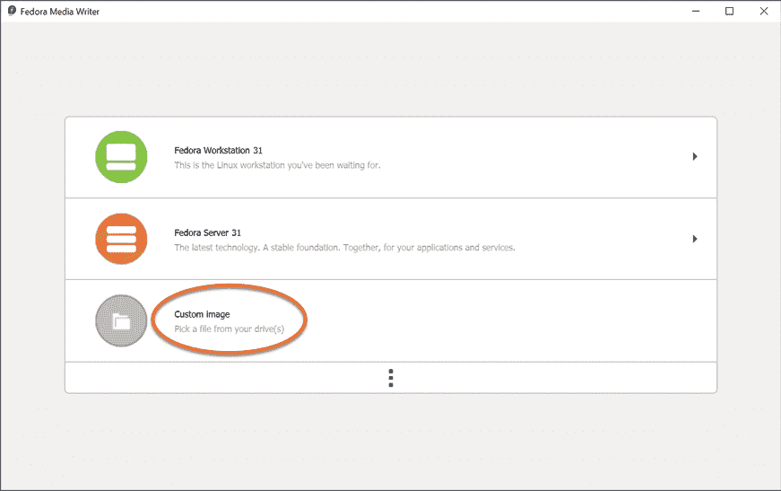

图 3-2

在结果的文件选择框中，导航并选择 Fedora 31 安装 ISO 镜像，点击`Open`按钮。选择镜像后，将弹出一个对话框，可以在其中将镜像写入 USB 驱动器。在点击`Write to Disk`按钮之前，从设备菜单中选择目标 USB 驱动器：

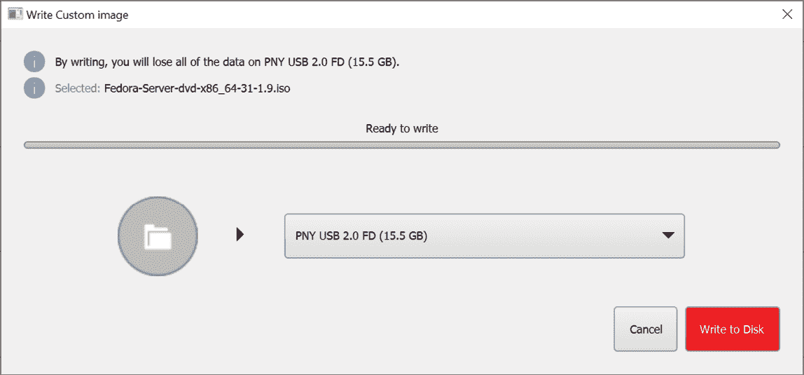

图 3-3

镜像写入设备后，该设备已准备好用于执行安装。

### 3.5 安装 Fedora 31

将 Fedora 31 安装介质插入相应的驱动器并启动系统。如果系统尝试从硬盘启动，你将需要进入电脑的 BIOS 设置并更改启动顺序，使其首先从安装介质驱动器启动。系统启动后，你将看到以下屏幕：

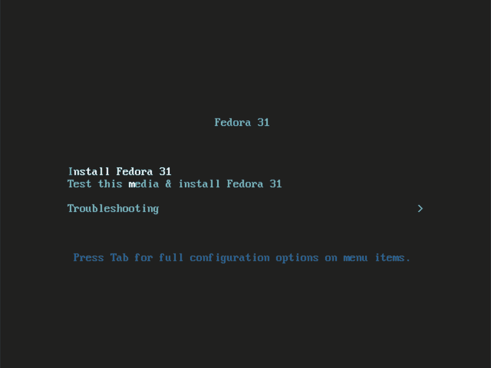

图 3-4

使用方向键在选项之间导航，并使用`<Enter>`键进行选择。如果选择了`Troubleshooting`选项，将显示图 3-5 所示的屏幕，包括从本地驱动器上的当前操作系统启动（如果已安装）、测试系统内存或救急已安装的 Fedora 31 系统等选项。还有一个选项可用于在没有图形控制台的系统上以基本图形模式进行安装：

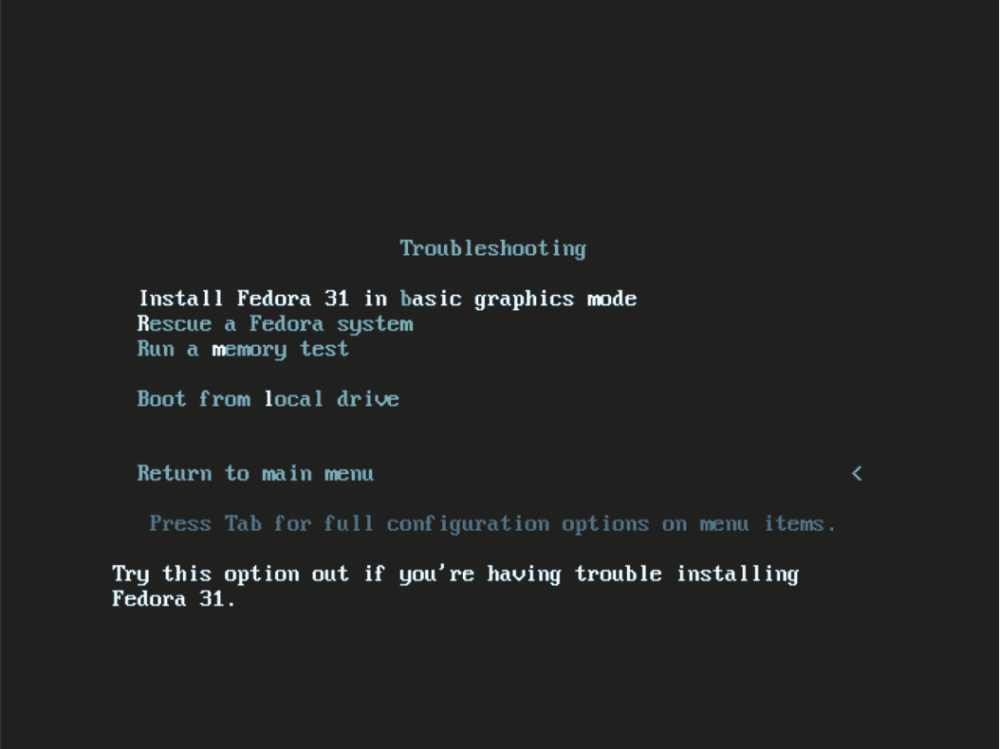

图 3-5

在主屏幕上选择安装选项，稍等片刻将出现图形化安装程序的第一个屏幕：

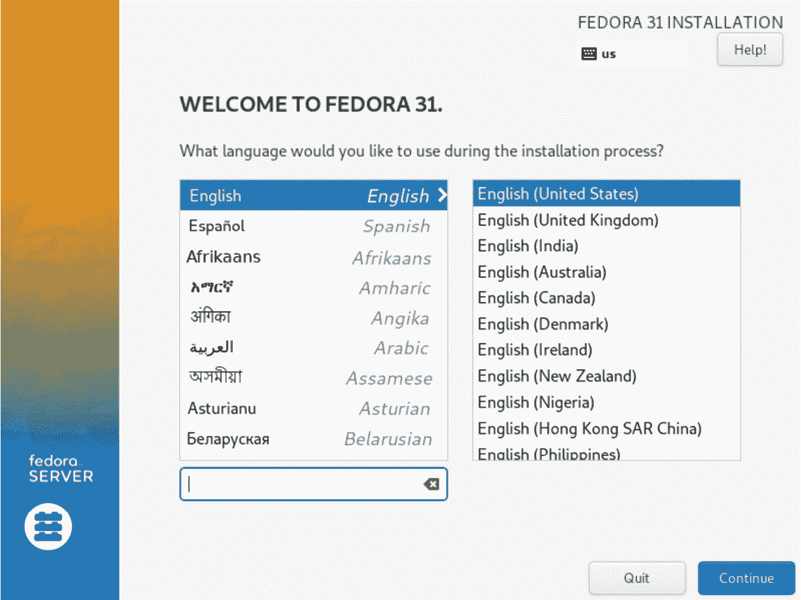

图 3-6

在第一个屏幕上选择你偏好的语言，然后点击`Continue`进入如图 3-7 所示的主安装屏幕：

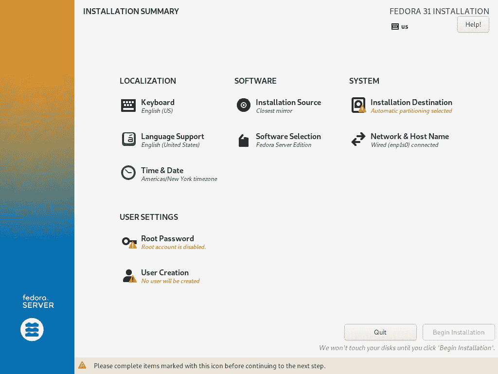

图 3-7

从选择`Network & Host Name`选项开始，启用系统上的网络设备并在点击`Apply`按钮之前输入主机名：

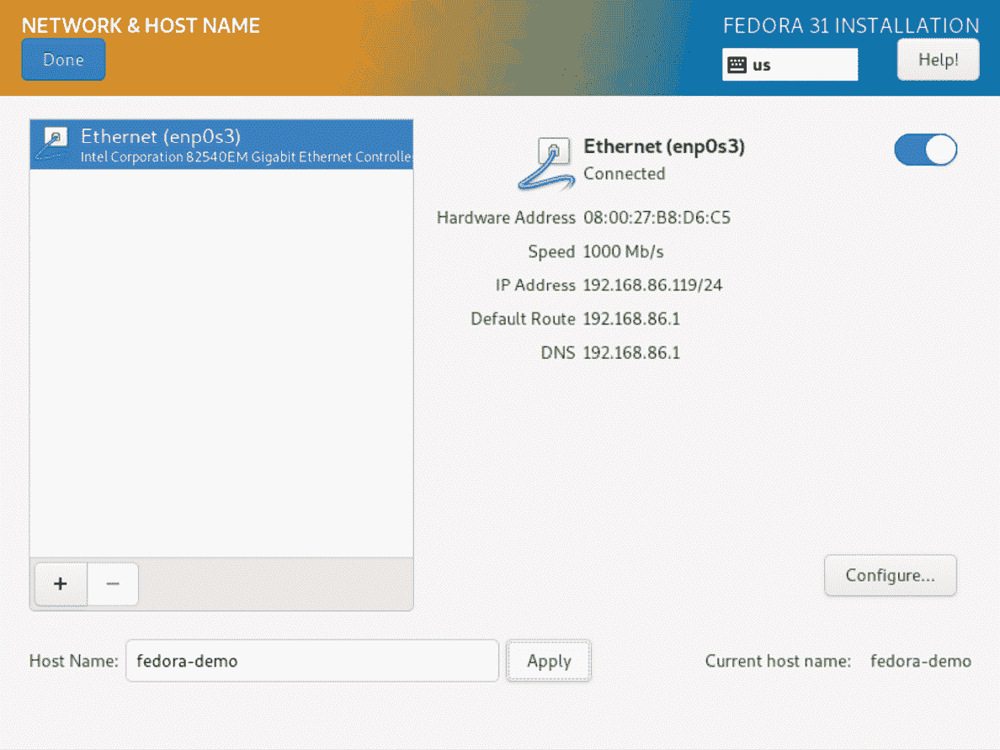

图 3-8

如果你的网络连接需要额外设置，点击`Configure...`按钮以访问图 3-9 所示的高级网络设置：


图 3-9

一旦定义了主机名并启用网络连接，点击`Done`返回主屏幕。如果你想更改键盘、语言或时间和日期设置，请从主屏幕选择`Localization`选项。在`Time & Date`屏幕上，根据你的地理位置进行选择。还提供了一个使用`Network Time`的选项，与网络时间服务器同步。

由于安装是从本地介质进行的，因此不需要更改`Installation Source`设置。要从远程服务器执行安装，选择`Installation Source`，启用网络选项并指定安装介质的位置。安装介质可以是安装在远程服务器上的 ISO 镜像（有关使用 NFS 与远程系统共享 Fedora 31），或者是远程仓库的 URL（仓库本质上是构成操作系统的软件、软件包和应用程序集合，可以从中进行安装）。

默认情况下，安装程序将执行 Fedora 31 服务器版安装。要选择不同的安装配置，选择`Software Selection`选项显示所示屏幕：

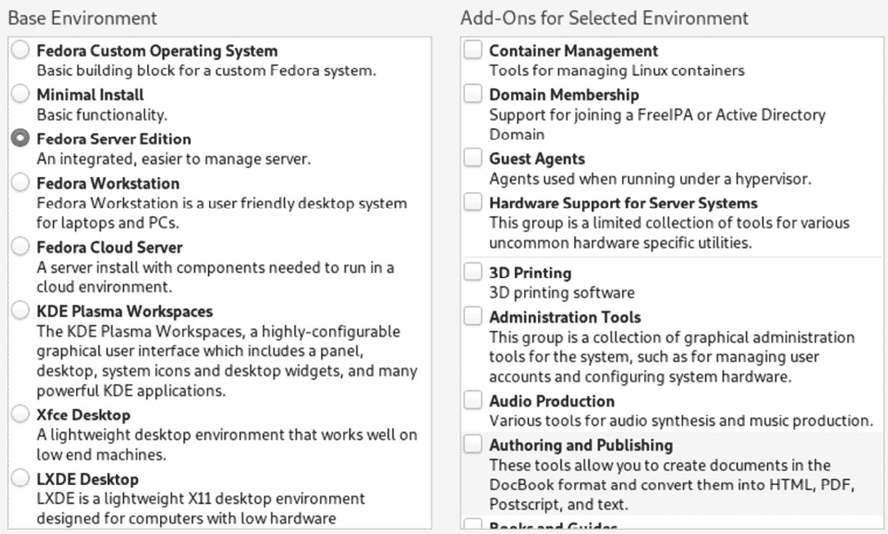

图 3-10

使用左侧面板选择基本配置，右侧面板添加你确定系统启动后需要的任何额外软件包。如果 Fedora 31 系统打算用于图形桌面环境，请选择`Fedora Workstation`选项。如果不需要桌面环境且你不确定要在系统上安装哪些软件包，请使用`Minimal install`选项，并在系统启动后根据需要安装软件包。这避免了安装可能永远不需要的包。

配置好基本设置后，下一步是决定如何划分硬盘以容纳操作系统。

### 3.6 为 Fedora 31 分区磁盘

当选择`Installation Destination`选项时，安装程序将显示如图 3-11 所示的屏幕：

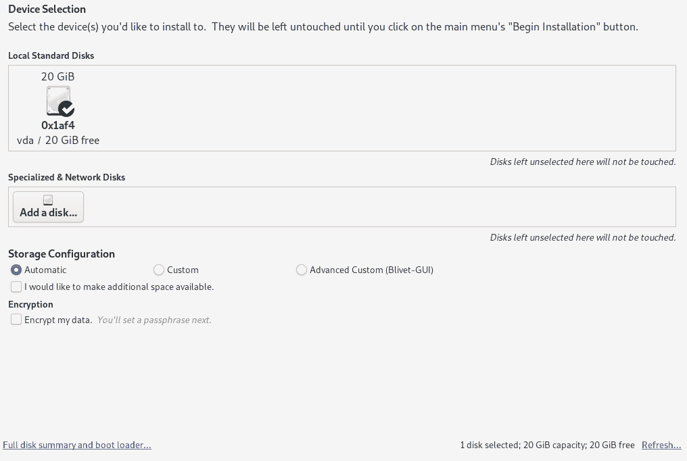

图 3-11

默认情况下，安装程序配置为使用当前选择磁盘驱动器的可用空间自动安装操作系统，并配置标准分区大小。如果磁盘之前包含另一个操作系统，这些现有分区不会被删除，可能会在安装 Fedora 31 后在硬盘上留下未使用空间。要删除任何现有分区以便回收并供 Fedora 31 使用，启用`I would like to make additional space available`选项并点击`Done`按钮显示图 3-12 所示的对话框：

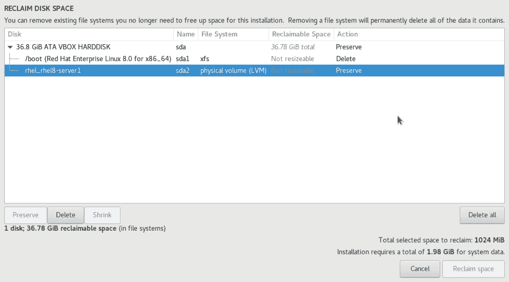

图 3-12

要回收空间，请选择一个不再需要的分区，并点击`Delete`（删除）按钮将其标记为删除。一旦选择了所有要删除的分区，点击`Reclaim Space`（回收空间）按钮执行删除。回收后的空间将由 Fedora 31 安装程序自动使用。

若要根据可用空间的分配方式手动配置磁盘布局，请将`Storage Allocation`（存储分配）设置从`Automatic`（自动）更改为`Custom`（自定义），并点击`Done`（完成）显示`Manual Partitioning`（手动分区）屏幕（图 3-13）：

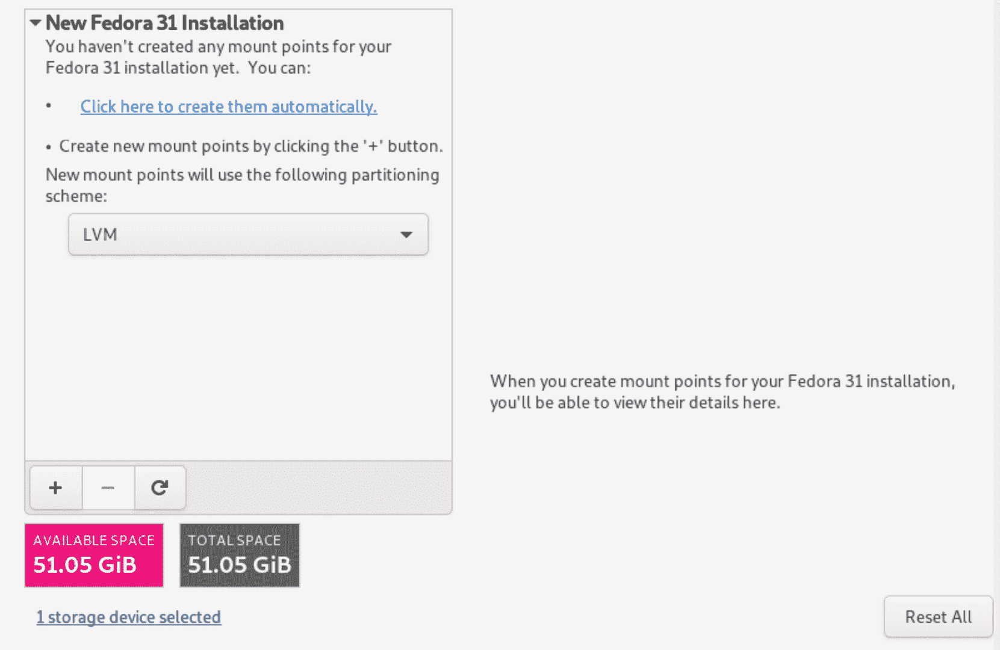

图 3-13

手动分区屏幕提供了使用逻辑卷管理（LVM）或标准分区配置磁盘的选项。LVM 是推荐选项，因为它在系统运行后在管理分区大小方面提供了灵活性（LVM 将在“向 Fedora 31 卷组和逻辑卷添加新磁盘”章节中进行详细介绍）。

一旦选择了分区方案，最后一步是决定分区的大小和相应的文件系统挂载点。通常，`Click here to create them automatically`（点击此处自动创建）选项提供的默认配置将满足大多数系统需求。要手动创建分区并分配挂载点，请点击`+`按钮手动声明并分配每个分区。

另一个选项是选择自动创建分区，然后使用生成的屏幕根据需要手动更改分区配置。例如，图 3-14 显示了选择自动创建选项定义的分区配置，并允许在对磁盘进行任何更改之前修改每个分区的设置：

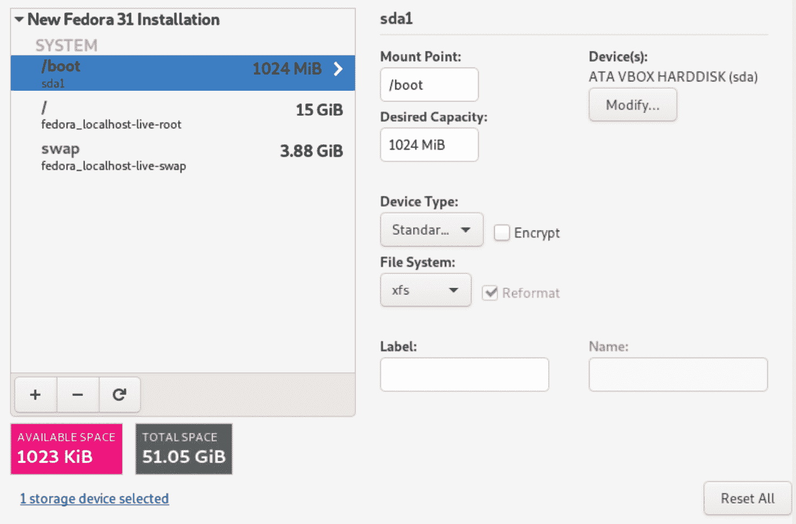

图 3-14

磁盘配置完成后，点击`Done`（完成），检查对磁盘将进行的更改的摘要（图 3-15），然后点击`Accept Changes`（接受更改）按钮：

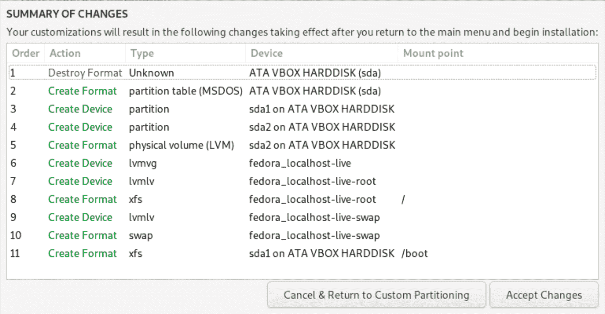

图 3-15

### 3.7 添加用户和 Root 访问

开始安装之前的最后一步是向系统添加用户账户。要实现此操作，请点击主安装屏幕上的`User Creation`（用户创建）选项并输入用户凭据和密码：

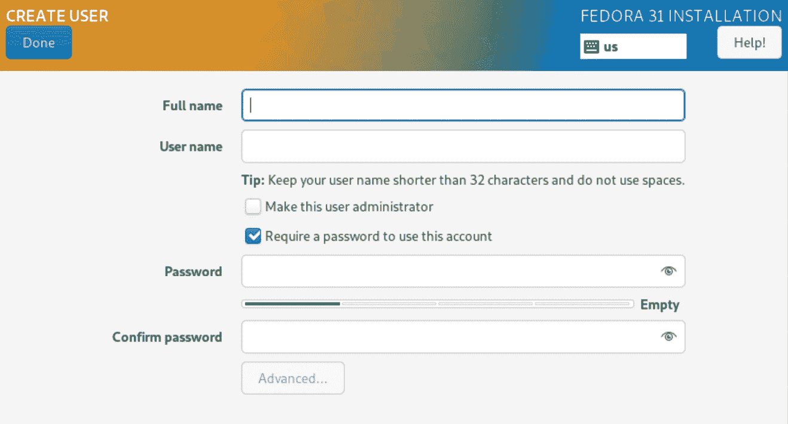

图 3-16

如果需要用户在系统上执行管理任务，在点击`Done`（完成）按钮之前启用`Make this user administrator`（将此用户设置为管理员）选项（除非下文所述启用 root 账户，否则至少有一个用户具有管理员权限）。这将允许账户通过“引言”章节中概述的`sudo`命令执行受限任务。

root 或超级用户账户是一个特殊用户，它不需要使用`sudo`命令即可拥有系统管理权限。为了安全，该账户默认是禁用的。要启用此账户，选择`Root Password`（Root 密码）选项，输入 root 密码并关闭`Lock root account`（锁定 root 账户）选项。如果您希望使用`SSH`远程以 root 用户身份登录系统（该主题在“在 Fedora 31 上配置基于密钥的身份验证”中涵盖），请启用`Allow root SSH login with password`（允许密码 root SSH 登录）选项。但除非您知道需要 root 访问，否则通常建议保持账户禁用状态。

### 3.8 物理安装

在选择了相应的软件包后，点击`Begin Installation`（开始安装）将开始分区磁盘并安装与所选安装设置匹配的软件包。在此阶段，将出现一个屏幕（图 3-17）：

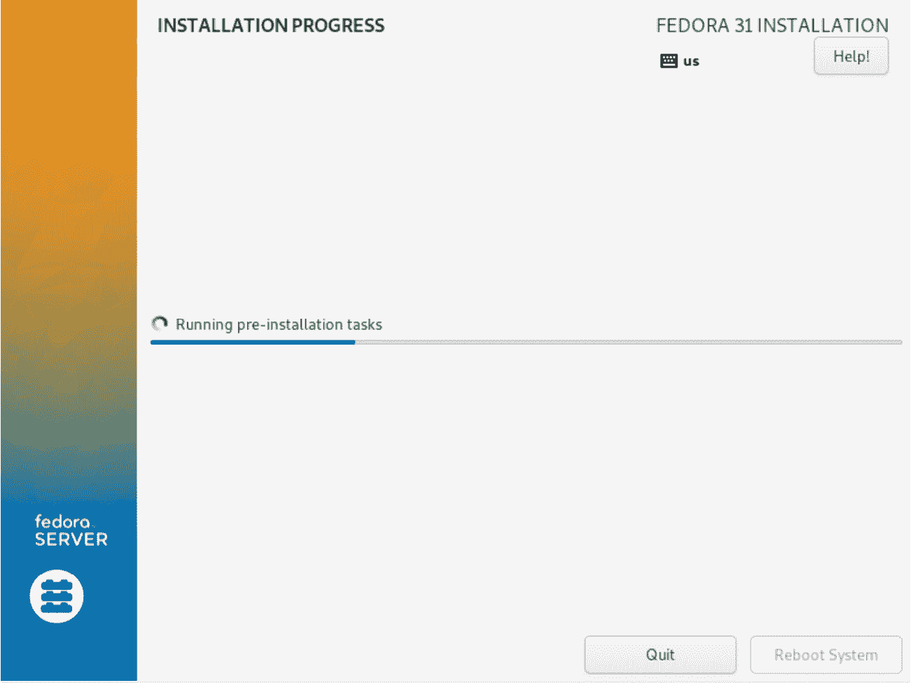

图 3-17

所有系统软件包安装并配置完成后，移除安装媒体并点击`Reboot`（重启）重启系统。

### 3.9 最终配置步骤

系统启动时在控制台上显示的内容取决于您是否从软件选择安装屏幕中选择了`Workstation`（工作站）选项。如果在安装期间选择了此项，将出现 GNOME 显示管理器（`GDM`）登录屏幕。如果选择了最小或服务器配置选项，将显示基于文本的登录提示。无论配置如何，请使用在安装过程最后步骤创建的用户登录系统。

在 Workstation 安装的情况下，GNOME 初始设置工具将启动，提供配置选项，如语言、键盘布局、位置服务以及与 Google 和 Facebook 在内的在线账户连接。在配置这些设置（或跳过）后，将显示 GNOME 桌面欢迎屏幕，其中包含如何使用桌面环境的教程链接。

### 3.10 安装更新

与现在的大多数操作系统一样，Fedora 发行版的每个特定版本在向公众发布后继续演进。这通常表现为错误修复和安全更新，偶尔还会有可以通过互联网下载安装到您的系统中的新功能。

最佳实践规定，安装 Fedora 后第一步是确保将任何可用更新应用到系统。这可以通过 Terminal 窗口中的命令行提示符使用`dnf`软件包管理器工具来实现。要检查是否有可用更新，只需运行以下命令：

```
dnf check-update
```

再次使用`dnf`工具应用任何待处理更新：

```bash
dnf update
```

执行时，`dnf`工具将提供可用更新的软件包列表并请求执行更新。

更新完成后，安装基本完成，Fedora 31 已就绪。

### 3.11 显示启动消息

在启动过程中，Fedora 将显示红帽图形启动（RHGB）屏幕，该屏幕隐藏了系统加载时生成的所有启动消息。若要在启动期间显示这些消息（如图 3-18 所示），只需在系统启动时按下键盘`Esc`键：

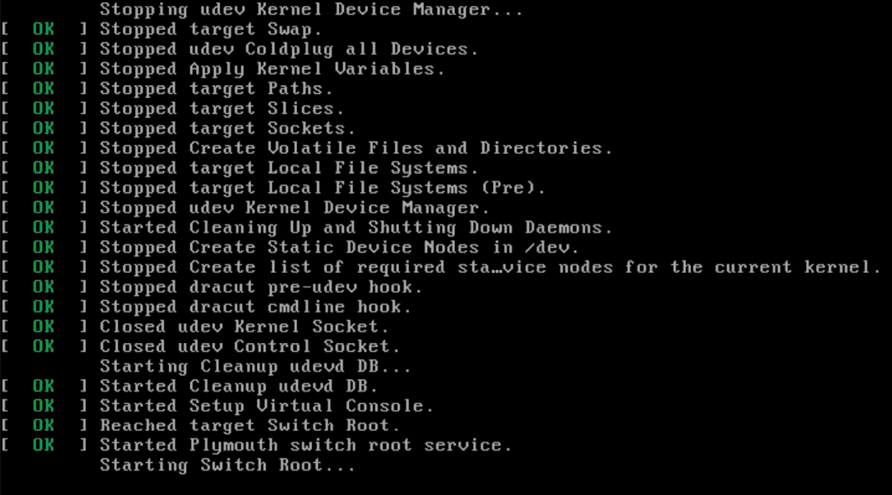

图 3-18

可以通过更改默认行为来默认始终显示消息，编辑`/etc/default/grub`文件并更改`GRUB_CMDLINE_LINUX`设置，该设置默认类似于：

`GRUB_CMDLINE_LINUX="... rhgb quiet"`

要移除图形启动界面以便无需按`Esc`键即可查看消息，请从设置中删除`rhgb`选项：

`GRUB_CMDLINE_LINUX="... quiet"`

此更改将导致系统仅显示部分生成的启动消息。要显示系统生成的所有消息，请同时删除`quiet`选项：

`GRUB_CMDLINE_LINUX="..."`

做出更改后，运行以下命令生成新的启动配置，以便在下次系统启动时生效：

```bash
grub2-mkconfig --output=/boot/grub2/grub.cfg
```

### 3.12 总结

使用 Fedora 31 的第一步是安装操作系统。对于云服务器，此任务通常在根据云服务提供商提供的一系列选项为系统选择操作系统镜像时自动完成。然而，在您自己的硬件上进行安装，则需要下载 ISO 镜像格式的安装介质，将该镜像写入 DVD 或 USB 驱动器等合适的存储设备中，并从其启动。一旦运行，安装过程允许配置一系列选项，包括网络设置、安装应从本地介质还是远程服务器或存储库进行、要安装的软件包以及磁盘分区。安装完成后，建议安装自原始安装镜像创建以来可能发布的任何操作系统更新。

## 4. 与 Windows 双启动 Fedora 31

Fedora 与绝大多数 Linux 发行版一样，可以很方便地与几乎任何版本的 Windows（包括 Windows 10 在内）共存于硬盘驱动器上。这种概念被称为“双启动”。本质上，当你启动系统时，将看到一个菜单，提供启动你的 Fedora 31 安装系统或 Windows 的选项。显然，你一次只能运行一个操作系统，但值得注意的是，无论你的 Windows 分区是使用 NTFS、FAT16 还是 FAT32 格式化的，你都可以从 Fedora 31 访问硬盘驱动器上 Windows 分区的文件。

这种安装方法涉及缩小现有 Windows 分区的大小，然后在回收的空间中安装 Fedora 31。本章假设 Fedora 31 正安装在一个当前运行 Windows 10 的系统上。

### 4.1 调整分区大小

为了在已包含 Windows 安装的磁盘驱动器上适应 Fedora，第一步涉及缩小 Windows 分区以腾出空间。建议的操作方案是在尝试安装 Fedora 31 之前，使用 Windows 磁盘管理界面缩小分区大小。

要在 Windows 10 上访问磁盘管理，右键点击“开始”菜单，并在生成的菜单中选择“磁盘管理”，如图 4-1 所示：

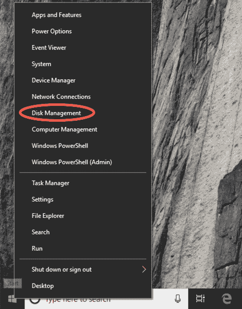

图 4-1

加载后，磁盘管理工具将显示系统检测到的磁盘驱动器的图形表示：

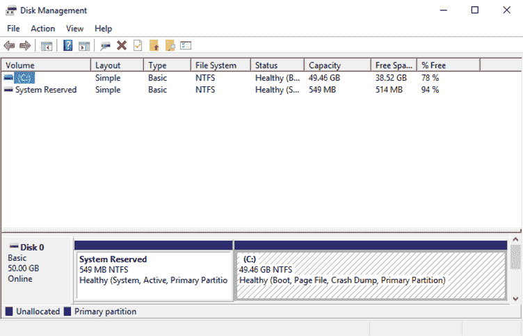

图 4-2

右键点击你想要缩小的分区，从弹出菜单中选择“收缩卷...”。该工具将计算在不丢失数据的情况下卷可以缩小的最大量（此过程取决于分区的总大小，可能需要几分钟）。一旦分析完成，将出现一个类似于图 4-3 所示的对话框：

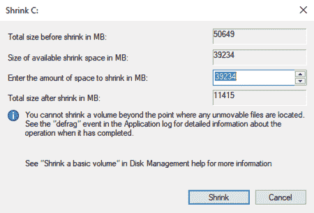

图 4-3


在`输入要收缩的空间量（MB）`字段中指定一个值，并点击`收缩`按钮继续。一旦调整大小的操作完成，使用 Fedora 31 安装介质重新启动（如“在空白磁盘驱动器上安装 Fedora 31”中概述），并利用新的空闲空间进行安装。在 Fedora 安装过程中，可以通过在“安装摘要”屏幕上选择“安装目标”选项，并确保选中了“自动存储配置”选项来实现。这将 Fedora 自动安装到 Windows 分区缩小时创建的未分配空间中。

安装完成后，重启系统，你会发现启动屏幕上除了 Fedora 之外，Windows 也是一个选项：

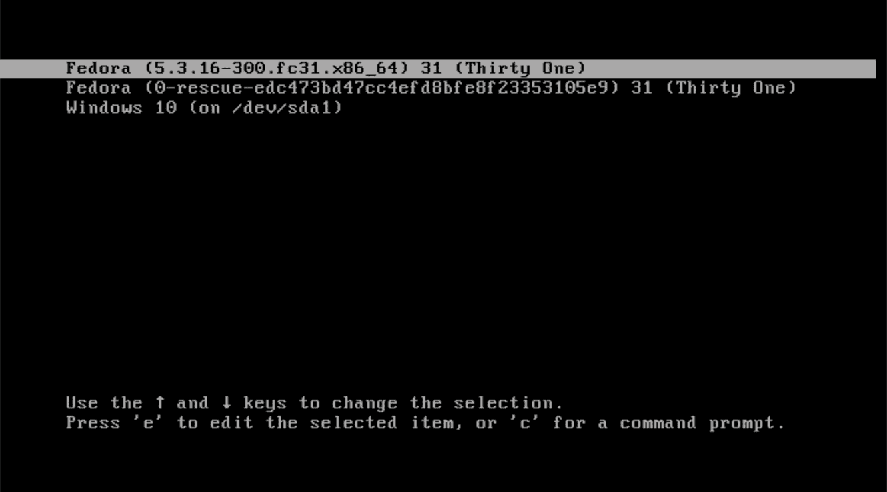

图 4-4

### 4.2 修改默认启动选项

当系统启动时，会出现启动选项屏幕并等待 5 秒让用户选择操作系统。如果在超时之前未进行任何选择，将启动默认操作系统。在新配置的系统上，默认操作系统将是标准的（非救援）Fed 镜像。然而，可以在 Fedora 内部更改此默认。

一系列启动配置选项（包括 5 秒超时和“在空白磁盘驱动器上安装 Fedora 31”中概述的启动 RHGB 设置）都在`/etc/default/grub`文件中声明，该文件在新安装中的内容如下：

```bash
GRUB_TIMEOUT=5
GRUB_DISTRIBUTOR="$(sed ‘s, release .*$,,g’ /etc/system-release)"
GRUB_DEFAULT=saved
GRUB_DISABLE_SUBMENU=true
GRUB_TERMINAL_OUTPUT="console"
GRUB_CMDLINE_LINUX="resume=/dev/mapper/fedora-swap rd.lvm.lv=fedora/root rd.lvm.lv=fedora/swap rhgb quiet"
GRUB_DISABLE_RECOVERY="true"
GRUB_ENABLE_BLSCFG=true
```

更改默认启动系统的第一步是在此文件中声明`GRUB_SAVEDEFAULT`设置：

```bash
GRUB_TIMEOUT=5
GRUB_DISTRIBUTOR="$(sed 's, release .*$,,g' /etc/system-release)"
GRUB_DEFAULT=saved
GRUB_SAVEDEFAULT=true
```

此设置允许在启动配置中保存一个新的默认值。接下来，运行`grub2-set-default`命令，使用将第一个选项计为 0 的编号系统来更改默认。例如，如果 Windows 10 选项位于位置 3，则将 Windows 10 设为默认的命令为：

```bash
grub2-set-default 2
```

运行`grub2-editenv list`命令检查设置是否生效。更改默认后，按如下方式重新生成启动配置文件：

### 4.3 从 Fedora 31 访问 Windows 分区

在双启动配置下运行 Fedora 时，仍然可以访问位于 Windows 分区上的文件。这可以通过从命令行手动挂载分区来实现。但在在此之前，需要在系统上安装一些额外的包。首先需要下载并安装`fuse`内核模块：

```bash
dnf install fuse
modprobe fuse
```

安装所需的软件包后，下一步是创建一个目录作为我们 Windows 分区的挂载点。在示例中，我们将创建一个名为`/mnt/windows`的目录：

```bash
mkdir /mnt/windows
```

为了识别分配给 Windows 分区的设备名称，请如下使用`fdisk`命令：

```bash
fdisk -l
```

在上述输出中，我们需要访问的主 Windows 分区由`/dev/sda2`表示。接下来，我们需要运行`mount`命令（假设 Windows 分区为`/dev/sda2`且格式为 NTFS）：

```bash
mount /dev/sda2 /mnt/windows
```

列出挂载点顶层目录的内容检查挂载是否成功：

```bash
ls /mnt/windows
```

若要在每次系统启动时自动挂载，只需向`/etc/fstab`文件中添加相应的挂载行即可：

```
/dev/sda2 /mnt/windows ntfs defaults 0 0
```

若要随时卸载 Windows 文件系统：

```bash
umount /mnt/windows
```

### 4.4 总结

Fedora 31 可以通过创建双启动环境，与 Windows 操作系统在在同一块硬盘上安全地共存。这涉及到在执行安装之前，通过缩小 Windows 系统占用的空间来为 Fedora 31 留出空间。要从 Fedora 内部访问 Windows 文件系统，需要安装并使用`Fuse NTFS`驱动程序来挂载 Windows 分区。

## 5. 将 Windows 磁盘分区分配给 Fedora 31

在上一章节中，我们查看了如何在与 Windows 相同的磁盘上进行安装。这种所谓的“双启动”（dual boot）配置允许用户在单个硬盘驱动器上安装两个操作系统，并在系统上电时选择启动其中一个。

本章适用于那些已经决定足够喜欢 Fedora 31，并准备从磁盘中完全删除 Windows，并将产生的空间用于 Linux 的用户。在接下来的节中，我们将逐步逐步完成这一过程。

### 5.1 卸载 Windows 分区

如果按照与 Windows 一起进行 Fedora 31 双启动章节中的步骤从 Fedora 31 内部挂载了 Windows 分区，则在继续本章之前，应当卸载该分区。假设 Windows 分区被挂载为`/mnt/windows`，可以通过以下方式卸载：

```bash
umount /mnt/windows
```

如果之前添加过`/mnt/windows`自动挂载，也应该编辑`/etc/fstab`文件将其移除。

### 5.2 从磁盘删除 Windows 分区

为 Fedora 释放 Windows 分区的第一步是删除该分区。然而，在此之前，务必从 Windows 和 Fedora 分区备份您任何需要保留的数据。完成此操作后，即可安全地继续本章。

为了删除 Windows 分区，我们首先需要使用`fdisk`工具识别它们所在的磁盘：

```bash
fdisk -l
```

```
Disk /dev/sda: 50 GiB, 53687091200 bytes, 104857600 sectors
Units: sectors of 1 * 512 = 512 bytes
Sector size (logical/physical): 512 bytes / 512 bytes
I/O size (minimum/optimal): 512 bytes / 512 bytes
Disklabel type: dos
Disk identifier: 0xe3673009
Device Boot Start End Sectors Size Id Type
/dev/sda1 * 2048 1126399 1124352 549M 7 HPFS/NTFS/exFAT
/dev/sda2 1126400 53655551 52529152 25G 7 HPFS/NTFS/exFAT
/dev/sda3 53655552 55752703 2097152 1G 83 Linux
/dev/sda4 55752704 104857599 49104896 23.4G 5 Extended
/dev/sda5 55754752 104857599 49102848 23.4G 8e Linux LVM
```

在上面的示例输出中，系统包含一个由设备名称`/dev/sda`引用的物理磁盘驱动器。在该硬盘上有五个分区，分别通过设备名称`/dev/sda1`到`/dev/sda5`访问。根据 System 列中的值，有两个 NTFS 分区。第一个是 Windows 系统分区，而第二个要大得多的 NTFS 分区是包含 Windows 操作系统和用户数据的 Windows 启动分区。

要删除分区，请使用包含分区的磁盘设备名称（在本例中为`/dev/sda`）启动`fdisk`工具，并按照指示再次显示分区和扇区信息：

```bash
fdisk /dev/sda
```

```
Welcome to fdisk (util-linux 2.32.1).
Changes will remain in memory only, until you decide to write them.
Be careful before using the write command.
Command (m for help): p
Disk /dev/sda: 50 GiB, 53687091200 bytes, 104857600 sectors
Units: sectors of 1 * 512 = 512 bytes
Sector size (logical/physical): 512 bytes / 512 bytes
I/O size (minimum/optimal): 512 bytes / 512 bytes
Disklabel type: dos
Disk identifier: 0xe3673009
Device Boot Start End Sectors Size Id Type
/dev/sda1 * 2048 1126399 1124352 549M 7 HPFS/NTFS/exFAT
/dev/sda2 1126400 53655551 52529152 25G 7 HPFS/NTFS/exFAT
/dev/sda3 53655552 55752703 2097152 1G 83 Linux
/dev/sda4 55752704 104857599 49104896 23.4G 5 Extended
/dev/sda5 55754752 104857599 49102848 23.4G 8e Linux LVM
Command (m for help):
```

目前，Windows 系统分区被列为可启动分区。由于我们将删除此分区，因此 Linux 启动分区需要标记为可启动。在上面的配置中，这表示为`/dev/sda3`。留在`fdisk`工具中，按照如下方式将此设置为可启动分区：

```
Command (m for help): a
Partition number (1,3-5,default 5): 3
```

The bootable flag on partition 3 is enabled.

继续之前，请记住要删除的分区的起始和结束地址（特别是`/dev/sda1`和`/dev/sda2`）。

```
Command (m for help): d
Partition number (1,3-5,default 5): 1
Command (m for help): d
Partition number (1,3-5,default 5): 2
Command (m for help): n
Partition number (1,3-5,default 5): 1
First sector (default 2048): 2048
Last sector (+25G,default 5): 536551
Created a partition 1 of 'Linux' and size 25.6 GiB.
Do you want to remove the ntfs signature? y
Command (m for help): p
Disk /dev/sda: 50 GiB, 53687091200 bytes, 104857600 sectors
Units: sectors of 1 * 512 = 512 bytes
Sector size (logical/physical): 512 bytes / 512 bytes
I/O size (minimum/optimal): 512 bytes / 512 bytes
Disklabel type: dos
Disk identifier: 0xe3673009
Device Boot Start End Sectors Size Id Type
/dev/sda1 * 2048 5365551 5363504 25.6G 1 Linux
/dev/sda3 53655552 55752703 2097152 1G 83 Linux
/dev/sda4 55752704 104857599 49104896 23.4G 5 Extended
/dev/sda5 55754752 104857599 49102848 23.4G 8e Linux LVM
Command (m for help): w
```

分区表已更改。

正在同步磁盘。

### 5.3 格式化未分配的磁盘分区

为了使新分区适用于 Fedora 31 使用，需要在上面创建文件系统。当前 Fedora 版本的默认文件系统是 XFS，将在向 Fedora 31 系统中添加新磁盘驱动器章节中详细介绍。文件系统的创建通过`mkfs.xfs`命令完成：

```bash
mkfs.xfs -f /dev/sda1
```

```
meta-data=/dev/sda1 isize=512 agcount=4, agsize=1676672 blks
  = sectsz=512 attr=2, projid32bit=1
  = crc=1 finobt=1, sparse=1, rmapbt=0
  = reflink=1
data = bsize=4096 blocks=6706688, imaxpct=25
  = sunit=0 swidth=0 blks
naming =version 2 bsize=4096 ascii-ci=0, ftype=1
```

```
log =internal log bsize=4096 blocks=3274, version=2
      = sectsz=512 sunit=0 blks, lazy-count=1
realtime =none extsz=4096 blocks=0, rtextents=0
```

### 5.4 挂载新分区

接下来，我们需要挂载新分区。在这个示例中，我们将将其挂载到名为`/data`的目录中。不过，你可以自由使用任何所需的有效挂载点来挂载新分区，或者将其作为逻辑卷的一部分（详细信息请参阅向 Fedora 31 卷组和逻辑卷添加新磁盘章节）。首先，我们需要创建一个用作挂载点的目录：

```bash
mkdir /data
```

其次，我们需要编辑`/etc/fstab`文件中的挂载表，以便该分区在每次系统启动时自动挂载。在`/etc/fstab`文件的末尾添加以下行来挂载新分区（请根据你的环境修改`/dev/sda1`设备名称）：

```
/dev/sda1 /data xfs defaults 0 0
```

最后，我们可以手动挂载新分区（注意，在随后的重启中这不再必要的，因为分区将根据我们在上面`/etc/fstab`文件中添加的设置自动挂载）。

```bash
mount /data
```

要检查分区，运行以下命令显示可用空间：

```bash
df -h /data
Filesystem Size Used Avail Use% Mounted on
/dev/sda1 26G 215M 26G 1% /data
```

### 5.5 编辑启动菜单

下一步是修改 Fedora 启动菜单。由于这起初是一个双启动系统，因此菜单被配置为提供启动 Windows 或 Fedora 的选项。现在 Windows 分区已经删除，我们需要移除此启动选项。首先编辑`/etc/grub.d/40_custom`文件并移除 Windows 菜单项：

```bash
#!/bin/sh

exec tail -n +3 $0

# 此文件提供了一种添加自定义菜单项的简单方法。只需在此注释之后
# 输入你想要添加的菜单项即可。注意不要更改
# 上方的 'exec tail' 行。

menuentry "Windows 10" {
        set root=(hd0,1)
        chainloader +1
        }
```

保存文件并使用`grub2-mkconfig`工具生成`/boot/grub2/grub.cfg`文件，如下：

```bash
grub2-mkconfig --output=/boot/grub2/grub.cfg
Generating grub configuration file ...
done
```

下次系统重启时，启动菜单将不再提供 Windows 10 选项。

### 5.6 总结

在双启动配置中，可以随时删除 Windows 分区，通过识别哪些分区属于 Windows，然后使用`fdisk`工具将其删除，从而为 Fedora 系统腾出空间。一旦删除，未分配的空间可以用于创建新的文件系统并进行挂载，以供 Fedora 系统使用。最后的任务是从启动菜单配置中移除 Windows 选项。

## 6. GNOME 3 桌面导览

Fedora 31 包含了 GNOME 3 桌面环境。虽然缺乏 Windows 和 macOS 桌面的复杂性，但 GNOME 3 提供了一个整洁且直观的桌面环境，提供了窗口环境的所有基本功能，并且具有可以快速学习的优点。

在本章中将涵盖 GNOME 桌面的主要功能，并概述如何执行基本任务。

### 6.1 安装 GNOME 桌面

如果在 Fedora 31 安装过程中选择了带有 GUI 软件配置的 Workstation 或 Server，则 GNOME 桌面将已经安装，并在每次系统启动时自动启动。


如果在 Fedora 31 安装过程中选择了其他软件配置，则 GNOME 桌面将不会包含在系统安装的软件包中。对于没有连接显示器的服务器级系统，安装图形化桌面环境的想法可能是多余的。然而，值得注意的是，远程访问 GNOME 桌面也是可能的，因此即使在所谓的“无头服务器”（即缺少显示器、键盘和鼠标的服务器）上，安装 GNOME 桌面包可能仍然有利。建立远程桌面访问的主题将在本书的“使用 VNC 进行 Fedora 31 远程桌面访问”章节中详细介绍。

如果安装配置未包含 GNOME 桌面，可以使用以下命令随时进行安装：

```bash
dnf groupinstall "Workstation"
```

安装完成后，可以从显示器上的命令行提示启动桌面环境，如下：

```bash
$ startx
```

### 6.2 GNOME 3 桌面概览

下方图 6-1 所示显示了在启动任何其他程序或进行配置更改之前典型的新启动 GNOME 桌面会话的外观。

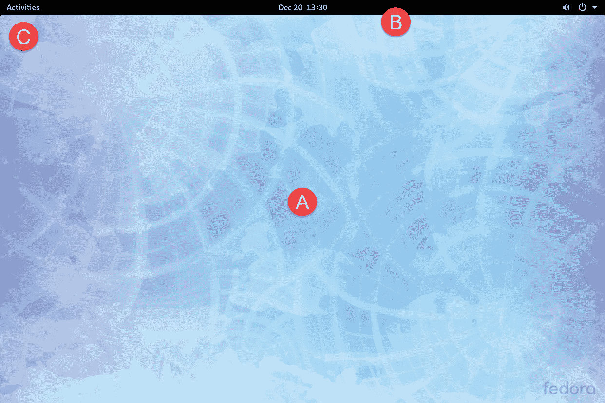

图 6-1

主桌面区域（标记为 A）是窗口出现的地方。屏幕顶部的栏（B）称为顶栏，它包含活动（C）、日期和时间以及网络状态、音量、电量和账户设置。与其他桌面环境不同，可以将文件或应用程序拖放到桌面，这提供了一个整洁的工作区。活动应用程序的菜单将出现在顶栏。在上面的屏幕中，例如了 `Terminal` 程序：


图 6-2

### 6.3 启动活动

应用程序和工具通过活动面板（Activities dashboard）启动，可以通过点击顶栏中的活动按钮或按下键盘上的特殊键来显示。在 Windows 系统上是 `Windows` 键，在 macOS 上是 `Command` 键，在 Chromebook 上是显示放大镜的键。

当显示时，面板将如图 6-3 所示：


图 6-3

默认情况下，面板将显示一组定义的常用应用程序图标，并包含任何正在运行的应用程序图标。如果应用程序正在运行，图标下方会出现一个条标记。

要找到未包含在面板上的应用程序，一种方法是选择底部的图标（九个点组成的图标）以显示可浏览的应用程序列表，如图 6-4：


图 6-4

注意，可以通过选择屏幕底部的按钮将列表过滤为显示所有应用程序或经常使用的应用程序。此外，列表中的某些项实际上是持有其他应用程序的文件夹。在上面的屏幕中，例如，`Utilities`（工具）项提供了对系统监视磁盘管理工具以及 `Terminal` 窗口应用程序的访问。

浏览应用程序的另一种方法是使用搜索栏进行搜索，搜索栏在面板显示时出现，如图 6-5 所示：


图 6-5

在搜索框中输入文本时，匹配列表将得到精炼。

要将应用程序添加到面板以便更方便访问，请找到应用程序图标，右键点击它并选择 `Add to Favorites`（添加到收藏）菜单选项：


图 6-6

要从面板中移除应用，重复这些步骤，这次选择 `Remove from Favorites`（从收藏中移除）。

### 6.4 管理 Windows

与其他其它桌面环境一样，运行在 GNOME 上的应用程序位于窗口中。当打开了多个应用程序窗口时，`Super + Tab` 键盘快捷键将显示切换器面板（图 6-7），允许选择不同的窗口作为当前活动窗口（`Super` 键可以是 `Windows` 键，或者在 Mac 键盘上是 `Cmd` 键）：


图 6-7

如果某个应用程序打开了多个窗口，切换器将在第二个面板中显示这些窗口，以便选择特定的窗口：

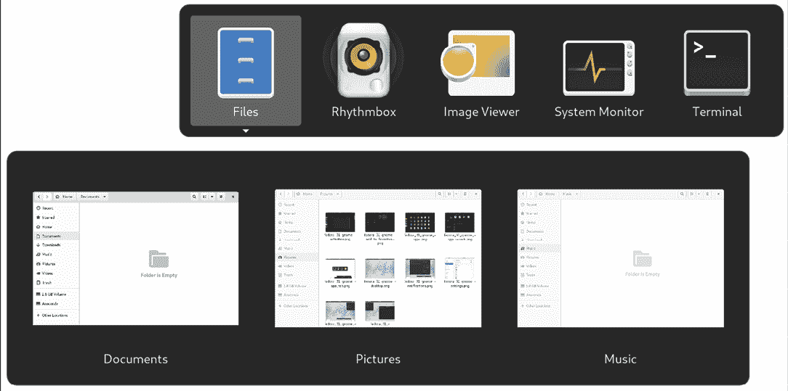

图 6-8

若要在切换器中的图标之间反向循环，请使用 `Shift + Tab` 键盘快捷键。

要最大化窗口以填满整个屏幕，请点击标题栏并将窗口拖动到屏幕顶部。要将窗口恢复到原始大小，点击标题栏并向下拖动。或者，简单地双击标题栏即可在窗口大小之间切换。同样，将窗口拖到屏幕左侧或右侧将使窗口填充屏幕的半部分。

### 6.5 使用工作空间

应用程序窗口出现的屏幕区域称为工作空间，GNOME 3 允许配置多个工作空间。要创建新的工作空间，请显示“活动”概览并将鼠标指针移动到屏幕最右侧显示工作空间面板（图 6-9）：

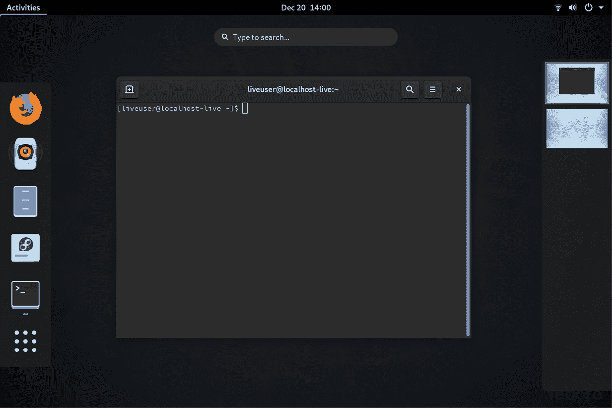

图 6-9

要切换到不同的面板，只需从列表中选择即可。要将窗口从一个工作空间移动到另一个工作空间，显示工作空间面板并将应用程序窗口（当前工作空间中的实际窗口或工作空间面板中的缩略窗口）拖放到目标工作空间。当窗口被添加到空白工作空间时，工作空间面板会添加另一个空白工作空间，从而创建多个工作空间。

要删除工作空间，可以关闭该空间上的所有窗口，或将它们移动到另一个工作空间。

### 6.6 日历与通知

当系统需要通知你事件时（例如系统或应用程序更新的可用性），弹出面板将出现在工作区的顶部。点击顶部栏上的日期和时间即可访问日历和任何之前的通知，如图 6-10 所示：

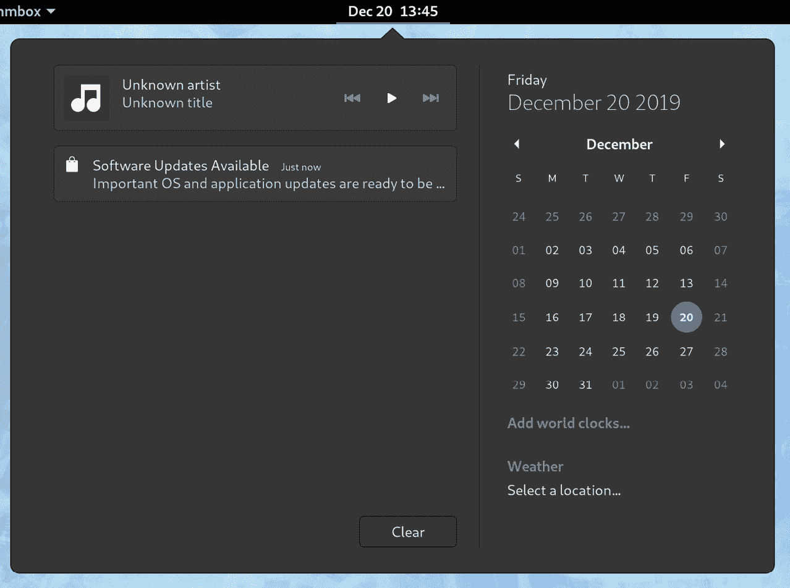

图 6-10

### 6.7 桌面设置

要访问“设置”应用程序，点击顶部栏最右侧的向下箭头，并选择带有工具图标的按钮，如图 6-11 所示：

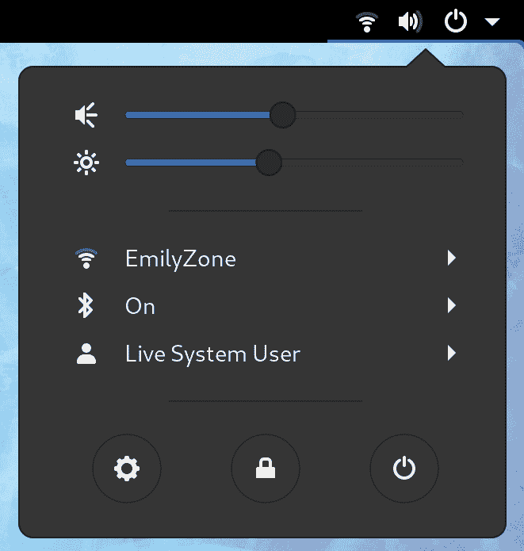

图 6-11

`Settings` 应用程序提供了许多选项，如图 6-11 所示：


图 6-11

### 7.1 An Overview of Cockpit

`Cockpit` is a light-weight, web-based interface that allows general system administrative tasks to be performed remotely. When installed and configured, the system administrator simply opens a browser window and navigates to the `Cockpit` port. Behind the scenes, `Cockpit` uses the same tools to perform tasks as would normally be used at the command-line, and updates automatically to reflect changes occurring elsewhere on the system. This allows `Cockpit` to be used in conjunction with other administration tools and techniques without the risk of one approach overriding another. `Cockpit` can also be configured to access more than one server, allowing multiple servers to be administered and monitored simultaneously through a single browser session.

`Cockpit` is installed by default with a wide range of tools already bundled. `Cockpit` also, however, allows additional extension plugins to be installed as needed. `Cockpit` is also designed so that you can create your own extensions using a combination of HTML and JavaScript to add missing or custom functionality.

`Cockpit`’s modular design also allows many features to be embedded into other web-based applications.

### 7.2 Installing and Enabling Cockpit

`Cockpit` is generally not installed on Fedora 31 by default, but can be set up and enabled in a few simple steps. The first step is to install the `Cockpit` package as follows:

```
dnf install cockpit
```

Next, the `cockpit.socket` service needs to be enabled:

```
systemctl enable --now cockpit.socket
```

Finally, the necessary ports need to be opened on the firewall to allow remote browser connections to reach `Cockpit`.

### 6.8 Summary

As with other desktop environments, applications run on GNOME in windows. When multiple application windows are open, the `Super + Tab` keyboard shortcut will display the switcher panel (Figure 6-7) allowing a different window to be chosen as the currently active window (the `Super` key is either the `Windows` key or, in the case of a Mac keyboard, the `Cmd` key):


Figure 6-7

If a single application has more than one window open, the switcher will display those windows in a second panel so that a specific window can be selected.


Figure 6-8

To cycle backwards through the icons in the switcher, use the `Shift + Tab` keyboard shortcut.

To maximize a window so that it fills the entire screen click the title bar and drag the window to the top of the screen. To return the window to its original size, click on the title bar and drag downwards. Alternatively, simply double-click on the title bar to toggle between window sizes. Similarly, dragging a window to the left or right side of the screen will cause the window to fill that half of the screen.

### 6.5 Using Workspaces

The area of the screen where the application windows appear is referred to as the workspace and GNOME 3 allows multiple workspaces to be configured. To create a new workspace, display the Activities overview and move the mouse pointer to the far right of the screen to display the workspaces panel (Figure 6-9):


Figure 6-9

To switch to a different panel, simply select it from the list. To move a window from one workspace to another, display the workspaces panel and drag and drop the application window (either the actual window from the current workspace or the thumbnail window in the workspaces panel) onto the destination workspace. When a window is added to a blank workspace, another blank workspace is added to the workspace panel, allowing multiple workspaces to be created.

To remove a workspace either close all the windows on that workspace, or move them to another workspace.

### 6.6 Calendar and Notifications

When the system needs to notify you of an event (such as the availability of system or application updates), a popup panel will appear at the top of the workspace. Access to the calendar and any previous notifications is available by clicking on the day and time in the top bar as shown in Figure 6-10:


Figure 6-10

### 6.7 Desktop Settings

To access the `Settings` application, click on the down arrow on the far right of the top bar and select the button with the tools icon as highlighted in Figure 6-11:


Figure 6-11

The `Settings` application provides many options, as shown in Figure 6-11:


Figure 6-11

（注：由于原文存在大量重复内容，此处已去重合并翻译）

### 6.8 Summary

`Cockpit` is a lightweight web interface that allows remote execution of common administrative tasks. Once installed and configured, system administrators can simply open a browser window and navigate to the `Cockpit` port. In the background, `Cockpit` uses the same tools typically used when operating from the command line, and automatically updates to reflect changes occurring elsewhere in the system. This allows `Cockpit` to work with other management tools and technologies without the risk of one method overriding another. `Cockpit` can also be configured to access multiple servers, allowing management and monitoring of multiple servers through a single browser session.

`Cockpit` is installed by default and includes a range of built-in tools. However, `Cockpit` also allows additional plugins to be installed as needed. The design of `Cockpit` also allows you to create your own extensions using a combination of HTML and JavaScript to add missing or custom functionality.

The modular design of `Cockpit` also allows many features to be embedded in other web applications.

### 7.2 Installing and Enabling Cockpit

`Cockpit` is typically installed by default on Fedora 31, but can be set up and enabled with a few simple steps. The first step is to install the `Cockpit` package as follows:

```
dnf install cockpit
```

Next, the `cockpit.socket` service needs to be enabled:

```
systemctl enable --now cockpit.socket
```

Finally, the necessary ports need to be opened on the firewall to allow remote browsers to connect to `Cockpit`.

Once the connection is established, the browser may issue a warning that the connection is not secure. This is because the `Cockpit` service is using a self-signed certificate. You can choose to continue to the website, or to avoid this message in the future, you can select the advanced option and add an exception for the server address.

Once the connection is successful, the browser will load the log page shown in Figure 7-1 below:

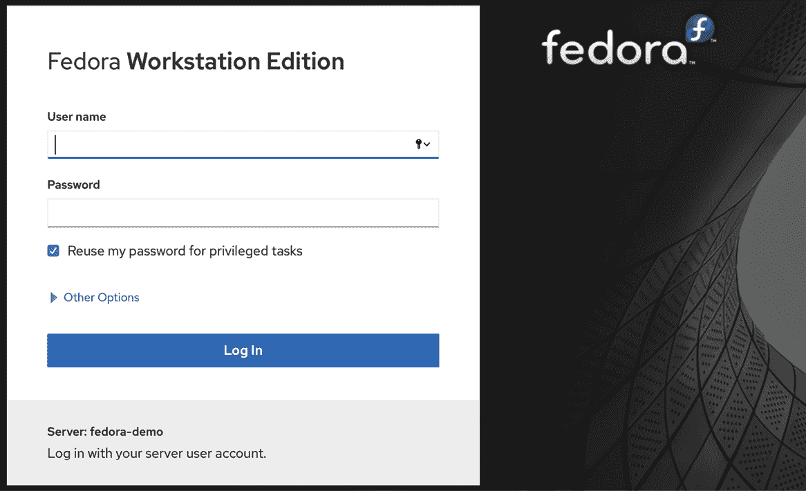

Figure 7-1

Log in to the `Cockpit` interface using `root` or your user account credentials. Note that when logging in as a user, certain tasks in the `Cockpit` interface will be restricted due to permission limitations. After logging in, `Cockpit` will display the System screen.

### 7.4 System

The System screen provides an overview of the current system, including real-time performance metrics for CPU, memory, disk I/O, and network usage. This screen also contains information about the system, including the underlying hardware, hostname, system time, and whether the system software is up to date. Options to reboot or shut down the system are also provided.

For example, Figure 7-2 shows the system monitoring page of the `Cockpit` interface:

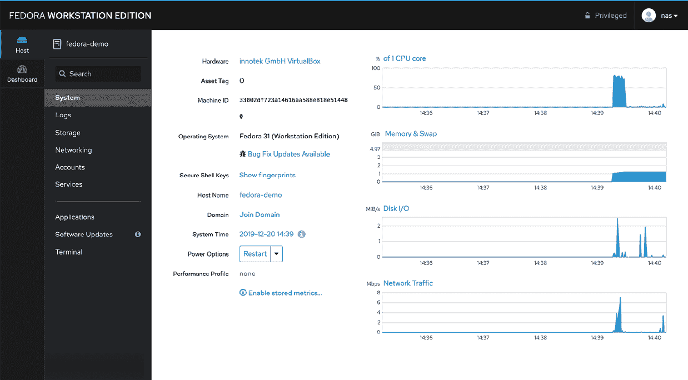

Figure 7-2

### 7.5 Logs

When the "Logs" category is selected, `Cockpit` displays the contents of the `systemd` journal. Selecting a log entry will display the entire log message. Log entries are sorted from newest to oldest and include menus for filtering logs based on different time ranges and message severity levels.

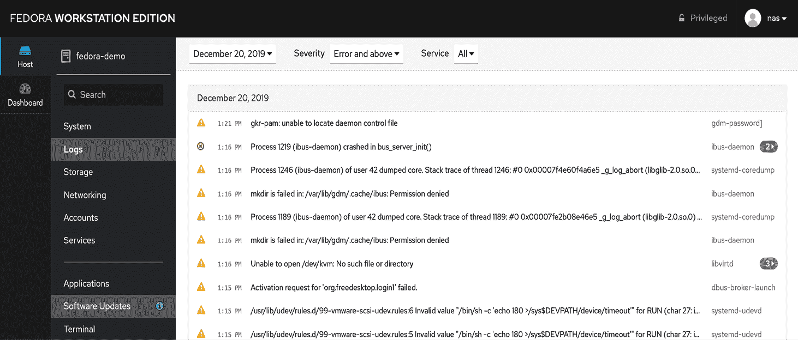

Figure 7-3

### 7.6 Storage

Select the "Storage" option to view and manage the system's storage, including disks, partitions and volume groups, network file system (NFS) mounts, and RAID storage. This screen also allows real-time monitoring of disk I/O activity and lists the output of the system `udisksd` service, which is used to query and manage storage devices.

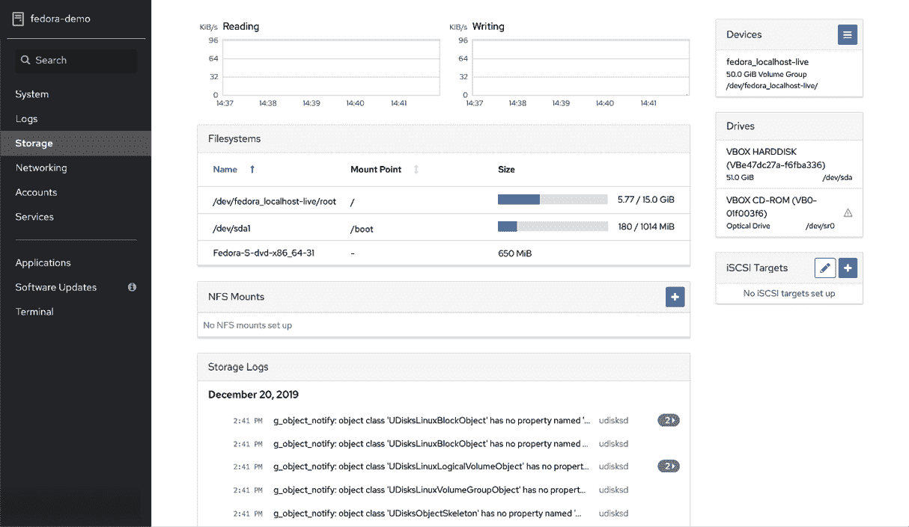

Figure 7-4

### 7.7 Networking

The "Networking" screen provides information about various network-related configurations and services, including network interfaces and firewall settings, and allows configuration changes such as creating network bridges or setting up virtual networks.

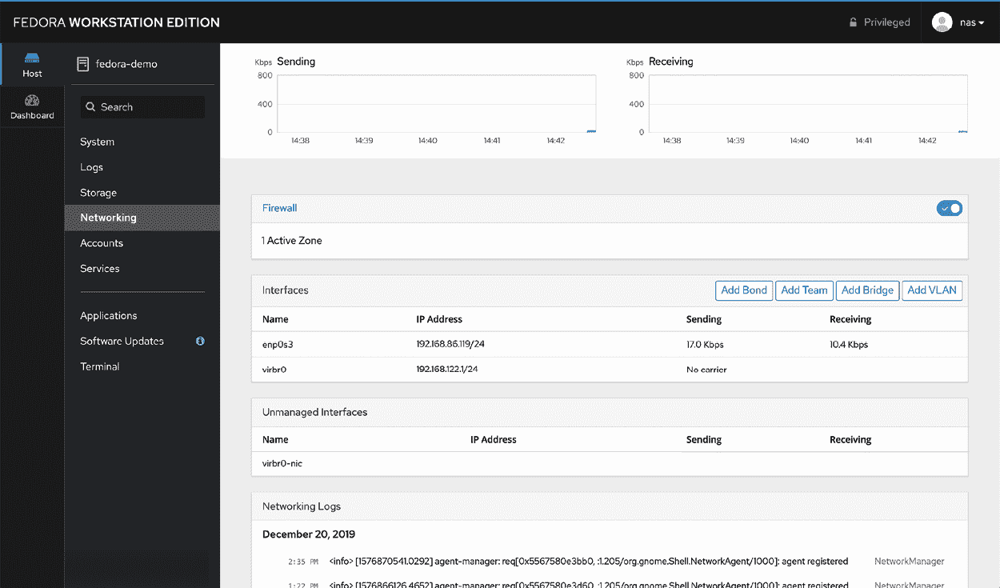

Figure 7-5

### 7.8 Accounts

Select this option to view the current user accounts configured on the system and create accounts for additional users. User management topics will be covered in the chapter titled Managing Fedora 31 Users and Groups.

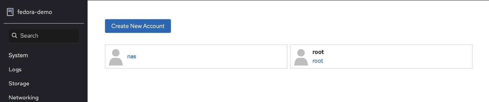

Figure 7-6

Click on an existing account to view details and make changes. The user account details page can also be used to view and add public `SSH` keys for user accounts for remote server access, as outlined in the chapter titled Configuring Key-Based Authentication on Fedora 31.

### 7.9 Services

This screen displays a list of system services running on the server and allows adding, removing, stopping, and starting these services.

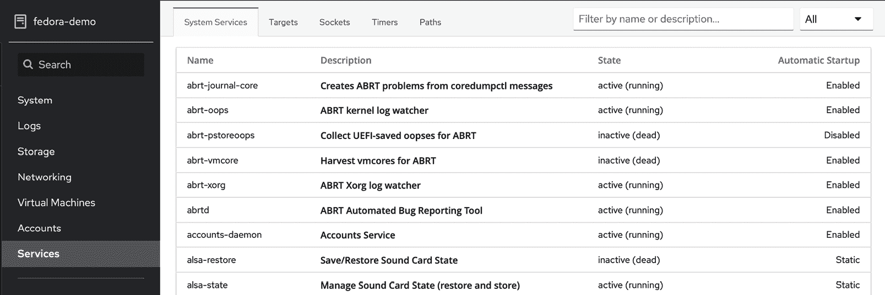

Figure 7-7

Service topics will be covered in detail in the chapter titled Configuring Fedora 31 systemd Units.

### 7.10 Applications

As previously mentioned, additional functionality can be added to `Cockpit` in the form of extensions. These extensions can be self-developed or provided by third parties. The "Applications" screen lists installed extensions and allows adding or removing extensions.

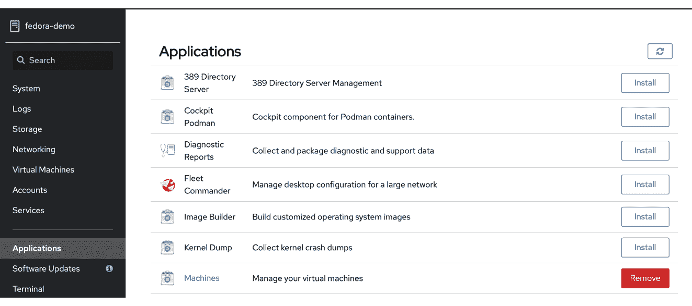

Figure 7-8

### 7.11 Virtual Machines

Virtualization allows multiple operating system instances to run simultaneously on a single computer system, each running inside its own virtual machine. The `Cockpit` "Virtual Machines" extension provides a way to create and manage virtual machine guests installed on the server.

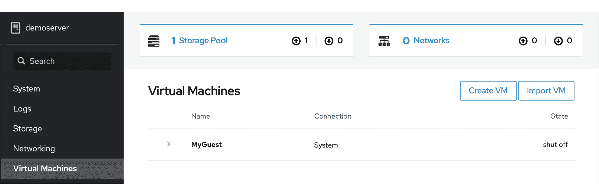

Figure 7-9

The "Virtual Machines" extension is not installed by default, but can be added via the "Cockpit Applications" screen or by running the following command:

```
dnf install cockpit-machines
```

Using virtualization in Fedora 31 will be introduced starting with the chapter titled Overview of Virtualization Technologies.

### 7.12 Podman Containers


Linux 容器提供在单台计算机上运行多个操作系统实例的方法，它们都共享宿主系统的内核，为虚拟化提供了一种轻量且高效的替代方案。`Podman` 是 Fedora 31 提供的工具集之一，用于创建和管理 Linux 容器，而 `Cockpit` 的“Podman 容器”屏幕提供了一个用户友好的环境，用于下载和创建容器镜像。

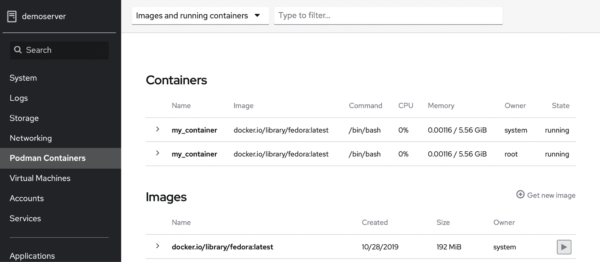

图 7-10

`Podman` 扩展默认不安装，但可以通过“Cockpit 应用程序”（Cockpit Applications）屏幕或运行以下命令进行添加：

```
dnf install cockpit-podman
```

Linux 容器将在对应的 Linux 容器简介介绍。

### 7.13 诊断报告

选择此选项时，可以生成诊断报告并下载到本地进行分析。生成的报告是一个包含服务器上所有日志文件的压缩包。

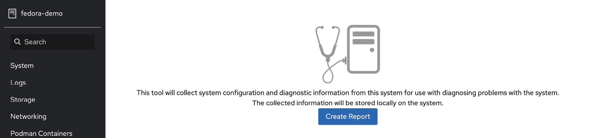

图 7-11

如果未安装“诊断报告”扩展，可以通过“Cockpit 应用程序”（Cockpit Applications）屏幕或运行以下命令进行添加：

```
dnf install sosreport
```

### 7.14 内核转储

此屏幕仅显示 Kdump 服务的状态，并在内核崩溃时指示内核转储文件的位置。该转储文件可以用于识别崩溃原因。提供了一个触发内核崩溃以测试内核转储的按钮，但不建议在生产服务器上使用此选项：

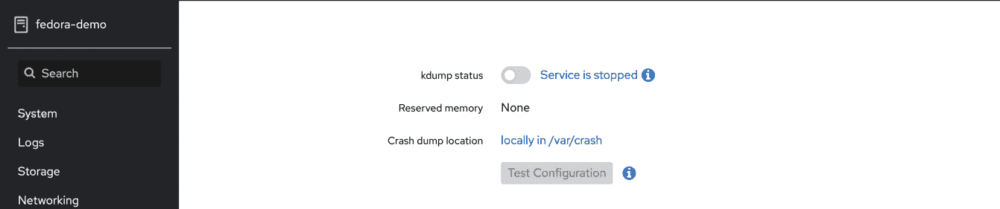

图 7-12

内核转储扩展可能未安装，但可以通过“Cockpit 应用程序”（Cockpit Applications）屏幕或运行以下命令进行添加：

```
dnf install kdump
```

### 7.15 SELinux

选择 SELinux 将指示 SELinux 策略是否正在执行，并显示该系统生成的任何警报。


图 7-13

SELinux 扩展默认不安装，但可以通过“Cockpit 应用程序”（Cockpit Applications）屏幕或运行以下命令进行添加：

```
dnf install cockpit-selinux
```

### 7.16 软件更新

如果系统有任何可用软件更新，将列在此屏幕上。如果有可用更新，可以从此处进行安装。

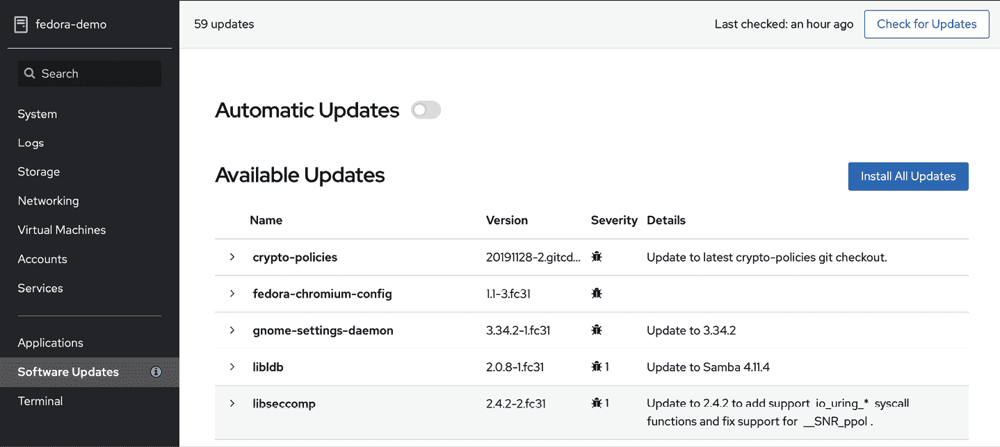

图 7-14

### 7.17 终端

如名所示，“终端”（Terminal）屏幕提供了命令行提示符访问。

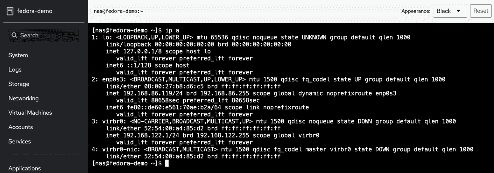

图 7-15

### 7.18 连接到多台服务器

可以将 `Cockpit` 配置为在一个会话中管理多个服务器。这需要在主系统上安装 `Cockpit dashboard`（即建立初始 Cockpit 会话的系统）。要安装 `cockpit-dashboard` 包，请运行以下命令：

```
dnf install cockpit-dashboard
```

安装仪表板后，请退出 Cockpit 并重新登录。仪表板现在将显示在 Cockpit 界面中，如图 7-16 所示：

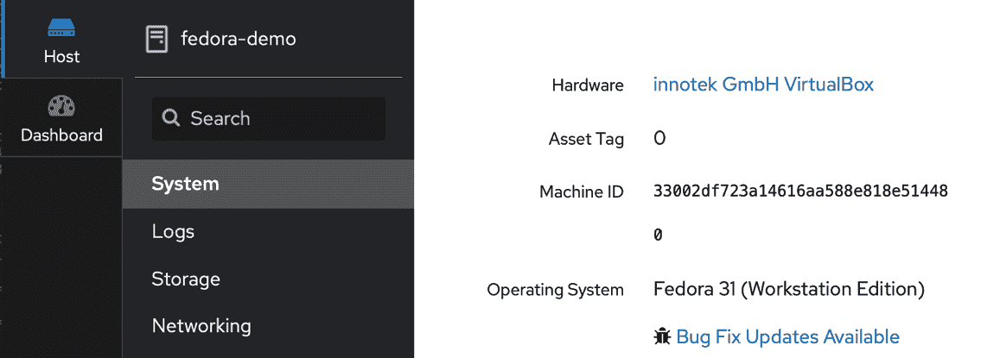

图 7-16

选中仪表板后，仪表板页面将显示当前系统的性能图表，并提供当前已连接系统的列表：

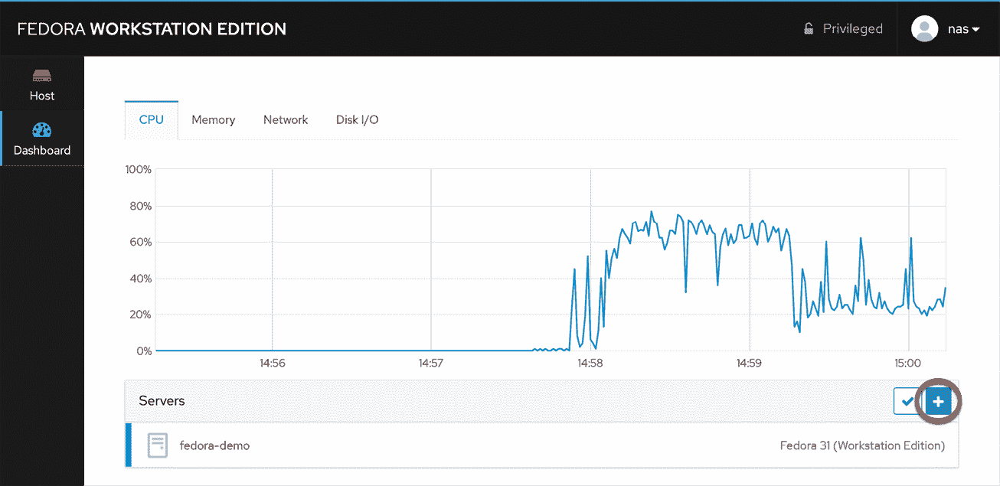

图 7-17

要添加另一个系统，点击上方图 7-17 所示亮起的 `+` 按钮，输入另一个系统的 IP 地址或主机名，并选择一种颜色将此服务器与之前添加到 Cockpit 的任何服务器区分开，然后点击 `Add`（添加）按钮：

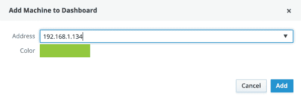

图 7-18

输入连接到另一个系统时使用的用户名和密码，然后点击登录按钮。新添加的服务器现在将列在 Cockpit 仪表板中，并出现在由之前选择颜色表示的图中：


图 7-19

在使用 Cockpit 时在系统之间切换，只需使用下方图 7-20 所示的下拉菜单：

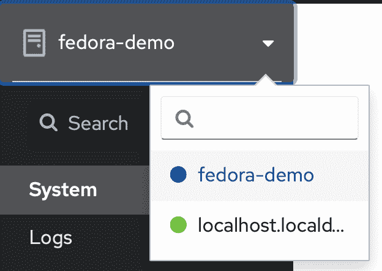

图 7-20

### 7.19 启用存储的指标

在标准安装中，Cockpit 不会保留图表覆盖的短时间窗口之外的任何性能指标数据。为了保留 Cockpit 收集的数据，需要安装“存储的指标（stored metrics）”功能。首先按照以下方式安装 `cockpit-pcp` 软件包：

```bash
dnf install cockpit-pcp
```

要启用指标持久化，显示“系统（System）”屏幕并点击图 7-21 所示亮起的 `Enable stored metrics...`（启用存储的指标...）链接：


图 7-21

一旦选择此选项，Cockpit 将请求权限安装 `cockpit-pcp`、`pcp-libs` 和 `pcp-selinux` 软件包。一旦安装这些软件包，`Enable persistent metrics`（启用持久指标）链接将被标记为 `Store Metrics`（存储指标）的控件取代。启用此选项后，性能图表将包含额外的控件，允许你在时间上前后移动查看历史数据，并更改从 5 分钟到 1 周的时间范围。

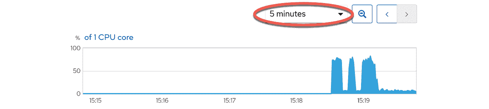

图 7-22

### 7.20 总结

Cockpit Web 界面允许从浏览器内部可视化地执行远程系统管理任务，无需依赖命令行提示符和命令行工具。一旦安装并启用，系统管理员只需打开浏览器，连接到远程服务器并登录 Cockpit 界面。在后台，Cockpit 使用与命令行提示符提供的相同的命令行工具，因此可以同时使用这两种方案而没有配置冲突的风险。Cockpit 使用模块化框架，允许添加额外的扩展，并允许开发和集成自定义扩展。一个 Cockpit 会话可以用于管理单个服务器，也可以配置为同时访问多个服务器。

## 8. 在 Fedora 31 上使用 Bash Shell

学习如何操作 Fedora 31（以及一般的 Linux 发行版）的重要部分包括熟练地在 Shell 环境中工作。虽然 Linux 自带的 GNOME 等图形桌面环境为操作系统提供了用户友好的界面，但在实践中，Shell 环境提供了比图形桌面工具能实现的多得的能力、灵活性和自动化程度。Shell 环境还为没有桌面环境的情况提供了与操作系统交互的手段；这在处理如 Fedora 31 这样的基于服务器的操作系统或无法完全启动的损坏系统时是常见情况。

因此，本章的目标是概述 Fedora 31 上的默认 shell 环境（专门指 `Bash` shell）。

### 8.1 什么是 Shell？

Shell 是一个交互式命令解释器环境，在该环境中，你可以在提示符处输入命令，或者以脚本的形式输入文件并执行。Shell 的起源可以追溯到 UNIX 操作系统的早期阶段。事实上，在引入图形桌面的之前的 Linux 早期，Shell 是用户与操作系统交互的唯一方式。

多年来开发了多种 Shell 环境。第一个被广泛使用的 Shell 是由 Stephen Bourne 在贝尔实验室编写的 Bourne shell。

另一个早期产物是 C shell，它与 C 语言语言在语法上具有某些相似之处，并引入了如命令行编辑和历史记录等易用性增强功能。

Korn shell（由 David Korn 在贝尔实验室开发）基于 Bourne shell 和 C shell 提供的特性。

Fedora 31 上的默认 shell 是 `Bash` shell（Bourne Again SHell 的缩写）。这种 shell 起始于 Bourne shell 的开源版本，由 Brian Fox 为 GNU 项目开发，并基于 Bourne shell 和 C shell 提供的特性。

### 8.2 获取 Shell 访问

在 GNOME 桌面环境中，可以通过选择顶栏中的“活动（Activities）”、输入 Terminal 并点击图标来访问 shell 提示符。

当远程登录 Fedora 31 服务器时（例如使用 `SSH`），用户也会看到 shell 提示符。关于使用 `SSH` 访问服务器的细节将在“在 Fedora 31 上配置基于密钥的认证”章节中介绍。当启动未安装桌面环境的基于服务器的系统时，用户在完成登录程序后立即进入 shell。

### 8.3 在提示符输入命令

在 shell 提示符处只需输入命令并按回车键即可。虽然有些命令静默执行，但大多数命令在返回提示符之前会显示某种形式的输出。例如，可以使用 `ls` 命令显示当前目录下的文件和文件夹：

```bash
$ ls
Desktop Downloads Music Public Templates Videos
```

可用的命令要么内置在 shell 中，要么位于物理文件系统中。可以使用 `which` 命令识别命令在文件系统中的位置。例如，查找 `ls` 可执行文件在文件系统的位置：

```bash
$ which ls
alias ls='ls --color=auto'
/usr/bin/ls
```

显然 `ls` 命令位于 `/usr/bin` 目录。注意到配置了别名，该主题将在本章稍后介绍。使用 `which` 命令定位内置命令的路径将导致提示找不到可执行文件。例如，尝试查找 `history` 命令（它实际上内置在 shell 中，而不是作为文件系统上的可执行文件）的位置将产生类似下面的输出：

```bash
$ which history
/usr/bin/which: no history in (/home/demo/.local/bin:/home/demo/bin:/usr/share/Modules/bin:/usr/local/bin:/usr/bin:/usr/local/sbin:/usr/sbin)
```

### 8.4 获取命令信息

Linux shell 可用的许多命令最初看起来可能晦涩。要获取有关命令功能以及如何使用的详细信息，请使用 `man` 命令并将命令名称作为参数。例如，更多关于 `pwd` 命令的信息：

```bash
$ man pwd
```

当执行上述命令时，将显示 `pwd` 命令的详细说明。许多命令在带有 `--help` 命令行选项运行时也会提供额外信息：

```bash
$ wc --help
```

### 8.5 Bash 命令行编辑

早期的 shell 环境不提供任何形式的行编辑功能。这意味着如果你在输入的长命令行开头处发现错误，你必须删除其之后的所有字符，纠正错误，然后重新输入命令的剩余部分。幸运的是，Bash 提供了丰富的命令行编辑选项，如下表所示：

| 组合键序列 | 动作 |
| --- | --- |
| Ctrl-b 或 左方向键 | 光标向后移动一位 |
| Ctrl-f 或 右方向键 | 光标向前移动一位 |
| Delete | 删除光标下方的字符 |
| Backspace（退格） | 删除光标左侧字符 |
| Ctrl-_ | 撤销上一次更改（可以重复以撤销所有之前的更改） |
| Ctrl-a | 将光标移动到行首 |
| Ctrl-e | 将光标移动到行尾 |
| Meta-f 或 Esc 后接 f | 光标向前移动一个单词 |
| Meta-b 或 Esc 后接 b | 光标向后移动一个单词 |
| Ctrl-l | 清除屏幕上当前命令以外的所有 |
| Ctrl-k | 从当前光标位置删除到行尾 |
| Meta-d 或 Esc 后接 d | 删除到当前单词末尾 |
| Meta-DEL 或 Esc 后接 DEL | 从开头删除到当前单词 |
| Ctrl-w | 从当前光标位置删除到上一个空白符 |

表 8-1

### 8.6 使用 Shell 历史记录

除了命令行编辑功能，Bash shell 还提供命令行历史支持。可以使用 `history` 命令查看之前执行过的命令列表：

```bash
$ history
    1 ps
    2 ls
    3 ls –l /
    4 ls
    5 man pwd
    6 man apropos
```

此外，可以使用 `Ctrl-p`（或上方向键）和 `Ctrl-n`（或下方向键）在之前输入的命令之间来回滚动。当历史记录中显示出所需的命令时，按 Enter 键执行。

另一种选项是输入 `!` 字符，后跟要重复执行命令的前几个字符，然后按 Enter 键。

### 8.7 文件名简写

许多 shell 命令接受一个或多个文件名作为参数。例如，要显示名为 `list.txt` 的文本文件内容，可以使用以下 `cat` 命令：

```bash
$ cat list.txt
```

同样，通过指定所有文件名作为参数，可以显示多个文本文件的内容：

```bash
$ cat list.txt list2.txt list3.txt list4.txt
```

与其输入每个名称，可以使用模式匹配来指定所有符合特定标准的文件。例如，可以使用 `*` 通配符来简化上面的示例：

```bash
$ cat *.txt
```

上述命令将显示所有以 `.txt` 扩展结尾的文件内容。可以进一步限制为任何以 `list` 开头并以 `.txt` 结尾的文件：

```bash
$ cat list*.txt
```

可以使用 `?` 字符指定单字符匹配：

```bash
$ cat list?.txt
```

### 8.8 文件名和路径补全

与其输入整个文件名或路径，或使用模式匹配来减少输入量，shell 提供了文件名补全功能。要使用文件名补全，只需输入文件或路径名的前几个字符，然后按两次 Esc 键。shell 将根据你输入的字符，用目录中匹配的第一个文件或路径名为你补全文件名。要获取可能的匹配项列表，在输入前几个字符后按 `Esc =`。

### 8.9 输入和输出重定向

如前所述，许多 shell 命令在执行时会输出信息。默认情况下，这些输出去向名为 `stdout` 的设备文件，它本质上是运行 shell 的终端窗口或控制台。相反，shell 从名为 `stdin` 的设备文件获取输入，默认是键盘。

可以使用 `>` 字符将命令的输出从 `stdout` 重定向到文件系统上的物理文件。例如，要将 `ls` 命令的输出重定向到名为 `files.txt` 的文件，需要以下命令：

```bash
$ ls *.txt > files.txt
```

完成后，`files.txt` 将包含当前目录下的文件列表。同样，可以将文件的内容作为 `stdin` 输入到命令中。例如，将文件的内容重定向为命令的输入：

```bash
$ wc –l < files.txt
```

上述命令将显示 `files.txt` 文件中的行数。

需要注意的是，`>` 重定向运算符在使用时会创建一个新文件，或截断现有文件。若要向现有文件追加内容，请使用 `>>` 运算符：

```bash
$ ls *.dat >> files.txt
```

除了标准输出外，shell 还使用 `stderr` 提供标准错误输出。当命令的输出被定向到 `stdout` 时，命令生成的任何错误信息都将定向到 `stderr`。这意味着如果 `stdout` 被重定向到文件，错误信息仍然显示在终端上。这通常是期望的行为，但如果需要，也可以使用 `2>` 运算符重定向 `stderr`：

```bash
$ ls 2> error.log
```

执行完成后，报告文件的错误将包含在 `stderr` 中。可以使用 `&>` 运算符将 `stderr` 和 `stdout` 重定向到同一个文件：

```bash
$ ls &> output
```

执行完成后，`output` 将包含两者。

### 8.10 在 Shell 中使用管道

除了 I/O 重定向外，shell 还允许将一个命令的输出直接管道到另一个命令的输入。管道操作通过在两个或多个命令之间放置 `|` 字符实现。例如，要统计系统中运行的进程数量，可以将 `ps` 命令的输出通过 `wc` 命令：

```bash
$ ps –ef | wc –l
```

命令行上执行管道操作的数量没有限制。例如，查找文件中包含 `Smith` 的行数：

```bash
$ cat file | grep Smith | wc –l
```

### 8.11 配置别名

随着你熟悉 shell 环境，可能会发现自己频繁使用带有参数的命令。例如，你可能经常带 `l` 和 `t` 参数使用 `ls` 命令：

```bash
$ ls –lt
```

为了减少执行命令时的输入量，可以创建一个映射到命令和参数的别名。例如，要让字母 `l` 执行 `ls –lt` 命令，可以使用以下语句：

```bash
$ alias l="ls –lt"
```

现在提示符处输入 `l` 将执行原始语句。

### 8.12 环境变量

Shell 环境变量提供了数据和配置的临时存储。shell 自身了一些环境变量，用户可以更改这些变量来修改 shell 的行为。可以使用 `env` 命令获取当前定义的变量列表：

```bash
$ env
```

或许最有用的环境变量是 `PATH`。它定义了 shell 在命令行提示符下搜索命令的目录路径，以及搜索的顺序。在新安装的 Fedora 31 系统上，用户账户的 `PATH` 环境变量可能配置如下：


进入`/path/to/xxx`目录，找到`xxx.json`。

在表达式`cvar = avar + bvar`中，加法运算符（`+`）将`avar`与`bvar`相加，得到它们的和`cvar`。

在`List.of(arg0, arg1, arg2)`中，`List`接口的工厂方法`of()`接受一系列的元素，返回包含它们的只读列表。

之后我们这样调用`cmd`命令：`cmd arg0 arg1 arg2`。

```
if (condVar > someVal) {console.log("xxx")}
```


`afterburn` rolling `[d]` default `[d]` 简易云提供商代理

`ant` 1.10 `[d]` default `[d]` Java 构建工具

`askalono-cli` rolling `[d]` default `[d]` 检测许可证文件内容的工具

`avocado` latest `[d]` default `[d]`, minimal 带有自动化测试工具和库的框架

`avocado` 69lts `[d]` default `[d]`, minimal 带有自动化测试工具和库的框架

`bat` latest `[d]` default `[d]` 带有翅角的 `cat(1)` 克隆

`cbindgen` rolling `[d]` default `[d]` 生成 Rust 代码 C 绑定的工具

列表的第一列是模块名称，第二列是流名称（通常是模块的版本）。流名称后的字母（`[d]`）表示该流是否为默认流（即如果没有引用特定流，则将使用该流进行安装），或者它在执行安装时是否已启用。

要查看可安装的模块列表，使用如下所示命令：

```
dnf module list
```

可以使用以下 `dnf` 命令识别模块的附加信息：

```
dnf module info modulename
```

要查找哪些 RPM 包构成了特定模块和流（stream）组合的不同配置（profiles），请如下所示使用 `dnf`：

```
dnf module info --profile modulename:stream
```

例如：

```
dnf module info --profile perl:5.30
```

上次元数据过期检查：0:53:06 之前（2019 年 12 月 20 日周五 上午 10:09:44 EST）。

```
Name : perl:5.30:3120190918075438:a9ea5770:x86_64

common : perl

default : perl

minimal : perl-interpreter
```

```
Name : perl:5.30:3120191129151030:a9ea5770:x86_64

common : perl

default : perl

minimal : perl-interpreter
```

最后，要从一个模块流切换到另一个流，只需运行引用新流的安装命令即可：

```
dnf install @modulename:otherstream
```

此命令将下载新流的包，并将现有包升级或降级到指定的版本。一旦完成此过程，请重新同步新流的模块包：

```
dnf distro-sync
```

## 10.4 总结

Fedora 31 系统由 RPM 格式的软件包组成，这些软件包从 Fedora 的 `fedora` 和 `fedora-modular` 仓库下载并安装。根据需要，可以为系统添加额外的安装包所需的仓库。

`fedora` 仓库包含了实现操作系统基础核心功能的包。另一方面，`fedora-modular` 包提供了额外的特性和功能，这些功能将根据配置系统的目的选择性地安装。在这样一个复杂的系统中，可能会存在大量的包间依赖关系，部分系统可能需要另一个软件包的特定版本才能正常运行。Fedora 的模块化允许创建模块（modules）和配置（profiles），它们包含所有安装特定功能所需的依赖包，并确保它们在正确的版本级别上一起安装。模块化还允许已安装的包更新到当前版本，而无需下载下一个主版本，从而避免破坏其他包的依赖。

# 11. 配置 Fedora 31 systemd 单元

为了精通 Fedora 31 系统管理，理解 `systemd` 单元的概念非常重要，特别是两种特定类型：目标（targets）和服务单元（services）。因此，本章的目标是提供 Fedora 31 支持的各种 `systemd` 单元的基本概述，并对如何配置运行中 Linux 系统后台的许多服务进行概述。

## 11.1 理解 Fedora 31 systemd Target

Fedora 31 可以配置为启动到若干状态之一（称为目标），每个状态都旨在提供特定层面的操作系统功能。系统默认启动的目标由系统管理员根据系统的用途进行配置。例如，桌面系统最可能被配置为使用图形用户界面目标启动，而云端服务器系统则更有可能启动到多用户（multi-user）目标级别。

在启动序列期间，名为 `systemd` 的进程会在 `/etc/systemd/system` 文件夹中查找默认目标设置。识别默认目标后，它将启动与该目标相关的 `systemd` 单元，以便系统在所有必要进程运行的情况下启动。

对于熟悉之前 Fedora 版本的用户，`systemd` 目标是旧的运行级别（runlevel）系统的替代品。

## 11.2 理解 Fedora 31 systemd 服务

服务本质上是一个进程，通常运行在后台，提供特定的功能。例如，`sshd` 服务是提供系统安全 shell 访问的后台进程（也称为守护进程）。不同的 `systemd` 目标被配置为自动启动不同的服务集合，取决于该目标要提供的功能。

目标和服务是 `systemd` 单元的类型，该主题将在本章稍后介绍。

## 11.3 Fedora 31 systemd Target 描述

如前所述，Fedora 31 可以启动到若干目标级别之一。系统配置的默认目标将反过来决定启动哪些 `systemd` 单元。专门与系统启动和关机的目标可以总结如下：

- `poweroff.target` - 系统关机的目标。出于显而原因，你不太可能将其作为默认目标。

- `rescue.target` – 导致系统以单用户模式启动，此时只有 `root` 用户可以登录。在这种模式下，系统不会启动任何网络、图形用户界面或多用户服务。此运行级别是系统管理员执行系统维护或修复操作的理想选择。

- `multi-user.target` - 将系统启动到具有文本控制台登录能力的多用户模式。

- `graphical.target` - 将系统启动到具有 X Window System 能力的联网多用户状态。默认情况下，图形桌面环境将在启动过程结束时启动。这是桌面或工作站最常用的运行级别。

- `reboot.target` - 重启系统。另一个目标，出于显而见的原因，你不太可能将其作为默认目标。

除了上述目标外，系统还包含了约 70 个其他目标，其中许多是上述目标的子目标。在后台，例如，`multi-user.target` 还会启动一个名为 `basic.target` 的目标，该目标反过来会启动 `sockets.target` 单元，用于不同进程之间的通信。这确保了多用户目标所依赖的所有服务在启动过程中也会启动。

通过在终端窗口运行以下命令，可以查看指定目标依赖的目标和包列表：

```
systemctl list-dependencies <target>
```

例如，图 11-1 显示了 `multi-user` 目标的部分 `systemd` 依赖列表（全功能系统包含 120 多个目标和服务）：

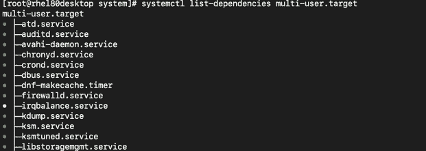

图 11-1

列表以层次树的形式呈现，说明了某些依赖具有子依赖。例如，滚动到列表底部会发现多用户目标依赖两个网络文件系统目标（即 `nfs-client.target` 和 `remote-fs.target`），每个目标都有自己的服务目标子依赖：

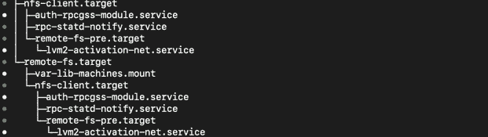

图 11-2

列表每项左侧的彩色点表示该服务或目标的当前状态：

- 绿色 - 服务或目标已激活并运行。

- 白色 - 服务或目标未激活（通常尚未启用、由于某些原因停止或未满足其依赖条件）。

- 红色 - 服务或目标由于致命错误未能启动。

要获取有关 `systemd` 单元状态的详细信息，请使用 `systemctl status` 命令后跟单元名称：

```
systemctl status systemd-machine-id-commit.service
```

输出示例：

```
systemd-machine-id-commit.service - 在磁盘上提交临时 machine-id
Loaded: loaded (/usr/lib/systemd/system/systemd-machine-id-commit.service; static; vendor preset: disabled)
Active: inactive (dead)
Condition: start condition failed at Thu 2019-02-14 15:27:47 EST; 1h 14min 
```

`ConditionPathIsMountPoint=/etc/machine-id` 未满足

文档：`man:systemd-machine-id-commit.service(8)`

## 11.4 识别和配置默认目标

Fedora 31 系统的当前默认目标可以使用 `systemctl` 命令进行如下识别：

```
systemctl get-default
```

`multi-user.target`

在上述情况下，系统配置为默认使用 `multi-user.target` 启动。可以使用 `systemctl` 命令配合 `set-default` 选项随时更改默认设置。以下示例将默认目标更改为在系统下次启动时启动图形化用户界面：

```
systemctl set-default graphical.target
```

输出示例：

```
已删除 /etc/systemd/system/default.target。
创建了符号链接 /etc/systemd/system/default.target → /usr/lib/systemd/system/graphical.target。
```

默认更改操作的输出显示了 `systemctl` 命令在后台执行以实施更改的步骤。当前默认配置是通过从 `/etc/systemd/system` 目录下的 `default.target` 文件建立符号链接，指向 `/usr/lib/systemd/system` 文件夹中相应的目标文件（在本例中为 `graphical.target` 文件）来实现。

## 11.5 理解 systemd 单元和单元类型

如前所述，目标和服务单元都是 `systemd` 单元的类型。`/usr/lib/systemd/system` 文件夹内的所有文件都被称为 `systemd` 单元配置文件，每个文件都代表一个 `systemd` 单元。每个单元又被归类为特定的单元类型。Fedora 31 支持 12 种不同的单元类型，包括本章已涵盖的目标和服务单元类型。

单元文件的类型由下表 11-1 所示的文件扩展名表示：

| 单元类型 | 文件名扩展名 | 类型描述 |
| :--- | :--- | :--- |
| Service | `.service` | 系统服务。 |
| Target | `.target` | systemd 单元组。 |
| Automount | `.automount` | 文件系统自动挂载点。 |
| Device | `.device` | 内核识别的设备文件。 |
| Mount | `.mount` | 文件系统挂载点。 |
| Path | `.path` | 文件系统中的文件或目录。 |
| Scope | `.scope` | 外部创建的进程。 |
| Slice | `.slice` | 管理系统进程的分级单元组。 |
| Snapshot | `.snapshot` | systemd 管理器的保存状态。 |
| Socket | `.socket` | 进程间通信套接字。 |
| Swap | `.swap` | 交换设备或交换文件。 |
| Timer | `.timer` | systemd 定时器。 |

表 11-1

注意，目标单元类型与其他类型的区别在于，它本质上是由一组 `systemd` 单元（如服务或其他目标）组成的。

## 11.6 动态更改当前目标

上述步骤指定系统下次启动时使用的目标，但不会更改正在运行的状态的状态。要动态切换到不同的目标，请再次使用 `systemctl` 命令，这次使用 `isolate` 选项。例如，要在不重启的情况下将当前系统切换到图形目标，可以使用以下命令：

```
systemctl isolate graphical.target
```

执行后，系统将启动图形化桌面环境。

## 11.7 启用、禁用和屏蔽 systemd 单元

新安装的 Fedora 31 系统将包含基础 `systemd` 服务单元，但可能不会包含系统进入生产环境后最终需要的所有服务。例如，基础 Fedora 31 安装通常不包含运行 Apache Web 服务器所需的包，其关键元素之一是 `httpd.service` 单元。

系统管理员将通过使用以下命令安装必要的 `httpd` 包来解决这个问题：

```
dnf install httpd
```

配置好 Web 服务器后，下一个任务是检查 `httpd.service` 单元的状态，以识别它是否作为安装过程的一部分被激活：

```
systemctl status httpd.service
```

输出示例：

```
httpd.service - The Apache HTTP Server
    Loaded: loaded (/usr/lib/systemd/system/httpd.service; disabled; vendor preset: disabled)
    Active: inactive (dead)
      Docs: man:httpd.service(8)
```

注意，服务已加载但处于非活动状态，因为厂商预设置为在首次安装时禁用。要启动该服务，可以使用以下命令：

```
systemctl start httpd.service
```

现在状态检查将显示服务处于活动状态：

```
httpd.service - The Apache HTTP Server
    Loaded: loaded (/usr/lib/systemd/system/httpd.service; disabled; vendor preset: disabled)
    Active: active (running) since Fri 2019-02-15 11:13:26 EST; 8s ago
      Docs: man:httpd.service(8)
    Main PID: 10721 (httpd)
    Status: "Started, listening on: port 80"
    Tasks: 21 (limit: 13923)
```

状态检查现在显示服务是禁用的（disabled）。这意味着在下次系统重启时它不会启动。要配置服务在每次系统启动时自动运行，必须启用它：

```
systemctl enable httpd.service
```

一旦启用，状态输出将显示为：

```
Loaded: loaded (/usr/lib/systemd/system/httpd.service; enabled; vendor preset: disabled)
```

现在它已启用，系统下次重启到该目标时，`httpd` 服务将自动启动。假设在系统运行多用户目标时启用了该服务，`httpd` 服务已作为另一个依赖被添加。

在后台，`systemctl` 通过在 `/etc/systemd/system` 中的 `.wants` 文件夹中创建符号链接来为目标添加依赖。例如，`multi-user.target` 单元在 `/etc/systemd/system` 中有一个名为 `multi-user.target.wants` 的文件夹，包含了 `/usr/lib/systemd/system` 中它所依赖的所有单元。查看该文件夹将与 `systemctl list-dependencies` 命令列出的依赖项相关。

要禁用作为目标依赖的服务，只需禁用它：

```
systemctl disable httpd.service
```

此命令将从 `.wants` 目录删除指向 `httpd.service` 文件的符号链接，使其不再成为依赖，因此下次启动系统时不会启动它。

`.wants` 文件夹包含在不可用时不会阻止单元启动运行的依赖。强制依赖（即如果不可用会导致单元失败的依赖）应该放在 `.requires` 文件夹中（例如 `multi-user.target.requires`）。

除了启用和禁用，还可以屏蔽 `systemd` 单元：

```
systemctl mask httpd.service
```

被屏蔽的 `systemd` 单元即使被列为其他单元的依赖，在任何情况下都无法启用、禁用或启动。事实上，对于系统而言，被屏蔽的 `systemd` 单元就像不存在一样。恢复服务的唯一方法是取消屏蔽：

```
systemctl unmask httpd.service
```

## 11.8 在 Cockpit 中处理 systemd 单元

除了本章目前概述的命令行技术外，还可以从 Cockpit Web 界面内部查看和管理 `systemd` 单元。假设 Cockpit 已按照“Fedora 31 Cockpit Web 界面概览”章节所述的方法进行了安装和设置，可以通过登录 Cockpit 并选择图 11-3 左侧导航面板中标记为 A 的 `Services` 选项来访问系统上的 `systemd` 单元列表：

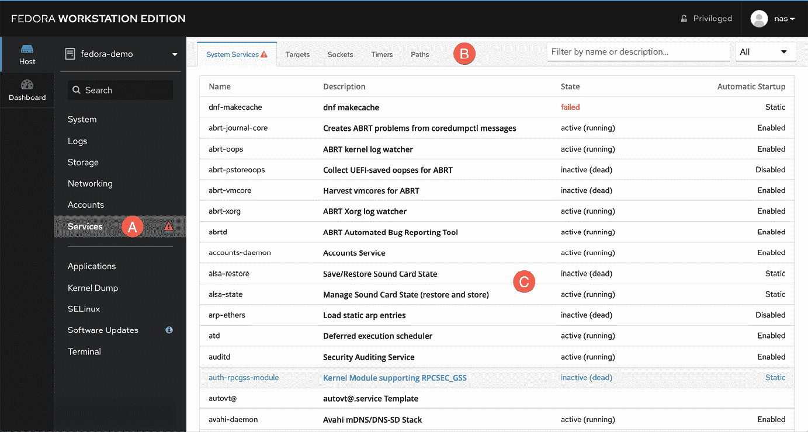

图 11-3

标记为 B 的按钮在标记为 C 的区域显示特定类型的单元，其中每个单元的当前状态列在 `State` 列。

从列表中选择一个单元将显示详细信息。例如，图 11-4 显示了 `httpd.service` 实例的详细界面，包括服务日志 (A) 和用于执行启动、停止、启用/禁用以及掩蔽/取消掩蔽单元任务的菜单选项 (B)。

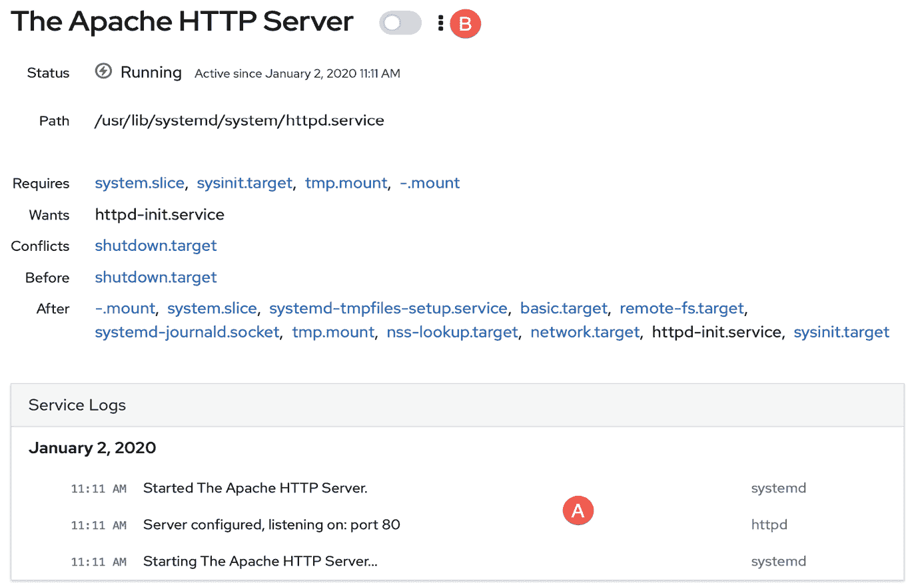


图 11-4

### 11.9 总结

新安装的 Fedora 31 系统包含一组基础 `systemd` 单元，其中许多单元在后台运行以提供系统的大部分功能。这些单元按类型分类，最常见的是目标（targets）和服务（services）。目标单元仅仅是一个要共同启动的其他单元组。系统有一个默认目标单元，它定义了每次系统启动时要启动的其他单元。最常用的目标是引导系统启动到多用户模式或图形模式的目标。`systemctl` 命令行工具提供了许多执行 `systemd` 单元配置任务的选项，其中许多选项也可以通过 Cockpit Web 界面使用。

## 12. Fedora 31 网络管理

很难想象一个没有至少一个网络连接的 Fedora 31 系统，而想象这样一个孤立系统如何产生多大的实际用途就更加困难。事实是，Fedora 31 设计用于通过网络和互联网连接提供企业级服务。学习如何管理 Fedora 31 系统的关键部分之一是学习如何配置和管理安装在系统上的网络接口。

本章旨在提供 Fedora 31 上网络管理的概述，包括 `NetworkManager` 服务和工具以及其他实用程序。

### 12.1 NetworkManager 简介

`NetworkManager` 是一个服务和一组工具，专门设计用于简化 Linux 系统上的网络配置，它是 Fedora 31 上默认的网络管理服务。

除了在后台运行的服务外，`NetworkManager` 还包含以下工具：

- `nmcli` - 一个通过命令行与 `NetworkManager` 工作的工具。该工具在无法访问图形环境时有用，也可以在脚本中使用更改网络配置。
- `nmtui` - 用于管理 `NetworkManager` 的基础文本用户界面。该工具可以在任何终端窗口中运行，允许通过选择菜单和输入数据进行更改。虽然 `nmtui` 对于执行基本任务很有用，但它缺少 `nmcli` 工具提供的许多功能。
- `nm-connection-editor` - 一个全图形化管理工具，提供了访问大多数 `NetworkManager` 配置选项的。
- `GNOME Settings` - GNOME 桌面设置应用程序的网络屏幕允许执行基本的网络管理任务。
- `Cockpit Network Settings` - Cockpit Web 界面的网络屏幕允许执行一系列网络管理任务。

虽然有多种方法可以管理 Fedora 31 上的网络环境，但为了本章，我们将关注 `nmcli` 命令。虽然在拥有桌面环境或启用了 Cockpit 时图形化工具无疑非常有用，但在只有命令行提示符的情况下，理解命令行界面是至关重要的。此外，图形化工具（包括 Cockpit）并不包含 `nmcli` 工具的所有功能。最后，一旦你熟悉了 `NetworkManager` 和 `nmcli`，这些技能在这些更直观的工具选项时可以轻松转换。图形化工具选项则不能如此。例如，如果你只用过 `nm-connection-editor`，那么使用 `nmcli` 就会很困难。

### 12.2 安装并启用 NetworkManager

对于大多数 Fedora 31 安装，`NetworkManager` 应该默认安装。使用 `rpm` 命令查看它是否需要安装：

```bash
# rpm -q NetworkManager
```

`NetworkManager-1.14.0-14.el8.x86_64`

如有必要，按照以下方式安装包：

```bash
# dnf install NetworkManager
```

一旦安装了包，就需要启用 `NetworkManager` 守护进程，以便在每次系统启动时启动：

```bash
# systemctl enable NetworkManager
```

最后，启动服务并检查状态以验证启动成功：

```bash
# systemctl start NetworkManager
# systemctl status NetworkManager
```

● `NetworkManager.service` - Network Manager

Loaded: loaded (/usr/lib/systemd/system/NetworkManager.service; enabled; vendor >

Drop-In: /usr/lib/systemd/system/NetworkManager.service.d

└─NetworkManager-ovs.conf

Active: active (running) since Tue 2019-04-09 10:07:22 EDT

### 12.3 nmcli 命令

`nmcli` 命令将作为 `Networkmanager` 包的一部分安装，并可以使用以下语法从命令行执行：

```bash
# nmcli [Options] Object {Command | help}
```

在上述语法中，`Object` 将是 `general`、`networking`、`radio`、`connection`、`monitor`、`device` 或 `agent` 之一，所有都可以缩写为单词的几个字母（例如 connection 对应 `con`，甚至只是字母 `c`）。例如，以下所有命令都将输出与 `device` 对象相关的帮助信息：

```bash
# nmcli device help
# nmcli dev help
# nmcli d help
```

要检查系统上 `NetworkManager` 的整体状态，使用以下命令：

```bash
# nmcli general status
```

STATE CONNECTIVITY WIFI-HW WWAN-HW

connected full enabled enabled

要检查系统上安装的设备状态，可以使用以下命令：

```bash
# nmcli dev status
```

DEVICE TYPE STATE CONNECTION

eno1 ethernet connected eno1

wlp0s26u1u2 wifi connected zoneone

virbr0 bridge connected virbr0

lo loopback unmanaged --

virbr0-nic tun unmanaged --

还可以通过 `-p` 选项修改输出使其符合人类习惯：

```bash
# nmcli -p dev status
```

=====================

Status of devices

=====================

DEVICE TYPE STATE CONNECTION

-------------------------------------------------------------------

eno1 ethernet connected eno1

wlp0s26u1u2 wifi connected zoneone

virbr0 bridge connected virbr0

lo loopback unmanaged --

virbr0-nic tun unmanaged --

相反，可以使用 `-t` 选项使输出更简练，适用于自动化处理：

```bash
# nmcli -t dev status
```

eno1:ethernet:connected:eno1

wlp0s26u1u2:wifi:connected:emilyzone

virbr0:bridge:connected:virbr0

lo:loopback:unmanaged:

virbr0-nic:tun:unmanaged:

从状态输出可以看出，系统安装了两个物理设备，一个是以太网，另一个是 Wi-Fi 设备。

网桥（`virbr`）条目是用于为虚拟机提供网络服务的虚拟设备（虚拟化主题将从名为虚拟化技术概述的章节开始介绍）。回环接口是一个特殊的虚拟设备，允许系统与自身进行通信，通常用于执行网络诊断。

在与 `NetworkManager` 工作时，理解设备（device）和连接（connection）之间的区别非常重要。如上所述，设备是指物理或虚拟网络设备，而连接是设备所连接的网络配置。

以下命令显示系统上配置的连接信息：

```bash
nmcli con show

NAME UUID TYPE DEVICE
zoneone 2abecafa-4ea2-47f6-b20f-4fb0c0fd5e94 wifi wlp0s26u1u2
eno1 99d40009-6bb1-4182-baad-a103941c90ff ethernet eno1
virbr0 e13e9552-1765-42d1-b739-ff981668fbee bridge virbr0
zonetwo f940a2d1-8c18-4a9e-bf29-817702429b8a wifi --
zonethree fd65c5e5-3e92-4e9e-b924-1b0b07b70032 wifi --
```

从上述输出中，我们可以看到 Wi-Fi 设备（`wlp0s26u1u2`）连接到了名为 `zoneone` 的无线网络，而以太网设备（`eno1`）连接到了名为 `eno1` 的连接。除了 `zoneone` 之外，`NetworkManager` 还列出了两个名为 `zonetwo` 和 `zonethree` 的 Wi-Fi 连接，它们目前都没有连接设备。

要查找分配给连接的 IP 地址，可以使用 `ip` 工具配合 `address` 选项：

```bash
ip address
```

这也可以简写为：

```bash
ip a
```

```text
.
.
3: wlp0s26u1u2: <BROADCAST,MULTICAST,UP,LOWER_UP> mtu 1500 qdisc mq state UP group default qlen 1000
    link/ether 74:da:38:ee:be:50 brd ff:ff:ff:ff:ff:ff
    inet 192.168.1.121/24 brd 192.168.1.255 scope global dynamic noprefixroute wlp0s26u1u2
      valid_lft 57584sec preferred_lft 57584sec
.
.
```

`ip` 命令将输出系统上检测到的所有设备的信息。上述输出显示 Wi-Fi 设备被分配了 IP 地址 `192.168.1.121`。

如果我们只想列出活跃的连接，可以使用 `nmcli` 命令配合 `-a` 选项：

```bash
nmcli con show -a

NAME UUID TYPE DEVICE
emilyzone 2abecafa-4ea2-47f6-b20f-4fb0c0fd5e94 wifi wlp0s26u1u2
eno1 99d40009-6bb1-4182-baad-a103941c90ff ethernet eno1
virbr0 e13e9552-1765-42d1-b739-ff981668fbee bridge virbr0
```

要将 Wi-Fi 设备连接从 `zoneone` 切换到 `zonetwo`，我们可以运行以下命令：

```bash
nmcli device wifi connect zonetwo -ask
```

Password:`

`-ask` 标志会导致 `nmcli` 提示用户输入 Wi-Fi 密码。要在命令行中包含 Wi-Fi 密码（在脚本中执行命令时特别有用），请使用 `password` 选项：

```bash
nmcli device wifi connect zonetwo password <password here>
```

还可以如下使用 `nmcli` 工具扫描可用的 Wi-Fi 网络：

```bash
nmcli device wifi list

IN-USE SSID MODE CHAN RATE SIGNAL BARS SECURITY
    zoneone Infra 6 195 Mbit/s 80 WPA2
* zonetwo Infra 11 130 Mbit/s 74 WPA1 WPA2
```

可以通过如下方式禁用当前活跃的连接：

```bash
nmcli con down <connection name>
```

同样，可以随时恢复一个非活跃连接的启用：

```bash
nmcli con up <connection name>
```

当一个连接断开时，`NetworkManager` 会自动搜索另一个连接，激活它并将其分配到之前建立连接的设备。为了防止在这种情况下使用连接，可以按如下方式禁用 `autoconnect` 选项：

```bash
nmcli con mod <connection name> connection.autoconnect no
```

可以使用以下命令获取关于特定连接的附加信息。这包括所有连接属性的当前值：

```bash
nmcli con show eno1
```

```text
connection.id: eno1
```

```bash
nmcli con add type ethernet con-name static_ip ifname eno0 ip4 192.168.1.200/24 gw4 192.168.1.1
```

连接 `static_ip` (3fccafb3-e761-4271-b310-ad0f28ee8606) 已成功添加。

对应的 `ifcg-static_ip` 文件内容将如下：

```ini
TYPE=Ethernet
PROXY_METHOD=none
BROWSER_ONLY=no
BOOTPROTO=none
IPADDR=192.168.1.200
PREFIX=24
GATEWAY=192.168.1.1
DEFROUTE=yes
IPV4_FAILURE_FATAL=no
IPV6INIT=yes
IPV6_AUTOCONF=yes
IPV6_DEFROUTE=yes
IPV6_FAILURE_FATAL=no
IPV6_ADDR_GEN_MODE=stable-privacy
NAME=static_ip
UUID=3fccafb3-e761-4271-b310-ad0f28ee8606
DEVICE=eno2
ONBOOT=yes
```

添加新连接的命令可以稍作修改，以同时分配 IPv4 和 IPv6 静态地址：

```bash
nmcli con add type ethernet con-name static_ip ifname eno0 ip4 192.168.1.200/24 gw4 192.168.1.1 gw4 192.168.1.1 ip6 cabf::4532 gw6 2010:dfa::1
```

### 12.5 交互式编辑

除了带有命令行选项的 `nmcli` 外，该工具还包含一个用于创建和修改连接文件的交互模式。例如，以下轨迹显示了如何使用交互模式创建一个名为 `demo_con` 的新以太网连接：

```bash
nmcli con edit
```

有效的连接类型：6lowpan, 802-11-olpc-mesh (olpc-mesh), 802-11-wireless (wifi), 802-3-ethernet (ethernet), adsl, bluetooth, bond, bridge, cdma, dummy, generic, gsm, infiniband, ip-tunnel, macsec, macvlan, ovs-bridge, ovs-interface, ovs-port, pppoe, team, tun, vlan, vpn, vxlan, wimax, wpan, bond-slave, bridge-slave, team-slave

输入连接类型: ethernet

```
===| nmcli interactive connection editor |===
正在添加新的‘802-3-ethernet’连接

输入‘help’或‘？’查看可用命令。
输入‘print’ 显示所有连接属性。
输入‘describe [<setting>.<prop>]’ 获取详细属性描述。
你可以编辑以下设置：connection, 802-3-ethernet (ethernet), 802-1x, dcb, sriov, ethtool, match, ipv4, ipv6, tc, proxy

nmcli> set connection.id demo_con
nmcli> set connection.interface eno1
nmcli> set connection.autoconnect yes
nmcli> set ipv4.method auto
nmcli> set 802-3-ethernet.mtu auto
nmcli> set ipv6.method auto
nmcli> save

正在保存带有‘autoconnect=yes’的连接。这可能会导致连接立即激活。
你仍然要保存吗？(yes/no) [yes] yes

连接‘demo_con’ (cb837408-6c6f-4572-9548-4932f88b9275) 已成功保存。
nmcli> quit
```

另一方面，以下轨迹修改了之前创建的 `static_ip` 连接配置文件，使用与原始指定的不同的静态 IP 地址：

```bash
nmcli con edit static_ip
```


```
===| nmcli interactive connection editor |===
正在编辑现有'802-3-ethernet'连接：'static_ip'

输入'help'或'?'查看可用命令。
输入'print' 显示所有连接属性。
输入'describe [<setting>.<prop>]' 获取详细属性描述。
你可以编辑以下设置：connection, 802-3-ethernet (ethernet), 802-1x, dcb, sriov, ethtool, match, ipv4, ipv6, tc, proxy

nmcli> print ipv4.addresses
ipv4.addresses: 192.168.1.200/24
nmcli> set ipv4.addresses 192.168.1.201/24
nmcli> save

连接'static_ip' (3fccafb3-e761-4271-b310-ad0f28ee8606) 已成功更新。
nmcli> quit
```

在修改现有连接后，请指示 NetworkManager 重新加载配置文件：

```bash
nmcli con reload
```

在使用交互模式时，了解有一个广泛的内置帮助系统可供学习如何使用该工具是非常有用的。可以通过输入以下命令访问帮助主题：

## 12.6 配置 NetworkManager 权限

除了使用命令行选项使用`nmcli`外，该工具还允许设置权限。例如，以下命令将连接限制为 root：

```bash
nmcli con mod static_ip permissions root
```

一旦重新加载了配置文件，连接将仅对 root 可。当最后一个此类用户注销时，连接将关闭。

### 12.7 总结

Fedora 的网络管理由 NetworkManager 服务处理。NetworkManager 将网络视为由设备和连接组成。网络设备可以是物理以太网或 Wi-Fi 设备，也可以是虚拟机使用的设备。连接代表设备所属的网络，并通过配置文件进行配置。配置文件将定义连接的静态还是动态 IP 地址、网关的 IP 地址以及系统启动时是否建立连接。

## 13. 使用 firewalld 进行基础 Fedora 防火墙配置

防火墙是保护计算机系统或网络不受外部攻击（通常来自通过互联网连接的外部）的关键组件。任何直接连接互联网的计算机都必须运行防火墙以防止恶意活动。同样，任何内部网络与其外部互联网连接之间都应该有一定的形式的防火墙。

所有 Linux 发行版都提供了某种形式的防火墙解决方案。在 Fedora 中，这以名为`firewalld`的服务形式存在。

虽然防火墙配置主题可能很复杂，幸运的是 Fedora 提供了命令行、基于 Web 和图形化的工具来简化防火墙配置过程。本章将介绍`firewalld`的基本概念，并涵盖使用操作系统提供的工具配置防火墙所需的步骤。

### 13.1 firewalld 简介

`firewalld`服务使用一组规则来控制进入的网络流量，并定义哪些流量应被拦截，哪些允许通过系统，它是构建在更复杂的防火墙工具`iptables`之上的。

遵循常见的安全实践，默认安装的`firewalld`被配置为阻止所有访问，但 SSH 远程登录和系统用于获取动态 IP 地址的 DHCP 服务除外（这两者对于系统管理员在安装完成后能够访问系统至关重要）。

Fedora 31 上防火墙配置的关键元素是区域（zones）、接口（interfaces）、服务（services）和端口（ports）。

### 13.1.1 区域 (Zones)

默认情况下，`firewalld`安装时带有一系列预配置的区域。区域是一组预配置的规则，可以随时应用于系统，以便快速实现特定场景的防火墙配置。例如，`block`区域阻止所有入站流量，而`home`区域在假设系统运行在更安全的环境中（期望有更高信任度）实施较不严格的规则。可以向系统添加新区域，并修改现有区域以添加或删除规则。也可以完全从系统中删除区域。表 13-1 列出了在 Fedora 31 系统上默认可用的区域集：

| 区域 (Zone) | 说明 (Description) |
| --- | --- |
| drop | 最安全的区域。仅允许出站连接，所有入站连接都被丢弃且不向连接客户端发送任何通知。 |
| block | 与`drop`区域类似，不同之处在于入站连接会被拒绝并发送`icmp-host-prohibited`或`icmp6-adm-prohibited`通知。 |
| public | 用于连接到公共网络或互联网时，此时其他计算机不认为是可信的。允许某些特定的入站连接。 |
| external | 当系统作为计算机网络的互联网网关时，`external`区域应用于连接到互联网的接口。该区域与`internal`区域配合使用，用于实现本章后面介绍的伪装或网络地址转换（NAT）。允许某些特定的入站连接。 |
| internal | 与`external`区域配合使用，应用于连接到内网的接口。假设内网上的计算机是受信任的。允许某些特定的入站连接。 |
| dmz | 用于系统运行在非军事化区（DMZ）时。这些通常是公开可访问但与你的内部网络其他部分隔离的计算机。允许某些特定的入站连接。 |
| work | 用于在工作环境网络上运行系统，此时其他计算机是受信任的。允许某些特定的入站连接。 |
| home | 用于在家庭网络上运行系统，此时其他计算机是受信任的。允许某些特定的入站连接。 |
| trusted | 最不区域。接受所有入站连接。 |
| FedoraServer | 为 Fedora Server 安装配置的一组默认防火墙规则。允许某些特定的入站连接，且与`public`区域相同。 |
| FedoraWorkstation | 为 Fedora Workstation 安装配置推荐的防火墙规则集。允许某些特定的入站连接。 |

表 13-1

要查看区域的特定设置，请参考位于系统`/usr/lib/firewalld/zones`目录下的相应 XML 文件。例如，以下列出了`public.xml`区域配置文件的内容：

```xml
<?xml version="1.0" encoding="utf-8"?>
<zone>
  <short>Public</short>
  <description>用于公共区域。你不信任网络上的其他计算机不会伤害你的计算机。只接受特定的入站连接。</description>
  <service name="ssh"/>
  <service name="mdns"/>
  <service name="dhcpv6-client"/>
</zone>
```

### 13.1.2 接口 (Interfaces)

任何连接到互联网或网络（或两者都有）的 Fedora 31 系统都包含至少一个物理或虚拟网络设备形式的接口。当`firewalld`激活时，这些接口每一个都被分配到一个区域，允许为不同的接口分配不同级别的防火墙安全。考虑一个包含两个接口的服务器，一个连接到外部互联网，另一个连接到内网。在这种情况下，面向外部的接口可能会被分配到限制较多的`external`区域，而内部接口可能会使用`internal`区域。

### 13.1.3 服务 (Services)

TCP/IP 定义了一组在标准端口上通信的服务。例如，安全的 HTTPS Web 连接使用端口`443`，而 SMTP 邮件服务使用端口`25`。为了选择性地启用特定服务的入站流量，可以在区域中添加`firewalld`规则。例如，`home`区域默认不允许入站 HTTPS 连接。可以通过向区域添加规则来允许入站 HTTPS 连接，而无需引用特定的端口号。

### 13.1.4 端口 (Ports)

尽管在添加`firewalld`规则时可以引用常见的 TCP/IP 服务，但也会出现需要在未分配给服务的特定端口上允许入站连接的情况。可以通过添加引用特定端口而非服务的规则来实现。这种技术在标题为“Fedora 31 Cockpit Web 界面概述”的章节中使用，当时开启了端口`9090`以允许访问 Cockpit Web 界面。

### 13.2 检查 firewalld 状态

`firewalld`服务在所有 Fedora 31 安装中默认安装并启用。可以通过以下命令检查服务的状态：

```bash
# systemctl status firewalld
```

```
firewalld.service - dynamic firewall daemon
    Loaded: loaded (/usr/lib/systemd/system/firewalld.service; enabled; preset: enabled)
    Active: active (running) since Thu 2019-02-14 14:24:31 EST; 3 days ago
      Docs: manfirewalld(1)
    Main PID: 816 (firewalld)
    Tasks: 2 (limit: 25026)
    Memory: 30.6M
    CGroup: /system.slice/firewalld.service
              816 /usr/libexec/platform-python -s /usr/sbin/firewalld --nofork --nopid
```

如有需要，可以通过以下命令安装`firewalld`服务：

```bash
# dnf install firewalld
```

该服务默认是启用的，因此在安装完成后和每次系统启动时都会运行。

### 3.3 `firewall-cmd`命令行工具允许在终端窗口中查看`firewalld`配置并对区域和规则进行更改。

在更改防火墙设置时，了解运行时（runtime）和永久（permanent）配置的概念非常重要。默认情况下，任何规则更改都被视为运行时配置更改。这意味着更改将立即生效，但在下次系统重启或`firewalld`服务重载时将会丢失，例如通过执行以下命令：

```bash
# firewall-cmd --reload
```

要使更改永久化，必须使用`--permanent`命令行选项。永久更改在`firewalld`服务重载之前不会生效，但在手动更改之前将一直保留。

#### 3.3.1 识别和更改默认区域

要识别默认区域（即除非显式选择不同的区域，否则所有接口都将分配到的区域），请如下使用`firewall-cmd`工具：

```bash
# firewall-cmd --get-default-zone
public
```

将默认区域更改为另一个：

```bash
# firewall-cmd --set-default-zone=home
success
```

#### 3.3.2 显示区域信息

列出系统上所有可用的区域：

```bash
# firewall-cmd --get-zones
block dmz drop external home internal libvirt public trusted work
```

如下获取当前活跃区域及其分配的接口列表：

```bash
# firewall-cmd --get-active-zones
external
```

接口：`eth0`

内部

接口：`eth1`

当前为特定区域配置的所有规则列如下：

```bash
firewall-cmd --zone=home --list-all
```

home (active)

  target: default

  icmp-block-inversion: no

  interfaces: `eth0`

  sources:

  services: cockpit dhcpv6-client http mdns samba-client ssh

  ports:

  protocols:

  masquerade: no

  forward-ports:

  source-ports:

  icmp-blocks:

  rich rules:

使用以下命令列出当前可包含在 firewalld 规则中的服务：

```bash
firewall-cmd --get-services
```

RH-Satellite-6 amanda-client amanda-k5-client amqp amqps apcupsd audit bacula bacula-client bgp bitcoin bitcoin-rpc bitcoin-testnet bitcoin-testnet-rpc ceph ceph-mon cfengine cockpit ...

要列出当前为某个区域启用的服务：

```bash
firewall-cmd --zone=public --list-services
```

cockpit dhcpv6-client ssh

端口规则列表可以如下获取：

```bash
firewall-cmd --zone=public --list-ports
```

9090/tcp

### 13.3 添加和删除区域服务

要向区域添加服务（在本例中，即向 public 区域添加 HTTPS），将使用以下命令：

```bash
firewall-cmd --zone=public --add-service=https
```

成功 (success)

默认情况下，这是一个运行时更改，因此添加的规则将在系统重启后丢失。要永久添加服务以使其在下次系统重启时仍然生效，请使用`--permanent`标记：

```bash
firewall-cmd --zone=public --permanent --add-service=https
```

成功 (success)

要验证服务是否已永久添加，在请求服务列表时请务必包含`--permanent`标记：

```bash
firewall-cmd --zone=public --permanent --list-services
```

cockpit dhcpv6-client http https ssh

请注意，作为永久更改，此新规则在系统重启或重载 firewalld 之前不会生效：

```bash
firewall-cmd --reload
```

使用`--remove-service`选项从区域删除服务。由于这是一个运行时更改，规则将在下次系统重启时重新恢复：

```bash
firewall-cmd --zone=public --remove-service=https
```

要永久删除服务，请使用`--permanent`标记，并如果需要更改立即生效，请重载 firewalld：

```bash
firewall-cmd --zone=public --permanent --remove-service=https
```

### 13.3.4 使用基于端口的规则

要启用特定端口，请使用`--add-port`选项。注意，在手动定义端口时，需要提供端口号和协议（`TCP`或`UDP`）：

```bash
firewall-cmd --zone=public --permanent --add-port=5000/tcp
```

在向区域添加规则时，也可以指定端口范围：

```bash
firewall-cmd --zone=public --permanent --add-port=5900-5999/udp
```

### 13.3.5 创建新区域

可以通过运行以下命令创建一个全新的区域。一旦创建，就可以像管理任何预定义区域一样管理该区域：

```bash
firewall-cmd --permanent --new-zone=myoffice
```

成功 (success)

在添加新区域后，需要重启 firewalld 之后区域才能可用：

```bash
firewall-cmd --reload
```

成功 (success)

### 13.3.6 更改区域/接口分配

如前所述的，系统上的每个接口都必须分配给一个区域。也可以使用`firewall-cmd`工具更改接口所属的区域。在以下示例中，`eth0`接口被分配给 public 区域：

```bash
firewall-cmd --zone=public --change-interface=eth0
```

成功 (success)

### 13.3.7 伪装 (Masquerading)

伪装在网络管理领域中更广为人知的名称是网络地址转换 (NAT)。当使用 Fedora 31 系统作为计算机网络访问的网关时，伪装允许所有内部系统在通过互联网通信时使用该 Fedora 31 系统的 IP 地址。这样做的好处可以向恶意外部实体隐藏任何系统的内部 IP 地址，并避免了为网络上的每台计算机分配公网 IP 地址的性。

使用以下命令检查防火墙是否已启用了伪装：

```bash
firewall-cmd --zone=external --query-masquerade
```

使用以下命令启用伪装（如果是永久更改，请使用`--permanent`标记）：

```bash
firewall-cmd --zone=external --add-masquerade
```

### 13.3.8 添加 ICMP 规则

互联网控制消息协议 (ICMP) 用于网络上的客户端系统之间相互发送错误消息等信息。它也是`ping`命令的基础，网络管理员和用户用它来检测特定客户端在网络上是否活跃。ICMP 类别允许阻止特定的 ICMP 消息类型。例如，管理员可能会选择阻止特定的 ping 消息以防止基于 ping 的拒绝服务 (DoS) 攻击（服务器被大量的 ping 消息冲击导致无法响应）。

要查看包含在 firewalld 规则中的 ICMP 类型，运行以下命令：

```bash
firewall-cmd --get-icmp
```


例如，以下命令永久添加 `echo-reply` 规则：

```bash
firewall-cmd --zone=public --permanent --add-icmp=echo-reply
```

### 13.3.9 实现端口转发 (Port Forwarding)

当 Fedora 31 系统作为内部网络的网关时，端口转发与伪装配合使用。端口转发允许到达防火墙的端口流量转发到特定系统。

假设 Fedora 31 系统作为内部网络的防火墙，网络上的某一个系统被配置为 Web 服务器。假设该 Web 服务器系统的 IP 地址为 `192.168.2.20`。该网站的域名记录配置了 Fedora 31 系统背后的公网 IP 地址。当 HTTP 页面到达端口 80 时，作为防火墙的 Fedora 31 系统需要知道如何处理。通过配置端口转发，可以将流量引导至内部系统（继续使用 80 或引导到不同端口）。事实上，端口转发甚至可以配置为转发到同一系统的不同端口（被称为本地转发）。

要使用端口转发，首先按照如下方式启用伪装（此处假设连接互联网的接口已分配给 `external` 区域）：

```bash
firewall-cmd --zone=external --add-masquerade
```

要从端口转发到不同的本地端口，可以使用类似下面的命令：

```bash
firewall-cmd --zone=external --add-forward-port=port=22:proto=tcp:toport=2750
```

在上述示例中，到达端口 22 的任何 `TCP` 流量将被转发到本地端口 2750。相反，下面的命令将本地系统的端口 20 转发到 IP 地址为 `192.168.0.19` 的系统的端口 22：

```bash
firewall-cmd --zone=external \
  --add-forward-port=port=20:proto=tcp:toport=22:toaddr=192.168.0.19
```

同样，以下命令将本地端口 20 转发到 IP 地址为 `192.168.0.18` 的系统的端口 2750：

```bash
firewall-cmd --zone=external --add-forward-port=port=20:proto=tcp:toport=2750:toaddr=192.168.0.18
```

到目前为止，本章节提供了 `firewalld` 的概述，并探索了使用 `firewall-cmd` 命令行工具来管理防火墙区域和接口。虽然 `firewall-cmd` 提供了管理 `firewalld` 配置的最灵活方式，但也可以在 `Cockpit` Web 控制台中查看和管理默认区域的服务。

要访问 `firewalld` 设置，请登录 `Cockpit` 界面并从导航面板中选择 `Networking`（网络）。在网络页面上，选择下方图 13-1 所示的高亮的 `Firewall`（防火墙）选项：

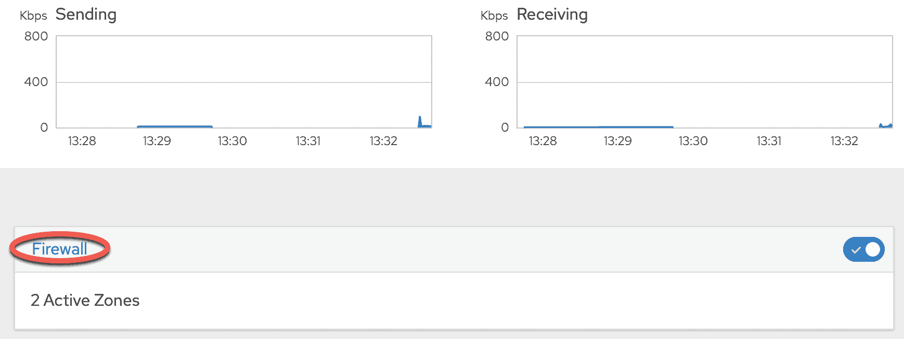

图 13-1

`Firewall` 页面显示了为默认区域配置的当前服务规则（并允许使用垃圾桶按钮删除服务）、向区域添加新服务，以及开启和关闭防火墙：

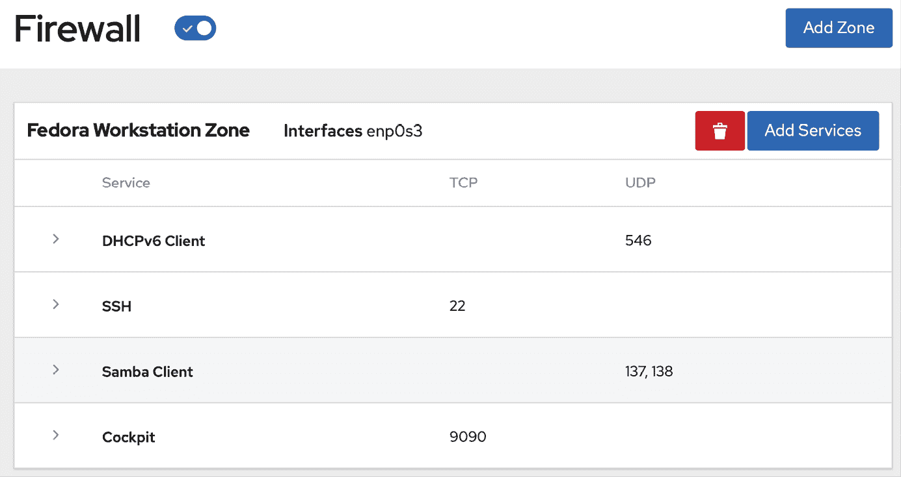

图 13-2

### 13.5 使用 firewall-config 管理 firewalld

如果你可以访问图形化桌面环境，也可以使用 `firewall-config` 工具配置防火墙。虽然它不是默认安装的，但可以通过以下方式安装 `firewall-config`：

```bash
dnf install firewall-config
```

启动后，会出现主 `firewall-config` ，如图 13-3 所示：


图 13-3

该工具的关键区域可以总结如下：

- **A** - 显示所有当前激活的接口以及它们所属的区域。要将接口分配到不同的区域，请从此面板中选择它，点击 `Change Zone`（更改区域）按钮，并在弹出的对话框中选择所需的区域。
- **B** - 控制显示的信息以及在工具内进行的任何更改是应用于运行时规则还是永久规则。
- **C** - 系统上配置的区域、服务或 `IPets` 列表。此面板中列出的信息取决于从工具栏 F 进行的选择。从此面板列表中选择项目将更新标记为 D 的主面板。
- **D** - 包含工具栏 E 中当前选择类别信息的主面板。在本示例中，面板正在显示 `public`（公共）区域的服务。每个服务旁边的复选框控制该服务在防火墙中是否启用。在这些类别面板中可以添加新规则或配置或删除现有规则。
- **E** - 控制面板 D 中显示的内容。从此栏中选择项目将显示所选类别的当前规则。
- **F** - 控制面板 C 中显示的列表。

`firewall-config` 工具使用起来简单且直观，允许许多许多可以使用 `firewall-cmd` 执行的任务在视觉化环境中完成。

### 13.6 总结

一个精心规划和实施的防火墙是任何安全系统的至关组成部分。对于 Fedora 31 而言，`firewalld` 服务提供了一个既灵活又易管理的防火墙系统。

`firewalld` 服务使用“区域（zones）”的概念将一组防火墙规则组合，并包含了一系列预定义的区域，旨在满足各种防火墙保护需求。这些区域可以被修改以添加或删除规则，也可以创建并配置全新的区域。系统上连接到网络或互联网的网络设备称为接口（interfaces）。每个接口反都被分配给一个区域。用于 `firewalld` 的主要工具是 `firewall-cmd` 命令行工具和 `firewall-config` 图形实用程序。`Cockpit` Web 界面提供了基本的防火墙管理选项。

## 14. 在 Fedora 31 上配置基于密钥的 SSH 身份验证

安装 Fedora 31 系统时，默认配置允许通过 Secure Shell (SSH) 连接进行远程命令行访问。这为 root 账户（如果账户已启用）以及安装期间添加的任何其他用户提供了密码保护和加密的系统访问。这种级别的安全性远不足，应尽快升级为基于 SSH 密钥的身份验证。

本章将概述通过实施基于密钥的 SSH 身份验证提高 Fedora 31 系统安全性的步骤。

### 14.1 Secure Shell (SSH) 概述

`SSH` 设计用于安全远程访问系统，以获取 shell 访问并传输文件和数据。正如“使用 VNC 进行 Fedora 31 远程桌面访问” 中提到的，`SSH` 还可以提供一个安全隧道，通过该隧道可以在网络连接上实现对 GNOME 桌面的远程访问。

基础的 `SSH` 配置由一个客户端（用于建立连接的计算机）和一个服务器（运行在要建立连接的系统上）组成。例如，用户可以使用运行在 Linux、Windows 或 macOS 系统上的 `SSH` 客户端连接到运行在 Fedora 31 系统上的 `SSH` 服务器，以访问 shell 命令行提示符或执行文件传输。客户端和服务器之间的所有通信（包括为了访问而输入的密码）都经过加密，防止外部人员截获数据。

基础 `SSH` 实现的固有弱点是它完全依赖于分配给系统账户的密码强度。如果恶意第三方能够识别出账户的密码，系统就会变得脆弱。可以通过实施基于密钥的身份验证来解决这一问题。

### 14.2 基于密钥的身份验证

基于密钥的 `SSH` 验证利用非对称公钥加密为远程访问增加额外的安全性。公钥加密的概念于 1975 年由 Whitfield Diffie 和 Martin Hellman 发明，基于使用一对密钥（私钥和一个公钥）的概念。

在公钥加密系统中，公钥用于加密数据，只有私钥的所有者才能解密。

在 `SSH` 基于密钥的身份验证情况下，私钥由运行 SSH 客户端的主机持有，而相应的公钥位于运行 `SSH` 服务器的系统上。保护私钥非常重要，因为拥有密钥任何人都可以登录远程系统。因此，作为额外的保护层，私钥也可以被加密并由密码保护，每次与服务器连接时都需要输入。

### 14.3 设置基于密钥的身份验证

设置基于密钥的 SSH 验证有四个步骤，总结如下：

1. 生成公钥和私钥。
2. 将公钥安装在服务器上。
3. 测试身份验证。
4. 在服务器上禁用密码身份验证。

本章的剩余部分将为 Linux、macOS 和基于 Windows 的客户端操作系统详细说明这些步骤。

### 14.4 安装并启动 SSH 服务

如果系统上尚未安装并运行 SSH 服务，可以通过以下命令添加：

```bash
dnf install openssh-server
systemctl start sshd.service
systemctl enable sshd.service
```

### 14.5 从 Linux 和 macOS 客户端进行基于密钥的身份验证

设置基于密钥身份验证的第一步是在客户端系统上生成密钥对。如果客户端系统运行 Linux 或 macOS，则使用 `ssh-keygen` 工具实现这一点：

```bash
ssh-keygen
```

这将产生类似下面的输出：

```text
Generating public/private rsa key pair.

Enter file in which to save the key (/home/<username>/.ssh/id_rsa):
```

按下回车键以接受密钥文件的默认位置。这将在当前用户主目录的 `.ssh` 子目录中放置两个文件。私钥将存储在名为 `id_rsa` 的文件中，而公钥将保存在名为 `id_rsa.pub` 的文件中。

接下来，`ssh-keygen` 将提示输入一个短语（passphrase）用以保护私钥。如果提供了短语，私钥将在本地磁盘上进行加密，并在访问远程系统时需要该短语。为了更高的安全，建议使用短语。

输入短语（留空表示不使用短语）：

最后，`ssh-keygen` 工具将生成以下输出，表示密钥已生成：

```
Your identification has been saved in /home/neil/.ssh/id_rsa.
Your public key has been saved in /home/neil/.ssh/id_rsa.pub.

The key fingerprint is:

SHA256:FOLGWEEGFIjWnCT5wtTOv5VK4hdimzWghZizUEMYbfo <username>@<hostname>

The key’s randomart image is:

+---[RSA 2048]----+
|.BB+=+*.. |
|o+B= * . . |
|===.. + . |
|*+ * . . |
|.++ o S |
|..E+ * o |
| o B * |
| + + |
| . |
+----[SHA256]-----+
```

下一步是将公钥安装到远程服务器系统。可以使用 `ssh-copy-id` 工具如下来实现：

```
$ ssh-copy-id username@remote_hostname
```

例如：

```
$ ssh-copy-id neil@192.168.1.100
/usr/bin/ssh-copy-id: INFO: Source of key(s) to be installed: "/home/neil/.ssh/id_rsa.pub"
/usr/bin/ssh-copy-id: INFO: attempting to log in with the new key(s), to filter out any that are already installed
/usr/bin/ssh-copy-id: INFO: 1 key(s) remain to be installed -- if you are prompted now it is to install the new keys
neil@192.168.1.100’s password:
Number of key(s) added: 1
```

现在尝试登录机器，使用：`"ssh ‘neil@192.168.1.100’"` 并确保只添加了你想要的密钥。

密钥安装完成后，尝试使用 `ssh` 客户端进行远程登录以测试身份验证工作：

```
$ ssh -l <username> <hostname>
```

如果私钥已加密并用短语保护，在提示时输入该短语以完成身份验证并建立到 Fedora 31 系统的远程访问：

```
Enter passphrase for key ‘/home/neil/.ssh/id_rsa’:
Last login: Thu Feb 21 13:41:23 2019 from 192.168.1.101
[neil@demosystem02 ~]$
```

对服务器上任何需要远程访问的账户重复这些步骤。如果其他客户端系统也需要访问，只需将 `id_rsa` 私钥文件复制到其他系统主文件夹的 `.ssh` 子目录中。

按照目前的配置，仍然可以使用安全性较低的密码验证访问远程系统。一旦你验证了基于密钥的身份验证有效，登录远程系统，编辑 `/etc/ssh/ssh_config` 文件并将 `PasswordAuthentication` 设置为 `no`：

```
PasswordAuthentication no
```

保存文件并重启 `sshd` 服务：

```bash
# systemctl restart sshd
```

从现在起，将仅允许通过基于密钥的身份验证远程访问系统。

### 14.6 管理多个密钥

在客户端系统中存在多个私钥（每个密钥提供对不同服务器的访问）并不罕见。在建立连接时，有多种选项可以选择特定的密钥。例如，可以在启动 `ssh` 客户端时如下所示指定要使用的私钥文件：

```
$ ssh -l neilsmyth -i ~/.ssh/id_work
```

或者，可以使用 `ssh` 客户端配置文件将密钥文件与服务器关联。名为 `config` 的配置文件必须位于用户主目录的 `.ssh` 目录中，并用于配置各种选项，包括私钥文件、使用的默认端口、默认用户以及用于引用服务器的简短别名。以下 `config` 文件为两个服务器定义了不同的密钥文件，并允许通过别名 `home` 和 `work` 进行引用：

```
Host work
    HostName <hostname>
    IdentityFile ~/.ssh/id_work
Host home
    HostName <hostname>
    IdentityFile ~/.ssh/home
```

在设置配置文件之前，用户会使用以下命令连接到 `work`：

```
$ ssh -l neilsmyth -i ~/.ssh/id_work
```

现在命令可以缩短为：

```
$ ssh work
```

通过运行以下命令可以找到 `config` 文件选项的完整列表：

```
$ man ssh_config
```

### 14.7 从 Windows 10 进行基于密钥的身份验证

最近版本的 Windows 10 包含了 OpenSSH 子集，这使得可以在 Windows 10 客户端上设置基于密钥的身份验证。在 Windows 系统上，通过按下 `Win+X` 并选择 PowerShell，可以使用与 Linux 和 macOS 类似的步骤来设置基于密钥的身份验证。

如果你已经有了现有的密钥，只需将 `id_rsa` 私钥文件复制到其他系统主文件夹的 `.ssh` 子目录中。按照目前的配置，仍然可以使用安全性较低的密码验证访问远程系统。一旦你验证了基于密钥的身份验证有效，登录远程系统，编辑 `/etc/ssh/ssh_config` 文件并将 `PasswordAuthentication` 设置为 `no`。

在 PowerShell 窗口中，使用以下命令测试身份验证工作：

```
$ ssh -l <username> <hostname>
```

在 Windows 10 客户端上，使用以下命令：

```
PS C:\Users\neil> ssh -l <username> <hostname>
```

例如：

```
PS C:\Users\neil> ssh -l neil 192.168.1.100
Enter passphrase for key ‘C:\Users\neil\.ssh\id_rsa’:
```

在提示时输入短语以完成身份验证。如果不存在私钥，请在 PowerShell 窗口中使用 `ssh-keygen` 工具生成新的密钥对。一旦生成了密钥，它们将再次位于主目录的 `.ssh` 目录，并且需要将 Windows 10 系统的公钥文件 `id_rsa.pub` 安装到 Fedora 31 系统。遗憾的是，Windows PowerShell 不包含 `ssh-copy-id` 工具，因此此任务需要手动执行。

在 PowerShell 窗口中，进入 `.ssh` 目录并显示 `id_rsa.pub` 文件的内容：

```
PS C:\Users\neil> cd .ssh
PS C:\Users\neil\.ssh> type id_rsa.pub
```

高亮文件内容并使用 `Ctrl-C` 快捷键复制。留在 PowerShell 窗口中，使用密码验证登录远程系统：

```
PS C:\Users\neil\.ssh> ssh -l <username> <hostname>
```

登录后，检查 `.ssh` 子目录是否存在。如果不存在，使用如下命令创建它：

```
$ mkdir .ssh
```

进入 `.ssh` 目录并检查是否存在名为 `authorized_keys` 文件。如果不存在，创建它并将来自 Windows 10 系统的公钥内容粘贴其中。

如果 `authorized_keys` 文件已存在，它很可能包含了其他密钥。如果是这样，编辑该文件并将新的公钥粘贴在文件末尾。例如，以下文件包含了两个密钥：


```text
ssh-rsa AAAAB3NzaC1yc2EAAAADAQABAAABAQCzRWH27Xs8ZA5rIbZXKgxFY5XXauMv+6F5PljBLJ6j+9nkmykVe3GjZTp3oD+KMRbT2kTEPbDpFD67DNL0eiX2ZuEEiYsxZfGCRCPBGYmQttFRHEAFnlS1Jx/G4W5UNKvhAXWyMwDEKiWvqTVy6syB2Ritoak+D/Sc8nJflQ6dtw0jBs+S7Aim8TPfgpi4p5XJGruXNRScamk68NgnPfTL3vT726EuABCk6C934KARd+/AXa8/5rNOh4ETPstjBRfFJ0tpmsWWhhNEnwJRqS2LD0ug7E3yFI2qsNKGEzvAYUC8Up45MRP7liR3aMlCBil1tsy9R+IB7oMEycZAe/qj neil@localhost.localdomain

ssh-rsa AAAAB3NzaC1yc2EAAAADAQABAAABAQDFgx1vzu59lll6/uQw7FbmKVsQ3fzLz9MW1fgo4sdsxXp81wCHNAlqcjx1Pgr9BJPXWUMInQOi7BQ5I+vc2xQ2AS0kMq3ZH9ybWuQe/U2GjueXZd0FKrEXrT55wM36Rm6Ii3roUCoGCzGR8mn95JvRB3VtCyDdzTWSi8JBPK5gV5oOxNTNPsewlLzouBlCT1qW3CKwEiIwu8S9MTL7m3nrcaNeLewTTHevvHw4QDwzFQ+B0PDg96fzsYoTXVhzyHSWyo6H0gqrft7aK+gILBtEIhWTkSVEMAzy1piKtCr1IYTmVK6engv0aoGtMUq6FnOeGp5FjvKkF4aQkh1QR28r neil@DESKTOP-S8P8D3N
```

一旦公钥安装在服务器上，请通过从 Windows 10 PowerShell 窗口登录服务器来测试身份验证，例如：

```bash
PS C:\Users\neil\.ssh> ssh -l neil 192.168.1.100
```

```text
Enter passphrase for key 'C:\Users\neil/.ssh/id_rsa':
```

当所有账户都设置并验证了基于密钥的身份验证后，按照上一节末尾所述，在 Fedora 31 系统上禁用密码身份验证。

### 14.8 使用 PuTTY 进行 SSH 密钥认证

对于没有提供 OpenSSH 的 Windows 系统，或者作为使用 PowerShell 更灵活的替代方案，`PuTTY` 工具是一个被广泛使用的替代方案。使用 `PuTTY` 的第一步是在任何需要 SSH 客户端的 Windows 系统上下载并安装它。`PuTTY` 是一个免费的实用程序，可以通过以下链接下载：

[`www.chiark.greenend.org.uk/~sgtatham/putty/latest.html`](https://www.chiark.greenend.org.uk/~sgtatham/putty/latest.html)

下载与你的 Windows 系统匹配的 Windows 安装可执行文件（提供 32 位和 64 位版本），然后运行安装程序完成安装。

如果另一个系统上已存在私钥，请在当前用户的家目录中创建 `.ssh` 文件夹，并将私钥 `id_rsa` 密钥复制其中。

接下来，需要使用 `PuTTYgen` 工具将私钥文件转换为 `PuTTY` 私钥格式文件。在 Windows 开始菜单中找到此实用程序并启动它：


图 14-2

启动后，点击位于 `Actions` 区域的 `Load` 按钮，并导航到之前复制到 `.ssh` 文件夹中的私钥文件（请注意，可能需要将文件类型过滤器改为 `All Files (*.*)` 才能看到密钥文件）。找到后，选择该文件并加载到 `PuttyGen` 中。在提示时，输入最初用于加密该文件的短语。导入私钥后，点击 `Save Private Key` 按钮将其保存为 `PuTTY` 密钥文件。为了一致性，将密钥文件保存到 `.ssh` 文件夹，但赋予它不同的名称以区别于原始密钥文件。

从开始菜单启动 `PuTTY`，在主屏幕上输入远程服务器的 IP 地址或主机名，然后选择左侧面板中的 `Connection -> SSH -> Auth` 类别，如[图 14-3]中所示：


图 14-3

点击 `Private key for authentication` 字段旁边的 `Browse` 按钮，导航并选择之前保存的 `PuTTY` 私钥文件。可选情况下，滚动到左侧面板的顶部，选择 `Session` 条目，并在点击 `Save` 按钮之前在 `Saved Sessions` 字段中为会话输入名称。这将保存会话配置，以便以后使用而无需重复操作。最后，点击 `Open` 按钮即可建立连接。

### 14.9 使用 PuTTY 生成私钥

如果 Windows 系统上没有可用的 OpenSSH，或者作为使用 PowerShell 更灵活的替代方案，`PuTTY` 工具是一个被广泛使用的替代方案。使用 `PuTTY` 的第一步是在任何需要 SSH 客户端的 Windows 系统上下载并安装它。`PuTTY` 是一个免费的实用程序，可以通过以下链接下载：

[`www.chiark.greenend.org.uk/~sgtatham/putty/latest.html`](https://www.chiark.greenend.org.uk/~sgtatham/putty/latest.html)

下载与你的 Windows 系统匹配的 Windows 安装可执行文件（提供 32 位和 64 位版本），然后运行安装程序完成安装。

如果另一个系统上已存在私钥，请在当前用户的家目录中创建 `.ssh` 文件夹，并将私钥 `id_rsa` 密钥复制其中。

接下来，需要使用 `PuTTYgen` 工具将私钥文件转换为 `PuTTY` 私钥格式文件。在 Windows 开始菜单中找到此实用程序并启动它：


图 14-2

启动后，点击位于 `Actions` 区域的 `Load` 按钮，并导航到之前复制到 `.ssh` 文件夹中的私钥文件（请注意，可能需要将文件类型过滤器改为 `All Files (*.*)` 才能看到密钥文件）。找到后，选择该文件并加载到 `PuttyGen` 中。在提示时，输入最初用于加密该文件的短语。导入私钥后，点击 `Save Private Key` 按钮将其保存为 `PuTTY` 密钥文件。为了一致性，将密钥文件保存到 `.ssh` 文件夹，但赋予它不同的名称以区别于原始密钥文件。

从开始菜单启动 `PuTTY`，在主屏幕上输入远程服务器的 IP 地址或主机名，然后选择左侧面板中的 `Connection -> SSH -> Auth` 类别，如[图 14-3]中所示：


图 14-3

点击 `Private key for authentication` 字段旁边的 `Browse` 按钮，导航并选择之前保存的 `PuTTY` 私钥文件。可选情况下，滚动到左侧面板的顶部，选择 `Session` 条目，并在点击 `Save` 按钮之前在 `Saved Sessions` 字段中为会话输入名称。这将保存会话配置，以便以后使用而无需重复操作。最后，点击 `Open` 按钮即可建立连接。

### 14.10 为 Google Cloud 安装公钥

如果你的 Fedora 31 系统托管在 Google Cloud 上，例如 Compute Engine 实例，有多种使用元数据进行 SSH 的方法。要添加公钥，登录 Google Cloud 控制台，选择左侧导航中的 `Metadata` 选项，如图 14-5 所示：


图 14-5

在 `SSH Keys` 屏幕上，点击 `Edit` 按钮进行编辑。滚动到底部并点击 `+ Add Item` 按钮。将出现一个新字段，你需要在其中粘贴 `id_rsa.pub` 文件中的完整公钥。输入密钥后，点击 `Save` 按钮。

公钥出现在 `SSH Keys` 列表中。注意密钥条目还包括登录任何虚拟机时必须使用的用户名：


图 14-6

一旦公钥添加到元数据，就可以从任何安装了相应私钥的客户端访问虚拟机。

事实上，Google Cloud 在此方面所做的所有工作是将公钥添加到虚拟机用户家目录下的 `.ssh/authorized_keys` 文件中。

### 14.11 总结

确保对 Fedora 31 系统的任何远程访问都以高安全级别的方式是非常重要的。默认情况下，Fedora 31 系统允许使用密码身份验证进行 SSH 访问。这使得系统容易受到通过猜解密码或其他方式获取密码的影响。因此，建议使用基于密钥的认证来保护系统访问。密钥认证使用了涉及公钥和私钥的公钥加密概念。实施后，用户只有在使用与服务器上公钥匹配的私钥时才能连接服务器。作为额外的安全层，私钥也可以进行加密和密码保护。一旦实施了密钥加密，服务器系统将配置为禁用这种不安全的密码身份认证。

本章概述了 SSH 密钥认证，并概述了在 macOS、Linux 和 Windows 上生成密钥和配置客户端的步骤，以及在 Fedora 31 服务器上安装和管理公钥。

## 15\. 使用 VNC 进行 Fedora 31 远程桌面访问

Fedora 31 可以配置为通过网络或互联网连接提供图形化桌面环境的远程访问。虽然默认未启用，但从网络或互联网上的任何其他系统显示并访问 Fedora 31 桌面是相对直接的。无论该系统运行的是 Linux、Windows 还是 macOS，都可以实现这一目标。事实上，Android 和 iOS 上甚至也有可用的应用程序，可以让你从几乎任何有数据信号的地方访问你的 Fedora 31 桌面。

远程桌面访问在许多场景下都非常有用。例如，它允许你或其他人从同一网络或通过互联网上的另一台计算机系统查看并与你的 Fedora 31 桌面环境进行交互。当你离开座位（例如旅行期间）需要使用电脑工作时，这非常有用。当同事或 IT 支持人员需要访问你的桌面来解决问题时，它也很有用。

在 Fedora 31 系统运行在云服务器上的情况下，它还允许访问桌面环境，作为使用命令行提示符或 `Cockpit` Web 控制台执行管理任务的替代方案。

Fedora 31 的远程桌面功能基于称为虚拟网络计算（VNC）的技术，在本章中，我们将涵盖在 Fedora 31 中配置和使用远程桌面的关键方面。

### 15.1 安全与不安全的远程桌面访问

在本章中，我们将涵盖安全和不安全的远程桌面访问方法。假设你是在安全内部网络的环境下从一个系统访问另一个系统，那么通常使用不安全的访问方法是安全的。另一方面，如果你计划通过任何种类的公共网络远程访问桌面，则必须使用安全的访问方法，以避免你的系统和数据受到损害。

### 15.2 安装 GNOME 桌面环境

当然，只有在安装了桌面本身的情况下，才可能访问桌面环境。例如，如果系统最初配置为服务器，那么很可能没有安装桌面包。运行 GNOME 桌面所需的软件包，最简单的方法是执行组安装（group install）。安装软件包包组以启用特定功能的关键在于知道组的名称。在编写本文时，Fedora 31 上安装桌面环境的组名为“Fedora Workstation”。由于组名称倾向于在不同的 Fedora 版本之间发生变化，因此使用 `dnf` 工具按照如下方式获取已安装或可安装的组列表是有用的：

```bash
dnf grouplist
```

可用的环境组：

- Fedora 自定义操作系统

- 最小安装 (Minimal Install)

- Fedora Workstation

- Fedora 云服务器

- KDE Plasma 工作空间

- Xfce 桌面

- LXDE 桌面

- LXQt 桌面

- Cinnamon 桌面

- MATE 桌面

- Sugar 桌面环境

- Deepin 桌面

- 开发与创意工作站

- Web 服务器

- 基础设施服务器

- 基础桌面

在上面的示例中，Fedora Workstation 环境组列为可用（因此尚未安装）。若要在安装前获取有关组内容的更多信息，请使用以下命令：

```bash
dnf groupinfo "fedora workstation"
```

最后元数据过期检查：2020 年 1 月 2 日周四上午 10:59:36 EST， 18 分钟前。

环境组：Fedora Workstation

描述：Fedora Workstation 是一个适用于笔记本电脑和 PC 的友好桌面系统。

强制组：

- 通用 NetworkManager 子模块

- 容器管理

- Core

- Fedora Workstation 产品核心

- Firefox 浏览器

- 字体

- GNOME

- 访客桌面代理

- 硬件支持

- LibreOffice

- 多媒体

- 打印支持

- base-x

可选组：

- ARM 工具

确认是正确的组后，可以按照如下方式安装：

```bash
dnf groupinstall "fedora workstation"
```

安装完成后，并假设系统已添加了显示器，可以使用以下命令启动桌面：

```bash
startx
```

相反，如果系统是没有直接连接显示器的服务器，运行和访问桌面的唯一方法将是在系统上配置 VNC 支持。

### 15.3 在 Fedora 31 上安装 VNC

访问远程桌面需要在远程系统上安装 VNC 服务器，在建立访问的系统上安装 VNC 查看器，并且可选需要一个安全的 SSH 连接。虽然有多种 VNC 服务器和查看器实现，但 Fedora 已经统一采用 TigerVNC，它为基于 Linux 的操作系统提供了服务器端和查看器组件。非 Linux 平台的 VNC 查看器客户端包括 RealVNC 和 TightVNC。

要在 Fedora 31 上安装 TigerVNC 服务器包，只需运行以下命令：

```bash
dnf install tigervnc-server
```

如果需要，也可以按照如下方式安装 TigerVNC 查看器：

```bash
dnf install tigervnc
```

服务器安装完成后，系统需要配置为运行一个或多个 VNC 服务，并在防火墙上打开相应的端口。

### 15.4 配置 VNC 服务器

安装 VNC 服务器包后，下一步是配置服务器。第一步是为访问远程桌面环境的用户指定密码。以 root 身份登录时，执行以下命令（假设用户名为 demo）：

```bash
su - demo
[demo@demoserver ~]$ vncpasswd
Password:
Verify:
您想输入一个只读密码吗 (y/n)? n
不使用只读密码
[demo@demoserver ~]$ exit
```

接下来，需要在 `/etc/systemd/system` 目录下创建一个名为 `vncserver@.service` 的 VNC 服务器配置文件。该文件的内容如下，其中所有的 `<USER>` 替换为用户名：

```ini
[Unit]
Description=远程桌面服务 (VNC)
After=syslog.target network.target

[Service]
Type=forking
WorkingDirectory=/home/<USER>
User=<USER>
Group=<USER>
ExecStartPre=/bin/sh -c '/usr/bin/vncserver -kill %i > /dev/null 2>&1 || :'
ExecStart=/usr/bin/vncserver -autokill %i
ExecStop=/usr/bin/vncserver -kill %i
Restart=on-success
RestartSec=15

[Install]
WantedBy=multi-user.target
```

接下来，需要配置防火墙以允许外部访问 VNC 服务器，例如：

```bash
firewall-cmd --permanent --zone=public --add-port=5901/tcp
firewall-cmd --reload
```

服务配置完成后，需要如下所示启用并启动服务：

```bash
systemctl daemon-reload
systemctl start vncserver@:1.service
systemctl enable vncserver@:1.service
```

注意服务名中的 `:1` 表示这是显示器 1 的服务。这与之前在防火墙中打开的端口 5901 相匹配。

如下所示检查服务是否成功启动：

```bash
systemctl status vncserver@:1.service
```

如果服务启动失败，运行以下命令检查错误信息：

```bash
journalctl -xe
```

同时在重启系统后再次尝试。如果服务持续失败，可以通过登录指定用户并运行以下命令手动启动 VNC 服务器：

```bash
vncserver :1
```

### 15.5 连接到 VNC 服务器

各种操作系统都有 VNC 查看器实现，快速搜索互联网可能会提供许多有关如何在所选平台上获取和安装此工具的详细链接。

在安装了 TigerVNC 等 VNC 查看器的 Linux 系统桌面上，可以从终端窗口如下所示建立远程桌面连接：

```bash
vncviewer <hostname>:<display number>
```

在上面的示例中，`<hostname>` 是远程系统的主机名或 IP 地址，`<display number>` 是 VNC 服务器桌面的显示数字，例如：


进入`/path/to/xxx`目录，找到`xxx.json`。

在表达式`cvar = avar + bvar`中，加法运算符（`+`）将`avar`与`bvar`相加，得到它们的和`cvar`。

在`List.of(arg0, arg1, arg2)`中，`List`接口的工厂方法`of()`接受一系列的元素，返回包含它们的只读列表。

之后我们这样调用`cmd`命令：`cmd arg0 arg1 arg2`。

```
if (condVar > someVal) {console.log("xxx")}
```


```bash
systemctl start rpcbind
systemctl start nfs-server
```

### 17.2 配置 Fedora 31 火墙允许 NFS 流量

接下来，需要配置防火墙以允许 NFS 流量。为了实现这一点，运行以下`firewall-cmd`命令，并将`<zone>`替换为适用于你的防火墙和系统的配置区域：

```bash
firewall-cmd --zone=<zone> --permanent --add-service=mountd
firewall-cmd --zone=<zone> --permanent --add-service=nfs
firewall-cmd --zone=<zone> --permanent --add-service=rpc-bind
firewall-cmd --reload
```

### 17.3 指定要共享的文件夹

现在 NFS 已经运行且防火墙已配置完成，我们需要指定远程 Linux 或 UNIX 系统可以访问 Fedora 31 文件系统的哪些部分。这些设置可以在`/etc/exports`文件中声明，需要修改该文件以导出目录以便通过 NFS 进行远程访问。该文件中导出行（export line）的语法如下：

`<export> <host1>(<options>) <host2>(<options>)...`

在上述行中，`<export>`被替换为要导出的目录，`<host1>`是被授予访问权限的系统名称或 IP 地址，`<options>`代表对该访问施加的限制（只读、读写等）。如果需要，可以在同一行中放置多个主机和选项项。例如，下行向 IP 地址为`192.168.2.38`的主机授予`/datafiles`目录的只读权限：

```text
/datafiles 192.168.2.38(ro)
```

允许使用通配符将导出应用到多个主机。例如，下行允许所有外部主机对`/home/demo`进行读写访问：

```text
/home/demo *(rw)
```

通过阅读`exports`帮助页可以找到`exports`文件支持的所有选项列表：

```bash
man exports
```

出于本章的目的，我们将如下配置`/etc/exports`文件：

```text
/tmp *(rw)
/vol1 192.168.2.21(ro)
```

配置完成后，需要使用`exportfs`命令更新由 NFS 远程访问的导出文件系统表：

```bash
exportfs -a
```

也可以使用`exportfs`查看当前的导出设置：

```bash
exportfs
```

上述命令将生成以下输出：

```text
/tmp
/vol1
```

### 17.4 访问共享的 Fedora 31 文件夹

可以通过手动从命令行从客户端系统挂载共享文件夹。在尝试挂载远程文件夹之前，应先在客户端系统上安装`nfs-utils`包：

```bash
dnf install nfs-utils
```

要从命令行挂载远程文件夹，打开终端窗口并在你想挂载远程文件夹的地方创建一个：

```bash
mkdir /home/demo/tmp
```

接下来，使用远程服务器的 IP 地址或主机名输入挂载远程文件夹的命令，例如：

```bash
mount -t nfs 192.168.1.115:/tmp /home/demo/tmp
```

远程`/tmp`文件夹将被挂载到本地系统。挂载后，`/home/demo/tmp`文件夹将包含远程的内容。

挂载远程 NFS 文件系统也可以指定选项。例如，以下命令挂载相同的文件夹，但将其配置为只读：

```bash
mount -t nfs -o ro 192.168.1.115:/tmp /home/demo/tmp
```

### 17.5 在系统启动时挂载 NFS 文件系统

也可以通过编辑`/etc/fstab`文件，配置 Fedora 31 系统在每次启动时自动挂载远程文件系统。加载到编辑器后，它可能类似于如下：

```text
/dev/mapper/fedora_localhost--live-root / xfs defaults 0 0
UUID=4b7174c5-8250-400f-b5dd-1a52b2cdf4a3 /boot xfs defaults 0 0
/dev/mapper/fedora_localhost--live-swap none swap defaults 0 0
```

例如，为了将位于 IP 地址`192.168.1.115`的系统上的`/tmp`文件夹挂载到本地路径`/home/demo/tmp`（注意此文件夹必须已存在），请向`/etc/fstab`文件添加以下行：

```text
192.168.1.115:/tmp /home/demo/tmp nfs rw 0 0
```

下次重启系统时，远程系统上的`/tmp`文件夹将挂载到本地`/home/demo/tmp`挂载点。此时，远程文件夹中的所有文件都可以像位于本地硬盘驱动器上一样被访问。

### 17.6 卸载 NFS 挂载点

一旦使用`NFS`挂载了远程文件系统，就可以使用`umount`命令并将本地挂载点作为命令行参数来将其卸载。例如，以下命令将卸载我们的示例文件系统挂载点：

```bash
umount /home/demo/tmp
```

## 17.7 在 Cockpit 中访问 NFS 文件系统

除了使用命令行在客户端上挂载远程 NFS 文件系统外，也可以在 Cockpit Web 界面内执行挂载操作。假设 Cockpit 已经在客户端系统上安装并配置妥当，请从 Web 浏览器中登录 Cockpit 界面，并从左侧导航面板选择`Storage`（存储）选项。如果没有列出`Storage`选项，则需要安装`cockpit-storaged`软件包并按照如下方式重启`cockpit`服务：

```bash
dnf install cockpit-storaged
systemctl restart cockpit.socket
```

一旦 Cockpit 服务重启完成，重新登录 Cockpit 界面，此时`Storage`选项应该是可见的。

选择该选项后，主存储页面将包含一个列出所有当前挂载的 NFS 文件系统的部分，如图 17-1 所示：


图 17-1

要挂载远程文件系统，点击上方高亮的“+”按钮，并在生成的对话框中输入远程 NFS 服务器和文件系统共享的信息，以及本地挂载点和任何必要的选项，然后点击`Add`（添加）按钮：


图 17-2

要修改、卸载或删除 NFS 文件系统共享，请在 NFS 挂载列表中选择相应的挂载项（见上方图 17-1），以显示下方图 17-3 所示的页面：


图 17-3

在此屏幕内执行各项任务，如更改服务器或挂载点，或卸载文件系统。`Remove`（移除）选项会卸载文件系统并从`/etc/fstab`文件中删除该条目，因此在下次系统重启时不会重新挂载。

### 17.8 总结

网络文件系统 (`NFS`) 是一种基于客户端/服务器的系统，最初由 Sun Microsystems 开发，为 Linux 和 Unix 系统提供了通过网络共享文件系统的方法。`NFS`允许客户端系统访问（在权限允许的情况下）修改位于远程服务器上的文件，就好像这些文件存储在本地文件系统上一样。本章提供了`NFS`的概述，并概述了使用命令行或 Cockpit Web 界面配置客户端和服务器系统的可用选项。

## 18. 使用 Samba 在 Fedora 31 和 Windows 系统之间共享文件

尽管 Linux 在桌面市场取得了一足足进展，但它的起源和未来在很大程度上仍然基于服务器的。因此，Fedora 31 能够作为文件服务器并不意外。在网络化环境中，Fedora 和 Windows 系统并肩使用也是极其常见的。因此，一个常见的需求是 Fedora 31 系统上的文件能够通过网络连接被 Linux、UNIX 和基于 Windows 的系统访问。同样，位于 Windows 系统上的共享文件夹和打印机也可能需要被基于 Fedora 31 的系统访问。

Windows 系统使用名为 Server Message Block (`SMB`) 的协议共享文件系统和打印机等资源。为了让 Fedora 31 系统能够向 Windows 系统提供此类资源，反之亦然，它必须支持`SMB`。这是通过名为`Samba`的技术实现的。`Samba`除了提供 Linux 和 Windows 系统之间的集成外，还可以用于提供 Linux 系统之间的文件夹共享（作为上一章介绍的`NFS`的替代方案）。

在本章中，我们将查看在 Fedora 31 系统上与远程 Windows 和 Linux 系统共享文件系统资源和打印机的必要步骤，以及从 Fedora 31 访问 Windows 资源。

### 18.1 Samba 和 Samba 客户端

`Samba`允许 Fedora 31 资源与 Windows 系统共享，同时也允许 Windows 资源与 Fedora 31 系统共享。Fedora 使用`Samba`客户端访问 Windows 资源。另一方面，Fedora 资源是通过安装和配置`Samba`服务来与 Windows 系统共享的。

### 18.2 在 Fedora 31 系统上安装 Samba

Fedora 31 安装过程中使用的默认设置通常不会安装必要的`Samba`软件包。除非你特别要求安装`Samba`，否则你的系统中可能没有安装`Samba`。要检查是否安装了`Samba`，请打开终端窗口并运行以下`rpm`命令：

```bash
rpm -q samba samba-common samba-client
```

如果没有安装任何`Samba`软件包，`rpm`将返回“package is not installed”。在这种情况下，可以使用`dnf`命令行工具进行安装：

```bash
dnf install samba samba-common samba-client
```

### 18.3 配置 Fedora 31 防火墙启用 Samba

接下来，需要配置当前保护 Fedora 31 系统的防火墙以允许`Samba`流量。要实现这一点，请如下所示运行`firewall-cmd`命令：

```bash
firewall-cmd --permanent --add-port={139/tcp,445/tcp}
firewall-cmd --reload
```

在启动`Samba`服务之前，需要进行若干配置步骤来定义 Fedora 如何向 Windows 系统显示，以及共享哪些资源。大多数配置任务都在`/etc/samba/`内完成。

### 18.4 配置 Samba 文件

早期的 Fedora 版本包含一个名为`system-config-samba`的用户友好工具来辅助配置 Samba。在较新的版本中，该工具已被移除。这意味着`Samba`环境必须在`/etc/samba/`内手动配置，并使用`smbpasswd`命令行工具。虽然那些依赖它的人可能会怀念`system-config-samba`，但该工具的简单性实际上掩盖了 Samba 的许多高级功能。实践中，花时间理解`smb.conf`文件的细节可以实现更多。

`Samba`是一个高度灵活且可配置的系统，为网络资源共享提供了许多不同的选项。这种灵活性可能会让人认为`Samba`操作起来非常复杂。然而实际上，并不需要许多配置选项，设置基础配置的学习曲线非常短。

对于本章而言，我们将查看将 Fedora 31 系统加入 Windows 工作组，并设置一个目录作为供特定用户访问的共享资源。这种配置被称为独立`Samba`服务器。更高级的配置（例如将 Samba 集成到 Active Directory 环境中）也是可能的，但这些超出了本书的范围。

配置 Samba 的第一步是编辑`/etc/samba/smb.conf`文件。

#### 18.4.1 配置 [global] 部分

`smb.conf`文件被分为多个部分。第一部分是`[global]`部分，可以在其中指定适用于整个 Samba 配置的设置。虽然这些设置是全局的，但每个选项都可以在配置的其他部分被覆盖。

第一个任务是定义共享 Fedora 31 资源的 Windows 工作组名称。这是通过`[global]`部分的`workgroup =`指令控制的，其默认配置如下：

`workgroup = SAMBA`

首先将其更改为实际的工作组名称。例如，如果工作组名为`WORKGROUP`（大多数 Windows 网络的默认值）：

```ini
[global]
       workgroup = WORKGROUP
```

```
security = user
passdb backend = tdbsam
```

除了工作组（workgroup）设置外，其他设置表明这是一个独立服务器，共享资源将由用户密码保护。在继续配置要共享的资源之前，还需要如下所示向`[global]`部分添加其他一些其他参数：

```ini
[global]
workgroup = WORKGROUP
security = user
netbios name = LinuxServer
passdb backend = tdbsam
log file = /var/log/samba/%m.log
log level = 1
```

`netbios name`属性指定了服务器在网络上其他系统可见的名称，而日志设置则指定了记录日志输出的文件位置。

## 18.4.2 配置共享资源

下一步是配置共享的资源（换句话说，就是从 Windows 网络上的其他系统访问的资源）。为了实现这一点，需要为该部分指定一个名称，在共享时将通过该名称进行引用。例如，如果我们计划共享 Fedora 31 系统的`/sampleshare`目录，我们可以将该部分命名为`[sampleshare]`。在此部分中可以使用各种配置选项。然而，为了本示例的目的，我们只需定义要共享的目录，指示该目录既可浏览又可写，并声明该资源为公共，以便访客用户能够访问：

```ini
[sampleshare]
comment = Example Samba share
path = /sampleshare
browseable = Yes
public = yes
writable = yes
```

若要限制特定用户的访问，可以使用`valid users`属性，例如：

```ini
valid users = demo, bobyoung, marcewing
```

## 18.4.3 移除不必要的共享

`smb.conf`文件预先配置了用于共享打印机和系统用户主目录的节。如果不需要共享这些资源，可以将相应的部分注释掉，以便 Samba 忽略它们。在下面的示例中，`[homes]`部分已被注释掉：

```ini
#[homes]
# comment = Home Directories
# valid users = %S, %D%w%S
# browseable = No
# read only = No
# inherit acls = Yes
```

## 18.5 为 Samba 配置 SELinux

SELinux 是一个默认集成到所有 Fedora 31 系统 Linux 内核中的系统，它为操作系统和用户文件提供了额外的安全层和保护。

传统上，Linux 的安全性基于允许用户决定谁可以访问其拥有所有权的文件和其他资源的概念。例如，考虑一个位于特定用户主目录并由该用户拥有的文件。用户能够控制该文件的访问权限，即系统上的其他用户是否能够读取、写入该文件，或者在脚本或二进制文件的情况下执行该文件。这种安全性被称为**酌情访问控制**（discretionary access control），因为对资源的访问取决于用户的主意。

然而，通过 SELinux，访问由系统管理员控制，且无法被用户覆盖。这被称为**强制访问控制**（mandatory access control），由管理员使用 SELinux 策略定义。继续上一个例子，文件所有者只有在系统默认或管理员定义的 SELinux 策略允许的情况下，才能对该文件执行操作。

可以使用`sestatus`工具按照如下所示识别 Fedora 31 系统上 SELinux 的当前状态：

```bash
# sestatus
SELinux status: enabled
SELinuxfs mount: /sys/fs/selinux
SELinux root directory: /etc/selinux
Loaded policy name: targeted
Current mode: enforcing
Mode from config file: enforcing
Policy MLS status: enabled
Policy deny_unknown status: allowed
Memory protection checking: actual (secure)
Max kernel policy version: 31
```

SELinux 可以以强制模式（enforcing）或许可模式（permissive）运行。当启用强制模式时，它会拒绝所有未被 SELinux 策略允许的操作。另一方面，许可模式允许通常会被拒绝的操作继续，但会将违规行为记录在日志文件中。

SELinux 的安全性基于上下文标签（context labels）的概念。系统上的所有资源（包括进程和文件）都被分配了由用户、角色、类型和可选安全级别的 SELinux 上下文标签。例如，文件或文件夹的 SELinux 上下文可以如下所示：


```bash
$ ls -Z /home/demo
unconfined_u:object_r:user_home_t:s0 Desktop
unconfined_u:object_r:user_home_t:s0 Documents
```

同样，可以使用`ps`命令识别运行进程的上下文，在此例中为`ls`命令：

```bash
$ ps -eZ | grep ls
unconfined_u:unconfined_r:unconfined_t:s0-s0:c0.c1023 14311 tty1 00:00:18 ls
```

当进程（如上述`ls`命令）尝试访问文件或文件夹时，SELinux 系统将检查策略以识别是否允许访问。现在考虑 Samba 服务的上下文：

```bash
$ ps -eZ | grep smb
system_u:system_r:smbd_t:s0 14129 ? 00:00:00 smbd
system_u:system_r:smbd_t:s0 14132 ? 00:00:00 smbd-notifyd
```

SELinux 通过多种方式实现安全，最常见的是被称为**类型强制**（type enforcement）。简单来说，当进程尝试对对象执行任务（例如向文件写入）时，SELinux 会检查进程和对象的上下文类型并验证该操作。SELinux 和 Samba 之间的问题在于，SELinux 策略并未被配置为允许类型为`smbd_t`的进程对非`smbd_t`类型的文件执行操作。

### 18.5.1

为了让系统上的文件或文件夹可被 Samba 服务访问，必须将这些资源的强制类型更改为`samba_share_t`。

为了本示例，我们将之前在`smb.conf`中引用的`/sampleshare`目录并更改其强制类型以便 Samba 服务访问。首先创建目录：

```bash
# mkdir /sampleshare
```

接下来，检查目录的 SELinux 上下文：

```bash
$ ls -aZ /sampleshare/
unconfined_u:object_r:default_t:s0 .
```

在这种情况下，文件夹的上下文被分配了`default_t`类型。为了让文件夹能够被 Samba 共享，需要使用`semanage`工具将强制类型设置为`samba_share_t`：

```bash
# semanage fcontext -a -t samba_share_t "/sampleshare(/)?"
```

注意`semanage`命令中通配符的使用，以确保该类型应用到`/sampleshare`目录内的任何子目录和文件。添加后，需要使用`restorecon`命令应用更改，并利用`-R`标志递归处理所有子目录：

```bash
# restorecon -R -v /sampleshare
Relabeled /sampleshare from unconfined_u:object_r:default_t:s0 to unconfined_u:object_r:samba_share_t:s0
```

完成这些更改后，该文件夹已配置符合`smbd`进程的 SELinux 策略，并可以由 Samba 共享。

### 18.6 创建 Samba 用户

任何需要访问 Samba 共享资源的用户都必须配置为 Samba 用户并分配密码。此任务通过使用`smbpasswd`命令行工具完成。例如，假设一个名为`demo`的用户需要从 Windows 系统访问我们 Fedora 31 系统的`/sampleshare`目录。为了满足这一需求，我们必须按照如下方式将`demo`添加为 Samba 用户：

```
smbpasswd -a demo
```

新 SMB 密码：

再次输入新 SMB 密码：

已添加用户 demo。

现在我们已经完成了一个非常基础的 Samba 服务器的配置，是时候测试我们的配置文件并启动 Samba 服务了。

### 18.7 测试`smb.conf`文件

可以使用`testparm`命令行工具按照如下方式检查`smb.conf`文件中的设置是否存在错误：

```
testparm
```

从`/etc/samba/smb.conf`加载 smb 配置文件

rlimit_max: 将 rlimit_max (1024) 增加到 Windows 限制 (16384)

正在处理部分 "[sampleshare]"

正在处理部分 "[homes]"

正在处理部分 "[printers]"

正在处理部分 "[print$]"

加载服务文件 OK。

服务器角色：ROLE_STANDALONE

按回车查看服务定义转储

```
# Global parameters

[global]
log file = /var/log/samba/%m.log
netbios name = LINUXSERVER
printcap name = cups
security = USER
wins support = Yes
idmap config * : backend = tdb
cups options = raw

[sampleshare]
comment = Example Samba share
guest ok = Yes
path = /sampleshare
read only = No

[homes]
browseable = No
comment = Home Directories
inherit acls = Yes
read only = No
valid users = %S %D%w%S

[printers]
browseable = No
comment = All Printers
create mask = 0600
path = /var/tmp
printable = Yes

[print$]
comment = Printer Drivers
create mask = 0664
directory mask = 0775
force group = @printadmin
path = /var/lib/samba/drivers
write list = @printadmin root
```

### 18.8 启动 Samba 和 NetBIOS 名称服务

为了 Fedora 31 服务器能够在 Windows 网络中运行，必须启动 Samba (SMB) 和 NetBIOS 名称服务 (NMB)。作为可选，还可以启用这些服务，以便它们在每次系统启动时自动启动：

```
systemctl enable smb
systemctl start smb
systemctl enable nmb
systemctl start nmb
```

在尝试从 Windows 系统连接之前，使用`smbclient`实用程序验证共享已配置：

```
smbclient -U demo -L localhost
```

输入 WORKGROUP\demo 的密码：

共享名 类型 注

--------- ---- -------

sampleshare Disk Example Samba share

print$ Disk Printer Drivers

IPC$ IPC IPC Service (Samba 4.9.1)

demo Disk Home Directories

正在使用 SMB1 重新连接以列出工作组。

服务器 注

--------- -------

Workgroup Master

--------- -------

WORKGROUP LINUXSERVER

### 18.9 访问 Samba 共享

现在 Samba 资源配置完成且服务正在运行，是时候从 Windows 系统访问共享资源了。在与 Fedora 31 系统处于同一工作组的合适 Windows 系统上，打开 Windows 资源管理器并导航到“网络”面板。此时，资源管理器应该搜索网络并列出它找到的所有使用 SMB 协议的系统。下图说明如何在 Windows 10 系统上使用 Windows 资源管理器找到名为`LINUXSERVER`的 Fedora 31 系统：


图 18-1

双击`LINUXSERVER`主机将提示具有访问权限的用户名和密码。在这种情况下，是我们使用`smbpasswd`工具配置的`demo`账户：


图 18-2

输入用户名和密码后，该用户配置的共享资源将出现在资源管理器中，包括之前配置的`/sampleshare`资源：


图 18-3

双击`/sampleshare`共享资源将显示其中包含的文件和目录列表。

### 18.10 从 Fedora 31 访问 Windows 共享

如前所述，Samba 是双向的，它不仅允许 Windows 系统访问托管在 Fedora 31 系统上的文件和打印机，还允许 Fedora 31 系统访问 Windows 系统上的共享资源。这是通过在本章开始时安装的`samba-client`包实现的。如果尚未安装，请从终端窗口按照如下方式安装：

```
dnf install samba-client
```

可以从 Fedora 桌面环境使用“文件”应用程序访问 Windows 系统上的共享资源，也可以从命令行提示符使用`smbclient`和`mount`工具访问。本节中的步骤假设 Windows 系统上已启用了适当的网络共享设置。

要使用桌面环境访问 Windows 系统上的任何共享资源，首先要启动“文件”应用程序并选择“其他位置”选项。这将显示如图 18-4 所示的屏幕。此时，资源管理器将搜索网络并列出找到的任何使用 SMB 协议的系统。下图展示了在 Windows 10 系统上使用 Windows 资源管理器找到名为`LINUXSERVER`的 Fedora 31 系统：


图 18-1

双击`LINUXSERVER`主机将提示具有访问权限的用户名和密码。在这种情况下，是我们使用`smbpasswd`工具配置的`demo`账户：


图 18-2

输入用户名和密码后，该用户配置的共享资源将出现在资源管理器窗口中，包括之前配置的`/sampleshare`资源：


图 18-3

双击`/sampleshare`共享资源将显示其中包含的文件和目录列表。

### 18.11 总结

在本章中，我们查看了配置 Fedora 31 系统作为 Samba 客户端和服务器的必要步骤，以便与 Windows 系统共享资源。涵盖的主题包括 Samba 客户端和服务器包的安装，以及独立服务器的配置。此外，还介绍了 SELinux 的基本概念，以及为 Samba 提供访问的步骤。

### 19. 虚拟化技术概述

为了让 Fedora 31 服务器在 Windows 网络中运行，必须启动 Samba (SMB) 和 NetBIOS 名称服务 (NMB) 服务。作为可选，还可以启用这些服务，以便它们在每次系统启动时自动启动：

```
systemctl enable smb
systemctl start smb
systemctl enable nmb
systemctl start nmb
```

在尝试从 Windows 系统连接之前，使用`smbclient`实用程序验证共享已配置：

```
smbclient -U demo -L localhost
```

输入 WORKGROUP\demo 的密码：

共享名 类型 注

--------- ---- -------

sampleshare Disk Example Samba share

print$ Disk Printer Drivers

IPC$ IPC IPC Service (Samba 4.9.1)

demo Disk Home Directories

正在使用 SMB1 重新连接以列出工作组。

服务器 注

--------- -------

Workgroup Master

--------- -------

WORKGROUP LINUXSERVER

### 18.9 访问 Samba 共享

现在 Samba 资源配置完成且服务正在运行，是时候从 Windows 系统访问共享资源了。在与 Fedora 31 系统处于同一工作组的合适 Windows 系统上，打开 Windows 资源管理器并导航到“网络”面板。此时，资源管理器应该搜索网络并列出它找到的所有使用 SMB 协议的系统。下图说明了如何在 Windows 10 系统上使用 Windows 资源管理器找到名为`LINUXSERVER`的 Fedora 31 系统：


图 18-1

双击`LINUXSERVER`主机将提示具有访问权限的用户名和密码。在这种情况下，是我们使用`smbpasswd`工具配置的`demo`账户：


图 18-2

输入用户名和密码后，该用户配置的共享资源将出现在资源管理器中，包括之前配置的`/sampleshare`资源：


图 18-3

双击`/sampleshare`共享资源将显示其中包含的文件和目录列表。

### 18.10 从 Fedora 31 访问 Windows 共享

如前所述，Samba 是双向的，它不仅允许 Windows 系统访问托管在 Fedora 31 系统上的文件和打印机，还允许 Fedora 31 系统访问 Windows 系统上的共享资源。这是通过在本章开始时安装的`samba-client`包实现的。如果尚未安装，请从终端窗口按照如下方式安装：

```
dnf install samba-client
```

可以从 Fedora 桌面环境使用“文件”应用程序访问 Windows 系统上的共享资源，也可以从命令行提示符使用`smbclient`和`mount`工具访问。本节中的步骤假设 Windows 系统上已启用了适当的网络共享设置。

要使用桌面环境访问 Windows 系统上的任何共享资源，首先要启动“文件”应用程序并选择“其他位置”选项。这将显示如图 18-4 所示的屏幕。此时，资源管理器将搜索网络并列出找到的任何使用 SMB 协议的系统。下图说明了如何在 Windows 10 系统上使用 Windows 资源管理器找到名为`LINUXSERVER`的 Fedora 31 系统：


图 18-1

双击`LINUXSERVER`主机将提示具有访问权限的用户名和密码。在这种情况下，是我们使用`smbpasswd`工具配置的`demo`账户：


图 18-2

输入用户名和密码后，该用户配置的共享资源将出现在资源管理器中，包括之前配置的`/sampleshare`资源：


图 18-3

双击`/sampleshare`共享资源将显示其中包含的文件和目录列表。

### 18.11 总结

在本章中，我们查看了配置 Fedora 31 系统作为 Samba 客户端和服务器的必要步骤，以便与 Windows 系统共享资源。涵盖的主题包括 Samba 客户端和服务器包的安装，以及独立服务器的配置。此外，还介绍了 SELinux 的基本概念，以及为 Samba 提供访问的步骤。

### 19. 虚拟化技术概述

虚拟化泛泛定义为在单台计算机上同时运行多个操作系统的能力。虽然这不是一个新概念，但虚拟化在近年来变得突出，因为它提供了一种充分利用服务器系统 CPU 和资源容量的方法，同时提供了稳定性（如果一个虚拟化客户系统崩溃，主机和任何其他客户系统将继续运行）。

虚拟化在尝试不同的操作系统方面也非常有用，例如，你可以在虚拟机中运行 Windows，而无需重新划分分区、关闭 Fedora 31 然后从 Windows 启动。你只需启动一个虚拟化的 Windows 版本作为客户操作系统即可。同样，虚拟化允许你从 Fedora 31 内部运行其他 Linux 发行版，从而提供对两个操作系统的并发访问。

在决定实施虚拟化的最佳方案时，清晰了解目前的各种虚拟化解决方案是非常重要的。因此，本章的目的是用通用术语描述目前常用的虚拟化技术。

### 19.1 客户操作系统虚拟化


任何需要访问 Samba 共享资源的用户都必须配置为 Samba 用户并分配密码。此任务通过使用`smbpasswd`命令行工具完成。例如，假设一个名为`demo`的用户需要从 Windows 系统访问我们 Fedora 31 系统的`/sampleshare`目录。为了满足这一需求，我们必须按照如下方式将`demo`添加为 Samba 用户：

```
smbpasswd -a demo
```

新 SMB 密码：

再次输入新 SMB 密码：

已添加用户 demo。

现在我们已经完成了一个非常基础的 Samba 服务器的配置，是时候测试我们的配置文件并启动 Samba 服务了。

## 18.7 测试`smb.conf`文件

可以使用`testparm`命令行工具按照如下方式检查`smb.conf`文件中的设置是否存在错误：

```
testparm
```

从`/etc/samba/smb.conf`加载 smb 配置文件

rlimit_max: 将 rlimit_max (1024) 增加到 Windows 限制 (16384)

正在处理部分 "[sampleshare]"

正在处理部分 "[homes]"

正在处理部分 "[printers]"

正在处理部分 "[print$]"

加载服务文件 OK。

服务器角色：ROLE_STANDALONE

按回车查看服务定义转储

```
# Global parameters

[global]
log file = /var/log/samba/%m.log
netbios name = LINUXSERVER
printcap name = cups
security = USER
wins support = Yes
idmap config * : backend = tdb
cups options = raw

[sampleshare]
comment = Example Samba share
guest ok = Yes
path = /sampleshare
read only = No

[homes]
browseable = No
comment = Home Directories
inherit acls = Yes
read only = No
valid users = %S %D%w%S

[printers]
browseable = No
comment = All Printers
create mask = 0600
path = /var/tmp
printable = Yes

[print$]
comment = Printer Drivers
create mask = 0664
directory mask = 0775
force group = @printadmin
path = /var/lib/samba/drivers
write list = @printadmin root
```

## 18.8 启动 Samba 和 NetBIOS 名称服务

为了让 Fedora 31 服务器能够在 Windows 网络中运行，必须启动 Samba (SMB) 和 NetBIOS 名称服务 (NMB) 服务。作为可选，还可以启用这些服务，以便它们在每次系统启动时自动启动：

```
systemctl enable smb
systemctl start smb
systemctl enable nmb
systemctl start nmb
```

在尝试从 Windows 系统连接之前，使用`smbclient`实用程序验证共享已配置：

```
smbclient -U demo -L localhost
```

输入 WORKGROUP\demo 的密码：

共享名 类型 注

--------- ---- -------

sampleshare Disk Example Samba share

print$ Disk Printer Drivers

IPC$ IPC IPC Service (Samba 4.9.1)

demo Disk Home Directories

正在使用 SMB1 重新连接以列出工作组。

服务器 注

--------- -------

Workgroup Master

--------- -------

WORKGROUP LINUXSERVER

## 18.9 访问 Samba 共享

现在 Samba 资源配置完成且服务正在运行，是时候从 Windows 系统访问共享资源了。在与 Fedora 31 系统处于同一工作组的合适 Windows 系统上，打开 Windows 资源管理器并导航到"网络"面板。此时，资源管理器应该搜索网络并列出它找到的所有使用 SMB 协议的系统。下图说明了如何在 Windows 10 系统上使用 Windows 资源管理器找到名为`LINUXSERVER`的 Fedora 31 系统：


图 18-1

双击`LINUXSERVER`主机将提示具有访问权限的用户名和密码。在这种情况下，是我们使用`smbpasswd`工具配置的`demo`账户：


图 18-2

输入用户名和密码后，该用户配置的共享资源将出现在资源管理器中，包括之前配置的`/sampleshare`资源：


图 18-3

双击`/sampleshare`共享资源将显示其中包含的文件和目录列表。

## 18.10 从 Fedora 31 访问 Windows 共享

如前所述，Samba 是双向的，它不仅允许 Windows 系统访问托管在 Fedora 31 系统上的文件和打印机，还允许 Fedora 31 系统访问 Windows 系统上的共享资源。这是通过在本章开始时安装的`samba-client`包实现的。如果尚未安装，请从终端窗口按照如下方式安装：

```
dnf install samba-client
```

可以从 Fedora 桌面环境使用"文件"应用程序访问 Windows 系统上的共享资源，也可以从命令行提示符使用`smbclient`和`mount`工具访问。本节中的步骤假设 Windows 系统上已启用了适当的网络共享设置。

要使用桌面环境访问 Windows 系统上的任何共享资源，首先要启动"文件"应用程序并选择"其他位置"选项。这将显示如图 18-4 所示的屏幕。此时，资源管理器将搜索网络并列出找到的任何使用 SMB 协议的系统。下图说明了如何在 Windows 10 系统上使用 Windows 资源管理器找到名为`LINUXSERVER`的 Fedora 31 系统：


图 18-1

双击`LINUXSERVER`主机将提示具有访问权限的用户名和密码。在这种情况下，是我们使用`smbpasswd`工具配置的`demo`账户：


图 18-2

输入用户名和密码后，该用户配置的共享资源将出现在资源管理器中，包括之前配置的`/sampleshare`资源：


图 18-3

双击`/sampleshare`共享资源将显示其中包含的文件和目录列表。

## 18.11 总结

在本章中，我们查看了配置 Fedora 31 系统作为 Samba 客户端和服务器的必要步骤，以便与 Windows 系统共享资源。涵盖的主题包括 Samba 客户端和服务器包的安装，以及独立服务器的配置。此外，还介绍了 SELinux 的基本概念，以及为 Samba 提供访问的步骤。

## 19. 虚拟化技术概述

虚拟化泛泛定义为在单台计算机上同时运行多个操作系统的能力。虽然这不是一个新概念，但虚拟化在近年来变得突出，因为它提供了一种充分利用服务器系统 CPU 和资源容量的方法，同时提供了稳定性（如果一个虚拟化客户系统崩溃，主机和任何其他客户系统将继续运行）。

虚拟化在尝试不同的操作系统方面也非常有用，例如，你可以在虚拟机中运行 Windows，而无需重新划分分区、关闭 Fedora 31 然后从 Windows 启动。你只需启动一个虚拟化的 Windows 版本作为客户操作系统即可。同样，虚拟化允许你从 Fedora 31 内部运行其他 Linux 发行版，从而提供对两个操作系统的并发访问。

在决定实施虚拟化的最佳方案时，清晰了解目前的各种虚拟化解决方案是非常重要的。因此，本章的目的是用通用术语描述目前常用的虚拟化技术。

## 19.1 客户操作系统虚拟化

客户操作系统虚拟化（也称为基于应用程序的虚拟化）可能是最容易理解的概念。在这种情况下，物理宿主机系统运行着标准的、未修改的操作系统，例如 Windows、Linux、UNIX 或 macOS。运行在该操作系统上的是一个虚拟化应用程序，它的执行方式与任何其他应用程序（如文字处理器或电子表格）在系统上运行的方式非常相似。在该虚拟化应用程序内部，创建了一个或多个虚拟机，以便在宿主机上运行客户操作系统。

该虚拟化应用程序负责启动、停止和管理每个虚拟机，并本质上代表各个虚拟机控制对物理硬件资源的访问。虚拟化应用程序还参与了某种被称为"二进制重写"（binary rewriting）的过程，这涉及扫描执行中的客户系统的指令流，并将任何特权指令替换为安全的仿真。这种效果是让客户系统认为自己直接运行在系统硬件上，而不是运行在应用程序内的虚拟机中。

下图展示了基于客户操作系统的虚拟化示意：


图 19-1

如上图所示，客户操作系统运行在虚拟化应用程序的虚拟机中，而虚拟化应用程序又以与其他应用程序相同的方式运行在宿主机操作系统之上。显然，客户操作系统与底层宿主机硬件之间的多层抽象不利于实现高水平的虚拟机性能。然而，这种技术的优势在于不需要对宿主机或客户操作系统进行任何更改，也不需要特殊的 CPU 硬件虚拟化支持。

## 19.2 Hypervisor 虚拟化

在 Hypervisor 虚拟化中，Hypervisor（虚拟机程序）的任务是为虚拟机处理资源和内存分配，并为更高级的管理和监控工具提供接口。基于 Hypervisor 的解决方案分为 Type-1 和 Type-2 类。

Type-2 Hypervisor（有时称为宿主机型 Hypervisor）作为软件应用程序安装，并运行在宿主机操作系统之上，通过协调客户虚拟机对 CPU、内存和网络等资源的访问来提供虚拟化能力。图 19-2 展示了使用 Type-2 Hypervisor 虚拟化的系统典型架构：


图 19-2

为了理解 Type-1 Hypervisor 如何工作，稍微了解一下 Intel x86 处理器架构会有帮助。x86 系列 CPU 提供了一系列被称为"环"（rings）的保护级别，代码可以在其中执行。`ring 0`具有最高级权限，操作系统内核通常运行在该环中。在`ring 0`中执行的代码被称为运行在系统空间、内核模式或监视模式。所有其他代码（如运行在操作系统上的应用程序）运行在权限较低的环中，通常是`ring 3`。

与 Type-2 Hypervisor 不同，Type-1 Hypervisor（也称为裸金属或原生 Hypervisor）直接运行在宿主机系统的硬件上的`ring 0`中。显然，由于 Hypervisor 占据了 CPU 的`ring 0`，运行在系统上的任何客户操作系统的内核必须运行在权限较低的 CPU 环中。遗憾的是，大多数操作系统内核被显式地写为在`ring 0`中运行，原因很简单，因为它们需要执行某些只有在`ring 0`才能完成的任务，例如执行特权 CPU 指令和直接操作内存的能力。近年来，针对这个问题设计出了多种不同的解决方案，下面对每种方案都进行了描述：

### 19.2.1 半虚拟化

在半虚拟化下，客户操作系统的内核经过专门修改以运行在 Hypervisor 上。这通常涉及将任何仅在 CPU 的`ring 0`中运行的特权操作替换为对 Hypervisor 的调用（称为`hypercalls`）。Hypervisor 反而代表客户内核执行该任务。这通常将支持限制在开源操作系统（如`Linux`，它们可以被自由修改）以及所有者已同意针对特定 Hypervisor 进行相应的必要代码修改的专有操作系统上。尽管存在这些问题，但客户内核直接与 Hypervisor 通信的能力使其与其它虚拟化方法相比，具有更高的性能水平。

### 19.2.2 全虚拟化

全虚拟化为未修改的客户操作系统提供支持。"未修改"一词指的是没有被更改过以运行在 Hypervisor 上的操作系统内核，因此它们仍然像运行在 CPU 的`ring 0`中一样执行特权操作。在这种场景下，Hypervisor 提供 CPU 仿真，用以处理和修改由未修改的客户操作系统内核发出的特权和受保护的 CPU 操作。遗憾的是，这种仿真过程运行需要消耗时间和系统资源，导致与半虚拟化相比，其性能水平较低。

### 19.2.3 硬件虚拟化

硬件虚拟化利用了 Intel 和 AMD 最新代 CPU 内置的虚拟化功能。这些技术分别被称为`Intel VT`和`AMD-V`，它们提供了运行未修改的客户虚拟机所需的扩展，且避免了全虚拟化 CPU 仿真中固有的开销。从非常简单的话来说，这些处理器在`ring 0`之上提供了一个额外的权限模式（称为`ring -1`），Hypervisor 可以在其中运行，从而将`ring 0`留给未修改的客户操作系统内核使用。

下图说明了 Type-1 Hypervisor 的虚拟化方法：


图 19-3

如上图所示，除了虚拟机之外，一个管理操作系统和/或管理控制台也运行在 Hypervisor 之上，允许系统管理员对虚拟机进行管理。

## 19.3 虚拟机网络

虚拟机无疑需要连接网络才能具有实际用途。一种方案是让客户连接到运行在宿主机操作系统内部的虚拟网络。在这种配置下，虚拟网络上的任何虚拟机都可以互相通信，但对外部网络的访问通过网络地址转换（NAT）提供。当使用虚拟网络和 NAT 时，每个虚拟机都通过宿主机系统的 IP 地址在外部网络（宿主机所连接的网络）上表示。这是 Fedora 31 上 KVM 虚拟化的默认行为，且通常不需要额外配置。通常情况下，默认会创建一个虚拟网络，由名称`default`和设备`virbr0`表示。

更好的选项是在主机系统上配置一个网络桥接接口，虚拟机可以连接到该接口。这为虚拟机提供了在外部网络上的 IP 地址，同时也允许虚拟机和宿主机进行通信，这一主题在创建 Fedora 31 KVM 网络桥接接口 章节中有所介绍。

## 总结

虚拟化被定义为在宿主机操作系统内运行多个虚拟机操作系统的能力。目前已经开发了多种虚拟化方法，包括虚拟机操作系统虚拟化和虚拟机程序虚拟化。虚拟机程序虚拟化分为两类，即 Type-1 和 Type-2。Type-2 虚拟化方案分为半虚拟化、全虚拟化和硬件虚拟化，后者利用了某些 Intel 和 AMD 处理器型号的特殊虚拟化功能。

虚拟机操作系统在网络方面有多种选择，包括`NAT`、直接连接 (`MacVTap`）和网络桥接配置。

## 20. 在 Fedora 31 上安装 KVM 虚拟化

早版本的 Fedora 以基于内核的虚拟机 (`KVM`) 和`Xen`的形式提供了两种虚拟化平台。在最近的发布中，已删除了对`Xen`的支持，使得`KVM`成为 Fedora 31 提供的唯一虚拟化选项。除了`KVM`外，还有如`VMware`和`Oracle VirtualBox`等产品的第三方解决方案。然而，由于`KVM`是随 Fedora 31 提供的，这将在本章及后续章节中介绍的解决方案。

在深入安装和运行`KVM`之前，值得花一点时间讨论它如何融入上一节概述的各种类型虚拟化。

## 20.1 KVM 概述

`KVM`被归类为 Type-1 虚拟机程序虚拟化解决方案，它通过`Intel VT`和`AMD-V`硬件虚拟化支持，实现了对未修改的虚拟机操作系统的全虚拟化。

`KVM`与许多其他 Type-1 方案的不同在于，它将宿主机 Linux 操作系统本身变成了虚拟机程序，在运行完整的企业级宿主机操作系统的同时实现了裸金属虚拟化。

## 20.2 KVM 硬件要求

在继续本章之前，我们需要花一点时间讨论在`KVM`环境中运行虚拟机的硬件要求。首先，`KVM`虚拟化仅适用于某些类型的处理器。如前文所述，这些处理器必须包含`Intel VT`或`AMD-V`技术。

要检查虚拟化支持，请在终端窗口中运行以下命令：

```bash
lscpu | grep Virtualization:
```

如果系统包含支持`Intel VT`的 CPU，上述命令将提供以下输出：

```
Virtualization: VT-x
```

或者，当检测到支持`AMD-V`的 CPU 时，将显示以下输出：

```
Virtualization: AMD-V
```

如果 CPU 不支持虚拟化，上述`lscpu`命令将不会显示任何输出。

注意，虽然上述命令仅报告处理器是否支持相应功能，但并不表示该功能当前已在 BIOS 中启用。在实践中，大多数系统的 BIOS 默认禁用了虚拟化支持。因此，建议在继续此教程之前，检查您的 BIOS 设置，以确保已启用适当的虚拟化技术。


与双启动环境不同，虚拟化环境涉及在单台计算机系统上并发运行两个或多个完整的操作系统。这意味着系统必须足够的物理内存、磁盘空间和 CPU 处理能力，以舒适地并行容纳所有这些系统。在开始配置和安装过程之前，检查 Fedora 31 以及您所选虚拟机操作系统的最低系统要求，并验证系统是否有足够的资源来处理这两个系统的需求。

## 20.3 为 KVM 虚拟化准备 Fedora 31

与 `Xen` 不同，并不一定需要运行特殊版本的内核来支持 `KVM`。因此，通过安装 `KVM` 内核模块，标准内核已可以使用 `KVM` 支持，从而消除了安装和从特殊内核启动的需求。

然而，为了避免冲突，如果系统当前运行着启用 `Xen` 的内核，请在继续本章其余内容之前，重启系统并在启动菜单中选择非 Xen 内核。

设置和维护基于 `KVM` 的虚拟化系统所需的工具默认安装，除非在 Fedora 31 操作系统安装过程中专门选择了它们。要从命令行提示安装 `KVM` 工具，请在终端窗口中执行以下命令：

```bash
dnf install qemu-kvm qemu-img libvirt virt-install libvirt-client
```

如果您可以访问图形桌面环境，还建议安装 `virt-manager` 软件包：

```bash
dnf install virt-manager
```

## 20.4 验证 KVM 安装

在继续之前，检查 `KVM` 安装是否正常工作是值得的。当 `KVM` 安装并运行时，将有两个模块被加载到内核中。可以在终端窗口中运行以下命令来验证这些模块的存在：

```bash
lsmod | grep kvm
```

假设安装成功，上述命令应生成类似下面的的输出：

```bash
lsmod | grep kvm
kvm_intel 237568 0
kvm 737280 1 kvm_intel
irqbypass 16384 1 kvm
```

注意，如果系统包含 AMD 处理器，`kvm` 模块可能是 `kvm_amd` 而不是 `kvm_intel`。

安装过程还应该配置了在后台运行的 `libvirtd` 进程。再次使用终端运行以下命令确保 `libvirtd` 正在运行：

```bash
systemctl status libvirtd
```

```
libvirtd.service - Virtualization daemon
  Loaded: loaded (/usr/lib/systemd/system/libvirtd.service; enabled; vendor preset: enabled)
  Active: active (running) since Wed 2019-03-06 14:41:22 EST; 3min 54s
```

如果进程未运行，可以通过以下方式启动：

```bash
systemctl enable --now libvirtd
systemctl start libvirtd
```

如果有桌面环境，可以通过选择“活动”并在搜索框中输入“virt”来运行 `virt-manager` 工具。当虚拟机管理器出现时，点击启动它。加载后，管理器应如下所示：


如果没有列出 `QEMU/KVM` 项，选择`文件 -> 连接`菜单选项，并在生成的对话框中选择`QEMU/KVM 虚拟机程序`然后点击`连接`按钮：


如果管理器未连接到虚拟化进程，右键点击列出的项并从弹出菜单中选择连接。

## 20.5 总结

`KVM` 是一种 Type-1 虚拟机程序虚拟化解决方案，它通过 `Intel VT` 和 `AMD-V` 硬件虚拟化支持，实现了对未修改的虚拟机操作系统的全虚拟化。它是 Fedora 31 自带的默认虚拟化解决方案，可以在具有适当处理器支持的 Fedora 31 系统上快速安装。安装并启用 `KVM` 支持后，接下来的章节将概述在 Fedora 31 主机上安装和管理虚拟机的某些选项。

## 21. 使用 Cockpit 和 virt-manager 创建 KVM 虚拟机

基于 KVM 的虚拟机可以在 Fedora 31 上轻松地使用 `virt-install` 命令行工具、`virt-manager` GUI 工具或 Cockpit Web 控制台的“虚拟机”模块进行配置。出于本章的考虑，我们将使用 Cockpit 和 `virt-manager` 工具在 Fedora 31 宿主机上将 Fedora 发行版安装为 KVM 虚拟机。在继续之前，需要注意的是 `virt-manager` 在 Fedora 31 中已弃用，其意图是未来将完全由 Cockpit 模块取代。尽管如此，截至 Fedora 31，`virt-manager` 仍然可用，并包含了尚未集成到 Cockpit 虚拟机模块的功能。

虚拟机的命令行创建方法将在下一章介绍，标题为使用 `virt-install` 和 `virsh` 创建 KVM 虚拟机。

### 21.1 安装 Cockpit 虚拟机模块

默认情况下，标准的 Cockpit 安装中可能不包含虚拟机模块。假设 Cockpit 已安装并配置好，可以通过以下方式安装虚拟机模块：

```bash
dnf install cockpit-machines
```

安装完成后，下次登录 Cockpit 界面时，导航面板中会出现“虚拟机”选项（图 21-1 中标记为 A）：


图 21-1

### 21.2 在 Cockpit 中创建虚拟机

在 Cockpit 中创建虚拟机，只需点击图 21-1 中标记为 B 的“创建虚拟机”按钮即可显示创建对话框。

在对话框中，为机器输入名称，并选择安装介质是通过 URL 访问的 ISO 还是本地文件系统路径。理想情况下，还应为客户选择供应商和操作系统类型信息。虽然并非必需，这将有助于系统针对客户优化虚拟机。

还要指定用于操作系统安装的虚拟磁盘驱动器的大小以及分配给虚拟机的内存量：


图 21-2

在本示例中，保持不勾选“立即启动虚拟机”选项，一旦新虚拟机配置完成，点击“创建”按钮来构建虚拟机。创建过程完成后，新虚拟机将如图 21-3 所示显示在 Cockpit 中：


图 21-3

正如“虚拟化技术概述”中所描述，KVM 在网络配置方面为虚拟机提供了多种选项。要查看和更改虚拟机的网络设置，点击如图 21-4 所示的“网络接口”选项卡，然后点击网络条目旁“编辑”按钮：


图 21-4

在生成的对话框中，可以使用“网络类型”菜单更改网络连接类型，例如从虚拟网络（NAT）更改到直接连接（MacVTap）。

### 21.3 开始安装

要启动新虚拟机并从指定的安装介质开始安装客户操作系统，请点击上方图 21-3 中高亮的“安装”按钮。Cockpit 将启动虚拟机并切换到“控制台”视图，客户操作系统的屏幕将出现：


图 21-5

如果安装失败，检查消息消息如下：

```
Could not open ‘<path to iso image>’: Permission denied
Domain installation does not appear to have been successful.
```

这通常是因为 QEMU 模拟器以名为 `qemu` 的用户运行，该用户没有访问 ISO 安装镜像所在目录的权限。要解决此问题，打开终端窗口（如果系统是远程的，请使用 SSH 连接），切换到 ISO 镜像文件目录，并如下将 `qemu` 用户添加到父目录的访问控制列表 (ACL) 中：

```bash
cd /path/to/iso/directory
setfacl --modify u:qemu:x ..
```

进行更改后，按如下方式检查设置：

```bash
getfacl ..
# file: ..
# owner: demo
# group: demo
user::rwx
user:qemu:--x
group::---
mask::--x
other::---
```

完成这些更改后，再次点击“安装”按钮完成安装。

要完成安装，在“控制台”视图的屏幕上进行交互，就像您在物理硬件上安装操作系统一样。

还可以使用 `virt-viewer` 工具从 Cockpit 浏览器会话外部连接并显示虚拟机的图形控制台。要在 Fedora 31 系统上安装 `virt-viewer`，运行以下命令：

```bash
dnf install virt-viewer
```

`virt-viewer` 工具也适用于 Windows 系统，可以从以下 URL 下载：[`virt-manager.org/download/`](https://virt-manager.org/download/)

要连接本地主机运行的虚拟机，只需运行 `virt-viewer` 并生成的对话框中选择您要连接的虚拟机：


图 21-6

或者，也可以指定虚拟机名称跳过选择对话框，例如：

```bash
virt-viewer myFedoraGuest
```

要使用 SSH 连接远程主机上运行的虚拟机，可以使用以下命令：

```bash
virt-viewer --connect qemu+ssh://<user>@<host>/system <guest name>
```

例如：

```bash
virt-viewer --connect qemu+ssh://root@192.168.1.122/system MyFedoraGuest
```

使用此技术时需要注意的是，连接之前会被提示两次用户密码。

一旦创建虚拟机，可以使用 Cockpit 界面监控机器并执行重启、关闭或删除操作系统等任务。“磁盘”面板也包含一个选项，可向虚拟机添加附加磁盘。

### 21.4 使用存储卷和存储池

创建虚拟机时，它通常会关联至少一个虚拟磁盘驱动器。这些虚拟磁盘驱动器的镜像存储在存储池中。存储池的形式可以是本地文件系统上的现有目录、文件系统分区、物理磁盘设备、逻辑卷管理（LVM）卷组甚至是远程网络文件系统（NFS）。

每个存储池被划分为一个或多个存储卷。存储卷通常是代表单个驱动器的单独文件，也可以以物理磁盘分区、整个磁盘或 LVM 卷组的形式存在。

使用之前的步骤创建虚拟机时，会创建一个默认存储池，虚拟机镜像可以存储在其中。可以在 Cockpit 虚拟机界面中通过上方图 21-1 标记为 C 的面板顶部“存储池”选项来查看此默认存储池。

选中后，将出现下方图 21-7 所示的屏幕，包含系统中当前配置的存储池列表：


图 21-7

在上面的示例中，默认存储池位于根文件系统上，并将虚拟机镜像存储在 `/var/lib/libvirtd/images` 目录。要查看池中包含的存储卷，请选择如图 21-8 所示的 `Storage Volumes` 标签：


图 21-8

对于 Fedora 客系统，存储卷以名为 `myFedoraGuest.qcow2` 的镜像文件形式存在。要查找特定虚拟机使用的是哪个存储卷，返回 Virtual Machine Cockpit 的主界面，选择该虚拟机并如图 21-9 所示显示 `Disks` 面板：


图 21-9

虽然出于测试目的和早期实验，使用默认存储池是可以接受的，但建议为常规虚拟化用途创建额外的存储池。要创建一个新的存储池，在 Cockpit 中显示 `Storage Pools` 屏幕并点击 `Create Storage Pool` 按钮，显示如图 21-10 所示的对话框：


图 21-10

在上面的示例中，正在创建一个名为 `MyPool` 的新存储池，它使用了本地文件系统中挂载为 `/MyPool` 的文件系统分区（磁盘驱动器、分区和挂载点的主题将在本章节的“向 Fedora 31 系统添加新硬盘”中介绍）。一旦创建，该池将列在 Cockpit 存储池屏幕中，并可以在创建新虚拟机时用于包含存储卷。

在编写时，无法从 Cockpit 界面内部在自定义存储池中创建新的存储卷。但是，可以如下节所述，在虚拟机管理器中进行此操作。

### 21.5 使用 virt-manager 创建虚拟机

需要注意的是，`virt-manager` 现在已弃用，一旦 Virtual Machines Cockpit 扩展完全实现，它将被移除。本章的剩余部分将探索使用此工具创建新的虚拟机。

### 21.6 启动虚拟机管理器

首先，在终端窗口中运行 `virt-manager` 从命令行启动虚拟机管理器。加载后，虚拟机管理器将在显示以下屏幕之前提示当前活动用户的密码：


图 21-11

主屏幕列出了系统上运行的当前虚拟机。此时应该只有一个虚拟机，即运行在主机系统上的虚拟机监控程序。默认情况下，管理器应该连接到主机。如果未连接，请右键点击列表中的项并从弹出菜单中选择 `Connect` 以连接到主机系统。

要创建一个新的虚拟系统，点击 `new virtual machine` 按钮（工具栏最左侧的按钮）或右键点击监控程序项并从生成的菜单中选择 `New`，以显示新虚拟机向导的第一个屏幕。在 `Name` 字段中为虚拟系统输入一个合适的描述性名称。在此屏幕上，还要选择安装客操作系统的媒体位置。可以是 CD 或 DVD 驱动器、本地主机可访问的 ISO 镜像文件、使用 HTTP、FTP、NFS 或 PXE 进行网络安装，或现有虚拟机的磁盘镜像：


图 21-12

### 21.7 配置 KVM 虚拟系统

点击 `Forward` 将显示一个寻求有关安装过程额外信息的屏幕。显示的屏幕和所需的信息将取决于上一个屏幕中所选择。例如，如果选择了 CD、DVD 或 ISO，此屏幕将询问 ISO 文件或物理媒体设备的具体位置。此屏幕还会尝试根据指定的安装媒体识别要安装的客操作系统的类型和版本（例如，Windows 版本或 Linux 发行版）。如果无法识别，请取消勾选 `Automatically detect from installation media / source` 选项，输入操作系统名称的前几个字符，并从可能的匹配列表中选择一个选项：


图 21-13

完成这些设置后，点击 `Forward` 按钮配置 CPU 和内存设置。最佳设置将取决于主机上存在的 CPU 数量和物理内存量，以及与新虚拟机并行运行的其他应用程序和虚拟机的需求：


图 21-14

在创建虚拟机之前要配置的最后一项是客操作系统和相应用户数据的存储空间。它以虚拟磁盘镜像或预存存储的形式存在。虚拟磁盘驱动器本质是位于主机计算机文件系统的镜像文件，虚拟机将其视为物理磁盘驱动器。

可以使用可用选项创建指定大小的镜像磁盘、选择预存卷或创建指定格式（`raw`、`vmdk`、`ISO` 等）的存储卷。除非你有使用特定格式的需求（例如迁移到 VMware 虚拟环境需要使用 `vmdk`）或需要专用磁盘，否则在此屏幕上只需指定大小即可：


图 21-15

如果使用默认设置，虚拟机将使用默认存储池中的存储卷。要使用本节之前创建的自定义 `MyPool` 存储池，在点击 `Manage...` 按钮之前启用 `Select or create custom` 选项。

在存储卷对话框中，选择左面板中的 `MyPool` 项，然后点击主面板中的 `+` 按钮创建新的存储卷：


图 21-16

注意，对话框左下角的 `+` 按钮也可创建新的存储池，作为使用 Cockpit 界面的替代方案。

在配置屏幕（图 21-17）中：

图 21-17

完成这些设置后，再次点击 `Forward` 按钮。最后一个屏幕显示配置摘要。检查显示的信息。也可以高级选项更改客虚拟网络配置，如图 21-18 所示：


图 21-18

### 21.8 启动 KVM 虚拟机

点击 `Finish` 按钮开始创建过程。虚拟机管理器将在启动客系统之前创建磁盘并配置虚拟机。新虚拟机将出现在 `virt-manager` 主窗口中，状态设置为 `Running`，如图 21-19 所示：


图 21-19

默认情况下，虚拟机的控制台应该出现在虚拟机查看器窗口中。若要在以后任何时间查看运行机器的控制台，请确保它在虚拟机列表中被选中，并从工具栏中选择 `Open` 按钮。虚拟机查看器应准备好开始安装过程。


图 21-20

从现在起，只需按照操作系统的安装指令在 KVM 虚拟机中安装客体操作系统。

### 21.9 总结


本章概述了在 Fedora 31 主机系统上创建新的基于 KVM 的虚拟机的两种不同方法。第一种方案涉及使用 `Cockpit` Web 界面来创建和管理虚拟机。这种方法的优点是不需要访问在宿主机系统上运行的桌面环境。另一种方案是使用 `virt-manager` 图形化工具。尽管 `virt-manager` 在 Fedora 31 中已弃用，并可能在后续版本中被移除，但 `virt-manager` 目前提供了 `Cockpit Virtual Machines` 扩展尚未提供的选项。在 `virt-manager` 被移除时，预计 `Cockpit` 将提供相同或更优的功能。

在涵盖这些基础知识后，下一章将介绍如何从命令行创建虚拟机。

## 22. 使用 `virt-install` 和 `virsh` 创建 KVM 虚拟机

在上一章中，我们探索了如何使用 `Cockpit` 和 `virt-manager` 图形化工具在 Fedora 31 主机上创建 KVM 客体操作系统。在本章中，我们将关注使用 `virt-install` 和 `virsh` 命令行工具创建基于 KVM 的虚拟机。这些工具提供了 `virt-manager` 和 `Cockpit` 选项的所有功能，并且额外优点是可以在脚本中使用来实现虚拟机的自动化创建。此外，`virsh` 命令允许根据配置文件包含的规范来创建虚拟机。

`virt-install` 工具允许通过提供一系列命令行选项来创建新的虚拟机。本章假设已安装必要的 KVM 工具。有关这些要求的详细信息，请阅读标题为“在 Fedora 31 上安装 KVM 虚拟化”的章节。

### 22.1 运行 `virt-install` 构建 KVM 客体系统

`virt-install` 实用程序接受大量的命令行参数，用于提供与正在创建的虚拟机相关的配置信息。某些命令行选项是强制性的（特别是必须提供名称、内存和磁盘存储），而其他一些是可选的。

至少，`virt-install` 命令通常需要以下参数：

* `--name` - 分配给虚拟机的名称。
* `--memory` - 分配给虚拟机的内存量。
* `--disk` - 用于虚拟机存储的镜像文件的名称和位置。该文件将由 `virt-install` 在虚拟机创建期间创建，除非指定了 `--import` 选项以指示要使用现有的镜像文件。
* `--cdrom` 或 `--location` - 指定包含客体操作系统安装介质的本地路径或远程 ISO 镜像的 URL。

在使用 `virt-install` 时可用的所有参数的摘要可以在 man 页中找到：

```
$ man virt-install
```

### 22.2 一个 Fedora 31 `virt-install` 命令示例

参考上述命令行参数列表，我们现在可以查看使用 `virt-install` 工具的命令行结构示例。

注意，为了能够显示虚拟机并完成安装，在 `virt-install` 实用程序启动虚拟机后，需要将 `virt-viewer` 实例连接到虚拟机。默认情况下，`virt-install` 会在虚拟机运行后自动尝试启动 `virt-viewer`。如果 `virt-viewer` 不可用，`virt-install` 将等待直到建立 `virt-viewer` 连接。如果宿主机系统具有图形桌面，则 `virt-viewer` 会话可能在宿主机上本地运行，或者从远程客户端建立连接，如“使用 `Cockpit` 和 `virt-manager` 创建 KVM 虚拟机”章节所述。

以下命令创建了一个新的 KVM 虚拟机，该虚拟机配置为使用 KVM 半虚拟化运行 Fedora 29。它创建一个新的 10GB 磁盘镜像，为虚拟机分配 1024MB 内存，并为安装介质 ISO 镜像配置了虚拟 CD 设备：

```bash
virt-install --name MyFedora --memory 1024 --disk path=/tmp/myFedora.img,size=10 --network network=default --os-variant fedora29 --cdrom /tmp/Fedora-Server-dvd-x86_64-29-1.2.iso
```

当创建过程运行时，`virt-install` 命令将显示创建进度的状态更新：

```
Starting install...
Allocating ‘MyFedora.img’ | 10 GB 00:00:01
Domain installation still in progress. Waiting for installation to complete.
```

一旦客体系统创建完成， `virt-viewer` 屏幕将出现，其中包含指定的安装介质加载的操作系统安装程序：


图 22-1

从现在起，按照客体操作系统的标准安装程序进行。

### 22.3 从命令行启动和停止虚拟机

既然已经从命令行创建了虚拟机，你将来可能也需要从命令行启动它。这可以通过 `virsh` 命令来实现，引用创建时分配给虚拟机的名称。例如：

```bash
virsh start MyFedora
```

同样，可以如下向虚拟机发送关闭信号：

```bash
virsh shutdown MyFedora
```

如果虚拟机对关闭信号没有响应，可以使用 `destroy` 指令强制停止（带有数据丢失的风险）：

```bash
virsh destroy MyFedora
```

### 22.4 从配置文件创建虚拟机

`virsh create` 命令可以将配置文件的名称作为参数来创建虚拟机。配置文件使用 XML 格式。可能是最简单的方法是通过导出现有虚拟机的配置并对其进行修改来创建配置文件。这可以通过 `virsh dumpxml` 命令实现。以下命令将名为 `MyFedora` 的虚拟机配置数据输出到 `MyFedora.xml` 文件：

```bash
virsh dumpxml MyFedora > MyFedora.xml
```

一旦生成了文件，将其加载到编辑器中以检查并更改虚拟机的设置。

至少必须更改 `<name>`、`<uuid>` 和镜像文件路径 `<source file>` 以避免与来源虚拟机冲突。对于 UUID，可以直接从文件中删除该行。

虚拟化类型、内存分配和 CPU 数量也可以根据需要进行更改。一旦修改了文件，可以通过以下方式创建新虚拟机：

```bash
virsh create MyFedora.xml
```

### 22.5 总结

KVM 提供了 `virt-install` 和 `virsh` 命令行工具，作为使用 `Cockpit` 和 `virt-manager` 工具创建和管理虚拟机实例的快速高效替代方案。这些工具的优点是可以在脚本中使用来实现虚拟机的自动化创建和管理。`virsh` 命令还包含基于 XML 的配置文件创建虚拟机实例的选项。

本章的目标是介绍在 Fedora 31 上创建网络桥接的步骤，使虚拟机系统能够共享宿主机的一个或多个物理网络连接，同时允许虚拟机和宿主机系统之间进行通信。

在本章的剩余部分中，我们将介绍配置 Fedora 31 网络桥接供基于 KVM 的虚拟机操作系统使用的必要步骤。

## 23.1 获取当前网络设置

可以使用 NetworkManager 命令行界面工具 `nmcli` 创建网络桥接。`NetworkManager` 在 Fedora 31 系统上默认安装并启用，它负责检测和连接网络设备，并提供了一个管理网络配置的接口。

可以通过如下命令显示宿主机系统上的当前网络连接列表：

```bash
# nmcli con show
```

```
NAME            UUID                                   TYPE      DEVICE
Wired connection 1  3a3fecfc-e571-35ee-89c4-47a6e0e120c0  ethernet  eno1
virbr0          d66ead56-e941-4c00-bd98-b8f3cbaaf4f3  bridge    virbr0
```

在上述输出中，我们可以看到宿主机通过一个名为 `eno1` 的设备建立了以太网连接，以及一个名为 `virbr0` 的默认桥接接口，该接口提供了对基于 NAT 的虚拟网络的访问，KVM 虚拟机系统默认连接在该网络。

同样，可以使用以下命令识别系统当前配置的设备（包括虚拟和物理设备）：

```bash
# nmcli device show
```

```
GENERAL.DEVICE: eno1
GENERAL.TYPE: ethernet
GENERAL.HWADDR: AC:16:2D:11:16:73
GENERAL.MTU: 1500
GENERAL.STATE: 100 (connected)
GENERAL.CONNECTION: eno1
GENERAL.CON-PATH: /org/freedesktop/NetworkManager/ActiveConnection/1
WIRED-PROPERTIES.CARRIER: on
IP4.ADDRESS[1]: 192.168.86.59/24
IP4.GATEWAY: 192.168.86.1
IP4.ROUTE[1]: dst = 0.0.0.0/0, nh = 192.168.86.1, mt = 100
IP4.ROUTE[2]: dst = 192.168.86.0/24, nh = 0.0.0.0, mt = 100
IP4.DNS[1]: 192.168.86.1
IP4.DOMAIN[1]: lan
IP6.ADDRESS[1]: fe80::6deb:f739:7d67:2242/64
IP6.GATEWAY: --
IP6.ROUTE[1]: dst = fe80::/64, nh = ::, mt = 100
IP6.ROUTE[2]: dst = ff00::/8, nh = ::, mt = 256, table=255

GENERAL.DEVICE: virbr0
GENERAL.TYPE: bridge
GENERAL.HWADDR: 52:54:00:59:30:22
GENERAL.MTU: 1500
GENERAL.STATE: 100 (connected)
GENERAL.CONNECTION: virbr0
GENERAL.CON-PATH: /org/freedesktop/NetworkManager/ActiveConnection/2
IP4.ADDRESS[1]: 192.168.122.1/24
IP4.GATEWAY: --
IP4.ROUTE[1]: dst = 192.168.122.0/24, nh = 0.0.0.0, mt = 0
IP6.GATEWAY: --
```

上述部分输出表明，执行命令的宿主机系统包含一个物理以太网设备 (`eno1`) 和虚拟桥接 (`virbr0`)。

也可以使用 `virsh` 命令列出系统当前配置的虚拟网络：

```bash
# virsh net-list --all
```

```
Name                 State      Autostart     Persistent
----------------------------------------------------------
default              active     yes           yes
```

此时，唯一的虚拟机网络是 `virbr0` 提供的默认网络。现在已经获取了当前网络配置的一些基本信息，下一步是创建一个连接到物理网络设备（在本例中名为 `eno1` 的设备）的网络桥接。

### 23.2 从命令行创建网络桥接

创建网络桥接的第一步是向网络配置添加一个新连接。这可以通过 `nmcli` 工具实现，指定该连接为桥接，并为连接和接口提供名称：

```bash
# nmcli con add ifname br0 type bridge con-name br0
```

一旦添加了连接，就需要在物理设备 `eno1`（从设备）和桥接连接 `br0`（主设备）之间建立桥接从接口，如下：

```bash
# nmcli con add type bridge-slave ifname eno1 master br0
```

此时，`NetworkManager` 连接列表应显示如下：

```bash
# nmcli con show
```

```
NAME               UUID                                   TYPE      DEVICE
br0                09931967-07a3-4544-a6e0-7a4b3f66195b  bridge    br0
Wired connection 1 3a3fecfc-e571-35ee-89c4-47a6e0e120c0  ethernet  eno1
```

### 23.3 开启桥接并测试连接

此时，桥接已经被定义，但尚未激活。要激活桥接，使用以下命令：

```bash
# nmcli con up br0
```

这会启动桥接并使其可用。可以将 `br0` 接口视为一个物理网络接口，并为其分配一个 IP 地址（如果网络设置需要）。通常，网络中的 DHCP 服务器会为该接口分配 IP 地址，但也可以手动配置。

要验证桥接是否正常工作，可以使用 `ping` 命令测试与网络上其他设备的连通性，或检查 `br0` 接口的 IP 配置：

```bash
# ip addr show br0
```

如果一切正常，`br0` 应显示有有效 IP 地址。

### 23.4 将虚拟机连接到桥接网络

一旦桥接创建并激活，就可以将现有的虚拟机配置为使用它。有两种常见方法：创建新虚拟机时指定桥接，或修改现有虚拟机。

创建新虚拟机时，使用 `virt-install` 命令，并通过 `--network` 参数指定桥接网络。例如，以下命令创建了一个名为 `MyFedora` 的新虚拟机，使用 `br0` 作为网络：

```bash
virt-install --name MyFedora --memory 1024 --disk path=/tmp/myFedora.img,size=10 --network network=br0 --os-variant fedora29 --cdrom /home/demo/Downloads/Fedora-Server-dvd-x86_64-29-1.2.iso
```

当客户操作系统运行时，它将与宿主机系统处于同一个物理网络，而不再位于基于 NAT 的虚拟网络。

要修改现有的虚拟机以使用桥接，请使用 `virsh edit` 命令。此命令会将 XML 定义文件加载到编辑器中，可以在其中进行更改并保存：

```bash
virsh edit GuestName
```

默认情况下，文件将加载到 `vi` 编辑器中。要使用不同的编辑器，只需更改 `$EDITOR` 环境变量，例如：

```bash
export EDITOR=gedit
```

要更改默认虚拟网络，请找到文件中的 `<interface>` 部分，对于基于 NAT 的配置，内容如下：

```xml
<interface type='network'>
      <mac address='<your mac address here>'/>
      <source network='default'/>
      <model type='virtio'/>
      <address type='pci' domain='0x0000' bus='0x01' slot='0x00' function='0x0'/>
</interface>
```

或者，如果虚拟机使用的是直接连接，条目可能如下：

```xml
<interface type='direct'>
      <mac address='<your mac address here>'/>
      <source dev='eno1' mode='vepa'/>
      <model type='virtio'/>
      <address type='pci' domain='0x0000' bus='0x01' slot='0x00' function='0x0'/>
</interface>
```

要使用桥接，在保存文件之前，将源网络属性更改为如下：

```xml
<interface type='network'>
      <mac address='<your mac address here>'/>
      <source network='br0'/>
      <model type='virtio'/>
      <address type='pci' domain='0x0000' bus='0x01' slot='0x00' function='0x0'/>
</interface>
```

如果虚拟机已经在运行，更改在重启之前将不会生效。

### 23.5 使用 `nm-connection-editor` 创建桥接网络

如果宿主机系统上有本地或远程桌面访问，则大部分桥接配置过程可以使用 `nm-connection-editor` 图形化工具完成。要使用该工具，在桌面内打开终端窗口并输入以下命令：

```bash
nm-connection-editor
```

当工具加载后，将出现如图 23-1 所示的窗口，其中列出了当前配置的网络连接（本质上与 `nmcli con show` 命令生成的输出相同）：


图 23-1

要创建一个新连接，点击位于窗口左下角的“+”按钮。从弹出的对话框（图 23-2）中，从菜单中选择“桥接”（Bridge）选项：


图 23-2

选中桥接选项后，点击“创建...”按钮进入桥接配置屏幕。在点击位于桥接连接列表右侧的“添加”（Add）按钮之前，先将连接名称和接口名称字段都更改为 `br0`，如图 23-3 中高亮所示：


图 23-3

在连接类型对话框（图 23-4）中，在点击“创建...”按钮之前，将菜单设置更改为“以太网”（Ethernet）：


图 23-4

现在会弹出另一个对话框，其中需要配置桥接从属连接。在此对话框中，从“设备”（Device）菜单中选择桥接要连接的物理网络（例如 `eno1`）：


图 23-5

点击“保存”按钮以应用更改并返回编辑 `br0` 对话框（如上方图 23-3 所示）。在此对话框中，点击“保存”按钮创建桥接。返回主窗口后，新的桥接和从属连接应该现在已列在其中：


图 23-6

剩下的工作就是关闭 `eno1` 并启用 `br0`：

```bash
nmcli down eno1
nmcli up br0
```


### 23.6 总结

如果宿主机系统上有本地或远程桌面访问，则大部分桥接配置过程可以使用`nm-connection-editor`图形化工具完成。要使用该工具，在桌面内打开终端窗口并输入以下命令：

```bash
nm-connection-editor
```

当工具加载后，将出现如图 23-1 所示的窗口，其中列出了当前配置的网络连接（本质上与`nmcli con show`命令生成的输出相同）：


图 23-1

要创建一个新连接，点击位于窗口左下角的“+”按钮。从弹出的对话框（图 23-2）中，从菜单中选择桥接（Bridge）选项：


图 23-2

选中桥接选项后，点击“创建...”按钮进入桥接配置屏幕。在点击位于桥接连接列表右侧的“添加”（Add）按钮之前，先将连接名称和接口名称字段都更改为`br0`，如图 23-3 中高亮所示：


图 23-3

在连接类型对话框（图 23-4）中，在点击“创建...”按钮之前，将菜单设置更改为以太网（Ethernet）：


图 23-4

现在会弹出另一个对话框，其中需要配置桥接从属连接。在此对话框中，从设备（Device）菜单中选择桥接要连接的物理网络（例如`eno1`）：


图 23-5

点击“保存”按钮以应用更改并返回编辑`br0`对话框（如上方图 23-3 所示）。在此对话框中，点击“保存”按钮创建桥接。返回主窗口后，新的桥接和从属连接应该现在已列在其中：


图 23-6

剩下的工作就是关闭`eno1`并启用`br0`：

```bash
nmcli down eno1
nmcli up br0
```

## 24. 使用 virsh 工具管理 KVM

在之前的章节中，我们涵盖了`KVM`的安装和配置。本章专门探讨`virsh`的一些额外领域。

### 24.1 virsh Shell 和命令行

`virsh`工具既是命令行工具，也是交互式 shell。当以命令行模式使用时，直接在提示符处输入适用于任务的选项。要以命令行方式使用，请在终端执行：

```
virsh <option>
```

`virsh`工具在以 shell 模式使用时，提供了一个交互式环境来执行命令序列。运行以下：

```
virsh
Welcome to virsh, the virtualization terminal.
Type: 'help' for help with commands, 'quit' to exit
```

在`virsh #`提示符处输入要运行的选项。以下示例列出了虚拟机，启动名为`FedoraVM`的虚拟机，然后获取另一个列表以验证虚拟机正在运行：

```
list
Id Name State
------------------------------------
8 RHEL8VM running
9 CentOS7VM running

start FedoraVM
Domain FedoraVM started

list
Id Name State
------------------------------------
8 RHEL8VM running
9 CentOS7VM running
10 FedoraVM running
```

`virsh`工具支持广泛的命令，可以使用`help`选项获取其完整列表：

```bash
virsh help
```

关于每个命令语法的更多详细信息可以通过`help`指令后指定命令来获取：

```
virsh help restore
```

### 24.2 列出客户系统状态

在 Fedora 31 虚拟化主机上，可以随时使用`virsh`工具的`list`选项查看客户系统的状态。例如：

```bash
virsh list
```

上述命令将显示输出，其中每个客户系统都占一行，类似于下所示：

```
virsh # list
 Id Name State
----------------------------------------------------
 8 RHEL8VM running
 9 CentOS7VM running
10 FedoraVM running
```

### 24.3 启动客户系统

可以使用`virsh`工具结合`start`选项以及后跟要启动的客户操作系统名称来启动客户操作系统。例如：

```bash
virsh start myGuestOS
```

### 24.4 关闭客户系统

正如其名所示，`virsh`工具的`shutdown`选项用于关闭客户操作系统：

```bash
virsh shutdown guestName
```

注意，`shutdown`选项允许客户操作系统在接收到关闭指令时执行有序关机。若要立即停止客户操作系统，可以使用`destroy`选项（这将伴随着文件系统损坏和数据丢失的所有相关风险）：

```bash
virsh destroy guestName
```

### 24.5 挂起和恢复客户系统

可以使用`virsh`工具的`suspend`和`resume`选项挂起和恢复客户系统。例如，挂起一个特定系统：

```bash
virsh suspend guestName
```

同样，恢复已暂停的系统：

```bash
virsh resume guestName
```

注意，如果主机系统重启，挂起的会话将会丢失。此外，请注意挂起的系统仍然驻留在内存中。要保存会话使其不再占用内存并能够恢复到其精确状态（即使在重启后也是如此），必须保存并恢复客户系统。

### 24.6 保存和恢复客户系统

可以使用`virsh`实用程序保存和恢复运行中的客户操作系统。保存时，客户操作系统的当前状态会被写入磁盘并从系统内存中移除。保存的系统随后可以随时恢复（包括在主机系统重启后）。

保存客户系统：

```bash
virsh save guestName path_to_save_file
```

恢复已保存的客户操作系统会话：

```bash
virsh restore path_to_save_file
```

### 24.7 重启客户系统

重启客户操作系统：

```bash
virsh reboot guestName
```

### 24.8 配置分配给客户操作系统的内存

要配置分配给客户系统的内存，使用`virsh`命令的`setmem`选项。例如，以下命令将分配给客户系统的内存减少到 256Mb：

```bash
virsh setmem guestName 256
```

注意，可接受的内存设置必须位于当前`Domain`（域）可用内存范围内。可以使用`setmaxmem`选项增加此限制。

### 24.9 总结

`virsh`工具为创建、监控和管理客户虚拟机提供了广泛选项。正如本章概述的，该工具可以在命令行模式或交互模式下使用。

## 25. Linux 容器简介

前面的章节涵盖了虚拟化概念，特别强调了使用`KVM`创建和管理虚拟机。本章将以 Linux 容器（Linux Containers）的形式介绍一种相关技术。虽然虚拟机和容器之间存在相似之处，但本章将概述它们的一些关键区别，并介绍 Linux 容器的概念和优势。本章还将提供一些 Fedora 31 容器管理工具的概述。在本章涵盖容器基础知识后，下一章将通过在 Fedora 31 上创建和运行容器的一些实际示例来进行。

### 25.1 Linux 容器与内核共享

简单来说，Linux 容器可以看作是虚拟化的轻量级替代方案。在虚拟化环境中，会创建一个包含并运行整个客户操作系统的虚拟机。虚拟机运行在诸如虚拟机程序（hypervisor）的环境之上，虚拟机程序管理对主机系统物理资源的访问。

容器的工作原理是使用“内核共享”的概念，这利用了 Linux 和基于 UNIX 的操作系统的架构设计。

为了理解内核共享和容器如何工作，首先理解 Linux 或 UNIX 操作系统的两个主要组件会有帮助。操作系统的核心是`kernel`（内核）。简单来说，内核处理操作系统与物理硬件之间的所有交互。第二个关键组件是根文件系统，它包含了操作系统运行所需的所有库、文件和实用程序。利用这种结构，每个容器都有自己的根文件系统，但共享主机操作系统的`kernel`。这种结构在下方的图 25-1 架构图中所示。

这种资源共享的实现是因为`kernel`能够动态地将当前根文件系统（该概念称为更改根或`chroot`）更改到不同的根文件系统，而无需重启整个系统。Linux 容器本质上是这种能力的扩展，并结合了容器运行时，其职责是为在主机系统上执行和管理容器提供接口。有许多容器运行时可用，包括`Docker`、`lxd`、`containerd`和`CRI-O`。早期的 Fedora 默认使用`Docker`，但在 Fedora 31 中，这已被`Podman`取代。


图 25-1

### 25.2 容器的用途和优势

容器的主要优势是它们比虚拟化需要的少多的资源开销，允许在单台服务器上同时运行许多容器实例，并根据需求快速高效地启动和停止。容器在主机系统上原生运行，提供了虚拟机无法比拟的性能。

容器还具有极的可移植性，可以在系统之间快速方便地迁移。与`Docker`、`OpenShift`和`Kubernetes`等容器管理系统相结合时，可以在跨越多个服务器和云平台的大规模范围内部署和管理数千个容器。

容器经常用于为应用程序创建轻量级执行环境。在这种情况下，每个容器都提供了一个隔离环境，包含了应用程序以及该运行所需的所有运行时和支持文件。然后可以将容器部署到任何其他支持容器执行的兼容主机系统，而无需担心目标系统可能缺少应用程序所需的运行时配置——应用程序的所有依赖已在容器中。

容器在桥接开发和生产环境之间的差距也很有用。通过在容器中进行开发和测试工作，可以将这些容器传递到生产环境并启动，放心地应用程序运行在与其开发和测试时相同的容器环境中。

容器还促进了大型复杂解决方案的模块化部署方法。与其将应用程序开发为单个单体实体，可以使用容器将应用程序设计为一组相互作用的模块，每个模块运行在独立的容器中。

容器的一个可能缺点是，客户操作系统必须与正在共享的内核版本兼容。例如，无法在 Linux 系统的容器中运行 Microsoft Windows。同样，为 2.6 版本内核设计的 Linux 客户系统也无法共享 2.4 内核。然而，这些要求并不是容器的设计初衷。因此，这些限制不应被视为局限性，而应该被视为在提供简单、可扩展且可靠的部署平台方面的优势之一。

### 25.3 Fedora 31 容器工具

Fedora 31 提供了许多创建、检查和管理容器的工具。主要工具如下：

- `buildah` – 用于构建容器镜像的命令行工具。
- `podman` – 基于命令行的容器运行时和管理工具。执行诸如从远程仓库下载容器镜像，以及检查、启动和停止镜像等任务。
- `skopeo` – 命令行实用程序，用于转换容器镜像、在仓库之间复制镜像，以及在无需下载的情况下检查存储在仓库中的镜像。
- `runc` – 一种轻级容器运行时，用于从命令行启动和运行容器。

上述所有工具都符合开放容器标准 (OCI)，这是一系列旨在确保不同竞争工具和平台之间的容器遵循相同标准的规范。

### 25.4 Docker 仓库 (Docker Registry)

尽管 Fedora 提供了一套旨在替代 Docker 工具的工具，但这些工具在构建容器时仍需要访问 Fedora 镜像。为此，Fedora 项目在 Docker Hub 内部维护了一套 Fedora 容器镜像。Docker Hub 是一个由多个仓库组成的在线容器仓库，每个仓库都包含多种在构建容器时可供下载的容器镜像。仓库中的每个镜像都分配有一个仓库标签（例如 30、31、latest 等），在执行镜像下载时可以引用这些标签。例如，是 Docker Hub 中包含的 Fedora 31 镜像的 URL：

```
docker://docker.io/library/fedora:31
```

除了从 Docker 和其他第三方托管仓库下载（容器术语中称为“拉取”，pulling”）容器镜像外，您还可以使用仓库存储您自己的镜像。这可以通过托管自己的仓库，或者利用现有的服务来实现，例如 Docker、Amazon AWS、Google Cloud、Microsoft Azure 和 IBM Cloud 等提供的众多选项之一。

### 25.5 容器网络

默认情况下，容器使用容器网络接口 (CNI) 桥接网络栈连接到网络。在桥接配置中，运行在服务器上的所有容器属于同一个子网（默认是 10.88.0.0/16），因此能够相互通信。容器通过桥接主机系统的网络连接连接到外部网络。同样，主机可以通过虚拟网络接口（通常命名为`cni0`）访问容器，该接口是在容器工具安装过程中创建的。

### 25.6 总结

Linux Containers（Linux Containers）提供了虚拟化的轻量级替代方案，并利用了 Linux 和 Unix 操作系统的结构。Linux 容器本质上共享宿主机操作系统的内核，每个容器都有自己的根文件系统，其中包含文件、库和应用程序。容器非常高效且可扩展，为构建和部署模块化的企业级解决方案提供了理想平台。有很多工具和平台可用于构建容器，包括第三方解决方案和 Fedora 提供的工具。

# 26. 在 Fedora 31 上使用容器

在上一章介绍了 Linux 容器的基础知识后，本章将演示如何使用 Fedora 31 包含的`Podman`、`Skopeo`和`Buildah`工具来创建和管理容器。其目的是让你在本章结束时，你将更清晰地理解如何在 Fedora 31 上创建和管理容器，并获得继续探索 Linux 容器力量的知识基础。

### 26.1 安装容器工具

在开始容器之前，第一步是使用以下命令安装上一章列出的所有容器工具：

```bash
dnf install podman skopeo buildah
```

### 26.2 拉取容器镜像

在本示例中，将从仓库拉取最新的 Fedora 镜像。然而，在拉取镜像之前，可以使用`skopeo`工具获取镜像仓库的信息，例如：

```bash
$ skopeo inspect docker://docker.io/library/fedora
```

```json
{
    "Name": "docker.io/library/fedora",
    "Digest": "sha256:d4f7df6b691d61af6cee7328f82f1d8afdef63bc38f58516858ae3045083924a",
    "RepoTags": [
        "20",
        "21",
        "22",
        "23",
        "24",
        "25",
        "26",
        "26-modular",
        "27",
        "28",
        "29",
        "30",
        "31",
        "32",
        "32-modular",
        "33",
        "34",
        "35",
        "35-modular",
        "36",
        "36-modular",
        "37",
        "38",
        "39",
        "39-modular",
        "40",
        "41",
        "42",
        "42-modular",
        "43",
        "44",
        "45",
        "45-modular",
        "46",
        "47",
        "48",
        "48-modular",
        "49",
        "50",
        "51",
        "51-modular",
        "52",
        "53",
        "54",
        "54-modular",
        "55",
        "56",
        "57",
        "57-modular",
        "58",
        "59",
        "60",
        "60-modular",
        "61",
        "62",
        "63",
        "63-modular",
        "64",
        "65",
        "66",
        "66-modular",
        "67",
        "68",
        "69",
        "69-modular",
        "70",
        "71",
        "72",
        "72-modular",
        "73",


"74",

"75",

"75-modular",

"76",

"77",

"78",

"78-modular",

"79",

"80",

"81",

"81-modular",

"82",

"83",

"84",

"84-modular",

"85",

"86",

"87",

"87-modular",

"88",

"89",

"90",

"90-modular",

"91",

"92",

"93",

"93-modular",

"94",

"95",

"96",

"96-modular",

"97",

"98",

"99",

"99-modular",

"latest"

],

"Created": "2019-10-29T03:37:62Z",

"DockerVersion": "18.6",

"Labels": {

"maintainer": "fedora@fedaproject.org"

},

"Architecture": "amd64",

"Os": "linux",

"Layers": [

"sha256:d318c91bf2a8",

"sha256:f085ad3fed45",

"sha256:bb2e5501cb459fface008179eaa43608c369bd46"

],

"Env": [

"PATH=/usr/local/sbin:/usr/local/bin:/usr/sbin:/usr/bin:/sbin:/bin",

"DISTTAG=31-candidate"

],

"FBR=31-candidate"

}

```

确认仓库中有镜像后，可以使用以下语法下载镜像，其中`<RepoTag>`替换为`skopeo`输出显示的标签：

```bash
$ podman pull docker://docker.io/library/fedora:<RepoTag>
```

例如，拉取最新的 Fedora 镜像：

```bash
$ podman pull docker://docker.io/library/fedora:latest
```

```
Trying to pull docker://docker.io/library/fedora:latest...
Getting image source
Copying blob d318c91bf2a skipped: already exists
Copying config f085ad3fe done
Writing manifest to image destination
Storing signatures
f0858ad3fed45bb2e5501cb459fface008179eaa436085c369bd46
```

让`podman`列出所有本地镜像来验证镜像已存储：

```bash
$ podman images
```

```
REPOSITORY               TAG       ID             CREATED           SIZE
docker.io/library/fedora  latest    f0858ad3febd   2 months ago   201 MB
```

可以通过运行`podman inspect`命令获取本地镜像详情：

```bash
$ podman inspect fedora:latest
```

此命令输出的信息与在本章较早对远程镜像执行的`skopeo`命令相同。

### 在容器中运行

要运行镜像，使用`podman run`命令。在这种情况下，将指定`--rm`选项，表示我们要在容器中运行镜像，执行一个命令然后让容器退出。在本情况下，将使用`cat`工具输出位于容器根文件系统上的`/etc/passwd`文件内容：

```bash
$ podman run --rm fedora:latest cat /etc/passwd
```

```
root:x:0:0:root:/root:/bin/bash
bin:x:1:1:bin:/bin:/sbin/nologin
daemon:x:2:2:daemon:/sbin:/sbin/nologin
adm:x:3:4:adm:/var/adm:/sbin/nologin
lp:x:4:7:lp:/var/spool/lpd:/sbin/nologin
sync:x:5:0:sync:/sbin:/bin/sync
```

```text
shutdown:x:6:0:shutdown:/sbin:/sbin/shutdown
halt:x:7:0:halt:/sbin:/sbin/halt
mail:x:8:12:mail:/var/spool/mail:/sbin/nologin
operator:x:11:0:operator:/root:/sbin/nologin
games:x:12:100:games:/usr/games:/sbin/nologin
ftp:x:14:50:FTP User:/var/ftp:/sbin/nologin
nobody:x:65534:65534:Kernel Overflow User:/:/sbin/nologin
systemd-coredump:x:999:997:systemd Core Dumper:/:/sbin/nologin
systemd-network:x:192:192:systemd Network Management:/:/sbin/nologin
systemd-resolve:x:193:193:systemd Resolver:/:/sbin/nologin
dbus:x:81:81:System message bus:/:/sbin/nologin
systemd-timesync:x:996:996:systemd Time Synchronization:/:/usr/sbin/nologin
```

比较容器内的`/etc/passwd`文件与宿主机系统上的`/etc/passwd`文件内容，你会发现它缺少宿主机上存在的所有额外用户，这证明了`cat`命令是在容器环境中执行的。同时请注意，容器的启动、运行命令到退出整个过程在几秒钟内就完成了。将其与启动一个完整的操作系统、执行任务并关闭虚拟机所需的时间进行对比，你就会体会容器的快速和高效。

要启动容器、保持其运行并访问其 shell，可以使用以下命令：

```bash
$ podman run --name=mycontainer -it fedora:latest /bin/bash
```

```
[root@03c8e8ac8fd5 /]#
```

在这种情况下，使用了额外的命令行选项为容器分配了名称`mycontainer`。虽然这是可选的，但相较于使用自动生成的容器 ID，这使得容器更容易识别和引用。

在容器运行时，在另一个终端窗口中运行`podman`可以查看系统上所有容器的状态：

```bash
$ podman ps -a
```

```
CONTAINER ID IMAGE COMMAND CREATED STATUS PORTS NAMES
03c8e8ac8fd5 docker.io/library/fedora:latest /bin/bash 50 seconds ago Up About a minute ago mycontainer
```

要从宿主机在运行的容器中执行命令，只需使用`podman exec`命令，并引用运行容器的名称和要执行的命令即可。例如，以下命令会在名为`mycontainer`的容器中启动第二个 bash 会话：

```bash
$ podman exec -it mycontainer /bin/bash
```

```
[root@03c8e8ac8fd5 /]#
```

注意，尽管上面的示例引用了容器名称，但使用`podman ps -a`命令列出的容器 ID 也可以实现相同的结果：

```bash
$ podman exec -it 03c8e8ac8fd5 /bin/bash
```

```
[root@03c8e8ac8fd5 /]#
```

或者，`podman attach`命令也会连接到运行中的容器并访问 shell 提示符：

```bash
$ podman attach mycontainer
```

```
[root@03c8e8ac8fd5 /]#
```

一旦容器启动并运行，就可以像处理任何其他 Fedora 31 系统一样进行任何额外的配置更改并安装软件包。

### 26.4 管理容器

容器一旦启动，将将持续运行，直到通过`podman`停止它，或者在运行容器时启动的命令退出为止。例如，在宿主机上运行以下命令将导致容器退出：

```bash
$ podman stop mycontainer
```

或者，在容器内最后一个留的 bash shell 中按下`Ctrl-D`键序列将导致 shell 和容器同时退出。一旦它退出，容器的状态将发生相应变化：

```bash
$ podman ps -a
```

```
CONTAINER ID IMAGE COMMAND CREATED STATUS PORTS NAMES
03c8e8ac8fd5 docker.io/library/fedora:latest /bin/bash 7 minutes ago Exited (0) About a minute ago mycontainer
```

尽管容器不再运行，但它仍然存在，并包含了对配置和文件系统进行的所有更改。如果你安装了软件包、进行了配置更改或添加了文件，这些更改将持久存在`mycontainer`中。要验证这一点，只需按照如下方式重启容器：

```bash
$ podman start mycontainer
```

启动容器后，再次使用`podman exec`命令如前所述在容器内执行命令。例如，再次访问 shell 提示符：

```bash
$ podman exec -it mycontainer /bin/bash
```

运行中的容器还可以按照如下方式使用`podman pause`和`unpause`命令暂停和恢复：

```bash
$ podman pause mycontainer
$ podman unpause mycontainer
```

## 26.5 将容器保存为镜像

一旦容器客户系统按照你的要求配置完成，你很有可能想要将它保存为镜像。为了实现这一点，使用`podman commit`命令结合容器的名称或 ID 将其保存为镜像，例如：

```bash
$ podman commit mycontainer myfedora_image
```

一旦保存保存，可以使用该镜像如前所述在容器内执行命令。检查该镜像现在是否出现在镜像列表中：

```bash
$ podman images
```

```
REPOSITORY TAG ID CREATED SIZE
localhost/myfedora_image latest aef2443d 7 seconds ago 201 MB
docker.io/library/fedora latest 2 months ago 201 MB
```

该镜像现在可以用于创建相同的容器：

```bash
$ podman run --name=container2 -it localhost/myfedora_image /bin/bash
```

## 26.6 从本地存储中删除镜像

当镜像不再需要时，只需运行`podman rmi`命令将其删除。例如，删除镜像`myfedora_image`：

```bash
$ podman rmi localhost/myfedora_image
```

注意，在删除镜像之前，必须先移除基于它的容器。

### 26.7 移除容器

即使容器已经退出，它仍然存在并且可以随时重启。如果容器不再需要，可以使用`podman rm`命令将其删除：

```bash
# podman rm container2
```

### 26.8 使用 Buildah 构建容器

Buildah 允许从现有容器、镜像或完全从零构建新的容器。Buildah 还提供了挂载容器文件系统的功能，以便从宿主机对其进行访问。

以下`buildah`命令将从 Fedora 31 基础镜像构建容器（如果镜像尚未从注册表中拉取，`buildah`将先下载它）：

```bash
$ buildah from docker://docker.io/library/fedora:31
```

运行此命令的结果将是一个名为`fedora-working-container`的就绪运行的容器：

```bash
$ buildah run fedora-working-container cat /etc/passwd
```

## 26.9 从零构建容器

从零构建容器本质上创建一个空容器。一旦创建，就可以安装软件包以满足容器的需求。这种方法在创建只需要最少软件包的容器时非常有用。

从零构建的第一步是运行以下命令来构建空容器：

```bash
# buildah from scratch
```

构建完成后，将创建一个名为`working-container`的容器：

```
# buildah containers
CONTAINER ID BUILDER IMAGE ID NAME CONTAINER NAME
9b138eee7fa6 * scratch working-container
```

空容器现在准备好安装软件包。遗憾的是，这无法在容器内进行，因为此时甚至还没有 bash 或`dnf`工具。相反，需要将容器文件系统挂载到宿主机系统，并使用`dnf`将系统根设置为挂载的容器文件系统来执行软件包。通过如下方式挂载容器文件系统开始此过程：

```bash
# buildah mount working-container
```

`/var/lib/containers/storage/overlay/20b46cf0e2994d1ecdc4487b89f93f6ccf41f72788da63866b6bf80984081d9a/merged`

如果文件系统已成功挂载，`buildah`将输出容器文件系统的挂载点。现在我们已经访问了容器文件系统，可以使用`dnf`命令通过`--installroot`选项指向已挂载的容器文件系统，向容器内安装包。例如，以下命令在容器文件系统中安装了`bash`、`CoreUtils`和`dnf`软件包（其中`<container_fs_mount>`是之前`buildah mount`命令输出的挂载路径）：

```bash
dnf install --releasever=31 --installroot <container_fs_mount> bash coreutils dnf
```

注意，`--releasever`用于指示`dnf`在容器内安装 Fedora 31 的软件包。

安装完成后，按照以下方式卸载临时文件系统：

```bash
buildah umount working-container
```

一旦`dnf`完成包安装，即可运行容器并按如下访问`bash`提示符：

```bash
buildah run working-container bash
```

`bash-5.0#`

## 26.10 容器桥接网络

如上一章所述，容器网络是使用容器网络接口（CNI）桥接网络栈实现的。以下命令显示了运行容器的宿主机系统的典型网络配置：


```bash
ip a
1: lo: <LOOPBACK,UP,LOWER_UP> mtu 65536 qdisc noqueue state UNKNOWN group default qlen 1000
    link/loopback 00:00:00:00:00:00 brd 00:00:00:00:00:00
    inet 127.0.0.1/8 scope host lo
        valid_lft forever preferred_lft forever
    inet6 ::1/128 scope host
        valid_lft forever preferred_lft forever
2: enp0s3: <BROADCAST,MULTICAST,UP,LOWER_UP> mtu 1500 qdisc fq_codel state UP group default qlen 1000
    link/ether 08:00:27:20:dc:2f brd ff:ff:ff:ff:ff:ff
    inet 192.168.0.33/24 brd 192.168.0.255 scope global dynamic noprefixroute enp0s3
        valid_lft 3453sec preferred_lft 3453sec
    inet6 2606:a000:4307:f000:aa6:6da1:f8a9:5f95/64 scope global dynamic noprefixroute
        valid_lft 3599sec preferred_lft 3599sec
    inet6 fe80::4275:e186:85e2:d81f/64 scope link noprefixroute
        valid_lft forever preferred_lft forever
3: cni-podman0: <BROADCAST,MULTICAST,UP,LOWER_UP> mtu 1500 qdisc noqueue state UP group default qlen 1000
    link/ether 7e:b6:04:22:4f:22 brd ff:ff:ff:ff:ff:ff
    inet 10.88.0.1/16 scope global cni0
        valid_lft forever preferred_lft forever
    inet6 fe80::7cb6:4ff:fe22:4f22/64 scope link
        valid_lft forever preferred_lft forever
12: veth2a07dc55@if3: <BROADCAST,MULTICAST,UP,LOWER_UP> mtu 1500 qdisc noqueue master cni0 state UP group default
    link/ether 42:0d:69:13:89:af brd ff:ff:ff:ff:ff:ff link-netns cni-61ba825e-e596-b2ef-a59f-b0743025e448
    inet6 fe80::400d:69ff:fe13:89af/64 scope link
        valid_lft forever preferred_lft forever
```

在上述示例中，宿主机有一个名为`enp0s3`的接口，连接到外部网络，IP 地址为`192.168.0.33`。此外，创建了一个名为`cni-podman0`的虚拟接口并分配了 IP 地址`10.88.0.1`。在宿主机上的容器上运行相同的`ip`命令可能会得到如下输出：

```bash
ip a
1: lo: <LOOPBACK,UP,LOWER_UP> mtu 65536 qdisc noqueue state UNKNOWN group default qlen 1000
    link/loopback 00:00:00:00:00:00 brd 00:00:00:00:00:00
    inet 127.0.0.1/8 scope host lo
        valid_lft forever preferred_lft forever
    inet6 ::1/128 scope host
        valid_lft forever preferred_lft forever
3: eth0@if2: <BROADCAST,MULTICAST,UP,LOWER_UP> mtu 1500 qdisc noqueue state UP group default
    link/ether 42:0d:69:13:89:af brd ff:ff:ff:ff:ff:ff net-ns 0
    inet 10.88.0.28/16 scope global eth0
        valid_lft forever preferred_lft forever
    inet6 fe80::c52:2ff:fe4b:e0d8/64 scope link
        valid_lft forever preferred_lft
```

在这种情况下，容器的 IP 地址为`10.88.0.28`。在宿主机上运行`ping`命令可以验证宿主机和容器确实处于同一个子网：

```bash
ping 10.88.0.28
PING 10.88.0.28 (10.88.0.28) 56(84) bytes of data.
64 bytes from 10.88.0.28: icmp_seq=1 ttl=64 time=0.056 ms
64 bytes from 10.88.0.28: icmp_seq=2 ttl=64 time=0.039 ms
```

CNI 配置设置可以在宿主机系统的`/etc/cni/net.d/87-podman-bridge.conflist`文件找到，默认情况下的内容如下：

```json
{
  "cniVersion": "0.4.0",
  "name": "podman",
  "plugins": [
    {
      "type": "bridge",
      "bridge": "cni-podman0",
      "isGateway": true,
      "ipMasq": true,
      "ipam": {
        "type": "host-local",
        "routes": [
          {
            "dst": "0.0.0.0/0"
          }
        ],
        "ranges": [
          {
            "subnet": "10.88.0.0/16",
            "gateway": "10.88.0.1"
          }
        ]
      }
    }
  ]
}
```

一旦运行，容器将如上所示显示在列表中。图 26-5 中的按钮允许执行诸如启动、停止、暂停和保存容器等操作。现在，您已经可以使用本章前面概述的步骤从命令行访问并管理容器了。

### 26.12 总结

本章详细介绍了如何在 Fedora 31 上使用`podman`、`skopeo`和`buildah`工具结合`Cockpit` Web 界面创建和管理 Linux 容器（Linux Containers），包括使用从存储库获取的容器镜像，以及创建一个完全从零构建的新镜像。

## 27. 设置 Fedora 31 Web 服务器

在构成 Fedora 31 操作系统的许多软件包中，包含了`Apache` Web 服务器。事实上，Fedora 31 的可扩展性和容错性使其成为托管即使是流量最大的网站的理想平台。

在本章中，我们将解释如何使用`Apache`配置 Fedora 31 系统以作为 Web 服务器，包括安全（`HTTPS`）和不安全（`HTTP`）配置。

### 27.1 配置 Fedora 31 Web 服务器的要求

要建立您自己的网站，您需要一台计算机（或云服务器实例）、一个操作系统、Web 服务器、域名、名称服务器和一个 IP 地址。

在操作系统方面，我们当然假设您正在使用 Fedora 31。如前提到的，Fedora 31 支持`Apache` Web 服务器，一旦操作系统运行，就可以轻松地安装。域名可以在任何域名注册服务处注册。

如果您在云实例上运行 Fedora 31，由提供商分配的 IP 地址将列在服务器概览信息中。如果您正在托管自己的服务器，并且您的互联网服务提供商（ISP）分配了静态 IP 地址，那么您将需要将域名与该地址关联。这通过使用名称服务器来实现，所有的域名注册服务都将为您提供此服务。

如果您没有静态 IP 地址（即您的 ISP 为您提供经常变化的动态地址），则可以使用若干免费的动态 DNS（简称`DDNS`或`DynDNS`）服务之一，这些服务可以将您的动态 IP 地址映射到您的域名。

一旦您配置了域名和名称服务器，下一步是安装并配置您的 Web 服务器。

### 27.2 安装 Apache Web 服务器软件包

Fedora 的当前版本通常不会默认安装`Apache` Web 服务器。要检查服务器是否已安装，请运行以下命令：

```bash
rpm -q httpd
```

如果`rpm`生成了类似下面的输出，则说明`apache`服务器已安装：

```
httpd-2.4.41-9.fc31.x86_64
```

或者，如果`rpm`生成了“package httpd is not installed”的消息，那么下一步显然是安装它。要安装`Apache`，请在提示符处运行以下命令：

```bash
dnf install httpd
```

### 27.3 配置防火墙

在启动和测试`Apache` Web 服务器之前，需要修改防火墙以允许 Web 服务器与外界通信。默认情况下，`HTTP`和`HTTPS`协议分别使用端口 80 和 443，因此，根据所使用的协议，需要打开这些端口中的一个或两个。打开端口时，请务必指定适用于互联网的网络连接的防火墙区域：

```bash
firewall-cmd --permanent --zone=<zone> --add-port=80/tcp
```

```bash
firewall-cmd --permanent --zone=<zone> --add-port=443/tcp
```

打开必要的端口后，请务必重载防火墙设置：

```bash
firewall-cmd --reload
```

在云托管服务器上，可能还需要在云控制台中为服务器实例启用相应的端口。请查看云提供商的文档以获取如何执行此步骤。

### 27.4 端口转发

如果托管 Web 服务器的 Fedora 31 系统位于受防火墙保护的网络上（可以是另一台运行防火墙的计算机，或者是内置防火墙保护的路由器或无线基站），您将需要配置防火墙将端口 80 和/或端口 443 转发到您的 Web 服务器系统。执行此操作的机制在防火墙和设备之间不同，请检查您的文档以了解如何配置端口转发。

### 27.5 启动 Apache Web 服务器

一旦安装了 Apache 服务器并配置了防火墙，下一步是验证服务器正在运行并在并在启动它。

要从命令行检查`Apache- httpd`服务的状态，请在提示符输入以下内容：

```bash
systemctl status httpd
```

如果上述命令表明`httpd`服务未运行，则可以如下所示从命令行启动它：

```bash
systemctl start httpd
```

如果您希望`Apache- httpd`服务在系统启动时自动启动，请运行以下命令：

```bash
systemctl enable httpd
```

### 27.6 测试 Web 服务器

安装完成后，下一步是验证 Web 服务器是否已启动。

如果您可以访问（本地或远程）服务器的桌面环境，只需启动 浏览器并在地址栏中输入`http://127.0.0.1`（`127.0.0.1`是回环网络地址，告诉系统连接到本地）。如果一切设置正确，浏览器应该加载图 27-1 所示的页面：


图 1

如果没有桌面环境，请使用本地网络上的另一个系统或分配给系统的外部 IP 地址进行连接。

### 27.7 为域名配置 Apache Web 服务器

设置 Web 服务器的下一步是为您的域名进行配置。要配置 Web 服务器，首先更改目录到`/etc/httpd`，该目录包含许多子目录。进入`conf`子目录，您将在那里找到一个名为`httpd.conf`的文件。

使用具有超级用户权限的编辑器编辑`httpd.conf`文件以确保您具有写入权限。一旦加载，许多设置需要更改以匹配环境。

为特定域名配置`Apache`的常用方法是在`httpd.conf`文件中添加虚拟主机项。这种方法的优点是可以通过为每个站点域名添加虚拟主机项，允许单个 Apache 服务器支持多个网站。在`httpd.conf`文件中，如下为您的域名添加虚拟主机项：

```
<VirtualHost *:80>
  ServerAdmin feedback@myexample.com
  ServerName www.myexample.com
  DocumentRoot /var/www/myexample
  ErrorLog logs/myexample_error_log
  CustomLog logs/myexample_access_log combined
</VirtualHost>
```

上述虚拟主机项中的`ServerAdmin`指令定义了联系网站管理员的管理员电子邮件地址。将其更改为相应的电子邮件地址。

接下来，声明`ServerName`，以便 Web 服务器知道与此虚拟主机关联的域名。

由于服务器支持的每个网站将都有自己的组文件，`DocumentRoot`设置用于指定此网站域名文件的位置。传统上使用`/var/www/域名名称`，例如：

`DocumentRoot /var/www/myexample`

最后，添加访问历史和错误日志文件的条目。

创建`httpd.conf`文件中声明的`/var/www/<域名>`目录，并在其中放置一个包含基础 HTML 的`index.html`文件。例如：

```html
<html>
<title>Sample Web Page</title>
<body>
Welcome to MyExample.com
</body>
</html>
```

最后一步是重启`httpd`服务以确保它加载了我们新的设置：

```
systemctl restart httpd
```

最后，通过打开浏览器窗口并使用域名而不是 IP 地址访问该站点，检查服务器配置是否正常工作。加载的网页应该是您之前创建的`index.html`文件中定义的那个页面。

# 27.8 安全网站的基础

本章到目前为止创建的 Web 服务器和网站使用基于 80 端口的 HTTP 协议，因此被认为是不安全的。问题在于 Web 服务器与客户端（通常是用户的 Web 浏览器）之间的流量是以明文形式传输的。换句话说，数据未经过加密，且容易被拦截。虽然对于一般的 Web 浏览来说这不是问题，但在执行诸如登录网站或传输身份或信用卡详情等敏感信息等任务时，这是一个严重的弱点。

如今，网站被要求使用 HTTPS，它使用安全套字层（SSL）或传输层安全协议（TLS）在 Web 服务器和客户端之间建立安全的加密通信。这种安全性是通过结合使用公钥、私钥、会话加密以及证书建立的。

为了支持 HTTPS，网站必须拥有由受信任机构颁发的证书，该机构被称为证书颁发机构（CA）。当浏览器连接到安全网站时，Web 服务器会返回一份网站的 SSL 证书副本，该证书还包含站点公钥的副本。随后浏览器通过受信任的证书颁发机构验证证书的真实性。

如果发现证书有效，浏览器将使用服务器发送的公钥加密会话密钥并将其传递给服务器。服务器使用私钥解密会话密钥，并使用它向浏览器发送加密确认。一旦完成此过程，浏览器和服务器将使用会话密钥加密所有后续数据传输，直到会话结束。

# 27.9 为 Apache 配置 HTTPS

默认情况下，Apache 服务器不包含实现安全 HTTPS 网站所需的模块。因此，第一步是在服务器系统中安装 Apache`mod_ssl`模块，命令如下：

```
dnf install mod_ssl
```

安装完成后重启`httpd`以将新模块加载到 Apache 服务器中：

```
systemctl restart httpd
```

使用以下命令检查模块是否已加载到服务器：

```
apachectl -M | grep ssl_module
```

`ssl_module (shared)`

假设模块已安装，下一步是为网站生成 SSL 证书。

# 27.10 获取 SSL 证书

网站的证书必须从证书颁发机构获取。有多种不同价格的选择。然而，到目前为止最好的选项是从以下 URL 从 Let’s Encrypt 获取免费证书：

https://letsencrypt.org/

从 Let’s Encrypt 获取证书的过程简单来说就是涉及安装和运行`Certbot`工具。该工具将扫描服务器上的`httpd.conf`文件，并提供为系统上配置的任何虚拟主机生成证书的选项。随后，它将生成证书并在 Apache 配置中专门为相应的网站添加虚拟主机条目。

按照 Let’s Encrypt 网站上的步骤在您的 Fedora 31 系统上下载并安装 Certbot，然后按照如下方式运行`certbot-auto`工具来生成并安装证书：

```
certbot-auto --apache
```


在请求电子邮件地址并寻求接受服务条款后，`Certbot` 将列出 `httpd.conf` 文件中找到的域名，并提供选择一个或多个站点以安装证书的选项。随后，`Certbot` 在获取并在系统上安装证书之前执行一些检查：

您想为哪些名称激活 HTTPS？

- - - - - - - - - - - - - - - - - - - - - - - - - - - - - - - - - - - - - - - -

1: `www.myexample.com`

- - - - - - - - - - - - - - - - - - - - - - - - - - - - - - - - - - - - - - - -

选择用逗号和/或空格分隔的相应数字，或留空输入以选择显示的所有选项（输入 ‘c’ 取消）：1

正在获取新证书

正在执行以下挑战：

`http-01 challenge for www.myexample.com`

等待验证中...

清理挑战

在`/etc/httpd/conf/httpd-le-ssl.conf`创建了 SSL 虚拟主机

将证书部署到虚拟主机`/etc/httpd/conf/httpd-le-ssl.conf`

通过在根配置中添加 `Include` 来启用站点`/etc/httpd/conf/httpd-le-ssl.conf`

`Certbot` 还会在`/etc/httpd/conf/`目录下创建一个名为`httpd-le-ssl.conf`的新文件，其中包含每个已生成证书的域名的安全虚拟主机条目。这些条目将类似于：

```
<IfModule mod_ssl.c>
<VirtualHost *:443>
    ServerAdmin feedback@myexample.com
    ServerName www.myexample.com
    DocumentRoot /var/www/myexample
    ErrorLog logs/myexample_error_log
    CustomLog logs/myexample_access_log combined
SSLCertificateFile /etc/letsencrypt/live/www.myexample.com/fullchain.pem
SSLCertificateKeyFile /etc/letsencrypt/live/www.myexample.com/privkey.pem
Include /etc/letsencrypt/options-ssl.conf
</VirtualHost>
</IfModule>
```

最后，`Certbot` 将询问是否将未来的 HTTP 请求重定向到 HTTPS。换句话说，如果用户访问`http://www.myexample.com`，Web 服务器将其重定向到`https://www.myexample.com`：

- - - - - - - - - - - - - - - - - - - - - - - - - - - - - - - - - - - - - - - -

1: 不重定向 - 对 Web 配置不做任何进一步更改。

2: 重定向 - 将所有请求重定向到 HTTPS。对于新站点或如果您确定站点在 HTTPS 上正常请选择此项。可以通过编辑服务器配置来撤销此更改。

- - - - - - - - - - - - - - - - - - - - - - - - - - - - - - - - - - - - - - -

选择相应的数字 [1-2] 然后回车（输入 ‘c’ 取消）：2

如果您正在测试 HTTPS 配置并希望保留 HTTP 版本，请选择不重定向选项。否则，通常建议重定向到 HTTPS。

一旦安装了证书，可以在浏览器通过以下 URL 进行测试（将 `myexample.com` 替换为您的域名）：

`https://www.ssllabs.com/ssltest/analyze.html?d=www.myexample.com`

如果证书配置成功，SSL Labs 将提供如图 27-2 所示的高评分：


图 27-2 

作为最后的测试，打开浏览器窗口并使用`https://`前缀访问您的域名。页面应像以前一样加载，浏览器应显示浏览器与服务器之间的连接是安全的（通常由地址栏中的锁头图标指示，点击它可以获取更多信息）：


图 27-3

### 27.11 总结

可以通过安装 Apache Web 服务器使用 Fedora 31 系统托管网站。在 Fedora 31 上可以部署不安全的（HTTP）和安全的（HTTPS）网站。安全网站使用安全套字层（SSL）或传输层安全协议（TLS），通过受信任证书颁发机构颁发的证书，在 Web 服务器和客户端之间建立加密通信。

## 28. 为 Fedora 31 配置 Postfix 邮件服务器

除了作为 Web 服务器外，电子邮件也是 Fedora 31 系统的主要用途之一，特别是在业务环境中。鉴于电子邮件的重要性和流行程度，一些人发现 Linux 系统上的电子邮件结构如此复杂会感到惊讶，而这种复杂性对于 Fedora 31 的初学者来说往往让他们有些无从从。

好消息是，大部分复杂性是为了让经验丰富的电子邮件管理员为大型企业部署实施复杂的配置。事实是，对于大多数 Linux 管理员来说，建立一个基础电子邮件系统使用户能够发送和接收邮件是相对简单的。

在《Fedora 31 精要》的这一章中，我们将解释基于 Linux 的电子邮件配置的基础知识，并逐步介绍配置基础电子邮件环境。为了提供核心内容，我们将电子邮件系统的复杂性留给关于该主题的进阶书籍。

## 28.1 电子邮件系统的结构

一个完整的电子邮件系统由多个组件组成。以下是对每个组件的简单描述：

### 28.1.1 邮件用户代理 (Mail User Agent)

这是普通用户可能最熟悉的系统部分。邮件用户代理（`MUA`），或邮件客户端，是用于编写、发送和读取电子邮件消息的应用程序。任何在任何计算机上编写并发送过消息的人都使用过某种类型的邮件用户代理。

Linux 上典型的图形化 `MUA` 有 `Evolution`、`Thunderbird` 和 `KMail`。对于那些偏好基于文本的邮件客户端的用户，还有更传统的`pine`和`mail`工具。

### 28.1.2 邮件传输代理 (Mail Transfer Agent)

邮件传输代理（`MTA`）是电子邮件系统的一部分，负责大部分将电子邮件消息从一台计算机传输到另一台计算机的工作（在本地局域网内或通过互联网传输到远程系统）。一旦正确配置，除非用户出于某种原因重新配置它，否则大多数用户不会与其选择的 `MTA` 有任何直接交互。Linux 有许多 `MTA` 可选择，包括`sendmail`、`Postfix`、`Fetchmail`、`Qmail` 和 `Exim`。

### 28.1.3 邮件投递代理 (Mail Delivery Agent)

基础设施的另一个通常对用户隐藏的部分——邮件投递代理（`MDA`），在后台运行并在邮件传输代理和邮件客户端（`MUA`）之间对电子邮件消息进行过滤。`MDA` 最常见的形式是垃圾邮件过滤器，在所有不需要的电子邮件消息到达用户邮件客户端（`MUA`）收件箱之前将其从系统中移除。流行的 `MDA` 有`Spamassin` 和 `Procmail`。要注意，某些邮件用户代理应用程序（如 `Evolution`、`Thunderbird` 和 `KMail`）包含了自身的 `MDA` 过滤。而其他的如`Pine` 和 `Basla` 则没有。这可能成为 Linux 初学者的困惑来源。

### 28.1.4 SMTP

`SMTP` 是简单邮件传输协议（Simple Mail Transport Protocol）的缩写。这是电子邮件系统用于将邮件从一个服务器传输到另一个服务器的协议。该协议本质上是 `MTA` 用于通信和往返消息的语言。

### 28.1.5 SMTP 中继 (SMTP Relay)

`SMTP` 中继是一种允许使用外部 `SMTP` 服务器来发送电子邮件而不是托管本地 `SMTP` 服务器的协议。这通常涉及使用如`MailJet`、`SendGrid` 或 `MailGun` 等服务。这些服务避免了配置和维护自己 `SMTP` 服务器的必要，并通常提供分析等额外收益。

### 28.2 配置 Fedora 31 电子邮件服务器

许多系统使用`Sendmail` MTA 来传输电子邮件消息，在许多 Linux 发行版中，它是默认的邮件传输代理。然而，`Sendmail` 是一个复杂的系统，对于初学者和经验丰富的用户来说都难以理解和配置。它也正在失去青睐，因为它被认为处理电子邮件消息的速度比许多较新的 `MTA` 慢。

许多系统管理员现在正使用`Postfix` 或 `Qmail` 来处理电子邮件。这两者都比`Sendmail` 更快且更容易配置。

因此，为了本章的目的，我们将`Postfix` 视为 `MTA`，因为它简单且流行。如果你更倾向于使用`Sendmail`，有很多专门研究该主题的书，它们比我们在本章中的讲解深入得多。

作为第一步，本章将涵盖 Fedora 31 系统作为完整电子邮件服务器的配置。在章节后半部分，还将涵盖使用 `SMTP` 中继服务的步骤。

### 28.3 Postfix 安装前的步骤

在安装`Postfix` 之前的第一步是确保`Sendmail` 已经在你的系统上运行。你可以使用以下命令检查此项：

```bash
systemctl status sendmail
```

如果未安装`sendmail`，工具将显示类似下面的消息：

```
Unit sendmail.service could not be found.
```

如果`sendmail` 在你的系统上运行，则在安装和配置 `Postfix` 之前必须停止它。停止`sendmail` 请运行以下命令：

```bash
systemctl stop sendmail
```

下一步是确保`sendmail` 在系统重启时不会自动重启：

```bash
systemctl disable sendmail
```

`Sendmail` 现在已关闭并配置为在系统启动时不自动启动。可选地，若要从系统中完全删除`sendmail`，请运行以下命令：

```bash
dnf remove sendmail
```

## 28.4 防火墙/路由器配置

由于电子邮件的发送和接收涉及网络连接，需要使用`firewall-cmd` 工具将`smtp` 服务添加到防火墙中：

```bash
firewall-cmd --permanent --add-service=smtp
```

配置服务器与互联网之间的任何防火墙或路由器允许 25、143 和 587 端口的连接也是重要的，如果需要的话。

完成这些初始操作后，我们现在开始安装 `Postfix`。

### 28.5 在 Fedora 31 上安装 Postfix

默认情况下，Fedora 31 的安装过程为大多数配置安装 `Postfix`。要验证是否已安装 `Postfix`，使用以下`rpm` 命令：

```bash
rpm -q postfix
```

如果`rpm` 报告未安装 `postfix`，可以通过以下方式安装：

```bash
dnf install postfix
```

`dnf` 工具将下载并安装 `Postfix`，并在`/etc/passwd` 文件中配置特殊的 `postfix` 用户。

### 28.6 配置 Postfix

`Postfix` 的主配置设置位于`/etc/postfix/main.cf` 文件。互联网上有许多资源提供 `Postfix` 的详细信息，因此本节将重点介绍运行电子邮件所需的选项。

`main.cf` 文件中的关键选项有：

```ini
myhostname = mta1.domain.com
mydomain = domain.com
myorigin = $mydomain
mydestination = $myhostname, localhost.$mydomain, localhost, $mydomain
inet_interfaces = $myhostname
mynetworks = subnet
```

其他设置已由安装过程为你设置，除非你想冒险并配置更复杂的电子邮件系统，否则不需要它们。

`myhostname` 的格式为`host.domain.extension`。例如，如果你的 Linux 系统名为`MyLinuxHost` 且互联网域名为`MyDomain.com`，则应如下设置`myhostname` 选项：

```ini
myhostname = mylinuxhost.mydomain.com
```

`mydomain` 设置只是上述设置中的域名部分。例如：

```ini
mydomain = mydomain.com
```

`myorigin` 设置定义了输出邮件到达收件人收件箱时看起来来自哪个域名称，并应设置为你的域名：

```ini
myorigin = $mydomain
```

也许是最关键的参数之一`mydestination` 与入的的消息有关，它声明了此服务器作为最终投递地地的域名。任何发送至此列表中域名的入站邮件都将被视为中继请求，根据`mynetworks` 设置（下文将概述），中继请求通常将导致投递失败。

`inet_interfaces` 设置定义了系统上允许 `postfix` 接收电子邮件的网络接口，通常被设置为`all`：

```
inet_interfaces = all
```

`mynetworks` 设置定义了哪些外部系统被信任可以使用该服务器作为 `SMTP` 中继器。该设置的可能值如下：

- `host` - 仅信任本地系统。所有外部客户端尝试使用服务器作为中继的尝试都将被拒绝。

- `subnet` - 仅允许位于同一网络子网的系统使用服务器作为中继。例如，如果服务器的 IP 地址为`192.168.1.29`，则 IP 地址为`192.168.1.30` 的客户端系统将能够使用该服务器作为中继。

- `class` - 同一 IP 地址类（A、B 和 C）内的任何系统均可以使用该服务器作为中继。

信任的 IP 地址也可以通过指定子网、地址范围或引用模式文件来手动定义。以下示例将本地主机和子网`192.168.0.0/24` 声明为信任 IP 地址。

```
mynetworks = 192.168.0.0/24, 127.0.0.0/8
```

对于此示例，将属性设置为`subnet`，这样与服务器同一本地网络上的任何其他系统都能通过 `SMTP` 中继发送电子邮件，同时防止外部系统这样做。

```
mynetworks = subnet
```

## 28.7 配置 DNS MX 记录

当你在注册商处注册并配置你的域名时，DNS 设置中将已经配置了一系列默认值。其中之一就是所谓的邮件交换器（MX 记录）记录。该记录从根本上定义了发送至你域名的邮件应该发送到何处，通常默认设置为由注册商提供的邮件服务器。如果你在托管自己的邮件服务器，MX 记录应设置为你的域名或你邮件服务器的地址。如何进行此更改的步骤将取决于你的域名注册商，但通常涉及编辑域名的 DNS 信息，并进行添加或编辑现有的 MX 记录，使其指向你的邮件服务器。

### 28.8 在 Fedora 31 系统上启动 Postfix

一旦`/etc/postfix/main.cf` 文件配置了正确的设置，现在是启动 `postfix` 的时候了。可以通过以下命令行方式实现：

```
# systemctl start postfix
```

若要配置 `postfix` 在系统启动时自动启动，请运行以下命令：

```
# systemctl enable postfix
```

`postfix` 进程现在应该已经启动。验证一切运行正常的良好方法是检查你的邮件日志。这通常在`/var/log/maillog` 文件中，现在应该包含一条类似于输出的条目：

```
Mar 25 11:21:48 demo-server postfix/postfix-script[5377]: starting the Postfix mail system
Mar 25 11:21:48 demo-server postfix/master[5379]: daemon started -- version 3.3.1, configuration /etc/postfix
```

只要没有记录错误信息，你就成功安装并启动了 `postfix`，并准备好测试 `postfix` 配置了。

### 28.9 测试 Postfix

测试 `postfix` 配置的一种简单方法是在系统上的本地用户之间发送邮件消息。要进行快速测试，请按如下所示使用`mail` 工具（其中`name` 和 `mydomain` 分别替换为系统上的用户名和你的域名）：

```
# mail name@mydomain.com
```

在收到提示时，为邮件消息输入主题，然后输入正文文本。要发送邮件消息，只需按`Ctrl-D`。例如：

```
# mail neil@mydomain.com

Subject: Test email message

This is a test message.

EOT
```

再次运行`mail` 命令，这次使用另一个用户，并验证消息是否已发送并接收：

```
$ mail
Heirloom Mail version 12.5 7/5/10\. Type ? for help.
"/var/spool/mail/neilsmyth": 1 message 1 new
>N 1 root Mon Mar 25 13:36 18/625 "Test email message"
&
```

如果消息没有出现，请检查日志文件（`/var/log/maillog`）中的错误。成功的邮件投递将如下所示出现在日志文件中：


```
Mar 25 13:41:37 demo-server postfix/pickup[7153]: 94FAF61E8F4A: uid=0 from=<root>
Mar 25 13:41:37 demo-server postfix/cleanup[7498]: 94FAF61E8F4A: message-id=<20190325174137.94FAF61E8F4A@demo-server.mydomain.com>
Mar 25 13:41:37 demo-server postfix/qmgr[7154]: 94FAF61E8F4A: from=<root@mydomain.com>, size=450, nrcpt=1 (queue active) status=sent
```

### 28.10 通过 SMTP 中继发送邮件

配置邮件服务器来处理出邮件的另一种方法是使用 SMTP 中继服务。正如之前讨论的，有很多服务可用，大多数可以通过搜索"SMTP Relay"来找到。本节剩余部分假设 `postfix` 已经安装在你的系统上，并且已完成所选 SMTP Relay 需要的所有步骤。

从编辑 `/etc/postfix/main.cf` 文件并使用域名配置 `myhostname` 参数开始：

```
myhostname = mydomain.com
```

接下来，在 `/etc/postfix/` 创建名为 `sasl_passwd` 的新文件，并添加包含中继服务提供的邮件主机、用户名和密码的行。例如：

```
[smtp.myprovider.com]:587 neil@mydomain.com:password
```

注意上述条目中也指定了端口 `587`。如果没有此设置，`postfix` 将默认使用大多数 SMTP Relay 服务拦截的端口 `25`。

密码文件创建后，使用 `postmap` 工具生成包含邮件凭据的哈希数据库：

```
# postmap /etc/postfix/sasl_passwd
```

采取额外的步骤保护你的 `postfix` 凭据：

```
# chown root:root /etc/postfix/sasl_passwd /etc/postfix/sasl_passwd.db
# chmod 0600 /etc/postfix/sasl_passwd /etc/postfix/sasl_passwd.db
```

再次编辑 `main.cf` 文件并添加指定中继服务器的条目：

```
relayhost = [smtp.myprovider.com]:587
```

在 `main.cf` 文件中，添加以下行以配置 SMTP 服务器的身份验证设置：

```
smtp_use_tls = yes
smtp_sasl_auth_enable = yes
smtp_sasl_password_maps = hash:/etc/postfix/sasl_passwd
smtp_tls_CAfile = /etc/ssl/certs/ca-bundle.crt
smtp_sasl_security_options = noanonymous
smtp_sasl_tls_security_options = noanonymous
```

最后，重启 `postfix` 服务：

```
# systemctl restart postfix
```

一旦服务重启，使用 `mail` 工具或你喜欢的邮件客户端尝试发送和接收邮件。

### 28.11 总结

一个完整的端到端邮件系统由邮件用户代理（MUA）、邮件传输代理（MTA）、邮件传递代理（MDA）和 SMTP 协议组成。Fedora 31 在 MTA 解决方案方面提供了多种选择，其中最流行的之一是 Postfix。本章概述了如何在 Fedora 31 系统上安装、配置和测试 `postfix`，使其既可以作为邮件服务器运行，也可以使用第三方 SMTP 中继服务器发送和接收电子邮件。

# 29. 为 Fedora 31 系统添加新硬盘驱动

如今用户和系统管理员面临的首要问题之一是，系统往往会耗尽用于存储数据的磁盘空间。幸运的是，磁盘空间现在是是最廉价的 IT 通用商品之一。在接下来的两个章节中，我们将介绍配置 Fedora 31 以使用通过安装新物理或虚拟硬盘驱动器提供空间的必要步骤。

### 29.1 挂载的文件系统或逻辑卷

在 Fedora 31 系统上配置新硬盘驱动有两种方法。一种非常简单的方法是在新硬盘上创建一个或多个 Linux 分区，在这些分区上创建 Linux 文件系统，然后将它们挂载到特定的挂载点以便访问。本章将涵盖这种方法。

另一种方法是将新空间添加到现有的卷组或创建一个新的卷组。当安装 Fedora 31 时，会创建一个命名为 `.` 的卷组。该卷组中有三个命名为 `root`、`home` 和 `swap` 的逻辑卷，分别用于存储 `/` 和 `/home` 文件系统以及交换分区。通过将新磁盘配置为卷组的一部分，我们能够增加现有逻辑卷的可用磁盘空间。因此，使用这种方法，我们可以通过将新硬盘上的部分或全部空间分配给 `home` 卷，来增加 `/home` 文件系统的大小。此主题将在"向 Fedora 31 卷组和逻辑卷添加新硬盘"中进行详细讨论。

## 29.2 查找新硬盘

本教程假设系统已安装了新的物理或虚拟硬盘，并且对操作系统可见。一旦添加，新硬盘应该被操作系统自动检测到。通常，系统中的硬盘驱动器被分配为以 `hd` 或 `sd` 开头的设备名称，后跟着一个字母来指示设备号。例如，第一个设备可能是 `/dev/sda`，第二个可能是 `/dev/sdb`，以此类推。

以下是一个仅连接到 SATA 控制器的系统输出：

```bash
ls /dev/sd*
/dev/sda /dev/sda1 /dev/sda2
```

这显示由 `/dev/sda` 表示的硬盘驱动器本身被分为 2 个分区，分别由 `/dev/sda1` 和 `/dev/sda2` 表示。

以下是安装第二个硬盘驱动器后同一系统的输出：

```bash
ls /dev/sd*
/dev/sda /dev/sda1 /dev/sda2 /dev/sdb
```

如上所示，新硬盘已被分配给设备文件 `/dev/sdb`。目前该硬盘没有显示任何分区（因为我们还没有创建任何分区）。

此时，我们有两种选择：在新硬盘上创建分区和文件系统并挂载它们访问，或者将磁盘作为物理卷作为卷组的一部分。要执行前者，请继续阅读本章；否则请阅读"向 Fedora 31 卷组和逻辑卷添加新硬盘"以获取配置逻辑卷的详细信息。

### 29.3 创建 Linux 分区

下一步是在新硬盘驱动器上创建一个或多个 Linux 分区。这是通过 `fdisk` 工具实现的，该工具接受命令行参数接收需要分区的设备：

```bash
fdisk /dev/sdb
Welcome to fdisk (util-linux 2.32.1).
Changes will remain in memory only, until you decide to write them.
在使用 write 命令前要小心。
Device does not contain a recognized partition table.
Created a new DOS disklabel with disk identifier 0xbd09c991.
Command (m for help):
```

为了查看磁盘上的当前分区，输入 `p` 命令：

```bash
Command (m for help): p
Disk /dev/sdb: 8 GiB, 8589934592 bytes, 16777216 sectors
Units: sectors of 1 * 512 = 512 bytes
Sector size (logical/physical): 512 bytes / 512 bytes
I/O size (minimum/optimal): 512 bytes / 512 bytes
Disklabel type: dos
Disk identifier: 0xbd09c991
```

从上面的 `fdisk` 输出中可以看到，磁盘目前没有分区，因为它是一个之前未使用的磁盘。下一步是在磁盘上创建一个新分区，该任务通过输入 `n`（新建分区）和 `p`（主分区）来完成：

```bash
Command (m for help): n
Partition type
    p primary (0 primary, 0 extended, 4 free)
    e extended (container for logical partitions)
Select (default p): p
```

在这个示例中，我们只计划创建一个分区，它将是分区 `1`。接下来我们需要指定分区从哪里开始和结束。由于这是第一个分区，我们需要它从第一个可用扇区开始，由于我们想使用整个磁盘，我们指定最后一个扇区。

```bash
Partition number (1-4, default 1): 1
First sector (2048-1677215, default 2048): 2048
Last sector, +size{K,M,G}: 1677215
Created a new partition 1 of 'Linux' and size 8 GiB.
```

现在我们指定了分区，需要使用 `w` 命令将其写入磁盘：

```bash
Command (m for help): w
The partition table has been altered.
Calling ioctl() to re-read partition table.
Syncing disks.
```

如果我们现在查看设备，将看到新分区为 `/dev/sdb1`：

```bash
ls /dev/sd*
/dev/sda /dev/sda1 /dev/sda2 /dev/sdb /dev/sdb1
```

下一步是在我们的分区上创建文件系统。

### 29.4 在 Fedora 31 磁盘上创建文件系统

我们现在有一个安装好的磁盘，它对 Fedora 31 可见，并且我们在磁盘上配置了一个分区。下一步是在分区上创建一个文件系统，以便操作系统可以使用。在分区上创建文件系统的简单方法是使用 `mkfs.xfs` 工具：

```bash
mkfs.xfs /dev/sdb1
meta-data=/dev/sdb1 isize=512 agcount=4 agsize=524224 blks
    sectsz=512 attr=2 projid32bit=1
    crc=1 finobt=1 sparse=1 rmapbt=0
    reflink=1
data = bsize=4096 blocks=2096896, imaxpct=25
    sunit=0 swidth=0 blks
naming =version 2 bsize=4096 ascii-ci=0, ftype=1
log =internal log bsize=4096 blocks=2560, version=2
    sectsz=512 sunit=0 blks, lazy-count=1
realtime =none extsz=4096 blocks=0, rtextents=0
```

在这种情况下，我们创建一个 XFS 文件系统。XFS 是一种高性能文件系统，是 Fedora 31 的默认文件系统类型，并在并行 I/O 性能和日志的使用方面有很多优势。

## 29.5 日志文件系统概述

日志文件系统记录了磁盘写入期间对文件系统所做更改的日志或记录，这些记录可以快速恢复由于系统崩溃或停电等事件可能导致的损坏。

使用日志文件系统有许多优点。多年来，磁盘驱动器存储的数据大小和容量都呈指数级增长。非日志文件系统的问题在于，在崩溃发生后必须运行 `fsck`（文件系统一致性检查）工具。`fsck` 工具将扫描整个文件系统，验证所有条目，并确保块被正确分配和引用。如果它发现损坏的条目，它将尝试修复问题。这里的问题有两方面：首先，`fsck` 工具并不总是能够修复损坏，你最终会在 `lost+found` 目录中发现数据。这些数据是某个应用程序正在使用的数据，但系统不再知道它们是从哪里引用的。另一个问题是时间问题。在大型文件系统上完成 `fsck` 过程可能花费长时间，这可能导致无法接受的停机时间。

另一方面，日志文件系统在每次写入期间都会在磁盘上的日志区域记录信息（日志和日志记录（log）不需要在同一块设备上）。这本质上是向文件系统提交的"提交意图"数据。记录的信息量是可以配置的，范围从不记录任何内容，到记录所谓的"元数据"（例如所有权、时间戳信息等），再到记录"元数据"以及要写入文件的数据块。一旦日志更新，系统随后会将实际数据写入文件系统的相应区域，并在日志中标记条目以表示数据已提交。

崩溃发生后，可以使用日志记录快速地将文件系统恢复上线，从而将使用 `fsck` 可能需要几分钟的操作缩短到几秒，额外的优点是数据丢失或损坏的概率大大降低。

### 29.6 挂载文件系统

现在我们已经在新磁盘驱动器的 Linux 分区上创建了新的文件系统，我们需要挂载它以便对其进行访问和使用。为了实现这一点，我们需要创建一个挂载点。挂载点简单来说就是挂载文件系统的目录或文件夹。为了本示例的目的，我们将创建一个 `/backup` 目录以匹配我们的文件系统标签（尽管这些值并不一定匹配）：

```
mkdir /backup
```

然后可以使用 `mount` 命令手动挂载文件系统：

```
mount /dev/sdb1 /backup
```

运行不带参数的 `mount` 命令将向我们显示所有当前已挂载的文件系统（包括我们的新文件系统）：

```
mount
```

sysfs on /sys type sysfs (rw,nosuid,nodev,noexec,relatime,seclabel)

proc on /proc type proc (rw,nosuid,nodev,noexec,relatime)

.

.

/dev/sdb1 on /backup type xfs (rw,relatime,seclabel,attr2,inode64,noquota)

```

### 29.7 配置 Fedora 31 自动挂载文件系统

为了设置系统在启动时自动挂载新文件系统，需要在 `/etc/fstab` 文件中添加一个条目。`fstab` 条目的格式如下：

`<device> <dir> <type> <options> <dump> <fsck>`

这些条目可以总结如下：

- `<device>` - 要挂载文件系统的设备。
- `<dir>` - 用作文件系统挂载点的目录。
- `<type>` - 文件系统类型 (`xfs`, `ext4` 等)。
- `<options>` - 附加的物理文件系统挂载选项，例如将文件系统设为只读或控制任何用户是否可以挂载该文件系统。运行 `man mount` 以查看完整的选项列表。将此值设置为默认值将使用文件系统的默认设置 (`rw`, `suid`, `dev`, `exec`, `auto`, `nouser`, `async`)。
- `<dump>` - 决定文件系统内容是否包含在 `dump` 工具执行的任何备份中。此设置很少使用，可以使用 `0` 值禁用。
- `<fsck>` - 在系统崩溃后是否由 `fsck` 检查文件系统，以及检查文件系统的顺序。对于像 XFS 这样带有日志的文件系统，应将其设置为 `0`，表示不需要检查。

接下来的示例显示了配置了的 `fstab` 文件，该文件用于在 `/dev/sdb1` 分区上自动挂载我们的 `/backup` 分区：

```
/dev/mapper/fedora-root / xfs defaults 0 0
UUID=59e0179f-33ba-4362-be0f-2ca29b147a4b /boot xfs defaults 0 0
/dev/mapper/fedora-swap none swap defaults 0 0
/dev/sdb1 /backup xfs defaults 0 0
```


`/backup` 文件系统现在每次系统重启时都会自动挂载。

## 29.8 使用 Cockpit 添加磁盘

除了使用本章概述的命令行工具处理存储工作外，还可以使用 Cockpit Web 控制台配置新的存储设备。要查看当前存储配置，登录 Cockpit 控制台并选择“Storage”（存储）选项，如图 29-1 所示：


图 29-1

要找到新添加的存储，滚动到 Storage 页面底部直到显示 Drives（驱动器）部分：


图 29-2

在上述图形中，新磁盘是 8 GiB 磁盘。选择新磁盘以显示如图 29-3 所示的界面：


图 29-3

点击 Create Table（创建表格）按钮，并在弹出的对话框中接受设置：


图 29-4

点击 Create Partition（创建分区）按钮，并在对话框中指定分配给此分区的空间、文件系统类型（推荐 XFS）以及可选标签、挂载点挂载选项。注意，如果此分区没有使用所有空间，随后可以添加分区。要更改文件系统是否只读或在启动时挂载等设置，将 Mounting 选项更改为 Custom 并调整切换按钮设置：


图 29-5

一旦选好设置，点击 Create partition 按钮提交更改。创建过程完成后，新分区将添加到磁盘，创建的文件系统将挂载到指定的挂载点。

## 29.9 总结

本章介绍了向现有 Fedora 31 系统添加附加物理或虚拟磁盘驱动器的主题。这是一个相对简单的过程，包括确保操作系统检测到新驱动器、在驱动器上创建分区，然后在分区上创建文件系统。虽然 Fedora 31 有多种不同的文件系统类型，但 XFS 通常是推荐选项。一旦文件系统准备就绪，可以使用 `mount` 命令进行挂载。为了让新创建的文件系统在系统启动时自动挂载，可以修改 `/etc/fstab` 配置文件。

# 30. 向 Fedora 31 卷组和逻辑卷添加新磁盘

在上一章中，我们查看了向 Fedora 31 系统添加新磁盘驱动器、创建分区和文件系统并挂载该文件系统以便访问磁盘。创建固定分区和文件系统的替代方案是使用逻辑卷管理（LVM）创建一个或多个物理或虚拟磁盘或分区空间组成的逻辑磁盘。使用 LVM 的优势是可以根据需要向逻辑卷中添加或删除空间，而无需将数据分散在多个文件系统上。

让我们以基于 Fedora 31 的服务器根目录（`/`）文件系统为例。如果没有 LVM，该文件系统在安装操作系统时将以特定的尺寸创建。如果安装了新的磁盘驱动器，则没有方法将该空间的任何部分分配给 `/` 文件系统。唯一的选择是在新磁盘上创建新的文件系统，并将它们挂载到特定的挂载点。在这种情况下，你会在新文件系统上拥有充足的空间，但 `/` 文件系统仍然几乎是满的。唯一的选择是将文件移动到新的文件系统。通过 LVM，可以将新磁盘（或其部分内容）分配给包含根文件系统的逻辑卷，从而动态地扩展可用空间。

在本章中，我们将介绍为了给 Fedora 31 系统的根文件系统添加额外空间，而向卷组和逻辑卷均添加新磁盘空间的必要步骤。

## 30.1 逻辑卷管理 (LVM) 概述

`LVM` 提供了一种灵活且高层的方法来管理磁盘空间。它不是将每个磁盘驱动器划分为固定大小的分区并在上面创建固定大小的文件系统，`LVM` 提供了一种将磁盘空间组合为逻辑卷的方法，这些逻辑卷可以轻松地调整大小和移动。此外，`LVM` 允许管理员通过为这些用户分配不同的卷组或逻辑卷，仔细控制分配给不同用户组的磁盘空间。当分配给卷的空间耗尽时，管理员可以简单地增加更多空间，无需将用户文件移动到不同的文件系统。

`LVM` 由以下组件组成：

### 30.1.1 卷组 (VG)
`卷组` 是高层容器，容纳一个或多个逻辑卷和物理卷。

### 30.1.2 物理卷 (PV)
`物理卷`代表存储设备，如磁盘驱动器或其他存储介质。

### 30.1.3 逻辑卷 (LV)
`逻辑卷`等同于磁盘分区，和磁盘分区一样，它可以包含文件系统。

### 30.1.4 物理区 (PE)
每个物理卷 (`PV`) 被划分为等大小的块，称为物理区。

### 30.1.5 逻辑区 (LE)
每个逻辑卷 (`LV`) 被划分为等大小的块，称为逻辑区。

假设我们正在创建一个名为 `VolGroup001` 的新卷组。该卷组运行需要物理磁盘空间，因此我们分配了三个磁盘分区 `/dev/sda1`、`/dev/sdb1` 和 `/dev/sdb2`。这些成为 `VolGroup001` 中的物理卷。然后我们在由这三个物理卷组成的卷组中创建一个名为 `LogVol001` 的逻辑卷。

如果 `LogVol001` 的空间耗尽，我们只需添加更多磁盘分区作为物理卷，并将它们分配给卷组和逻辑卷。

## 30.2 获取逻辑卷信息

作为在 Fedora 31 中使用 `LVM` 的示例，我们将通过为标准 Fedora 31 安装的 `/` 文件系统添加空间的示例。考虑到根分区大小灵活性的需求，Fedora 31 将 `/` 文件系统设置为名为 `fedora` 的卷组内的逻辑卷（称为 `root`）。在对 `LVM` 设置进行任何更改之前，首先收集信息是重要的。

运行 `mount` 命令将输出关于挂载点的信息，包括根文件系统的以下条目：

```
/dev/mapper/fedora-root on / type xfs (rw,relatime,seclabel,attr2,inode64,logbufs=8,logbsize=32k,noquota)
```

可以使用 `vgdisplay` 命令获取有关卷组的信息：

```bash
vgdisplay

  --- Volume group ---
  VG Name fedora
  System ID
  Format lvm2
  Metadata Areas 1
  Metadata Sequence No 3
  VG Access read/write
  VG Status resizable
  MAX LV 0
  Cur LV 2
  Open LV 2
  Max PV 0
  Cur PV 1
  Act PV 1
  VG Size <49.00 GiB
  PE Size 4.00 MiB
  Total PE 12543
  Alloc PE / Size 12543 / <49.00 GiB
  Free PE / Size 0 / 0
  VG UUID h0TESz-3YJd-wsMl-T2GL-dHOp-rSPu-I4uxJO
```

如我们在上面的示例所示，`fedora` 卷组的物理区大小为 `4.00MB`，总共有 49GB 可分配给逻辑卷。目前分配了 12542 个物理区，等于总容量。因此，如果我们想增加分配给 `fedora` 卷组中任何逻辑卷的空间，我们需要添加一个或多个物理卷。`vgs` 工具也用于快速显示系统中卷组可用空间的概览：

```bash
vgs

  VG #PV #LV #SN Attr VSize VFree
  fedora 1 2 0 wz--n- <49.00g 0
```

卷组中逻辑卷的信息同样可以使用 `lvdisplay` 命令获取：

```bash
lvdisplay

  --- Logical volume ---
  LV Name root
  attr -wi-a
  VG Name fedora
  LV Size 49.00Gi
  PE Size 4.00MiB
  Total PE 12542
  Alloc PE / Size 12542 / 49.00Gi
  Free PE / Size 0 / 0
  LV UUID h0TESz-3YJd-wsMl-T2GL-dHOp-rSPu-I4uxJO
```

在使用 `write` 命令之前请务必小心。

命令（m 获取帮助）：`d`

分区编号（1,2，默认为 2）：`1`

分区 1 已删除。

命令（m 获取帮助）：`d`

已选择分区 2

分区 2 已删除。

命令（m 获取帮助）：`w`

分区表已已修改。

正在调用 `ioctl()` 重新读取分区表。

正在同步磁盘。

在继续后续步骤之前，请务必删除 `/etc/fstab` 文件中针对这些文件系统的任何条目，以便系统在下次重启时不会尝试挂载它们。

一旦磁盘准备就绪，下一步是使用 `pvcreate` 命令将此磁盘转换为物理卷（如果存在 dos 签名，则一并将其擦除）：

```bash
pvcreate /dev/sdb
```

物理卷 `/dev/sdb` 已成功创建。

如果创建失败并显示消息“Device /dev/<device> excluded by a filter”（设备被过滤器排除），则可能需要在创建物理卷之前使用 `wipefs` 命令擦除磁盘：

```bash
wipefs -a /dev/sdb
```

```
/dev/sdb: 8 bytes were erased at offset 0x00000200 (gpt): 45 46 49 20 50 41 52 54
/dev/sdb: 8 bytes were erased at offset 0x1fffffe00 (gpt): 45 46 49 20 50 41 52 54
/dev/sdb: 2 bytes were erased at offset 0x000001fe (PMBR): 55 aa
/dev/sdb: calling ioctl to re-read partition table: Success
```

物理卷创建完成后，我们现在需要使用 `vgextend` 命令将其添加到卷组（在这种情况下为 fedora）：

```bash
vgextend fedora /dev/sdb
```

卷组 "fedora" 已成功扩展

新的物理卷现在已添加到卷组中，并准备好分配给逻辑卷。要执行此，我们运行 `lvextend` 工具，并提供我们想要扩展卷的大小。在本例中，我们希望将逻辑卷 root 扩展 7 GB。注意，我们需要提供逻辑卷的路径，该路径可以通过 `lvdisplay` 命令获取（在本例中为 `/dev/fed/root`）：

```bash
lvextend -L+7G /dev/fedora/root
```

```
Size of logical volume fedora/root changed from 15.00 GiB (3840 extents) to 22.00 GiB (5632 extents).
Logical volume fedora/root successfully resized.
```

该过程的最后一步是调整逻辑卷所在文件系统的大小，以便使用额外的空间。由于我们假设使用的是默认的 Fedora 31 安装以及 XFS 文件系统，可以使用 `xfs_growfs` 实用程序：

```bash
xfs_growfs /
```

```
meta-data=/dev/mapper/fedora-root isize=512 agcount=4, agsize=983040 blks
          = sectsz=512 attr=2, projid32bit=1
          = crc=1 finobt=1, sparse=1, rmapbt=0
          = reflink=1
data = bsize=4096 blocks=3932160, imaxpct=25
          = sunit=0 swidth=0 blks
naming =version 2 bsize=4096 ascii-ci=0, ftype=1
log =internal log bsize=4096 blocks=2560, version=2
          = sectsz=512 sunit=0 blks, lazy-count=1
realtime =none extsz=4096 blocks=0, rtextents=0
data blocks changed from 3932160 to 5767168
```

相反，如果文件系统类型为 ext2、ext3 或 ext4，在执行文件系统大小调整时应使用 `resize2fs` 实用程序：

```bash
resize2fs /dev/fedora/root
```

一旦调整完成，文件系统将扩展以以由新硬盘驱动器提供的额外空间。这一切都是在不移动任何文件甚至不需要重启服务器的情况下实现的。对于系统上的任何用户来说，什么都没有改变（当然，除了现在有更多的磁盘空间了）。

## 30.4 使用 Cockpit 为卷组添加额外空间

除了本章目前概述的命令行工具外，还可以通过 Cockpit Web 界面中的 Storage（存储）页面如图 30-1 所示，访问逻辑卷信息并对卷组和逻辑卷进行更改：


图 30-1

如果没有列出 Storage 选项，需要安装 `cockpit-storaged` 包并重启 cockpit 服务：

```bash
dnf install cockpit-storaged
systemctl restart cockpit.socket
```

一旦 cockpit 服务重启，登录 Cockpit，此时 Storage 选项应该是可见的。登录 Cockpit 后，在 Storage 页面中向卷组添加新磁盘，点击图 30-2 所示的磁盘：


图 30-2

要扩展逻辑卷，滚动到图 30-3 所示的逻辑卷：


图 30-3

在生成的屏幕上，点击图 30-4 所示的 Add 按钮以选择磁盘：


图 30-4

要提交更改，使用滑块选择应添加的空间，并点击图 30-5 所示的 Grow 按钮：


图 30-5

完成这些步骤后，卷组将配置为使用空间。

## 30.5 总结

卷组和逻辑卷在存储设备之上提供了一个抽象层，提供了灵活分配空间的方法。本章概述了卷组、逻辑卷和物理卷的基础。

# 31 添加和管理交换空间

维护系统性能的一部分是确保有足够的交换空间对应内存需求。因此，本章的目标是提供概述。

## 31.1 什么是交换空间？

计算机系统具有有限的物理内存供操作系统使用。当操作系统接近内存限制时，它通过将内存页写入磁盘来释放空间。当操作系统需要任何这些页面时，会将它们读回内存。用于此任务的磁盘区域称为交换空间。

## 31.2 Fedora 31 的推荐交换空间

为 Fedora 31 推荐的交换空间取决于多个因素，包括系统的内存量、对内存的负载以及系统是否需要支持休眠。目前 Fedora 31 交换空间的指南如下：

| 安装内存量 | 推荐交换空间 | 启用休眠时的推荐交换空间 |
| :--- | :--- | :--- |
| 2GB 或少 | 内存 x 2 | 内存 x 3 |
| 2GB - 8GB | 内存 x 1 | 内存 x 2 |
| 8GB - 64GB | 至少 4GB | 内存 x 1.5 |
| 64GB 或更多 | 至少 4GB | 不建议休眠 |

表 31-1

当系统进入休眠时，当前系统状态被写入硬盘并关闭主机电源。当随后打开电源时，系统状态将从硬盘器恢复。这与挂起不同，挂起时系统状态存储在 RAM 中。机器进入睡眠状态，为系统 RAM 供电同时关闭其他设备。

## 31.3 识别当前交换空间的使用情况

可以通过多种方法识别 Fedora 31 系统当前使用的交换空间量。一种方法是输出 `/proc/swaps` 文件：

```bash
cat /proc/swaps
```
Filename Type Size Used Priority
/dev/dm-1 partition 4169724 41484 -2

或者，可以使用 `swapon` 命令：

```bash
swapon
```
NAME TYPE SIZE USED PRIO
/dev/dm-1 partition 4G 40.5M -2

要查看交换空间相对于总体可用 RAM 的大小，可以使用 `free` 命令：

```bash
free
```
      total used free shared buff/cache available
Mem: 4035436 1428276 2224596 21968 382564 2360172
Swap: 4169724 41484 41282400

## 31.4 向 Fedora 31 系统添加交换文件

可以通过创建一个文件并将其分配为交换来为系统添加额外的交换空间。首先使用 `dd` 命令创建交换文件。可以通过调整 `count=` 变量更改文件的大小。例如，以下命令行创建了一个 2.0 GB 的文件：

```bash
dd if=/dev/zero of=/newswap bs=1024 count=2000000
```
2000000+0 records in
2000000+0 records out
2048000000 bytes (2.0 GB, 1.9 GiB) copied, 3.62697 s, 565 MB/s

在将该文件转换为交换文件之前，确保该文件设置了安全的权限至关重要：

```bash
chmod 0600 /newswap
```

一旦创建了合适的文件，就需要使用 `mkswap` 命令将其转换为交换文件：

```bash
mkswap /newswap
```


```
Setting up swapspace version 1, size = 1.9 GiB (2047995904 bytes)
no label, UUID=4ffc238d-7fde-4367-bd98-c5c46407e535
```

交换文件创建并配置后，可以使用`swapon`实用程序将其添加到系统中：

```bash
swapon /newswap
```

现在重新运行`swapon`应该报告新文件正被用作交换：

```bash
swapon
```

```
NAME TYPE SIZE USED PRIO
/dev/dm-1 partition 4G 0B -2
/newswap file 1.9G 0B -3
```

可以使用`swapoff`实用动态地移除交换空间，如下：

```bash
swapoff /newswap
```

最后，修改`/etc/fstab`文件，通过添加以下行在系统启动时自动添加新交换空间：

```
/newswap swap swap defaults 0 0
```

## 31.5 将分区作为交换空间

作为指定文件为交换空间的替代方案，也可以将整个磁盘分区指定为交换。实现此目的的步骤与添加交换文件的步骤大部分相同。然而，在分配分区给交换之前，请确保相应文件系统上的任何现有数据已备份或不再需要，并且该文件系统已卸载。

假设在由`/dev/sdb1`表示的磁盘驱动器上存在分区，第一步将再次使用`mkswap`实用程序将其转换为交换分区：

```bash
mkswap /dev/sdb1
```

```
mkswap: /dev/sdb1: warning: wiping old xfs signature.
Setting up swapspace version 1, size = 8 GiB (8587833344 bytes)
no label, UUID=a899c8ec-c410-4569-ba18-ddea03370c7f
```

接下来，将新分区添加到系统交换空间并验证其确实已添加：

```bash
swapon /dev/sdb1
swapon
```

```
NAME TYPE SIZE USED PRIO
/dev/dm-1 partition 4G 0B -2
/dev/sdb1 partition 8G 0B -3
```

再次，可以如下修改`/etc/fstab`文件以在启动时自动添加交换分区：

```
/dev/sdb1 swap swap defaults 0 0
```

## 31.6 为 Fedora 31 LVM 交换卷添加空间

默认情况下，Fedora 31 使用逻辑卷管理 (LVM) 配置交换空间。因此，通过文件或磁盘分区添加交换的替代方案是扩展用于交换空间的逻辑卷。

第一步是使用`lvdisplay`实用程序识别当前的可用交换量以及用于交换空间的卷组和逻辑卷（有关 LVM 的更多信息，请参阅标题为[向 Fedora 31 卷组和逻辑卷添加新磁盘]的章节）：

```bash
lvdisplay
```

```
  --- Logical volume ---
  LV Path /dev/fedora/swap
  LV Name swap
  VG Name fedora
  LV UUID nJP0-Q6dx-Mfe3-4Aao-swa-ZiPd
  LV Write Access read/write
  LV Creation host, demoser,2020-01-16
  LV Status available#2
  LV Size 5.00 GiB
  Current LE 1280
  Segments 1
  Allocation inherit Read ahead auto- set to 256
```

显然，交换位于名为`swap`的逻辑卷上，它是`fedora`卷组的一部分。下一步是验证卷组是否有可以分配给交换的空间：

```bash
vgs
```

```
VG #PV #LV #SN Attr VSize VFree
fedora 2 3 0 wz--n- 197.66g <2.00g
```

如果可用空间满足交换需求，关闭交换并扩展逻辑卷以使用可用空间满足系统需求：

```bash
swapoff /dev/fedora/swap
lvextend -L+8GB /dev/fedora/swap
```

接下来，格式化交换卷并开启交换：

```bash
mkswap /dev/fedora/swap
```

```
mkswap: /dev/fedora/swap: warning: wiping signature.
Setting up swapspace version 1, size = 12 GiB (1275487368 bytes)
no label, UUID=241a4818-e51c-4b8c-9bc9-1697fc226e
swapon /dev/fedora/swap
```

做出更改后，检查交换空间是否增加：

```bash
swapon
```

```
NAME TYPE SIZE USED PRIO
/dev/dm-1 partition 12G 0B
```

## 31.7 向卷组添加交换空间

在上面的部分，我们扩展了交换卷以使用卷组中已有的空间。如果卷组没有可用空间，则在扩展交换之前需要添加空间。

开始检查卷组状态：

```bash
vgs
```

```
VG #PV #LV #SN Attr VSize VFree
fedora 1 3 0 wz--n- <189.67g
```

上面的输出表明卷组内没有可用空间。然而，假设我们需要为系统交换添加 8 GB。这显然需要向卷组添加更多空间。为了本示例，假设有一个大小为 8 GB 且由`/dev/sdb`表示的磁盘添加到卷组。第一步是将此分区转换为物理卷：

```bash
pvcreate /dev/sdb
```

```
Physical volume "/dev/sdb" successfully created.
```

如果创建失败并出现类似“Device /dev/sdb excluded by a filter”的消息，则可能在创建物理卷之前需要擦除磁盘：

```bash
wipefs -a /dev/sdb
```

```
/dev/sdb: 8 bytes were erased at offset 0x00000200 (gpt): 45 46 49 20 50 41 52 54
/dev/sdb: 8 bytes were erased at offset 0xfffffe00 (gpt): 45 46 49 20 50 41 52 54
/dev/sdb: 2 bytes were erased at offset 0x000001fe (PMBR): 55 aa
/dev/sdb: calling ioctl to re-read partition table: Success
```

接下来，需要扩展卷组以使用此额外的物理卷：

```bash
vgextend fedora /dev/sdb
```

```
Volume group "fedora" successfully extended
```

此时，`vgs`命令应报告卷组增加了 8 GB 空间：

```bash
vgs
```

```
VG #PV #LV #SN Attr VSize VFree
fedora 2 3 0 wz--n- 197.66g <8.00g
```

现在卷组中有了可用空间，可以扩展交换卷以利用该空间。首先，使用`swapoff`实用程序关闭交换：

```bash
swapoff /dev/fedora/swap
```

接下来，扩展逻辑卷使用新空间：

```bash
lvextend -L+7.9GB /dev/fedora/swap
```

```
Rounding size to boundary between physical extents: 7.90 GiB.
Size of logical volume `/dev/fedora/swap` changed from <3.98 GiB (1018 extents) to <11.88 GiB (3041 extents).
Logical volume `/dev/fedora/swap` successfully resized.
```

在逻辑卷上重新创建交换：

```bash
mkswap /dev/fedora/swap
```

```
mkswap: /dev/fedora/swap: warning: wiping old swap signature.
Setting up swapspace version 1, size = 11.9 GiB (1275487368 bytes)
no label, UUID=241a4818-e51c-4b8c-9bc9-1697fc226e
```

接下来，重新开启交换：

```bash
swapon /dev/fedora/swap
```

最后，使用`swapon`命令验证交换空间已添加到系统中。

```bash
swapon
```

```
NAME TYPE SIZE USED PRIO
/dev/dm-1 partition 11.9G 0B -2
```

### 31.8 摘要

### 交换空间 (Swap space)

交换空间是几乎任何操作系统在处理内存资源受限情况时的至关组件。通过将内存区域交换到磁盘，系统能够继续运行并满足在其上的进程和应用程序的需求。

Fedora 31 提供了一套指南，建议根据系统安装的 RAM 数量来分配基于磁盘的交换空间。。当这些建议证明不足时，可以为系统添加额外的交换空间，通常不需要重启。正如本章概述所示，交换空间可以通过文件、磁盘或磁盘分区的形式添加，也可以通过扩展已配置为交换空间的现有逻辑卷来添加。

## 索引

### 符号

- `05-redhat.conf`文件 [129]

- `.bashrc`文件 [65]

- `/etc/exports`文件 [136]

- `/etc/fstab` [31], [33]

- `/etc/fstab`文件 [231]

- `/etc/yum.repos.d/`目录 [74]

- `/home`目录 [67]

- `/proc/swaps`文件 [245]

- `.requires`文件夹 [84]

- `.ssh` [110]

- `.wants`文件夹 [84]

### A

- ACC 公司 [6]

- AMD-V [156]

- 检查可用性 [159]

- Apache Web 服务器 [211]

- 配置防火墙 [212]

- 域名配置 [213]

- `httpd.conf`文件 [213]

- HTTPS [214], [215]

- 安装 [211]

- 安全网站 [214]

- SSL 证书 [215]

- [212]

- 测试 [212]

### AppStream

- 模块 [75]

- 包 [75]

- 配置文件 [75]

- AppStream 仓库 [73]

### B

- BaseOS 仓库 [73], [74]

- Bash Shell [59]

- 别名 [63]

- `.bashrc`文件 [65]

- 命令行编辑 [60]

- 环境变量 [64]

- 文件名简写 [62]

- 历史 [61]

- I/O 重定向 [62]

- 路径补全 [62]

- 模式匹配 [62]

- 管道 [63]

- Shell 脚本 [65]

- `basic.target` [80]

- 启动菜单

- 编辑 [37]

- Bourne Shell [59]

- `buildah` [197], [204]

- 从零开始 [204]

- 挂载 [204]

### C

- CA [214]

- cat [62]

- CentOS [7]

- 证书颁发机构 (CA) [214]

- 切换根 [195]

- `chmod` [66]

- `chroot` [195]

- `CNI` [198], [205]

- Cockpit

- 访问 [48]

- 账户 [51]

- 添加磁盘 [231]

- 应用程序 [51]

- `cockpit-storaged` [241]

- 创建虚拟机 [163]

- 仪表板 [55]

- 诊断报告 [53]

- 启用 [48]

- 扩展 [47], [51]

- 防火墙管理 [104]

- 安装 [48]

- 内核转储 [54]

- 日志 [49]

- 多服务器 [55]

- 网络 [50]

- NFS 管理 [138]

- 概述 [47]

- 持久化指标 [57]

- 端口 [48]

- SELux [54]

- 服务 [51]

- 存储 [50]

- 系统 [49]

- systemd 单元 [84]

- 终端访问 [55]

- 用户管理 [69]

- 虚拟机 [52]

- 虚拟机模块 [163]

- 卷组管理 [241]

- `cockpit-pcp` [58]

- `cockpit-storaged` [241]

- 连接配置文件 [92]

- `containerd` [195]

- 容器网络接口 [198], [205]

- 容器运行时 [195]

- 容器 [195]

- `buildah` [197]

- 从零开始构建 [204]

- 切换根 [195]

- `chroot` [195]

- `CNI` [198]

- `cni0` [198]

- `containerd` [195]

- 容器运行时 [195]

- CRI-O [195]

- Docker [195]

- 内核共享 [195]

- lxd [195]

- 网络 [198]

# 概述

- 概述 [195]

- podman [197]

- Podman [195]

- 拉取镜像 [199]

- runc [197]

- 运行镜像 [201]

- 保存为镜像 [203]

- skopeo [197]

- 上下文标签 [145]

- CRI-O [195]

- C shell [59]

# D

- 守护进程 [79]

- `dd` [12], [246]

- default.target 文件 [82]

- 自主访问控制 [144]

### 磁盘驱动驱动器

- 添加 [227]

- 检测 [227]

### 磁盘分区

- 格式化 [36]

- `diskutil` [12]

- `dmesg` [11]

- `dnf` [24]

- dnf.conf 文件 [74]

- DNS MX 记录 [223]

- Docker [195]

- 双系统启动 [27], [33]

# E

- 邮件服务器 [219]

- 配置 [220]

- MX 记录 [223]

### 邮件系统

- 概述 [219]

- `env` [64]

- 环境变量 [64]

- 错误列表 [2]

- 导出 [64]

# F

- FAT16 [27]

- FAT32 [27]

- `fdisk` [33], [228], [238]

- Fedora Linux [7]

- Fedora Media Writer [13]

- Fedora Project [7]

### 文件系统

- 创建 [229]

- 挂载 [230]

- `findmnt` [12]

### 防火墙

- 邮件设置 [221]

- 概述 [97]

- Web 服务器设置 [212]

- `firewall-cmd` [100]

- NFS 设置 [136]

- Samba 设置 [142]

- `firewall-config` [105]

### firewalld

- 默认区域 [100]

- 显示区域信息 [100]

- `firewall-cmd` [100]

- `firewall-config` [105]

- ICMP 规则 [103]

- 接口 [97], [99]

- 列出服务 [101]

- 概述 [97]

- 永久设置 [100]

- 端口转发 [103]

- 端口规则 [101], [102]

- 端口 [97], [99]

- 重新载 [100]

- 运行时设置 [100]

- 服务 [97], [100]

- 状态 [99]

- 区域创建 [102]

- 区域分配 [102]

- 区域 [97]

- 区域服务 [101]

- 释放 [246]

- 自由软件 [2]

# G

- `fsck` [230]

- 全虚拟化 [156]

- GNU/Linux [6]

- Google Cloud [115]

- GDM [23]

- GNOME [39]

- GNOME 桌面 [39]

- GNOME 安装 [39]

- 启动 [39]

- GNOME 显示管理器器 [23]

# H

- 硬件虚拟化 [156]

- 休眠 [245]

- 历史记录 [60], [61]

- `HOME` [64]

- 宿主虚拟机管理器 [154]

- `httpd` [211]

- `httpd.conf`文件 [213]

- `httpd-le-ssl.conf`文件 [216]

- `httpd.service` [83]

- HTTPS [214]

- 虚拟机调用 [155]

- 虚拟机程序虚拟化 [154]

- Type-1 [154]

- Type-2 [154]

# I

- `id_rsa` [108], [109], [110]

- `id_rsa.pub` [112]

### 安装

- 磁盘分区 [18]

### 安装

- 清理磁盘 [9]

### 安装软件包

- 列表显示 [74]

- Intel VT [156]

- 检查可用性 [159]

- `ip` [90]

# 地址 [90]

# iptables [97]

# ISO 镜像

# 写入 USB 盘 [11]

# J

# 日志文件系统 [229]

# K

# KDump [54]

# 内核共享 [195]

# KVM [159]


# 在 Cockpit 中创建虚拟机

# 硬件要求

# 安装

# kvm_amd

# kvm_intel

# libvirtd

# 网络桥接接口

# 概述

# 验证

# virsh

# virt-manager

# virt-viewer

# L

# libvirtd

# Linus Torvalds

# Linux 容器。参见容器

# 逻辑物理范围

# 逻辑卷管理

# 交换空间

# 逻辑卷

- 扩展
- 获取信息
- 管理

# ls

# lvdisplay

# lvextend

# LVM

# lxd

# M

# macOS

- 将 ISO 写入 USB 盘

# 邮件投递代理

# 邮件传输代理

# 邮件用户代理

# main.cf 文件

# man

# 强制访问控制

# Marc Ewing

# Martin Hellman

# MDA

# 裸金属虚拟机

# mkfs.xfs

# mkswap

# mount

# MTA

# MUA

# multi-user.target

# MX 记录

# N

# NAT

# 原生虚拟机

# NetBIOS 名称服务

# 网络地址转换

# 网络桥接接口

# 网络文件系统

# NetworkManager

- 检查状态
- 连接配置文件
- 连接
- 设备
- 设备状态
- 启用
- 安装
- 管理连接
- 修改连接
- 权限

# network-scripts 文件夹

# nmcli

# nm-connection-editor

# nmtui

# NFS

- Cockpit 管理
- 导出文件系统
- 防火墙设置
- 挂载文件系统
- 启动服务
- 卸载文件系统

# nfs-client.target

# NMB

# nmcli

- 基本命令
- 连接权限
- 连接配置文件
- 交互式编辑
- 管理连接
- 网络桥接创建
- 权限
- 显示连接
- Wi-Fi 扫描

# nm-connection-editor

- 网络化桥接接口

# nmtui

# NTFS

# P

# 半虚拟化

# 分区

- 挂载

# passwd

# PATH

# pcp-libs

# pcp-selinux

# 物理范围

# 物理卷

- 创建

# podman

- 附加
- exec
- 列出镜像
- 暂停
- ps -a
- rm
- 启动
- unpause

# Podman

# 端口转发

# postfix

- 配置
- 安装
- 日志文件
- main.cf 文件
- SMTP 继发服务器
- 启动
- 测试

# Postfix

- poweroff.target
- ps

# 公钥加密

# PuTTY

- 安全隧道
- PuTTYgen
- pvcreate
- pvdisplay
- pwd

# Q

# QEMU/KVM

# R

# RealVNC

- reboot.target
- Red Hat, Inc.
- Red Hat 包管理器
- Red Hat 支持

# 远程桌面访问

- 安全与不安全
- remote-fs.target
- 远程安装

# 远程过程调用

# 仓库

- 列出
- rescue.target
- resize2fs
- restorecon
- Richard Stallman
- root 用户

# RPC

- rpcbind 服务
- rpm
- RPM
- runc
- runlevel

# S

# samba

# Samba

- 客户端
- 配置共享资源
- 创建用户
- 任意自主访问控制
- 防火墙设置
- 安装
- 强制访问控制
- NetBIOS 服务
- MB
- samba-client
- SELinux
- smb://
- smbclient
- smb.conf 文件
- smbpasswd
- 测试 smb.conf 文件
- workgroup

- samba-client
- Samba Client
- samba-common

# SATA 控制器

# 安全套层 (SSL)

# 安全网站配置

- SELinux
- context labels
- enforcing
- permissive
- restorecon
- Samba
- semanage
- sestatus
- smbpasswd
- 类型强制执行

- semanage

# 服务消息块

- 服务
- disable
- enable
- mask
- start
- stop

- sestatus
- sh
- shadow file

# Shell

- history
- 概述
- shell 脚本

- skopeo
- 获取镜像信息

- smb://

# SMB

- smbclient
- smb.conf
- smb.conf 文件
- [global] 部分
- 测试

- smbpasswd

# SMTP

- SMTP 继发
- SMTP 继发服务器
- 配置

- sockets.target

# SSH

- SSH 身份验证
- 来自 Linux
- 来自 macOS
- 来自 Windows
- Google Cloud
- 多多个密钥
- PuTTY
- PuTTYgen
- ssh_config 文件
- ssh-copy-id

# SSH 认证

- `ssh-keygen`
- `ssh_config.d` 文件
- `ssh_config` 文件
- `ssh-copy-id`
- `sshd.service`
- `ssh-keygen`

# X11 转发

# Web 服务器

- `SSL`
- `SSL 证书`

# GNOME 桌面

- `startx`

# 远程桌面访问

- `startx`

# Shell 概述

- `stderr`
- `stdin`
- `stdout`

# 存储设备

- `identify`

# 简介

- `su -` 命令
- `sudo`
- 超用户

# 用户管理

- `sudo`
- `sudoers` 文件

# 安装 - 清理磁盘

# 交换空间

- `swapoff`
- `swapoff u`
- `swapon`
- 交换空间
- 添加分区
- 添加交换文件
- 添加到卷组
- 当前使用情况
- 扩展逻辑交换卷
- 推荐

# systemd Target 和状态

- `systemctl`

# systemd

- 默认 target
- targets
- units (单元)

# systemd targets

- `basic.target`
- 动态更改
- 获取默认
- `graphical.target`
- 列出依赖关系
- `multi-user.target`
- `nfs-client.target`
- `poweroff.target`
- `reboot.target`
- `remote-fs.target`
- `rescue.target`
- 设置默认
- `sockets.target`

# systemd unit

- 配置文件
- 禁用
- 启用
- 锁定 (mask)
- 状态
- 类型

# systemd units

# T

- targets
- TigerVNC
- TightVNC
- `TLS`
- 传输层安全协议 (`TLS`）

# 虚拟化概述

- Type-1 虚拟化
- Type-2 虚拟化

# U

- `umount`
- 更新软件包

# USB 驱动器

- 设备名称

# 存储库、BaseOS 和 App Stream

# 安装 - 清理磁盘

- `umount`
- `add`
- `del`
- `usod`

# 用户管理

- `add`
- `del`
- `usod`
- 删除
- 增加
- 用户

# V

- `ssh_config.d` 文件
- `display`

# 卷组

- `srv`
- `extend`

# 远程桌面访问

- `startx`
- TigerVNC
- TightVNC

# systemd Targets 和状态

- `systemctl`

# systemd unit

- `systemctl`

# 交换空间

- `swapoff`
- `swapoff`
- `swapon`

# Web 服务器

- `SSL`
- `SSL 证书`
- `TLS`
- 传输层安全协议 (`TLS`）
- Web 服务器

# W

- `wc`

# Windows

- 磁盘管理工具
- 将 ISO 写入 USB 驱动器

# Windows 分区

- 文件系统访问
- 回收

# 调整尺寸

# 卸载

# Windows PowerShell

# Windows SMB

# Windows 系统分区

# wipefs

# X

# X11 转发

# 压缩

# 可信

# XFS 文件系统

# xfs_growfs

# Y

# yum.repos.d 目录
