# Fedora 31 入门指南：学习安装、部署和管理 Fedora Linux


## 基础要点


 ## 28. 电子邮件系统的结构
- 28.1.1 邮件用户代理（Mail User Agent）

## 索引

## 1. 简介

Fedora Linux 发行版由 Red Hat, Inc. 支持，由 Fedora 项目开发，是一个开源操作系统，旨在实地测试最新的 Linux 开发和先进技术，然后这些技术才会被 Red Hat Enterprise Linux 发行版（通常简称为 RHEL，发音为 *rell*）采纳。这使得 Fedora 成为一个令人兴奋的、前沿的操作系统，非常适合获取最新 Linux 开发经验。

```
Password:
[root@demo-server ~]#
```

请注意，普通用户的命令提示符以 $ 符号结尾，而 root 用户则以 # 字符结尾。在命令行中工作时，这是判断当前是否正以 root 用户身份执行命令的有用提示。

如果 `su -` 命令失败，很可能是由于安全原因，系统上的 root 账户已被禁用。在这种情况下，可以改用 `sudo` 命令，如下所述。

另一种情况是，非 root 用户可以通过 `sudo` 命令执行需要 root 权限的单个命令。考虑以下尝试使用最新补丁和软件包更新操作系统的情况：

```
[neil@demo-server ~]$ dnf update
Not root, Subscription Management repositories not updated
Error: This command has to be run under the root user.
```

此外，用户账户可以配置为访问 root 级别权限。具有管理权限的用户账户无需先使用 `su -` 命令获取 root 权限，而是能够使用 `sudo` 运行原本受限制的命令。

```
[neil@demo-server]$ sudo dnf update

We trust you have received the usual lecture from the local
System
Administrator. It usually boils down to these three things:

    #1) Respect the privacy of others.
    #2) Think before you type.
    #3) With great power comes great responsibility.

[sudo] password for neil:
Updating Subscription Management repositories.
.
.
```

若要执行多个命令而不重复输入 `sudo` 命令，可以按如下方式访问具有持久超级用户权限的命令提示符：

```
[neil@demo-server]$ sudo su -
```

```
[neil@demo-server]#
```

在本书中这么早提出这个问题的原因是，本书中介绍的许多命令行示例都需要 root 权限。为了避免在每个命令行示例前重复提示需要以 root 身份运行命令，行首的命令提示符将用于指示该命令是否需要以 root 身份执行。如果命令可以由普通用户运行，命令前会加上 $ 命令提示符，如下所示：

```
$ date
```

另一方面，如果命令需要 root 权限，命令前会加上 # 命令提示符：

```
# dnf install openssh
```

### 1.2 反馈

我们希望您对本书的购买感到满意。如果您发现书中存在任何错误，或有任何意见、问题或疑虑，请通过 *feedback@ebookfrenzy.com* 联系我们。

### 1.3 勘误

尽管我们竭尽全力确保本书内容的准确性，但涉及如此规模和复杂度的主题领域，本书难免包含一些错误和疏漏。本书任何已知的问题以及解决方案将在以下 URL 中列出：

*https://www.ebookfrenzy.com/errata/fedora31.html*

如果您发现了勘误表中未列出的错误，请通过电子邮件将问题反馈给我们的支持团队：*feedback@ebookfrenzy.com*。

## 2. Linux 简史

Fedora 是 Linux 操作系统的众多变体（也称为*发行版*）之一。它由 Fedora 项目社区开发，并由总部位于北卡罗来纳州罗利市的美国公司 Red Hat, Inc. 赞助。该公司于 1990 年代中期由 Marc Ewing 和 Bob Young 当时拥有的两家公司合并成立。然而，Linux 的起源更为久远。本章将概述 Linux 操作系统和 Red Hat, Inc. 的历史，然后解释 Fedora 在这幅图景中的位置。

### 2.1 Linux 究竟是什么？

Linux 是一种操作系统，就像 Windows 是操作系统一样（但 Linux 和 Windows 之间的相似之处仅此而已）。操作系统一词用于描述在计算机硬件和我们日常运行的应用程序之间充当中间层的软件。程序员编写应用程序时，通过与操作系统交互来执行诸如将文件写入硬盘、在屏幕上显示信息等任务。如果没有操作系统，每个程序员都必须编写代码直接访问系统硬件。此外，程序员还必须支持有史以来创建的每一块硬件，以确保应用程序能在所有可能的硬件配置上运行。由于操作系统处理了所有这些硬件的复杂性，应用程序开发就变得容易得多。Linux 只是当今众多可用操作系统中的一种。

### 2.2 UNIX 的起源

要了解 Linux 的历史，我们首先要回到 1960 年代末期的 AT&T 贝尔实验室。当时，AT&T 已停止参与名为 Multics 的新操作系统的开发。两位 AT&T 工程师，Ken Thompson 和 Dennis Ritchie，决定将他们在 Multics 项目中学到的知识用来创建一个新的操作系统，名为 UNIX，它很快在企业界和学术机构中获得了广泛欢迎和采用。

各种专有的 UNIX 实现最终进入市场，包括 IBM（AIX）、惠普（HP-UX）和 Sun Microsystems（SunOS 和 Solaris）创建的那些。此外，Andrew S. Tanenbaum 创建了一个名为 MINIX 的类 UNIX 操作系统，专为教育用途设计，向大学提供源代码访问权限。

### 2.3 谁创建了 Linux？

Linux 的起源可以追溯到两个人的工作和理念。Linux 操作系统的核心是所谓的内核。这是操作系统正常运行所必需的核心功能集。内核管理系统资源，并处理硬件与应用程序之间的通信。Linux 内核由 Linus Torvalds 开发，由于不喜欢 MS-DOS，又急于等待适用于新型 Intel 80386 微处理器的 MINIX 发布，他决定编写自己的类 UNIX 内核。当他完成第一个版本的内核后，他以开源许可证发布了它，使任何人都能够下载源代码并自由使用和修改，而无需向 Linus 支付任何费用。

大约在同一时期，自由软件基金会的 Richard Stallman——自由开源软件的坚定倡导者——正在开发自己的开源操作系统。然而，Stallman 最初并未将焦点放在内核上，而是决定先开发所有 UNIX 工具、实用程序和编译器的开源版本，这些都是使用和维护操作系统所必需的。当他完成这一基础设施的开发时，将他的工作与 Linus 编写的内核结合起来创建一个完整的操作系统似乎是理所当然的解决方案。这种组合被称为 GNU/Linux。纯粹主义者坚持 Linux 应始终被称为 GNU/Linux（事实上，Richard Stallman 曾一度拒绝接受任何未能将 Linux 称为 GNU/Linux 的媒体的采访）。鉴于 GNU 工具

Free Software Foundation 开发的软件构成了 GNU/Linux 中重要且不可或缺的一部分。不幸的是，大多数人和出版物都将 Linux 简称为 Linux，而且这种情况很可能永远继续下去。

### 2.4 红帽的早期岁月

1993 年，Bob Young 创立了一家名为 ACC Corporation 的公司，据 Young 所说，他是从"妻子的缝纫储藏室"里运营这家公司的。ACC 这个名字本意是代表目录业务，但也是他妻子经营的一家小企业的缩写，名为"Antiques and Collectibles of Connecticut"（康涅狄格州古董与收藏品）。通过 ACC 目录业务销售的商品包括 Linux 光盘和相关开源软件。

大约在同时，Marc Ewing 创建了他自己的 Linux 发行版公司，并将其命名为 Red Hat Linux（源于他在卡内基梅隆大学时期喜欢戴红色棒球帽的习惯）。

1995 年，ACC 收购了 Red Hat，采用了 Red Hat, Inc. 的名称，并经历了快速而显著的增长。Bob Young 在公司于 1999 年 8 月上市后不久便卸任 CEO，此后投身于多项商业和慈善事业，包括一家名为 Lulu 的按需印刷图书出版公司，以及拥有两支加拿大职业运动队。2018 年，IBM 宣布计划以 340 亿美元的价格收购 Red Hat, Inc.。

### 2.5 红帽技术支持

Red Hat Linux 的早期版本通过软盘和 CD 寄送给客户（这当然是在宽带互联网普及之前）。当用户遇到软件问题时，他们只能通过电子邮件联系红帽。事实上，Bob Young 经常开玩笑说，这种方式有效地限制了技术支持请求，因为当客户意识到需要帮助时，他们的计算机通常已经无法运行，因此无法用来发送电子邮件向红帽的技术支持团队寻求帮助。在后几年，红帽提供了与付费订阅挂钩的更好水平的技术支持，现在则提供从"自助"（无支持）到高级技术支持的各种支持级别。

### 2.6 开源

Red Hat Enterprise Linux 8 是红帽目前的商业产品，主要面向企业级、关键任务的安装环境。它同时也是红帽不断扩展的产品和服务生态系统的基石。RHEL 是一款开源产品，因为你可以免费下载源代码并自行构建软件（如果你希望这样做的话，但这绝非轻松的任务）。然而，如果你希望下载预构建的、可立即安装的二进制版本（无论是否附带支持），则需要付费。

### 2.7 Fedora 项目

红帽还赞助了 Fedora 项目，其目标是提供免费的 Linux 操作系统（包括源代码和二进制发行版），即 Fedora Linux。Fedora Linux 还充当了许多新功能的试验场，这些功能最终会被采纳到 Red Hat Enterprise Linux 操作系统家族中。例如，Red Hat Enterprise Linux 8.0 在很大程度上基于 Fedora 29。

### 2.8 CentOS — 免费替代方案

对于无力负担 Red Hat Enterprise Linux 订阅费用的用户，另一种选择是 CentOS 操作系统。CentOS 项目最初是一项社区驱动的努力，但现在与红帽合作，它获取 Red Hat Enterprise Linux 的源代码，移除红帽品牌标识和订阅要求，进行编译后提供发行版下载。当然，虽然 CentOS 提供在许多方面与 RHEL 相同的操作系统，但它不包含红帽技术支持的访问权限。

### 2.9 总结

Linux 操作系统的起源可以追溯到 Linus Torvalds 和 Richard Stallman 的工作，即以 Linux 内核结合 GNU 项目构建的工具和编译器。多年来，Linux 的开源特性催生了大量不同的 Linux 发行版。其中一个发行版是由 Red Hat, Inc. 创建的 Red Hat Enterprise Linux，该公司由 Bob Young 和 Marc Ewing 创立。红帽专注于提供企业级 Linux 软件解决方案，并辅以广泛的技术支持服务。Fedora 由 Fedora 项目在与 Red Hat, Inc. 的紧密合作下开发，充当新功能的试验场，这些功能最终将包含在未来的 Red Hat Enterprise Linux 版本中。

## 3. 在干净的磁盘驱动器上安装 Fedora 31

现在有两种方式可以部署 Fedora 31 系统。一种方法是购买新硬件或重新利用现有计算机系统来安装和运行操作系统。另一种选择是使用 Amazon AWS、Google Cloud 或 Microsoft Azure（仅举几例）等服务创建基于云的操作系统实例。由于基于云的实例通常是通过选择已为云平台优化的、预配置的、随时可运行的操作系统镜像来创建的，并以此作为 Fedora 系统的基础，因此在这种情况下无需执行手动操作系统安装。

另一方面，如果你计划在自己的硬件上安装 Fedora 31，那么学习 Fedora 的第一步就是安装操作系统。

Fedora 可以在干净的磁盘环境中安装（清除磁盘上所有现有分区并完全 dedicated 给 Fedora），也可以在双启动环境中安装，即 Fedora 与磁盘上的另一个操作系统共存（通常是微软 Windows 操作系统家族的一员）。

在本章中，我们将介绍从本地或远程安装介质进行干净磁盘安装的方法。与 Windows 10 系统的双启动安装将在"*Fedora 31 与 Windows 双启动*"中介绍。

### 3.1 Fedora 安装选项

Fedora 可以从以下网页免费下载：

*https://getfedora.org/*

该页面根据操作系统的安装和使用方式提供了多种下载选项：

- **Fedora Workstation** — 下载操作系统工作站版本的安装介质。该版本适用于需要图形桌面环境的台式机和笔记本电脑系统，仅适用于 64 位 x86 系统。工作站版本可以 ISO 镜像形式下载，然后你可以在本章后面介绍的步骤中将其写入 USB 驱动器。然而，如果你在 Windows 或 macOS 系统上进行下载，最简单的选项是下载 Fedora Media Writer 工具。该工具可用于下载所需的 Fedora 版本并将其写入 USB 驱动器。无论选择哪种下载选项，工作站介质都允许你在执行安装之前通过运行 Live Fedora 会话来试用 Fedora。

- **Fedora Server** — 下载操作系统服务器版本的安装介质。该镜像适用于不需要图形桌面环境的服务器安装，可用于 x86 和 ARM aarch64 64 位系统。虽然服务器选项仅提供下载 ISO 镜像的链接，但工作页面提供的 Fedora Media Writer 也可用于下载服务器镜像并将其写入 USB 驱动器。

下载服务器版本时，有以下选项可供选择：

- **Standard ISO Image** — 包含安装 Fedora Server 版本所需的一切。这允许在没有网络或互联网连接的情况下执行安装。

- **Netinstall ISO Image** — 包含开始安装过程所需的最低限度内容，在安装过程中根据配置阶段所做的选择下载额外的软件包。

### 3.2 选择安装选项

显然，在开始安装之前需要在工作站版本和两个服务器版本镜像之间做出选择。如果你想在安装之前试用 Fedora 31，那么 Fedora Workstation 选项是最佳解决方案，因为它允许你从安装介质启动 Fedora，而无需先将其安装到磁盘驱动器上。如图 3-1 所示，此选项还提供了启动


在 live 会话中进行安装：

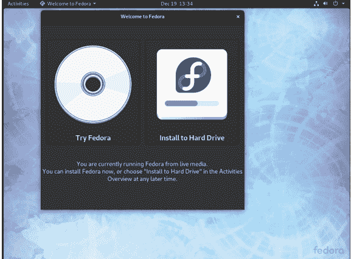

图 3-1

如果不需要图形桌面环境，并且目标系统没有互联网访问，则建议使用服务器版标准 ISO 镜像，因为这可以构建一个功能完整的服务器，而无需下载任何额外的软件包。

对于系统具有互联网访问权限且不需要在安装前试用 Fedora 31 的安装，服务器版 Netinstall ISO 镜像提供了最大的灵活性。此镜像比其他选项小得多，并允许从广泛的预定义配置中进行选择（包括服务器和工作站选项以及最小安装配置）。

本章中的示例将基于从 Fedora Server Netinstall 镜像安装 Fedora 31，在安装过程中选择安装完整 Fedora Workstation 版本的选项。如果您更喜欢从 Fedora Workstation live 会话或标准服务器版镜像进行安装，本章中的步骤仍然相关，但只有一部分配置选项可用。

### 3.3 获取 Fedora 31 安装介质

出于本书的目的，请从以下 URL 下载 Fedora 31 Netinstall ISO 镜像：

https://download.fedoraproject.org/pub/fedora/linux/releases/31/Server/x86_64/iso/Fedora-Server-netinst-x86_64-31-1.9.iso

DVD ISO 镜像是自包含的，包括安装 Fedora 31 系统所需的所有软件包，并使用以下命名约定：

```
Fedora-Server-netinst-<architecture>-<version>.iso
```

例如，适用于 64 位 Intel 系统的 Fedora 31 DVD 镜像命名如下：

```
Fedora-Server-netinst-x86_64-31-1.9.iso
```

下载镜像后，要么将其刻录到光盘，要么使用下一节中的步骤将其写入 USB 驱动器，将您的虚拟化环境配置为将其视为 DVD 驱动器，或者使用本章后面概述的步骤通过网络连接访问安装镜像。

### 3.4 将 ISO 安装镜像写入 USB 驱动器

如今，操作系统安装更可能从 USB 驱动器而不是 DVD 进行。下载 Fedora 31 的 ISO 安装镜像后，将该镜像写入 USB 驱动器的步骤将取决于驱动器是连接到 Linux、macOS 还是 Windows 系统。本节其余部分概述的步骤假设 USB 驱动器是新的，或已重新格式化以删除任何现有数据或分区：

#### 3.4.1 Linux

在 Linux 上将 ISO 镜像写入 USB 驱动器的第一步是识别设备名称。在插入 USB 驱动器之前，通过列出 */dev* 中的设备来识别系统上已检测到的存储设备，如下所示：

```
# ls /dev/sd*
/dev/sda /dev/sda1 /dev/sda2
```

将 USB 驱动器连接到 Linux 系统并运行 `dmesg` 命令以获取最近的系统消息列表，其中一条消息将是检测到 USB 驱动器的报告，类似于以下内容：

```
[445597.988045] sd 6:0:0:0: [sdb] Attached SCSI removable disk
```

此输出告诉我们设备名称应包含 "sdb"，我们可以通过再次列出 */dev* 中的设备名称来确认：

```
# ls /dev/sd*
/dev/sda /dev/sda1 /dev/sda2 /dev/sdb
```

从此输出中，我们可以判断 USB 驱动器已被分配到 */dev/sdb*。在将 ISO 镜像写入设备之前，下一步是运行 `findmnt` 命令以确保它没有自动挂载：

```
# findmnt /dev/sdb
TARGET SOURCE FSTYPE OPTIONS
/run/media/neil/d6bf9574-7e31-4f54-88b1 /dev/sdb ext3 rw,nosuid,no
```

如果 `findmnt` 命令指示 USB 驱动器已挂载，请在继续之前卸载它：

```
# umount /run/media/neil/d6bf9574-7e31-4f54-88b1
```

文件系统卸载后，使用 `dd` 命令如下将 ISO 镜像写入驱动器：

```
# dd if=/path/to/iso/<image name>.iso of=/dev/sdb bs=512k
```

写入过程可能需要一些时间（长达 10-15 分钟）才能完成，具体取决于镜像大小和运行它的系统速度。镜像写入完成后，将出现类似于以下的输出，并且 USB 驱动器已准备好用于安装 Fedora 31：

```
5956+0 records in
5956+0 records out
3122659328 bytes (3.1 GB, 2.9 GiB) copied, 426.234 s, 7.3 MB/s
```

#### 3.4.2 macOS

在 macOS 系统上将 ISO 镜像写入 USB 驱动器的第一步是使用 `diskutil` 工具识别设备。在连接 USB 设备之前，打开"终端"窗口并运行以下命令：

```
$ diskutil list
/dev/disk0 (internal, physical):
    #: TYPE NAME SIZE IDENTIFIER
    0: GUID_partition_scheme *1.0 TB disk0
    1: EFI EFI 209.7 MB disk0s1
    2: Apple_APFS Container disk2 1000.0 GB disk0s2

/dev/disk1 (internal):
    #: TYPE NAME SIZE IDENTIFIER
    0: GUID_partition_scheme 28.0 GB disk1
    1: EFI EFI 314.6 MB disk1s1
    2: Apple_APFS Container disk2 27.7 GB disk1s2

/dev/disk2 (synthesized):
   #: TYPE NAME SIZE IDENTIFIER
   0: APFS Container Scheme - +1.0 TB disk2
                                 Physical Stores disk1s2, disk0s2
   1: APFS Volume Macintosh HD 473.6 GB disk2s1
   2: APFS Volume Preboot 42.1 MB disk2s2
   3: APFS Volume Recovery 517.0 MB disk2s3
   4: APFS Volume VM 1.1 GB disk2s4
```

建立已检测设备的基线后，将 USB 驱动器插入 macOS 系统的端口并再次运行该命令。相同的结果将出现，但会有一条额外的 USB 驱动器条目，类似于以下内容：

```
/dev/disk3 (external, physical):
   #: TYPE NAME SIZE IDENTIFIER
   0: *16.0 GB disk3
```

在上面的示例中，USB 驱动器已被分配到 */dev/disk3*。在继续之前，按如下方式卸载磁盘：

```
$ diskutil unmountDisk /dev/disk3
Unmount of all volumes on disk3 was successful
```

最后，使用 `dd` 命令将 ISO 镜像写入设备，注意引用原始磁盘设备（*/dev/rdisk3*)，并在提示时输入您的用户密码：

```
$ sudo dd if=/path/to/iso/image.iso of=/dev/rdisk3 bs=1m
```

镜像写入完成后，USB 驱动器即可使用。

#### 3.4.3 Windows

有许多免费工具可用于在 Windows 上将 ISO 镜像写入 USB 驱动器，但专门用于写入 Linux ISO 镜像的是 **Fedora Media Writer** 工具，可以从以下 URL 下载：

*https://getfedora.org/en/workstation/download/*

安装后，启动写入工具并选择*自定义镜像*选项，如图 3-2 所示。或者，如果您选择使用 Fedora Workstation 介质在安装前试用 Fedora，只需单击 **Fedora Workstation 31** 选项即可下载并将镜像写入 USB 驱动器。

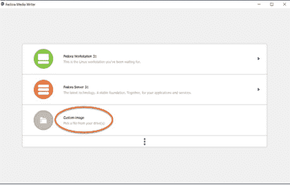

图 3-2

在产生的文件选择对话框中，导航并选择 Fedora 31 安装 ISO 镜像，然后单击*打开*按钮。选择镜像后，将出现一个对话框，可以在其中将镜像写入 USB 驱动器。在单击*写入磁盘*按钮之前，从设备菜单中选择目标 USB 驱动器：

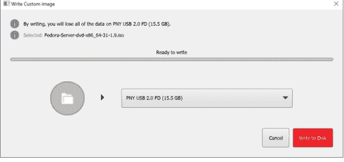

图 3-3

镜像写入设备后，该设备即可用于执行安装。

### 3.5 安装 Fedora 31

将 Fedora 31 安装介质插入适当的驱动器并打开系统电源。如果系统尝试从硬盘驱动器启动，则需要进入计算机的 BIOS 设置并更改启动顺序，使其首先从安装介质驱动器启动。系统启动后，将显示以下屏幕：

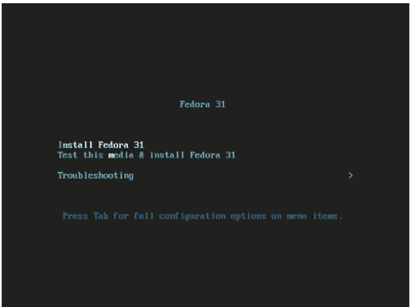

图 3-4

使用箭头键在选项之间导航，并使用 <Enter> 键进行选择。如果选择*Troubleshooting*选项，将显示如图 3-5 所示的屏幕，包括从当前安装在本地驱动器上的操作系统启动（如果已安装）、测试系统内存或救援已安装的 Fedora 31 系统的选项。还提供了在基本图形模式下执行安装的选项，适用于没有图形控制台的系统：

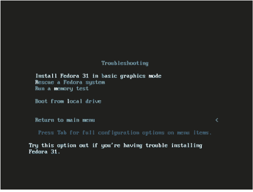

图 3-5

在主屏幕上选择安装选项，短暂延迟后，图形安装程序的第一个屏幕将出现：


图 3-6

在第一个屏幕上选择您偏好的语言，然后点击*继续*以进入主安装屏幕，如图 3-7 所示：

图 3-7

首先选择*网络和主机名*选项，在您的系统上启用网络设备并输入主机名，然后点击*应用*按钮：

图 3-8

如果网络连接需要其他设置，请点击*配置...*按钮以访问图 3-9 所示的高级网络设置屏幕：

图 3-9

主机名定义完成且网络连接启用后，请点击*完成*以返回主屏幕。

如果您希望更改键盘、语言或时间和日期设置，请从主屏幕的本地化列中选择相应选项。在*时间和日期*屏幕上，选择与您的地理位置对应的选项。还可以选择使用*网络时间*，这会自动将系统与外部网络时间协议服务器同步。

由于安装是从本地介质进行的，因此不需要更改*安装源*设置。要从位于远程服务器上的介质执行安装，请选择*安装源*，启用*在网络上*选项，然后指定安装介质的位置和所使用的 URL 类型。安装介质可以是例如安装在远程 Web 服务器上或本地网络上的系统（使用 NFS 共享）中的 ISO 映像（NFS 文件共享的主题在"*使用 NFS 与远程系统共享 Fedora 31 文件*"一章中有详细介绍），或者是远程仓库的 URL（仓库本质上是构成操作系统的软件、软件包和应用程序的在线集合，可以从中执行到本地系统的安装）。

默认情况下，Fedora 31 服务器版安装将由安装程序执行。要选择不同的安装配置，请选择*软件选择*选项以显示如下所示的屏幕：

图 3-10

使用左侧面板选择基本配置，使用右侧面板添加系统启动后您知道需要的任何附加软件包。如果 Fedora 31 系统打算与图形桌面环境一起使用，请选择*Fedora 工作站*选项。如果不需要桌面环境且不确定要在系统上安装哪些软件包，请使用*最小安装*选项，并在系统启动后根据需要安装附加软件包。这样可以避免安装可能永远用不到的任何软件包。

配置好基本设置后，下一步是决定如何对硬盘驱动器进行分区以容纳操作系统。

### 3.6 为 Fedora 31 分区磁盘

选择*安装目标位置*选项时，安装程序将显示类似于下面图 3-11 的屏幕：

图 3-11

默认情况下，安装程序配置为使用当前选定磁盘驱动器上的可用空间自动安装操作系统，并配置标准分区大小。如果磁盘之前包含其他操作系统，这些现有分区将不会被删除，这可能会在 Fedora 31 安装后导致驱动器上留下未使用的空间。要删除任何现有分区以便由 Fedora 31 回收和使用，请启用*我想让额外空间可用*选项并点击*完成*按钮以显示图 3-12 所示的对话框。

图 3-12

要回收空间，请选择不再需要的分区并通过点击*删除*按钮将其标记为删除。选择完所有要删除的分区后，请点击*回收空间*按钮以执行删除。回收的空间现在将由 Fedora 31 安装程序自动使用。

要手动配置磁盘布局以确定如何分配可用空间，请将*存储分配*设置从*自动*更改为*自定义*，然后点击*完成*以显示手动分区屏幕（图 3-13）：

图 3-13

手动分区屏幕提供了使用逻辑卷管理（LVM）或标准分区配置磁盘的选项。建议使用 LVM，因为它在系统运行后管理分区大小方面提供了灵活性（LVM 的详细信息在标题为*向 Fedora 31 卷组和逻辑卷添加新磁盘*的章节中有介绍）。

选择分区方案后，最后一步是确定分区的大小和相应的文件系统挂载点。一般来说，*点击此处自动创建它们*选项提供的默认配置将满足大多数系统需求。要手动创建分区并分配挂载点，请点击 + 按钮逐个声明和分配每个分区。

另一种选择是选择自动分区创建，然后使用生成的屏幕根据需要手动更改分区配置。例如，图 3-14 显示了通过选择自动创建选项定义的分区配置，并允许在磁盘上进行任何更改之前修改每个分区的设置：

图 3-14

磁盘配置完成后，请点击*完成*，查看要对磁盘进行的更改摘要（图 3-15），然后点击*接受更改*按钮：

图 3-15

### 3.7 添加用户和 Root 访问权限

开始安装之前的最后一步是向系统添加用户账户。为此，请在主安装屏幕上点击用户创建选项并输入用户凭据和密码：

如果该用户需要在系统上执行管理任务，请在点击完成按钮之前启用*将此用户设为管理员*选项（除非按照下面的说明启用 root 账户，否则至少应有一个用户具有管理权限）。这将允许该账户使用 `sudo` 命令执行受限任务，如"*简介*"一章中所述。

root 或超级用户账户是一种特殊用户，无需使用 `sudo` 命令即可在系统上拥有管理权限。为了提高安全性，该账户默认被禁用。要启用此账户，请选择 root 密码选项，输入 root 密码并关闭*锁定 root 账户*选项。如果您希望能够登录系统。

### 3.9 最终配置步骤

系统启动后控制台上显示的内容将取决于是否在软件选择安装屏幕上选择了*工作站*选项。如果在安装期间选择了此项，GNOME 显示管理器（GDM）登录屏幕将出现。如果选择了最小或服务器配置选项，则将显示基于文本的登录提示。无论配置如何，都请使用安装过程最后步骤中创建的用户登录系统。

对于*工作站*安装，GNOME 初始设置工具将启动，提供语言、键盘布局、位置服务以及与 Google 和 Facebook 等在线账户连接的设置选项。这些设置配置（或跳过）后，将出现 GNOME 桌面欢迎屏幕，其中包含有关如何使用桌面环境的教程链接。

### 3.10 安装更新

与当今大多数操作系统一样，Fedora 发行版的每个特定版本在向公众发布后仍在不断演进。这通常以错误修复和安全更新的形式进行。


并且，偶尔会有些新功能可以通过互联网下载并安装在您的系统上。

最佳实践要求，在安装 Fedora 后的第一步是确保将任何可用的更新应用到系统。这可以通过在终端窗口的命令行提示符中使用 *dnf* 程序包管理工具来实现。要检查是否有可用更新，只需运行以下命令：

```
# dnf check-update
```

任何待处理的更新可以再次使用 *dnf* 工具来应用：

```
# dnf update
```

执行后，*dnf* 工具将提供可用更新的程序包列表，并提示是否允许执行更新。更新完成后，安装基本上就结束了，Fedora 31 可以使用了。

### 3.11 显示启动消息

在启动过程中，Fedora 会显示 Red Hat 图形启动（RHGB）屏幕，该屏幕隐藏了系统加载时生成的所有启动消息。要在启动过程中使这些消息可见（如图 3-18 所示），只需在系统启动时按下键盘上的 Esc 键：

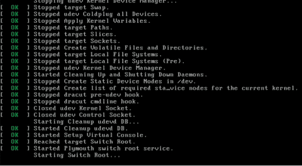

可以通过编辑 */etc/default/grub* 文件并更改 GRUB_CMDLINE_LINUX 设置来改变默认行为，使消息始终默认显示，该设置默认类似于以下内容：

```
GRUB_CMDLINE_LINUX="... rhgb quiet"
```

要移除图形启动屏幕，以便无需按 Esc 键即可看到消息，请从设置中移除 "rhgb" 选项：

```
GRUB_CMDLINE_LINUX="... ~~rhgb~~ quiet"
```

此更改将导致系统仅显示系统生成的一部分启动消息。要显示系统生成的所有消息，还需移除 "quiet" 选项：

```
GRUB_CMDLINE_LINUX="... ~~quiet~~"
```

更改完成后，运行以下命令以生成新的启动配置，使其在下次系统启动时生效：

```
# grub2-mkconfig --output=/boot/grub2/grub.cfg
```

### 3.12 小结

使用 Fedora 31 的第一步是安装操作系统。对于基于云的服务器，此任务通常在根据云服务提供商提供的一系列选项选择操作系统映像时自动执行。然而，在您自己的硬件上安装涉及下载 ISO 映像形式的安装介质，将该映像写入合适的存储设备（如 DVD 或 USB 驱动器），并从该设备启动。运行后，安装过程允许配置一系列选项，包括网络、安装应从本地介质还是通过远程服务器或仓库进行、要安装的程序包以及磁盘分区。安装完成后，重要的是安装自原始安装映像创建以来可能发布的任何操作系统更新。

## 4. 将 Fedora 31 与 Windows 双启动

Fedora 与大多数 Linux 发行版一样，可以愉快地与硬盘驱动器上的几乎所有 Windows 版本（最高包括 Windows 10）共存。这就是被称为双启动的概念。本质上，当您启动系统时，将显示一个菜单，提供启动 Fedora 31 安装或 Windows 的选项。显然，您一次只能运行一个操作系统，但值得注意的是，无论您的 Windows 分区是使用 NTFS、FAT16 还是 FAT32 格式化的，您都可以从 Fedora 31 访问硬盘驱动器上 Windows 分区中的文件。

这种安装方法涉及缩小现有 Windows 分区的大小，然后在回收的空间中安装 Fedora 31。本章假设 Fedora 31 正在当前运行 Windows 10 的系统上安装。

### 4.1 分区大小调整

为了在有 Windows 安装的磁盘驱动器上容纳 Fedora，第一步涉及缩小 Windows 分区以腾出空间。建议的操作是在尝试安装 Fedora 31 之前使用 Windows 磁盘管理界面来缩小分区大小。

要在 Windows 10 上访问磁盘管理，右键单击开始菜单，然后从结果菜单中选择*磁盘管理*，如图 4-1 所示：

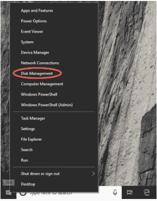

图 4-1

加载后，磁盘管理工具将显示系统检测到的磁盘驱动器的图形表示：

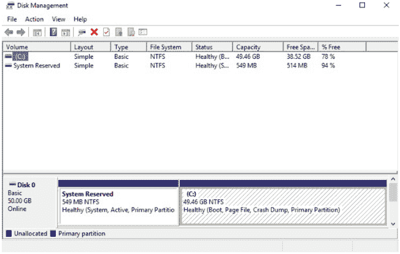

图 4-2

右键单击要缩小大小的分区，然后从弹出菜单中选择*压缩卷...*。该工具将计算可以将卷大小减小的最大量而不会丢失数据（此过程可能需要几分钟，具体取决于分区的整体大小）。此分析完成后，将出现类似于下面图 4-3 的对话框：

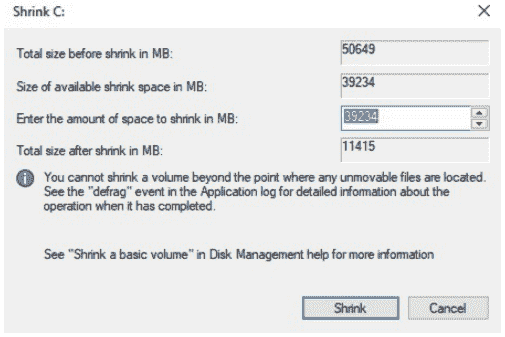

图 4-3

在*输入要压缩的空间量（MB）*字段中指定一个值，然后单击*压缩*按钮继续。调整大小操作完成后，使用 Fedora 31 安装介质重新启动（如"在干净磁盘驱动器上安装 Fedora 31"中所述）并继续进行安装，利用新的可用空间。在 Fedora 安装过程中，可以通过在安装摘要屏幕上选择*安装目的地*选项，并确保选择*自动*存储配置选项来实现。这会自动将 Fedora 安装到缩小 Windows 分区时创建的未分配空间中。

安装完成后，重新启动系统，注意现在除了 Fedora 外，Windows 也成为启动屏幕上的一个选项：

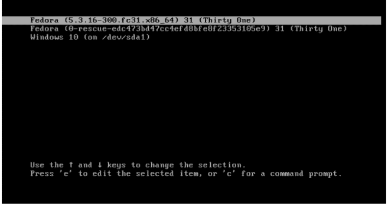

图 4-4

### 4.2 更改默认启动选项

系统启动时，启动选项屏幕将出现并等待 5 秒让用户选择操作系统。如果在超时之前未进行选择，则将启动默认操作系统。在新配置的系统上，默认操作系统将是标准（非救援）Fedora 映像。但是，此默认值可以在 Fedora 内更改。

一系列启动配置选项（包括 5 秒超时和"在干净磁盘驱动器上安装 Fedora 31"中概述的启动 RHGB 设置）在 */etc/default/grub* 文件中声明，新安装时该文件内容如下：

```
GRUB_TIMEOUT=5
GRUB_DISTRIBUTOR="$(sed 's, release .*$,,g' /etc/system-release)"
GRUB_DEFAULT=saved
GRUB_DISABLE_SUBMENU=true
GRUB_TERMINAL_OUTPUT="console"
GRUB_CMDLINE_LINUX="resume=/dev/mapper/
fedora-swap rd.lvm.lv=fedora/root rd.lvm.lv=fedora/swap rhgb quiet"
GRUB_DISABLE_RECOVERY="true"
GRUB_ENABLE_BLSCFG=true
```

更改默认启动系统的第一步是在此文件中声明 GRUB_SAVEDEFAULT 设置：

```
GRUB_TIMEOUT=5
GRUB_DISTRIBUTOR="$(sed 's, release .*$,,g' /etc/system-release)"
GRUB_DEFAULT=saved
GRUB_SAVEDEFAULT=true
.
.
```

此设置允许在启动配置中保存新的默认值。接下来，运行 *grub2-set-default* 命令以更改默认设置，使用将第一个选项计为 0 的编号系统。例如，如果 Windows 10 选项在菜单中的位置是 3，则将 Windows 10 设为默认启动选项的命令如下：

```
# grub2-set-default 2
```

通过运行以下命令检查新设置是否已生效：

```
# grub2-editenv list
```

```
saved_entry=2
kernelopts=root=/dev/mapper/fedora-root ro
resume=/dev/mapper/fedora-swap rd.lvm.lv=fedora/root
rd.lvm.lv=fedora/swap rhgb quiet
boot_success=0
```

注意 *saved_entry* 值现在设置为 2。更改默认值后，重新生成启动配置文件，如下所示：

```
# grub2-mkconfig --output=/boot/grub2/grub.cfg
```

重新启动系统，并验证启动菜单是否默认选择 Windows 10 选项，以及超时后 Windows 是否加载。

### 4.3 从 Fedora 31 访问 Windows 分区

在以双启动配置运行 Fedora 时，仍然可以访问位于 Windows 分区上的文件。这可以通过从命令行手动挂载分区来实现。但是，在此之前，需要在系统上安装一些额外的程序包。首先需要下载并安装 *fuse* 内核模块：

```
# dnf install fuse
# modprobe fuse
```

安装所需的程序包后，下一步是创建要作为 Windows 分区挂载点的目录。在此示例中，我们将创建一个名为 */mnt/windows* 的目录：

```
# mkdir /mnt/windows
```

为了标识已分配给 Windows 分区的设备名称，请使用 *fdisk* 命令，如下所示：

```
# fdisk -l
```

在上述输出中，包含我们需要访问的文件的主 Windows 分区由 */dev/sda2* 表示。接下来，我们需要运行 *mount* 命令（假设 Windows 分区是 /dev/sda2 且


 NTFS format) 操作如下：

```
# mount /dev/sda2 /mnt/windows
```

通过列出挂载点的顶层目录内容来检查挂载是否成功：

```
# ls /mnt/windows
`$Recycle.Bin' ProgramData swapfile.sys
`Documents and Settings' `Program Files' `System Volume Information'
 pagefile.sys `Program Files (x86)' Users
 Perflogs Recovery Windows
```

要在每次系统启动时自动挂载，只需将适当的挂载行添加到 *etc/fstab* 文件中：

```
/dev/sda2 /mnt/windows ntfs defaults 0 0
```

要随时卸载 Windows 文件系统：

```
# umount /mnt/windows
```

### 4.4 小结

通过在磁盘驱动器上创建双启动环境，Fedora 31 可以与 Windows 操作系统安全地共存于同一磁盘驱动器上。这涉及缩减 Windows 系统所占用的空间，为 Fedora 31 腾出空间，然后再执行安装。要从 Fedora 中访问 Windows 文件系统，需要安装并使用 Fuse NTFS 驱动程序来挂载 Windows 分区。

## 5. 将 Windows 磁盘分区分配给 Fedora 31

在上一章中，我们介绍了如何在同一个磁盘上与 Windows 一起安装。这种所谓的"双启动"配置允许用户在单个磁盘驱动器上安装两个操作系统，并在系统启动时选择启动其中一个或另一个。

本章适用于那些已经决定足够喜欢 Fedora 31 以至于要从磁盘上完全删除 Windows，并将 resulting 空间用于 Linux 的用户。在下面的章节中，我们将逐步完成这个过程。

### 5.1 卸载 Windows 分区

如果遵循了"*Fedora 31 与 Windows 双启动*"章节中的步骤来从 Fedora 31 内部挂载 Windows 分区，那么在继续本章之前应采取措施卸载该分区。假设 Windows 分区已挂载为 /mnt/windows，可以按如下方式卸载：

```
# umount /mnt/windows
```

还应编辑 /etc/fstab 文件以删除之前添加的 /mnt/windows 自动挂载（如果已添加的话）。

### 5.2 从磁盘删除 Windows 分区

释放 Windows 分区以供 Fedora 使用的第一步是删除该分区。但是，在此之前，**务必**从 Windows 和 Fedora 两个分区中备份任何需要保留的数据。完成备份后，即可安全地继续本章。

为了删除 Windows 分区，我们首先需要使用 fdisk 工具识别它们所在的磁盘：

```
# fdisk -l
Disk /dev/sda: 50 GiB, 53687091200 bytes, 104857600 sectors
Units: sectors of 1 * 512 = 512 bytes
Sector size (logical/physical): 512 bytes / 512 bytes
I/O size (minimum/optimal): 512 bytes / 512 bytes
```

```
Disklabel type: dos
Disk identifier: 0xe3673009

Device Boot Start End Sectors Size Id Type
/dev/sda1 * 2048 1126399 1124352 549M 7 HPFS/NTFS/exFAT
/dev/sda2 1126400 53655551 52529152 25G 7 HPFS/NTFS/exFAT
/dev/sda3 53655552 55752703 2097152 1G 83 Linux
/dev/sda4 55752704 1048557599 49104896 23.4G 5 Extended
/dev/sda5 55754752 1048557599 49102848 23.4G 8e Linux LVM
```

在上面的示例输出中，系统包含一个物理磁盘驱动器，由设备名称 *dev/sda* 引用。在该磁盘驱动器上有五个分区，分别通过设备名称 *dev/sda1* 到 *dev/sda5* 访问。根据 System 列中的值，有两个 NTFS 分区。第一个是 Windows 系统分区，而第二个更大的 NTFS 分区是 Windows 启动分区，包含 Windows 操作系统和用户数据。

要删除分区，请使用包含该分区的磁盘的设备名称（本例中为 *dev/sda*）启动 *fdisk* 工具，并按照说明再次显示分区和扇区信息：

```
# fdisk /dev/sda

Welcome to fdisk (util-linux 2.32.1).
Changes will remain in memory only, until you decide to write them.
Be careful before using the write command.

Command (m for help): p
Disk /dev/sda: 50 GiB, 53687091200 bytes, 104857600 sectors
Units: sectors of 1 * 512 = 512 bytes
Sector size (logical/physical): 512 bytes / 512 bytes
I/O size (minimum/optimal): 512 bytes / 512 bytes
Disklabel type: dos
Disk identifier: 0xe3673009

Device Boot Start End Sectors Size Id Type
/dev/sda1 * 2048 1126399 1124352 549M 7 HPFS/NTFS/exFAT
/dev/sda2 1126400 53655551 52529152 25G 7 HPFS/NTFS/exFAT
/dev/sda3 53655552 55752703 2097152 1G 83 Linux
/dev/sda4 55752704 1048557599 49104896 23.4G 5 Extended
```

```
/dev/sda5 55754752 104857599 49102848 23.4G 8e Linux LVM
```

```
Command (m for help):
```

目前，Windows 系统分区被列为可启动分区。由于我们将删除此分区，因此需要将 Linux 启动分区标记为可启动。在上述配置中，这由 *dev/sda3* 表示。保持在 *fdisk* 工具中，按如下方式将其设置为可启动分区：

```
Command (m for help): a
Partition number (1,3-5, default 5): 3
The bootable flag on partition 3 is enabled now.
```

在继续之前，记下我们将要删除的分区的起始和结束地址（换句话说，即 *dev/sda1* 的起始位置和 *dev/sda2* 的结束位置）。

在命令提示符下，删除 Windows 分区（在我们的示例系统中，这些是**分区 1 和 2**）：

```
Command (m for help): d
Partition number (1-5, default 5): 1

Partition 1 has been deleted.
```

```
Command (m for help): d
Partition number (2-5, default 5): 2

Partition 2 has been deleted.
```

现在我们已经删除了 Windows 分区，需要在腾出的磁盘力作空间空间的新分区。分区号必须与删除的分区号匹配（在本例中为 1），并且将是一个主分区。还需要输入分区的起始和结束扇区，与旧分区报告的值完全一致（*fdisk* 通常会默认提供正确的值，但仔细检查是明智的）。如果提示删除 NTFS 签名，请输入 **Y**：

```
Command (m for help): n
Partition type
   p primary (1 primary, 1 extended, 2 free)
   l logical (numbered from 5)
Select (default p): p
```

```
Partition number (1,2, default 1): 1
First sector (2048-104857599, default 2048):
Last sector, +sectors or +size{K,M,G,T,P} (2048-53655551,
default 53655551):

Created a new partition 1 of type 'Linux' and of size 25.6 GiB.
Partition #1 contains a ntfs signature.

Do you want to remove the signature? [Y]es/[N]o: y

The signature will be removed by a write command.
```

完成这些更改后，下一步是检查设置是否正确（借此机会再次检查 Linux 启动分区是否可启动）：

```
Command (m for help): p
Disk /dev/sda: 50 GiB, 53687091200 bytes, 104857600 sectors
Units: sectors of 1 * 512 = 512 bytes
Sector size (logical/physical): 512 bytes / 512 bytes
I/O size (minimum/optimal): 512 bytes / 512 bytes
Disklabel type: dos
Disk identifier: 0xe3673009

Device Boot  Start      End  Sectors  Size Id Type
/dev/sda1      2048 53655551 53653504 25.6G 83 Linux
/dev/sda3  *  53655552 55752703  2097152    1G 83 Linux
/dev/sda4    55752704 104857599 49104896 23.4G  5 Extended
/dev/sda5    55754752 104857599 49102848 23.4G 8e Linux LVM

Filesystem/RAID signature on partition 1 will be wiped.
```

要提交更改，我们现在需要将新的分区信息写入磁盘并退出 *fdisk* 工具：

```
Command (m for help): w
The partition table has been altered.
Syncing disks.
```

### 5.3 格式化未分配的磁盘分区

为了使新分区适合 Fedora 31 使用，需要在其上创建文件系统。当前版本 Fedora 的默认文件系统类型是 XFS，将在题为"*向 Fedora 31 系统添加新磁盘驱动器*"的章节中更详细地介绍。文件系统的创建使用 *mkfs.xfs*

 command as follows:

```
# mkfs.xfs -f /dev/sda1
meta-data=/dev/sda1 isize=512 agcount=4, agsize=1676672 blks
        = sectsz=512 attr=2, projid32bit=1
        = crc=1 finobt=1, sparse=1, rmapbt=0
        = reflink=1
data     = bsize=4096 blocks=6706688, imaxpct=25
        = sunit=0 swidth=0 blks
naming   =version 2 bsize=4096 ascii-ci=0, ftype=1
log      =internal log bsize=4096 blocks=3274, version=2
        = sectsz=512 sunit=0 blks, lazy-count=1
realtime =none extsz=4096 blocks=0, rtextents=0
```

### 5.4 挂载新分区

接下来，我们需要挂载新分区。在本示例中，我们将把它挂载到名为 */data* 的目录中。不过，你可以自由选择任何有效的挂载点来挂载新分区，或者将其作为逻辑卷的一部分使用（相关细节将在*"向 Fedora 31 卷组和逻辑卷添加新磁盘"*一章中介绍）。首先，我们需要创建用作挂载点的目录：

```
# mkdir /data
```

其次，我们需要编辑 */etc/fstab* 中的挂载表，以便在系统每次启动时自动挂载该分区。在 */etc/fstab* 文件的底部，添加以下行来挂载新分区（将 */dev/sda1* 设备修改为你的环境中对应的设备）：

```
/dev/sda1 /data xfs defaults 0 0
```

最后，我们可以手动挂载新分区（注意，在后续的重新启动中，这将不再需要，因为由于我们在上面的 */etc/fstab* 文件中添加的设置，该分区将会自动挂载）。

```
# mount /data
```

要检查分区，请运行以下命令来显示可用空间：

```
# df -h /data
Filesystem      Size  Used Avail Use% Mounted on
/dev/sda1        26G  215M   26G   1% /data
```

### 5.5 编辑启动菜单

下一步是修改 Fedora 启动菜单。由于这原本是一个双启动系统，该菜单配置为提供启动 Windows 或 Fedora 的选项。现在 Windows 分区已经删除，我们需要移除这个启动选项。首先从编辑 *etc/grub.d/40_custom* 文件开始，删除 Windows 菜单项：

```
#!/bin/sh
exec tail -n +3 $0
# This file provides an easy way to add custom menu entries. Simply type the
# menu entries you want to add after this comment. Be careful not to change
# the 'exec tail' line above.
menuentry "Windows 10" {
    set root=(hd0,1)
    chainloader +1
}
```

保存文件并使用 *grub2-mkconfig* 工具生成 */boot/grub2/grub.cfg* 文件，如下所示：

```
# grub2-mkconfig --output=/boot/grub2/grub.cfg
Generating grub configuration file ...
done
```

下次系统重新启动时，启动菜单将不再提供 Windows 10 选项。

### 5.6 总结

在双启动配置中，Windows 分区可以随时通过识别哪些分区属于 Windows，然后使用 *fdisk* 工具删除它们来释放空间给 Fedora 系统使用。一旦删除，未分配的空间可以用来创建新的文件系统并挂载，使其可供 Fedora 系统使用。最终任务是移除启动菜单配置中的 Windows 选项。

## 6. GNOME 3 桌面导览

Fedora 31 包含 GNOME 3 桌面环境。尽管不如 Windows 和 macOS 桌面复杂，GNOME 3 提供了一个简洁直观的桌面环境，具备窗口化环境的所有基本功能，并且具有可以快速上手的优势。

在本章中，将介绍 GNOME 桌面的主要功能，并概述如何执行基本任务。

### 6.1 安装 GNOME 桌面

如果在 Fedora 31 安装过程中选择了 Workstation 或带 GUI 的服务器软件配置，GNOME 桌面将会已经安装，并且每次系统启动时都会自动启动。

如果在 Fedora 31 安装过程中选择了任何其他软件配置，GNOME 桌面将不会包含在系统安装的软件包中。在没有连接显示器的基于服务器的系统上，安装图形桌面环境可能显得多余。然而，值得注意的是 Scope Creep（注：此处原文可能有误，应为"值得注意的是"），远程访问 GNOME 桌面也是可能的，因此，即使在所谓的 *无头服务器*（即缺少显示器、键盘和鼠标的服务器）上，安装 GNOME 桌面软件包仍然可能是有益的。本书的*"使用 VNC 进行 Fedora 31 远程桌面访问"*一章将详细介绍建立远程桌面访问的方法。

如果安装配置没有包含 GNOME 桌面，可以随时使用以下命令进行安装：

```
# dnf groupinstall "Workstation"
```

安装完成后，可以在连接显示器的系统上从命令提示符启动桌面环境，如下所示：

```
$ startx
```

### 6.2 GNOME 3 桌面概览

下面图 6-1 显示了典型的新启动 GNOME 桌面会话的外观，在启动任何其他程序或进行配置更改之前。

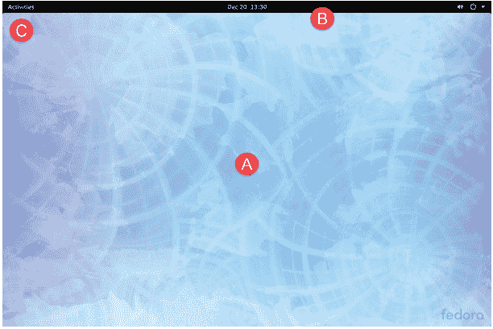

图 6-1

主桌面区域（标记为 A）是应用程序和工具启动时窗口将出现的地方。与其他桌面环境不同，无法将文件或应用程序拖放到桌面上，提供了一个干净整洁的工作空间。

屏幕顶部的栏（B）称为 *顶部栏*，包括活动菜单（C）、日期和时间，以及一系列按钮和图标，包括网络状态、音频音量、电池电量和其他状态及账户设置。当前在桌面上运行的活动应用程序的应用程序菜单也会出现在顶部栏中。例如，图 6-2 显示了终端程序的应用程序菜单：

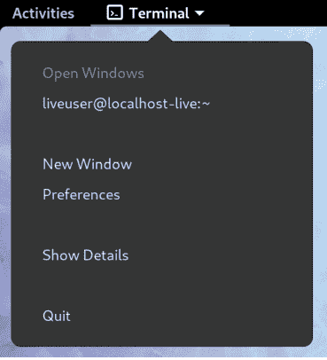

图 6-2

### 6.3 启动活动

应用程序和工具使用活动概览仪表板（称为 *dash*）启动，可以通过单击顶部栏中的活动按钮或按键盘上的 *特殊键* 来显示。在 Windows 系统上这是 Windows 键，在 macOS 上是 Command 键，在 Chromebook 上是显示放大镜的键。

显示时，dash 将如下图 6-3 所示：


图 6-3

默认情况下，dash 将显示一组预定义常用应用程序的图标，并且还会包含任何当前正在运行的应用程序的图标。如果应用程序当前正在运行，其图标下方将出现一个条形标记。

要启动应用程序，只需单击 dash 中的图标。

要查找 dash 上未包含的应用程序，一个选项是选择最底部的图标（由九个点组成的方块）以显示可浏览的应用程序列表，如图 6-4 所示：

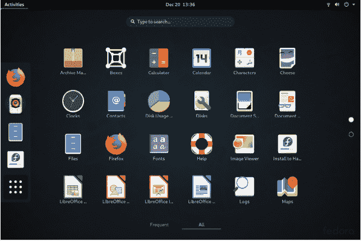

图 6-4

注意，可以通过选择屏幕底部中央的按钮来过滤列表，以显示所有应用程序或仅显示经常使用的应用程序。还需要注意的是，列表中的某些条目实际上是包含其他应用程序的文件夹。在上面的屏幕截图中，例如，*Utilities* 条目提供对系统监视器和磁盘管理工具以及终端窗口应用程序等其他工具的集合的访问。

浏览应用程序的另一种方法是使用 dash 显示时出现的搜索栏进行搜索，如图 6-5 所示：

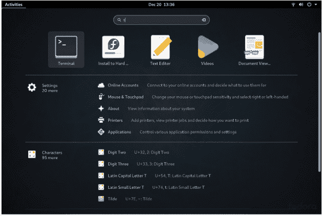

图 6-5

当在搜索框中输入文本时，可能的匹配项列表将会被细化。

要将应用程序添加到 dash 以便更方便地访问，找到该应用程序的图标，右键单击它并选择 *Add to Favorites* 菜单选项：

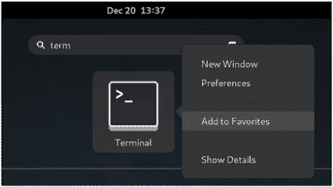

图 6-6

要从 dash 中移除应用程序，请重复这些步骤，这次选择 *Remove from Favorites*。

### 6.4 管理窗口

与其他桌面环境一样，应用程序在 GNOME 中以窗口形式运行。当多个应用程序窗口打开时，Super + Tab 键盘快捷键将显示切换器面板（图 6-7），允许选择不同的窗口作为当前活动窗口（Super 键是 Windows 键，或者在 Mac 键盘的情况下是 Cmd 键）：


图 6-7

如果单个应用程序打开了多个窗口，切换器将在第二个面板中显示这些窗口，以便可以选择特定的窗口：


图 6-8

要反向循环切换器中的图标，请使用 Shift + Tab 键盘快捷键。

要最大化窗口使其充满整个屏幕，请点击标题栏并将窗口拖动到屏幕顶部。要将窗口恢复到原始大小，请点击标题栏并向下拖动。或者，只需双击标题栏即可在不同窗口大小之间切换。类似地，将窗口拖动到屏幕的左侧或右侧将使窗口充满该屏幕的半边区域。

### 6.5 使用工作区

应用程序窗口出现的屏幕区域称为*工作区*，GNOME 3 允许配置多个工作区。要创建新的工作区，请显示活动概览，并将鼠标指针移动到屏幕最右侧以显示工作区面板（图 6-9）：

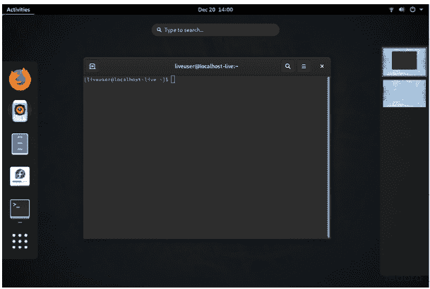

图 6-9

要切换到不同的面板，只需从列表中选择它。要将窗口从一个工作区移动到另一个工作区，请显示工作区面板，然后将应用程序窗口（可以是当前工作区中的实际窗口，也可以是工作区面板中的缩略图窗口）拖放到目标工作区。当窗口被添加到空白工作区时，另一个空白工作区将被添加到工作区面板，从而允许创建多个工作区。

要移除工作区，只需关闭该工作区上的所有窗口，或将它们移动到另一个工作区。

### 6.6 日历和通知

当系统需要通知您某个事件（例如系统或应用程序更新可用）时，工作区顶部将出现一个弹出面板。通过点击顶部栏中的日期和时间，可以访问日历和任何先前的通知，如图 6-10 所示：

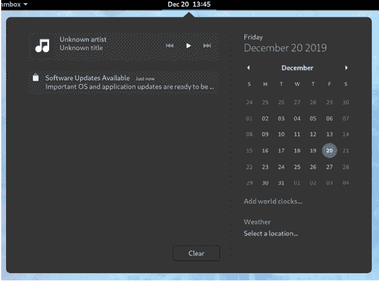

图 6-10

### 6.7 桌面设置

要访问设置应用程序，请点击顶部栏最右侧的向下箭头，然后选择带有工具图标的按钮，如图 6-11 中高亮显示所示：

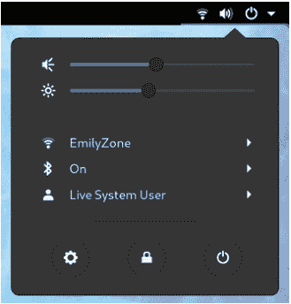

图 6-11

设置应用程序提供了广泛的选项，例如以太网和 Wi-Fi 连接、屏幕背景自定义选项、屏幕锁定和电源管理控制以及语言偏好。要浏览每个类别中可用的设置，只需从设置窗口左侧面板中选择一个选项：

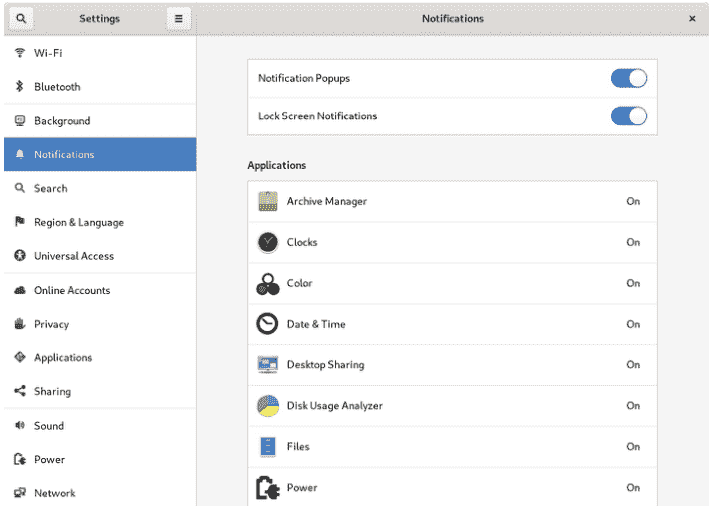

图 6-12

图 6-11 中所示的菜单还包括切换用户、调整音量、更改为不同的 Wi-Fi 网络以及注销、重启或关闭系统等选项。

### 6.8 总结

Fedora 31 包含 GNOME 3 桌面环境，可以在初始安装时包含，也可以在之后使用 *dnf* 组包安装功能进行安装。与大多数其他桌面环境不同，GNOME 3 旨在提供一个简洁且易于使用的窗口用户界面。GNOME 3 桌面的关键区域包括顶部栏、活动概览和快速启动栏。此外，GNOME 3 支持多个工作区，使运行的应用程序保持有序，屏幕保持整洁。设置应用程序中还提供了各种配置选项，包括桌面背景设置、音频、网络配置和 Wi-Fi 网络选择。

## 7. Fedora 31 Cockpit Web 界面概述

尽管配备了最新的 Linux 桌面环境，但 Fedora 在很大程度上是一个服务器操作系统，因此，大多数 Fedora 部署将是远程物理服务器或基于云的虚拟机实例。这些系统通常没有键盘、鼠标或显示器，只能通过网络连接在命令提示符下直接访问。这给从远程位置管理系统带来了挑战。虽然通过远程访问命令行和桌面环境可以完成很多工作，但这远非企业级操作系统（如 Fedora 31）日常需要执行的管理和监控任务的一致和全面的解决方案。

这个问题通过引入 Cockpit 基于 Web 的管理界面得到了解决。本章将解释如何安装、配置和访问 Cockpit 界面，同时还将概述 Cockpit 的主要功能，其中许多功能将在后面的章节中更详细地介绍。

### 7.1 Cockpit 概述

Cockpit 是一个轻量级、基于 Web 的界面，允许远程执行一般的系统管理任务。安装和配置后，系统管理员只需打开本地浏览器窗口并导航到远程服务器上的 Cockpit 端口。将 Cockpit 界面加载到浏览器并登录后，可以使用管理和监控工具可视化地执行各种任务。

在后台，Cockpit 使用与通常在命令行下工作时相同的工具来执行任务，并自动更新以反映系统其他地方发生的更改。这允许 Cockpit 与其他管理工具和技术结合使用，而不用担心一种方法覆盖另一种方法。Cockpit 也可以配置为访问多个服务器，允许通过单个浏览器会话同时管理和监控多个服务器。

Cockpit 默认安装时捆绑了广泛的工具。但是，Cockpit 也允许根据需要安装额外的扩展插件。Cockpit 的设计也允许您使用 HTML 和 JavaScript 的组合创建自己的扩展程序，以添加缺失或自定义的功能。

Cockpit 的模块化设计也允许将许多功能嵌入到其他基于 Web 的应用程序中。

### 7.2 安装和启用 Cockpit

Cockpit 通常默认未安装在 Fedora 31 上，但可以通过几个简单的步骤进行设置和启用。第一步是安装 Cockpit 包，如下所示：

```
# dnf install cockpit
```

接下来，需要启用 Cockpit 套接字服务：

```
# systemctl enable --now cockpit.socket
```

最后，需要在防火墙上打开必要的端口，以允许远程浏览器连接到达 Cockpit：

```
# firewall-cmd --add-service=cockpit --permanent
```

```
# firewall-cmd --reload
```

### 7.3 访问 Cockpit

如果您可以访问安装了 Cockpit 的服务器的桌面环境，请打开浏览器窗口并导航到 *https://localhost:9090* 以访问 Cockpit 登录屏幕。另一方面，如果服务器是远程的，只需使用域名或 IP 地址（例如 *https://myserver.com:9090*）导航到服务器。

建立连接后，浏览器可能会发出警告，提示连接不安全。这是因为 Cockpit 服务使用的是自签名证书。请选择继续访问网站的选项，或者，为避免将来出现此消息，请选择高级选项并为服务器地址添加例外。

连接后，浏览器将加载下面图 7-1 所示的登录页面：

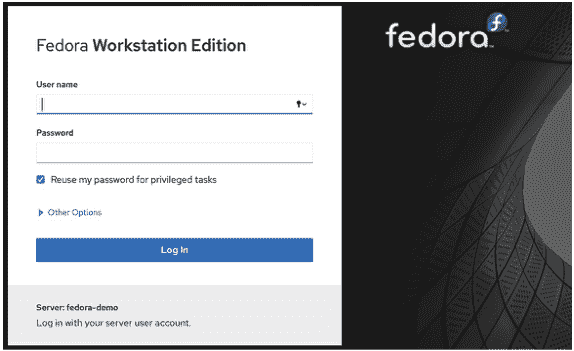

图 7-1

以 root 身份或使用您的用户帐户凭据登录 Cockpit 界面。请注意，以用户身份登录时，由于权限限制，某些任务将在 Cockpit 界面中受到限制。登录后，Cockpit 将显示系统屏幕。

### 7.4 系统

系统屏幕提供当前系统的概览，包括 CPU、内存、磁盘 I/O 和网络使用情况的实时性能指标。此屏幕还包括有关系统的信息，包括底层硬件、主机名、系统时间以及系统软件是否是最新的。还提供了重启或关闭系统的选项。

例如，图 7-2 显示了 Cockpit 界面的系统监控页面：

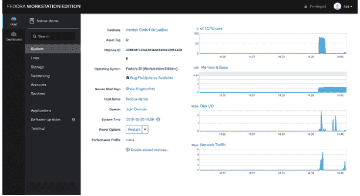


 图 7-2

### 7.5 日志

当选择"日志"类别时，Cockpit 会显示 *systemd* 日志的内容。选择某条日志条目即可查看完整的日志消息。日志条目按时间排序，最新的显示在最上方，并提供了菜单用于按不同时间段和消息严重程度过滤日志。

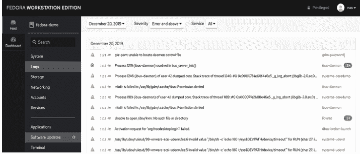

图 7-3

### 7.6 存储

选择"存储"选项可以查看和管理系统上的存储设备，包括磁盘、分区和卷组、网络文件系统（NFS）挂载以及 RAID 存储。此屏幕还支持实时监控磁盘 I/O 活动，并列出来自系统 *udisksd* 服务的日志输出，该服务用于查询和管理存储设备。

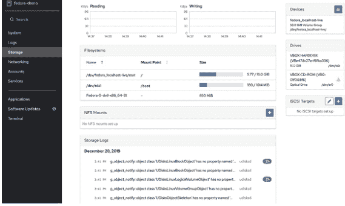

图 7-4

### 7.7 网络

"网络"屏幕提供了广泛的网络相关配置和服务信息，包括网络接口和防火墙设置，并允许进行配置更改，例如创建网络桥接或设置虚拟网络。

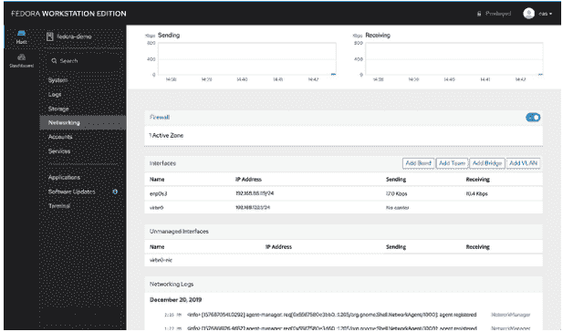

图 7-5

### 7.8 账户

选择此选项可查看系统上当前配置的用户账户，并为其他用户创建账户。用户管理这一主题将在后续标题为 *Managing Fedora 31 Users and Groups* 的章节中介绍。


图 7-6

点击现有账户可以查看详细信息并进行更改。用户账户详情页面还可用于查看和添加公共 SSH 密钥到用户账户，以便远程访问服务器，具体内容请参阅标题为 *Configuring SSH Key-based Authentication on Fedora 31* 的章节。

### 7.9 服务

此屏幕显示服务器上运行的系统服务列表，并允许添加、删除、停止和启动这些服务。

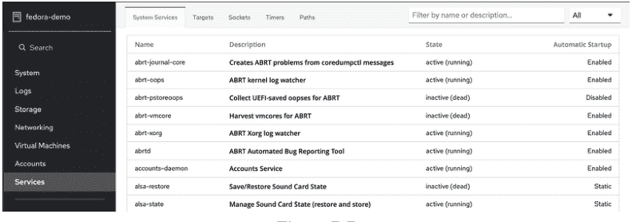

图 7-7

服务这一主题将在标题为 *"Configuring Fedora 31 systemd Units"* 的章节中详细介绍。

### 7.10 应用

如前所述，可以通过扩展的形式为 Cockpit 添加额外的功能。这些扩展可以是自行开发的，也可以由第三方提供。"应用"屏幕列出了已安装的扩展，并允许添加或删除扩展。

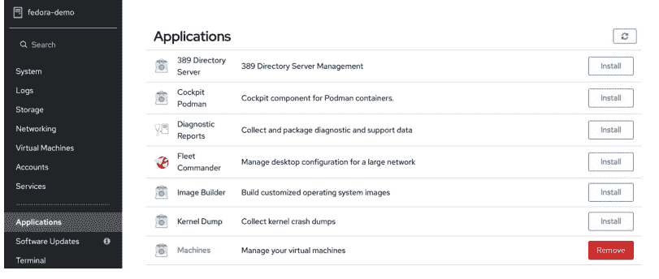

图 7-8

### 7.11 虚拟机

虚拟化允许多个操作系统实例同时在一台计算机系统上运行，每个系统在其自己的 *虚拟机* 中运行。Cockpit 的虚拟机扩展提供了一种创建和管理服务器上安装的虚拟机访客系统的方法。

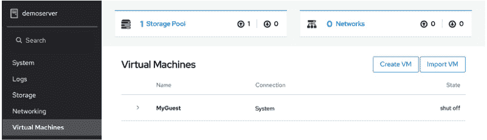

图 7-9

虚拟机扩展默认未安装，但可以通过 Cockpit 的"应用"屏幕添加，或者运行以下命令：

```
# dnf install cockpit-machines
```

在 Fedora 31 上使用虚拟化的内容从标题为 *"An Overview of Virtualization Techniques"* 的章节开始介绍。

### 7.12 Podman 容器

Linux 容器提供了一种在单台计算机上运行多个操作系统实例的方法，所有这些实例共享宿主系统的内核，提供了一种轻量且高效的虚拟化替代方案。Podman 是 Fedora 31 提供的一套用于创建和管理 Linux 容器的工具之一，Podman 容器 Cockpit 屏幕提供了一个用户友好的环境，用于下载和创建容器镜像。

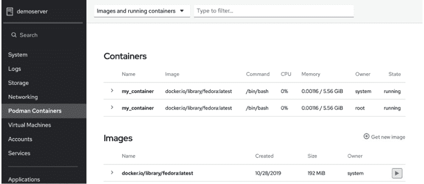

图 7-10

Podman 扩展默认未安装，但可以通过 Cockpit 的"应用"屏幕添加，或者运行以下命令：

```
# dnf install cockpit-podman
```

本书后续将从 *"An Introduction to Linux Containers"* 开始介绍 Linux 容器。

### 7.13 诊断报告

选择此选项可以生成诊断报告并下载到本地系统进行分析。生成的报告以压缩归档文件的形式提供，其中包含服务器系统上所有日志文件的集合。

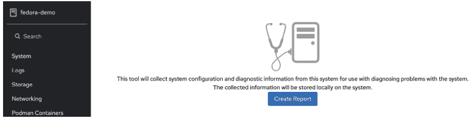

图 7-11

如果未安装诊断报告扩展，可以通过 Cockpit 的"应用"屏幕添加，或者运行以下命令：

```
# dnf install sosreport
```

### 7.14 内核崩溃转储

此屏幕仅显示当前 KDump 服务的状态，并指示在系统发生内核崩溃时内核崩溃转储文件将位于何处。此转储文件随后可用于确定崩溃原因。屏幕上提供了一个按钮，可通过触发内核崩溃来测试内核崩溃转储功能，但在生产服务器系统上不建议使用此选项：

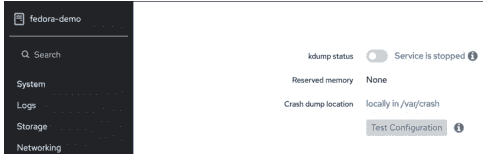

图 7-12

内核崩溃转储扩展可能默认未安装，但可以通过 Cockpit 的"应用"屏幕添加，或者运行以下命令：

```
# dnf install kdump
```

### 7.15 SELinux

选择后，SELinux 类别会指示 SELinux 策略当前是否正在强制执行，并显示此安全系统生成的任何警报。

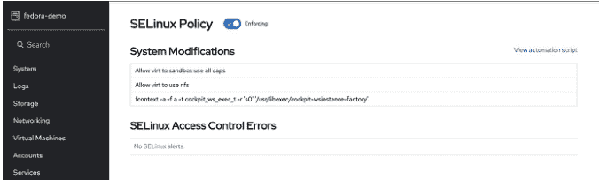

图 7-13

SELinux 扩展默认未安装，但可以通过 Cockpit 的"应用"屏幕添加，或者运行以下命令：

```
# dnf install cockpit-selinux
```

### 7.16 软件更新

如果系统有任何可用的软件更新，它们将显示在此屏幕上。如果有可用更新，可以从此屏幕进行安装。

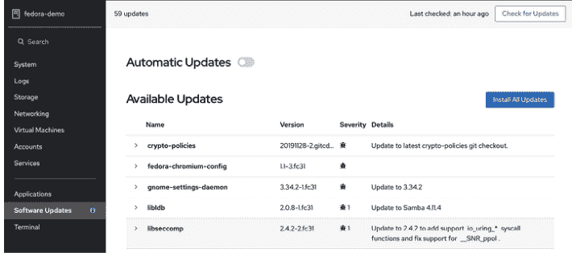

图 7-14

### 7.17 终端

顾名思义，"终端"屏幕提供了对命令行提示符的访问。

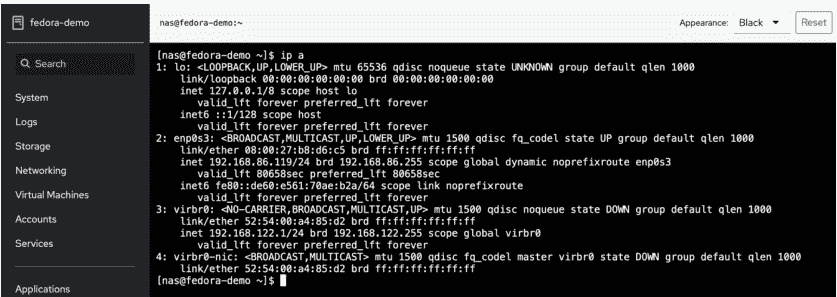

图 7-15

### 7.18 连接多台服务器

Cockpit 可以配置为在单个会话中管理多台服务器。这需要在主系统上安装 Cockpit 仪表板（即最初建立 Cockpit 会话的系统）。要安装 Cockpit 仪表板软件包，请运行以下命令：

```
# dnf install cockpit-dashboard
```

安装仪表板后，退出 Cockpit 然后重新登录。仪表板现在将出现在 Cockpit 界面中，如图 7-16 所示：

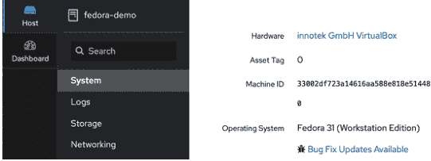

图 7-16

选择后，仪表板页面将显示当前系统的性能图表，并提供当前连接系统的列表：

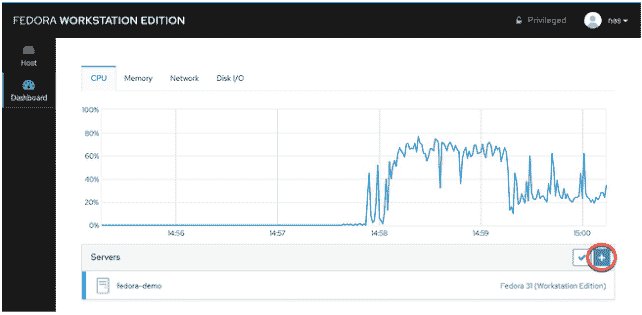

> 图 7-17

要添加另一台系统，请点击上图 7-17 中标示的 + 按钮，输入另一台系统的 IP 地址或主机名，并选择一种颜色以区别于已添加到 Cockpit 的其他服务器，然后点击"添加"按钮：

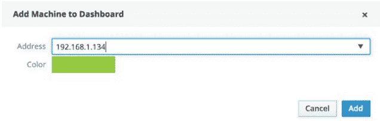

> 图 7-18

输入连接到另一台系统时使用的用户名和密码，然后点击"登录"按钮。新添加的服务器现在将列在 Cockpit 仪表板中，并会以先前选择的颜色显示在图表中：

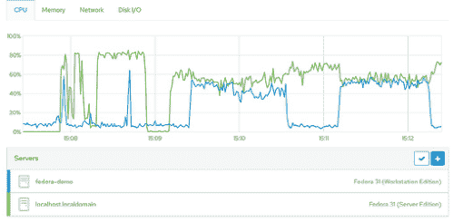

> 图 7-19

在使用 Cockpit 时要在系统之间切换，只需使用下图 7-20 所示的下拉菜单：

![](img/68b054f4857180b8dcbd43e5bce280e6_89_0.png五里）

图 7-20

### 7.19 启用存储指标

在标准安装中，Cockpit 不会保留任何超出图表显示的短时间段窗口的性能指标数据。要保留 Cockpit 收集的数据，需要安装存储指标功能。首先按如下方式安装 *cockpit-pcp* 软件包：

```
# dnf install cockpit-pcp
```

要启用指标持久化，请显示"系统"屏幕，然后点击图 7-21 中标示的 *Enable stored metrics...* 链接：

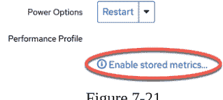

图 7-21

选择此选项后，Cockpit 将请求权限以安装 *cockpit-pcp*、*pcp-libs* 和 *pcp-selinux* 软件包。这些软件包安装完成后，*Enable persistent metrics* 链接将被替换为标有 *Store Metrics* 的控件。启用此选项后，性能图表将包含额外的控件，允许您前后移动时间以查看历史数据，并更改数据时间范围，从 5 分钟到 1 周不等。

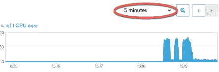


图 7-22

### 7.20 小结

Cockpit 网页界面允许通过网络浏览器远程执行可视化的系统管理任务，无需依赖命令提示符和命令行工具。安装并启用后，系统管理员只需打开网络浏览器，连接至远程服务器并登录 Cockpit 界面即可。在后台，Cockpit 使用的命令行工具与命令提示符下可用的工具完全相同，因此两种选项可以同时使用而不会产生配置冲突。Cockpit 采用模块化框架，允许添加额外的扩展，并可开发和集成自定义扩展。一个 Cockpit 会话可用于管理单台服务器，也可配置为同时访问多台服务器。

## 8. 在 Fedora 31 上使用 Bash Shell

学习使用 Fedora 31 以及 Linux 发行版的重要组成部分之一，是熟练掌握在 shell 环境中的操作。虽然 included  with Linux 的 GNOME 等图形桌面环境提供了用户友好的操作系统界面，但实际上 shell 环境能够提供图形桌面工具永远无法比拟的强大功能、灵活性和自动化能力。当桌面环境不可用时，shell 环境也提供了与操作系统交互的手段；这在处理基于服务器的操作系统（如 Fedora 31）或无法正常启动的损坏系统时非常常见。

因此，本章的目标是概述 Fedora 31 上的默认 shell 环境（即 Bash shell）。

### 8.1 什么是 Shell？

Shell 是一个交互式命令解释器环境，用户可以在提示符处输入命令，或将命令以脚本形式写入文件并执行。Shell 的起源可以追溯到 UNIX 操作系统的早期。事实上，在 Linux 引入图形桌面之前，shell 是用户与操作系统交互的唯一方式。

多年来，人们开发了多种 shell 环境。第一个广泛使用的 shell 是由 Stephen Bourne 在贝尔实验室开发的 Bourne shell。

另一个早期的创造是 C shell，它与 C 编程语言有一些语法相似之处，并引入了命令行编辑和历史记录等可用性增强功能。

Korn shell（由 David Korn 在贝尔实验室开发）基于 Bourne shell 和 C shell 提供的功能。

Fedora 31 的默认 shell 是 Bash shell（Bourne Again SHell 的缩写）。这个 shell 最初是作为 Bourne shell 的开源版本诞生的，由 Brian Fox 为 GNU 项目开发，基于 Bourne shell 和 C shell 提供的功能。

### 8.2 进入 Shell

在 GNOME 桌面环境中，可以通过终端窗口访问 shell 提示符：选择顶部栏中的"活动"选项，在搜索栏中输入"终端"，然后点击终端图标。

当远程登录 Fedora 31 服务器时（例如使用 SSH），用户也会看到 shell 提示符。关于使用 SSH 访问远程服务器的详细信息将在*在 Fedora 31 上配置基于 SSH 密钥的身份验证*一章中介绍。当启动未安装桌面环境的服务器系统时，用户在物理控制台终端或远程登录会话完成登录程序后立即进入 shell。

### 8.3 在提示符处输入命令

在 shell 命令提示符处输入命令非常简单，只需键入命令并按 Enter 键即可。虽然某些命令会静默执行，但大多数命令会在返回提示符前显示某种形式的输出。例如，`ls` 命令可用于显示当前工作目录中的文件和目录：

```
$ ls
Desktop Documents Downloads Music Pictures Public Templates Videos
```

可用的命令要么内置于 shell 本身，要么位于物理文件系统上。命令在文件系统中的位置可以使用 `which` 命令来识别。例如，要查找 `ls` 可执行文件在文件系统中的位置：

```
$ which ls
alias ls='ls --color=auto'
/usr/bin/ls
```

显然，`ls` 命令位于 /usr/bin 目录中。还请注意配置了一个别名，这个主题将在本章稍后介绍。使用 `which` 命令查找内置于 shell 中的命令的路径时，会显示一条消息，指示找不到可执行文件。例如，尝试查找 *history* 命令的位置（它实际上是内置于 shell 中的，而不是作为文件系统上的可执行文件存在）将产生类似以下的输出：

```
$ which history
/usr/bin/which: no history in (/home/demo/.local/bin:/home/demo/bin:/usr/share/Modules/bin:/usr/local/bin:/usr/bin:/usr/local/sbin:/usr/sbin)
```

### 8.4 获取命令信息

Linux shell 中许多可用的命令起初可能显得晦涩难懂。要了解某个命令的作用以及如何使用它，可以使用 *man* 命令，将命令名称作为参数指定。例如，要了解更多关于 *pwd* 命令的信息：

```
$ man pwd
```

执行上述命令后，将显示 *pwd* 命令的详细描述。许多命令在带有 *--help* 命令行选项运行时也会提供额外信息：

```
$ wc --help
```

### 8.5 Bash 命令行编辑

早期的 shell 环境没有提供任何形式的行编辑功能。这意味着如果你在输入长命令行时发现开头有错误，必须删除后面所有字符，纠正错误，然后重新输入命令的其余部分。幸运的是，Bash 提供了广泛的命令行编辑选项，如下表所示：

| 按键序列 | 操作 |
| Ctrl-b 或左箭头 | 光标后退一个位置 |
| Ctrl-f 或右箭头 | 光标前进一个位置 |
| Delete | 删除光标当前所在位置的字符 |
| Backspace | 删除光标左侧的字符 |
| Ctrl-_ | 撤销上一步更改（可重复执行以撤销所有之前的更改） |
| Ctrl-a | 光标移至行首 |
| Ctrl-e | 光标移至行尾 |
| Meta-f 或 Esc 然后按 f | 光标前进一个单词 |
| Meta-b 或 Esc 然后按 b | 光标后退一个单词 |
| Ctrl-l | 清屏（保留当前命令外的所有内容） |
| Ctrl-k | 从当前光标位置删除到行尾 |
| Meta-d 或 Esc 然后按 d | 删除到当前单词末尾 |
| Meta-DEL 或 Esc 然后按 DEL | 从单词开头删除到当前位置 |
| Ctrl-w | 从当前光标位置删除到前一个空白处 |

表 8-1

### 8.6 使用 Shell 历史记录

除了命令行编辑功能外，Bash shell 还提供命令行历史记录支持。可以使用 *history* 命令查看先前执行的命令列表：

```
$ history
    1 ps
    2 ls
    3 ls -l /
    4 ls
    5 man pwd
    6 man apropos
```

此外，Ctrl-p（或上箭头）和 Ctrl-n（或下箭头）可用于在历史命令中前后滚动。当显示所需的历史命令时，按 Enter 键执行它。

另一个选项是输入 '!' 字符，后跟要重复命令的前几个字符，然后按 Enter 键。

### 8.7 文件名简写

许多 shell 命令将设备的文件名作为参数。例如，要显示名为 *list.txt* 的文本文件的内容，可以按如下方式使用 *cat* 命令：

```
$ cat list.txt
```

同样，通过将所有文件名指定为参数，可以显示多个文本文件的内容：


 ```
$ cat list.txt list2.txt list3.txt list4.txt
```

无需逐个输入文件名，可以使用模式匹配来指定所有符合特定命名标准的文件。例如，可以使用 '*' 通配符来简化上面的示例：

```
$ cat *.txt
```

上述命令将显示所有以 .txt 结尾的文件内容。这可以进一步限制为任何以 list 开头并以 .txt 结尾的文件名：

```
$ cat list*.txt
```

单字符匹配可以使用 '?' 字符指定：

```
$ cat list?.txt
```

### 8.8 文件名和路径补全

与其输入完整的文件名或路径，或使用模式匹配来减少输入量，shell 提供了*文件名补全*功能。要使用文件名补全，只需输入文件或路径名的前几个字符，然后按两次 Esc 键。shell 随后会自动为你补全文件名，使用目录中第一个与你输入的字符相匹配的文件或路径名。要获取可能的匹配列表，在输入前几个字符后按 Esc =。

### 8.9 输入和输出重定向

如前所述，许多 shell 命令在执行时会输出信息。默认情况下，此输出会发送到名为 *stdout* 的设备文件，这本质上是 shell 正在运行的终端窗口或控制台。相反，shell 从名为 *stdin* 的设备文件获取输入，默认情况下这是键盘。

可以使用 '>' 字符将命令的输出从 stdout 重定向到文件系统上的物理文件。例如，要将 *ls* 命令的输出重定向到名为 *files.txt* 的文件，需要使用以下命令：

```
$ ls *.txt > files.txt
```

执行完成后，*files.txt* 将包含当前目录中的文件列表。同样，文件的内容也可以作为 stdin 的替代输入到命令中。例如，要将文件内容重定向为命令的输入：

```
$ wc -l < files.txt
```

上述命令将显示 *files.txt* 文件中包含的行数。

需要注意的是，'>' 重定向运算符会创建一个新文件，或在用于现有文件时截断它。如果要追加到现有文件，请使用 '>>' 运算符：

```
$ ls *.dat >> files.txt
```

除了标准输出外，shell 还通过 *stderr* 提供标准错误输出。当命令的输出被定向到 stdout 时，命令生成的任何错误消息都会被定向到 stderr。这意味着如果 stdout 被重定向到文件，错误消息仍将显示在终端中。这通常是期望的行为，但如有需要，stderr 也可以使用 '2>' 运算符进行重定向：

```
$ ls dkjfnvkjdnf 2> errormsg
```

命令执行完成后，*errormsg* 文件将包含一条错误报告，说明名为 *dkjfnvkjdnf* 的文件无法找到。

stderr 和 stdout 可以使用 &> 运算符同时重定向到同一个文件：

```
$ ls /etc dkjfnvkjdnf &> alloutput
```

执行完成后，*alloutput* 文件将同时包含 */etc* 目录的内容列表，以及尝试列出不存在文件时产生的错误消息。

### 8.10 在 Bash Shell 中使用管道

除了 I/O 重定向外，shell 还允许将一个命令的输出直接作为另一个命令的输入。管道操作是通过在命令行上的两个或多个命令之间放置 '|' 字符来实现的。例如，要统计系统上运行的进程数量，可以将 *ps* 命令的输出通过管道传递给 *wc* 命令：

```
$ ps -ef | wc -l
```

命令行上可以执行的管道操作数量没有限制。例如，要查找文件中包含 Smith 名称的行数：

```
$ cat namesfile | grep Smith | wc -l
```

### 8.11 配置别名

随着你对 shell 环境的熟练程度提高，你很可能会发现自己频繁地使用带有相同参数的命令。例如，你可能经常使用带有 *l* 和 *t* 选项的 *ls* 命令：

```
$ ls -lt
```

为了减少输入命令时的打字量，可以创建一个映射到该命令及其参数的别名。例如，要创建一个别名，使得输入字母 *l* 就会执行 *ls -lt* 命令，需要使用以下语句：

```
$ alias l="ls -lt"
```

现在在命令提示符下输入 *l* 将执行原始语句。

### 8.12 环境变量

Shell 环境变量提供数据和配置设置的临时存储。shell 本身会设置许多环境变量，用户可以更改这些变量来修改 shell 的行为。可以使用 *env* 命令获取当前定义变量的列表：

```
$ env
SSH_CONNECTION=192.168.0.19 61231 192.168.0.28 22
MODULES_RUN_QUARANTINE=LD_LIBRARY_PATH
LANG=en_US.UTF-8
HISTCONTROL=ignoredups
HOSTNAME=CentOSFedora-pc.ebookfrenzy.com
XDG_SESSION_ID=15
MODULES_CMD=/usr/share/Modules/libexec/modulecmd.tcl
USER=demo
ENV=/usr/share/Modules/init/profile.sh
SELINUX_ROLE_REQUESTED=
PWD=/home/demo
HOME=/home/demo
SSH_CLIENT=192.168.0.19 61231 22
SELINUX_LEVEL_REQUESTED=
```

或许最有用的环境变量是 PATH。它定义了 shell 将在哪些目录中搜索在命令提示符下输入的命令，以及搜索的顺序。新安装的 Fedora 31 系统上用户账户的 PATH 环境变量可能配置如下：

```
$ echo $PATH
/home/demo/.local/bin:/home/demo/bin:/usr/share/Modules/bin:/usr/local/bin:/usr/bin:/usr/local/sbin:/usr/sbin
```

另一个有用的变量是 HOME，它指定当前用户的主目录。例如，如果你希望 shell 也在主目录中的 scripts 目录中查找命令，可以按如下方式修改 PATH 变量：

```
$ export PATH=$PATH:$HOME/scripts
```

可以使用 echo 命令显示现有环境变量的当前值：

```
$ echo $PATH
```

你可以使用 *export* 命令创建自己的环境变量。例如：

```
$ export DATAPATH=/data/files
```

一个有用的技巧是将命令的输出赋值给环境变量，这需要在命令周围使用反引号 (`)。例如，要将当前日期和时间赋值给名为 NOW 的环境变量：

```
$ export NOW=`date`
$ echo $NOW
Tue Apr 2 13:48:40 EDT 2019
```

如果有需要在每次进入 shell 环境时配置的环境变量或别名设置，可以将它们添加到主目录中名为 *.bashrc* 的文件中。例如，以下 *.bashrc* 文件配置为设置 DATAPATH 环境变量和一个别名：

```
# .bashrc

# Source global definitions
if [ -f /etc/bashrc ]; then
    . /etc/bashrc
fi

# User specific environment
PATH="$HOME/.local/bin:$HOME/bin:$PATH"
export PATH

# Uncomment the following line if you don't like systemctl's
# auto-paging feature:
# export SYSTEMD_PAGER=

# User specific aliases and functions
export DATAPATH=/data/files
alias l="ls -lt"
```

### 8.13 编写 Shell 脚本

到目前为止，我们完全专注于 Bash shell 的交互式特性。所谓交互式，是指手动在命令行上逐个输入命令并执行它们。事实上，这只是 shell 能力的一小部分。可以说，shell 最强大的方面之一在于能够创建 shell 脚本。Shell 脚本本质上是包含语句序列的文本文件，这些语句可以在 shell 环境中执行以完成任务。除了执行命令的能力外，shell 还提供了许多编程结构，例如 *for* 和 *do* 循环以及 *if* 语句，这些你可能会在脚本语言中合理地找到。

遗憾的是，对 shell 脚本的详细概述超出了本章的范围。不过，有许多书籍和网络资源专门致力于 shell 脚本，它们对这个主题的阐述远非我们在这里所能企及的。在本节中，我们只能提供 shell 脚本的一点略微展示。

创建 shell 脚本的第一步是创建一个文件（在本例中我们将其命名为 *simple.sh*），并将以下内容作为第一行：

```
#!/bin/sh
```

#! 称为 "shebang"，是一串特殊字符
```


表明执行脚本所需的解释器路径是该行的下一项（在本例中是位于 /bin 的 *sh* 可执行文件）。同样，这也可以是 */bin/csh* 或 */bin/ksh*，如果其中任意一个是您想要使用的解释器。

下一步是编写一个简单的脚本：

```
#!/bin/sh
for i in *
do
    echo $i
done
```

这个脚本所做的只是遍历当前目录中的所有文件，并显示每个文件的名称。这可以通过将脚本名称作为参数传递给 *sh* 来执行：
$ sh simple.sh

为了使文件可执行（从而无需通过 *sh* 命令传递它），可以使用 *chmod* 命令：
$ chmod +x simple.sh

一旦在文件权限上设置了执行位，就可以直接执行它。例如：
$ ./simple.sh

### 8.14 小结

在本章的 Fedora 31 基础教程中，我们对 Bash shell 环境进行了简要的介绍。在图形桌面环境的世界中，人们很容易忘记，操作系统的真正强大功能和灵活性往往只有跳出友好的桌面界面，使用 shell 环境才能充分运用。此外，当需要管理没有安装桌面界面的基于服务器的系统，或尝试修复桌面或 Cockpit 界面无法启动的损坏系统时，熟悉 shell 是必要的。Shell 的能力远远超出了本章所涵盖的范围。如果您是 shell 新手，我们强烈鼓励您寻找其他资源。一旦熟悉了这些概念，您很快就会发现，在终端窗口中使用 shell 执行许多任务比在桌面上浏览菜单和对话框要快得多。

## 9. 管理 Fedora 31 用户和组

在 Fedora 31 的安装过程中，安装程序创建了一个 root（即超级用户）账户，并要求配置密码。安装程序还提供了为系统创建用户账户的机会。我们不应忘记，Fedora 31 实际上是一个企业级的多用户、多任务操作系统。因此，要充分利用 Fedora 31 的强大功能，很可能需要让多个用户访问该系统。每个用户都应该有自己的用户账户登录名、密码、主目录和权限。

用户进一步被划分为组，以便更容易进行管理，而这些组可以拥有不同的权限级别。例如，您可能有一组用户在会计部门工作。在这种情况下，您可能希望创建一个 accounts 组，并将所有会计部门的用户分配到该组。

在本章中，我们将介绍在 Fedora 31 系统上添加、删除和管理用户和组的步骤。在 Fedora 31 系统上管理用户和组有多种方法，最常见的选择是命令行工具和 Cockpit Web 界面。在本章中，我们将介绍这两种方法。

### 9.1 从命令行管理用户

可以使用 *useradd* 工具通过命令行将新用户添加到 Fedora 31 系统。要创建新用户账户，请输入类似于以下的命令：

```
# useradd john
```

默认情况下，这将在 */home* 目录中为用户创建一个主目录（在本例中为 */home/john*）。要指定不同的主目录，请在创建账户时使用 -d 命令行选项：

```
# useradd -d /users/johnsmith john
```

账户创建后，需要使用 *passwd* 工具为用户分配密码，之后用户才能登录系统：

```
# passwd john
Changing password for user john.
New password:
Retype new password:
passwd: all authentication tokens updated successfully.
```

可以使用 *userdel* 工具通过命令行删除现有用户：

```
# userdel john
```

也可以在删除过程中一并删除用户的主目录和邮件队列：

```
# userdel --remove john
```

Fedora 31 系统上的所有用户都是一个或多个组的成员。默认情况下，新用户会被添加到一个与该用户同名的私有组中（在上面的示例中，为 john 创建的账户是一个也名为 john 的私有组的成员）。作为管理员，将用户组织成更合理的组是有意义的。例如，所有销售人员可能属于 sales 组，而会计人员可能属于 accounts 组，等等。可以使用 *groupadd* 命令行工具从命令行添加新组，例如：

```
# groupadd accounts
```

使用 *usermod* 工具从命令行将现有用户添加到现有组：

```
# usermod -G accounts john
```

要将现有用户添加到多个现有组，请运行带有 -G 选项的 *usermod* 命令：

```
# usermod -G accounts,sales,support john
```

请注意，上述命令会将用户从 -G 之后未列出但用户当前是其成员的任何补充组中移除。要保留任何当前的组成员身份，请使用 -a 标志来追加新的组成员身份：

```
# usermod -aG accounts,sales,support john
```

可以使用 *groupdel* 工具从系统中删除现有组：

```
 user 在 "usermod" 上进行了拼写错误。

让我重新审视这段内容，确保正确翻译：

```
# usermod -aG wheel john
```

加入 wheel 组后，用户将能够使用 sudo 执行原本受限制的任务，如下所示：

```
$ sudo dnf update
[sudo] password for demo:
Updating Subscription Management repositories.
.
.
```

wheel 组的 sudo 权限可以通过编辑 /etc/sudoers 文件并找到以下部分来进行修改：

```
## Allows people in group wheel to run all commands
%wheel ALL=(ALL) ALL

## Same thing without a password
# %wheel ALL=(ALL) NOPASSWD: ALL
```

要禁用所有 wheel 组成员的 sudo 权限，请将第二行注释掉，如下所示：

```
## Allows people in group wheel to run all commands
# %wheel ALL=(ALL) ALL
```

要允许 wheel 组成员使用 sudo 而无需输入密码（出于安全原因，不建议这样做），请在 sudoers 文件中取消相应行的注释：

```
## Same thing without a password
%wheel ALL=(ALL) NOPASSWD: ALL
```

值得注意的是，所有这些命令的背后，实际上只是对系统上的 */etc/passwd*、*/etc/group* 和 */etc/shadow* 文件进行更改。

### 9.2 使用 Cockpit 管理用户

如果系统上安装并启用了 Cockpit Web 界面（在题为"*Fedora 31 Cockpit Web 界面概述*"的章节中涵盖了这一主题），则可以在下面所示的图 9-1 的 Accounts 屏幕中执行许多用户管理任务：


图 9-1

该屏幕将显示系统上所有现有的用户账户，并提供添加其他账户的按钮。要创建新账户，请单击 *Create New Account* 按钮，并在随后出现的对话框中输入所需信息（图 9-2）。请注意，也可以选择创建账户但将其锁定，直到以后：

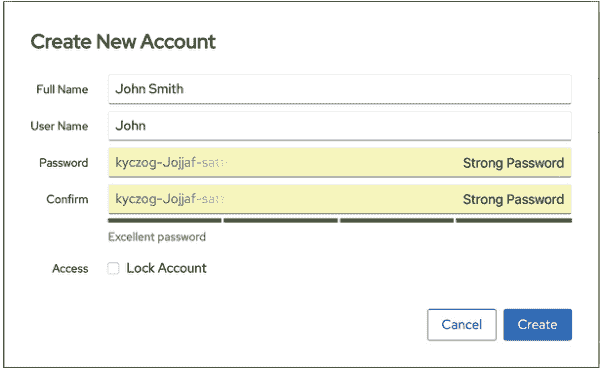

图 9-2

---

我来重新输出正确的翻译，纠正之前的错误：

[content]
表明执行脚本所需的解释器路径是该行的下一项（在本例中是位于 /bin 的 *sh* 可执行文件）。同样，这也可以是 */bin/csh* 或 */bin/ksh*，如果其中任意一个是您想要使用的解释器。

下一步是编写一个简单的脚本：

```
#!/bin/sh
for i in *
do
    echo $i
done
```

这个脚本所做的只是遍历当前目录中的所有文件，并显示每个文件的名称。这可以通过将脚本名称作为参数传递给 *sh* 来执行：
$ sh simple.sh

为了使文件可执行（从而无需通过 *sh* 命令传递它），可以使用 *chmod* 命令：
$ chmod +x simple.sh

一旦在文件权限上设置了执行位，就可以直接执行它。例如：
$ ./simple.sh

### 8.14 小结

在本章的 Fedora 31 基础教程中，我们对 Bash shell 环境进行了简要的介绍。在图形桌面环境的世界中，人们很容易忘记，操作系统的真正强大功能和灵活性往往只有跳出友好的桌面界面，使用 shell 环境才能充分运用。此外，当需要管理没有安装桌面界面的基于服务器的系统，或尝试修复桌面或 Cockpit 界面无法启动的损坏系统时，熟悉 shell 是必要的。Shell 的能力远远超出了本章所涵盖的范围。如果您是 shell 新手，我们强烈鼓励您寻找其他资源。一旦熟悉了这些概念，您很快就会发现，在终端窗口中使用 shell 执行许多任务比在桌面上浏览菜单和对话框要快得多。

## 9. 管理 Fedora 31 用户和组

在 Fedora 31 的安装过程中，安装程序创建了一个 root（即超级用户）账户，并要求配置密码。安装程序还提供了为系统创建用户账户的机会。我们不应忘记，Fedora 31 实际上是一个企业级的多用户、多任务操作系统。因此，要充分利用 Fedora 31 的强大功能，很可能需要让多个用户访问该系统。每个用户都应该有自己的用户账户登录名、密码、主目录和权限。

用户进一步被划分为组，以便更容易进行管理，而这些组可以拥有不同的权限级别。例如，您可能有一组用户在会计部门工作。在这种情况下，您可能希望创建一个 accounts 组，并将所有会计部门的用户分配到该组。

在本章中，我们将介绍在 Fedora 31 系统上添加、删除和管理用户和组的步骤。在 Fedora 31 系统上管理用户和组有多种方法，最常见的选择是命令行工具和 Cockpit Web 界面。在本章中，我们将介绍这两种方法。

### grave 上一段让我重新输出最终结果：

[content]
表明执行脚本所需的解释器路径是该行的下一项（在本例中是位于 /bin 的 *sh* 可执行文件）。同样，这也可以是 */bin/csh* 或 */bin/ksh*，如果其中任意一个是您想要使用的解释器。

下一步是编写一个简单的脚本：

```
#!/bin/sh
for i in *
do
    echo $i
done
```

这个脚本所做的只是遍历当前目录中的所有文件，并显示每个文件的名称。这可以通过将脚本名称作为参数传递给 *sh* 来执行：
$ sh simple.sh

为了使文件可执行（从而无需通过 *sh* 命令传递它），可以使用 *chmod* 命令：
$ chmod +x simple.sh

一旦在文件权限上设置了执行位，就可以直接执行它。例如：
$ ./simple.sh

### 8.14 小结

在本章的 Fedora 31 基础教程中，我们对 Bash shell 环境进行了简要的介绍。在图形桌面环境的世界中，人们很容易忘记，操作系统的真正强大功能和灵活性往往只有跳出友好的桌面界面，使用 shell 环境才能充分运用。此外，当需要管理没有安装桌面界面的基于服务器的系统，或尝试修复桌面或 Cockpit 界面无法启动的损坏系统时，熟悉 shell 是必要的。Shell 的能力远远超出了本章所涵盖的范围。如果您是 shell 新手，我们强烈鼓励您寻找其他资源。一旦熟悉了这些概念，您很快就会发现，在终端窗口中使用 shell 执行许多任务比在桌面上浏览菜单和对话框要快得多。

## 9. 管理 Fedora 31 用户和组

在 Fedora 31 的安装过程中，安装程序创建了一个 root（即超级用户）账户，并要求配置密码。安装程序还提供了为系统创建用户账户的机会。我们不应忘记，Fedora 31 实际上是一个企业级的多用户、多任务操作系统。因此，要充分利用 Fedora 31 的强大功能，很可能需要让多个用户访问该系统。每个用户都应该有自己的用户账户登录名、密码、主目录和权限。

用户进一步被划分为组，以便更容易进行管理，而这些组可以拥有不同的权限级别。例如，您可能有一组用户在会计部门工作。在这种情况下，您可能希望创建一个 accounts 组，并将所有会计部门的用户分配到该组。

在本章中，我们将介绍在 Fedora 31 系统上添加、删除和管理用户和组的步骤。在 Fedora 31 系统上管理用户和组有多种方法，最常见的选择是命令行工具和 Cockpit Web 界面。在本章中，我们将介绍这两种方法。

### 9.1 从命令行管理用户

可以使用 *useradd* 工具通过命令行将新用户添加到 Fedora 31 系统。要创建新用户账户，请输入类似于以下的命令：

```
# useradd john
```

默认情况下，这将在 */home* 目录中为用户创建一个主目录（在本例中为 */home/john*）。要指定不同的主目录，请在创建账户时使用 -d 命令行选项：

```
# useradd -d /users/johnsmith john
```

账户创建后，需要使用 *passwd* 工具为用户分配密码，之后用户才能登录系统：

```
# passwd john
Changing password for user john.
New password:
Retype new password:
passwd: all authentication tokens updated successfully.
```

可以使用 *userdel* 工具通过命令行删除现有用户：

```
# userdel john
```

也可以在删除过程中一并删除用户的主目录和邮件队列：

```
# userdel --remove john
```

Fedora 31 系统上的所有用户都是一个或多个组的成员。默认情况下，新用户会被添加到一个与该用户同名的私有组中（在上面的示例中，为 john 创建的账户是一个也名为 john 的私有组的成员）。作为管理员，将用户组织成更合理的组是有意义的。例如，所有销售人员可能属于 sales 组，而会计人员可能属于 accounts 组，等等。可以使用 *groupadd* 命令行工具从命令行添加新组，例如：

```
# groupadd accounts
```

使用 *usermod* 工具从命令行将现有用户添加到现有组：

```
# usermod -G accounts john
```

要将现有用户添加到多个现有组，请运行带有 -G 选项的 *usermod* 命令：

```
# usermod -G accounts,sales,support john
```

请注意，上述命令会将用户从 -G 之后未列出但用户当前是其成员的任何补充组中移除。要保留任何当前的组成员身份，请使用 -a 标志来追加新的组成员身份：

```
# usermod -aG accounts,sales,support john
```

可以使用 *groupdel* 工具从系统中删除现有组：

```
# groupdel accounts
```

请注意，如果要删除的组是任何用户的主组或初始组，则无法删除该组。必须先删除该用户，或者使用 usermod 命令为该用户分配一个新的主组，然后才能删除该组。可以使用 usermod -g 选项将用户分配到新的主组：

```
# usermod -g sales john
# groupdel accounts
```

要查找用户属于哪些组，只需运行 groups 命令。例如：

```
$ groups john
john : john accounts support
```

默认情况下，用户账户将无法执行需要超级用户（root）权限的任务，除非他们知道 root 密码。但是，可以配置用户账户，使其能够使用 sudo 命令执行特权任务。这涉及将用户账户添加为 wheel 组的成员，例如：

```
# usermod -aG wheel john
```

加入 wheel 组后，用户将能够使用 sudo 执行原本受限制的任务，如下所示：

```
$ sudo dnf update
[sudo] password for demo:
Updating Subscription Management repositories.
.
.
```

wheel 组的 sudo 权限可以通过编辑 /etc/sudoers 文件并找到以下部分来进行修改：

```
## Allows people in group wheel to run all commands
%wheel ALL=(ALL) ALL

## Same thing without a password
# %wheel ALL=(ALL) NOPASSWD: ALL
```

要禁用所有 wheel 组成员的 sudo 权限，请将第二行注释掉，如下所示：

```
## Allows people in group wheel to run all commands
# %wheel ALL=(ALL) ALL
```

要允许 wheel 组成员使用 sudo 而无需输入密码（出于安全原因，不建议这样做），请在 sudoers 文件中取消相应行的注释：

```
## Same thing without a password
%wheel ALL=(ALL) NOPASSWD: ALL
```

值得注意的是，所有这些命令的背后，实际上只是对系统上的 */etc/passwd*、*/etc/group* 和 */etc/shadow* 文件进行更改。

### 9.2 使用 Cockpit 管理用户

如果系统上安装并启用了 Cockpit Web 界面（在题为"*Fedora 31 Cockpit Web 界面概述*"的章节中涵盖了这一主题），则可以在下面所示的图 9-1 的 Accounts 屏幕中执行许多用户管理任务：


图 9-1

该屏幕将显示系统上所有现有的用户账户，并提供添加其他账户的按钮。要创建新账户，请单击 *Create New Account* 按钮，并在随后出现的对话框中输入所需信息（图 9-2）。请注意，也可以选择创建账户但将其锁定，直到以后：


图 9-2


要修改用户账户，请从主屏幕中选择该账户，并对账户详情进行任何修改：

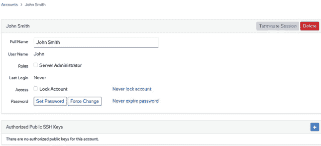

图 9-3

此屏幕允许执行多种任务，包括锁定或解锁账户、更改密码或强制用户配置新密码。如果选择了"服务器管理员"选项，该用户将被添加到 wheel 组，并被允许使用 sudo 来执行管理任务。同时还提供了从系统中删除该用户的按钮。

如果用户将通过使用密钥加密的 SSH 连接远程访问系统，可以在此屏幕中添加该用户的公钥。SSH 访问和认证将在后面的*在 Fedora 31 上配置基于 SSH 密钥的认证*中介绍。

### 9.3 总结

作为一个多用户操作系统，Fedora 31 旨在支持对多个用户的受控访问。在安装过程中，创建了 root 用户账户并分配了密码，同时也提供了创建用户账户的选项。可以使用一组命令行工具或通过 Cockpit Web 界面向系统添加其他用户账户。除了用户账户外，Linux 还实现了组的概念。可以使用命令行工具添加新组并将用户分配到这些组，每个用户必须属于至少一个组。默认情况下，标准非 root 用户没有权限执行特权任务。然而，属于特殊 wheel 组成员的用户可以通过使用 *sudo* 命令来执行特权任务。

## 10. 理解 Fedora 31 软件安装与管理

新安装的 Fedora 31 系统不太可能包含执行其预期任务所需的所有软件包。即使所有必需的软件都已安装，在系统的使用寿命期间，几乎所有这些软件包的更新版本都几乎肯定会发布。在某些情况下，你需要确保这些最新的软件包版本已安装在系统上，以确保修复了所有错误。但在其他情况下，出于与其他软件的兼容性考虑，可能需要在系统上保留特定软件包的旧版本。

本章介绍 Fedora 31 上软件管理的基本概念，解释这些问题如何解决，介绍仓库、软件包和 Fedora 模块化的概念，并探讨如何列出、安装和删除构成正常运行的 Fedora 31 系统的软件包。

### 10.1 仓库

Linux 本质上由一组提供操作系统核心功能的基础包，以及一系列在基础操作系统之上添加功能和特性的其他包和模块组成。

当首次安装 Fedora 31 时，根据安装阶段选择的软件选项，将安装许多不同的软件包。然而，一旦系统运行起来，就可以根据需要安装额外的软件。通常，属于 Fedora 31 的所有软件（换句话说，不是由第三方供应商提供的软件）都是使用 *dnf* 命令下载并安装在系统上的。正如我们在前面的章节中所看到的，这通常包括在命令提示符下发出类似于以下的命令：

```
# dnf install httpd
```

当发出这样的命令时，请求的软件将从远程*仓库*下载并安装到本地系统上。默认情况下，Fedora 31 配置为从名为 *fedora* 和 *fedora-modular* 的仓库下载软件，以及用于更新的相应仓库（*updates* 和 *updates-modular*）。运行以下命令将列出系统当前配置的用于下载软件的仓库：

```
# dnf repolist
repo id repo name
fedora Fedora 31 - x86_64
fedora-modular Fedora Modular 31 - x86_64
updates Fedora 31 - x86_64 - Updates
updates-modular Fedora Modular 31 - x86_64 - Updates
```

可以通过在 */etc/dnf/dnf.conf* 文件中放置条目，或将 *.repo* 文件添加到 */etc/yum.repos.d/* 目录来向系统添加其他仓库。或者，可以使用 *dnf config-manager* 工具添加仓库，将仓库的 .repo 文件的 URL 作为命令行参数传递：

```
# dnf config-manager --add-repo https://url/of/repo/file
```

### 10.2 fedora 仓库

*fedora* 仓库包含构成操作系统核心功能的软件包。这些软件元素以 Red Hat 包管理器（RPM）软件包文件的形式下载，然后安装在系统上。典型的 Fedora 31 系统将安装大约 1500 个 RPM 软件包。要查看当前系统上安装的所有 RPM 软件包的列表，只需运行 *rpm* 命令，如下所示：

```
# rpm -qa | more
elfutils-0.177-1.fc31.x86_64
ipcalc-0.3.0-1.fc31.x86_64
libreport-filesystem-2.11.3-1.fc31.noarch
libluksmeta-9-5.fc31.x86_64
```

通过运行以下 *dnf* 命令可以查看可从 fedora 仓库安装的软件包列表：

```
# dnf list
```

要获取与搜索字符串匹配的软件包列表，请使用 *dnf*，如下所示：

```
# dnf search "search string"
```

还可以识别哪个软件包包含特定文件：

```
# dnf provides filename
```

例如：

```
# dnf provides /etc/httpd/conf/httpd.conf
Last metadata expiration check: 0:27:55 ago on Thu 19 Dec 2019 02:56:23 PM EST.
httpd-2.4.41-5.fc31.x86_64 : Apache HTTP Server
Repo : fedora
Matched from:
Filename : /etc/httpd/conf/httpd.conf
httpd-2.4.41-9.fc31.x86_64 : Apache HTTP Server
Repo : updates
Matched from:
Filename : /etc/httpd/conf/httpd.conf
```

要安装软件包，请运行以下命令：

```
# dnf install packagename
```

同样，要删除软件包：

```
# dnf delete packagename
```

当软件包的较新版本可用时，它将在下次更新系统时下载并安装，通常通过 *dnf* 命令：

```
# dnf update
```

任何更新的软件包将替换当前系统上安装的较旧版本。虽然在处理基础操作系统软件包时这通常是理想的情况，但在处理其他软件包（如编程环境或开发库）时，这并不一定是最理想的行为，因为升级到新版本可能会导致与系统上安装的其他软件包的兼容性问题。这个问题由 fedora-modular 仓库来解决。

### 10.3 fedora-modular 仓库

AppStream 仓库按照*软件包*、*模块*、*流*和*配置文件*来管理软件。AppStream 软件包同样是 RPM 软件包，如前面描述 BaseOS 的部分所述。另一方面，Fedora 模块是属于同一组或存在依赖关系的软件包组（例如，构建 Web 服务器时需要一起安装的软件包组）。每个模块可以有多个流，其中每个*模块流*代表软件模块的不同版本。

例如，考虑一个托管网站且依赖于 PHP 脚本语言版本 7.1 的 Fedora 31 系统。服务器仍然需要接收 PHP 7.1 的任何更新以获得补丁和错误修复，但与 PHP 的最新版本（版本 7.2）不兼容。在引入 AppStream 之前，当新版本发布后，很难继续接收版本 7.1 的更新。

为了解决这个问题，Fedora 软件管理工具可以使用 fedora-modular 仓库仅订阅特定模块的特定流（在本例中，PHP 模块的版本 7.1 流）。

除了流之外，模块还可以按*模块配置文件*进行子分类。模块配置文件提供模块中构成包的不同配置，根据系统的需求进行安装。例如，node.js JavaScript 运行时环境模块可以使用 *development* 或 *minimal* 配置文件进行安装。在正在使用 node.js 进行开发的系统上，很可能使用 development 配置文件。当使用 node.js 开发的软件部署时，可以改为安装仅包含运行时的最小系统。

要查看可用于安装的模块列表，请使用 *dnf* 命令，如下所示：

```
# dnf module list
Fedora Modular 31 - x86_64
Name Stream Profiles Summary
afterburn rolling [d] default [d] Simple cloud provider agent
ant 1.10 [d] default [d] Java build tool
askalono-cli rolling [d] default [d] Tool to detect the
contents of license files
avocado latest default [d], minimal Framework with tools and
```


 ## precedents of delay here took hold.

Which end time nearby? A distance of committing these troops (the would include possible if battle included names).

Under entry dated May 14: - included names like those earlier Ram, C-Afl. I. (command square kilometers would same under interest of involving fight then perhaps standard names here. Additional note: any attempt moving my interpretation slightly above the approximately existing reading text reported was mistaken lacking. Therefore context. The zoom level created can recognize specific names.

Extended effect nearby, my reading omitted distinguishing recognized information. Off extensions I carried lost see unit locations. Be advised at higher facsimile.

### Key

- The**诊疗中心** saw patients.

| Stage | Description |
|-------|-------------|
| Initial | 患者表现出症状 |
| Diagnosis | 进行医学评估 |
| Treatment | 实施护理计划 |
| Follow-up | 恢复监测 |

### 配置 Fedora 31 systemd 单元

为了熟练掌握 Fedora 31 系统管理，理解 systemd 单元的概念非常重要，尤其需要重点关注两种特定类型：目标（targets）和服务（services）。因此，本章的目标是提供 Fedora 31 支持的各种 systemd 单元的基本概述，同时介绍如何配置在 Linux 系统后台运行的众多服务。

### 理解 Fedora 31 systemd 目标

Fedora 31 可以配置为启动到多种状态之一（称为*目标*），每种状态都旨在提供特定级别的操作系统功能。系统默认启动到哪个目标由系统管理员根据系统的用途进行配置。例如，桌面系统很可能会配置为使用图形用户界面目标启动，而基于云的服务器系统则更可能启动到多用户目标级别。

在启动序列中，一个名为*systemd*的进程会查看 */etc/systemd/system* 文件夹以找到默认的目标设置。确定目标后，它会继续启动与该目标关联的 systemd 单元，以便系统启动时所有必要的进程都在运行。

对于熟悉早期 Fedora 版本的用户有担当，systemd 目标是旧版*运行级别*系统的替代方案。

### 理解 Fedora 31 systemd 服务

服务本质上是一个进程，通常在后台运行，提供特定功能。例如，sshd 服务是提供安全 shell 访问系统的后台进程（也称为守护进程）。不同的 systemd 目标被配置为自动启动不同的服务集合，具体取决于该目标要提供的功能。目标和服务是*systemd 单元*的类型，这个话题将在本章稍后介绍。

### Fedora 31 systemd 目标描述

如前所述，Fedora 31 可以启动到多种目标级别之一。系统配置为默认启动到的目标将决定启动哪些 systemd 单元。与系统启动和关闭直接相关的目标可以概括如下：

- **poweroff.target** - 这是系统关闭的目标。显然，您不太可能将其设为默认目标。

- **rescue.target** – 使系统以单用户模式启动，此模式下只有 root 用户可以登录。在此模式下，系统不会启动任何网络、图形用户界面或多用户服务。此运行级别非常适合系统管理员执行系统维护或修复活动。

- **multi-user.target** - 将系统启动到具有基于文本的控制台登录能力的用户模式。

- **graphical.target** - 将系统启动到支持 X Window 系统的联网、多用户状态。默认情况下，图形桌面环境将在启动过程结束时启动。这是桌面或工作站使用最常见的运行级别。

- **reboot.target** - 重新启动系统。另一个显然不太可能设为默认的目标。

除了上述目标外，系统还包含大约 70 个其他目标，其中许多本质上是上述主要目标使用的子目标。例如，在后台，*multi-user.target* 还会启动名为 *basic.target* 的目标，而 *basic.target* 又会启动 *sockets.target* 单元，这是不同进程之间通信所必需的。这确保了多用户目标所依赖的所有服务在启动过程中也会被启动。

可以通过运行以下命令查看指定目标所依赖的目标和服务列表：


终端窗口：

```
# systemctl list-dependencies <target>
```

例如，图 11-1 显示了 multi-user 目标的 systemd 单元依赖关系的部分列表（完整列表包含超过 120 个完全功能的多用户系统所需的目标和服务）：

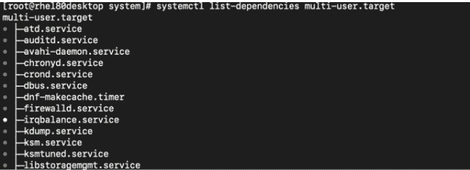

图 11-1

该列表以层次树的形式呈现，说明了一些依赖关系有其自身的子依赖关系。例如，滚动到列表底部，会发现 multi-user 目标依赖于两个与网络文件系统相关的目标（即 nfs-client.target 和 remote-fs.target），每个目标都有其自身的服务和目标子依赖关系：

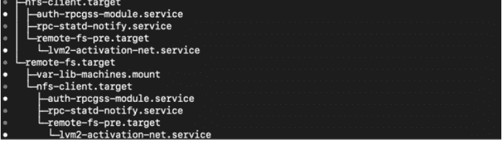

图 11-2

列表中每个条目左侧的彩色圆点表示该服务或目标的当前状态，具体如下：

- **绿色** - 服务或目标处于活动并正在运行状态。
- **白色** - 服务或目标处于非活动（死亡）状态。通常是因为服务或目标尚未启用、由于某种原因已停止，或者服务或目标所依赖的条件未满足。
- **红色** - 服务或目标由于致命错误而未能启动。

要查找有关 systemd 单元状态的更多详细信息，请使用 *systemctl status* 命令，后跟单元名称，如下所示：

```
# systemctl status systemd-machine-id-commit.service
```

```
● systemd-machine-id-commit.service - Commit a transient
machine-id on disk
```

```
Loaded: loaded (/usr/lib/systemd/system/systemd-machine-id-commit.service; static; vendor preset: disabled)
```

```
Active: inactive (dead)
Condition: start condition failed at Thu 2019-02-14 15:27:47
EST; 1h 14min ago
```

```
            ConditionPathIsMountPoint=/etc/machine-id was not
met
```

```
     Docs: man:systemd-machine-id-commit.service(8)
```

### 11.4 识别和配置默认目标

可以使用 *systemctl* 命令识别 Fedora 31 系统的当前默认目标，如下所示：

```
# systemctl get-default
multi-user.target
```

在上述情况下，系统默认配置为使用 multi-user 目标启动。默认设置可以随时使用 *systemctl* 命令配合 *set-default* 选项进行更改。以下示例将默认目标更改为下次系统启动时启动图形用户界面：

```
# systemctl set-default graphical.target
```

```
Removed /etc/systemd/system/default.target.
Created symlink /etc/systemd/system/default.target →
/usr/lib/systemd/system/graphical.target.
```

默认更改操作的输出揭示了 *systemctl* 命令在后台为实现更改所执行的步骤。当前默认配置通过建立从 */etc/systemd/system* 目录中的 *default.target* 文件到 */usr/lib/systemd/system* 文件夹中相应目标文件（在本例中为 *graphical.target* 文件）的符号链接来实现。

### 11.5 理解 systemd 单元和单元类型

如前所述，目标和服务都是 *systemd 单元*的类型。*/usr/lib/systemd/system* 文件夹中的所有文件都被称为 *systemd 单元配置文件*，每个文件代表一个 systemd 单元。每个单元又被归类为特定的*单元类型*。Fedora 31 支持 12 种不同的单元类型，包括本章已涵盖的目标和服务单元类型。

单元文件的类型由文件扩展名表示，如下表 11-1 所示：

| 单元类型 | 文件扩展名 | 类型描述 |
|-----------|-------------------|------------------|
| Service | .service | 系统服务。 |
| Target | .target | systemd 单元组。 |
| Automount | .automount | 文件系统自动挂载点。 |
| Device | .device | 内核识别的设备文件。 |
| Mount | .mount | 文件系统挂载点。 |
| Path | .path | 文件系统中的文件或目录。 |
| Scope | .scope | 外部创建的进程。 |
| Slice | .slice | 管理系统进程的分层组织单元组。 |
| Snapshot | .snapshot | systemd 管理器的保存状态。 |
| Socket | .socket | 进程间通信套接字。 |
| Swap | .swap | 交换设备或交换文件。 |
| Timer | .timer | systemd 计时器。 |

表 11-1

请注意，目标单元类型与其他类型不同，因为它本质上是由一组 systemd 单元（如服务或其他目标）组成的。

### 11.6 动态更改当前目标

上述步骤指定了下次系统启动时将使用的目标，但不会更改当前运行系统的状态。要动态切换到不同的目标，请再次使用 systemctl 命令，这次使用 isolate 选项，后跟目标目标。例如，要将当前系统切换到图形目标而无需重新启动，将使用以下命令：

```
# systemctl isolate graphical.target
```

执行后，系统将启动图形桌面环境。

### 11.7 启用、禁用和屏蔽 systemd 单元

新安装的 Fedora 31 系统将包含基本的 systemd 服务单元，但不太可能包含系统投入生产环境后最终需要的所有服务。例如，基本的 Fedora 31 安装通常不包括运行 Apache Web 服务器所需的软件包，其中一个关键元素是 *httpd.service* 单元。

系统管理员将通过使用以下命令安装必要的 httpd 软件包来解决此问题：

```
# dnf install httpd
```

配置好 Web 服务器后，下一个任务是检查 httpd 服务单元的状态，以确定它是否作为安装过程的一部分被激活：

```
# systemctl status httpd.service
 httpd.service - The Apache HTTP Server
   Loaded: loaded (/usr/lib/systemd/system/httpd.service;
disabled; vendor preset: disabled)
   Active: inactive (dead)
     Docs: man:httpd.service(8)
```

请注意，该服务已加载但处于非活动状态，因为供应商预设首次安装时为禁用状态。要启动该服务，可以使用以下命令：

```
# systemctl start httpd.service
```

现在状态检查将表明该服务处于活动状态：

```
 httpd.service - The Apache HTTP Server
   Loaded: loaded (/usr/lib/systemd/system/httpd.service;
disabled; vendor preset: disabled)
   Active: active (running) since Fri 2019-02-15 11:13:26 EST;
8s ago
     Docs: man:httpd.service(8)
 Main PID: 10721 (httpd)
   Status: "Started, listening on: port 80"
   Tasks: 213 (limit: 13923)
   Memory: 24.1M
```

但是请注意，状态表明该服务仍处于禁用状态。这意味着下次系统重新启动时，httpd 服务将不会自动启动，需要由系统管理员手动启动。

要将 httpd 服务配置为每次系统启动时自动启动，必须按如下方式启用它：

```
# systemctl enable httpd.service
```

服务启用后，状态输出的 Loaded 部分将如下所示：

```
Loaded: loaded (/usr/lib/systemd/system/httpd.service; enabled; vendor preset: disabled)
```

现在它已启用，下次系统重新启动到当前目标时，httpd 服务将自动启动。例如，假设在系统运行 multi-user 目标时启用了该服务，httpd 服务将作为另一个依赖项添加到 *multi-user.target* systemd 单元。

在后台，*systemctl* 通过在 */etc/systemd/system* 文件夹中目标的 *.wants* 文件夹中创建符号链接来添加对目标的依赖。例如，*multi-user.target* 单元在 */etc/systemd/system* 中有一个名为 *multi-user.target.wants* 的文件夹，其中包含指向 */usr/lib/systemd/system* 中它依赖的所有 systemd 单元的符号链接。查看此文件夹将显示与本章前面介绍的 *systemctl list-dependencies* 命令列出的依赖关系相对应。

要禁用某个服务，使其不再作为目标依赖项自动启动，只需按如下方式禁用它：

```
# systemctl disable httpd.service
```

此命令将从 *.wants* 目录中移除指向 *httpd.service* 单元文件的符号链接，使其不再是依赖项，因此下次系统启动时将不会启动。

*.wants* 文件夹包含的依赖项如果不可用，不会阻止单元启动和运行。强制依赖项（换句话说，如果不可用会导致单元失败的依赖项）应放在 *.requires* 文件夹中（例如 *multi-user.target.requires*）。

除了启用和禁用之外，还可以按如下方式屏蔽 systemd 单元：

```
# systemctl mask httpd.service
```

被屏蔽的 systemd 单元在任何情况下都无法启用、禁用或启动，即使它被列为另一个单元的依赖项。事实上，就系统而言，被屏蔽的 systemd 单元就好像不再存在一样。这对于确保


 ```
unit is never started regardless of the system conditions. The only way to regain access to the service is to unmask it:

```
# systemctl unmask httpd.service
```

### 11.8 在Cockpit中管理systemd单元

除了本章前面介绍的命令行技术外，还可以通过Cockpit基于Web的界面查看和管理systemd单元。假设已按照*《Fedora 31 Cockpit Web界面概述》*一章所述安装并设置了Cockpit，登录Cockpit后，可以通过选择左侧导航面板中标记为A的"Services"选项来访问系统上的systemd单元列表，如图11-3所示：

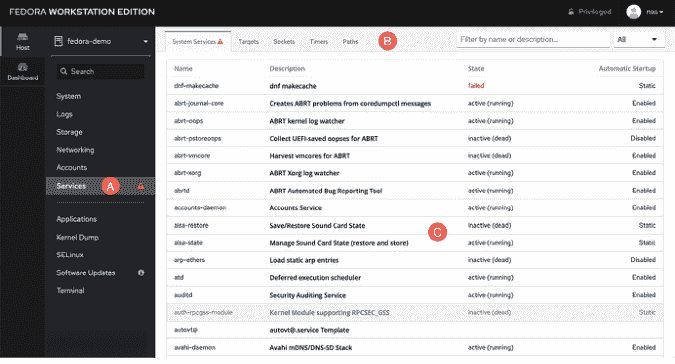

图11-3

标记为B的按钮用于在标记为C的主区域中显示特定类型的单元，每个单元的当前状态列在"State"列中。

从列表中选择一个单元将显示详细信息。例如，图11-4显示了一个*httpd.service*实例的详细信息屏幕，包括服务日志（A）和菜单选项（B），用于执行启动、停止、启用/禁用以及遮盖/取消遮盖该单元等任务。

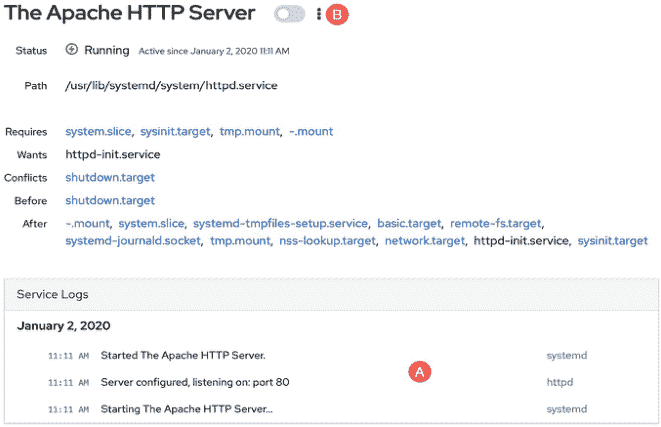

图11-4

### 11.9 小结

新安装的Fedora 31系统包含一组基本的systemd单元，其中许多在后台运行以提供系统的大部分功能。这些单元按类型分类，最常见的是目标单元（target）和服务单元（service）。目标单元本质上是其他单元的一个集合，这些单元将作为一个整体启动。系统有一个默认的目标单元，它定义了每次系统启动时要启动的其他单元。最常见的目标单元是将系统启动到多用户模式或图形模式的那些目标单元。*systemctl*命令行工具提供了一系列选项来执行systemd单元配置任务，其中许多也可以通过Cockpit基于Web的界面来完成。

# 12. Fedora 31网络管理

很难想象一个Fedora 31系统至少没有一个网络连接，更难想象这样一个孤立的系统能有多大实际用途。简单的事实是，Fedora 31旨在通过网络和互联网连接提供企业级服务。学习如何管理Fedora 31系统的关键部分之一就是学习如何配置和管理系统上安装的网络接口。

本章旨在概述Fedora 31上的网络管理，包括NetworkManager服务和工具，以及一些其他有用的实用程序。

### 12.1 NetworkManager简介

NetworkManager是一个专门为简化Linux系统网络配置管理而设计的服务和工具集，是Fedora 31上的默认网络管理服务。除了一个在后台运行的服务外，NetworkManager还包括以下工具：

- **nmcli** - 通过命令行使用NetworkManager的工具。当无法访问图形环境时，该工具非常有用，也可以在脚本中使用来进行网络配置更改。
- **nmtui** - 用于管理NetworkManager的基本基于文本的用户界面。该工具可以在任何终端窗口中运行，允许通过选择菜单和输入数据进行更改。虽然对于执行基本任务很有用，*nmtui*缺少*nmcli*工具提供的许多功能。
- **nm-connection-editor** - 一个完整的图形化管理工具，可访问大多数NetworkManager配置选项。
- **GNOME设置** - GNOME桌面设置应用程序的网络屏幕允许执行基本的网络管理任务。
- **Cockpit网络设置** - Cockpit Web界面的网络屏幕允许执行一系列网络管理任务。

尽管在Fedora 31系统上有多种不同的网络环境管理方式，但就本章而言，我们将重点介绍*nmcli*命令。虽然当您可以访问桌面环境或已启用Cockpit时，图形工具当然很有用，但在只有命令提示符可用的情况下，理解命令行界面至关重要。此外，图形工具（包括Cockpit）并不具备*nmcli*工具的所有功能。最后，一旦您对NetworkManager和*nmcli*有了一定的熟悉度，这些技能将很容易转换到更直观的工具选项上。而图形工具选项则反之亦然。例如，如果您只使用过*nm-connection-editor*，那么使用*nmcli*会更加困难。

### 12.2 安装和启用NetworkManager

对于大多数Fedora 31安装，NetworkManager应该默认已安装。使用*rpm*命令查看是否需要安装：

```
# rpm -q NetworkManager
NetworkManager-1.14.0-14.el8.x86_64
```

如有必要，按如下方式安装软件包：

```
# dnf install NetworkManager
```

软件包安装后，需要启用NetworkManager守护进程，使其在每次系统启动时启动：

```
# systemctl enable NetworkManager
```

最后，启动服务并检查状态以验证启动是否成功：

```
# systemctl start NetworkManager
# systemctl status NetworkManager
```

● NetworkManager.service - Network Manager
  Loaded: loaded (/usr/lib/systemd/system/NetworkManager.service; enabled;荒野
m >
  
  Drop-In: /usr/lib/systemd/system/NetworkManager.service.d

└─NetworkManager-ovs.conf
   Active: active (running) since Tue_hz 2019-04-09 10:07:22 EDT; 2h 48min ago

### 12.3 基本nmcli命令

*nmcli*命令将作为NetworkManager软件包的一部分安装，可以使用以下语法从命令行执行：

```
# nmcli [选项] 对象 {命令 | help}
```

在上述语法中，*对象*将是*general*、*networking*、*radio*、*connection*、*monitor*、*device*或*agent*之一，所有这些都可以缩写为单词的几个字母（例如*con*， StyleSheet 甚至只是字母*c*，用于*connection*）。例如，以下所有命令都将输出与*device*对象相关的帮助信息：

```
# nmcli device help
# nmcli dev help
# nmcli d help
```

要检查系统上NetworkManager的整体状态，请使用以下命令：

```
# nmcli general status
STATE      CONNECTIVITY  WIFI-HW  WIFI    WWAN-HW  WWAN
connected  full          enabled  enabled enabled     enabled
 enabled
```

要检查系统上安装的设备状态，可以使用以下命令：

```
# nmcli dev status
DEVICE      TYPE      STATE      CONNECTION
eno1        ethernet  connected  eno1
wlp0s26u1u2 wifi      connected  zoneone
virbr0      bridge    connected  virbr0
lo          loopback  unmanaged  --
virbr0-nic  tun       unmanaged  --
```

输出也可以通过使用-p（pretty）选项进行修改，使输出更人性化：

```
# nmcli -p dev status
==================
  Status of devices
==================

DEVICE      TYPE      STATE      CONNECTION
--------------------------------------------------------------------
----
eno1        ethernet  connected  eno1
wlp0s26u1u2 wifi      connected  zoneone
virbr0      bridge    connected  virbr0
lo          loopback  unmanaged  --
virbr0-nic  tun       unmanaged  --
```

相反，可以使用-t选项使输出更加简洁，适合自动处理：

```
# nmcli -t dev status
eno1:ethernet:connected:eno1
wlp0s26u1u2:wifi:connected:emilyzone
virbr0:bridge:connected:virbr0
lo:loopback:unmanaged:
virbr0-nic:tun:unmanaged:
```

从状态输出中，我们可以看到系统安装了两个物理设备，一个以太网设备和另一个Wi-Fi设备。

桥接（virbr）条目是用于为虚拟机提供网络的虚拟设备（虚拟化主题将从*《虚拟化技术概述》*一章开始介绍）。环回接口是一个特殊的虚拟设备，允许系统与自身通信，通常用于执行网络诊断。

使用NetworkManager时，理解设备和连接之间的区别很重要。如上所述，设备是物理或虚拟网络设备，而连接是设备连接到的网络配置。

以下命令显示系统上配置的连接信息：

```
# nmcli con show
NAME     UUID                                  TYPE      DEVICE
zoneone  2abecafa-4ea2-47f6-b20f-4fb0c0fd5e94  wifi      wlp0s26u1u2
eno1     99d40009-6bb1-4182-baad-a103941c90ff  ethernet  eno可以自由 deploys
virbr0   e13e9552-1765-42d1-b739-ff981668fbee  bridge    virbr0
zonetwo  f940a2d1-8c18-4a9e-bf29-817702429b8a  wifi      --
zonethree fd65c5e5-3e92-4e9e-b924-1b0b07b70032  wifi     --
```

从上述输出中，我们可以看到Wi-Fi设备
```

（*wlp0s26u1u2*）已连接到一个名为 *zoneone* 的无线网络，而以太网设备（*eno1*）已连接到一个名为 *eno1* 的连接。除了 zoneone 之外，NetworkManager 还列出了另外两个 Wi-Fi 连接，分别名为 *zonetwo* 和 *zonethree*，目前这两个连接都没有设备连接。

要查找分配给某个连接的 IP 地址，可以使用 *ip* 工具并配合 *address* 选项：

```
# ip address
```

这也可以简写为：

```
# ip a
```

```
3: wlp0s26u1u2: <BROADCAST,UP,LOWER_UP> mtu 1500
qdisc mq state UP group default qlen 1000
    link/ether 74:da:38:ee:be:50 brd ff:ff:ff:ff:ff:ff
    inet 192.168.1.121/24 brd 192.168.1.255 scope global
 dynamic noprefixroute wlp0s26u1u2
      valid_lft 57584sec preferred_lft 57584sec
```

`ip` 命令将输出系统上检测到的所有设备的信息。上述输出显示 Wi-Fi 设备已被分配 IP 地址 192.168.1.121。

如果我们只想列出活动连接，可以使用 *nmcli* 命令并配合 -a 选项：

```
# nmcli con show -a
NAME UUID TYPE DEVICE
zoneone 2abecafa-4ea2-47f6-b20f-4fb0c0fd5e94 wifi wlp0s26u1u2
eno1 99d40009-6bb1-4182-baad-a103941c90ff ethernet eno1
virbr0 e13e9552-1765-42d1-b739-ff981668fbee bridge virbr0
```

要将 Wi-Fi 设备的连接从 zoneone 切换到 zonetwo，我们可以运行以下命令：

```
# nmcli device wifi connect zonetwo --ask
Password:
```

*--ask* 标志会使 *nmcli* 提示用户输入 Wi-Fi 网络的密码。要在命令行中包含 Wi-Fi 密码（如果该命令在脚本中执行，这一点尤其有用），请使用 *password* 选项：

```
# nmcli device wifi connect zonetwo password <password here>
```

*nmcli* 工具也可以用于扫描可用的 Wi-Fi 网络，如下所示：

```
# nmcli device wifi list
IN-USE SSID MODE CHAN RATE SIGNAL BARS SECURITY
       zoneone Infra 6 195 Mbit/s 80 WPA2
* zonetwo Infra 11 130 Mbit/s 74 WPA1 WPA2
```

当前活动的连接可以按如下方式停用：

```
# nmcli con down <connection name>
```

同样，一个非活动的连接可以随时重新启用：

```
# nmcli con up <connection name>
```

当连接被停用时，NetworkManager 会自动搜索另一个连接，将其激活并分配给先前连接所建立的设备。要防止连接在这种情况下被使用，请禁用自动连接选项，如下所示：

```
# nmcli con mod <connection name> connection.autoconnect no
```

以下命令可用于获取特定连接的附加信息。这包括所有连接属性的当前值：

```
# nmcli con show eno1
connection.id: eno1
connection.uuid: 99d40009-6bb1-4182-baad-a103941c90ff
connection.stable-id: --
connection.type: 802-3-ethernet
connection.interface-name: eno1
connection.autoconnect: yes
connection.autoconnect-priority: 0
connection.autoconnect-retries: -1 (default)
connection.multi-connect: 0 (default)
connection.auth-retries: -(original)-1
connection.timestamp: 1554833695
connection.read-only: no
connection.permissions: --
connection.zone: --
connection.master: --
connection.slave-type: --
connection.autoconnect-slaves: -1 (default)
```

所有这些属性都可以使用 *nmcli* 的 modify 选项按以下语法进行修改：

```
# nmcli con mod <connection name> connection.<property name> <setting>
```

### 12.4 使用连接配置文件

到目前为止，我们已经探索了连接的使用，但没有解释连接是如何配置的。连接的配置被称为 *连接配置文件*，并存储在位于 */etc/sysconfig/network-scripts* 目录中的文件里，其内容可能如下所示：

```
# ls /etc/sysconfig/network-scripts
ifcfg-zoneone ifcfg-eno1 ifdown-ppp
ifcfg-zonethree ifcfg-zonetwo ifup-ppp keys-zonethree
keys-zoneone keys-zonetwo
```

每个以 *ifcfg-* 为前缀的文件都是一个接口配置文件，包含相应连接的配置文件，而 *key-* 文件包含 Wi-Fi 连接的密码。

例如，考虑 *ifcfg-eno1* 文件的内容：

```
TYPE=Ethernet
PROXY_METHOD=none
BROWSER_ONLY=no
DEFROUTE=yes
IPV4_FAILURE_FATAL=no
NAME=eno1
UUID=99d40009-6bb1-4182-baad-a103941c90ff
DEVICE=eno1
ONBOOT=yes
BOOTPROTO=dhcp
IPV6INIT=yes
IPV6_AUTOCONF=yes
IPV6_DEFROUTE=yes
IPV6_FAILURE_FATAL=no
IPV6_ADDR_GEN_MODE=stable-privacy
```

该文件包含有关连接的基本信息，包括设备类型（Ethernet）以及当前分配的设备（eno1），以及该连接将在系统启动时自动激活，并使用 DHCP 获取 IP 地址。可以通过修改此文件并指示 *nmcli* 重新加载连接配置文件来实现对连接配置文件的更改：

```
# nmcli con reload
```

新的连接配置文件也可以手动创建或由 *nmcli* 自动生成。例如，假设系统上安装了一个新的网络设备。当这种情况发生时，NetworkManager 服务将检测到新硬件并为其创建一个设备。在下面的示例中，新设备被分配了名称 *eno2*：

```
# nmcli dev status
DEVICE TYPE STATE CONNECTION
eno1 ethernet connected eno1
eno2 ethernet connected Wired connection 1
```

NetworkManager 自动检测到设备，激活它并将其分配给一个名为 "Wired connection 1" 的连接。这是一个默认连接，我们无法对其进行配置控制，因为在 */etc/sysconfig/network-scripts* 中没有它的接口配置文件。接下来的步骤是删除 "Wired connection 1" 连接，并使用 *nmcli* 创建一个新连接并将其分配给设备。删除连接的命令如下：

```
# nmcli con delete "Wired connection 1"
```

接下来，可以使用 *nmcli* 创建一个新的连接配置文件，配置为静态 IP 地址或从 DHCP 服务器获取的动态 IP 地址。要创建名为 *dyn_ip* 的动态连接配置文件，可使用以下命令：

```
# nmcli connection add type ethernet con-name dyn_ip ifname eno2
Connection 'dyn_ip' (160d9e10-bbc8-439a-9c47-a2ec52990472)
successfully added.
```

要创建一个新的连接配置文件而不将其锁定到特定设备，只需在命令中省略 *ifname* 选项：

```
# nmcli connection add type ethernet con-name dyn_ip
```

创建连接后，一个名为 *ifcfg-dyn_ip* 的文件将被添加到 */etc/sysconfig/network-scripts* 目录中。

另外，要创建名为 *static_ip* 的连接并分配静态 IP 地址（在本例中为 192.168.1.200），可使用以下命令：

```
# nmcli con add type ethernet con-name static_ip ifname eno2 ip4 192.168.1.200/24 gw4 192.168.1.1
Connection 'static_ip' (3fccafb3-e761-4271-b310-ad0f28ee8606) successfully added.
```

相应的 *ifcfg-static_ip* 文件内容如下：

```
TYPE=Ethernet
PROXY_METHOD=none
BROWSER_ONLY=no
BOOTPROTO=none
IPADDR=192.168.1.200
PREFIX=24
GATEWAY=192.168.1.1
DEFROUTE=yes
IPV4_FAILURE_FATAL=no
IPV6INIT=yes
IPV6_AUTOCONF=yes
IPV6_DEFROUTE=yes
IPV6_FAILURE_FATAL=no
IPV6_ADDR_GEN_MODE=stable-privacy
NAME=static_ip
UUID=3fccafb3-e761-4271-b310-ad0f28ee8606
DEVICE=eno2
ONBOOT=yes
```

添加新连接的命令可以稍作修改，以同时分配 IPv4 和 IPv6 静态地址：

```
# nmcli con add type ethernet con-name static_ip ifname eno2 ip4 192.168.1.200/24 gw4 192.168.1.1 ip6 cabf::4532 gw6 2010:dfa::1
```

### 12.5 交互式编辑

除了使用带有命令行选项的 *nmcli* 之外，该工具还包括一个交互式模式，可用于创建和修改连接配置文件。例如，以下脚本显示了使用交互式模式创建名为 *demo_con* 的新以太网连接的过程：

```
# nmcli con edit
Valid connection types: 6lowpan, 802-11-olpc-mesh (olpc-mesh), 802-11-wireless (wifi), 802-3-ethernet (ethernet), adsl,
```


 ```
bluetooth, bond, bridge, cdma, dummy, generic, gsm, infiniband,
ip-tunnel, macsec, macvlan, ovs-bridge, ovs-interface, ovs-
port, pppoe, team, tun, vlan, vpn, vxlan, wimax, wpan, bond-
slave, bridge-slave, team-slave
输入连接类型：**ethernet**

===| nmcli 交互式连接编辑器 |===

正在添加新的 '802-3-ethernet' 连接

输入 'help' 或 '?' 可查看可用命令。
输入 'print' 可显示所有连接属性。
输入 'describe [<设置>.<属性>]' 可查看属性的详细描述。

您可以编辑以下设置：connection, 802-3-ethernet
(ethernet), 802-1x, dcb, sriov, ethtool, match, ipv4, ipv6, tc,
proxy
nmcli> **set connection.id demo_con**
nmcli> **set connection.interface eno1**
nmcli> **set connection.autoconnect yes**
nmcli> **set ipv4.method auto**
nmcli> **set 802-3-ethernet.mtu auto**
nmcli> **set ipv6.method auto**
nmcli> **save**
正在保存 'autoconnect=yes' 的连接。这可能会导致
连接立即激活。
您仍要保存吗？（是/否）[yes] yes
连接 'demo_con'（cb837408-6c6f-4572-9548-4932f88b9275）
已成功保存。
nmcli> **quit**
```

另一方面，以下示例修改了先前创建的 *static_ip* 连接配置文件，以使用与最初指定不同的静态 IP 地址：

```
# nmcli con edit static_ip

===| nmcli 交互式连接编辑器 |===

正在编辑现有的 '802-3-ethernet' 连接：'static_ip'

输入 'help' 或 '?' 可查看可用命令。
输入 'print' 可显示所有连接属性。
输入 'describe [<设置>.<属性>]' 可查看属性的详细描述。

您可以编辑以下设置：connection, 802-3-ethernet (ethernet), 802-1x, dcb, sriov, ethtool, match, ipv4, ipv6, tc, proxy

```
nmcli> print ipv4.addresses
ipv4.addresses: 192.168.1.200/24
nmcli> set ipv4.addresses 192.168.1.201/24
nmcli> save
连接 'static_ip'（3fccafb3-e761-4271-b310-ad0f28ee8606）已成功更新。
nmcli> quit
```

在修改现有连接后，请记住指示 NetworkManager 重新加载配置文件：

```
# nmcli con reload
```

使用交互模式时，了解该工具提供了大量的内置帮助系统会很有用。可以通过在 *nmcli* > 提示符下输入 **help** 或 ? 来访问帮助主题：

```
nmcli> ?
-------------------------------------------------------------
---[ 主菜单 ]---
goto [<设置> | <属性>] :: 前往某个设置或属性
remove <设置>[.<属性>] | <属性> :: 删除设置或重置属性值
set [<设置>.<属性> <值>] :: 设置属性值
describe [<设置>.<属性>] :: 描述属性
print [all | <设置>[.<属性>]] :: 打印连接
verify [all | fix] :: 验证连接
save [persistent|temporary] :: 保存连接
activate [<ifname>] [/<ap>|<nsp>] :: 激活连接
back :: 向上返回一级
help/? [<命令>] :: 打印此帮助
nmcli <配置选项> <值> :: nmcli 配置
quit :: 退出 nmcli
-------------------------------------------------------------
```

### 12.6 配置 NetworkManager 权限

除了使 Fedora 31 上的网络管理更加便捷 Conway 之外，NetworkManager 还允许为连接指定权限。例如，以下命令将连接配置文件限制为 root 和名为 john 与 caitlyn 的用户账户：

```
# nmcli con mod static_ip connection.permissions user:root,john,caitlyn
```

连接配置文件被 NetworkManager 重新加载后，*static_ip* 连接将仅在至少一名指定用户登录到系统的活动会话时才会激活并对其他用户可用。一旦这些用户中的最后一名登出，该连接将会断开并保持非活动状态，直到其中一名用户重新登录。

此外，只有具有权限的用户才能更改连接状态或配置。

### 12.7 小结

Fedora 31 上的网络管理由 NetworkManager 服务处理。NetworkManager 将网络视为由网络接口设备和连接组成。网络设备可以是物理以太网或 Wi-Fi 设备，也可以是虚拟机客户机使用的虚拟设备。连接代表设备所连接的网络，并通过连接配置文件进行配置。配置配置文件将在诸多设置中定义连接是否具有静态或动态 IP 地址、网络使用的任何网关的 IP 地址，以及系统每次启动时是否应自动建立连接。

NetworkManager 可以使用多种不同工具进行管理，包括 *nmcli* 和 *nmtui* 命令行工具、*nm-connection-editor* 图形工具以及 Cockpit 网络界面中的网络设置部分。一般而言，*nmcli* 命令行工具提供了最多的功能和灵活性。

## 13. 使用 firewalld 进行基本的 Fedora 31 防火墙配置

防火墙是保护计算机系统或计算机网络免受外部攻击（通常来自互联网连接的外部来源）的关键组件。任何直接连接到互联网连接的计算机都必须运行防火墙以防止恶意活动。同样，任何内部网络与外部互联网连接之间都必须有某种形式的防火墙。

所有 Linux 发行版都提供某种形式的防火墙解决方案。就 Fedora 31 而言，这体现为名为 *firewalld* 的服务。

虽然防火墙配置的主题可能很复杂，但幸运的是 Fedora 31 提供了命令行、基于 Web 和图形化的工具来简化防火墙配置过程。本章将介绍 firewalld 的基本概念，并介绍使用操作系统提供的工具配置防火墙所需的步骤。

### 13.1 firewalld 简介

firewalld 服务使用一组规则来控制传入的网络流量，并定义哪些流量应被阻止、哪些流量应被允许通过到达系统，它是构建在名为 *iptables* 的更复杂防火墙工具之上的。

firewalld 系统提供了一种灵活的管理传入流量的方式。例如，防火墙可以配置为阻止来自特定外部 IP 地址的流量，或阻止到达特定 TCP/IP 端口的所有流量。还可以定义规则将传入流量转发到不同的系统，或充当互联网网关以保护网络中的其他计算机。

遵循常见的安全实践，默认的 firewalld 安装配置为阻止所有访问，但 SSH 远程登录和系统用于获取动态 IP 地址的 DHCP 服务除外（这两者对于系统管理员在安装完成后能够访问系统至关重要）。

Fedora 31 上防火墙配置的关键要素是*区域（zones）*、*接口（interfaces）*、*服务（services）* 和*端口（ports）*。

#### 13.1.1 区域

默认情况下，firewalld 安装时带有多个预配置的*区域*。区域是一套预配置的规则，可以随时应用于系统，以便快速实现特定场景的防火墙配置。例如，*block* 区域阻止所有传入流量，而 *home* 区域则假设系统在更安全的环境中运行，预期有更高程度的信任，因此应用较不严格的规则。可以向系统添加新区域，也可以修改现有区域以添加或删除规则。还可以从系统中完全删除区域。表 13-1 列出了 Fedora 31 系统上默认可用的区域集合：

| 区域 | 描述 |
|------|-------------|
| drop | 最安全的区域。仅允许传出连接 |
```


| 区域 | 描述 |
| --- | --- |
| block | 类似于丢弃区域，区别在于对传入的连接会返回 icmp-host-prohibited 或 icmp6-adm-prohibited 通知进行拒绝。 |
| public | 适用于连接到公共网络或互联网的情况，此时其他计算机不被视为可信。允许选择性的传入连接。 |
| external | 当系统作为计算机网络的互联网网关时，外部区域应用于连接到互联网的接口。<br><br>此区域在实施伪造或网络地址转换 (NAT) 时，与 *internal* NSSS 区域结合使用，具体将在本章后续部分介绍。允许选择性的传入连接。 |
| internal | 与 *external* 区域配合使用，应用于连接到内部网络的接口。假定内部网络上的计算机是可信的。允许选择性的传入连接。 |
| dmz | 适用于系统运行在非军事区 (DMZ) 的情况。这些通常是可公开访问但与内部网络其他部分隔离的计算机。允许选择性的传入连接。 |
| work | 适用于在工作环境网络中运行系统，此时其他计算机被视为可信。允许选择性的传入连接。 |
| home | 适用于在家庭网络中运行系统，此时其他计算机被视为可信。允许选择性的传入连接。 |
| trusted | 最不安全的区域。接受所有传入连接。 |
| FedoraServer | Fedora Server 安装配置的一组默认防火墙规则。允许选择性的传入连接，与 public 区域相同。 |
| FedoraWorkstation | Fedora Workstation 安装配置的一组推荐防火墙规则。允许选择性的传入连接。 |

表 13-1

要查看特定区域的具体设置，请参考系统 /usr/lib/firewalld/zones 目录中对应的 XML 配置文件。例如，以下列出了 *public.xml* 区域配置文件的内容：

```
<?xml version="1.0" encoding="utf-8"?>
<zone>
  <short>Public</short>
  <description>For use in public areas. You do not trust the other computers on networks to not harm your computer. Only selected incoming connections are accepted.</description>
  <service name="ssh"/>
  <service name="mdns"/>
  <service name="dhcpv6-client"/>
</zone>
```

#### 13.1.2 接口

任何连接到互联网或网络（或两者）的 Fedora 31 系统都将至少包含一个 *interface*，其形式为物理或虚拟网络设备。当 firewalld 处于活动状态时，这些接口中的每一个都会被分配到一个区域，从而允许为不同的接口分配不同级别的防火墙安全性。考虑一个包含两个接口的服务器，一个外部连接到互联网，另一个连接到内部网络。在这种场景下，面向外部的接口很可能会被分配到限制更严格的 *external* 区域，而内部接口则可能使用 *internal* 区域。

#### 13.1.3 服务

TCP/IP 定义了一组在标准端口上通信的服务。例如，安全的 HTTPS Web 连接使用端口 443，而 SMTP 电子邮件服务使用端口 25。为了有选择地为特定服务启用传入流量，可以将 firewalld 规则添加到区域中。例如，*home* 区域默认不允许传入的 HTTPS 连接。可以通过向区域添加规则来允许传入的 HTTPS 连接，而无需引用特定的端口号，从而启用此流量。

#### 13.1.4 端口

虽然在添加 firewalld 规则时可以引用常见的 TCP/IP 服务，但会出现需要允许在未分配给特定服务的特定端口上的传入连接的情况。这可以通过添加引用特定端口而非服务的规则来实现。这种技术在标题为 "*Fedora 31 Cockpit Web 界面概览*" 的章节中使用过，当时打开了端口 9090 以允许访问 Cockpit Web 界面。

### 13.2 检查 firewalld 状态

firewalld 服务在所有 Fedora 31 安装中默认安装并启用。可以通过以下命令检查服务的状态：

```
# systemctl status firewalld
 firewalld.service - firewalld - dynamic firewall daemon
   Loaded: loaded (/usr/lib/systemd/system/firewalld.service;
enabled; vendor preset: enabled)
   Active: active (running) since Thu 2019-02-14 14:24:31 EST;
3 days ago
     Docs: man:firewalld(1)
 Main PID: 816 (firewalld)
   Tasks: 2 (limit: 25026)
  Memory: 30.6M
 CGroup: /system.slice/firewalld.service
```

```
816 /usr/libexec/platform-python -s
/usr/sbin/firewalld --nofork --nopid
```

如有必要，可以按照以下方式安装 firewalld 服务：

```
# dnf install firewalld
```

firewalld 服务默认启用，因此在安装完成后以及每次系统启动时都会自动启动。

### 13.3 使用 firewall-cmd 配置防火墙规则

*firewall-cmd* 命令行实用程序允许查看 firewalld 配置信息，并在终端窗口内对区域和规则进行更改。

在对防火墙设置进行更改时，了解 *runtime* 和 *permanent* 配置的概念非常重要。默认情况下，任何规则更改都被视为运行时配置更改。这意味着虽然更改会立即生效，但在下次系统重启或 firewalld 服务重新加载时（例如执行以下命令）会丢失：

```
# firewall-cmd --reload
```

要使更改永久生效，必须使用 *--permanent* 命令行选项。永久更改在 firewalld 服务重新加载之前不会生效，但会保持有效直到手动更改。

#### 13.3.1 识别和更改默认区域

要识别默认区域（换句话说，即所有接口将被分配的区域，除非明确选择了不同的区域），请按如下方式使用 *firewall-cmd* 工具：

```
# firewall-cmd --get-default-zone
public
```

要更改为不同的默认区域：

```
# firewall-cmd --set-default-zone=home
success
```

#### 13.3.2 显示区域信息

要列出系统上所有可用的区域：

```
# firewall-cmd --get-zones
block dmz drop external home internal libvirt public trusted
work
```

按如下方式获取当前活动的区域及其分配的接口列表：

```
# firewall-cmd --get-active-zones
```

```
external
  interfaces: eth0
internal
  interfaces: eth1
```

可以按如下方式列出为特定区域当前配置的所有规则：

```
# firewall-cmd --zone=home --list-all
```

```
home (active)
  target: default
  icmp-block-inversion: no
  interfaces: eth0
  sources:
  services: cockpit dhcpv6-client http mdns samba-client ssh
  ports:
  protocols:
  masquerade: no
  forward-ports:
  source-ports:
  icmp-blocks:
  rich rules:
```

使用以下命令列出当前可用于包含在 firewalld 规则中的服务：

```
# firewall-cmd --get-services
```

```
RH-Satellite-6 amanda-client amanda-k5-client amqp amqps
apcupsd audit bacula bacula-client bgp bitcoin bitcoin-rpc
bitcoin-testnet bitcoin-testnet-rpc ceph ceph-mon cfengine
cockpit ...
```

要列出当前为某个区域启用的服务：

```
# firewall-cmd --zone=public --list-services
```

```
cockpit dhcpv6-client ssh
```

可以按如下方式获取端口规则列表：

```
# firewall-cmd --zone=public --list-ports
```

```
9090/tcp
```

#### 13.3.3 添加和删除区域服务

要将服务添加到某个区域，在本例中是将 HTTPS 添加到 public 区域，将使用以下命令：


 ```markdown
# firewall-cmd --zone=public --add-service=https
success
```

默认情况下，这是一个*运行时*更改，因此添加的规则在系统重启后将会丢失。若要永久添加服务，使其在下次系统重启时仍然有效，请使用*--permanent*标志：

```
# firewall-cmd --zone=public --permanent --add-service=https
success
```

要验证服务是否已永久添加，请在请求服务列表时务必包含*--permanent*标志：

```
# firewall-cmd --zone=public --permanent --list-services
cockpit dhcpv6-client http https ssh
```

注意，作为永久更改，此新规则在系统重启或 firewalld 重新加载之前不会生效：

```
# firewall-cmd --reload
```

使用*--remove-service*选项从区域中移除服务。由于这是运行时更改，该规则将在下次系统重启时恢复：

```
# firewall-cmd --zone=public --remove-service=https
```

若要永久移除服务，请使用*--permanent*标志，如果希望更改立即生效，记得重新加载 firewalld：

```
# firewall-cmd --zone=public --permanent --remove-service=https
```

#### 13.3.4 使用基于端口的规则

要启用特定端口，请使用*--add-port*选项。注意，手动定义端口时，需要提供端口号和协议（TCP 或 UDP）：

```
# firewall-cmd --zone=public --permanent --add-port=5000/tcp
```

在添加规则到区域时，也可以指定端口范围：

```
# firewall-cmd --zone=public --permanent --add-port=5900-5999/udp
```

#### 13.3.5 创建新区域

可以通过运行以下命令创建全新的区域。创建后，该区域可以以与任何预定义区域相同的方式进行管理：

```
# firewall-cmd --permanent --new-zone=myoffice
success
```

添加新区域后，需要重启 firewalld 才能使该区域可用：

```
# firewall-cmd --reload
success
```

#### 13.3.6 更改区域/接口分配

如前所述，系统上的每个接口都必须分配到一个区域。接口所分配的区域也可以使用*firewall-cmd*工具进行更改。在以下示例中，eth0 接口被分配到*public*区域：

```
# firewall-cmd --zone=public --change-interface=eth0
success
```

#### 13.3.7 地址伪装

地址伪装在网络管理圈中更常被称为网络地址转换（NAT）。当使用 Fedora 31 系统作为多台计算机网络的互联网网关时，地址伪装允许所有内部系统在使用该 Fedora 31 系统的 IP 地址进行互联网通信。这样做的好处是隐藏所有系统的内部 IP 地址，使其免受恶意外部实体的侵害，同时也避免了为网络中的每台计算机分配公共 IP 地址的必要性。

使用以下命令检查防火墙上是否已启用地址伪装：

```
# firewall-cmd --zone=external --query-masquerade
```

使用以下命令启用地址伪装（如果更改是永久性的，请记得使用*--permanent*标志）：

```
# firewall-cmd --zone=external --add-masquerade
```

#### 13.3.8 添加 ICMP 规则

互联网控制消息协议（ICMP）用于网络上的客户端系统相互发送信息，如错误消息。它也是*ping*命令的基础，网络管理员和用户都使用 ping 命令来检测特定客户端是否在网络上活跃。ICMP 类别允许阻止特定的 ICMP 消息类型。例如，管理员可能会选择阻止传入的 ping（回显请求）ICMP 消息，以防止基于 ping 的拒绝服务（DoS）攻击的可能性（即服务器被恶意的大量 ping 消息轰炸，导致其无法响应合法请求）。

要查看 firewalld 规则中可用的 ICMP 类型，请运行以下命令：

```
# firewall-cmd --get-icmptypes
address-unreachable bad-header beyond-scope communication-prohibited destination-unreachable echo-reply ...
```

例如，以下命令永久添加一条规则，阻止 public 区域中的 echo-reply（ping 请求）消息：

```
# firewall-cmd --zone=public --permanent --add-icmp-block=echo-reply
```

#### 13.3.9 实现端口转发

当 Fedora 31 系统作为内部计算机网络访问互联网的网关时，端口转发与地址伪装配合使用。端口转发允许防火墙通过互联网接收到达特定端口的流量，并将其转发到内部网络上的特定系统。这最好通过示例来说明。

假设 Fedora 31 系统作为内部计算机网络的防火墙，且其中一台系统配置为 Web 服务器。假设该 Web 服务器系统的 IP 地址为 192.168.2.20。该网站上托管的域记录配置为 Fedora 31 防火墙系统后的公共 IP 地址。当 HTTP 网页请求在端口 80 到达时，作为防火墙的 Fedora 31 系统需要知道如何处理它。通过配置端口转发，可以将所有 Web 流量定向到托管 Web 服务器的内部系统（在本例中，IP 地址为 192.168.2.20），可以继续使用端口 80，也可以将流量转移到目标服务器上的其他端口。实际上，端口转发甚至可以配置为将流量转发到同一系统上的不同端口（一种称为本地转发的概念）。

要使用端口转发，首先按如下方式عمال地址伪装（假设连接到互联网的接口已分配到*external*区域）：

```
# firewall-cmd --zone=external --add-masquerade
```

要将端口转发到不同的本地端口，可以使用类似的命令：

```
# firewall-cmd --zone=external --add-forward-port=port=22:proto=tcp:toport=2750
```

在上面的示例中，到达端口 22 的任何 TCP 流量将被转发到本地系统的端口 2750。另一方面，以下命令将本地系统的端口 20 转发到 IP 地址为 192.168.0.19 的系统的端口 22：

```
# firewall-cmd --zone=external \
            --add-forward-port=port=20:proto=tcp:toport=22:toaddr=192.168.0.19
```

同样，以下命令将本地端口 20 转发到 IP 地址为 192.168.0.18 的系统的端口 2750：

```
# firewall-cmd --zone=external --add-forward-port=port=20:proto=tcp:toport=2750:toaddr=192.168.0.18
```

### 13.4 从 Cockpit 界面管理 firewalld

到目前为止，本章已概述了 firewalld，并探讨了使用*firewall-cmd*命令行工具管理防火墙区域和接口。虽然*firewall-cmd*提供了管理 firewalld 配置最灵活的方式，但也可以在 Cockpit Web 控制台中查看和管理默认区域的服务。

要访问 firewalld 设置，请登录 Cockpit 界面并从导航面板中选择*Networking*。在网络页面上，选择*Firewall*选项，如下图 13-1 所示：

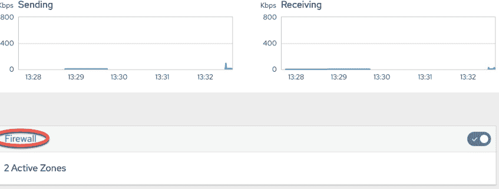

防火墙页面显示为默认区域配置的当前服务规则（允许使用垃圾桶按钮删除服务）、要添加到区域的新服务，以及打开和关闭防火墙的选项：

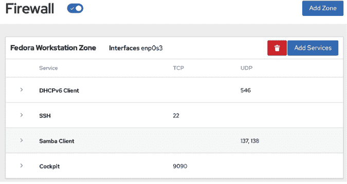

### 13.5 使用 firewall-config 管理 firewalld

如果您可以访问图形桌面环境，也可以使用*firewall-config*工具配置防火墙。虽然默认未安装，但可以按如下方式安装*firewall-config*：

```
# dnf install firewall-config
```

启动后，主*firewall-config*屏幕如图 13-3 所示：

该工具的关键区域可概括如下：

**A** - 显示当前所有活动的接口及其分配到的区域。若要将接口分配到不同区域，请从此面板中选择该接口，点击*Change Zone*按钮，然后在弹出的对话框中选择所需区域。

**B** - 控制显示的信息以及在工具中所做的任何更改是应用于运行时规则还是永久规则。

**C** - 系统中配置的区域、服务或IPSet列表。此面板中列出的信息取决于从工具栏F所做的选择。从此面板列表中选择项目会更新标记为D的主面板。

**D** - 主面板，包含关于工具栏E中当前类别选择的信息。在此示例中，该面板显示*public*区域的服务。每个服务旁边的复选框控制该服务在防火墙中是否启用。正是在这些类别面板中，可以添加新规则，或配置、移除现有规则。

**E** - 控制面板D中显示的内容。从此栏中选择项目会显示所选类别的当前规则。

**F** - 控制面板C中显示的列表。

*firewall-config*工具直观且易于使用，可以在可视化环境中执行许多使用*firewall-cmd*可用的任务。

### 13.6 小结

精心规划和实施的防火墙是任何安全系统的重要组成部分。就Fedora 31而言，firewalld服务提供了一个既灵活又易于管理的防火墙系统。firewalld服务使用区域的概念将一组防火墙规则组合在一起，并包含一套预定义的区域，旨在满足各种防火墙保护需求。这些区域可以修改以添加或删除规则，也可以创建和配置全新的区域。系统中连接到网络或互联网的联网设备称为接口。每个接口又被分配到一个区域。管理firewalld的主要工具是*firewall-cmd*命令行工具和*firewall-config*图形实用程序。也可以通过Cockpit Web界面进行最低限度的防火墙管理选项配置。

## 14. 在Fedora 31上配置基于SSH密钥的身份验证

首次安装Fedora 31系统时，默认配置为允许通过安全外壳（SSH）连接进行远程命令行访问。这为root账户（如果该账户已启用）以及安装阶段添加的任何其他用户提供了受密码保护和加密的访问权限。这种安全级别远远不够，应尽快升级为基于SSH密钥的身份验证。

本章将概述通过实施基于密钥的SSH身份验证来提高Fedora 31系统安全性的步骤。

### 14.1 安全外壳（SSH）概述

SSH旨在允许安全远程访问系统，以便获取shell访问权限以及传输文件和数据。如*《使用VNC进行Fedora 31远程桌面访问》*中所述，SSH还可用于提供安全*隧道*，通过网络连接实现对GNOME桌面的远程访问。

基本的SSH配置包括客户端（在发起连接的计算机上使用）和服务器（在要连接的远程系统上运行）。例如，用户可以在Linux、Windows或macOS系统上运行SSH客户端，连接到在Fedora 31系统上运行的SSH服务器，以获取shell命令行提示符或执行文件传输。客户端和服务器之间的所有通信，包括输入的访问密码，都经过加密，防止外部方截获数据。

基本SSH实现的固有弱点在于，它完全依赖于系统上账户密码的强度。如果恶意方能够识别某个账户的密码（无论是通过猜测、欺诈还是暴力破解攻击），系统就会变得脆弱。这一弱点可以通过实施基于SSH密钥的身份验证来解决。

### 14.2 基于SSH密钥的身份验证

基于SSH密钥的身份验证利用非对称*公钥加密*技术为远程系统访问增加额外的安全层。公钥加密的概念由Whitfield Diffie和Martin Hellman于1975年提出，基于使用一对密钥的概念：一个私钥和一个公钥。

在公钥加密系统中，公钥用于加密数据，而只有私钥的所有者才能解密该数据。

在基于SSH密钥的身份验证中，私钥由运行SSH客户端的主机持有，而相应的公钥则驻留在运行SSH服务器的系统上。保护私钥非常重要，因为拥有该密钥将允许任何人登录远程系统。因此，作为额外的保护层，私钥也可以加密并由密码保护，每次与服务器建立连接时都必须输入该密码。

### 14.3 设置基于密钥的身份验证

设置基于密钥的SSH身份验证有四个步骤，可概括如下：

- 1. 生成公钥和私钥。
2. 在服务器上安装公钥。
3. 测试身份验证。
4. 在服务器上禁用基于密码的身份验证。

本章剩余部分将详细介绍适用于Linux、macOS和Windows客户端操作系统的这些步骤。

### 14.4 安装和启动SSH服务

如果系统上尚未安装和运行SSH服务器，可以使用以下命令添加：

```
# dnf install openssh-server
# systemctl start sshd.service
# systemctl enable sshd.service
```

### 14.5 从Linux和macOS客户端进行基于SSH密钥的身份验证

设置基于SSH密钥的身份验证的第一步是在客户端系统上生成密钥对。如果客户端系统运行的是Linux或macOS，可以使用ssh-keygen实用程序实现：

```
# ssh-keygen
```

这将产生类似于以下内容的输出：

```
Generating public/private rsa key pair.
Enter file in which to save the key
(/home/<username>/.ssh/id_rsa):
```

按Enter键接受密钥文件的默认位置。这将在当前用户主目录的.ssh子目录中放置两个文件。私钥将存储在名为id_rsa的文件中，而公钥将存放在名为id_rsa.pub的文件中。

接下来，ssh-keygen会提示输入用于保护私钥的密码短语。如果提供了密码短语，私钥将在本地磁盘上加密，并且需要输入密码短语才能访问远程系统。为了更好的安全性，建议使用密码短语。

```
Enter passphrase (empty for no passphrase):
```

最后，ssh-keygen工具将生成以下输出，表明密钥已生成：

```
Your identification has been saved in /home/neil/.ssh/id_rsa.
Your public key has been saved in /home/neil/.ssh/id_rsa.pub.
The key fingerprint is:
SHA256:FOLGWEEGFIjWnCT5wtTOv5VK4hdimzWghZizUEMYbfo
<username>@<hostname>
The key's randomart image is:
+---[RSA 2048]----+
|  .BB+=+*..      |
|  o+B= * . .     |
| ===.. + .       |
|*+ * . .         |
|.++ o S          |
|..E+ * o         |
|  o B *          |
|   + +           |
|    .            |
+----[SHA256]-----+
```

下一步是将公钥安装到远程服务器系统上。这可以使用*ssh-copy-id*实用程序完成，如下所示：

```
$ ssh-copy-id username@remote_hostname
```

**例如：**

```
$ ssh-copy-id neil@192.168.1.100
/usr/bin/ssh-copy-id: INFO: Source of key(s) to be installed: "/home/neil/.ssh/id_rsa.pub"
/usr/bin/ssh-copy-id: INFO: attempting to log in with the new key(s), to filter out any that are already installed
/usr/bin/ssh-copy-id: INFO: 1 key(s) remain to be installed -- if you are prompted now it is to install the new keys
neil@192.168.1.100's password:
```

```
Number of key(s) added: 1

Now try logging into the machine, with: "ssh 'neil@192.168.1.100'"
and check to make sure that only the key(s) you wanted were added.
```

安装密钥后，测试身份验证是否正常工作，尝试使用*ssh*客户端进行远程登录：

```
$ ssh -l <username> <hostname>
```

如果私钥已加密并用密码短语保护，请在提示时输入密码短语以完成身份验证，建立对Fedora 31系统的远程访问：

```
Enter passphrase for key '/home/neil/.ssh/id_rsa':
Last login: Thu Feb 21 13:41:23 2019 from 192.168.1.101
[neil@demosystem02 ~]$
```

对服务器上需要远程访问的其他账户重复这些步骤。如果还需要从其他客户端系统进行访问，只需将*id_rsa*私钥文件复制到其他系统上您主目录的.ssh子目录中即可。

按照当前配置，仍然可以使用安全性较低的密码身份验证访问远程系统。一旦确认基于密钥的身份验证正常工作，请登录远程系统，编辑*/etc/ssh/ssh_config*文件，并将*PasswordAuthentication*设置更改为*no*：


 ```
PasswordAuthentication no
```

保存文件并重启 sshd 服务以应用更改：

```
# systemctl restart sshd.service
```

从此以后，只能使用基于 SSH 密钥的身份验证远程访问该系统。

### 14.6 管理多个密钥

客户端系统上存在多个私钥的情况并不罕见，每个私钥提供对不同服务器的访问。在建立连接时，有多种选项可以选择特定的密钥。例如，可以在启动 ssh 客户端时指定要使用的确私钥文件：

```
$ ssh -l neilsmyth -i ~/.ssh/id_work 35.194.18.119
```

或者，也可以使用 SSH 客户端用户配置文件来关联密钥文件与服务器。该配置文件名为 config，必须位于用户主目录的 .ssh 目录中，可用于配置广泛的选项，包括私钥文件、连接时的默认端口、默认用户名，以及用于引用服务器的缩写昵称。以下示例配置文件为两台服务器定义了不同的密钥文件，并允许通过昵称 home 和 work 来引用它们。对于工作系统，文件还指定了身份验证时要使用的用户名：

```
Host work
  HostName 35.194.18.119
  IdentityFile ~/.ssh/id_work
  User neilsmyth

Host home
  HostName 192.168.0.21
  IdentityFile ~/.ssh/id_home
```

在设置配置文件之前，用户需要使用以下命令连接到工作系统：

```
$ ssh -l neilsmyth -i ~/.ssh/id_work 35.194.18.119
```

但现在，命令可以简化为：

```
$ ssh work
```

通过运行以下命令可以查看配置文件的完整选项列表：

```
$ man ssh_config
```

### 14.7 从 Windows 10 客户端进行基于 SSH 密钥的身份验证

最新版本的 Windows 10 包含了大多数 Linux 和 macOS 系统所使用的 OpenSSH 实现的一个子集，作为 Windows PowerShell 的一部分。这允许从 Windows 10 客户端设置基于 SSH 密钥的身份验证，步骤与上述 Linux 和 macOS 的步骤类似。

要在 Windows 10 系统上打开 Windows PowerShell，请按 Win+X 组合键并从菜单中选择，或从开始菜单中找到并选择它。启动后，PowerShell 窗口将如图 14-1 所示：

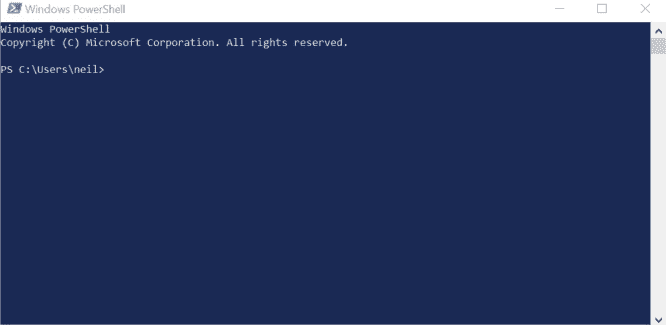

图 14-1

如果您已经有来自其他客户端系统的私钥，只需将 *id_rsa* 文件复制到 Windows 10 系统上名为 *.ssh* 的文件夹中。文件放置到位后，在 PowerShell 窗口中测试身份验证，如下所示：

```
$ ssh -l <username>@<hostname>
```

例如：

```
PS C:\Users\neil> ssh -l neil 192.168.1.101
Enter passphrase for key 'C:\Users\neil/.ssh/id_rsa':
```

在提示时输入密码并完成身份验证过程。

如果尚不存在现有私钥，请在 PowerShell 窗口中使用 *ssh-keygen* 工具生成新的私钥和公钥对，步骤与上述 Linux 和 macOS 的步骤相同。密钥生成后，它们将再次位于当前用户主文件夹的 .ssh 目录中，公钥文件 *id_rsa.pub* 需要安装到远程 Fedora 31 系统上。不幸的是，Windows PowerShell 不包含 *ssh-copy-id* 工具，因此这项任务需要手动完成。

在 PowerShell 窗口中，切换到 .ssh 子目录并显示公钥 *id_rsa.pub* 文件的内容：

```
PS C:\Users\neil> cd .ssh
PS C:\Users\neil\.ssh> type id_rsa.pub
ssh-rsa
AAAAB3NzaC1yc2EAAAADAQABAAABAQDFgx1vzu591116/uQw7FbmKVsQ3fzLz9M
Wlfgo4sdsxXp81wCHNAlqcjx1Pgr9BJPXWUMInQOi7BQ5I+vc2xQ2AS0kMq3ZH9
ybWuQe/U2GjueXZd0FKrEXrT55wM36Rm6Ii3roUCoGCzGR8mn95JvRB3VtCyDdz
TWSi8JBpK5gV5oOxNTNPsewILzouBlCT1qW3CKwEiIwu8S9MTL7m3nrcaNeLewT
THevvHw4QDwzFQ+B0PDg96fzsYoTXVhzyHSWyo6H0gqrft7aK+gILBtEIhWTkSV
EMAzy1piKtCr1IYTmVK6engv0aoGtMUq6FnOeGp5FjvKkF4aQkh1QR28r
neil@DESKTOP-S8P8D3N
```

高亮显示文件内容并使用 Ctrl-C 键盘快捷键复制它。

保持在 PowerShell 窗口中，使用密码身份验证登录远程系统：

```
PS C:\Users\neil\.ssh> ssh -l <username> <hostname>
```

登录后，检查 .ssh 子目录是否存在。如果不存在，请按如下方式创建：

```
$ mkdir .ssh
```

切换到 .ssh 目录并检查名为 *authorized_keys* 的文件是否已经存在。如果不存在，请创建它并将 Windows 10 系统上的公钥文件内容粘贴到其中。

如果 *authorized_keys* 文件已经存在，它可能已包含其他密钥。如果是这种情况，请编辑文件并将新公钥粘贴到文件末尾。例如，以下文件包含两个密钥：

```
ssh-rsa
AAAAB3NzaC1yc2EAAAADAQABAAABAQCzRWH27Xs8ZA5rIbZXKgxFY5XXauMv+6F
5P1jBLJ6j+9nkmykVe3GjZTp3oD+KMRbT2kTEPbDpFD67DNL0eiX2ZuEEiYsxZf
GCRCPBGYmQttFRHEAFnlS1Jx/G4W5UNKvhAXWyMwDEKiWvqTVy6syB2Ritoak+D
/Sc8nJflQ6dtw0jBs+S7Aim8TPfgpi4p5XJGruXNScam TwigT68NgnPfTL3vT726Eu

ABCk6C934KARD+/AXa8/5rN0h4ETPstjBRfFJ0tpmsWWhhNEnwJRqS2LD0ug7E3
yFI2qsNKGEzvAYUC8Up45MRP7liR3aM1CBilltsy9R+IB7oMEycZAe/qj
neil@localhost.localdomain
ssh-rsa
AAAAB3NzaC1yc2EAAAADAQABAAABAQDFgx1vzu591116/uQw7FbmKVsQ3fzLz9M
Wlfgo4sdsxXp81wCHNAlqcjx1Pgr9BJPXWUMInQOi7BQ5I+vc2xQ2AS0kMq3ZH9
ybWuQe/U2GjueXZd0FKrEXrT55wM36Rm6Ii3roUCoGCzGR8mn95JvRB3VtCyDdz
TWSi8JBpK5qV5oOxNTNPsewlLzouBlCT1qW3CKwEiIwu8S9MTL7m3nrcaNeLewT
THevvHw4QDwzFQ+BOPDg96fzsYoTXVhzyHSWyo6H0gqrft7aK+gILBtEIhWTkSV
EMAzy1piKtCr1IYTmVK6engv0aoGtMUq6FnOeGp5FjvKkF4aQkh1QR28r
neil@DESKTOP-S8P8D3N
```

公钥安装到服务器上后，从 Windows 10 PowerShell 窗口登录服务器以测试身份验证，例如：

```
PS C:\Users\neil\.ssh> ssh -l neil 192.168.1.100
Enter passphrase for key 'C:\Users\neil/.ssh/id_rsa':
```

为所有账户设置并验证基于密钥的身份验证后，按照上一节末尾所述，在 Fedora 31 系统上禁用密码身份验证。

### 14.8 使用 PuTTY 进行基于 SSH 密钥的身份验证

对于没有 OpenSSH 的 Windows 系统，或者作为使用 PowerShell 的更灵活替代方案，PuTTY 工具是广泛使用的替代方案。使用 PuTTY 的第一步是在需要 SSH 客户端的任何 Windows 系统上下载并安装它。PuTTY 是一个免费工具，可以通过以下链接下载：
[https://www.chiark.greenend.org.uk/~sgtatham/putty/latest.html](https://www.chiark.greenend.org.uk/~sgtatham/putty/latest.html)

下载与您 Windows 系统匹配的 Windows 安装程序可执行文件（有 32 位和 64 位版本可用），然后运行安装程序完成安装。

如果其他系统上已存在私钥，请在当前用户的主文件夹中创建 *.ssh* 文件夹，并将私钥 *id_rsa key* 复制到其中。

接下来，需要使用 *PuTTYgen* 工具将私钥文件转换为 PuTTY 私钥格式文件。在开始菜单中找到此工具并启动它：

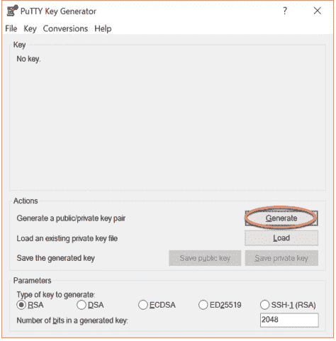

图 14-2

启动后，点击 *Actions* 部分的 *Load* 按钮，导航到先前复制到 .ssh 文件夹的私钥文件（注意：可能需要将文件类型过滤器更改为 *All Files* (*.*）才能使密钥文件可见）。找到后，选择文件并将其加载到 *PuTTYgen* 中。提示时，输入最初用于加密文件的密码。私钥导入后，点击 *Save Private Key* 按钮将其保存为 PuTTY 密钥文件。为保持一致性，将密钥文件保存到 .ssh 文件夹，但给它一个不同的名称以区别于原始密钥文件。

从开始菜单启动 PuTTY，在主屏幕中输入远程服务器的 IP 地址或主机名，然后在左侧面板中选择 *Connection -> SSH -> Auth* 类别，如图 14-3 中高亮所示：
```


### 14.9 使用 PuTTYgen 生成私钥

上一节探讨了在使用 PuTTY 时如何使用现有的私钥和公钥。如果密钥尚不存在，可以使用随主 PuTTY 安装包附带的 *PuTTYgen* 工具来创建。

要创建新密钥，请启动 *PuTTYgen* 并点击图 14-4 中突出显示的 *Generate*（生成）按钮：

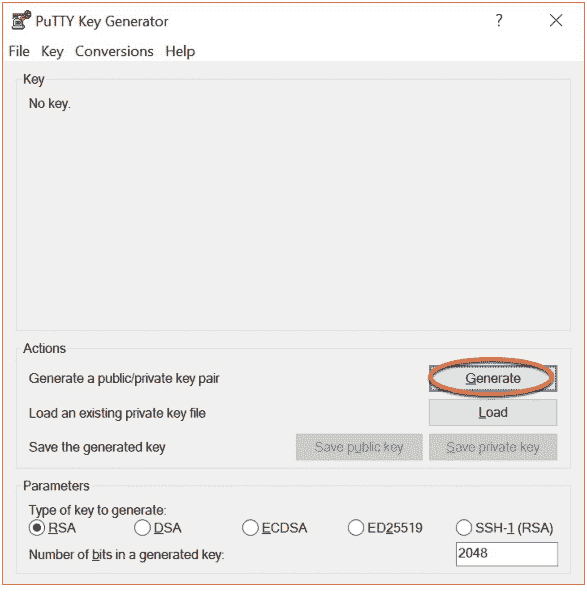

**图 14-4**

按照指示移动鼠标指针以生成随机数据，然后输入一个可选的密码短语来加密私钥。密钥生成后，使用 *Save public key*（保存公钥）和 *Save private key*（保存私钥）按钮将文件保存到合适的位置。私钥可以按照上一节所述与 PuTTY 一起使用。要将公钥安装到远程服务器上，请按照前面关于在 Windows 10 上使用 PowerShell 中的 SSH 的部分所述的步骤操作。

### 14.10 为 Google Cloud 实例安装公钥

如果你的 Fedora 31 系统托管在 Google Cloud 上，例如作为 Compute Engine 实例，有几种不同的方式可以使用基于密钥的身份验证来获得对服务器的 SSH 访问。也许最直接的方法是将你的公钥添加到 Google Cloud 帐户的元数据中。这将使公钥可用于你在 Google Cloud 中创建的所有虚拟机实例。要添加公钥，请登录到 Google Cloud Platform 控制台，从左侧导航面板中选择 *Metadata*（元数据）选项（如图 14-5 所示），并选择 *SSH keys*（SSH 密钥）选项卡：


**图 14-5**

在 SSH 密钥屏幕上，点击 *Edit*（编辑）按钮（也在图 14-5 中突出显示）来编辑密钥列表。滚动到当前列表底部，点击 + *Add Item*（添加项目）按钮。将出现一个新字段，你需要将完整的公钥粘贴到其中（公钥内容与你的 *id_rsa.pub* 文件中的内容一致）。输入密钥后，点击 *Save*（保存）按钮以添加密钥。

公钥现在将出现在 SSH 密钥列表中。请注意，密钥条目还包括用户名，该用户名必须用于登录任何 Google Cloud 实例：


**图 14-6**

将公钥添加到元数据后，应该可以从任何安装了相应私钥且用户拥有帐户的客户端访问任何虚拟机实例。实际上，在幕后，Google Cloud 为了实现此功能所做的就是将公钥添加到用户主目录下的 *.ssh/authorized_keys* 文件中（前提是该帐户存在于该虚拟机上）。

### 14.11 总结

确保对 Fedora 31 系统的任何远程访问都以提供高安全性的方式实现，这一点非常重要。默认情况下，Fedora 31 系统允许使用基于密码的身份验证进行 SSH 访问。这使得系统容易受到能够猜出密码或通过其他方式获取密码的人的攻击。因此，建议使用基于密钥的身份验证来保护系统访问。基于密钥的身份验证使用了涉及公钥和私钥的公钥加密概念。实施后，用户只有在使用与服务器上的公钥匹配的私钥的客户端时才能连接到服务器。作为额外的安全层，私钥本身也可以加密并受密码保护。一旦实施了基于密钥的加密，服务器系统就会被配置为禁用对安全性较低的基于密码的身份验证的支持。

本章概述了基于 SSH 密钥的身份验证，并概述了在 macOS、Linux 和 Windows 上生成密钥和配置客户端的步骤，此外还涉及在 Fedora 31 服务器上安装和管理公钥。

## 15. Fedora 31 的 VNC 远程桌面访问

可以将 Fedora 31 配置为通过网络或互联网连接提供对图形桌面环境的远程访问。虽然默认情况下未启用，但从网络或互联网上任何其他位置的系统显示和访问 Fedora 31 桌面相对简单。无论该系统运行的是 Linux、Windows 还是 macOS，都可以实现这一点。事实上，甚至有适用于 Android 和 iOS 的应用程序，允许你几乎从任何有数据信号的地方访问你的 Fedora 31 桌面。

远程桌面访问在多种场景下都很有用。例如，它使你或其他人能够从同一网络上的另一台计算机系统或通过互联网查看并与你的 Fedora 31 桌面环境进行交互。当你需要在离开办公桌时（例如在旅行时）处理计算机上的工作，这非常有用。在同事或 IT 支持技术人员需要访问你的桌面来解决问题的情况下，它也很有用。

在 Fedora 31 系统运行在基于云的服务器上的情况下，它还允许访问桌面环境，作为使用命令行提示符或 Cockpit Web 控制台执行管理任务的替代方案。

Fedora 31 的远程桌面功能基于一种称为虚拟网络计算（Virtual Network Computing，VNC）的技术，本章我们将介绍在 Fedora 31 中配置和使用远程桌面的关键方面。

### 15.1 安全和非安全的远程桌面访问

在本章中，我们将涵盖安全和不安全的远程桌面访问方法。假设你是在安全的内部网络环境中从另一台系统访问某个系统，那么使用非安全的访问方法通常是安全的。另一方面，如果你计划通过任何类型的公共网络远程访问桌面，则必须使用安全的访问方法，以避免你的系统和数据受到危害。

### 15.2 安装 GNOME 桌面环境

当然，只有在桌面本身已安装的情况下，才能访问桌面环境。例如，如果系统最初配置为服务器，则不太可能已安装桌面软件包。安装运行 GNOME 桌面所需软件包的最简单方法是执行 *group install*（组安装）。安装软件包组以启用特定功能的关键是知道该组的名称。在撰写本文时，在 Fedora 31 上安装桌面环境的组名为 "Fedora Workstation"。由于组名倾向于在不同的 Fedora 版本之间发生变化，因此了解已安装或可安装的组列表非常有用，可以使用 *dnf* 实用程序获取，如下所示：

```
# dnf grouplist
```

Available Environment Groups:
    Fedora Custom Operating System
    Minimal Install
    Fedora Workstation
    Fedora Cloud Server
    KDE Plasma Workspaces
    Xfce Desktop
    LXDE Desktop
    LXQt Desktop
    Cinnamon Desktop
    MATE Desktop
    Sugar Desktop Environment
    Deepin Desktop
    Development and Creative Workstation
    Web Server
    Infrastructure Server
    Basic Desktop

在上面的示例中，Fedora Workstation 环境组被列为可用（因此尚未安装）。要找到


要在安装前查看关于某个软件包组内容的更多信息，请使用以下命令：

```
# dnf groupinfo "fedora workstation"
```

```
Last metadata expiration check: 0:18:35 ago on Thu 02 Jan 2020 10:59:36 AM EST.
Environment Group: Fedora Workstation
 Description: Fedora Workstation is a user friendly desktop system for laptops and PCs.
 Mandatory Groups:
   Common NetworkManager Submodules
   Container Management
   Core
   Fedora Workstation product core
   Firefox Web Browser
   Fonts
   GNOME
   Guest Desktop Agents
   Hardware Support
   LibreOffice
   Multimedia
   Printing Support
   base-x
 Optional Groups:
   ARM Tools
```

确认这是正确的软件包组后，可以按如下方式安装：

```
# dnf groupinstall "fedora workstation"
```

安装完成后，假设系统已添加显示器，可以使用以下命令启动桌面：

```
$ startx
```

另一方面，如果系统是没有直接连接显示器的服务器，运行和访问桌面的唯一方式是在系统上配置 VNC 支持。

### 15.3 在 Fedora 31 上安装 VNC

访问远程桌面需要在远程系统上安装 VNC 服务器，在用于建立访问的系统上安装 VNC 查看器，以及可选的安全 SSH 连接。虽然有许多 VNC 服务器和查看器实现可用，Fedora 已标准化使用 TigerVNC，它为基于 Linux 的操作系统提供了服务器和查看器组件。用于非 Linux 平台的 VNC 查看器客户端包括 RealVNC 和 TightVNC。

要在 Fedora 31 上安装 TigerVNC 服务器软件包，只需运行以下命令：

```
# dnf install tigervnc-server
```

如果需要，还可以按如下方式安装 TigerVNC 查看器：

```
# dnf install tigervnc
```

服务器安装完成后，需要配置系统以运行一个或多个 VNC 服务，并在防火墙上打开相应的端口。

### 15.4 配置 VNC 服务器

安装 VNC 服务器软件包后，下一步是配置服务器。第一步是为将访问远程桌面环境的用户指定密码。以 root 身份登录后，执行以下命令（假设用户名为 demo）：

```
# su - demo
[demo@demoserver ~]$ vncpasswd
Password:
Verify:
Would you like to enter a view-only password (y/n)? n
A view-only password is not used
[demo@demoserver ~]$ exit
#
```

接下来，需要在 */etc/systemd/system* 目录中创建名为 *vncserver@.service* 的 VNC 服务器配置文件。此文件的内容应如下所示，其中所有 <USER> 实例都应替换为设置 VNC 密码时引用的用户名：

```
[Unit]
Description=Remote desktop service (VNC)
After=syslog.target network.target
[Service]
Type=forking
WorkingDirectory=/home/<USER>
User=<USER>
Group=<USER>
ExecStartPre=/bin/sh -c '/usr/bin/vncserver -kill %i > /dev/null 2>&1 || :'
ExecStart=/usr/bin/vncserver -autokill %i
ExecStop=/usr/bin/vncserver -kill %i
Restart=on-success
RestartSec=15
[Install]
WantedBy=multi-user.target
```

接下来，需要配置防火墙，以便为远程 VNC 查看器实例提供对 VNC 服务器的外部访问，例如：

```
# firewall-cmd --permanent --zone=public --add-port=5901/tcp
# firewall-cmd --reload
```

创建服务配置文件后，需要按如下方式启用并启动服务：

```
# systemctl daemon-reload
# systemctl start vncserver@:1.service
# systemctl enable vncserver@:1.service
```

注意，:1 包含在服务名称中，以表示这是 VNC 服务器显示编号 1 的服务。这与之前在防火墙中打开的 5901 端口相对应。

检查服务是否已成功启动，如下所示：

```
# systemctl status vncserver@:1.service
```

如果服务未能启动，请运行以下命令检查错误消息：

```
# journalctl -xe
```

也可以尝试在重新启动系统后再次操作。如果服务仍然失败，可以以指定用户身份登录并运行以下命令手动启动 VNC 服务器：

```
$ vncserver :1
```

### 15.5 连接 VNC 服务器

VNC 查看器实现可用于多种操作系统，快速互联网搜索可能会提供大量链接，包含有关如何在您选择的平台上获取和安装此工具的详细信息。

在已安装 TigerVNC 等 VNC 查看器的 Linux 系统桌面上，可以从终端窗口建立远程桌面连接，如下所示：

```
$ vncviewer <hostname>:<display number>
```

在上面的示例中，<hostname> 是远程系统的主机名或 IP 地址，<display number> 是 VNC 服务器桌面的显示编号，例如：

```
$ vncviewer 192.168.1.115:1
```

或者，运行不带任何选项的命令，以提示输入远程服务器的详细信息：


图 15-1

在 VNC 服务器字段中输入主机名或 IP 地址，后跟显示编号（例如 192.168.1.115:1），然后单击连接按钮。查看器将提示输入用户的 VNC 密码以完成连接，此时将出现一个包含远程桌面的新窗口。

本节假设远程桌面是从 Linux 或 UNIX 系统访问的，相同的步骤适用于大多数其他操作系统。

使用本节中的步骤连接到远程 VNC 服务器会导致客户端和服务器之间的不安全、未加密连接。这意味着远程会话期间传输的数据容易受到拦截。要建立安全且加密的连接，还需要一些额外的步骤。

### 15.6 建立安全的远程桌面会话

到目前为止，我们在本章中探讨的远程桌面配置被认为是不安全的，因为没有使用加密。当远程连接不超出受防火墙保护的内部网络时，这是可以接受的。然而，当需要通过互联网连接进行远程会话时，就需要更安全的选项。这是通过安全 shell（SSH）连接隧道传输远程桌面来实现的。本节将介绍如何在 Linux、UNIX 和 macOS 客户端系统上执行此操作。

SSH 服务器通常默认在 Fedora 31 系统上安装并激活。如果您的系统上未安装，请参阅题为"*在 Fedora 31 上配置基于 SSH 密钥的身份验证*"的章节。

假设 SSH 服务器已安装并处于活动状态，是时候转到另一台系统了。在另一台系统上，使用以下命令登录远程系统，这将建立两个系统之间的安全隧道：

```
$ ssh -l <username> -L 5901:localhost:5901 <remotehost>
```

在上面的示例中，`<username>` 引用了已配置 VNC 访问的远程系统上的用户帐户，`<remotehost>` 是远程系统的主机名或 IP 地址，例如：

```
$ ssh -l neilsmyth -L 5901:localhost:5901 192.168.1.115
```

出现提示时，使用帐户密码登录。建立安全连接后，是时候启动 vncviewer 使其使用安全隧道了。在另一个终端窗口中保持 SSH 会话运行，启动另一个终端并输入以下命令：

```
$ vncviewer localhost:5901
```

如果需要密码，vncviewer 会话将提示输入密码，然后启动 VNC 查看器，提供对您桌面环境的安全访问。

尽管连接现在是安全且加密的，VNC 查看器很可能仍会报告连接不安全。例如，图 15-2 显示了在 macOS 系统上运行的 RealVNC 查看器显示的警告对话框：


 ## 15.7 使用 PuTTY 在 Windows 上建立安全隧道

从 Windows 系统建立到 Fedora 31 服务器的安全桌面会话采用类似的方法。假设您已经安装了 VightVNC 等 VNC 客户端，剩下的唯一需求就是 Windows SSH 客户端（此处为 PuTTY）。PuTTY 下载并安装完成后，第一步是在 Windows 系统和远程 Fedora 31 系统之间建立安全连接，并配置适当的隧道。启动后，PuTTY 显示以下屏幕：


图 15-3

输入远程主机的 IP 地址或主机名（如果从防火墙外连接，则输入网关的外部 IP 地址）。下一步是设置隧道。点击对话框左侧类别树中 SSH 旁边的 +，然后点击 Tunnels。屏幕随后应如下所示：


输入 5901 作为源端口（Source port），localhost:5901 作为目标（Destination），然后点击 *Add* 按钮。最后，通过点击 *Session* 类别返回主屏幕。在 Saved Sessions 文本字段中输入会话名称，然后按 *Save*。点击 *Open* 建立连接。将出现一个终端窗口，显示来自远程系统的登录提示。输入适当的用户登录名和密码凭证。

SSH 连接现已建立。启动 TightVNC 查看器，在 VNC Server 文本字段中输入 localhost:5901，然后点击 *Connect*。查看器将建立连接，提示输入密码，然后显示桌面。您现在正通过安全的 SSH 隧道连接从 Windows 访问 Linux 系统的远程桌面。

### 15.8 关闭桌面会话

要关闭由 VNC 服务器托管的桌面会话，请使用 --kill 命令行选项以及要终止的桌面编号。例如，要终止桌面 :1：

```
# vncserver -kill :1
```

### 15.9 VNC 连接故障排除

由于后台发生大量操作，VNC 有时可能显得不透明，特别是当出现问题时，服务器无法启动，或远程连接尝试导致错误消息。然而，有多种技术可用于追踪和解决 VNC 问题：

如果 VNC 服务无法启动，请检查 *systemctl* 服务状态并查看错误消息：

```
# systemctl status vncserver@:1.service
```

如需更详细的信息，请通过运行以下命令检查 systemd 日志：

```
# journalctl -xe
```

其他信息可能在以下日志文件中找到：

```
/home/<username>/.vnc/<hostname>.<domain>:<display number>.log
```

例如：

```
/home/neilsmyth/.vnc/fedoraserver01.localdomain:1.log
```

如果 systemd VNC 服务仍无法启动 VNC 服务器，请尝试使用以下命令手动启动：

```
# vncserver :<display number>
```

例如：

```
# vncserver :1
```

检查输出和日志文件中的任何错误，这可能有助于识别问题。如果服务器成功启动，请尝试再次使用 VNC 查看器连接。

正在重定向到 `vncserver` 命令。随着服务运行，状态输出可能类似于以下内容：

```
# systemctl status vncserver@:1.service
  vncserver@:1.service - Remote desktop service (VNC)
     Loaded: loaded (/etc/systemd/system/vncserver@:1.service; enabled; vendor preset: disabled)
     Active: active (running) since Mon 2019-12-02 16:09:36 EST; 1h 23min ago
   Main PID: 1247 (vncserver)
      Tasks: 0 (limit: 25004)
     Memory: 3. sanityM
     CGroup: /system.slice/system-vncserver.slice/vncserver@:1.service
             ├─1247 /usr/bin/sh /usr/bin/vncserver :1
             ├─1479 /usr/bin/Xvnc :1 -auth /root/.vnc/fedoraserver.localdomain:1.Xauthority -desktop fedoraserver.localdomain:1 () -fp catalogue:/etc/X11/fontpath.d -geometry 1280x1024 -pn -rfbauth /root/.vnc/passwd -rfbport 5901
             ├─1542 /bin/dbus-launch --sh-syntax --exit-with-session
             ├─1697 metacity
             └─1709 gnome-settings-daemon
```

如果 VNC 服务器似乎正在运行，但从查看器的连接尝试失败，可能值得检查正确的防火墙端口是否已打开。首先按以下方式识别默认区域：

```
# firewall-cmd --get-default-zone
public
```

获取默认区域后，检查必要的端口是否已打开：

```
# firewall-cmd --permanent --zone=public --list-ports
5901/tcp 5900/tcp
```

如果 VNC 使用的端口未打开，请按以下方式添加端口：

```
# firewall-cmd --permanent --zone=public --add-port=<port number>/tcp
```

### 15.10 小结

通过使用虚拟网络计算（VNC），可以启用对 Fedora 31 系统 GNOME 桌面环境的远程访问。VNC 包含运行在远程服务器上的 VNC 服务器和本地主机上的相应客户端，允许远程访问服务器上运行的多个桌面实例。

当 VNC 连接通过公共连接使用时，建议使用 SSH 隧道以确保客户端和服务器之间的通信是加密和安全的。

## 16. 远程显示 Fedora 31 应用程序（X11 转发）

在上一章中，我们了解了如何在远程计算机上显示整个 Fedora 31 桌面。虽然这在确实需要远程显示整个桌面时效果很好，但如果只想显示单个应用程序，这可能被认为是杀鸡用牛刀。因此，在本章中，我们将了解如何在远程系统上显示单个应用程序。

### 16.1 远程显示 Fedora 31 应用程序的要求

要在一个 Fedora 31 系统上运行应用程序并在另一个系统上显示，有几个先决条件。首先，要显示应用程序的系统必须运行 X 服务器。如果系统是运行桌面环境的 Linux 或 UNIX 系统，则没有问题。然而，如果系统运行 Windows 或 macOS，则必须在其上安装 X 服务器，然后才能显示来自远程系统的应用程序。为此目的，有许多商业和免费的基于 Windows 的 X 服务器可用，网络搜索应该能提供您一份选项列表。

其次，运行应用程序的系统（而非要显示应用程序的系统）必须配置为允许 SSH 访问。有关在 Fedora 31 系统上配置 SSH 的详细信息，请参阅题为 *在 Fedora 31 上配置基于 SSH 密钥的身份验证* 的章节。该系统还必须运行来自 X.org 的 X Window 系统，而非 Wayland。要了解正在使用哪个系统，请打开终端窗口并运行以下命令：

```
# echo $XDG_SESSION_TYPE
x11
```

如果上述命令输出 "wayland" 而非 "x11"，请编辑 /etc/gdm/custom.conf 文件并取消注释 WaylandEnable 行，如下所示，然后重新启动系统：

```
# Uncomment the page below to force the login screen to use Xorg
WaylandEnable=false
```

最后，SSH 必须配置为允许 X11 转发。这是通过在要从中进行转发的系统的 SSH 配置中添加以下指令来实现的。在 Fedora 31 上，默认情况下，/etc/ssh/ssh_config 文件包含一个指令，以包含 /etc/ssh/ssh_config.d 目录中包含的所有配置文件：

```
Include /etc/ssh/ssh_config.d/*.conf
```

在新安装的系统上，/etc/ssh/ssh_config.d 中唯一的文件名为 05-redhat.conf。编辑此文件并添加一行以启用 X11 转发，如下所示：

```
.
.
Host *
        GSSAPIAuthentication yes
        X11Forwarding yes
.
.
```

进行更改后，保存文件并重新启动 SSH 服务：

```
# systemctl restart sshd
```

一旦满足上述要求，就应该能够远程显示基于 X 的桌面应用程序。

### 16.2 远程显示 Fedora 31 应用程序

远程显示应用程序的第一步是转到要显示应用程序的系统。在该系统上，建立到远程系统的 SSH 连接，以便获得命令提示符。这可以使用 ssh 命令实现。使用 ssh 命令时，我们需要使用 -X 标志来告知其我们计划通过连接隧道传输 X11 流量：

```
$ ssh -X user@hostname
```

在上面的示例中，user 是用于登录远程系统的用户名，hostname 是远程系统的主机名或 IP 地址。执行后，ssh 客户端将连接到远程系统并请求用户密码以完成登录过程。

连接建立并获得命令提示符后，只需运行所需的应用程序。图形输出将被重定向到本地系统显示器。例如，要运行 gnome-calculator 应用程序：

```
$ gnome-calculator
```

计算器应用程序将出现在本地显示器上，就好像它在本地运行一样。

当以这种方式启动应用程序时，需要注意的是，应用程序实际上是在远程系统上运行，而非本地系统。这意味着应用程序创建或修改的任何文件都将存储在远程系统上，并且应用程序将可以访问远程系统的资源。

要在后台运行应用程序，以便终端窗口可用于其他任务，请在命令末尾包含 & 字符：

```
$ gnome-calculator &
```

当 SSH 会话终止时，该会话期间启动的任何应用程序也将终止。要在 SSH 会话关闭后保持应用程序运行，可以采用多种技术。一种方法是使用 nohup 命令：

```
$ nohup gnome-calculator &
```

另一个选项是使用 disown 命令：

```
$ lingovncserver340/522
$ disown
```

### 16.3 可信 X11 转发

当使用 X11 转发远程显示应用程序时，SSH 连接会加密两个系统之间传输的数据。然而，默认情况下，会施加某些安全限制以防止恶意应用程序访问本地显示器。这些限制有时会阻止合法应用程序正确工作。

要允许远程应用程序完全访问本地 X 服务器，可以启用可信 X11 转发。这是通过在建立 SSH 连接时使用 -Y 标志而非 -X 来实现的：

```
$ ssh -Y user@hostname
```

-Y 标志禁用某些安全检查，只应在连接到受信任的远程系统时使用。如果有疑问，使用 -X 标志更安全，并根据具体情况调查出现的任何问题。

### 16.4 在 SSH 服务器上配置 X11 转发

虽然 X11 转发通常在 Fedora 31 上默认启用，但可能需要验证或修改 SSH 服务器配置以确保允许 X11 转发。SSH 服务器守护进程的配置文件位于 /etc/ssh/sshd_config。要验证 X11 转发是否已启用，请检查以下指令是否存在并正确设置：

```
X11Forwarding yes
X11DisplayOffset 10
X11UseLocalhost yes
```

对 SSH 服务器配置进行任何更改后，必须重新启动 SSH 服务以使更改生效：

```
# systemctl restart sshd
```

### 16.5 小结

X11 转发提供了一种方便且安全的方法，用于从 Fedora 31 系统远程显示单个应用程序。通过 SSH 连接隧道传输 X11 流量，可以将应用程序的图形输出重定向到远程显示器，而无需传输整个桌面环境。

X11 转发的关键要求是本地系统上的 X 服务器、对远程系统的 SSH 访问，以及适当的 SSH 客户端和服务器配置。有了这些先决条件，可以从远程系统启动单个应用程序并在本地显示，开销最小。


远程系统。在登录提示符处输入密码，登录后运行以下命令查看 DISPLAY 设置：

```
$ echo $DISPLAY
```

该命令应输出类似以下内容：

```
localhost:10.0
```

要显示应用程序，只需从命令提示符运行它即可。例如：

```
$ gedit
```

执行后，上述命令应在远程系统上运行 *gedit* 工具，但在本地系统上显示用户界面。

### 16.3 可信 X11 转发

如果远程系统上的 */etc/ssh/ssh_config.d/05-redhat.conf* 文件包含以下行，则可以使用可信 X11 转发：

```
ForwardX11Trusted yes
```

可信 X11 转发比不可信转发稍快，但安全性较低，因为它不启用 X11 安全控制。使用可信 X11 转发时需要 **-Y** 标志：

```
$ ssh -Y user@hostname
```

### 16.4 压缩 X11 转发

在使用较慢的连接时，可以使用 **-C** 标志压缩 X11 数据以提高性能：

```
$ ssh -X -C user@hostname
```

### 16.5 在 Windows 上显示远程 Fedora 31 应用程序

要在 Windows 上显示基于 Fedora 31 的应用程序，需要在 Windows 系统上安装 SSH 客户端和 X 服务器。在本书前面的"*"在 Fedora 31 上配置基于 SSH 密钥的身份验证*"*"章节中已经介绍了在 Windows 上安装和使用 PuTTY 客户端的内容。如果您的 Windows 系统上尚未安装 PuTTY，请参阅该章节。

就 X 服务器而言，有多种选择可供选择，但一个受欢迎的选择似乎是 VcXsrv，可从以下 URL 免费获取：

*https://sourceforge.net/projects/vcxsrv/*

安装 VcXsrv X 服务器后，名为 *XLaunch* 的应用程序将出现在桌面和开始菜单中。启动 XLaunch 并选择显示选项（最灵活的是 *Multiple windows* 选项，它允许每个客户端应用程序出现在自己的窗口中）：


图 16-1

点击 *Next* 按钮继续前进剩余的屏幕，接受默认配置设置。在最后一个屏幕上，点击 *Finish* 按钮启动 X 服务器。如果出现 Windows Defender 对话框，点击按钮允许访问您选择的网络。

启动后，XLaunch 将出现在任务栏中，可以通过右键单击图标并选择 *Exit...* 菜单选项来退出：


图 16-2

安装并运行 X 服务器后，启动 PuTTY 并输入远程主机的连接信息或加载先前保存的会话配置文件。但在建立连接之前，需要启用 X11 转发。在 PuTTY 主窗口中，向下滚动左侧面板中的选项，展开 SSH 部分并选择 X11 选项，如图 16-3 所示：


图 16-3

打开图 16-4 中高亮显示的 *Enable X11 forwarding* 复选框，返回会话屏幕并打开连接（如果您计划再次使用它，请事先保存会话）。


图 16-4

在 PuTTY 会话窗口中登录到 Fedora 31 系统并运行桌面应用程序。经过短暂的延迟后，该应用程序将出现在 Windows 桌面上的自己的窗口中。应用程序打开的任何对话框也将出现在单独的窗口中，就像在 Fedora 31 GNOME 桌面上一样。例如，图 16-5 显示了在 Windows 10 系统上显示的 Fedora 31 *nm-connection-editor* 工具：


图 16-5

### 16.6 小结

对于需要远程访问单个 Fedora 31 桌面应用程序而不是整个 GNOME 桌面的情况，X11 转发提供了一种轻量级解决方案来远程显示图形应用程序。要显示应用程序的系统必须正在运行基于 X Window 系统的桌面环境（如 GNOME），或者已安装并运行 X 服务器。在远程服务器上启用 X11 转发并从本地系统使用 X11 转发选项建立安全 SSH 连接后，大多数应用程序都可以远程显示在本地 X 服务器上。

## 17. 使用 NFS 与远程系统共享 Fedora 31 文件

Fedora 31 提供了两种与网络上其他系统共享文件和文件夹的机制。一种方法是使用称为 Samba 的技术。Samba 基于 Microsoft Windows 文件夹共享，允许 Linux 系统向 Windows 系统开放文件夹访问权限，也可以从 Linux 访问基于 Windows 的文件夹共享。这种方法也可用于在其他 Linux 和基于 UNIX 的系统之间共享文件夹，只要它们也安装并配置了 Samba 支持。这无疑是异构网络环境中共享文件夹最流行的方法。使用 Samba 共享文件夹的主题在*"*"使用 Samba 在 Fedora 31 和 Windows 系统之间共享文件*"*"中介绍。

另一种选择是专门针对在 Linux 和基于 UNIX 的系统之间共享文件夹，使用称为网络文件系统（NFS）的技术。NFS 允许通过网络连接从另一台 Linux 或 UNIX 系统访问一台 Linux 计算机上的文件系统。NFS 最初由 Sun Microsystems（现为 Oracle Corporation 的一部分）于 1980 年代开发，至今仍是远程 Linux/UNIX 文件系统共享的标准机制。NFS 与 Samba 使用的 Windows SMB 资源共享技术非常不同。在本章中，我们将研究使用 NFS 在 Fedora 31 和其他基于 UNIX/Linux 的系统之间进行基于网络的文件夹共享。

### 17.1 确保 Fedora 31 上的 NFS 服务正在运行

首要任务是验证 NFS 服务是否已安装并在您的 Fedora 31 系统上运行。这可以通过命令行或使用 Cockpit 界面来实现。

在幕后，NFS 使用远程过程调用（RPC）以 *rpcbind* 服务的形式通过网络在不同计算机之间共享文件系统。首先，通过在终端窗口中运行以下命令来安装 rpcbind 和 NFS 服务：

```
# dnf install rpcbind nfs-utils
```

接下来，配置这些服务使其在启动时自动启动：

```
# systemctl enable rpcbind
# systemctl enable nfs-server
```

服务启用后，按如下方式启动它们：

```
# systemctl start rpcbind
# systemctl start nfs-server
```

### 17.2 配置 Fedora 31 防火墙以允许 NFS 流量

接下来，需要配置防火墙以允许 NFS 流量。为此，运行以下 *firewall-cmd* 命令，其中 <zone> 替换为您的防火墙和系统配置的适当区域：

```
# firewall-cmd --zone=<zone> --permanent --add-service=mountd
# firewall-cmd --zone=<zone> --permanent --add-service=nfs
# firewall-cmd --zone=<zone> --permanent --add-service=rpc-bind
# firewall-cmd --reload
```

### 17.3 指定要共享的文件夹

现在 NFS 正在运行且防火墙已配置，我们需要指定 Fedora 31 文件系统的哪些部分可以被远程 Linux 或 UNIX 系统访问。这些设置可以在 */etc/exports* 文件中声明，需要修改该文件以导出目录供 NFS 远程访问。此文件中导出行的语法如下：

```
<export> <host1>(<options>) <host2>(<options>)...
```

在上面的行中，<export> 替换为要导出的目录，<host1> 是要授予访问权限的系统的名称或 IP 地址，<options> 表示要对该访问施加的限制（只读、读写等）。如果需要，可以在同一行上放置多个主机和选项条目。例如，以下行授予 IP 地址为 192.168.2.38 的主机对 */datafiles* 目录的只读访问权限：

 ```
/datafiles 192.168.2.38(ro)
```

可以使用通配符来将导出应用到多个主机。例如，以下一行代码允许所有外部主机对 /home/demo 进行读写访问：

```
/home/demo *(rw)
```

有关 exports 文件支持的完整选项列表，可以通过阅读 exports 手册页来获取：

```
# man exports
```

在本章中，我们将按照如下方式配置 /etc/exports 文件：

```
/tmp *(rw,sync)
/vol1 192.168.2.21(ro,sync)
```

配置完成后，需要使用 exportfs 命令更新 NFS 服务器维护的导出文件系统表，以应用最新的 /etc/exports 设置：

```
# exportfs -a
```

还可以使用 exportfs 工具从命令行查看当前的共享设置：

```
# exportfs
```

上述命令将生成以下输出：

```
/tmp <world>
/vol1 192.168.2.21
```

### 17.4 访问共享的 Fedora 31 文件夹

可以通过命令行手动挂载来从客户端系统访问共享文件夹。在尝试挂载远程 NFS 文件夹之前，应首先在客户端系统上安装 nfs-utils 软件包：

```
# dnf install nfs-utils
```

要从命令行挂载远程文件夹，请打开终端窗口并创建一个用于挂载远程文件夹的目录：

```
# mkdir /home/demo/tmp
```

接下来，输入命令以使用远程 NFS 服务器的 IP 地址或主机名来挂载远程文件夹，例如：

```
# mount -t nfs 192.168.1.115:/tmp /home/demo/tmp
```

然后，一蹴/home/demo/tmp 文件夹将挂载到本地系统上。一旦挂载，/home/demo/tmp 文件夹将包含远程文件夹及其所有内容。

挂载远程 NFS 文件系统时也可以指定选项。例如，以下命令挂载同一个文件夹，但将其配置为只读：

```
# mount -t nfs -o ro 192.168.1.115:/tmp /home/demo/tmp
```

### 17.5 在系统启动时挂载 NFS 文件系统

还可以通过编辑 /etc/fstab 文件来配置 Fedora 31 系统在每次启动时自动挂载远程文件系统。加载到编辑器后，它可能类似于以下内容：

```
/dev/mapper/fedora_localhost--live-root / xfs defaults 0 0
UUID=4b7174c5-8250-400f-b5dd-1a52b2cdf4a3 /boot xfs defaults 0 0
/dev/mapper/fedora_localhost--live-swap none swap defaults 0 0
```

例如，要挂载位于 IP 地址为 192.168.1.115 的系统上、路径为 /tmp 的文件夹到本地路径为 /home/demo/tmp 的文件夹中（注意该文件夹必须已经存在），请在 /etc/fstab 文件中添加以下行：

```
192.168.1.115:/tmp /home/demo/tmp nfs rw 0 0
```

下次系统重新启动时，位于远程系统上的 /tmp 文件夹将挂载到本地的 /home/demo/tmp 挂载点。然后，远程文件夹中的所有文件都可以像存储在本地硬盘上一样进行访问。

### 17.6 卸载 NFS 挂载点

一旦使用 NFS 挂载了远程文件系统，就可以使用 umount 命令并以本地挂载点作为命令行参数来卸载它。例如，以下命令将卸载我们的示例文件系统挂载点：

```
# umount /home/demo/tmp
```

### 17.7 在 Cockpit 中访问 NFS 文件系统

除了在客户端上使用命令行挂载远程 NFS 文件系统外，还可以从 Cockpit Web 界面执行挂载操作。假设 Cockpit 已在客户端系统上安装并配置，请从 Web 浏览器登录到 Cockpit 界面，并从左侧导航面板中选择 *Storage* 选项。如果未列出 Storage 选项，则需要安装 *cockpit-storaged* 软件包并按如下方式重启 cockpit 服务：

```
# dnf install cockpit-storaged
# systemctl restart cockpit.socket
```

Cockpit 服务重启后，重新登录 Cockpit 界面，此时 Storage 选项应该已经可见。

选择后，主存储页面将包含一个部分，列出所有当前挂载的 NFS 文件系统，如图 17-1 所示：


**图 17-1**

要挂载远程文件系统，请点击上方高亮显示的 '+' 按钮，并在弹出的对话框中输入有关远程 NFS 服务器和文件系统共享的信息，以及本地挂载点和任何必要的选项，然后点击 *Add* 按钮：


**图 17-2**

要修改、卸载或删除 NFS 文件系统共享，请在 NFS 挂载列表中选择相应的挂载（上图 17-1）以显示下图 17-3 所示的页面：


**图 17-3**

在此屏幕中，可以执行更改服务器或挂载点、卸载文件系统等任务。*Remove* 选项会卸载文件系统并从 /etc/fstab 文件中删除该条目，以便在下次系统重启时不会重新挂载。

### 17.8 小结

网络文件系统（NFS）是基于客户端/服务器的系统，最初由 Sun Microsystems 开发，为 Linux 和 Unix 系统提供了一种通过网络共享文件系统的方式。NFS 允许客户端系统访问和（在权限允许的情况下）修改位于远程服务器上的文件，就像这些文件存储在本地文件系统上一样。本章概述了 NFS，并介绍了使用命令行或 Cockpit Web 界面配置客户端和服务器系统的可用选项。

## 18. 使用 Samba 在 Fedora 31 和 Windows 系统之间共享文件

尽管 Linux 已在桌面市场取得了一些进展，但其起源和未来都非常立足于服务器。因此，Fedora 31 能够充当文件服务器并不令人意外。此外，Fedora 和 Windows 系统在网络环境中并行使用也非常普遍。因此，Fedora 31 系统上的文件需要能够通过网络被 Linux、UNIX 和基于 Windows 的系统访问，这是一种常见的需求。同样，驻留在 Windows 系统上的共享文件夹和打印机也可能需要从基于 Fedora 31 的系统访问。

Windows 系统使用一种称为服务器消息块（SMB）的协议来共享资源，如文件系统和打印机。因此，为了使 Fedora 31 系统能够通过网络向 Windows 系统提供此类资源，反之亦然，它必须支持 SMB。这是通过称为 Samba 的技术实现的。除了提供 Linux 和 Windows 系统之间的集成外，Samba 还可以用于在 Linux 系统之间提供文件夹共享（作为上一章介绍的 NFS 的替代方案）。

在本章中，我们将了解在 Fedora 31 系统上与远程 Windows 和 Linux 系统共享文件系统资源和打印机的必要步骤，以及如何从 Fedora 31 访问 Windows 资源。

### 18.1 Samba 和 Samba 客户端

Samba 允许 Fedora 31 资源与 Windows 系统共享，也允许 Windows 资源与 Fedora 31 系统共享。Fedora 使用 Samba 客户端访问 Windows 资源。另一方面，Fedora 资源通过安装和配置 Samba 服务与 Windows 系统共享。

### 18.2 在 Fedora 31 系统上安装 Samba

Fedora 31 安装过程中使用的默认设置通常不会安装必要的 Samba 软件包。除非您特别要求安装 Samba，否则您的系统上很可能没有安装 Samba。要检查是否已安装 Samba，请打开终端窗口并运行以下 *rpm* 命令：

```
# rpm -q samba samba-common samba-client
```

如果任何 Samba 软件包未安装，*rpm* 将返回 "package is not installed"。在这种情况下，可以使用 *dnf* 命令行工具安装它们：

```
# dnf install samba samba-common samba-client
```

### 18.3 配置 Fedora 31 防火墙以启用 Samba

接下来，需要配置当前保护 Fedora 31 系统的防火墙以允许 Samba 流量。为此，请按如下方式运行 *firewall-cmd* 命令：

```
# firewall-cmd --permanent --add-port={139/tcp,445/tcp}
# firewall-cmd --reload
```

在启动 Samba 服务之前，需要进行一些配置步骤来定义 Fedora 系统将如何显示给 Windows 系统，以及要与远程客户端共享的资源。大多数这些配置任务都在 */etc/samba/smb.conf* 文件中进行。

### 18.4 配置 *smb.conf* 文件

早期版本的 Fedora 包含一个名为 *system-config-samba* 的用户友好图形工具来协助配置 Samba。然而，在最近的版本中，该工具已被移除。这意味着 Samba 环境必须手动在 */etc/samba/smb.conf* 文件中配置，并使用 *smbpasswd* 命令行工具。虽然那些依赖 *system-config-samba* 的人可能会为它的消失而惋惜，但该工具的简单性实际上掩盖了 Samba 的许多更高级功能。实际上，通过花时间了解 *smb.conf* 文件的复杂性，可以实现更多的功能。

Samba 是一个高度灵活和可配置的系统，提供了许多不同的选项来控制如何在 Windows 网络上共享资源。这种灵活性可能会导致一种感觉，即 Samba 过于


 complex to work with. In reality, however, many of the configuration options are not needed by the typical installation, and the learning curve to set up a basic configuration is actually quite short.

For the purposes of this chapter we will look at joining a Fedora 31 system to a Windows workgroup and setting up a directory as a shared resource that can be accessed by a specific user. This is a configuration known as a *standalone* Samba server. More advanced configurations such as integrating Samba within an Active Directory environment are also available, though these are outside the scope of this book.

The first step in configuring Samba is to edit the */etc/samba/smb.conf* file.

## 18.4.1 Configuring the [global] Section

The *smb.conf* file is divided into sections. The first section is the [global] section where settings can be specified that apply to the entire Samba configuration. While these settings are global, each option may be overridden within other sections of the configuration file.

The first task is to define the name of the Windows workgroup on which the Fedora 31 resources are to be shared. This is controlled via the *workgroup* = directive of the [global] section which by default is configured as follows:

```
workgroup = SAMBA
```

Begin by changing this to the actual name of the workgroup. For example, if the workgroup is named WORKGROUP (the default for most Windows networks):

```
[global]
	workgroup = WORKGROUP
	security = user

	passdb backend = tdbsam
```

In addition to the workgroup setting, the other settings indicate that this is a standalone server on which the shared resources will be protected by user passwords. Before moving on to configuring the resources to be shared, a number of other parameters also need to be added to the [global] section as follows:

```
[global]
        workgroup = WORKGROUP
        security = user
        netbios name = LinuxServer
        passdb backend = tdbsam

        log file = /var/log/samba/%m.log
        log level = 1
```

The "netbios name" property specifies the name by which the server will be visible to other systems on the network, while the log settings simply specify a file location into which log output is to be recorded.

## 18.4.2 Configuring a Shared Resource

The next step is to configure the shared resources (in other words the resources that will be accessible from other systems on the Windows network). In order to achieve this, the section is given a name by which it will be referred to when shared. For example, if we plan to share the /sampleshare directory of our Fedora 31 system conventions, we might entitle the section [sampleshare]. In this section a variety of configuration options are possible. For the purposes of this example, however, we will simply define the directory that is to be shared, indicate that the directory is both browsable and writable and declare the resource public so that guest users are able to gain access:

```
[sampleshare]
        comment = Example Samba share
        path = /sampleshare
        browseable = Yes
        public = yes
        writable = yes
```

To restrict access to specific users, the "valid users" property may be used, for example:

```
valid users = demo, bobyoung, marcewing
```

## 18.4.3 Removing Unnecessary Shares

The smb.conf file is pre-configured with sections for sharing printers and the home folders of the users on the system. If these resources do not need to be shared, the corresponding sections can be commented out so that they are ignored by Samba. In the following example, the [homes] section has been commented out:

```
#[homes]
# comment = Home Directories
# valid users = %S, %D%w%S
# browseable = No
# read only = No
# inherit acls = Yes
```

## 18.5 Configuring SELinux for Samba

SELinux is a system integrated by default into the Linux kernel on all Fedora 31 systems and which provides an extra layer of security and protection to the operating system and user files.

Traditionally, Linux security has been based on the concept of allowing users to decide who has access to their files and other resources for which they have ownership. Consider, for example, a file located in the home directory of, and owned by, a particular user. That user is able to control the access permissions of that file in terms of whether other users on the system are able to read and write to or, in the case of a script or binary, execute the file. This type of security is referred to as *discretionary access control* since access to resources is left to the discretion of the user.

With SELinux, however, access is controlled by the system administrator and cannot be overridden by the user. This is referred to as *mandatory access control* and is defined by the administrator using SELinux *policy*. To continue the previous example, the owner of a file is only able to perform tasks on that file if SELinux policy defined either by default by the system, or by the administrator, permits it.

The current status of SELinux on a Fedora 31 system may be identified using the *sestatus* tool as follows:

```
# sestatus
SELinux status: enabled
SELinuxfs mount: /sys/fs/selinux
SELinux root directory: /etc/selinux
```

```
Loaded policy name: targeted
Current mode: enforcing
Mode from config file: enforcing
Policy MLS status: enabled
Policy deny_unknown status: allowed
Memory protection checking: actual (secure争取到翻译机会，现在开始翻译：

[content]
实际操作起来可能很复杂。但实际上，许多配置选项在典型安装中并不需要，而且设置基本配置的学习曲线实际上很短。

在本章中，我们将探讨如何将一个 Fedora 31 系统加入 Windows 工作组，并设置一个目录作为共享资源，供特定用户访问。这种配置被称为*独立* Samba 服务器。更高级的配置（如将 Samba 集成到 Active Directory 环境中）也是可行的，但这些已超出本书的范围。

配置 Samba 的第一步是编辑 */etc/samba/smb.conf* 文件。

#### 18.4.1 配置 [global] 部分

*smb.conf* 文件分为多个部分。第一部分是 [global] 部分，可以指定适用于整个 Samba 配置的设置。虽然这些设置是全局的，但每个选项都可以在配置文件的其他部分中被覆盖。

第一个任务是定义要共享 Fedora 31 资源的 Windows 工作组名称。这通过 [global] 部分的 *workgroup* = 指令来控制，默认配置如下：

```
workgroup = SAMBA
```

首先将其改为实际的工作组名称。例如，如果工作组名为 WORKGROUP（大多数 Windows 网络的默认值）：

```
[global]
	workgroup = WORKGROUP
	security = user

	passdb backend = tdbsam
```

除了工作组设置外，其他设置表明这是一个独立服务器，共享资源将通过用户密码进行保护。在继续配置要共享的资源之前，还需要在 [global] 部分中添加其他一些参数，如下所示：

```
[global]
        workgroup = WORKGROUP
        security = user
        netbios name = LinuxServer
        passdb backend = tdbsam

        log file = /var/log/samba/%m.log
        log level = 1
```

"netbios name"属性指定了服务器对网络上其他系统可见的名称，而日志设置则指定了记录日志输出的文件位置。

#### 18.4.2 配置共享资源

下一步是配置共享资源（换句话说，就是从 Windows 网络上其他系统可以访问的资源）。为此，该部分会被赋予一个名称，以便共享时引用。例如，如果我们计划按照 Fedora 31 系统的惯例共享 /sampleshare 目录，我们可以将该部分命名为 [sampleshare]。在该部分中，有多种配置选项可供选择。然而，就本示例而言，我们将简单地定义要共享的目录，指示该目录既可浏览又可写入，并将资源声明为公开的，以便访客用户能够访问：

```
[sampleshare]
        comment = Example Samba share
        path = /sampleshare
        browseable = Yes
        public = yes
        writable = yes
```

若要限制特定用户的访问，可以使用 "valid users" 属性，例如：

```
valid users = demo, bobyoung, marcewing
```

#### 18.4.3 移除不必要的共享

smb.conf 文件预先配置了用于共享打印机和系统用户主文件夹的部分。如果这些资源不需要共享，可以将相应的部分注释掉，以便 Samba 忽略它们。在以下示例中，[homes] 部分已被注释掉：

```
#[homes]
# comment = Home Directories
# valid users = %S, %D%w%S
# browseable = No
# read only = No
# inherit acls = Yes
```

### 18.5 为 Samba 配置 SELinux

SELinux 是默认集成到所有 Fedora 31 系统 Linux 内核中的系统，它为操作系统和用户文件提供了额外的安全保护层。

传统上，Linux 安全基于允许用户决定谁可以访问他们的文件和其他他们拥有的资源这一概念。例如，考虑一个位于特定用户主目录中且由该用户拥有的文件。该用户能够控制该文件的访问权限，即决定系统上的其他用户是否能够读取和写入该文件，或者在脚本或可执行文件的情况下执行该文件。这种安全类型被称为*自主访问控制*，因为对资源的访问由用户自行决定。

然而，使用 SELinux 时，访问由系统管理员控制，用户无法覆盖。这被称为*强制访问控制*，由管理员使用 SELinux *策略*来定义。继续前面的例子，文件所有者只能在该文件上执行 SELinux 策略（由系统默认定义或由管理员定义）允许的任务。

可以使用 *sestatus* 工具识别 Fedora 31 系统上 SELinux 的当前状态，如下所示：

```
# sestatus
SELinux status: enabled
SELinuxfs mount: /sys/fs/selinux
SELinux root directory: /etc/selinux
```

```
Loaded policy name: targeted
Current mode: enforcing
Mode from config file: enforcing
Policy MLS status: enabled
Policy deny_unknown status: allowed
Memory protection checking: actual (secure)
Max kernel policy version: 31
```

SELinux 可以以*强制*或*宽容*模式运行。启用时，强制模式会拒绝所有未经 SELinux 策略允许的操作。另一方面，宽容模式允许正常情况下会被拒绝的操作继续进行，但会将违规情况记录在日志文件中。

SELinux 安全性基于*上下文标签*的概念。系统上的所有资源（包括进程和文件）都被分配了由用户、角色、类型和可选安全级别组成的 SELinux 上下文标签。例如，可以按如下方式查看文件或文件夹的 SELinux 上下文：

```
$ ls -Z /home/demo
 unconfined_u:object_r:user_home_t:s0 Desktop
 unconfined_u:object_r:user_home&s0 Documents
```

同样，可以使用 *ps* 命令来识别正在运行的进程的上下文，在此例中是 *ls* 命令：

```
$ ps -eZ | grep ls
unconfined_u:unconfined_r:unconfined_t:s0-s0:c0.c1023 14311
tty1 00:00:18 ls
```

当进程（如上述 *ls* 命令）尝试访问文件或文件夹时，SELinux 系统将检查策略以确定是否允许访问。现在考虑 Samba 服务的上下文：

```
$ ps -eZ | grep smb
system_u:system_r:smbd_t:s0 14129 ? 00:00:00 smbd
system_u:system_r:smbd_t:s0 14132 ? 00:00:00 smbd-notifyd
```

SELinux 通过多种方式实现安全，其中最常见的方式被称为*类型强制*。简单来说，当进程尝试对对象执行操作（例如写入文件）时，SELinux 会检查进程和对象的上下文类型，并验证安全策略是否允许执行该操作。

例如，如果类型 A 的进程尝试写入类型 B 的文件，则只有在 SELinux 策略明确规定类型 A 的进程可以对类型 B 的文件执行写入操作的情况下，才会被允许。在 SELinux 强制执行中，默认情况下所有操作都被拒绝，除非存在明确允许执行该操作的规则。

SELinux 与 Samba 的问题在于，SELinux 策略未配置为允许 *smb_t* 类型的进程对 *samba_share_t* 类型以外的任何类型文件执行操作。例如，上述列出的 */home/demo* 目录将对 Samba 服务不可访问，因为它的类型是 *user_home_t*。要使系统上的文件或文件夹对 Samba 服务可访问，必须将那些特定资源的强制类型更改为 *samba_share_t*。

就本示例而言，我们将创建之前在 *smb.conf* 文件中引用的 */sampleshare* 目录，并更改其强制类型，使其对 Samba 服务可访问。首先按如下方式创建目录：

```
# mkdir /sampleshare
```

接下来，检查目录当前的 SELinux 上下文：

```
$ ls -aZ /sampleshare/
unconfined_u:object_r:default_t:s0 .
```

在此示例中，该文件夹的上下文标签被分配的类型为 *default_t*。要使该文件夹可由 Samba 共享，需要使用 *semanage* 工具将强制类型设置为 *samba_share_t*，如下所示：

```
# semanage fcontext -a -t samba_share_t "/samplesample(/.*)?"
```

注意在 *semanage* 命令中使用通配符，以确保该类型应用于 */sampleshare* 目录中包含的任何子目录和文件。添加后，需要使用 *restorecon* 命令应用更改，并使用 -R 标志递归地将更改应用到任何子目录：

```
# restorecon -R -v /sampleshare
Relabeled /sampleshare from unconfined_u:object_r:default_t:s0
to unconfined_u:object_r:samba_share_t:s0
```

完成这些更改后，该文件夹已配置为符合 SELinux 对 smb 进程的策略要求，并准备就绪可供


 ## 18.6 创建 Samba 用户

任何需要访问 Samba 共享资源的用户都必须配置为 Samba 用户并分配密码。此任务通过 *smbpasswd* 命令行工具完成。例如，假设名为 *demo* 的用户需要从 Windows 系统访问我们 Fedora 31 系统的 */sampleshare* 目录。为了满足此要求，我们必须将 *demo* 添加为 Samba 用户，如下所示：

```
# smbpasswd -a demo
New SMB password:
Retype new SMB password:
Added user demo.
```

既然我们已经完成了一个基础 Samba 服务器的配置，现在是时候测试我们的配置文件，然后启动 Samba 服务了。

### 18.7 测试 *smb.conf* 文件

*smb.conf* 文件中的设置可以使用 *testparm* 命令行工具检查错误，如下所示：

```
# testparm
Load smb config files from /etc/samba/smb.conf
rlimit_max: increasing rlimit_max (1024) to minimum Windows
limit (16384)
Processing section "[sampleshare]"
Processing section "[homes]"
Processing section "[printers]"
Processing section "[print$]"
Loaded services file OK.
Server role: ROLE_STANDALONE

Press enter to see a dump of your service definitions

# Global parameters
[global]
log file = /var/log/samba/%m.log
netbios name = LINUXSERVER
printcap name = cups
security = USER
wins support = Yes
idmap config * : backend = tdb
cups options = raw

[sampleshare]
comment = Example Samba share
guest ok = Yes
path = /sampleshare
read only = No

[homes]
browseable = No
comment = Home Directories
inherit acls = Yes
read only = No
valid users = %S %D%w%S

[printers]
browseable = No
comment = All Printers
create mask = 0600
path = /var/tmp
printable = Yes

[print$]
comment = Printer Drivers
create mask = 0664
directory mask = 0775
force group = @printadmin
path = /var/lib/samba/drivers
write list = @printadmin root
```

### 18.8 启动 Samba 和 NetBIOS 名称服务

为了使 Fedora 31 服务器在 Windows 网络中运行，必须同时启动 Samba (SMB) 和 NetBIOS 名称服务 (NMB)。此外，还可以选择启用这些服务，以便每次系统启动时自动运行：

```
# systemctl enable smb
# systemctl start smb
# systemctl enable nmb
# systemctl start nmb
```

在尝试从 Windows 系统连接之前，使用 *smbclient* 工具验证共享是否已配置：

```
# smbclient -U demo -L localhost
Enter WORKGROUP\demo's password:

Sharename Type Comment
--------- ---- -------
sampleshare Disk Example Samba share
print$ Disk Printer Drivers
IPC$ IPC IPC Service (Samba 4.9.1)
demo Disk Home Directories
Reconnecting with SMB1 for workgroup listing.

Server Comment
-------- --------

Workgroup Master
--------- -------

WORKGROUP LINUXSERVER
```

### 18.9  accessing Samba shares

既然 Samba 资源已配置完毕且服务正在运行，是时候从 Windows 系统访问共享资源了。在与 Fedora 31 系统同一工作组的一台合适的 Windows 系统上，打开 Windows 资源管理器并导航到"网络"面板。此时，资源管理器将搜索网络并列出它找到的任何使用 SMB 协议的系统。下图展示了在 Windows 10 系统上使用 Windows 资源管理器找到的一台名为 LINUXSERVER 的 Fedora 31 系统：


**图 18-1**

双击 LINUXSERVER 主机将提示输入具有访问权限的用户名和密码。在本例中，我们使用 *smbpasswd* 工具配置的 demo 账户：


输入用户名和密码后，将为该用户配置的共享资源显示在资源管理器窗口中，包括之前配置的 */sampleshare* 资源：


双击 */sampleshare* 共享资源将显示其中包含的文件和目录列表。

### 18.10 从 Fedora 31 访问 Windows 共享

如前所述，Samba 是双向的，不仅允许 Windows 系统访问 Fedora 31 系统上的文件和打印机，还允许 Fedora 31 系统访问 Windows 系统上的共享资源。这是通过本章开头安装的 samba-client 软件包实现的。如果当前未安装，请在终端窗口中按如下方式安装：

```
# dnf install samba-client
```

可以使用桌面上的文件应用程序从 Fedora 桌面访问 Windows 系统上的共享资源，或者使用 *smbclient* 和 *mount* 工具从命令行提示符访问。本节中的步骤假设已在 Windows 系统上启用了适当的网络共享设置。

要使用桌面访问 Windows 系统上的任何共享资源，请先启动文件应用程序并选择"*其他位置*"选项。这将显示下图 18-4 所示的界面，包括 Windows 网络的图标（如果检测到）：


**图 18-4**

选择 Windows 网络选项将显示网络上检测到的 Windows 系统，并允许访问任何共享资源。


**图 18-5**

或者，可以使用"*连接到服务器*"选项连接到特定系统。请注意，远程系统的名称或 IP 地址必须以 *smb://* 为前缀，后面可以跟特定共享资源的路径，例如：

```
smb://WinServer10/Documents
```

在没有桌面环境的情况下，可以使用 *mount* 命令从命令行挂载远程 Windows 共享，并指定 *cifs* 文件系统类型。例如，以下命令挂载位于名为 WinServer 的 Windows 系统上名为 Documents 的共享资源到名为 */winfiles* 的本地挂载点：

```
# mount -t cifs //WinServer/Documents /winfiles -o user=demo
```

### 18.11 小结

在本章中，我们了解了将 Fedora 31 系统配置为 Samba 客户端和服务器所需的步骤，以便与基于 Windows 的系统共享资源。涵盖的主题包括 Samba 客户端和服务器软件包的安装，以及将 Samba 配置为独立服务器。此外，还介绍了 SELinux 的基本概念，以及为 Samba 提供共享资源访问权限的步骤。

## 19. 虚拟化技术概述

虚拟化通常被定义为在单台计算机系统上同时运行多个操作系统的能力。虽然这并非一个全新的概念，但虚拟化近年来已崭露头角，因为它提供了一种充分利用服务器系统 CPU 和资源容量的方式，同时提供稳定性（即如果一个虚拟化客体系统崩溃，主机和任何其他客体系统仍继续运行）。

虚拟化在试用不同操作系统方面也无需配置双启动环境。例如，你可以在虚拟机中运行 Windows，而无需重新分区磁盘、关闭 Fedora 31 然后从 Windows 启动。你只需启动一个作为客户操作系统的 Windows 虚拟化版本。同样，虚拟化允许你从 Fedora 31 主机系统内运行其他 Linux 发行版，提供对两个操作系统的并发访问。

在决定实现虚拟化的最佳方法时，清楚了解当前可用的不同虚拟化解决方案非常重要。因此，本章的目的是用一般性术语描述当今常用的虚拟化技术。

### 19.1 客户操作系统虚拟化

客户操作系统虚拟化，也称为基于应用的虚拟化，可能是最容易理解的概念。在这种情况下，物理主机计算机系统运行标准的未修改操作系统，如 Windows、Linux、UNIX 或 macOS。在此操作系统上运行的是虚拟化应用程序，其执行方式与文字处理器或电子表格等任何其他应用程序在系统上的运行方式大致相同。正是在此虚拟化应用程序中创建一个或多个虚拟机。


虚拟化应用负责在宿主机上运行客户操作系统。虚拟化应用负责启动、停止和管理每个虚拟机，并代表各个虚拟机控制对物理硬件资源的访问。虚拟化应用还参与一个称为二进制改写的过程，该过程涉及扫描运行中的客户系统的指令流，并将任何特权指令替换为安全的模拟指令。这使得客户系统认为自己直接运行在系统硬件上，而不是运行在应用程序中的虚拟机内。

下图展示了基于客户操作系统的虚拟化：


图 19-1

如上所述，客户操作系统在虚拟化应用的虚拟机中运行，而虚拟化应用又像任何其他应用程序一样运行在宿主操作系统之上。显然，客户操作系统与底层宿主机硬件之间的多层抽象不利于实现高水平的虚拟机性能。然而，这种技术有一个优点，即无需对宿主操作系统或客户操作系统进行任何修改，也不需要特殊的 CPU 硬件虚拟化支持。

### 19.2 管理程序虚拟化

在管理程序虚拟化中，管理程序的任务是处理虚拟机的资源和内存分配，同时为更高级别的管理和监控工具提供接口。基于管理程序的解决方案分为 Type-1 和 Type-2 两类。

Type-2 管理程序（有时称为*托管式管理程序*）作为软件应用程序安装在宿主操作系统之上运行，通过协调对 CPU、内存和网络等资源的访问来提供虚拟化能力，以供客户虚拟机使用。图 19-2 展示了使用 Type-2 管理程序虚拟化的典型系统架构：


要理解 Type-1 管理程序的工作原理，有必要先了解一些 Intel x86 处理器架构的知识。x86 系列 CPU 提供了一系列称为*环*（rings）的保护级别，代码可以在其中执行。环 0 具有最高级别的特权，操作系统内核通常在此环中运行。在环 0 中执行的代码被称为运行在内核空间、内核模式或监管模式。所有其他代码（如运行在操作系统上的应用程序）则在特权较低的环中运行，通常是环 3。

与 Type-2 管理程序相反，Type-1 管理程序（也称为*裸机*或*原生管理程序*）直接运行在宿主系统的硬件上，处于环 0。显然，由于管理程序占用了 CPU 的环 0，任何运行在该系统上的客户操作系统的内核必须在特权较低的 CPU 环中运行。不幸的是，大多数操作系统内核被明确设计为在环 0 中运行，原因很简单：它们需要执行只有该环才能完成的任务，例如执行特权 CPU 指令和直接操作内存。近年来，人们设计了多种不同的解决方案来解决这个问题，每种方案将在下面介绍：

#### 19.2.1 半虚拟化

在半虚拟化下，客户操作系统的内核被专门修改以在管理程序上运行。这通常涉及将任何仅在 CPU 环 0 中运行的特权操作替换为对管理程序的调用（称为*超级调用*）。然后，管理程序代表客户内核执行该任务。这通常将支持限制在可自由修改的开源操作系统（如 Linux）以及所有者已同意进行必要代码修改以针对特定管理程序的专有操作系统。尽管存在这些问题，但客户内核与管理程序直接通信的能力带来了比其他虚拟化方法更高的性能水平。

#### 19.2.2 完全虚拟化

完全虚拟化提供对未经修改的客户操作系统的支持。术语"未经修改"指的是未经过修改以在管理程序上运行的操作系统内核，因此它们仍然像在 CPU 环 0 中运行一样执行特权操作。在这种情况下，管理程序提供 CPU 模拟来处理和修改未经修改的客户操作系统内核发出的特权和受保护的 CPU 操作。不幸的是，这种模拟过程需要时间和系统资源来运行，导致与半虚拟化相比性能较差。

#### 19.2.3 硬件虚拟化

硬件虚拟化利用 Intel 和 AMD 最新一代 CPU 中内置的虚拟化功能。这些技术分别称为 Intel VT 和 AMD-V，提供了运行未经修改的客户虚拟机所需的扩展，而无需完全虚拟化 CPU 模拟所带来的开销。用非常简单的术语来说，这些处理器在环 0 之上提供了一个额外的特权模式（称为环 -1），管理程序可以在其中运行，从而使环 0 可用于未经修改的客户操作系统。

下图展示了 Type-1 管理程序虚拟化方法：


如上图所示，除了虚拟机之外，管理操作系统和/或管理控制台也运行在管理程序之上，使系统管理员能够管理虚拟机。

### 19.3 虚拟机网络

虚拟机通常需要连接到网络才能禧能发挥实际作用。一种选择是将客户机连接到宿主计算机操作系统中运行的虚拟网络。在这种配置中，虚拟网络上的任何虚拟机都可以相互看到，但对外部网络的访问由网络地址转换（NAT）提供。使用虚拟网络和 NAT 时，每个虚拟机在外部网络（宿主连接的网络）上使用宿主系统的 IP 地址表示。这是 Fedora 31 上 KVM 虚拟化的默认行为，通常不需要额外的配置。通常，默认创建一个虚拟网络，由名称 *default* 和设备 *virbr0* 表示。

为了使客户机在外部网络上显示为独立和独立的系统（即具有自己的 IP 地址），它们必须配置为共享宿主机上的物理网络接口。实现这一点的最快方法是将虚拟机配置为使用"直接连接"网络配置选项（也称为 MacVTap），这将使客户系统获得与宿主相同网络上的 IP 地址。不幸的是，虽然这使虚拟机能够访问网络上的其他系统，但使用 MacVTap 驱动程序时无法在客户机和宿主机之间建立连接。

更好的选择是在宿主系统上配置一个*网络桥接*接口，供客户机连接。这为客户机提供了外部网络上的 IP 地址，同时允许客户机和宿主机通信，这个主题在题为"*创建 Fedora 31 KVM 网络桥接接口*"的章节中有详细介绍。

### 19.4 总结

虚拟化被定义为在单个宿主操作系统内运行多个客户操作系统的能力。人们已经开发了多种虚拟化方法，包括客户操作系统虚拟化和管理程序虚拟化。管理程序虚拟化分为两类，称为 Type-1 和 Type-2。Type-2 虚拟化解决方案分为半虚拟化、完全虚拟化和硬件虚拟化，后者利用了一些 Intel 和 AMD 处理器型号的特殊虚拟化功能。

虚拟机客户操作系统在网络方面有多种选择，包括 NAT、直接连接（MacVTap）和网络桥接。


网络桥接配置。

## 20. 在 Fedora 31 上安装 KVM 虚拟化

早期版本的 Fedora 提供了基于内核的虚拟机（KVM）和 Xen 两种虚拟化平台。在最近的版本中，对 Xen 的支持已被移除，KVM 成为 Fedora 31 唯一自带的虚拟化选项。除了 KVM 之外，还有 VMware 和 Oracle VirtualBox 等第三方解决方案可用。不过，由于 KVM 随 Fedora 31 一同提供，本书及后续章节将重点介绍这一虚拟化解决方案。

在深入了解 KVM 的安装和运行之前，有必要先花一点时间讨论它如何融入上一章概述的各种虚拟化类型中。

### 20.1 KVM 概述

KVM 被归类为 Type-1 虚拟机管理程序（hypervisor）虚拟化解决方案，它利用 Intel VT 和 AMD-V 硬件虚拟化支持来实现全虚拟化，支持未经修改的客户操作系统。

KVM 与许多其他 Type-1 解决方案的不同之处在于，它将宿主机 Linux 操作系统本身转变为虚拟机管理程序，从而在运行完整的企业级宿主操作系统的同时实现裸机虚拟化。

### 20.2 KVM 硬件要求

在继续本章内容之前，我们需要花一些时间讨论在 KVM 环境中运行虚拟机的硬件要求。首先，KVM 虚拟化仅在特定类型的处理器上可用。如前所述，这些处理器必须包含 Intel VT 或 AMD-V 技术。

要在终端窗口中检查是否支持虚拟化，请运行以下命令：

```
# lscpu | grep Virtualization:
```

如果系统包含支持 Intel VT 的 CPU，上述命令将输出以下内容：

```
Virtualization: VT-x
```

或者，当检测到支持 AMD-V 的 CPU 时，将显示以下输出：

```
Virtualization: AMD-V
```

如果 CPU 不支持虚拟化，上述 *lscpu* 命令将不会产生任何输出。

请注意，上述命令仅报告处理器是否支持相应功能，但并不表示该功能当前已在 BIOS 中启用。实际上，大多数系统的 BIOS 中默认禁用虚拟化支持。因此，建议你在继续本教程之前检查 BIOS 设置，确保相应的虚拟化技术已启用。

与双启动环境不同，虚拟化环境涉及在单台计算机系统上同时运行两个或多个完整的操作系统。这意味着系统必须拥有足够的物理内存、磁盘空间和 CPU 处理能力，以舒适地并行运行所有这些系统。在开始配置和安装过程之前，请检查 Fedora 31 和你所选客户操作系统的最低系统要求，并验证你的系统是否具有足够的资源来满足两个系统的需求。

### 20.3 为 KVM 虚拟化准备 Fedora 31

与 Xen 不同，KVM 不需要运行特殊版本的内核。因此，通过安装 KVM 内核模块，标准内核已经可以使用 KVM 支持——从而无需安装特殊内核并从其启动。

然而，为避免冲突，如果系统当前正在运行启用 Xen 的内核，请在继续本章后续内容之前重启系统，并从启动菜单中选择非 Xen 内核。

设置和维护基于 KVM 的虚拟化系统所需的工具在默认情况下不会安装，除非在 Fedora 31 操作系统安装过程中特别选择。要从命令行安装 KVM 工具，请在终端窗口中执行以下命令：

```
# dnf install qemu-kvm qemu-img libvirt virt-install libvirt-client
```

如果你可以访问图形桌面环境，还建议安装 *virt-manager* 软件包：

```
# dnf install virt-manager
```

### 20.4 验证 KVM 安装

在继续之前，值得检查 KVM 安装是否正确完成。当 KVM 安装并运行后，两个模块将被加载到内核中。可以在终端窗口中运行以下命令来验证这些模块是否存在：

```
# lsmod | grep kvm
```

假设安装成功，上述命令应生成类似以下的输出：

```
# lsmod | grep kvm
kvm_intel 237568 0
kvm 737280 1 kvm_intel
irqbypass 16384 1 kvm
```

请注意，如果系统包含 AMD 处理器，kvm 模块可能显示为 *kvm_amd* 而非 *kvm_intel*。

安装过程还应已配置 libvirtd 守护程序在后台运行。同样使用终端窗口，运行以下命令以确保 libvirtd 正在运行：

```
# systemctl status libvirtd
 libvirtd.service - Virtualization daemon
   Loaded: loaded (/usr/lib/systemd/system/libvirtd.service;
enabled; vendor preset: enabled)
   Active: active (running) since Wed 2019-03-06 14:41:22 EST;
3min 54s ago
```

如果该进程未运行，可以按以下方式启动：

```
# systemctl enable --now libvirtd
# systemctl start libvirtd
```

如果桌面环境可用，可以通过选择"活动"并在搜索框中输入"virt"来运行 *virt-manager* 工具。当"虚拟机管理器"图标出现时，单击它以启动。加载后，管理器应如下图所示：


图 20-1

如果未列出 QEMU/KVM 条目，请选择 *文件* -> *添加连接* 菜单选项，在弹出的对话框中选择 QEMU/KVM 虚拟机管理程序，然后单击"连接"按钮：


图 20-2

如果管理器当前未连接到虚拟化进程，请右键单击所列条目，然后从弹出菜单中选择"连接"。

### 20.5 总结

KVM 是一种 Type-1 虚拟机管理程序虚拟化解决方案，它利用 Intel VT 和 AMD-V 硬件虚拟化支持来实现全虚拟化，支持未经修改的客户操作系统。它是 Fedora 31 自带的默认虚拟化解决方案，可以在任何具有适当处理器支持的 Fedora 31 系统上快速轻松地安装。安装并启用 KVM 支持后，接下来的几章将概述在 Fedora 31 宿主机上安装和管理虚拟机的一些选项。

## 21. 使用 Cockpit 和 virt-manager 创建 KVM 虚拟机

基于 KVM 的虚拟机可以使用 *virt-install* 命令行工具、*virt-manager* GUI 工具或 Cockpit Web 控制台的虚拟机模块在 Fedora 31 上轻松配置。本章我们将使用 Cockpit 和 *virt-manager* 工具在 Fedora 31 宿主机上将 Fedora 发行版安装为 KVM 客户机。不过，在继续之前，需要注意的是 *virt-manager* 在 Fedora 31 中已被弃用，其意图是在未来被 Cockpit 模块完全取代。但截至 Fedora 31，*virt-manager* 仍然可用，并且包含尚未集成到 Cockpit 虚拟机模块中的功能。

使用命令行创建虚拟机的方法将在下一章"*使用 virt-install 和 virsh 创建 KVM 虚拟机*"中介绍。

### 21.1 安装 Cockpit 虚拟机模块

默认情况下，虚拟机模块可能未包含在标准 Cockpit 安装中。假设 Cockpit 已安装和配置，可以按如下方式安装虚拟机模块：

```
# dnf install cockpit-machines
```

安装完成后，下次登录 Cockpit 界面时，"虚拟机"选项（如图 21-1 中标记 A 所示）将出现在导航面板中：


图 21-1

### 21.2 在 Cockpit 中创建虚拟机

要在 Cockpit 中创建虚拟机，只需点击图 21-1 中标记为 B 的*创建虚拟机*按钮，即可显示创建对话框。

在对话框中，输入计算机名称，并选择安装介质是通过 URL 访问的 ISO 还是本地文件系统路径。理想情况下，还要为 guest 选择供应商和操作系统类型信息。虽然这不是必需的，但这将有助于系统为 guest 优化虚拟机。

还需指定用于操作系统安装的虚拟磁盘驱动器大小以及要分配给虚拟机的内存量：


图 21-2

在本例中，不选中*立即启动虚拟机*选项，配置好新的虚拟机后，点击*创建*按钮来构建虚拟机。创建过程完成后，新的虚拟机将如图 21-3 所示出现在 Cockpit 中：


图 21-3

如*"虚拟化技术概述"*中所述，KVM 为虚拟机提供了多种网络配置选项。要查看和更改虚拟机的网络设置，请点击如图 21-4 所示的网络接口标签页，然后点击网络条目旁边的编辑按钮：


图 21-4

在显示的对话框中，可以使用网络类型菜单来更改网络连接类型，例如从虚拟网络 (NAT) 更改为直接连接 (MacVTap)。

### 21.3 开始安装

要启动新的虚拟机并从指定的安装介质开始安装 guest 操作系统，请点击上图中图 21-3 高亮显示的*安装*按钮。Cockpit 将启动虚拟机并切换到控制台视图，guest 操作系统的屏幕将显示在此处：


图 21-5

如果安装失败，请检查消息是否如下所示：

```
Could not open '<path to iso image>': Permission denied
Domain installation does not appear to have been successful.
```

这通常是因为 QEMU 模拟器以名为 qemu 的用户身份运行，该用户无权访问 ISO 安装映像所在的目录。要解决此问题，请打开终端窗口（如果系统是远程的，则通过 SSH 连接），切换到 ISO 映像文件所在的位置，并将 qemu 用户添加到父目录的访问控制列表 (ACL) 中，如下所示：

```
# cd /path/to/iso/directory
# setfacl --modify u:qemu:x ..
```

进行此更改后，按如下方式检查设置：

```
# getfacl ..
# file: ..
# owner: demo
# group: demo
user::rwx
user:qemu:--x
group::---
mask::--x
other::---
```

完成这些更改后，再次点击安装按钮以完成安装。

要完成安装，请在控制台视图中与屏幕进行交互，就像您在物理硬件上安装操作系统一样。

还可以使用 virt-viewer 工具从 Cockpit 浏览器会话外部连接并显示虚拟机的图形控制台。要在 Fedora 31 系统上安装 virt-viewer，请运行以下命令：

```
# dnf install virt-viewer
```

virt-viewer 工具也可用于 Windows 系统，可以从以下 URL 下载：

https://virt-manager.org/download/

要连接到在本地主机上运行的虚拟机，只需运行 virt-viewer 并从显示的对话框中选择要连接的虚拟机：


图 21-6

或者，也可以指定虚拟机名称并完全跳过选择对话框，例如：

```
# virt-viewer myFedoraGuest
```

要使用 SSH 将 *virt-viewer* 实例连接到在远程主机上运行的虚拟机，可以使用以下命令：

```
$ virt-viewer --connect qemu+ssh://<user>@<host>/system <guest name>
```

例如：

```
$ virt-viewer --connect qemu+ssh://root@192.168.1.122/system MyFedoraGuest
```

使用此技术时，需要注意的是，在连接完全建立之前，系统会两次提示您输入用户密码。

创建虚拟机后，可以使用 Cockpit 界面来监控计算机并执行重新启动、关闭或删除 guest 系统等任务。*磁盘*面板中还包含一个选项，用于向虚拟机配置添加额外的磁盘。

### 21.4 使用存储卷和存储池

创建虚拟机时，通常会为其关联至少一个虚拟磁盘驱动器。代表这些虚拟磁盘驱动器的映像存储在*存储池*中。存储池可以采用本地文件系统上的现有目录、文件系统分区、物理磁盘设备、逻辑卷管理 (LVM) 卷组，甚至远程网络文件系统 (NFS) 的形式。

每个存储池被划分为一个或多个*存储卷*。存储卷通常是单个映像文件，每个文件代表一个虚拟磁盘驱动器，但也可以采用物理磁盘分区、整个磁盘驱动器或 LVM 卷组的形式。

使用前面的步骤创建虚拟机时，会创建一个默认存储池，用于存储虚拟机映像。此默认存储池占用根文件系统上的空间，可以通过在 Cockpit 虚拟机界面中选择上图中图 21-1 标记为 C 的面板顶部的存储池选项来查看。

选择后，将显示下图 21-7 所示的屏幕，其中包含系统当前配置的存储池列表：


图 21-7

在上面的示例中，默认存储池位于根文件系统上，并将虚拟机映像存储在 */var/lib/libvirtd/images* 目录中。要查看池中包含的存储卷，请选择下图 21-8 中高亮显示的存储卷标签页：


图 21-8

对于 Fedora guest，存储卷采用名为 *myFedoraGuest.qcow2* 的映像文件形式。要查明特定虚拟机使用哪个存储卷，请返回 Cockpit 虚拟机主屏幕，选择虚拟机并显示如图 21-9 所示的磁盘面板：


图 21-9

虽然使用默认存储池对于测试目的和早期实验来说是可以接受的，但建议为常规虚拟化用途创建额外的池。要创建新的存储池，请在 Cockpit 中显示存储池屏幕，然后点击*创建存储池*按钮以显示下图 21-10 所示的对话框：


图 21-10

在上面的示例中，正在创建一个名为 MyPool 的新存储池，使用在本地文件系统中挂载为 /MyPool 的文件系统分区（磁盘驱动器、分区和挂载点的主题将在后面题为"*向 Fedora 31 系统添加新磁盘驱动器*"的章节中介绍）。创建后，该池现在将列在 Cockpit 存储池屏幕中，并可用于在创建新虚拟机时包含存储卷。

在撰写本文时，无法从 Cockpit 界面中的自定义存储池内创建新的存储卷。但是，可以从下一节概述的虚拟机管理器中执行此操作。

### 21.5 使用 virt-manager 创建虚拟机

需要注意的是，*virt-manager* 现已弃用，一旦虚拟机 Cockpit 扩展完全实现，将被移除。本章 remainder 将探讨使用此工具来创建新虚拟机。

### 21.6 启动虚拟机管理器

首先在终端窗口中从命令行启动虚拟机管理器，运行 *virt-manager*。加载后，虚拟机管理器将提示输入当前活动用户的密码，然后显示以下屏幕：


图 21-11

主屏幕列出了系统上当前运行的虚拟机。此时应该只有一个，即在主机系统上运行的 hypervisor。默认情况下，管理器应连接到主机。如果没有，请右键单击列表中的条目并从弹出菜单中选择*连接*来连接到主机系统。

要创建新的虚拟系统，请点击新建虚拟机按钮（工具栏上最左侧 "新建虚拟机" 按钮）或右键单击 hypervisor 条目并从菜单中选择*新建*，以显示新建虚拟机向导的第一个屏幕。在名称字段中，为虚拟系统输入一个合适的描述性名称。在此屏幕上，还要选择将从中安装 guest 操作系统的介质位置。这可以是 CD 或 DVD 驱动器、本地主机可访问的 ISO 映像文件、使用 HTTP、FTP、NFS 或 PXE 的网络安装，或来自现有虚拟机的磁盘映像：


 图 21-12

### 21.7 配置 KVM 虚拟系统

单击*前进*将显示一个界面，要求提供有关安装过程的附加信息。显示的界面和所需信息将取决于在前一个界面中所做的选择。例如，如果选择了 CD、DVD 或 ISO，此界面将询问 ISO 文件或物理媒体设备的具体位置。此界面还会根据指定的安装介质尝试识别要安装的客户机操作系统类型和版本（例如 Windows 版本或 Linux 发行版）。如果无法自动识别，请取消勾选*从安装介质/源自动检测*选项，输入操作系统名称的前几个字符，然后从可能的匹配列表中选择一个选项：


图 21-13

完成这些设置后，单击*前进*按钮以配置 CPU 和内存设置。最佳设置将取决于主机中存在的 CPU 数量和物理内存量，以及与即将与新虚拟机并行运行的其他应用程序和虚拟机的要求：


图 21-14

在创建虚拟机之前需要配置的最后一项是客户机操作系统及相应用户数据的存储空间。这以虚拟磁盘映像或现有存储的形式存在。虚拟磁盘驱动器本质上是位于主机计算机文件系统上的映像文件，虚拟机将其视为物理磁盘驱动器。

可用的选项包括创建指定大小的映像磁盘、选择现有卷或创建指定格式（raw、vmdk、ISO 等）的存储卷。除非您有使用特定格式的特殊需求（例如，您可能需要在以后使用 vmdk 迁移到基于 VMware 的虚拟化环境），或者需要使用专用磁盘或分区，否则通常只需在此界面上指定大小就足够了：


图 21-15

如果在此处使用默认设置，虚拟机将使用默认存储池中的存储卷作为虚拟磁盘驱动器。要利用本章前面创建的自定义"MyPool"存储池，请在单击*管理...*按钮之前启用*选择或创建自定义存储*选项。

在存储卷对话框中，在左侧面板中选择 MyPool 条目，然后在主面板中单击 + 按钮以创建新的存储卷：


图 21-16

请注意，位于对话框左下角的 + 按钮也可以用于创建新的存储池，作为使用 Cockpit 界面的替代方法。

在配置界面（图 21-17）中，为存储卷命名，选择卷大小，然后单击完成按钮以创建卷并将其分配给虚拟机：


图 21-17

配置完这些设置后，再次单击*前进*按钮。最终界面显示配置摘要。查看显示的信息。高级选项还可以更改客户机的虚拟网络配置，如图 21-18 所示：


图 21-18

### 21.8 启动 KVM 虚拟机

单击*完成*按钮以开始创建过程。虚拟化管理器将创建磁盘并配置虚拟机，然后启动客户系统。新虚拟机将出现在主*virt-manager*窗口中，状态设置为*正在运行*，如图 21-19 所示：


图 21-19

默认情况下，虚拟机的控制台应显示在虚拟机查看器窗口中。要随时查看运行中机器的控制台，请确保在虚拟机列表中选中它，然后从工具栏中选择*打开*按钮。虚拟机查看器应已准备好开始安装过程：


图 21-20

从现在开始，只需按照操作系统安装说明在 KVM 虚拟机中安装客户操作系统。

### 21.9 小结

本章概述了在 Fedora 31 主机系统上创建新基于 KVM 的虚拟机的两种不同方法。第一种选项涉及使用 Cockpit 基于 Web 的界面来创建和管理虚拟机。这具有不需要访问主机系统上运行的桌面环境的优点。另一种选择是使用*virt-manager*图形工具。虽然在 Fedora 31 中已弃用*virt-manager*，并可能在以后的版本中移除，但目前它提供了 Cockpit 虚拟机扩展中尚不可用的选项。预计在*virt-manager*移除时，Cockpit 将提供同等或更好的功能。

涵盖了这些基础知识后，下一章将介绍从命令行创建虚拟机。

## 22. 使用 virt-install 和 virsh 创建 KVM 虚拟机

在上一章中，我们探讨了在 Fedora 31 主机上使用 Cockpit 和*virt-manager*图形工具创建 KVM 客户操作系统。在本章中，我们将把注意力转向使用*virt-install*和*virsh*命令行工具创建基于 KVM 的虚拟机。这些工具提供了*virt-manager*和 Cockpit 选项的所有功能，并具有可以在脚本中使用以实现虚拟机创建自动化的附加优势。此外，*virsh*命令允许基于配置文件中的规范创建虚拟机。

提供*virt-install*工具是为了允许通过提供命令行选项列表来创建新虚拟机。本章假设已安装必要的 KVM 工具。有关这些要求的详细信息，请阅读题为"*在 Fedora 31 上安装 KVM 虚拟化*"的章节。

### 22.1 运行 virt-install 构建 KVM 客户系统

*virt-install*实用程序接受广泛的命令行参数，用于提供与正在创建的虚拟机相关的配置信息。其中一些命令行选项是强制性的（特别是必须提供名称、内存和磁盘存储），而其他选项是可选的。

至少，*virt-install*命令通常需要以下参数：

- **--name** - 要为虚拟机分配的名称。
- **--memory** - 要分配给虚拟机的内存量。
- **--disk** - 要用作虚拟机存储的映像文件的名称和位置。除非指定了 **--import** 选项以指示要使用现有映像文件，否则此文件将在虚拟机创建期间由 *virt-install* 创建。
- **--cdrom** 或 **--location** - 指定包含客户操作系统安装介质的 ISO 映像的本地路径或远程 URL。

有关使用 virt-install 时可用的所有参数的摘要，可以在 man 页面中找到：

```
$ man virt-install
```

### 22.2 Fedora 31 virt-install 命令示例

根据上述命令行参数列表，我们现在可以看一下使用 virt-install 工具的命令行构造示例。请注意，为了能够在创建虚拟机后显示虚拟机并完成安装，需要将 virt-viewer 实例连接到虚拟机。默认情况下，virt-install 会在虚拟机启动运行时尝试自动启动 virt-viewer。如果 virt-viewer 不可用，virt-install 将等待建立 virt-viewer 连接。如果主机系统具有图形桌面，virt-viewer 会话可能在主机系统上本地运行，或者可以从远程客户端建立连接，如题为"使用 Cockpit 和 virt-manager 创建 KVM 虚拟机"的章节所述。

以下命令创建一个新的 KVM 虚拟机，配置为使用 KVM 半虚拟化运行 Fedora 29。它创建一个新的 10GB 磁盘映像，为虚拟机分配 1024MB RAM，并为安装介质 ISO 映像配置虚拟 CD 设备：

```
# virt-install --name MyFedora --memory 1024 --disk path=/tmp/myFedora.img,size=10 --network network=default --os-variant fedora29 --cdrom /tmp/Fedora-Server-dvd-x86_64-29-1.2.iso
```

随着创建过程的进行，virt-install 命令将显示创建进度的状态更新：

```
Starting install...
Allocating 'MyFedora.img' | 10 GB 00:00:01
Domain installation still in progress. Waiting for installation to complete.
```

客户系统创建完成后，virt-viewer 屏幕将出现，其中包含从以下位置加载的操作系统安装程序


指定的安装介质：


图 22-1

从此处开始，按照客户操作系统的标准安装步骤进行。

### 22.3 从命令行启动和停止虚拟机

既然已经从命令行创建了虚拟机，那么在将来从命令行启动它也是合乎情理的。这可以通过使用 virsh 命令行工具来实现，引用在创建过程中分配给虚拟机的名称。例如：

```
# virsh start MyFedora
```

同样，虚拟机也可以按如下方式发送关机信号：

```
# virsh shutdown MyFedora
```

如果虚拟机未能响应关机信号且无法正常关机，则可以使用 destroy 指令强制销毁虚拟机（存在数据丢失的风险）：

```
# virsh destroy MyFedora
```

### 22.4 从配置文件创建虚拟机

*virsh create* 命令可以接受一个配置文件名称作为参数，用于基于该文件创建新的虚拟机。配置文件使用 XML 格式。创建配置文件最简单的方法之一是导出现有虚拟机的配置，然后为新虚拟机进行修改修改。这可以使用 *virsh dumpxml* 命令实现。以下命令将名为 MyFedora 的虚拟机域的配置数据输出到名为 *MyFedora.xml* 的文件中：

```
# virsh dumpxml MyFedora > MyFedora.xml
```

文件生成后，将其加载到编辑器中，以查看和修改新虚拟机的设置。

至少必须更改 `<name>`、`<uuid>` 和镜像文件路径 `<source file>`，以避免与配置来源的虚拟机发生冲突。对于 UUID，这一行可以直接从文件中删除。

如果需要，还可以更改虚拟化类型、内存分配和 CPU 数量等选项。文件修改完成后，可以按如下方式创建新的虚拟机：

```
# virsh create MyFedora.xml
```

### 22.5 小结

KVM 提供了 *virt-install* 和 *virsh* 命令行工具，作为使用 Cockpit 和 *virt-manager* 工具创建和管理虚拟机实例的快速高效替代方案。这些工具的优势在于可以在脚本中使用，从而自动化虚拟机的创建和管理。*virsh* 命令还包括从基于 XML 的配置文件创建虚拟机实例的选项。

## 23. 在 Fedora 31 上创建 KVM 网络桥接接口

默认情况下，Fedora 31 上的 KVM 虚拟化环境会创建一个虚拟网络供虚拟机连接。也可以使用 MacVTap 驱动程序配置直接连接，但正如*"虚拟化技术概述"*一章中所述，这种方法不允许主机和客机系统之间进行通信。

本章的目标是介绍在 Fedora 31 上创建网络桥接的步骤，使客机系统能够共享主机系统的一个或多个物理网络连接，同时仍然允许客机和主机系统之间进行通信。

在本章的其余部分，我们将介绍为基于 KVM 的客机操作系统配置 Fedora 31 网络桥接所需的步骤。

### 23.1 获取当前网络设置

可以使用 NetworkManager 命令行界面工具（*nmcli*）创建网络桥接。NetworkManager 在 Fedora 31 系统上默认安装并启用，负责检测和连接网络设备，此外还提供管理网络配置的界面。

主机系统上当前网络连接的列表可以如下显示：

```
# nmcli con show
NAME                UUID                                  TYPE      DEVICE
Wired connection 1  3a3fecfc-e571-35ee-89c4-47a6e0e120c0  ethernet  eno1
virbr0              d66ead56-e941-4c00-bd98-b8f3cbaaf4f3  bridge    virbr0
```

在上述输出中，我们可以看到主机通过名为 *eno1* 的设备建立了以太网连接，以及名为 *virbr0* 的默认桥接接口，该接口提供对基于 NAT 的虚拟网络的访问，KVM 客机系统默认连接到此网络。

同样，以下命令可用于识别当前在系统上配置的设备（包括虚拟和物理设备）：

```
# nmcli device show
GENERAL.DEVICE:		eno1
GENERAL.TYPE:		ethernet
GENERAL.HWADDR:		AC:16:2D:11:16:73
GENERAL.MTU:		1500
GENERAL.STATE:		100 (connected)
GENERAL.CONNECTION:	eno1
GENERAL.CON-PATH:	/org/freedesktop/NetworkManager/ActiveConnection/1
WIRED-PROPERTIES.CARRIER: on
IP4.ADDRESS[1]:		192.168.86.59/24
IP4.GATEWAY:		192.168.86.1
IP4.ROUTE[1]:		dst = 0.0.0.0/0, nh = 192.168.86.1, mt = 100
IP4.ROUTE[2]:		dst = 192.168.86.0/24, nh = 0.0.0.0, mt = 100
IP4.DNS[1]:		192.168.86.1
IP4.DOMAIN[1]:		lan
IP6.ADDRESS[1]:		fe80::6deb:f739:7d67:2242/64
IP6.GATEWAY:		--
IP6.ROUTE[1]:		dst = fe80::/64, nh = ::, mt = 100
IP6.ROUTE[2]:		dst = ff00::/8, nh = ::, mt = 256, table=255

GENERAL.DEVICE:		virbr0
GENERAL.TYPE:		bridge
GENERAL.HWADDR:		52:54:00:59:30:22
GENERAL.MTU:		1500
GENERAL.STATE:		100 (connected)
GENERAL.CONNECTION:	virbr0
GENERAL.CON-PATH:	/org/freedesktop/NetworkManager/ActiveConnection/2
IP4.ADDRESS[1]:		192.168.122.1/24
IP4.GATEWAY:		--
IP4.ROUTE[1]:		dst = 192.168.122.0/24, nh = 0.0.0.0, mt = 0
IP6.GATEWAY:		--
```

上述部分输出表明，执行命令的主机系统包含一个物理以太网设备（eno1）和虚拟桥接（virbr0）。

*virsh* 命令也可用于列出当前在系统上配置的虚拟网络：

```
# virsh net-list --all
 Name                 State    Autostart   Persistent
----------------------------------------------------------
 default              active   yes         yes
```

此时，唯一存在的虚拟网络是由 virbr0 提供的默认网络。既然已经获得了关于当前网络配置的一些基本信息，下一步就是创建一个连接到物理网络设备（在本例中为由名为 eno1 的设备）的网络桥接。

### 23.2 从命令行创建网络桥接

创建网络桥接的第一步是向网络配置添加新连接。这可以使用 *nmcli* 工具实现，指定连接类型为桥接，并为连接和接口提供名称：

```
# nmcli con add ifname br0 type bridge con-name br0
```

添加连接后，需要在物理设备 eno1（从设备）和桥接连接 br0（主设备）之间建立桥接从接口，如下所示：

```
# nmcli con add type bridge-slave ifname eno1 master br0
```

此时，NetworkManager 连接列表应如下所示：

```
# nmcli con show
NAME                UUID                                  TYPE      DEVICE
br0                 09931967-07a3-4544-a6e0-7a4b3f66195b  bridge    br0
Wired connection 1  783b6ff2-c5f8-3e81-b866-ea3455e7fcd7  ethernet  eno1
virbr0              a11935c8-9f41-4acb-b474-aeb1efb2d91e  bridge    virbr0
bridge-slave-eno1   4a72617e-bdc6-4745-9630-2a275961a455  ethernet  --
```

下一步是启动桥接接口。如果配置桥接的步骤是通过网络连接执行的（即通过 SSH），这一步可能会有问题，因为在启用桥接连接之前必须先关闭当前的 eno1 连接。这意味着在桥接连接启用替换之前，当前连接将会丢失，可能导致远程主机无法访问。

如果您是远程访问主机系统，可以通过创建 shell 脚本来执行网络更改来避免此问题。这将确保在 eno1 接口关闭后启用桥接接口，允许您在更改完成后重新连接到主机。首先创建一个名为 *bridge.sh* 的 shell 脚本文件，包含以下命令：

```
#!/bin/bash
nmcli con down "Wired connection 1"
nmcli con up br0
```

脚本创建完成后，按如下方式执行：

```
# sh ./bridge.sh
```

当脚本执行时，eno1 连接关闭时连接将会丢失。然而，等待几秒钟后，一旦 br0 连接被激活，应该就可以重新连接到主机。

如果您是在主机本地操作，这两个 *nmcli* 命令可以在终端窗口中运行，不会有任何丢失连接的风险：

```
# nmcli con down eno1
# nmcli con up br0
```

桥接启动并运行后，连接列表现在应该同时包含桥接和桥接从设备连接：

```
# nmcli con show
NAME                UUID                                  TYPE      DEVICE
br0                 09931967-07a3-4544-a6e0-7a4b3f66195b  bridge    br0
Wired connection 1  783b6ff2-c5f8-3e81-b866-ea3455e7fcd7  ethernet  eno1
virbr0              a11935c8-9f41-4acb-b474-aeb1efb2d91e  bridge    virbr0
bridge-slave-eno1   4a72617e-bdc6-4745-9630-2a275961a455  ethernet  --
```

请注意，eno1 连接仍然列出，但实际上已不再活动。要在列表中排除非活动连接，只需在请求列表时使用 --active 标志：

```
# nmcli con show --active
NAME                UUID                                  TYPE      DEVICE
br0                 edd46049-8b14-40fa-b84b-a9e4022d7cd4  bridge    br0
virbr0              a11935c8-9f41-4acb-b474-aeb1efb2d91e  bridge    virbr0
bridge-slave-eno1   9c23916d-e8ba-49ae-bf16-e9b14bd2468e  ethernet  eno1
```


 ## 23.3 声明 KVM 桥接网络

此时，桥接连接已存在于系统中，但对 KVM 环境不可见。运行 *virsh* 命令仍然会列出 default 网络作为唯一可用的网络选项：

```
# virsh net-list --all
 Name                 State      Autostart   Persistent
-----------------------------------------------------------
 default              active     yes         yes
```

在虚拟机可以使用该桥接之前，必须先声明它并将其添加到 KVM 网络配置中。这涉及创建一个定义文件，并再次使用 *virsh* 命令行工具。

首先，为桥接网络创建一个名为 *bridge.xml* 的定义文件，内容如下：

```
<network>
  <name>br0</name>
  <forward mode="bridge"/>
  <bridge name="br0" />
</network>
```

接下来，使用该文件定义新网络：

```
# virsh net-define ./bridge.xml
```

网络定义完成后，启动它，并根据需要配置系统重启时自动启动：

```
# virsh net-start br0
# virsh net-autostart br0
```

再次列出网络以验证桥接网络现在可以在 KVM 环境中访问：

```
# virsh net-list --all
 Name                 State      Autostart   Persistent
-----------------------------------------------------------
 br0                  active     yes         yes
 default              active     yes         yes
```

### 23.4 在虚拟机中使用桥接网络

要创建使用桥接网络的虚拟机，请使用 *virt-install* 的 --network 选项并指定 br0 桥接名称。例如：

```
# virt-install --name MyFedora --memory 1024 --disk path=/tmp/myFedora.img,size=10 --network network=br0 --os-variant fedora29 --cdrom /home/demo/Downloads/Fedora-Server-dvd-x86_64-29-1.2.iso
```

当客户操作系统运行时，它将出现在与主机系统相同的物理网络上，不再位于基于 NAT 的虚拟网络上。

要修改现有虚拟机以使用桥接，请使用 *virsh edit* 命令。该命令将 XML 定义文件加载到编辑器中，可以在其中进行更改并保存：

```
# virsh edit GuestName
```

默认情况下，文件将加载到 vi 编辑器中。要使用其他编辑器，只需更改 $EDITOR 环境变量，例如：

```
# export EDITOR=gedit
```

要从默认虚拟网络更改，请在文件中找到 <interface> 部分，对于基于 NAT 的配置，其内容如下：

```
<interface type='network'>
    <mac address='<your mac address here>'/>
    <source network='default'/>
    <model type='virtio'/>
    <address type='pci' domain='0x0000' bus='0x01' slot='0x00' function='0x0'/>
</interface>
```

或者，如果虚拟机使用的是直接连接，条目可能如下所示：

```
<interface type='direct'>
    <mac address='<your mac address here>'/>
    <source dev='eno1' mode='vepa'/>
    <model type='virtio'/>
    <address type='pci' domain='0x0000' bus='0x01' slot='0x00' function='0x0'/>
</interface>
```

要使用桥接，请在保存文件之前将 source network 属性更改为如下内容：

```
<interface type='network'>
    <mac address='<your mac address here>'/>
    <source network='br0'/>
    <model type='virtio'/>
    <address type='pci' domain='0x0000' bus='0x01' slot='0x00' function='0x0'/>
</interface>
```

如果虚拟机已经在运行，更改将在重启后生效。

### 23.5 使用 nm-connection-editor 创建桥接网络

如果主机系统上可以使用本地或远程桌面访问，大部分桥接配置过程可以使用 *nm-connection-editor* 图形工具来执行。要使用此工具，请桌面中打开终端窗口并输入以下命令：

```
# nm-connection-editor
```

工具加载后，将出现图 23-1 所示的窗口，列出当前配置的网络连接（基本与 *nmcli con show* 命令生成的输出相同）：


图 23-1

要创建新连接，请点击窗口左下角的 '+' 按钮。在弹出的对话框（图 23-2）中，从菜单中选择 Bridge 选项：


图 23-2

选择桥接选项后，点击 *Create...* 按钮进入桥接配置界面。首先将连接名称和接口名称字段都改为 br0，然后点击 Bridge connections 列表右侧的 *Add* 按钮，如图 23-3 中高亮所示：


在连接类型对话框（图 23-4）中，将菜单设置改为 *Ethernet*，然后点击 *Create...* 按钮：


现在将出现另一个对话框，需要在其中配置桥接从属连接。在此对话框中，从 *Device* 菜单中选择桥接要连接的物理网络（例如 *eno1*）：


图 23-5

点击 **Save** 按钮应用更改并返回 *Editing br0* 对话框（如图 23-3 所示）。在此对话框中，点击 **Save** 按钮创建桥接。返回主窗口后，新桥接和从属连接应该会列出来：


图 23-6

剩下的就是使用上一章概述的步骤关闭原始 eno1 连接并启用 br0 连接（如果远程访问主机，记得在 shell 脚本中执行这些步骤）：

```
# nmcli con down "Wired connection 1"
# nmcli con up br0
```

与使用命令行工具创建桥接时一样，还需要将此桥接添加到 KVM 网络配置中。为此，只需重复上面标题为 *Declaring the KVM Bridged Network* 部分中概述的步骤。完成此步骤后，桥接就可以供客户虚拟机使用了。

### 23.6 小结

默认情况下，KVM 虚拟机连接到一个使用 NAT 的虚拟网络，以提供对主机系统所连接网络的访问。如果要求客户机使用自己的 IP 地址出现在网络上，则需要将客户机配置为共享主机系统的物理网络接口。如本章所述，这可以使用 *nmcli* 或 *nm-connection-editor* 工具创建联网桥接接口来实现。

## 24. 使用 virsh 命令行工具管理 KVM

在前面的章节中，我们介绍了在 Fedora 31 上安装和配置基于 KVM 的客户操作系统。本章专门介绍 *virsh* 工具在前面的章节中未涵盖的一些其他领域，以及如何使用它来从命令行管理基于 KVM 的客户操作系统。

### 24.1 virsh Shell 和命令行

*virsh* 工具既是命令行工具，也是交互式 shell 环境。在命令行模式下使用时，命令直接在命令提示符下发出，并附带适合要执行的任务的参数集。

要将选项作为命令行参数使用，请在终端命令提示符下使用它们，如下例所示：

```
# virsh <option>
```

*virsh* 工具在 shell 模式下使用时，提供一个交互式环境，用于发出一系列命令。

要在 *virsh* shell 中运行命令，请执行以下命令：

```
# virsh
Welcome to virsh, the virtualization interactive terminal.

Type: 'help' for help with commands
      'quit' to quit

virsh #
```

在 *virsh #* 提示化物 输入您希望运行的选项。以下 *virsh* 会话示例列出了当前虚拟机，启动名为 FedoraVM 的虚拟机，然后获取另一个列表以验证虚拟机正在运行：

```
# virsh
Welcome to virsh, the virtualization interactive terminal.

Type: 'help' for help with commands
      'quit' to quit
```


`quit` 退出

virsh # list
Id Name State
-------------------------------------------
8 RHEL8VM running
9 CentOS7VM running

virsh # start FedoraVM
Domain FedoraVM started

virsh # list
Id Name State
-------------------------------------------
8 RHEL8VM running
9 CentOS7VM running
10 FedoraVM running

virsh#

*virsh* 工具支持广泛的命令，可以使用 help 选项获取完整的命令列表：

```
# virsh help
```

可以通过在 help 指令后指定具体命令来获取该命令语法的更多详细信息：

```
# virsh help restore
  NAME
    restore - restore a domain from a saved state in a file

  SYNOPSIS
    restore <file> [--bypass-cache] [--xml <string>] [--
running] [--paused]

  DESCRIPTION
    Restore a domain.

  OPTIONS
    [--file] <string> the state to restore
    --bypass-cache avoid file system cache when restoring
    --xml <string> filename containing updated XML for the
target
    --running restore domain into running state
    --paused restore domain into paused state
```

在本章的剩余部分，我们将更详细地介绍其中一些命令。

### 24.2 查看客户机系统状态

使用 *virsh* 工具的 *list* 选项，可以随时查看 Fedora 31 虚拟化主机上客户机系统的状态。例如：

```
# virsh list
```

上述命令将显示输出，每个客户机对应一行，类似于以下内容：

```
virsh # list
Id Name State
----------------------------------------------------
8 RHEL8VM running
9 CentOS7VM running
10 FedoraVM running
```

### 24.3 启动客户机系统

可以使用 *virsh* 工具结合 start 选项，后跟要启动的客户机操作系统名称来启动客户操作系统。例如：

```
# virsh start myGuestOS
```

### 24.4 关闭客户机系统

*virsh* 工具的 *shutdown* 选项，顾名思义，用于关闭客户操作系统：

```
# virsh shutdown guestName
```

注意，shutdown 选项允许客户操作系统在收到关闭指令时执行有序关闭。要立即停止客户操作系统，可以使用 *destroy* 选项（但存在文件系统损坏和数据丢失的所有固有风险）：

```
# virsh destroy guestName
```

### 24.5 暂停和恢复客户机系统

可以使用 *virsh* 工具的 suspend 和 resume 选项来暂停和恢复客户系统。例如，要暂停特定系统：

```
# virsh suspend guestName
```

同样，要恢复暂停的系统：

```
# virsh resume guestName
```

注意，如果主机系统重新启动，暂停的会话将会丢失。此外，请注意暂停的系统仍然驻留在内存中。要保存会话使其不再占用内存，并且可以在恢复后恢复到其精确状态（即使在重新启动后），需要保存和恢复客户机。

### 24.6 保存和恢复客户机系统

可以使用 *virsh* 实用程序保存和恢复正在运行的客户操作系统。保存时，客户操作系统的当前状态将写入磁盘并从系统内存中移除。保存的系统可以随后随时恢复（包括在主机系统重新启动后）。

要保存客户机：

```
# virsh save guestName path_to_save_file
```

要恢复保存的客户操作系统会话：

```
# virsh restore path_to_save_file
```

### 24.7 重新启动客户机系统

要重新启动客户操作系统：

```
# virsh reboot guestName
```

### 24.8 配置分配给来宾 OS 的内存

要配置分配给来宾 OS 的内存，请使用 *virsh* 命令的 *setmem* 选项。例如，以下命令将分配给客户系统的内存减少到 256Mb：

```
# virsh setmem guestName 256
```

请注意，可接受的内存设置必须在当前域可用的内存范围内。可以使用 *setmaxmem* 选项增加此范围。

### 24.9 小结

*virsh* 工具提供了广泛的选项，用于创建、监控和管理客户虚拟机。如本章所述，该工具可以在命令行模式或交互模式下使用。

## 25. Linux 容器简介

前几章介绍了虚拟化的概念，重点介绍了使用 KVM 创建和管理虚拟机。本章将介绍一种相关技术，即 Linux 容器。虽然虚拟机和容器之间存在一些相似之处，但也存在一些关键区别，这些区别将在本章中概述，同时还将介绍 Linux 容器的概念和优势。本章还将概述一些 Fedora 31 容器管理工具。在本章介绍了容器的基础知识之后，下一章将逐步介绍在 Fedora 31 上创建和运行容器的实际示例。

### 25.1 Linux 容器与 Kernel 共享

简单来说，Linux 容器可以被视为虚拟化的轻量级替代方案。在虚拟化环境中，创建包含并运行整个客户操作系统的虚拟机。虚拟机又运行在诸如管理程序之类的环境之上，该环境管理对主机系统物理资源的访问。

容器通过使用称为 *kernel 共享* 的概念来工作，该概念利用了 Linux 和基于 UNIX 的操作系统的架构设计。

要理解 kernel 共享和容器的工作原理，首先有助于理解 Linux 或 UNIX 操作系统的两个主要组件。操作系统的核心是 kernel。简单来说，kernel 处理操作系统与物理硬件之间的所有交互。第二个关键组件是根文件系统，其中包含操作系统正常运行所需的所有库、文件和实用程序。利用这种结构，容器各自拥有自己的根文件系统，但共享主机操作系统的 kernel。这种结构在下面的图 25-1 架构图中进行了说明。

这种资源共享之所以成为可能，是因为 kernel 能够动态更改当前根文件系统（一个称为 *change root* 或 *chroot* 的概念）到不同的根文件系统，而无需重新启动整个系统。Linux 容器本质上就是这种能力的扩展，结合了一个 *容器运行时*，其职责是提供在主机系统上执行和管理容器的接口。有许多容器运行时可用，包括 Docker、lxd、containerd 和 CRI-O。Fedora 的早期版本默认使用 Docker，但在 Fedora 31 中已被 Podman 取代为默认选项。


### 25.2 容器的用途和优势

容器的主要优势在于，与虚拟化相比，它们需要的资源开销要少得多，从而允许在单个服务器上同时运行许多容器实例，并且可以根据需求水平快速高效地启动和停止。容器在主机系统上本地运行，提供了虚拟机无法比拟的性能水平。

容器还具有极强的可移植性，可以快速轻松地在系统之间迁移。当与 Docker、OpenShift 和 Kubernetes 等容器管理系统结合使用时，可以在广大规模上部署和管理容器，跨越多个服务器和云平台，可能运行数万个

容器经常用于为应用程序创建轻量级执行环境。在这种情况下，每个容器提供一个隔离的环境，包含应用程序以及该应用程序运行所需的所有运行时和支持文件。然后可以将容器部署到任何其他支持容器执行的兼容主机系统上，而不必担心目标系统可能没有应用程序所需的运行时配置——应用程序的所有依赖项都已经在容器中。

容器在弥合开发和生产环境之间的差距时也很有用。通过在容器中进行开发和 QA 工作，这些容器可以传递给生产环境并安全启动，因为知道应用程序正在与它们开发和测试时相同的容器环境中运行。

容器还促进了部署大型复杂解决方案的模块化方法。容器可用于将应用程序设计为相互交互的模块组，每个模块在单独的容器中运行，而不是将应用程序开发为单一的整体实体。

容器的一个可能缺点是客户操作系统必须与正在共享的 kernel 版本兼容。例如，不可能在 Linux 系统上的容器中运行 Microsoft Windows。为 2.6 版本 kernel 设计的 Linux 客户系统也不可能共享 2.4 版本的 kernel。然而，这些并不是容器设计的用途。因此，这些限制不应被视为限制，而应被视为容器在提供简单、可扩展和可靠的部署平台方面的一些关键优势。

### 25.3 Fedora 31 容器工具

Fedora 31 提供了许多用于创建、检查和管理容器的工具。主要工具如下：

- **buildah** – 用于构建容器镜像的命令行工具。


 - **podman** – 基于命令行的容器运行时和管理工具。可执行从远程仓库下载容器镜像以及检查、启动和停止镜像等任务。

- **skopeo** – 命令行实用程序，用于转换容器镜像、在不同仓库之间复制镜像，以及检查存储在仓库中的镜像而无需下载。

- **runc** – 轻量级容器运行时，用于从命令行启动和运行容器。

以上所有工具均符合开放容器倡议（OCI）规范，这是一组旨在确保容器在相互竞争的工具和平台之间遵守相同标准的规范。

### 25.4 Docker 仓库

虽然 Fedora 提供了一套旨在替代 Docker 所提供工具的工具集，但这些工具在构建容器时仍需要访问 Fedora 镜像。为此，Fedora 项目在 Docker Hub 中维护了一组 Fedora 容器镜像。Docker Hub 是一个在线容器*仓库*，由多个*库*组成，每个库包含大量可供下载的容器镜像，用于构建容器。库中的镜像各自分配有一个*库标签*（例如，30、31、latest 等），可以在下载镜像时引用。以下，例如，是 Docker Hub 中 Fedora 31 镜像的 URL：

```
docker://docker.io/library/fedora:31
```

除了从 Docker 和其他第三方主机仓库下载（在容器术语中称为"拉取"）容器镜像外，您还可以使用仓库存储自己的镜像。这可以通过托管自己的仓库，或利用现有服务来实现，例如 Docker、Amazon AWS、Google Cloud、Microsoft Azure 和 IBM Cloud 提供的众多选择。

### 25.5 容器网络

默认情况下，容器使用容器网络接口（CNI）桥接网络栈连接到网络。在桥接配置中，服务器上运行的所有容器属于同一子网（默认为 10.88.0.0/16），因此能够相互通信。容器还通过桥接主机系统的网络连接来接入外部网络。同样，主机可以通过虚拟网络接口（通常名为 cni0）访问容器，该接口将作为容器工具安装的一部分创建。

### 25.6 小结

Linux 容器提供了虚拟化的轻量级替代方案，并利用了 Linux 和 Unix 操作系统的结构优势。Linux 容器本质上共享主机操作系统的内核，每个容器都有自己的根文件系统，包含文件、库和应用程序。容器具有高效率和可扩展性，为构建和部署模块化企业级解决方案提供了理想平台。有多种工具和平台可用于构建、部署和管理容器，包括第三方解决方案和 Fedora 提供的方案。

## 26. 在 Fedora 31 上使用容器工作

既然上一章已经介绍了 Linux 容器的基础知识，本章将演示如何使用 Fedora 31 自带的 Podman、Skopeo 和 Buildah 工具创建和管理容器。本章的目标是让读者在结束本章时，对如何在 Fedora 31 上创建和管理容器有更清晰的认识，并为进一步探索 Linux 的强大功能奠定知识基础。

### 26.1 安装容器工具

在开始使用容器之前，第一步是使用以下命令安装上一章介绍的所有容器工具：

```
# dnf install podman skopeo buildah
```

### 26.2 拉取容器镜像

本示例将从仓库拉取最新的 Fedora 镜像。不过，在拉取镜像之前，可以使用 *skopeo* 工具获取有关镜像库的信息，例如：

```
$ skopeo inspect docker://docker.io/library/fedora
{
    "Name": "docker.io/library/fedora",
    "Digest": "sha256:d4f7df6b691d61af6cee7328f82f1d8afdef63bc38f58516858ae3045083924a",
    "RepoTags": [
        "20",
        "21",
        "22",
        "23",
        "24",
        "25",
        "26-modular",
        "26",
        "27",
        "28",
        "29",
        "30",
        "31",
        "32",
        "branched",
        "heisenbug",
        "latest",
        "modular",
        "rawhide"
    ],
    "Created": "2019-10-29T03:23:37.695123423Z",
    "DockerVersion": "18.06.1-ce",
    "Labels": {
        "maintainer": "Clement Verna <cverna@fedoraproject.org>"
    },
    "Architecture": "amd64",
    "Os": "linux",
    "Layers": [
        "sha256:d318c91bf2a81634e0283fb7e7362efdd7c21164b60b74498360756dc82a95d9"
    ],
    "Env": [
        "PATH=/usr/local/sbin:/usr/local/bin:/usr/sbin:/usr/bin:/sbin:/bin",
        "DISTTAG=f31-updates-candidatecontainer",
        "FGC=f31-updates-candidate",
        "FBR=f31-updates-candidate"
    ]
}
```

确认仓库中有我们需要的镜像后，可以使用 podman 命令下载所需 Fedora 版本的镜像，语法如下，其中 <RepoTag> 替换为 skopeo 输出中显示的 Fedora 版本标签：

```
$ podman pull docker://docker.io/library/fedora:<RepoTag>
```

例如，拉取最新的 Fedora 镜像：

```
$ podman pull docker://docker.io/library/fedora:latest
Trying to pull docker://docker.io/library/fedora:latest...
Getting image source signatures
Copying blob d318c91bf2a8 skipped: already exists
Copying config f0858ad3fe done
Writing manifest to image destination
Storing signatures
f0858ad3febdf45bb2e5501cb459affffacef081f79eaa436085c3b6d9bd46ca
```

通过请求 *podman* 列出所有本地镜像来验证镜像已存储：

```
$ podman images
REPOSITORY TAG IMAGE ID CREATED SIZE
docker.io/library/fedora latest f0858ad3febd 2 months ago 201 MB
```

可以通过运行 *podman inspect* 命令获取有关本地镜像的详细信息：

```
$ podman inspect fedora:latest
```

此命令应输出与本章前面在远程镜像上执行的 *skopeo* 命令相同的信息。

### 26.3 在容器中运行镜像

从仓库拉取的镜像是完全可操作的镜像，无需修改即可在容器中运行。要运行镜像，请使用 *podman run* 命令。在本例中，将指定 –*rm* 选项，表示我们希望在容器中运行镜像、执行一条命令然后让容器退出。在本例中，将使用 *cat* 工具输出容器根文件系统上 *etc/passwd* 文件的内容：

```
$ podman run --rm fedora:latest cat /etc/passwd
root:x:0:0:root:/root:/bin/bash
bin:x:1:1:bin:/bin:/sbin/nologin
daemon:x:2:2:daemon:/sbin:/sbin/nologin
adm:x:3:4:adm:/var/adm:/sbin/nologin
lp:x:4:7:lp:/var/spool/lpd:/sbin/nologin
sync:x:5:0:sync:/sbin:/bin/sync
shutdown:x:6:0:shutdown:/sbin:/sbin/shutdown
halt:x:7:0:halt:/sbin:/sbin/halt
mail:x:8:12:mail:/var/spool/mail:/sbin/nologin
operator:x:11:0:operator:/root:/sbin/nologin
games:x:12:100:games:/usr/games:/sbin/nologin
ftp:x:14:50:FTP User:/var/ftp:/sbin/nologin
nobody:x:65534:65534:Kernel Overflow User:/:/sbin/nologin
systemd-coredump:x:999:997:systemd Core Dumper:/:/sbin/nologin
systemd-network:x:192:192:systemd Network Management:/:/sbin/nologin
systemd-resolve:x:193:193:systemd Resolver:/:/sbin/nologin
dbus:x:81:81:System message bus:/:/sbin/nologin
systemd-timesync:x:996:996:systemd Time Synchronization:/:/usr/sbin/nologin
```

将容器中 /etc/passwd 文件的内容与主机系统上的 /etc/passwd 文件进行比较，注意它缺少主机上存在的所有其他用户，这确认了 cat 命令是在容器环境中执行的。还要注意，容器在几秒钟内启动、运行命令并退出。将其与启动完整操作系统、执行任务和关闭虚拟机所需的时间进行比较，您就会开始体会到容器的速度和效率。

要启动容器、保持其运行并访问 shell，可以使用以下命令：

```
$ podman run --name=mycontainer -it fedora:latest /bin/bash
[root@03c8e8ac8fd5 /]#
```

在本例中，使用了一个额外的命令行选项为容器分配名称"mycontainer"。虽然这是可选的，但这使容器更易于识别和引用，作为使用自动生成的容器 ID 的替代方案。

在容器运行时，在另一个终端窗口中运行 podman 以查看系统上所有容器的状态：

```
$ podman ps -a
CONTAINER ID IMAGE COMMAND CREATED STATUS PORTS NAMES
03c8e8ac8fd5 docker.io/library/fedora:latest /bin/bash 50 seconds ago Up About a minute ago mycontainer
```

要从主机在运行的容器中执行命令，只需使用 podman exec 命令，引用正在运行的容器名称和要执行的命令。例如，以下命令在名为 mycontainer 的容器中启动第二个 bash 会话：

```
$ podman exec -it mycontainer /bin/bash
[root@03c8e8ac8fd5 /]#
```

注意，虽然上面的示例引用了容器名称，但


使用 *podman ps -a* 命令列出的容器 ID 也可以获得相同的结果：

```
$ podman exec -it 03c8e8ac8fd5 /bin/bash
[root@03c8e8ac8fd5 /]#
```

另外，*podman attach* 命令也可以附加到一个正在运行的容器并访问 shell 提示符：

```
$ podman attach mycontainer
[root@03c8e8ac8fd5 /]#
```

一旦容器启动并运行，就可以像任何其他 Fedora 31 系统一样进行任何额外的配置更改和安装软件包。

### 26.4 管理容器

一旦启动，容器将继续运行，直到通过 *podman* 停止它，或者容器启动时运行的命令退出为止。例如，在主机上运行以下命令将导致容器退出：

```
$ podman stop mycontainer
```

或者，在容器中最后一个剩余的 bash shell 中按下 Ctrl-D 键盘组合键将导致 shell 和容器都退出。一旦退出，容器的状态将相应改变：

```
$ podman ps -a
CONTAINER ID IMAGE COMMAND CREATED STATUS PORTS NAMES
03c8e8ac8fd5 docker.io/library/fedora:latest /bin/bash 7 minutes ago Exited (0) About a minute ago mycontainer
```

尽管容器不再运行，它仍然存在，并且包含对配置和文件系统所做的所有更改。如果你安装了软件包、进行了配置更改或添加了文件，这些更改将保留在"mycontainer"中。要验证这一点，只需按如下方式重新启动容器：

```
$ podman start mycontainer
```

启动容器后，再次使用 *podman exec* 命令在容器内执行前述命令。例如，要再次获取 shell 提示符：

```
$ podman exec -it mycontainer /bin/bash
```

正在运行的容器也可以使用 *podman pause* 和 *unpause* 命令暂停和恢复：

```
$ podman pause mycontainer
$ podman unpause mycontainer
```

### 26.5 将容器保存为镜像

一旦容器客户系统配置符合你的要求，你可能希望创建并运行多个此类容器。为此，需要将容器保存为本地存储中的镜像，以便用作其他容器实例的基础。这可以通过使用 *podman commit* 命令，结合容器名称或 ID 以及镜像将存储的名称来实现，例如：

```
$ podman commit mycontainer myfedora_image
```

镜像保存后，检查它现在是否出现在本地仓库的镜像列表中：

```
$ podman images
```

| REPOSITORY | TAG | IMAGE ID | CREATED | SIZE |
|------------|-----|----------|---------|------|
| localhost/myfedora_image | latest | aef244443f2d | 7 seconds ago | 201 MB |
| docker.io/library/fedora | latest | f0858ad3febd | 2 months ago | 201 MB |

保存的镜像现在可用于创建与原始容器相同的附加容器：

```
$ podman run --name=mycontainer2 -it localhost/myfedora_image /bin/bash
```

### 26.6 从本地存储中删除镜像

要从本地存储中删除不再需要的镜像，只需运行 *podman rmi* 命令，引用 *podman images* 命令输出的镜像名称或 ID。例如，要删除上一节中创建的名为 *myfedora_image* 的镜像，请按如下方式运行 *podman*：

```
$ podman rmi localhost/myfedora_image
```

请注意，在删除镜像之前，必须首先删除基于该镜像的所有容器。

### 26.7 删除容器

即使容器已退出或已停止，它仍然存在，并且可以随时重新启动。如果不再需要某个容器，可以在容器停止后使用 *podman rm* 命令将其删除：

```
# podman rm mycontainer2
```

### 26.8 使用 Buildah 构建容器

Buildah 允许从现有容器、镜像或完全从零开始构建新容器。Buildah 还包括挂载容器文件系统的能力，以便可以从主机访问和修改它。

例如，以下 *buildah* 命令将从 Fedora 31 基础镜像构建容器（如果镜像尚未从注册表拉取，*buildah* 将在创建容器之前下载它）：

```
$ buildah from docker://docker.io/library/fedora:31
```

运行此命令的结果将是一个名为 *fedora-working-container* 的容器，准备运行：

```
$ buildah run fedora-working-container cat /etc/passwd
```

### 26.9 从零开始构建容器

从零开始构建容器本质上会创建一个空容器。创建后，可以安装软件包以满足容器的需求。这种方法在创建只需要最少软件包安装的容器时非常有用。

从零开始构建的第一步是运行以下命令来构建空容器：

```
# buildah from scratch
working-container
```

构建完成后，将创建一个名为 *working-container* 的新容器：

```
# buildah containers
CONTAINER ID BUILDER IMAGE ID IMAGE NAME CONTAINER NAME
9b138eee7fa6 * scratch working-container
```

空容器现在可以安装一些软件包了。不幸的是，这无法在容器内完成，因为此时甚至连 *bash* 或 *dnf* 工具都不存在。相反，需要将容器文件系统挂载在主机系统上，并使用 *dnf* 将系统根设置为挂载的容器文件系统来进行软件包安装。首先按如下方式挂载容器的文件系统：

```
# buildah mount working-container
/var/lib/containers/storage/overlay/20b46cf0e2994d1ecdc4487b89f
93f6ccf41f72788da63866b6bf80984081d9a/merged
```

如果文件系统成功挂载，*buildah* 将输出容器文件系统的挂载点。现在我们已经可以访问容器文件系统，可以使用 *dnf* 命令，通过 *--installroot* 选项指向挂载的容器文件系统，将软件包安装到容器中。例如，以下命令在容器文件系统上安装 bash、CoreUtils 和 dnf 软件包（其中 *<container_fs_mount>* 是前面 *buildah mount* 命令输出的挂载路径）：

```
# dnf install --releasever=31 --installroot
<container_fs_mount> bash coreutils dnf
```

请注意，--releasever 选项用于向 dnf  "\"\" 指示要在容器内安装 Fedora 31 的软件包。

安装完成后，按如下 ENV1 方式卸载临时文件系统：

```
# buildah unmount working-container
```

*dnf* 完成软件包安装后，可以运行容器并按如下方式访问 bash 命令提示符：

```
# buildah run working-container bash
bash-5.0#
```

### 26.10 容器桥接网络

如前一章所述，容器网络是使用容器网络接口（CNI）桥接网络栈实现的。以下命令显示了运行容器的主机系统上的典型网络配置：

```
# ip a
1: lo: <LOOPBACK,UP,LOWER_UP> mtu 65536 qdisc noqueue state
UNKNOWN group default qlen 1000
    link/loopback 00:00:00:00:00:00 brd 00:00:00:00:00:00
    inet 127.0.0.1/8 scope host lo
       valid_lft forever preferred_lft forever
    inet6 ::1/128 scope host
       valid_lft forever preferred_lft forever
2: enp0s3: <BROADCAST, MULTICAST, UP, LOWER_UP> mtu 1500 qdisc
fq_codel state UP group default qlen 1000
    link/ether 08:00:27:20:dc:2f brd ff:ff:ff:ff:ff:ff
    inet 192.168.0.33/24 brd 192.168.0.255 scope global dynamic
noprefix燕麦 enp0s3
        valid_lft 3453sec preferred_lft 3453sec
    inet6 2606:a000:4307:f000:aa6:6da1:f8a9:5f95/64 scope
全球的 dynamic noprefixroute
        valid_lft 3599sec preferred_lft 3599sec
    inet6 fe80::4275:e186:85e2:d81f/64 scope link noprefixroute
        valid_lft forever preferred_lft forever
3: cni-podman0: <BROADCAST, MULTICAST, UP, LOWER_UP> mtu 1500
qdisc noqueue state UP group default qlen 1000
    link/ether 7e:b6:04:22:4f:22 brd ff:ff:ff:ff:ff:ff
    inet 10.88.0.1/16 scope global cni0
        valid_lft forever preferred_lft forever
    inet6 fe80::7cb6:4ff:fe22:4f22/64 scope link
        valid_lft forever preferred_lft forever
12: veth2a07dc55@if3: <BROADCAST, MULTICAST, UP, LOWER_UP> mtu
1500 qdisc noqueue master cni0 state UP group default
    link/ether 42:0d:69:13:89:af brd ff:ff:ff:ff:ff:ff link-
nets cni-61ba825e-e596-b2ef-a59f-b0743025e448
    inet6 fe80::400d:69ff:fe13:89af/64 scope link
        valid_lft forever preferred_lft forever
```

在上面的示例中，主机有一个名为 enp0s3 的接口，它连接到外部网络，IP 地址为 192.168.0.33。此外，还创建了一个名为 cni-podman0 的虚拟接口，并分配了 10.88.0.1 的 IP 地址。在主机上运行的容器中运行相同的 ip research 命令可能会产生以下输出：

```
# ip a
1: lo: <LOOPBACK, UP, LOWER_UP> mtu 65536 qdisc noqueue state
UNKNOWN group default qlenmateship 1000
    link/loopback 00:00:00:00:00:00 brd 00:00:00:00:00:00
    inet 127.0.0.1/8 scope host lo
        valid_lft forever preferred_lft forever
    inet6 ::1/128 scope host
        valid_lft forever preferred_lft forever
3: eth0@if12: <BROADCAST, MULTICAST, UP, LOWER_UP> mtu 1500 qdisc
noqueue state UP group default
    link/ether 3e:52:22:4b:e0:d8 brd ff:ff:ff:ff:ff:ff link-
```


 ```
netnsid 0
    inet 10.88.0.28/16 scope global eth0
       valid_lft forever preferred_lft forever
    inet6 fe80::3c52:22ff::fe4b:e0d8/64 scope link
       valid_lft forever preferred_lft forever
```

在本例中，容器的 IP 地址为 10.88.0.28。在主机上运行 *ping* 命令可以验证主机和容器确实位于同一子网：

```
# ping 10.88.0.28
PING 10.88.0.28 (10.88.0.28) 56(84) bytes of data.
64 bytes from 10.88.0.28: icmp_seq=1 ttl=64 time=0.056 ms
64 bytes from 10.88.0.28: icmp_seq=2 ttl=64 time=0.039 ms
.
.
```

```
{
    "cniVersion": "0.4.0",
    "name": "podman",
    "plugin": [
        {
            "type": "bridge",
            "bridge": "cni-podman0",
            "isGateway": true,
            "ipMasq": true,
            "ipam": {
                "type": "host-local",
                "routes": [
                    {
                        "dst": "0.0.0.0/0"
                    }
                ],
                "ranges": [
                    [
                        {
                            "subnet": "10.88.0.0/16",
                            "gateway": "10.88.0.1"
                        }
                    ]
                ]
            }
        }
    ]
}
```

```
{
    "type": "portmap",
    "capabilities": {
        "portMappings": true
    }
},
{
    "type": "firewall",
    "backend": "iptables"
}
```

可以修改此文件来更改子网地址范围，也可以更改插件类型（本示例中设置为 bridge）以实现不同的网络配置。

### 26.11 在 Cockpit 中管理容器

除了本章目前为止介绍的命令行工具外，Linux 容器还可以使用 Cockpit Web 界面进行创建和管理。假设系统上已经安装并启用了 Cockpit（相关主题在 *Fedora 31 Cockpit Web 界面概述*中有介绍），登录 Cockpit 并选择 Podman 容器页面，如图 26-1 所示：


图 26-1

如果 Cockpit 中未安装 podman 模块，打开终端窗口并运行以下命令：

```
# dnf install cockpit-podman
```

第一步是下载一个镜像作为容器的基础（除非已经使用命令行工具下载过）。要执行下载，请点击 *获取新镜像* 按钮并在搜索对话框中输入关键字。例如，图 26-2 展示了搜索 Fedora 镜像的结果：


图 26-2

找到镜像后，选择它（本例中选择了官方的 Fedora 版本）并点击 *下载* 按钮从仓库拉取。下载完成后，它将出现在镜像列表中，如图 26-3 所示：


图 26-3

要将镜像作为容器运行，只需点击图 26-3 中高亮显示的 run 按钮，并在弹出的对话框中配置容器：


图 26-4

注意，这里提供了将主机端口映射到容器端口的选项（例如，当容器托管 Web 服务器时非常有用），限制分配给容器的内存，以及指定用作容器存储的卷。还可以指定容器启动时要运行的程序。配置完成后，点击 Run 按钮启动容器：


图 26-5

容器运行后，将显示在上方的列表中。图 26-5 中的按钮可以执行启动、停止、暂停和保存容器等操作。此时，还可以使用本章前面介绍的命令行步骤来访问和管理该容器。

### 26.12 小结

本章介绍了如何在 Fedora 31 上使用 *podman*、*skopeo* 和 *buildah* 工具以及 Cockpit Web 界面创建和管理 Linux 容器，包括从仓库获取容器镜像以及从头开始构建新镜像。

## 27. 搭建 Fedora 31 Web 服务器

在 Fedora 31 操作系统的众多软件包中，包含 Apache Web 服务器。事实上，Fedora 31 的可扩展性和弹性使其成为托管即使是最繁忙网站的理想平台。

在本章中，我们将介绍如何使用 Apache 配置 Fedora 31 系统作为 Web 服务器，包括安全（HTTPS）和非安全（HTTP）两种配置。

### 27.1 配置 Fedora 31 Web 服务器的要求

要建立自己的网站，你需要一台计算机（或云服务器实例）、操作系统、Web 服务器、域名、域名服务器和 IP 地址。

在操作系统方面，我们当然假设你使用的是 Fedora 31。如前所述，Fedora 31 支持 Apache Web 服务器，在操作系统启动运行后可以轻松安装。域名可以通过任何域名注册服务进行注册。

如果你在云实例上运行 Fedora 31，提供商分配的 IP 地址将列在服务器概览信息中。如果你托管自己的服务器，且互联网服务提供商（ISP）已分配静态 IP 地址，则需要将域名与该地址关联。这通过域名服务器实现，所有域名注册服务都会为你提供此项服务。

如果你没有静态 IP 地址（即 ISP 提供频繁更改的动态地址），则可以使用众多免费的动态 DNS（简称 DDNS 或 DynDNS）服务之一，将你的动态 IP 地址映射到你的域名。

一旦配置好域名和域名服务器，下一步就是安装和配置你的 Web 服务器。

### 27.2 安装 Apache Web 服务器软件包

当前版本的 Fedora 通常默认不安装 Apache Web 服务器。要检查服务器是否已安装，请运行以下命令：

```
# rpm -q httpd
```

如果 *rpm* 输出类似以下内容，则表示 Apache 服务器已安装：

```
httpd-2.4.41-9.fc31.x86_64
```

或者，如果 *rpm* 输出 "package httpd is not installed" 消息，则下一步显然是进行安装。要安装 Apache，请在命令提示符下运行以下命令：

```
# dnf install httpd
```

### 27.3 配置防火墙

在启动和测试 Apache Web 服务器之前，需要修改防火墙以允许 Web 服务器与外部通信。默认情况下，HTTP 和 HTTPS 协议分别使用端口 80 和 443，因此根据使用的协议，需要开放其中一个或两个端口。开放端口时，请务必指定适用于面向互联网的网络连接的防火墙区域：

```
# firewall-cmd --permanent --zone=<zone> --add-port=80/tcp
# firewall-cmd --permanent --zone=<zone> --add-port=443/tcp
```

开放必要的端口后，务必重新加载防火墙设置：

```
# firewall-cmd --reload
```

在云托管服务器上，还可能需要在云控制台中为服务器实例启用相应的端口。请查看云提供商的文档了解操作步骤。

### 27.4 端口转发

如果托管 Web 服务器的 Fedora 31 系统位于受防火墙保护的网络中（无论是运行防火墙的另一台计算机，还是内置防火墙保护功能的路由器或无线基站），都需要配置防火墙将端口 80 和/或端口 443 转发到你的 Web 服务器系统。执行此操作的机制

不同防火墙和设备的配置方式各异，请查阅您的文档以了解如何配置端口转发。

### 27.5 启动 Apache Web 服务器

Apache 服务器安装完成并配置防火墙后，下一步是验证服务器是否正在运行，并在必要时启动它。要从命令行检查 Apache httpd 服务的状态，请在命令提示符处输入以下命令：

```
# systemctl status httpd
```

如果上述命令显示 httpd 服务未运行，可以通过以下命令从命令行启动它：

```
# systemctl start httpd
```

如果您希望 Apache httpd 服务在系统启动时自动启动，请运行以下命令：

```
# systemctl enable httpd
```

### 27.6 测试 Web 服务器

安装完成后，下一步是验证 Web 服务器已启动并正在运行。

如果您可以访问（本地或远程）服务器的桌面环境，只需启动 Web 浏览器并在地址栏中输入 *http://127.0.0.1*（127.0.0.1 是环回网络地址，用于让系统连接到本地机器）。如果一切配置正确，浏览器应加载图 27-1 所示的页面：


如果无法访问桌面环境，请从与服务器位于同一本地网络的另一台系统连接，或如果服务器托管在远程，请使用分配给系统的外部 IP 地址进行连接。

### 27.7 为您的域名配置 Apache Web 服务器

设置 Web 服务器的下一步是为您的域名进行配置。要配置 Web 服务器，首先切换到 *etc/httpd* 目录，该目录包含多个子目录。然后切换到 *conf* 子目录，您将在其中找到名为 *httpd.conf* 的文件，该文件包含 Apache 服务器的配置设置。

使用您首选的编辑器以超级用户权限编辑 *httpd.conf* 文件，以确保您对该文件具有写权限。加载后，需要更改多项设置以匹配您的环境。

为特定域名配置 Apache 最常见的方法是在 *httpd.conf* 文件中添加 *虚拟主机* 条目。这样做的好处是，只需为每个站点域添加一个虚拟主机条目，就可以让单个 Apache 服务器支持多个网站。在 *httpd.conf* 文件中，为您的域名添加如下虚拟主机条目：

```
<VirtualHost *:80>
    ServerAdmin feedback@myexample.com
    ServerName www.myexample.com
    DocumentRoot /var/www/myexample
    ErrorLog logs/myexample_error_log
    CustomLog logs/myexample_access_log combined
</VirtualHost>
```

上述虚拟主机条目中的 ServerAdmin 指令为希望联系您网站管理员的用户定义了一个管理电子邮件地址。请将其更改为可联系到您的适当电子邮件地址。

接下来，声明 ServerName，以便 Web 服务器知道与此虚拟主机关联的域名。

由于服务器支持的每个网站都将拥有自己的一组文件，DocumentRoot 设置用于指定该网站域文件的位置。传统上使用 *var/www/domain-name*，例如：

```
DocumentRoot /var/www/myexample
```

最后，添加访问历史记录和错误日志文件的条目。创建 *httpd.conf* 文件中声明的 */var/www/<domain name>* 目录，并在其中放置一个包含一些基本 HTML 的 *index.html* 文件。例如：

```
<html>
<title>Sample Web Page</title>
<body>
Welcome to MyExample.com
</body>
</html>
```

最后一步是重启 httpd 服务，以确保它采用我们的新设置：

```
# systemctl restart httpd
```

最后，通过打开浏览器窗口并使用域名（而非 IP 地址）访问网站来检查服务器配置是否正常工作。加载的网页应为上述创建的 *index.html* 文件中定义的内容。

### 27.7 安全网站的基础

到目前为止，本章中创建的 Web 服务器和网站使用的是端口 80 上的 HTTP 协议，因此被认为是不安全的。问题在于，Web 服务器和客户端（通常是用户的 Web 浏览器）之间的流量以 *明文* 传输。换句话说，数据未加密，容易被截获。虽然这对于一般的 Web 浏览来说不是问题，但在执行诸如登录网站或传输敏感信息（如身份或信用卡详情）等任务时，这是一个严重的弱点。

如今，网站通常使用 HTTPS，它使用安全套接字层 (SSL) 或传输层安全 (TLS) 在 Web 服务器和客户端之间建立安全的加密通信。这种安全性是通过使用公钥、私钥和会话加密以及证书来建立的。

要支持 HTTPS，网站必须拥有由受信任的证书颁发机构 (CA) 颁发的证书。当浏览器连接到安全的网站时，Web 服务器会发回该网站 SSL 证书的副本，该证书也包含网站公钥的副本。然后，浏览器会向受信任的证书颁发机构验证证书的真实性。

如果证书被验证为有效，浏览器会使用服务器发送的公钥加密一个会话密钥，并将其传递给服务器。服务器使用私钥解密会话密钥，并使用它向浏览器发送加密的确认信息。此过程完成后，浏览器和服务器将使用会话密钥加密所有后续数据传输，直到会话结束。

### 27.9 为 HTTPS 配置 Apache

默认情况下，Apache 服务器不包含实现安全 HTTPS 网站所需的模块。因此，第一步是在服务器系统上安装 Apache *mod_ssl* 模块，如下所示：

```
# dnf install mod_ssl
```

安装完成后重启 httpd，以将新模块加载到 Apache 服务器中：

```
# systemctl restart httpd
```

使用以下命令检查模块是否已加载到服务器中：

```
# apachectl -M | grep ssl_module
 ssl_module (shared)
```

假设模块已安装，下一步是为网站生成 SSL 证书。

### 27.10 获取 SSL 证书

网站的证书必须从证书颁发机构获取。有许多可用选项，价格各异。然而，最好的选择是从 Let's Encrypt 获取免费证书，网址如下：

*https://letsencrypt.org/*

从 Let's Encrypt 获取证书的过程只需安装并运行 *Certbot* 工具即可完成。该工具将扫描服务器上的 *httpd.conf* 文件，并提供为系统上配置的任何虚拟主机生成证书的选项。然后，它将生成证书，并为相应的网站添加特定的 Apache 配置虚拟主机条目。

按照 Let's Encrypt 网站上的步骤，在您的 Fedora 31 系统上下载并安装 Certbot，然后运行 *certbot* 工具以生成并安装证书：

```
# certbot-auto --apache
```

在请求电子邮件地址并接受服务条款后，Certbot 将列出 *httpd.conf* 文件中找到的域名，并提供选择一个或多个要安装证书的站点的选项。然后，Certbot 将在获取并在系统上安装证书之前执行一些检查：

```
Which names would you like to activate HTTPS for?
- - - - - - - - - - - - -


 ```
CustomLog logs/myexample_access_log combined
SSLCertificateFile
/etc/letsencrypt/live/www.myexample.com/fullchain.pem
SSLCertificateKeyFile
/etc/letsencrypt/live/www.myexample.com/privkey.pem
Include /etc/letsencrypt/options-ssl-apache.conf
</VirtualHost>
</IfModule>
```

最后，Certbot 会询问是否让服务器将未来的 HTTP Web 请求重定向到 HTTPS。换句话说，如果用户尝试访问 *http://www.myexample.com*，Web 服务器将把用户重定向到 *https://www.myexample.com*：

```
Please choose whether or not to redirect HTTP traffic to HTTPS,
removing HTTP access.
- - - - - - - - - - - - -


 ## 28.4 防火墙/路由器配置

由于发送和接收电子邮件涉及网络连接，需要使用 *firewall-cmd* 工具将 *smtp* 服务添加到防火墙中，具体如下：

```
# firewall-cmd --permanent --add-service=smtp
```

另外，配置服务器与互联网之间的任何其他防火墙或路由器以允许端口 25、143 和 587 上的连接也非常重要，并且如有必要，需要为这些端口配置端口转发到邮件服务器上的相应端口。

完成这些初始步骤后，我们现在可以继续安装 Postfix。

### 28.5 在 Fedora 31 上安装 Postfix

默认情况下，Fedora 31 的安装过程会为大多数配置安装 postfix。要验证 postfix 是否已安装，请使用以下 *rpm* 命令：

```
# rpm -q postfix
```

如果 *rpm* 报告 postfix 未安装，可以按如下方式安装：

```
# dnf install postfix
```

*dnf* 工具将下载并安装 postfix，并在 */etc/passwd* 文件中配置一个特殊的 postfix 用户。

### 28.6 配置 Postfix

postfix 的主要配置设置位于 */etc/postfix/main.cf* 文件中。互联网上有许多关于 postfix 的详细资源，因此本节将重点介绍使电子邮件正常运行所需的基本选项。

*main.cf* 文件中的关键选项包括：

```
myhostname = mta1.domain.com
mydomain = domain.com
myorigin = $mydomain
mydestination = mydestination = $myhostname,
localhost.$mydomain, localhost, $mydomain
inet_interfaces = $myhostname
mynetworks = subnet
```

其他设置要么由安装过程完成配置，要么在您想要配置更复杂的电子邮件系统之前不需要设置。

*myhostname* 的格式为 *host.domain.extension*。例如，如果您的 Linux 系统名为 MyLinuxHost，您的互联网域名为 MyDomain.com，则应如下设置 myhostname 选项：

```
myhostname = mylinuxhost.mydomain.com
```

*mydomain* 设置只是上述设置的域名部分。例如：

```
mydomain = mydomain.com
```

*myorigin* 设置定义了输出邮件在到达收件人收件箱时显示来自的域名，应设置为您的域名：

```
myorigin = $mydomain
```

*mydestination* 可能是最重要的参数之一，它与传入邮件相关，并声明此服务器作为最终投递目的地的域名。任何发送到此列表中未包含的域名的传入邮件将被视为中继请求，根据 *mynetworks* 设置（如下所述），通常会导致投递失败。

*inet_interfaces* 设置定义了系统上 postfix 允许接收邮件的网络接口，通常设置为 *all*：

```
inet_interfaces = all
```

*mynetworks* 设置定义了哪些外部系统被信任使用此服务器作为 SMTP 中继。此设置的可能值如下：

- **host** - 仅信任本地系统。所有外部客户端尝试使用此服务器作为中继将被拒绝。
- **subnet** - 仅允许同一网络子网上的系统使用此服务器作为中继。例如，如果服务器的 IP 地址为 192.168.1.29，IP 地址为 192.168.1.30 的客户端系统将能够使用此服务器作为中继。
- **class** - 同一 IP 地址类（A、B 和 C）中的任何系统都可以使用此服务器作为中继。

也可以通过指定子网、地址范围或引用模式文件来手动定义受信任的 IP 地址。以下示例声明本地主机和子网 192.168.0.0 为受信任的 IP 地址。

```
mynetworks = 192.168.0.0/24, 127.0.0.0/8
```

对于此示例，将属性设置为 *subnet*，以便与服务器在同一本地网络上的任何其他系统能够通过 SMTP 中继发送邮件，同时阻止外部系统这样做。

```
mynetworks = subnet
```

### 28.7 配置 DNS MX 记录

当您向注册商注册和配置域名时，DNS 设置中会配置一些默认值。其中之一就是所谓的 *邮件交换器 (MX)* 记录。此记录基本上定义了发送到您域名的电子邮件应该发送到何处，通常默认设置为您的注册商提供的邮件服务器。如果您正在托管自己的邮件服务器，MX 记录应设置为您的域名或邮件服务器的地址。如何进行此更改的步骤取决于您的域名注册商，但通常涉及编辑域名的 DNS 信息，并添加或编辑现有的 MX 记录，使其指向您的电子邮件服务器。

### 28.8 在 Fedora 31 系统上启动 Postfix

一旦 */etc/postfix/main.cf* 文件配置了正确的设置，现在就可以启动 postfix 了。这可以通过命令行实现，如下所示：

```
# systemctl start postfix
```

要配置 postfix 在系统启动时自动启动，请运行以下命令：

```
# systemctl enable postfix
```

postfix 进程现在应该启动了。验证一切正常工作的最佳方法是检查邮件日志。这通常位于 */var/log/maillog* 文件中，现在应包含一个类似于以下输出的条目：

```
Mar 25 11:21:48 demo-server postfix/postfix-script[5377]: starting the Postfix mail system
```

```
Mar 25 11:21:48 demo-server postfix/master[5379]: daemon started -- version 3.3.1, configuration /etc/postfix
```

只要没有记录错误消息，您就已成功安装并启动了 postfix，并准备好测试 postfix 配置。

### 28.9 测试 Postfix

测试 postfix 配置的一种简单方法是在系统上的本地用户之间发送电子邮件。要进行快速测试，请按如下方式使用 *mail* 工具（其中 *name* 和 *mydomain* 分别替换为系统上的用户名和您的域名）：

```
# mail name@mydomain.com
```

出现提示时，输入电子邮件的主题，然后输入邮件正文文本。要发送电子邮件，只需按 Ctrl-D。例如：

```
# mail neil@mydomain.com
Subject: Test email message
This is a test message.
EOT
```

再次以另一个用户身份运行 *mail* 命令，并验证邮件是否已发送和接收：

```
$ mail
Heirloom Mail version 12.5 7/5/10. Type ? for help.
"/var/spool/mail/neilsmyth": 1 message 1 new
>N 1 root Mon Mar 25 13:36 18/625 "Test email message"
&
```

如果邮件没有出现，请检查日志文件（*var/log/maillog*）中的错误。成功的邮件投递将在日志文件中显示如下：

```
Mar 25 13:41:37 demo-server postfix/pickup[7153]: 94FAF61E8F4A: uid=0 from=<root>
Mar 25 13:41:37 demo-server postfix/cleanup[7498]: 94FAF61E8F4A: message-id=<20190325174137.94FAF61E8F4A@demo-server.mydomain.com>
Mar 25 13:41:37 demo-server postfix/qmgr[7154]: 94FAF61E8F4A: from=<root@mydomain.com>, size=450, nrcpt=1 (queue active)
Mar 25 13:41:37 demo-server postfix/local[7500]: 94FAF61E8F4A: to=<neil@mydomain.com>,anko, relay=local, delay=0.12, delays=0.09/0.01/0/0.02, dsn=2.0.0, status=sent (delivered to mailbox)
```

```
Mar 25 13:41:37 demo-server postfix/qmgr[7154]: 94FAF61E8F4A: removed
```

本地邮件正常后，尝试向外部地址（如 GMail 帐户）发送电子邮件。此外，通过从外部帐户向您的域名上的用户发送电子邮件来测试传入邮件是否正常工作。在每种情况下，请检查 /var/log/maillog 文件以了解任何错误。

### 28.10 通过 SMTP 中继服务器发送邮件

配置邮件服务器处理外发电子邮件的另一种选择是使用 SMTP 中继服务。如前所述，有许多可用服务，大多数可以通过搜索 "SMTP Relay Service" 找到。这些服务中的大多数都会要求您以某种方式验证您的域名，并将提供用于更新 DNS 设置的 MX 记录。您还将获得一个用户名和密码，需要将它们添加到 postfix 配置中。本节的其余部分假设 postfix 已安装在您的系统上，并且您选择的 SMTP 中继提供商所需的所有初始步骤已完成。

首先编辑 /etc/postfix/main.cf 文件，并使用您的域名配置 myhostname 参数：

```
myhostname = mydomain.com
```

接下来，在 /etc/postfix 中创建名为 sasl_passwd 的新文件，并添加一行，包含中继服务提供的邮件服务器主机、用户名和密码。例如：

```
[smtp.myprovider.com]:587 neil@mydomain.com:mypassword
```

请注意，端口 587 也在上述条目中指定。没有此设置，postfix 将默认使用端口 25，该端口默认被大多数 SMTP 中继服务提供商阻止。

创建密码文件后，使用 postmap 工具生成包含邮件凭据的哈希数据库：

```
# postmap /etc/postfix/sasl_passwd
```

在继续之前，采取一些额外步骤来保护您的 postfix 凭据：

```
# chown root:root /etc/postfix/sasl_passwd
```


 ```
/etc/postfix/sasl_passwd.db
# chmod 0600 /etc/postfix/sasl_passwd
/etc/postfix/sasl_passwd.db
```

再次编辑 *main.cf* 文件，并添加一条指定中继服务器的条目：

```
relayhost = [smtp.myprovider.com]:587
```

保持在 *main.cf* 文件中，添加以下行来配置 SMTP 服务器的认证设置：

```
smtp_use_tls = yes
smtp_sasl_auth_enable = yes
smtp_sasl_password_maps = hash:/etc/postfix/sasl_passwd
smtp_tls_CAfile = /etc/ssl/certs/ca-bundle.crt
smtp_sasl_security_options = noanonymous
smtp_sasl_tls_security_options = noanonymous
```

最后，重启 postfix 服务：

```
# systemctl restart postfix
```

服务重启后，尝试使用 *mail* 工具或您首选的邮件客户端发送和接收邮件。

### 28.11 小结

一个完整的端到端电子邮件系统由邮件用户代理（MUA）、邮件传输代理（MTA）、邮件投递代理（MDA）和 SMTP 协议组成。Fedora 31 提供了多种 MTA 解决方案，其中较受欢迎的是 Postfix。本章概述了如何在 Fedora 31 系统上安装、配置和测试 Postfix，使其既能够作为邮件服务器，也能够使用第三方 SMTP 中继服务器发送和接收电子邮件。

## 29. 为 Fedora 31 系统添加新磁盘驱动器

用户和系统管理员如今遇到的第一个问题就是系统往往会耗尽用于存储数据的磁盘空间。幸运的是，磁盘空间现在是最廉价的 IT 商品之一。在接下来的两章中，我们将了解配置 Fedora 31 以使用新安装的物理或虚拟磁盘驱动器所提供的空间的必要步骤。

### 29.1 挂载的文件系统或逻辑卷

在 Fedora 31 系统上配置新磁盘驱动器有两种方法。一种非常简单的方法是在新驱动器上创建一个或多个 Linux 分区，在这些分区上创建 Linux 文件系统，然后将它们挂载到特定的挂载点以便访问。本章将介绍这种方法。

另一种方法是将新空间添加到现有的卷组或创建一个新的卷组。安装 Fedora 31 时会创建一个名为  的卷组。在该卷组中有三个名为 *root*、*home* 和 *swap* 的逻辑卷，分别用于存储 / 和 /home 文件系统以及交换分区。通过将新磁盘配置为卷组的一部分，我们能够增加现有逻辑卷可用的磁盘空间。使用这种方法，我们可以通过将新磁盘上的部分或全部空间分配给 *home drunken tiger 翻译 home* 卷来增加 /home 文件系统的大小。这一主题将在"*Adding a New Disk to a Fedora 31 Volume Group and Logical Volume*"中详细讨论。

### 29.2 查找新硬盘

本教程假设已在系统中安装了一个新的物理或虚拟硬盘，并且操作系统可以识别它。添加后，新驱动器应被操作系统自动检测到。通常，系统中的磁盘驱动器被分配以 hd 或 sd 开头、后跟一个字母表示设备编号的设备名称。例如，第一个设备可能是 *dev/sda*，第二个是 *dev/sdb*，依此类推。

以下是一个仅有一个磁盘驱动器连接到 SATA 控制器的系统的输出：

```
# ls /dev/sd*
/dev/sda /dev/sda1 /dev/sda2
```

这表明由 *dev/sda* 代表的磁盘驱动器本身被划分为 2 个分区，由 *dev/sda1* 和 *dev/sda2* 代表。

以下是在安装第二个硬盘驱动器后同一系统的输出：

```
# ls /dev/sd*
/dev/sda /dev/sda1 /dev/sda2 /dev/sdb
```

如上所示，新硬盘驱动器已被分配到设备文件 *dev/sdb*。目前该驱动器没有显示任何分区（因为我们尚未创建任何分区）。

此时，我们可以选择在新驱动器上创建分区和文件系统并挂载以供访问，或将磁盘作为物理卷添加到卷组中。要执行前者，请继续阅读本章；否则，请阅读 "*Adding a New Disk to a Fedora 31 Volume Group and Logical Volume*" 了解配置逻辑卷的详细信息。

### 29.3 创建 Linux 分区

下一步是在新磁盘驱动器上创建一个或多个 Linux 分区。这可以使用 *fdisk* 工具来完成，该工具接受要分区的设备作为命令行参数：

```
# fdisk /dev/sdb
Welcome to fdisk (util-linux 2.32.1).
Changes will remain in memory only, until you decide to write them.
Be careful before using the write command.

Device does not contain a recognized partition table.
Created a new DOS disklabel with disk identifier 0xbd09c991.

Command (m for help):
```

要查看磁盘上的当前分区，请输入 p 命令：

```
Command (m for help): p
Disk /dev/sdb: 8 GiB, 8589934592 bytes, 16777216 sectors
Units: sectors of 1 * 512 = 512 bytes
Sector size (logical/physical): 512 bytes / 512 bytes
I/O size (minimum/optimal): 512 bytes / 512 bytes
Disklabel type: dos
Disk identifier: 0xbd09c991
```

从上面的 *fdisk* 输出可以看出，由于这是以前未使用过的磁盘，目前没有任何分区。下一步是在磁盘上创建一个新分区，通过输入 n（表示新建分区）和 p（表示主分区）来完成：

```
Command (m for help): n
Partition type
   p primary (0 primary, 0 extended, 4 free)
   e extended (container for logical partitions)
Select (default p): p
Partition number (1-4, default 1):
```

在本例中，我们只计划创建一个分区，即分区 1。接下来我们需要指定分区从哪里开始到哪里结束。由于这是第一个分区，我们需要它从第一个可用扇区开始，并且由于我们希望使用整个磁盘，我们将最后一个扇区指定为结束位置。请注意，如果您希望创建多个分区，可以通过扇区、字节、千字节或兆字节来指定每个分区的大小。

```
Partition number (1-4, default 1): 1
First sector (2048-16777215, default 2048):
Last sector, +sectors or +size{K,M,G,T,P} (2048-16777215,
default 16777215):

Created a new partition 1 of type 'Linux' and of size 8 GiB.

Command (m for help):
```

现在我们已经指定了分区，需要使用 **w** 命令将其写入磁盘：

```
Command (m for help): w
The partition table has been altered.
Calling ioctl() to re-read partition table.
Syncing disks.
```

如果我们现在再次查看设备，将看到新分区显示为 /dev/sdb1：

```
# ls /dev/sd*
/dev/sda /dev/sda1 /dev/sda2 /dev/sdb /dev/sdb1
```

下一步是在我们的新分区上创建文件系统。

### 29.4 在 Fedora 31 磁盘分区上创建文件系统

我们现在已经安装了一个新磁盘，Fedora 31 可以识别它，并且我们已在其上配置了一个 Linux 分区。下一步是在该分区上创建 Linux 文件系统，以便操作系统可以使用它来存储文件和数据。在分区上创建文件系统最简单的方法是使用 *mkfs.xfs* 工具：

```
# mkfs.xfs /dev/sdb1
meta-data=/dev/sdb1 isize=512 agcount=4, agsize=524224 blks
          = sectsz=512 attr=2, projid32bit=1
          = crc=1 finobt=1, sparse=1, rmapbt=0
          = reflink=1
data = bsize=4096 blocks=2096896, imaxpct=25
       = sunit=0 swidth=0 blks
naming =version 2 bsize=4096 ascii-ci=0, ftype=1
log =internal log bsize=4096 blocks=2560, version=2
       = sectsz=512 sunit=0 blks, lazy-count=1
realtime =none extsz=4096 blocks=0, rtextents=0
```

在本例中，我们创建了一个 XFS 文件系统。XFS 是一种高性能文件系统，是 Fedora 31 上的默认文件系统类型，在并行 I/O 性能和日志功能的使用方面具有诸多优势。

### 29.5 日志文件系统概述

日志文件系统会保留磁盘写入过程中对文件系统所做的更改的日志或记录，该日志可用于快速重建由于系统崩溃或电源故障等事件可能导致的损坏。

使用日志文件系统有诸多优势。多年来，磁盘上存储的数据的大小和容量呈指数级增长。非日志文件系统的问题在于，崩溃后必须运行 *fsck*（文件系统一致性检查）工具。*fsck* 工具将扫描整个文件系统，验证所有条目，并确保块被正确分配和
```


正确引用。如果它发现损坏的条目，将尝试修复问题。但这里有两个问题。首先，*fsck* 工具并不总能修复损坏，你可能会在 *lost+found* 目录中得到数据。这些数据正被应用程序使用，但系统不再知道它们是从哪里引用的。另一个问题是时间问题。在大型文件系统上完成 *fsck* 过程可能需要很长时间，这可能导致不可接受的停机时间。

另一方面，日志文件系统会在每次写入时在磁盘上的日志区域（日志和日志不一定需要在同一设备上）记录信息。这本质上是对文件系统的数据"提交意图"。记录的信息量是可配置的，范围从什么都不记录，到记录所谓的"元数据"（即所有权、时间戳信息等），再到记录"元数据"和要写入文件的数据块。一旦日志更新，系统就会将实际数据写入文件系统的适当区域，并在日志中标记条目表示数据已提交。

系统崩溃后，文件系统可以使用日志日志快速恢复在线，从而将使用 *fsck* 可能需要几分钟的时间缩短到几秒钟，并且还有一个额外优势，即数据丢失或损坏的可能性大大降低。

### 29.6 挂载文件系统

既然我们已经在新的磁盘驱动器的 Linux 分区上创建了新的文件系统，我们需要挂载它，使其可访问和可用。为此，我们需要创建一个挂载点。挂载点只是一个目录或文件夹，文件系统将挂载到其中。在本例中，我们将创建一个 */backup* 目录以匹配我们的文件系统标签（尽管这些值不需要匹配）：

```
# mkdir /backup
```

然后可以使用 *mount* 命令手动挂载文件系统：

```
# mount /dev/sdb1 /backup
```

运行不带参数的 *mount* 命令会显示所有当前挂载的文件系统（包括我们的新文件系统）：

```
# mount
sysfs on /sys type sysfs
(rw,nosuid,nodev,noexec,relatime,seclabel)
proc on /proc type proc (rw,nosuid,nodev,noexec,relatime)
.
.
/dev/sdb1 on /backup type xfs
(rw,relatime,seclabel,attr2,inode64,noquota)
```

### 29.7 配置 Fedora 31 自动挂载文件系统

为了设置系统，使新文件系统在启动时自动挂载，需要向 /etc/fstab 文件添加条目。fstab 条目的格式如下：

```
<device> <dir> <type> <options> <dump> <fsck>
```

这些条目可以总结如下：

- **<device>** - 要挂载文件系统的设备。

- **<dir>** - 作为文件系统挂载点的目录。

- **<type>** - 文件系统类型（xfs、ext4 等）

- **<options>** - 额外的文件系统挂载选项，例如使文件系统只读或控制是否任何用户都可以挂载文件系统。运行 *man mount* 查看完整的选项列表。将此值设置为 *defaults* 将使用文件系统的默认设置（rw、suid、dev、exec、auto、nouser、async）。

- **<dump>** - 指示文件系统的内容是否包含在 dump 工具执行的任何备份中。此设置很少使用，可以用 0 值禁用。

- **<fsck>** - 系统崩溃后是否由 fsck 检查文件系统，以及文件系统的检查顺序。对于 XFS 等日志文件系统，应设置为 0 以表示不需要检查。

以下示例显示了配置为在 */dev/sdb1* 分区上自动挂载我们的 */backup* 分区的 *fstab* 文件：

```
/dev/mapper/fedora-root / xfs defaults 0 0
```

```
UUID=59e0179f-33ba-4362-be0f-2ca29b147a4b /boot xfs defaults 0 0
/dev/mapper/fedora-swap none swap defaults 0 0
/dev/sdb1 /backup xfs defaults 0 0
```

/backup 文件系统现在将在每次系统重启时自动挂载。

### 29.8 使用 Cockpit 添加磁盘

除了使用本章概述的命令行工具处理存储外，还可以使用 Cockpit Web 控制台配置新存储设备。要查看当前存储配置，请登录 Cockpit 控制台并选择如图 29-1 所示的 Storage 选项：


图 29-1

要找到新添加的存储，请滚动到 Storage 页面的底部，直到 Drives 部分进入视野：


图 29-2

在上图中，新驱动器是 8 GiB 驱动器。选择新驱动器以显示如图 29-3 所示的 Drive 屏幕：


图 29-3

点击 *Create Partition Table* 按钮，在弹出的对话框中接受默认设置并点击 *Format* 按钮：


图 29-4

点击 *Create Partition* 按钮并使用对话框指定要分配给此分区的空间大小、文件系统类型（建议使用 XFS）以及可选的标签、文件系统挂载点和挂载选项。请注意，如果此新分区未使用所有可用空间，则可以随后在该驱动器上添加其他分区。要更改诸如文件系统是否只读或在启动时挂载等设置，请将 Mounting 菜单选项更改为 *Custom* 并调整切换按钮设置：


图 29-5

选择设置后，点击 *Create partition* 按钮以提交更改。创建过程完成后，新分区将被添加到磁盘，相应的文件系统将被创建并挂载到指定的挂载点，同时对 *etc/fstab* 文件进行适当的更改。

### 29.9 小结

本章介绍了向现有 Fedora 31 系统添加额外的物理或虚拟磁盘驱动器的主题。这是一个相对简单的过程，确保新驱动器已被操作系统检测到，在驱动器上创建一个或多个分区，然后在那些分区上创建文件系统。虽然在 Fedora 31 上有许多不同的文件系统类型可用，但 XFS 通常是最推荐的选项。文件系统准备好后，可以使用 *mount* 命令挂载它们。为了使新创建的文件系统在系统启动时自动挂载，可以向 *etc/fstab* 配置文件添加条目。

## 30. 向 Fedora 31 卷组和逻辑卷添加新磁盘

在上一章中，我们研究了向 Fedora 31 系统添加新的磁盘驱动器，创建分区和文件系统，然后挂载该文件系统以便访问。创建固定分区和文件系统的替代方法是使用逻辑卷管理（LVM）来创建由一个或多个物理或虚拟磁盘或分区空间组成的逻辑磁盘。使用 L的优势在于，可以根据需要向逻辑卷添加或移除空间，而无需将数据分散到多个文件系统上。

以 Fedora 31 服务器的根（/）文件系统为例。没有 LVM 时，这个文件系统将在安装操作系统时创建为特定大小。如果安装了新的磁盘驱动器，则无法将该空间的任何部分分配给 / 文件系统。唯一的选择是在新磁盘上创建新的文件系统并将它们挂载到特定的挂载点。在这种情况下，你在新文件系统上会有足够的空间，但 / 文件系统仍将几乎满载。唯一的选择是将文件移动到新文件系统。使用 LVM，可以将新磁盘（或其部分）分配给包含根文件系统的逻辑卷，从而动态扩展可用空间。

在本章中，我们将研究向卷组和逻辑卷添加新磁盘空间所需的步骤，以便向 Fedora 31 系统的根文件系统添加额外空间。

### 30.1 逻辑卷管理（LVM）概述

LVM 提供了一种灵活且高级的方法来管理磁盘空间。不是将每个磁盘驱动器分割为固定大小的分区，然后在上面创建固定大小的文件系统，LVM 提供了一种


将磁盘空间分组为逻辑卷的方式，这些逻辑卷可以轻松调整大小和移动。此外，LVM 允许管理员通过为不同用户组分配不同的卷组或逻辑卷来精细控制分配给这些用户的磁盘空间。当最初分配给卷的空间耗尽时，管理员可以简单地添加更多空间，而无需将用户文件移动到不同的文件系统。

LVM 由以下组件组成：

#### 30.1.1 卷组（VG）

卷组是高级容器，用于容纳一个或多个逻辑卷和物理卷。

#### 30.1.2 物理卷（PV）

物理卷代表存储设备，如磁盘驱动器或其他存储介质。

#### 30.1.3 逻辑卷（LV）

逻辑卷相当于磁盘分区，与磁盘分区一样，可以包含文件系统。

#### 30.1.4 物理扩展块（PE）

每个物理卷（PV）被划分为大小相等的块，称为物理扩展块。

#### 30.1.5 逻辑扩展块（LE）

每个逻辑卷（LV）被划分为大小相等的块，称为逻辑扩展块。

假设我们正在创建一个名为 VolGroup001 的新卷组。该卷组需要物理磁盘空间才能运行，因此我们分配三个磁盘分区 */dev/sda1*、*/dev/sdb1* 和 */dev/sdb2*。这些分区成为 VolGroup001 中的物理卷。然后我们在由这三个物理卷组成的卷组中创建一个名为 LogVol001 的逻辑卷。

如果 LogVol001 的空间耗尽，我们只需添加更多磁盘分区作为物理卷，并将它们分配给卷组和逻辑卷。

### 30.2 获取逻辑卷信息

作为在 Fedora 31 上使用 LVM 的示例，我们将完成为 Fedora 31 标准安装的 / 文件系统添加空间的示例。为了预见根分区大小的灵活性需求，Fedora 31 将 / 文件系统设置为名为 *fedora* 的卷组内的逻辑卷（称为 *root*）。然而，在对 LVM 设置进行任何更改之前，首先收集信息非常重要。

运行 *mount* 命令将输出有关一系列挂载点的信息，包括根文件系统的以下条目：

```
/dev/mapper/fedora-root on / type xfs
(rw,relatime,seclabel,attr2,inode64,logbufs=8,logobsize=32k,noquota)
```

可以使用 *vgdisplay* 命令获取有关卷组的信息：

```
# vgdisplay
  --- Volume group ---
  VG Name fedora
  System ID
  Format lvm2
  Metadata Areas 1
  Metadata Sequence No 3
  VG Access read/write
  VG Status resizable
  MAX LV 0
  Cur LV 2
  Open LV 2
  Max PV 0
  Cur PV 1
  Act PV 1
  VG Size <49.00 GiB
  PE Size 4.00 MiB
  Total PE 12543
  Alloc PE / Size 12543 / <49.00 GiB
  Free PE / Size 0 / 0
  VG UUID h0TESz-3YJd-wsMl-T2GL-dHOp-rSPu-I4uxJO
```

正如我们在上面的例子中看到的，*fedora* 卷组的物理扩展块大小为 4.00MB，总共有 49GB 可供分配给逻辑卷。目前分配了 12542 个物理扩展块，等于总容量。因此，如果我们想增加分配给 *fedora* 卷组中任何逻辑卷的空间，我们需要添加一个或多个物理卷。*vgs* 工具对于快速显示系统上卷组中可用空间的概览也很有用：

```
# vgs
  VG  #PV #LV #SN Attr   VSize   VFree
  fedora 1   2   0 wz--n- <49.00g 0
```

同样可以分别使用 *lvdisplay* 命令获取卷组中逻辑卷的信息：

```
# lvdisplay
  --- Logical volume ---
  LV Path                /dev/fedora/swap
  LV Name                swap
  VG Name                fedora
  LV UUID                m2IbeG-9f2E-QRjz-P33z-D1kN-hfke-GUx1VQ
  LV Write Access        read/write
  LV Creation host, time demoserver, 2020-01-11 15:01:46 -0500
  LV Status              available
  # open                 2
  LV Size                <4.41 GiB
  Current LE             1128
  Segments               1
  Allocation             inherit
  Read ahead sectors     auto
  - currently set to     256
  Block device           253:1

  --- Logical volume ---
  LV Path                /dev/fedora/root
  LV Name                root
  VG Name                fedora
  LV UUID                G5Z1vd-E8ti-Dvc7-zZTG-rXvq-Gki1-IX7dTm
  LV Write Access        read/write
  LV Creation host, time demoserver, 2020-01-11 15:01:46 -0500
  LV Status              available
  # open                 1
  LV Size                15.00 GiB
  Current LE             3840
  Segments               1
  Allocation             inherit
  Read ahead sectors     auto
  - currently set to     256
  Block device           253:0
```

如上面的例子所示，卷组 *fedora* 中的 15 GiB 空间分配给逻辑卷 *root*（用于 / 文件系统），4.41 GiB 分配给 *swap*（用于交换空间）。

既然我们知道了正在使用的空间，了解哪些设备提供了空间（换句话说，哪些设备被用作物理卷）通常会很有帮助。要获取此信息，我们需要运行 *pvdisplay* 命令：

```
# pvdisplay
  --- Physical volume ---
  PV Name /dev/sda2
  VG Name fedora
  PV Size <49.00 GiB / not usable 3.00 MiB
  Allocatable yes
  PE Size 4.00 MiB
  Total PE 12543
  Free PE 7575
  Allocated PE 4968
  PV UUID HQOzD4-3LXX-M3Tm-TjOm-wU32-wWwv-80MCnU
```

显然，逻辑卷 *fedora* 控制的空间是通过位于 */dev/sda2* 上的物理卷提供的。

既然我们对 LVM 配置有了更多了解，我们就可以开始为卷组及其中的逻辑卷添加空间的过程。

### 30.3 从命令行向卷组添加额外空间

与之前收集 Fedora 31 系统当前逻辑卷管理配置信息的步骤一样，可以从此配置的更改也可以通过命令行完成。

在本章的其余部分，我们假设已向系统添加了一个新磁盘，操作系统将其识别为 */dev/sdb*。我们还假设这是一个新磁盘，不包含任何现有分区。如果存在现有分区，则应备份它们，然后使用 *fdisk* 工具从磁盘上删除分区。例如，假设一个由 *dev/sdb* 表示的设备包含两个分区，如下所示：

```
# fdisk -l /dev/sdb
Disk /dev/sdb: 8 GiB, 8589934592 bytes, 16777216 sectors
Units: sectors of 1 * 512 = 512 bytes
Sector size (logical/physical): 512 bytes / 512 bytes
I/O size (minimum/optimal): 512 bytes / 512 bytes
Disklabel type: dos
Disk identifier: 0xbd09c991

Device Boot  Start      End  Sectors  Size Id Type
/dev/sdb1      2048  5678545  5676498  2.7G 83 Linux
/dev/sdb2   5679104 16777215 11098112  5.3G 83 Linux
```

这些分区上的文件系统卸载后，可以按如下方式删除它们：

```
# fdisk /dev/sdb

Welcome to fdisk (util-linux 2.32.1).
Changes will remain in memory only, until you decide to write
 them.
Be careful before using the write command.

Command (m for help): d
Partition number (1,2, default 2): 1

Partition 1 has been deleted.

Command (m for help): d
Selected partition 2
Partition 2 has been deleted.

Command (m for help): w
The partition table has been altered.
Calling ioctl() to re-read partition table.
Syncing disks.
```

在进入下一步之前，请务必从 */etc/fstab* 文件中删除这些文件系统的任何条目，以便系统在下次重启时不会尝试挂载它们。

磁盘准备就绪后，下一步是使用 *pvcreate* 命令将此磁盘转换为物理卷（如果存在 DOS 签名则同时擦除）：

```
# pvcreate /dev/sdb
  Physical volume "/dev/sdb" successfully created.
```

如果创建失败并显示"Device /dev/<device> excluded by a filter"的消息，可能需要在创建物理卷之前使用 *wipefs* 命令擦除磁盘：

```
# wipefs -a /dev/sdb
/dev/sdb: 8 bytes were erased at offset 0x00000200 (gpt): 45 46
49 20 50 41 52 54
/dev/sdb: 8 bytes were erased at offset 0x1fffffe00 (gpt): 45
46 49 20 50 41 52 54
/dev/sdb: 2 bytes were erased at offset 0x000001fe (PMBR): 55
aa
/dev/sdb: calling ioctl to re-read partition table: Success
```

创建物理卷后，我们现在需要使用 *vgextend* 命令将其添加到卷组中（在本例中为 *fedora*）：

```
# vgextend fedora /dev/sdb
  Volume group "fedora" successfully extended
```

新的物理卷现已添加到卷组中，并准备分配给逻辑卷。为此，我们运行 *lvextend* 工具，提供我们希望扩展卷的大小。在本例中，我们希望将逻辑卷 *root* 的大小扩展 7 GB。注意，我们需要提供逻辑卷的路径，这可以从 *lvdisplay* 命令获取（在本例中为 */dev/fedora/root*）：

```
# lvextend -L+7G /dev/fedora/root
  Size of logical volume fedora/root changed from 15.00 GiB
(3840 extents) to 22.00 GiB (5632 extents).
  Logical volume fedora/root successfully resized.
```

该过程的最后一步是调整驻留在逻辑卷上的文件系统大小，使其使用额外的空间。由于我们假设使用 XFS 文件系统的默认 Fedora 31 安装，这可以使用 *xfs_growfs* 工具实现：

```
# xfs_growfs /
meta-data=/dev/mapper/fedora-root isize=512 agcount=4,
agsize=983040 blks
         = sectsz=512 attr=2, projid32bit=1
         = crc=1 finobt=1, sparse=1, rmapbt=0
         = reflink=1
data = bsize=4096 blocks=3932160, imaxpct=25
```


 ```
= sunit=0 swidth=0 blks
naming =version 2 bsize=4096 ascii-ci=0, ftype=1
log =internal log bsize=4096 blocks=2560, version=2
         = sectsz=512 sunit=0 blks, lazy-count=1
realtime =none extsz=4096 blocks=0, rtextents=0
data blocks changed from 3932160 to 5767168
```

另一方面，如果文件系统类型为 ext2、ext3 或 ext4，则在执行文件系统调整大小时应使用 *resize2fs* 工具：

```
# resize2fs /dev/fedora/root
```

调整大小完成后，文件系统将被扩展以使用新磁盘驱动器提供的额外空间。所有这些操作都无需移动任何单个文件，甚至无需重启服务器即可完成。就系统中的任何用户而言，没有任何变化（当然，现在有了更多的磁盘空间）。

### 30.4 使用 Cockpit 向卷组添加额外空间

除了本章到目前为止介绍的命令行工具外，还可以通过 Cockpit Web 界面的"存储"页面获取有关逻辑卷的信息，并对卷组和逻辑卷进行更改，如图 30-1 所示：


图 30-1

如果未列出"存储"选项，则需要安装 *cockpit-storaged* 软件包并重新启动 cockpit 服务，具体如下：

```
# dnf install cockpit-storaged
# systemctl restart cockpit.socket
```

 Cockpit 服务重新启动后，重新登录 Cockpit 界面，此时"存储"选项应该可见。

要在 Cockpit 控制台中将新磁盘驱动器添加到现有卷组，请从上面的"存储"页面开始，单击上图 A 标记列表中要扩展的卷组所关联的文件系统。

在弹出的屏幕中，单击下图图 30-2 中高亮显示的 + 按钮以添加物理卷：


选择要添加到卷组的新驱动器，然后单击 *Add* 按钮：


返回卷组屏幕后，向下滚动到要扩展的逻辑卷并单击它以展开其他信息。例如，图 30-4 显示了 *root* 逻辑卷的详细信息：


图 30-4

要使用新空间扩展逻辑卷，请单击 *Grow* 按钮，然后在弹出的对话框中使用滑块选择要添加到卷的空间大小。单击 *Grow* 按钮以确认更改（可用空间可以根据需要分配给不同的卷组）：


图 30-5

完成这些步骤后，卷组将被配置为使用新添加的空间。

### 30.5 小结

卷组和逻辑卷在 Fedora 31 系统的物理存储设备之上提供了一个抽象层，以灵活的方式分配多个磁盘驱动器提供的空间。这样可以动态地进行磁盘空间分配和更改，而无需重新分区磁盘驱动器或在文件系统之间移动数据。本章概述了卷组、逻辑卷和物理卷的基本概念，并演示了如何使用命令行工具和 Cockpit Web 界面管理这些组件。

## 31. 在 Fedora 31 中添加和管理交换空间

维护 Fedora 31 系统性能的一个重要方面是确保有足够的交换空间，以满足系统对内存的需求。因此，本章的目标是提供 Fedora 31 上交换空间管理的概述。

### 31.1 什么是交换空间？

计算机系统有一定数量的物理内存可供操作系统使用。当操作系统接近可用内存的极限时，它通过将内存页写入磁盘来释放空间。当操作系统需要这些页面中的任何一个时，它们随后会被读回内存。为此任务分配的磁盘区域称为 *交换空间*。

### 31.2 Fedora 31 的推荐交换空间大小

为 Fedora 31 推荐的交换空间量取决于多个因素，包括系统中的内存量、施加在该内存上的工作负载以及系统是否需要支持休眠。Fedora 31 交换空间的当前指导原则如下：

| 已安装的 RAM 量 | 推荐的交换空间 | 如果启用休眠，推荐的交换空间 |
|---|---|---|
| 2GB 或更少 | 已安装 RAM x 2 | 已安装 RAM x 3 |
| 2GB - 8GB | 已安装 RAM x 1 | 已安装 RAM x 2 |
| 8GB - 64GB | 至少 4GB | 已安装 RAM x 1.5 |
| 64GB 或更多 | 至少 4GB | 不建议休眠 |

*表 31-1*

当系统进入休眠状态时，当前系统状态会写入硬盘，然后主机电源关闭。当机器随后开机时，系统状态会从硬盘驱动器恢复。这与挂起不同，挂起时系统状态存储在 RAM 中。然后机器进入休眠状态，此时系统 RAM 保持供电，而其他设备关闭。

### 31.3 识别当前交换空间使用情况

可以通过多种方式识别 Fedora 31 系统当前使用的交换空间量。一种方法是输出 /proc/swaps 文件：

```
# cat /proc/swaps
Filename                Type            Size            Used    Priority
/dev/dm-1               partition       4169724         41484   -2
```

或者，可以使用 *swapon* 命令：

```
# swapon
```

```
NAME TYPE SIZE USED PRIO
/dev/dm-1 partition 4G 40.5M -2
```

要查看交换空间相对于整体可用 RAM 的量，可以使用 *free* 命令：

```
# free
       total used free shared buff/cache available
Mem: 4035436 1428276 2224596 21968 382564 2360172
Swap: 4169724 41484 4128240
```

### 31.4 向 Fedora 31 系统添加交换文件

可以通过创建文件并将其分配为交换空间来向系统添加额外的交换空间。首先使用 *dd* 命令创建交换文件。文件大小可以通过调整 *count=* 变量来更改。例如，以下命令行创建一个 2.0 GB 的文件：

```
# dd if=/dev/zero of=/newswap bs=1024 count=2000000
2000000+0 records in
2000000+0 records out
2048000000 bytes (2.0 GB, 1.9 GiB) copied, 3.62697 s, 565 MB/s
```

在将文件转换为交换文件之前，重要的是确保文件设置了安全的权限：

```
# chmod 0600 /newswap
```

创建合适的文件后，需要使用 *mkswap* 命令将其转换为交换文件：

```
# mkswap /newswap
Setting up swapspace version 1, size = 1.9 GiB (2047995904
bytes)
no label, UUID=4ffc238d-7fde-4367-bd98-c5c46407e535
```

创建并配置好交换文件后，可以使用 *swapon* 工具实时将其添加到系统中：

```
# swapon /newswap
```

再次运行 swapon 应该报告新文件现在正被用作交换空间：

```
# swapon
NAME TYPE SIZE USED PRIO
/dev/dm-1 partition 4G 0B -2
/newswap file 1.9G 0B -3
```

可以使用 *swapoff* 工具动态移除交换空间，如下所示：

```
# swapoff /newswap
```

最后，修改 *etc/fstab* 文件，通过添加以下行来自动在系统启动时添加新的交换空间：

```
/newswap swap swap defaults 0 0
```

### 31.5 将交换空间添加为分区

作为将指定文件作为交换空间的替代方案，整个磁盘分区也可以指定为交换空间。实现此目的的步骤与添加交换文件基本相同。但是，在将分区分配给交换空间之前，请确保相应文件系统上的任何现有数据已备份或不再需要，并且该文件系统已卸载。

*假设*磁盘驱动器上存在一个由 */dev/sdb1* 表示的分区，例如，第一步是再次使用 *mkswap* 工具将其转换为交换分区：

```
# mkswap /dev/sdb1
mkswap: /dev/sdb1: warning: wiping old xfs signature.
Setting up swapspace version 1, size = 8 GiB (8587833344 bytes)
no label, UUID=a899c8ec-c410-4569-ba18-ddea03370c7f
```

接下来，将新分区添加到系统交换空间并验证它确实已添加：

```
# swapon /dev/sdb1
# swapon
NAME TYPE SIZE USED PRIO
/dev/dm-1 partition 4G 0B -2
/dev/sdb1 partition 8G 0B -3
```

同样，可以修改 *etc/fstab* 文件以在启动时自动添加交换分区，如下所示：

```
/dev/sdb1 swap swap defaults 0 0
```

### 31.6 向 Fedora 31 LVM 交换卷添加空间

默认情况下，Fedora 31 使用逻辑卷管理（LVM）配置交换空间。因此，除了通过文件或磁盘分区添加交换空间外，还可以扩展用于交换空间的逻辑卷。

第一步是使用


 *lvdisplay* 实用工具（有关 LVM 的更多信息，请参阅题为*“向 Fedora 31 卷组和逻辑卷添加新磁盘”*的章节）：

```
# lvdisplay
  --- Logical volume ---
  LV Path /dev/fedora/swap
  LV Name swap
  VG Name fedora
  LV UUID nJPip0-Q6dx-Mfe3-4Aao-gWAa-swDk-7ZiPdP
  LV Write Access read/write
  LV Creation host, time demoserver, 2020-01-13 13:16:18 -0500
  LV Status available
  # open 2
  LV Size 5.00 GiB
  Current LE 1280
  Segments 1
  Allocation inherit
  Read ahead sectors auto
  - currently set to 256
  Block device 253:1
```

显然，交换空间位于名为 *swap* 的逻辑卷上，该逻辑卷是属于名为 *fedora* 的卷组的一部分。下一步是验证卷组上是否有可用空间可以分配给交换卷：

```
# vgs
  VG #PV #LV #SN Attr VSize VFree
  fedora 2 3 0 wz--n- 197.66g <22.00g
```

如果可用空间足以满足额外的交换空间需求，请关闭交换空间并将交换逻辑卷扩展，使用所需的尽可能多的可用空间来满足系统的交换空间需求：

```
# swapoff /dev/fedora/swap
# lvextend -L+8GB /dev/fedora/swap
    Logical volume fedora/swap successfully resized.
```

接下来，重新格式化交换卷并重新启用交换空间：

```
# mkswap /dev/fedora/swap
mkswap: /dev/fedora/swap: warning: wiping old swap signature.
Setting up swapspace version 1, size = 12 GiB (12754874368
bytes)
```

```
no label, UUID=241a4818-e51c-4b8c-9bc9-1697fc2ce26e

# swapon /dev/fedora/swap
```

祝你好运！

 - 配置 220
- MX 记录 223
- 电子邮件系统
  - 概览 219
- env 64
- 环境变量 64
- 勘误 2
- export 64

- **F**

- FAT16 27
- FAT32 27
- fdisk 33, 228, 238
- Fedora Linux 7
- Fedora Media Writer 13
- Fedora 项目 7
- 文件系统
  - 创建 229
  - 挂载 230
- findmnt 12
- 防火墙
  - 电子邮件设置 221
  - 概览 97
  - Web 服务器设置 212
- firewall-cmd 100
  - NFS 设置 136
  - Samba 设置 142
- firewall-config 105
- firewalld
  - 默认区域 100
  - 显示区域信息 100
  - firewall-cmd 100
  - firewall-config 105
  - ICMP 规则 103
  - 接口 97, 99
  - 列出服务 101
  - 概览 97
  - 永久设置 100
  - 端口转发 103
  - 端口规则 101, 102
  - 端口 97, 99
  - 重新加载 100
  - 运行时设置 100
  - 服务 97, 100
  - 状态 99
  - 区域创建 102
  - 区域/接口分配 102
  - 区域 97
  - 区域服务 101

- free 246

- 自由软件基金会 6

- fsck 230

- 全虚拟化 156

## G

- GDM 23

- GNOME 3 39

- GNOME 桌面 39
  - 安装 39
  - 安装 119
  - 启动 39

- GNOME 显示管理器 23

- GNU/Linux 6

- Google Cloud 115

- graphical.target 80

- groupadd 68

- groupdel 68

- 组 68
  - 新增 68
  - 列出成员 68
  - 移除 68
  - wheel 68

- 客户机操作系统虚拟化 153

## H

- 硬件虚拟化 156

- 休眠 245
- 历史 60, 61
- HOME 64
- 托管式虚拟机监控程序 154
- httpd 211
- httpd.conf 文件 213
- httpd-le-ssl.conf 文件 216
- httpd.service 83
- HTTPS 214
- 超级调用 155
- 虚拟机监控程序虚拟化 154
  - Type-1 154
  - Type-2 154

## I

- id_rsa 108, 109, 110
- id_rsa.pub 112
- 安装
  - 磁盘分区 18
- 安装
  - 清洁磁盘 9
- 安装软件包
  - 列出 74
- Intel VT 156
  - 检查可用性 159
- ip 90
  - 地址 90
- iptables 97
- ISO 镜像
  - 写入 USB 驱动器 11

## J

- 日志文件系统 229

## K

- KDump 54
- 内核共享 195
- KVM 159
  - 在 Cockpit 中创建 VM 163
  - 硬件要求 159
  - 安装 160
  - kvm_amd 161
  - kvm_intel 161
  - libvirtd 161
  - 网络桥接接口 181
  - 概览 159
  - 验证 160
  - virsh 191
  - virt-manager 160, 161
  - virt-viewer 166

- kvm_amd 161
- kvm_intel 161

## L

- libvirtd 161
- Linus Torvalds 6
- Linux 容器。参见 容器
- 逻辑扩展 236
- 逻辑卷管理 20
  - 交换空间 247
- 逻辑卷 235, 236
  - 扩展 240
  - 获取信息 236
  - 管理 235
- ls 60
- lvdisplay 237, 247
- lvextend 240
- LVM 20, 235
- lxd 195

## M

- macOS
  - 将 ISO 写入 USB 驱动器 12
- 邮件投递代理 220
- 邮件传输代理 219
- 邮件用户代理 219
- main.cf 文件 221
- man 60
- 强制访问控制 144
- Marc Ewing 6
- Martin Hellman 107
- MDA 220
- 裸机虚拟机监控程序 155
- mkfs.xfs 36
- mkswap 246, 247
- mount 236
- MTA 219
- MUA 219
- multi-user.target 80
- MX 记录 223

## N

- NAT 157
- 原生虚拟机监控程序 155
- NetBIOS 名称服务 148
- 网络地址转换 157
- 网络桥接接口 181
- 网络文件系统 135
- NetworkManager 87
  - 检查状态 88
  - 连接配置文件 92
  - 连接 89
  - 设备 89
  - 设备状态 88
  - 启用 88
  - 安装 88
  - 管理连接 91
  - 修改连接 91
  - network-scripts 文件夹 92
  - nmcli 87
  - nm-connection-editor 87
  - nmtui 87
  - 权限 96
- network-scripts
  - 文件夹 92
- NFS 135
  - Cockpit 管理 138
  - 导出文件系统 136
  - 防火墙设置 136
  - 挂载文件系统 137
  - 启动服务 135
  - 卸载文件系统 137
- nfs-client.target 80
- NMB 148
- nmcli 87, 181
  - 基本命令 88
  - 连接权限 96
  - 连接配置文件 92
  - 交互式编辑 94
  - 管理连接 91
  - 创建网络桥接 183
  - 权限 96
  - 显示连接 91
  - Wi-Fi 扫描 91
- nm-connection-editor 87, 186
  - 网络桥接接口 186
- nmtui 87
- NTFS 27, 31, 34

## P

- 半虚拟化 155
- 分区
  - 挂载 36
- passwd 67
- PATH 64
- pcp-libs 58
- pcp-selinux 58
- 物理扩展 236
- 物理卷 235
  - 创建 239
- podman 197
  - attach 202
  - exec 201
  - 列出镜像 200
  - pause 203
  - ps -a 202
  - rm 203
  - start 203
  - unpause 203
- Podman 195
- 端口转发 103
- postfix
  - 配置 220, 221
  - 安装 221
  - 日志文件 223
  - main.cf 文件 221
  - SMTP 中继服务器 224
  - 启动 223
  - 测试 223
- Postfix 219
- poweroff.target 79
- ps 63
- 公钥加密 107
- PuTTY 113
  - 安全隧道 125
- PuTTYgen 113, 114
- pvcreate 239
- pvdisplay 238
- pwd 60

## Q

- QEMU/KVM 161

## R

- RealVNC 121
- reboot.target 80
- Red Hat, Inc. 5
- Red Hat 软件包管理器 74
- Red Hat 支持 6
- 远程桌面访问 119
  - 安全与非安全 119
- remote-fs.target 80
- 远程安装 18
- 远程过程调用 135
- 软件仓库
  - 列出 73
- 软件仓库 73
- rescue.target 80
- resize2fs 240
- restorecon 146
- Richard Stallman 6
- root 用户 1
- RPC 135
- rpcbind 服务 135
- rpm 74
- RPM 74
- runc 197
- runlevel 79

## S

- samba 141
- Samba 141
  - 客户端 141
  - 配置共享资源 143
  - 创建用户 146
  - 自主访问控制 144
  - 防火墙设置 142
  - 安装 141
  - 强制访问控制 144流亡者144
  - NetBIOS 名称服务 148
  - NMB 148
  - samba-client 150
  - SELinux 144
  - smb:// 151
  - smbclient 148
  - smb.conf 文件 142
  - smbpasswd 142
  - 测试 smb.conf 文件 146
- 工作组 142
- samba-client 141, 150
- Samba 客户端 141
- samba-common 141
- SATA 控制器 227
- 安全套接字层 (SSL) 214
- 安全网站
  - 配置 214
- SELinux 144
  - 上下文标签 145
  - 强制模式 145
  - 宽容模式 145
  - restorecon 146
  - Samba 144
  - semanage 146
  - sestatus 144
  - smbpasswd 146
  - 类型强制 145
- semanage 146
- 服务器消息块 141
- 服务 79
  - 禁用 84
  - 启用 83
  - 屏蔽 84
  - 启动 83
  - 停止 83
- sestatus 144
- sh 66
- shadow 文件 69
- Shell
  - 历史 61
  - 概览 59
- shell 脚本 65
- skopeo 197, 199
  - 获取镜像信息 199
- smb:// 151
- SMB 141
- smbclient 148
- smb.conf 146
- smb.conf 文件 142
  - [global] 节 142
  - 测试 146
- smbpasswd 142, 146
- SMTP 220
- SMTP 中继 220
- SMTP 中继服务器 224
  - 配置 224
- sockets.target 80
- SSH 107
- SSH 认证 108
  - 从 Linux 108
  - 从 macOS 108
  - 从 Windows 111
  - Google Cloud 115
  - 多个密钥 110
  - PuTTY 113
  - PuTTYgen 113, 114
  - ssh_config 文件 110
  - ssh-copy-id 109
  - ssh-keygen 108
- ssh_config.d 文件 129
- ssh_config 文件 110
- ssh-copy-id 109
- sshd.service 110
- ssh-keygen 108
- SSL 214
- SSL 证书 215
- startx 39, 121
- stderr 63
- stdin 62
- stdout 62
- 存储设备
  - 识别 11
- su - 命令 1
- sudo 2, 68
- sudoers 文件 69
- 超级用户 1
- swapoff 246
- swapoff -a 249
- swapon 246, 250
- 交换空间
  - 添加分区 247
  - 添加交换文件 246
  - 添加到卷组 248
  - 当前使用量 245
  - 扩展逻辑交换卷 247
  - 推荐大小 245
- systemctl 80, 81
- systemd
  - 默认目标 79
  - 目标 79
  - 单元 79
- systemd 目标
  - basic.target 80
  - 动态更改 82
  - 获取默认 81
  - graphical.target 80
  - 列出依赖项 80
  - multi-user.target 80
  - nfs-client.target 80
  - poweroff.target 79
  - reboot.target 80
  - remote-fs.target 80
  - rescue.target 80
  - 设置默认 81
  - sockets.target 80
- systemd 单元
  - 配置文件 82
  - 禁用 83
  - 启用 83
  - 屏蔽 83
  - 状态 81
  - 类型 82
- systemd 单元 79

## T

- 目标 79
- TigerVNC 121
- TightVNC 125, 126
- TLS 214
- 传输层安全性 (TLS) 214
- Type-1 虚拟化 154
- Type-2 虚拟化 154

## U

- umount 12
- 更新软件包 75
- USB 驱动器
  - 设备名称 11
- useradd 67
- userdel 67
- usermod 68
- 用户
  - 添加和删除 67
  - 添加到组 68
- 用户和组 67

## V

- VcXsrv 131
- vgdisplay 236
- vgextend 240
- virsh
  - 交互模式 191
  - 重新启动客户机 194
  - 恢复客户机 193
  - 恢复客户机 193
  - 保存客户机 193
  - setmem 194
  - shell 191
  - 挂起客户机 193


 > virt-install 163
> virt-manager 160, 161, 163, 169
> 创建虚拟机 169
> 启动虚拟机 164
> 虚拟化 153

> AMD-V 157
> 完全虚拟化 156
> 客户机操作系统虚拟化 153
> 硬件虚拟化 156
> 托管式虚拟机监控程序 154
> 超级调用 155
> 虚拟机监控程序虚拟化 157

> Intel VT 157
> KVM 164
> 裸机虚拟机监控程序 155
> 原生虚拟机监控程序 155
> 半虚拟化 155

> virt-viewer 166
> 安装 166
> 远程 SSH 连接 167
VNC

> 连接到服务器 122
> 防火墙设置 122
> 安全访问 123
> 服务器安装 121
> 服务器关机 126
> 故障排除 127
卷组 237

> W
> wc 63
> Web 服务器 121
wheel 组 181
which 184
Whitfield Diffie 107

> Windows
磁盘管理工具 121
将 ISO 写入 USB 驱动器 195

+   Windows 分区
  文件系统访问 30
  回收 33
  调整大小 27
  卸载 33
Windows PowerShell 111
Windows SMB 135
Windows 系统分区 34
wipefs 239

# X

+   X11 转发 129
  压缩 130
  信任 130
XFS 文件系统 229
xfs_growfs 240

# Y

yum.repos.d 目录 74
