# Fedora 8 入门指南

## 简介

> 写给我的兄弟们：
>
> Mark, Robert 和 George

是 Fedora 8 的无限背景

## 前序

本书旨在为用户提供介绍，而非管理员。虽然涵盖了管理工具，但重点在于用户执行基础任务时需要了解的内容。这里的重点是用户初次使用 Fedora 时将面临的内容，涵盖了安装、应用程序、软件管理、GNOME 和 KDE 桌面、终端命令，以及 Fedora 管理和网络工具。书中详细检查了桌面，包括配置选项。还对应用程序进行了审阅。本书在很大程度上是关于 Fedora 8 的介绍，包含了令终端用户感兴趣的所有最新功能。

第一部分侧重于入门，涵盖了 Fedora 相关信息和资源、Fedora Live CD/DVD、Fedora 的安装与设置、桌面的基本使用以及多媒体设备的访问。

第二部分重点关注应用程序和软件管理。详细介绍了存储库及其用法。然后审阅了办公、多媒体、邮件和 Web 应用程序。它包含了对 PulseAudio 音频接口和 GNOME 在线桌面的介绍。

第三部分涵盖两个主要的桌面 GNOME 和 KDE，讨论了面板、小组件和文件管理器查看器等功能。此外还探讨了终端界面，包括历史记录、文件名补全、目录和文件操作等功能。

第四部分处理管理主题，首先讨论了 GNOME 系统监视器和磁盘使用分析等系统工具。然后介绍了用于管理用户和打印机的 Fedora 系统管理工具，以及服务管理和用于直接运行 Windows 程序的 Wine Windows 模拟器。网络管理章节涵盖了各种网络任务，包括网络连接配置、无线连接、防火墙和 Samba Windows 访问。

https://archive.org/details/fedora8

## 概述

### 索引

# 第 2 部分：应用程序

- PDA 访问
- Thunderbird
- KDE 桌面管理器：Konqueror
- curl
- traceroute

# 第 3 部分

## 9. GNOME

- Fedora 8 桌面外观与交互

- 命令行编辑
- 匹配单个字符
- 匹配字符范围

## 第 4 部分

- 远程打印机
- `service` 命令
- 配置局域网

# 附录 A：获取 Fedora

- 下载镜像
- 安装 DVD 和 Live 镜像
- 使用 BitTorrent
- Fedora Live 镜像

# 第 1 部分：入门

## 引言

## 1. Fedora 8 介绍

Linux 是一种用于个人电脑和工作站的快速、稳定且开源的操作系统，具有专业级的互联网服务、广泛的开发工具、功能完备图形界面（GUI）以及从办公套件到多媒体应用的海量程序。Linux 是由 Linux Torvalds 在 20 世纪 90 年代初与全球程序员共同开发的。作为一个操作系统，Linux 执行许多与 Unix、Macintosh、Windows 和 Windows NT 相同的功能。然而，Linux 以其强大、灵活性以及免费可用而脱颖而出。大多数 PC 操作系统（如 Windows）是在小、受限的个人计算机范围内开始开发的，而这些计算机已演变为功能多样的机器。此类操作系统不断升级，以跟上不断变化的 PC 硬件能力。相比之下，Linux 在不同的背景下开发的。Linux 是 Unix 操作系统的 PC 版本，几十年来一直用于大型机和小型计算机，目前是网络服务器和工作站的首选系统。Linux 将 UNIX 的速度、效率、可扩展性和灵活性带入你的 PC，利用了个人电脑现在提供的所有能力。

从技术上讲，Linux 由操作系统程序（称为内核）组成，内核是最初由 Linux Torvalds 开发的部分。但它一直带有海量的软件应用程序分发，从网络服务器、安全程序到办公应用和开发工具等等。Linux 作为开源软件运动的一部分而演变，在该运动中，独立程序员聚集在一起，为任何用户提供免费的高质量软件。Linux 已成为开源软件的首选平台，其中大部分是由自由软件基金会的 GNU 项目开发的。这些许多应用程序作为标准 Linux 发行版的一部分被捆绑。目前，从 Fedora 软件仓库、其第三方 Fedora 存储库 rpm.livna.org 和 freshrpms.org，以及来自 KDE（www.kde-apps.org）和 GNOME（www.gnome.org）的独立存储库等站点中，有数以千计的开源应用程序供 Linux 使用。大多数 GNOME 和 KDE 应用也包含在 Fedora 仓库中，使用了符合 Fedora 标准的包。你应该始终先检查 Fedora 仓库（应用程序 | 添加/删除软件）来获取你需要的软件。

通过 GNOME 和 K Desktop，Linux 提供了具有相同灵活性和强大的 GUI 。与 Windows 和 Mac 不同，Linux 允许你选择所需的界面并对其进行进一步自定义，添加面板、小部件、虚拟桌面和菜单，所有这些都具有完全的拖放能力和感知网络的工具。

Linux 以合理的价格实现了这一切。Linux 是免费的，包括网络服务器和 GUI 桌面。与官方 UNIX 操作系统不同，Linux 根据自由软件基金会指定的 GNU 通用公共许可证免费分发，使任何想要使用它的人都能使用。GNU（“GNU's Not Unix”的缩写）是由自由软件基金会发起并管理的项目，旨在为用户、程序员和开发者提供免费软件。Linux 受版权保护，并非公有领域。然而，GNU 公共许可证与“软件属于公有领域”的效果相同。GNU 通用公共许可证旨在确保 Linux 保持免费，同时保持标准化。Linux 在技术上是操作系统内核——核心操作——而只存在一个官方的 UNIX 内核。人们有时会误认为 Linux 因为是免费的，所以在某种程度上不如专业的操作系统。事实上，Linux 是 UNIX 的 PC、工作站和服务器版本。许多人认为作为网络服务器，它比 Windows 稳定得多、强大得多。

要完全理解 Linux，你需要理解 UNIX 操作系统开发的特殊背景。UNIX 与大多数操作系统不同，它是在研究和学术环境中开发的。在大学、研究实验室、数据中心和企业中，UNIX 是最常使用的系统。它的开发与过去几十年中整个计算机和通信革命并行。计算机专业人员经常在 UNIX 上开发新的计算机技术，例如用于互联网的技术。尽管 UNIX 是一个复杂的系统，但它从一开始就被设计成是灵活的。UNIX 系统本身可以很容易修改以创建不同的版本。事实上，许多不同的供应商维护着不同的 UNIX 正版本。IBM、Sun 和 Hewlett-Packard 都在销售并维护自己的 UNIX 版本。研究计划的独特需求通常要求 UNIX 根据其自身的特殊需求进行定制。UNIX 设计中这种固有的灵活性完全没有损害其质量。事实上，这种灵活性证明了它的 UNIX 的健壮使其能够适应几乎任何环境。这正是 Linux 开发的背景。从这个意义上说，Linux 是 UNIX 的另一个版本——一个适用于 PC 的版本。由在类研究环境中工作的计算机专业人员开发 Linux，反映了 UNIX 版本通常的开发方式。Linux 采用公共许可且免费的——这反映了 UNIX 在学术机构中的深厚根基，以及这些机构对公共服务和支持的理念。Linux 是一款顶级操作系统，每个人都可以免费使用。

### Linux 概览

与 UNIX 一样，Linux 通常可以分为三个主要部分：`kernel`（内核）、`environment`（环境）和 `file structure`（文件结构）。内核是运行程序和管理硬件设备（如磁盘和打印机）的核心程序。环境为用户提供接口。它接收来自用户的命令，并将这些命令发送到内核执行。文件结构组织了文件在存储设备（如磁盘）上的存储方式。文件被组织在目录中。每个目录可以包含任意数量的子目录，每个子目录包含文件夹。内核、环境和文件结构共同组操作系统的基本结构。通过这三者，你可以运行程序、管理文件并与系统进行交互。

环境在内核和用户之间提供了一个接口。它可以被描述为一个解释器。此类接口解释用户输入的命令并将其发送到内核。Linux 提供了几种环境：`desktops`（桌面）、`window managers`（窗口管理器）和 `command line shells`（命令行壳）。Linux 系统上的每个用户都有自己的界面。用户可以根据自己的需要定制环境，无论是 shell、窗口管理器还是桌面。从这个意义上说，对于用户来说，操作系统更像是一个用户可以控制的操作环境。

在 Linux 中，文件组织在目录中，就像在 Windows 中一样。整个 Linux 文件系统是一个巨大的相互连接的目录集，每个目录都包含文件。某些目录是留给系统的标准目录。你可以轻松地为自己的文件创建目录，也可以轻松地将文件从一个目录移动到另一个。你甚至可以移动整个目录，并与系统上的其他用户共享目录和文件。通过 Linux，你还可以对目录和文件设置权限，允许他人访问或将访问权限限制在你自己。实际上，每个用户的目录最终与其他用户的目录连接。目录被组织成层次树形结构，从一个初始的 `root directory`（根目录）开始。所有其他目录最终源自此根目录。

凭借 K 桌面环境 (KDE) 和 GNU 网络对象模式环境 (GNOME)，Linux 现在拥有了完全集成的 GUI 界面。你可以完全从其中任何一个界面执行所有的 Linux 操作。KDE 和 GNOME 是功能完备的桌面，支持拖放操作，使你能够将图标拖到桌面，并在应用程序面板上设置菜单。它们依赖于底层的 X Window 系统，只要你的系统上同时安装了这二者，来自其中一个桌面的应用程序就可以在另一个桌面上运行。GNOME 和 KDE 网站对于文档、新闻以及你可以为这些桌面下载的软件特别有帮助。这两个桌面都可以运行任何 X Window 程序，以及基于光标的程序（如 `Emacs` 和 `Vi`），这些程序被设计用于在 shell 环境中运行。同时，许多应用程序是为这些桌面编写的并包含在你的发行版中的。K 桌面是一套完整的互联网工具集，以及编辑器和图形、多媒体和系统应用程序；GNOME 的应用程序稍少一些，但有许多正在开发中。访问他们的网站 www.kde.org 以获取最新进展。随着新版本的发布，它们将包含新软件。

### Fedora Linux

Fedora 版本由一个名为 Fedora 项目（Fedora Project）的开源项目维护和开发。该版本完全由开源软件组成。开发通过来自 Linux 开发者的贡献进行，允许他们自由地推广增强和新功能。该项目的设计工作方式与其他开源项目类似，紧跟快速在线开发的步调。Fedora 项目对某些特定主题（如安装和桌面用户指南）提供了详细的文档，地址位于 doc.fedoraproject.org（参见表 1-1）。

Fedora 版本的 Linux 是完全免费的。你可以从 www.fedoraproject.org 或 fedoraproject.org/Download/mirrors.html 下载最新版本（包括测试版）。你可以使用软件更新器 (PUP) 更新 Fedora，以访问 Fedora 存储库（repository）。访问配置在安装过程中自动完成。

### Fedora 文档

Fedora 的文档可以在 docs.fedoraproject.org 找到，专门主题可以在 fedoraproject.org/wiki/Docs 中找到（参见表 1-1）。Fedora 安装指南对你所有的安装步骤提供了详细描述。Fedora 桌面用户指南涵盖了基本的桌面操作，如登录、使用办公应用程序和访问 网。有几个专用的 Fedora 支持网站提供有用信息，包括 fedoraforums.org、www.fedoraproject.org 和 fedoranews.org。

| 网站 | 名称 |
| :--- | :--- |
| fedoraproject.org | Fedora 资源 |
| download.fedora.rehat.com | Fedora 下载站点 |
| fedoraproject.org/wiki/Tools | Yum 工具 |
| docs.fedoraproject.org/install | 安装指南 |
| fedoraproject.org/wiki/Community | 社区 |
| fedoraproject.org/wiki/Overview | Fedora 概述 |
| fedoraproject.org/wiki/FAQ | 常见问题 |
| fedoraproject.org/wiki/Join | 加入项目 |
| docs.fedoraproject.org | 关于安装、桌面使用及 SELinux |
| fedoraforum.org | 用户支持论坛 |
| fedoraafaq.org | 非官方 FAQ，如 MP3 支持 |
| fedoranews.org | Fedora 新闻 |
| linux-foundation.org | Linux 基金会 |
| kernel.org | 最新 Linux 内核 |
| redhat.com | 红帽官方网站 |
| redhat.com/magazine | 红帽杂志 |
| centos.org | 社区企业级（源自红帽企业开源包） |

表 1-1: Fedora 网站

快速完成默认分区、网络检测和时间设置，然后进入软件包选择。防火墙和 SELinux 配置属于安装后配置程序的一部分。

Fedora Linux 发行版可以在许多站点在线获取。Fedora 在 download.fedora.redhat.com/Download/mirrors.html 的镜像站维护着自己的 FTP 站点，您可以在那里下载当前的 Fedora Linux 完整版本，以及更新和额外软件。Fedora 8 具有更加直观的视觉体验，以及新的管理工具，以便更轻松地安装、软件更新和管理。以下信息源自官方 Fedora 8 发布说明。请参考这些注释获取有关所有新更改的详细信息。Fedora 发布版以 HTML 文件的存在于根目录。您还可以在以下处找到发布说明：http://docs.fedoraproject.org/release-notes/f8/en_US/

#### 桌面更改

- Nodoka Gnome 主题，专为 Fedora 设计。
- 防火墙配置工具，取代了 `system-config-firewall-securitylevel`。
- Iced Tea，来自 OpenJDK 的开源 Java 环境。包含浏览器插件。
- 名为 Infinity 的新主题和背景。
- 本版本包含 Thunderbird 邮件客户端。
- 终端不再是桌面菜单的一部分。您将可以在“应用程序 \| 系统工具”中找到它。


尽管您可以使用名为 `gnash` 的开源版本 Flash，但 Adobe 已经提供了一个专有的 Flash 版本，供 Linux 上的 Firefox 使用。您可以使用 Yum 下载并安装 Adobe 插件。首先从 Adobe 下载 Yum 配置，然后在“添加/删除软件 (Puret)”中搜索 `flash-plug-in`。

对于 x86_64 用户，您仍然必须运行 32 位的 Adobe Flash。这要求您先从 Fedora Yum 存储库下载并安装 32 位和 64 位的 `npluginwrapper` 包，以及 32 位的 `pulseaudio-lib`。然后如前所述，从 Adobe 安装 Flash 插件。最后，使用 `mozilla-plugin-config` 命令注册插件。

默认安装 Pulse Audio 音频服务器。Pulse Audio 提供了增强的音频管理功能，如特定音频流的音量控制、网络音频以及热切换音频输出能力。

## 安装问题

### 从内存或 USB 驱动器运行 Live 镜像

对于 IDE 硬盘，设备名称 `hd` 已弃用，并被 `sd` 取代（PPC Fedora 版本除外）。IDE 硬盘不再被称为 `/dev/hdx`，而是 `/dev/sdx`。

Fedora 通过 `dmraid` 模块支持大多数主板 RAID 控制器。如果您的主板 RAID 不支持，可以使用 Linux 软件 RAID。

如果您的计算机有多个网络接口（NIC 或 PXE），它可能不会将 `eth0` 分配给第一个接口。使用 `pselinux.cfg` 中的 `kdevice` 来检测接口（参见发布说明）。

所有硬盘（包括 SATA 和 IDE）每个硬盘限制为 15 个分区（SCSI 设备规范），而不是 63 个（IDE 设备规范）。如果您的硬盘超过 15 个分区，您需要将它们迁移到 LVM 卷。

在安装过程中，通过 `ntfs-3g` 实现 NTFS 支持。您系统上的 NTFS 分区将被自动检测并挂载到 `/media` 目录下的子目录。子目录名称将使用分区标签或磁盘名称。

## 升级问题

使用直接硬盘分区而非 LVM 设备升级系统时，需要进行设备标记。内核处理 `hdx` 和 `sdx` 设备名称的方式与之前的版本不同。安装过程通过通过标签而非设备名称来识别驱动器，从而避免了这种混乱。这意味着所有驱动器在安装前都必须标记。如果从之前的 Fedora 版本升级，请确保您的硬盘分区已全部上标记。如果没有，除非磁盘已标记，否则请为它们打上标签。除非所有磁盘都已标记，否则升级无法进行。

如果您正在使用 LVM 分区（之前 Fedora 安装的默认设置），您的设备已经过标记。

使用以下命令检查您的设备是否已标记。每个设备都应该有一个 `LABEL` 字段。

```
/sbin/blkid
```

如果您添加了标签，请务必在 `/etc/fstab` 文件中对应的设备条目也添加相同的标签。

如果必须添加根设备标签，请务必在 `/etc/boot/grub.conf` 文件的内核行中添加标签条目。通常您的根设备可能已经标记过了。默认情况下，之前的安装会为根设备分配 `/label`。

请务必通过重启来测试您的更改，并确保一切都正确挂载和启动。

升级时，请确保备份您的 `/home` 和 `/etc` 目录（以及任何自定义软件包的 `/opt` 和 `/usr/local`）。

## Fedora ISO 镜像

Fedora 磁盘以一系列版本（spins）的形式发布，收集了不同用途的软件。目前有五种版本：用于桌面、工作站和服务器的标准 DVD 镜像、Live CD/DVD (GNOME 桌面)、Fedora KDE Live CD、Fedora Developer Live CD 以及 Fedora Electronic Lab (FEL) Live CD。常规 DVD 版本包含一组工作站和服务器软件，但并非全部集合。这些版本使用 `Pungi` 创建，您可以使用它来开发自己的自定义版本。

## Linux 内核

提供四种内核构建。一种是用于大多数系统的原生版本，其他三个是针对 PAE（32 位支持 4GB 以上内存）、Xen 虚拟化和 kdump（64 位）的专用内核。对于这些内核中的每一个，可能有 32 位、64 位和 ppc 版本。

## 多媒体

包含了广泛的多媒体应用，例如视频播放器和电视视器，并带有来自 `rpm.livna.org` 的各种多媒体应用和库的兼容支持，例如 DVD 和 DivX 支持。音频设备和流现在由 PulseAudio 管理，它提供了更大的灵活性和控制，www.pulseaudio.org。

通过 NetworkManager，您可以自动选择无线连接。热插拔设备的信息通过来自 freedesktop.org 的硬件抽象层 (HAL) 提供给应用程序。这使得 GNOME 等应用程序能够轻松显示和管理移动设备。

## X 窗口系统

Fedora 8 使用 Xorg。该服务器经过修改可自动检测并配置您的硬件，大幅减少了 `/etc/X11/xorg.conf` 中的条目。显示器会查询正确的分辨率。您可以在“系统 | 偏好 | 硬件 | 屏幕”中更改分辨率。

## Fedora 特性

通过 Gnome Samba 访问 Windows 共享和远程打印机。`gecj-compat` 集合提供了 Java 环境兼容性。它包含 GNU Java Runtime (`libgcj`)、Eclipse Java 编译器 (`ecj`) 以及一组封装器。

常用用户目录 (`xdg-user-dirs`) 会在用户主目录中自动设置文档、视频和音乐目录。

Gnome 在线桌面演示版提供了一个面板以及指向 Google Mail 和 flickr 等在线资源的链接。

为了更好地管理 SELinux 配置，可以使用 `setroubleshoot`，它会通知您任何问题。

PUP 软件包更新器用于从 Yum Fedora 在线存储库自动更新您的 Fedora 系统和所有已安装应用程序。

## 第 1 章 Fedora 8 简介

你可以从 `www.fluendo.com` 下载免费且授权的 MP3 支持。该网站还为 GStreamer 插件提供廉价的多媒体解码器许可。Codec Buddy 管理你的授权代码。

软件管理（添加/删除软件和软件更新器）直接从所有配置的在线 Yum 仓库访问并更新所有软件。

Fedora 拥有一套完整的系统和网络管理工具，具有易于使用的 GUI 界面（见第 13 和 14 章）。

## Fedora DVD/CD

使用 Fedora Live DVD/CD，你可以从任何 DVD/CD-ROM 驱动器运行 Fedora。某些镜像使用 CD，其他则使用 DVD。实际上，你只需要一个 DVD/CD-ROM 就可以携带操作系统。新用户也可以使用 Live-DVD/CD 来检查他们是否喜欢 Fedora。文件和数据可以写入 USB 驱动器等移动设备。在运行 Fedora Live DVD/CD 时，你还可以挂载硬盘上的分区。你可以在 `fedaproject.org/wiki/FedoraLiveCD` 了解更多关于 Fedora Live DVD/CD 的信息。

Fedora 提供的 Live DVD/CD 包含非常有限的软件包。不提供 OpenOffice 应用程序、Abiword 用于文字处理以及 G 用于电子表格。不包含服务器。对于桌面支持，你使用的是 GNOME。除了这些限制，你拥有一个功能完整的 Fedora 桌面。你拥有全套管理工具，可以在 Live DVD/CD 运行时使用它们添加用户并更改配置设置。当你关机时，配置信息丢失。

## Fedora Live 镜像

Fedora 提供了 Live CD，你可以从 CD-ROM 驱动器运行 Fedora。

- **Fedora Live**: 适用于 i686、x86_64 和 ppc。包含 Gnome 桌面和生产力应用。686 是 Live CD，x86_64 和 ppc 是 DVD。

- **Fedora KDE Live**: 适用于 i686 和 x86_64。包含 KDE 桌面。686 版本是 CD，x86_64 是 DVD。

- **Fedora Developer Live**: 仅适用于 i686。包含 GNOME 桌面，带有如 Eclipse IDE 等开发应用程序，以及调试和性能分析工具以及文档。

- Fedora 电子实验室 (FEL): i686 CD。为电子工程师设计，带有电子元件设计和仿真的工具。

下载后，你可以将镜像刻录到 DVD（i686 版本为 CD）。

你也可以将 Fedora Live 镜像安装到 USB 磁盘上。你 USB 磁盘上的原始数据将被保留。从开发仓库下载 lived-tools 包，然后使用 `lived-iso-to-disk` 命令安装镜像。使用 Live 镜像和 USB 磁盘设备名称作为你的参数。

```
/usr/bin/livecd-iso-to-disk F-8-Live-i686.iso /dev/sdb1
```

## 启动 Live DVD/CD

当你首次启动时，可以按空格键显示启动选项。这些包括：直接启动 Live DVD/CD（默认）、首先验证磁盘介质、执行内存测试或启动硬盘上已有的其他操作系统。如果你不按任何键，Live DVD/CD 将自动启动。系统启动后，你将看到标准的登录界面（KDE 磁盘将直接启动到桌面）。输入用户 `fedora` 进行访问，或直接按回车。在密码提示处按回车。随后启动 GNOME（见图 1-1）或 KDE（见图 1-2）桌面。


图 1-1: Fedora Live CD

请记住，使用硬盘运行 Fedora Live 与在硬盘上安装 Fedora 是不同的。使用硬盘运行 fedora 是标准的 Fedora Live 操作，它使用一些硬盘空间来运行 DVD/CD 磁盘镜像。“安装到硬盘”（桌面上的图标）实际上运行的是标准的 Fedora 安装过程，将 Fedora 放置到你的系统中，就像你进行正常安装一样（见第 2 章）。

## 从 Live CD 安装 Fedora

Live CD 也可以作为安装磁盘，在系统上提供其有限的软件集合，但安装一个可以从 Fedora 在线仓库进行扩展和更新的完整操作系统（见第 4 章）。在这种情况下，你不需要下载整套 Fedora 安装磁盘，只需要 Live CD，并从仓库添加包。双击桌面上的“安装到硬盘”图标开始安装（见第 2 章）。从 Live 磁盘安装将默认启用 NetworkManager 并禁用 SSH 守护进程 (sshd)。

### 创建你自己的 Live CD

你也可以创建包含你喜爱软件的 Live CD。从已安装的 Fedora 系统，你可以使用 **livedcd-creator** 创建自己的 Live CD (livedcd-tools 包)。livedcd-creator 工具使用 kickstart 语法的配置文件创建 Live CD ISO 镜像。用于最小、桌面 (GNOME) 和 KDE 包选择的 Live CD kickstart 配置文件位于 `/usr/share/livecdtools`。

livedcd-creator 帮助提供了带有示例的完整选项列表 `--help`。你使用 `--config` 选项指定 kickstart 配置文件，使用 `--label` 选项为磁盘命名，并使用 `--repo` 选项指定任何特殊仓库。读取 `/usr/share/doc/livedcd-tools` 版本的 README 文件以获取详细信息。livedcd-creator 工具首先创建一个磁盘镜像，然后下载指定的包并将其安装到镜像中，安装引导程序，然后创建 ISO 镜像。镜像和包保存在 `/var/tmp` 目录中。以下创建一个简单的 GNOME 桌面 CD（编码为一行）。

```
livedcd-creator --config=/usr/share/livecd-tools/livecd-fedora-desktop.ks --flabel=MyFedora-Live
```

在设置的配置文件中，设置语言、防火墙、用于图形启动的 xconfig 以及网络连接的 NetworkManager 和 DHCP 等特定服务。使用的仓库在 **repo** 条目中指定。你可以使用桌面、最小和 KDE 文件作为基础。包列在 **%packages** 条目之后。对于单个包，你只需要指定包的唯一名称。包组的 kickstart 语法符合“添加/删除软件”浏览面板 (Pirut) 中使用的相同类别和子标题。当你需要选择大量广泛的包（如用于 GNOME 或 KDE 桌面的包）时，这些非常有用。请确保在组名前加上 `@` 符号，例如用于基础包的 `@Base`。

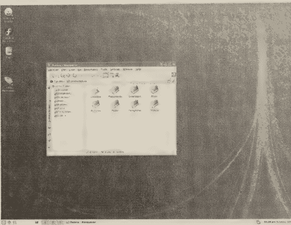

图 1-2: Fedora KDE Live CD

## Fedora 8 桌面外观和感受

Fedora 8 具有带有 Fedora 标志的桌面视觉效果，以及新的默认 Fedora 无限屏幕背景。标志描绘了一个蓝色圆圈内的 F。在主面板上，你会看到蓝色的 Fedora 标志作为应用程序菜单的图标。默认背景是位于气泡中的 Fedora 蓝色 F 标志，周围是其他上升的气泡。它甚至有自己的包 `fedora-logos`。

该标志的设计代表了 Linux 社区和开发的三个特征：自由、交流和无限可能——代表自由的 f，它融入了无限符号（Infinity），两者都被包裹在唤起交流（声音）的气泡中。通过全球交流开发的具有无限可能的自由和开源软件。这一理念是唤起 Linux 开发的精神和目的，即作为被赋予声音的无限自由之一。标志结合了 Fedora 的四个基本理念：开放、自由、创新和前瞻（见图 1-3）。更多详情请访问 `fedaproject.org/wiki/Logo`。此处显示了网站上显示的标志描述。


图 1-3: Fedora Logo

默认主题现在是 Nodoka，为 Fedora 设计的 GNOME 主题。按钮和窗口更容易使用，并且视觉上更悦目。当然，从 Gnome 主题管理器还可以获取许多其他主题。Gnome 桌面的功能与 Fedora 7 相同，具有应用程序、位置和系统菜单（见图 1-4）。

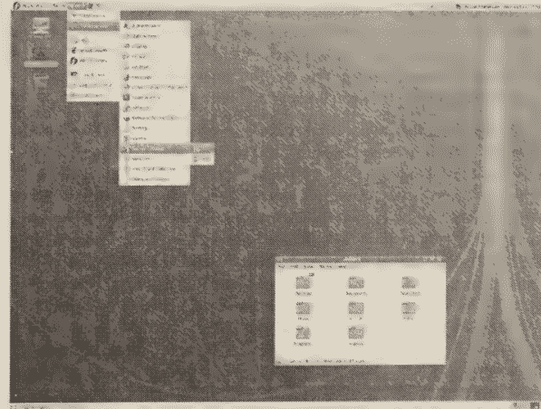

图 1-4: 带有 Fedora 标志的 Fedora 8 桌面

## 开源软件

Linux 是通过互联网协作开源努力开发的，因此没有公司或机构控制 Linux。为 Linux 开发的软件反映了这一背景。开发通常在 Linux 用户决定合作开发某个项目时进行。软件发布在

## 42 第 1 部分：入门

通过网站，任何 Linux 用户都可以访问该网站并下载软件。Linux 软件开发一直在互联网环境中运行并具有全球范围，招募了世界各地的程序员。启动一个基于 Linux 的软件项目唯一需要一个网站。

大多数 Linux 软件都是作为开源软件开发的。这意味着应用程序的源代码随程序一起免费分发。互联网上的程序员可以对软件包的开发做出自己的贡献，修改并纠正源代码。Linux 是一个开放操作系统。它的源代码包含在所有的发行版中，并可以在互联网上免费获取。许多主要的软件开发工作也是开源项目，KDE 和 Gnome 桌面及其大多数应用程序也是如此。Netscape Communicator Web 浏览器包也已成为开源，其源代码可以免费获取。由 Sun 支持的 OpenOffice 办公套件是一个基于 Star Office 办公套件的开源项目（StarOffice 本质上是 Sun 公司的 OpenOffice 商业版本）。运行在 Linux 上的许多开源应用程序已将其网站设在 Source (sourceforge.net)，这是一个专门为支持开源项目设计的托管站点。你可以在 `www.opensource.org` 找到更多关于开源运动的信息。

开源软件受公共许可协议的保护。这些协议防止商业公司通过添加少量自己的修改、对这些更改进行版权注册并将软件作为它们自己的产品销售来控制开源软件。最流行的公共许可协议是自由软件基金提供的 GNU 通用公共许可协议（GPL）。这是 Linux 分发的许可协议。GNU 通用公共许可协议保留版权，免费许可软件，并要求软件及其任何修改版本始终免费可用。还创建了其他公共许可协议以支持不同类型开源项目的需求。GNU 语言公共许可协议 (LGPL) 让商业应用程序可以使用 GNU 软件库。Qt 公共许可协议 (QPL) 让开源开发者可以使用对 KDE 桌面至关重要的 Qt 库。你可以在 `www.opensource.org` 找到完整列表。

Linux 目前根据自由软件基金提供的 GNU 许可协议拥有版权，通常被称为 GNU 软件（参见 `www.gnu.org`）。GNU 软件是免费分发的，前提是必须免费分发给他人。许多流行的 Linux 程序（如 C 编译器、外壳和编辑器）都是 GNU 软件应用程序。安装你的 Linux 发行版时，会带有 GNU C++ 和 Lisp 编译器、Vi 和 Emacs 编辑器、BASH 和 TCSH 外壳，以及 Tex 和 Ghostscript 格式。此外，还有许多根据 GNU 通用公共许可协议 (GPL) 许可的开源项目。这些软件应用程序可以在不同的网站找到，并列在表 1-2 中。第 4 章详细描述了从网站下载软件应用程序并将其安装到系统中的过程。

根据 GNU 通用公共许可协议的条款，原始作者保留版权，尽管任何人都可以修改并重新分发软件，前提是包含、公开并免费提供源代码。此外，对销售软件或免费赠送没有限制。一个分发者可以对软件收费，而另一个分发者可以免费提供。主要的软件公司也为它们最流行的应用程序提供 Linux 版本。Oracle 提供了其 Oracle 数据库的 Linux 版本。（目前似乎没有微软应用程序的计划。）

## Linux 软件


目前所有 Linux 软件都可以从在线存储库获取。你可以下载用于桌面、互联网服务器、办公套件和编程包等的应用程序。软件包主要通过启用了 Yum 的仓库分发，其中最大的是官方的 Fedora 仓库。下载和更新由你的桌面软件管理器和更新程序自动处理。

此外，你还可以从第三方源下载压缩包格式或 RPM 包形式的软件。RPM 软件包是使用红帽软件包管理器（Red Hat Package Manager）存档的包。压缩包具有如 `.tar.gz` 或 `.tar.Z` 等扩展名，而你从任何网站直接下载的 RPM 包，可以使用 GNOME 或 KDE 桌面上的 Yum 软件包管理器点击按钮即可安装。你也可以下载源码版本直接在你的系统上进行编译。这已变成一个简单的过程，与安装编译后的 RPM 版本一样简单。

Fedora 还有大量的镜像站点，你可以从这些站点下载当前发布版本的软件软件包 (`fedoraproject.org/Download/mirrors.html`)。如果你在连接主 FTP 站点遇到困难，请使用其镜像站点之一。

# Fedora 软件存储库

对于 Fedora，你可以使用软件更新程序从 Fedora Yum 仓库更新到最新软件（参见第 4 章）。你的软件更新程序已经配置为访问 Fedora 仓库。

Fedora 发行版提供了全面的软件选择，范围从办公和多媒体应用到互联网服务器和管理服务（参见表 1-2）。许多流行的应用程序未包含在，但在相关的软件网站上提供了符合 Fedora 标准的版本。在安装期间，Yum 被配置为访问 Fedora 仓库。

# 第 1 部分：入门

## 表 1-2：Fedora 存储库

| URL | 网站 |
| --- | :--- |
| `fedaproject.org/wiki/Distribution/Download` | 最新 Fedora 发行版的下载页 |
| `fedaproject.org/Download/mirrors.html` | 列出 Fedora 镜像的页面 |
| `download.fedora.redhat.com/pub/fedora/linux/` | 用于 Fedora 软件的 Fedora Yum 仓库 |
| `fedaproject.org/get-fedora` | 下载 Fedora Live 和安装盘的 Fedora 项目页面 |
| `linux.duke.edu/projects/yum` | Yellow Dog Updater, Modified (Yum) 更新工具的原始站点 |
| `rpm.livna.org/projects/yum` | Yellow Dog Updater, Modified (Yum) 更新工具的原始站点 |
| `rpm.livna.org` | Fedora 关联站点 |
| `atms.redhat.org` | RPM 存储库 |
| `sources.redhat.com` | 开源软件 |
| `torrent.fedaproject.org` | Fedora 发行版 |

对于 Fedora，你可以使用软件更新程序从 Fedora Yum 仓库更新到最新软件。Fedora 发行版提供了全面的软件选择，范围从办公和多媒体应用到互联网服务器和管理服务。许多流行的应用程序未包含在，但在相关的软件网站上提供了符合 Fedora 标准的版本。（注：原文此处有表格结构，但内容碎片化。下表合并了逻辑数据）。

| URL | 网站 |
| --- | :--- |
| `fedaproject.org/wiki/Distribution/Download` | 最新 Fedora 发行版的下载页 |
| `fedaproject.org/Download/mirrors.html` | 列出 Fedora 镜像的页面 |
| ... |  |
| `www.fluendo.com` | Linux 授权多媒体解码器，包括。 |

## 第三方 Linux 存档

虽然大多数软件应该安装在 Fedora 仓库或如 `rpm.livna.org` 等关联存储库中，但你可以从第三方存档下载并安装软件。始终先检查软件是否已经在 Fedora 或关联存储库中。如果没有，你就可以从第三方网站下载。

几个第三方存储库可以轻松定位应用程序并找到相关信息。特别是 `sourceforge.net`、`www.gnu.org`、`rpmfind.net`、`www.gnomefiles.org` 和 `www.kde-apps.org`。下载软件包时，始终检查版本是否针对你的特定发行版进行了封装。例如，`rpmfind.net`、`freshmeat.net` 和 `sourceforge.net` 也是寻找 RPM 包的好地方。

### 表 1-3：第三方 Linux 软件

| URL | 网站 |
| --- | :--- |
| `sourceforge.net` | 用于 Linux 应用程序的开源软件开发站点 |
| `www.gnu.org` | GNU 存档 |
| `rpmfind.net` | RPM 软件包存储库 |
| `www.gnomefiles.org` | GNOME |
| `www.kde-apps.org` | KDE 软件存储库 |

## Linux 办公软件

现在许多专业级别的数据库和办公套件都适用于 Linux。这些包括 OpenOffice 和 KOffice 办公件。表 1-4 列出了办公套件和数据库的网站。大多数办公套件已经包含在 Fedora 仓库中，并包含在 Fedora 安装 DVD 中，某些应用程序位于 Live CD 发行中。许多其他网站为 Linux 提供了免费的个人版软件，另一些则是完全免费的。你可以从这些网站下载并将软件安装在你的 Linux 系统上。

### 表 1-4: 办公软件

| URL | 软件 |
| --- | --- |
| `www.openoffice.org` | OpenOffice (Fedora) |
| `koffice.kde.org` | KOOffice (Fedora) |
| `www.sun.com/star/staroffice` | StarOffice |
| `www.gnomefiles.org` | GNOME 办公与生产力应用 (Fedora) |

## Linux 文档

Linux 文档也在互联网上开发。目前可用的 Linux 文档大部分可以从互联网 FTP 站点下载。由 Matt Welsh 领导的名为 Linux 文档项目（LDP）的特殊项目开发了一套完整的 Linux 手册。文档可以在 LDP 主页站点 `www.ldap.org` 获取。LDP 提供的 Linux 文档列在表 1-5 中，以及它们的互联网站点。文档包括用户指南、介绍和管理指南。这些文档以文本、PostScript 或网页格式提供。你还可以在所谓的 HOW-TO 文档中找到更简短的解释。你安装的软件的 Linux 文档将在 `/usr/share/doc` 目录中可用。如前所述，某些针对 Fedora 的文档可以在 `doc.fedaproject.org` 找到。`www.gnome.org` 网站拥有 GNOME 桌面的文档，而 `www.kde.org` 拥有 KDE 桌面的文档。

## 操作系统与 Linux

操作系统是一个为用户管理计算机硬件和软件的程序。操作系统最初设计用于执行重复的硬件任务，这些任务集中在管理文件、运行程序和接收用户命令。你通过用户界面与操作系统进行交互，这允许操作系统接收并解释用户发送的指令。你只需要向操作系统发送指令来执行某个任务，例如读取文件或打印文档。操作系统的用户界面可以简单到在命令行中输入命令，也可以复杂到在桌面上选择菜单和图标。

操作系统任务还管理软件应用程序。为了执行不同的任务（例如编辑文档或进行计算），你需要特定的软件应用程序。编辑器是一种软件应用程序示例，允许你编辑文档、做出更改并添加新文本。编辑器本身是一个由供计算机执行的指令组成的程序。为了使用该程序，必须首先将其加载到计算机内存中，然后执行其指令。操作系统控制所有程序（包括任何软件应用程序）的加载和执行。当你想要使用编辑器时，只需指示操作系统加载编辑器并执行它。

文件管理、程序管理和用户交互是所有操作系统的共同传统特征。Linux 与所有 Unix 版本一样，增加了两个特性。Linux 是一个多用户、多任务系统。由于它是多任务系统，你可以在执行某项任务的同时要求系统执行几项任务，你可以处理另一项工作。例如，当另一个文件正在打印时，你可以编辑一个文件。

不需要等待另一个文件打印完成就可以进行编辑。由于它是一个多用户系统，多个用户可以同时登录到系统，每个人通过自己的终端与系统进行交互。

由于它是一个多用户系统，多个用户可以同时登录到系统，每个人通过自己的终端与系统进行交互。Linux 最初是专为个人电脑设计的，起初是赫尔辛基大学一个名为 Linus Torvalds 的计算机学生的一个个人项目。当时，学生们使用一种名为 Minix 的程序，该程序突出了不同的 Unix 特性。Minix 由 Andrew Tanenbaum 教授创建，并在互联网上广泛分发给全球学生。Linux 的意图是为用户创建一个有效的 PC 版 Minix。它被命名为 Linux，并在 1991 年发布了 0.11 版本。Linux 在互联网上广泛分发，在随后的几年里，其他程序员对其进行了完善和添加，包含了现在标准 Unix 系统中找到的大多数应用程序和功能。所有主要的窗口管理器已迁移到 Linux。Linux 拥有所有的网络工具，例如 FTP 文件传输支持、Web 浏览器以及系列网络服务，如电子邮件、域名服务和动态主机配置，以及 FTP、打印服务器。它还有一套程序开发工具，如 C++ 编译器和调试器。考虑到它的所有特性，Linux 操作系统……（注：由于原文中存在大量重复的段落和碎片化句子，此处译文已根据提供的内容重构了唯一的逻辑流。）

（注：提供的 OCR 文本在后几页包含大量的重复和碎片化句子。我已根据提供的内容重构了唯一的逻辑流。）

系统保持了轻量、稳定且快速。在最简单的格式下，Linux 仅需 2MB 内存即可有效运行。

尽管 Linux 是在互联网的自由开放环境中发展起来，但它遵循官方的 Unix 标准。由于过去几十年中 Unix 版本的泛滥，电气与电子工程师学会（IEEE）为美国国家标准协会（ANSI）开发了一项独立的 Unix 标准。这种新的 ANSI 标准 Unix 被称为计算机可移植操作系统接口（POSIXments）。该标准定义了类 Unix 系统需要如何运行，并规定了系统调用和接口等细节。POSIX 定义了一个所有 Unix 版本都必须遵循的通用标准。现在大多数流行的 Unix 版本都符合 POSIX 标准。Linux 从开发之初就是根据 POSIX 标准开发的。Linux 同样遵循文件系统层级结构标准（FHS），该标准规定了 Linux 文件系统结构中文件和目录的位置。

更多详情请访问 `www.pathname.com/rhs`。

Linux 开发现在由 Linux 基金会（`www.linux-foundation.org`）负责，该基金是由自由标准小组（The Free Standards Group）和开源开发实验室（OSDL）合并而成的。林纳斯·托瓦兹（Linux Torvalds）就在该小组致力于开发新的 Linux 版本。实际的 Linux 内核在 `www.kernel.org` 开发。

## 红帽企业 Linux (Red Hat Enterprise Linux)

作为一家公司，红帽提供软件和服务，以实施和支持专业及商业 Linux 系统。红帽将其 Linux 开发分为两条线：红帽企业 Linux（Red Hat Enterprise Linux）和 Fedora 项目（The Fedora Project）。红帽企业 Linux 具有针对服务器和工作站的商业级产品，每两年左右发布一次更新。Fedora 项目是一个开源倡议，其 Fedora 版本平均每六个月发布一次，整合了 Linux 操作系统功能的最新开发成果以及支持的应用程序。红帽根据通用公共许可证（General Public License）分发其 Fedora 版本的 Linux；公司通过提供专业级支持、咨询服务和培训服务来产生收入。红帽认证工程师（RHCE）培训和认证计划旨在提供可靠且高能力的管理员，并维护和定制专业级的红帽系统。红帽已与 Oracle、IBM、戴尔和 Sun 等主要公司结成了软件联盟。

红帽对开源 Linux 应用也保持着坚定的承诺。红帽起源了多个发行版中使用的 RPM 软件包系统，该系统可以自动安装和卸载软件包。红帽还为 GNOME 桌面提供了大量的软件开发，并且是 KDE 的支持者。

红帽提供了一系列丰富的配置工具，用于管理任务，如添加用户、启动服务器、访问远程目录以及配置显示器或打印机等设备。这些工具可以通过“系统 \| 管理”（System \| Administration）菜单访问，也可以通过名称访问，所有名称均以 `system-config` 开头（参见第 13 和第 14 章）。

红帽企业系列产品为企业、研究和商业应用设计（`www.redhat.com`）。这些产品侧于可靠性和稳定性。它们的发布计划比低成本的消费者版红帽 Linux 受控得多，红帽 Linux 已替换为面向消费者和小企业的精简版商业桌面版本。

红帽提供红帽企业 Linux 的桌面版和服务器版。桌面版本提供简单桌面、完整工作站版，或者带有虚拟化支持（多操作系统）的简单桌面或工作站。请记住，在最底层，简单桌面版不包含 Samba 和 NFS 服务器等某些网络功能。桌面版本没有系统内存限制，提供软件开发支持，并包含 Samba 和 NFS 服务器。工作站虚拟化功能允许无限的操作系统支持。

红帽企业 Linux 因其稳定性而受推崇，通常提供比 Fedora 更稳定的实现。它作为开源 GPL 产品授权，因此在技术上对任何人开放。红帽销售的版本包括了非开源的商业产品和支持。然而，红帽免费从 FTP 站点 `ftp.redhat.com/pub/redhat/linux/enterprise` 提供其开源企业版供下载。早期的企业版本提供二进制和 ISO 格式，尽管不包含任何商业功能。当前的企业版本仅以源文件形式形式提供。

## CENTOS：社区企业操作系统

如果你想利用红帽企业 Linux 的稳定性和可靠性但不想购买该产品，你可以你可以使用 CENTOS，即社区企业操作系统（`www.centos.org`）。CENTOS 并不声称与红帽有任何官方关联。相反，在 GPL 许可证和红帽的开源分发策略下，它利用红帽企业 Linux 的源码提供自己的 Linux 发行版。实际上，通过 CENTOS，你可以享受红帽企业 Linux 的稳定性、可靠性和企业级能力，而无需商业支持。请记住，CENTOS 是一个构建自己发行版的独立运营实体。它不具备红帽为其产品提供的任何支持或保证。

# 2. 安装 Fedora 8

本章描述了 Fedora 8 Linux 的安装程序。红帽企业 Linux 和 Fedora 使用相同的 Anaconda 安装程序；它被设计得易于使用且实用，同时保持高效和简洁，尽可能安装尽可能的服务和应用程序。详细的帮助面板解释了每个过程中的每一步操作。网上还提供了 Fedora 8 安装指南。请先在以下处查看新的 Fedora 安装指南：

```
http://docs.fedoraproject.org/install-guide/f8/
```

注意：在 Fedora 8 中，IDE 硬盘不再使用 `hd` 前缀进行引用。相反，而是使用 `sd` 前缀，这与串行接口（SATA）硬盘相同。此更改要求在安装之前对所有硬盘进行标记。现在使用标签来识别硬盘，而不是使用设备名称。

## 安装策略：利用存储库

在 Fedora 8 中，安装时你可以使用安装 DVD 或两个 Live CD/CD 之一，带有 GNOME 或带有 KDE。Fedora 安装 DVD 允许你在安装期间从指定的存储库下载，并选择你想要安装的软件包。它包含的软件包比 Live CD/CD 多。

一种简单有效的安装策略是安装最小桌面，只需使用 Fedora Live DVD/CD（或 KDE）。

依赖 Fedora 存储库来更新和安装任何软件。这种方法的考虑是用于软件安装的存储库的巨大影响，以及自动更新软件的非常简单的过程。请记住软件是不断更新的。这包括办公、互联网和图形应用。软件在某种意义上是动态且流动的，处于不断变化之中；在启用了 Yum 的 Fedora 上，更新会自动为你完成。这意味着安装 DVD 上的许多软件会迅速时时。

此外，安装 DVD 的一个主要优势是其在软件包选择上的灵活性。Live CD/CD 仅安装预设的软件包。Fedora 安装 DVD 允许你选择想要安装的软件包，提供了更大的选择范围。Fedora DVD 是包含许多热门应用程序（服务器、开发和桌面）的广泛集合。


Fedora 安装 DVD 还允许从 Fedora 存储库以及你可能选择的任何关联存储库（例如 `rpm.livna.org`）安装软件包。通过 Fedora 安装 DVD，你可以选择从 Fedora 存储库下载未包含在 Fedora DVD 中的额外软件包。在安装期间，你可以从 Fedora 存储库安装软件包，将其作为安装过程的一部分直接下载。

如果你想安装专有驱动（如 Nvidia 或 ATI 图形驱动，可在 `rpm.livna.org` 获取）或未包含在 Fedora 存储库中的某些多媒体应用（同样 `rpm.livna.org`），这将非常有帮助。

通过 Fedora 安装 DVD，你实际上还有选择安装所有内容，包括那些来自存储库的软件包。一旦你设置了对 Fedora 存储库的访问，你只需选择所有软件包。取决于你的互联网连接速度，这可能需要一些时间。

如果你没有高速网络连接来支持大量的下载，并且想要比 Live CD/CD 提供的更丰富的软件集合，你就需要使用 Fedora 安装 DVD。

# 第2章：安装

## Live CD/DVD 的优势

- 快速下载较小的安装盘（约 800 MB）
- 可以在 Live CD 界面上查看桌面操作
- 快速安装基础桌面（无法选择软件包）
- 安装后，可根据需要从在线存储库添加当前软件包

## Fedora 安装 DVD 的优势

- 更丰富的初始软件包集合：服务器、管理、多媒体、办公。（Fedora DVD 镜像的初始下载量大得多，3 GB）。
- 即使在没有高速连接从存储库下载的情况下，也可以安装更多软件包
- 可以指定要安装的软件包包
- 可以在安装过程中从 Fedora 存储库下载
- 可以在安装过程中选择特定的 Fedora 兼容存储库来安装软件包，例如从 `rpm.livna.org` 下载来自 Nvidia 或 ATI 的供应商显卡驱动程序（此操作也可以在安装后随时进行）
- 你手中将始终有一套更广泛的安装包，以便进行其他安装

## 使用 Fedora Live 的最小化安装策略

### 首次安装

如果你是第一次安装 Fedora，并希望快速下载软件，可以仅从 Fedora Live 安装。Fedora Live 还允许你先看看 Fedora 是什么样，而无需先安装它。如果你之后想在你的系统上安装 Fedora，只需使用 Fedora Live CD 或安装 DVD 即可。你不需要单独下载像 Fedora Live DVD 这样的安装盘。之后你可以从 Fedora 存储库下载并安装软件。

Fedora Live 包含 Gnome 桌面。如果你想使用 KDE 桌面，可以使用 Fedora Live KDE。Fedora Live 和 Fedora Live KDE 有 `i686`（32 位 x86 系统）、`x86_64`（64 位系统）和 `ppc`（Mac G4 系统）版本。`i686` 版本是 CD，而其他版本都是 DVD，尽管仍然只有 800 MB 左右。

一旦下载并刻录了 Fedora Live-CD，请从它启动系统。系统将自动启动。按下空格键将显示包含四个选项的启动菜单：

- 启动 Fedora 8 Live
- 验证并启动 Fedora 8 Live
- 内存测试
- 从本地驱动器启动

第一个选项是默认选项。第二个会首先测试你的 CD/DVD 介质是否正常。第三个执行硬件内存测试。最后一个将在连接到硬件磁盘（如果有的话）上启动本地操作系统。

一旦启动 Fedora，将显示登录界面。输入 `Fedora` 以开始你的登录（不需要密码），或直接按回车（`ENTER`）从 CD 启动 Fedora（见第 1 章）。KDE Live 盘将直接启动到 KDE 桌面。

你现在可以使用你的桌面了。某些应用程序已经安装完成。你可以安装其他软件包，但它们仅在当前会话有效。你将拥有完全的网络访问权限。你可以向 Fedora 目录写入，但文件仅对会话有效。你插入的移动介质（如 USB 驱动器）可以写入，从而允许你保存任何数据。

图 2-1：Fedora Live 桌面上的 Fedora 安装窗口

屏幕上有一个 Fedora F 符号的图标，标记为“**安装到硬盘**”。如果你想直接在你的系统上安装 Fedora，请点击此按钮。点击此按钮将启动本章描述的标准安装程序 (`anaconda`)。你安装 Fedora 将就像安装标准的 Fedora 安装 DVD 一样。唯一的区别是，只有 Fedora Live-CD 上已经存在的一小部分软件包会被安装。在安装过程中，你将没有选择应用程序的选项。

当你开始“安装到硬盘”过程时，会打开一个窗口，显示初始安装界面，让你选择安装 Fedora（见图 2-1）。

安装过程显示的屏幕比标准过程少，但执行了所有必要的任务。所示的屏幕如下：

- **键盘 (Keyboard)：** 在此处选择你的键盘语言和布局
- **分区 (Partitions)：** 在此处设置你的分区。你有使用默认设置或管理自己的分区选项。更多信息请参阅分区、Raid 和逻辑卷章节
- **引导加载程序 (Bootloader)：** 在此处设置你的引导加载程序，选择任何其他启动的操作系统
- **网络 (Network)：** 指定你的网络配置，通常为 DHCP
- **时间 (Time)：** 设置时间
- **时区 (Time Zone)：** 从地图或弹出菜单中选择你的城市
- **密码 (Password)：** 为 root 用户输入密码。这是你的管理员密码
- **格式和软件安装 (Format and software install)：** 你的分区将被格式化，来自 Fedora Live 的所有软件将被安装

当你重启时，将在硬盘上开始 Fedora 安装。最初，你拥有的软件与 Fedora Live CD/DVD 上的相同，但可以使用 `Applications | Add/Remove Software` 来安装其他应用程序，如 OpenOffice。你可能还需要更新许多从 Fedora Live 安装的应用程序。点击顶部面板上自动出现的更新通知图标，以启动更新过程。应用程序和更新将从 Fedora 存储库下载并自动安装。

## 获取 CD 和 DVD

要获取 Fedora 8，只需访问 Fedora 项目官方网站并点击“Get Fedora”链接。在这里，你将看到不同 Fedora 安装 DVD 和 Fedora Live 版本的 bittorrent 或直接下载链接。

直接下载（Direct downloads）链接指向一个当前可用的镜像站。

```
http://fedaproject.org/get-fedora
```

你也可以通过输入以下 URL 直接访问 Fedora 镜像站。然后你需要导航通过 `releases` 和 `8` 目录，找到存放 Fedora 安装和 Live 镜像的 Fedora 和 Live 目录。

```
download.fedaproject.org
```

你也可以通过以下 URL 访问特定的镜像。这里将列出当前的 Fedora 镜像及其地址。

```
mirrors.fedaproject.org
```

在以下 URL 可以找到所有 Fedora 下载选项的详细说明，包括你需要的所有 ISO 光盘和镜像站链接。查看此网站获取最新的下载程序。

```
http://fedaproject.org/wiki/Distribution/Download
```

或者，你也可以通过 `download.fedora.redhat.com` 上的链接直接从 Fedora 站点下载。

```
download.fedora.redhat.com/pub/fedora/linux/releases/
```

宽带 DSL 或电缆配合使用如 `gFTP` 等 FTP 客户端（`Applications | Internet` 菜单），直接下载可以非常快。使用 Firefox 等浏览器的客户端下载往往较慢。

要从 DVD/CD-ROM 驱动器下载 Fedora 用于安装，你需要下载 Fedora 安装 DVD 镜像或 Fedora Live 镜像。Fedora 安装和 Live 镜像是具有 `.iso` 后缀的大文件。Fedora DVD 位于 Fedora 子目录（`i386`、`x86_64` 和 `ppc`）中的 `Fedora/i386` 目录中。Live 镜像位于相应版本（`i686`、`x86_64` 和 `ppc`）下的 `Live` 子目录。一旦下载完成，就可以将它们刻录到 CD/DVD 刻录机和刻录软件上，如 Fedora 上的 Nautilus 文件浏览器或 K3。

有支持 64 位系统和标准 x86 (32 位) 支持的 ISO 镜像。下载相应的一个。你不能在 x86 (32 位) 系统上运行 64 位版本。

你不需要将镜像下载到 Linux 系统。你可以轻松在 Windows 系统上下载它们并使用 CD/DVD 刻录软件制作光盘。

对于大文件，另一种方法是使用 BitTorrent。BitTorrent 是一种安全的下载操作，非常适合大文件，允许多个用户下载和上传同一个文件。Fedora 8 的 BitTorrent 文件同时位于 `fedaproject.org` 和：

```
http://torrent.fedaproject.org/
```

你首先需要安装 BitTorrent 客户端。对于 Fedora，有 BitTorrent 客户端可用，包括 `azureus`、`rttorrent`、`ktorrent` 和原始的 `bittorrent`。在 Add/Remove Software 中搜索“bit”将显示它们（注意 `bittorrent` 的拼写中有两个 ‘t’ 和两个 ‘r’）。只需安装你需要的即可。

## 安装步骤

一旦安装程序开始，你只需按照屏幕提示逐步操作。在大多数情况下，你只需要进行简单的选择或提供“是”和“否”的回答。安装程序将分为几个阶段。首先，你要在硬盘上创建 Linux 分区，配置网络连接，然后安装软件包。

系统安装完成后，你就可以启动它并登录了。通常情况下，你将使用图形化登录，选择你所需的桌面并输入用户名和密码。或者，你也可以登录到简单的命令行界面。从命令行，你可以调用如 GNOME 或 KDE 等桌面，它们将为你提供完整的图形用户界面。

## 安装双引导系统

如果你在与 Linux 系统相同的计算机上已经安装了另一个操作系统，你的系统将由引导加载程序 GRUB 自动配置双引导。如果你在硬盘上同时安装了 Linux 和 Windows 系统，GRUB 将允许你选择启动 Linux 系统或 Windows 系统。手动配置双引导可能会很复杂。如果你想在计算机上使用 Windows 系统，如果尚未安装，则应该先安装它。Windows 会覆盖之前 Linux 系统安装的引导加载程序，导致无法访问 Linux 系统。此时，你必须使用启动盘上的救援选项来访问 Linux 系统并重新安装 Grub 引导加载程序。请查看以下处关于“配置双引导系统”的链接：

```
http://fedoraproject.org/wiki/Distribution/Download
```

## 使用 DVD/CD-ROM 的简单图形化安装

如果你从 DVD/CD-ROM 安装，安装过程将非常直观。图形化安装非常易于使用，提供了完整的鼠标支持，并在帮助面板中通过详细说明解释每一步。

如今的大多数系统已经符合硬件要求，并能够自动连接互联网（DHCP）。

它们还支持从 DVD-ROM 或 CD-ROM 盘启动，尽管这种支持可能需要在系统 BIOS 中显式配置。

此外，如果你知道想如何在硬盘分区上安装 Linux，或者你正在进行一个使用相同分区的简单更新，那么安装 Fedora 8 是一个相当简单的过程。Fedora 8 具有自动分区功能，将为你完成分区工作。

如果你从三个预配置的软件包安装中选择软件包集合，你甚至不需要选择软件包。

若要进行快速安装，你只需启动安装过程，将 DVD 或 CD 盘放入光驱驱动器并启动系统即可。图形化安装只需在进行过程中遵循每个窗口中的说明，这非常简单。许多说明是自显其明的（对于 LCD 显示器，你可能需要在启动提示中使用 `nofb` 选项）。对于文本安装，涉及的步骤如下：

- **启动菜单或提示**：在初始菜单中选择“安装”（Install）或“升级”（Upgrade）并按回车。对于文本安装，在启动提示处按回车。
- **媒体检查**：DVD 和 CD 通常是从下载的 ISO 镜像刻录的光盘。媒体检查可以确保你的 DVD/CD-ROM 被正确读取。
- **语言选择**：系统会为你选择一个默认语言（如英语），所以你通常只需按“下一步”。
- **键盘配置**：系统会为你选择一个默认设置；你通常可以按“下一步”。
- **升级/安装选项**：选择安装或升级。如果你已经安装了 Fedora 系统，将默认选中“升级”。
- **磁盘分区**：对于自动分区，你有选项替换任何已存在的分区：可以是所有分区或仅限 Linux 分区（保留你的 Windows 分区）。你也可以选择不分区并使用可用空闲空间。这用于保留你的旧分区或用于新驱动器。检查“查看”（Review）选项，让分区工具显示你的分区选择并允许你进行更改。
- **引导加载程序**：然后你可以配置引导加载程序（GRUB）。这主要用于选择不同的操作系统（如 Windows）作为默认启动项；否则，你可以接受当前配置并按“下一步”。
- **网络配置**：大多数 ISP 和路由器现在使用 DHCP，系统将为你默认选择该项。接下来你拥有输入网络信息（包括 IP 地址和 DNS 服务器）的选项。
- **时区**：使用地图选择你的时区。
- **Root 密码**：为 root 用户选择一个密码。这将启用管理访问。请务必记住密码。
- **安装软件**：在此你可以选择以下一个或多个：办公和生产力、软件开发和 Web 服务器。你也可以选择“现在自定义”，让你选择特定的软件包。你还可以直接从 Fedora 仓库安装额外的软件包。这需要连接的互联网。
- **准备安装**：在此你可以选择以下一个或多个：办公和生产力、软件开发和 Web 服务器。你也可以选择“现在自定义”，让你选择特定的软件包。你还可以直接从 Fedora 仓库安装额外的软件包。这需要连接的互联网。

Web 服务器，你可以根据需要向不同的类别中添加尽可能多的内容。你现在可以添加一个新的软件管理器来安装软件。该软件管理器能够在安装过程中从 Fedora 存储库下载包，这会在安装期间为你提供海量的软件供你选择。在安装完成后，你还可以使用软件管理器从任何受 Fedora 支持的存储库安装包。这种功能意味着不同系统的安装大小差异很大，取决于每个系统的特定需求。这里显示了命令行系统和桌面系统的近似标准安装大小：

- 命令行（最小）：700MB
- 桌面：3GB

请记住，磁盘空间要求代表安装后使用的空间量。安装过程还需要额外的空间来存放安装镜像（`/Fedora/base/stage2.img`）和选定的 RPM 包。最小安装建议预留 100MB 空间，完整安装预留 200MB 空间。

## 硬盘配置

如今，Linux 通常运行在自己的硬盘上，尽管它也可以运行在包含有其他操作系统（如 Windows 或 OS-X）独立分区的硬盘上。

如果你想在同一块硬盘上安装 Linux 和 Windows，可以使用分区管理软件包（如 `fdisk`、`fips`、`Parted` 或 `PartitionMagic`）来设置你的 Windows 和 Linux 分区。如果你已经在硬盘上安装了 Windows 并将其配置为占满整个硬盘，你将需要调整其分区大小以释放未使用的空间。这些空闲空间可以用于 Linux 分区。更多详情请参阅《Fedora 安装指南》。

## 信息需求

将 Linux 这样强大的操作系统适配到 PC 意味着要高效地利用现有的计算机硬件。在几乎所有的配置中，你的 Linux 安装程序将自动检测并配置你的硬件组件。有时，特别是对于较旧或非常新的硬件，你的安装程序可能无法正确识别某些组件。如果你有此类组件（例如新型号的显示器或显卡），你应该先检查它们的说明书并注意某些配置设置。

你还需要确定想要如何使用硬件资源；例如，你想将硬盘的多少部分分配给 Linux。

### CD-ROM、硬盘和鼠标信息

如果你与 Windows 共享硬盘，请决定为 Windows 留多少硬盘空间，为 Linux 留多少。

决定你想为交换分区（swap partition）留多少空间。如果你使用默认分区配置，会自动选择。你的交换分区大小应与 RAM 内存相近，但最低 64MB 即可工作。对于 RAM 配置较小的系统，交换磁盘的大小应是 RAM 的两倍。Linux 将交换分区作为计算机 RAM 的扩展使用。

了解你所在的时区以及你的硬件时钟设置的是哪个时区。这可能是格林治标准时间（GMT），也称为协调世界时（UTC），或你的本地时区。

鼠标现在会被自动检测。Fedora 不再支持串口鼠标。`system-config mouse` 工具已弃用。如果你需要配置鼠标，可以使用 GNOME 鼠标配置工具（系统 | 设置 | 硬件 | 鼠标）。

注意：显示器和显卡在安装期间会自动配置。如果你遇到问题，将必须在安装后使用 `system-display` 等工具（见第 13 章）配置系统。以防检测错误，你可能需要提供制造商的名称和型号。查出你显示器的制造商及其型号，例如 Dell 2405。你可以在 `www.x.org` 找到支持的显卡完整列表。对于旧的 CRT 显示器，垂直和水平刷新率尤为重要。

### 使用 DHCP 进行网络配置


# 第 1 部分：入门

在安装过程中，你将获得一个自动配置网络连接（DHCP）或手动输入网络信息的选项。DHCP 将已为你设为默认。如果你使用 DHCP，则无需输入任何内容。

大多数本地网络、电缆连接和 DSL 连接都使用 DHCP 来自动配置主机。网络信息由 DHCP 服务器自动提供。

如果你正在使用本地家庭路由器，或连接到局域网，你很可能已经在使用 DHCP，它会自动配置你的网络连接。

即使是直接连接到你的 ISP 服务商，ISP 也很可能支持 DHCP，在这种情况下，你不需要提供任何配置信息。

如果你需要手动配置网络连接，可以将配置推迟到以后，并使用发行版提供的网络配置工具执行网络配置。在安装期间，你只需要提供一个主机名。

## 网络配置手动设置

如果你决定手动配置网络连接，将需要以下信息，通常可以从你的网络管理员处获得：

*   你的计算机名称（主机名）。你的计算机在互联网上将通过此名称识别。不要使用“localhost”，它是系统保留特殊用的。
*   分配给你的机器的网际协议 (IP) 地址。互联网上的每个主机都分配有一个 IP 地址。
*   你的网络 IP 地址。此地址通常与 IP 地址相似，末尾有一个或多个零。
*   对于类 IP 地址，网络掩码（`networkmask`）通常为 `255.255.255.0`。然而，如果你属于大型网络，请咨询你的网络管理员。
*   你的网络的广播地址（可用）。通常，你的广播地址与 IP 地址相同，只是最后数字使用 255。
*   你的网络的网关 IP 地址。网关连接你的网络。
*   如果你的网络使用了 NIS 域和 IP 地址。
*   如果你的网络使用了 Samba 服务器。

### 启动源选项

通常你从 DVD-ROM 启动。大多数系统支持从 DVD-ROM 启动。如果你使用 CD-ROM 安装，你需要 DVD-ROM 驱动器。2.6 内核太大，无法放入软盘。注意不再支持软盘启动。

通过 `diskboot.img` 文件（在 `images` 目录中），你可以从小型 USB 驱动器或足以容纳 2.6 内核的可启动设备启动。你可以创建一个可启动的 CD-ROM 光盘来启动安装。CD-ROM 启动镜像位于 `images` 目录，也可以用来从替代源安装。

你还可以使用 `images/pxboot` 目录下的 `initrd.img` 文件通过 PXE（预执行环境）服务器进行启动。PXE 服务器通过 Linux 上的 DHCP 和 tftp 服务器运行。查看 `/usr/share/syslinux/pxelinux.doc` 文档。

## 安装 Fedora Linux

安装 Linux 涉及多个过程，从创建分区开始，然后加载 Linux 系统、配置网络连接、安装引导系统的 Linux 引导程序（GRUB）以及创建新用户账户。 Fedora 上使用的安装程序是一个基于屏幕的程序引导你完成所有过程，你可以使用鼠标或键盘进行选择。当你完成一个屏幕后，点击底部的“下一步”按钮进入下一个屏幕。如果你需要返回上一个屏幕，点击“返回”。你也可以使用 `TAB`、使用方向键、空格键和回车键进行选择。屏幕将显示帮助面板，详细解释每一步。除了做出选择和选择选项，你几乎不需要做其他事情。某些屏幕会提供选项列表供你从中进行选择。在某些情况下，系统会要求你提供信息，如果你遵循了本章之前的步骤，你应该已经拥有这些信息。硬件组件将随着你的进度自动检测并显示。在安装期间，你可以执行管理任务，例如配置网络连接、创建用户和设置时间。请记住，某些管理任务也可以在安装后完成。你现在准备好开始后续章节了。过程中每个部分的步骤将在后续章节中列出。整个过程不应超过一小时。

安装过程首先将在你的系统上安装 Linux，包括所有选定的包。然后它将重启并启动设置程序，让你微调某些设置，包括显示设置、声音测试以及时间和日期。

## 启动安装程序

如果你的电脑可以从 DVD/CD-ROM 启动，你可以直接从 Live DVD/CD-ROM 或安装 DVD-ROM 启动安装。只需在启动电脑之前将光盘放入 DVD/CD-ROM 驱动器中。打开电脑后，安装程序将启动。

安装程序将启动并向你展示列有以下选项的菜单：

*   安装或升级现有系统
*   安装或升级现有系统（文本模式）
*   救援已安装的系统
*   从本地驱动器启动
*   内存测试

使用方向键从一个菜单项移动到下一个，然后按回车键选择该项（见图 2-2）。如果你需要添加选项（例如在“安装或升级”项中添加），请按 `TAB` 键。屏幕将显示一个命令行，你可以在其中输入选项。当前选项已经列出。使用退格键删除，并使用方向键在行内移动。按 `ESC` 键返回菜单。

# 第 2 章：安装

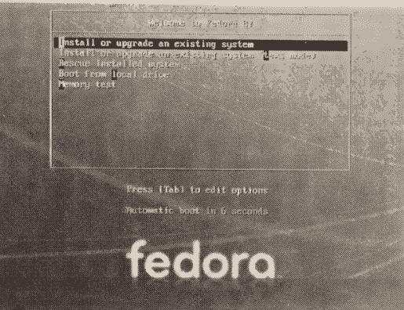

图 2-2：带有救援和启动选项的安装菜单

> **提示**：要从 CD/DVD-ROM 启动，你可能需要先更改电脑 BIOS 中的启动次序设置，以便电脑首先尝试从 DVD/CD-ROM 启动。这需要一些技术能力以及对如何设置主板 BIOS 配置的知识。

你的系统会检测硬件，并提供可能所需的配置规范。例如，如果你有一个 IDE CD-RW 或 DVD-RW 驱动器，它将被自动配置。如果由于原因无法这样做，系统将要求你从列表中选择 DVD/CD-ROM。如果你仍然遇到困难，可能需要在启动提示符或命令行中指定 DVD/CD-ROM（`sd` 替换之前版本中的 `hd` 前缀）。

```
sdx=cdrom
```

根据设备连接的接口以及它是配置为主设备还是从设备，将 `x` 替换为以下字母之一：`a`（第一个 IDE 控制器主）、`b`（第一个 IDE 控制器从）、`c`（第二个 IDE 控制器主）、`d`（第二个 IDE 控制器从）。

如果你无法启动安装过程且使用 LCD 显示，你应该在安装项上按 `TAB` 键并在选项命令行中输入 `nofb`（无帧缓冲区）。

```
nofb
```

安装过程中出现的每个屏幕中，默认项都已被选中，通常是由安装程序的自动探测功能完成的。选中的项将以高亮显示。如果这些项是正确的，你只需点击“下一步”接受它们并进入下一个屏幕。

### 检查磁盘媒体

系统要求检查 DVD/CD 光盘是否有错误（见图 2-3）。此检查可能需要几分钟。你可以按 `TAB` 或方向键移动到“跳过”按钮，然后按回车键跳过此过程。

你的图形安装屏幕将开始启动。

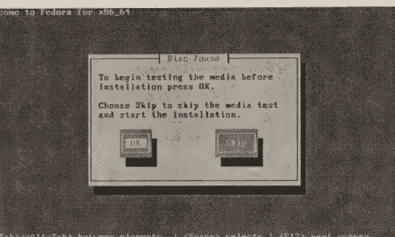

图 2-3：磁盘检查

## DVD/CD-ROM 硬件检测问题

如果你的 DVD/CD 驱动器未被正确检测，将被要求选择驱动程序。将显示一个文本屏幕。使用方向键更改选择。使用 `TAB` 或方向键在按钮之间移动。将有选择驱动程序、使用驱动器磁盘或返回等选项。选择驱动程序是默认选项，它将列出大多数驱动程序。在选择驱动按钮上按回车键。然后使用方向键从列表中选择驱动程序。检查你的主板或电脑文档以使用合适的驱动程序。

## 初始设置：升级或安装

如果你的基本设备和硬件配置被正确检测，将显示欢迎屏幕，右下角有一个“下一步”按钮。完成一个步骤后，点击“下一步”继续。在某些情况下，你可以点击“上一步”按钮返回上一个步骤。在大多数屏幕上，左下角的按钮将显示发行说明。

第一个屏幕将显示 Fedora 安装镜像（见图 2-4）。按“下一步”开始安装过程。

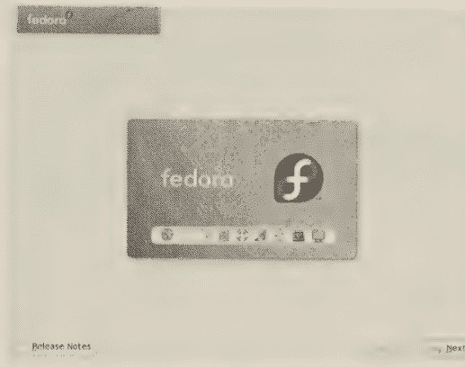

图 2-4：安装屏幕

你将被要求选择语言，然后是键盘配置。默认语言已选择为美国英语（见图 2-5）。

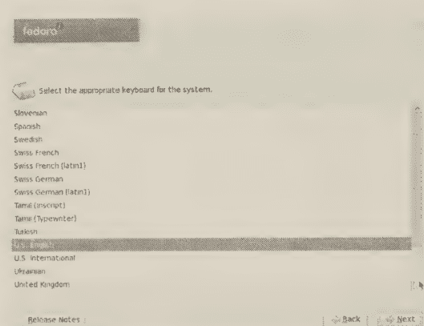

图 2-5：语言选择

你将被要求选择语言，然后是键盘配置。默认语言已选择为美国英语（见图 2-6）。


图 2-6：键盘选择

你将被给出升级旧版本或安装新系统的选项。对于升级，弹出菜单将显示根分区布局。

*   “安装 Fedora”
*   “升级现有系统”

## 分区、RAID 和逻辑卷

然后你将被要求指定要使用的 Linux 分区和磁盘配置。如果你只想使用可用驱动器，Fedora 提供自动分区。要手动配置你的磁盘，Fedora 使用了一个非常详细且面向图形的工具 `Partd`。通过 `Partd`，你可以创建特定分区、配置 RAID 或设置逻辑卷（LVM）。

在之后选择软件包之前，没有任何分区会被更改或格式化。你可以随时退出安装，你的原始分区将保持原样。前三个分区配置设置为：

*   “选择用于此安装的驱动器”
*   “你想从哪个驱动器启动此安装”

### 分区布局

分区布局屏幕将显示一个包含自动分区选择的弹出菜单，提供四个选项：删除所选驱动器上的所有分区、删除所选驱动器上的 Linux 分区、使用所选驱动器上的空空间以及自定义布局。对于前三个将创建默认分区。默认选择了“删除 Linux 分区”。

*   **删除所选驱动器上的所有分区并创建布局**：这将删除磁盘上的所有分区，有效地将其擦除。你将丢失所有分区，包括 Windows 分区。
*   **删除所选驱动器上的 Linux 分区并创建布局**：这仅删除磁盘上已有的 Linux 分区。任何 Windows 或其他操作系统分区将保持不变。
*   **使用所选驱动器上的空空间并创建布局**：这适用于部分使用的磁盘，例如使用硬盘一部分的 Windows 分区。这假设磁盘上有大量的空空间。
*   **自定义布局**：此选项直接打开 `Partd` 并让你创建自己的分区或手动选择现有分区。此选项提供了最大的控制，但你需要了解分区的工作原理以及它们如何在硬盘上实现。

屏幕底部的选项允许你在 `Partd` 中查看所有分区，并在需要时进行修改。默认不勾选此项。勾选此项可以查看 `Partd` 将如何对你的系统进行分区。如果需要，你也可以进行更改。

> **查看并修改分区布局。**

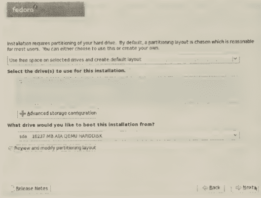

图 2-7：分区

这允许你手动对分区进行更改，并精确确定在驱动器上创建哪些分区。与“创建自定义布局”选项一样，你进入了 `Parted` 分区管理器，可以在其中根据意愿修改分区。

如果你想使用多个分区（如 `/home`、`/` 和 `/var` 以及 boot）来组织你的数据，你将必须手动配置它们。自动分区将只设置 boot 分区和一个 LVM Linux 分区。

“高级存储配置”按钮允许你选择 iSCSI 设备或禁用你的主板 RAID 设备控制器 (`dmraid`)。

### 自定义与检查分区

如果你选择了“创建自定义布局”选项或勾选了“检查并修改”选项，将显示磁盘设置界面，带你进入 `Parted` 分区配置。在这里，你可以手动创建 Linux 分区，或者选择你想要安装 Fedora 的分区。上方窗格列出了电脑上的硬盘及其对应的分区（许多电脑只有一个硬盘），下方窗格列出了具体分区。选择一个硬盘会列出它的分区。窗格上方的按钮允许你创建、编辑和删除分区。分区屏幕实际上是一个交互界面，你可以在其中配置分区并创建新分区（见图 2-8）。

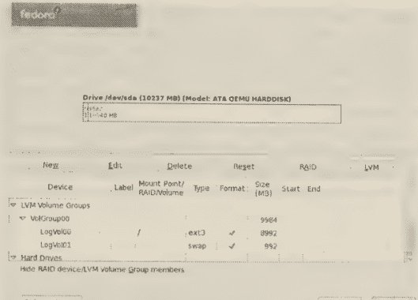

图 2-8：使用 `parted` 进行自定义分区配置

如果你正在检查默认分区，则会显示已为你设置的硬盘分区。面板将显示将为你的系统创建的特定分区。

如果你正在格式化任何包含数据的旧 Linux 分区，当你点击“下一步”按钮时，将出现一个屏幕列出这些分区，并要求你确认是否要对其进行格式化（你创建的新 Linux 分区将被自动格式化）。如果你已经有一个 Linux 系统，可能已经有几个 Linux 分区了。其中某些分区可能仅用于系统软件，例如 boot 和 root 分区，这些应该被格式化。其他分区可能包含大量的用户文件，例如 `/home` 分区，它通常存放用户主目录以及他们创建的所有文件。你**不应该**格式化此类分区。

### 推荐的分区

如果你手动创建分区，被要求至少设置两个 Linux 分区：一个 swap 分区和一个 root 分区。*root分区*是安装 Linux 系统和应用程序文件的地方。此外，建议还设置一个*boot* 分区，它将包含你的 Linux 内核（`/boot` 目录），以及一个存放所有用户文件的 `/home` 分区。将 root 分区和 boot 分区上的系统文件与 home 分区上的用户文件分离，可以让你在系统文件损坏时替换它们，而不必触及用户文件。同样，如果你的内核损坏了，你只需要替换 boot 分区上的内核文件，而保持 root 分区上的系统文件不变。

如果你使用 LVM 分区（如默认设置所的那样），那么你至少需要两个物理分区，一个用于 boot 分区，另一个用于 LVM 物理分区。`/boot` 目录需要它自己的分区，因为你无法从 LVM 分区启动。`/boot` 分区将存放内核。LVM 分区的工作类似于 Windows 扩展分区，通过它你可以设置若干名为逻辑卷的分区。在默认设置中，单个 LVM 物理分区 (pv) 上设置了两个逻辑卷（分区），一个用于 root，另一个用于 swap。在图 2-8 中，LVM 组（Volume Groups）显示默认的 root 和 swap 逻辑卷。

这种将系统目录分离到不同分区的策略可以进一步扩展以确保系统更健壮。例如，`/var` 目录（现在存放 Web 和 FTP 服务器文件）可以分配它自己的分区，从物理上将服务器与系统的其余部分分开。`/usr` 目录（包含大多数用户应用程序）可以放在它自己的分区中，并由其他系统共享和挂载。该策略的缺点是，你需要预先知道每个分区想要使用的最大尺寸。对于系统和内核文件，这很容易确定，但对于使用量可能会发生剧烈变化的目录（如 `/home`、`/var` 甚至 `/usr`），这很难确定。作为为每个目录创建单独分区的替代方案，你可以使用逻辑卷（后文描述）。这里显示了一个基本的 swap 分区配置：

| Swap 分区 | 挂载点 |
| :--- | :--- |
| `/` | 系统文件的 root 分区（如果只有一个分区则包含所有其他文件） |
| `/boot` | 存放 Linux 内核的 boot 分区（约200MB） |
| `/home` | 用户主目录和文件 |

除 swap 分区外，在设置 Linux 分区时，你必须指定挂载点。挂载点是一个目录，该分区上的文件连接到你系统的整体 Linux 文件结构中。root 分区的挂载点是根目录，用单个斜杠（`/`）表示。boot 分区的挂载点是路径 `/boot`。对于用户分区，它将是 `/home`。

swap 分区的大小应与你的 RAM 内存相同，建议最小大小为 64MB。如果有 512MB 的 RAM，你可以使用 512MB 的 swap 分区。如果磁盘空间有限，你应该将 swap 大小至少设为 64MB。

### 创建分区

要创建新分区，点击“新建”按钮将显示一个对话框，你可以在其中输入挂载点、大小（MB）、分区类型以及你想要创建分区的硬盘。默认情况下，你可以选择固定大小。你也可以选择“填充最大可用大小”选项让分区自动扩展到磁盘的剩余空间。你可以对多一个分区选择此选项。在这种情况下，分区大小将取最小值，剩余空间将在各个分区间共享。对于分区类型，为 Linux 分区选择 ext3，为你的分区选择 Linux swap 类型。你甚至可以使用 `Parted` 创建 Windows 分区（16位）。安装期间支持五种分区：ext3、swap、物理卷、软件 RAID 和 vfat。ext2 分区是 Linux 标准分区类型的旧形式。如果你正在设置 RAID 数组而不是使用主板设备支持，将使用软件 RAID。物理卷用于设置逻辑卷。如果你选择设置默认分区，你会发现已经创建了一个物理卷 (LVM pv)，以及相应的逻辑组及其在 swap 和 root 分区上的卷。

以后进行任何更改，可以通过选择分区并点击“编辑”按钮来编辑。

### 逻辑卷

Fedora 还支持逻辑卷管理 (LVM)，允许你创建逻辑卷，用它代替直接使用硬盘分区。逻辑卷通过逻辑卷管理 (LVM) 实现。它们提供了一种更灵活、强大的磁盘存储处理方式，将物理分区组织成逻辑卷以便管理内存。逻辑卷的磁盘存储被视为一个内存池，尽管该卷可以包含分布在不同硬盘上的多个硬盘分区。有一个限制：boot 分区不能是逻辑卷。你仍然需要创建一个单独的硬盘作为你的 boot 分区，并带有 `/boot` 挂载点以安装内核。如果选择了默认分区，已经为你设置了 boot 分区，以及用于系统其余部分的 LVM 卷分区。

如果你选择让安装程序为你设置默认分区布局，将设置一个逻辑组，默认命名为 `Logical0`。你以后可以通过逻辑卷管理器 `system-config-lvm` 编辑属性来更改名称。

创建逻辑卷涉及多个步骤。首先你创建物理 LVM 分区，然后是放置这些分区的卷组，最后从卷组中创建逻辑卷，并为它们指定挂载点和文件系统类型。

对于物理 LVM 分区，点击“新建”并在“文件系统类型”中选择“物理卷 (LVM)”。为你硬盘上的每个分区创建一个 LVM 物理分区（通常你只需要一个）。一旦创建了 LVM 物理分区，你就可以点击 LVM 按钮来创建逻辑卷。你首先需要将 LVM 物理分区分配给卷组。卷组本质上是逻辑硬盘硬盘。你可以将来自不同硬盘的 LVM 物理分区分配到同一个卷组，让该卷组跨越不同的硬盘。一旦创建了卷组，你就可以准备创建逻辑卷了。你可以在每个组中创建多个逻辑卷。这些卷的功能类似于分区。你必须为每个逻辑卷指定文件类型和挂载点。在默认配置下，已经为根分区和交换分区设置了两个逻辑卷。

### RAID 磁盘

你还可以选择创建 Linux 软件 RAID 磁盘的选项。此类磁盘用于 Linux 软件 RAID 服务，而不用于你的主板或计算机的 RAID 设备。如果你已经决定使用主板的 RAID 支持，则就不需要 Linux 软件 RAID (`dmraid`) 以及其自身的 Linux 软件 RAID。


要创建 Linux 软件 RAID 设备，首先创建分区并将其类型选择为“软件 RAID”。一旦创建了分区，你就可以创建 RAID 磁盘。点击“RAID”按钮，然后选择你之前创建的、想要组成 RAID 磁盘的分区，同时选择 RAID 磁盘的类型。RAID 磁盘主要用于服务器或具有多个硬盘且能够利用 RAID 恢复能力的系统。

## 引导加载程序

一旦分区准备就绪，你就可以安装引导加载程序。Fedora 使用统一引导加载程序 (GRUB)。你使用引导加载程序从硬盘启动 Linux（见图 2-9）。

在屏幕顶部，你将被赋予一个安装或不安装引导加载程序的选项。默认将选中“安装”选项。

屏幕将显示要启动的分区，列出所有安装了不同操作系统的分区，例如，带有一个复选框来选择默认。你的 Windows 系统将简单地标记为“其他 (Other)”。侧边的“新建”按钮允许你添加新条目，指定其标签、使用的分区以及它是否应为默认值。通过选择当前条目并点击“编辑”按钮，你可以更改这些功能中的任何一个，例如将“其他”条目名称更改为 Windows。

## 第 2 章：安装 79

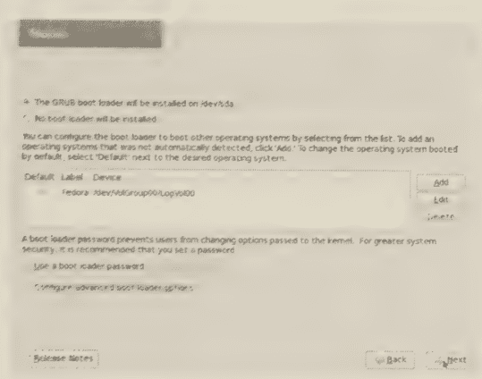

图 2-9：引导加载程序

点击“高级选项”可以让你精炼启动过程，允许你选择安装引导加载程序的位置或确定启动顺序。对于安装引导加载程序的位置你有两个选择：主引导记录 (MBR) 或根分区。推荐的地方是 MBR。你还可以指定通用内核参数，即启动时使用的内核选项。

你还可以设置引导加载程序密码。当任何用户使用 GRUB 启动时，他们都可以更改引导加载程序选项（强制 LBA 选项用于旧驱动器和主板）。密码将防止你系统上的其他用户更改引导加载程序选项。

## 网络配置

网络配置屏幕顶部显示了计算机上不同网络设备的条目（见图 2-10）。屏幕显示了网络设备分段、主机名和杂项设置部分。如果你使用 DHCP 自动配置网络连接（像大多数网络那样），你很可能不需要在此屏幕上做任何操作。

顶部的“网络设备”分段将列出你的网络连接设备，例如以太网设备。对于已通过以太网连接到计算机，第一个条目通常标记为 `eth0`。

# 第 1 部分：入门

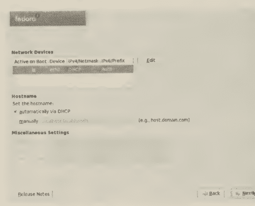

### 图 2-10：网络配置

如果你需要手动配置设备并为其输入 IP 地址，可以点击“编辑”来显示设备的配置面板。此面板有两个分段，一个用于 IPv4 选项，另一个用于 IPv6 选项。每个选项都有复选框，允许你启用或禁用 IPv4 或 IPv6 支持。对于 IPv4 支持，你可以选择手动配置设备或使用 DHCP 自动配置设备。对于手动配置，你可以输入设备的 IP 地址（通常是你的计算机的 IP 地址）和你的网络网段。对于 IPv6 支持，你可以选择自动邻域发现（效果与 DHCP 类似，但过程不同）、动态 IP 配置（需要在网络上使用 DHCPv6 服务器）以及手动配置（你可以直接输入 IPv6 地址）。请记住，手动 IPv6 可能会非常长且复杂。

在“主机名”分段中，你可以选择手动提供网络信息或使用 DHCP 自动获取。

如果你选择手动提供网络信息，需要提供你的网络网关和 DNS 服务器的 IP 地址。要选择手动配置，你必须先编辑顶部面板中的网络设备并选择手动配置，输入你的 IP 地址。只有这样你才被允许在“杂项”部分创建网关和 DNS 条目。否则，这些条目将显示为灰色。

## 系统配置

在“时区配置”屏幕上，你可以使用地图或弹出菜单设置时区以指定你的位置。时区工具使用新的地图功能，首先扩展到你的区域，让你轻松地选择你的时区（见图 2-11）。选中的城市将作为弹出菜单的选择出现。你还可以选择系统是否使用协调世界时 (UTC)。

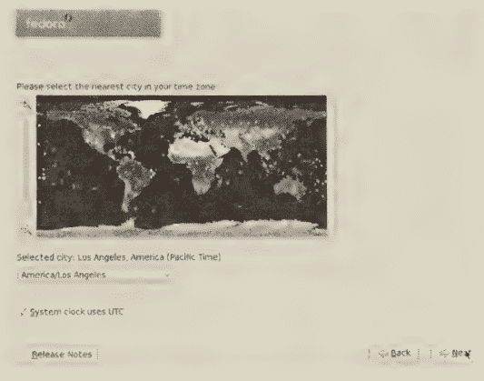

图 2-11：时区选择

img/660de85fae8d68d8e30eb0e48a1ee77d_82_0.png

图 2-12：根用户密码

点击“高级选项”可以让你精炼启动过程，允许你选择安装引导加载程序的位置或确定启动顺序。对于安装引导加载程序的位置你有两个选择：主引导记录 (MBR) 或根分区。推荐的地方是 MBR。你还可以指定通用内核参数，即启动时使用的内核选项。

你还可以设置引导加载程序密码。当任何用户使用 GRUB 启动时，他们都可以更改引导加载程序选项（强制 LBA 选项用于旧驱动器和主板）。密码将防止你系统上的其他用户更改引导加载程序选项。

在下一个屏幕上，你将被要求选择引导加载程序的位置（见图 2-12）。这用于系统管理操作的软件包。

在下一个屏幕上，你还可以设置根用户密码（见图 2-12）。这用于系统管理，例如安装软件包。

## 软件安装

下一个屏幕将显示三个安装选项。你还可以选择通过“现在自定义”来选择你想要的软件包（见图 2-13）。

字体 办公和生产力

- 软件开发

- Web 服务器

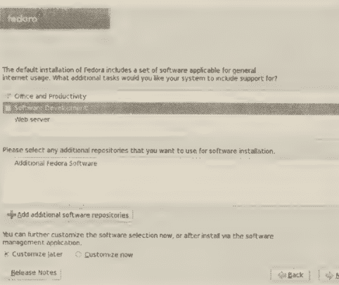

图 2-13：软件选择配置

Web 服务器包括 Apache Web 服务器、FTP 服务器、Samba 和 NFS 文件服务器，以及 DNS 服务器提供快速安装

## 第 2 章：安装

“现在自定义”按钮将让你选择你想要的软件包，并让你对配置分区有更多控制。

img/660de85fae8d68d8e30eb0e48a1ee77d_84_0.png)

图 2-14：附加存储库 Internet 连接

img/660de85fae8d68d8e30eb0e48a1ee77d_84_1.png)

图 2-15：配置访问 Fedora 存储库

# 第 1 部分：入门

此外，你还可以选择在安装时从在线存储库安装软件，无论是来自 Fedora 存储库还是你可能添加的第三方存储库。最初此部分将包含“附加软件”条目。“附加软件”条目允许你访问整个 Fedora 存储库（见图 2-14）。DVD 或 CD 只包含较小的 Fedora 软件子集。点击此条目让你在安装期间访问存储库。你首先会被提示确认 Internet 连接（见图 2-15

第三方存储库可能包含关键软件，例如来自 Nvidia 或 AMD 的专有驱动程序；以及软件存储库未包含的 MP3 和 DVD 多媒体支持。你的公司或机构可能还会运行自己的存储库，其中包含自定义软件。对于专有图形设备，推荐的存储库是 `rpm.livna.org`。例如，为了在安装时安装专有驱动程序，会将 `rpm.livna.org` 添加为附加存储库，然后点击“现在自定义”。然后选择你需要的图形驱动程序（见图 2-16）。

img/660de85fae8d68d8e30eb0e48a1ee77d_85_0.png)

图 2-16：Livna 存储库配置

要从在线 Fedora 存储库访问软件，首先点击“附加 Fedora 软件”条目。它最初将显示为灰色。在安装期间你必须有一个工作的网络连接才能使其正常工作，以便你可以访问存储库。将出一个对话框来自动配置并测试此连接。将选择默认的网络连接以及连接类型（如 DHCP）。你也可以选择输入特定的网络配置信息，如 IP 地址。随后将测试你的连接，如果连接正常，你将返回安装界面，并选定“附加 Fedora 软件”（Additional Fedora Software）选项。

要添加其他第三方仓库，请点击“添加附加软件仓库”（Add Additional Software Repositories）按钮。系统会再次要求你确认网络连接。然后会打开一个对话框，可以在其中输入仓库名称及其 URL。URL 必须非常具体。对于 Livna，你必须指定版本和架构，例如 `rpm.livna.org/fedora/8,x86_64`。版本目录为 8，架构为 64 位（参见图 2-17）。

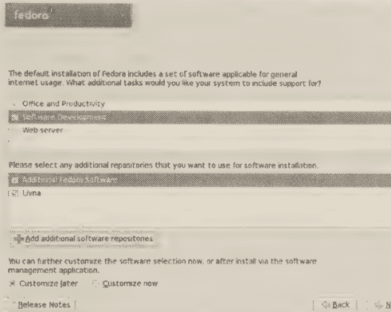

图 2-17：已配置好访问的 Fedora 和 Livna 仓库

如果你正在从在线仓库下载并安装，请务必点击“现在自定义”（Customize now）按钮（而不是“稍后自定义”）。如果不这样做，你将没有机会从在线仓库中选择软件包。在接后的“开始安装”（Begin Install）页面上（参见图 2-22，第 88 页），你可以按后退键返回并选择“现在自定义”。此选项默认未勾选。

取决于你选择的安装类型，Fedora 将选择一组预设的软件集合，专门用于“稍后自定义”（默认）或“现在自定义”。如果你选择“现在自定义”，你可以添加从 CD/DVD-ROM 安装的软件包，以及你设置了访问的任何在线仓库。

提示：如果你在发行版发布日期很久之后才安装，你可能希望尽可能少安装软件。许多软件可能需要更新，从而从 Fedora 在线仓库下载。你完全可以在设置好系统后直接下载更新版本。

如果你选择“现在自定义”选项，你将进入软件管理器（添加/删除软件，Add/Remove Software）。系统会自动进行基础选择。然后，你可以选择添加可选软件包或删除已选包。包管理器首先显示两个窗格，一个用于一小部分主要软件类别（如“桌面”和“应用程序”），另一个根据所选主类别显示子类别（参见图 2-18）。子类别将带有已选软件的复选框。在每个子类别中，一个可选面板将列出你可以添加或删除的特定软件包。主要类别包括：桌面环境、应用程序、开发、基础系统、服务器和语言。桌面环境将只有子类别 Gnome 和 KDE，其中默认仅选择 Gnome。基础系统将包含所有服务器，其中大多数不会被勾选。应用程序包含几个子类别，包括图形网络、办公/生产力以及音频视频。要查看实际选择了哪些软件包进行安装，以及添加或删除其他软件包，请选择一个子类别然后点击“可选软件包”（Optional Packages）按钮。这将打开一个新窗口，列出该子类别可以安装的所有软件包，每个条目旁边都有一个复选框（参见图 2-19）。带有勾选标记的复选框将被安装，空白的则不安装。点击复选框可以在两者之间切换。

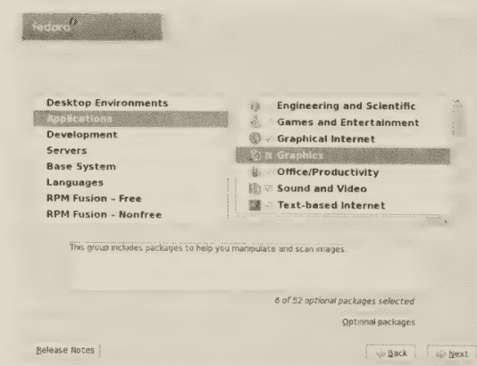

图 2-18：选择软件类别

# 第 2 章：安装

## 图形中的软件包

与此组相关的某些软件包并非安装所必需，但可能提供额外功能。（请选择你想要安装的软件包）

- `gview` - 1.4.1-f4.fc8.x86_64 - KDE 的简单图像查看器
- `hugin` - 0.6.1-f9.fc8.x86_64 - Panorama Tools 的前端，类似于 Plasma
- `traction` - 0.6.1.f9.fc8.x86_64 - 基于 Web 的桌面编程环境
- `lps` - 6.0.23-f9.fc8.x86_64 - 不可提取的驱动
- `n3d` - 0.6.7.0-f4.fc8.x86 - 3D 建模、动画和渲染系统
- `kderaphics` - 7.3.5-5.fc8.x86_64 - 桌面环境特效
- `kipi-plugins` - 0.1.4-f4.fc8.x86_64 与 K 使用的插件

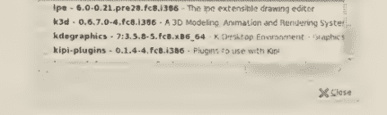

### 图 2-19：从可选软件包中选择添加的软件

如果你安装了 Livna 仓库，将看到 RPM Fusion - Free 和 RPM Fusion - Nonfree 类下的 Livna 条目。你可以使用 Nonfree 类来安装专用软件，如 Nvidia 和 ATI 显卡驱动。图 2-20 和 2-21 显示了如何选择 ATI 提供的 Linux 显卡驱动（X.org 也默认提供自己的开源显卡驱动，但缺少厂商驱动程序提供的许多功能）。在安装期间从 Livna 选择厂商显卡驱动，可以让你跳过安装后的手动操作步骤。

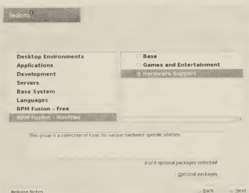

### 图 2-20：Livna 非自由软件选择，硬件支持

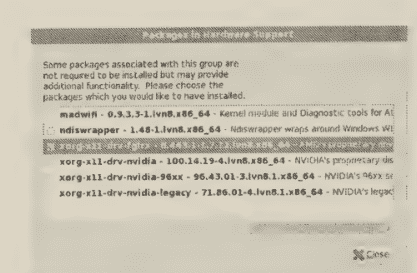

图 2-21：Livna 厂商显卡驱动，硬件支持可选软件包

许多软件包需要安装其他软件包。这被称为依赖关系。如果你还没有选择这些包进行安装，系统将为你自动选择。

选择好软件后，下一个屏幕允许你开始安装（参见图 2-23）。这是你退出安装的最后机会。你可以按“后退”按钮重新选择软件包，或简单地按下系统的重置按钮结束安装过程，使你的原始系统不受影响。一旦你点击“下一步”按钮，如果你选择了格式化分区，它们将会被格式化并擦除所有数据。

随后将安装软件包，并会显示每个软件包的安装情况以及安装进度（参见图 2-23）。

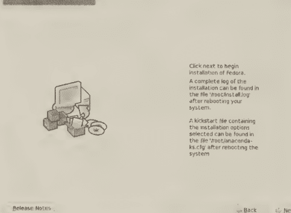

图 2-22：开始安装软件包

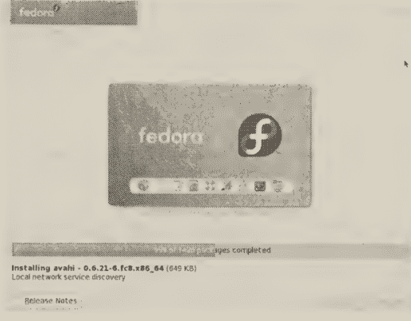

正在安装 `avahi` - 0.6.21-6.fc8.x86_64 (649 KB)

本地网络服务发现

发行说明

图 2-23：软件包安装

## 完成安装

将显示“重启”界面，右下角有一个“重启”按钮。请确保移除你的 DVD/CD-ROM 光盘（参见图 2-24）。

> “恭喜，安装已完成”
>
> “点击‘重启’按钮重启系统”

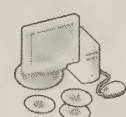

恭喜，安装已完成。

点击“重启”按钮重启系统

发行说明

重启

图 2-24：完成并重启

随后你点击重启按钮进行重启。请确保移除 DVD/CD-ROM。如果你是从光盘启动的，光盘将被弹出。如果你是直接从光盘启动的，可能需要在 BIOS 中更改启动顺序。

## 重启时的 GRUB

当你重启时，GRUB 引导程序将短暂显示一条消息，说明将启动磁盘上的哪个操作系统（参见图 2-25）。默认通常是你的 Linux 系统。

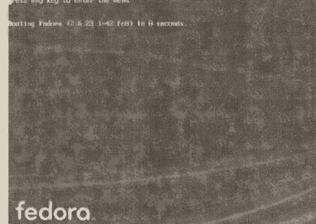

图 2-25：GRUB 启动消息

随后显示红帽图形启动（rhgb）屏幕，显示启动程序的进度（参见图 2-26）。你可以点击“显示详情”按钮来查看正在执行的操作。

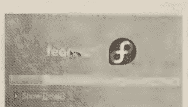

图 2-26：rhgb 启动显示

## 设置

首次启动 Fedora 时将运行设置代理（参见图 2-27）。该代理将帮助你执行系统的基础配置，让你设置日期和时间、配置防火墙并设置用户账户。不同的步骤将列在侧边栏，当你完成一项任务时，箭头会移动。点击“前进”按钮继续。对于 Fedora，你最初会被要求批准此发行版的 GNU 通用许可。步骤如下：

- 许可证信息
- 防火墙
- SELinux
- 日期和时间
- 硬件配置
- 创建用户

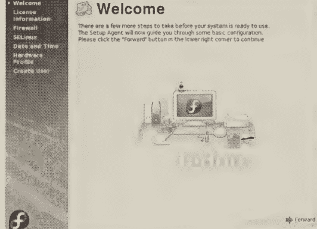

图 2-27：Fedora 首次设置

## 防火墙

SELinuxux 防火墙配置屏幕允许你创建基础的网络安全级别。弹出菜单允许你启用或禁用防火墙（默认启用）。你还可以指定你可能运行的允许他人访问你系统的服务，例如 Web 或 FTP 服务（参见图 2-28）。一个你可能想要

## 安装

包含 Samba 以允许浏览您的 Samba 共享。“其他端口”（Other Ports）选项会展开到一个面板，您可以在其中添加应允许访问的端口，例如您想要用于 bittorrent 的端口。

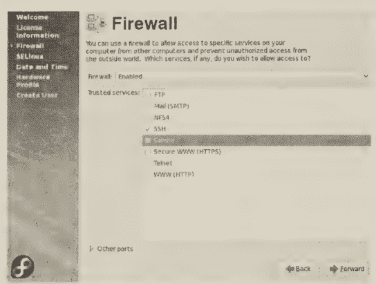

图 2-28：在防火墙上配置服务访问

您可以使用防火墙允许访问计算机上的特定服务（来自其他计算机），并防止来自外部的未经授权的访问。您想要访问哪些服务（如果有）？

防火墙：已启用

受信任的服务：

- FTP
- 邮件(SMTP)
- SSH
- 服务器
  - 安全 WWW (HTTPS)
  - Telnet
  - WWW (HTTP)

其他端口

后退  向向

下一个屏幕允许您配置安全增强型 Linux (SELinux)（参见图 2-29）。

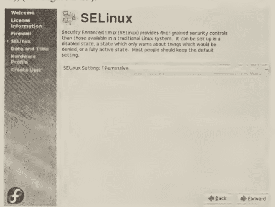

图 2-29：SELinux 配置，宽容设置

安全增强型 Linux (SELinux) 提供了比传统 Linux 系统更精细的控制。它可以被设置为禁用状态（该状态仅会对会被拒绝的操作发出告警）或完全激活的状态。大多数人应该保持默认设置。

SELinux 设置：宽容 (Permissive)

后退  向向

SELinux 提供了极高的安全管理级别。您有三个设置：强制 (enforcing)、宽容 (permissive) 和禁用 (disabled)。强制是默认设置，但在您确定具体想如何配置 SELinux 之前，宽容可能是更好的选择。强制设置将拒绝未经授权的用户访问文件和应用程序。如果您的安全策略配置不准确，可能会拒绝有效用户的访问。在宽容级别上，您可以查看 SELinux 的运行情况并适当调整其配置。SELinux 可能与旧版软件不完全兼容。

## 日期和时间

日期和时间配置面板会自动探测日期和时间，在日历上显示日期，并小时、分、秒显示时间（图 2-30）。您可以点击按钮轻松地更改任何条目。您还可以选择使用网络时间协议 (NTP)，它将从互联网时间服务器自动获取时间，确保您的时间始终正确（图 2-31）。您可以从列出的服务器池中选择，例如 `0.fedora.pool.ntp.org`。高级选项允许您在使用服务之前进行同步或使用本地时间源。

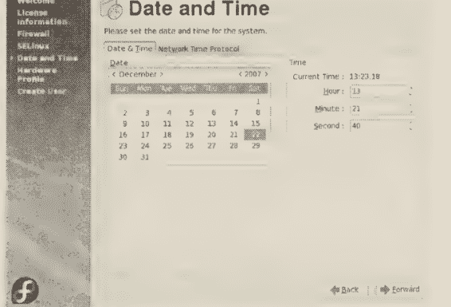

图 2-30：日期和时间设置

提示：显示在安装过程中会自动检测。您可以在安装过程完成后以后对其进行配置。如果您的系统中有 ATI 或 Nvidia 显卡，以后可以从其网站下载并安装专有驱动，或从 `rpm.livna.org` 下载兼容 Fedora 的版本。

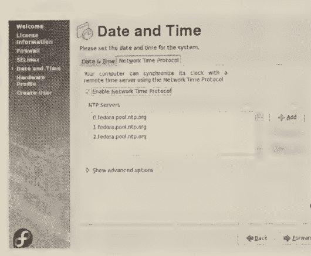


图 2-31：使用网络时间服务器的日期和时间

## 硬件配置报告

Smolt 硬件配置屏幕允许您将硬件配置注册到 Fedora 项目，以便直接从用户处编译兼容性统计。访问 `fedoraproject.org/Releases/Smolt` 获取更多信息。

## 创建用户

创建用户面板允许您创建普通用户账户（参见图 2-32）。您应该至少有一个 root 以外的账户。会出一个对话框，包含用户名、用户全名、密码和密码确认。一旦输入信息并点击“向”，将创建新用户。

您还可以选择 LDAP、Winbind 或 NIS 来配置用户的登录过程。点击“网络登录”按钮。在这里您可以配置服务器。这启动了系统认证。显示三个面板：用户信息、认证和选项。在用户信息面板上，您可以启用并配置 LDAP、Kerberos 和 SMB (Samba) 认证。在认证面板上，您可以启用并配置 NIS、LDAP、智能卡、Kerberos 或网络可能使用的 SMB 服务器。选项面板列出了密码支持。

建议为非管理使用的系统创建一个“用户名”。要创建系统“用户名”，请提供下方的信息。

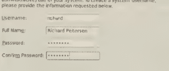

如果您需要使用网络认证（例如 Kerberos 或 NIS），请点击“网络登录”按钮。

图 2-32：创建用户账户

## 登录和退出

设置程序结束后显示登录界面。登录提示符或登录界面将出现。图形安装将使用登录界面。您可以使用任何已设置用户的用户名和密码登录到 Linux 系统。

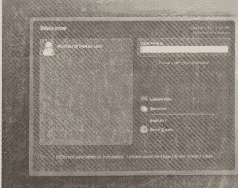

图 2-33：登录界面

以 root 用户身份登录可以执行管理操作，如安装新软件或创建更多用户。以 root 用户身份登录，在登录提示处输入 `root`，在密码提示处输入 root 用户密码。

在登录界面上，配置好的用户列在左侧的图形列表中（参见图 2-23）。右侧是输入用户名或密码的框。标签将根据您的输入内容变化。要登录，可以点击图形列表中的用户，然后在框中输入密码。或者您可以直接在框中输入用户名并按回车，然后在同一个框中输入密码并按回车。标签将变为“密码”。您必须使用此方法以 root 用户身份登录。root 用户不会显示在图形用户列表中。

框下方显示两个弹出菜单和两个按钮：语言、会话、重启和关机。会话菜单允许您选择使用的桌面图形界面，例如 KDE 或 GNOME（参见图 2-34）。使用关机按钮关机，使用重启按钮重启。语言菜单允许您选择使用的语言。

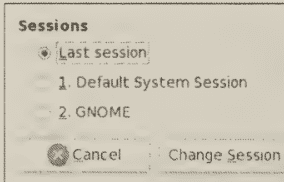

图 2-34：会话界面

## GRUB 菜单和启动问题

对于图形安装，某些显示器可能难以运行名为图形启动。如果遇到这个问题，可以改为选择启动到命令行界面（参见第 3 章和第 11 章）。从命令行界面，您可以进行任何必要的配置更改。要从 GRUB 启动命令行界面，请编辑 Linux GRUB 条目的内核行，并在行尾添加 `3`（参见图 2-38）。`3` 表示运行级别 3，即命令行界面（图形界面是运行级别 5，为默认值）。

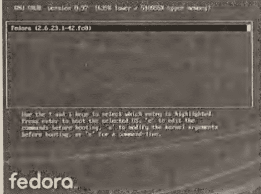

图 2-35：GRUB 菜单

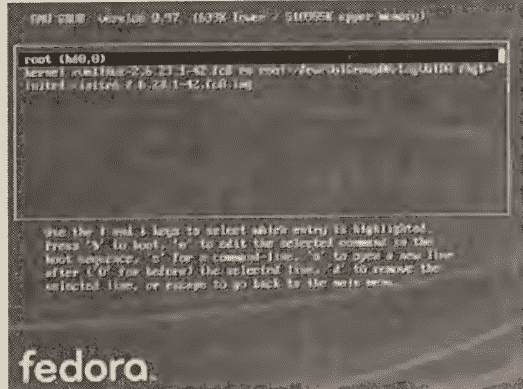

图 2-36：GRUB 编辑窗口

启动初将使用文本显示所有启动任务，然后切换到图形登录。Linux GRUB 行看起来如下：

```
kernel /vmlinuz-2.6.23.1-42.ro
root=/dev/VolGroup0/LogVol00 rhgb quiet
```

如果在显示图形界面时遇到困难，可以改为启动到命令行界面（参见第 3 章和第 11 章）。要从 GRUB 启动命令行界面，请编辑 Linux GRUB 条目的内核行，并在行尾添加 `3`（参见图 2-38）。


图 2-37：编辑 GRUB 行

图 2-38：启动命令行界面, 3

## 启动磁盘

你可以使用 `mkbootdisk` 创建启动 CD-ROM。使用 `--iso` 选项和配合 `--device` 选项 ISO 镜像文件名称来创建。然后你可以使用 CD-ROM 刻录软件从镜像文件创建 CD-ROM。以下示例创建一个名为 `mybootcd.iso` 的 CD-ROM 镜像文件，它可以作为启动 CD-ROM。

```
mkbootdisk --iso --device mybootcd.iso 2.6.23.1-49.fc8
```

## 救援 (Rescue)

如果由于某些原因无法启动或访问系统，可能是由于配置、库或应用程序冲突。在这种情况下，你可以进入救援模式启动 Linux 系统，然后使用 Vi 等文本编辑器编辑配置文件，删除可疑的库，或使用 RPM 重新安装损坏的软件。要进入救援模式，请使用 CD-ROM 或 DVD-ROM 启动盘，并在初始菜单上选择“Rescue Installed System”（救援已安装系统）。

你将进入命令行模式，系统文件挂载在 `/mnt/sysimage`。你会收到通知，可以使用可以使用 `chroot` 命令将系统的 `/` 目录设置为根目录。在命令行提示符下执行以下命令：

```
chroot /mnt/sysimage
```

使用 `cd` 命令在目录间移动。检查 `/etc` 和 `/etc/sysconfig` 以查找你的配置文件。你可以使用 `Vi` 编辑文件并使用 `less` 命令查看它们。要重新安装文件，请使用 `rpm` 命令。完成后，输入 `exit` 命令。

如果你是命令行系统，在启动提示符处输入 `linux rescue`。

你也可以下载并创建 Linux 救援 CD。只需从 Fedora 存储库下载 Linux 救援 CD iso 镜像并使用此磁盘启动即可。

## 重新安装引导程序

如果你有一个双引导系统（在同一台机器上同时运行 Windows 和 Linux），你可能会遇到必须重新安装 GRUB 引导程序的情况。如果你的 Windows 系统在修复之前完全崩溃且你必须安装新版本的 Windows，或者你是在安装 Linux 之后向机器上添加 Windows，就会出现这个问题。Windows 会自动覆盖你的引导程序（或者，你也可以将引导程序安装在 Linux 分区而不是 MBR 上）。你将无法再次访问你的 Linux 系统。

你需要做的只是重新安装引导程序。首先，从 Linux DVD/CD-ROM 安装盘启动，并在菜单中选择 **Rescue Installed System**（救援已安装系统）。

如前节所述，这将在救援模式下启动系统。然后使用 `grub-install` 和第一个分区的设备名称来安装引导程序。Windows 通常希望位于带有 MBR（主引导记录）的第一个分区上。你只需指定该分区。在提示符下输入：

```
grub-install /dev/sda1
```

这将重新安装你当前的 GRUB 引导程序，假设 Windows 已包含在 GRUB 配置中。然后你可以重启，GRUB 引导程序将启动。如果你是第一次添加 Windows，你将在 `/boot/grub/grub.conf` 文件中为它创建一个条目，以便从引导程序进行访问。

**提示：** 如果你的 Linux 救援磁盘无法访问系统，你可以使用 Fedora Live CD 启动 Fedora，然后手动挂载你的 Fedora 分区。你需要知道分区的设备名称（使用 GParted）。一旦挂载完成，你就可以访问挂载分区上的系统文件并进行任何必要的更改。

## 3. 使用基础：登录、桌面和帮助

使用 Linux 已经成为一个近乎直觉的过程，拥有易于使用的界面，包括图形登录和像 GNOME 和 KDE 这样的图形用户界面 (GUI)。即使标准的 Linux 命令行界面也通过可编辑命令、历史列表和基于光标的工具变得更加用户友好。要开始使用 Fedora，你必须知道如何访问你的 Fedora 系统，一旦进入系统，如何执行命令和运行应用程序。访问可以通过默认的图形登录或命令行登录支持。对于图形登录，会出现一个简单的窗口，带有选择登录选项的菜单和输入用户名和密码的文本框。一旦访问系统，你就可以使用命令行界面或图形用户界面 (GUI) 与之交互。通过 GNOME 和 KDE 等 GUI 界面，你可以使用窗口、菜单和图标与系统进行交互。

Linux 以提供易于访问帮助文档而闻名。在登录系统时，可以快速获取有关任何 Linux 命令和实用程序的信息。你可以访问描述每个命令的在线手册，或获取提供不同 Linux 功能更详细说明的帮助。Linux Documentation Project 提供的全套手册位于你的系统中，供你查阅或打印。GNOME 和 KDE 桌面都提供了帮助系统，让你能够轻松访问桌面、系统和应用程序帮助文件。

## 用户帐户

用户通过账户访问系统。Linux 所基于的 Unix 最初用于大型微型计算机和主机，这些机器可以同时容纳数百个用户。通过连接到计算机的许多终端之一，用户可以使用用户名和密码登录 Unix 系统。要获得系统访问权限，你需要为你设置一个用户帐户。系统管理员创建该帐户，并为其分配用户名和密码。

登录后，你就可以使用系统了。你可以使用 `system-config-users` 等管理工具创建其他用户帐户。root 用户是一个留用于管理任务的特殊帐户，例如创建用户和安装软件。要访问 root 帐户，必须提供 root 密码。

## 访问你的 Linux 系统

如果你安装了引导程序 GRUB，当你开启或重新启动计算机时，引导程序首先决定加载并运行哪种操作系统。在几秒钟内，GRUB 会显示一条短消息，告知操作系统它将启动。这通常是 Fedora。

相反，如果你按了键盘上的任意键，引导程序将显示列出系统上安装的所有操作系统的菜单，并高亮默认选项。如果列出了 Windows 系统，你可以选择启动它。

## 第3 章：使用基础

当 GDM 启动时，会显示一个带有登录框的登录窗口。有多种 GDM 主题供选择，你可以使用 GDM 配置工具进行选择。目前 Fedora 8 使用的默认主题是 Fedora Infinity 主题。屏幕中心有三个弹出菜单，分别标记为语言（Language）、选项（Options）和关机（Shutdown）。要登录，请在标记为“用户名”（Username）的输入框中输入你的用户名，并按照提示输入密码。完成后，按回车键。默认情况下，GNOME 桌面将启动。Fedora Infinity GDM 主题还具有一个免费的用户帐户浏览器。用户列在一个滚动列表中，显示他们的用户名和个人头像。从该列表中选择你想要登录的用户。右侧。密码提示将出现在右侧的文本框窗口中。输入该用户的密码并按回车键。

提示：你可以使用不同的功能（如背景图像和用户图标）配置 GDM 登录窗口。GDM 拥有自己的主题选择可供挑选。在管理（Administration）菜单上选择登录窗口（Login Window）项来配置你的登录窗口。可以在本地面板上选择主题。

当你从桌面注销时，你会返回 GDM 登录窗口。要关闭你的 Linux 系统，点击关机（Shutdown）按钮。要重启，从选项（Options）菜单中选择重启（Restart），你也可以从 GNOME 中关机。从系统（System）菜单中选择关机（Shutdown）项。GNOME 将显示一个带有挂起（Suspend）、休眠（Hibernate）、重启（Restart）、取消（Cancel）和关机（Shutdown）按钮的屏幕。关机是默认选项，将在几秒后自动发生。对话框将开始计时显示你剩余的时间。选择重启（Restart）将关闭并重启你的系统。你也可以打开终端窗口并按照下一节所述输入 `shutdown`、`halt` 或 `reboot` 命令；`halt` 将注销并关闭系统。

在 GDM 登录窗口上，你可以使用选项（Options）菜单选择你想要启动的桌面或窗口管理器。在这里你可以选择 KDE 来启动 K Desktop，例如而不是 GNOME。在 Fedora 上，KDE 和 GNOME 将使用相似的主题，外观非常相似。语言（Language）菜单列出了 Linux 支持的多种语言。选择其中一种来更改语言界面。

注意：在 Fedora 上

你可以使用 GDM 配置工具配置 GDM，该工具可以通过登录界面或桌面访问。从登录界面，从选项（Options）菜单中选择配置登录屏幕（Configure Login screen）。你首先会被提示输入 root（管理）密码。然后将显示 GDM 配置面板。使用本地面板（Local panel）选择你想要的主题。用户（Users）面板允许你选择要在登录屏幕上显示的用户图标。要从桌面访问 GDM 配置工具，请继续到系统（System） | 管理（Administration） | 登录窗口（Login Window）项。

## 用户切换器

用户切换器（User Switcher）让你切换到另一个用户，无需注销或结束你的用户会话。用户切换器作为基础 Gnome 桌面配置的一部分自动安装。切换器将出现在顶部面板的右侧，显示当前登录用户的名称。如果你左键点击切换器，将显示所有其他用户的列表。每个用户旁边的复选框显示哪些用户已登录并运行。要切换，请从此菜单中选择用户。如果用户尚未登录，将出现登录管理器（GDM），你就可以输入该用户的密码。如果用户已经登录，则会 way锁屏的登录窗口（你可以禁用锁屏）。只需输入用户的密码。用户的原始会话将继续保持用户切换时相同的打开窗口和运行程序。你可以轻松地在登录用户之间来回切换，所有用户都会保留他们离开时的会话。当你切换掉用户时，该用户的运行程序将在后台继续。

右键点击切换器将列出几个用户管理项，如配置和管理用户，或更改用户的密码和个人信息。偏好（Preferences）项允许你配置用户切换器在面板上的显示方式。你可以使用“用户”（Users）术或用户图标代替用户名。你还可以选择在用户切换时是否使用锁屏。禁用锁屏选项将让你在登录用户之间无缝切换。

## 笔记本功能

对于笔记本电脑的工作，你需要两个重要的操作：电源管理和对多网络连接的支持（包括无线和局域网 LAN）。两者都是自动配置的。

对于网络连接，Fedora 使用 Network Manager 和 system-config-network（见第 14 章）。Network Manager 将自动检测可用的网络连接。它们将作为弹出菜单显示在上方面板的左侧。你可以选择你想使用的那个。右键点击并选择配置（configure）以设置密码和加密信息。

要使用 NetworkManager，你需要先用服务（Services）工具启用它。选择系统（System） | 管理（Administration） | 服务（Services），然后在后台服务（Background Services）面板上找到 NetworkManager 和 NetworkManager Dispatcher。选择它们的复选框并点击工具栏上的启动（Start）按钮。然后点击文件（File）菜单上的保存（Save）。之后你可以选择服务工具，每当你启动系统时，NetworkManager 将自动启动。

对于局域网连接，你使用 system-config-network（System | Administration | Network），这同样是自动配置的。对于笔记本电脑，你可能连接到不同的局域网，因此你可能想像第 14 章讨论的那样设置不同的配置文件。你可以使用 system-config-network 选择你激活的局域网连接。

## 桌面

对于网络连接，Fedora 使用 Network Manager 和 system-config-network（见第 14 章）。Network Manager 将自动检测可用的网络连接。它们将作为弹出菜单显示在上方面板的左侧。你可以选择你想使用的那个。右键点击并选择配置（configure）以设置密码和加密信息。

要使用 NetworkManager，你需要先用服务（Services）工具启用它。选择系统（System） | 管理（Administration） | 服务（Services），然后在后台服务（Background Services）面板上找到 NetworkManager 和 NetworkManager Dispatcher。选择它们的复选框并点击工具栏上的启动（Start）按钮。然后点击文件（File）菜单上的保存（Save）。之后你可以选择服务工具，每当你启动系统时，NetworkManager 将自动启动。

对于局域网连接，你使用 system-config-network（System | Administration | Network），这同样是自动配置的。对于笔记本电脑，你可能连接到不同的局域网，因此你可能想像第 14 章讨论的那样设置不同的配置文件。你可以使用 system-config-network 选择你激活的局域网连接。

对于笔记本电脑的工作，你需要两个重要的操作：电源管理和对多网络连接的支持（包括无线和局域网）。两者都是自动配置的。

对于网络连接，Fedora 使用 Network Manager 和 system-config-network（见第 14 章）。Network Manager 将自动检测可用的网络连接。它们将作为弹出菜单显示在上方面板的左侧。你可以选择你想使用的那个。右键点击并选择配置（configure）以设置密码和加密信息。

要使用 NetworkManager，你需要先用服务（Services）工具启用它。选择系统（System） | 管理（Administration） | 服务（Services），然后在后台服务（Background Services）面板上找到 NetworkManager 和 NetworkManager Dispatcher。选择它们的复选框并点击工具栏上的启动（Start）按钮。然后点击文件（File）菜单上的保存（Save）。之后你可以选择服务工具，每当你启动系统时，NetworkManager 将自动启动。


# 第一部分：入门指南

默认主题是 Nodoka，带有 Fedora 图标。有许多主题可以从外观管理器（Appearances）获取。

## KDE

K 桌面环境（KDE）在屏幕底部显示一个面板，看起来非常相似。文件管理器外观略有不同，但操作方式相同。主菜单中有一个控制中心（Control Center）项，从那里你可以配置 KDE 的各个方面，如主题、面板、外设（如打印机和键盘，已由 Fedora 工具处理），甚至是 KDE 文件管理器的浏览功能。

> **注意**：虽然 GNOME 和 KDE 是完全集成的桌面，但它们实际上通过窗口管理器与操作系统交互，GNOME 使用 Metacity，KDE 使用 KDE 窗口管理器。你可以使用不同的 GNOME 或 KDE 兼容窗口管理器，或者简单地使用窗口管理器代替 KDE 或 KDE。你可以从 X11 网站 `www.xminman.org` 获取有关适用于 Linux 的不同窗口器的信息。

## XFce4

XFce4 桌面是一种轻量级桌面，旨在没有 KDE 和 GNOME 那种全功能桌面开销的情况下运行。它了自己的文件管理器和面板，但重点在于模块化和简单。桌面由一组模块组成，包括 `xfm` 文件管理器、`xfce4-panel` 面板和 `xfm` 窗口管理器。由于对简单性的追求，其规模使其适用于笔记本电脑或不需要复杂开销的专用系统。

## GNOME

GNOME 桌面提供了易于使用的面板和菜单，以及灵活的文件管理器和桌面。你可以更改它的外观和感觉，更改主题、添加面板、使用不同的文件视图，以及添加你选择的面板小程序。

## Gnome 面板和菜单

Fedora GNOME 桌面显示（如图 3-1 所示）最初在屏幕顶部和底部显示两个面板，以及任何文件用于您的主目录和系统的管理器文件夹图标。顶部面板用于菜单、应用程序图标以及像时钟之类的通知任务。这里有三个菜单：

- **应用程序（Applications）**：包含“办公”和“互联网”等分类项，这些子菜单将列出您系统上安装的应用程序。使用此菜单启动您的应用程序。
- **位置（Places）**：此菜单允许您轻松访问常用位置，例如您的主目录、存放桌面文件的桌面文件夹，以及“计算机”窗口（通过该窗口，您可以访问设备、共享文件系统以及本地系统上的所有目录）。它还包含搜索文件（Search Files）、访问最近使用的文档以及登录远程服务器（如 NFS 和 FTP 服务器）的条目。该菜单分为四个部分：第一部分列出您的用户文件夹；第二部分显示存储设备，如可访问的文件系统、DVD/CD-ROM 和 USB 驱动器；第三部分显示访问网络连接和服务器的入口；最后部分显示文件访问工具，如列出最近文档或搜索文件和目录。
- **桌面（Desktop）**：这包含“偏好”（Preferences）和“管理”（Administration）菜单。“偏好”菜单用于配置您的 GNOME 设置，例如桌面的外观和鼠标的行为。“管理”菜单包含所有的 Fedora 系统配置工具，用于执行管理任务，如添加用户、设置打印机、配置网络连接以及管理网络服务（如 Web 服务器或 Samba Windows 访问）。此菜单还包含访问帮助系统（Help）、获取有关 Fedora 和 Gnome 项目及在线资源、锁定屏幕（Lock Screen）、注销系统（Logout）以及关闭系统（Shutdown）的条目。

在这些旁边是 Firefox Web 浏览器（鼠标和地球图标）和 Evolution 邮件程序的应用程序图标。点击其中一个即可启动该程序。您也可以使用“应用程序”菜单启动其他应用程序。在右侧，您将看到日期/时间、音量控制、切换用户工具、通知区域和记事工具的图标。当需要更新或出现安全问题时，通知区域将显示更新和安全图标。

底部面板用于交互式任务，如选择工作空间和固定应用程序。虚拟桌面的工作空间切换器显示为左下角的四个正方形。点击正方形会将您移动到该区域。

## Gnome 文件管理器

当您点击桌面上的主目录文件夹时，会打开一个文件管理器窗口，显示您的主目录。文件管理器默认采用空间设计，为您打开的每个子目录或父目录打开一个新窗口。目录窗口将只显示与文件管理相关的菜单和图标。菜单项提供了管理文件涉及的全范围任务。窗口左下角的栏上有一个用于访问父目录的弹出菜单。会显示当前显示的目录名称。

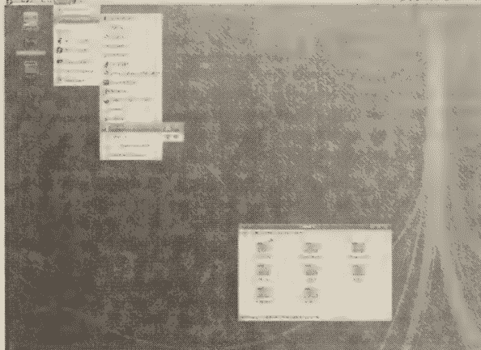

图 3-1：Fedora GNOME 桌面

> **提示**：如果您的桌面因打开的窗口过多而变得杂乱，且想通过仅最小化所有窗口来清理，可以点击底部面板左侧的“显示桌面”按钮。

您的主目录已经为常用文件创建了默认目录。这些包括“图片”（Pictures）、“文档”（Documents）、“音乐”（Music）和“视频”（Videos）。您的办公应用程序默认将把文件保存到“文档”目录。“下载”（Download）目录作为您的自动下载目录。“桌面”文件夹将存放所有保存到桌面的文件和目录。

文件管理器还支持浏览器视图，该视图具有更多显示组件，包括大多数传统文件管理器中常见的浏览器工具栏、位置框和侧边栏。要使用此格式，右键点击文件夹图标显示弹出菜单，然后选择“浏览文件夹”（Browse Folder）。这将以增强格式打开文件夹。此外，在特殊窗口中，您可以选择一个文件夹，然后从“文件”菜单选择“浏览文件夹”来打开它。当您从“浏览文件夹”窗口打开新目录时，该窗口将用于显示它，您可以使用前后箭头移动到之前打开的目录。在位置窗口中，您可以输入目录的路径直接跳转到那里。图 3-2 显示了文件管理器窗口的空间视图和浏览器视图。

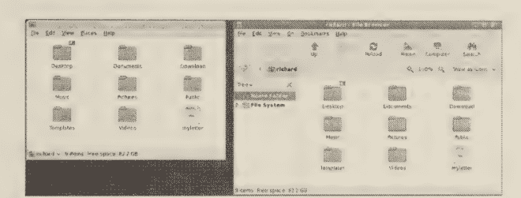

图 3-2：文件管理器的空间视图和浏览器视图

> **注意**：对于 GNOME 和 KDE，文件管理器都是感知网络的。可以使用它访问远程 FTP 目录并显示或下载其文件，尽管在 KDE 中文件管理器也是一个功能完整的 Web 浏览器。

要移动窗口，左键点击并拖动其标题栏。每个窗口都支持最大化、最小化和关闭按钮。双击标题栏将最大化窗口。每个窗口在底部面板上都有一个对应的按钮。您可以使用此按钮最小化和恢复窗口。桌面窗口支持全拖放功能。您可以将文件夹、图标和应用程序拖到桌面或其他打开了其他文件夹的文件管理器窗口。移动操作是默认的拖动操作（您也可以在拖动时按下 `SHIFT` 键）。要复制文件，在释放鼠标按钮之前按 `CTRL` 键并拖动。要创建链接，在拖动图标时同时按住 `CTRL` 和 `SHIFT` 键到您想要放置链接的地方（例如桌面）。

## 退出 GNOME

要退出 GNOME 桌面，请从“系统”菜单中选择“注销”（Log Out）项。如果您是从登录窗口进入的，您将注销账户并返回登录窗口。如果您是从命令行（`startx`）启动 GNOME 的，您将返回命令行提示符，但仍处于登录状态。

## GNOME 偏好

Fedora 提供了多种用于配置 GNOME 桌面的工具。这些工具列在“系统 | 偏好”菜单中。配置工具组织在几个子菜单：个人、外观、互联网和网络、硬件。不属于任何类别的项直接列出。GNOME 偏好如表 3-1 所示。某些在本章和其他章节中会有讨论。每个偏好窗口上的帮助按钮将显示详细说明和示例。这里讨论了一些最重要的工具。

在 Fedora 8 (GNOME 2.4) 中，多个相关的配置任务已合并到“外观”工具中。这包括主题、背景、字体和工具栏偏好。要更改主题或背景或配置字体，请使用外观工具（系统 | 偏好 | 外观）。

键盘快捷键配置（个人 | 键盘快捷键）允许将按键映射到特定任务，将键盘上的多媒体键映射到播放和暂停等媒体任务。只需选择任务然后按键。有桌面、多媒体和窗口管理的任务。在窗口管理中，您还可以映射键来执行工作空间切换。已分配的键将显示。

文件管理配置（个人 | 文件管理）允许您确定文件和目录的显示方式，并附加信息以显示图标标题或列表。您还可以指定双击行为以及可以预览的文件。

窗口配置（外观 | 窗口）是您可以启用如窗口滚动、窗口移动键和鼠标窗口选择等功能的地方。

鼠标和键盘偏好是配置鼠标和键盘的主要工具（硬件 | 鼠标）。鼠标偏好允许您选择鼠标图像、配置其移动和手性。键盘偏好窗口显示了多个面板，用于选择键盘模型（布局）、配置按键（布局选项）、重复延迟（键盘），甚至作为健康预防措施强制执行打字间休息。

有三个音频配置工具需要关注，每个工具的任务都非常不同。要为 CD、扬声器、麦克风和视频等不同声源设置实际音量控制和混合，您可以使用 GNOME 音量控制工具（硬件 | 音量控制）。您也可以通过面板上的音量控制小组件调用它。

要为不同的任务选择音频驱动程序，并指定用于桌面事件的音频，您需要使用硬件声音配置工具（硬件 | 声音）。在“设备”面板上，如果存在多个音频驱动程序，您可以从“声音”、“音乐和视频”以及“会议”中选择要使用的程序。系统已选择了默认选项。在“声音”面板上，您可以启用软件音频混音，让您为不同的桌面事件选择所需的字体。“系统提示音”面板允许您关闭系统提示音，并使用视觉提示音（例如闪烁窗口标题栏）。

管理菜单中的“声音”条目会检测音频设备并确保它们运行正常（系统 | 管理 | 声音检测）。使用此功能检测新声卡，或者在有多个音频设备时选择其中一个。

## GNOME 小组件

GNOME 小组件是运行在面板上的微型程序。添加小组件非常简单。右键点击面板并选择“添加到面板”条目。这将列出所有可用的小组件。一些实用的小组件包括字典查询、当前天气、显示 CPU 使用率的系统监视器、用于节能和静音处理器的 CPU 频率缩放监控器，以及搜索系统文件的搜索，还有锁定、关机和注销。其中某些项（包括查找、锁定和注销）已经位于“位置”菜单中。您可以直接将这些项从菜单拖到面板上以添加小组件。图 3-3 显示了一些常用的小组件。在浏览器、电子邮件、编辑器和电影播放器图标之后，从左到右您有：关机按钮、系统监视器、LCD 亮度、CPU 缩放监控、网络连接监控、文件搜索、桌面搜索、字典查询。跟随您鼠标移动的还有：邮件通知、天气报告、Tomboy 笔记本、Pup 更新通知、用户切换器、时钟和音量控制。

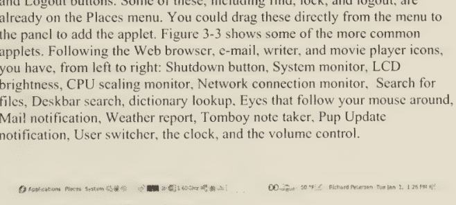

## 桌面背景

您可以使用外观工具中的“背景”面板来选择或自定义背景图像（见图 3-4）。要打开此工具，可以在桌面背景的任何地方点击右键并从弹出菜单中选择“更改桌面背景”，或者从面板菜单选择系统 | 偏好 | 外观 | 外观，然后点击“背景”面板。已安装的背景显示在壁纸滚动框中，当前已选中。要添加您的图像，可以将图像文件拖放到背景壁纸框，或点击“添加”按钮来定位并选择图像文件。要删除图像，选择它并点击“移除”按钮。

### 个人

- **关于我**：个人信息，如图片、地址和密码（参见本章节后文）。
- **辅助技术偏好**：启用屏幕阅读器、键盘显示和放大镜等功能。
- **文件管理**：文件和目录显示的默认方法。
- **键盘辅助**：设置重复、单键、粘滞和鼠标键等功能。
- **键盘快捷键**：为特殊任务（如多媒体操作）配置按键。
- **首选应用程序**：设置默认 Web 浏览器、邮件应用程序和终端窗口。
- **会话**：管理您的会话、启动程序和保存选项（参见本章节后文）。

### 外观与感觉

- **外观**：提供主题、背景、字体和界面配置面板。选择桌面背景或主题。更改桌面上不同组件的字体和字体大小（参见本章节后文的字体大小）。更改简单的菜单和工具栏偏好。
- **桌面效果**：选择使用 3D 窗口管理器。
- **主菜单**：为应用程序和系统菜单添加或删除类别和菜单项。
- **屏幕保护**：选择并管理您的屏幕保护。
- **窗口**：启用某些窗口功能，如标题栏折叠、移动键、窗口选择。

### 互联网与网络

- **蓝牙偏好**：蓝牙通知图标显示选项。
- **代理**：如果需要指定代理配置：手动或自动。
- **个人文件共享**：允许在网络上共享公共文件，可能需要密码。
- **远程桌面**：允许远程用户查看或控制您的桌面。可以使用密码控制访问。

### 硬件

- **默认打印机**：如果有多个打印机，选择一个默认打印机。
- **键盘**：配置您的键盘：选择选项、型号和打字间隔。
- **鼠标**：鼠标配置：选择手性方向、鼠标指针和移动。
- **可移动驱动器和媒体**：设置可移动驱动器和媒体偏好（参见本章节后文的可移动设备和媒体）。
- **屏幕分辨率**：更改您的屏幕分辨率、刷新率和屏幕方向。
- **声音**：为事件、视频、音乐和会议选择音频驱动程序。还选择用于桌面事件的声音。
- **音量控制**：用于设置音量控制的声音混合器。

### 系统

- **电源管理**：电池使用的电源管理选项和睡眠选项。
- **搜索与索引**：为桌面搜索设置搜索和索引偏好。

#### 表 3-1：GNOME 桌面偏好

样式菜单允许选择不同的显示选项，如居中、缩放或平铺。居中或缩放图像将保持图像比例。全屏可能会使其失真。任何未填充的空间（例如使用居中或缩放图像时）将用桌面颜色填充。如果您愿意，可以更改颜色，还可以将其设置为水平或垂直渐变（颜色菜单）。颜色从调色盘选择，提供了丰富的选择。

## 桌面主题

您可以使用外观偏好工具上的“主题”面板来选择或自定义主题。主题控制您的桌面外观。“主题”面板将列出当前安装的主题图标（见图 3.5）。图标将显示每个主题的关键方面，如窗口、文件夹和按钮图像，实际上是在预览该主题。最初选择的是 Fedora 主题。如果您想切换，可以在图标之间移动以选择不同的主题。如果您已从 art.gnome.org 等网站下载了额外的主题，可以点击“安装”按钮来定位并安装它们。一旦安装，额外的主题也将显示在“主题”面板中。如果您从 Fedora 存储库下载并安装主题或图标集，它将自动为您安装。

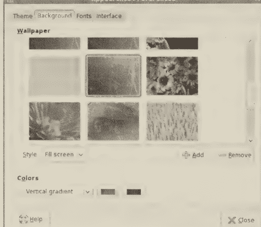

图 3-4：外观偏好工具上的桌面背景


提示：如果您正在从 art.gnome.org 下载，可以直接将网页上的下载图标拖到“主题”面板，或者先下载再将主题包直接拖到主题偏好窗口进行安装。

主题的真正威力在于它允许用户自定义任何给定主题。主题由三个组件组成：控件、窗口边框和图标。控件涵盖窗口和对话框控件（如按钮和滑动条）的外观。窗口边框指定标题栏、边框、窗口按钮的显示方式。图标指定文件管理器或面板上使用的所有图标。您实际上可以混合任何安装主题的组件来创建自己的主题。您甚至可以下载并安装单独的组件（如特定的图标集），并在自定义主题中使用。

点击“自定义”按钮将打开主题详细窗口，其中带有不同主题组件的面板。当前主题使用的组件已选中。控件面板将列出额外的颜色面板允许您设置窗口、输入框和选中项目的背景及文本颜色。在控件、窗口边框和图标面板中，您将看到不同主题的列表。然后您可以混合这些主题的组件，创建自己的自定义主题。一旦选择组件，您的桌面将自动变化。如果您添加了组件（例如新的图标集），它也将列出。

一旦您创建了自定义主题，主题列表中会出现“自定义主题”项。点击“保存主题”按钮。这将打开一个对话框，您可以在其中输入主题名称、任何备注，并指定是否也保留主题背景。保存的主题将出现在主题列表中。

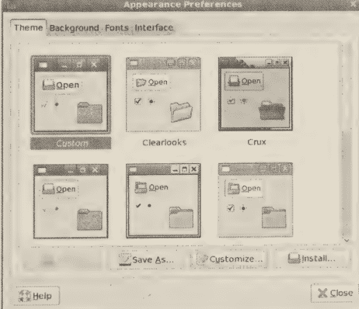

图 3-5：外观偏好工具上的主题选择

由用户直接安装的主题和图标放置在用户目录下的 `.themes` 和 `.icons` 目录中。如果您想

为了让这些主题对用户可用，可以将它们从 `.themes` 和 `.icons` 目录移动到 `/usr/share/icons` 和 `/usr/share/themes` 目录。请确保以 root 用户登录。然后，你需要将移动的主题和图标的所有者更改为 root。

```
chown -R root:root /usr/share/themes/newtheme
```

# 桌面操作

在首次设置桌面时，你可能希望利用某些桌面操作。这些包括为高分辨率显示器增大字体大小、刻录 CD/DVD 光盘、在桌面搜索文件，以及使用 USB 驱动器等可移动介质，并访问远程主机。

## 窗口显示偏好

在桌面上，你可以配置某些窗口显示功能。窗口偏好（Window Preferences）允许你启用三个不同的功能。

窗口选择：无需点击窗口来选择它，只需将鼠标悬停在上面即可。设置延迟可以让你快速滑过窗口而不选择它们，直到到达你想要的窗口为止。

标题栏操作：对于标题栏，你可以启用“折叠（Roll Up）”。这意味着双击标题栏会将窗口折叠为仅显示标题栏。默认是全屏。

移动键：对于移动窗口，你可以更改使用的键盘键。默认是 Alt 键，但你可以更改为 Control 或 Windows 键。

提示：快捷键工具（系统 | 偏好 | 个人 | 快捷键）允许你为常用任务（如启动 Web 浏览器）选择快捷键。某些按键已经分配了。

## 字体

大多数 Linux 发行版，费德拉（Fedora）使用 `fontconfig` 方法管理字体（fontconfig.org）。你可以轻松地更改字体大小、添加新字体，并配置抗锯齿功能。Gnome 和 KDE 都提供了选择、调整大小和添加字体的工具。

## 调整桌面字体

随着大屏幕和高分辨率显示器变得越来越常见，用户发现增加桌面字体大小的功能非常有用。在大屏幕宽屏显示器上，低于原生的分辨率往往无法良好缩放。显示器在原生分辨率下显示效果最好。

然而，对于像 1900 × 1200 这样的大原生分辨率，文字变得非常小，难以阅读。你可以通过增大字体大小来解决这个问题。默认大小为 10；将其增加到 12 可以让窗口和菜单等所有桌面功能中的文字变得更易读。

提示：你可以使用“字体预览器”（Specimen Font Viewer）显示已安装的字体，查看它们的外观（应用程序 | 图形 | 字体预览器）。

要增大字体大小，通过在“外观”工具上选择“字体”面板（系统 | 偏好 | 外观 | 外观）打开字体偏好对话框。字体面板如图 3-6 所示。你甚至可以将字体本身设置为**粗体**或*斜体*。你可以点击“详细信息”按钮打开窗口来进一步精炼字体，在窗口中你可以设置 DPI、提示（hinting）和平滑处理等功能。要详细检查字体，请点击“转到字体”按钮并点击该字体。

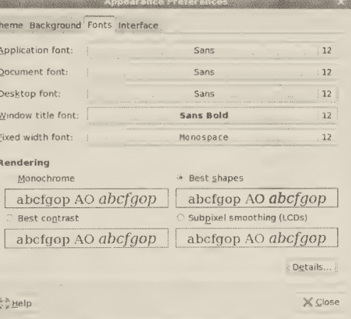

图 3-6：在外观偏好中设置字体大小

## 添加字体

要添加字体，你需要打开字体查看器。你可以通过在任何文件管理器窗口中输入 `fonts:/` URL 直接实现。从“文件”菜单中选择“打开位置”来打开 URL 。一旦字体查看器打开，你只需将字体拖动到字体查看器窗口即可添加字体。重启后，你的字体将可以在桌面上使用。KDE 为字体提供了“个人”和“系统”文件夹，最初会显示每个文件夹的图标。对于用户字体，打开“个人字体”窗口。如果是 Zip 压缩的字体，应先用归管理器打开，然后将其从归管理器拖到字体查看器。若要删除字体，在字体查看器中右键点击它，选择“移动到垃圾箱”或“删除”。

用户字体将安装到用户的字体目录中。要让字体对所有用户可用，必须安装在 `/usr/share/fonts` 目录，使其成为系统字体。在 KDE 上，你可以在启动字体查看器时打开“系统”文件夹而不是“个人”文件夹来实现。你可以从任何用户登录执行此操作。将任何字体包拖到此 `fonts:/System` 窗口。在 Gnome 上，你必须以 root 用户登录并手动将字体复制到 `/usr/share/fonts` 目录。如果你的系统同时安装了 Gnome 和 KDE，你可以使用 KDE（Conqueror 文件管理器）安装系统字体，它们将在 Gnome 上可用。

为了快速访问系统字体，你应该为 `/usr/share/fonts` 目录创建字体信息缓存文件。请以 root 用户身份运行 `fc-cache` 命令。

微软的常用字体可以从 `fontconfig.org` 免费获取。这些字体以微软的 `catcat` 格式存档。你需要下载并安装 `cabextract` 工具（可在 Fedora 仓库中获得）来提取字体。提取后，你可以将其复制到 `/usr/share/fonts` 中的文件夹中，供所有用户使用。如果你有 Windows 系统的网络访问，也可以直接从 Windows 字体目录复制字体到你的 `/usr/share/fonts` 目录。

## 配置字体

为了优化字体显示，你可以使用字体渲染工具。在“外观”工具上打开“字体”面板（系统 | 偏好 | 外观 | 外观）。字体渲染选择列出了基本的字体渲染功能，如单色、对比、最佳和子像素平滑。选择最合适的一个。对于 LCD，选择子像素平滑。要进行详细配置，点击“详细信息”按钮。在这里你可以设置平滑、提示（抗锯齿）和子像素颜色顺序功能。这些是取决于硬件的。

在 KDE 上，在启动字体查看器时打开“系统”文件夹而不是“个人”文件夹。你可以在任何用户登录时执行此操作。将任何字体包拖到此 `fonts:/System` 窗口。在 Gnome 上，你必须以 root 用户登录并手动将字体复制到 `/usr/share/fonts` 目录。如果你的系统同时安装了 Gnome 和 KDE，你可以使用 KDE（Conqueror 文件管理器）安装系统字体，它们将在 Gnome 上可用。

# 第 3 章：使用基础

## 搜索文件：GNOME 文件管理器搜索

基础文件搜索是通过 GNOME 前端 Linux 的 `grep`、`find` 和 `locate` 工具实现的（见图 3-8）。从“位置”（Places）菜单中选择“搜索文件”（Search for Files），并输入搜索模式。文件匹配字符（通配符）会有帮助，`*` 用于文件补全，或 `[]` 用于指定可能的字符或数字范围。

在“名称包含”（Name contains）框中输入搜索模式，并在“查找文件夹”（Look in Folder）弹出菜单中选择要搜索的文件夹或文件系统。默认选择用户主目录。然后你可以选择指定高级选项，例如使用“包含文本”（Contain text）选项来搜索文本文件的内容（grep），或者额外的文件特征如文件日期、大小或所有者类型（find）。你也可以使用正则表达式来搜索文件名。

GNOME 文件管理器使用一种不同的搜索工具，但具有相似的功能。你输入一个搜索模式，也可以指定文件类型。可以从打开的文件夹进行搜索，但你也可以指定其他文件夹进行搜索（“位置”选项）。点击 `+` 按钮添加额外的位置和文件类型搜索参数。在浏览器中，你可以点击工具栏上的“搜索”按钮让 URL 框进行搜索。位置和文件类型的弹出菜单将出现在文件夹窗口中；可以使用 `+` 和 `-` 添加或删除位置和文件类型搜索参数。

## Beagle

或者，你也可以使用 Beagle 桌面搜索工具。你需要下载并安装它（应用程序 | 启用/删除软件）。Beagle 是一个桌面搜索工具（beaglewiki.org）。要启动 Beagle，请从“位置”菜单中选择“搜索”。Beagle 将搜索你系统上的所有文件，包括图像、电子邮件、媒体文件和程序源代码。当你安装 Beagle 时，它将取代“位置”菜单中“搜索”项的搜索工具。Beagle 的应用程序名称为 `beagle-search`。

在 Fedora 上，为了对文件建立索引以便搜索，Beagle 使用文件系统的扩展属性，这是为由 beagle 处理的 ext3 文件守护进程自动指定的 hal 选项（`user_xattr` 选项），该守护进程可以使用 `config-services` 或 `we` 启动或停止。请记住，Beagle 不在 root 用户账户上运行，只在普通用户账户上运行。

默认情况下，Beagle 在后台自动执行索引。你的主目录默认被索引。要设置桌面索引和搜索选项，可以使用“系统 | 偏好 | 系统 | 搜索与索引”访问“搜索偏好”。使用搜索偏好中的“索引”面板添加其他目录，并指定要排除的目录（见图 3-9）。带有 `--status` 和 `--index-info` 选项的 `beagle-info` 工具提供有关 Beagle 当前索引状态的信息。Beagle 还允许你对不经常变化的目录进行静态索引，而不是不断执行实时后台索引。

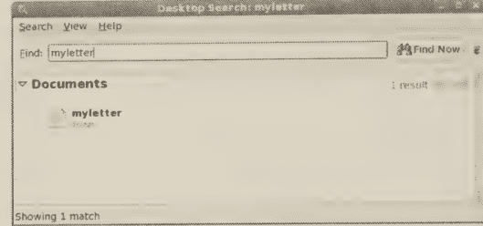

图 3-9：Beagle 搜索

对于特定类型的应用程序数据，如 MS Word 文件、Evolution 地址簿或 Adobe PDF 文件，你可以安装支持工具让 Beagle 从它们提取索引信息。详细列表请参见 `beagle-project/Optional/prerequisites`。`evolution-sharp` 工具将让 Beagle 索引电子邮件地址，`wv1` 允许 Word 文件被索引，`pdfinfo` 允许 PDF 文件（元数据和文本）被索引。Firefox 扩展将查看网站。要索引视频文件的元数据，你将必须使用安装的 `MPlayer`。

## 访问文件系统、设备和远程共享资源 (Windows)

可移动介质如 CD 和 DVD 光盘、USB 存储磁盘、数字相机、软盘将以图标形式显示在你的桌面上。在将光盘插入设备之前，这些图标不会出现。要打开光盘，双击它以显示文件管理器窗口及其上的文件。

桌面还会显示一个“计算机”文件夹（也可以通过“位置”菜单访问）。该文件夹还会列出你的可移动设备，以及你的文件系统和网络连接的图标（见图 3-10）。文件系统图标可用于从根目录开始访问计算机上的整个文件系统。普通用户对这些许多目录仅有读取权限，而 root 用户将具有完全的读写权限。

打开“网络”将列出系统上所有带有共享目录的主机，例如可以通过 Samba 访问的 Windows 系统（也可以通过“位置”菜单中的“网络”项访问）。GNOME 使用基于 DNS 的发现来自动检测这些主机。打开主机的图标将列出该系统上可用的共享目录。打开共享目录时，你会被要求输入用户和密码，就像访问 Windows 用户拥有的目录的用户密码一样。第一次访问共享目录时，你会被要求在密钥环（key ring）中使用此用户和密码，密钥环本身可以受密码保护。这允许重复访问而无需始终输入密码。

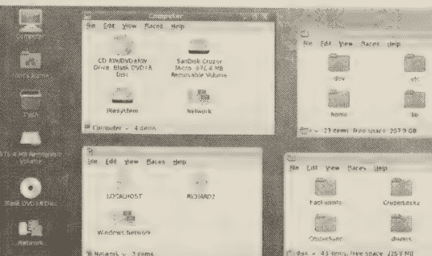

图 3-10：可移动设备、计算机文件夹和共享网络文件夹。

要访问 Windows 计算机上的文件夹和打印机，你必须首先通过“系统 | 管理”菜单上的 Samba、防火墙和服务配置工具来设置 Samba。第 14 章详细说明了如何设置 Samba 以启用对 Windows 系统的访问。Samba 工具指定要使用的 Windows 网络，防火墙工具允许通过网络通过 Samba 访问，而“服务”将自动启动 Samba，每当你的系统启动时提供 Windows 访问。

配置完成后，你就可以从桌面浏览共享文件夹。点击“计算机”图标然后点击“网络”图标，或从“位置”菜单中选择“网络”。你所有的网络计算机都将显示出来。点击你认为是想要的主机（见图 3-10），或点击“网络”查看连接的 Windows 网络（通常只有一个）。然后选择你想访问的 Windows 计算机。将显示共享文件夹（见图 3-11）。

## 使用可移动设备和媒体

Fedora 支持可移动设备和媒体，如数字相机、PDA、读卡器甚至 USB 驱动器。这些设备会被自动处理，并在需要时现场设置相应的设备接口。当此类热插设备被识别时，如果合适，它们的图标将出现在管理器窗口中。例如，当你将 USB 驱动器连接到系统时，它将被检测并显示为带有文件系统的存储设备。如果你向磁盘拷贝了任何文件，在移除之前之前先卸载它（右键点击并选择“卸载卷区”）。

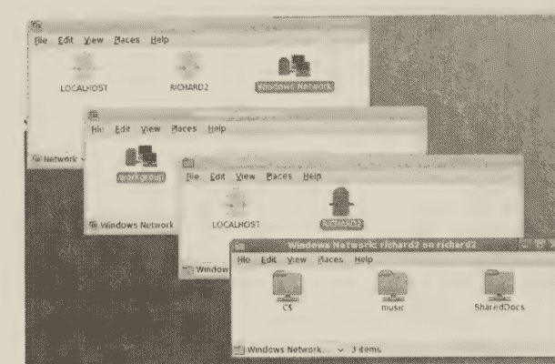

图 3-11：访问 Windows 文件系统、Samba

数字相机也会自动检测。像 gThumb 这样的照片应用程序将能够访问数字相机上的照片。

提示：Fedora 无法播放安装的 MP3、DVD 或 DivX 文件。你需要从 rpm.livna.org 下载并安装工具和库。Codec Buddy 将允许你自动下载并安装解码器。DVD 和 CD 光盘也被视为可移动设备，当你将它们放入 CD/DVD 驱动器时，会自动显示数字光盘图标。你可以双击 CD/DVD 光盘图标打开其文件管理器窗口，显示其内容。对于媒体光盘（如音乐 CD），你的系统配置为播放相应的应用程序。音乐 CD 将启动 CD 播放器，让你播放音乐。然而，对于视频 DVD，你将需要从 fluento.com、freshrpm.net 或 rpm.livna.org 下载并安装支持的视频解码器、库和应用程序。一旦配置 Yum 使用它们，可以使用 Pirut 下载并安装它们。DivX 支持必须单独下载并安装（labs.divx.com/DivLinuxCodec）。

## 第 3 章：使用基础

要设置可移动介质的处理方式，您可以使用“可移动驱动器和媒体偏好”工具，可以通过“系统 | 偏好 | 硬件”菜单中的“可移动驱动器和媒体”项访问。该工具显示六个面板：存储设备、多媒体设备、摄像头、PDA、打印机和扫描仪，以及输入设备（见图 3-12）。某些设置已预设。可移动和热插拔介质将自动挂载。这包括软盘和数据 CD/DVD。空白 CD 可以配置为通过 Nautilus 刻录打开。

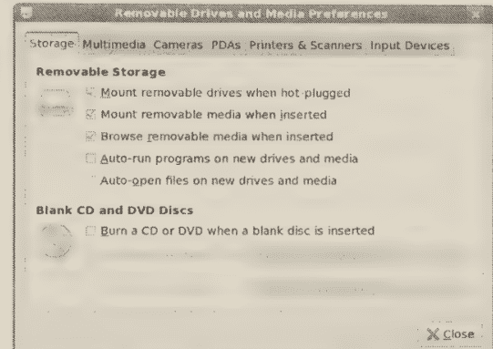

图 3-12：存储媒体偏好

在多媒体面板上，有关于音频 CD、视频 DVD 和便携式音乐播放器的设置（见图 3-13）。音频 CD 和视频 CD 将由 Totem 播放器播放。目前音乐播放器没有默认设置。数码相机将使用 Thumb 导入照片。您可以更改用于这些操作的任何默认应用程序，也可以关闭默认操作（如自动挂载或播放音频 CD）。请记住，Totem 不播放商业 DVD 视频。您需要安装支持 DVD 视频的播放器，或者使用来自 freshrpmps.net 提供的 MPlayer、Xine 或 Totem-zine 播放器。一旦安装了 DVD 视频播放器，您就可以使用“驱动器和可移动媒体”工具让 DVD 电影在您选择的播放器中自动启动。

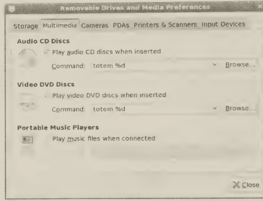

图 3-13：多媒体媒体偏好

## 使用 Gnome 刻录 DVD/CD

在 Gnome 中，将数据刻到 DVD 或 CD 只是将文件拖到打开的空白 CD 或 DVD 中并点击“写入磁盘”按钮。当您插入空白 DVD/CD 光片时，将打开一个标记为“CD/CD 创建器”的窗口（见图 3-14）。

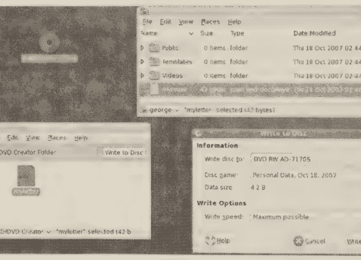

图 3-14：在 Gnome 上刻录 DVD/CD

要刻录文件，只需将它们拖到该窗口。即使它们不是空白的，只要识别为可写光盘，也会在 DVD/CD 创建窗口中打开。准备好刻录 DVD/CD 后点击“写入”。将弹出一个对话框。您可以指定写入速度、使用的 DVD/CD 刻录机（如果您有多个）以及磁盘标签。

当您点击“写入”时，会显示显示写入进度的对话框。完成后，您可以弹出磁盘，如果需要可以再复制一份（见图 3-15）。

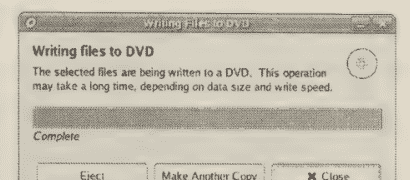

图 3-15：弹出刚刻录的 DVD/CD 盘。

GNOME 还支持刻录 ISO 镜像。只需双击 ISO 镜像文件或右键点击文件并选择“用 CD/DVD 创建器打开”。这将打开 CD/DVD 创建器，它会提示您刻录镜像。请确保向 CD/DVD 刻录机中插入了空白 CD 或 DVD。

## 安装多媒体支持：MP3、DVD 视频和 DivX

由于许可和其他限制，Fedora 发行版不包含 MP3、DVD 视频和 DivX 媒体支持。安装 Fedora 后您无法播放 MP3 文件、DVD 光盘或 DivX 文件。您在 Fedora 仓库中找不到这些内容。但是，www.fluomio.com 的独立操作将提供 DVD 和 MP3 解码器。MP3 解码器是免费的。您需要购买视频解码器。


或者，`freshrpm.net` 和 `rpm.livna.org` 为这些媒体格式提供了库和支持文件。所有软件包都是 RPM 包，您可以在下载下载并安装 Yum 仓库配置文件后使用 Yum 进行安装。

可以从 `labs.divx.com/DivXLCodec` 获取 DivX 支持。DivX 的开源版本 Xvid (`xvid-core`) 可以从 `freshrpm.net` 或 `rpm.livna.org` 下载。它可以播放 DivX 文件。

访问 `fedoraproject.org/wiki/Multimedia` 了解更多信息。注意：由于许可限制，有许多无法包含在 Fedora 中的项目，包括 MP3 支持、Adobe Reader 和 Nvidia 提供的驱动程序。访问 `fedoraproject.org/wiki/ForbiddenItems` 查看详情。

## GNOME 屏幕保护

通过 GNOME 屏幕保护偏好，您可以控制计算机何时被视为空闲以及（如果有的话）使用哪种屏幕保护（见图 3-16）。您还可以控制在空闲时是否锁定屏幕。通过“系统 \| 偏好 \| 外观 \| 屏幕保护”访问屏幕保护偏好。通过取消勾选“计算机空闲时激活屏幕保护”复选框来关闭屏幕保护。

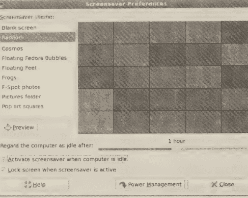

图 3-16：GNOME 节能

## GNOME 电源管理

对于电源管理，Fedora 使用 GNOME 电源管理。这允许您配置系统在电池供电或插入电源时的行为。您可以通过“系统 \| 偏好 \| 电源管理”访问这些设置。在这里，您可以设置屏幕关闭和计算机睡眠的时间。您还可以配置笔记本电脑盖子关闭时的行为。

电源管理系统使用 ACPI 与硬件进行通信。这允许操作系统有效地管理电源状态。Fedora 开箱提供了几种配置方案，但您可能需要根据自己的需求和特定硬件对它们进行调整。

# 第3章：使用基础

驱动程序。这些工具包括用于格式化 NTFS 分区的 `mkfs.ntfs`，用于调整分区大小的 `ntfsresize` 以及用于列出分区内文件的 `ntfsls`。这些工具包含在 Fedora 仓库的 `ntfsprogs` 包中。你可以通过“添加/删除软件”搜索并安装此包。为了支持 GNOME 浏览，你需要安装 Fedora 仓库中 NTFS 项目的 `ntfs-gnomevfs` 包。

## 命令行界面

当使用命令行界面时，你会看到一个简单的提示符，可以在其中输入命令。即使有 GUI，有时你也需要在命令行中执行命令。GNOME 桌面菜单上不再提供终端窗口。你现在必须从“应用程序 \| 系统工具”菜单访问它。如果你使用终端窗口，可能想将该菜单项拖到桌面上，为该窗口创建一个桌面图标。点击即可打开。

Linux 命令大量使用选项和参数。请务必在命令行中按照正确的顺序输入格式和选项。Linux 命令的格式为命令名，后跟选项，最后是参数，如下所示：

```
$ command-name options arguments
```

选项是一个由一个或两个连字符前置的单字母代码，用于修改命令执行的操作类型。选项和参数可能是可选的，取决于具体的命令。例如，`ls` 可以接受一个选项 `-s`。`ls` 显示当前目录下的文件列表，而 `-s` 选项会以块为单位添加每个文件的大小。你如下所示在命令行中输入命令及其选项：

```
$ ls -s
```

参数是执行任务时可能需要的数据。在许多情况下，这是一个文件名。参数在任何选项之后作为一个单词输入到命令行中。例如，要显示文件内容，你可以使用 `more` 命令并将文件名作为其参数。配合文件名 `mydata` 使用的 `less` 或 `more` 命令在命令行中的输入方式如下：

```
$ less mydata
```

命令行实际上是一个你可以编辑的缓冲区。在按下 ENTER 回车键之前，你可以对现有文本执行编辑命令。编辑功能提供了一种方法，可以纠正你在输入命令及其选项时可能犯的错误。`BACKSPACE` 和 `DEL` 键允许删除刚刚输入的字符。通过这种删除字符的功能，如果你愿意可以使用 `BACKSPACE` 删除整行，清除你输入的内容。`CTRL-U` 会删除整行并让你在提示符处重新开始。

提示：你可以使用 `UP ARROW` 上方向键重新显示你上次执行的命令。你可以重新执行该命令，也可以编辑并执行修改后的命令。当你需要在编辑同一个文件时反复执行某些操作，这非常有帮助；当你已经执行了错误的命令时也很有帮助。

## 从命令行界面访问 Linux

对于命令行界面，最初你会看到一个登录提示符。系统现在正在运行，并等待用户登录使用。你可以输入用户名和密码来使用系统。登录提示符之前是你为你设置的主机名。在这个示例中，主机名是 `turtle`。当你完成 Linux 使用后，首先注销。最后会显示相同的登录提示符，等待你或其他用户再次登录。这等同于 GDM 提供的登录窗口。然后你可以登录另一个账户。

```
Fedora release 8 (Werewolf)
Kernel 2.6.23.1-42.fc8 on an x86_64
turtle login:
```

登录 Linux 账户涉及两个步骤：输入用户名，然后输入密码。输入你用户账户的用户名。如果你出错，可以使用 `BACKSPACE` 键删除字符。在下一个示例中，用户输入用户名 `richlp`，然后提示输入密码：

```
Fedora release 8 (Werewolf)
Kernel 2.6.23.1-42.fc8 on an x86_64
turtle login: richlp
Password:
```

当你输入密码时，系统不会显示任何字符。这是一个安全功能。一旦你按下 ENTER，系统将验证你的密码。如果正确，你将登录桌面。如果错误，系统将提示你再次输入密码。

登录成功后，你将看到命令提示符。这是你通过输入命令与 Linux 系统交互的地方。提示符通常由主机名组成，后跟一个美元符号 (`$`)，表示你正以普通用户身份登录。井号 (`#`) 表示你正以 root 用户身份登录。

要注销系统，你可以输入 `logout` 命令。这将让你返回登录提示符。你也可以通过输入 `shutdown` 命令关闭系统，或通过输入 `reboot` 命令重启系统。

# 第3章：基础用法

| 资源 | 描述 |
| :--- | :--- |
| KDE 帮助中心 | KDE 帮助工具，用于 KDE 桌面和应用程序文档、Man 页（手册）和 info 文档的 GUI 界面 |
| GNOME 帮助浏览器 | GNOME 帮助工具，用于访问 GNOME 桌面和应用程序文档、Man 页和 info 文档的 GUI 界面 |
| `/usr/share/doc` | 应用程序文档所在位置 |
| `man` 命令 | Linux Man 页，关于 Linux 命令的详细信息，包括语法和选项 |
| `info` 应用 | GNU info 页面，关于 GNU 应用程序的文档 |
| `fedoraproject.org` | Fedora 项目网站，包含大量的文档、常见问题解答（FAQ）和帮助资源及链接，以及指向论坛、新闻组和社区网站的链接 |
| `docs.fedoraproject.org` | Fedora Linux 的在线文档、指南、HOWTO 和常见问题解答 |
| `www.redhat.com` | 红帽企业文档、指南、HOWTO 和常见问题解答。位于“支持与文档”栏下，许多红帽 Linux 文档可能有所帮助 |
| `library.gnome.org` | GNOME 文档站点 |
| `fedoraforum.org` | 终端用户论坛，由 Fedora 项目背书。包含 FAQ 和新闻链接 |
| `fedorafaq.org` | 带有快速帮助主题的非官方常见问题解答 |
| `fedoranews.org` | 收集 Fedora 的最新新闻和进展，以及关于近期更改的文章和博客 |
| `fcp.homelinux.org` | Fedora 社区门户：Fedora 论坛、FAQ、问题和新闻 |
| `fedorasolved.org` | 常见问题的解决方案 |

表 3-2：Fedora Linux 帮助资源

## Info 页面

GNU 应用程序（如 `gcc` 编译器和 `Emacs` 编辑器）的在线文档也以 info 页的形式存在，可以通过 GNOME 和 KDE 帮助中心访问。你也可以通过输入 `info` 命令访问这些文档。这会弹出一个列有不同 GNU 应用程序的特殊屏幕。

info 界面有自己的命令集。你可以通过输入 `info info` 了解更多。输入 `m` 会在屏幕底部打开一行，你可以在其中输入应用程序的前几个字母。按回车键将打开该应用程序的 info 文件。

## Web 资源

你可以在 Fedora 和红帽网站上获取 Fedora 的文档。红帽的某些文档仍然适用于 Fedora。大多数 Linux 应用程序都由 Linux 文档项目涵盖。GNOME 和 KDE 网站还包含大量的文档，教你如何使用桌面，并对 Linux 应用程序进行详细解释。此外还有几个专门的 Fedora 支持网站。

- `fedoraforum.org` 提供了特定的终端用户支持，你可以在那里查看支持论坛。
- `docs.fedoraproject.org` Fedora 文档、指南和资源。
- `www.fedorafaq.org` 列出了针对如启用 MP3 支持等某些常见问题的快速解答。
- `fedoranews.org` 提供最新新闻和近期文章合集，以及你可以查看的博客资源。
- `fcp.homelinux.org` Fedora 社区门户，一个 Fedora 在线支持社区。
- `fedorasolved.org` 提供了常见问题的解决方案。

# 第 2 部分：应用程序

## 安装与更新软件

- 办公应用与编辑器
- 多媒体与图形
- 邮件与新闻
- Web、Java 和网络应用程序

## 第4章：安装与更新软件：Yum, PUP, rpm 和存储库

Fedora 软件已经变得非常庞大，且更新频繁，因此使用光盘作为主要的分发手段已不再合理。相反，分发是通过使用在线 Fedora 软件存储库来实现的。该库包含大量符合 Fedora 标准的软件集合，将以前版本中使用的 Fedora Core 和 Fedora Extras 合并到了一个大型存储库中。

对于 Fedora，你可以访问支持 Yum（Yellowdog Update, Modified）的软件存储库来向系统添加软件。此外，许多软件应用程序（特别是多媒体应用）存在潜在的许可冲突。通过将此类软件留在第三方存储库中，Fedora 避免了可能出现的法律问题。许多流行的多媒体应用（如视频和数字音乐支持）可以通过第三方存储库获取。

这种方法允许你使用相同的简单 Yum 命令从第三方存储库获取软件包。通过访问支持 Yum 的存储库，你可以向系统添加软件。你可以从这些存储库获取已安装的软件包。通过在 Fedora 中集成 Yum，你可以更新你的软件包。依赖存储介质进行更新已变得过时。你可以通过以下页面了解更多关于如何使用 Yum 的信息：

```
http://docs.fedoraproject.org/yum/
```

## 更新 Fedora：软件包更新器 (PUP)

新的 Fedora 版本每六个月发布一次。在此期间，PUP 持续准备更新。这些更新范围从单个软件包到整个组件不等，包括 GNOME、KDE 或 X11 的新版本。

**提示：** 如果你在正式发布几个月后进行安装或更新，使用 Fedora Re-Spin 磁盘可能会更容易。该磁盘包含了最新更新。通过这种方式，你可以避免从存储库下载大量更新。Fedora Re-Spins 由项目每三个月发布一次。

使用自动更新工具更新 Linux 系统已变成一个非常简单的程序。对于 Fedora，你可以访问支持 Yum（Yellowdog Updater, Modified）更新方法的软件存储库来更新系统。Yum 使用 RPM 头来确定哪些软件包需要更新。要更新软件包，你现在使用软件包更新程序（PUP），在应用程序\|工具中标记为软件更新。PUP 是 Yum 的图形化更新界面。有了 PUP，你不再需要在终端窗口中使用 `yum update` 命令进行更新。

PUP 利用你 GNOME 面板上的 PUP 小程序，每次登录时都会自动检查更新。如果检测到更新，PUP 的图标会在面板上闪烁，并显示消息通知你有可用更新以及数量（见图 4-1）。点击 PUP 按钮启动 PUP。你也可以从应用程序\|工具中的软件更新条目手动选择 PUP。

图 4-1：软件包更新器 (PUP) 更新通知

当 PUP 启动时，会自动选中所有更新。通过每个条目的复选框，你可以取消任何可能不想更新的特定软件包（见图 4-2）。

图 4-2：软件包更新器列待更新软件包

如果你想查看特定软件包的详情，点击更新详情的展开按钮，然后选择该软件包将显示当前选中软件包的信息（见图 4-3）。

图 4-3：软件包更新器显示更新详情

点击应用开始更新。将检查依赖关系。要查看添加了哪些软件包，点击详情展开按钮（见图 4-4）。然后软件包将从相应的存储库下载。下载完成后，软件包将完成更新。

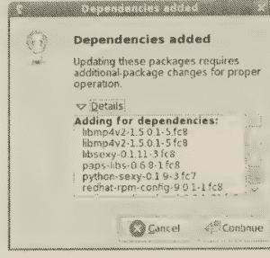

图 4-4：添加了依赖包的包更新器

请务必检查列表以进行关键安装项，例如新内核。你可能想也可能不想此类安装。如果需要安装新内核，系统将提示你重启。随后，你将使用新内核启动。你的旧内核将作为 GRUB 选项保留，你可能会在与新内核配合时遇到困难。要选择旧内核，你必须从 GRUB 启动界面中选择它。要将旧内核设置为默认值，可以通过启动引导程序配置屏幕（系统 \| 管理 \| 引导程序）选择它，或者将 `/etc/grub/grub.conf` 文件中的默认选项设置为 1（新内核为 0）。

作为标准做法，你可能希望在安装新软件包之前进行更新，因为它们始终将是从存储库下载的最新版本，并可能需要更新依赖项。

提示：要升级到新的 Fedora 版本，你可以通过 `fedoraproject.org/get-fedora` 下载 Fedora DVD ISO 镜像。然后刻录 ISO 镜像并从该安装 DVD 进行升级。或者，你可以在任何终端窗口中使用带有 `upgrade` 选项的 `yum` 命令。这将执行逐包的在线升级。

## 使用 yum 命令更新

或者，你可以使用带有 `update` 选项的 `yum` 命令进行更新。以下命令将更新已安装的 Numeric 软件包。

```
yum update numeric
```

你可以使用 `check-update` 选项来查看哪些包需要更新。

```
yum check-update
```

要对所有已安装的软件包进行完全更新，只需使用 `update` 选项。这与使用 PUP 更新的效果相同。

```
yum update
```

## 自动 Yum 更新

Yum 还在 `/etc/cron.daily` 目录下安装一个 `yum.cron` 文件，它将自动更新你的系统。cron 条目会首先在需要时更新 Yum 软件，然后下载并安装你已安装软件包的任何更新。它带有 `update` 选项运行 yum。

只有当检测到 `/var/lock/subsys` 目录下存在 Yum 锁文件时，自动更新才会运行。默认情况下该文件不存在。你可以使用 yum 服务脚本添加它。`start` 选项创建锁文件以启用 cron 支持的更新，`stop` 选项删除文件以禁用自动更新。

```
service yum start
```

## 安装软件包

安装软件是具有管理权限的用户执行的行政功能。除非你在安装期间选择了安装所有软件包，否则 Linux 用户可用的许多应用程序和工具中只有其中一个。在 Fedora 上，你可以通过 Pirut 软件管理器（添加/删除软件）或 `rpm` 命令轻松地从系统中安装或删除软件。或者，你也可以通过下载并编译源代码来安装软件。使用源代码安装软件的程序已简化为几条命令，尽管你在针对特定系统定制应用程序方面有很大的灵活性。

RPM 软件包对于应用程序来说就像它自己的程序。Linux 应用程序通常由多个文件组成，必须安装在不同的目录中。程序本身可能放在名为 `/usr/bin` 的目录中，在线手册放在另一个目录。此外，安装可能需要修改系统上的某些配置文件。RPM 软件包将为你完成所有这些任务。此外，如果你以后决定不再使用特定应用程序，可以卸载软件包以从系统中删除所有文件和配置信息。

你的 DVD/CD-ROM 上的软件包虽然很多，但仅代表了 Fedora Linux 可用的部分软件包。大多数位于 Fedora 软件存储库中，该软件包可以通过“添加/删除软件”应用程序自动下载。许多多媒体应用程序和支持库可以在 Livna 存储库（`rpm.livna.org`）中找到。表 4-1 列出了几个 Fedora 软件网站。Fedora 只提供开源软件包。

### 表 4-1：Fedora 软件网站

| 网站名称 | 描述 |
| :--- | :--- |
| `fedoraproject.org/get-fedora` | Fedora 发行 |
| `fedoraproject.org/wiki/Items` | 关于多媒体的信息 |
| `rpm.livna.org` | 多媒体包 |
| `redhat.com/pub/fedora` | Fedora 发行 |
| `sourceforge.net` | 开源 |
| `freshmeat.net` | 多媒体软件 |
| `atrpms.net` | 多媒体软件 |
| `kde-apps.org` | KDE 软件 |
| `gnomefiles.org` | GNOME 软件 |
| `rpmfind.net` | 多媒体软件 |

Fedora 只提供开源软件包。

## 使用 Yum 安装


# 从任何配置好的 Yum 存储库下载 Fedora 软件

从任何配置好的 Yum 存储库下载 Fedora 软件只需使用“添加/删除软件（Purit）”即可，它为 Yum 提供了一个 GUI 界面。如果任何一个存储库存在任何配置或依赖问题，YUM 默认会停止整个安装过程。访问 `fedoraproject.org/Wiki/Tools/yum` 获取有关使用 yum 的提示，包括一个允许你执行部分安装的脚本。

## 使用浏览器安装单个包

或者，你可以使用浏览器直接下载单个软件包。你仅在 Yum 支持的存储库中不可提供的软件包时使用此方法。你还必须手动安装任何依赖包，并检查系统兼容性（`x86_64`、`i386`、`ppc`）。你的 Fedora 浏览器将允许你通过一个简单的操作中完成下载和安装。在 GNOME 桌面上，已下载的软件包可以通过简单的右键点击并选择安装来完成，从而调用 Purit 执行安装。

## Purit，添加/删除软件

Purit 是 Fedora 安装 DVD 用于选择软件包的相同工具。Fedora 软件包管理器基于互联网，从在线存储库安装，使用 YUM 下载并安装。通过应用程序菜单中选择“添加/删除软件”来使用 Purit。Purit 将通过收集你所有软件包的信息启动。然后你有三种不同的使用 Purit 的方法：浏览、搜索和列表。

List（列表）和 Search（搜索）方法可以访问所有活动存储库中的软件。由于可用软件包数量巨大，你可能会发现自己频繁使用 Search 方法。Pirut 是 Yum 的前端，Yum 的搜索功能根据你输入的关键词搜索描述、包名以及任何相关软件。图 4-5 显示了带有 Browse（浏览）功能的 Pirut。在很多情况下，最新版本是可用的；原始版本将不再被认为可行。同时，相同软件包可能会有更新。而且某些包版本可能设计为协同工作。

可以使用 Pirut 访问并安装您 Yum 存储库中列出的所有软件。Pirut 将使用 `/etc/yum.repos.d/` 下的所有仓库文件列出可用软件。因此，尽管你仍然可以使用命令行 yum 操作来安装和更新软件，但你完全可以使用 Pirut 来查看大多数第三方存储库中的包；你需要使用 Pirut 上的 List 视图或 Search 选项。Browse 视图通常使用 Fedora 软件包，尽管它通过 Fusion 连接整合 Livna 存储库软件包。

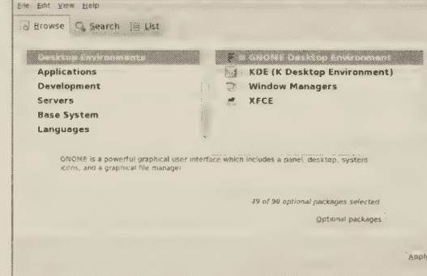

图 4-5：Pirut 软件包管理器

## 使用 Pirut 安装和删除软件包

列出的每个软件包旁边都有一个复选框，用它来标记安装或删除该软件包。所有未安装的软件包将有一个空复选框，已安装的软件包的复选框内有一个勾符号。

要安装新软件包，点击其空复选框。框内会出现一个勾，旁边会带有一个星号。该包现在被标记为安装（见图 4-6）。

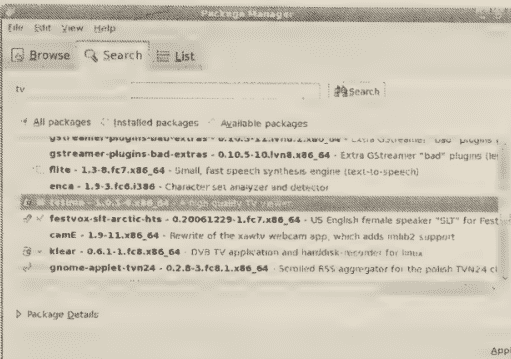

图 4-6：Pirut 从搜索面板安装

若要从 Browse 面板安装，你首先从右侧面板选择一个子类别，然后点击 Optional Packages（可选软件包）按钮列出可用软件包（见图 4-7）。已安装的将会有勾标记。要安装某个包，点击其复选框。你会看到一个勾标记出现（没有星号）。

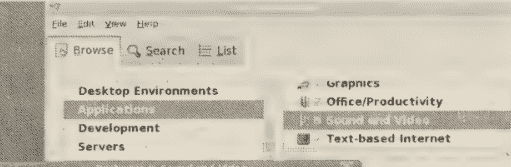

图 4-7：Pirut 从 Browse 面板安装

如果你愿意，可以继续选择其他软件包。当你准备好安装时，点击 Apply（应用）按钮。选中的软件包将列出（见图 4-8）。


图 4-8：安装和删除选定的软件包

将检查你所有软件包的依赖关系，添加安装所需的任何其他软件包。这些通常包含包含软件包所用操作的库。你会被要求检查依赖关系。如果没有依赖关系，你的软件包将会被安装。如果有依赖关系，它们将在“Dependencies added”（添加的依赖）窗口中列出（见图 4-9）。

此时，你可以点击 Cancel（取消）按钮来放弃安装。如果一切正常，点击 Continue（继续）。


图 4-9：依赖关系

然后你的软件包将被下载并安装。如果你正在使用安装 DVD，则必须插入它。

要删除软件包，请在 Pirut 中找到它的条目。你可以在 Search 面板上搜索包名，在 List 面板中按字母顺序找到它（如果你知道实际包名以哪个字符开头），或者如果你知道它的类别，可以使用 Browse 面板。一旦定位了已安装的软件包，你会发现它的复选框中有一个勾标记。点击此以标记该包进行删除。勾标记将消失，一个带有红色减号符号的删除图标将出现在软件包旁边（见图 4-10）。如果你愿意，可以继续选择其他软件包进行删除。要实际删除标记的软件包，点击 Apply（应用）按钮。同样会检查依赖关系。如果其他软件包需要被标记为删除的包才能运行，则这些软件包也必须被删除。此时，你仍然可以通过点击 Cancel（取消）按钮来放弃安装。继续后，软件包将被删除。


图 4-10：删除软件包

## 存储库管理器

在 Pirut (Add/Remove Software) 中，YUM 被集成为主要的包安装工具。当你安装一个包时，将调用 YUM，它会自动从适当的存储库选择并下载该包。安装系统后，当你想要安装额外的包时，安装工具现在将使用 YUM 从存储库进行安装。这将包括你配置的所有 YUM 在线存储库，例如如 `rpm.livna.org` 这样的站点，而不是为你的安装配置的 Fedora 和更新存储库。如果有，你也可以从 Fedora 安装 DVD 进行安装。

你可以通过激活和禁用存储库来选择使用哪些存储库。要打开存储库管理器，启动 Add/Remove Software 并选择 Repositories（存储库）。存储库管理器将列出 `/etc/yum.repos.d/` 中的所有文件。请使用存储库管理器或 Ctrl-R。


目录，包含 URL、GPG 密钥和描述等信息。激活的将显示勾标记。在图 4-11 中，安装 DVD、Fedora 存储库和 Livna 存储库都是激活状态。


图 4-11：存储库管理器

它将在其 Search 中列出所有内容。如果你只想看 Livna 存储库，可以禁用所有存储库。这样 List 面板将只显示 Livna 上的包。你稍后可以激活其他。

存储库还有专门用于开发、调试和源代码的特殊存储库。在这里你可以找到可能有应用程序，以及最新的修订版本。某些尚未完全针对当前发布进行验证。

安装 DVD 被认为是一个有效的存储库。如果你使用安装 DVD 安装系统，它将是激活的。使用安装 DVD 的优点是它可以减少不必要的下载。安装 DVD 会检查当前软件包。如果 DVD 版本是当前版本，则包从安装 DVD 安装，而不是存储库。一个缺点是你必须将安装 DVD 插入 DVD-ROM 以执行安装。此外，请记住 DVD 上的软件包很容易过期。

一种简单的方法可能是禁用安装 DVD 并直接从 Fedora 存储库获取（前提是有良好的 Internet 连接）。或者，如果由于原因你没有 Internet 连接，你可以直接安装 DVD。你可能需要禁用其他存储库。

> **注意**：要从 Pirut 删除软件包，只需取消勾选其条目然后点击应用。所有已安装软件包都被勾。

## 与 Pirut 使用 Livna 存储库

Livna 存储库 (`rpm.livna.org`) 将其包整合到 Browse 面板中的 RPM Fusion - Free 和 RPM Fusion-NonFree 下。在该部分，你会找到基础类别，你需要按下可选软件包来查看可用内容。然后选择你想要安装的包（见图 4-12）。NonFree 并不意味着商业。该类别包含了免费分发的专有软件，如 Nvidia 和 ATI 驱动程序，但也包含了那些有许可问题的包，如 MP3、AC3 和 MPEG2 解码器（见图 4-13）。


图 4-12：通过 Pirut Browse 窗口访问 Livna 免费存储库


图 4-13：从“浏览”窗口访问的 Livna 非免费仓库

## Yum 扩展器：yumex

Yum Extender 是用于管理 Yum 仓库中软件包的备用 GUI 界面（见图 4-14）。Fedora 自带了 yumex。Yum Extender 比 Prut 更具灵活性。它提供了详细的软件包信息，并允许你直接开启或关闭仓库，无需编辑 repo 文件。点击“打开添加/删除软件”，在“浏览”面板中选择“基础系统”，然后选择“管理工具”，最后点击“可选软件包”即可看到列出的 yumex。勾选进行安装。你也可以在“搜索”面板中搜索 yumex，或者在终端中使用以下命令：

```
yum install yumex
```

你可以通过“应用程序 | 系统工具”菜单中的 Yum Extender 条目访问 yumex。Yum Extender 界面有五个面板，通过左侧列的视图图标访问，如图 4-14 所示。你可以使用“软件包”或“组”按钮选择软件包。“软件包”按钮将列出所有可能的软件包，而“组”面板则显示类别。未安装的软件包将用红色显示。

“软件包”面板提供了缩小显示范围的方法。你可以选择仅显示更新、已安装的软件包或未安装的软件包。你还可以进一步指定类别（例如仓库），仅显示来自特定仓库的软件包。点击软件包将在下方的面板中显示关于该包的详细信息，在面板中，你可以选择描述、软件包包含的文件以及（如果可用）变更日志。

要选择一个软件包，只需勾选你想要安装的项。一旦选中，软件包就会被添加到“处理队列”面板中。


图 4-14：Yum Extender 组视图

一旦你将软件包添加到队列，点击“队列”图标查看你想要安装的软件包列表。从该面板，你可以选择删除项目或仅保存列表以备后后安装。要执行安装，点击“处理队列”按钮。所有依赖包也将被显示。安装过程将在“输出”面板上显示。

“仓库”面板作为仓库管理器运行，列出你配置的所有仓库。从该面板，你可以启用或禁用任何仓库。例如，你可以在面板上选择它，然后从该仓库安装软件。完成后，你可以使用“仓库”面板禁用该仓库。

## 使用 yum 命令安装软件包

你也可以在终端窗口或命令行界面中使用 `yum` 命令访问 Fedora 仓库并下载新软件。要使用 `yum` 命令，请在命令行输入带有 `install` 选项的 yum 命令。系统将检测到软件包以及任何依赖软件，并要求你确认安装。下载和安装将自动完成。你可以在线检查下载仓库，以及元数据目录，在 Web 页面上显示可用软件包。该页面将包含易于访问的功能，如软件包组和基于软件包名称首字母的索引链接。

以下示例列出了 Xine 视频播放器：

```
yum install xine
```

你还可以删除软件包，并根据不同标准搜索和列出软件包，例如更新所需的软件包、仓库中尚未安装的软件包以及已安装的软件包。以下示例列出了所有已安装的软件包：

```
yum list installed
```

可用选项显示未安装的软件包。

```
yum list available
```

要搜索特定软件包，可以使用 `search` 选项：

```
yum search xine
```

> **提示**：你可以使用第三方 Fedora Yum 软件仓库（如 `rpm.livna.org`）来下载额外软件。它们的配置文件位于 `/etc/yum.repos.d` 中。

## 使用 yum 命令恢复软件包

“添加/删除软件”中存在一个 bug，它会错误地将比实际需要得多的软件包识别为依赖项，并在安装某些软件时将它们标记为删除。如果存在依赖，你将收到通知。请务必始终检查此依赖列表，确保没有大量的软件包被标记为删除。在某些情况下，整个 GNOME 桌面以及 GDM 和 Prut（添加/删除软件）可能会被删除。如果发生这种情况，你可以在终端窗口或命令行界面中使用 yum 命令重新安装 GNOME、GDM 和 Prut。你可能还需要重新安装显卡驱动程序。你可以使用 `groupinstall` 安装整个 GNOME 桌面。使用 `groupplist display groups` 显示组。

```
yum groupinstall gnome-desktop
```

```
yum install gdm
```

```
yum install prut
```

## 安装一些流行的第三方软件包

在安装某些第三方多媒体软件包之前，你首先需要为携带这些包的仓库安装 Yum 配置文件。一旦配置完成，使用“添加/删除软件”搜索并安装软件包就很简单了。Yum 会下载软件包并执行安装。它还会仔细地选择适用于你架构的软件包（64 位的 `x86_64` 或 32 位的 `i686`）。Yum 在安装前会先请求确认，列出任何也必须安装的依赖包。

> **提示**：在安装和删除过程中，请确保没有大量无关的软件包被删除。这可能会发生，例如删除带有 Prut 的整个 GNOME 环境。如果你发现大量无关的软件包被标记为依赖项，你可能想要取消安装。点击“依赖关系”对话框上的“取消”按钮。

## 多媒体软件包

对于你的第三方软件包，可以使用 `rpm.livna.org`，它携带了多媒体集合，包括 Gstreamer 和 MPlayer。在安装了必要的解码器的情况下，你可能需要 Xine、MPlayer 和 VideoLAN。

- Xine 播放器
- MPlayer 播放器
- VideoLAN 播放器
- MythTV DVR

对于 DVR 功能，你可能需要从 `rpms.net` 下载并安装 MythTV。

> **提示**：关于适用于 Fedora 的多媒体信息，请参考 `fedoraproject.org/wiki/Multimedia`。

安装 Xine 或 MPlayer 时，许多软件包将被自动选择并安装作为依赖。这比单独安装这些软件包要简单得多。

对于音频，你可能需要 HDTV 音频、DVD/MPEG2 支持、DTS 和 MP3。使用“添加/删除软件”搜索以下 Livna 软件包。

- a52dec HDTV 音频 ATSC A/52
- faad2 MPEG2/4 AAC 解码
- faac MPEG2/4 AAC 编码和解码
- libdca DTS 播放
- lame MPEG1 和 MPEG2 音频解码

对于视频，你可能需要 DVD 视频能力、MPEG 和 MPEG2 播放、DVB/HDTV 播放以及 H264（高清媒体）解码。

- libdvbvpsi MPEG TS 流（DVB 和 PSI）解码和编码。
- libdvdcss DVD 播放能力，VideoLAN 项目。
- libdvdnav DVD 菜单导航
- x264 H264/AVC 解码和编码（高清媒体）

对于所有支持 GStreamer 的应用程序以及 KDE 多媒体应用程序，你将需要 bad、ugly 和 nonfree 包。

- gstreamer-bad GStreamer 不完全可靠的解码器和工具，可能存在许可问题。
- gstreamer-ugly GStreamer 的可靠视频和音频解码器，可能存在许可问题。
- kdemultimedia-extras-nonfree 为 KDE 应用添加 MP3 和 MPEG 播放功能

## 厂商视频驱动支持

你可以从 Livna 获取 Nvidia 和 ATI 显卡驱动。你可以使用 yum 下载并安装这些驱动。Livna 可能是获取特殊内核驱动和模块以及多媒体驱动的最佳仓库。

图形驱动使用两个软件包，一个用于支持软件，另一个用于内核。内核模块取决于你正在使用的内核。在 `rpm.livna.org` 站点，你可以找到每个内核版本的 ATI 和 Nvidia 模块。每当你更新到新内核时，都需要一个专门为该内核创建的图形内核模块。当你更新内核时，该模块将自动下载并作为依赖包安装（Livna 仓库必须处于激活状态）。

```
xorg-x11-drv-nvidia-100.14.19-4.lnv8.x86_64.rpm
kmod-nvidia-2.6.23.1-49.fc8-100.14.19-18.lnv8.x86_64.rpm
kmod-nvidia-100.14.19-18.lnv8.x86_64.rpm
xorg-x11-drv-fglrx-8.42.3-1.lnv8.x86_64.rpm
kmod-fglrx-8.42.3-1.lnv8.x86_64.rpm
kmod-fglrx-2.6.23.1-49.fc8-8.42.3-1.lnv8.x86_64.rpm
```

请注意，ATI 内核名称为 fglrx。包名中包含了厂商发行版本，在本例中为 8.42.3。此处显示的 Nvidia 版本为 100.14。以下是 ATI 和 Nvidia 驱动包。

Nvidia 驱动还包括用于旧版 Nvidia 显卡的 legacy 和 96xx 驱动。这些也有了自己的 Nvidia X 配置工具。

最好使用 Yum 下载并安装包。Yum 会自动检测正确的内核版本。厂商驱动软件也会作为依赖被选中，例如 ATI 驱动的 `xorg-x11-drv-fglrx`。


在激活 Livna 后，你可以使用 Putri 下载并安装图形驱动程序，由 PUP 提供自动更新。使用搜索面板搜索 `fglrx` (ATI) 或 `nvidia`。你只需要使用初始唯一名称 `kmod-fglrx`。Yum 会检测包名的其余部分，并选择适用于你内核的包。对于 Nvidia，你可以在“添加/删除软件”中或在 yum 命令中使用 `kmod-nvidia`。Yum 将检测并选择 `xorg-x11-drv-nvidia`，即 Nvidia 驱动程序软件。

或者，你也可以在终端中输入 yum 命令。

```
yum install kmod-fglrx
```

## 使用存储库

几个存储库提供了你通常需要的大部分软件。主要的 主要软件存储库极可能包含你需要的软件。在尝试第三方存储库之前，请始终检查此存储库。某些特殊的应用程序，如供应商提供的图形驱动程序以及第三方多媒体支持，可以在 `rpm.livna.org/fedora` 找到。另一组多媒体支持包可以在 `freshrpms.org` 找到。Java 应用位于 `jpackage.org`，尽管某些已经存在于 Fedora 存储库中。这些存储库共同构成了一组软件站点，可以提供用户对桌面系统期望的大部分功能。所有站点都符合 Yum 标准，其 Yum 配置文件针对特定的 Fedora 版本而设计。这里显示了这些站点及其存储库文件。

| URL | 描述 | Repo 文件 |
| :--- | :--- | :--- |
| `download.fedora.redhat.com/pub/fedora/linux/repo/` | Fedora 存储库：符合 Fedora 标准的软件。 | `fedora.repo` |
| `rpm.livna.org/fedora` | Livna：用于驱动、多媒体和其他 RPM 包的存储库。 | `livna.repo` |
| `freshrpms.net` | Freshrpms：具有多媒体应用的自定义 RPM 包。 | `freshrpms.repo` |
| `package.org at atrpms.net` | Java 应用。 | `package.org` |
| `atrpms.net` | 多媒体应用。 | `atrpms.repo` |

要查看哪些可用包，你可以使用浏览器访问这些站点。Fedora 提供了 `repodata` 目录用于详细列表。Livna 提供简单的目录文件列表，而 Freshrpms 则在名称中使用进一步标识的术语 `lvn`。由于这些站点支持 Yum，你可以点击一下即可下载并安装包以及任何支持库。这种安装使得过程变得非常简单。

要在包存储库上使用 Yum，只需列出站点的 URL、其 Web 地址和目录位置。存储库的配置存放在 Linux 系统 `/etc/yum.repos.d` 目录下的 repo 文件中。Fedora 的 repo 文件已经安装。在可以使用 Yum 访问它们之前，你必须添加 Livna 和 Freshrpms 的 repo 文件。然而，Livna 在其网站上提供了一个名为 `livna-release-8.noarch.rpm` 的 RPM 包，安装后会自动设置所需的 Yum 配置文件。对于 Livna，内容如下：

## 存储库 repo 包文件

要安装包，请使用 Putri、yumex 或 yum 命令。它们都会自动使用 repo 文件检查你已启用的存储库。该规则的一个重要例外是从第三方存储库初始安装存储库配置文件。这些配置文件（repo 文件）通常包含在它们自己的 RPM 包中。你将使用 浏览器直接从存储库网站下载并安装 repo 包。例如，Livna 第三方 Fedora Yum 存储库的 repo 包 `livna-release-8.noarch.rpm`。你将直接使用浏览器下载并安装此包，确保选择提示的安装选项。

注意：过去 Livna 存储库与 Freshrpms 存储库之间存在（可能仍然存在）不兼容的情况。你应该使用其中之一。Livna 目前拥有最新的集合，是首选。

## Fedora 存储库

Fedora 存储库已经配置好供 Yum 使用。要下载任何 Fedora 包，只需使用 Putri 程序管理器（应用程序 | 添加/删除软件），或在命令行上输入带有 `install` 选项的 yum 命令。将检测包以及任何依赖软件，并询问你确认安装。下载和安装将自动完成。检查 Fedora 存储库目录上的 `repodata` 文件以列出可用的 Fedora。在 os i386、x86、64（64位）以及 ppc（PowerPC 版本）中各有一个。然后你可以点击特定包以显示其 RPM 包数据，显示版本信息和下载包的链接，以及包的开发网站。虽然你可以下载包，但最好是使用 Yum 或像 Putri 这样的 Yum 界面。

`repodata` 页面提供了多种方法来浏览大量的 Fedora 包集合。第一页列出了新增和更新，然后为不同的包提供了分组。分组也列在左侧面板的链接中。如果你知道某个包的首字母，可以使用右上角的“跳转到字母索引”，显示以该字母开头的包的页面。

当你第一次从 Fedora 存储库安装包时，系统会提示你安装 Fedora GPG 密钥，该密钥用于验证包。只需点击“是”来安装密钥即可。

要下载 Fedora 包，你应该使用 Putri（应用程序 | 添加/删除软件）、yumex（应用程序 | 系统工具 | Yum 扩展器）或 yum 命令。在 Putri 上，“列表”或“搜索”视图将让你能够访问所有包，而不仅仅组织在浏览类别中的包。或者，你可以在终端窗口中使用带有 `install` 选项的 yum 命令，如下所示。以下命令安装：

```
yum install gnumeric
```

以下命令从 Fedora 存储库安装 KOffice：

```
yum install koffice
```

## 第二部分：应用程序

此处显示的 Fedora repo 文件列出了几个存储库选项。名称为 Fedora，并使用 `releaserver` 和 `search` 来确定名称中的发行版本和架构部分。使用 `mirrorlist` 选项代替 `baseurl`（后者被注释掉了）。`releaserver` 用于指定发行版本。`gpgkey` 选项 `RPM-GPG-KEY-fedora` 已安装在 `/etc/pki/rpm-gpg` 目录。

```
[fedora]
name=Fedora releaserver - $search
failovermethod=priority
#baseurl=http://download.fedora.redhat.com/pub/fedora/linux/releases/$reaserver/Everything/$search/
mirlist=http://mirrors.fedaproject.org/mirrorlist?repo=fedora-leaserver&arch=$search
enabled
gpgcheck=1
gpgkey=file:///etc/pki/rpm-gpg/RPM-GPG-KEY-fedora file:///etc/pki/rpm-gpg/RPM-GPG-KEY
```

## Livna

rpm.livna 站点为许多软件应用程序提供了流行的软件，包括 MPlayer 等多媒体应用，以及由于许可问题未包含在 Fedora 中的软件。较流行的包包括供应商提供的 ATI 和 NVIDIA 图形驱动程序。Livna 专门负责配置有时难以与 Fedora 兼容的驱动。例如，你可以直接从 NVIDIA 网站下载 Linux 驱动并将其安装到你的 Fedora 系统。可能会出现复杂情况，驱动可能需要额外的配置。作为替代，Livna 提供了一个已经为 Fedora 配置好的驱动版本。更安全、更可靠的方法是直接安装 Nvidia 驱动包。Livna 还提供 ATI 驱动包 (glx)

要在你的系统中配置 Yum 以访问 rpm.livna，只需安装适用于 Fedora 的 livna-release 包。这将在 `/etc/yum.repos.d` 目录下安装 `livna.repo` 配置文件，并下载 Livna GPG 密钥。你可以手动安装 GPG，或者等到安装来自 Livna 的包，届时 Yum 将提示你批准后为你安装。详情查看 rpm.livna.org 上的 Livna 配置页面。包的名称将类似于

`livna-release-8.noarch.rpm`

你可以在终端窗口中使用 rpm 命令直接下载并安装包。

`rpm -ivh http://rpm.livna.org/livna-release-8.rpm`

或者，你也可以通过浏览器通过选择“用‘安装程序’打开”来直接安装，或者下载它、右键点击并选择


## 第 4 章：安装与更新软件

使用“软件安装程序”（Software Installer）打开。软件包将列在 Fedora发行版网页显示的 Livna 类别下。

你也可以以后使用所示的 `rpm` 命令进行安装：

`sudo rpm -ivh rpm.livna.org/livna-release-8.noarch.rpm`

要手动安装 GPG 密钥，你可以使用以下命令：

`sudo rpm --import http://rpm.livna.org/RPM-LIVNA-GPG-KEY`

一旦安装了仓库，所有软件包都可以通过 Yum 访问。你会在 Pirut 和 yumex 包列表中找到名称中带有 `lvn` 术语的包……

要查看 Livna 上有哪些可用软件包，请使用浏览器访问 `www.livna.org/fedora`。在这里，你将找到每个支持版本的目录列表。选择你的发行版本目录，然后选择你的架构，例如 `i386` (32 位) 或 `x86_64` (64 位)。在这里你将看到可用软件包的简单文件列表。

这里显示了由 `livna-release` 软件包安装的部分 `livna_repo` 配置。该配置指定了多个 `baseurl` 而不是镜像站点。故障备方法（failover method）指示了选择站点时使用的顺序。它可以是优先级（priority）、顺序（sequence）或轮询（round robin）、 随机（random）。`livna_repo` 文件还持有一个测试配置，允许访问任何新的未经测试的软件包。

```ini
[livna]
name=Livna for Fedora Core $releasever $basearch - Base
baseurl=
http://rpm.livna.org/fedora/$releasever/$baseurl/
http://livna.cat.pdx.edu/fedora/$releasever/$baseurl/
http://wftp.tu-chemnitz.de/pub/linux/fedora/$releasever/$baseurl/
http://ftp-studio.ftesselling.de/Pub/Mirrors/rpm.livna.org/fedora/$releasever/$baseurl/
http://mirror.atrpms.net/livna/fedora/$releasever/$baseurl/
http://tummy.com/pub/rpm.livna.org/fedora/$releasever/$basearch/
failovermethod=priority
#mirrorlist=http://rpm.livna.org/mirrorlist-7
enabled=1
gpgcheck=1
gpg_key=file:///etc/pki/rpm-gpg/RPM-GPG-KEY-livna
```

## Freshrmps

Freshrmps.net 提供了许多相同的多媒体包，但没有厂商显卡驱动。它提供了一种为你的系统动态编译内核厂商图形模块的方法。如果你正在使用 Livna，则不应该使用 Freshrmps.net。你不应该混合使用 Livna 和 Freshrmps 仓库包，它们可能是不兼容的。

## 第 2 部分：应用程序

对于 Freshrmps，只需下载并安装 `freshrpmps-release` 软件包。在 freshrpmps.net 网站上有一个直接链接。在 ayo.freshrpmps.net 也可以找到该包的链接。点击 Fedora 链接列出 Fedora 的 `freshrpmps-release` 软件包。你需要的包类似于：

```
freshrpmps-release-1.1-1.fc.noarch.rpm
```

## atrpms

对于 atrpms，你必须创建自己的 repo 文件。内容列在 `http://atrpms.net/install.html` 的 yum 部分。你可以将内容复制并粘贴到文本编辑器中并保存为 `atrpms.repo`。将此文件保存在 `/etc/yum.repos.d` 目录下。这里是 `atrpms.repo` 文件的有效内容。对此文件进行的一个更改是将 GPG 密钥指定为文件，位于 `/etc/pki/rpm-gpg` 目录。这样，GPG 密钥就不需要从网站进行引用。

```ini
[atrpms]
name=Fedora Release-$basearch - AtRpms
baseurl=http://dl.atrpms.net/$releasever-$basearch/atrpms/stable
## gpgkey=http://atrpms.net/RPM-GPG-KEY.atrpms
gpg_key=file:///etc/pki/rpm-gpg/RPM-GPG-KEY.atrpms
enabled=1
gpgcheck=1
```

Gpg 密钥是 `RPM-GPG-KEY.atrpms`。你可以一次性完成安装和下载，但你可能想先将文件保存到 `/etc/pki/rpm-gpg` 目录，然后从那里导入。你可以通过浏览器中右键点击 atrpms 安装页面上的链接进行下载，或在终端窗口中使用 `wget` 所示：

```bash
wget http://atrpms.net/RPM-GPG-KEY.atrpms
```

确保将 `RPM-GPG-KEY.atrpms` 文件存放在 `/etc/pki/rpm-gpg` 目录。你可以导入密钥：

```bash
rpm --import /etc/pki/rpm-gpg/RPM-GPG-KEY-livna
```

### 额外的 Java 应用：jpackage.org

尽管 Fedora 已经包含了大量的 Java 软件，但你可以从 jpackage.org 下载额外的 Java 应用程序。只需使用它们的 Yum 仓库即可。请注意，jpackage.org 不提供 JRE。你必须从 Sun 下载并安装。此外，jpackage.org 上的开发包……

# 第 4 章：安装和更新软件

已安装在你的系统中。如果你已经使用过 YUM，那么你已经下载了它。Fedora GPG 密钥允许你访问 Fedora 软件包。Livna 和 Freshrpm 仓库都使用它们自己的公钥，在它们的仓库文件中，通过 `gpgkey` 选项引用。所有这些仓库的密钥将安装在 `/etc/pki/rpmgpg/` 目录。

## 基于项目的仓库

某些软件项目选择通过 Yum 和 Apt 分发更新，而不是直接提供 RPM。K3b KDE 刻录机就是这样做，它为 Yum 提供了以下条目：

```
[fedora-stable]
name=Fedora 8 (fedoraorg / stable)
baseurl=http://rpm.fedoraorg.org/fedora/5/stable/
```

## 创建本地 Yum 仓库

对于可能有多个运行 Fedora 系统的本地网络，每个系统可能都需要更新 Yum，你可以设置一个本地仓库，而不是让每个系统直接从互联网站点下载。在本地系统共享单个互联网连接的情况下，这可能会显著提高下载速度。你还可以控制可以安装哪些软件包。实际上，你是在想要的 Yum 仓库上下载这些软件包，然后从这些软件包在其中一个本地系统上创建一个本地仓库。你的本地系统使用本地仓库来更新、安装和更新软件包。你必须手动保持仓库更新。使用 `createrepo` 命令从包含你所需软件包的目录创建仓库。然后只需为它提供一个配置文件并指定其位置即可。

## 管理 Yum 缓存

通过 `cacheopt` 选项指定的 `/var/cache/yum` 目录，Yum 将其下载的软件包保存在那里。如果你想复制任何特定软件包，可以在那里找到它们。缓存让你能够轻松卸载和重新安装软件包，而无需重新下载。软件包将保留在缓存中。如果禁用了缓存，软件包在安装后将自动删除。

你的缓存大小可能会迅速增加，因此你可能需要偶尔清理它。如果你只想删除这些软件包（因为它们已经安装），可以使用 `clean packages` 选项。

```
yum clean packages
```

Yum 还维护了一个包含所有下载软件包信息的头文件列表。这些头文件用于更新你的系统，显示已安装了哪些内容。你可以选择使用 `clean headers` 选项删除头文件。

如果你想让 Yum 只访问缓存中的软件包，请使用 `-C` 选项。以下列表仅显示缓存中的软件包。

```
yum -C list
```

## 使用 rpm 手动安装软件包

如果你正在安装一个不属于 Yum 仓库的软件包，且你没有访问桌面的权限或者你倾向于从命令行界面工作，可以使用 `rpm` 命令来管理和安装软件软件包（你可以通过选择“应用程序 | 系统工具”菜单中的“终端”来打开终端窗口）。在大多数情况下，你不需要使用 `rpm` 命令。大多数软件现在位于由 Yum 支持且符合 Fedora 标准的仓库中。你只需要使用 `yum` 命令或 Mutant（添加/删除软件）前端来安装你的软件包。Yum 的优势是可以自动安装任何依赖包，而 `rpm` 命令虽然会检测到所需的软件包，但并不会安装它们。你必须按照正确的顺序单独安装任何依赖包。


# 对于不属于 Yum 支持仓库的软件包

对于不属于 Yum 支持仓库的软件包（例如自定义软件包），且其依赖包很少或没有依赖，你可以直接使用 `rpm` 命令。你也可以使用带有 `localinstall` 选项的 `rpm` 命令强制从特定软件包而不是 Yum 仓库（Yum 的本地）安装特定软件包以达到相同的目的，或者在 Mutant 仓库管理器中仅选择安装 DVD。

## `rpm` 命令

`rpm` 命令执行软件软件包的安装、删除和验证。每个软件软件包实际上是一个 RPM 软件包，由软件文件的归档以及如何安装这些文件的信息组成。每个归档以单个文件的形式存在，文件名以 `.rpm` 结尾，表示它是可以由 Red Hat 软件包管理器安装的软件软件包。

你可以使用 `rpm` 命令安装或卸载软件包。`-i` 选项安装指定的软件包，`-U` 选项更新软件包。使用 `-e` 选项，`rpm` 会卸载软件包。在 `i` 之前放置 `q`（例如 `-qi`）会查询系统以查看软件软件包是否已安装，并显示有关软件的信息（`-qpi` 查询未安装的软件包文件）。不带任何选项的 `rpm` 命令提供 `rpm` 选项的完整列表。下表显示了一组常用选项。

| 选项 | 操作 |
| :--- | :--- |
| -U | 更新软件包 |
| -i | 安装软件包 |
| -e | 卸载软件包 |
| -qi | 显示已安装软件包的信息 |
| -ql | 显示已安装软件包的文件列表 |
| -qpi | 显示 RPM 软件包文件的信息（用于未安装的软件包） |
| -qpl | 显示 RPM 软件包文件的文件列表（用于未安装的软件包） |
| -K | 对软件包进行身份验证和完整性检查 |

软件包名称通常很长，在 `.rpm` 之前包含版本和发布日期等信息。在下一个示例中，用户使用 `rpm` 命令安装了 `freeciv` 软件包。注意完整文件名已经结束。要列出名称，你可以使用 `ls` 命令配合前几个字符和星号。以下示例使用了从 `rpm.livna.org` 下载的 DivX xvidcore RPM 软件包。

```
ls xvid*
```

你也可以使用 `*` 来匹配名称的剩余部分，如下所示：

```
ls xvidcore-1*.rpm
```

## 第4章：安装与更新软件

一旦安装了公钥，你可以使用 `rpm` 命令的 `-k` 选项检查软件包认证。

```
$ rpm -K xvidcore-1.1.3-1.ln8.x86_64.rpm
```

要查看你已导入的所有密钥列表，可以使用 `-qa` 选项并匹配 `gpg-pubkey*` 模式。使用带有 `-qi` 选项的 `rpm` 和公钥可以显示有关密钥的详细信息。以下示例显示了 Fedora 公钥：

```
$ rpm -qa gpg-pubkey*
gpg-pubkey-4f2a6fd2-3f9d9d3b
gpg-pubkey-db42a660e-37ea5438
```

你可以使用 `rpm` 命令的 `-k` 和 `--nosignature` 选项手动检查单个软件包的完整性。名为 MD5 摘要的值可以衡量软件包的内容。如果该值不正确，说明软件包被篡改过。某些软件包仅提供摘要值，仅允许进行完整性检查。在下一个示例中，用户检查 freeciv 软件包是否被篡改。`--nosignature` 选项表示不执行认证，仅进行完整性检查。

```
$ rpm -K --nosignature xvidcore-1.1.3-1.ln8.x86_64.rpm
```

# 安装源代码应用程序

许多 Linux 程序以源代码格式提供。你需要对这些程序进行解压然后提取。生成的源代码随后可以在你的系统上进行配置、编译和安装。该过程已经简化到仅比安装 RPM 包多不了多少的程度。以下示例显示了提取、编译和安装软件的常用方法，在本例中是 Linux 游戏 freeciv 程序。务必检查源代码随附带的 README 和 INSTALL 文件，以检查创建和安装该软件的适当方法。

> **提示**：确保你已经在系统上安装了所有开发包。开发包包含关键组件，如编译器、GNOME 和 KDE 头文件及库，以及预处理器。没有它们，你无法编译源代码。

首先，你找到软件——在本例中，来自 www.linuxgames.com——然后将其下载到你的系统上。freeciv 被下载到一个名为 `freeciv-2.1.1.tar.bz2` 的文件中。然后使用桌面上的归档管理器或在终端窗口中使用 `tar` 命令解压并提取该文件。

## 提取归档：归档管理器 (File Roller)

提取压缩归档的最简单方法是使用 GNOME 归档管理器（应用程序 | 附件 | 归档管理器，归档管理器是 Roller 应用）。你可以双击压缩归档文件，或右键点击并选择“打开归档管理器”。这将显示归档的顶层内容，你可以浏览它们，阅读如 README 和 INSTALL 文件之类的文本文件。你还可以看到哪些文件将被实际安装。使用按钮进行导航并双击目录以打开它。此时还没有内容被提取。要提取归档，点击“提取”。你可以选择提取到哪个目录，默认将是当前目录下的子目录（见图 4-15）。


归档管理器允许你直接读取归档中的文本文件。只需从归档管理器窗口列表中选择并双击文本文件。归档管理器将动态提取文件并在窗口中显示（见图 4-16）。此时文件并未被实际提取到任何地方。

你也可以使用归档管理器创建自己的归档，通过“新建”按钮创建归档，然后通过“添加文件”和“添加文件夹”按钮为其选择文件和文件夹。

或者在命令行上，你可以使用 `tar` 命令提取归档。要使用 `tar` 命令，首先打开终端窗口（右键点击桌面并选择“打开终端”）。在提示符处，输入带有 `xvjf` 选项的 tar 命令（j 代表 bz2，z 代表 gz），如下：

```
tar xvjf freeciv-2.1.1.tar.bz2
```

## 配置、编译与安装

提取归档将创建一个与软件同名的目录，在本例中为 `freeciv-2.1.1`。一旦提取完成，你需要对软件进行配置、编译和安装。这通常需要在终端窗口中完成。


使用 `cd` 命令切换到软件目录：

```
cd freeciv-2.1.1
```

执行命令 `./configure`。这会为你的特定系统生成编译器配置。

```
./configure
```

使用 `make` 命令编译软件：

```
make
```

然后使用 `make install` 命令安装程序：

```
make install
```

大多数 KDE 和 GNOME 软件会在相应的菜单中为该程序创建一个条目——例如，freeciv 条目将被放在 KDE 应用程序菜单中。你可以从该菜单项运行 freeciv。你也可以从菜单项打开 freeciv。

# 第 5 章：应用程序与编辑器

## 在 Linux 上运行 Microsoft Office：CrossOver

新 Linux 用户最关心的问题之一是他们对 Microsoft Office 文件的访问权限，特别是 Word 文件。Linux 操作系统及其许多应用程序设计用于能够无缝访问 MS Office 文件。主要的 Linux 办公套件（包括 KOffice、OpenOffice 和 StarOffice）都能读取和管理任何 Microsoft Office 文件。

可以在 www.codeweavers.com 了解更多关于 CrossOver Office 的信息。您也可以尝试使用 CrossOver 不支持的应用程序，它们可能运行也可能不运行。

CrossOver 可以为私有多用户模式或托管多用户模式安装。在私有多用户模式下，每个用户安装他们自己的 Windows 软件，例如 Office 的完整版。在托管多用户模式下，Windows 软件仅安装一次，所有用户共享。当您安装新软件时，首先打开 CrossOver 启动工具，然后在“添加/删除”面板上将看到支持的软件列表。这包括 Office 应用程序以及某些 Adobe 应用程序（包括早期版本的 Photoshop）。“安装软件”面板将允许您选择从 CD-ROM 还是 .exe 文件安装。对于 CD-ROM 上的 Office，选择 CD-ROM，将 Windows CD-ROM 插入光驱驱动器，然后点击“下一步”。Windows 安装程序将在 Linux 窗口中启动，其操作方式就像在 Windows 系统上进行一样。当安装需要重启系统时，CrossOver 会为您进行模拟。软件安装完成后，您将在主菜单上看到一个 Windows 应用程序菜单，从那里启动已安装的 Windows 软件。应用程序将在 Linux 窗口内运行，就像它们在 Windows 中运行一样。

通过 VMware，您可以在 Linux 下运行 Windows，允许您在 Linux 系统上运行包括 Microsoft Office 在内的 Windows 应用程序。欲更多信息，请访问 VMware 网站 www.vmware.com。

> **注意**：有两个用于挂载 Windows NTFS 文件系统的驱动程序：ntfs-3g 和原始 NTFS 项目驱动程序。ntfs-3g 支持写入 NTFS 分区并包含在 Fedora 仓库中。它是默认安装的，会自动检测并挂载系统上的任何 NTFS 文件系统到媒体目录。原始 NTFS 项目驱动程序是只读的，可以从 Livna 仓库下载。

## OpenOffice

OpenOffice (OO) 是一套完全集成的办公套件，作为开源项目开发并向所有人免费发布。它作为 Fedora 的主要办公套件包含，可以通过 Office 菜单访问。它包含了文字处理、电子表格、演示和绘图应用程序（参见表 5-2）。OpenOffice 存在于 Linux、Windows 和 Mac OS 版本。您可以从 OpenOffice 网站 www.openoffice.org 获取手册、常见问题解答（FAQs）以及当前版本等信息。

> **注意**：OpenOffice 的开发是作为一个名为 openoffice.org 的开源项目进行的。核心代码基于原始的 StarOffice。在 openoffice.org 项目中开发的代码将会被纳入 StarOffice 的未来版本中。

一套集成应用程序套件。您可以直接打开文字处理器、电子表格或演示应用程序。此外，在大多数 OpenOffice 应用程序中，您可以从“文件”菜单中选择“新建”，并根据需要选择不同的应用程序。Writer 处理器支持标准的文字处理功能，如剪切和粘贴、拼写检查和文本格式设置，以及段落样式（参见图 5-1）。您可以在文档中嵌入对象，也可以使用 Draw 创建图形，然后将它们拖放到 Writer 文档中。您可以在 www.openoffice.org/product 列出的各个相应产品页面上找到有关每个组件的更多信息。


Calc 是一款专业级电子表格软件。通过 Math，您可以创建公式并将其嵌入文本文档中。通过演示管理器（Impress），您可以为演示文稿创建图像，例如圆形、矩形和箭头等连接线，以及基于矢的插图。Impress 支持高级功能，如对象变形、对象分组和定义渐变。Draw 是一款精密的绘图工具，包含了 3-D 建模工具。您可以创建简单或复杂的图像，包括沿曲线对齐的动画文本。OpenOffice 还包含一个打印机设置工具，您可以通过它选择打印机、字体、纸张和页面格式。

> **注意**：StarOffice 是由 Sun Microsystems 开发并支持的一套完全集成且兼容 Microsoft Office 的办公套件，网址为 www.sun.com/staroffice。Sun 提供 StarOffice 作为商业产品，但教育用途是免费的。

### 表 5-2：OpenOffice 应用程序

| 应用程序 | 说明 |
| --- | --- |
| Calc | OpenOffice 电子表格 |
| Draw | OpenOffice 绘图应用程序 |
| Writer | OpenOffice 文字处理器 |
| Math | OpenOffice 数学公式编辑器 |
| Impress | OpenOffice 演示管理器 |
| Base | 用于访问和管理各种不同数据库的前端。 |

OpenOffice 还可以访问任何数据库文件。支持的文件类型包括 ODBC 3.0（开放数据库连接）、JDBC (Java)、ADO、MySQL、CSV、PostgreSQL 和 MDB（Microsoft Access）数据库文件。您还可以创建自己的简单数据库。请查看 OpenOffice.org – Base 页面和项目页面 (dba.openoffice.org) 获取有关驱动程序和支持数据库的详细信息。

OpenOffice 具有底层组件模型，可以通过编程来包含自定义应用程序。请查看 OpenOffice API 项目获取更多详情 (api.openoffice.org)。OpenOffice 软件开发包 (SDK) 支持在用 C++ 或 Java 编写应用程序中使用 OpenOffice 组件。统一网络对象 (UNO) 模型是 OpenOffice 的组件模型，提供了其他编程语言与网络连接之间的交互。


适用于 GNOME 的还有 Scribus，这是一种桌面出版工具（参见图 5-2）。www.scribus.net

## KOffice

KOffice 是为 KDE（桌面环境）设计的集成办公套件，由多个办公应用程序组成，包括文字处理器、电子表格和图形应用程序。KOffice 是 Fedora 的一部分。您可以使用 Pint/Yum（添加/删除软件）下载它。所有应用程序都基于 KOM 模型编写，允许任何应用程序的组件在另一个程序中使用。这意味着您可以在 KWord 文档中嵌入来自 KSpread 的电子表格或来自 Carbon14 的图表。您可以通过 KOffice 网站 www.koffice.org 获取更多关于 KOffice 的信息。

> **提示**：KOffice 应用程序具有导入导出过滤器，允许它们处理 Abiword、OpenOffice、MS Word 甚至 Palm 文档。这些过滤器的可靠性不同，您应该查看 KOffice 过滤器页面获取不同过滤器的列表。

## KOffice 应用程序

目前 KOffice 包括 KSpread、KPresenter、KWord、Carbon14、KFormula、KChart、Kugar、Krita 和 Kivio（参见表 5-3）。联系应用程序 Kontakt 已作为一个独立项目分离。Project 是一个集成联系应用程序，包括 Kmail、Korganizer、Kaddressbook 和 Knotes。KSpread 是电子表格，KPresenter 是演示应用程序，Carbon14 是矢量图形程序，KWord 是类似 Publisher 的文字处理器，KFormula 是公式编辑器，KChart 生成图表，Kugar 是报告生成器，Krita 是位图图像编辑器，Kivio 创建流程图。Ki 为 KOffice 应用程序提供数据库集成，目前支持 PostgreSQL 和 MySQL。

KSpread 是电子表格应用程序，整合了大多数电子表格中的基础操作，公式与 Excel 使用的类似。您还可以使用 KChart、Krita、Carbon14 或 KFormula 嵌入图表、图片或公式。


# 第 5 章：应用程序与编辑器

通过 `KChart`，您可以创建不同类型的图表，如条形图、饼图和折线图，还可以创建图表。要生成图表，可以使用 `KSpread` 中的数据来输入数据。通过 `KPresenter`，您可以使用不同字体、方向和属性（如颜色）的文本和图形创建演示文稿。您可以添加气泡框、箭头和剪贴等元素，也可以嵌入任何 `KOffice` 组件。`Karbon14` 是一个基于矢量的图形程序，就像 `Adobe Illustrator` 和 `OpenOffice Draw`。它们支持旋转、缩放和对齐对象等标准图形操作。

| 应用程序 | 说明 |
| --- | --- |
| `KSpread` | 电子表格 |
| `KPresenter` | 演示文稿程序 |
| `Kontour` | 矢量绘图程序 |
| `Karbon14` | 矢量图形程序 |
| `KWord` | 文字处理器（桌面出版系统） |
| `KFormula` | 数学公式编辑器 |
| `KChart` | 绘制图表和图表的工具 |
| `Kugar` | 报告生成器 |
| `Krita` | 绘画和图像处理程序 |
| `Kivio` | 流程图生成器和编辑器（类似于 `io`） |
| `Keksi` | 数据库集成 |
| `KPlato` | 项目管理与规划 |
| `Contact`（独立项目） | 包含邮件、地址录和组织者的联系应用程序 |

**表 5-3：KOffice 应用程序**

`KWord` 最贴切的描述是一个桌面出版系统，包含了 `Microsoft Publisher` 和 `FrameMaker` 等出版应用中的许多功能。虽然它也是一个完整的文字处理器，但 `KWord` 并不像 `Word` 或 `WordPerfect` 那样基于页面。相反，文本是设置在帧（`frames`）中的，并作为对象放在页面上。帧就像绘图程序中的对象一样，可以移动、调整大小和改变方向。你可以将帧组织成一个帧集，使文本在帧之间流转。

## KParts

嵌入式组件支持实时更新。例如，如果你使用 `KChart` 结合 `KSpread` 电子表格中的数据在 `KWord` 文档中生成一个图表，然后更改电子表格中的选定数据，`KChart` 会自动更新 `KWord` 文档中的图表。实际上，你正在创建一个复合文档——由多个应用程序组成的文档。这种能力通过名为 `KParts` 的 `KDE` 组件模型实现。`KParts` 提供了分布式对象之间的通信。在这方面，你可以将一个应用程序也看作是一个服务器，为其他应用程序提供其专长的服务。一个专门负责段落格式化或拼写检查等服务的文字处理器，可以为所有 `KOffice` 应用程序提供这些服务。这样，其他应用程序就不需要在其内部编写自己的文本格式函数了。

`KParts` 是用 `DCOP`（桌面通信协议）实现的。这是一种非常简单且快速的进程间通信（`IPC`）/远程过程调用（`RPC`）机制，基于 `X Window` 系统的 `ICE`（客户端间交换）协议。`KDE` 应用程序现在使用 `DCOP` 库来管理它们之间的通信。`DCOP` 使 `KOffice` 应用程序的开发变得更加简单和稳定。

## GNOME Office

`GNOME Office` 项目支持三个办公应用程序：`AbiWord`、`Gnumeric` 和 `GNOME-DB`。`GNOME Office` 的前成员仍提供办公任务支持，例如 `Novell` 的 `Evolution` 邮件和联系人客户端。许多前成员是 `GNOME` 项目，其信息列在 `www.gnome.org/projects`。`GNOME Office` 应用程序以及其他基于 `GNOME` 的应用程序都是 `Fedora` 的一部分，可以通过“添加/删除软件（`Yum`）”进行下载。你可以从 `GNOME Office` 网站（`www.gnome.org/gnome-office`）获取更多信息。表 5-4 显示了常用 `GNOME Office` 应用程序列表，包括不属于 `GNOME Office` 套件的程序。所有程序都实现了用于嵌入组件的 `CORBA` 模型，确保了在整个 `GNOME` 界面中支持拖放功能。

`AbiWord` 是一个文字处理器，`Gnumeric` 是一个电子表格程序，`GNOME-DB` 提供数据库连接。`Gnumeric` 是一个旨在取代商业电子表格的专业级程序。`Gnumeric` 包含在 `GNOME` 发布中，在任何支持 `GNOME` 的发行版中你都会发现它随 `GNOME` 一起安装。你可以从 `www.gnome.org/projects/gnumeric` 下载当前版本。`Gnumeric` 支持标准的 `GUI` 电子表格功能，包括自动填充和格式化，并提供了大量的格式。它支持拖放操作，允许你选择单元格并移动或复制到另一个位置。`Gnumeric` 还支持插件，使其扩展和自定义其功能成为可能。

`AbiWord` 是一个开源文字处理器，旨在提供一个完整的跨平台解决方案，可以在 `Mac`、`Unix`、`Windows` 以及 `Linux` 上运行。它是 `AbiSource` 项目（`www.abisource.com`）正在进行的一项桌面生产力应用程序的一部分。

`GNOME-DB` 项目提供了一个 `GNOME` 数据访问（`GDA`）库，支持多种数据库，如 `PostgreSQL`、`MySQL`、`Microsoft Access` 和 `unixODBC`。它提供了一个数据库可以接入的 `API`。这些后端连接基于 `CORBA`。通过此 `API`，`GNOME` 应用程序随后可以访问数据库。你可以在 `www.gnome-db.org` 了解更多关于 `GNOME-DB` 的信息。

`Dia` 是一个用于创建图表的绘图程序（`GNOME` 项目）。你可以选择不同类型的图表进行创建，如数据库、电路对象、流程图和网络图。你可以使用具有不同端点（如箭头或菱形）的直线和弧线轻松创建元素。数据可以以 `XML` 格式保存，方便传输到其他应用程序。

| 应用程序 | 说明 |
| --- | --- |
| `GNOME Office` | 说明 |
| `AbiWord` | 跨平台文字处理器 |
| `Gnumeric` | 电子表格 |
| `GNOME-DB` | 数据库连接 |
| **其他 GNOME Office 应用** | **说明** |
| `Evolution` | 集成邮件、日历和个人组织者（`Novell`） |
| `Dia` | 图表和流程图编辑器（`GNOME` 项目） |
| `GnuCash` | 个人财务管理器（`GNOME` 项目） |
| `Balsa` | 邮件客户端（`GNOME` 项目） |
| `Planner` | 项目管理器（`GNOME` 项目） |
| `OpenOffice` | `OpenOffice` 办公套件 |

**表 5-4：GNOME Office 及其他 GNOME 应用程序**

`GnuCash`（`www.gnucash.org`）是一个用于管理账户、股票和支出的个人财务管理器（`GNOME` 项目）。它包含了通过 `HBC` 接口支持家庭银行的功能。`HBC` 是开源家庭银行计算机接口（`openhbci.sourceforge.net`）。

## 文档查看器（PostScript、PDF 和 DVI）

`PostScript`、`PDF` 和 `DVI` 查看器更多用于应用程序（见表 5-5）。`Evince` 和 `Ghostview` 显示 `PostScript(.ps)` 和 `PDF(.pdf)` 文件。`KPDF` 和 `xpdf` 是 `PDF` 查看器。`KPDF` 包含了许多标准的 `Acrobat` 功能，如缩放、双页显示和全屏模式。或者，你可以从 `Adobe` 下载 `Linux` 版 `Acrobat Reader` 来显示 `PDF` 文件。所有这些查看器都具有打印文档的能力。生成 `PDF` 文档可以使用 `Scribus` 桌面出版系统（`www.scribus.net`），编辑 `PDF` 文档可以使用 `pdfedit`。

`Linux` 还有一个名为 `TeX` 的专业级排版工具，用于组合复杂的数学公式。`TeX` 生成 `DVI` 文档可以通过 `DVI` 查看器显示，`Linux` 下有多种查看器。`TeX` 生成 `DVI` 文件可以通过 `KDVI` 查看，它是 `KViewShell` 的一个插件。`KViewShell` 可以显示和打印它拥有插件的任何文档。你可以在“图形”菜单中作为 `DVI` 查看器访问 `KDVI`。

| 查看器 | 说明 |
| --- | --- |
| `Evince` | `PostScript` 和 `PDF` 文件查看器 |
| `KPDF` | `KDE` `PDF` 查看器 |
| `KGhost` | 显示 `PostScript` 和 `PDF` 文件的 `KDE` 接口 |
| `xpdf` | 仅用于 `PDF` 文件的 `X Window` 系统工具 |
| `KDVI` | 显示 `TeX DVI` 文件的工具（`KViewShell` 插件） |
| `Acrobat Reader for Linux` | `Adobe` `PDF` 显示应用程序 |
| `Scribus` | 生成 `PDF` 文档的桌面出版系统 |
| `gv` | `Ghostscript` 文件的 `X Window` 查看器 |
| `pdfedit` | 编辑 `PDF` 文档 |

**表 5-5：PostScript、PDF 和 DVI 查看器**

## PDA 与同步工具

在 `GNOME` 上使用 `PDA` 时，你可以通过 `GNOME` 面板上的 `gnome-pilot` 插件来配置连接。在 `gnome-pilot` 插件的选项中（右键点击 `KContact`），`Conduit` 允许你启用几项自动执行的热同步操作，包括电子邮件、备忘录和安装文件。点击“帮助”按钮可查看详细手册。

`J-Pilot` 提供了一个图形用户界面（`GUI`），允许你执行如同步地址簿和编写备忘录等基本任务。`J-Pilot` 可以通过“办公”菜单访问，并且是 `Fedora` 的一部分。`KPilot` 包含在 `KDE` 桌面环境中。在 `Fedora` 上，你需要打开终端窗口并输入 `kpilot` 命令来运行它。它会首先让你自动与 `PDA` 同步。然后，你可以选择使用 `Evolution` 或 `KContact` 与你的 `PDA` 同步，或者仅进行备份。之后，你可以执行热同步、查看地址和安装文件等操作。对于文本和 `Palm` 格式的转换，你可以使用 `PalmDoc`。该工具可以将文本文件转换为 `Palm` 文件，将 `Palm` 文件转换为文本。

> **提示**：你的 `PDA` 使用的设备名称为 `/dev/pilot`，它由 `udev` 管理。你需要手动为你的手持设备指定端口；你必须修改 `udev` 规则，而不是直接更改 `/dev/pilot` 文件。

## 编辑器

传统上，包括 `Fedora` 在内的大多数 `Linux` 发行版都安装了基于光标的编辑器 `Vim` 和 `Emacs`。`Vim` 是 `Unix` 系统上使用的 `Vi` 文本编辑增强版本。这些编辑器使用简单的基于光标的操作来为你提供全屏视图。你可以从 `shell` 命令行启动这些编辑器，而不需要任何 `X Window` 系统支持。在这种模式下，它们基于光标的操作并不具备在窗口化编辑器中常见的 `Find` 易用性。它们没有菜单、滚动条或鼠标点击功能。然而，`K` 桌面和 `GNOME` 支持具有所有这些强大 `GUI` 文本编辑器。这些编辑器的运行方式更接近 `Macintosh` 和 `Windows` 系统上的编辑器。它们具有全功能支持、滚动条和菜单。你可能会发现它们比 `Vi` 和 `Emacs` 编辑器易用得多。这些编辑器在各自的桌面环境中运行，要求你先安装 `KDE` 或 `GNOME`，然后编辑器就可以在任何桌面上运行。`Vim` 和 `Emacs` 拥有多年来完善的强大编辑功能。特别是 `Emacs`，它可以扩展为用于编写新应用程序的完整开发环境。新版本的 `Emacs`（如 `GNU Emacs` 和 `XEmacs`）提供了带有鼠标、菜单和窗口操作的 `X Window` 系统支持。它们可以在任何窗口管理器或桌面上运行。此外，`Vim` 编辑器的 `gvim` 版本也提供了基本的窗口操作。你可以在 `GNOME` 和 `KDE` 桌面上访问它。表 5-6 列出了 `Linux` 的几种基于 `GUI` 的编辑器。

> **注意**：`Fedora Linux` 包含一个功能完整的文字处理器 `Writer` (`OpenOffice`)。`AbiWord` 现在是 `Fedora` 的一部分，还有 `Kword`（`KOffice` 的一部分）。你可以在 `www.abiword.com` 了解更多关于 `AbiWord` 的信息。

| K 桌面 | 说明 |
| :--- | :--- |
| `KEdit` | 文本编辑器 |
| `Kate` | 文本和程序编辑器 |
| `KJots` | 笔记本记本编辑器 |
| `KWord` | 桌面出版系统，`KOffice` 的一部分 |
| **GNOME** | **文本编辑器** |
| `Gedit` | 文字处理器 |
| `AbiWord` | 文字处理器 |
| `GNU Emacs` | 支持 `X Window` 系统的 `Emacs` 编辑器 |
| `XEmacs` | `X Window` 系统版本的 `Emacs` 编辑器 |
| `gvim` | 支持 `X Window` 系统的 `Vim` 编辑器 |
| `OpenWriter` | 可以编辑文本文件的 `OpenOffice` 文字处理器 |

**表 5-6：桌面编辑器**

### GNOME 文本编辑器：Gedit

`Gedit` 编辑器是 `GNOME` 桌面的一个基础文本编辑器。它提供了完整的鼠标支持，实现了标准的 `GUI` 操作，如通过剪切和粘贴移动文本，以及通过点击拖拽选择文本。它支持标准的文本编辑操作，如查找和替换。你可以使用 `Gedit` 创建和修改你的文本文件，包括配置文件。`Gedit` 还提供了更高级的功能，如打印预览和可配置的撤销/重做级别，并且可以从管道读取数据。它具有一个提供额外功能的插件菜单，并包含了拼写检查、加密、电子邮件和基于文本的网页显示插件。

### K 桌面编辑器：Kate 和 KEdit

所有的 `K` 桌面编辑器都提供完整的鼠标支持，实现了标准的 `GUI` 操作，如通过剪切和粘贴移动文本，以及通过点击拖拽选择文本。可以通过 `K` 桌面上的“工具 \| 编辑器”菜单访问这些 `K` 桌面编辑器（你可能需要使用 `K-Desktop` 登录，检查登录屏幕上的“选项 \| 选择会话”菜单中的 `KDE`），尽管你也可以从终端窗口和命令名称从 `GNOME` 启动任何一个编辑器。`Kate` 是一个高级编辑器，具有拼写检查、字体选择和高亮等功能。大多数命令可以通过菜单选择。`Kate` 窗口顶部显示有一个常用操作的图标工具栏。侧边栏显示了文件选择器和文件列表。通过文件选择器，你可以在文件系统中导航并选择要处理的文件。`Kate` 还支持文档的多视图，允许你在单独窗口中垂直或水平地显示段落。你还可以同时打开多个文档，通过文件列表在它们之间切换。`Kate` 设计为一个程序编辑器，用于编辑软件编程/开发相关的源码文件。`Kate` 并没有 `Emacs` 或 `Vi` 的所有功能，但它能处理大多数主要任务。`Kate` 可以为不同的编程语言格式化语法。

`KEdit` 是 `K` 桌面的一个简单文本编辑器。它专为快速任务和基础文本编辑设计。它提供了查找和替换等标准功能以及基础语法高亮。`KEdit` 比 `Kate` 更轻量，适用于简单的笔记。

### X Window 系统下的 Emacs 编辑器

`Emacs` 编辑器现在支持 `X Window` 系统图形界面。可以在 `X Window` 系统环境（如 `KDE`、`GNOME` 或 `XFace` 桌面）中启动 `Emacs`。支持基本的 `GUI` 编辑操作：使用点击拖拽选择文本；剪切、复制和粘贴；以及用于浏览文本的滚动条。模式行和回显区位于窗口底部，你可以在那里输入命令。滚动条位于左侧。点击左键使滚动条向下。点击右键使滚动条向上。

> **注意**：`XEmacs` 是带有图形界面和互联网应用程序的完整 `Emacs` 编辑器，包括网络浏览器、邮件工具和新闻阅读器。`XEmacs` 可用于 `Fedora` 仓库。

### Vi 编辑器：Vim 和 Gvim

大多数 `Linux` 发行版的 `Vi` 编辑器是 `Vi` 编辑器的增强版本。它包含了 `Vi` 编辑器的所有命令和功能，`Vi` 代表 `visual`，是 `Linux` 中最常用的编辑器之一。基于键盘的编辑器 `Vim` 和 `Emacs` 使用键盘执行两种不同的操作：指定编辑命令和接收字符输入。对于编辑命令，某些键执行删除，某些执行更改，其他执行光标移动。使用的键代表输入被编辑文件的字符。通常，这两个不同功能分布在键盘的不同键上。字母键留用于字符输入，而功能键和控制键用于指定编辑命令。此类编辑器可以假设包含功能键和控制键的扩展键盘的存在。然而，`Unix` 编辑器设计时是假设极简键盘的，只有字母数字和某些控制字符，以及 `ESC` 和 `ENTER` 键。`Vi` 编辑器并没有将命令和输入功能分配给不同的按键，而是为键盘提供了三种独立的运行模式：命令模式、输入模式和行编辑模式。在命令模式下，键盘上的所有按键都变为编辑命令；在输入模式下，键盘上的按键变为输入字符。某些编辑命令（如 `a` 或 `i`）会进入输入模式。输入 `i` 后，你将离开命令模式并进入输入模式。现在每个按键都代表一个要插入到文本中的字符。按下 `ESC` 会自动将你返回命令模式，此时按键将再次变为编辑器命令。当你编辑文本时，会不断在命令模式和输入模式之间切换。使用 `Vim` 时，你可以使用 `CTRL-o` 命令快速跳转到命令模式并输入命令，然后自动返回输入模式。表 5-7 列出了一组非常基础的 `Vi` 命令，帮助你快速上手。

尽管 `Vi` 命令模式处理了大部分的编辑操作，但它无法执行某些操作，例如保存文件和全局替换。对于此类操作，你需要执行行编辑命令。你通过 `Vi` 中的冒号 `:` 进入行编辑模式。冒号是一个特殊命令，允许你执行单行编辑操作。当你输入冒号时，屏幕底部会打开一行，且光标位于该行开头。此时你已进入了行编辑模式。在此模式下，你在某行上输入编辑命令并按下 `ENTER`，命令就会执行。进入此模式通常是暂时的。按下 `ENTER` 后，你会自动返回 `Vi` 命令模式，光标也返回到屏幕上之前的位置。

虽然你可以使用 `Vi` 编辑器创建、保存、关闭和退出文件，但每个操作的命令并不完全相同。保存和退出文件涉及使用特殊的行编辑命令，而关闭文件是一个 `Vi` 编辑命令。创建文件通常在同一个 `shell` 命令行中指定。要编辑文件，在 `shell` 命令行输入 `vi` 或 `vim` 加上文件名。如果不存在该名称的文件，系统将会创建它。实际上，提供一个不存在的文件名会指示编辑器创建该文件。以下命令将调用 `Vi` 编辑器并处理该文件。如果 `booklist` 不存在，`Vi` 编辑器将创建它。

```
$ vim booklist
```


执行 `vim` 命令后，你进入了 Vi 的命令模式。每个按键都变成一个 Vi 编辑命令，屏幕变成了文本的窗口。屏幕显示第一页文本，光标位于左上角。对于新创建的文件，没有文本可显示。这一事实通过屏幕左侧的一列波浪号 `~` 来表示。波浪号代表屏幕中不属于文件的部分。

### 光标移动

| 命令 | 光标移动 |
| :--- | :--- |
| `h` | 光标向左移动一个字符。 |
| `l` | 光标向右移动一个字符。 |
| `k` | 光标向上移动一行。 |
| `j` | 光标向下移动一行。 |
| `CTRL-F` | 向前移动一屏的文本；显示下一页文本。 |
| `CTRL-B` | 向后移动一屏的文本；显示上一页文本。 |

### 输入模式

| 输入 | 说明 |
| :--- | :--- |
| （所有输入命令都会进入输入模式；用户通过 `ESC` 离开输入模式。） | |
| `a` | 在光标后进入输入。 |
| `i` | 在光标前进入输入。 |
| `o` | 在光标所在行下方输入；在当前光标所在行下方插入一个新空行。 |

### 文本选择 (Vim)

| 命令 | 光标移动/操作 |
| :--- | :--- |
| `v` | 可视模式；移动光标通过动作扩展所选文本：`c` 更改、`d` 删除、`y` 复制、`:` 行编辑命令、`J` 合并行、`U` 大写、`u` 小写。 |
| `V` | 可视行模式；按行移动光标以扩展所选文本。 |

### 删除

| 命令 | 效果 |
| :--- | :--- |
| `x` | 删除光标所在的字符。 |
| `dd` | 删除光标所在的行。 |

### 更改

| 命令 | 效果 |
| :--- | :--- |
| （除了替换命令 `r` 外，所有更改命令在删除文本后将用户置于输入模式。） | |
| `cw` | 删除光标所在的单词并将用户置于输入模式。 |
| `r` | 替换光标所在的字符。按下 `r` 后，用户输入替换字符。在不进入输入模式的情况下完成更改；用户留在 Vi 命令模式中。 |
| `R` | 进入替换模式（输入模式的一种），逐字符覆盖。 |

### 移动/复制/粘贴

| 命令 | 效果 |
| :--- | :--- |
| `p` | 在光标所在的字符或行**之后**插入删除或复制的文本。 |
| `P` | 在光标所在的字符或行**之前**插入删除或复制的文本。 |
| `dw` `p` | 删除一个单词，然后将其移动到你用光标指示的地方（在单词出现后按 `p` 插入该单词）。 |
| `yy` 或 `Y` | 复制光标所在的行。 |

### 搜索

| 命令 | 效果 |
| :--- | :--- |
| `/pattern` | 向前搜索文本。 |
| `?pattern` | 向后搜索文本。 |
| `n` | 重复搜索，无论是向前还是向后。 |

### 行编辑命令

| 命令 | 效果 |
| :--- | :--- |
| `:w` | 保存文件。 |
| `:q` | 退出编辑器。 |
| `:q!` | 不保存退出。 |

> **表 5-7：编辑器命令**

事实上，它有一个主要的限制。如果对文件进行了任何修改，`:q` 命令将失败。然而，你可以通过在 `:q` 命令后加上 `!` 来覆盖这一限制。

作为 `vim` 的替代方案，`gvim` 提供了基于 X 系统的菜单，用于基本的文件、编辑和窗口操作。`gvim` 作为 `vim-x11` 软件包安装，包含了多个版本的 gvim：`nvim`、`gvim` 和 `gview`（打开编辑器）。要使用 `gvim`，你可以从 Vim Improved 的编程菜单选择它，或者在 X 系统的终端输入 `gvim` 命令。你也可以右键点击文件并在“打开应用程序”列表中选择 VIM Improved。

`gvim` 显示标准的 Vi 界面，但在顶部显示了多个菜单以及一个带有搜索和保存文件等常用按钮的工具栏。所有的标准 Vi 命令都如之前所述有效。但你可以使用鼠标选择这些菜单项。你可以打开和关闭文件，也可以打开多个文件并拆分窗口。编辑菜单允许你执行剪切、复制和粘贴文本，以及撤销或重做操作。在编辑模式下，文本输入仍需使用 `a`、`i` 或 `o` 命令进入输入模式。搜索和替换通过对话框支持。`gvim` 还具有编程支持，对脚本和 C++ 程序具有语法高亮。甚至有一个用于运行 Make 文件的 Make 按钮。

---

## 第 5 章：办公应用程序与编辑器

### 数据库管理系统

数据库软件通常分为三类：SQL、Xbase 和桌面级数据库。基于 SQL 的数据库是专业级关系型数据库，其文件由中央数据库服务器程序管理。使用数据库的应用程序不直接访问文件。相反，它们向数据库服务器发送请求，然后由服务器执行实际访问。SQL 是用于这些工业级强度数据库的查询语言。Fedora 包含了 MySQL 和 PostgreSQL 数据库。表 5-8 列出了目前 Linux 可用的数据库管理系统（DBMS）。

Xbase 语言是 dBase 编程语言的增强版本，用于访问数据库文件，这些文件的格式最初为 PC 上的 dBase 设计的。通过 Xbase，数据库管理系统可以直接访问数据库文件。对于较小的个人数据库，数据库文件通常位于用户自己的本地系统中。

| 系统 | 站点 |
| :--- | :--- |
| PostgreSQL | PostgreSQL 数据库：`www.postgresql.org` |
| MySQL | MySQL 数据库：`www.mysql.com` |
| Oracle | Oracle 数据库：`www.oracle.com` |
| Sybase | Sybase 数据库：`www.sybase.com` |
| DB2 | IBM 数据库：`www.software.ibm.com/data/db2/linux` |
| Informix | Informix 数据库：`www.informix.com/linux` |
| MaxDB | MySQL 支持的 SAP 数据库：`www.mysql.com` |
| GNU SQL | GNU SQL 数据库：`www.ispras.ru/~kml/gql` |
| Flagship | Xbase 数据库文件接口：`www.fship.com/free.html` |
| XBase | Xbase 工具和库：`linux.techass.com/projects/xdb` |

> **表 5-8：Linux 数据库管理系统**

### SQL 数据库 (RDBMS)

SQL 数据库是关系型数据库管理系统 (RDBMS)，旨在处理广泛的数据库管理任务。许多主流 SQL 数据库现在都有 Linux 版本，包括 Oracle、Informix、Sybase 和 IBM（但不包括 Microsoft）。这些是最高级别的商业和专业数据库管理系统。Linux 已证明自己能够支持复杂且高要求的数据库管理任务。此外，Linux 还有许多免费的 SQL 数据库，它们提供了非常相似的功能。大多数商业数据库也提供免费的个人版本，Oracle、Ababas D 和 MySQL 也是如此。

### PostgreSQL

PostgreSQL 基于 POSTGRES 数据库管理系统，尽管它使用 SQL 作为其查询语言。POSTGRES 是加州大学伯克利分校开发的下一代研究原型。PostgreSQL 的 Linux 版本包含在大多数发行版中，包括 Red Hat、Fedora、Debian 和 Mandrake 发行版。你可以在 PostgreSQL 网站 `www.postgresql.org` 上找到更多信息。PostgreSQL 是一个在 GPL 许可证下开发的开源项目。

### MySQL

MySQL 包含在 Fedora 中，是一个真正的多线程 SQL 数据库服务器，由 MySQL AB 支持。MySQL 是在 GPL 许可证下免费提供的开源产品。你可以在其网站 `www.mysql.com` 获取最新信息。该网站包含详细的文档，包括手册和常见问题解答 (FAQs)。

---

## 第 6 章：图形与多媒体

Fedora 包含了大量的图形和多媒体应用程序及工具，包括如 KView 等简单的图像查看器、如 GIMP 等复杂的图像处理程序、如 Rhythmbox 等音乐和 CD 播放器以及如 Totem 等视频播放器。Linux 下的图形工具列在后面的表 6-2 中。此外，系统对从视频、DVD 到声音和音乐编辑的多媒体任务有强大的支持（参见表 6-5 和 6-6）。数以千计的多媒体和图形项目正在开发中，或目前可以通过 `www.sourceforge.net`、`rpm.livna.org` 和 `freshrpm.net` 获取。务必检查 SourceForge 站点获取你可能需要的任何应用程序。

由于许可和其他限制，Fedora 发行版未包含许多流行的多媒体操作，特别是 MP3、DVD、DivX。要播放 MP3、DVD 或 DivX 文件，你必须手动下载并安装支持包。在 `rpm.livna.org` 可以获取许多流行媒体应用程序和库（如 MPlayer 和 XVid）的预编译 RPM 二进制包。这些包含许多不是 Fedora 发行版一部分的软件。`rpm.livna.org` 站点是 Fedora 的官方存储库，为许多无法包含在 Fedora 发行版中的多媒体和其他应用程序提供 RPM 兼容包。这些包括 MP3 支持、DVD 和 DivX 解码器，甚至还有 NTFS 文件系统支持。`freshrpm.net` 站点是一个备用站点，包含许多相同的软件包，尽管 `rpm.livna.org` 站点的软件包兼容性可能更好。如果你在 `rpm.livna.org` 上找不到软件包，应该检查 `freshrpm.net`。当前的多媒体站点列在表 6-1。

### 图形工具

GNOME、KDE 和 X Window 系统支持数量惊人的图形工具，包括图像查看器、窗口捕取器、图像编辑器和绘图工具。在 KDE 和 GNOME 桌面上，可以在“图形 (Graphics)”子菜单或“实用 (Utilities)”菜单下找到这些工具。

| 项目 | 描述 |
| :--- | :--- |
| SourceForge | 该站点拥有许多 Linux 多媒体软件的开发项目：`sourceforge.net` |
| KDE 多媒体应用程序 | KDE 支持广泛的多媒体应用程序：`www.kde-apps.org` |
| GNOME 多媒体应用程序 | 为 GNOME 开发了许多多媒体应用程序：`www.gnomefiles.org` |
| Linux 音与 MIDI 软件 | 列出了广泛的多媒体和音频软件：`linux-sound.org` |
| 高级 Linux 声音架构 (ALSA) | 高级 Linux 声音架构 (ALSA) 项目，用于当前的音频驱动：`www.alsa-project.org` |
| Open Sound 系统 | Open Sound 系统，用于旧设备：`www.opensound.com` |
| PulseAudio | PulseAudio 声音接口，现为 Fedora 默认设置：`www.pulseaudio.org` |
| Fedora 存储库 | 包含大多数 GNU 许可应用程序的存储库 |
| `rpm.livna.org` | 为无法包含在 Fedora 发行版中的多媒体和其他应用程序提供的 RPM 软件包。这是 Fedora 项目的官方扩展 |
| `freshrpm.net` | 媒体软件包的备用存储库 |
| `atrpms.net` | 包括 MythTV 在内的多媒体 |

> **表 6-1：Linux 多媒体站点**

#### 图像管理工具：F-Spot 和 digiKam

F-Spot 照片管理器提供了一种简单且强大的方法来管理、显示和导入你的照片和图像 (`www.f-spot.org`)。

照片可以根据活动、人物和地点等类别进行组织。你可以执行旋转或全屏等标准操作，以及幻灯片播放。它提供了图像编辑支持。选中的照片可以直接刻录到 CD（使用 Nautilus 刻录功能）。

特点包括简单易用的界面。时间线功能让你看到拍摄的照片。你还可以在全屏模式或幻灯片模式下查看照片。F-Spot 包含一个照片编辑器，提供了基本的调整和更改，如旋转、红眼校正以及标准的颜色设置（见图 6-1）。你可以通过标记照片来将其分组，以便访问。通过标签，你可以立即访问这些照片。标签本身可以是用户选择的图标，甚至是用户使用内置标签图标编辑器创建的图标。F-Spot 提供了多种使用 Flickr 账户将照片上传到网站的方法 (`www.flickr.com`)。

> **图 6-1：F-Spot 照片管理**

`digiKam` 是 KDE 照片管理器，具有许多相同的功能 (`www.digikam.org`)。侧边栏允许按专辑、日期、标签或之前的搜索进行快速访问。`digiKam` 还提供了图像编辑功能，具有多种特效。`digiKam` 配置（设置菜单）提供了丰富的选项，包括图像编辑、数码相机支持和界面配置。

#### KDE 图形工具

`KView` 是一个用于 GIF 和 JPEG 文件的简单图像查看器。`KSnapshot` 程序是 KDE 的简单屏幕截屏工具，目前仅支持几种图像格式。`KFourier` 是一种图像处理工具，它使用傅里叶变换同时对图像应用多种过滤器。`KuickShow` 是一个易用、舒适的图像浏览器和查看器，支持幻灯片和多种格式。`KolourPaint` 是一个简单的绘画程序，带有画刷、形状和颜色效果；它支持多种图像格式。`Krita` 是 KOffice 的专业绘画和编辑应用，具有丰富的功能，例如创建 Web 图像和修改照片（以前称为 Krayon 和 KImageShop）。

#### GNOME 图形工具

GNOME 拥有许多强大且易用的图形工具。其中一些随 Fedora 一起安装，另一些你可以从 `gnomefiles.org` 下载，例如 `GView` 和 `gtKam`。此外，许多 KDE 工具在 GNOME 中也能有效运行，并可以通过 GNOME 桌面访问。

`gThumb` 应用是一个缩略图图像查看器，允许你使用缩略图浏览图像、显示图像并将其组织成目录或方便参考的内容。

`GIMP` 是 GNU 图像处理程序，一个类似于 Adobe Photoshop 的复杂图像应用。你可以使用 `GIMP` 进行修饰、图像合成和图像创作等任务。它支持图层、通道、混合和渐变等功能。`GIMP` 特别地使用了 GTK+ 小部件。你可以在其网站 `www.gimp.org` 了解 `GIMP` 并下载最新版本。`GIMP` 通过 GNU 公用许可证免费分发。

`Inkscape` 是一个用于 SVG 图像的 GNOME 矢量图形应用。它具有类似于 Adobe Illustrator 等专业级图形应用的功能。SVG 格式允许方便地生成用于 Web 的图像以及复杂的艺术品。它的原生格式是 SVG，也可以导出为 PNG 格式。它具有图层和简单的对象创建功能，包括星形和螺旋形。颜色条允许你更改颜色填充。

`gPhoto` 项目提供了访问数字相机的软件（`www.gphoto.org`）。它为名为 `libgphoto2` 的核心库提供了多个前端接口，该库由可以访问许多数字相机的驱动程序工具组成。

| 工具 | 描述 |
| :--- | :--- |
| F-Spot | GNOME 数字相机应用和图像库管理器 (`f-spot.org`) |
| digiKam | KDE 数字相机应用和图像库管理器 (`www.digikam.org`) |
| **KDE** | |
| KView | 用于 GIF 和 JPEG 文件的简单图像查看器 |
| ShowFoto | 简单图像查看器，配合 digiKam 使用 (`www.digikam.org`) |
| KSnapshot | 屏幕截屏工具 |
| KFourier | 使用傅里叶变换的图像处理工具 |
| KuickShow | 图像浏览器和查看器 |
| KolourPaint | 绘画程序 |
| Krita | 图像编辑器 (`www.koffice.org/krita`) |
| **GNOME** | |
| gThumb | 图像浏览器、查看器和目录管理器 (`gthumb.sourceforge.net`) |
| GIMP | GNU 图像处理程序 (`www.gimp.org`) |
| Inkscape | GNOME 矢量图形应用 (`www.inkscape.org`) |

> **表 6-2：Linux 图形工具**

#### X Window 系统图形程序

基于 X Window 的应用程序直接运行在底层的 X Window 系统上，该系统支持 GNOME 和 KDE 等更复杂的桌面。这些应用程序通常更简单，缺乏 GNOME 或 KDE 应用中的桌面功能。

| 工具 | 描述 |
| :--- | :--- |
| Xpaint | 绘画程序 |
| Xfig | 绘图程序 |
| Xmorph | 图像变形工具 |
| Xfractals | 分形图像生成器 |
| ImageMagick | 图像格式转换和编辑工具 |

`Xpaint` 是一个绘画程序，类似于 MacPaint。你可以加载图表或照片，然后创建形状、添加文本并添加颜色。你可以使用各种大小和颜色的画刷。`Xfig` 是一个绘图程序，而 `Xmorph` 允许你变形图像，改变它们的形状。`ImageMagick` 允许将图像从一种格式转换为另一种；例如，你可以将 TIFF 图像转换为 JPEG 图像。

### 多媒体

许多适用于视频和音频的应用，包括音频编辑器、MP3 播放器和视频播放器（见表 6-5 和 6-6）。Linux 音频应用包括混音器、数字音频工具、CD 音频刻录机、MP3 播放器和网络音频支持。目前有数以千计的项目正在开发中。


注意：Linux 已成为许多专业级多媒体任务的首选平台，例如生成计算机图像 (CGI)，使用 Maya 和 Softimage 等高要求的软件。Linux 图形库包括用于 OpenGL、MESA 和 SGI 的库。

许多专门为 GNOME 或 KDE 用户界面设计的应用程序可以在各自的网站（www.gnomefiles.org 和 www.kde-apps.org）找到。大多数应用程序的预编译二进制 RPM 包可以在 Fedora 仓库中找到，也可以在 Livna、Freshrmps 和 atprmps 等第三方仓库中。


图 6-2：Fluendo Codeina, 编码伙伴

# Codec Buddy：Codeina 和 fluendo

对于 Fedora，你可以购买第三方商业编码器，如 Window media 或 Dolby。

# 第 6 章：图形与多媒体 201

- mpeg2dec MPEG2 和 MPEG1 播放
- twolame MPEG 音频层 2，MP2 编码
- x264 H264/AVC 解码与编码（高清媒体）
- xvidcore OpenDivx 解码器（DivX 和 Xvid 播放）
- smpeg 适用于 SPLAY 的 Smpeg MPEG 视频和音频解码器
- swfdec FLASH 动画解码
- totem-xine 使用 Xine 库而非 gstreamer 的 Totem 电影播放器
- xine-lib-extras-nonfree 增加了视频和音频播放能力

## 表 6-3：多媒体第三方解码器

如第 4 章所示，你可能还需要若干几个第三方多媒体应用程序。这里展示了 Fedora 推荐的三个主要应用程序及其站点。

| 应用 | 描述 | 站点 |
| :--- | :--- | :--- |
| Xine | Xine 多媒体播放器 | rpm.livna.org |
| Mplayer | Mplayer 多媒体播放器 | rpm.livna.org |
| MythTV | 家庭多媒体中心 | atrpms.net |
| VideoLAN | VideoLAN 网络/媒体 | rpm.livna.org |

## GStreamer

许多基于 GNOME 的应用程序都使用了 GStreamer。GStreamer 是一个基于图和过滤器的流媒体框架。通过使用插件结构，GStreamer 应用程序可以容纳各种媒体类型。你可以从 gstreamer.freedesktop.org 下载模块和插件。Fedora 包含了几个 GStreamer 应用程序：

- Totem 视频播放器使用 GStreamer 播放 DVD、VCD 和 MPEG 媒体。
- Rhythm 提供集成的音乐管理；类似于 Apple iTunes 音乐播放器。
- Sound Juicer 是一个音频 CD 刻录器。
- CD 播放器、录音器和音量控制均作为 GStreamer GNOME Media 包的一部分提供。

## GStreamer 多媒体系统选择器

GStreamer 可以配置为使用不同的输入输出音频视频驱动程序及服务器。你可以使用 GStreamer 属性工具进行这些选择。要从桌面菜单打开此工具，首先选择“偏好”（Preferences），然后选择“多媒体系统选择器”（Multimedia Systems Selector）项。你也可以在终端窗口中输入 `gstreamer-properties`。属性窗口显示两个面板，一个用于音频，另一个用于视频。输出驱动程序和服务器标记为 Default Sink，输入驱动程序标记为 Default Source。每个列表项都有一个弹出菜单，列出了可用的音频或视频驱动程序或服务器。例如，使用的音频服务器是 ALSA，但你可以将其更改为 OSS。

## GStreamer 插件：好、坏与丑

许多如 Totem 类的多媒体应用程序使用 GStreamer 提供多媒体支持。要使用 DVD 视频和 MP3 等功能，你需要安装 GStreamer 额外插件。你可以在 gstreamer.freedesktop.org 找到关于 gstreamer 及其支持包的信息。

支持包可能会让人困惑。对于 1.0 及以上版本，GStreamer 建立了四个不同的支持包，分别称为 base（基础）、good（良好）、bad（坏）和 ugly（丑）。base 包是一组实用且可靠的插件，它们位于 Fedora 仓库中。good 包是一组符合所有许可要求的、受支持且经过测试的插件，这也是 Fedora 仓库的一部分。bad 包是一组不受支持的插件，其性能无法保证且可能会崩溃，但仍符合许可要求。ugly 包包含运行良好但可能不符合许可要求的插件，例如 DVD 支持。你会在 Freshrmps 或 Livna 仓库中找到这些。

- **The base**：可靠的常用插件
- **The good**：可靠的额外实用插件
- **The ugly**：可靠但未完全授权的插件（DVD/MP3 支持）
- **The bad**：可能不可靠的实用插件（可能会崩溃）

你可能还会包含其他 GStreamer 插件包括 ffmpeg、gstreamer-ffmpeg 以及 gstreamer-pitfdll（来自 Freshrmps 和 Livna 仓库），ffmpeg 提供了几种流行的解码器，包括 ogg 和 .264。pitfdll 包提供了对微软 WM9 等格式的媒体文件的支持。对于对 Pulse（音频服务器）和 Farsight（视频会议）的支持，请使用 Fedora 仓库中各自对应的 gstreamer 插件。

Codec Buddy 会自动解码你运行 GStreamer 应用程序时需要的代码。对于 DVD、MP3 或杜比等商业解码器，Fedora 建议你从 Fluendo (www.fluendo.com) 购买下载解码器插件。fluendo 解码器插件廉价、可靠且受支持。

要下载并安装 GStreamer 插件包，只需在“添加/删除软件”中搜索 gstreamer。如果你已经启用了 Livna 和 Freshprmps 仓库，还将看到 ugly 和 bad 包的条目。或者，你可以使用以下 Yum 命令一次安装所有插件。请确保包含星号以匹配所有插件包。你的架构（i586、i686 或 x86_64）将被自动检测。

```
yum install gstreamer-plugins*
```

## GStreamer MP3 兼容性：iPod

为了让你的 iPod 等 MP3 设备与 Rhythmbox 等 GNOME 应用程序配合，你需要为 GStreamer 安装 MP3 支持。由于许可问题，Fedora 发行版未包含 MP3 支持。不过，你可以如前下载并安装 gstreamer-plugins-ugly 支持包，它维护了 Fedora 中未包含的大多数多媒体支持包。

## 音频驱动与接口

Linux 上的音频设备由硬件驱动程序支持。在当前的 Fedora 内核中，硬件支持由高级 Linux Architecture（ALSA）实现。ALSA 取代了以前版本使用的免费 Open Sound 以及原始音频驱动程序。你可以在 alsa-project.org 获取更多关于 ALSA 的信息。见表 6-4 的设备接口工具列表。

## 设备检测：system-config-sound

你使用 `system-config-sound` 管理工具来检测和选择声卡（见图 6-3）。此任务在系统启动时自动执行。你的声卡应都能被检测。你可以使用 `system-config-sound` 工具检查并测试配置。`system-config-sound` 工具具有三个面板：声音测试、设置和系统。你使用系统执行重载驱动程序或保存消息的任务。

| 音频工具 | 描述 |
| :--- | :--- |
| system-config-sound | Fedora 声卡检测和配置工具 |
| GNOME Volume Control | GNOME 音频配置和音量工具 |
| Kix | KDE 音频配置和音量工具 |
| alsamixer | ALSA 音频配置和音量工具 |
| amixer | 用于音频配置的 ALSA 命令 |
| play | 播放音频的命令 |
| rec | 录制音频的命令 |
| Sound Preferences | GNOME 音频偏好，用于选择 ALSA 或 PulseAudio 等音频接口（系统 \| 偏好 \| 硬件 \| 声音） |
| PulseAudio | 音频接口接口，在音频偏好中选择，www.pulseaudio.org |
| PulseAudio Volume Control | PulseAudio 音量控制（应用程序 \| 多媒体菜单），控制流输入、输出和播放，pavucontrol 包 |
| PulseAudio Volume Meter | 音量计（应用程序 \| 多媒体菜单），显示活动音频电平 |
| PulseAudio Manager | 管理 PulseAudio 的管理器，pman 包（应用程序 \| 多媒体菜单） |
| PulseAudio Device Chooser | 设备选择（应用程序 \| 多媒体菜单） |
| PulseAudio Preferences | 关于网络访问和虚拟输出的选项。（系统偏好菜单） |

## 第6 章：图形与多媒体


图 6-3：system-config-sound 声音测试面板，系统 \| 管理 \| 声卡检测

“声音设置”面板允许您选择默认的音频设备和 pcm 设备（见图 6-4）。配置保存在 `/etc/asound` 文件中。


图 6-4：system-config-soundcard，设置面板

您的音频设备由 ALSA 自动检测，ALSA 在系统启动时由 udev 调用。可移动设备（如 USB 音频设备）也会被检测。检测到的设备配置保存在名为 `/etc/asound.state` 的文件中。

某些系统在启动时可能会重置声音设备配置，导致您的音频设备检测错误或完全无法检测。这可能发生在带有 Windows 的双引导系统上，在使用 Windows 之后重启可能会触发重置。在这种情况下，您可以启动 `system-config-soundcard`，并在“系统”面板上点击“恢复配置”按钮。然后重启系统。您的原始声音配置应该会得到恢复。

## 连接配置：GNOME 音量控制

在自动配置期间，各种输出和输入连接会被激活并进行配置。标准连接会被激活，但其他连接（如 SPDIF 数字连接）可能不会被激活。您可以使用 GNOME 音量控制或 KDE KMix 对不同的连接进行静音、取消静音以及音量控制。KMix 会提供系统中每个连接的完整显示，而 GNOME 音量控制仅显示选择显示的项。KMix 会显示 SPDIF 连接，但 GNOME 音量控制不会。

除了使用 GNOME 音量控制或 KMix 之外，您还可以使用命令行 ALSA 控制工具 `amixer`。这将显示所有连接，并允许您对不同的音频连接执行相同的操作：选择（方向键）、静音（m 键）或设置音量级别（Page Up 和 Page Down）。使用 Escape 键退出。要从命令行实际播放和录制，可以使用 `play` 和 `rec` 命令。

您可以从声音顶栏访问 GNOME 音量控制，或者通过“系统 \| 偏好 \| 音量控制”菜单访问（见图 6-5）。有四个面板：播放、录制、切换和选项。“切换”面板通常只有一个耳机项。“选项”面板显示了针对如 PCM 等流的弹出菜单。

在“播放”面板上，您可以为不同的连接设置音量级别（左或右），将它们锁定在一起，或者完全静音。这里只显示少数常用的连接。要显示其他连接，您需要配置 GNOME 音量控制属性。


图 6-5：GNOME 音量控制

为 SPDIF（数字）连接器配置数字输出可能会令人困惑。数字输出默认可能是静音的。您必须首先配置 GNOME 音量控制偏好以显示数字输出。要显示窗口，右键点击声音应用程序并选择“偏好”，或从“编辑”菜单中选择“偏好”。偏好窗口将列出系统中所有可能的连接（轨道），并勾选将要显示的项（见图 6-6）。从轨道列表中找到光输出并点击其复选框。它将显示在音量控制窗口中。

SPDIF 输出的名称并不总是显而易见的。您可能需要在终端中运行 `aplay -L` 来查看数字输出的名称。在 Intel 芯片系统上，这可能是类似于在许多计算机主板上找到 Intel HDA 声音设备。


图 6-6：音量控制偏好

一旦选择了数字输出，您就可以通过点击音量控制小程序及其声音图标来取消静音。红色的“x”应该消失。

## PulseAudio 和音频接口

除了硬件驱动程序外，声音系统还使用音频接口将编码的音频流从应用程序引导硬件驱动程序和设备。存在大量的音频接口。ALSA 和 OSS 有它们自己的。某些作为守护进程运行，例如用于 Gstreamer 应用程序的 Enlightened Sound Daemon (ESD)。JACK 服务器可以在应用程序之间共享音频流。

这些大量的音频接口虽然仍然可用，但正在被 PulseAudio 服务器取代。PulseAudio 的目标是将所有音频接口合并并整合成一个简单、灵活且强大的服务器。ALSA 硬件驱动程序仍然在使用，但应用程序接口由 PulseAudio 处理。

PulseAudio 提供了与 Gstreamer、MPlayer、ALSA、xmms 和 Xine 接口的包，用 PulseAudio 替换了这些音频接口。它不支持 KDE 接口，因为 KDE 也会执行自己的合成。

PulseAudio 是一个跨平台声音服务器，允许您单独修改不同音频流的音量。可以访问 pulseaudio.org 获取文档和帮助。PulseAudio 提供对所有声音流的控制，让您能够组合音频设备并将流引导到网络上的任何地方。PulseAudio 不局限于单一系统。它具有网络能力，允许您将声音从一台 PC 引导到另一台。

Pulse audio 作为 Fedora 的默认设置安装。每个用户都可以选择使用或不 PulseAudio。在 GNOME 或 KDE 桌面偏好中进行激活（见图 6-7）。在 GNOME 中选择“系统 \| 偏好 \| 硬件 \| 声音”。然后在“设备”面板上，您可以从各种弹出菜单选择 PulseAudio。


图 6-7：在声音偏好中选择 PulseAudio，系统 \| 偏好 \| 硬件

一旦这样做，您就可以在“应用程序 \| 影视频 \| PulseAudio”中使用 Pulse Audio 音量控制来设置不同声音源（输入流）的级别。

Pulse audio 可能很难设置和启用。为了完整配置，请确保安装所有的 Pulse Audio 工具。大多数包名中都有 pulseaudio Volume Control 字样。

- PulseAudio 音量控制，pavucontrol 包
- PulseAudio 音量计
- PulseAudio Manager，paman 包
- PulseAudio 设备选择器
- PulseAudio 偏好

Fedora 已经安装了音量控制和偏好。您需要使用“添加/删除软件”来查找并安装其他工具。在 pulseaudio 上搜索。

一旦激活 PulseAudio，您可以使用 PulseAudio 音量控制工具为不同的播放应用程序设置声音级别（应用程序 \| 影视频 \| PulseAudio）。PulseAudio 音量控制将显示三个面板：播放、输出设备和输入设备。播放面板显示所有使用 PulseAudio 的应用程序。您可以为每个应用程序调整音量。图 6-8 显示了 Kaffeine、Totem 电影播放器和 Xine 独立运行。


图 6-8：PulseAudio 音量控制，应用程序 \| 影视频 \| PulseAudio

您还可以使用输出设备面板在源处设置音量控制。输入设备用于采集或麦克风输入，也可以进行调整。

## 第6 章：图形与多媒体


图 6-11：PulseAudio 管理设备面板

客户端（Clients）面板将显示所有当前使用 PulseAudio 处理音频的应用程序（参见图6-12）。


图 6-12：PulseAudio 管理客户端面板

要配置网络访问，请使用 PulseAudioConfiguration 工具（系统 \| 首选项 \| PulseAudio 配置）。在这里你可以允许网络访问（参见图 6-13）。你还可以启用多播和同时输出。同时输出会针对同一硬件设备创建一个虚拟输出设备。这允许你将两个声源引导到同一个输出上。通过 PulseAudio 音量控制，你可以控制指向同一输出设备的播放流，但使用虚拟设备作为其中一个的输出。这让你能够独立更改每个流的输出音量。你可以让音乐和语音都指向同一个硬件设备，为音乐使用虚拟设备，为语音使用标准设备。然后你可以减小音乐流，或增大语音流。


图 6-13：在`系统 | 首选项 | PulseAudio 首选项`中选择了 PulseAudio 首选项

注意：要启用支持 HDMI 的 ATI 高清图形显卡上的声音，你需要较高版本的 ALSA 发布。请确保已升级。

## 音乐应用程序

目前 GNOME 有许多可用应用程序，包括音频编辑器、MP3 播放器和音频播放器（参见表 6-5）。你可以使用 GNOME CD 播放器播放音乐 CD，使用 GNOME 录音机寻找声源。可以在 `www.gnomefiles.org` 检查软件以获取最新发布。KDE 也有多种应用程序，包括两个媒体播放器（Kaiman 和 Kaboodle）、一个混合器（KMix）以及一个 CD 播放器（Kscd）。访问 `kde-apps.org` 查看最新添加的内容。大多数发行版都安装了几个基于窗口系统的多媒体应用程序。

Fedora 在“音频和视频”菜单中提供了 XMMS 多媒体播放器、GNOME CD 播放器、GNOME 录音机和 GNOME 音量控制。还将列出 KDE 应用程序，包括 KMidi、Kaboodle 和 Noatun。Fedora 还包含了 HelixPlayer，这是 RealPlayer 的开源项目。HelixPlayer 仅为播放器运行开源媒体解码器。你可以在 `helixcommunity.org` 获取 RealPlayer 音视频解码器获取更多信息。你也可以从 `www.real.com` 下载流媒体播放器 RealPlayer。请务必选择 Unix 版 RealPlayer 并作为你的操作系统。Pulse 音服务器允许你从设备引导并修改音频流，让你将声音引导并修改到不同的客户端。Linux Sound & Midi 网站 `linux-sound.org` 目前拥有许多音频应用的 Web 和 FTP 站点链接。

## 使用 Lame 处理 MP3

LAME 最初代表为“Lame Ain't an Mp3 Encoder”（Lame 不是一个 MP3 编码器），但它早已演变为一个完整的 MP3 编码器，其软件在 LGPL 许可下发布。它包含在 VideoLAN 和 FFmpeg 中，以及从 Livna 下载的支持 MPlayer 或 Xine 的 Yum。

| 应用程序 | 描述 |
| :--- | :--- |
| Xine | 用于视频、DVD 和音频的多媒体播放器 |
| Rhythmbox | 音乐管理 (GStreamer) |
| Sound Juicer | GNOME CD 音频提取器 (GStreamer) |
| Grip | CD 音频提取器 |
| aKtion | KDE 视频播放器 |
| Kscd | 音乐 CD 播放器 |
| Krec | KDE 录音机 |
| Kaboodle | 一个媒体播放器 |
| GNOME CD Player | CD 播放器 |
| GNOME Sound Recorder | 录音机 |
| XMMS | CD 播放器 |
| Xplaycd | 音乐 CD 播放器 |
| Codec detection tool | 检测工具 |
| RealPlayer | RealMedia 和 RealAudio 流媒体 (`www.real.com`) |
| HelixPlayer | Real Player 的开源版本 (`www.real.com`) |

### 表 6-5：音乐播放器和刻录应用程序

由于许可和专利问题，Fedora 不包含对 MP3 文件的支持。XMMS 和 Noatun 等多媒体播放器已移除 MP3 播放功能。作为 MP3 的替代方案，你可以对音乐文件使用 Ogg Vorbis 压缩（`www.vorbis.com`）。

## CD 刻录机

从 `www.kde-apps.org` 可以若干用于 CD 音乐和 MP3 写入（刻录机和提取器）的 CD 写入程序。这些包括 K3b、CD-Archive 和 KAudioCreator（CD 提取器），参见表 6-6。对于 GNOME，你可以使用 CD-REC 和 Nautilus CD 刻录机，后者集成在 Nautilus 文件管理器中（它是 GNOME 桌面的默认文件管理器）。还可以使用 `mkisofs`、`dresser` 和 `cda2wav` 等 CD 刻录程序，它们作为 Fedora 发行版的一部分进行安装。GNOME 还包含两个随 Fedora 安装的 CD 音频提取器：Grip 和 Sound Juicer。

| 应用程序 | 描述 |
| :--- | :--- |
| K3b | KDE CD 写入接口 |
| KAudioCreator | KDE CD 写入接口 |
| DVDauthor | 用于 DVD 的 KDE 前端 |
| K3b | 基于 KDE 的 DVD 应用程序 |
| DVDyler | 用于 DVD 的 GNOME 应用 |

### 表 6-6：DVD 刻录机

## 视频应用程序

有若干用于视频、DVD 和音频的解压缩工具。对于解压工具，请检查解压项目。

## 视频和 DVD 播放器

可以通过 `dvd.net` 获取 DVD DVD播放器。在这里你可以找到 VideoLAN、MPlayer 和 Xine 的链接。

- VideoLAN 项目 (`www.videolan.org`) 为大多数格式提供网络支持，包括它包含一个跨平台播放器 VLC。
- MPlayer 是目前最流行且功能强大的播放器之一。它是 RealPlayer 和 Windows Media Player 的跨平台开源替代品。MPlayer 支持 DivX。你可以从 `www.mplayer.hu` 下载 MPlayer。MPlayer 使用大量的支持库。如果在显示视频遇到问题，请务必检查设置。
- Xine 是一种用于 Linux/Unix 系统的多功能播放器，可以播放视频、DVD 和音频。更多信息请见 `xinehq.de`。Xine 以源码形式提供，你可以找到并安装，也可以从 `rpm.livna.org` 下载二进制文件。
- Totem 是一个基于 Xine 并使用 GStreamer 的 GNOME 电影播放器。为了扩展 Totem 功能，你需要安装额外的 GStreamer 插件。
- Caffeine 是一个支持多种格式的 KDE 多媒体播放器，包括 DVD 和音乐 CD。
- 对于 DVD 转码和 是否 X 支持，请检查 DVD::rip 项目。
- kdtv KDE 电视查看
- tvtime 电视查看
- 代码支持由 ffmpeg 和 x264 提供。x264 解码器是 VideoLAN 开发的高清 H.264 解码器的开源版本。

Fedora 软件存储库中的开源软件均不对商业 DVD 进行 CSS 解密。你可以下载并安装 `libdvdcss` 库（`rpm.livna.org`），它通过将 DVD 视为块设备来绕过 CSS 解密，允许你使用任何 DVD 播放器运行商业 DVD。它提供了无区域访问。请注意，在某些需要 DVD 播放器 CSS 许可的国家，这可能是非法的。

## 第二部分：应用程序

| 项目与参与者 | 网站 |
| --- | --- |
| LinuxTV.org | 视频、电视和 DVD 网站链接：`linuxtv.org` |
| DVD 播放器列表 | `dvd.sourceforge.net` |
| Xine | Xine 视频播放器：`xinehq.de` |
| Totem | 基于 Xine 并使用 GStreamer GNOME 视频和 DVD 播放器：`xinehq.de` |
| VideoLAN | 网络多媒体流，包含 x264 高定义支持。`www.videolan.org` |
| MPlayer | MPlayer DVD/多媒体播放器 `www.mplayerhq.hu` |
| MythTV | 具有 DVD、DVR 和电视功能的家庭媒体中心 `www.mythtv.org` (包位于 `atprms.net`) |
| DVD::rip | DVD 转码和 DivX 软件 `www.exit1.org/dvdrip` |
| kdetv | KDE TV 查看器 |
| tvtime | TV 查看器，`tvtime.sourceforge.net` |
| DivX for Linux | `labs.divx.com/DivXLinuxCodec` (需要直接下载) |
| XVid | 开源 DivX，`www.xvid.org` |

表 6-7：视频和 DVD 项目与应用程序

注意：要在 Fedora 上播放 DivX 媒体，请使用 `labs.divx.com/DivXLinuxCodec` 中的 DivX for Linux 解码器。

最初，许多此类播放器不支持 DVD 菜单。有了 `libdvdnav` 和 `libdvdplay` 库，这些播放器现在具备完整的 DVD 菜单支持。`libdvdread` 库提供了基础的 DVD 接口支持，例如读取 IFO 文件。你可以从 `rpm.livna.org` 下载这些包的 RPM 二进制。

## 第 6 章：图形与多媒体


图 6-14：Totem 电影播放器

### 电视播放器

`linuxtv.org` 网站提供了 DVD、数字视频广播（DBV）和多播的详细链接。该网站还提供许多 Linux 视频应用程序的下载。

Fedora 上的主要播放器是 vtime，它可以与许多常见的视频采集卡配合，依赖于为这些卡上的电视调谐器芯片（如 Conext 芯片）开发的驱动程序。它只能显示电视图像，没有录制或播放功能。更多信息请访问 `vtime.sourceforge.net`。

对于 KDE，有几个视频应用程序可用或目前正在开发中，包括 kdetv。查看 `www.kde-apps.org` 以获取项目。基于 Gnome 的播放器请查看 `www.gnomefiles.org`。许多程序可以在 Fedora 软件仓库中找到。

## HDTV 支持

对于 HDTV 接收，你可以使用 PCHDTV 视频卡 (`www.pdhdtv.org`)。对于最新的 PCHDTV 卡，你可以使用 Fedora 自带的 c88-dvb 驱动。对于早期版本，你必须下载、编译并安装单独的驱动。DVB 内核驱动程序默认安装。

对于 PCHDTV 卡以及使用 connectant c88 芯片的相关显卡（如 FusionTV），c88x DVB 内核模块将自动检测并加载。然后你可以使用 PCHDTV-atsc 来访问和录制节目。从 PCHDTV 网站下载 atsc-dvb-tools。这些是你需要编译的源码程序。将压缩包解压到目录。在终端窗口中执行 `make` 和 `install` 命令来切换目录。确保你已经下载并安装了内核开发包。

```
make
make install
```

然后你可以使用 getatsc 和 dtvsignal 等命令检查并录制 HDTV 接收。以下是将通道录制到文件的：

`getatsc 12 > my.ts`

这是一个开放进程，你可以一直持续直到杀死该进程。要停止录制，以下操作使用 ps 命令获取 getatsc 进程的进程 ID (pid)。这些 kill 操作可以通过 cron 任务 (KCRON) 设置来实现类似于 DVR 或 VCR 的自动录制。

```
kill `ps -C getatsc -o pid`
```

你可以使用 VideoLAN 或启用了 DVB 的 Totem 电影播放器（a52dec 和 libdbvpsi）等任何应用程序来播放该文件。

你还可以使用 Fedora 仓库中的 dvb-tools 来管理查看。dvb-tools 包含用于扫描通道的 scandvb 以及用于直接扫描信号的 azap 工具。你首先需要使用 scandvb 在 `/usr/share/dvb-tools/atsc` 目录下创建一个通道配置文件。也有用于 ATSC 广播的文件。将结果重定向到类似 channels.conf 的通道配置文件中，然后你可以使用 Xine、MythTV 或 MPlayer 等应用程序进行调谐和录制。

### Linux 上的 DivX 和 Xvid

DivX 是一种商业视频压缩技术（个人使用免费），用于以较小的文件大小提供 DVD 级的视频。你可以将 60 分钟的 DVD 视频压缩到约 400MB，同时保持非常好的质量。DivX 基于 MPEG-4 压缩格式，而 DVD 是 MPEG-2。你可以从 `labs.div.com/DivXLinuxCodec` 免费下载 Linux 版 DivX。你必须手动安装该包。如果你使用 Firefox 下载，可以选择提取归包目录。

与其尝试让 DivX 工作，你只需使用名为 Xvid 的开源版本 DivX。

`yum install xvid`

## 邮件与新闻

通过网络连接，你可以在互联网上发送和接收消息。

你可以用签名信息签署你的电子邮件消息，例如你的姓名、网络地址或结束语。在你的消息中自动添加签名信息是有帮助的。要做到这一点，你需要在主目录下创建一个签名文件并在其中输入你的签名信息。签名文件是一个可以使用任何文本编辑器编辑的标准文本文件。KMail 等邮件客户端允许指定一个文件作为签名文件。其他客户端要求名为 `.signature`。

### 邮件客户端

标准 Linux 发行版包含许多邮件客户端。对于 Web 服务（如 Hotmail、Gmail），你使用网络浏览器。表 7-1 列出了流行的邮件客户端。

| 邮件客户端 | 描述 |
| --- | --- |
| Kontakt (KMail, KAddressbook, KOrganizer) | 包括 桌面邮件客户端 KMail；集成的邮件、地址录和调度器 |
| Evolution | 电子邮件客户端 |
| Thunderbird | Mozilla 独立邮件客户端和新闻阅读器 |
| Sylpheed | Gtk 邮件和新闻客户端 |
| Claws-mail | sylphed 的扩展版本邮件客户端 |
| Netscape | 基于浏览器的邮件客户端 |
| GNEmacs 和 XEmacs | Emacs 邮件客户端 |
| Mutt | 屏幕式邮件客户端 |
| Mail | 原始 Unix 命令行客户端 |
| Squirrel Mail | Web 邮件客户端 |

表 7-1：Linux 邮件客户端

### MIME

MIME（代表多用途互联网邮件扩展）用于启用邮件客户端能够发送和接收多媒体文件以及使用不同语言字符集的文件。多媒体文件可以是图像、声音片段甚至视频。支持 MIME 的邮件客户端可以将二进制文件作为附件自动发送到消息。支持 MIME 的邮件客户端维护一个名为 mailcap 的文件，将不同类型的 MIME 消息映射到系统中可以查看或显示的应用程序上。例如，图像文件将映射到可以显示图像的应用程序。声音文件将映射到可以在你的扬声器上播放声音文件的应用程序。大多数邮件客户端有内置的 MIME 功能使用它们各自版本的 mailcap 文件。另一些系统则使用一个名为 metatail 的程序来添加 MIME 支持。MIME 不仅用于邮件客户端。KDE 和 GNOME 文件管理器都使用 MIME 将文件映射到特定的应用程序，这样你就可以直接从文件启动该程序。

## mime.types 文件


# 应用程序通过 mailcap 和 mime.types 文件与二进制文件关联

`mime.types` 文件定义了不同的 MIME 类型，将 MIME 类型与特定的应用程序关联。然后，`mailcap` 文件将每个 MIME 类型与指定的应用程序关联。你的系统维护着自己的 MIME 类型文件，通常位于 `/etc/mime.types`。

MIME 类型文件中的条目将 MIME 类型与用于特定类型应用程序运行的可能文件扩展名及其可能的子类型关联起来。MIME 类型通常由一个子类型进一步限定，通过斜杠与主类型分隔。例如，MIME image 可以创建如 jpeg、gif 或 tiff 等多个子类型。这里显示了一个定义 JPEG 文件 MIME 类型的示例，其可能的扩展扩展名列表为 "jpeg jpg jpg jpe"。

```
image/jpeg jpg jpg jpe
```

指定的应用程序取决于你特定系统上可用的程序。MIME 类型与应用程序之间用分号分隔。许多情况下，指定的是基于 X Window 系统的程序。注释以 `#` 表示。MIME 子类型中使用的 `*` 代表所有子类型。第一个条目 `image/*` 格式将用于可以运行所有类型图像文件的应用程序。格式代码 `%s` 用于引用在该应用程序上运行的附件文件。这里显示了示例 mailcap 条目。第一个条目将所有图像文件与 xv 图像查看器关联。接下来的两个将视频和视频 MPEG 文件关联到 XAnim 应用程序。

```
image/*; xv %s
video/*; xanim %s
video/mpeg; xanim %s
```

## GNOME 和 KDE MIME 关联

你也可以在 GNOME 和 KDE 桌面创建和编辑 MIME 类型。对于 GNOME，请使用 GNOME 控制中心的 MIME 类型小组件（capplet）。该组件将列出系统定义的 MIME 类型以及它们关联的文件扩展名。可以通过该条目更改与该 MIME 类型（该类型文件）关联的应用程序和图标。在 KDE 上，使用 KDE 控制中心“KDE 组件”下的“文件关联”条目。这会列出 MIME 类型及其关联的文件扩展名。选择一个条目进行编辑并更改与其关联的应用程序。KDE 将其 MIME 类型信息保存在名为 mimelink 的独立文件中。

## MIME 标准关联

尽管你可以创建自己的 MIME 类型，但已经有一套标准集在使用。text、image、audio、video、application、multipart、message 等类型及其子类型已经为你的系统定义。你会发现，常用的文件扩展名（如用于 TIFF 和 JPEG 图像文件的 `.tif` 和 `.jpg`）已经关联了特定的 MIME 类型和应用程序。虽然你可以轻松更改关联的应用程序，但最好保留已安装的 MIME 类型。当前的官方 MIME 类型列在 IANA 网站（www.iana.org）的“媒体类型”下，作为其分配服务的一部分提供。你可以直接在他们的网站上访问媒体类型文件。

## OpenPGP/MIME 和 S/MIME 认证与加密协议

S/MIME 和 OpenPGP/MIME 是用于签名和加密邮件消息的认证协议。S/MIME 最初由 RSA Data Security 开发。OpenPGP 是一个基于 PGP/MIME 协议的开放标准，由 PGP（优隐私）小组开发。KMail 和 Evolution 等客户端可以使用 OpenPGP/MIME 认证消息。更多信息请查看互联网邮件联盟网站 www.imc.org。

## Evolution

Evolution 是 GNOME 桌面的主邮件客户端。它与 OpenOffice 一起默认安装。尽管是为 GNOME 设计的，但在 KDE 上运行得同样良好。Evolution 是一个集成的邮件客户端、日历和联系人簿，目前由 Novell 开发，现在被称为 Novell Evolution。Evolution 邮件程序是一个功能强大的工具，支持多种协议（SMTP、POP 和 IMAP）、多个邮件账户和加密。通过 Evolution，你可以在不同的服务器上创建多个邮件账户，包括使用 POP 或 IMAP 等不同的账户。你还可以解密 PGP 或 GPG 加密的消息。

Evolution 邮件程序提供了一个 GUI 界面，带有工具栏和允许访问其他操作的 Evolution 菜单。主面板分为两个窗格，一个用于列出邮件头部，另一个用于显示当前选的消息。你可以点击任何头部标题按该类别对头部进行排序。Evolution 还支持使用虚拟文件夹。这些是用户创建的用于存放符合特定标准的文件夹。传入邮件可以自动分发到特定的虚拟文件夹。对于自动邮件通知，你使用 Evolution 中的 mail-notification 插件，该插件现在是 Fedora Extras 中的一个独立包。

## Thunderbird

Thunderbird 是由 Mozilla 项目（www.mozilla.org）提供的全功能独立电子邮件客户端。它的设计是易于使用、高度可定制且高度安全的。它具有先进的智能垃圾过滤，以及加密、数字签名和 S/MIME 等安全功能。为了防止病毒，可以在不运行的情况下检查邮件附件。Thunderbird 同时支持 IMAP 和 POP，还可以作为新闻阅读器使用。它还内置了 RSS 阅读器。Thunderbird 支持 LDAP 地址人簿。Thunderbird 是一个可扩展应用程序，允许添加自定义模块来增强其功能。你可以从其网站下载字典搜索和联系人侧边栏等扩展。可以通过长期扩展支持 GPG 加密。

界面使用标准的三窗格格式，侧边窗格用于列出邮件账户及其邮箱。顶部窗格列出主条目，底部窗格显示它们。可以使用工具栏、菜单或快捷键运行命令。你甚至可以使用不同的方法更改外观。Thunderbird 还支持 HTML 邮件，在邮件中显示 URL 等 Web 组件。

消息列表窗格将显示多个你可以对消息进行排序的字段。某些字段使用了线程（Threads）、附件（Attachments）和已读（Read）等图标。点击线程会将消息合并到各自的线程中，并将回复分组在一起。消息列表字段中的最后一个图标是弹出菜单，允许你选择显示的字段。Thunderbird 提供了多种可自定义的显示过滤器，例如“我认识的人”（仅显示来自你的联系人簿的消息）和“附件”（显示带附件的邮件）。你可以创建自己的显示过滤器。搜索和排序功能还包括匹配任何字段中模式的过滤器，包括主题、日期或消息正文。

当你首次启动 Thunderbird 时，系统会提示创建一个邮件账户。你可以通过从编辑菜单中选择“账户设置”来添加更多邮件账户或修改现有账户。然后点击“添加账户”打开一个带有四个选项的对话框，其中一个就是电子邮件账户。选择“电子邮件”选项后，会提示你输入电子邮件地址和名称。在下一个面板中，指定 POP 或 IMAP 协议并输入传入邮件服务器名称（例如 `smtp.myserver.com`）。然后指定传入用户名，即你的邮件服务商提供的用户名。接着输入账户标签以在 Thunderbird 上标识该账户。最后的验证屏幕让你确认输入的条目。在账户设置中，你将看到一个新闻服务器的条目，带有服务器设置、副本与文件夹等面板。

组合与地址、离线与磁盘空间、回执、安全。设置（Server Settings）面板包含您的服务器名称、端口、用户名、连接和任务配置，例如自动下载新消息。安全（Security）面板会打开证书管理器（Certificate Manager），可以在其中选择安全证书来对消息进行数字签名或加密。

Thunderbird 提供了一个地址簿，可以在其中输入联系信息，包括电子邮件地址、街道地址、电话号码和备注。从“工具（Tools）”菜单中选择“地址簿（Address Book）”即可打开地址簿窗口。窗口有三个窗格：一个用于可用的地址簿，列出带有名称、电子邮件和组织等字段的条目。你可以通过这些字段对条目进行排序。点击条目将显示地址信息，包括电子邮件地址、街道地址和电话。仅显示有值的字段。要在地址簿中创建新条目，请点击“新建卡片（New Card）”打开一个包含联系人和地址信息面板的窗口。要从地址簿创建邮件列表，请点击“新建列表（New List）”按钮，指定列表名称并输入电子邮件地址。

一旦设置好地址簿，在创建邮件时就可以轻松使用其中的地址了。在撰写（Compose）窗口中，点击“联系人（Contacts）”打开联系人窗格。你的地址簿条目将以联系人的姓名列出。只需点击姓名将其添加到电子邮件消息的地址框中。或者，你可以打开地址簿并将地址拖放到消息窗口的地址框中。

用户的电子邮件消息、地址和配置信息保存在用户主目录下的 Thunderbird 目录中的文件中。备份这些信息只需复制该目录，非常简单。不同收件箱的消息保存在 `Mail` 子目录中。如果你正在迁移到新系统，只需从旧系统复制该目录即可。若要备份任何邮件账户的邮件，只需复制该账户的 `Mail` 子目录。虽然默认地址簿 `ebook.mab` 和 `history.mab` 可以互相交叉复制，但非默认地址簿需要导出为 LDIF 格式，然后导入新的 Thunderbird 应用程序。建议将你的地址簿导出为 LDIF 文件作为备份。

> **注意**：Netscape Communicator 包含一个名为 Messenger 的邮件客户端。账户信息（如你的邮件服务器、用户名和密码）必须在通过“编辑（Edit）”菜单访问的“偏好设置（Preferences）”窗口的邮件面板面板中输入。Fedora 不再在其发行版中包含 Netscape，但你可以自行下载并安装。

## GNOME 邮件客户端：Evolution、Sylphed 以及其他

现在有多个基于 GNOME 的邮件客户端可用（见表 7-2）。这些包括 Evolution 和 Sylphed（Evolution 包含在 Fedora 中）。检查 www.gnomefiles.org 以获取后续发布的邮件客户端。其中许多基于 GNOME 邮件客户端库（camel），该库提供了标准邮件操作的支持。如前所述，Evolution 是来自 Novell 的集成式邮件客户端、日历和联系人管理器。Sylphed 是一个邮件和新闻客户端，界面类似于 Windows 邮件客户端。Claws-mail 是 Sylphed 的扩展版本，具有许多额外功能（www.claws-mail.org）。

| 应用程序 | 说明 |
| --- | --- |
| Evolution | 集成邮件客户端、日历和联系人管理器 |
| Sylphed | 与 Windows 邮件客户端类似的邮件和新闻客户端 |
| gnubill | 电子邮件检查和通知工具 |
| Mail Notification | 适用于多种邮件客户端的电子邮件检查和通知，包括 MH, Sylphed, GMail, Evolution 和 Mail |
| Claws-mail | Sylphed 的扩展版本 |

### 表 7-2：GNOME 邮件客户端

## K Desktop 邮件客户端

K Desktop 邮件客户端 KMail 提供了一个功能齐全的 GUI 界面，用于撰写、发送和接收邮件消息。KMail 现在是 KDE 个人信息管理套件 KDE-PIM 的一部分，该套件还包括地址簿（KAddressBook）、组织者和调度器（KOrganizer）以及笔记软件（Notes）。所有这些组件都直接集成在桌面的 Konto 中。要启动 KMail，请启动 Kontakt 应用程序。KMail 显示了文件夹、主题和消息的三个窗格。左上角的窗格显示你的邮件文件夹。你有一个用于接收邮件的收件箱（Inbox）文件夹、一个用于已撰写尚未发送的邮件件箱（Outbox）文件夹，以及一个用于之前发送过的已发送（Sent-mail）文件夹。如果你愿意，可以创建自己的邮件文件夹并并在其中选择消息。右上窗格显示当前选中邮件文件夹的主题。要显示消息，请点击其主题。消息将显示在主题列表下方的窗格中。你还可以发送和接收附件，包括二进制文件。收到的图片和电影将使用适当的 K Desktop 工具显示。如果你右键点击消息，会弹出菜单，显示你想要对它执行的操作选项。你可以将其移动或复制到另一个文件夹，或者直接删除。你还可以编写回复或转发 KMail。同时，KOrganizer 和 KaddBook 可以从 KDE 桌面、Office 和 Internet 菜单访问。

要设置 KMail 使用你的邮件账户，你必须输入账户信息。在“设置（Settings）”窗口中选择“配置（Configure）”。设置窗口中有多个面板，你可以通过点击左列中的图标来显示它们。对于账户，选择“网络（Network）”面板。你可能在 ISP 或局域网维护的邮件服务器上有多个邮件账户。会显示一个配置窗口，你可以在其中输入登录、密码和主机信息。为了安全访问，KMail 现在支持 SSL，前提是已安装 OpenSSL。消息现在可以

## 使用 Mail 发送消息

要使用 Mail 发送消息，请输入 `mail` 并跟上接收者的地址。按 ENTER 键，系统会提示你输入主题。输入消息主题并再次按 ENTER 键。此时，你将进入输入模式。输入的任何内容都被视为消息正文。按 ENTER 键会在文本中换行。当你完成消息输入后，在单独的一行按 CTRL-D 即可结束消息。系统会提示你输入一个接收该消息抄送（Cc）的用户地址。如果你不想发送抄送，只需按你按下 CTRL-D 后显示的 EOT（传输结束）键即可。

你可以通过在 `mail` 命令后的命令行中列出这些用户作为参数，同时向多个用户发送消息。在下面的示例中，用户向 chris 和 aleina 发送了同一条消息。

```
$ mail chris aleina
```

## 接收邮件

要接收邮件，只需输入 `mail` 命令并按 ENTER 键。这会启动一个带有自己的提示符和 Mail 命令的 Mail Shell。系统将显示邮件头列表。邮件头信息由多个字段组成，从消息状态和消息编号开始。消息状态由单个大写字母表示，通常 N 表示新消息（new），U 表示未读（unread）。状态之后是消息编号，方便你引用消息。下一个字段是发送者，然后是消息的行数和字符数。最后一个字段是发送者给消息设置的主题。邮件头之后，Mail Shell 会显示其提示符，一个和符号 (`&`)。在 Mail 提示符下，你可以输入操作消息的命令。常用的 Mail 命令如表 7-3 所示。一个邮件头和提示符的示例：

```
$ mail
Mail version 8.1 6/6/93. ? for help.
/var/spool/mail/larisa*:3 messages unread
1 chris@turtle.mytrek. Jun 7 14:17 22:554 "trip"
U 2 aleina@turtle.mytrek. Jun 7 14:18 22/525 "party"
U 3 dylan@turtle.mytrek. Jun 7 14:18 22/528 "newsletter"
 &
```

Mail 通过消息列表或当前消息标记（`>`）来引用消息。大于号（`>`）置于被视为当前的消息之前。当 Mail 命令中没有包含消息编号时，默认引用当前消息。你也可以使用由多个消息编号组成的消息列表来引用消息。根据前例中的消息，你可以用 1–3 引用所有三条消息。

## 回复、保存与别名

你使用 `R` 和 `r` 命令来回复收到的消息。在输入消息编号后输入 `R` 命令会生成一个用于发送消息的邮件头，然后让你置于输入模式以输入消息。`q` 命令退出 Mail。当你退出时，你已经读过的消息将存放在你主目录中一个名为 `mbox` 的文件中。与其将消息保存在 `mbox` 文件中，你也可以使用 `s` 命令将消息显式地保存到你选择的文件中。Mail 有它自带的初始化文件，称为 `.mailrc`，每次调用 Mail 发送或接收消息时都会执行它。在其中，你可以定义 Mail 选项并创建 Mail 别名。你可以设置为邮件添加不同功能的选项，例如更改提示符或保存你发送的消息副本。要定义别名，你需要输入关键字 `alias`，后跟你选择的别名以及它所代表的地址列表。在下面的示例中，`.mailrc` 文件定义了别名 `myclass`。

```
alias myclass dylan aleina Elisa
```

文件 `homework` 中的内容将被发送给所有地址被 `myclass` 别名的用户。

```
$ mail myclass < homework
```

## 接收到的邮件通知

（此处原文重复了上述“使用 Mail 发送消息”和“回复、保存与别名”部分的内容，已合并去重，不再赘述。）


# 第 7 章：邮件与新闻

要接收邮件，只需输入 `mail` 命令并按 `ENTER` 键。这会启动一个带有自己的提示符和 Mail 命令的 Mail Shell。系统将显示邮件头列表。邮件头信息由多个字段组成，从消息状态和消息编号开始。消息状态由单个大写字母表示，通常 `N` 表示新消息（new），`U` 表示未读（unread）。状态之后是消息编号，方便你引用消息。下一个字段是发送者，然后是消息的行数和字符数。最后一个字段是发送者给消息设置的主题。邮件头之后，Mail Shell 会显示其提示符，一个和符号（`&`）。在 Mail 提示符下，你可以输入操作消息的命令。常用的 Mail 命令如表 7-3 所示。一个邮件头和提示符的示例：

```
$ mail
Mail version 8.1 6/6/93. ? for help.
/var/spool/mail/larisa*:3 messages unread
1 chris@turtle.mytrek. Jun 7 14:17 22:554 "trip"
U 2 aleina@turtle.mytrek. Jun 7 14:18 22/525 "party"
U 3 dylan@turtle.mytrek. Jun 7 14:18 22/528 "newsletter"
 q
```

Mail 通过消息列表或当前消息标记（`>`）来引用消息。大于号（`>`）置于被视为当前的消息之前。当 Mail 命令中没有包含消息编号时，默认引用当前消息。你也可以使用由多个消息编号组成的消息列表来引用消息。根据前例中的消息，你可以用 `1-3` 引用所有三条消息。

你使用 `R` 和 `r` 命令来回复收到的消息。在输入消息编号后输入 `R` 命令会生成一个用于发送消息的邮件头，然后让你置于输入模式以输入消息。`q` 命令退出 Mail。当你退出时，你已经读过的消息将存放在你主目录中一个名为 `mbox` 的文件中。与其将消息保存在 `mbox` 文件中，你也可以使用 `s` 命令将消息显式地保存到你选择的文件中。Mail 有它自带的初始化文件，称为 `.mailrc`，每次调用 Mail 发送或接收消息时都会执行它。在其中，你可以定义 Mail 选项并创建 Mail 别名。你可以设置为邮件添加不同功能的选项，例如更改提示符或保存你发送的消息副本。要定义别名，你需要输入关键字 `alias`，后跟你选择的别名以及它所代表的地址列表。在下面的示例中，`.mailrc` 文件定义了别名 `myclass`。

```
alias myclass dylan aleina Elisa
```

文件 `homework` 中的内容将被发送给所有地址被 `myclass` 别名的用户。

```
$ mail myclass < homework
```

## 接收邮件通知

要使用 Fetchmail，你必须知道远程邮件服务器的 Internet 地址和邮件协议。大多数远程邮件服务器使用 POP3 协议，但其他可能使用 IMAP 或 POP2 协议。在命令行上输入 `fetchmail` 并带上邮件服务器地址和所需的选项。邮件协议通过 `-p` 选项指定，邮件服务器类型通常为 POP3。如果你的电子邮件用户名与你的 Linux 登录名不同，你需要使用 `-u` 选项和电子邮件用户名。一旦执行 `fetchmail` 命令，系统会提示你输入密码。POP3 邮件服务器的 `fetchmail` 命令语法如下：

```
fetchmail -p POP -u username mail-server
```

要使用 Fetchmail，请在命令行通过选项和 POP 服务器名称进行连接。你将看到相关消息，告知邮件是否存在，以及正在下载多少条消息。然后你可以使用邮件客户端从收件箱中读取消息。你可以以守护进程模式运行 Fetchmail，让它自动检查邮件。你可能想要包含一个指定检查邮件间隔（秒）的选项：

```
fetchmail -d 1200
```

你可以在家目录下的 `.fetchmailrc` 文件中指定服务器类型、用户名和密码等选项。你还可以为可能拥有的其他邮件服务器和账户建立条目。一旦配置完成，你可以无参数使用 `fetchmail`；它将从 `.fetchmailrc` 文件中读取条目。你也可以直接在 `.fetchmailrc` 文件中编写条目。特定账户的条目由多个字段及其值组成：`poll`、`protocol`、`username` 和 `password`。`poll` 用于指定邮件服务器名称，`protocol` 用于指定协议，`username` 和 `password` 用于指定用户名和密码，无需每次 Fetchmail 访问邮件服务器时都输入。

## 邮件列表

作为新闻组的替代方案，你可以订阅邮件列表。邮件列表上的用户会自动接收发送到列表的消息和文章。邮件列表的工作原理非常类似于邮件别名，向列表中的所有用户广播消息。邮件列表的设计旨在为小规模的专门群体提供服务。它不是发布文章供任何人查看，而是只有订阅者才能接收。Linux 提供了许多邮件列表以及其他主题列表。例如，在 `www.gnome.org` 站点上，你可以订阅任何 GNOME 主题的多个邮件列表，例如 `gnome-themes-list@gnome.org`，它处理 GNOME 桌面主题。你也可以在 `lists.kde.org` 对 KDE 主题进行相同的操作。在 `www.lists.com`，你可以搜索各种主题的邮件列表。按照惯例，要订阅列表，向邮件列表地址发送请求，并在用户名后添加 `-request` 词。例如，要订阅 `gnome-themes-list@gnome.org`，你需要向 `gnome-themes-list-request@gnome.org` 发送请求。在 `www.linux.org`，你可以链接到支持 Linux 面向邮件列表的站点。列表涵盖 Linux 内核、管理、安全和不同发行版等主题。例如，`linux-admin` 涵盖管理主题，`linux-apps` 讨论软件应用程序；`vger.kernel.org` 为 Linux 内核开发者提供邮件列表服务。

> **注意**：你可以使用 Mailman 和 Majordomo 程序来自动管理你的邮件列表。Mailman 是 GNU 邮件列表管理器，包含在 Fedora（`www.list.org`）中。你可以在 `www.greatcircle.com/majordomo` 了解更多关于 Majordomo 的信息，并在 `sourceforge.net` 了解 Mailman。

## Usenet 新闻

Usenet 是一个开放的邮件系统，用户在上面发布包含新闻、讨论和意见的消息。它的工作原理类似于邮箱，你 Linux 系统上的任何用户都可以向其他用户接收或发送消息。用户的消息被整合到 Usenet 文件中，并分发到任何接收系统。每个接收 Usenet 文件的系统被称为一个“站点”（site）。某些站点为 Usenet 执行组织和分发操作，接收来自其他站点的消息并将其组织成 Usenet 文件，然后广播给许多其他站点。此类站点被称为骨干站点（backbone sites），它们像出版商一样，接收文章并将其组织成不同的组。

要访问 Usenet 新闻，你需要访问新闻服务器。新闻服务器接收每日 Usenet 馈送并让其他系统可以访问。你的网络可能有一个作为新闻服务器的系统。如果你使用互联网服务提供商 (ISP)，新闻服务器可能由你的 ISP 为你维护。要读取 Usenet 文章，请使用阅读器——一种连接到新闻服务器并访问文章的客户端程序。在互联网和 TCP/IP 网络中，新闻服务器使用网络新闻传输协议 (NNTP) 与新闻阅读器通信，通常被称为 NNTP 服务器。你也可以在 Linux 系统上创建自己的新闻服务器，以运行本地 Usenet 服务或下载并维护全套 Usenet 文章。可以使用称为传输代理（transport agents）的 Linux 程序来创建此类服务器。本章重点介绍 Linux 平台提供的各种新闻阅读器。

Usenet 文件最初的设计功能是类似于期刊。


要访问 Usenet 新闻，你需要访问新闻服务器。新闻服务器接收每日 Usenet 馈送并让其他系统可以访问。你的网络可能有一个作为新闻服务器的系统。如果你使用互联网服务提供商 (ISP)，新闻服务器可能由你的 ISP 为你维护。要读取 Usenet 文章，请使用阅读器——一种连接到新闻服务器并访问文章的客户端程序。在互联网和 TCP/IP 网络中，新闻服务器使用网络新闻传输协议 (NNTP) 与新闻阅读器通信，通常被称为 NNTP 服务器。你也可以在 Linux 系统上创建自己的新闻服务器，以运行本地 Usenet 服务或下载并维护全套 Usenet 文章。可以使用称为传输代理（`transport agents`）的 Linux 程序来创建此类服务器。本章重点介绍 Linux 平台提供的各种新闻阅读器。

Usenet 文件最初的设计功能是类似于期刊。

| 新闻阅读器 | 描述 |
| --- | --- |
| Pan | GNOME 桌面新闻阅读器 |
| KNode | KDE 桌面新闻阅读器 |
| Thunderbird | 带有新闻阅读器功能的邮件客户端（X 基于） |
| Sylpheed | GNOME Windows 风格新闻阅读器 |
| Slrn | 新闻阅读器（光标式） |
| Emacs | Emacs 编辑器、邮件客户端和新闻阅读器（光标式） |
| trn | 新闻阅读器（命令行界面） |
| NewsBin | 新闻阅读器（Windows 版本在 Wine 下运行） |

# 第 7 章：邮件与新闻

```bash
$ NNTPSERVER=news.domain.com
$ export NNTPSERVER
```

## 在 Wine 下运行 Newsbin

一些基于 Windows 的新闻阅读器（例如受欢迎的 Newsbin）可以在 Fedora 上通过 Wine Windows 模拟在 Linux 下运行。你可以使用 Pirut（添加/删除应用程序）下载并安装 Wine。然后下载并安装 Newsbin。当前版本的 Newsbin 可以在 Wine 和 Fedora 8 上运行，无需任何修改。你可以像启动其他应用程序一样，直接通过桌面上的图标来访问 Newsbin。建议在“选项-高级”面板中禁用“今日消息（MOTD）”功能。你可以直接在任何 Linux 文件系统上保存文件，也可以下载新闻组内容。Autorar 处理二进制文件非常有效。你的整个 Linux 文件系统以及任何挂载的文件系统都可以作为 z 盘访问。为了测试 Par2 文件，你还需要下载并安装 QuickPar，这是另一个在 Wine 上运行效果良好的 Windows 程序（www.quickpar.org.uk）。你可以从 Newsbin 进入 QuickPar。

## slrn

slrn 阅读器是基于屏幕的。命令显示在屏幕顶部，可以使用列出的键进行编辑。新闻组列表、列表和文章内容有不同类型的屏幕，每种屏幕都有其自己的命令。初始屏幕列出你离线订阅的新闻组。当你第一次启动 slrn 时，你可能需要在家目录中创建一个 `.jnewsrc` 文件。使用以下命令：

`slrn -f .jnewsrc-create.`

此外，你必须设置 `NNTPSERVER` 变量并将其导出。

slrn 阅读器包含一个名为 slrnpull 的新工具，你可以用它自动下载所选新闻组的文章。slrnpull 允许你离线下载选定的新闻组。slrnpull 工具被设计为 Leafnode 的简单单用户版本；它会访问新闻服务器并下载指定的新闻组，以便用户在选择查看时可以通过 slrn 访问这些内容。新闻组文章被下载到 `SLRNPULL ROOT` 目录。在 Fedora 上，该目录是 `/var/spool/slpull`。要下载的选定新闻组位于 `SLRNPULL_ROOT` 目录下的 `slrnpull.conf` 配置文件中。在该文件中，你可以指定每个组下载多少文章以及它们的过期时间。要配合 slrn 使用 slrnpull，你需要进一步配置 `.slrnrc` 文件，使其引用存放新闻组文件的 slrnpull 目录。

## 新闻传输代理

Usenet 新闻通过互联网提供，作为数千个新闻组的文章和帖子组成的每日新闻流。这些新闻流发送到某些站点，这些站点可以通过新闻阅读器为其他系统提供新闻。这些站点作为新闻服务器运行；用于访问它们的新闻阅读器则是它们的客户端。新闻服务器软件提供新闻传输代理，使使用户能够阅读新闻组并发布文章。对于 Linux，三种流行的新闻传输代理是 INN、Leafnode 和 Cnews。Cnews 和 Leafnode 均小巧且简单，适用于小型网络。INN 则更强大、更复杂，专为大型系统设计（更多详情请参阅 www.isc.org）。

Usenet 上的每日新闻流通常很大，会消耗新闻服务器的大量时间和内存资源。出于此原因，你可能不想设置你的 Linux 系统来接收此类新闻流。如果你在 Linux 系统网络中运行，可以指定其中一个系统作为新闻服务器，并在上面安装新闻传输代理来接收和管理 Usenet 新闻流。你网络中其他系统的用户随后可以使用它们自己的的新闻阅读器访问该新闻服务器。

如果你的网络已经有一个新闻服务器，你完全不需要安装新闻传输代理。你只需要使用你的新闻阅读器远程访问该服务器（参见前一节中的 `NNTPSERVER`）。对于 ISP 来说，提供商通常运行自己的新闻服务器，你也可以使用你自己的新闻阅读器（如 KNode 和 Pan）远程访问它们。但请记住，新闻阅读器必须花时间下载所选新闻组的文章，以及所有新闻组的更新信息。

你还可以使用新闻传输代理为仅限系统或本地网络的用户运行本地新闻版本。要实现这一点，请安装 INN、Leafnode、slrnpull 或 Cnews 并配置它们仅管理本地新闻组。你系统上的用户可以发布文章并阅读本地新闻。

## 8. 互联网应用程序：Web、FTP、Java、即时消息、网络信息和在线桌面

大多数 Linux 发行版都提供功能强大的 Web 和 FTP 客户端用于访问互联网。许多工具是自动安装的，并在你首次启动 Linux 系统时即可使用。Linux 还包含完整的 Java 开发支持，允许你运行和构建 Java Applet。本章将涵盖 Linux 上一些较流行的 Web、Java 和 FTP 客户端。Web 和 FTP 客户端连接到运行服务器的站点，使用 Web 页面和 FTP 文件为用户提供服务。还有网络工具用于获取网络信息或建立消息连接，例如用于 VoIP 连接的 Ekiga。

## GNOME 在线桌面

Fedora 提供了 GNOME 在线桌演示版本（Alpha 版本）。这是一个专门配置的桌面，旨在利用在线资源，如 Google 邮箱、Flickr 和 Mugshot。当然，你必须为每个服务单独设置账户。在线桌面有一个名为 BigBoard 的面板，其中显示了你可以直接连接到服务的按钮。系统会记住账户名称和密码以便方便访问。详细信息和文档请参阅 live.gnome.org/OnlineDesktop。该网站有一个指向在线桌面介绍的链接。

# 第8章：Web、FTP、Java 和网络信息 241

文件、应用和人物。你可以添加日历和证照小部件（Mugshot Widget）。顶部是一个包含用户图标和名称的个人区域，并有一个用于搜索你侧边栏在线链接的搜索框。点击用户图标会打开一个菜单，其中包含侧边栏和桌面设置的选项，以及一个关机按钮。还有一个指向你的 online.gnome.org 账户页面的链接。请参阅《红帽杂志》上的“在线桌面之旅”以获取每个组件的详细说明。


图 8-1：GNOME 在线桌面侧边栏

小部件旨在整合在线资源。“文件”小部件将包含你最近使用的文件以及你在在线服务使用的文件，并直接链接到该服务的页面（例如使用 Google Docs 编辑的文件）。“人物”小部件可以包含指向个人网站或主页的链接。

侧边栏本身只能显示少数条目。要查看完整的资源列表，请点击部分标题旁“更多”按钮（见图 8-2）。“人物”部分的“更多”按钮将打开一个窗口，列出你所有链接过的主页。“文件”将列出你所有的在线文件和文档。“应用”小部件将列出你安装的所有应用程序。要从“应用”小部件中添加或删除应用程序，请选择应用程序图标，然后勾选或取消勾选“添加到侧边栏”框。

## 第二部分：应用程序 242


图 8-2：GNOME 在线桌面

要添加或删除小部件，请打开侧边栏设置窗口（见图 8-3）。将显示所有可用的小部件。选择你想要添加的小部件并点击“添加到侧边栏”按钮。


图 8-3：GNOME 在线桌面侧边栏设置

你可以通过先在侧边栏设置窗口中勾选选项来使侧边栏最小化。底部面板的左侧会出现一个框。点击它可以最小化，然后最大化侧边栏。

# 第8章：Web、FTP、Java 和网络信息 243

## Web 客户端

万维网（WWW，或 Web）是一个包含不同类型信息的超文本数据库，分布在互联网上的许多不同站点。超文本数据库由与其他项目链接的各个组成，这些项目反过来可能链接到其他项目，依此类推。检索到一个项目后，你可以使用该项目检索任何相关项目。例如，你可以检索到一篇关于亚马逊雨林的文章，然后使用它检索到该雨林的地图或图片。在这方面，超文本数据库就像一个互连的数据网，你可以从一个项目追踪到另一个项目。信息显示在 Web 页面上。在网页上，某些关键词或图形会被突出显示，形成指向其他网页或其他项目（如图片、文章或文件）的链接。

在你的 Linux 系统上，你可以从多个 Web 浏览器中选择，包括 Firefox、Konqueror、Epiphany 和 Lynx。Firefox、Konqueror 和 Epiphany 是基于 X Window 系统的浏览器，提供完整的图像、声音和视频显示能力。大多数发行版还包括 Lynx 浏览器，这是一种只显示文本行的命令行模式浏览器。K Desktop 将 Web 浏览器功能集成到文件管理器中，让目录窗口作为 Web 浏览器运行。基于 GNOME 的浏览器（如 Express 和 Mnemonic）也设计为便于扩展。

Web 浏览器和 FTP 客户端通常用于执行安全交易，例如登录远程站点、订购物品或传输文件。此类操作通过提供的加密方法进行安全保护。大多数发行版也支持。如果你使用浏览器进行交易，应该使用 SSL。大多数浏览器如 Mozilla 和 ELinks 都支持 SSL。对于 FTP 操作，可以使用 sftp 版本。

## URL 地址 244

互联网资源使用通用资源定位符（URL）访问。URL 由三部分组成：传输协议、主机名和路径。传输协议和主机名用冒号和双斜杠分隔。路径始终以单斜杠开始：

```
传输协议://主机名/路径
```

传输协议通常是 HTTP（文本传输协议），指示网页。其他可能的传输协议值为 ftp 和 file。正如名称所示，ftp 会启动 FTP 会话，而 file 显示本地系统上的文件，例如文本或 HTML 文件。表 8-1 列出了各种传输协议。

| 协议 | 描述 |
| --- | --- |
| http | 使用文本传输协议访问 Web 站点。 |
| ftp | 使用文件传输协议进行匿名 FTP。 |
| telnet | 创建 Telnet 连接。 |
| news | 读取 Usenet 新闻；使用网络新闻传输协议（NNTP）。 |

表 8-1：Web 协议

特定 Web 站点所在的计算机。你可以将其视为 Web 站点的地址。按照习惯，大多数主机名以 `www` 开头。在下一个示例中，URL 定位到 tldp.org 网站上的 guides.html 页面：http://tldp.org/guides.html

| 类型 | 描述 |
| --- | --- |
| .html | 使用 HTML 格式的网页文档 |
| 图形文件 | |
| .gif | 使用 GIF 压缩的图形 |
| .jpeg | 使用 JPEG 压缩的图形 |
| .png | 使用 PNG（便携网络图形）压缩的图形 |
| 音频文件 | |
| .au | Sun (Unix) 音频文件 |
| .wav | Microsoft Windows 音频文件 |
| .aiff | Macintosh 音频文件 |
| 视频文件 | |
| .QT | QuickTime 视频文件，多平台 |
| .mpeg | 视频文件 |
| .avi | Microsoft Windows 视频文件 |

表 8-2：Web 文件类型

如果你不想访问特定的网页，可以省略文件引用，这样你会自动访问 Web 站点的主页。要直接访问 Web 站点，请使用主机名。如果 Web 站点没有指定主页，根目录下的 index.html 文件通常被用作主页。在下一个示例中，用户调出了红帽的主页：

http://www.redhat.com/

## Mozilla 框架

Mozilla 项目是一个基于原始 Netscape 浏览器代码的开源项目，它为 Web 应用程序（主要是 Web 浏览器和电子邮件客户端）提供开发框架。最初，Mozilla 项目的目标是提供一个名为 Mozilla 的终端用户 Web 浏览器。但现在它的目标已变为提供一个任何人都可以使用来创建 Web 应用程序的开发框架，尽管该项目也提供自己的浏览器。表 8-3 列出了 Mozilla 资源。

目前，该框架被用于 Firefox Web 浏览器和 Thunderbird 邮件客户端等 Mozilla 产品，也用于 Netscape、Epiphany 和 Galleon 浏览器等非 Mozilla 产品。此外，该框架易于扩展，支持以插件和扩展形式形式的许多附加组件。Mozilla 项目网站为 www.mozilla.org，而常用于插件和扩展开发的网站为 www.mozdev.org。

| Web 网站 | 描述 |
|---|---|
| www.mozilla.org | Mozilla 项目 |
| www.mozdev.org | Mozilla 插件和扩展 |
| www.oreillynet.com/mozilla | Mozilla 文档和新闻 |
| www.moillazazine.org | Mozilla 新闻和文章 |
| www.mozillews.org | Mozilla 新闻和文章 |
| www.bugzilla.org | Mozilla 错误报告和跟踪系统 |

表 8-3: Mozilla 资源

Mozilla 项目的第一代产品是 Web 浏览器，目前仍然可用。与原始的 Netscape 一样，它包含邮件客户端和新闻阅读器，全部集成在一个界面中。第二代产品已将此集成包拆分为独立的应用程序：Firefox Web 浏览器和 Thunderbird 电子邮件/新闻阅读器客户端。正在开发的还有针对 Mac OS 的 Camino Web 浏览器和 Sunbird 日历应用程序。

1998 年，Netscape 在 Netscape 公共许可证 (NPL) 下免费提供了其源代码。Mozilla 像 Linux、KDE 和 GNOME 一样基于开源模型。开发者可以通过互联网向 Mozilla 网站提交修改和新增。Mozilla 的发布被称为“里程碑”（Milestones）。目前 Mozilla 产品分别在针对 Mozilla 代码修改的 MPL 许可证和针对新增内容的 MPL 许可证（Mozilla Public许可证）下发布。

# 第 8 章：Web、FTP、Java 和网络信息

## Firefox Web 浏览器

Firefox 是基于名为 Mozilla 的 Netscape 核心源代码的下一代浏览器（见图 8-4）。在当前的发行版中，Fedora 使用 Firefox 作为其主浏览器取代了 Netscape。Firefox 是一款精型的浏览器，具有快速 Web 访问功能和防止侵入性间谍软件的安全保护。

Firefox 是一个 X Window 系统应用程序，可以在任何桌面（包括 GNOME、KDE 和 XFce）上运行。在 Fedora 上，Firefox 默认安装，在主菜单的 Internet 中有一个菜单项，并在不同的桌面面板上有一个图标。打开时，Firefox 在窗口顶部显示导航、URL 和搜索区域，用于输入 URL 地址、一系列用于各种 页面操作（如页面导航）的按钮，以及用于输入搜索查询和选择引擎的搜索框。导航区域下方是用于快速访问 Web 页面的链接栏。顶部菜单栏上的下拉菜单提供了“工具”、“视图”和“书签”等 Firefox 功能。


图 8-4：Firefox Web 浏览器

URL 栏右侧是一个搜索框，您可以在此使用不同的搜索引擎来搜索 Web、选定网站或特定项目。弹出菜单允许您选择一个搜索引擎。目前包括 Google、Yahoo、Amazon、Creative Commons 和 eBay，以及用于查询词汇定义的 Dictionary.com。

Firefox 还具有按钮链接和标签页功能。请将其用于频繁访问的站点。按钮链接栏显示在 Web 页面上方。您可以将 URL 从 URL 框拖动到按钮链接栏以创建按钮链接。

## 第二部分：应用

即使在关闭 Epiphany 后也是如此。Epiphany 还支持通过标签页面板访问多个网站。Galcon 也是一个基于 Mozilla 浏览器引擎（Gecko）的快速、轻量级浏览器。Kazehakase 强调带有下载框和 RSS 书签的可定制界面。

对于 GNOME，你还可以下载许多支持工具，例如用于显示新闻源的 RSSOwl，以及用于控制 Web 端下载的 GNOME 下载管理器（Gwget）。Down for X 客户端对 FTP 和 Web 文件下载都很有用。它具有许多功能，可以让你控制下载速度，并支持下载子目录。虽然它不属于 Fedora 发行版的一部分，但你可以从 rpmfind.net 下载它。


# 图 8-5：Epiphany Web 浏览器

## Lynx 和 eLinks：命令行模式浏览器

Lynx 是一种你可以在不使用 X 窗口系统的情况下使用的命令行浏览器。网页将仅以文本形式显示。文本页面可以包含指向互联网资源的链接，但不会显示任何图形、视频或声音。除了显示上的局限性外，Lynx 是一个功能完备的 Web 浏览器。你还可以使用 Lynx 下载文件或访问本地页面。网络上的所有信息仍然可以访问。因为它不需要图形浏览器所需的大量开销，Lynx 的运行速度快得多，可以快速显示网页文本。

另一个与大多数发行版一起附带的实用文本浏览器是 ELinks。ELinks 是一个强大的屏幕浏览器，具有框架、表单和表格支持等功能。它还支持 SSL 安全加密。要启动 ELinks，请在终端窗口输入 `elinks` 命令。

## 创建你自己的网站

要创建你自己的网站，你需要访问 Web 服务器。如果你在安装期间选择 Web 服务器，将安装 Apache Web 服务器。你也可以在远程服务器上租用页面空间——许多 ISP 供应商都提供这项服务，其中一些是免费的。在 Fedora 上，Apache Web 服务器为你的网页设置的目录是 `/var/httpd/html`。其他服务器会为你提供一个主页目录。将你创建的网页放置在该目录中。你可以创建带有自己网页的其他子目录，这些子目录之间可以相互链接。创建网页并不困难。从一个页面到另一个页面的链接引导用户在你的网站中移动。你甚至可以创建指向其他网站网页或资源的链接。网上有很多关于网页创建和管理的优秀教程。

网页是使用 HTML（超文本标记语言）或较新的扩展版本 XML（扩展标记语言，基于 SGML）创建的。创建一个 HTML 或 XML 文档只需在文本文件中插入 HTML 或 XML 标签。在这方面，创建网页就像使用基于标签的文字处理器一样简单。你使用 HTML 标签对文本进行格式化，以作为网页显示。XML 标签可以包含关于特定连接的更详细信息，作为对象数据或事务特征。网页本身是一个文本文件，你可以使用任何编辑器（如 Vi）来创建它。如果你熟悉 Unix 系统上的基于标签的文字处理，你会发现它在概念上与 `stoff` 相似。某些 HTML 标签表示标题、列表和段落，以及指向参考 Web 资源的链接。

与其手动输入 HTML 或 XML 代码，不如使用网页制作工具。这些工具帮助你创建复杂的网页，而无需显式地输入任何 HTML 标签。无论你使用什么工具来创建网页，网页本身都将是一个 HTML 文档。作为 KDE 项目的一部分，KDE Web Dev (www.kdewebdev.org) 提供了几个 Web 开发应用程序。

> **注意**：K Desktop 和 GNOME 的许多标准编辑器都包含网页构建功能。许多编辑器允许你插入链接或格式化标题。

## Linux 版 Java

要开发 Java 应用、使用 Java 工具并运行许多 Java 产品，你必须在系统上安装 Java 2 软件开发包 (SDK) 和 Java 2 运行时环境 (JRE)。它们共同组成 Java 2 平台标准版 (J2SE)。Sun 目前支持并分发这些产品的 Linux 版本。你可以从 Sun 网站 `java.sun.com/j2se` 下载它们并安装到你的系统中。Java 程序包和应用程序列在表 4-8 中。

| 应用程序 | 描述 |
|---|---|
| Iced Tea (OpenJDK) | 一个开源 Java 开发环境，带有编译器、解释器、调试器等，openjdk.java.net。作为 Fedora 8 发行版的一部分包含。 |
| Java 2 软件开发包 (SDK) | 一个带有编译器、解释器、调试器等的开发环境，java.sun.com/j2se。Java 2 平台的一部分。可以从 JPackage 或直接从 Sun 下载 Linux 端口。 |
| Java 2 运行时环境 1.4 (J2RE) | 用于运行 Java Applet 的 Java 运行时环境。从 www.java.com 或 jpackage.org 下载 Linux 端口。 |
| Java 类环境 | 类 Java 的自由开源环境，由 GNU Java 运行时 (libgcj)、Eclipse Java 编译器 (ecj) 以及支持的封装和链接 (java-gcj-compat) 组成。包含在 Fedora 中。 |
| Java 系统 Web 服务器 | 用 Java 实现的 Web 服务器。可以在 Java 网站 java.sun.com 获取（商用）。 |
| GNU Java 编译器 | 符合 GNU 公共许可协议的 Java 编译器 (GJC)，用于编译 Java 程序，gcc.gnu.org/java。包含在 Fedora 中，libgcj。 |
| Jakarta 项目 | Apache 软件基金会的开源 Java 应用程序项目，jakarta.apache.org。 |

**表 4-8：Java 程序包和 Java Web 应用程序**

## jpackage, Sun 和 Java 类 (java-gcj-compat)

Fedora 包含了许多免费的 Java 应用程序和支持，例如 Jakarta。关于 Java 的信息请访问 `fedoraproject.org/wiki/JavaFAQ`。

你可以从 JPackage 或直接从 Sun 下载 Linux 端口。

其设计的 Java 包不会产生冲突，并且与指定的 Linux 版本兼容。通过 JPackage 的 Java 版本，你可以安全地安装和卸载许多应用程序和支持工具。使用 JPackage 的最佳方法是下载你的 Yum 仓库配置文件。请确保选择适用于 Fedora 发行版的版本（可用）。遗憾的是，由于许可限制，JPackage 必须对主 JRE 以及 SDK 收费。这些包含在你的 Java 包中。

或者，你可以直接从 Sun 免费下载并安装 JRE 或 JDK。如果你从 JPackage 安装了备用 Java 环境，可以使用 `alternatives` 命令来切换它们。

## 安装 Java 运行时环境：JRE

许多网站将运行需要已安装原始 Java 运行时环境 (JRE) 的应用程序。Fedora 并不自带 Sun Java 运行时环境。但 Java 类环境已经支持 Office.org 和 Eclipse 等兼容应用程序。对于 Sun 的 Java，你需要在你的 Linux 系统上下载并安装 JRE。你可以从 Sun Java 网站 (`www.java.com`) 或 JPackage 获取副本。Java 程序包以自解压压缩包 .bin 的形式提供。这些文件实际上是带有嵌入压缩文件的脚本（有单独的安装说明）。由于文件名冲突，你不应该使用 Sun RPM 包 (.bin.rpm)。相反，你应该下载 RPM 包并将其解压到 `/opt` 目录中。你必须使自解压二进制文件具有可执行权限，使用 `chmod a+x jre-6u3-linux-amd64-rpm.bin` 变为可执行。以下命令将 JRE 文件 `jre-6u3-linux-amd64-rpm.bin` 变为可执行，首先会提示接受许可协议。

```bash
chmod a+x jre-6u3-linux-amd64-rpm.bin
./jre-6u3-linux-amd64-rpm.bin
```

## 为 Mozilla/Firefox 配置 Java 运行时环境

为了允许 Mozilla 或 Firefox 浏览器使用 JRE，你需要创建一个从 Mozilla 插件到 Java 插件库的链接。请确保你已经安装了 JRE。在 `/usr/lib/mozilla/plugins` 目录下，你必须在 JRE 的 `/plugin/i386/ns7/` 子目录下为 `libjavaplugin_oji.so` 库创建一个链接，其中“ns7”表示 Netscape 7。

```bash
# cd /usr/lib/mozilla/plugins
# ln -s /opt/jre.63/plugin/i386/ns7/libjavaplugin_oji.so libjavaplugin_oji.so
```

> **注意**：在 Firefox 和 Mozilla 上，请确保已启用 Java 支持。

## Java 产品与工具

目前有许多基于 Java 的产品和工具适用于 Linux。这些工具包括 Java 3D、Java 媒体框架 (JMF) 和 Java 高级映像 (JAI)。部分由 Sun 公司提供的直接运行在 Web 服务器上的产品。你可以直接从 Sun Java 网站 (`java.sun.com`) 下载其中几个。Apache 软件基金会的 Jakarta 项目 (`jakarta.apache.org`) 提供了开源工具和应用程序，包括库、服务器应用程序和引擎。Jakarta 以及其他软件包被包含在 Fedora 中。这些源自 package.org 的 JPackage 项目，该项目还包含一些 Fedora 中不具备的包，你可以下载并安装。JPackage 是一个 Fedora Yum 支持的仓库。

## Java 开发包与 Iced Tea

Sun 现在提供了一个名为 Iced Tea 的开源开发环境，旨在开发完全开源的 Java 应用 (OpenJDK)。Iced Tea 包含在 Fedora 8 中。OpenJDK 为完全开源的 Java 应用提供了 Java 开发平台。

此外，你也可以下载并安装 Java 软件开发包 (SDK)。该包提供了创建和调试自定义 Java Applet 的工具，并为 Java 应用提供支持。你可以从 Sun 网站 (`java.sun.com`) 获取有关 SDK 的详细文档。目前 SDK 有四个主要发行版本——1.2、1.3、1.4.x 和 1.5（也称为第 5 版），以及对应 Java 2 运行时环境 (J2RE) 的 1.2、1.3、1.4 版本和企业版。SDK 特性的详细描述可以在 SDK 文档 `java.sun.com/docs` 中找到。

## 第 8 章：Web、FTP、Java 和网络信息

你可以像使用标准编程语言创建程序一样创建 Java Applet。你首先使用文本编辑器创建源代码，并将其保存为 `.java` 扩展的文件。然后，你可以使用 `javac` 编译器编译源文件，生成 Java Applet。有许多集成开发环境 (IDE) 应用程序用于编写 Java Applet 和应用程序。尽管大多数是商业软件，但某些提供免费版本。IDE 提供了一个用于构建 Java Applet 的 GUI 界面。包含在 Fedora 中的 Eclipse 可以作为 Java Applet 的开发平台运行。

## FTP 客户端

通过 FTP 客户端，你可以连接到相应的 FTP 站点并从中下载文件。FTP 客户端通常用于从作为软件仓库的公共 FTP 站点下载软件。大多数 Linux 软件应用程序都可以从此类站点下载到你的 Linux 系统。这些站点提供匿名登录功能，允许任何用户访问其文件。`ftp.redhat.com` 这样的发行站点就是此类 FTP 站点示例，它拥有大量的打包 Linux 应用，你可以使用 FTP 客户端下载并安装到你的系统中。基础 FTP 客户端功能已集成到 Konqueror (KDE) 和 Nautilus 文件管理器中。你可以使用文件管理器访问 FTP 站点，并将文件拖到本地目录进行下载。有效的 FTP 客户端现在也集成到大多数 Web 浏览器中，使 Web 浏览器成为主要的下载工具。特别是 Firefox 具有强大的 FTP 下载能力。

| FTP 客户端 | 说明 |
|---|---|
| Firefox | Mozilla Web 和 FTP 浏览器 |
| Konqueror | K 桌面文件管理器 |
| Nautilus | GNOME 文件管理器 |
| gFTP | GNOME FTP 客户端 |
| ftp | 命令行 FTP 客户端 |
| lftp | 支持多连接的命令行 FTP 客户端 |
| NcFTP | 基于屏幕的 FTP 客户端 |
| curl | 网络传输客户端 (FTP 和 HTTP) |

**表 8-5：Linux FTP 客户端**

尽管文件管理器和 Web 浏览器提供了访问公共（匿名登录）站点的有效方法，但要访问私有站点，你可能需要独立的 FTP 客户端，如 curl、wget、gFTP 或 ftp。这些客户端允许你输入用户名和密码，以访问私有 FTP 站点。独立客户端对于从公共 FTP 站点下载大文件也非常有用，特别是那些支持有限或不支持 Web 显示的站点。流行的 Linux FTP 客户端如表 8-5 所示。

## 网络文件传输：FTP

通过文件传输协议 (FTP) 客户端，你可以直接从一个站点传输极大的文件。FTP 可以同时处理文本和二进制文件。它是 TCP/IP 协议之一，运行在连接到互联网的网络系统上。FTP 对网络上连接到你的另一个系统上的账户进行远程登录。一旦登录该系统，你就可以从中传输文件。要进行登录，你需要知道远程系统中账户的登录名和密码。例如，如果你在互联网上的两个不同站点都有账户，可以使用 FTP 将文件从一个传输到另一个。互联网上的许多站点允许通过匿名登录公共访问。

## 第二部分：应用程序

（此处原文重复了 FTP 客户端介绍内容，已按逻辑省略）

## 基于浏览器的 FTP

（此处原文重复了网络文件传输 FTP 介绍内容，已按逻辑省略）

## K 桌面文件管理器：Konqueror

（此处原文重复了 FTP 客户端介绍内容，已按逻辑省略）

## GNOME 桌面 FTP：Nautilus

（此处原文重复了 FTP 客户端介绍内容，已按逻辑省略）


到本地目录的窗口。CTRL-点击执行的是复制操作，而不是移动。当文件下载时，会出现一个对话窗口显示进度。

## gFTP

该 FTP 程序是一个简单的 GNOME FTP 客户端，旨在让您进行标准的 FTP 文件传输（见图 8-6）。gFTP 窗口由几个面板组成。左上面板列出您本地目录中的文件，右上面板列出您的远程目录。子目录具有文件夹图标，通过双点条目 (`..`) 引用，每个列表顶部有一个向上箭头。双击目录条目即可访问它。所有目录的路径显示在每个面板上方的框中。如果您想，可以为不同的目录输入新名称进行更改。


图 8-6：gFTP FTP 客户端

面板之间的两个按钮用于传输文件。左箭头 `<` 下载远程目录中的选定文件，右箭头 `>` 从本地目录上传文件。要下载文件，请在右侧面板点击它并点击左箭头 `<`。文件下载完成后，其名称将出现在左侧面板的您的本地目录中。窗口顶部的菜单允许您管理传输。连接管理器允许您输入特定站点的登录信息。您可以指定是执行匿名登录还是提供用户名和密码。点击“连接”连接到该站点。站点下拉菜单允许您选择请求的站点。中断的下载可以轻松重启。

## wget

`wget` 工具让您能够轻松访问特定目录和文件的 Web 和 FTP 站点。目录可以递归下载，让您可以复制整个网站。`wget` 将您想要的文件或目录的 URL 作为选项。有用的选项包括 `-q` 静默模式、`-r` 递归（目录）、`-b` 在后台下载以及 `-c` 继续下载已中断的文件。其缺点之一是，您的 URL 引用可能非常复杂。您必须已经知道 URL。您无法像使用 FTP 客户端那样交互式地定位项目。以下命令将在后台下载 Fedora 安装 DVD。

```
wget -b ftp://download.fedora.redhat.com/pub/fedora/linux/releases/8/Fed/i386/iso/FC-8-i386-DVD.iso
```

提示：使用 Gnome Wget 工具，您可以使用 GUI 界面运行 `wget`。选择“应用程序 \| Internet \| 下载管理器”来显示 Gnome。

## curl

`curl` 客户端的操作方式与 `wget` 类似，但灵活性更高。通过 `curl`，您可以在命令行上指定多个 URL。您还可以使用大括号来指定多个匹配的 URL，例如具有相同域名的不同 Web 站点。您可以在大括号内列出不同的 Web 站点主机名，随后是域名（或反之）。您还可以使用括号指定多个项目的范围。这对于下载具有相同根名但不同期数的同一份杂志存档文件非常有用。`curl` 可以使用任何协议进行下载，并在未提供协议时将尝试智能地猜测协议。更多信息请查看 `curl` man 手页。

## ftp

`ftp` 名称指代在 Unix 和 Linux 系统上原始 FTP 客户端。`ftp` 客户端使用命令行界面，拥有一系列丰富的命令和选项供您管理 FTP 传输。您可以在 shell 提示符处输入 `ftp` 命令来启动 `ftp` 客户端。如果您有一个想要连接的特定站点，可以在命令行 `ftp` 关键字之后包含该站点的名称。否则，您需要在打开 `ftp` 命令后连接到远程系统。系统会提示“to”以输入远程系统名称。当您输入远程系统名称时，`ftp` 连接到该系统并提示输入登录名。登录名提示由“Name”一词以及括号中的系统名称和您的本地登录名组成。有时远程系统上的登录名与您本地系统的登录名相同。如果名称相同，在提示处按回车。如果不同，输入远程系统的登录名。输入登录名后，系统会提示输入密码。在下一个示例中，用户连接到远程系统 `garnet` 并登录到 `robert` 账户：

```
$ ftp
ftp> garnet
(to) garnet
Connected to garnet.berkeley.edu.
220 garnet.berkeley.edu FTP server ready.
Name (garnet.berkeley.edu:root): garnet
password required
Password:
user robert logged in
```

一旦登录，您可以在远程系统或您的本地系统上执行 Linux 命令。在 `ftp` 中，通过在命令前加感叹号在本地系统执行命令。任何不带感叹号的 Linux 命令都将在远程系统上执行。该规则有一个例外：虽然您可以使用 `cd` 命令更改远程系统上的目录，但要更改本地系统上的目录，需要使用名为 `lcd` (local cd) 的特殊 `ftp` 命令。在下一个示例中，第一个命令列出远程系统中的文件，而第二个命令列出本地系统中的文件：

```
ftp> ls
ftp> !ls
```

`ftp` 程序提供了一组管理远程系统文件和目录的基本命令，前提是您拥有权限。

| 命令 | 说明 |
| :--- | :--- |
| `ls` | 列出远程系统上的文件 |
| `!ls` | 列出本地系统上的文件 |
| `get` | 从远程系统下载文件 |
| `put` | 向远程系统上传文件 |
| `mkdir` | 在远程系统上创建目录 |
| `rmdir` | 删除远程系统上的目录 |
| `delete` | 删除远程系统上的文件 |
| `rename` | 重命名远程系统上的文件 |
| `quit` | 结束 `ftp` 会话 |
| `bye` | 退出 `ftp` 会话 |
| `mget` | 从远程系统下载多个文件 |
| `mput` | 向远程系统上传多个文件 |
| `ascii` | 将传输模式设置为 ASCII |
| `binary` | 将传输模式设置为二进制 |
| `lcd` | 更改本地目录 |
| `cd` | 更改远程目录 |

`ftp` 程序提供了一组管理远程系统文件和目录的基本命令，前提是您拥有权限。

## ftp 客户端命令参考

| 命令 | 效果 |
| --- | --- |
| `ftp` | 调用 `ftp` 程序。 |
| `open site-address` | 开启与另一个系统的连接。 |
| `close` | 关闭与系统的连接。 |
| `quit` or `bye` | 结束 `ftp` 会话。 |
| `ls` | 列出目录内容。 |
| `dir` | 以长格式列出目录内容。 |
| `get filename` | 将文件从远程系统发送本地系统。 |
| `put filename` | 将文件从本地系统发送到远程系统。 |
| `mget regular-expression` | 允许从远程系统同时下载多个文件。你可以使用特殊字符指定文件。 |
| `mput regular-expression` | 允许一次性向远程系统发送多个文件。你可以使用特殊字符指定文件。 |
| `unique` | 切换是否使用唯一文件名存储文件，如果本地系统已存在该文件，则将生成新文件名。 |
| `re filename` | 从中断的地方继续传输中断的文件。 |
| `binary` | 以二进制模式传输文件。 |
| `ascii` | 以 ASCII 模式传输文件。 |
| `cd directory` | 更改远程系统的目录。 |
| `lcd directory` | 更改本地系统的目录。 |
| `help` or `?` | 列出 `ftp` 命令。 |
| `mkdir directory` | 在远程系统上创建目录。 |
| `rmdir` | 删除远程目录。 |
| `delete filename` | 删除远程系统上的文件。 |
| `mdelete file-list` | 同时删除多个远程文件。 |
| `rename` | 重命名远程系统上的文件。 |
| `hash` | 下载期间显示进度哈希符号。 |
| `status` | 显示 `ftp` 的当前状态。 |

表 8-6：ftp 客户端命令

```
ftp mget
(remote-files) *.c
mget calc.c? y
PORT command successful
ASCII data connection
ASCII transfer complete
mget main.c? y
PORT command successful
ASCII data connection
ASCII transfer complete
ftp>
```

如果你计划下载大量文件（例如系统更新文件），那么为每个文件回答提示可能是一项繁琐的任务。在这种情况下，你可以关闭提示命令，该命令可以切换交互模式的开启和关闭。`mget` 操作将一个接一个下载它匹配的所有文件。

```
ftp prompt
Interactive mode off.
ftp mget
(remote-files) *.c
PORT command successful
ASCII data connection
ASCII transfer complete
PORT command successful
ASCII data connection
ASCII transfer complete
ftp>
```

`ftp` 客户端具有自动登录能力并支持宏。这两者都输入在用户的名为 `.netrc` 的 `ftp` 配置文件中。每当你连接到一个站点时，系统都会检查 `.netrc` 文件中的连接信息，例如用户名和密码。这样，你就不需要每次连接到站点时都输入用户名和密码。此功能对于匿名登录特别有用。你不需要输入用户名“anonymous”并将你的电子邮件地址作为密码，它们可以从 `.netrc` 文件中自动读取。你甚至可以将匿名登录信息设置为默认值，这样除非另有指定，否则对于尝试连接的任何 FTP 站点都会尝试匿名登录。如果你有需要登录的站点，可以在 `.netrc` 文件中指定它们，并在连接时，自动使用该站点的用户名和密码登录，或者被提示输入它们。

`.netrc` 文件中的条目具有以下语法。站点的条目以“machine”术语开始，后面是网络或 Internet 地址，然后是登录和密码信息。

```
machine system-address login remote-login-name password password
```

以下示例显示了在 `turtle.trek.com` 系统上登录 `dylan` 账户的条目：

```
machine golf.mygames.com login dylan password legogolf
```

对于你需要匿名登录的站点，你可以在登录名输入“anonymous”，并将你的电子邮件地址作为密码。

```
machine download.fedora.redhat.com login anonymous password dylan@turtle.trek.com
```

在大多数情况下，你使用的是 `ftp` 访问匿名 FTP 站点。与其尝试为每个站点都创建一个条目，不如为匿名 FTP 登录创建一个默认条目。当你连接到站点时，`ftp` 会在 `.netrc` 文件中查找宏条目。如果不存在，`ftp` 会查找默认条目并使用它。默认条目以“default”单词开头，没有网络地址。将匿名登录设置为你的登录方式，并将你的电子邮件地址设置为你的登录和密码。

```
default login anonymous password dylan@turtle.trek.com
```

这里显示了一个带有宏定义和默认条目的示例 `.netrc` 文件内容：

```
machine golf.mygames.com login dylan password legogolf
default login anonymous password dylan@turtle.trek.com
```

你也可以在 `.netrc` 文件中定义宏。通过宏，你只需使用宏名即可一次执行多个 `ftp` 操作。宏在连接期间有效。你可以在 `ftp` 命令行中、在连接期间定义宏。当你关闭连接时，宏会失效。尽管在 `.netrc` 条目中定义它们更有意义。这样一来，你就不需要重新定义它们。它们会自动从 `.netrc` 文件中读取并为你定义好。在 `.netrc` 文件中，在 `machine` 条目中定义的宏仅在你连接到该站点时才会定义。

宏定义的语法如下。它以 `macdef` 关键字开头，后跟着你想给它定义的名称，并以空行结束。宏可以接受参数，在宏中使用 `$1` 来引用第一个参数，`$2` 引用第二个，依此类推。如果你需要在宏中使用 `$` 字符，必须使用反斜杠进行引用。

```
macdef macro-name
ftp commands
empty line
```

接下来定义的 `fedup` 宏切换到一个目录，然后下载当前版本的更新。它还切换到一个用于放置更新文件的本地目录。`prompt` 命令关闭了每个文件的下载提示。`mget` 命令随后下载文件。该宏假设你已经连接到 Fedora 站点。

```
macdef fedup
cd /fedora/linux/updates/8/i386
lcd /root/fedup
prompt
mget *
```

这是一个示例 `.netrc` 文件的内容，其中为特定和默认条目定义了宏。每个宏定义后都有一个空行。你可以为 `machine` 或默认条目定义多个宏。在 `machine` 条目后的宏定义将为该连接自动定义。

```
machine download.fedora.redhat.com login anonymous password dylan@turtle.trek.com

# 从 Fedora 站点下载更新的宏
macdef fedup
cd /fedora/linux/updates/8/i386
lcd /root/fedup
prompt
mget *

default login anonymous password dylan@turtle.trek.com
macdef ls
!ls
```

## lftp

`lftp` 程序是一个增强型 FTP 客户端，具有高级功能，例如下载镜像站点和同时在后台运行多个 FTP 操作的能力。它使用的命令集与 `ftp` 客户端类似。使用 `get` 和 `mget` 命令下载文件，并使用 `-o` 选项选择本地位置。使用 `lcd` 和 `cd` 更改本地和远程目录。

为了管理后台命令，你可以使用许多与 shell 相同的命令。在命令末尾加上 `&` 会将其放入后台。使用 `CTRL-Z` 将正在运行的任务置于后台。命令可以使用括号分组并一起放入后台。使用 `jobs` 命令列出你的后台作业，并使用 `wait` 和 `fg` 命令将作业从后台移动到前台。当你退出 `lftp` 时，程序将继续运行任何后台作业。实际上，`lftp` 本身也变成了一个后台作业。

当你连接到某个站点时，可以使用 `queue` 命令对命令进行队列，设置一个要执行的 FTP 操作列表。通过此功能，你可以为某个站点队列多个下载操作。如果需要，可以对队列进行重新排序或删除。你还可以连接到多个站点并为每个站点设置一个队列。`mirror` 命令允许你维护镜像站的本地版本。你可以下载整个站点，或者仅更新新文件，并删除镜像站上不再存在的文件。

你可以通过设置 `/etc/lftp.conf` 文件中的选项来定制 `lftp`。系统级设置放置在该文件中。在这里，你可以设置提示用户输入匿名密码的功能。`lftp` 目录包含了对命令历史、日志、书签和启动命令的支持功能。`lftp` 程序还支持 `.netrc` 文件，并检查其以获取登录信息。

## Talk 与即时消息客户端：VoIP、ICQ、IRC 和 IM

你可能有时与网络上的其他用户直接通信。你可以通过 VoIP、ICQ、IM（即时消息）和 IRC 工具实现这一目的，前提是另一个用户同时登录在已连接的系统中（见表 8-7）。通过越网络语音（Voice over the Internet Protocol）应用程序，你可以通过互联网连接进行通话，就像在电话上一样。

| 客户端 | 说明 |
| --- | --- |
| Ekiga | VoIP |
| Pidgin | 支持所有即时消息协议的界面，包括 MSN、AIM、Yahoo、MySpaceIM、ICQ、XMPP 和 IRC。Pidgin 曾名为 GAIM。 |
| X-Chat | 互联网聊天 (IRC) 客户端，也拥有 GNOME 版本 `gnome-xchat`。 |
| Konversation | KDE IRC 客户端 |
| Gabber | Jabber 客户端 (XMPP) |
| psi | 使用 QT (KDE) 的 Jabber 客户端，XMPP |
| Finch | 基于命令行光标的 IRC、ICQ 和 AIM 客户端 |
| naim | 基于命令行光标的 IRC、ICQ 和 AIM 客户端 |

表 8-7：Talk 与即时消息客户端

ICQ (I Seek You) 是一种互联网工具，它会在其他用户在线时通知你，并允许你与他们通信。ICQ 的工作方式类似于即时消息软件。通过互联网聊天 (IRC) 工具，你可以连接到一个其他用户也连接在远程服务器，并与他们聊天。

注意：Talk 工具是一个较旧的 Unix 命令行工具，其原理类似于双向文本消息工具，允许你与另一个用户进行直接的文本对话。Talk 是为同一系统或通过局域网连接的用户设计的。

## IM

即时消息 (IM) 客户端的工作方式与 ICQ 类似，允许同一 IM 系统上的用户跨越互联网进行通信。目前，一些主要的 IM 系统包括 AIM (AOL)、微软网络 (MSN)、Yahoo、ICQ 和 Jabber。与其他系统不同，Jabber 是一个开源即时消息软件 (www.jabber.org)。它使用由 XMPP 开发的 XML 协议，即可扩展的消息传递和存在性协议 (www.xmpp.org)。


# Fedora 即时消息与网络工具

## Pidgin

Fedora 将安装 Pidgin 作为其即时消息的标准界面（Pidgin 曾名为 GAIM）。Pidgin 是一个多协议 IM 客户端，支持包括 AIM、MSN、Jabber、Google Talk、ICQ、IRC、MySpaceIM 在内的 IM 协议，可以通过“应用程序 | 互联网 | 即时消息”访问 Pidgin。

要创建一个新账户，请从“账户”菜单中选择“管理”。要配置你的设置，请从“工具”菜单中选择“首选项”。

- “对话”面板允许你设置字体、图像和表情符号。
- “网络”面板允许你配置网络连接。
- “日志”面板允许开启或关闭消息日志记录。
- “声音”面板允许你为不同的事件选择声音。

你可以在 `http://pidgin.im` 找到更多关于 Pidgin 的信息。Pidgin 是一个使用 `purple` 库处理所有 IM 任务的 GNOME 前端（称为 `libgaim`）。许多不同的 IM 应用如 Figlet 都使用 `purple`。

## Ekiga

Ekiga 是 GNOME 的 VoIP，提供 IP 电话和视频会议功能（见图 8-7）。它曾被称为 GnomeMeeting，网站地址为 `www.gnomemeeting.org`。Ekiga 支持 H.323 和 SIP（会话建立协议）协议。它与微软的 NetMeeting 兼容。H.323 是一种综合协议，包含了 DVB 和 H.261 等视频流数字广播协议，以及用于管理的 H.450 系列等支持协议。

![img/660de85fae8d68d8e30eb0e48a1ee77d_269_0.png]

图 8-7：Ekiga VoIP

使用 Ekiga 需要一个 SIP 地址。你可以从 `ekiga.net` 免费获取。你必须首先订阅该服务。当你首次启动 Ekiga 时，将提示你配置连接。在这里你可以提供联系信息、连接方法、音频驱动和视频设备等信息。使用地址簿连接到另一个 Ekiga 用户。黄页目录允许搜索同样在使用 Ekiga 的人。

## ICQ

ICQ 协议允许你像即时消息工具一样与其他在线用户直接通信。使用 ICQ 客户端，你可以向用户发送消息、与他们聊天或发送文件。你可以设置一个在你想要联系的用户在线时的列表。ICQ 为你提供一个号码，也称为通用互联网编号 (UIN)。可以在 `www.icq.com` 了解更多关于 ICQ 的信息。

互联网聊天 (IRC) 的工作类似于聊天室，你可以在其中进入频道并与其他用户聊天。有针对不同位置和主题的服务器。连接到服务器后，你可以选择昵称。Linux 系统提供了互联网聊天客户端。大多数运行在 X 窗口系统、KDE 或 GNOME 上。

## 网络分析工具

你可以使用各种网络工具来执行任务，如获取其他系统的信息、访问其他系统以及与其他用户直接通信。可以使用 `ping`、`finger`、`traceroute` 和 `host` 等工具获取网络信息。Talk 和像 ICQ 这样的客户端允许你与网络上的其他用户直接通信。

| 网络信息工具 | 说明 |
| --- | --- |
| `ping` | 检测系统是否连接到网络 |
| `finger` | 获取网络上的用户信息 |
| `who` | 检查哪些用户当前在线 |
| `whois` | 获取域名信息 |
| `host` | 获取远程主机的网络地址信息 |
| `traceroute` | 跟踪消息经过的计算机网络和主机序列 |
| `ethereal` | 用于检查网络流量的协议分析仪 |
| `gnome-nettool` | `ping`、`finger` 和 `traceroute` 等网络工具的 GNOME 界面 |
| `mtr` 和 `xmtr` | 我的 traceroute 结合了 `ping` 和 `traceroute` 操作（工具菜单中的 Traceroute）|

表 8-8：网络工具

### GNOME 网络工具：gnome-nettool

对于 GNOME 桌面，`gnome-nettool` 工具为输入 `ping` 和 `traceroute` 命令提供了 GNOME 界面（见图 8-8），以及用于查询网络用户和主机 Finger、Who 和 Lookup（应用程序 | 系统工具 | 网络工具）。`gnome-nettool` 工具默认不安装，你需要通过“添加/删除软件”安装。

Whois 将提供有关特定域名的域名信息，而 Lookup 将提供域名和 IP 地址。它还包含了网络状态工具，如 `netstat` 和 `portscan`。第一个面板“设备（Devices）”描述了你连接的网络设备，包括每个设备的配置和传输信息，例如硬件地址和传输的字节数。IPv4 和 IPv6 主机 IP 地址都将列出。


图 8-8：Gnome 网络工具

## 网络信息：ping, finger, traceroute 和 host

你可以使用 `ping`、`finger`、`traceroute` 和 `host` 命令来获取网络上系统和用户的信息。`ping` 命令用于检查远程系统是否启动并运行。你使用 `finger` 来查找网络上的其他用户，查看他们是否登录或是否收到了邮件；`host` 显示网络上系统的地址信息，为你提供系统的 IP 地址和域名地址；而 `traceroute` 可用于跟踪消息在到达你处所经过的计算机网络和系统序列。表 8-8 列出了各种网络信息工具。

## ping

`ping` 命令检测系统是否启动并运行。`ping` 的参数是你想要检查的系统名称。如果你要检查的系统已关机，`ping` 将发出超时消息，指示无法建立连接。接下来的示例检查 `www.redhat.com` 是否启动并连接到网络：

```
# ping www.redhat.com
PING www.redhat.com (209.132.177.50) 56(84) bytes of data.
64 bytes from www.redhat.com (209.132.177.50): icmp_seq=1 ttl=118 time=36.7ms
64 bytes from www.redhat.com (209.132.177.50): icmp_seq=2 ttl=118 time=36.9ms
---
--- www.redhat.com ping statistics ---
packets transmitted, 3 received, 25% packet loss, time 3000ms
rtt min/avg/max = 36.752/36.047/36.476/0.348 ms
```

你可以使用 IP 地址代替域名来运行 `ping`。

使用 IP 地址，`ping` 可以尝试直接检测远程系统，而无需通过域名服务器将域名翻译为 IP 地址。当你的网络域名服务器可能临时宕机，且你想检查网络上某个特定的远程主机是否连接时，这非常有帮助。

```
# ping 209.132.177.50
```

> **注意**：如果你的网络防火墙拒绝了 `ping` 访问，`ping` 操作也会失败。

## finger 和 who

你可以使用 `finger` 命令获取网络上其他用户的信息，并使用 `who` 命令查看当前系统上有哪些用户在线。`who` 和 `w` 命令会列出所有连接的用户，以及他们登录的时间、方式和地点。`w` 命令提供了更详细的信息，它有几个选项可以指定详细程度。`who` 命令旨在用于本地系统或网络；而 `finger` 可以在包括互联网在内的大型网络上运行，但大多数系统出于安全考虑阻止了它。

> **注意**：Ethereal 是一种协议分析器，可以捕获数据包并显示它们的详细信息。你可以检测网络上正在传输什么类型的信息，以及源和目的地。Ethereal 主要用于网络和服务器管理。

## host

通过 `host` 命令，你可以找到连接到你网络的远程系统的网络地址信息。这些信息通常包括系统的 IP 地址、域名地址、域名别名和邮件服务器。这些信息是从你的网络域名服务器获取的。对于互联网，这包含了你可以通过互联网连接的所有系统。

`host` 命令是确定远程站点 IP 地址或 URL 的有效方法。如果你只有站点的 IP 地址，可以使用 `host` 查找其域名。对于网络管理，IP 地址可以帮助你在 `/etc/hosts` 文件中创建自己的域名条目。这样一来，你就不需要依赖远程域名服务器（DNS）来定位站点。

```
# host gnomefiles.org
gnomefiles.org has address 67.18.254.188
gnomefiles.org mail is handled by 10 mx.zayda.net.
```

```
# host 67.18.254.188
188.254.18.67.in-addr.arpa domain name pointer gnomefiles.org.
```

## traceroute

互联网连接通过各种路由建立，经过一系列互连的网关主机。从一个系统到另一个系统的路径可能采取不同的路由，其中某些路由可能比其他的更快。对于慢连接，你可以使用 `traceroute` 检查你连接到主机的路由，监控速度以及中间的网关连接数量。`traceroute` 命令接受主机名或 IP。

```
# traceroute www.redhat.com
```

# 第 9 章：GNOME

GNOME 桌面以及完整的在线 API 参考手册。

《GNOME 平台概览》提供了所有 GNOME 组件的全面描述。对于离线开发者帮助，请安装并使用 DevHelp 实用程序（GNOME 开发者工具包的一部分）。

表 9-1 列出了实用的 GNOME 网站列表。

## Fedora 8 桌面外观与感受

Fedora 具有 Fedora 风格的桌面外观和感受，并以 Fedora Logo 作为默认屏幕背景。该标志描绘了一个蓝色圆圈内的字母“F”。在主面板上，你会看到 Fedora Logo 作为应用程序菜单的图标，而不是红帽的帽子图标。这些 Logo 甚至有自己的软件包背景图可供选择，包括气泡中的 Fedora 蓝色 F 标志、Fedora 双螺旋以及 Fedora 热气球图像。

默认主题是带有 Fedora 图标的 Nadoka。桌面图像基于 Cairo，并具有更直观、更易于使用的图标。按钮和窗口更容易查看，并且看起来更悦目。Cairo 图像符合 TANGO 风格指南。TANGO 是一种桌面图像的开源标准，为所有开源桌面提供相同的图像风格。更多信息请访问 `tango.freedesktop.org`。此外，GNOME 还遵循 `freedesktop.org` 标准命名规范。KDE、GNOME 和 XFace 都遵循相同的命名规范，在它们的桌面上使用相同的图标标准名称。

> **提示**：你可以使用“外观”面板（System | Preferences | Look and Feel | Appearances）手动下载并添加图标。选择一个主题，然后点击“自定义”并选择图标面板。你将发现已下载图标的条目。

GNOME 控制中心为你的桌面配置提供了直观的组织和访问。它集成在 Fedora 中，作为“系统 | 偏好”菜单下的子菜单。偏好被分为个人、外观与感受、互联网和网络、硬件和系统类别。GNOME 控制中心还实现为一个 GUI 界面，左侧显示带有不同类别（如个人和硬件）图标的对话框，右侧连续显示偏好。选择一个类别将移动并高亮相应的偏好。你可以在终端窗口中输入 `gnome-control-center` 来调用控制中心 GUI。

Gnome 桌面的功能与之前的版本相同，具有应用程序、位置和系统菜单。Fedora 8 使用 Gnome 2.22。

> **提示**：有三个带有“System”名称的菜单：位于“应用程序”和“位置”旁边的独立按钮的主菜单；应用程序主菜单中的“系统工具”子菜单（用于特殊的系统工具，如磁盘使用器、终端窗口）；以及偏好主菜单中的“系统”子菜单（用于 GNOME 配置工具，如 GNOME 电源管理工具）。

## GNOME 2.x 特性

访问 `www.gnome.org` 查看 GNOME 功能和增强的详细描述，带有截图和参考。GNOME 按照定期发布新版本。自 2.0 版本发布以来的几个版本增加了许多新功能。许多应用程序和小程序（如 Desktop 和 Gconf）默认不安装。

GNOME 功能包括 Evolution、Gnome meeting 和 Eye of GNOME 的新功能，还提高了加载时间和内存使用效率，使响应速度更快。桌面搜索现在已集成到文件选择器中。对于图像集，增强了浏览功能。对于笔记本电脑，改进了电源管理以及电池监控。

GEdit 已经过重构以符合多文档接口（Multiple Documentation Interface）规范。它现在拥有适用于 PHP、Ruby 和 HTML 等脚本语言的语法高亮系统。重点推介了新工具，如 F-Spot 图像和相机管理器以及 Beagle 搜索工具（都是支持 .NET Mono 的软件包）。新的菜单编辑器磁盘使用分析器 Baobab 可以让你看到使用了多少磁盘空间。GNOME 视频播放器 Totem 支持 Web 访问，类似于 Windows 播放器。

对于文件和文本的 GPG 加密、签名和解密，GNOME 提供了 Seahorse 加密密钥管理器，可以通过系统菜单访问。通过 Seahorse，你可以管理存储在 GNOME Keyring 中的加密密钥，以及 OpenPPG SSH 密钥和密码。你可以导入现有密钥、搜索远程密钥并创建自己的密钥。默认密钥服务器列在密钥服务器面板上，你可以在其中添加任何新服务器。GEdit 编辑器提供了加密文本文件的插件，Epiphany 浏览器提供了文本短语插件，Nautilus 可以从右键菜单执行加密。一个面板小工具允许你加密、签名和解密剪贴板内容。

## GNOME 2.x 桌面特性

这里描述了自版本 2.0 以来添加的一些 GNOME 桌面特性：

- Seahorse 集成了文件和文本的 GPG 加密、解密和签名（System | Encryption Preferences）。GNOME Keyring 面板允许你更改 GNOME Keyring 主密码。
- Evolution 功能包括：如果你忘记在邮件中附加文件，会弹出警告；新邮件通知；备份和恢复——对于迁移到新安装环境非常有用；使用 Magic Space Bar 只需按空格键即可阅读所有新邮件；将带有新邮件的线程移动到列表顶部；对垃圾邮件插件有更好的支持。
- GNOME 声音和视频应用程序现在可以提示用户搜索任何所需的解码器。查找和安装解码器的机制由 codec buddy 独立处理。
- Tomboy taker 现在可以同步你来自不同电脑的笔记。通过连接到中央服务器，你来自不同系统的所有笔记都可以整合并同步，为所有系统提供一套笔记。
- Nautilus 文件管理器在显示属性时现在包含了磁盘使用图窗口，您可以在这里访问远程系统，例如 Samba Windows 共享。
- 锁定（lockdown）功能允许管理员限制远程系统，防止更改小部件、进入特定类型的 URL、输入书签或工具栏以及访问命令行等操作。
- GNOME 还支持自动挂载可移动设备。连接可移动的 DVD 或 CD 设备以及优盘（Memory Stick）将自动在文件管理器窗口中显示设备图标。此功能依赖于 `http://freedesktop.org` 开发的硬件抽象层 (HAL)。

## GNOME 2.x 文件特性

Nautilus 最初由 Eazel 开发，现在是 GNOME 桌面面的官方文件管理器。您可以在 `www.gnome.org` 上 GNOME 用户指南中的 Nautilus 用户手册中了解更多关于 Nautilus 的信息。作为 GNOME 的一部分，Nautilus 文件管理器增加了多项新功能。

- 它与其他应用程序集成得更紧密，例如作为归档文件的 File Roller、查看图片的查看器，以及用于音频和视频的 GNOME 媒体播放器。您可以在 Nautilus 窗口内预览音频和视频文件。
- Nautilus 还可以将文件和 ISO 镜像刻录到 DVD/CD 上。
- 场景菜单允许您执行适当的操作，例如提取归档文件。“打开方式”选项允许您从一组适当的应用程序中选择。现在一个文件可以注册多个应用程序供使用。
- 采用空间界面，每个文件夹只使用一个窗口，并记住该文件夹的显示方式。文件夹始终在新窗口中打开，而不是使用同一个文件管理器窗口显示不同的文件夹。在打开文件夹时按 SHIFT 键可以使用同一个窗口。文件夹窗口的左下角将显示弹出菜单，列出该文件夹的所有父目录，允许快速移动到其中任何一个目录。
- 文件管理器可以使用基于 DNS 的服务发现显示局域网上的网络共享。文件管理器还允许访问受密码保护的 FTP 站点。

# GTK+

GTK+ 是 GNOME 应用程序的组件集。其外观和感觉最初源于 Motif。该组件集从零开始设计，兼顾了性能和灵活性。例如，按钮可以带有标签、图像或这两者的任何组合。对象可以在运行时动态查询和修改。它还包含一个主题引擎，允许用户使用这些组件更改应用程序的外观和感觉。同时，GTK+ 组件集保持了轻量和高效。

GTK+ 组件集根据较早通用公共许可证 (LGPL) 免费提供。LGPL 允许开发者在专有软件以及自由软件中使用该组件集（而 GPL 会将其限制在自由软件中）。该组件集还具有了一套广泛的编程语言绑定，包括 C++、Perl、Python、Pascal、Objective C、Guile 和 Ada。它完全支持国际化，允许基于 GTK+ 的应用程序与其他字符集（如亚洲语言）配合使用。拖放功能支持与支持这些协议的其他组件集（如 Qt）进行拖放操作。

# GNOME 界面

GNOME 界面由面板和桌面组成，如图 9-1 所示。面板显示为横跨屏幕的长条。它载有菜单、程序和小部件。（小部件是设计为在面板内运行的微型程序）。顶部面板上有一个标记为“应用程序”（Applications）的菜单。该菜单的操作类似于您在桌面上运行的应用程序的“开始”菜单项。您可以水平或垂直显示面板，并将其隐藏以显示全屏。“应用程序”菜单预留给应用程序使用。其他任务（如打开主目录或注销）位于“位置”（Places）菜单中。“系统”（System）菜单包含用于配置您的 GNOME 界面的“首选项”（Preferences）菜单，以及用于访问 Fedora 管理工具的“管理”（Administration）菜单。


注意：当前的 Fedora GNOME 界面使用两个面板，顶部用于菜单和如时钟之类的通知任务，底部用于工作区和停靠应用程序的交互功能。现在使用三个主菜单代替一个：“应用程序”菜单、“位置”菜单和“系统”。“系统”菜单用于注销您的会话。

屏幕的其余部分是桌面。在这里，您可以放置目录、文件或程序。您可以直接在桌面上创建它们，或从文件管理器窗口拖入它们。点击并拖动会将文件从一个窗口移动到另一个窗口或桌面。按住 `CTRL` 键点击并拖动将复制文件。使用鼠标中键（双键鼠标上同时按两个键）进行点击并拖动允许您在桌面上创建已安装程序的链接。最初，桌面只包含一个主目录图标。点击它会打开该目录的文件管理器窗口。在桌面的任何位置右键单击都会显示桌面菜单，通过它可以打开新窗口并创建新文件夹。

图 9-1：GNOME 界面（当前的 Fedora GNOME 界面使用两个面板，顶部用于菜单和如时钟之类的通知任务，底部用于工作区和停靠应用程序的交互功能。现在使用三个主菜单代替一个：“应用程序”菜单、“位置”菜单和“系统”。“系统”菜单用于注销您的会话。）

# GNOME 组件

编程、系统工具以及音频和视频部分将为作为 GNOME 项目开发的应用程序提供帮助，包括 Evolution 邮件客户端、Totem 电影播放器、磁盘使用分析器以及 GNOME 系统监视器。点击左侧列表顶部的桌面条目，可以显示 GNOME 用户和管理手册的链接。

## GNOME 桌面

GNOME 桌面为您提供了基于图形界面的操作系统的所有功能（见图 9-1）。你可以将文件、应用程序和目录拖到桌面，然后拖回符合 GNOME 标准的应用程序。如果桌面停止运行，你可以通过启动 GNOME 文件管理器（Nautilus）来重启它。桌面实际上是 GNOME 文件管理器中的一个后台进程。但你不需要打开文件管理器即可使用桌面。

注意：作为使用桌面的替代方案，你可以将任何程序、文件或目录拖到面板上，并使用面板代替桌面。

## 将文件拖放到桌面

从你从文件管理器窗口拖到桌面的任何项目图标，也会显示在桌面上。然而，默认的拖放操作是“移动”操作。如果你在文件管理器中选择一个文件并将其拖到桌面，你实际上是将该文件从当前目录移动到 GNOME 桌面目录，该目录位于你的家目录，并存放桌面上的所有项目。对于 GNOME 来说，桌面目录是 `DESKTOP`。在将文件夹拖到桌面的情况下，整个目录及其子目录都将被移动到 GNOME 桌面目录。要从桌面删除图标，请将其移动到垃圾箱。

你也可以通过按住 `CTRL` 键并点击从文件管理器窗口拖动到桌面来将文件复制到桌面。你会看到复制图标右上角的小箭头变为“+”，表示你正在创建副本，而不是移动原文件。

你还可以在桌面上为任何文件创建快捷链接。如果你想在指定目录中保留一个版本，并且仅能从桌面访问它，这种方法就很有用。你也可以为可能不在菜单或面板上的自定义程序使用链接。此时，在按住 `CTRL` 和 `SHIFT` 键的同时（即 `CTRL-SHIFT`，拖动），将文件拖到你想创建链接的地方。随后会显示一个图标副本，其右角有一个小箭头，表示它是一个链接。你可以点击此链接来启动程序、打开文件或打开目录，取决于你链接的是什么类型的文件。或者，首先点击并将文件拖出窗口，在释放鼠标按钮之前移动文件后，按下 `ALT` 键。这将显示一个带有“剪切”、“复制”和“链接”选项的菜单。选择“链接”选项创建链接。

GNOME 的拖放文件操作适用于 GNOME 工作空间切换器提供的虚拟桌面。底面板上的 GNOME 工作空间切换器会在面板中为每个虚拟桌面创建图标，以及为在上面打开的应用程序的任务栏。

注意：尽管 GNOME 桌面支持拖放操作，但这些操作通常仅适用于 GNOME 标准的应用程序。你可以将任何项目从符合 GNOME 标准的应用程序拖到桌面，反之亦然。

## 桌面上的应用程序

在大多数情况下，你只想在桌面上创建另一种访问文件的方法，而不是将其从原始目录中移动。你可以通过使用 GNOME 应用程序启动器按钮或通过为原始程序创建链接来实现。应用程序启动器按钮是用于在菜单和面板中显示和访问应用程序的 GNOME 组件。顶部面板上的 Open Office 按钮就是应用程序启动器按钮。要在你的桌面上放置应用程序图标，你只需从面板或菜单中拖动应用程序按钮即可。例如，要在桌面上放置 Firefox Web 浏览器的图标，只需将顶部面板上的 Web 浏览器图标拖到桌面空间中的任何位置即可。

对于不在面板或菜单中的应用程序，你可以像上一节描述的那样为其创建一个应用程序启动器按钮或创建直接链接。要创建应用程序启动器，首先右键点击桌面背景以显示桌面菜单。然后选择“创建启动器”条目。

## GNOME 桌面菜单

你也可以在空桌面的任何位置点击右键显示 GNOME 桌面菜单。这将列出常用任务的条目，例如创建应用程序启动器、创建新文件夹或整理图标显示。请记住，“新建文件夹”条目会在你的桌面上创建一个新目录，具体是在你的 GNOME 桌面目录 (`DESKTOP`)，而不是你的家目录。此菜单的条目列在表 9-2 中。

## 窗口管理器

GNOME 与任何窗口管理器配合工作。然而，桌面功能（如拖放能力和 GNOME 工作空间切换器，后文将讨论）仅适用于符合 GNOME 标准的窗口管理器。当前版本的 GNOME 使用 Metacity 窗口管理器。它完全符合 GNOME 标准，设计用于与 GNOME 桌面集成，没有任何功能重复。还可以使用其他窗口管理器，如 Enlightenment、IceWM 和 Window Maker。检查窗口管理器的文档以查看它是否符合 GNOME 标准。

| 菜单项目 | 描述 |
| :--- | :--- |
| 创建启动器 | 为应用程序创建一个新的桌面图标。 |
| 创建文件夹 | 在你桌面的 `DESKTOP` 目录内创建一个新目录。 |
| 创建文档 | 使用已安装的模板创建文件 |
| 名称清理 | 整理你的桌面图标。 |
| 保持对齐 | 对齐你的桌面图标。 |
| 剪切、复制、粘贴 | 整理你的桌面图标。 |

### 表 9-2：GNOME 桌面菜单

GNOME 的拖放文件操作适用于 GNOME 工作空间切换器提供的虚拟桌面。底面板上的 GNOME 工作空间切换器会在面板中为每个虚拟桌面创建图标，以及为在上面打开的应用程序的任务栏。

注意：尽管 GNOME 桌面支持拖放操作，但这些操作通常适用于符合 GNOME 标准的应用程序。你可以将任何项目从符合 GNOME 标准的应用程序拖到桌面，反之亦然。

## GNOME 卷管理器

管理 DVD/CD-ROM、读卡器、软盘、数字相机和其他可移动介质是 GNOME 卷管理器的任务。这是一个底层实用程序，对用户是透明的，尽管可以在“驱动器和可移动介质”首选项中配置它们。GNOME 卷管理器不仅允许访问可移动介质，还可以访问所有文件系统（远程和本地），包括任何可以通过 Samba 访问的共享目录。`gnome-vfs` 实现了这种映射到你的驱动器、存储设备和可移动介质的能力。GNOME 卷管理器使用 Hal 和 udev 直接访问可移动介质，并使用 Samba 提供 Windows 网络支持。

你可以使用桌面上的“计算机”图标访问文件系统和可移动介质。这将打开一个显示所有可移动介质（挂载的光盘、软盘等）、本地文件系统和网络共享资源的窗口（见图 9-2）。双击任何图标即可打开显示其内容的管理器窗口。文件系统图标将打开根目录窗口，它是你文件系统的顶级目录。除非以 root 用户登录，否则对系统目录的访问将受到限制。网络图标将打开显示已连接主机的窗口。打开这些将显示你可以访问的共享（如共享目录）。拖放操作支持在具有你系统目录的另一个主机上进行。要使用 Samba 浏览 Windows 系统，你首先需要配置防火墙（使用 `system-config-firewall`，位于系统管理菜单），检查 Samba 条目（如果你尚未这样做的话）。你还应该通过 SELinux 访问。在 SELinux 面板（系统 \| 安全 \| SELinux）上，修改 SELinux 策略，展开 Samba 条目并点击两个 Allow 条。

## 第 9 章：GNOME

可移动介质也会以图标的形式直接出现在你的桌面上。当你将 DVD/CD-ROM 插入其驱动器时，它会自动挂载，并显示一个带有标签的图标。卡读器、数码相机和 USB 驱动器也提供类似的访问方式。在移除 USB 驱动器之前，务必先卸载，以确保数据已写入。

你可以通过双击 DVD/CD-ROM 驱动器中的磁盘或右键点击并选择“打开”（Open）项来访问它。管理器窗口会打开并显示 CD-ROM 光盘的内容。要弹出 CD-ROM，你可以右键点击其图标并从弹出菜单中选择“弹出”（Eject）。相同的程序也适用于软盘，只需使用软盘图标。在移除已挂载的软盘之前，务必先通过选择弹出菜单中的“弹出”（Eject）项将其卸载。

刻录 DVD/CD 非常简单，只需将一张空白 DVD 放入驱动器中即可。Nautilus 会自动将其识别为空白磁盘并允许你向其写入。所有读写磁盘（即使不是空白的）都会识别为可写磁盘并在 DVD/CD 刻录器窗口中打开。要刻录磁盘，将你想要复制的文件拖到空白磁盘窗口，并点击“写入磁盘”（Write To Disk）。会弹出一个对话框，其中带有设置写入速度和磁盘标签选项的按钮。写入完成后，对话框将列出弹出、再次或关闭的按钮。请记住，新写入的磁盘尚未被挂载。Nautilus 可以随时弹出它。

Nautilus 还可以刻录 ISO 和 CD 镜像。插入空白 DVD 或 CD 磁盘，然后将 ISO 镜像文件拖到桌面上的空白 DVD/CD 图标上。会弹出一个对话框询问你是否要刻录 DVD/CD 镜像。Nautilus 支持 ISO 镜像（以 `.iso` 后缀结尾）。对于 `.img` 等其他镜像文件，你只需将后缀改为 `.iso`，Nautilus 就能正常识别并刻录镜像。

GNOME 会显示任何可移动介质并对它们执行某些默认操作。例如，音频 CD将在 CD 播放器中自动播放。DVD 电影可以在 DVD 播放器启动。设置处理可移动介质的偏好，你可以使用“可移动驱动器和媒体”（Removable Drives and Media）偏好工具，可以通过“系统 \| 偏好 \| 硬件”菜单中的“可移动驱动器和媒体”项访问。某些设置已经完成。

注意：GNOME 现在直接通过 HAL 管理所有可移动介质，而不是使用 `fstab` 。

## GNOME 文件管理器

Nautilus：Nautilus 是 GNOME 文件管理器，支持复制、移除和删除项目的标准功能，以及设置权限和显示项目。它还提供了增强功能，如缩放能力、用户级别和主题支持。你可以放大或缩小文件图标的大小，从新手、中级或专家级使用水平进行选择，并使用不同的主题自定义 Nautilus 的外观和感受。Nautilus 还允许你设置文件列表的自定义视图，让你为目录图标显示图像并在文件管理器窗口内运行组件应用程序。Nautilus 采用了一种空间文件浏览方法。每个新文件夹都会打开一个新窗口。

## Nautilus 窗口

Nautilus 被设计为一个桌面外壳，其中可以使用不同的组件来添加功能。例如，在 Nautilus 内部，可以执行 Web 浏览器以在 Nautilus 文件管理器窗口中提供浏览器功能。图像查看器可以显示图像。GNOME 媒体播放器可以运行音频和视频文件。GNOME Roller 可以归档文件，也可以从存档中提取文件。随着 GStreamer 的实现，像 GNOME 音频阅读器这样的多媒体工具现在更容易集成到 Nautilus 中。

默认情况下，Nautilus 窗口以此视图显示。这提供了一个精简显示，没有工具栏或侧边栏（见图 9-3）。其大部分功能已移动到菜单和弹出窗口，留出更多空间来显示文件和文件夹。然而，你可以在浏览器视图中打开 Nautilus 窗口，它将显示传统的菜单栏和位置工具栏。你可以通过右键点击文件夹图标并从弹出菜单中选择“浏览文件夹”（Browse Folder）在浏览器视图中打开窗口。

图 9-3：默认 Nautilus 窗口（空间视图）

Nautilus 窗口的空间视图在顶部显示一个菜单栏，带有用于管理文件的菜单。底部的信息栏显示有关目录或所选文件的信息。左下角是一个弹出窗口，显示你当前工作目录的父目录。你可以选择任何项来打开该目录的窗口。

在浏览器视图中，Nautilus 窗口显示工具栏，包括一个文件管理器命令的菜单栏和顶部的位置（Location）工具栏，该工具栏可以在框视图或按钮视图之间切换（见图 9-4），以及一个用于文件和目录信息的侧边栏。窗口其余部分分为两个窗格。左格是用于显示当前工作目录信息的侧边栏。右格是主面板，显示当前工作目录下的文件和子目录列表。窗口底部的状态栏显示有关所选文件或目录的信息。你可以通过在“视图”（View）菜单中选择这些任何元素来开启或关闭。

**图 9-4：**带有工具栏和侧边栏的 Nautilus 文件管理器窗口（浏览器视图）

位置栏（框或按钮）旁边是一个用于放大或缩小文件视图比例的元素。点击 `+` 按钮放大，点击 `-` 按钮缩小。缩放元素旁边是一个下拉菜单，用于选择文件的不同视图，例如图标、小图标或详细信息。

## Nautilus 侧边栏：树形、历史和备注

侧边栏有几种不同的视图可从弹出菜单中选择，用于显示文件和目录的附加信息：位置（Places）、信息（Information）、树（Tree）、历史（History）和备注（Notes）。位置显示你通常访问的文件系统位置，从主目录开始。信息显示当前目录或所选文件的详细信息。树视图显示目录和文件的分级视图，突出当前选中的项。你可以通过点击名称前的 `+` 或 `-` 符号来展开或缩小任何目录。树从根目录开始映射。历史视图显示之前的文件或目录，方便来回。备注视图显示你输入的备注。备注视图在侧格内打开一个可编辑的文本窗口。要为特定项目（如图像或声音文件）添加备注，只需双击该项目。添加备注后，你会在 Nautilus 窗口中的项目图标上看到备注图像。

## 显示文件和文件夹

你可以以图标或详细列表查看目录内容。在空间视图中，你从“视图”菜单选择不同的选项。在浏览器视图中，你使用位置栏右侧的弹出菜单。列表视图提供了名称、权限、大小、日期、所有者和组。在“列表查看”视图中，主面板顶部显示了每个字段的按钮。你可以使用这些按钮根据该字段排序列表。例如，要按日期排序文件，点击日期按钮；按大小排序，点击大小。

在图标视图中，你可以对项目排序并预览其内容而不打开它们。要在图标视图菜单中对项目排序，在“视图”菜单（空间或浏览器视图）中选择“排列项目”（Arrange Items）项，然后选择一种布局选项。某些类型的文件图标将显示内容的预览——例如，图像文件将显示图像的小版本。文本文件将在图标中显示其文本的前几个字。放大视图增大你的窗口视图，使图标更大；缩小视图缩小你的视图，使图标更小。正常大小将其恢复为标准大小。你也可以使用位置栏上的 `+` 和 `–` 按钮更改大小。

在空间和浏览器视图中，你还可以更改单个图标的大小。选择图标，然后从“编辑”（Edit）菜单中选择“拉伸”（Stretch）项。图像上会出现句柄。点击并拖动句柄更改大小。要恢复，在“编辑”菜单中选择“恢复图标原始大小”（Restore Icon’s Original Size）。

要为任何文件或目录图标添加徽章，只需从“编辑”菜单中选择“背景与徽章”即可打开“背景与徽章”窗口。在这里，你会看到三个图标，分别用于显示颜色和图案背景面板以及文件和目录徽章面板。点击“徽章”可显示徽章选择。要为文件或目录图标添加徽章，从徽章面板点击并拖动到文件或目录图标上。徽章将出现在任何图标上。如果你想添加自己的徽章，点击“添加徽章”按钮按名称搜索徽章，或者浏览你的文件系统查找要使用的图像（点击图标）。

## Nautilus 菜单

你可以点击主面板上的任意位置来显示弹出菜单，其中包含管理和安排你的文件管理器图标的条目（见表 9-3）。空间视图和浏览器视图的菜单是相同的。要创建一个新文件夹，请选择“创建文件夹”。排列项目”条目显示一个子菜单，其中包含按名称、大小、类型、日期甚至徽章对图标进行排序的选项。“手动”条目允许你在主面板上的任何地方移动图标。你还可以剪切、复制和粘贴文件，以便在文件夹之间轻松地移动或复制。

| 菜单项目 | 说明 |
| :--- | :--- |
| 创建文件夹 | 在目录中创建一个新的子目录。 |
| 创建文档 | 使用已安装的模板创建新文档。 |
| 排列项目 | 显示子菜单，用于按名称、大小、类型或徽章排列文件。 |
| 剪切、复制、粘贴 | 剪切、复制或粘贴文件，允许在文件夹之间移动或复制文件。 |
| 放大 | 提供图标的近距离视图，使其看起来更大。 |
| 缩小 | 提供图标的远距离视图，使其看起来更小。 |
| 正常大小 | 将图标视图恢复为标准大小。 |
| 属性 | 为窗口中打开的目录打开属性面板。 |
| 按名称清理 | 按名称排列图标。 |

表 9-3：Nautilus 文件管理器菜单

提示：要更改文件管理器窗口使用的背景，现在只需从“编辑”菜单中选择“背景与徽章”，将你需要的背景拖动到文件管理器窗口即可。从颜色或图案中选择。

## 导航目录

空间视图和浏览器视图使用不同的工具来导航目录。空间视图更多地依赖直接窗口操作，而浏览器视图的工作方式更像浏览器。记住，要使用浏览器视图打开目录，你需要右键点击目录图标并选择“浏览”。

## 在空间视图中导航

在空间视图中，Nautilus 将为每个选择的目录打开新窗口。要打开目录，可以双击或右键并选择“打开”选项。左下角的父目录弹出菜单允许你打开任何父目录的窗口，返回上一个目录。要跳转到特定目录，请从“文件”菜单中选择“打开位置”选项。这当然会为你的目录打开一个新窗口。“文件”菜单上的“打开父目录”选项让你快速打开父目录的窗口。你会很快发现，在目录之间移动需要打开许多新窗口。

## 在浏览器视图中导航

Nautilus 文件管理器的浏览器视图运行类似于网络浏览器，使用同一个窗口显示已打开的目录，你可以使用工具栏按钮在该列表中来回移动。左箭头按钮将你带到上一个显示的目录，右箭头按钮将你带到下一个显示的目录。上箭头按钮将你带到父目录。主页按钮将你带到主目录。要使用路径直接转到给定目录，你可以在“位置”框中输入路径并按回车。使用位置栏左侧的切换图标可以在框视图和按钮视图之间切换。

要打开子文件夹，你可以双击它，或单击图标并从“文件”菜单中选择“打开”。如果你想为目录打开一个独立的 Nautilus 浏览器视图窗口，右键点击目录图标并选择“在新窗口中打开”。


## 管理文件

作为一个符合 GNOME 标准的文件管理器，Nautilus 支持用于复制和移动文件的 GUI 拖放操作。要移动文件或目录，像在 Windows 或 Mac 界面上那样，从一个目录点击并拖动到另一个目录。移动操作是 GNOME 中默认的拖放操作。按住 `CTRL` 键的同时进行常规点击拖动。

> **注意**：如果你将文件移动到另一个分区（文件系统）上的目录，它将被复制而不是移动。

## 文件菜单

你还可以通过右键点击文件图标并从出现的弹出菜单中选择所需的操作来对文件执行删除、重命名和创建链接操作（见表 9-4）。例如，要删除某项，右键点击并在弹出菜单中选择“移动到回收站”。它将其置于回收站目录，你可以通过从 Nautilus 文件菜单中选择“清空回收站”来删除它。要创建链接，右键点击文件并在弹出菜单中选择“创建链接”。这会创建一个以“link”术语开头的链接文件。

## 重命名文件

要重命名文件，你可以右键点击文件图标并从弹出菜单中选择“重命名”选项，或者点击图标下方显示的文件名。图标的名称将以黑色背景突出显示，并封装在一个小框中。然后你可以点击名称并删除旧名称，输入新名称。你也可以通过在文件的属性对话框中输入新名称来重命名文件。使用右键点击并从弹出菜单中选择“属性”来显示属性对话框。在“基本”选项卡上，你可以更改文件名。

| 菜单项目 | 说明 |
| :--- | :--- |
| 打开 | 打开文件。 |
| 在新窗口中打开 | 在单独的窗口中打开。 |
| 用其他应用程序打开 | 选择打开此文件的应用程序。 |
| 剪切、复制、粘贴 | 操作文件。 |
| 创建链接 | 创建文件的链接。 |
| 移动到回收站 | 将文件移动到回收站。 |
| 创建归档 | 存档文件。 |
| 发送到 | 发送文件 |
| 属性 | 显示属性框。 |

表 9-4：文件弹出菜单

## 文件分组

文件操作可以对选定的组执行。你可以通过多种方式选择一组项目。你可以点击第一个项目，然后按住 `SHIFT` 键点击最后一个。如果你想选择目录中的所有项目，可以在点击时按下 `CTRL` 键。这允许你同时复制、移动或删除多个文件。

## 应用程序与文件：MIME 类型

你可以通过双击应用程序或数据文件在文件管理器启动任何应用程序。如果你想用特定应用程序打开文件，可以右键点击文件并选择“打开方式”。子菜单显示了可能的应用程序列表。如果你的应用程序不在列表中，可以选择“其他应用程序”来打开选择应用程序框。你还可以使用文本查看器在文件管理器窗口内显示文件的内容。应用程序也支持拖放操作。

要更改或设置某种类型文件的默认应用程序，请打开“打开方式”面板。在这里你可以选择用于该类型文件的默认程序。例如，将图像文件的默认程序从图像查看器更改为 KView 将使 KView 成为所有图像文件的默认程序。如果应用程序不在列表中，点击“打开方式”面板中的“添加”按钮来显示应用程序列表。这将显示一个应用程序框和一个浏览按钮。常用的应用程序已经列出。如果你已经知道应用程序的完整路径，可以直接输入。如果应用程序不在列表中，你可以点击浏览显示选择应用程序框，其中将列出你可以选择的应用程序。初始列出了 `/usr/bin` 目录下的应用程序，也可以浏览其他目录。一旦你选择了应用程序，它将出现在“打开方式”中。

此外，在“打开方式”面板中，如果你有一个不希望出现在“打开方式”选项中的应用程序，可以选择它并点击“移除”按钮。

> **提示**：首选应用程序工具允许你为 Internet 和系统应用程序设置默认应用程序，即 Web 浏览器、邮件客户端和终端窗口控制。可用应用程序列在弹出菜单中。你甚至从已安装的应用程序列表中选择自定义程序。你可以通过“系统 | 偏好”菜单中的“个人”子菜单访问首选应用程序工具。

## 应用程序启动器

某些文件（例如 shell 脚本）旨在作为应用程序执行。要像运行其他已安装应用程序一样使用图标运行文件，你可以为它创建一个应用程序启动器。你可以使用“创建启动器”工具创建应用程序启动器。该工具可以从桌面菜单的“创建启动器”项访问，也可以从面板菜单的“添加”框中的“自定义应用程序启动器”项访问。如果从桌面访问，新的启动器将放置在桌面上；如果从面板访问，它将直接放置在面板上。

创建启动器工具会提示你输入应用程序名称、调用它的命令及其类型。在类型方面，你可以选择应用程序、文件或终端内的文件。对于 shell 脚本，你应该使用“在终端中运行”选项，在 shell 中运行脚本。

对于会自动启动关联程序并打开文件的数据文件（例如 Web 网页），请使用文件类型。系统不会提示输入命令，而是会提示你选择文件位置。

对于“应用程序”和“终端中的应用程序”，系统将提示你选择要使用的命令。要选择要使用的命令（实际的应用程序或脚本文件），你可以输入它的路径（已知），或者使用“浏览”按钮打开文件浏览器窗口进行选择。

要为你的启动器选择图标，请点击初始标记为“无图标”的“图标”按钮。这将打开图标浏览器，列出你可以选择的图标。

## 默认应用程序

不同类型的文件已经关联了不同的默认应用程序。例如，双击 Web 页面文件将在 Firefox Web 浏览器中打开该文件。如果你想设置不同的默认应用程序，可以使用首选应用程序工具（见图 9-5）。该工具允许你为 Web 页面、邮件阅读器和终端窗口设置默认应用程序。可用应用程序列在弹出菜单中。图 9.5 显示默认邮件阅读器已从 Evolution 重置为 Thunderbird。你甚至从已安装的应用程序列表中选择自定义程序。你可以通过偏好设置中的“个人”子菜单访问首选应用程序工具（系统 | 偏好 | 个人 | 首选应用程序）。

图 9-5：首选应用程序工具

## 文件和目录属性

通过属性对话框，你可以查看文件的详细信息以及选项和权限（见图 9-6）。属性框有五个面板：基本、徽章、权限、打开方式和备注。“基本”面板显示详细信息，如类型、大小、位置和修改日期。类型是 MIME 类型，表示与其关联的应用程序类型。文件的图标显示在顶部，并带有一个显示文件名的文本框。你可以在此文本框中编辑文件名以更改名称。如果你想更改用于文件夹或文件使用的图标，只需点击“基本”面板上的图标图像（名称旁边）。将打开一个“选择自定义图标”对话框，列出你可以使用的可用图标。你可以从该窗口中选择你需要的。`pixmaps` 目录持有当前默认图像集，虽然你也可以选择自己的图像。点击图像条目可以在右侧面板中查看其图标。双击即可更改图标。

“徽章”面板允许你设置想要在此文件中显示的徽章，并显示所有可用的徽章。徽章将出现在图标的右上角，指示文件的内容或重要性。

文件的“权限”面板显示了为该文件设置的所有者、组和其他人员的读、写和执行权限。只要文件属于你，你就可以在此处更改任何权限。你可以使用弹出菜单配置所有者、组和其他人员的访问权限。你可以将所有者权限设置为“只读”或“可读可写”。对于组和其他人，你也可以设置“无”选项以拒绝访问。组名会展开为列出不同组的弹出菜单，允许你选择其中一个来更改文件的所属组。如果你想将其作为应用程序执行（例如 shell 脚本），请勾选“允许文件作为程序执行”项。这将产生设置权限的效果。

目录的“权限”面板操作方式相同，但它包含两个访问条目：“文件夹访问”和“文件访问”。“文件夹访问”条目控制对文件夹的访问，具有“仅列出文件”、“访问文件”和“创建/删除文件”选项。这些对应于目录的读、读/执行以及读/写/执行权限。“文件访问”条目允许你设置目录中所有文件的权限。它们与文件的权限相同：对于所有者为“只读”或“可读可写”；对于组和其他人，该条目增加了一个“无”选项以拒绝访问。要相应设置目录中所有文件的权限（而不是文件夹），请点击“将权限应用于包含的文件”按钮。

图 9-6：Nautilus 中的文件属性

“打开方式”面板列出了所有与此类文件关联的应用程序。你可以选择其中某一个作为默认。这对于媒体文件特别有用，你可能希望为特定文件使用特定的播放器，或为图片使用特定的图像查看器。“备注”面板将列出你对文件或目录想要做的任何备注。它是一个可编辑的文本窗口，因此你可以直接更改或添加备注。

某些类型的文件会添加面板，提供有关项目的信息。例如，音频文件将有一个“音频”面板，列出音频文件类型以及任何其他信息（如歌曲标题或压缩方法）。图像文件将有一个“图像”面板，列出分辨率和类型。视频文件将包含一个“视频”面板，显示视频类型以及压缩和分辨率。

## Nautilus 偏好

你可以在偏好对话框中设置你的文件管理器设置。通过选择“编辑”菜单或“系统 | 偏好 | 个人 | 文件管理”来访问此对话框。偏好对话框显示一个主面板，侧边栏带有多个配置项，包括视图、行为、显示、列表列和预览。你使用这些对话框设置 Nautilus 文件管理器的默认显示属性。

“视图”面板允许你选择默认显示方式，例如列表视图或图标视图。

“行为”允许你选择如何选择文件、管理垃圾箱以及处理脚本，以及是否将浏览文件备用视图作为默认视图。

“显示”允许你选择希望在图标说明中显示的信息，如大小或日期。

“列表视图”允许你同时选择在详细列表中显示的特征，以及它们的显示顺序。除了已选的名称、大小、日期和类型外，你还可以添加权限、组、MIME 类型和所有者。

“预览”面板允许你选择是否要在图标中显示小型预览内容，例如文本文件的开头文本。

> **提示**：要在文件菜单上显示“删除”选项，在文件管理偏好的“行为”面板中，点击垃圾箱部分的“包含跳过垃圾箱的删除命令”项。

## Nautilus 作为 FTP 浏览器

Nautilus 可以作为一个操作性的 FTP 浏览器使用。你可以使用“位置”框（切换到框格视图）或文件菜单上的“打开位置”选项来访问任何 FTP 站点。只需在“位置”框中输入 FTP 站点的 URL 并按回车键（你不需要指定 ftp/）。FTP 站点上的文件夹将显示出来，你可以将文件拖到本地目录进行下载。第一次连接到站点时，会打开一个身份验证对话框，让你选择以“匿名”身份访问或以“用户”身份访问。如果你选择“用户”，可以输入该站点的用户名和密码。你可以选择在本次会话中记住密码，或将其永久存储在密钥中。

一旦访问了站点，你就可以像处理任何 Nautilus 文件夹一样在文件夹之间导航，打开目录或返回父目录。要下载文件，只需将其从 ftp 窗口拖到本地目录窗口即可。会弹出一个小的对话框显示下载进度。要上传文件，只需将其从本地文件夹拖到打开的 ftp 目录窗口中。你的文件将被上传到该 ftp 站点（前提是你拥有权限）。你还可以删除站点目录中的文件。

> **注意**：与 KDE 的 Konquer 文件管理器不同，Nautilus 并不是一个 Web 浏览器。建议使用 Web 浏览器访问网络。

## GNOME 面板

面板是 GNOME 界面的中心（见图 9-7 和 9-8）。通过面板，你可以启动应用程序、运行应用程序插件（applets）并访问桌面区域。你可以将 GNOME 面板看作桌面上的一种工具。你可以在桌面上显示多个 GNOME 面板，并在其中放置你自定义的应用程序插件和菜单。在另一方面，GNOME 是灵活的，允许你以任何想要的方式配置面板。事实上，Fedora 使用的默认 GNOME 面板有两个面板：顶部用于应用程序和操作的菜单面板，以及底部用于最小化窗口和工作空间切换器的底部面板。你可以根据需要自定义面板，放置你选择的应用程序插件和菜单。你可以添加新面板、向面板中添加应用程序，并添加各种应用程序插件。

面板配置任务（如添加应用程序、选择应用程序插件、设置菜单和创建新面板）由面板弹出菜单处理。在面板任意位置点击右键，即可显示菜单，其中包含“属性”、“新建面板”、“添加到面板”和“删除此面板”等选项，以及“帮助”和“关于”选项。“新建面板”让你创建其他面板；“添加到面板”允许你向面板添加项目，例如应用程序启动器、如工作空间切换器等简单任务的应用程序插件，以及如主应用程序菜单等菜单。“属性”将显示一个用于配置该面板功能的对话框，例如面板的位置和隐藏功能。

### 图 9-7：Fedora 桌面顶部的 GNOME 面板

要添加新面板，请在面板弹出菜单中选择“新建条目”。系统会自动创建一个展开的新面板并将其显示在屏幕侧边。然后，你可以使用面板的属性框设置不同的显示和背景功能，如后续章节所示。

## 面板属性

要配置单个面板，你需要使用“面板属性”对话框。要显示此对话框，右键点击特定面板并在弹出菜单中选择“属性”选项。对于单个面板，你可以设置常规配置功能和背景。“面板属性”对话框包含“常规”和“背景”两个选项卡面板。从 2.4 版本开始，GNOME 放弃了多种面板类型，转而采用一种具有不同可能功能的单一面板，使其具备了与旧面板类型相同的能力。

## 显示面板

在面板属性框的“常规”选项卡中，你可以决定希望如何显示面板。在这里，你有方向、大小以及是否展开、自动隐藏或显示隐藏按钮等选项可用。“方向”条目让你选择希望将面板放置在屏幕的哪一侧。然后你可以选择是否需要展开面板。展开的面板将填充屏幕边缘，而未展开的面板的大小是根据面板中的项目数量确定的，并在末端显示手柄。展开的面板将固定在屏幕边缘，而在未选择“显示隐藏按钮”功能的情况下，未展开的面板可以移动。

## 移动和隐藏展开的面板

展开的面板可以位于屏幕的任何边缘。你可以通过简单将面板拖到另一个边缘，将展开的面板从屏幕的一个边缘移动到另一个。它们将堆叠在当前面板之上。你无法通过这种方式移动未展开的面板。请记住，如果你将展开的面板放置在侧边缘，任何菜单将在顶部角落显示，以便正常弹出显示。侧边缘的面板将扩大尺寸以容纳其菜单。如果你有多个菜单或名称很长的菜单，可能会得到一个非常大的面板。

你可以自动或手动隐藏展开的面板。这些是在面板属性“常规”框中指定的属性，即“自动隐藏”和“显示隐藏按钮”。要手动隐藏面板，选择“自动隐藏”功能。要重新显示面板，将鼠标移动到面板所在的边缘。你可以启用或禁用面板窗口中的“隐藏”按钮。

如果你希望能够手动隐藏面板，请选择“显示隐藏按钮”。面板的末端将显示两个手柄。你还可以进一步选择这些手柄是否显示箭头。然后你可以随时点击位于面板两端的每个“隐藏”按钮来隐藏面板。“隐藏”按钮是显示小箭头的细按钮。这是方向的

## 展开的面板：可移动与固定的

展开的面板可以位于你屏幕的任何边缘。你可以通过简单将面板拖到另一个边缘，将展开的面板从屏幕的一个边缘移动到另一个边缘。它们将堆叠在当前面板之上。你无法通过这种方式移动未展开的面板。请记住，如果你将展开的面板放置在侧边缘，任何菜单将在顶部角落显示，以便正常弹出显示。侧边缘的面板将扩大尺寸以容纳其菜单。如果你有多个菜单或名称很长的菜单，可能会得到一个非常大的面板。

如果你希望能够手动隐藏面板，选择“显示隐藏按钮”。面板的末端将显示两个手柄。你还可以进一步选择这些手柄是否显示箭头。然后你可以随时点击位于面板两端的每个“隐藏”按钮来隐藏面板。“隐藏”按钮是显示小箭头的细按钮。这是方向的

## 面板背景

在面板属性框的“常规”选项卡中，你决定希望如何显示面板。在这里，你有方向、大小以及是否展开、自动隐藏或显示隐藏按钮等选项可用。“方向”条目让你选择希望将面板放置在屏幕的哪一侧。然后你可以选择是否需要展开面板。展开的面板将填充屏幕边缘，而未展开的面板的大小是根据面板中的项目数量确定的，并在末端显示手柄。展开的面板将固定在屏幕边缘，而在未选择“显示隐藏按钮”功能的情况下，未展开的面板可以移动。

要配置单个面板，你需要使用“面板属性”对话框。要显示此对话框，右键点击特定面板并在弹出菜单中选择“属性”选项。对于单个面板，你可以设置常规配置功能和背景。“面板属性”对话框包含“常规”和“背景”两个选项卡面板。从 2.4 版本开始，GNOME 放弃了多种面板类型，转而采用一种具有不同可能功能的单一面板，使其具备了与旧面板类型相同的能力。

## 第三部分：界面

## 面板对象

面板可以包含多种类型的对象。这些包括菜单、应用程序插件、抽屉和特殊对象。

## 菜单

应用程序菜单是菜单的示例。

## 启动器

启动器是用于启动应用程序或执行命令的按钮。

## 应用程序插件

应用程序插件是设计在面板内运行的小型程序。显示不同桌面的工作空间切换器是插件的示例。

## 抽屉

抽屉是面板的扩展，可以打开或关闭。你可以将抽屉看作面板的可伸缩部分。

## 特殊对象

这些用于其他面板对象不支持的特殊任务。例如，注销和锁定按钮是特殊对象。

## 移动、移除和锁定对象

要在面板内移动任何对象，右键点击它并选择“移动条目”。你可以将其移动到同一面板的不同位置，或另一个面板。对于启动器，你可以直接将对象拖到你想放置的地方。要从面板中移除对象，右键点击它以显示弹出菜单，然后选择“从面板移除”条目。要防止对象被移动或移除，请设置锁定功能（右键点击对象并选择“锁定”条目）。要稍后允许其移动，你必须先解锁（右键点击并选择“解锁”）。

## 添加对象

要向面板添加对象，从面板的“添加框”中选择该对象（见图 9-8）。要显示“添加框”，右键点击面板并选择“添加到面板”条目。此“添加框”显示了常用对象的长列表以及对象类型。例如，它将显示主菜单以及创建一个自定义菜单的条目。你可以选择添加一个已存在于 GNOME 应用程序菜单中的应用程序，或者为不存在的应用程序创建一个应用程序启动器。可以通过直接拖动将启动器添加到面板。启动器包括应用程序、窗口和文件。


图 9-8：面板“添加”框中列出的面板对象

## 应用程序启动器

将已具有应用程序启动器的应用程序添加到面板非常简单。你只需要将应用程序启动器拖动到面板即可。这会自动为该面板创建一个启动器的副本以供使用。启动器可以是菜单项，也可以是桌面图标。应用程序菜单中的所有条目都是应用程序启动器。要从菜单添加应用程序，只需选择它并将其拖动到面板。你也可以将任何桌面应用程序图标拖到面板，以便在该面板上添加其副本。

对于任何菜单项，你也可以转到该条目并右键点击。然后选择“将此启动器添加到面板”（Add This Launcher To Panel）。该应用程序的应用程序启动器会自动添加到面板中。假设你经常使用 Gedit，并想将其图标添加到面板，而不是每次都通过应用程序菜单查找。右键点击“附件”菜单中的“文本编辑器”条目，选择“将此启动器添加到面板”选项。Gedit 图标现在出现在你的面板中了。


你也可以从面板菜单选择“添加到面板”（Add To Panel）条目，然后选择“应用程序启动器”（Application Launcher）。这将显示一个框，列出所有应用程序菜单条目以及“首选项”和“管理”菜单，并可以展开查看其项目。只需找到你想添加的应用程序并选择它即可。如果你正在处理许多不同的面板，这种方法可能会更容易。

记住，你之前在桌上创建的任何启动器，都可以将其拖到面板，即可在面板上放置该启动器的副本。

## 文件夹和文件启动器

要将文件夹添加到面板，只需从文件管理器窗口或桌面直接拖动它。要添加文件，同样将其直接拖到面板，但你随后需要为它创建一个启动器。将显示“创建启动器”（Create Launcher）窗口，你可以为文件启动器命名并选择一个图标。

## 添加抽屉（Drawers）

你还可以将应用程序分组在一个抽屉图标下。点击抽屉图标会显示不同的应用程序图标列表，然后你可以从中进行选择。要向面板添加抽屉，请右键点击面板并选择“添加到面板”（Add To Panel）条目以显示“添加”列表。从列表中选择“抽屉”（Drawer）项。这将在你的面板上创建一个抽屉。然后你可以将桌面、菜单或窗口中的任何项目拖动到面板上的抽屉图标，使它们列在抽屉中。

如果你想将主菜单中的整个应用程序菜单作为抽屉添加到面板，请右键点击该菜单中的任何条目，然后从弹出菜单中选择“整个菜单”（Entire Menu），并选择“将此作为抽屉添加到面板”（Add This As Drawer To Panel）。整个菜单将作为一个抽屉出现在你的面板上，持有的是图标而不是菜单项。例如，假设你想将“网络应用程序”放在面板上。右键点击任何条目，选择“整个菜单”，以及“将此作为抽屉添加到面板”。面板上会出现一个标记为“网络”的抽屉，点击它会显示所有网络应用程序的图标弹出列表。

## 添加菜单

菜单与抽屉的区别在于，抽屉存放的是应用程序而不是菜单项。你可以像添加抽屉一样向面板添加菜单。要从“应用程序”菜单向面板添加子菜单，请右键点击任何项并选择“整个菜单”（Entire Menu），然后选择“将此作为菜单添加到面板”（Add This As Menu To Panel）项。菜单标题将出现在面板中；你可以点击它来显示菜单条目。你还可以通过选择“自定义菜单”（Custom menu）从面板列表中添加菜单。

## 添加文件夹

你还可以将目录文件夹添加到面板。从文件管理器窗口点击并拖动“文件夹”（Folder）图标到你的面板上。每当你点击此“文件夹”按钮时，都会打开一个文件管理器并显示该目录。你已经为你的主目录准备了一个“文件夹”按钮。你可以将目录文件夹添加到面板上的任何抽屉中。

## 特殊面板对象

特殊面板对象执行其他面板对象不支持的操作。目前，这些包括锁定（Lock）、注销（Logout）、启动器（Launcher）按钮和状态停靠（status dock）。显示锁的锁定按钮将锁定你的桌面，并代之运行屏幕保护程序。要访问桌面，点击它，然后在密码提示处输入你的用户密码。注销按钮显示一个带有半月的显示器。点击它将显示注销对话框，然后你就可以注销。这与从桌面菜单中选择“注销”相同。启动器按钮显示启动器图标。它打开启动器对话框，允许你输入或选择要运行的应用程序。

状态停靠设计用于存放状态停靠组件（docklets）。状态停靠组件提供应用程序当前状态信息。支持状态停靠组件的 KDE 应用程序在 GNOME 下运行时使用 GNOME 状态停靠。

## GNOME 组件（Applets）

组件是在面板内执行任务的小型程序。要添加组件，右键点击面板并从弹出菜单中选择“添加到面板”（Add To Panel）。这将显示“添加”框，其中列出了常用组件和其他类型的对象（例如启动器）。选择你需要的那个。例如，要向你的面板添加时钟，请从面板的“添加”框中选择“时钟”（Clock）。一旦添加，组件将出现在面板中。如果你想移除组件，右键点击它并选择“从面板中移除”（Remove From Panel）条目。

GNOME 具有许多实用的组件。某些组件可以监控你的系统，例如“电量监视器”（Battery Charge Monitor）检查笔记本电脑电池，以及“系统监视器”（System Monitor）显示内存占用。“音量”（Volume）组件显示调整滚动条。“时钟”组件可以显示 12 小时或 24 小时格式。右键点击时钟组件并选择“首选项”进行设置。

## 工作空间切换器

工作空间切换器出现在面板中，并显示虚拟桌面视图（见图 9-9）。虚拟桌面在窗口管理器中定义。在当前配置下，工作空间切换器位于面板右侧。工作空间切换器允许通过点击在不同桌面之间移动。它是一个仅在面板中工作的组件。你可以通过从面板的“添加”框中选择添加到任何面板。

工作空间切换器以独立的矩形显示你的工作空间。要配置工作空间切换器，右键点击它并选择“首选项”显示首选项对话框。在这里，你可以选择工作空间的数量。默认是四个。


## GNOME 窗口列表

GNOME窗口列表显示当前打开的窗口（见图 9-9）。窗口列表将打开的窗口排列成系列按钮，每个窗口一个。窗口可以包括 Web 浏览器或显示目录的文件管理器。你可以通过点击按钮从一个窗口移动到另一个。当你最小化一个窗口时，稍后可以通过点击列表中的条目恢复它。

右键点击窗口的窗口列表按钮会打开菜单，允许你最小化或取消最小化、折起、移动、调整大小、最大或关闭窗口。最小化操作会将窗口缩小为列表条目。右键点击条目将显示带有取消最小化选项而非最小化选项的菜单，你可以用它重新显示窗口。折起项会将窗口缩小到标题栏。关闭项将关闭窗口并结束应用程序。

如果窗口列表组件的空间不足以为每个窗口显示按钮，那么常见的窗口将分组在一个按钮下，该按钮将展开为菜单，列出组中的每个窗口。例如，所有打开的终端窗口将组合在一个按钮下，点击它将弹出它们的按钮列表。

窗口列表组件由窗口按钮列表开头的小锯齿状条表示。要配置窗口列表，右键-

# 第 9 章：GNOME 3.0

点击此像素为单位的大小并选择“属性”项。在这里，你可以设置各种功能，如大小、是否对窗口分组、显示所有打开的窗口还是仅当前工作区的窗口，或者将窗口恢复到哪个工作区。

## GNOME 配置

你可以使用系统菜单中列出的工具配置 GNOME 界面的不同部分。此菜单将显示主要的 GNOME 偏好设置，并组织为“硬件”和“个人”等子菜单分类，同时列出特定工具的偏好设置，例如 Palm Pilot 或桌面切换器。选择其中一项将打开一个以工具名称命名的窗口，例如鼠标偏好。

注意：你也可以通过在 Nautilus管理器中输入 URL `preferences:` 来打开列出所有偏好图标的窗口。从“文件”菜单中选择“打开位置”并输入 `preferences:`，或者在“浏览文件夹”模式下打开窗口并在“位置”框中输入 `preferences:`。务必包含结尾的冒号，`preferences:`。


**图 9-10：** 选择 GNOME 主题

你的 GNOME 系统将多个桌面配置任务合并到一个工具中：“外观”。你可以通过“系统 | 偏好 | 外观 | 外观”访问该工具。如第 3 章所述，“外观”工具包含了主题、背景图像、字体和界面配置。你使用“背景”面板选择背景颜色或图像，使用“屏幕保护”选择屏幕图像和等待时间，并使用“主题”面板选择主题（参见图 9-10）。要配置屏幕保护程序，你需要在“系统 | 偏好 | 外观 | 屏幕保护”中选择屏幕保护程序组件。

## 系统 GNOME 目录

| 目录 | 内容 |
| :--- | :--- |
| `/usr/bin` | GNOME 程序 |
| `/usr/lib` | GNOME 库 |
| `/usr/include/libgnome-2.0/libgnome` | 用于编译和开发 GNOME 应用程序的头文件 |
| `/usr/include/libgnomeui` | 用于编译和开发 GNOME 用户界面组件的头文件 |
| `/usr/share/gnome` | GNOME 应用程序文件 |
| `/usr/share/doc/gnome*` | 各种 GNOME 软件包的文档，包括库 |
| `/etc/gconf` | GConf 配置文件 |

## 用户 GNOME 目录

- `.gnome`, `.gnome2`：存放用户 GNOME 桌面和 GNOME 应用程序的配置文件。
- `DESKTOP`：你放置在桌面上的文件、目录和链接所在的目录
- `.gnome2_private`：用户的私有 GNOME 目录
- `.gtkrc`：GTK+ 配置文件
- `.gconf`：GConf 配置数据库
- `.gconfd`：GConf 守护进程管理文件
- `.gstreamer`：GNOME GStreamer 多媒体配置文件
- `.nautilus`：Nautilus 管理器的配置文件

**表 9-5：** GNOME 配置目录

声音、鼠标和键盘配置工具位于“系统 | 偏好 | 硬件”菜单中。对于音频配置，“音频”组件允许你为不同的 GNOME 应用程序事件选择声音。对于键盘，你可以通过键盘组件设置重复灵敏度和点击声。你可以为左手或右手配置鼠标按钮，并调整鼠标移动。

## GNOME 目录与文件

Fedora 将 GNOME 二进制文件安装在系统中的 `/usr/bin` 目录。GNOME 库位于 `/usr/lib` 目录。GNOME 还有它自己的用于编译和开发 GNOME 应用程序的头文件包含目录，即 `/usr/include/libgnome-2.0/libgnome` 和 `/usr/include/libgnomeui`（参见表 9-5）。位于 `/usr/share/gn/` 的目录包含了配置你的 GNOME 环境的文件。

## GNOME 用户目录

GNOME 在你的主目录中设置了多个配置文件和目录。`.gnome`、`.gnome2` 和 `.gconf` 目录存放了不同桌面组件的配置文件，例如用于文件管理器的 `naut` 和用于桌面的 `panel`。`DESKTOP` 目录存放所有你放置在桌面上的项目。`.gconf` 文件是 GTK+ 库的用户配置文件，其中包含了键绑定、颜色和窗口样式等资源的当前桌面配置指令。

## GConf

GConf 配置编辑器提供底层配置支持（默认不安装）。GConf 对应于 Windows 系统使用的注册表。它由一系列库组成，用于为 GNOME 桌面实现配置数据库。这种标准的配置数据库允许 GNOME 应用程序之间进行一致的交互。从其他程序构建的 GNOME 应用程序（如 Nautilus）可以使用 GConf 根据单一标准配置所有这些程序，并将配置维护在单个数据库中。目前，GConf 数据库以用户 `.gconf` 目录下的 XML 文件实现。数据库交互和访问由 GConf 守护进程 `gconf` 完成。

你可以使用 GConf编辑器配置不同的 GNOME 应用程序和桌面功能。要启动 GConf 编辑器，在终端窗口中输入 `gconf-editor`，或者从“应用程序 | 系统工具”菜单（应用程序菜单）选择“配置编辑器”。务必先安装 `gconf-editor` 包（你可以使用 Pint - 添加/删除软件）。

配置元素是按应用程序和程序组织的指定键。你可以编辑这些键并更改其值。图 9-11 显示了用于 Epiphany 浏览器的对话框显示功能的 GConf编辑器设置。

# 第 10 章：K 桌面 (KDE)

集成开发环境（IDE）称为 KDevelop，可帮助程序员人员创建基于 KDE 的软件。

注意：在 KDE 中，菜单显示的 KDE 比 GNOME 显示的更多，包括在主菜单中访问 KDE 控制中心。

KDE 由 Matthias Etrich 于 1996 年 10 月发起，拥有广泛的赞助商列表，包括 SUSE、Red Hat、Fedora、Mandrake、O'Reilly 等。KDE 设计用于运行在任何 Unix 实现版本上，包括 Linux、Solaris、HP-UX 和 FreeBSD。KDE 官方网站为 www.kde.org，提供新的更新、下载链接和文档。KDE 软件包可以从 KDE FTP 站点（ftp.kde.org）及其镜像站点下载。为用户和开发者提供了多个 KDE 邮件列表供使用，包括公告、管理和其他主题（请访问网站订阅）。目前在 www.kde-apps.org 有许多可用的 KDE 应用程序。可以在 developer.kde.org 获取开发和文档支持。各种 KDE 网站列于表 10-1 中。

| 网站 | 描述 |
| --- | --- |
| www.kde.org | KDE 网站 |
| ftp.kde.org | KDE FTP 站点 |
| www.kde-apps.org | KDE 软件仓库 |
| developer.kde.org | KDE 开发者站点 |
| www.trolltech.com | Qt 库站点 |
| www.koffice.org | KOffice 办公套件 |
| www.kde-look.org | KDE 桌面主题，选择 KDE 项目 |
| lists.kde.org | KDE 邮件列表 |

**表 10-1：** KDE 网站

注意：目前 KDE 新版本的发布非常频繁，有时每几个月发布一次。KDE 的发布旨在使用户轻松升级旧版本。你 Fedora 系统上的软件更新器（PUP）将根据更新可用情况从 Fedora Yum 仓库自动更新 KDE。

注意：KDE 使用 Qt 库作为其 GUI 工具库，库由 Trolltech（www.trolltech.com）开发并支持。Qt 被认为是 Unix/Linux 系统上最好的 GUI 库之一。使用 Qt 的优势在于依赖一个商业开发和支持的 GUI 库。Trolltech 将 Qt 库作为可以自由分发的开源软件提供。

## 使用 KDE 进行配置和管理访问

KDE 访问系统管理工具时使用与 GNOME不同的菜单和访问点。访问 KDE 配置任务的方式也有不同，此外还有一些通过 GNOME 无法使用的 KDE 系统管理工具。

从“主菜单 | 管理”访问 Fedora 系统管理工具。在这里，你将找到 system-config Fedora 管理工具，如用户和群组、打印、显示和网络。一个重要的补充是 Kyum，你可以用它来访问你的软件仓库代替 Pirut，并更新你的软件。

- **控制中心（Control Center）**：可以通过“主菜单 | 控制中心”访问，也可以从任何文件管理器窗口的“设置”项访问。这是一个全面的 KDE 配置工具，列出了所有用于管理你的桌面、文件管理器和系统的 KDE 配置面板，以及可以替代 Fedora 自带的 KDE 自身的管理工具。

- **系统（System）**：可以通过“主菜单 | 系统”访问，这是一组系统工具，对应你在 GNOME 系统工具菜单中找到的工具，并增加了某些其他 Fedora 管理工具，如添加/删除软件（Pirut）和软件更新器（PUP）。许多 Fedora 工具，包括显示、Samba 和）在此处重复出现。在这里你还会找到用于管理用户的 KDE 对应的 KUser。

- **设置（Settings）**：可以通过“主菜单 | 设置”访问，这是一组较小的桌面配置功能，用于诸如设置你的登录照片、配置面板和配置打印机等任务。

- **工具（Utilities）**：可以通过“主菜单 | 工具”访问，在这里你将找到特定任务的工具，例如用于 Palm 掌持设备的 Kpilot（在“外设”下）和用于搜索的 Beagle。

一个令人困惑点是，“设置”在主菜单中的用法不同。在主菜单中，它指的是一个如邮件通知之类的临时桌面配置工具集合，而在文件管理器窗口的“运行”菜单中，它将显示控制中心，但是以窗口图标的形式。

“系统”一词的使用也不同。在文件管理器中，它显示如你的主目录或网络共享等桌面资源，而在主菜单中，它列出了如软件更新器之类的系统工具。此外，在面板上你可以添加一个系统应用，它也列出文件管理器的系统资源。

要初始配置你的桌面，可以通过“主菜单 | 设置 | 桌面配置向导”访问。在这里，你可以设置国家和语言、桌面外观、视觉效果级别（eye-candy feature level）以及你想要的桌面主题。

请记住，控制中心将让你访问所有 KDE 配置，而“主菜单 | 管理”让你访问所有 Fedora 管理工具。要运行软件更新，你必须访问“主菜单 | 系统工具”菜单中的“软件更新器”项，这将启动 PUP。

最后，为了配置你的桌面，你可以对桌面的任何地方点击右键，显示弹出的菜单，其中将有一个“桌面配置”项。选择此项将打开桌面配置面板。这些与控制中心选择中使用的面板是完全相同的。

## KDE 桌面

KDE 的目标之一是为用户提供一个一致的集成桌面，其中所有应用程序都使用 GUI 接口（见图 10-1）。为此，KDE 提供了自己的窗口管理器（KWM）、文件管理器（Konqueror）、程序管理器和桌面面板。

## KDE 菜单

当你启动 KDE 时，面板显示在屏幕底部。面板上位于菜单和程序的图标，以及不同菜单的按钮。主菜单显示一个应用程序图标。这是显示菜单的按钮。菜单还包含关键项目，如注销（Logout）退出 KDE；锁屏（Lock Screen）锁定桌面；控制中心（Control Center）配置 KDE；运行（Run Command）从命令行运行程序；主目录（Home directory）快速浏览你的主目录；帮助（Help）启动 KDE 帮助工具。

提示：你可以在“设置”菜单上运行桌面向导，轻松更改桌面设置。


可以通过此菜单访问随 KDE 安装的标准应用程序。主菜单包含 GNOME 中找到的大部分项。这些项已针对两种接口进行了标准化。你可以找到如互联网、系统设置、图形和办公等类别项。这些菜单列出了你可以使用的 GNOME 和 KDE 应用程序。然而，某些 KDE 菜单包含一些替代应用程序的项，例如互联网上的 KMail。某些项将调用 KDE 版本的工具，例如“系统”菜单中的终端项，它将调用 KDE 终端 `KConsole`。这里没有“偏好”菜单。要配置 KDE，你可以使用主菜单中“控制”项引用的 KDE 中心。“系统”菜单将列出 `KCron` 等系统工具，尽管它可能包含 Pup 和 Pirt 软件管理器和更新器，而“系统 | 更多应用程序”将列出 Gnome Gnome | 系统工具中的配置工具。“管理”菜单将列出与 Gnome 系统 | 管理中相同的 Fedora 管理工具。

# 退出 KDE

要退出 KDE，你可以在主菜单中选择“注销”项，或者对桌面任何地方点击右键并在弹出菜单中选择“注销”。如果你在退出时遗留了任何 KDE 或 X11 应用程序或窗口，它们将在下次启动时自动恢复。如果你只想锁定桌面，可以选择菜单上的“锁屏”项。

主菜单和您的屏幕保护程序将会出现。要访问锁定的桌面，点击屏幕将弹出一个框提示您输入登录密码。当输入密码后，桌面就会重新出现。

> **注意**：您可以使用“新建（Create New）”菜单在桌面上创建新文件夹，还可以创建应用程序和设备的链接。

## KDE 桌面操作

最初，左侧会显示回收桶图标。将项目拖到其中即可留待删除。您可以使用软磁盘和 DVD-ROM 项目来挂载、卸载并显示 CD-ROM 和软盘的内容。DVD/CD-ROM 图标会在插入并挂载磁盘时出现，并在弹出时消失。最初从主菜单中的“主目录（Home）”访问主目录。要将此文件夹放置在桌面上，右键点击该菜单项并从弹出菜单中选择“添加到桌面（Add to Desktop）”。您还可以选择“添加到面板（Add to Panel）”在面板上显示主目录。随后，主目录图标将永久显示在桌面上。

您可以通过在桌面的任何地方右键点击，并在弹出菜单中选择“新建（Create New）”，然后选择“目录（Directory）”，在桌面上创建新目录。桌面上显示的所有项目都位于主目录中的“桌面（Desktop）”目录。您可以在主目录中找到回收桶目录，以及任何其他放置在桌面上的目录。您还可以使用相同的菜单创建简单的文本文件和 HTML 文件。

## 从文件管理器访问系统资源

您可以从任何文件管理器窗口访问系统资源，包括网络共享、用户目录或 CD-ROM 等存储介质（见图 10-2）。这些资源中的某些可以直接打开，例如桌面上的回收桶和 CD-ROM 图标，或者主菜单中的主目录项。要打开初始文件管理器窗口，选择主菜单中的“主目录（Home Directory）”项。然后点击文件管理器窗口左下角的系统图标。将显示可以使用这些图标来访问各种系统资源，例如存储介质、远程主机、Samba 网络共享和您的回收桶文件夹（您也可以输入 `system:/`）。您将看到标记为“主文件夹（Home Folder）”、“远程位置（Remote Places）”、“存储介质（Storage Media）”和“回收桶（Trash）”的图标。您也可以从“文件（File）”菜单直接访问其中任何一项。“存储介质”项将展开并列出所有 DVD/CD 媒体、可移动介质和其他分区。在“远程位置”下，您将找到本地网络、网络服务和 Samba 共享，以及一个添加网络文件夹的工具。通过 Samba 共享图标，您可以访问共享的 Windows 文件夹和打印机。可以通过访问 `smb:/` 进入文件管理器位置的特定资源，“存储介质”将列出您的存储介质（如 CD-ROM）。您可以打开它们以访问其内容。某些资源有自己的 URL，您可以将其输入文件管理器位置以访问它们。“远程位置”的 URL 为 `remote:/`，“存储介质”使用 `media:/`。

图 10-2：从文件管理器访问系统资源

## 配置您的桌面

要配置您的桌面，右键点击桌面并选择“配置桌面（Configure Desktop）”项。这将显示一个包含行为（Behavior）、多重桌面（Multiple Desktops）、显示（Display）、背景（Background）和屏幕保护程序（Screensaver）等条目的窗口。所有这些功能也可以使用 KDE 控制中心中的“外观与主题（Appearance & Themes）”面板面板进行配置。

- **显示**允许您设置显示分辨率和方向。
- **行为**允许您启用某些功能的显示，例如在屏幕顶部显示桌面菜单，或在桌面上显示图标。您还可以选择在桌面上点击鼠标的操作（默认情况下，右键点击会显示桌面菜单），或指定在桌面上显示哪些设备。
- **多重桌面**面板允许您选择要显示的虚拟桌面数量。
- **背景**允许您为每个虚拟桌面选择背景颜色或图像。
- **屏幕保护程序**允许您选择屏幕保护程序及其定时设置。系统已配置了许多屏幕保护程序。

对于您的桌面，您还可以选择各种不同的主题。*主题（theme）*会更改桌面的视觉效果和感受，影响 GUI 元素的呈现，如滚动条、按钮和图标。例如，使用 Mac OS 主题让您的 K Desktop 看起来像 Macintosh。您可以使用 KDE 控制中心（外观与主题）中的“主题管理器（Theme Manager）”来选择主题并安装新主题。可以安装多个主题，包括 Bluecurve（当前主题）或 Default（默认，即 KDE 主题）。还可以下载 K Desktop 的附加主题。

## 桌面链接和位置

在桌面上，使用称为“链接（links）”的特殊文件来访问网站和程序等各种元素。要创建链接文件，右键点击桌面并选择“新建（Create New）”，然后选择“链接到（Link to）”。弹出窗口让您选择想要链接的类型。

或者，您也可以通过简单地将网页从文件管理器拖到桌面来创建链接文件。弹出窗口让您选择“复制（Copy）”或“链接（Link）”。复制将创建页面的本地副本。

## KDE 窗口

KDE 窗口具有与其他窗口管理器和桌面相同的功能。可以通过点击并拖动窗口的任何角落或侧边来调整窗口大小。在侧边进行点击并拖动的操作会扩展窗口的尺寸，而拖动角落会同时扩展高度和宽度。窗口顶部有一个标题栏，显示窗口名称、应用程序的程序名称，以及文件管理器窗口的当前目录名称。活动窗口的标题栏会被高亮。要移动窗口，请点击此标题栏并拖动到您想要的地方。右键点击窗口标题栏会显示一个下拉菜单，其中包含窗口操作条目，如关闭或调整大小。在窗口内，会显示特定应用程序的菜单、图标和工具栏。

打开的窗口也会以按钮的形式位于面板上的 KDE 任务栏上。任务栏显示你正在运行的不同程序或已打开的窗口。这本质上是一种对接机制，允许你通过点击按钮切换到某个窗口或应用程序。当你最小化（图标化）一个窗口时，它会缩小为任务栏上的按钮。然后你可以通过点击其任务栏按钮来恢复窗口。

标题栏右侧有三个小按钮，用于最小化、最大化或关闭窗口。你可以随时通过点击任务栏按钮切换到某个窗口。在键盘上，你可以使用 `ALT-TAB` 键组合显示当前应用程序列表。按住 `ALT` 键并顺序按 `TAB` 可以在列表中移动。

应用程序窗口可能会显示一个帮助说明（Help Notes）按钮，显示在图标化按钮旁边，图标为一个问号。点击它会将你的光标变为问号。然后你可以将光标移动到任何项目上（如工具栏上的图标），然后点击它以显示一个简单的帮助说明，解释该项目的作用。例如，将鼠标移动到文件管理器任务栏中的“前进”按钮上，将显示一条说明，解释该操作执行前进操作。

> **提示**：任务栏和分页器有三种样式：优雅（elegant）、经典（classic）和透明（transparent）。

## 虚拟桌面：桌面分页器

KDE 像 Linux 窗口管理器一样支持虚拟桌面。实际上，这扩展了你可以进行工作的桌面区域。你可以在一个桌面上运行 Mozilla，而在另一个上使用文本编辑器。KDE 最多支持 16 个虚拟桌面，尽管默认是 4 个。你可以使用面板上的 KDE 桌面分页器显示并访问你的虚拟桌面。KDE 桌面分页器将你的桌面表示为微型图，每个桌面显示为一个小方块。它的设计看起来类似于 GNOME 工作空间切换器。默认情况下，有 4 个方块，编号为 1、2、3 和 4。你可以最多拥有 16 个。要从一个桌面移动到另一个桌面，点击目标桌面所在的方块。点击 3 显示第三个桌面，点击 1 则返回第一个桌面。如果你想将窗口移动到不同的桌面，请先右键点击窗口标题栏打开窗口菜单。然后选择“移动到桌面”（To Desktop）选项，它会列出所有可用桌面。选择你想要的那一个。

你还可以配置 KDE，使得当你将鼠标移动到桌面边缘时，它会自动移动到相邻桌面。你需要想象桌面按四宫格配置排列的，两个桌面相邻，两个桌面在它们下方。你可以通过在 KDE 控制中心的“桌面 | 窗口行为 | 高级”（Desktop | Window Behavior | Advanced）面板中启用“活动桌面边界”（Active Desktop Borders）功能来开启此功能。

## 第 10 章：K 桌面 (KDE) 325

要更改虚拟桌面的数量，你可以使用 KDE 控制中心的“桌面”（Desktop）选项。可以在桌面背景的任意位置右键点击选择“配置桌面”（Configure Desktop）弹出菜单并选择“多桌面”（Multiple Desktops），或者从主菜单选择“控制中心”（Control Center）并打开“桌面”标题下的“多桌面”选项。可见的滑条控制桌面的数量。向右滑动以增加数量，向左滑动以减少数量。你可以通过点击名称并输入新名称来更改任何桌面名称。在“外观与主题”（Appearance & Theme）的“背景”项中，你可以更改特定桌面的外观，例如背景颜色和壁纸（先取消勾选“共同背景”）。

## KDE 面板：Kicker

KDE 面板（Kicker）位于屏幕底部，提供了大多数 KDE 功能的访问（见图 10-3）。面板包含菜单、窗口、特定程序和虚拟桌面的图标。面板的左端是主菜单按钮（也称为 K 菜单），在 Fedora 上是一个 fedora 图标。


图 10-3：KDE 面板

要向面板添加应用程序，请在面板的任意位置右键点击并从弹出菜单中选择“添加”（Add）。“添加”菜单显示了你可以添加的对象类型，包括小组件（applets）、应用程序、面板扩展和特殊按钮。对于 KDE 应用程序，请选择“应用程序”（applications）项。这列出了你主菜单中安装的所有 KDE 应用程序。点击“应用程序”项即可向面板添加应用程序按钮。你也可以直接从文件管理器窗口或主菜单将应用程序拖到面板上，它们会自动放置在面板中。面板只显示桌面文件。当你将文件拖放到面板上时，系统会自动为该文件生成一个桌面文件。

Kicker 还支持许多小组件、若干个面板扩展以及特殊按钮。

- **小组件**设计为作为面板中的图标运行。这些包括时钟、分页器和系统监器。
- **面板扩展**为你的桌面添加组件（从“添加”菜单中选择“面板”）。例如，Kasbar 扩展为你打开的每个窗口设置它自己的面板和列表图标。你可以通过点击 Kasbar 扩展面板中相应的图标轻松从一个窗口切换到另一个。
- **特殊按钮**包含了 KDE 特有的操作按钮，如 KDE 窗口列表、Kterm 终端窗口、KDE 打印管理器和 KDE 偏好。

## 第 3 部分：界面

要配置面板的位置和行为，请右键点击面板并选择“配置面板”（Configure Panel）。这会显示一个自定义控制模块窗口，它收集了来自 KDE 控制中心的面板配置项。共有五个配置窗口。前四个允许你决定面板的显示方式，最后一个“任务栏”（Taskbar）配置窗口的显示方式。这些符合 KDE 中心 | 面板 | 任务栏的设置。

第一几个窗格是布局（Arrangement）、隐藏（Hiding）、菜单（Menus）和外观（Appearance）。

- **布局**窗格允许你指定面板所在的屏幕边缘。你还可以放大或缩小它。
- **隐藏**窗格允许你设置隐藏模式，自动隐藏或手动隐藏/显示任务栏。
- **菜单**窗格允许你控制菜单的大小以及是否显示偏好（Preferences）和书签（Bookmarks）等默认项，还可以编辑 K 菜单。
- **外观**窗格允许你设置任务栏按钮颜色和背景图像。
- 通过**任务栏**窗格，你可以控制显示的窗口和任务。

## KDE 帮助中心

KDE 帮助中心提供了一个类似于浏览器的界面，用于访问和显示 KDE 帮助文件和 Linux 手册页。你可以通过选择主菜单中的帮助项（K），或右键点击桌面选择“帮助”来启动帮助中心。帮助窗口分为两个帧。屏幕左帧有两个标签页窗格，一个列出内容，另一个提供词表。右帧显示当前选中的文档。内容中的帮助树允许你选择想要访问的帮助文档类型。在这里你可以选择手册、手册以及应用程序手册。帮助中心包含了详细的用户手册、常见问题解答（FAQ）以及 KDE 网站访问。

导航工具栏允许你在以前查看过的文档之间移动。KDE 帮助文档使用 HTML 格式，带有可以点击访问其他文档的链接。“后退”和“前进”命令允许你在查看过的文档列表中移动。KDE 帮助系统提供了一个有效的搜索工具，用于在帮助文档（包括手册和信息页）中搜索模式。从“编辑”菜单选择“查找”（Find）可以显示一个输入模式的页面。

## 应用程序

你可以通过多种方式在 KDE 中启动应用程序。如果主菜单中有它的项，你可以选择该项来启动应用程序。一些

## 第 10 章：KDE 桌面 (KDE)

KDE 面板上也有按钮，你可以点击它们来启动应用程序。在 Fedora 上，该面板已经包含了与 GNOME 面板显示相同的应用程序，包括 Evolution 邮件客户端、Firefox Web 浏览器以及几个 Office.org 应用程序。你也可以使用文件管理器或应用程序本身来查找某个文件。点击其图标即可启动应用程序。或者，你可以打开 shell 窗口，在 shell 提示符处输入应用程序名称并按回车键启动应用程序。你也可以从主菜单中选择“运行命令”（或按 `ALT+F2`）来打开一个由输入单个命令的文本框组成的小窗口。可以从弹出菜单中访问之前的命令。“选项”按钮将列出运行程序的各种选项，例如优先级或在终端窗口中运行。

> **注意**：你只需点击并拖动菜单项到桌面，即可为 KDE 菜单上的任何应用程序创建桌面文件。选择“复制”并粘贴，就会会在桌面上创建一个该应用程序的桌面文件，显示其图标。

## 应用程序标准链接

你也可以直接从桌面访问应用程序。要从桌面访问应用程序，可以创建一个桌面文件或链接到原始程序应用程序的标准链接文件。通过桌面文件，你可以选择自己的图标并指定工具提示注释。你还可以使用桌面文件启动一个在独立终端窗口中运行的基于 shell 的应用程序。另一方面，标准链接是对原始程序的简单引用。使用链接将直接启动程序而不带任何参数。要创建标准链接文件，可以在主菜单中选择并拖动应用程序到桌面，或者在系统文件系统中定位该应用程序（通常在 `/bin`、`/usr/bin` 或 `/usr/sbin` 目录），然后将应用程序图标拖到桌面。在弹出菜单中，选择“链接”。该链接与原始应用程序具有相同的图标。每当你双击该图标时，应用程序就会启动。你也可以使用这种方法运行自己创建的程序，只需在你的目录中找到它，并在桌面上为其创建一个链接。

## 应用程序桌面链接

要为应用程序创建一个新的桌面文件，在空桌面的任意处点击右键，从弹出菜单中选择“新建”，然后在“文件”子菜单下选择“链接到应用程序”。输入程序名称，桌面上就会出现带有该名称的桌面文件。此时会弹出一个“属性”对话框，包含四个面板：常规、权限和应用程序。“常规”面板显示链接的名称。要为桌面文件选择图标，点击“选择图标”，将显示一个窗口，列出供你选择的图标。

## 第 3 部分：界面

在“权限”面板上，务必设置执行权限以便运行程序。你可以为你自己、你的组或系统上的任何用户设置权限。“元信息”面板将列出使用的文件系统类型。

要指定应用程序桌面文件的运行方式，进入“应用程序”面板，在“命令”框中输入程序名称或点击“浏览”选择它。在此面板上，你还可以指定描述和注释。对于描述，输入应用程序名称。如果你使用文件管理器显示它，这就是链接使用的名称。注释是在鼠标悬停在图标上时显示的帮助说明。

在“应用程序”面板中，你还可以指定与此应用程序关联的文档类型。面板底部显示“添加”和“删除”按钮。要指定 MIME 类型，点击“添加”。这将显示文件类型列表及其描述。选择与此程序关联的项。桌面文件不需要驻留在桌面上。你可以将其放在任何目录中并通过文件管理器访问。稍后，你可以通过右键点击图标并从弹出菜单中选择“属性”对桌面文件进行更改。这会再次显示该文件的对话框。你可以更改它的图标，甚至执行它的运行。

“高级选项”按钮包含应用程序的执行选项，例如在 shell 窗口中运行或作为特定用户运行。要运行如 Vi 等基于 shell 的程序，勾选“在终端中运行”复选框并指定任何终端选项。启动选项允许你在系统托盘列表中程序。

> **提示**：你可以让 KDE 在每次启动时自动显示选定的目录或启动某些应用程序。要做到这一点，将这些窗口和应用程序的链接放在位于 `.kde` 目录下的 `Autostart` 目录中。

## 从桌面挂载设备

要访问 CD-ROM 盘，将 CD-ROM 盘放入你的 CD 驱动器并双击 CD-ROM 图标。文件管理器窗口将打开，显示 CD-ROM 根目录的内容。要弹出光盘，右键点击 CD-ROM 图标并从弹出菜单中选择“弹出”（你也可以卸载 CD-ROM）。要访问软盘，你可以使用软盘图标执行类似的操作。将软盘插入磁盘驱动器并双击软盘图标。这将显示一个带有软盘内容的文件管理器窗口。注意不要在未卸载的情况下移除磁盘。要卸载磁盘，右键点击其图标并在图标的弹出菜单中选择“卸载”。你可以对软盘执行一个附加操作。如果你插入了一张空盘，可以对其进行格式化。你可以从几种文件系统中进行选择，包括 MS-DOS。要格式化标准的 Linux 文件系统，请选择 ext3。

## KDE 文件管理器和网络客户端：Konqueror

KDE 文件管理器和网络客户端 Konqueror 是一个多功能实用程序，可以管理文件、浏览网页等。名为 Konqueror 的文件管理器由菜单栏、工具栏、位置字段、状态栏和侧边栏组成。

Konqueror 支持多种用于显示文件的视图：

- **图标**：以图标形式显示文件。
- **树形**：将子目录列为可展开的树状结构。
- **信息**：提供文件大小、所有者和组等信息。


# Konqueror 文件管理器

## 视图模式

- **文本**：显示文本文件的内容。
- **详细**：提供权限和其他元数据。

## 标签页与分屏

Konqueror 还支持标签页显示。与其在新窗口中打开文件夹，你可以打开新标签页。只需点击这些标签即可在文件夹之间切换。要作为标签页打开文件夹，右键点击其图标并选择“在新标签页中打开”。要关闭文件夹，右键点击其标签页并选择“关闭标签”。你还可以分离标签页，使其在自己的文件管理器窗口中打开。

Konqueror 还支持分屏视图，允许在同一个窗口中查看不同的目录。你可以垂直或水平分屏。

> **提示**：配置文件（称为隐藏文件）通常不显示。要让文件管理器显示这些文件，请从“视图”菜单中选择“显示隐藏文件”。

## 压缩包与 RPM 处理

文件还可以解压 tar 压缩包并安装 RPM 包。压缩包是以 `.tar.gz`、`.tar` 或 `.tgz` 结尾的文件。点击压缩包列出其中的文件。你可以通过将文件拖出窗口来提取特定文件。点击压缩包中的文本文件将用 `Kate` 显示，而点击图像文件将用 `KView` 显示。选择 RPM 包将用包管理器工具打开它，然后你可以使用该工具安装包。

# 第 10 章：K Desktop (KDE)

## CVS 支持

如果文件夹是 CVS 文件夹（用于管理项目的不同版本），你可以使用“视图”子菜单列出的 `Cervisia` 工具来显示和检查 CVS 存档。

## 导航面板

导航面板是一个侧边栏，列出了用户可以使用 Konqueror 访问的不同资源。你可以通过选择窗口菜单中的项来开启或关闭导航面板。侧边栏通过“导航面板配置”工具配置，该工具可以通过导航面板按钮栏上的第一个按钮访问。

> **提示**：Konqueror 还提供了一个侧边栏媒体播放器，可以在文件管理器窗口内运行选定的文件。

导航面板有一个垂直按钮，用于显示书签、设备、主目录、服务和网络资源等项目。将鼠标悬停在资源上会显示其全名。当你点击项目时，其图标将展开为该资源的名称。书签、设备和你的主目录等资源列在可展开的树结构中。点击条目可以展开。双击即可使用 Konqueror 访问。例如，要移动到子目录，选择你的主目录项，然后双击你想要的子目录。Konqueror 现在将显示之前访问过的目录或网页，只需在书签列表中找到该项并选择它。网络按钮列出了你有权访问的网络资源，如 FTP 和网站。根目录显示你的系统根目录及其子目录。

要配置导航面板，请点击侧边栏按钮栏上的配置按钮。选择“多视图”项以允许在单独的子侧边栏中同时显示多个资源列表。你可以从书签、历史记录或目录类型中选择并添加新的资源列表。新列表将出现一个按钮。你可以右键点击该按钮为它选择一个新图标，或者选择一个 URL（无论是目录路径还是网络地址）。要删除按钮及其列表，请右键点击该按钮并选择“移除条目”。

> **提示**：如果在“导航面板配置”中启用了多视图功能，你只需点击你想要的项即可同时显示这些资源中的几个。如果未启用，则上一个列表将被选中的列表替换。再次点击其按钮可关闭显示。

## 搜索

要搜索文件，请选择“工具”菜单中的“查找”项。这会在文件管理器窗口内打开一个面板，你可以在其中使用通配符符号（如 `*`）搜索文件名。点击“查找”运行搜索，点击“停止”停止。搜索结果显示在文件管理器窗口下半部分的面板中。你可以点击一个文件并用相应的应用程序打开它。文本文件由 `Kate` 编辑器显示。图像由 `KView` 显示，PostScript 文件由 `KHostView` 显示。应用程序将运行。搜索程序还允许保存搜索结果以供以后参考。你甚至可以从搜索中选择文件并将其添加到存档。

## 目录导航

在文件管理器窗口中，双击目录图标将移动到该目录并显示其文件和子目录图标。要返回上级目录，点击位于导航工具栏左侧的向上箭头。双击目录图标将带你向下移动目录树，一次一个目录。通过点击向上按钮，你可以向上移动目录树。要直接跳转到特定目录，可以在显示文件和目录图标的面板正上方“位置”框中输入其路径。像 Web 浏览器一样，文件管理器会记住它显示过的之前的目录。你可以使用后退和前进箭头在之前的目录列表中移动。你还可以使用多个快捷键来执行此类操作，如表 10-2 所示。

如果你知道想再次访问特定目录，可以像书签网页一样对它们建立书签。只需打开目录并选择“书签”菜单中的“添加书签”项。该目录的条目将存放在文件管理器的书签菜单中。要再次移动到该目录，请选择书签菜单中的项。要从一个目录导航到另一个目录，可以使用“位置”字段或目录树。在“位置”字段中，如果你知道目录路径，可以输入并按回车。目录树列出了你系统和主目录中的所有目录。要显示目录树，从“视图”菜单的“视图模式”子菜单选择“树视图”，或点击图标栏中的“树视图”图标。要直接查看主目录或根目录的树视图，可以使用导航面板的“主目录”或“根目录”资源。

## 复制、移动、删除、重命名和链接操作

要对文件或目录执行操作，必须先选择它。要选择文件或目录，请点击文件的图标或列表。要选择多个文件，在继续按住 `CTRL` 键的同时点击你想要的文件。你还可以使用键盘方向键在图标之间移动，并按回车键选择你想要的文件。

### 表 10-2：KDE 文件管理器键盘快捷键

| 键 | 说明 |
| :--- | :--- |
| `ALT` + `←`, `ALT` + `→` | 在历史记录中后退和前进 |
| `ALT` + `↑` | 上一级目录 |
| `ENTER` | 打开文件/目录 |
| `ESC` | 为当前文件弹出菜单 |
| `←`/`→`/`↑`/`↓` | 在图标间移动 |
| `Space` | 选择/取消选择文件 |
| `PAGE UP`, `PAGE DOWN` | 快速滚动 |
| `CTRL` + `C` | 将选中的文件复制到剪贴板 |
| `CTRL` + `V` | 从剪贴板粘贴文件到当前目录 |
| `CTRL` + `S` | 按模式选择文件 |
| `CTRL` + `L` | 打开位置 |
| `CTRL` + `F` | 查找 |
| `CTRL` + `W` | 关闭窗口 |

> **注**：原文此处存在重复描述选择文件的段落，已按规范去除冗余内容。

## 配置 Konqueror

作为文件浏览器、Web 和 FTP 浏览器以及 KDE 桌面不可或缺的部分，Konqueror 拥有大量的配置选项。可以通过在 Konqueror 窗口设置菜单中选择“配置 Konqueror”来配置 Konqueror 窗口（见图 10-5）。此窗口在侧边栏显示类别列表。初始类别处理基本文件管理选项，如外观、行为、预览和文件关联。在“行为（behavior）”中，你可以指定如显示工具提示和在新窗口中打开文件夹等操作。“外观（appearance）”允许你选择字体和大小。通过“预览（previews）”，你可以查看图片图标的大小，并指定要检索元数据的文件类型。“文件关联（File Associations）”允许你为不同类型的文件设置默认应用程序（与控制中心“KDE 组件”中的“文件关联”相同）。

其余类别处理 Web 浏览器配置，包括配置代理和网页显示，以及基本行为，如高亮 URL、字体、管理 Cookie 以及选择加密方法。“历史（History）”类别允许你指定历史项目的数量及其过期日期。在“插件（Plugins）”类别中，你可以查看当前浏览器插件的列表，并扫描新插件。

## KDE 配置：KDE 控制中心

通过 KDE 控制中心，你可以配置你的桌面和系统，更改其显示方式和支持的功能（见图 10-6）。可以在主菜单中选择“控制中心”直接启动控制中心。


控制中心窗口分为两个窗格。左格显示所有可配置组件的树形视图，右格显示所选组件的对话框。查看帮助查看器以获取 K Desktop 配置模块的当前列表。

在左窗格中，组件按类别排列，你可以展开或收起这些类别的标题。

- **互联网和网络（Internet and Network）**：包含配置 KDE 文件管理器网络工具的条目，包括 Web 浏览器功能以及 Samba（Windows）访问和无线连接。
- **外观与主题（Appearances & Themes）**：你可以为显示和控制桌面设置不同的功能。例如，“背景（Background）”条目允许你为每个虚拟桌面选择不同的背景颜色或图像。其他条目允许你配置诸如屏幕保护程序、使用的语言和窗口样式等组件。
- **外设（Peripheral）**：包含允许你配置鼠标、键盘和打印机的条目。
- **音频和多媒体（Sound and Multimedia）**：包含配置音频的面板。

从控制中心，你还可以访问一组专门的 KDE 系统配置工具。目前这些工具包括登录管理器和一个字体管理器。

**KDE 组件**类别配置你的 KDE 界面的行为。

- **组件选择器（Component Chooser）**：允许你为应用程序选择默认组件，从邮件客户端到默认终端工具以及 Web 浏览器。
- **文件关联（File Associations）**：将 MIME 类型与默认应用程序关联。
- **文件管理器（File Manager）**：条目允许你设置文件管理器功能，如使用的字体和预览的文件。
- **会话管理器（Session Manager）**：你可以配置会话的启动和关闭操作，例如启动时恢复之前的会话或在退出 KDE 时自动关闭系统。
- **服务管理器（Service Manager）**：将列出 KDE 守护进程，包括按需加载和启动时加载的。你可以选择在启动时运行守护进程，也可以手动启动和停止它们。目前，KDE 文件共享和互联网守护进程是自动启动的。你也可以选择关闭它们，以便在需要连接时手动启动它们。

你也可以从任何文件管理器窗口访问控制中心条目（见图 10-7）。从文件管理器的“转（Go）”菜单选择“设置（Settings）”。这将打开一个文件夹列表，显示所有 KDE 配置类别的文件夹。KDE 配置使用 `settings:/` URL。

## .kde 和桌面用户目录

你的 `.kde` 目录持有维护 KDE 桌面的文件和目录。在 GNOME 中，`Desktop` 目录持有 KDE 桌面，其图标显示在桌面上。配置文件位于 `.kde/share/config` 目录。在这里，你可以找到不同 KDE 组件的通用配置文件：

- `kwinrc`：持有窗口管理器的配置命令
- `kmailrc`：用于邮件
- `kickerrc`：用于你的面板
- `kdeglobals`：持有其他全局定义的快捷方式

你可以直接在这些文件的任何一个中放置配置指令；`.kde/share/mime` 持有用户添加的菜单条目的文件夹。`.kde/share/apps` 目录包含配置 KDE 应用程序的文件和目录，包括 koffice、kmail 甚至 konqueror。

## MIME 类型和关联应用程序

当你安装新类型的程序时，它们可能会使用特定类型的文件。在这种情况下，你将向 KDE 注册该类型，以便将其与特定的应用程序或程序组关联。例如，GIF 图像的 MIME 类型为 `image/gif`，它与图像查看程序关联。你使用 KDE 控制中心设置新的 MIME 类型或更改与的 MIME 关联。在“KDE 组件”下选择“文件关联（File Association）”条目。这将列出 MIME 类型及其关联的文件扩展名。选择一个条目进行编辑，可以在其中更改与其关联的应用程序。KDE 将其 MIME 类型信息保存在 KDE 配置目录中名为 `mimeinfo` 的文件中。

## KDE 目录和文件

当 KDE 安装在你的系统上时，系统应用程序、配置和支持文件可能会安装在相同的系统目录。在 Fedora 上，KDE 安装在标准系统目录，如 `/usr/bin`（程序）、`/usr/lib/kde3`（库）、`/usr/include/kde`（用于应用程序开发的头文件）。

`share` 目录下的目录包含 KDE 环境的默认设置，位于 `/usr/share/`。

- `share/mime`：目录将其文件映射到 KDE 图标并指定 MIME 类型。其内容由带有 `.desktop` 扩展的 `apps` 文件组成，对应每个菜单条目。
- `share/config`：包含特定应用程序的配置，这些可以被用户自己的 `.kde/share/config` 配置所覆盖。
- `share/icons`：目录持有你的桌面和应用程序中使用的默认图标。

如之前，用户主目录下的 `.kde` 目录持有用户自己的 KDE 桌面配置。

如之前，每个用户都有一个 `Desktop` 目录，持有桌面上的图标和文件夹的文件（见表 10-3）。这些包括垃圾桶文件夹和光驱/目录链接。

### 表 10-3：KDE 安装目录

| 系统 KDE 目录 | 描述 |
| :--- | :--- |
| `/usr/bin` | KDE 程序 |
| `/usr/lib/kde3` | KDE 库 |
| `/usr/include/kde` | 用于编译和开发 KDE 的头文件 |
| `/usr/share/config` | KDE 桌面和应用程序配置文件 |
| `/usr/share/mime/` | 用于构建主菜单的桌面文件 |
| `/usr/share/apps` | 应用程序的文件 |
| `/usr/share/icons` | 桌面和应用程序使用的图标 |
| `/usr/share/doc` | KDE 帮助系统 |

| 用户 KDE 目录 | 描述 |
| :--- | :--- |
| `.kde/AutoStart` | KDE 自动启动的应用程序 |
| `.kde/share/config` | 用户指定的 KDE 桌面和应用程序配置文件 |
| `.kde/share/mime/` | 用于构建用户主菜单条目的桌面文件 |
| `.kde/share/apps` | 应用程序使用的目录和文件 |
| `Desktop` | 显示在用户 KDE 桌面上的图标和文件夹的文件 |
| `Desktop/Trash` | 标记为删除的文件的垃圾桶 |

# 第 11 章：Shell（壳）

Shell 是一个命令解释器，在用户和操作系统之间提供了一个行行的交互式和非交互式界面。你在命令行上输入命令；这些命令由 shell 解释，然后作为指令发送给操作系统（可以通过 GNOME 和 KDE 中的“终端 – 应用程序/辅助工具”菜单访问命令行界面）。你也可以将命令放置在脚本文件中进行连续执行，就像运行程序一样。Shell 的这种解释能力提供了许多高级功能。它可以生成文件名。例如，shell 可以重定向输入和输出，并在后台运行操作，让你能够空出来执行其他任务。

### 表 11-1：Linux Shell

| Shell | 网站 |
| :--- | :--- |
| BASH | `www.gnu.org/software/bash` (包含在线手册、FAQ 和当前发布版本) |
| BASH 手册 | `www.gnu.org/software/bash/manual/bash.html` |
| Z Shell | `www.zsh.org` (包含 FAQ 和当前下载的链接) |
| TCSH | `www.tcsh.org` (提供详细支持，包括手册、提示、FAQ 和最近发布版本) |
| Korn Shell | `www.kornshell.com` (包含手册、FAQ 和参考资料) |

为 Linux 开发了不同类型的 shell：Bourne Again shell (BASH)、Korn shell、TCSH shell 和 Z shell。所有的 shell 都供你使用，尽管 BASH shell 是默认 shell。

你只需要一种 shell 即可完成工作。Fedora Linux 包含了主要的 shell，尽管它安装并使用 BASH shell 作为默认。如果你使用命令行 shell，除非指定了其他的，否则你将使用 BASH shell。本章将讨论 BASH shell，它与其他 shell 共享许多相同特征。

你可以在表 11-1 列出的相应网站上找到更多关于 shell 的信息。此外，每个已安装的 shell 都有详细的在线手册。使用 `man` 命令和 shell 的关键字来访问它们：BASH shell 使用 `bash`，Korn shell 使用 `ksh`，Z shell 使用 `zsh`，TCSH shell 使用 `tcsh`。例如，命令 `man bash` 将访问 BASH shell 的在线手册。

> **注意**：你可以在 `www.gnu.org/software/bash` 找到更多关于 BASH shell 的信息。在你的 Linux 系统上，可以使用 `man` 命令配合 `bash` 关键字来获取详细的在线手册。

## 命令行

Linux 行界面由单行组成，你可以在其中输入带有任何选项和参数的命令。从 GNOME 或 KDE，你可以通过打开终端窗口来访问命令行界面。如果你通过命令行界面启动 Linux，在登录时将看到一个 BASH shell 命令行。

默认情况下，BASH shell 使用美元符号 (`$`) 提示符，Linux 还有其他几种类型的 shell，每种 shell 都有自己的提示符（例如 C shell 使用 `%`）。root 用户将有一个不同的提示符，即 `#`。shell 提示符（如此处所示）标记了命令行的开始：

```
$
```

你可以在提示符处输入带有选项和参数的命令。例如，使用 `-1` 选项，`ls` 命令将显示关于每个文件的行信息，列出大小和最后修改日期时间等数据。在下一个示例中，用户输入 `ls` 命令后跟一个 `-1` 选项。`-1` 之前的横杠是必须的。Linux 用它来区分选项和参数。

```
$ ls -1
```

如果你只想显示特定文件的信息，可以在 `-1` 选项之后添加该文件名作为参数：

```
$ ls -1 mydata
-rw-r--r-- 1 chris weather 207 Feb 20 11:55 mydata
```

> **提示**：某些命令可能很复杂且执行需要时间。当你不小心执行了错误的命令时，可以使用中断键——`CTRL` + `C` 中断并停止此类命令。


# 命令行操作

你可以通过在按下 `ENTER` 键之前输入一个反斜杠来跨行输入命令。反斜杠“转义”了 `ENTER` 键，实际上是将同一行的内容延续到下一行。在示例中，`cp` 命令分在三行输入。前两行以反斜杠结束，实际上使三行变为同一条命令行。

```
$ cp -i \
mydata \
/home/george/myproject/newdata
```

你也可以在同一行内通过分号 (`;`) 分隔多个命令并作为执行操作。命令将按照输入的顺序执行。以下命令先执行一个 `ls` 命令，然后执行一个 `date` 命令。

```
$ ls ; date
```

你还可以使用 `&&` 运算符在同一行上条件运行多个命令。只有在前一个命令为真时，才会执行后续命令。此功能对于在同一行运行多个依赖脚本非常有用。在示例中，只有当 `date` 命令成功执行时才会运行 `ls` 命令。

```
$ date && ls
```

> **提示**：命令也可以作为命令行参数运行，将其结果用于其他命令。要在命令行内部运行命令，将命令封装在反引号中，参见本章后后的“来自 Linux 命令的值”。

## 命令行编辑

作为你默认 shell 的 BASH 具有特殊的命令行编辑功能，在你学习 Linux 时可能会发现很有帮助（见表 11-2）。你可以在表 11-1 列出的相应网站上找到更多关于 shell 的信息。此外，每个已安装的 shell 都有详细的在线手册。使用 `man` 命令和 shell 的关键字来访问它们：BASH shell 使用 `bash`，Korn shell 使用 `ksh`，Z shell 使用 `zsh`，TSCH shell 使用 `tsch`。例如，命令 `man bash` 将访问 BASH shell 的在线手册。注意：你可以在 www.gnu.org/software/bash 找到更多关于 BASH shell 的信息。在你的 Linux 系统上，可以使用 `man` 命令配合 `bash` 关键字来获取详细的在线手册。

（注：原文后半部分存在大量重复和 OCR 错误，此处已根据有效内容进行了清理。）

# 第 3 部分：接口

## 变量与补全

变量以 `$` 符号开头，因此任何以美元符号开头的文本都被视为待补全的变量。变量是从之前定义的变量中选择的，类似于 shell 变量。用户名以波浪号 (`~`) 开头。主机名以 `@` 符号开头，名称可能取自 `/etc/hosts` 文件。例如，要补全刚输入的 `$HOME` 变量，只需按一下 `Tab`（制表符）键。

```
$ echo $HOME <tab>
$ echo $HOME
```

如果你输入了一个 `H`，那么可以输入两次 `Tab` 键来查看所有以 `H` 开头的可能变量。命令行会重新显示，允许你补全该名称。

```
$ echo $ <tab> <tab>
$HISTCMD $HISTFILE $HOSTTYPE HISTFILE $HISTSIZE
$HISTNAME
$ echo $
```

你还可以使用相应的命令键专门地选择要补全的文本类型。在这种情况下，名称以什么符号开头并不重要。

| 命令（使用 `CTRL-R` 列出可能的补全项） | 说明 |
|---|---|
| `TAB` `TAB` `tab` 或 `ESC` | 自动补全，列出可能的补全项 |
| `ALT-`，`CTRL-R-/` | 文件名补全，自动补全使用普通文本 |
| `ALT-$`，`CTRL-R-$` | Shell 变量补全，`$` 用于自动补全 |
| `ALT-~`，`CTRL-R~` | 用户名补全，`~` 用于自动补全 |
| `ALT-@`，`CTRL-R@` | 主机名补全，`@` 用于自动补全 |
| `ALT-!`，`CTRL-R!` | 命令名补全，自动补全使用普通文本 |

表 11-3：命令行文本补全命令

例如，`ALT-~` 将当前文本视为用户名。`ALT-@` 将其视为主机名，而 `ALT-$` 将其视为变量。`ALT-!` 将其视为命令。要显示可能的补全列表，请使用 `CTRL-X` 键配合相应的补全键，例如使用 `CTRL-X-$` 列出可能的变量补全。完整列表请见表 11-3。

## 历史记录

BASH shell 维护了一个列表（历史列表），记录了你之前输入的命令。你可以通过按向上箭头在命令行上逐条显示每条命令。向下箭头在列表中移动。当你在命令行上显示这些之前的命令时，可以对其修改并执行其中任何一条。

> **提示**：当你已经执行了一个输入错误的命令时，重新显示之前的命令的功能将非常有帮助。在这种情况下，你会看到一个错误消息和一个新的空命令行。通过按向上箭头，你可以重新显示之前的命令，对其进行修正，然后再次执行它。这样，你就不需要重新输入整个命令了。

## 历史事件

在 BASH shell 中，`history` 实用程序记录了你最近执行的命令。命令从 1 开始编号，并有一个限制限制记住的命令数量——默认为 500。`history` 实用程序是一种短期记忆，跟踪你最近执行的命令。要查看所有最近的命令，在命令行上输入 `history` 并按回车键。随后会显示你最近的命令列表，前面带有数字。

```
$ history
1 cp mydata today
2 vi mydata
3 mv mydata reports
4 cd reports
5 ls
```

这些命令中的每一个在技术上都被称为“事件”（event）。一个事件描述了一个已执行的操作——即已执行的命令。事件根据其执行顺序进行编号。最近的事件编号最大。这些事件中的每一个都可以通过其编号或命令中的开头字符来识别。

`history` 实用程序允许你引用以前的事件，将其放置在命令行上并允许你执行它。这样做最简单的方法是使用向上和向下箭头一次一次将历史事件放置在命令行上。你不需要用 `history` 命令显示第一个列表。按向上箭头会将上一个历史事件放置在命令行上。再次按下会将下一个历史事件放置在命令行上。按向下箭头会将上一个事件放置在命令行上。

你可以使用控制键和元键（meta keys）执行其他历史操作，如搜索历史列表。元键是 `ALT` 键，以及在没有 `ALT` 键的键盘上的 `ESC` 键。这里使用了 `ALT` 键。`ALT-<` 将带你移动到历史列表的开头；`ALT-N` 将搜索它。`CTRL-S` 和 `CTRL-R` 将执行增量搜索，在你输入搜索字符串时显示匹配的命令。表 11-4 列出了引用历史列表的不同命令。

## 历史命令说明

| 历史命令 | 说明 |
|---|---|
| `CTRL-N` 或 向下箭头 | 向下移动到历史列表中的下一个事件 |
| `CTRL-P` 或 向上箭头 | 向上移动到历史列表中的上一个事件 |
| `ALT-<` | 移动到历史事件列表的开头 |
| `ALT->` | 移动到历史事件列表的结尾 |
| `ALT-N` | 向前搜索，下一个匹配项 |
| `ALT-P` | 向后搜索，上一个匹配项 |
| `CTRL-S` | 搜索历史，向前增量搜索 |
| `CTRL-R` | 反向搜索历史，反向增量搜索 |
| `fc event-reference` | 使用标准编辑器编辑事件然后执行它 |
| 选项： | |
| `-L` | 列出最近的历史事件；同于 `history` 命令 |
| `-e editor event-reference` | 调用指定的编辑器编辑特定事件 |

## 历史事件引用

| 引用方式 | 说明 |
|---|---|
| `!event num` | 引用带有事件编号的事件 |
| `!!` | 引用上一个命令 |
| `!characters` | 引用带有开头字符的事件 |
| `!?pattern` | 引用带有模式的事件 |
| `!-num` | 引用 num 条命令内的事件 |

表 11-4：历史命令和事件引用

# 文件名扩展：`*`，`?`，`[]`

## 匹配字符 (`*`)

如果将星号放在模式之前，则将搜索以该模式结尾的文件名。如果将星号放在模式之后，以该模式开头的文件将被搜索。任何匹配的文件名都会复制到由此操作生成的文件列表中。

在下一个示例中，系统将搜索所有以 "doc" 模式开头的文件并生成一个列表。然后，搜索所有以 "day" 模式结尾的文件并生成一个列表。最后一个示例展示了 `*` 如何用于字符的任意组合。

```
$ ls
doc doc2 document docs mydoc monday tuesday
$ ls doc*
doc doc2 document docs
$ ls *day
monday
$ ls m*
donday
$
```

文件名通常包含用点指定的扩展名，其后跟一个表示文件类型的字符串，例如 C 文件的 `.c`、C++ 文件的 `.cpp` 或 JPEG 文件的 `.jpg`。扩展名本身没有特殊状态，它只是组成文件名的字符的一部分。星号可以方便选择具有特定扩展的文件。在下一个示例中，使用星号仅列出具有 `.c` 扩展的文件。放置在 `.c` 之前的星号构成了 `ls` 的参数。

```
$ ls *.c
calc.c main
```

你可以将 `*` 与 `rm` 命令配合使用，一次删除多个文件。星号首先选择特定扩展或以一组字符开头或结尾的文件列表，然后将此文件列表交给 `rm` 命令进行删除。在下一个示例中，`rm` 命令删除了所有以 "doc" 模式开头的文件：

```
$ rm doc*
```

> **提示**：在 `rm` 命令中使用 `*` 文件扩展符要谨慎且节制。这种组合可能是危险的。在没有使用 `-i` 选项的情况下，`rm` 命令中位置错误可能会很容易删除当前目录下的所有文件。`-i` 选项将首先提示用户确认是否删除该文件。

## 匹配单个字符 (`?`)

问号 (`?`) 仅匹配文件名中的单个不完整字符。假设你想匹配文件 `doc1` 和 `docA`，但不匹配文件 `document`。星号可以匹配任何长度的文件名，而问号将匹配限制为仅一个额外的字符。下一个示例匹配以单词 "doc" 开头且后跟一个不同字母的文件：

```
$ ls
doc1 docA document
$ ls doc?
doc1 docA
```

## 匹配字符范围 (`[]`)

星号 `*` 和括号 `[ ]` 允许你指定一组有效字符来搜索文件名的不完整部分。放在括号内的任何字符都会在文件中被匹配。假设你想列出以 "doc" 开头的文件，但仅以 `1` 或 `A` 结尾。你对以 2 或 B 或任何其他字符结尾的文件名不感兴趣。操作方法如下：

```
$ ls
doc1 doc2 doc3 docA docB docD document.
$ ls [2A]
doc1 docA
```

你还可以将一组字符指定为范围，而不是逐一个列出。在字符集的上界和下界之间放置连字符会选择该范围内的所有字符。范围通常由所使用的字符集决定。在 ASCII 字符集中，范围 "a-g" 将选择从 `a` 到 `g`（包含在内）的所有小写字母。在下一个示例中，选择了以 "doc" 模式开头并以字符 `1` 到 `3` 结尾的文件。然后，匹配以字符 `B` 到 `E` 结尾的文件。

```
$ ls [1-3]
doc1 doc2 doc3
$ ls [B-E]
docB docD
```

你可以将括号与其他文件扩展符结合以形成灵活的文件名。假设你想列出以 `*.c` 或 `*.o` 扩展结尾的文件，但不包含其他扩展。你可以使用星号和括号的组合：`*[co]`。星号匹配所有文件名，而括号匹配扩展名为 `.c` 或 `.o` 的文件名。

```
$ ls *.[co]
main.c main.o calc.c
```

## 引用 Shell 符号

有时，文件扩展符实际上是文件名的一部分。在这种情况下，你需要通过在字符前加反斜杠对其进行引用以引用该文件。在下一个示例中，用户需要引用一个以 `?` 字符结尾的文件 `answers?`。然而，`?` 是一个文件扩展符，会匹配任何以 "answers" 开头且有一个或多个字符的文件名。在这种情况下，用户通过前面的反斜杠对 `?` 进行引用以引用文件名。

```
$ ls answers\?
answers?
```

将文件名放在双引号中也会对该字符进行引用。

```
$ ls "answers*"
answers?
```

这对于具有空格等空白字符的文件名或目录也是如此。在这种情况下，你可以使用反斜杠来引用文件或目录名中的空格，或者将整个名称放在双引号中。

```
$ ls My\ Documents
My Documents
$ ls "My Documents"
My Documents
```

## 生成模式 (`{}`)

虽然这不是一种文件扩展操作，但 `{}` 通常用于生成名称，你可以使用这些名称创建或修改文件和目录。大括号操作只生成名称列表。它不会对现有文件名进行匹配。模式放在大括号内并用逗号分隔。放在括号内的任何模式都将用于生成该模式的版本，使用前一个或随后的模式，或两者都有。假设你想生成一组以 "doc" 开头的名称，但仅以 "ument"、"final" 和 "draft" 模式结尾。操作方法如下：

```
$ echo doc{ument,final,draft}
document docfinal docdraft
```

# 标准输入输出与重定向

标准输入和输出的组织类似于文件。设备（如键盘和屏幕）被视为文件。它们接收并发送与文件相同的字节流。屏幕是一个显示连续字节流的设备。默认情况下，标准输出将它的数据发送到屏幕。

例如，`ls` 命令生成文件名列表并将其输出到标准输出。随后，标准输出中的字节流被重定向到屏幕设备。文件名列表显示在屏幕上。`cat` 命令也将输出发送到标准输出。文件的内容被复制到标准输出，默认目标是屏幕。文件内容显示在屏幕上。

## 重定向标准输出：`>` 和 `>>`

假设你不是要在屏幕上显示文件列表，而是想将其保存到文件中。换句话说，你想将标准输出重定向到文件而不是屏幕。要实现这一点，你在 Linux 命令之后放置输出重定向运算符大于号 (`>`)，以及文件名。表 11-6 列出了你使用重定向运算符的不同方法。在下一个示例中，`ls` 命令的输出从屏幕设备重定向到文件：

```
$ ls -l *.c > programmer
```

重定向操作会创建新的目标文件。如果文件已存在，它将用标准输出中的数据覆盖。你可以设置 `noclobber` 功能以防止使用重定向操作覆盖现有文件。在这种情况下，对现有文件的重定向操作将失败。你可以通过在重定向运算符后放置感叹号来克服 `noclobber` 功能。你可以将 `noclobber` 命令放在 shell 配置文件中使其成为自动默认操作。下一个示例设置了 `noclobber` 功能的 BASH shell 然后强制覆盖旧的 `oldarticle` 文件（如果它已存在）：

```
$ set -o noclobber
$ cat myarticle >! oldarticle
```

尽管重定向操作符和文件名位于命令之后，但重定向操作并不是在命令之后执行的。事实上，它是在命令之前执行的。重定向操作在从标准输出接收任何数据之前，就会创建文件并设置重定向。如果文件已存在，它将被销毁并被同名文件替换。实际上，生成输出的命令只有在重定向文件被创建后才会执行。

在下一个示例中，`ls` 命令的输出从屏幕重定向到设备设备。首先，`ls` 命令列出文件，在下一个命令中，`ls` 将其文件重定向到 `listf` 文件。`cat` 命令显示保存在 `listf` 中的文件列表。注意，`listf` 中的文件列表包含了列表文件名。由 `ls` 命令生成的文件名列表包含了重定向操作创建的文件名——在本例中，即 `listf`。`listf` 首先由重定向操作创建，然后 `ls` 命令将其与其他文件一起列出。由 `ls` 输出的文件随后被重定向到 `listf` 文件，而不是打印在屏幕上。

```
$ ls
mydata intro preface
$ ls > listf
$ cat listf
mydata intro listf preface
```

> **提示**：当你尝试使用同一个文件名作为命令的输入文件和重定向目标文件时，会发生错误。在这种情况下，由于重定向操作是先的，输入文件因为存在而会被销毁并被同名文件替换。当执行命令时，它发现的输入文件是空的。

你还可以使用 `>>` 重定向操作符将标准输出追加到现有文件中。标准输出中的数据不会覆盖文件，而是被添加到文件的末尾。在下一个示例中，`myarticle` 和 `oldarticle` 文件被追加到 `allarticles` 文件中。然后 `allarticles` 文件将包含 `myarticle` 和 `oldarticle` 的内容。

```
$ cat myarticle >> allarticles
$ cat oldarticle >> allarticles
```

# 表 11-5：Shell 符号

## 命令执行

| 符号 | 说明 |
|---|---|
| `ENTER` | 执行命令行。 |
| `;` | 在同一行上分隔命令。 |
| `\` | 执行命令（行续行）。 |
| `` `command` `` | 执行一个命令（命令替换）。 |
| `$ (command)` | 执行一个命令（命令替换，推荐语法）。 |
| `*` | 匹配文件名中的一类可能的字符。 |
| `[]` | 匹配文件名中的一类字符。 |
| `\` | 引用后面的字符。用于引用特殊字符。 |
| `|` | 将一个命令的标准输出作为管道重定向到另一个命令的输入。 |
| `&` | 在后台执行命令。 |
| `!` | 历史事件引用。 |

## 文件扩展符号

| 符号 | 说明 |
|---|---|
| `*` | 匹配文件名中的任何字符集。 |
| `?` | 匹配文件名中的任何单个字符。 |
| `[]` | 匹配文件名中的一类字符。 |

## 重定向符号

| 符号 | 说明 |
|---|---|
| `>` | 将标准输出重定向到文件或设备，如果该文件不存在则创建文件，如果文件存在则覆盖文件。 |
| `>!` | 感叹号强制在文件已存在时覆盖文件（配合 `noclobber`）。 |
| `<` | 将标准输入从文件或设备重定向到程序。 |
| `>>` | 将标准输出重定向到文件或设备，将输出追加到文件末尾。 |

## 标准错误重定向符号

| 符号 | 说明 |
|---|---|
| `2>` | 将标准错误重定向到文件或设备。 |
| `2>>` | 将标准错误重定向并追加到文件或设备。 |
| `2>&1` | 将标准错误重定向到标准输出。 |

表 11-5：Shell 符号


- `*`
  - 匹配任意字符集。
- `?`
  - 匹配任意单个字符。
- `[]`
  - 匹配一组可能的字符。
- `\`
  - 引用随后的字符。用于引用特殊字符。

## 重定向

- `command > filename`
  - 将标准输出重定向到文件或设备，如果文件不存在则创建，如果存在则覆盖文件。
- `command < filename`
  - 将标准输入从文件或设备重定向到程序。
- `command >> filename`
  - 将标准输出重定向到文件或设备，并将输出追加到文件末尾。
- `command 2> filename`
  - 将标准错误重定向到文件或设备。
- `command 2>> filename`
  - 将标准错误重定向并追加到文件或设备。
- `command 2>&1 filename`
  - 在 Bourne shell 中将标准错误重定向到标准输出。
- `command >& filename`
  - 在 C shell 中将标准错误重定向到文件或设备。

## 管道

- `command | command`
  - 将一个命令的标准输出作为管道作为另一个命令的输入。

## 标准输入

许多 Linux 命令可以从标准输入接收数据。标准输入本身接收来自设备或文件的数据。标准输入的默认设备是键盘。在键盘上输入的字符被放入标准输入中，然后重定向到 Linux 命令。就像标准输出，你也可以重定向标准输入，从文件而不是键盘接收输入。重定向标准输入的操作符是小于号 (`<`)。在下一个示例中，标准输入被重定向为接收 `myarticle` 文件的输入，而不是键盘设备（使用 CTRL-D 结束输入）。`myarticle` 的内容通过重定向操作读取到标准输入。然后 `cat` 命令读取标准输入并显示 `myarticle` 的内容。

```
$ cat < myarticle
hello Christopher
How are you today
$
```

你可以结合标准输入和标准输出的重定向操作。在下一个示例中，`cat` 命令没有文件名参数。没有文件名参数时，`cat` 命令从标准输入接收输入并将输出发送到标准输出。然而，标准输入已重定向为从文件接收数据，而标准输出已重定向到文件中的数据中。

```
$ cat < myarticle > newarticle
```

## 管道

你可能会发现自己需要将数据从一个命令发送到另一个命令。换句话说，你可能想将一个命令的标准输出发送到另一个命令，而不是到目标文件。假设你想将文件列表发送到打印机进行打印。你需要两个命令来实现这一点：`ls` 命令生成文件名列表，以及 `lpr` 命令将列表发送到打印机。实际上，你需要获取 `ls` 命令的输出并将其作为 `lpr` 命令的输入。你可以认为数据正在从一个命令流向另一个命令。在 Linux 中为了形成这样的连接，你使用所谓的管道（pipe）。

# 第 11 章：Shell

| 命令或选项 | 执行 |
|---|---|
| `ls` | 此命令列出文件和目录名称。 |
| `cat filenames` | 此过滤器可用于显示文件。它可以接受文件名作为参数。它将文件内容直接输出到标准输出（默认重定向到屏幕）。 |
| `more filenames` | 此实用程序按页显示文件。按空格（SPACEBAR）继续到下一页，按 `q` 退出。 |
| `less filenames` | 此实用程序也按页显示文件。按空格（SPACEBAR）继续到下一页，按 `q` 退出。 |
| `lpr filenames` | 将文件发送到行式打印机进行打印；可以使用文件列表作为参数。使用 `-P` 选项指定打印机。 |
| `lpq` | 列出打印任务的打印队列。 |
| `lprm` | 从打印队列中移除打印任务 |

表 11-7：列出、显示、less 和 more

## 显示文件：cat, less, 和 more

你可能还需要查看文件的内容。**cat** 和 **more** 命令可以在屏幕上显示文件内容。**cat** 的名称代表 *concatenate*（连接）。

```
$ cat mydata
computers
```

**cat** 命令将文件的整个文本一次性输出到屏幕。当文件很大时就会出现问题，因为它们在屏幕上闪过的速度非常快。**more** 和 **less** 命令旨在通过一次显示一页文本来克服这一局限性。你可以随意在文本中向前或后移动。你通过输入命令名后跟要查看的文件名调用 **more** 或 **less** 命令（**less** 是一个强大且可配置的显示实用程序）。

```
$ less mydata
```

当 **more** 或 **less** 调用文件时，会显示第一页文本。要继续到下一页，按 **F** 键或空格键（SPACEBAR）。要向文本向后移动，按 **B** 键。你可以随时按 **Q** 键退出。

## 打印文件：lpr, lpq, 和 lprm

使用 **lpr** 和 **lprm** 等打印命令，你可以执行打印操作，如打印文件或取消打印任务（见表 11-7）。当你需要打印文件时，使用 **lpr** 命令将文件发送到连接到系统的打印机。在下一个示例中，用户打印了 **mydata** 文件：

```
$ lpr mydata
```

如果你想一次打印多个文件，可以在 **lpr** 命令后的命令行上指定多个一个文件。在下一个示例中，用户打印了 **mydata** 和 **preface** 文件：

```
$ lpr mydata preface
```

打印任务被放置在队列中，并在后台一个接一个地打印。你可以随时使用 **lpq** 命令查看特定打印任务的位置，该命令会提供打印任务的所有者（发送任务的用户登录名）、打印任务 ID、字节大小以及当前持有该任务的临时文件。

如果你需要取消一个不需要的打印任务，可以使用 **lprm** 命令，它接受打印任务的 ID 号或所有者名称作为参数。它会将打印任务从队列中移除。对于这项任务，**lpq** 很有帮助，因为它可以为你提供在使用 **lprm** 时所用打印任务的 ID 码和所有者。

## 管理目录：mkdir, rdir, ls, cd, pwd

你可以使用 **mkdir、rmdir** 和 **cd** 命令创建和删除自己的目录，并更改工作目录。这些命令中的每一个都可以接受目录的路径作为参数。**pwd** 命令显示你工作目录的绝对路径。除了这些命令外，单点（.）、双点（..）和波浪号（~）表示的特殊字符可以分别引用工作目录、工作目录的父目录和主目录。这些命令让你能够管理目录。你可以创建嵌套目录，从一个目录移动到另一个目录，并使用路径引用你的任何目录。常用的管理目录的命令列在表 11-8 中。

## 创建和删除目录

你使用 **mkdir** 和 **rmdir** 命令创建和删除目录。在任何情况下，你也可以对目录使用路径。在下一个示例中，用户创建了 **reports** 目录。然后用户使用路径创建了 **articles** 目录：

```
$ mkdir reports
$ mkdir /home/chris/articles
```

你可以使用 rmdir 命令加上目录名来删除目录。在下一个示例中，用户使用 rmdir 命令删除了 reports 目录：

```
$ rmdir reports
```

| 命令 | 执行 |
| --- | --- |
| `mkdir directory` | 创建一个目录。 |
| `rmdir directory` | 删除一个目录。 |
| `ls -F` | 列出带有前斜杠的目录名。 |
| `ls -R` | 列出工作目录以及所有子目录。 |
| `cd directory name` | 切换到指定的目录，使其成为工作目录。不带目录名的 cd 会切换回主目录：`$ cd reports` |
| `pwd` | 显示工作目录的路径名。 |
| `directory name/filename` | 路径名中使用斜杠来分隔每个目录名。在文件路径的情况下，斜杠将前面的目录名与文件名隔开。 |
| `..` | 引用父目录。你可以将其作为参数或路径的一部分：`$ cd ..` \| `$ mv ..larisa oldarticles` |
| `.` | 引用工作目录。你可以将其作为参数或路径的一部分：`$ ls .` |
| `~/pathname` | `~` 是一个特殊字符，表示主目录的路径。当你需要为文件或目录使用绝对路径时，它非常有用：`$ cp monday ~/today` |

表 11-8：目录命令

要删除一个目录及其所有子目录，你使用带有 `-r` 选项的 `rm` 命令。这是一个非常强大的命令，很容易被用来删除你所有的文件。系统会针对每个文件进行提示。要简单地删除所有文件和子目录而不提示，请添加 `-f` 选项。以下示例删除了 reports 目录及其所有子目录：

```
rm -rf reports
```

## 显示目录内容

你已经学会了如何使用 ls 命令列出工作目录中的文件。然而，为了区分文件和目录名，你需要使用带有 `-F` 选项的 ls 命令。每个目录名后都会加上一个斜杠。

```
$ ls
weather articles
$ ls -F
weather/ articles/
```

ls 命令还可以接受目录名或目录路径作为参数。这使你无需切换到该目录即可列出该目录中的文件。在下一个示例中，ls 命令以目录名 reports 为参数。然后再次执行 ls 命令，这次使用了 reports 的绝对路径。

```
$ ls reports
monday tuesday
$ ls /home/chris/reports
monday tuesday
$
```

## 穿过目录

cd 命令接受要切换的目录名称作为参数。目录名称可以是工作目录中的子目录名称，也可以是系统中任何目录的完整路径。如果你想切换回主目录，只需要输入 cd 命令本身，而不带文件名参数。

```
$ cd props
$ pwd
/home/dylan/props
```

## 引用父目录

目录总有一个父目录（根目录除外）。例如，前面的列表中，travel 的父目录是 articles 目录。当创建一个目录时，会创建两个条目：一个点 (`.`) 和双点 (`..`)。点表示目录的路径，双点表示其父目录的路径。双点作为命令参数使用时引用父目录。单点引用目录本身。

你可以使用单点来引用你的工作目录，而不是它的路径。例如，为了将文件复制到工作目录并保持相同名称，可以使用点代替工作目录的路径。在这种意义上，点（`.`）工作目录的另一个名称。在下一个示例中，用户将天气文件从 `chris` 目录复制到 `reports` 目录。`reports` 目录就是工作目录，可以用单个点表示。

```
$ cd reports
$ cp /home/chris/weather .
```

`..` 符号用于引用父目录中的文件。在下一个示例中，`cat` 命令显示父目录中的天气文件。该文件的路径是符号 `..`加上斜杠和文件名。

```
$ cat ../weather
raining and warm
```

提示：你可以使用带有 `..` 符号的 `cd` 命令从低级目录返回目录树的连续父目录。

## 文件和目录操作：find, cp, rm, ln

随着你创建的文件越来越多，你可能想要对它们进行备份、删除其中一些，甚至为它们添加名称。Linux 提供了若干文件命令，允许你搜索文件、复制文件、重命名文件或删除文件（参见表 11-5）。如果你有大量文件，还可以使用它们来定位特定的文件。这些命令是完整单词的缩写，仅由两个字符组成。`cp` 命令代表“copy”（复制）并复制文件；`mv` 代表“move”（移动）并重命名或移动文件；`rm` 代表“remove”（删除）并删除文件；`ln` 代表“link”（链接）并为文件添加另一个名称，通常用作原始快捷方式。双字符规则的例外是 `find` 命令，它通过搜索你的文件名来查找文件。所有这些操作都可以由 GUI 桌面处理，如 GNOME 和 KDE。

## 搜索目录：find

一旦你在许多不同的目录中有了大量文件，你可能需要搜索它们来定位特定类型的文件或多个文件。`find` 命令允许你从命令行执行此类搜索。`find` 命令的参数是目录名称，后面跟着若干可能的选项，这些选项指定了搜索类型和标准；然后它会在列出的目录及其子目录搜索符合这些标准的文件。`find` 命令可以根据名称、类型、所有者甚至最后更新时间来搜索文件。

```
$ find directory-list -option criteria
```

## 第3 部分：接口

提示：在 GNOME 桌面，你可以使用“位置”（Places）菜单中的“搜索”工具来搜索文件。在 KDE 桌面，你可以使用文件管理器中的 `find` 工具。从文件管理器（Konqueror）工具菜单中选择。

`-name` 选项的标准是一个模式，并指示 `find` 搜索匹配该模式的文件。按名称搜索文件，请使用 `find` 命令，后跟目录以及以及 `-name` 选项文件名。

```
$ find directory-list -name filename
```

`find` 命令还有仅执行操作的选项，例如列出搜索结果。如果你想让 `find` 显示它找到的文件名，只需在命令行中使用任何其他选项的同时包含 `-print` 选项。`-print` 选项是一个动作，指示 `find` 将其定位的所有文件的名称写入到标准输出（你也可以使用 `-ls` 选项以长格式列出文件）。在下一个示例中，用户搜索 `reports` 目录中所有名为 `monday` 的文件。一旦找到，该文件连同其相对路径将被打印出来。

```
$ find reports -name monday -print
reports/monday
```

`find` 命令使用目录列表中指定的目录打印文件名。如果你指定了绝对路径，将输出找到的目录的绝对路径。如果你指定了相对路径，则只输出相对路径。在前面的示例中，用户在目录列表中指定了相对路径 `reports`。找到的文件名以此相对路径开头输出。在下一个示例中，用户在目录列表中指定了绝对路径。找到的文件名将使用此绝对路径输出。

```
$ find /home/chris -name monday -print
/home/chris/reports/monday
```

提示：如果你需要找到特定程序或配置文件的位置，可以使用 `find` 从根目录搜索该文件。以 root 用户身份登录并使用 `/` 作为目录。该命令在整个文件系统中搜索 `more` 命令和文件的位置：`find / -name more -print`。

## 搜索工作目录

如果你想搜索工作目录，可以使用目录路径中的点来表示你的工作目录。双点 `..` 代表父目录。下一个示例使用点表示工作目录，搜索工作目录中的所有文件和子目录。

```
$ find . -name "*.txt"
```

`find` 命令使用目录列表中指定的目录打印文件名。如果你指定了绝对路径，将输出找到的目录的绝对路径。如果你指定了相对路径，则只输出相对路径。在前面的示例中，用户在目录列表中指定了相对路径 `reports`。找到的文件名以此相对路径开头输出。在下一个示例中，用户在目录列表中指定了绝对路径。找到的文件名将使用此绝对路径输出。（注：原文此处包含混淆的 OCR 伪迹，已根据标准 `find` 命令的使用上下文进行了清理）。

## 定位目录

如果你想搜索工作目录，可以使用目录路径中的点来表示你的工作目录。双点 `..` 代表父目录。下一个示例使用点表示工作目录，搜索工作目录中的所有文件和子目录。

```
$ find . -type d
```

## 复制文件

要复制文件，你只需为 `cp` 提供两个文件名作为参数（参见表 11-10）。第一个文件名是待复制的文件名——已存在的文件。这通常被称为源文件。第二个文件名是你想要副本的名称。这将创建一个新文件。

包含源文件中所有数据副本的文件。这第二个参数通常被称为*目标文件*。`cp` 命令的语法如下：

```
$ cp source-file destination-file
```

在下一个示例中，用户将一个名为 `proposal` 的文件复制到名为 `oldprop` 的新文件中。

```
$ cp proposal oldprop
```

你可能会无意中用 `cp` 命令破坏另一个文件。`cp` 命令生成副本的方法是：先创建一个文件，然后将数据复制其中。如果另一个文件与目标文件同名，则该文件会被销毁，并创建一个同名的新文件。默认情况下，Fedora 配置你的系统以检查是否存在同名的副本（`cp` 被别名为 `-i` 选项）。要将一个文件从当前工作目录复制到另一个目录，你只需要将该目录名称作为 `cp` 命令的第二个参数即可。在下一个示例中，`proposal` 文件被 `newprop` 文件覆盖了。`proposal` 文件已经存在。

```
$ cp newprop proposal
```

你可以使用任何通配符字符生成一个用于 `cp` 或 `mv` 的文件名列表。例如，假设你想将所有的 C 源代码复制到某个目录。与其在命令行中逐一列出，你你可以使用 `*` 字符配合 `.c` 扩展来匹配所有 `.c` 文件。在下一个示例中，用户将当前目录下的所有源代码文件（所有 `.c` 扩展的文件）复制到 `sourcebks` 目录：

```
$ cp *.c sourcebks
```

如果你想将给定目录中的所有文件复制到另一个目录，可以在 `cp` 命令中使用 `*` 来匹配所有这些文件。在下一个示例中，用户将 `props` 目录中的所有文件复制到 `oldprop` 目录。注意在 `*` 特殊字符之前使用了 `props` 路径。在此语境下，`props` 是一个路径，它将附加在 `*` 生成的列表中的每个文件之前。

```
$ cp props/* oldprop
```

当然，你可以使用任何其他特殊字符，例如 `..`、`?` 或 `[ ]`。在下一个示例中，用户将源代码和目标代码文件（`.c` 和 `.o`）都复制到 `projbk` 目录：

```
$ cp *.[co] projbk
```


# 复制文件

当你复制文件时，你可能想给副本起一个与原始文件不同的名称。这样做是将新文件名放在目录名称之后，用斜杠隔开。

```
$ cp filename directory-name/new-filename
```

# 第3 部分：接口

## 移动文件

你可以使用 `mv` 命令重命名文件，也可以将文件从一个目录移动到另一个目录。使用 `mv` 重命名文件时，你只需将新文件名作为第二个参数。第一个参数是你正在重命名的文件当前名称。如果你想在移动文件时对其重命名，可以在目录名称之后指定的新名称。在下一个示例中，`proposal` 文件被重命名为 `version1`。

```
$ mv proposal version1
```

与 `cp` 一样，`mv` 很容易意外删除文件。在重命名文件时，你可能会意外选择一个已经被另一个文件使用的文件名。在这种情况下，另一个文件将被销毁。`mv` 命令还有 `-i` 选项，它会先检查是否已存在同名文件。

你还可以使用任何特殊字符生成一个用于 `mv` 的文件名列表。在下一个示例中，用户将当前目录下的所有源代码文件移动到 `newproject` 目录：

```
$ mv *.c newproject
```

如果你想将给定目录中的所有文件移动到另一个目录，可以使用 `*` 来匹配所有这些文件。在下一个示例中，用户将 `props` 目录中的所有文件复制到 `oldprop` 目录。注意在 `*` 特殊字符之前使用了 `props` 路径。在此语境下，`props` 是一个路径，它将附加在 `*` 生成的列表中的每个文件之前。

```
$ cp props/* oldprop
```

注意：`mv` 命令还有 `-i` 选项，它会先检查是否已存在同名文件。

## 复制和移动目录

你可以使用任何特殊字符生成一个用于 `mv` 的文件名列表。在下一个示例中，用户将当前目录下的所有源代码文件移动到 `newproject` 目录：

```
$ mv *.c newproject
```

如果你想将给定目录中的所有文件移动到另一个目录，可以使用 `*` 来匹配所有这些文件。在下一个示例中，用户将 `props` 目录中的所有文件复制到 `oldprop` 目录。注意在 `*` 特殊字符之前使用了 `props` 路径。在此语境下，`props` 是一个路径，它将附加在 `*` 生成的列表中的每个文件之前。

```
$ cp props/* oldprop
```

注意：`mv` 命令还有 `-i` 选项，它会先检查是否已存在同名文件。

## 删除文件和目录：rm 命令

你可以使用任何特殊字符生成一个用于 `mv` 的文件名列表。在下一个示例中，用户将当前目录下的所有源代码文件移动到 `newproject` 目录：

```
$ mv *.c newproject
```

如果你想将给定目录中的所有文件移动到另一个目录，可以在 `cp` 命令中使用 `*` 来匹配所有这些文件。在下一个示例中，用户将 `props` 目录中的所有文件复制到 `oldprop` 目录。注意在 `*` 特殊字符之前使用了 `props` 路径。在此语境下，`props` 是一个路径，它将附加在 `*` 生成的列表中的每个文件之前。

```
$ cp props/* oldprop
```

注意：`mv` 命令还有 `-i` 选项，它会先检查是否已存在同名文件。

## 删除

当你使用 Linux 时，你会发现许多文件变得过。你可以使用 `rm` 命令删除它们。`rm` 命令可以接受多个参数。在下一个示例中，用户删除了 `oldprop` 文件：

```
$ rm oldprop
```

使用 `rm` 命令时要小心，因为它是不可逆的。文件一旦删除，就无法恢复。使用 `-i` 选项，系统会针对每个文件询问你是否删除。如果你输入 `y`，文件将被删除。如果你输入其他任何内容，文件都不会被删除。在下一个示例中，`rm` 命令被指示删除 `proposal` 和 `oldprop` 文件。`rm` 命令随后会对每个文件请求确认。用户决定删除 `oldprop`，但留下了 `proposal`：

```
$ rm -i proposal oldprop
Remove proposal? n
Remove oldprop? y
$
```

## 链接：ln 命令

你可以使用 `ln` 命令为文件提供多个名称。你可能希望通过不同的文件名来引用一个文件。这些额外的名称通常被称为链接。Linux 支持两种类型的链接：硬链接和符号链接。硬链接本质上是同一个文件的另一个名称，而符号链接的功能类似于快捷方式。符号链接灵活得多，可以在不同的文件系统之间工作，而硬链接局限于本地文件系统。此外，硬链接引入了安全问题，因为它允许通过可能具有公共访问权限链接直接访问原始文件。链接通常实现为符号链接。

### 符号链接

要设置符号链接，使用 `ln` 命令配合 `-s` 选项和两个参数：原始文件的名称和新的文件名。`ls` 操作会列出两个文件名，但物理上只有一个文件。

```
$ ln -s original-file-name added-file-name
```

在下一个示例中，`today` 文件被赋予了额外的名称 `weather`。它只是 `today` 文件的另一个名称。

```
$ ls
today
$ ln -s today weather
$ ls
today weather
```

```
$ ln -s today weather
$ ln -s today weekend
$ ls
today weather weekend
```

如果你列出符号链接及其文件的完整信息，你会发现显示的信息是所不同的。在下一个示例中，用户使用 `ls` 命令配合 `-l` 选项列出了 `lunch` 和 `/home/george/veglist` 的信息。文件类型的第一个字符。符号链接有自己的文件类型，用 `l` 表示。`lunch` 的文件类型为 `l`，表示它是一个符号链接，而不是普通文件。“group”（组）术语后面的数字是文件大小。注意大小是不同的。`lunch` 文件的大小只有四个个字节。这是因为 `lunch` 只是一个符号链接——一个存储另一个文件路径的文件——而路径只占用几个字节。它不是指向 `veglist` 文件的直接链接。

```
$ ls -l lunch /home/george/veglist
lr-rw-rw-r-- 1 chris group 4 Feb 14 10:30 lunch
-rw-rw-r-- 1 george group 793 Feb 14 10:30 veglist
```

要删除一个文件，你只需要删除它的原始名称（以及任何指向它的硬链接）。如果留下任何符号链接，它们将无法访问该文件。在这种情况下，符号链接将包含一个已不存在的文件路径。

### 硬链接

你可以通过在同一个文件上多次使用 `ln` 命令给同一个文件赋予多个名称。要建立硬链接，你使用不带 `-s` 选项的 `ln` 命令并带有两个参数：原始文件的名称和新增的文件名。`ls` 操作会列出两个文件名，但只会存在一个物理文件。

```
$ ln original-file-name added-file-name
```

在下一个示例中，`monday` 文件被赋予了额外的名称 `storm`。它只是 `monday` 文件的另一个名字。

```
$ ls
$ ln monday storm
$ ls
monday storm
```

要删除一个带有硬链接的文件，你需要删除它所有的硬链接。文件的名称实际上被视为指向该文件的链接——因此，`rm` 命令用于删除指向文件的链接。如果你有指向该文件的多个链接并只删除了其中一个，其他的链接将留在原地，你可以通过它们引用该文件。即使你删除了原始链接——文件的原始名称，情况也是如此。任何新增的链接都同样可以工作。在下一个示例中，`today` 文件被用 `rm` 命令删除了。然而，存在一个指向同一文件的链接，被称为 `weather`。然后就可以通过 `weather` 的名称引用该文件。


```
$ ln today weather
$ rm today
$ cat weather
The storm broke today
and the sun came out.
$
```

# 第 4 部分：管理

- Fedora 系统工具
- 系统管理
- 网络管理

## 12. Fedora 系统工具

在“应用程序 \| 系统工具”菜单和“系统 \| 偏好”菜单中可以找到额外的实用系统工具以及用户特定的配置工具。“系统工具”菜单包含如“系统监视器”之类的工具，用于检查进程和存储设备的资源使用情况；而“偏好设置”菜单则包含用于自定义你的桌面和设备使用的用户特定工具（见第 3 章）。特别是鼠标和键盘配置是直接由 GNOME 或 KDE 处理的（系统 \| 偏好 \| 硬件）。软件管理由 Prut 软件管理器（应用程序 \| 启用/删除软件）和 PUP 软件包更新器（应用程序 \| 系统工具 \| 软件更新器）处理。

### GNOME 系统监视器

Fedora 提供了 GNOME 系统监视器用于显示信息和监控系统进程，可以通过“应用程序 \| 系统工具 \| 系统监视器”访问。它有四个面板，分别用于系统信息、进程、资源和文件系统（见图 12-1）。“系统”面板显示你系统上的内存量、可用磁盘空间和 CPU 类型。“资源”面板显示 CPU、内存、交换内存（Swap）以及网络使用情况的图表。你的“文件”面板列出了你的系统、它们挂载的位置及其类型，以及已用磁盘空间和剩余空间。“进程”面板列出进程，允许你对进程进行排序或搜索。你可以使用字段按钮按名称、进程 ID、用户内存内存排序。“视图”弹出菜单可以选择所有进程、仅你自己的进程或活动进程。你可以通过选择任何进程并点击“结束进程”来轻松停止它。右键点击项目会显示你可以对该进程执行的操作，如停止或隐藏它。从“视图”菜单选择的“内存映射”显示了关于虚拟内存、inode 和标志的信息。

| Fedora 系统工具 | 应用程序 | 系统工具 | 描述 |
|---|---|---|---|
| `system-config-selinux` | SELinux 管理 | 管理和配置 SELinux 策略 |
| `pup` | 软件更新 | 软件包更新器（见第 4 章） |
| `gnome-system-monitor` | 系统监视器 | GNOME 系统监视器 |
| `gnome-system-log` | 系统日志 | GNOME 系统日志 |
| `gnome-terminal` | 终端 | GNOME 终端窗口 |
| `baobab` | 磁盘使用分析器 | Baobab 磁盘使用分析器 |
| `sealert` | SELinux 故障排除器 | SELinux 故障排除器 |
| `gdm` | 登录 | 登录 |
| `gnome-power` | 电源统计 | 电源统计 |
| `kclock` | KCron | Cron 调度器 |


表 12-1: Fedora 系统工具

### 终端

终端窗口允许你在 Linux 上输入命令（见第 11 章）。终端窗口支持复制/粘贴。你可以使用向上和向下箭头浏览之前的命令。按回车键将执行命令。终端窗口显示命令的结果。你可以使用滚动条查看之前的命令。与其输入复杂的命令，不如使用图形界面工具。这对于桌面上的任务很有用（见图 12-2）。


图 12-2: 终端

### KCron

计划定期维护任务（如备份）由 cron 服务管理。守护进程（daemon）是一个持续运行的服务器，不断检查需要执行的操作。这些任务列在 `crontab` 文件中。cron 进程不断检查用户的 `crontab` 文件以查看何时该执行操作。任何用户都可以设置自己的 `crontab` 文件。root 用户可以设置 `crontab` 文件来执行系统管理操作，例如每周或每月特定时间备份文件。创建条目可能是一项复杂的任务，使用 `crontab` 命令修改 `/etc/crontab` 目录下的 `crontab` 文件。相反，可以使用图形界面工具来轻松设置 cron 操作。其中更有用的是 Kclock，它为创建计划命令提供了易于使用的界面。使用“编辑”菜单中的“新建条目”来计划命令，指定时间和日期以及是否每周或每月重复。

### 系统日志

系统执行任务的各种系统日志存储在 `/var/log` 目录中。在这里你可以找到邮件、新闻以及其他系统操作日志，例如 Web 服务器日志 `/var/log/messages` 文件是未被其他日志涵盖的所有系统日志（见图 12-3）。这通常包括启动任务，如加载驱动程序和挂载文件系统。登录也记录在该文件中，显示谁尝试登录哪个账户。要查看这些日志，你可以使用 GNOME 日志器，“应用程序 \| 系统工具 \| 系统日志”。侧边面板列出不同的日志。选择一个将在右侧面板显示该日志。


图 12-3: GNOME 系统日志查看器

### 磁盘空间分析器

用量分析器允许您查看所有已挂载硬盘分区的已用和可用磁盘空间（参见图 12-4）。它还会检查所有 LVM 和 RAID 更新。用量以简单的图表形式显示，让您直观看到可用空间及其分布。当您扫描文件系统（点击工具栏中的“扫描文件”按钮）时，所有目录的磁盘用量将经过分析并显示在左侧窗格和右侧的图表中。将鼠标悬停在图表的某个区域，将显示其目录名称和磁盘用量。在左侧列表中，每个文件系统首先显示其用量的统计图表，以及其大小、顶级目录和文件的数量。然后会显示目录及其大小和内容（文件和目录）。


图 12-4: 磁盘空间分析器，应用程序 \| 系统工具 \| 磁盘空间分析器

### SELinux：使用 system-config-selinux 配置

通过 `system-config-selinux`，您可以管理和配置 SELinux 策略，尽管您无法创建新策略。您可以通过“系统 \| 管理”菜单并选择“SELinux 管理”项来访问 `system-config-selinux`。`system-config-selinux` 窗口将列出多个面板，并带有侧边栏菜单，包括状态、布尔、文件标签、用户映射、SELinux 用户、翻译、网络端口和策略模块（参见图 12-5）。`system-config-selinux` 将带有适当选项调用 `sestatus` 和 `semanage` 等 SELinux 管理工具以执行配置更改。

“用户映射”（User Mapping）面板显示了用户登录名到 SELinux 用户的映射。初始状态将有两个映射：root 用户和默认用户。

布尔面板列出了针对目标服务（如 Web 和 FTP 服务器、NFS 和 Samba）的各种选项。通过这些选项，您可以进一步修改每个服务的控制方式。针对 FTP、Apache Web 服务器和 Samba 等不同服务提供了可展开菜单。例如，FTP 条目允许您选择是否允许访问主目录或进行 NFS 传输。


图 12-5: system-config-selinux，应用程序 \| 系统工具 \| SELinux 管理

“文件标签”（File Labeling）面板将列出系统目录和文件，显示它们的安全上下文和类型。您可以通过选择条目并点击“属性”来编辑文件属性。这将显示一个包含文件名、类型、SELinux 类型和 MLS 级的对话框。您可以更改 SELinux 类型或 MLS 级别。对于许可策略（permissive policy），MLS 级别为 s0，允许任何人访问。您还可以添加或删除条目。

“SELinux 用户”（SELinux Users）面板显示了不同类型的 SELinux 用户。初始状态会有几个用户，包括 root、`system_u` 和 `user_u`（参见图 12-6）。root 用户是 root 用户，对整个系统拥有完全的管理权限。`system_u` 允许用户在需要时获得管理权限。`user_u` 用于普通用户。每个条目都列出了其 SELinux 用户、SELinux 前缀、MLS 级别、MLS 范围和 SELinux 规则。MLS 级别是访问级别（许可策略下为 s0），MLS 范围是从 SystemLow 到 SystemHigh 的访问范围。给定用户具有某些可用角色。root 用户拥有 `system_r`、`sysadm_r` 和 `staff_r` 角色，允许系统访问、管理能力和员工用户访问。`user_u` 用户也拥有 `system_r` 角色，如果该用户拥有 root 用户密码，则允许该用户执行系统管理。


图 12-6: system-config-selinux SELinux 用户面板

“翻译”（Translation）面板允许您查看 MLS 符号。初始时您将拥有 SystemHigh 以及 SystemLow–SystemHigh 范围的符号。通过更改映射的 MLS 级别，可以更改整个系统的安全级别访问。

“网络端口”（Network Port）面板列出了系统上端口的网络协议、SELinux 类型和 MLS 安全级别。选择一个条目并点击“属性”可以更改该端口的 SELinux 类型或 MLS 级别。“组”视图将显示 SELinux 类型以及适用于它们的端口列表。此视图不显示 MLS 级别，因为它们是单独应用于端口的。

“策略”（Policy）面板列出了 SELinux 策略模块。在这里您会看到 Thunderbird 和 Evolution 等不同应用程序的模块，以及 USB 和 HAL 等设备服务。列出的还有 GNOME 等桌面。该面板允许您添加或删除模块。您还可以为模块启用额外的审计规则以便记录。

### SELinux 故障排除

Fedora 包含了 SELinux 故障排除器，当 SELinux 拒绝访问文件或应用程序时，内核会发出 AVC 通知。这些将由 SELinux 故障排除器分析，以检测用户可能需要处理的问题。检测到问题时，SELinux 故障排除器通知将同故障排除器图标一起显示在桌面通知区域。

点击图标或通知将打开 SELinux 故障排除窗口。您也可以通过“系统 \| 管理 \| SELinux 故障排除器”随时访问它。您可以在 hosted.fedoraproject.org/projects/setroubleshoot 了解更多关于 SELinux 故障排除器的信息。

SELinux 故障排除窗口将显示通知列表，以及它们的日期、发生次数、类别和简要说明。“过滤器”项允许您关闭此事件的后续通知。选择一个条目将在四个部分显示通知的详细信息：摘要、详细说明、允许访问和附加信息（图 12-7）。


图 12-7: SELinux 故障排除器，应用程序 \| 系统工具 \| 故障排除器

在许多情况下，问题可能很容易修复，如“允许访问”部分所示。通常，必须重命名文件的安全上下文以允许访问。您使用 `chcon` 命令来更改文件的安全上下文。SELinux 故障排除器本身不会采取任何操作。在示例中，用户执行了以下 `chcon` 命令。

```
chcon -t samba_share_t
```

### 在 Linux 上运行 Windows 软件：Wine

在许多情况下，需要对 Windows 系统进行某些适配。大多数 Linux 系统都是同样运行 Windows 系统的网络的一部分。通过 Samba 服务器，您的 Linux 和 Windows 系统可以共享目录和打印机。此外，您可能还需要直接在 Linux 系统上运行 Windows 应用程序。尽管有大量的 Linux 软件可用，但在某些情况下您可能需要或倾向于运行 Windows 应用程序。Wine 兼容层允许您这样做，适用于许多 Windows 应用程序（并非所有）。

Wine 是一个 Windows 兼容层，允许您在 Linux 上原生运行许多 Windows 应用程序。尽管您可以在上面运行 Windows 操作系统，但实际上不需要 Windows 操作系统。Windows 应用程序将像 Linux 应用程序一样运行，能够访问整个文件系统和 wine 连接的设备。高度依赖驱动程序的应用程序（如图形密集型游戏）可能无法运行。其他不依赖特殊驱动程序的应用程序（如阅读器）可能运行得很好。要在系统上安装 Wine，请在“添加/删除软件”中搜索 wine。您将看到列出的软件包。您只需要选择 Wine 软件包。其他将作为依赖包由 Yum 安装，包括 `wine-twain` 和 `wine-tools`。

> **提示：** 此外，您可以使用名为 CrossOver 的商业 Windows 兼容层。这是一个经过测试可以运行 Microsoft Office 等应用程序的商业产品。访问 www.codeweavers.com 了解更多信息。

安装后，应用程序菜单中将出现 Wine 菜单。Wine 菜单包含 Wine 配置、Wine 软件卸载程序和 Wine 文件浏览器，以及 `regedit` 注册表编辑器、记事本和 Wine 帮助工具。

设置 Wine，用户启动 Wine 配置工具。这将打开一个包含应用程序、库（DLL 选择）、音频（声音驱动程序）、驱动器、桌面集成和图形面板的窗口。在 Windows 窗口中您可以选择应用程序设计的 Windows 版本。驱动器面板将列出您的分区以及您的 Windows 模拟驱动器，例如 C 盘：C 盘实际上只是一个目录 `wine/drive_c`，而不是固定大小的分区。您的实际 Linux 文件系统将列为 Z 盘。

Program Files 目录将存放你安装的 Windows 程序，就像它们安装在 Windows 的 Program Files 目录中一样。

要使用 Wine 安装 Windows 应用程序，你可以使用 Wine 配置工具，也可以直接打开终端窗口并将 Windows 应用程序作为参数运行 `wine` 命令。以下示例演示了安装 newsbin 程序：

```
$ wine newsbin.exe
```


要使用 Windows 配置工具安装应用程序，请选择“Applications”（应用程序）面板，然后点击“Add”（添加）。

某些应用程序（如 `newsbin`）还需要你使用来自运行中的 Windows 系统的某些 DLL 文件。这些 DLL 文件通常被复制到用户的 `.wine/drive_c/Windows/system32` 目录。

安装的 Windows 软件图标将出现在你的桌面上。只需双击图标即可启动应用程序。它将在 Linux 窗口中正常运行，就像任何其他 Linux 应用程序一样。

在 Wine 上安装 Windows 字体很简单，只需将字体从 Windows 字体目录复制到你的 Wine `.wine/drive_c/Windows/fonts` 目录即可。你只需将任何 Windows `.ttf` 文件复制到此目录即可安装字体。

Wine 将对按钮和标题栏等功能使用精简窗口样式。如果你想使用 XP 风格，请从微软下载并安装 Royal 主题。但请记住，支持此主题非常消耗资源，可能会减慢你的系统速度。

## 13. 系统管理

为了有效利用你的 Fedora Linux 系统，你必须了解如何配置某些功能和服务。诸如添加用户和安装软件等管理操作现在可以使用用户友好的系统工具完成。本章将讨论你让系统运行所需的各种系统管理操作，以及执行诸如添加新用户或设置打印机等基本维护工作。你可以使用本章描述的管理工具轻松地进行更改或添加。

配置操作可以通过如 GNOME 或 KDE 等 GUI 界面进行，也可以通过简单的 Shell 命令行进行，在其中输入配置命令。你也可以手动访问系统配置文件，对其进行编辑并自行输入条目。例如，文件系统挂载配置项存储在 `/etc/fstab.conf` 文件中。你可以编辑此文件并输入文件系统的挂载操作。

| Fedora 管理菜单 | 说明 |
|---|---|
| `System`（系统） \| `Administration`（管理） | 用于访问管理工具的 Fedora 菜单 |
| `System`（系统） \| `Preferences`（偏好设置） \| `Hardware`（硬件） | 配置桌面设备（如鼠标或屏幕分辨率）的 Fedora 菜单 |
| `Applications`（应用程序） \| `System Tools`（系统工具） | 用于访问专用管理应用和配置工具的 Fedora 菜单，见第 12 章 |

## 第 4 部分 386：管理

| Fedora 管理工具 | 系统 \| 管理菜单 | 说明 |
| :--- | :--- | :--- |
| `system-config-authentication` | `Authentication`（身份验证） | 设置身份验证设置 |
| `system-config-boot` | `Bootloader`（引导程序） | 设置操作系统默认启动 |
| `system-config-date` | `Date & Time`（日期与时间） | 更改系统时间/日期 |
| `system-config-display` | `Display`（显示） | 手动 Fedora 显示配置工具（通常为自动检测） |
| `system-config-firewall` | `Firewall`（防火墙） | 配置你的网络防火墙 |
| `system-config-keyboard` | `Keyboard`（键盘） | 选择基础键盘类型 |
| `system-config-language` | `Languages`（语言） | 选择要使用的语言 |
| `system-config-lvm` | `Logical Volume Management`（逻辑卷管理） | 配置 LVM 文件系统卷 |
| `gdmsetup` | `Login Window`（登录窗口） | 配置你的登录界面 |
| `system-config-network` | `Network`（网络） | 配置你的网络接口 |
| `system-config-printer` | `Printing`（打印） | 打印机配置工具 |
| `system-config-rootpassword` | `Root Password`（根密码） | 更改根用户密码 |
| `system-config-samba` | `Samba` | 配置 Samba |
| `system-config-nfs` | `Server Settings`（服务器设置） \| `nfs` | 配置你的网络接口 |
| `system-config-services` | `Services`（服务） | 管理服务如启动和停止服务器 |
| `system-config-soundcard` | `Soundcard Detection`（声卡检测） | 配置声卡 |
| `system-config-users` | `Users & Groups`（用户与组） | 用户和组配置工具 |

表 13-1：系统上的管理工具 \| 管理

## 第 13 章：系统管理 387

大多数管理工具可以在 Fedora 桌面上的三个菜单中找到，如下所示。本章描述的主要管理工具可以在 `System` \| `Administration`（系统 \| 管理）菜单中找到。

> **提示**：如果你在系统配置方面遇到困难，请检查 `fedorasolved.org` 网站查找可能的解决方案。该网站提供了从视频和网络问题到游戏、浏览器和多媒体解决方案的有用帮助。

> **注意**：配置工具仅供 root 用户访问。虽然这些工具可以从任何用户账户访问，但在使用它们之前，系统会提示你输入 root 用户密码。或者，你可以以 root 用户身份登录，使用 root 作为用户名并提供你在安装期间指定的根密码。

## Fedora 管理工具

在 Fedora 上，管理由 Fedora 开发的一系列独立的专用管理工具处理，例如用于用户管理和打印机配置的工具（见表 13-1）。Fedora 管理工具可以通过 `System` \| `Administration` 菜单访问。在这里，你将找到设置日期和时间、管理用户、配置打印机和设置网络连接的工具。`Users & Groups`（用户与组）允许你在 Administration 菜单中创建和修改用户，`Printing`（打印）工具提供了直观且易于使用的图形用户界面。在 Administration 菜单中，工具通过描述性术语进行标识，而它们的实际名称通常以 `system-config` 为头。例如，打印机配置工具列为 `Printing`，但其实际名称是 `system-config-printer`。你可以通过在终端窗口中输入名称来单独调用任何工具。

> **注意**：配置工具仅供 root 用户访问。虽然这些工具可以从任何用户账户访问，但在使用它们之前，系统会提示你输入根密码。或者，你可以以 root 用户身份登录，使用 root 作为用户名并提供你在安装期间指定的密码。

## 简单管理任务

某些管理任务可以使用某些 `system-config` 工具完成。大多数这些在 Administration 菜单中显而易见。其他如 `Login Window`（登录窗口）有自己的配置。

## 第 4 部分 388：管理

- `system-config-rootpassword` `Root Password`（根密码）：使用此工具更改你的根密码，这是你可能经常的操作。
- `system-config-date` `Date & Time`（日期与时间）：使用此工具设置日期和时间，以及选择自动设置时间的服务器。
- `system-config-boot` `Bootloader`（引导程序）：如果你设置了具有多个操作系统的系统，请使用此工具。它将列出操作系统并让你选择默认，例如稳定或测试内核。如果你安装了新内核，它将成为默认。使用 `system-config-boot` 设置回你想要的项。
- `system-config-soundcard` `Soundcard Detection`（声卡检测）：这将检测并测试声卡。

鼠标配置和日志显示现在由 GNOME 工具处理。检查 GNOME 偏好进行鼠标配置，并使用 `Applications` \| `System Tools` \| `System Log`（`gnome-system-log`）显示日志。

## 超用户控制：root 用户

执行系统管理操作，你必须提供根密码以成为超级用户。由于超级用户拥有更改系统上任何内容的权限，此类密码通常是保守的秘密，经常更改，并且仅提供给负责管理系统的人。有了正确的密码，你可以以管理员身份登录系统并以各种方式配置系统。你也可以从任何账户访问特定任务的管理工具，临时授予该管理操作超级用户权限。作为超级用户，你可以执行启动和关闭系统等任务，还可以切换到不同的运行模式，例如单用户模式。你还可以添加或删除用户文件系统、备份和恢复文件，甚至指定系统的名称和地址。

## 从普通用户账户访问管理

通常要访问管理工具，你只需登录普通账户，然后在 `System` \| `Administration` 菜单中选择你想要的工具。随后将显示一个对话框，提示你输入 root 用户密码。一旦输入，你选择的管理工具将启动，允许其功能具有完全的 root 用户权限。

# 第 13 章：系统管理

当你启动“用户与组”（`Users & Groups`）工具时，你可以在系统上创建新用户，并执行该“用户与组”工具支持的其他任何任务。更新操作也需要相同的权限。登录任何普通账户后，你将收到新更新通知。当你尝试使用软件更新器（`Software Updater`）时，系统会弹出相同的对话框提示 root 用户密码。对于启动的每一个管理工具，你都需要分别输入 root 用户密码。

## 直接登录 root 用户账户

在某些情况下，你可能想直接登录 root 用户账户。这提供了对系统的完全控制，被认为是有风险的。但如果你正在同时执行多项管理任务，或者需要直接修改配置文件，访问 root 用户账户可能是最好的。root 用户是一个留用于管理操作的特殊账户，对你的 Linux 操作系统的所有组件具有无限制的访问权限。你可以从 GDM 登录界面或命令行提示符登录 root 用户。在登录界面，你需要在用户名输入框输入 `root` 并按回车。输入 root 用户密码。系统将发出一个警告，提示这被认为是高风险操作，并提供退出的选项。点击“继续”（`Continue`）键以 root 用户身份登录。随后你将拥有访问所有管理工具的权限。使用 GNOME 等 GUI 界面，root 用户可以直接访问所有 Fedora GUI 管理工具，也可以访问所有文件系统和配置文件。

如果你从命令行界面登录，可以运行相应的管理命令，如使用 `rpm` 安装软件包或使用 `useradd` 添加新用户。从 GUI 桌面，你也可以通过终端窗口运行命令行管理工具。root 用户的命令行界面使用特殊的提示符，即井号 `#`。在接的示例中，用户以 root 用户身份登录系统并收到了 `#` 提示符。

```
login: root
password:
#
```

要更改 root 用户密码，可以使用 GNOME 桌面上的“系统 \| 根密码”（`System` \| `Root Password`）工具。也可以在终端窗口中使用 `passwd` 命令。两者都会检查你的密码，以确认你没有选择容易被破解的密码。

## 受控的管理访问：sudo

通过 `sudo` 工具，你可以允许普通用户对任何指定的任务拥有有限的 root 用户级管理权限。这允许其他用户执行特定的超级用户操作，而无需完全的 root 控制。你可以在 `www.sudo.ws` 找到更多关于 `sudo` 的信息。默认情况下，普通用户未配置 `sudo` 访问，但如果指定了 root 用户，则会配置。对于普通用户访问，你必须先指定某个用户可以拥有 `sudo` 访问。这需要编辑 `/etc/sudoers` 文件。

使用 `sudo` `sudoedit`

要使用 `sudo` 运行管理命令，用户需要在命令前加上 `sudo` 命令和 `-u root` 。用户将获得一个具有时间限制的票据以允许访问。

```
sudo -u root date
```

当你需要以 root 用户权限执行原本是普通的任务时，`sudo` 命令变得非常有用。它允许你避免以 root 用户身份登录，同时对系统拥有广泛的 root 用户访问权限。一种常见的方法是使用 Gedit 图形文本编辑器来编辑系统配置文件。由于没有特定的管理工具来完成此操作，因此通常必须以 root 用户身份登录才能执行此任务。但通过 `sudo` 命令，你可以编辑任何系统配置文件，例如 `/etc/fstab` 文件（该文件用于自动挂载文件系统）。打开终端并输入命令。系统将提示输入 root 用户密码，Gedit 将作为一个功能完整的 GUI 编辑器启动。

```
sudo -u root edit /etc/fstab
```

你甚至可以以 `sudo` 操作运行文件管理器，允许文件管理器从任何普通账户获得完全的管理权限。文件管理器将以 root 用户账户身份打开。

```
sudo -u root nautilus
```

如果你熟悉 Vi 编辑器，可以使用 `sudo` 命令编辑任何文本文件：`sudoedit -u root /etc/fstab`

### sudo 配置

访问由 `/etc/sudoers` 文件控制。该文件列出了用户以及他们可以运行的命令，以及访问时所需的密码。如果设置了 `NOPASSWD` 选项，则用户将不需要密码。根据上下文，`ALL` 可以指代你网络上的所有主机、所有 root 级命令或所有用户。

要进行更改或添加条目，你必须使用特殊的 `sudo` 编辑命令 `visudo` 来编辑该文件。这会调用 Vi 编辑器来编辑 `/etc/sudoers` 文件。与标准编辑器不同，`visudo` 会锁定 `/etc/sudoers` 文件并检查你输入条目的语法。除非语法正确，否则不允许你保存更改。如果你想使用不同的编辑器，可以将其分配给 `EDITOR` 壳变量。

一个 `sudoers` 条目具有以下语法：

```
user host=command
```

`host` 是你网络上的一个主机。你可以使用 `ALL` 术语指定所有主机。命令可以是命令列表，其中部分或全部命令可以通过是否需要密码等选项进行限定。要指定所有命令，你也可以使用 `ALL` 术语。以下允许用户 `george` 拥有所有主机上所有命令的完全 root 级权限：

```
george ALL = ALL
```

此外，你可以让用户在给定的主机上以另一个用户的身份运行。这些替代用户被放在命令前的括号内。例如，如果你想让 `george` 以 `mydns` 用户的身份访问 `beach`，你可以使用以下命令：

```
george beach = (mydns) ALL
```

默认情况下，`/etc/sudoers` 文件会拒绝所有用户的访问。由于此原因，`/etc/sudoers` 文件包含了示例。`ALL=(ALL)` 条目允许访问所有主机。要指定组名，请在组名前加 `%` 符号，例如 `%mygroup`。通过这样你可以提供相同的访问。

```
root ALL=(ALL)
```

要让 `robert` 在所有主机上使用 `date` 命令，你可以使用

```
robert ALL=/usr/bin/system-date
```

如果用户想查看她可以运行的命令，将使用带 `-l` 的 `sudo` 命令。

```
sudo -l
```

## 日期与时间

你可以使用 `date` 命令或管理工具 `system-config-date` 设置系统日期。你可能在安装系统时设置过日期时间。现在不需要再次设置。但如果你输入的时间错误或移动到了不同的时区，可以使用此工具进行更改。

### 使用 system-config-date 工具

设置系统日期时间的首选方法是使用 Fedora 日期时间工具（`system-config-date`）。选择“系统 \| 管理 \| 日期时间”条目。有三个面板，分别用于日期时间、网络时间协议和时区（见图 13-1）。使用日历选择年、月、日。然后使用时区面板设置小时、分、秒。选择离你最近的一个来设置你的时区。

网络时间协议（NTP）允许远程服务器设置日期时间，而不是使用本地设置。NTP 允许对系统时钟进行最精确的同步。它通常用于管理网络服务器的时间，让管理员无需手动同步时钟。你可以从 `www.ntp.org` 站点下载最新的文档和 NTP 软件。


图 13-1：日期与时间：system-config-date

在网络时间协议面板上，你可以选择启用 NTP 并选择使用的服务器。NTP 服务器通过池运行，随机选择可用的服务器以提高效率。专为 Fedora 设计的一组池已经为你安装，从 `0.fedora.pool.ntp.org` 开始。如果访问某个池的速度缓慢，你可以切换到另一个。`pool.ntp.org` 池服务器支持全球访问。池用于

# 第 13 章：系统管理

特定的地理位置可以在 NTP 公共服务项目网站（时间服务器链接）`ntp.isrc.org` 上找到。距离近的服务器可能会更快。

## 使用 date 命令

你也可以在 root 用户命令行上使用 `date` 命令来设置系统的日期和时间。作为 `date` 命令的参数，你需要列出（无分隔符）月份、日期、时间和年份。在接下来的示例中，日期被设置为 2008 年 4 月 6 日下午 2:59（4 月为 04，6 号为 06，1459 为时间，08 为 2008 年的后两位）：

```
# date 0406145908
Sun Mar 6 02:59:27 PST 2008
```


注意：你也可以通过 KDE 控制中心中的“日期与时间”工具设置日期时间。

## 登录窗口

如果你想更改登录窗口，请选择“系统 \| 管理”菜单中的“登录窗口”项。这将配置运行你登录进程的 GNOME 显示管理器。在这里你可以设置背景图像、显示的图标、给用户的时间以及列出欢迎信息（见图 13-2）。登录屏幕可以为本地或远程用户进行配置。你可以在纯界面、带浏览器的纯界面和主题界面之间进行选择。本地面板允许你选择本地登录时使用的内容，并在可用主题之间进行浏览。从远程面板，你可以选择纯界面、带浏览器的纯界面，或使用与本地登录相同的配置。

在“用户”面板上，你可以选择在人人脸浏览器时显示哪些用户。在“本地”面板上，你可以从多个主题中选择。默认选择最新的 Fedora 主题，类似于 Fedora 主题人脸浏览器（它是 Fedora 8 的默认设置）。你也可以选择随机选择主题。

在“安全”面板上，你可以设置自动登录，在启动时跳过登录屏幕。或者在显示登录屏幕一段时间后，自动登录某个特定用户。在面板的“安全”分段中，你可以设置安全选项，例如是否允许 `root` 登录或允许 TCP（互联网）访问，以及设置允许的登录次数。点击此面板上的“配置 X 服务器”按钮将打开一个配置 X 服务器访问的窗口。详情请查阅通过“帮助”按钮访问的 GNOME 显示管理器参考手册。

## 用户与组

目前在 Fedora 上添加新用户最简单且有效的方法是使用 `system-config-users`，也称为 Fedora 用户管理器。你可以从 GNOME 桌面菜单，“系统 \| 管理”菜单 \|“用户和组”项访问它。`system-config-users` 窗口将显示列出用户和组的面板（见图 13-3）。按钮栏将列出你可以执行的各种任务，包括创建新用户或组、编辑现有项（编辑），或删除选定的用户或组。

| 用户名 | 用户 ID | 全名 | 登录 Shell | 目录 |
|---|---|---|---|---|
| richard | 500 | Richard Petersen | /bin/bash | /home/richard |
| george | 501 | George Petersen | /bin/bash | /home/george |
| robert | 502 | Robert Petersen | /bin/bash | /home/robert |
| mark | 503 | Mark Petersen | /bin/bash | /home/mark |

图 13-3：用户与组：system-config-users

## 新用户

点击“添加用户”以创建新用户。这将打开一个包含用户名、密码和登录 Shell 输入的窗口，以及为该用户创建主目录和新组的选项（见图 13-4）。

一旦你创建了用户，就可以编辑其属性来添加或更改功能。选择用户项并点击“属性”。这将显示一个带有标签页面板的窗口，分为“用户数据”、“账户信息”和“组”（见图 13-5）。

图 13-4：用户与组：创建新用户
- 主目录：`/home/george`
- 为该用户创建私有组
- 手动指定用户 ID：
- 手动指定组 ID。

图 13-5：用户属性窗口：用户数据

在“组”面板上，你可以选择该用户所属的组，添加或删除组成员关系（见图 13-6）。“账户信息”面板允许你为用户设置过期日期并锁定本地密码。“密码信息”可以启用密码过期，强制用户在特定间隔更改密码。

图 13-6：用户属性：为用户添加组

或者，你可以在终端窗口或命令行中使用 `useradd` 命令来添加用户账户，并使用 `userdel` 命令将其删除。以下示例将用户 `dylan` 添加到系统：

```bash
$ useradd dylan
```

## 组

要添加组，只需点击“添加组”按钮。这将打开一个小窗口，你可以在其中输入组名。新组将列在组列表中（见图 13-7）。

图 13-7：用户与组：组面板

要将用户作为组成员添加，请选择该组的项并点击“属性”按钮。这将打开一个带有“组数据”和“组用户”标签页的窗口。“组”面板列出了所有当前用户，并带有复选框（见图 13-8）。点击你希望成为该组成员的用户复选框。

图 13-8：组属性：组用户面板

如果你想移除某个用户作为成员，请取消其复选框。点击“确定”应用更改。如果你想删除一个组，只需在“组”面板中选择该项并点击“删除”按钮。

你还可以通过在“用户”面板中选择用户并打开其“属性”窗口为用户添加组。然后选择“组”面板（见图 13-6）。选择你想加入的组。

## 密码

从命令行执行的一种常用操作是更改密码。在 GNOME 桌面更改密码的最简单方法是使用“关于”工具（首选项 \| 关于），点击“更改密码”。或者，你可以使用 `passwd` 命令。这允许你更改或设置密码。

```bash
$ passwd
旧密码：
新密码：
重新输入密码：
```

> 提示：你可以使用 `system-config-root`（系统 \| 管理）更改根。

## 打印机配置

每当你连接本地打印机（如 USB 打印机）时，系统都会要求进行基本配置。可移动打印机由 `udev` 和 `HAL` 管理，这些工具旨在自动检测和配置。一旦你连接 USB 打印机，就会出现图 13-9 所示的消息。

图 13-9：打印机检测通知

要更改配置或添加远程打印机，你可以使用打印机配置工具 `system-config-printer`。该实用允许你为打印机选择合适的驱动程序，并设置纸张大小和打印分辨率等打印选项。你可以配置连接到本地计算机的打印机，也可以配置网络上远程系统的打印机。你可以通过选择“系统 \| 管理”菜单中的“打印”项启动 `system-config-printer`。

当你启动 `system-config-printer` 时，会出现一个显示两个面板的窗口：一个列出服务器及其打印机，另一个用于配置（见图 13-10）。要显示特定打印机的配置，只需在“服务器设置”面板中点击其项，打印机将列在连接的服务器下的可展开树中。直接连接到计算机的打印机将列在“本地打印机”下。点击“服务器设置”项将显示一个设置全局打印选项的面板，例如允许用户取消自己的打印作业或在网络上共享打印机。

图 13-10：system-config-printer 工具

# 第 4 部分：管理

## 新打印机

当你点击“新建打印机”时，会显示一系列对话框，在其中你可以输入打印机名称、类型和型号。在“打印机名称”对话框中，给出打印机名称以及任何特定的说明。

在随后的“选择连接”屏幕上，你选择相应的打印机连接信息。已连接的本地打印机品牌按名称列出（例如 Canon），而对于远程打印机，你需要指定网络连接类型，例如：连接到 Windows 系统的打印机通过 Samba 使用 Windows 打印；连接到其他 Linux 系统的打印机使用互联网协议（ipp）；直接连接到网络的 HP 打印机使用 AppSocket/HP Direct。


图 13-11：新打印机的打印类型

对于大多数连接的打印机，你的连接通常由设备热插拔服务 `dev` 和 `HAL` 决定，现在它们管理着所有设备。这将是列表中的第一项，描述将显示是由 `HAL` 检测的（见图 13-11）。始终使用 `HAL` 连接是优的。通过 `HAL` 连接，你可以将打印机插入任何 USB 端口；反之，如果你始终希望 USB 打印机使用特定的 USB 端口，你可以选择 USB 特定的连接，例如 Canon S330 USB #1。如果由于某种原因未检测到你的设备，你可以使用“其他（Other）”条目输入设备名称。

对于较旧的本地打印机，你需要指定它连接的打印机端口，例如用于旧式并行打印机的第一个并行端口 LPT1，或者用于连接到第一个串口的串口端口 #1（Serial Port #1）。

# 第 13 章：系统管理


图 13-12：新打印机的机型号和驱动程序


图 13-13：打印选项面板

在下一个屏幕上，你从打印机数据库中选择打印机制造商。然后，在下一个屏幕上，选择该制造商的型号及其驱动程序（见图 13-12）。系统将列出为你的打印机选的驱动程序。你可以点击屏幕底部的“打印机和驱动程序”按钮了解更多关于打印机驱动程序的信息。然后点击“向前”按钮。你将收到即将创建打印机配置的。点击“完成”。你将在 `system-config-printer` 窗口中看到你的打印机，并显示其配置面板。现在你可以开始打印了。

# 编辑打印机

你也可以编辑打印机以更改任何设置。在编辑时，会显示五个选项卡面板，分别是设置、策略、访问控制、打印选项和作业选项（见图 13-13）。在“设置”面板中，你可以更改配置设置（如驱动程序和打印机名称），启用或禁用打印机，或者指定是否共享。你还可以将其设置为默认打印机。“策略”面板允许你指定启动和结束横幅，以及指定是重试还是终止打印作业的错误策略。“访问控制”面板允许你拒绝某些用户的访问。“打印选项”面板是你选择特定打印功能的地方，如纸张尺寸和类型、打印质量以及要使用的输入纸盒。

在“作业选项”面板上，你可以选择默认打印功能（见图 13-14）。弹出菜单提供了一个供选择的打印功能列表。然后点击“添加”按钮添加该类别，从弹出菜单中选择一个功能。你可以设置此类功能，如复印数（`copies`）；信纸、光泽纸和 A4 尺寸纸张（`media`）；文档类型，例如文本、PDF、PostScript 或图像（`document format`）；以及单面或双面面打印（`sides`）。

# 远程打印机

你可以使用 `system-config-printer` 在 Linux、Unix 或 Windows 网络上设置远程打印机。当你添加新打印机或编辑现有打印机时，“新建打印机/选择连接”对话框将列出可能的远程连接类型。当你选择远程连接条目时，将显示一个面板，你可以在其中输入配置信息。对于远程 Linux 或 UNIX 系统，可以使用用于新系统的互联网协议（ipp），或者用于旧系统的 LPD/LPR 主机或打印机。两个面板都显示主机和打印机名称的输入字段。对于主机，输入控制打印机的系统主机名。对于打印机名称，输入该主机上打印机的设备名称。LPD/LPR 对话框还有一个用于检测打印机的探测按钮。

网络化 Novell (NCP)屏幕将有用户和密码条目。网络化 Windows (SMB)屏幕将有不同连接打印机的条目。要添加一个，点击“指定”打开窗口，你可以在其中输入共享名称、IP 地址、工作组、用户和密码。网络化 CUPS (IPP) 将有 CUPS 服务器及其目录的条目。


# 第 13 章：系统管理


图 13-14：作业选项

### 远程打印机

在下一个屏幕上，你从打印机数据库中选择打印机制造商。然后，在下一个屏幕上，选择该制造商的型号及其驱动程序（见图 13-12）。系统将列出为你的打印机选的驱动程序。你可以点击屏幕底部的“打印机和驱动程序”按钮了解更多关于打印机驱动程序的信息。然后点击“向前”按钮。你将收到即将创建打印机配置的。点击“完成”。你将在 `system-config-printer` 窗口中看到你的打印机，并显示其配置面板。现在你可以开始打印了。

### Windows

图 13-15：远程打印机设置

图 13-16：X 打印机设置

## system-config-display: 手动 X 配置

如果您想手动更改 Xorg 驱动程序的显示设置，或者在配置 X 窗口系统时遇到问题，可以使用旧的 `system-config-display` 来更改配置。`system-config-display` 工具默认不安装。您必须先下载并安装它。

在使用 `system-config-display` 之前，请务必备份原始的 `xorg.conf` 文件。在终端窗口中，您可以输入类似下面的命令。

```bash
sudo cp /etc/X11/xorg.conf /etc/X11/xorg.mybackup
```

这样，如果新配置失败，您可以通过将当前的 `xorg.conf` 文件复制回保存的版本来恢复原始。

```bash
sudo cp /etc/X11/xorg.mybackup /etc/X11/xorg.conf
```

如果您的 X Windows 系统完全无法启动，可以通过编辑引导加载程序并在内核行末尾添加 `3` 来登录命令行界面版本（运行级别）。使用 `e` 键进行编辑，完成后按 `b` 键启动。

安装完成后，您可以通过选择“System \| Administration”菜单中的“Display”来运行 `system-config-display`。`system-config-display` 工具打开一个带有三个面板的显示设置窗口：设置、硬件和双头。设置面板显示用于选择分辨率和色彩深的弹出菜单。您当前的分辨率和色彩深度已经被选中。

要更改显示器或显卡设置，请点击“Hardware”选项卡。这将显示一个包含显示器和显卡条目的面板。每个项目都有一个“Configure”按钮。点击 Video Card Configure 按钮将显示支持的显卡列表。初始仅显示 Generic CRT 和 LCD 项。勾选 Show All Monitors 复选框显示带有可展开厂商条目的完整列表。点击 Reset default 将返回默认条目。通常不需要使用显卡配置，尽管对于在同一显卡的不同驱动之间切换可能有用，例如 X.org NVIDIA 驱动和 NVIDIA 提供的 nvidia 驱动。

## 不支持的驱动程序

大多数网络设备的驱动已包含在您的 Fedora 发行版中，并由 `udev` 和 `HAL` 自动管理。然而，如果您有目前不支持的新设备或特殊设备，应该检查提供者的网站获取相应的 Linux 驱动程序。此外，许多流行的第三方驱动程序可以从 rpm.livna.org 获取。

驱动程序以模块的形式存在，当系统启动时由 Linux 内核动态加载。通常会提供模块的编译版本，您可以将其下载并安装到系统上。要安装模块，您使用 `modprobe` 命令。一旦安装，每当启动系统时，内核都会自动加载该模块。如果安装出现问题，您始终可以使用 `-r` 选项卸载模块。

某些不支持的模块仅以源码形式提供。在这种情况下，您将需要先按照上一节说明使用 `tar` 命令解压并编译模块。请确保以 `root` 用户身份登录，无论是直接登录还是通过 `su root` 命令。这些操作必须在终端窗口或命令行界面（运行级别 3）中运行。

查看源码中通常包含的 README 和 INSTALL 文件以获取详细信息。如果没有包含，请尝试 `./configure` 和 `make` 命令。通常，带有 `install` 选项的 `make` 命令会将模块安装在系统的库目录中。install 选项可能还会运行 `depmod` 命令来更新模块依赖，允许 `modprobe` 加载它。

```bash
./configure
make
make install
```

如果您使用的是预编译版本，需要遵循在模块库中安装模块的任何说明。它位于 `/lib/modules/version` 目录，该目录有多个用于不同模块的子目录。这里的 version 是内核版本号，例如 Fedora 8上的 `2.6.23-12.fc8`。网卡模块保存在 `kernel/drivers/net` 目录，`/lib/modules/2.6.23-12.fc8/kernel/drivers/net/` 也是如此。您可以将网卡的预编译模块复制到该目录。

一旦创建了模块并将其安装到模块库目录，就需要检查该模块是否有任何可能需要一同加载以使其工作的依赖模块。这是通过 `depmod` 工具完成的。如果它已经运行过，在这种情况下可以直接用 `modprobe` 加载模块。然而，如果您直接将预编译版本复制到模块库，或者您的源码版本没有运行 `depmod`，则您应该重启系统。重启时，`depmod` 工具将自动运行并检查任何模块依赖。然后您可以使用 `modprobe` 命令和模块名称手动加载。

`lsmod` 命令将列出您当前加载的模块。

您可以添加模块可能需要的任何参数。要发现模块接受哪些参数，可以使用 `modinfo` 命令配合 `-v`（详细）选项，它会列出发生的所有操作。在下一个示例中，`modprobe` 为 Broadcom 网络设备加载 `bcm4400.o` 模块（名称中不要使用 .o 后缀）：

```bash
# modprobe -v bcm4400
```


`modprobe` 命令的选项放在 `/etc/modprobe.conf` 文件中。在这里您可以输入配置选项，例如默认指令和别名。别名为模块提供了一个简单的名称。例如，以下条目允许您将 `bcm4400.o` 以太网模块引用为 `eth0`（Kmod，即内核模块加载器，会自动检测 Broadcom 卡并加载 `bcm4400` 模块）：

- `alias eth0 bcm4400`

一旦加载，您需要重启系统。重启后，系统将检测到新硬件并要求您进行配置。您可以在此时进行配置，指定任何网络信息，或者等系统启动后使用 `system-config-network`。使用 `system-config-network`，您可以为硬件连接创建一个新设备，并提供配置信息，例如是否使用 DHCP 进行自动配置，或手动提供网络 IP 和 DNS 地址。

## 蓝牙

Fedora Linux 现在为串行连接提供蓝牙支持，而 BlueZ 是用于本地连接设备（如键盘、鼠标、打印机以及 PDA 和支持蓝牙的手机）的无线连接方法。您可以认为这是一个用于您的外设设备的小型本地网络，消除了电线的需要。

GNOME 和 KDE 都提供了蓝牙配置和管理工具。GNOME 提供了蓝牙子系统，其特点是设备管理器、用于 GNOME 文件浏览器访问蓝牙的插件以及一个文件服务器。请检查 `gnome-bluetooth` RPM 包。Fedora 包含了用于接收蓝牙文件的 Bluetooth File sharing。对于 KDE，Bluetooth Utilities 提供了访问蓝牙设备的类似工具。要通过蓝牙连接手机，可以使用 GNOME Phone Manager 或 KDE 的 KBluetooth 工具。Affix Frontend Environment (AFE) 是 Bluez 的替代方案，提供了一种易于访问蓝牙设备的方法。

## 管理服务

您可以选择某些服务以及它们运行的运行级别。大多数服务都是服务器，例如 Web 服务器或代理服务器。其他服务提供安全性，例如 SSH 或 Kerberos。您可以使用 `chkconfig`、`service` 或 `system-config-services` 工具决定使用哪些服务。

## system-config-services

`system-config-services` 工具提供了一个界面，显示简单的服务列表，您可以从中选择想要启动的服务（System | Administration | Services）。在 `system-config-services` 工具中，主面板列出了不同的守护进程和服务器，只需点击复选框即可启动它们。`system-config-services` 工具显示两个面板，一个是后台服务，一个是按需服务。`network` 运行网络连接，`haldaemon` 检测您的硬件。其他如 Network Manager 检测无线网络，`smb` Samba Windows 网络支持。按需服务较少，仅在被调用时运行。这些包括 Swat（Samba Web 管理工具）等特殊工具。

# 410 第 4 部分：管理


图 13-17：服务：system-config-services

## chkconfig

要配置服务的自动启动，你也可以使用 `chkconfig` 工具，该工具在命令行运行。`chkconfig` 命令使用 `on` 和 `off` 选项来选择或取消服务的启动。

```bash
chkconfig httpd on
```

## service 命令

要手动启动和停止服务，你可以使用 `system-config-services` 或 `service` 命令。使用 `service` 命令时，你可以通过 `stop` 参数停止服务，通过 `start` 参数启动服务，以及通过 `restart` 参数重启服务。

```bash
service httpd start
```

## 使用 /etc/fstab 自动挂载文件系统

虽然大多数文件系统都会为你自动挂载，但在某些情况下你可能需要手动挂载文件系统。你可以使用 `mount` 命令直接操作，也可以在 `/etc/fstab` 文件中指定挂载操作以便其自动挂载。确保你的文件系统已标记。Fedora 使用标签来识别文件系统。如果你需要查找未标记磁盘的设备名称，可以使用 `fdisk` 命令、GParted 或 QTParted 工具来列出你所有的硬盘、分区及其当前的设备名称。你可以使用 `ext2label` 命令为文件系统打上标签。GParted 和 QTParted 默认不安装，但在 Fedora 软件仓库中可用（使用“添加/删除软件”来安装它们）。

请记住，任何 LVM 文件系统已经标记了标签。如果你是全新安装的 Fedora 8（而不是升级），你可能需要使用挂载点来挂载已有的任何 LVM 文件系统。在这种情况下，你需要在 `/etc/fstab` 文件中放置挂载操作条目。

在以下示例中，标记为 `mydata1` 的 Linux 文件系统被挂载到 `/mydatal`，类型为 ext3 文件系统。此外，一个名为 `mymedia` 的 LVM 文件系统被挂载到 `/media`。LVM 文件系统设备名称位于 `/dev` 目录下的卷组目录中，该目录下的每个逻辑卷对应一个设备名。`mymedia` 是一个目录，其路径为 `/dev/logical group mymedia/mymedia/myvideo`。

/etc/fstab

```bash
/dev/VolGroup00/LogVol011 /boot ext3 defaults 1 1
LABEL=/boot1 /dev/shm tmpfs defaults 0 0
tmpfs /dev/pts devpts defaults gid=5,mode=620 0 0
sysfs /sys sysfs defaults 0 0
proc /proc proc defaults 0 0
/dev/VolGroup00/Vol00 swap swap defaults 0 0
/dev/mymedia/myvideo /mymedia ext3 defaults 1 1
LABEL=mydatal /mydatal ext3 defaults 1 1
```

手动使用时，使用 `mount` 命令并用 `-t` 选项指定类型。使用 `-L` 选项通过标签挂载。先列出文件系统，然后是要挂载的目录。对于 NTFS 分区，你会使用类型 ntfs。挂载选项的格式为：

```bash
mount -t file-system directory
```

以下示例将 `mydata1` 文件系统挂载到 `/mydatal` 目录

```bash
mount -t ext3 -L mydata1 /mydatal
```

## 直接编辑配置文件

虽然管理工具会为你处理所有的配置设置，但有时你可能需要通过直接编辑配置文件。这些通常是 `/etc` 目录下的文本文件或用户目录下的点文件，如 `.bash_profile`。要更改这些任何文件，你都需要管理员权限，这要求你以 root 用户登录。

你可以使用任何标准编辑器（如 Vi 或 Emacs）来编辑这些文件，编辑最简单的方法之一是使用 GNOME 桌面上的 Gedit 编辑器。从“附件”菜单中选择“文本编辑器”。这会打开一个 Gedit 窗口。点击“打开”打开文件浏览器，你可以在其中浏览文件系统以找到你想要编辑的文件。


图 13-18：Gedit 文本编辑器和配置文件

注意：编辑配置文件时要加小心。编辑错误可能会损坏你的配置。建议在对原始文件进行重大更改之前，先对正在工作的配置文件进行备份。

Gedit 允许同时编辑多个文件，为每个文件打开一个标签页。你可以使用 Gedit 编辑任何文本文件，包括你自己创建的文件。图 13-18 显示了三个配置文件：`.bash_profile`、`/boot/grub/grub.conf` 和 `/etc/fstab`。`.bash_profile` 配置登录 shell，`/etc/fstab` 列出了所有的文件系统及其挂载方式，`/boot/grub/grub.conf` 文件是 Grub 加载器的配置文件。

要编辑系统级文件（如 `/etc` 目录下的文件），你首先需要 root 用户权限。以 root 用户登录并运行 gedit，或者以任何具有管理员权限的用户身份在终端窗口中使用 `sudo` 命令运行 gedit。系统会提示你输入 root 用户密码。你也可以从终端窗口使用 `su` 命令以 root 用户身份登录。然后在该终端行上输入 gedit 命令。

```bash
sudo -u root gedit
```

用户级配置文件（点文件）可以由个人用户直接更改。它们在 Gedit 中不会自动显示。像 `.bash_profile` 这样的点文件必须从文件管理器窗口选择，而不是通过 Gedit 操作。首先通过打开“首选项”对话框（在任何文件管理器窗口的“编辑”菜单中选择“首选项”）并勾选“隐藏文件”，然后关闭对话框。这会在文件管理器窗口中显示点文件。双击即可用 Gedit 打开。

## 安全

一旦安装了 Linux 系统，你应该采取一些基本的安全措施来保护系统免受外部攻击。连接到互联网的系统容易受到外部用户尝试获取未经授权访问的影响。这通常采取以下形式：

- 尝试破解系统
- 外部用户未经授权访问
- 尝试通过你可能托管的任何互联网服务（如网站）获取未经授权访问

网络安全的良好基础是设置 Linux 系统作为网络防火墙，保护其免受外部攻击。防火墙、入侵防护、加密和认证是保护的方法：

- 防火墙防止直接访问（第 14 章）
- 入侵检测检查文件状态是否存在未经授权的更改
- 加密保护远程用户的传输；完整性检查保证消息未被更改
- 代理防止拦截通信
- 认证方法（如数字签名）可以验证用户确实是你本人

# 415

## 安全服务

Fedora 包含了多种安全服务来保护你的系统和网络（见表 13-2）。使用 GNU 隐私卫士 (GPG)，你可以对想要发送的邮件进行加密，并进行签名。数字签名还包含修改信息，允许接收者验证消息是原始且未被更改的。

通过安全增强 Linux (SELinux)，提供了一种更强大的安全控制的精细方法（见第 12 章）。可以使用角色和安全上下文限制用户对操作系统不同部分的访问。只有授权的用户才能访问文件和应用程序等对象。安全增强策略可以是更严格的，也可以是针对性的。针对性策略对互联网服务器等守护进程应用限制，限制用户的访问。使用 `system-config-firewall` 工具的 SE Linux 面板选择你管理的服务器。

为了进一步控制对系统的访问，你可以通过加密密码、轻量级目录协议 (LDAP) 服务和可插认证模块 (PAM) 提供安全的用户认证。可以通过 Kerberos 服务器进一步控制某些服务的用户认证。Kerberos 认证提供了另一级别的安全保障，可以保护单个服务，允许仅在特定情况下使用服务向允许访问的用户。LDAP 和 Kerberos 均已启用并通过 `system-config-authentication` 配置（系统管理菜单中的身份身份验证）。

| 应用程序 | 说明 |
| --- | --- |
| GNU Privacy Guard (GPG) | 加密和数字签名 **www.gnupg.org** |
| Netfilter (iptables) | 防火墙包过滤，system-config-firewall，参阅第 14 章 **www.netfilter.org** |
| system-config-firewall | 用于配置和管理防火墙的 Fedora 工具（系统管理 \| 防火墙），参阅第 14 章。 |
| Security-Enhanced Linux (SELinux) | 安全增强 Linux，system-config-selinux，参阅第 12 章。**www.sa.gov/selinux** |
| system-config-selinux | 用于配置和管理 SELinux 策略的 Fedora 工具。（系统工具 \| SELinux 管理），第 12 章 |
| Squid | Web 代理服务器 **www.squid-cache.org** |
| OpenSSH | 用于远程访问的安全 Shell 加密和身份验证 **www.openssh.org** |
| Kerberos | 访问服务的用户身份验证 **web.mit.edu/kerberos/www** |
| 可插拔认证模块 (PAM) | 身份验证管理与配置 |
| Shadow 密码 | 密码加密 |
| 轻量级目录访问协议 (LDAP) | 用户管理和授权 **www.ldap.org** |
| system-config-authentication | 用于启用和配置身份验证工具的 Fedora 工具：Kerberos、LDAP 和 shadow |

## 表 13-2：安全应用程序

为了保护来自外部主机的远程连接，可以对传输进行加密。对于 Linux 系统，你可以使用 Secure Shell (SSH) 程序包来加密任何传输，防止其被他人读取。SSH 程序旨在取代 `rsh` 和 `rcp` 等远程工具，这些工具不执行加密。

用于实现虚拟专用网络的网络协议安全 (IPSec) 协议

IPSec 协议也提供了网络传输加密，但它是集成在 IP 数据包结构中的。通过 IPSec，你可以同时对传输进行加密和身份验证，确保它们未被拦截和篡改，并且你可以实现虚拟专用网络 (VPN)，使用加密传输通过如互联网较大的网络将一个本地网络连接到另一个本地网络。

你可以在红帽官方网站 (www.redhat.com) 找到安全问题的最新新闻，以及其他 Linux 网站如 Linux Security (www.linuxsecurity.com)、Linux Weekly News (lwn.net) 和 Linux Today (linuxtoday.com)。

注意：Linux 还有许多旧版的安全应用程序，例如用于 COPS（计算机神谕和密码系统）检查密码安全性；Tiger，它会扫描系统中的异常或未受保护的文件；以及 SATAN（用于分析网络的安全管理工具），它会检查系统的安全漏洞。Crack 是一种较新的密码审计工具，你可以用它来检查密码安全在字典攻击下的表现如何。

## 控制目录和文件的访问：chmod

Linux 中的每个文件和目录都包含一组权限，决定了谁可以访问它们以及如何访问。你通过以下三种方式之一设置这些权限以限制访问：你可以将访问限制为仅限自己，可以允许预定义组中的用户访问，或者允许系统上的任何用户访问。你还可以控制访问文件或目录的方式。

注意：参阅第 17 章学习如何使用 SELinux 为用户和文件设置权限。

文件或目录可能具有读、写和执行权限。当文件被创建时，它会自动赋予所有者读写权限，允许你显示和修改文件。你可以将这些权限更改为你想要的任何组合。文件也可以具有只读权限，防止任何修改。

提示：在 GNOME 中，你可以通过右键点击并选择“属性”来轻松更改权限。在“权限”面板上，你会看到设置所有者、组和其他权限的选项。这些对应于此处描述的所有者、组和其他用户的权限（参阅第 6 章）。

三类不同的用户可以访问文件或目录：所有者、组以及不属于该组的所有其他。所有者是创建文件的用户。你创建的任何文件归你所有。你也可以允许一个组访问文件。通常，用户会被分成组。例如，系统管理员可以将某个课程或项目的所有用户组成一个组。用户可以向指定组的成员授予文件的访问权限。最后，你还可以向系统上的所有其他用户开放文件访问。在这种情况下，每个不属于文件组的用户都可以访问该文件。从这个意义上说，系统上的每个其他用户组成了“其他”类别。如果你想给系统上的所有用户提供相同的权限，你需要同时设置组和其他的权限。这样，你就包含了组内成员（组权限）也包含了所有非成员用户（其他权限）。

## 读、写、执行权限

每个类别都有自己的一组读、写和执行权限。第一组控制用户对其文件的访问——所有者访问。第二组控制组对用户文件的访问——第三组控制所有其他用户对用户文件的访问。对于这三类类别——所有者、组和其他，这三组读、写和执行权限总共共有九组。

带有 `-l` 选项的 `ls` 命令显示详细信息。在下面的示例中：

```bash
-rw-r--r-- 1 robert weather 207 Feb 20
```

第一个字符表示类型。如果是 `-`，则表示普通文件；如果是 `d`，则表示目录。接下来的九个字符代表所有者、组和其他用户的权限。

```bash
-rw-r--r-- 1 robert weather 207 Feb 20
```

所有者权限是 `rw-`，意味着所有者可以读和写。组权限是 `r--`，意味着组成员只能读。其他权限也是 `r--`，意味着其他人只能读。

## GNOME 权限

在 GNOME 中，你可以通过右键点击并选择“属性”来轻松更改权限。在“权限”面板上，你会看到设置所有者、组和其他权限的选项。这些对应于此处描述的所有者、组和其他用户的权限（参阅第 6 章）。

## chmod

你使用 `chmod` 命令更改权限。`chmod` 取两个参数：权限更改和文件名。你可以通过两种方式指定权限。一种方法使用符号，称为符号方法。另一种方法使用所谓的“二进制掩码”，称为绝对方法或相对方法。

注意：当一个程序属于 root 时，设置用户权限将允许该用户以 root 权限执行该程序。对于任何产生更改的程序（如 `rm`），这可能是一个严重的安全风险。

## 所有权

文件和目录同时属于一个所有者和一个组。组通常由一组用户组成。在下面的示例中，`mydata` 文件属于用户 robert，属于 weather 组：

```bash
-rw-r--r-- 1 robert weather 207 Feb 20
```


组也可以由一个用户组成，通常是创建该文件的用户。系统上的每个用户（包括 `root` 用户）都被分配了其所有者组，他们是该组的成员，确保只有该用户访问。在下一个示例中，`report` 文件属于 `robert` 用户，属于其单用户组 `robert`：

```
-rw-r--r-- 1 robert robert 305 Mar 17
```

`root` 用户（系统管理员）拥有大多数系统文件，这些文件也属于 `root` 组，只有 `root` 用户是其成员。大多数管理文件（如 `/etc` 目录下的配置文件）都属于 `root` 用户并属于 `root` 组。只有 `root` 用户有权限修改它们，而普通用户可以读取，在程序的情况下还可以执行。在下一个示例中，`root` 用户拥有 `/etc` 目录下的 `fstab` 文件，该文件也属于 `root` 用户组。

```
-rw-r--r-- 1 root root 621 Apr 22
```

# 第 13 章：系统管理

## 命令或选项执行

`chmod` 修改文件或目录的权限。

- `options`（选项）
- `+` 添加权限。
- `-` 移除权限。
- `=` 分配全部权限。
- `r` 为文件或目录设置读取权限。文件可以被显示或打印。目录可以显示其文件列表。
- `w` 为文件或目录设置写入权限。文件可以被编辑或删除。目录可以被删除。
- `x` 为文件或目录设置执行权限。如果文件是 shell 脚本，它可以作为程序执行。目录可以切换并进入。
- `u` 为创建并拥有文件或目录的用户设置权限。
- `g` 为用户组访问文件或目录设置权限。
- `o` 为系统中所有其他用户访问文件或目录设置权限。
- `a` 为所有者、组和所有其他用户的访问设置权限。
- `s` 设置用户 ID (UID) 和组 ID (GID) 权限；程序由所有者和组拥有。
- `t` 设置粘滞位 (sticky bit) 权限

- `chgrp group filenames` 修改一个文件或多个文件的所属组。
- `chown user-name filenames` 修改文件或多个文件的所有者。
- `ls -l filename` 列出文件名并显示其权限。
- `ls -ld directory` 列出目录名并显示其权限。
- `ls -l` 列出目录下的所有文件并显示其权限。

## 表 13-3：文件和目录权限操作

位于系统目录中的某些目录和文件归某个服务所有而非 `root` 用户，因为这些服务需要直接更改这些文件。这对于与远程服务器（如互联网服务器）交互的服务来说尤为如此。这些文件大部分位于 `/var` 目录。在这里，你将找到由 Squid 代理服务器和域名服务器 (`named`) 等服务管理的文件和目录。在本示例中，Squid 代理服务器目录属于 `squid` 用户并属于 `squid` 组：

```
drwr-xr-x-- 2 squid 4096 Jan 24 16:29 squid
```

## 更改文件的所有者或组：chown 和 chgrp

尽管其他用户可能可以访问某个文件，但只有所有者才能更改其权限。然而，如果你想让其他用户控制你某个文件的某个权限，你可以将文件的所有者从你自己改为其他用户。`chown` 命令将文件的控制权转移给另一个用户。使用用户名（其第一个参数是用户名），列出你正在传输的文件。在下一个示例中，你将 `mydata` 文件的控制权交给用户 `robert`：

```
$ chown robert mydata

$ ls -l mydata

-rw-r--r-- 1 robert weather 207 Feb 20 11:55 mydata
```

如果你愿意，也可以使用 `chgrp` 命令更改文件的所属组，该命令的第一个参数是为文件或文件设置的新组名。在新组名之后，列出你想要更改到该组的文件。在下一个示例中，用户将 `today` 和 `weekend` 的组名更改为 `forecast` 组。`ls -l` 命令反映了组的变化：

```
$ chgrp forecast weekend

$ ls -l

-rw-r--r-- 1 chris forecast 568 Feb 14 10:30 today

-rw-r--r-- 1 chris forecast 308 Feb 17 12:40 weekend
```

你可以通过在新所有者后附加一个组（用冒号分隔），将 `chgrp` 操作组合在 `chown` 命令中：

```
$ chown george:forecast tomorrow

-rw-r--r-- 1 george:forecast 568 Feb 14 10:30 tomorrow
```

## 设置权限：权限符号

设置权限的符号方法使用字符 `r`、`w` 和 `x` 分别代表读取、写入、执行。权限中的任何一个都可以添加或移除。添加权限的符号是加号 `+`。移除权限的符号是减号 `-`。在下一个示例中，`chmod` 命令为所有类别的 `mydata` 文件添加执行权限并移除写入权限。读取权限保持不变。

```
$ chmod +x-w mydata
```

权限符号还指定了每个用户类别。所有者、组和其他用户类别分别由 `u`、`g` 和 `o` 字符表示。注意所有者类别由 `u` 表示，可以被视为用户。类别的符号放置在读取、写入、执行权限之前的加号或减号之前。如果没有使用类别符号，则假设为所有类别，并为用户、组和其他用户设置指定的权限。在下一个示例中，`chmod` 命令为组设置了读取和写入权限。第二个 `chmod` 命令为其他用户设置了读取权限。注意权限规范与类别之间没有空格。权限列表是一个短语，没有空格。

```
$ chmod g+rw mydata

$ chmod o+r mydata
```

用户既可以移除权限，也可以添加权限。在下一个示例中，为其他用户设置了读取权限，但移除了写入和执行权限：

```
$ chmod o+r-wx mydata
```

存在另一个权限字符 `a`，它代表所有类别。`a` 字符是默认值。在下一个示例中，这两个命令是等价的。使用 `a` 字符显式设置了读取权限。

```
$ chmod a+r mydata

$ chmod +r mydata
```

最常见的操作之一是设置执行权限。存档也可以被压缩以节省空间。你可以将压缩后的存档拷贝到任何介质。在 GNOME 中，你可以使用 File Roller 创建存档（系统工具下的归档管理器）。KDE 的 `kdat` 会备份到磁带。

## 备份管理：rsync、Amanda 和 dump/restore

备份操作已成为管理职责的重要部分。Linux 系统提供了多种备份工具，包括 Anaconda 和传统的 `dump/restore` 工具，以及用于制作单独副本的 `rsync`。Anaconda 提供了基于服务器的备份，让不同的系统备份到中央服务器。BackupPC 提供网络和本地备份。

| 网站 | 工具 |
|---|---|
| rsync.samba.org | rsync 远程拷贝 |
| amanda.org | Amanda 网络备份 |
| dump.sourceforge.net | dump 和恢复 |
| backuppc.sourceforge.org | BackupPC 网络或本地备份 |

## 个体备份：tar 和 rsync

你可以使用 `tar` 等存档工具备份和恢复特定的文件和目录，以后恢复存档。对于备份，`tar` 通常与磁带设备配合使用。为了自动调度备份，可以使用 `cron` 工具调度 `tar` 命令。存档也可以被压缩以节省空间。你可以将压缩后的存档拷贝到任何介质，如 DVD 光盘、软盘或磁带。

如果你想从一个主机远程拷贝目录或文件以进行特定的备份，可以使用 `rsync`，它专为特定目录或文件的网络备份而设计，智能地仅拷贝已更改的文件，而不是整个目录的内容。在存档模式下，它可以保留原始的所有权和权限，前提是主机系统中存在相应的用户。下面的示例将 `/home/george/myproject` 拷贝到主机 `rabbit` 的 `/backup` 目录，创建一个 `myproject` 子目录。`-t` 指定这是一个传输。远程主机通过附加冒号引用，即 `rabbit:`：

```
rsync -t /home/george/myproject rabbit:/backup
```

相反，如果你想保留文件的所有权和权限，可以使用 `-a`（存档）选项。添加 `-z` 选项将压缩文件。`-v` 选项提供了详细模式。

```
rsync -avz /home/george/myproject rabbit:/backup
```

源路径末尾的斜杠会复制目录的内容，而不是生成该名的子目录。在这里，`myproject` 目录的内容被复制到 `george-project` 目录。

```
rsync -avz /home/george/myproject/ rabbit:/backup/george-project
```

`rsync` 命令默认配置为使用 SSH 远程 shell。你可以使用 `-e` 选项指定它或备选的远程 shell。为了安全传输，你可以使用 `ssh` 对复制操作进行加密。可以使用 `-e ssh` 选项或将 `RSYNC_RSH` 变量设置为 `ssh`。

```
rsync -avz -e ssh /home/george/myproject rabbit:/backup/myproject
```

在使用 `rcp` 时，你可以从远程主机复制内容到你当前所在的主机。

```
rsync -avz lizard:/home/mark/mypics/ /pic-archise/markpics
```

你还可以将 `rsync` 作为远程守护进程运行。这将允许远程用户将你系统上的文件副本与他们系统上的版本进行同步，仅传输更改的文件而不是目录。许多镜像和 FTP 站点使用 `rsync`，让你无需重新下载完整版本即可更新文件。作为服务器运行的 `rsync` 配置信息通过 `inetd`、`/etc/xinet.d/rsync` 文件进行，该文件通过 `-daemon` 选项启动 `rsync`。在 `/etc/services` 文件中，它被列出运行在端口 873 上。它默认是关闭的，但你可以通过 `system-config-services` 的 Services 面板或 `chkconfig` 启用它。

```
chkconfig rsync on
```


> 提示：尽管它被设计用于在主机内部复制副本，但你也可以使用 `rsync` 在自己的系统内部进行复制，通常是到另一个分区或硬盘的目录中。事实上，使用 `rsync` 有八种不同的方法。请查看 `rsync` 手页以获取每种方式的详细描述。

## BackupPC

BackupPC 通过使用配置好的 `rsync` 或 `tar` 工具为你的系统或主机提供易于管理的本地或网络备份。它不需要安装客户端应用程序，只需要配置文件。BackupPC 可以备份网络上的主机（包括服务器）或单个系统。数据可以备份到本地硬盘，也可以作为共享分区或存储服务器备份到网络存储。你可以使用 Web 页面界面来配置 BackupPC。这是你电脑带有 `/backuppc` 标识的主机地址，例如 `http://rabbit.turtle.com/backuppc`。详细文档安装在 `/usr/share/doc/BackupPC`。你可以在 `backuppc.sourceforge.org` 获取更多关于 BackupPC 的信息。

BackupPC 同时使用压缩相同文件检测来显著减少备份尺寸，允许在有限的空间内备份多个主机。一旦执行初始备份，BackupPC 将仅备份更改的文件，从而显著缩短备份时间。

BackupPC 有它自己的服务脚本，通过它启动 BackupPC 服务，即 `/etc/init.d/backuppc`。配置文件位于 `/etc/BackupPC`。`config.pl` 文件包含 BackupPC 配置选项和要备份的主机列表。

## Amanda

为了备份连接到网络的主机，你可以使用高级 Maryland 网络磁盘归档器（Amanda）对主机进行归档。Amanda 使用 `tar` 工具将所有主机备份到一个作为备份服务器的主机上。备份数据由每个主机发送到作为 Amanda 服务器的主机，在并在那里被写入磁带等备份介质。通过使用 Amanda 服务器，所有主机的备份操作都集中在一个服务器上，而不是由每个主机执行自己的备份服务器并指定文件系统、日期和文件名。对于任何需要恢复数据的备份，只需向 Amanda 服务器请求即可，数据会被复制到服务器的缓存磁盘，然后从那里传输到磁带。详细文档和更新在 `amanda.org` 提供。对于服务器，请确保安装了 `amanda-server` 包，对于客户端，你使用 `amanda-clients` 包。

Amanda 设计用于对具有非常不同配置以及操作系统的主机进行自动备份。你可以备份任何支持 GNU 工具的主机，包括通过 Samba 连接的 Mac OS X 和 Windows 系统。

## 14. 网络配置

在 Fedora 8 中，网络配置现在主要由 Network Manager 管理，尽管之前版本中的标准工具仍然在使用中。网络配置取决于你是通过以太网卡连接到局域网（LAN），还是使用 DSL 或 ISDN 调制解调器、无线连接或拨号调制器连接。在安装过程中你有机会输入 LAN 网络设置。要修改 LAN 设置并配置其他类型的接口（如 DSL、无线或 ISDN 连接），你可以使用 `system-config-network` 配置你的网络连接，并可以添加新连接。表 14-1 列出了几种不同的网络配置工具。

## 网络信息：动态与静态

如果你位于网络中，你可能需要获取某些信息来配置你的接口。大多数网络支持使用旧的动态主机配置协议（DHCP）或新的 IPv6 协议及其自动地址配置进行动态配置。在这种情况下，你只需要检查大多数网络配置工具中的 DHCP 条目。对于 IPv6，你会在 `system-config-device` 窗口中检查 IPv6 配置项（参见本章后面的图 14-3）。然而，如果你的网络不支持 DHCP 或 IPv6 自动地址，你必须提供连接的详细信息。这些连接被称为静态连接，而 DHCP 和 IPv6 连接是动态的。在静态连接中，你需要手动输入连接信息（如 IP 地址和 DNS 服务器），而在动态连接中，这些信息由 DHCP 服务器或 IPv6 在连接网络时自动给系统。对于 DHCP，每个主机上的 DHCP 客户端将从提供网络的 DHCP 服务器获取信息。IPv6 根据设备和路由器信息（如设备 MAC 地址）生成地址。

此外，如果你使用 DSL、ISDN 或调制器连接，你还需要提供运营商、登录名和密码信息，无论你的系统是动态的静态的。你可能还需要提供特殊信息，如 DSL 或调制压缩方法、拨号号码或要选择的无线信道。

## 第四部分：管理

### 表 14-1：Fedora 网络配置工具

| 网络工具 | 描述 |
| --- | --- |
| Network Manager | 自动化无线和标准网络选择及通知。 |
| system-config-network | 适用于所有类型的 Fedora 网络配置工具。 |
| Network Manager | 自动化无线和标准网络选择及通知。 |
| KNetworkManager | 用于自动化无线和标准网络选择及通知的 KDE 工具。 |
| system-control-network | 用于开启网络连接的 Fedora 设备控制工具。 |
| system-config-services | 启动和停止服务器，包括网络服务器（Samba、Web、DNS 和 NFS）。 |
| system-config-firewall | 设置网络防火墙。 |
| system-config-bind | 配置域名服务器。 |
| system-config-samba | 配置 Samba 共享。 |
| system-config-nfs | 配置 NFS 共享。 |
| system-config-httpd | 配置 Apache Web 服务器。 |
| system-config-netboot | 配置无盘工作站和网络安装。 |
| wvdial | 调制解调器连接，在命令行输入。 |
| pand | 实现蓝牙个人网络。 |

你可以从你的网络管理员或 ISP（互联网服务提供商）获取大部分静态网络信息。你需要以下信息：

* 你网络接口的设备名称。对于局域网和无线连接，这通常是名为 `eth0` 或 `eth1` 的以太网卡。对于现代的 DSL 或 ISDN 连接，这是一个 PPP 设备名称 `ppp0`（ISDN 为 `ipp0`）。该系统还支持虚拟专用网络 (VPN) 连接。
* 主机名：你的计算机在互联网上将通过此名称进行标识。不要使用 `localhost`；该名称由系统保留供特殊用途。主机名应该是一个简单的单词，可以包含数字，但不能包含点和反斜杠等标点符号。主机名包含主机名及其域名。例如，机器的主机名可以是 `turtle`，其域名为 `mytrek.com`，那么主机名就是 `turtle.mytrek.com`。
* 域名：这是你网络的名称。
* 分配给你的机器的网际协议 (IP) 地址。静态互联网连接需要此地址。动态连接使用 DHCP 协议自动为你分配 IP 地址。互联网上的每个主机都被分配了一个 IP 地址。传统上，此地址使用 IPv4 地址，由一组用点分隔的四个数字组成，它唯一地标识互联网上的单一位置，允许来自其他位置的信息到达该计算机。网络现在正在转换为新的 IP 协议版本 6，即 IPv6，它使用具有更复杂编号序列的新格式。
* 网络 IP 地址：仅用于静态连接。此地址通常与 IP 地址相似，末尾有一个或多个零。
* 子网掩码：仅用于静态连接。对于大多数网络，这通常是 255.255.255.0。但如果你属于大型网络的一部分，请咨询你的网络管理员或 ISP。
* 你网络的广播地址，如果可用）（可选）：仅用于静态连接。通常，你的广播地址与你的 IP 地址相同，但在末尾加上数字 255。
* 你网络网关计算机的 IP 地址：仅用于静态连接。该计算机将你的局域网连接到更大的网络（如互联网）。
* 名称服务器：仅用于静态连接。你的网络使用的名称服务器的 IP 地址。这些服务器允许使用 URL。
* NIS 域名和 IP 地址：如果你的网络使用 NIS 服务器，则是必需的（可选）。
* 用户登录和密码信息：动态 DSL、ISDN 和调制解器连接需要。

## Network Manager

Fedora 使用 Network Manager 检测你的网络连接，包括有线和无线。Network Manager 利用 udev 和 HAL 的自动设备检测能力来配置你的连接。Network Manager 默认不启用。使用服务工具（路径为 系统 \| 管理 \| 服务）来启动 Network Manager 守护进程和 Network dispatcher 调度器。一旦启动，Network Manager 将在顶部面板右侧显示网络图标。左键点击查看所有可能的网络连接列表，包括所有可用无线连接。右键点击可以关闭网络连接（离线工作）或查看有关连接的信息。

注意：KDE 版本的 Network Manager 即 `knetworkmanager` 也会检测网络连接。此外，它还允许你配置 PPP 拨号连接以及管理无线连接。要启动 `knetworkmanager`，请在应用程序 \| 网络工具中选择其条目。

由于互联网连接有多个无线接入点，系统可能有多个不同的网络连接供选择，而不是像 DSL 或电缆那样的单线连接。这对于在不同位置访问不同无线连接的笔记本电脑来说尤其如此。Network Manager 工具可以在每次遇到新连接时自动配置并选择要使用的连接，而无需手动配置。

在默认情况下，如果可用，将首选以太网连接。支持以太网连接的直连通常被认为比无线连接快。对于无线连接，你需要选择你想要的一个。

Network Manager 设计用于在后台运行，为你的连接提供状态信息并在需要时从一个配置好的连接切换到另一个。对于初始配置，它会尽可能检测有关新连接的所有信息。它作为一个 GNOME 面板小程序运行，监控你的连接，并可以在任何 Linux 发行版上运行。

Network Manager 以守护进程 `NetworkManager` 的形式运行。它通过 `NetworkManager` 服务脚本管理，你可以使用系统 \| 管理 \| 服务中的服务工具启动和停止它，或者在终端窗口中使用 `service` 命令。

```
service NetworkManager start
```

要让它自动启动，你可以使用系统 \| 管理 \| 服务工具，或使用 `chkconfig`。

```
chkconfig NetworkManager on
```


如果没有可用的以太网连接，`Network Manager` 将扫描无线连接，检查扩展服务集标识符 (ESSID)。如果某个 SSID 标识了之前使用过的连接，则会自动选择。如果发现多个，则选择最近使用的一个。如果有新连接，`Network Manager` 将等待用户选择一个。只有在用户登录时，才会选择连接。如果稍后连接了以太网连接，`Network Manager` 将从无线连接切换到以太网连接。

`Network Manager` 是用户特定的。当用户登录时，它会选择用户首选的网络连接。当用户首次运行 `NetworkManager` 时，通知小程序将显示当前连接列表。用户随后可以选择其中一个。

点击面板中的 `Network Manager` 图标将列出可用的网络连接。受密码保护的接入点旁边将显示一个锁。你将必须自己配置隐藏的接入点。从小程序列表中选择“其他无线网络”以打开一个对话框，你可以在其中输入网络的 ESSID、密钥类型和密码。

网络接口连接（网卡）硬件使用 `HAL` 进行检测。`Network Manager` 提供的信息将通过 `D-Bus` 提供给其他应用程序。目前开发中的功能包括 VPN 和应用程序。`Network Manager` 使用 `DHCP` 客户端收集网络信息。对于用户交互，它使用 `NetworkManager`。


# 第 14 章：网络配置

## 网络控制：系统 | 管理 | 网络

如果你想手动开启或关闭网络连接，请使用控制工具 (`system-control-network`)，路径为 系统 | 管理 | 网络。设备控制将列出网络设备（许多系统只有一个）。你可以点击连接（见图 14-1）的“禁用”按钮关闭活动连接，点击“激活”按钮开启它。点击“配置”按钮将启动 `system-config-network`，允许你配置所选设备（见下节）。

## 网络配置：系统 | 管理 | 网络

Fedora 提供了一个易用的网络配置和激活工具，你可以用它配置和控制任何类型的连接，包括以太网卡、调制解调器、DSL 和 ISDN 调制解调器以及无线连接（此时不支持配置蓝牙个人网络）。所有连接都支持标准的配置面板，如 IP 地址设置，以及仅用于特定类型连接的专用面板，如用于调制解调器连接的压缩或无线卡的无线设置。新连接使用互联网配置向导进行初始配置，该向导将检测并提示基本配置信息，并将你带入 `system-config-network` 工具，以便你完善配置。

## 第 14 章：网络配置 431


图 14-2：`system-config-network` 网络配置窗口，显示了“设备 (Devices)”面板


图 14-3：`system-config-network` DNS 面板

### DNS 设置

DNS 面板顶部有一个标记为“主机名 (Hostname)”的框（见图 14-3）。在这里，你输入系统的完全限定域名。有若干框用于输入系统主、备、三级 DNS 服务器的 IP 地址，这对于静态配置是必需的。你可以列出搜索域名，名称服务器地址将保存在 `/etc/resolv.conf` 文件中。

### Hosts

你使用 Hosts 面板将静态 IP 地址与特定主机关联。该面板有一个窗格，配有“新建 (New)”、“编辑 (Edit)”、“复制 (Copy)”和“删除 (Delete)”按钮。此面板列出了关联主机名与静态 IP 地址的条目。你还可以添加别名（昵称）。Hosts 面板实际上显示了 `/etc/hosts` 文件的内容，并保存你创建的所有条目。要添加条目，点击“新建”。弹出的窗口中有主机名、IP 地址和昵称的输入框。完成后，该条目将添加到 Hosts 列表中。要编辑条目，点击“编辑”会打开类似的窗口，允许你更改任何字段。要删除条目，选中它并点击“删除”。

> **注意**：如果你在使用静态网络连接以太网设备时遇到困难，请确保 Hosts 面板列出了你的主机名和 IP 地址，而不仅仅是 `localhost`。如果主机名不在其中，请添加它。

### 设备配置：自动或静态

设备面板将列出系统上配置的设备。每个条目显示设备名称及其类型。使用“新建”、“编辑”、“复制”和“删除”按钮来管理这些设备。要编辑设备，只需双击该条目。例如，当你在编辑以太网设备时，会打开一个标签页面板进行配置，允许你指定它是动态的还是静态的（见图 14-4）。有一个条目用于在系统启动时自动激活该设备。你可以选择使用自动寻址。对于 `DHCP`，你可以自动获取 DNS 信息。对于静态连接，你将能够输入 IP 地址、掩码和网关。“硬件 (Hardware)”面板将允许你选择要使用的硬件设备。配置面板会根据你编辑的设备而不同。例如，调制解调器设备会添加提供商、压缩和调制解调器选项的面板。DSL 连接将有提供商、路由（网关）和硬件设备面板。以太网连接将仅有常规、路由和硬件设备面板。在此处创建条目执行的功能等同于 `ifconfig`。

当你完成并准备好保存配置时，从“文件 (File)”菜单中选择相应项。如果你想放弃所做的更改，可以直接关闭而不保存。你可以随时运行 `system-config-network` 来更改你的网络配置。


图 14-4：`system-config-network` 中的设备配置

### 配置文件

`system-config-network` 工具还支持配置文件。配置文件通常用于可能从一个环境移动到另一个环境的便携式电脑。例如，在办公室里，你可以有一个“办公”配置，使用以太网卡连接局域网（LAN）。在家里，你可以使用“家庭”配置，使用调制解调器连接到互联网。配置文件集成在配置过程中，其中“通用 (Common)”配置作为默认配置。所有其他配置都会继承“通用”配置，因此使用该配置进行基础设置。

可以通过“配置 (Profile)”菜单访问配置。选择你想要的配置，或选择“选择新建 (Select New)”创建一个新配置。当前选中配置的名称将显示在网络配置屏幕的底部。“配置”菜单中的“删除”条目将删除当前配置。默认情况下将选中“通用”配置。要创建配置，点击“新建”条目并输入配置名称。它会被添加到“配置”菜单。你的新配置将继承“通用”配置的设置。一旦选择了配置，你就可以选择设备或更改 DNS 或主机信息。在 `system-config-network` 的设备面板上，每个设备条目都有一个复选框。勾选此框表示为当前配置选择该设备。要为给定配置选择设备，首先确保你正在配置该配置，然后点击设备的复选框。对于其他配置，该设备将不勾选。完成后，点击“文件”菜单中的“保存 (Save)”。你做的更改将属于该配置，而不属于任何其他配置。

### 配置替换或不支持的以太网卡

如果你更换了以太网卡，或者网卡不受支持且你需要手动加载驱动程序，则你必须手动配置网卡。对于受支持的网卡，`Kudzu` 会在系统启动时自动检测网卡并提示你进行配置。对于动态连接，只需选择 `DHCP` 自动确定你的网络配置。对于静态连接，输入所需的网络信息，如你的 IP 地址和 DNS 服务器。

如果设备不受支持，或者你选择不使用 `Kudzu` 进行配置，你可以使用 `system-config-network`。对于动态连接，只需选择 `DHCP` 自动确定你的网络配置。对于静态连接，输入所需的网络信息，如你的 IP 地址和 DNS 服务器。

### 第 14 章：网络配置 435


图 14-5：添加新设备

### 调制解调器配置

你可以使用电话线调制解调器连接网络。对于调制解调器连接，配置向导将探测并检测你的调制解调器。窗口将显示串口设备、波特率、硬件控制和调制解调器容量，你可以进行修改。然后会提示输入 ISP 账户的号码、用户名和密码。随后启动 `system-config-network` 工具，使用 `ppp` 连接（`ppp` 代表点对点协议，该协议通过电话线路传输 IP 通信）。你可以编辑 `ppp` 设备以修改设置并输入任何其他设置；对于静态连接，你可以输入 IP 地址、指定压缩方法或列出你的 DNS 服务器。

### DSL 和 ISDN 配置

要配置 DSL，你需要为 DSL（数字用户线路）和 ISDN 提供登录和密码信息。在其他方面，DSL 和 ISDN 连接的运行方式类似于局域网（LAN），将主机视为网络的一个部分。在 Fedora 上，你可以使用配置向导设置 DSL 或 ISDN 连接。对于 DSL，配置向导将显示一个对话框，用于输入登录名、密码以及 DSL 调制解调器连接的以太网接口。你还需要输入 ISP 提供的 DNS 服务器 IP 地址。你可以选择在系统启动时自动建立连接（取决于所选的网络配置）。

## 无线配置

无线连接现在由 `Network Manager` 进行检测和配置。如果你需要，也可以通过 Internet Wizard（互联网配置向导）手动配置无线连接，如下所示。无线连接的工作方式与标准以太网连接类似，只需要 IP 地址和 DNS 服务器信息即可连接。此外，你必须指定无线连接信息，如使用的网络名称和通道。要添加新的无线连接，请从 System Tools 菜单中启动 Internet 配置向导并选择无线连接。如果 `system-config-network` 已打开，可以点击 Devices 面板上的 Add（添加）来启动 Internet 配置向导。系统会提示你选择无线卡。

在 Configure Wireless Connection 面板上，你可以配置无线连接，选择模式、网络名称、通道、传输和密钥信息。

- **Mode**：通常，你可以将其留为 Auto（自动）。对于不需要漫游的简单网络，模式通常是 Ad Hoc。托管网络（Managed networks）允许在不同的接入点之间进行漫游。
- **Network Name (SSID)**：对于简单网络可以留为 Auto。网络名称用于识别作为虚拟网络一部分的单元。
- **Channel**：从 1 开始，选择干扰最小的一个。
- **Transmit Rate**：通常设置为 Auto 以自动适应退化的传输。但你也可以从弹出菜单中设置特定速率，例如 11M 或 1M。
- **Key**：这是你无线网络的加密密钥。网络中每个单元的密钥必须相同。

在 Configure Network Settings 面板上，你可以指定 IP 地址，以及它是通过 `DHCP` 自动获取还是由你输入。对于大多数公司的无线网络，IP 地址将自动获取。通常，也会提供 DNS 服务器。如果你需要，还可以指定主机名。

如果你正在设置本地网络或家庭网络，你很可能会使用静态 IP 地址，并从 192.168 开头的私有 IP 池中自行选择，例如 192.168.0.1。小型网络的静态子网掩码通常为 255.255.255.0。网关（Gateway）是网络上连接到互联网或更大网络的计算机的 IP 地址。

你以后可以编辑无线连接进行更改。无线配置具有与以太网或 DSL 连接相同的 General（常规）和 Hardware Device（硬件设备）面板，但它没有 Route（路由）面板，而是一个 Wireless Settings（无线设置）面板，你可以在那里设置模式、网络名称以及通道、传输和密钥信息。

你的配置设置将保存在 `/etc/sysconfig/network-scripts` 目录下的以太网配置文件。例如，如果你的无线卡被指定为 `eth1`，那么你的配置信息保存在 `ifcfg-eth1` 文件中。你找到标准以太网连接参数（如 IP 地址和网关）以及无线参数（如使用的通道、指定的模式和加密密钥）。标准设置可以使用该设备上的 `system-config` 进行修改。你也可以直接修改此文件以输入额外参数，例如频率（`FREQ`）或敏感性级别（`SENS`）。你还可以使用 `IWCONFIG` 选项指定任何 `iwconfig` 参数。输入 `IWCONFIG` 后紧跟带有值的选项赋值。例如，以下选项设置数据包的分片阈值：

```
IWCONFIG="frag 512"
```

## 虚拟专用网络

虚拟专用网络在物理网络连接（如互联网）之上创建你自己的逻辑网络。通过加密，你的私有网络传输将免受物理网络的安全威胁。虽然虚拟专用网络（VPN）没有自己的物理连接，也不是实际的网络，但它发送的安全传输具有如同该网络作为一个独立实体而运行的效果。VPN 利用了隧道技术（tunneling），安全传输直接通过像互联网这样大型网络上的互连系统发送，而不会被截获或在任何点被翻译。要实现 VPN，每个节点必须使用相同的加密支持软件。在 Fedora 上，你可以选择使用 `IPsec` 协议。要使用 `IPsec` 建立 VPN，请点击 `system-config-network` 中的 IPsec 面板并创建一个新连接。

## 接口配置脚本：/etc/sysconfig/network-scripts

通过 Internet 配置向导和 `system-config-network` 实现的网络配置保存在位于 `/etc/sysconfig/network-scripts` 目录下的接口配置脚本。你可以直接编辑这些脚本，如之前描述无线连接时那样更改特定参数。接口配置文件以当前配置的网络接口名称命名，例如第一个以太网设备使用 `ifcfg-eth0`，第一个 PPP 调制解调器设备使用 `ifcfg-ppp0`。这些文件定义了存储接口信息的 shell 变量，例如是否在启动机时启动它们。例如，`ifcfg-eth0` 文件包含了 `NETWORK`、`BROADCAST` 和 `IPADDR` 的定义，这些值被分配给设备使用的网络、广播和 IP 地址。你也可以手动编辑这些接口配置文件，如之前针对无线连接那样进行更改。这里显示了一个使用 `DHCP` 地址的 `ifcfg-eth0` 示例文件。

```
/etc/sysconfig/network-scripts/ifcfg-eth0
```

```
DEVICE=eth0
BOOTPROTO=DHCP
HWADDR=00:00:00:00:EF:AF:00
ONBOOT=yes
TYPE=Ethernet
```

## 命令行 PPP 访问：wvdial

如果由于某种原因你无法在桌面设置调制解调器连接，你可能需要手动设置。`wvdial` 是一个允许你从命令行拨号连接的程序。配置存储在 `/etc/wvdial.conf` 中。你可以使用 `wvdial` 拨打多个连接，每个连接定义在自己的节中。

要使用 `wvdial`，你输入命令 `wvdial` 后紧跟想要拨号的节名称。例如：

```
$ wvdial myisp
```

`wvdial` 还允许你在命令行上指定参数来覆盖配置文件中的设置。例如：

```
$ wvdial myisp phone=555-1234
```

```
/etc/wvdial.conf
```

```
[Modem0]
Modem = /dev/ttyS0
Baud = 57600
Init1 = ATZ
SetVolume = 0
Dial Command = ATDT
```

```
[Dialer Defaults]
Modem = /dev/ttyS0
Baud = 57600
Init1 = ATZ
SetVolume = 0
Dial Command = ATDT
```

```
[Dialer myisp]
Username = chris
Password = mypassword
Modem = /dev/ttyS0
Phone = 555-5555
Area Code = 555
Baud = 57600
Stupid mode = 0
```


# 手动无线配置

NetworkManager 会自动检测并配置你的无线连接。然而，你也可以使用 `system-config-network`（无线属性）、`Wifi-Manager` 和 `ifconfig` 等无线工具手动配置连接。前一节已经讨论了使用 `system-config-network` 进行无线配置。

无线配置使用一套相同的无线扩展。`Wireless Tools` 软件包是一组用于安装在 Linux 系统上的无线设备的网络配置和报告工具。它们目前作为 Linux 无线扩展和无线工具项目的一部分受到支持和开发，该项目是由惠普公司（Hewlett-Packard）维护的开源项目。

# Kwifimanager

通过 `Kwifimanager`，你可以轻松访问无线连接。你可以从应用程序菜单中的“Internet”子菜单启动 `Kwifimanager`。主窗口显示当前连接的类型、质量和速度。还会显示无线接口的配置，包括传输频率和通道、IP 地址、加密状态、你所连接的网络及其 MAC 地址。窗口底部显示当前访问点的信息。此类信息需要访问点的 MAC 地址可用。对于私有访问点，请咨询你的系统管理员。访问点可以放在 `/usr/share/apps/kwifimanager/locations` 的 `.loc` 文件中。

# Kwifimanager 连接工具与组件

当你使用 `Kwifimanager`（Internet菜单）时，你的 GNOME 或 KDE 面板上会出现它的图标。当信号质量下降时，该组件将显示黄色、橙色或红色。你可以点击它显示显示连接信息的 `Kwifimanager` 主窗口。

通过文件菜单中的“连接统计”项可以访问统计查看器，它显示你当前连接的信号和噪声水平图表。

点击“扫描网络”将显示可用网络列表。声学扫描功能可以找到最强信号。

# Kwifimanager 配置

通过 Config 菜单可以访问配置编辑器，允许配置最多四种不同的连接。也可以从 KDE 控制中心模块访问，但仅限 root 用户。配置编辑器显示四个标记为 Config1–Config4 的标签页。在“网络名称”输入框中，你使用特定网络的 SSID，或使用 ANY 来扫描可用的公用网络。对于操作模式，访问接入点（网络节点）时使用基础设施，直接连接到另一台计算机时使用点对点。通常你会将信号速度设置为自动，让无线接口设置速度，你也可以手动选择。你还可以指定任何使用的启动脚本。

对于加密连接，点击“使用加密”项。这将显示加密模式和密钥的项。开放模式将读取未加密数据，而加密模式将只读取加密数据。你有四个不同的密钥。如果你使用字符串作为密钥，请检查密钥项旁边的字符串选框。否则，你需要使用十六进制数字作为密钥。你实际使用的密钥在“使用的密钥”项中设置，该值可以是 1–4。

如果你在笔记本上工作，可能想要设置电源管理选项。点击“启用电源管理”显示睡眠和唤醒持续时间的选项以限制扫描，并设置接收包选项以监听组播或单播包（发送给你的数据包）。

配置面板底部有激活接口和使用何种配置的选项。你可以自动检测接口或指定一个接口，如 `eth0` 或 `wlan0`。你还可以选择自动加载选定的配置。

# 无线 Tools

`Wireless Tools` 由此处列出的配置和报告工具组成：

| 工具 | 描述 |
| --- | --- |
| `iwconfig` | 设置大多数无线设备的基础无线配置选项。 |
| `iwlist` | 显示设备的当前状态信息。 |
| `iwspy` | 设置无线网络中的 IP 地址列表并检查它们连接的质量。 |
| `iwpriv` | 访问特定设备的配置选项。 |

无线局域网设备将像以太网卡一样有一个以太网名称。适当的模块将自动加载，列出它们的别名，位于 `modprobe.conf` 中。

# iwconfig

`iwconfig` 命令类似于 `ifconfig`，用于配置网络连接。它是 Internet 向导和 `system-config-network` 使用的工具。你也可以在命令行运行 `iwconfig` 并指定参数。`iwconfig` 允许你设置 SSID、频率和比特率。一些常用的参数列在表 14-3 中。

例如，要设置无线设备使用的通道，可以使用以下命令：

```bash
iwconfig eth0 channel2
```

# 表 14-3：配置

| 参数 | 描述 |
| --- | --- |
| `essid` | 网络名称 |
| `freq` | 频率 |
| `channel` | 通道 |
| `nwid` | 网络 ID |
| `mode` | 模式（Ad Hoc, Managed, Monitor, Repeater） |
| `key` | 加密密钥 |
| `bit` | 比特率 |
| `ap` | 接入点 |
| `power` | 电源选项 |

# iwpriv

`iwpriv` 命令配合 `iwconfig` 使用，允许你为特定类型的设备设置选项。通过 `iwpriv`，你还可以关闭漫游或选择使用的端口。你使用 `private-command` 参数输入设备特定选项。以下示例开启漫游：

```bash
iwpriv eth0 roam on
```

# iwspy

你的无线设备可以检查与其接收的设备的连接，报告传输的质量、信号强度噪声水平。你的设备可以维护接收不同设备的地址列表。你使用 `iwspy` 工具设置或添加地址。使用 `+` 号将添加而不是替换整个列表：

```bash
iwspy eth0 +192.168.2.5
```

# iwlist

要获取有关无线设备的更详细信息（例如所有可用频率或通道），使用 `iwlist` 工具。使用设备名配合特定参数可以获取设备的特定信息，包括频率、接入点、速率、功率功能、重试限制和加密密钥。你可以使用 `iwlist` 获取故障连接的信息。以下示例将列出 `eth0` 无线设备使用的频率：

```bash
iwlist eth0 freq
```


# linux-wlan

linux-wlan 项目（www.linux-wlan.org）开发了一套独立的无线驱动，为支持 802.11 无线标准的 Prism 无线卡设计。Fedora 目前没有安装 linux-wlan 驱动；你需要下载驱动。原始源码包从 linux-wlan 网站获取。目前的软件包是 `linux-wlan-ng`。你必须解压并编译驱动。驱动将安装 WLAN 设备，设备配置放置在 `/etc/sysconfig/network-scripts` 目录。例如，`ifcfg-eth0` 文件将包含设置。

第一个 WLAN 设备的配置将位于 `ifcfg-wlan0` 脚本中。通用无线选项放置在 `/etc/wlan.conf` 文件中。

## 设置防火墙：system-config-firewall

要设置防火墙，请在系统中运行 `system-config-firewall`（位于“系统管理”窗口和菜单中的“防火墙”）。Fedora 8 使用了一个名为 `system-config-firewall` 的新系统配置工具来设置防火墙（见图 14-6）。它取代了不再使用的 `system-config-securitylevel`（SELinux 使用名为 `system-config-selinux` 的独立工具进行配置）。


你可以在直接连接互联网的独立系统上运行防火墙，也可以在连接本地网络与互联网的网关系统上运行。大多数网络使用专用的路由器访问互联网，这些路由器有自己的防火墙。相反，如果你决定使用 Linux 系统作为网关，它将至少有两个网络连接：一个用于本地网络，一个用于互联网的连接设备。请确保防火墙应用于互联网设备，而不是你的本地网络。

顶部按钮栏具有防火墙向导按钮、用于生效任何更改的“应用”按钮、恢复已保存防火墙的“重载”按钮以及“禁用”和“启用”按钮。你可以通过启用和禁用按钮来启用或禁用防火墙（见图 14-6）。如果防火墙处于激活状态，只能使用禁用按钮，反之亦然。

系统已有一个默认配置。要创建你自己的基础自定义配置，只需运行向导并点击向导按钮。

你还可以对不同的防火墙组件进行更改。防火墙配置窗口将显示多个面板，从侧边栏的项目中选择。这些面板分别是：信任服务（Trusted Services）、其他端口（Other Ports）、信任接口（Trusted Interfaces）、伪装（Masquerading）和自定义规则（Custom Rules）。

许多用户可能想要更改的功能是信任服务。如果你正在创建一个强大的防火墙，但仍希望运行如 Web 服务器之类的服务、允许用户在互联网上进行 FTP 文件传输、允许 Samba 桌面浏览，或允许 SSH 等远程加密连接，你必须在“信任服务”面板中指定它们。Samba 桌面浏览让你从 GNOME 或 KDE 桌面访问你的 Samba 共享（例如远程 Windows 文件）。

“其他端口”部分允许你指定可能为某些服务开放的端口，例如 BitTorrent（见图 14-7）。点击“添加”按钮打开对话框，你可以在其中输入端口号以及协议（tcp 或 udp）。


图 14-7：防火墙其他端口配置

“信任接口”面板允许你选择可以信任的硬件网络连接，如网卡、调制解调器或无线连接（见图 14-8）。这通常适用于连接到本地网络或直接连接到本地路由器或服务器（如打印服务器）的接口。连接到互联网等更广网络的接口不应被信任。


图 14-8：防火墙信任接口


图 14-9：防火墙伪装

如果你的系统被用作本地网络的互联网网关，你可以实施伪装来隐藏本地主机免受来自的外部访问（见图 14-9）。然而，这还需要 IP 转发，该功能在你选择伪装时会自动启用。本地主机仍然能够访问互联网，但它们将伪装成你的网关系统。你应该选择连接到互联网的接口进行伪装。伪装适用于 IPv4 网络，不适用于 IPv6 网络。

“自定义规则”面板允许你加载包含自定义规则的 IP-tables 文件（你无需选择是使用 `system-config-firewall` 还是在 IP-tables 文件中创建一组规则，而是可以使用 `system-config-firewall` 自动配置标准防火墙规则，并设置一个仅包含你系统自定义规则的 IP-tables 文件。这将被添加到由 `system-config-firewall` 实现的标准集中。当你加载文件时，还必须确定 IPTables 文件包含的是 IPv4 还是 IPv6 协议规则（地址类型）。你还需要选择防火墙规则适用于何处。三个选择：filter（Netfilter 规则）、mangle（mangle 表）和 nat 表。使用“文件”条目打开浏览器以定位你想要加载的 IPTables 文件。


图 14-10：防火墙自定义规则

## 设置 Windows 网络访问：Samba

大多数本地和家庭网络可能包含一些运行在 Microsoft Windows 上的系统以及运行在 Linux 上的系统。你可能需要让 Windows 访问 Linux 系统，或反之。Windows 由于其特殊性，倾向于需要特定的网络配置。要在 Linux 系统上设置简单的文件共享，你首先需要配置你的 Samba 服务器。你可以通过直接编辑 `/etc/samba/samba.conf` 文件或使用 `system-config-samba` 配置工具（系统管理 | Samba）。

`system-config-samba` 工具提供了配置 Samba 服务器的简单方法，用于添加 Samba 用户和指定 Samba 共享。它还会自动将你 Linux 系统上的所有打印机配置为 Samba 共享打印机，允许你从任何连接的 Windows 系统使用它们。你可以从系统管理菜单中的 Samba 启动 `system-config-samba`（见图 14-12）。`system-config-samba` 工具将列出服务器的所有共享。你可以使用顶部的按钮来管理共享，添加新的或删除当前的。如果你删除了，实际的目录不会被删除；它们只是失去了共享目录的状态。

### Samba 服务器配置

要配置你的 Samba 服务器，请从 system-config-samba 选项菜单中选择服务器设置（Server Settings）。这将打开一个有两个面板的窗口：基础（Basic）和安全（Security）（见图 14-13）。在基础面板上，你输入 Samba 服务器组名称。这将与你的 Windows 系统使用的名称相同。Windows 提供的默认名称为 HOME 或 WORKGROUP。请使用已经赋予 Windows 网络的名称。对于家庭网络，你可以自行决定。只需确保所有计算机都使用相同的网络名称即可。检查 Windows 控制面板的系统（System）选项卡以确保。

描述（Description）是你希望在 Windows 系统上显示的 Samba 服务器名称。在安全（Security）面板上，你可以指定身份验证模式、密码加密选项、来宾账户名称以及身份验证服务器。


图 14-13：Samba 服务器设置

默认使用用户安全（User）。你也可以使用共享（share）或服务器（server）安全，这些更加开放，但两者都已弃用，可能会在后续版本中被删除。

- 身份验证模式指定访问级别，可以是用户（user）、共享（share）、服务器（server）、ADS 或域（domain）。用户级访问通过用户密码限制访问，而共享则对任何用户开放访问。
- 通常，你会选择加密密码，而不是以明文形式在网络上传输密码。
- 来宾用户（Guest user）是允许访问你想打开的共享或打印机的账户名称，无需提供密码。弹出菜单将列出所有当前用户，并选择“来宾账户（Guest Account）”。除非你为所有人提供访问，否则将没有来宾账户。

### 添加用户

对于用户身份验证，你必须将特定的 Windows 用户与 Samba 用户关联。Samba 维护自己的用户密码列表。要提供 Samba 访问，你需要注册用户为 Samba 用户。从偏好（Preferences）菜单选择 system-config-samba。这将打开列出所有当前用户的 Samba 用户（Users）窗口。点击右侧的添加用户（Add User）按钮。这将打开 Samba 用户窗口（见图 14-14）。在这里输入 Unix 用户名、Windows 用户名。有一个额外的框用于确认 Samba 密码。Unix 用户名（Username）是一个弹出窗口，列出托管 Samba 服务器的所有用户。


图 14-14：添加用户

从菜单中选择 Linux 用户，然后输入用户名。Windows 用户名可以不同。Samba 维护访问 Linux 共享的用户密码。当 Windows 用户想要访问 Samba 共享时，需要密码。一旦创建了 Samba 用户，它将出现在 Samba 用户的列表中。要修改或删除 Samba 用户，使用 Samba 用户窗口，从列表中选择 Samba 用户，点击删除用户（Delete User）按钮。


图 14-15：创建共享

### 在 Linux 上添加 Samba 共享

要设置简单的共享，点击添加共享（Add Share），这将打开窗口。在基础（Basic）面板上，你选择 Linux 目录，并指定它是否可写以及可见。你还要为 Samba 共享一个名称（见图 14-16）。在访问（Access）面板上，你可以限制某些用户或允许所有用户访问。系统上的所有 Samba 用户将列出。


图 14-16：创建共享：访问

一旦创建，共享将出现在 system-config-samba 窗口中。共享名称、可见性、读写权限和描述将显示。要稍后修改共享，打开我的位置（My Places）并通过“添加网络位置（Add a network place）”来添加共享条目，或者查看 Windows 网络上的计算机。选择 Samba 服务器将显示 Samba 共享。

### 访问 Samba 共享

当 Windows 用户想要访问 Linux 系统上的共享时，“添加网络位置（Add a network place）”来添加共享条目，或者查看 Windows 网络上的计算机。选择 Samba 服务器将显示 Samba 共享。要访问共享，用户需要输入用户名和密码。在 Linux 系统上，使用服务（Services）工具重启 nmb 和 smb（System | Administration | Services）。确保 Windows 系统上的防火墙没有拦截 Samba。运行防火墙配置（System | Administration | Firewall）并选择信任（Trusted）面板。确保 Samba 服务已勾选，允许 Samba 在你的系统上运行。

> **注意**：fuse-smb 工具让你浏览整个网络。

## 配置局域网

对于大多数网络，使用专用路由器来设置域名解析服务（DNS）、防火墙和网络地址。你可以使用 Linux 提供这些功能，但通常在需要唯一自定义的网络时才需要。如果你的网络连接到子网，你可能需要配置代理服务。


# 附录 A：获取 Fedora

Fedora Linux 发行版安装了专业级且稳定的 Linux，带有 KDE 和 GNOME 图形界面、灵活易用的系统配置工具、大量的互联网服务器、各种多媒体应用以及数种 Linux 应用程序。你可以在 fedaproject.org 找到关于红帽 Fedora 项目的最新信息。

大多数 Fedora 软件都可以从 Fedora 仓库下载。Fedora 发行策略还包括较小的桌面安装或较大的服务器安装。你可以使用 Live CD 安装 Fedora。Fedora 发行版依赖于带有精选软件的安装磁盘，以后可以从仓库中大量的软件进行更新和增强。这意味着初始安装中的软件集合可能较小。Fedora 仓库中的软件也在不断更新，因此任何安装都可能需要从仓库进行大量的更新。

## 下载镜像

要获取 Fedora 8，只需访问 Fedora 项目网站并点击 Get Fedora 链接。在这里你将看到针对不同 Fedora 安装 DVD 和 Fedora Live 版本的 torrent 或直接下载链接。直接下载链接指向当前可用的镜像站点。

```
http://fedoraproject.org/get-fedora
```

你可以通过输入以下 URL 直接访问 Fedora 镜像站点。然后你需要导航到 releases（版本）和 8 目录，找到存放 Fedora 安装和 Live iso 镜像的目录。

```
download.fedoraproject.org
```

你也可以通过以下 URL 访问特定的镜像站点。这里将列出 Fedora 镜像站及其地址。

```
mirrors.fedoraproject.org
```

在以下 URL 可以找到所有 Fedora 下载选项的详细说明，包括你需要的所有 ISO 光盘以及指向镜像站的链接。请访问此网站获取最新的下载程序。

```
http://fedoraproject.org/wiki/Distribution/Download
```


或者，你仍然可以使用 `download.fedora.redhat.com` 处的以下链接直接从 Fedora 网站下载：`download.fedora.redhat.com/pub/fedora/linux/releases/`

使用宽带 DSL 或电缆连接并配合如 `gFTP`（应用程序 | 互联网菜单）等 FTP 客户端，直接下载会非常快。使用 Firefox 等浏览器进行 Web 客户端下载通常较慢。

## 安装 DVD 和 Live 镜像

为了从 DVD/CD-ROM 驱动器安装 Fedora 8，你需要下载 Fedora Install DVD 镜像或 Fedora Live 镜像。Fedora Install 和 Live 镜像是扩展名为 `.iso` 的大文件。Fedora Install DVD 位于 Fedora 子目录下的相应版本（i386, x86_64 或 ppc）的目录（`Fedora/i386/iso`）中。Live 镜像位于相应版本（i686, x86_64 和 ppc）下的 Live 子目录中。下载完成后，使用你的 CD 刻录机和刻录软件（如 Fedora 中的 Nautilus 文件浏览器或 K3b）将它们刻录到光盘上。

有支持 64 位系统和标准 x86 (32 位) 支持的 ISO 镜像。请下载合适的一个。你不能在 x86 (32 位) 系统上运行 64 位版本。

你不需要将镜像下载到 Linux 系统。你可以轻松地在 Windows 系统上下载它们，并使用 Windows CD/DVD 刻录软件制作光盘。

## 使用 BitTorrent

你可以使用任何 FTP 或 Web 客户端（例如 `gFTP` 或 Firefox）下载 CD 镜像文件。然而，DVD 镜像是一个非常大的文件，可能需要很长时间下载，特别是当你的互联网连接很慢时。对于此类大文件，替代方案是使用 BitTorrent。BitTorrent 是一种安全的分布式下载操作，非常适合大文件，它允许许多参与者下载和上传同一个文件，构建一个对所有参与者都能运行非常快的 torrent。Fedora 8 的 BitTorrent 文件同时位于 `fedoraproject.org` 和：

`http://torrent.fedoraproject.org/`

你首先需要安装 BitTorrent 客户端。对于 Fedora

## Fedora Live 镜像

Fedora 提供了 Live CD，通过你可以从 CD-ROM 驱动器运行 Fedora。

- **Fedora Live**: 支持 i686、x86_64 和 ppc。包含 Gnome 桌面和生产力应用。i686 是 Live CD，x86_64 和 ppc 是 DVD。
- **Fedora KDE Live**: 支持 i686 和 x86_64。包含 KDE 桌面。i686 版本是 CD，x86_64 是 DVD。
- **Fedora Developer Live**: 仅限 i686。包含带有 Eclipse IDE 等开发应用的 GNOME 桌面，以及调试和分析工具以及文档。
- **Fedora Electronic Lab (FEL)**: 仅限 i686。CD。专为电子工程师设计，具有电子元件设计和仿真工具。

下载完成后，你就可以将镜像刻录到 DVD（i686 版本为 CD）。

你也可以将 Fedora Live 镜像安装到 USB 盘上。你 USB 盘上的原始数据将被保留。从开发库下载 `livecd-tools` 包，然后使用 `livecd-iso-to-disk` 命令安装镜像。使用 Live 镜像和 USB 盘作为参数。

```
/usr/bin/livecd-iso-to-disk F-8-Live-i686.iso /dev/sdb1
```


# 索引

## 符号

- `/.configure`，171，407
- `/.netrc`，264
- `/etc/sysconfig/network-scripts`，437
- `/etc/yum.repos.d`，163，164
- `a52dec`，155，200，204
- 系统日志，378
- `system-config-selinux`，379

## 工具

- 网络管理器，428
- `system-config-date`，391
- `system-config-firewall`，445
- `system-config-samba`，430
- `system-config-printer`，399
- `system-config-services`，450
- `system-config-selinux`，379
- `system-config-users`，394

# A

- 添加额外软件
  - 存储库，85
- 添加/删除软件，145
- Livna，151

## 添加对象

- GNOME 面板，304
- Fedora 软件，84

### 管理

- `d`，393
- 日期时间，392
- 磁盘使用分析器，379
- Fedora 管理工具，387
- Fedora 系统工具，375
- GNOME 系统监器，375
- 新打印机，400
- Root 用户，388
- 服务，409
- 超用户，388
- Wine，382

### 管理工具

- `system-config-sound`，203
- 管理任务，387
- 管理工具，387

### 高级 Linux

- 架构，203
- ALSA，203
- `alsixer`，206
- `amixer`，206
- `aplay`，207
- 插件，207
- GNOME，111
- 菜单，107

### 应用

- 存档，169
- 提取，169
- 存档管理器，169
- `as`，205
- `ati`，156
- `mod`，157
- `dvb-tools`，217
- 命令行，342
- 退出，343

### 配置

- 日期时间，391
- 字体，118
- GNOME，309
- KDE，317
- 控制中心，335
- 登录，333
- 配置文件，433
- 新设备，434
- 打印机配置，399
- 用户，394

# B

- 背景，202
- 错误，202
- Beagle，221
- 面板，239
- BitTorrent，59，459
- 蓝牙，408
- 磁盘，98
- 引导器，77
- 浏览，109
- DVD/CD 刻录，126
- Nautilus，126

### 配置文件

- 配置，411
- 控制中心，335
- `cron`，377
- CrossOver，259

# C

- 缓存，165
- Yum，165
- 刻录机和刻录器，213
- CENTOS，51
- `chkconfig`，410
- 解码器，199
- DVB，200
- `libdvb`，200
- `libdvdcss`，200
- `lame`，200
- `rpm.livena.org`，199
- `xvcode`，201
- 命令，343

# D

- 数据库，46
- 数据库管理系统，191
- 数据库，192
- MySQL，192
- PostgreSQL，192
- SQL 数据库，191
- 日期，393
- 日期时间，391
- 网络协议，392
- `system-config-date`，392
- 依赖，148
- `depmod`，407

## 桌面

- 桌面操作，116
- Fedora 管理工具，387
- DNS，431
- 文档查看器，181
- Linux，306
- 抽屉，34

### 驱动程序

- 不支持，407
- DSL，435
- DVD/CD，126
- DVI，181
- 动态 IP 地址，225

# E

- 编辑器，173，183
- Emacs，185
- Gedit，184
- GNOME，184
- Gvim，186
- K 桌面，184
- Kate，184
- KEdit，184
- KJots，184
- Vi 编辑器，186
- Vim，186
- Ekiga，267
- ELinks，250
- Emacs，185，228
- 邮件，228
- Evolution，224
- 退出，133

# 索引 465

- FTP，301
- GNOME 桌面，239
- GNOME 卷管理器，288
- GNOME，196
- KDE，196
- GRUB，90，96
  - 编辑，98
  - `grub.conf`，100
  - `grub-install`，100
  - 菜单，97
  - 重装，99
  - 重启，90
  - 级别 3，98
  - ，90
- Graphics+，196
- GTK+，281
- 帮助，284
- 帮助浏览器，134
- 界面，282
- 外观和外观，277
- 邮件客户端，227
- 菜单，106
- `grub.conf`，100
- `grub-install`，100
- GStreamer，201，202
  - bad，202
  - base，202
  - good，202
- Nautilus
  - 面板，106，301
  - 面板对象，304
  - 个人信息，119
  - 偏好，110
  - 属性，298
  - 可移动驱动器和媒体
    - 偏好，125
  - 可移动媒体，122
  - 搜索，120
  - 会话，120
  - 侧边栏，291
  - 空间视图，290
  - 主题，114
  - 窗口显示偏好，116
- `gstreamer-bad`，156
- `gstreamer-ugly`，156
  - 插件，202
  - ugly，202
- `gstreamer-bad`，200
- `gstreamer-ugly`，200
- GTK+，281
- Gvim，186
- 窗口管理器，286
- Windows，290
- 工作区切换器，308
- GNOME 配置，309
- GNOME 显示管理器
  - GUI 配置，393
- GNOME 帮助浏览器，134
- GNOME 办公软件，180
- GNOME 在线桌面，239
- GNOME 系统监器，375
- GNOME 卷控制，206
- GNOME 卷管理器，288
- GNOME 浏览器，249

# H

- 停机，103，133
- 硬盘配置，64
- HDTV，217
- `dtvsignal`，218
- `getatc`，218
- `helixcommunity.org`，212
- 帮助，134
- GNOME，284
- GNOME 帮助浏览器，134
- Info页，135
- KDE 帮助中心，134
- Man页，134
- 历史，347
- `host`，271
- 主机名，431
- Hosts，432
- `gnome.org`，212
- `gnome-nettool`，269
- `gnubbl`，231
- good，202
- 图形，193

## 索引

# I

- ICQ，266，268
- `ifcfg-eth0`，437
- Info页，135
- 安装，407
- 安装配置，57
- 安装磁盘
  - 仓库管理器，149
- 安装 DVD，458
- 安装步骤，60
- 安装源，59
- 安装
  - 添加额外软件
    - 仓库，85
    - 额外的 Fedora 软件，84
  - 引导加载程序，78
  - 自定义与检查
  - 分区，74
  - 网络配置，79
  - 分区、RAID 和逻辑卷，72
  - Pirit，86
  - RAID，78
  - SE Linux，91
  - 设置，91
  - 简单图形安装，61
  - 软件安装，82
  - 安装概述，59
  - 安装
  - Live-CD，39
  - 安装 Linux，67
  - 安装软件包，143
    - 添加/删除软件，145
    - 依赖项，148
  - 安装源码，169
  - Livna，151
  - 软件包检查，168
  - Pirit，146
  - 仓库管理器，149
  - `rpm`，166
  - Yum，145
  - 即时消息传递，267
  - Pidgin，267
  - 接口配置，437
  - IPsec，430
  - `jwconfig`，442
  - `iwlist`，444
  - `jwpriv`，444
  - `jwspy`，444

# J

- Java，252
- `jpackage.org`，162
- Java 运行时，253
- `java-gej-compat`，252
- 选项，402
- JPackage，253
- `jpackage.org`，162
- JRE，253

# K

- K Desktop，315
- 编辑器，184
- 邮件客户端，227
- Web，249
- Kate，184
- KCron，377
- KDE，37，106，315，459
  - 配置，317，321
  - 控制中心，335
  - 桌面分页，324
  - 目录和文件，338
  - 帮助中心，134，326
  - KDE Desktop，318
  - Kicker，325
  - Konqueror，329，335
  - 导航面板，331
  - 系统资源，320
  - 虚拟桌面，324
  - `kde-apps.org`，212
- KEdit，184
- KJots，184
- KMail，227
- KMix，206
- `kmod-f`，157
- KOffice，178
- KParts，179
- Kernel，35
- 局域网，455
- 登录，95，101，132
  - 登录屏幕，95
  - 注销，133
- 外观和外观，40
- LVM，377
- Lynx，250

# L

- Lame，156，200，212
- 启动器，306
- `less`，131
- `libdca`，155
- `libdvbpsi`，156，200
- `libvdcss`，156，200，235
- `libvdnav`，156，216
- `libvdplay`，216
- `libvdread`，216
- `libmad`，200
- 许可证，199
- 链接
  - 硬链接，371
  - 符号链接，370
- Linux，27，26，46，48，49
  - 历史，48
  - 文档，46
  - 软件，43
  - `linux-wlan`，444
- Live CD，37
- 创建，39
- 安装，39
- `livecd-creator`，39
- Livna，85，151，160
- 添加/删除软件，151
- Pirit，151
- Pirit 浏览面板，151

# M

- `macdef`，264
- Emacs，228
- Evolution，224
- GNOME，227
- 邮件，229
- 邮件列表，233
- MIME，222
- Mutt，229
- Thunderbird，225
- 邮件客户端，221
- `make`，171，407
- `man`，134
- Man页，134
- 手动无线配置，440
- 伪装，447
- 应用程序，107
- 桌面，107
- GNOME 面板，306
- 位置，107
- Microsoft Office，174
- `dmkdir`，360
- 调制解调器，365
- `modinfo`，408
- `modprobe`，407
- `modprobe.conf`，408
- `module`，407
- 不支持的驱动，407
- `more`，131
- Mozilla Framework，246
- MP3，127，212
- `mpeg2dec`，201
- Mplayer，155，201，215，216
- Mugshot，241
- Multimedia，193，198，199
- 多媒体网站，195
- 音乐应用程序，212
- MySQL，192
- MythTV，155，201，216
- 网络配置，425
- 安装，79
- 网络信息，425
- 网络管理器，428，436
- 网络协议，392
- 网络
  - 设备，430
  - 设备，434
  - 接口配置，437
  - 局域网，455
  - 新设备，434
  - 新网络设备，834
  - `network-scripts`，437
  - 传输代理，238
  - Newsbin，237
  - 邮件阅读器，235
- `nmb`，450
- NTFS，130
- Nodoka，106
- Nvidia，156，405
- `xorg-x11-drv`，157

# O

- Nautilus，257，289
- Nautilus 偏好，305
- 侧边栏，291
- 导航面板，331
- `netrc`，263
- `netstat`，270
- 配置，304
- 配置文件，433
- 办公，46
- 套件，173
- GNOME 办公，180
- OpenOffice，178，175
- 开源软件，421

# P

- 软件包检查，168
- Pan，236
- 添加对象，304
- 屉，306
- 面板，106，304
- 面板对象，304
- `passwd`，398
- `pdhv`，217
- `pidgin`，267
- `pilot`，182
- `ping`，270
- 管道，357
- Purit，152
- 打印文件，360
- 项目-的仓库，165
- PulseAudio，207
- PulseAudio 配置，211
- PulseAudio 管理器，210
- PulseAudio 音量控制，209
- PulseAudio 音量表，210
- PulseAudio 控制，209

# Q

- QuickPar，237

# R

- RAID，78
- 重启，103
- Red Hat Enterprise Linux，50
- 重定向，353
- 远程打印机，402，302
- 可移动驱动器和媒体
  - 偏好，125
- GNOME，122
- 移除软件包，148
- 仓库，53，139，157
- 添加额外软件
  - 仓库，85
  - 额外的 Fedora 软件，84
- `atprms`，162
- Fedora，43，84
- Freshpms，161
- 不兼容性，158
- Livna，162
- 仓库管理器，149
- 第三方，45
- 依赖项，148
- 安装，86
- 安装软件，146
- 移除软件包，148
- Purit 软件包管理器，145
- 位置，107
- POP 邮件服务器，232
- 流行软件包，154
- 防火墙，446
- PostgreSQL，192
- PostScript，181
- PPP，438
- 偏好
  - GNOME，110
- 打印机
  - 配置，398
  - 编辑打印机，402
  - 选项，160
  - 新打印机，400
  - 选项，402
- 仓库文件，164
- 仓库管理器，149
- Rhythmbox，201
- Root 用户，388
- `rpm`，166
- `rpm.livna.org`，151，160，199
- Shell
  - 文件名扩展，349
  - 历史，347
  - 匹配多个字符，349
  - 字符范围，352
  - 重定向，353
  - 标准输入，356
  - 关机，103，133
  - 侧边栏，241
  - 侧边栏，291
  - `slrn`，237
  - `slnpull`，237
  - `smb`，450

# S

- Samba，448
  - 访问共享，454
  - 服务器配置，451
  - 共享，453
  - `system-config-firewall`，454
  - `system-config-samba`，450
  - 用户，452
- 调度任务
  - KCron，377
- 搜索
  - Beagle，121
  - GNOME，120
  - 搜索文件，120
- 安全
  - `system-config-firewall`，445
  - SELinux，91
  - SELinux 故障器，381
  - SELinux，92，381
  - 安装，91
  - `system-config-selinux`，379
  - 故障器，381
  - 服务，410
  - 服务，409
  - 会话，96
  - 会话，120
  - 设置，91
  - 创建用户，94
  - 日期时间，93
  - 防火墙，91
  - SELinux，92
  - 共享，454
  - ShellnPipes，357
- 软件
  - 数据库，46
  - Linux 软件，43
  - 办公，46
  - 开源软件，41
  - 软件仓库，43
  - 第三方，45

# 索引 471

- 静态 IP 地址，425
- `sudo`，389，390
- `sudoedit`，390
- 超级用户，388
- SWAT，451
- 符号链接，370
- 系统配置，375，385
- 系统日志，378
- 系统工具

# U

- ugly，202
- 未展开面板：移动与固定，303
- Unix，48
- 历史记录，48
- 不支持的驱动程序，407
- 不支持的以太网卡，434
- 升级或安装，70
- URL 地址，243
- Usenet 新闻，234
- 用户账户，101
- 用户切换器，104
- `useradd`，396
- 磁盘使用分析器，379
- GNOME 系统监器，375
- KCron，377
- 系统日志，378
- `system-config-boot`，388
- `system-config-date`，388
- `system-config-display`，406
- `system-config-firewall`，445
- samba，454
- `system-config-network`，430
- `system-config-printer`，399
- `system-config-rootpassword`，388
- `system-config-samba`，450
- `system-config-services`，409
- `system-config-sound`，203
- `system-config-soundcard`，388
- `system-config-users`，394
- 新用户，395
- 密码，398
- `system-config-users`，394

# V

- 厂商驱动程序
  - 显示，405
- Vi 编辑器，186
- 视频，214
- 视频驱动程序，156
- VideoLAN，155，201，215，216
- V，186
- 虚拟桌面
  - KDE，324
- 虚拟专用网络，437
- VoIP，266，267

# T

- 终端窗口，377
- 主题
  - GNOME，114
  - Nodaka，106
- 第三方 Linux 软件
  - 存储，45
- Thunderbird，225
- `tin`，236
- Totem，201，215
- `traceroute`，272
- 传输协议，243
- 故障排除器
  - SELux，381
  - 可信接口，446
  - 可信服务，446

# W

- Web
  - ELinks，250
  - Firefox，247
  - Konqueror，249
  - Mozilla 框架，246
  - 传输协议，243
  - Web 浏览器，245
  - Web，243
- `wget`，259
- `who`，271
- 窗口管理器
  - GNOME，286
  - Windows，382，449
  - GNOME，290
  - KDE，323
  - samba 共享，454
- Windows 模拟器
  - Wine，382
  - Wine，237，382
- 无线配置，436
- `ijwconfig`，442
- Kwifimanager，440
- 手册，440
- 无线工具，440
- 工作区切换器，308
- `vwdial`，438
- X Window系统，35，405
- `system-config-display`，406
- 厂商驱动程序，405
- `xxorg.conf`，405

# X

- `x264`，156
- Xine，155，201，215，216
- `xorg.conf`，405
- `xorg-x11-drv-fgrxl`，157
- `xorg-x11-drv-nvidia`，157
- Xvid，216，218
- `xvidcore`，201

# Y

- Yum，145，163
- 缓存，165
- 配置，163
- `/etc/yum.repos.d`，163，164
- 基于项目的存储库，165
- 仓库文件，164

---

# fedora 8 简介

本书是 Fedora 8 的介绍。它涵盖了关键的入门主题，包括安装、桌面环境（GNOME 和 KDE）、软件仓库以及 Fedora 管理工具，同时包含了办公套件、编辑器、多媒体解码器、邮件和 FTP 客户端、Web 应用、PulseAudio 音效以及 GNOME 在线桌面。书中详细介绍了管理和网络配置工具，包括打印机、网络接口和 Samba 配置。

# Richard Petersen

www.surfingurtlepress.com

- 安装 Fedora Linux 8 并访问存储库
- 管理 GNOME 和 KDE 桌面，并使用 GNOME 在线桌面。
- 使用主题和背景自定义你的桌面。
- 从存储库更新并安装 Fedora 软件
- 管理用户和组
- 配置网络连接、无线、局域网和拨号上网
- 设置防火墙和 SELinux
- 使用办公套件和编辑器
- 使用并配置 PulseAudio 音接口
- 安装多媒体解码器
- 使用邮件应用和新闻阅读
- Windows 访问以及 NTFS3g、Samba 和 Wine 的兼容性
- 使用 Web 浏览器、Java 和网络分析工具
