# Fedora 9 Linux 管理与安全指南


致 Aliena 和 Jesse

# 前言

本书为需要了解 Fedora 9 Linux 系统管理与安全的读者设计。书分为三个部分：

第一部分侧重于管理任务，如用户管理、软件、内核和设备管理。第二部分涵盖安全特性，包括 SELinux、IPTables 和 Kerberos。第三部分处理文件系统、LVM、RAID 和 udev。

# 概述

等待，


- 轻量级目录访问协议 ................................................... 139

# 第二部分

# 安全

- 使用 GEdit 加密数据 ................................... 207

端口转发（隧道技术） ................................................ 261

在 KDE 上使用 USB 驱动器....................................................... 419

从 Live CD 安装 Fedora.............................................................. 420

创建自己的 Live CD........................................................................... 421

# 第一部分：系统管理

## 引言

Linux 是一种为个人电脑和工作站设计的快速、稳定且开源的操作系统，具有网络服务、丰富的开发工具、功能完备图形界面（GUI）以及从办公套件到多媒体应用的大量程序。Linux 是在 20 世纪初由 Linus Torvalds 以及世界其他程序员共同开发的。作为一种操作系统，Linux 执行与 UNIX、Macintosh 和 Windows 相似的功能。Linux 的独特之处在于它的强大和灵活性，并且免费可用。大多数操作系统（如 Windows）是在受限的小型个人电脑内开发的，而这些电脑已演变为多功能机器。此类操作系统不断更新，以适应不断变化的电脑硬件能力。相比之下，Linux是在不同的背景下开发的。Linux 是 UNIX 操作系统的 PC 版本，几十年来一直用于大型机和小型机，目前是网络服务器和工作站的首选系统。Linux 利用个人电脑的所有能力为 UNIX 带来了速度、效率、可扩展性和灵活性。

你可以获得所需的界面并对其进行进一步定制，添加面板、小应用程序、虚拟桌面和菜单，并具备所有的拖放功能和感知网络能力的工具。

Linux 以公道的价格实现了这一切。Linux 是免费的，包括网络服务器和 GUI 桌面。与非官方的 UNIX 操作系统不同，Linux 是根据自由软件基金会指定的 GNU 通用公共许可证（GNU General Public License）免费分发的，任何想要使用它的人都可以获得。GNU（“GNU's Not Unix”的缩写）是一个由自由软件基金会发起的项目，旨在为用户、程序员和开发者提供免费软件。Linux 受版权保护，并非公有领域。然而，GNU 公共许可证的效果与软件处于公有领域具有相同的效果。GNU 通用公共许可证旨在确保 Linux 在保持免费的同时也保持标准性。从技术上讲，Linux 是操作系统内核——核心操作部分——而且只存在一个官方的 Linux 内核。人们有时会产生误解，认为 Linux 因为是免费的而在某种程度上不是专业的操作系统。事实上，Linux 是 UNIX 的 PC、工作站和服务器版本。许多人认为它比 UNIX 稳定得多、强大得多。这种力量和稳定性使 Linux 成为网络服务器的首选操作系统。

为了充分理解 Linux，你需要理解开发该系统的特殊背景。UNIX 与大多数其他操作系统不同，它是在研究和学术环境中开发的。在大学、研究实验室、数据中心和企业中，UNIX 是最经常使用的。在过去的几十年里，它的发展与整个计算机和通信革命并进。专业人士在 UNIX 上开发了随着互联网同步开发的新技术。尽管 UNIX 是一个复杂的系统，但它从一开始就被设计成易于修改，以创建不同的版本。事实上，许多不同的供应商都在管理和维护他们自己的 UNIX 版本。研究计划的独特需求通常要求 UNIX 根据其自身的特殊需求进行定制。UNIX 设计中这种固有的灵活性使其实际上能够适应任何恶劣的环境。这正是 Linux 开发的背景。从这个意义上说，Linux 是 UNIX 的另一个版本——一个适用于 PC 的版本。在研究类环境中工作的计算机专业人士所开发的 Linux 反映了 UNIX 版本通常的开发方式。Linux 是公开许可且免费的——它反映了 UNIX 在学术机构中深厚根基，以及他们对公共服务和支持的理念。Linux 是一款顶级操作系统，每个人都可以免费使用。

### Fedora Linux

Fedora 版本由一个名为 Fedora Project 的开源项目维护和开发。该版本完全由开源软件组成。开发是利用来自 Linux 开发者的贡献进行的，他们都可以自由地促进增强和新功能。该项目的设计工作方式与其他开源项目非常相似，发布版本紧随着快速离线开发的节奏。Fedora 项目在 doc.fedoraproject.org 提供了某些主题的详细文档，如安装（Installation）和桌面用户指南（见表 1-1）。

Fedora 版 Linux 是完全免费的。你可以从 www.fedoraproject.org 或 fedoraproject.org/Download/mirrors.html 下载最新版本（包括测试版）。你可以使用更新系统（PackageKit）更新 Fedora 以访问 Fedora 存储库。访问配置在安装期间自动完成。

Fedora 的文档可以在 docs.fedoraproject.org 找到，专门的主题在 fedoraproject.org 提供（见表 I-1）。Fedora 安装指南对你所有的安装步骤提供了详细描述。Fedora 桌面用户指南涵盖了如登录、使用办公应用程序和访问 Web 等基本操作。有几个专门的 Fedora 支持网站提供有用信息，包括 fedoraforums.org、www.fedoraproject.org 和 fedoraforums.org。

fedoraforums.org 是由 Fedora 项目赞助的终端用户支持论坛。在这里，你可以发布问题并检查常见问题的响应。最有用的网站之一是 www.fedorafaq.org 上的非官方 Fedora FAQ。在这里，你将找到更常见问题的解决方案，如显卡问题和启用 MP3 支持。

你的 Firefox 浏览器已经配置了用于访问文档和支持网站的面板。这些包括 Fedora 主页、Fedora Weekly 周刊新闻、来自 Fedora 论坛的社区支持和通信页面，以及 Red Hat Magazine（红帽杂志）。

Fedora 维护着详细的专门文档，例如关于理解如何实现功能或 SELinux 是否已配置的信息。对于大多数文档，你必须依靠已安装的文档 `/usr/share/doc` 和手册页（Man pages），以及运行在桌面不同应用程序的上下文帮助。像 GNOME、KDE 和 OpenOffice 等软件网站将提供广泛的文档。对于安装，你可以使用 docs.fedoraproject.org/install-guide 中的 Fedora 安装指南。

Linux 文档也是通过互联网开发的。目前可用的大部分 Linux 文档可以从互联网 FTP 站点下载。一个由 Matt Welch 领导的特殊 Linux 项目——Linux 文档项目（LDP）开发了一套完整的 Linux 手册。文档可以在 www.ldp.org 的 LDP 主站获取。文档包括用户指南、介绍和管理指南。这些文档以文本、PostScript 或 Web 页面格式提供。你还可以找到简短的解释，它们被称为 HOW-TO 文档。已安装软件的文档位于 `/usr/share/doc` 目录。如前所述，某些特定 Fedora（Fedora-specific）的文档可以在 doc.fedoraproject.org 获取。gnome.org 站点拥有 GNOME 桌面的文档，而 www.kde.org 拥有 KDE 桌面的文档。

Red Hat 还维护着红帽企业 Linux（Red Hat Enterprise Linux）的广泛文档库，其中许多适用于 Fedora。从红帽主页，你可以点击其支持页面，然后点击其文档页面。文档页面提供了一个弹出菜单供选择产品。文档涵盖了虚拟化、全局文件系统（GFS）、逻辑卷管理（LVM）以及安装指南。还提供了 Tip、HTTP 和 FAQ 文档。所有红帽文档都根据 GNU 通用公共许可证免费提供。在你的系统上安装红帽企业之前，你可能想检查在线安装指南。红帽杂志提供了有关最新功能的信息。

## 第 1 章：Fedora 9 简介

Linux文档项目（Linux Documentation Project）开发了一套完整的 Linux 手册（LDP），由 Matt Welsh 开发，文档可以在 LDP 的主页 www.tldp.org 获取。该文档包含用户指南、介绍和管理指南。这些文档以文本、PostScript 或网页格式提供。你还可以找到一些被称为 HOW-TO 文档的简要说明。你已安装软件的 Linux 文档位于你的 `/usr/share/doc` 目录。如前所述，特定于 Fedora 的文档可以在 doc.fedoraproject.org 获取。www.gnome.org 拥有 GNOME 桌面系统的文档，而 www.kde.org 拥有 KDE 桌面的文档。

Linux 文档还通过互联网进行了开发。目前可用的大部分 Linux 文档可以从互联网 FTP 站点下载。在 Matt Welsh 的帮助下，一个名为 Linux Documentation Project（LDP）的特殊 Linux 项目开发了一套完整的 Linux 手册。文档可以在 LDP 主页 www.tldp.org 获取。该文档包含用户指南、介绍和管理指南。这些文档以文本、PostScript 或网页格式提供。你还可以找到一些被称为 HOW-TO 文档的简要说明。你已安装软件的 Linux 文档位于你的 `/usr/share/doc` 目录。如前所述，特定于 Fedora 的文档可以在 doc.fedoraproject.org 获取。www.gnome.org 拥有 GNOME 桌面系统的文档，而 www.kde.org 拥有 KDE 桌面的文档。

### Fedora 9 变化

Fedora 的新版本对关键应用程序进行了关键更新，并用新工具替换了旧工具。新增了一个管理防火墙的配置工具 `system-config-firewall`。默认音频接口是 PulseAudio，尽管 ALSO 也提供了音频驱动。GNOME Online Desktop 的演示提供了访问邮件、Google docs 和 flickr 等在线服务的便捷方式。

安装 Fedora 的过程不断简化。你可以从 DVD 或 Live CD/DVD 进行安装。系统会安装一套核心应用程序，你可以根据意愿添加其他程序。安装完成后，添加的软件将保持最新状态。你会发现磁盘上的软件会很快过时。大多数软件将从在线 Fedora 存储库获取，取决于你更新到了哪个版本。安装界面减少到几个页面，快速通过默认分区、网络检测和时间设置进入软件包选择。防火墙和 SELinux 配置是安装后流程的一部分。

Fedora Linux 发行版可以在许多 FTP 站点在线获取。Fedora 在 download.fedora.redhat.com 拥有自己的 FTP 站点，并在 mirrors.fedoraproject.org 拥有镜像列表，你可以在那里下载当前版本的 Fedora Linux 发行版，以及更新和额外软件。download.fedoraproject.org 会为你链接到可用的镜像。安装版 DVD 可以从 mirrors.fedoraproject.org 下载。Fedora 9 具有更加流畅的视觉效果和体验，以及新的管理工具，以便更于安装、软件更新和管理。以下信息详细列于官方 Fedora 9 发布说明。请参阅这些说明以获取有关所有新变化的详细信息。Fedora 发布说明位于所有 Fedora spins 根目录下的一个 HTML 文件。你也可以在以下位置找到发布说明：

```
http://docs.fedoraproject.org/release-notes/f9/en_US/
```

想要通过图片和视频查看 Fedora 9 的演示，请访问以下网站：

http://fedoraproject.org/wiki/Tours/Fedora9

### 桌面变化

- 专为 Fedora 设计的 Nodoka Gnome 主题。

- 防火墙配置工具 `system-config-firewall` 替换了 `system-config-securitylevel`。

- OpenJDK，开源 Java 环境。使用来自 GCJ 项目的适配 Fedora 的 gcejwebplugin 浏览器插件（IcedTea 已弃用）。

- 名为 Waves 的新主题和背景。

- Firefox 3 采用了新界面。Places 菜单替换了书签，并配有新的地址栏。

- Fedora 现在包含一个免费且开源的 Flash 播放器 `swfedec`。

- 适用于 Thunderbird、Firefox、GNOME 和 OpenOffice.org 等应用程序的合并词典。

- 本版本包含 Thunderbird 邮件客户端。

- 终端窗口不再是“辅助工具（Accessories）”菜单的一部分。你可以在“应用程序（Applications） | 系统工具（System Tools）”中找到它。

- FreeIPA 使用网页界面集成审计、身份和策略管理。你可以轻松配置 NTP、Kerberos 和 DNS。它结合了 Fedora 目录服务器和 Free RADIUS。

- PackageKit 替换了 Pirut 和 Pup，为 Yum 提供软件安装和更新前端。PackageKit 是一个跨发行版的软件管理前端。它利用 PolicyKit 控制访问并利用 D-Bus 进行自动更新检测。

- Fast 加快了 X 服务器的启动，减慢了用户切换、系统启动和日志记录。

- 虚拟化现在支持使用 PolicyKit 进行身份验证。KVM 包含了用于 IO 的 virtio 加速驱动、用于显示的 VMware SVGA 以及 1 Gigabit 网络接口。

- 字体软件包已由特殊兴趣小组重新组织。

- 对 ext4 文件系统的开发支持，该系统扩展性更好，性能更高。适用于大文件。

- 默认安装了 Pulse Audio 服务器。Pulse Audio 提供了增强的音频管理功能，如特定音频流的音量控制、网络音频和热切换音频输出能力。

- 服务管理现在由 Upstart 进程处理，取代了旧的 System V init 进程。Upstart 是事件驱动的，处理服务时更加灵活。最初为 Ubuntu 开发，现在是 Fedora 的标准。System V Init 结构仍由 Upart 使用。

- KDE 4 桌面带有新的文件管理器 (dolphin)、主题 (oxygen)。

### 安装问题

- 从运行在内存或 USB 驱动器上的 Live 镜像安装

- 对于 IDE 设备，设备名 hd 已弃用，并被 sd 代替。IDE 硬盘不再被称为 `/dev/hdx`，而是 `/dev/sdx`。

- 大多数主板 RAID 控制器都受 Fedora 支持。如果你的主板 RAID 不支持，可以使用 Linux 软件 RAID。

- 如果你有多个网络接口（NIC），它可能不会将 eth0 分给第一个接口（请参见发布说明）。

- 所有磁盘（包括 SATA 和 IDE）的分区数量限制为 15 个（SCSI 设备规范），而不是 63 个（IDE 设备规范）。如果你的硬盘有超过 15 个分区，你应该将它们迁移到 LVM 卷。

### 升级问题

- 使用硬盘分区的系统升级需要设备标记。内核现在对 hdx 和 sudd 的命名方式与之前的版本不同。安装过程通过标签识别设备，从而避免了这种混淆。这意味着在安装之前必须对所有驱动进行标记。如果从之前的版本升级，请确保你的硬盘分区已全部标记。如果不是，请在升级前进行标记。除非所有磁盘都已标记，否则无法升级。

- 请确保通过重启来测试您的更改，并确保所有内容都正确挂载并启动。

- 在升级时，备份您的 `/home` 和 `/etc` 目录（对于任何自定义包，还有 `/opt` 和 `/usr/local`）。

### Fedora ISO 镜像

Fedora 磁盘以一系列变体形式发布，这些版本收集了用于不同目的的软件。目前有五种可用版本：用于桌面、工作站和服务器的标准 DVD 镜像、Live CD/DVD (GNOME 桌面)、Fedora KDE Live CD、Fedora 开发者 Live CD 以及 Fedora Electric Lab (FEL) Live CD。普通的 Fedora DVD 版本包含一组工作站和服务器软件，而不是整个集合。变体版本是使用 Pungi 创建的，您可以使用它来开发自己的自定义变体。

### Linux 内核

提供四种内核构建。其中一种是用于大多数系统的原生版本，另外三种是专门为 PAE（32 位系统支持超过 4GB 的内存）、Xen 虚拟化和 kdump（64 位）设计的专用内核。对于这些内核中的每一个，可能都有 32 位、64 位和 ppc 版本。

Fedora 9 针对 x86_64 系统提供了无滴答支持（tickless）。

内核规范文件现在简单命名为 `kernel.spec`，不再使用内核版本号。

### 多媒体


尽管 MP3 和 DVD 等受许可的多媒体格式仍被排除在外，但您可以从 Fluendo (`www.fluendo.com`) 免费或廉价地获取大多数用于 Gstreamer 的格式。开源格式已全部包含，例如 Vorbis、Ogg、Theora、Speex 和 FLAC。对于存在许可问题的媒体解码器，一旦您在系统中配置了存储库，就可以 Packagekit 从 `rpm.livna.org` 仓库直接下载（为 Fedora 9 安装 `rpm.livna.org` 配置包，该包可从该网站获取）。`rpm.livna.org` 仓库默认不进行配置。

### X 窗口系统

Fedora 9 使用 X.org 7.3 服务器。该服务器经过修改，可以自动检测并配置您的图形硬件，显著减少了 `/etc/X11/xorg.conf` 文件中的内容。只有图形驱动程序和键盘映射配置放置在 `xorg.conf` 文件中。其他设备会自动配置。显示器会查询正确的分辨率和频率。您可以使用 `System | Preferences | Hardware | Resolution` 工具更改分辨率。如果您的显示器或显卡检测到错误，您可以使用 `System | Administration | Display` 选择正确的显示器或显卡。备份 `/etc/X11/xorg.conf` 文件。

### 标准 Fedora 特性

此处列出现在成为 Fedora 标准的功能。

## 第 1 章：Fedora 9 简介

- Gnome 通过 Gnome 虚拟文件管理器启用了 Samba Windows 共享和远程打印机。您可以使用 `system-config-firewall` 启用 Samba 浏览。

- `java-gcj-collection` 提供 Java 运行时环境兼容性。它由 GNU 运行时 (`libgj`)、Eclipse Java 编译器 (`ecj`) 以及一组封装和链接 (`xdg-java-gcj`) 组成。

- 本地化通用用户目录 (`xdg-user-dirs`) 会在用户主目录下自动设置文档、视频和音乐目录。

- GNOME 在线桌面的演示版本提供了一个面板以及指向 Google mail 和 flickr 等在线资源的链接 (`online-desktop`)。

- 音频设备和流现在由 PulseAudio 管理，它提供了更大的灵活性和控制，`www.pulseaudio.org`。

- USB 打印机、数码相机和读卡器等移动设备会被自动检测。CD/DVD 光盘被视为移动设备，在插入时会自动显示和访问。

- Serial ATA 驱动程序支持 IDE 硬盘。所有 IDE 设备都以 `sd` 前缀命名，而不是 `hd` 前缀。

- 包含了各种多媒体应用，例如视频播放器和电视查看器，并来自 `rpm.livna.org` 的各种多媒体应用和库的支持，如 DVD 和 DivX 支持。

- 通过 NetworkManager，您可以自动选择无线连接。NetworkManager 现在支持移动宽带卡。通过 PolicyKit 授权，它可以通过网络连接配置系统。

- 来自 freedktop.org 的硬件抽象层 (`HAL`) 为应用程序提供已插入设备的信息。这允许 GNOME 等应用程序轻松地显示和管理移动设备。

- 为了更好地管理 SELinux 配置，您可以使用 `troubleshoot`，它会通知您任何问题。

- PackageKit 用于从 Yum 在线仓库自动更新您的 Fedora 系统及其所有安装的应用。

- 使用替代窗口管理器，可以启用桌面 AIGLX 效果。在 `Administration | Preferences | Look And Feel | Desktop Effect` 条中，选择 Enable Effects。在移动窗口时，您将看到窗口抖动，在使用工作空间切换器时旋转工作空间。

- 您可以从 `www.fluendo.com` 下载免费且索引的 MP3 支持。该网站还为 Gstreamer 插件提供廉的多媒体解码器许可。Code Buddy 管理您的许可代码。

- 使用 PackageKit 进行软件管理（添加/删除软件和更新系统）可以直接从您所有配置的 Yum 仓库访问并更新所有软件。

### Fedora 9 桌面视觉效果

Fedora 9 具有带有 Fedora 标志的桌面视觉效果，以及新的默认 Fedora 无限屏幕背景。标志描绘了一个位于蓝色圆圈内的 F。在主面板上，您将看到蓝色 Fedora 标志作为应用程序菜单的图标。默认背景是封装在泡泡中的 Fedora f 标志并被其他升起的泡泡围绕。该标志有自己的包 `fedora-logos`。

该标志的设计代表了 Linux 社区和开发的三个特征：自由、交流和无限可能——f 代表自由，它融合成无限符号，两者都唤起了交流（声音）。通过全球交流开发的具有无限可能的自由和开源软件。这一理念是唤起 Linux 开发的精神和目的，即作为赋予声音的无限自由之一。该标志包含了 Fedora 的四个基本理想：开放、自由、创新和前瞻（见图 1-1）。更多详情请访问 `fedaproject.org/wiki/Logo`。此处显示了网站上标志的描述。


图 1-1：Fedora 标志

默认主题现在是 Nodaka，一种为 Fedora 设计的 GNOME 主题。按钮和窗口更容易使用，看起来更美观。当然，从 Gnome 主题管理器中还有许多其他主题。Gnome 桌面的功能与 Fedora 7 相同，有应用程序、位置和系统菜单（见图 1-2）。

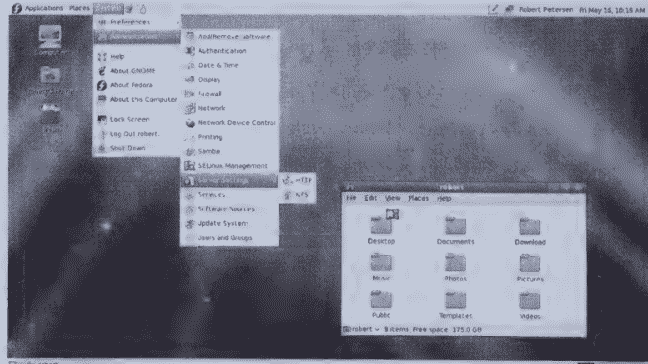

图 1-2：带有 Fedora 标志的 Fedora 9 桌面

### 开源软件

Linux 是作为一项开源努力开发的，没有一个公司或机构控制它。开源软件在互联网上发布，免费分发给其他。开源软件已被证明是可靠且有效的。许多流行的 Linux 工具，如 C 编译器、shell 和编辑器，都是 GNU 应用。其源代码包含在所有 Linux 发行版中，并在互联网上免费可用。许多主要的软件开发也是开源项目，例如 KDE 和 GNOME 桌面。Netscape 通信浏览器包也已开源，其源代码免费可用。Sun 支持的 OpenOffice 套件是开源 的商业版本。许多运行 Linux 的开源项目将其网站位于 SourceForge (`sourceforge.net`)，这是一个专门支持开源项目的网站。您可以在 `开源.org` 获取更多有关开源运动的信息。

开源软件受公共许可证保护。这些许可防止商业公司通过添加自己的修改、对更改申请版权并作为自己的软件出售来控制开源。最流行的许可证是 Free Source Foundation 提供的 GNU 公许可证。这是 Linux 分发的许可。GNU 公许可证保留了版权，免费许可软件，并要求软件及其修改始终可用。还创建了其他公共许可证来支持不同类型的开源项目。GNU 宽义许可证 (`LGPL`) 允许商业应用程序使用 GNU 许可库。Qt 公许可证 (`QPL`) 让开源开发者可以使用 KDE 的 Qt 库。您可以在 `www.opensource.org` 找到完整列表。

Linux 目前由 Free Source Foundation 提供的 GNU 公共许可证管理，通常被称为 GNU 软件（见 `www.gnu.org`）。GNU 软件是可靠且分发的，免费分发给他人。GNU 软件已被证明是可靠且有效的。您的 Linux 发行版中安装了 GNU C++ 和 Lisp 编译器、Vi 和 Emacs 编辑器、BASH 和 TCSH Shell，以及 Tex 和 Ghostscript 文档格式化程序。

# 第1部分：系统管理

将其免费提供。一个分发商可以对软件收费，而另一个则可以免费提供。主要的软件公司也为其最受欢迎的应用提供了 Linux 版本。Oracle 提供了其 Oracle 数据库的 Linux 版本。（目前似乎还没有开发微软应用程序的计划。）

## Linux 和 Unix 简史

作为 Unix 的一个版本，Unix 的历史自然始于 Unix。故事始于 20 世纪 60 年代后期，当时出现了开发新型操作系统技术的共同努力。1968 年，来自通用电气、AT&T 贝尔实验室和马诸塞理工学院的研究员联盟开展了一项名为 MULTICS（多路信息与计算服务）的特殊操作系统研究项目。MULTICS 整合了多任务、文件管理和用户交互等许多新概念。

### Unix

1969 年，肯·汤普（Ken Thompson）、丹尼斯·里奇（Dennis Ritchie）和 AT&T 贝尔实验室的研究人员开发了该操作系统，并整合了 MULTICS 研究项目的许多特性。他们根据研究环境的需求对系统进行了定制，设计使其运行在小型计算机上。从诞生起，Unix 就是一种价格廉惠的多用户、多任务操作系统。

随着越来越多的研究人员使用该系统，Unix 系统在贝尔实验室变得流行。1973 年，丹尼斯·里奇与肯·汤普合作，用 C 语言语言重写了 Unix 的程序代码。Unix 逐渐从一个人的定制设计演变为由许多供应商（如诺贝尔和 IBM）分发的标准软件产品。最初，Unix 被视为一种研究产品。第一版 Unix 免费分发给许多知名大学的计算机科学系。整个 20 世纪 70 年代，贝尔实验室发布了 Unix 的官方版本并授权给不同的用户。这些用户之一就是加州大学伯克利利分校的计算机科学系。伯克利为系统添加了许多后来成为标准的特性。1975 年，伯克利通过其分发机构伯克利软件分发（BSD）发布了其所属的 Unix 版本。这个 BSD 版本的 Unix 成为 AT&T 贝尔实验室版本的主要对竞争者。AT&T 开发了多个 Unix 版本，并在 1983 年发布了第一个商业版本，称为 System 3。随后是 System V，它成为了一个受支持的商业软件产品。

与此同时，BSD 版本的 Unix 通过多次发布不断发展。20 世纪 70 年代后期，BSD Unix 成为国防部高级研究计划局（DARPA）的一个研究项目的基础。结果1983 年，伯克利发布了强大的 Unix 4.2 版本。该版本引入了复杂的 own管理以及基于 Internet 协议的网络功能——这些与互联网使用的协议相同。BSD 4.2 版本广泛分发并被 Sun Micros 等许多供应商采纳。

20 世纪 80 年代中期，出现了两个竞争标准，一个基于 AT&T 的 Unix 版本，另一个基于 BSD 版本。System V release 4。IBM 和惠尔·惠普等其他公司成立了开放软件基金会（OSF），以创建自己的标准 Unix 版本。当时存在两个商业标准版本——OSF 版本和 System V release 4。

# 第1 章：Fedora 9 简介

### Linux

Linux 最初专为基于英特尔的个人计算机设计，是赫尔辛基大学一名计算机科学学生林斯·托瓦尔斯（Lin Torvalds）的个人项目。当时，学生们正在使用一种名为 Minix 的程序，该程序突出了 Unix 的特性。Minix 由安德鲁·塔能鲍姆（Andrew Tanenbaum）教授创建，并在全球广泛分发。Linux 的意图是创建一个有效的 PC 版 Unix。它以 Minix 命名，并于 1991 年发布了 0.11 版本。Linux 在互联网上广泛分发，在随后的几年里，其他程序员对其进行了完善和改进，整合了现在 Unix 系统中找到的大部分应用程序和功能。所有主要的窗口已移植到 Linux。Linux 拥有所有的网络工具，例如 FTP 文件传输支持、Web 浏览器以及一系列网络服务，如电子邮件、域名服务和动态主机配置，以及 FTP、Web 和打印服务器。它还有一套完整的程序开发实用程序，如 C++ 编译器和调试器。考虑到所有这些特性，该操作系统仍保持小型、稳定和快速。在最简单的格式下，Linux 需 2MB 内存即可运行。

尽管 Linux 是在互联网上开发的，但由于 Unix 的普及，电气电子工程师学会（IEEE）开发了一个所有版本都必须遵守的标准。美国国家标准协会（ANSI）开发了一个名为 POSIX 的标准。计算机环境可移植操作系统（POSIX）定义了 Unix 需要如何运行。Linux 还遵循 Linux 文件层次结构标准（FHS），它规定了文件和目录的位置。更多细节请参见 `pathname.com/fhs`。Linux 开发现在由 Linux 基金会（`www.linuxfoundation.org`）监督，它与开源开发实验室（OSDL）合作。实际内核在 `www.kernel.org` 发布。

## 2. 基础系统管理

Linux 设计用于同时为许多用户提供服务，通过其资源、服务和设备在用户与系统之间提供接口。用户有自己的 shell 来进行交互，但你可能需要配置系统。此类操作属于系统管理范畴。执行此类操作的人被称为系统管理员或超级用户（`superuser`）。从这个意义上说，与 Linux 有两种交互：普通用户的交互和超级用户的交互。书中的章节涵盖了更改运行级别、管理用户、配置打印机、添加文件系统和编译内核等操作。你很少执行这些大多数任务，例如添加新打印机或挂载文件系统。其他任务，如添加或删除用户，你会定期执行。基础系统管理涵盖了超级用户访问系统、选择启动的运行级别、系统配置文件和性能监控等主题。

通过 Linux，你能够加载不同版本的 Linux 内核以及你在系统上安装的其他操作系统。选择和启动操作系统或内核的任务由启动管理实用程序通用统一引导加载程序（GRUB）管理。

### 超级用户控制：Root 用户

要执行系统操作，你必须拥有访问权限，例如允许你以 root 用户身份登录的正确密码，使你成为超级用户。由于超级用户有更改系统上任何内容的权力，密码通常是经过保护的秘密，频繁更改，并且只给那些工作是管理系统的人。有了正确的密码，你可以以系统管理员身份登录系统并以不同的方式对其配置。你可以启动和关闭系统，还可以切换到不同的运行模式，例如单用户模式。你还可以添加或删除

用户、添加或删除远程文件系统、备份和恢复文件，甚至指定系统的名称和地址。

要成为超级用户（`superuser`），你需要登录 root 用户账户。这是一个专门用于系统管理操作的特殊账户，对 Linux 操作系统的所有组件具有不受限制的访问权限。你可以从 GUI（图形用户界面）登录屏幕或命令行提示符以 root 用户身份登录。之后你就可以访问管理工具。使用如 GNOME 等 GUI 界面，root 用户可以访问许多 Red Hat 和 Fedora 的 GUI 管理工具，例如用于安装软件的 PackageKit 或用于管理用户的 `system-config-users`。如果你从命令行界面登录，可以运行相应的管理命令，如使用 `rpm` 安装软件包，或使用 `useradd` 添加新用户。在 GUI 桌面面上，你也可以通过终端窗口运行命令行管理工具。root 用户的命令行界面使用特殊的提示符，即井号 `#`。在接下来的示例中，用户以 root 用户身份登录系统并收到了 `#` 提示符。

```
login: root
password:
#
```

### Root 用户密码

作为 root 用户，你可以使用 `passwd` 命令更改 root 登录密码，以及系统上任何其他用户的密码。`passwd` 命令会根据第 9 章中讨论的可插拔模块（PAM）检查你的密码，以查看你选择的是否容易破解的密码。要从 GUI 界面方便地更改 root 密码，可以使用 `system-config-rootpassword` 工具。

```
passwd root
New-enter password:
#
```

你必须采取措施保护你的 root 密码。任何获得 root 用户权限的人都对你的系统拥有完全控制权。`passwd` 命令手册提供了处理和选择密码的详细建议。例如，永远不要将密码存储在系统的文件中，并且要根据任何可访问的信息（如电话号码或出生日期）选择密码。一个基本准则是让你的密码尽可能复杂，使用由几个单词组成的短语并加上数字和大写字母，但同时又要容易记忆，这样你就不需要将其写下来。你可以通过命令访问 `passwd` 在线帮助页：

```
man passwd
```

### Root 用户访问：su

当你登录到普通用户账户时，可能需要以 root 身份登录并成为超级用户。通常情况下，你需要先注销用户账户，然后登录 root。相反，你可以使用 `su` 命令（切换用户）在保持用户账户登录的同时直接登录。如果你正在使用 GNOME 桌面，可以从终端窗口输入 `su` 命令，或者使用 ALT-CTRL-F1 切换到命令行界面（ALT-CTRL-F10 返回到 GUI 界面）。输入 CTRL-D 或 `exit` 会返回到你自己的用户登录界面。当你以 root 身份登录时，可以使用 `su` 登录到任何用户而无需提供密码。在接下来的示例中，用户已经登录。`su` 命令以 root 用户身份登录，使用户成为超级用户。表 2-1 显示了一些基本的超级用户命令。

```
$pwd
/home/chris
$ su
password:
### cd
$pwd
/root
### exit
$
```

注意：出于安全考虑，Linux 发行版不允许在 telnet 会话中使用 su  root 用户。对于启用了 SSH 和 Kerberos 的系统，Fedora 提供了使用 login (SSH) 和 rlogin (Kerberos 版本) 的安全登录。

### 受控的管理访问：sudo

通过 `sudo` 工具，你可以允许普通用户针对某些任务拥有有限的 root 用户级管理访问权限。这允许他人执行特定的超级用户操作，而无需完全的 root 控制权。你可以在 `www.sudo.ws` 找到更多关于 sudo 的信息。要使用 sudo 运行管理命令，用户需在命令前加上 `sudo` 命令。用户将获得一个有时限的票据以允许访问。

```
sudo date
```

访问由 `/etc/sudoers` 文件控制。该文件列出了用户及其可以运行的命令，以及访问所需的密码。如果设置了 NOPASSWD 选项，则用户不需要密码。`ALL` 根据上下文可以指代你网络上的所有主机、所有 root 级命令或所有用户。


要进行更改或添加条目，你必须使用特殊的 sudo 编辑命令 `visudo` 编辑该文件。这会调用编辑器来编辑 `/etc/sudoers` 文件。与标准编辑器不同，`visudo` 会锁定文件并检查你所写条目的语法。除非语法正确，否则不允许保存更改。如果你想使用不同的编辑器，可以将其分配给 `EDITOR` 壳变量。

一个 sudoers 条目具有以下语法：

```
user host=command
```

`host` 是你网络上的。你可以使用 `ALL` 术语指定所有主机。命令可以是命令列表，其中部分或全部命令可以通过选项（如是否需要密码）进行限定。要指定所有主机，也可以使用 `ALL` 术语。以下赋予用户 `george` 对所有主机上所有命令的 root 级访问：

```
george ALL = ALL
```

此外，你可以让用户在指定的主机上以另一个用户身份运行。此类替代用户放在命令前的括号内。例如，如果你想让 `george` 以用户 `mydnsns` 的身份访问 `beach` 主机，你使用以下：

# 第 2 章：基础系统管理

## 表 2-1：基本超级用户命令

| 命令 | 说明 |
|---|---|
| `passwd` | 更改密码 |
| `su` | 切换用户 |
| `cd` | 切换当前目录 |
| `exit` | 退出 shell |
| `pwd` | 列出当前工作目录 |
| `man` | 显示帮助页 |
| `sudo` | 以 root 权限运行命令 |
| `visudo` | 编辑 sudoers 文件 |
| `rpm` | 安装或管理软件包 |
| `useradd` | 添加新用户 |
| `system-config-rootpassword` | 管理 root 密码 |
| `system-config-users` | 管理用户 |

### Fedora 管理工具

在 Fedora 上，大多数管理任务可以通过一组特殊的工具处理，这些工具可以在任何窗口环境中运行（如 GNOME 或 KDE）。在设置文件夹中，工具通过简单的术语识别，而它们的实际名称以 `system-config` 开头。例如，打印机配置工具列为 Printing，但其实际名称是 `system-config-printer`。你可以通过在终端窗口输入其名称来单独调用它。

## 表 2-2：Fedora 配置工具

| Fedora 管理工具 | 说明 |
|---|---|
| System Administration | 访问管理工具的菜单 |
| `system-config-users` | 用户和组配置工具 |
| `system-config-printer` | 打印机配置工具 |
| `system-config-display` | 显示配置工具（显卡和显示器） |
| `system-config-services` | 服务管理 |
| `system-config-rootpassword` | 管理 root 密码 |
| `system-config-keyboard` | 更改键盘配置 |
| `system-config-date` | 更改系统时间和日期 |
| `system-config-time` | 更改系统时间和 |
| `system-config-language` | 选择使用的语言 |
| PackageKit | 软件管理 (PolicyKit)。 |

### 系统目录

你的 Linux 文件系统组织成不同的目录，其文件用于不同的系统功能（见表 2-3）。对于基础系统管理，你应该熟悉存放应用程序的系统程序目录、系统配置目录（`/etc`）

# 第 1 部分：系统管理

大多数配置文件存放的位置，以及存放系统日志（记录系统活动）的系统日志目录（`/var/log`）。其他系统目录将在相应的章节中介绍，如第 15 章所讨论的。

| 目录 | 描述 |
| --- | --- |
| `/bin` | 系统相关程序 |
| `/sbin` | 用于特殊任务的系统程序 |
| `/lib` | 系统和应用程序库 |
| `/etc` | 系统和网络服务及应用程序的配置文件 |
| `/home` | 用户目录和服务器数据目录（如 Web 和 FTP 站点文件）的位置 |
| `/mnt` | CD-ROM 和软软磁盘文件系统的挂载位置 |
| `/var` | 文件不断变化的系统目录位置，例如日志、打印机池化文件和锁文件 |
| `/usr` | 用户相关的程序和文件。包括几个关键子目录，如 `/usr/bin`、`/usr/X11` 和 `/usr/doc` |
| `/usr/bin` | 用户的程序 |
| `/dev` | 用于设备文件的动态生成目录 |
| `/etc/X11` | 窗口系统配置文件 |
| `/usr/share` | 共享文件 |
| `/usr/share/doc` | 应用程序文档 |
| `/tmp` | 系统临时文件目录 |
| `/var/log` | 日志目录 |
| `/var/log/` | syslogd 生成的系统日志 |
| `/var/log/audit` | auditd 生成的审计日志 |

### 表 2-3：系统目录

注意：如果启用了 SELinux，超级用户访问将受 SELinux 规则控制。见第 12 章。

### 程序目录

名称中包含 "bin" 的目录用于存放程序。`/bin` 目录存放基础用户程序，例如登录 shell（BASH, TSH, ZSH）和所有命令（`cp`, `mv`, `rm` 等）。`/sbin` 目录包含用于特殊任务的专用系统程序，例如文件系统管理（`fsck`, `disk`, `mkfs`）以及关机和启动等系统操作（`init`）。`/usr/bin` 目录包含为用户任务设计的程序。`/usr/sbin` 目录包含用户相关的系统操作，例如用于添加新用户的 `useradd`。`/lib` 目录包含系统创建的所有库，包括主 Linux 库 `libc` 以及模块等子目录（其中包含所有当前内核模块）。

# 第 2 章：基础系统管理

### 配置目录和文件

当你配置系统的不同元素（如用户、应用程序、服务器或网络连接）时，你会利用存储在某些系统目录中的配置文件。配置文件存放在 `/etc` 目录，更具体的设备和及配置位于 `/etc/sysconfig` 目录。

### 配置文件：/etc

`/etc` 目录存放你的系统、网络、服务器和应用程序的配置文件。在这里，你可以找到列出系统文件的 `fstab` 文件、包含系统上主机 IP 地址的 `hosts` 文件，以及用于 GRUB 引导程序支持的启动系统的 `grub.conf`（指向 `/boot/grub/grub.conf` 的链接）。该目录包括各种子目录，例如用于 Apache 服务器配置文件的 `/etc/apache`，用于 X 窗口系统和窗口管理器配置文件的 `/etc/X11`，以及用于在 `/dev` 中生成设备文件的规则的 `/etc/udev`。你可以通过直接编辑各自的配置文件来配置许多应用程序和服务，但最好使用相应的管理工具。表 2-4 列出了在 `/etc` 目录中常见的配置文件。

| 文件 | 描述 |
| --- | --- |
| `/etc/bashrc` | Bash shell 的默认 shell 配置文件 |
| `/etc/group` | 包含组列表以及每个组的配置 |
| `/etc/fstab` | 启动系统时自动挂载文件系统 |
| `/boot/grub/grub.conf` | GRUB 引导程序的 GRUB 配置文件，由 `/etc/grub.conf` 链接 |
| `/etc/initab` | 设置默认状态以及终端连接 |
| `/etc/profile` | 用户的默认 shell 配置文件 |
| `/etc/modprobe.d` | 内核模块配置文件的目录，指定系统上自动加载的模块 |
| `/etc/motd` | 系统管理员的每日消息 |
| `/etc/mtab` | 当前挂载的文件系统 |
| `/etc/passwd` | 包含用户密码和登录配置 |
| `/etc/services` | 运行在系统上的服务及其使用的端口 |
| `/etc/shadow` | 包含用户加密后的密码 |
| `/etc/shells` | 用户可以使用的系统上安装的 shell |
| `/etc/sudoers` | 控制管理访问的 sudo 配置 |
| `/etc/termcap` | 包含可能连接到系统的终端的类型规范列表 |
| `/etc/xinetd.conf` | Xinetd 服务器配置 |

### 目录

- `/etc/cron`: Cron 脚本
- `/etc/cups`: CUPS 打印机配置文件
- `/etc/init.d`: 服务脚本
- `/etc/openldap`: Open LDAP 服务器配置
- `/etc/rc.d`: 不同运行级别的启动脚本
- `/etc/skel`: 存放初始化文件版本的目录（如 `bash_profile`），这些文件会被复制到新用户的家目录
- `/etc/sysconfig`: Red Hat 和 Fedora 的设备和服务配置环境及支持
- `/etc/X11`: X 窗口系统配置文件
- `/etc/xinetd.d`: 配置脚本
- `/etc/udev`: 生成设备的规则
- `/etc/hal`: 可移动设备的规则

### 表 2-4：配置目录和文件

`/etc/sysconfig`: Red Hat 和 Fedora 的设备和服务配置环境及支持。在这里，你可以找到主机信息。`/etc/sysconfig`: 键盘示例显示在这里。

```
KEYBOARD="pc"
KEYTABLE="us"
```

某些工具使用多个配置文件；例如，`system-config-network`。

### 第 2 章：基础系统管理

名称中包含 "bin" 的目录用于存放程序。`/bin` 目录存放基础用户程序，例如登录 shell（BASH, TSH, ZSH）和所有命令（`cp`, `mv`, `rm` 等）。`/sbin` 目录包含用于特殊任务的专用系统程序，例如文件系统管理（`fsck`, `disk`, `mkfs`）以及关机和启动等系统操作（`init`）。`/usr/bin` 目录包含为用户任务设计的程序。`/usr/sbin` 目录包含用户相关的系统操作，例如用于添加新用户的 `useradd`。`/lib` 目录包含系统创建的所有库，包括主 Linux 库 `libc` 以及模块等子目录（其中包含所有当前内核模块）。

### 配置目录和文件

当你配置系统的不同元素（如用户、应用程序、服务器或网络连接）时，你会利用存储在某些系统目录中的配置文件。配置文件存放在 `/etc` 目录，更具体的设备及服务配置位于 `/etc/sysconfig` 目录。

### 配置文件：/etc

`/etc` 目录存放你的系统、网络、服务器和应用程序的配置文件。在这里，你可以找到列出系统文件的 `fstab` 文件、包含系统上主机 IP 地址的 `hosts` 文件，以及用于 GRUB 引导程序支持的启动系统的 `grub.conf`（指向 `/boot/grub/grub.conf` 的链接）。该目录包括各种子目录，例如用于 Apache 服务器配置文件的 `/etc/apache`，用于 X 窗口系统和窗口管理器配置文件的 `/etc/X11`，以及用于在 `/dev` 中生成设备文件的规则的 `/etc/udev`。你可以通过直接编辑各自的配置文件来配置许多应用程序和服务，但最好使用相应的管理工具。表 2-4 列出了在 `/etc` 目录中常见的配置文件。

| 文件 | 描述 |
| --- | --- |
| `/etc/bashrc` | Bash shell 的默认 shell 配置文件 |
| `/etc/group` | 包含组列表以及每个组的配置 |
| `/etc/fstab` | 启动系统时自动挂载文件系统 |
| `/boot/grub/grub.conf` | GRUB 引导程序的 GRUB 配置文件，由 `/etc/grub.conf` 链接 |
| `/etc/initab` | 设置默认状态以及终端连接 |
| `/etc/profile` | 用户的默认 shell 配置文件 |
| `/etc/modprobe.d` | 内核模块配置文件的目录，指定系统上自动加载的模块 |
| `/etc/motd` | 系统管理员的每日消息 |
| `/etc/mtab` | 当前挂载的文件系统 |
| `/etc/passwd` | 包含用户密码和登录配置 |
| `/etc/services` | 运行在系统上的服务及其使用的端口 |
| `/etc/shadow` | 包含用户加密后的密码 |
| `/etc/shells` | 用户可以使用的系统上安装的 shell |
| `/etc/sudoers` | 控制管理访问的 sudo 配置 |
| `/etc/termcap` | 包含可能连接到系统的终端的类型规范列表 |
| `/etc/xinetd.conf` | Xinetd 服务器配置 |

### 目录

- `/etc/cron`: Cron 脚本
- `/etc/cups`: CUPS 打印机配置文件
- `/etc/init.d`: 服务脚本
- `/etc/openldap`: Open LDAP 服务器配置
- `/etc/rc.d`: 不同运行级别的启动脚本
- `/etc/skel`: 存放初始化文件版本的目录（如 `bash_profile`），这些文件会被复制到新用户的家目录
- `/etc/sysconfig`: Red Hat 和 Fedora 的设备和服务配置环境及支持
- `/etc/X11`: X 窗口系统配置文件
- `/etc/xinetd.d`: 配置脚本
- `/etc/udev`: 生成设备的规则
- `/etc/hal`: 可移动设备的规则

### 表 2-4：配置目录和文件

`/etc/sysconfig`: Red Hat 和 Fedora 的设备和服务配置环境及支持。在这里，你可以找到主机信息。`/etc/sysconfig`: 键盘示例显示在这里。

```
KEYBOARD="pc"
KEYTABLE="us"
```

某些工具使用多个配置文件；例如，`system-config-network`。

### 第 2 章：基础系统管理

### 系统时间与日期

你可以使用 shell `date` 命令或 Fedora GUI 工具 `system-config-date` 来选择系统时间和日期。你可能在首次安装系统时已经设置过时间和日期。通常你不需要再次设置。不过，如果你输入的时间错误或移动到了不同的时区，可以使用此来更改时间。

### GNOME 国际时钟：时间、日期和天气

国际时钟小组件位于顶部面板右侧。它显示你所在地区的当前时间和日期，但也可以修改为显示天气，以及世界上任何位置的时间、日期和天气。

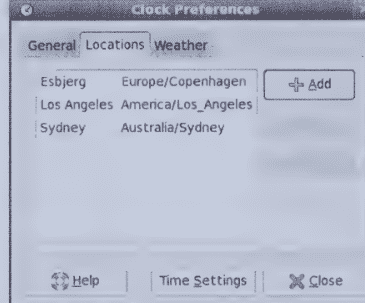

图 2-1：在国际时钟选择位置

要添加位置，右键点击时间并从弹出菜单中选择偏好 (Preferences)。时钟偏好窗口将显示三个面板：常规 (General)、位置 (Location) 和天气 (Weather)。要添加新位置，点击位置面板上的“添加 (Add)”按钮（参见图 1-1）。这将打开一个框，你可以在其中输入位置名称、时区和坐标。更简单的方法是找到“查找 (Find)”按钮并展开位置树列表，从大洲开始，然后是区域、国家和城市。

在天气面板上，你可以指定要使用的温度和风力单位。常规面板可以设置这些位置的时钟显示选项，例如是否显示天气、温度和秒。

一旦你设置了自己的所在位置，你将看到面板上的时间旁边出现一个天气图标，显示你当前的天气（参见图 2-2）。


图 2-2：带有天气图标的国际时钟

### 第 2 章：基础系统管理

要查看你选择的位置，点击顶部面板上显示的时间（参见图 3-3）。这将打开一个日历，底部有一个带有可展开箭头的“位置 (Location)”标签。

点击此箭头显示你所有的位置及其时间和天气。你的主页位置旁边会有一个房屋图标。世界地图将你所有的位置显示为红点，并用蓝色房屋图标表示你当前的主页位置。当你点击某个位置条目时，对应的点将闪烁几秒。每个位置都有一个小地球天气图标，表示大致天气，如晴天或多云。将鼠标悬停在天气图标上，将弹出对话框显示当前天气、温度、速度以及日出和日落时间。每个位置的时钟图标将根据该位置当天的时间显示深色、灰色或亮色。

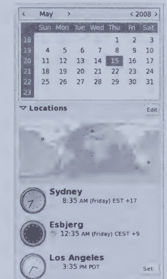

图 2-3：国际时钟，全显示

你可以通过点击想要设置为房屋的位置右侧的“设置 (Set)”按钮轻松更改主页位置。你会看到房屋图标移动到新位置。这在旅行时很有帮助。每个位置的时钟显示右侧都有一个设置按钮，只有当鼠标悬停在其上方才会显示。

要进行任何更改，你可以点击“位置 (Locations)”标签旁边的“编辑 (Edit)”按钮。这将打开时钟偏好窗口，你可以在其中配置显示或添加和删除位置。

## 第 1 部分：系统管理

日历将显示当前日期，但你可以使用日历顶部的月份和年份滚动箭头移动不同的月份和年份。

要手动设置时间，右键点击时间并选择“调整日期与时间 (Adjust Date & Time)”（也可以在时钟偏好窗口的常规面板中点击“时间设置 (Time Settings)”按钮）。这将打开一个时间设置窗口，你可以在其中输入并设置日期（参见图 2-4）。这将打开日历上的月份和年份箭头以更改月份和年份。要设置整个系统的时间，点击“设置时间 (Set Time)”按钮。

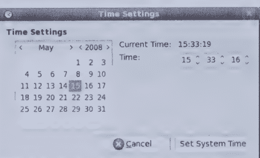

图 2-4：手动设置时

### 使用 system-config-date 工具

设置系统时间和日期的优方法是使用 Fedora 日期属性工具（`system-config-date` 或 `system-config-time`）。在 GNOME 系统菜单中选择“系统 (System) | 管理 (Administration) | 日期与时间 (Date & Time)”。有三个面板：一个用于日期和时间，一个用于网络时间协议 (NTP)，一个用于时区（参见图 2-5）。使用日历选择年份、月份和日期。使用时间框设置小时、分和秒。时区面板显示了带有位置的地图。选择其中一个设置你的系统时间。


网络时间协议 (`NTP`) 允许远程服务器设置日期时间，而不是使用本地设置。`NTP` 允许对你的时钟进行最准确的同步。它通常用于管理网络系统的日期时间，使管理员不再需要手动同步时钟。你可以从 `www.ntp.org` 下载当前的文档和 `NTP` 软件。

在网络时间协议面板上，你可以启用 `NTP` 并选择要使用的服务器。`NTP` 服务器通过池 (`pools`) 运行，用于同步你的时钟。`NTP` 池是服务器组，以确保服务器始终可用。如果一个服务器宕机，客户端将连接到池中的另一个服务器。这提供了专用服务器的可靠性，而无需维护该服务器的成本。

## 第 2 章：基础系统管理（续）


图 2-5：设置日期与时间

## 第 2 章：基础系统管理 57

### cron 的环境变量

`cron` 服务还允许你为执行的任务定义环境变量。`Fedora` 为 `SHELL`、`PATH`、`HOME` 和 `MAILTO` 定义了变量。`SHELL` 指定要使用的 shell，在此例中为 `bash` shell。`PATH` 列出了可以找到程序和脚本的目录。此示例列出了标准目录 `/usr/bin` 和 `/bin`，以及用于系统应用程序的系统目录 `/usr/sbin` 和 `/sbin`。`MAILTO` 指定将任务结果邮件发送给谁。默认情况下，这些结果将发送给特定用户，或者作为管理员的电子邮件地址，亦或发送到网络中另一个系统上的账户。`HOME` 是任务的家目录，在本例中为顶层目录。

```
SHELL=/bin/bash
PATH=/sbin:/bin:/usr/sbin:/usr/bin
MAILTO=root
HOME=
```

### cron.d 目录

在频繁使用的系统中，`/etc/crontab` 文件很容易变得拥挤。可能会出现某些条目需要不同变量的情况。例如，你可能需要在不同的 shell 下运行某些任务。为了更好地组织，你可以将 `crontab` 条目放置在 `cron.d` 目录下的文件中。`cron.d` 目录中的文件都包含与 `/etc/crontab` 格式相同的 `crontab` 条目。它们可以拥有任何名称。它们被视为 `crontab` 文件，`cron` 会检查它们以查找运行的任务。例如，`Fedora` 在 `cron.d` 中安装了一个 `sysstat` 文件，其中包含用于运行收集系统统计信息的工具的 `crontab` 条目。

### crontab 命令

你使用 `crontab` 命令将你的条目安装到 `crontab` 文件中。要执行操作，创建一个包含你的 `crontab` 条目的文本文件。以任何名称（如 `mycronfile`）保存此文件。然后，要安装这些条目，输入 `crontab` 加上文件名。`crontab` 命令获取文本文件的内容并在 `/var/spool/cron` 目录下创建一个 `crontab` 文件，同时添加安装它的用户的名称。在接下来，`root` 用户将 `mycronfile` 的内容安装为 `root` 的 `crontab` 文件。这将创建一个名为 `/var/spool/cron/root` 的文件。如果一个名为 `Justin` 的用户安装了一个文件，它将创建一个名为 `/var/spool/cron/justin` 的文件。你可以通过 `/etc/cron.allow` 文件控制普通用户使用 `crontab` 命令。只有此文件中名称的用户才能创建 `crontab`。相反，`/etc/cron.deny` 文件列出了被拒绝使用 `cron` 的用户，防止他们调度任务。如果两个文件都不存在，则拒绝所有用户的访问。如果一个用户不在 `/etc/cron.allow` 文件中，则被拒绝访问。然而，如果 `/etc/cron.allow` 文件不存在而 `/etc/cron.deny` 文件存在，则未列出的用户都被自动允许。

```
### cron mycronfile
```

### 在 cron 中编辑

永远不要尝试直接编辑你的 `crontab` 文件。相反，使用带有 `-e` 选项的 `crontab` 命令。这将在使用标准文本编辑器（如 `Vi`）在 `/var/spool/cron` 目录中打开你的 `crontab` 文件——`crontab` 使用由 `EDITOR` shell 环境变量指定的编辑器。要为 `crontab` 使用不同的编辑器，可以通过将编辑器的程序名分配给 `EDITOR` 变量并导出该变量来更改默认编辑器。通常，编辑器变量设置在 `/etc/profile` 脚本中。运行带有 `-l` 选项的 `crontab` 会显示你的 `crontab` 文件的内容，`-r` 选项会删除整个文件。使用包含 `crontab` 条目的另一个文本文件调用 `crontab` 将更新你当前的 `crontab` 文件，用文件内容替换它。

### 组织调度任务

你可以将管理 `cron` 任务分为两个大类：可以定期运行的常见管理任务，或者需要在特定时间运行的特殊任务。特殊任务可以像下一节描述成为 `/etc/crontab` 文件中的条目。常见管理任务虽然可以从 `/etc/crontab` 文件运行，但最好组织到专门的 `cron` 目录中。在这些目录中，每个任务都放置在自己的 shell 脚本中，该脚本在运行时将调用该任务。例如，可能有多个管理任务都需要每周在某天运行，比如如果系统维护被安排在周日上午。对于这类任务，`cron` 提供了几个用于每天、每周、每月和每年的专用目录。`/etc/cron.daily` 目录用于每天运行的任务，而 `/etc/cron.weekly` 目录用于每周任务。

表 2-6：Cron 文件和目录

| 目录 | 描述 |

| :--- | :--- |

| /etc/crontab | 系统 crontab 文件，root 用户可访问 |

| /etc/cron.daily | 每日任务目录 |

| /etc/cron.weekly | 每周任务目录 |

| /etc/cron.monthly | 每月任务目录 |

| /etc/cron.yearly | 每年任务目录 |

| /etc/cron.hourly | 每小时任务目录 |

| /etc/cron.allow | 允许提交 cron 的用户 |

| /etc/cron.deny | 拒绝访问 cron 的用户 |

### 运行脚本

`cron` 目录内的脚本按名称字母顺序顺序运行。如果你需要某个脚本在其他脚本之前运行，你可能需要在其名称前加一个数字。例如，在 `/cron.weekly` 目录下，脚本命名为 `0anacon`，以便它在任何脚本之前运行。实际调度由 `/etc/crontab` 文件中的条目执行。例如，如果 `crontab` 文件中的每周字段从 `0` 改为 `*`，并将每月字段改为 `1`（从 `22 * *` 改为 `22 1 * *`），则每周文件中的任务将每月运行而非每周。

### Cron 目录名称

这些目录使用的名称仅为约定。它们对 `cron` 守护进程没有特殊含义。事实上，你可以创建自己的目录，在其中放置脚本，并调度 `run-parts` 在指定时间运行这些脚本。在下一个示例中，放置在 `/etc/cron.mydocs` 目录中的脚本将在周三中午 12 点运行。

- * 12 * * 3 root /etc/cron.mydocs

### Anacon

对于可能在 `cron` 运行时关闭的系统，你可能想用 `anacon` 补充 `cron`。`Anacon` 仅在需要执行调度任务时激活。例如，如果系统在安排 `cron` 任务的周末关闭，任务将无法执行；然而，`anacon` 会在系统再次启动时检查哪些需要执行的任务，然后运行它们。这仅为每天或每周运行的任务设计。

对于 `anacon` 任务，你在 `/etc/anacontab` 文件放置 `crontab` 条目。对于每个调度任务，你指定执行的间隔天数（每周7，每月30天）、运行时间（以分钟计数）、任务描述以及要执行的命令。对于备份，使用的命令将是 `tar` 操作。你可以使用 `system-config-services` 开启 `anacon` 服务或让它在启动时自动启动。

### 统一引导加载程序 (GRUB)

统一引导加载程序 (`GRUB`) 是一种用于 `Fedora` 和 `Red Hat Linux` 的多引导加载器。通过 `Grub`，用户可以在系统启动时显示的菜单界面中选择操作系统。使用方向键移动到条目并按回车键。输入编辑命令，允许你更改内核参数或指定不同的内核。该命令将你进入命令行界面。只要你的系统 BIOS 支持大硬盘，`GRUB` 就可以从 Linux 和 Unix 操作系统系统的任何地方启动，并接收启动时传递的参数。检查 `GRUB` 手册获取页面选项。你可以使用启动配置文件选择默认系统或内核，以及超时限制（在设置菜单中通过“引导程序”访问）。

`GRUB` 配置存储在 `/boot/grub.conf` 文件中（你也可以通过 `/etc/grub.conf` 链接访问），只需要创建条目，`GRUB` 将会在你重启时自动读取它们。你有几个选项可以选择，例如超时和使用的背景图像。查看 `GRUB` info 文档获取详细描述，执行 `info grub`。你可以为它指定一个标题条目，以 `title` 终端开头。然后你必须指定操作系统内核或程序的位置，位于哪个硬盘以及该硬盘上的哪个分区。这些信息列在 `root` 选项后的括号中。数字从 0, 1 开始，硬盘用 `hd` 前缀标识，无论是 IDE 还是 SCSI 硬盘。因此 `root (hd0,2)` 指的是第一个硬盘和该硬盘上的第三个分区 (`sda`)。对于 Linux 系统，你还必须使用 `kernel` 选项指定要运行的内核程序，使用全名以及内核可能需要的任何选项。RAM 磁盘由 `initrd` 选项指示。

```
title Fedora Linux (2.6.25-55.fc9.x86_64)
root (hd0,2)
kernel /boot/vmlinuz-2.6.25-55.fc9.x86_64 root=/dev/sda3 rhgb quiet
initrd /boot/initrd-2.6.25-55.fc9.x86_64.img
```

`kernel` 选项指定要运行的内核。内核位于 `/boot` 目录，名为 `vmlinuz` 并带有内核版本号。你可以在 `/boot` 目录中拥有多个内核，并使用 `grub` 选择要使用的那一个。在指定的内核程序之后，你可以为内核指定你想要的任何选项。这包括一个 `ro` 选项，它最初以 `root` 身份启动内核。`root` 选项用于指定安装系统的设备，即你的根目录。在在上一个示例中，系统安装在 `/dev/sda3` 上。如果根目录在逻辑卷上（通常是其安装的地方），设备名称将类似于 `/dev/VolGroup00/LogVol01`。`rhgb quiet` 选项使用 Red Hat 图形启动界面启动你的系统，并在文本显示器上列出所有启动消息。

注意：如果你在使用显卡驱动程序启动，你可能需要从 `grub.conf` 的内核选项中删除 `rhgb quiet`。这将使用命令行界面启动 Linux。

如果你安装了工作站版配置，你的根目录将安装在逻辑卷上。你的 `root` 选项将反映逻辑卷，指定卷组和逻辑卷，如下所示：

```
kernel /vmlinuz-2.6.25.6-55.fc9.x86_64 root=/dev/VolGroup0/LogVol00 rhgb
quiet
```

对于另一个操作系统（如 Windows），你使用 `rootnverify` 选项指定 Windows 的安装位置。此选项指示 `GRUB` 挂载该分区。使用 `chainloader+1` 选项允许 `GRUB` 访问它。`chainloader` 告诉 `GRUB` 为该操作系统使用另一个引导程序。数字表示引导程序所在的分区——`+1` 表示第一个扇区。

### title Windows XP

```
rootnverify (hd0,0)
chainloader +1
```

Windows 系统都希望从第一个硬盘上的第一个分区启动。如果你想在不同的分区上安装多个版本的 Windows，或者在第一个分区以外的分区上安装 Windows，就会变成一个问题。`GRUB` 允许通过隐藏隐藏分区来绕过这个问题，然后取消隐藏你想要的分区，使其看起来像是第一个分区。在这个示例中，第一个分区被隐藏了，第二个分区被取消隐藏。它假设硬盘 (`hd0,1`) 的第二个分区上有一个 Windows 系统。现在由于第一个分区被隐藏了，第二个分区看起来像第一个分区：

```
hide (hd0,0)
unhide (hd0,1)
rootnverify (hd0,1)
```

一个示例 `grub.conf` 文件包含 Linux 和 Windows 的条目。注意，内核参数列在内核参数中，作为内核的参数。根目录安装在逻辑卷 `/dev/VolGroup00/LogVol01` 上。

```
### grub.conf generated by anaconda
#
### 注意，在修改此文件后，你不需要重新运行 grub
### 通知：你有一个 /boot 分区。这意味着
### 所有内核和 initrd 路径都是相对于 /boot/ 的相对路径，例如
### root (sd0,1)
### kernel /vmlinuz-version root=/dev/VolGroup00/LogVol01
### initrd/initrd-version.img
### boot=/dev/sda
default=1
timeout=5
splashimage=(sd0,1)/grub/splash.xpm.gz
hiddenmenu
```

### title Fedora (2.6.25-55.fc9.x86_64)

```
root (sd0,1)
kernel /vmlinuz-2.6.25-55.fc9.x86_64 root=/dev/VolGroup00/LogVol01
initrd/initrd-2.6.25-55.fc9.x86_64.img
```

### title Windows XP

```
rootnverify (hd0,0)
chainloader +1
```

提示：如果你在启动到 Fedora 时遇到问题，并且可以通过编辑 **grub.conf** 文件（例如更改硬盘号）来解决问题，你可以使用你的 CD/DVD Fedora 安装盘启动，并在启动提示符处输入 **linux rescue**。按照提示使用命令行界面启动你的系统。执行 **chroot /mnt/sysimage** 命令。然后你可以切换到 **/boot/grub** 目录，并使用 **vi** 等编辑器编辑你的 **grub.conf** 文件。

注意：旧版本的 Red Hat 和 Fedora 提供了较旧的 Linux 加载器 (`LILO`) 作为其引导管理器。它执行与 `GRUB` 相似的任务。你可以通过使用管理工具（引导程序）或直接编辑 **/etc/lilo.conf** 配置文件来配置 `LILO`。你也可以使用 KDE `Klilo` 工具配置 `LILO`。


## 3. 系统启动与服务

系统启动现在由 `Upstart` 管理。Linux 系统传统上使用 Unix V `init` 通过设置运行级别来启动或关闭服务。`Fedora` 此后用 `Upstart` 守护替换了 `SystemV init` 守护，同时保留了 System V init 运行级别结构以兼容。`System V init` 守护会在系统启动或关闭时运行。`Upstart` 完全由事件驱动。当发生触发需要服务的事件时，服务就会启动。这种事件驱动的方法设计用于处理可插拔设备。当设备添加或删除时，这种变化将成为 `Upstart` 守护检测到的事件，并触发相关的脚本。`System V init` 守护仅在运行级别更改时运行。它只运行，不处理事件。

你可以在以下地址获取更多关于 `Upstart` 的信息：

```
http://fedoraproject.org/wiki/Features/Upstart
http://upstart.ubuntu.com/
http://upstart.ubuntu.com/wiki/
```

还要查看 `events` 手册。`Upstart` 还有自己的 `shutdown`, `reboot`, `halt`, `init` 和 `telinit` 版本，每个都有自己的页面。这些版本在 Fedora 上使用，而不是之前的版本使用的原始 Linux 版本。

`Upstart` 将检测事件，并运行 `/etc/event.d` 目录中对应事件的脚本。这些脚本定义了 `Upstart` 可以运行的任务。`Upstart` 可以执行的任务有

# 64 第一部分：系统管理

定义在 `Upstart` 目录 `/etc/event.d` 下脚本中。在这里你可以找到通过 `rc` 脚本模拟运行级别（`runlevels`）的 `Upstart`作业脚本，以及如 `TTY` 终端连接等系统服务。实际上，`Upstart` 替换了原本 `SysVinit` `/etc/init.d` 文件中的项。

`Upstart` 通过运行作业（`jobs`）来工作。这些作业定义在 `/etc/event.d` 目录下的作业定义文件中。系统已经为 System init 运行级别模拟、`TTY` 系统服务以及某些任务（如通过 Ctrl-Alt-Delete 重启系统）定义了作业。作业脚本将指定一个事件（`event`）、针对该事件执行的操作，以及为该事件运行的任何命令。命令可以是由执行的单个命令，也可以是封装在 `script` 和 `end script` 段落中的一组命令。

`Upstart` 作业描述没有 `start` 指令。它仅可以通过 `start` 命令手动启动。若要在事件发生时自动启动作业，你需要在作业中放置一个 `start` 指令并指定该事件。你可以使用 `stop` 指令来自动停止事件。你可以有多个 `start` 指令，每个对应不同的事件。这里显示了 `control-alt-delete` 作业的 `start on` 指令。

```
start on control-alt-delete
```


在 `control-alt-delete` 作业中，有一个 `control-alt-delete` 事件，它运行带有 `-r` 选项的 `shutdown` 命令重启。`exec` 命令用于直接运行 shell 命令。

```
start on control-alt-delete
exec /sbin/shutdown -r -now
```

许多作业同时定义了 `start` 和 `stop` 指令，用于启动和停止作业。事件也可以接受参数。在控制运行级别 5 的 `rc5` 作业定义中，有 `start on` 和 `stop on`。当发生参数为 5 的运行级别事件时，`rc5` 作业将启动。当发生任何非 5 的运行级别事件（无参数的运行级别）时，`rc5` 将停止。

```
start on runlevel 5
stop on runlevel
```

或者，你可以配合运算符使用括号，例如 `[!] `。此命令用于在首选显示管理器（prefdm）启动脚本中，该脚本在 `rc5` 作业停止后启动。

```
start on stopped rc5
```

如果系统不是在运行级别 5 下启动，启动脚本将结束。

如果在运行级别 5，则脚本将继续运行实际的 X11 prefdm 脚本。

`exec /etc/X11/prefdm`

一个停止或启动的事件表示其他作业已启动或停止。以下 `start on` 指令每当 `myjob` 作业启动时启动其作业。

```
start on started myjob
```

# 第3章：服务管理

作业也可以引用一个脚本，例如 `rc1` 到 `rc5` 的运行级别脚本。若要在另一个脚本完成后运行某个脚本，请引用脚本名称而不是运行级别。以下将在 `rc2` 脚本完成后启动该脚本。

```
start on stopped rc2
```

`startup` 事件表示系统启动。每当系统启动时，`rcS` 作业（单用户模式）最初都会被启动。在它的 `/etc/event.d/rcS` 作业定义文件中你会发现：

```
start on startup
```

用于终端服务的 `TTY1` 作业将有多个 `start` 和 `stop` 指令，在运行级别 2、3、4 和 5 (predef) 自动启动，并在运行级别 0、1 和 6 事件时停止。对于运行级别 2、3 和 4，`TTY1` 作业在它们的 `rc` 运行级别（即 `rc3` 和 `rc4`）结束后启动。

```
start on stopped rc2
start on stopped rc3
start on stopped rc4
start on started predef
```

```
stop on runlevel 0
stop on runlevel 1
stop on runlevel 6
```

```
respawn
exec /sbin/getty tty
```

要运行多个命令，你将命令封装在 `script` 段中。`script` 段以 `runlevel` 关键字开始，并以 `end script` 结束。大多数复杂作业都使用 `script` 段。`rc5` 作业脚本将在带有参数 5 的运行级别处启动。然后运行脚本结构中的命令，通过 `runlevel` 命令将运行级别设置为 5。带有参数 5 运行 `/etc/init.d/rc5` 脚本，以启动任何运行级别 5 的 `/etc/init.d` 服务脚本。当 `telinit` 触发带有参数 5 的运行级别事件时，启动 `rc5` 作业。对于任何非 5 的运行级别事件，该作业将停止。`console` 指令指定作业输出的去向，通常是控制台（output）。

```
start on runlevel 5
stop on runlevel
```

```
console output
script
```

```
set $(runlevel--set 5 || true)
if [ "$1" != "unknown" ]; then
  PREVLEVEL=$1
  RUNLEVEL=$2
  export PREVLEVEL RUNLEVEL
fi
```

```
exec /etc/init.d/rc 5
end script
```

你可以认为 Upstart 守护进程正在管理一组作业，就像 shell 管理后台作业一样。通过 `start` 和 `stop` 命令，你可以启动和停止任何作业。

使用 `status` 查看作业状态。你可以以 root 用户身份登录或使用 `sudo` 命令运行这些命令。

```
$ stop ttyl
ttyl (stop) running, process 5109
ttyl (stop) pre-stop, (main) process 5109
ttyl (stop) stopping, process 5109
ttyl (stop) killed, process 5109
ttyl (stop) post-stop
ttyl (stop) waiting
$ start ttyl
ttyl (start) running
ttyl (start) starting
ttyl (start) pre-start
ttyl (start) spawned, process 8457
ttyl (start) post-start, (main) process 8457
ttyl (start) running, process 8457
```

`initctl` 命令配合 `list` 选项将显示作业列表。你可以添加模式来搜索特定作业。`initctl` 命令还有 `start`、`stop` 和 `status` 选项用于管理作业。你也可以使用 `emit` 命令手动触发一个运行特定作业的事件。

# 第一部分：系统管理

...-安全相关，例如 SSH 或 Kerberos。在 Fedora 中，你可以使用 `system-config-services` 来开启和关闭服务，并指定运行级别。默认是运行级别 5。

## 运行级别 (Runlevels)

传统上，Linux 系统有几个运行级别，编号从 0 到 6。现在由 Upstart 模拟这些支持。当你启动系统时，会进入默认运行级别。运行级别 0、1 和 6 是执行特定功能的特殊运行级别。运行级别 0 是关机状态，由 `halt` 命令调用以关闭系统。运行级别 6 是重启状态——它会关闭系统并重启。运行级别 1 是单用户状态，仅允许超级用户访问且不启动网络服务。这允许你作为管理员在不受他人干扰的情况下执行管理操作。

其他运行级别反映了系统的使用方式。Fedora 使用运行级别 5 进行图形化登录，其余部分由用户定义，同样使用图形界面。

提示：你可以将单用户运行级别 (1) 作为恢复模式状态，允许你在启动系统时运行如 DNS 等服务的脚本。如果系统在尝试启动此类服务时挂起，这非常有帮助。此时网络被禁用，任何多用户访问也会被禁用。你可以在启动提示符处使用 `linux /` 来进入运行级别 1。如果你想进入单用户状态并同时启动启动脚本，可以使用特殊的 `s` 运行级别。

### event.d 目录中的运行级别

如所述，运行级别由 Upstart 服务管理。Upstart 服务本身不使用运行级别。为了与兼容 System V 的 Linux 和 Unix 应用程序兼容，Upstart 在 `/etc/event.d` 目录中提供了运行级别兼容脚本以模拟 System V init。要启动一个运行级别，它使用带有运行级别数字的 `telinit`。当你的系统启动时，它会使用 `/etc/event.d` 目录中 `rc-default` 脚本指定的默认运行级别 (2)。`/etc/event.d` 目录中每个运行级别都有运行脚本。默认运行级别是 2，它将运行 `/etc/event.d/rc2` 脚本，该脚本调用带有参数 5 的 `telinit`。

### 使用 telinit

要切换到另一个运行级别，请使用带有运行级别数字的 `telinit`。你可以从运行级别 2、3、4、5 中进行选择。这些都被设置为标准多用户图形化运行级别。单用户级别 (1) 留作恢复使用。`telinit` 命令触发 Upstart 的运行级别事件，然后 Upstart 使用 `/etc/init.d/rc` 脚本来模拟运行级别的更改。`telinit` 命令只是 Upstart 运行级别事件的包装器，而不是以前版本中配合 System V init 使用的 `telinit` 命令。

多部分运行级别的初始配置是相同的，尽管你可以对其中每个一个进行更改，例如在不同的运行级别下运行服务（使用 `services-admin`、`update-rc.d` 或 `sysv-rc-conf` 进行这些更改）。然后你可以使用 `telinit` 启动该运行级别。

```bash
sudo telinit 3
```

### 第三章：管理服务

以前，你还可以通过 Grub 启动菜单进入特定的运行级别。通过 Upstart 模拟，你现在可以直接从 Grub 菜单启动到单用户级别。已设置了恢复性 Grub 启动来执行此操作。对于其他运行级别，你可以以运行级别 5（默认）或 S（单用户）身份登录，然后使用 `telinit` 命令启用新的运行级别。或者，你可以仔细编辑内核的 GRUB 行，并添加你想要启动的运行级别数字。在 Fedora 上配置的 Upstart 将检查运行级别数字，如果找到，将调用相应的运行级别。

### 默认运行级别

默认运行级别是 2。如果你愿意，可以将此默认运行级别改为 3、4 或 5。要安全地更改默认运行级别，你可以创建一个 `/etc/initabb` 文件并在其中创建一个 `initdefault` 条目（如果从命令行界面编辑，请使用 `vi` 或 `emacs`）。你必须以 root 用户或使用 `sudo` 命令编辑该文件。

```bash
gedit /etc/initabb
```

该文件仅用于 `rc` 读取默认条目的空壳文件。这里显示了一个默认项示例，将默认运行级别改为 3。你的 `/etc/initabb` 文件将只有这一行。

```
id:3:initdefault:
```

在 Fedora 上，某些运行级别设计有特殊行为。在 Fedora 上，运行级别 3 仅仅是命令行，没有图形界面。运行级别 5 调用 X 服务器并运行桌面。

> 提示：如果你使用 `/etc/initabb` 更改了默认运行级别，并且想在不编辑 `/etc/initabb` 文件的情况下快速恢复使用运行级别 2 作为默认，你只需删除 `/etc/initabb` 文件即可。如果没有 `/etc/initabb` 文件，`rc-start` 脚本将启动运行级别 2：`sudo rm /etc/initabb`

### runlevel 命令

使用 `runlevel` 命令查看你当前运行的状态。它会列出之前的状态，然后是当前状态。如果你没有更改状态，之前的状态将列为 N，表示没有之前的状态。你启动系统时的状态就是这种情况。在下一个示例中，系统运行在状态 3，没有之前的状态：

```bash
runlevel
N 3
```

### 系统启动文件和脚本

每次你启动系统时，Upstart 守护进程会启动启动脚本中定义的服务。目前大多数服务使用运行级别启动。Upstart 使用其事件的守护进程来模拟 System V init，允许服务像直接使用 System V init 那样运行。

Upstart 通过运行位于 `/etc/init.d` 目录的系列启动脚本来模拟启动过程。它使用名为 `rcN.d` 的目录来确定运行哪些服务脚本。名称中的 N 是 1 到 6 的数字，表示运行级别，例如运行级别 5 的这些初始化文件根据不同的任务组织。你不应该更改这些任何文件（见表 3-1）。

| 文件 | 描述 |
| --- | --- |
| `/etc/event.d` | 实际启动服务的 Upstart 任务文件。 |
| `/etc/rc.d` | 系统和关闭文件目录，N 为运行级别。这些目录包含指向 `/etc/init.d` 脚本的链接。 |
| `/etc/rc.local` | 用户命令的初始化文件，你可以自由编辑此文件添加自己的启动命令；这是最后执行的文件。 |
| `/etc/init.d` | 存放脚本的目录（见表 3-1）。 |
| `/etc/init.d/rc` | Upstart 对运行级别的模拟。Upstart 运行此脚本以模拟运行级别 |

### 表 3-1：系统启动文件和目录

### rc.local

`/etc/rc.local` 文件是最后一个初始化文件。你可以在这里放置自己的命令。当你关闭系统时，系统调用 halt 文件，该文件包含关闭命令。然后调用 init.d 中的文件来关闭守护进程，文件系统将被卸载。halt 位于 init.d 目录目录。

### /etc/init.d

`/etc/init.d` 目录主要设计用于启动和关闭守护进程的脚本，例如网络和打印机守护进程以及字体和 Web 服务器进程。这些文件具有双重功能：在系统启动时作为守护，在系统关闭时关闭守护进程。许多文件是自动设置的。你不需要更改它们。如果你确实更改了，请务必了解这些文件是如何工作的。

### /etc/init.d/rc

**`/etc/init.d/rc`** 脚本被 Upstart 用于模拟 System V 运行级别的变化。该脚本接受 1 作为参数，它检查对应运行级别的 **`/etc/rcN`** 链接以决定启动或停止哪些服务。

### /etc/event.d

在 **`/etc/event.d`** 目录下，Upstart 维护了不同运行级别（rcN）的事件脚本。对于运行级别 5，有一个 rc5 脚本。该脚本简单地运行 **`/etc/rcN`**。随后，**`/etc/init.d/rc`** 脚本将搜索 **`/etc/rc5.d`** 目录，以指定启动哪些服务以及哪些哪些。

当你的系统启动时，会运行 **`/etc/event.d/rc`** 默认脚本，它将以运行级别 5 或 **`/etc/initab`** 伪文件内核指定的运行级别启动。对于运行级别 5，它将带有参数 5 调用 **`/etc/init.d/rc`** 脚本。

注意：请记住，Fedora 并没有通过其服务管理结构存在 System V 运行系统。相反，Upstart 使用 **`/etc/init.d/rc`** 脚本以及 **`/etc/init.d`** 和 **`/etc/rcN.d`** 目录中的相同服务链接和启动脚本模拟 System V 运行级别。

### 系统运行级别：tinit、初始化和关机

Linux 系统可以在不同的级别运行，取决于你想要赋予它的能力。例如，你可以在管理级别运行系统，锁定用户访问。通过在具有特定操作能力的级别运行系统（例如支持多用户界面或图形界面），可以激活正常的全功能操作。这些级别（也称为状态或模式）被称为运行级别（runlevels），即你运行系统时的支持级别。

### 运行级别 (Runlevels)

Linux 系统有几个运行级别，编号从 0 到 6。当你启动系统时，会进入默认运行级别。运行级别 0、1 和 6 是执行特定功能的特殊运行级别。运行级别 0 是电源状态，由 `halt` 命令调用以关闭系统。运行级别 6 是重启状态——它会关闭系统并重启。运行级别 1 是单用户状态，仅允许超级用户访问且运行任何网络服务。这允许你作为管理员在不受他人干扰的情况下执行管理操作。

其他运行级别反映了系统的预期用途。运行级别 2 是部分多用户状态，允许多个用户访问，但没有类似 NFS 或 xinetd（扩展 Internet 服务守护进程）的网络服务。这对于不属于网络的系统很有用。运行级别 3 和运行级别 5 都是全功能运行 Linux 系统，具有多用户支持和远程文件共享访问。它们区别在于使用的界面。运行级别 3 使用命令行界面（也称为文本模式界面）启动你的系统。运行级别 5 使用 X 会话启动你的系统，运行 X Window 系统服务器并使用显示管理器（如 gdm 或 xdm）调起化登录。如果你在安装期间选择使用图形登录，则运行级别 5 将是你的默认运行级别。Linux 提供了两个键盘序列在登录会话期间切换两者：`CTRL-ALT-F1` 从图形界面（运行级别 5）切换到命令行界面（运行级别 3），而 `CTRL-ALT-F7` 从命令行界面切换到图形界面。运行级别列在表 3-2 中。

如果你在特定运行级别遇到问题，更改运行级别可能会有所帮助。例如，如果你的显卡安装不当，那么任何尝试在运行级别 5 启动的尝试都可能失败，因为该级别会立即启动图形界面。相反，你应该使用命令行界面（运行级别 3）来修复显卡安装。

> 提示：你可以将单用户运行级别 (1) 作为恢复模式状态，允许你在不运行 DNS 等服务启动脚本的情况下启动系统。如果你的系统在尝试启动此类服务时挂起，这非常有帮助。网络被禁用，任何多用户访问也是如此。你还可以在启动提示符处使用 `linux -s` 进入运行级别 1。如果你想进入单用户状态并同时运行启动脚本，可以使用特殊的 s 运行级别。

| 状态 | 描述 |
| --- | --- |
| 0 | 停机（不要将默认值设置为此级别）；完全关闭系统。 |
| 1 | 管理单用户模式；拒绝其他用户访问系统，允许 root 访问整个多用户文件系统。不运行启动脚本。（使用 s 或 S 进入运行启动脚本的单用户模式）。 |
| 2 | 多用户，但没有类似 xinetd 和 NIS 的网络服务（与 3 相同，但你没有网络）。 |
| 3 | 带有命令行界面登录的全多用户模式；允许与网络上的其他系统进行远程文件共享。也称为模式状态。 |
| 4 | 空。 |
| 5 | 在 X 会话中启动的全多用户模式，启动图形登录；允许与网络上的其他系统进行远程文件共享（与 3 相同，但带有图形登录）。 |
| 6 | 重启；关闭并重启系统（不要将默认值设置为此项）。 |

### 表 3-2：系统运行级别（状态）

### initab 中的运行级别


当你的系统启动时，它使用 `/etc/initab` 文件中默认 init 条目指定的默认运行级别。（等等，查看文本，它说是 `/etc/initab`，但通常是 `/etc/inittab`。我将保留文本的拼写，除非是明显的拼写错误。文中一直使用 "initab"，我将遵循文中内容。）

当你的系统启动时，它使用 `/etc/initab` 文件中默认 init 条目指定的默认运行级别。

### 系统运行级别：tinit、初始化和关机

Linux 系统可以在不同的级别运行，取决于你想要赋予它的能力。例如，你可以在管理级别运行系统，锁定用户访问。通过在具有特定操作能力的级别运行系统（例如支持多用户界面或图形界面），可以激活正常的全功能操作。这些级别（也称为状态或模式）被称为运行级别，即你运行系统时的支持级别。

### 运行级别

Linux 系统有几个运行级别，编号从 0 到 6。当你启动系统时，会进入默认运行级别。运行级别 0、1 和 6 是执行特定功能的特殊运行级别。运行级别 0 是电源状态，由 `halt` 命令调用以关闭系统。运行级别 6 是重启状态——它会关闭系统并重启。运行级别 1 是单用户状态，仅允许超级用户访问且运行任何网络服务。这允许你作为管理员在不受他人干扰的情况下执行管理操作。

其他运行级别反映了系统的预期用途。运行级别 2 是部分多用户状态，允许多个用户访问，但没有类似 NFS 或 `xinetd`（扩展 Internet 服务守护进程）的网络服务。这对于不属于网络的系统很有用。运行级别 3 和运行级别 5 都是全功能运行 Linux 系统，具有多用户支持和远程文件共享访问。它们区别在于使用的界面。运行级别 3 使用命令行界面（也称为文本模式界面）启动你的系统。运行级别 5 使用 X 会话启动你的系统，运行 X Window 系统服务器并使用显示管理器（如 `gdm` 或 `xdm`）调起登录。如果你在安装期间选择使用图形登录，则运行级别 5 将是你的默认运行级别。Linux 提供了两个键盘序列在登录会话期间切换两者：`CTRL-ALT-F1` 从图形界面（运行级别 5）切换到命令行界面（运行级别 3），而 `CTRL-ALT-F7` 从命令行界面切换到图形界面。运行级别列在表 3-2 中。

如果你在特定运行级别遇到问题，更改运行级别可能会有所帮助。例如，如果你的显卡安装不当，那么任何尝试在运行级别 5 启动的尝试都可能失败，因为该级别会立即启动图形界面。相反，你应该使用命令行界面（运行级别 3）来修复显卡安装。

> 提示：你可以将单用户运行级别 (1) 作为恢复模式状态，允许你在不运行 DNS 等服务启动脚本的情况下启动系统。如果你的系统在尝试启动此类服务时挂起，这非常有帮助。网络被禁用，任何多用户访问也是如此。你还可以在启动提示符处使用 `linux -s` 进入运行级别 1。如果你想进入单用户状态并同时运行启动脚本，可以使用特殊的 s 运行级别。

| 状态 | 描述 |
| --- | --- |
| 0 | 停机（不要将默认值设置为此级别）；完全关闭系统。 |
| 1 | 管理单用户模式；拒绝其他用户访问系统，允许 root 访问整个多用户文件系统。不运行启动脚本。（使用 s 或 S 进入运行启动脚本的单用户模式）。 |
| 2 | 多用户，但没有类似 `xinetd` 和 NIS 的网络服务（与 3 相同，但你没有网络）。 |
| 3 | 带有命令行界面登录的全多用户模式；允许与网络上的其他系统进行远程文件共享。也称为模式状态。 |
| 4 | 空。 |
| 5 | 在 X 会话中启动的全多用户模式，启动图形登录；允许与网络上的其他系统进行远程文件共享（与 3 相同，但带有图形登录）。 |
| 6 | 重启；关闭并重启系统（不要将默认值设置为此项）。 |

而 `-r` 选项会关闭系统并重启。在下一个示例中，系统将在十分分钟后关闭：

```
### shutdown -h +10
```

若要立即关闭系统，可以使用 `+0` 或单词 `now`。`shutdown` 选项如表 3-3 所示。以下示例将立即关闭系统并重启：

```
### shutdown -r now
```

使用 `shutdown` 命令时，你可以包含一条警告消息并发送给所有当前登录的用户，为他们留出时间在关机前完成正在进行的工作。

```
### shutdown -h +5 "System needs a rest"
```

如果你没有指定 `-h` 或 `-r` 选项，`shutdown` 命令将关闭多用户模式并将你切换到管理员单用户模式。实际上，你的系统状态将从 3（多用户服务器状态）更改为 1（管理员单用户状态）。此时只有 root 用户处于激活状态，允许 root 用户执行任何必要的系统管理操作，而不会受到其他可能干扰的用户的影响。

提示：你也可以从 GNOME 或 KDE 桌面关闭系统。

### 管理服务

你可以选择某些运行的服务以及它们运行的运行级别（runlevel）。大多数服务是像 Web 服务器或代理服务器之类的服务器。其他服务提供安全保障，如 SSH 或 Kerberos。你可以使用 `chkconfig`、`service` 或 `system-config-services` 工具来决定使用哪些服务。

### chkconfig

要配置服务自动启动，你可以使用桌面上提供的 `system-config-services` 工具，或在命令行运行的 `chkconfig` 工具。`system-config-services` 工具将显示可用服务列表，允许你选择想要启动或取消选择的服务。`chkconfig` 命令使用 `on` 和 `off` 选项来选择或取消选择服务的启动状态。

```
/sbin/chkconfig nmb on
```

你可以通过 `chkconfig` 命令指定想要启动的服务以及希望其启动的级别。与其他服务管理工具不同，`chkconfig` 在独立运行服务（stand-alone）和 `xinetd` 上均运行良好。虽然独立运行的服务可以在任何运行级别运行，但你也可以针对 `inetd` 运行的运行级别开启或关闭 `inetd` 服务。表 3-4 列出了不同的 `chkconfig` 选项。

### 使用 chkconfig 列出服务

要查看服务列表，使用 `--list` 选项。这里显示了由 `chkconfig` 管理的示例服务。每个运行级别都会显示服务的 `on` 或 `off` 状态，`inetd` 服务及其状态也是如此：

```
chkconfig -list
hcpd 0:off 1:off 2:off 3:off 4:off 5:off 6:off
httpd 0:off 1:off 2:off 3:off 4:off 5:off 6:off
named 0:off 1:off 2:off 3:off 4:off 5:off 6:off
lpd 0:off 1:off 2:off 3:on 4:on 5:on 6:off
nfs 0:off 1:off 2:off 3:off 4:off 5:off 6:off
crdond 0:off 1:off 2:off 3:on 4:on 5:on 6:off
xinetbdd 0:off 1:off 2:off 3:on 4:on 5:on 6:off
xinetbdd based services:
time:      off
finger:    off
pop3s:     off
swat:      on
```

### 在指定的运行级别通过 chkconfig 启动和停止服务以及 off 选项

你使用 **level** 选项让服务在指定的运行级别启动，并使用 **off** 选项将其禁用。你可以配合 **--level** 选项使用运行级别。如果没有指定级别，**chkconfig** 将使用服务 **init.d** 脚本中的任何 **chkconfig** 默认信息。Red Hat 和 Fedora 在安装服务时已经录入了 **chkconfig** 默认信息（如果缺失此项，**chkconfig** 将使用级别 3、4 和 5）。以下示例在运行级别 5 启动了 Web 服务器 (`httpd`)：

```
chkconfig --level 5 httpd
```

**off** 选项用于配置服务在系统进入指定的运行级别时关闭服务。下一个示例在进入运行级别 3 时关闭 Web 服务器。如果该服务未运行，它将保持处于关闭状态：

```
chkconfig --level 3 httpd
```

**reset** 选项将服务恢复到其 **init.d** 服务脚本中指定的 **chkconfig** 默认选项：

```
chkconfig httpd reset
```

要查看服务的启动信息，只需配合 **list** 选项使用服务名即可：

```
chkconfig --list httpd
httpd 0:off 1:off 2:off 3:on 4:on 5:on 6:off
```

### 使用 chkconfig 启用和禁用 xinetd 服务

与 `system-config-services` 不同，**chkconfig** 还可以启用或禁用 **xinetd** 服务。只需带有 **on** 或 **off** 选项输入 **xinetd** 服务即可。该服务将被启动或关闭，且其在 `/etc/xinetd.d` 目录下的 **xinetd** 配置脚本中的禁用行将相应被编辑。例如，要启动 `swat`，只需输入

```
chkconfig swat on
chkconfig --list
swat      on
```

`xinetd` 配置 `/etc/xinetd.d/swat` 的禁用行将被编辑为如下所示：

disable=no

如果你想关闭 `swat` 服务，可以使用 `off` 选项。这将 `/etc/xinetd.d/swat` 中的禁用行改为 "disable=yes"。

```
chkconfig swat off
```

相同的步骤也适用于 `finger` 等其他 `xinetd` 服务。

| 选项 | 描述 |
| --- | --- |
| --level runlevel | 指定用于启动、关闭或重置服务的运行级别。 |
| --list service | 显示服务在不同运行级别下的启动信息。`inetd` 服务仅显示 `on` 或 `off`。如果不带参数，则列出所有服务，包括 `xinetd` 服务。 |
| --add service | 添加服务，在指定的运行级别（未指定则为所有级别）创建链接。 |
| --del service | 删除所有运行级别目录下该服务的所有启动和关闭链接。 |
| service on | 启用服务，在指定的或默认运行级别目录下创建服务链接。 |
| service off | 关闭服务，在指定的或默认目录下创建关闭链接。 |
| service reset | 重置服务启动信息，根据服务 `init.d` 脚本中的 `chkconfig` 条目创建默认链接 |

表 3-4：`chkconfig` 选项

### system-config-services

`system-config-services` 工具提供了一个界面，显示简单的服务列表，你可以从中选择你想要启动并设置为自动启动的服务（系统 System | 管理 Administration | 服务 Services）。在 `system-config-services` 工具中，左侧边栏显示已安装的守护进程和服务的列表（见图 1-3）。状态图标表示服务是否启用（绿色或红色）以及是否正在运行。右侧面板将显示所选服务的状态及其描述。

默认情况下启用了几个服务，例如运行网络连接的 `network` 和检测硬件的 `haldaemon`。其他服务，如运行 Windows 模拟器的 `Wine` 以及运行 Samba Windows 扩展的 `smb`，是可选的。你可以使用 `system-config-services` 来运行它们。

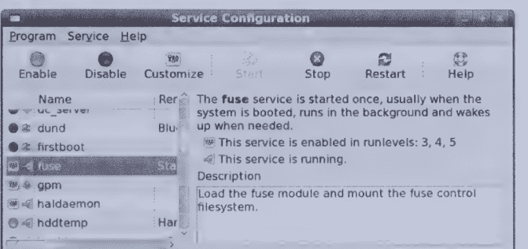

图 3-1：服务：`system-config-services`

在运行服务之前，必须先启用它。如果被禁用，服务的状态图标将显示为红色。要启用服务，请选择该项并点击工具栏上的“启用 (Enable)”按钮。你会看到状态图标变为绿色。然后你可以点击“启动 (Start)”按钮手动启动该服务。

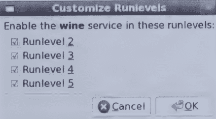

图 3-2：服务运行级别自定义

要让服务自动启动，它必须配置为在标准运行级别（runlevels）运行，至少是运行级别 5 和 3。大多数服务在启用时会被配置为在运行级别 2、3、4 和 5 运行。有些服务并非如此。你可以自定义服务在不同的运行级别运行。选择服务的条目，然后点击“自定义 (Customize)”按钮。这将打开一个窗口，列出所有运行级别并在每个级别配有复选框（见图 3-2）。点击你希望该服务启动的运行级别。


### 安装与更新软件

Fedora 软件已经变得非常庞大且更新频繁，以至于使用光盘作为主要的分发手段已经没有意义。相反，分发是通过在线 Fedora 软件仓库来实现的。该仓库包含了大量的 Fedora 兼容软件，将以前版本中使用的 Fedora Core 和 Fedora Extras 合并成了一个大型仓库。

对于 Fedora，你可以通过访问支持 YUM（Yellowdog Update, Modified，修改版更新）的软件仓库来向你的系统添加软件。此外，许多软件应用程序（特别是多媒体应用）存在潜在的许可冲突。通过将此类软件留在第三方仓库中，Fedora 避免了可能出现的法律问题。许多流行的多媒体应用，如视频和数字音乐支持，可以使用你处理 Fedora 赞助软件时使用的简单 YUM 命令从第三方仓库中获取。

这种方法标志着一种观念的转变：不再仅仅认为绝大多数 Linux 软件都包含在几张光盘上，而是将光盘仅视为核心，你可以根据需要从在线仓库随心所欲地扩展已安装的软件。现在大多数软件都位于连接互联网的仓库中。随着 YUM 集成到你的 Fedora 系统中，你现在可以将这些软件视为当前集合中易于安装的扩展。依赖光盘介质获取软件在某种意义上已经过时了。你可以在 Fedora 文档页面上的《使用 YUM 管理软件》中了解在 Fedora 上是如何使用 YUM 的：

```
http://docs.fedoraject.org/yum/en/
```

Fedora 发行版提供了丰富的软件选择，范围从办公和多媒体应用到互联网服务器管理服务（见表 4-1）。虽然许多流行的应用程序未包含在内，但在相关的软件网站上提供了 Fedora 兼容版本。在安装期间，YUM 会被配置为访问 Fedora 仓库。

由于许可限制，Fedora 发行版不包含对 MP3、DVD 和 DivX 等流行操作的多媒体支持。你可以从 `www.fluendo.com` 下载免费许可的 MP3 GStreamer 插件。一个与 Fedora 项目相关的站点 `rpm.livna.org/fedora` 提供了这些功能的支持。在这里，你可以下载对 MP3、DVD 和 DivX 软件的支持。Fedora 不提供对官方 Nvidia 或 ATI 发布的 Linux 图形驱动程序的支持。这些支持可以在 `rpm.livna.org/fedora` 找到。Fedora 包含了通用的 XOrg Nvidia 和 ATI 驱动程序，它们将提供大多数人所需的所有功能。你不必使用 Nvidia 或 ATI 厂商的。

相关的 Fedora 仓库（如 Livna 和 Freshprms）会有 Fedora 兼容的 Yum 配置文件，你可以下载并作为 RPM 包安装它们。然后你可以使用软件管理器和 `yum` 命令直接从关联仓库选择、下载并安装软件。

### 更新 Fedora：更新系统 (PackageKit)

Fedora 的新版本每六个月左右发布一次。在此期间，针对特定软件包会不断准备新的更新。这些更新以更新的形式发布，你可以从软件仓库下载并安装到你的系统中。这些包括应用程序、服务器甚至内核的新版本。这些更新的范围可能从单个软件包到整个组件——例如，在发布 GNOME、KDE 或 X11 新版本时发布的内核、应用程序包和开发包。

> 提示：如果你是在官方 Fedora 发布几个月后才进行安装或更新，使用 Fedora Re-Spin（重制版）光盘可能会更容易。

有了自动更新工具，更新 Linux 已变成一个非常简单的程序。对于 Fedora，你可以通过访问支持 Yum 的软件仓库来更新系统。“更新系统 (Update System)”是 Yum 的图形化界面，用于执行所有更新。Fedora Re-Spin 可以从 `www.fedoraunity` 下载。有了更新系统 (`PackageKit`)，你不再需要使用终端中输入的 `yum` 命令进行更新。

更新系统利用你 GNOME 面板上的更新系统小组件，每当你登录时它都会自动检查更新。如果检测到更新，更新系统将在面板上显示橙色图标，并提示你有可用更新以及数量（见图 4-1）。点击更新系统图标将打开菜单，你可以选择直接执行所有更新（立即更新），或查看并选择要执行的更新（显示更新）。如果你选择立即更新，在下载和更新期间组件下方会显示一个进度条。

“显示更新”选项将启动 `gpk-update-viewer` 工具来显示你的更新。你也可以从系统 | 管理菜单中手动选择更新系统条目。

最初显示更新概览窗口（见图 4-2）。显示了更新的数量，以及上次刷新和上次更新的时间。有两个更新系统或查看更新包的按钮：“更新系统”和“查看”。要执行更新，请点击“更新系统”按钮。如果你想查看更新并可能取消某些更新，请点击“查看”按钮。

## 84 第1 部分：系统管理

在“检查”（Review）中，当“更新系统”（Update System）启动时，将自动选择所需更新。勾选每个项目的复选框可以让您取消任何可能不想更新的特定软件包。窗口分为两个窗格：软件包列表和软件包描述。如果您想查看特定软件包的详细信息，请点击软件包列表中的该软件包条目。软件包信息将在下方窗格中显示（见图 4-3）。信息包括版本和存储库等特性。


**提示：** 在新安装后，如果“更新系统”无法运行或无法，您可能需要使用 `yum` 命令对其进行更新。在终端窗口（应用程序 > 系统工具）中输入 `yum update` 命令。在提示处输入 `y`。这次初始更新应该可以解决“更新系统”的问题，随后它就能正常工作了。

点击“应用更新”（Apply Updates）开始更新。`policykit` 将首先要求您输入 `root` 密码以允许执行更新（见图 4-4）。

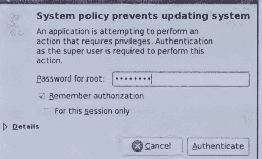

图 4-4：软件包更新授权

在更新过程中，将打开一个状态窗口显示不同的更新阶段，从依赖检查开始，然后是下载，后续测试，最后是安装和清理（见图 4-5）。

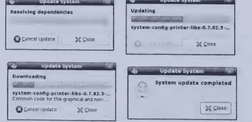

图 4-5：更新进度窗口

## 第4章：安装和更新软件 85

如果安装了新内核，您将被提示重启系统。您的旧内核将作为 `GRUB` 选项保留，以防在使用新内核时遇到困难。要选择旧内核，您可以在 `GRUB` 启动屏幕上选择它。要让旧内核再次成为默认内核，您可以通过引导加载程序配置屏幕（系统 | 管理 | 引导加载程序）选择它，或者在 `/etc/grub/grub.conf` 文件中将默认选项设置为 1（新内核为 0）。

**提示：** 要升级到新版本，可以从 `fedaproject.org/get-fedora` 下载 Fedora ISO 镜像。然后您可以刻录 ISO 镜像并从该 DVD 进行升级。或者，您可以在任何终端中使用带有 `upgrade` 选项的 `yum` 命令。这将执行在线软件包升级。

### 手动更新

您可以手动执行更新，而不是等待通知图标。从“系统 | 管理”菜单中选择“更新”（Update）。这将打开“更新系统”窗口，其中有一个显示可用更新数量的通知，以及距离上次刷新和上次更新的时间（见图 4-2）。

要执行软件包更新，您只需点击“更新系统”按钮即可。

“刷新”（Refresh）会从存储库下载更新软件包列表，以显示待更新的软件包。刷新将在预定的时间自动进行。您可以通过按下“刷新”按钮手动执行刷新。如果距离上次刷新已过去几个小时或几天，您应该在更新之前先执行一次刷新。

要查看更新列表，请点击“检查”（review）按钮。这将显示“更新检查”窗口（如图 4-3 所示），其中列出了要更新的软件包。您可以取消勾选您不想更新的软件包。然后您可以点击“更新系统”按钮执行更新。“概览”（overview）按钮将带您返回“概览”窗口（图 4-2），显示更新数量以及上次刷新和更新的时间。

### 更新偏好

您可以配置何时检查更新以及是否自动执行更新。使用“更新偏好”窗口设置您的更新选项。系统 | 偏好 | 软件更新。这会打开“软件偏好”窗口，您可以在那里选择检查更新的间隔以及启用自动更新（见图 4-6）。您还可以选择更新图标何时显示在顶部面板上。

最初，将每天检查更新且不采取任何操作。用户必须手动应用更新。在“检查更新”弹出菜单中，您可以选择每小时、每天、每周或从不。默认选择“每天”，且该选项通常是使用的。“从不”选项需要用户手动检查更新。

“自动安装”弹出菜单将有“所有更新”、“仅安全更新”或“无”等选项。如果您希望系统自动为您执行软件和安全更新，请选择“所有更新”。如果您希望有选择地更新哪些应用程序，可以选择“仅安全更新”。

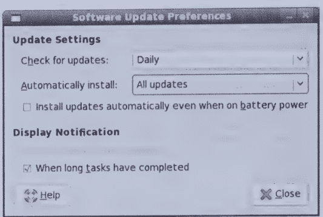

图 4-6：软件更新偏好

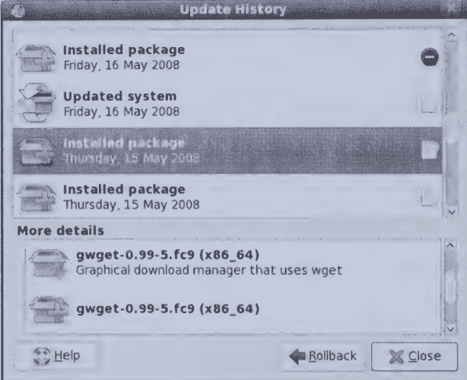

图 4-7：更新系统历史

### 更新历史

“查看历史”（View History）按钮将打开“更新历史”窗口，显示所有软件包管理操作列表，包括安装、更新和删除（见图 4-7）。更新将显示“已更新系统”标签（圆形箭头），而安装将显示“已安装软件包”标签（加号）。点击更新或条目将列出在该操作期间更新或安装的所有软件包。“详细信息”（More details）窗格会打开所有已更新或安装的软件包列表。您甚至还有回滚到以前版本的选项。每个操作（下载、安装和清理）都有相应的条目。

**提示：** 要升级到新版本，可以从 `fedaproject.org/get-fedora` 下载 Fedora ISO 镜像。然后您可以刻录 ISO 镜像并从该 DVD 进行升级。或者，您可以在任何终端中使用带有 `upgrade` 选项的 `yum` 命令。这将执行在线软件包升级。

# 第 4 章：安装与更新软件 89

或者，你可以在终端窗口中输入带有 `install` 选项和包名的 `yum` 命令。`Yum` 会检测该软件及其任何依赖项，并提示你下载和安装它。例如，以下命令将安装 Abbiword：

```bash
yum install abbiword
```

| 网站 | 描述 |
| --- | --- |
| [http://fedoraproject.org/wiki/Distribution/Download](http://fedoraproject.org/wiki/Distribution/Download) | Fedora 下载说明和发行信息 |
| [http://fedoraproject.org/get-fedora](http://fedoraproject.org/get-fedora) | Fedora 发行版、所有格式的下载链接 |
| [http://torrent.fedoraproject.org](http://torrent.fedoraproject.org) | 用于 ISO 和 DVD 磁盘 Fedora BitTorrent 文件 |
| [http://download.fedora.redhat.com/body/fedora/linux/releases](http://download.fedora.redhat.com/body/fedora/linux/releases) | Fedora 软件仓库，主站 |
| [http://rpm.livna.org/fedora](http://rpm.livna.org/fedora) | 第三方多媒体和驱动 Fedora 兼容软件的仓库（Fedora 项目扩展） |
| [http://atrps.net](http://atrps.net) | 第三方多媒体 Fedora 兼容软件的仓库 |
| [www.freshrpm.net](http://www.freshrpm.net) | 第三方多媒体 Fedora 兼容软件的仓库 |
| [http://sourceforge.net](http://sourceforge.net) | SourceForge 开源软件仓库和开发网站 |
| [www.kde-apps.org](http://www.kde-apps.org) | KDE 软件应用 |
| [www.gnomefiles.org](http://www.gnomefiles.org) | GNOME 软件应用 |
| [http://fedoraproject.org/wiki/ForbiddenItems](http://fedoraproject.org/wiki/ForbiddenItems) | 未包含在 Fedora 主软件仓库中的包 |
| [http://fedoraproject.org/wiki/Multimedia](http://fedoraproject.org/wiki/Multimedia) | Fedora 可用多媒体包信息 |

### 表 4-1：Fedora 和 Linux 软件网站

### 使用浏览器安装单个包

或者，你可以直接使用浏览器下载单个包。你只有在 `Yum` 支持的仓库中未提供某些包时才使用此方法。你还必须手动安装任何需要的包，并检查系统兼容性（x86, x64, ppc4）。你的 Fedora 浏览器允许你通过一个简单的操作同时完成下载和安装。在 GNOME 桌面上，对于已经下载的包，可以通过简单的右键点击并选择“安装”来安装，从而调用 `PackageKit` 执行安装。

### PackageKit，添加/删除软件

`PackageKit` 是随 Fedora 9 引入的 `Yum` 新软件前端。`PackageKit` 管理器是基于互联网的，从在线仓库安装，使用 `YUM` 进行下载和安装。它被设计为一种跨发行版的包管理器，可用于任何支持 `Yum` 的 Linux 发行版。

要使用 `PackageKit`，你可以在“系统 | 管理”菜单中选择“添加/删除软件”项。这将启动 `gpk-application` 工具程序。`PackageKit` 将通过收集你所有包的信息来启动。

打开“添加/删除软件”窗口后，带有一个用于搜索和类别列表的侧边栏。在安装包之前，建议刷新你的软件列表。这是你已启用仓库中可用的软件包列表。请从“系统”菜单中选择“刷新应用程序”。

### PackageKit 浏览

你可以通过选择侧边栏上的类别按类别查找包。该类别中的所有包都将列出。未安装的包将显示为灰色。图 4-8 显示了 Gnome 桌面类别的包。

使用类别与之前的版本中使用的 PyQt 添加/删除软件工具中的“浏览”面板类似。类别允许你浏览软件，查看适用于不同类型任务或功能的可用软件，例如多媒体应用程序或为 GNOME 桌面设计的应用程序。

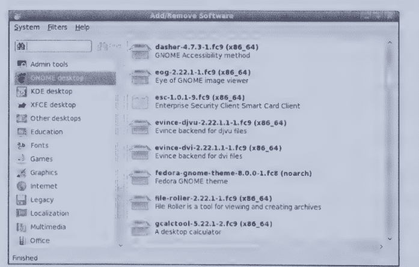

图 4-8：添加/删除软件，PackageKit

### 第 4 章：安装与更新软件

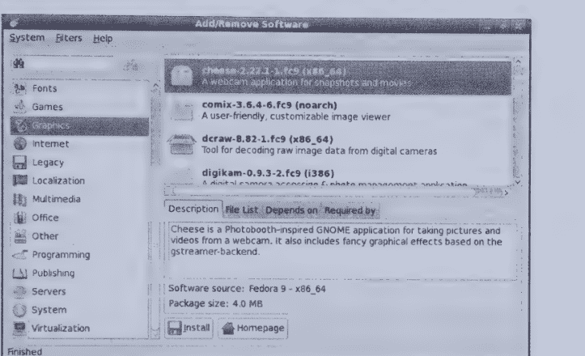

图 4-9：包信息

要查看特定包的信息，请选择它。这会在底部打开一个面板，带有“描述”、“文件列表”、“依赖项”和“被需要”选项卡。“描述”将显示包的描述。“文件列表”将列出该包将安装的所有实际文件。这对于跟踪实际命令名称和配置的位置很有帮助。“依赖项”和“被需要”将显示该包所依赖的包、依赖于它的包，以及它所依赖的包中的包。图 4-9 显示了 `themes-background-gnome-package` 的信息面板。

未安装的包将有一个“安装”按钮（见图 4-9），而已安装的包将有一个“移除”按钮。“主页”按钮将打开浏览器并进入该包的主页，你可以在那里找到更详细的信息。

要安装包，请选择它并点击“安装”按钮。底部的状态栏将显示正在执行的任务，从下载、安装到最后完成。进度条将显示安装任务的进度。顶部面板中的 `PackageKit` 通知图标在包下载时也会显示下载图像。一旦安装完成，包图标颜色将从灰色变为棕色，“安装”按钮将由“移除”按钮取代。

### PackageKit 搜索

与其通过类别查找包，你可以使用其包名来搜索它。只需在类别侧边栏顶部的搜索框中输入搜索模式即可。结果将如图 4-10 所示列出。这里搜索的模式是 `wine`，列出了所有所有的 Fedora 系统配置工具。

选择一个包进行安装，这将显示其信息面板和“安装”按钮。状态栏将显示正在执行的下载和安装任务，并带有进度条。

## 92 第一部分：系统管理

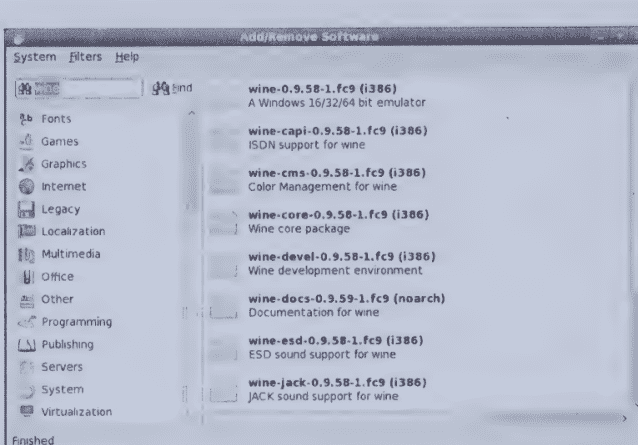

图 4-10：包搜索

### PackageKit 过滤

与其通过类别查找包，你可以使用其包名来搜索它。只需在类别侧边栏顶部的搜索框中输入搜索模式即可。结果将如图 4-10 所示列出。这里搜索的模式是 `wine`，列出了所有 Fedora 系统配置工具。

选择一个包进行安装，这将显示其信息面板和“安装”按钮。状态栏将显示正在执行的下载和安装任务，并带有进度条。

### PackageKit 过滤

与其选择所有可用的包（已安装和未安装），你可以对包列表进行过滤。在过滤”菜单中有多种过滤选项（见图 4-11）。你可以根据“已安装”、“开发”、“图形”或“免费”进行过滤。“已安装”选项显示已安装的包。“图形”适用于 GUI。“免费”选项让你只选择开源包。如果你正在寻找免费软件，可以选择“仅免费”选项。

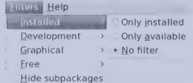

图 4-11：包过滤

## 第 4 章：安装与更新软件 93

### 仓库管理器

`Yum` 是主要的安装工具。当你安装包时，将调用 `Yum`，它会自动从相应的仓库选择并下载。安装系统后，当你想要安装额外的包时，`PackageKit` 将使用 `Yum` 从仓库安装。这包含了你可能配置的所有 `Yum` 在线仓库，如 `rpm.livna.org`，而不仅仅是用于安装的 Fedora 仓库。你也可以从 Fedora DVD 安装。

你可以可以使用查看器（`gpk-viewer`）启用或禁用你的 `Yum` 仓库。在“添加/删除软件”窗口中，从“系统”菜单中选择“软件源”。你也可以从“系统 | 管理”菜单中选择“软件源”。这将打开列出所有已配置仓库的查看器（见图 4-12）。

查看器将列出所有配置的仓库。这些是在 `/etc/yum.repos.d` 目录下具有 `Yum` 配置文件的仓库，包含 URL、GPG 密钥和描述等信息。启用的仓库将被选中。通过取消勾选来禁用仓库。Fedora 仓库名称将包含发布号和平台，例如 64 位版本的 `x86_64`。

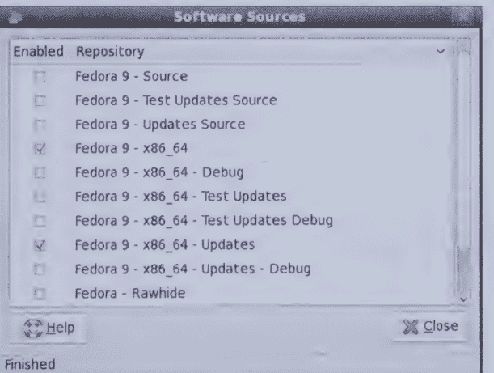

图 4-12：软件源：已配置的软件仓库

添加/删除软件将列出所有活动仓库的包。如果你只想查看来自一个仓库或另一个仓库的包，可以禁用其他的。例如，如果你只想查看 Livna 仓库中有什么，你可以禁用所有其他仓库，包括 Fedora。这样，只有 Livna 仓库的包将会显示。你稍可以重新激活其他仓库。

存储库还有专门用于开发、调试和源代码文件的特殊存储库。在这里，你可以找到可能有开发中应用程序，以及最新的修订版本。某些存储库包含尚未完成当前发布版本的应用程序测试存储库。这些应用程序可能有效，也可能无效。源码（Source）、测试（Test）和调试（Debug）存储库通常是禁用的。`Rawhide` 是正在开发的未来版本的开发库。Fedora 和 Update 存储库通常是启用的。源码存储库持有软件包，而 Linux 和测试存储库则用于仍处于测试阶段的软件包。

注意：要使用 `PackageKit` 移除软件包，只需找到并选择该项目，然后点击卸载按钮。

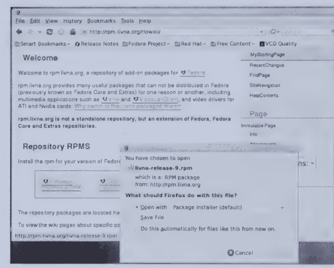

图 4-13：从 `rpm.livna.org` 下载的 Livna 存储库配置文件

### 使用 Livna 存储库 (rpm.livna.org)

Livna 存储库 (`rpm.livna.org`) 包含了大多数用户需要的第三方驱动程序和解码器。这些包括 Linux 的厂商驱动程序，例如 Nvidia 和 ATI/AMD 提供的驱动。Livna 软件包是为 Fedora 配置的。存储库还包含了具有许可问题的多媒体解码器，如 MP3、AC3 和 MPEG2 解码器，以及 MPEG4 和 DivX (Xvid)。

要访问 Livna 存储库，你必须先使用 `Yum` 配置文件及其 GPG 验证密钥下载并安装它们。这些都包含在 Livna 的 `livna.release-9-1.noarch.rpm` 软件包中。只需使用网络浏览器下载并安装此软件包即可。该软件包位于 `http://rpm.livna.org`（见图 4-13）。点击 Fedora 9 存储库 RPM 链接。

当你点击下载软件包时，Fedora 会检测到这是一个软件包，并打开一个带有直接安装选项的对话框（见图 4-14）。执行安装。

安装完成后，你可以打开“软件源”（Software Sources）检查 Livna 存储库是否已启用（见图 4-14），路径为：系统 | 管理 | 软件源。

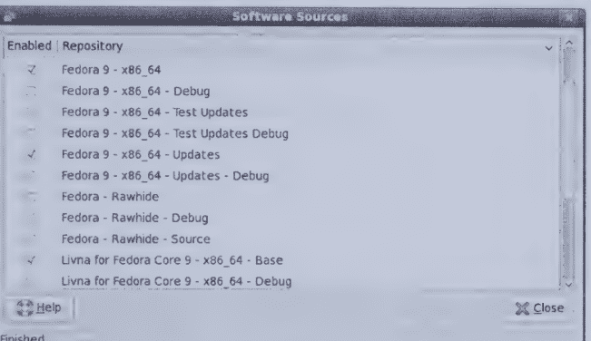

图 4-14：软件源列出的 Livna 存储库

现在启用 Livna 存储库后，你可以使用 `PackageKit` 搜索、选择并安装存储库上的所有软件包。Livna 和 Fedora 存储库的软件包将在 `PackageKit` 详情中交叉显示。检查软件包的描述以查看它是从哪个存储库访问的，“软件源”（见图 4-15）。

### 使用 Freshmps 和 atrpm 存储库

你也可以使用 Freshmps 和 atrpm 存储库。Freshmps 软件包与 Livna 软件包之间存在潜在冲突。许多软件包在存储库中重复。按照原则，你应该二选一。要么安装并启用 Livna，要么使用 Freshmps，后者提供了良好的厂商硬件驱动支持且更新更及时。

`atrpm` 存储库有几个特殊软件包，包括 MyThTV（电视录制和观看）。如果你计划使用 Fedora 系统录制和观看电视，你可能想要启用 `atrpm` 来安装 MyThTV。

要安装并启用这些存储库，使用与 Livna 相同的步骤。找到并下载你的 `Yum` 配置文件软件包或文件。安装该软件包或将文件拷贝到 `/etc/yum.repos`。使用“软件源”确保存储库已启用。然后你可以使用 `PackageKit` 选择并安装你需要的软件包。

### Yum Extender: yumex

`Yum Extender` 是管理 `Yum` 存储库中软件软件包的替代 GUI 界面（见图 4-14）。`yumex` 随 Fedora 一起包含。`um Extender` 比 `PackageKit` 提供了更大的灵活性。它提供了详细的软件包信息，并允许你直接开启或关闭存储库，无需编辑 repo 文件。点击“添加/删除软件”，在“浏览”面板中选择“基础系统”，然后选择“管理工具”，最后点击“可选软件包”查看列出的 `yumex`。勾选进行安装。你也可以在“搜索”面板中搜索 `yumex`，或在终端窗口中使用以下命令：

```bash
install yumex
```

你可以通过“应用程序 | 系统工具”菜单中的 `Yum Extender` 访问 `yumex`。`Yum Extender` 有五个面板，每个面板通过左侧列的图标查看，如图 4-16 所示。你可以使用“软件包”或“组”按钮选择软件包。“软件包”按钮将列出所有可能的软件包，而“组”面板则显示类别。未安装的软件包用红色显示。


“软件包”面板提供了缩小显示软件包范围的方法。你可以选择显示更新、已安装软件包或未安装的软件包。你可以进一步指定类别（例如存储库），仅显示来自特定存储库的软件包。点击软件包将在下方面板中显示其详细信息，你可以在该处选择描述、软件包包含的文件以及（如果可用）变更日志。

要选择软件包，只需勾选你想安装的项。一旦选中，软件包将会被添加到“处理队列”面板中。

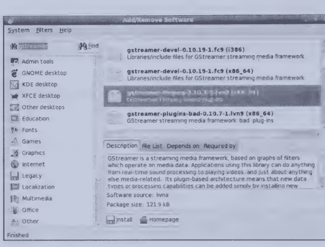

图 4-15：从 Livna 存储库访问的软件软件包

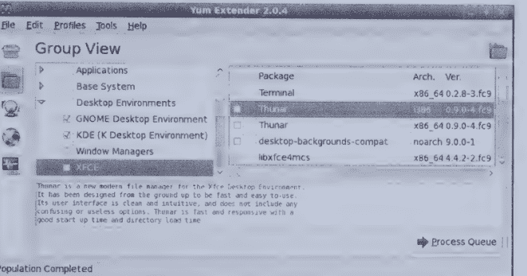

图 4-16：Yum Extender

## 第 4 章：安装和更新软件

要查看可用的软件包，你可以使用网络浏览器访问相关站点。Fedora 提供了 `repodata` 目录用于详细列表。Livna 提供了简单的目录列表，而 Freshrpm 则使用详细的网页界面。Livna 软件包在名称中通过 `lvn` 术语进一步标识。由于这些站点支持 Yum，你可以点击按钮下载并安装软件包以及任何支持库。这使得安装过程变得非常简单。

要使用软件仓库，必须配置 Yum 以访问它们。这只需要列出站点的 URL，包括其 Web 地址和目录位置。仓库配置存放在你 Linux 系统的 `/etc/yum.repos.d` 下的 `.repo` 文件中。Fedora 的仓库已经安装。在通过 Yum 访问它们之前，你需要添加 Livna 和 Freshrpm 的 `.repo` 文件。Livna 在其网站上提供了一个名为 `livna-release-9.noarch` 的 RPM 软件包，安装后会自动设置所需的 Yum 配置文件。对于 Livna，这

### 仓库 repo 包包文件

要安装软件包，请使用 PackageKit、yumex 或 `yum` 命令。它们都会自动使用 `.repo` 文件检查你启用的仓库。此规则的一个重要例外是，仓库配置文件（`.repo` 文件）的初始安装通常包含在自身的 RPM 软件包中。你需要使用网络浏览器直接从仓库网站下载并安装 repo 包。例如，Livna 第三方 Fedora 仓库的 repo 包 `livna-release-9.noarch`。你可以直接使用网络浏览器下载并安装此包，并确保选择下载时的提示安装。

> 注意：过去在 Livna 仓库和 Freshrpm 仓库之间存在过（且现在可能仍然存在）不兼容的情况。你应该使用其中之一。Livna 目前拥有最新的收集集合，将会被优先考虑。

### Fedora 仓库

Fedora 仓库已为 Yum 配置好。要下载任何 Fedora 软件包，只需使用 PackageKit 软件包管理器（应用程序；添加/删除软件），或在命令行上使用带有 `install` 选项的 `yum` 命令。系统将检测软件包以及任何依赖软件，并询问你确认安装。下载和安装将自动完成。检查 Fedora 仓库上的 `repodata` 文件可以列出可用的 Fedora 文件。在相应版本的目录中会有一个，`i386.x86_64` 用于 64 位版本，`ppc` 用于 PowerPC 版本。然后你可以点击特定软件包显示其 RPM 数据，显示版本信息和下载软件包的链接，以及软件包开发网站。虽然你可以手动下载软件包，但最好使用 Yum 或像 PackageKit 这样的 Yum 界面。

`repodata` 目录页提供了多种方法来浏览极其丰富的 Fedora 软件包集合。第一页列出了所有最近的内容和更新，然后为不同的软件包提供分组。这些分组也列在左侧栏的链接中。如果你知道某个软件包的首字母，可以使用右上角的“跳转字母”索引，显示以该字母开头的软件包页面。

当你第一次从 Fedora 仓库安装软件包包时，系统会提示你安装 Fedora GPG 密钥，用于验证软件包身份。只需点击“是”安装密钥即可。

要下载 Fedora 软件包，你应该使用 PackageKit（应用程序 | 添加/删除软件）、`yum`（应用程序 | 系统工具 | Yum 扩展器）或 `yum` 命令。在 PackageKit 中，你可以通过其查找框访问所有软件包，而不仅仅是侧边栏列出的类别。或者，你可以在终端窗口中使用如所示带有 `install` 选项的 `yum` 命令。以下命令安装 `gnumeric`：

```bash
yum install gnumeric
```

以下命令从 Fedora 仓库安装 `KOffice`：

```
yum install koffice
```

这里显示的 Fedora `.repo` 文件列出了若干个仓库选项。名称为 `Fedora`，并使用 `releasever` 和 `basearch` 来确定名称中的版本和架构部分。`mirrorlist` 选项取代了 `baseurl`（后者被注释掉了）。同样，使用 `releasever` 来指定版本。`gpgkey` 即 `RPM-GPG-KEY-Fedora` 已经安装在 `/etc/pki/rpm-gpg-directory` 中。

```
[fedora]
name=$releasever - $basearch
failovermethod=priority
#baseurl=http://download.fedora.redhat.com/pub/fedora/releases/$releasever/Everything/$os/
mirrorlist=http://mirrors.fedoraproject.org/mirrorlist?repo=fedora-$releasever&arch=$basearch
enabled=1
gpgcheck=1
gpgkey=file:///etc/pki/rpm-gpg/RPM-GPG-KEY-Fedora file
```

### Livna

`http://rpm.livna.org` 为许多软件包提供了站点门户，包括像 MPlayer 等多媒体应用，以及由于许可问题未包含在 Fedora 中的软件。几个热门软件包包括 ATI 和 NVIDIA 显卡驱动程序。Livna 专门负责配置不同的驱动程序以兼容 Fedora。例如，你可以直接从 Livna 网站下载 NVIDIA 驱动程序并尝试在你的系统中安装。作为替代方案，Livna 提供了一个已经为 Fedora 配置好的驱动程序版本。更安全更可靠的方法是直接安装 NVIDIA 驱动程序的 Livna 软件包。Livna 还提供了 ATI 驱动程序包 (`fglrx`)。

要配置你的系统访问 `rpm.livna.org`，只需在 `/etc/yum.repos.d` 目录下安装 `livna-release` 配置文件，并下载 Livna GPG 密钥。软件包的名称将类似于

```
livna-release-9.noarch
```

或者，你可以通过浏览器选择“软件安装程序”来安装它。软件包名称将类似于

```
livna-release-9.noarch
```

要手动安装 GPG 密钥，你需要使用以下命令：

```
rpm --import http://livna.org/GPG-KEY
```

一旦仓库安装，所有软件包都可以通过 Yum 访问。你会在 PackageKit 和 yum 列表中找到名称带有 `livna` 术语的包。

要查看 Livna 上有哪些可用软件包，请使用网络浏览器访问 `www.livna.org/fedora`。在这里你会找到每个版本的目录列表。选择你的版本目录，然后选择架构，例如 `i386` (32位) 或 `x86_64` (64位)。在这里你会看到所有可用软件包的简单列表。

这里显示了由 `livna-release` 安装的仓库配置文件的一部分。该配置指定了多个站点而不是镜像列表。`failovermethod` 指明了选择时使用的顺序。它可以是优先级（priority）、顺序（sequence）或轮询（random）。`livna.repo` 还持有一个测试配置，允许你访问新的更新软件包。

```
[livna]
name=Livna for Fedora Core $releaser=$base
baseurl=
http://livna.org/fedora/$baseurl/
http://livna.cat.pks.edu/fedora/$baseurl/
http://wftp.tu-chemitz.de/pub/livna/fedora/$baseurl/
http://ftp-stud.fht-esslingen.de/pub/Mirrors/rpm.livna.org/fedora/$base/
http://mirror.atrpm.net/livna/fedora/$releaser=$base/
http://tummy.com/pub/livna.org/fedora/$releaser=$base/
failovermethodpriority
#mirrorlist=http://rpm.livna.org/mirrorlist-7
enabled=1
gpgcheck=1
gpgkeyfile=/etc/pki/rpm-gpg/RMP-GPG-KEY-livna
```

### Freshrmps

Freshrmps 提供了许多多媒体软件包，但没有显卡驱动程序。它提供了一种为你的系统动态编译内核模块模块的方法。如果你在使用 Livna，则不应使用 Freshrmps。你不应该混合使用 Livna 和 Freshrmps 仓库软件包，它们可能不兼容。

下载并安装 freshprms，请使用 `freshprms-release` 软件包。在 `www.freshprms.net` 网上有一个直接链接。在 `ay.freshprms.net` 也可以找到该包的链接。点击 Fedora 链接将列出 Fedora 的 freshprms-release 软件包。你需要的包类似于：

```
freshprms-release-1.1-2-fc.noarch.rpm
```

### atprms

对于 atprms，你将需要创建自己的 repo 文件。内容列在 `http://atprms.net/install.html` 的 yum 部分。你可以将这些内容复制并粘贴到你的文本编辑器中，并将文件保存为 `atprms.repo`。将此文件保存在 `/etc/yum.repos.d` 目录下。这里显示了 atprms-repo 文件的有效内容。对此文件的一个有用更改是将 GPG 密钥指定为一个文件，位于 `/etc/pki/rpm-gpg` 目录。使用此 GPG 密钥后，就不需要在网站上引用它了。

```
[atprms]
name=Fedorareleaser - Atprms
baseurl=http://atprms.net/$f/releaser-$basearch-atprms/stable
### gpgkey=http://ATprms.net/RPM-GPG-KEY.atprms
gpgfile=file:///etc/pki/rpm-gpg/RPM-GPG-KEY.atprms
enabled=1
gpgcheck=1
```

`gpgkey` 是 `RPM-GPG-KEY-atprms`，位于 `http://ATprms.net/RPM-GPG-KEY`。你可以一次性完成安装和下载，但你可能想将该文件保存到第一个 `/etc/pki/rpm-gpg` 目录，并从那里导入它。你可以通过在浏览器中右键点击 atprms 安装页面上的链接进行下载，或者像这里所示在终端中使用 `wget`。

`wget http://ATprms.net/RPM-GPG-KEY.atprms` 下载到 `/etc/pki/rpm-gpg` 目录。

请确保导入密钥。

```
rpm --import /etc/pki/rpm-gpg/RPM-GPG-KEY.atprms
```

### 额外的 Java ：jpackage.org

虽然 Fedora 包含了大量的 Java 软件集合，但你可以从 `http://jpackage.org` 下载额外的 Java 应用程序。只需使用你的 yum 仓库获取 Java 包即可。请记住，`jpackage.org` 不提供 JRE。你必须从 Sun 下载并安装。此外，`jpackage.org` 上的开发包是商业性的。

首先下载并安装 `jpackage.repo`。先将 `jpackage.repo` 放在 `/etc/yum.repos.d` 中。检查该仓库是否已为你的特定 Fedora 版本设置好。如果没有，你将使用通用版本。使用 `enabled` 选项来激活或停用某个版本。默认将设置为通用版本。

软件包将显示在 PackageKit（列表或搜索视图）中。它们的标识符为 `jpp`。

针对不同 Linux 发行版的 Jpack repo 文件配置显示在 `www.jpackage.org/yum.php`。在这里你可以找到最新 Fedora 发行版的列表。你也可以下载通用版本，它将启用 Fedora。这里列出了一个 `jpackage.repo` 示例。像 Fedora 一样，它使用了镜像列表（mirrorlist）。`gpgkey` 位于 `http://www.jpackage.org/yum.asc`。由于许可限制，Jpackage 无法自由发布 JDK 等开发工具。你必须从 Jpackage 进行商业购买。JRE 也是非免费 Java 包的一部分。

如果你下载了 `generic_repo` 文件，你将发现 Fedora 的仓库列表。…… 免费和非免费仓库也已启用。禁用不适用于你发行版的那个。在 Fedora 的泛用配置中使用的镜像列表在之前的 Fedora 示例中显示过，尽管它被注释掉了。

### Yum 配置

Yum 选项在 `/etc/yum.conf` 文件中配置，`/etc/yum.repos.d` 目录持有列出可用 Yum 仓库的仓库文件（repo）。仓库文件的扩展名为 `.repo`。检查 `yum.conf` 文件以查看项格式中的 Yum 选项列表。`yum.conf` 文件由由括号括的头部分隔的不同段落组成，第一个始终是主段（main）。之后可以跟 Yum 服务器仓库，从括号括围的仓库标签开始。然而，在 Fedora 上，这些目前放置在 `/etc/yum.repos.d` 目录下的独立仓库文件中。

```
[main]
cachedir=/var/cache/yum
keepcache=0
debuglevel=2
logfile=/var/log/yum.log
tolerant=1
exactarch=1
obsolete=1
gpgcheck=1
plugins=1
metadata_expire=1800
installonly_limit=2
```

```
### 将你的 REPOS 放在这里或命名为 file.repo 的独立文件中
### 在 /etc/yum.repos.d
```

### /etc/yum.conf

`yum.conf` 文件将只有带有 Yum 选项设置的主段。有一些通用的 Yum 选项，如 `logfile`（列出 Yum 日志的位置）和 `distroverpkg`（用于确定使用哪个发行版本）。软件包将下载到 `cachedir` 选项指定的目录，在本例中为 `/var/cache/yum`。你可以选择保留下载的软件包或在安装后删除它们。`tolerant` 选项允许软件包安装错误，`retries` 选项指定了访问软件包的次数。`exactarch` 和 `obsolete` 都适用于由 `yum update` 命令调用的 Yum 更新过程。`tolerant` 选项将允许软件包错误。

您在其中需要的软件包。然后只需为它提供一个配置文件并指定其位置即可，非常简单。

### 管理 Yum 缓存

启用 `keepcache` 选项后，Yum 将其下载的软件包保留在 `/var/cache/yum` 目录下。如果您想保存或复制任何特定的软件包，可以在那里找到它们。缓存让您能够轻松卸载和重新安装软件包，而无需重新下载。软件包将保留在缓存中。如果禁用了缓存，软件包在安装后将自动删除。

您的缓存可能会迅速增大，因此您可能需要经常清理它。如果您刚刚删除了这些软件包（因为它们已经安装），可以使用 `clean packages` 选项。

```
yum clean packages
```

Yum 还维护了一个软件包头文件列表，其中包含所有下载软件包的信息。这些头文件用于更新您的系统，显示已安装哪些内容。您可以选择使用 `clean headers` 选项移除头文件。

如果您想让 Yum 访问缓存中的软件包，可以使用 `-C` 选项。以下列表仅列出缓存中的软件包。

```
yum -C list
```

### 使用 rpm 手动安装软件包

如果您要安装的不是 Yum 仓库的软件包，且您没有桌面访问权限或倾向于从命令行界面工作，可以使用 `rpm` 命令来管理和安装软件软件包（您可以通过选择“应用程序 | 系统工具”菜单中的“终端”来打开终端窗口）。某些情况下您将不会使用 `rpm` 命令。大多数软件现在位于 Yum 支持的 Fedora 仓库中。您将使用 `yum` 命令或 PackageKit（添加/删除软件）前端来安装您的软件包。Yum 的优势是可以自动安装任何依赖包，而 `rpm` 命令虽然会检测新软件包，但不会安装它们。您必须按照正确的顺序单独安装任何软件包。

对于不属于 Yum 支持仓库且依赖包很少或没有依赖包的软件包，您可以直接使用 `rpm` 命令。您还可以使用 `rpm` 命令跳过 Yum，强制安装特定软件包而不是通过 Yum 仓库（Yum 的 `localinstall` 选项可以实现相同目的，或者在 PackageKit 仓库管理器中仅选择“安装 DVD”）。

`rpm` 命令执行软件软件包的安装、删除和验证。每个软件软件包实际上是一个 RPM 软件包，由软件文件归包和有关如何安装这些文件的信息组成。每个归包作为一个单一文件存在，文件名以 `.rpm` 结尾，表示它是由 Red Hat 软件包管理器安装的软件软件包。


您可以使用 `rpm` 命令安装或卸载软件包。`rpm` 命令设置一组选项来确定要执行的操作。`-i` 选项安装指定的软件软件包，`-u` 选项更新软件包。使用 `-e` 选项，`rpm` 卸载软件包。在 `i` 之前放置 `q`（`-qi`）查询系统以查看软件软件包是否已安装，并显示有关软件的信息（`-qi` 查询未安装的软件包文件）。不带任何选项的 `rpm` 命令提供 `rpm` 选项的完整列表。下表显示了一些常用选项。

| 选项 | 操作 |
| --- | --- |
| -U | 更新软件包 |
| -i | 安装软件包 |
| -e | 软件包 |
| -qi | 显示已安装软件包的信息 |
| -ql | 显示已安装软件包的文件列表 |
| -qpi | 显示 RPM 软件包文件的信息（用于未安装的软件包） |
| -qpl | 显示 RPM 软件包文件的文件列表（用于未安装的软件包） |
| -K | 对软件包进行身份验证和完整性检查 |

软件包名称通常很长，其中包含版本和发布日期的信息。所有名称以 `.rpm` 结尾。在下一个示例中，用户使用 `rpm` 命令安装了 `freeciv` 软件包。注意输入的是文件名。要列出名称，可以使用 `ls` 配合前几个字符和星号 `*`。以下示例使用了从 http://rpm.livna.org 下载的 `xvid` 视频软件包。

```
ls xvid*
```

您还可以使用 `*` 匹配名称的剩余部分，如下：

```
ls xvidcore-1*.rpm
$ rpm -Uhv xvidcore-1.1.3-3n9.x86_64.rpm
```

在大多数情况下，您使用 `-u` 选项进行更新以安装软件包。如果软件包尚未安装，`-u` 将安装它。

当 RPM 执行安装时，它首先检查依赖包。这些是您正在安装的程序所需的其他软件软件包。如果必须先安装依赖包，RPM 将取消安装并列出这些软件包。您可以安装这些软件包并重复安装它们。要确定软件包是否已安装，请使用 `rpm` 的 `-qi` 选项。`-q` 代表查询。要列出软件包已安装的所有文件以及它安装的目录，使用 `-ql` 选项。要查询软件包文件，添加 `p` 选项。`-qpi` 选项显示有关软件包的信息，`-qpl` 列出其中的文件。以下示例列出了 `freeciv` 软件包中的所有文件：

```
$ rpm -qpl xvidcore-1.1.3-3n9.x86_64.rpm
```

要从您的系统中删除软件软件包，请使用 `-qi` 确保它已安装，然后使用 `-e` 选项卸载它。您不需要使用应用程序的完整名称。在下一个示例中，用户删除了 `xvidcore`：

```
$ rpm -e xvidcore
```

### 软件包安全检查

如果您下载了一个软件软件包，您可能想检查其完整性，确保它没有被篡改且来自有效来源。Yum 配置为对从您的仓库下载的所有软件自动执行此检查。`/etc/yum.repos.d` 中的每个仓库文件都会将 `gpgcheck` 设置为 `1`。如果您想对特定仓库关闭此检查，可以将其设置为 `0`。

要验证软件包，请检查其数字签名。软件包使用作者提供的加密签名，可以使用公钥解密。Fedora 以及大多数 Linux 发行版使用 GNU Privacy Guard (GPG) 加工具。要使用公钥验证 RPM 软件包，必须将其安装到 RPM 数据库中。对于 Fedora 发行版的 RPM 软件包，可以使用安装期间存放在 `/etc/pki/rpm-gpg/RPM-GPG-KEY-fedora` 的 Fedora 公钥。对于所有配置的仓库的 `RPM-GPG-KEY-fedora-test` 和 `RPM-GPG-KEY-fedora-rawhide`。

在检查 RPM 软件包之前，您需要将密钥导入 RPM 数据库。第一次使用 PackageKit 安装软件包时，会提示您导入 GPG 密钥。一旦导入，就不需要再次导入。或者，您可以在此手动导入密钥：

```
rpm --import /etc/pki/rpm-gpg/RPM-GPG-KEY-fedora
```

如果您从其他网站下载了 RPM 软件包，也可以下载并安装其软件包进行验证。例如，Livna 和 Freshprims Fedora 仓库都有公钥。这些密钥包含在可以下载并安装的 Livna 配置文件 `livna-release-9-1.noarch.rpm` 中。这些密钥将随配置自动安装。

软件包安装后，您可以使用 `--checksig` 命令检查软件包认证：

```
$ rpm --checksig xvidcore-1.1.3-3n9.x86_64.rpm
```

要查看您已导入的所有密钥列表，您可以使用 `-qa` 选项并匹配 `gpg-pubkey*` 模式。使用 `rpm` 配合 `-qi` 选项和公钥，可以显示有关密钥的详细信息。以下示例显示了 Fedora 公钥：

```
$ rpm -qa gpg-pubkey*
gpg-pubkey-4f2a66fd2-3f9d9d3
gpg-pubkey-db42a60e-37ea5438
```

你可以使用 `rpm` 命令配合 `--checksig` 和 `--nosignature` 选项手动检查软件包的完整性。名为 MD5 摘要的值用于测量软件包的内容。如果该值不正确，说明软件包已被篡改。某些软件包仅提供摘要值，仅允许完整性检查。在接下来的示例中，用户检查 freeciv 软件包是否被篡改。`--nosignature` 选项表示不进行认证，仅进行完整性检查。

```
$ rpm --checksig --nosignature xvidcore-1.1.3-3.1vn9.x86_64.rpm
```

### 安装源代码应用程序

Linux 提供了许多源代码格式的程序。这些程序存储在压缩包中，你需要对它们进行解码和提取。生成的源代码可以在你的系统上进行配置、编译和安装。这一过程已经简化到与安装 RPM 包并无太大区别的程度。本示例展示了提取、编译和安装软件的常用方法，在本例中是 Linux 游戏 freeciv。请务必检查源码随附的 README 和 INSTALL 文件，以确认创建和安装软件的适当方法。

提示。确保已经在系统中安装了所有开发包。

开发包包含关键组件，如编译器、GNOME 和 KDE 头文件与库，以及预处理器。没有这些组件，你无法编译源码。

首先，你找到软件——在本例中来自 linuxgames.com——然后将其下载为名为 `freeciv-2.1.1.tar.bz2` 的文件。使用桌面上的归档管理器或在终端窗口中使用 `tar` 命令解压并提取该文件。

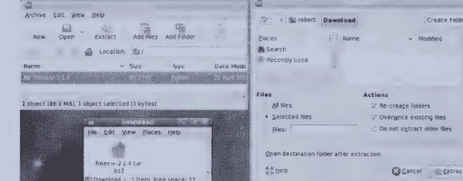

图 17：使用归档管理器（File Roller）提取软件存档。

### 提取归档：归档管理器 (File Roller)

提取压缩存档最简单的方法是使用 GNOME 归档管理器（应用程序 | 附件 | 归档管理器，归档管理器是filer 应用程序）。双击压缩包文件，或右键点击并选择“用归档管理器打开”。这将显示存档的顶层内容，你可以根据需要浏览，甚至阅读 README 和 INSTALL 文件等文本文件。你还可以看到哪些文件将被实际安装。

# 第4章：安装和更新软件

使用按钮进行导航并双击目录以打开它。此时还没有内容被提取。要提取存档，请点击“提取”。你可以选择提取到哪个目录，默认将是当前目录下的一个子目录（见图 4-17）。

归档管理器允许你读取归档目录中的文本文件。只需在归档管理窗口列表中选择并双击文本文件。归档管理器将实时提取该文件并在窗口中显示它（见图 4-18）。此时文件并未被实际提取到任何地方。

你也可以使用归档管理器创建自己的存档，通过“新建”按钮创建存档，并使用“添加文件”和“添加文件夹”按钮选择文件夹。

或者，在命令行中，你可以使用 `tar` 命令提取存档。要使用 `tar` 命令，首先打开终端窗口（右键点击桌面并选择“终端”）。在提示符处，输入带有 `xvjf` 选项的 `tar` 命令（j 代表 bz2，z 代表 gz），如下所示：

```
tar xvjf freeciv-2.1.1.tar.bz2
```

### 配置、编译和安装

提取存档将创建一个以软件命名的目录，在本例中为 `freeciv-2.1-4`。一旦提取完成，你就对软件进行配置、编译和安装。这通常需要在终端窗口中完成。

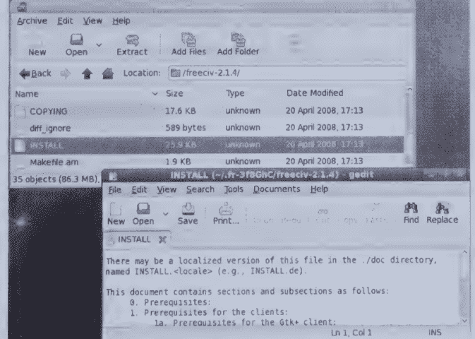

图 4-18：归档管理器显示存档文本文件。

使用 `cd` 命令切换到软件目录：

```
cd freeciv-2.1-4
```

执行 `./configure` 命令。这将为你的特定系统生成编译器配置。

```
./configure
```

使用 `make` 命令编译软件：

```
make
```

然后使用 `make install` 命令安装程序：

```
make install
```

大多数 KDE 和 GNOME 软件还会在相应的菜单中为程序添加条目——例如，freeciv 条目将放在 KDE 应用程序菜单中。然后你可以从菜单条目运行 freeciv。你也可以打开终端窗口并输入程序名称。


## 5. 系统信息

系统日志和性能分析工具提供了有关系统的信息。这些包括新的可靠且扩展 Syslog 日志应用程序以及各种格式工具，如 GNOME 系统监视器和磁盘使用分析器。

### 系统日志：/var/log 和 rsyslogd

在系统上执行的任务的各种系统日志存储在 `/var/log` 目录中。在这里你可以找到邮件、新闻以及所有其他系统操作（如 Web 服务器日志）的日志。`/var/log/messages` 文件是一个日志。

# 112 部分1：系统管理

每当你修改 `rsyslog.conf` 时，都需要使用以下操作重启 rsyslog 守护进程（system-config-servers，服务器设置 | 服务）：

```
service syslog restart
```

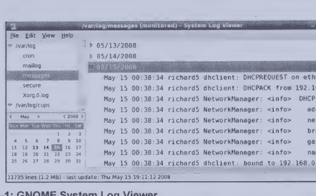

图 5-1：GNOME 系统查看器

### 第 5 章. 系统信息

| 设施 | 描述 |
| --- | --- |
| auth-priv | 安全/授权消息（私有） |
| cron | 时钟守护进程（cron 和 at）消息 |
| daemon | 其他系统守护进程消息 |
| kern | 内核消息 |
| lpr | 打印打印机子系统消息 |
| mail | 邮件子系统消息 |
| news | Usenet 新闻子系统消息 |
| syslog | Syslog 内部消息 |
| user | 通用用户级消息 |
| uucp | UUCP 子系统消息 |
| local0 到 local7 | 留作本地使用 |
| 优先级 | 描述 |
| --- | --- |
| debug | 7, 调试消息，优先级最低 |
| info | 6, 信息消息 |
| notice | 5, 通知，正常但重要的情况 |
| warning | 4, 警告消息 |
| err | 3, 错误消息 |
| crit | 2, 关键情况 |
| alert | 1, 告警，必须立即采取行动 |
| emerg | 0, 紧急消息，系统不可用 |
| 操作符 | 描述 |
| --- | --- |
| * | 匹配区域内的所有设施或优先级 |
| = | 限制为特定优先级 |
| ! | 排除特定优先级及更高优先级 |
| / | 用于保存消息的文件 |
| @ | 用于向其发送消息主机 |
| | | 用于向其发送消息的 FIFO 管道 |

表 5-1：rsyslog 设施、优先级和操作符

### 优先级

mail.* /var/log/maillog

*.crit /var/log/mycrit

当你为某个设施指定优先级时，所有优先级更高的消息也会包含在内。因此，`err` 优先级也包含了 `crit`、`alert` 和 `emerg` 优先级。如果你只想选择特定优先级的消息，请使用 `=` 操作符对优先级进行限定。例如，`mail.=err` 将仅选择错误消息，而不包含 `crit`、`alert` 或 `emerg` 消息。你也可以使用 `=` 操作符限制优先级。这将消除具有指定优先级及更高的消息。例如，`mail=.crit` 将排除 `crit` 消息以及更高的 `alert` 和 `emerg` 消息。要专门排除某个入口设施的所有消息，请使用 `none` 优先级；例如，`mail.=none` 会排除所有邮件消息。这通常用于在同一条目中定义多个区域时。

你可以通过逗号在给区域内列出多个优先级或设施。你也可以通过分号分隔在同一条目中创建多个区域。第一个示例将 `/var/log/messages` 文件保存所有 `info` 优先级的消息，排除了所有邮件和认证消息（authpriv）。第二个示例将 `uucp` 和 `news` 设施的所有 `crit` 及以上级别的消息保存到 `/var/log/spool` 文件：

```
*.inform.none:news.none:authpriv.none /var/log/messages
uuucp,news.crit /var/log/spooler
```

### 与用户

在动作字段中，你可以指定远程系统、用户或管道。文件的动作条目必须以 `/` 开头，并指定其完整路径，例如 `/var/log/messages`。要将消息记录到远程主机，只需在主机名前加上 `@` 符号。下面的示例在 `rabbit.trek.com` 上保存所有内核消息：

```
kern.* @rabbit.trek.com
```

要向用户发送消息，列出他们的登录名。以下示例将关键消息发送给用户 `chris` 和 `aleina` 的控制台：

```
news.=chris, aleina
```

你还可以消息输出到命名管道（FIFO）。动作字段的管道条目以 `/` 开头。以下示例将内核调试消息管道到命名管道：

```
/usr/adm/debug: =debug /usr/adm/debug
```

### /etc/rsyslog.conf 示例

此处显示 Fedora 系统的默认 `/etc/rsyslog.conf` 文件。消息记录在 `/var/log` 目录下的各种文件中。

```bash
### /etc/syslog.conf

### 将所有内核消息记录到控制台。
kern.* /dev/console

### 记录 info 或更高级别的任何内容（邮件除）。
### 不要记录私有认证消息！
*.info.mail:news.none:authpriv.none:cron.none /var/log/messages

### authpriv 文件有限制的访问。
authpriv.* /var/log/secure
### 将所有邮件消息记录在一个处。
mail.* /var/log/maillog

### 记录 cron 相关内容。
cron.* /var/log/cron
### 所有人接收紧急消息
*emerg

### 将 err 及更高级别的邮件和新闻错误保存到特殊文件中。
uucp,news.crit /var/log/spooler
### 将启动消息也保存到 boot.log
local7.* /var/log/boot.log
```

### Linux 审计系统：auditd

Linux 审计系统提供系统调用审计。审计由一个名为 `auditd` 的服务器执行，日志保存到 `/var/log/audit`。它的设计用于补充 SELinux，SELinux 将其消息发送到 `/var/log/audit/audit.log` 文件中的审计日志中。审计日志服务为 SELinux 等服务提供专门的日志记录。日志位于 `/var/log/audit`。为了精细化审计，你可以创建审计规则来检查特定的系统调用，例如由特定用户或组生成的系统调用。

你可以使用 `/etc/init.auditd` 服务脚本来启动和关闭 `auditd` 服务器。使用 `system-config-services` 来启动和停止服务器。

```bash
service auditd start
```

auditd 的配置位于 `/etc/audit/auditd.conf` 和 `/etc/audit/auditconf` 文件，设置了日志文件名、日志格式、日志文件最大 own以及磁盘空间减少时采取的动作。查看 `auditconf` 页面。

审计包包含三个命令：`autrace`、`ausearch` 和 `auditd`。你使用 `ausearch` 查询审计日志。你可以根据各种 ID、用户、组、文件名或日期进行搜索。查看 `ausearch` 手页。`autrace` 是一个专用工具，可以跟踪特定进程。它类似于 trace，记录系统调用和动作。

你可以使用 `auditctl` 工具控制审计服务器的行为。通过 `auditctl` 你可以开启审计、检查状态并添加审计规则。查看 `auditctl` 手页。

审计规则组织在预定义的列表中，并带有特定的动作。目前有三个列表：`task`、`entry` 和 `exit`，以及三个动作：`never`、`always` 和 `possible`。在添加规则时，列表和动作用逗号配对，例如：exit,always

使用 `-a` 选项添加规则。使用 `-S` 选项指定特定的系统调用，使用 `-F` 选项指定字段。有许多可以使用字段，如 `loginuid`（用户 ID）、`pid`（进程 ID）和 `exit`（系统调用值）。对于字段指定值，使用 `loginuid=510` 表示用户 ID 为 510。如下所示的规则检查特定用户打开的所有文件：

auditctl -a exit,always -S open -F loginuid=510


将你想自动加载的规则放在`/etc/audit/auditd.rules`。`/usr/share/doc/audit/`目录下的`sample.rules`文件提供了规则示例。你也可以创建一个特定的审计规则文件，并使用`auditctl`的`-R`选项从文件中读取规则。

# 第5章：系统信息

用于检查进程以及您的系统性能。GNOME系统监视器（系统 | 管理 | 系统监视）提供了方便的监控功能。其他工具也同样可用，例如GKrellM和KSystemguard。

您系统中的许多实用程序都提供了有关进程的详细信息，以及其他系统信息，如CPU和磁盘使用情况（见表5-2）。尽管这些工具设计用于用于shell命令行并以文本行形式输出，但现在有几个工具提供了KDE和GNOME版本，通过图形用户界面（GUI）来显示结果并管理进程。

| 工具 | 说明 |
| :--- | :--- |
| vmstat | 系统组件性能 |
| top | CPU密集型进程列表 |
| free | 空闲RAM内存列表 |
| sar | 系统活动信息 |
| iostat | 磁盘使用情况 |
| GNOME System Monitor | 用于进程和使用监控的系统监视器（系统 | 管理 | 系统监视） |
| GKrellM | 可堆叠、灵活且可扩展的监控工具，可显示各种系统、网络和存储操作信息，以及服务，易于通过主题配置 |
| KDE Task Manager and Performance Monitor | 用于进程和系统进程的KDE系统监视器 |
| Frysk | 系统进程的监控工具 |
| System Tap | 分析性能瓶颈的工具 |
| Gnome Power Manager | 管理系统的电源效率功能 |
| cpusers | 在空闲时降低CPU速度（AMD Cool and Quiet技术） |

### 表5-2：性能工具

## GNOME系统监视器

Fedora提供了GNOME系统监视器，用于显示系统信息和监控系统进程，可以通过“应用程序 | 系统工具 | 系统监视器”访问。它有四个面板，分别用于系统信息、进程、资源和系统（见图5-2）。“系统”面板显示您系统上的内存量、可用磁盘空间以及CPU的类型。

### 图5-2：GNOME系统监视器

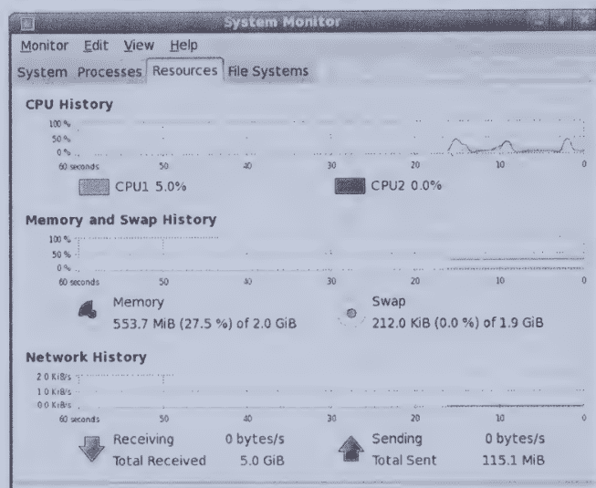

“资源”面板显示图表。您的“文件系统”面板列出了您的文件系统及其挂载点、类型，以及使用的磁盘空间量和空闲量。“进程”面板列出了您的进程，允许您对进程进行排序或搜索。您可以使用字段按钮按名称、进程ID、用户和内存进行排序。“视图”弹出菜单允许您选择所有进程、仅您的进程或活动进程。您可以通过选择任何进程并点击“结束进程”按钮来轻松停止它。右键点击项目会显示您可以对该进程执行的操作，如停止或隐藏它。从“视图”菜单中选择的“内存映射”显示显示虚拟内存、节点和标志的信息。

## ps命令

从命令行，您可以使用`ps`命令来列出进程。使用`-aux`选项，可以列出所有进程。将输出通过管道传递带有模式的`grep`命令，可以允许您搜索特定进程。管道（pipe）将前一个命令的输出作为后一个命令的输入。以下命令列出了所有的X系统进程：

```
ps -aux | grep 'X'
```

## vmstat, free, top, iostat, Xload和sar

`vmstat`命令输出详细列表，指示不同系统组件的性能，包括CPU、内存、I/O和交换操作。报告以单行形式输出，其中包含不同组件的字段。如果您提供一个时间段作为参数，它将在指定的间隔（通常为几秒钟）重复执行。

`top`命令提供了您系统中CPU密集型进程的列表，显示哪些进程使用了您的大部分资源。列表是实时的，并且每几秒更新一次。它提供了更改进程状态（如其优先级）的命令。

`free`命令列出系统上空闲RAM内存的量，显示使用了多少、空闲了多少，以及多少用于缓冲区和交换内存。`Xload`是一个窗口系统工具，用于显示负载、CPU和内存；`iostat`显示您的磁盘使用情况，而`sar`显示系统活动信息。

## System Tap

System Tap是一种诊断工具，用于提供有关复杂系统实现的信息。它本质上分析性能瓶颈，让您能够专注于问题产生的地方。System Tap依赖于Kprobes（内核动态探针），它允许内核模块设置内联探针。

## Frysk

Frysk是一种用于系统进程的专用复杂监控工具。通过Frysk，您可以设置非常具体的监控任务，关注特定的应用程序，并从一组观察者进程中选择以提供有关退出通知、系统调用和执行的信息。您还可以为进程创建自己的自定义观察者。可以在sourceware.redhat.com/frysk了解更多关于Frysk的信息。例如查看http://sourceware.org/frysk/javadoc/private/overview-summary.html

## Gnome Power Manager

对于电源管理，Fedora使用GNOME电源管理器（`gnome-power-manager`），它利用计算机提供的ACPI电源来管理电源消耗。GNOME电源管理器通过电源管理偏好窗口（`gnomepower-preferences`）配置，可以通过“系统 | 偏好 | 系统 | 电源管理”访问。电源管理可用于配置桌面电脑和笔记本电脑。对于笔记本电脑，只有两个面板：“AC电源”和“常规”。

Gnome Power Manager设计旨在利用笔记本电脑和桌面电脑上可用的所有效率功能。它支持调暗显示、关机或挂起等任务。详细描述请gnome.org/projects/gnome-power-manager/index.html。该管理器与HAL（硬件抽象层）和dbbus集成以检测硬件状态。在笔记本电脑上，电池图标将显示剩余电量，以及何时变为临界。它还会指示AC连接，以及电池何时充满。在“AC电源”窗口中，您可以设置间隔后睡眠。在“常规”面板中，您可以设置按下电源按钮时采取的操作。

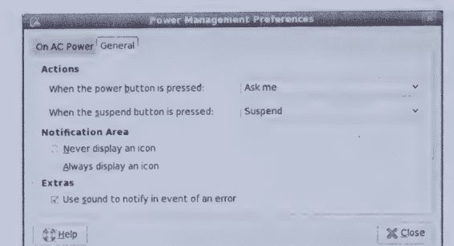

图5-3：电源偏好

## GKrellM

GKrellM是一个基于GTK的各种系统、网络设备适配监控器集。顶部的栏将显示系统名称。默认情况下，GKrellM将显示名称、系统时间、CPU负载、进程图表、磁盘访问、网络设备（如`eth0`）、内存使用以及温度变化。您可以通过右键点击显示显示面板来更改监控器的图表高度。

每个监控器都有标题栏，例如CPU用于CPU负载、Disk用于磁盘访问、Mem用于内存。要配置监控器，请右键点击标题栏。这将显示该任务的配置面板。例如，磁盘配置允许您选择要监控的特定硬盘和分区。将显示完整的配置，显示侧边栏带有配置菜单，其中内置菜单展开显示选中的监控器。

查看gkrell页面获取所有配置选项的说明。GKrellM网站（www.gkrell.com）提供了文档、程序支持和主题的资源。Fedora预装了GKrell，并带有内置插件以及WiFi插件。对于额外的插件和主题，可以从freshrpm.com下载并安装Fedora提供的RPM包。这些将为您的使用提供广泛的插件和主题，包括收音机控制、键盘LED监控，以及大量主题，如大理石、哥谭市和光泽蓝。有几个插件包：media、misc和utils。

## 第5章系统信息

某些包可能需要其他包；`media`包目前需要FFTW（傅里叶变换），而`misc`包需要Imlib2，这两者都可以在RPM版本或freshrpm.net上找到。你可能需要使用freshrpm.net上的最新包来更新你的GKrellM版本。插件也可以直接从www.gkrellm.net下载，主题可以从www.muh.net下载。用户主题可以放在用户的`.gkrellm2/themes`目录中。

### GKrellM配置

你可以通过点击任何显示器并按下F1来打开配置窗口。或者，你也可以打开主菜单并选择配置（Configuration）项。要打开主菜单，请按F2或右键点击顶部显示器。你可以使用此菜单切换主题或退出GKrellM。配置窗口显示了一个侧边栏，其中包含多个配置项，如常规（General）、内置（Builtins）、插件（Plugs）和主题（Themes）。右侧的面板让你查看配置选项。常规面板显示全局选项，如显示主机名、我们的窗口大小和优先级。

内置（Builtins）将展开以显示GKrellM可以显示的所有显示器列表。此列表非常详尽，包括各种显示器，如风扇和热传感器、时钟、CPU负载、Internet连接、邮件通知和电池使用情况。

插件（Plugins）项将展开以显示已安装插件的列表。要查看可用插件，请直接点击插件项。将显示一个带有复选框的可用插件列表。红帽（Red Hat）和Fedora最初可能只列出WiFi显示器。随着你安装其他插件包，列出的插件会越来越多。安装后后，插件将出现在展开的插件菜单中。你可以选择一个插件来显示其配置面板。

系统范围使用的插件位于`/usr/lib/gkrellm2/plugins`目录，而主题位于`/usr/share/gkrellm2/themes`。用户的GKrellM配置信息和支持文件保存在`.gkrellm2`目录中。在这里，你会找到主题和插件的子目录。`user_config`文件存储用户配置设置，每行列出一个显示器、其选项及其设置。

### GKrellM服务器

你可以使用GKrellM服务器`gkrellmd`来远程监控主机。你运行想要监控的服务器，允许远程系统使用`gkrellm`来收集并显示其监控统计数据。要运行`gkrellm`作为客户端收集并显示来自另一个运行`gkrellmd`服务器的系统的信息，你需要使用`-s`和服务器的主机名。在下一个示例中，远程主机连接到运行`turtle.mytrek.com`上的`gkrellmd`服务器，显示关于turtle主机的信息：

```
gkrellmd -s turtle.mytrek.com
```

GKrellM是由`/etc/init.d/gkrellmd`脚本管理的服务。你可以使用`system-config-services`或`service`命令来启动和停止它。

```
service gkrellmd start
```

GKrellM服务器的配置由`/etc/gkrellmd.conf`配置文件处理。在这里你可以指定显示器以及全局选项，例如更新频率、监听端口和最大并发客户端数量。选项有详细说明。请查看`gkrellmd`的Man页面以获取完整列表。

## KDE任务管理器和性能监控器(KSysguard)

Fedora还提供了KDE任务管理器和性能监控器KSysguard，在KDE桌面上，可以通过系统工具菜单中的“KDE System Guard”进行访问。这些工具允许你监控自己的系统以及远程系统的性能。KSysguard可以为各种参数提供简单值或详细表格。系统负载（System Load）面板提供有关CPU和内存使用的的图形化信息，进程表（Process Table）使用树形格式列出当前进程以显示依赖关系。你可以使用工作表设计自己的监控面板，显示你想显示的不同类型的值以及你想显示它们的形式，例如条形图或数字仪表。传感器浏览器（Sensor Browser）窗格是一个可展开的传感器树。每个你连接的主机都有一个顶部条目，包括你本地的`localhost`。要设计自己的监控器，请创建一个工作表并将传感器拖到其上方。

# 6.管理用户

作为系统管理员，你必须管理系统的用户。你可以添加或删除用户，还可以添加和删除组，并修改用户和组的访问权限和许可。你还可以访问系统初始化文件，可以使用这些文件来配置所有用户的shell。你还控制在创建用户账户时复制到帐户的默认初始化文件。你可以通过配置这些文件来决定新用户账户最初应如何配置。

## system-config-users

目前，在Fedora上添加新用户最简单有效的方法是使用`system-config-users`，也称为Fedora用户管理器。你可以从GNOME桌面菜单访问它：系统（System） | 管理（Administration）菜单 | 用户和组。`system-config-users`窗口将显示列出用户和组的面板（见图6-1）。按钮栏将出你可以执行的各种任务，包括创建新用户或组、编辑现有的（Edit）或删除选定的用户或组。

图6-1：用户和组：system-config-users

## 新用户

要创建新用户，点击“添加用户”（Add User）。这将打开一个包含用户名、密码和登录shell条目的窗口，并提供为该用户创建主目录和新组的选项（见图6-2）。

图6-2：用户和组：新用户

一旦创建了用户，就可以编辑其属性进行添加或更改。选择用户项并点击属性（Properties）。这将显示一个带有数据（User Data）、账户信息（Account Info）和组（Groups）标签页面板的窗口（见图6-3）。

在“组”（Groups）面板上，你可以选择用户所属的组，添加或删除成员关系。“账户信息”（Accounts Info）面板允许你为用户设置过期日期，并锁定密码。“密码信息”（Password Info）可以启用密码过期，强制用户在特定间隔内更改密码。或者，你可以在命令行中使用`useradd`命令添加账户，并使用`userdel`命令删除它们。以下示例向系统添加了用户`dylan`：

```
$ useradd dylan
```

图6-3：用户属性窗口：用户数据

图6-4：用户属性：为用户添加组

## 组

要添加组，只需点击“添加组”（Add Group）按钮。这将打开一个小窗口，你可以在其中输入组名。新组将列在组列表中（见图6-5）。

图6-5：用户和组：组面板

要添加组成员，选择该组的项并点击属性（Properties）按钮。这将打开一个带有组数据（Group Data）和组用户（Group Users）标签页面板的窗口。“组用户”面板列出所有当前用户。

图6-6：组属性：组用户面板

要删除某个组，选择该组项并点击删除按钮。

# 128第1部分：系统管理

## /etc/passwd

当你添加用户时，`/etc/passwd`文件（通常称为密码文件）会创建一个该用户的条目。每个条目占一行，包含多个用冒号分隔的字段。字段如下：

字体 用户名(Username)：用户的登录名称

- 密码(Password)：用户账户的加密密码

- 用户ID(UID)：分配给系统的唯一数字

- 组ID(GID)：用于识别用户所属组的数字

- 注释(Comment)：用户信息，例如用户的全名

- 主目录(Home directory)：用户的家目录

- 登录shell(Login shell)：用户登录时运行的shell；默认shell为`/bin/bash`

取决于你是否使用影子密码（shadow passwords），密码字段（第二个字段）将是`x`或用户密码的加密形式。Fedora默认实现影子密码；这些条目的密码字段应为`x`。以下是`/etc/passwd`的一个示例。对于此类条目，你必须使用`passwd`命令来创建密码。请注意，在此系统中ID从500开始并递增1。在Fedora中，赋予的组不是通用的User，而是一个由该用户唯一组成的组。例如，用户Dylan属于名为Dylan的组，而不是通用的User组。

```
x:500:500:dylan:/home/dylan:/bin/bash
chris:501:501:chris:/home/chris:/bin/bash
```

> 提示：如果你关闭了密码支持，passwd文件中的条目将显示加密密码。由于任何用户都可以读取`/etc/passwd`文件，入侵者可以访问并可能破解加密密码。

> 提示：虽然在技术上可以直接编辑`/etc/passwd`文件中的条目，但并不建议这样做。特别是，删除条目不会移除与用户相关的其他信息、权限和数据，这可能导致潜在的安全漏洞，使入侵者能够接管被删除用户的ID或磁盘空间。

## /etc/shadow和/etc/gshadow

`/etc/passwd`文件是一个简单的文本文件，容易受到安全威胁。如果任何人获得了`/etc/passwd`的访问，他们可能通过暴力破解解密或破解加密密码。影子应用程序集提供了更高级别的安全性。这些包括`useradd`、`groupadd`及其相应的更新和删除程序的版本。大多数其他配置工具支持影子密码；密码不再存储在`/etc/passwd`文件中。相反，密码存储在名为`/etc/shadow`的独立文件中。该访问权限被限制为root用户。

下面的示例显示了一个用户的`/etc/passwd`条目。

```
chris:501:501:Chris:/home/chris:/bin/bash
```

对于需要密码的组，还会维护一个名为`/etc/shadow`的相应密码文件。Fedora默认支持影子密码。你可以使用`system-config-authentication`工具手动指定是否要使用影子密码。

## 密码工具

要更改用户的任何特定字段，你应该使用提供的用户管理工具，例如本章中讨论的`passwd`命令、`system-config-users`、`adduser`、`usermod`、`useradd`和`chage`。`passwd`命令仅允许你更改密码。其他工具（如`system-config-users`）不会在`/etc/passwd`文件中创建条目，但会为用户创建家目录并在用户家目录中安装初始化文件。


这些工具还控制用户对其账户的访问。你可以为用户设置过期日期或将其锁定在账户之外。被锁定的账户，其在 `/etc/shadow` 文件中的密码将以无效字符串 `!` 为前缀。解锁账户会移除此前缀。

> 提示：通过 Fedora 认证工具（`system-config-authentication`），你可以启用并配置各种认证工具，如 NIS 和 LDAP 服务器，还可以启用影子密码、LDAP 和 Kerberos 认证（可以在系统设置菜单和窗口的“身份验证”中访问）。

### 用户更改自己的密码

从命令行执行的一个常用操作是更改密码。在 GNOME 面上更改密码最简单的方法是使用“关于我”实用（系统 | 偏好 | 个人 | 关于我）。点击“更改密码”按钮。弹出的对话框，你在其中输入当前密码，然后输入新密码。

或者，你可以使用 `passwd` 命令。如果你使用 GNOME 或 KDE，必须先打开终端（应用程序 | 系统工具 | 终端）。然后在 shell 提示符处输入 `passwd` 命令。该命令会提示你输入当前密码。在输入当前密码并按回车后，会提示你输入新密码。输入新密码后，会要求你再次输入。这是为了确保你确实输入了想要输入的密码。

```
$ passwd
Old password:
New password:
Retype password:
$ 
```

> 提示：你可以使用 `system-config-root-password` 工具（系统 | 管理 | Root 密码）更改 root 用户的密码。

### 管理用户环境

用户每次登录时，都会执行两个配置脚本：一个适用于所有用户的系统配置脚本，以及一个根据每个用户需求定制的用户登录脚本。当用户注销时，会运行注销脚本。此外，每生成一个 shell（包括登录 shell），都会运行一个用户 shell 。不同的 shell 使用不同的脚本。在 Fedora 和 Red Hat Linux 上，默认 shell 是 BASH。作为替代，用户可以使用不同的 shell，如 TCSH 或 Z。

### 配置脚本

对于 BASH shell，每个用户在家目录下都有自己的配置脚本名为 `.bash_profile`。系统配置脚本位于 `/etc` 目录，名为 `profile`。用户 shell 脚本称为 `.bashrc`。`etc/bashrc` 文件实现了全局定义，如 `PS1` 和 `TERM` 变量。

作为管理员，你可以编辑这些配置脚本，并在其中放入你想让每个登录用户执行的任何命令。例如，如果用户未定义默认路径，你可能想要定义命令的路径。或者你可能想通知用户系统新闻或帐户更改。

### `/etc/skel`

当你向系统添加用户时，必须为用户提供登录、shell 和注销初始化文件的模板版本。对于 BASH shell，这些是 `.bash_profile`、`.bashrc` 和 `.bash_logout`。`user` 命令和其他用户管理工具（如 `system-config-users`）会自动添加这些文件，将 `/etc/skel` 目录中的任何文件复制到用户的新家目录。`etc/skel` 目录包含 `.bash_profile`、`.bashrc` 和 `.bash_logout` 初始化文件；如果你使用 TCSH shell 作为登录 shell，则是 `.login`、`.tcshrc` 和 `.logout` 文件。`etc/skel` 目录还包含目录的默认文件，包括用于 X 系统的 `.screenrc`、用于 KDE 桌面的 `kde` 目录以及包含 GNOME 桌面配置文件的 `Desktop` 目录。

作为管理员，你可以任何方式复制 `/etc/skel` 目录中的 `.bash_profile` 或 `.bashrc` 文件。通常包含了定义命令路径和别名的基础系统变量赋值。`PATH` 和 `BASH_ENV` 变量在 `.bash_profile` 中定义。一旦用户拥有自己的 `.bash_profile` 或 `.bashrc` 文件，他们就可以根据需要重新定义变量或添加新命令。

### `/etc/login.defs`

系统级值存储在用户和组创建工具中，位于 `/etc/login.defs` 文件中的 `useradd` 和 `usergroup`。在这里你可以找到用户和组 ID 的范围。`UID_MIN` 持有用户 ID 的最小值，`UID_MAX` 为最大值。各种密码选项控制密码策略——例如 `PASS_MIN_LEN`，其确定密码中允许的最小字符数。设置如 `CREATE_HOME` 等选项可以告诉 `us` 等用户工具默认为新账户创建主目录。这些条目的示例所示：

```
MAIL DIR /var/spool/mail
PASS MIN LEN 5
CREATE_HOME yes
```

### `/etc/login.access`

你可以通过 `/etc/login.access` 文件来控制远程用户对你系统的访问，该文件包含列出用户、其是否允许访问以及他们从何处访问系统的条目。该文件中的一条记录由三个用冒号分隔的字段组成：一个加号 `+` 或减号 `-` 表示是否允许用户访问、允许访问的用户登录名，以及他们尝试登录的远程系统（主机）或终端（`tty` 设备）。

以下条目允许用户 `chris` 从 `rabbit.mytrek` 远程系统访问系统：

```
+chris:rabbit.mytrek.com
```

你可以列出多个用户或位置，或者在用户或位置字段中使用 `ALL` 选项来允许所有用户和位置访问。`ALL` 选项可以配合 `EXCEPT` 选项使用，允许除某些人员以外的所有访问。以下条目允许任何有效用户通过控制台登录系统，但 `larisa` 和 `aleina` 用户例外：

```
+ EXCEPT larisa aleina:console
```

其他访问控制用于控制特定服务的访问，例如用于支持 `xinetd` 的服务器配合 `tcppd` 守护进程的 `hosts.deny` 文件文件。

### 控制用户密码

一旦你创建了用户账户，就可以控制用户对该账户的访问。`system-config-users` 和 `password` 工具都可以锁定用户的账户。你使用 `password` 命令配合 `-l` 选项来锁定账户（使其密码失效），并使用 `-u` 选项解锁。

你还可以通过为该密码设置过期日期，强制用户在指定的间隔更改密码。`system-config-users` 和 `chage` 命令都允许你为用户的密码指定过期限制。用户将被要求每月、每周或在指定日期更改密码。一旦密码过期，用户将被提示输入新密码。你可以在过期前发出警告，告诉用户距离密码过期还有多少时间。对于你想要关闭的账户，你可以让密码永久过期。你甚至可以关闭长时间未活动的账户。在下一个示例中，`chris` 账户的密码将仅有效七天。`-M` 选项配合数字设置了密码的最有效时间。

```
chage -M 7 chris
```

要为账户设置特定的过期日期，请使用指定格式 `mm/dd/yyyy` 的 `-E` 选项。

## 第 1 部分：系统管理

```
chage -E 07/30/2008 chris
```

要查找给定账户的当前过期设置，使用 `-l` 选项。

```
chage -l chris
```

你也可以将选项组合为一个命令：

`chage -M 7 -E 07/30/2008 chris`

表 6-2 列出了 `chage` 命令的选项。

| 选项 | 说明 |
| :--- | :--- |
| -m | 用户更改密码前必须经过的最小天数 |
| -M | 用户不更改密码可以的最大天数 |
| -d | 上次更改密码的最后一天 |
| -E | 密码的特定过期日期，格式为 `yyyy-mm-dd` 或常用的 `mm/dd/yyyy` |
| -I | 允许的账户非活动期（以天计），之后密码将过期 |
| -W | 警告期，在过期前多少天向用户发送消息 |
| -l | 显示当前密码过期控制设置 |

表 6-2：`chage` 命令的选项。使用 `useradd`、`usermod` 和 `userdel` 的用户

### 使用 useradd, usermod 和 userdel 添加和删除用户

Linux 还提供了 `useradd`、`usermod` 和 `userdel` 命令来管理用户账户。所有命令都通过命令行选项的形式接收所有信息。如果没有指定选项，它们将使用预定的默认值。这些是命令行操作。要在桌面上使用它们，你首先需要打开终端窗口（在桌面右键点击并选择“打开终端”），然后在 shell 提示符处输入命令。

如果你在使用带有 Red Hat 和 Fedora 发行版的桌面界面，应该使用 `system-config-users` 来管理用户账户（见第 6 章）。你可以从桌面菜单下的“系统设置”访问 `system-config-users`。它简单标记为“用户和组”。

### useradd

使用 `useradd` 命令，你可以在命令行上输入值（例如用户名）来创建用户账户。它随后将使用新账户的所有默认功能，为该名称创建一个新的登录名和目录。

```
### useradd chris
```

## 第 6 章：管理用户 133

`useradd` 实用程序检查 `/etc/login.defs` 文件以创建新账户的默认值。对于 `/etc/login.defs` 文件中未定义的默认值，`useradd` 提供自己的默认值。你可以使用 `useradd` 命令配合 `-D` 选项显示这些默认值。默认值包括组名、用户 ID 和 shell。

# 第 6 章 管理用户 135

- 组 ID（Group ID）：系统分配用于识别此组的数字
- 用户：属于该组的用户列表，用逗号分隔

以下是 `/etc/group` 文件中的一个条目示例。该文件名为 engines，密码由 shadow 管理，组 ID 为 100，属于该组的用户是 chris、robert、valerie 和 aleina。

```
engines:x:100:chris,robert,valerie,aleina
```

与 `/etc/passwd` 文件一样，最好使用 `groupmod`、`groupadd` 或 `system-configs` 等组管理工具来更改组条目。所有用户都对 `/etc/group` 文件具有读取权限。通过 shadow 安全机制，密码等安全组数据存储在 `/etc/shadow` 文件中，只有 root 用户具有该文件的权限。

### 用户私有组 (User Private Groups)

可以为新用户分配一个为其设置的特殊组，并以用户名命名。用户 dylan 被分配了一个名为 dylan 的默认组。dylan 组也会出现在组列表中。这种分配默认用户的方法被称为用户私有组（UPG）方案。UPG 用于 Red Hat 和 Fedora 系统。附加组是用户可能想要加入的额外组。传统上，所有用户都被分配到一个名为 users 的组，这使得所有用户都受到 users 组组权限控制。使用 UPG 后，每个用户都有自己的组以及自己的组权限。

### 组目录

作为用户，你可以为一个组创建一个主目录。要这样做，你只需在 `/home` 目录下为该组创建一个目录，并将其组更改为该组，同时允许组内的任何成员访问。以下示例创建了一个名为 engines 的目录并将其组更改为 engines 组：

```
mkdir /home/engines
chgrp engines /home/engines
```

然后，应该使用在本章稍后讨论的 `chmod` 命令设置组级别的读取、写入和执行权限：

```
chmod g+rwx /home/engines
```

现在，engines 组的任何成员都可以访问 `/home/engines` 目录以及放置其中的任何文件。该目录变成了该组的共享目录。事实上，你可以使用相同的步骤在文件系统的任意位置上创建其他共享目录。

共享目录内的文件权限也应设置为允许组内的其他用户访问。当用户将文件放入共享目录时，该用户需要设置该文件的权限，以允许组的其他成员访问。读取权限允许他人显示文件，写入允许他们更改文件，执行则允许他们运行文件（用于脚本和程序）。以下示例将 myymodel 文件的组更改为 engines。然后将 myymodel 文件复制到 `/home/config/engines` 目录，并为 engines 组设置组和写入权限：

```
$ chgrp engines myymodel
$ cp myymodel /home/config/engines
$ chmod g+rw /home/config/engines/mymodel
```

### 使用 system-config-easily 管理组

你可以使用 `system-config-users` 添加、删除和修改任何组。首先，通过点击桌面窗口列出的系统设置中的“用户和组”（Users and Groups）项来访问 `system-config-users`。然后点击系统管理器窗口中标记为“组”（Groups）的选项卡。这将列出你当前所有的组。每个条目有三个字段：组名、组 ID 和组成员。

要添加组，点击“添加组”（Add Group）按钮。这会打开一个小型窗口，你可以在其中输入组名。新组将列在组列表中。要向组添加用户，选择该组条目并点击“属性”（Properties）按钮。这会打开一个带有“组数据”（Group Data）和“组用户”（Group Users）选项面板的窗口。“组用户”面板列出了所有当前用户及其选择框。勾选你想要成为该组成员的用户。如果你想移除某个用户，取消勾选。点击“确定”（OK）以应用更改。如果你想删除一个组，在组面板中选择其条目，然后点击“删除”（Delete）按钮。

### 使用 groupadd, groupmod 和 groupdel 管理组

你也可以使用 `groupadd`、`groupmod` 和 `groupdel` 命令来管理组。这些命令行操作允许你从终端窗口快速管理组。

### groupadd 和 groupdel

使用 `groupadd` 命令，你可以创建新组。当你向系统添加一个组时，系统会将组名放入 `/etc/group` 文件并赋予它一个组 ID 数字。如果启用了 shadow 安全，则会对 `/etc/shadow` 文件进行更改。`groupadd` 命令仅创建组类别。你需要单独将用户添加到组中。在下面的示例中，`groupadd` 命令创建了 engines 组：

```
### groupadd engines
```

你可以使用 `groupdel` 命令删除组。在下一个示例中，删除了 engines 组。

```
### groupdel engines
```

### groupmod

你可以使用 `groupmod` 命令更改组名或其 ID。输入 `groupmod -g` 后跟新的 ID 数字和组名。要更改组名，使用 `-n` 选项。输入 `groupmod -n` 后跟组的新名称，然后是当前名称。在下一个示例中，将 engines 组的名字更改为 trains：

```
### groupmod -n trains engines
```

### 磁盘配额 (Disk Quotas)

你可以使用磁盘配额来控制特定用户使用的磁盘空间。

### 配额工具 (Quota Tools)

可以在文件系统中实现配额检查。通过 `quotacheck` 和 `quotaon` 启用配额。它们在 `/etc.sysinit` 脚本中执行，每次启动时都会运行。每个分区在挂载时需要带有 `usquota` 或 `grpquota` 选项。这些选项通常放在分区的 `/etc/fstab` 文件中。例如，为了支持用户和组配额，挂载 `/dev/sda4` 磁盘时需要如下挂载项：

```
/dev/sda4 /home usquota,grpquota 1
```

你还需要为每个启用配额的分区创建 `quota.user` 和 `quota.group` 文件。这些是用于存储每个用户和组配额信息的数据库。你可以通过运行带有 `-a` 选项或设备名称 `quotacheck` 命令来创建这些文件。以下示例在 sda1 分区上创建配额数据库：

```
quotacheck -a /dev/sda1
```

### edquota

你可以使用 `edquota` 命令设置磁盘配额。通过它，你可以访问特定用户和组的配额记录，这些记录维护在磁盘配额数据库中。你还可以设置默认配额，适用于文件系统中未设置配额的用户或组。`edquota` 会在你默认编辑器中打开特定用户的记录，你可以使用编辑器进行任何更改。要打开特定用户的记录，edquota 需要 `-u` 选项和用户名作为参数。以下示例打开用户 larisa 的磁盘配额记录：

```
edquota -u larisa
```

你为配额设置的限制可以是软限制或硬限制。硬限制将拒绝用户超过配额的能力，而软限制则会给出一个宽限期，让磁盘空间减少到限制以下。如果宽限期结束后磁盘空间仍超过限制，该用户可能会被拒绝访问账户。例如，软限制通常为 75 兆字节，而硬限制可能是 100 兆字节。超过软限制的用户可以拥有 48 小时的宽限期。

# 138 第1部分：系统管理

| edquota 说明 | 选项 |
| :--- | :--- |
| -u | 编辑用户配额。这是默认选项。 |
| -g | 编辑组配额。 |
| -p | 复制指定典型用户的配额。这是用于初始化用户组配额的正常机制。 |
| -t | 编辑每个文件系统的软限制时间。 |

## 表 6-4：edquota 选项

配额记录以硬盘设备名称以及正在使用的内存块和节点（nodes）开始。限制（Limits）段包含软限制和硬限制的参数。如果这些条目为 0，则表示没有设置限制。你可以同时设置软限制和硬限制，并将硬限制作为强制性限制。Linux 中的块（Blocks）用于存储约 1,000 字节。inodes 则被文件用于存储构成文件的内存信息。要设置软限制的时间限制，请使用带有 `-t` 选项的 quota 命令。以下示例显示了用户 lisa 的配额记录：


```
Quotas for user lisa:
/dev/sda: blocks in use: 900, limits (soft = 4000, hard = 6000)
nodes in use: 32, limits (soft = 0, hard = 0)
```

### quotacheck, quotaon 和 quotaoff

配额记录维护在相应分区的配额数据库中。每个分区都有自己的配额数据库。你可以使用 `quotacheck` 命令检查配额的有效性。你可以使用 `quotaon` 和 `quotaoff` 开启或关闭配额。当你启动系统时，系统会运行 `quotacheck` 来检查数据库，然后运行 `quotaon` 来开启配额。

| quota 选项 |  |
| :--- | :--- |
| `-g` | 打印用户所属组的组配额。 |
| `-u` | 打印用户的配额。 |
| `-v` | 显示分配了存储空间的文件系统上的配额。 |
| `-q` | 打印使用超过配额的文件系统信息。 |

## repquota 和 quota 的选项

作为系统管理员，你可以使用 `repquota` 命令为指定的文件系统生成磁盘使用摘要，检查哪些用户接近或超过了限制。`repquota` 接受 `-a` 选项来检查所有文件系统。

## 第 6 章：用户管理

`/dev/sda`

个人用户可以使用 `quota` 命令检查他们的内存使用情况以及他们拥有多少磁盘空间（参见表 6-5）。

## 轻量级目录访问协议 (LDAP)

轻量级目录访问协议（LDAP）旨在实现网络可访问的目录，提供有关用户的信息，例如其电子邮件地址。在此背景下，目录被定义为主要用于只读、广泛访问且可快速分发的信息的数据库。它不是为事务或更新设计的，而是用于身份验证。你可以在 `www.ldap.org` 了解更多关于 LDAP 的信息。将 LDAP 目录想象成基于互联网的电话簿，实际上，本地网络上的用户分布在不同的系统中。要获取用户用户信息，你必须知道它属于哪个系统。通过 LDAP，网络上所有用户的信息都存储在 LDAP 服务器中。你只需要查询 LDAP 服务器即可获取用户信息。例如，Sendmail 可以使用 LDAP 查找地址。你也可以使用 Firefox 或 Netscape 查询 LDAP。

注意：LDAP 是一种目录访问协议，属于 OSI 目录服务。

### LDAP 客户端和服务器

存储库中有许多 LDAP 包可以提供特定的 LDAP 支持。LDAP 包包括适用于 Java、nagios、NSS 和 PAM、Perl、SFTP、Kerberos、Cyrus mail、Ruby、Samba 和 Wine 的。目录以客户端和服务器的形式实现，使用 LDAP 客户端访问管理 LDAP 数据库的 LDAP 服务器。大多数 Linux 发行版使用 OpenLDAP，它是 LDAP 的开源版本（你可以在 `www.openldap.org` 了解更多关于 LDAP 的信息）。此包包含一个 LDAP 服务器 (`slapd`)、一个 LDAP 客户端和工具。`slapd` 用于更新网络上的 LDAP 服务器。如果安装了 LDAP 服务器，你可以使用启动脚本 `/etc/init.d/ldap` 启动、停止和重启 LDAP 服务器 (`slapd`)。

Red Hat 和 Fedora 客户端可以使用 Fedora 认证工具（`system-config-authentication`，该工具可以通过系统设置菜单和窗口访问）来启用 LDAP 服务并选择 LDAP 服务器。

### LDAP 配置文件

所有 LDAP 配置文件都存在 `/etc/ldap` 目录下。这些包括 `slapd.conf`（LDAP 服务器配置文件）和 `ldap.conf`（LDAP 客户端和工具配置文件）。要启用 LDAP 服务器，你必须手动编辑 `slapd.conf` 文件，并将后缀（suffix）和根节点（rootdn）条目的域值（dc）更改为你的网络域地址。这是将由 LDAP 服务器提供的网络。

要启用 LDAP 客户端及其工具，你必须在 `ldap.conf` 文件的 `BASE` 选项中指定正确的域地址，并在 `HOST` 选项中指定服务器地址。

# 142 第 1 部分：系统管理

```ldap
# inetOrgPerson
# inetOrgPerson 代表以某种方式与组织关联的
# 人。它是一个结构性类，派生于 X.521 [X521] 中定义的 organizationalPerson（组织人员）。
objectclass ( 2.16.840.1.11730.3.2.2 )
NAME 'inetOrgPerson'
DESC 'RFC2798: Internet Organizational Person (互联网组织人员)'
SUP organizationalPerson
STRUCTURAL
MAY (
  ou business $ license $ departmentNumber $
  displayName employeeNumber employeeType $ givenName $
  homeHomeAddress $ initials $ jpegPhoto $
  labeledURI $ manager $ mobile $ o $ pager $
  photo $Number $ uid userCertificate $
  uid preferredLanguage $
  usersCertificate userPKCS12 )
```

您可以在已定义的标准基础上创建自己的类。您也可以创建自己的属性。但每个属性都需要一个唯一的对象标识标识符 (OID)。

### 区分名称 (Distinguishing Names)

LDAP 目录按层级结构组织，从通用类别到特定数据。一个 LDAP 目录可以从国家开始，缩小到州，然后是组织及其子部门，最后是个人。在这种格式下，顶层类别将是域名扩展名，例如 `.com` 或 `.ca`。目录将按照互联网域名的逻辑进行组织。随后，目录将细分为网络（组织）、单元，最后是用户。

这种组织结构用于帮助定义标识 LDAP 记录的区分名称。在基于网络的组织中，顶层组织通过 `dcObject` 类由域名组件（domain component）定义，该类包含 `domainComponent (dc)` 属性。通常，您将网络和扩展定义为域名组件，以组成顶层组织，该组织成为数据库自身的区分名称。

```
dc=mytrek, dc=com
```

在组织名称下是一个组织单元，例如 users。这些被定义为 `organizationalUnitName (ou)`，它是 `organizationalUnit`（组织单元）类的一部分。用户组织单元的区分名称为：

```
cn=users, dc=mytrek, dc=com
```

在组织单元下，您可以拥有个人用户。在这里，用户名由 `commonName (cn)` 属性定义，该属性用于许多类，包括 `Person`（人员），它是 `organizationalPerson` 的一部分，而后者又是 `inetOrgPerson` 的一部分。用户 dylan 的区分名称为：

```
cn=dylan, ou=users, dc=mytrek, dc=com
```

## 第 6 章：用户管理 143

## LDIF 条目

数据库条目位于 LDAP 交换格式 (LDIF) 文件。这种格式提供了一个全局标准，允许任何符合 LDAP 标准的客户端访问数据库。LDIF 文件带有 `.ldif` 扩展名的简单文本文件，存放在 `/etc/openldap` 目录下。LDAP 记录的条目由一个区分名称或属性组成，后跟冒号和它的值列表。每条记录都有一个区分名称来唯一标识该记录。随后是属性。您可以通过名称读取记录，并将属性视为该记录中的字段。您通过一个空文件输入记录。

最初，您使用任何文本编辑器创建一个 LDIF 文件。然后输入记录。在接下来的示例中，`mytrek.ldif` LDIF 文件包含网络上用户的记录。

首先，创建定义您的组织和组织单元的记录。这些区分名称将用于用户级记录。您还必须为数据库指定一个经理，在此例中简单为 Manager。确保包含适当的对象类。组织同时使用 `dcObject`（域名组件对象）和 `organization` 对象。经理使用 `organizationalRole`，而用户使用 `organizationalUnit`。在每条记录中，您可以拥有属性定义，例如第一条记录中的组织属性 `o`，它设置为 MyTrek。

```
dc=mytrek,dc=com
objectclass: dcobject
objectclass: organization
o: mytrek
o: MyTrek

dn: cn=Manager,dc=mytrek,dc=com
cn: Manager
objectclass: organizationalRole

dn: ou=users,dc=mytrek,dc=com
objectclass: organizationalUnit
ou: users
```

随后是个人记录，例如以下关于 dylan 的。在这里，类是 `organizationalPerson` 和 `inetOrgPerson`。随后是属性，如通用名称 (cn)、用户 ID (uid)、组织 (o)、姓 (sn) 和街道 (street)。

```
dn: cn=dylan,ou=users,dc=mytrek,dc=com
objectclass: organizationalPerson
objectclass: inetOrgPerson
cn: dylan
uid: dylan
o: MyTrek
sn: shark
street: 77777 saturn ave
```

### LDAP 工具

要实际对 LDAP 数据库进行更改，请使用 `ldapadd` 和 `ldapmodify` 工具（`ldap-clients` 软件包）。通过 `ldapdelete` 可以删除条目。一旦您添加了 LDAP 数据库，就可以通过 `ldapquery` 使用 LDAP 服务器进行查询。对于 LDAP 服务器，您可以使用数据交换格式 (LDIF) 创建 LDAP 条目的文本文件。此类文本文件可以使用 `slapadd` 工具全部导入 LDAP 数据库。`slapcat` 工具从 LDAP 数据库中提取条目并保存为 LDIF 文件。要重新索引属性和更改，请使用 `slapindex` 工具。请参考 Linux 文档项目中的 LDAP Howto 获取有关使用和设置 LDAP 数据库作为地址录的详情（ldap.org）。

### 添加记录

一旦您创建了 LDIF 文件，就可以使用 `ldapadd` 命令添加记录。`-x` 选项提供简单身份验证，`-W` 将提示密码，`-D` 选项指定目录。

```
ldapadd -x -W -D "cn=Manager,dc=mytrek,dc=com" -f mytrek.ldif
Enter LDAP Password:

adding entry dc=mytrek,dc=com

adding entry cn=Manager,dc=mytrek,dc=com

adding entry ou=users,dc=mytrek,dc=com

adding entry cn=dylan,ou=users,dc=mytrek,dc=com

adding entry cn=chris,ou=users,dc=mytrek,dc=com
```

## 搜索 LDAP

一旦您添加了用户，就可以使用 `ldapsearch` 命令搜索您的 LDAP 目录。`-x` 和 `-w` 选项提供密码访问，`-b` 选项将指定要使用的 LDAP 数据库。选项之后是要搜索的属性，在本例中为 `street`。

```
ldapsearch -x -W -D 'cn=Manager,dc=mytrek,dc=com' -b 'dc=mytrek,dc=com' street
```

### Extended LDAP Password:

# extended LDIF

### LDAPv3

# base <dc=mytrek,dc=com> with scope sub

### filter: (objectclass=*)

# requesting: street

# dylan, users, mytrek.com

dn: cn=dylan,ou=users,dc=mytrek,dc=com

street: 77777 saturn ave

# chris, users, mytrek.com

dn: cn=chris,ou=users,dc=mytrek,dc=com

street: 99999 neptune

### search result

search: 2

result: 0 Success

```

```
# numResponses: 6
# numEntries: 5
```


### LDAP 与 PAM

通过 LDAP，你还可以更精细地控制提供的信息的类型以及接收者。使用 PAM 库（`pam_ldap`），LDAP 可以执行用户身份验证任务，为用户提供集中身份验证（`n-ldap` 包）。用户针对不同服务（如 POP 邮件服务器、系统登录和 Samba 登录）执行的登录操作都可以通过单一的安全用户 ID 和密码通过 LDAP 完成。要配置 PAM 使用 LDAP，请使用系统设置身份验证工具（`system-config-authentication`），并在身份验证面板上选择启用 LDAP 支持。你还应该确保正确指定了 LDAP 服务器。要使用 LDAP 进行身份验证，你需要配置 PAM 使用它，并将身份验证文件迁移到 LDAP 格式。

`/usr/share/ldap/migration/` 目录包含了你可以使用的脚本，可以将旧文件转换为 LDAP 版本。

## LDAP 与名称服务切换器 (NSS)

通过 `libnss_ldap` 库，LDAP 还可以与 NIS 和系统文件一起用于名称服务切换器（NSS）服务，用于密码和组等数据库服务（`n-ldap` 包）。用户可以通过系统设置身份验证工具并在用户信息面板中选择启用 LDAP 支持来轻松为 NSS 启用 LDAP。你还需要确保指定了 LDAP 服务器。你可以手动在 `/etc/nsswitch.conf` 文件的项中添加 `ldap`。

> 提示。为了确保 LDAP 服务器访问的安全，你应该加密你的 LDAP 管理员密码。LDAP 管理员在 `rootdn` 条目中指定，其密码在 `rootpw` 条目中。要创建加密密码，请使用 `slapppasswd` 命令。这会提示你输入密码并显示其加密版本。将该加密版本复制到 `rootpw` 条目中。

### 在 Thunderbird 上启用 LDAP

在 Thunderbird 中，打开地址录，选择 `File | New`，并选择 LDAP 目录。在这里你可以输入 LDAP 服务器。这将显示一个面板，你可以在其中输入地址录名称、LDAP 服务器名称、搜索的 Base DN 以及端口号（Fedora 上为 389）。

## Fedora 目录服务器

Fedora Directory Server (FDS) 是 LDAP 服务器的 Fedora 实现，专为企业级操作设计。请查看 Fedora FDS 站点获取详细信息。FDS 正在快速开发中。建议你参考在线文档以获取最新的参考和说明。

`http://directory.fedoraproject.org/`

大部分文档引用了 FDS 的早期版本。Fedora 9 使用的是最新的 FDS 1.1 及更高版本。请查看 FDS 1.1 安装指南获取安装细节。

`http://directory.fedoraproject.org/wiki/FDS_Setup`

## 第 6 章：用户管理

Fedora 9 版本的运行方式类似于 Red Hat Directory Server 8.0 版本。你可以使用 Red Hat 文档学习如何安装和操作你的 FDS。某些应用程序名称会有不同，例如 `fedora-idm-console` 代替 `redhat-idm-console`。
`http://www.redhat.com/docs/manuals/dir-server/install/8.0/index.html`

包以 `fedora-ds` 为前缀，包括 `fedora-ds-base` 和 `fedora-ds-admin`。`fedora-ds` 包是一个元包，安装安装其他包。
`fedora-ds-1.1.1-3.fc9`

FDS 由三个组件组成：目录服务器、目录服务器控制台以及管理服务器及其自身的管理控制台。

- **目录服务器**：主 LDAP 服务器。它包含了命令行管理工具。
- **目录服务器控制台**：网页浏览器界面，允许你管理 LDAP 用户和组，以及管理你的服务器、备份和设置安全。
- **目录管理服务器**：管理目录服务器，连接到目录服务器控制台。它与目录服务器控制台通信并在目录服务器实例上执行操作。每个目录服务器实例都有自己的目录管理服务器。

FDS 有自己的名为 `dirsrvr` 的服务脚本
`/sbin/service dirsrvr start`

要首次设置 FDS 服务器，你需要运行 `setup-ds-admin.pl` 命令。确保你的系统首先已具有完全限定域名（主机和域名）。
`/usr/sbin/setup-ds-admin.pl`

你将收到一系列提示，并附有默认值。然后你可以选择执行快速、典型或自定义配置。

一旦设置好 FDS，你就可以通过控制台 `fedora-idm-console` 访问它。
`/usr/bin/fedora-idm.console`

## 7. 内核管理

内核是操作系统，执行核心任务，如管理磁盘访问，并与组成系统的硬件进行交互。例如，内核使得多任务和多用户支持等标准 Linux 功能成为可能。它还处理与 CD-ROM 或硬盘等设备的通信。用户通过内核发送请求访问这些设备，然后由内核处理向设备实际发送指令的低层任务。鉴于可用设备的种类很多，连接到 Linux 系统的设备类型会有所不同。当安装 Linux 时，内核会为你连接的设备进行适当配置。然而，如果你添加了新设备，你可能需要在内核中启用对它的支持。这涉及重新配置现有内核。

### 第 7 章：内核管理

记录内核功能、模块和命令。以下内核资源列表也包含更多信息：

- **kernel** Linux 内核官方网站。所有新内核都源于此处
- **www.linuxhq.com** Linux 总部、内核源码和补丁
- **kernelnewbies.org** Linux 内核源码和信息
- **http://en.tldp.org/** Linux 文档项目 (Linux Documentation Project)

### 内核调优：运行时参数

某些内核功能（例如 IP 转发或最大文件数）可以在不编译和安装新内核或模块的情况下开启。这些可调参数由 `/proc/sys` 目录下的文件进行控制。在 `/etc/sysctl.conf` 文件中设置的参数用于 IP 转发和调试等基础配置项。直接使用 `sysctl` 命令。`-p` 选项允许 `sysctl` 从 `/etc/sysctl.conf` 文件读取参数（你可以指定不同的文件）。你可以通过键（key）引用参数。键是以 `proc` 系统类别（目录）为前缀的名字，例如位于 `/proc/sys/net/ipv4/` 的 ip_forward 参数对应的键为 `net.ipv4.ip_forward`。要显示特定参数的值，只需使用其键。`-a` 选项列出所有可更改的参数。在下一个示例中，用户更改了域名参数，通过 `kernel.domainname` 参数进行引用：

```
sysctl -w kernel.domainname="mytrek.com"
```

以下示例开启了 IP 转发：

```
# sysctl -w net.ipv4.ip_forward
net.ipv4.ip_forward = 1
```

如果你使用键，将显示参数的当前值：

### 安装新内核版本

要安装新内核，你需要将内核的软件包下载到你的系统中。你可以通过从你发行版的网站下载二进制版本并进行安装来安装新内核，也可以通过下载源码、编译内核，然后安装生成的二进制文件以及模块。内核的二进制版本以 RPM 包的形式提供。你可以像安装其他 RPM 软件包一样安装新内核。

在 Fedora 上安装新内核的最简单方法是使用 Pivot。它会自动下载并安装新内核。安装将创建一个 GRUB 条目，这样当你启动时，新内核将作为选项之一列出，通常是默认选项。

如果你想手动下载内核 RPM 包，请记住，完整的内核安装通常包含一系列以 `kernel` 单词开头的 RPM 包。

你可能还需要其他其他软件包，它们包含了新内核使用的更新后的系统配置文件。你可以使用系统中已安装的软件包作为参考。使用带有 `-qa` 选项的 `rpm` 命令列出所有软件包，并将该列表通过 `grep` 命令配合内核包进行过滤，以显示所有内核包：

```
rpm -qa | grep kernel
```

内核源码版本可以从发行版 FTP 站点的源码目录下载，并包含在发行版的源码 CD-ROM 中。你也可以直接从 `www.kernel.org` 下载最新的源码。无论你从哪里下载内核版本，它们始终都是相同的。从发行版站点下载的特定内核版本的源码与 `www.kernel.org` 上的源码是一致的。该版本的补丁可以应用于任何发行版。

### CPU 内核包

Fedora 和 Red Hat 提供了针对 32 位和 64 位 CPU 优化的不同内核包。适用于你机器的包包含在发行版中。所有内核都包含多处理器支持。x86 发行版将包含 x86 版本，64 位发行版将包含 x86_64 版本。每个包都命名为 `kernel`，但每个包都有不同的限定符。

对于 x86 (32 位) 处理器，有三个不同的内核包：一个用于 Pentium 2、3、4 及此后的 AMD CPU，一个用于较旧的 Pentium 和 AMD CPU，以及一个用于内存超过 4 GiB 的 32 位系统。每个包的文件名中都包含一个 CPU 引用：Pentium 2、3 和 4 使用 `i686`，Pentium、K6 及其他系统使用 `i586`，内存超过 4 GiB 的 32 位系统使用 `PAE`。

```
kernel-2.6.version.i586.rpm
kernel-2.6.version.i686.rpm
kernel-PAE-2.6.version.i686.rpm
```

对于 64 位系统（如 Athlon 64 系列和 Pentium Core 2 Duo），64 位发行版将仅包含 x86_64 包。

```
kernel-2.6.version.x86_64.rpm
```

还有用于 Xen 虚拟化的 32 位和 64 位系统内核包：

```
kernel-xen
```

内核转储（kernel dump）功能支持系统转储，有助于调试。它已经集成到当前的内核中。

对于每个内核，还有相应的内核头文件包（也称为构建，以 `devel` 术语表示），仅包含内核头文件。这些用于编译内核模块或不需要完整源码只需要头文件的应用程序。你当前内核的头文件已经安装。内核头文件将安装 `/etc/src/kernels` 目录下，并带有一个构建链接连接到内核的 `/lib/modules` 目录。

### 安装内核包：/boot

GRUB 加载器配置文件将自动为你更新，以便启动新内核。新内核的条目将位于 `/boot/grub.conf` 中，同时保留旧内核的条目。

### 更新内核包

PackageKit 会在新内核可用时自动下载并安装，选择适用于你系统的版本。通常你不需要做任何操作即可安装内核。如果出现问题，旧内核将保持可用。

### 安装不同的内核包

如果你想安装特定的内核而不仅仅是当前安装版本的更新，可以使用 PackageKit 或 `yum` 命令安装新内核。如果你想安装不同类型的内核（例如 Xen 内核或 PAE 内核），你可能需要这样做。在 PackageKit 中，搜索 "kernel" 以列出内核包。在 `yum` 中，只需输入 `kernel*` 模式列出可用包。先列出可用包，然后安装你想要的。

```
yum list kernel*
```

PackageKit 和 yum 命令使用 Yum，它会自动选择并安装任何依赖包，并跟踪所需的更新。由于由于原因，推荐使用 PackageKit 和 yum 命令安装内核。

### 安装自定义内核包

或者，你也可以窗口中使用 `rpm` 命令安装特定的 RPM 包。这种方法可能适用于不在你的 YUM 仓库中的自定义内核包。为了确保内核包下载无误并验证其身份，你可以使用带有 `--checksig` 选项的 `rpm` 命令（身份验证时需要公钥）：

```
rpm --checksig *rpm
```

你可以安装新内核。作为安全措施，如果新内核由于某种原因无法工作，将保留旧内核。这涉及使用安装 (-i) 选项而非更新 (-u) 选项进行安装。

```
# rpm -ivh kernel-2.6.version.i686.rpm
```

## 针对已安装内核的 GRUB 修改

内核安装在 `/boot` 目录下。对该目录执行 `ls -l` 操作可以列出所有已安装的内核。现在存在一个旧内核的文件和一个新内核的文件。当安装新内核时，GRUB 引导加载程序配置文件（`/boot/grub.conf`）会自动修改，以添加调用新内核的条目。内核使用选定的 `/boot/vmlinuz-version` 文件。在你的 `grub.conf` 中，将会有对此内核文件的引用。

还会有一行针对 RAM 磁盘 `initrd`。如果你的系统有 RAID 磁盘或任何特殊硬件，RPM 也会创建一个 RAM 磁盘来存放支持模块（你可以使用 `mkinitrd` 命令手动创建 RAM 磁盘）。RAM 磁盘命名为 `initrd-kernel-version.img`，位于 `/boot/initrd-2.version.img`。

```
kernel /boot/vmlinuz-version root=/dev/sda3
initrd /boot/initrd-version.img
```

如果你正在手动安装自定义内核，你可能需要进行这些修改。

> 提示：虽然 Fedora 不包含它，但用户态 Linux (UML) 是内核的一个可选版本，设计为从内核作为独立程序运行。实际上，它创建了一个使用用户文件实现磁盘存储的虚拟机。UML 通常用于测试软件或内核内核配置实验，而不会损坏真实系统。你也可以使用 UML 实现虚拟托管，在一个物理宿主机上运行多个虚拟机。通过虚拟机，你可以控制对宿主机系统的访问，提供更高的安全性。你可以在 `user-mode-linux.sourceforge.org` 了解更多信息。

## 修改相同版本内核的预防措施

如果你想修改内核配置并构建一个新内核，你应该保留当前内核的副本。如果修改后的版本出现问题，你始终可以从保留的副本启动。如果你正在安装新版本的内核，则不需要担心发生这种情况。新内核具有不同的名称，因此旧内核不会被覆盖。

为了保留当前内核的副本，你可以为它创建一个备份副本，让原始文件被覆盖。已安装的内核使用了 `/boot` 目录中的几个文件。每个文件都以内核的版本号结尾。这些包括 `vmlinuz` 文件（实际内核镜像文件）以及支持文件 `System.map`、`config` 和 `initrd`。此 `System.map` 包含了模块启动内核函数所需的内核符号。例如，内核镜像文件是 `vmlinuz-version`，其中 `version` 是附加的版本号，如 `2.6.version`。此内核的 `System.map` 文件名为 `System.map-2.6.version`。以下是该内核 `2.6.v` 的内核文件：

```
/boot/vmlinuz-2.6.version
/boot/System.map-2.6.version
/boot/initrd-2.6.version.img
/boot/config-2.6.version
```

另一方面，如果你正在创建一个相同内核的修改版本，内核文件（名为 `vmlinux-2.6.version`）将被新的内核镜像文件覆盖，以及 `System.map` 和 `config` 文件也是如此。为了保留你当前的工作版本，你必须先为这些文件创建一个副本。你会复制 `/boot/vmlinux-2.6.version` 文件并给它另一个名称，如下：

```bash
cp /boot/vmlinuz-2.6.version /boot/vmlinuz-2.6.version.orig
```

你也会对 `System.map` 和 `config` 文件进行备份。你还应该备份 `/lib/modules/version` 目录下的模块，其中 `version` 是内核的版本号。否则，将使用已经设置为与原始内核工作的模块。对于 `2.6.version`，库位于 `/lib/modules/2.6.version`。如果你正在编译不同的版本，这些库将位于带有新版本号的新目录中。

## 引导加载器配置

安装内核包将自动为新内核创建一个 GRUB 引导加载器条目。旧内核的条目将保持保留。你应该创建一个内核的自定义版本，并保留原始版本作为备份；然后你可能需要在引导加载器配置中为原始内核创建一个新条目。建议保留原始内核的条目，以防新内核出现问题。这样，你始终可以添加一个新条目并选择原始内核。例如，在 `/grub.conf` 中，在旧内核条目之后添加一个新条目，其在 `kernel` 语句中引用新内核。`grub.conf` 看起来像下面的代码。你随后可以在 GRUB 菜单上选择标题为 "Old Linux (2.6.version.orig)" 的条目来启动原始内核。

```
title Original Linux (2.6.version.orig)
root (sd0,2)
kernel /boot/vmlinuz-2.6.version.orig root=/dev/sda3
initrd /boot/initrd-2.6.version.img
```

如果你为启动分区使用标签（label），对于带有标签的启动分区，内核语句的 `root` 选项看起来如下：

```
kernel /boot/vmlinuz-2.6.version.orig root=LABEL=
```


## 启动磁盘的创建

你应该准备好一个启动光盘镜像，以防安装过程中出现问题。有了启动光盘镜像，你可以使用 `bootdisk` 工具启动系统。使用启动光盘镜像可以以防出现问题。要创建启动磁盘，你需要内核完整的版本号。如果内核是 `2.6.version`，将其作为 `bootdisk` 工具的参数。为了创建启动磁盘，你可以使用 `bootdisk` 工具创建一个名为 `myimage.iso` 的镜像。为了制作启动磁盘，可以使用 `--device` 选项。以下命令将执行 i686 版本的内核：

```
bootdisk --device myimage.iso kernel.spec
```

## 从源码编译内核

与其安装已编译的内核二进制版本，你可以在系统中安装内核源码。编译内核的优势是你可以增强其配置，添加对某些设备的支持。内核源码文件使用编译器进行编译。

## 使用 SRPM 安装内核源码

你可以从 Fedora 发行版的 SRPMS 目录获取最新版本的内核源码。它不包含在 RPM 中。可以通过访问 Fedora 发行版的 FTP 或镜像站点直接下载源码。

```
http://download.fedora.redhat.com/pub/linux/releases/9/Fedora/SRPMS/kernel-2.625-14.src
```

你可以像安装任何 RPM 包一样安装它。你也可以使用 Firefox 下载该包。你可以在终端中使用 `rpm` 命令如下：

```bash
rpm -ivh kernel-2.625-14.src
```

### 构建内核源码

Fedora RPM 源通过 Fedora 构建目录管理，而不是在传统的 `/usr/src` 目录。当你安装 Fedora 内核 RPM 时，spec 文件 `kernel-2.6.spec` 被放置在 `/usr/src/redhat/SPEC` 目录。配置信息、补丁以及内核源码的压缩包被放置在 `/usr/src/redhat/SOURCES` 目录。

要生成源码，使用 `rpmbuild` 命令配合内核 spec 文件指定你想要的架构类型。进入 `/usr/src/redhat/SPECS` 目录并使用 `-bp` 选项（构建）和 `--target` 选项运行 `rpmbuild`。以下命令将执行 i686 内核：

```bash
rpmbuild -bp --target=i686 kernel.spec
```

提取出的源码将存放在 `/usr/src/redhat/BUILD` 目录下的 `kernel-2.6.25` 中，带有 i686 版本以及 `vanilla-2.6.25.i686` 和 `vanilla-2.6.25` 子目录。你可以切换到 i686，然后运行 `make xconfig` 等命令来配置源码。

## 第 7 章 内核管理

`ln -s /usr/src/redhat/BUILD/kernel-2.6.25/linux-2.6.25.i686/ /usr/src/linux`

## 不同的系统配置

如果您想使用不同的配置，则需要针对该特定变对内核源码进行配置。要此操作，请使用适用于您系统的适当配置文件。这些文件位于内核源码的 `config default` 目录下。对于 i386 RPM 源码，你会找到适用于 x86 系统、i386 和 i686 的内核配置文件。

当使用 `rebuild` 提取源码时，`.config` 文件将是你在目标选项中指定的版本。如果想使用其他版本，请将你需要的配置文件复制为内核源码根目录下的 `.config` 文件。以下示例将 i686 配置文件复制为内核源码文件：

```
cp configs/kernel/2.6.25-i686.config .config
```

然后通过执行以下命令用新配置更新您的内核源码：

```
make oldconfig
```

## 安装原始内核源码

您也可以从 www.kernel.org 下载原始内核源码。此版本未针对 Fedora 进行优化。它应该被放在您选择的目录中，但不是 `/usr/src/linux` 目录。

这些版本通常比发行版网站上的版本更新；它们可能尚未在发行版平台上经过充分测试。内核源码以压缩包（tar.gz）的形式存在。它们以前缀 `linux` 开头，版本名为后缀。您可以使用以下命令解压并提取包。首先进入您选择的本地目录，然后使用 Fileroller 或 `tar` 命令解包。它会创建一个以 `linux` 为前缀的目录并将源码放在其中。以下示例提取了 2.6.25.6 内核。

```
cd mykernel
tar -xzvf linux-2.6.25.6.tar.gz
```

请确保将 kernel.org 版本的包解压到您选择的目录中，例如主目录下的 `mykernel`。源码将位于以 `linux` 为前缀、版本号为后缀的子目录下，例如对于内核 2.6 修订版 25，目录为 `linux-2.6.25`。在本示例中，本地目录为 `mykernel/linux-2.6.25`。

提示：如果您在使用原始内核源码，还应该检查是否有任何补丁。

## 配置内核

安装源码后，您必须配置内核。配置包括确定您希望内核提供内核级支持的功能。这包括不同的设备，如声卡和 SCSI 设备。您可以将功能配置为直接包含在内核中，或作为内核根据需要加载的模块。您还可以专门排除某些功能。直接整合到内核的功能会产生更大的内核程序。设为独立模块的功能也可以轻松更新。许多提供音频、视频或网络支持的设备文档可以在 `/usr/share/doc` 目录下找到。检查 `kernel-doc` 软件包以查找提供的文档列表。

```
rpm -ql kernel-doc
```

注意：如果您之前配置过内核，现在想从默认设置重新开始，可以使用 `make proper` 命令恢复默认内核配置。

## 内核配置工具

您可以使用几种可用配置工具之一来配置内核：`config`、`menuconfig`、`xconfig` (qconfig)、`gconfig` (gkc)。您也可以直接编辑配置文件。这些工具执行相同的配置任务，但使用不同的界面。`config` 工具是一个简单的配置脚本，为不同的配置选项提供基于行的提示。`menuconfig` 工具提供一个基于光标的菜单，您仍然可以在命令行运行它。不同的配置类别都有菜单项，您可以从中选择您需要的项。要将某个功能标记为包含在内核中，移动到该功能并按**空格键**。它左侧的空括号中会出现一个星号。如果您想将其作为模块，按 **M**，括号中会出现一个 **M**。`xconfig` 选项运行 qconfig，即一个基于 Qt (KDE) 的 GUI 配置工具，需要安装 Qt 库 (KDE)。`gconfig` 选项运行 gconfig 工具，该工具使用 GTK 界面，要求先安装 GNOME。qconfig 和 gconfig 都提供了可展开的菜单、可选择的面板和帮助窗口。可选择的功能包括复选复选框。所有工具都将其设置保存到内核源码目录下的 `.config` 文件中。如果您想完全删除某个配置，可以使用 `make proper` 选项来删除 `.config` 文件和任何二进制文件，从头开始。

```
make proper
```

您通过执行 `make` 命令来开始配置。确保您位于内核目录中（对于 RPM 包为 `/usr/src/redhat/BUILD`，或者您用于压缩包的本地目录，如 `tar.gz`）。启动配置工具是使用 Linux 内核 Makefile 的 `make` 操作。`xconfig` 工具应在窗口管理器下的终端窗口启动。`menuconfig` 和 `config` 工具在 shell 命令行启动。以下示例列出了启动 `xconfig`、`gconfig`、`menuconfig` 和 `config` 的命令：

```
make gconfig
make xconfig
make menuconfig
make config
```

## gconfig (gkc)

GT 内核配置工具 (`gconfig`) 通过 `gconfig` 选项调用。它使用基于 GNOME 的界面，类似于 qconfig (`xconfig`)。`gconfig` 工具打开一个内核配置窗口，带有 qconfig 的展开子菜单（见图 7-1）。许多类别被组织在几个标题中，现在许多项包含在“设备驱动程序”菜单下。加载（Load）和保存（Save）按钮以及文件菜单项可用于保存配置或将其复制到文件中。单视图（Single）、分视图（Split）和全视图（Full）允许您在一个窗口中显示菜单、在一个带有包含可展开项树的另一个显示面板中显示，或者作为单个的可展开项树。展开（Expand）将展开所有标题和子标题，而折叠（Collapse）将只显示您想要显示的内容。使用每个项的向下和侧三角形来展开或折叠子项。

点击项将打开一个窗口，列出您可以包含的不同功能。项按列排列，列出选项、其名称（范围、模块或无）及其数据（是、否或模块状态）。在选项（Options）菜单中，您可以决定显示哪些列：名称（Name）显示实际模块名称；范围（Range）显示可选、否；数据（Data）显示选项状态。标题为 N、M 和 Y 的范围项表示不包含、模块或内核包含。值（Value）列将显示当前选择了哪一个。


## menuconfig

`menuconfig` 选项调用基于光标的文本菜单。您可以使用箭头、Tab 键回车键在菜单和项之间移动（见图 7-2）。使用空格键选择或取消选择项。


### xconfig (qconfig)

`xconfig` 选项调用 `qconfig` 工具，该工具基于 KDE Qt 库。必须先安装 KDE。`qconfig` 工具打开一个内核配置窗口，列出不同的配置类别。它具有稍微简单的界面，没有列或源状态的展开或折叠按钮。

## 重要内核配置功能

`xconfig`、`menuconfig` 和 `gconfig` 工具为每个项提供了极好的上下文帮助。每个项的右侧都有帮助（Help）按钮。点击它可以显示关于该功能的详细说明，以及您为何将其直接包含或作为模块，或排除它。当您对某个功能有疑问时，始终使用帮助按钮来了解它的确切作用。这里描述了许多关键功能。功能的对应类别列在括号中。

提示：作为原则，持续使用的功能（如网络和文件系统支持）应直接编译到内核中。可能会更改的功能（如声卡）或不常用的功能应编译为模块。否则，您的内核镜像文件可能会变得太大且运行变慢。

- **加载模块支持** 在大多数情况下，您应该确保您的内核可以加载模块。点击加载模块支持按钮显示多个模块管理选项。确保“启用加载模块支持”已勾选。

### 第 7 章：内核管理

`feature` 功能允许您的内核根据需要加载模块。内核加载器（Kernel Loader）也应设置为 Yes（是），因为这允许您的守护进程（例如您的 Web 服务器）加载它们可能需要的模块。

- **处理器类型和功能 (Processor Type And Features)** 处理器类型和功能意味着您需要为特定系统设置支持。在这里，您可以选择所拥有的处理器类型及其功能。

- **电源管理功能 (Power Management Features)** 启用 CPU 缩放和 ACPI 等电源管理支持。

- **设备驱动程序 (Device Drivers)** 设备驱动程序列出了允许支持您的 SATA、SCSI、视频、声音和 USB 设备等条目。

- **多设备支持（RAID 和 LVM）（设备驱动程序）（(Device Drivers）** 多设备支持列出了允许使用 RAID 设备的条目。您可以选择所需的 RAID 级别。您您还可以启用逻辑卷支持 (LVM)，它允许您将分区组合成可以动态管理的逻辑卷。

- **SCSI 支持（设备驱动程序）（(Device Drivers）** 如果您的系统上有任何 SCSI 设备，请确保 SCSI 支持窗口中的条目均设置为 Yes。您在此启用对 SCSI 磁盘、磁带设备和 CD-ROM 的支持。SCSI 低级驱动程序显示 Linux 目前支持的 SCSI 设备的扩展列表。请确保选中了您拥的项。

- **网络设备（设备驱动程序）（(Device Drivers）** 网络设备支持窗口列出了网络设备支持的若干通用功能。某些窗口条目列出了对特定类型网络设备的支持，包括以太网（10 或 100Mb）设备、令牌环设备、WAN 接口和 AppleTalk 设备。这些许多设备被创建为模块，可以根据需要加载。您可以选择重新编译内核，并将其中任何一种设备的支持直接构建到内核中。

- **多媒体设备（设备驱动程序）（(Device Drivers）** 多媒体设备提供对如 DVB 等各种多媒体卡以及 Video4Linux 的支持。

- **文件系统 (File Systems)** 文件系统窗口列出了 Linux 支持的不同类型文件系统。这些包括 Windows 文件系统 VFAT（适用于 Windows 95/98），而不是 NTFS（使用 ntfs 模块）。定义了 DVD/CD-ROM 文件系统，如 ISO 和 UDF。UDF 支持被配置为需要加载的模块。网络文件系统列出了如 NFS、Samba) 和 NCP (NetWare) 等条目。杂类文件系统 HFS (MacOS)。

- **声音（设备驱动程序）（(Device Drivers）** 对于声音，您可以选择分级 Linux 声音架构（Advanced Linux Sound Architecture）声音支持，将其扩展到特定声音设备的驱动程序（也包含了 Open Sound System，尽管它已被弃用）。

- **内核破解 (Kernel Hacking)** 内核破解窗口列出了对在内核级工作并需要修改内核代码的开发者感兴趣的功能。您可以让内核包含调试信息，并在崩溃期间提供某种程度的控制。

- **加密 API (Cryptographic API)** 加密列出的加密密码算法。

- **虚拟化 (Virtualization)** 虚拟化列出了对 KVM 的支持以及处理器内置的虚拟化支持。

一旦您设置了选项，请保存您的配置。在 File 菜单上选择 Save 条目以覆盖您的 `.config` 配置文件。Save as 选项允许您将配置保存到特定文件中。

### 编译并安装内核

现在配置已经就绪，您可以开始编译内核了。您可以借助 `help` 选项显示可用选项。

```
make help
```

您还必须清理之前编译可能留下的任何对象文件和依赖文件。使用以下命令删除此类文件：

```
make clean
```

为了更彻底的删除（包括配置文件），请使用 `mrproper`。

```
make mrproper
```

| 选项 | 描述 |
| \--- | \--- |
| install | 创建内核并将其安装到您的系统中。 |
| bzImage | 创建压缩的内核文件并调用 bzImage。 |
| isoimage | 创建内核并安装在 CD-ROM 磁盘上（创建启动盘）。 |
| vmlinux | 创建裸内核镜像文件。 |
| fdimage | 创建带有内核的 1.44 MB 软盘镜像（可启动）。 |
| fdimage288 | 创建带有内核的 2.88 软盘镜像（可启动）。 |

**表 7-1：内核 make 命令的编译选项\***

您可以使用多个选项来编译内核（参见表 7-1）。`bzImage` 选项仅生成一个名为 `bzImage` 的内核文件并将其放置在 `arch` 目录下。对于 Intel 和 AMD 系统，请使用 `arch/x86/boot` 子目录下的 `bzImage`。对于内核源码，这将位于 `arch/x86/boot/`。`arch` 目录下还会生成一个内核类型（如 `x86` 或 `x86_64`），它将存有一个包含一个名为 `bzImage` 链接的 `boot` 目录。

```
make bzImage
```

表 7-1 中的选项创建内核，但并不创建模块——内核的这些功能被编译成独立的模块。要编译您的模块，请使用带有 `modules` 的 `make` 命令。

要安装模块，请使用带有 `modules_install` 的 `make` 命令。这会将模块安装在 `/lib/modules/version-num` 中，其中 `version-num` 是内核版本。在安装新模块之前，您应该对旧模块进行备份。

`install` 选项会生成内核文件并作为 `vmlinuz` 安装到您的系统中，结合 `make` 步骤将将内核文件作为 `bzImage` 放置在 `/boot` 目录，并赋予它们适当的名称和内核版本。

简单编译和安装的命令在此处：

```
make clean
make modules_install
```

如果您愿意，可以在较少的行内输入这些内容，用分号分隔命令，如下所示：

```
make clean; make modules_install; make install
```

如果您想这样做，可以使用 `&&` 分隔命令，在更少的行内执行这些操作。

更安全的方法是使用 `&&` 命令条件条件执行这些操作，只有在前一个操作成功时才执行下一个。

```
make clean && make modules_install && install
```

### 手动安装内核

要手动安装内核，请将其复制到内核所在的目录，并为您的发行版命名为 `vmlinuz`。在执行此操作之前，请先备份旧内核。

```
make bzImage
```

对于 `bzImage` 文件，请将其复制到内核所在的 `(hd0,2)`，并命名为 `vmlinuz`。

```bash
cp (hd0,2)vmlinuz
```

您还需要 `System.map` 文件的副本，将其链接到 `System.map`。

```
cp arch/x86/boot/System.map
```


以下命令显示了基本的编译和安装。首先，使用 `clean` 选项移除二进制文件。然后使用 `bzImage` 选项创建内核。此 `bzImage` 位于 `arch/x86/boot`。该内核将被复制到 `/boot` 目录并命名为 `vmlinuz`。最后，创建并安装模块：

```
make clean
```

```
make modules_install
```

```
cp arch/x86/boot/bzImage /boot/vmlinuz
```

```
cp System.map
```

`rootnverify (hd0,0) chainloader +1`

### 内存磁盘 (RAM Disks)

如果你的系统使用了内核不支持的块设备（例如某些 SCSI、RAID 或 IDE 设备），你可能需要在启动时加载所需的模块。这些块设备模块存储在一个在系统首次启动时访问的内存磁盘中（内存磁盘也用于较旧的系统）。例如，如果你有一块 SCSI 硬盘而不是 CD-ROM，那么这些硬盘的 SCSI 驱动程序通常包含在每次你启动系统时都会加载的模块中。这些模块存储在内存磁盘中，启动过程从从中读取。如果你创建了一个需要加载模块来启动的新内核，你必须为这些模块创建一个新的内存磁盘。只有当你的内核必须在启动时加载模块时，你才需要创建内存磁盘。例如，如果你使用 SCSI 硬盘，但你已经直接在内核中集成了对该 SCSI 硬盘和 CD-ROM 的支持（包括对特定型号的支持），那么你就不需要设置内存磁盘（大多数 IDE 硬盘和 CD-ROM 的支持已集成到内核中）。

提示：如果你正在对内核配置进行实验，将新内核版本覆盖可能比直接安装在系统上更安全。如果出现问题，你始终可以使用仍然保留在系统中的原始内核进行启动（尽管你可以配置引导程序来访问之前的版本）。

如果你需要创建内存磁盘，可以使用 `mkinitrd` 命令来创建一个内存磁盘镜像文件。`mkinitrd` 命令整合了你的系统使用的所有 IDE、SCSI 和 RAID 模块，包括你的 `/etc/modules.conf` 文件中列出的模块。请参阅 `mkinitrd` 的 Man 页面和内存磁盘文档以获取更多详情。`mkinitrd` 的参数是内存磁盘镜像文件的名称以及从中提取的模块。在下面的示例中，将在 `/boot` 目录下创建了一个名为 `initrd-2.6.version.img` 的内存磁盘镜像，使用了来自 2.6.25 内核的模块。你的系统必须已安装 2.6.25 内核并创建了它的模块。

```bash
mkinitrd /boot/initrd-2.6.version.img 2.6.25-55.fc9.x86_64
```

你可以选择某些模块在任何 SCSI 模块之前加载。`--preload` 选项在 SCSI 模块之前加载，而 `--with` 在之后加载。例如，要在 SCSI 模块之前加载 RAID5 支持，请使用 `--preload=raid5`：

```bash
mkinitrd --preload=raid5 raid-ramdisk 2.6.25-55.fc9.x86_64
```

在新内核的 `grub.conf` 段中，放置一个指定新内存磁盘的 `initrd` ：

```bash
initrd /boot/initrd-2.6.25-55.fc9.x86_64.img
```

## 8. 虚拟化

Fedora 提供了多种可用的虚拟化方法。这些方法从 Xen 采用的半虚拟化实现，到内核虚拟机（KVM）为具有硬件虚拟化支持的 Intel 和 AMD 处理器使用的硬件加速。你甚至可以使用软件仿真。所有这些都可以通过虚拟机管理器（Virtual Machine Manager）轻松地安装和管理，这是一种基于 GNOME 的工具，为管理你的虚拟机和安装新虚拟机提供了一个简单的 GUI 界面。Fedora 还提供了 GNOME VM 插件 `gnome-applet-vm`，这是一个可以监控你虚拟机的面板插件。表 8-1 列出了虚拟化资源。所有虚拟化软件包均可从 Fedora 存储库获取。

| 资源 | 描述 |
| --- | --- |
| http://fedoraproject.org/wiki/Docs/Fedora9VirtQuickStart | Fedora 上的虚拟化，包括 KVM 和 Xen，以及虚拟机管理器的详细信息 |
| http://fedoraproject.org/wiki/Tools/Virtualization | Fedora 虚拟化资源 |
| http://virt-manager.et.redhat.com/ | 虚拟机管理器，virt-manager。 |
| http://fedoraproject.org/wiki/Tools/Xen | Fedora Xen 文档 |
| www.xensource.com | Xen 半虚拟化网站 |
| http://fabrice.bellard.free.fr/qemu/ | QEMU 软件虚拟化 |
| http://kvm.quadrantnet.com/kvmwiki | KVM 硬件虚拟化 |
| http://libvirt.org/ | 用于访问 Linux 虚拟化能力的 libvirt 工具包。 |

### 表 8-1：虚拟化资源

# 第1部分：系统管理

所有的虚拟化方法都可以通过虚拟机管理器进行安装和管理。虚拟机管理器极地简化了安装和管理虚拟机操作系统（客 OS）的过程。只需几步，你就可以在 Fedora 系统上安装 Windows 或其他 Linux 发行版，并在需要时随时作为操作系统运行。KVM 虚拟机主机将直接从处理器运行，其运行速度和稳定性与你通过双系统配置单独安装时无异。

虚拟化通常使用两种通用方法：全虚拟化和半虚拟化。全虚拟化（KVM 或 QEMU）独立运行客 OS，而半虚拟化（Xen）要求你首先启动一个 Xen Linux 内核，并从中启动半虚拟化的客系统。这意味着你可以从普通的 Linux 内核通过虚拟机管理器启动全虚拟化 OS，而半虚拟化 OS 使用 Xen 内核启动。访问 virt.kernelnewbies.org 获取通用的虚拟化链接和概述。

### 虚拟机管理器：virt-manager

你可以使用虚拟机管理器（virt-manager）轻松地管理和设置 KVM 或 Xen 虚拟机。确保已安装 virt-manager。从“应用程序 | 系统工具”菜单中选择“虚拟机管理器”。这将显示一个列出你虚拟机的窗口（见图 8-1）。将显示 ID、名称、状态、CPU 和内存使用等功能。你可以使用“视图”菜单确定显示哪些功能。点击“帮助”菜单中的“帮助”项以显示虚拟机管理器的详细手册。

图 8-1：虚拟机管理器

有关宿主机的详细信息，请从“编辑”菜单中点击“主机详情”。概述面板将显示主机名、拥有的 CPU 数量以及它可以启动的虚拟化程序类型。虚拟网络面板显示你的虚拟网络，列出 IPv4 连接信息、设备名称和网络名称。系统已设置了一个默认虚拟网络。选择虚拟机并点击“详情”按钮获取虚拟机信息。

# 第8章：虚拟化 169

你可以拥有多个主机。如果你同时拥有 Xen 和 KVM 支持，就会出现这种情况。KVM 将显示一个 qemu 主机，而 Xen 将显示一个主机。KVM 将直接从处理器运行，其运行速度和稳定性与你通过双系统配置单独安装时无异。

虚拟化通常使用两种方法：全虚拟化和半虚拟化。全虚拟化（KVM 或 QEMU）独立运行客 OS，而半虚拟化（Xen）要求你首先启动一个 Xen Linux 内核，并从中启动半虚拟化的客系统。这意味着你可以从普通的 Linux 内核通过虚拟机管理器启动全虚拟化 OS，而半虚拟化 OS 使用 Xen 内核启动。访问 virt.kernelnewbies.org 获取通用的虚拟化链接和概述。

### 虚拟机管理器：virt-manager

你可以使用虚拟机管理器（virt-manager）轻松地管理和设置 KVM 或 Xen 虚拟机。确保已安装 virt-manager。从“应用程序 | 系统工具”菜单中选择“虚拟机管理器”。这将显示一个列出你虚拟机的窗口（见图 8-1）。将显示 ID、名称、状态、CPU 和内存使用等功能。你可以使用“视图”菜单确定显示哪些功能。点击“帮助”菜单中的“帮助”项以显示虚拟机管理器的详细手册。

有关宿主机的详细信息，请从“编辑”菜单中点击“主机详情”。概述面板将显示主机名、拥有的 CPU 数量以及它可以启动的虚拟化程序类型。虚拟网络面板显示你的虚拟网络，列出 IPv4 连接信息、设备名称和网络名称。系统已设置了一个默认虚拟网络。选择虚拟机并点击“详情”按钮获取虚拟机信息。

# 第8章：虚拟化 169

你可以拥有多个主机。如果你同时拥有 Xen 和 KVM 支持，就会出现这种情况。KVM 将显示一个 qemu 主机，而 Xen 将显示一个主机。KVM 将直接从处理器运行，其运行速度和稳定性与你通过双系统配置单独安装时无异。

初始主机是断开状态。你需要先连接主机来访问或创建虚拟机。要访问主机，在虚拟机管理器中右键点击它，然后从弹出菜单中选择。一旦连接，窗口底部的按钮将变为可用。你可以使用“新建”按钮创建新虚拟机。

要创建虚拟机，从“文件”菜单选择“新建虚拟机”。这将启动 virt-install。你将被提示输入名称、虚拟化类型、操作系统磁盘位置、客操作系统使用的存储空间以及分配给客操作系统的内存量。

输入名称后，你将可以选择使用的虚拟化方法。在标准内核系统上，Intel VT 和 AMD 处理器还将启用硬件加速选项。这意味着使用基于内核的虚拟化（KVM），提供处理器级的虚拟化。对于不支持虚拟化的处理器，则使用软件仿真。

相反，如果你从 Xen 内核（作为域 0）运行虚拟机管理器，则可以使用半虚拟化。对于专门为 Xen 修改过的操作系统版本，该客 OS 可以根据需要运行虚拟化。此外，对于 Intel VT 和 AMD SVM，可以使用 Xen HVM 方法利用硬件虚拟化。

提示：对于具有大量内存和处理器的系统，你甚至可以使用 KVM 同时运行或安装虚拟机。

# 170 第一部分：系统管理

虚拟机视图 发送键 帮助

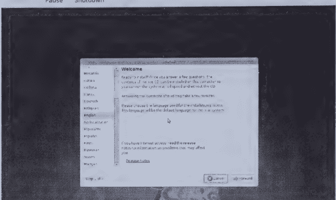

图 8-2：虚拟机控制台（安装中）

虚拟机视图 发送键 帮助

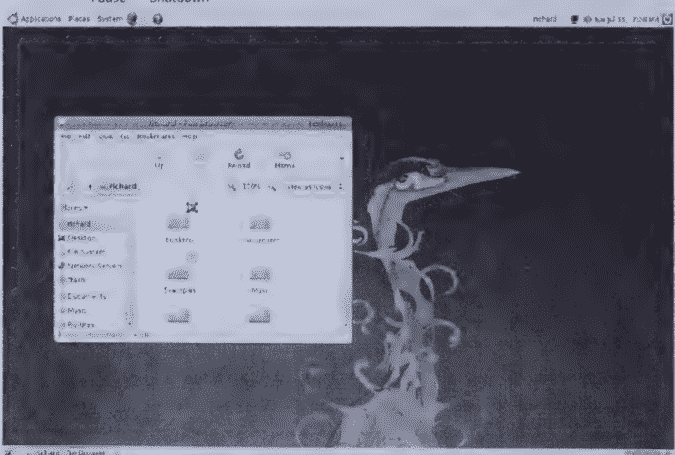

图 8-3：虚拟机控制台（操作系统运行中）

一旦你完成安装，该操作系统将尝试重启。你可能需要点击虚拟机控制台窗口上的“运行”按钮来使其重启。有用于运行、暂停和关闭新操作系统的按钮。

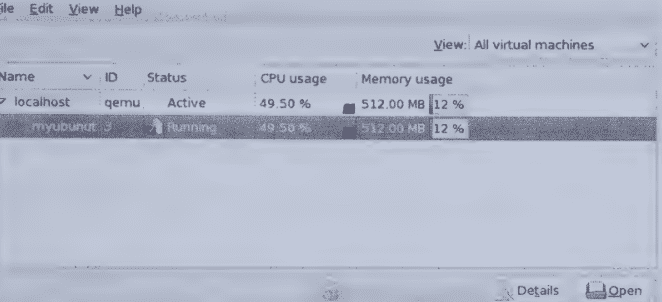

图 8-4：带有虚拟机的虚拟机控制台

重启后，操作系统将像往常一样启动，并带有自己的登录界面。一旦登录，你将拥有一个功能完备的操作系统，如图 8-2 所示的 Ubuntu。

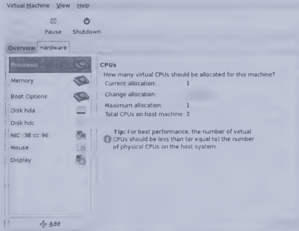

图 8-5：虚拟机详情

要关闭系统，你应该使用操作系统的关命令，而不是虚拟机控制台的“关闭”按钮。

你安装的虚拟机现在将列在虚拟机管理器窗口的宿主机下（见图 8-4）。你可以看到虚拟机控制台中的“打开”按钮来启动它。

要查看有关特定虚拟机的更多信息，选择其条目并点击“详情”按钮（见图 8-5）。这将打开一个带有“概述”和“硬件”面板的对话框。“概述”面板显示虚拟机名称、其磁盘名称、状态以及其实时 CPU 使用率图表。“硬件”面板显示有关虚拟设备的信息以及 CPU 和内存分配。

提示：你还可以使用 `virsh` 从命令行管理你的虚拟机。

## 基于内核的虚拟机 (KVM)：硬件虚拟化

从 2.6.21 版本开始，内核现在直接支持硬件虚拟化（之前的版本使用内核模块）。硬件虚拟化由 Intel 和 AMD 作为硬件虚拟化抽象层实现。具有虚拟化支持的 Intel 处理器标记为 VT（虚拟化技术），AMD 处理器标记为 SVM（安全虚拟机）。HVM 系统具有提供全虚拟化的能力，不需要像 Xen 的虚拟化方法那样特殊修改操作系统内核版本。你甚至可以利用 HVM 能力直接从 Linux 运行 Windows XP。KVM 是一个由 Qemu 开发的开源项目，http://kvm.qemu.org/kvm。请务必检查 Fedora 项目快速启动指南中的 KVM 条目，以了解如何实现 KVM，http://fedoraproject.org/wiki/Fedora?VirtQuickStart。

基于内核的虚拟机 (KVM) 使用处理器中的虚拟化技术直接从硬件运行虚拟机。没有底层的软件翻译。Xen 将通过底层的域 0 内核工作，而 KVM 直接与处理器操作。

硬件要求如下：

- 一个启了虚拟化的 Intel (VT) 或 AMD (SVM) 处理器（例如 AMD AM2 插槽处理器或 Intel Core2D 处理器）。你可能需要在你的主板上启用虚拟化支持。某些主板比其他主板更好。在某些情况下，你可能需要在主板 BIOS 中禁用 ACPI 支持以允许 Windows XP 使用。

- 至少 1 GB 内存以为虚拟操作系统的运行留出空间。硬件虚拟机需要自己的内存。

KVM 在 Linux 内核中作为一个进程管理，就像启动到一个操作系统一样。KVM 添加了带有自己的用户模式和内核模式的客户进程模式。这是在 Linux 内核和用户模式之外的。KVM 使用内核模块 `kvm-intel` 或 `kvm-amd` 与处理器虚拟化硬件接口。使用修改版本的软件模拟器 QEMU 来运行客体操作系统。QEMU 最初设计为一个模拟器，对于没有硬件虚拟化的处理器也可以作为模拟器使用。有关 QEMU 的更多信息，请访问 http://fabrice.bellard.free.fr/qemu。

注意：KVM 使用修改版本的 QEMU 运行，对虚拟设备的支持有限，例如图形驱动程序（Xen 具有原生设备驱动程序的访问权限）。

## 第 8 章：虚拟化 173

确保引导到标准内核，而不是 Xen 内核。在你的 Gnome 桌面启动虚拟机管理器（应用程序 | 系统工具 | 虚拟机管理器）。在文件菜单中选择“新建虚拟机”。这将启动 virt-install 向导。在选择要使用的虚拟化类型时，选择“全虚拟化”并确保已启用硬件加速（已启用内核/硬件加速）。你会被提示输入各种功能，如名称、使用的系统内存量、是否使用给定的分区或镜像文件以及文件大小、图形支持以及安装镜像的位置（这可以在 CD/DVD-ROM 磁盘上，但对于 Windows 建议使用磁盘镜像）。

安装后，可以使用虚拟机管理器随时启动你的客体操作系统。你的客体操作系统运行在虚拟控制台中。

注意：直接访问你的虚拟磁盘或你的虚拟磁盘上的数据。

## 使用配置文件

要创建虚拟机，你必须在 `/etc/xen` 目录下先创建一个配置文件。在这里你可以找到作为模板的配置文件。你可能想要更改的设置：

- kernel：虚拟机使用的内核镜像

- root：域根设备

- memory：允许域使用的内存量

- disk：域使用的块设备（分区）

# 第 8 章：虚拟化 175

- dhcp: 让域使用 DHCP 来设置网络。对于手动配置，你可以设置子网掩码和网关参数

- hostname: 虚拟机的主机名

- vif: 使用的 MAC 地址（如果未指定，将生成随机地址）

- extra: 额外的启动参数

- restart: 自动重启选项：always（总是），never（从不），reboot（重启）

你必须设置内核。这是 Xen 内核的位置。root 条目指定了存储启动镜像的分区。disk 条目列出了新域将使用的磁盘。这些磁盘可以是逻辑卷或磁盘镜像文件。它们不能已经被主域挂载。请注意，xguest-install 将设置一个供虚拟机使用的磁盘镜像，而不是本地卷。以下示例使用了磁盘镜像 /home/mynewvm1，它在虚拟机中将显示为 xvda 并具有读/写权限。

```
disk = [ 'phy:/home/mynewvm1,xvda,rw' ]
```

如果你的网络需要建立新连接，你也可以启用 dhcp。例如，内核设置看起来如下：

```
kernel = "/boot/vmlinux-2.6.17-1.2145_FC6"
```

你使用带有 -create 选项的命令加上配置文件。在示例中，/etc/xen 下有一个名为 my-newvm1 的配置文件，它与虚拟机的名称相同。查看 xdomain.cfg 的帮助页以获取详细的配置选项和示例。

```
xm create my-newvm1
```

然后你可以使用 console 选项连接到它。

```
xm console my-newvm1
```

你可以使用 -c 选项将两个 xm 命令合并，以进行控制台连接。

```
xm create -c my-newvm1
```

你仍然需要安装想要使用的操作系统。你可以在指定的分区或逻辑卷上进行安装，或者使用 xen-install。你可以使用基于文本的系统进行安装，或使用 VNC 进行虚拟安装。

## 硬件虚拟机：hvm

Xen 同时也提供了对硬件虚拟机（hvm）的支持。这是 Intel 在其新处理器中实现的硬件虚拟机抽象层，称为 Intel VT-x。AMD 将其实现为 SVM。Xen 系统具有提供全虚拟化的能力，不需要经过特殊修改的操作系统内核版本。理论上，你甚至可以使用这种能力在 Xen 上运行 Windows XP（Windows XP 安装程序会产生其他与虚拟化无关的并发）。Intel 用于强旋处理器的虚拟化称为 VT-i。VT-x 用于 x86 处理器。


## 第 1 部分：系统管理

Xen 可以支持具有 hvm 能力处理器的系统。`/etc/xen` 目录下的 hvm 示例配置文件的扩展名为 `.hvm`。在该文件中，设置了选项以检测并使用 hvm。`xguest-install` 也会检查 hvm。

### virt-install

你不需要直接配置文件，而是可以使用 `virt-install` 脚本。该脚本可安装 Fedora 或与 Xen 兼容的操作系统。它目前仅能使用 `http://`、`nfs://` 或 `ftp://` 前缀从远程位置安装。该脚本现在允许你为每个虚拟机使用少于 `256MB` 的内存。如果你想使用更少的内存，对于精简版的 Fedora，你必须按照上一节所述直接使用配置文件。对于 Fedora，你可以使用在线仓库。

如果你的 RAM 内存有限，你可能需要限制域 0 虚拟机使用的内存。你可以通过以下命令将其减少到 `256MB`。

```
xm mem-set 0 256
```

要启动 `virt-install` 脚本，打开终端窗口并输入脚本名。

```
virt-install
```

系统将提示你设置不同的参数，然后会自动生成一个配置文件。系统会提示你为虚拟机命名。这就是你的主机名。然后你会被询问分配多少 RAM。最少需要 `256`。这意味着对于一台虚拟机，你至少需要 `500MB` 的 RAM：`256MB` 用于 Xen0 服务器（域 0），另外 `256MB` 用于客机/用户机器（域 1）。更多的虚拟机需要更多的 RAM。

然后系统会提示你虚拟机镜像文件的磁盘路径。输入带有镜像文件名的路径。接着，系统会提示你镜像文件的大小（以 GB 为单位）。虚拟机使用镜像文件来存放其整个系统。最后，系统会提示你想要安装的操作系统的安装文件位置。在这里你可以输入 FTP、Web 或 NFS 站点，例如在线 Fedora 仓库。请记住，脚本会在该目录的 `images/Xen` 目录下寻找 Xen 内核镜像。你的下载位置具有该目录的前缀。下一个示例显示了在线的 Fedora 9。

```
### virt-install
What is the name of your virtual machine? my-newvm1
How much RAM should be allocated (in megabytes)? 256
What would you like to use as the disk (path)? /home/my-newvm1
How large would you like to use the disk to be (in gigabytes)? 8
Would you like to enable graphics support? (yes or no) yes
What is the install location?
http://download.fedora.redhat.com/pub/fedora/linux/releases/9/i386/os
```

脚本运行完成后，虚拟机将被创建。

## 管理虚拟机：xm

安装系统后，你可以使用 `xm` 命令管理虚拟机。要访问特定的域，使用 `console` 选项。

```
xm console my-newvm1
```

你可以使用 `-c` 选项合并两个 `xm` 命令进行控制台连接。

```
xm create -c my-newvm1
```

以下命令列出你的域：

```
xm list
```

`xm save` 和 `restore` 选项用于暂停和恢复。作为光驱的块设备可以从主域导出到虚拟机，尽管共享设备应该是只读的。要启动和停止域，你可以使用 `xendomain` 服务。将 Xen 配置文件放在 `/etc/xen/auto` 目录下以便 xen 启动。这些域会在内核启动时自动启动。

```
service xendomain start
```

要让域在启动时自动运行，使用 `chkconfig` 为 `xendomain` 添加脚本。

```
chkconfig --xendomain
```

你还可以使用端口 `8080` 的 `xenv` Web 界面管理域。使用以下命令启动 `xenv` 服务器。

```
xenv start
```

## ConVirt

你可以使用 ConVirt 管理你的 Xen 虚拟机（www.convert.net）。ConVirt 工具（以前称为 XenMan）提供了一个界面，通过它可以管理 Xen 域，添加或删除域。仪表板让你查看 CPU 和内存使用情况等统计数据。你可以管理每个虚拟机，启动、停止或重启。你甚至可以保存快照并恢复。要启动 ConVirt，在终端窗口输入 `convert` 命令。ConVirt 配置文件为 `convert.conf`。

你可能需要直接从 ConVirt 网站下载页下载安装 ConVirt RPM 包。用户自己的配置在 `.convert` 目录中。全局定义在 `/etc/convert.conf` 文件中。该配置文件定义了虚拟块设备的路径、快照位置以及 Xen 配置文件的位置。它提供了环境、特定的应用程序配置以及客户端配置（如 GNOME 支持）。ConVirt 还支持使用收集在镜像存储中的镜像。镜像是一个预定义的虚拟机，可以从中生成许多其他虚拟机。

# 第二部分：安全

授权：Policykit

加密

文件和目录访问

SE-Linux

SSH 与 Kerberos

防火墙

## 9. 授权

授权、加密和权限都是控制访问的手段。授权可以控制对管理工具的访问，确保只有有效且受信任的用户才能对系统设置进行更改。加密可以保护你可能发送的消息和文件，而数字签名可以确认消息或文件的来源。用户还可以通过权限和访问控制列表（ACLs）对自己的文件设置访问控制。你甚至可以对整个文件系统进行加密，使其只有通过有效密钥才能访问。

某些安全包控制对设备、消息、目录和文件系统等资源的访问。PolicyKit 提供了用户访问设备和管理工具的控制。它的设计目的是允许特定用户获得受限的管理权限，而不是允许完全的 root 权限。

你可以使用加密、完整性检查和数字签名来保护通过网络传输的数据。例如，由 SeahPG 加密管理支持的 GNU 隐私卫士（GPG）加密允许你对电子邮件或想要发送的文件进行加密，并允许你使用加密的数字签名对其进行签名，以证明该消息是由你发送的。数字签名还包括修改摘要，提供完整性检查，允许接收者验证收到的消息是原始版本，而非被更改或替换的版本。

可以在文件和目录上设置权限，允许仅所有者、组员或所有其他用户访问。这是控制文件访问的传统方法。你可以使用访问控制列表来添加进一步的限制。访问控制列表提供了更精细的访问控制，但更难管理。你还可以使用与消息和归包相同的公钥加密方法对整个文件系统进行加密。

# 使用 PolicyKit 进行受控访问：授权

PolicyKit 由 Freedesktop 项目设计，允许普通用户和应用程序访问管理控制和设备。目前，它主要与启用了 HAL 的设备以及某些 GNOME 桌面任务配合。虽然这可以通过组权限等操作来实现，但 PolicyKit 的目标是提供一个简单且集中的接口，授予用户访问受管理的设备和工具的权限。目前，PolicyKit 用于访问由 HAL 管理的共享设备。这包括系统中的大多数设备，包括可移动设备。它尚未用于控制对管理工具（如 system-config 工具）的访问。对于这些，你仍然需要 PAM 模块。三个重要的例外是 PackageKit、NetworkManager 和 PulseAudio。PackageKit 管理软件，Network Manager 控制你的网络和无线配置，Pulse Audio 配置你的音频设备。受 PolicyKit 控制的应用程序和设备列表所示：

- PackageKit：管理软件

- Network Manager：控制网络和无线配置

- PulseAudio：配置音频设备

（注：此处原文列表格式略乱，已根据描述整理翻译）

重新对应原文：

- PackageKit：管理软件

- Network Manager：控制网络和无线配置

- PulseAudio：配置音频设备

（修正列表翻译）：

受 PolicyKit 控制的应用程序和设备列表：

- 时钟小插件：设置时间、日期

- 网络管理器：关机和重启

- PackageKit：软件管理

- GNOME 系统监器：管理进程

- PulseAudio：音频设备接口

- 存储：挂载和卸载设备

- 设备访问：视频、声音、扫描仪、DVB、CD/DVD、火线（firewire）读写

PolicyKit 允许更精细的访问控制。不同于“全或无”的模式（即用户必须获得完全的 root 权限来访问整个系统），PolicyKit 允许对特定的管理工具进行访问。在没有 PolicyKit，这种访问控制可以通过组权限对某些设备（如挂载 CD/DVD）来实现，但无法应用于应用程序。通过 PAM 和 sudo 提供了类似的精细控制，允许访问特定的应用程序，但仍然需要权限。你可以在 `hal.freedesktop.org/docs/PolicyKit` 了解更多关于 PolicyKit 的信息。

通过 PolicyKit，受管理的设备和应用程序被设置为与普通用户通信，允许他们请求操作。如果用户被允许执行该操作，请求将获得授权并执行。对于由 HAL 管理的设备，请求可以发送到 HAL，HAL 是处理请求的机制。管理机制使用名为 `policykit` 的共享库来决定是否授予访问。用户和应用程序请求由 `libkit-grant` 进行验证。`policykit` 会检查 `libkit-grant` 提供的验证结果并据此授予访问。

验证可能需要用户（用户密码）或管理员（root 用户密码）。访问可以通过时间限制进一步控制：无限期、当前会话期间或只要进程处于状态。

### 第 9 章：授权

# PolicyKit 代理

为了获得访问权限，用户可以使用身份验证代理。PolicyKit GNOME 代理随 PolicyKit 一起安装，任何具有管理权限的用户都可以从“系统 | 偏好设置 | 系统 | 授权”运行它。这会运行 `polkit-gnome-authorization` 工具，通过它可以设置 policykit 访问。`policykit` 和 `gnome-policykit` 软件包都在 Fedora 仓库中并默认安装。

你只能从 root 用户账户运行 PolicyKit 代理。以 root 用户登录后，打开终端窗口并输入以下命令。

```
polkit-gnome-authorization
```

将显示 PolicyKit GNOME 代理。

### PolicyKit 侧边栏

PolicyKit 代理将显示一个窗口，侧边栏显示支持的 PolicyKit 设备和应用程序的展开树。折叠树可以更清晰地查看可用内容（见图 9-1）。有很多 gnome 和 freedesktop 的条目。freedesktop 条目包含了 freedesktop 支持的工具，包括 hal 和 policykit。

应用程序条目允许你控制对某些任务的访问。PolicyKit 允许安装、删除和更新软件，以及更改配置。时钟小插件条目控制系统时间和时区。系统监视条目具有对进程的控制权。网络管理器条目控制对网络连接的访问。

186 第2 部分：安全

要授予特定用户的访问权限，请点击显式授权（Explicit Authorizations）面板上的 Grant 按钮。这将打开一个窗口，你可以在其中选择用户并指定访问级别（参见图 9-6）。

在设备部分，你可以允许来自视频、音频和 DVB 设备等远程设备的访问。在这种情况下，可以修改隐式授权（Implicit Authorizations）以允许“任何人”（Anyone）访问。相反，你也可以允许特定用户访问。

在 freedktop 部分，你可以使用 policykit 部分中的条目来配置 PolicyKit。在这里，你可以指定谁可以撤销、修改或授予 PolicyKit 授权。

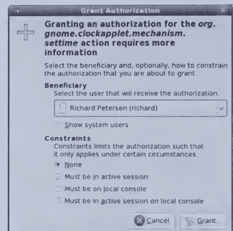

图 9-6：显式授权，授予访问（Grant access）

## PolicyKit 配置文件与工具

为了让设备和管理应用程序使用 PolicyKit，必须对其进行修改以访问它。目前，控制大多数设备访问的 HAL 为设备提供了 PolicyKit 控制。在 GNOME 上，时钟小组件已配置为 PolicyKit 控制。设备和应用程序的 PolicyKit 是使用 `/usr/share/PolicyKit/policy` 目录下名为 `.policy` 的 XML 文件配置的。在这里你会发现 gnome-clock-applet 以及 HAL 的 `.policy` 文件，以及一个 PolicyKit 的文件。

`/etc/PolicyKit/PolicyKit.conf` 文件用于允许覆盖任何用户的 PolicyKit 授权。目前，该配置文件设置为始终允许 root 用户和任何具有管理权限的用户（admin 组）访问。它可以针对特定用户进行配置。

虽然你会使用 `polkit-gnome-authorization` 来配置 PolicyKit，但可以使用多个命令行工具。这些包括用于管理授权的 `polkit-auth`、用于列出和修改允许的操作的 `polkit-action`、用于验证 PolicyKit 策略文件的 `polkit-policy-file-validate` 以及用于验证 PolicyKit 配置文件的 `polkit-config-file-validate`。当你修改 `PolicyKit.conf` 文件时，应运行 `polkit-config-file-validate` 以确保文件有效。如果你添加或修改了任何策略文件，可以运行 `polkit-policy-file-validate` 来验证它们是否配置正确。

## 可插拔认证模块

可插拔认证模块（PAM）是一种认证服务，它允许系统决定要为用户执行的认证方法。在 Linux 系统中，传统上是通过查找密码执行认证的。当用户登录时，登录过程会在密码文件中查找其密码。通过 PAM，用户的认证请求被重定向到 PAM，PAM 使用指定的方法来验证用户。这可能是简单的密码查找，也是对 LDAP 服务器的请求；提供认证的是 PAM，而不是由用户或特定服务直接查找密码。实际的认证程序可以由系统管理员进行集中管理和动态更改。认证由根据所需认证类型而变化的模块执行。管理员只需更改 PAM 配置文件即可添加或替换模块。更多信息和 PAM 模块列表请参阅 PAM 站点：www.kernel.org/pub/linux/libs/pam。PAM 模块位于 `/lib/security` 目录。

## PAM 配置文件

PAM 为请求认证的各种服务使用不同的配置文件。此类配置文件保存在 `/etc/pam.d/` 目录下。例如，你有一个用于登录系统的配置文件（`/etc/pam.d/login`）、用于图形界面登录的配置文件（`/etc/pam.d/gdm`）以及用于访问 Samba 服务器的配置文件（`/etc/pam.d/samba`）。如果不存在文件，则会调用默认 PAM 配置文件 `/etc/pam.d/other`。`system-auth` 文件包含由 `system-config-authentication` 生成的用于系统服务的标准认证模块，并在许多其他配置文件被调用。此外，Fedora 还为其配置工具（如 `system-config-services` 和 `system-config-network`）设置了认证。

## PAM 模块

PAM 配置文件包含用于认证的模块列表。它们的格式如下：

```
module-type control-flag module-path module-args
```

`module-path` 是要运行的模块，`module-args` 是你想要传递给该模块的参数。虽然有几个通用参数，但大多数模块都有自己的参数。

`module-type` 指不同的认证管理组：account（账户）、authentication（认证）、session（会话）和 password（密码）。账户管理执行账户验证，检查用户是否具有访问权限或密码是否过期等账户方面。认证（auth）验证用户是谁，通常通过密码确认来实现。密码管理在密码更改时执行认证更新。会话管理指的是在访问服务之前和关闭服务之前执行的任务。这些包括启动用户活动登录和挂载主目录的任务。

提示。作为 `/etc/pam.d` 目录的替代，你可以创建一个名为 `/etc/pam.conf` 的配置文件。该文件中的条目有一个 `service` 字段，指向使用模块的应用程序。如果 `/etc/pam.d` 目录存在，`/etc/pam.conf` 将自动生成。

`control-flag` 字段表示如果模块失败，PAM 将如何响应。控制可以是简单的指令，也可以是更复杂的响应，可以指定如 `err` 之类的返回码以及要采取的操作。简单指令有 `requisite`（必须）、`required`（需要）、`sufficient`（足够）和 `optional`（可选）。`requisite` 指令如果模块认证失败，将立即结束认证过程。`required` 指令仅在运行完剩余模块后才结束认证。`sufficient` 指令表示该模块的成功足以提供认证，除非之前的模块已失败。`optional` 指令表示。如果你指定了返回码，可以细化认证失败或成功的配置。返回码可以为 `die` 或 `ok`。`open_err` 返回码可以赋予 `die`，这将停止所有认证操作。

`include` 指令只需包含指定 PAM 模块的条目。某些基础 PAM 配置文件（如系统管理员 `system-auth`）包含在大多数 PAM 中。`system-auth` 文件自动生成，并包含了 `pam_unix.so` 和 `pam_deny.so` 等用于账户访问和密码使用的模块。这里显示了用于 FTP 服务器的 `/etc/pam.d/vsftpd` 。以下是 `system-auth` 配置文件的条目。


## PAM-1.0

```
session optional keyinit.so force revoke
auth required listfile.so item=user-sense=denied
file=/etc/vsftpd passwd=succeed
auth required shells.so
auth include system-auth
account include system-auth
session include system-auth
session required pam_loginuid.so
```

## FreeIPA

FreeIPA 为局域网用户提供认证服务。它集中管理身份、策略和审计任务（IPA）。用户不再在分离的主机上进行认证，而是作为局域网的一部分。FreeIPA 整合了多种服务以实现用户认证服务。这包括 Fedora Directory 服务（FDS）、Kerberos 认证服务和 DNS 发现服务。FDS 提供带有 Web 界面和安全连接的 LDAP 服务器，LDAP 为网络上的用户提供信息管理。Kerberos 提供认证安全。DNS 发现实现了网络自动访问。FreeIPA 的详细文档可以在 `www.freeipa.org` 获取。Fedora 特定信息位于 `http://fedoraproject.org/wiki/Features/freeIPA`。

Fedora 仓库中有 FreeIPA 客户端、服务器和管理工具包。每个主机都需要安装 FreeIPA 客户端包，只有服务器需要 FreeIPA 服务器和管理工具。这些包以 `ipa` 为前缀，例如 `ipa-client`、`ipa-admintools` 和 `ipa-server`。

## 10. 加密数据

加密是保护通过网络传输数据的唯一可靠方法。使用密钥对数据进行加密，接收者或多个接收者随后可以对其进行解密。为了完全保护通过网络传输的数据，你不仅应该对其进行加密，还要检查其是否未被修改，并确认它确实是由声称的作者创建的。加密消息仍可能被拦截、修改，然后重新加密。作为修改哈希摘要（modification digests）的完整性检查可以确保数据没有被篡改。尽管加密和完整性检查保护了数据，但它们并不能对其进行身份验证。你还需要知道声称发送消息的人确实是发送者，而不是冒充者。若要对消息进行身份验证，作者可以使用数字签名对其进行签名。该签名也可以被加密，允许接收者对其进行验证。数字签名确保了你收到的消息是真实的。

这种加密最初是通过 Pretty Good Privacy（PGP）实现的。PGP 最初是一种由私有控制的方法，后来被交给了互联网工程任务组（IETF），以制定一种名为 OpenPGP 的开放标准。任何项目都可以使用 OpenPGP 创建加密应用程序，例如 GnuPGP。PGP 的商业产品仍由 PGP 公司开发，该公司也使用 OpenPGP 标准。

| 网站 | 描述 |
|---|---|
| gnupg.org | GnuPG, G Privacy Guard |
| openpgp.org | IETF 针对 Pretty Good Privacy (PGP) 的开放标准 |
| ppg.com | PGP 公司，Pretty Good Privacy 商业产品 |

表 10-1: PGP 网站

### 公钥加密

加密使用一个密钥对数据进行加密，使得相应的密钥可以对其进行解密。在过去，旧形式的加密使用同一个密钥对消息进行加密和解密。然而，这涉及到向接收者提供密钥，导致任何获得密钥的人都可能解密数据。公钥加密使用两个密钥来加密和解密消息：私钥和公钥。你始终保留私钥并用它解密你收到的消息。你使用公钥加密任何你想发送给他人的消息。私钥解密消息，公钥加密消息。每个用户都有一组私公密钥，并安全地存储在密钥环（keyrings）中。同样地，如果你想向另一个用户发送消息，你使用他们的公钥来加密你想发送给该用户的消息。该用户使用他自己的私钥解密消息。换句话说，你的公钥被他人用于加密你收到的消息，而你使用他人的公钥加密你发送给他们的消息。你 Linux 系统上的所有用户都可以拥有自己的公钥和私钥。他们将使用 `gpg` 程序生成这些密钥，并将私钥保存在密钥环中。

### 数字签名

数字签名用于对消息进行身份验证并提供完整性检查。身份验证保证消息没有被修改——即是你发送的原始消息——而完整性检查则验证它没有被更改。尽管数字签名通常与加密消息结合使用以提供更高级别的安全性，但它也可以用于可以明文发送的消息。例如，如果你想知道 Fedora 版本升级的公共公告是否确实由 Fedora 发送，而不是由试图制造伪造混乱的人发送的。这种消息需要经过身份验证并检查以确认它是否确实由发送者发送，或者如果是由原始发送者发送，在传输途中是否发生了某种更改。这种验证可以防止冒充发送者的人对消息进行修改或替换。

### 完整性检查

对消息进行数字签名涉及使用加密哈希算法（如 SHA256 修改摘要算法）从消息内容生成一个校验和值（checksum value）。这是一个能够准确表示你的消息大小和内容的唯一值。消息的任何种更改都会生成一个不同的值。这种值提供了一种检查数据完整性的方法。该值通常被称为 MD5 值，反映了用于加密该值的 MD5 哈希算法。MD5 算法已被更安全的 SHA2 算法所取代。

然后，该 MD5 值本身会用你的私钥进行加密。当用户接收你的消息时，他们用你的公钥解密你的签名。然后用户对收到的消息生成一个 MD5 值，并将其与 MD5 值进行比较。

# 196 第2 部分：安全

图 10-6：生成加密密钥

一旦创建了密钥，它将出现在“我的个人密钥”窗口中（见图 10-7）。

图 10-7：我的个人密钥

## 导入公密钥

使用“导入”按钮（或从“密钥”菜单选择“导入”）导入您可能下载的任何公密钥。如果您知道密钥文件名，可以尝试在密钥服务器上搜索它。通过“密码和加密密钥”应用程序，您可以从“远程”菜单选择“查找远程密钥”。这将打开“远程密钥”窗口，您可以在其中输入密钥的搜索字符串（见图 10-8）。搜索词被视为前缀，匹配所有可能的补全。一个可展开的树允许您列出密钥服务器，并决定要搜索哪些服务器。结果将列在一个新窗口中。选择您想要的密钥，然后点击“导入”直接导入密钥，或点击“另存为”将密钥文件保存为 asc 密钥文件，以便以后导入。要查看有关密钥的信息，选择该密钥并点击“属性”按钮。将显示所有者和密钥本身的信息。

# 第 10 章：加密 197

图 10-8：搜索密钥

一旦导入了密钥，它将出现在“其他收集密钥”面板中（见图 10-9）。如果您确定可以信任该密钥，可以对其进行签名，使其成为信任密钥。右键点击该条目并选择“签名”打开签名窗口，或点击“签名”按钮。系统会要求您指定检查此密钥的仔细程度（完全没有、随意、非常仔细）。密钥将从“其他收集密钥”面板移动到“信任密钥”面板。随后它将出现在“信任密钥”面板中。

图 10-9：导入的密钥

当您创建自己的私密钥时，还会生成一个对应的公密钥，其他人可以使用它解密用该密钥加密的数据。为了让其他人可以使用您的公密钥，您可以将其导出为文件直接发送给其他用户，自动与系统上的其他用户共享，或发布在密钥服务器上。要将公密钥导出为文件，请在“我的个人密钥”面板中选择您的密钥，并点击“导出公密钥”按钮。也可以对公密钥执行此操作。要让密钥自动对其他用户可用或发布在密钥服务器上，请使用“密码和密钥环设置”工具（系统 | 偏好 | 加密和密钥环）。

Seahorse 与 GPG 集成。如果您使用 `gpg` 命令导入密钥，它将出现在“其他收集密钥”面板中。此外，您可以使用 `gpg` 命令配合 `--sign-key` 选项对密钥进行签名，密钥将出现在“信任密钥”面板中。

## Seahorse 设置

要管理和配置密钥设置，请使用“加密和密钥环设置”工具（系统 | 偏好 | 加密和密钥环）。“密码和加密设置”窗口包含五个面板：密码密钥环、加密、PGP 密码语、密钥服务器和密钥共享（见图 10-10）。

图 10-10：密码和加密设置

在“密码密钥环”面板上，您可以添加密钥并管理密码。要创建新密钥环，点击“添加密钥环”按钮。这将打开一个对话框，您可以在其中输入密钥环名称和密码。在“加密”面板上，您可以选择默认密钥。在“PGP 密码语”面板上，您可以配置密码语记忆。默认情况下密码语永远被记住。您可以选择始终记住密码语，或仅在一段时间内。

“密钥服务器”面板列出了要使用的密钥服务器（见图 10-11）。点击“添加密钥”以添加密钥服务器，输入其主机名（URI）。您可以选择在密钥服务器上发布您的公密钥（默认关闭）。您还可以选择从密钥服务器自动检索密钥并同步已修改的密钥。

“密钥共享”面板提供了与您网络上的其他用户自动共享公密钥的选项。用户将自动拥有您所有的公密钥，并可以使用它们加密发送给您的消息或文件。您不需要手动向他们发送公密钥。

图 10-11：Seahorse 可用的密钥服务器

## 使您的公密钥可用

为了让其他用户解密您的消息，您必须让他们可以使用您的公密钥。反之，您也必须让他们可以使用他们的公密钥。

# 第 10 章：加密 199

### GNU Privacy Guard: gpg

在使用 GnPG 之前，您必须生成自己的私密钥和公密钥。您可以使用上一节介绍的“密码和加密密钥工具”来完成，也可以像此处所示在终端窗口中执行 `gpg` 命令来完成。在命令行（终端窗口）中，输入带有 `--gen-key` 参数的 `gpg` 命令。gpg 程序将提示您创建私密钥和公密钥的各种选项。您可以查看 gpg 页面获取有关如何使用 gpg 程序的信息。

```
gpg --gen-key
```

# 第10章：加密 201

### GPG 命令

### 描述

- `-s`, `--sign`

对文档签名，创建一个签名。可以与 `--encrypt` 结合使用。

- `--clearsign`

创建一个明文签名。

- `-b`, `--detach-sign`

创建一个分离的签名（detached signature）。

- `-e`, `--encrypt`

加密数据。可以与 `--sign` 结合使用。

- `--decrypt [file]`

解密文件（如果未指定文件则使用标准输入）并写入到标准输出（或通过 `--output` 指定的文件）。如果解密后的文件带有签名，则会验证签名。

- `--verify [[sigfile] [signed-files]]`

验证已签名的文件。签名可以包含在文件中，也可以是独立的分离式签名。

- `-k`, `--list-keys [names]`, `--list-public-keys [names]`

列出公钥环中的所有密钥或指定的密钥。

- `-K`, `--list-secret-keys [names]`

列出你的私钥（秘密密钥）。

- `--list-sigs [names]`

列出你的密钥以及它们拥有的任何签名。

- `--check-sigs [names]`

列出密钥及其签名并验证签名。

- `--fingerprint [names]`

列出指定私钥和公钥的指纹。

- `--gen-key`

生成一组新密钥。这些命令执行大多数密钥操作，例如使用 sign 签名密钥，或使用 passwd 更改你的密码句。

- `--edit-key name`

编辑你的密钥。

- `--sign-key name`

使用你的私钥对密钥进行签名。与 `--edit-key` 中的 sign 相同。

- `--delete-key name`

从公钥环中移除公钥。

- `--delete-secret-key name`

从秘密环和公钥环中同时移除私钥和公钥。

- `--gen-revoke name`

为自己的密钥生成撤销证书。

- `--export [names]`

从你的密钥环中导出指定的密钥。如果不带参数，则导出所有密钥。

- `--send-keys [names]`

将指定的密钥导出并发送到密钥服务器。必须使用 `--keyserver` 指定该密钥服务器的名称。

- `--import [files]`

将文件中包含的密钥导入你的公钥环。

### GPG 选项

### 描述

```
-a, --armor
```

创建 ASCII 护甲输出，即加密数据的 ASCII 版本。

```
--o, --output file
```

将输出写入到指定的文件。

```
--default-key name
```

指定用于签名的默认私钥。

```
--keyserver site
```

查找不在你密钥环中的公钥。

```
-r, --recipient names
```

使用该用户的公钥为指定的用户加密数据。

```
--default-recipient names
```

指定加密数据时使用的默认接收者。

## 表 10-1：GPG 命令与选项

你首先需要选择你想要的密钥类型。通常情况下，你只需要选择默认项，按 ENTER 键即可完成。

然后，你选择密钥长度，通常默认为 1024。

接着，你指定密钥的有效期——通常没有有效期限制。

系统会要求你输入用户 ID、注释和电子邮件地址。按按 ENTER 键提示每一项。这些元素中的任何一个都可以作为密钥名称，用于标识密钥。在执行 GPG 任务（如签名密钥或创建撤销证书）时，你会使用密钥名称。例如，以下元素将为用户 richlp 创建一个注释为“author”且电子邮箱地址为 richp@turtle.mytrek.com 的密钥：

Richard Petersen (author) <richlp@turtle.mytrek.com>

你可以使用密钥身份标识的任何唯一部分来引用该密钥。例如，只要没有其他密钥包含“Richard”字符串，字符串“Richard”就会引用前述密钥。字符串“richlp” 也会作为“author”引用该密钥。当一个字符串匹配到多个密钥时，所有匹配的密钥都将被引用。

在输入用户 ID、注释和电子邮件地址后，系统会显示这些元素并弹出一个菜单，允许你更改任何一个元素。

更改 (名称)，(C)注释，(E)邮箱或 (O)密钥/(Q)退出？

输入 O 以批准并接受该密钥。

gpg 程序将要求你输入一个密码句（passphrase）来保护你的私钥。请确保使用一个真实的短语（包括空格），而不仅仅是密码。

```
gpg 然后生成你的公钥和私钥，并将它们放在 .gnupg 目录中。
```

这可能需要几分钟时间。

私钥保存在 `.gnupg` 目录下的 `secring.gpg` 文件中。公钥存放在 `pubring.gpg` 文件，你可以向其中添加其他用户的公钥。你可以使用 `--list-keys` 和 `--list-public-keys` 命令列出这些密钥。

```
gpg --list-keys
```

要列出你的私钥，你需要使用 `--list-secret-keys` 命令。

```
gpg --list-secret-keys
```

如果你以后需要更改密钥，可以创建一个撤销证书来通知他人该公钥已失效。例如，如果你忘记了密码或别人发现了它，可以使用撤销证书告诉他人你的公钥不应再被使用。在下一个示例中，用户为密钥 richlp 创建了一个撤销证书，并将其放置在 myrevoke.asc 中。

```
gpg --output myrevoke.asc --gen-revoke richlp
```

### 导入公钥

为了接收其他用户的消息，你需要从密钥服务器下载他们的公钥。或者，你可以通过文件获取公钥。你需要导入这些公钥。例如，从密钥服务器获取公钥：

```
gpg --keyserver keyserver.ubuntu.org --recv-keys richlp
```

现在，你可以验证 richlp 的签名了：

```
gpg --verify message file
```

如果你以后需要更改密钥，可以创建一个撤销证书来通知他人该公钥已失效。例如，如果你忘记了密码或别人发现了它，可以使用撤销证书告诉他人你的公钥不应再被使用。在下一个示例中，用户为密钥 richlp 创建了一个撤销证书，并将其放置在 myrevoke.asc 中。

```
gpg --output myrevoke.asc --gen-revoke richlp
```

## 签名你的公钥

当你信任一个公钥时，你可以对其进行签名。这可以帮助他人验证该密钥的真实性。例如，你可以对自己的公钥进行签名：

```
gpg --sign youremail@example.com
```

## 第10 章：加密

根据密钥内容生成，类似于修改后的摘要。使用 `--fingerprint` 选项，你可以从已安装的密钥生成一个哈希值，并联系发送者询问其正确的哈希值应该是多少。如果两者不相同，则说明密钥在传输过程中被篡改了。

提示：如果你愿意，可以使用 `--fingerprint` 选项来检查密钥的有效性。如果你确信该密钥是有效的，就可以可以使用 `--sign-key` 命令对其进行签名。

你不需要通过检查指纹来让 gpg 运行。这是你可以自行执行的一项建议性预防措施。关键在于，你需要确信收到的密钥是有效的。通常情况下，你可以接受来自公共服务器或已知网站的密钥为有效，尽管检查它们的指纹也很简单。一旦确认了密钥的有效性，你就可以用你的私钥对其进行签名。签名会通知 gpg 你正式接受了该密钥。

### 发布密钥

你可以使用带有 `--keyserver` 选项和 `--send-key` 命令的 `gpg` 命令将密钥直接发送到密钥服务器。`--send-key` 命令的参数是你的电子邮件地址。你需要发送到一个密钥服务器，否则它会自动与其他密钥服务器共享你的密钥。你也可以使用 Seahorse 提供的“加密与密钥环”、“密钥共享与密钥服务器”面板来发布你的密钥。

```bash
--keyserver pgp.mit.edu:11371 --send-key chris@turtle.mytrek.com
```


如果你想将密钥直接发送给另一个用户，你应该生成密钥的装甲版本（armored version），然后通过电子邮件发送。你可以通过 `--armor` 和 `--export` 来实现，并使用 `--output` 选项指定存放密钥的文件。`--armor` 选项将生成加密文件的 ASCII 文本版本以便通过电子邮件发送，而不是作为二进制附件。按照惯例，持有 ASCII 编码版本加密的文件通常使用 `.asc` 扩展。二进制加密文件通常使用 `.gpg` 扩展。你可以将该文件发送给想要发送消息的用户。

```bash
# gpg --armor --export richlp@turtle.mytrek.com --output richlp.asc
# mail -s 'mypkey' george@rabbit.mytrek.com < richlp.asc
```

许多公司和机构会在其网站上发布公钥，用户可以下载并使用它们来验证加密的软件下载或官方公告。

注意：GPG 的某些命令和选项有长短两种形式。例如，`--armor` 命令可以写为 `-a`，`--output` 写为 `-o`，`--sign` 写为 `-s`，`--encrypt` 写为 `-e`。其他大多数选项（如 `--export`）没有短格式。

## 使用 GnuPG

目前大多数邮件客户端（包括 Kmail、Thunderbird 和 Evolution）都支持 Gnu 加密。你可以使用 `gpg` 命令手动编码和解码消息，包括数字签名。Seahorse 为 Evolution 和 Edit 提供了多个 GPG 加密插件。

要使用离线签名验证文件，接收者需要指定签名和原始文件。

```bash
gpg --verify mydoc2.sig mydoc2
```

要验证受信任的签名，你可以使用 `gpgv`。你还可以生成一个用于文本文件的明文签名（clear sign signature）。明文签名是签名的文本版本，可以附加到文本文件中。该文本文件可以使用任何文本编辑器进行进一步编辑。使用 `--clearsign` 选项创建明文签名。以下示例创建一个名为 `myynotice.txt` 的文本文件的明文签名版本。

```bash
gpg -o mysignotice.txt --clearsign myynotice.txt
```

## 文件和目录访问

文件和目录的访问可以通过权限和访问控制直接进行。权限是控制访问的传统方法。它们通过对所有者、组或其他任何人的设置宽泛限制来限制访问。对于更精细的访问（例如通过指定特定用户），你可以使用访问控制列表（ACL）。权限广泛用于大多数 Unix 和 Linux 系统，并且仍然是控制访问的最简单方法。ACL 需要更多的维护，但提供了更多的访问选项。

可以使用文件系统加密对文件系统应用另一层控制。实际上，管理员可以阻止任何授权用户以外的人对文件系统的访问。实质上，加密实现了一个受保护的文件系统。

### 权限：自主访问控制

Linux 中的每个文件和目录都包含一组权限，这些决定了谁可以访问它们以及如何访问。这些被称为自主访问控制（Discretionary Access Controls）。你通过以下三种方式之一设置这些权限来限制访问：

- 你可以仅限制你本人的访问。
- 你可以允许指定组中的用户进行访问。
- 你可以允许系统上的任何人进行访问。

文件或目录可能具有读、写和执行权限。当创建一个文件时，系统会自动授予所有者读和写权限。你可以将这些权限更改为你想要的任何组合。

提示：在 GNOME 和 KDE 中，你可以通过右键点击文件并选择“属性”来轻松更改权限。在“权限”选项卡上，你将看到“所有者”、“组”和“其他”的选项。

`ls -l` 命令显示文件的详细信息。在此示例中，左侧的第一组字符是该文件的权限列表：

```bash
$ ls -l
-rw-r--r-- 1 robert weather 207 Feb 20 11:55 mydata
```

空权限用连字符（-）表示。读权限用 'r' 表示，写权限用 'w' 表示，执行权限用 'x' 表示。第一个字符表示文件类型：通常情况下，如果第一个字符是连字符，则列出文件；如果第一个字符是 'd'，则显示的是目录。

每个类别都有自己的一组读、写和执行权限。第一组控制所有者的访问。第二组控制组的访问。第三组控制其他用户的访问。这三组组成了总共九种权限类型。

### chmod

你使用 `chmod` 命令更改不同的权限配置。`chmod` 接受两个列表作为参数：权限更改和文件名。你可以通过两种不同的方式指定权限列表。一种使用权限符号，称为符号方法。另一种是使用所谓的“二进制掩码”（binary mask），称为绝对方法或相对方法。

### GNOME 上的权限

在 GNOME 上，你可以使用“属性”窗口中的“权限”面板设置目录或文件权限。在文件管理器中右键点击文件或目录项并选择“属性”。然后选择“权限”面板。在这里，你会找到针对“所有者”、“组”和“其他”的“读”、“写”和“执行”的弹出菜单。你可以将所有者权限设置为“只读”或“读写”。对于组和其他，你也可以设置为“无”以拒绝访问。组名会展开为列出不同组的弹出菜单；选择其中一个来更改文件的组。如果你想作为程序执行（例如 shell 脚本），请勾选“允许文件作为程序执行”。

目录的“权限”面板的操作方式相同，但它包含两个访问条目：文件夹访问和文件访问。“文件夹访问”条目通过“仅列出文件”、“访问文件”和“创建/删除文件”选项控制访问。这些对应于目录的读、写和执行权限。“文件访问”条目允许你设置目录中所有文件的权限。它们与所有者、组和其他的权限相同；该条目增加了“无”选项以拒绝访问。要相应地设置目录中所有文件的权限（而不只是文件夹），请点击“将权限应用于包含的文件”按钮。

### KDE 上的权限

在 KDE 上，你可以使用“属性”窗口中的“权限”面板设置目录或文件权限。在文件管理器中右键点击文件或目录项并选择“属性”。然后选择“权限”面板。在这里你找到“所有者”、“组”和“其他”的弹出菜单。选项包括“可以读”、“可以写”和“禁止”。对于更精细的访问，点击“高级权限”按钮显示一个表格，用于检查所有者、组和其他的读、写和执行访问 (`r`, `w`, `x`)。你还可以设置粘位（sticky bit）并使用组权限。“添加条目”允许你设置 ACL 访问，指定某些无法访问文件的用户或组。

目录的选项略有不同：“查看内容”和“查看并修改内容”，它们对应读和写权限。你有选项将更改应用于所有子目录及其内部的文件。点击“高级权限”按钮将显示一个与所有者、组和其他相同的读、写和执行表格。点击表格可以切换权限的开启或关闭。选定的权限显示在“有效”列。使用“添加条目”按钮控制特定用户和组的 ACL 访问。

## 命令或选项

### 执行

`chmod`

更改文件或目录的权限。

### 选项

- `+`

添加权限。
- `-`

移除权限。
- `=`

分配整组权限。
- `r`

为文件或目录设置读取权限。文件可以被显示或打印。目录可以显示其文件列表。
- `w`

为文件或目录设置写入权限。文件可以被编辑或删除。目录可以被删除。
- `x`

为文件或目录设置执行权限。如果文件是 shell 脚本，则可以作为程序执行。目录可以切换并进入。
- `u`

为创建和拥有文件或目录的用户（owner）设置权限。
- `g`

设置组访问文件或目录的权限。
- `o`

设置系统上所有其他用户访问文件或目录的权限。
- `a`

为所有者、组和所有其他用户的访问设置权限。
- `s`

设置用户 ID (`UID`) 和组 ID (`GID`) 权限；由所有者和组拥有的程序。
- `t` 设置粘滞位（sticky bit）权限；程序保留在内存中。

### 命令

```
chgrp groupname filenames
```

更改文件或文件的所属组。

```
chown user-name filenames
```

更改文件或文件的所有者。

```
ls -1 -ld directory
```

列出文件名并显示其权限。

```
ls -1
```

列出目录下所有文件并显示其权限。

## 表 11-1：文件与目录权限操作

`root` 用户（系统管理员）拥有属于 `root` 组的大多数系统文件。大多数管理文件（如 `/etc` 目录下的配置文件）都由 `root` 用户拥有并属于 `root` 组。只有 `root` 用户有权限修改它们，而普通用户可以读取它们，对于程序，则可以执行它们。在下一个示例中，`root` 用户拥有 `/etc` 目录下的 `fstab` 文件，该文件也属于 `root` 用户组。

```
-rw-r--r-- 1 root user 621 Apr 22 11:03 fstab
```

位于系统目录中的某些目录和文件由服务拥有，而不是 `root` 用户，因为服务需要直接更改这些文件。这对于与远程用户交互的服务（如 Internet 服务器）尤为如此。这些文件大部分位于 `/var` 目录。在这里，你将找到由 Squid 代理服务器和域名服务器（named）等服务管理的和目录目录在本示例中，Squid 代理服务器由 `squid` 用户拥有并属于 `squid` 组：

```
-drwx-xr-x 2 squid 4096 Jan 24 16:29 squid
```

注意：当程序由 `root` 所有时，设置 ID 权限将赋予用户以 `root` 权限执行程序的能力。对于任何可以产生更改的程序——例如删除文件的 `rm`，这可能构成严重的安全风险。

## 更改文件的所有者或所属组：chown 和 chgrp

虽然其他用户可能可以访问某个文件，但只有文件的所有者才能更改其权限。然而，如果你想让其他用户对你的某些权限拥有控制权，你可以自己将文件的所有者更改为另一个用户。`chown` 命令将文件的控制权转移给另一个用户。该命令的第一个参数是另一个用户的名称。在用户名之后，列出你正在转移的文件。在下一个示例中，该用户将 `mydata` 文件的控制权交给了用户 `robert`：

```
$ chown mydata
$ ls -1 mydata
-rw-r--r-- 1 robert 207 Feb 20 11:55 mydata
```

如果你愿意，你也可以使用 `chgrp` 命令更改文件的所属组。`chgrp` 的第一个参数是文件或多个文件新所属组的名称。在新组名之后，列出你想要更改的文件。在下一个示例中，该用户将 `today` 和 `weekend` 的组名更改为 `forecast` 组。`ls -1` 随之反映了所属组的变化。

```
$ chgrp forecast weekend
$ ls -1
-rw-r--r-- 1 chris forecast 568 Feb 14 10:30 today
-rw-r--r-- 1 chris forecast 308 Feb 17 12:40 weekend
```

你还可以通过冒号将组附加到新所有者上，从而将 `chgrp` 操作与 `chown` 命令结合：

```
$ chown george:forecast tomorrow
-rw-r--r-- 1 george forecast 568 Feb 14 10:30 tomorrow
```

## 设置权限：权限符号

设置权限的符号方法分别使用字符 `r`、`w` 和 `x` 表示读、写和执行。这些权限中的任何一个都可以添加或移除。添加权限的符号是加号 `'+'`。移除权限的符号是减号 `'-'`。在下一个示例中，`chmod` 命令为所有类的 `mydata` 文件添加执行权限并移除写入权限。读取权限没有更改。

```
$ chmod +w mydata
```

权限符号还指定了每个用户类别。所有者（owner）、组（group）和其他人（others）类别分别由 `u`、`g` 和 `o` 表示。注意，所有者类别由 `u` 表示，可以被视为用户。类别符号放置在读、写和执行权限之前的加号或减号之前。如果没有使用类别符号，则会分配所有类别。

目录。如果你允许其他用户对目录具有写权限，他们就可以向其中添加文件。当你创建一个目录时，所有者会自动获得读取、写入和执行权限。你可以列出该目录中的文件、切换到该目录并并在其中创建文件。

与文件一样，目录也为所有者、组和其他所有用户设置了一组权限。通常，你可能允许其他用户更改和列出你某个目录中的文件，但不允许他们向其中添加文件。在这种情况下，你对目录设置读取和执行权限，并列出其中的文件，但不创建新文件或将其中任何文件复制到其中。下一个示例为 `thankyou` 目录设置了组读取和执行权限，但删除了写权限。组的成员可以进入 `thankyou` 目录并列出其中的文件，但他们不能创建新文件。

```
$ chmod grx-w letters/thankyou
```

就像处理文件一样，你也可以使用八进制来设置目录权限。要设置与前面的示例相同的权限，你使用八进制数字 `750`，其二进制等值于 `111 101 000`。

```
$ chmod 750 letters/thankyou
```

### 显示目录权限

`ls` 命令配合 `-l` 选项列出目录中的所有文件。要仅列出目录本身的信息，请添加 `d` 修改符。在下一个示例中，`ls -ld` 显示了 `thankyou` 目录的信息。注意权限列表中的第一个字符是 `d`，表示它是一个目录：

```
$ ls -ld thankyou
drwxr-x--- 2 chris 512 Feb 10 04:30 thankyou
```

### 父目录权限

如果你有其他用户需要访问，你不仅需要为该文件设置权限，还必须确保文件所在目录的权限也已设置好。要访问一个文件，用户必须首先访问文件所在的目录。这同样适用于目录的父目录。虽然目录可能允许其他人访问它，但如果其父目录拒绝访问，则无法到达该目录。因此，你必须密切关注你的目录树。要为某个目录提供访问，目录树中其之的所有其他目录也必须对其他用户开放。

### 所有权权限

除了读取/写入/执行权限外，你还可以为可执行程序设置所有权权限。通常情况下，程序运行时运行程序的用户即使程序本身可能属于另一个用户，但**设置用户 ID (Set User ID)** 权限允许程序的原始所有者拥有该程序，即使此时是另一个用户在运行该程序。例如，系统上的大多数软件由 `root` 用户运行，但由普通用户执行。某些软件可能需要修改 `root` 拥的文件，并保留所有权，以便程序有权限更改这些 `root` 拥的文件。组 ID (Group ID) 权限对组的操作方式相同。属于某个组的程序即使由另一个组的用户运行，也会保留组所有权。该程序就可以更改所有者组的文件。这涉及到一个潜在的安全风险，因为你本质上是赋予了用户某些有限的 `root` 级访问权限。

### 使用符号的所有权权限

要向文件同时添加用户 ID 和组 ID 权限，你使用 `s` 选项。以下显示了对 `pppd` 程序的用户 ID 权限，该程序属于 `root` 用户。当普通用户运行 `pppd` 时，`root` 用户保留所有权，允许 `pppd` 程序更改 `root` 拥的文件。

```
# chmod +s /usr/bin/pppd
```

设置 ID 和组 ID 权限在权限执行位 `x` 处显示为 `s`。读取、写入和用户 ID 权限是执行权限的重要变。设置用户 ID 权限是 `rws` 而不是 `rwx`。

```
# ls -l /usr/bin/pppd
-rwxr-sr-x 1 root root 184412 Jan 24 22:48 /usr/bin/pppd
```

### 使用二进制方法的所有权权限

对于权限，你在八进制数字的开头添加另一个八进制数。用户 ID 的八进制数字是 `4` (`100`)，组 ID 是 `2` (`010`)（使用 `6` 设置两者——`110`）。接下来的示例显示了对 `pppd` 程序的用户 ID 权限，以及对所有者、组和其他人的读取和执行权限：

```
# chmod 4555 /usr/bin/pppd
```

### 粘滞位 Sticky Bit 权限

特殊权限为目录提供了更高的安全性，即粘滞位。最初，粘滞位用于在程序执行完毕后将其保留在内存中以提高效率。当前的 Linux 系统忽略了这一特性。相反，它被用于目录，保护设置了粘滞位的目录，其中的文件只能由 `root` 用户或目录所有者删除或重命名。

### 使用符号的粘滞位权限

粘滞位权限是 `t`。粘滞位在“其他 (others)”的执行位显示为 `t`。具有读取和执行权限且带有粘滞位的程序显示为 `r-t`。

```
# chmod +t /home/dylan/myreports
# ls -l /home/dylan/myreports
-rwxr-xr-t 1 root root 4096 /home/dylan/myreports
```

### 使用二进制方法设置粘滞位权限

与所有权权限一样，对于粘滞位权限，你在八进制数字的开头添加另一个八进制数。粘滞位的八进制数字是 `1` (`001`)。接下来的示例为 `myreports` 目录设置粘滞位：

```
# chmod 1755 /home/dylan/myreports
```

下一个示例为 `newprogs` 目录设置粘滞位和用户 ID 权限。`5755` 权限的二进制等值为 `101 111 101`：

```
$ chmod 1755 /usr/bin/newprogs
$ ls -ld /usr/bin/newprogs
drwxr-xr-t 1 root root ...
```

## 权限默认值：umask

当你创建一个文件或目录时，会赋予默认权限。你可以使用 `umask` 命令显示或更改默认值。权限以二进制或符号格式显示。默认包含了适用于目录的任何执行权限。创建文件时执行权限是关闭的，因此你需要手动设置。要显示默认值，使用不带参数的 `umask` 命令。`-s` 选项使用符号格式。

```
$ umask -s
u=rwx,g=rx,o=rx
```

此 `umask` 映射到文件的 `rw--r--` 和目录的 `rwxr-x`。

你可以通过符号或二进制格式指定新的默认值。要指定新权限，使用 `-s` 选项。接下来的示例拒绝了其他权限，同时允许用户和组读取访问，导致权限为 `rwx----`：

```
$ umask -s u=rwx,g=rx,o=
```


当你使用二进制格式时，掩码是你想要设置的权限的反反。要设置默认值拒绝读取和写入权限，你使用二进制数字 `2` (`010`)。要开启所有权限，你使用八进制 `0` (`000`)。接下来的示例显示了文件的 `rw`、`r` 和 `r` 权限的掩码：

```
$ umask
0022
```

要设置默认值拒绝所有其他权限，你使用 `027`，其他权限的二进制值为 `011`。

```
$ umask 0027
```

## 访问控制列表：FACL

用户可以通过访问控制列表 (`ACL`) 对其文件和目录提供更精细的控制。访问控制列表维护了用户组以及他们访问特定文件和目录的权限。`ACL` 允许对目录进行更精细的访问，而不是像所有者、组和其他那样全有全无。通过 `ACL`，只有特定的用户可以被授予写入权限，而某些用户可以被赋予读取权限。与其将文件开放给组的所有成员或系统/网络上的所有人，不如使用 `ACL` 将访问限制在少数指定的个人，无论他们的组成关系如何。`ACL` 由用户控制，允许用户为特定个人或组设置文件的访问权限。

在 Fedora 上，可以通过 `acl` 软件包（Universe 仓库）安装 `ACL` 支持。查看 `acl`、`setfacl` 和 `getfacl` 的手册页获取详细说明和示例。

- `ACL` 条目包含三个字段：类型（用户、组、其他、掩码）、限定符（特定用户或组）以及自主访问权限（读、写、执行）。这些字段由冒号分隔。类型可以是 `u`、`g` 或 `m`，分别引用用户、组、其他和掩码。对于限定符，你可以输入用户或组。与其使用名称，不如使用用户 ID 或组 ID（`UID` 或 `GID`）。权限可以是读、写或执行：`r`、`w`、`x`。可以使用二进制或符号方法管理权限。在标准的二进制格式中，`rwx` 权限是顺序的，读在第一，写在第二，执行在第三。如果其中任何位置是 `-`，则表示拒绝该类型的访问。`-r` 允许读取和执行权限，但拒绝写入权限。使用符号方法时，你使用 `+` 或 `^` 来指定你想要添加或删除的权限。`+r^w+x` 会添加读取和执行权限，并移除写入权限。

条目 `u:chris` 将允许用户 `chris` 对指定的文件具有读取和写入权限。你可以在同一行列出多个条目并用逗号分隔，或者将每个条目单独放在一行。

## ACL 文件系统

文件系统需要使用 `acl`（`acl` 软件包）进行挂载，并包含 `setfacl` 和 `getfacl` 命令来设置权限。更多信息请参见 `setfacl` 和 `getfacl` 手册页。

一旦为文件系统设置了权限，你可以使用带 `acl` 选项的 `mount` 命令进行挂载。在 Fedora 9 中，确保文件已标记。使用 `???` 来创建一个。

```
sudo mount -o acl LABEL-myvideos /myvideo
```

如需让设备自动带有 `ACL` 选项挂载，请在其 `/etc/fstab` 文件的条目中添加 `acl` 选项。

```
LABEL-myvideos /myvideo ext3 defaults.acl 0 0
```

## 显示 ACL 控制

一旦文件系统启用了 `ACL` 属性挂载，你就可以使用 `getfacl` 命令显示特定文件和目录的 `ACL` 属性。`getfacl` 命令将列出文件名、所有者和组。然后它将列出用户、组、掩码或其他用户的权限。权限条目有三个字段，第一个是类型（用户、组、掩码或其他）。第二个是允许访问的用户和组列表。第三个是授予所列用户和组的权限。默认权限初始列出时，用户和组列表为空（第二个字段为空）。

```
getfacl myfirstvid
```

要查看当前工作目录的 `ACL`，请使用点 `.` 作为参数。

```
getfacl
```

当对 `ACL` 文件或目录使用 `-l` 选项时，权限字段末尾会出现一个 `+`，表示 `ACL` 正在生效。

## 第 11 章：文件和目录访问

```
ls -l myfirstvid
```

要复制 `ACL` 文件，你使用 `-p` 权限（移动/重命名操作 `mv` 将保留 `ACL` 权限）。

```
cp -p myfirstid myvidback
```

### ACL 设置

通过 `setfacl`，你可以根据特定用户设置读、写和执行访问权限。使用 `-m` 选项添加新权限并更改当前权限（`-x` 移除设置）。如前所述，用户和权限通过冒号分隔的列表引用，该列表使用 `r`、`w` 和 `x` 选项指定，并使用 `u`、`g` 和 `o` 引用用户、组和其他类别。参数 `u:chris` 将允许该用户对指定的文件具有读取和写入权限。

```
setfacl -m u:chris myfirstvid
```

随后 `getfacl` 操作将显示已添加的权限条目。

```
getfacl myfirstvid
```

提示：你可以安装并使用 `eiciel` 工具，为文件和目录的 `ACL` 控制提供图形用户界面。

要更改特定条目，请使用 `-m` 选项。

```
setfacl -m u:chris:r myfirstvid
```

要移除整个条目，请使用 `-x` 选项。只需指定类型以及用户或组名。

```
setfacl -x u:chris myfirstvid
```

提示：你也可以使用 `chmod` 命令来更改 `ACL` 设置。

与其对每个文件重复相同的 `ACL`，你可以创建一个包含这些条目的文件夹并让它读取给你。当你添加新条目时，每个文件都会设置一个有效掩码。有效权限掩码由 `setfacl` 命令计算，结果为 `ACL` 条目中已指定的所有其他权限与当前权限的并集。实际上，当你使用 `setfacl` 的 `-m` 添加 `ACL` 条目时，掩码由 `setfacl` 计算并显式添加。你可以通过 `-n` 选项关闭此计算。此时你必须显式设置有效权限掩码。

```
setfacl -n -m u:chris:rwx myfirstvid
```

如果你使用 `chmod` 更改 `ACL` 文件的权限，你更改的是掩码条目。掩码条目的优先级高于所有其他条目。如果你将所有权限更改为只读，所有其他条目都将被覆盖。这通过在条目后显示的有效注释指示，显示实际允许的权限。原始条目保留，只是不再生效。原始条目未经过任何修改。此功能允许你关闭所有用户和组的访问。

## 加密文件系统

Fedora 支持 `Luks`（Linux 统一密钥设置）加密来加密文件系统。要设置加密文件系统，你首先使用 `cryptsetup` 的 `luksFormat` 进行初始化和创建。你会被提示输入密码（或使用 `--keyfile` 指定密码）。默认系统类型为 `vfat`。使用 `-t` 选项指定。加密通常用于 U 盘等可移动设备。一旦加密文件系统设置并格式化，重启系统。你可以访问加密分区或移动驱动器。对于 U 盘，从文件系统窗口双击。这会打开一个提示输入密码的窗口，可以选择记住。一旦你输入密码，就可以挂载它。卷名将出现在桌面上。`HAL` 将处理所有可移动媒体的挂载和访问。分区也使用相同程序。重启初始化和格式化后，你可以使用 `cryptsetup` 的 `luksOpen` 选项打开加密文件系统。

`HAL` 通过 `/usr/share/hal/fdi/policy/10overrides` 目录中的 `15-storage-uks.fdi` 管理加密访问。这使用 `hal-luks-setup` 和 `hal-luks-daemon` 脚本管理加密文件系统。

如果你想管理固定硬盘，可以在 `/etc/crypttab` 和 `/etc/fstab` 中放置条目。

`cryptsetup` 工具作为 `cryptsetup` 软件包的一部分安装。查看 `/usr/doc/cryptsetup` 获取 `HOWOS` 管理加密分区的示例。加密文件系统的支持由 `/etc/init.d/cryptdis` 脚本提供。默认选项设置在 `/etc/defaults/cryptdis` 文件中，用于加密磁盘存储。

## 第 11 章：文件与目录访问 225

它们还可以用自己的版本替换程序，例如登录程序。检测此类操作的一种方法是使用如 `Tripwire` 或 `AIDE` 等完整性检查工具来检测系统管理文件的更改。`AIDE`（高级入侵检测环境）是 `Tripwire` 的免费且增强的替代方案。它提供了易于的配置和详细的报告。两者在 Fedora 仓库中均可用。你可以通过“添加/删除软件”直接安装它们。

完整性检查工具的工作原理是首先为每个要检查的文件或程序创建一个唯一标识符数据库。这些标识符可以包括权限和文件大小等特征，但更重要的是，它们还可以包括通过加密算法根据文件内容生成的校验和值。默认标识符是由如 `SHA2` 修改摘要算法等算法创建的校验和值。提供文件唯一标识的加密值被称为签名（`signature`）。实际上，签名提供了文件内容的准确快照。然后，通过重新生成标识符并与数据库中的标识符进行匹配，定期对文件和程序进行检查。入侵检测应用程序将生成当前文件和程序的签名，并将其与之前为数据库生成的值进行匹配。任何差异都将被记录为文件的更改，并通知你这些更改。

注意：你还可以检查日志文件以发现任何可疑活动。对于用户登录、`FTP` 连接和超级用户登录等关键事件，有用的检查文件是 `/var/log/messages` 文件。

## 12. 安全增强型 Linux (SELinux)

尽管存在许多安全工具来保护特定服务以及用户信息和数据，但还没有工具能够从管理级别保护整个系统。安全增强型 Linux（Security-Enhanced Linux）是一个为你的 Linux 系统各个方面提供内置管理保护的项目。它不再依赖用户保护自己的文件，或依赖特定的网络程序来控制访问，而是将安全措施构建在基础文件管理系统和网络访问方法中。所有控制都可以作为 Linux 系统管理的一部分由管理员直接管理。

`SELinux`（安全增强 Linux）是由国家安全局（`NSA`）开发和维护的项目，它选择 Linux 作为其实现安全操作系统的平台。大多数 Linux 发行版都接受了 `SELinux`，并将其作为发行版的标准功能。你可以从表 12-1 列出的资源获取详细文档，包括 `NSA` 和 `SourceForge` 提供的网站。还可以检查你的 Linux 发行版网站查看是否有关于 `SELinux` 的手册、常见问题解答（`FAQs`）或文档。

| 资源 | 位置 |
| --- | --- |
| NSA SELinux | http://www.nsa.gov/selinux |
| NSA SELinux FAQ | http://www.nsa.gov/selinux/info/faq.cfm |
| sourceforge.net SELinux | selinux.sourceforge.net |
| 编写 SELinux 策略 HOWTO | 可从 http://www.sourceforge.net 的 "SELinux resources at sourceforge" 链接访问 |
| NSA SELinux 文档 | http://www.nsa.gov/selinux/info/docs.cfm |
| 配置 SELinux 策略 | 可从 NSA SELinux 文档访问 |
| SELinux 参考策略项目 | http://oss.tresys.com/projects/refpolicy |

Linux 和 Unix 系统通常使用自主访问控制（`DAC`）方法来限制访问。在这种方法中，用户及其拥有的对象（如文件）决定了用户对其拥有的对象拥有完全裁量权。许多 Linux/Unix 系统的弱点在于用户管理员账户。如果攻击者成功获取管理员账户的访问权限，他们将对服务账户拥有完全控制权。对 `root` 用户的访问将赋予对整个系统、所有用户及其正在运行的网络服务的控制权。为了应对这一弱点，`NSA` 建立了强制访问控制（`MAC`）结构。它不是基于账户的“全有全无”权限集，而是将服务和管理任务进行分区，并根据详细说明哪些可以和不能做什么的策略进行单独控制。访问不仅是因为是经过认证的用户，而且当满足特定的安全标准时。用户、应用程序、进程、文件和设备可以仅获得其工作所需的访问，不再更多。

## Flask 架构

`Flask` 架构将操作系统组件和数据组织为主体（`subjects`）和对象（`objects`）。对象是进程：当前运行的应用程序、驱动程序、系统任务。对象是固定组件，如文件、目录、套接字、网络接口和设备。对于每个主体，都定义了一个安全上下文（`security context`）。安全上下文是一组安全属性，决定了主体或对象可以。这种方法对操作系统中的每个元素以及你计算机上的所有数据提供了非常细粒度的控制。

为安全上下文指定的属性，以及它们被整体安全策略执行的程度。这些策略由安全服务执行。不同的发行版可能提供不同的预配置策略供你工作。例如，Fedora 在自带软件包中提供了三种策略：`strict`（严格）、`targeted`（目标）和 `mls`（多级安全），它们都是单一参考策略的变体。

`SELinux` 使用类型强制（`TE`）、基于角色的访问控制（`RBAC`）和多级安全（`MLS`）安全模型的组合。类型强制关注如目录和应用程序等对象和进程，而基于角色的访问控制控制用户访问。对于类型强制模型，分配给对象的安全属性被称为域（`domains`）或类型（`types`）。类型用于文件等固定对象，而域用于作为运行应用程序的进程。对于用户对进程和对象的访问，`SELinux` 采用了基于角色的访问控制模型。当创建新的进程或对象时，转换规则指定了它们所属的安全上下文的类型或域。多级安全（`MLS`）则增加了敏感性值。

你在内核模块中也会看到类似的结构。`selinux-development` `RPM` 只包含创建模块所需的头文件/`pp` 文件，就像你创建内核模块只需要头文件而不是整个内核源代码一样。

## SE Linux 策略包

Fedora Linux 提供了多个 `SELinux` 策略包。默认安装的是 `targeted` 策略。你可以使用 `Yum` 下载其他包。源代码分开存储：

- `selinux-policy`: 文档
- `selinux-policy-targeted`: 目标策略
- `selinux-policy-strict`: 严格策略
- `selinux-policy-mls`: MLS 策略
- `selinux-policy-version-src.rpms`: 参考策略源码
- `selinux-doc`: 二进制文档
- `selinux-doc-version-src.rpms`: 文档
- `selinux-policy-devel`: SELinux 开发

注意：你还可以使用 `setroubleshoot` 来检查并定位你在 `SELinux` 中遇到的问题。

每个策略将其配置文件安装在 `/etc/selinux`。如果你想添加自己的模块，需要使用策略头文件和 `pp` 文件，这些文件位于 `/usr/share/selinux`。`SELinux-development` 包将主开发头安装在 `/usr/share/selinux/devel`。其他包（如 `targeted-policy`）会安装自己的模块 `.pp` 文件，并带有指向开发目录的链接。

检查 `/usr/share/doc/selinux/` 目录获取创建模块的示例。

请记住这些并不是源码。没有 `.te` 文件。源代码必须单独安装，来自 Fedora 发行版 `source/RPMs` 目录下的 `selinux-policy-version-src.rpms` 文件。

## 系统管理访问

在执行 `SELinux` 策略之前，确保你已经拥有 `SELinux` 系统管理访问权限至关重要。如果你在使用严格（`strict`）或 `MLS` 策略，这一点尤为重要，因为这些策略对管理访问实施了限制。你应该始终先在 `SELinux` 允许（`permissive`）模式下运行，并检查是否有拒绝访问的消息。在强制执行 `SELinux` 的情况下，你是否能够访问 `root` 用户并不重要。重要的是你的用户级别，即使是 `root` 用户，也需要拥有 `sysadm` 角色、`sysadm` 对象访问权限以及管理安全级别。你可能无法使用 `su` 命令来控制 `root` 用户并获得 `root` 用户管理权限。请记住，`SELinux` 保留了它的安全身份，这些身份与 `SELinux` 用户 ID 相同。尽管你可能通过 `su` 更改用户 ID，但你并没有更改你的安全 ID。

目标策略（`targeted policy`）将设置规则，使用标准的 Linux 过程控制标准系统管理员的访问。`root` 用户将能够正常访问 `root` 账户。在严格策略中，`root` 用户需要使用适当的安全 ID 访问其账户。两者都是单一引用策略的一部分。如果你想通过 `su` 命令（从另一个用户）获取管理访问，你需要先使用 `su` 命令登录为 `root` 用户。然后你必须将角色更改为 `sysadm_role`，并且被 `SELinux` 策略规则配置允许获取 `sysadm_role`。用户可以拥有多个被允许承担的角色。

要更改角色，你使用带有 `-r` 选项的 `newrole` 命令。

```
newrole -r sysadm r
```

## 术语

`SELinux` 使用了一些在其他语文中具有不同含义的术语。由于某些术语的存在，术语可能会令人困惑，例如“域”（`domain`），它在其他相关领域具有不同的含义。例如，`SELinux` 中的域是指进程，而不是对象，而在网络中，该术语指的是网络 DNS 地址。

## 身份

`SELinux` 创建身份来控制访问。这些身份与传统的用户 ID 不同。每个用户通常都拥有一个 `SELinux` 身份，尽管这两者之间没有关联。影响一个用户不会影响其对应的 `SELinux` 身份。`SELinux` 可以为每个用户设置一个独立的、对应的身份；在安全性较低的策略中（如目标策略），使用了通用身份。通用用户身份用于所有普通用户，将用户限制在用户级访问，而管理员被赋予了管理身份。你可以进一步为特定用户定义安全身份。

身份构成了安全上下文的一部分，该上下文决定了用户可以或不能做什么。如果用户更改了 ID，该用户的安全身份将不会改变。用户将始终拥有相同的安全身份。在传统的 Linux 系统中，用户可以使用 `su` 命令更改其用户 ID，变成另一个用户。在 `SELinux` 中，尽管用户仍然可以更改其用户 ID，用户仍然保留相同的原始安全 ID。无论某个人拥有什么用户 ID，你始终知道该特定人在你的系统上做什么。

## 第 12 章：SELinux


安全身份可以具有有限的访问权限。尽管用户可能使用 Linux 命令变成 root 用户，但该用户的安全身份可能会阻止其执行任何 root 用户管理命令。如前所述，为了获得管理访问，其安全身份的角色也必须随之更改。

使用 `id -Z` 查看你安全身份的安全上下文、你拥有哪些角色以及你可以访问什么种类的对象。这会列出以安全 ID 开头的用户安全上下文，后面跟着冒号，然后是角色和用户可以控制的对象。安全身份拥有控制它们能做什么的角色。角色用户是 `user_r`，系统管理角色是 `system_r`。通用安全身份是 `user_u`，而特定的安全身份通常会使用用户名。以下示例显示了一个具有安全身份的标准用户：

```
$ id -Z
user_u:user_r:user_t
```

在此示例中，具有一个如下的安全身份：

```
$ id -Z
george:user_r:user_t
```

你可以使用 `newrole` 命令更改用户被允许的角色。切换到系统管理角色后，用户就可以获得 root 访问权限。

```
$ id -Z
george:sysadm_r:sysadm_t
```

## 域 Domains

域用于识别和控制进程。每个进程被分配一个域，它在该域内运行。域对进程可以做什么设置了限制。传统上，一个进程被分配一个用户 ID 来决定它能做什么，许多进程必须拥有 root 用户 ID 才能访问整个文件系统。这也可以用于获得整个系统的完全管理访问。相比之下，域可以针对某些区域进行定制，但不能针对其他区域。尝试突破另一个域（管理域）将被阻止。例如，管理域是 `sysadm_t`，而 DNS 服务器仅使用 `named_t`，用户拥有 `user_t` 域。

## 类型 Types

域控制进程，类型控制文件和目录等对象。文件和目录被分组为类型，你可以使用这些类型来控制谁可以访问它们。类型的名称与域的名称格式相同，以后缀结尾。与域不同，类型引用的是对象，包括文件、设备和网络接口。

## 角色 Roles

类型和域被分配给角色。拥有给定角色的用户（身份）可以访问分配给该角色的类型和域。例如，大多数用户可以访问 `user_t` 对象，但不是 `sysadm_t` 对象。用户可以访问的类型和域是由配置文件中的角色条目设置的。以下示例允许用户访问用户密码类型的对象：

```
role user_r user_t
```

## 安全上下文 Security Context

每个对象都有一个安全上下文，设置了它的安全属性。这些包括身份、角色、域或类型。文件的安全上下文列出它可以评估的身份、它可以被访问的角色以及它所属的类型。每个对象通常被分配一个通用角色 `object_r`，这种角色没有影响，因为此类对象无法发起操作。

对于用户在自己的目录中创建的普通文件，你拥有如下身份、角色和类型。类型是用户的主目录。此类型用于用户主目录下的所有子目录及其文件。

```
user:object_r:user_home_t
```

同一用户在文件系统其他部分创建的目录将具有不同的类型。例如，在 `/tmp` 目录下创建的文件将是 `tmp_t`。

```
user:object_r:tmp_t
```

## 转换：标记 Labeling

转换也称为标记，它为进程或文件分配安全上下文。对于文件，安全上下文是在创建时分配的，而对于进程，安全上下文是在运行时确定的。

让每个文件都具有适当的安全上下文被称为标记。添加另一个文件系统需要你对上面的目录和文件进行标记（添加安全上下文）。标记取决于你使用的策略。每个策略对对象和进程可能有不同的安全上下文。重新标记使用策略源目录中的 `fixfiles` 命令完成。

```
fixfiles relabel
```

## 策略 Policies

策略是一组规则，用于确定用户、角色与类型或域之间的关系。这些规则规定了角色可以访问什么以及用户可以拥有哪些角色。

## 多级安全 MLS 和多分类安全 MCS

多级安全 `MLS` 增加了一种更精细的安全访问方法，专为服务器设计。`MLS` 为资源添加了安全级别值。只有具有某些级别权限的用户才能访问相应的文件和应用程序。在每个级别内，可以使用类别进一步控制访问。类别的工作方式类似于组，只允许获得该类别的用户访问。

多分类安全 `MCS` 扩展了 SELinux，不仅供管理员使用，也供用户使用。用户可以设置类别来限制和控制对其文件和应用程序的访问。尽管基于 `MLS`，但它只使用类别而不使用安全级别。

# 第 12 章：SELinux

对于一个文件的类别，管理员可以创建一个类别并确定哪些用户可以访问它。虽然在概念上与 ACL（访问控制列表）相似，但它的不同在于它利用了 SELinux 安全结构，提供了由 SELinux 强制执行的用户级控制。

## SELinux 的管理操作

某些基本操作，如检查 SELinux 状态、检查用户或文件的安全上下文，或在启动时禁用 SELinux，都非常有用。

### 关闭 SELinux

如果您想在启动系统之前关闭 SELinux，可以在启动提示符处关闭它。只需在您的 GRUB 启动行末尾添加以下参数。

```
selinux=0
```

若要永久关闭 SELinux，请将 `/etc/selinux/config` 文件中的 `SELINUX` 变量设置为 `disabled`。

```
SELINUX=disabled
```

若要在不重启系统的情况下临时关闭（设许可模式）SELinux，请使用 `setenforce` 命令配合 `0` 选项；使用 `1` 恢复（强制模式）。您也可以使用 `permissive` 或 `enforcing` 术语代替 `0` 或 `1`。您必须先拥有 `sysadm_r` 角色，可以通过登录 root 用户来获取。

```
setenforce 1
```

## 检查状态和统计数据

要检查 SELinux 系统的当前状态，可以使用 `sestatus`。添加 `-v` 选项还将显示 `/etc/selinux.conf` 中列出的进程和文件上下文。这些上下文将指定分配给特定进程、文件或目录的角色和类型。

```
sestatus
```

使用 `seinfo` 命令显示当前的 SELinux 统计数据。

```
# seinfo
Statistics for policy file: /etc/selinux/targeted/policy/policy.21
Policy Version & Type: v.21 (binary, MLS)
Classes: 55 Permissions: 206
Types: 1043 Attributes: 85
Users: 3 Roles: 6
Booleans: 135 Cond. Expr.: 138
Sensitivities: Categories: 256
Allow: Neverallow: 0
Additallow: 97 Bootaudit: 3465
Role allow: 5 Role trans: 0
Type_trans: 987 Type change: 14
Type_member: 0 Range trans: 10
Nodecon: 8 Initial SIDs: 0
```

## 检查安全上下文

配合 `ls`、`id` 和 `ps` 命令使用的 `-Z` 选项可分别检查文件、用户和进程的安全上下文。安全上下文告诉您用户访问给定进程或对象所需的的角色。

```
ls -Z
id -Z
ps -eZ
```

| 命令 | 描述 |
| --- | --- |
| seinfo | 显示策略统计数据 |
| sestatus | 检查系统上 SELinux 的状态，包括进程和文件的上下文 |
| sesearch | 在策略中搜索类型强制执行规则 |
| seaudit | 检查 SELinux 日志文件 |
| sediff | 检查 SELinux 策略差异 |
| setbleshoot | SELinux GUI 故障排除工具 |
| system-config-selinux | Fedora SELinux GUI 配置工具 |
| autid2allow | 使用审计 AVC 拒绝消息为模块生成允许规则 |
| apol | SELinux 策略分析 |
| checkpolicy | SELinux 策略编译器 |
| fixfiles | 检查文件系统并设置安全上下文 |
| restore | 为特定文件设置安全功能 |
| newrole | 新角色 |
| setfiles | 设置文件的安全上下文 |
| chon | 更改上下文 |
| chsid | 更改安全 ID |

表 12-2：SELinux 工具

## SELinux 管理工具

SELinux 提供了许多工具让您管理 SELinux 配置和策略实现，包括用于配置策略的 `semanage`。`setools` 提供了 SELinux 配置和分析工具，包括用于域转换分析的策略策略分析工具 `apol`、用于策略差异的 `sediff` 以及用于检查审核日志的 `seaudit`（见表 12-2）。命令行用户管理工具 `useradd`、`usmod` 和 `usdel` 均具有在安装 SELinux 时可以适用的 SELinux 选项。此外，`audit2allow` 工具会将 SELinux 拒绝消息转换为允许访问的策略模块。

访问 `fedoraproject.org/wiki/SELinux/Commands` 查看完整的 SELinux 命令列表

在模块化版本的 SELinux 中，策略管理不再通过直接编辑配置文件来处理。相反，您可以使用 SELinux 管理工具，如命令行工具 `semanage` 和 `system-config-selinux`（系统 | 管理 | SELinux 管理）。这些工具使用接口文件生成更改后的策略。

### 使用 system-config-selinux 进行配置

通过 `system-config-selinux` 您可以管理和配置 SELinux 策略，但无法创建新策略（见图 12-1）。您可以从“系统 | 管理”菜单选择“SELinux 管理”项来访问 `system-config-selinux`。

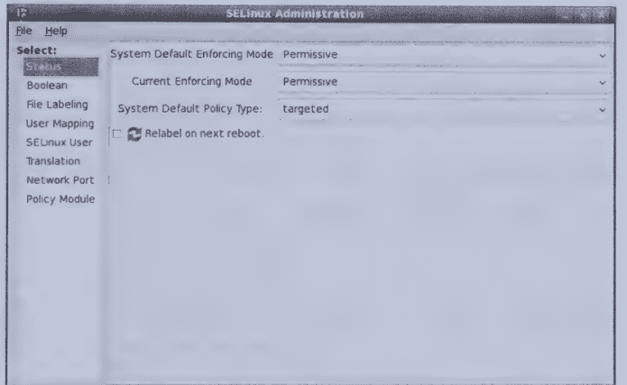

图 12-1：system-config-selinux 状态

`system-config-selinux` 窗口将列出几个面板，并带有侧边栏菜单，包括状态（Status）、布尔值（Boolean）、文件标签（File Labeling）、用户映射（User Mapping）、SELinux 用户（SELinux User）、翻译（Translation）和策略模块（Policy Modules）。`system-config-selinux` 将通过这些界面调用 `sestatus`、`semanage` 等工具。状态（Status）面板列出多个选项，显示 SELinux 状态、布尔值（Boolean）设置以及 SELinux 强制模式。在许可模式（permissive mode）下，强制级别将为 s0，允许在重启时重载 SELinux。

布尔值（Boolean）面板列出各种服务，如 Web、FTP 和 Samba（见图 12-1）。通过这些选项可以控制是否允许某些服务的审计。策略模块面板允许您在重启时允许访问目录。

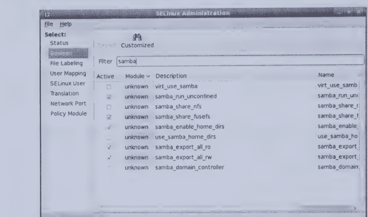

图 12-2：system-config-selinux 布尔值面板

文件标签（File Labeling）面板将列出您的目录和文件，显示它们的安全上下文。选择一个项并点击属性（Properties），这将显示文件名、SELinux 类型和 MLS 级别。在许可策略下，MLS 级别为 s0。您可以添加或删除项。用户映射（User Mapping）显示用户名到 SELinux 的映射。初始状态有两个映射：root 用户和用户 u。

SELinux 用户（SELinux User）显示不同类型的用户。每个项列出其 MLS 级别、范围和角色。许可策略下， MLS 级别为 s0，MLS 范围是从 SystemLow 到 SystemHigh。root 用户拥有 `sysadm_r` 和 `user_r` 角色，允许访问系统。system u 角色仅具有系统访问，无法执行系统管理。

翻译（Translation）面板允许您设置 MLS 符号。初始会有 SystemHigh 和 SystemLow-SystemHigh 范围的符号。通过映射更改系统访问级别。网络端口（Network Port）面板列出网络协议、SELinux 类型以及系统中端口的 MLS 安全级别。选择一个项并点击属性（Properties）更改端口的 SELinux 类型或 MLS 级别。组视图将显示 SELinux 类型以及它们应用的端口列表。此视图不显示 MLS 级别，因为这些是应用于单个端口的。

SELinux 故障排除器。您可以在 `http://hosted.fedoraproject.org/projects/setroubleshoot` 找到更多关于 SELinux 故障排除器的信息。

SELinux 故障排除器窗口显示了通知列表，以及它们的日期、发生次数、类别和简要说明。过滤器（Filter）项允许您关闭此事件的通知。选择任何项都将在四个部分显示通知的详细信息：摘要（Summary）、详细描述（Detailed Description）、允许访问（Allowing Access）和附加信息（Additional Information）（见图 12-4）。

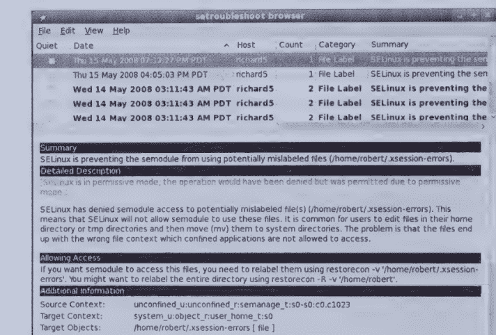

# 图 12-4：SELinux 故障排除器

很多情况下，问题很容易解决，如图 12-4 中的“允许访问”部分所示。通常，文件的安全上下文被重命名以允许访问。您使用 `chcon` 命令更改文件的安全上下文。在此重命名中，需要为 Samba 服务器授予 `/var/lib/samba` 目录下的 `log.richard3` 文件的权限。SELinux 故障排除器本身不会采取行动，而是会建议可能的措施。在示例中，用户只需执行以下 `chcon` 命令：

```bash
chcon -R -t samba_share_t log.richard3
```

更复杂的问题（尤其是未知问题）可能需要您使用审计日志中的 AVC 消息创建一个新的策略模块。要做到这一点，您可以使用 `audit2allow` 命令。该命令将审核 AVC 消息并生成用于允许 SELinux 访问的命令。Fedora 使用的审计日志是 `/var/log/audit/audit.log`。此日志被输出到 `audit2allow`，然后该命令可以使用 `-M` 选项创建一个策略模块。

```bash
cat /var/log/audit/audit.log | audit2allow -M local
```

然后，您将使用 `semodule` 命令加载该模块。

如果您想先编辑允许的条目，可以使用以下命令创建本地模块的 .te 文件（`local.te`），然后您可以对其进行编辑：

```bash
audit2allow -m /var/log/audit/audit.log > local.te
```

一旦编辑了 .te 文件，您就可以使用 `checkmodule` 编译它，然后使用 `semodule_package` 创建策略模块 `local.pp`。随后，您可以使用 `semodule` 安装它。您首先用 `checkmodule` 创建 .mod 文件，然后用 `semodule_package` 创建 .pp 文件。

```bash
checkmodule -m -o local.mod.te
semodule_package -o local.pp -m local.mod
semodule -i local.pp
```

在此示例中，策略模块仅被命名为 `local`。如果您以后想用 `audit2allow` 创建新模块，您应该使用不同的名称，或者直接使用 `-option` 选项将输出追加到 .te 文件中。

## semanage

`semanage` 允许您更改 SELinux 配置，而无需直接编辑 selinux 源文件。它涵盖了几个主要类别，包括用户、端口、文件上下文和登录。请查看 `semanage` 主页以获取详细说明。选项允许您修改特定的安全功能，例如 `-s` 指定用户名、`-R` 指定角色、`-t` 指定类型以及 `-r` 指定 MLS 安全范围。以下示例添加了一个带有 `user_r` 角色的用户：

```bash
semanage user -a -R user_r just
```

`semanage` 通过 `/etc/selinux/semanage.conf` 文件进行配置，在该文件中您可以运行 `semanage` 直接对模块进行编辑（默认）或对源文件进行操作。

## apol，安全策略分析工具

SELinux 策略分析工具 `apol` 为所选策略提供复杂且详细的分析。在管理菜单中选择该项即可启动。

## 检查 SELinux 消息：seaudit

SELinux AVC 消息现在保存于 `/var/log/audit/audit.log` 文件。如果您在使用允许模式（permissive mode）测试以后要强制执行的策略，这些消息尤为重要。您需要发现自己在适当的情况下被拒绝访问，以及在需要时获得了控制。要仅查看 SELinux 消息，您可以使用 `audit` 工具。SELinux 服务的启动消息仍然记录在 `/var/log/messages` 中。

## 允许访问：chcon 和 audit2allow


当 SELinux 拒绝访问文件或应用程序时，内核会发布 AVC 通知。很多情况下，只需通过重命名文件的安全上下文来允许访问即可解决问题。使用 `chcon` 命令更改文件的安全上下文。在此重命名中，需要为 Samba 服务器授予 `/var/lib/samba` 目录下的 `log.richard3` 文件的权限。SELinux 故障排除器本身不会采取行动，而是会建议可能的措施。在示例中，用户仅执行了以下 `chcon` 命令：

```bash
chcon -R -t samba_share_t log.richard3
```

更复杂的问题（尤其是未知问题）可能需要您使用审计日志中的 AVC 消息创建一个新的策略模块。要做到这一点，您可以使用 `audit2allow` 命令。内核将获取 AVC 消息并生成用于允许 SELinux 访问的命令。审计日志为 `/var/log/audit/audit.log`。此日志被输出到 `audit2allow`，然后该命令使用 `-M` 选项创建一个策略模块。

```bash
cat /var/log/audit/audit.log | audit2allow -M local
```

然后，您将使用 `semodule` 命令加载该模块。

如果您想先编辑允许的条目，可以使用以下命令创建本地模块的 .te 文件（`local.te`），然后您可以对其进行编辑：

```bash
audit2allow -m /var/log/audit/audit.log > local.te
```

一旦编辑了 .te 文件，您就可以使用 `checkmodule` 编译它，然后使用 `semodule_package` 创建策略模块 `local.pp`。随后，您可以使用 `semodule` 安装它。您首先用 `checkmodule` 创建 .mod 文件，然后用 `semodule_package` 创建 .pp 文件。

```bash
checkmodule -m -o local.mod.te
semodule_package -o local.pp -m local.mod
semodule -i local.pp
```

在此示例中，策略模块仅被命名为 `local`。如果您以后想用 `audit2allow` 创建新模块，您应该使用不同的名称，或者直接使用 `-option` 选项将输出追加到 .te 文件中。

## 基于角色的访问控制

基于角色的方法侧重于控制用户。用户被分配特定的角色，这些角色定义了他们可以使用哪些资源。在标准系统中，文件权限（例如针对组的）可以控制用户对文件和目录的访问。通过角色，权限变得更加灵活和精细化。某些用户对服务的访问权限可以高于其他用户。

## SELinux 用户

用户将保留标准系统中可用的权限。此外，SELinux 可以为给定的用户设置自身的控制策略，为该用户定义一个角色。SELinux 创建的通用安全身份：

```
system_u 用于系统进程的用户
user_u 允许普通用户使用服务
root 用于 root 用户
```

## 策略文件

策略在策略文件中实现。这些是根据源文件编译而成的二进制文件。对于一个预配置的策略文件，策略二进制文件位于 `/etc/selinux` 配置目录下的策略子目录中，即 `/etc/selinux/targeted`。例如，targeted 策略的策略文件为：

`/etc/selinux/targeted/policy/policy.20`

包含接口文件的 targeted 开发文件安装在 `/usr/share/selinux/targeted`。

你可以使用开发文件创建自己的策略模块，然后加载它们。

## SELinux 配置

通用 SELinux 服务器设置的配置在 `/etc/selinux/config` 目录下进行。目前只有两个设置需要完成：状态和策略。将 `SELINUX` 变量设置为相应的状态（例如 `enforcing` 强制或 `permissive` 允许），并将 `SELINUXTYPE` 变量设置为你想要的策略类型。这些对应于 Securitylevel-config 中 SELinux 的禁用和启用设置，以及如 `targeted` 这样的策略。示例配置文件如下：

```
# 此文件控制系统上 SELinux 的状态。
# SELINUX= 可以取以下三个值之一：
# enforcing - 强制 SELinux 安全策略。
# permissive - SELinux 打印警告而非强制。
# disabled - 完全禁用 SELinux。
SELINUX=permissive
# SELINUXTYPE= 正在使用的策略类型。可能的值有：
# targeted - 仅保护目标网络守护进程。
# strict - 全 SELinux 保护。
SELINUXTYPE=targeted
```

## 第 12 章：SELinux 243

## SELinux 策略规则

策略规则可以由类型（类型强制）或 rbac（基于角色的访问控制）语句组成，以及安全级别（多级安全）。类型语句可以是类型定义或属性的声明，也可以是转换、更改或断言规则。rbac 语句可以是角色声明或允许规则。安全级别指定了一个与许可访问级别相对应的数字。策略配置可能非常困难，包含大量复杂的规则。由于由于原因，许多规则是通过文件中的 M4 宏实现的，这些文件反过来生成相应的规则（Sendmail 以类似的方式使用 M4 宏）。你可以在 SELinux 参考策略源码包中找到这些规则，你需要下载并安装它。参考策略包是 `selinux-policy`，位于 Fedora 的 RPMS 源码仓库中。请参阅后续关于 SELinux 配置文件的章节。

## 类型和角色声明

类型声明以关键字 `type` 开头，后跟跟类型名称（标识符）以及任何可选的属性或别名。类型名称将带有 `_t` 后缀。包含了针对文件等对象的标准类型定义。以下是任何文件的默认类型，具有属性 `file_type` 和 `sysadfile`：

```
type file_t, file_type, sysadfile;
```

root 拥有它自己的类型声明。

```
type root_t, file_type,
```

`boot` 等特殊目录也有它们自己的类型。

```
type boot_t, sysadfile;
```

针对 Amanda 服务器等特定目标设置了更专门的规则。以下示例是 `amanda_t` 对象的通用类型定义，这些对象是 Amanda 备份服务器使用的，列在 targeted 策略的 `src/program/amanda.te` 文件中。

```
type amanda_t, domain, privlog, amanda, nscd_client_domain
```

角色声明决定了访问特定类型对象的规则。这些规则以关键字 `role` 开头，随后是角色以及与角色相关的对象。在此示例中，具有系统角色（`system_r`）的用户或进程可以访问 amanda 对象（`amanda_t`）。

```
role system_r types amanda_t;
```

可执行文件提供了更具体的类型声明，例如针对 Amanda 服务器的（`amanda_exec_t`）。这把 Amanda 可执行文件定义为系统管理控制的可执行文件。

```
type amanda_exec_t, file_type, sysadfile, exec_type;
```

关联的配置文件通常有自己的规则。

```
type amanda_config_t, file_type, sysadfile;
```

在 targeted 策略中，创建了一个通用的无限制类型（unconfined），用户和系统角色可以访问它，从而对系统拥有完全不受限制的访问。更具体的规则将限制对 Web 服务器等特定目标的访问。

```
type unconfined_t, domain, privuser, privhome, privrole, pivowner, admin,
auth_write, fs_domain, pivim;
role system_r types unconfined_t;
role user_r types unconfined_t;
role sysadm_r types unconfined_t;
```

为用户主目录中创建的文件也设置了类型。

```
（注：此处原文未提供具体代码块内容，根据上下文逻辑可推断或省略）
```

## SELinux 策略配置文件

配置文件通常使用 `.te` 和 `.fc` 文件进行更改。这些文件在 `/usr/share/selinux` 的模块头文件中缺失的。如果你正在添加一个模块，将需要为其创建 `.te` 和 `.fc` 文件。你可以在下一节中创建一个模块并添加它。如果你想创建或修改自己的策略，需要按照后文的描述下载并安装 SELinux 参考策略的源码文件。参考策略代码包含了全套 `.te` 和 `.fc` 配置文件。

## 编译 SELinux 模块

你不需要在每次想要更改时编译整个源码，只需针对你更改的区域编译一个模块。`modules` 目录包含了不同的模块。每个模块都由相应的 `.te` 文件构建，并使用 `semanage` 模块从 `.te` 创建可加载的 `.pp` 模块文件，以及创建一个 `.fc` 文件上下文。与 SELinux 文档一样，如果你需要更改 `rsyslog` 的配置，首先可以使用以下命令使用 `rsyslogd.te` 创建一个 `rsyslog.mod` 文件。`-M` 选项支持 MLS 安全级别的策略。

```
checkmodule -M -m rsyslogd.te -o rsyslogd.pp
```

然后使用 `semanage` 模块从 `rsyslogd.mod` 文件创建 `rsyslogd.pp` 文件。`-f` 选项指定文件上下文。

```
semanage -m rsyslogd.mod -o rsyslogd.pp
```

使用 `semodule` 和 `-i` 选项添加模块。你可以通过 `-i` 选项检查模块是否已加载。

```
semodule -i rsyslogd.pp
```

对基础策略的更改通过 `policy.conf` 文件进行，它会被编译到 `base.pp` 模块中。

## 使用 SELinux 源码配置

要执行你自己的配置，必须从 `SRPMS` 目录（源码）下载并安装 `selinux-policy` 源码文件。用于配置 SE 策略的 `.te` 文件已不再是 SELinux 二进制包的一部分。

一旦下载了 SRPMS 文件，你需要在终端窗口中使用带有 `-i` 选项的 `rpm` 命令来安装源码。

```
rpm -i selinux-policy-2.3.18-10.noarch.rpms
```

源码的压缩包（`.tgz` 文件）以及各种策略配置文件将安装到 `/usr/src/redhat/SOURCES`。（确保你已经安装了 `rpm-build`，它默认没有安装）。使用源码文件的文档位于另一个名为 `selinux-doc` 的 SRPMS 文件中。

你可以使用 `rpmbuild` 操作将文件提取到 `/usr/src/redhat/BUILD` 中的 `serefpolicy` 目录。在该目录下，你会找到一个 `policy/modules` 子目录。在那里，通过 `admin` 和 `apps` 等几个目录组织，你可以找到 `.te`、`.fc` 和 `.if` 配置文件。

```
rpmbuild -bp security-policy.spec
```

然后切换到 `/usr/src/redhat/BUILD/seref-policy` 目录并运行命令将 SELinux 源码安装到 `/etc/selinux/seref-policy/src`。

```
make install-src
```

规则存储在策略的 `src` 目录下各个子目录的配置文件中。在该目录下，你会找到一个 `policy/modules` 子目录。在那里，通过 `admin` 和 `apps` 等几个目录组织，你可以找到 `.te`、`.fc` 和 `.if` 配置文件。

你将拥有类型强制（type enforcement）和安全上下文的配置文件。类型强制文件具有 `.te` 扩展，而安全上下文具有 `.sc` 扩展。

反映了 SELinux 提供的细粒度控制，你对系统上的许多对象和进程拥有大量的配置文件。主要的配置文件和目录列在表 12-3 中，但有几个扩展到了子目录的详细列表。此处（此处为原文重复内容翻译：反映了 SELinux 提供的细粒度控制，你对系统上的许多对象和进程拥有大量的配置文件。主要的配置文件和目录列在表 12-3 中，但有几个扩展到了子目录的详细列表。）

*注：原文此处存在内容重复，已按要求处理。*

将 SELinux 源码安装到 /etc/selinux/seref-policy/src。

```
make install-src
```

规则存储在策略的 `src` 目录下各个子目录的配置文件中。在该目录下，你会找到一个 `policy/modules` 子目录。在那里，通过 `admin` 和 `apps` 等几个目录组织，你可以找到 `.te`、`.fc` 和 `.if` 配置文件。

你将拥有类型强制和安全上下文的配置文件。类型强制文件具有 `.te` 扩展，而安全上下文具有 `.sc` 扩展。

反映了 SELinux 提供的细粒度控制，你对系统上的许多对象和进程拥有大量的配置文件。主要的配置文件和目录列在表 12-3 中，但有几个扩展到了子目录的详细列表。

接口文件

接口文件允许管理工具生成模块。SE Linux 源码将包含相应的 `.te` 和 `.fc` 文件。

类型文件

在目标策略中，`modules` 目录包含了用于各种对象的 `.te` 文件。类型强制文件不再包含在 SELinux 默认安装中。

模块文件

模块位于 `policy/modules` 目录下的各个子目录。这里包含了特定的 `.te` 文件和 `.if` 文件。

安全上下文

不同文件的安全上下文在 `file_contexts` 中。`file_contexts` 文件包含了不同组、目录的安全上下文。具有 `.fc` 扩展。在 SELinux 源码中，每个模块都包含 `.mod` 文件以及 `.if` 文件。

应用配置

某些服务和应用程序具有安全感知，并从 SELinux 请求默认的安全上下文和类型。配置保留在 `policy/config/appconfig-` 目录下的文件类型中。

用户配置

全局用户配置定义在策略目录的 `users(u)` 和管理员中。这里是标准用户（user_u）和管理员（admin_u）的定义。要添加你自己的用户，使用 `local.users` 文件。这里是输入你自己的 SELinux 用户的示例。严格策略和目标策略都使用通用的 SELinux 身份。要为用户设置独立的 SELinux 身份，你需要在 `local.users` 文件中定义该用户。

## 目录与文件

## 说明

| 路径 | 说明 |

| :--- | :--- |

| assert.te | 向量断言 |

| config/appconfig- | 运行时配置文件 |

| policy/booleans.conf | 可调功能 |

| file_contexts | 文件和目录的安全上下文 |

| policy/flask | Flask 配置 |

| policy/mcs | 多类别安全 (MCS) 配置 |

| doc | 策略策略文档支持 |

| policy/modules | 安全模块 |

| policy/modules.conf | 模块列表及使用方法 |

| policy/modules/admin | 管理模块 |

| policy/modules/apps | 应用模块 |

| policy/modules/kernel | 内核模块 |

| policy/modules/services | 服务和服务器模块 |

| policy/modules/system | 系统模块 |

| policy/rolemap | 用户域类型和角色 |

| policy/users | 通用用户定义 |

| config/local.users | 定义您的 SELinux 用户 |

| policy/constraints | 针对角色转换和对象访问的额外约束 |

| policygentool | 生成策略的脚本 |

| policy/global_tunables | 定义用于自定义的策略可调项 |

| policy/mls | 多级安全 (MLS) 配置 |

> 表 12-3: SELinux 策略配置文件

## 创建 SELinux 策略：make 和 checkpolicy

如果您想创建一个新策略，请使用 SE Linux 引用策略源 `/etc/selinux/serefpolicy`。一旦配置了策略，您可以使用 `make policy` 和 `checkpolicy` 命令来创建它。`make policy` 命令会为您的配置文件生成一个 `policy.conf` 文件，然后 `checkpolicy` 可以使用该文件生成策略二进制文件。策略二进制文件将在 `policy` 子目录中创建，并带有表示策略版本的数字扩展名，例如 `policy.20`。

您必须生成一个新的策略 `policy.conf` 文件。要执行此操作，您需要在策略源目录中输入以下命令，该目录为 /etc/selinux/serefpolicy/src/`policy`。

```bash
make policy
```

## 第二部分：安全

然后，您可以使用 checkpolicy 来创建新策略。


您不需要每次想要更改时都编译整个源码，只需为您更改的区域编译一个模块即可。在之前的 SE Linux 版本中，您每次进行更改都必须重新编译整个策略。`modules` 目录存放不同的模块。每个模块都由一个关联的 `.te` 文件构建。`checkmodule` 命令用于从 `.te` 文件创建模块文件，而 `semanage_module` 命令用于创建可加载策略包 `.pp` 文件。如 SELinux 文档所述，如果您只需要更改 rsyslog 的配置，首先将要使用以下命令使用 rsyslog 创建一个 `rsyslog.mod` 文件。`-M` 选项指定了对 MLS 安全级别的支持。

```bash
checkmodule -M -m rsyslog.mod -o rsyslog.mod
```

然后使用 `semanage_module` 命令从 `rsyslog.mod` 文件创建 `rsyslog.pp` 文件。`-f` 选项指定了文件类型。

```bash
semanage module -m rsyslog.mod -o rsyslog.pp rsyslog.fc
```

使用 `-i` 选项添加模块。您可以使用 `-l` 选项检查模块是否已加载。

```bash
semodule -i rsyslog.pp
```

对基础策略的更改通过 `policy.conf` 文件进行，该文件被编译成基础 `.pp` 模块。

要执行您自己的配置，现在需要下载源码文件。用于配置 SE Linux 的 `.te` 文件不再是 SE 二进制发行包的一部分。一旦安装，源码将位于 `/etc/selinux` 中的 `sefepolicy` 目录。

对于 `fixfiles`，您可以使用：

```bash
fixfiles relabel
```

## SELinux：管理操作

您可以在您的 SELinux 系统上执行若干项任务，而无需重新编译整个配置。根据需要更改某些文件和目录的安全上下文。例如，当您添加新的文件系统时，将需要为其标记适当的安全上下文。此外，当您添加用户时，系统可能需要对用户进行特殊关注。对于检测和修复问题，您可以使用 `setroubleshoot`。

## 使用安全上下文：fixfiles, setfiles, restorecon 和 chcon

可以使用多种工具更改对象的安全上下文。`fixfiles` 命令可以设置 `relabel` 选项来设置安全上下文，并使用 `check` 选项查看应该更改的内容。`fixfiles` 工具是一个使用 `setfiles` 和 `restorecon` 执行实际更改的脚本。

`restorecon` 命令将恢复文件和目录的安全上下文，但 `setfiles` 是设置安全上下文的基础工具。它可以应用于单个文件或目录。它用于在首次安装策略时对文件标记。

## 第 12 章：SELinux

通过 `chmod`，您可以更改单个文件和目录的权限，就好像 `chmod` 处理普通权限一样。

## 添加新用户

如果新用户需要特殊访问权限，通常您可以使用通用的 SELinux `user_identity`。然而，如果您需要允许用户承担在其他情况下会受限的角色（例如严格策略中的系统管理员角色），则需要对用户进行相应配置。要执行此操作，请将用户添加到策略目录下的 `local.users` 文件中，例如 `/etc/selinux/targeted/policies/local.users`。请注意，这与 `src` 目录中的 `local_users` 文件不同，后者会直接编译到策略中。用户规则使用以下语法

```bash
user username roles { rolelist };
```

以下示例将 `sysadm` 角色添加到 `george` 用户：

```bash
user george roles { sysadm };
```

一旦添加了角色，执行：

```bash
make policy
```

## 运行时上下文和类型

多个应用程序和服务是感知安全性的，并且需要默认上下文。`default_types` 文件定义了这些角色的默认类型。当转换将角色置新角色时，将使用此处指定的默认类型。例如，`sysadm r:sysadm_t user:user_t`

```bash
sysadm r:sysadm_t
user:user_t
```

## 用户

可能还需要为特定用户（如 `root` 用户）设置默认安全上下文。在 `sesusers` 文件中，您将找到一个 `root` 文件，列出了 `root` 用户可以承担的角色、类型和安全级别，例如以下 `su` 操作示例：

```bash
sysadm_r:sysadm_su_t sysadm_r:sysadm_t staff:staff_t user_r:user_t
```

## context/files

文件和目录的默认安全上下文位于 `contexts/files` 目录。`file_contexts` 目录列出了策略设置的所有文件和目录的默认安全上下文。`file_context.homedirs` 目录设置用户目录文件以及根目录的文件上下文，包括 `.mozilla` 和 `.gconf` 等点配置文件。`media` 文件为光盘驱动器和磁盘等媒体设备设置默认上下文。

```bash
cdrom system_u:object_r:removable_device_t
floppy system_u:object_r:removable_device_t
disk system_u:object_r:fixed_disk_device_t
```

## 13. SSH 与 Kerberos

为了保护来自网络外部主机的远程连接免受攻击，对传输进行加密（见表 13-1）。对于 Linux 系统，你可以使用安全外壳（SSH）程序包对传输进行加密和身份验证，防止其被其他任何人读取或修改，并确认发送者的身份。SSH 程序旨在取代 `ssh` 和 `rcp` 等远程工具，这些工具不具备加密功能，并且存在以明文传输密码等风险。SSH 在 Fedora 存储库中可用。它被认为是 Fedora 发行版中不可或缺的一部分。

Kerberos 服务器可以通过 Kerberos 服务器控制某些服务的用户身份验证。Kerberos 认证提供了另一层安全保障，可以对单个服务进行保护，允许只有获得访问许可的用户使用该服务。Kerberos 作为 `universe` 仓库的一部分提供。

| 网站 | 描述 |
| --- | --- |
| www.openssh.org | OpenSSH 的开源版本 SSH |
| www.ssh.com | SSH Communications Security，商业化 SSH 服务 |
| http://web.mit.edu/kerberos | Kerberos 认证 |

表 13-1：SSH 与 Kerberos 资源

## 安全外壳：OpenSSH

尽管防火墙可以保护网络免受外部入侵的尝试，但保护从外部到网络的合法通信的问题仍然存在。一个特殊的问题是用户想要远程连接到你的网络。此类连接可能会被监控，用户登录到你的网络时使用的密码和用户 ID 等信息可能会被复制，并在稍后用于入侵。一种解决方案是使用 SSH 进行远程登录以及其他类型的远程连接（如 FTP 传输）。SSH 会加密远程用户与你网络上系统之间的任何通信。

## 第二部分：安全

目前，SSH 的两种不同实现实际上实际上使用了两种不同且不兼容的协议。SSH 的第一个版本被称为 SSH1，使用原始的 SSH 协议。2.0 版本被称为 SSH2，使用完全重写的 SSH 协议版本。加密以不同的方式进行，加密数据包的不同部分。SSH1 使用服务器和主机密钥来验证系统，而 SSH2 仅使用主机密钥。此外，某些功能（如 `ftp`）仅由 SSH2 支持。

注意：可以从 SSH Communications 获取商业版本的 SSH，其网站为 `www.ssh.com`。SSH Communications 提供了一个名为 SSH Tia 的完全商化的版本，专为企业和政府用途设计。旧的非商业 SSH 软件包仍然免费提供，你可以下载并使用它。

SSH 协议已成为互联网工程任务组（IETF）的标准。一个免费的开源版本由 OpenSSH 项目开发和维护，目前由 OpenBSD 项目支持。OpenSSH 是大多数 Linux 发行版（包括 Fedora）所提供的版本。你可以在 `www.openssh.org` 了解更多关于 OpenSSH 的信息，并在那里下载最新版本，而你的发行版将提供当前的 RPM 版本。

## SSH 加密与身份验证

SSH 通过验证用户身份和加密其传输来保护连接。身份验证过程通过公钥加密处理。一旦通过验证，传输将通过由 SSH 服务器和客户端针对特定会话约定的加密算法进行加密。SSH 支持多种加密算法。身份验证同时应用于主机和用户。SSH 首先验证特定的主机，确认其是一个可以通信的有效 SSH 主机。然后对用户进行身份验证，确认该用户确实其所称的人。

SSH 使用强加密方法，其从美国出口可能会受到限制。目前，SSH 可以应对以下类型的攻击：

- IP 欺骗：远程主机发送伪装成来自受信任主机的数据包
- IP 源路由：主机可以伪装 IP 数据包来自另一个受信任的主机
- DNS 欺骗：攻击者强制更改域名服务器记录
- 中间主机拦截明文密码和数据
- 控制中间主机的人员对数据进行操纵
- 基于监听 X 认证数据和对 X11 进行伪造连接的攻击

## 加密

SSH 通过验证用户身份和加密传输来确保连接安全。身份验证过程通过公钥加密处理。一旦通过验证，传输将通过 SSH 服务器和客户端针对特定会话约定的算法进行加密。SSH 支持多种算法。身份验证同时应用于主机和用户。SSH 首先验证特定的主机，确认其是一个可以通信的有效 SSH 主机。然后对用户进行身份验证，确认该用户确实其所称的人。

加密在 SSH 中使用两对密钥：公钥和私钥。公钥被分发到想要访问的主机上，而私钥则用于解密。例如，当用户访问另一个主机时，使用公钥加密数据，只有该用户的私钥才能解密。每个用户打算使用 SSH 访问远程账户，首先需要创建公钥和私钥。用户随后将其公钥发送到想要访问的远程账户并安装在。账户上。当用户尝试访问远程账户时，账户使用该用户的公钥来验证该用户确实其所称的人。该过程假设远程账户已设置了 SSH 私钥和公钥。建议使用密码保护的 SSH 传输进行身份验证。与 PGP 不同，SSH 仅对身份验证使用公钥加密。一旦通过验证，参与者将约定一种加密算法来加密传输。身份验证将验证参与者的身份。

## 第13 章：SSH 与 Kerberos

## 身份验证

SSH 版本 1 和版本 2 的身份验证机制略有不同。然而，用户方面的步骤是相同的。基本上，用户创建公钥和私钥。对于此操作，你使用 `ssh-keygen` 命令。用户的公钥随后需要分发到原始用户想要访问的地方。通常，这是用户在另一个主机上的账户。密码保护了访问。原始用户需要知道另一个用户的密码才能访问。

SSH 版本 1 使用 RSA 认证。当远程用户尝试登录账户时，会检查该账户是否拥有远程用户的公钥。该公钥随后被用于加密一个挑战（通常是一个随机数），只有远程用户的私钥才能解密。当远程用户接收到挑战时，该用户用其私钥解密挑战。SSH 版本 2 可以使用 RSA 或 DSA 认证。远程用户首先使用其私钥对会话标识进行加密并签名。加密后的会话标识随后由远程用户的公钥解密。该会话标识此前由 SSH 针对该会话设置好。

## SSH 软件包、工具和服务器

Linux 系统通过 OpenSSH 实现 SSH。全套 OpenSSH 软件包包括 OpenSSH 元软件包（`ssh`）、OpenSSH 服务器（`openssh-server`）以及 OpenSSH 客户端 (`openssh-client`)。这些软件包还需要 OpenSSL (`openssl`)，它安装了 SSH 使用的加密库。

SSH 工具列于表 13-2 所示。它们包括 `scp` 和 `ssh` 等几个客户端程序，以及 ssh 服务器。`ssh` 服务器 (`sshd`) 允许通过使用 `ssh` 客户端连接从外部向任何用户提供安全连接。还包含了一些配置实用程序，例如 `ssh-add`（将有效的主机添加到身份验证代理中）和 `ssh-keygen`（生成用于加密的密钥）。

对于版本 2，实际工具的名称带有 `2` 后缀。版本 1 工具以 `/` 作为后缀。然而，在安装期间，为每个工具都设置了链接以使用带后缀的名称。例如，如果你安装了版本 2，则有一个名为 `scp` 的链接指向 `scp2` 应用程序。你可以使用该链接来调用该工具。使用 `scp` 会启动。表 13-2 仅指定了链接名称，因为这些名称在每个版本中都是相同的。但请记住，某些应用程序（如 `sftp`）仅在版本 2 中可用。

|  | 描述 |
| --- | --- |
| ssh | SSH 客户端 |
| sshd | SSH 服务器（守护进程） |
| sftp | SSH FTP 客户端，安全文件传输程序。仅限版本 2。用于列出 sftp 命令 (SFTP 协议) |
| sftp-server | FTP 服务器。仅限版本 2 (SFTP 协议) |
| scp | SSH 复制客户端 |
| ssh-keygen | 生成密钥的实用程序。-h 查看帮助 |
| ssh-keyscan | 自动收集公主机密钥以生成 ssh_known_hosts 文件的工具 |
| ssh-add | 将 RSA 和 DSA 标识添加到身份验证代理 |
| ssh-agent | SSH 身份验证代理，持有用于公钥认证的私钥 (RSA, DSA) |
| ssh-askpass | 查询密码的 X 系统实用程序，由 ssh-add 调度 (openssh-askpass) |
| ssh-askpass-gnome | 查询密码的 GNOME 实用程序，由 ssh-add 调用 |
| ssh-signer | 对基于主机的身份验证包进行签名。仅限版本 2。必须使用 root（由安装执行） |
| login | 远程登录（版本 1） |

# 表 13-2: SSH 工具

你可以使用 `system-config-services`（系统 | 管理 | 服务）并选择 `sshd` 来配置 Openssh 服务器 (`sshd`) 自动启动。你可以通过 `/etc/init.d/sshd` 脚本手动启动、停止和重启服务器。

# 第 13 章：SSH 和 Kerberos

```bash
sudo /etc/init.d/sshd restart
```

你必须配置防火墙允许访问 ssh 服务。打开 `system-config-firewall`（系统 | 管理，防火火墙）并选择信任的服务以显示信任服务列表。向下滚动，你会看到 SSH 条目。如果尚未勾选，请勾选。该服务设置为使用 TCP 协议在端口 22 上运行，`tcp/22`。如果你需要，可以在 `/etc/ssh/sshd_config` 中配置不同的端口，然后在防火墙上打开该端口。

如果你直接管理 IPTables，可以通过添加以下 IPTables 规则直接管理访问。这接受 TCP/IP 协议包的输入端口 22。`iptables -A INPUT -p tcp --dport 22 -j ACCEPT`

# SSH 设置

使用 SSH 涉及创建你的公钥和私钥，然后将你的公钥分发给你想要访问的其他用户。这些可以是不同的用户，或者只是你想要访问远程系统的用户账户。人们从本地客户端远程操作到远程服务器上的账户，也许从家里电脑到公司电脑。你的家里电脑可以是你的客户端账户，而公司电脑上的账户就是你的服务器账户。在你的客户端账户上，你需要生成公钥和私钥，然后将公钥的副本放在服务器账户中。你可以通过简单的发送密钥文件或从软磁盘拷贝文件来完成。一旦服务器上的账户有了你客户端公钥的副本，你就可以从客户端访问服务器账户。系统将提示你输入服务器密码。你必须知道密码才能访问该账户。图 13-1 展示了允许用户 `george` 访问 `cecelia` 账户的 SSH 设置。

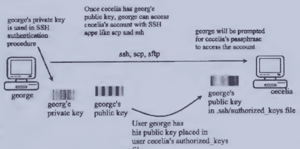

图 13-1: SSH 设置与访问

为了允许你使用 SSH 访问其他账户：

- 你必须在你的账户上创建公钥、私钥以及一个密码语。你需要使用此密码语来从另一个账户访问你的账户。
- 你必须将你的公钥分发到你想要访问的其他账户，将其存放在 `.ssh/authorized_keys` 文件中。
- 其他账户也必须设置带有密码语的公钥和私钥。
- 你必须知道其他账户的密码语才能访问它。

# 使用 ssh-keygen 创建 SSH 密钥

你使用 `ssh-keygen` 命令创建公钥和私钥。你需要指定你想使用的加密类型。你可以使用 DSA 或 RSA 加密。使用 `-t` 选项指定类型并使用小写的加密名称。在下面的示例中，用户使用 RSA 加密创建密钥：

```bash
ssh-keygen -t rsa
```

`ssh-keygen` 命令提示你输入密码语，这将作为一种密码来保护你的私钥。密码语应该是几个单词长。系统还会提示你为密钥输入文件名。如果不输入， SSH 将使用默认值。公钥将赋予 `.pub` 扩展。`ssh-keygen` 命令生成公钥并根据你指定的密钥类型将其存放在 `.ssh/id_d.pub` 或 `.ssh/id_rsa.pub` 文件中；它将私钥放在对应的 `.ssh/id_rsa` 或 `.ssh/id_rsa.pub` 文件中。

如果你需要更改密码语，可以使用 `ssh-keygen` 命令和 `-p` 选项。每个用户都有他们自己的 SSH 配置目录，称为 `.ssh`，位于其主目录下。公钥、私钥以及 SSH 配置文件都放在这里。如果你从源码编译，`make installation` 将自动运行 `ssh-keygen`。表 13-3 列出了 SSH 配置文件。

# 授权密钥 (Authorized Keys)

公钥用于验证用户及其主机。你使用远程系统上的公钥进行验证。远程系统上的公钥允许你无需密码登录。远程系统上的公钥用于验证用户。公钥被放置在 `.ssh/authorized_keys` 文件中。


不带参数时，将从 `.ssh/id_rsa` 或 `.ssh/id_rsa.pub` 文件加载你的私钥。系统会提示你输入该私钥的密码短（passphrase）。要从内存中移除密钥，请使用 `ssh-add -d` 参数。如果你有多个私钥，可以将它们全部加载到内存中。使用 `ssh-add -l` 选项可以列出当前加载的密钥。

## SSH 客户端

SSH 最初设计用于替代远程访问操作，例如登录、rcp 和 Telnet，这些操作在以明文传输密码时无法提供加密，并会引入安全风险。你也可以使用 `ssh` 来对 X 会话进行编码，以及 FTP 传输 (`sftp`)。`ssh-clients` 包包含了相应的 SSH 客户端来替代这些应用程序。通过 `login` 或 `ssh`，你可以从远程主机登录并执行命令和运行应用程序，就像使用 `login` 和 `rsh` 一样。通过 `scp`，你可以在远程主机和网络主机之间复制文件，就像使用 `rcp` 一样。通过 `sftp`，你可以传输加密保护的 FTP 文件。

## ssh

通过 `ssh`，你可以从本地客户端远程登录到网络上作为 ssh 服务器的远程系统。“本地客户端”指的是网络外部的系统，例如你的家用电脑，而“远程”指的是你正在连接的网络上的某个系统。实际上，你是将本地系统连接到远程网络主机。它的设计目的是为了替代 `login`（执行登录）和 `rsh`（执行远程命令）。通过 `ssh`，你可以从本地站点登录到你网络上的远程主机，然后发送要在该主机上执行的命令。`ssh` 命令还能够支持 X Window 系统连接。如果你在 X Window 系统环境（如 GNOME 或 KDE）中使用 `ssh` 连接，此功能将自动启用。系统会在你本地的本地 X 服务器和远程 X 服务器之间为你建立一个连接。远程主机会设置一个虚拟 X 服务器，并通过它设置任何 X Window 系统数据，供你的本地 X 服务器进行处理。

`ssh` 登录操作功能与 `login` 命令非常相似。你输入带有远程主机地址的 `ssh` 命令，随后是 `-l` 选项以及你要登录的远程账户登录名（用户名）。以下示例登录到 `rabbit.mytrek.com` 主机上的 `aleina` 用户账户：

```
ssh rabbit.mytrek.com -l aleina
```

你也可以在 `ssh` 中使用地址格式的用户名，例如：

```
ssh aleian@mytrek.com
```

以下列表显示了用户 `george` 如何访问 `turtle.mytrek.com` 上的 `ceelia` 账户：

```
[george@turtle]$ ssh turtle.mytrek.com -l cecelia
cecelia@mytrek.com's password:
[cecelia@turtle cecelia]$]
```

提供了多种选项供你配置连接。大多数选项都有可以在配置文件中设置相应的配置选项。例如，通过 `-c` 选项，你可以指定想要使用的加密方法，例如 `idea`、`des`、`blowfish` 或 `arcfour`。通过 `-i` 选项，你可以选择一个特定的私钥使用。`-C` 选项允许按指定的级别压缩传输（完整选项列表请参阅 `ssh` 手页）。

### 第 13 章：SSH 与 Kerberos

## scp

你使用 `scp` 从网络上的一个主机复制文件到另一个。`scp` 设计用于替代 `rcp`，它使用 `ssh` 传输数据并采用相同的身份验证和加密方法。如果身份验证需要，`scp` 会请求密码或密码。`scp` 程序的运行方式与 `rcp` 非常相似。远程主机上的目录和文件通过文件名或目录之前的用户名和主机地址来指定。用户名指定 `scp` 访问的远程账户，而主机是该账户所在的远程系统。你用 `@` 将用户与主机地址分开，用 `:` 将主机地址与文件或目录分开。以下示例将文件从用户的当前目录复制到用户 `aleina` 在 `rabbit.mytrek.com` 主机上的 `birthday` 目录下：

```
scp party aleina@rabbit.mytrek.com:birthday/party
```

特别值得注意的是 `-r`（递归）选项，它允许你复制目录。完整选项列表请参阅 `scp` 手页。在下一个示例中，用户将整个 `reports` 文件夹复制到用户 `justin` 的 `projects` 目录：

```
scp -r reports justin@rabbit.mytrek.com:/projects
```

在下一个示例中，用户 `george` 从用户 `ceelia` 的家目录复制 `mydocl` 文件：

```
[george@turtlege]$ scp cecelia@turtle.mytrek.com:mydocl
celelia@turtle.mytrek.com:password:
mydocl 0% |---
ETA
mydocl 100% |****************************** 17:00:00
[george@turtlege]$
```

来自 Windows 系统，你也可以使用如 `winscp` 等 scp 客户端，它将与启用 ssh 的 Linux 系统交互。

## sftp 和 ftp-server

通过 `sftp`，你可以传输加密保护的 FTP 文件。`sftp` 程序使用与 `ftp` 相同的命令。该客户端仅适用于 ssh 版本 2，运行方式与 `ftp` 类似，具有许多相同的命令。使用 `sftp` 或 `ftp` 来调用 `sftp` 客户端。

```
sftp download.fedora.red.com
```

要使用 `sftp` 客户端连接到 FTP 服务器，该服务器需要运行 `sftp-server` 应用程序。ssh 服务器调用 `sftp` 为使用 `sftp` 客户端的用户提供加密的 FTP 传输。`sftp` 程序使用与 `ftp` 相同的命令。

## 端口转发（隧道技术）

通过 `sftp`，你可以传输加密保护的 FTP 文件。`sftp` 程序使用与 `ftp` 相同的命令。该客户端仅适用于 ssh 版本 2，运行方式与 `ftp` 类似，具有许多相同的命令。使用 `sftp` 或 `ftp` 来调用 `sftp` 客户端。

```
sftp download.fedora.red.com
```

要使用 `sftp` 客户端连接到 FTP 服务器，该服务器需要运行 `sftp-server` 应用程序。ssh 服务器调用 `sftp` 为使用 `sftp` 客户端的用户提供加密的 FTP 传输。`sftp` 程序使用与 `ftp` 相同的命令。

### 263 部分 2：安全

连接到 FTP 服务器，该服务器需要运行 `sftp-server` 应用程序。ssh 服务器调用 `sftp` 为使用 `sftp` 客户端的用户提供加密的 FTP 传输。`sftp` 程序使用与 `ftp` 相同的命令。该客户端仅适用于 ssh 版本 2，运行方式与 `ftp` 类似，具有许多相同的命令。使用 `sftp` 或 `ftp` 来调用 `sftp` 客户端。

```
sftp download.fedora.red.com
```

要使用 `sftp` 客户端连接到 FTP 服务器，该服务器需要运行 `sftp-server` 应用程序。ssh 服务器调用 `sftp` 为使用 `sftp` 客户端的用户提供加密的 FTP 传输。`sftp` 程序使用与 `ftp` 相同的命令。该客户端仅适用于 ssh 版本 2，运行方式与 `ftp` 类似，具有许多相同的命令。使用 `sftp` 或 `ftp` 来调用 `sftp` 客户端。

## 加密算法 aes128-cbc, 356-cbc, blowfish-cbc, cast128-cbc, arcfour, aes192-cbc, aes256-cbc

要指定适用于你连接的任何主机的全局选项，请创建一个以星号作为主机的 HOST 条目，即 `HOST *`。此条目必须放在配置文件的末尾，因为选项仅在第一次设置时更改。任何后续条目都会同时匹配其自身的条目和全局条目，特定的条目应放在全局条目之前。星号 (`*`) 和问号 (`?`) 是通配符匹配运算符，允许你指定具有相同后缀或前缀的一组主机。

```
Host *
FallBackToR yes
KeepAlive no
Cipher 3des
```

Protocol（协议）选项允许指定要使用的 SSH 版本，1、2 或两者。默认情况下，为了向后兼容，两种协议都是接受的。你可以通过将 Protocol 选项配置为仅 2，将使用限制为更先进、更安全的 SSH2 协议。

Protocol 2

你使用 `/etc/ssh/sshd` 配置文件来配置 SSH 服务器。在这里，你会找到服务器选项，如使用的端口、密码要求以及 PAM 使用情况。

## Kerberos

某些服务的用户验证可以通过 Kerberos 服务器进行控制，本章将对此讨论。Kerberos 身份验证提供了另一层安全保障，可以对单个服务进行保护，仅允许经过访问许可的用户使用该服务。Kerberos 服务器均已通过 `authoconfig-gtk`（系统中的身份验证 | 管理菜单）启用并配置完成。

Kerberos 是一种网络身份验证协议，在客户端和服务器之间的连接之间提供加密验证。作为一种身份验证协议，Kerberos 要求客户端在访问服务器之前使用加密方法证明其身份。一旦通过身份验证，客户端和服务器就可以使用加密进行所有通信。防火墙保护你免受外部攻击。Kerberos 的设计初衷也是为了防止来自网络内部的攻击。网络内的用户可能会尝试连接本地服务器。为了防止这种情况，Kerberos 对服务器本身进行保护，而不是针对某个实体或计算机。麻省省理工学院（MIT）在 http://web.mit.edu/kerberos 提供免费版本，采用 MIT 公共许可证（类似于 GNU 公共许可证）。Kerberos 的名字源自希腊神话，是地狱的三头神犬的名字。请务必检查 http://web.mit.edu/kerberos 网站获取最新更新和详细文档，包括常见问题解答、手册和教程。

Fedora 默认安装 Kerberos 支持。你可以使用 `kb5` 包安装 Kerberos 服务器和客户端。服务器还将安装 kdc 服务器和 kb5 库。`kb5-workstation` 仍然需要如 `kadmin` 等支持应用程序来管理 Kerberos 服务器。`kb5-workstation-clients` 包包含了 rsh、rep、telnet 和 flip 客户端的 Kerberos 安全替代品。此外，还为 PAM、Python、LDAP、Perl 和 Ruby 提供了 Kerberos 安全服务器插件。要运行安全的 LDAP 服务器，则需要 LDAP 插件。

与其将 Kerberos 服务器作为独立服务器运行，你可以使用 `xinetd` 以按需的方式运行它。此版本的 Kerberos 服务器通过 `kerberos-workstation-server` 包安装。

提示：Kerberos V5 工作站客户端包含了其自有版本的网络工具，如 Telnet、RCP、FTP 和 RSH。这些工具提供了由远程用户进行的安全身份验证。这些工具的操作方式与其原始版本相同。该包还包含一个 Kerberos 版本的 `su`。

## Kerberos 服务器

Kerberos 的关键在于 Kerberos 服务器，所有对任何服务器的请求都通过它进行。Kerberos 服务器随后验证客户端，识别客户端并验证客户端使用特定服务器的权限。服务器维护一个授权用户数据库。随后，Kerberos 发放加密票据，客户端可以使用该票据访问服务器。例如，如果用户需要检查邮件，则向 Kerberos 服务器发送使用邮件服务器的请求，服务器随后验证用户并发放票据，然后使用该票据访问邮件服务器。没有 Kerberos 分发的票据，无人访问任何服务器。最初，此过程要求用户对每个想要访问的服务器都要单独进行身份验证程序。然而，现在用户只需执行一次对所有服务器有效的初始验证。

此过程涉及两台服务器的使用：身份验证服务器 (AS) 和票据授予服务器 (TGS)。它们共同组成了密钥分发中心 (KDC)。实际上，它们分发密钥以解锁服务访问。身份验证服务器首先验证用户身份。AS 签发名为票据 (TGT) 的票据，允许用户访问票据授予服务器。然后，TGS 再向用户发放另一个票据以实际访问服务。通过这种方式，用户在身份验证过程中从未对服务器进行任何形式的直接访问。该过程比描述的稍微复杂。一个使用当前时间、校验和和可选加密密钥等信息的身份验证器会随票据一起发送，并使用会话密钥解密。服务将使用该身份验证器来验证你的身份。

注意：你可以使用 `klist` 命令查看当前票据列表。

## 身份验证过程

身份验证服务器使用其用户数据库中的信息验证用户。每个用户都需要在身份验证服务器数据库中注册。数据库将包含用户密码和其他用户信息。要访问身份验证服务器，服务器提供用户名和密码。密码用于生成用户密钥，AS 与用户之间的通信由此加密。用户将拥有自己的用户密钥副本。身份验证过程如图 13 所示。

## Kerberos 身份验证过程

该过程涉及以下步骤：

1. 身份验证服务器使用其用户数据库中的信息验证用户。
2. AS 签发票据 (TGT)，允许用户访问票据授予服务器。
3. TGS 向用户发放另一个票据以实际访问服务。
4. 用户将票据提交给服务以验证其身份。
5. 服务使用会话密钥验证身份。

## 第 13 章：SSH 与 Kerberos

你需要为你的网络配置服务器，并为每个主机配置客户端（服务器使用 `krb5-server` 包，客户端使用 `krb5-clients`）。要配置服务器，首先需要指定你的 Kerberos 领域（realm）和域。然后使用 `kdb5_util` 命令和 `create` 选项创建一个数据库。系统会提示你输入主密钥。

```
kdb5_util create -s
```

接着你需要添加一个本地主体（principal），即在主机服务器上运行的具有完全管理权限的本地用户。启动 `kadmin` 工具并使用 `addprincipal` 命令添加本地主体。之后你可以启动 `krb5kdc`、`kadmin` 和 `krb524` 服务器。

在每个客户端主机上，使用 `kadmin` 工具配合 `addprincipal` 命令为主机添加主体。你还可以通过 `qualifier` 选项为网络上的每个主机添加一个主体，并使用 `-randkey` 选项指定随机密钥。然后使用 `ktadd` 命令将主机的本地副本保存到 `/etc/krb5.keytab` 文件中。每个主机都需要在其系统的 `/etc/krb5.conf` 文件中配置 Kerberos 服务器和 kdc。

注意：当你使用认证工具配置 Kerberos 时，你将能够输入领域、kdc 服务器和 Kerberos 服务器。将显示域名 "example.com" 的默认条目。确保大写。在 `/etc/krb5.conf` 的 realms 部分为你的领域创建一个新条目。

## 14. 防火墙

大多数连接到互联网的系统都面临来自外部用户未经授权访问的尝试。外部用户可能通过建立非法连接、拦截远程连接到系统的合法通信或伪装成合法用户来尝试访问。加密和认证是防御此类攻击的方法。防火墙防止任何未经授权的访问，加密保护传输内容不被他人读取，认证则验证请求访问的用户。当前的 Linux 内核集成了使用 Netfilter 包的防火墙支持（旧版本使用 `IPchains`）。要实现防火墙，你只需提供一系列规则来管理系统上允许的访问类型。如果该系统还是私有网络的网关，防火墙功能可以有效帮助网络免受外部攻击。

| 网站地址 | 安全应用程序 |
| :--- | :--- |
| [www.netfilter.org](https://www.netfilter.org) | Netfilter 项目、iptables 和 NAT |
| [www.netfilter.org/ipchains](https://www.netfilter.org/ipchains) | IP 防火墙 |
| [www.openssh.org](https://www.openssh.org) | SSH 加密 |
| [www.squid-cache.org](https://www.squid-cache.org) | Squid 代理服务器 |
| [web.mit.edu/Kerberos](https://web.mit.edu/Kerberos) | Kerberos 网络认证 |

### 表 14-1：网络安全应用程序

为了保护远程通信，传输可以加密。对于 Linux 系统，你可以使用 Secure Shell (SSH) 程序包来加密传输，防止被他人读取。Kerberos 认证提供了另一种安全级别，可以保护单个服务，仅允许授权用户使用。外部用户也可能通过你托管的任何互联网服务（如网站）尝试获取授权访问。在这种情况下，你可以设置代理来保护你的网站免受攻击。对于 Linux 系统，Squid 代理软件会设置代理来保护你的 Web 服务器。表 14-1 列出了 Linux 上常用的几种网络安全应用程序。

## 第二部分：安全

### system-config-firewall

Fedora 使用一个名为 `system-config-firewall` 的新系统配置工具来设置防火墙（见图 14-1）。这取代了不再提供的 `system-config-securitylevel` (SELinux)，后者通过独立的工具 `system-config-selinux` 配置。运行 `system-config-firewall` 请选择“System | Administration | Firewall”。

**图 14-2：显示防火墙信任服务的 system-config-firewall**


你可以在直接连接到互联网的独立系统上运行防火墙，也可以通过连接本地网络到互联网的网关运行。大多数网络现在使用专用的路由器访问互联网，这些路由器自带防火墙。如果你决定使用 Linux 系统作为网关，它将至少有两个网络连接：用于本地网络和用于互联网的连接设备。确保防火墙针对互联网设备启用，而不是本地网络。

顶部栏具有防火墙向导（`Firewall wizard`）按钮、应用更改的 `Apply` 按钮、恢复保存的防火墙的 `Reload` 按钮以及禁用（`Disable`）和启用（`Enable`）按钮。你可以通过启用和禁用按钮启用或禁用你的防火墙（见图 14-2）。如果防火墙已激活，则可以使用禁用按钮，反之亦然。

系统已经有一个默认配置。要创建自己的基础自定义配置，只需点击 `Wizard` 按钮运行向导。

你也可以直接对不同的防火墙组件进行更改。防火墙窗口将显示从侧边栏选择的面板。面板包括信任服务（`Trusted Services`）、其他端口（`Other Ports`）、信任接口（`Trusted Interfaces`）、伪装（`Masquerading`）和自定义规则（`Custom Rules`）。

# 第 14 章：防火墙

许多用户想要更改的功能是信任服务。Linux 系统通常用于运行服务器。如果你正在创建防火墙但仍然想运行如 `Samba` 等的服务，你需要在 `Trusted` 面板中指定它们。`Samba` 允许你访问 `GNOME` 或 `KDE` 等远程文件系统。

**图 14-3：防火墙其他端口**

**图 14-4：防火墙信任接口**

“其他端口”（`Other Ports`）允许你指定为某些服务（如 `BitTorrent`）开放的端口（见图 14-3）。点击 `Add` 按钮打开对话框，你可以在其中输入端口号以及要控制的协议（`tcp` 或 `udp`）。

“信任接口”（`Trusted interfaces`）面板允许你选择可以信任的硬件网络连接，如网卡、调制解调器或无线连接（见图 14-4）。这通常适用于到本地网络的接口。连接到更广网络的接口不应被视为信任。

**图 14-5：防火墙伪装**

如果你的系统被用作本地网络访问互联网的网关，你可以实施伪装（`masquerading`）来隐藏本地主机免受来自的外部访问（见图 14-5）。尽管如此，这还需要 IP 转发，当你选择伪装时，IP 转发会自动启用。本地主机仍然能够访问互联网，但它们将伪装成你的网关系统。你需要选择连接互联网的接口进行伪装。伪装仅适用于 IPv4 网络，不适用于 IPv6 网络。

“自定义规则”（`Custom Rules`）面板允许你加载包含自定义防火墙规则的 `IPTables` 文件（见图 14-6）。你无需选择使用 `system-config-firewall` 还是在 IP-tables 文件中创建规则项，你可以使用 `system-config-firewall` 自动配置标准防火墙规则，然后设置一个仅包含系统自定义规则的 IPT 文件。加载文件时，你还需要确定 `IPTables` 持有 IPv4 还是 IPv6 协议规则（地址类型）。你还需要选择防火墙规则属于哪个表。

## 防火墙：IPTables

`IPTables` 是 Linux 中用于配置防火墙的工具，它基于 `Netfilter` 框架工作。`Netfilter` 允许内核对通过的网络数据包进行过滤、修改和转发。`IPTables` 通过定义规则（`Rules`）、作用链（`Chains`）和表（`Tables`）来管理网络流量。

## Netfilter 框架

`Netfilter` 是 Linux 内核中的一个用于网络数据包处理的框架。它允许在内核中对数据包进行过滤、修改和转发。

### 链（Chain）

链是执行特定操作的规则规则集合。常见的内置链包括：

- **`INPUT`**：处理进入本地系统的数据包。
- **`FORWARD`**：处理通过本地系统转发的数据包。
- **`OUTPUT`**：处理从本地系统发送的数据包。
- **`PREROUTING`**：在数据包路由决策之前处理数据包。
- **`POSTROUTING`**：在数据包路由决策之后处理数据包。

### 表（Table）

`IPTables` 使用不同的表来执行不同类型的过滤任务：

- **`filter`**：用于数据包过滤（决定允许还是丢弃数据包）。
- **`nat`**：用于网络地址转换（如 `SNAT`, `DN`）。
- **`mangle`**：用于修改数据包的属性（如 TTL 或 标记）。
- **`raw`**：用于在连接跟踪（`conntrack`）之前进行标记。

## 规则（Rule）

规则是 `IPTables` 的核心，每个规则包含一组匹配条件（如源/目的 IP、端口、协议等）和一个目标（`Target`）。

### 匹配条件示例

- `-s`：匹配源 IP 地址。
- `-d`：匹配目标 IP 地址。
- `-p`：指定协议（`TCP`, `UDP`, `ICMP`）。
- `--sport`：匹配源端口。
- `--dport`：匹配目标端口。

### 目标（Target）示例

- **`ACCEPT`**：允许数据包通过。
- **`DROP`**：丢弃数据包，不向发送者响应。
- **`REJECT`**：丢弃数据包并向发送者发送错误响应。
- **跳转**：将数据包重定向到另一个链。

## IPv6 支持

随着 IPv6 的普及，Linux 提供了 `ip6tables` 命令来管理 IPv6 的防火墙规则，其语法与 `iptables` 相似，但专门针对 IPv6 地址格式。

# 第14 章：防火墙

| 选项 | 功能 |
| :--- | :--- |
| `-A chain` | 向链中追加一条规则。 |
| `-D chain [ruleenum]` | 从链中删除匹配的规则。删除链中的规则 *ruleenum*（1 = 第一个）。 |
| `-I chain [ruleenum]` | 在链中插入作为 *ruleenum* 的规则（默认 1 = 第一个）。 |
| `-R chain ruleenum` | 替换链中的规则 *ruleenum*（1 = 第一个）。 |
| `-L [chain]` | 列出链或所有链中的规则。 |
| `-E [chain]` | 重命名一个链。 |
| `-F [chain]` | 删除（清空）链或所有链中的所有规则。 |
| `-R chain` | 替换规则；规则从 1 开始编号。 |
| `-Z [chain]` | 将链或所有链中的计数器清零。 |
| `-N chain` | 创建一个新的自定义链。 |
| `-X chain` | 删除一个自定义链。 |
| `-P chain target` | 将链的策略更改为目标。 |

### 表 14-4：IPTables 命令

## IPTables 选项

`IPTables` 软件包设计为可扩展，有许多带有筛选标准的选项可以包含在 `IPTables` 中。`TCP` 扩展包含了 `--syn` 选项，用于检查 `SYN` 数据包。`ICMP` 扩展提供了 `--icmp-type` 选项，用于指定 ping 操作中使用的 ICMP 数据包。`limit` 扩展包含了 `--limit` 选项，您可以用它限制在指定时间段（如一秒）内匹配数据包的最大数量。

注意：在 `IPTables` 命令中，链名必须大大写，就像 `INPUT`、`OUTPUT` 和 `FORWARD` 链名一样。

在下面的示例中，用户向 `INPUT` 链添加了一条规则，接受所有源自地址 `192.168.0.55` 的数据包。任何接收到的（`INPUT`）源 (`-s`) 匹配 `192.168.0.55` 的数据包将被接受并通过 (`-j ACCEPT`)：

```
iptables -A INPUT -s 192.168.0.55 -j ACCEPT
```

## 接受和拒绝数据包：DROP 和 ACCEPT

有两个内置链：`DROP` 和 `ACCEPT`。其他目标可以是用户定义的链或添加的扩展，例如 `REJECT`。有两个特殊目标用于管理链：`RETURN` 和 `QUEUE`。`RETURN` 表示链的结束并返回到它开始的链。`QUEUE` 用于将数据包发送到用户空间。

```
iptables -A INPUT -s mew.myjunk.com -j DROP
```

| 选项 | 功能 |
| :--- | :--- |
| `-p [!] proto` | 指定协议，例如 `TCP`、`UDP`、`ICMP` 或 `ALL`。 |
| `-s [!] address[/mask] [!]` | 要匹配的源地址。带有端口参数时，可以指定端口。 |
| `{port:port}` | 源端口指定。您可以使用冒号 `port:port` 指定端口范围。 |
| `--sport [!] port[{port:port}]` | 要匹配的源地址。带有端口参数时，可以指定端口。 |
| `-d [!] address[/mask] [!]` | 目的端口指定。 |
| `{port:port}` |  |
| `--dport [!] port[{port:port}]` | 指定 ICMP 类型。 |
| `--icmp-type [!] typename` | 指定 ICMP 类型。 |
| `-i [eth0] name[+]` | 使用其名称指定输入网络接口（例如 `eth0`）。`+` 符号充通配符的作用。附加名称末尾的 `+` 匹配所有前缀相同的接口（`eth+` 匹配所有以太网接口）。仅用于 `INPUT` 链。 |
| `-j target [port]` | 指定规则的目标（对于 `REDIRECT` 目标指定 `[port]`）。 |
| `--to-source <ipaddr>-<ipaddr> [:port-port]` | 与 `SNAT` 目标一起，用新的源 IP 地址重写数据包。 |
| `--to-destination <ipaddr>][<ipaddr>] [ : port-port]` | 与 `DNAT` 目标一起，用新的目的 IP 地址重写数据包。 |
| `-n` | 地址和端口的数字输出，与 `-L` 使用。 |
| `-o [!] name[+]` | 使用其名称指定输出网络接口（例如 `eth0`）。仅用于 `FORWARD` 和 `OUTPUT` 链。 |
| `-t table` | 指定要使用的表，在 `-t nat` 中指定 `NAT` 表。 |
| `-v` | 详细模式，显示规则详情，与 `-L` 使用。 |
| `-x` | 展开数字（显示精确值），与 `-L` 使用。 |
| `[!] -f` | 匹配分片数据包的第二个到最后一个碎片。 |
| `[!] -V` | 打印包版本。 |

### 表 14-5：IPTables 选项

| 选项 | 功能 |
| :--- | :--- |
| `-m` | 指定要使用的模块，例如 `state`。 |
| `--state` | 取反选项或地址。指定状态模块的选项，如 `NEW`、`INVALID`、`RELATED` 和 `ESTABLISHED`。用于检测数据包的状态。`NEW` 指 `SYN` 数据包（新连接）。 |
| `--syn` | `SYN` 数据包，新连接。 |
| `--tcp-flags` | `TCP` 标志：`SYN`, `ACK`, `FIN`, `RST`, `URG`, `PS` 以及 `all`（所有标志）。 |
| `--limit` | `limit` 模块的选项 (`-m limit`)。用于控制匹配速率，每秒匹配给定次数。 |
| `--limit-burst` | `limit` 选项 (`-m limit`)。在限制生效前指定最大突发数。用于控制拒绝服务攻击。 |

您可以使用 `!` 符号运行规则以反转其逻辑。例如，接受除特定地址以外的所有数据包，在 `-s` 选项处接受 `!` 符号。下面的示例将接受所有来自 IP 地址 `192.168.0.45` 以外的入站数据包：

```
iptables -A INPUT -s 192.168.0.45 -j ACCEPT
```

您可以使用域名或 IP 数字来指定单个地址。对于地址范围，您可以使用 IP 掩码或组成掩码的位数。例如，网络 `192.168.0` 中的所有地址可以由 `255.255.255.0` 或 `192.168.0.0/24` 表示。要指定任何地址，您可以使用 `0.0.0/0`。默认情况下，如果使用 `-s` 或 `-d`，规则将引用任何地址。以下示例将接受除来自 `192.168.0.45` 以外的所有入站数据包（注：此处原文逻辑应包含反转）：

```
iptables -A INPUT -s 192.168.0.45 -j ACCEPT
```

（注：原文示例逻辑似乎与描述有出入，此处按原文翻译）

您可以使用域名或 IP 数字来指定单个地址。对于地址范围，您可以使用 IP 掩码或组成掩码的位数。例如，网络 `192.168.0` 中的所有地址可以由 `255.255.255.0` 或 `192.168.0.0/24` 表示。要指定任何地址，您可以使用 `0.0.0/0`。默认情况下，如果使用 `-s` 或 `-d`，规则将引用任何地址。以下示例将接受除来自 `192.168.0.45` 以外的所有入站数据包：

```
iptables -A INPUT -s 192.168.0.45 -j ACCEPT
```

（注：原文示例逻辑似乎与描述有出入，此处按原文翻译）

`IPTables` 规则通常会引用到任何地址。一个常见方法是让 `FORWARD` 和 `INPUT` 链进入一个 `incoming` 链。你需要显示到一个自定义的链。

```
iptables -s 0.0.0.0 -j ACCEPT
```

`IPTables` 规则通常会引用到任何地址。一个常见方法是让 `FORWARD` 和 `INPUT` 链进入一个 `incoming` 链。你需要显示到一个自定义的链。

```
iptables -s 0.0.0.0 -j ACCEPT
```

`IPTables` 规则通常会引用到任何地址。一个常见方法是让 `FORWARD` 和 `INPUT` 链进入一个 `incoming` 链。你需要显示到一个自定义的链。

```
iptables -s 0.0.0.0 -j ACCEPT
```

## ICMP 数据包

防火墙通常拦截互联网控制协议 (`ICMP`) 消息。重定向消息特别可以接管路由任务。

防火墙通常拦截 `ICMP` 消息。重定向消息特别可以接管路由任务。

您需要启用 `ICMP` 消息，例如 `ping`、`traceroute` 以及特定的不可达消息。在大多数情况下，您总是需要确保目的不可达数据包是允许的；否则，域名查询可能会挂起。一些常见的 `ICMP` 包类型列在表 14-6 中。您可以使用 `--icmp-type` 选项启用 `ICMP` 类型，该选项接受表示该消息的数字或名称。以下示例启用了 `echo-reply`、`echo-request` 和目的不可达消息，它们的数字分别为 0、8 和 3：

```
iptables -A INPUT -j ACCEPT -p icmp -i eth0 --icmp-type echo-reply -d 10.0.0.1
iptables -A INPUT -j ACCEPT -p icmp -i eth0 --icmp-type echo-request -d 10.0.0.1
iptables -A INPUT -j ACCEPT -p icmp -i eth0 --icmp-type destination-unreachable -d 10.0.0.1
```

它们的规则列表看起来如下：

| 规则 |
| :--- |
| `ACCEPT icmp -- 0.0.0.0/0 10.0.0.1 icmp type 0` |
| `ACCEPT icmp -- 0.0.0.0/0 10.0.0.1 icmp type 8` |
| `ACCEPT icmp -- 0.0.0.0/0 10.0.0.1 icmp type 3` |

`Ping` 操作需要进一步控制，以避免“死亡之包”（ping-of-death）安全威胁。可以通过多种方法实现。一种方法是拒绝任何 ping 分片。`Ping` 包通常很小。你可以通过拒绝任何分片的 `ICMP` 数据包来阻止死亡之包攻击。使用 `-f` 选项来识别分片。

```
iptables -A INPUT -p icmp -j DROP -f
```

另一种方法是限制 ping 包接收的匹配次数。你使用 `limit` 模块来控制 `ICMP` 操作的匹配次数。使用 `-m limit` 来使用 `limit` 模块，并使用 `--limit` 指定允许的匹配次数。`1/s` 表示每秒允许一次匹配。

```
iptables -A FORWARD -p icmp --type echo-request -m limit 1/s -j ACCEPT
```

| 编号 | 名称 | 需方需要 |
| :--- | :--- | :--- |
| 0 | `echo-reply` | `ping` |
| 3 | `destination-unreachable` | 所有 `TCP/UDP` 流量 |
| 5 | `redirect` | 如果未运行路由守护进程 |
| 8 | `echo-request` | `ping` |
| 11 | `time-exceeded` | `traceroute` |

表 14：常见 ICMP 数据包

## 控制端口访问

如果你的系统有互联网服务（例如 Web 或 FTP 服务器），你可以使用 `IPTables` 来访问它。你可以通过使用源端口 (`--sport`) 或目的端口 (`--dport`) 选项结合服务使用的端口来指定特定服务。`IPTables` 允许你为端口命名，例如为 Web 服务器端口使用 `www`。服务名称及其使用的端口列在 `/etc/services` 文件中，该文件将端口映射到特定服务。对于域名服务器，端口将是 `domain`。如果你愿意，也可以使用端口号，在数字前加一个冒号。以下示例接受所有向位于 `192.168.0.43` 的 Web 服务器发送的消息：

```
iptables -A INPUT -d 192.168.0.43 --dport 80 -j ACCEPT
```

你还可以使用端口来保护某些服务并拒绝其他服务。当你正在设计一个对互联网高度开放、允许用户自由使用连接的防火墙时，通常会使用这种方法。你知道的某些服务（如 `Telnet` 和 `NTP`）是有害的，可以选择性地拒绝。对于你防火墙上的任何拒绝类的 `Telnet` 操作，你可以丢弃所有来自 `Telnet` 端口 `23` 的数据包。为了保护 `NFS` 操作，你可以拒绝对 `portmapper` 使用的端口 `111` 的访问。你可以使用端口号或端口名称。

- # 拒绝防火墙上 `portmapper` 端口的外部访问。


`iptables -A INPUT -j DROP -p tcp -i eth0 --dport 111`

# 拒绝防火墙上 telnet 端口的外部访问

`iptables -A INPUT -j DROP -p tcp -i eth0 --dport telnet`

## 第二部分：安全

规则列表将看起来像这样：

```
DROP  tcp    -- 0.0.0.0/0   0.0.0.0/0  tcp dpt:111
DROP  tcp    -- 0.0.0.0/0   0.0.0.0/0  tcp dpt:23
```

一个与端口相关的安全问题是访问你范围从 6000 到 6009 的 X 端口。在相对开放的防火墙上，这些端口可能被用于通过你的 X 服务器非法访问你的系统。可以使用冒号指定端口范围，例如 `6000:6009`。你也可以使用 `x1` 作为第一个端口，即 `x1:6009`。X 服务器上的会话可以使用 SSH 来安全，SSH 通常通过端口 6010 访问 X 服务器。

```
iptables -A INPUT -j DROP -p tcp -i eth0 --dport 6000:6009
```

这里显示了已检查的常用端口及其标签：

| 服务 | 端口号 | 端口标签 |
| :--- | :--- | :--- |
| Auth | 113 | auth |
| Finger | 79 | finger |
| FTP | 21 | ftp |
| NTP | 123 | ntp |
| Portmapper | 111 | sunrpc |
| Telnet | 23 | telnet |
| Web server | 80 | www |

## 数据包状态：连接跟踪

最有用的扩展之一是状态扩展，它可以轻松检测数据包的跟踪信息。连接跟踪维护有关连接的信息，如源、目和端口。它为确定哪些数据包属于已建立或相关的连接提供了有效手段。要使用连接跟踪，你首先通过 `-m state` 指定状态模块。然后你可以使用 `--state` 选项。在这里你可以指定以下任何一种状态：

| 状态 | 描述 |
| :--- | :--- |
| NEW | 创建新连接的数据包 |
| ESTABLISHED | 属于现有连接的数据包 |
| RELATED | 与现有连接相关但不是其组成部分的数据包，例如 ICMP 错误或建立 FTP 数据连接的数据包 |
| INVALID | 因某些原因无法识别的数据包 |
| RELATED+REPLY | 与已建立连接相关但不是直接其一部分的数据包 |

## 第 14 章：防火墙

如果你正在设计一个旨在保护网络免受来自外部网络任何渗透尝试的防火墙，你可能限制数据包。你可以通过拒绝任何分片的 ICMP 数据包来阻止死亡之包攻击。

如果你愿意，也可以使用端口号，在数字前加一个冒号。以下示例接受所有向位于 `192.168.0.43` 的 Web 服务器发送的消息：

```
iptables -A INPUT -d 192.168.0.43 --dport 80 -j ACCEPT
```

你还可以使用端口来保护某些服务并拒绝其他服务。当你正在设计一个对互联网高度开放、允许用户自由使用连接的防火墙时，通常会使用这种方法。你知道的某些服务（如 Telnet 和 NTP）是有害的，可以选择性地拒绝。对于你防火墙上的任何拒绝类的 Telnet 操作，你可以丢弃所有来自 Telnet 端口 23 的数据包。为了保护 NFS 操作，你可以拒绝对 portmapper 使用的端口 111 的访问。你可以使用端口号或端口名称。

# 拒绝防火墙上 portmapper 端口的外部访问

`iptables -A INPUT -j DROP -p tcp -i eth0 --dport 111`

# 拒绝防火墙上 telnet 端口的外部访问

`iptables -A INPUT -j DROP -p tcp -i eth0 --dport telnet`

连接跟踪维护有关连接的信息，如源、目和端口。它为确定哪些数据包属于已建立或相关的连接提供了有效手段。要使用连接跟踪，你首先通过 `-m state` 指定状态模块。然后你可以使用 `--state` 选项。在这里你可以指定以下任何一种状态：

| 状态 | 描述 |
| :--- | :--- |
| NEW | 创建新连接的数据包 |
| ESTABLISHED | 属于现有连接的数据包 |
| RELATED | 与现有连接相关但不是其组成部分的数据包，例如 ICMP 错误或建立 FTP 数据连接的数据包 |
| INVALID | 因某些原因无法识别的数据包 |
| RELATED+REPLY | 与已建立连接相关但不是直接其一部分的数据包 |

## 第14章：防火墙 285

要更改离开你系统的数据包源地址，你将使用带有 SNAT 目标的 `POSTROUTING` 规则。对于 SNAT 目标，你将使用 `--to-source` 选项来指定源地址：

```
# iptables -t nat -A POSTROUTING -o eth0 -j SNAT --to-source 192.168.0.4
```

要更改到达你系统的数据包的目的地址，你将使用带有 DNAT 目标的 `PRERUTING` 规则以及 `--to-destination` 选项：

```
# iptables -t nat -A PRERUTING -i eth0 -j DNAT --to-destination 192.168.0.3
```

指定端口允许你更改到达特定端口的数据包的目的地。在接接的示例中，所有到达 80 端口（Web 服务端口）的数据包都将被重定向到 `10.0.0.3`，在这种情况下，这将是一个运行 Web 服务器的系统。

```
# iptables -t nat -A PRERUTING -i eth0 -dport 80 \
-j DNAT --to-destination 10.0.0.3
```

通过 TOS 和 MARK 目标，你可以对数据包进行修改（mangle）以控制其路由或优先级。TOS 目标为数据包设置服务类型，可以使用 `normal-service`（普通服务）、`minimize-cost`（最小成本）或 `maximize-throughput`（最大吞吐量）等标准设置优先级。

仅对 NAT 表有效的目标在此处：

- `SNAT`：修改源地址，使用 `--to-source` 选项指定新的源地址。
- `DNAT`：修改目的地址，使用 `--to-destination` 选项指定新的目的地址。
- `REDIRECT`：重定向数据包。
- `MASQUERADE`：IP 伪装。
- `MIRROR`：反转源和目的地址并发送回服务器。
- `MARK`：修改 Mark 字段以控制消息路由。

## NAT 重定向：透明代理

NAT 表可用于实现任何类型包重定向，该过程对用户是透明的。重定向是实现透明代理的常见手段。数据包重定向通过 `REDIRECT` 目标执行。对于透明代理，接收到的数据包可以自动重定向到代理服务器。例如，到达 Web 服务端口 80 的数据包可以重定向到 Squid 代理端口 3128。这涉及一个在 `PREROUTING` 链上使用 `REDIRECT` 目标重定向数据包的命令：

```
# iptables -t nat -A PREROUTING -i eth1 --dport 80 -j REDIRECT --to-port 3128
```

## 数据包修改：Mangle 表

*数据包修改（packet mangling）* 表用于修改数据包信息。专门应用于此表的规则通常设计用于控制数据包的常规行为，如路由、连接大小和优先级。实际上修改数据包（而非简单地重定向或停止它）的规则只能在 mangle 表中使用。例如，可以直接在 mangle 表中使用 TOS 目标来更改服务类型字段以修改数据包优先级。TCP MSS 目标可以设置为控制连接大小。ECN 目标允许你规避 ECN 黑洞，而 DSCP 目标允许你更改 DSCP 位，例如 ROUTE 扩展将更改数据包，在这种情况下是重写其目的地，而不仅仅是重定向它。

mangle 表通过 `-t mangle` 选项指示。使用以下命令查看你的 mangle 表中链接了哪些链：

```
iptables -t mangle -L
```

这里显示了几个 mangle 目标：

| 目标 | 说明 |
| :--- | :--- |
| TOS | 修改服务类型字段以管理数据包优先级 |
| TCP MSS | 修改连接允许的数据包大小 |
| ECN | 消除 ECN 黑洞 |
| DSCP | 更改 DSCP 位 |
| ROUTE | 修改数据包中的目的信息 |

注意：IPTables 包被设计为可扩展的。这涉及对内核应用补丁并对其重新编译。详情请参阅 netfilter.org，那里有一份扩展目标列表。

## IPTables 脚本

虽然你可以从命令行界面输入 `iptables` 规则，但当你关闭系统时，这些命令将会丢失。你可能需要将你的 `iptables` 规则放置在一个可以直接执行的脚本中。这样，你就可以编辑和管理一组复杂的规则，添加注释并维护它们的顺序。

## 一个 IPTables 脚本：IPv4

你现在已经有了足够的信息来创建一个简单的 `iptables` 脚本，为连接到互联网的系统提供基本保护。以下脚本 `myfilter` 提供了 `iptables` 过滤以保护本地网络免受外部攻击。此示例使用了 `iptables` 和 IPv4 地址。对于 IPv6 地址，你将使用 `ip6tables`，但 NAT 规则除外，它们将作为 mangle 规则实现。

图 14-1：带有防火墙的网络

图 14-2：应用于本地网络的防火墙规则

### myfilter

防火墙系统 IP 地址为 `10.0.1`，使用以太网设备 `eth0`。私有网络地址为 `192.168.0.0`，使用以太网设备 `eth1`。网站地址为 `10.0.2`

### 关闭 IP 转发

```
echo 0 > /proc/sys/ipv4/ip_forward
```

### 清空链规则

```
iptables -F INPUT
iptables -F OUTPUT
iptables -F FORWARD
```

### 设置默认（策略）规则

```
iptables -P INPUT DROP
iptables -P OUTPUT ACCEPT
iptables -P FORWARD ACCEPT
```

### 丢弃来自外部网络的包

```
iptables -A INPUT -i eth1 -s 192.168.0.0/24 -j LOG
iptables -A OUTPUT -i eth1 -s 192.168.0.0/24 -j ACCEPT
iptables -A FORWARD -i eth1 -s 192.168.0.0/24 -j DROP
```

### 丢弃不在 eth0 上的内部网络的包

```
iptables -A INPUT -i eth0 -s 192.168.0.0/24 -j DROP
iptables -A OUTPUT -i eth0 -s 192.168.0.0/24 -j ACCEPT
iptables -A FORWARD -i eth0 -s 192.168.0.0/24 -j DROP
```

### 丢弃本地回环地址的包

```
iptables -A INPUT -i lo -s 127.0.0.0/8 -j DROP
iptables -A OUTPUT -i lo -s 127.0.0.0/8 -j ACCEPT
iptables -A FORWARD -i lo -s 127.0.0.0/8 -j DROP
```

### 允许防火墙系统上的所有入站消息

```
iptables -A INPUT -i lo -j ACCEPT
```

### 允许通过 eth0 且目的地为 Web 服务器 (10.0.0.2) 的 www 流量

```
iptables -A INPUT -i eth0 -p tcp -dport 80 -d 10.0.0.2
```

### 允许从 Web 服务器到内部网络的已建立连接

```
iptables -A INPUT -i eth0 -m state ESTABLISHED,RELATED -p tcp -s 10.0.0.2 -d 192.168.0.0/24 -j ACCEPT
iptables -A OUTPUT -i eth0 -m state ESTABLISHED,RELATED -s 10.0.0.2
```

### 丢弃到 Web 服务器的新连接

```
iptables -A OUTPUT -i eth0 -m state NEW -p tcp -d 10.0.0.2 -j DROP
```

### 允许到系统的已建立和相关的输出通信

```
iptables -A OUTPUT -i eth0 -m state ESTABLISHED,RELATED -j ACCEPT
```

### 允许防火墙的通信，但排除 ICMP 数据包

```
iptables -A INPUT -i eth0 -p icmp !-j ACCEPT
```

### 防止发起的连接

```
iptables -A INPUT -i eth0 -m state NEW -j DROP
iptables -A FORWARD -i eth0 -m state NEW -j DROP
```

### 允许本地网络上到防火墙的所有本地通信

```
iptables -A INPUT -i all -s 192.168.0.0/24 -j ACCEPT
```

### 设置伪装以允许内部机器访问外部

```
iptables -t nat -A POSTROUTING -o eth0 -j MASQUERADE
```

### 接受 ICMP Ping 和目的不可达消息

```
iptables -A INPUT -p icmp --icmp-type echo-request -j ACCEPT
iptables -A OUTPUT -p icmp --icmp-type echo-reply -j ACCEPT
iptables -A INPUT -p icmp --icmp-type destination-unreachable -j ACCEPT
```

## 服务器访问

对于 Web 服务器，你希望允许外部用户进行访问，但阻止任何尝试从 Web 服务器发起到私有网络的连接。在接下来的示例中，Web 服务器将接收所有消息，但 Web 服务器无法无法与私有网络发起的连接。这可以防止任何人通过对外部开放的 Web 服务器入侵本地网络。系统允许已建立的连接（Established connections），从而允许私有网络使用 Web 服务器。

```bash
# 允许访问 Web 服务器（地址 10.0.0.2），端口 www
iptables -A INPUT -j ACCEPT -p tcp -i eth0 --dport 80 -s 10.0.0.2
# 允许从 Web 服务器到内部网络的已建立连接
iptables -A INPUT -m state --state ESTABLISHED,RELATED -i eth0 \
-p tcp --sport 80 -s 10.0.0.2 -d 192.168.0.0/24 -j ACCEPT
# 阻止从 Web 服务器到内部网络的新连接
iptables -A OUTPUT -m state --state NEW -o eth0 -p tcp \
--sport 80 -d 192.168.0.0/24 -j DROP
```

## 294 第 2 部分：安全

可以为 FTP 服务器设置类似的条目。如果你运行了多个 Internet 服务，可以使用用户定义的规则在每个服务上运行相同的规则，而不是为每个服务重复三条独立的规则。根据示例脚本，你将使用两个定义的规则，一个用于 INPUT，一个用于 OUTPUT，用于控制这些服务的入站和出站包。

```
iptables -N inputservice
iptables -N outputservice
iptables -F inputservice
iptables -F outputservice
# 允许与服务的通信
iptables -A inputservice -j ACCEPT -p tcp -i eth0
# 允许服务到内部网络的已建立连接
iptables -A inputservice -m state --state ESTABLISHED, RELATED -i eth0 \
  -p tcp -d 192.168.0.0/24 -j ACCEPT
# 防止服务到内部网络建立新连接
iptables -A outputservice -m state --state NEW -o eth0 -p tcp \
  -d 192.168.0.1/24 -j DROP
```


```
# 为 Web 服务器运行规则，端口 www (端口 80)
iptables -A INPUT --dport www -j inputservice
iptables -A INPUT --dport www -j outputservice
# 为 FTP 服务器运行规则，端口 ftp (端口 21)
iptables -A OUTPUT --dport ftp -j inputservice
iptables -A OUTPUT --dport ftp -j outputservice
```

## IP 伪装 (IP Masquerading)

在 Linux 系统上，你可以建立一个网络，其中一个 Internet 连接供网络中的多个系统使用。通过这种方式，只需要一个 IP 地址，多个不同的系统就可以连接 Internet。这种方法称为 IP 伪装，一个系统伪装另一个系统，使用该系统的 IP 地址。在这种网络中，一个系统通过自己的 IP 地址连接到 Internet，而其他系统通过局域网（LAN）连接到该系统。当本地系统需要访问网络时，它会伪装成连接 Internet 的系统，借用它的 IP 地址。

IP 伪装是通过 Linux 的 `IPTables` 防火墙工具实现的。实际上你设置了一个防火墙，并配置其执行 IP 伪装。目前，IP 伪装支持所有常见的网络服务——作为 `iptables` 防火墙——例如 Web 浏览、Telnet 和 ping。其他服务，如 IRC、FTP 和 RealAudio 需要使用某些模块。你希望本地系统访问的任何服务必须位于防火墙系统上，因为请求和响应是由该系统上的服务处理的。

你可以在 IP 资源网站找到更多关于 IP 伪装的信息。特别是《Linux IP Masquerade mini-HOWTO》提供了在你的网络上设置 IP 伪装的详细、分步骤的指南。在可以使用 IP 伪装之前，内核必须支持它。如果你的内核不支持它，你可能需要重新编译内核（包含 IP 伪装支持），或使用可加载模块来添加。更多信息请参阅 IP Masquerade mini-HOWTO。

在 Linux 系统上实现的 IP 伪装中，具有 Internet 地址的机器也是使用防火墙地址连接 Internet 的机器 LAN 的防火墙和网关。实现 IP 伪装的防火墙有时被称为 MAS 网。通过 IP 伪装，连接 Internet 的系统（防火墙）监听来自其 LAN 上主机的 Internet 请求。当它收到请求时，它会将本地主机的 IP 地址替换为防火墙的 Internet IP 地址，并将请求发送到 Internet，仿佛该请求是它自己的。来自 Internet 的回复将发送到防火墙系统。防火墙收到的回复通过其 Internet 地址递送给防火墙。然后防火墙确定其响应的是哪个本地系统。它剥离自己的 IP 地址并通过 LAN 将响应发送到本地。从本地机器的角度来看，该连接是透明的。它们看起来是直接连接到 Internet 的。

## 局域网伪装

IP 伪装通常用于允许私有网络上的机器访问 Internet。这些机器可能是家庭网络或小型 LAN（例如小型企业）中的机器。这样的网络可能只有一个 IP 地址，多个不同的系统可以连接 Internet。这种方法是 IP 伪装，一个系统伪装另一个系统，使用该系统的 IP 地址。在这种网络中，一个系统通过自己的 IP 地址连接到 Internet，而其他系统通过局域网（LAN）连接到该系统。当本地系统需要访问网络时，它会伪装成连接 Internet 的系统，借用它的 IP 地址。

IP 伪装是通过 Linux 的 `IPTables` 防火墙工具实现的。实际上你设置了一个防火墙，并配置其执行 IP 伪装。目前，IP 伪装支持所有常见的网络服务——作为 `iptables` 防火墙——例如 Web 浏览、Telnet 和 ping。其他服务，如 IRC、FTP 和 RealAudio 需要使用某些模块。你希望本地系统访问的任何服务必须位于防火墙系统上，因为请求和响应是由该系统上的服务处理的。

你可以在 IP 资源网站找到更多关于 IP 伪装的信息。特别是《Linux IP Masquerade mini-HOWTO》提供了在你的网络上设置 IP 伪装的详细、分步骤的指南。在可以使用 IP 伪装之前，内核必须支持它。如果你的内核不支持它，你可能需要重新编译内核（包含 IP 伪装支持），或使用可加载模块来添加。更多信息请参阅 IP Masquerade mini-HOWTO。

在 Linux 系统上实现的 IP 伪装中，具有 Internet 地址的机器也是使用防火墙地址连接 Internet 的机器 LAN 的防火墙和网关。实现 IP 伪装的防火墙有时被称为 MAS 网。通过 IP 伪装，连接 Internet 的系统（防火墙）监听其 LAN 上主机的 Internet 请求。当它收到请求时，它会将本地主机的 IP 地址替换为防火墙的 Internet IP 地址，并将请求发送到 Internet，仿佛该请求是它自己的。来自 Internet 的回复将发送到防火墙系统。防火墙收到的回复通过其 Internet 地址递送给防火墙。然后防火墙确定其响应的是哪个本地系统。它剥离自己的 IP 地址并通过 LAN 将响应发送到本地。从本地机器的角度来看，该连接是透明的。它们看起来是直接连接到 Internet 的。

## 伪装本地网络

IP 伪装通常用于允许私有网络上的机器访问 Internet。这些机器可能是家庭网络或小型 LAN（例如小型企业）中的机器。这样的网络可能只有一个 IP 地址，多个不同的系统可以连接 Internet。这种方法是 IP 伪装，一个系统伪装另一个系统，使用该系统的 IP 地址。在这种网络中，一个系统通过自己的 IP 地址连接到 Internet，而其他系统通过局域网（LAN）连接到该系统。当本地系统需要访问网络时，它会伪装成连接 Internet 的系统，借用它的 IP 地址。

IP 伪装是通过 Linux 的 `IPTables` 防火墙工具实现的。实际上你设置了一个防火墙，并配置其执行 IP 伪装。目前，IP 伪装支持所有常见的网络服务——作为 `iptables` 防火墙——例如 Web 浏览、Telnet 和 ping。其他服务，如 IRC、FTP 和 RealAudio 需要使用某些模块。你希望本地系统访问的任何服务必须位于防火墙系统上，因为请求和响应是由该系统上的服务处理的。

你可以在 IP 资源网站找到更多关于 IP 伪装的信息。特别是《Linux IP Masquerade mini-HOWTO》提供了在你的网络上设置 IP 伪装的详细、分步骤的指南。在可以使用 IP 伪装之前，内核必须支持它。如果你的内核不支持它，你可能需要重新编译内核（包含 IP 伪装支持），或使用可加载模块来添加。更多信息请参阅 IP Masquerade mini-HOWTO。

在 Linux 系统上实现的 IP 伪装中，具有 Internet 地址的机器也是使用防火墙地址连接 Internet 的机器 LAN 的防火墙和网关。实现 IP 伪装的防火墙有时被称为 MAS 网。通过 IP 伪装，连接 Internet 的系统（防火墙）监听其 LAN 上主机的 Internet 请求。当它收到请求时，它会将本地主机的 IP 地址替换为防火墙的 Internet IP 地址，并将请求发送到 Internet，仿佛该请求是它自己的。来自 Internet 的回复将发送到防火墙系统。防火墙收到的回复通过其 Internet 地址递送给防火墙。然后防火墙确定其响应的是哪个本地系统。它剥离自己的 IP 地址并通过 LAN 将响应发送到本地。从本地机器的角度来看，该连接是透明的。它们看起来是直接连接到 Internet 的。

## 伪装 NAT 规则

在 Netfilter 中，IP 伪装由 NAT 表处理。你使用 `iptables` 为 NAT 表定义规则。第一步是伪伪装链：

```
iptables -t nat -N MASQUERADE
```

然后，你将规则添加到 `POSTROUTING` 链：

```
iptables -t nat -A POSTROUTING -o eth0 -j MASQUERADE
```

## IP 转发

下一步是开启 IP 转发，可以手动开启或通过 `sysctl.conf` 文件设置 `net.ipv4.ip_forward`。IP 转发默认是关闭的。对于 IPv6，使用 `net.ipv6.conf.forwarding`。`sysctl.conf` 条目所示：

```
net.ipv4.ip_forward = 1
net.ipv6.conf.forwarding = 1
```

你可以使用 `echo` 命令直接更改转发文件：

```bash
echo 1 > /proc/sys/net/ipv4/ip_forward
```

对于 IPv6，你使用对应 `/proc/sys/net/ipv6` 目录下的 `all/forwarding` 文件：

```bash
echo 1 > /proc/sys/net/ipv6/conf/all/forwarding
```

## 伪装特定主机

不是将所有本地主机伪装成防火墙/网关的单一 IP 地址，而是使用 NAT 表重写少数主机的地址。这种方法通常适用于多个本地主机显示为 服务器 的设置。使用 `DNAT` 和 `SNAT` 目标，你可以将数据包定向到本地主机。你将在 `PREROUT` 和 `POSTROUTING` 链上使用规则定向输入和输出数据包。

例如，上例描述的 Web 服务器可以配置为 `DNAT` 目标，以重定向任何原本指向 `10.0.0.2` 的数据包。假设 Web 服务器设置在 `192.168.0.5` 上。它看起来在 Internet 上拥有地址 `10.0.0.2`。发送到 `10.0.0.2` 的数据包将被 NAT 表重写并定向到 `192.168.0.5`。你将使用带有 `-d` 选项的 `PREROUTING` 链处理入站数据包，并使用带有 `-s` 选项的 `POSTROUTING` 链处理出站数据包。

```
iptables -t nat -A PREROUTING -d 10.0.0.2 \
  --to-destination 192.168.0.5 -j DNAT
iptables -t nat -A POSTROUTING -s 192.168.0.5 \
  --to-source 10.0.0.2 -j SNAT
```

提示：记住在 `IpTables` 中，伪装并不结合 `FORWARD` 链。因此，如果你为 `FORWARD` 链指定了 `DROP` 策略，你还必须专门为被伪装的网络启用 `FORWARD` 操作。你需要一个 `POSTROUTING` 规则和一个 `FORWARD` 规则。

# 第 3 部分：文件系统与设备

文件系统管理

RAID 与 LVM

设备

备份

Shell 配置

# 15. 文件系统管理

文件存储在物理存储设备上，如硬盘、光盘 ROM 或软磁盘。每个存储设备上的文件被组织成文件系统。你 Linux 系统上的存储设备以文件系统的形式呈现，你可以对其进行管理。当你想要添加新的存储设备时，需要将其格式化为文件系统并将其挂载到你的 Linux 结构中。硬盘可以分为称为分区的独立存储设备，每个分区都有自己的文件系统。你可以对你的文件系统执行管理任务，例如备份、将其从你的文件结构中挂载或卸载、格式化新设备或删除旧设备，以及检查文件系统是否存在问题。

要访问设备上的文件，你需要将文件系统挂载到指定的目录。这被称为挂载（mounting）文件系统。例如，若要访问软磁盘上的文件，你首先需要将文件系统挂载到特定目录。在 Linux 中，你可以挂载许多不同类型的文件系统。你甚至可以访问 Windows 硬盘分区或磁带驱动，以及远程服务器上的文件系统。

最近为 Linux 开发的文件系统现在支持日志功能（journaling），这允许你轻松从崩溃或中断中恢复。`ext3`、`ReiserFS`、`XFS` 和 `JFS` (IBM) 系统维护着文件和目录更改的记录，称为日志（journal），可用于在系统因断电等不可预见事件突然崩溃时恢复文件和目录。大多数发行版使用 `ext3` 文件系统作为默认系统，尽管你也可以选择使用 `ReiserFS` 或 `JFS`（这是一种独立开发的日志系统）。

你的 Linux 系统能够处理连接到它的任意数量存储设备。你可以配置系统以访问多个硬盘、硬盘上的分区、光盘 ROM、DVD、软磁盘，甚至是磁带。你可以选择手动挂载这些存储组件，或在启动时自动挂载。自动挂载通过配置 `/etc/fstab` 文件来处理。例如，存放在你 Linux 系统程序的主分区在每次启动时都会自动挂载，而软磁盘则在你放入软磁盘驱动器时手动挂载（尽管这些也可以被手动挂载）。像光盘 ROM 这样的可移动存储设备，以及像 USB 摄像头和打印机这样的可移动设备，现在由 `udev` 和硬件抽象层 (`HAL`) 处理，如第 17 章所述并在此处部分讨论过的。

# 文件系统

尽管你 Linux 系统中的所有文件都连接到一个整体的目录树中，但该树的部分内容可能位于不同的存储设备上，如硬盘或光盘 ROM。特定存储设备上的文件被组织成所谓的“文件系统”。文件系统是一个格式化设备，拥有它自己的目录和文件。你的 Linux 目录可能包含多个文件系统，每个文件系统位于不同的存储设备上。在具有多个分区的硬盘上，每个每个分区都有一个文件系统。文件本身被组织成一个无缝的目录树，从根目录开始。例如，如果你向系统连接了一张光盘 ROM，路径名（pathname）将直接从根目录引导到你的硬盘分区的文件系统，一直到达光盘 ROM 文件系统中的文件。

文件系统将其文件组织在自己的目录树中。你可以将其想象为必须挂载到主目录树的子树。在物理连接它之前，该树与你的系统目录树保持分离。例如，一个带有 Linux 文件的软磁盘有它自己的目录。你需要将这个子树挂载到你硬盘分区上的主树上。在挂载之前，你无法访问软磁盘上的文件。

# 文件系统层次结构标准

Linux 将其文件和目录组织成一个整体的互连树，从根目录开始向下延伸到系统和用户目录。系统的组织和布局由文件系统层次结构标准（Filesystem Hierarchy Standard, FHS）决定。FHS 提供了一个标准布局，所有 Linux 发行版在设置系统目录时遵循该标准。

例如，必须有一个 `/etc` 目录来存放配置文件，以及一个 `/dev` 目录来存放设备文件。你可以在 `www.linux.org/fhs` 了解 FHS，包括官方文档。Linux 发行版、开发者和管理员都遵循 FHS，为 Linux 文件系统提供一致的组织结构。

Linux 使用一些特定命名的目录用于专门的管理任务。所有这些目录都位于你主 Linux 系统的顶层，即文件根目录，用单个斜杠 `/` 表示。例如，`/dev` 目录存放设备文件，`/home` 目录存放用户目录及其所有的用户文件。你只有作为系统管理员才能访问这些目录和文件（尽管用户通常只有只读权限）。你需要以 root 身份登录，让自己置于名为 `/root` 的特殊 root 管理目录中。从这里，你可以访问 Linux 文件系统中的任意目录。

# 根目录：/

根目录 `/` 下包含的子目录列于表 15-1，以及其他常用目录。你作为管理员经常访问的目录包括 `/etc` 目录（存放配置文件）、`/dev` 目录（存放动态生成的设备文件）以及 `/var` 目录（存放 DNS、Web、邮件和 FTP 服务器的服务器数据，以及系统日志和计划任务）。你可能需要访问 `/boot` 和 `/lib/modules` 目录来管理不同版本的内核，如 `/usr/src/linux` 所示。`/boot` 目录存放你安装的任何内核的镜像文件，而 `/lib/modules` 存放内核模块。

| 目录 | 功能 |

| :--- | :--- |

| `/` | 开始文件系统结构——称为根（root）。 |

| `/boot` | 存放内核镜像和相关的启动信息。 |

| `/home` | 包含用户目录。 |

| `/sbin` | 存放管理级命令和 root 用户使用的命令。 |

| `/dev` | 存放终端和打印机等设备的动态文件接口（见第 17 章“udev：设备文件”）。 |

| `/etc` | 存放配置文件及其他系统文件。 |

| `/etc/opt` | 存放 `/opt` 中应用程序的配置文件。 |

| `/etc/X11` | 存放 X Window 系统及其应用程序的配置文件。 |

| `/bin` | 存放基本的用户命令和实用程序。 |

| `/lib` | 存放基本的共享库和内核模块。 |

| `/lib/modules` | 存放内核模块。 |

| `/media` | 用于挂载基于介质的可移动文件系统，如光盘、软磁盘、USB 读器和数字相机。 |

| `/mnt` | 用于挂载额外文件系统的目录，如硬盘。 |

| `/opt` | 存放附加软件应用程序（例如某些发行版中的 KDE）。 |

| `/proc` | 进程目录，内存文件目录，包含用于提供系统信息的文件。 |

| `/sys` | 用于内核对象的 sysfs 文件系统，列出了支持的内核设备和模块。 |

| `/tmp` | 存放临时文件。 |

| `/usr` | 存放系统使用的文件和命令；该目录细分为若干子目录。 |

| `/var` | 存放变化的文件，如邮件箱、Web 和 FTP 文件。 |

提示：在 Linux 中，你可以挂载不同类型的文件系统，包括由其他操作系统创建的，如 Windows、IBM OS、Unix 和 SGI。Linux 内部支持多种文件系统，包括多种日志系统，如 `ReiserFS` 和 `ext3`。

### 系统目录

你的 Linux 目录树包含某些目录，其文件被用于不同的系统功能。对于基本的系统管理，你应该熟悉存放应用程序的系统程序目录、存放大多数配置文件的系统配置目录 (`/etc`)，以及存储系统日志并记录系统活动的系统日志目录 (`/var/log`)。表 15-2 列出了系统目录。

| 目录 | 描述 |

| :--- | :--- |

| /bin | 系统相关程序 |

| /sbin | 用于特殊任务的系统程序 |

| /lib | 系统库 |

| /etc | 系统和网络服务及应用程序的配置文件 |

| /home | 用户主目录和服务器数据目录（如 Web 和 FTP 文件站点）的位置 |


| `/media` | 可移动式介质文件系统（如 CD-ROM 和软盘）的挂载位置 |
| `/var` | 包含不断变化的文件文件的系统目录位置，例如日志、打印机堆存文件和锁文件 |
| `/usr` | 与用户相关的程序和文件。包括几个关键子目录，如 `/usr/bin`、`/usr/X11` 和 `/usr/share/doc` |
| `/usr/bin` | 用户的程序 |
| `/dev` | 设备文件 |
| `/sys` | sys 文件系统，包含你系统中内核支持的设备的设备信息 |
| `/usr/X11` | X Window 系统配置文件 |
| `/usr/share` | 共享文件 |
| `/usr/share/doc` | 应用程序的文档 |
| `/usr/share/hal` | HAL 可移动设备的配置 |
| `/etc/udev` | 设备文件的配置 |
| `/tmp` | 系统临时文件目录 |

表 15-2：系统目录

### 程序目录

名称中包含 `bin` 的目录被用于存放程序。`/bin` 目录存放基础用户程序，例如登录、shell（BASH、TCSH 和 zsh）以及文件命令（`cp`、`mv`、`rm`、`ln` 等）。`/sbin` 目录存放用于此类任务的特殊系统程序，例如文件系统管理 (`fsck`、`fdisk`、`mkfs`）、系统操作、关机和启动 (`init`)。`/usr/bin` 目录存放为用户任务设计的程序。`/usr/sbin` 目录存放与用户相关的系统操作，例如用于创建新用户的 `useradd`。`/lib` 目录存放系统创建的所有库，包括主 Linux 库 `libc` 以及存放所有内核模块的 `modules` 等子目录。

### 配置目录和文件

当你配置系统的不同元素（如用户账户、应用程序、服务器或网络连接）时，你会使用存放在某些系统目录中的配置文件。配置文件存放在 `/etc` 目录。

## /usr 目录

`/usr` 目录包含许多重要的子目录，用于支持用户，提供应用程序、库和文档。`/usr/bin` 目录存放许多用户可访问的应用程序和工具；`/usr/sbin` 存放用户管理工具。`/usr/share` 目录存放与架构无关的数据，包括大量子目录，例如用于文档的目录，如 `man`、`info` 和 `doc` 文件。表 15-3 列出了 `/usr` 目录的子目录。

| 目录 | 描述 |
| :--- | :--- |
| `/usr/bin` | 存放大多数用户命令和实用程序。 |
| `/usr/sbin` | 存放管理应用程序。 |
| `/usr/lib` | 存放应用程序、编程语言、桌面等的库。 |
| `/usr/games` | 存放游戏和教育程序。 |
| `/usr/include` | 存放 C 语言语言头文件 (.h)。 |
| `/usr/doc` | 存放 Linux 文档。 |
| `/usr/local` | 存放本地安装的软件。 |
| `/usr/share` | 存放如文档等架构无关的数据。 |
| `/usr/src` | 存放源代码，包括内核源代码。 |
| `/usr/X11R6` | 存放基于 X Window 系统的应用程序和库。 |

表 15-3：/usr 目录

## /media 目录

`/media` 目录用于可移动介质（如 CD-ROM、DVD、软盘或 Zip 驱动器）的挂载点，以及其他基于媒体的文件系统，如 USB 读器、相机和 MP3 播放器。这些是你经常更改的文件系统，与固定磁盘上的分区不同。大多数 Linux 系统使用硬件抽象层 (HAL) 来动态管理这些设备的创建、挂载和设备分配。按照 HAL 的指示，此工具将根据需要在此 `/media` 中创建软盘、CD-ROM、存储卡、相机和 MP3 播放器子目录。附加驱动器在其名称后带有数字。

## /mnt 目录

`/mnt` 目录通常用于其他挂载文件系统（如 Windows 分区）的挂载点。你可以为想要挂载的任何分区创建目录，例如用于 Windows 分区的 `/mnt/windows`。

## /home 目录

`/home` 存放用户目录。当设置用户账户时，此处为该账户设置一个主目录，通常与用户名相同。作为系统管理员，你可以访问任何用户的主目录，因此你对该用户的文件拥有控制权。

| 目录 | 描述 |
| :--- | :--- |
| `/var/account` | 处理审计日志。 |
| `/var/cache` | 存放 Man 页、Web 代理数据、字体或特定应用程序缓存数据。 |
| `/var/crash` | 存放系统崩溃转储。 |
| `/var/games` | 存放各种数据游戏。 |
| `/var/lib` | 存放特定的状态信息。 |
| `/var/local` | 存放状态信息。 |
| `/var/lock` | 存放状态信息。 |
| `/var/log` | 存放状态信息。 |
| `/var/mail` | 存放状态信息。 |
| `/var/opt` | 存放状态信息。 |
| `/var/run` | 存放状态信息。 |
| `/var/spool` | 存放状态信息。 |
| `/var/tmp` | 存放状态信息。 |
| `/var/yp` | 存放状态信息。 |
| `/var/www` | 存放状态信息。 |
| `/var/ftp` | 存放状态信息。 |
| `/var/named` | 存放状态信息。 |

表 15-4：/var 子目录

## /var 目录

`/var` 目录存放文件不断变化的子目录，例如锁文件、日志、Web 服务器文件、打印机堆存文件。例如，`/var` 目录存放服务器数据，如用于 Web 站的 `www` 或 FTP 站的 `ftp`，以及 DNS 服务器的 `named`。`/tmp` 目录用于存放程序执行任务所需的任何临时文件的目录。

| 文件 | 描述 |
| :--- | :--- |
| `/proc/num` | 为每个进程提供一个以数字命名的目录。`/proc/1` 是进程 1 的目录。 |
| `/proc/cpuinfo` | 包含 CPU 的信息，如类型、制造商和性能。 |
| `/proc/devices` | 列出内核配置的设备。 |
| `/proc/dma` | 显示正在使用的 DMA 通道。 |
| `/proc/filesystems` | 列出编译进内核的文件系统。 |
| `/proc/interrupts` | 显示正在使用的中断。 |
| `/proc/ioports` | 显示正在使用的 I/O 端口。 |
| `/proc/kcore` | 系统的物理内存镜像。 |
| `/proc/kmsg` | 包含内核生成的消息。 |
| `/proc/loadavg` | 列出系统负载平均值。 |
| `/proc/meminfo` | 显示内存使用情况。 |
| `/proc/modules` | 列出当前加载的内核模块。 |
| `/proc/net` | 列出网络协议的状态信息。 |
| `/proc/stat` | 包含操作系统统计信息，如页错误发生次数。 |
| `/proc/uptime` | 显示系统运行时间。 |
| `/proc/version` | 显示内核版本。 |

表 15-5：/proc 子目录和文件

## /proc 文件系统

`/proc` 文件系统是一种在系统内存中生成的特殊文件系统。它不存在于任何磁盘上。`/proc` 包含了提供关于你系统状态的重要信息的文件。例如，`/proc/cpuinfo` 存储了关于你计算机处理器的信息。`/proc/devices` 列出了当前配置为与你的内核一起运行的设备。`/proc/filesystems` 列出了文件系统。表 15-5 列出了 `/proc` 子目录和文件。

与任何文件系统一样，`/proc` 必须被挂载。`/etc/fstab` 文件将有一个针对 `/proc` 的特殊条目，文件类型为 proc 且未指定设备。

```
none proc defaults 0 0
```

提示：你可以使用内核调优工具 `sysctl` 来设置你允许更改的 proc 文件值，例如最大文件数，或开启 IP 转发。

## sysfs 文件系统：/sys

sysfs 文件系统是一个虚拟文件系统，它提供了一份你的内核支持的设备的层级映射，例如 PCI 设备、块和块设备，以及受支持的内核模块。`classes` 目录将按类别列出你支持的所有设备，例如网络设备和声设备设备。通过你的系统，你可以轻松确定特定设备与哪个设备关联。这对于管理可移动设备以及作为 HAL 和 udev 动态配置和管理设备非常有帮助。sysfs 文件系统被 udev 用于在 `/dev` 目录中动态生成设备文件，并被 HAL 用于管理可移动设备并根据需要提供支持（HAL 技术上仅提供有关设备的信息，尽管可以使用工具根据需要动态更改配置）。`/sys` 文件系统就是 sysfs。`/sys` 子目录将你的设备组织成不同的类别。该文件系统被 stool 用于显示已安装设备的列表。接下来的示例将列出你系统中所有的设备：

`stys`

像 `/proc` 一样，`/sys` 仅存在于内存中，但你仍然需要在 `/etc/fstab` 文件中挂载。

```
none /sys sysfs defaults 0 0
```

## 设备文件：/dev, udev 和 HAL

要挂载一个文件，你必须指定它的设备名称。连接到你系统的设备接口由被称为“设备文件”的特殊文件提供。这些文件的名称就是设备名称。设备文件位于 `/dev` 目录，通常带有设备数字的缩写名称。例如，`fda` 可能指连接到你系统的第一个软盘驱动器。`sd` 指 SCSI 驱动器，如 `sda2` 指 SCSI 硬盘上的第二个分区。在大多数情况下，你可以使用 `man` 命令来获取有关设备的更详细信息。例如，`man` 会显示 SCSI 设备的帮助页（Man pages）。所有设备名称的完整列表可以在 www.kernel.org 网站 linux/doc/device-list 目录下的 devices 文件中，以及你系统中 `/etc/usr/linux-2.4/Documentation` 目录下的 `devices.txt` 文件中找到。表 15-6 列出了几个常用的设备名称。

| 设备名称 |  |
|---|---|
| `hd` | IDE 硬盘的旧术语，已不再使用 |
| `sd` | SCSI 硬盘 |
| `scd` | SCSI 光驱驱动器 |
| `fd` | 软盘 |
| `st` | SCSI 磁带驱动器 |
| `nst` | SCSI 磁带驱动器，不自动回带 |
| `ht` | IDE 磁带驱动器 |
| `tty` | 终端 |
| `lp` | 打印机端口 |
| `pty` | 伪终端（用于远程登录） |
| `js` | 模拟摇杆 |
| `midi` | Midi 端口 |
| `tys` | 串口 |
| `md` | RAID 设备 |
| `rd/endn` | 持有 RAID 设备的目录是 **rd**；**cn** 是 RAID 控制器，**dn** 是控制器的 RAID 磁盘 |
| `cdrom` | 指向你的 CD-ROM 设备文件的链接，在 `/etc/udev/rules.d` 中设置 |
| `recorder` | 指向你的 CD-R 或 CD-RW 设备文件的链接，在 `/etc/udev/rules.d` 中设置 |
| `modem` | 指向你的调制解调器设备文件的链接，在 `/etc/udev/rules.d` 中设置 |
| `floppy` | 指向你的软盘设备文件的链接，在 `/etc/udev/rules.d` 中设置 |
| `tape` | 指向你的磁带设备文件的链接，在 `/etc/udev/rules.d` 中设置 |
| `scanner` | 指向你的扫描仪设备文件的链接，在 `/etc/udev/rules.d` 中设置 |

表 15-6：设备名称前缀

## udev 和 HAL

要挂载一个文件，你必须指定它的设备名称。连接到你系统的设备接口由被称为“设备文件”的特殊文件提供。这些文件的名称就是设备名称。设备文件位于 `/dev` 目录，通常带有设备数字的缩写名称。例如，`fda` 可能指连接到你系统的第一个软盘驱动器。`sd` 指 SCSI 驱动器，如 `sda2` 指 SCSI 硬盘上的第二个分区。在大多数情况下，你可以使用 `man` 命令来获取有关设备的更详细信息。例如，`man` 会显示 SCSI 设备的帮助页。所有设备名称的完整列表可以在 www.kernel.org 网站 linux/doc/device-list 目录下的 devices 文件中，以及你系统中 `/etc/usr/linux-2.4/Documentation` 目录下的 `devices.txt` 文件中找到。表 15-6 列出了几个常用的设备名称。

`/proc` 文件系统是一种在系统内存中生成的特殊文件系统。它不存在于任何磁盘上。`/proc` 包含了提供关于你系统状态的重要信息的文件。例如，`/proc/cpuinfo` 存储了关于你计算机 CPU 处理器的信息。`/proc/devices` 列出了当前配置为与你的内核一起运行的设备。`/proc/filesystems` 列出了文件系统。表 15-5 列出了 `/proc` 子目录和文件。

与任何文件系统一样，`/proc` 必须被挂载。`/etc/fstab` 文件将有一个针对 `/proc` 的特殊条目，文件类型为 proc 且未指定设备。

```
none proc defaults 0 0
```

提示：你可以使用内核调优工具 `sysctl` 来设置你允许更改的 proc 文件值，例如最大文件数，或开启 IP 转发。

sysfs 文件系统是一个虚拟文件系统，它提供了一份你的内核支持的设备的层级映射，例如 PCI 设备、块和块设备，以及受支持的内核模块。`classes` 目录将按类别列出你支持的所有设备，例如网络设备和声设备。通过你的系统，你可以轻松确定特定设备与哪个设备关联。这对于管理可移动设备以及作为 HAL 和 udev 动态配置和管理设备非常有帮助。sysfs 文件系统被 udev 用于在 `/dev` 目录中动态生成设备文件，并被 HAL 用于管理可移动设备并根据需要提供支持（HAL 技术上仅提供有关设备的信息，尽管可以使用工具根据需要动态更改配置）。`/sys` 文件系统就是 sysfs。`/sys` 子目录将你的设备组织成不同的类别。该文件系统被 stool 用于显示已安装设备的列表。接下来的示例将列出你系统中所有的设备：

`stys`

像 `/proc` 一样，`/sys` 仅存在于内存中，但你仍然需要在 `/etc/fstab` 文件中挂载。

```
none /sys sysfs defaults 0 0
```

## 软盘和硬盘设备

软盘驱动器的设备名称是 `fd0`；它位于 .dev 目录 `/dev/fd0` 指向软盘。注意 `fd` 后面的数字 0。如果你有多个软盘，额外的设备由 `fd1`、`fd2` 表示。

IDE 驱动使用前缀 `hd`，SCSI 硬盘使用前缀 `sd`。相反，RAID 设备使用前缀 `md`。对于硬盘，通过一个标记硬盘的字母和一个分区数字进行标记。例如，`sda2` 指第一个 IDE 硬盘上的第二个分区，其中第一个硬盘用字母 a 标记，如 `sda`。该设备 `sdh3` 指第二个 SCSI 硬盘上的第三个分区（`sdb`）。然而，RAID 设备从 0 开始编号，就像软盘一样。`Md0` 指第一个 RAID 设备，第二个也是如此。在 IDE 硬盘上，Linux 支持多达四个主 IDE 硬盘分区，编号为 1 到 4。你允许任何数量的逻辑分区。要找到设备名称，可以使用 `df` 显示你的硬盘分区，或检查 `/etc/fstab` 文件。

注意：GNOME 现在使用 HAL 直接管理所有可移动介质，而不是使用 fstab 条目。

## 第15章：文件系统

## CD-ROM 设备

CD-ROM 驱动器的设备名称取决于你拥有的 CD-ROM 类型。IDE CD-ROM 的设备名称与 IDE 硬盘分区具有相同的前缀 `hd`，并通过随后的字母来区分于其他 IDE 设备。例如，连接到你的次要端口的 IDE CD-ROM 名称可能为 `sdc`。作为从设备（slave）连接到辅助端口的 IDE CD-ROM 名称可能为 `sdd`。实际名称是在安装 CD-ROM 时确定的，就像你安装 Linux 系统时的情况一样。SCSI CD-ROM 驱动器使用不同的设备名称命名法。它们以 SCSI 的 `scd` 开头，后面跟着一个区分数字。例如，SCSI CD-ROM 的名称可能是 `sd0` 或 `sd1`。你的 CD-ROM 名称是在安装系统时确定的。

如前文所述，CD-ROM 设备现在由 HAL 配置。HAL 在其策略配置中的设备信息文件中执行此操作。要配置 CD-ROM 设备（例如添加用户挂载能力），你需要在 `storage-methods.fdi` 配置文件中配置其条目（详见第17章）。GNOME 卷管理器使用 HAL 和 udev 直接访问可移动介质，并使用 Samba 提供 Windows 网络支持。媒体由 `gnome-mount` 管理，它是访问 HAL 和 udev 的封装器，由它们来执行挂载操作（不再使用 `/etc/fstab`）。

## 挂载文件系统

将存储设备上的文件系统连接到你的主目录树被称为*挂载*（mounting）该设备。文件系统被挂载到主目录树中的一个空目录。然后你就可以切换到该目录并访问这些文件。如果目录不存在，你必须创建它。文件结构中连接到新文件系统的目录被称为*挂载点*（mountpoint）。例如，要访问 CD-ROM 上的文件，首先必须挂载 CD-ROM。

挂载文件系统通常只能由 root 用户执行。这是一项系统管理任务，不应由普通用户执行。然而，作为 root 用户，你可以让特定设备（如 CD-ROM）变为用户可挂载。通过这种方式，任何用户都可以挂载 CD-ROM。你也可以软磁盘执行相同的操作。

提示：在 GNOME 上，你可以使用系统设置窗口和菜单中的磁盘管理工具来挂载和卸载文件系统，包括软磁盘和 CD-ROM。在 KDE 上，你可以使用 KDiskFree（更多系统工具菜单），它也会列出可挂载的文件系统以及它们的磁盘占用。

即使是硬盘分区上的文件系统也必须显式挂载。然而，当你安装 Linux 系统并在硬盘上创建 Linux 分区时，你的系统会自动配置为每次启动时都挂载主文件系统。当你的系统关闭时，它们会自动卸载。你可以选择卸载任何文件系统、将其从目录树中移除，并可能将其替换为另一个，就像更换 CD-ROM 的情况。


一旦文件系统实际挂载，操作系统会在 `/etc/fstab` 文件中为其创建一个条目。在这里你可以找到所有当前已挂载的文件系统。

## 文件系统信息

每个存储设备上的文件系统都格式化为占用指定的空间。例如，你可能将硬盘分区格式化为占用 3GB 空间。文件系统上安装或创建的文件占用部分空间，其余空间留给新文件和目录。要查看文件系统上有多少空间，你可以使用 `df` 命令，或者在桌面上使用 GNOME 系统监视器或 KDE Free 实用。对于系统监视器，点击“资源”选项卡以显示文件系统的空空间列表。KDiskFree 显示设备列表，显示每个分区的可用空间和使用百分比。

`df` 命令报告文件系统空间使用情况。它按设备名称列出所有文件系统、它们占用的磁盘空间、磁盘使用百分比以及挂载位置。使用 `-h` 选项，它会以更易读的格式显示信息；例如用兆字节而不是内存块来测量磁盘空间。`df` 命令也是获取所有分区列表的安全方法，而不是使用 `fdisk`（使用 fdisk 可能会擦除分区）。`df` 只显示已挂载的分区，而 `fdisk` 显示所有分区。

| Filesystem | Size | Used | Avail | Use% | Mounted on |
| :--- | :--- | :--- | :--- | :--- | :--- |
| /dev/sda3 | 9.7G | 2.8G | 6.4G | 31% | / |
| /dev/sda2 | 99M | 6.3M | 7% | | /boot |
| /dev/sda1 | 222G | 36M | 21G | | /home |
| /dev/sdc | 525M | 52M | 0 | 100% | /media/disk |

你也可以使用 `df` 来告知给定目录属于哪个文件系统。输入带有目录名的 `df` 或使用 `df -` 查看当前目录。

```
$ df
Filesystem 1024-blocks Used Available Capacity Mounted on
/dev/sda3 297635 169499 112764 60% /
```

要检查文件系统的一致性并进行修复……[注：从此处开始源文本在311页出现损坏/乱码，但遵循前几个章节的逻辑]

# 第3 部分：设备与文件系统

## 文件数据恢复

`ordered` 选项支持有限的文件数据恢复，而 `journal` 选项提供完整的文件数据恢复。在崩溃过程中正在更改任何文件都将得到恢复。要指定 ext3 选项，请在 `mount` 命令中使用 `data` 选项。

```
data=ordered
```

## ext4 文件系统

ext4 文件系统在可扩展性和访问方法方面增强了 ext3 文件系统。ext4 文件系统类型设计用于高效处理非常大的文件，支持更大的尺寸限制。访问方法现在使用区段（extents）而不是直接映射，这使得大文件的访问变得高效得多。然而，ext3 文件系统对于管理较小文件的系统来说，仍然是一个非常有效的选择。

## ReiserFS

虽然日志记录功能通常用于从磁盘崩溃中恢复，但基于日志的文件系统可以做更多事情。ext3、JFS 和 XFS 文件系统仅提供恢复时使用的日志操作，而 ReiserFS 使用日志技术来完全恢复文件系统操作。在 ReiserFS 中，日志记录被用于读写数据，放弃了传统 Unix 和 Linux 系统使用的块结构。这使其能够非常快速地访问大量小文件，并仅使用它们所需的磁盘空间。然而，在处理大文件时，效率并没有提高。

## 自动挂载文件系统：/etc/fstab

文件系统使用下一节描述的 `mount` 命令进行挂载。虽然你可以只用一个 `mount` 命令直接挂载文件系统，但你可以通过将挂载信息放在 `/etc/fstab` 配置文件中来简化这一过程。使用此文件中的条目，你可以让某些文件系统在系统每次启动时自动挂载。对于其他文件系统，你可以指定配置信息（例如挂载点和访问权限），这些可以在可以在你挂载文件系统时自动挂载。你不需要像以前那样将这些信息作为 `mount` 命令的参数输入。此功能允许 GNOME 或 KDE 上的挂载工具让你通过点击窗口图标来挂载文件系统。挂载信息已经在文件中。例如，当你在向 Linux 系统添加新磁盘分区时，你很可能希望它在启动时自动挂载，并在关机时卸载。否则，你必须在每次启动和关闭系统时显式地挂载和卸载该分区。

## Hal 和 fstab

要让 Linux 自动挂载你新硬盘分区上的文件系统到特定目录，你只需要将其名称添加到 `fstab` 文件中。你不需要为 CD-ROM 和 USB 打印机等可移动设备条目。可移动设备由 HAL 处理，使用位于 `/usr/share/hal/fdi` 和 `/etc/hal/fdi` 目录下的存储策略文件。设备由 `haldaemon` 自动检测，并由 HAL 使用其标志位（如 `hal-storage-mount` 挂载设备或 `hal-storage-e` 移除设备）直接管理。实际上你现在必须使用 HAL 设备信息文件来管理你的文件系统。如果你为设备设置不同的选项，应该在 `/user` 目录下创建你自己的 `storage-methods.fdi` 文件。配置使用 XML 语言实现。检查 `/etc/vendors/14-storage-methods.fdi` 中的默认存储文件以及 `/usr/share/doc/hal/conf` 目录中的示例。请参考第 17 章使用 HAL 设置设备选项的示例。

| 类型 | 说明 |
| --- | --- |
| auto | 尝试自动检测文件系统类型。 |
| minux | Minux 文件系统（文件名限制为 30 个字符）。 |
| ext | 早期 Linux 文件系统，已不再使用。 |
| ext4 | 新的 Linux 文件系统格式，支持长文件名和极大尺寸；包含日志记录。 |
| ext3 | 标准 Linux 文件系统，支持长文件名和大尺寸。包含日志记录。 |
| ext2 | 较旧的标准 Linux 文件系统，支持长文件名和大尺寸。不包含日志记录。 |
| xiaf | XFS 文件系统。 |
| msdos | MS-DOS 分区的文件系统（16 位）。 |
| vfat | Windows 95, 98 和 Millennium 分区的文件系统（32 位）。 |
| reiserfs | ReiserFS 日志文件系统。 |
| xfs | 硅谷图形公司 (SGI) 文件系统。 |
| ntfs and ntfs3g | 可从你的 Linux 系统直接访问的 Windows Vista、Windows NT、Windows XP 和 Windows 2000 文件系统。 |
| cifs | Samba 远程 Windows 文件系统 |
| hpfs | OS/2 高性能分区的文件系统。 |
| nfs | 用于从远程系统挂载分区的 NFS 文件系统。 |
| nfs4 | 用于从远程系统挂载分区的 NFSv4 文件系统。 |
| umsdos | UMS-DOS 文件系统。 |
| swap | Linux 交换分区或交换文件。 |
| sysv | Unix System V 文件系统。 |
| iso9660 | 用于挂载 CD-ROM 的文件系统。 |
| proc | 操作系统用于进程（内核支持文件系统）。 |
| sysfs | 操作系统用于设备（内核支持文件系统）。 |
| usbfs | 操作系统用于 USB 设备（内核支持文件系统）。 |
| devpts | Unix 98 伪终端（tty，内核接口文件系统）。 |
| shmfs and tmpfs | Linux 虚拟内存、POSIX 共享内存维护访问（内核接口文件系统）。 |
| adfs | Apple DOS 文件系统。 |
| ramfs | 基于内存的文件系统。 |
| udf | 通用磁盘格式 (Universal Disk Format)。 |
| ufs | Unix 文件系统。 |

`/etc/fstab` 中的条目包含多个字段。第一个字段用于 `dump` 来确定是否备份文件系统。第二个值用于 `fsck` 来检查在重新启动时是否检查文件系统，以及检查的顺序。如果该字段的值为 1，则表示启动分区，2 表示其他分区。0 值意味着 `fsck` 不需要检查文件系统。以下示例显示了格式：`<设备> <挂载点> <文件系统> <选项> <dump> <fsck>`

```
/dev/Vol00/Vol01     ext3 defaults       1 1
```

下一个字段是 dump 选项：

```
/dev/sda3             ext3 defaults       0 1
```

## 启动与磁盘检查

fstab 条目的最后字段包含整数值。第一个用于 `dump` 命令确定是否转储文件系统。第二个值用于 `fsck` 检查在重新启动时是否检查文件系统，以及与其他文件系统的顺序。如果该字段的值为 1，则表示启动分区，2 表示其他分区。0 值意味着 `fsck` 不需要检查文件系统。

## fstab 示例

这里显示了 `/etc/fstab` 的副本。请注意第一行是注释。所有注释行都以 # 开头。`/proc` 和 `/sys` 文件系统的条目是你的 Linux 系统用于管理进程和设备的特殊条目；它们不是实际设备。要在 `/etc/fstab` 文件中创建条目，你可以直接编辑 `/etc/fstab` 文件。你可以使用

## 316 第3部分：设备与文件系统

此处显示的示例 `/etc/fstab` 文件作为指南，展示了您的条目应该什么样子。`/proc` 和交换分区尤为关键。

启动分区是一个标准的 ext3 分区，通过其 UUID 标识。其他分区（即包含交换分区和根文件系统的分区）使用一个名为 `myfed9` 的 LVM 分区。

| 选项 | 说明 |
| --- | --- |
| async | 表示对文件系统的所有 I/O 操作都应异步进行。 |
| auto | 表示该文件系统可以使用 -a 选项挂载。系统启动时执行的 mount 命令实际上会自动挂载文件系统。 |
| defaults | 使用默认选项：rw, suid, dev, exec, auto, nouser, 和 async。 |
| dev | 在文件系统上解释字符或块特殊设备。 |
| check | 检查设备是否已安装并可访问。 |
| noauto | 表示该文件系统只能显式挂载。-a 选项不会导致该文件系统挂载。 |
| exec | 允许执行二进制文件。 |
| managed | 由 HAL 管理的可移动设备。该设备的各个选项必须在 HAL 配置文件中指定。 |
| nouser | 禁止普通用户（即非 root 用户）挂载文件系统。 |
| pamconsole | 允许任何已登录的用户直接挂载设备，拒绝远程用户的访问（用以替代用户选项以增加安全性）。 |
| remount | 尝试重新挂载已挂载的文件系统。这通常用于更改文件系统的挂载标志，特别是为了将只读文件系统变为可读写。 |
| ro | 以只读模式挂载文件系统。 |
| rw | 以读/写模式挂载文件系统。 |
| suid | 允许设置用户标识（set-user-identifier）或设置组标识（set-group-identifier）位生效。 |
| sync | 表示对文件系统的所有 I/O 操作都应同步进行。 |
| user | 允许普通用户挂载文件系统。普通用户始终激活以下选项：noexec, nosuid, 和 nodev。 |
| nodev | 不在文件系统上解释字符或块特殊设备。 |
| noexec | 不允许在挂载的文件系统上执行二进制文件。 |
| nsuid | 不允许设置用户标识或设置组标识位生效。 |

表 15-8：文件系统挂载选项

## 分区标签（Partition Labels）：e2label

Linux 可以在磁盘上的 ext2 和 ext3 文件系统可以使用文件系统标签。因此，在之前显示的 `/etc/fstab` 中，第一个条目将使用标签作为其设备名称，如下所示，标签为 `/`，表示根分区。您可以使用 `e2label` 更改此设备的标签，但务必同时更改其在 `/etc/fstab` 中的条目。

```
LABEL=/ ext3 defaults 0 1
```

对于 ext2 和 ext3 分区，您可以使用 `e2label` 工具或带有 `-L` 选项的 `tune2fs` 来更改或添加标签。指定设备和标签。如果您更改了标签，请确保更改 `/etc/fstab` 文件中对应的条目。使用带有设备名的 `e2label` 来查找当前标签。在下一个示例中，用户更改了 `/dev/sda3` 的标签：

```
e2label /dev/sda3 TURTLE
```

## Windows 分区

您可以将 Windows 操作系统使用的 MS-DOS；Windows 95/98/ME 以及 Windows XP、2000 分区挂载到您的 Linux 文件系统结构中。您必须为 Windows 95/98/ME 指定 `vfat` 类型，为 MS-DOS 指定 `mdos`；Windows XP 和 2000 使用 `ntfs` 文件类型。您可能会发现，启动 Linux 系统时自动挂载 Windows 分区非常方便。为了实现，，需要在 `/etc/fstab` 文件中为 Windows 分区添加条目并赋予 `defaults` 选项，或者确保包含 `auto` 选项。您为每个想要挂载的 Windows 分区创建一个条目，然后指定该分区的名称，随后是想要挂载它的目录。`/mnt/windows` 目录是一个逻辑选择（请确保 `/mnt` 中已经创建了 windows 目录）。下一个示例显示了 `/etc/fstab` 文件中的标准 Windows 分区条目。注意 `/etc/fstab` 文件中的最后一个条目是挂载 Windows 分区的条目。

```
/dev/sda1 /mnt/windows vfat defaults 0 0
```

对于 Vista、XP、NT 和 2000，您将指定 `ntfs` 文件类型。该文件类型由自动加载的 `ntfs3` 内核模块识别。它可以检测所有 NTFS 驱动器。

```
/dev/sda2 /mnt/windows ntfs defaults 0 0
```

## Linux 内核接口

`/etc/fstab` 还包含两个特殊内核接口文件系统的条目：`devpts` 和 `tmpfs`。它们都提供了标准设备不支持的内核接口。`/dev/pts` 条目挂载用于伪终端的 `devpts`。`/dev/shm` 条目挂载 `tmpfs`（也称为 `sharedfs`）以实现 Linux 虚拟内存、POSIX 共享内存维护访问。此设计旨在克服当前系统中 4GB 的内存限制，将可用内存扩展到 64GB。

如果您的 `/etc/fstab` 文件损坏——例如，某行被不小心删除或更改——您的系统将进入维护模式，为您提供对您的的只读访问。

## 318 第3部分：设备与文件系统

为了获得读写写权限以修复您的 `/etc/fstab` 文件，您必须重新挂载主分区。执行以下命令：

```
# mount -n -o rw /
```

## noauto

`/etc/fstab` 中列出的系统在启动时会自动挂载，除非使用 `noauto` 选项显式禁用此功能。注意本章前面的 fstab 文件中的光驱和软磁盘具有 `noauto` 选项。此外，如果您执行 `mount -a` 命令，所有没有 `noauto` 选项的文件系统都会挂载。如果您想让光驱支持用户挂载，请添加 `user` 选项。

```
/dev/sdc /media/cdrom ro,noauto,iso9660 0 0
```

## 手动挂载文件系统：mount 和 unmount

可以使用 `mount` 和 `unmount` 命令直接挂载或卸载任何文件系统（`mount` 缺少 `n`）。之前节中讨论的挂载操作使用 `mount` 命令挂载 `a`。

| 挂载选项 | 说明 |
| --- | --- |
| -a | 挂载 /etc/fstab 中列出的所有文件系统。 |
| -c | 挂载文件系统并检查错误。 |
| -f | 强制挂载文件系统，即使它是脏数据。 |
| -v | 详细模式，显示挂载过程的信息。 |
| -n | 在不更新系统的情况下挂载。 |
| -r | 以只读模式挂载文件系统。 |
| -w | 以读/写模式挂载文件系统。 |
| -o | 为 mount 命令指定选项。 |
| -t | 指定文件系统类型。 |

# 320 第 3 部分：设备与文件系统

以设备挂载到 /mydir 目录为例，你可以使用该目录来卸载文件系统：

```
# ummount /mydir
```

`umount` 命令有一个重要的限制条件。你永远无法在正在运行的系统中卸载文件系统。如果你切换到一个正尝试卸载的文件系统内部的目录，你将收到一条错误消息，提示该文件系统正忙。例如，假设 CD-ROM 挂载在 /media/disk 目录上，然后切换到 /media/disk 目录。如果你决定更换 CD-ROM，你必须先使用 `umount` 命令卸载当前的光盘。这将会失败，因为你正处于它被挂载的目录中。你必须卸载 CD-ROM 之前必须离开该目录。

```
# mount /dev/sdc /media/disk
# cd /media/disk
# ummount /media/disk
unmount: /dev/sdc: device is busy
# cd /root
# ummount /media/disk
```

提示：如果其他用户正在使用你尝试卸载的文件系统，你可以使用 `lsof` 命令来查找他们是谁。

# 挂载软盘


如前所述，要访问软盘上的文件，首先必须在你的 Linux 系统中挂载第一个磁盘。软盘驱动器的设备名称为 `fd0`，位于 `/dev` 目录。输入 `/dev/fd0` 即引用你的软盘。注意 `fd` 后面的 0。如果你有多个软盘驱动器，额外的驱动器由 `fd1`、`fd2` 等表示。你可以挂载到任何你想要的目录。某些发行版为软盘创建了一个方便使用的目录 `/media/floppy`。以下示例演示了将你软盘驱动器中的软盘挂载到 `/media/floppy` 目录：

```
# mount /dev/fd0 /media/floppy
```

请记住，你挂载的是特定的软盘，而不是软盘驱动器。你不能简单地取出软盘并插入另一块。`umount` 命令已将这些文件连接到你的主目录树上，你的系统期望在软盘驱动器的软盘上找到这些文件。如果你取出一块磁盘并插入另一块，当你尝试访问它时会收到错误消息。

要更换磁盘，你必须先卸载驱动器中已有的软盘。然后在放入新磁盘后，必须显式地挂载该新磁盘。要执行此操作，请使用 `umount` 命令。

```
# ummount /dev/fd0
```

对于 `umount` 或 `mount` 操作，你可以指定挂载它的目录或 `/dev/fd0` 设备。

# 第 15 章：文件系统

```
/media/floppy
你现在可以移除软盘，放入新的，然后挂载它：
```

```
/media/floppy
当你关闭系统时，任何已挂载的磁盘都会自动卸载。你不需要显式地挂载它。
```

## 挂载 CD-ROM

记住，当你挂载 CD-ROM 或软盘时，你不能简单地将其取出并向驱动器放入另一块。你必须先卸载它，将文件系统从整个目录树中分离。事实上，CD-ROM 驱动器将保持锁定状态，直到你卸载 CD-ROM，然后你才能取出并放入另一块，在访问之前你必须挂载它。在更换几块 CD-ROM 或软盘时，你是在不断地挂载和卸载它们。对于 CD-ROM，与其使用 `mount` 命令，不如创建设备名称或挂载点，这将 CD-ROM 卸载并从驱动器弹出。

要挂载 DVD/CD-ROM，你只需要将其插入驱动器即可。HAL 将自动检测并使用 DVD/CD 的标签将其自动挂载到 `/media` 目录中。

如果你想从命令行使用 `mount` 命令手动挂载驱动器，你必须先决定一个用于挂载的目录（如果不存在则创建）。要手动挂载磁盘，请使用 `mount` 命令、设备名称（如 `/dev/cdrom`）以及它挂载到的目录。

```
/dev/cdrom /media/cdrom1
```

如果你想从命令行手动卸载驱动器，可以使用 `unmount` 命令和它挂载的目录名称。这可能是 DVD/CD-ROM 的标签。

```
/media/cdrom1
```

> 提示。在 GNOME 上，CD-ROM 会自动挂载，尽管你可以通过右键点击桌面背景显示桌面菜单，并在“磁盘（Disk）”选项中选择 CD-ROM 来手动挂载。要挂载，右键点击 CD-ROM 图标并在弹出菜单中选择“弹出（Eject）”。

当你有一张 CD 时，可能需要创建一个 CD 镜像文件。你可以从硬盘访问此类镜像，像对待另一个文件一样挂载它（即使是刻录的镜像也可以挂载）。为此，你可以使用归档（Archive Manager）。右键点击镜像并选择归档。桌面上将显示该镜像的图标。然后打开镜像文件并像浏览任何挂载的 DVD/CD-ROM 一样进行。

或者你可以使用 loop 选项，指定一个打开的 loop 设备，例如 `/dev/loop0`。如果没有指定 loop 设备，mount 将帮助你找到一个。文件系统类型为 `iso9660`，一种 ISO 镜像文件类型。

```
# mount -t iso9660 -o loop=/dev/loop0 image-directory
```

# 第 3 部分：设备与文件系统

| 工具 | 说明 |
| :--- | :--- |
| `fdisk` | 用于创建和删除分区的菜单驱动程序。 |
| `cfdisk` | `fdisk` 的屏幕界面。 |
| `parted` | GNU 分区管理工具。 |
| `mkfs` | 使用指定的文件类型在分区或软盘上创建文件系统。格式化工具的前端。 |
| `mke2fs` | 在 Linux 分区上创建 ext2 文件系统；配合 -3 选项使用以创建 ext3。 |
| `mkfs.ext3` | 在 Linux 分区上创建 |
| `mkfs.ext2` | 在 Linux 分区上创建 ext2 文件系统。 |
| `mkfs.reiserfs` | 在 Linux 分区上创建 reiserfs 文件系统。 |
| `mkfs.jfs` | 在 Linux 分区上创建 jfs 文件系统。 |
| `mkfs.xfs` | 在 Linux 分区上创建 xfs 文件系统。 |
| `mkfs.dos` | 在分区上创建 dos 文件系统（Windows95 格式）。 |
| `mkfs.cramfs` | 在 Linux 分区上创建 cramfs 文件系统。 |
| `mkfs.vfat` | 在分区上创建 vfat 文件系统。 |
| `mkfs.ext4` | 在 Linux 分区上创建 ext4 文件系统。 |
| `resize2` | 调整交换分区大小。 |
| `tune2fs` | 调整 ext2 文件系统的大小。 |
| `hdparm` | 设置磁盘参数的工具。 |
| `dump` | 备份文件系统。 |
| `fsck` | 检查文件系统。 |
| `blkid` | 显示块 ID。 |
| `lsblk` | 列出块。 |

# 324 第 3 部分：设备与文件系统

交换分区。完成后，按 `w` 将更改写入硬盘，然后按 `ENTER` 继续。

| 命令 | 动作 |
|---|---|
| `a` | 切换启动标记 |
| `l` | 列出已知的分区类型 |
| `m` | 列出命令 |
| `n` | 添加新分区 |
| `p` | 打印分区表 |
| `q` | 不保存更改退出 |
| `t` | 更改分区的系统 ID |
| `w` | 将表写入磁盘并退出 |

表 15-11：常用的 `fdisk` 命令

## parted

作为 `fdisk` 的替代方案，你可以使用 `parted` (`www.gnu.org/software/parted`)。`parted` 允许你管理硬盘分区、创建新分区并删除旧分区。与 `fdisk` 不同，它还允许调整分区大小。若你要在硬盘的分区上使用 `parted`，该硬盘上的任何分区都不能处于被挂载状态。这意味着，如果你想对位于该硬盘上的内核系统分区使用 `parted`，你必须以救援模式启动系统，并选择不挂载系统文件。对于任何其他硬盘，你只需要卸载分区并使用 `swapoff` 命令关闭交换空间。然后你可以通过 `parted` 命令加上要操作的硬盘设备名称来启动 `parted`。以下示例为硬盘 `/dev/sda` 启动 `parted`。

```
parted /dev/sda
```

使用 `print` 命令列出所有分区。每个分区的分区号将列在 `Minor` 标题下的第一列。`Start` 和 `End` 列列出了分区在硬盘上使用的起始和结束位置。这些数字单位是兆字节，从第一个兆字节开始到总可用容量。要创建新分区，使用 `mkpart` 命令并指定主分区或扩展分区、文件类型以及起始和结束位置。你可以创建最多三个主分区和一个扩展分区（如果没有扩展分区，则可以创建四个主分区）。扩展分区反可以包含几个逻辑分区。一旦创建了分区，稍后可以使用 `mkfs` 将其格式化为文件系统。要删除分区，使用 `rm` 命令和分区号。要调整分区大小，使用 `resize` 命令并指定分区号以及起始和结束位置。你甚至可以使用 `move` 命令移动分区。帮助信息列出了所有命令。

## mkfs

一旦创建了分区，你就必须在上面创建一个文件系统。要执行操作，请使用 `mkfs` 命令构建 Linux 文件系统，并将硬盘分区的名称作为参数传递。你必须使用 `mkfs` 命令指定其完整路径。表 15-12 列出了 `mkfs` 命令的选项。例如，第一块硬盘上的第二个分区设备名称为 `/dev/sdb1`。现在你可以挂载新的硬盘分区，将其连接到你的文件系统结构中。

## `mkfs -t ext3 /dev/sdb1`

| 选项 | 描述 |
| --- | --- |
| Blocks | 文件系统的块数。1.44MB 软盘有1440个块。 |
| `-t file-system-type` | 指定要格式化的文件系统类型。默认是标准 Linux 文件系统 ext3。 |
| file-system-options | 指定文件系统类型的选项。列在设备名称之前，文件系统之后。 |
| `-V` | 详细模式。显示 `mkfs` 执行的每个动作的描述。 |
| `-v` | 指示 `mkfs` 调的文件系统构建程序显示其动作。 |
| `-c` | 在格式化之前检查分区的坏块（可能需要一些时间）。 |
| `-1 filename` | 读取块列表 |

**表 15-12：`mkfs` 选项**

`mkfs` 命令只是几个不同文件系统构建器的前端。文件系统构建器负责执行创建文件系统的实际任务。Linux 支持多种文件系统构建器，包括几种日志文件系统和 Windows 文件系统。文件系统构建器的名称以 `mkfs` 为前缀，并文件系统类型名称为后缀。例如，ext3 文件系统的构建器是 `mkfs.ext3`。对于 Reiserfs 系统，它是 `mkfs.reiserfs`，对于 Windows 16 位系统（5, 98, ME），它是 `mkfs.vfat`。这些构建器中的某些只是传统文件系统创建工具的其他名称。例如，`mkfs.ext2` 构建器只是 `mk2fs` ext 系统创建工具的另一个名称。

# 第 3 部分：设备与文件系统

在 GNOME 上，你可以使用归档挂载（Archive Mount）。右键点击磁盘镜像文件并选择“归档挂载”。该镜像将被挂载并作为文件系统访问。

要手动使用 `mount` 命令，需要使用循环设备（loop device）。如下一个示例所示，通过 `loop` 选项指定循环设备。在这里，`mydoc.iso` 被挂载到 `/media/cdrom`，类型为 `iso9660` 的文件系统。完成后请务必将其卸载。

```bash
mount -t iso9660 -o ro,loop=/dev/loopp0 mydocuments.iso /media/cdrom
```

## 可启动光 CD-ROM

如果你正在创建一个可启动的 CD-ROM，你需要指定要使用的启动镜像文件和启动目录。使用 `-c` 选项指定启动目录。使用 `-b` 选项指定启动镜像。启动镜像是一个磁盘镜像，用于用于启动安装程序的镜像。例如，在 Fedora-CD ROM 上，启动镜像为 `isolinux/isolinux.bin` 和 `boot.cat`（你也可以使用 `images/boot.img`）。将这些文件拷贝到硬盘中。以下示例使用位于 CD-ROM 驱动器的 Red Hat Linux 和 Fedora 分文件创建一个可启动 CD-ROM 镜像。

```bash
mkisofs -o fed9.iso -b isolinux/isolinux.bin -c isolinux/boot.cat \
-no-emul --boot-load-size 4 -boot-into-table \
-V -f -R -T -J "Fedora" /media/cdrom
```

## dvrecord

一旦 `mkisofs` 创建了 CD 镜像文件，你可以使用 Nautilus（GNOME 文件管理器）直接将 ISO 刻录到 CD/DVD 写入盘。在命令行界面上，你可以使用 `dvrecord` 将其写入 CD/DVD 写入盘。有一个名为 `dvrecord` 的命令，但这只是一个调用 `dvrecord` 的脚本，它可以同时写入 DVD 和 CD 介质。如果你有多个 CD 刻录设备，应该指定 DVD/CD-RW 写入设备。在这个示例中，设备是位于 `/dev/sdc` 的 IDE CD-R。使用 `dev` 选项指示此驱动器。`dvrecord` 的最后一个参数是 CD 镜像文件的名称。

```bash
cdrecord =dev/sdc mydocuments.iso
```

在这个示例中，使用了设备为 `/dev/sd0` 的 SCSI 可刻写 CD-RW 设备。

```bash
cdrecord =dev/sd0 moresongs.iso
```

如果你正在创建一个音频 CD，请使用所示的 `-audio` 选项。该选项使用 CD-DA 音格式：

```bash
cdrecord =dev/sdc moresongs.iso
```

提示：`dvrecord` 的 `dummy` 选项允许你测试给定镜像的 CD 写入操作。

## dvd+rw 工具

主要的 dvd+rw 工具是 `groisofs`，用它创建 DVD+RW/R 盘。还包含两个辅助工具：格式化工具 `dvd+rw-format` 和兼容性工具 `dvd+rw-blocktype`。位于 `/usr/share/doc` 中的 `dvd+rw` 工具提供了详细说明。

`groisofs` 的功能类似于 `mkisofs`，不同之处在于它直接写入 DVD=RW/R 盘，而不是镜像。它具有与 `mkisofs` 相同的选项（除少数例外外），是 `mkisofs` 命令的友好前端。当然，那里没有用于指定磁盘镜像的 `-o` 选项。你在内部指定 DVD 设备。例如，要将 `newssongs` 目录的内容写入 DVD+RW 盘，你可以直接使用 `groisofs`。

```bash
groisofs -v "Goodsongs" -z /dev/sd newssongs
```

设备通过名称指定，第一个 SCSI 设备使用 `/dev/scd0`，第一个 IDE 设备使用 `/dev/sd`。请记住，系统启动时，IDE 设备会被配置为 SCSI 设备。`groisofs` 为初始会话提供了 `-z` 选项。对于多会话（DVD-RW），你可以使用 `-m` 选项。如果你想重用 DVD-RW 盘，直接覆盖即可，无需移除。

要将镜像文件刻录到光盘，请使用 `-z` 选项并将 ISO 镜像分配给设备。

```bash
groisofs -v "Goodsongs" -z /dev/sdmongres.iso
```

尽管 `groisofs` 会自动格式化新的 DVD+RW 盘，但 `dvd+rw` 工具也包含用于显式格式化的 `dvd+rw-format` 工具。你使用 `dvd+rw-format` 工具显式格式化新的 DVD+RW（读/写）盘，为写入做准备。这仅针对未使用过的 DVD+RW 盘进行一次。DVD+R 盘不需要任何格式化。

`dvd+rw-blocktype` 工具设置兼容性，旧的 DVD-ROM 阅读器可能无法读取 DVD+RW/R 盘。

## Mono 和 .NET 支持

通过 Mono，Linux 提供了 .NET 支持，包括 Beagle 桌面搜索和 F-Spot 照片管理工具等 .NET 应用。Mono 为 .NET 应用提供了开源开发工具。Mono 项目是由 Novell 开发的开源项目，在 Linux、Unix 和 OS 系统上实现了 .NET 框架。目前包含了 Mono 1.2 和 2。1.2 通常对应于 .NET 1.1 特性以及 .NET 2.0。详细信息请参阅 www-mono-project.com。

Mono 是由 Novell 开发的开源项目，在 Linux、Unix 和 OS 系统上实现了 .NET 框架。目前包含了 Mono 1.2 和 2。1.2 通常对应于 .NET 1.1 特性以及 .NET 2.0。详细信息请参阅 www-mono-project.com。

d. 除 RAID 0 之外，RAID 针对硬盘故障提供了最佳保护，被认为是企业级、数据库和互联网服务器操作等存储密集型任务的必需品。它也可以为较规模的运行提供安心，提供硬盘故障的恢复能力。请记住，RAID 有不同的形式，每种形式都有其优缺点。RAID 0 完全不具备恢复能力。在设置 RAID 阵列后，你可以在阵列上实现 LVM 卷。

与 LVM 相比，RAID 为处理多媒体、数据库或图形应用等处理大文件的应用程序提供了更高的访问速度。对于普通操作，LVM 的效率与 RAID 一样高。然而，LVM 需要你的 Linux 系统并从你的 Linux 操作系统进行配置。RAID 现在在大多数计算机上都由硬件级别支持，设置起来更简单，特别是简单的 RAID 0 操作可以将多个硬盘合并为一个硬盘。

### 逻辑卷管理器 (Logical Volume Manager)

为了更方便地管理磁盘存储，你可以设置系统使用逻辑卷管理器 (`LVM`)，将 LVM 分区创建为逻辑卷，并自动为其分配空闲空间。逻辑卷提供了一种更灵活、更强大的磁盘处理方式，将物理分区组织成逻辑卷，你可以在其中轻松地管理磁盘。逻辑卷的存储被视为一个内存池，尽管该卷可能包含分布在不同磁盘上的多个硬盘分区。添加新的 LVM 分区仅仅是增加了整个系统可访问的存储池。原始 LVM 包是为内核 2.4 开发的。目前的 LVM2 包用于内核 2.6。请查看 tldp.org  LVM HOWTO 获取详细示例。

### LVM 结构

在 LVM 结构中，物理分区（也称为区，extents）被组织成逻辑组，逻辑组进一步组织成逻辑卷。实际上，你正在处理三个不同的组织层次。在最底层，你拥有物理卷。这些是你使用 `parted` 或 `fdisk` 等分区创建工具创建的磁盘分区。分区类型将是 Linux LVM 分区，代码为 8e。这些物理卷被组织成逻辑组（卷组），工作方式类似于硬盘。你将物理卷集合分配给不同的逻辑组。

一旦你有了逻辑组，就可以创建逻辑卷。逻辑卷的功能与标准设置下的硬盘分区非常相似。例如，你可以创建一个 `/var` 逻辑卷，并在根逻辑组上创建 `/home` 和 `/projects` 逻辑卷。你可以在一个逻辑组上拥有多个逻辑卷，就像可以在一个硬盘上拥有多个分区一样。


你可以像对待普通硬盘分区一样对待逻辑卷。你使用 `mkfs` 命令在上面创建文件系统，并可以使用 `mount` 命令挂载文件系统以进行使用。对于 Fedora，文件系统类型将是 `ext3`。

逻辑卷上的存储通过被称为“区”（extents）的单元进行管理。逻辑组定义了区的标准大小（例如 4MB），然后将其组中的每个物理卷划分为该大小的区。逻辑卷同样被划分为相同大小的区，这些区映射到物理卷的区上。

## 第 16 章：RAID 和 LVM

逻辑卷可以是线性的（linear）、条带的（striped）或镜像的（mirrored）。镜像选项将创建逻辑卷的副本，提供恢复能力。条带选项允许将你的逻辑卷自动分布在多个分区上，就像 RAID 设备一样。这为非常大文件提高了效率，但实现起来较为复杂。像 RAID 设备一样，条带大小在各个分区之间必须保持一致。LVM 分区可以是任何大小，最简单的方法是使用线性实现，只需将存储视为一个大型普通设备，按顺序访问存储。

对于逻辑卷有一个限制和一个建议。启动分区（boot）不能是独立的硬盘分区，因为你的启动分区连同内核以及所有启动文件都安装在那里。此外，建议不要将根分区（root）放在逻辑卷上。这样做可能会使任何需要的数据恢复变得复杂。这就是为什么 Fedora 默认的安装设置会包含一个 100MB 的 `ext3` 类型的独立 `/boot` 分区，而根分区和交换分区（swap）将安装在逻辑卷上。将有两个分区，一个用于逻辑组（LVM 物理卷）`pv`，承载着交换卷和根卷，另一个用于启动分区（`ext3`）。两者的逻辑卷都将在 `ext3` 文件系统。

### 在安装期间创建 LVM

创建逻辑卷涉及几个步骤。首先，你创建物理 LVM 分区，然后是放置这些分区的卷组，最后从创建的卷组中创建逻辑卷，并指定其挂载点和文件系统。你可以在安装过程中创建 LVM 分区。点击“下一步”（Next）并在“系统类型”中选择“物理卷 (LVM)”。为你的硬盘上想要的每个分区创建一个 LVM 分区。一旦创建了 LVM 分区，你就可以点击 LVM 按钮创建你的逻辑卷。你首先需要将 LVM 物理分区分配给卷组。卷组本质上是逻辑硬盘。如果你愿意，可以将来自不同硬盘的分区分配到同一个卷组，让卷组跨越不同的硬盘。这种方法在你将多个硬盘合并为一个逻辑组时非常有用。一旦创建了卷组，你就可以创建逻辑卷了。你可以在每个组内创建多个逻辑卷。逻辑卷的功能就像分区。你必须为你创建的每个逻辑卷指定文件系统类型和挂载点。Fedora 的文件系统通常是 `ext3`。

### system-config-lvm

`system-config-lvm` 工具为管理逻辑卷管理器提供了一个 GUI 界面。通过它，你可以获取有关逻辑卷和物理卷的信息，并执行删除和扩展卷等简单任务。你可以从“系统管理 | 卷管理”调用 `system-config-lvm`。`system-config-lvm` 显示三个面板：一个列出所有逻辑卷和物理卷，一个显示所选卷的图形表示，另一个显示所选卷的信息。图 16-1 显示了两个卷组。`VolGroup0` 是安装期间设置的默认卷组，而 `sda3` 是第一个驱动器的第三个分区。未初始条目是不属于任何卷的分区。但请记住，启动分区不能属于卷组，它不能是逻辑卷。务必保留它。对于其他未初始化的分区，你可以选择它们的条目并进行初始化以添加到卷组。使用“工具”（Tools）菜单中的“初始化设备”（Initialize Device）项。

如果逻辑组上有空闲空间，你可以创建一个新的逻辑卷。首先选择左侧面板上的逻辑组条目。然后点击“创建逻辑卷”（Create Logical Volume）。这会打开一个窗口，其中有一个创建新逻辑卷的面板。有卷名称、大小、要格式化的文件系统等条目，你可以挂载它。你还有指定区大小的选项，尽管默认值通常效果良好。你可以指定逻辑卷应该是线性的、镜像的还是条带的。这些功能类似于 RAID 设备中使用的线性、镜像或条带实现。通常你会使用默认的线性实现。

#### 第16 章：RAID 与 LVM 335

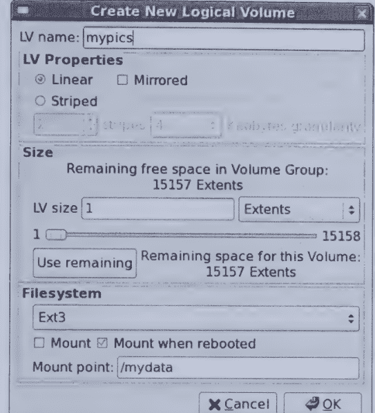

图 16-2：使用 LVM 创建新的逻辑卷。

要使用卷组中的空空间扩展卷的大小，只需选择该卷组并点击编辑属性（Edit properties）按钮。这将打开与图 16-2 相同的窗口。然后，你可以使用卷大小滑块来扩展卷的大小。点击确定后，`system-config-lvm` 将卸载你的卷组、调整卷大小并检查文件系统，在保留你的数据的同时扩展卷的大小。这种功能是 LVM 设备的一个主要优势。硬盘分区是固定的，而 LVM 逻辑磁盘可以轻松扩展。要扩展硬盘分区，你必须删除旧分区并创建一个新分区，这是固定的。使用 LVM，你只需要添加更多存储。逻辑结构与物理实现分离分离。

### LVM 工具：使用 LVM 命令

除了使用 `system-config-lvm` 外，你还可以使用一组 LVM 工具来管理你的 LVM 卷、添加新的 LVM 物理分区并删除当前的分区。`system-config-lvm` 系统工具是 LVM 工具的图形化界面。对于 LVM 工具，你可以直接使用 LVM 工具，也可以使用 `llvm` 命令生成一个交互式 shell，并在其中运行 LVM 命令。所有 LVM 交互式命令都有帮助页（Man pages）。LVM 在 `/etc/lvm/lvm.conf` 目录维护配置信息，你可以在那里配置 LVM 选项，例如日志文件或 LVM 设备目录。

### 显示 LVM 信息

你可以使用 `pvdisplay`、`vgdisplay` 和 `lvdisplay` 命令查看物理分区、卷组和逻辑卷的详细信息。`pvscan`、`vgscan` 和 `lvscan` 会列出你的物理卷、组和逻辑卷。

### 使用 LVM 命令管理 LVM 物理卷

物理卷可以是任何硬盘分区或 RAID 设备。RAID 设备被视为单个物理卷。你可以从单个硬盘或硬盘上的分区创建物理卷。在具有许多硬盘的大型系统中，你更有可能为每个物理卷使用整个硬盘。

要在整个硬盘上初始化物理卷，请使用硬盘设备名称，如下所示：

```
pvcreate /dev/sdc
```

如果你使用单个分区作为整个驱动器，则使用分区的设备名称创建新的物理卷，如下所示：

```
pvcreate /dev/sdc1
```

这将在 `sdc` 硬盘（第三个 Serial ATA 驱动器，c）上创建一个名为 `sdc1` 的物理分区（此处物理卷）。

要初始化多个驱动器，只需列出它们即可。以下命令将创建两个物理分区，`sdc1` 和 `dd1`。

```
pvcreate /dev/sdc1 /dev/sdd1
```

你还可以使用不同硬盘上的多个分区。这种情况适用于你的每个驱动器都持有多个分区的情况。当你将硬盘上的某些分区用于不同的用途（例如不同的操作系统），或者当你想将逻辑组跨越到多个硬盘上时，这种情况就会经常发生。要一次性初始化这些分区，只需列出它们：

```
pvcreate /dev/sda3 /dev/sdb1 /dev/sdb2
```

一旦你初始化了分区，就必须在它们上创建 LVM 组。

### 管理 LVM 组

物理 LVM 分区被用来组成卷组。你可以使用 `vgcreate` 命令手动创建卷组，并提供组名以及你想包含在组中的物理分区列表。

如果你正在创建一个新的卷组来放置这些分区，可以在使用 `vgcreate` 命令创建卷组时将它们包含在内。卷组可以使用一个或多个物理分区。之前描述的默认安装配置为 `VolGroup00` 只使用了一个物理分区。在下面的示例中，一个名为 `mymedia` 的卷组由两个物理卷 `sdc1` 和 `ddd1` 组成。

```
vgcreate mymedia /dev/sdc1 /dev/sdd1
```

上一个示例在两个 serial ATA 硬盘上设置了逻辑组，每个硬盘都有它自己的单个分区。或者，你可以设置一个跨越多个硬盘分区的卷组。如果你将分区用于不同的功能，这种方法赋予了你跨越多个硬盘使用所有空间的灵活性。下面的示例创建了一个名为 `mygroup` 的组，它由三个物理分区 `/dev/sda3`、`/dev/sdb2` 和 `/dev/sdb4` 组成：

```
vgcreate mygroup /dev/sda3 /dev/sdb2 /dev/sdb4
```

如果你想向卷组添加物理卷，请使用 `vgxtend` 命令。`vgxtend` 命令向逻辑组添加新分区。在下面的示例中，分区 `/dev/sda3` 被添加到了卷组 `mygroup` 中。实际上，你正在通过添加新的物理分区来扩展逻辑组的大小。

```
vgxtend mygroup /dev/sda3
```

要向卷组添加新的驱动器，你将遵循类似的步骤。下面的示例添加了第五个 ATA 硬盘 `sde`，首先在其上面创建一个物理卷，然后添加该卷 `sde`。

## 第 16 章：RAID 与 LVM

### 逻辑卷

使用 `lvcreate` 命令为逻辑组创建一个或多个逻辑卷。`--size` 或 `-L` 选项决定大小，`--name` 选项指定名称。使用 `vgcmd` 查看可用空空间。逻辑组可以包含多个逻辑卷，也可以只有一个你需要的卷。逻辑卷在概念上类似于 Windows 扩展分区中的逻辑卷。

```
lvcreate --size --name mynewvol1
```

格式化逻辑卷。然后使用 `mkfs` 命令配合 `-t` 选项格式化逻辑卷。在 Fedora 上，逻辑卷将列在 LVM 组目录 `/dev/mynewgroup/mynewvol1` 中。这实际上是指向 `/dev/mapper` 目录的链接，该目录持有带有卷名前的文件 `/dev/mapper/mynewgroup-mynewvol`。

```
mkfs -t ext3 /dev/mapper/mynewgroup-mynewvol1
```

#### 向 LVM 组和卷添加新硬盘的步骤

- **物理分区**：首先在你的硬盘上创建一个物理分区。你可以使用 `GParted`、`Parted` 或 `fdisk` 配合磁盘设备名称来创建分区。类型请指定 LVM (8E)。

- **物理卷**：接下来，使用 `pvcreate` 命令和设备名称在新的空 LVM 分区上创建物理卷 (`pv`)。

```
pvcreate /dev/sdf
```

- **添加到逻辑组**：使用 `vgextend` 命令将新的物理卷添加到你现有的逻辑组 (LG) 中。

```
vgextend /dev/mynewgroup /dev/sdf
```

- **添加到逻辑卷**：然后你可以利用此操作在新空间中创建新的逻辑卷，或者扩展当前逻辑卷的大小。要将逻辑卷的大小扩展到新空间，首先挂载该逻辑卷。然后使用 `lvextend` 命令扩展现在已成为同一逻辑组的新硬盘上的空间。如果不指定大小，将添加新硬盘上的所有空间。

```
mount /dev/mynewgroup/mynewvol
lvextend /dev/mynewgroup/mynewvol /dev/sdf
```

使用 `-L` 选项指定特定大小，例如 `-L +250G`。务必添加 `+` 符号，以便将大小加到当前逻辑卷的大小上。使用 `vgcmd` 查看可用空空间。

- **添加到文件系统**：然后使用 `resize2fs` 命令扩展逻辑卷上的 Linux 文件系统 (`ext3`) 以包含新空间并对其进行格式化。除非指定了大小（第二个参数），否则将使用所有可用的未格式空间。

```
resize2fs /dev/mynewgroup/mynewvol
```

#### 使用 LVM 替换硬盘

当你需要用新硬盘替换旧硬盘时，LVM 非常有用。硬盘的平均寿命预计约为六年。你也可以直接用更大的硬盘替换旧硬盘。对于额外的硬盘，替换过程非常简单。但替换启动硬盘会变得复杂得多。

要替换硬盘，只需将新硬盘整合到你的逻辑卷中。你的逻辑卷大小将相应增加。你可以使用 `pmove` 命令将数据从旧硬盘移动到新硬盘。然后执行命令从卷组移除旧硬盘 (`vgreduce`)。从用户和系统的角度来看，不会发生任何变化，尽管旧硬盘的实际存储仍然存储在相同的目录中，但硬盘已实现在新硬盘上。

如果你想替换启动硬盘，使用 LVM 进行替换将变得复杂。启动硬盘包含一个特殊分区和主引导记录 (MBR)。启动分区不能是任何 LVM 的一部分。你必须使用 `Parted` 或 `fdisk` 等工具在新硬盘上创建一个启动分区并对其标记。启动硬盘通常很小，约 200 MB。然后对你的系统进行分区，将 `/boot` 目录的内容复制过去。接着将磁盘的剩余部分添加到你的逻辑卷并移除旧硬盘，将旧磁盘的内容复制到新硬盘。你仍然需要使用救援 DVD，并执行 `grub-install` 命令在新硬盘上安装主引导记录。之后你就可以从新硬盘启动了。

#### 多个硬盘的 LVM 示例

随着硬盘变得越来越廉，且存储需求增加，许多系统现在使用多个硬盘。除非你实现了 RAID 系统，否则每个硬盘上的分区都必须单独管理。RAID 允许将几块硬盘视为一个存储设备，但对可以组合设备的大小和种类有限制。使用 RAID 时，每块硬盘必须单独管理，随着硬盘填满，文件必须适应剩余的存储空间。

使用 LVM，你不再有这些限制。你可以将多个硬盘组合成单一的存储设备。该设备也是灵活的，允许你在不丢失任何数据的情况下替换硬盘，通过添加新磁盘来自动增加你的存储。

例如，假设为系统添加两块硬盘，但你想在逻辑上处理这两块硬盘的存储，而不是在每个硬盘上分区。LVM 让你将两块硬盘的组合存储视为一个巨大的池。实际上，两个 500GB 的硬盘可以被视为一个 1 Ter字节的存储设备。

### 配置 RAID 设备

RAID 是一种在多个磁盘上存储数据的方法，以提供更好的性能和冗余。实际上，你可以让操作系统将几块硬盘视为一个硬盘。RAID 然后在所有这些磁盘上高效地存储和检索数据，而不是让操作系统将每个磁盘作为独立的文件系统进行访问。存储和检索的低级细节不再是操作系统需要考虑的。这为添加或移除硬盘提供了更大的灵活性，同时在存储系统中实现冗余以提供更高的可靠性。通过 RAID，你可以拥有几块硬盘被视为虚拟磁盘，某些磁盘被用作实时镜像，实现数据复制。你可以根据所需的可靠性程度，以多种方式使用 RAID。当你将数据存储在多个磁盘上时，I/O 操作可以以平衡的方式重叠，从而提高性能。由于多个磁盘的存在增加了平均故障间隔时间（MTBF），冗余地存储数据也增加了容错能力。

RAID 可以在硬件或软件层面实现。在硬件层级，你可以将硬盘连接到 RAID 控制器。你的操作系统通过 RAID 硬件控制器访问存储器。或者，你可以将 RAID 实现为软件控制器，让软件 RAID 控制器管理对作为 RAID 设备的硬盘的访问。你使用的软件版本允许将硬盘作为 RAID 磁盘。Linux 使用 2.4 内核中支持的 MD 驱动程序来实现 RAID 控制器。Linux 软件支持多个级别（线性、0、1、4、5、6 和 10），而硬件 RAID 支持的级别更多。硬件 RAID 级别提供了更优性能和可靠性的组合。

提示：在你的系统上使用 RAID 之前，确保你的内核支持它，以及你想要使用的 RAID 级别。如果不支持，你将需要重新配置为内核安装 RAID 模块。检查内核配置中的“多驱动程序支持”组件。你可以指定对任何或所有 RAID 级别的支持。

### 主板 RAID 支持：dmraid

从内核 2.6 开始，通过 `dmraid` 模块支持硬件 RAID 设备。`dmraid` 模块目前支持广泛的硬件 RAID 设备。该模块将你的系统映射到由 Intel、Promise 和 Silicon Magic 等提供的硬件 RAID 设备，这些设备通常包含在主板上。你使用 BIOS RAID 配置工具根据硬件文档的说明设置你的 RAID 设备。在安装 Linux 期间，系统会自动检测 RAID 设备并加载 `dmraid` 模块，选择合适的驱动程序。

通过 `dmraid` 命令，你可以检测并激活 RAID 设备。如下

```
dmraid -r
```

要列出当前支持的设备，请使用带有 `-l` 选项的 `dmraid`。

```
dmraid -l
```

RAID 工具正在不断改进，并可能在某些 RAID 设备上工作不良好。

### Linux 软件 RAID 级别

Linux 软件 RAID 可以在不同的级别实现，取决于你的组织对效率、冗余或重建能力的需求。每种能力都对应于不同的 RAID 级别。对于大多数级别，硬盘设备的大小应该是相同的。对于 RAID 1，需要相同大小磁盘；对于 RAID 5 则建议使用相同大小。Linux 软件支持多个级别，如表 16-2 所示。RAID 5 至少需要三块硬盘。此外还提供了用于测试的 FAULTY RAID 级别。

#### 第 3 部分：设备与文件系统

| RAID 级别 | 能力 | 描述 |
| --- | --- | --- |
| 线性 (Linear) | 追加 (Appending) | 简单地将 RAID 硬盘视为一个虚拟驱动器，没有分层、镜像或校验重建。 |


| 0 | 分层 (Striping) | 跨驱动器实现磁盘分层，无冗余。 |
| 1 | 镜像 (Mirroring) | 实现高水平的冗余。每块磁盘都被视为所有数据的镜像。 |
| 4 | 校验 (Parity) | 使用存储在独立磁盘上的校验信息实现数据重建能力。 |
| 5 | 分布校验 (Distributed parity) | 使用校验信息实现数据重建能力。校验信息分布在所有驱动器上，而不是像 RAID 4 那样使用独立驱动器。至少需要三个硬盘。 |
| 6 | 分布校验 (Distributed parity) | 使用双校验信息实现数据重建能力。两组校验信息分布在所有驱动器上。可以被视为 5 的增强形式。 |
| 10 | 分层与镜像 (Striping and Mirroring) | 通过分层实现高水平冗余。也称为 1+0。 |

表 16-1：Linux 软件 RAID 级别

## 线性 (Linear)

线性级别允许将几块硬盘统一为一个逻辑硬盘，提供一个连续存储池。你不再被强制在每块硬盘上设置单独的分区，实际上你只有一块硬盘。存储按顺序管理。当一块硬盘填满时，将使用下一块。实际上，你是在将一块硬盘追加到另一块硬盘上。此级别不提供恢复能力。如果你有一个包含两个 80GB 硬盘的硬 RAID 阵列，在使用完其中一个的存储空间后，将自动开始使用后一个。

## RAID 0：分层 (Striping)

为了效率，RAID 使用磁盘分层存储数据，其中数据被组织成标准的条带，可以存储在 RAID 驱动器上以便更快速访问（级别 0）。RAID 0 还将你的硬盘组织成通用的 RAID 驱动器，但将它们视为单块硬盘，将数据随机存储在所有磁盘上。如果你有一个包含两个 80GB 硬盘的硬 RAID 阵列，你可以将它们作为一个 160GB 的 RAID 设备来访问。

提示。请记住，许多“硬件” RAID 设备实际上是软件 RAID (`fakeraid`)。虽然你在 BIOS 中配置了它们，但驱动程序像任何其他驱动程序一样是以软件方式运行的。在这方面，它们可能被认为比 Linux 软件 RAID 解决方案灵灵活，并且直接取决于供应商对任何修复或更新的支持。

## RAID 1：镜像 (Mirroring)

RAID 1 通过镜像实现冗余。在镜像中，相同的数据被写入每个 RAID 驱动器。每块磁盘都有所有写入数据的完整副本，以便如果一个或多个磁盘故障，其他磁盘仍然保留你的数据。尽管极其安全，但冗余可能非常低效并消耗大量存储空间。例如，在两个 80GB 硬盘的 RAID 阵列中，一个用于存储，另一个用于实时备份。这导致你只剩下 80GB 可用。写入操作也必须在 RAID 使用的多个镜像硬盘上进行复制。

## RAID 5 和 6：分布校验 (Distributed parity)

作为镜像的替代方案，在硬盘崩溃时可以使用校验来重建数据。使用校验信息而不是全数据复制。校验信息占据了相当于一个硬盘的空间。RAID 5 将校验信息分布在所有驱动器上，而不是专门由一个驱动器使用。这允许使用更高效的方法——分层。通过分层和校验，RAID 5 提供了快速且具有恢复能力，是最流行的 RAID 级别。例如，四个 80GB 硬盘的 RAID 阵列将被视为 320GB 硬盘，其中部分空间（80GB）用于存储校验信息，剩余 240GB。RAID 5 至少需要三块硬盘。

RAID 6 的运行方式与 RAID 5 相同，但它使用双重校验信息处理数据，提供了更强的恢复能力。

## RAID 4：校验 (Parity)

虽然由于开销成本，Red Hat Enterprise Linux 和 Fedora 不支持 RAID 4，但像 RAID 5 一样使用校验信息而不是镜像数据支持更紧凑的恢复形式。在 RAID 4 中，校验信息保留在独立的磁盘上，而其他磁盘用于数据存储，这类似于线性模型。

提示：Red Hat Enterprise Linux 和 Fedora 还允许你在安装期间创建和格式化 RAID 驱动器。此时，你可以创建 RAID 分区和设备。

## RAID 设备与分区：md 和 fd

RAID 设备被命名为 `md` 并使用 MD 驱动程序。这些设备已经在你的 Linux 系统上被定义，位于 `/etc/dev` 目录，其中 `/dev/md0` 是第一个 RAID 设备，`/dev/md1` 是第二个，以此此类推。每个 RAID 设备反过来使用磁盘分区，每个分区包含一个硬盘。这些分区通常被称为 RAID 磁盘（RAID disks），而 RAID 设备则是其所使用的 RAID 设备的阵列。

在创建 RAID 分区时，你应该将分区类型设置为 `fd`，而不是标准 Linux 分区的 `83`。`fd` 类型用于 RAID 的自动检测。

## 从 RAID 设备启动

作为安装过程的一部分，Fedora 允许你创建 RAID 设备，你也可以从这些设备启动系统。你的 Linux 系统将通过配置为加载 RAID 内核支持并自动检测你的 RAID 设备。引导程序将安装在你的 RAID 设备上，这意味着安装在组成该设备的所有硬盘上。

Fedora 不支持从 RAID 5 启动，仅支持 RAID 1。这意味着如果你想使用 RAID 5 仍然从 RAID 磁盘启动，你需要使用跨硬盘的每个设备对应的分区创建至少两个（或更多）RAID 设备。每个设备将持有 `/boot` 分区并被安装为 RAID 1 设备。该设备将是第一个 RAID 设备 `md0`，由每块硬盘上的第一个分区组成。RAID 设备 `md1` 可以是一个 RAID 5 设备。它将由其他硬盘上的相应分区组成。你的系统可以从 RAID 1 设备启动但使用 RAID 5 设备。

如果你在安装期间没有创建 RAID 磁盘，而在之后创建它们并想从它们启动，你将必须确保你的系统配置正确。RAID 设备需要带有持久性超块（persistent superblocks）。内核必须启用对 RAID 设备的支持。在 Red Hat Enterprise Linux 和 Fedora 上，这种支持是以模块形式提供的。如果你将 RAID 5 用于你的 `/`（根）分区，将会遇到困难。该分区包含 RAID 5 模块，但要访问该分区，你必须已经加载 RAID 5 模块。你可以在 `/boot` 分区中创建一个包含 RAID 5 模块的 RAID md。使用 `mkinitrd` 命令创建 RAM 磁盘并使用 `-with` 选项指定要包含的模块。

```
mkinitrd --preload raid5 --with=raid5 raid-ramdisk 2.6.9-1
```

## RAID 管理：mdadm

Red Hat Enterprise Linux 和 Fedora 使用 `mdadm` 工具来管理和监控 RAID 设备。它取代了之前版本的 Red Hat Enterprise Linux 和 Fedora 中旧的 `raidtools`。`mdadm` 是一个用于创建、监控、管理和修复 设备的通用工具。你可以直接运行命令来创建和格式化 RAID 磁盘。它还可以作为守护进程运行，以监控和检测设备的问题。

`mdadm` 工具有七种运行模式，每种模式都有自己的选项，例如使用 `-l` 选项将其作为守护进程运行，或者使用 `-l` 选项创建以启动磁盘的 RAID 级别。表 16-2 列出了这些运行模式。查看 `mdadm` 页面以获取每个模式选项的详细列表。

| 模式 | 说明 |
| --- | --- |
| assemble | 从设备组装 RAID 阵列。 |
| build | 构建不带每个设备超块的阵列。 |
| create | 构建带每个设备超块的阵列。 |
| manage | 管理阵列设备，添加或删除磁盘。 |
| misc | 对设备进行的操作，例如将其设置为只读。 |
| monitor | 监控阵列的变化并采取行动（用于 RAID 1, 4, 5, 6）。 |
| grow | 更改阵列大小，例如用较大的设备替换较小的设备。 |

**表 16-2：mdadm 模式**

## 创建和安装 RAID 设备

如果你在安装过程中正在处理你的 RAID 设备及其分区，那么你应该已经有了可以工作的 RAID 设备。你的 RAID 设备将配置在 `/etc/mdadm.conf` 文件中，你的 RAID 设备的状态将列在 `/proc/mdstat` 文件中。你可以使用 `raidstart` 和 `mdadm` 命令手动启动或停止你的 RAID 设备。`-a` 选项作用于所有设备，尽管如果你需要，也可以指定特定的设备。

为已安装的系统手动创建 RAID 设备，请遵循以下步骤：

- 确保你的内核支持你为要创建的设备所需的 RAID 级别。
- 如果你尚未这样做，请创建你将用于 RAID 设备的 RAID 磁盘（分区）。
- 使用 `mdadm` 命令以 `build` 或 `create` 模式创建 RAID 设备。阵列也将被激活。
- 或者，你可以在 `/etc/mdadm.conf` 文件中配置你的 RAID 设备 (`/dev/mdn`)，指定要使用的 RAID 磁盘，然后使用 `mdadm` 命令指定要创建的 RAID 设备。
- 在 RAID 设备上创建文件系统 (`mkfs`) 并挂载它。

## 添加独立的 RAID 文件系统

如果你只想向已有标准启动分区的系统添加 RAID 文件系统，你可以省略第一个 RAID 1 分区。假设有两个硬盘用于 RAID 文件系统，你只需要为每个磁盘准备两个分区，即 `/dev/sda1` 和 `/dev/sdb1`。

```
ARRAY /dev/md0=/dev/sda1,/dev/sdb1 level=5 num-devices=2
```

然后你将使用以下命令创建阵列。

```
mdadm -C /dev/md0 -n2 /dev/sda1 /dev/sdb1 level=5
```

你将使用以下命令创建阵列。

## 创建硬盘磁盘分区

如果你在安装过程中处理你的 RAID 设备及其分区，那么你应该已经有了可以工作的 RAID 设备。你的 RAID 设备将配置在 `/etc/mdadm.conf` 文件中，你的 RAID 设备的状态将列在 `/proc/mdstat` 文件中。你可以使用 `raidstart` 和 `mdadm` 命令手动启动或停止你的 RAID 设备。`-a` 选项作用于所有设备，尽管如果你需要，也可以指定特定的设备。

为已安装的系统手动创建 RAID 设备，请遵循以下步骤：

- 确保你的内核支持你为要创建的设备所需的 RAID 级别。
- 如果你尚未这样做，请创建你将用于 RAID 设备的 RAID 磁盘（分区）。
- 使用 `mdadm` 命令以 `build` 或 `create` 模式创建 RAID 设备。阵列也将被激活。
- 或者，你可以在 `/etc/mdadm.conf` 文件中配置你的 RAID 设备 (`/dev/mdn`)，指定要使用的 RAID 磁盘，然后使用 `mdadm` 命令指定要创建的 RAID 设备。
- 在 RAID 设备上创建文件系统 (`mkfs`) 并挂载它。

## 配置 RAID：etc/mdadm.conf

一旦你有了 RAID 设备，你就需要将它们配置为 RAID 设备。RAID 设备配置在 `/etc/mdadm.conf` 文件中，选项如表 16-3 所示。此文件将用于 `mdadm` 命令创建 RAID 设备。在 `/etc/mdadm.conf` 中，你创建 `DEVICE` 和 `ARRAY` 条目。`DEVICE` 条目列出 RAID 设备。`ARRAY` 条目列出 RAID 阵列及其选项。此示例在两个磁盘上实现简单的阵列。串行 SATA 驱动设备名为 `sd` 而不是 `hd`。

```
DEVICE /dev/sda1 /dev/sdb1
```

你可以在 DEVICE 条目列出多个，也可以使用独立的 DEVICE 条目。你还可以使用匹配符号指定多个设备，例如 `*`、`?` 或 `[]`。以下将 `sda` 上的所有分区作为 RAID 设备：

```
DEVICE /dev/sda* /dev/sdb1
```

对于 `ARRAY`，你指定要配置的 RAID 设备名称，例如第一个 RAID 设备 `/dev/md0`。然后你添加配置选项，例如 `devices` 用于列出组成阵列的分区，`level` 用于 RAID 级别，以及 `numdevices` 用于设备数量。第一个阵列仅持有启动分区并使用 RAID 1，而阵列使用两个分区并设置为 RAID 5。

```
ARRAY /dev/md0=/dev/sda2,/dev/sdb1 level=5 num-devices=2
```

先前的示例显示 RAID 阵列 `/dev/md0` 使用两个磁盘（分区）`/dev/sda1` 和 `/dev/sdb1`，并配置为 RAID 5。

## 创建 RAID 阵列

你可以使用 `mdadm` 命令指定的选项创建 RAID 阵列，也可以使用 `/etc/mdadm.conf` 文件中列出的配置。使用该文件并非强制，但它使得 RAID 的创建更易于管理，特别是对于大型或复杂的阵列。一旦你创建了 RAID 设备，你的 RAID 设备将自动

激活。以下命令使用两个设备 `/dev/sda2` 和 `/dev/sdb1` 创建一个级别为5 的 RAID 阵列 `/dev/md1`。

```
mdadm --create /dev/md0 --raid-devices=2 /dev/sda2 /dev/sdb1 --level=5
```

## 指令或选项说明

| DEVICE devices-list | 用于 RAID 设备的分区和驱动器。 |
|------|------|
| ARRAY | 特定 RAID 设备的 ARRAY 配置部分。 |
| level=num | RAID 设备的级别，例如 0, 1, 4, 5 和 -1（线性）。 |
| devices=disk-device-list | 组成 RAID 阵列的磁盘设备（分区）。 |
| num-devices=count | 阵列中 RAID 设备的数量。每个 RAID 设备设备部分都必须包含此指令。最大值为 12。 |
| spare-group=name | 备用组的文本名称，其设备可以用于其他阵列。 |
| auto=option | 如果指定的设备不存在，则自动创建。你可以创建传统的非分区（yes 或 md 选项）或较新的分区阵列（mdp 或 part 选项）。对于可分区的阵列，默认值为 4，你可以更改它。 |
| super-minor | 阵列块的序号，与 md 设备号相同。 |
| uuid=UUID-number | 存储在阵列块中的 UUID 标识符，用于识别 RAID 阵列。可以在命令中引用阵列。 |
| MAILDADDR | 监控模式，发送警报的电子邮件地址。 |
| PROGRAM | 监控模式，发生事件运行时运行程序。 |

## 表 16-3：mdadm.conf 选项

每个选项都有对应的短版本，如表 31-4 所示。这里显示了相同的单字母选项的命令。

```
mdadm -C /dev/md1 -n2 /dev/sda2 /dev/sdb1 -l5
```

如果你已经在 `/etc/mdadm.conf` 文件中配置了你的 RAID 设备，那么你可以使用 `mdadm` 命令来创建你的 RAID 设备。`mdadm` 将 RAID 设备的名称作为参数，例如第一个 RAID 设备为 `/dev/md0`。它在 `/etc/mdadm.conf` 文件中查找该设备的条目，并使用该配置信息在设备设备上创建 RAID 文件系统。如果你愿意，可以使用 `-c` 选项指定备用配置文件。`mdadm` 的作用类似于一种用于 RAID 设备的 `mkfs` 命令，初始化分区并创建 RAID 文件系统。组成 RAID 阵列的分区上的任何数据都将被擦除。

```
mdadm --create /dev/md0
```

## mdadm --create 选项

| 选项 | 说明 |
| --- | --- |
| -n --raid-devices | RAID 设备的数量 |
| -l --level | RAID 级别 |
| -C --create | 创建模式 |
| -c --chunk | 以 2 的幂次方指定块（条带）大小，默认为 64KB |
| -x --spare-devices | 阵列中备用设备的数量 |
| -z --size | 设备中使用的块大小，如果尺寸不同，默认设置为最小设备的大小 |
| -p --parity | 指定奇偶校验算法；默认使用左对称 |

表 16-4：mdadm --create 选项

## 创建备用组

Linux 软件现在允许 RAID 阵列共享它们的备用设备。这意味着如果阵列属于同一个备用组，那么当某个设备故障时，它可以自动使用另一个阵列。任何阵列的备用设备都可以根据需要用于另一个阵列。你使用 `--spare-group` 选项设置阵列所属的备用组。`mdadm` 监控将检测阵列故障，并自动用同一备用组内阵列的备用设备替换它。下一个示例中的第一个命令为 `/dev/md0` 阵列创建一个名为 `/dev/sd1` 的备用驱动器并将其标记为 `mygroup`。在第二个命令中，阵列 `/dev/md1` 没有备用驱动器，但与 `/dev/md0` 属于同一个备用组。如果 `/dev/md1` 中的设备故障，它可以自动使用来自 `/dev/md0` 的备用设备 `/dev/sd1`。以下代码实际上是同一行，每行都以 `mdadm` 开头。

```
mdadm --create /dev/md0 --raid-devices=3 /dev/sda /dev/sdc -x /dev/sd1 --level=5 --spare-group=mygroup
mdadm --create /dev/md1 --raid-devices=2 /dev/sda2 /dev/sdc2 --level=5 --spare-group=mygroup
```

## 创建文件系统

一旦 RAID 设备激活，你就可以在 RAID 设备上创建文件系统并挂载这些文件系统。以下示例在 `/dev/md0` 设备上创建了一个标准的 Linux 文件系统：


```
mkfs.ext3 /dev/md0
```

在接下来的示例中，用户随后创建了一个名为 `/myraid` 的目录并将 RAID 设备挂载到那里：

```
mkdir /myraid
mount /dev/md0 /myraid
```

如果你计划使用 RAID 设备来维护你的用户目录和文件，你就可以将 RAID 设备挂载为你的 `/home` 分区。如果你在安装系统时创建了 RAID 设备，通常会使用这样的挂载点。若要将你当前的家目录传输到 RAID 设备，请先在另一个分区上备份，然后挂载 RAID 设备，并将你的家目录复制到其中。

## 管理 RAID 阵列

你可以通过 `mdadm` 管理 RAID 阵列。在这些模式下，你可以在阵列中添加或删除设备，也可以标记为故障。`--add` 选项允许你向活动阵列添加设备，实际上是热插。

```
mdadm /dev/md0 --add /sdb1
```

要从活动阵列中删除设备，你必须先用 `--fail` 将其标记为故障，然后用 `--remove` 移除。

```
mdadm /dev/md0 --fail /sdb1 --remove
```

## 启动和停止 RAID 阵列

启动已有的 RAID 阵列，你需要使用组装模式的 `mdadm`（新创建的阵列会自动启动）。直接在命令行执行此操作需要知道哪些设备组成了阵列，在阵列名称后列出它们。

```
mdadm -A /dev/md1 /dev/sda2
```

在文件中配置 RAID 阵列更简单。通过扫描选项 `-s`，`mdadm` 将从 `/etc/mdadm.conf` 文件读取阵列信息。如果你没有指定 RAID 阵列，所有阵列都将启动。

```
mdadm -As /dev/md0
```

停止 RAID 阵列，你使用 `-S` 选项。

```
mdadm -S /dev/md0
```

## 监控 RAID 阵列

作为守护进程，`mdadm` 使用 `/etc/init.d` 中的 `mdmonitor` 脚本启动和停止。这将以监控模式调用 `mdadm`，检测任何出现的问题并记录采取的行动。

```
service mdadm start
```

你可以通过以监控模式调用 `mdadm` 直接监控设备。

```
mdadm --monitor /dev/md0
```

监控相关的选项可以在 `/etc/mdadm.conf` 文件中设置。`MAILADDR` 设置发送 RAID 事件通知的电子邮件地址。`PROGRAM` 设置发生事件时使用的程序。

如果你决定更改 RAID 配置或添加新设备，你必须先停用你的活动 RAID 设备。要停用 RAID 设备，你需要使用停止模式的 `mdadm` 命令。请确保关闭所有打开的文件并卸载任何文件系统。

```
mdadm --stop /dev/md0
```

```
mdadm -S /dev/md0
```

## 配置可启动 RAID

一旦你拥有了 RAID 设备，就需要将它们配置为 RAID。先前的示例将 RAID 阵列 `/dev/md0` 配置为 RAID 1（level=1）。两个磁盘（分区）组成了第二个阵列 `/dev/md1`，使用 `/dev/sda2` 和 `/dev/sdb1`，并配置为 RAID 5（level=5）。

```
ARRAY /dev/md0 devices=/dev/sda level=1 num-devices=1
ARRAY /dev/md1 devices=/dev/sdb2,/dev/sdb1 level=5 num-devices=2
```

## 17. 设备

所有设备（如打印机、终端和 CD-ROM）都通过称为“设备文件”的特殊文件连接到你的 Linux 操作系统。此类文件包含了操作系统所需的所有信息。这种设计引入了极大的灵活性。操作系统不依赖于管理特定设备的细节；所有细节都由设备文件处理。操作系统只需告知设备要执行什么任务，设备文件就会将其告知系统。如果你更换了设备，只需要更改设备文件，而无需更改整个系统。

要在你的 Linux 系统上安装设备，你需要该设备的设备文件、软件配置（例如由配置工具提供的配置）以及内核支持——通常由已经编译并构建到内核中的模块或支持提供。设备文件不是以静态方式处理的。它们根据需要动态生成并由 HAL 管理。以前，为每个可能的设备都会创建一个设备文件，这导致 `/dev/` 目录下存在大量的设备文件。现在，你的系统只会检测它正在使用的设备并为它们创建设备文件，为你提供了一个更短的设备文件列表。`udev` 和 HAL 都是热插拔系统，`udev` 用于创建设备，而 HAL 提供有关设备的信息，并管理可拆卸设备（如 USB 卡读器和 CD-ROM 等文件系统）的配置。

设备管理同时也变得复杂得多。你需要使用 `udev` 和 HAL 来配置设备，其中许多工作现在是自动完成的。设备信息维护在位于 `/sys` 的名为 sysfs 的特殊设备文件系统中。这是一个虚拟文件系统 `/proc`，用于跟踪内核支持的所有设备。你可能需要查询的几个资源和可能使用的目录列在表 17-1 中。

### sysfs 文件系统：/sys

系统文件系统设计用于存储系统设备的详细信息。这些信息可以被 `udev` 等热插拔工具使用，以便需要创建设备接口。而不是为设备维护静态且完整的配置，sysfs 系统用于维护有关设备的配置信息，以便在设备连接到系统时由热插拔系统创建设备接口。越来越多的设备现在是可拆卸的（例如摄像头），Linux 发行版使所有设备结构化支持热插拔。

| 资源 | 描述 |
| --- | --- |
| `/etc/sysconfig/hwconf` | 硬件配置和系统列表 |
| `/sys` | 系统中所有设备的配置信息 |
| `/proc` | 内核信息，包括设备信息 |
| [www.kernel.org/pub/linux/device-list/devices.txt](https://www.kernel.org/pub/linux/device-list/devices.txt) | Linux 设备名称 |
| [www.kernel.org/pub/linux/utils/hotplug/udev.html](https://www.kernel.org/pub/linux/utils/hotplug/udev.html) | udev 网站 |
| `/etc/udev` | udev 配置目录 |
| [www.freedesktop.org/wiki/hal](https://www.freedesktop.org/wiki/hal) | HAL 网站 |
| `/etc/hal` | HAL 配置目录 |
| `/usr/share/hal/fdi` | HAL 支持和策略的设备文件 |
| `/etc/hal/fdi` | 系统管理员的设备文件 |

表 17-1：设备资源

sysfs 文件系统是一个虚拟文件系统，提供了内核支持的 PCI 设备、总和块设备的层次映射。`classes` 子目录按类别列出所有支持的设备。sysfs 文件系统被 `udev` 用于动态生成 `/dev` 目录中的设备文件，并被 HAL 在需要时管理可拆卸设备文件。`/sys` 类型为 sysfs。`/sys` 子目录将你的设备组织成不同的类别。文件系统用于 `systemtool` 显示已安装设备的列表。该工具是 sysutils 包的一部分。以下示例将列出你的系统设备。

```
就像 /proc 一样，/sys 目录位于内存中，但仍然挂载在 /etc/fstab 文件中。

none /sys sysfs defaults 0 0
```

### proc 文件系统：/proc

`/proc` 文件系统是一个旧的文件系统，用于维护内核进程信息，尽管许多现在由 sysfs 文件系统支持。`proc/devices` 文件按主设备列出你的字符设备和块设备。IRQ、DMA 和 I/O 端口的文件列出了各种设备的信息，例如 `pci` 列出所有 PCI 设备，`sound` 列出所有音频设备。`sound` 文件列出了有关声卡的详细信息。`ide`、`scsi` 等子目录包含不同设备的信息。某些文件持有可以动态更改的配置信息，例如 IP 包转发能力和最大数量。你可以使用 `sysctl` 工具（系统工具中的内核调优）或手动编辑文件来更改这些值。表 17-2 列出了几个与设备相关的 `/proc` 文件。

### udev：设备文件

设备现在被视为热插拔的，这意味着它们可以被添加或删除。`udev` 的配置位于 `/etc/udev`。系统启动时，会调用 `/sbin/udevstart`，它运行 `udev` 并创建所有设备文件。由于 `/dev` 现在是动态的，你对 `/dev` 进行的任何更改在重启后都会丢失。相反，符号链接必须在 `/etc/udev/rules` 中配置。默认规则已经存在，但你可以创建自己的。

| 文件 | 描述 |
| --- | --- |
| `/proc/devices` | 列出正在运行的设备 |
| `/proc/dma` | 显示 DMA 通道 |
| `/proc/interrupts` | 显示中断 |
| `/proc/ioports` | 显示正在使用的 I/O 端口 |
| `/proc/pci` | 列出 PCI 设备 |
| `/proc/sound` | 列出音频设备 |
| `/proc/ide` | 列出 IDE 设备 |
| `/proc/net` | 列出网络设备 |

表 17-2：Proc 设备文件

sysfs是一个虚拟文件系统，跟踪内核支持的所有设备。sysfs 文件系统被 `udev` 用于动态生成 `/dev` 目录中的设备文件，并被 HAL 在需要时管理可拆卸设备文件。`/sys` 类型为 sysfs。`/sys` 子目录将你的设备组织成不同的类别。文件系统用于 `systemtool` 显示已安装设备的列表。该工具是 sysutils 包的一部分。以下示例将列出你的系统设备。

### udev 配置

`udev` 的配置文件是 `/etc/udev/udev.conf`。这里有全局 `udev` 选项，例如 `udev` 数据库的位置；设备权限、所有者组的默认值；以及 `udev` 规则文件的位置。`udev` 工具使用规则文件动态创建你的设备文件。在进行任何更改时要非常小心，特别是规则文件的位置。你系统中所有设备的支持都依赖于这些规则。默认的 `udev.conf` 所示：

```
# udev.conf
# udev 的主配置文件
# 此文件可用于覆盖 udev 的某些默认值
# 包括它查找文件的位置以及放置设备节点的位置。
#
# 警告：更改任何值都可能导致严重的系统故障！

# udev_root - 在文件系统中放置设备节点的位置
udev_root="/dev/"

# udev_db - udev 数据库名称和位置
udev_db="/dev/.udev.tdb"

# udev_rules - udev 规则文件的名称和位置
udev_rules="/etc/udev/rules.d/"

# udev_permissions - udev 权限文件的名称、位置
udev_permissions="/etc/udev/permissions.d/"

# default_mode - 为权限文件中没有显式匹配的所有节点设置默认模式
default_mode="0600"
```

## 第 17 章：设备

```
default_owner="root"

#default_group - 为所有在权限文件中没有
# 显式匹配的节点设置默认组
default_group="root"
```

```
# udev_log - 如果你需要日志记录，则设置为 "yes"，否则设置为 "no"
uudev_log="no"
```

设备文件目录的位置由 `udev_root` 设置为 `/dev`。在 Linux 系统上的这个官方设备目录永远不应更改。`udev_rules` 文件是 `udev` 用于生成设备文件的规则所在位置。`udev_log` 选项允许你开启和关闭日志，用于检测错误。`udev_permissions` 选项指定了持有应用于设备上权限的权限文件位置。默认权限已经为你列出。如果设备在权限文件中没有列出权限，则使用由 `default mode`、`default_owner` 和 `default_group` 设置的默认值。这些功能更像是后备保护措施。设备权限应该在 `udev` 权限文件中进行设置。

# 设备名称与 udev 规则：/etc/udev/rules.d

设备文件的名称旨在反映设备的类型。打印机设备文件以 `lp`（代表 "line print"，行式打印）开头。因为你的系统中可能连接了多个打印机，特定的打印机设备文件通过前缀后的两个或多个数字或字母来区分，如 `lp0`、`lp1`、`lp2`。终端设备文件也是如此。它们以前缀 `tty`（代表 "teletype"，电打字机）开头，并通过数字或字母进一步区分，如 `tty0`、`tty1`、`ttyS0` 等。你可以从内核网站 `www.kernel.org/pub/linux/docs/device-list/devices.txt` 获取设备文件名的完整列表以及它们所用途的设备列表。

通过 `udev`，设备名称由 `udev` 规则中的规则动态命名的。这些规则位于 `/etc/udev/rules.d`。你在该目录中找到的规则是由系统在安装期间生成的。你不应该应该编辑它们。如果你需要添加自己的规则，应该创建你自己的规则文件。规则以数字开头以建立优先级。它们按顺序读取，第一个匹配的规则将覆盖冲突的指令。所有规则都有 `.rules` 扩展名。主规则文件是 `80-udev.rules`。在这里你将找到你大部分系统设备的规则。其他规则可能为更专门的设备设置，例如用于扫描器的 `60-rules-libscanner`、用于音乐播放器的 `60-rules-libmip`、以及用于音频驱动程序的 `60-pcmcia-rules` 和 `90-alsa-rules`。

`rules.d` 目录中已存在的规则是为你的 Linux 发行版提供的，并专门为此设计的。你不应该修改这些规则。要自定义你的设置，请在 `/etc/udev/rules.d` 中创建你自己的独立规则文件。在规则文件中，你通常只定义符号链接，仅使用 `SYMLINK` 字段，如后续章节所述。这些设置了指向设备的符号链接，允许你使用其他设备名称访问它们。`NAME` 字段用于创建原始设备接口，该任务通常留给 `udev` 自身。

## 第 3 部分：设备与文件系统

| 字段 | 描述 |
| --- | --- |
| BUS | 匹配设备的总线。（sysfs 设备总线必须能够通过"device"符号链接确定。） |
| DRIVER | 匹配设备驱动程序名称。 |
| ID | 匹配总线上的设备号，例如 PCI 总线 ID。 |
| KERNEL | 匹配内核设备名称。 |
| NAME | 要创建的节点名称，或应重命网络接口的名称。 |
| OWNER, GROUP, MODE | 设备的权限。 |
| PLACE | 匹配总线上的位置，例如 USB 设备的物理端口。 |
| PROGRAM | 使用外部程序确定设备。如果程序返回成功，则此键有效。程序返回的字符串可以与 `RESULT` 键进行额外匹配。 |
| RESULT | 匹配上一次 PROGRAM 调用返回的字符串。此键可用于 PROGRAM 调用后的任何后续规则中。 |
| SYSFS{{filename}} | 匹配 sysfs 设备属性，例如标签、厂商、USB 序列号、SCSI UUID 或文件系统标签。 |
| SYMLINK | 设备的符号链接（symlink）名称。 |
| SUBSYSTEM | 匹配设备子系统。 |

表 17-3：udev 规则字段

每行将一个设备属性映射到设备名称，并指定任何符号链接（links）。属性使用键（keys）指定，可能存在多个。如果所有键都匹配某个设备，则使用其关联的名称，并生成一个该名称的设备文件。与其列出设备名称，不如使用程序或脚本来生成名称。这在 DVD/CD-ROM 设备上很常见，设备名称可以是 `dvdwriter`、`cdwriter`、`cdrom` 或 `dvdom`。

规则由逗号分隔的字段列表组成。一个字段由字段名及其赋值组成。`udev` 字段见表 17-3。查看 `udev` 手页获取详细说明。

如 `KERNEL` 等关键字段支持模式匹配，以指定设备集合。例如，`mouse*` 将匹配所有以 "mouse" 模式开头的设备。以下字段使用 `KERNEL` 键匹配内核列出的所有鼠标设备：

```
KERNEL="mouse*"
```

下一个键将匹配所有编号为 `lp0` 到 `lp9` 的打印机设备。以下字段使用 KERNEL 键匹配内核列出的所有打印机设备：

```
KERNEL="lp0*"
```

表 17-4：udev 替换

| 替换 | 描述 |
| --- | --- |
| BUS | 匹配设备总线。 |
| DRIVER | 匹配设备驱动程序名称。 |
| ID | 匹配总线上的设备号，例如 PCI 总线 ID。 |
| KERNEL | 匹配内核设备名称。 |
| NAME | 要创建的节点名称，或应重命网络接口的名称。 |
| OWNER, GROUP, MODE | 设备的权限。 |
| PLACE | 匹配总线上的位置，例如 USB 设备的物理端口。 |
| PROGRAM | 使用外部程序确定设备。如果程序返回成功，则此键有效。程序返回的字符串可以与 `RESULT` 键进行额外匹配。 |
| RESULT | 匹配上一次 PROGRAM 调用返回的字符串。此键可用于 PROGRAM 调用后的任何后续规则中。 |
| SYSFS{{filename}} | 匹配 sysfs 设备属性，例如标签、厂商、USB 序列号、SCSI UUID 或文件系统标签。 |
| SYMLINK | 设备的符号链接（symlink）名称。 |
| SUBSYSTEM | 匹配设备子系统。 |

每行将一个设备属性映射到设备名称，并指定任何符号链接（links）。属性使用键指定，可能存在多个。如果所有键都匹配某个设备，则使用其关联的名称，并生成一个该名称的设备文件。与其列出设备名称，不如使用程序或脚本来生成名称。这在 DVD/CD-ROM 设备上很常见，设备名称可以是 `dvdwriter`、`cdwriter`、`cdrom` 或 `dvdom`。


通过 `udev`，设备名称由 `udev` 规则中的规则动态命名。这些规则位于 `/etc/udev/rules.d`。你在该目录中找到的规则是由系统在安装期间生成的。你不应该编辑它们。如果你需要添加自己的规则，应该创建你自己的规则文件。规则以数字开头以建立优先级。它们按顺序读取，第一个匹配的规则将覆盖冲突的指令。所有规则都有 `.rules` 扩展名。主规则文件是 `80-udev.rules`。在这里你将找到你大部分系统设备的规则。`rules.d` 目录中已存在的规则是为你的 Linux 发行版提供的，并专门为此设计的。你不应该修改这些规则。要自定义你的设置，请在 `/etc/udev/rules.d` 中创建你自己的独立规则文件。在规则文件中，你通常只定义符号链接，仅使用 `SYMLINK` 字段，如后续章节所述。这些设置了指向设备的符号链接，允许你使用其他设备名称访问它们。`NAME` 字段用于创建原始设备接口，该任务通常留给 `udev` 自身。

## 第 3 部分：设备与文件系统

（此处重复表格 17-3 见上文）

（此处重复规则描述段落见上文）

（此处重复 KERNEL 模式匹配示例见上文）

```
KERNEL="mouse*"
```

（此处重复 lp0-lp9 匹配示例见上文）

```
KERNEL="lp[0-9]"
```

### 表 17-4：udev 替换

（此处重复表格内容）

（此处重复关于设备 符号链接的描述段落见上文）

（此处重复 udev 规则说明段落见上文）

```
SYMLINK+="cdrom cdrom-\%k"
```

符号链接

（此处重复关于设备 符号链接的描述段落见上文）

（此处重复 udev 规则说明段落见上文）

```
KERNEL="lp[0-9]+", SYMLINK+="par%n"
```

### 表 17-5：设备符号链接

| 链接 | 描述 |
| --- | --- |
| cdrom | 指向 CD-ROM 设备文件，位于 `/etc/udev/rules.d`。 |
| dvd | 指向 DVD-ROM 设备文件，位于 `/etc/udev/rules.d`。 |
| cdwriter | 指向 CD-R 或 CD-RW 设备文件，位于 `/etc/udev/rules.d`。 |
| dvdwriter | 指向 DVD-R 或 DVD-RW 设备文件，位于 `/etc/udev/rules.d`。 |
| modem | 指向调调器设备文件，位于 `/etc/udev/rules.d`。 |
| floppy | 指向软盘设备文件，位于 `/etc/udev/rules.d`。 |
| tape | 指向磁带设备文件，位于 `/etc/udev/rules.d`。 |
| scanner | 指向扫描仪设备文件，位于 `/etc/udev/rules.d`。 |
| mouse | 指向鼠标设备文件，位于 `/etc/udev/rules.d`。 |
| tape | 指向磁带设备文件，位于 `/etc/udev/rules.d`。 |

## 第 17 章：设备 361

如果你决定设置一个单独的规则，仅指定符号链接将保留在列表中等待其创建。这还允许你在其他规则文件中为设备添加其他符号链接。这种情况可能会令人困惑，因为可以为尚未生成的设备创建符号链接。符号链接将被定义并保持，直到设备生成时才需要使用。这就是为什么在实际设置的设备中，`SYMLINK` 规则远比 `NAME` 规则多。对于可拔式设备，在连接之前它们不会生成设备。

在 `50-udev.rules` 中，你会发现几个针对光设备的 `SYMLINK` 规则，其中一个显示在这里，使用了默认名称：

```
KERNEL=scd(0-9)*, SYMLINK+=cdrom.cdrom-%s
```

在大多数情况下，你只需要使用官方名称为设备创建符号链接。大部分已经为你定义好了。如果你需要创建符号链接，可以为它创建一个 `SYMLINK` 规则。然而，新的 `SYMLINK` 规则需要放置在该对应设备的名称 规则之前。然后 `udev` 会读取这些该设备的 `SYMLINK` 规则，直到设备命名。你可以为同一个设备创建任意数量的符号链接，这意味着你可以为同一个设备设置多个 `SYMLINK` 规则。当遇到该设备的 `NAME` 规则时，之前的 `SYMLINK` 键会被简单地追加。

大多数标准的符号链接已经定义在 `50-udev.rules` 文件中，如下例所示音频设备；设备通过其 `KERNEL` 键进行引用，符号链接通过 `SYMLINK` 键应用。这仅仅是一个 `SYMLINK` 规则。`NAME` 键是隐式的：

```
KERNEL=audio0, SYMLINK="audio"
```

## 程序字段与 /lib/udev

几种类型的设备使用特殊脚本来确定设备使用的名称。这对于 CD/DVD 阅读器或写入器来说尤为如此，它们有不同类型的设备，例如 CD-ROM、DVD-WR 和 CD-RW。符号链接可以是 CD-RW 的 `cdev`、CD-ROM 的 `cdrom` 或 DVD 的 `dvd`。为了确定正确的符号链接，`50-udev.rules` 使用 `PROGRAM` 文件来调用脚本以确定设备。这些程序许多是存储在 `/lib/udev` 目录下的脚本，例如 `check-cdrom.sh`，它用于确定 cdrom 类型。

在以下规则中，使用 `check-cdrom.sh` 脚本来识别 IDE 设备 (hd) 是否为 DVD。脚本传递内核名称和 DVD 参数，如果设备是 DVD-ROM，它将返回正值。然后它会被分配一个 `dvd` 符号链接，如 `dvd1`。此示例使用了其他键。`BUS` 键检查设备是否为 IDE 设备，`ATTRS(removable)="1"` 确认其是否可拔拔。以下规则字面上只有一行：

```
KERNEL=hd[a-z], BUS=ide, ATTRS(removable)="1", PROGRAM="check-cdrom.sh %k"
RESULT?="DVD", SYMLINK+=dvd dvd-%k
```

以下规则用于 CD-ROM。`ATTRS` 过滤器将返回 `sys` 文件系统中 IDE 设备的名称，并对其输出进行测试以检查是否为 CD-ROM。然后分配一个符号链接，如 `cdrom` 或 `cdrom-`。以下几行为一行：

```
KERNEL="[a-z]", BUS="ide", ATTRS(media)==cdrom, SYMLINK+="cdrom cdrom-%%k"
```

## 第 3 部分：设备与文件系统

## 创建 udev 规则

`udev` 将你的设备的默认规则放在 `/etc/udev/rules.d/50-udev.rules` 文件中。永远不要编辑此文件，尽管你可以检查设备命名是如何处理。此文件将使用官方内核名称创建设备文件。这些名称通常被寻找具有特定名称设备的应用程序直接引用，例如打印机设备的 `lp0`。

如果你想创建自己的规则，应该将它们放置在单独的规则文件中。`NAME` 规则按词法顺序读取，第一个 `NAME` 规则将优先于任何随后的规则。一个设备只会使用第一个 `NAME` 规则。该设备的随后的 `NAME` 规则将被忽略。请记住，带有 `+=` 的 `SYMLINK` 规则包含一个默认设备的 `NAME`，尽管 `NAME` 字段没有显式显示。请访问 `www.activated.net/writing_udev_rules.html` 查看 `udev` 规则教程。

由于创建的规则旨在替换默认规则，它们必须排在前面。要做到这一点，你需要将它们放置在一个编号非常低（10）的规则文件中。此类规则将在包含默认规则的 `50-udev.rules` 文件之前执行。规则按词法顺序排序，数字较大的规则先被读取。你可以在 `/etc/udev/rules.d` 目录下创建一个 `10-user.rules` 文件。在此处你可以放置你自己的规则。相反，如果你使用的规则仅在某些情况下默认规则失败时才运行，你将使用名为 `90-mydefaults.rules` 的规则文件。

接下来的章节“持久性规则：udevinfo”描述了如何创建一个 `canon-pr` 规则来替换默认打印机规则。新的 `canon-pr` 规则将存放在 `10-user.rules` 文件中，在 `50-udev.rules` 文件中的打印机规则之前执行，从而获得优先权。（此处省略重复的文本描述，已按要求处理逻辑）。

## SYMLINK 规则

如果你决定设置一个单独的规则，仅指定符号链接将保留在列表中等待其创建。这还允许你在其他规则文件中为设备添加其他符号链接。这种情况可能会令人困惑，因为可以为尚未生成的设备创建符号链接。符号链接将被定义并保持，直到设备生成时才需要。这就是为什么在实际设置的设备中，`SYMLINK` 规则远比 `NAME` 规则多。对于可拔式设备，在连接之前它们不会生成设备。

在 `50-udev.rules` 中，你会发现几个针对光设备的 `SYMLINK` 规则，其中一个显示在这里，使用了默认名称：

```
KERNEL=scd(0-9)*, SYMLINK+=cdrom.cdrom-%s
```

在大多数情况下，你只需要使用官方名称为设备创建符号链接。大部分已经为你定义好了。如果你需要创建符号链接，可以为它创建一个 `SYMLINK` 规则。然而，新的 `SYMLINK` 规则需要放置在该对应设备的名称 规则之前。然后 `udev` 会读取这些该设备的 `SYMLINK` 规则，直到设备命名。你可以为同一个设备创建任意数量的符号链接，这意味着你可以为同一个设备设置多个 `SYMLINK` 规则。当遇到该设备的 `NAME` 规则时，之前的 `SYMLINK` 键会被简单地追加。

大多数标准的符号链接已经定义在 `50-udev.rules` 文件中，如下例所示音频设备；设备通过其 `KERNEL` 键进行引用，符号链接通过 `SYMLINK` 键应用。这仅仅是一个 `SYMLINK` 规则。`NAME` 键是隐式的：

```
KERNEL=audio0, SYMLINK="audio"
```

## 程序字段与 /lib/udev

几种类型的设备使用特殊脚本来确定设备使用的名称。这对于 CD/DVD 阅读器或写入器来说尤为如此，它们有不同类型的设备，例如 CD-ROM、DVD-WR 和 CD-RW。符号链接可以是 CD-RW 的 `cdev`、CD-ROM 的 `cdrom` 或 DVD 的 `dvd`。为了确定正确的符号链接，`50-udev.rules` 使用 `PROGRAM` 文件来调用脚本以确定设备。这些程序许多是存储在 `/lib/udev` 目录下的脚本，例如 `check-cdrom.sh`，它用于确定 cdrom 类型。

在以下规则中，使用 `check-cdrom.sh` 脚本来识别 IDE 设备 (hd) 是否为 DVD。脚本传递内核名称和 DVD 参数，如果设备是 DVD-ROM，它将返回正值。然后它会被分配一个 `dvd` 符号链接，如 `dvd1`。此示例使用了其他键。`BUS` 键检查设备是否为 IDE 设备，`ATTRS(removable)="1"` 确认其是否可拔拔。以下规则字面上只有一行：

```
KERNEL=hd[a-z], BUS=ide, ATTRS(removable)="1", PROGRAM="check-cdrom.sh %k"
RESULT?="DVD", SYMLINK+=dvd dvd-%k
```

以下规则用于 CD-ROM。`ATTRS` 过滤器将返回 `sys` 文件系统中 IDE 设备的名称，并对其输出进行测试以检查是否为 CD-ROM。然后分配一个符号链接，如 `cdrom` 或 `cdrom-`。以下几行为一行：

```
KERNEL="[a-z]", BUS="ide", ATTRS(media)==cdrom, SYMLINK+="cdrom cdrom-%%k"
```

## 持久性规则：udevinfo

接下来的章节“持久性规则：udevinfo”描述了如何创建一个 `canon-pr` 规则来替换默认打印机规则。新的 `canon-pr` 规则将存放在 `10-user.rules` 文件中，在 `50-udev.rules` 文件中的打印机规则之前执行，从而获得优先权。

# 第 3 部分：设备与文件系统

在设备的 `/sys` 路径下，你可以使用该路径显示有关设备的信息。使用带有 `-a` 选项的 `udevinfo` 命令显示设备的所有信息，并使用 `-p` 选项指定其在 `/sys` 文件系统中的路径。列表内容可能非常多，因此你应该将输出通过管道给 `less` 或重定向到文件。

```
udevinfo -p /sys/class/usb/lp0 | less
```

需要关注的关键信息是用于存储序列号、产品号或制造商等信息的 `BUS`（总线）。寻找能够唯一标识设备的信息，例如序列号。某些设备使用不同的总线，每个总线的信息可能有所不同。在 `udev` 规则中设置键值时，请务必使用总线信息。

```
BUS="usb"
ATTRS{serial}="300HCR"
ATTRS{manufacturer}="Canon"
ATTRS{idproduct}="J1074"
ATTRS{serial}="S330"
```

你可以使用这些信息大部分 `ATTRS` 键来识别设备。`ATTRS` 键（属性）用于 `/sys` 中关于设备的信息。你使用 `ATTRS` 键并将值放在大括号中。然后你可以将该字段与某个值匹配，以引用你使用的特定设备。使用 `=` 符号和有效值进行匹配。一旦知道设备的序列号，你就可以在 `udev` 规则的 `ATTRS` 键中使用它来唯一引用该设备。以下键检查佳能打印机设备的序列号：

```
ATTRS{serial}="300HCR"
```

现在可以为佳能打印机创建一个用户规则了。在另一个规则中，你可以使用 `/sys` 信息添加自己的符号链接以唯一标识打印机，并使用其官方内核名称为设备命名。前两个键 `BUS` 和 `ATTRS` 指定特定的打印机。如果使用打印机的序列号来唯一标识它，`NAME` 键将使用官方内核名称命名打印机，并始终使用 `%k` 代码进行引用。这是一个 USB 打印机，其设备文件将放置在 `usb` 子设备 `/dev/%k` 中。然后 `SYMLINK` 键定义了要使用的唯一名称，例如在 `/dev/usb` 目录下的 `canon-pr`。

```
BUS="usb", ATTRS{serial}="300HCR", NAME="usb@%k", SYMLINK="usb/canon-pr"
```

规则是实时动态应用的。要运行新规则，只需插入你的 USB 打印机。你将看到自动生成的设备文件。

# 权限字段：MODE, GROUP, OWNER

不同设备文件的权限由 `udev` 规则中的权限字段决定的。`MODE` 字段是一个八进制权限设置，与文件权限相同。这通常被设置为 `660`，即所有者和组的读/写权限。支持使用 `*`、`?` 和 `[]` 运算符进行模式匹配。以下示例将音频设备设置为所有者和组组的读/写权限：

```
KERNEL="audio*", MODE="0660"
```

软盘设备项指定了一个 `floppy` 组。

```
KERNEL="fd[0]*", GROUP="floppy", MODE="0660"
```

USB 打印机设备使用 Mode 为 `660` 的 `lp` 组。

```
KERNEL="usb/lp*", GROUP="lp", MODE="0660"
```

磁带设备使用 `disk` 组。

```
KERNEL="npt*", GROUP="disk", MODE="0660"
```

默认设置将 `OWNER` 和 `GROUP` 设置为 `root`，具有所有者读/写权限（600）。

```
KERNEL="*", OWNER="root" GROUP="root", MODE="0600"
```

# 硬件抽象层：HAL

硬件抽象层（HAL）的目的是抽象应用程序访问设备的过程。应用程序不应该知道关于设备或其符号名称的任何信息。它只需要请求特定类型的设备，然后像 HAL 这样的服务提供任何可用内容。设备实现对应用程序是隐藏的。

HAL 通过 D-BUS（设备总线）结构让桌面和应用程序能够轻松使用设备。设备被管理为应用程序可以轻松访问的对象。D-BUS 服务由 HAL 守护进程 `haldaemon` 提供。与设备的交互由 `freedesktop.org` HAL 服务提供，该服务由 `/org/freedesktop/HAL/Manager` 管理。

HAL 是一个设备设备信息服务。HAL 守护进程维护一个已连接硬件设备的动态数据库。这些信息可以被特殊的回调程序（callout programs）使用，以维护某些设备配置文件。管理可移动存储设备就是如此。HAL 将调用特殊的回调程序，这些程序将使用 HAL 信息动态管理设备。像 CD-ROM 光盘或 USB 读卡器等可移动设备是由带有 HAL 信息的特殊回调程序管理的，用于检测此类磁盘的插入。这种情况可能会令人困惑。回调程序执行实际任务，但 HAL 提供信息。例如，尽管回调 `hal-storage-system-mount` 挂载了设备，但选项和挂载点是在 HAL 设备信息文件中指定的，这些文件设置了存储管理策略。

HAL 对用于管理文件系统的 `/etc/fstab` 文件有重要影响。`etc/fstab` 文件中不再维护 CD-ROM 等可移动设备的条目。这些设备由 HAL 直接使用其存储回调程序（如 `hal-storage-mount`）管理，用于挂载或移除设备。实际上，你需要使用 HAL

HAL 是 `freedesktop.org` 的一个软件项目，专门从事开源桌面工具。可以在 `www.freedesktop.org` 的 `software` 下查看最新的 HAL 规范。

# HAL 守护进程与设备管理器

HAL 守护进程和设备管理器（设备信息文件）

HAL 属性通过 `/usr/share/hal/fdi` 和 `/etc/hal/fdi` 目录下的设备信息文件（fdi）处理。`/usr/share/hal/fdi` 目录用于设置用户管理配置。在发行版中，`/etc/hal/fdi` 用于设置用户，其中列出了 HAL 管理的不同类型信息的目录，例如 `policy`（策略），其子目录包含如何管理设备的文件。设备信息文件具有 `.fdi` 扩展名，例如 `storage-methods.fdi`。例如，`policy` 目录有两个子目录：`10usvendor` 和 `20thparty`。`10usvendor` 拥有包含策略的 fdi 文件。


## 第 17 章：设备

在 Linux 上管理可移动设备的规则（在早期的 HAL 版本中，`100svendor` 替换了 `90defaultpolicy`）。此目录包含用于存储设备的 `20-storage-methods.fdi` 策略。在这里，你将找到指定可移动设备（如 CD-ROM）的属性。目录以数字开头；数字越小的越读取。与不同之处，最后一个属性将覆盖任何之前的属性设置，因此，编号较高的目录及其包含的文件具有优先级。这就是为什么默认设置在 `100svendor` 中，而会覆盖默认设置的用户策略位于编号较高的目录中，例如 `30user`，而第三方策略则位于 `20thirdparty`。

在设备信息文件目录下设置了三个信息目录，分别对应每种信息：信息（information）、策略（policy）和预探测（preprobe）。

- Information：信息目录用于设备信息。
- Policy：策略目录用于设置策略，例如存储策略。存储设备的默认策略位于 `policy/100svendor` 中的 `20-storage-methods.fdi` 文件中。
- Preprobe：预探测目录处理复杂的设备，例如异常的驱动器或驱动器配置，例如在 `preprobe/100svendor/10-ide-drives.fdi` 中。它包含了设备探测之前所需的信息。

这些子目录内部还包含其他目录，指示信息文件的来源（如供应商、第三方或用户）及其优先级。这里列出了某些关键文件：

- `information/10freesdesktop`：由 freedesktoporg 提供
- `policy/100svendor`：默认策略（由系统管理员和 OS 发行版设置）
- `preprobe/10usevendor`：困难设备的探测策略

### 属性

设备信息通过属性项（property-entry）指定。此类条目由键/值对组成，其中键指定设备及其属性，值是该属性的值。值有多种类型，例如布尔值 `true/false`；用于指定设备挂载点的字符串值，或整数值。

属性根据元数据、物理连接、功能和策略进行分类。元数据提供了有关设备的通用信息，例如它使用的总线、其驱动程序或其 HAL ID。元数据属性以键 `info` 开头，例如 `info.bus`。物理属性描述物理连接，即所使用的总线。IDE、PCI 和 SCSI 总线信息列在 `ide`、`pci` 和 `scsi` 键中。USB 设备属性用于 USB 总线；例如 `usb.number`。

功能属性适用于特定类型的设备。在这里，你将找到存储设备的属性，例如 `storage.cdrom.keys`，它指定光设备是否具有可写能力。例如，将 `storage.cdrom.cdr` 键设置为 `true` 将表示光驱驱动器可以写入 CD-R 光盘。

### 第 3 部分：设备与文件系统

| 属性 | 描述 |
| :--- | :--- |
| `volume.method.execpath` | 为设备运行的调用脚本 |
| `volume.policy.desired_mount_point` (string) | 存储设备的首选挂载点 |
| `volume.mount.valid_options.*` (bool) | 使用特定设备的挂载选项，其中 `*` 可以是任何挂载选项，如 `noauto` 或 `exec` |
| `volume.method_names` | 要执行的操作 |
| `volume.policy.mount_filesystem` (string) | 挂载卷时使用的文件系统 |
| `volume.mount.valid_options.*` (bool) | 卷的默认挂载选项，`*` 可以是任何挂载选项，如 `noauto` 或 |

策略并非如其名称所示的属性。它们指示了如何处理设备。它们是效果，是程序执行任务时指令。存储介质策略使用 Volume 属性处理，指定要使用的方法（调用）以及作为挂载选项的有效选项。HAL 使用 `**usr/share/hal/scripts**` 目录下的脚本进行实际管理。以下简略条目来自 `**20-storage-methods.fdi**` 策略文件。第一个指定操作，第二个指定要执行的脚本，`*hal-storage-mount*`。

挂载选项使用此处所示 `volume.mount.valid_options` 指定，此处为 `ro`（只读）。这些选项将在执行挂载轮询时确定。

```
<append key="volume.method_names" type="strlist">Mount</append>
<append key="Volume.method_execpaths" type="strlist">hal-storage-mount</append>
<append key="volume.mount.valid_options"type="strlist">ro</append>
```

表 17-6 列出了几个常用的卷策略属性。

### 设备信息文件指令

属性在设备信息文件列出的指令中定义。如所述，设备位于 `.fdi` 扩展名的文件中。指令封装在 `<` 和 `>` 符号之间。共有三种指令：

- `merge` 指令：将新属性合并到设备的信息数据库中。
- `append` 指令：将添加或修改数据库中已存在的该设备属性。
- `match` 指令：将测试设备信息值。

指令将包含一个 `type` 属性，用于指定要存储的值类型，如 `string`、`bool`、`int` 和 `double`。`copy_property` 将复制属性。以下对 `storage-methods.fdi` 文件的讨论显示了 `merge` 和 `match` 指令的示例。

### storage.fdi

`/usr/share/hal/fdi/policy/10osvender` 中的 `20-storage-methods.fdi` 文件列出了可移动设备的策略。这里是指定卷（例如 CD-ROM）条目的。。文件以特定设备类型开头的部分进行组织。为了确定可能的操作，HAL 对 Volume 属性使用 `**method_names**`、`**method_signatures**` 和 `**method_execpaths**`（freesktop.HAL 前缀已从此处移除以提高可读性）。

```
<match key="volume.blank" bool="true">
<append key="info.interfaces"type="strlist">Volume</append>
<append key="Volume.method_names" type="strlist">Eject</append>
<append key="Volume.method_signatures" type="strlist">as</append>
<append key="Device.method_execpaths" type="strlist">hal-storage-eject</append>
</match>
```

以下示例管理空白磁盘。磁盘只能弹出而不能挂载。存储设备的挂载根目录由脚本 `*hal-storage-mount*` 设置。目前为 `**/media**`。HAL 将尝试使用 Volume 属性生成挂载点。

该 fdi 文件包含默认属性，以及特定类型设备的属性。除非在稍后的键中重新定义，否则默认设置将有效。你看到的存储设备（如 CD-ROM）选项。例如，`*noexec*` 选项被设置为默认值。

```
<append key="volume.mount.valid_options"type="strlist">noexec</append>
```

在处理特殊情况后，此处显示文件系统设备：

```
<match key="volume.fsusage" string="filesystem">
指定要忽略的 vfat 存储设备。
<merge key="volume.ignore" type="bool">false</merge>
</match>
```

然后指定要执行的操作和使用的调用脚本，例如用于卸载的 hal-storage-mount。

```
<append key="Device.Volume.method names"type="strlist">Mount</append>
<append key="Device.Volume.method_signatures" type="strlist">ssas</append>
<append key="Device.Volume.method_execpaths" type="strlist">hal-storage-mount</append>
```

然后通过 `Volume.mount.valid options` 指定选项，从默认值开始，继续到特殊情况，如此处所示 `*ext3*`。

```
<<!-- allow these mount options for ext3 -->
```

### 370 第3 部分：设备与文件系统

```xml
<match key="volume.fstype" string="ext3">
<append key="volume.mount.valid_options" type="strlist"data="//"></append>
</match>
```

### HAL 回调 (Callouts)

当设备对象被修改或设备发生变化时，会触发回调。因此，回调可维护系统级策略（可能特定于特定的操作系统），例如更改设备节点的权限、管理可移动设备，或配置网络子系统。针对设备、能力（capabilities）和属性（properties）有三种不同的回调。设备回调在设备添加或删除时运行。能力回调用于添加或删除设备能力，属性回调用于添加或删除设备的属性。在当前发行版中，这些回调是使用 `info.callout` 属性规则实现的，如下所示，当插入或移除 CD/DVD-ROM 时，会调用 `hal-storage-mount` 回调：

```xml
<append key="org.freedesktop.Hal.Device.Volume.method_ecxpaths" type="strlist">hal-storage-mount</append>
```

回调存放在 `/usr/lib` 目录，其中 HAL 回调以 `hal-storage-eject` 和 `hal-storage-mount` 为前缀。HAL 使用这些回调直接管理 DVD/CD-rom 等可移动设备，而不是编辑 `/etc/fstab` 文件中的项（Fstab-sync 已不再使用）。用于在 Gnome 桌面挂载 CD/DVD 磁盘的 `gnome-mount` 工具使用了 HAL 回调。其他支持脚本可以在 `/usr/lib/hal/scripts` 目录下找到。

### 手设备

某些设备需要手动创建，例如打印机解析器端口。这些设备大部分已经通过 `MAKDEV` 和 `/etc/udev.d` 文件进行了配置。为了处理由 `udev` 创建的设备，它们的名称被放置在 `/etc/udev/udev.d` 目录下的配置文件中。`50-udev.nodes` 文件包含设备名称列表，udev 在生成此处的 `/dev` 目录时使用 `MAKDEV` 手动构建这些设备。你可以在其中找到类似 `port0` 到 `port3` 的条目。

如果你愿意，可以使用 `MAKDEV` 或 `mknod` 命令手动创建设备文件。要让 `udev` 将它们添加到 `/dev` 目录，请将它们放在 `/etc/udev/devices` 目录；udev 在生成它们时会将它们拷贝到 `/dev`。对于某些设备（如 ISDN 设备），你必须这样做。此示例使用 `MAKDEV` 创建了一个 ISDN 设备并将其放置在 `/etc/udev/devices` 目录。

```bash
/sbin/MAKDEV -d /etc/udev/devices isdn
```

### 设备类型

Linux 实现了多种类型的设备，最常见块设备（block）和字符设备（character）。块设备（如硬盘）一次传输一个字符的数据。字符设备（如打印机或调制解调器）一次传输一个字符，或者作为连续的数据流传输，而不是独立的块。字符设备的设备驱动程序在 `ls` 命令显示的权限段中第一个字符为 `c`。块设备的设备驱动程序文件为 `b`。在下一个示例中，`lp0`（打印机）是一个字符设备，而 `sda1`（硬盘）是块设备：

```bash
# ls -l sda1 lp0
brw-rw---- 1 root root 3, 1 Jan 30 02:04 sda1
crw-rw---- 1 root lp 6, 0 Jan 30 02:04 lp0
```

设备类型可以是 `b`、`c`、`p` 或 `u`。如前所述，`b` 表示块设备，`c` 用于字符设备。`u` 用于无缓冲字符设备，`p` 用于 FIFO（先入先出）。相同类型的设备具有相同的名称；例如，所有串口接口都名为 `tty`。相同类型的设备通过附加的数字进行唯一标识。该数字包含两个部分：主设备号（major number）和次设备号（minor number）。设备可能有相同的主设备号，但如果是这样，次设备号总是不同的。这种主、次号结构的设计是为了处理多个设备可能依赖于同一个驱动程序的情况，例如连接到同一 I/O 卡的多个调制解调器。所有调制解调器都有引用该卡的相同主设备号，但每个调制解调器都有唯一的次设备号。块设备字符设备（`b`、`c` 和 `u`）都需要主设备号和次设备号。FIFO 设备不使用这些数字。

沿其主次设备号的有效设备名称列位于 `/usr/src/linux-dev/Documentation` 目录下的 `devices.txt` 文件中。当你创建一个设备时，请为你创建的特定设备使用主设备号、次设备号以及设备名称前缀。这些设备大部分已经为你创建，并列在 `/etc/dev` 目录。

### MAKDEV

你使用 `MAKDEV` 创建设备文件。`MAKDEV` 使用位于 `/etc/udev.d/` 目录下的设备配置文件来确定设备选项，例如设备的主或或次设备号，或应为其创建的任何符号链接。例如，`/etc/udev.d/0sound` 列出了音频设备。`MAKDEV` 配置文件可以三种记录，每种记录都有不同的运算符：

- 创建块 (b) 或字符 (c) 设备。这些条目包含多个选项：mode（权限）、owner（所有者）、group（组）、主设备号和次设备号、inc、count（创建的设备数量）和 fmt（设备名称）。
- 创建块 (b) 或字符 (c) 设备。这些条目包含多个选项：mode（权限）、owner（所有者）、group（组）、主设备号和次设备号、inc、count（创建的设备数量）和 fmt（设备名称）。
- 创建块 (b) 或字符 (c) 设备。这些条目包含多个选项：mode（权限）、owner（所有者）、group（组）、主设备号和次设备号、inc、count（创建的设备数量）和 fmt（设备名称）。

### 第 17 章：设备

```bash
# mknod -m /etc/udev/devices/lp3 c 6 3
# chown root /etc/udev/devices/lp3
# chgrp lp /etc/udev/devices/lp3
```

### 安装和管理终端与调制解器

在 Linux 中，可能有多个用户同时登录。当然，每个用户都需要一个自己的终端来访问 Linux 系统。你 PC 上的显示器充当了一个特殊的终端，称为控制台（console），你可以通过 PC 上的串口或安装在 PC 上的特殊多口卡来添加其他终端。其他终端可以是独立终端，也可以是使用终端仿真程序的 PC。关于终端安装的详细说明，请参阅 `/usr/share/doc/HOWTO` 中的 Term-HOWTO 文件，或访问 Linux 文档项目网站（www.tld.org）。这里提供一个简要的解释。

### 串口

你 PC 上的串口通常被称为 COM1、COM2、COM3 和 COM4。这些串口对应于终端设备 `/dev/ttyS0` 和 `/dev/tty33`。请注意，其中某些串口设备可能用于其他输入设备（如鼠标）以及通信设备（如调制解调器）。如果你有串口打印机，则其中一个串口设备将用于打印机。如果你安装了多口卡，你可能有更多的端口可以选择。对于你添加的每个终端，udev 都会为你的 Linux 系统创建相应的字符设备。数字为 4 且从 640 开始的许多数字终端设备通常为 660。

> 提示：`/etc/fstab` 文件中的 `/dev/pts` 条目使 `/dev/pts` 处的 devpts 文件系统用于 Unix 8 伪终端（Pseudo-TTYs）。这些伪终端通过由数字命名的设备进行识别。

### mingetty, mgetty 和 agetty

你的系统使用 getty 程序和一组配置文件来管理终端设备。当你的系统启动时，它会读取 `/etc/inittab` 文件中的已连接终端列表，并为每个终端执行相应的 getty 程序，即 `mingetty`、`mgetty` 或 `getty`。`getty` 程序建立你的 Linux 系统与指定终端之间的连接。`getty` 为虚拟控制台提供极少的支持，而 `mgetty` 为终端连接提供了更增强的支持。`mgetty` 还包含了波特率和超时参数。`mgetty` 设计用于传真/调制解调器连接，允许你配置拨号、登录和传真参数。`mgetty` 配置文件位于 `/etc/mgetty+sendfax/mgetty.config` 文件。所有 getty 程序都可以读取放置在 `/etc/issue` 文件中的初始消息，该文件可以包含特殊代码以提供系统名称以及当前日期。

### termcap 和 /etc/event.d 文件

`/etc/inittab` 文件不再用于存放系统管理终端设备的指令。相反，使用 `/etc/event.d` 目录下的单独文件，每个终端一个。

这些文件包含四个基本组件：ID、运行级别（runlevel）、动作（action）和进程（process）。

终端设备通过 ID 数字识别，第一个设备以 l 开始。终端运行的运行级别通常是 1。动作通常是 `respawn`（重生），意味着持续运行终端。进程是带有终端设备名称的 `getty`、`mgetty` 或 `getty`。


/etc/termcap 文件存储了不同终端类型的规范。这些是用户可以用来登录你系统的不同终端类型。你的 `/etc/termcap` 文件已经填充了大多数当前运行终端的规范。`/etc/termcap` 文件中的一个条目由为终端定义的名称组成（用管道字符 `(|)` 分隔）以及一系列参数规范，每个规范以冒号（`:` 结尾）：即用于特定终端类型的名称。你可以使用 `more` 来显示你的 `/etc/termcap` 文件，并使用搜索 `/` 来定位你的终端类型。你可以为终端设备设置许多选项。要更改这些选项，请使用 `stty` 命令而不是直接修改配置文件。不带参数的 `stty` 命令会列出终端的当前设置。

## tset

当用户登录时，使用 `tset` 命令初始化终端是有帮助的。通常 `tset` 命令被放置在用户的 `bash_profile` 文件中，并在用户每次登录系统时自动执行。使用 `tset` 命令来设置终端类型以及终端设备所需的任何其他选项。`bash_profile` 中一个常见的 `tset` 条目如下：`-m dialog` 提示用户输入终端类型。此处指定的类型是显示在括号中的默认类型。用户按回车键选择默认值。提示看起来如下：`TERM=(vt100)?`

```bash
eval 'tset -s Q -m dialog?:vt100?'
```

## 输入设备

输入设备（如鼠标和键盘）在多个级别显示。初始检测在安装期间进行，此时选择鼠标和键盘类型。键盘和鼠标将被 HAL 自动检测。你可以使用桌面配置工具（如 Gnome 或 KDE 配置工具）进行详细配置。在 Gnome 上，选择 System | Preferences | Mouse 来配置你的鼠标。该菜单中有一个用于键盘的 Keyboard 条目。

## 安装声卡、网卡和其他显卡

大多数设备的支持以内核模块的形式提供，这些模块可以动态加载到内核中。例如，AC97 声卡的驱动程序在 `snd-ac97-codec.ko` 模块中。加载此模块使你的 Linux 系统可以使用音频。Linux 发行版会自动检测系统中安装的显卡并加载所需的模块。声卡、网和其他设备由 HAL 自动检测并加载所需的内核模块。大多数设备的设备文件由 udev 自动在 `/dev` 目录中设置。例如，声卡的设备名称为 `/dev/audio`。

## 声设备

声设备现在由 HAL 自动检测和配置。不同设备的列表见表 17-7。某些声卡可能需要更专门的支持。对于声卡，你可以通过列出 `/proc/asound/card/sndstat` 来查看声卡配置。你可以通过将音频文件重定向到它来测试声卡：

```bash
cat sample.au > /dev/audio
```

| 设备 | 描述 |
| :--- | :--- |
| `/dev/sndstat` | 声驱动状态 |
| `/dev/audio` | 音频输出设备 |
| `/dev/dsp` | 采样设备 |
| `/dev/mixer` | 声卡上的混合器 |
| `/dev/music` | 高级序列器 |
| `/dev/sequencer` | 低级序列器 |
| `/dev/midi` | 直接 MIDI 端口 |

## 表 17-7：声设备

对于 2 内核，大多数 Linux 声驱动程序作为开放声音系统 `OSS` 开发并作为 `OSS/Free` 免费发行。它们作为 Linux 发行版的一部分。OSS 设备驱动旨在为所有 Unix 平台提供统一的 API。它们支持兼容 Windows 的 Sound Blaster（ISA 和 PCI）。OSS 也可以以少量费用获得，并带有设备设置的配置界面。

高级 Linux 架构 `ALSA` 在 2.6 内核中取代了 OSS；它旨在成为 OSS 的更好替代方案。`ALSA` 提供了模块化声驱动、API 和配置管理器。`ALSA` 是一个 GNU 项目且完全免费；其网站 `www-alsa-project.org` 包含了丰富的文档、应用程序和驱动程序。目前可用的是 `ALSA` 声驱动、`ALSA` 内核 API、支持应用程序开发的 `ALSA` 库以及提供驱动配置界面的 `ALSA` 管理器。`ALSA` 源于 Linux Ultra Sound 项目。`ALSA` 项目目前支持大多数声卡。

Linux MIDI 和声学页面（目前位于 `www-linux-sound.org`）包含了 MIDI 和声音软件网站的链接。

## 视频和电视设备

用于电视、视频和 DVD 设备的名称见表 17-8。DVD 和电视 解码器的驱动程序已经开发完成。`mga4linux` (`marvel.sourceforge.net`) 正在开发中。

Matrix Multimedia 卡的视频支持。通用 ATI 电视与叠加软件 `GATOS` (`gatos.sourceforge.net`) 为 ATI 显卡目前不支持的功能（特别是电视功能）开发了驱动程序。`BTTV Driver Project` 为 Booktree 视频芯片开发了驱动。Creative Labs 为 Creative 系列 DVD DXR2 解码器提供了 Linux 驱动程序 (`opensource.creative.com`)。

| 设备名称 | 设备类型 |
| :--- | :--- |
| `/dev/video` | 视频捕获接口 |
| `/dev/vfx` | 视频特效接口 |
| `/dev/codec` | 视频解码接口 |
| `/dev/vout` | 视频输出接口 |
| `/dev/radio` | AM/FM 收音机设备 |
| `/dev/vtx` | 字幕接口芯片 |
| `/dev/vbi` | 数据服务接口 |

表 17-8：视频和电视设备驱动程序

## PCMC 设备

PCMC 设备是笔记本电脑上常见的卡读卡器，用于连接调制解调器或无线网卡等设备，尽管它们在许多桌面级系统中也正成为标准。同一个 PCMC 设备可以支持许多种设备，包括网卡、调制解调器、硬盘和蓝牙设备。

PCMC 支持现在由 udev 和 HAL 管理。你不再需要 `cadmgr/pcmia` 服务。PCMCIA 设备现在被视为由 HAL 和 udev 直接管理的热插设备。信息和控制现在由 `pccardctl` 管理。PCMCIA udev 规则列在 `60-pcmia.rules` 中，它会自动构建并安装卡片。更多信息请查看 `www.kernel.org/pub/linux/utils/kernel/pcmia/pcmia.html`。

你可以使用 `pccardctl` 命令获取 PCMCIA 设备的信息，并手动插入和拔出设备。`status`、`config` 和 `ident` 选项将显示插槽状态、配置以及设备标识。`insert` 和 `eject` 选项允许你添加和移除设备。`cardinfo` 命令也提供设备信息。

不建议热插拔 IDE 或 SCSI 设备。对于这些设备，你应该先使用 `pccardctl` 命令手动禁用设备。

```
pccardctl eject
pccardctl scheme home
```

## 模块

Linux 内核利用模块来支持不同的操作系统功能，包括对声卡和网卡等各种设备的支持。在许多情况下，你可以选择将对设备的支持实现为模块，或者直接将其编译为内核内置功能，但后者需要你重新编译内核。一个更安全、更稳健的解决方案是使用模块。模块是 Linux 内核的组件，可以根据需要加载。为了支持新设备，你现在只需插入一个内核来加载该设备的模块。在某些情况下，你可能需要重新编译模块为你的设备提供支持。使用模块的额外优点是减小内核程序的大小，并使你的系统更加稳定。内核仅在需要时在内存中加载模块。如果某个模块失败，该模块将停止运行，不会影响整个系统。例如，用于调制解调器的 PPP 网络接口模块只有在你连接到 ISP 时才需要加载。

## 内核模块工具

你系统所需的模块通常在安装期间根据你提供的配置类型以及 Linux 发行版执行的自动检测来确定。例如，如果你的系统使用了你在安装期间指定的以太网卡，系统将加载该网卡的模块。

## 第 17 章：设备 379

`modprobe snd-hda-intel`

要发现模块接受哪些参数，你可以使用带有 `-p` 选项的 `modinfo` 命令。

你可以使用 `-l` 列出模块，并使用 `-t` 在指定的子目录中查找模块。音频模块根据它们使用的设备接口在不同的子目录中，例如 `pci`、`isa` 或 `usb`。大多数内置声卡使用 `pci`。在接口树中，可能会有进一步的目录，例如用于 Creative 声卡的 `emu10k` 和用于高定义驱动的 `hda`。在下一个示例中，用户列出了 `sound/pci/hda` 目录下的所有模块：

```
# modprobe -t sound/pci/hda
```

`modprobe` 命令的选项位于 `/etc/modprobe.d` 目录的文件。在这里，你可以输入配置选项，例如默认目录和别名。别名 `alias` 为模块提供了一个简单的名称。

## insmod 命令

`insmod` 命令执行模块的实际加载。`modprobe` 和内核加载器 `Kernel Loader` 都使用此命令来加载模块。虽然首选 `modprobe`，因为它会检查依赖关系，但你可以使用 `insmod` 和 `rmod` 命令单独加载或卸载模块。`insmod` 命令和 `rmod` 都以模块名称作为参数。名称可以是基本名称，例如 `snd-ac97-codec` 的基本名是 `snd-ac97-codec`。你可以使用 `-o` 选项指定完整的模块文件名。其他有用的选项包括 `-p` 选项（它可以探测你的系统以查看模块是否可以成功加载）和 `-n` 选项。`-v` 选项（详细模式）会列出发生的所有操作。在少数必须强制加载模块的情况下，你可以使用 `-f` 选项。在下一个示例中，`insmod` 加载了 `snd-ac97-codec.codec` 模块：

```
# insmod -v snd-ac97-codec
```

## rmod 命令

`rmod` 命令执行模块的实际卸载。你可以通过 `modprobe` 和内核加载器使用 `rmod` 命令来卸载模块。只要某个模块没有被使用或被其他模块需要，你就可以移除它。使用 `-r` 选项可以移除模块及其所有的依赖模块。使用 `-a` 选项移除所有未使用的模块。使用 `-e` 选项，`rmod` 会卸载模块并将持久化数据（参数）保存在持久化目录中，通常为 `/var/lib/modules/persist`。

## /etc/modprobe.d 目录

加载模块可能需要重命名以及指定加载特定模块时使用的选项。即使在移除或安装模块时，也可能运行某些额外的程序或指定其他选项。这些参数可以在 `/etc/modprobe.d` 目录下的模块配置文件设置。文件条目支持四种操作：`alias`、`options`、`install` 和 `remove`。

- `alias` module name：为模块提供另一个名称，用于网络和音频设备。
- `options` module options：指定特定模块可能需要的任何选项。
- `install` module commands：使用指定的命令安装模块，让你控制模块的加载。
- `remove` module commands：指定模块卸载时运行的命令。
- `include` config-file：额外的配置文件。

提示：在对 `/etc/modprobe.conf` 做出更改后，你应该再次运行 `depmod` 以记录模块依赖关系的任何变化。

注意：`modprobe` 配置不是使用单一的 `modprobe.conf` 文件，而是使用 `/etc/modprobe.d` 目录中的单独文件实现的。

大多数设备由 `udev` 和 `HAL` 处理。如果你需要加载或配置特定设备，可以为它设置 `modprobe.d` 设备文件。Nvidia 会为你的 Linux 图形驱动程序设置一个。

提示：在某些情况下，Kmod 可能无法以你想要的方式检测到设备，从而无法加载你需要的模块。在这种情况下，通过向 GRUB 引导程序指定内核参数来加载正确的模块。

## 从供应商安装新模块：驱动程序包

你可能会发现你的硬件设备不受当前的 Linux 支持。在这种情况下，你可能需要从硬件供应商或开源开发组下载驱动程序，创建自己的驱动并将其安装到内核。

驱动程序可以是 RPM 或压缩包。安装驱动程序的过程取决于供应商如何支持：

- RPM 或 Deb 包：某些支持网站将提供已封装在 RPM 或 Deb 文件中的驱动以便直接安装。
- 存档中编译的驱动程序：某些将提供为你的发行版编译的驱动程序，但封装在压缩包中。在这种情况下，简单的安装操作会将支持的模块放在模块目录中，并让内核可以使用。
- 源代码：其他仅提供源代码，编译时它将检测你的系统配置并据此编译模块。
- 带有源代码的脚本：某些将提供自定义脚本，这些脚本可能会提示你回答关于系统的基本问题，然后编译并安装模块。

对于以压缩包 `tar.gz` 或 `tar.bz2` 形式提供的驱动程序，编译和安装操作通常使用由 `make` 命令执行的 `Makefile` 脚本。简单的安装通常只需要在驱动程序的软件目录中执行以下命令：

```
make install
```

第 17 章：设备 381

对于提供源代码的网站，你可能需要像处理任何软件一样执行配置 `configure` 和编译 `compile` 操作。

```
./configure
make
make install
```

对于没有安装选项的包（无论是编译过的还是源码），你必须手动将模块移动到内核目录 `/lib/modules/version`，并使用 `depmod modprobe`。

如果一个网站提供了源代码，你可能需要执行配置和编译操作，就像你处理任何软件一样。

```
./configure
make
make install
```

对于没有安装选项的包（无论是编译过的还是源码），你必须手动将模块移动到内核目录 `/lib/modules/version`，并使用 `depmod modprobe` 加载（参见前文）。

如果一个站点给了你之前的脚本，你只需运行该脚本。例如，许多主板上的千兆以太网接口使用标准内核配置生成并安装此模块。如果你使用的是较新的主板，你可能需要下载并安装 Linux 驱动程序。例如，某些供应商可能提供脚本 `install.sh`，你运行它来配置、编译并安装模块。

```
./install.sh
```

注意：在 Red hat 和 Fedora 上，如果你只提供了模块的源代码文件（例如 `.c` 文件），可以使用 `/lib/modules/version/build` 目录下的内核头文件来编译模块。请参考 Fedora 或 Red Hat Release说明了解如何创建模块的自定义 `Makefile`。你不需要下载和安装源码。

## 从内核安装新模块

Linux 内核源代码包含了大量的模块，但许多并未在系统上被使用。大多数发行版提供的内核二进制文件已经安装了大量的模块。然而，如果你安装一个内核尚未支持的设备，你将需要配置并编译提供该设备驱动的内核模块。这涉及使用内核源码从内核配置工具列表中选择你需要的模块，然后重新生成包含新模块的内核。然后，新模块被复制到模块库中，安装到你的系统中。你也可以在 `/etc/modprobe.d` 目录中输入包含任何选项的文件，或使用 `modprobe` 手动安装它。

从 `kernel.org` 下载压缩包格式的内核源码版本，解压到任何目录（但不要使用 `/usr/src/linux`）。或者，你可以使用发行版提供的预封装内核源码。

现在进入内核目录。然后使用带有 `gconfig` 参数的 `make` 命令显示内核配置菜单，通过以下命令调用它们。`make gconfig` 命令启动一个 X 窗口界面，你需要从终端窗口在桌面上打开它。

```
make gconfig
```

使用菜单选择你需要的模块。确保每个模块都被标记为模块（在 `gconfig` 中点击 Module 复选框，或在 `menuconfig` 中输入 `m`）。一旦内核

配置完成后，保存并退出配置菜单。然后，你使用以下命令编译模块，创建模块二进制文件：

```
make modules
```

这将模块置于内核源码模块目录。你可以将需要的模块复制到内核模块目录 `/lib/modules/version/kernel`，其中 `version` 是你的 Linux 内核版本号。一种简单的方法是使用以下命令重新安装所有模块。这会将所有编译后的模块复制到 `/lib/modules/version/kernel` 目录：

```
make modules_install
```

注意：如果你正在使用 Red Hat 或 Fedora，请先确保你已经在 `/usr/src/redhat/BUILD` 目录下安装了内核源码。

## 18. 备份

备份操作已成为管理工作的重要部分。Linux 系统提供了多种备份工具，包括 Anaconda 和传统的 `dump/restore` 工具，以及用于创建单独副本的 `rsync` 命令。Anaconda 提供了基于服务器的备份，允许网络上的不同系统备份到中央服务器。BackupPC 通过使用配置的 `rsync` 和 `tar` 工具提供网络和本地备份。`dump` 工具允许你精炼备份过程，检测自上次备份以来更改的数据。表 18-1 列出了 Linux 备份工具的网站。

| 网站 | 工具 |
|---|---|
| `rsync.samba.org` | `rsync` 远程复制备份 |
| `www.amanda.org` | Amanda 网络备份 |
| `dump.sourceforge.net` | `dump` 及其恢复工具 |
| `backuppc.sourceforge.net` | 使用配置的 `rsync` 和 `tar` 工具进行 BackupPC 网络或本地备份 |

表 18-1：备份资源

### 独立备份：存档与 rsync


你可以使用 `tar` 等归档工具备份和恢复特定的文件和目录，稍后恢复归档。对于备份，`tar` 通常与磁带设备配合使用。为了自动调度备份，可以使用 `cron` 工具调度相应的 `tar` 命令。存档也可以进行压缩以节省空间。你可以将压缩后的存档复制到任何介质，如 DVD 光盘、软盘或磁带。在 GNOME 上，你可以使用 File Roller 轻松地创建存档（系统工具下的“归档管理器”）。KDE 上的 Kdat 工具将备份到磁带，它是 `tar` 的前端。

如果你想从一个位置到另一个位置远程复制目录或文件以进行特定备份，可以使用 `rsync`。它专为特定目录或文件的网络备份而设计，能够智能地仅复制已更改的文件，而不是整个目录的内容。在归档模式下，它可以保留原始所有权和权限，并在主机系统上提供相应的用户。以下示例将 `/home/george/myproject` 目录复制到主机 `rabbit` 上的 `/backup` 目录，创建一个相应的 `myproject` 子目录。`-t` 指定这是一次传输。远程主机通过附加冒号引用：

```
rsync -t /home/george/myproject rabbit:/backup
```

如果你想保留文件的所有权和权限，可以使用 `-a`（归档）选项。添加 `-z` 选项将压缩文件。`-v` 选项提供详细模式。

```
rsync -avz /home/george/myproject rabbit:/backup
```

源末尾的斜杠将复制目录的内容，而不是生成同名的子目录。在这里，`myproject` 目录的内容被复制到 `george-project` 目录。

```
rsync -avz /home/george/myproject/ rabbit:/backup/george-project
```

`rsync` 命令默认配置为 SSH 远程。你可以使用 `-e` 选项指定它或备用远程。为了安全传输，你可以用 `ssh` 加密复制操作。使用 `-e ssh` 选项或将 `RSYNC_SSH` 变量设置为 `ssh`。

```
rsync -e ssh /home/george/myproject rabbit:/backup/myproject
```

像使用 `rc` 一样，你可以从远程主机复制到你所在的主机。

```
rsync -avz lizard:/home/mark/mypics/ /pic-archive/markpics
```

你可以将 `rsync` 作为服务器守护运行。这将允许远程用户同步你系统中文件的副本，仅同步已更改的文件版本而不是整个目录。许多镜像和 FTP 站点作为 rsync 服务器运行，允许你更新文件而无需重新下载完整版本。rsync 服务器的配置信息保留在 `/etc/rsync.conf` 文件中。在 Linux 上，rsync 服务器通过 `xinetd` 管理，使用 `/etc/xinetd` 文件通过 `--daemon` 选项启动 rsync。在 `/etc/services` 文件中，它列出运行在端口 873。它默认关闭的，但你可以使用工具 `chconfig`（Fedora 和 Use）或 `update-rc.d`（Debian 或 Ubuntu）启用它。

提示：尽管它设计用于保持主机同步，但你也可以使用 `rsync` 在系统内部进行复制，通常到另一个分区或驱动器的目录中。使用 `rsync` 有八种不同方法。查看 rsync 手页以获取每种方法的详细说明。

### BackupPC

BackupPC 通过配置了 `rsync` 或 `tar` 工具的系统为你的系统或主机提供易于管理的本地备份。不需要安装客户端应用程序，只有配置文件。BackupPC 可以备份网络上的主机（包括服务器），也可以仅备份单个系统。数据可以备份到本地硬盘或网络存储（如共享分区或存储服务器）。详细文档安装在 `/usr/share/doc/BackupPC`。你可以在 backuppc.sourceforge.net 了解更多关于 BackupPC 的信息。

BackupPC 同时使用压缩和相同文件检测来显著减小备份尺寸，允许备份多个主机。一旦执行了初始备份，BackupPC 将备份已更改的文件，从而节省空间。

## 第 17 章：设备

选择整个备份。然后点击“恢复备份（Restore Backup）”。恢复页面允许您选择三种备份类型：直接恢复、Zip 归档或 tar 归档。对于直接恢复，BackupPC 既可以用恢复的文件覆盖您当前的文件，也可以将其保存到指定的目录中，稍后您可以在该目录中选择使用哪一个。Zip 和 Tar 恢复选项会创建包含您备份的文件。随后，您可以以后从归档中提取并恢复文件。

“编辑配置（Edit Config）”链接会打开一个包含备份配置尾接面板的页面。在 Xfer 面板上，您可以决定要执行的备份类型。您可以从 archive (zip)、tar、rsync、rsynd 和 smb (Samba) 中进行选择。在这里，您可以设置如 zip 归档的目标目录或用于 smb 备份的 Samba 共享。“计划（Schedule）”面板是您指定完整备份和增量备份时间间隔的地方。

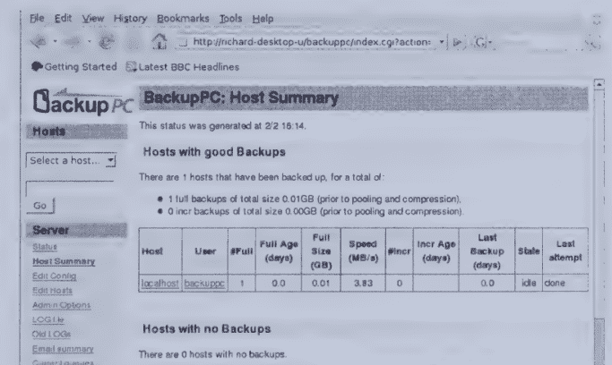

图 18-3：BackupPC 服务器摘要页

## Amanda

为了备份连接到网络的主机，可以使用高级马里亚自动网络磁盘归档器（Amanda）对主机进行归档。Amanda 使用 tar 工具将所有主机备份到单一操作系统主机作为备份服务器。备份数据由每个主机发送到作为 Amanda 服务器的主机，并在那里被以磁带的形式写入备份介质中。通过 Amanda 服务器，所有主机的备份操作都集中在一个服务器上，而不是由每个主机单独执行自己的备份。任何需要恢复数据的主机都会向 Amanda 服务器请求数据，并指定文件系统、日期和文件名。备份数据复制到服务器的持有磁盘，并从那里传输。www.amanda.org 提供了详细的文档和更新。对于服务器，建议安装 `amanda-documentation` 软件包，对于客户端，您将使用 `amanda-clients` 软件包。

Amanda 设计用于对配置和操作系统可能完全不同的主机进行自动备份。您可以备份备份任何支持 GNU 工具的主机，包括通过 Samba 连接的 Mac OS X 和 Windows 系统。

### 命令

Amanda 拥有与其常用备份任务对应的命令，以 "am" 开头，例如 `amdump`、`amrestore` 和 `amrecover`。命令列于表 18-2。`amdump` 命令是主要的备份操作命令。

`amdump` 命令执行请求的备份；它并非为交互式使用设计。对于交互式命令，您将直接使用 `tar` 等归档工具。`amdump` 放置在 cron 实例并在指定时间运行。由于某些原因，`amdump` 无法将所有数据保存到备份内存（磁带或磁盘），它会将数据保留在持有磁盘上。随后可以使用 `amflush` 命令直接写入数据。

| 命令 | 描述 |
|---|---|
| amdump | 为 disklist 配置文件中列出的文件系统执行自动备份 |
| amflush | 用于将数据从持有磁盘直接备份到磁带 |
| amcleup | 如果服务器发生系统故障，进行清理 |
| amrecover | 使用交互式 shell 选择备份进行恢复 |
| amrestore | 恢复备份，可以是文件也可以是整个系统 |
| amlabel | 为 Amanda 备份介质标记标签 |
| amcheck | 在备份操作之前检查备份系统、文件以及备份磁带 |
| amadmin | 备份管理任务 |
| amtape | 管理备份磁带，加载和移除磁带 |
| amverify | 检查磁带格式 |
| amverifyrun | 检查上次运行的磁带，指定备份的配置目录 |
| amrtape | 从 Amanda 数据库中移除磁带，用于损坏的磁带 |
| amstatus | 显示当前 Amanda 备份操作的状态 |

## 表 18-2：Amanda 命令

您可以使用 `amrestore` 命令恢复特定文件以及整套系统。通过 `amrecover` 工具，您可以从备份列表中进行选择。

### Amanda 配置

配置文件存放在 `/etc/amanda` 中，日志数据库文件存放在 `/var/lib/amanda` 中。这些文件在您安装 Amanda 时自动创建。您还需要创建一个目录作为持有磁盘，在写入磁带之前将备份保存在其中。这应该放置在一个具有非常大可用空间的空系统上，空间要足够容纳您最大的完整主机的备份。

#### /etc/amanda

在 `/etc/amanda` 目录下有用于您想要执行的各种类型备份的子目录。每个目录都包含其自己的 `amanda.conf` 和 `disklist` 文件。默认情况下，每日备份被称为 `DailySet1`，带有默认的 `amanda.conf` 和示例 `disklist` 文件。要使用它们，您必须使用您自己的设置进入系统。对于不同的备份配置，您可以创建一个新目录并将 `DailySet` 的 `amanda.conf` 和 `disklist` 复制到该目录，并根据需要进行编辑。当您使用 `amdup` 等 Amanda 命令执行备份时，您将使用 `/etc/amanda` 子目录的名称来指示您想要执行的备份类型。

```
amdup DailySet1
```

`/etc/amanda` 还包含一个示例 cron 文件 `crontab.sample`，显示了 cron 条目的预期格式。

#### amanda.conf

`amanda.conf` 文件包含基本配置参数，如磁带类型和日志文件以及持有位置。在许多情况下，您只需使用 `DailySet/amanda.conf` 文件中的默认值。

#### disklist

`disklist` 文件定义了要备份的文件系统。每个条目由主机名文件路径组成。您可以为每个主机指定多个条目。

### 使用 Amanda

备份通过 `amdump` 命令执行。

```
amdump DailySet1
```

每个备份的 `amdump` 命令放置在 Amanda crontab 文件中。运行 `amcheck` 操作以确保磁带准备就绪非常有帮助。

```
0 16 * * 1-5 /usr/sbin/amcheck -m DailySet1
45 0 * * 2-6 /usr/sbin/amdump DailySet1
```

# 第17 章：设备 391

```
amrestore /dev/rmt1 rabbit
```

要选择某些文件，你可以将输出管道传输到恢复命令中，如 `restore`（在下一节中讨论）。

```
amrestore -p /dev/rmt1 rabbit myydir | restore -ibvf 2 -
```

## 使用 dump 和 restore 进行备份

你可以使用 `dump` 和 `restore` 实用程序对系统进行备份和恢复。`dump` 可以备份整个系统，也可以执行增量备份（仅备份自上次备份以来更改的文件）。`dump` 支持多种用于管理备份操作的选项，例如指定存储介质的大小和长度（参见表 18-3）。

### dump 级别

`dump` 实用程序使用 dump 级别（dump levels）来决定你想要备份备份的程度。dump 级别 0 将完整复制文件。其余的 dump 级别执行增量备份，仅备份自上次低级别备份以来创建或修改的文件和目录。dump 级别 1 将仅备份自上次级别 0 备份以来更改的文件。同样，dump 级别 2 将仅备份自上次级别 1 备份以来更改的文件（如果没有级别 1），以此类推直到 dump 级别 9。你可以运行一个 dump 级别为 0 的初始完整备份来备份系统，然后在随后的日期运行增量备份，只需备份自全量备份以来的更改。

通过级别，你可以为文件系统设计各种备份策略。需要注意的是，增量备份是基于上一次低级别备份的更改运行的。例如，如果级别备份是 6，下一次备份是 8，那么级别 8 将备份级别 6 备份中的所有内容。备份的顺序非常重要。如果有三次级别分别为 3、6 和 5 的备份，那么级别 5 备份将采取级别 3 备份中的所有内容，而不会停在级别 6。在这种情况下，级别 3 是级别 5 的下一个更低级别备份。这可能会导致复杂的增量备份策略。例如，如果你希望后续的增量备份包含之前增量备份的所有更改，你可以按 dump 优先级的降序运行备份。假设备份序列为 7，其下一个低级别是 0。它将包含 7 和 6 的所有更改，因为它的下一个低级别也是 0，从而包含了自级别 0 全量备份以来的所有更改。一种简单的实现方法是将增量级别设为 0，然后进行两次级别 1 的备份，最后一个级别 1 将包含来自级别 0 备份的所有更改，因为级别 0 是下一个更低级别——而不是之前的级别 1。

注意：还有几种磁盘 dump 工具可用。`diskdump.fmt` 命令可用于格式化磁带；通过 `dump disk diskdumctl` 向系统注册 dump 分区。`savecore` 从 dump 分区中的数据中保存文件。导出的 core 文件可以通过 `crash` 工具读取。详情请查看 `crash` 的 man 页。

## 附录

| 选项 | 说明 |
| :--- | :--- |
| -0 -9 | 指定 dump 级别。dump 级别 0 是全备份，复制整个文件系统（另见 -h 选项）。0 以上的 dump 级别执行增量备份，复制自上次低级别备份以来文件系统中的所有新或修改的文件。默认级别为 9。 |
| -B records | 允许你指定卷中的块数，这将覆盖 dump 通常用于多卷备份的介质末端长度或密度计算。 |
| -a | 允许 dump 跳过磁带长度计算并等待检测到介质末端指示。推荐用于大多数现代磁带驱动器并作为默认。 |
| -b blocksize | 允许你指定每个 dump 记录的 KB 数。使用此选项，你可以创建更大的块，加快备份速度。 |
| -d density | 指定磁带的密度为每英寸比特（默认为 1,600 BPI）。 |
| -h level | 带有用户 nodump 标志的文件将在此级别或以上不备份。默认值为 1，它在增量备份中不会备份被标记的文件。 |
| -f file/device | 将文件系统备份到指定的文件或设备。可以是文件或磁带驱动器。你可以指定多个逗号分隔的文件名。可以使用前面的主机名 `hostname:file` 引用远程设备或文件。 |
| -M file/device | 实现多卷备份，写入的文件被视为前缀，由从 001 开始的数字序列组成的后缀用于每个后续文件，`file001`、`file002` 等。当备份文件需要大于 Linux ext3 的 2GB 文件大小限制时非常有用。 |
| -n | 如果备份需要操作员注意，则通知操作员。 |
| -s feet | 指定磁带的长度（英尺）。达到长度时，dump 将提示使用新磁带。 |
| -S | 估计执行备份所需的空间。 |
| -T date | 允许你指定自己的日期而不是使用 /etc/dumpdates 文件。 |
| -u | 在 /etc/dumpdates 文件中写入成功更新的条目。 |
| -W | 检测并显示需要备份的文件系统。此信息来自 /etc/dumpdates 和 /etc/fstab 文件。 |
| -w | 检测并显示需要备份的文件系统，在 /etc/fstab 中仅提取一条信息。 |

表 18-3: dump 选项

### 记录备份

备份记录在 `/etc/dumpdates` 文件中。该文件将列出所有执行备份的文件系统、执行日期以及使用的 dump 级别。使用 `-w` 选项，dump 将分析 `/etc/dumpdates` 和 `/etc/fstab` 来确定需要备份的文件系统。

### 使用 dump 进行操作

`dump` 命令的参数是 dump 级别和要备份的文件系统设备名。如果存储介质（如磁带）小到容不下备份，dump 将失败并让你插入另一个。例如，dump 支持多个卷备份。u 选项会将备份记录在 `/etc/dumpdates` 文件中。在以下示例中，对 `/dev/sda3` 硬盘执行了完整备份（级别 0）。备份存储在磁带 `/dev/tape` 上。

```
dump -0u -f /dev/
```

注意：可以使用 `mt` 命令控制磁带设备；`mt` 有退带、擦和定位磁带的选项。`rmt` 命令控制远程磁带。

存储设备可以是另一个硬盘分区，但通常是磁带设备。当你安装系统时，你的系统可能检测到设备并设置 `/dev/tape` 为其链接（就像对你的 CD-ROM 一样）。如果没有设置链接，你需要手动创建它或直接使用设备名。磁带设备可能根据型号或接口具有不同的设备名。SCSI 磁带以 `st` 前缀标记，并带有特定设备的数字；`st0` 是第一个 SCSI 磁带。在 dump 命令中使用它时，只需指定其名称。

```
dump -0u -f /dev/st0 /dev/sda5
```

如果你需要备份位于网络上另一个系统上的设备，你需要指定该系统的主机名及其设备名称。主机名放在设备名之前，并用冒号分隔。在以下示例中，用户将 `/dev/sda5` 文件系统备份到 `rabbit.mytrek.com` 系统上的 SCSI 磁带设备 `/dev/st1`：

```
dump -0u -f rabbit.mytrek.com:/dev/st0 /dev/sda5
```

# 394 附录

| 操作 | 描述 |
| --- | --- |
| -C | 通过比较文件系统上的文件与备份中的文件来检查备份。 |
| -i | 恢复备份中特定文件和目录的交互模式。将生成一个 shell 接口，用户可以在其中使用命令来指定要恢复的文件和目录（见表 18-5）。 |
| -R | 指示 `restore` 请求多卷备份中的某卷磁带，以便继续执行恢复操作。这在多卷恢复操作被中断时很有帮助。 |
| -r | 恢复一个文件。确保新格式化的分区已挂载，并且你已经切换到其顶层目录。 |
| -t | 列出备份或其中指定文件的内容。 |
| -x | 从备份中提取指定的文件或目录。恢复目录时会包含其所有子目录。如果没有指定任何文件或目录，则恢复整个文件系统。 |
| 附加选项 | 描述 |


| -b blocksize | 使用特定的块大小；否则，`restore` 将从块设备动态确定大小。 |

| -f file/device | 在指定的文件或设备上恢复备份。对于远程设备，指定主机名。 |

| -F script | 在恢复开始运行脚本。 |

| -k | 对远程设备使用 Kerberos 认证。 |

| -h | 仅提取指定的目录，不包含其子目录。 |

| -M file/device | 从多卷备份中恢复，其中文件作为前缀，后缀是数字序列，如 file_001, file_002。 |

| -N | 显示文件和目录名称，但不提取它们。 |

| -T directory | 指定一个用于存储临时文件的目录。默认值为 `/tmp` |

| -v | 详细模式，显示 `restore` 操作的每个文件及其文件类型。 |

| -Y | 默认情况下，如果发生错误（如坏块），`restore` 将询问操作员是否继续。此选项将抑制提问，允许 `restore` 自动继续。 |

表 18-4：`restore` 的操作与选项

# 恢复备份

你可以使用 `restore` 命令来恢复整个文件系统，也可以用来检索特定的文件。`restore` 将从备份归档中提取文件或目录并将其复制到工作目录。运行 `restore` 时，请确保你处于想要恢复文件的目录中。`restore` 会根据需要生成任何目录。`restore` 有多个选项用于管理恢复操作（见表 18-4）。

要恢复单个文件和目录，可以使用 `-i` 选项以交互模式进行恢复。这将生成一个包含磁带上所有目录和文件的 shell，让你选择想要恢复的内容。完成后，`restore` 将仅从备份中检索你选择的内容。该 shell 有一套自己的命令，你可以用它们来选择和提取文件及目录（见表 18-5）。该命令将生成一个交互界面，列出 `/dev/tape` 磁带上备份的所有目录和文件。

```
restore -if /dev/tape
```

此命令将生成一个包含备份整个目录结构的 shell。你将获得一个提示符，可以使用 `cd` 命令移动到不同目录，并使用 `ls` 命令列出文件和子目录。你使用 `add` 命令标记要提取的文件或目录。如果你决定不提取某个项，可以使用 `delete` 命令将其从标记列表中移除。一旦你选好了所有想要的项目，就可以使用 `extract` 命令从备份归档中检索它们。要退出 shell，输入 `quit`。`help` 命令将列出 shell 命令。

如果你需要恢复整个文件系统，应使用带有 `-r` 选项的 `restore`。你可以将文件系统恢复到任何足够大的空白格式化硬盘分区上，包括文件系统的原始分区。如果可能，建议在另一个分区上恢复文件系统并检查结果。

恢复整个文件系统涉及设置一个格式化分区、将其挂载到你的系统并切换到其顶层目录以运行 `restore` 命令。你应该使用 `mkfs` 格式化恢复文件系统的分区，并将其挂载到系统。然后使用带有 `-r` 和 `-f` 选项的 `restore` 指定持有文件系统备份的设备。在下一个示例中，用户格式化并挂载了 `/dev/sda5` 分区，并在上面恢复了 `/dev/tape` 磁带上的文件系统备份。

```
mkfs /dev/sda5
mount /dev/sda5 /mystuff
cd /mystuff
restore -rf /dev/tape
```

要从位于网络上另一个系统上的备份设备恢复，你必须指定该主机名和设备名称。主机名输入在设备名称之前并用冒号隔开：在以下示例中，用户从名为 `rabbit.mytrek.com` 的系统上名为 `/dev/tape` 的磁带设备备份中恢复文件系统：

```
restore -rf rabbit.mytrek.com:/dev/tape
```

# 附录

| 命令 | 描述 |

| --- | --- |

| `add [arg]` | 将文件或目录添加到待提取文件列表中。当使用 `ls` 列出时，这些被标记的文件在名称前会显示一个 **。被标记目录的所有子目录也会被提取。 |

| `cd arg` | 更改当前工作目录。 |

| `delete [arg]` | 从提取列表中删除文件或目录。 |

| `extract` | 提取文件和目录。 |

| `help` | 显示命令列表。 |

| `ls [arg]` | 列出指定目录的内容。 |

| `pwd` | 显示当前目录的完整路径。 |

| `quit` | 退出交互 shell。 |

| `setmodes` | 设置文件的所有者、模式和时间。 |

| `verbose` | 在详细模式下，列出每个文件。 |

表 18-5：交互模式 shell 命令

# 19. Shell 配置

Linux 上常用四种主要的 shell：Bourne Again shell (BASH)、AT&T Korn shell、TCSH shell 和 Z shell。BASH shell 是 Bourne shell 的高级版本，包含了许多为 Korn shell 开发的功能。TCSH 是 C shell 的增强版本，最初为 BSD 版本的 Korn shell 开发。AT&T Unix shell 是开源。Z shell 是 shell 的增强版本。尽管它们的 Unix 差异很大，但 Linux shell 共享许多功能。然而，在 Linux 中，BASH shell 整合了 Korn shell 和 C shell 的高级功能以及 TCSH shell。所有四种 shell 都可供使用，尽管 BASH shell 是默认的。

| bash | /bin/bash |

| bsh | /bin/bash (链接到 /bin/bash) |

| sh | /bin/sh (链接到 /bin/bash) |

| tcsh | /usr/tcsh |

| csh | /bin/csh (链接到 /bin/tcsh) |

| ksh | /bin/ksh (也链接到 /usr/bin/ksh) |

| zsh | /bin/zsh |

表 19-1：shell 调用命令名称

BASH shell 是大多数 Linux 发行版的默认 shell。如果你登录命令行界面，将被置于默认 shell 中，并获得一个用于输入命令的 shell 提示符。BASH shell 的提示符是美元符号 (`$`)。在图形用户界面（如 GNOME 或 KDE）中，你可以打开一个终端窗口，显示默认 shell (BASH) 的命令行界面。尽管你登录的是默认 shell 或在终端窗口中自动显示它，你仍然可以通过输入其名称切换到其他 shell。

一种用于执行你工作的 shell 类型。表 11-1 显示了你可以用来调用不同 shell 的各种命令。某些 shell 添加了一些链接，你可以通过这些链接调用同一个 shell，例如 `sh` 和 `bsh`，它们链接到并调用用于 BASH shell 的 `bash` 命令。

本章描述了 BASH shell 的常见功能，例如变量或别名，以及如何使用 shell 变量和初始化文件根据你自己的需求配置 shell。其他 shell 也共享了许多相同的功能，并使用相似的变量和初始化文件。

| 文件名 | 功能 |

| --- | --- |

| BASH Shell | |

| .bash_profile | 登录初始化文件 |

| .bashrc | BASH shell 配置文件 |

| .bash_logout | 退出名称 |

| .bash_history | 历史文件 |

| /etc/profile | 系统登录初始化文件 |

| /etc/bashrc | 系统 BASH shell 配置文件 |

| /etc/profile.d | 专门的 BASH shell 配置文件的目录 |

| /etc/bash_completion | 应用程序的补全选项 |

| TCSH Shell | |

| .login | 登录初始化文件 |

| .tcshrc | TCSH shell 配置文件 |

| .logout | 退出文件 |

| Z Shell | |

| .zshv | shell 登录文件（首次读取） |

| .zprofile | 登录初始化文件 |

| .zlogin | shell 登录文件 |

| .zshrc | Z shell 配置文件 |

| .zlogout | 退出文件 |

| Korn Shell | |

| .profile | 登录初始化文件 |

| .kshrc | KORN shell 配置文件 |

## 表 19-2: Shell 配置文件

尽管这里显示了基本的 shell 功能和配置，但你应该咨询每个 shell 相应的在线手册和常见问题解答（FAQs），获取更详细的示例和解释。

## Shell 初始化和配置文件

每种 shell 都有自己的初始化和配置文件。TCSH 使用 `.login`、`.tcsh` 和 `.logout` 文件来代替 `.profile`、`.bashrc` 和 `.bash_logout`。Z shell 有几个初始化文件：`.zshv`、`.zlogin`、`.profile`、`.zsh` 和 `.logout`。列表请参见表 19-2。检查每个 shell 的 Man 页面查看它们通常是如何配置的。当你安装一个 shell 时，这些文件的默认版本会自动放置在用户的家目录下。除了 TCSH 之外，所有 shell 都使用相同的变量定义和赋值语法（TCSH 使用略有不同的语法，在它的 Man 页面中有描述）。

### 配置目录和文件

应用程序通常会在用户主目录中安装配置文件，这些文件包含特定的配置信息，以根据特定用户的需求定制应用程序。这可能表现为一个以点开头的单个配置文件，或者是一个包含多个配置文件的目录。用户主目录中名为 `.mozilla` 的目录包含配置文件。例如，Mozilla 安装了一个包含配置文件的单一目录。另一方面，许多应用程序使用名为 `.mailrc` 的单文件来存储用户的别名和功能设置，其他像 Evolution 这样的程序也有自己的 `.evolution`。大多数单配置文件以 `.rc` 结尾。FTP 使用一个名为 `.netrc` 的文件。配置文件中的项目通常由应用程序设置；你可以通过编辑文件来创建项目。应用程序有自己的特殊变量，你可以在其中定义并分配值。你可以使用 `ls -a` 命令列出家目录下的配置文件。

## 别名 (Aliases)

你使用 `alias` 命令为命令创建另一个名称。`alias` 命令的作用类似于一个宏，会展开为它所代表的命令。别名并没有字面上替换命令的名称；它只是给该命令提供了另一个名称。别名命令以关键字 `alias` 和命令的新名称开头，后面跟着一个等号以及该别名将引用的命令。

注意：在接下来的示例中，`list` 成为 `ls` 的另一个名称：

```
$ alias list=ls
$ ls
mydata today
$ list
mydata today
$ 
```

如果你想让别名自动定义，就必须在 shell 配置文件中输入别名操作。在 Fedora 上，别名定义在用户的 `.bash_aliases` 文件中。要使用 `.bash_aliases` 文件，你必须先取消 `.bashrc` 文件中读取 `.bash_aliases` 文件的命令注释。只需编辑 `.bash_aliases` 文件并删除前面的 #，使其看起来像下面所示：

```bash
if [ -f ~/.bash_aliases ]; then
  . ~/.bash_aliases
fi
```

你也可以直接将别名放置在 `.bashrc` 文件中。有些已经定义了，但被注释掉了。你可以编辑 `.bashrc` 文件并删除这些行中的 # 注释符号以激活它们。

```bash
# some more ls aliases
alias ls1='ls -l'
alias ls2='ls -A'
alias ls3='ls -CF'
```

## 别名命令和选项

你也可以使用别名来代替命令及其选项，但你需要将命令和选项都在单引号内。任何包含空格的命令也必须包含在单引号中。在接下来的示例中，别名 `l` 引用带有 `-s` 选项的 `ls` 命令，而别名 `lisa` 引用带有 `-F` 选项的 `ls` 命令。注意单引号是如何包裹命令及其选项的。

```
$ alias ls1='ls -s'
$ ls
$ alias lisa='ls -F'
$ ls
```

# 402 附录

## 特性

## 

BASH shell 特性通过 `set` 命令开启或关闭；`-o` 设置某特性，`+o` 关闭该特性：

$ set -to feature

- ignoreof: 禁用 CTRL-D 登录

- noclobber: 不通过重定向覆盖文件

- noclobber

- noglob: 禁用文件名扩展的特殊字符：*、`?`、`~` 和 `[ ]`

# 表 19-3：BASH Shell 特性

## 环境变量与子 shell：export

当你登录账户时，Linux 会生成你的用户 shell。在这个 shell 中，你可以发布命令并声明变量。你还可以创建并执行 shell 脚本。然而，当你执行一个 shell 脚本时，系统会生成一个子 shell（subshell）。你就有两个 shell：一个是登录的那个，另一个是为脚本生成的。在脚本 shell 中，你可以执行另一个脚本，该脚本又有它自己的 shell。当脚本执行完毕后，它的 shell 会终止，你返回到执行它的 shell。从这个意义上说，你可以拥有多个 shell，每个都嵌套在另一个之中。如果你在 shell 脚本中定义了一个变量，那么当脚本运行时，该变量定义在该脚本的 shell 中，并且对它是局部的。其他 shell 无法引用该变量。在某种程度上，该变量隐藏在它的 shell 中。

你可以在所有类型的 shell 中定义环境变量，包括 BASH shell、Z shell 和 TCSH shell。然而，BASH shell 中实现环境变量的策略与 TCSH shell 不同。在 BASH shell 中，环境变量是被导出（export）的。如果一个环境变量被导出，它会自动在每个子 shell 中定义。相反，在 TCSH shell 中，环境变量只定义一次，并被任何子 shell 引用。

在 BASH shell 中，环境变量可以被看作具有额外能力的普通变量。要创建一个环境变量，你对已经已经定义的变量应用 `export` 命令。`export` 命令指示系统为每个新 shell 定义该变量的副本。每个新 shell 都将拥有它自己的副本。这个过程被称为导出变量。将导出的变量视为全局变量是错误的。新 shell 永远无法引用它自身的变量。相反，系统会为新 shell 生成一个带有其值的变量副本。

## 使用 shell 参数配置你的 shell

当你登录时，Linux 会为你的登录 shell 设置参数。这些参数以变量或特性的形式存在。有关如何设置特性的描述，请参见上一节“控制 shell 操作”。Linux 为系统使用保留了一组预定义的参数。这些参数实际上被分配了系统值，实际上就是设置了参数。许多参数变量在你登录时由系统定义。某些参数变量由 shell 直接设置，另一些则在稍后由初始化脚本使用。从功能上讲，将这些视为系统级变量可能更好，用于邮件、历史记录或编辑等任务。许多其他变量被 shell 用于 shell 特定的任务；或者用于指定允许的命令数量。

# 表 19-4：Shell 变量

| Shell 变量 | 描述 |

|---|---|

| BASH | 存储 BASH 的完整路径 |

| BASH_VERSION | 显示当前的 BASH 版本 |

| GROUPS | 用户所属的组 |

| HISTCMD | 历史列表中当前命令的编号 |

| HOME | 用户主目录的路径 |

| HOSTNAME | 显示主机名 |

| HOSTTYPE | 显示机器类型 |

| OLD_PWD | 上一个工作目录 |

| OTYPE | 使用的操作系统 |

| PATH | 搜索可执行文件的目录路径列表 |

| PPID | shell 父进程的进程 ID |

| PWD | 用户目录 |

| RANDOM | 引用时生成随机数 |

| SHLVL | 当前 shell 层级，被调用的 shell 数量 |

| UID | 用户 ID |

# 表 19-5：由 shell 设置的 shell 变量

| Shell 变量 | 描述 |

|---|---|

| CDPATH | cd 命令的搜索路径 |

| EXINIT | Vi 的初始化命令 |

| FCEDIT | fc 命令使用的编辑器 |

| GROUPS | 用户所属的组 |

| HISTFILE | 历史文件的路径 |

| HISTSIZE | 允许的历史记录命令数 |

| HISTFILESIZE | 历史文件的大小（按行计） |

| HISTCMD | 历史列表中当前命令的编号 |

| HOME | 用户主目录的路径 |

| HOSTFILE | 设置主机文件名称，如果不是 /etc/hosts |

| IFS | 字段分隔符符号 |

| IGNOREEOF | 在接受输入到 shell 之前忽略的字符（默认为 0） |

| INPUTRC | 设置 Readline（命令）的输入配置。默认是当前目录 `inputrc` |

| KDEDIR | KDE 桌面的路径位置 |

| LOGNAME | 登录名 |

| MAIL | Mail 工具检查的特定文件名称 |

| MAILCHECK | 检查邮件的间隔 |

| MAILPATH | Mail 检查的邮件文件列表 |

| HOSTTYPE | Linux 平台，如 i686、x86_64 或 PPC |

| PROMPT_COMMAND | 在每个提示符之前执行的命令，将结果整合提示符的一部分 |

| HISTFILE | 历史文件的路径 |

| PS1 | 主 shell 提示符 |

| PS2 | 次级 shell 提示符 |

| QTDIR | Qt 库的位置 |

| SHELL | 你使用的 shell 类型的程序路径 |


| `TERM` | 终端类型 |

| `TEOUT` | shell 保持活动的时间 |

| `USER` | 用户 |

| `UID` | 用户 ID（数字） |

| `EUID` | 有效用户 ID（数字）。这通常是 `UID`，但在通过 `su` 命令切换用户时可能不同 |

### 参数变量

当你登录时，Linux 会为你的登录 shell 设置参数。这些参数以变量或特性的形式存在。有关如何设置特性的描述，请参见上一节“控制 shell 操作”。Linux 为系统使用保留了一组预定义的参数。这些参数实际上被分配了系统值，实际上就是设置了参数。许多参数变量在你登录时由系统定义。某些参数变量由 shell 直接设置，另一些则在稍后由初始化脚本使用。从功能上讲，将这些视为系统级变量可能更好，用于邮件、历史记录或编辑等任务。许多其他变量被 shell 用于 shell 特定的任务；或者用于指定允许的命令数量。

许多参数变量是系统在你登录时自动定义并赋予初始值的。然而，某些参数变量的值不应该更改。例如，`HOME` 变量持有用户主目录的路径。`cd` 命令引用 `HOME` 变量中的路径来定位你的主目录。本节介绍了常见的参数变量。其他参数变量由系统定义并赋予初始值，你可以自由修改。这样做的方法是重新定义它们并分配新值。例如，`PATH` 变量包含命令所在的目录。每当你执行命令时，shell 会在这些目录中搜索。你可以通过重新定义 `PATH` 变量来自己添加新目录。还有一些系统未定义的参数变量。这些通常是可选功能，例如允许设置 Vi 编辑器选项的 `ENV` 变量。常见的变量有 `SHELL`、`PATH`、`PS1`、`PS2` 和 `MAIL`。`SHELL` 变量持有你使用的 shell 类型程序的路径。`PATH` 变量列出了要搜索的不同目录。`PS1` 和 `PS2` 变量持有提示符符号。`MAIL` 拥有你的邮箱文件路径。你可以修改它们任何一个的值。

注意：你可以使用 `env` 命令获取当前定义的 shell 变量列表。`env` 命令类似于 `set` 命令，但它只列出参数变量。

### 使用初始化文件

你可以使用称为初始化文件的特殊脚本自动定义参数变量。初始化文件是特殊命名的 shell 脚本，每次进入 shell 时都会执行。你可以编辑初始化文件，并在其中放置参数变量的定义和赋值。当你进入 shell 时，初始化文件将执行这些定义和赋值，从而用你自己的值来初始化参数变量。例如，BASH shell 的 `.bash_profile` 文件就是每次登录都会执行的初始化文件。它包含了参数变量的定义和赋值。

## 406 附录

在 BASH shell 中，所有的参数变量都被设计为环境变量。当你定义或重新定义一个参数变量时，你还需要将其导出（`export`）以使其成为一个环境变量。这意味着你对参数变量的任何更改都必须伴随着 `export` 命令。你会发现，在登录初始化文件 `.bash_profile` 的末尾，通常有一个针对其中定义的所有参数变量的 `export` 命令。

## 你的主目录：`HOME`

`HOME` 包含你的主目录的路径。你的主目录是在创建账户时由参数管理员确定的。当你登录时，主目录的路径会自动读取到你的 `HOME` 变量中。在下一个示例中，`echo` 命令显示了 `HOME` 变量的内容：

```bash
$ echo $HOME
/home/chris
```

当你需要指定主目录的绝对路径时，经常使用 `HOME` 变量。在下一个示例中，使用 `HOME` 作为主目录路径来指定报告的绝对路径：

```bash
$ ls $HOME/reports
```

## 命令位置：`PATH`

`PATH` 包含一系列由冒号分隔的目录路径：每当执行命令时，系统都会依次搜索 `PATH` 变量中的路径该命令。例如，`cp` 位于系统的 `/bin` 目录。该目录路径是 `PATH` 变量中列出的目录之一。每当你执行 `cp` 命令时，系统都会搜索该路径并加载 `cp` 命令。系统定义并为 `PATH` 分配了初始路径。在 Linux 中，初始路径是 `/bin` 和 `/usr/bin`。

shell 可以执行任何可执行文件，包括你创建的程序和脚本。如果你想在工作目录中执行自己的脚本或程序，shell 可以找到它。字符串中的路径之间不允许有空格。没有指定路径的冒号引用你的工作目录。通常，在路径末尾放置单个冒号来指定你的工作目录。对于示例 `/bin:/usr/bin:`：

```bash
$ echo $PATH
/bin:/usr/bin:
```

你可以向 `PATH` 变量添加任何你想要的目录路径。如果你使用 shell 脚本创建了多个自己的 Linux 命令，这将非常有用。可以将这些新的 shell 命令放置在你创建的目录中，并将该目录添加到 `PATH` 列表中。这样，无论你在哪里，都可以执行你的某个 shell 脚本。`PATH` 变量将包含该脚本所在的目录，因此每次你发出命令时都会搜索该目录。

你通过变量赋值向 `PATH` 变量添加目录。你可以直接在 shell 中执行此赋值。在下一个示例中，chris 为 `PATH` 添加了一个新目录 `bin`。虽然你可以仔细地手动输入 `PATH` 中列出的完整路径来完成赋值，但你也可以使用 `PATH` 的求值 `—PATH—` 来代替。在这个示例中，还使用了 `HOME` 的求值来指定目录路径中的用户主目录。注意最后一个冒号，它指定了工作目录：

```bash
$ PATH=$PATH:$HOME/mybin
$ export PATH
$ echo $PATH
/bin:/usr:/home/chris/mybin
```

如果你在登录期间手动向 `PATH` 添加目录，该目录仅在你的登录会话期间有效。当你重新登录时，初始化文件 `.bash_profile` 将用其原始的目录集重新初始化你的 `PATH`。`.bash_profile` 文件将在本章稍后的部分进行详细描述。要永久地向你的 `PATH` 添加新目录，你需要编辑 `.bash_profile` 文件并找到 `PATH` 变量的赋值，然后只需将该目录（前面加冒号）插入到分配给 `PATH` 的路径集中即可。

## 指定 BASH 环境：`BASH_ENV`

`BASH_ENV` 变量保存每当生成 BASH shell 时要执行的 BASH shell 初始化文件的名称。例如，当一个 BASH 变量被设置时，它所持有的脚本名称会在脚本之前执行。该变量通常持有 `HOME/.bashrc`。这是用户主目录下的 `.bashrc` 文件（`.bashrc` 文件将在稍后文中讨论）。如果你愿意，可以使用其他文件来代替 BASH shell 脚本的 `.bashrc`。

## 配置 shell 提示符

`PS1` 和 `PS2` 变量分别包含主提示符符号和次级提示符符号。BASH shell 的主提示符符号是美元符号 (`$`)。你可以通过为 `PS1` 变量分配一组新字符来更改提示符符号。在下一个示例中，shell 提示符被改为 `->` 符号：

```bash
$ PS1='->'
-> export PS1
->
```

你可以将提示符更改为任何字符，包括字符串，如下一个示例所示：

```bash
$ PS1="Please enter a command: "
Please enter a command: export PS1
Please enter a command: ls
mydata /reports
Please enter a command:
```

`PS2` 变量持有次级提示符符号，用于需要几行才能完成的命令。默认的次级提示符是 `>`。添加的命令行以次级提示符而不是主提示符开头。你可以像更改主提示符一样轻松地更改次级提示符，如下：

```bash
$ PS2="a>"
```

就像 TCSH shell 一样，BASH shell 提供了一组预定义的代码用于配置提示符。通过这些代码，你可以将时间、用户名或目录路径作为提示符的一部分。你甚至可以让提示符显示你即将输入的当前命令的历史事件。每个代码前面都有一个 `\` 符号：`\w` 表示当前工作目录，`\t` 表示时间，`\u` 表示用户名；`!` 将显示下一个历史事件编号。在下一个示例中，用户将当前工作目录添加到提示符中：

```bash
$ PS1=\w \$
/home/dylan$
```

这些代码必须包含在字符串中。如果没有引号，代码字符将不会被求值，而是作为提示符本身。`PS1=\w` 将提示符设置为 `\w` 字符，而不是工作目录。下一个示例将时间以及历史事件编号合并到一个新的提示符中：

```bash
$ PS1=\w -!
```

下表列出了配置提示符的代码：

| 提示符代码 | 描述 |

| :--- | :--- |

| `\!` | 当前历史编号 |

| `\$` | 作为除 root 以外所有用户的提示符 |

| `\d` | 当前日期 |

| `\#` | 当前历史编号 |

| `\h` | 主机名 |

| `\s` | shell 类型 |

| `\t` | 小时、分钟的时间 |

| `\u` | 用户名 |

| `\v` | shell 版本 |

| `\w` | 完整工作目录路径 |

| `\W` | 仅当前目录 |

| `\\` | 反斜杠 |

| `\n` | 换行 |

| `\[` | 左括号开始 |

| `\]` | 左括号结束 |

## 变量赋值

下一个示例列出了在创建账户时提供你的标准 `.bash_profile` 文件的副本。注意 `PATH` 是一个参数变量；`PATH` 存储了在你输入任何命令时搜索的目录路径。赋值 `PATH=$PATH:$HOME/bin` 的效果是重新定义 `PATH`，使其包含你家目录下的 `bin` 目录，这样你的 `bin` 目录也将用于搜索任何命令，包括你自己创建的脚本或程序。

```bash
.bash_profile
#bash_profile
# 获取别名和函数
if [ -f ~/.bashrc ]; then
  ~/.bashrc
fi
# 用户特定环境和启动程序
PATH=$PATH:$HOME/bin
export PATH
```

如果你也想搜索当前工作目录，可以使用任何文本编辑器修改 `.bash_profile` 文件中的这一行：`PATH=$PATH:$HOME/bin`。你需要在 `bin` 之后插入一个冒号 `:`。事实上，你可以将其更改为任意你想要搜索的目录。在当前工作目录中将命令设置为自动可执行可能会存在安全风险，允许任何目录中的文件被执行，而不是特定目录中的文件。以下是修改 `.bash_profile` 文件的示例：

`PATH=$PATH:$HOME/bin:`

### 编辑你的 Bash Profile 脚本

你的 `.bash_profile` 初始化文件是一个文本文件，可以像其他文本文件一样用文本编辑器进行编辑。你可以通过编辑 `.bash_profile` 并使用编辑命令在分配给 `PATH` 的路径列表中插入新目录，从而轻松地向 `PATH` 中添加新目录。你也可以添加新变量。然而，如果你这样做了，请确保在 `export` 命令的参数列表中包含你的新变量名。例如，如果你的 `.bash_profile` 文件没有 `EXIT` 变量的定义，你可以编辑该文件并添加新的一行为 `EXIT` 赋值。定义 `EXIT=set nu ai` 将配置 Vi 显示行号和自动缩进。然后，你需要将 `EXIT` 添加到 `export` 命令的参数列表中。当 `.bash_profile` 文件执行时，`EXIT` 变量将被设置为命令 `set nu ai`。当调用 Vi 时，设置行号和自动缩进选项会自动完成。

在接下来的示例中，用户的 `.bash_profile` 经过修改，包含了 `EXINIT` 的定义以及对 `PATH`、`PS1` 和 `HISTSIZE` 的重新定义。`PATH` 变量添加了结尾冒号，这指定了当前工作目录，使你能够执行可能位于家目录或工作目录的命令。

重新定义 `HISTSIZE` 减少了保存的历史事件数量，从系统 `.bash_profile` 文件中定义的 1000 个减少到 30 个。`PS1` 参数变量的重新定义将提示符更改为仅显示当前工作目录的路径。你在 `.bash_profile` 中对参数变量进行的任何更改都将覆盖系统 `.bash_profile` 文件早先做的。所有参数变量都通过 `export` 命令导出。

```bash
# .bash_profile
# 获取别名和函数
if [ -f ~/.bashrc ]; then
  ~/.bashrc
fi
PATH=$HOME/bin:
```

```bash
HISTSIZE=30
NNTPSERVER=new.myserver.com
EXINIT='set -nu ai'
export PATH HISTSIZE EXINIT PS1 NNTPSERVER
```

### 手动重新执行 .profile 脚本

虽然 `.bash_profile` 文件在你登录时都会执行，但在你对其进行更改后它不会自动重新执行。`.bash_profile` 文件是一个初始化文件，仅在登录时执行。如果你想在不重新注销并重新登录的情况下利用你所做的任何更改，可以使用点 (`.`) 命令重新执行 `.bash_profile`。`.bash_profile` 是一个 shell 脚本，像任何 shell 脚本一样，可以使用 `source` 命令执行。

或者，你可以使用 `source` 命令执行 `.bash_profile` 初始化或任何类似于 TCSH shell 中使用的 `.login` 或 `.bash_history` 的初始化文件。

```bash
$ source .bash_profile
```

### 系统 Shell Profile 脚本

你的 Linux 系统还有一个初始化文件，简单称为 `profile`，位于 `/etc` 目录。`/etc/profile` 此文件包含了系统每个用户所需的参数变量定义。下面是系统 `.profile` 文件的副本。Fedora 和 Red Hat 使用 `pathmunge` 函数为 `PATH` 变量生成目录列表。普通用户的路径将锁定系统目录（路径中包含 `sbin` 的目录），但包含他们的家目录名称，以及用于 Kerberos 工具的 `/usr/kerberos/bin`。根用户（有效 ID 为 0，`EUID=0`）生成的路径将同时包含系统和用户应用程序目录，添加 `/usr/kerberos/bin`、`/sbin`、`/usr/sbin` 和 `/usr/local/sbin`，以及根用户应用程序目录 `/root/bin`。

```bash
# echo $PATH
/usr/kerberos/bin:/usr/local/bin:usr/sbin:/usr/X11R6/bin:/home/richard/bin
```

```bash
# /etc/profile
# 系统环境和启动程序，用于登录设置
# 函数和别名位于 /etc/bashrc
```

```bash
pathmunge () {
    if echo $PATH | /bin/egrep -q "([^|:)$1($|:)"; then
        if [ "$2" = "after" ]; then
            PATH=$PATH:$1
        else
            PATH=$1:$PATH
        fi
    fi
}
```

```bash
# ksh 解决方法
if [ -z "EUID" -a -x /usr/bin/id ]; then
    EUID=`id -un`
    UID=`id -ru`
fi
```

```bash
# 路径操作
if [ "$EUID" = "0" ]; then
    pathmunge /sbin
    pathmunge /usr/sbin
    pathmunge /usr/local/sbin
fi
```

```bash
# 默认不产生核心文件
ulimit -c 0 > /dev/null 2>&1
```

```bash
if [ -x /usr/bin/id ]; then
    USER=`id -un`
    MAIL=/var/spool/$USER
fi
```

```bash
HOSTNAME=/bin/hostname
HISTSIZE=1000
```

```bash
if [ -z "$INPUTTRC" -a ! -f "$HOME/.inputrc" ]; then
    INPUTTRC=/etc/inputrc
fi
```

```bash
export PATH USER LOGNAME MAIL HOSTNAME HISTSIZE INPUTTRC
```

```bash
for i in /etc/profile.d/*.sh; do
    if [ -r "$i" ]; then
        .$i
    fi
done
```

```bash
unset path
unset pathmunge
```

针对 Korn Shell 包含了一个特殊的解决方法，用于设置用户 ID 和有效用户 ID（`EUID` 和 `UID`）。在提供用户 ID 的 `/usr/bin/id` 可执行的情况下，随后会设置 `USER`、`MAIL` 和 `LOGNAME` 变量。带有 `-un` 选项的 `id` 命令仅提供用户的文本名称，例如 chris 或 richard。

注意：`/etc/profile` 文件还会执行 `/etc/profile.d` 目录中的任何脚本。这种设计允许更具模块化的结构。你无需通过编辑 `/etc/profile` 文件来添加条目，只需向 profile.d 添加脚本即可。

## 414 附录

你可以如何添加自己的别名和选项，例如 shell 中 `rm`、`cp` 和 `mv` 命令的别名；已添加 `noclobber` 和 `ignoreeof` 选项。对于 root 用户的 `.bashrc`，`rm`、`cp` 和 `mv` 别名已经包含在 root 的 `.bashrc` 文件中了。


```bash
# .bashrc
# 用户特定的别名和函数

alias rm='rm -i'
alias cp='cp -i'
alias mv='mv -i'

# 挂载全局定义
if [ - /etc/bashrc ]; then
  /etc/bashrc
```
你可以将任何你自定义的命令或定义添加到你的 `.bashrc` 文件中。如果你对 `.bashrc` 制作了更改，并希望这些更改在当前登录会话中生效，你需要使用 `.` 或 `source` 命令重新执行该文件。

`$ .bashrc`

### 级 `/etc/bashrc` BASH 脚本

Fedora 有一个为所有用户执行的系统 bash 脚本，称为 `/etc/bashrc`。目前 `/etc/bashrc` 文件设置了默认的 bash 提示符，以及检查用户是否有权限使用某个命令的指令。在交互式 shell 中，`/etc/bashrc` 文件将决定默认提示符。如果不是登录 shell，它将确定 `PATH` 并运行 `profile.d` 脚本。

注意：`/etc/bash_completion.d` 目录下的 `.bash_completion` 文件为应用程序提供了命令补全。

### Bash Shell 退出文件：`.bash_logout`

`.bash_logout` 文件也是配置文件，但它是在用户注销时执行的。它的设计是为了在你每次注销时执行任何任何操作。变量定义不同，`.bash_logout` 文件通常包含形成某种关机程序的命令——即你在注销之前总是想要执行的操作。一个常用的命令是清除屏幕然后发出告别信息。

`.bash_logout`

```bash
# ~/.bash_logout: 当 bash(1) 登录 shell 退出时执行。
# 离开控制台时清除屏幕以增加隐私
if [ "$SHELL" = 1 ]; then
  [ -x /usr/bin/clear-console ] && /usr/bin/clear-console -q
fi
```

`echo "Good-bye for now",`

就像 `.bash_profile` 一样，你可以将自己的 shell 命令添加到 `.bash_logout` 中。默认的 `.bash_logout` 文件包含了调用 `clear-console` 命令清除屏幕的指令。在下一个示例中，用户在 `.bash_logout` 文件中添加了一个 `echo` 命令。

## 附录 A：获取 Fedora

Fedora Linux 发行版安装了一个专业级且非常稳定的 Linux 系统，并带有 KDE 和 GNOME 图形界面、灵活易用的系统配置工具、一套广泛互联网服务器、各种不同的多媒体应用程序以及数千种各种 Linux 应用程序。你可以在 `fedaproject.org` 获取有关 Red Hat Fedora 项目的最新信息。

大多数 Fedora 软件都可以从 Fedora 仓库下载。也提供安装磁盘，可以是较小的仅桌面版安装，也可以是较大的服务器安装版。你可以使用 Live CD 安装 Fedora。Fedora 发行版策略依赖于带有精选软件集合的安装磁盘，这些软件稍后从 Fedora 仓库中海量的软件集中进行更新和增强。这意味着初始安装中的软件集合可能相对较小。Fedora 仓库中的软件也在不断更新，因此任何安装都可能需要从仓库进行大量的更新。

### 下载镜像映像

要获取 Fedora 9，只需访问 Fedora 项目网站并点击 Get Fedora 链接。在这里，你将看到针对不同 Fedora 安装 DVD 和 Fedora Live 版本的 torrent 或直接下载链接。Direct downloads 链接指向当前可用的镜像站。

```
http://fedaproject.org/get-fedora
```

你可以通过输入以下 URL 直接访问 Fedora 镜像站。然后，你需要浏览版本和目录，找到存放 Fedora 安装映像和 Live 映像的 Fedora 和 Live 目录。

```
download.fedaproject.org
```

你也可以通过以下 URL 访问特定的镜像。这里将列出当前的 Fedora 镜像及其地址。

```
mirrors.fedaproject.org
```

关于所有 Fedora 下载选项的详细描述，包括你需要的所有 ISO 文件和镜像站的链接，可以在以下 URL 获取。请检查此站点获取最新的下载程序。

`http://fedoraproject.org/wiki/Distribution/Download`

或者，你仍然可以使用 `download.fedora.redhat.com` 上的链接直接从 Fedora 站点下载。

`download.fedora.redhat.com/pub/fedora/linux/releases/`

使用宽带 DSL 或电缆，配合如 `gFTP`（应用程序 | Internet 菜单）之类的 FTP 客户端，直接下载可以非常快。使用 Firefox 等浏览器的 Web 客户端下载往往较慢。

### 安装 Live 映像

要从 DVD/CD-ROM 驱动器下载用于安装 Fedora 9，你需要下载 Fedora Install DVD 映像或 Fedora Live 映像。扩展名为 `.iso` 的大文件。Fedora Install DVD 位于 Fedora 子目录下，对应版本（i386, x86, 64 和 PPC）的任何目录中（`Fedora/i386/iso`）。Live 映像位于 Live 子目录下，对应版本（i686, x86, 64 和 PPC）之下。一旦下载，你可以使用你的 CD 或 DVD 刻录机和刻录软件（如 Fedora 中的 Nautilus 文件浏览器或 K3）将它们刻录到磁盘。

有各种架构的 ISO 文件。Live CD/DVD 提供了一种无需安装到硬盘即可运行系统的方法，这对于测试操作系统或执行系统恢复很有用。

### 使用 Live 映像

从 DVD/CD-ROM 驱动器下载用于安装 Fedora 9，你需要下载 Fedora Install DVD 映像或 Fedora Live 映像。扩展名为 `.iso` 的大文件。Fedora Install DVD 位于 Fedora 子目录下，对应版本（i386, x86, 64 和 PPC）之下。

Live 映像默认启用 `NetworkManager`，自动检测并连接你的网络连接。Live DVD/CD 有一个默认用户名且没有密码。

## 附录 B：Fedora Live DVD/CD

通过 Fedora Live DVD/CD，你可以从任何 CD/ROM 驱动器运行 Fedora。某些映像使用 CD，另一些使用 DVD。实际上，你可以只通过一个 DVD/CD 携带你的操作系统。新用户也可以使用 Live DVD/CD 检查他们是否喜欢。文件和数据可以写入 USB 驱动器等移动设备，但无法更改操作系统配置。你也可以挂载运行 Live DVD/CD 系统的硬盘分区。

Fedora 提供的 Live DVD/CD 包含非常有限的软件软件包。没有提供 OpenOffice 应用，只有 Abiword 用于文字处理和 Gnumeric 用于电子表格。尽管有限制，你拥有一个功能完整的 Fedora 桌面。你拥有全套管理工具，可以在 Live DVD/CD 运行时使用它们添加用户并更改配置设置。当你关机时，配置将丢失。

你可以注销，这将显示带有简单登录按钮和语言菜单的登录界面。你可以使用语言菜单更改语言。但你无法从登录菜单关机或重启。你只能从桌面操作。

# Fedora 自定义版本 (Custom Spins)

自定义版本也由特殊兴趣小组提供，请参见 `fedoraproject.org/wiki/CustomSpins`。这些版本可以从 `spins.fedoraproject.org` 下载，该页面列出了 Fedora Project Spins 跟踪器上的 Torrent 文件。这些版本包括：

- Fedora 开发版 (Developer Spin)：仅限 i686 架构。包含 GNOME 桌面以及如 Eclipse IDE 等开发应用程序，以及调试和性能分析工具及文档。
- Fedora Creative Commons (cc)：仅限 i686 架构。CD 格式。为 Creative Commons 项目的免费分发 GNU 许可软件和媒体而设计。
- Fedora 游戏版 (Games Spin)：目前为 Live DVD。为游戏玩家配置的 Fedora，包含丰富的游戏集合。
- Xfce 版本 (Xfce Spin)：使用 Xfce 桌面。

下载后，你可以将镜像刻录到 DVD（i686 版本使用 CD）。

# USB Live 启动盘

你也可以将 Fedora Live 安装到 USB 盘上。USB 盘上的原始数据将被保留。从开发存储库下载 `livedcd-tools`，然后使用 `livedcd-to-disk` 命令安装镜像。使用 Live 镜像和 USB 设备名称作为参数。

```
/usr/bin/livedcd-iso-to-disk Fedora-9-Live-i686.iso /dev/sdb1
```

如果你想在 USB Live 版本上保存 Fedora 操作系统的更改，请在 USB 驱动器上设置覆盖内存段（overlay memory segment）。要此操作，请使用 `--overlay-size-mb` 选项并指定 MB 为单位的大小。确保你的 USB 驱动器足够大，能够容纳覆盖内存和 CD 镜像。以下命令允许 512 MB 的持久化数据。

```
livedcd-iso-to-disk --overlay-size-mb 512 Fedora-9-Live-i686.iso /dev/sdb1
```

每个 CD 在你的 LiveOS 目录下也都提供了一个 lived 脚本。

# 启动 Live DVD/CD

启动时，你可以按下空格键显示启动选项。选项包括直接启动 Live DVD/CD（默认）、首先验证磁盘介质、进行内存测试或启动硬盘上已有的另一个操作系统。如果你不按任何键，Live DVD/CD 将自动启动。系统启动后，你将看到标准的登录界面（KDE 磁盘将直接引导到桌面）。使用用户 `fedora` 访问，或直接按回车键。在密码提示符处按回车键。GNOME（见图 B-1）或 KDE（见图 B-2）将启动。

请记住，使用硬盘运行 Fedora 与在硬盘上安装 Fedora 是不同的。从硬盘运行是标准的 Fedora Live 操作，它使用硬盘空间作为 Live DVD/CD 磁盘镜像。点击桌面上的“安装到硬盘”（Install to Hard Drive）图标图标标准的 Fedora 安装过程，将 Fedora 安装到你的系统中，就像进行普通安装一样。

# 附录 B：Fedora Live DVD/CD 419

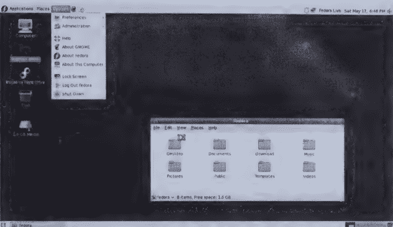

图 B-1：Fedora Live CD

# 在 KDE 上使用 USB 盘

KDE Live CD 使用新的 Plasma 桌面和面板。USB 盘不再以图标形式显示在桌面上。USB 盘的图标将同时出现在 Kickoff 菜单和文件管理器侧边栏中。要挂载驱动器，只需点击其图标。驱动器上会出现一个挂载标记（见图 B-3）。在文件管理器窗口中，点击侧边栏中的 USB 盘项以打开 USB 盘的文件列表。然后你可以将文件保存到驱动器。

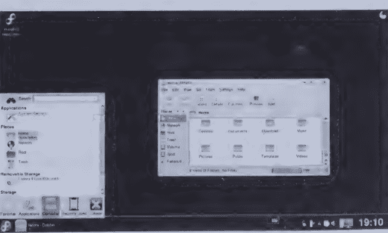

图 B-2：Fedora KDE Live CD

# 420 附录

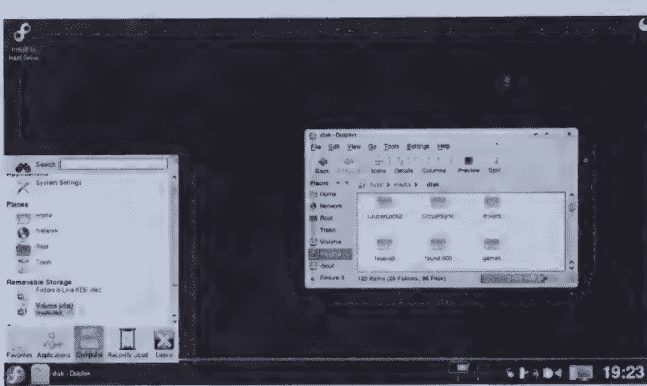

图 B-3：Fedora Live CD USB 盘

要移除 USB 盘，你必须先选择移除选项。在文件管理器侧边栏（或 Kickoff 菜单）中右键点击 USB 盘。这将打开一个带有“安全删除卷”（Safely remove Volume）选项的菜单。选择此选项以完成向驱动器写入任何数据（见图 B-4）。挂载标记将从 USB 图标消失，然后你可以安全地移除 USB 盘。

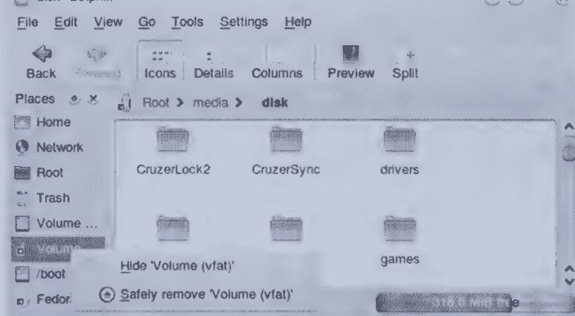

图 B-4：Fedora Live CD 移除 USB 盘

# 从 Live CD 安装 Fedora

Live CD 可用作安装盘，为系统提供其有限的软件集合，安装一个完整的 Fedora 操作系统，该系统可以从 Fedora 在线存储库进行扩展和更新。在这种情况下，你不需要下载完整的 Fedora 安装盘，只需 Live CD，并在稍后从存储库添加包。双击桌面上的“安装到硬盘”图标开始安装。从 Live 磁盘安装将默认启用 NetworkManager 并禁用 SSH 守护进程 (`sshd`)。

# 创建你自己的 Live CD

你也可以创建自己的 Live CD...（注：原文此处存在大量重复文本，已按要求处理，保留核心意图）...

Live CD 可用作安装盘，为系统提供其有限的软件集合，安装一个完整的 Fedora 操作系统，该系统可以从 Fedora 在线存储库进行扩展和更新。在这种情况下，你不需要下载完整的 Fedora 安装盘，只需 Live CD，并在稍后从存储库添加包。

你也可以创建自己的 Live CD...（注：原文此处存在大量重复文本）...

# 表列表

| 表 | 描述 | 页码 |
| :--- | :--- | :--- |
| 表 1-1 | Fedora | 32 |
| 表 2-1 | 基础管理工具 | 46 |
| 表 2-2 | Fedora 配置 | 47 |
| 表 2-3 | 系统目录 | 48 |
| 表 2-4 | 配置和目录 | 50 |
| 表 2-5 | 带有系统管理工具的配置文件 | 51 |
| 表 2-6 | cron 文件和目录 | 58 |
| 表 3-1 | 系统启动文件和目录 | 70 |
| 表 3-2 | 运行级别 (状态) | 72 |
| 表 3-3 | 关机选项 | 74 |
| 表 3-4 | chconfig 选项 | 77 |
| 表 4-1 | Fedora 和 Linux 软件站点 | 89 |
| 表 5-1 | rsyslog 设施、优先级和运算符 | 113 |
| 表 5-2 | 性能工具 | 117 |
| 表 6-1 | 用户配置文件路径 | 127 |
| 表 6-2 | chage 命令选项 | 132 |
| 表 6-3 | useradd 和 usermod 选项 | 133 |
| 表 6-4 | edquota 选项 | 138 |
| 表 6-5 | quota 选项 | 138 |
| 表 7-1 | 内核 make 命令的编译选项 | 162 |
| 表 8-1 | 虚拟化资源 | 167 |
| 表 10-1 | PGP 站点 | 191 |

## 表列表

- 表 10-1: GPG 命令与选项 ................................................................ 202
- 表 11-1: 文件和目录权限操作 ....................................................... 215
- 表 12-1: SELinux 资源 ............................................................................... 227
- 表 12-2: SELinux 工具 ....................................................................... 234
- 表 12-3: SELinux 策略配置文件 ................................................. 249
- 表 13-1: SSH 和 Kerberos 资源 ................................................................... 253
- 表 13-2: SSH 工具 ............................................................................................ 256
- 表 13-3: SSH 配置文件 ........................................................ 259
- 表 14-1: 网络安全应用 ................................................................ 269
- 表 14-2: Iptables 目标 ................................................................................ 275
- 表 14-3: Netfilter 内置链 ................................................................ 276
- 表 14-4: Iptables 命令 ....................................................................... 277
- 表 14-5: Iptables 选项 ................................................................................. 279
- 表 14-6: 常见 ICMP 包 ................................................................ 281
- 表 15-1: Linux 文件系统目录 ...................................................... 301


# 目录

## 表

- 表 15-2: 系统目录 ............................................................................ 302
- 表 15-3: `/usr` 目录 ................................................................................ 303
- 表 15-4: `/var` 子目录 ................................................................................ 304
- 表 15-5: `/proc` 子目录与文件 ................................................... 305
- 表 15-6: 设备名称前缀 ................................................................ 307
- 表 15-7: 文件系统类型 ....................................................................... 314
- 表 15-8: 文件系统的挂载选项 ................................................ 316
- 表 15-9: `mount` 命令 ................................................................... 318
- 表 15-10: Linux 分区与文件系统创建工具 ......... 322
- 表 15-11: 常用 `fdisk` 命令 ................................................ 324
- 表 15-12: `mkfs` 选项 ....................................................................... 325
- 表 16-1: Linux 软件 RAID 级别 ................................................ 344
- 表 16-2: `mdadm` 模式 ....................................................................... 347
- 表 16-3: `mdadm.conf` 选项 ................................................................ 349
- 表 16-4: `mdadm --create` 选项 ................................................ 350
- 表 17-1: 设备资源 ................................................................ 354
- 表 17-2: `/proc` 设备信息文件 ................................................................ 355
- 表 17-3: `udev` 规则字段 ................................................................................ 358
- 表 17-4: `udev` 替换代码 ................................................................................ 359
- 表 17-5: 设备符号链接 ................................................................ 360
- 表 17-6: HAL 存储策略 ....................................................................... 368
- 表 17-7: 音频设备 ................................................................................. 375
- 表 17-8: 视频和电视设备驱动 ............................................................ 376
- 表 17-9: 内内核模块命令 ................................................................ 377
- 表 18-1: 备份资源 ............................................................................ 383
- 表 18-2: Amanda 命令 ............................................................................ 388
- 表 18-3: `dump` 选项 ............................................................................ 392
- 表 18-4: `restore` 操作与选项 ................................................ 394
- 表 18-5: `restore` 的交互模式 Shell 命令 ............................... 396
- 表 19-1: Shell 启动命令名称 ................................................... 397
- 表 19-2: Shell 配置文件 ........................................................ 402
- 表 19-3: BASH Shell 特有功能 ........................................................ 403
- 表 19-4: Shell 设置的变量 ..................................
- 表 19-5: Shell 使用的系统环境变量 .................................. 405

## 图

- 图 1-1: Fedora Logo ................................................................ 38
- 图 1-2: 带有 Fedora Logo 的 Fedora 9 桌面 ................................ 38
- 图 2-1: 在国际时钟上选择位置 .............. 52
- 图 2-2: 带有天气图标的国际时钟....................................... 52
- 图 2-3: 国际时钟，全显示 ....................................... 53
- 图 2-4: 手动设置时 ................................................ 54
- 图 2-5: `system-clock` ................................................................ 55
- 图 3-1: `system-config-date` ....................................................... 79
- 图 3-2: `system-config-date` ....................................................... 79
- 图 4-1: `system-config-date` ................................................... 82
- 图 4-2: `system-config-date` ....................................................... 83
- 图 4-3: `system-config-date` ....................................................... 83
- 图 4-4: `system-config-date` ....................................................... 84
- 图 4-5: `system-config-date` ....................................................... 84
- 图 4-6: `system-config-date` ....................................................... 86
- 图 4-7: `system-config-date` ....................................................... 86
- 图 4-8: `system-config-date` ....................................................... 90
- 图 4-9: `system-config-date` ....................................................... 91
- 图 4-10: `system-config-date` ....................................................... 92
- 图 4-11: `system-config-date` ....................................................... 92
- 图 4-12: `system-config-date` ....................................................... 93
- 图 4-13: `system-config-date` ....................................................... 94
- 图 4-14: `system-config-date` ....................................................... 95
- 图 4-15: `system-config-date` ....................................................... 96
- 图 4-16: `system-config-date` ....................................................... 97
- 图 4-17: `system-config-date` ....................................................... 108
- 图 4-18: `system-config-date` ....................................................... 109
- 图 5-1: GNOME 日志 ................................................ 112
- 图 5-2: 应用程序 | 系统 | 磁盘使用器..................................... 116
- 图 5-3: GNOME 监控器 ................................................ 118
- 图 5-4: 电源管理 ................................................ 120
- 图 6-1: 用户和组.`system-config-users` ........................................ 123
- 图 6-2: 用户和组：创建新用户..................................................... 124
- 图 6-3: 用户属性窗口.用户数据....................................................... 125
- 图 6-4: 用户属性：向用户添加组.................................................... 125
- 图 6-5: 用户和组：组面板...................................................... 126
- 图 6-6: 组属性：组用户......................................... 126
- 图 7-1: `gconfig` 内核配置 (`make gconfig`)................................ 159
- 图 7-2: `menuconfig` 内核配置 (`make menuconfig`)................................ 160
- 图 8-1: 虚拟机 ................................................ 168
- 图 8-2: 虚拟机控制台（安装）......................................... 170
- 图 8-3: 虚拟机控制台（运行操作系统）......................................... 170
- 图 8-4: 带有虚拟机的虚拟机控制台.................................. 171
- 图 8-5: 虚拟机详情......................................................... 171
- 图 9-1: `PolicyKit` 侧边栏，折叠............................................................... 183
- 图 9-2: `hal` 中的存储设备......................................................... 184
- 图 9-3: `PolicyKit` 隐式和显式授权.................................. 184
- 图 9-4: 隐式授权.................................................................. 185
- 图 9-5: 显式授权，允许访问.................................. 185
- 图 9-6: 显式授权，允许访问......................................... 186
- 图 10-1: 公钥加密与数字签名............................................... 193
- 图 10-2: `Seahorse` 首次使用..................................................... 194
- 图 10-3: 选择加密类型..................................................... 194
- 图 10-4：创建加密密钥 ................................................................................ 195
- 图 10-5：加密密钥口令 ............................................................... 195
- 图 10-6：生成加密密钥 ....................................................................... 196
- 图 10-7：我的个人密钥 ..................................................................................... 196
- 图 10-8：搜索密钥 ................................................................................. 197
- 图 10-9：导入的密钥 ....................................................... 197
- 图 10-10：密码和加密设置 ................................................... 198
- 图 10-11：密钥服务器管理............................................................................... 199
- 图 10-12：选择接收者窗口 ................................................................ 207


图 11-1：GNOME上的文件权限 ............................................................ 212

图 11-2：GNOME上的目录权限 ................................................ 213

图 12-1：system-config-selinux：状态 ................................................ 235

图 12-2：system-config-selinux：布尔值面板 ................................... 236

图 12-3：system-config-selinux SELinux 用户面板 ............................... 237

图 12-4：SELinux 故障排除器 ................................................................ 238

图 13-1：SSH 设置与访问 ................................................................ 257

图 13-2：Kerberos 认证.................................................................. 265

图 14-2：system-config-firewall 显示防火墙信任服务.. 270

图 14-3：防火墙其他端口配置 ............................................ 271

图 14-4：防火墙信任接口 ........................................................ 271

图 14-5：防火墙地址伪装 .......................................................... 272

图 14-6：防火墙自定义规则 ............................................................ 273

图 14-1：带有防火墙的网络 ........................................................ 287

图 14-2：防火墙规则应用于本地网络示例 (system-config-lvm).. 287

图 16-1：GUI 逻辑卷管理器管理 (system-config-lvm) .. 334

图 16-2：使用 LVM 创建新的逻辑卷 ................................... 335

图 16-3：使用 system-config-lvm 在两个块硬盘上进行逻辑卷管理 341

图 16-4：使用 system-config-lvm 的逻辑卷 ................................... 341

图 18-1：BackupPC 主机页 ................................................................ 385

图 18-2：BackupPC 配置 ........................................................ 386

图 18-3：BackupPC 服务器主机摘要页 ................................... 387

图 B-1：Fedora Live CD ................................................................................ 419

图 B-2：Fedora KDE Live CD ........................................................ 419

图 B-3：Fedora KDE Live CD USB 优盘 ............................................................ 420

图 B-4：Fedora KDE Live CD 移除 USB 优盘...................................................... 420

# 索引

+ `/.configure`, 110

`.bash_logout`, 414

`.bash_profile`, 130, 409

`.bashrc`, 413

`/boot`, 153

`/boot/grub.conf`, 155, 164

`/dev`, 306

`/etc`, 49

`/etc/bash_completion.d`, 414

`/etc/bashrc`, 414

`/etc/crontab`, 128

`/etc/event.d`, 71, 373

`/etc/fstab`, 312, 315

`/etc/group`, 134

`/etc/login.access`, 131

`/etc/login.defs`, 130

`/etc/mdadm.conf`, 348

`/etc/modprobe.d`, 379

`/etc/modprobe.d`, 378

`/etc/passwd`, 128

`/etc/PolicyKit/PolicyKit.conf`, 186

`/etc/profile`, 411

`/etc/shadow`, 128

`/etc/skel`, 127, 130

`/etc/ssh/ssh_conf`, 262

`/etc/sysconfig`, 350

`/etc/udev/rules.d`, 357

`/etc/udev/udev.conf`, 356

`/etc/yum.repos.d`, 103, 104

+ `/home`, 304

`/lib/modules`, 378

`/media`, 303

`/mnt`, 304

`/proc`, 306

`/sys`, 306

`/usr/share/hal/fdi`, 366

`/var`, 305

# A

+ 绝对权限 (Absolute Permissions), 217

访问控制列表 (Access Control Lists), 221

FACL, 222

`getfac`, 222

`setfac`, 223

文件系统 (file systems), 222

ACL 设置 (ACL settings), 223

添加/删除软件 (Add/Remove Software), 90

Livna, 94

磁盘使用 (Disk Usage), 116

Fedora 系统工具 (Fedora System Tools), 269

`system-config-authentication`, 129, 187

`system-config-date`, 52

`system-config-firewall`, 270

`system-config-lvm`, 333

+ `system-config-root`, 129

`system-config-services`, 79, 139

`system-config-users`, 123

+ 管理工具 (Administration Tools), 46

别名 (Aliases), 399

Amanda, 387

`amanda.conf`, 389

`anacronab`, 59

`anacontab`, 59

`apol`, 239

存档 (archive), 383

解压 (extracting), 108

归管理器 (Archive Manager), 108

`atrpms`, 126

`audit`, 237

认证 (authentication), 115, 264

Kerberos, 264

授权 (Authorization)

PolicyKit, 182

+ CD-ROM, 309

`mount`, 321

`chage`, 131

链 (Chains), 276

`chcon`, 251

检查安全 (Checking Security), 234

`checkpolicy`, 249

`chgrp`, 216

`chkconfig`, 56, 75

`chmod`, 214, 216

`chown`, 216

时间 (clock), 52

`config`, 158

`configs`, 157

配置文件 (Configuration Files), 49

连接跟踪 (Connection Tracking), 282

`cron`, 56

`/etc/crontab`, 58

`anacron`, 59

环境变量 (Environment Variables), 57

计划 (Schedule), 56

`cron.d`, 57

`crond`, 56

`crontab`, 56, 57

editing, 57

`crysetup`, 224

# B

+ BackupPC, 384

备份 (Backups), 383

Amanda, 387

BackupPC, 384

`dump`, 391

`restore`, 395

`rsync`, 383

`BASH_ENV`, 407

二进制掩码 (Binary Masks), 217

`bittorrent`, 416

BitTorrent, 416

`bzImage`, 163

+ 日期 (Date), 52

解密 (Decrypting)

数字签名 (Digital Signature), 208

`depm`, 378

桌面 (Desktop)

`clock`, 52

设备信息 (Device Information Files), 666

设备标签 (Device labeling), 35

设备 (Devices)

`/lib/modules`, 378

CD-ROM, 309

设备信息 (Device Information Files), 366

HAL, 307

硬盘 (Hard Disk), 308

输入设备 (Input devices), 374

`insmod`, 377

`kernel`, 381

# C

+ 缓存 (Caches)

旁注 (Callouts)

HAL, 370

`cardinfo`, 376

+ 内核模块 (kernel modules), 377

`MAKEDEV`, 371

`md`, 346

`mdam`, 346

`mingety`, 373

`knod`, 372

调制解器 (Modems), 373

`modprobe`, 378

PCMCIA, 376

串口端口 (Serial Ports), 373

音频 (Sound), 375

`storage.fdi`, 369

终端 (Terminals), 373

TTY, 373

`udev`, 307

供应商 (Vendors), 380

视频和电视 (Video and TV), 375

+ `df`, 310

数字签名 (Digital Signature)

解密 (Decrypting), 208

数字签名 (Digital Signatures), 192

目录 (directories)

访问控制列表 (access control lists), 221

`chgrpg`, 216

`chmod`, 214

目录权限 (directory permissions), 218

所有权 (ownership), 219

权限 (permissions), 211

+ 目录管理服务器 (Directory Administration Server), 147

磁盘镜像 (Disk Images), 327

磁盘使用分析 (Disk Use Analyzer), 116

分布式校验 (Distributed Parity), 345

文档 (Documentation), 31, 32

Linux, 31

域 (domains), 231

`dump`, 391

DVD/CD 磁盘镜像

存档挂载器 (Archive Mounter), 328

DVD/CD-ROM

`dvd+rw`, 329

`dvdrecord`, 328

`mkisofs`, 326

`dvd+rw`, 329

`dvdrecord`, 328

# E

+ `e2fsck`, 310

加密 (Encryption)

导入公钥 (Importing Public Keys), 196

`edquota`, 137

加密文件系统 (Encrypted File Systems), 224

加密和解密数据 (Encrypting and decrypting data), 206

加密 (Encryption)

`crysetup`, 224

加密文件系统 (Encrypted File Systems), 224

加密和解密数据 (Encrypting and decrypting data), 206

GEdit, 207

GNU Privacy Guard (GNU Privacy Guard), 200

`gpg`, 200

+ 加密密钥 (Encryption Keys), 193

环境变量 (Environment Variables), 57

`etc/fdi`, 366

`etc/rsyslog.conf`, 63

# F

+ FACL, 222

ACL 设置 (ACL settings), 223

`getfac`, 222

`setfac`, 223

`fdi`, 366

`fdisk`, 324

FreeIPA, 188

Freeshrm, 101

不兼容性 (Incompatibilities), 99

Frysk, 119

`fsck`, 310

stab

Hal, 312

HAL, 312

FTP

`sftp`, 261

+ Fedora 目录服务器 (Fedora Directory Server), 146

Fedora 下载 (Fedora download), 415

Fedora 系统工具 (Fedora System Tools), 269

Fedora 控制台 (Fedora de-console), 147

`foraproject.org`, 415

文件系统 (File Systems), 299

`/etc/fstab`, 312

加密 (encryption), 203

`cryptsetup`, 224

`df`, 310

`dvd+rw`, 329

`dvdrecord`, 328

`e2fsck`, 310

加密文件系统 (Encrypted File Systems), 224

`ext3`, 311

`fdi`, 366

文件系统标准 (Filesystem Standard), 330

`fsck`, 310

日志记录 (Journaling), 331

逻辑卷管理 (Logical Volume Management), 331

`mkfs`, 325

`mkisof`, 326

`mkswap`, 326

Mono, 329

`mount`, 309

`parted`, 324

RAID, 331

ReiserFS, 312

系统目录 (System Directories), 302

`system-config-lvm`, 333

`umount`, 319

Windows, 317

文件 (files)

绝对权限 (absolute permissions), 217

访问控制列表 (access control lists), 221

`chgrp`, 216

`chmod`, 214

`chown`, 216

所有权 (ownership permissions), 219

权限 (permissions), 211

`setfacl`, 223

文件系统标准 (Filesystem Standard), 330

过滤器 (filters)

PackageKit, 92

+ 防火墙 (Firewall)

ICMP, 280

IP 地址伪装 (IP Masquerading)

IP Address Masquerading, 294

IP 欺骗 (IP Spoofing), 289

`ip6tables`, 274

`iptables`, 274

地址伪装 (masquerading), 272

Netfilter, 274

网络地址转换 (Network Address Translation), 283

包改写 (Packet Mangling), 286

端口 (Ports), 272

`system-config-firewall`, 270

信任接口 (trusted interfaces), 272

信任服务 (Trusted services), 271

修复文件 (fixfiles)

250

文件夹 (folders)

目录权限 (directory permissions), 218

FreeIPA, 188

Freeshrm, 101

不兼容性 (Incompatibilities), 99

Frysk, 119

`fsck`, 310

stab

Hal, 312

HAL, 312

FTP

`sftp`, 261

# 索引 435

签名消息, 208

签名你的公钥, 204

`gpk-application`, 90

`gpk-viewer`, 93

统一引导加载程序 (GRUB), 60

`groupadd`, 136

`groupdel`, 136

`groupmod`, 136

`groups`

信息

软件软件包, 91

`init.d`, 66, 70

`init.d/re`, 71

`ittab`, 64

输入设备, 374

`insmod`, 377

安装 DVD, 416

安装

历史, 86

PackageKit, 91

安装

Live-CD, 420

安装软件包, 88

添加/卸载软件, 90

安装源代码, 108

Livna, 94

软件包安全检查, 107

`rpm`, 105

Yum, 88

完整性检查, 192

国际, 52

入侵检测, 225

IP 伪装, 294


IP 欺骗, 289

ip64tables, 274

IPTables, 274

链, 276

连接跟踪, 286

ICMP, 280, 293

IP 伪装, 294

IP 欺骗, 289

NAT, 283

Netfilter, 274

网络地址转换, 283

scripts, 286

IPTables 数据包修改, 286

- `chgrp`, 216

`/etc/group`, 134

组目录, 135

`groupadd`, 136

`groupmod`, 136

`system-config-users`, 136

组, 136

GRUB, 60, 155, 164

`grub.conf`, 154

# H

- HAL, 306, 307, 365

`/usr/share/hal/fdi`, 366

注记, 370

设备信息文件, 366

`/etc/hal/fdi`, 366

`fdi`, 366

`hal-device-manager`, 366

属性, 367

`storage.fdi`, 369

`hal-device-manager`, 366

硬盘, 308

硬件抽象层, 325

硬件虚拟机, 175

历史记录

`packagekit`, 86

`HOME`, 406

`hutdown`, 74

`hvm`, 175

# I

- ICMP, 280, 293

身份, 230

导入公钥, 196

# J

- Java

`jpackage.org`, 102

日志记录, 311

`jpackage.org`, 102

436 索引

# K

- KDE, 417

权限, 213

KDE 任务管理器, 122

Kerberos, 253, 263

认证, 264

`krbs5-server`, 267

内核, 36, 152, 381

启动, 153

`bzImage`, 163

编译, 157

配置, 157

配置工具, 158

GRUB, 164

`gnub.conf`, 164

`mknitrd`, 165

源代码, 156

模块, 377

内核管理, 149

内核调优, 151

`kernel.org`, 150

`kernel-source`, 156

签名密钥, 205

签名你的公钥, 204

加密, 196

`ssh-keygen`, 258

`krb5-server`, 267

`KSysguard`, 122

- Linux, 29, 40, 41

文档, 31, 32

历史记录, 40

Live CD, 417

创建, 421

安装, 420

KDE, 417

`liveed-creator`, 421

Livna, 94, 100

添加/卸载软件, 94

PackageKit, 94

PackageKit 浏览面板, 94

日志查看器, 111

逻辑卷管理, 331

`login.access`, 131

`login.defs`, 130

日志

`audit`, 115

`rsyslog`, 111

外观, 38

LVM, 333, 331

命令, 335, 342

组, 336

逻辑卷, 337

物理卷, 336

`system-config-lvm`, 333

`vgcreate`, 336

# L

- LDAP, 139, 140

属性, 141

`Idap`, 145

`Idif`, 141

`slapd.conf`, 140

LDAP 工具, 145

`ldap.conf`, 140

`Idap`, 145

`ldapdelete`, 145

`ldapmodify`, 145

`ldapsearch`, 145

`Idif`, 141

LDIF, 143

`libnss_ldap`, 146

# M

- MAC, 228

`make`, 110

`MAKEDEV`, 371

伪装, 272

MCS, 232, 241

`md`, 346

`madam`, 346

`menuconfig`, 158

`getty`, 373

`ingetty`, 373

镜像, 345

`mkfs`, 325

`mknitrd`, 165

`mkisof`, 326

`mknod`, 372

`mkswap`, 326

MLS, 228, 232, 241

437 索引

调制解调器, 373

`modprobe`, 378

`/etc/modprobe.d`, 379

`/lib/modules`, 378

`depmod`, 378

`insmod`, 377

`kernel`, 377

`modprobe`, 378

供应商, 380

类别, 90

过滤器, 92

`gpk-application`, 90

`gpk-viewer`, 93

历史记录, 86

安装, 91

软件包信息, 91

刷新, 85

存储库查看器, 93

存储库管理, 93

搜索, 91

PackageKit Manager, 900

数据包修改, 286

挂载, 318

`/etc/fstab`, 312

CD-ROM, 321

磁盘镜像, 328

镜像, 327

`noauto`, 318

选项, 314

挂载, 309

多类别安全, 232

多类别安全, 241

多级安全, 228

NAT, 283

加密, 207

Netfilter, 274

网络地址转换, 283

`iptables`, 409

`pam.d`, 187

`parted`, 323

`passwd`, 44, 127

密码, 129

`PATH`, 406

PCMCIA 设备, 376

`cardinfo`, 376

`udev`, 326

权限, 211

绝对权限, 217

`chmod`, 214

目录权限, 218

所有权权限, 219

读, 写和执行, 216

设置权限, 213

粘滞位, 220

GNOME, 213

开源软件, 39

OpenSSH, 253

`chown`, 216

KDE, 213

持久名称, 363

物理卷, 336

可插件认证模块, 187

PolicyKit, 182

PackageKit, 96

浏览, 90

`gnome-policykit`, 183

`/etc/PolicyKit/PolicyKit.conf`, 186

配置, 186

`firewall`, 272

端口转发, 261

438 索引

优先级, 114

`proc`, 355

`profile`, 411

基于包的存储库, 104

提示, 407

`ps`, 118

公钥

`gpg`, 200

公钥加密, 192

不兼容性, 99

Livna, 100

刷新, 85

存储库查看器, 93

存储库文件, 104

存储库查看器, 93

`repquota`, 138

`store`, 395

角色访问控制, 228

强制访问强制, 228

`root`用户, 43

`quotacheck`, 137

`quota`, 137

配额

`repquota`, 138

`usrquota`, 137

`su`, 44

`sudo`, 45

`rpm`, 105

`rpm.livna.org`, 94, 100

`rpmbuild`, 157

`sync`, 383

`selector`, 112

`rsyslogd`, 112

`rsyslog.conf`, 112

`runlevel`, 69

`runlevels`, 68

`runlevels`, 68

`runlevels`, 68, 71

RAID, 331, 342

`/etc/mdadm.conf`, 348

数组, 348

创建, 348

分布式奇校验, 345

`md`, 346

`mdadm`, 346

镜像, 345

RAID 级别, 443

RAID 1, 345

RAID 5, 345

RBAC, 228

`rc.local`, 70

读, 写和执行, 211

冗余磁盘, 331

参考策略, 240

刷新, 85

ReiserFS, 312

存储库, 81, 98

`atprnms`, 102

启用, 93

禁用, 93

`gpk-viewer`, 93

`schedule`, 56

`scp`, 261

SELinux

`appconfig`, 248

检查安全上下文, 234

创建 SELinux 策略, 249

域, 331

文件上下文, 244

`fixfiles`, 250

接口, 247

模块文件, 247

模块, 246

策略, 232

策略文件, 242

PolicyKit, 182

`selector`, 112

`seinfo`, 233

`semanage`, 239

术语, 230

类型和声明, 243

类型, 231

用户角色, 244

`seahorse`, 193

`seahorse` 插件, 206

软件软件包, 91

访问控制列表, 221

加密文件系统, 224

目录权限, 218

权限, 211

入侵检测, 225

IP 伪装, 294

IP 欺骗, 289

`iptables`, 274

Kerberos, 253, 263

权限, 211

PolicyKit, 182

安全增强 Linux, 227

SELinux, 227

安全分析工具, 239

`seinfo`, 233

`selector`, 112

`system-config`, 236

`system-config-selinux`, 235

用户, 244

SELinux 管理操作, 250

SELinux 疑排除器, 237

`semanage`, 239

串口端口, 373

Upstart, 63

`sestatus`, 233

`setfiles`, 250

设置权限, 216

`sftp`, 261

440 索引

配置, 262

`ssh/ssh_conf`, 262

`ssh-agent`, 259

`ssh-keygen`, 258

粘滞位, 220

`storage.fdi`, 369

`su`, 44

子壳, 402

`sudo`, 45

`sudoers`, 45

`visudo`, 45

SYMLINK, 360

`sysconfig`, 50

`sysctl.conf`, 151

`sysfs`, 306, 353

系统管理, 43

`root`用户, 43

`sudo`, 45

系统配置, 269

系统目录, 47, 302

系统环境变量, 405

系统信息, 111

系统监控, 117

系统探针, 119

系统工具

磁盘空间分析, 116

`system-firewall`, 220

`system-config-lvm`, 270

`system-config-selinux`, 235

`system-config-users`, 123, 127

组, 136

SysVinit, 67

# U

`udev`, 306, 307, 355

`/etc/udev/rules.d`, 357

`/etc/udev/udev.conf`, 356

配置, 356

权限字段, 364

持久名称, 363

规则, 357

SYMLINK, 360

`udevinfo`, 363

`udevinfo`, 363

多层安全, 232, 241

`umount`, 319

Unix, 40

历史记录, 40

Upstart, 63

`rc.local`, 70

`telinit`, 69

`event.d`, 63

运行级别, 68

`useradd`, 124, 132

`userdel`, 134

`usermod`, 134

用户, 123

配置, 123

`/etc/skel`, 127

`/etc/login.defs`, 130

`/etc/login.access`, 131

`useradd`, 132

`usermod`, 134

`userdel`, 134

新用户, 124

密码, 129

`system-config-users`, 123

`usrqota`, 137

# T

`telinit`, 69, 73

`termcap`, 373

终端, 373

时间, 52

日期和时间, 52

信任接口, 271

受信任服务, 271

`tset`, 374

TTY

`mgetty`, 373

`tset`, 374

# V

供应商, 380

`vgcreate`, 336

视频和电视

设备, 375

虚拟机控制, 171

虚拟机管理器, 186

虚拟化

`hvm`, 175

# X

X Window 系统, 36

`xconfig`, 158, 160

Xen 虚拟化, 173

`xm`, 177

# Y

`yum`, 87, 93

Yum, 88, 103

缓存, 105

配置, 103

`/etc/yum.repos.d`, 103, 104

基于项目的软件仓库, 104

仓库文件, 104

# W

天气, 52

Windows, 317

Xen 虚拟化, 173

`xm`, 177

`visudo`, 45

`vmstat`, 118

QA 76.76 .063 P5222 2008

Petersen, Richard, 1949-

Fedora 9 Linux 管理与安全

## Fedora 9 Linux

管理与安全

《Fedora 9 管理与安全》探讨了系统管理、安全以及文件和设备管理等主题，包括 Fedora system-config 管理工具。系统管理涵盖了使用 PackageKit 进行软件安装和更新、用户管理、使用 Upstart 进行启动和服务管理、虚拟化、系统日志以及 Shell 配置。安全部分包括 PolicyKit 授权、公私钥加密（GPG 和 seahorse）、SE Linux、使用 IPTables 的防火墙、安全 Shell（SSH）以及 Kerberos。设备和文件系统管理主题涵盖 udev、硬件抽象层 (HAL)、逻辑卷管理器 (LVM)、Linux 软件 RAID 以及备份。

Richard Petersen

www.surfturturtlepress.com

- 使用 PackageKit 更新和安装 Fedora 软件。

- 管理用户和组。

- 学习 Upstart 如何控制 SysInit 启动和服务管理。

- 管理 LVM 和 RAID 文件系统。

- 使用 Seahorse 管理公私钥加密。

- 使用 IPTables 设置防火墙。

- 学习 SELinux 的原理。

- 学习 udev、HAL 和 MAKEDEV 如何管理设备。

- 创建、访问和加密文件系统。

- 使用 BackupPC、dump 和 restore 管理备份。

- 使用 PolicyKit 配置管理权限。

- 管理和安装内核。

- 虚拟机。

- 探索磁盘使用、监控和日志记录系统工具。
