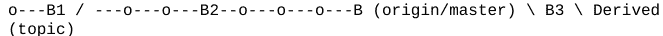

# Fedora Linux 手册文件：用户命令 - 第二卷


###### 名称

espeak - 多语言软件语音合成器。

###### 概要

espeak [选项] [单词]

###### 描述

**espeak** 是一个用于英语及部分其他语言的软件语音合成器。

####### 选项

- **-f** 文件
  要朗读的文本文件。
- **--stdin**
  从标准输入读取文本，而不是从文件读取。如果既未指定 **-f** 也未指定 **--stdin**，则朗读 *单词*；如果未提供单词，则从标准输入逐行朗读文本。
- **-a** *整数*
  振幅，范围为 0 到 20，默认值为 10。
- **-g** *整数*
  词间距。单词间的停顿，单位为默认速度下的 10 毫秒。
- **-k** *整数*
  指示大写字母的方式：1=声音，2=单词“capitals”，较高值 = 音高增加（尝试 -k20）。
- **-l** *整数*
  行长度。如果不为零（这是默认值），则将短于此长度的行视为 and-of-clause。
- **-p** *整数*
  音高调整，范围为 0 到 99，默认值为 50。
- **-s** *整数*
  每分钟单词数，默认值为 160。
- **-v** *voice_name*
  使用 espeak-data/voices 中该名称的语音文件。
- **-w** *文件*
  将输出写入此 WAV 文件，而不是直接朗读。
- **-b**
  输入文本为 8 位编码。
- **-m**
  指示文本包含 SSML（语音合成标记语言）标签或其他 XML 标签。受支持的 SSML 标签会被解析。其他标签（包括 HTML）将被忽略，但某些 HTML 标签（如 `<hr>`、`<h2>` 和 `<li>`）会确保语音中断。
- **-q**
  静默，不产生任何语音（与 **-x** 结合使用可能很有用）。
- **-x**
  将音素助记符写入标准输出。
- **-X**
  将音素助记符和翻译跟踪写入标准输出。
- **-z**
  在文本末尾不进行最终句子停顿。
- **--compile**[*=voicename*]
  编译当前目录中的发音规则及词典。*voicename* 是可选的，用于指定要使用的语言。
- **--ipa**[*=ipa*]
  使用国际音标将音素写入标准输出。如果 ipa 为 1 则使用连字符，如果为 2 则使用 ZWJ，如果为 3 则用“_”分隔。
- **--path**=*path*
  指定包含 espeak-data 目录的目录。
- **--pho**
  将 mbrola 音素数据 (.pho) 写入标准输出或 **--phonout** 指定的文件。
- **--phonout**=*文件名*
  将 -x、-X 命令的输出及 mbrola 音素数据写入此文件。
- **--punct**[*=characters*]
  在朗读过程中朗读标点字符的名称。如果省略 characters，则朗读所有标点。
- **--split**=*分钟数*
  每经过指定的分钟数开始一个新的 WAV 文件。与 -w 配合使用。
- **--stdout**
  将语音输出写入标准输出。
- **--voices**[*=language*]
  列出可用的语音。如果存在 language，则仅列出适合该语言的语音。
- **-h**，**--help**
  显示选项摘要。
- **--version**
  显示版本信息。

###### 作者

eSpeak 由 Jonathan Duddington <jonsd@jsd.clara.co.uk> 编写。该包的网页可以在 http://espeak.sourceforge.net/ 找到。

本手册页由 Luke Yelavich <themuso@ubuntu.com> 为 Ubuntu 项目编写（但也可供其他人使用）。Jaroslav Škarvada <jskarvad@redhat.com> 进行了多项更新。

## eutp

###### 名称

eutp - EuroBraille 文件传输

###### 概要

eutp

###### 描述

*eutp* 允许你与 EuroBraille 的 Clio 终端交换文件。

### 命令行选项

暂无

### 返回值

1 错误

### shell 扩展

注意特殊字符：* 和 . 通常会被你的 shell 展开，因此发送文件 * 可能会执行你想要的操作，将当前目录中存在的每个文件放到终端上，但接收文件 * 可能不符合你的期望：它只会获取当前目录中已存在的每个文件，而跳过你刚刚在终端上创建的那些文件！如果你想获取终端中存在的每个文件，你应该使用 * 或类似的东西（请阅读你的 shell 手册）。

同样的警告也适用于其他特殊字符，如 $、~、&、...，它们应该通过用引号（‘）包围参数或在它们之前使用单个反斜杠 (\) 来保护（请阅读你的 shell 手册）。

###### 作者

Olivier Bert <olivier.bert@laposte.net>

## evince

###### 名称

**evince** - GNOME 文档查看器

适用于 GNOME 桌面环境的 Evince 文档查看器应用程序

####### 语法

**evince** [--help] [--page-label=PAGE | --page-index=NUMBER | --named-dest=DEST]
[--fullscreen] [--presentation] [--preview] [--find=STRING] [filename(s)...]

###### 描述

**evince**

Evince 是一个文档查看器，能够显示多种和单页文档格式，如 PDF 和 Postscript。有关 Evince 的更多一般信息，请访问我们的网站 http://www.gnome.org/projects/evince/

####### 选项

- **-?, -h, --help**
  打印命令行选项。
- **-p, --page-label=PAGE**
  在具有指定页面标签（或页码）的页面上打开文档。
- **-i, --page-index=NUMBER**
  在具有指定页面索引的页面上打开文档（这是确切的页码，而非页面标签）。
- **-n, --named-dest=DEST**
  在指定的命名目标上打开文档。
- **-f, --fullscreen**
  在全屏模式下运行 evince。
- **-s, --presentation**
  在演示模式下运行 evince。
- **-l, --find=string**
  你可以在此处传递一个单词或短语。如果存在，evince 将显示文档和第一个匹配项。
- **filename(s)**...
  指定 Evince 启动时要打开的文件。如果未指定，Evince 将打开一个空白窗口。如果以空格分隔，可以加载多个文件。Evince 还支持处理远程文件。例如，你可以传递网络位置或从 FTP 服务器加载文件，如 “http://adobe.com/sample.pdf”。

### 打印预览选项

这些选项主要用于与 GTK+ 打印预览功能配合使用。有关这些选项的更多信息，请参阅 http://developer.gnome.org/gtk3/stable/GtkSettings.html#GtkSettings—gtk-print-preview-command

- **-w, —preview**
  作为预览器运行 evince。
- **—unlink-temp-file**
  如果 evince 以预览模式运行，这将解除由 GTK+ 创建的临时文件的链接。
- **—print-settings %s %f**
  这将 PDF 文件的完整路径 *f* 和打印对话框的设置 *s* 发送到 evince。


## 缺陷报告

如果您发现了一个 bug，请通过 http://bugzilla.gnome.org/enter_bug.cgi?product=evince 进行报告。

###### 名称

vim - Vi 增强版，一款面向程序员的文本编辑器

###### 概要

`vim [选项] [文件 ...]`  
`vim [选项] -`  
`vim [选项] -t 标签`  
`vim [选项] -q [错误文件]`  
`ex`、`gex`、`view`、`gvim`、`gview`、`vimx`、`evim`、`eview`、`rvim`、`rview`、`rgvim`、`rgview`

###### 描述

**Vim** 是一个向上兼容 Vi 的文本编辑器。它可以用来编辑各种纯文本。它特别适用于编辑程序。

它相比 Vi 有许多增强功能：多级撤销、多窗口和多缓冲区、语法高亮显示、命令行编辑、文件名补全、在线帮助、可视选择等。请参见“help vi_diff.txt”以了解 **Vim** 与 Vi 之间的差异摘要。

在运行 **Vim** 期间，可以通过“:help”命令从在线帮助系统获取大量帮助。请参见下文中的“在线帮助”部分。

通常，**Vim** 使用以下命令启动以编辑单个文件：

```
vim file
```

更普遍地说，**Vim** 的启动方式为：

```
vim [选项] [文件列表]
```

如果缺少文件列表，编辑器将启动一个空缓冲区。否则，可以使用以下四种方式之一来选择要编辑的一个或多个文件。

- `file ...`
  - 文件名列表。第一个文件将成为当前文件并读入缓冲区。光标将定位在缓冲区的第一行。您可以使用“next”命令访问其他文件。要编辑以破折号开头的文件，请在文件列表前加上“--”。
- `-`
  - 要编辑的文件从标准输入读取。命令从标准错误读取，标准错误应当是一个 TTY。
- `-t {标签}`
  - 要编辑的文件和初始光标位置取决于“标签”（一种 goto 标签）。{tag} 将在标签文件中查找，关联的文件成为当前文件并执行关联的命令。这通常用于 C 程序，此时 {tag} 可以是函数名。效果是包含该函数的文件成为当前文件，光标定位在函数开始处。请参见“:help tag-commands”。
- `-q [错误文件]`
  - 以 quickFix 模式启动。读取文件 [errorfile] 并显示第一个错误。如果省略 [errorfile]，则从 ‘errorfile’ 选项获取文件名（在 Amiga 上默认为 “AztecC.Err”，在其他系统上为 “errors.err”）。可以使用“:cn”命令跳转到下一个错误。请参见“:help quickfix”。

**Vim** 的行为会根据命令的名称不同而有所区别（可执行文件可能是同一个文件）。

- `vim`
  - “正常”方式，所有设置均为默认值。
- `ex`
  - 以 Ex 模式启动。使用“:vi”命令切换到 Normal 模式。也可以使用“-e”参数实现。
- `view`
  - 以只读模式启动。您将受到保护，无法写入文件。也可以使用“-R”参数实现。
- `gvim`、`gview`
  - GUI 版本。启动新窗口。
- `gex`
  - 以 Ex 模式启动新的 gvim 窗口。也可以使用 gvim 的“-e”参数实现。
- `vimx`
  - 以“Vi”模式启动 gvim，类似于“vim”，但具有 xterm 剪贴板支持等附加功能。
- `evim`、`eview`
  - GUI 版本的简易模式。启动新窗口。也可以使用“-y”参数实现。
- `rvim`、`rview`、`rgvim`、`rgview`
  - 类似上述，但具有限制。将无法启动 shell 命令或挂起 **Vim**。也可以使用“-Z”参数实现。

####### 选项

选项可以以任何顺序给出，在文件名之前或之后。没有参数的选项可以在单个破折号后组合使用。

- `+[num]`
  - 对于第一个文件，光标将定位在第 "num" 行。如果缺少 "num"，光标将定位在最后一行。
- `+/{pat}`
  - 对于第一个文件，光标将定位在 {pat} 的第一次出现处。有关可用的搜索模式，请参见 "help search-pattern"。
- `+{命令}`
  - {command} 将在读取第一个文件后执行。{command} 被解释为 Ex 命令。如果 {command} 包含空格，则必须用双引号括起来（这取决于使用的 shell）。示例：`vim "+set si" main.c`。注意：您可以使用最多 10 个 "+" 或 "-c" 命令。
- `-c {命令}`
  - {command} 将在读取第一个文件后执行。{command} 被解释为 Ex 命令。如果 {command} 包含空格，则必须用双引号括起来（这取决于使用的 shell）。示例：`vim "+set si" main.c`。注意：您可以使用最多 10 个 "+" 或 "-c" 命令。
- `-S {文件}`
  - {file} 将在读取第一个文件后被 source。这等同于 `-c "source {file}"`。{file} 不能以 `-` 开头。如果省略 {file}，则使用 "Session.vim"（仅当 -S 是最后一个参数时有效）。
- `-cmd {命令}`
  - 类似于使用 "-c"，但命令在处理任何 vimrc 文件之前执行。您可以使用最多 10 个此类命令，独立于 "-c" 命令。
- `-A`
  - 如果 **Vim** 编译时启用了 ARABIC 支持（用于编辑从右向左排列的文件和映射阿拉伯语键盘），此选项将以阿拉伯语模式启动 **Vim**，即设置 `‘arabic’`。否则，将给出错误消息并 **Vim** 中止。
- `-b`
  - 二进制模式。将设置一些选项，使其能够编辑二进制或可执行文件。
- `-C`
  - 兼容模式。设置 ‘compatible’ 选项。这将使 **Vim** 表现得更像 Vi，即使存在 .vimrc 文件。
- `-d`
  - 以 diff 模式启动。应当有两个、三个或四个文件名参数。**Vim** 将打开所有文件并显示它们之间的差异。类似于 vimdiff(1)。
- `-d {设备}`
  - 打开 {device} 以用作终端。仅在 Amiga 上可用。示例："-d con:20/30/600/150"。
- `-D`
  - 调试。在执行来自脚本的第一个命令时进入调试模式。
- `-e`
  - 以 Ex 模式启动 **Vim**，就像可执行文件被调用为 "ex" 一样。
- `-E`
  - 以增强 Ex 模式启动 **Vim**，就像可执行文件被调用为 “exim” 一样。
- `-f`
  - 前台。对于 GUI 版本，**Vim** 不会 fork 并与启动它的 shell 分离。在 Amiga 上，**Vim** 不会重启以打开新窗口。当 **Vim** 由等待编辑会话结束（例如邮件）的程序执行时，应使用此选项。在 Amiga 上，“.sh” 和 “:!” 命令将不起作用。
- `—nofork`
  - 前台。对于 GUI 版本，**Vim** 不会 fork 并与启动它的 shell 分离。
- `-F`
  - 如果 **Vim** 编译时启用了 FKMAP 支持（用于编辑从右向左排列的文件和映射波斯语键盘），此选项将以波斯语模式启动 **Vim**，即设置 ‘fkmap’ 和 ‘rightleft’。否则，将给出错误消息并 **Vim** 中止。
- `-g`
  - 如果 **Vim** 编译时启用了 GUI 支持，此选项将启用 GUI。如果未编译 GUI 支持，将给出错误消息并 **Vim** 中止。
- `-h`
  - 提供一些关于命令行参数和选项的帮助。之后 **Vim** 退出。
- `-H`
  - 如果 **Vim** 编译时启用了 RIGHTLEFT 支持（用于编辑从右向左排列的文件和映射希伯来语键盘），此选项将以希伯来语模式启动 **Vim**，即设置 ‘hkmap’ 和 ‘rightleft’。否则，将给出错误消息并 **Vim** 中止。
- `-i {viminfo}`
  - 当启用 viminfo 文件使用时，此选项设置要使用的文件名，而不是默认的 “~/.viminfo”。通过提供名称 “NONE”，也可以用于跳过使用 .viminfo 文件。
- `-L`
  - 与 -r 相同。
- `-l`
  - Lisp 模式。开启 ‘lisp’ 和 ‘showmatch’ 选项。
- `-m`
  - 禁用文件修改。重置 ‘write’ 选项。您仍然可以修改缓冲区，但不能写入文件。
- `-M`
  - 不允许修改。将取消设置 ‘modifiable’ 和 ‘write’ 选项，从而不允许更改且无法写入文件。请注意，这些选项可以设置以启用修改。
- `-N`
  - 非兼容模式。重置 ‘compatible’ 选项。这将使 **Vim** 表现得稍好一些，但与 Vi 的兼容性稍差，即使不存在 .vimrc 文件。
- `-n`
  - 不使用交换文件。崩溃后将无法恢复。如果您


想编辑一个位于非常缓慢的介质（例如软盘）上的文件。也可以通过“:set uc=0”来实现。可以通过“:set uc=200”来撤销。

- **-nb**
  成为 NetBeans 的编辑器服务器。详见文档。

- **-o[N]**
  打开 N 个堆叠的窗口。当省略 N 时，为每个文件打开一个窗口。

- **-O[N]**
  并排打开 N 个窗口。当省略 N 时，为每个文件打开一个窗口。

- **-p[N]**
  打开 N 个标签页。当省略 N 时，为每个文件打开一个标签页。

- **-R**
  只读模式。将设置‘readonly’选项。你仍然可以编辑缓冲区，但会被阻止意外覆盖文件。如果你确实想要覆盖文件，请在 Ex 命令后加一个感叹号，如“:w!”。-R 选项还隐含了 -n 选项（见下文）。‘readonly’选项可以通过“:set noro”重置。参见“:help ‘readonly’”。

- **-r**
  列出交换文件，以及关于如何恢复的信息。

- **-r {file}**
  恢复模式。使用交换文件恢复崩溃的编辑会话。交换文件是一个在文本文件文件名后加上“ .swp”的文件。参见“:help recovery”。

- **-S**
  静默模式。仅当作为“Ex”启动或在“ -S”选项之前给出了“ -e”选项时才生效。

- **-s {scriptin}**
  读取脚本文件 {scriptin}。文件中的字符将被解释为就像你输入的一样。也可以用命令“:source! {scriptin}”实现相同功能。如果在编辑器退出前到达文件末尾，将从键盘读取更多字符。

- **-T {terminal}**
  告诉 **Vim** 你正在使用的终端名称。仅当自动方式不起作用时才需要。应该是 **Vim**（内置）知道的终端或在 termcap 或 terminfo 文件中定义的终端。

- **-u {vimrc}**
  使用文件 {vimrc} 中的命令进行初始化。其他所有初始化都被跳过。使用此选项来编辑特定类型的文件。也可以通过提供名称“NONE”来跳过所有初始化。参见 vim 中的“:help initialization”以获取更多细节。

- **-U {gvimrc}**
  使用文件 {gvimrc} 中的命令进行 GUI 初始化。其他所有 GUI 初始化都被跳过。也可以通过提供名称“NONE”来跳过所有 GUI 初始化。参见 vim 中的“:help gui-init”以获取更多细节。

- **-V[N]**
  详细模式。提供关于哪些文件被加载以及读写 viminfo 文件的信息。可选数字 N 是 `verbatim' 的值。默认值为 10。

- **-v**
  以 Vi 模式启动 **Vim**，就像可执行文件被调用为 "vi" 一样。这只在可执行文件被调用为 "ex" 时有影响。

- **-w {scriptout}**
  你输入的所有字符都被记录在文件 {scriptout} 中，直到你退出 **Vim**。如果你想创建一个供 "vim -s" 或 "source!" 使用的脚本文件，这很有用。如果 {scriptout} 文件存在，字符将被追加。

- **-W {scriptout}**
  类似于 -w，但会覆盖现有文件。

- **-x**
  在写文件时使用加密。将提示输入加密密钥。

- **-X**
  不连接到 X 服务器。在终端中缩短启动时间，但不会使用窗口标题和剪贴板。

- **-y**
  以简单模式启动 **Vim**，就像可执行文件被调用为 "evim" 或 "eview" 一样。
  使 **Vim** 表现得像一个点击和输入编辑器。

- **-Z**
  受限模式。工作方式与可执行文件以 "r" 开头相同。

- **--**
  表示选项的结束。在此之后的参数将作为文件名处理。
  这可用于编辑以 '-' 开头的文件名。

- **__echo_wid**
  仅限 GTK GUI：在标准输出回显窗口 ID。

- **__help**
  显示帮助信息并退出，类似于 "-h"。

- **__literal**
  字面取文件名参数，不扩展通配符。这在 Unix 上没有影响，因为 shell 会扩展通配符。

- **__nplugin**
  跳过加载插件。由 -u NONE 隐含。

- **__remote**
  连接到 Vim 服务器并让它编辑剩余参数中给出的文件。
  如果未找到服务器，将给出警告并在当前 Vim 中编辑文件。

- **__remote_expr {expr}**
  连接到 Vim 服务器，在其中求值 {expr} 并将结果打印到标准输出。

- **__remote_send {keys}**
  连接到 Vim 服务器并向其发送 {keys}。

- **__remote_silent**
  类似于 __remote，但在未找到服务器时不发出警告。

- **__remote_wait**
  类似于 __remote，但 Vim 在文件编辑完成前不会退出。

- **--remote-wait-silent**
  类似于 --remote-wait，但在未找到服务器时不发出警告。

- **--remote-tab[-wait][-silent]**
  类似于 --remote 但为每个文件使用标签页

- **--role**
  设置唯一角色以标识主窗口

- **--serverlist**
  列出所有可找到的 Vim 服务器的名称。

- **--servername {name}**
  将 {name} 用作服务器名称。用于当前的 Vim，除非与 --remote 参数一起使用，此时它是要连接的服务器名称。

- **--socketid {id}**
  仅限 GTK GUI：使用 GtkPlug 机制在另一个窗口中运行 gvim。

- **--version**
  打印版本信息并退出。

## 在线帮助

在 **Vim** 中输入 ":help" 开始。输入 ":help subject" 获取关于特定主题的帮助。例如：":help ZZ" 获取 "ZZ" 命令的帮助。使用 <Tab> 和 CTRL-D 补全主题（":help cmdline-completion"）。存在标签以从一个位置跳转到另一个位置（有点像超文本链接，参见 ":help"）。所有文档文件都可以以这种方式查看，例如 ":help syntax.txt"。

###### 文件

/usr/share/vim/vim74/doc/*.txt
**Vim** 文档文件。使用“:help doc-file-list”获取完整列表。

/usr/share/vim/vim74/doc/tags
用于在文档文件中查找信息的标签文件。

/usr/share/vim/vim74/syntax/syntax.vim
系统范围的语法初始化。

/usr/share/vim/vim74/syntax/*.vim
各种语言的语法文件。

/etc/vimrc
系统范围的 **Vim** 初始化。

~/.vimrc
你的个人 **Vim** 初始化。

/etc/gvimrc
系统范围的 gvim 初始化。

~/.gvimrc
你的个人 gvim 初始化。

/usr/share/vim/vim74/optwin.vim
用于“:options”命令的脚本，一种查看和设置选项的好方法。

/usr/share/vim/vim74/menu.vim
gvim 的系统范围菜单初始化。

/usr/share/vim/vim74/bugreport.vim
用于生成错误报告的脚本。参见“:help bugs”。

/usr/share/vim/vim74/filetype.vim
通过文件名检测文件类型的脚本。参见“:help ‘filetype’”。

/usr/share/vim/vim74/scripts.vim
通过文件内容检测文件类型的脚本。参见“:help ‘filetype’”。

/usr/share/vim/vim74/print/*.ps
用于 PostScript 打印的文件。

要获取最新信息，请阅读 VIM 主页：<URL:http://www.vim.org/>

###### 另请参阅

vimtutor(1)

## **作者**

**Vim** 的大部分由 Bram Moolenaar 制作，并得到他人的大量帮助。在 **Vim. Vim** 中参见“:help credits”。**Vim** 基于 Stevie，由以下人员参与开发：Tim Thompson、Tony Andrews 和 G.R. (Fred) Walter。尽管几乎没有任何原始代码保留下来。

## ❧ 错误

可能有一些。参见“:help todo”查看已知问题列表。

请注意，有些人可能认为是错误的一些事情，实际上是由对 Vi 行为过于忠实的复现造成的。如果你认为其他事情是“因为 Vi 行为不同”的错误，你应该仔细查看 vi_diff.txt 文件（或在 Vim 中输入 :help vi_diff.txt）。还要查看‘compatible’和‘cpoptions’选项。

<!-- no content -->

###### 名称

exempi - 用于操作 XMP 元数据的命令行工具

####### 语法

```
exempi { -h | [--R] [-x] [ {-w | -o <file> } ] [ { -g <prop_name> | -s <prop_name> -v <value> } ] } <files>
```

####### 选项

- **-h**: 显示此帮助
- **-R**: 不对账
- **-x**: 转储 XML
- **-X**: 文件是 XMP
- **-w**: 原地写入。仅限 -s。与 -o 不兼容。
- **-o <file>**: 写入输出的文件。
- **-n <ns> <prefix>**: 设置命名空间的名称前缀。
- **-g <prop_name>**: 检索 prop_name 的值。
- **-s <prop_name> -v <value>**: 检索或获取值
- **<files>**: 要读取的文件。


## 安全性

源代码尚未进行安全审计。命令行工具缺乏严格的输入有效性检查。

请小心不要以超级用户身份运行该工具。如果您决定在线（Web）应用程序中使用它，也请务必谨慎。

欢迎提交补丁和建议。

###### 作者

Exempi 由 Hubert Figuiere 编写。

它包含了由 Adobe Systems Inc. 编写的 XMP SDK。

## 许可证

Exempi 在 BSD 许可证下授权。

## EXPAND

###### 名称

expand - 将制表符转换为空格

###### 概要

```
expand [OPTION]... [FILE]...
```

###### 描述

将每个 FILE 中的制表符转换为空格，并写入标准输出。

如果没有指定 FILE，或者 FILE 为 -，则从标准输入读取。

长选项的必需参数对于短选项也是必需的。

- -i, --initial
  不转换非空白字符之后的制表符
- -t, --tabs=NUMBER
  使制表符间距为 NUMBER 个字符，而非 8
- -t, --tabs=LIST
  使用逗号分隔的列表指定明确的制表符位置
- --help
  显示此帮助信息并退出
- --version
  输出版本信息并退出

###### 作者

由 David MacKenzie 编写。

###### 报告错误

GNU coreutils 在线帮助： <http://www.gnu.org/software/coreutils/> 请将 expand 翻译错误报告至 <http://translationproject.org/team/>

###### 版权

版权所有 © 2015 Free Software Foundation, Inc. 许可证 GPLv3+: GNU GPL 第 3 版或更高版本 <http://gnu.org/licenses/gpl.html>。这是自由软件：您可以自由地修改和重新分发它。在法律允许的范围内，没有担保。

###### 另见

unexpand(1)

完整文档位于： <http://www.gnu.org/software/coreutils/expand> 或者可通过本地访问：info ‘(coreutils) expand invocation’

## EXPR

###### 名称

expr - 求值表达式

###### 概要

```
expr EXPRESSION
expr OPTION
```

###### 描述

- --help
  显示此帮助信息并退出
- --version
  输出版本信息并退出

将 EXPRESSION 的值打印到标准输出。下面的一行空白分隔了优先级递增的组。EXPRESSION 可以是：

- ARG1 | ARG2
  如果 ARG1 既不是空也不是 0，则为 ARG1，否则为 ARG2
- ARG1 & ARG2
  如果两个参数都不是空或 0，则为 ARG1，否则为 0
- ARG1 < ARG2
  ARG1 小于 ARG2
- ARG1 <= ARG2
  ARG1 小于或等于 ARG2
- ARG1 = ARG2
  ARG1 等于 ARG2
- ARG1 != ARG2
  ARG1 不等于 ARG2
- ARG1 >= ARG2
  ARG1 大于或等于 ARG2
- ARG1 > ARG2
  ARG1 大于 ARG2
- ARG1 + ARG2
  ARG1 和 ARG2 的算术和
- ARG1 - ARG2
  ARG1 和 ARG2 的算术差
- ARG1 * ARG2
  ARG1 和 ARG2 的算术积
- ARG1 / ARG2
  ARG1 除以 ARG2 的算术商
- ARG1 % ARG2
  ARG1 除以 ARG2 的算术余数
- STRING : REGEXP
  在 STRING 中锚定的 REGEXP 模式匹配
- match STRING REGEXP
  与 STRING : REGEXP 相同
- substr STRING POS LENGTH
  STRING 的子串，POS 从 1 开始计数
- index STRING CHARS
  在 STRING 中找到任意 CHARS 的索引，或为 0
- length STRING
  STRING 的长度
- TOKEN
  将 TOKEN 解释为字符串，即使它是像 ‘match’ 这样的关键字或像 ‘/’ 这样的运算符
- ( EXPRESSION )
  EXPRESSION 的值

请注意，许多运算符在 shell 中需要转义或加引号。如果两个 ARG 都是数字，则比较是算术比较；否则是字典序比较。模式匹配返回 \( 和 \) 之间匹配的字符串，或者为空；如果未使用 \( 和 \)，则返回匹配的字符数或 0。

如果 EXPRESSION 既不是空也不是 0，则退出状态为 0；如果 EXPRESSION 为空或 0，则退出状态为 1；如果 EXPRESSION 语法无效，则退出状态为 2；如果发生错误，则退出状态为 3。

###### 作者

由 Mike Parker, James Youngman 和 Paul Eggert 编写。

###### 报告错误

GNU coreutils 在线帮助： <http://www.gnu.org/software/coreutils/> 请将 expr 翻译错误报告至 <http://translationproject.org/team/>

###### 版权

版权所有 © 2015 Free Software Foundation, Inc. 许可证 GPLv3+: GNU GPL 第 3 版或更高版本 <http://gnu.org/licenses/gpl.html>。这是自由软件：您可以自由地修改和重新分发它。在法律允许的范围内，没有担保。

###### 另见

完整文档位于： <http://www.gnu.org/software/coreutils/expr> 或者可通过本地访问：info ‘(coreutils) expr invocation’

## EXTLINUX

###### 名称

extlinux - 在 ext2/ext3 文件系统上安装 SYSLINUX 引导加载程序

###### 概要

**extlinux** [*options*] *directory*

###### 描述

**EXTLINUX** 是一个新的 syslinux 衍生版本，可以从 Linux ext2/ext3 文件系统启动。它与 **SYSLINUX** 的工作方式相同，但有一些细微的修改。旨在简化 Linux 的初次安装，并用于创建救援和其他特殊用途的引导磁盘。

安装程序设计为在挂载的目录上运行。例如，如果您将一个 ext2 或 ext3 USB 密钥挂载在 /mnt 上，您可以运行以下命令：

extlinux --install /mnt

####### 选项

- -H, --heads=#
  强制指定磁头数量。
- -i, --install
  覆盖当前的引导扇区。
- -O, --clear-once
  清除一次性启动命令。
- -o, --once=command
  在启动时执行一次命令。
- -M, --menu-save=label
  设置下一次启动时默认选择的标签
- -r, --raid
  在启动失败时回退到下一个设备。
- --reset-adv
  重置辅助数据。
- -S, --sectors=#
  强制指定每道扇区数。
- -U, --update
  更新之前的 EXTINUX 安装。
- -Z, --zip
  强制软盘几何参数 (-H 64 -S 32)。
- --device=devicename
  覆盖设备名称的自动检测。此选项仅适用于特殊环境，普通用户不应使用。滥用此选项可能会导致磁盘损坏和数据丢失。

###### 文件

extlinux 配置文件必须命名为 syslinux.cfg 或 extlinux.conf，并且必须存储在 extlinux 安装目录中。有关 extlinux.conf 内容的更多信息，请参阅 syslinux(1) 手册页的 files 部分。

###### 缺陷

如果您在使用 *SYSLINUX* 时遇到任何问题，我将不胜感激能听到您的反馈。如果您成功使用了 *SYSLINUX*，我也希望能得到您的反馈，特别是如果您正在将其用于某个发行版。

如果您报告问题，请尽可能提供有关您的系统和 *BIOS* 的所有信息；报告的绝大多数问题结果是 *BIOS* 或硬件缺陷，我需要尽可能多的信息才能诊断问题。

有一个邮件列表用于 *SYSLINUX* 用户之间的讨论以及新版本和测试版本的公告。要加入，请发送一条消息到 `majordomo@linux.kernel.org`，其中包含以下行：

###### 另见

**syslinux(1)**

## FALLOCATE

###### 名称

fallocate - 预分配或释放文件的空间

###### 概要

**fallocate [-c] [-n] [-p] [-z] [-o *offset*] -l *length* *filename***

**fallocate -d [-o *offset*] [-l *length*] *filename***

###### 描述

**fallocate** 用于操作文件的磁盘空间分配，要么释放空间，要么预分配空间。对于支持 fallocate 系统调用的文件系统，预分配通过分配块并将其标记为未初始化来快速完成，无需对数据块进行 IO 操作。这比通过填充零来创建文件快得多。

**fallocate** 返回的退出码在成功时为 0，失败时为 1。

####### 选项

*length* 和 *offset* 参数后面可以跟乘性后缀 KiB (=1024), MiB (=1024*1024)，依此类推 GiB, TiB, PiB, EiB, ZiB 和 YiB（“iB” 是可选的，例如，“K” 与 “KiB” 含义相同）或者后缀 KB (=1000), MB (=1000*1000)，依此类推 GB, TB, PB, EB, ZB 和 YB。

选项 **collapse-range**, **dig-holes**, **punch-hole** 和 **zero-range** 是互斥的。

- **-c, --collapse-range**
  从文件中删除一个字节范围，而不留下空洞。要折叠的字节范围从 *offset* 开始，持续 *length* 字节。操作完成后，从位置 *offset*+*length* 开始的文件内容将被追加到位置 *offset*，并且文件将变小 *length* 字节。对于折叠范围操作，不能指定选项 **keep-size**。
  自 Linux 3.15 起用于 ext4（仅限基于 extent 的文件）和 XFS 可用。
- **-d, --dig-holes**
  检测并挖掘空洞。这将使文件就地稀疏化，而无需使用额外的磁盘空间。空洞的最小尺寸取决于文件系统 I/O 块大小（通常为 4096 字节）。此外，使用此选项时，隐含 **keep-size**。如果未通过 **offset** 和 **length** 指定范围，则分析整个文件以查找空洞。
  您可以将此选项视为执行“**cp --sparse**”，然后将目标文件重命名为原始文件，而无需额外的磁盘空间。
  有关支持文件系统的列表，请参阅 **punch-hole**。
- **-l, --length** *length*
  指定范围的长度，单位为字节。
- **-n, --keep-size**
  不修改文件的表观长度。这可能有效地在 EOF 之后分配块，这些块可以通过 truncate 删除。
- **-o, --offset** *offset*
  指定范围的起始偏移量，单位为字节。
- **-p, --punch-hole**
  释放空间（即创建空洞）在从 *offset* 开始并持续 *length* 字节的字节范围内。在指定范围内，部分文件系统块被置零，整个文件系统块从文件中移除。成功调用后，从此范围后续读取将返回零。此选项不能与 **zero-range** 选项同时指定。此外，使用此选项时，隐含 **keep-size**。
  支持 XFS（自 Linux 2.6.38）、ext4（自 Linux 3.0）、Btrfs（自 Linux 3.7）和 tmpfs（自 Linux 3.5）。
- **-v, --verbose**


## 启用详细模式。

- **-z, --zero-range**
  将从 *offset* 开始并延续 *length* 字节的字节范围中的空格清零。在指定范围内，跨越文件空洞的区域将被预分配块。调用成功后，从此范围后续的读取将返回零。清零操作在文件系统内优先通过将范围转换为未写入的 extent 来完成。这意味着指定范围在设备上不会被物理清零（除了范围两端的非完整块外），并且 I/O 操作（在其他方面）仅用于更新元数据。
  可以指定选项 `--keep-size` 以防止修改文件长度。自 Linux 3.14 起在 ext4（仅针对基于 extent 的文件）和 XFS 中可用。

- **-V, --version**
  显示版本信息并退出。

- **-h, --help**
  显示帮助文本并退出。

###### 作者

Eric Sandeen
Karel Zak

####### 参见

**fallocate**(2), **posix_fallocate**(3), **truncate**(1)

###### 可用性

fallocate 命令是 util-linux 软件包的一部分，可从 Linux 内核存档（Linux Kernel Archive）获取

###### 名称

fc-cache - 构建字体信息缓存文件

###### 概要

```
fc-cache [ -EfrsvVh ] [ --error-on-no-fonts ] [ --force ] [ --really-force ] [ -y dir ] [ --sysroot dir ] [ --system-only ] [ --verbose ] [ --version ] [ --help ] [ dir... ]
```

###### 描述

**fc-cache** 扫描系统上的字体目录，并为使用 fontconfig 进行字体处理的应用程序构建字体信息缓存文件。

如果没有提供目录参数，**fc-cache** 将使用当前字体配置中的每个目录。每个目录都会被扫描以查找 FreeType 可读的字体文件。将创建一个包含每个字体属性及其关联文件名的缓存。该缓存用于在使用 fontconfig 库时加快应用程序启动速度。

请注意，**fc-cache** 必须针对每个架构执行一次，以生成针对该架构定制的字体信息。

####### 选项

此程序遵循常规的 GNU 命令行语法，长选项以两个破折号（`--`）开头。选项摘要如下所示。

- **-E**
  如果 `dir` 中没有任何字体，或者在未提供时配置中的目录没有任何字体，则引发错误。

- **-f**
  强制重新生成看似最新的缓存文件，覆盖时间戳检查。

- **-r**
  擦除所有现有缓存文件并重新扫描。

- **-s**
  仅扫描系统范围的目录，忽略位于用户主目录下的位置。

- **-v**
  在忙碌时显示状态信息。

- **-y**
  在扫描的所有路径前添加 `dir`。

- **-h**
  显示选项摘要。

- **-V**
  显示程序版本并退出。

- **dir**
  要扫描字体的目录。

## 返回码

如果缓存成功生成，**fc-cache** 返回零，否则返回非零。

###### 文件

```
%cachedir%/×-*%arch%.cache-%version%
```

这些文件由 **fc-cache** 生成，包含从文件名到字体属性的映射。它们在应用程序启动时由 fontconfig 库读取，以定位适当的字体。

####### 参见

**fc-cat**(1) **fc-list**(1) **fc-match**(1) **fc-pattern**(1) **fc-query**(1) **fc-scan**(1)

fontconfig 用户指南，HTML 格式：/usr/share/doc/fontconfig/fontconfig-user.html。

###### 作者

本手册页由 Keith Packard <keithp@keithp.com> 和 Josselin Mouette <joss@debian.org> 编写。

###### 名称

fc-cat - 读取字体信息缓存文件

###### 概要

```
fc-cat [ -rvVh ] [ --recurse ] [ --verbose ] [ --version ] [ --help ]
    [ [ fonts-cache-%version%-files ] [ dirs ] ... ]
```

###### 描述

**fc-cat** 从缓存文件或字体目录相关的缓存中读取字体信息，并以 ASCII 形式输出。

####### 选项

此程序遵循常规的 GNU 命令行语法，长选项以两个破折号（`--`）开头。选项摘要如下所示。

- **-r**
  递归进入子目录。

- **-v**
  详细输出。

- **-h**
  显示选项摘要。

- **-V**
  显示程序版本并退出。

####### 参见

**fc-cache**(1) **fc-list**(1) **fc-match**(1) **fc-pattern**(1) **fc-query**(1) **fc-scan**(1)

fontconfig 用户指南，HTML 格式：*/usr/share/doc/fontconfig/fontconfig-user.html*。

###### 作者

本手册页由 Patrick Lam <plam@mit.edu> 编写。

###### 名称

fc-list - 列出可用字体

###### 概要

```
fc-list [ -vVh ] [ --verbose ] [ [ -f format ] [ --format format ] ] [ [ -q ] [ --quiet ] ] [ --version ] [ --help ]
[ pattern [ element... ] ]
```

###### 描述

**fc-list** 列出系统上可供使用 fontconfig 的应用程序使用的字体和样式。如果指定了任何元素，则仅打印这些元素。否则，除非请求详细输出，否则将打印家族（family）和样式（style）。

####### 选项

此程序遵循常规的 GNU 命令行语法，长选项以两个破折号（`--`）开头。选项摘要如下所示。

- **-v**
  对于每个匹配项，打印整个字体模式的详细输出，如果提供了 *elements*，则打印 *elements*。

- **-f**
  根据格式说明符 *format* 格式化输出。

- **-q**
  抑制所有正常输出。如果没有匹配的字体，则返回 1 作为错误代码。

- **-V**
  显示程序版本并退出。

- **-h**
  显示选项摘要。

- ***pattern***
  如果设置此参数，则仅显示匹配 *pattern* 的字体。

- ***element***
  如果设置，则显示匹配字体的 *element* 属性。

####### 示例

**fc-list**
列出所有字体字面（font faces）。

**fc-list :lang=hi**
列出覆盖印地语（Hindi）的字体字面。

**fc-list : family style file spacing**
列出每个字体字面的文件名和间距值。“:” 是一个空模式，匹配所有字体。

####### 参见

**fc-match**(1) **FcFontList**(3) **FcPatternFormat**(3) **fc-cat**(1) **fc-cache**(1) **fc-pattern**(1) **fc-query**(1) **fc-scan**(1)

fontconfig 用户指南，HTML 格式：*/usr/share/doc/fontconfig/fontconfig-user.html*。

###### 作者

本手册页由 Keith Packard <keithp@keithp.com> 和 Josselin Mouette <joss@debian.org> 编写。

###### 名称

fc-match - 匹配可用字体

###### 概要

**fc-match** [ -asvVh ] [ --all ] [ --sort ] [ --verbose ] [ [ -f format ] [ --format format ] ] [ --version ] [ --help ]

[ *pattern* [ *element...* ] ]

###### 描述

**fc-match** 使用正常的 fontconfig 匹配规则匹配 *pattern*（默认为空模式），以找到可用的最佳字体。如果给出 **--sort**，则显示最佳匹配字体列表的排序结果。**--all** 选项的作用类似于 **--sort**，但对字体列表不进行修剪。

如果指定了任何元素，则仅打印这些元素。否则，除非请求详细输出，否则将打印短文件名（short file name）、家族（family）和样式（style）。

####### 选项

此程序遵循常规的 GNU 命令行语法，长选项以两个破折号（`--`）开头。选项摘要如下所示。

- **-a**
  显示最佳匹配字体列表的排序结果，但不进行任何修剪。

- **-s**
  显示最佳匹配字体列表的排序结果。

- **-v**
  对于每个匹配项，打印整个字体模式的详细输出，如果提供了 *elements*，则打印 *elements*。

- **-f**
  根据格式说明符 *format* 格式化输出。

- **-V**
  显示程序版本并退出。

- **-h**
  显示选项摘要。

- ***pattern***
  显示匹配 *pattern* 的字体（默认为空模式）。

- ***element***
  如果设置，则显示匹配字体的 *element* 属性。

####### 参见

**fc-list**(1) **FcFontMatch**(3) **FcFontSort**(3) **FcPatternFormat**(3) **fc-cat**(1) **fc-cache**(1) **fc-pattern**(1) **fc-query**(1) **fc-scan**(1)

fontconfig 用户指南，HTML 格式：*/usr/share/doc/fontconfig/fontconfig-user.html*。


###### 作者

本手册页由 Patrick Lam <plam@csail.mit.edu> 更新。

###### 名称

fc-pattern - 解析并显示模式

###### 概要

```
fc-pattern [ -cdVh ] [ --config ] [ --default ] [ [ -f format ] [ --format format ] ] [ --version ] [ --help ]
[ pattern [ element... ] ]
```

###### 描述

**fc-pattern** 解析*模式*（默认为空模式）并显示解析结果。如果指定了 **--config**，则在对模式进行显示之前执行配置替换。如果指定了 **--default**，则在对模式进行显示之前执行默认值替换。

如果指定了任何元素，则仅打印这些元素。

####### 选项

本程序遵循通常的 GNU 命令行语法，长选项以两个短划线（`--`）开头。下方列出了选项的摘要。

- `-c` 对模式执行配置替换。
- `-d` 对模式执行默认值替换。
- `-f` 根据格式说明符 `format` 格式化输出。
- `-V` 显示程序版本并退出。
- `-h` 显示选项摘要。
- `pattern` 解析并显示 `pattern`（默认使用空模式）。
- `element` 如果设置，则显示解析模式的 `element` 属性。

####### 参见

**FcNameParse(3) FcConfigSubstitute(3) FcDefaultSubstitute(3) FcPatternPrint(3)**
**FcPatternFormat(3) fc-cat(1) fc-cache(1) fc-list(1) fc-match(1) fc-query(1) fc-scan(1)**

fontconfig 用户指南（HTML 格式）：*/usr/share/doc/fontconfig/fontconfig-user.html*。

###### 作者

本手册页由 Behdad Esfahbod <behdad@behdad.org> 更新。

###### 名称

fc-query - 查询字体文件

###### 概要

```
fc-query [ -Vh ]
```

```
[ [ -b ] [ --ignore-blanks ] [ [ -i index ] [ --index index ] ] [ [ -f format ] [ --format format ] ] [ --version ] [ --help ] font-file...
```

###### 描述

**fc-query** 使用标准的 fontconfig 规则查询 *font-file*（文件），并打印出每个找到的字体的字体模式。如果指定了 **--index**，则仅查询每个文件的一个字面（face），否则查询所有字面。

####### 选项

本程序遵循通常的 GNU 命令行语法，长选项以两个短划线（`--`）开头。下方列出了选项的摘要。

- `-b` 忽略空白以计算语言
- `-i` 仅查询每个文件索引为 *index* 的字面。
- `-f` 根据格式说明符 *format* 格式化输出。
- `-V` 显示程序版本并退出。
- `-h` 显示选项摘要。
- *font-file* 查询 *font-file* 中的字体字面。

###### 返回代码

**fc-query** 在成功解析时返回错误代码 0，如果发生任何错误或者至少有一个字体字面无法打开则返回 1。

####### 参见

**fc-scan**(1) **FcFreeTypeQuery**(3) **FcPatternFormat**(3) **fc-cat**(1) **fc-cache**(1) **fc-list**(1) **fc-match**(1) **fc-pattern**(1)

fontconfig 用户指南（HTML 格式）：*/usr/share/doc/fontconfig/fontconfig-user.html*。

###### 作者

本手册页由 Behdad Esfahbod <behdad@behdad.org> 更新。

###### 名称

fc-scan - 扫描字体文件或目录

###### 概要

```
fc-scan [ -Vvh ]
[ [ -b ] [ --ignore-blanks ] ] [ [ -f format ] [ --format format ] ] [ --version ] [ --help ] file…
```

###### 描述

**fc-scan** 递归扫描 *file*（文件）并打印出每个找到的字面的字体模式。

####### 选项

本程序遵循通常的 GNU 命令行语法，长选项以两个短划线（`--`）开头。下方列出了选项的摘要。

- **-b** 忽略空白以计算语言
- **-f** 根据格式说明符 *format* 格式化输出。
- **-V** 显示程序版本并退出。
- **-h** 显示选项摘要。
- ***file*** 递归扫描 *file* 中的字体字面。

###### 返回代码

如果至少找到一个字体，**fc-scan** 返回错误代码 0，否则返回 1。

####### 参见

fc-query(1) FcFileScan(3) FcDirScan(3) FcPatternFormat(3) fc-cat(1) fc-cache(1) fc-list(1) fc-match(1) fc-pattern(1)

fontconfig 用户指南（HTML 格式）：/usr/share/doc/fontconfig/fontconfig-user.html。

###### 作者

本手册页由 Behdad Esfahbod <behdad@behdad.org> 更新。

###### 名称

fc-validate - 验证字体文件

###### 概要

**fc-validate** [ **-Vhv** ] [ [ **-i** *index* ] [ **--index** *index* ] [ [ **-l** *lang* ] [ **--lang** *lang* ] ] [ **--verbose** ] [ **--version** ] [ **--help** ] *font-file*...

###### 描述

**fc-validate** 验证 *font-file*（文件），检查每个字体是否满足 fontconfig 中正字法文件规定的语言覆盖。如果指定了 **--index**，则仅验证每个文件的一个字面，否则验证所有字面。

####### 选项

本程序遵循通常的 GNU 命令行语法，长选项以两个短划线（`--`）开头。下方列出了选项的摘要。

- `-i` 仅查询每个文件索引为 *index* 的字面。
- `-l` 将 *lang* 设置为语言，而不是当前区域设置。这用于 -m。
- `-v` 显示更详细的信息。
- `-V` 显示程序版本并退出。
- `-h` 显示选项摘要。
- *font-file* 查询 *font-file* 中的字体字面。

###### 返回代码

**fc-validate** 在成功解析时返回错误代码 0，如果发生任何错误或者至少有一个字体字面无法打开则返回 1。

###### 作者

本手册页由 Akira TAGOH <akira@tagoh.org> 更新。

## FGCONSOLE

###### 名称

fgconsole - 打印活动虚拟终端的编号。

###### 概要

**fgconsole** [—*help*|—*version*|—*next-avalable*]

###### 描述

如果活动的虚拟终端是 /dev/ttyN，则向标准输出打印 N。
如果控制台是串行控制台，则打印 “serial”。

- —*next-available*
  显示下一个未分配的虚拟终端。通常分配 6 个虚拟终端，编号 7 用于 X；在这种情况下，将返回 “8”。

###### 备注

在 *devfs* 下，控制台位于 /dev/vc/N。*devfsd* 可能维护符号链接以保持兼容性。

####### 参见

**chvt**(1)。

###### 名称

grep, egrep, fgrep - 打印匹配模式的行

###### 概要

```
grep [OPTIONS] PATTERN [FILE...]
grep [OPTIONS] [-e PATTERN | -f FILE] [FILE...]
```

###### 描述

**grep** 在指定的输入 *FILES* 中搜索包含与给定 *PATTERN* 匹配的行。如果未指定文件，或者给定了文件“-”，则 **grep** 搜索标准输入。默认情况下，**grep** 打印匹配的行。

此外，变体程序 **egrep** 和 **fgrep** 分别等同于 **grep -E** 和 **grep -F**。这些变体已弃用，但为了向后兼容性而保留。

####### 选项

### 通用程序信息

- —**help**
  输出用法信息并退出。
- -V, —**version**
  输出 **grep** 的版本号并退出。

### 匹配器选择

- -E, —**extended-regexp**
  将 *PATTERN* 解释为扩展正则表达式（ERE，见下文）。
- -F, —**fixed-strings**
  将 *PATTERN* 解释为以换行符分隔的固定字符串列表，其中任何字符串都将被匹配。
- -G, —**basic-regexp**
  将 *PATTERN* 解释为基本正则表达式（BRE，见下文）。这是默认设置。
- -P, —**perl-regexp**
  将 *PATTERN* 解释为 Perl 正则表达式。这是高度实验性的，**grep** -P 可能会警告未实现的功能。

### 匹配控制

- -e *PATTERN*, —regexp=*PATTERN*
  使用 *PATTERN* 作为模式。这可用于指定多个搜索模式，或保护以连字符 (-) 开头的模式。
- -f *FILE*, —file=*FILE*
  从 *FILE* 获取模式，每行一个。空文件包含零个模式，因此不匹配任何内容。
- -i, —**ignore-case**
  在 *PATTERN* 和输入文件中忽略大小写区别。
- -v, —**invert-match**
  反转匹配逻辑，以选择不匹配的行。
- -w, —**word-regexp**
  仅选择包含形成完整单词的匹配的行。测试方法是匹配的子串必须位于行的开头，或者由非单词组成字符前置。同样，它必须位于行的末尾或者


### 常规输出控制

-   **-c, --count**
    抑制常规输出；改为打印每个输入文件匹配行的计数。使用 **-v** 或 **--invert-match** 选项（见下文）时，统计不匹配的行。

-   **--color[=WHEN], --colour[=WHEN]**
    使用转义序列将匹配项（非空字符串）、匹配行、上下文行、文件名、行号、字节偏移量以及分隔符（针对字段和上下文行组）包裹起来，以便在终端上以颜色显示。颜色由环境变量 **GREP_COLORS** 定义。已弃用的环境变量 **GREP_COLOR** 仍然受支持，但其设置不具有优先级。**WHEN** 可以是 **never**、**always** 或 **auto**。

-   **-L, --files-without-match**
    抑制常规输出；改为打印每个通常没有输出内容的输入文件的名称。扫描将在第一个匹配项处停止。

-   **-l, --files-with-matches**
    抑制常规输出；改为打印每个通常会有输出内容的输入文件的名称。扫描将在第一个匹配项处停止。

-   **-m NUM, --max-count=NUM**
    在读入 *NUM* 行匹配行后停止读取文件。如果输入是来自常规文件的标准输入，且输出了 *NUM* 行匹配行，**grep** 会确保在退出之前将标准输入定位到最后一行匹配行之后（无论是否存在尾部上下文行）。这使得调用进程可以恢复搜索。当 **grep** 在 *NUM* 行匹配行后停止时，它会输出任何尾部上下文行。当同时使用 **-c** 或 **--count** 选项时，**grep** 不会输出大于 *NUM* 的计数。当同时使用 **-v** 或 **--invert-match** 选项时，**grep** 在输出 *NUM* 行不匹配行后停止。

-   **-o, --only-matching**
    仅打印匹配行中匹配（非空）的部分，每个这样的部分输出在单独的一行上。

-   **-q, --quiet, --silent**
    安静模式；不向标准输出写入任何内容。即使检测到错误，只要找到任何匹配项，立即以零状态退出。请参见 **-s** 或 **--no-messages** 选项。

-   **-s, --no-messages**
    抑制关于不存在或不可读文件的错误消息。

### 输出行前缀控制

-   **-b, --byte-offset**
    在每行输出之前，打印该行在输入文件中基于 0 的字节偏移量。如果指定了 -o (**--only-matching**)，则打印匹配部分本身的偏移量。

-   **-H, --with-filename**
    为每个匹配项打印文件名。当需要搜索的文件多于一个时，这是默认行为。

-   **-h, --no-filename**
    抑制在输出中打印文件名前缀。当只有一个文件（或仅标准输入）需要搜索时，这是默认行为。

-   **--label=LABEL**
    将实际来自标准输入的数据显示为来自文件 LABEL 的输入。这在实现类似 zgrep 的工具时特别有用，例如 `gzip -cd foo.gz | grep --label=foo -H something`。另请参阅 -H 选项。

-   **-n, --line-number**
    在每行输出的前缀中添加该行在其输入文件中基于 1 的行号。

-   **-T, --initial-tab**
    确保实际行内容的第一个字符位于制表符停靠点上，从而使制表符的对齐看起来正常。这对于在其输出中为实际内容添加前缀的选项很有用：-H、-n 和 -b。为了提高同一文件中的所有行都以相同列开始的可能性，这还会导致行号和字节偏移量（如果存在）以最小尺寸字段宽度打印。

-   **-u, --unix-byte-offsets**
    报告 Unix 风格的字节偏移量。此开关使 grep 报告字节偏移量，就好像文件是 Unix 风格文本文件一样，即去除 CR 字符。这将产生与在 Unix 机器上运行 grep 相同的结果。除非也使用了 -b 选项，否则此选项无效；在 MS-DOS 和 MS-Windows 以外的平台上无效。

-   **-Z, --null**
    输出零字节（ASCII NUL 字符）代替通常跟随在文件名后的字符。例如，`grep -IZ` 在每个文件名后输出零字节，而不是通常的回车换行。此选项使输出无歧义，即使文件名包含异常字符（如换行符）。此选项可以与 `find -print0`、`perl -0`、`sort -z` 和 `xargs -0` 等命令一起使用，以处理任意文件名，即使这些文件名包含换行符。

### 上下文行控制

-   **-A NUM, --after-context=NUM**
    在匹配行后打印 NUM 行尾部上下文。在连续的匹配组之间放置包含组分隔符（在 `--group-separator` 下描述）的行。使用 `-o` 或 `--only-matching` 选项时，此选项无效，并给出警告。

-   **-B NUM, --before-context=NUM**
    在匹配行前打印 NUM 行头部上下文。在连续的匹配组之间放置包含组分隔符（在 `--group-separator` 下描述）的行。使用 `-o` 或 `--only-matching` 选项时，此选项无效，并给出警告。

-   **-C NUM, -NUM, --context=NUM**
    打印 NUM 行输出上下文。在连续的匹配组之间放置包含组分隔符（在 `--group-separator` 下描述）的行。使用 `-o` 或 `--only-matching` 选项时，此选项无效，并给出警告。

-   **--group-separator=SEP**
    使用 SEP 作为组分隔符。默认情况下，SEP 是双连字符（`--`）。

-   **--no-group-separator**
    使用空字符串作为组分隔符。

### 文件和目录选择

-   **-a, --text**
    将二进制文件作为文本处理；这等同于 `--binary-files=text` 选项。

-   **--binary-files=TYPE**
    如果文件的前几个字节表明该文件包含二进制数据，则假定该文件的类型为 TYPE。默认情况下，TYPE 是 **binary**，**grep** 通常要么输出一行消息说明二进制文件匹配，要么如果没有匹配则不输出消息。如果 TYPE 是 **without-match**，**grep** 假定二进制文件不匹配；这等同于 `-I` 选项。如果 TYPE 是 **text**，**grep** 将二进制文件作为文本处理；这等同于 `-a` 选项。*警告：* **grep** `--binary-files=text` 可能会输出二进制垃圾数据，如果输出是终端且终端驱动程序将其中部分解释为命令，则可能产生副作用。

-   **-D ACTION, --devices=ACTION**
    如果输入文件是设备、FIFO 或套接字，使用 ACTION 来处理它。默认情况下，ACTION 是 **read**，这意味着设备就像普通文件一样被读取。如果 ACTION 是 **skip**，则静默跳过设备。

-   **-d ACTION, --directories=ACTION**
    如果输入文件是目录，使用 ACTION 来处理它。默认情况下，ACTION 是 **read**，即像普通文件一样读取目录。如果 ACTION 是 **skip**，则静默跳过目录。如果 ACTION 是 **recurse**，递归读取每个目录下的所有文件，仅当符号链接在命令行上时才跟随它们。这等同于 `-r` 选项。

-   **--exclude=GLOB**
    跳过基名匹配 GLOB（使用通配符匹配）的文件。文件名通配符可以使用 `*`、`?` 和 `[...]` 作为通配符，并使用 `\` 将通配符或反斜杠字符原样引用。

-   **--exclude-from=FILE**
    跳过基名匹配从 `FILE` 读取的任何文件名通配符（使用在 **`--exclude`** 下描述的通配符匹配）的文件。

-   **--exclude-dir=DIR**
    在递归搜索中排除匹配模式 `DIR` 的目录。

-   **-I**
    将二进制文件作为不包含匹配数据进行处理；这等同于 **`--binary-files=without-match`** 选项。

-   **--include=GLOB**
    仅搜索基名匹配 `GLOB`（使用在 **`--exclude`** 下描述的通配符匹配）的文件。

-   **-r**, **`--recursive`**
    递归读取每个目录下的所有文件，仅当符号链接在命令行上时才跟随它们。请注意，如果未给出文件操作数，`grep` 将搜索当前工作目录。这等同于 **`-d recurse`** 选项。

-   **-R**, **`--dereference-recursive`**
    递归读取每个目录下的所有文件。与 `-r` 不同，此选项跟随所有符号链接。

### 其他选项

-   **`--line-buffered`**
    在输出上使用行缓冲。这可能会导致性能损失。

-   **-U**, **`--binary`**
    将文件视为二进制文件。默认情况下，在 MS-DOS 和 MS-Windows 下，**`grep`** 通过查看从文件读取的前 32KB 内容来猜测文件类型。如果 **`grep`** 确定文件是文本文件，它会去除原始文件内容中的 CR 字符（以使包含 `^` 和 `$` 的正则表达式正确工作）。指定 `-U` 会推翻这种猜测，导致所有文件都被原样读取并传递给匹配机制；如果文件是以 CR/LF 对结尾的文本文件，这将导致某些正则表达式失败。此选项在 MS-DOS 和 MS-Windows 以外的平台上无效。

-   **-z**, **`--null-data`**
    将输入视为一组行，每行以零字节（ASCII **NUL** 字符）而不是换行符结尾。类似于 `-Z` 或 **`--null`** 选项，此选项可以与 **`sort -z`** 等命令一起使用，以处理任意文件名。


# > 正则表达式

正则表达式是一种描述字符串集合的模式。正则表达式的构建方式类似于算术表达式，通过运算符组合较小的表达式。

**grep** 支持三种正则表达式语法版本：“基本”、“扩展”和“perl”。在 **GNU grep** 中，基本语法和扩展语法在可用功能上没有区别。在其他实现中，基本正则表达式的功能较弱。以下描述适用于扩展正则表达式；基本正则表达式的差异将在后面总结。Perl 正则表达式提供额外功能，并记录在 pcre syntax(3) 和 pcrepattern(3) 中，但可能并非在所有系统上可用。

基本构建模块是匹配单个字符的正则表达式。大多数字符，包括所有字母和数字，都是匹配自身的正则表达式。任何具有特殊含义的元字符都可以通过在其前面加反斜杠来引用。

句点 `.` 匹配任意单个字符。

### 字符类和括号表达式

*括号表达式* 是由 `[` 和 `]` 包围的字符列表。它匹配该列表中的任意单个字符；如果列表的第一个字符是脱字符 `^`，则匹配*不在*列表中的任意字符。例如，正则表达式 `[0123456789]` 匹配任意单个数字。

在括号表达式内部，*范围表达式* 由两个字符组成，中间用连字符分隔。它使用本地环境的排序规则和字符集，匹配介于两个字符之间的任意单个字符（包括端点）。例如，在默认的 C 本地环境中，`[a-d]` 等同于 `[abcd]`。许多本地环境按字典顺序排列字符，在这些本地环境中 `[a-d]` 通常不等同于 `[abcd]`；它可能等同于 `[aBbCcDd]` 等。若要获得括号表达式的传统解释，可以通过将 `LC_ALL` 环境变量设置为 `C` 来使用 C 本地环境。

最后，某些预定义的字符类在括号表达式中如下所示。它们的名称自解释，包括 `[:alnum:]`、`[:alpha:]`、`[:ctrl:]`、`[:digit:]`、`[:graph:]`、`[:lower:]`、`[:print:]`、`[:punct:]`、`[:space:]`、`[:upper:]` 和 `[:xdigit:]`。例如，`[:alnum:]` 表示当前本地环境中数字和字母的字符类。在 C 本地环境和 ASCII 字符集编码中，这等同于 `[0-9A-Za-z]`。（注意，这些类名称中的方括号是符号名称的一部分，必须与界定括号表达式的方括号一起包含在内。）大多数元字符在括号表达式内部失去其特殊含义。若要包含字面量 `]`，请将其放在列表的开头。类似地，若要包含字面量 `^`，请将其放在除开头外的任何位置。最后，若要包含字面量 `-`，请将其放在最后。

### 锚定

脱字符 `^` 和美元符号 `$` 是分别匹配行首和行尾空字符串的元字符。

### 反斜杠字符和特殊表达式

符号 `\<` 和 `\>` 分别匹配单词开头和结尾的空字符串。符号 `\b` 匹配单词边缘的空字符串，而 `\B` 在*不在*单词边缘时匹配空字符串。符号 `\w` 是 `[_[:alnum:]]` 的同义词，`\W` 是 `[^_[:alnum:]]` 的同义词。

### 重复

正则表达式后面可以跟几个重复运算符：

- ?
  - 前一项是可选的，最多匹配一次。
- *
  - 前一项将匹配零次或多次。
- +
  - 前一项将匹配一次或多次。
- {n}
  - 前一项精确匹配 n 次。
- {n,}
  - 前一项匹配 n 次或更多次。
- {,m}
  - 前一项最多匹配 m 次。这是 GNU 扩展。
- {n,m}
  - 前一项至少匹配 n 次，但不超过 m 次。

### 连接

两个正则表达式可以连接；结果正则表达式匹配由分别匹配连接表达式的两个子串连接而成的任意字符串。

### 交替

两个正则表达式可以通过中缀运算符 `|` 连接；结果正则表达式匹配匹配任一交替表达式的任意字符串。

### 优先级

重复的优先级高于连接，连接又高于交替。整个表达式可以用括号包围，以覆盖这些优先级规则并形成子表达式。

### 反向引用和子表达式

反向引用 \n（其中 n 是单个数字）匹配正则表达式中第 n 个带括号子表达式之前匹配的字符串。

### 基本正则表达式与扩展正则表达式

在基本正则表达式中，元字符 ?, +, {, |, (, 和 ) 失去其特殊含义；而是使用反斜杠版本 \?, \+, \{, \|, \(, 和 \)。

###### 环境变量

**grep** 的行为受以下环境变量影响。

类别 LC\_foo 的本地环境按顺序通过检查三个环境变量 **LC_ALL**、**LC\_foo**、**LANG** 来指定。其中第一个已设置的变量指定本地环境。例如，如果 **LC_ALL** 未设置，但 **LC_MESSAGES** 设置为 **pt_BR**，则 **LC_MESSAGES** 类别使用巴西葡萄牙语本地环境。如果这些环境变量均未设置，本地目录未安装，或 **grep** 未以国家语言支持（NLS）编译，则使用 C 本地环境。

### GREP_OPTIONS

此变量指定应放在任何显式选项之前的默认选项。由于这在编写可移植脚本时会导致问题，此功能将在 **grep** 的将来版本中移除，且 **grep** 在使用时会发出警告。请改用别名或脚本。

### GREP_COLOR

此变量指定用于高亮匹配（非空）文本的颜色。它已被弃用，推荐使用 **GREP_COLORS**，但仍受支持。**GREP_COLORS** 的 **mt**、**ms** 和 **mc** 功能具有优先权。它只能指定用于高亮匹配行中匹配的非空文本的颜色（当省略 -v 命令行选项时，这是所选行；当指定 -v 时，这是上下文行）。默认值为 **01;31**，表示终端默认背景上的粗体红色前景文本。

### GREP_COLORS

指定用于高亮输出各部分的值和其他属性。其值是用冒号分隔的功能列表，默认为 **ms=01;31:mc=01;31:sl=:cx=:fn=35:ln=32:bn=32:se=36**，其中省略了 **rv** 和 **ne** 布尔功能（即，为假）。支持的功能如下。

- **sl=** 用于整个所选行（即，当省略 -v 命令行选项时，匹配行；当指定 -v 时，非匹配行）的 SGR 子字符串。但如果同时指定了布尔 **rv** 功能和 -v 命令行选项，则适用于上下文匹配行。默认为空（即，终端的默认颜色对）。
- **cx=** 用于整个上下文行（即，当省略 -v 命令行选项时，非匹配行；当指定 -v 时，匹配行）的 SGR 子字符串。但如果同时指定了布尔 **rv** 功能和 -v 命令行选项，则适用于所选非匹配行。默认为空（即，终端的默认颜色对）。
- **rv** 布尔值，当指定 -v 命令行选项时，反转（交换） **sl=** 和 **cx=** 功能的含义。默认为假（即，省略该功能）。
- **mt=01;31** 用于任何匹配行中匹配的非空文本（即，当省略 -v 命令行选项时，所选行；当指定 -v 时，上下文行）的 SGR 子字符串。设置此项等同于同时将 ms= 和 mc= 设置为相同的值。默认为当前行背景上的粗体红色文本前景。
- **ms=01;31** 用于所选行中匹配的非空文本的 SGR 子字符串。（仅在省略 -v 命令行选项时使用。）当此项生效时，sl=（或 rv 时的 cx=）功能的效果仍然保持激活。默认为当前行背景上的粗体红色文本前景。
- **mc=01;31** 用于上下文行中匹配的非空文本的 SGR 子字符串。（仅在指定 -v 命令行选项时使用。）当此项生效时，cx=（或 rv 时的 sl=）功能的效果仍然保持激活。默认为当前行背景上的粗体红色文本前景。
- **fn=35** 用于前缀任何内容行的文件名的 SGR 子字符串。默认为终端默认背景上的品红色文本前景。
- **ln=32** 用于前缀任何内容行的行号的 SGR 子字符串。默认为终端默认背景上的绿色文本前景。
- **bn=32** 用于前缀任何内容行的字节偏移的 SGR 子字符串。默认为终端默认背景上的绿色文本前景。
- **se=36** 用于插入所选行字段之间（:）、上下文行字段之间（-）以及当指定非零上下文时相邻行组之间（—）的 SGR 子字符串。默认为终端默认背景上的青色文本前景。
- **ne** 布尔值，防止使用行擦除（EL）到右（\33[K）在每次彩色项结束时清除到行尾。在 EL 不支持的终端上需要此功能。在其他情况下，当所选高亮颜色不影响背景，或 EL 速度太慢或导致太多闪烁时，对于 back_color_erase (bce) 布尔 terminfo 功能不适用的终端也另有用途。默认为假（即，省略该功能）。

注意布尔功能没有 =... 部分。它们默认为假（即，省略），并在指定时变为真。

有关允许的值及其作为字符属性的含义，请参见所用文本终端文档中的“选择图形渲染（SGR）”部分。这些子字符串值是用分号连接的十进制整数。grep 负责将结果组装成完整的 SGR 序列（\33[...m）。常见的连接值包括 1 表示粗体，4 表示下划线，5 表示闪烁，7 表示


inverse，39 为默认前景色，30 到 37 为前景色，90 到 97 为 16 色模式前景色，38;5;0 到 38;5;255 为 88 色和 256 色模式前景色，49 为默认背景色，40 到 47 为背景色，100 到 107 为 16 色模式背景色，以及 48;5;0 到 48;5;255 为 88 色和 256 色模式背景色。

**LC_ALL, LC_COLLATE, LANG** 这些变量指定 **LC_COLLATE** 类别的区域设置，该类别决定了用于解释像 **[a-z]** 这样的范围表达式的排序顺序。**LC_ALL, LC_CTYPE, LANG** 这些变量指定 **LC_CTYPE** 类别的区域设置，该类别决定了字符的类型，例如哪些字符是空白字符。**LC_ALL, LC_MESSAGES, LANG** 这些变量指定 **LC_MESSAGES** 类别的区域设置，该类别决定了 **grep** 用于消息的语言。默认的 C 区域设置使用美式英语消息。

**POSIXLY_CORRECT** 如果设置，**grep** 将遵循 POSIX 的要求；否则，**grep** 的行为更像其他 GNU 程序。POSIX 要求文件名后面的选项必须被视为文件名；默认情况下，这些选项会被移动到操作数列表的前部并作为选项处理。此外，POSIX 要求将未识别的选项诊断为“非法”，但由于它们并非真正违反法规，默认是将它们诊断为“无效”。**POSIXLY_CORRECT** 还会禁用如下文所述的 **_N_GNU_nonoption_argv_flags_**。**_N_GNU_nonoption_argv_flags_**（此处 N 是 **grep** 的数值进程 ID。）如果此环境变量的值的第 $i$ 个字符为 1，则不将 **grep** 的第 $i$ 个操作数视为选项，即使它看起来像选项。Shell 可以为它运行的每个命令在环境中设置此变量，指定哪些操作数是文件名通配符扩展的结果，因此不应被视为选项。此行为仅在 GNU C 库中可用，且仅在未设置 **POSIXLY_CORRECT** 时有效。

###### 退出状态

通常，如果选中了一行，退出状态为 0；如果没有选中任何行，退出状态为 1；如果发生错误，退出状态为 2。然而，如果使用 -q 或 —quiet 或 —silent 并且选中了一行，即使发生错误，退出状态也为 0。

###### 版权

Copyright 1998-2000, 2002, 2005-2014 Free Software Foundation, Inc.

这是自由软件；复制条件请参阅源代码。没有保修；甚至不保证适销性或特定用途适用性。

###### 缺陷

###### 报告缺陷

请将缺陷报告发送至 bug-reporting 地址 <email: bug-grep@gnu.org>。提供了电子邮件存档 <URL: http://lists.gnu.org/mailman/listinfo/bug-grep> 和缺陷跟踪器 <URL: http://debbugs.gnu.org/cgi/pkgreport.cgi?package=grep>。

### 已知缺陷

${n,m}$ 结构中的大重复次数可能会导致 grep 使用大量内存。此外，某些其他晦涩的正则表达式需要指数级时间和空间，可能会导致 grep 内存不足。

回溯引用非常慢，可能需要指数级时间。

###### 另请参阅

### 常规手册页

- awk(1),
- cmp(1),
- diff(1),
- find(1),
- gzip(1),
- perl(1),
- sed(1),
- sort(1),
- xargs(1),
- zgrep(1),
- read(2),
- pcre(3),
- pcresyntax(3),
- pcrepattern(3),
- terminfo(5),
- glob(7),
- regex(7).

### POSIX 程序员手册页

- grep(1p).

### 完整文档

完整的用户手册 <URL: http://www.gnu.org/software/grep/manual/> 可用。如果您的站点正确安装了 **info** 和 **grep** 程序，命令

```
info grep
```

应为您提供完整手册的访问权限。

###### 备注

此手册页维护不善；完整文档通常更及时。

###### 名称

**file** - 确定文件类型

###### 概要

words [ -bcEhiklILNnprsvz0 ] [ --apple ] [ --mime-encoding ] [ --mime-type ] [ -e testname ] [ -F separator ] [ -f namefile ] [ -m magicfiles ] [ -P name=value ] file ... -C [ -m magicfiles ] [ --help ]

###### 描述

此手册页记录该命令的 5.22 版本。

tests 尝试对每个参数进行分类。有三组测试，按此顺序执行：文件系统测试、magic 测试和语言测试。*第一个*成功的测试会导致输出文件类型。

输出的类型通常包含 *text*（文件仅包含打印字符和少量常见控制字符，可能在 **ASCII** 终端上安全读取）、*executable*（文件包含在某种 **UNIX** 内核或其他内核可理解的形式中编译的程序结果）或 *data*（意味着其他任何内容（数据通常是“二进制”或不可打印））中的一个词。例外是众所周知的文件格式（core 文件、tar 归档），已知包含二进制数据。修改 magic 文件或程序本身时，请务必*保留这些关键字*。用户依赖于知道目录中所有可读文件都输出“text”一词。不要像 Berkeley 那样将“shell commands text”更改为“shell script”。

文件系统测试基于检查 stat(2) 系统调用的返回值。程序检查文件是否为空，或是否为某种特殊文件。在系统头文件 In sys/stat.h 中定义的、适合您正在运行的系统的任何已知文件类型（如套接字、符号链接，或实现了命名管道 (FIFOs) 的系统上的命名管道）将被直观地识别。

magic 测试用于检查具有特定固定格式数据的文件。此概念的典型示例是二进制可执行文件（编译后的程序）**a.out** 文件，其格式定义在 In elf.h, In a.out.h 以及标准包含目录中可能的 In exec.h 中。这些文件在文件开头附近的特定位置存储“magic 号”，告知 **UNIX** 操作系统该文件是二进制可执行文件，以及它是几种类型中的哪一种。“magic” 的概念已通过扩展应用于数据文件。任何在文件的小固定偏移量处具有不变标识符的文件通常都可以这样描述。识别这些文件的信息从编译后的 magic 文件 /usr/share/misc/magic.mgc 或目录 /usr/share/misc/magic 中的文件读取（如果编译后的文件不存在）。此外，如果存在 $HOME/.magic.mgc 或 $HOME/.magic，它将优先于系统 magic 文件使用。

如果文件不匹配 magic 文件中的任何条目，将检查它是否似乎是文本文件。ASCII、ISO-8859-x、非 ISO 8 位扩展 ASCII 字符集（如 Macintosh 和 IBM PC 系统使用的字符集）、UTF-8 编码的 Unicode、UTF-16 编码的 Unicode 和 EBCDIC 字符集可以通过构成每个集合中可打印文本的不同字节范围和序列来区分。如果文件通过其中任何测试，其字符集将被报告。ASCII、ISO-8859-x、UTF-8 和扩展-ASCII 文件被识别为“text”，因为它们几乎在任何终端上都大多可读；UTF-16 和 EBCDIC 仅被视为“character data”，因为虽然它们包含文本，但该文本在读取前需要翻译。此外，将尝试确定文本类型文件的其他特征。如果文件的行以 CR、CRLF 或 NEL 结尾，而不是 Unix 标准的 LF，这将报告。包含嵌入转义序列或 overstriking 的文件也将被识别。

一旦确定了 txt 类型文件使用的字符集，将尝试确定该文件是用什么语言编写的。语言测试查找可能出现在文件前几个块任何位置的特定字符串（参见 In names.h）。例如，关键字 .br 表明该文件很可能是 troff(1) 输入文件，正如关键字 struct 表明是 C 程序一样。这些测试比前两组测试不太可靠，因此最后执行。语言测试例程还测试一些杂项（如 tar(1) 归档）。

任何无法识别为使用上述列出的任何字符集编写的文件，仅被说成是“data”


####### 选项

- **-apple**
使 `file` 命令输出旧版 MacOS 版本中使用的文件类型和创建者代码。该代码由八个字母组成，前四个字母描述文件类型，后四个字母描述创建者。

- **-b , -brief**
不要在输出行的开头添加文件名（简要模式）。

- **-C , -compile**
写入一个 `magic.mgc` 输出文件，其中包含魔术文件或目录的预解析版本。

- **-c , -checking-printout**
生成魔术文件解析形式的检查输出。这通常与 -m 标志结合使用，以便在安装新的魔术文件之前对其进行调试。

- **-E**
在遇到文件系统错误（如文件未找到等）时，不要按照 POSIX 标准将错误作为常规输出处理并继续执行，而是发出错误消息并退出。

- **-e , -exclude** *testname*
从确定文件类型的测试列表中排除 *testname* 中指定的测试。有效的测试名称包括：
  - **apptype**：EMX 应用程序类型（仅在 EMX 上可用）。
  - **ascii**：各种类型的文本文件（此测试将尝试猜测文本编码，无论 `encoding` 选项如何设置）。
  - **encoding**：软魔术测试中的不同文本编码。
  - **tokens**：为向后兼容而忽略。
  - **cdf**：打印复合文档文件的详细信息。
  - **compress**：检查压缩文件，并查找其内部内容。
  - **elf**：打印 ELF 文件详细信息。
  - **soft**：咨询魔术文件。
  - **tar**：检查 tar 文件。

- **-F , -separator** *separator*
使用指定的字符串作为文件名和返回的文件结果之间的分隔符。默认为 ':'。

- **-f , -files-from** *namefile*
在参数列表之前，从 *namefile* 中读取要检查的文件名（每行一个）。必须存在 *namefile* 或至少一个文件名参数；要测试标准输入，请使用 '-' 作为文件名参数。请注意，**namefile** 是未包装的，其中包含的文件名在此选项遇到时且在对任何其他选项进行处理之前进行处理。这允许在一次调用中处理具有不同命令行参数的多个文件列表。因此，如果你想要设置分隔符，需要在指定文件列表之前进行，例如：`"-F @ namefile"` 而不是：`"-f namefile -F file ..."`。

- **-h , --**no**-dereference**
此选项导致不跟踪符号链接（在支持符号链接的系统上）。如果环境变量 **POSIXLY_CORRECT** 未定义，则为默认行为。

- **-i , --**mime**
使 `file` 命令输出 mime 类型字符串，而不是更传统的人可读字符串。因此，它可能输出 `'text/plain; charset=us-ascii'` 而不是 `'ASCII text'`。

- **—**mime**-type**, **—**mime**-encoding**
类似于 -i，但仅打印指定的元素。

- **-k , --**keep**-going**
不要在第一个匹配项处停止，继续查找。后续的匹配项将在字符串前添加 `\012-`。（如果你想要换行符，请参见 -r 选项。）强度最高的魔术模式（参见 -l 选项）排在最前面。

- **-l , --**list**
显示模式及其强度的列表，按 `magic(4)` 强度降序排序，该强度用于匹配（另见 -k 选项）。

- **-L , --dereference**
此选项导致跟踪符号链接，类似于 `ls(1)` 中的同名选项（在支持符号链接的系统上）。如果环境变量 **POSIXLY_CORRECT** 已定义，则为默认行为。

- **-m , --**magic**-file** *magicfiles*
指定包含魔术信息的备用文件和目录列表。这可以是单个项目，或冒号分隔的列表。如果在文件或目录旁边找到编译后的魔术文件，将使用它。

- **-N , --**no**-pad**
不要填充文件名以便在输出中对齐。

- **-n , --**no**-buffer**
强制 stdout 在检查完每个文件后不刷新。仅在检查文件列表时才有用。它是为希望从管道中获取文件类型输出的程序设计的。

- **-p , --preserve-date**
在支持 `utime(3)` 或 `times(2)` 的系统上，尝试保留分析过的文件的访问时间，假装从未读取过它们。

- **-P , --**parameter** *name=value*
设置各种参数限制。

| 名称 | Ta | 默认值 | Ta | 说明 |
| --- | --- | --- | --- | --- |
| indir | Ta | 15 | Ta | 间接魔术的递归限制 |
| name | Ta | 30 | Ta | 名称/使用魔术的使用次数限制 |
| elf_notes | Ta | 256 | Ta | 处理的最大 ELF notes 数量 |
| elf_phnum | Ta | 128 | Ta | 处理的最大 ELF 程序段数量 |
| elf_shnum | Ta | 32768 | Ta | 处理的最大 ELF 段数量 |

- **-r , --**raw**
不将不可打印字符转换为 `\ooo`。通常将不可打印字符转换为其八进制表示。

- **-s , --**special**-files**
通常，仅尝试读取 `stat(2)` 报告为普通文件的参数文件并确定其类型。这可以防止一些问题，因为读取特殊文件可能会产生特殊后果。指定 -s 选项会导致也读取作为块或字符特殊文件的参数文件。这对于确定原始磁盘分区中数据的文件系统类型很有用，这些分区也是块特殊文件。此选项还导致忽略 `stat(2)` 报告的文件大小，因为在某些系统上它报告原始磁盘分区的大小为零。

- **-v , --**version**
打印程序版本并退出。

- **-z , --**uncompress**
尝试查看压缩文件内部。

- **-0 , --**print0**
在文件名结尾后输出一个空字符 `\0`。这对于 `cut(1)` 输出非常有用。这不影响分隔符，分隔符仍会被打印。

- **—help**
打印帮助消息并退出。

###### 文件

- **/usr/share/misc/magic.mgc**
  默认的编译后的魔术列表。

- **/usr/share/misc/magic**
  包含默认魔术文件的目录。

###### 环境变量

环境变量 **MAGIC** 可用于设置默认魔术文件名。如果设置了该变量，则不会尝试打开 `$HOME/.magic`，而是根据适当的情况将该变量的值添加 `".mgc"`。然而，为了使 `file.mime` 被考虑，`file` 必须存在。环境变量 **POSIXLY_CORRECT** 控制（在支持符号链接的系统上）是否尝试跟踪符号链接。如果设置，则跟踪符号链接，否则不跟踪。这也由 **-L** 和 **-h** 选项控制。

####### 参见

`magic(5)`, `hexdump(1)`, `od(1)`, `strings(1)`,

## 标准符合性

该程序被认为超过了 System V 接口定义 FILE(CMD)，至少可以从其中模糊的语言中确定这一点。其行为主要与同名的 System V 程序兼容。然而，此版本知道更多的魔术，因此在许多情况下会产生不同（尽管更准确）的输出。

此版本与 System V 之间的一个显著区别是，此版本将任何空白字符视为分隔符，因此模式字符串中的空格必须转义。例如，

```
>10 string language impress (imPRESS data)
```

在现有的魔术文件中必须更改为

```
>10 string language\ impress (imPRESS data)
```

此外，在此版本中，如果模式字符串包含反斜杠，它必须被转义。例如

```
0 string \begindata Andrew Toolkit document
```

在现有的魔术文件中必须更改为

```
0 string \\begindata Andrew Toolkit document
```

Sun Microsystems 的 SunOS 3.2 及更高版本中包含一个源自 System V 的命令，但有一些扩展。此版本与 Sun 的版本仅在某些细微方面有所不同。它包括 `&` 运算符的扩展，例如用作

```
>16 long&0x7ffffff >0 not stripped
```

## 魔术目录

魔术文件条目收集自各种来源，主要是 USENET，并由各种作者贡献。Christos Zoulas（地址见下文）将收集额外的或更正的魔术文件条目。魔术文件条目的整合将定期分发。

魔术文件中条目的顺序很重要。取决于你使用的系统，它们组合的顺序可能是错误的。如果你的旧命令使用魔术文件，请保留旧的魔术文件用于比较目的（将其重命名为 /usr/share/misc/magic.orig）


####### 示例

```bash
$ file file.c file /dev/{wd0a,hda}
file.c: C program text
file: ELF 32-bit LSB executable, Intel 80386, version 1 (SYSV), dynamically linked (uses shared libs), stripped
/dev/wd0a: block special (0/0)
/dev/hda: block special (3/0)
```

```bash
$ file -s /dev/wd0{b,d}
/dev/wd0b: data
/dev/wd0d: x86 boot sector
```

```bash
$ file -s /dev/hda{,1,2,3,4,5,6,7,8,9,10}
/dev/hda: x86 boot sector
/dev/hda1: Linux/i386 ext2 filesystem
/dev/hda2: x86 boot sector
/dev/hda3: x86 boot sector, extended partition table
/dev/hda4: Linux/i386 ext2 filesystem
/dev/hda5: Linux/i386 swap file
/dev/hda6: Linux/i386 swap file
/dev/hda9: empty
/dev/hda10: empty
```

```bash
$ file -i file.c file /dev/{wd0a,hda}
file.c: text/x-c
file: application/x-executable
/dev/hda: application/x-not-regular-file
/dev/wd0a: application/x-not-regular-file
```

## 历史

自至少第四版研究版（手册页日期为 1973 年 11 月）起，每个 UNIX 系统中都有一个 `file` 命令。第五版系统引入了一项重大变更：外部魔术类型列表。这略微降低了程序速度，但使其灵活得多。

该程序基于第五版系统版本，由 Ian Darwin <ian@darwinsys.com> 编写，未参考任何其他源代码。

John Gilmore 对代码进行了大量修订，使其优于初始版本。Geoff Collyer 发现了若干不足之处，并提供了一些魔术文件条目。Rob McMahon（<cudcv@war Warwick.ac.uk>）于 1989 年贡献了 `&` 运算符。

Guy Harris（<guy@netapp.com>）从 1993 年至今进行了许多修改。1989 年。

Christos Zoulas <christos@astron.com> 从 1990 年至今主要负责开发和维护。

Chris Lowth <chris@lowth.com> 于 2000 年进行了修改：处理 `-i` 选项以输出 MIME 类型字符串，使用替代魔术文件和内部逻辑。

Eric Fischer <enf@pobox.com> 于 2000 年 7 月进行了修改，以识别字符编码并尝试识别非 ASCII 文件的语言。

Reuben Thomas <rrt@sc3d.org> 在 2007 年至 2011 年期间进行了修改，以改进 MIME 支持，合并 MIME 和非 MIME 魔术，支持目录以及魔术文件，应用了许多错误修复，更新并修复了大量魔术，改进了构建系统，改进了文档，并重写了 Python 绑定为纯 Python。

`magic` 目录（魔术文件）的贡献者列表过长，无法在此列出。你们都知道自己是谁；谢谢。许多贡献者列在源文件中。

## 法律声明

版权（c）Ian F. Darwin，加拿大多伦多，1986-1999。受标准伯克利软件分发版权保护；请参阅源代码发行版中的 COPYING 文件。

文件 tar.h 和 is_tar.c 由 John Gilmore 基于其公共领域的 tar(1) 程序编写，不受上述许可证约束。

## 返回码

成功时返回 0，出错时返回非零值。

如果由文件操作数指定的文件不存在、无法读取或无法确定由文件操作数指定的文件类型，这不被视为影响退出状态错误。

###### 缺陷

请向位于 http://bugs.gw.com/ 的缺陷跟踪器报告缺陷并发送补丁，或向位于 <file@mx.gw.com> 的邮件列表报告（请先访问 http://mx.gw.com/mailman/listinfo/file 进行订阅）。

## 待办事项

- 修复输出，使得对 MIME 和 APPLE 标志的测试不再到处都需要，并且实际输出只在一个地方进行。这需要设计。建议：将可能的输出推送到列表中，然后在末尾选择最后推送的值（希望是最具体的值），或者如果列表为空则使用默认值。这不应降低评估速度。
- 继续修复所有魔术缺陷。请参阅 Debian BTS 作为良好的来源。
- 存储任意长的字符串，例如用于 %s 模式，以便可以打印出来。修复 Debian 缺陷 #271672。需要学徒中更复杂的存储/加载代码。
- 为当前级别后的相对偏移量添加语法（Debian 缺陷 #466037）。
- 使 file -ki 正常工作，即给出多个 MIME 类型。
- 添加 zip 库，以便我们可以查看 Office2007 文档内部以弄清它们是什么。
- 添加一个选项，打印文件描述的来源 URL。
- 合并脚本搜索并添加一种将可执行文件名映射到 MIME 类型的方法（例如，为 !:mime 设置一个魔术值，导致结果字符串在表中查找）。这将避免为每个新的哈希 - 感叹号解释器重复添加相同的魔术。
- 修复“name”和“use”以在编译时检查一致性（指向未定义“name”的重复“name”“use”）。通过保持名称的排序列表使“name”/“use”更高效。特殊处理 ^ 以在解析器中翻转字节序，使其无需转义，并对此进行文档说明。

###### 可用性

您可以通过 ftp.astron.com 上的匿名 FTP 获取原作者的最新版本，目录为 /pub/file/file-X.YZ.tar.gz

## FIND-JAR

###### 名称

find-jar - 查找扩展 JAR 或目录

###### 概要

**find-jar** JAR|artifact-coordinates

###### 描述

**find-jar** 命令测试给定元素的解析。如果成功，它将返回一个 JAR 文件或一个目录。

此命令仅用于测试解析，不应在脚本中使用。即使对于单元素类路径构建，也优先使用 **build-classpath**，因为当解析为目录时，单元素搜索可能会产生多个文件结果。

### 依赖项

使用 **find-jar** 配合 artifact-coordinates 需要 **xmvn-resolve** 命令可用。**find-jar** 的用户有责任使其在系统中可用。

####### 示例

**find-jar xpp3** 将在标准输出上打印 **/usr/share/java/xpp3.jar**。

**find-jar javamail** 将在标准输出上打印 **/usr/share/java/javamail**。

###### 报告缺陷

缺陷应通过 Red Hat Bugzilla 在 <http://bugzilla.redhat.com> 报告。

####### 参见

**build-classpath(1)**，**build-jar-repository(1)**，**xmvn-resolve(1)**。

## FIND

###### 名称

find - 在目录层级中搜索文件

###### 概要

**find** [-H] [-L] [-P] [-D debugopts] [-Olevel] [starting-point...] [expression]

###### 描述

本手册页记录了 **find** 的 GNU 版本。GNU **find** 以每个给定的起始点为根搜索目录树，根据优先级规则（参见 OPERATORS 章节）从左到右评估给定的表达式，直到结果已知（*and* 操作的左侧为假，*or* 操作的左侧为真），此时 **find** 继续处理下一个文件名。如果未指定起始点，则假设为 `.`。

如果您在安全重要的环境中使用 **find**（例如，用于搜索其他用户可写的目录），您应该阅读 findutils 文档中的“Security Considerations”章节，该章节名为 **Finding Files**，随 findutils 提供。该文档还包含比本手册页更多的细节和讨论，因此您可能会发现它是更有用的信息来源。

####### 选项

**-H**、**-L** 和 **-P** 选项控制符号链接的处理方式。这些选项后面的命令行参数被视为要检查的文件或目录的名称，直到第一个以 ‘`-`’ 开头的参数，或参数 ‘(`-o`’ 或 ‘`!`’。该参数及任何后续参数被视为描述要搜索内容的表达式。如果未给出路径，则使用当前目录。如果未给出表达式，则使用表达式 **-print**（但您可能无论如何都应考虑改用 **-print0**）。

本手册页讨论了表达式列表中 ‘选项’。这些选项控制 **find** 的行为，但立即跟在最后一个路径名称之后。五个 ‘实际’ 选项 **-H**、**-L**、**-P**、**-D** 和 **-O** 必须出现在第一个路径名称之前（如果有的话）。双破折号 — 也可以用来指示剩余参数不是选项（尽管如果您在起始点列表中使用通配符，确保所有起始点都以 ‘`./`’ 或 ‘`/`’ 开头通常更安全）。

-   **-P**
    永不跟踪符号链接。这是默认行为。当 **find** 检查或打印有关文件的信息时，如果文件是符号链接，则使用的信息应取自符号链接本身的属性。

-   **-L**
    跟踪符号链接。当 **find** 检查或打印有关文件的信息时，使用的信息应取自链接所指文件的属性，而不是链接本身（除非它是断开的符号链接或 **find** 无法检查链接所指的文件）。使用此选项隐含 **-noleaf**。如果您后来使用 **-P** 选项，**-noleaf** 仍将生效。如果 **-L** 生效且 **find** 在搜索期间发现指向子目录的符号链接，则符号链接指向的子目录将被搜索。当 **-L** 选项生效时，**-type** 谓词始终与符号链接指向的文件类型匹配，而不是链接本身（除非符号链接是断开的）。使用 **-L** 导致 **-lname** 和 **-ilname** 谓词始终返回假。

-   **-H**
    不跟踪符号链接，但在处理命令行参数时除外。当 **find** 检查或打印有关文件的信息时，使用的信息应取自符号链接本身的属性。此行为的唯一例外是当命令行指定的文件是符号链接，且链接可以解析时。在这种情况下，使用的信息取自链接所指向的内容（即跟踪链接）。有关链接本身的信息用作回退，如果符号链接指向的文件无法检查。如果 **-H** 生效且命令行指定的路径之一是指向目录的符号链接，则该内容目录的内容将被检查（当然，-maxdepth 0 会阻止这种情况）。


## GNU find 选项与行为

如果同时指定了 -H、-L 和 -P 中的多个选项，每个选项都会覆盖其他选项；在命令行中最后出现的选项将生效。由于 -P 是默认选项，因此除非指定了 -H 或 -L，否则应认为 -P 选项处于生效状态。

GNU find 在处理命令行本身期间（在任何搜索开始之前）经常会统计文件。这些选项也会影响这些参数的处理方式。具体来说，有许多测试会将命令行中列出的文件与我们当前考虑的文件进行比较。在每种情况下，命令行中指定的文件都已被检查过，其中一些属性已保存。如果命名的文件实际上是符号链接，且 -P 选项处于生效状态（或者未指定 -H 或 -L），则用于比较的信息将取自符号链接的属性。否则，将取自链接所指向文件的属性。如果 find 无法跟踪链接（例如，因为权限不足或链接指向一个不存在的文件），则将使用链接本身的属性。

当 -H 或 -L 选项处于生效状态时，任何作为 -newer 参数列出的符号链接都将被解引用，时间戳将取自符号链接所指向的文件。同样的考虑也适用于 -newerXY、-anewer 和 -cnewer。

-follow 选项具有与 -L 类似的效果，但其在出现的位置生效（也就是说，如果使用 -follow 而未使用 -L，那么出现在 -follow 之后的命令行中的任何符号链接都将被解引用，而之前出现的则不会）。

### -D debugoptions

打印诊断信息；这有助于诊断 find 未按预期运行的原因。调试选项列表应以逗号分隔。调试选项在不同版本的 findutils 之间的兼容性不保证有效。要获取所有有效调试选项的完整列表，请参阅 `find -D help` 的输出。有效的调试选项包括：

- **help**
  解释调试选项
- **tree**
  以原始形式和优化形式显示表达式树。
- **stat**
  在使用 `stat` 和 `lstat` 系统调用检查文件时打印消息。find 程序试图最小化此类调用。
- **opt**
  打印与表达式树优化相关的诊断信息；参见 -O 选项。
- **rates**
  打印摘要，显示每个谓词成功或失败的频率。

### -Olevel

启用查询优化。find 程序重新排序测试以加快执行速度，同时保留总体效果；也就是说，具有副作用的谓词之间不会重新排序。每个优化级别执行的优化如下：

- **0**
  等效于优化级别 1。
- **1**
  这是默认优化级别，对应于传统行为。
  表达式被重新排序，使得仅基于文件名称的测试（例如 **-name** 和 **-regex**）首先执行。
  任何 **-type** 或 **-xtype** 测试在仅基于文件名称的测试之后执行，但在需要 inode 信息的测试之前执行。在许多现代 Unix 版本中，文件类型由 **readdir()** 返回，因此这些谓词比需要先对文件进行 stat 的谓词评估速度更快。如果您使用 **-fstype** *FOO* 谓词并指定在 **find** 启动时未知（即不存在于 `/etc/mtab` 中）的文件系统类型 *FOO*，则该谓词等效于 **-false**。
- **2**
  在此优化级别，启用完整的基于成本的查询优化器。测试的顺序被修改，以便廉价（即快速）的测试首先执行，更昂贵的测试在必要时稍后执行。在每个成本带内，谓词根据其成功的可能性提前或延后评估。对于 **-o**，可能成功的谓词提前评估；对于 **-a**，可能失败的谓词提前评估。

基于成本的优化器对任何给定测试成功的可能性有一个固定的概念。在某些情况下，概率考虑了测试的具体性质（例如，**-type f** 被认为比 **-type c** 更可能成功）。目前，基于成本的优化器正在评估中。如果它实际上没有提高 **find** 的性能，它将被再次移除。相反，被证明可靠、稳健和有效的优化可能会随着时间推移在较低的优化级别上启用。然而，默认行为（即优化级别 1）在 4.3.x 发布系列中不会改变。findutils 测试套件在每个优化级别上运行对 **find** 的所有测试，并确保结果相同。

## 表达式

表达式由选项（影响整体操作而非特定文件的处理，且始终返回 true）、测试（返回 true 或 false 值）和操作（具有副作用并返回 true 或 false 值）组成，它们都由运算符分隔。如果省略运算符，则假定使用 -and。

如果表达式中没有除 -prune 以外的操作，则对所有使表达式为 true 的文件执行 -print。

####### 选项

所有选项始终返回 true。除了 -daystart、-follow 和 -regextype 之外，选项会影响所有测试，包括在选项之前指定的测试。这是因为选项在解析命令行时处理，而测试在检查文件之前不执行任何操作。-daystart、-follow 和 -regextype 选项在这方面有所不同，它们仅影响在命令行中后来出现的测试。因此，为了清晰起见，最好将它们放在表达式的开头。如果您未这样做，将发出警告。

- **-d**
  -depth 的同义词，用于与 FreeBSD、NetBSD、MacOS X 和 OpenBSD 保持兼容。

- **-daystart**
  从今天的开始而不是从 24 小时前开始计算时间（针对 -amin、-atime、-cmin、-ctime、-mmin 和 -mtime）。此选项仅影响在命令行中后来出现的测试。

- **-depth**
  在处理目录本身之前处理每个目录的内容。-delete 操作也隐含 -depth。

- **-follow**
  已弃用；请改用 -L 选项。解引用符号链接。隐含 -noleaf。-follow 选项仅影响在命令行中位于其后的测试。除非指定了 -H 或 -L 选项，否则 -follow 选项的位置会改变 -newer 谓词的行为；如果 -newer 的参数列出的文件是符号链接，它们将被解引用。同样的考虑适用于 -newerXY、-anewer 和 -cnewer。类似地，-type 谓词始终与符号链接指向的文件类型匹配，而不是链接本身。使用 -follow 会导致 -lname 和 -ilname 谓词始终返回 false。

- **-help, --help**
  打印 find 命令行用法的摘要并退出。

- **-ignore_readdir_race**
  通常，**find** 在对文件进行 stat 失败时会发出错误消息。如果指定了此选项，并且在 **find** 从目录读取文件名与尝试对文件进行 stat 之间文件被删除，则不会发出错误消息。这也适用于在命令行上指定名称的文件或目录。此选项在读取命令行时生效，这意味着您不能在同一文件系统中部分启用此选项进行搜索，而另一部分禁用此选项（如果需要这样做，您需要发出两个 **find** 命令，一个带选项，一个不带选项）。

- **-maxdepth *levels***
  在起始点之下最多下降 *levels*（一个非负整数）级目录。**-maxdepth 0** 表示仅对起始点本身应用测试和操作。

- **-mindepth *levels***
  在小于 *levels*（一个非负整数）的级别上不要应用任何测试或操作。**-mindepth 1** 表示处理除起始点外的所有文件。

- **-mount**
  不下降到其他文件系统上的目录。**-xdev** 的替代名称，用于与 **find** 的其他某些版本保持兼容。

- **-noignore_readdir_race**
  关闭 **-ignore_readdir_race** 的效果。

- **-noleaf**
  不要通过假设目录包含的子目录数量比其硬链接计数少 2 来进行优化。当搜索不遵循 Unix 目录链接约定的文件系统（如 CD-ROM 或 MS-DOS 文件系统或 AFS 卷挂载点）时，需要此选项。正常 Unix 文件系统上的每个目录至少有两个硬链接：其名称和其 `.` 条目。此外，其子目录（如果有）每个都有一个链接到该目录的 `.` 条目。当 **find** 检查目录时，在确定了比目录链接计数少 2 个子目录之后，它知道目录中剩余的条目是非目录（目录树中的‘叶’文件）。如果只需检查文件的名称，则无需对它们进行 stat；这会显著提高搜索速度。

- **-regextype *type***
  更改在命令行中随后出现的 **-regex** 和 **-iregex** 测试所理解的正则表达式语法。当前实现的类型包括 emacs（这是默认值）、posix-awk、posix-basic、posix-egrep 和 posix-extended。

- **-version, --version**
  打印 **find** 的版本号并退出。

- **-warn, -nowarn**
  打开或关闭警告消息。这些警告仅适用于命令行用法，不适用于 **find** 在搜索目录时可能遇到的任何条件。


默认行为对应：如果标准输入是 tty，则为 **warn**；否则为 **nowarn**。

### -xauto fs

不下降到自动 fs 文件系统上的目录中。

### -xdev

不下降到其他文件系统上的目录中。

## 测试（TESTS）

某些测试，例如 **-newerXY** 和 **-samefile**，允许将当前正在检查的文件与命令行中指定的某个参考文件进行比较。当使用这些测试时，参考文件的解释取决于选项 **-H**、**-L** 和 **-P** 以及任何之前的 **-follow**，但参考文件只在解析命令行时检查一次。如果无法检查参考文件（例如，*stat*(2) 系统调用针对该文件失败），则会发出错误消息，并且 *find* 以非零状态退出。

数值参数可以指定为：

- `+n` 表示大于 *n*，
- `-n` 表示小于 *n*，
- `n` 表示恰好为 *n*。

### -amin n

文件最后一次被访问是在 *n* 分钟之前。

### -anewer file

文件最后一次被访问的时间比 *file* 被修改的时间更近。如果 *file* 是符号链接，并且 **-H** 选项或 **-L** 选项处于生效状态，则始终使用其所指向文件的访问时间。

### -atime n

文件最后一次被访问是在 *n* × 24 小时之前。当 find 计算出文件最后一次被访问是在多少个 24 小时周期之前时，任何小数部分都会被忽略，因此要匹配 **-atime +1**，文件必须至少在两天前被访问过。

### -cmin n

文件的最后状态变更是在 *n* 分钟之前。

### -cnewer file

文件的最后状态变更时间比 *file* 被修改的时间更近。如果 *file* 是符号链接，并且 **-H** 选项或 **-L** 选项处于生效状态，则始终使用其所指向文件的状态变更时间。

### -ctime n

文件的最后状态变更是在 *n* × 24 小时之前。请参阅关于 **-atime** 的注释，以了解舍入如何影响对文件状态变更时间的解释。

### -empty

文件是空的，并且是常规文件或目录。

### -executable

匹配可执行文件以及可搜索（在文件名解析意义上）的目录。这考虑了访问控制列表以及其他 **perm** 测试忽略的权限工件。此测试利用了 **access(2)** 系统调用，因此可能会受到执行 UID 映射（或 root-squashing）的 NFS 服务器的欺骗，因为许多系统在内核中实现 **access(2)**，因此无法使用服务器上持有的 UID 映射信息。由于此测试仅基于 **access(2)** 系统调用的结果，因此无法保证该测试成功的文件实际可执行。

### -false

始终为假。

### -fstype type

文件位于类型为 *type* 的文件系统上。有效的文件系统类型因不同的 Unix 版本而异；在某些版本的 Unix 上接受的文件系统类型的不完整列表包括：ufs, 4.2, 4.3, nfs, tmp, mfs, S51K, S52K。您可以使用带有 %F 指令的 **-printf** 来查看您的文件系统类型。

### -gid n

文件的数值组 ID 为 *n*。

### -group gname

文件属于组 *gname*（允许数值组 ID）。

### -ilname pattern

类似于 **-lname**，但匹配不区分大小写。如果 **-L** 选项或 **-follow** 选项处于生效状态，除非符号链接已断开，否则此测试返回假。

### -iname pattern

类似于 **-name**，但匹配不区分大小写。例如，模式 `fo*` 和 `??` 匹配文件名 `Foo`、`FOO`、`foo`、`fOo` 等。模式 `*foo*` 也会匹配名为 `.foobar` 的文件。

### -inum n

文件具有 inode 号 *n*。通常使用 **-samefile** 测试会更简单。

### -ipath pattern

类似于 **-path**，但匹配不区分大小写。

### -iregex pattern

类似于 **-regex**，但匹配不区分大小写。

### -wholename pattern

参见 -ipath。这个替代形式比 -ipath 可移植性更差。

### -links n

文件有 *n* 个链接。

### -lname pattern

文件是一个符号链接，其内容匹配 shell 模式 *pattern*。元字符不特别对待 `/` 或 `.`。如果 **-L** 选项或 **-follow** 选项处于生效状态，除非符号链接已断开，否则此测试返回假。

### -mmin n

文件的数据最后一次修改是在 *n* 分钟之前。

### -mtime n

文件的数据最后一次修改是在 *n* × 24 小时之前。请参阅关于 **-atime** 的注释，以了解舍入如何影响对文件修改时间的解释。

### -name pattern

文件名基础部分（去除前导目录后的路径）匹配 shell 模式 *pattern*。由于前导目录被移除，因此 -name 用于匹配的考虑文件名永远不会包含斜杠，所以 `-name a/b` 永远无法匹配任何内容（您可能需要改用 **-path**）。元字符（`*`、`?` 和 `[]`）匹配基名开头的 `.`（这是 findutils-4.2.2 中的变更；参见下文的标准一致性部分）。要忽略目录及其下的文件，请使用 **-prune**；参见 **-path** 描述中的示例。尽管包括 Bash 在内的某些 shell 在 shell 模式中赋予大括号特殊含义，但大括号不被视为特殊字符。文件名匹配使用 **fnmatch(3)** 库函数进行。别忘了将模式括在引号中，以保护其免受 shell 扩展。

### -newer file

文件被修改的时间比 *file* 更近。如果 *file* 是符号链接，并且 **-H** 选项或 **-L** 选项处于生效状态，则始终使用其所指向文件的修改时间。

### -newerXY reference

比较当前文件的时间戳与 *reference*。*reference* 参数通常是文件名（使用其其中一个时间戳进行比较），但也可能是描述绝对时间的字符串。X 和 Y 是其他字母的占位符，这些字母选择使用 *reference* 的哪个时间来进行比较。

| 字符 | 含义 |
| :--- | :--- |
| a | 文件 *reference* 的访问时间 |
| B | 文件 *reference* 的创建时间 |
| c | *reference* 的 inode 状态变更时间 |
| m | 文件 *reference* 的修改时间 |
| t | *reference* 直接解释为时间 |

某些组合是无效的；例如，X 为 *t* 是无效的。某些组合在所有系统上并未实现；例如 *B* 并非在所有系统上都受支持。如果指定了无效或不支持的 XY 组合，将导致致命错误。时间规范的解释类似于 GNU *date* 的 **-d** 选项参数。如果您尝试使用参考文件的创建时间，且无法确定创建时间，将产生致命错误消息。如果您指定了引用正在检查文件的创建时间的测试，对于创建时间未知的文件，此测试将失败。

### -nogroup

没有组对应于文件的数值组 ID。

### -nouser

没有用户对应于文件的数值用户 ID。

### -path pattern

文件名匹配 shell 模式 *pattern*。元字符不特别对待 ‘/’ 或 ‘.’；因此，例如，`find . -path "/src/sc"` 将打印一个名为 `src/misc/` 的目录条目（如果存在）。要忽略整个目录树，请使用 **-prune** 而不是检查树中的每个文件。例如，要跳过目录 `src/emacs/` 及其下的所有文件和目录，并打印找到的其他文件的名称，请执行类似以下操作：`find . -path /src/emacs -prune -o -print` 请注意，模式匹配测试适用于从命令行命名的起始点开始的整体文件名。只有当相关的起始点也是绝对路径时，使用绝对路径名才有意义。这意味着此命令永远不会匹配任何内容：`find bar -path /foo/bar/myfile -print` Find 将 **-path** 参数与其正在检查的目录名和文件基名的连接结果进行比较。由于连接结果永远不会以斜杠结尾，因此以斜杠结尾的 **-path** 参数不会匹配任何内容（除非是命令行上指定的起始点）。谓词 **-path** 也受到 HP-UX *find* 的支持，并将包含在未来的 POSIX 标准版本中。

### -perm mode

文件的权限位恰好为 *mode*（八进制或符号）。由于需要完全匹配，如果要对符号模式使用此形式，您可能需要指定一个相当复杂的模式字符串。例如 `-perm g=w` 仅匹配模式为 0020 的文件（即组写权限是唯一设置权限的文件）。您更可能需要使用 ‘/’ 或 ‘-’ 形式，例如 `-perm -g=w`，它匹配任何具有组写权限的文件。请参阅示例部分了解一些说明性示例。

### -perm -mode

文件设置了 *mode* 的所有权限位。在此形式中接受符号模式，这通常是使用它们的方式。如果使用符号模式，必须指定 ‘u’、‘g’ 或 ‘o’。请参阅示例部分了解一些说明性示例。

### -perm /mode

文件设置了 *mode* 的所有权限位，但也可以设置其他权限位。在此形式中接受符号模式，这通常是使用它们的方式。如果使用符号模式，必须指定 ‘u’、‘g’ 或 ‘o’。请参阅示例部分了解一些说明性示例。


## 测试（TESTS）

如果 `mode` 中的任何权限位在文件中被设置，该测试成功。此形式接受符号模式。如果使用符号模式，必须指定 `u`、`g` 或 `o`。有关一些示例说明，请参见 **示例（EXAMPLES）** 部分。如果 `mode` 中没有设置任何权限位，此测试将匹配任何文件（这里的想法是与 **-perm -000** 的行为保持一致）。

### -perm /mode

如果 `mode` 中的任何权限位在文件中被设置，则匹配该文件。此形式接受符号模式。如果使用符号模式，必须指定 `u`、`g` 或 `o`。有关一些示例说明，请参见 **示例（EXAMPLES）** 部分。如果 `mode` 中没有设置任何权限位，此测试将匹配任何文件（这里的想法是与 **-perm -000** 的行为保持一致）。

### -perm +mode

这不再受支持（自 2005 年起已弃用）。请改用 **-perm /mode**。

### -readable

匹配可读的文件。此测试会考虑访问控制列表以及其他 **‑perm** 测试忽略的权限相关属性。此测试利用了 **access**(2) 系统调用，因此可能被执行 UID 映射（或 root-squashing）的 NFS 服务器欺骗，因为许多系统在客户端内核中实现 **access**(2)，因此无法利用保存在服务器上的 UID 映射信息。

### -regex pattern

文件名匹配正则表达式 pattern。这是对完整路径的匹配，而不是搜索。例如，要匹配名为 `./fubar3` 的文件，可以使用正则表达式 `^.*bar.` 或 `^.*\*3`，但不能使用 `f.*r3`。 **find** 所理解的正则表达式默认是 Emacs 正则表达式，但这可以通过 **-regextype** 选项更改。

### -samefile name

文件与 name 指向同一个 inode。当 **-L** 生效时，这可能包括符号链接。

### -size n[cwbkMG]

文件使用 n 个单位的空间，向上舍入。可以使用以下后缀：

- `b` 表示 512 字节块（如果未使用后缀，这是默认值）
- `c` 表示字节
- `w` 表示双字节字
- `k` 表示千字节（1024 字节的单位）
- `M` 表示兆字节（1048576 字节的单位）
- `G` 表示吉字节（1073741824 字节的单位）

大小不包括间接块，但确实包括稀疏文件中未实际分配但计入块的部分。请记住， **-printf** 的 `%k` 和 `%b` 格式说明符对稀疏文件处理方式不同。`b` 后缀始终表示 512 字节块，而绝不代表 1 千字节块，这与 **-ls** 的行为不同。+ 和 - 前缀如往常一样分别表示大于和小于，但请记住大小会向上舍入到下一个单位（因此 1 字节的文件不会被 **-size -1M** 匹配）。

### -true

始终为真。

### -type c

文件类型为 c：

- b
  - 块（缓冲）特殊文件
- c
  - 字符（非缓冲）特殊文件
- d
  - 目录
- p
  - 命名管道（FIFO）
- f
  - 常规文件
- l
  - 符号链接；如果启用了 **-L** 选项或 **-follow** 选项，且符号链接未失效，则此项永远不为真。如果想在 **-L** 生效时搜索符号链接，请使用 **-xtype**。
- s
  - 套接字
- D
  - 门（Solaris）

### -uid n

文件的数字用户 ID 为 *n*。

### -used n

文件自其状态最后更改后 *n* 天内被访问过。

### -user uname

文件由用户 *uname* 拥有（允许数字用户 ID）。

### -wholename pattern

参见 **-path**。此替代形式不如 **-path** 可移植。

### -writable

匹配可写的文件。此测试会考虑访问控制列表以及其他 **‑perm** 测试忽略的权限相关属性。此测试利用了 **access(2)** 系统调用，因此可能被执行 UID 映射（或 root-squashing）的 NFS 服务器欺骗，因为许多系统在客户端的内核中实现 **access(2)**，因此无法利用保存在服务器上的 UID 映射信息。

### -xtype c

除非文件是符号链接，否则与 **-type** 相同。对于符号链接：如果指定了 **-H** 或 **-P** 选项，则若文件是指向类型为 c 文件的链接，则为真；如果给出了 **-L** 选项，则若 c 为 ‘l’，则为真。换句话说，对于符号链接，**-xtype** 检查的是 **-type** 未检查的文件类型。

### context pattern

（仅限 SELinux）文件的安全上下文匹配通配符 *pattern*。

## 动作（ACTIONS）

### -delete

删除文件；如果删除成功，则为真。如果删除失败，将发出错误消息。如果 **-delete** 失败，**find** 的退出状态将为非零（当它最终退出时）。

使用 **-delete** 会自动启用 `-depth` 选项。

**警告：** 不要忘记 find 命令行是作为表达式求值的，因此将 **-delete** 放在最前面会使 **find** 尝试删除起始点下的所有内容。在测试稍后将与 **-delete** 一起使用的 **find** 命令行时，应明确指定 **-depth**，以避免以后的意外情况。由于 **-delete** 隐含了 **-depth**，因此无法将 **-prune** 和 **-delete** 一起有用地使用。

### -exec *command* ;

执行 *command*；如果返回 0 状态，则为真。 **find** 之后的所有参数都被视为命令的参数，直到遇到由 `';'` 组成的参数为止。字符串 `'{ }'` 在命令的所有参数中都会被替换为当前正在处理的文件名，而不仅仅是在其单独出现的参数中，这与某些版本的 **find** 不同。这两个构造可能需要转义（使用 `\`）或加引号以保护它们免受 shell 扩展的影响。关于 **-exec** 选项用法的示例，请参见 **示例（EXAMPLES）** 部分。指定的命令对每个匹配的文件运行一次。命令在起始目录中执行。使用 **-exec** 动作存在不可避免的安全问题；建议改用 **-execdir** 选项。

### -exec *command* {} +

这种形式的 **-exec** 动作在选定的文件上运行指定的命令，但命令行是通过在末尾添加每个选定的文件名构建的；命令的调用次数将远少于匹配文件的数量。命令行的构建方式与 **xargs** 构建其命令行的方式非常相似。命令中只允许出现一个 `'{ }'` 实例。命令在起始目录中执行。如果 **find** 遇到错误，有时会导致立即退出，因此某些待处理命令可能根本不会运行。这种形式的 **-exec** 始终返回真。

### -execdir *command* ;

与 **-exec** 类似，但指定的命令在包含匹配文件的子目录中运行，而该子目录通常不是开始运行 **find** 的目录。这是一种更安全的调用命令的方法，因为它避免了在解析到匹配文件的路径期间的竞争条件。与 **-exec** 动作一样， **-execdir** 的 `+` 形式将构建一个命令行以处理多个匹配文件，但 *command* 的任意一次调用仅列出存在于同一子目录中的文件。如果使用此选项，必须确保 **$PATH** 环境变量不引用 `\.`；否则，攻击者可以通过在您将运行 **-execdir** 的目录中留下一个适当命名的文件来运行**任何**他们喜欢的命令。同样，如果 **$PATH** 中包含为空或不是绝对目录名的条目，也会出现这种情况。如果 **find** 遇到错误，有时会导致立即退出，因此某些待处理命令可能根本不会运行。该动作的结果取决于使用的是 `+` 还是 `;` 变体； **-execdir** *command* {} + 始终返回真，而 **-execdir** *command* {} ; 仅在 *command* 返回 0 时返回真。

### -fls file

为真；类似于 -ls 但像 **-fprint** 一样写入 *file*。即使谓词从未匹配，输出文件也会始终创建。关于如何处理文件名中的非常用字符，请参见 **非常用文件名（UNUSUAL FILENAMES）** 部分。

### -fprint file

为真；将完整文件名打印到 *file*。如果运行 **find** 时 *file* 不存在，则创建它；如果存在，则截断它。文件名 `*/dev/stdout*` 和 `*/dev/stderr*` 被特殊处理；它们分别指标准输出和标准错误输出。即使谓词从未匹配，输出文件也会始终创建。关于如何处理文件名中的非常用字符，请参见 **非常用文件名（UNUSUAL FILENAMES）** 部分。

### -fprintf0 file

为真；类似于 **-printf0** 但像 **-fprint** 一样写入 *file*。即使谓词从未匹配，输出文件也会始终创建。关于如何处理文件名中的非常用字符，请参见 **非常用文件名（UNUSUAL FILENAMES）** 部分。

### -fprintf file format

为真；类似于 **-printf** 但像 **-fprint** 一样写入 *file*。即使谓词从未匹配，输出文件也会始终创建。关于如何处理文件名中的非常用字符，请参见 **非常用文件名（UNUSUAL FILENAMES）** 部分。

### -ls

为真；在标准输出上以 **ls -dils** 格式列出当前文件。块计数为 1K 块，除非设置了环境变量 POSIXLY_CORRECT，在这种情况下使用 512 字节块。关于如何处理文件名中的非常用字符，请参见 **非常用文件名（UNUSUAL FILENAMES）** 部分。

### -ok command ;

与 **-exec** 类似，但先询问用户。如果用户同意，则运行命令。否则仅返回假。如果命令被执行，其标准输入重定向自 **/dev/null**。

对提示的响应与一对正则表达式匹配，以确定它是肯定还是否定响应。如果设置了 *POSIXLY_CORRECT* 环境变量，则从系统获取此正则表达式，否则从 **find** 的消息翻译中获取。如果系统没有合适的定义，将使用 **find** 自己的定义。在这两种情况下，正则表达式本身的解释将受环境变量 ‘*LC_CTYPE*’（字符类）和 ‘*LC_COLLATE*’（字符范围和等价类）的影响。

### -okdir command ;

与 **-execdir** 类似，但以与 -ok 相同的方式先询问用户。如果用户不同意，则仅返回假。如果命令被执行，其标准输入重定向自 **/dev/null**。

### -print


## find 选项

### -print
True；在标准输出上打印完整的文件名，后跟一个换行符。如果你正在将 **find** 的输出管道传递给另一个程序，且存在哪怕是最小的可能性表明你正在搜索的文件可能包含换行符，那么你应该认真考虑使用 **-print0** 选项而不是 **-print**。有关文件名中非常规字符如何处理的信息，请参阅 **UNUSUAL FILENAMES**（非常规文件名）部分。

### -print0
True；在标准输出上打印完整的文件名，后跟一个空字符（而不是 **-print** 所使用的换行符）。这允许包含换行符或其他类型空白的文件名被处理 **find** 输出的程序正确解析。此选项对应于 **xargs** 的 **-0** 选项。

### -printf *format*
True；在标准输出上打印 *format*，并解释 '`\`' 转义序列和 '`%'` 指令。字段宽度和精度可以像 C 语言的 '`printf`' 函数那样指定。请注意，许多字段以 %s 而不是 %d 的形式打印，这意味着标志位可能不像你预期的那样工作。这也意味着 '`-`' 标志是有效的（它强制字段左对齐）。与 **-print** 不同，**-printf** 不会在字符串末尾添加换行符。转义序列和指令如下：

- `\a`
  警报铃。
- `\b`
  退格。
- `\c`
  立即停止从该格式打印并刷新输出。
- `\f`
  换页。
- `\n`
  换行。
- `\r`
  回车。
- `\t`
  水平制表符。
- `\v`
  垂直制表符。
- `\0`
  ASCII NUL。
- `\\`
  字面反斜杠（`\`）。
- `\NNN`
  ASCII 代码为 NNN（八进制）的字符。

如果一个 '`\`' 字符后跟任何其它字符，则被视为普通字符，因此它们都会被打印。

- `%%`
  字面百分号。
- `%a`
  文件最后访问时间，格式为 C 语言 `time` 函数返回值的形式。
- `%Ak`
  文件最后访问时间，格式由 k 指定，k 可以是 `@` 或 C 语言 `strftime` 函数的指令。k 的可能值列举如下；由于不同系统间 `strftime` 的差异，其中一些值可能在所有系统上不可用。
  - `@`
    自 1970 年 1 月 1 日 00:00 GMT 以来的秒数，包含小数部分。
  
  时间字段：
  - `H`
    小时 (00..23)
  - `I`
    小时 (01..12)
  - `k`
    小时 (0..23)
  - `l`
    小时 (1..12)
  - `M`
    分钟 (00..59)
  - `P`
    区域设置的 AM 或 PM
  - `r`
    时间，12小时制 (hh:mm:ss [AP]M)
  - `S`
    秒 (00.00 .. 61.00)。包含小数部分。
  - `T`
    时间，24小时制 (hh:mm:ss)
  - `+`
    日期和时间，以 `+` 分隔，例如 `2004-04-28+22:22:05.0'。这是一个 GNU 扩展。时间以当前时区给出（可能受设置 TZ 环境变量影响）。秒字段包含小数部分。
  - `X`
    区域设置的时间表示法 (H:M:S)
  - `Z`
    时区（例如，EDT），如果无法确定时区则无输出

  日期字段：
  - `a`
    区域设置的缩写星期名称 (Sun..Sat)
  - `A`
    区域设置的完整星期名称，长度可变 (Sunday..Saturday)
  - `b`
    区域设置的缩写月份名称 (Jan..Dec)
  - `B`
    区域设置的完整月份名称，长度可变 (January..December)
  - `c`
    区域设置的日期和时间 (Sat Nov 04 12:02:33 EST 1989)。格式与 `ctime(3)` 相同，为了与该格式保持兼容，秒字段中没有小数部分。
  - `d`
    月份中的日期 (01..31)
  - `D`
    日期 (mm/dd/yy)
  - `h`
    同 b
  - `j`
    一年中的天数 (001..366)
  - `m`
    月份 (01..12)
  - `U`
    一年中的第几周，以周日为一周的第一天 (00..53)
  - `w`
    星期几 (0..6)
  - `W`
    一年中的第几周，以周一为一周的第一天 (00..53)
  - `x`
    区域设置的日期表示法 (mm/dd/yy)
  - `y`
    年份的最后两位数字 (00..99)
  - `Y`
    年份 (1970..)

- `%b`
  该文件使用的磁盘空间量，以 512 字节的块为单位。由于磁盘空间按文件系统块大小的倍数分配，这通常大于 %s/512，但如果文件是稀疏文件，它也可能更小。
- `%c`
  文件最后状态更改时间，格式为 C 语言 `ctime` 函数返回值的形式。
- `%Ck`
  文件最后状态更改时间，格式由 k 指定，k 与 %A 相同。
- `%d`
  文件在目录树中的深度；0 表示文件是起始点。
- `%D`
  文件所在的设备编号（struct stat 结构体中的 st_dev 字段），以十进制表示。
- `%f`
  文件名称，去除任何前导目录（仅最后一个元素）。
- `%F`
  文件所在文件系统的类型；此值可用于 -fstype。
- `%g`
  文件的组名，如果组没有名称则为数字组 ID。
- `%G`
  文件的数字组 ID。
- `%h`
  文件名的前导目录（除最后一个元素外的所有部分）。如果文件名不包含斜杠（因为它在当前目录中），%h 规范符扩展为“.”。
- `%H`
  发现该文件的起始点。
- `%i`
  文件的 inode 号（十进制）。
- `%k`
  该文件使用的磁盘空间量，以 1K 块为单位。由于磁盘空间按文件系统块大小的倍数分配，这通常大于 %s/1024，但如果文件是稀疏文件，它也可能更小。
- `%l`
  符号链接的目标（如果文件不是符号链接，则为空字符串）。
- `%m`
  文件的权限位（八进制）。此选项使用大多数 Unix 实现使用的`传统'数字，但如果你的特定实现使用非常规的八进制权限位顺序，你会看到文件模式的实际值和 %m 的输出之间的差异。通常你希望这个数字前有一个零，要做到这一点，你应该使用 # 标志（例如，\%#m'）。
- `%M`
  文件的权限（符号形式，类似于 ls）。此指令在 findutils 4.2.5 及更高版本中受到支持。
- `%n`
  指向文件的硬链接数量。
- `%p`
  文件的名称。
- `%P`
  文件的名称，去除发现它的起始点名称。
- `%s`
  文件的字节大小。
- `%S`
  文件的稀疏性。这是按 (BLOCKSIZE*st_blocks / st_size) 计算的。对于特定长度的普通文件，你将获得的精确值是系统依赖的。然而，通常稀疏文件的值小于 1.0，使用间接块的文件值可能大于 1.0。用于 BLOCKSIZE 的值是系统依赖的，但通常是 512 字节。如果文件大小为零，打印的值未定义。在缺乏 st_blocks 支持的系统中，文件的稀疏性假设为 1.0。
- `%t`
  文件最后修改时间，格式为 C 语言 `ctime` 函数返回值的形式。
- `%Tk`
  文件最后修改时间，格式由 k 指定，k 与 %A 相同。
- `%u`
  文件的用户名，如果用户没有名称则为数字用户 ID。
- `%U`
  文件的数字用户 ID。
- `%y`
  文件的类型（类似于 ls -l），U=未知类型（不应该发生）
- `%Y`
  文件的类型（类似于 %y），加上跟踪符号链接：L=循环，N=不存在
- `%Z`
  （仅限 SELinux）文件的安全上下文。
- `%[`，`%(`
  保留供将来使用。

如果一个 '%' 字符后跟任何其它字符，则该字符会被丢弃，但其它字符会被打印（不要依赖于此，因为可能会引入更多的格式字符）。格式参数末尾的 '%' 会导致未定义行为，因为没有后续字符。在某些区域设置中，它可能会隐藏你的门钥匙，而在其他区域设置中，它可能会删除你正在阅读的小说的最后一页。

%m 和 %d 指令支持 #, , 0 和 + 标志，但其他指令不支持，即使它们打印数字。不支持这些标志的数字指令包括 **G**、**U**、**b**、**D**、**k** 和 **n**。`-' 格式标志受到支持，并将字段的对齐方式从右对齐（默认）更改为左对齐。

有关文件名中非常规字符如何处理的信息，请参阅 **UNUSUAL FILENAMES**（非常规文件名）部分。

### -prune
True；如果文件是目录，则不下降到其中。如果指定了 **-depth**，则为 false；无效果。由于 **-delete** 隐含 **-depth**，因此不能有效地同时使用 **-prune** 和 **-delete**。

### -quit
立即退出。不会有子进程遗留运行，但命令行中指定的其他路径将不再被处理。例如，**find /tmp/foo /tmp/bar -print -quit** 仅打印 **/tmp/foo**。任何通过 **-execdir ... {} +** 构建的命令将在 **find** 退出前被调用。退出状态可能为零也可能不为零，取决于之前是否已经发生错误。


## 非常规文件名

**find** 的许多操作都会打印出由其他用户控制的数据。这包括文件名、大小、修改时间等。文件名是一个潜在问题，因为它们可以包含除 `\0` 和 `/` 以外的任何字符。文件名中的非常规字符可能会对你的终端产生意外且通常不期望的影响（例如，在某些终端上更改功能键的设置）。各种操作对非常规字符的处理方式不同，如下所述。

-   **-print0, -fprintf0**
    始终原样打印确切的文件名，即使输出到终端也是如此。

-   **-ls, -fls**
    非常规字符始终会被转义。空白字符、反斜杠和双引号字符使用 C 风格转义打印（例如 `\f`、`""`）。其他非常规字符使用八进制转义打印。其他可打印字符（对于 -ls 和 -fls 来说是八进制 041 到 0176 之间的字符）则原样打印。

-   **-printf, -fprintf**
    如果输出不指向终端，则原样打印。否则，结果取决于正在使用的指令。指令 %D, %F, %g, %G, %H, %Y 和 %y 扩展的值不受文件所有者控制，因此原样打印。指令 %a, %b, %C, %d, %i, %k, %m, %M, %n, %s, %t, %u 和 %U 的值受文件所有者控制，但不能用于向终端发送任意数据，因此这些也原样打印。指令 %f, %h, %l, %p 和 %P 会被加引号。这种加引号的方式与 GNU **ls** 的方式相同。这与 -ls 和 -fls 使用的加引号机制不同。如果你能够决定 **find** 输出的格式，通常最好使用 `\0` 作为终止符而不是换行符，因为文件名可能包含空白字符和换行符。`LC_CTYPE` 环境变量的设置用于确定哪些字符需要加引号。

-   **-print, -fprintf**
    加引号的处理方式与 **-printf** 和 **-fprintf** 相同。如果你正在脚本中使用 **find**，或在匹配的文件可能具有任意名称的情况下使用 **find**，应考虑使用 **-print0** 代替 **-print**。

**-ok** 和 **-okdir** 操作会原样打印当前文件名。这可能会在未来的版本中改变。

## 操作符

按优先级从高到低列出：

-   **( expr )**
    强制优先级。由于括号在 shell 中具有特殊含义，通常需要对它们进行引号包裹。本手册页中的许多示例为此目的使用反斜杠：使用 `'\( ... \)'` 代替 `( ... )`。

-   **! expr**
    如果 expr 为假，则为真。这个字符通常也需要防止 shell 对其进行解释。

-   **-not expr**
    与 ! expr 相同，但不符合 POSIX 标准。

-   **expr1 expr2**
    两个连续表达式被视为隐式地用“and”连接；如果 expr1 为假，则不评估 expr2。

-   **expr1 -a expr2**
    与 expr1 expr2 相同。

-   **expr1 -and expr2**
    与 expr1 expr2 相同，但不符合 POSIX 标准。

-   **expr1 -o expr2**
    Or；如果 expr1 为真，则不评估 expr2。

-   **expr1 -or expr2**
    与 expr1 -o expr2 相同，但不符合 POSIX 标准。

-   **expr1 , expr2**
    列表；expr1 和 expr2 始终都会被评估。expr1 的值被丢弃；列表的值是 expr2 的值。逗号操作符对于查找几种不同类型的对象很有用，但只需遍历文件系统层次结构一次。**-fprintf** 操作用于将各种匹配项列出到几个不同的输出文件中。

## 标准符合性

为了最大程度地符合 POSIX 标准，你应该设置 `POSIXLY_CORRECT` 环境变量。以下选项在 POSIX 标准（IEEE Std 1003.1, 2003 Edition）中有规定：

-   **-H**
    支持此选项。

-   **-L**
    支持此选项。

-   **-name**
    支持此选项，但 POSIX 符合性取决于系统 **fnmatch(3)** 库函数的 POSIX 符合性。截至 findutils-4.2.2，shell 元字符（例如 `*`、`?` 或 `[`）将匹配前导的 `.`，因为 IEEE PASC 解释 126 要求如此。这是与之前版本 findutils 的一个变化。

-   **-type**
    支持。POSIX 指定了 `b`, `c`, `d`, `l`, `p`, `f` 和 `s`。GNU find 还支持 `D`，代表 Door，前提是操作系统提供这些。

-   **-ok**
    支持。响应的解释是根据通过设置 `LC_MESSAGES` 环境变量选定的“yes”和“no”模式。当设置 `POSIXLY_CORRECT` 环境变量时，这些模式取自系统对肯定（yes）或否定（no）响应的定义。参见系统文档中的 **nl_langinfo(3)**，特别是 YESEXPR 和 NOEXPR。当未设置 `POSIXLY_CORRECT` 时，这些模式取自 **find** 自己的消息目录。

-   **-newer**
    支持。如果指定的文件是符号链接，则始终会被解引用。这是与之前行为的变化，之前是从符号链接中获取相关时间；参见下方的 HISTORY 部分。

-   **-perm**
    支持。如果未设置 `POSIXLY_CORRECT` 环境变量，某些模式参数（例如 +a+x）在 POSIX 中无效，但为了向后兼容性得到支持。

### 其他谓词

谓词 -atime, -ctime, -depth, -group, -links, -mtime, -nogroup, -nouser, -print, -prune, -size, -user 和 -xdev 均得到支持。

POSIX 标准指定了括号 `\(`、`\)`，取反 `\!` 以及 `\and` 和 `\or` 运算符（**-a**，**-o**）。

所有其他选项、谓词、表达式等均为超出 POSIX 标准的扩展。然而，这些扩展中的许多并非 GNU find 独有。

POSIX 标准要求 **find** 检测循环：

> **find** 实用程序应检测无限循环；即，进入一个之前访问过的目录，该目录是最后遇到的文件的祖先。当检测到无限循环时，find 应向标准错误写入诊断消息，并应恢复其在层次结构中的位置或终止。

GNU **find** 符合这些要求。包含指向祖先的硬链接条目的目录的链接计数通常低于应有的值。这意味着 GNU find 有时会优化掉访问实际上是指向祖先的链接的子目录。由于 **find** 实际上不进入这样的子目录，因此允许它避免发出诊断消息。虽然这种行为可能会造成一些混淆，但不太可能有人实际上依赖于这种行为。如果通过 **-noleaf** 关闭了叶子优化，则始终会检查目录条目，并在适当时发出诊断消息。符号链接本身不能用于创建文件系统循环，但如果使用 **-L** 选项或 **-follow** 选项，当 **find** 遇到符号链接循环时，会发出诊断消息。与包含硬链接的循环一样，叶子优化通常意味着 **find** 知道它不需要在符号链接上调用 *stat()* 或 *chdir()*，因此这种诊断通常是不必要的。

**-d** 选项受支持，用于与各种 BSD 系统兼容，但你应使用符合 POSIX 的选项 **-depth** 代替。

`POSIXLY_CORRECT` 环境变量不影响 **-regex** 或 **-iregex** 测试的行为，因为那些测试未在 POSIX 标准中规定。

###### 环境变量

-   **LANG**
    为未设置或为空的国际化变量提供默认值。

-   **LC_ALL**
    如果设置为非空字符串值，则覆盖所有其他国际化变量的值。

-   **LC_COLLATE**
    POSIX 标准规定此变量影响用于 **-name** 选项的模式匹配。GNU find 使用 **fnmatch(3)** 库函数，因此对 `LC_COLLATE` 的支持取决于系统库。此变量还影响对 **-ok** 响应的解释；虽然 `LC_MESSAGES` 变量选择实际用于解释 **-ok** 响应的模式，但模式中任何括号表达式的解释都会受 `LC_COLLATE` 影响。

-   **LC_CTYPE**
    此变量影响正则表达式中使用的字符类的处理，以及在系统的 **fnmatch(3)** 库函数支持时，影响 **-name** 测试的处理。此变量还影响正则表达式中任何字符类的解释，这些正则表达式用于解释由 **-ok** 发出的提示的响应。`LC_CTYPE` 环境变量还会影响在打印文件名时哪些字符被视为不可打印；参见“非常规文件名”部分。

-   **LC_MESSAGES**
    确定用于国际化消息的本地环境。如果设置了 `POSIXLY_CORRECT` 环境变量，这还确定了对 **-ok** 操作发出的提示响应的解释。

-   **NLSPATH**
    确定国际化消息目录的位置。

-   **PATH**
    影响查找由 **-exec**、**-execdir**、**-ok** 和 **-okdir** 调用的可执行文件时搜索的目录。

-   **POSIXLY_CORRECT**
    确定 **-ls** 和 **-fls** 使用的块大小。如果设置了 **POSIXLY_CORRECT**，块是 512 字节的单位。否则它们是 1024 字节的单位。
    设置此变量还会默认关闭警告消息（即隐含 **-nowarn**），因为 POSIX 要求除了 **-ok** 的输出外，所有打印在 stderr 上的消息都是诊断消息，并且必须导致非零退出状态。
    当未设置 `POSIXLY_CORRECT` 时，如果 +zzz 不是有效的符号模式，则 **-perm** +zzz 仅被视为与 **-perm** /zzz 相同。当设置 `POSIXLY_CORRECT` 时，此类构造被视为错误。
    当设置 `POSIXLY_CORRECT` 时，对由 **-ok**


该动作是根据系统的消息目录进行解释的，而不是根据 **find** 自身的消息翻译。

TZ

影响 **-printf** 和 **-fprintf** 中某些与时间相关的格式指令所使用的时区。

## BINARIES

findutils 源代码发行版包含两种不同的 **find** 实现。旧版实现递归遍历文件系统，而新版实现使用 **fts(3)**。两者通常都会安装。

如果向 **configure** 传递了选项—**without-fts**，则递归实现被安装为 **find**，而基于 fts 的实现被安装为 **ftsfind**。否则，基于 fts 的实现被安装为 **find**，而递归实现被安装为 **oldfind**。

### EXAMPLES

**find /tmp -name core -type f -print | xargs /bin/rm -f**

在目录 `/tmp` 及其下级目录中查找名为 **core** 的文件并删除它们。请注意，如果文件名中包含换行符、单引号、双引号或空格，此操作将不正确。

**find /tmp -name core -type f -print0 | xargs -0 /bin/rm -f**

在目录 `/tmp` 及其下级目录中查找名为 **core** 的文件并删除它们，并以这种方式处理文件名，使得文件名或目录名中包含单引号、双引号、空格或换行符的情况能够被正确处理。**-name** 测试位于 **-type** 测试之前，以避免对每个文件都调用 **stat(2)**。

**find . -type f -exec file '{}' \;**

对当前目录及其下级目录中的每个文件运行 `file`。请注意，大括号被单引号包围，以保护它们不被解释为 shell 脚本标点符号。分号也通过反斜杠加以保护，尽管在这种情况下也可以使用单引号。

**find / \( -perm -4000 -fprintf /root/suid.txt '%#m %#p\n' \) \( -size +100M -fprintf /root/big.txt '%-10s %p\n' \)**

仅遍历文件系统一次，将 setuid 文件和目录列出到 `/root/suid.txt` 中，将大文件列出到 `/root/big.txt` 中。

**find $HOME -mtime 0**

搜索主目录中在过去二十四小时内被修改过的文件。此命令的工作原理是：将自文件上次修改以来的时间除以 24 小时，并丢弃任何余数。这意味着，为了匹配 **-mtime 0**，文件的修改时间必须少于 24 小时前。

**find /sbin /usr/sbin -executable \! -readable -print**

搜索可执行但不可读的文件。

**find . -perm 664**

搜索所有者和组具有读和写权限，而其他用户只有读权限而没有写权限的文件。如果满足这些标准但设置了其他权限位（例如，如果某人可以执行该文件）的文件，则不会匹配。

**find . -perm -664**

搜索所有者和组具有读和写权限，且其他用户可以读的文件，而不考虑是否存在任何额外的权限位（例如可执行位）。这将匹配例如权限模式为 0777 的文件。

**find . -perm /222**

搜索任何人都可以写（所有者、组或其他任何人）的文件。

**find . -perm /220**

**find . -perm /u+w,g+w**

**find . -perm /u=w,g=w**

这三个命令都做同样的事情，但第一个命令使用文件模式的八进制表示，而其他两个使用符号形式。这些命令都搜索其所有者或组可以写的文件。文件不需要既对所有者又可写又对组可写才能匹配；任意一方可以写即可。

find . -perm -220

find . -perm -g+w,u+w

这两个命令做同样的事情；搜索其所有者和组都可以写的文件。

find . -perm -444 -perm /222 ! -perm /111

find . -perm -a+r -perm /a+w ! -perm /a+x

这两个命令都搜索对每个人都可读（-perm -444 或 -perm -a+r）、至少设置了一个写位（-perm /222 或 -perm /a+w）但对任何人不可执行（分别为 ! -perm /111 和 ! -perm /a+x）的文件。

cd /source-dir

find . -name .snapshot -prune -o \( \! -name *~ -print0 \) | cpio -pmd0 /dest-dir

此命令将 /source-dir 的内容复制到 /dest-dir，但省略名为 .snapshot 的文件和目录（以及它们的内容）。它还省略名称以 ~ 结尾的文件或目录，但不省略它们的内容。结构 -prune -o \( ... -print0 \) 非常常见。这里的想法是，-prune 之前的表达式匹配要修剪的内容。然而，-prune 动作本身返回真，因此后续的 -o 确保仅在那些未被修剪的目录上评估右侧。被修剪目录的内容甚至不会被访问，因此其内容无关紧要。-o 右侧的表达式仅用括号包围以清晰表示。它强调了 -print0 动作仅对未应用 -prune 的对象发生。由于测试之间的默认 `and` 条件绑定比 -o 更紧密，这本来就是默认情况，但括号有助于展示正在发生的事情。

```
find repo/ -exec test -d {}/.svn \; -o \
            -exec test -d {}/.git \; -o \
            -exec test -d {}/CVS \; \
| -print -prune
```

给定以下项目目录及其相关的 SCM 管理目录，执行对项目根目录的高效搜索：

```
repo/project1/CVS
repo/gnu/project2/\.svn
repo/gnu/project3/\.svn
repo/gnu/project3/src/\.svn
repo/project4/\.git
```

在此示例中，-prune 防止不必要地深入已经发现的目录（例如，由于我们已经找到 project3/.svn，所以不再搜索 project3/src），但确保同级目录（project2 和 project3）被发现。

## EXIT STATUS

**find** 如果在所有文件成功处理的情况下以状态 0 退出，如果发生错误则大于 0。这是一个刻意非常宽泛的描述，但如果返回值非零，你不应该依赖 **find** 结果的正确性。

当发生某些错误时，**find** 可能会立即停止，而不完成所有指定的动作。例如，一些起点可能尚未检查，或者一些待执行的 `-exec ... {} +` 或 `-execdir ... {} +` 程序调用可能尚未执行。

### SEE ALSO

+   **locate(1), locatedb(5), updatedb(1), xargs(1), chmod(1), fnmatch(3), regex(7), stat(2), lstat(2), ls(1), printf(3), strftime(3), ctime(3)**

**find** 的完整文档作为 Texinfo 手册维护。如果 **info** 和 **find** 程序在你的站点上正确安装，命令 **info find** 应该能让你访问完整的手册。

## HISTORY

从 findutils-4.2.2 开始，用于文件名模式的 shell 元字符（例如 ‘*’、‘?’ 或 ‘[]’）将匹配前导的 `.`，因为 IEEE POSIX 解释 126 要求如此。

从 findutils-4.3.3 开始，-perm /000 现在匹配所有文件，而不是没有文件。

纳秒级分辨率的时间戳在 findutils-4.3.3 中实现。

从 findutils-4.3.11 开始，当 -delete 动作失败时，它将 find 的退出状态设置为非零值。然而，find 不会立即退出。以前，find 的退出状态不受 -delete 失败的影响。

| 功能 | 添加于 | 也存在于 |
|---|---|---|
| -newerXY | 4.3.3 | BSD |
| -D | 4.3.1 | |
| -O | 4.3.1 | |
| -readable | 4.3.0 | |
| -writable | 4.3.0 | |
| -executable | 4.3.0 | |
| -regextype | 4.2.24 | |
| -exec … + | 4.2.12 | POSIX |
| -execdir | 4.2.12 | BSD |
| -okdir | 4.2.12 | |
| -samefile | 4.2.11 | |
| -H | 4.2.5 | POSIX |
| -L | 4.2.5 | POSIX |
| -P | 4.2.5 | BSD |
| -delete | 4.2.3 | |
| -quit | 4.2.3 | |
| -d | 4.2.3 | BSD |
| -wholename | 4.2.0 | |
| -iwholename | 4.2.0 | |
| -ignore_readdir_race | 4.2.0 | |
| -fls | 4.0 | |
| -ilname | 3.8 | |
| -iname | 3.8 | |
| -ipath | 3.8 | |
| -iregex | 3.8 | |

语法 .B -perm +MODE 已在 findutils-4.5.12 中移除，改为 .B -perm /MODE。+MODE 语法自 2005 年发布的 findutils-4.2.21 起已被弃用。


## 非缺陷

```
$ find . -name *.c -print
find: paths must precede expression Usage: find
[-H] [-L] [-P] [ -01evel] [-D help|tree|search|stat|rates|opt|exec] [path...]
[expression]
```

这是因为 shell 展开了 `*.c`，导致 **find** 实际接收到的命令行类似于：`find . -name bigram.c code.c frcode.c locate.c -print`。当然，该命令无法正常工作。因此，不建议采用这种方式，而应使用引号括起模式或转义通配符：`find . -name '*.c' -print` 或 `find . -name \*.c -print`。

###### 缺陷

**find** 的行为符合 POSIX 标准的规定，但该行为中存在固有的安全问题，因此无法修复。例如，**\-exec** 操作本质上是不安全的，建议改用 **\-execdir**。有关更多信息，请参阅 **查找文件** 部分。

环境变量 `LC_COLLATE` 对 **\-ok** 操作没有影响。

报告缺陷的最佳方式是使用 http://savannah.gnu.org/bugs/?group=findutils 上的表单。这样做是因为您可以跟踪问题解决进度。关于 **find(1)** 以及 findutils 软件包的其他意见可以发送至 *bug-findutils* 邮件列表。若要加入该列表，请向 *bug-findutils-request@gnu.org* 发送电子邮件。

## FIREFOX

###### 名称

firefox - 一个基于 X11 的 Web 浏览器，源自 Mozilla 浏览器

###### 概要

**firefox** [*选项*] [*URL*]

**firefox-bin** [*选项*] [*URL*]

###### 描述

**Mozilla Firefox** 是一款开源 Web 浏览器，旨在符合标准、高性能且具有可移植性。

##### 用法

**firefox** 是一个简单的 shell 脚本，用于为实际可执行文件 **firefox-bin** 设置环境。

####### 选项

以下是 **firefox** 支持的选项摘要。

#### GTK 选项

- —**gdk-debug=FLAGS** 设置 Gdk 调试标志
- —**gdk-no-debug=FLAGS** 取消设置 Gdk 调试标志
- —**gtk-debug=FLAGS** 设置 Gtk+ 调试标志
- —**gtk-no-debug=FLAGS** 取消设置 Gtk+ 调试标志
- —**gtk-module=MODULE** 加载额外的 Gtk 模块

#### X11 选项

- —**display=DISPLAY** 使用的 X 显示
- —**sync** 使 X 调用同步
- —**no-xshm** 不使用 X 共享内存扩展
- —**xim-preedit=STYLE**
- —**xim-status=STYLE**
- —**g-fatal-warnings** 使所有警告成为致命错误

#### Firefox 选项

- **-h, -help** 显示选项摘要。
- **-v, -version** 打印 /usr/bin/firefox-bin 的版本。
- **-CreateProfile** *配置文件* 创建*配置文件*。
- **-P** *配置文件* 使用*配置文件*启动。
- **-ProfileManager** 使用配置文件管理器启动。
- **-remote** *命令* 在已运行的 Firefox 进程中执行命令。有关更多信息，请参阅：http://www.mozilla.org/unix/remote.html
- **-jsconsole** 使用 Javascript 控制台启动
- **-chrome** *url* 加载指定的 chrome。
- **-no-remote** 不连接到其他正在运行的 firefox 实例。如果您希望在一个全新的进程中运行 firefox，请使用此选项。默认情况下，firefox 会将命令委托给已运行的实例。
- **-safe-mode** 以安全模式启动 firefox。这将禁用所有第三方扩展，如果您安装的扩展出现问题，可能需要使用此模式。
- **-new-tab** *url* 在新标签页中打开 url。
- **-new-window** *url* 在新窗口中打开 url。
- **-preferences** 打开首选项对话框。
- **-private** 以隐私浏览模式启动 firefox。
- **-private-toggle** 切换隐私浏览模式。
- **-setDefaultBrowser** 将 firefox 设置为默认 Web 浏览器。
- **-search** *术语* 使用默认搜索引擎搜索术语。
- **-migration** 使用迁移向导启动。
- **-new-instance** 打开新实例，而不是在运行实例中打开新窗口。

###### 文件

- /usr/bin/firefox - 封装 **firefox** 的 shell 脚本
- /usr/lib/mozilla/firefox-bin - **firefox 可执行文件**

### 版本

1.0

###### 缺陷

若要报告缺陷，请访问 http://bugzilla.mozilla.org/

###### 另请参阅

**mozilla(1)**

###### 作者

**Mozilla 组织**

*http://www.mozilla.org/about.html*

## FIREWALL-CMD

###### 名称

firewall-cmd - firewalld 命令行客户端

###### 概要

**firewall-cmd** [选项...]

###### 描述

firewall-cmd 是 firewalld 守护进程的命令行客户端。它提供了管理运行时和永久配置的接口。

firewalld 中的运行时配置与永久配置是分开的。这意味着运行时或永久配置中的设置可能会发生变化。

####### 选项

支持以下选项：

#### 通用选项

- **-h, —help**
  打印简短的帮助文本并退出。
- **-V, —version**
  打印 firewalld 的版本字符串。此选项不能与其他选项组合使用。
- **-q, —quiet**
  不打印状态消息。

#### 状态选项

- **—state**
  检查 firewalld 守护进程是否处于活动状态（即正在运行）。如果活动，返回退出代码 0，否则返回 *NOT_RUNNING*（参见“退出代码”部分）。这还会将状态打印到 *STDOUT*。
- **—reload**
  重新加载防火墙规则并保留状态信息。当前的永久配置将成为新的运行时配置，即在重新加载时，所有仅由运行时做出的更改将丢失，除非这些更改也存在于永久配置中。
- **—complete-reload**
  完全重新加载防火墙，甚至包括 netfilter 内核模块。这很可能终止活动连接，因为状态信息已丢失。此选项仅应在遇到严重防火墙问题时使用。例如，当存在状态信息问题，且在使用正确的防火墙规则时无法建立连接。
- **—runtime-to-permanent**
  保存活动的运行时配置，并以其覆盖永久配置。其工作原理是：在配置 firewalld 时，仅进行运行时更改，一旦您对配置感到满意并测试其按预期工作，则将配置保存到磁盘。

#### 永久选项

- **—permanent**
  永久选项 **—permanent** 可用于永久设置选项。这些更改不会立即生效，仅在服务重启/重新加载或系统重启后生效。若未使用 **—permanent** 选项，更改将仅作为运行时配置的一部分。
  如果您想同时更改运行时和永久配置，请使用带有和不带 **—permanent** 选项的相同调用。
  可以可选地在下方支持该选项的所有选项中添加 **—permanent** 选项。

#### 区域选项

- **—get-default-zone**
  打印连接和接口的默认区域。
- **—set-default-zone=*区域***
  设置未选择区域的连接和接口的默认区域。设置默认区域会更改使用默认区域的连接或接口的区域。
  这是运行时和永久性更改。
- **—get-active-zones**
  打印当前活动区域及其在这些区域中使用的接口和源。活动区域是指绑定到接口或源的。输出格式为：
  ```
  zone1 interfaces: interface1 interface2 .. sources: source1 .. zone2 interfaces: interface3 .. zone3 sources: source2 ..
  ```
  如果该区域没有绑定接口或源，则省略相应的行。
- [**—permanent**] **—get-zones**
  以空格分隔的列表形式打印预定义区域。
- [**—permanent**] **—get-services**
  以空格分隔的列表形式打印预定义服务。
- [**—permanent**] **—get-icmptypes**
  以空格分隔的列表形式打印预定义 icmptypes。
- [**—permanent**] **—get-zone-of-interface=interface**
  打印接口绑定到的区域名称，或者没有区域。
- [**—permanent**] **—get-zone-of-source=source[/mask]**
  打印源[/mask] 绑定到的区域名称，或者没有区域。
- [**—permanent**] **—list-all-zones**
  列出所有区域中已添加或启用的所有内容。输出格式为：
  ```
  zone1 interfaces: interface1 ... sources: source1 ... services: service1 ... ports: port1 ... forward-ports: forward-port1 ... icmp-blocks: icmp-type1 ... rich rules: rich-rule1 ...
  ```
- **—permanent --new-zone=zone**
  添加一个新的永久区域。
- **—permanent --delete-zone=zone**
  删除现有的永久区域。
- **—permanent [--zone=zone] --get-target**
  获取永久区域的目标。
- **—permanent [--zone=zone] --set-target=target**
  设置永久区域的目标。target 是以下之一：default, ACCEPT, DROP, REJECT

#### 调整和查询区域选项

本节的选项仅影响一个特定区域。如果与 --zone=zone 选项一起使用，则影响该区域。如果省略该选项，则影响默认区域（参见 --get-default-zone）。


**[**--permanent**]** [**--zone**=*zone*] **--list-all**

列出为*zone*添加或在*zone*中启用的所有内容。如果省略*zone*，将使用默认*zone*。

**[**--permanent**]** [**--zone**=*zone*] **--list-services**

以空格分隔的列表形式列出为*zone*添加的服务。如果省略*zone*，将使用默认*zone*。

**[**--permanent**]** [**--zone**=*zone*] **--add-service**=*service* [**--timeout**=*timeval*]

为*zone*添加服务。如果省略*zone*，将使用默认*zone*。此选项可以指定多次。如果提供了超时时间，规则将在指定的时间内保持活动，之后会自动移除。*timeval*是一个数字（秒数）或数字后跟*s*（秒）、*m*（分钟）、*h*（小时）之一的字符，例如*20m*或*1h*。

该服务是 firewalld 提供的服务之一。要获取支持的服务列表，请使用 **firewall-cmd --get-services**。

**--timeout** 选项不能与 **--permanent** 选项组合使用。

**[**--permanent**]** [**--zone**=*zone*] **--remove-service**=*service*

从*zone*中移除服务。此选项可以指定多次。如果省略*zone*，将使用默认*zone*。

**[**--permanent**]** [**--zone**=*zone*] **--query-service**=*service*

返回是否已为*zone*添加了*service*。如果省略*zone*，将使用默认*zone*。如果为真返回 0，否则返回 1。

**[**--permanent**]** [**--zone**=*zone*] **--list-ports**

以空格分隔的列表形式列出为*zone*添加的端口。端口格式为 *portid*[*-portid*]/*protocol*，可以是端口和协议对，或者是带协议的端口范围。如果省略*zone*，将使用默认*zone*。

**[**--permanent**]** [**--zone**=*zone*] **--add-port**=*portid*[*-portid*]/*protocol* [**--timeout**=*timeval*]

为*zone*添加端口。如果省略*zone*，将使用默认*zone*。此选项可以指定多次。如果提供了超时时间，规则将在指定的时间内保持活动，之后会自动移除。*timeval*是一个数字（秒数）或数字后跟*s*（秒）、*m*（分钟）、*h*（小时）之一的字符，例如*20m*或*1h*。

端口可以是单个端口号，也可以是端口范围 *portid*-*portid*。协议可以是 *tcp* 或 *udp*。

**--timeout** 选项不能与 **--permanent** 选项组合使用。

**[**--permanent**]** [**--zone**=*zone*] **--remove-port**=*portid*[*-portid*]/*protocol*

从*zone*中移除端口。如果省略*zone*，将使用默认*zone*。此选项可以指定多次。

**[**--permanent**]** [**--zone**=*zone*] **--query-port**=*portid*[*-portid*]/*protocol*

返回是否已为*zone*添加了该端口。如果省略*zone*，将使用默认*zone*。如果为真返回 0，否则返回 1。

**[**--permanent**]** [**--zone**=*zone*] **--list-icmp-blocks**

以空格分隔的列表形式列出为*zone*添加的 Internet 控制报文协议 (ICMP) 类型块。如果省略*zone*，将使用默认*zone*。

**[**--permanent**]** [**--zone**=*zone*] **--add-icmp-block**=*icmptype* [**--timeout**=*timeval*]

为*zone*添加针对*icmptype*的 ICMP 块。如果省略*zone*，将使用默认*zone*。此选项可以指定多次。如果提供了超时时间，规则将在指定的时间内保持活动，之后会自动移除。*timeval*是一个数字（秒数）或数字后跟*s*（秒）、*m*（分钟）、*h*（小时）之一的字符，例如*20m*或*1h*。

*icmptype* 是 firewalld 支持的 icmp 类型之一。要获取支持的 icmp 类型列表，请使用：**firewall-cmd --get-icmptypes**

**--timeout** 选项不能与 **--permanent** 选项组合使用。

**[**--permanent**]** [**--zone**=*zone*] **--remove-icmp-block**=*icmptype*

从*zone*中移除针对*icmptype*的 ICMP 块。如果省略*zone*，将使用默认*zone*。此选项可以指定多次。

**[**--permanent**]** [**--zone**=*zone*] **--query-icmp-block**=*icmptype*

返回是否已为*zone*添加了针对*icmptype*的 ICMP 块。如果省略*zone*，将使用默认*zone*。如果为真返回 0，否则返回 1。

**[**--permanent**]** [**--zone**=*zone*] **--list-forward-ports**

以空格分隔的列表形式列出为*zone*添加的 *IPv4* 转发端口。如果省略*zone*，将使用默认*zone*。

对于 *IPv6* 转发端口，请使用 rich language（富语言）。

`[**--permanent** [**--zone**=*zone*]] **--add-forward-port**=port=*portid*[*-portid*]:proto=*protocol*[:toport=*portid*[*-portid*]][[:toaddr=*address*[/mask]]] [**--timeout**=*timeval*`

为 zone 添加 IPv4 转发端口。如果省略 zone，将使用默认 zone。此选项可以指定多次。如果提供了超时时间，规则将在指定的时间内保持活动，之后会自动移除。*timeval*是一个数字（秒数）或数字后跟*s*（秒）、*m*（分钟）、*h*（小时）之一的字符，例如*20m*或*1h*。

端口可以是单个端口号 *portid*，也可以是端口范围 *portid-portid*。协议可以是 *tcp* 或 *udp*。目标地址是一个简单的 IP 地址。

**--timeout** 选项不能与 **--permanent** 选项组合使用。

对于 IPv6 转发端口，请使用 rich language（富语言）。

`[**--permanent** [**--zone**=*zone*]] **--remove-forward-port**=port=*portid*[*-portid*]:proto=*protocol*[:toport=*portid*[*-portid*]][[:toaddr=*address*[/mask]]]`

从 zone 中移除 IPv4 转发端口。如果省略 zone，将使用默认 zone。此选项可以指定多次。

对于 IPv6 转发端口，请使用 rich language（富语言）。

`[**--permanent** [**--zone**=*zone*]] **--query-forward-port**=port=*portid*[*-portid*]:proto=*protocol*[:toport=*portid*[*-portid*]][[:toaddr=*address*[/mask]]]`

返回是否已为 zone 添加了 IPv4 转发端口。如果省略 zone，将使用默认 zone。如果为真返回 0，否则返回 1。

对于 IPv6 转发端口，请使用 rich language（富语言）。

`[**--permanent** [**--zone**=*zone*]] **--add-masquerade** [**--timeout**=*timeval*]`

为 zone 启用 IPv4 伪装（masquerade）。如果省略 zone，将使用默认 zone。如果提供了超时时间，伪装将在指定的时间内保持活动。*timeval*是一个数字（秒数）或数字后跟*s*（秒）、*m*（分钟）、*h*（小时）之一的字符，例如*20m*或*1h*。如果机器是路由器，并且通过另一个 zone 中的接口连接的机器应该能够使用第一个连接，那么伪装很有用。

**--timeout** 选项不能与 **--permanent** 选项组合使用。

对于 IPv6 伪装，请使用 rich language（富语言）。

`[**--permanent** [**--zone**=*zone*]] **--remove-masquerade**`

为 *zone* 禁用 *IPv4* 伪装。如果省略 *zone*，将使用默认 *zone*。如果伪装是通过超时启用的，它也将被禁用。

对于 *IPv6* 伪装，请使用 rich language（富语言）。

`[**--permanent** [**--zone**=*zone*]] **--query-masquerade**`

返回是否为 *zone* 启用了 *IPv4* 伪装。如果省略 *zone*，将使用默认 *zone*。如果为真返回 0，否则返回 1。

对于 *IPv6* 伪装，请使用 rich language（富语言）。

`[**--permanent** [**--zone**=*zone*]] **--list-rich-rules**`

以换行符分隔的列表形式列出为 *zone* 添加的 rich language（富语言）规则。如果省略 *zone*，将使用默认 *zone*。

`[**--permanent** [**--zone**=*zone*]] **--add-rich-rule**='rule' [**--timeout**=*timeval*]`

为 *zone* 添加 rich language（富语言）规则 'rule'。此选项可以指定多次。如果省略 *zone*，将使用默认 *zone*。如果提供了超时时间，*rule* 将在指定的时间内保持活动，之后会自动移除。*timeval*是一个数字（秒数）或数字后跟*s*（秒）、*m*（分钟）、*h*（小时）之一的字符，例如*20m*或*1h*。

关于 rich language（富语言）规则语法，请参阅 **firewalld.richlanguage(5)**。

**--timeout** 选项不能与 **--permanent** 选项组合使用。

`[**--permanent** [**--zone**=*zone*]] **--remove-rich-rule**='rule'`

从 *zone* 中移除 rich language（富语言）规则 'rule'。此选项可以指定多次。如果省略 *zone*，将使用默认 *zone*。

关于 rich language（富语言）规则语法，请参阅 **firewalld.richlanguage(5)**。

`[**--permanent** [**--zone**=*zone*]] **--query-rich-rule**='rule'`

返回是否已为 *zone* 添加了 rich language（富语言）规则 'rule'。如果省略 *zone*，将使用默认 *zone*。如果为真返回 0，否则返回 1。

关于 rich language（富语言）规则语法，请参阅 **firewalld.richlanguage(5)**。

### 处理接口绑定选项

将接口绑定到 *zone* 意味着使用该 *zone* 的设置来限制通过该接口的流量。


此部分的选项仅影响特定区域。如果与 `--zone=zone` 选项一起使用，它们影响的是 *zone* 区域。如果省略该选项，则影响默认区域（参见 **`--get-default-zone`**）。

要获取预定义区域列表，请使用 **firewall-cmd `--get-zones`**。

接口名称是长度不超过 16 个字符的字符串，且不能包含 , / ! 和 *。

**`--permanent`** `--zone=zone` **`--list-interfaces`**

列出绑定到区域 *zone* 的接口，以空格分隔的列表形式显示。如果省略 *zone*，将使用默认区域。

**`--permanent`** `--zone=zone` **`--add-interface=interface`**

将接口 *interface* 绑定到区域 *zone*。如果省略 *zone*，将使用默认区域。作为最终用户，在大多数情况下您不需要此操作，因为 NetworkManager（或传统网络服务）会自动将接口添加到区域中（根据 *ifcfg-interface* 文件中的 *ZONE=* 选项）。仅当没有 /etc/sysconfig/network-scripts/ifcfg-*interface* 文件时，您才应手动执行此操作。如果存在该文件且您使用此 `--add-interface` 选项将接口添加到区域，请确保两种情况下的 *zone* 相同，否则行为将是未定义的。有关接口与区域的永久关联，另见 **firewalld.zones(5)** 中的“如何设置或更改连接的区域？”

**`--zone=zone`** `--change-interface=interface`

将接口 *interface* 当前绑定的区域更改为区域 *zone*。这基本上是先执行 `--remove-interface` 再执行 `--add-interface`。如果该接口之前未绑定到任何区域，则其行为与 `--add-interface` 相同。如果省略 *zone*，将使用默认区域。

**`--permanent`** `--zone=zone` **`--query-interface=interface`**

查询接口 *interface* 是否绑定到区域 *zone*。如果是，返回 0；否则返回 1。

**`--permanent`** `--remove-interface=interface`

移除接口 *interface* 与其之前被添加到的区域的绑定。

### 处理源绑定的选项

将源绑定到区域意味着将使用此区域的设置来限制来自此源的流量。

源地址或地址范围是 IPv4 或 IPv6 的 IP 地址或带掩码的网络 IP 地址。对于 IPv4，掩码可以是网络掩码或普通数字。对于 IPv6，掩码是普通数字。不支持使用主机名。

此部分的选项仅影响特定区域。如果与 `--zone=zone` 选项一起使用，它们影响的是 *zone* 区域。如果省略该选项，则影响默认区域（参见 `--get-default-zone`）。

要获取预定义区域列表，请使用 `firewall-cmd [--permanent] --get-zones`。

`[--permanent] [--zone=zone] --list-sources`

列出绑定到区域 *zone* 的源，以空格分隔的列表形式显示。如果省略 *zone*，将使用默认区域。

`[--permanent] [--zone=zone] --add-source=source[/mask]`

将源 *source*[*/*mask*] 绑定到区域 *zone*。如果省略 *zone*，将使用默认区域。

`[--zone=zone] --change-source=source[/mask]`

将源 *source*[*/*mask*] 当前绑定的区域更改为区域 *zone*。这基本上是先执行 `--remove-source` 再执行 `--add-source`。如果该源之前未绑定到任何区域，则其行为与 `--add-source` 相同。如果省略 *zone*，将使用默认区域。

`[--permanent] [--zone=zone] --query-source=source[/mask]`

查询源 *source*[*/*mask*] 是否绑定到区域 *zone*。如果是，返回 0；否则返回 1。

`[--permanent] --remove-source=source[/mask]`

移除源 *source*[*/*mask*] 与其之前被添加到的区域的绑定。

#### 服务选项

`--permanent --new-service=service`

添加一个新的永久服务。

`--permanent --delete-service=service`

删除现有的永久服务。

#### 互联网控制消息协议 (ICMP) 类型选项

`--permanent --new-icmptype=icmptype`

添加一个新的永久 icmptype。

`--permanent --delete-icmptype=icmptype`

删除现有的永久 icmptype。

#### 直接选项

直接选项提供了对防火墙更直接的访问权限。这些选项要求用户了解基本的 iptables 概念，即 *table* (filter/mangle/nat/…)、*chain* (INPUT/OUTPUT/FORWARD/…)、*commands* (-A/-D/-I/…)、*parameters* (-p/-s/-d/-j/…) 和 *targets* (ACCEPT/DROP/REJECT/…)。

仅当无法使用例如 `--add-service=service` 或 `--add-rich-rule='rule'` 时，才应使用直接选项作为最后手段。

每个选项的第一个参数必须是 *ipv4* 或 *ipv6* 或 *eb*。使用 *ipv4* 时，它适用于 IPv4 (**iptables(8**)；使用 *ipv6* 时，适用于 IPv6 (**ip6tables(8**)；使用 *eb* 时，适用于以太网桥接 (**ebtables(8**)。

`[--permanent] --direct --get-all-chains`

获取添加到所有表中的所有链。此选项仅涉及之前通过 `--direct --add-chain` 添加的链。

`[--permanent] --direct --get-chains { *ipv4* | *ipv6* | *eb* } table`

获取添加到表 *table* 中的所有链，以空格分隔的列表形式显示。此选项仅涉及之前通过 `--direct --add-chain` 添加的链。

`[--permanent] --direct --add-chain { *ipv4* | *ipv6* | *eb* } table chain`

将名为 *chain* 的新链添加到表 *table* 中。请确保不存在其他具有相同名称的链。

已存在一些用于直接选项的基本链，例如 *INPUT_direct* 链（通过 *iptables-save* | *grep direct* 输出查看它们全部）。这些链在区域链之前被跳转，即放入 *INPUT_direct* 中的每条规则都会在区域中的规则之前进行检查。

`[--permanent] --direct --remove-chain { *ipv4* | *ipv6* | *eb* } table chain`

从表 *table* 中移除名为 *chain* 的链。只能以这种方式移除之前通过 `--direct --add-chain` 添加的链。

`[--permanent] --direct --query-chain { *ipv4* | *ipv6* | *eb* } table chain`

返回名为 *chain* 的链是否存在于表 *table* 中。如果是，返回 0；否则返回 1。此选项仅涉及之前通过 `--direct --add-chain` 添加的链。

`[--permanent] --direct --get-all-rules`

获取添加到所有表中所有链中的所有规则，以换行符分隔的优先级和参数列表形式显示。此选项仅涉及之前通过 `--direct --add-rule` 添加的规则。

`[--permanent] --direct --get-rules { *ipv4* | *ipv6* | *eb* } table chain`

获取添加到表 *table* 中链 *chain* 中的所有规则，以换行符分隔的优先级和参数列表形式显示。此选项仅涉及之前通过 `--direct --add-rule` 添加的规则。

`[--permanent] --direct --add-rule { *ipv4* | *ipv6* | *eb* } table chain priority args`

将带有参数 *args* 的规则添加到表 *table* 中的链 *chain*，优先级为 *priority*。*priority* 用于对规则进行排序。优先级 0 表示将规则添加到链的顶部，优先级越高，规则将添加得越靠后。具有相同优先级的规则处于同一级别，这些规则的顺序是不固定的，可能会发生变化。如果您想确保某条规则在另一条规则之后添加，请为第一条规则使用较低的优先级，为后续规则使用较高的优先级。

`[--permanent] --direct --remove-rule { *ipv4* | *ipv6* | *eb* } table chain priority args`

从表 *table* 中的链 *chain* 中移除具有优先级 *priority* 和参数 *args* 的规则。只能以这种方式移除之前通过 `--direct --add-rule` 添加的规则。

`[--permanent] --direct --remove-rules { *ipv4* | *ipv6* | *eb* } table chain`

移除表 *table* 中名为 *chain* 的链中的所有规则。此选项仅涉及之前在此链中通过 `--direct --add-rule` 添加的规则。

`[--permanent] --direct --query-rule { *ipv4* | *ipv6* | *eb* } table chain priority args`

返回表 *table* 中的链 *chain* 中是否存在具有优先级 *priority* 和参数 *args* 的规则。如果是，返回 0；否则返回 1。此选项仅涉及之前通过 `--direct --add-rule` 添加的规则。

`--direct --passthrough { *ipv4* | *ipv6* | *eb* } args`

将命令透传给防火墙。`args` 可以是所有 `iptables`、`ip6tables` 和 `ebtables` 命令行参数。此命令是未跟踪的，这意味着 firewalld 之后无法提供有关此命令的信息，也无法提供未跟踪透传的列表。

`[--permanent] --direct --get-all-passthroughs`

获取所有透传规则，以换行符分隔的 ipv 值和参数列表形式显示。

`[--permanent] --direct --get-passthroughs { ipv4 | ipv6 | eb }`

获取该 ipv 值的所有透传规则，以换行符分隔的优先级和参数列表形式显示。

`[--permanent] --direct --add-passthrough { ipv4 | ipv6 | eb } args`

为该 ipv 值添加带有参数 `args` 的透传规则。

`[--permanent] --direct --remove-passthrough { ipv4 | ipv6 | eb } args`

移除该 ipv 值带有参数 `args` 的透传规则。

`[--permanent] --direct --query-passthrough { ipv4 | ipv6 | eb } args`

返回该 ipv 值是否存在带有参数 `args` 的透传规则。如果是，返回 0；否则返回 1。

#### 锁定选项

如果本地应用程序或服务以 root 身份运行（例如：libvirt）或通过 PolicyKit 进行身份验证，则它们能够更改防火墙配置。通过此功能，管理员可以锁定防火墙配置，以便只有锁定白名单上的应用程序才能请求防火墙更改。

锁定访问检查限制了更改防火墙规则的 D-Bus 方法。查询、列表和获取方法不受限制。

锁定功能是 firewalld 用户和应用程序策略的非常轻量级版本，默认情况下是关闭的。

`--lockdown-on`

启用锁定。请小心 - 如果您在启用锁定时 firewall-cmd 不在锁定白名单上，您将无法再次通过 firewall-cmd 禁用它，您需要编辑 firewalld.conf。

这是一个运行时和永久性更改。


#### 锁定选项

—**lockdown-off**

禁用锁定模式。

这是一个运行时且永久的更改。

—**query-lockdown**

查询锁定模式是否已启用。如果锁定模式已启用，则返回 0，否则返回 1。

#### 锁定白名单选项

锁定白名单可以包含*命令*、*上下文*、*用户*和*用户 ID*。

如果白名单中的命令条目以星号 '*' 结尾，则所有以该命令开头的命令行都将匹配。如果不存在 `'*'`，则必须匹配包含参数的完整命令。

用户 root 和其他用户的命令并不总是相同的。例如：作为 root 用户使用 **/bin/firewall-cmd**，而作为普通用户在 Fedora 上使用 **/usr/bin/firewall-cmd**。

上下文是指运行中的应用或服务的安全（SELinux）上下文。要获取运行中应用的上下文，请使用 **ps -e - context**。

**警告：** 如果上下文是未受限的（unconfined），这将开放比预期应用更多的访问权限。

锁定白名单条目按照以下顺序进行检查：

1. *上下文*
2. *用户 ID*
3. *用户*
4. *命令*

[**—**permanent**]—**list-lockdown-whitelist-commands**

列出白名单中的所有命令行。

[**—**permanent**]—**add-lockdown-whitelist-command=***command*

将 *command* 添加到白名单中。

[**—**permanent**]—**remove-lockdown-whitelist-command=***command*

将 *command* 从白名单中移除。

[--**permanent**] —**query-lockdown-whitelist-command**=*command*

查询 *command* 是否在白名单中。如果在白名单中则返回 0，否则返回 1。

[--**permanent**] —**list-lockdown-whitelist-contexts**

列出白名单中的所有上下文。

[--**permanent**] —**add-lockdown-whitelist-context**=*context*

将上下文 *context* 添加到白名单中。

[--**permanent**] —**remove-lockdown-whitelist-context**=*context*

将 *context* 从白名单中移除。

[--**permanent**] —**query-lockdown-whitelist-context**=*context*

查询 *context* 是否在白名单中。如果在白名单中则返回 0，否则返回 1。

[--**permanent**] —**list-lockdown-whitelist-uids**

列出白名单中的所有用户 ID。

[--**permanent**] —**add-lockdown-whitelist-uid**=*uid*

将用户 ID *uid* 添加到白名单中。

[--**permanent**] —**remove-lockdown-whitelist-uid**=*uid*

将用户 ID *uid* 从白名单中移除。

[--**permanent**] —**query-lockdown-whitelist-uid**=*uid*

查询用户 ID *uid* 是否在白名单中。如果在白名单中则返回 0，否则返回 1。

[--**permanent**] —**list-lockdown-whitelist-users**

列出白名单中的所有用户名。

[--**permanent**] —**add-lockdown-whitelist-user**=*user*

将用户名 *user* 添加到白名单中。

[--**permanent**] —**remove-lockdown-whitelist-user**=*user*

将用户名 *user* 从白名单中移除。

[**—**permanent**] —**query-lockdown-whitelist-user**=*user*

查询用户名 *user* 是否在白名单中。如果在白名单中则返回 0，否则返回 1。

#### 恐慌模式选项

—**panic-on**

启用恐慌模式。所有传入和传出的数据包都会被丢弃，活动连接将过期。仅在您的网络环境出现严重问题时（例如机器正在被入侵时）才启用此功能。

这是一个仅运行时的更改。

—**panic-off**

禁用恐慌模式。禁用恐慌模式后，如果恐慌模式仅启用了很短的一段时间，已建立的连接可能会再次工作。

这是一个仅运行时的更改。

—**query-panic**

如果恐慌模式已启用，则返回 0，否则返回 1。

####### 示例

更多示例请参阅 [http://fedoraproject.org/wiki/FirewallD](https://fedoraproject.org/wiki/FirewallD)

#### 示例 1

在默认区域中启用 http 服务。这是一个仅运行时的更改，即仅在重启前有效。

```
firewall-cmd --add-service=http
```

#### 示例 2

在默认区域中立即且永久地启用端口 443/tcp。要使更改立即生效并在重启后也生效，我们需要两条命令。第一条命令在运行时配置中做出更改，即使得更改立即生效，直到重启。第二条命令在永久配置中做出更改，即使得更改在重启后生效。

```
firewall-cmd --add-port=443/tcp
firewall-cmd --permanent --add-port=443/tcp
```

### 退出代码

成功时返回 0。失败时输出为红色，退出代码为 2（表示命令行选项使用错误）或以下错误代码之一（表示其他情况）：

| 字符串 | 代码 |
| :--- | :--- |
| ALREADY_ENABLED | 11 |
| NOT_ENABLED | 12 |
| COMMAND_FAILED | 13 |
| NO_IPV6_NAT | 14 |
| PANIC_MODE | 15 |
| ZONE_ALREADY_SET | 16 |
| UNKNOWN_INTERFACE | 17 |
| ZONE_CONFLICT | 18 |
| BUILTIN_CHAIN | 19 |
| EBTABLES_NO_REJECT | 20 |
| NOT_OVERLOADABLE | 21 |
| NO_DEFAULTS | 22 |
| BUILTIN_ZONE | 23 |
| BUILTIN_SERVICE | 24 |
| BUILTIN_ICMPTYPE | 25 |
| NAME_CONFLICT | 26 |
| NAME_MISMATCH | 27 |
| PARSE_ERROR | 28 |
| ACCESS_DENIED | 29 |
| UNKNOWN_SOURCE | 30 |
| RT_TO_PERM_FAILED | 31 |
| INVALID_ACTION | 100 |
| INVALID_SERVICE | 101 |
| INVALID_PORT | 102 |
| INVALID_PROTOCOL | 103 |
| INVALID_INTERFACE | 104 |
| INVALID_ADDR | 105 |
| INVALID_FORWARD | 106 |
| INVALID_ICMPTYPE | 107 |
| INVALID_TABLE | 108 |
| INVALID_CHAIN | 109 |
| INVALID_TARGET | 110 |
| INVALID_IPV | 111 |
| INVALID_ZONE | 112 |
| INVALID_PROPERTY | 113 |
| INVALID_VALUE | 114 |
| INVALID_OBJECT | 115 |
| INVALID_NAME | 116 |
| INVALID_FILENAME | 117 |
| INVALID_DIRECTORY | 118 |
| INVALID_TYPE | 119 |
| INVALID_SETTING | 120 |
| INVALID_DESTINATION | 121 |
| INVALID_RULE | 122 |
| INVALID_LIMIT | 123 |
| INVALID_FAMILY | 124 |
| INVALID_LOG_LEVEL | 125 |
| INVALID_AUDIT_TYPE | 126 |
| INVALID_MARK | 127 |
| INVALID_CONTEXT | 128 |
| INVALID_COMMAND | 129 |
| INVALID_USER | 130 |
| INVALID_UID | 131 |
| INVALID_MODULE | 132 |
| INVALID_PASSTHROUGH | 133 |
| MISSING_TABLE | 200 |
| MISSING_CHAIN | 201 |
| MISSING_PORT | 202 |
| MISSING_PROTOCOL | 203 |
| MISSING_ADDR | 204 |
| MISSING_NAME | 205 |
| MISSING_SETTING | 206 |
| MISSING_FAMILY | 207 |
| NOT_RUNNING | 252 |
| NOT_AUTHORIZED | 253 |
| UNKNOWN_ERROR | 254 |

####### 参见

- **firewall-applet**(1), **firewalld**(1), **firewall-cmd**(1), **firewall-config**(1), **firewalld.conf**(5), **firewalld.direct**(5), **firewalld.icmptype**(5), **firewalld.lockdown-whitelist**(5), **firewall-offline-cmd**(1), **firewalld.richlanguage**(5), **firewalld.service**(5), **firewalld.zone**(5), **firewalld.zones**(5)

###### 备注

firewalld 主页：

- [http://www.firewalld.org](https://www.firewalld.org)

带有示例的更多文档：

- [http://fedoraproject.org/wiki/FirewallD](https://fedoraproject.org/wiki/FirewallD)

###### 作者

- **Thomas Woerner** <twoerner@redhat.com>
  开发者
- **Jiri Popelka** <jpopelka@redhat.com>
  开发者

###### 名称

firewall-offline-cmd - firewalld 离线命令行客户端

###### 概要

**firewall-offline-cmd** [OPTIONS...]

###### 描述

firewall-offline-cmd 是 firewalld 守护进程的离线命令行客户端。仅应在 firewalld 服务未运行时使用。例如，用于从 system-config-firewall/lokkit 迁移，或在安装环境中使用 kickstart 配置防火墙设置。

某些 lokkit 选项无法自动转换为 firewalld 格式，它们会导致错误或警告消息。此工具试图尽可能多的转换，但存在一些限制，例如自定义规则、模块和伪装（masquerading）。

使用此工具后请检查防火墙配置。

####### 选项

如果未提供选项，将从 **/etc/sysconfig/system-config-firewall** 迁移配置。

支持以下选项：

#### 帮助选项

**-h, --help**

打印简短的帮助文本并退出。

#### 状态选项

**--enabled**

启用防火墙。此选项是默认选项，只要未提供 **--disabled** 选项，且防火墙未启用，它就会激活防火墙。

**--disabled**

通过禁用 firewalld 服务来禁用防火墙。

#### Lokkit 兼容性选项

这些选项与 **lokkit** 的选项几乎相同。

**--addmodule**=*module*

此选项将导致警告消息并被忽略。

netfilter 辅助程序的处理已完全合并到服务中。因此，不再需要在服务之外添加或移除 netfilter 辅助程序。有关在服务中处理 netfilter 辅助程序的更多信息，请参阅 **firewalld.zone(5)**。

**--removemodule**

此选项将导致警告消息并被忽略。

netfilter 辅助程序的处理已完全合并到服务中。因此，不再需要在服务之外添加或移除 netfilter 辅助程序。有关在服务中处理 netfilter 辅助程序的更多信息，请参阅 **firewalld.zone(5)**。


—remove-service=service

从默认区域中移除一个服务。此选项可以多次指定。该服务是 firewalld 提供的服务之一。要获取受支持服务的列表，请使用 `firewall-cmd --get-services`。

-s service, --service=service

向默认区域添加一个服务。此选项可以多次指定。该服务是 firewalld 提供的服务之一。要获取受支持服务的列表，请使用 `firewall-cmd --get-services`。

-p portid[-portid]:protocol, --port=portid[-portid]:protocol

向默认区域添加端口。此选项可以多次指定。端口可以是单个端口号或端口范围 `portid-portid`。协议可以是 `tcp` 或 `udp`。

-t interface, --trust=interface

此选项将产生一条警告消息。

将接口标记为受信任。此选项可以多次指定。该接口将被绑定到受信任区域。

如果该接口用于 NetworkManager 管理的连接，或者该接口存在 ifcfg 文件，那么一旦激活，区域将更改为配置中定义的区域。要更改连接的区域，请使用 `nm-connection-editor` 并将区域设置为 trusted；对于 ifcfg 文件，请使用编辑器并添加 "ZONE=trusted"。如果 ifcfg 文件中未定义区域，则将使用 firewalld 的默认区域。

-m interface, --masq=interface

此选项将产生一条警告消息。

将在默认区域中启用伪装（Masquerading）。接口参数将被忽略。这仅适用于 IPv4。

—custom-rules=[type:][table:]filename

此选项将产生一条警告消息并会被忽略。firewalld 不支持自定义规则文件。

—forward-port=if=interface:port=port:proto=protocol[:toport=destination port:] [:toaddr=destination address]

此选项将产生一条警告消息。

在默认区域中添加 IPv4 转发端口。此选项可以多次指定。

端口可以是单个端口号 `portid` 或端口范围 `portid-portid`。协议可以是 `tcp` 或 `udp`。目标地址是一个 IP 地址。

#### —block-icmp=icmptype

此选项将产生一条警告消息。

在默认区域中添加针对 `icmptype` 的 ICMP 阻止规则。此选项可以多次指定。

`icmptype` 是 firewalld 支持的某种 ICMP 类型。要获取受支持的 ICMP 类型列表：**firewall-cmd --get-icmptypes**

#### 区域选项

#### —get-default-zone

打印连接和接口的默认区域。

#### —set-default-zone=zone

设置连接和接口的默认区域，适用于未选择区域的情况。设置默认区域会更改使用默认区域的连接或接口的区域。

#### —get-zones

以空格分隔的列表形式打印预定义的区域。

#### —get-services

以空格分隔的列表形式打印预定义的服务。

#### —get-icmptypes

以空格分隔的列表形式打印预定义的 ICMP 类型。

#### —get-zone-of-interface=interface

打印接口绑定到的区域名称，或“无区域”。

#### —get-zone-of-source=source[/mask]

打印源地址[/掩码]绑定到的区域名称，或“无区域”。

#### —list-all-zones

列出为所有区域添加或启用的所有内容。输出格式如下：

```
zone1 interfaces: interface1 .. sources: source1 .. services: service1 .. ports: port1 .. forward-ports: forward-port1 .. icmp-blocks: icmp-type1 .. rich rules: rich-rule1 .. .
```

#### —new-zone=zone

添加一个新的永久区域。

#### —delete-zone=zone

删除一个现有的永久区域。

#### —zone=zone —get-target

获取永久区域的目标（target）。

#### —zone=zone —set-target=zone

设置永久区域的目标（target）。

#### 用于调整和查询区域的选项

本节中的选项仅影响某个特定区域。如果与 `—zone=zone` 选项一起使用，它们将影响区域 `zone`。如果省略该选项，它们将影响默认区域（参见 `—get-default-zone`）。

#### [—zone=zone] —list-all

列出为区域添加或启用的所有内容。如果省略区域，将使用默认区域。

#### [—zone=zone] —list-services

以空格分隔的列表形式列出为区域添加的服务。如果省略区域，将使用默认区域。

#### [—zone=zone] —add-service=service

为区域添加服务。如果省略区域，将使用默认区域。此选项可以多次指定。

该服务是防火墙提供的服务之一。要获取受支持服务的列表，请使用 **firewall-cmd --get-services**。

[**--zone**=*zone*] — **--remove-service-from-zone**=*service*

从 *zone* 中移除服务。此选项可以多次指定。如果省略 *zone*，将使用默认区域。

[**--zone**=*zone*] — **--query-service**=*service*

返回 *service* 是否已为 *zone* 添加。如果省略 *zone*，将使用默认区域。如果为真，返回 0；否则返回 1。

[**--zone**=*zone*] — **--list-ports**

以空格分隔的列表形式列出为 *zone* 添加的端口。端口的形式为 *portid*[*-portid*]/***protocol***，它可以是一个端口和协议的组合，或者是一个带协议的端口范围。如果省略 *zone*，将使用默认区域。

[**--zone**=*zone*] — **--add-port**=*portid*[*-portid*]/***protocol***

为 *zone* 添加端口。如果省略 *zone*，将使用默认区域。此选项可以多次指定。

端口可以是单个端口号或端口范围 *portid-portid*。协议可以是 *tcp* 或 *udp*。

[**--zone**=*zone*] — **--remove-port**=*portid*[*-portid*]/***protocol***

从 *zone* 中移除端口。如果省略 *zone*，将使用默认区域。此选项可以多次指定。

[**--zone**=*zone*] — **--query-port**=*portid*[*-portid*]/***protocol***

返回该端口是否已为 *zone* 添加。如果省略 *zone*，将使用默认区域。如果为真，返回 0；否则返回 1。

[**--zone**=*zone*] — **--list-icmp-blocks**

以空格分隔的列表形式列出为 *zone* 添加的互联网控制消息协议（ICMP）类型阻止规则。如果省略 *zone*，将使用默认区域。

[**--zone**=*zone*] — **--add-icmp-block**=*icmp***type*

为 *zone* 添加针对 *icmp***type** 的 ICMP 阻止规则。如果省略 *zone*，将使用默认区域。此选项可以多次指定。

*icmp***type** 是 firewalld 支持的某种 ICMP 类型。要获取受支持的 ICMP 类型列表：**firewall-cmd --get-icmp****types**

`[--zone=zone] --remove-icmp-block=icmptype`

从 *zone* 中移除针对 *icmptype* 的 ICMP 阻止规则。如果省略 *zone*，将使用默认 *zone*。此选项可以多次指定。

`[--zone=zone] --query-icmp-block=icmptype`

返回针对 *icmptype* 的 ICMP 阻止规则是否已为 *zone* 添加。如果省略 *zone*，将使用默认 *zone*。如果为真，返回 0；否则返回 1。

`[--zone=zone] --list-forward-ports`

以空格分隔的列表形式列出为 *zone* 添加的 *IPv4* 转发端口。如果省略 *zone*，将使用默认 *zone*。

对于 *IPv6* 转发端口，请使用富语言（rich language）。

`[--zone=zone] --add-forward-port=port=portid[-portid]:proto=proto[,top=portid[-portid]][:toaddr=address[/mask]]`

为 *zone* 添加 *IPv4* 转发端口。如果省略 *zone*，将使用默认 *zone*。此选项可以多次指定。

端口可以是单个端口号 *portid* 或端口范围 *portid-portid*。协议可以是 *tcp* 或 *udp*。目标地址是一个简单的 IP 地址。

对于 *IPv6* 转发端口，请使用富语言（rich language）。

`[--zone=zone] --remove-forward-port=port=portid[-portid]:proto=proto[,top=portid[-portid]][:toaddr=address[/mask]]`

从 *zone* 中移除 *IPv4* 转发端口。如果省略 *zone*，将使用默认 *zone*。此选项可以多次指定。

对于 *IPv6* 转发端口，请使用富语言（rich language）。

`[--zone=zone] --query-forward-port=port=portid[-portid]:proto=proto[,top=portid[-portid]][:toaddr=address[/mask]]`

返回该 *IPv4* 转发端口是否已为 *zone* 添加。如果省略 *zone*，将使用默认 *zone*。如果为真，返回 0；否则返回 1。

对于 *IPv6* 转发端口，请使用富语言（rich language）。

`[--zone=zone] --add-masquerade`

为 *zone* 启用 *IPv4* 伪装（masquerade）。如果省略 *zone*，将使用默认 *zone*。如果机器是路由器，并且通过其他 *zone* 中的接口连接的设备应能使用第一个连接，则伪装非常有用。


####### 选项

[--**zone**=*zone*] --**remove-masquerade**

为 *zone* 禁用 *IPv4* 网络地址伪装。如果省略 *zone*，将使用默认区域。

对于 *IPv6* 网络地址伪装，请使用富语言。

[--**zone**=*zone*] --**query-masquerade**

返回是否已为 *zone* 启用 *IPv4* 网络地址伪装。如果省略 *zone*，将使用默认区域。如果为真则返回 0，否则返回 1。

对于 *IPv6* 网络地址伪装，请使用富语言。

[--**zone**=*zone*] --**list-rich-rules**

以换行符分隔的列表形式列出已添加到 *zone* 的富语言规则。如果省略 *zone*，将使用默认区域。

[--**zone**=*zone*] --**add-rich-rule**=*`rule`*

为 *zone* 添加富语言规则 ‘`rule`’。此选项可以指定多次。如果省略 *zone*，将使用默认区域。

关于富语言规则的语法，请参阅 **firewalld.richlanguage**(5)。

[--**zone**=*zone*] --**remove-rich-rule**=*`rule`*

从 *zone* 中移除富语言规则 ‘`rule`’。此选项可以指定多次。如果省略 *zone*，将使用默认区域。

关于富语言规则的语法，请参阅 **firewalld.richlanguage**(5)。

[--**zone**=*zone*] --**query-rich-rule**=*`rule`*

返回是否已为 *zone* 添加了富语言规则 ‘`rule`’。如果省略 *zone*，将使用默认区域。如果为真则返回 0，否则返回 1。

关于富语言规则的语法，请参阅 **firewalld.richlanguage**(5)。

#### 处理接口绑定的选项

将接口绑定到区域意味着使用该区域的设置来限制通过该接口的流量。

本节的选项仅影响特定的一个区域。如果与 --**zone**=*zone* 选项一起使用，它们将影响 *zone* 区域。如果省略该选项，它们将影响默认区域（参见 --**get-default-zone**）。

要获取预定义区域的列表，请使用 **firewall-cmd —get-zones**。

接口名称是长度不超过 16 个字符的字符串，且不得包含 , / , ! 和 *。

[—**zone**=*zone*] —**list-interfaces**

以空格分隔的列表形式列出绑定到 *zone zone* 的接口。如果省略 *zone*，将使用默认区域。

[—**zone**=*zone*] —**add-interface**=*interface*

将接口 *interface* 绑定到 *zone zone*。如果省略 *zone*，将使用默认区域。

[—**zone**=*zone*] —**change-interface**=*interface*

将接口 *interface* 所属的 *zone* 更改为 *zone zone*。如果省略 *zone*，将使用默认区域。如果旧 *zone* 和新 *zone* 相同，该调用将被忽略且不报错。如果该接口之前未绑定到任何 *zone*，其行为将与 —**add-interface** 相同。

[—**zone**=*zone*] —**query-interface**=*interface*

查询接口 *interface* 是否绑定到 *zone zone*。如果为真则返回 0，否则返回 1。

[—**zone**=*zone*] —**remove-interface**=*interface*

从 *zone zone* 中移除接口 *interface* 的绑定。如果省略 *zone*，将使用默认区域。

#### 处理来源绑定的选项

将来源绑定到 *zone* 意味着使用该 *zone* 的设置来限制来自该来源的流量。

来源地址或地址范围是 IPv4 或 IPv6 的 IP 地址或带掩码的网络 IP 地址。对于 IPv4，掩码可以是网络掩码或纯数字。对于 IPv6，掩码是纯数字。不支持使用主机名。

本节的选项仅影响特定的 *zone*。如果与 —**zone**=*zone* 选项一起使用，它们将影响 *zone zone*。如果省略该选项，它们将影响默认 *zone*（参见 —**get-default-zone**）。

要获取预定义区域的列表，请使用 **firewall-cmd —get-zones**。

[—**zone**=*zone*] —**list-sources**

以空格分隔的列表形式列出绑定到 zone zone 的来源。如果省略 zone，将使用默认区域。

[`—zone=zone`] `—add-source=source[/mask]`

将来源 source[/mask] 绑定到 zone zone。如果省略 zone，将使用默认区域。

[`—zone=zone`] `—change-source=source[/mask]`

将来源 source[/mask] 所属的 zone 更改为 zone zone。如果省略 zone，将使用默认区域。如果旧 zone 和新 zone 相同，该调用将被忽略且不报错。如果该来源之前未绑定到任何 zone，其行为将与 `—add-source` 相同。

[`—zone=zone`] `—query-source=source[/mask]`

查询来源 source[/mask] 是否绑定到 zone zone。如果为真则返回 0，否则返回 1。

[`—zone=zone`] `—remove-source=source[/mask]`

从 zone zone 中移除来源 source[/mask] 的绑定。如果省略 zone，将使用默认区域。

#### 服务选项

`—new-service=service`

添加一个新的永久服务。

`—delete-service=service`

删除一个现有的永久服务。

#### 互联网控制消息协议 (ICMP) 类型选项

`—new-icmpType=icmpType`

添加一个新的永久 icmpType。

`—delete-icmpType=icmpType`

删除一个现有的永久 icmpType。

#### 直接选项

直接选项提供了对防火墙更直接的访问。这些选项要求用户了解基本的 iptables 概念，例如 *table*（filter/mangle/nat/...）、*chain*（INPUT/OUTPUT/FORWARD/...）、*commands*（-A/-D/-I/...）、*parameters*（-p/-s/-d/-j/...）和 *targets*（ACCEPT/DROP/REJECT/...）。

只有当无法使用例如 **--add-service=***service* 或 **--add-rich-rule=***'rule'* 等选项时，才应作为最后的手段使用直接选项。

每个选项的第一个参数必须是 *ipv4* 或 *ipv6* 或 *eb*。使用 *ipv4* 时，针对 IPv4（iptables(8)）；使用 *ipv6* 时，针对 IPv6（ip6tables(8)）；使用 *eb* 时，针对以太网网桥（ebtables(8)）。

**--direct --get-all-chains**

获取所有表中已添加的所有链。

此选项仅关注先前使用 **--direct --add-chain** 添加的链。

**--direct --get-chains { *ipv4*|*ipv6*|*eb* }** *table*

以空格分隔的列表形式获取已添加到表 *table* 的所有链。

此选项仅关注先前使用 **--direct --add-chain** 添加的链。

**--direct --add-chain { *ipv4*|*ipv6*|*eb* }** *table chain*

在表 *table* 中添加一个名为 *chain* 的新链。

已经存在一些用于直接选项的基本链，例如 INPUT_direct 链（查看所有链的方法：iptables-save | grep direct）。这些链在区域链之前跳转，即放入 INPUT_direct 的每条规则都将在区域规则之前进行检查。

**--direct --remove-chain { *ipv4*|*ipv6*|*eb* }** *table chain*

从表 *table* 中移除名为 *chain* 的链。

**--direct --query-chain { *ipv4*|*ipv6*|*eb* }** *table chain*

返回表 *table* 中是否存在名为 *chain* 的链。如果为真则返回 0，否则返回 1。

此选项仅关注先前使用 **--direct --add-chain** 添加的链。

**--direct --get-all-rules**

获取所有表中所有链中已添加的所有规则，以换行符分隔的列表形式显示优先级和参数。

- —**direct** —**get-rules** { *ipv4* | *ipv6* | *eb* } *table* *chain*

获取表 *table* 中链 *chain* 上已添加的所有规则，以换行符分隔的列表形式显示优先级和参数。

- —**direct** —**add-rule** { *ipv4* | *ipv6* | *eb* } *table* *chain* *priority* *args*

在表 *table* 的链 *chain* 中添加一条具有参数 *args* 和优先级 *priority* 的规则。*priority* 用于对规则进行排序。优先级 0 表示在链顶部添加规则，优先级越高，规则添加的位置越靠后。具有相同优先级的规则处于同一级别，这些规则的顺序不固定且可能会改变。如果要确保某条规则在另一条规则之后添加，请为第一条规则使用较低的优先级，为后续规则使用较高的优先级。

- —**direct** —**remove-rule** { *ipv4* | *ipv6* | *eb* } *table* *chain* *priority* *args*

从表 *table* 的链 *chain* 中移除具有优先级 *priority* 和参数 *args* 的规则。

- —**direct** —**remove-rules** { *ipv4* | *ipv6* | *eb* } *table* *chain*

移除表 *table* 中名为 *chain* 的链中的所有规则。此选项仅关注先前使用 —**direct** —**add-rule** 在此链中添加的规则。

- —**direct** —**query-rule** { *ipv4* | *ipv6* | *eb* } *table* *chain* *priority* *args*

返回表 *table* 的链 *chain* 中是否存在具有优先级 *priority* 和参数 *args* 的规则。如果为真则返回 0，否则返回 1。

- —**direct** —**get-all-passthroughs**

获取所有永久透传规则，以换行符分隔的列表形式显示 ipv 值和参数。

- —**direct** —**get-passthroughs** { *ipv4* | *ipv6* | *eb* }

获取针对特定 ipv 值的所有永久透传规则，以换行符分隔的列表形式显示优先级和参数。

- —**direct** —**add-passthrough** { *ipv4* | *ipv6* | *eb* } *args*

为特定的 ipv 值添加一条具有参数 *args* 的永久透传规则。


#### 直接选项

`--direct --remove-passthrough { ipv4 | ipv6 | eb } args`

删除 `ipv` 值下带有参数 `args` 的永久透传规则。

`--direct --query-passthrough { ipv4 | ipv6 | eb } args`

返回 `ipv` 值下带有参数 `args` 的永久透传规则是否存在。如果存在返回 0，否则返回 1。

#### 锁定选项

本地应用程序或服务如果以 root 身份运行（例如：libvirt）或通过 PolicyKit 进行身份验证，则能够更改防火墙配置。通过此功能，管理员可以锁定防火墙配置，使得只有锁定白名单中的应用能够请求更改防火墙设置。

锁定访问检查限制了更改防火墙规则的 D-Bus 方法。查询、列出和获取方法不受限制。

锁定功能是 firewalld 的用户和应用策略的一个非常轻量级的版本，并且默认是关闭的。

##### --lockdown-on

启用锁定。请小心 - 如果在启用锁定时 firewall-cmd 不在锁定白名单中，你将无法再次通过 firewall-cmd 禁用它，你需要编辑 firewalld.conf。

##### --lockdown-off

禁用锁定。

##### --query-lockdown

查询是否已启用锁定。如果启用了锁定，返回 0，否则返回 1。

#### 锁定白名单选项

锁定白名单可以包含命令、上下文、用户和用户 ID。

如果白名单上的命令条目以星号 ‘*’ 结尾，则所有以该命令开头的命令行都将匹配。如果 ‘*’ 不存在，则必须匹配包含参数的绝对命令。

root 用户和其他用户的命令并不总是相同的。示例：作为 root 使用 `/bin/firewall-cmd`，而在 Fedora 上作为普通用户则使用 `/usr/bin/firewall-cmd`。上下文是正在运行的应用程序或服务的安全（SELinux）上下文。要获取正在运行的应用程序的上下文，请使用 `ps -e --context`。

**警告：** 如果上下文是非受限的（unconfined），这将开放比预期应用更多的访问权限。

锁定白名单条目按以下顺序进行检查：

- 1. 上下文
- 2. uid
- 3. 用户
- 4. 命令

##### --list-lockdown-whitelist-commands

列出白名单上的所有命令行。

##### --add-lockdown-whitelist-command=command

将 *command* 添加到白名单。

##### --remove-lockdown-whitelist-command=command

将 *command* 从白名单中移除。

##### --query-lockdown-whitelist-command=command

查询 *command* 是否在白名单上。如果在白名单上，返回 0，否则返回 1。

##### --list-lockdown-whitelist-contexts

列出白名单上的所有上下文。

##### --add-lockdown-whitelist-context=context

将上下文 *context* 添加到白名单。

##### --remove-lockdown-whitelist-context=context

将上下文 *context* 从白名单中移除。

##### --query-lockdown-whitelist-context=context

查询上下文 *context* 是否在白名单上。如果在白名单上，返回 0，否则返回 1。

##### --list-lockdown-whitelist-uids

列出白名单上的所有用户 ID。

##### --add-lockdown-whitelist-uid=uid

将用户 ID *uid* 添加到白名单。

##### --remove-lockdown-whitelist-uid=uid

将用户 ID *uid* 从白名单中移除。

##### --query-lockdown-whitelist-uid=uid

查询用户 ID *uid* 是否在白名单上。如果在白名单上，返回 0，否则返回 1。

##### --list-lockdown-whitelist-users

列出白名单上的所有用户名称。

##### --add-lockdown-whitelist-user=user

将用户名称 *user* 添加到白名单。

##### --remove-lockdown-whitelist-user=user

将用户名称 *user* 从白名单中移除。

##### --query-lockdown-whitelist-user=user

查询用户名称 *user* 是否在白名单上。如果在白名单上，返回 0，否则返回 1。

#### 策略选项

##### policy-server

将 Polkit 操作更改为 ‘server’（更受限制）

##### policy-desktop

将 Polkit 操作更改为 ‘desktop’（限制较少）

###### 另请参阅

**firewall-applet(1), firewalld(1), firewall-cmd(1), firewall-config(1), firewalld.conf(5), firewalld.direct(5), firewalld.icmptype(5), firewalld.lockdown-whitelist(5), firewall-offline-cmd(1), firewalld.richlanguage(5), firewalld.service(5), firewalld.zone(5), firewalld.zones(5)**

###### 备注

firewalld 主页：

[http://www.firewalld.org](http://www.firewalld.org)

更多带有示例的文档：

[http://fedoraproject.org/wiki/FirewallD](http://fedoraproject.org/wiki/FirewallD)

###### 作者

- **Thomas Woerner** \<twoerner@redhat.com\>
  开发人员
- **Jiri Popelka** \<jpopelka@redhat.com\>
  开发人员

## FIREWALLD

###### 名称

firewalld - 动态防火墙管理器

####### 语法

`firewalld [OPTIONS...]`

###### 描述

firewalld 提供了一个动态管理的防火墙，支持网络/防火墙区域来定义网络连接或接口的信任级别。它支持 IPv4、IPv6 防火墙设置以及以太网桥接，并且分离了运行时和永久配置选项。它还支持一个接口，供服务或应用程序直接添加防火墙规则。

####### 选项

以下是 firewalld 的命令行选项：

- **-h, --help**

  打印简短的帮助文本并退出。

- **--debug[=level]**

  将 firewalld 的调试级别设置为 *level*。调试级别的范围是从 1（最低级别）到 10（最高级别）。调试输出将写入 firewalld 日志文件 `/var/log/firewalld`。

- **--debug-gc**

  打印垃圾回收器泄漏信息。回收器每 10 秒运行一次，如果有泄漏，它会打印关于泄漏的信息。

- **--nofork**

  关闭守护进程分支。强制 firewalld 作为前台进程运行，而不是作为后台守护进程运行。

- **--nopid**

  禁用写入 pid 文件。默认情况下，程序会写入 pid 文件。如果程序使用此选项启动，它将不会检查是否已有服务器进程。

## 概念

firewalld 为服务和应用程序的防火墙配置提供 D-Bus 接口。它还为用户提供了命令行客户端。已经使用 D-Bus 的服务或应用程序可以直接通过 D-Bus 接口请求更改防火墙。有关防火墙 D-Bus 接口的更多信息，请查看 **firewalld.dbus**(5)。

firewalld 提供对区域、预定义服务和 ICMP 类型的支持，并分离了运行时和永久配置选项。永久配置从 `/usr/lib/firewalld` 或 `/etc/firewalld` 中的 XML 文件加载（参见“目录”部分）。

如果未使用 NetworkManager，则存在一些限制：firewalld 不会收到网络设备重命名的通知。如果 firewalld 在网络已经启动后启动，则连接和手动创建的接口未绑定到任何区域。你可以使用 `firewall-cmd [--permanent] --zone=zone --add-interface=interface` 将它们添加到区域，但请确保如果存在 `/etc/sysconfig/network-scripts/ifcfg-*interface*`，其中通过 `ZONE=zone` 指定的区域是相同的（或者两者都为空/缺失以使用默认区域），否则行为将是未定义的。

### 区域

网络或防火墙区域定义了用于连接的接口的信任级别。firewalld 提供多个预定义区域。区域配置选项和关于区域的通用信息在 **firewalld.zone**(5) 中描述。

### 服务

服务可以是本地端口和目的地的列表，此外还可以是如果启用服务时自动加载的防火墙辅助模块列表。服务配置选项和关于服务的通用信息在 **firewalld.service**(5) 中描述。使用预定义服务使用户更容易启用和禁用对服务的访问。

### ICMP 类型

互联网控制消息协议 (ICMP) 用于在互联网协议 (IP) 中交换信息和错误消息。ICMP 类型可以在 firewalld 中用于限制这些消息的交换。更多信息，请查看 **firewalld.icmptype**(5)。

### 运行时配置

运行时配置是实际有效的配置，不是永久性的。在服务重新加载/重启或系统重启后，如果运行时设置未同时在永久配置中，它们将会消失。


### 永久配置

永久配置存储在配置文件中，并将在每次机器启动或服务重新加载/重启时加载并成为新的运行时配置。

### 直接接口

直接接口主要由服务或应用程序用于添加特定的防火墙规则。它需要了解 ip(6)tables 概念（表、链、命令、参数、目标）的基础知识。

### 目录

firewalld 支持两个配置目录：

- **位于 /usr/lib/firewalld 的默认/回退配置**

此目录包含 firewalld 提供的 icmptypes、services 和 zones 的默认和回退配置。随 firewalld 包提供的文件不应被更改，并且随着 firewalld 包的更新，所做的更改将丢失。可以通过包提供额外的**icmptypes**、**services**和**zones**，或者通过创建文件来提供。

- **位于 /etc/firewalld 的系统配置设置**

存储在此处的系统或用户配置是由系统管理员创建的，或通过对 firewalld 的配置接口进行定制，或手动创建的。这些文件将覆盖默认配置文件。

要手动更改预定义的 icmptypes、zones 或 services 的设置，请将文件从默认配置目录复制到系统配置目录中对应的目录，并相应地进行修改。

有关 icmptypes 的更多信息，请参阅**firewalld.icmptype(5)** man 页面，有关 services 的请参阅**firewalld.service(5)**，有关 zones 的请参阅**firewalld.zone(5)**。

### 信号

目前仅支持 SIGHUP。

#### SIGHUP

重新加载完整的防火墙配置。您也可以使用`firewall-cmd --reload`。所有运行时配置设置将被恢复。永久配置将根据配置文件中定义的选项进行更改。

####### 参见

- firewall-applet(1), firewalld(1), firewall-cmd(1), firewall-config(1), firewalld.conf(5), firewalld.direct(5), firewalld.icmptype(5), firewalld.lockdown-whitelist(5), firewall-offline-cmd(1), firewalld.richlanguage(5), firewalld.service(5), firewalld.zone(5), firewalld.zones(5)

###### 备注

firewalld 主页：

http://www.firewalld.org

更多包含示例的文档：

http://fedoraproject.org/wiki/FirewallD

###### 作者

**Thomas Woerner** <twoerner@redhat.com>
开发者

**Jiri Popelka** <jpopelka@redhat.com>
开发者

## FLOCK

###### 名称

flock - 从 shell 脚本中管理锁

###### 概要

**flock** [options] *file*|*directory* *command* [arguments]
**flock** [options] *file*|*directory* **-c** *command*
**flock** [options] *number*

###### 描述

此实用程序用于从 shell 脚本或命令行内部管理`flock(2)`锁。

上述前两种形式将锁围绕命令的执行进行包装，方式类似于`su(1)`或`newgrp(1)`。它们锁定指定的`file`或`directory`，如果该文件/目录尚不存在，则创建它（假设具有适当的权限）。默认情况下，如果无法立即获取锁，`flock`将等待直到锁可用。

第三种形式使用其文件描述符`number`打开的文件。请参阅以下示例了解如何使用此方法。

####### 选项

- `-c, --command command`
  通过*-c*向 shell 传递单个*command*，不带参数。

- `-E, --conflict-exit-code number`
  当使用**-n**选项且存在冲突锁，或使用**-w**选项且达到超时时使用的退出代码。默认值为**1**。

- `-e, -x, --exclusive`
  获取排他锁，有时称为写锁。这是默认设置。

- `-n, --nb, --nonblock`
  如果无法立即获取锁，则失败而不是等待。有关使用的退出代码，请参阅**-E**选项。

- `-o, --close`
  在执行*command*之前关闭持有锁的文件描述符。如果*command*派生了一个不应持有锁的子进程，这将很有用。

- `-s, --shared`
  获取共享锁，有时称为读锁。

- `-u, --unlock`
  释放锁。通常不需要这样做，因为当文件关闭时锁会自动释放。然而，在某些特殊情况下可能需要，例如，如果封装的命令组可能已经派生了一个不应持有锁的后台进程。

- `-w, --wait, --timeout seconds`
  如果在*seconds*内无法获取锁则失败。允许小数分数值。有关使用的退出代码，请参阅**-E**选项。*seconds*的零值被解释为**—nonblock**。

- `--verbose`
  报告获取锁所花费的时间，或者为什么无法获取锁。

- `-V, --version`
  显示版本信息并退出。

- `-h, --help`
  显示帮助文本并退出。

####### 示例

```shell
flock /tmp -c cat
flock -w .007 /tmp -c echo; /bin/echo $? # 对目录 /tmp 设置排他锁，第二条命令将失败。
flock -s /tmp -c cat
flock -s -w .007 /tmp -c echo; /bin/echo $? # 对目录 /tmp 设置共享锁，第二条命令不会失败。注意，尝试用第二条命令获取排他锁将会失败。
flock -x local-lock-file echo 'a b c'
### 在运行 echo 'a b c' 之前获取排他锁 'local-lock-file'。

(
    flock -n 9 || exit 1  # ... 在锁下执行的命令 ...
) 9>/var/lock/mylockfile
### 此形式在 shell 脚本内部很方便。打开文件所用的模式对 flock 没有影响；使用 > 或 >> 允许在锁文件尚不存在时创建它，但是，需要写权限。使用 < 要求文件已经存在，但只需要读权限。

[ "${FLOCKER:-}" != "${0}" ] && exec env FLOCKER="${0}" flock -en "${0}" "${0}" "${@}" || :
### 这是 shell 脚本中很有用的样板代码。将其放在您想要加锁的 shell 脚本顶部，它在第一次运行时会自动加锁。如果环境变量 $FLOCKER 未设置为正在运行的 shell 脚本，则执行 flock 并在重新以正确参数执行自身之前获取一个排他的非阻塞锁（使用脚本本身作为锁文件）。它还将 FLOCKER 环境变量设置为正确的值，以防止再次运行。
```

###### 退出状态

该命令对一切使用`sysexits.h`返回值，除非使用选项`-n`或`-w`之一，这些选项报告获取锁失败，并返回由`-E`选项给出的返回值，默认为 1。

当使用`command`变体，且子进程执行成功时，退出状态为子命令的退出状态。

###### 作者

H. Peter Anvin

###### 版权

版权所有 © 2003-2006 H. Peter Anvin。这是自由软件；请参阅源代码了解复制条件。没有NO warranty；即使是对于适销性或特定用途的适用性也没有保证。

####### 参见

flock(2)

###### 可用性

flock 命令是 util-linux 包的一部分，可从 Linux Kernel Archive 获取

## FMT

###### 名称

fmt - 简单的最佳文本格式化器

###### 概要

**fmt** [*-WIDTH*] [*OPTION*]… [*FILE*]…

###### 描述

重新格式化 FILE(s) 中的每个段落，写入标准输出。选项 -WIDTH 是 --width=DIGITS 的缩写形式。

如果没有 FILE，或者 FILE 为 -，则读取标准输入。

长选项的强制参数对于短选项也是强制的。

- `-c, --crown-margin`
  保留前两行的缩进

- `-p, --prefix=STRING`
  仅重新格式化以 STRING 开头的行，并将前缀重新附加到重新格式化的行

- `-s, --split-only`
  拆分长行，但不重新填充

- `-t, --tagged-paragraph`
  第一行缩进与第二行不同

- `-u, --uniform-spacing`
  单词之间一个空格，句子之后两个空格

- `-w, --width=WIDTH`
  最大行宽（默认 75 列）

- `-g, --goal=WIDTH`
  目标宽度（默认的 93% 宽度）

- `--help`
  显示此帮助并退出

- `--version`
  输出版本信息并退出


###### 作者

由 Ross Paterson 撰写。

###### 报告错误

GNU coreutils 在线帮助：<http://www.gnu.org/software/coreutils/> 请向 <http://translationproject.org/team/> 报告 fmt 翻译错误。

###### 版权

Copyright © 2015 自由软件基金会，Inc. 许可证 GPLv3+：GNU GPL 第 3 版或更高版本 <http://gnu.org/licenses/gpl.html>。这是自由软件：您可以自由修改和重新分发它。在法律允许的范围内，**不提供任何保证**。

###### 另请参阅

完整文档位于：<http://www.gnu.org/software/coreutils/fmt> 或通过以下命令本地可用：`info ‘(coreutils) fmt invocation’`

## FONT2C

###### 名称

font2c - 将 PostScript Type 0 或 Type 1 字体写入 C 代码

####### 语法

`font2c fontnames`

###### 描述

此脚本使用以下选项调用 `gs(1)`：

    -q -dNODISPLAY -dWRITESYSTEMDICT

后跟来自命令行的参数。这将把 PostScript Type 0 或 Type 1 字体编写为 C 代码，该代码可以与解释器链接。

###### 另请参阅

`gs(1)`

### 版本

本文档最后一次修订是针对 Ghostscript 版本 9.16。

###### 作者

Artifex Software, Inc. 是 Ghostscript 的主要维护者。此手册页由 George Ferguson 编写。

## FONTTOSFNT

###### 名称

fonttosfnt - 将位图字体封装在 sfnt (TrueType) 包装器中

####### 语法

`fonttosfnt [ options ] -o file.ttf [ --- ] font...`

###### 描述

将位图字体或一组位图字体封装在 sfnt (TrueType 或 OpenType) 包装器中。

####### 选项

- `-v`
  显示详细信息。
- `-c`
  不裁剪字形。这通常会增加文件大小，但对于小字符单元字体（终端字体），有时可能会使文件大小适度减小。
- `-b`
  写入字节对齐的字形数据。默认情况下，写入未对齐的数据，这会生成较小的文件大小。
- `-r`
  不重新编码字体。默认情况下，尽可能将字体重新编码为 Unicode。
- `-g n`
  设置我们要写入的可缩放字形的类型。如果 n 为 0，则不写入可缩放字形；这是合法的，但会让当前大多数软件感到困惑。如果 n 为 1，则写入单个可缩放字形（未定义的字形）；这是推荐的，但会触发当前版本 `FreeType` 中的一个 bug。如果 n 为 2（默认值），则写入足够数量的空白字形，这在 `FreeType` 中可以正常工作，但会增加文件大小。
- `-m n`
  设置我们要写入的可缩放度量值的类型。如果 n 为 0，则不写入可缩放度量值，这可能是合法也可能不合法。如果 n 为 1，则写入单个字形的完整度量值，并为其他字形仅写入左侧边距值。如果 n 为 2，则写入所有字形的可缩放度量值，这会增大文件大小且不推荐。默认值为 1。

---

选项结束。

###### 错误

某些字体级别的值，特别是下标和上标位置，是占位值。

###### 另请参阅

`X(7)`, `Xserver(1)`, `Xft(3x)`。*X11 中的字体*。

###### 作者

X.Org 基金会发布的此版本 `Fonttosfnt` 最初由 Juliusz Chroboczek <jch@freedesktop.org> 为 XFree86 项目编写。

## FOOMATIC-CLEANUPDRIVERS

###### 名称

foomatic-cleanupdrivers - 删除没有命令行的驱动程序条目

####### 语法

`foomatic-cleanupdrivers [DBDIR]`

###### 描述

`foomatic-cleanupdrivers` 命令删除所有命令行空的驱动程序 XML 文件。

它不打算直接由用户调用。

## FOOMATIC-COMBO-XML

###### 名称

foomatic-combo-xml - <在此处放置简短描述>

####### 语法

`foomatic-combo-xml [OPTION]...`

###### 描述

由 Till 用 C 编写的 Foomatic 加速引擎，它计算打印机/驱动程序组合 XML 文件和打印机概览 XML 文件。

###### 退出状态

`foomatic-combo-xml` 返回 ???

###### 作者

Manfred Wassmann <manolo@NCC-1701.B.Shuttle.de> 为 foomatic 项目编写，使用相关二进制的输出。

###### 错误

此手册页需要编辑。

请在以下位置发布错误报告：
<http://lists.freestandards.org/mailman/listinfo/printing-foomatic>

## FOOMATIC-COMPILEDB

###### 名称

foomatic-compiledb - 编译 Foomatic 打印机/驱动程序数据库

####### 语法

`foomatic-compiledb [ -t type ] [ -f ] [ -j n ] [ driver ... ]`

###### 描述

`foomatic-compiledb` 为所有可能的打印机/驱动程序组合生成所有 PPD 文件或 Foomatic 组合 XML 文件，或者仅为选定范围的驱动程序生成。通常除非想要生成一组用于分发的 Foomatic 数据文件，否则不需要这样做。对于配置单个打印机，`foomatic-ppdfile(1)` 和特别是 `foomatic-configure(1)` 会自动计算它们所需的内容。

####### 选项

- `-t type`
  输出文件类型，即 ppd 或 xml。
- `-f`
  强制：即使目标目录已存在也写入其中。
- `-j n`
  n = 要运行的工作进程数
- `driver ...`
  仅为这些驱动程序生成数据文件

###### 另请参阅

`foomatic-ppdfile(1)`, `foomatic-configure(1)`

###### 退出状态

除非发生意外情况，`foomatic-compiledb` 返回 0。

###### 作者

Manfred Wassmann <manolo@NCC-1701.B.Shuttle.de> 和 Till Kampeter <till.kampeter@gmail.com> 为 foomatic 项目编写，使用相关二进制的输出。

###### 错误

现有文件始终被保留，而不是覆盖旧文件。因此建议删除目标目录 (`rm -rf dir`) 并在不带 `-f` 选项的情况下调用 `foomatic-compiledb`。

请在以下位置发布错误报告：

<http://lists.freestanders.org/mailman/listinfo/printing-foomatic>

## FOOMATIC-CONFIGURE

###### 名称

foomatic-configure – foomatic 打印系统的主要配置程序。

####### 语法

`foomatic-configure [OPTION]...`

`foomatic-configure -n queue name [ -N description ][ -L location ][ -c connect ][ -d driver ][ -p printer ][--ppd ppdfile ][ -s spooler ][ -C [ sourcespooler ] sourcequeue ][ -o option1=value1 -o ... ][ -q]`

`foomatic-configure -D -n queue name [ -s spooler ][ -q ]`

`foomatic-configure -R -n queue name [ -s spooler ][ -q ]`

`foomatic-configure -Q [ -s spooler ][ -n queue name ][ -r ]`

`foomatic-configure -P [ -s spooler ][ -n queue name ][ -d driver ][ -p printer ][-- ppd ppdfile ][ index ]`

`foomatic-configure -X -p printer | -d driver | -p printer -d driver`

`foomatic-configure -O`

`foomatic-configure -h`

`foomatic-configure --help`

###### 描述

`foomatic-configure` 是一个为所有已知打印队列（CUPS、LPing、LPD、GNUlpr、PPR、PDQ、CPS、无打印队列）和 Foomatic 数据库中所有有效的打印机/驱动程序组合或 PostScript 打印机附带的任何 PPD 文件设置和配置的程序。作为 RIP 过滤器（光栅图像处理器，将 PostScript 转换为打印机原生语言），始终使用 `foomatic-rip(1)`，除了 CUPS 或 PPR 下 PostScript 打印机的 PPD 文件外，它们将不使用 RIP 过滤器。

它还包括用户工具的程序化 API 的一半：你可以在这里学习和控制有关打印队列静态属性的所有内容。与姊妹程序 `foomatic-printjob(1)` 一起，你可以执行与打印队列动态状态相关的所有操作：提交任务，并查询、取消、重新排序和重定向它们。

####### 选项

- `-n queuename`
  配置此打印队列
- `-N Name/Description`
  使用此适当的人类可读名称/描述
- `-L Location`
  描述此打印机位置的简短短语
- `-c connection`
  打印机连接方式（例如 file:/dev/lp0）
- `-d driver`
  所需打印机驱动程序的 Foomatic 数据库名称
- `-p printer`
  打印机的 Foomatic id
- `--ppd ppdfile`
  PPD 文件，例如 PostScript 打印机制造商提供的文件
- `-s spooler`
  显式打印队列类型（cups, lpd, lprng, pdq, ppr, direct）
- `-o option=value`
  将选项的默认值设置为 value
- `-o option`
  默认开启选项
- `-D`
  将此队列设置为默认队列（只需提供 `-n queuename`）
- `-R`
  完全移除此队列（只需提供 `-n queuename`）
- `-C [ sourcespooler ] sourcequeue`
  将 sourcequeue 从 sourcespooler（如果未提供 sourcespooler 则为当前打印队列）复制到由 `-n queuename` 给出的队列（当前打印队列）。


#### 命令

没有命令，只有选项

- -Q
    查询现有配置（提供 XML 摘要）
- -r
    也列出远程定义的队列（仅限 CUPS）
- -P / index /
    获取当前配置的 Perl 转储（作为一个名为 QUEUES 的 Perl 数组，第一个索引是 index，如果未提供 index 则为零）
- -O
    打印所有已知打印机/驱动程序的 XML 概览（这也显示打印机的 Foomatic ID）
- -X
    打印 -p 打印机和/或 -d 驱动程序对象的 XML 数据
- -q
    安静运行

###### 另见

*foomatic-printjob*(1), *foomatic-rip*(1)

###### 退出状态

**foomatic-configure** 在没有发生错误时返回 0。

###### 作者

Manfred Wassmann <manolo@NCC-1701.B.Shuttle.de>，为 foomatic 项目使用源自源文件的注释。

###### 错误

**foomatic-configure** 目前无法处理 **lpr** 样式的 printcap 文件。由于 **lpr** 可以使用 BSD 样式的 printcap，只要不使用基于 GUI 的打印管理器 **lprtool**，这就不算是大问题。这两种格式的区别在于，BSD 样式要求打印机定义中的续行以冒号结束，并且换行符需要用反斜杠转义。**lpr** 没有这样的限制。

若要使用通过 **lprtool** 生成或编辑的 printcap 文件配合 **foomatic-configure**，需要在每个打印机定义的所有非最后一行的末尾添加 `:`\，如下所示：

`#comment   # primary printer name lp #alternate names |lp2|lp3 |Example of a printer :sd=/usr/spool/LPD/lp :rw:lp=/dev/lp:mx#100 :`

必须转换为：

`#comment   # primary printer name lp\ |lp2|lp3\ |Example of a printer\ :sd=/usr/spool/LPD/lp:\ :rw:lp=/dev/lp:mx#100:`

本手册页可能已过时。

###### 名称

foomatic-ppdfile - 为给定的打印机/驱动程序组合生成 PPD 文件

###### 概要

```
foomatic-ppdfile [-w] [-d <driver>] -p <printerid>
foomatic-ppdfile [-A] [-P pattern]
foomatic-ppdfile -h
```

###### 描述

**foomatic-ppdfile** 的第一种形式用于计算 Foomatic 数据库中任何有效打印机/驱动程序组合的独立于 spooler 的 Foomatic PPD 文件，既适用于通过 **foomatic-rip(1)** 打印，也适用于能够访问打印机选项的应用程序/客户端。PPD 文件在标准输出上返回。如果未指定驱动程序，则使用默认驱动程序。

**foomatic-ppdfile** 程序的第二种形式将搜索打印机数据库，并返回所有打印机条目或名称和/或型号信息匹配正则表达式的条目。

最后一种形式打印帮助信息并退出。

####### 选项

- -d *drivername*
    要使用的（可选）驱动程序名称。如果未提供驱动程序名称，则使用打印机兼容驱动程序列表中的默认驱动程序或第一个驱动程序。
- -p *printer id*
    打印机 ID。
- -w
    返回符合 Microsoft Windows 格式限制的 PPD 文件。
- -A
    返回数据库中的所有打印机条目。
- -P *pattern*
    返回数据库中匹配正则表达式的所有打印机条目。

###### 另见

*foomatic-rip*(1)

###### 退出状态

**foomatic-ppdfile** 成功时返回 0，否则返回 1。

###### 作者

Manfred Wassmann <manolo@NCC-1701.B.Shuttle.de>，为 foomatic 项目使用关联二进制文件的输出。

由 Patrick Powell <papowell at astart.com> 修改和更新。

###### 错误

目前尚未发现。

请在以下地址提交错误报告：
http://lists.freestandards.org/mailman/listinfo/printing-foomatic

## FOOMATIC-EXTRACT-TEXT

###### 名称

foomatic-extract-text - 从 Foomatic UI 字符串中生成 .po 文件

###### 概要

foomatic-extract-text

###### 描述

`foomatic-extract-text` 命令从当前安装的 Foomatic 数据库中的 UI 字符串生成 .po 文件。

它不打算由用户直接调用。

## FOOMATIC-FIX-XML

###### 名称

foomatic-fix-xml - 从 Foomatic 数据库中移除前导空行

###### 概要

```
foomatic-fix-xml [DBDIR]
```

###### 描述

如果你针对 libxml 1.x 编译了 foomatic-perl-data 并且拥有包含前导空行的旧数据库条目，请使用 **foomatic-fix-xml** 命令。

## FOOMATIC-NONUMERICALIDS

###### 名称

foomatic-nonumericalids - 将数字打印机 ID 转换为清晰文本 ID

###### 概要

foomatic-nonumericalids

###### 描述

此脚本将旧的 PostgreSQL 时期的晦涩数字打印机 ID 转换为已安装 Foomatic 数据库中的清晰文本打印机 ID。

你非常不需要这样做。

## FOOMATIC-PERL-DATA

###### 名称

foomatic-perl-data - 从 XML 生成 Perl 数据结构

###### 概要

```
foomatic-perl-data [ -O ] [ -C ] [ -P ] [ -D ] [ -o option=settin ] [ -o … ] [ -v ] [ filename ]
```

####### 选项

- -O
    解析概览 XML 数据
- -C
    解析打印机/驱动程序组合 XML 数据（默认）
- -P
    解析打印机条目 XML 数据
- -D
    解析驱动程序条目 XML 数据
- -o *option=settin*
    生成的 Perl 数据的默认选项设置（仅组合）
- -v
    详细（调试）模式
- -filename
    从文件而不是标准输入读取输入

###### 退出状态

**foomatic-perl-data** 返回 ...

###### 作者

Manfred Wassmann <manolo@NCC-1701.B.Shuttle.de>，为 foomatic 项目使用关联二进制文件的输出。

###### 错误

本手册页需要编辑。

## FOOMATIC-PPD-OPTIONS

###### 名称

foomatic-ppd-options - 显示 PPD 选项

###### 概要

```
foomatic-ppd-options [-d=debuglevel] [ pdffiles ]
```

###### 描述

**foomatic-ppd-options** 程序读取指定的 PPD 文件或标准输入，并解码 PPD 文件以生成选项列表。这实际上只是其他打印配置工具基于文本的版本。

输出格式由一组行组成，每行以关键字开头，后跟一组选项和默认值。例如：

```
makemodel = Tektronix Phaser 350 Foomatic/Postscript (recommended)
name=PageSize; default=Letter; options=Letter (US Letter), \ A4 (A4),
11x17 (11x17), A3 (A3), A5 (A5), B5 (B5 \(JIS\)),... name=PageRegion;
default=Letter; options=Letter (US Letter), A4 (A4), ...
```

每个选项以 **name** 标签开头，后跟默认值（如果有），然后是选项集和描述它们的注释。注释中的标点符号会被转义。

####### 选项

- -d *debuglevel*
    设置调试级别。0 禁用调试消息。
- [ *files* ]
    要读取选项的 PPD 文件列表。`'-'` 会导致读取 STDIN。

###### 退出状态

如果成功，`foomatic-ppd-options` 以 `0` 状态退出，如果有错误则以 `nonzero` 退出。错误消息也会打印到标准错误（`STDERR`）。

###### 作者

Patrick Powell <papowell at astart.com>

###### 错误

可能存在。但它已经过测试。

## FOOMATIC-PPD-TO-XML

###### 名称

foomatic-ppd-to-xml - 从 PPD 生成 Foomatic 打印机 XML

###### 概要

```
foomatic-ppd-to-xml OPTIONS [DRIVER:]PPD[[DRIVER:]PPD…]
foomatic-ppd-to-xml -h
```

###### 描述

**foomatic-ppd-to-xml** 命令的第一种形式创建对应于给定 PPD 文件的 Foomatic 打印机 XML。

如果指定了 *DRIVER*，它是 PPD 文件应分配的驱动程序。如果未提供，则使用通过 -d 选项提供的驱动程序列表中的第一个驱动程序。请注意，必须将 PPD 文件提供给不同的驱动程序，因此如果使用多个 PPD，需要指定驱动程序。

第二种形式打印帮助信息并退出。

####### 选项

- -d *DRIVERS*
    打印机可用的驱动程序的逗号分隔列表。第一个驱动程序是 PPD 文件对应的驱动程序。如果未通过 -r 选项指定，这也是推荐驱动程序。已与 PPD 一起指定的驱动程序无需再次通过此选项指定。如果所有 PPD 都指定了驱动程序，则不需要此选项。
- -r *DRIVER*
    推荐驱动程序。
- -p *PDLS*
    打印机支持的已知页面描述语言（PDL）的逗号分隔列表。这将把所有合适的驱动程序添加到 XML 条目中。目前支持：Postscript, PCLXL, PCL6, PCL5e, PCL5c, PCL5, 和 PCL4。
- -l
    将 PPD 文件的链接添加到 XML 文件中的驱动程序条目。
- -b *DIRECTORY*
    PPD 相对链接的基准目录。如果提供了基准目录，通过 -l 选项设置的链接相对于此目录（而不相对于当前目录）。给定基准目录后，*PPD* 也可以相对于此目录提供。
- -D
    仅将 -d 和 -r 请求的驱动程序添加到 XML 文件中的驱动程序列表，不根据 PDL 添加驱动程序，即使通过 -p 选项提供了 PDL。
- -c *COMMENT*
    将给定的注释添加到 XML 文件的注释字段。注释采用 HTML 格式。
- -C
    抑制任何默认注释（最大纸张宽度、每分钟页数、自动生成的 XML ...）。不会抑制通过 -c 提供的注释。


#### -f DIRECTORY

用于写入生成的 XML 文件的目录。文件名将是打印机 ID 加上“.xml”扩展名。

#### -n

不写入现有 XML 文件的修改版本，仅为尚无 XML 文件的打印机创建 XML 文件。

#### -x

无论 PPD 覆盖的打印机是否已有 XML 文件，都创建 XML 文件。如果你拥有 PPD 文件，而这些打印机确定尚未收录在 Foomatic 数据库中，这会使过程大大加快。

###### 退出状态

**foomatic-ppd-to-xml** 成功时返回 0，否则返回 1。

###### 缺陷

目前尚无已知缺陷。

请在以下地址提交缺陷报告：
http://lists.freestandards.org/mailman/listinfo/printing-foomatic

###### 名称

foomatic-ppdfile - 为给定的打印机/驱动程序组合生成 PPD 文件

###### 概要

```
foomatic-ppdfile [-w] [-d <driver>] -p <printerid>
foomatic-ppdfile [-A] [-P pattern]
foomatic-ppdfile -h
```

###### 描述

**foomatic-ppdfile** 的第一种形式用于计算适用于 Foomatic 数据库中任何有效打印机/驱动程序组合的不依赖于 spooler 的 Foomatic PPD 文件，既可用于使用 **foomatic-rip(1)** 进行打印，也可用于应用程序/客户端访问打印机的选项。PPD 文件通过标准输出返回。如果未指定驱动程序，则使用默认驱动程序。

**foomatic-ppdfile** 程序的第二种形式将搜索打印机数据库，并返回所有打印机条目，或者返回名称和/或型号信息匹配正则表达式的条目。

最后一种形式打印帮助信息并退出。

####### 选项

- -d *drivername*
  使用的（可选）驱动程序名称。如果未提供驱动程序名称，则使用打印机兼容驱动程序列表中的默认或第一个驱动程序。
- -P *printer id*
  打印机 ID。
- -w
  返回符合 Microsoft Windows 格式限制的 PPD 文件。
- -A
  返回数据库中的所有打印机条目。
- -P *pattern*
  返回匹配正则表达式的数据库中的所有打印机条目。

###### 另请参阅

*foomatic-rip*(1)

###### 退出状态

**foomatic-ppdfile** 成功时返回 0，否则返回 1。

###### 作者

Manfred Wassmann <manolo@NCC-1701.B.Shuttle.de> 为 foomatic 项目贡献，使用了相关二进制的输出。

由 Patrick Powell <papowell at astart.com> 修改和更新。

###### 缺陷

目前尚无已知缺陷。

请在以下地址提交缺陷报告：
http://lists.freestandards.org/mailman/listinfo/printing-foomatic

## FOOMATIC-PRINTERMAP-TO-GUTENPRINT-XML

###### 名称

foomatic-printermap-to-gutenprint-xml - 更新 Gutenprint 驱动程序 XML 文件

###### 概要

foomatic-printermap-to-gutenprint-xml

###### 描述

此命令将 Gutenprint 驱动程序的 XML 文件更新为 Gutenprint 源代码树中 foomatic-printermap 文件的状态。用于更新 OpenPrinting 数据库中 Gutenprint 的驱动程序 XML 文件。

你极不可能需要做这件事。

###### 名称

foomatic-printjob - 以不依赖于 spooler 的方式管理打印机作业

###### 概要

```
foomatic-printjob [ -s spooler ] [ -P queue name ] [ -o option1=value1 -o option2 ... ] [ -i ] [ file1 file2 ... ]
```

```
foomatic-printjob -Q [ -s spooler ] [ -P queue name ] [ -i ] [ -a ] [ user1 user2 ... ]
```

```
foomatic-printjob -R [ -s spooler ] [ -P queue name ] [ -i ] [ - | jobid1 jobid2 ... ]
```

```
foomatic-printjob -C [ -s spooler ] [ -i ] command [ arguments ]
```

```
foomatic-printjob -S [ -s spooler ] [ -i ]
```

```
foomatic-printjob -h [ -s spooler ] [ -P queue name ] [ -i ]
```

###### 描述

**foomatic-printjob** 提供了创建和管理打印机作业及打印队列的不依赖于 spooler 的接口。请注意，第一个参数改变了命令的模式，因为它结合了多个 System V 风格打印命令的功能。

####### 选项

- -s *spooler*
  显式指定 spooler 类型。
- -P *queuename*
  指定的任何命令应应用于此队列，而不是默认队列。
- -o *option=value*
  将选项设置为值
- -o *option*
  设置开关选项
- -# *n*
  打印 n 份副本
- *file1 file2 ...*
  要打印的文件，如果没有提供文件，则打印标准输入
- -Q
  查询队列中的作业。如果指定了用户列表，则仅查询这些用户的作业。
- -Q -a
  查询所有队列中的作业。如果指定了用户列表，则仅查询这些用户的作业。
- -R [ - | *jobid1 jobid2 ...* ]
  从队列中移除作业。使用 - 将移除所有作业。
- -C *command [ arguments ]*
  执行用于队列/作业操作的控制命令。这些命令是 BSD “lpc” 实用程序的命令。使用控制命令 “help” 获取支持命令的列表。注意：命令的数量因 spooler 而异，但在不同 spooler 下给定的相同命令执行相同操作。
- -i
  交互模式：如果 foomatic-printjob 对某些事不确定，将会询问用户。否则 foomatic-printjob 使用自动检测或退出并报错。
- -S
  将选定的 spooler 保存为默认 spooler
- -h
  显示此消息，或如果指定了队列则显示可用选项列表

###### 另请参阅

foomatic-configure(1) 以及你的打印 spooler 的文档。

###### 作者

Manfred Wassmann <manolo@NCC-1701.B.Shuttle.de> 和 Chris Lawrence <lawrence@debian.org> 为 foomatic 项目贡献，使用了相关二进制的输出。

###### 缺陷

此 man 页面仍需一些编辑。

###### 名称

foomatic-replaceoldprinterids - 替换对旧打印机 ID 的引用

###### 概要

foomatic-replaceoldprinterids

###### 描述

在任意文件中替换对旧的数字或过时的打印机 ID 的引用。默认情况下，它使用当前 Foomatic 数据库的 db/oldprinterids 文件作为转换表，但你也可以使用任意的转换表。

你极不可能需要使用此功能。

###### 名称

foomatic-rip - 通用打印过滤器/RIP 封装器

###### 概要

通用选项：

```
foomatic-rip [-v] [-q] <mode-specific options>
```

无 Spooler 打印过滤器：

```
foomatic-rip [-P <printer> | --ppd <ppdfile>] [-J <jobtitle>] [-o <option>=<value> [...]] [<files>]
```

CUPS 过滤器：

```
foomatic-rip <jobid> <user> <jobtitle> <numcopies> <options> [<file>]
```

###### 描述

foomatic-rip 是一个通用的打印过滤器，可以作为 CUPS 过滤器使用，也可以独立用于无 spooler 的直接打印。它具有以下功能：

它将标准输入或文件中的 PostScript 和 PDF 转换为打印机的原生语言，输出到标准输出。

转换由外部渲染器完成，通常是 Ghostscript（**gs(1)**）。如果不需要转换（PostScript 打印机），渲染器的命令行简化为 **cat(1)**。此转换的方式在 **PPD 文件**中描述。

打印机功能、如何处理用户选项以及如何构建渲染器命令行始终由 **PPD 文件**描述，这些 PPD 文件通常来自 **Foomatic** 或 PostScript 打印机制造商提供的文件。CUPS 和直接打印使用的 PPD 文件是相同的。

foomatic-rip 与 **CUPS** 以及直接打印（**无 spooler**）一起工作，后者主要用于测试和调试。模式由提供给 foomatic-rip 的命令行选项和环境变量选择。

foomatic-rip 不仅应用用户通过打印命令命令行提供的选项设置，还搜索整个作业中的嵌入式选项设置（仅限 PostScript 作业）。这里不仅考虑影响整个作业的设置，还考虑页眉中的设置，这些设置仅在其发现所在页有效，因此生成带有页面特定打印机选项设置的 PostScript 代码的应用程序得到完全支持。


#### 直接打印，无 Spooler

####### 选项

- **-v**
  调试用的详细模式。**警告**：这将在 `/tmp` 中创建一个包含调试信息的文件。这会打开安全漏洞，因此不应在生产环境中使用。
- **-q**
  静默模式 - 最少信息输出
- **-P** `<printer>`
  `<printer>` 是为该任务指定要使用的已配置打印机。
- **--ppd** `<ppdfile>`
  处理该任务时应应用 PPD 文件 `<ppdfile>`。
- **-o** `<option>=<value>`
  该任务的选项设置。
- `<files>`
  要打印的文件。

**foomatic-rip** 将从标准输入进行打印，除非在命令行上指定了至少一个要打印的文件。如果您的打印机 PPD 文件存储在 `/etc/direct/<printer>.ppd` 或 `~/.foomatic/direct/<printer>.ppd`，您可以通过简单地指定 “-P `<printer>`” 来使用它。

将以下行

```
*FoomaticRIPPostPipe: “| <command>”
```

放入 PPD 文件，紧跟在 *PPD-Adobe: “4.3” 之后，其中 `<command>` 是您希望将输出数据重定向到的命令。由于 PPD 文件的限制，`<command>` 中不允许使用 `<`、`>` 和 `“`，请按照以下方式替换它们：

```
字符替换 ----------------------
```

这样就可以直接打印到您的打印机，使用

```
*FoomaticRIPPostPipe: “| cat &gt; /dev/lp0”
```

或者

```
*FoomaticRIPPostPipe: “| cat &gt; /dev/usb/lp0”
```

用于本地并口或 USB 打印机。为了让普通用户能够以这种方式打印，请将他们添加到 `lp` 组，并确保相应的打印机设备文件 `/dev/...` 对 `lp` 组可写。

对于主名为 **printer** 且监听端口为 **9100** 的 TCP/Socket/JetDirect 打印机，您需要使用此配置：

```
*FoomaticRIPPostPipe: “| /usr/bin/nc -w 1 printer 9100”
```

注意 “nc” 命令行中的 “-w 1”，它使 “nc” 在数据传输到打印机后立即退出。

```
*FoomaticRIPPostPipe: “| rlpr -Plp@printserver”
```

将您的任务定向到名为 **printserver** 的机器上的 LPD 打印队列 **lp**。

另请参阅 http://www.openprinting.org/direct-doc.html

### 使用 Spooler 打印

请参阅 OpenPrinting 网站上的文档：http://www.openprinting.org/

###### 配置文件

每次执行 foomatic-rip 时都会读取文件 /etc/foomatic/filter.conf。它可以按如下方式配置 foomatic-rip 的行为（以 # 开头的行是注释，因此会被忽略）：

- **debug: 0|1**
  打开 (1) 或关闭 (0) 调试模式。这等同于提供 `--debug` 命令行选项。默认设置为 `0`。
- **ps_accounting: 0|1**
  打开 (`1`) 或关闭 (`0`) 在 PostScript 任务中插入用于页面统计的 PostScript 代码。插入的 PostScript 代码使 Ghostscript 在 stderr 上生成统计输出，CUPS 可以以此记录每个已打印的页面。仅当 CUPS 是 spooler 时才会插入该代码。默认设置为 `1`。
- **echo: [_<path>_/<executable>]**
  设置支持 `-n` 的 `echo(1)` 可执行文件的路径。
- **gs path: [_<path>_/<executable>]**
  设置 Ghostscript (`gs(1)`) 可执行文件的路径。如果 Ghostscript 位于非标准位置或应使用替代的 Ghostscript，则使用此设置。
- **execpath: _<path>_[:_<path>_]...**
  设置 foomatic-rip 使用的 `$PATH` 变量。
- **cupsfilterpath: _<path>_[:_<path>_]...**
  设置 foomatic-rip 搜索 CUPS 过滤器的目录（以冒号分隔）。
- **preferred_shell: [_<path>_/<executable>]**
  设置执行 FoomaticRIPCommandLine 及相关命令时优先使用的 shell。许多 PPD 文件使用了需要更现代 shell（如 `bash`、`zsh` 或 `ksh`）的 shell 结构。

###### 文件

- /etc/cups/ppd/\<printer>.ppd
- /etc/direct/\<printer>.ppd

  当前定义的打印机的 PPD 文件

- /etc/foomatic/filter.conf

  foomatic-rip 的配置文件

###### 退出状态

除非发生意外情况，否则 **foomatic-rip** 返回 0。

###### 作者

Till Kampeter `<till.kampeter@gmail.com>`，以及 Manfred Wassmanns `<manolo@NCC-1701.B.Shuttle.de>` 为 Foomatic 2.0.x 过滤器编写的 man 页面的一部分。

###### 缺陷

目前未发现。

请将缺陷报告发送至 OpenPrinting 缺陷跟踪器：

http://bugs.linuxfoundation.org/

将产品设置为 “OpenPrinting”，组件设置为 “cups-filters”。

###### 名称

foomatic-searchprinter - 搜索 Foomatic 数据库

###### 概要

foomatic-searchprinter [-mM] [-dFID] SEARCHTERM

foomatic-searchprinter -h

###### 描述

该命令显示匹配 SEARCHTERM 的 Foomatic 数据库条目。

####### 选项

- **-mM**
  - 搜索模式：
    - *M = 0*
      匹配所有内容（默认）
    - *M = 1*
      仅不匹配制造商
    - *M = 2*
      仅不匹配制造商或仅不匹配型号
    - *M = 3*
      设备 ID、制造商/型号或 Foomatic ID 的精确匹配，以及设备 ID 中的页面描述语言到相应“通用”打印机的匹配
    - *M = 4*
      仅匹配设备 ID、制造商/型号或 Foomatic ID 的精确匹配
- **-dD**
  - 显示结果：
    - *D = 0*
      所有内容
    - *D = 1*
      仅最佳匹配类（默认）
    - *D = 2*
      仅最佳匹配
- **-h**
  显示帮助信息并退出。

###### 缺陷

目前未发现。

请在 http://lists.freestandards.org/mailman/listinfo/printing-foomatic 上发布缺陷报告

###### 名称

fpaste - fpaste.org 粘贴板的命令行前端

###### 概要

```
fpaste [OPTION]... [FILE]...
```

###### 描述

能够轻松地将文本粘贴到 Fedora 粘贴板 http://fpaste.org 通常很有用，这个简单的实用程序可以做到这一点，并返回生成的 URL，以便人们可以查看输出。这有望帮助那些因某种原因没有 X、远程工作或由于其他原因无法使用 Web 浏览器将内容粘贴到粘贴板的人。

####### 选项

- -version
  显示程序版本号并退出
- -h, -help
  显示帮助信息并退出
- -n "NICKNAME"
  您的昵称；默认为 ""
- -d "PASSWORD", -password="PASSWORD"
  粘贴密码；默认为 ""
- -l "LANGUAGE"
  用于语法高亮的内容语言；默认为 "text"；使用 "list" 显示所有 200 多种支持的语言
- -x "EXPIRES"
  粘贴被删除前的时间；默认为 2592000 秒；有效选项：1800, 21600, 86400, 604800, 2592000
- -U, -URL "URL"
  fpaste 服务器的 URL；默认为 http://fpaste.org
- -P, -private
  使粘贴私密；默认为 yes；有效选项：yes, no
- -i, -clipin
  从当前 X 剪贴板选择读取粘贴文本
- -o, -clipout
  将返回的粘贴 URL 保存到 X 剪贴板
- -selection=CLIPBOARD
  指定要使用的 X 剪贴板。有效选项："primary"（默认；鼠标中键粘贴）、"secondary"（不常见）或 "clipboard"（Ctrl-V 粘贴）
- -fullpath
  使用路径名而非 basename 作为文件描述
- -pasteself
  粘贴该脚本本身
- -sysinfo
  粘贴系统信息
- -printonly
  打印粘贴内容，但不发送
- -confirm
  打印粘贴内容，并在发送前提示确认

####### 示例

在 fpaste.org 上粘贴文件 foo.txt

```
fpaste foo.txt
```

在 fpaste.org 上粘贴 ifconfig 的输出，描述为“我的网络配置”

```
ifconfig | fpaste
```

在 fpaste.org 上粘贴 mycode.py，描述为“foo 的问题”，昵称“codemonkey”，语言为“python”

```
fpaste -n codemonkey -l pthon mycode.py
```

从主要 X 选择剪贴板粘贴鼠标选中的文本，然后用返回的 fpaste URL 覆盖同一剪贴板

```
fpaste -io
```

若要手动粘贴剪贴板内容，请在没有文件参数的情况下运行 fpaste，使其等待输入，然后使用鼠标中键点击、<Ctrl-V> 或其他方式进行粘贴，接着按 <Enter>，最后按 <Ctrl-D> 以结束（EOF）。

若要同时粘贴一个或多个程序和/或文件的输出，请使用以下示例形式：

```
(lsusb; lspci) | fpaste
fpaste <(lsusb) <(lspci)
```

```
fpaste <(fdisk -l) /etc/grub.conf
(fdisk -l; cat /etc/grub.conf) | fpaste
```

```
(uname -a; yum repolist) | fpaste
```

收集并粘贴关于运行中系统的各种信息。收集的信息实际上应该是匿名的，您可以使用 `--printonly` 或 `--confirm` 选项来预览将发送的内容。fpaste.org 的 URL 实际上也是匿名的（[a-zA-Z0-9]**4 = 14,776,336 种组合），因此您也可以在提供链接之前进行预览。

```
fpaste --sysinfo
fpaste --sysinfo --confirm
fpaste --sysinfo --printonly | less
```


### BUGS

请将 bug 报告至：https://fedorahosted.org/fpaste/newticket 或发送至：Jason ‘zcat’ Farrell <farrellj AT gmail DOT com>。

### AUTHOR

Fedora Unity

### NAME

fprintd - 指纹管理守护进程及测试应用程序

### SYNOPSIS

```
fprintd-enroll [-f finger] [username]
fprintd-list username [usernames...]
fprintd-verify [-f finger] [username]
fprintd-delete username [usernames...]
```

### DESCRIPTION

本手册页简要记录了 **fprintd** 命令行工具。

那些命令行工具通过 **D-Bus** 访问 **fprintd** 守护进程。

### ARGUMENTS

- **username**

用于查询或修改指纹数据库的用户名。

请注意，**fprintd-list** 和 **fprintd-delete** 要求至少传递一个用户名，并支持多个用户名。

如果未通过命令行传递用户名，**fprintd-enroll** 和 **fprintd-verify** 将使用当前用户名。

- **-f finger**

对于 **fprintd-enroll**，指定要注册的手指。可能的值有：

left-thumb, left-index-finger, left-middle-finger, left-ring-finger, left-little-finger, right-thumb, right-index-finger, right-middle-finger, right-ring-finger, right-little-finger。

默认为自动选择，对于滑动设备选择第一个可用的手指，对于按压设备选择所有已注册的手指。

### TEST APPLICATIONS

- **fprintr-enroll**

将用户右手食指注册到数据库中。

- **fprintr-list**

列出用户已注册的指纹。

- **fprintr-verify**

验证用户右手食指。

- **fprintr-enroll**

将用户右手食指注册到数据库中。

### AUTHOR

**fprintd** 由 Bastien Nocera 和 Daniel Drake 编写。

### DIRECTORIES

默认情况下，fprintd 将指纹存储在 `/var/lib/fprint/` 中。

### SEE ALSO

dbus-daemon, gnome-about-me

### NAME

free - 显示系统中的空闲和已用内存量

### SYNOPSIS

**free** [选项]

### DESCRIPTION

**free** 显示系统中物理内存和交换空间的总量及已用量，以及内核使用的缓冲区和缓存。信息通过解析 `/proc/meminfo` 获取。显示的列包括：

- **total**

已安装的总内存（`/proc/meminfo` 中的 MemTotal 和 SwapTotal）

- **used**

已用内存（计算方式为 **total - free - buffers - cache**）

- **free**

未用内存（`/proc/meminfo` 中的 MemFree 和 SwapFree）

- **shared**

主要由 tmpfs 使用的内存（`/proc/meminfo` 中的 Shmem，在 2.6.32 内核可用，若不可用则显示为零）

- **buffers**

内核缓冲区使用的内存（`/proc/meminfo` 中的 Buffers）

- **cache**

页面缓存和 slab 使用的内存（`/proc/meminfo` 中的 Cached 和 Slab）

- **buff/cache**

**buffers** 和 **cache** 的总和

- **available**

估算可用于启动新应用的内存量，而不进行交换。与 **cache** 或 **free** 字段提供的数据不同，此字段考虑了页面缓存，并且并非所有可回收的内存 slab 都会因项目正在使用而被回收（`/proc/meminfo` 中的 MemAvailable，在 3.14 内核可用，在 2.6.27+ 内核中模拟实现，否则等同于 **free**）

###### OPTIONS

- `-b, --bytes`

以字节显示内存量。

- `-k, --kilo`

以千字节显示内存量。这是默认设置。

- `-m, --mega`

以兆字节显示内存量。

- `-g, --giga`

以吉字节显示内存量。

- `--tera`

以太字节显示内存量。

- `-h, --human`

自动将所有输出字段缩放到最短的三位数单位并显示输出单位。使用以下单位：
B = bytes K = kilos M = megas G = gigas T = teras
如果单位缺失，且你有 PB 级别的 RAM 或交换空间，则数字以太字节为单位，列可能与标题不对齐。

- `-w, --wide`

切换到宽模式。宽模式生成的行长度超过 80 个字符。在此模式下，缓冲区和缓存分别在两个独立的列中报告。

- `-c, --count count`

显示结果 count 次。需要配合 -s 选项使用。

- `-l, --lohi`

显示详细的低内存和高内存统计信息。

- `-s, --seconds seconds`

持续显示结果，间隔 seconds 秒。实际上你可以指定任意浮点数作为间隔，usleep(3) 用于微秒级分辨率的间隔。

- `--si`

使用 1000 的幂而非 1024。

- `-t, --total`

显示一行表示列总和。

- `--help`

打印帮助信息。

- `-V, --version`

显示版本信息。

### FILES

/proc/meminfo

内存信息

### SEE ALSO

ps(1), slabtop(1), top(1), vmstat(8).

### AUTHORS

由 Brian Edmonds 编写。

### REPORTING BUGS

请将 bug 报告发送至

### NAME

fros - 通用屏幕录制前端，支持可插拔的多种后端

### SYNOPSIS

```
fros [-h] [-v] [--is-available]
```

### DESCRIPTION

**fros** 是一个通用屏幕录制前端，支持可插拔的多种后端。其目标是在保持相同用户界面的同时，提供尽可能多的屏幕录制后端的统一访问方式，从而在使用各种桌面环境和屏幕录制程序时提供无缝的用户体验。

###### OPTIONS

- `-h, --help`

显示帮助信息并退出

- `-v, --verbose`

使输出更详细/话多

- `--is-available`

检查当前环境是否支持屏幕录制（0: 可用，1: 不可用）

### AUTHOR

Jiri Moskovce <jmoskovce at redhat dot com>

### SEE ALSO

- recordmydesktop(1)

### NAME

funzip - 从管道中的 ZIP 归档中提取内容的过滤器

### SYNOPSIS

funzip [-password] [input[.zip|.gz]]

### ARGUMENTS

- **[-password]**

如果 ZIP 归档已加密，则使用的可选密码。某些站点可能不支持解密。更多详情请参阅 DESCRIPTION。

- **[input[.zip|.gz]]**

可选的输入归档文件规范。更多详情请参阅 DESCRIPTION。

### DESCRIPTION

不带文件参数的 funzip 作为过滤器工作；也就是说，它假设有一个 ZIP 归档（或 gzip'd(1) 文件）正在通过管道传入标准输入，并将归档中的第一个成员提取到标准输出。当标准输入来自 tty 设备时，funzip 假设这不可能是一个（二进制）压缩数据流，并显示简短的帮助文本。如果有文件参数，则从指定文件读取输入，而不是从标准输入读取。

加密 zip 文件的密码可以通过在文件名（如果有）之前指定，并在密码前加一个破折号来在命令行中指定。请注意，在许多系统上这构成了安全风险；当前运行的进程通常可以通过简单命令（例如 Unix 下的 ps(1)）可见，并且命令行历史记录可以被读取。如果 zip 文件的第一个条目已加密且命令行未指定密码，则会提示用户输入密码，且密码不会在控制台上回显。

鉴于单成员提取的限制，funzip 与辅助归档程序（如 tar(1）配合使用最为有效。以下部分包含一个示例，说明在磁盘备份到磁带时如何使用。

### EXAMPLES

使用 funzip 提取归档 test.zip 的第一个成员文件，并将其通过管道传入 more(1)：

```
funzip test.zip | more
```

使用 funzip 测试 test.zip 的第一个成员文件（任何错误将报告在标准错误）：

```
funzip test.zip > /dev/null
```

使用 zip 和 funzip 替代 compress(1) 和 zcat(1)（或 gzip(1L) 和 gzcat(1L)）进行磁带备份：

```
tar cf - . | zip -7 | dd of=/dev/nrst0 obs=8k dd if=/dev/nrst0 ibs=8k | funzip | tar xf -
```

（例如，nrst0 是一个 SCSI 磁带驱动器）。


###### 缺陷

当将加密文件通过管道传输给 *more* 并允许 *funzip* 提示输入密码时，终端有时会重置为非回显模式。这显然源于两个程序之间的竞态条件；*funzip* 在 *more* 读取其状态之前将终端模式更改为非回显，然后 *more* 在退出前将终端“恢复”到该模式。要恢复终端，请运行 *funzip* 处理相同的文件，但将其重定向到 /dev/null 而不是通过管道传输给 *more*；在再次提示输入密码后，*funzip* 将正确重置终端。

目前无法从 ZIP 归档文件中提取除第一个成员以外的任何成员。如果一个 ZIP 归档文件包含在另一个归档文件中，这将非常有用。如果第一个成员是目录，*funzip* 将简单地创建该目录并退出。

*funzip* 的功能应整合到 *unzip* 本身中（未来版本）。

###### 另请参阅

*gzip*(1L), *unzip*(1L), *unzipsfx*(1L), *zip*(1L), *zipcloak*(1L), *zipinfo*(1L), *zipnote*(1L), *zipsplit*(1L)

### 网址

Info-ZIP 的主页目前位于 http://www.info-zip.org/pub/infozip/ 或 ftp://ftp.info-zip.org/pub/infozip/。

###### 作者

Mark Adler (Info-ZIP)

## FUSER

###### 名称

fuser - 标识使用文件或套接字（sockets）的进程

###### 摘要

```
fuser [-fuv] [-a|-s] [-4|-6] [-c|-m|-n space] [-k [-i] [-M] [-w] [-SIGNAL]] name ...
fuser -l
fuser -V
```

###### 描述

**fuser** 显示使用指定文件或文件系统的进程的 PID。在默认显示模式下，每个文件名后跟一个字母，指示访问类型：

- **c**：当前目录。
- **e**：正在运行的可执行文件。
- **f**：打开的文件。在默认显示模式下会省略 **f**。
- **F**：以写入方式打开的文件。在默认显示模式下会省略 **F**。
- **r**：根目录。
- **m**：mmap'ed 文件或共享库。

如果未访问指定的任何文件或发生致命错误，**fuser** 返回非零返回码。如果至少找到一次访问，**fuser** 返回零。

为了查找使用 TCP 和 UDP 套接字的进程，必须使用 **-n** 选项选择相应的名称空间。默认情况下 **fuser** 将查找 IPv6 和 IPv4 套接字。若要更改默认行为，请使用 **-4** 和 **-6** 选项。可以指定本地和远程端口以及远程地址来指定套接字。所有字段都是可选的，但如果字段缺失，前面的逗号必须存在：

```
[[lcl_port],[,rmt_host][,rmt_port]]
```

**IP 地址和端口号可以使用符号或数值。**

**fuser** 仅将 PID 输出到 stdout，其他所有内容都发送到 stderr。

####### 选项

- **-a, --all**
  显示命令行上指定的所有文件。默认情况下，仅显示至少被一个进程访问的文件。

- **-c**
  与 -m 选项相同，用于 POSIX 兼容性。

- **-f**
  静默忽略，用于 POSIX 兼容性。

- **-k, --kill**
  杀死访问该文件的进程。除非通过 -SIGNAL 更改，否则发送 SIGKILL。运行 **fuser** 的进程永远不会杀死自身，但可能会杀死其他 **fuser** 进程。在执行 **fuser** 进程的生效用户 ID 在尝试杀死进程前会被设置为其真实用户 ID。

- **-i, --interactive**
  在杀死进程前询问用户确认。如果未使用 -k，此选项将被静默忽略。

- **-l, --list-signals**
  列出所有已知的信号名称。

- **-m NAME, --mount NAME**
  NAME 指定已挂载文件系统中的文件或已挂载的块设备。将列出访问该文件系统中文件的所有进程。如果指定目录文件，则自动更改为 NAME/ 以使用该目录上可能挂载的任何文件系统。

- **-M, --ismountpoint**
  仅当 NAME 指定挂载点时，请求才会被执行。这是一个宝贵的安全带，可防止在 NAME 恰好不是文件系统的情况下杀死机器。

- **-w**
  仅杀死具有写入访问权限的进程。如果未使用 -k，此选项将被静默忽略。

- **-n SPACE, --namespace SPACE**
  选择不同的名称空间。支持的名称空间包括 **file**（文件名，默认值）、**udp**（本地 UDP 端口）和 **tcp**（本地 TCP 端口）。对于端口，可以指定端口号或符号名称。如果没有歧义，可以使用简写形式 *name*/*space*（例如 *80/tcp*）。

- **-s, --silent**
  静默操作。在此模式下，-u 和 -v 被忽略。-a 不得与 -s 一起使用。

- **-SIGNAL**
  在杀死进程时使用指定信号而不是 SIGKILL。信号可以通过名称（例如 -HUP）或数字（例如 -1）指定。如果未使用 -k 选项，此选项将被静默忽略。

- **-u, --user**
  在每个 PID 后附加进程所有者的用户名。

- **-v, --verbose**
  详细模式。进程以类似 ps 的风格显示。PID、USER 和 COMMAND 字段类似于 ps。ACCESS 显示进程如何访问文件。详细模式还将显示特定文件何时作为挂载点、knfs 导出或交换文件被访问。在这种情况下，显示 kernel 而不是 PID。

- **-V, --version**
  显示版本信息。

- **-4, --ipv4**
  仅搜索 IPv4 套接字。此选项不得与 -6 选项一起使用，并且仅在 tcp 和 udp 名称空间中起作用。

- **-6, --ipv6**
  仅搜索 IPv6 套接字。此选项不得与 -4 选项一起使用，并且仅在 tcp 和 udp 名称空间中起作用。

- **-**
  重置所有选项并将信号重新设置为 SIGKILL。

###### 文件

- /proc
  proc 文件系统的位置

####### 示例

- `fuser -km /home`
  以任何方式杀死所有访问 /home 文件系统的进程。

- `if fuser -s /dev/ttyS1; then ;; else something; fi`
  如果没有其他进程正在使用 /dev/ttyS1，则调用 *something*。

- `fuser telnet/tcp`
  显示位于（本地）TELNET 端口的所有进程。

### 限制

以相同方式多次访问相同文件或文件系统的进程仅显示一次。

如果在命令行上多次指定相同对象，可能会忽略其中一些条目。

除非以特权身份运行，**fuser** 可能只能收集部分信息。因此，属于其他用户的进程打开的文件可能不会被列出，可执行文件可能被仅分类为映射文件。

安装具有 SUID root 权限的 **fuser** 可以避免与部分信息相关的问题，但这可能出于安全和隐私原因而不可取。

**udp** 和 **tcp** 名称空间以及 UNIX 域套接字不能在早于 1.3.78 的内核中搜索。

内核的访问仅在 **-v** 选项下显示。

**-k** 选项仅对进程有效。如果用户是内核，**fuser** 将打印建议，但不会采取任何进一步行动。

###### 缺陷

fuser -m /dev/sgX 将显示（或在有 -k 标志时杀死）所有进程，即使你没有配置该设备。它可能对其他设备也是如此。

**fuser** 无法报告它没有权限查看其文件描述符表的任何进程。这个问题最常见的发生时间是在非 root 用户下运行 **fuser** 查找 TCP 或 UDP 套接字时。在这种情况下 **fuser** 将报告无访问权限

-m 选项将匹配与指定文件在同一设备内的任何文件，如果你打算仅指定挂载点，请同时使用 -M 选项。

###### 另请参阅

kill(1), killall(1), lsof(8), pkill(1), ps(1), kill(2).

## FUSERMOUNT

###### 名称

**fusermount** - 挂载和卸载 FUSE 文件系统

###### 摘要

`fusermount [OPTIONS] MOUNTPPOINT`

###### 描述

用户态文件系统（FUSE）是用户态程序向 Linux 内核导出虚拟文件系统的简单接口。它还旨在为无权用户提供一个安全的方法，用于创建和挂载自己的文件系统实现。

**fusermount** 是一个用于挂载和卸载 FUSE 文件系统的程序。


####### 选项

- `-h`
  打印帮助信息。
- `-V`
  打印版本号。
- `-o` `OPTION[ OPTION…]`
  挂载选项。
- `-u`
  卸载。
- `-q`
  静默模式。
- `-z`
  延迟卸载。

####### 参见

`mount(8)`, `mount_fuse(8)`, `ulockmgr_server(1)`。

### 主页

有关 fusermount 和 FUSE 项目的更多信息，请访问 <http://fuse.sourceforge.net/>。

###### 作者

FUSE 由 Miklos Szeredi <miklos@szeredi.hu> 编写。

本手册页由 Daniel Baumann <daniel.baumann@progress-technologies.net> 编写。

###### 名称

`fwupdmgr` - fwupd 客户端工具

###### 摘要

`fwupdmgr` `[-verbose]`

###### 描述

本手册页简要介绍了 `fwupdmgr` 命令。
`fwupdmgr` 允许管理员更新固件。

####### 选项

此程序遵循标准的 GNU 命令行语法，长选项以两个短横线（`--`）开头。选项摘要如下。

1. `--help`
   显示选项摘要。
2. `--verbose`
   显示额外的调试信息。
3. `--allow-reinstall`
   允许重新安装现有的固件版本。
4. `--allow-older`
   允许降级固件版本。
5. `--offline`
   在可能的情况下以离线方式执行安装。

#### 命令

此程序接受带有可变参数数量的命令。

- `get-details`
  获取固件文件的详细信息。
- `get-devices`
  获取支持固件更新的硬件列表。
- `get-updates`
  获取连接硬件的更新列表。
- `update`
  将所有固件更新到最新可用版本。
- `install`
  在此硬件上安装固件文件。
- `install-prepared`
  现在安装准备好的更新。
- `clear-results`
  清除上次更新的结果。
- `refresh`
  从远程服务器刷新元数据。
- `get-results`
  获取上次更新的结果。

###### 作者

本手册页由 Richard Hughes <richard@hughsie.com> 编写。

###### 名称

`gawk` - 模式扫描和处理语言

###### 摘要

`gawk` `[ POSIX 或 GNU 风格选项 ]` `-f` `program-file` `[ — ]` `file ...`
`gawk` `[ POSIX 或 GNU 风格选项 ]` `[ — ]` `program-text` `file ...`

###### 描述

Gawk 是 GNU 项目中 AWK 编程语言的实现。它符合 POSIX 1003.1 标准中对语言的定义。此版本基于 Aho、Kernighan 和 Weinberger 在《The AWK Programming Language》一书中对该语言的描述。Gawk 提供了 Brian Kernighan 的 awk 当前版本中的附加功能，以及许多 GNU 特有的扩展。

命令行由 gawk 本身的选项组成，awk 程序文本（如果未通过 -f 或 --file 选项提供），以及要在预定义的 awk 变量 ARGC 和 ARGV 中提供的值。

当 gawk 通过 --profile 选项调用时，它开始收集程序执行的剖析统计信息。在此模式下，Gawk 运行速度较慢，并在完成后自动在文件 awkprof.out 中生成执行剖析报告。请参阅下文中的 --profile 选项。

Gawk 还集成了一个调试器。通过向命令行提供 --debug 选项，可以开始交互式调试会话。在此执行模式下，gawk 加载 AWK 源代码，然后提示输入调试命令。Gawk 只能调试通过 -f 选项提供的 AWK 程序源码。调试器在《GAWK: Effective AWK Programming》中有详细记载。

### 选项格式

Gawk 选项可以是传统的 POSIX 风格单字母选项，也可以是 GNU 风格的长选项。POSIX 选项以单个 “-” 开头，而长选项以 “--” 开头。长选项既提供 GNU 特有功能，也提供 POSIX 强制功能。

Gawk 特有选项通常使用长选项形式。长选项的参数要么通过等号与选项连接，中间没有空格，要么作为下一个命令行参数提供。只要缩写保持唯一，长选项可以缩写。

此外，每个长选项都有一个对应的短选项，以便在 #! 可执行脚本中使用该选项的功能。

####### 选项

*Gawk* 接受以下选项。首先列出标准选项，然后按短选项字母顺序列出 *gawk* 扩展选项。

- `-f` `program-file`
  `--file` `program-file`
  从文件 `program-file` 中读取 *AWK* 程序源码，而不是从第一个命令行参数中读取。可以使用多个 `-f`（或 `--file`）选项。

- `-F` `fs`
  `--field-separator` `fs`
  使用 `fs` 作为输入字段分隔符（**FS** 预定义变量的值）。

- `-v` `var=val`
  `--assign` `var` = `val`
  在程序开始执行之前，将值 `val` 分配给变量 `var`。这些变量值可用于 *awk* 程序的 **BEGIN** 规则。

- `-b`
  `--characters-as-bytes`
  将所有输入数据视为单字节字符。换句话说，在尝试将字符串作为多字节字符处理时，不关注区域设置信息。`--posix` 选项会覆盖此选项。

- `-c`
  `--traditional`
  以*兼容性*模式运行。在兼容性模式下，*gawk* 的行为与 Brian Kernighan 的 *awk* 完全相同；不识别任何 *GNU 特有*扩展。有关更多信息，请参阅下文中的 **GNU 扩展**。

- `-C`
  `--copyright`
  在标准输出上打印短版的 *GNU* 版权信息消息并成功退出。

- `-d`[`file`]
  `--dump-variables`[=`file`]
  将全局变量的排序列表及其类型和最终值打印到 `file`。如果未提供 `file`，*gawk* 将使用当前目录中名为 `awkvars.out` 的文件。
  
  拥有所有全局变量的列表是查找程序中拼写错误的好方法。如果您有一个包含许多函数的大型程序，并且希望确保您的函数没有无意中使用了您本打算设为局部的全局变量，您也会使用此选项。（对于像 `i, j,` 这样简单的变量名，这是一个特别容易犯的错误。）

- `-D`[`file`]
  `--debug`[=`file`]
  启用 *AWK* 程序的调试。默认情况下，调试器从键盘（标准输入）交互式读取命令。可选的 `file` 参数指定包含调试器非交互式执行的命令列表的文件。

- `-e` `program-text`
  `--source` `program-text`
  使用 `program-text` 作为 *AWK* 程序源代码。此选项允许轻松混合使用库函数（通过 `-f` 和 `--file` 选项使用）和输入在命令行上的源代码。它主要旨在用于在 shell 脚本中使用的中大型 awk 程序。

- `-E` `file`
  `--exec` `file`
  类似于 `-f`，但此选项是最后处理的选项。这应与 `#!` 脚本一起使用，特别是用于 CGI 应用程序，以避免通过 URL 在命令行上传入选项或源代码 `(!)`。此选项禁用了命令行变量赋值。

- `-g`
  `--gen-pot`
  扫描并解析 **awk** 程序，并在标准输出上生成 **GNU** **.pot**（可移植对象模板）格式文件，其中包含程序中所有可本地化字符串的条目。程序本身不会执行。有关 **.pot** 文件的更多信息，请参阅 **GNU** *gettext* 发行版。

- `-h`
  `--help`
  在标准输出上打印可用选项的相对简短摘要。（根据 **GNU** *编码标准*，这些选项会导致立即成功退出。）

- `-i` `include-file`
  `--include` `include-file`
  加载一个 **awk** 源库。这使用 **AWKPATH** 环境变量搜索库。如果初始搜索失败，在追加 *.awk* 后缀后将再次尝试。文件只加载一次（即消除重复项），并且代码不构成主程序源码。

- `-l` `lib`
  `--load` `lib`
  加载共享库 `lib`。这使用 **AWKLIBPATH** 环境变量搜索库。如果初始搜索失败，在追加平台默认的共享库后缀后将再次尝试。库初始化例程的预期名称为 **dl_load()。**

- `-L` [`value`]
  `--lint`[=`value`]
  对在其他 **awk** 实现中可疑或不可移植的结构提供警告。如果带有可选参数 **fatal**，lint 警告将变为致命错误。这可能会非常严厉，但使用它肯定有助于鼓励开发更整洁的 **awk** 程序。如果带有可选参数 **invalid**，则仅对实际上无效的事项发出警告。（这尚未完全实现。）

- `-M`
  `--bignum`
  强制对数字使用任意精度算术。如果 *gawk* 未编译为使用 **GNU MPFR** 和 **MP** 库，则此选项无效。

- `-n`
  `--non-decimal-data`
  在输入数据中识别八进制和十六进制值。*请谨慎使用此选项！*

- `-N`
  `--use-lc-numeric`
  此选项强制 *gawk* 在解析输入数据时使用区域设置的十进制点字符。尽管 **POSIX** 标准要求此行为，且当 `--posix` 生效时 *gawk* 会这样做，但默认情况下是遵循传统行为，即使在十进制点不是句点的区域设置中，也使用句点作为十进制点。


point character。此选项会覆盖默认行为，但不具备 `--posix` 选项那种极其严格的规范性。

- `-o [file]`
- `--pretty-print [file]` 将程序的格式化打印版本输出到*文件*。如果未提供*文件*，*gawk* 将在当前目录中使用名为 `awkprof.out` 的文件。
- `-O`
- `--optimize` 启用对程序内部表示的优化。目前，这包括简单的常量折叠以及递归函数的尾调用消除。*gawk* 维护者希望随着时间推移添加更多的优化。
- `-p [profile-file]`
- `--profile=[prof-file]` 启动性能剖析会话，并将剖析数据发送到 *prof*-file。默认为 `awkprof.out`。该剖析数据包含程序左侧边距中每条语句的执行计数，以及每个用户定义函数的调用计数。
- `-P`
- `--posix` 开启*兼容性*模式，并施加以下额外限制：
  - 不识别 \x 转义序列。
  - 当 **FS** 被设置为单个空格时，只有空格和制表符充当字段分隔符；换行符则不充当。
  - 不能在 ? 和 : 之后继续行。
  - 不识别关键字 **function** 的同义词 **func**。
  - 运算符 `**` 和 `*=` 不能用于替代 `^` 和 `^=`。
- `-r` `--re-interval` 在正则表达式匹配中启用*区间表达式*的使用（见下文中的**Regular Expressions**）。**awk** 语言传统上不提供区间表达式。**posix** 标准将其加入，以使 **awk** 和 **egrep** 保持一致。它们默认处于启用状态，但该选项保留用于配合 `--traditional` 使用。
- `-S` `--sandbox` 以沙箱模式运行 *gawk*，禁用 **system()** 函数、通过 **getline** 进行输入重定向、通过 **print** 和 **printf** 进行输出重定向，以及加载动态扩展。命令执行（通过管道）也被禁用。这有效地阻止了脚本访问本地资源（除了命令行中指定的文件）。
- `-t` `--lint-old` 对那些无法移植到原始 UNIX *awk* 版本的构造提供警告。
- `-V` `--version` 在标准输出上打印此特定副本 *gawk* 的版本信息。这主要用于了解系统中当前的 *gawk* 副本是否与自由软件基金会（Free Software Foundation）分发的版本保持同步。这在报告错误时也很有用。（根据 *GNU 编码规范*，这些选项会导致立即成功退出。）
- `--` 标志着选项的结束。这对于允许传递给 **awk** 程序本身的后续参数以 “-” 开头很有用。这与大多数其他 **posix** 程序使用的参数解析约定保持一致。

在兼容性模式下，任何其他选项都会被标记为无效，但会被忽略。在正常运行中，只要提供了程序文本，未知的选项就会通过 **ARGV** 数组传递给 **awk** 程序进行处理。这对于通过 “#!/” 可执行解释器机制运行 **awk** 程序特别有用。

为了兼容 POSIX，可以使用 `-W` 选项，后跟长选项的名称。

#### AWK 程序执行

一个 *awk* 程序由一系列模式-动作语句和可选的函数定义组成。

```
@include "filename"  @load "filename"
pattern { action statements }
function name(parameter list) { statements }
```

*Gawk* 首先从*程序文件*中读取程序源代码（如果已指定），从 `--source` 的参数中读取，或从命令行上第一个非选项参数中读取。命令行上可以多次使用 `-f` 和 `--source` 选项。*Gawk* 读取程序文本时，就像将所有*程序文件*和命令行源代码文本拼接在一起一样。这对于构建 *awk* 函数库非常有用，无需在 каждом 新的使用这些函数的 *awk* 程序中包含它们。它还提供了将库函数与命令行程序混合使用的能力。

此外，以 **@include** 开头的行可用于将其他源文件包含到您的程序中，使库的使用更加简便。这等同于使用 `-i` 选项。以 **@load** 开头的行可用于将共享库加载到您的程序中。这等同于使用 `-l` 选项。

环境变量 **AWKPATH** 指定在查找通过 `-f` 和 `-i` 选项命名的源文件时要使用的搜索路径。如果该变量不存在，默认路径为 `:/usr/local/share/awk`。（实际目录可能有所不同，具体取决于 *gawk* 的构建和安装方式。）如果传递给 `-f` 选项的文件名包含 `/` 字符，则不执行路径搜索。

环境变量 **AWKLIBPATH** 指定在查找通过 `-l` 选项命名的源文件时要使用的搜索路径。如果该变量不存在，默认路径为 `/usr/local/lib/gawk`。（实际目录可能有所不同，具体取决于 *gawk* 的构建和安装方式。）

*Gawk* 按以下顺序执行 *awk* 程序。首先，执行通过 `-v` 选项指定的所有变量赋值。接下来，*gawk* 将程序编译为内部形式。然后，*gawk* 执行 **BEGIN** 规则中的代码（如果有），然后继续读取 **ARGV** 数组中命名的每个文件（直到 **ARGV[ARGC]**）。如果命令行上没有命名文件，*gawk* 读取标准输入。

如果命令行上的文件名形式为 *var*=*val*，则将其视为变量赋值。变量 *var* 将被分配值 *val*。（这在执行完任何 **BEGIN** 规则之后发生。）命令行变量赋值最常用于动态分配值给 *awk* 用于控制输入如何拆分为字段和记录的变量。如果需要对单个数据文件进行多次遍历，它也用于控制状态。

如果 **ARGV** 中某个元素的值为空 ()，*gawk* 将跳过它。对于每个输入文件，如果存在 **BEGINFILE** 规则，*gawk* 在处理文件内容之前执行关联的代码。类似地，*gawk* 在处理完文件后执行与 **ENDFILE** 关联的代码。

对于输入中的每条记录，*gawk* 测试其是否匹配 *awk* 程序中的任何*模式*。对于记录匹配的每个模式，*gawk* 执行关联的*动作*。模式按其在程序中出现的顺序进行测试。

最后，在所有输入耗尽后，*gawk* 执行 **END** 规则中的代码（如果有）。

#### 命令行目录

根据 POSIX，*awk* 命令行上命名的文件必须是文本文件。如果它们不是，其行为是“未定义的”。大多数版本的 *awk* 将命令行上的目录视为致命错误。

从 *gawk* 4.0 版本开始，命令行上的目录会产生警告，但会被跳过。如果提供了 `--posix` 或 `--traditional` 选项中的任何一个，那么 *gawk* 恢复将命令行上的目录视为致命错误的行为。

#### 变量、记录和字段

Awk 变量是动态的；当它们第一次被使用时即存在。它们的值取决于如何使用它们，可以是浮点数或字符串，或者两者皆是。Awk 还具有一维数组；可以模拟多维数组。*Gawk* 提供真正的数组的数组；参见下文中的**Arrays**。随着程序的运行，会设置几个预定义变量；这些变量将按需描述，并总结如下。

##### 记录

通常，记录由换行符分隔。您可以通过给内置变量 **RS** 赋值来控制记录如何分隔。如果 **RS** 是任何单个字符，则该字符分隔记录。否则，**RS** 是一个正则表达式。输入中与此正则表达式匹配的文本周分记录。然而，在兼容性模式下，仅使用其字符串值的第一个字符来分隔记录。如果 **RS** 设置为空字符串，则记录由空行分隔。当 **RS** 设置为空字符串时，除了 **FS** 可能具有的任何值之外，换行符始终充当字段分隔符。

##### 字段

当读取每个输入记录时，*gawk* 使用 **FS** 变量的值作为字段分隔符，将记录拆分为*字段*。如果 **FS** 是单个字符，则字段由该字符分隔。如果 **FS** 是空字符串，则每个单个字符都成为一个独立的字段。否则，**FS** 预期是一个完整的正则表达式。在 **FS** 为单个空格的特殊情况下，字段由一系列空格和/或制表符和/或换行符分隔。（但请参见下文中的**POSIX COMPATIBILITY**部分）。**注意**：**IGNORECASE** 的值（见下文）还会影响当 **FS** 是正则表达式时字段如何拆分，以及当 **RS** 是正则表达式时记录如何分隔。

如果 **FIELDWIDTHS** 变量设置为空格分隔的数字列表，则每个字段预期具有固定宽度，且 *gawk* 使用指定的宽度拆分记录。忽略 **FS** 的值。给 **FS** 或 **FPAT** 分配新值会覆盖 **FIELDWIDTHS** 的使用。

类似地，如果 **FPAT** 变量设置为表示正则表达式的字符串，则每个字段由匹配该正则表达式的文本组成。在这种情况下，正则表达式描述的是字段本身，而不是分隔字段的文本。给 **FS** 或 **FIELDWIDTHS** 分配新值会覆盖 **FPAT** 的使用。

输入记录中的每个字段都可以通过其位置引用：**$1**、**$2**，以此类推。**$0** 是整个记录。字段不必通过常量引用：

```
n = 5 print $n
```

打印输入记录中的第五个字段。


变量 **NF** 被设置为输入记录中字段的总数。

对不存在的字段的引用（即 **$NF** 之后的字段）会产生空字符串。但是，为不存在的字段赋值（例如 **$NF+2 = 5**）会增加 **NF** 的值，创建中间字段并以其值为空字符串，导致 **$0** 的值重新计算，字段之间由 **OFS** 的值分隔。对负数字段的引用会导致致命错误。减少 **NF** 会导致超出新值的字段的值丢失，且 **$0** 的值会被重新计算，字段之间由 **OFS** 的值分隔。

为现有字段赋值会导致在引用 **$0** 时整个记录被重建。类似地，为 **$0** 赋值会导致记录被重新拆分，为字段创建新值。

#### 内置变量

*Gawk* 的内置变量包括：

**ARGC**
> 命令行参数的数量（不包括 *gawk* 的选项或程序源）。

**ARGIND**
> 当前正在处理的文件在 **ARGV** 中的索引。

**ARGV**
> 命令行参数的数组。该数组的索引从 0 到 **ARGC** - 1。动态更改 **ARGV** 的内容可以控制用于数据的文件。

**BINMODE**
> 在非 POSIX 系统上，指定所有文件 I/O 使用“二进制”模式。数值 1、2 或 3 分别指定输入文件、输出文件或所有文件应使用二进制 I/O。字符串值 **r** 或 **w** 分别指定输入文件或输出文件应使用二进制 I/O。字符串值 **rw** 或 **wr** 指定所有文件应使用二进制 I/O。任何其他字符串值都被视为 **rw**，但会生成警告消息。

**CONVFMT**
> 数字的转换格式，默认为 %.6g。

**ENVIRON**
> 包含当前环境值的数组。该数组以环境变量为索引，每个元素是该变量的值（例如，**ENVIRON**[**“HOME”**] 可能是 */home/arnold*）。修改此数组不会影响通过重定向或 **system**() 函数生成的 *gawk* 子进程所看到的环境。

**ERRNO**
> 如果在为 **getline** 执行重定向时、在 **getline** 读取期间或在 **close**() 期间发生系统错误，则 **ERRNO** 将包含描述该错误的字符串。在非英语区域设置中，该值会进行翻译。

**FIELDWIDTHS**
> 以空格分隔的字段宽度列表。设置时，gawk 将输入解析为固定宽度的字段，而不是使用 FS 变量的值作为字段分隔符。参见上方的“字段”。

**FILENAME**
> 当前输入文件的名称。如果在命令行上未指定文件，则 FILENAME 的值为 "-"。但是，在 BEGIN 规则内部，FILENAME 未定义（除非由 getline 设置）。

**FNR**
> 当前输入文件中的输入记录号。

**FPAT**
> 描述记录中字段内容的正则表达式。设置时，gawk 将输入解析为匹配该正则表达式的字段，而不是使用 FS 变量的值作为字段分隔符。参见上方的“字段”。

**FS**
> 输入字段分隔符，默认为空格。参见上方的“字段”。

**FUNCTAB**
> 其索引和对应值分别是程序中所有用户定义或扩展函数名称的数组。注意：不得对 FUNCTAB 数组使用 delete 语句。

**IGNORECASE**
> 控制所有正则表达式和字符串操作的大小写敏感性。如果 IGNORECASE 具有非零值，则规则中的字符串比较和模式匹配、使用 FS 和 FPAT 的字段拆分、使用 RS 的记录分隔、使用 ~ 和 !~ 的正则表达式匹配，以及 gensub()、gsub()、index()、match()、patsplit()、split() 和 sub() 内置函数在执行正则表达式操作时都会忽略大小写。注意：数组下标不受影响。但是，asort() 和 asorti() 函数受影响。

因此，如果 IGNORECASE 不等于零，/aB/ 将匹配字符串 ab、aB、Ab 和 AB。与所有 Awk 变量一样，IGNORECASE 的初始值为零，因此所有正则表达式和字符串操作通常对大小写敏感。

**LINT**
> 提供在 Awk 程序内部对 --lint 选项的动态控制。当为真时，gawk 打印 lint 警告。当为假时，它不会打印。当分配字符串值 fatal 时，lint 警告变为致命错误，完全类似于 --lint=fatal。其他任何真值只是打印警告。

**NF**
> 当前输入记录中的字段数量。

**NR**
> 迄今为止看到的输入记录总数。

**OFMT**
> 数字的输出格式，默认为 %.6g。

**OFS**
> 输出字段分隔符，默认为空格。

**ORS**
> 输出记录分隔符，默认为换行符。

**PREC**
> 任意精度浮点数的运算精度，默认为 53。

**PROCINFO**
> 此数组的元素提供了访问正在运行的 *awk* 程序的信息。在某些系统上，数组中可能存在元素，从 **group1** 到 "**groupn**"（*n* 为进程具有的补充组数量）。使用 **in** 运算符来测试这些元素。以下保证可用的元素有：

**PROCINFO[“egid”]**
> *getegid*(2) 系统调用的值。

**PROCINFO[“srtftime”]**
> **srtftime**() 的默认时间格式字符串。

**PROCINFO[“euid”]**
> *geteuid*(2) 系统调用的值。

**PROCINFO[“FS”]**
> 如果使用 **FS** 进行字段拆分生效，则为 **FS**；如果使用 **FPAT** 进行字段拆分生效，则为 **FPAT**；如果使用 **FIELDWIDTHS** 进行字段拆分生效，则为 **FIELDWIDTHS**。

**PROCINFO[“identifiers”]**
> 一个子数组，其索引为 *AWK* 程序文本中使用的所有标识符的名称。这些值指示 *gawk* 在解析完程序后对标识符的了解；它们在程序运行期间*不*更新。对于每个标识符，元素的值为以下之一：
>
> - **array**: 该标识符是数组。
> - **builtin**: 该标识符是内置函数。
> - **extension**: 该标识符是通过 **@load** 或 **-l** 加载的扩展函数。
> - **scalar**: 该标识符是标量。
> - **untyped**: 该标识符未定义类型（可用作标量或数组，*gawk* 尚不知道）。
> - **user**: 该标识符是用户定义的函数。

**PROCINFO[“gid”]**
> *getgid*(2) 系统调用的值。

**PROCINFO[“pgpid”]**
> 当前进程的进程组 ID。

**PROCINFO[“pid”]**
> 当前进程的进程 ID。

**PROCINFO[“ppid”]**
> 当前进程的父进程 ID。

**PROCINFO[“uid”]**
> *getuid*(2) 系统调用的值。

**PROCINFO[“sorted_in”]**
> 如果此元素存在于 **PROCINFO** 中，则其值控制在 **for** 循环中遍历数组元素的顺序。支持的值有 **@ind_str_asc**、**@ind_num_asc**、**@val_type_asc**、**@val_str_asc**、**@val_num_asc**、**@ind_str_desc**、**@ind_num_desc**、@val_type_desc、@val_str_desc、@val_num_desc 和 @unsorted。该值也可以是以下定义的比较函数的名称：

```
function cmp_func(i1, v1, i2, v2)
```

其中 i1 和 i2 是索引，v1 和 v2 是被比较的两个元素的对应值。根据数组元素应如何排序，它应返回小于、等于或大于 0 的数字。

**PROCINFO["input", "READ_TIMEOUT"]**
> 从输入读取数据的超时时间（毫秒），其中输入是重定向字符串或文件名。值为零或小于零表示没有超时。

**PROCINFO["mpfr_version"]**
> 用于 *gawk* 中任意精度数字支持的 GNU MPFR 库的版本。如果 MPFR 支持未编译到 *gawk* 中，则不存在此条目。

**PROCINFO["gmp_version"]**
> 用于 *gawk* 中任意精度数字支持的 GNU MP 库的版本。如果 MPFR 支持未编译到 *gawk* 中，则不存在此条目。

**PROCINFO["prec_max"]**
> GNU MPFR 库支持的任意精度浮点数的最大精度。如果 MPFR 支持未编译到 *gawk* 中，则不存在此条目。

**PROCINFO["prec_min"]**
> GNU MPFR 库允许的任意精度浮点数的最小精度。如果 MPFR 支持未编译到 *gawk* 中，则不存在此条目。

**PROCINFO["api_major"]**
> 扩展 API 的主版本号。如果无法加载动态扩展，则不存在此条目。

**PROCINFO["api_minor"]**
> 扩展 API 的次版本号。如果无法加载动态扩展，则不存在此条目。

**PROCINFO["version"]**
> *gawk* 的版本。

**ROUNDMODE**
> 用于数字任意精度算术的舍入模式，默认为 N（IEEE-754 roundTiesToEven 模式）。接受的值是 N 或 n（roundTiesToEven）、U 或 u（roundTowardPositive）、D 或 d（roundTowardNegative）、Z 或 z（roundTowardZero），以及如果您的 GNU MPFR 库版本支持，A 或 a（roundTiesToAway）。

**RS**
> 输入记录分隔符，默认为换行符。

**RT**
> 记录终止符。*Gawk* 将 **RT** 设置为匹配 **RS** 指定的字符或正则表达式的输入文本。

**RSTART**
> 由 **match()** 匹配的第一个字符的索引；如果没有匹配则为 0。（这意味着字符索引从 1 开始。）

**RLENGTH**
> 由 **match()** 匹配的字符串的长度；如果没有匹配则为 -1。

**SUBSEP**
> 用于分隔数组元素中多个下标的字符，默认为 \034。

**SYMTAB**
> 其索引为程序中当前定义的所有全局变量和数组名称的数组。该数组可用于间接读取或写入变量的值：

```
foo = 5  SYMTAB["foo"] = 4  print foo # 打印 4
```

可以使用 **isarray()** 函数测试 **SYMTAB** 中的元素是否为数组。不得对 **SYMTAB** 数组使用 **delete** 语句。

**TEXTDOMAIN**
> *AWK* 程序的文本域；用于查找程序字符串的本地化翻译。

### 数组


### 数组

数组通过方括号（`[` 和 `]`）内的表达式进行下标索引。如果该表达式是一个表达式列表（`expr, expr ...`），则数组下标是由每个表达式的（字符串）值拼接而成的字符串，各值之间以 SUBSEP 变量的值分隔。此功能用于模拟多维数组。例如：

```
i = "A"; j = "B"; k = "C"
x[i, j, k] = "hello, world\n"
```

将字符串 `hello, world\n` 赋值给数组 `x` 中由字符串 `A\034B\034C` 索引的元素。awk 中的所有数组都是关联数组，即通过字符串值进行索引。特殊运算符 `in` 可用于测试数组是否具有由特定值组成的索引：

```
if (val in array) print array[val]
```

如果数组有多个下标，请使用 `(i, j) in array`。

`in` 结构也可用于 `for` 循环中，以遍历数组的所有元素。然而，`(i, j) in array` 结构仅在测试中有效，在 `for` 循环中无效。

可以使用 `delete` 语句从数组中删除元素。仅指定数组名称而不带下标，也可以使用 `delete` 语句删除数组的全部内容。

*gawk* 支持真正的多维数组。它不要求此类数组像 C 或 C++ 那样是“矩形”的。例如：

```
a[1] = 5
a[2][1] = 6
a[2][2] = 7
```

> **注意：** 如果需要让 *gawk* 知道某个数组元素实际上是一个子数组，以便在 *gawk* 预期为数组的地方使用它（例如 `split()` 的第二个参数），您可以通过在子数组中创建一个元素，然后使用 `delete` 语句将其删除来实现。

#### 变量类型与转换

变量和字段可以是（浮点数）数字、字符串，或者两者兼有。变量值的解释取决于其上下文。如果在数字表达式中使用，它将被视为数字；如果作为字符串使用，则被视为字符串。

若要强制将变量视为数字，请加上 0；若要强制将其视为字符串，请将其与空字符串拼接。

未初始化的变量数值为 0，字符串值为 ""（即空字符串）。

当字符串必须转换为数字时，使用 *strtod*(3) 进行转换。数字转换为字符串时，使用 CONVFMT 的值作为 *sprintf*(3) 的格式字符串，并以该变量的数值作为参数。然而，尽管 awk 中的所有数字都是浮点数，整数值的转换*始终*作为整数进行。因此，给定：

```
CONVFMT = "%.2f"
a = 12
b = a ""
```

变量 **b** 的字符串值为 **12**，而不是 **12.00**。

> **注意**：在 POSIX 模式下操作时（例如使用 **--posix** 选项），请注意区域设置可能会干扰小数点的处理方式：提供给 *gawk* 的数字的小数分隔符必须符合区域设置所期望的格式，无论是逗号 (,) 还是句点 (.)。

*Gawk* 执行比较的方式如下：如果两个变量都是数字，则按数值比较。如果一个值是数字，而另一个值是具有“数字字符串”的字符串值，则比较也按数值进行。否则，数字值会被转换为字符串，并执行字符串比较。当然，两个字符串作为字符串进行比较。

请注意，字符串常量，例如 **57**，*不是* 数字字符串，它们是字符串常量。“数字字符串”的概念仅适用于字段、**getline** 输入、**FILENAME**、**ARGV** 元素、**ENVIRON** 元素以及由 **split()** 或 **patsplit()** 创建的数组元素中那些看起来像数字的部分。其基本思想是，*用户输入*（且仅用户输入）如果看起来像数字，则应按数字处理。

#### 八进制和十六进制常量

您可以在 AWK 程序源代码中使用 C 样式的八进制和十六进制常量。例如，八进制值 **011** 等于十进制 **9**，十六进制值 **0x11** 等于十进制 17。

#### 字符串常量

AWK 中的字符串常量是双引号（如 **value**）之间括起来的一组字符。在字符串中，某些*转义序列*会被识别，与 C 语言类似。这些包括：

-   `\` 字面反斜杠。
-   `\a` “警报”字符；通常是 **ASCII BEL** 字符。
-   `\b` 退格。
-   `\f` 换页。
-   `\n` 换行。
-   `\r` 回车。
-   `\t` 水平制表符。
-   `\v` 垂直制表符。
-   `\x*hex digits*` 由 `\x` 后跟随的十六进制数字串表示的字符。与 ISO C 一样，后续的所有十六进制数字都被视为转义序列的一部分。（这一特性或许能让我们对委员会制定的语言设计有所反思。）例如，`\x1B` 是 ASCII ESC（转义）字符。
-   `\ddd` 由 1、2 或 3 位八进制数字序列表示的字符。例如，`\033` 是 ASCII ESC（转义）字符。
-   `\c` 字面字符 `c`。

转义序列也可在常量正则表达式中使用（例如，`/\t\f\n\r\v/` 匹配空白字符）。

在兼容模式下，八进制和十六进制转义序列所代表的字符在正则表达式常量中被视为字面字符。因此，`/a\52b/` 等价于 `/a\*b/`。

### 模式与动作

Awk 是一种面向行的语言。模式在前，动作在后。动作语句用 { 和 } 括起来。模式可能缺失，或者动作可能缺失，但当然不能两者都缺失。如果模式缺失，则对输入的每条记录都执行该动作。缺失的动作等价于：

```
{ print }
```

它会打印整个记录。

注释以 # 字符开始，并持续到行尾。可以使用空行来分隔语句。通常，语句以换行符结束，但以逗号、{、?、:、&& 或 || 结尾的行除外。以 do 或 else 结尾的行，其语句会自动延续到下一行。在其他情况下，可以通过在行末添加 " " 来延续语句，此时换行符将被忽略。可以通过用 ";" 分隔多个语句，将它们放在同一行上。这既适用于模式-动作对的动作部分中的语句（通常情况），也适用于模式-动作语句本身。

#### 模式

AWK 模式可以是以下几种之一：

-   BEGIN END BEGINFILE ENDFILE
-   / 正则表达式 /
-   关系表达式
-   pattern & pattern
-   pattern || pattern
-   pattern ? pattern : pattern
-   ( pattern )
-   ! pattern
-   pattern1, pattern2

BEGIN 和 END 是两种特殊的模式，它们不与输入进行匹配。所有 BEGIN 模式的动作部分会被合并，就好像所有语句都写在单个 BEGIN 规则中一样。它们在读取任何输入之前执行。类似地，所有 END 规则会被合并，并在所有输入耗尽（或执行 exit 语句时）执行。BEGIN 和 END 模式不能与其他模式在模式表达式中组合。BEGIN 和 END 模式不能有缺失的动作部分。

BEGINFILE 和 ENDFILE 是另外两种特殊模式，其主体分别在读取每个命令行输入文件的第一条记录之前和读取每个文件最后一条记录之后执行。在 BEGINFILE 规则中，如果文件成功打开，ERRNO 的值为空字符串。否则，文件存在问题，代码应使用 nextfile 跳过它。如果未这样做，gawk 会产生其通常的致命错误，针对无法打开的文件。

对于 / 正则表达式 / 模式，关联语句针对每个匹配正则表达式的输入记录执行。正则表达式与 egrep(1) 中的相同，并在下文总结。

关系表达式可以使用下文动作部分定义的任何运算符。这些通常测试某些字段是否匹配某些正则表达式。

`&&`、`||` 和 `!` 运算符分别是逻辑与、逻辑或和逻辑非，与 C 语言一样。它们执行短路求值，也与 C 语言一样，用于组合更基本的模式表达式。与大多数语言一样，可以使用括号改变求值顺序。

`?` 运算符类似于 C 语言中的相同运算符。如果第一个模式为真，则用于测试的模式是第二个模式，否则是第三个。只评估第二个和第三个模式中的一个。

*pattern1*, *pattern2* 形式的表达式称为*范围模式*。它匹配从匹配 *pattern1* 的记录开始，直到匹配 *pattern2* 的记录（包括该记录）的所有输入记录。它不与任何其他类型的模式表达式组合。

##### 正则表达式

正则表达式是 *egrep* 中扩展类型。它们由以下字符组成：

-   c
    -   匹配非元字符 *c*。
-   \c
    -   匹配字面字符 *c*。
-   .
    -   匹配任何字符，*包括* 换行符。
-   ^
    -   匹配字符串的开始。
-   $
    -   匹配字符串的结束。
-   [abc...]
    -   字符列表：匹配字符 *abc*... 中的任意一个。可以通过用破折号分隔来包含字符范围。
-   [^abc...]
    -   否定字符列表：匹配除 *abc*... 之外的任何字符。
-   r1|r2
    -   选择：匹配 *r1* 或 *r2*。
-   r1r2
    -   连接：先匹配 *r1*，然后匹配 *r2*。
-   r+
    -   匹配一个或多个 *r*。
-   r*
    -   匹配零个或多个 *r*。
-   r?


- (r) 匹配零个或多个 *r*。分组：匹配 *r*。

```
r\{n\}
r\{n,\}
r\{n,m\}
```

花括号内有一个或两个数字表示一个*区间表达式*。如果花括号内有一个数字，则前面的正则表达式 *r* 重复 *n* 次。如果有两个由逗号分隔的数字，则 *r* 重复 *n* 到 *m* 次。如果是一个数字后跟一个逗号，则 *r* 至少重复 *n* 次。

- \y\ 匹配单词开头或结尾的空字符串。
- \b\ 匹配单词内部的空字符串。
- \<\ 匹配单词开头的空字符串。
- \>\ 匹配单词结尾的空字符串。
- \s\ 匹配任何空白字符。
- \S\ 匹配任何非空白字符。
- \w\ 匹配任何构成单词的字符（字母、数字或下划线）。
- \W\ 匹配任何不构成单词的字符。
- `^` 匹配缓冲区（字符串）开头的空字符串。
- `$` 匹配缓冲区结尾的空字符串。

在字符串常量中有效的转义序列（参见 **字符串常量**）在正则表达式中也是有效的。

*字符类* 是 POSIX 标准引入的特性。字符类是一种特殊的表示法，用于描述具有特定属性的字符列表，但实际字符本身可能因国家/地区和/或字符集而异。例如，什么被视为字母字符在美国和法国的概念是不同的。

字符类仅在字符列表的方括号*内部*的正则表达式中才有效。字符类由 \[\:、表示类的关键字和 \:\] 组成。POSIX 标准定义的字符类如下：

- \[\:alnum\:\] 字母数字字符。
- \[\:alpha\:\] 字母字符。
- \[\:blank\:\] 空格或制表符字符。
- \[\:cntrl\:\] 控制字符。
- \[\:digit\:\] 数字字符。
- \[\:graph\:\] 既可打印又可见的字符。（空格可打印但不可见，而 **a** 既可打印又可见。）
- \[\:lower\:\] 小写字母字符。
- \[\:print\:\] 可打印字符（非控制字符的字符）。
- \[\:punct\:\] 标点符号字符（非字母、数字、控制字符或空格字符的字符）。
- \[\:space\:\] 空格字符（例如空格、制表符和换页符等）。
- \[\:upper\:\] 大写字母字符。
- \[\:xdigit\:\] 十六进制数字字符。

例如，在 POSIX 标准之前，要匹配字母数字字符，你必须写成 `/[A-Za-z0-9]/`。如果你的字符集包含其他字母字符，这将无法匹配它们；如果你的字符集排序方式与 `ASCII` 不同，这可能甚至无法匹配 `ASCII` 字母数字字符。使用 POSIX 字符类，你可以写成 `/[[:alnum:]]/`，这将匹配你字符集中的字母和数字字符，无论它是什么。

字符列表中还可以出现另外两个特殊序列。这些适用于非 ASCII 字符集，其中可能包含由多个字符表示的单个符号（称为*排序元素*），以及几个用于*排序*或分类目的的等效字符。（例如，在法语中，普通的“e”和带重音符的“è”是等效的。）

##### 排序符号

排序符号是用 `[` 和 `.]` 包围的多字符排序元素。例如，如果 `ch` 是一个排序元素，则 `[.ch.]` 是匹配该排序元素的正则表达式，而 `[ch]` 是匹配 `c` 或 `h` 的正则表达式。

##### 等效类

等效类是一个特定于语言环境的字符列表的名称，这些字符是等效的。该名称用 `[=` 和 `=]` 包围。例如，名称 `e` 可能用于表示所有的“e”、“é”和“è”。在这种情况下，`[==e==]` 是匹配 e, e' 或 e' 中任意一个的正则表达式。

这些功能在非英语语言环境中非常有价值。gawk 用于正则表达式匹配的库函数目前只识别 POSIX 字符类；它们不识别排序符号或等效类。

\y, \B, \<, \>, \s, \S, \w, \W, `^` 和 `$` 运算符是 gawk 特有的；它们是基于 GNU 正则表达式库中的功能扩展而来的。

各种命令行选项控制 gawk 如何解释正则表达式中的字符。

- 无选项
    - 在默认情况下，gawk 提供 POSIX 正则表达式的所有功能以及上面描述的 GNU 正则表达式运算符。
- —posix
    - 仅支持 POSIX 正则表达式，GNU 运算符不是特殊的。（例如，\w 匹配字面量 w）。
- —traditional
    - 匹配传统的 UNIX awk 正则表达式。GNU 运算符不是特殊的，并且不可用区间表达式。由八进制和十六进制转义序列描述的字符被视为字面量，即使它们表示正则表达式元字符。
- —re-interval
    - 允许在正则表达式中使用区间表达式，即使提供了 —traditional。

#### 操作

操作语句用大括号 { } 包围。操作语句由大多数语言中常见的常规赋值、条件循环和循环语句组成。可用的运算符、控制语句和输入/输出语句模式化自 C 语言。

#### 运算符

awk 中的运算符按优先级从高到低排列如下：

- (...)
    - 分组
- $
    - 字段引用。
- ++ --
    - 自增和自减，前缀和后缀形式。
- ^
    - 幂运算（也可以使用 ** 以及 **= 作为赋值运算符）。
- + - !
    - 一元加、一元减和逻辑非。
- \* / %
    - 乘法、除法和取模。
- + -
    - 加法和减法。
- *空格*
    - 字符串连接。
- | |&
    - **getline**, **print** 和 **printf** 的管道 I/O。
- < > <= >= != ==
    - 常规关系运算符。
- ~ !~
    - 正则表达式匹配，否匹配。**注意**：不要在 ~ 或 !~ 的左侧使用常量正则表达式（*foo*/）。仅在右侧使用一个。表达式 /foo/ ~ *exp* 具有与 ($0 ~ /foo/ ~ *exp*) 相同的含义。这通常*不是*你想要的。
- in
    - 数组成员测试。
- &&
    - 逻辑与。
- ||
    - 逻辑或。
- ?:
    - C 条件表达式。形式为 *expr1 ? expr2 : expr3*。如果 *expr1* 为真，表达式的值为 *expr2*，否则为 *expr3*。仅计算 *expr2* 和 *expr3* 中的一个。
- = += -= \*= /= %= ^=
    - 赋值。支持绝对赋值（*var = value*）和运算符赋值（其他形式）。

#### 控制语句

控制语句如下所示：

```
if (condition) statement [ else statement ]
while (condition) statement
do statement while (condition)
for (expr1; expr2; expr3) statement
for (var in array) statement
break
continue
delete array[index]
delete array
exit [ expression ]
{ statements }
switch (expression) {
  case value|regex : statement...
  [ default: statement ]
}
```

#### I/O 语句

输入/输出语句如下所示：

- **close(*file* [, *how*])**
    - 关闭 *file*、管道或协作进程。仅在关闭到协作进程的双向管道的一端时才使用可选的 *how*。它必须是一个字符串值，要么是 **to**，要么是 **from**。
- **getline**
    - 从下一个输入记录设置 **$0**；设置 **NF, NR, FNR, RT**。
- **getline <** *file*
    - 从 *file* 的下一个记录设置 **$0**；设置 **NF, RT**。
- **getline** *var*
    - 从下一个输入记录设置 *var*；设置 **NR, FNR, RT**。
- **getline** *var* **<** *file*
    - 从 *file* 的下一个记录设置 *var*，设置 **RT**。
- *command* **| getline** [*var*]
    - 运行 *command*，将输出管道到 **$0** 或 *var*（如上所述），并设置 **RT**。
- *command* **& getline** [*var*]
    - 将 *command* 作为协作进程运行，将输出管道到 **$0** 或 *var*（如上所述），并设置 **RT**。协作进程是 *gawk* 的扩展。（*command* 也可以是套接字。参见下文**特殊文件名**小节。）
- **next**
    - 停止处理当前输入记录。读取下一个输入记录，并从 *AWK* 程序中的第一个模式重新开始处理。到达输入数据末尾时，*gawk* 执行任何 **END** 规则。
- **nextfile**
    - 停止处理当前输入文件。读取的下一个输入记录来自下一个输入文件。**FILENAME** 和 **ARGIND** 已更新，**FNR** 重置为 *1*，并从 *AWK* 程序中的第一个模式重新开始处理。到达输入数据末尾时，*gawk* 执行任何 **END** 规则。
- **print**
    - 打印当前记录。输出记录以 **ORS** 的值结尾。
- **print** *expr*-list
    - 打印表达式。每个表达式之间以 **OFS** 的值分隔。输出记录以 **ORS** 的值结尾。
- **print** *expr*-list **>** *file*
    - 在 *file* 上打印表达式。每个表达式之间以 **OFS** 的值分隔。输出记录以 **ORS** 的值结尾。
- **printf** *fmt*, *expr*-list
    - 格式化并打印。参见下文的 **printf 语句**。
- **printf** *fmt*, *expr*-list **>** *file*
    - 在 *file* 上格式化并打印。
- **system**(*cmd*-line)
    - 执行命令 *cmd-line* 并返回退出状态。（这在非 POSIX 系统上可能不可用。）


**fflush(*file*)**

刷新与打开的输出文件或管道 *file* 关联的缓冲区。如果缺少 *file* 参数或该参数为空字符串，则刷新所有打开的输出文件和管道。

**print** 和 **printf** 允许使用额外的输出重定向。

- **print** ... >> *file*
    将输出追加到 *file* 中。
- **print** ... | *command*
    写入管道。
- **print** ... |& *command*
    将数据发送到协程（co-process）或套接字。（另请参见下文 **特殊文件名** 小节。）

**getline** 命令在成功时返回 1，在文件结束时返回 0，在发生错误时返回 -1。出错时，**ERRNO** 会被设置为描述问题的字符串。

> **注意：** 打开双向套接字失败会导致返回非致命错误给调用函数。如果在使用管道、协程或套接字进行 **getline**，或在循环中使用 **print** 或 **printf** 时，你*必须*使用 **close()** 来创建命令或套接字的新实例。AWK 不会在管道、套接字或协程返回 EOF 时自动关闭它们。

# **printf** 语句

AWK 版本的 **printf** 语句和 **sprintf()** 函数（见下文）接受以下转换说明格式：

- `%c`
    单个字符。如果用于 `%c` 的参数是数字，它将被视为字符并打印。否则，参数被视为字符串，只打印该字符串的第一个字符。
- `%d, %i`
    十进制数（整数部分）。
- `%e, %E`
    形式为 [\-]d.ddddde\[+\-\]dd 的浮点数。`%E` 格式使用 **E** 而不是 *e*。
- `%f, %F`
    形式为 [\-]ddd.dddddd 的浮点数。如果系统库支持，则也可用 `%F`。这与 `%f` 类似，但使用大写字母表示特殊的“非数字”和“无穷大”值。如果 `%F` 不可用，*gawk* 会使用 `%f`。
- `%g, %G`
    使用 `%e` 或 `%f` 转换，取较短者，并抑制非显著零。`%G` 格式使用 `%E` 代替 `%e`。
- `%o`
    无符号八进制数（也是整数）。
- `%u`
    无符号十进制数（同样是整数）。
- `%s`
    字符串。
- `%x, %X`
    无符号十六进制数（整数）。`%X` 格式使用 ABCDEF 代替 abcdef。
- `%%`
    单个 % 字符；不转换参数。

在 % 和控制字母之间可以包含可选的附加参数：

- `count$`
    在格式化过程的此位置使用第 count 个参数。这被称为位置说明符，主要设计用于翻译版本的格式字符串，而非 AWK 程序的原始文本。这是 *gawk* 的扩展。
- `-`
    表达式应在其字段内左对齐。
- `space`
    对于数值转换，正数值前加空格，负数值前加负号。
- `+`
    加号，用于宽度修饰符之前（见下文），表示对数值转换始终提供符号，即使要格式化的数据是正数。+ 会覆盖 space 修饰符。
- `#`
    对某些控制字母使用“替代形式”。对于 %d，提供前导零。对于 %x 和 %X，非零结果提供前导 0x 或 0X。对于 %e, %E, %f 和 %F，结果始终包含小数点。对于 %g 和 %G，结果末尾的零不会被移除。
- `0`
    前导 0（零）作为一个标志，指示输出应使用零而不是空格填充。这仅适用于数值输出格式。只有当字段宽度宽于要打印的值时，此标志才有效。
- `,`
    单个撇号字符指示 *gawk* 在十进制数中插入地区设置的千位分隔符，并在浮点格式中也使用地区设置的小数点字符。这需要 C 库和当前地区设置定义中正确的地区支持。
- `width`
    字段应填充到此宽度。字段通常用空格填充。若带有 0 标志，则用零填充。
- `.prec`
    指定打印时使用的精度的数字。对于 %e, %E, %f 和 %F 格式，这指定你希望在小数点右侧打印的位数。对于 %g 和 %G 格式，它指定有效数字的最大位数。对于 %d, %i, %o, %u, %x 和 %X 格式，它指定要打印的最少位数。对于 %s，它指定应从字符串中打印的最大字符数。

支持 ISO C **printf()** 例程中动态的 *width* 和 *prec* 功能。在 *width* 或 *prec* 说明的位置使用 `*`，将从 **printf** 或 **sprintf()** 的参数列表中获取其值。要在动态宽度或精度中使用位置说明符，请在格式字符串中 `*` 之后提供 `count$`。例如，`%3$*2$. *1$s`。

### 特殊文件名

当从 **print** 或 **printf** 进行 I/O 重定向到文件，或通过 **getline** 从文件读取时，*gawk* 内部识别某些特殊文件名。这些文件名允许访问从 *gawk* 父进程（通常是 shell）继承的打开文件描述符。这些文件名也可在命令行中用于命名数据文件。文件名包括：

- `/dev/stdin`
    标准输入。
- `/dev/stdout`
    标准输出。
- `/dev/stderr`
    标准错误输出。
- `/dev/fd/n`
    与打开的文件描述符 *n* 关联的文件。

这些对于错误消息特别有用。例如：

```
print “You blew it!” > “/dev/stderr”
```

否则，你不得不使用：

```
print “You blew it!” | “cat 1>&2”
```

以下特殊文件名可与 `|&` 协程运算符一起用于创建 TCP/IP 网络连接：

- `/inet/tcp/lport/rhost/rport`
- `/inet4/tcp/lport/rhost/rport`
- `/inet6/tcp/lport/rhost/rport`
    本地端口 *lport* 到远程主机 *rhost* 远程端口 *rport* 的 TCP/IP 连接文件。使用端口 **0** 让系统选择一个端口。使用 **/inet4** 强制使用 IPv4 连接，使用 **/inet6** 强制使用 IPv6 连接。普通的 **/inet** 使用系统默认值（很可能是 IPv4）。
- `/inet/udp/lport/rhost/rport`
- `/inet4/udp/lport/rhost/rport`
- `/inet6/udp/lport/rhost/rport`
    类似，但使用 UDP/IP 而不是 TCP/IP。

### 数值函数

AWK 具有以下内置算术函数：

- **atan2**(*y*, *x*)
    返回 *y*/*x* 的反正切（弧度）。
- **cos**(*expr*)
    返回 *expr*（以弧度为单位）的余弦。
- **exp**(*expr*)
    指数函数。
- **int**(*expr*)
    截断为整数。
- **log**(*expr*)
    自然对数函数。
- **rand**()
    返回一个在 0 和 1 之间的随机数 *N*，使得 0 < *N* < 1。
- **sin**(*expr*)
    返回 *expr*（以弧度为单位）的正弦。
- **sqrt**(*expr*)
    返回 *expr* 的平方根。
- **srand**([*expr*])
    使用 *expr* 作为随机数生成器的新种子。如果未提供 *expr*，则使用当前时间。返回随机数生成器的上一个种子。

### 字符串函数

*Gawk* 具有以下内置字符串函数：

- **asort**(*s* [, *d* [, *how* ]])
    返回源数组 *s* 中的元素数量。使用 *gawk* 比较值的常规规则对 *s* 的内容进行排序，并将已排序值 *s* 的索引替换为从 1 开始的连续整数。如果指定了可选的目标数组 *d*，则先将 *s* 复制到 *d*，然后对 *d* 进行排序，保持源数组 *s* 的索引不变。可选字符串 *how* 控制方向和比较模式。*how* 的有效值是 **PROCINFO**["**sorted_in**"] 中有效的任何字符串。它也可以是 **PROCINFO**["**sorted_in**"] 中描述的用户定义的比较函数名称。
- **asorti**(*s* [, *d* [, *how* ]])


返回源数组 *s* 中元素的个数。其行为与 **asort()** 相同，只是排序使用的是数组的 *indices*（索引），而非数组的值。完成后，数组将以数字作为索引，且这些值为原始索引的值。原始值将丢失；因此，如果您希望保留原始值，请提供第二个数组。可选字符串 *how* 的用途与上文 **asort()** 中描述的相同。

### **gensub**(*r*, *s*, *h* [$_{,} *t*])

在目标字符串 *t* 中搜索正则表达式 *r* 的匹配项。如果 *h* 是以 **g** 或 **G** 开头的字符串，则将所有 *r* 的匹配项替换为 *s*。否则，*h* 是一个数字，指示要替换 *r* 的第几个匹配项。如果未提供 *t*，则使用 **$0** 代替。在替换文本 *s* 中，序列 **\n**（其中 *n* 是 1 到 9 之间的数字）可用于指示仅与 *n* 号括号内子表达式匹配的部分文本。序列 **\0** 表示整个匹配文本，字符 **&** 也是如此。与 **sub()** 和 **gsub()** 不同，修改后的字符串将作为函数的结果返回，而原始目标字符串*不*会被修改。

### **gsub**(*r*, *s* [$_{,} *t*])

对于字符串 *t* 中匹配正则表达式 *r* 的每个子字符串，用字符串 *s* 替换，并返回替换的次数。如果未提供 *t*，则使用 **$0**。替换文本中的 **&** 会被实际匹配的文本所取代。要获得字面量 **&**，请使用 **\&**。（这必须输入为 **\&**；有关 **sub()**、**gsub()** 和 **gensub()** 的替换文本中 **&** 和反斜杠规则的更详细讨论，请参见 *GAWK: Effective AWK Programming*。）

### **index**(*s*, *t*)

返回字符串 *t* 在字符串 *s* 中的索引，如果 *t* 不存在则返回 0。（这意味着字符索引从 1 开始。）使用正则表达式常量作为 *t* 是致命错误。

### **length**([*s*])

返回字符串 *s* 的长度，如果未提供 *s*，则返回 **$0** 的长度。作为一个非标准扩展，当传入数组参数时，**length()** 返回数组中元素的个数。

### **match**(*s*, *r* [$_{,} *a*])

返回正则表达式 *r* 在 *s* 中出现的第一个位置，如果 *r* 不存在则返回 0，并设置 **RSTART** 和 **RLENGTH** 的值。请注意，参数顺序与 **~** 运算符相同：*str* ~ *re*。如果提供了数组 *a*，*a* 将被清空，然后元素 1 到 *n* 将填充 *s* 中与 *r* 中相应括号子表达式匹配的部分。*a* 的第 0 个元素包含 *s* 中与整个正则表达式 *r* 匹配的部分。下标 **a[n, “start”]** 和 **a[n, “length”]** 分别提供每个匹配子字符串在字符串中的起始索引和长度。

### **split**([*s*, *a* [$_{,} *r* [$_{,} *seps*]]])

将字符串 *s* 按照正则表达式 *r* 分割到数组 *a* 和分隔符数组 *seps* 中，并返回字段的数量。元素值是 *s* 中与 *r* 匹配的部分。**seps[i]** 的值是出现在 **a[i+1]** 之前的分隔符。如果省略 *r*，则使用 **FPAT** 代替。首先清空数组 *a* 和 *seps*。分割行为与上文描述的 **FPAT** 字段分割完全相同。

### **split**(*s, a [r [, seps]]*)

将字符串 *s* 按照正则表达式 *r* 分割到数组 *a* 和分隔符数组 *seps* 中，并返回字段的数量。如果省略 *r*，则使用 **FS** 代替。首先清空数组 *a* 和 *seps*。**seps[i]** 是 *r* 在 **a[i]** 和 **a[i+1]** 之间匹配到的字段分隔符。如果 *r* 是单个空格，则 *s* 中的前导空白将进入额外的数组元素 **seps[0]**，尾随空白将进入额外的数组元素 **seps[n]**，其中 *n* 是 **split**(*s, a, r, seps*) 的返回值。分割行为与上文描述的字段分割完全相同。

### **sprintf**(*fmt, expr-list*)

根据 *fmt* 打印 *expr-list*，并返回生成的字符串。

### **strtonum**(*str*)

检查 *str*，并返回其数值。如果 *str* 以 **0** 开头，则将其视为八进制数。如果 *str* 以 **0x** 或 **0X** 开头，则将其视为十六进制数。否则，假定其为十进制数。

### **sub**(*r, s [, t]*)

与 **gsub**(*) 类似，但仅替换第一个匹配的子字符串。

### **substr**(*s, i [, n]*)

返回从 *i* 开始，最多包含 *n* 个字符的 *s* 的子字符串。如果省略 *n*，则使用 *s* 的剩余部分。

### **tolower**(*str*)

返回字符串 *str* 的副本，其中 *str* 中的所有大写字母均转换为对应的小写形式。非字母字符保持不变。

### **toupper**(*str*)

返回字符串 *str* 的副本，其中 *str* 中的所有小写字母均转换为对应的大写形式。非字母字符保持不变。

*Gawk* 支持多字节字符。这意味着 **index()**、**length()**、**substr()** 和 **match()** 均基于字符（而非字节）进行操作。

### 时间函数

由于 *awk* 程序的主要用途之一是处理包含时间戳信息的日志文件，*gawk* 提供了以下用于获取时间戳及其格式化的函数。

### **mktime**(*datespec*)

将 *datespec* 转换为与 **systime()** 返回形式相同的时间戳，并返回结果。*datespec* 是一个 YYYY MM DD HH MM SS[*DST*] 形式的字符串。该字符串的内容代表六个或七个数字，分别表示完整的年份（包含世纪）、1 到 12 的月份、1 到 31 的日期、0 到 23 的小时、0 到 59 的分钟、0 到 60 的秒，以及可选的夏令时标志。这些数字的值不必在指定范围内；例如，小时数为 -1 表示午夜前 1 小时。

假设使用原点为零的格里高利历，其中 0 年之前是 1 年，-1 年之前是 0 年。时间假定为当地时区。如果夏令时标志为正数，则假定时间为夏令时；如果为零，则假定时间为标准时间；如果为负数（默认值），**mktime()** 将尝试确定指定时间是否实行夏令时。如果 *datespec* 包含的元素不够或结果时间超出范围，**mktime()** 返回 -1。

### **strftime([{*format* [, *timestamp*], *utc-flag*]})**

根据 *format* 中的说明格式化 *timestamp*。如果存在 *utc-flag* 且为非零或非空值，则结果为 UTC 时间，否则结果为当地时间。*timestamp* 的形式应与 **systime()** 返回的形式相同。如果缺少 *timestamp*，则使用当前时间。如果缺少 *format*，则使用与 *date*(1) 输出等效的默认格式。默认格式位于 **PROCINFO["strftime"]** 中。有关保证可用的格式转换，请参阅 ISO C 中 **strftime()** 函数的规范。

### **systime()**

返回当前时间，表示为自 Epoch（在 POSIX 系统上为 1970-01-01 00:00:00 UTC）以来的秒数。

### 位操作函数

*Gawk* 提供以下位操作函数。它们通过将双精度浮点值转换为 **uintmax_t** 整数，执行操作，然后将结果转换回浮点数的来工作。这些函数包括：

### **and(v1, v2 [, ...])**

返回参数列表中提供值的按位 AND（与）结果。至少需要两个参数。

### **compl(val)**

返回 *val* 的按位补数。

### **lshift(val, count)**

返回 *val* 左移 *count* 位后的值。

### **or(v1, v2 [, ...])**

返回参数列表中提供值的按位 OR（或）结果。至少需要两个参数。

### **rshift(val, count)**

返回 *val* 右移 *count* 位后的值。

### **xor(v1, v2 [, ...])**

返回参数列表中提供值的按位 XOR（异或）结果。至少需要两个参数。


### 类型函数
以下函数用于处理多维数组。

- **isarray**(*x*)
  如果 *x* 是数组，则返回 true，否则返回 false。

### 国际化函数
以下函数可用于在 AWK 程序中于运行时翻译字符串。有关完整详情，请参阅 *GAWK: Effective AWK Programming*（《GAWK：高效 AWK 编程》）。

- **bindtextdomain**(*directory*[, *domain*])
  指定 *gawk* 查找 **.gmo** 文件所在的目录，以防这些文件未放置在或无法放置在“标准”位置（例如，在测试期间）。它返回 *domain* 被“绑定”的目录。

  默认的 *domain* 是 **TEXTDOMAIN** 的值。如果 *directory* 是空字符串 ()，则 **bindtextdomain**() 返回给定 *domain* 的当前绑定。

- **dgettext**(*string*[, *domain*[, *category*]])
  返回 *string* 在文本域 *domain* 中针对区域设置类别 *category* 的翻译。*domain* 的默认值是 **TEXTDOMAIN** 的当前值。*category* 的默认值是 **LC_MESSAGES**。

  如果提供了 *category* 的值，该值必须是一个字符串，且等于在 *GAWK: Effective AWK Programming*（《GAWK：高效 AWK 编程》）中描述的已知区域设置类别之一。还必须提供文本域。如果想使用当前域，请使用 **TEXTDOMAIN**。

- **dcgettext**(*string1*, *string2*, *number*[, *domain*[, *category*]])
  返回 *string1* 和 *string2* 在文本域 *domain* 中针对区域设置类别 *category* 的翻译中，用于 *number* 的复数形式。*domain* 的默认值是 **TEXTDOMAIN** 的当前值。*category* 的默认值是 **LC_MESSAGES**。

  如果提供了 *category* 的值，该值必须是一个字符串，且等于在 *GAWK: Effective AWK Programming*（《GAWK：高效 AWK 编程》）中描述的已知区域设置类别之一。还必须提供文本域。如果想使用当前域，请使用 **TEXTDOMAIN**。

### 用户定义函数
awk 中的函数定义如下：

```awk
function name(parameter list) { statements }
```

当在模式或操作中的表达式中调用函数时，函数会被执行。在函数调用中提供的实际参数用于实例化函数中声明的形式参数。数组通过引用传递，其他变量通过值传递。

由于函数最初不是 awk 语言的一部分，本地变量的提供方式相当笨拙：它们作为额外参数在参数列表中声明。约定是通过在参数列表中增加额外的空格来分隔本地变量和实际参数。例如：

```awk
function f(p, q, a, b) # a 和 b 是本地变量 { ... }
/abc/ { ...; f(1, 2); ... }
```

函数调用中的左括号必须紧跟在函数名称之后，中间不能有任何空白。这避免了与连接运算符在语法上的歧义。此限制不适用于上述列出的内置函数。

函数可以相互调用，也可以是递归的。用作本地变量的函数参数在函数调用时初始化为空字符串和数字零。使用 **return** *expr* 从函数返回一个值。如果没有提供值，或者函数通过“跌落”到末尾而返回，则返回值未定义。

作为 *gawk* 扩展，函数可以间接调用。为此，将调用的函数名称作为字符串赋值给一个变量。然后将该变量作为函数名称使用，前缀为 **@** 符号，如下所示：

```awk
function myfunc() { print "myfunc called" }
...
{ ... the_func = "myfunc" @the_func() # 通过 the_func 调用 myfunc ... }
```

从版本 4.1.2 开始，这在用户定义函数、内置函数和扩展函数中都有效。

如果提供了 **--lint**，*gawk* 会在解析时警告对未定义函数的调用，而不是在运行时。在运行时调用未定义的函数是致命错误。

可以用单词 **func** 代替 **function**，尽管这已被弃用。

### 动态加载新函数
你可以使用 **@load** 语句动态向正在运行的 *gawk* 解释器添加新的内置函数。完整细节超出了本手册页的范围；请参阅 *GAWK: Effective AWK Programming*（《GAWK：高效 AWK 编程》）。

### 信号
*gawk* 剖析器接受两种信号。**SIGUSR1** 会使其将配置文件和功能调用栈转储到配置文件，该文件可以是 **awkprof.out**，或者是通过 **--profile** 选项指定的任何文件。然后它继续运行。**SIGHUP** 会导致 *gawk* 转储配置文件和功能调用栈，然后退出。

### 国际化
字符串常量是包含在双引号中的字符序列。在非英语环境中，可以标记 `awk` 程序中的字符串，表示需要将其翻译为本地自然语言。这些字符串在 `awk` 程序中以开头下划线 (`"_`) 标记。例如，

```awk
gawk 'BEGIN { print "hello, world" }'
```

始终打印 **hello, world**。但，

```awk
gawk 'BEGIN { print _"hello, world" }'
```

在法国可能会打印 **bonjour, monde**。

生成和运行可本地化的 `awk` 程序涉及几个步骤：

1.  添加一个 `BEGIN` 操作，将值分配给 `TEXTDOMAIN` 变量，将文本域设置为与你的程序关联的名称：
    `BEGIN { TEXTDOMAIN = "myrog" }`
    这允许 `gawk` 找到与你程序关联的 `.gmo` 文件。如果没有这一步，`gawk` 将使用 `messages` 文本域，其中可能不包含你程序的翻译。
2.  用开头的下划线标记所有应被翻译的字符串。
3.  如有必要，在程序中适当使用 `dcgettext()` 和/或 `bindtextdomain()` 函数。
4.  运行 `gawk --gen-pot -f myprog.awk > myprog.pot` 为你的程序生成一个 `.pot` 文件。
5.  提供相应的翻译，并构建和安装相应的 `.gmo` 文件。

国际化功能在 *GAWK: Effective AWK Programming*（《GAWK：高效 AWK 编程》）中有详细描述。

### POSIX 兼容性
*gawk* 的主要目标是与 POSIX 标准以及 Brian Kernighan 的 *awk* 的最新版本保持兼容。为此，*gawk* 整合了以下用户可见的功能，这些功能未在 *AWK* 书中描述，但属于 Brian Kernighan 的 *awk* 版本，并且在 POSIX 标准中。

该书指出，命令行变量赋值发生在 *awk* 否则会将参数作为文件打开时，即在 **BEGIN** 规则执行之后。然而，在较早的实现中，当此类赋值出现在任何文件名之前时，赋值会在 *BEGIN* 规则运行 *之前* 发生。应用程序开始依赖这一“特性”。当 *awk* 更改为与其文档匹配时，添加了 **-v** 选项，以在程序执行前赋值变量，从而适应依赖旧行为的应用程序。（此功能得到了贝尔实验室和 GNU 开发者的一致同意。）

在处理参数时，*gawk* 使用特殊选项 “--” 来指示参数结束。在兼容模式下，它会警告但未定义的选项但其他情况下忽略它们。在正常操作下，此类参数会被传递给 *AWK* 程序进行处理。

*AWK* 书未定义 **srand()** 的返回值。POSIX 标准规定它返回其使用的种子，以便可以跟踪随机数序列。因此，*gawk* 中的 **srand()** 也返回其当前种子。

其他新功能包括：使用多个 **-f** 选项（来自 MKS *awk*）；**ENVIRON** 数组；**\a** 和 **\v** 转义序列（最初在 *gawk* 中实现并反馈到贝尔实验室版本）；**tolower()** 和 **toupper()** 内置函数（来自贝尔实验室版本）；以及 **printf** 中的 ISO C 转换规范（首先在贝尔实验室版本中实现）。


### 历史特性

历史 awk 实现中有一个 gawk 支持的特性：调用内置函数 `length()` 时，不仅可以不传参数，甚至可以不加括号！因此，

```
    a = length     # 神圣的 Algol 60，蝙蝠侠！
```

等同于以下任意一种形式：

```
    a = length()
    a = length($0)
```

使用这种特性是一种糟糕的做法，如果在命令行中指定了 `-lint` 选项，gawk 会对其使用发出警告。

### GNU 扩展

Gawk 拥有太多超出 POSIX awk 的扩展功能。这些扩展将在本节中描述。这里描述的所有扩展都可以通过使用 `-traditional` 或 `-posix` 选项调用 gawk 来禁用。

以下 gawk 功能在 POSIX awk 中不可用。

- 对于通过 -f 选项指定的文件名，不进行路径搜索。因此 AWKPATH 环境变量没有特殊含义。
- 没有文件包含机制（gawk 的 @include 机制）。
- 没有动态添加用 C 语言编写的新函数的机制（gawk 的 @load 机制）。
- \x 转义序列。（在 `-posix` 模式下禁用。）
- 在 ? 和 : 之后继续行的能力。（在 `-posix` 模式下禁用。）
- AWK 程序中的八进制和十六进制常量。
- ARGIND, BINMODE, ERRNO, LINT, RT 和 TEXTDOMAIN 变量没有特殊含义。
- IGNORECASE 变量及其副作用不可用。
- FIELDWIDTHS 变量和定长字段分割。
- FPAT 变量和基于字段值的字段分割。
- PROCINFO 数组不可用。
- 将 RS 用作正则表达式。
- 可用于 I/O 重定向的特殊文件名不被识别。
- 用于创建协作进程的 `|&` 运算符。
- BEGINFILE 和 ENDFILE 特殊模式不可用。
- 使用空字符串作为 FS 的值，或者作为 split() 的第三个参数，来分割出单个字符的能力。
- split() 的可选第四个参数，用于接收分隔符文本。
- close() 函数的可选第二个参数。
- match() 函数的可选第三个参数。
- 在 printf 和 sprintf() 中使用位置说明符的能力。
- 向 length() 传递数组的能力。
- and(), asort(), asorti(), bindtextdomain(), compl(), dcgettext(), dcngettext(), gensub(), lshift(), mktime(), or(), patsplit(), rshift(), strftime(), strtonum(), systime() 和 xor() 函数。
- 可本地化的字符串。

AWK 手册没有定义 close() 函数的返回值。Gawk 的 close() 在关闭输出文件或管道时分别返回 fclose(3) 或 pclose(3) 的值。在关闭输入管道时，它返回进程的退出状态。如果指定的文件、管道或协作进程未通过重定向打开，则返回值为 -1。

当 gawk 使用 `-traditional` 选项调用时，如果 -F 选项的 fs 参数为 “t”，则 FS 被设置为制表符。请注意，输入 gawk -F\t ... 仅仅是让 shell 给 “t,” 加上引号，并不会将 “\t” 传递给 -F 选项。由于这是一种相当丑陋的特殊情况，因此它不是默认行为。如果指定了 `-posix`，也不会发生此行为。若要真正将制表符作为字段分隔符，最好使用单引号：`gawk -F'^t'` ....

###### 环境变量

**AWKPATH** 环境变量可用于提供 *gawk* 在查找通过 -f, --file, -i 和 --include 选项命名的文件时所搜索的目录列表。如果初始搜索失败，会在文件名后追加 .awk 并再次搜索该路径。

**AWKLIBPATH** 环境变量可用于提供 *gawk* 在查找通过 -I 和 --load 选项命名的文件时所搜索的目录列表。

**GAWK_READ_TIMEOUT** 环境变量可用于指定从终端、管道或包括套接字在内的双向通信中读取输入的超时时间（以毫秒为单位）。

对于通过套接字连接到远程主机，**GAWK_SOCK_RETRIES** 控制重试次数，**GAWK_MSEC_SLEEP** 控制重试之间的间隔。间隔以毫秒为单位。在不支持 *usleep*(3) 的系统上，该值会被向上取整为整秒数。

如果环境中存在 **POSIXLY_CORRECT**，则 *gawk* 的行为与在命令行上指定了 *-posix* 完全相同。如果指定了 *-lint*，*gawk* 会发出警告消息以说明此情况。

###### 退出状态

如果使用 **exit** 语句并带有值，则 *gawk* 以给定的数值退出。

否则，如果执行期间没有出现问题，*gawk* 以 C 常量 **EXIT_SUCCESS** 的值退出。这通常是零。

如果发生错误，*gawk* 以 C 常量 **EXIT_FAILURE** 的值退出。这通常是一。

如果 *gawk* 因致命错误而退出，退出状态为 2。在非 POSIX 系统上，此值可能被映射为 **EXIT_FAILURE**。

### 版本信息

此人页记录了 *gawk*，版本 4.1。

###### 作者

UNIX *awk* 的原始版本由贝尔实验室的 Alfred Aho、Peter Weinberger 和 Brian Kernighan 设计并实现。Brian Kernighan 继续维护并增强它。

自由软件基金会的 Paul Rubin 和 Jay Fenlason 编写了 *gawk*，使其与第七版 UNIX 中分发的 *awk* 原始版本兼容。John Woods 贡献了许多错误修复。David Trueman 在 Arnold Robbins 的贡献下，使 *gawk* 与新版本的 UNIX *awk* 兼容。Arnold Robbins 是当前的维护者。

请参阅 *GAWK: Effective AWK Programming* 以获取 *gawk* 及其文档贡献者的完整列表。

请参阅 *gawk* 发行版中的 **README** 文件，获取有关维护者和当前支持端口的最新信息。

### 错误报告

如果你在 gawk 中发现 bug，请发送电子邮件至 bug-gawk@gnu.org。请包含你的操作系统及其修订号、gawk 的版本（来自 gawk --version）、你用于编译它的 C 编译器，以及尽可能小的用于复现问题的测试程序和数据。

在发送错误报告之前，请执行以下操作。首先，验证你拥有 gawk 的最新版本。许多 bug（通常是不太明显的）在每个发布版本中都会得到修复，如果你的版本过时了，问题可能已经解决。其次，请查看将环境变量 LC_ALL 设置为 LC_ALL=C 是否使行为符合预期。如果是，这是一个区域设置问题，可能确实是一个 bug，也可能不是。最后，请仔细阅读此人页和参考手册，以确保你认为的 bug 确实是一个 bug，而仅仅是语言中的怪癖。

无论做什么，请**不要**在 comp.lang.awk 中发布错误报告。虽然 gawk 开发人员偶尔会阅读此新闻组，但在那里发布错误报告是一种不可靠的报告方式。相反，请使用上面给出的电子邮件地址。真的。

如果你正在使用 GNU/Linux 或基于 BSD 的系统，你可能希望向你的发行版供应商提交错误报告。这没关系，但请同时也发送一份副本到官方电子邮件地址，因为无法保证错误报告会转发给 gawk 维护者。

###### 缺陷

鉴于命令行变量赋值功能，-F 选项并不是必需的；它仅保留以保持向后兼容性。

####### 参见

egrep(1), sed(1), getpid(2), getppid(2), getpgrp(2), getuid(2), geteuid(2), getgid(2), getegid(2), getgroups(2), usleep(3)

The AWK Programming Language, Alfred V. Aho, Brian W. Kernighan, Peter J. Weinberger, Addison-Wesley, 1988. ISBN 0-201-07981-X.

GAWK: Effective AWK Programming, Edition 4.1, shipped with the gawk source. The current version of this document is available online at http://www.gnu.org/software/gawk/manual.

####### 示例

- 打印并排序所有用户的登录名：`BEGIN { FS = ":" } { print $1 | "sort" }`
- 统计文件中的行数：`{ nlines++ } END { print nlines }`
- 在每行前加上其在文件中的序号：`{ print FNR, $0 }`
- 连接并编上行号（一种变体）：`{ print NR, $0 }`
- 为特定数据行运行外部命令：`tail -f access_log | awk '/myhome.html/ { system("nmap " $1 ">> logdir/myhome.html") }'`


##### 致谢

Brian Kernighan 在测试和调试过程中提供了宝贵的帮助。我们对此表示感谢。

### 复制权限

版权所有 © 1989, 1991, 1992, 1993, 1994, 1995, 1996, 1997, 1998, 1999, 2001, 2002, 2003, 2004, 2005, 2007, 2009, 2010, 2011, 2012, 2013, 2014 Free Software Foundation, Inc.

授予制作并分发本手册页逐字副本的权限，前提是所有副本中均保留版权声明和本许可通知。

授予复制和分发本手册页修改版本的权限，条件是遵守逐字复制的条件，并且规定整个衍生的最终作品必须根据与本许可通知相同的条款进行分发。

授予复制和分发本手册页翻译成另一种语言的权限，条件是遵守修改版本的条件，只是本许可通知可以以基金会批准的译文形式表述。

###### 名称

gcalccmd - 控制台计算器

###### 概要

gcalccmd

###### 描述

**gcalccmd** 是 **gnome-calculator**（GNOME 桌面环境的计算器）的控制台版本。

####### 参见

gnome-calculator

## GCORE

###### 名称

gcore - 生成正在运行的程序的核心转储文件

###### 概要

```
gcore [-o filename] pid
```

###### 描述

生成具有进程 ID *pid* 的正在运行的程序的核心转储文件。生成的文件等同于内核生成的核心转储文件，就好像进程发生崩溃一样（如果使用 `ulimit -c` 设置了适当的核心转储限制）。与崩溃后不同，在运行 **gcore** 之后，程序保持运行状态且没有任何变化。

####### 选项

- **-o** *filename*

可选参数 *filename* 指定放置核心转储文件的文件名。如果未指定，文件名默认为 *core.pid*，其中 *pid* 是正在运行的程序进程 ID。

####### 参见

GDB 的完整文档维护为 Texinfo 手册。如果你的站点正确安装了 `info` 和 `gdb` 程序以及 GDB 的 Texinfo 文档，命令

```
info gdb
```

应该能让你访问完整手册。

*Using GDB: A Guide to the GNU Source-Level Debugger*（使用 GDB：GNU 源代码级调试器指南），Richard M. Stallman 和 Roland H. Pesch 著，1991年7月。

###### 版权

版权所有 (c) 1988-2015 Free Software Foundation, Inc.

授予复制、分发和/或修改本文档的权限，前提是遵循 Free Software Foundation 发布的 GNU 自由文档许可证（第 1.3 版或任何更高版本）的条款；其中不变章节为“Free Software”（自由软件）和“Free Software Needs Free Documentation”（自由软件需要自由文档），封皮文字为“A GNU Manual”（一本 GNU 手册），封底文字如下 (a) 所述。

- (a) FSF 的封底文字为：“您可以自由复制和修改这本 GNU 手册。从 GNU Press 购买副本将支持 FSF 开发 GNU 并推广软件自由。”

GDB-ADD-INDEX

###### 名称

gdb-add-index - 添加索引文件以加快 GDB 速度

###### 概要

gdb-add-index *filename*

###### 描述

当 GDB 找到符号文件时，它会扫描文件中的符号以构建内部符号表。这使得大多数 GDB 操作可以快速运行——代价是早期的延迟。对于大型程序，此延迟可能相当长，因此 GDB 提供了一种构建索引的方法，以加快启动速度。

要确定文件是否包含此类索引，请使用命令 `readelf -S filename`：索引存储在一个名为 `.gdb_index` 的段中。注意，对于不包含 DWARF 调试信息（名为 `.debug_*` 的段）的文件，不会生成索引。

更多详情请参阅 GDB 手册中的“Index Files”节点 – shell 命令 `info -f gdb -n 'Index Files'`。

####### 选项

####### 参见

GDB 的完整文档维护为 Texinfo 手册。如果你的站点正确安装了 `info` 和 `gdb` 程序以及 GDB 的 Texinfo 文档，命令 `info gdb` 应该能让你访问完整手册。

*Using GDB: A Guide to the GNU Source-Level Debugger*（使用 GDB：GNU 源代码级调试器指南），Richard M. Stallman 和 Roland H. Pesch 著，1991年7月。

###### 版权

版权所有 (c) 1988-2015 Free Software Foundation, Inc.

授予复制、分发和/或修改本文档的权限，前提是遵循 Free Software Foundation 发布的 GNU 自由文档许可证（第 1.3 版或任何更高版本）的条款；其中不变章节为“Free Software”（自由软件）和“Free Software Needs Free Documentation”（自由软件需要自由文档），封皮文字为“A GNU Manual”（一本 GNU 手册），封底文字如下 (a) 所述。

- (a) FSF 的封底文字为：“您可以自由复制和修改这本 GNU 手册。从 GNU Press 购买副本将支持 FSF 开发 GNU 并推广软件自由。”

## GDB

###### 名称

gdb - GNU 调试器

###### 概要

gdb [-help] [-nh] [-nx] [-q] [-batch] [-cd=*dir*] [-f] [-b *bps*] [-tty=*dev*] [-s *symfile*] [-e *prog*] [-se *prog*] [-c *core*] [-p *procID*] [-x *cmds*] [-d *dir*] [*prog*|*prog* *procID*|*prog* *core*]

###### 描述

诸如 GDB 这样的调试器的目的是让你查看另一个程序在执行时（或在它崩溃的那一刻）“内部”发生了什么。

GDB 可以做四种主要类型的事情（以及其他支持这些事情的内容）来帮助你在行动过程中发现 bug：

- 启动你的程序，指定任何可能影响其行为的内容。
- 让程序在指定条件下停止。
- 检查程序停止时发生了什么。
- 更改程序中的内容，以便你可以实验纠正一个 bug 的影响，并继续了解另一个 bug。

你可以使用 GDB 调试用 C、C++、Fortran 和 Modula-2 编写的程序。

GDB 通过 shell 命令 gdb 调用。一旦启动，它从终端读取命令，直到你告诉它使用 GDB 命令 quit 退出。你可以通过使用命令 help 从 GDB 本身获取在线帮助。

你可以不带参数或选项运行 gdb；但启动 GDB 的最常见方法是带有一个或两个参数，指定可执行程序作为参数：

```
gdb program
```

你还可以指定可执行程序和核心文件启动：

```
gdb program core
```

或者，如果你想调试正在运行的进程，可以指定进程 ID 作为第二个参数：

```
gdb program 1234
```

或

```
gdb -p 1234
```

这将把 GDB 附加到进程 1234（除非你也名为 1234 的文件；GDB 会先检查核心文件）。使用选项 -p 时，你可以省略程序文件名。

以下是一些最常用 GDB 命令：

- **break** [file:]function
  在函数（在文件中）设置断点。
- **run** [arglist]
  启动你的程序（如果指定了 arglist）。
- **bt**
  回溯：显示程序堆栈。
- **print** expr
  显示表达式的值。
- **c**
  继续运行你的程序（在停止后，例如在断点处）。
- **next**
  执行下一程序行（停止后）；跨越该行中的任何函数调用。
- **edit** [file:]function
  查看当前停止位置的程序行。
- **list** [file:]function
  打印当前停止位置附近程序的文本。
- **step**
  执行下一程序行（停止后）；步入该行中的任何函数调用。
- **help** [name]
  显示关于 GDB 命令 name 的信息，或关于使用 GDB 的一般信息。
- **quit**
  退出 GDB。

有关 GDB 的完整详情，请参阅 *Using GDB: A Guide to the GNU Source-Level Debugger*（使用 GDB：GNU 源代码级调试器指南），由 Richard M. Stallman 和 Roland H. Pesch 编写。同样的文本可在线作为 info 程序中的 gdb 条目获取。

####### 选项

除选项外的任何参数都指定可执行文件和核心文件（或进程 ID）；也就是说，遇到的第一个没有关联选项标志的参数等同于 **-se** 选项，第二个（如果有）等同于 **-c** 选项，如果它是文件名。许多选项既有长形式也有短形式；这里都显示了。如果你截断长形式，它们也会被识别，只要选项存在足够部分以无歧义即可。（如果你愿意，可以用 + 而不是 - 来标记选项参数，尽管我们展示的是更常见的惯例。）

你给出的所有选项和命令行参数都是按顺序处理的。当使用 **-x** 选项时，顺序很重要。

| 选项 | 短形式 | 描述 |
| :--- | :--- | :--- |
| **-help** | -h | 列出所有选项，并附带简要说明。 |
| **-symbols=***file* | **-s** *file* | 从文件 *file* 读取符号表。 |
| **-write** | | 启用写入可执行文件和核心文件。 |
| **-exec=***file* | **-e** *file* | 使用文件 *file* 作为适当时执行的可执行文件，并用于结合核心转储检查纯数据。 |
| **-se=***file* | | 从文件 *file* 读取符号表并将其用作可执行文件。 |
| **-core=***file* | **-c** *file* | 使用文件 *file* 作为要检查的核心转储。 |
| **-command=***file* | **-x** *file* | 从文件 *file* 执行 GDB 命令。 |
| **-ex** *command* | | 执行给定的 GDB *command*。 |
| **-directory=***directory* | **-d** *directory* | 将 *directory* 添加到搜索源文件的路径中。 |
| **-nh** | | 不执行来自 ~/.gdbinit 的命令。 |
| **-nx** | -n | 不执行来自任何 .gdbinit 初始化文件的命令。 |
| **-quiet** | -q | |


“Quiet”（安静模式）。不打印介绍和版权声明。这些消息在批处理模式下也会被抑制。

#### -batch
以批处理模式运行。在处理完所有通过 -x（以及 .gdbinit，如果未被抑制）指定的命令文件后，以状态 0 退出。如果在执行命令文件中的 GDB 命令时发生错误，则以非零状态退出。

批处理模式在将 GDB 用作过滤器时可能很有用，例如在另一台计算机上下载并运行程序；为了使这更有用，在批处理模式下运行时，消息 `Program exited normally.`

（通常在 GDB 控制下的程序终止时发出）不会被发出。

#### -cd=directory
使用 *directory* 作为其工作目录运行 GDB，而不是当前目录。

#### -fullname
##### -f
当 Emacs 将 GDB 作为子进程运行时，它会设置此选项。它告诉 GDB 每次显示堆栈帧时（包括每次程序停止时），以标准、可识别的方式输出完整的文件名和行号。这种可识别的格式看起来像两个 \032 字符，后跟文件名、行号和字符位置，由冒号分隔，最后换行。Emacs-to-GDB 接口程序使用两个 \032 字符作为信号来显示该帧的源代码。

#### -b bps
设置 GDB 用于远程调试的任何串行接口的线路速度（波特率或每秒位数）。

#### -tty=device
使用 *device* 作为您程序的标准输入和输出。

###### 另请参阅

GDB 的完整文档以 Texinfo 手册的形式维护。如果您的站点正确安装了 `info` 和 `gdb` 程序以及 GDB 的 Texinfo 文档，命令

```
info gdb
```

应该能让您访问完整的手册。

*Using GDB: A Guide to the GNU Source-Level Debugger*（使用 GDB：GNU 源代码级调试器指南），Richard M. Stallman 和 Roland H. Pesch，1991 年 7 月。

###### 版权

Copyright © 1988-2015 Free Software Foundation, Inc.（版权所有 © 1988-2015 自由软件基金会，Inc.）

根据自由软件基金会发布的 GNU 自由文档许可证第 1.3 版或任何后续版本的条款，授予复制、分发和/或修改本文档的许可；其中不变部分为“Free Software”（自由软件）和“Free Software Needs Free Documentation”（自由软件需要自由文档），封面文字为“A GNU Manual,”（一本 GNU 手册），封底文字如下 (a) 所示。

(a) FSF 的封底文字是：“您自由地复制和修改这本 GNU 手册。从 GNU Press 购买副本支持 FSF 开发 GNU 并推广软件自由。”

### GDBM_DUMP

###### 名称

gdbm_dump - 将 GDBM 数据库转储到文件

###### 概要

**gdbm_dump** [-H *FMT*] [--format=*FMT*] *DB_FILE* [*FILE*]

**gdbm_dump** [-Vh] [--help] [--usage] [--version]

###### 描述

**gdbm_dump** 实用工具创建指定 (3) 数据库文件的转储。输出转储文件的名称由第二个参数（*FILE*）提供。如果未指定，输出将发送到标准错误。

创建的转储可以作为参数提供给 (1) 实用工具，以便重新创建 *DB_FILE* 的精确副本。

####### 选项

- -H, --format=FMT

选择转储格式。值 **binary**（或 **0**）指示 `gdbm_dump` 生成二进制转储，与早期 **gdbm** 版本（直至 1.9 版）兼容。值 **ascii**（或 **1**）指示其创建 ASCII 转储（这是默认值）。后者更受推荐，因为除了实际数据外，它还包含元信息，这将允许 (1) 重新创建文件的精确副本。

- -h, --help

打印简短的使用摘要。

- --usage

打印可用选项列表。

- -V, --version

打印程序版本

###### 另请参阅

(1), (1), (3).

关于 **gdbm_dump** 和其他 **gdbm** 实用工具的详细描述，请参考以 Texinfo 格式提供的 **GDBM Manual**（GDBM 手册）。要访问它，请运行：

```
info gdbm
```

###### 报告错误

将错误报告给 <>.

###### 版权

Copyright © 2013 Free Software Foundation, Inc. License GPLv3+: GNU GPL version 3 or later <> 这是自由软件：您可以自由地更改和重新分发它。在法律允许的范围内，没有任何保证。

### GDBM_LOAD

###### 名称

gdbm_load - 从转储文件重新创建 GDBM 数据库。

###### 概要

```
gdbm_load [-Mmn] [-b NUM] [-c NUM] [-m MODE] [-u NAME|UID[:NAME|GID]]
    [--block-size=NUM] [--cache-size=NUM] [--mmap=NUM]    [--
mode=MODE] [--no-meta] [--replace]      [--
user=NAME|UID[:NAME|GID]] FILE [DB_FILE]
gdbm_load [-Vh] [--help] [--usage] [--version]
```

###### 描述

从转储文件 *FILE* 创建 **gdbm** 数据库文件 *DB_FILE*。如果未提供 *FILE* 参数，则将创建的数据库输出到标准错误。

如果输入文件是 ASCII 转储格式，则创建的数据库的模式和所有权将从转储中的信息恢复。可以使用命令行选项（见下文）来覆盖此行为。

####### 选项

- -b, --block-size=NUM
  设置块大小。
- -c, --cache-size=NUM
  设置缓存大小。
- -M, --mmap
  使用内存映射。
- -m, --mode=MODE
  设置数据库文件模式（八进制数）。
- -n, --no-meta
  不尝试恢复数据库元数据（模式和所有权）。
- -r, --replace
  如果数据库存在，则替换其中的记录。
- -u, --user=NAME|UID[:NAME|GID]
  设置文件所有权。
- -h, --help
  打印简短的使用摘要。
- --usage
  打印可用选项列表。
- -V, --version
  打印程序版本

###### 另请参阅

(1), (1), (3).

关于 **gdbm_load** 和其他 **gdbm** 实用工具的详细描述，请参考以 Texinfo 格式提供的 **GDBM Manual**（GDBM 手册）。要访问它，请运行：

```
info gdbm
```

###### 报告错误

将错误报告给 <>.

###### 版权

Copyright © 2013 Free Software Foundation, Inc. License GPLv3+: GNU GPL version 3 or later <> 这是自由软件：您可以自由地更改和重新分发它。在法律允许的范围内，没有任何保证。

### Gdbmtool

###### 名称

gdbmtool - 检查和修改 GDBM 数据库

###### 概要

gdbmtool [-lmNnqrs] [-b SIZE] [-c SIZE] [-f FILE] [--block-size=SIZE] [--cache-size=SIZE] [--file FILE] [--newdb] [--no-lock] [--no-mmap] [--norc] [--quiet] [--read-only] [--synchronize] [DBFILE]

gdbmtool [-Vh] [--help] [--usage] [--version]

###### 描述

**gdbmtool** 实用工具允许您查看和修改现有的 GDBM 数据库，或创建一个新数据库。

*DBFILE* 参数提供要打开的数据库名称。如果未提供，则默认使用名称 **junk.gdbm**。如果指定的数据库不存在，它将被创建。可以使用 `--newdb` 选项清除现有数据库（即删除其中的所有记录）（见下文）。

除非给出 **-N**（`--norc`）选项，否则 **gdbmtool** 启动后会在当前工作目录中查找名为 ***.gdbmtoolrc*** 的文件，如果在那里没找到，则会在启动该程序的用户的主目录中查找。如果找到，该文件将被读取并解释为 **gdbmtool** 命令列表。

然后 **gdbmtool** 开始一个循环，在其中从标准输入读取命令，执行它们并将结果打印到标准输出。如果标准输入连接到控制台，则程序以交互模式运行。

当给出 **quit** 命令或在其标准输入上检测到文件结尾时，程序终止。

**gdbmtool** 命令由命令动词组成，可选地后跟一个或多个参数，参数之间以任意数量的空格分隔。只要该缩写不与其他动词匹配，命令动词可以完整输入或缩写形式输入。

出现在命令动词后的任何非空白字符序列构成参数。如果参数包含空格或不可打印字符，则必须用双引号括起来。在双引号内，理解常见的转义序列，如下表所示：

| 转义 | 展开 |
| :--- | :--- |
| \a | 可听铃声字符 (ASCII 7) |
| \b | 退格字符 (ASCII 8) |
| \f | 换页字符 (ASCII 12) |
| \n | 换行字符 (ASCII 10) |
| \r | 回车字符 (ASCII 13) |
| \t | 水平制表符 (ASCII 9) |
| \v | 垂直制表符 (ASCII 11) |
| \\ | 单个斜杠 |

此外，紧跟在行结束字符后的反斜杠有效地移除了该字符，从而允许将长参数拆分到多行输入中。


####### 选项

- `-b, —block-size=SIZE`
  - 设置块大小。
- `-c, —cache-size=SIZE`
  - 设置缓存大小。
- `-f, —file=FILE`
  - 从文件 FILE 读取命令，而不是从标准输入读取。
- `-l, —no-lock`
  - 禁用文件锁定。
- `-m, —no-mmap`
  - 不使用 (2)。
- `-n, —newdb`
  - 创建数据库，如果已存在则截断该数据库。
- `-q, —quiet`
  - 不打印初始横幅。
- `-r, —read-only`
  - 以只读模式打开数据库。
- `-s, —synchronize`
  - 在每次写入后同步到磁盘。
- `-h, —help`
  - 打印简短的使用摘要。
- `—usage`
  - 打印可用选项列表。
- `-V, —version`
  - 打印程序版本。

### SHELL 命令

1. **avail**
   - 打印 **avail** 列表。
2. **bucket** *NUM*
   - 打印桶编号 *NUM* 并将其设为当前桶。
3. **cache**
   - 打印桶缓存。
4. **close**
   - 关闭当前打开的数据库。
5. **count**
   - 打印数据库中的条目数。
6. **current**
   - 打印当前桶。
7. **delete** *KEY*
   - 删除具有给定 *KEY* 的记录。
8. **dir**
   - 打印哈希目录。
9. **export, e** *FILE-NAME* **[** *truncate* **]** **[** *binary* **|** *ascii* **]**
   - 将数据库导出到平面文件 *FILE-NAME*。这等同于 (1)。
   - 除非同时给出 **truncate** 参数，否则此命令不会覆盖已存在的文件。另一个可选参数决定转储的类型（\*注意 Flat files::）。默认情况下，将创建 ASCII 转储。
10. **fetch** *KEY*
    - 检索并显示具有给定 *KEY* 的记录。
11. **first**
    - 检索并显示数据库中的第一条记录。可以使用 **next** 命令（见下文）检索后续记录。
12. **hash** *KEY*
    - 计算并显示给定 *KEY* 的哈希值。
13. **header**
    - 打印文件头。
14. **help or ?**
    - 打印简明的命令摘要，显示每个命令字符和动词及其参数，以及对其功能的简短描述。可选参数用方括号括起来。
15. **import** *FILE-NAME* **[** *replace* **]** **[** *nometa* **]**
    - 从平面转储文件 *FILE-NAME* 导入数据。如果给出 **replace** 参数，与现有记录具有相同键的任何记录将替换它们。**nometa** 参数关闭从转储文件恢复元信息的功能。
16. **list**
    - 列出数据库的内容。
17. **next** [*KEY*]
    - 顺序访问：检索并显示下一条记录。如果给出 KEY，将检索具有此键的记录之后的那条记录。
18. **open** *FILE*
    - 打开数据库文件 *FILE*。如果成功，之前打开的数据库将被关闭。否则，如果操作失败，当前打开的数据库保持不变。
    - 此命令从变量 **open**、**lock**、**mmap** 和 **sync** 中获取附加信息。有关这些变量的详细描述，请参阅 **VARIABLES** 部分。
19. **quit**
    - 关闭数据库并退出实用程序。
20. **reorganize**
    - 重新组织数据库。
21. **set** [VAR=*VALUE*...]
    - 不带参数时，列出变量及其值。如果指定了参数，则设置变量。布尔变量可以通过指定变量名来设置，可选地在前缀 **no** 来表示将其设为 **false**。
22. **source** *FILE*
    - 从给定的 *FILE* 读取命令。
23. **status**
    - 打印当前程序状态。
24. **store** *KEY DATA*
    - 在数据库中存储带有给定 *KEY* 的 *DATA*。如果 *KEY* 已存在，其数据将被替换。
25. **unset** *VARIABLE*...
    - 取消设置列出的变量。
26. **version**
    - 打印 **gdbm** 的版本。

### 数据定义

**define** 语句提供了一种定义键或内容结构的机制。它类似于 C 语言中的 **struct** 声明：

```
define key|content { defnlist }
```

defnlist 是成员声明的逗号分隔列表。在 defnlist 中，换行符失去了其作为命令终止符的特殊含义，因此每个声明可以出现在单独的行上，并且可以插入任意数量的注释来记录定义。

每个声明具有以下格式之一：

```
type name
type name [N]
```

其中 type 是数据类型，name 是成员名称。第二种格式将成员名称定义为包含 N 个 type 类型元素的数组。

支持的数据类型包括：

| 类型 | 含义 |
| :--- | :--- |
| char | 单字节 |
| short | 有符号短整数 |
| ushort | 无符号短整数 |
| int | 有符号整数 |
| uint | 无符号整数 |
| ulint | 同上 |
| long | 有符号长整数 |
| ulong | 无符号长整数 |
| llong | 有符号长长整数 |
| ullong | 无符号长长整数 |
| float | 浮点数 |
| double | 双精度浮点数 |
| string | 字符数组（见下方 **NOTE**） |
| stringz | 以空字符结尾的字符串 |

可以在 defnlist 中使用以下对齐声明：

- **offset N**
  - 下一个成员从偏移量 N 开始。
- **pad N**
  - 为前一个成员添加 N 字节的填充。

例如：

```
define content { int status, pad 8, char id[3], stringz name }
```

若要定义仅由单个数据成员组成的数据，可以使用以下简化构造：

```
define key|content type
```

其中 type 是上述讨论类型之一。

**NOTE**: 字符串类型只有在它是数据结构中的最后一个或唯一成员时才能合理地使用。这是因为它不提供关于数组中元素数量的信息，因此被解释为包含直到数据结束的所有字节。

###### 变量

- **confirm**, boolean
  - 是否在执行某些破坏性操作（如截断现有数据库）之前询问确认。默认为 **true**。
- **ps1**, string
  - 主要提示字符串。其值可以包含 *转换说明符*，由 % 字符后跟另一个字符组成。这些说明符在生成的提示中按以下方式展开：
    - `%f` 数据库文件名
    - `%p` 程序名称
    - `%P` 软件包名称 (**gdbm**)
    - `%_` 水平空格 (**ASCII 32**)
    - `%v` 程序版本
    - `%%`
  - 默认提示为 `%p>%_`。
- **ps2**, string
  - 次要提示。有关其值的描述，请参见 **ps1**。此提示在读取多行命令的第二行及后续行之前显示。
  - 默认值为 `%_> %_`。
- **delim1**, string
  - 用于在输出时分隔结构化数据字段 的字符串（参见 **DATA DEFINITIONS** 部分）。
  - 默认为 `,`（逗号）。此变量不能被取消设置。
- **delim2**, string
  - 用于在打印结构化数据时分隔数组项的字符串。
  - 默认为 `,`（逗号）。此变量不能被取消设置。
- **pager**, string
  - 用于将输出管道传输的页面显示器的名称和命令行。在交互模式下，当预估的输出行数大于屏幕上的行数时，将使用此程序。
  - 默认值继承自环境变量 **PAGER**。取消设置此变量将禁用分页功能。
- **quiet**, boolean
  - 是否在启动时显示欢迎横幅。此变量应在启动脚本文件中设置。

以下变量控制数据库的打开方式：

- **cachesize**, numeric
  - 设置缓存大小。默认情况下未设置此变量。
- **blocksize**, numeric
  - 设置块大小。默认情况下未设置。
- **open**, string
  - 打开模式。允许的值包括：
    - **newdb** 如果数据库存在则截断，否则创建新的数据库。以读写模式打开。
    - **wrc** 或 **rw** 以读写模式打开数据库。如果不存在则创建。这是默认值。
    - **reader** 或 **readonly** 以只读模式打开数据库。如果不存在则发出错误信号。
- **lock**, boolean
  - 锁定数据库。这是默认行为。
- **mmap**, boolean
  - 使用内存映射。这是默认行为。

####### 参见

(1), (1), (3).

###### 报告错误

向 `<>&#62;` 报告错误。


###### 版权

Copyright © 2013 Free Software Foundation, Inc 许可证 GPLv3+: GNU GPL 版本 3 或更高版本 <http://www.gnu.org/licenses/>. 这是自由软件：您可以自由修改和重新分发它。在法律允许的范围内，**不提供任何担保**。

### GDBUS

###### 名称

gdbus - 用于处理 D-Bus 对象的工具

###### 概要

```
gdbus introspect [--system | --session | --address address] --dest bus_name --object-path /path/to/object [--xml] [--recurse] [--only-properties]
```

```
gdbus monitor [--system | --session | --address address] --dest bus_name [--object-path /path/to/object]
```

```
gdbus call [--system | --session | --address address] --dest bus_name --object-path /path/to/object --method org.project.InterfaceName.MethodName [--timeout seconds] ARG1 ARG2...
```

```
gdbus emit [--system | --session | --address address] --object-path /path/to/object --signal org.project.InterfaceName.SignalName [--dest unique_bus_name] ARG1 ARG2...
```

```
gdbus help
```

###### 描述

**gdbus** 是一个用于处理 D-Bus 对象的简单工具。

#### 命令

- **introspect**

打印远程对象的接口和属性值。要使此功能正常工作，对象的所有者需要实现 org.freedesktop.DBus.Introspectable 接口。如果使用 `--xml` 选项，则打印返回的 introspection XML，否则打印解析后的美观表示。可以使用 `--recurse` 选项来 introspect 子对象（及其子对象等），可以使用 `--only-properties` 选项来仅打印包含属性的接口。

- **monitor**

监控 *bus_name* 所有者拥有的一个或所有对象。

- **call**

在远程对象上调用方法。传递给方法的每个参数都必须作为序列化的 **GVariant** 指定，但字符串不需要显式引号。返回值将作为序列化的 **GVariant** 值打印出来。

- **emit**

发出信号。包含在信号中的每个参数都必须作为序列化的 **GVariant** 指定，但字符串不需要显式引号。

- **help**

打印帮助并退出。

#### BASH 补全

**gdbus** 附带一个 bash 补全脚本，用于补全命令、目标、总线名称、对象路径以及接口/方法名称。

####### 示例

此处展示如何 introspect 一个对象 - 请注意，每个属性的值都被显示出来：

```
$ gdbus introspect --system \ --dest org.freedesktop.NetworkManager \ - -object-path /org/freedesktop/NetworkManager/Devices/0 node
/org/freedesktop/NetworkManager/Devices/0 { interface org.freedesktop.DBus.Introspectable { methods: Introspect(out s data); }; interface org.freedesktop.DBus.Properties { methods: Get(in s interface, in s property, out v value); Set(in s interface, in s property, in v value); GetAll(in s interface, out a{sv} props); }; interface org.freedesktop.NetworkManager.Device.Wired { signals: PropertiesChanged(a{sv} arg_0); properties: readonly b Carrier = false; readonly u Speed = 0; readonly s HwAddress = '00:1D:72:88:BE:97'; }; interface org.freedesktop.NetworkManager.Device { methods: Disconnect(); signals: StateChanged(u arg_0, u arg_1, u arg_2); properties: readonly u DeviceType = 1; readonly b Managed = true; readwrite o IpeConfig = '/'; readwrite o Dhcp4Config = '/'; readwrite o Ipc4Config = '/'; readonly u State = 2; readwrite u Ipd4Address = 0; readonly u Capabilities = 3; readonly s Driver = 'e1000e'; readwrite s Interface = 'eth0'; readonly s Udi = '/sys/devices/pci0000:00/0000:00:19.0/net/eth0'; }; }
```

当想要检查特定进程拥有的所有对象时，**--recurse** 和 **--only-properties** 选项可能很有用：

```
$ gdbus introspect --system --dest org.freedesktop.UPower --object-path / --recurse --only-properties node / { node /org { node /org/freedesktop { node /org/freedesktop/UPower { interface org.freedesktop.UPower { properties: readonly b IsDocked = true; readonly b LidForceSleep = false; readonly b LidIsPresent = false; readonly b LidIsClosed = false; readonly b OnLowBattery = false; readonly b OnBattery = false; readonly b CanHibernate = true; readonly b CanSuspend = true; readonly s DaemonVersion = '0.9.10'; }; node /org/freedesktop/UPower/Policy { }; node /org/freedesktop/UPower/Wakeups { interface org.freedesktop.UPower.Wakeups { properties: readonly b HasCapability = true; }; }; }; }; }; }
```

以类似的方式，可以使用 **introspect** 命令来了解关于 Notify 方法的详细信息：

```
[...] interface org.freedesktop.Notifications { methods: GetServerInformation(out s return_name, out s return_vendor, out s return_version, out s return_spec_version); GetCapabilities(out as return_caps); CloseNotification(in u id); Notify(in s app_name, in u id, in s icon, in s summary, in s body, in as actions, in a{sv} hints, in i timeout, out u return_id); }; [...]
```

利用此信息，很容易使用 **call** 命令来显示通知：

```
$ gdbus call --session \ --dest org.freedesktop.Notifications \ -object-path /org/freedesktop/Notifications \ --method org.freedesktop.Notifications.Notify \ my_app_name \ 42 \ gtk-dialog-info \ "The Summary" \ "Here's the body of the notification" \ [] \ {} \ 5000
```

监控服务上的所有对象：

```
$ gdbus monitor --system --dest org.freedesktop.ConsoleKit
Monitoring signals from all objects owned by org.freedesktop.ConsoleKit
The name org.freedesktop.ConsoleKit is owned by :1.15
/org/freedesktop/ConsoleKit/Session2:
org.freedesktop.ConsoleKit.Session.ActiveChanged (false,)
/org/freedesktop/ConsoleKit/Seat1:
org.freedesktop.ConsoleKit.Seat.ActiveSessionChanged ('',)
/org/freedesktop/ConsoleKit/Session2:
org.freedesktop.ConsoleKit.Session.ActiveChanged (true,)
/org/freedesktop/ConsoleKit/Seat1:
org.freedesktop.ConsoleKit.Seat.ActiveSessionChanged
('/org/freedesktop/ConsoleKit/Session2',)
```

监控服务上的单个对象：

```
$ gdbus monitor --system --dest org.freedesktop.NetworkManager --object-path /org/freedesktop/NetworkManager/AccessPoint/4141
Monitoring signals on object /org/freedesktop/NetworkManager/AccessPoint/4141 owned by org.freedesktop.NetworkManager
The name org.freedesktop.NetworkManager is owned by :1.5
/org/freedesktop/NetworkManager/AccessPoint/4141:
org.freedesktop.NetworkManager.AccessPoint.PropertiesChanged ({'Strength': <byte 0x5c>},)
/org/freedesktop/NetworkManager/AccessPoint/4141:
org.freedesktop.NetworkManager.AccessPoint.PropertiesChanged ({'Strength': <byte 0x64>},)
/org/freedesktop/NetworkManager/AccessPoint/4141:
org.freedesktop.NetworkManager.AccessPoint.PropertiesChanged ({'Strength': <byte 0x5e>},)
/org/freedesktop/NetworkManager/AccessPoint/4141:
org.freedesktop.NetworkManager.AccessPoint.PropertiesChanged ({'Strength': <byte 0x64>},)
```

发出信号：

```
$ gdbus emit --session --object-path /foo --signal org.bar.Foo "['foo', 'bar', 'baz']"
```

向特定进程发出信号：

```
$ gdbus emit --session --object-path /bar --signal org.bar.Bar someString --dest :1.42
```

###### 错误

请将错误报告发送到发行版的错误跟踪器或位于 <http://bugzilla.gnome.org> 的上游错误跟踪器。

####### 参见

1. (1)

### GEDIT

###### 名称

**gedit** - GNOME 桌面的文本编辑器

###### 概要

**gedit** [**_选项_**...] [**_文件_**...] [+**_行号_**: _列号_ ] **gedit** [**_选项_**...]

###### 描述

**gedit** 是 GNOME 桌面环境的官方文本编辑器。

尽管旨在保持简单和易用，**gedit** 是一个功能强大的通用文本编辑器。它可以用于创建和编辑各种类型的文本文件。

**gedit** 具有一个灵活的插件系统，可用于动态为 **gedit** 本身添加新的高级功能。

####### 选项

- **--encoding**
  设置用于打开命令行中列出的文件的字符编码。

- **-g, --geometry=GEOMETRY**
  设置 X 几何窗口大小 (WIDTHxHEIGHT+X+Y)。

- **--list-encodings**
  显示编码选项的可能值列表并退出。

- **--new-window**
  在现有 **gedit** 实例中创建一个新的顶层窗口。

- **--new-document**
  在现有 **gedit** 实例中创建一个新的文档。

- **-s, --standalone**
  以独立模式运行 **gedit**。

- **-w, --wait**
  打开文件并阻塞 **gedit** 进程。

- **--help**
  打印命令行选项。

- **--version**
  输出版本信息并退出。

###### 文件

指定在 **gedit** 启动时要打开的文件。如果未指定，**gedit** 将加载一个标有“未保存文档”的空白文件。如果多个文件由空格分隔，则可以加载多个文件。**gedit** 还支持处理远程文件。例如，你可以将网页的位置传递给 **gedit**，如 `http://` 或 `ftp://`，或者从 FTP 服务器加载文件，如 `ftp://`。

- **gedit** 将从 **stdin** 读取

**+行号**
对于第一个文件，转到由 LINE 指定的行（不要在“+”号和数字之间插入空格）。如果 LINE 缺失，则转到最后一行。

#### 列

对于第一个文件，转到由 COLUMN 指定的列。如果 COLUMN 缺失，则转到第一列。


### 错误报告

如果您发现错误，请在 GNOME 错误跟踪器中报告。参见

###### 作者

Paolo Maggi ()

Paolo Borelli ()

Steve Fréciniaux ()

Jesse van den Kieboom ()

Ignacio Casal Quinteiro <>

James Willcox ()

Federico Mena Quintero ()

Chema Celorio

### GENDSA

###### 名称

gendsa - 根据一组参数生成 DSA 私钥

###### 概要

```
openssl gendsa [-out filename] [-aes128] [-aes192] [-aes256] [-camellia128] [-camellia192] [-camellia256] [-des] [-des3] [-idea] [-rand file(s)] [-engine id] [paramfile]
```

###### 描述

**gendsa** 命令根据 DSA 参数文件（通常由 **openssl dsaparam** 命令生成）生成 DSA 私钥。

####### 选项

- **-aes128|-aes192|-aes256|-camellia128|-camellia192|-camellia256|-des|-des3|-idea**
  这些选项在输出前使用指定的密码算法对私钥进行加密。系统会提示输入密码短语。如果未指定其中任何选项，则不使用加密。

- **-rand file(s)**
  包含用于初始化随机数生成器的随机数据的文件或文件，或 EGD 套接字（参见 (3)）。可以指定多个文件，用操作系统依赖的分隔符分开。分隔符在 MS-Windows 上是 ;，在 OpenVMS 上是 ,，在其他系统上是 :。

- **-engine id**
  指定引擎（通过其唯一的 **id** 字符串）会使 **gendsa** 尝试获取指定引擎的功能引用，从而在必要时初始化该引擎。然后，该引擎将被设置为所有可用算法的默认引擎。

- **paramfile**
  此选项指定要使用的 DSA 参数文件。该文件中的参数决定了私钥的大小。可以使用 **openssl dsaparam** 命令生成和检查 DSA 参数。

#### 注意事项

DSA 密钥生成基本上就是随机数生成，因此比方说比 RSA 密钥生成快得多。

####### 参见

(1), (1), (1), (1)

### GENHOSTID

###### 名称

genhostid - 为当前主机生成并设置 hostid

###### 概要

genhostid

###### 描述

genhostid 生成一个随机 hostid，如果 /etc/hostid 尚不存在，则将其存储在 /etc/hostid 中。

####### 参见

(1), (2), (2)

### GENISOIMAGE

###### 名称

genisoimage - 创建可选带有 Rock Ridge 属性的 ISO9660/Joliet/HFS 文件系统

###### 概要

```
genisoimage [options] [-o filename] pathspec [pathspec ...]
```

###### 描述

**genisoimage** 是一个预刻录程序，用于生成 ISO9660/Joliet/HFS 混合文件系统。

**genisoimage** 能够生成由 **Rock Ridge 交换协议** 指定的 **系统使用共享协议记录 (SUSP)**。这用于进一步向 Unix 主机描述 ISO9660 文件系统中的文件，并提供诸如长文件名、UID/GID、POSIX 权限、符号链接以及块设备和字符设备文件等信息。

如果指定了 Joliet 或 HFS 混合命令行选项，**genisoimage** 将创建 Joliet 或 HFS 所需的额外文件系统元数据。否则，**genisoimage** 将生成纯 ISO9660 文件系统。

**genisoimage** 可以生成 *真实*（或 *共享*）的 HFS 混合文件系统。同一组文件在从 Macintosh 访问时被视为 HFS 文件，在从其他机器访问时被视为 ISO9660 文件。HFS 代表 *分层文件系统*（Hierarchical File System），是 Macintosh 计算机上使用的本地文件系统。

作为替代方案，**genisoimage** 可以为每个文件生成 *Apple 扩展* 到 ISO9660。当从 Macintosh 访问时，这些扩展为每个文件提供 CREATOR、TYPE 和某些 Finder 标志。请参见下文中的 **HFS MACINTOSH FILE FORMATS** 部分。

**genisoimage** 对给定的目录树进行快照，并生成一个二进制镜像，该镜像在写入块设备时对应于 ISO9660 和/或 HFS 文件系统。

写入 ISO9660 文件系统的每个文件必须具有 8.3 格式的文件名（最多 8 个字符，点，最多 3 个字符，全部大写），即使使用了 Rock Ridge 也是如此。这个文件名用于无法利用 Rock Ridge 扩展的系统（如 MS-DOS），并且每个目录中的每个文件名必须与该目录中的其他文件名不同。**genisoimage** 通常通过强制将 Unix 文件名转换为大写并根据需要截断来尝试形成正确的名称，但当截断后的名称并不都唯一时，结果往往令人不满意。**genisoimage** 为每个文件名分配权重，如果发现两个除权重外都相同的名称，则优先级较低的名称将被重命名以包含一个 3 位数字（保证唯一）。例如，两个文件 *foo.bar* 和 *foo.bar.~1~* 可以表示为 FOO.BAR;1 和 FOO000.BAR;1。

当使用各种 HFS 选项时，**genisoimage** 将尝试识别存储在某些 Apple/Unix 文件格式中的文件，并复制数据叉和资源叉以及相关 Finder 信息。有关 **genisoimage** 支持的格式的更多信息，请参见下文中的 **HFS MACINTOSH FILE FORMATS** 部分。

请注意，**genisoimage** 的设计初衷并不是直接与刻录机通信。大多数刻录机都有专有的命令集，且因制造商而异，因此

您需要一个专门的工具来实际刻录光盘。**wodim** 就是这样一个工具。**wodim** 的最新版本可从 . 获取。

**pathspec** 是要复制到 ISO9660 文件系统的目录树的路径。可以指定多个路径，**genisoimage** 将合并所有指定路径组件中发现的文件，以形成文件系统镜像。

如果指定了 **-graft-points** 选项，则可以在根目录以外的点“嫁接”路径，并且可以使用与源文件系统中不同的名称将文件或目录嫁接到 cdrom 镜像上。通过几个示例来说明这一点最容易理解。首先假设本地存在文件 .. /old.lis，并且您希望将其包含在 cdrom 镜像中。

```
foo/bar/=../old.lis
```

将 *old.lis* 包含在 cdrom 镜像中的 /foo/bar/old.lis 位置，而

```
foo/bar/xxx=../old.lis
```

将 *old.lis* 包含在 cdrom 镜像中的 /foo/bar/xxx 位置。相同的语法也可以用于目录。**genisoimage** 将创建任何必要的目录，以使嫁接点在 cdrom 镜像上存在 – 目录不必出现在路径中之一。默认情况下，像这样即时创建的任何目录权限为 0555，并且看起来由运行 **genisoimage** 的人拥有。如果您希望中间目录具有其他权限或所有者，请参见 **-uid**、**-gid**、**-dir-mode**、**-file-mode** 和 **-new-dir-mode**。

**genisoimage** 在 Cygnus 的 cygwin（可从 . 获取）编译时也可以在 Windows 机器上运行。因此，本 man 页中对 *Unix* 的大多数引用都可以替换为 *Win32*。

####### 选项

可以在 `.genisoimagerc` 配置文件以及命令行中指定多个选项作为默认值。如果同时在两处指定了某个参数，则使用来自命令行的设置。有关此文件的格式和可能位置的详细信息，请参见 (5)。

- **-abstract** *file*
  指定摘要文件名。空间限制为 37 个字符。等同于 `.genisoimagerc` 文件中的 **ABST**。

- **-A** *application_id*
- **-appid** *application_id*
  指定将写入卷头部的文本字符串。这应该描述光盘上的应用程序。空间限制为 128 个字符。
  等同于 `.genisoimagerc` 文件中的 **APPI**。

- **-allow-limited-size**
  当处理大于 2GiB 且无法在 ISO9660 中轻松表示的文件时，以缩小的可见文件大小将其添加到 ISO9660，并以正确的可见文件大小将其添加到 UDF 系统。结果是一个不一致的文件系统，用户需要确保他们确实使用 UDF 而不是 ISO9660 驱动来读取此类磁盘。隐含启用 ** -udf**。

- **-allow-leading-dots**
- **-ldots**
  允许 ISO9660 文件名以句点开头。通常，为了保持 MS-DOS 兼容性，前导句点会被替换为下划线。这违反了 ISO9660 标准，但在许多系统上碰巧能正常工作。请谨慎使用。

- **-allow-lowercase**
  此选项允许小写字母出现在 ISO9660 文件名中。这违反了 ISO9660 标准，但在某些系统上碰巧能正常工作。请谨慎使用。

- **-allow-multidot**
  此选项允许 ISO9660 文件名中出现多个点。前导句点不受此选项影响，可以使用 ** -allow-leading-dots** 单独允许前导句点。这违反了 ISO9660 标准，但在许多系统上碰巧能正常工作。请谨慎使用。

- **-biblio** *file*
  指定参考文件名。空间限制为 37 个字符。等同于 `.genisoimagerc` 文件中的 **BIBL**。

- **-cache-inodes**
- **-no-cache-inodes**
  启用或禁用缓存 inode 和设备编号以查找文件的硬链接。如果 **genisoimage** 发现硬链接（具有多个名称的文件），该文件也将在 CD 上被硬链接，因此文件内容只出现一次。这有助于节省空间。**-cache-inodes** 在类 Unix 操作系统中默认开启，但在 Cygwin 等一些其他系统中 **-no-cache-inodes** 是默认设置，因为在此类环境中假设安全性是不安全的


在这些系统上，inode 编号是唯一的。（某些版本的 Cygwin 会使用一种弱哈希算法生成伪 inode 编号，这可能导致重复。）如果两个文件具有相同的 inode 编号，但不是同一文件的硬链接，`genisoimage -cache-inodes` 将无法正确运行。在所有情况下，`-no-cache-inodes` 都是安全的，但在这种情况下，`genisoimage` 无法检测硬链接，因此生成的 CD 映像可能比必要的大。

- `-alpha-boot` *alpha_boot_image*
  指定在制作 Alpha/SRM 可启动 CD 时使用的启动映像的路径和文件名。该路径名必须相对于指定给 `genisoimage` 的源路径。

- `-hppa-bootloader` *hppa_bootloader_image*
  指定在制作 HPPA 可启动 CD 时使用的启动映像的路径和文件名。该路径名必须相对于指定给 `genisoimage` 的源路径。还需要其他选项，至少需要一个内核文件名和一个启动命令行。有关更多信息，请参阅下面的 **HPPA NOTES** 部分。

- `-hppa-cmdline` *hppa_boot_command_line*
  指定在制作可启动 CD 时传递给 HPPA 启动加载器的命令行。参数之间用空格或逗号分隔。必须向 `genisoimage` 传递更多选项，至少需要一个内核文件名和启动加载器文件名。有关更多信息，请参阅下面的 **HPPA NOTES** 部分。

- `-hppa-kernel-32` *hppa_kernel_32*
- `-hppa-kernel-64` *hppa_kernel_64*
  指定在制作 HPPA 可启动 CD 时使用的 32 位和/或 64 位内核映像的路径和文件名。这些路径名必须相对于指定给 `genisoimage` 的源路径。还需要其他选项，至少需要启动加载器文件名和启动命令行。有关更多信息，请参阅下面的 **HPPA NOTES** 部分。

- `-hppa-ramdisk` *hppa_ramdisk_image*
  指定在制作 HPPA 可启动 CD 时使用的 ramdisk 映像的路径和文件名。该路径名必须相对于指定给 `genisoimage` 的源路径。此参数是可选的。还需要其他选项，至少需要一个内核文件名和启动命令行。有关更多信息，请参阅下面的 **HPPA NOTES** 部分。

- `-mips-boot` *mips_boot_image*
  指定在制作 SGI/大端 MIPS 可启动 CD 时使用的启动映像的路径和文件名。该路径名必须相对于指定给 `genisoimage` 的源路径。此选项可以指定多次，以存储最多 15 个启动映像。

- `-mipsel-boot` *mipsel_boot_image*
  指定在制作 DEC/小端 MIPS 可启动 CD 时使用的启动映像的路径和文件名。该路径名必须相对于指定给 `genisoimage` 的源路径。

- `-B` *img_sun4,img_sun4c,img_sun4m,img_sun4d,img_sun4e*
- `-sparc-boot` *img_sun4,img_sun4c,img_sun4m,img_sun4d,img_sun4e*
  指定一个逗号分隔的启动映像列表，这些映像是为 SPARC 系统制作可启动 CD 所必需的。分区 0 用于 ISO9660 映像，第一个映像文件映射到分区 1。逗号分隔的列表最多可以有 7 个字段，包括空字段。此选项是制作 Sun SPARC 系统可启动 CD 所必需的。如果指定了 **-B** 或 **-sparc-boot**， resulting image 的第一个扇区将包含一个 Sun 磁盘标签。该磁盘标签指定切片 0 用于 ISO9660 映像，切片 1 到 7 用于使用此选项指定的启动映像。每个附加启动映像中，字节偏移 512 到 8191 之间必须包含适用于相应 SPARC 架构的主要启动代码。每个映像的其余部分通常包含一个 UFS 文件系统，用于主要内核启动阶段。
  实现的启动方法是 SunOS 4.x 和 SunOS 5.x 中找到的那种。然而，它不依赖于 SunOS 内部机制，而仅依赖于 Open Boot prom 的特性，因此它应该可用于 SPARC 系统的任何操作系统。有关更多信息，也请参阅下面的 **NOTES** 部分。
  如果使用特殊文件名 `...`，则实际及所有后续启动分区都映射到前一个分区。如果调用 **genisoimage** 时带有 -G image -B ...，则所有启动分区都映射到包含 ISO9660 文件系统映像的分区，并且位于磁盘前 16 个扇区中的通用启动映像将用于所有架构。

- `-G` *generic_boot_image*
  指定在制作通用可启动 CD 时使用的通用启动映像的路径和文件名。启动映像将被放置在 CD 的前 16 个扇区中，位于 ISO9660 主卷描述符之前。如果此选项与 -sparc-boot 一起使用，Sun 磁盘标签将覆盖通用启动映像的前 512 个字节。

- `-b` *eltorito_boot_image*
- `-eltorito-boot` *eltorito_boot_image*
  指定在制作 x86 PC 的 El Torito 可启动 CD 时使用的启动映像的路径和文件名。该路径名必须相对于指定给 **genisoimage** 的源路径。此选项是制作 El Torito 可启动 CD 所必需的。启动映像必须恰好是 1200 kB、1440 kB 或 2880 kB，并且 **genisoimage** 在创建输出的 ISO9660 文件系统时将使用此大小。PC BIOS 将使用映像来模拟软盘，因此第一个 512 字节扇区应包含 PC 启动代码。例如，如果启动映像是一个基于 LILO 的启动软盘，这将起作用。如果启动映像不是软盘映像，您需要添加 -hard-disk-boot 或 -no-emul-boot。如果系统不应从模拟磁盘启动，请使用 -no-boot。如果未指定 -sort，启动映像将以低优先级（+2）排序到介质开头。如果您不喜欢这样，您需要为启动映像指定 0 的排序权重。

- `-eltorito-alt-boot`
  开始使用一组新的 El Torito 启动参数。单个 CD 上最多可以存储 63 个 El Torito 启动条目。

- `-hard-disk-boot`
  指定用于创建 El Torito 可启动 CD 的启动映像是一个硬盘映像。该映像必须以包含单个分区的引导主记录开始。

- `-no-emul-boot`
  指定用于创建 El Torito 可启动 CD 的启动映像是一个“无仿真”映像。系统将加载并执行此映像，而无需执行任何磁盘仿真。

- `-no-boot`
  指定创建的 El Torito CD 应标记为不可启动。系统将为映像提供模拟驱动器，但将从标准启动设备启动。

- `-boot-load-seg` *segment_address*
  指定无仿真 El Torito CD 的启动映像的加载段地址。

- `-boot-load-size` *load_sectors*
  指定在无仿真模式下要加载的“虚拟”（512 字节）扇区数。默认情况下加载整个启动文件。如果此数值不是 4 的倍数，某些 BIOS 可能会出现此问题。

- `-boot-info-table`
  指定将在启动文件偏移 8 处修补一个 56 字节的表，其中包含 CD-ROM 布局信息。如果给出此选项，启动文件将在*源文件系统中被修改*，因此如果该文件不能轻松重新生成，请制作该文件的副本！有关此表的说明，请参阅 **EL TORITO BOOT INFO TABLE** 部分。

- `-C` *last_sess_start* , *next_sess_start*
- `-cdrecord-params` *last_sess_start* , *next_sess_start*
  创建 CD Extra 或多会话磁盘的第二会话或更高会话的映像时需要此选项。**-C** 接受两个由逗号分隔的数字。第一个是需要追加的磁盘最后一个会话中的第一个扇区。第二个数字是新会话的起始扇区号。可以通过调用 **wodim -msinfo ...** 获取正确的数字。如果将 **-C** 与 **-M** 一起使用，**genisoimage** 将创建一个旨在作为前一会话延续的文件系统映像。如果将 **-C** 与 **-M** 一起不使用，**genisoimage** 将创建一个旨在用于 CD Extra 第二会话的文件系统映像。这是一种多会话 CD，它在第一个会话中存储音频数据，在第二个会话中存储 ISO9660 文件系统。

- `-c` *boot_catalog*
- `-eltorito-catalog` *boot_catalog*
  指定启动目录的路径和文件名，这是 El Torito 可启动 CD 所必需的。该路径名必须相对于指定给 **genisoimage** 的源路径。该文件将被插入输出树中，而不会在源文件系统中创建，因此请确保指定的文件名不与现有文件冲突，否则它将被排除。通常选择如 *boot.catalog* 这样的名称。如果未指定 **-sort**，启动目录将以低优先级（+1）排序到介质开头。如果您不喜欢这样，您需要为启动目录指定 0 的排序权重。

- `-check-olddnames`


##### -check-oldnames
检查从旧会话导入的所有文件名是否符合 ISO9660 文件命名规则。如果没有此选项，将仅检查长度超过 31 个字符的名称，因为这些文件严重违反 ISO9660 标准。

##### -check-session *file*
检查所有旧会话是否符合实际的 **genisoimage** ISO9660 文件命名规则。这是一个高级选项，等同于 `-M file -C 0,0 -check-olddnames` 的组合。关于参数 *file*，请参阅 `-M` 的描述。

##### -checksum_algorithm_iso *alg1,alg2, ...*
指定输出映像所需的校验和类型。

##### -checksum_algorithm_template *alg1,alg2, ...*
指定输出 jigdo 模板所需的校验和类型。

##### -copyright *file*
指定版权信息，通常是光盘上的一个文件名。空间限为 37 个字符。等同于 *.genisoimager* 文件中的 **COPY**。

##### -d
##### -omit-period
不要在不带句点的文件后添加句点。这违反了 ISO9660 标准，但在许多系统上恰好可以正常工作。请谨慎使用。

##### -D
##### -disable-deep-relocation
不要使用深层目录重定位，而是按照看到的顺序将它们打包。如果未选择 ISO9660:1999，这将违反 ISO9660 标准，但在许多系统上恰好可以正常工作。请谨慎使用。

##### -debug
设置调试标志。

##### -dir-mode *mode*
将用于创建映像的目录模式覆盖为 *mode*，指定为 4 位权限位，如 (1) 中所述。此选项自动启用 Rock Ridge 扩展。

##### -dvd-video
生成符合 DVD-Video 标准的 UDF 文件系统。这通过排序适当文件内容的顺序以及必要时在文件之间添加填充来完成。请注意，排序仅在 DVD-Video 文件名仅包含大写字母时才有效。
请注意，为了获得符合 DVD-Video 标准的文件系统映像，您需要准备一个符合 DVD-Video 标准的目录树。这要求在生成的 DVD 根目录中包含一个名为 **VIDEO_TS**（全大写）的目录，通常还需要另一个名为 **AUDIO_TS** 的目录。**VIDEO_TS** 需要包含符合 DVD-Video 文件系统所需的所有文件（文件名必须全大写）。

##### -e *efi_boot_file*
##### -efi-boot *efi_boot_file*
设置 EFI 启动映像名称。

##### -f
##### -follow-links
在生成文件系统时跟随符号链接。当未使用此选项时，如果启用了 Rock Ridge，符号链接将通过 Rock Ridge 条目，否则将被忽略。

##### -file-mode *mode*
将用于创建映像的常规文件模式覆盖为 *mode*，指定为 4 位权限位，如 (1) 中所述。此选项自动启用 Rock Ridge 扩展。

##### -gid *gid*
将从源文件读取的组 ID 覆盖为 *gid* 的值。指定此选项会自动启用 Rock Ridge 扩展。

##### -gui
切换 GUI 行为。目前这会使输出更详细，但未来可能产生其他影响。

##### -graft-points
允许在文件名中使用接合点。如果使用此选项，所有文件名都会检查接合点。文件名在第一个未转义的等号处分割。如果指定了 **-graft-points**，则 ‘`˜`’ 和 ‘`~=`’ 字符的所有出现必须用 ‘`\`’ 进行转义。

##### -hide *glob*
隐藏与 *glob*（shell 通配符模式）匹配的任何文件，使其不出现在 ISO9660 或 Rock Ridge 目录中。*glob* 可以匹配文件名或路径的任何部分。如果 *glob* 匹配一个目录，该目录的内容将被隐藏。为了匹配目录名称，请确保路径名不包含尾部的 ‘/’ 字符。所有隐藏的文件仍将写入输出 CD 映像文件。另见 **-hide-joliet** 和 *README.hide*。此选项可以多次使用。

##### -hide-list *file*
包含要隐藏的 shell 通配符列表的文件。参见 **-hide**。

##### -hidden *glob*
为与 *glob*（shell 通配符模式）匹配的文件和目录添加隐藏（存在）ISO9660 目录属性。此属性将防止某些 MS-DOS 和 Windows 命令显示这些文件。*glob* 可以匹配文件名或路径的任何部分。为了匹配目录名称，请确保路径名不包含尾部的 ‘/’ 字符。此选项可以多次使用。

##### -hidden-list
包含要获取隐藏属性的 shell 通配符列表的文件。参见 **-hidden**。

##### -hide-joliet *glob*
隐藏与 *glob*（shell 通配符模式）匹配的文件和目录，使其不出现在 Joliet 目录中。*glob* 可以匹配文件名或路径的任何部分。如果 *glob* 匹配一个目录，该目录的内容将被隐藏。为了匹配目录名称，请确保路径名不包含尾部的 ‘/’ 字符。所有隐藏的文件仍将写入输出 CD 映像文件。此选项通常与 **-hide** 一起使用。另见 *README.hide*。此选项可以多次使用。

##### -hide-joliet-list *file*
包含要从 Joliet 树中隐藏的 shell 通配符列表的文件。参见 **-hide-joliet**。

##### -hide-joliet-trans-tbl
隐藏 Joliet 树中的 TRANS.TBL 文件。这些文件通常在 Joliet 世界中没有意义，因为它们列出了真实名称和 ISO9660 名称，而这两者都可能与 Joliet 名称不同。

##### -hide-rr-moved
在 Rock Ridge 树中将目录 RR\_MOVED 重命名为 .rr\_moved。似乎不可能完全从 Rock Ridge 树中隐藏 RR\_MOVED 目录。此选项仅使可见树对不知道该目录用途的人来说不那么令人困惑。如果您需要完全没有 RR\_MOVED 目录，应使用 -D。请注意，如果指定了 -D，生成的文件系统不符合 ISO9660 level-1 标准，并且无法在 MS-DOS 上读取。另见 NOTES 部分。

##### -input-charset *charset*
定义本地文件名中使用的字符的输入字符集。要获取有效字符集名称列表，请调用 genisoimage -input-charset help。要获取 1:1 映射，可以使用 default 作为字符集名称。默认初始值在基于 DOS 的系统中为 cp437，在所有其他系统中为 iso8859-1。有关更多详细信息，请参阅下方的 CHARACTER SETS 部分。

##### -output-charset *charset*
定义在 Rock Ridge 文件名中使用的字符的输出字符集。默认为输入字符集。有关更多详细信息，请参阅下方的 CHARACTER SETS 部分。

##### -iso-level *level*
设置 ISO9660 符合性级别。有效数字为 1 到 4。
级别 1：文件仅可由一个段组成，且文件名限制为 8.3 字符。
级别 2：文件仅可由一个段组成。
级别 3：没有其他限制（除 ISO-9660:1988 规定的限制外）。
在所有 ISO9660 级别 1 到 3 中，所有文件名均限制为大写字母、数字和下划线 (\_)。文件名长度限制为 31 个字符，目录嵌套限制为 8 层，路径名长度限制为 255 个字符。
级别 4 官方并不存在，但 genisoimage 将其映射为 ISO-9660:1999，即 ISO9660 版本 2。
在级别 4 中，会输出一个版本号和文件结构版本号设为 2 的增强卷描述符。目录嵌套不再限制为 8 层，文件无需包含点号且点号无特殊含义，文件名不包含版本号，且文件名长度可达 207 个字符，如果使用 Rock Ridge 则为 197 个字符。
在创建版本 2 映像时，genisoimage 会输出一个增强卷描述符，类似于主卷描述符但并不完全相同。请小心不要使用假设第二个 PVD 副本并将其修补到 El Torito VD 中以使 ISO9660 映像可启动的损坏软件。

##### -j
除了常规 ISO9660 文件名外，还生成 Joliet 目录记录。这主要在对 Windows 机器使用光盘时有用。Joliet 文件名使用 Unicode 指定，每个路径组件最长可达 64 个 Unicode 字符。请注意，Joliet 不是标准 – 只有 Microsoft Windows 和 Linux 系统可以读取 Joliet 扩展。为了更高的可移植性，考虑同时使用 Joliet 和 Rock Ridge 扩展。

##### -joliet-long
允许 Joliet 文件名最长为 103 个 Unicode 字符，而不是 64 个。这违反了 Joliet 规范，但似乎可以工作。请谨慎使用。

##### -jcharset *charset*
*-J* *-input-charset* *charset* 的组合。有关更多详细信息，请参阅下方的 **CHARACTER SETS** 部分。

##### -I
##### -full-iso9660-filenames
允许使用完整的 31 个字符的文件名。通常，ISO9660 文件名将采用与 MS-DOS 兼容的 8.3 格式，尽管 ISO9660 标准允许长达 31 个字符的文件名。如果使用此选项，光盘在 MS-DOS 系统上可能难以使用，但将在大多数其他系统上正常工作。请谨慎使用。

##### -L
过时选项；请改用 **-allow-leading-dots**。

##### -jigdo-jigdo *jigdo_file*
除了文件系统映像外，还生成 **jigdo** *.jigdo* 元数据文件。有关更多信息，请参阅下方的 **JIGDO NOTES** 部分。

##### -jigdo-template *template_file*
除了文件系统映像外，还生成 **jigdo** *.template* 文件。有关更多信息，请参阅下方的 **JIGDO NOTES** 部分。

##### -jigdo-min-file-size *size*
指定要列在 *.jigdo* 文件中的文件的最小大小。默认值（也是允许的最小值）为 1KB。有关更多信息，请参阅下方的 **JIGDO NOTES** 部分。

##### -jigdo-force-md5 *path*
指定文件模式，其中的文件 *必须* 包含在由 *-md5-list* 提供的外部提供的 MD5 列表中。有关更多信息，请参阅下方的 **JIGDO NOTES** 部分。

##### -jigdo-exclude *path*
指定文件模式，其中的文件不会列在 *.jigdo* 文件中。有关更多信息，请参阅下方的 **JIGDO NOTES** 部分。

##### -jigdo-map *path*
指定 jigdo 文件的模式映射（例如 *Debian=/mirror/debian*）。有关更多信息，请参阅下方的 **JIGDO NOTES** 部分。

##### -md5-list *md5_file*
指定包含要包括在 *.jigdo* 文件中的文件的 MD5sums、大小和路径名的文件。有关更多信息，请参阅下方的 **JIGDO NOTES** 部分。


-   *jigdo-template-compress* *algorithm*
    -   指定用于模板*日期*的压缩*算法*。目前支持 *gzip* 和 *bzip2*，且 *gzip* 为默认选项。有关更多信息，请参见下文中的 **JIGDO NOTES** 部分。

-   *log-file* *log_file*
    -   将所有错误、警告和信息消息重定向到 *log_file*，而不是标准*错误*输出。

-   **-m** *glob*
    -   排除匹配 *glob*（一种 shell 通配符*模式*）的文件，使其不被写入 CD-ROM。*glob* 可以匹配*文件名*组件或完整的*路径名*。此选项可以多次使用。例如：
    ```
    genisoimage -o rom ‘-m *.o’ -m core -m foobar
    ```
    这将排除所有以 `.o` 结尾的文件，或者名为 *core* 或 *foobar* 的文件。请注意，如果你有一个名为 *foobar* 的目录，它（以及当然其所有*后代*）也会被排除。

-   **-exclude-list** *file*
    -   包含待排除的 shell 通配符列表的文件。参见 **m**。

-   **-max-iso9660-filenames**
    -   允许 *ISO9660* 文件名长达 37 个字符。此选项启用 **N**，因为额外的名称*空间*是从保留给文件版本*号*的*空间*中获取的。这违反了 *ISO9660* 标准，但碰巧在许多*系统*上有效。虽然符合规范的应用程序需要提供至少 37 个字符的*缓冲区* *空间*，但使用此选项创建的光盘可能会导致读取*操作系统*中的缓冲区溢出。请极其*小心*使用。

-   **-M** *path* / **-M** *device* / **-dev** *device*
    -   指定要与现有 *ISO9660* *镜像*合并的*路径*。替代形式接受一个 *SCSI* 设备指定符，其语法与 *wodim* 的 **dev**= 参数相同。*genisoimage* 的输出将是一个新的*会话*，应写入 **-M** 中指定的镜像末尾。通常，这要求用于写入镜像的 CD*录音机*具备多会话功能。此选项只能与 **-C** 配合使用。

-   **-N** / **-omit-version-number**
    -   从 *ISO9660* 文件名中省略版本*号*。这违反了 *ISO9660* 标准，但反正也没人真正使用版本号。请谨慎使用。

-   **-new-dir-mode** *mode*
    -   指定在文件系统镜像中创建新目录时要使用的*模式*，即 (1) 中使用的 4 位数字。默认值为 0555。

-   **-noblak** / **-no-bak**
    -   排除 ISO9660 文件系统上的备份文件；即文件名包含字符 `~`、`#` 或以 `.bak` 结尾的文件。这些通常是 Unix 文本编辑器的备份文件。

-   **-force-rr**
    -   不使用自动 Rock Ridge 属性识别功能来处理之前的会话。这可以绕过由 NERO Burning ROM 等工具创建的镜像带来的问题。

-   **-no-rr**
    -   不使用来自之前会话的 Rock Ridge 属性。当 **genisoimage** 在旧会话中发现非法的 Rock Ridge 签名时，这可能有助于避免问题。

-   **-no-split-symlink-components**
    -   不要拆分符号链接组件，而是开始一个新的 Continuation Area (CE)。这可能会浪费一些空间，但 SunOS 4.1.4 的 cdrom 驱动程序在读取拆分的符号链接组件时存在 bug。
    
    是否仍然需要此选项值得商榷。

-   **-no-split-symlink-fields**
    -   不要拆分符号链接字段，而是开始一个新的 Continuation Area (CE)。这可能会浪费一些空间，但 SunOS 4.1.4 和 Solaris 2.5.1 的 cdrom 驱动程序在读取拆分的符号链接字段时存在 bug（`\` 可能会丢失）。
    
    是否仍然需要此选项值得商榷。

-   **-o** *filename*
    -   指定 ISO9660 文件系统镜像的输出文件。这可以是磁盘文件、磁带驱动器，或者直接对应光盘写入器的设备名称。如果未指定，则使用 *stdout*。请注意，输出也可以是常规磁盘分区的块设备，在这种情况下可以正常挂载 ISO9660 文件系统以验证其是否正确生成。

-   **-pad**
    -   在完整镜像末尾填充 150 个扇区（300 kB）。此选项默认启用。如果与 **-B** 结合使用，会在 ISO9660 分区和启动分区之间插入填充，使得第一个启动分区从 16 的倍数的扇区号开始。
    
    需要填充是因为许多操作系统（例如 Linux）在其文件系统 I/O 中实现了预读 bug。这些 bug 会导致位于轨道末尾附近的文件出现读取错误，特别是当光盘以 Track At Once 模式写入，或者 CD 音频轨道跟随数据轨道时。

-   **-no-pad**
    -   不在末尾填充 150 个扇区（300 kB），也不使启动分区从 16 的倍数扇区开始。

-   **-path-list** *file*
    -   包含要添加到 ISO9660 文件系统中的 *pathspec* 目录和文件名列表的文件。此 pathspec 列表将在命令行上出现的任何列表之后处理。如果参数为 -，则列表从标准输入读取。

-   **-P**
    -   过时选项；请改用 **-publisher**。

-   **-publisher** *publisher_id*
    -   指定写入卷头部的文本字符串。这应描述 CD-ROM 的出版商，通常包括邮寄地址和电话号码。有 128 个字符的空间。等效于 `.genisoimagerc` 文件中的 **PUBL**。

-   **-p** `preparer_id` / **-preparer** `preparer_id`
    -   指定写入卷头部的文本字符串。这应描述 CD-ROM 的准备者，通常包括邮寄地址和电话号码。有 128 个字符的空间。等效于 `.genisoimagerc` 文件中的 **PREP**。

-   **-print-size**
    -   打印文件系统大小的估计值（以扇区大小 2048 字节的倍数表示）并退出。此选项在 Disk At Once 模式下以及某些直接管道到 **wodim** 的 CD-R 驱动器情况下是必需的，此时 **wodim** 需要预先知道文件系统镜像的大小。旧版本的 **mkisofs** 将此信息（以及其他信息）写入 `stderr`。事实证明这很难解析，现在不带其他信息的数字也会打印在 `stdout` 上。如果你希望编写一个简单的 shell 脚本，请重定向 `stderr` 并从 `stdout` 捕获该数字。可以通过以下方式实现：
    ```bash
    cdblocks=` genisoimage -print-size -quiet ... `
    genisoimage ... | wodim ... size=$ {cdblocks}$ -
    ```

-   **-quiet**
    -   使 **genisoimage** 更加简洁。不会提供进度输出。

-   **-R** / **-rock**
    -   使用 Rock Ridge 协议生成 SUSP 和 RR 记录，以进一步描述 ISO9660 文件系统上的文件。

-   **-r** / **-rational-rock**
    -   这类似于 **-R** 选项，但文件所有权和模式被设置为更有用的值。uid 和 gid 被设置为零，因为它们通常仅在作者的系统上有用，而对客户端无用。所有文件读位都设置为真，以便在客户端上全局可读文件和目录。如果设置了文件的任何执行位，则设置所有执行位，以便可执行文件在客户端上全局可执行。如果设置了目录的任何搜索位，则设置所有搜索位，以便目录在客户端上全局可搜索。所有写位被清除，因为文件系统无论如何都会以只读方式挂载。如果设置了任何特殊模式位，则清除它们，因为文件锁在只读文件系统上没有用，且 set-id 位对于 uid 0 或 gid 0 来说并不期望。在 Win32 上使用时，*所有*文件的执行位都被设置。这是 Win32 缺少文件权限以及 Cygwin POSIX 模拟层的结果。另见 -**uid**、-**gid**、-**dir-mode**、-**file-mode** 和 -**new-dir-mode**。

-   **-relaxed-filenames**
    -   允许 ISO9660 文件名包含所有 7 位 ASCII 字符，除了小写字母。这违反了 ISO9660 标准，但碰巧在许多系统上有效。请谨慎使用。


##### -root dir

将镜像中的所有文件和目录移动到 dir 中。这基本上等同于使用 -graft-points 并在每个路径规范前面加上 dir，但使用起来更方便。dir 实际上可以位于多个层级深处。其创建权限与其他嫁接点（graft points）相同。

##### -old-root dir

在写入多会话镜像且之前（或更早）的会话是使用 -root dir 写入的情况下，此选项是必需的。如果使用了前一个会话中未找到的目录名，genisoimage 会中止并报错。如果没有此选项，genisoimage 将无法找到未修改的文件，并被迫将数据再次写入镜像。-root 和 -old-root 旨在配合使用以执行增量备份。初始会话例如使用：genisoimage -root backup_1 dirs。下一个增量备份使用 genisoimage -root backup_2 -old-root backup_1 dirs 将再次获取这些目录的快照。第一个快照将保存在 backup_1 中，第二个快照保存在 backup_2 中，但只需将修改过或新增的文件写入第二个会话。如果没有这些选项，新文件将被添加，旧文件将被保留。但如果文件被修改，旧文件将被覆盖。通过从 CD 复制整个目录回来恢复文件也会恢复那些被有意删除的文件。访问文件的多个较旧版本需要操作系统支持选择要挂载哪些会话。

##### -s sector type
##### -sectype sector type

将输出扇区类型设置为例如 data/xa1/raw。

##### -sort sort_file

对媒体上的文件位置进行排序。排序由包含文件名和排序权重对的文件控制。如果权重较高，文件将位于媒体更靠近开始的位置；如果权重较低，文件将位于媒体更靠近末尾的位置。文件名和权重之间必须且仅有一个空格或制表符，且权重必须是行中的最后字符。文件名被认为包含直到且不包括该行最后一个空格或制表符前的所有字符。这是为了允许文件名中包含空格字符或空格位于文件名末尾。此选项不会排序在 ISO9660 目录中出现的文件名的顺序。它排序的是文件数据写入 CD 镜像的顺序，这对于优化 CD 上的数据布局非常有用。有关更多详细信息，请参阅 README.sort。

##### -sparc-boot img_sun4,img_sun4c,img_sun4m,img_sun4d,img_sun4e

请参阅上面的 -B。

##### -sparc-label label

设置使用 -sparc-boot 创建的 Sun 磁盘标签中 Sun 磁盘标签的名称。

##### -split-output

将输出镜像拆分为每个大约 1 GB 的多个文件。这有助于在不支持大文件操作系统的系统中创建 DVD 大小的 ISO9660 镜像。wodim 在写入 DVD 时会将多个文件连接为单个轨道。为了使 -split-output 正常工作，必须指定 -o filename。生成的输出镜像将被命名为：*filename_00, filename_01, filename_02...*。

##### -stream-media-size #

选择流式操作并将媒体大小设置为 # 个扇区。这允许您将该（1）程序的输出管道传输到 **genisoimage**，并在无需中间 tar 归档文件的情况下创建 ISO9660 文件系统。如果指定了此选项，**genisoimage** 将从 *stdin* 读取并创建一个名为 STREAM.IMG 的文件。该文件（含填充）的最大大小比指定的媒体大小少 200 个扇区。如果指定了 **-no-pad**，则文件大小比指定的媒体大小少 50 个扇区。如果文件较小，**genisoimage** 将写入填充。这可能需要一段时间。

选项 *-stream-media-size* 仅创建简单的 ISO9660 文件系统，并且不能与多会话或混合文件系统选项一起使用。

##### -stream-file-name *name*

保留供将来使用。

##### -sunx86-boot *UFS_img*... *AUX1_img*

指定一个逗号分隔的文件系统镜像列表，这是为 Solaris x86 系统制作可引导 CD 所必需的。

请注意，分区 1 用于 ISO9660 镜像，分区 2 是整张磁盘，因此分区 1 和 2 不得被外部分区数据使用。第一个镜像文件映射到分区 0。逗号分隔的列表中可能存在空字段，且分区 1 和 2 的列表条目必须为空。支持的最大分区数为 8（尽管 Solaris x86 分区表最多可支持 16 个分区），因此无法指定超过 6 个分区镜像。此选项是制作 Solaris x86 系统可引导 CD 所必需的。

如果指定了 *-sunx86-boot*，结果镜像的第一个扇区将包含一个带有 Solaris 类型 0x82 的 PC fdisk 标签，该 fdisk 分区从偏移量 512 开始并跨越整个 CD。此外，对于 Solaris 类型 0x82 的 fdisk 分区，在 CD 的第一个扇区的偏移量 1024 处有一个 SVr4 磁盘标签。此磁盘标签指定切片 0 用于第一个（通常是 UFS 类型的）用于启动 PC 的文件系统镜像，切片 1 用于 ISO9660 镜像。切片 2 跨越整个 CD，切片 3 ... 切片 7 可用于通过此选项指定的额外文件系统镜像。

Solaris x86 启动 CD 使用 1024 字节大小的主要启动，采用 **El-Torito** **no-emulation** 启动模式，以及位于 CD 扇区 1...15 中的次要通用启动。出于这个原因，必须同时指定 *-b bootimage -no-emul-boot* 和 *-G genboot*。

##### -sunx86-label *label*

设置使用 *-sunx86-boot* 创建的 SVr4 磁盘标签中 SVr4 磁盘标签的名称。

##### -sysid *ID*

指定系统 ID。空间可供 32 个字符使用。等同于 *.genisoimagerc* 文件中的 *SYS1*。

##### -T
##### -translation-table

在 CD-ROM 上的每个目录中生成一个 TRANS.TBL 文件，该文件可用于在不支持 Rock Ridge 的系统上帮助确定正确的文件名。文件中还包含指示块设备和字符设备的主次编号的信息，并且每个符号链接都给出了链接文件的名称。

##### -table-name table_name

替代的转换表文件名（见上文）。隐含 -T。如果正在创建多会话镜像，必须使用与前一个会话相同的名称。

##### -ucs-level level

设置 Joliet SVD 中的 Unicode 一致性级别。默认级别为 3。可以使用此选项将其设置为 1..3。

##### -udf

在生成的文件系统镜像中包含 UDF 文件系统支持。UDF 支持目前处于 alpha 状态，因此无法创建仅包含 UDF 的镜像。UDF 数据结构目前与 Joliet 结构耦合，因此当前实现存在许多陷阱。不支持 UID/GID，不支持 POSIX 权限，也不支持符号链接。请注意，除了实际 UDF 数据结构所需的空间外，UDF 还浪费了磁盘开头从约 20 扇区到 256 扇区的空间。

##### -uid uid

将 uid 的值覆盖从源文件中读取的 uid。指定此选项会自动启用 Rock Ridge 扩展。

##### -use-fileversion

选项 **-use-fileversion** 允许 **genisoimage** 使用来自文件系统的文件版本号。如果未指定此选项，**genisoimage** 将为所有文件创建版本号为 1。文件版本是 `;1` 到 `;32767` 范围内的字符串。在 VMS 上此选项是默认设置。

##### -U
##### -untranslated-filenames

允许使用“未翻译”的文件名，完全违反上述 ISO9660 标准。启用以下标志：**-d -l -N -allow-leading-dots -relaxed-filenames -allow-lowercase -allow-multidot -no-iso-translate**。允许文件名中包含多个 `:` 字符以及混合大小写的文件名。这在 HP-UX 上很有用，因为内置的 `cdfs` 文件系统不识别任何扩展名。请极其谨慎使用。

##### -no-iso-translate

不转换对 ISO9660 文件名无效的字符 `#` 和 `~`。尽管无效，但这些字符常被 Microsoft 系统使用。这违反了 ISO9660 标准，但在许多系统上碰巧可以工作。请谨慎使用。

##### -V volid

指定要写入主块的卷 ID（卷名或标签）。空间可供 32 个字符使用。等同于 `.genisoimagerc` 文件中的 **VOLI**。卷 ID 被 Solaris 卷管理器用作挂载点，并被 Windows 和 Apple Mac OS 等各个其他平台用作分配给磁盘的标签。

##### -volset ID

指定卷集 ID。空间可供 128 个字符使用。等同于 `.genisoimagerc` 文件中的 **VOLS**。


##### -volset-size #

将卷集大小设置为 #。卷集大小是 CD 卷集中的 CD 数量。卷集是一个或多个卷的集合，在这些卷上记录了一组文件。卷集并不旨在用于创建一套编号的 CD，这些 CD 是例如操作系统安装 CD 集的一部分。卷集更常被用于记录无法适配到单个卷上的大型目录树。卷集中的每个卷都包含对记录在序列号小于或等于当前卷分配的卷集大小的那些卷上的所有目录和文件的描述。

`genisoimage` 目前不支持大于 1 的 `-volset-size`。

选项 `-volset-size` 必须在每条命令行上位于 `-volset-seqno` 之前指定。

##### -volset-seqno #

将卷集序列号设置为 #。卷集序列号是当前 CD 在 CD 集中的索引号。选项 `-volset-size` 必须在每条命令行上位于 `-volset-seqno` 之前指定。

##### -v

- `-verbose`
  - 详细执行。如果在命令行上给出两次，将打印额外的调试信息。

##### -x glob

与 `-m glob` 相同。

##### -XA

生成 XA 目录属性。

##### -xa

生成标准化的 XA 目录属性。

##### -z

- `-transparent-compression`
  - 为透明压缩文件生成特殊的 *RRIP* 记录。这对于支持透明解压缩的主机（如 Linux 2.4.14 或更高版本）才有用和兴趣。要启用 Rock Ridge 并生成压缩文件，在运行 `genisoimage` 之前必须指定 `-R` 或 `-r`，并使用 *mkzftree* 工具生成压缩文件。请注意，透明压缩是非标准的 Rock Ridge 扩展。生成的光盘只有在 Linux 上使用时才能透明读取。在其他操作系统上，你需要手动调用 *mkzftree* 来解压缩文件。

##### HFS 选项

###### -hfs

创建 ISO9660/HFS 混合 CD。此选项应与 `-map`、`-magic` 和/或下面给出的各种双破折号选项配合使用。

###### -apple

创建带有 Apple 扩展的 ISO9660 CD。类似于 `-hfs`，但添加的是 Apple 对 ISO9660 的扩展，而不是创建 HFS 混合卷。以前版本的 `genisoimage` 在指定 `-apple` 时默认包含 Rock Ridge 属性。此版本的 `genisoimage` 不再这样做。如果你希望拥有 Rock Ridge 属性，需要单独指定。

###### -map mapping_file

使用 `mapping_file` 根据文件扩展名来设置文件的 CREATOR 和 TYPE 信息。仅当文件名不是已知的 Apple/Unix 文件格式之一时才进行映射。请参阅下文中的 HFS CREATOR/TYPE 部分。

###### -magic magic_file

使用文件的魔数（通常是文件的前几个字节）来设置 CREATOR 和 TYPE 信息。仅当文件不是已知的 Apple/Unix 文件格式之一，或者文件名扩展名未通过 `-map` 映射时，才使用 `magic_file`。有关更多详细信息，请参阅下文中的 HFS CREATOR/TYPE 部分。

###### -hfs-creator creator

设置所有文件的默认 CREATOR。必须正好是 4 个字符。请参阅下文中的 HFS CREATOR/TYPE 部分以获取更多详细信息。

###### -hfs-type type

设置所有文件的默认 TYPE。必须正好是 4 个字符。请参阅下文中的 HFS CREATOR/TYPE 部分以获取更多详细信息。

###### -probe

搜索文件内容中所有已知的 Apple/Unix 文件格式。有关这些格式的更多信息，请参阅下文中的 HFS MACINTOSH FILE FORMATS 部分。然而，检查 MacBinary 和 AppleSingle 文件的唯一方法是打开并读取它们，因此此选项可能会增加处理时间。如果已知正在使用的 Apple/Unix 格式，最好使用下文给出的一个或多个双破折号选项。

###### -no-desktop

不要创建（空的）Desktop 文件。当 CD 在 Macintosh 上使用时（并存储在 System Folder 中），将创建新的 HFS Desktop 文件。默认情况下，空的 Desktop 文件会被添加到 HFS 卷中。

###### -mac-name

使用 HFS 文件名作为 ISO9660、Joliet 和 Rock Ridge 文件名的起点。请参阅下文中的 HFS MACINTOSH FILENAMES 部分以获取更多信息。

###### -boot-hfs-file driver_file

安装 `driver_file`，这可能使 CD 在 Macintosh 上可引导。请参阅下文中的 HFS BOOT DRIVER 部分。（Alpha 版）。

###### -part

生成 HFS 分区表。默认情况下，不生成分区表，但一些较旧的 Macintosh CD-ROM 驱动程序需要 CD-ROM 上有 HFS 分区表才能识别混合 CD-ROM。

###### -auto AutoStart_file

使 HFS CD 使用 QuickTime 2.0 Autostart 功能来启动应用程序或文档。给定的文件名必须是位于 CD 顶层的文档或应用程序的名称。文件名长度必须少于 12 个字符。（Alpha 版）。

###### -cluster-size size

设置 PC Exchange 文件的簇或分配单元的字节的尺寸。隐含了 `--exchange`。请参阅下文中的 HFS MACINTOSH FILE FORMATS 部分。

###### -hide-hfs glob

从 HFS 卷中隐藏 `glob`（一个 shell 通配符模式）。该文件或目录仍然存在于 ISO9660 和/或 Joliet 目录中。`glob` 可以匹配文件名的任何部分。可以排除多个 glob。

示例：

```bash
genisoimage -o rom -hfs -hide-hfs '*.o' -hide-hfs foobar
```

这将把所有以 `.o` 结尾或名为 `foobar` 的文件从 HFS 卷中排除。请注意，如果你有一个名为 `foobar` 的目录，它本身（以及当然其所有后代）也会被排除。glob 也可以是相对于命令行上给定的源目录的路径名。

示例：

```bash
genisoimage -o rom -hfs -hide-hfs src/html src
```

这将仅从 `src` 目录中排除名为 `html` 的文件或目录。树中任何其他名为 `html` 的文件或目录都不会被排除。应与 `-hide` 和/或 `-hide-joliet` 一起使用。为了匹配目录名，请确保模式不包含尾部的 `/` 或 `?` 字符。有关更多详细信息，请参阅 `README.hide`。

###### -hide-hfs-list file

指定一个包含通配符模式列表的文件，以便像 `-hide-hfs` 那样隐藏。

###### -hfs-void hfs_void

HFS 分区的卷名称。这是在 Macintosh 上分配给光盘的名称，并替代了使用 `-V` 时的 void。

###### -icon-position

如果存在，使用来自 Apple/Unix 文件的图标位置信息。图标将出现的位置与它们在 Macintosh 桌面上的位置相同。文件夹在屏幕上的位置和大小、其滚动位置、文件夹视图（以图标、小图标等查看）也会被保留。（Alpha 版）。

###### -root-info file

设置 HFS 卷的根文件夹在屏幕上的位置、大小、滚动位置、文件夹视图等。请参阅 `README.rootinfo` 以获取更多信息。（Alpha 版）

###### -prep-boot file

PReP 引导映像文件。最多允许 4 个。请参阅 `README.prep_boot` 以获取更多信息。（Alpha 版）

###### -chrp-boot

添加 CHR P 引导头。

###### -input-hfs-charset charset

当与 `-mac-name` 一起使用时，定义 HFS 文件名中使用的字符的输入字符集。默认字符集是 `cp10000`（Mac Roman）。请参阅下文中的 **CHARACTER SETS** 和 **HFS MACINTOSH FILENAMES** 部分以获取更多详细信息。

###### -output-hfs-charset charset

定义将用于 HFS 文件名的字符的输出字符集。默认为输入字符集。请参阅下文中的 **CHARACTER SETS** 部分以获取更多详细信息。

###### -hfs-unlock

默认情况下，`genisoimage` 将创建锁定的 HFS 卷。此选项使卷保持未锁定状态，以便其他应用程序（例如 `hfsutls`）可以修改该卷。请参阅下文中的 **HFS PROBLEMS/LIMITATIONS** 部分以获取有关使用此选项的警告。

###### -hfs-bless folder_name

“加冕”给定的目录（文件夹）。这通常是 *System Folder*，用于创建 HFS 可引导 CD。目录的名称必须是 `genisoimage` 看到的完整路径名。例如，如果给定的 pathspec 是 `/cd data` 且所需的文件夹名为 `System Folder`，则完整的路径名是 `/cd data/System Folder`（如果名称包含空格，请记住使用引号）。

###### -hfs-params parameters

覆盖用于创建 HFS 文件系统的某些参数。在正常情况下不太可能使用。有关详细信息，请参阅 `libhfs_iso/hybrid.h` 源文件。

###### --cap

查找 AUFS CAP Macintosh 文件。仅搜索 CAP Apple/Unix 文件格式。除非给出其他 *double dash* 选项，否则搜索其他可能的 Apple/Unix 文件格式被禁用。

###### --netatalk

查找 NETATALK Macintosh 文件

###### --double

查找 AppleDouble Macintosh 文件

###### --ethershare

查找 Helios EtherShare Macintosh 文件

###### --ushare

查找 IPT UShare Macintosh 文件

###### --exchange

查找 PC Exchange Macintosh 文件

###### --sgi

查找 SGI Macintosh 文件

###### --xinet

查找 XINET Macintosh 文件

###### --macbin

查找 MacBinary Macintosh 文件

###### --single


查找 AppleSingle Macintosh 文件

- `—dave` 查找 Thursby Software Systems DAVE Macintosh 文件
- `—sfm` 查找 Microsoft 的 Services for Macintosh 文件（仅适用于 NT）（Alpha）
- `—osx-double` 查找 Mac OS X AppleDouble Macintosh 文件
- `—osx-hfs` 查找 Mac OS X HFS Macintosh 文件

##### 字符集

**genoisimage** 以符合 POSIX 的方式处理文件名，将其视为 8 位字符的字符串。为了表示所有语言的所有编码，8 位字符并不足够。Unicode 或 ISO-10646 定义了字符编码，至少需要 21 位才能表示所有已知语言。它们可以用 *UTF-32*、*UTF-16* 或 *UTF-8* 编码来表示。UTF-32 使用纯粹的 32 位编码，但似乎并不常见。Microsoft 在 Win32 中使用 UTF-16，缺点是 16 位字符不符合 POSIX 文件系统接口。

现代 Unix 操作系统可能在文件名中使用 UTF-8 编码。每个 32 位字符由一个或多个 8 位字符表示。如果字符采用 *ISO-8859-1* 编码（用于中欧和北美），则与 UTF-32 或 UTF-16 编码的 Unicode 字符呈 1:1 映射。如果字符采用 *7-Bit ASCII* 编码（用于美国及其他字符集有限的国家），则与 UTF-32、UTF-16 或 UTF-8 编码的 Unicode 字符呈 1:1 映射。在 UTF-8 中无法表示为单个字节的字符代码（如果值 > 0x7F）会使用转义序列，映射为多个 8 位字符。

如果所有操作系统都使用 UTF-8，**genoisimage** 就不需要重新编码文件名中的字符。不幸的是，Apple 使用了完全不标准的编码，而 Microsoft 使用了与 POSIX 文件名接口不兼容的 Unicode 编码。

对于所有未采用 UTF-8 编码的操作系统，每个字节实际表示的字符取决于本地操作系统使用的*字符集*或*代码页*（Microsoft 使用的名称）——字符集中的字符将反映用户设定的区域或自然语言。

通常，字符代码 0x00-0x1f 是控制字符，代码 0x20-0x7f 是 7 位 ASCII 字符，而（在 PC 和 Mac 上）0x80-0xff 用于其他字符。

由于正在使用的字符/符号远多于 256 个，字符集仅代表其中的一小部分。因此，相同的字符代码在不同的字符集中可能代表不同的字符。所以，一个在例如中欧生成的文件名，在例如东欧的机器上查看时可能不会显示相同的字符。

使情况更复杂的是，不同的操作系统使用不同的字符集来对应区域或语言。例如，`é`（带尖音符的小写 e）的字符代码在 PC 上可能是 0x82，在 Macintosh 上可能是 0x8e，在西欧的 Unix 系统上可能是 0xe9，而在 Unicode 中则是 0x00e9。

只要并非所有操作系统和应用都使用相同的字符集作为文件名的基础，就有可能需要指定文件名使用哪个字符集，以及文件名在 CD 上应以哪个字符集显示。

有四个选项可用于指定你想使用的字符集：

- **-input-charset**
  定义你在主机上使用的本地字符集。任何发生的字符集转换都将使用此字符集作为起点。默认输入字符集在基于 MS-DOS 的系统上是 *cp437*，在所有其他系统上是 *iso8859-1*。如果给出了 **-J**，Joliet 目录中将使用输入字符集的 Unicode 等效字符。**-j-charset** 等同于 **-input-charset -J**。

- **-output-charset**
  定义 CD 上 Rock Ridge 名称使用的字符集。默认为输入字符集。

- **-input-hfs-charset**
  定义用于解码任何 Apple/Unix 文件格式中 HFS 文件名的 HFS 字符集。仅在与 **-mac-name** 一起使用时有用。有关更多信息，请参阅 **HFS MACINTOSH FILENAMES**（HFS Macintosh 文件名）。默认为 *cp10000*（Mac Roman）。

- **-output-hfs-charset**
  定义用于从当前使用的输入字符集创建 HFS 文件名的 HFS 字符集。在大多数情况下，这将来自通过 **-input-charset** 给出的字符集。默认为输入 HFS 字符集。

**genisoimage** 中内置了许多字符集。要获取列表，请使用 **-input-charset help**。此列表不包括从当前区域设置派生的字符集（如果 **genisoimage** 是用 *iconv* 支持构建的）。

对于任何字符集选项，可以通过提供文件名作为参数来从文件读取额外的字符集。仅当给定的文件名不匹配任何一个内置字符集时，才会读取该文件。

字符集文件的格式与可从 . 获取的映射文件相同。格式如下：

第 1 列是输入字节代码（十六进制，形式为 0xXX）
第 2 列是 Unicode（十六进制，形式为 0xXXXX）
行的其余部分被忽略。

任何空白行、不符合上述格式（即没有两列或更多列）的行或注释行（以 *#* 字符开头）将被忽略且无警告。任何缺失的输入代码都映射到 Unicode 字符 0x0000。

请注意，虽然支持 UTF-8，但其他 Unicode 编码（如 UCS-2/UTF-16 和 UCS-4/UTF-32）不受支持，因为 POSIX 操作系统无法原生处理它们。

可以通过在任何字符集选项中关键字 *default* 作为参数来定义 1:1 的字符集映射。这是旧版本 **mkisofs** 的行为。

从输入文件名生成的 ISO9660 文件名不会从输入字符集进行转换。ISO9660 字符集是 ASCII 字符的一个非常有限的子集，因此任何转换都是徒劳的。

任何 **genisoimage** 无法转换的字符都将被 `_` 字符替换。

##### HFS 创建者/类型

Macintosh 文件有两个相关属性，定义了哪个应用程序创建了该文件（CREATOR）以及文件包含什么数据（TYPE）。两者都是（恰好）4 个字母的字符串。通常，这允许 Macintosh 用户双击文件并启动正确的应用程序等。可以使用类似 ResEdit（或类似工具）在 Macintosh 上查找特定文件的 CREATOR 和 TYPE。

CREATOR 和 TYPE 信息存储在各种 Apple/Unix 编码文件中。对于其他文件，可以使用映射文件（使用 -map）和/或文件的魔术数（通常是前几个字节中的签名）（使用 -magic）来基于文件名扩展名确定 CREATOR 和 TYPE。如果给出了这两个选项，它们在命令行上的顺序很重要。如果先给出 -map，则在魔术数匹配之前会尝试文件名扩展名匹配。然而，如果先给出 -magic，则在文件名扩展名匹配之前会尝试魔术数匹配。

如果没有使用映射或魔术文件，或者未找到匹配项，可以通过使用 .genisoimagerc 文件中的条目或使用 -hfs-creator 和/或 -hfs-type 来设置所有常规文件的默认 CREATOR 和 TYPE，否则默认的 CREATOR 和 TYPE 是 Unix 和 TEXT。

映射文件的格式与 aufl 使用的文件格式相同。此文件有五个列，分别是扩展名、文件转换、CREATOR、TYPE 和注释。以 `#` 字符开头的行是注释行，将被忽略。一个示例文件如下：

```
##### Example filename mapping file
#

##### EXT XLate CREATOR TYPE  Comment
.tif   Raw 8BIM  TIFF   Photoshop TIFF image
.hqx   Ascii BnHq  TEXT   BinHex file
.doc   Raw MSWD  WDBN   Word file
.mov   Raw TVOD  MooV   QuickTime Movie
*      Ascii txt   TEXT   Text file
```

其中：

- 第一列 EXT 定义要映射的 Unix 文件名扩展名。任何不匹配的默认文件名扩展名的映射都由 `*` 字符定义。

- Xlate 列定义了 Unix 和 Macintosh 文件之间的文本转换类型。genisoimage 会忽略它，但保留它是为了与 (1) 兼容。虽然 genisoimage 不会更改文件内容，但如果二进制文件的 TYPE 被设置为 TEXT，它可能在 Macintosh 上被错误读取。因此，更好的默认 TYPE 选择可能是 `???`？

- CREATOR 和 TYPE 关键字必须是 4 个字符长，并用单引号括起来


引号。

注释字段被双引号包围——它被 **genisoimage** 忽略，但为了与 **aufs** 保持兼容而保留。

*magic* 文件的格式与 (5) 号文件中由 (1) 号命令使用的文件几乎相同。该文件有四个以制表符分隔的列，分别为 *byte offset*、*type*、*test* 和 *message*。以 `#` 字符开头的行是注释行，将被忽略。一个示例文件如下：

```
##### Example magic file
# 
##### off type      test        message
0     string    GIF8        8BIM GIFf GIF image
0     beshort 0xffd8       8BIM JPEG image data
0     string    SIT!        SIT! SIT! StuffIt Archive
0     string    \037\235 LZIV ZIVU standard Unix compress
0     string    \037\213 GNUz ZIVU gzip compressed data
0     string    %!         ASPS TEXT Postscript
0     string    \004%!     ASPS TEXT PC Postscript with a \D to start
4     string    moov       txtt MooV QuickTime movie file (moov)
4     string    mdat       txtt MooV QuickTime movie file (mdat)
```

文件格式在 (5) 中描述。这里的唯一区别在于，对于 *magic* 文件中的每个条目，初始偏移量的 *message* 必须是 4 个字符的 CREATOR，后跟 4 个字符的 TYPE——它们之间的空格是可选的。该行上的其他字符将被忽略。续行（以 `^>` 开头）也被忽略，即仅使用初始偏移量行。

使用 **-magic** 可能会显著增加处理时间，因为每个文件都必须被打开并读取以查找其魔术数字。

综上所述，对于所有文件，默认的 CREATOR 是 *Unix*，默认的 TYPE 是 *TEXT*。这些可以通过使用 *.genisoimagerc* 文件中的条目或使用 **-hfs-creator** 和/或 **-hfs-type** 来更改。

如果文件处于已知的 Apple/Unix 格式之一（且该格式已被选中），则 CREATOR 和 TYPE 取自 Apple/Unix 文件中存储的值。

其他文件可以通过其文件扩展名（使用 **-map**）或其魔术数字（使用 **-magic**）设置 CREATOR 和 TYPE。如果在 *mapping* 文件中使用了默认匹配，则这些值将覆盖默认的 CREATOR 和 TYPE。

完整的 CREATOR/TYPE 数据库可以在 . 处找到。

##### HFS MACINTOSH 文件格式

Macintosh 文件有两个部分，称为数据叉（Data fork）和资源叉（Resource fork）。二者都可能是空的。Unix（以及许多其他操作系统）只能处理具有单一部分（或叉）的文件。除此之外，Macintosh 文件还具有与之关联的一组属性——可能最重要的是 TYPE 和 CREATOR。同样，Unix 没有这些类型属性的概念。

例如，一个 Macintosh 文件可能是一个 JPEG 图像，其中图像存储在数据叉中，而桌面缩略图存储在资源叉中。通常，数据叉中的信息在跨平台时是有用的。

因此，为了在 Unix 文件系统上存储 Macintosh 文件，必须找到一种方法来处理这两个叉以及额外的属性（这些属性被称为 Finder 信息）。不幸的是，似乎每个在 Unix 上存储 Macintosh 文件的软件包都选择了完全不同的方法。

genisoimage（部分）支持的 Apple/Unix 格式包括：

- **CAP AUFS 格式**
  - 数据叉存储在一个文件中。
  - 资源叉在与数据叉同名文件位于子目录 `.resource` 中。
  - Finder 信息在与数据叉同名文件位于子目录 `.finderinfo` 中。
- **AppleDouble/Netatalk**
  - 数据叉存储在一个文件中。
  - 资源叉存储在一个同名但前缀为 ‘%’ 的文件中。
  - Finder 信息也存储在相同的 ‘%’ 文件中。
  - Netatalk 使用相同的格式，但资源叉/Finder 信息存储在与数据叉同名文件位于子目录 `.AppleDouble` 中。
- **AppleSingle**
  - 数据结构类似上述，但两个叉和 Finder 信息都存储在一个文件中。
- **Helios EtherShare**
  - 数据叉存储在一个文件中。
  - 资源叉和 Finder 信息一起存储在与数据叉同名文件位于子目录 `.rsrc` 中。
- **IPT UShare**
  - 与 EtherShare 格式类似，但 Finder 信息的存储方式略有不同。
- **MacBinary**
  - 两个叉和 Finder 信息存储在一个文件中。
- **Apple PC Exchange**
  - 用于 Macintosh 在 DOS（FAT）磁盘上存储 Apple 文件。
  - 数据叉存储在一个文件中。
  - 资源叉位于子目录 `resource.frk`（或 `RESOURCE.FRK`）中。
  - Finder 信息是文件 `finder.dat`（或 `FINDER.DAT`）中的一条记录。
  - 每个数据叉目录有单独的 `finder.dat`。

注意：genisoimage 需要知道 PC Exchange 文件所在（或复制自）磁盘的原生 FAT 簇大小。该大小由 `-cluster-size` 给出。可以使用 DOS 实用工具 `chkdsk` 找到簇大小或分配大小。可能无法用于 PC Exchange v2.2 或更高版本的文件（随 MacOS 8.1 提供）。

在 Linux 下使用时，包含 PC Exchange 文件的 DOS 介质应以 `msdos` 类型挂载（而不是 `vfat`）。

###### SGI/XINET

用于 SGI 机器挂载 HFS 磁盘时。数据叉存储在一个文件中。资源叉位于同名文件位于子目录 `.HSResource` 中。Finder 信息是文件 `.HSAncillary` 中的一条记录。每个数据叉目录有单独的 `.HSAncillary`。

###### Thursby Software Systems DAVE

允许 Macintosh 在 SMB 服务器上存储 Apple 文件。数据叉存储在一个文件中。资源叉位于子目录 `resource.frk` 中。使用 AppleDouble 格式存储资源叉。

###### Services for Macintosh

由 NT 服务器在 NTFS 文件系统上存储的文件格式。数据叉作为文件名存储。资源叉存储为名为 `filename:AFP_Resource` 的 NTFS 流。Finder 信息存储为名为 `filename:Ap_fApInfo` 的 NTFS 流。NTFS 流通常对用户不可见。

警告：genisoimage 仅部分支持 SFM 格式。如果存储在 NT 服务器上的 HFS 文件或文件夹的名称中包含非法 NT 字符，NT 会将这些字符转换为 Private Use Unicode 字符。这些字符是：`” * / < > ? \ |` 以及文件名最后一个字符如果是空格或句点，还有控制字符代码 `0x01` 到 `0x1f` 以及 Apple 的苹果标志。

不幸的是，这些私有 Unicode 字符无法被 genisoimage NT 可执行文件读取。因此，包含这些字符的任何文件或目录名称将被忽略——包括此类目录的内容。

###### Mac OS X AppleDouble

当 HFS/HFS+ 文件通过 Mac OS X 复制到非 HFS 文件系统（如 UFS、NFS 等）时，文件以 AppleDouble 格式存储。数据叉存储在一个文件中。资源叉存储在与数据叉同名但前缀为 `_` 的文件中。Finder 信息也存储在相同的 `_` 文件中。

###### Mac OS X HFS (Alpha)

这不是真正的 Apple/Unix 编码，而是 Mac OS X 系统上实际的 HFS/HFS+ 文件。数据叉存储在一个文件中。资源叉存储为具有相同名称但后缀为 `/rsrc` 的伪文件。Finder 信息仅通过 Mac OS X 库调用可用。

另见 `README.macox`。

仅在 Mac OS X 上使用时才有效。

如果发现一个文件具有零长度的资源叉和空的 finderinfo，则认为它没有 Apple/Unix 编码——因此可以使用其他方法设置 TYPE 和 CREATOR。

genisoimage 将尝试从 finder 信息设置 CREATOR、TYPE、日期以及可能的其他标志。此外，如果存在，Macintosh 文件名从 finder 信息中设置，否则 Macintosh 名称基于 Unix 文件名——见下文 HFS MACINTOSH 文件名部分。

使用 `-apple` 时，TYPE 和 CREATOR 存储在 ISO9660 目录记录中的可选系统使用或 SUSP 字段中——方式与 Rock Ridge 属性非常相似。实际上，为了简化操作，Apple 扩展被添加在现有 Rock Ridge 属性的开头（即，为了获取 Apple 扩展，你也会获得 Rock Ridge 扩展）。

Apple 扩展要求资源叉存储为 ISO9660 *关联文件*。这就像存储在 ISO9660 文件系统中的任何正常文件一样，只是在目录记录中设置了关联文件标志（位 2）。该文件与数据叉（非 Apple 机器看到的文件）同名。其他操作系统通常忽略关联文件。

使用 **-hfs** 时，TYPE 和 CREATOR 以及其他 finder 信息存储在一个单独的 HFS 目录中，在 ISO9660 卷上不可见。HFS 目录引用上述描述的数据和资源叉文件。

在大多数情况下，使用 **-hfs** 比使用 **-apple** 更好，因为后者强加了文件名中允许使用的有限 ISO9660 字符。然而，Apple 扩展的优势在于文件在磁盘上打包更高效，可能可以在 CD 上容纳更多文件。


##### HFS MACINTOSH 文件名

在可能的情况下，随 Apple/Unix 文件存储的 HFS 文件名将被用于 CD 的 HFS 部分。然而，并非所有的 Apple/Unix 编码都将 HFS 文件名与 finderinfo 一起存储。在这些情况下，将使用 Unix 文件名——其中特殊字符会被转义。特殊字符包括 `^` 以及代码大于 127 的字符。

AUFS 通过使用 `:` 后跟两个十六进制数字的字符代码来转义这些字符。Netatalk 和 EtherShare 有类似的方案，但使用 `%` 代替 `:`。

如果 **genisoimage** 找不到 HFS 文件名，它会使用单个字符，将任何 `%xx` 或 `:xx` 字符（xx 为两个十六进制数字）转换为单个字符代码。如果 xx 不是十六进制数字（[0-9a-fA-F]），则保持原样——尽管剩余的 `:` 会被转换为 `%`，因为 `:` 是 HFS 目录分隔符。必须小心，因为普通的带有 `%xx` 或 `:xx` 的 Unix 文件也会被转换。例如：

- This:2File 转换为 This%2File
- This:File 转换为 This%File
- This:t7File 转换为 This%t7File

虽然 HFS 文件名似乎支持大写和小写字母，但文件系统是大小写不敏感的，即文件名 aBc 和 AbC 是相同的。如果在目录中找到具有相同 HFS 名称的文件，**genisoimage** 将尝试通过在一个文件名后添加 `_` 字符来创建唯一名称。

如果文件存在 HFS 文件名，**genisoimage** 可以使用此名称作为 ISO9660、Joliet 和 Rock Ridge 文件名的起点，使用 **-mac-name**。没有 HFS 名称的普通 Unix 文件仍使用其 Unix 名称。例如：

如果一个 MacBinary（或 PC Exchange）文件以 *someimage.gif.bin* 的形式存储在 Unix 文件系统中，但包含一个名为 *someimage.gif* 的 HFS 文件，那么该名称将出现在 CD 的 HFS 部分。然而，由于 **genisoimage** 使用 Unix 名称作为其他名称的起点，生成的 ISO9660 名称可能是 *SOMEIMAG.BIN*，而 Joliet/Rock Ridge 将是 *someimage.gif.bin*。此选项将使用 HFS 文件名作为起点，ISO9660 名称可能是 *SOMEIMAG.GIF*，而 Joliet/Rock Ridge 将是 *someimage.gif*。

**-mac-name** 目前无法与 **-T** 一起使用——*TRANS.TBL* 文件中将使用 Unix 名称，而不是 Macintosh 名称。

用于将任何 HFS 文件名转换为 Joliet/Rock Ridge 文件名的字符集默认为 *cp10000*（Mac Roman）。可以使用 **-input-hfs-charset** 指定所使用的字符集。其他内置的 HFS 字符集包括：*cp10006*（MacGreek）、*cp10007*（MacCyrillic）、*cp10029*（MacLatin2）、*cp10079*（MacIcelandic）和 *cp10081*（MacTurkish）。

注意：从各种 Apple/Unix 格式中获取的 HFS 文件名所使用的字符代码不会被转换，因为它们假定已经是正确的 Apple 字符集。

仅从 HFS 文件名导出的 Joliet/Rock Ridge 名称会被转换。现有的 **genisoimage** 代码会过滤掉 ISO9660 和 Joliet 文件名中的非法字符，但由于 **genisoimage** 期望直接处理 Unix 名称，它保持 Rock Ridge 名称不变。但是，由于 `/` 是合法的 HFS 文件名字符，**-mac-name** 将 Rock Ridge 文件名中的 `/` 转换为 `_`。

如果使用 Apple 扩展，Macintosh 上将仅显示 ISO9660 文件名。然而，由于 Macintosh ISO9660 驱动程序可以使用 *Level 2* 文件名，您可以在 Macintosh 上无问题地使用诸如 **-allow-multidot** 之类的选项——仍然要注意名称，例如 *this.file.name* 将转换为 *THIS.FILE*，即只有一个 `.`，文件名 *abcdefgh* 将被视为 *ABCDEFGH*，但 *abcdefghi* 将被视为 *ABCDEFGHI*，即末尾有一个 `.` – 不知道这是 Macintosh 的问题还是 **genisoimage/mkhybrid** 的问题。在 Macintosh 上查看时，所有文件名都会是大写。当然，DOS/Win3.X 机器将无法看到 Level 2 文件名...

##### HFS 自定义卷/文件夹图标

要为 HFS CD 添加自定义图标，请确保根（顶级）文件夹包含标准的 Macintosh 卷图标文件。要在 Macintosh 上为卷提供自定义图标，必须在卷的“获取信息”框中将图标粘贴到卷的图标上。这会在根文件夹中创建一个名为 $Icon\r$ 的隐藏文件（‘\r’ 是回车字符）。

自定义文件夹图标非常相似——文件夹本身存在一个名为 $Icon\r$ 的隐藏文件。

创建 genisoimage 可使用的自定义图标的最简单方法可能是在 Mac 上格式化一个空白的 HFS 软盘，并将其图标粘贴到其“获取信息”框中。如果使用安装了 HFS 模块的 Linux，挂载软盘：

```
mount -t hfs /dev/fd0 /mnt/floppy
```

软盘默认将挂载为 CAP 文件系统。然后运行 genisoimage，使用类似以下命令：

```
genisoimage --cap -o output source_dir /mnt/floppy
```

如果您不使用 Linux，可以使用 hfsutils 从软盘复制图标文件。但必须小心，因为图标文件包含控制字符。例如：

```
hmount /dev/fd0 hd:lr -a hcopy -m Icon^V^M icon_dir/icon
```

其中 `^V^M` 是控制-V 后跟控制-M。然后使用类似以下命令运行 genisoimage：

```
genisoimage --macbin -o output source_dir icon_dir
```

创建/使用自定义文件夹图标的过程非常相似——将图标粘贴到文件夹的“获取信息”框中，并将生成的 $Icon\r$ 文件传输到 genisoimage 源树中的相关目录。

您可能希望从 ISO9660 和 Joliet 树中隐藏图标文件。

要为 Joliet CD 提供自定义图标，请遵循找到的说明。

##### HFS 启动驱动程序

*可能* 可以让混合 CD 在 Macintosh 上启动。

可引导的 HFS CD 需要 Apple CD-ROM（或兼容）驱动程序、可引导的 HFS 分区以及必要的 System、Finder 等文件。

可以使用 **apple_driver** 实用程序从任何其他 Macintosh 可引导 CD-ROM 获取驱动程序。然后可以使用 **-boot-hfs-file** 使用此文件。

HFS 分区（即我们的混合磁盘）必须包含合适的 System Folder，同样来自另一个 CD-ROM 或磁盘。

为了使分区可引导，必须设置其 *引导块*。引导块位于分区的前两个块中。对于不可引导的分区，引导块全为零。

通常，当 System 文件被复制到 Macintosh 磁盘上的分区时，引导块会填充一系列必需的设置——不幸的是，我不知道引导块的完整规范，所以我猜测以下方法有效。

因此，实用程序 **apple_driver** 还从给定的 CD-ROM 上找到的第一个 HFS 分区中提取引导块，并将其用于 **genisoimage** 创建的 HFS 分区。

> *请注意*：通过使用来自 Apple CD 的驱动程序并将 Apple 软件复制到您的 CD，您将负责遵守 Apple Computer, Inc. 软件许可协议。

##### EL TORITO 启动信息表

当给出 **-boot-info-table** 时，**genisoimage** 将通过在文件偏移量 8 处插入 56 字节的 *启动信息表* 来修改由 **-b** 指定的启动文件。此修改是在源文件系统中进行的，因此请确保如果此文件不容易重新创建，请使用其副本！此文件包含在启动时可能无法轻松或可靠地获取的指针。

此表的格式如下；所有整数均为第 7.3.1 节（“小端序”）格式。

| 偏移量 | 名称 | 大小 | 含义 |
| :--- | :--- | :--- | :--- |
| 8 | bi_pvd | 4 字节 | 主卷描述符的 LBA |
| 12 | bi_file | 4 字节 | 启动文件的 LBA |
| 16 | bi_length | 4 字节 | 启动文件长度（字节） |
| 20 | bi_csum | 4 字节 | 32 位校验和 |
| 24 | bi_reserved | 40 字节 | 保留 |

32 位校验和是从字节偏移量 64 开始的启动文件中所有 32 位字的总和。所有线性块地址（LBA）均以 CD 扇区给出（通常为 2048 字节）。


##### HPPA 说明

要为 HPPA 制作一张可启动光盘，至少必须指定引导加载程序文件（**-hppa-bootloader**）、内核映像文件（32位、64位或两者，具体取决于硬件）以及引导命令行（**-hppa-cmdline**）。某些系统可以启动 32 位或 64 位内核，如果两者都存在，固件将自动选择一个。可选地，可以使用 **-hppa-cmdline** 指定 ramdisk 作为根文件系统。

##### JIGDO 说明

Jigdo 是一个帮助分发大型文件（如 CD 和 DVD 映像）的工具；请参阅 [Jigdo](https://jigdo.sourceforge.net/) 获取更多详细信息。Debian 的 CD 和 DVD ISO 映像以 jigdo 格式发布在网络上，以便最终用户可以更有效地下载它们。

要从 **genisoimage** 创建的 ISO 映像旁边创建 jigdo 和模板文件，首先必须生成将使用的文件列表，格式如下：

MD5sum 文件大小 路径 32 位字符 12 位字符 直到行尾

MD5sum 必须用标准十六进制表示法书写，文件大小必须列出文件的字节大小，路径必须列出文件的绝对路径。例如：

```
00006cdc58ff0756c36d2efae21be376 14736 /mirror/debian/file1
000635c69b254a1be8badec3a8d05c1 211822 /mirror/debian/file2
00083436a3899a09633fc1026ef1e66e 22762 /mirror/debian/file3
```

拥有此文件后，调用 **genisoimage** 并附上所有正常的命令行参数。使用 **-jigdo-jigdo** 和 **-jigdo-template** 指定 jigdo 文件和模板文件的输出文件名，并使用 **-md5-list** 传入 MD5 列表的位置。

如果有不希望添加到 jigdo 文件中的文件（例如，如果它们经常更改），请使用 -jigdo-exclude 指定它们。如果希望在文件写入映像时验证其中一些文件，请使用 -jigdo-force-md5 指定它们。如果有任何文件不匹配，**genisoimage** 将中止操作。这两个选项都接受正则表达式作为输入。还可以根据大小进一步限制将使用的文件集 – 使用 -jigdo-min-file-size 选项。

最后，jigdo 代码需要知道如何将其获得的文件映射到镜像风格的配置。使用 **-jigdo-map** 指定路径映射方式。使用 `Debian:="/mirror/debian"` 将使所有以 `/mirror/debian` 开头的路径映射为输出 jigdo 文件中的 `Debian:<file>`。

####### 示例

要在文件 `cd.iso` 中创建一个标准的 ISO9660 文件系统映像，其中目录 `cd_dir` 将成为 CD 的根目录，请调用：

```
% genisoimage -o cd.iso cd_dir
```

要为源目录 `cd_dir` 创建一个带有 Rock Ridge 扩展的 CD：

```
% genisoimage -o cd.iso -R cd_dir
```

要为源目录 `cd_dir` 创建一个带有 Rock Ridge 扩展的 CD，其中所有文件至少具有读取权限，且所有文件都属于 *root*，请调用：

```
% genisoimage -o cd.iso -r cd_dir
```

要将 tar 归档直接写入稍后包含简单 ISO9660 文件系统的 CD（其中包含该 tar 归档），请调用：

```
% tar cf - . | genisoimage -stream-media-size 333000 |\
  wodim dev=sd -dao tsize=333000s -
```

要从源目录 `cd_dir` 创建一个带有 Joliet 和 Rock Ridge 扩展的 HFS 混合 CD：

```
% genisoimage -o cd.iso -R -J -hfs cd_dir
```

要从包含 Netatalk Apple/Unix 文件的源目录 `cd_dir` 创建一个 HFS 混合 CD：

```
% genisoimage -o cd.iso -netatalk cd_dir
```

要从源目录 `cd_dir` 创建一个 HFS 混合 CD，根据列在文件“mapping”中的文件扩展名为所有文件指定 CREATOR 和 TYPES：

```
% genisoimage -o cd.iso -map mapping cd_dir
```

要从源目录 `cd_dir` 和 *another_dir* 创建带有 ISO9660 的 Apple 扩展的 CD。所有已知 Apple/Unix 格式的文件将被解码，其他文件则根据文件 *magic* 中给出的魔数指定 CREATOR 和 TYPE：

```
% genisoimage -o cd.iso -apple -magic magic -probe \
  cd_dir another_dir
```

以下示例在 CD 上放置了不同的文件，它们都命名为 README，但在作为 ISO9660/Rock Ridge、Joliet 或 HFS CD 查看时内容不同。
当前目录包含：

```
% ls -F README.hfs README.joliet README.Unix cd_dir/
```

以下命令将目录 $cd\_dir$ 的内容以及三个 README 文件放在 CD 上 – 但在三个文件系统视图中只能看到一个：

```
% genisoimage -o cd.iso -hfs -J -r -graft-points \
    -hide README.hfs -hide README.joliet \
    -hide-joliet README.hfs -hide-joliet README.Unix \
    -hide-hfs README.joliet -hide-hfs README.Unix \
    README=README.hfs README=README.joliet \
    README=README.Unix cd_dir
```

也就是说，文件 README.hfs 将在 HFS CD 上显示为 README，而其他两个 README 文件将被隐藏。Joliet 和 ISO9660/Rock Ridge CD 的情况也类似。通过组合隐藏选项，可能会出现各种奇怪的结果...

##### 说明

**genisoimage** 可以安全地安装为 **suid root**。这在创建多会话映像时可能是必要的，以便允许 **genisoimage** 读取前一个会话。

如果 **genisoimage** 正在创建带有 Rock Ridge 属性的文件系统映像，且源目录树的目录嵌套层级对 ISO9660 来说过深，**genisoimage** 将执行深层目录重定位。这会导致 CD 根目录中出现一个名为 **RR_MOVED** 的目录。无法避免此目录。

不同平台的许多引导代码选项是互斥的，因为引导块不能共存，即不同的平台共享映像中的相同数据位置。请参阅 [相关文档](https://www.gnu.org/software/genisoimage/) 以获取详细信息。

###### 错误

具有指向未复制到 ISO9660 文件系统树的文件的硬链接的文件，其文件引用计数将不正确。

它不会检查根目录中 `.` 条目的 SUSP 记录，以验证 Rock Ridge 增强功能的存在。此问题存在于多会话模式下读取旧会话时。

它在多会话模式下添加数据时不会正确读取重定位的目录。如果新会话未包含深层目录，任何重定位的深层目录都会丢失。

它在从 *TRANS.TBL* 进行多会话操作时不会重用 *RR_MOVED*。

它在多会话模式下不会为 *RR_MOVED* 创建 *whole_name* 条目。

可能还有其他错误。请向维护人员报告这些问题。

##### HFS 问题/限制

我不得不做出一些关于修改后的 libhfs 例程如何工作的假设，然而可能存在我未曾想到或遇到这些假设失效的情况。因此，我无法保证 **genisoimage** 会按预期工作（尽管我尚未遇到重大问题）。大多数 HFS 功能运行正常，但有些未完全测试。这些在上述中标记为 *Alpha*。

虽然 HFS 文件名似乎支持大写字母和小写字母，但文件系统是不区分大小写的，即，文件名 *aBc* 和 *Abc* 是相同的。如果在目录中找到具有相同 HFS 名称的文件，**genisoimage** 将通过在其中一个文件名后添加 `'_` 字符来尝试生成唯一名称。

共享前 31 个字符的 HFS 文件/目录名称将用 `'_N'`（十进制数字）替换最后几个字符以生成唯一名称。

在“嫁接”Apple/Unix 文件或目录时必须小心（请参阅上述相关方法和语法）。无法为 Apple/Unix 编码的文件/目录使用新名称。例如，如果要向 CD 添加名为 *oldname* 的 Apple/Unix 编码文件，则不能使用命令行：

```
genisoimage -o output.raw -hfs -graft-points newname=oldname cd_dir
```

**genisoimage** 将无法解码 *oldname*。但是，只要不尝试如上所述给他们起新名称，就可以嫁接 Apple/Unix 编码的文件或目录。

在使用多会话选项创建 HFS 卷时，**-M** 和 **-C**，只有最后一个会话中的文件将位于 HFS 卷中。即 **genisoimage** 无法*添加*来自以前会话的现有文件到 HFS 卷中。

但是，如果使用 **-part** 创建每个会话，每个会话在 Mac 上挂载时将显示为单独的卷。在这种情况下，值得使用 **-V** 或 **-hfs-volid** 为每个会话指定唯一的卷名，否则每个“卷”将以相同的名称出现在桌面上。

符号链接（与其他所有非常规文件一样）不会被添加到 HFS 目录中。

混合卷可能比包含相同数据的纯 ISO9660 卷更大。在某些情况下（例如 DVD 大小的卷），差异可能很大。随着 HFS 卷变大，分配块大小（文件可以占据的最小空间量）也会增加。对于 650MB CD，分配块为 10kB，对于 4.7GB DVD 约为 70kB。

HFS 卷中的最大文件数约为 65500 – 尽管实际限制会略低于此数值。

可以使用 hfsutils 例程在 Unix 机器上访问生成的混合卷。然而，由于卷被设置为 **locked**，因此无法对其进行检查。


选项 **-hfs-unlock** 将创建一个未锁定的输出镜像——但不应修改卷的内容（除非你真的知道自己在做什么），因为它不是一个“真实的”HFS 卷。

**-mac-name** 目前无法与 **-T** 一起使用——TRANS.TBL 文件中将使用 Unix 名称，而不是 Macintosh 名称。

尽管 **genisoimage** 不会修改文件的内容，但如果二进制文件的 TYPE 被设置为 TEXT，在 Macintosh 上*可能*会被错误读取。因此，`???`（或类似的默认类型指示符，原文包含乱码字符）可能是默认 TYPE 的更好选择。

**-mac-boot-file** 可能完全无效……

可能无法与 PC Exchange v2.2 或更高版本的文件（随 MacOS 8.1 提供）一起使用。在使用 Linux 时，包含 PC Exchange 文件的 DOS 介质应作为类型 **msdos**（而非 **vfat**）挂载。

SFM 格式仅得到部分支持——请参阅上文中的 **HFS MACINTOSH FILE FORMATS**（HFS Macintosh 文件格式）部分。

无法将 **-sparc-boot** 或 **-generic-boot** 与 **-boot-hfs-file** 或 **-prep-boot** 一起使用。**genisoimage** 应该能够创建超过 4Gb 的 HFS 混合镜像，尽管这一点尚未得到完全测试。

###### 另请参阅

`man 5 hfsformat`, `man 1 mkisofs`, `man 8 genisoimage`（注：原文 OCR 列出了“(5), (1), (8), (5)”，这可能指的是 man 手册章节编号。基于上下文和标准 man 页格式，这些通常对应特定的命令或文件格式。然而，严格遵循 OCR 内容而不猜测缺失的单词：文本显示为 `(5), (1), (8), (5).`。这很可能是原始内容或 OCR 中的格式错误。我将保留原文但整理格式）。

###### 作者

**genisoimage** 源自 Jörg Schilling 于 2006 年 5 月发布的 **cdrtools 2.01.01a08** 软件包中的 **mkisofs**（并提取了来自 2007 年 3 月的 cdrtools 2.01.01a24 的少量更新），但现在它是 **cdrkit** 套件的一部分，由 Joerg Jaspert、Eduard Bloch、Steve McIntyre、Peter Samuelson、Christian Fromme、Ben Hutchings 以及其他贡献者维护。可以通过 cdrkit 邮件列表联系维护者，或查阅 **cdrkit** 项目网站。

Eric Youngdale 编写了 **mkisofs** 的早期版本（1993-1998）。Jörg Schilling 编写了 SCSI 传输库及其接口，并自 1999 年以来一直维护 **mkisofs**。James Pearson 使用 Robert Leslie 的 *libhfs* 编写了 HFS 混合代码。Pearson、Schilling、Jungshik Shin 和 Jaakko Heinonen 为字符集转换代码做出了贡献。**cdrkit** 维护者自 2006 年以来一直维护 **genisoimage**。

Copyright 1993-1998 by Yggdrasil Computing, Inc.
Copyright 1996-1997 by Robert Leslie
Copyright 1997-2001 by James Pearson
Copyright 1999-2006 by Jörg Schilling
Copyright 2007 by Jörg Schilling (originating few updates)
Copyright 2002-2003 by Jungshik Shin
Copyright 2003 by Jaakko Heinonen
Copyright 2006 by the Cdrkit maintainers

如果你想参与 **genisoimage** 的开发，可以按照项目网站上的说明加入 **cdrkit** 开发者邮件列表。该列表的电子邮件地址可在网站上找到。这也是用户支持问题的受理地址。请注意，**cdrkit** 和 **cdrtools** 没有隶属关系。

##### 致谢

UNIX 是 The Open Group 在美国及其他国家的注册商标。

##### GENPKEY

###### 名称

genpkey - 生成私钥

###### 概要

```
openssl genpkey [-out filename] [-outform PEM|DER] [-pass arg] [-cipher] [-engine id] [-paramfile file] [-algorithm alg] [-pkeyopt opt:value] [-genparam] [-text]
```

###### 描述

**genpkey** 命令用于生成私钥。

####### 选项

- **-out filename**: 输出文件名。如果未指定此参数，则使用标准输出。
- **-outform DER|PEM**: 指定输出格式为 **DER** 或 **PEM**。
- **-pass arg**: 输出文件的密码来源。有关 **arg** 格式的更多信息，请参阅 `ssl(1)` 或类似手册页中的 **PASS PHRASE ARGUMENTS**（密码短语参数）部分（原文说 `(1)`）。
- **-cipher**: 此选项使用提供的加密算法对私钥进行加密。接受任何由 *EVP_get_cipherbyname()* 接受的算法名称，例如 **des3**。
- **-engine id**: 通过其唯一的 **id** 字符串指定引擎将使 **genpkey** 尝试获取指定引擎的功能引用，从而在需要时初始化它。然后，该引擎将被设置为所有可用算法的默认引擎。如果使用此选项，它应位于所有其他选项之前。
- **-algorithm alg**: 要使用的公钥算法，例如 **RSA**、**DSA** 或 **DH**。如果使用此选项，它必须位于任何 **-pkeyopt** 选项之前。选项 **-paramfile** 和 **-algorithm** 是互斥的。
- **-pkeyopt opt:value**: 将公钥算法选项 **opt** 设置为 **value**。支持的具体选项集取决于所使用的公钥算法及其实现。有关更多详细信息，请参阅下面的 **KEY GENERATION OPTIONS**（密钥生成选项）。
- **-genparam**: 生成一组参数而不是私钥。如果使用此选项，它必须位于任何 **-algorithm**、**-paramfile** 或 **-pkeyopt** 选项之前。
- **-paramfile filename**: 某些公钥算法基于一组参数生成私钥。可以使用此选项提供这些参数。如果使用此选项，所使用的公钥算法由参数决定。如果使用此选项，它必须位于任何 **-pkeyopt** 选项之前。选项 **-paramfile** 和 **-algorithm** 是互斥的。
- **-text**: 打印私钥、公钥和参数的文本表示（未加密），并连同 PEM 或 DER 结构一起显示。

###### 密钥生成选项

每种算法甚至每种算法实现所支持的选项可能各不相同。OpenSSL 实现的选项如下所述。

###### RSA 密钥生成选项

- **rsa_keygen_bits:numbits**: 生成密钥的位数。如果未指定，则使用 1024。
- **rsa_keygen_pubexp:value**: RSA 公指数值。如果前面带有 0x，可以是较大的十进制或十六进制值。默认值为 65537。

###### DSA 参数生成选项

- **dsa_paramgen_bits:numbits**: 生成参数的位数。如果未指定，则使用 1024。

###### DH 参数生成选项

- **dh_paramgen_prime_len:numbits**: 素数参数 **p** 的位数。
- **dh_paramgen_generator:value**: 生成器 **g** 的值。
- **dh_rfc5114:num**: 如果设置了此选项，则使用相应的 RFC5114 参数，而不是生成新参数。值 **num** 可以取值 1、2 或 3，分别对应 RFC5114 中描述的由 1024 位组和 160 位子组、2048 位组和 224 位子组以及 2048 位组和 256 位子组组成的 DH 参数，如 RFC5114 第 2.1、2.2 和 2.3 节所述。

###### EC 参数生成选项

- **ec_parangen_curve:curve**: 要使用的 EC 曲线。

###### GOST2001 密钥生成和参数选项

默认情况下未启用 Gost 2001 支持。要启用此算法，应在 OpenSSL 配置文件中加载 ccgost 引擎。更多详细信息请参阅源代码分发中 engines/ccgost 目录下的 README.gost 文件。

对于 GOST R 34.10 算法，使用参数文件是可选的。可以在密钥生成期间直接指定参数，也可以在生成参数文件时指定。

**paramset:name**

根据 RFC 4357 指定 GOST R 34.10-2001 参数集。可以使用缩写名称、对象短名称或数字 OID 指定参数集。支持以下参数集：

| 参数集 | OID | 用途 |
| :--- | :--- | :--- |
| A | 1.2.643.2.2.35.1 | 签名 |
| B | 1.2.643.2.2.35.2 | 签名 |
| C | 1.2.643.2.2.35.3 | 签名 |
| XA | 1.2.643.2.2.36.0 | 密钥交换 |
| XB | 1.2.643.2.2.36.1 | 密钥交换 |
| test | 1.2.643.2.2.35.0 | 测试目的 |

###### 备注

鼓励使用 genpkey 程序而不是特定于算法的工具，因为可以使用额外的算法选项和 ENGINE 提供的算法。

####### 示例

使用默认参数生成 RSA 私钥：

```
openssl genpkey -algorithm RSA -out key.pem
```

使用 128 位 AES 和短语“hello”加密输出私钥：

```
openssl genpkey -algorithm RSA -out key.pem -aes-128-cbc -pass pass:hello
```

使用 3 作为公指数生成 2048 位 RSA 密钥：

```
openssl genpkey -algorithm RSA -out key.pem -pkeyopt rsa_keygen_bits:2048 \
-pkeyopt rsa_keygen_pubexp:3
```

生成 1024 位 DSA 参数：

```
openssl genpkey -genparam -algorithm DSA -out dsap.pem \
-pkeyopt dsa_paramgen_bits:1024
```

从参数生成 DSA 密钥：

```
openssl genpkey -paramfile dsap.pem -out dsakey.pem
```

生成 1024 位 DH 参数：

```
openssl genpkey -genparam -algorithm DH -out dhp.pem \
-pkeyopt dh_paramgen_prime_len:1024
```

输出具有 224 位子组的 RFC5114 2048 位 DH 参数：

```
openssl genpkey -genparam -algorithm DH -out dhp.pem -pkeyopt dh_rfc5114:2
```

从参数生成 DH 密钥：

```
openssl genpkey -paramfile dhp.pem -out dhkey.pem
```


##### GENRSA

###### 名称

genrsa - 生成 RSA 私钥

###### 概要

openssl genrsa [-out filename] [-passout arg] [-aes128] [-aes192] [-aes256] [-camellia128] [-camellia192] [-camellia256] [-des] [-des3] [-idea] [-F4] [-3] [-rand file(s)] [-engine id] [numbits]

###### 描述

**genrsa** 命令用于生成 RSA 私钥。

####### 选项

- **-out *filename***
  输出文件名。如果未指定此参数，则使用标准输出。

- **-passout *arg***
  输出文件的密码来源。有关 **arg** 格式的更多信息，请参阅 (1) 中的 PASS PHRASE ARGUMENTS 部分。

- **-aes128|-aes192|-aes256|-camellia128|-camellia192|-camellia256|-des|-des3|-idea**
  这些选项在输出私钥之前，使用指定的加密算法对其进行加密。如果未指定这些选项中的任何一个，则不使用加密。如果使用加密，且未通过 **-passout** 参数提供，则会提示输入密码。

- **-F4|-3**
  要使用的公钥指数，可以是 65537 或 3。默认值为 65537。

- **-rand *file(s)***
  包含用于初始化随机数生成器的随机数据的文件或 EGD 套接字（参见 (3)）。可以指定多个文件，它们由操作系统相关的字符分隔。在 MS-Windows 中分隔符是 `;`，在 OpenVMS 中是 `,`，在其他所有系统中是 `:`。

- **-engine *id***
  指定引擎（通过其唯一的 **id** 字符串）将导致 **genrsa** 尝试获取指定引擎的功能引用，从而在必要时进行初始化。该引擎随后将设置为所有可用算法的默认引擎。

- **numbits**
  要生成的私钥的比特大小。这必须是最后指定的选项。默认值为 512。

###### 注释

RSA 私钥生成基本上涉及生成两个质数。

在生成私钥时，会输出各种符号以指示生成的进度。每个通过初始筛分测试的数字用一个点 `.` 表示，`+` 表示数字通过了单轮 Miller-Rabin 素性测试。换行符意味着该数字通过了所有质数测试（实际数量取决于密钥大小）。

由于密钥生成是一个随机过程，生成密钥所需的时间可能会略有不同。

###### 错误

质数生成算法的一个怪癖是无法生成小质数。因此，比特数不应小于 64。对于典型的私钥，这通常无关紧要，因为出于安全原因，它们通常要大得多（通常为 1024 比特）。

####### 参见

(1)

##### GEOIPLOOKUP

###### 名称

geoiplookup - 使用 IP 地址或主机名查找国家

###### 概要

geoiplookup [-d directory] [-f filename] [-v] <ipaddress|hostname>

###### 描述

geoiplookup 使用 GeoIP 库和数据库查找 IP 地址或主机名所属的国家。

例如：

> `geoiplookup 80.60.233.195`

将查找 80.60.233.195 所属的国家，格式如下：

> `NL, Netherlands`

####### 选项

- **-f**
  指定单个 GeoIP 数据文件的自定义路径。
- **-d**
  指定包含 GeoIP 数据文件的自定义目录。默认情况下，geoiplookup 在 /usr/share/GeoIP 中查找。
- **-v**
  列出 GeoIP 数据文件的日期和构建编号。

###### 作者

由 T.J. Mather 编写

###### 报告错误

向 <> 报告错误

###### 版权

Copyright (C) 2006 MaxMind LLC

这是自由软件；请参阅源代码了解复制条件。没有保证；即使对于适销性或特定用途的适用性也没有保证。

####### 参见

(1), (1).

##### GEOIPLOOKUP6

###### 名称

geoiplookup6 - 使用 IP 地址或主机名查找国家

###### 概要

geoiplookup6 [-d directory] [-f filename] [-v] <ipaddress|hostname>

###### 描述

geoiplookup6 使用 GeoIP 库和数据库查找 IP 地址或主机名所属的国家。您必须安装适合 geoiplookup6 的数据库。例如：GeoIPv6.dat

例如：

> `geoiplookup6 2001:4860:0:1001::68`

> `geoiplookup6 ipv6.google.com`

将查找 2001:4860:0:1001::68 所属的国家，格式如下：

> `US, United States`

####### 选项

- **-f**
  指定单个 GeoIP 数据文件的自定义路径。
- **-d**
  指定包含 GeoIP 数据文件的自定义目录。默认情况下，geoiplookup6 在 /usr/share/GeoIP 中查找。
- **-v**
  列出 GeoIP 数据文件的日期和构建编号。

###### 作者

由 T.J. Mather 编写

###### 报告错误

向 <> 报告错误

###### 版权

Copyright (C) 2008 MaxMind LLC

这是自由软件；请参阅源代码了解复制条件。没有保证；即使对于适销性或特定用途的适用性也没有保证。

####### 参见

(1), (1).

##### EQN

###### 名称

eqn - 为 troff 或 MathML 格式化方程

###### 概要

eqn [ -rvCNR ][ -d xy ][ -T name ][ -M dir ][ -f F ][ -s n ][ -p n ][ -m n ][files...]

###### 描述

本手册页描述了 **eqn** 的 GNU 版本，它是 groff 文档格式化系统的一部分。**eqn** 将嵌入在 troff 输入文件中的方程描述编译为 troff 能够理解的命令。通常，它应使用 groff 的 -e 选项调用。其语法与 Unix eqn 高度兼容。GNU eqn 的输出不能用 Unix troff 处理；必须使用 GNU troff 处理。如果命令行中未提供文件，则读取标准输入。文件名为 - 表示读取标准输入。

**eqn** 首先在 -M 选项指定的目录中搜索文件 eqnrc，然后在 /etc/groff/site-tmac、/etc/groff/site-tmac，最后在标准宏目录 /usr/share/groff/1.22.3/tmac 中搜索。如果存在，eqn 在处理其他输入文件之前会处理它。-R 选项可防止此行为。

GNU **eqn** 不提供 neqn 的功能：它不支持低分辨率、打字机样式的设备（尽管对于非常简单的输入可能足够工作）。

####### 选项

命令行选项与其参数之间允许有空格。

- **-dxy**
  分别指定内联方程左端和右端的定界符 **x** 和 **y**。源文件中的任何 **delim** 语句都将覆盖此设置。
- **-C**
  即使后面跟随的不是空格或换行符，也识别 **.EQ** 和 **.EN**。此外，语句 '**delim on**' 不会被特殊处理。
- **-N**
  不允许定界符内出现换行符。此选项允许 **eqn** 更好地恢复缺失的闭合定界符。
- **-v**
  打印版本号。
- **-r**
  仅进行一次字号缩小。
- **-m n**
  最小字号为 **n**。**eqn** 不会将下标或上标的字号缩小到小于 **n**。
- **-T name**
  输出针对设备 _name_。通常，此选项的唯一作用是定义一个值为 **1** 的宏 _name_；**eqnrc** 使用此宏来提供适合输出设备的定义。但是，如果指定的设备是“MathML”，则输出为 MathML 标记而不是 troff 命令，且完全不加载 **eqnrc**。默认输出设备是 **ps**。
- **-M dir**
  在默认目录之前搜索 _dir_ 中的 **eqnrc**。
- **-R**
  不加载 **eqnrc**。
- **-f F**
  这等同于 **gfont** _F_ 命令。
- **-s n**
  这等同于 **gsize** _n_ 命令。此选项已弃用。**eqn** 通常将方程设置为遇到方程时的当前字号。
- **-p n**
  这表示下标和上标应比周围文本小 _n_ 点。此选项已弃用。通常 **eqn** 将下标和上标设置为周围文本字号的 70%。


##### 用法

此处仅描述了 GNU **eqn** 与 Unix eqn 之间的差异。

当使用 -T\~MathML 选项调用时，GNU **eqn** 会输出 Presentation MathML 结果。

GNU eqn 将输入标记 ... 设置为三个点或低点点，而不是经典 eqn 的三个居中的点。要获得三个居中的点，请写入 \textbf{cdots} 或 \textbf{cdot cdot cdot}。

GNU **eqn** 输入语言的大多数新功能都基于 TeX。下文有一些关于 TeX 和 GNU **eqn** 之间差异的引用；如果您不了解 TeX，可以安全地忽略这些内容。

##### 控制定界符

如果不在兼容模式下，**eqn** 会识别

```
    \textbf{delim on}
```

以恢复之前使用 ‘\textbf{delim off}’ 调用禁用的定界符。如果没有指定定界符，则该调用无效。

##### 自动间距

**eqn** 为方程的每个组件分配一个类型，并使用该类型调整组件之间的间距。可能的类型包括：

- ordinary
  普通字符，如 ‘1’ 或 ‘x’；
- operator
  大型运算符，如 ‘$\hat{L}$’；
- binary
  二元运算符，如 ‘+’；
- relation
  关系，如 ‘=’；
- opening
  开启括号，如 ‘(’；
- closing
  关闭括号，如 ‘)’；
- punctuation
  标点符号，如 ‘,cl;
- inner
  包含在括号内的子公式；
- suppress spacing
  抑制自动间距调整。

方程组件通过两种方式之一获取类型。

##### type $t$ $e$

这会生成一个方程组件，该组件包含~$e$，但具有类型~$t$，其中 $t$ 是上述提到的类型之一。例如，**times** 定义为

```
type "binary" \(mu
```

类型名称不需要加引号，但加引号可以防止宏扩展。**chartype** $t$ $text$ 未加引号的字符组会被拆分为单个字符，并查找每个字符的类型；这会更改为每个字符存储的类型；它表示 $text$ 中的字符从现在开始具有类型~$t$。例如，

```
chartype "punctuation" .,;
```

将使字符 ‘.';’ 在随后出现在方程中时具有标点符号类型。类型~$t$ 也可以是 **letter** 或 **digit**；在这种情况下，**chartype** 会更改字符的字体类型。请参见 **Fonts** 小节。

##### 新基元

##### big $e$

放大它所修饰的表达式；旨在具有类似 CSS ‘large’ 的语义。在 troff 输出中，字号增加 5；在 MathML 输出中，表达式使用 `<mstyle mathsize='big'>`

$e$**1 smaller** $e$**2** 这类似于 **over**；**smaller** 会缩小 $e$**1** 和 $e$**2** 的尺寸；它还会减少 $e$**1** 或 $e$**2** 与分数线之间的垂直空间。**over** 基元对应于 TeX 中显示样式下的 \over 基元；**smaller** 对应于非显示样式下的 \over。**vcenter** $e$ 这将 $e$ 围绕数学轴垂直居中。数学轴是字符（如 ‘+cq’ 和 ‘−’）居中的垂直位置；也是分数中线条使用的垂直位置。例如，**sum** 定义为

```
{ type "operator" vcenter size +5 (*S }
```

（请注意，在生成 MathML 时，vcenter 会被静默忽略。）$e$**1 accent** $e$**2** 这将 $e$**2** 设置为 $e$**1** 上方的变音符号。假设 $e$**2** 处于小写字母的正确高度；$e$**2** 会根据 $e$**1** 比小写字母高还是矮而向下移动。例如，**hat** 定义为

```
accent { "^" }
```

**dotdot**、**dot**、**tilde**、**vec** 和 **dyad** 也使用 **accent** 基元定义。

$e$**1 uaccent** $e$**2** 这将 $e$**2** 设置为 $e$**1** 下方的变音符号。假设 $e$**2** 处于没有下伸部分字符的正确高度；如果 $e$**1** 有下伸部分，$e$**2** 会向下移动。**utilde** 是使用 **uaccent** 预定义的，作为基线下的波浪线变音符号。**split** $stexts$ 这的效果等同于简单的

```
text
```

但由于加了引号，$text$ 不会受到宏扩展；$text$ 会被拆分，并调整单个字符之间的间距。**nosplit** $text$ 这的效果等同于 $stexts$

但由于 text 没有加引号，它会受到宏扩展；text 不会被拆分，并且单个字符之间的间距不会调整。e oprime 这是 prime 的一个变体，作为 e 的运算符。在诸如 A oprime sub 1 的情况下，它会与 prime 产生不同的结果：使用 oprime 时，~1 会被收在 prime 下方作为 ~A 的下标（这是数学排版的惯例），而使用 prime 时，~1 是 prime 字符的下标。oprice 的优先级与 bar 和 under 相同，高于除 accent 和 uaccent 以外所有内容的优先级。在未加引号的文本中，如果不是第一个字符的 ~^ 会被当作 oprime 处理。special text e 这使用名为 text 的宏从~e 构建一个新对象。调用该宏时，字符串 0s 包含~e 的输出，数字寄存器 0w、0h、0d、0skern 和 0skew 包含~e 的宽度、高度、深度、下标缩进量（subscript kern）和斜度（skew）。（对象的下标缩进量表示该对象的下标应向内收进多少；对象的斜度表示对象上方的变音符号应放置在对象中心右侧多远的位置。）

```
宏必须修改 0s，使其在当前点输出所需结果，并将其原点设为当前点，并且通过对象的宽度增加当前水平位置。还必须修改数字寄存器，使其与结果对应。例如，假设你想要一个通过画一条对角线来‘取消’表达式的结构。
.EQ define cancel ‘special Ca’.EN .de Ca . ds 0s \ Z^*(0s^)\v^n(0du)\ iD¹ \n(0wu \n(0hu+\n(0du) \ v\n(0hu) ..
```

然后你可以使用 cancel { e } 来取消表达式~e 这里有一个更复杂的结构，它在表达式周围画一个框：

```
.EQ define box ‘special Bx’ .EN .de Bx . ds 0s \ Z^\h*1n^*(0s^)\Z^\
.\v\n(0du+1n^\D¹ \n(0wu+2n 0^\D¹ 0 \n(0hu-\n(0du-2n^\D¹ -\n(0wu-2n 0^)\D¹ 0 \n(0hu+\n(0du+2n^ ^\h^n(0wu+2n) . nr 0w +2n . nr 0d +1n . nr 0h +1n ..
```

space n 整数~n（以 em 的百分之一为单位）的正值设置方程之前的垂直间距，负值设置方程之后的间距，从而替换默认值。此基元提供了 groff \& 转义序列的接口（但符号相反）。如果方程是 pic 图片的一部分，此关键字无效。

##### 扩展基元

col n { ... }

```
ccol n { ... } lcol n { ... } rcol n { ... } pfile n { ... } cpile n { ... } lpile n { ... }
```

rpile n { ... } 整数值~n（以 em 的百分之一为单位）增加行之间的垂直间距，使用 groff \& 转义序列（该值在 MathML 模式下无效）。负值是可以的，但没有效果。如果在矩阵中给定多个值，将使用最大的那个。

##### 定制

当 eqn 生成 troff 标记时，方程的外观由大量参数控制。在生成 MathML 模式时，这些参数没有效果，该模式将排版和微调推迟到 MathML 渲染引擎。这些参数可以使用 set 命令进行设置。

```
`set p n`
```

这将参数 `p` 设置为值 `n`；`n` 是整数。例如，

```
`set x_height 45`
```

表示 eqn 应假设 x 高度为 0.45~em。

可能的参数如下。除非另有说明，值的单位为 em 的百分之一。这些描述旨在说明性质，而非定论。

- **minimum_size**
  eqn 不会以比此更小的点尺寸设置任何内容。该值以点为单位。
- **fat_offset**
  `fat` 基元通过在水平方向上偏移两个副本的方程使其加粗，偏移量为此数值。此参数在 MathML 模式下不使用；相反，粗体文本使用 `<mstyle mathvariant='double-struck'>`
- **over_hang**
  分数线比分子和分母宽度的最大值长出两倍于此数值；换句话说，它至少比分子和分母多出此数值。
- **accent_width**
  当 `bar` 或 `under` 应用于单个字符时，线条长度为此数值。

通常，`bar` 或 `under` 产生的线条长度等于其所适用对象的宽度；对于单个字符，这通常会产生看起来过长的线条。

- **delimiter_factor**
  使用 `left` 和 `right` 基元生成的可伸缩定界符，其组合高度和深度至少为定界符包围的子方程偏离轴的最大距离的两倍的两千分之一。
- **delimiter_shortfall**
  使用 `left` 和 `right` 基元生成的可伸缩定界符，其组合高度和深度不小于定界符包围的子方程偏离轴的最大距离的两倍与此数值之差。
- **null_delimiter_space**
  在分数的每一侧插入如此多的水平空间。
- **script_space**
  下标和上标的宽度增加此数值。
- **thin_space**
  自动在标点符号后插入如此多的空间。
- **medium_space**
  自动在二元运算符两侧插入如此多的空间。
- **thick_space**
  自动在关系两侧插入如此多的空间。
- **x_height**
  无上升部小写字母（如 `x`）的高度。
- **axis_height**
  如 `+` 和 `.` 等字符中心相对于基线的高度。确保此值对于你使用的字体是正确的至关重要。
- **default_rule_thickness**
  这应设置为 `ru` 字符的厚度，或使用 `D` 转义序列生成的水平线的厚度。
- **num1**
  `over` 命令将分子向上移动至少此数值。
- **num2**
  `smallover` 命令将分子向上移动至少此数值。
- **denom1**
  `over` 命令将分母向下移动至少此数值。
- **denom2**
  `smallover` 命令将分母向下移动至少此数值。
- **sup1**
  通常，上标向上移动至少此数值。
- **sup2**
  上标中的上标、上界或 `smallover` 分数的分子向上移动至少此数值。这通常小于 sup1。
- **sup3**
  分母或平方根中的上标


###### 下标或下限至少向上移动此数值。
这通常小于 sup2。
**sub1** 下标通常向下移动至少此数值。
**sub2** 当同时存在下标和上标时，下标向下移动至少此数值。
**sup_drop** 上标基线低于其上标所在对象顶部的距离不超过此数值。
**sub_drop** 下标基线低于其下标所在对象底部的距离至少为此数值。
**big_op_spacing1** 上限基线高于其所在对象顶部的距离至少为此数值。
**big_op_spacing2** 下限基线低于其所在对象底部的距离至少为此数值。
**big_op_spacing3** 上限底部高于其所在对象顶部的距离至少为此数值。
**big_op_spacing4** 下限顶部低于其所在对象底部的距离至少为此数值。
**big_op_spacing5** 在上下限的上方和下方添加垂直空间此数值。
**baseline_sep** 矩阵或堆叠的行基线通常相距此数值。在大多数情况下，这应等于 **num1** 和 **denom1** 之和。
**shift_down** 矩阵或堆叠中顶部基线与底部基线之间的中点从轴线向下移动此数值。在大多数情况下，这应等于 **axis_height**。
**column_sep** 在矩阵的列之间添加此数值的空白。
**matrix_side_sep** 在矩阵的每一侧添加此数值的空白。
**draw_lines** 如果此值非零，则使用 **\D** 转义序列绘制线条，而不是使用 **\\** 转义序列和 **(ru** 字符。
**body_height** 公式高度超出此数值的部分将作为额外空白添加到包含该公式的行之前（使用 **x**）。默认值为 85。
**body_depth** 公式深度超出此数值的部分将作为额外空白添加到包含该公式的行之后（使用 **x**）。默认值为 35。
**nroff** 如果此值非零，则 **ndefine** 的行为与 **define** 相同，且忽略 **tdefine**；否则，**tdefine** 的行为与 **define** 相同，且忽略 **ndefine**。默认值为~0（对于 **ascii**、**latin1**、**utf8** 和 **cp1047** 设备，这通常由 **eqnrc** 文件更改为~1。）

关于许多参数作用的更精确描述，可以在《The TeXbook》的附录 H 中找到。

###### 宏

宏可以接受参数。在宏主体中，如果调用宏时包含参数，**$n**（其中 *n* 在 1 到~9 之间）将被替换为第 *n* 个参数；如果参数少于 *n* 个，则替换为空。如果单词中的左括号之前的部分已使用 **define** 命令定义，则该包含左括号的单词会被识别为带参数的宏调用；左括号之后直到匹配的右括号之前的字符被视为逗号分隔的参数；嵌套括号内的逗号不会终止参数。

```
sdefine name X anything X
```

这与 **define** 命令类似，但如果在带参数的情况下调用，*name* 不会被识别。

```
include sfiles
```

**copy files** 包含 *file* 的内容（**include** 和 **copy** 是同义词）。*file* 中以 **.EQ** 或 **.EN** 开头的行将被忽略。

**ifdef** *name X anything X*  
如果 *name* 已由 **define** 定义（或由于 *name* 是输出设备而被自动定义），则处理 *anything*；否则忽略 *anything*。*X* 可以是任何不出现在 *anything* 中的字符。

**undef** *name*  
移除 *name* 的定义，使其处于未定义状态。

除了上述提到的宏之外，还提供了以下定义：**Alpha**、**Beta** ……、**Omega**（这与 **ALPHA**、**BETA** ……、**OMEGA** 相同）、**ldots**（基线上的三个点）以及 **dollar**。

###### 字体

**eqn** 通常至少使用两种字体来排版公式：字母使用斜体字体，其他所有内容使用罗马字体（正体）。现有的 **gfont** 命令用于更改用作斜体字体的字体。默认为~**I**。用作罗马字体（正体）的字体可以使用新的 **grfont** 命令进行更改。

**grfont** *f*  
将罗马字体设置为~*f*。

**italic** 原语使用由 **gfont** 设置的当前斜体字体；**roman** 原语使用由 **grfont** 设置的当前罗马字体。还有一个新的 **gbfont** 命令，用于更改 **bold** 原语使用的字体。如果您只在公式中更改字体时使用 **roman**、**italic** 和 **bold** 原语，那么只需使用 **gfont**、**grfont** 和 **gbfont** 命令即可更改公式中使用的所有字体。

您可以使用上述描述的 **chartype** 命令来控制哪些字符被视为字母（因此以斜体设置）。类型为 **letter** 会使字符以斜体设置。类型为 **digit** 会使字符以罗马字体设置。

###### 文件

| 文件 | 描述 |
| :--- | :--- |
| /usr/share/groff/1.22.3/tmac/eqnrc | 初始化文件。 |

###### MATHML 模式限制

MathML 的设计基于这样一个假设：它无法知道渲染它的介质和设备的确切物理特性。它对运动和大小的精细控制程度不如 troff。因此：

- **eqn** 参数对生成的 MathML 没有影响。
- **special**、**up**、**down**、**fwd** 和 **back** 操作无法实现，取而代之的是生成 MathML `<merror>` 消息。
- **vcenter** 关键字被静默忽略，因为以数学轴线为中心是 MathML 的默认行为。
- **eqn** 通过 troff 设置的特别大的字符 - 特别是积分符号 - 可能显得过小，需要手动调整其 `<mstyle>` 包装器。

与其 troff 模式一样，**eqn** 在 MathML 模式下为显示公式保留 **.EQ** 和 **.EN** 定界符，但不在内联公式周围发出显式定界符。然而，它们可以被识别为以 `<math>` 开头并以 `</math>` 结尾且不跨越行边界的字符串。

请参阅 **BUGS** 部分以了解特定于 **eqn** 的翻译限制。

###### 错误

内联公式设置在输入行开始时当前的字号下。

在 MathML 模式下，**mark** 和 **lineup** 功能不起作用。理论上，这些功能可以使用 ‘`<mtable>`’ 元素实现。

在 MathML 模式下，数字字面量的每一位数字都有一个单独的 ‘`<mn>:</mn>`’ 对，小数点则标记为 ‘`<mo>:</mo>`’。规范允许这样做，但效率低下。

###### 另请参阅

(1), (1), (1), (5), *The TeXbook*

###### 版权

版权所有 \copyright{} 1989-2014 Free Software Foundation, Inc.

在保留所有副本上的版权声明和本许可声明的前提下，授予制作和分发本手册逐字副本的许可。

在逐字复制的条件以及整个衍生结果工作在相同于此许可声明的条款下分发的条件下，授予复制和分发本手册修改版本的许可。

在上述修改版本的条件下，授予复制和分发本手册译本到另一种语言的许可，但此许可声明可以包含在经自由软件基金会批准的译本中，而不是包含在原始英文中。

##### GETCIFSACL

###### 名称

getcifsacI - 用于在通用互联网文件系统 (CIFS) 的安全描述符中显示 ACL 的用户空间辅助程序

###### 概要

```
getcifsacl [-v|-r] {file system object}
```

###### 描述

此工具是 cifs-utils 套件的一部分。

getcifacl 是 Linux CIFS 客户端文件系统的用户空间辅助程序。它旨在显示文件系统对象的安全描述符（包括 ACL）。

此程序使用插件来处理 SID 到用户和组名称的映射。/etc/cifs-utils/idmap-plugin 应该是一个符号链接，指向要使用的正确插件。

ACE 的字段，如 SID、类型、标志和掩码，用 / 分隔显示。类型、标志和掩码的数值以十六进制格式显示。


####### 选项

- `-v`
    打印版本号并退出。
- `-r`
    以原始模式显示安全描述符。诸如类型和标志等值将以十六进制格式显示，SID 不会映射到名称。

###### 备注

对 getcifsql/setcifsql 工具的内核支持最初是在 2.6.37 内核中引入的。

###### 另请参阅

(8), (1)

###### 作者

Shirish Pargaonkar 编写了 getcifsacl 程序。

Linux CIFS 邮件列表是询问这些程序相关问题的首选场所。

##### GETENT

###### 名称

getent - 从名称服务切换库中获取条目

###### 概要

**getent** [**选项**]... *数据库 键*...

###### 描述

**getent** 命令显示由名称服务切换库支持的数据库中的条目，这些库在 /etc/nsswitch.conf 中配置。如果提供了一个或多个键参数，则只显示与所提供键匹配的条目。否则，如果未提供键，则显示所有条目（除非数据库不支持枚举）。

*数据库* 可以是 GNU C 库支持的任意一种，列表如下：

- **ahosts**
    当未提供键时，使用 (3), (3), 和 (3) 来枚举主机数据库。这与使用 **hosts** 完全相同。当提供了一个或多个键参数时，依次将每个键传递给 (3)，使用地址族 **AF_UNSPEC**，枚举返回的每个套接字地址结构。
- **ahostsv4**
    与 **ahosts** 相同，但使用地址族 **AF_INET**。
- **ahostsv6**
    与 **ahosts** 相同，但使用地址族 **AF_INET6**。在此情况下，调用 (3) 包括 **AI_V4MAPPED** 标志。
- **aliases**
    当未提供键时，使用 (3), (3), 和 (3) 来枚举别名数据库。
    当提供了一个或多个键参数时，依次将每个键传递给 (3) 并显示结果。
- **ethers**
    当提供了一个或多个键参数时，依次将每个键传递给 (3) 和 (3)，直到获得结果，并显示结果。**ethers** 不支持枚举，因此必须提供键。
- **group**
    当未提供键时，使用 (3), (3), 和 (3) 来枚举组数据库。当提供了一个或多个键参数时，将每个数字键传递给 (3)，将每个非数字键传递给 (3) 并显示结果。
- **gshadow**
    当未提供键时，使用 (3), (3), 和 (3) 来枚举 gshadow 数据库。当提供了一个或多个键参数时，依次将每个键传递给 (3) 并显示结果。
- **hosts**
    当未提供键时，使用 (3), (3), 和 (3) 来枚举主机数据库。当提供了一个或多个键参数时，根据对 (3) 的调用指示该键是 IPv6 还是 IPv4 地址，将每个键传递给 (3) 或 (3)，并显示结果。
- **initgroups**
    当提供了一个或多个键参数时，依次将每个键传递给 (3) 并显示结果。**initgroups** 不支持枚举，因此必须提供键。
- **netgroup**
    当提供了一个 *键* 时，将 *键* 传递给 (3)，并使用 (3) 显示生成的字符串三元组 (*主机名*, *用户名*, *域名*)。或者，可以提供三个 *键*，它们被解释为 *主机名*、*用户名* 和 *域名*，通过 (3) 匹配到 netgroup 名称。**netgroup** 不支持枚举，因此必须提供一个或三个 *键*。
- **networks**
    当未提供 *键* 时，使用 (3), (3), 和 (3) 来枚举网络数据库。
    当提供了一个或多个 *键* 参数时，将每个数字 *键* 传递给 (3)，将每个非数字 *键* 传递给 (3) 并显示结果。
- **passwd**
    当未提供 *键* 时，使用 (3), (3), 和 (3) 来枚举 passwd 数据库。
    当提供了一个或多个 *键* 参数时，将每个数字 *键* 传递给 (3)，将每个非数字 *键* 传递给 (3) 并显示结果。
- **protocols**
    当未提供 *键* 时，使用 (3), (3), 和 (3) 来枚举协议数据库。
    当提供了一个或多个 *键* 参数时，将每个数字 *键* 传递给 (3)，将每个非数字 *键* 传递给 (3) 并显示结果。
- **rpc**
    当未提供 *键* 时，使用 (3), (3), 和 (3) 来枚举 rpc 数据库。当提供了一个或多个 *键* 参数时，将每个数字 *键* 传递给 (3)，将每个非数字 *键* 传递给 (3) 并显示结果。
- **services**
    当未提供 *键* 时，使用 (3), (3), 和 (3) 来枚举服务数据库。
    当提供了一个或多个 *键* 参数时，将每个数字 *键* 传递给 (3)，将每个非数字 *键* 传递给 (3) 并显示结果。
- **shadow**
    当未提供 *键* 时，使用 (3), (3), 和 (3) 来枚举 shadow 数据库。
    当提供了一个或多个 *键* 参数时，依次将每个 *键* 传递给 (3) 并显示结果。

####### 选项

- `-s service`, `--service service`
    用指定的服务覆盖所有数据库。（自 glibc 2.2.5 起。）
- `-s database:service`, `--service database:service`
    仅用指定的服务覆盖指定的数据库。该选项可以使用多次，但每个数据库只使用最后一次的服务。（自 glibc 2.4 起。）
- `-i`, `--no-iddn`
    禁用 ahosts/(3) 查询中的 IDN 编码。（自 glibc-2.13 起。）
- `-?`, `--help`
    打印用法摘要并退出。
- `--usage`
    打印简短的用法摘要并退出。
- `-V`, `--version`
    打印 getent 的版本号、许可证和免责声明。

###### 退出状态

**getent** 可以返回以下退出值之一：

| 退出值 | 描述 |
| :--- | :--- |
| **0** | 命令成功完成。 |
| **1** | 缺少参数，或 *数据库* 未知。 |
| **2** | 一个或多个提供的键在 *数据库* 中未找到。 |
| **3** | 此 *数据库* 不支持枚举。 |

###### 另请参阅

(5)

###### 版权信息

此页面是 Linux man-pages 项目 4.00 版本的一部分。有关项目的描述、报告错误的信息以及此页面的最新版本，可以在以下位置找到

##### GETFACL

###### 名称

getfacl - 获取文件访问控制列表

###### 概要

```
**getfacl** [-aceEsRLPtpndvh] file ...
```

```
**getfacl** [-aceEsRLPtpndvh] -
```

###### 描述

对于每个文件，getfacl 显示文件名、所有者、组以及访问控制列表 (ACL)。如果目录具有默认 ACL，getfacl 还会显示默认 ACL。非目录不能有默认 ACL。

如果在不支持 ACL 的文件系统上使用 getfacl，getfacl 将显示由传统文件模式权限位定义的访问权限。

getfacl 的输出格式如下：

```
###### file: somedir/
###### owner: lisa
###### group: staff
###### flags: -s-
user::rwx
user:joe:rwx #effective:r-x
group::rwx #effective:r-x
group:cool:r-x
mask::r-x
other::r-x
default:user::rwx
default:user:joe:rwx #effective:r-x
default:group::r-x
default:mask::r-x
default:other::---
```

第 1—3 行指示文件名、所有者和所属组。

第 4 行指示 setuid (s)、setgid (s) 和 sticky (t) 位：表示该位的字母，或者一个连字符 (-)。如果这些位中有任何一个被设置，则包含此行，否则省略，因此对于大多数文件不会显示此行。（参见下文“符合 POSIX 1003.1e 草案标准~17”。）

第 5、7 和 10 行对应于文件模式权限位的用户、组和其他字段。这三者称为基础 ACL 条目。第 6 和 8 行是命名用户和命名组条目。第 9 行是有效权限掩码。此条目限制了授予所有组和命名用户的有效权限。（文件所有者和其他人的权限不受有效权限掩码的影响；所有其他条目均受其影响。）第 11—15 行显示与此目录关联的默认 ACL。目录可以有默认 ACL。常规文件永远没有默认 ACL。

getfacl 的默认行为是同时显示 ACL 和默认 ACL，并在条目权限与有效权限不同的行中包含有效权限注释。

如果输出到终端，有效权限注释对齐到第 40 列。否则，单个制表符字符分隔 ACL 条目和有效权限注释。

多个文件的 ACL 列表由空行分隔。getfacl 的输出也可用作 setfacl 的输入。

###### 权限

对文件具有搜索访问权限的进程（即对包含文件的目录具有读取访问权限的进程）也被授予对该文件的 ACL 的读取访问权限。这与访问文件模式所需的权限类似。


####### 选项

- `*-a, *--access*`  
  显示文件的访问控制列表。

- `*-d, *--default*`  
  显示默认访问控制列表。

- `*-c, *--omit-header*`  
  不显示注释头（每个文件输出的前三行）。

- `*-e, *--all-effective*`  
  打印所有有效权限注释，即使它们与 ACL 条目定义的权限相同。

- `*-E, *--no-effective*`  
  不打印有效权限注释。

- `*-s, *--skip-base*`  
  跳过仅包含基本 ACL 条目（所有者、组、其他）的文件。

- `*-R, *--recursive*`  
  递归列出所有文件和目录的 ACL。

- `*-L, *--logical*`  
  逻辑遍历，跟随指向目录的符号链接。默认行为是跟随作为参数的符号链接，并跳过在子目录中遇到的符号链接。仅在与 -R 结合使用时有效。

- `*-P, *--physical*`  
  物理遍历，不跟随指向目录的符号链接。这也会跳过作为参数的符号链接。仅在与 -R 结合使用时有效。

- `*-t, *--tabular*`  
  使用替代的表格输出格式。ACL 和默认 ACL 并排显示。由于 ACL 掩码项而导致无效的权限将以大写字母显示。ACL_USER_OBJ 和 ACL_GROUP_OBJ 条目的标签名称也以大写字母显示，这有助于识别这些条目。

- `*-p, *--absolute-names*`  
  不去除前导斜杠字符 ('/')。默认行为是去除前导斜杠字符。

- `*-n, *--numeric*`  
  列出数字形式的用户和组 ID。

- `*-v, *--version*`  
  打印 getfacl 的版本并退出。

- `*-h, *--help*`  
  打印解释命令行选项的帮助信息。

- `-*`  
  命令行选项结束。所有剩余参数均被解释为文件名，即使它们以破折号字符开头。

- `-*`  
  如果文件名参数为单个破折号字符，getfacl 从标准输入读取文件列表。

###### 符合 POSIX 1003.1E 草案标准 17

如果定义了环境变量 POSIXLY_CORRECT，getfacl 的默认行为将在以下方面发生变化：除非另有指定，否则只打印 ACL。只有在给出 -d 选项时才打印默认 ACL。如果未给出命令行参数，getfacl 的行为等同于调用“getfacl -”。不会生成指示 setuid、setgid 和 sticky 位的标志注释。

###### 作者

Andreas Gruenbacher, `<>`。

请将您的错误报告和意见发送到上述地址。

####### 参见

(1), (5)

##### GETFATTR

###### 名称

getfattr - 获取文件系统对象的扩展属性

###### 概要

```
getfattr [-hRLP] -n name [-e en] pathname...
getfattr [-hRLP] -d [-e en] [-m pattern] pathname...
```

###### 描述

对于每个文件，**getattr** 显示文件名以及与该文件关联的扩展属性名称集合（以及可选的值）。

**getattr -d** 的输出格式如下：

```
1:  # file: somedir/
2:  user.name0="value0"
3:  user.name1="value1"
4:  user.name2="value2"
5:  ...
```

第 1 行标识正在报告以下行的文件名。其余行（上述第 2 到 4 行）显示与指定文件关联的*名称*和*值*对。

####### 选项

- **-n** name, **—name=***name*  
  转储指定扩展属性的值。

- **-d**, **—dump**  
  转储与 *pathname* 关联的所有扩展属性的值。

- **-e** en, **—encoding=***en*  
  在检索值后对其进行编码。*en* 的有效值为 “text”、“hex” 和 “base64”。编码为文本字符串的值用双引号 (") 括起来，而编码为十六进制和 base64 的字符串分别以 0x 和 0s 为前缀。

- **-h**, **—no-dereference**  
  不解析符号链接。不是检查符号链接指向的文件，而是检查符号链接本身。除非进行逻辑 (-L) 遍历，否则不遍历指向目录的符号链接。

- **-m** pattern, **—match=***pattern*  
  仅包含名称匹配正则表达式 *pattern* 的属性。*pattern* 的默认值为 “^user\.”，其中包括用户命名空间中的所有属性。指定 “-” 以包含所有属性。有关命名空间的详细讨论，请参阅 (5)。

- **—absolute-names**  
  不去除前导斜杠字符 (/')。默认行为是去除前导斜杠字符。

- **—only-values**  
  转储原始扩展属性值，而不进行编码。

- **-R**, **—recursive**  
  递归列出所有文件和目录的属性。

- **-L**, **—logical**  
  逻辑遍历，跟随指向目录的符号链接。默认行为是跟随作为参数的符号链接，除非给出 —no-dereference，并且跳过在子目录中遇到的符号链接。仅在与 -R 结合使用时有效。

- **-P**, **—physical**  
  物理遍历，不跟随指向目录的符号链接。这也会跳过作为参数的符号链接。仅在与 -R 结合使用时有效。

- **—version**  
  打印 **getattr** 的版本并退出。

- **—help**  
  打印解释命令行选项的帮助信息。

- **—**  
  命令行选项结束。所有剩余参数均被解释为文件名，即使它们以破折号字符开头。

###### 作者

Andreas Gruenbacher, <0> 以及 SGI XFS 开发团队, <1>。
请将您的错误报告或意见发送到这些地址。

####### 参见

(1), 和 (5)。

##### GETHOSTIP

###### 名称

gethostip – 将 IP 地址转换为各种格式

###### 概要

**gethostip** `[-dxnf]` `[HOSTNAME|IP]`

###### 描述

本手册页简要记录了 **gethostip** 命令。

**gethostip** 实用程序将给定的主机名或 IP 地址转换为多种格式。它由 syslinux 软件包提供，旨在更容易计算 pxelinux 配置文件的相应名称。这些文件名可以是给定 IP 地址的完整十六进制表示，也可以是用于匹配一组 IP 地址的部分十六进制表示。

####### 选项

下方列出了选项的摘要。

- **-d**  
  以十进制格式输出 IP 地址。

- **-x**  
  以十六进制格式输出 IP 地址。

- **-n**  
  输出主机的规范名称。

- **-f**  
  完整输出。以所有支持的格式输出 IP 地址。等同于 **-xdn**。

####### 参见

- (1)

更多详情可在 pxelinux 文档中找到，该文档在 **Debian GNU/Linux** 系统上位于 `/usr/share/doc/syslinux/pxelinux.doc.gz`。

###### 作者

本手册页由 dann frazier `<>` 为 **Debian GNU/Linux** 系统编写（但其他人也可以使用）。

##### GETOPT

###### 名称

getopt - 解析命令选项（增强版）

###### 概要

```
getopt optstring parameters
getopt [options] [—] optstring parameters
getopt [options] -o|—options optstring [options] [—] parameters
```

###### 描述

**getopt** 用于拆分（*解析*）命令行中的选项，以便 shell 过程轻松解析，并检查选项的合法性。它使用 GNU (3) 例程来完成此操作。

调用 **getopt** 时的参数可分为两部分：修改 **getopt** 解析方式（**SYNOPSIS** 中的 *options* 和 *optstring*）的选项，以及要解析的参数（**SYNOPSIS** 中的 *parameters*）。第二部分将从第一个非选项参数（该参数不是选项参数）或第一个出现的 `‘—’` 之后开始。如果在第一部分中未找到 `-o` 或 `—options` 选项，则第二部分的第一个参数用作短选项字符串。

如果设置了环境变量 `GETOPT_COMPATIBLE`，或者第一个 *parameter* 不是选项（不以 `‘-’` 开头），**getopt** 将生成与其他版本的 (1) 兼容的输出（**SYNOPSIS** 中的第一种格式）。它仍会进行参数重新排序并识别可选参数（更多信息参见 **兼容性** 部分）。

(1) 的传统实现无法处理参数和非选项参数中的空白和其他（特定于 shell 的特殊字符。为了解决这个问题，此实现可以生成带引号的输出，该输出必须再次由 shell 解释（通常使用 `eval` 命令）。这保留了对那些字符的影响，但你必须以与其他版本不再兼容的方式调用 **getopt**（**SYNOPSIS** 中的第二种或第三种格式）。要确定是否安装了此增强版的 (1)，可以使用一个特殊的测试选项（`-T`）。


####### 选项

- **-a, --alternative**
  允许长选项以‘-’开头。

- **-h, --help**
  显示帮助文本并退出。不会生成其他输出。

- **-l, --longopts** *longopts*
  需要识别的长选项（多字符）。可以一次性指定多个选项名称，方法是用逗号分隔名称。此选项可以多次给出，*longopts*是累积的。*longopts*中的每个长选项名称后面可以跟一个冒号，表示需要一个参数，或两个冒号，表示有一个可选参数。

- **-n, --name** *progname*
  当 (3) 例程报告错误时使用的名称。请注意，(1) 的错误仍被报告为来自 getopt。

- **-o, --options** *shortopts*
  需要识别的短选项（单字符）。如果未找到此选项，则使用 **getopt** 的第一个不以‘-’开头（且不是选项参数）的参数作为短选项字符串。*shortopts*中的每个短选项字符后面可以跟一个冒号，表示需要一个参数，或两个冒号，表示有一个可选参数。*shortopts*的第一个字符可以是‘+’或‘-’，以影响选项的解析方式和输出的生成方式（详见 **SCANNING MODES** 部分）。

- **-q, --quiet**
  禁用 (3) 的错误报告。

- **-Q, --quiet-output**
  不生成正常输出。除非也使用 -q，否则错误仍由 (3) 报告。

- **-s, --shell** *shell*
  将引用约定设置为 *shell* 的约定。如果未给出 -s 选项，则使用 BASH 约定。当前有效的参数是‘**sh bash, csh,** 和 **tcsh**’。

- **-T, --test**
  测试你的 (1) 是增强版还是旧版。此操作不生成输出，并将错误状态设置为 4。其他 (1) 实现，以及设置环境变量 **GETOPT_COMPATIBLE** 后的此版本，将返回‘-’和错误状态 0。

- **-u, --unquoted**
  不对输出进行引用。请注意，在此模式下，空白和特殊（依赖于 shell）字符可能会造成混乱（与其他 (1) 实现一样）。

- **-V, --version**
  显示版本信息并退出。不会生成其他输出。

###### 解析

本节指定 `getopt` 参数的第二部分的格式（`SYNOPSIS` 中的 `parameters`）。下一节（`OUTPUT`）描述了生成的输出。这些参数通常是调用 shell 函数时使用的参数。必须注意，调用 shell 函数时使用的每个参数都对应于 `getopt` 参数列表中的且仅对应一个参数（参见 `EXAMPLES`）。所有解析均由 GNU (3) 例程完成。

参数从左到右解析。每个参数被分类为短选项、长选项、选项的参数或非选项参数。

一个简单的短选项是一个 `-` 后跟一个短选项字符。如果选项需要一个参数，该参数可以直接写在选项字符后面，或作为下一个参数（即在命令行上由空白分隔）。如果选项有一个可选参数，若存在则必须直接写在选项字符后面。

只要所有（可能除了最后一个）短选项都不需要必需或可选参数，就可以在单个 `-` 后指定多个短选项。

长选项通常以 `--` 开头，后跟长选项名称。如果选项需要一个参数，该参数可以直接写在长选项名称后面，用 `=` 分隔，或作为下一个参数（即在命令行上由空白分隔）。如果选项有一个可选参数，若存在则必须直接写在长选项名称后面，用 `=` 分隔（如果添加了 `=` 但后面没有内容，则被解释为没有参数；这是一个小 bug，参见 `BUGS`）。只要缩写不明确，长选项可以缩写。

每个不以 `-` 开头，且不是前一个选项的必需参数的参数，都是非选项参数。在 `--` 参数之后的每个参数始终被解释为非选项参数。如果设置了环境变量 `POSIXLY_CORRECT`，或者短选项字符串以 `+` 开头，则在找到第一个非选项参数后，所有剩余参数都解释为非选项参数。

###### 输出

为前一节描述的每个元素生成输出。输出的顺序与输入中指定元素的顺序相同，非选项参数除外。输出可以以*兼容（未引用）*模式完成，或以保留参数和非选项参数内的空白和其他特殊字符的方式完成（参见 **QUOTING**）。当输出在 shell 脚本中被处理时，它看起来像是由可逐个处理的独立元素组成（在大多数 shell 语言中使用 shift 命令）。在未引用模式下，这是不完美的，因为如果元素包含空白或特殊字符，它们可能会在意外位置被分割。

如果解析参数时出现问题，例如未找到必需参数或无法识别选项，则会在 stderr 上报告错误，违规元素不会有输出，并返回非零错误状态。

对于短选项，单个 `-'` 和选项字符作为一个参数生成。如果选项有参数，下一个参数将是该参数。如果选项接受可选参数，但未找到，则引用模式下会生成但为空的下一个参数，而未引用（兼容）模式下不会生成第二个参数。请注意，许多其他 (1) 实现不支持可选参数。

如果在单个 `-'` 后指定了多个短选项，每个将在输出中作为独立参数存在。

对于长选项，`--` 和完整选项名称作为一个参数生成。无论选项在输入中是缩写还是用单个 `-'` 指定，都会这样做。参数的处理方式与短选项相同。

通常，在所有选项及其参数生成之前，不会生成非选项参数的输出。然后 `--` 作为单个参数生成，其后是按发现顺序生成的非选项参数，每个作为独立参数。只有当短选项字符串的第一个字符是 `-'` 时，非选项参数输出才在其在输入中发现的位置生成（如果使用 **SYNOPSIS** 的第一种形式，则不支持；在这种情况下，所有前面的 `-'` 和 `+'` 都被忽略）。

###### 引用

在兼容模式下，参数或非选项参数中的空白或‘特殊’字符不会正确处理。由于输出输入到 shell 脚本中，脚本不知道如何将输出分解为独立参数。为了解决这个问题，此实现提供了引用。其想法是为每个参数生成带引号的输出。当此输出再次输入到 shell（通常通过 shell **eval** 命令）时，它会正确分解为独立参数。

如果设置了环境变量 `GETOPT_COMPATIBLE`，使用 **SYNOPSIS** 的第一种形式，或找到选项 ‘-u’，则不启用引用。

不同的 shell 使用不同的引用约定。可以使用 `-s` 选项选择正在使用的 shell。当前支持的 shell 有：**sh**, **bash**, **csh** 和 **tcsh**。实际上，只区分两种‘风格’：sh 风格的引用约定和 csh 风格的引用约定。如果使用其他 shell 脚本语言，可能仍然可以使用这些风格之一。

###### 扫描模式

短选项字符串的第一个字符可以是 ‘-’ 或 ‘+’，以指示特殊的扫描模式。如果使用 **SYNOPSIS** 中的第一种调用形式，它们将被忽略；但仍然会检查环境变量 **POSIXLY_CORRECT**。

如果第一个字符是 ‘+’，或者设置了环境变量 **POSIXLY_CORRECT**，则在找到第一个非选项参数（即不以 ‘-’ 开头且不是选项参数的参数）时解析停止。剩余参数全部解释为非选项参数。

如果第一个字符是 ‘-’，非选项参数在其发现位置输出；在正常操作下，它们在生成 `—` 参数后全部收集在输出末尾。请注意，此 ‘—’ 参数仍然会生成，但在该模式下它始终是最后一个参数。


###### 兼容性

此版本的 (1) 编写时力求与其他版本具有尽可能高的兼容性。通常，您可以直接用此版本替换旧版本而无需任何修改，并且还能获得一些优势。

如果 **getopt** 第一个参数的首字符不是 ‘-’，**getopt** 将进入兼容模式。它将把第一个参数解释为短选项字符串，并解析所有其他参数。除非设置了环境变量 **POSIXLY_CORRECT**，否则它仍会执行参数重排（即所有非选项参数都会输出在末尾）。

环境变量 **GETOPT_COMPATIBLE** 强制 **getopt** 进入兼容模式。同时设置此环境变量和 **POSIXLY_CORRECT** 可为“困难”程序提供 100% 的兼容性。不过，通常这两个变量都不需要设置。

在兼容模式下，短选项字符串中开头的 ‘- 和 +’ 字符将被忽略。

###### 返回代码

**getopt** 在解析成功时返回错误代码 **0**，如果 (3) 返回错误则返回 **1**，如果不理解其自身的参数则返回 **2**，如果发生内部错误（如内存不足）则返回 **3**，如果被以 **-T** 调用则返回 **4**。

####### 示例

(ba)sh 和 (t)csh 的示例脚本随 (1) 发行版提供，并可选择安装在 util-linux 子目录下的 ***/usr/share/getopt/*** 或 ***/usr/share/doc/*** 中。

###### 环境变量

- **POSIXLY_CORRECT**
  此环境变量由 (3) 例程检查。如果已设置，一旦找到非选项或选项参数之外的参数，解析将立即停止。剩余的所有参数也将被解释为非选项参数，无论它们是否以 ‘-‘ 开头。

- **GETOPT_COMPATIBLE**
  强制 `getopt` 使用在 **概要** 中指定的第一种调用格式。

###### 缺陷

(3) 可以解析带有可选参数的长选项，即使这些可选参数为空（但对于短选项则无法做到）。此 (1) 将空的可选参数视为不存在。

如果您完全不想使用短选项变量，其语法并不直观（您必须显式地将它们设置为空字符串）。

###### 作者

Frodo Looijaard

####### 参见

(3), (1), (1).

###### 可用性

getopt 命令是 util-linux 软件包的一部分，可从 Linux 内核存档获取

##### GETTEXT

###### 名称

gettext - 翻译消息

###### 概要

```
gettext [选项] [[文本域] 消息ID] gettext [选项] -s [消息ID],...
```

###### 描述

**gettext** 程序通过查阅消息目录中的翻译，将自然语言消息翻译为用户的语言。

显示文本消息的本地语言翻译。

- **-d, --domain=***文本域*
  从 *文本域* 中检索已翻译的消息

- **-e**
  启用某些转义序列的扩展

- **-E**
  （为了兼容性而被忽略）

- **-h, --help**
  显示此帮助信息并退出

- **-n**
  抑制行尾换行符

- **-V, --version**
  显示版本信息并退出

[文本域] 消息ID
    从 *文本域* 中检索与 *消息ID* 对应的已翻译消息

如果未提供 TEXTDOMAIN 参数，则域由环境变量 TEXTDOMAIN 确定。如果在常规目录中找不到消息目录，可以使用环境变量 TEXTDOMAINDIR 指定其他位置。当与 -s 选项一起使用时，该程序的行为类似于 ‘echo' 命令。但它不会简单地将其参数复制到标准输出。相反，在所选目录中找到的消息会被翻译。标准搜索目录：/usr/share/locale

###### 作者

由 Ulrich Drepper 编写。

###### 报告缺陷

向 <> 报告缺陷。

###### 版权

Copyright © 1995-1997, 2000-2007 Free Software Foundation, Inc. License GPLv3+:
GNU GPL 第 3 版或更高版本 <> 这是自由软件：您可以自由地修改和重新分发它。在法律允许的范围内，没有担保。

####### 参见

**gettext** 的完整文档作为 Texinfo 手册维护。如果您的站点上正确安装了 **info** 和 **gettext** 程序，则命令

```
info gettext
```

应该让您能够访问完整的手册。

##### GIT-ADD

###### 名称

git-add - 将文件内容添加到索引

###### 概要

```
`git add [--verbose | -v] [--dry-run | -n] [--force | -f] [--interactive | -i] [--patch | -p] [--edit | -e] [--[no-]all | --[no-]ignore-removal | [--update | -u]] [--intent-to-add | -N] [--refresh] [--ignore-errors] [--ignore-missing] [-] [<路径限定符>...]`
```

###### 描述

该命令使用工作树中找到的当前内容来更新索引，为下一次提交准备暂存内容。通常，它会将现有路径的当前内容作为整体添加，但使用某些选项时，也可以将其用于添加仅应用了工作树文件部分更改的内容，或移除工作树中不再存在的路径。

“索引”保存了工作树内容的快照，该快照将作为下一次提交的内容。因此，在对工作目录进行任何更改之后，且在运行提交命令之前，您必须使用添加命令将任何新文件或已修改的文件添加到索引中。

可以在提交前多次执行此命令。它仅在运行添加命令时添加指定文件的内容；如果您希望在下一次提交中包含后续的更改，则必须再次运行 git add，将新内容添加到索引中。

可以使用 git status 命令获取有关哪些文件具有已暂存并用于下一次提交的更改的摘要。

默认情况下，git add 命令不会添加被忽略的文件。如果在命令行中显式指定了任何被忽略的文件，git add 将会失败并列出被忽略的文件。通过 Git 执行的目录递归或文件名通配符匹配（在 shell 之前引用您的通配符）所触及的被忽略文件将被静默忽略。可以使用 -f (force) 选项通过 *git add* 命令添加被忽略的文件。

请参见 (1) 了解将内容添加到提交的替代方法。

####### 选项

<路径限定符>…

要从其中添加内容的文件。可以给出文件通配符（例如 *.c）以添加所有匹配的文件。也可以给出一个前导目录名（例如 dir 以添加 dir/file1 和 dir/file2），以更新索引以匹配整个目录的当前状态（例如，指定 dir 不仅会记录工作树中已修改的文件 dir/file1，还会记录添加到工作树的文件 dir/file2，以及从工作树中移除的文件 dir/file3。请注意，旧版本的 Git 曾忽略被移除的文件；如果您想添加已修改或新文件但忽略被移除的文件，请使用 --no-all 选项。

- -n, --dry-run

实际不添加文件，只显示它们是否存在以及/或是否将被忽略。

- -v, --verbose

详细输出。

- -f, --force

允许添加否则会被忽略的文件。

- -i, --interactive

交互地将工作树中的修改内容添加到索引中。可以提供可选的路径参数以将操作限制在工作树的子集中。有关详细信息，请参阅“交互模式”。

- -p, --patch

交互式选择索引和工作树之间的补丁块，并将其添加到索引中。这让用户在将修改内容添加到索引之前有机会审查差异。

这实际上运行了 add --interactive，但跳过了初始命令菜单并直接跳转到补丁子命令。有关详细信息，请参阅“交互模式”。

- -e, --edit

在编辑器中打开与索引的差异，并让用户进行编辑。编辑器关闭后，调整块头并将补丁应用到索引。

此选项的目的是挑选并选择要应用的补丁行，甚至修改要暂存的内容行。这比使用交互块选择器更快、更灵活。然而，这很容易让人困惑并创建


无法应用到索引的补丁。请参阅下文 **EDITING PATCHES**（编辑补丁）。

###### -u, --update
仅在索引中已经存在与 `<paths>` 匹配条目的地方更新索引。这会删除和修改索引条目以匹配工作树，但不会添加新文件。

当使用 `-u` 选项时，如果没有提供 `<paths>`，则整个工作树中所有受跟踪的文件都会被更新（旧版本的 Git 曾将更新限制在当前目录及其子目录中）。

###### -A, --all, --no-ignore-removal
不仅更新工作树中存在与 `<paths>` 匹配文件的地方，也更新索引中已有条目的地方。这将添加、修改和删除索引条目以匹配工作树。

当使用 `-A` 选项时，如果没有提供 `<paths>`，则整个工作树中所有文件都会被更新（旧版本的 Git 曾将更新限制在当前目录及其子目录中）。

###### --no-all, --ignore-removal
通过添加索引中未知的新文件以及工作树中已修改的文件来更新索引，但忽略从工作树中删除的文件。此选项在未使用 `<paths>` 时无效。

此选项主要是为了帮助习惯使用旧版本 Git 的用户，在旧版本中，`git add <paths>...` 是 `git add --no-all <paths>...` 的同义词，即忽略已删除的文件。

###### -N, --intent-to-add
仅记录该路径稍后将被添加的事实。索引中会为该路径放置一个没有内容的条目。这在其他用途中很有用，例如使用 `git diff` 显示此类文件的未暂存内容，或使用 `git commit -a` 提交它们。

###### --ignore-missing
此选项只能与 `--dry-run` 一起使用。使用此选项，用户可以检查给定的任何文件是否会被忽略，无论它们是否已存在于工作树中。

###### --
此选项可用于将命令行选项与文件列表分隔开（当文件名可能被误认为是命令行选项时很有用）。

###### 配置

可选的配置变量 `core.excludesFile` 指示一个包含文件名模式的路径，用于将文件名排除在 git-add 之外，类似于 $GIT_DIR/info/exclude。排除文件中的模式与 info/exclude 中的模式一起使用。参见 (5)。

####### 示例

添加 Documentation 目录及其子目录下所有 *.txt 文件的内容：

```
$ git add Documentation/*.txt
```

请注意，在此示例中，星号 * 从 shell 中被引用；这使得命令可以包含 Documentation/ 目录子目录中的文件。

考虑添加所有 git-*.sh 脚本的内容：

```
$ git add git-*.sh
```

由于此示例允许 shell 展开星号（即你正在显式列出文件），它不考虑 subdir/git-foo.sh。

####### 交互模式

当命令进入交互模式时，它会显示 *status* 子命令的输出，然后进入其交互式命令循环。

命令循环显示可用子命令的列表，并给出提示 “What now>”。通常，当提示以单个 > 结尾时，你只能从给出的选项中选择一项并按回车，如下所示：

```
*** Commands *** 1: status 2: update 3: revert 4: add untracked 5: patch 6: diff 7: quit 8: help What now> 1
```

只要选项是唯一的，你以上述方式说 s 或 sta 或 status 也可以。

主命令循环有 6 个子命令（加上 help 和 quit）。

####### status
这显示了 HEAD 和索引之间的更改（即如果你运行 `git commit` 将要提交的内容），以及索引和工作树文件之间的更改（即在使用 `git add` 进一步暂存后，在 `git commit` 之前你可以暂存的内容），针对每个路径。示例输出如下：

```
staged       unstaged        path
  1:  binary      nothing       foo.png
  2:  +403/-35    +1/-1        git-add--interactive.perl
```

这表明 foo.png 与 HEAD 存在差异（但这是二进制文件，因此无法显示行数计数），并且索引副本与工作树版本之间没有差异（如果工作树版本也不同，*binary* 将显示在 *nothing* 的位置）。另一个文件 git-add—interactive.perl，如果你提交索引中的内容，将有 403 行添加和 35 行删除，但工作树文件有进一步的修改（一行添加和一行删除）。

####### update
这显示状态信息并发出 “Update>>” 提示。当提示以双 >> 结尾时，你可以进行多项选择，用空格或逗号连接。你还可以使用范围。例如，“2-5 7,9” 表示从列表中选择 2,3,4,5,7,9。如果范围中的第二个数字被省略，则采用所有剩余的补丁。例如，“7-” 表示从列表中选择 7,8,9。你可以输入 * 来选择所有内容。

你选择的内容将以 * 高亮显示，如下所示：

```
staged       unstaged        path
  1:  binary      nothing       foo.png
* 2:  +403/-35    +1/-1        git-add--interactive.perl
```

要取消选择，在输入前加上 -，如下所示：

```
Update>> -2
```

完成选择后，回答一个空行以将所选路径的工作树文件内容暂存到索引中。

####### revert
这具有与 *update* 非常相似的 UI，并将所选路径的暂存信息恢复为 HEAD 版本的状态。恢复新路径会使它们变成未跟踪状态。

####### add untracked
这具有与 *update* 和 *revert* 非常相似的 UI，并允许你将未跟踪的路径添加到索引中。

####### patch
这允许你从类似 *status* 的选择中选择一个路径。选择路径后，它会显示索引和工作树文件之间的差异，并询问你是否希望暂存每个块（hunk）的更改。你可以选择以下选项之一并按回车：

```
y - 暂存此块
n - 不暂存此块
q - 退出；不暂存此块或剩余的任何一个块
a - 暂存此块及文件中后续的所有块
d - 不暂存此块或文件中后续的任何块
g - 选择要跳转的块
/ - 搜索匹配给定正则表达式的块
j - 保持此块未决定，查看下一个未决定的块
J - 保持此块未决定，查看下一个块
k - 保持此块未决定，查看上一个未决定的块
K - 保持此块未决定，查看上一个块
s - 将当前块拆分为更小的块
e - 手动编辑当前块
? - 打印帮助
```

在决定所有块的命运后，如果有选定的块，索引将使用选定的块进行更新。

通过设置配置变量 *interactive.singleKey* 为 true，你可以省略在此处输入回车的步骤。

###### diff
这允许你审查将要提交的内容（即 HEAD 和索引之间）。

###### 编辑补丁

调用 `git add -e` 或从交互式块选择器中选择 `e` 将在你的编辑器中打开一个补丁；编辑器退出后，结果将应用到索引。你可以自由对补丁进行任意更改，但请注意，某些更改可能会导致令人困惑的结果，甚至导致无法应用的补丁。如果你想完全中止操作（即，不在索引中暂存任何新内容），只需删除补丁的所有行。以下列表描述了你在补丁中可能常见到的一些内容，以及对它们进行哪些编辑操作是有意义的。

- **添加的内容**
  添加的内容由以 “+” 开头的行表示。你可以通过删除这些行来防止暂存任何添加的行。

- **移除的内容**
  移除的内容由以 “-” 开头的行表示。你可以通过将 “-” 转换为 “ ”（空格）来防止暂存它们的移除。

- **修改的内容**
  修改的内容由 “-” 行（移除旧内容）后跟 “+” 行（添加替换内容）表示。你可以通过将 “-” 行转换为 “ ”，并删除 “+” 行来防止暂存修改。请注意，仅修改成对中的一半很可能会向索引引入令人困惑的更改。

还可以执行更复杂的操作。但请注意，由于补丁仅应用于索引而不应用于工作树，工作树将看似“撤销”索引中的更改。例如，引入一个新行到索引中，该行既不在 HEAD 也不在工作树中，将暂存新行以便提交，但该行将看似在工作树中被恢复。

避免使用这些结构，或极其小心地使用它们。

- **移除未触碰的内容**
  索引和工作树之间没有差异的内容可能会显示在上下文中，以 “ ”（空格）开头的行。你可以通过将空格转换为 “-” 来暂存上下文行进行移除。结果的工作树文件将看似重新添加该内容。

- **修改现有内容**
  你还可以通过将它们暂存为移除（将 “ ” 转换为 “-”）并添加具有新内容的 “+” 行来修改上下文行。同样，你可以修改现有添加或修改的 “+” 行。在所有情况下，新的修改将看似


在工作树中已被还原。

###### 新内容

你还可以添加补丁中不存在的新内容；只需添加新行，每行以“+”开头。这些添加的内容在工作树中将显示为已还原。

还有一些操作应完全避免，因为它们会使补丁无法应用：

-   添加上下文（" "）或删除（“-”）行
-   删除上下文或删除行
-   修改上下文或删除行的内容

##### GIT-AM

###### 名称

git-am - 从邮件箱应用一系列补丁

###### 摘要

```
git am [--signoff] [--keep] [--[no-]keep-cr] [--[no-]utf8] [--3way] [--interactive] [--committer-date-is-author-date] [--ignore-date] [--ignore-space-change | --ignore-whitespace] [--whitespace=<option>] [-C<n>] [-p<n>] [--directory=<dir>] [--exclude=<path>] [--include=<path>] [--reject] [-q | --quiet] [--[no-]scissors] [-S[<keyid>]] [--patch-format=<format>] [(<mbox> | <Maildir>)...]
git am (--continue | --skip | --abort)
```

###### 描述

将邮件箱中的邮件拆分为提交日志消息、作者信息和补丁，并将它们应用到当前分支。

####### 选项

-   `(<mbox>|<Maildir>)...`
    要读取补丁的邮件箱文件列表。如果不提供此参数，命令将从标准输入读取。如果提供目录，它们将被视为 Maildir。

-   `-s, --signoff`
    使用你提交者身份在提交消息中添加 Signed-off-by: 行。

-   `-k, --keep`
    将 -k 标志传递给 git mailinfo（参见 1）。

-   `--keep-non-patch`
    将 -b 标志传递给 git mailinfo（参见 1）。

-   `--[no-]keep-cr`
    使用 --keep-cr 时，调用 git mailsplit（参见 1）并带有相同的选项，以防止其去除行尾的 CR。可以使用 am.keepcr 配置变量来指定默认行为。--no-keep-cr 可用于覆盖 am.keepcr。

-   `-c, --scissors`
    删除剪贴线之前的正文中的所有内容（参见 1）。可以使用 mailinfo.scissors 配置变量默认启用此功能。

-   `--no-scissors`
    忽略剪贴线（参见 1）。

-   `-m, --message-id`
    将 -m 标志传递给 git mailinfo（参见 1），以便将 Message-ID 头添加提交消息中。可以使用 am.messageid 配置变量来指定默认行为。

-   `--no-message-id`
    不将 Message-ID 头添加提交消息中。no-message-id 可用于覆盖 am.messageid。

-   `-q, --quiet`
    保持安静。仅打印错误消息。

-   `-u, --utf8`
    将 -u 标志传递给 *git mailinfo*（参见 1）。从电子邮件中获取的拟提交日志消息将被重新编码为 UTF-8 编码（如果首选编码不是 UTF-8，可以使用配置变量 i18n.commitencoding 来指定项目的首选编码）。
    在以前的 *git* 版本中，这是可选的，但现在它是默认设置。你可以使用 --no-utf8 来覆盖此设置。

-   `--no-utf8`
    将 -n 标志传递给 *git mailinfo*（参见 1）。

-   `-3, --3way`
    如果补丁无法干净地应用，并且补丁记录了它应该应用于的 blob 的身份，并且我们本地有这些 blob 可用，则回退到 3-way 合并。

-   `--ignore-space-change, --ignore-whitespace, --whitespace=<option>, -C<n>, -p<n>, --directory=<dir>, --exclude=<path>, --include=<path>, --reject`
    这些标志传递给应用补丁的 *git apply*（参见 1）程序。

-   `--patch-format`
    默认情况下，该命令将尝试自动检测补丁格式。此选项允许用户绕过自动检测并指定补丁应被解释的补丁格式。有效格式为 mbox、stgit、stgit-series 和 hg。

-   `-i, --interactive`
    交互式运行。

-   `--committer-date-is-author-date`
    默认情况下，该命令将电子邮件消息中的日期记录为提交作者日期，并使用提交创建时间作为提交者日期。这允许用户通过使用与作者日期相同的值来谎报提交者日期。

-   `--ignore-date`
    默认情况下，该命令将电子邮件消息中的日期记录为提交作者日期，并使用提交创建时间作为提交者日期。这允许用户通过使用与提交者日期相同的值来谎报作者日期。

-   `--skip`
    跳过当前补丁。这仅在重启已中止的补丁时有意义。

-   `-S[<keyid>], --gpg-sign[=<keyid>]`
    GPG 签名提交。

-   `--continue, -r, --resolved`
    在补丁失败后（例如，尝试应用冲突的补丁），用户已手动应用它，并且索引文件存储了应用结果。使用从电子邮件消息和当前索引文件中提取的作者信息和提交日志创建提交，然后继续。

-   `--resolve-msg=<msg>`
    当发生补丁失败时，<msg> 将在退出前打印到屏幕上。这覆盖了通知你使用 --continue 或 --skip 处理失败的标准消息。这仅用于 git rebase 和 git am 之间的内部使用。

-   `--abort`
    恢复原始分支并中止补丁操作。

###### 讨论

提交者名称取自消息的“From:”行，提交作者日期取自消息的“Date:”行。“Subject:”行在去除常见前缀“[[PATCH <anything>]”] 后用作提交的标题。“Subject:”行应当在一行文本中简要描述提交的内容。

正文开头以“From:”和“Subject:”开头的行将覆盖从头部获取的相应提交作者名称和标题值。

提交消息由从“Subject: ”行获取的标题、一个空白行以及消息正文直到补丁开始的部分组成。每行末尾的多余空白会自动去除。

补丁预期是内联的，直接跟在消息后面。任何符合以下形式的行：

-   三个破折号加行尾，或者
-   以“diff -”开头的行，或者
-   以“Index:”开头的行

被视为补丁的开始，提交日志消息将在第一次出现此类行之前终止。

最初调用 git am 时，你提供要处理的邮件箱名称。当看到第一个无法应用的补丁时，它会中途中止。你可以通过两种方式恢复：

1.  通过重新运行命令并带有 --skip 选项来跳过当前补丁。
2.  手动解决工作目录中的冲突，并更新索引文件使其达到补丁本应产生的状态。然后运行命令并带有 --continue 选项。

在当前操作完成之前，该命令拒绝处理新的邮件箱，因此如果你决定从头开始，在运行带有邮件箱名称的命令之前，请运行 git am --abort。

在应用任何补丁之前，ORIG_HEAD 被设置为当前分支的尖端。如果你遇到多个提交的问题，例如在错误的分支上运行 git am 或者提交中的错误可以通过更改邮件箱（例如“From:”行中的错误）更轻松地修复，这将很有用。

###### 钩子

此命令可以运行 applypatch-msg、pre-applypatch 和 post-applypatch 钩子。更多信息参见 5。

##### GIT-APPLY

###### 名称

git-apply - 将补丁应用到文件和/或索引

###### 摘要

```
git apply [--stat] [--numstat] [--summary] [--check] [--index] [--3way] [--apply] [--no-add] [--build-fake-ancestors=<file>] [-R | --reverse] [--allow-binary-replacement | --binary] [--reject] [-z] [-p<n>] [-C<n>] [--inaccurate-eof] [--recount] [--cached] [--ignore-space-change | --ignore-whitespace] [--whitespace=(nowarn|warn|fix|error|error-all)] [--exclude=<path>] [--include=<path>] [--directory=<root>] [--verbose] [--unsafe-paths] [<patch>...]
```

###### 描述

读取提供的 diff 输出（即“补丁”）并将其应用到文件。使用 `--index` 选项时，补丁还会应用到索引；使用 `--cached` 选项时，补丁仅应用到索引。没有这些选项时，命令仅将补丁应用到文件，并不要求它们在 Git 仓库中。

此命令应用补丁但不创建提交。使用 1 从由 1 生成和/或通过电子邮件接收的补丁创建提交。


###### OPTIONS

要读取补丁的文件。`-` 可用于从标准输入读取。

- `--stat`
不应用补丁，而是为输入输出 diffstat。关闭“应用”功能。

- `--numstat`
与 `--stat` 类似，但以十进制表示法显示增加和删除的行数，并显示未缩写文件路径，使其对机器更友好。对于二进制文件，输出两个 `-` 而不是 0 0。关闭“应用”功能。

- `--summary`
不应用补丁，而是从 git diff 扩展头信息中获取并输出压缩后的信息摘要，例如创建、重命名和模式更改。关闭“应用”功能。

- `--check`
不应用补丁，检查补丁是否适用于当前工作树和/或索引文件，并检测错误。关闭“应用”功能。

- `--index`
当 `--check` 生效时，或者当正在应用补丁时（在没有指定任何关闭此功能的选项时，这是默认行为），确保补丁适用于当前索引文件记录的内容。如果工作树中要补丁的文件不是最新的，则将其标记为错误。此标志还会导致更新索引文件。

- `--cached`
不触动工作树而应用补丁。相反，取缓存数据，应用补丁，并将结果存储在索引中而不使用工作树。这隐含了 `--index`。

- `-3, --3way`
当补丁无法干净地应用时，如果补丁记录了它应应用于的 blob 身份，并且我们在本地拥有这些 blob，则回退到 3-way 合并，可能会在用户的文件保留冲突标记以便用户解决。此选项隐含 `--index` 选项，并与 `--reject` 和 `--cached` 选项不兼容。

- `--build-fake-ancestor=<file>`
较新的 git diff 输出嵌入了每个 blob 的索引信息，以帮助标识补丁应用的原始版本。当给出此标志时，如果 blob 的原始版本在本地可用，则构建包含这些 blob 的临时索引。

当遇到纯模式更改（没有索引信息）时，信息改为从当前索引读取。

- `-R, --reverse`
反向应用补丁。

- `--reject`
为了原子性，git apply 默认在部分 hunk 无法应用时失败整个补丁，并不触动工作树。此选项使其应用补丁中可应用的部分，并将被拒绝的 hunk 留在相应的 *.rej 文件中。

- `-z`
当指定了 `--numstat` 时，不修改路径名，而是使用 NUL 终止的机器可读格式。

如果没有此选项，输出的每个路径名将把 TAB、LF、双引号和反斜杠字符分别替换为 `\\t`、`\\n`、`\"` 和 `\\'`，如果发生了任何这些替换，路径名将包含在双引号中。

- `-p<n>`
从传统的 diff 路径中移除前导的 <n> 个斜杠。默认为 1。

- `-C<n>`
确保在每次更改前后至少有 <n> 行周围上下文匹配。如果周围上下文行较少，它们必须全部匹配。默认情况下，从不忽略上下文。

- `--unidiff-zero`
默认情况下，git apply 期望要应用的补丁是至少有一行上下文的 unified diff。这提供了很好的安全措施，但在应用用 `--unified=0` 生成的 diff 时会失效。要绕过这些检查，请使用 `--unidiff-zero`。

注意，基于上述原因，不建议使用无上下文补丁。

###### --apply

如果你在上面的“关闭 *apply*”标记的任何选项，*git apply* 将读取并输出请求的信息，而不会实际应用补丁。在这些标志之后给出此标志以同时应用补丁。

###### --no-add

在应用补丁时，忽略补丁所做的添加。这可以通过先对两个文件运行 *diff* 并带有此选项应用结果来提取两个文件之间的公共部分，这将应用删除部分而不应用添加部分。

###### --allow-binary-replacement, --binary

历史上，我们不允许在没有用户明确权限的情况下应用二进制补丁，而这个标志就是这样做的方法。目前我们始终允许应用二进制补丁，所以这是一个空操作。

###### --exclude=<path-pattern>

不要应用匹配给定路径模式的文件的更改。这在导入补丁集时可能有用，其中你想排除某些文件或目录。

###### --include=<path-pattern>

应用匹配给定路径模式的文件的更改。这在导入补丁集时可能有用，其中你想包含某些文件或目录。

当使用 `--exclude` 和 `--include` 模式时，它们按照在命令行中出现的顺序进行检查，第一次匹配决定每个路径的补丁是否使用。如果命令行中没有 include 模式，则默认使用不匹配任何 include/exclude 模式的路径的补丁；如果有任何 include 模式，则忽略。

###### --ignore-space-change, --ignore-whitespace

在应用补丁时，如有必要，忽略上下文行中的空格更改。上下文行将保留其空格，无论 `--whitespace` 选项的值如何，它们都不会进行空格修复。新行仍会被修复。

###### --whitespace=<action>

在应用补丁时，检测具有空格错误的新增或修改行。

哪些被认为是空格错误由 core.whitespace 配置控制。默认情况下，尾随空格（包括仅由空格组成的行）以及行初始缩进中紧跟在空格字符后的制表符字符被认为是空格错误。

默认情况下，该命令输出警告消息但应用补丁。当 git-apply 用于统计而不是应用补丁时，它默认为 nowarn。你可以使用不同的 <action> 值来控制此行为：

- `nowarn` 关闭尾随空格警告。
- `warn` 输出一些此类错误的警告，但原样应用补丁（默认）。
- `fix` 输出一些此类错误的警告，并在修复它们（去掉尾随空格字符）后应用补丁（strip 是同义词 – 该工具过去只将尾随空格字符视为错误，修复涉及*去掉*它们，但现代 Git 做更多）。
- `error` 输出一些此类错误的警告，并拒绝应用补丁。
- `error-all` 类似于 error，但显示所有错误。

###### --inaccurate-eof

在某些情况下，某些版本的 *diff* 无法正确检测文件末尾缺少新行。结果，由此类 *diff* 程序创建的补丁无法正确记录不完整行。此选项通过绕过此 bug 来添加支持应用此类补丁。

###### -v, --verbose

向 stderr 报告进度。默认情况下，只打印一条关于当前正在应用补丁的消息。此选项将导致报告附加信息。

###### --recount

不信任 hunk 头中的行数，而是通过检查补丁来推断它们（例如，在编辑补丁而没有适当调整 hunk 头之后）。

###### --directory=<root>

在所有文件名前添加 <root>。如果也传递了“-p”参数，则在添加新 root 之前应用它。

例如，一个关于将 a/git-gui.sh 更新为 b/git-gui.sh 的补丁，可以通过运行 `git apply --directory=modules/git-gui` 来应用于工作树中 modules/git-gui/git-gui.sh 文件。

###### --unsafe-paths

默认情况下，影响工作区域之外的补丁（无论是 Git 控制的工作树，还是当“git apply”作为 GNU patch 替代品使用时的当前工作目录）因错误（或恶作剧）而被拒绝。

当 git apply 作为“更好的 GNU patch”使用时，用户可以传递 `--unsafe-paths` 选项以覆盖此安全检查。当使用 `--index` 或 `--cached` 时，此选项没有效果。

###### CONFIGURATION

- apply.ignoreWhitespace
如果你想默认忽略空格更改，请设置为 *change*。如果你想使空格更改具有意义，请设置为以下之一：no, none, never, false。

- apply.whitespace
当命令行未给出 `--whitespace` 标志时，此配置项用作默认值。


###### 子模块

如果补丁包含对子模块的任何更改，*git apply* 将按照以下方式处理这些更改。

如果指定了 `--index`（显式或隐式），那么子模块提交必须与索引完全匹配，补丁才能应用。如果任何子模块已检出，则这些检出状态将被完全忽略，即不要求它们是最新的或干净的，也不会更新它们。

如果未指定 `--index`，则忽略补丁中的子模块提交，只检查对应子目录的缺失或存在，并在可能的情况下进行更新。

##### GIT-ARCHIVE

###### 名称

git-archive - 从指定树创建文件归档

###### 摘要

```
git archive [--format=<fmt>] [-list] [--prefix=<prefix>/] [<extra>] [-o <file> | --output=<file>] [--worktree-attributes] [--remote=<repo> [--exec=<git-upload-archive>]] <tree-ish> [<path>...]
```

###### 描述

创建指定格式的归档，包含命名树的树结构，并将其写入标准输出。如果指定了 `<prefix>`，它将作为前缀添加到归档中的文件名中。

*git archive* 在给定树 ID 与给定提交 ID 或标签 ID 时行为不同。在前者情况下，使用当前时间作为归档中每个文件的修改时间。在后者情况下，使用参考提交对象中记录的提交时间。此外，如果使用 tar 格式，提交 ID 将存储在扩展的 pax 全局头中；可以使用 *git get-tar-commit-id* 提取。在 ZIP 文件中，它存储为文件注释。

####### 选项

`--format=<fmt>`

结果归档的格式：*tar* 或 *zip*。如果未指定此选项，且指定了输出文件，则尽可能从文件名推断格式（例如，写入“foo.zip”会使输出为 *zip* 格式）。否则，输出格式为 tar。

`-l, --list`

显示所有可用的格式。

`-v, --verbose`

向 stderr 报告进度。

`--prefix=<prefix>/`

为归档中的每个文件名添加 <prefix>/ 前缀。

`-o <file>, --output=<file>`

将归档写入 <file> 而不是 stdout。

`--worktree-attributes`

除了正在归档的树中的 .gitattributes 文件外，还在工作树中的 .gitattributes 文件中查找属性（参见“ATTRIBUTES”部分）。

`<extra>`

这可以是归档后端理解的任意选项。参见下一节。

`--remote=<repo>`

不从本地仓库创建 tar 归档，而是从远程仓库检索 tar 归档。注意，远程仓库可能对允许在 <tree-ish> 中使用的哪些 sha1 表达式施加限制。详情请参见 (1)。

`--exec=<git-upload-archive>`

与 `--remote` 一起使用，以指定远程端 *git-upload-archive* 的路径。

`<tree-ish>`

要为其生成归档的树或提交。

`<path>`

如果没有可选的路径参数，则当前工作目录中的所有文件和子目录都将包含在归档中。如果指定了一个或多个路径，则仅包含这些路径。

####### 后端额外选项

**zip**

- `-0`
  存储文件而不是对其进行解压缩。
- `-9`
  最高且最慢的压缩级别。您可以指定 1 到 9 之间的任何数字来调整压缩速度和比率。

###### 配置

`tar.umask`

此变量可用于限制 tar 归档条目的权限位。默认为 0002，这将关闭世界写权限位。特殊值“user”表示将使用归档用户的 umask。详情请参见 (2)。如果使用 `--remote`，则仅远程仓库的配置生效。

`tar.<format>.command`

此变量指定通过 shell 命令来管道传输 git archive 生成的 tar 输出。该命令使用 shell 执行，生成的 tar 文件在其标准输入上，并应在其标准输出上生成最终输出。任何压缩级别选项都会传递给命令（例如，“-9”）。如果未指定其他格式，具有与 <format> 相同扩展名的输出文件将使用此格式。

“tar.gz” 和 “tgz” 格式是自动定义的，默认为 `gzip -cn`。您可以使用自定义命令覆盖它们。

`tar.<format>.remote`

如果为 true，则通过 (1) 启用 <format> 供远程客户端使用。用户定义的格式默认为 false，但 “tar.gz” 和 “tgz” 格式默认为 true。

###### 属性

`export-ignore`

具有 export-ignore 属性的文件和目录将不会添加到归档文件中。详情请参见 (5)。

`export-subst`

如果为某个文件设置了 export-subst 属性，则 Git 在将该文件添加到归档时会展开几个占位符。详情请参见 (5)。

注意，属性默认取自正在归档的树中的 .gitattributes 文件。如果您想在事后调整输出生成方式（例如，您在提交时未在 .gitattributes 中添加适当的 export-ignore），请根据需要调整已检出的 .gitattributes 文件，并使用 `--worktree-attributes` 选项。或者，您可以在 `$GIT_DIR/info/attributes` 文件中保留归档任何树时应应用的必要属性。

####### 示例

```
git archive --format=tar --prefix=junk/ HEAD | (cd /var/tmp/ && tar xf -)
```

创建一个 tar 归档，其中包含当前分支上最新提交的内容，并在 /var/tmp/junk 目录中提取它。

```
git archive --format=tar --prefix=git-1.4.0/ v1.4.0 | gzip > git-1.4.0.tar.gz
```

为 v1.4.0 发布创建压缩的 tar 包。

```
git archive --format=tar.gz --prefix=git-1.4.0/ v1.4.0 > git-1.4.0.tar.gz
```
同上，但使用内置的 tar.gz 处理。

```
git archive --prefix=git-1.4.0/ -o git-1.4.0.tar.gz v1.4.0
```

同上，但格式是从输出文件推断的。

```
git archive --format=tar --prefix=git-1.4.0/ v1.4.0^{tree} | gzip > git-1.4.0.tar.gz
```

为 v1.4.0 发布创建压缩的 tar 包，但不包含扩展的 pax 全局头。

```
git archive --format=zip --prefix=git-docs/ HEAD:Documentation/ > git-1.4.0-docs.zip
```
将当前头的 Documentation/ 目录中的所有内容放入 git-1.4.0-docs.zip，前缀为 git-docs/。

```
git archive -o latest.zip HEAD
```

创建一个 Zip 归档，其中包含当前分支上最新提交的内容。注意，输出格式是根据输出文件的扩展名推断的。

```
git config tar.tar.xz.command "xz -c"
```

为创建 LZMA 压缩的 tar 文件配置“tar.xz”格式。您可以通过指定 `--format=tar.xz` 或通过创建像 `-o foo.tar.xz` 这样的输出文件来使用它。

##### GIT-BISECT

###### 名称

git-bisect - 通过二分查找找到引入 bug 的更改

###### 摘要

*git bisect* `<subcommand>` `<options>`

###### 描述

该命令接受各种子命令，并根据子命令接受不同的选项：

```
git bisect help
git bisect start [--no-checkout] [<bad> [<good>...]] [--] [<paths>...]
git bisect bad [<rev>]
git bisect good [<rev>...]
git bisect skip [[<rev>|<range>]...]
git bisect reset [<commit>]
git bisect visualize
git bisect replay <logfile>
git bisect log
git bisect run <cmd>...
```

此命令使用 *git rev-list* `--bisect` 来驱动二分查找过程，在给定旧的“好”提交对象名称和较晚的“坏”提交对象名称的情况下，找出是哪个更改引入了 bug。

####### 获取帮助

使用“git bisect”获取简短的使用说明，使用“git bisect help”或“git bisect -h”获取详细的使用说明。

####### 基本的 bisect 命令：start, bad, good

以 Linux 内核树为例，bisect 命令的基本用法如下：

```
$ git bisect start
$ git bisect bad    # 当前版本是坏的
$ git bisect good v2.6.13-rc2
###### v2.6.13-rc2 是最后一个测试过的良好版本
```

当您至少指定了一个坏版本和一个好版本后，命令会对修订树进行二分，并输出类似以下内容：

```
Bisecting: 675 revisions left to test after this
```

然后会检出修订集中间的某个状态。现在您需要编译该内核并启动它。如果启动的内核工作正常，您随后会发出以下命令：

```
$ git bisect good    # 这个版本是好的
```

此命令的输出类似于以下内容：

```
Bisecting: 337 revisions left to test after this
```

您保持重复此过程，编译树、测试它，并根据它是好还是坏发出命令“git bisect good”或“git bisect bad”以请求下一次二分。

最终将不再有剩余可二分的修订版本，您将在“refs/bisect/bad”中留下第一个坏的内核修订版本。


###### 重置二分查找

在二分查找会话结束后，若要清理二分状态并返回原始 HEAD（即退出二分模式），请执行以下命令：

```
$ git bisect reset
```

默认情况下，这将使您的工作树回到执行 git bisect start 之前签出的提交。（新的 git bisect start 也会执行此操作，因为它会清理旧的二分状态。）

通过可选参数，您可以返回到另一个提交：

```
$ git bisect reset <commit>
```

例如，git bisect reset HEAD 将让您停留在当前的二分提交上，完全避免切换提交，而 git bisect reset bisect/bad 则会签出第一个不良版本。

###### 可视化二分查找

要在 gitk 中查看当前剩余的嫌疑对象，请在二分过程中执行以下命令：

```
$ git bisect visualize
```

view 也可以用作 visualize 的同义词。

如果未设置 DISPLAY 环境变量，则将使用 git log 代替。您也可以在命令行中提供诸如 -p 和 --stat 等选项。

```
$ git bisect view --stat
```

###### 二分日志和二分回放

在将版本标记为良好或不良之后，执行以下命令以显示迄今为止完成的操作：

```
$ git bisect log
```

如果您发现自己在指定版本状态时犯了错误，可以将此命令的输出保存到一个文件中，编辑它以删除错误的条目，然后执行以下命令以返回到更正后的状态：

```
$ git bisect reset $ git bisect replay that-file
```

###### 避免测试某个提交

如果在二分会话中途，您知道下一个建议的版本不是一个良好的测试对象（例如，该提交引入的变更在您的环境中已知不可用，且与您正在追踪的 bug 无关），您可能希望找一个附近的提交并尝试那个。例如：

```
$ git bisect good/bad # 上一轮是良好或不良。正在二分：在此之后还剩 337 个版本需要测试
$ git bisect visualize # 糟糕，那个不感兴趣。
$ git reset --hard HEAD~3 # 尝试建议版本之前的 3 个版本
```

然后编译并测试所选版本，随后以通常方式将该版本标记为良好或不良。

###### 跳过二分

除了自己选择附近的提交外，还可以通过执行以下命令让 Git 为您完成：

```
$ git bisect skip # 当前版本无法测试
```

但 Git 最终可能无法在不良提交和一个或多个被跳过的提交之间确定第一个不良提交。

您可以使用 <commit1>..<commit2> 记法跳过一系列提交，而不仅仅是单个提交。例如：

```
$ git bisect skip v2.5..v2.6
```

这告诉二分过程，从 v2.5 之后到包括 v2.6 在内的所有提交都不应进行测试。

请注意，如果您还想跳过该范围的第一个提交，应执行以下命令：

```
$ git bisect skip v2.5 v2.5..v2.6
```

这告诉二分过程，应从包括 v2.5 到包括 v2.6 之间的提交全部跳过。

###### 通过为 bisect start 提供更多参数来减少二分次数

如果您知道正在追踪的问题涉及代码树的哪个部分，可以在发出 bisect start 命令时指定路径参数，从而进一步减少试验次数：

```
$ git bisect start -- arch/i386 include/asm-i386
```

如果您事先知道多个良好提交，可以在发出 bisect start 命令时，在不良提交之后立即指定所有良好提交，从而缩小二分空间：

```
$ git bisect start v2.6.20-rc6 v2.6.20-rc4 v2.6.20-rc1
###### v2.6.20-rc6 是不良的
###### v2.6.20-rc4 和 v2.6.20-rc1 是良好的
```

###### 自动运行二分

如果您有一个脚本可以判断当前源代码是良好还是不良，可以通过执行以下命令进行二分：

```
$ git bisect run my_script arguments
```

请注意，如果当前源代码良好，脚本（上述示例中的 my_script）应以代码 0 退出；如果当前源代码不良，则应以 1 到 127（含）之间的代码退出，但 125 除外。

其他退出代码将中止二分过程。需要指出的是，通过“exit(-1)”终止的程序会使 $? = 255（参见 (3) 手册页），因为该值会被“& 0377”截断。

当当前源代码无法测试时，应使用特殊退出代码 125。如果脚本以此代码退出，当前版本将被跳过（参见上文 git bisect skip）。选择 125 作为用于此目的的最高合理值，是因为 126 和 127 被 POSIX shell 用于表示特定的错误状态（127 表示命令未找到，126 表示命令已找到但不可执行——这些细节不重要，因为它们对于“bisect run”而言都是脚本中的正常错误）。

在二分会话期间，您可能经常希望对正在测试的版本进行临时修改（例如，在头文件中的 s/#define DEBUG 0/#define DEBUG 1/，或者“没有此提交的版本需要应用此补丁以绕过本次二分不关心的另一个问题”）。

为了应对这种情况，在内部 *git bisect* 找到要测试的下一个版本后，脚本可以在编译前应用补丁，运行实际测试，然后判断该版本（可能带有必要的补丁）是否通过测试，最后将工作树回滚到初始状态。最后，脚本应以实际测试的状态退出，以便让“git bisect run”命令循环确定二分会话的最终结果。

####### 选项

- **--no-checkout**
  不要在二分过程的每次迭代中签出新的工作树。而是仅更新一个名为 $BISECT_HEAD$ 的特殊引用，使其指向要测试的提交。

  当您在每个步骤中执行的测试不需要签出工作树时，此选项可能很有用。

  如果仓库是裸仓库，则默认使用 --no-checkout。

####### 示例

在 v1.2 和 HEAD 之间自动二分构建错误：

```
$ git bisect start HEAD v1.2-
###### HEAD 是不良的，v1.2 是良好的
$ git bisect run make
###### "make" 构建应用程序
$ git bisect reset
###### 退出二分会话
```

在 origin 和 HEAD 之间自动二分测试失败：

```
$ git bisect start HEAD origin-
###### HEAD 是不良的，origin 是良好的
$ git bisect run make test
###### "make test" 构建并测试
$ git bisect reset
###### 退出二分会话
```

自动二分损坏的测试用例：

```
$ cat ~/test.sh
#!/bin/sh
make || exit 125 # 这跳过了损坏的构建
~/check_test_case.sh # 测试用例通过吗？
$ git bisect start HEAD HEAD-10-
###### 罪魁祸首在最后的 10 个提交中
$ git bisect run ~/test.sh
$ git bisect reset
###### 退出二分会话
```

这里我们使用了一个名为 "test.sh" 的自定义脚本。在此脚本中，如果 "make" 失败，我们会跳过当前提交。"check_test_case.sh" 应在测试用例通过时 "exit 0"，否则 "exit 1"。

将 "test.sh" 和 "check_test_case.sh" 放在仓库外部更安全，以防止二分、make 和测试进程与脚本之间的交互。

带有临时修改（热修复）的自动二分：

```
$ cat ~/test.sh
#!/bin/sh
###### 通过合并热修复分支来调整工作树
###### 然后尝试构建
if git merge --no-commit hot-fix && make
then
    # 运行项目特定的测试并报告其状态
    ~/check_test_case.sh
    status=$?
else
    # 告诉调用者这是不可测试的
    status=125
fi
###### 撤销调整以便干净地切换到下一个提交
$ git reset --hard
###### 返回控制权 exit $status
```

这会在每次测试运行前应用来自热修复分支的修改，例如，当您的构建或测试环境发生变化，旧版本可能需要一个新版本已经包含的修复时。（请确保热修复分支基于包含在正在二分的所有版本中的一个提交，以便合并不会引入过多内容，或者使用 git cherry-pick 代替 git merge。）

自动二分损坏的测试用例：

```
$ git bisect start HEAD HEAD-10-
###### 罪魁祸首在最后的 10 个提交中
$ git bisect run sh -c "make || exit 125; ~/check_test_case.sh"
$ git bisect reset
###### 退出二分会话
```

这表明，如果您将测试写在一行中，您可以不用编写运行脚本。

在损坏的仓库中定位对象图的良好区域


$ git bisect start HEAD <known-good-commit> [ <boundary-commit> ... ]
$ git bisect run sh -c '
  GOOD=$(git for-each-ref "--format=%(objectname)" refs/bisect/good-*)
  git rev-list --objects BISECT_HEAD --not $GOOD >tmp.$$
  git pack-objects --stdout >/dev/null <tmp.$$
  rc=$?
  rm -f tmp.$$
  test $rc = 0
'
$ git bisect reset # 退出二分查找会话

在这种情况下，当 *git bisect run* 完成时，bisect/bad 将指向一个提交，该提交至少有一个父提交，其可达性图在 *git pack objects* 所需的意义上是完全可遍历的。

####### 参见

使用 git bisect(1) 对抗回归。

###### 注释

- 使用 git bisect 对抗回归

##### GIT-BRANCH

###### 名称

git-branch - 列出、创建或删除分支

###### 概要

```
git branch [--color[=<when>] | --no-color] [-r | -a] [--list] [-v [--abbrev=<length> | --no-abbrev]] [--column[=<options>] | --no-column]
    [[--merged | --no-merged | --contains] [<commit>]] [<pattern>...]
git branch [-set-upstream | --track | --no-track] [-l] [-f] <branchname> [<start-point>]
git branch (--set-upstream-to=<upstream> | -u <upstream>) [<branchname>]
git branch --unset-upstream [<branchname>]
git branch (-m | -M) [<oldbranch>] <newbranch>
git branch (-d | -D) [-r] <branchname>...
git branch --edit-description [<branchname>]
```

###### 描述

如果提供了 --list，或者没有非选项参数，则列出现有分支；当前分支将通过星号突出显示。选项 -r 会导致列出远程跟踪分支，而选项 -a 会同时显示本地和远程分支。如果提供了 <pattern>，则将其用作 shell 通配符，以将输出限制为匹配的分支。如果提供了多个模式，只要分支匹配其中任何一个模式，就会显示该分支。请注意，当提供 <pattern> 时，必须使用 --list；否则命令将被解释为创建分支。

使用 --contains 时，仅显示包含指定提交的分支（换句话说，就是分支尖端提交是指定提交的后代的分支）。使用 --merged 时，仅列出已合并到指定提交的分支（即分支尖端提交可从指定提交到达的分支）将被列出。使用 --no-merged 时，仅列出未合并到指定提交的分支。如果缺少 <commit> 参数，则默认为 HEAD（即当前分支的尖端）。

该命令的第二种形式创建一个名为 <branchname> 的新分支头，它指向当前的 HEAD，或者如果提供了则指向 <start-point>。

请注意，这将创建新分支，但不会将工作树切换到该分支；请使用 “git checkout <newbranch>” 切换到新分支。

当本地分支从远程跟踪分支启动时，Git 会设置分支（具体来说是 branch.<name>.remote 和 branch.<name>.merge 配置项），以便 git pull 能够从远程跟踪分支适当合并。可以通过全局 branch.autoSetupMerge 配置标志更改此行为。该设置可以使用 --track 和 --no-track 选项覆盖，并可以使用 git branch --set-upstream-to 稍后更改。

使用 -m 或 -M 选项时，<oldbranch> 将被重命名为 <newbranch>。如果 <oldbranch> 有对应的引用日志，则重命名以匹配 <newbranch>，并创建一条引用日志条目以记录分支重命名。如果 <newbranch> 已存在，必须使用 -M 来强制执行重命名。

使用 -d 或 -D 选项时，将删除 <branchname>。可以指定多个分支进行删除。如果当前分支有引用日志，则引用日志也将被删除。与 -d 一起使用 -r 来删除远程跟踪分支。请注意，仅当远程仓库中不再存在这些远程跟踪分支，或者配置 git fetch 不再获取它们时，删除远程跟踪分支才有意义。有关清理所有过时的远程跟踪分支的方法，还请参见 git-remote(1) 的 prune 子命令。

####### 选项

- -d, --delete

  删除分支。该分支必须已完全合并到其上游分支中，或者如果未通过 --track 或 --set-upstream 设置上游，则必须已完全合并到 HEAD 中。

- -D

  --delete --force 的快捷方式。

- -l, --create-reflog

  创建分支的引用日志。这会启用记录对分支引用的所有更改，从而允许使用基于日期的 sha1 表达式，例如 “<branchname>@{yesterday}”。请注意，在非裸仓库中，引用日志通常通过 core.logAllRefUpdates 配置选项默认启用。

- -f, --force

  如果 <branchname> 已经存在，则将其重置为 <start-point>。如果没有 -f，git branch 将拒绝修改现有分支。与 -d（或 --delete）结合使用时，允许删除分支而不考虑其合并状态。与 -m（或 --move）结合使用时，允许重命名分支，即使新分支名称已存在。

- -m, --move

  移动/重命名分支及对应的引用日志。

- -M

  --move --force 的快捷方式。

- --color[=<when>]

  对分支进行着色，以突出显示当前、本地和远程跟踪分支。值必须为 always（默认）、never 或 auto。

- --no-color

  关闭分支颜色，即使配置文件默认给出颜色输出。等同于 --color=never。

- --column[=<options>], --no-column

  以列形式显示分支列表。有关选项语法，请参阅配置变量 column.branch。不带选项的 --column 和 --no-column 分别等同于 always 和 *never*。此选项仅适用于非详细模式。

- -r, --remotes

  列出或（如果与 -d 一起使用）删除远程跟踪分支。

- -a, --all

  列出远程跟踪分支和本地分支。

- --list

  激活列表模式。git branch <pattern> 会尝试创建分支，请使用 git branch --list <pattern> 来列出匹配的分支。

- -v, -vv, --verbose

  在列表模式下，显示每个头部的 sha1 和提交主题行，以及与其上游分支的关系（如果有的话）。如果给出两次，还会打印上游分支的名称（另请参阅 git remote show <remote>）。

- -q, --quiet

  在创建或删除分支时更安静，抑制非错误消息。

- --abbrev=<length>

  更改输出列表中 sha1 的最小显示长度。默认值为 7，可以通过 core.abbrev 配置选项覆盖。

- --no-abbrev

  在输出列表中显示完整的 sha1，而不是缩写。

- -t, --track

  创建新分支时，设置 branch.<name>.remote 和 branch.<name>.merge 配置项，将起始点分支标记为新分支的“上游”。此配置将指示 git 在 git status 和 git branch -v 中显示两个分支之间的关系。此外，它指示 git pull 在没有参数时，在新分支被检出时从上游拉取。当起点是远程跟踪分支时，这是默认行为。如果希望 git checkout 和 git branch 始终表现得像提供了 --no-track 一样，请将 branch.autoSetupMerge 配置变量设置为 false。如果希望当起点是本地或远程跟踪分支时具有此行为，请将其设置为 always。

- --no-track

  不设置“上游”配置，即使 branch.autoSetupMerge 配置变量为 true。

- --set-upstream

  如果指定分支尚不存在或提供了 --force，则其行为完全类似于 --track。否则，设置创建分支时 --track 会设置的配置，但不会更改 branch 指向的内容。

- -u <upstream>, --set-upstream-to=<upstream>

  设置 <branchname> 的跟踪信息，使 <upstream> 被视为 <branchname> 的上游分支。如果未指定 <branchname>，则默认为当前分支。

- --unset-upstream

  移除 <branchname> 的上游信息。如果未指定分支，则默认为当前分支。

- --edit-description

  打开编辑器并编辑文本以说明分支的用途，供其他命令（例如 request-pull）使用。

- --contains [<commit>]

  仅列出包含指定提交（未指定则为 HEAD）的分支。隐含 --list。

- --merged [<commit>]

  仅列出其尖端可从指定提交（未指定则为 HEAD）到达的分支。隐含 --list。

- --no-merged [<commit>]

  仅列出其尖端不可从指定提交（未指定则为 HEAD）到达的分支。隐含 --list。

- <branchname>

  要创建或删除的分支名称。新分支名称必须通过 git-checkout(1) 定义的所有检查。其中一些检查可能会限制分支名称中允许使用的字符。


###### start-point

新的分支头将指向此提交。它可以是分支名称、提交 ID 或标签。如果省略此选项，则使用当前的 HEAD。

###### oldbranch

要重命名的现有分支的名称。

###### newbranch

现有分支的新名称。分支名称（branchname）的相同限制也适用于此。

####### 示例

从已知标签开始开发

```
$ git clone my2.6
$ cd my2.6
$ git branch my2.6.14 v2.6.14
$ git checkout my2.6.14
```

- 1. 此步骤和下一步可以合并为使用“checkout -b my2.6.14 v2.6.14”的单一步骤。

删除不需要的分支

```
$ git clone my.git
$ cd my.git
$ git branch -d -r origin/todo origin/html origin/man
$ git branch -D test
```

- 1. 删除远程跟踪分支“todo”、“html”和“man”。除非配置为不创建它们，否则下次 fetch 或 pull 会重新创建它们。参见(1)。
- 2. 即使“master”分支（或当前签出的分支）没有测试分支的所有提交，也删除“test”分支。

###### 注意

如果你要创建一个希望立即签出的分支，使用带有 -b 选项的 git checkout 命令更容易，该命令可以通过一条命令创建并签出分支。

选项 --contains、--merged 和 --no-merged 服务于三个相关但不同的目的：

- contains <commit> 用于查找所有在 <commit> 被变基（rebase）或修补（amend）时需要特别关注的分支，因为这些分支包含指定的 <commit>。
- merged 用于查找所有可以安全删除的分支，因为这些分支完全包含在 HEAD 中。
- no-merged 用于查找合并到 HEAD 的候选分支，因为这些分支没有完全包含在 HEAD 中。

####### 参见

git-branch(1), git-clone(1), git-checkout(1)，Git 用户手册中的“理解历史：什么是分支？”。

##### GIT-BUNDLE

**名称**

git-bundle - 通过归档移动对象和引用

**概要**

```
git bundle create <file> <git-rev-list-args>
git bundle verify <file>
git bundle list-heads <file> [<refname>...]
git bundle unbundle <file> [<refname>...]
```

**描述**

某些工作流要求将一台机器上的一个或多个开发分支复制到另一台机器上，但这两台机器无法直接连接，因此不能使用交互式 Git 协议（git、ssh、rsync、http）。此命令支持 git fetch 和 git pull 通过在源机器上将对象和引用打包归档，然后通过某种方式（例如，通过人工传递）将归档移动到另一个仓库，并使用 git fetch 和 git pull 将其导入到另一个仓库中，从而进行操作。由于仓库之间没有直接连接，用户必须指定目标仓库持有的 bundle 基础：bundle 假设基础中的所有对象已经存在于目标仓库中。

**选项**

create <file>

用于创建名为 file 的 bundle。这需要 git-rev-list-args 参数来定义 bundle 的内容。

verify <file>

用于检查 bundle 文件是否有效，并且能否干净地应用于当前仓库。这包括对 bundle 格式本身的检查，以及检查前提提交是否存在并在当前仓库中完全链接。git bundle 会打印缺失提交的列表（如果有的话），并以非零状态退出。

list-heads <file>

列出 bundle 中定义的引用。如果后面跟着引用列表，则只打印出匹配的引用。

unbundle <file>

将 bundle 中的对象传递给 git index-pack 以存储在仓库中，然后打印所有定义引用的名称。如果给定了引用列表，则只打印列表中匹配的引用。此命令实际上是管道（plumbing），旨在仅由 git fetch 调用。

<git-rev-list-args>

一个参数列表，可被 git rev-parse 和 git rev-list 接受（并包含一个命名引用，参见下文“指定引用”），用于指定要传输的特定对象和引用。例如，master~10..master 会导致当前 master 引用连同其第 10 个祖先提交之后添加的所有对象一起打包。对可打包的引用和对象数量没有明确限制。

[<refname>...]

一个引用列表，用于限制报告为可用的引用。这主要对 git fetch 有用，它期望只收到请求的引用，而不一定是 pack 中的所有引用（在这种情况下，git bundle 表现得像 git fetch-pack）。

**指定引用**

git bundle 只会打包由 git show-ref 显示的引用：这包括 heads、tags 和 remote heads。诸如 master~1 之类的引用不能被打包，但完全适合定义基础。可以打包多个引用，并且可以指定多个基础。要打包的对象是那些不包含在给定基础并集中的对象。每个基础可以显式指定（例如 ^master~10），也可以隐式指定（例如 master~10..master，--since=10.days.ago master）。

使用的基础必须被目标持有非常重要。出错偏向于谨慎是可以的，导致 bundle 文件包含目标中已存在的对象，因为在目标解包时这些对象会被忽略。

**示例**

假设你想将机器 A 上仓库 R1 的历史转移到机器 B 上的另一个仓库 R2。出于某种原因，不允许 A 和 B 直接连接，但我们可以通过某种机制（CD、电子邮件等）将数据从 A 移动到 B。我们想用 R1 中 master 分支上所做的工作来更新 R2。

为了引导这个过程，你可以首先创建一个没有基础的 bundle。你可以使用 tag 来记住你上次处理到的提交，以便以后更容易通过增量 bundle 更新另一个仓库：

```
machineA$ cd R1
machineA$ git bundle create file.bundle master
machineA$ git tag -f lastR2bundle master
```

然后你将 file.bundle 传输到目标机器 B。因为此 bundle 不需要提取任何现有对象，你可以通过克隆它来在机器 B 上创建新仓库：

```
machineB$ git clone -b master /home/me/tmp/file.bundle R2
```

这将在结果仓库中定义一个名为“origin”的远程，让你可以从 bundle 中进行 fetch 和 pull。R2 中的 $GIT_DIR/config 文件将有一个如下条目：

```
[remote "origin"]
url = /home/me/tmp/file.bundle
fetch = refs/heads/*:refs/remotes/origin/*
```

要更新结果仓库，你可以在用增量更新替换存储在 /home/me/tmp/file.bundle 的 bundle 后进行 fetch 或 pull。

在原始仓库中进一步工作后，你可以创建一个增量 bundle 来更新另一个仓库：

```
machineA$ cd R1
machineA$ git bundle create file.bundle lastR2bundle..master
machineA$ git tag -f lastR2bundle master
```

然后将 bundle 传输到另一台机器以替换 /home/me/tmp/file.bundle，并从中 pull。

```
machineB$ cd R2
machineB$ git pull
```

如果你知道预期接收方仓库应该拥有必要对象到哪个提交，你可以利用这些知识来指定基础，从而提供一个截止点以限制进入结果 bundle 的修订和对象。前面的示例使用 lastR2bundle tag 来达到此目的，但你可以使用你会提供给 git-rev-list(1) 命令的任何其他选项。以下是更多示例：

你可以使用在两者中都存在的 tag：

```
$ git bundle create mybundle v1.0.0..master
```

你可以使用基于时间的基础：

```
$ git bundle create mybundle --since=10.days master
```

你可以使用提交数量：

```
$ git bundle create mybundle -10 master
```

你可以运行 git-bundle verify 来查看是否可以从使用基础创建的 bundle 中提取：

```
$ git bundle verify mybundle
```

这将列出为了从 bundle 中提取你必须拥有的提交，并且如果你没有这些提交，它会报错。

从接收方仓库的角度来看，bundle 就像一个普通的仓库，它从中 fetch 或 pull。例如，你可以在 fetch 时映射引用：

```
$ git fetch mybundle master:localRef
```

你还可以查看它提供哪些引用：

```
$ git ls-remote mybundle
```


##### GIT-CAT-FILE

###### 名称

git-cat-file – 提供仓库对象的内容或类型和大小信息

###### 概要

```
git cat-file (-t [--allow-unknown-type] | -s [--allow-unknown-type] | -e | -p | <type> | --textconv) <object>
git cat-file (--batch | --batch-check) [--follow-symlinks] < <list-of-objects>
```

###### 描述

第一种形式中，该命令提供仓库中对象的内容或类型。除非使用 -t 或 -p 来确定对象类型，或使用 -s 来确定对象大小，或使用 --textconv（隐含类型为 “blob”），否则必须指定类型。

在第二种形式中，通过标准输入提供一个对象列表（以换行符分隔），并在标准输出中打印每个对象的 SHA-1、类型和大小。

####### 选项

**<object>**

要显示的对象名称。关于对象名称拼写的更完整列表，请参见 (7) 中的“SPECIFYING REVISIONS”部分。

- **-t**
  不显示内容，而是显示由 <object> 标识的对象类型。
- **-s**
  不显示内容，而是显示由 <object> 标识的对象大小。
- **-e**
  抑制所有输出；如果 <object> 存在且是有效对象，则以零状态退出。
- **-p**
  根据其类型格式化显示 <object> 的内容。
- **<type>**
  通常这与 <object> 的真实类型相匹配，但允许请求可以从给定的 <object> 中平凡解引用的类型。例如，可以请求一个 “tree”，而 <object> 是一个包含该树的 commit 对象；或者请求一个 “blob”，而 <object> 是一个指向该 blob 的 tag 对象。
- **--textconv**
  显示经过 textconv 过滤器转换后的内容。在这种情况下，<object> 必须采用 <tree-ish>;<path> 的形式，或者：为了将过滤器应用于索引中记录的 <path> 处的内容，采用 <path> 的形式。
- **--batch, --batch=<format>**
  为通过标准输入提供的每个对象打印对象信息和内容。不能与其他任何选项或参数组合使用。有关详细信息，请参见下面的 BATCH OUTPUT 部分。
- **--batch-check, --batch-check=<format>**
  为通过标准输入提供的每个对象打印对象信息。不能与其他任何选项或参数组合使用。有关详细信息，请参见下面的 BATCH OUTPUT 部分。

####### --allow-unknown-type

允许 -s 或 -t 查询类型为未知的损坏/受损对象。

####### --follow-symlinks

在使用 --batch 或 --batch-check 时，当请求扩展 SHA-1 表达式形式为 tree-ish:path-in-tree 的对象时，跟随仓库内的符号链接。不再提供关于链接本身的输出，而是提供关于链接目标对象的输出。如果符号链接指向 tree-ish 外部（例如指向 /foo 的链接或指向根级别的 ../foo 的链接），则链接中位于树外部的部分将被打印。

此选项目前不能在指定索引中的对象（例如 :link 而不是 HEAD:link）而不是树中的对象时正确工作。

除非使用 --batch 或 --batch-check，否则目前无法使用此选项。

例如，考虑一个包含以下内容的 git 仓库：

```
f: 一个包含 "hello\n" 的文件
link: 指向 f 的符号链接
dir/link: 指向 ../f 的符号链接
plink: 指向 ../f 的符号链接
a<link: 指向 /etc/passwd 的符号链接
```

对于常规文件 f，echo HEAD:f | git cat-file --batch 会打印：

```
ce013625030ba8dba906f756967f9e9ca394464a  blob  6
```

并且 echo HEAD:link | git cat-file --batch --follow-symlinks 也会打印相同的内容，HEAD:dir/link 也是，因为它们都指向 HEAD:f。

如果不使用 --follow-symlinks，这些命令将打印关于符号链接本身的数据。在 HEAD:link 的情况下，你会看到：

```
4d1ae35ba2c8ec712fa2a379db44ad639ca277bd  blob  1
```

plink 和 a<link 都指向树外部，因此它们分别打印：

```
symlink  4  ../f
symlink 11 /etc/passwd
```

###### 输出

如果指定了 -t，则输出 <type> 之一。

如果指定了 -s，则输出 <object> 的大小（以字节为单位）。

如果指定了 -e，则没有输出。

如果指定了 -p，则格式化显示 <object> 的内容。

如果指定了 <type>，则返回 <object> 的原始（未压缩的）内容。

####### BATCH OUTPUT

如果给出 --batch 或 --batch-check，cat-file 将从标准输入读取对象，每行一个，并打印关于它们的信息。默认情况下，整行被视为一个对象，就好像它被传递给 (1) 一样。

你可以使用自定义 <format> 来指定每个对象显示的信息。<format> 被原样复制到每个对象的标准输出中，其中形式为 % (atom) 的占位符会被展开，随后跟一个换行符。可用的 atom 有：

**objectname**
对象的 40 位十六进制对象名。

**objecttype**
对象的类型（与 cat-file -t 报告相同）。

**objectsize**
对象的大小，以字节为单位（与 cat-file -s 报告相同）。

**objectsize:disk**
对象在磁盘上占用的大小，以字节为单位。有关磁盘大小的注意事项，请参见下面的 CAVEATS 部分。

**deltabase**
如果对象在磁盘上存储为 delta，这将扩展为 delta 基对象的 40 位十六进制 sha1。否则，扩展为 null sha1（40 个零）。请参见下面的 CAVEATS。

**rest**
如果在输出字符串中使用了此 atom，则输入行会在第一个空白边界处分割。该空白之前的所有字符被视为对象名；第一个空白序列之后的字符（即行的“剩余”部分）在 %(rest) atom 的位置输出。

如果未指定格式，则默认格式为 %(objectname) %(objecttype) %(objectsize)。

如果指定了 --batch，则对象信息后跟对象内容（由 %(objectsize) 字节组成），然后是一个换行符。

例如，没有自定义格式的 --batch 将产生：

```
<sha1> SP <type> SP <size> LF <contents> LF
```

而 `--batch-check='%(objectname) %(objecttype)'` 将产生：

```
<sha1> SP <type> LF
```

如果在标准输入上指定的名称无法解析为仓库中的对象，则 `cat-file` 将忽略任何自定义格式并打印：

```
<object> SP missing LF
```

如果使用 `--follow-symlinks`，且仓库中的符号链接指向仓库外部，则 `cat-file` 将忽略任何自定义格式并打印：

```
symlink SP <size> LF <symlink> LF
```

该符号链接将是绝对的（以 / 开头）或相对于树根部的。例如，如果 `dir/link` 指向 `..../foo`，则 `<symlink>` 将是 `../foo`。`<size>` 是符号链接的字节大小。

如果使用 `--follow-symlinks`，将显示以下错误消息：

`<object> SP missing LF`
当初始请求的符号链接不存在时打印。

`dangling SP <size> LF <object> LF`
当初始符号链接存在，但其（传递性地）指向的对象不存在时打印。

`loop SP <size> LF <object> LF`
用于符号链接循环（或需要超过 40 次链接解析才能解析的任何符号链接）。

`notdir SP <size> LF <object> LF`
当在符号链接解析过程中，将文件用作目录名时打印。

####### CAVEATS

请注意，磁盘上对象的大小报告是准确的，但在得出关于哪些 refs 或对象负责磁盘使用的结论时应谨慎。打包的非 delta 对象的大小可能远大于针对它进行 delta 的对象的大小，但哪个对象是基对象、哪个是 delta 对象的选择是任意的，并可能在重新打包期间发生变化。

还要注意，对象数据库中可能存在对象的多个副本；在这种情况下，报告哪个副本的大小或 delta 基是未定义的。

##### GIT-CHECK-ATTR

###### 名称

git-check-attr - 显示 gitattributes 信息

###### 概要

```
git check-attr [-a | --all | attr…] [--] pathname…
git check-attr --stdin [-z] [-a | --all | attr…] < <list-of-paths>
```

###### 描述

对于每个 pathname，此命令将列出该 pathname 上的每个属性作为 gitattribute 是 *unspecified*、*set* 还是 *unset*。


####### 选项

列出与指定路径关联的所有属性。如果使用此选项，则*未指定*的属性将不会包含在输出中。

仅在索引中考虑 .gitattributes，忽略工作树。

从标准输入读取文件名，而不是从命令行读取。

输出格式被修改为机器可解析的格式。如果同时提供了 `--stdin`，则输入路径使用 NUL 字符而不是换行符进行分隔。

将前面所有参数解释为属性，后面所有参数解释为路径名。

如果未使用 `--stdin`、`--all` 或 `--` 中的任何一个，第一个参数将被视为属性，其余参数被视为路径名。

###### 输出

输出格式为：`<路径> 冒号 空格 <属性> 冒号 空格 <信息> 换行符`，除非 `-z` 生效，此时使用 NUL 作为分隔符：`<路径> NUL <属性> NUL <信息> NUL`

`<路径>` 是被查询文件的路径，`<属性>` 是被查询的属性，`<信息>` 可以是：

- 当该路径未定义该属性时，为 *unspecified*（未指定）。
- 当该属性被定义为 false 时，为 *unset*（未设置）。
- 当该属性被定义为 true 时，为 *set*（已设置）。
- 当该属性被分配了值时，为 `<值>`。

缓冲操作遵循 (1) 中 GIT_FLUSH 选项的文档说明。调用者负责避免由于输入缓冲区溢出或从空的输出缓冲区读取而导致的死锁。

####### 示例

在以下示例中，使用了如下 .gitattributes 文件：

```
*.java diff=java -crlf myAttr
NoMyAttr.java !myAttr
README caveat=unspecified
```

列出单个属性：

```
$ git check-attr diff org/example/MyClass.java
org/example/MyClass.java: diff: java
```

列出文件的多个属性：

```
$ git check-attr crlf diff myAttr org/example/MyClass.java
org/example/MyClass.java: crlf: unset
org/example/MyClass.java: diff: java
org/example/MyClass.java: myAttr: set
```

列出文件的所有属性：

```
$ git check-attr --all org/example/MyClass.java
org/example/MyClass.java: diff: java
org/example/MyClass.java: myAttr: set
```

为多个文件列出某个属性：

```
$ git check-attr myAttr org/example/NoMyAttr.java org/example/MyClass.java
org/example/NoMyAttr.java: myAttr: unspecified
org/example/MyClass.java: myAttr: set
```

并非所有值都具有同等的明确性：

```
$ git check-attr caveat README
README: caveat: unspecified
```

##### GIT-CHECK-IGNORE

###### 名称

git-check-ignore - 调试 gitignore / exclude 文件

####### 语法

```
git check-ignore [选项] 路径名...
git check-ignore [选项] --stdin <路径列表>
```

###### 描述

对于通过命令行或从文件（通过 `--stdin`）提供的每个路径名，显示决定该路径名是否被排除或包含的 `.gitignore`（或其他排除机制的输入文件）中的模式。文件中的后续模式优先于较早的模式。

默认情况下，已跟踪的文件不会显示，因为它们不受排除规则约束；但参见 `--no-index`。

####### 选项

- `-q`，`--quiet`
  不输出任何内容，仅设置退出状态。这只适用于单个路径名。
- `-v`，`--verbose`
  对于每个给定的路径名，还输出关于匹配模式（如果有）的详细信息。
- `--stdin`
  从标准输入读取文件名，而不是从命令行读取。
- `-z`
  输出格式被修改为机器可解析的格式（见下文）。如果同时提供了 `--stdin`，则输入路径使用 NUL 字符而不是换行符进行分隔。
- `-n`，`--non-matching`
  显示不匹配任何模式的给定路径。只有当启用 `--verbose` 时，这才有意义，否则无法区分匹配某个模式的路径和不匹配的路径。
- `--no-index`
  在执行检查时不查看索引。这可用于调试为什么某个路径被例如 `git add .` 跟踪而未按用户预期被规则忽略，或者在开发包含否定模式以匹配之前使用 `git add -f` 添加的路径时使用。

###### 输出

默认情况下，匹配任何忽略模式的给定路径名将输出，每行一个。如果没有模式匹配某个给定路径，则该路径不会输出任何内容；这意味着该路径不会被忽略。

如果指定了 `--verbose`，输出是一系列如下形式的行：

```
<源> <冒号> <行号> <冒号> <模式> <制表符> <路径名>
```

`<路径名>` 是被查询文件的路径，`<模式>` 是匹配的模式，`<源>` 是模式的源文件，`<行号>` 是该模式下在源文件中的行号。如果模式包含 `!` 前缀或 `/` 后缀，它将在输出中保留。当指涉由 `core.excludesFile` 配置的文件时，`<源>` 将是绝对路径；当指涉 `.git/info/exclude` 或每个目录的排除文件时，它将是相对于仓库根目录的路径。

如果指定了 `-z`，输出中的路径名将使用空字符分隔；如果同时指定了 `--verbose`，则使用空字符代替冒号和制表符：

```
<源> <NULL> <行号> <NULL> <模式> <NULL> <路径名> <NULL>
```

如果指定了 `-n` 或 `--non-matching`，不匹配的路径名也会被输出，在这种情况下，除了 `<路径名>` 之外的每个输出记录中的所有字段都将是空的。这在非交互式运行时很有用，因此可以将文件增量地流式传输到长时间运行的 check-ignore 进程的标准输入（STDIN），对于这些文件中的每一个，标准输出（STDOUT）将指示该文件是否匹配某个模式。（没有此选项，将无法判断某个文件没有输出意味着它不匹配任何模式，还是输出尚未生成。）

缓冲操作遵循 (1) 中 GIT_FLUSH 选项的文档说明。调用者负责避免由于输入缓冲区溢出或从空的输出缓冲区读取而导致的死锁。

###### 退出状态

- `0`
  提供的路径中有一个或多个被忽略。
- `1`
  提供的路径中没有任何一个被忽略。
- `128`
  遇到致命错误。

##### GIT-CHECK-MAILMAP

###### 名称

git-check-mailmap - 显示联系人的规范名称和电子邮件地址

####### 语法

```
git check-mailmap [选项] <联系人>...
```

###### 描述

对于来自命令行或标准输入（使用 `--stdin` 时）的每个“姓名 <电子邮件>”或“<电子邮件>”，查找该人的规范姓名和电子邮件地址（参见下文“作者映射”）。如果找到，则打印它们；否则原样打印输入。

####### 选项

- `--stdin`
  在用完命令行提供的联系人后，从标准输入读取联系人，每行一个。

###### 输出

对于每个联系人，输出一行，以换行符结束。如果提供了姓名或*mailmap* 中已知该姓名，则打印 "姓名 <电子邮件>"；否则仅打印 "<电子邮件>"。

###### 作者映射

如果文件 `.mailmap` 存在于仓库顶层，或位于 `mailmap.file` 或 `mailmap.blob` 配置选项指向的位置，它将用于将作者和提交者的姓名及电子邮件地址映射到规范的真实姓名和电子邮件地址。

在简单形式中，文件中的每一行由作者的规范真实姓名、空白以及提交中使用的电子邮件地址（用 `<` 和 `>` 括起来）组成，用于映射到该姓名。例如：

```
规范姓名 <电子邮件>
```

更复杂的形式是：

```
<规范电子邮件> <提交电子邮件>
```

这允许 mailmap 仅替换提交的电子邮件部分，以及：

```
规范姓名 <规范电子邮件> <提交电子邮件>
```

这允许 mailmap 替换匹配指定提交电子邮件地址的提交的姓名和电子邮件，以及：

```
规范姓名 <规范电子邮件> 提交姓名 <提交电子邮件>
```

这允许 mailmap 替换同时匹配指定提交姓名和电子邮件地址的提交的姓名和电子邮件。

示例 1：您的历史记录中包含两位作者 Jane 和 Joe 的提交，他们的姓名在仓库中以多种形式出现：

```
Joe Developer <email1>
Joe R. Developer <email1>
Jane Doe <email2>
Jane Doe <email3>
Jane D. <email3>
```

现在假设 Joe 希望使用他的名字中间缩写，而 Jane 更喜欢全拼她的姓氏。适当的 `.mailmap` 文件看起来像这样：

```
Jane Doe <email2> <email3>
Joe R. Developer <email1> <email1>
```

注意，`<email3>` 不需要条目，因为该作者的真实姓名已经正确。

示例 2：您的仓库包含来自以下作者的提交：

```
nick1 <email1>
nick2 <email2>
nick2 <email3>
santa <email4>
claus <email4>
CTO <email5>
```

那么您可能需要一个看起来像这样的 `.mailmap` 文件：

```
<canonical1> <email1>
Some Dude <canonical2>
nick1 <email1> <canonical2>
Other Author <canonical3>
nick2 <email2> <canonical3>
Other Author <canonical3>
<email3> <canonical3>
Santa Claus <canonical4>
<email4> <canonical4>
```


哈希 `#` 用于添加位于单独一行或位于邮箱地址之后的注释。

##### GIT-CHECK-REF-FORMAT

###### 名称

git-check-ref-format – 确保引用名称格式良好

###### 概要

```
git check-ref-format [--normalize] [--[no-]allow-onelevel] [--refspec-pattern] <refname>
git check-ref-format --branch <branchname-shorthand>
```

###### 描述

检查给定的*引用名称（refname）*是否可接受，如果不可接受，则以非零状态退出。

引用（reference）在 Git 中用于指定分支和标签。分支头存储在 `refs/heads` 层级中，而标签存储在 `refs/tags` 层级中（通常在 `$GIT_DIR/refs/heads` 和 `$GIT_DIR/refs/tags` 目录中，或者如果引用由 git gc 打包，则作为文件 `$GIT_DIR/packed-refs` 中的条目存在）。

Git 对引用的命名施加了以下规则：

1.  可以包含斜杠 `/` 用于分层（目录）分组，但任何由斜杠分隔的组件都不能以点 `.` 开头或以序列 `.lock` 结尾。
2.  必须至少包含一个 `/`。这强制要求存在 `heads/`、`tags/` 等类别，但实际名称不受限制。如果使用 `--allow-onelevel` 选项，则此规则被豁免。
3.  任何位置都不能有两个连续的点 `..`。
4.  任何位置都不能包含 ASCII 控制字符（即值小于 `\040` 或 `\177` DEL 的字节）、空格、波浪线 `~`、脱字符 `^` 或冒号 `:`。
5.  任何位置都不能包含问号 `?`、星号 `*` 或左方括号 `[`。有关此规则的例外，请参见下文中的 `--refspec-pattern` 选项。
6.  不能以斜杠 `/` 开头或结尾，也不得包含多个连续的斜杠（有关此规则的例外，请参见下文中的 `--normalize` 选项）。
7.  不能以点 `.` 结尾。
8.  不能包含序列 `@{`。
9.  不能是单个字符 `@`。
10. 不能包含一个 `.`。（注：此处原文如此，可能意指不能包含点号或其他特定字符，根据原文翻译为不能包含一个点）

这些规则使得基于 shell 脚本的工具能够轻松解析引用名称，避免 shell 在引用名称未加引号（因错误而）时进行路径名展开，并消除某些引用名称表达式中的歧义（参见第 7 条规则）：

1.  双点 `..` 常用于 `ref1..ref2` 中，在某些上下文中，这种表示法意味着 `^ref1 ref2`（即不在 `ref1` 中但在 `ref2` 中）。
2.  波浪线 `~` 和脱字符 `^` 用于引入后置 *nth parent*（第 n 个父提交）和 *peel onion*（剥离洋葱/剥开标签）操作。
3.  冒号 `:` 在 `fetch` 和 `push` 操作中用于表示“使用 src ref 的值并将其存储在 dst ref 中”，如 `srcref:dstref`。它也可用于选择特定对象，例如使用 `git cat-file`：`"git cat-file blob v1.3.3:refs.c"`。
4.  `@{ }` 用作访问 reflog 条目的表示法。

使用 `--branch` 选项时，它会扩展“之前分支语法” `@{-*n*}`。例如，`@{-1}` 是指你所在的最后一个分支的一种方式。Porcelain（即 Git 的高级用户接口程序）应使用此选项，以便在期望分支名称的任何地方接受此语法，从而可以表现得像你输入了分支名称一样。

####### 选项

-   **--\[no-\]allow-onelevel**
    控制是否接受一级引用名称（即不包含多个由 `/` 分隔的组件的引用名称）。默认值是 `--no-allow-onelevel`。

-   **--refspec-pattern**
    将 `<refname>` 解释为引用规范（refspec，常用于远程仓库）的引用名称模式。如果启用了此选项，`<refname>` 允许包含一个 `*` 以替代一个完整的路径名组件（例如，`foo/*/bar` 但不包括 `foo/bar*`）。

-   **--normalize**
    通过移除任何前导斜杠 (`/`) 字符并将名称组件之间相邻的斜杠折叠为单个斜杠来规范化 *refname*。如果规范化后的 refname 有效，则将其打印到标准输出并以状态 0 退出。（`--print` 是拼写 `--normalize` 的一种已弃用方式。）

####### 示例

打印前一个分支的名称：

```
$ git check-ref-format --branch @{-1}
```

确定用于新分支的引用名称：

```
$ ref=$(git check-ref-format --normalize "refs/heads/$newbranch") ||
die "we do not like '$newbranch' as a branch name."
```

##### GIT-CHECKOUT-INDEX

###### 名称

git-checkout-index - 将索引中的文件复制到工作树

###### 概要

```
git checkout-index [-u] [-q] [-a] [-f] [-n] [--prefix=<string>]
[--stage=<number>|all] [--temp] [-z] [--stdin] [--] [<file>...]
```

###### 描述

将索引中列出的所有文件复制到工作目录（不覆盖现有文件）。

####### 选项

-   **-u, --index**
    更新索引文件中已检出的条目的 stat 信息。

-   **-q, --quiet**
    如果文件存在或不在索引中，则保持静默。

-   **-f, --force**
    强制覆盖现有文件。

-   **-a, --all**
    检出索引中的所有文件。不能与显式的文件名一起使用。

-   **-n, --no-create**
    不检出新文件，仅刷新已检出的文件。

-   **--prefix=<string>**
    在创建文件时，在文件名前添加 `<string>`（通常是一个包含尾部 `/` 的目录）。

-   **--stage=<number>|all**
    不检出未合并的条目，而是从指定的 stage 中复制文件。
    `<number>` 必须介于 1 和 3 之间。注意：`--stage=all` 自动隐含 `--temp`。

-   **--temp**
    不将文件复制到工作目录，而是将内容写入临时文件。临时文件名的关联关系将写入标准输出。

-   **--stdin**
    不从命令行获取路径列表，而是从标准输入读取路径列表。默认情况下，路径由 LF（即每行一个路径）分隔。

-   **-z**
    仅在使用 `--stdin` 时有意义；路径由 NUL 字符而不是 LF 分隔。

-   **--**
    不再将任何参数解释为选项。

标志的顺序曾经很重要，但现在不再重要。

仅执行 `git checkout-index` 什么也不做。你可能本意是 `git checkout-index -a`。
如果你想强制执行，你需要 `git checkout-index -f -a`。

直观性在这里并不是目标。可重复性才是。从脚本中，你应当能够执行“没有参数意味着没有工作”的行为，原因是：

```
$ find . -name '*.h' -print0 | xargs -0 git checkout-index -f -
```

这将强制所有现有的 *.h 文件被其缓存副本替换。如果空命令行隐含“所有”，那么这将强制刷新索引中的一切，这不是目的所在。但由于 *git checkout-index* 接受 `--stdin`，使用以下命令会更高效：

```
$ find . -name '*.h' -print0 | git checkout-index -f -z --stdin
```

当你知道剩余部分将是文件名时，使用 `--` 是一个好主意；它防止出现诸如 `-a` 这样的文件名引起的问题。在脚本中使用 `--` 可能是一个良好的策略。

####### 使用 --TEMP 或 --STAGE=all

当使用 `--temp`（或由 `--stage=all` 隐含）时，*git checkout-index* 将为每个被检出的索引条目创建一个临时文件。索引不会更新 stat 信息。如果调用者需要所有未合并条目的所有 stage，以便未合并的文件可以由外部合并工具处理，那么这些选项可能很有用。

清单将写入标准输出，提供临时文件名与跟踪路径名称的关联关系。清单格式有两种变体：

1.  tempname TAB path RS

第一种格式是在 `--stage` 被省略或不是 `--stage=all` 时使用的。字段 *tempname* 是持有文件内容的临时文件名，*path* 是索引中的跟踪路径名称。只输出请求的条目。

2.  stage1temp SP stage2temp SP stage3temp TAB path RS

第二种格式是在 `--stage=all` 时使用的。三个 stage 临时字段（*stage1temp*、*stage2temp*、*stage3temp*）列出了如果索引中有 stage 条目则列出临时文件的名称，如果没有 stage 条目则列为 `.`。仅拥有 stage 0 条目的路径总是会被省略在输出之外。

在这两种格式中，*RS*（记录分隔符）默认是 *换行符*，但如果命令行传入了 *-z*，则为 *null 字节*。临时文件名始终是安全的字符串；它们永远不包含目录分隔符或空白字符。*path* 字段始终相对于当前目录，而临时文件名始终相对于顶层目录。

如果复制到临时文件的对象是一个符号链接，该链接的内容将写入普通文件。利用这些信息是终端用户或 Porcelain（Git 用户界面）的职责。


####### 示例

若只想更新和刷新已检出的文件：

```bash
$ git checkout-index -n -f -a && git update-index --ignore-missing --refresh
```

使用 git checkout-index “导出整棵树”

前缀功能基本上使得将 git checkout-index 用作“导出为树”的功能变得非常简单。只需将目标树读入索引，然后执行以下操作：

```bash
$ git checkout-index --prefix=git-export-dir/ -a
```

git checkout-index 会将索引“导出”到指定目录。

最后的“/”非常重要。导出的名称字面上只是加上了指定的字符串前缀。请对比以下示例。

带前缀导出文件

```bash
$ git checkout-index --prefix=.merged- Makefile
```

这将把当前缓存的 Makefile 副本检出到文件 .merged-Makefile 中。

##### GIT-CHECKOUT

###### 名称

git-checkout - 切换分支或恢复工作树文件

###### 概要

```bash
git checkout [-q] [-f] [-m] [<branch>]
git checkout [-q] [-f] [-m] --detach <branch>
git checkout [-q] [-f] [-m] [--detach] <commit>
git checkout [-q] [-f] [-m] [[-b|-B]--orphan] <new_branch> [<start_point>]
git checkout [-f|--ours|--theirs|-m|--conflict=<style>] [<tree-ish>] [-] <paths>...
git checkout [-p|--patch] [<tree-ish>] [--] [<paths>...]
```

###### 描述

将工作树中的文件更新为与索引或指定树中的版本一致。如果未给出路径，git checkout 还会更新 HEAD，将指定分支设置为当前分支。

####### git checkout <branch>

为了准备在 <branch> 上进行工作，通过更新索引和工作树中的文件并将 HEAD 指向该分支来切换到该分支。工作树中文件的本地修改会被保留，以便可以提交到 <branch>。

如果 <branch> 未找到，但恰好有一个远程仓库（称为 <remote>）中存在同名跟踪分支，则视为等同于

```bash
$ git checkout -b <branch> --track <remote>/<branch>
```

你可以省略 <branch>，此时命令退化为“检出当前分支”，这是一种带有昂贵副作用的高调空操作，仅用于显示当前分支的跟踪信息（如果存在）。

####### git checkout -b|-B <new_branch> [<start point>]

指定 -b 会创建一个新分支，就像调用 (1) 然后检出一样。在这种情况下，你可以使用 --track 或 --no-track 选项，这些选项将传递给 git branch。作为便捷功能，在没有 -b 的情况下使用 --track 隐含分支创建；见下文 --track 的描述。

如果给出 -B，若 <new_branch> 不存在则创建；否则重置。这是以下操作的事务等价形式：

```bash
$ git branch -f <branch> [<start point>]
$ git checkout <branch>
```

也就是说，只有当“git checkout”成功时，分支才会被重置/创建。

####### git checkout --detach [<branch>], git checkout [--detach] <commit>

通过在 <commit> 处分离 HEAD（参见“分离 HEAD”部分）并更新索引和工作树中的文件，为在 <commit> 之上工作做准备。工作树中文件的本地修改会被保留，因此最终的工作树状态将是提交中记录的状态加上本地修改。

当 <commit> 参数是分支名时，可以使用 --detach 选项在分支顶端分离 HEAD（git checkout <branch> 会检出该分支而不分离 HEAD）。

省略 <branch> 会在当前分支顶端分离 HEAD。

####### git checkout [-p|--patch] [<tree-ish>] [--] <pathspec> ...

当给出 <paths> 或 --patch 时，git checkout 不会切换分支。它根据索引文件或指定的 <tree-ish>（通常是提交）更新工作树中命名的路径。在这种情况下，-b 和 --track 选项没有意义，给出其中任何一个都会导致错误。可以使用 <tree-ish> 参数来指定一个特定的 tree-ish（即提交、标签或树），在更新工作树之前先更新给定路径的索引。

使用带有 <paths> 或 --patch 的 git checkout 用于将修改或删除的路径恢复为索引中的原始内容，或者用指定的 <tree-ish>（通常是 commit-ish）中的内容替换路径。

由于之前合并失败，索引中可能包含未合并的条目。默认情况下，如果你尝试从索引中检出这样的条目，检出操作将失败，并且不会检出任何内容。使用 -f 将忽略这些未合并的条目。可以使用 --ours 或 --theirs 从索引中检出合并特定一侧的内容。使用 -m，可以丢弃对工作树文件所做的更改，以重新创建原始的冲突合并结果。

####### 选项

- -q, --quiet
  静默，抑制反馈消息。

- -f, --force
  切换分支时，即使索引或工作树与 HEAD 不同也继续执行。这用于丢弃本地更改。
  从索引中检出路径时，不要在未合并条目上失败；相反，忽略未合并条目。

- --ours, --theirs
  从索引中检出路径时，对于未合并路径，检出 #2 阶段（*ours*）或 #3 阶段（*theirs*）。

- -b <new_branch>
  创建名为 <new_branch> 的新分支，并使其起始于 <start_point>；详情参见 (1)。

- -B <new_branch>
  创建分支 <new_branch> 并使其起始于 <start_point>；如果它已经存在，则将其重置为 <start_point>。这等同于使用“-f”运行“git branch”；详情参见 (1)。

- -t, --track
  创建新分支时，设置“上游”配置。详情参见 (1) 中的“--track”。
  如果未给出 -b 选项，新分支名称将从远程跟踪分支推导出来，通过查看为相应远程配置的 refspec 的本地部分，然后去除“*”之前的部分。这会告诉我们在从“origin/hack”（或“remotes/origin/hack”，甚至“refs/remotes/origin/hack”）创建分支时，使用“hack”作为本地分支。如果给定的名称没有斜杠，或者上述猜测结果为空名称，则中止猜测。在这种情况下，你可以使用 -b 显式给出名称。

- --no-track
  不设置“上游”配置，即使 branch.autoSetupMerge 配置变量为 true。

- -1
  创建新分支的 reflog；详情参见 (1)。

- --detach
  不是检出分支以在其上工作，而是检出提交以进行检查和可丢弃的实验。当 <commit> 不是分支名时，这是 "git checkout <commit>" 的默认行为。详情见下文"DETACHED HEAD"部分。

- --orphan <new_branch>
  创建一个名为 <new_branch> 的新孤儿分支，起始于 <start_point> 并切换到它。在此新分支上创建的第一个提交将没有父提交，并且将是一个与所有其他分支和提交完全断开的新历史的根。
  索引和工作树将如同你之前运行过 "git checkout <start_point>" 一样进行调整。这允许你通过轻松运行 "git commit -a" 来创建记录与 <start_point> 相似的一组路径的新历史，从而创建根提交。
  当你希望发布来自提交的树而不暴露其完整历史时，这可能很有用。你可能希望这样做来发布项目的开源分支，该分支的当前树是“干净”的，但其完整历史包含专有或其他受限的代码片段。
  如果你希望开始一个记录与 <start_point> 的路径完全不同的断开历史，那么在创建孤儿分支后，你应立即通过在工作树顶层运行 "git rm -rf ." 来清除索引和工作树。之后，你将准备好通过从其他位置复制、解包 tar 包等方式重新填充工作树来准备你的新文件。

- --ignore-skip-worktree-bits
  在稀疏检出模式下，git checkout -- <paths> 将仅更新由 <paths> 和 $GIT_DIR/info/sparse-checkout 中稀疏模式匹配的条目。此选项忽略稀疏模式并添加 <paths> 中的所有文件。

- -m, --merge
  切换分支时，如果你对一个或多个在当前分支和你正在切换到的分支之间不同的文件有本地修改，该命令会拒绝切换分支，以在上下文中保留你的修改。然而，使用此选项时，会在当前分支、你的工作树内容和新分支之间进行三路合并，你将位于新分支上。
  当发生合并冲突时，冲突路径的索引条目将保持未合并状态，你需要解决冲突并使用 git add（或如果合并应导致路径删除，则使用 git rm）标记已解决的路径。
  从索引中检出路径时，此选项允许你在指定路径中重新创建冲突的合并。


###### --conflict=<style>

与上述 `—merge` 选项相同，但更改了冲突片段的呈现方式，覆盖了 `merge.conflictStyle` 配置变量。可能的值包括 “merge”（默认值）和 “diff3”（除了显示 “merge” 样式的内容外，还显示原始内容）。

###### -p, —patch

交互式选择 `<tree-ish>`（如果未指定，则为索引）与工作树之间差异中的片段。所选片段随后会被反向应用到工作树（如果指定了 `<tree-ish>`，则也会应用到索引）。

这意味着你可以使用 `git checkout -p` 有选择地丢弃当前工作树中的编辑。有关如何操作 `—patch` 模式，请参阅 (1) 中的“交互模式”部分。

###### --ignore-other-worktrees

当所需的引用已被另一个工作树检出时，`git checkout` 会拒绝操作。此选项允许尽管如此仍然检出该引用。换句话说，该引用可以被多于一个的工作树持有。

###### <branch>

要检出的分支；如果它指向一个分支（即加上 “refs/heads/” 前缀后是一个有效的引用），则检出该分支。否则，如果它指向一个有效的提交，你的 HEAD 将变为“分离”状态，并且你不再位于任何分支上（详情见下文）。

作为一种特殊情况，`@{-N}` 语法用于检出第 N 个最后使用的分支/提交（而不是使 HEAD 分离）。你也可以指定 `-`，其等同于 “@{-1}”。

作为进一步的特殊情况，如果 A 和 B 只有一个合并基础，你可以使用 “A…B” 作为 A 和 B 的合并基础的快捷方式。你可以省略 A 和 B 中最多一个，缺省值为 HEAD。

###### <new_branch>

新分支的名称。

###### <start_point>

开始新分支的提交名称；详情见 (1)。缺省值为 HEAD。

###### <tree-ish>

要从中检出的树（当给定路径时）。如果未指定，将使用索引。

###### 分离 HEAD

HEAD 通常指向一个命名分支（例如 *master*）。同时，每个分支指向一个特定的提交。让我们看一个包含三个提交的仓库，其中一个已标记，并且分支 *master* 被检出：

```
HEAD (指向分支 'master') | v a---b---c 分支 'master' (指向提交 'c') ^ | 标签 'v2.0' (指向提交 'b')
```

在此状态下创建提交时，分支将更新为指向新提交。具体来说，`git commit` 创建一个新的提交 *d*，其父提交为提交 *c*，然后更新分支 *master* 以指向新提交 *d*。HEAD 仍然指向分支 *master*，因此间接指向提交 *d*：

```
$ edit; git add; git commit
HEAD (指向分支 'master') | v a---b---c---d 分支 'master' (指向提交 'd') ^ | 标签 'v2.0' (指向提交 'b')
```

有时，能够检出任何命名分支尖端之外的提交，甚至创建不被命名分支引用的新提交，是非常有用的。让我们看看当我们检出提交 *b* 时会发生什么（这里展示了两种可能的方式）：

```
$ git checkout v2.0 #或 $ git checkout master^^
HEAD (指向提交 'b') | v a---b---c---d 分支 'master' (指向提交 'd') ^ | 标签 'v2.0' (指向提交 'b')
```

请注意，无论我们使用哪个检出命令，HEAD 现在都直接指向提交 *b*。这被称为处于分离 HEAD 状态。它的意思很简单：HEAD 指向一个特定的提交，而不是指向一个命名分支。让我们看看创建提交时会发生什么：

```
$ edit; git add; git commit
HEAD (指向提交 'e') | v e / a---b---c---d 分支 'master' (指向提交 'd') ^ | 标签 'v2.0' (指向提交 'b')
```

现在有一个新的提交 *e*，但它仅由 HEAD 引用。当然，我们可以在这种状态下再添加另一个提交：

```
$ edit; git add; git commit
HEAD (指向提交 'f') | v e---f / a---b---c---d 分支 'master' (指向提交 'd') ^ | 标签 'v2.0' (指向提交 'b')
```

事实上，我们可以执行所有正常的 Git 操作。但是，让我们看看当我们随后检出 *master* 时会发生什么：

```
$ git checkout master
HEAD (指向分支 'master') e---f | / v a---b---c---d 分支 'master' (指向提交 'd') ^ | 标签 'v2.0' (指向提交 'b')
```

重要的是要认识到，此时没有任何东西指向提交 *f*。最终，提交 *f*（进而包括提交 *e*）将被例行的 Git 垃圾收集过程删除，除非我们在那之前创建一个引用。如果我们还没有离开提交 *f*，以下任何操作都可以为它创建一个引用：

```
$ git checkout -b foo (1) $ git branch foo (2) $ git tag foo (3)
```

1.  创建一个新分支 *foo*，它指向提交 *f*，然后更新 HEAD 以指向分支 *foo*。换句话说，执行此命令后，我们将不再处于分离 HEAD 状态。
2.  类似地创建一个新分支 *foo*，它指向提交 *f*，但保持 HEAD 分离。
3.  创建一个新标签 *foo*，它指向提交 *f*，保持 HEAD 分离。

如果我们已经离开提交 *f*，我们必须首先恢复其对象名称（通常通过使用 `git reflog`），然后我们可以为它创建一个引用。例如，要查看 HEAD 最后指向的两个提交，我们可以使用以下任一命令：

```
$ git reflog -2 HEAD # 或 $ git log -g -2 HEAD
```

####### 示例

1.  以下序列检出 master 分支，将 Makefile 还原到两个版本之前，错误地删除了 hello.c，然后从索引中恢复它。

    ```
    $ git checkout master (1) $ git checkout master~2 Makefile (2) $ rm -f hello.c $ git checkout hello.c (3)
    ```

    1.  切换分支
    2.  从另一个提交中取出文件
    3.  从索引中恢复 hello.c

如果你想从索引中检出*所有* C 源文件，你可以说：

```
$ git checkout - '*.c'
```

注意 *.c 周围的引号。文件 hello.c 也会被检出，即使它不再位于工作树中，因为文件通配符用于匹配索引中的条目（而不是通过 shell 匹配工作树中的条目）。

如果你有一个不幸命名为 hello.c 的分支，这一步将被误认为是切换到该分支的指令。你应该这样写：

```
$ git checkout -- hello.c
```

2.  在错误的分支中工作之后，切换到正确的分支应使用：

    ```
    $ git checkout mytopic
    ```

    但是，你的“错误”分支和正确的 “mytopic” 分支可能在你本地修改的文件上有所不同，在这种情况下，上述检出将会失败，如下所示：

    ```
    $ git checkout mytopic error: You have local changes to 'frotz'; not switching branches.
    ```

    你可以给命令加上 -m 标志，这将尝试进行三方合并：

    ```
    $ git checkout -m mytopic Auto-merging frotz
    ```

    在这个三方合并之后，本地修改未登记在你的索引文件中，因此 `git diff` 会显示自新分支尖端以来你做的更改。

3.  在使用 -m 选项切换分支时发生合并冲突时，你会看到类似以下内容：

    ```
    $ git checkout -m mytopic Auto-merging frotz ERROR: Merge conflict in frotz fatal: merge program failed
    ```

    此时，`git diff` 显示如前一个示例中干净合并的更改，以及冲突文件中的更改。像往常一样编辑并解决冲突，并使用 `git add` 标记已解决：

    ```
    $ edit frotz $ git add frotz
    ```

##### GIT-CHERRY-PICK

###### 名称

git-cherry-pick - 应用现有提交引入的更改

###### 概要

```
git cherry-pick [--edit] [-n] [-m parent-number] [-s] [-x] [--ff] [-S[<key-id>]] <commit>...
git cherry-pick --continue
git cherry-pick --quit
git cherry-pick --abort
```

###### 描述

给定一个或多个现有提交，应用每个提交引入的更改，并为每个更改记录一个新的提交。这要求你的工作树是干净的（没有相对于 HEAD 提交的修改）。

当不清楚如何应用更改时，会发生以下情况：

-   当前分支和 HEAD 指针停留在最后一次成功创建的提交上。
-   CHERRY_PICK_HEAD 引用被设置以指向引入难以应用的更改的那个提交。
-   更改干净应用的路径在索引文件和工作树中均被更新。
-   对于有冲突的路径，索引文件记录多达三个版本，如 (1) 中“真实合并”部分所述。工作树文件将包含由常规冲突标记 `<<<<<<<` 和 `>>>>>>>` 包围的冲突描述。
-   未进行其他修改。

有关解决此类冲突的一些提示，请参阅 (1)。


####### 选项

`<commit>...`

要摘取的提交。关于拼写提交的更完整列表，请参见 \(7)。可以传入一组提交，但默认情况下不会进行遍历，就好像指定了 `--no-walk` 选项一样，参见 \(1)。请注意，指定范围会将所有 `<commit>...` 参数输入到单个修订遍历中（参见后面使用 `maint master..next` 的示例）。

- `-e, --edit`
  使用此选项时，`git cherry-pick` 允许你在提交之前编辑提交信息。

- `-X`
  在记录提交时，向原始提交信息末尾添加一行，注明（“摘取自提交 …”），以指示此更改是从哪个提交摘取的。这仅在无冲突的摘取操作中进行。如果你是从私有分支摘取提交，请不要使用此选项，因为这对接收方来说没有用处。反之，如果你是在两个公开可见的分支之间摘取提交（例如，从开发分支将修复回迁到旧版本的维护分支），添加此信息会很有用。

- `-r`
  过去，该命令默认执行上述的 -x，而 -r 用于禁用它。现在默认不执行 -x，因此此选项为空操作（no-op）。

- `-m <parent-number>, --mainline <parent-number>`
  通常，你无法摘取合并提交，因为不知道该将合并的哪一侧视为主线。此选项指定主线父提交的编号（从 1 开始），并允许 cherry-pick 相对于指定的父提交重放更改。

- `-n, --no-commit`
  通常，该命令会自动创建一系列提交。此标志将应用摘取每个指定提交所需的更改到你的工作区和索引中，而不创建任何提交。此外，使用此选项时，你的索引无需与 HEAD 提交匹配。摘取操作是相对于你的索引的初始状态进行的。

  当连续摘取多个提交的效果到你的索引时，这很有用。

- `-s, --signoff`
  在提交信息末尾添加 Signed-off-by 行。

- `-S<key-id>, --gpg-sign[=<key-id>]`
  对提交进行 GPG 签名。

- `--ff`
  如果当前 HEAD 与摘取提交的父提交相同，则执行到该提交的快速前进（fast-forward）。

- `--allow-empty`
  默认情况下，摘取空提交会失败，并指示需要显式调用 git commit --allow-empty。此选项会覆盖该行为，允许在摘取过程中自动保留空提交。请注意，当启用 “--ff” 时，满足“快速前进”要求的空提交即使不使用此选项也会被保留。另外请注意，使用此选项仅保留最初为空的提交（即该提交记录的树与其父提交相同）。因前一个提交而变空的提交会被丢弃。若要强制包含这些提交，请使用 --keep-redundant-commits。

- `--allow-empty-message`
  默认情况下，摘取具有空信息的提交会失败。此选项会覆盖该行为，允许摘取具有空信息的提交。

- `--keep-redundant-commits`
  如果被摘取的提交与当前历史中已有的提交重复，它将变成空提交。默认情况下，这些冗余提交会导致 cherry-pick 停止，以便用户检查该提交。此选项会覆盖该行为并创建一个空提交对象。隐含 --allow-empty。

- `--strategy=<strategy>`
  使用给定的合并策略。应仅使用一次。详情参见 (1) 中的 MERGE STRATEGIES 部分。

- `-X<option>, --strategy-option=<option>`
  将合并策略特定选项传递给合并策略。详情参见 (1)。

###### 序列器子命令

- `—continue`
  使用 `.git/sequencer` 中的信息继续正在进行的操作。可用于在解决失败的 cherry-pick 或 revert 中的冲突后继续操作。

- `—quit`
  忘记当前正在进行的操作。可用于在失败的 cherry-pick 或 revert 后清除序列器状态。

- `—abort`
  取消操作并返回到序列前的状态。

####### 示例

`git cherry-pick master`

应用 master 分支尖端提交引入的更改，并创建包含此更改的新提交。

`git cherry-pick ..master, git cherry-pick ^HEAD master`

应用所有作为 master 祖先但不是 HEAD 祖先的提交所引入的更改，以生成新提交。

`git cherry-pick maint next ^master, git cherry-pick maint master..next`

应用所有作为 maint 或 next 祖先，但不是 master 或其任何祖先的提交所引入的更改。请注意，后者并不意味着 maint 以及 master 和 next 之间的一切；具体来说，如果 maint 包含在 master 中，则不会使用 maint。

`git cherry-pick master~4 master~2`

应用 master 指向的倒数第五个和倒数第三个提交所引入的更改，并创建 2 个包含这些更改的新提交。

`git cherry-pick -n master~1 next`

将 master 指向的倒数第二个提交和 next 指向的最后一个提交所引入的更改应用到工作区和索引中，但不为这些更改创建任何提交。

`git cherry-pick —ff ..next`

如果历史是线性的且 HEAD 是 next 的祖先，则更新工作区并将 HEAD 指针前进以匹配 next。否则，将 next 中有但 HEAD 中没有的那些提交所引入的更改应用到当前分支，为每个新更改创建一个新提交。

`git rev-list —reverse master — README | git cherry-pick -n —stdin`

将 master 分支上所有触及 README 的提交所引入的更改应用到工作区和索引中，以便结果可以被检查，并在合适时合并为一个新的单一提交。

以下序列尝试回迁一个补丁，由于补丁适用的代码已发生太多变化而放弃，然后再次尝试，这次在匹配上下文行方面更加小心。

```
$ git cherry-pick topic^ (1) $ git diff (2) $ git reset --merge ORIG_HEAD (3) $ git cherry-pick -Xpatience topic^ (4)
```

1. 应用 `git show topic^` 将显示的更改。在此示例中，补丁无法干净地应用，因此关于冲突的信息被写入索引和工作区，并且不会生成新提交。
2. 总结需要协调的更改
3. 取消 cherry-pick。换句话说，返回到 cherry-pick 之前的状态，保留你在工作区中的任何本地修改。
4. 再次尝试应用 topic^ 引入的更改，花费更多时间以避免基于错误匹配上下文行的失误。

####### 参见

(1)

##### GIT-CHERRY

**名称**

git-cherry - 查找尚未应用到上游的提交

###### 概要

`git cherry [-v] [<upstream> [<head> [<limit>]]]`

###### 描述

确定在 `<head>..<upstream>` 中是否存在与 `<limit>..<head>` 范围中的提交等效的提交。

等效性测试基于在移除空白和行号后的 diff。因此，`git-cherry` 能够检测提交是否通过 (1)、(1) 或 (1) 的手段被“复制”。

输出 `<limit>..<head>` 中每个提交的 SHA1，对于在 `<upstream>` 中有等效提交的提交，前缀为 -；对于没有等效提交的，前缀为 +。

####### 选项

- `-v`
  在 SHA1 旁边显示提交主题。

- `<upstream>`
  用于搜索等效提交的上游分支。默认为 HEAD 的上游分支。

- `<head>`
  工作分支；默认为 HEAD。

- `<limit>`
  不报告到达（并包括）limit 之前的提交。


####### 示例

####### 补丁工作流

git-cherry 常用于基于补丁的工作流（参见 (7)），以确定一系列补丁是否已被上游维护者应用。在此类工作流中，你可能会创建并发送一个主题分支，例如：

```
$ git checkout -b topic origin/master # 工作并创建一些提交
$ git format-patch origin/master
$ git send-email... 00*
```

稍后，你可以通过执行以下命令来查看你的更改是否已被应用（仍在主题分支上）：

```
$ git fetch # 更新你对 origin/master 的看法
$ git cherry -v
```

####### 具体示例

在一个主题分支包含三个提交，且维护者应用了其中两个的情况下，情况可能如下所示：

```
$ git log --graph --oneline --decorate --boundary origin/master...topic
* 7654321 (origin/master) 上游头提交
*
* [... 省略其他一些提交...]
* cccc111 C 的 cherry-pick
* aaa111 A 的 cherry-pick
*
* [... 省略大量已发生的内容...]
* cccc000 (topic) 提交 C
| * bbbb000 提交 B
| * aaa000 提交 A
|/
o 1234567 分支点
```

在这种情况下，git-cherry 会显示尚待应用的简要总结：

```
$ git cherry origin/master topic
- cccc000... 提交 C
+ bbbb000... 提交 B
- aaa000... 提交 A
```

在这里，我们看到提交 A 和 C（标记为 -）在你将主题分支变基到 origin/master 之上时可以从主题分支中丢弃，而提交 B（标记为 +）仍需要保留，以便将其发送以应用到 origin/master。

####### 使用 limit

可选的 <limit> 参数在主题基于其他不在上游中的工作时非常有用。扩展前面的示例，这可能看起来像：

```
$ git log --graph --oneline --decorate --boundary origin/master...topic
* 7654321 (origin/master) 上游头提交
*
* [... 省略其他一些提交...]
* cccc111 C 的 cherry-pick
* aaa111 A 的 cherry-pick
*
* [... 省略大量已发生的内容...]
* cccc000 (topic) 提交 C
| * bbbb000 提交 B
| * aaa000 提交 A
| * 0000fff (base) 未发布的内容 F
|
| * [... 省略。] * 0000aaa 未发布的内容 A
|/
o 1234567 上游和主题之间的合并基础
```

通过指定 base 作为 limit，你可以避免列出 base 和 topic 之间的提交：

```
$ git cherry origin/master topic base
- cccc000... 提交 C
+ bbbb000... 提交 B
- aaa000... 提交 A
```

####### 参见

- (1)

##### GIT-CLEAN

###### 名称

git-clean - 从工作树中移除未跟踪的文件

###### 概要

```
git clean [-d] [-f] [-i] [-n] [-q] [-e <pattern>] [-x | -X] [--] [<path>...]
```

###### 描述

通过递归移除未受版本控制的文件来清理工作树，从当前目录开始。

通常，仅移除 Git 未知文件，但如果指定了 -x 选项，则忽略的文件也会被移除。例如，这可用于删除所有构建产物。

如果给出了任何可选的 <path>... 参数，则仅影响这些路径。

####### 选项

- -d

  除了未跟踪的文件外，还移除未跟踪的目录。如果未跟踪的目录由另一个 Git 仓库管理，则默认不删除它。如果你确实想要删除这样的目录，请两次使用 -f 选项。

- -f, --force

  如果 Git 配置变量 clean.requireForce 未设置为 false，则 git clean 在未给定 -f、-n 或 -i 的情况下会拒绝删除文件或目录。除非提供第二个 -f，否则 Git 将拒绝删除包含 .git 子目录或文件的目录。这也影响了 git 子模块，移除的子模块在 .git/modules/ 下的存储区域在两次提供 -f 之前不会被移除。

- -i, --interactive

  显示将要执行的操作，并以交互方式清理文件。有关详细信息，请参阅“交互模式”。

- -n, --dry-run

  不实际移除任何内容，仅显示将要执行的操作。

- -q, --quiet

  保持安静，仅报告错误，而不报告成功移除的文件。

- -e <pattern>, --exclude=<pattern>

  除了 .gitignore（每个目录）和 $GIT_DIR/info/exclude 中找到的模式外，还将这些模式视为生效的忽略规则的一部分。

- -x

  不使用从 .gitignore（每个目录）和 $GIT_DIR/info/exclude 读取的标准忽略规则，但仍使用通过 -e 选项提供的忽略规则。这允许移除所有未跟踪的文件，包括构建产物。这可以用于（可能与 git reset 结合使用）创建一个纯净的工作目录，以测试干净构建。

- -X

  仅移除被 Git 忽略的文件。这可能有助于从头重建所有内容，但保留手动创建的文件。

####### 交互模式

当命令进入交互模式时，它会显示要清理的文件和目录，并进入其交互命令循环。
命令循环显示可用的子命令列表，并给出提示 "What now> "。通常，当提示以单个 > 结尾时，你只能从给定的选项中选择一项并按回车，如下所示：

** 命令 **
1: clean
2: filter by pattern
3: select by numbers
4: ask each
5: quit
6: help
What now> 1

只要选项是唯一的，你也可以在上述情况下输入 c 或 clean。
主命令循环有 6 个子命令。

- clean
  开始清理文件和目录，然后退出。

- filter by pattern
  显示要删除的文件和目录，并显示 “Input ignore patterns>>” 提示。你可以输入空格分隔的模式以从删除中排除文件和目录。例如，“*c *i*h” 将排除以 “,c” 和 “,h” 结尾的文件。当你对过滤结果满意时，按 ENTER（空）返回主菜单。

- select by numbers
  显示要删除的文件和目录，并显示 “Select items to delete>>” 提示。当提示以双 >> 结尾如这样时，你可以进行多项选择，用空格或逗号连接。你还可以指定范围。例如，“2-5 7,9” 用于从列表中选择 2,3,4,5,7,9。如果范围中的第二个数字被省略，则选择所有剩余项。例如，“7-” 用于从列表中选择 7,8,9。你可以使用 * 来选择所有。同样，当你对过滤结果满意时，按 ENTER（空）返回主菜单。

- ask each
  这将开始清理，你必须按顺序逐一确认才能删除项目。
  请注意，此操作不如上述两个操作高效。

- quit
  这让你在不执行清理的情况下退出。

- help
  显示交互式 git-clean 的简要用法。

####### 参见

- (5)

##### GIT-CLONE

###### 名称

git-clone - 将仓库克隆到新目录

###### 概要

```
git clone [--template=<template_directory>] [-l] [-s] [--no-hardlinks] [-q] [-n] [--bare] [--mirror] [-o <name>] [-b <name>] [-u <upload-pack>] [--reference <repository>] [--dissociate] [--separate-git-dir <git dir>] [--depth <depth>] [--[no-]single-branch] [--recursive | --recurse-submodules] [--] <repository> [<directory>]
```

###### 描述

将仓库克隆到新创建的目录中，为克隆仓库中的每个分支创建远程跟踪分支（使用 `git branch -r` 可见），并创建并检出从克隆仓库当前活动分支分叉出的初始分支。

克隆完成后，不带参数的普通 `git fetch` 将更新所有远程跟踪分支，而不带参数的 `git pull` 还将远程 master 分支合并到当前的 master 分支中（如果有）（当给出 “—single-branch” 时，这是不正确的；见下文）。

这种默认配置是通过在 `refs/remotes/origin` 下创建对远程分支头的引用，并初始化 `remote.origin.url` 和 `remote.origin.fetch` 配置变量来实现的。


####### 选项

- **local, -l**
  当待克隆的仓库位于本地机器上时，此标志会绕过常规的“Git 感知”传输机制，并通过复制 HEAD 以及 objects 和 refs 目录下的所有文件来克隆仓库。当可能时，.git/objects/ 目录下的文件会通过硬链接来节省空间。

  如果仓库被指定为本地路径（例如 /path/to/repo），则这是默认行为，且 --local 基本上是一个无效操作。如果仓库被指定为 URL，则此标志将被忽略（且我们从不使用本地优化）。如果提供了 /path/to/repo，指定 --no-local 将覆盖默认行为，改用常规的 Git 传输机制。

- **no-hardlinks**
  强制从本地文件系统上的仓库进行克隆时，复制 .git/objects 目录下的文件，而不是使用硬链接。如果您想要对仓库进行备份，这可能更可取。

- **shared, -s**
  当待克隆的仓库位于本地机器上时，不使用硬链接，而是自动设置 .git/objects/info/alternates 以与源仓库共享对象。生成的仓库初始时没有任何属于它自己的对象。

  **注意**：这是一个可能有危险的操作；**不要**使用它，除非您明白它的作用。如果您使用此选项克隆仓库，然后删除源仓库中的分支（或使用任何使现有提交失去引用的 Git 命令），某些对象可能会变得无引用（或悬空）。这些对象可能会被正常的 Git 操作（如 git commit）移除，这些操作会自动调用 git gc --auto。（参见 1）。如果这些对象被移除且曾被克隆仓库引用，则克隆仓库将损坏。

  注意，在未使用 -l 选项的情况下，在通过 -s 克隆的仓库中运行 git repack，会将源仓库中的对象复制到克隆仓库的 pack 中，从而消除 clone -s 带来的磁盘空间节省。但是，运行 git gc 是安全的，因为它默认使用 -l 选项。

  如果您想断开通过 -s 克隆的仓库与其源仓库之间的依赖关系，可以简单地运行 git repack -a，将源仓库中的所有对象复制到克隆仓库的 pack 中。

- **reference <repository>**
  如果引用仓库位于本地机器上，自动设置 .git/objects/info/alternates 以便从引用仓库获取对象。使用现有仓库作为备用仓库可以减少从被克隆仓库复制的对象数量，从而降低网络和本地存储成本。

  **注意：** 请参阅 --shared 选项的注意事项，以及 --dissociate 选项。

- **dissociate**
  仅借助通过 --reference 选项指定的引用仓库中的对象来减少网络传输，并在克隆完成后停止从它们借用，通过创建必要的本地副本来实现借用对象的本地化。

- **quiet, -q**
  安静地运行。进度不报告到标准错误流。此标志在给定时也会传递给 `sync` 命令。

- **verbose, -v**
  详细运行。不影响向标准错误流报告进度状态。

- **progress**
  默认情况下，当标准错误流连接到终端时，会在标准错误流上报告进度状态，除非指定了 -q。此标志强制报告进度状态，即使标准错误流未指向终端也是如此。

- **no-checkout, -n**
  克隆完成后不执行 HEAD 的检出。

- **bare**
  创建一个*裸* Git 仓库。也就是说，不创建 <directory> 并将管理文件放在 <directory>/.git 中，而是使 <directory> 本身成为 $GIT_DIR。这显然意味着 -n，因为没有地方检出工作树。此外，远程的分支头直接复制到相应的本地分支头中，而不映射到 refs/remotes/origin/。使用此选项时，不会创建远程跟踪分支，也不会创建相关的配置变量。

- **mirror**
  设置源仓库的镜像。这隐含了 --bare。与 --bare 相比，--mirror 不仅将源仓库的本地分支映射到目标仓库的本地分支，还映射所有引用（包括远程跟踪分支、备注等），并设置 refspec 配置，使得这些引用在目标仓库中通过 git remote update 被覆盖。

- **origin <name>, -o <name>**
  不使用远程名称 origin 来跟踪上游仓库，而是使用 <name>。

- **branch <name>, -b <name>**
  不将新创建的 HEAD 指向被克隆仓库的 HEAD 所指向的分支，而是指向 <name> 分支。在非裸仓库中，这将是要检出的分支。--branch 还可以接受标签，并在生成的仓库中将该提交处的 HEAD 分离。

- **upload-pack <upload-pack>, -u <upload-pack>**
  如果给定且待克隆的仓库通过 ssh 访问，则指定另一端运行的命令的非默认路径。

- **template=<template_directory>**
  指定使用模板的目录；（参见 (1) 中的“TEMPLATE DIRECTORY”部分。）

- **config <key>=<value>, -c <key>=<value>**
  在新创建的仓库中设置配置变量；这在仓库初始化后立即生效，但在获取远程历史或检出任何文件之前。该键的格式与 (1) 所期望的相同（例如，core.eol=true）。如果对同一个键指定了多个值，每个值都将写入配置文件。这使得例如为 origin 远程添加额外的获取 refspec 变得安全。

- **depth <depth>**
  创建一个*浅*克隆，其历史被截断为指定的修订数。

- **[no-]single-branch**
  仅克隆单个分支尖端的历史，该分支由 `--branch` 选项指定，或者是远程主分支的 HEAD 所指向的分支。当使用 `--depth` 选项创建浅克隆时，除非给出 `--no-single-branch` 以获取所有分支尖端附近的历史，否则这是默认行为。对生成仓库的后续获取只会更新用于初始克隆的该分支的远程跟踪分支。如果在 `--single-branch` 克隆时远程的 HEAD 没有指向任何分支，则不会创建远程跟踪分支。

- **recursive, --recurse-submodules**
  克隆创建后，使用其默认设置初始化其中的所有子模块。这相当于在克隆完成后立即运行 `git submodule update --init --recursive`。如果克隆的仓库没有工作树/检出（即，如果给出了 `--no-checkout`、`-n`、`--bare` 或 `--mirror` 中的任意一个），则忽略此选项。

- **separate-git-dir=<git dir>**
  将克隆的仓库放置于其应该所在的位置之外，而是将其放置于指定目录，然后创建一个文件系统无关的 Git 符号链接指向该位置。结果是 Git 仓库可以与工作树分离。

- **<repository>**
  （可能是远程的）待克隆的仓库。有关指定仓库的更多信息，请参阅下文中的 URL 部分。

<directory>
要克隆到的新目录名称。如果未明确给出目录，则使用源仓库的“人性化”部分（/path/to/repo.git 为 repo，host.xz:foo/.git 为 foo）。仅当目录为空时，才允许克隆到现有目录。

###### Git URL

通常，URL 包含关于传输协议、远程服务器地址和仓库路径的信息。根据传输协议的不同，其中一些信息可能缺失。

Git 支持 ssh、git、http 和 https 协议（此外，ftp 和 ftps 可用于获取，rsync 可用于获取和推送，但它们效率低且已弃用；不要使用它们）。

原生传输（即 `git://` URL）不进行身份验证，在未受保护的网络上应谨慎使用。

可以用以下语法：

```
http[s]://host.xz[:port]/path/to/repo.git/
ftp[s]://host.xz[:port]/path/to/repo.git/
```

SSH 协议也可以使用替代的类似 scp 的语法：

```
[user@]host.xz:path/to/repo.git/
```

只有在第一个冒号之前没有斜杠时才识别此语法。这有助于区分包含冒号的本地路径。例如，本地路径 `foo:bar` 可以指定为绝对路径或 `./foo:bar`，以避免被误解为 ssh url。

SSH 和 git 协议还支持 `~username` 扩展：

```
[user@]host.xz:~[user]/path/to/repo.git/
```

对于 Git 原生也支持的本地仓库，可以使用以下语法：

```
/path/to/repo.git/
```

这两种语法主要等效，只是前者隐含了 `--local` 选项。

当 Git 不知道如何处理某个传输协议时，如果存在，它会尝试使用 `remote-<transport>` 远程助手。要明确请求远程助手，可以使用以下语法：

```
<transport>::<address>
```

其中 `<address>` 可以是路径、服务器和路径，或被调用的特定远程助手识别的任意类 URL 字符串。详情参见 (1)。

如果有很多类似命名的远程仓库，并且您希望为它们使用不同的格式（例如，您使用的 URL 将被重写为可用的 URL），您可以创建一个配置段，其形式如下：

```
[url "<actual url base>"]
    insteadOf = <other url base>
```

例如，有了这个：

```
[url ""]
    insteadOf = host.xz:/path/to/
    insteadOf = work:
```


###### 配置

像“work:repo.git”或“host.xz:/path/to/repo.git”这样的 URL 将在任何接受 URL 的上下文中被重写为“work:repo.git”或“host.xz:/path/to/repo.git”。

如果你只想为推送重写 URL，可以创建如下形式的配置段：

```
[url "<actual url base>"] pushInsteadOf = <other url base>
```

例如，有了以下内容：

```
[url ""] pushInsteadOf =
```

像“...”这样的 URL 在推送时会被重写为“...”，但拉取仍会使用原始 URL。

####### 示例

从上流克隆：

```
$ git clone my-linux
$ cd my-linux
$ make
```

创建一个本地克隆，它借用当前目录而不进行检出：

```
$ git clone -l -s -n ../copy
$ cd ../copy
$ git show-branch
```

从上流克隆，同时借用现有的本地目录：

```
$ git clone --reference /git/linux.git \
    my-linux
$ cd my-linux
```

创建一个裸仓库，以便将你的更改发布到公共领域：

```
$ git clone --bare -l /home/proj/.git /pub/scm/proj.git
```

##### GIT-COLUMN

###### 名称

git-column - 以列形式显示数据

###### 概要

`git column` [--command=<name>] [--[raw-]mode=<mode>] [-width=<width>] [-indent=<string>] [-nl=<string>] [-padding=<n>]

###### 描述

此命令将其输入格式化为多列。

####### 选项

- `--command=<name>`
  使用配置变量 `column.<name>` 和 `column.ui` 查找布局模式。
- `--mode=<mode>`
  指定布局模式。有关选项语法，请参阅配置变量 `column.ui`。
- `--raw-mode=<n>`
  与 `--mode` 相同，但接受以数字编码的模式。这主要用于其他已解析布局模式的命令。
- `--width=<width>`
  指定终端宽度。默认情况下，*git column* 会检测终端宽度，如果无法检测则回退为 80。
- `--indent=<string>`
  在每行开头打印的字符串。
- `--nl=<N>`
  在每行末尾打印的字符串，包括换行符。
- `--padding=<N>`
  列之间的空格数。默认为 1 个空格。

##### GIT-COMMIT-TREE

###### 名称

git-commit-tree - 创建一个新的提交对象

###### 概要

`git commit-tree <tree> [-p <parent>...] [-S[<keyid>]] [(-m <message>)...] [(-F <file>)...] <tree>`

###### 描述

这通常不是最终用户想要直接运行的。请参见 `git commit`。

根据提供的树对象创建一个新的提交对象，并在标准输出上输出新的提交对象 ID。除非给出 -m 或 -F 选项，否则日志消息从标准输入读取。

提交对象可以有任意数量的父对象。如果恰好有一个父对象，它是一个普通的提交。拥有多个父对象使该提交成为多个历史线的合并。初始（根）提交没有父对象。

虽然树表示工作目录的特定目录状态，但提交表示该状态在“时间”上的表示，并解释如何到达该状态。

通常，提交会识别一个新的“HEAD”状态，虽然 Git 不在乎你将关于该状态的笔记保存在哪里，但在实践中，我们倾向于将结果写入 `.git/HEAD` 指向的文件，这样我们就可以随时看到最后一次提交的状态。

####### 选项

- **tree**
  一个现有的树对象
- **-p parent**
  每个 -p 指定一个父提交对象的 ID。
- **-m message**
  提交日志消息中的一个段落。这可以多次给出，每个 `<message>` 成为自己的段落。
- **-F file**
  从给定文件读取提交日志消息。使用 - 从标准输入读取。
- **-S<keyid>**, **--gpg-sign[=<keyid>]**
  GPG 签名提交。
- **--no-gpg-sign**
  抵消设置为强制每个提交都签名的 `commit.gpgSign` 配置变量。

####### 提交信息

一个提交封装了：

- 所有父对象 ID
- 作者姓名、电子邮件和日期
- 提交者姓名、电子邮件和提交时间。

虽然父对象 ID 在命令行上提供，但作者和提交者信息取自以下环境变量（如果已设置）：

```
GIT_AUTHOR_NAME
GIT_AUTHOR_EMAIL
GIT_AUTHOR_DATE
GIT_COMMITTER_NAME
GIT_COMMITTER_EMAIL
GIT_COMMITTER_DATE
```

（注意“<”、“>”和“\n”会被去除）

如果（部分）这些环境变量未设置，则信息取自配置项 `user.name` 和 `user.email`，或者如果不存在，则取自环境变量 `EMAIL`，或者如果那也未设置，则取自系统用户名和用于发出邮件的主机名（取自 `/etc/mailname`，如果该文件不存在则回退到完全限定主机名）。

提交注释从标准输入读取。如果没有通过“<”重定向提供变更日志条目，`git commit-tree` 将等待输入并以 ^D 终止。

###### 日期格式

`GIT_AUTHOR_DATE` 和 `GIT_COMMITTER_DATE` 环境变量支持以下日期格式：

**Git 内部格式**

它是 `<unix 时间戳> <时区偏移>`，其中 `<unix 时间戳>` 是自 UNIX 纪元以来的秒数。`<时区偏移>` 是相对于 UTC 的正或负偏移量。例如，CET（比 UTC 早 2 小时）是 +0200。

**RFC 2822**

由 RFC 2822 描述的标准电子邮件格式，例如 `Thu, 07 Apr 2005 22:13:13 +0200`。

**ISO 8601**

由 ISO 8601 标准指定的日期和时间，例如 `2005-04-07T22:13:13`。解析器也接受 T 字符替换为空格。

**注意** 此外，日期部分接受以下格式：`YYYY.MM.DD`、`MM/DD/YYYY` 和 `DD.MM.YYYY`。

###### 讨论

在核心层面，Git 对字符编码无感知。

索引和树对象中记录的文件名被视为未解释的非 NUL 字节序列。`git ls-files` 返回的是已记录并与 Git 跟踪的数据进行比较的内容，反过来，这些内容被期望是 `git add` 和 `git rm` 接受的。不存在文件名编码转换。

Blob 对象的内容是未解释的字节序列。在核心层面没有编码转换。

提交日志消息是未解释的非 NUL 字节序列。

虽然我们鼓励提交日志消息以 UTF-8 编码，但核心和 Git Porcelain 的设计都不强制项目使用 UTF-8。如果特定项目的所有参与人员发现使用传统编码更方便，Git 并不禁止。但是，有一些事情需要注意。

1. 如果给定的提交日志消息看起来不像有效的 UTF-8 字符串，除非你明确说明你的项目使用传统编码，否则 *git commit* 和 *git commit-tree* 会发出警告。说明这一点的方法是在 `.git/config` 文件中拥有 `i18n.commitencoding`，如下所示：

   ```
   [i18n]  commitencoding = ISO-8859-1
   ```

   使用上述设置创建的提交对象在其 `encoding` 头部记录 `i18n.commitencoding` 的值。这是为了帮助后来查看它们的人。缺少此头部意味着提交日志消息以 UTF-8 编码。

2. *git log*、*git show*、*git blame* 及类似命令查看提交对象的 `encoding` 头部，并尝试将日志消息重新编码为 UTF-8，除非另有指定。你可以在 `.git/config` 文件中通过 `i18n.logoutputencoding` 指定所需的输出编码，如下所示：

   ```
   [i18n]  logoutputencoding = ISO-8859-1
   ```

   如果你没有这个配置变量，则会使用 `i18n.commitencoding` 的值。

请注意，我们特意选择不将提交日志消息重新编码为 UTF-8 以在提交对象层面强制使用 UTF-8，因为重新编码为 UTF-8 并不一定是一个可逆操作。


###### 文件

/etc/mailname

###### 另请参阅

- (1)

##### GIT-COMMIT

###### 名称

git-commit - 将变更记录到仓库

###### 摘要

```
git commit [-a | --interactive | --patch] [-s] [-v] [-u<模式>] [--amend] [--dry-run] [(-c | -C | --fixup | --squash) <commit>] [-F <文件> | -m <信息>] [--reset-author] [--allow-empty] [--allow-empty-message] [--no-verify] [-e] [--author=<作者>] [--date=<日期>] [--cleanup=<模式>] [--[-no-]status] [-i | -o] [-S[<key-id>]] [--] [<文件>...]
```

###### 描述

将索引中的当前内容存储在一个新的提交中，并附带一条由用户编写的日志消息来描述这些变更。

要添加的内容可以通过以下几种方式指定：

- 1. 使用 *git add* 在运行 *commit* 命令之前增量地将变更“添加”到索引中（注意：即使是已修改的文件也必须“添加”）；
- 2. 使用 *git rm* 在工作树和索引中移除文件，同样是在运行 *commit* 命令之前；
- 3. 将文件作为 *commit* 命令的参数列出，在这种情况下，提交将忽略索引中暂存的变更，转而记录所列文件的当前内容（这些文件必须已被 Git 已知晓）；
- 4. 使用 *commit* 命令配合 *-a* 开关，自动从所有已知文件（即索引中已列出的所有文件）“添加”变更，并自动“rm”索引中已从工作树移除的文件，然后执行实际的提交；
- 5. 使用 *commit* 命令配合 *--interactive* 或 *--patch* 开关，逐个决定哪些文件或片段应包含在提交中，然后再最终确定操作。请参阅 (1) 中的“交互模式”章节，了解如何操作这些模式。

*--dry-run* 选项可用于获取摘要，显示在相同的参数集合（选项和路径）下，下一次提交将包含上述任何一种方式所生成的内容。

如果你刚刚创建了一个提交，然后立即发现错误，可以使用 *git reset* 进行恢复。

####### 选项

**-a, --all**

告诉命令自动暂存已修改和已删除的文件，但并未告知 Git 的新文件不受影响。

**-p, --patch**

使用交互式补丁选择界面来选择要提交的变更。详情请参阅 (1)。

**-C <commit>, --reuse-message=<commit>**

获取现有的提交对象，在创建提交时重用其日志消息和作者信息（包括时间戳）。

**-c <commit>, --reedit-message=<commit>**

类似于 -C，但使用 -c 时会调用编辑器，以便用户可以进一步编辑提交消息。

**--fixup=<commit>**

为使用 rebase --autosquash 构建提交消息。提交消息将是指定提交的主题行，前缀为 “fixup! ”。详情请参阅 (1)。

**--squash=<commit>**

为使用 rebase --autosquash 构建提交消息。提交消息的主题行取自指定提交，前缀为 “squash! ”。可以与额外的提交消息选项 (-m/-c/-C/-F) 一起使用。详情请参阅 (1)。

**--reset-author**

当与 -C/-c/--amend 选项一起使用，或在发生冲突的 cherry-pick 后提交时，声明结果提交的作者身份现在属于提交者。这也会更新作者时间戳。

**--short**

在执行 dry-run 时，以短格式提供输出。详情请参阅 (1)。隐含 --dry-run。

**--branch**

即使在短格式下也显示分支和跟踪信息。

**--porcelain**

在执行 dry-run 时，以机器易读的格式提供输出。详情请参阅 (1)。隐含 --dry-run。

**--long**

在执行 dry-run 时，以长格式提供输出。隐含 --dry-run。

**-z, --null**

在显示短格式或机器易读的状态输出时，使用 NUL 而不是 LF 作为状态输出中条目的结束符。如果没有指定格式，则隐含 --porcelain 输出格式。

**-F <file>, --file=<file>**

从给定文件中获取提交消息。使用 - 从标准输入读取消息。

**--author=<author>**

覆盖提交作者。使用标准的 A U Thor <> 格式指定明确的作者。否则，<author> 被视为模式，并用于搜索具有该作者的现有提交（即 rev-list --all -i --author=<author>）；然后从找到的第一个此类提交中复制提交作者。

**--date=<date>**

覆盖提交中使用的作者日期。

**-m <msg>, --message=<msg>**

使用给定的 <msg> 作为提交消息。如果提供了多个 -m 选项，它们的值将作为单独的段落连接起来。

**-t <file>, --template=<file>**

在编辑提交消息时，以给定文件中的内容作为编辑器启动时的初始内容。commit.template 配置变量通常用于隐式地向命令提供此选项。这种机制可被希望引导参与者按一定顺序在消息中写入某些提示的项目使用。如果用户在未编辑消息的情况下退出编辑器，提交将被中止。当通过其他方式（例如使用 -m 或 -F 选项）提供消息时，此选项无效。

**-s, --signoff**

在提交日志消息末尾添加由提交者签署的 Signed-off-by 行。

**-n, --no-verify**

此选项绕过 pre-commit 和 commit-msg 钩子。另请参阅 (5)。

**--allow-empty**

通常，记录一个与其唯一父提交具有完全相同树的提交是一个错误，该命令会阻止你创建这样的提交。此选项绕过安全机制，主要用于外部 SCM 接口脚本。

**--allow-empty-message**

类似于 --allow-empty，此命令主要用于外部 SCM 接口脚本。它允许你创建一个具有空提交消息的提交，而无需使用如 (1) 这样的管道命令。

**--cleanup=<mode>**

此选项确定在提交之前如何处理提供的提交消息。<mode> 可以是 strip、whitespace、verbatim、scissors 或 default。

- strip

去除前导和尾随的空行、尾随空白、注释，并折叠连续的空行。

- whitespace

与 strip 相同，除了不会移除 #commentary。

- verbatim

不改变消息。

- scissors

与 whitespace 相同，但如果消息将被编辑，则从（包括）“# __________ >8 __________”这一行开始截断所有内容。“#”可以通过 core.commentChar 进行自定义。

- default

如果消息将被编辑，则类似于 strip。否则类似于 whitespace。

默认值可以通过 commit.cleanup 配置变量进行更改（参见 (1)）。

**-e, --edit**

从 -F 文件、-m 命令行或 -C 提交对象中获取的消息通常未经修改即用作提交日志消息。此选项允许你进一步编辑从这些来源获取的消息。

**--no-edit**

使用选定的提交消息，而不启动编辑器。例如，git commit --amend --no-edit 在不更改其提交消息的情况下修正一个提交。

**--amend**

通过创建新提交来替换当前分支的尖端。记录的树将按常规准备（包括 -i 和 -o 选项的影响以及显式的路径规范），并且如果没有通过 -m、-F、-c 等选项从命令行指定其他消息，则使用原始提交的消息作为起点，而不是空消息。新提交具有与当前提交相同的父提交和作者（--reset-author 选项可以推翻此设置）。

它大致相当于：

```
$ git reset --soft HEAD^ $ ... 做点别的以获得正确的树... $ git commit -c ORIG_HEAD
```

但它也可以用于修正合并提交。

如果你修正一个已经发布的提交，你应该理解重写历史的后果。（参见 (1) 中的“从上游 REBASE 恢复”章节。）

**--no-post-rewrite**

绕过 post-rewrite 钩子。

**-i, --include**

在根据迄今为止暂存的内容创建提交之前，将命令行上给定的路径的内容也暂存起来。除非你正在结束一次有冲突的合并，否则这通常不是你所需要的。

**-o, --only**

通过获取命令行上指定的路径的更新工作树内容来创建提交，忽略其他路径的已暂存内容。如果在命令行上给出了任何路径，这是 git commit 的默认操作模式，在这种情况下可以省略此选项。如果与 --amend 一起指定此选项，则无需指定路径，这可以用于修正最后一个提交，而无需提交已经暂存的变更。

**-u[<模式>], --untracked-files[=<模式>]**

显示未跟踪的文件。

模式参数是可选的（默认为 all），用于指定未跟踪文件的处理方式；当不使用 -u 时，默认为 normal，即显示未跟踪的文件和目录。

可能的选项有：

- no - 不显示未跟踪文件
- normal - 显示未跟踪的文件和目录
- all - 还显示未跟踪目录中的单个文件。

默认值可以使用在 (1) 中记录的 status.showUntrackedFiles 配置变量进行更改。

**-v, --verbose**

在提交消息模板的底部显示 HEAD 提交与将要提交的内容之间的统一差异，通过提醒用户该提交有哪些变更，帮助用户描述提交。请注意，此差异输出的行没有以 # 为前缀。此差异不会成为提交消息的一部分。

如果指定两次，还将显示将要提交的内容与工作树文件之间的统一差异，即已跟踪文件的未暂存变更。

**-q, --quiet**


###### 日期格式

GIT_AUTHOR_DATE、GIT_COMMITTER_DATE 环境变量和 `--date` 选项支持以下日期格式：

Git 内部格式

它是 `<unix timestamp> <time zone offset>`，其中 `<unix timestamp>` 是自 UNIX 纪元（Unix epoch）以来的秒数。`<time zone offset>` 是相对于 UTC 的正偏移或负偏移。例如，CET（比 UTC 早 2 小时）为 `+0200`。

RFC 2822

RFC 2822 描述的标准电子邮件格式，例如 `Thu, 07 Apr 2005 22:13:13 +0200`。

ISO 8601

由 ISO 8601 标准指定的时间和日期，例如 `2005-04-07T22:13:13`。解析器也接受空格代替 `T` 字符。

注意 此外，日期部分接受以下格式：`YYYY.MM.DD`、`MM/DD/YYYY` 和 `DD.MM.YYYY`。

####### 示例

在记录你自己的工作时，工作树中修改文件的内容会被临时存储到一个称为“索引”的暂存区域中，通过 `git add` 完成。如果仅想在索引中还原文件（而不改变工作树中的状态）至最后一次提交时的状态，可以使用 `git reset HEAD <file>`，这实际上撤销了 `git add`，并阻止该文件的变更参与下一次提交。通过这些命令增量构建要提交的状态后，使用 `git commit`（不带任何路径名参数）来记录目前已暂存的内容。这是该命令最基础的形式。示例：

```
$ edit hello.c
$ git rm goodbye.c
$ git add hello.c
$ git commit
```

你不必在每次单独变更后都暂存文件，可以告诉 `git commit` 去侦测工作树中被跟踪内容的文件变更，并为你执行相应的 `git add` 和 `git rm`。也就是说，如果工作树中没有其他变更，此示例的效果与前面的示例相同：

```
$ edit hello.c
$ rm goodbye.c
$ git commit -a
```

`git commit -a` 命令首先检查你的工作树，注意到你修改了 `hello.c` 并删除了 `goodbye.c`，并为你执行必要的 `git add` 和 `git rm`。

在暂存了许多文件的变更后，你可以通过给 `git commit` 提供路径名来改变变更记录的顺序。当提供路径名时，该命令创建一个仅记录所指定路径变更的提交：

```
$ edit hello.c hello.h
$ git add hello.c hello.h
$ edit Makefile
$ git commit Makefile
```

这会创建一个记录对 `Makefile` 修改的提交。暂存的 `hello.c` 和 `hello.h` 的变更不会被包含在生成的提交中。但是，这些变更并未丢失——它们仍处于暂存状态，只是被暂时搁置。在上述序列之后，如果你执行：

```
$ git commit
```

这第二个提交将按预期记录对 `hello.c` 和 `hello.h` 的变更。

当合并操作（由 `git merge` 或 `git pull` 发起）因冲突而停止时，干净合并的路径已经为你暂存好等待提交，而发生冲突的路径则处于未合并状态。你需要首先使用 `git status` 检查哪些路径发生冲突，在工作树中手动修复后，再像往常一样使用 `git add` 暂存结果：

```
$ git status | grep unmerged
unmerged: hello.c
$ edit hello.c
$ git add hello.c
```

在解决冲突并暂存结果后，`git ls-files -u` 将不再提及该冲突路径。完成后，运行 `git commit` 最终记录合并：

```
$ git commit
```

与记录你自己变更的情况类似，你可以使用 `-a` 选项来减少键入。区别在于，在解决合并冲突期间，你不能使用带路径名的 `git commit` 来改变变更提交的顺序，因为合并应记录为单个提交。事实上，如果给定路径名，该命令将拒绝执行（但参见 `-i` 选项）。

###### 讨论

虽然不是必需的，但建议在提交信息开头用一行简短（少于 50 个字符）的文字总结变更，随后跟随一个空行，然后是对变更的更详尽描述。提交信息中直到第一个空行前的文本将被视为提交标题，该标题会在 Git 中广泛使用。例如，(1) 将提交转换为电子邮件时，会使用标题作为 Subject 行，并将提交信息剩余部分作为邮件正文。

在核心层面，Git 对字符编码是不敏感的。

索引和树对象中记录的路径名被视为未解释的非 NUL 字节序列。(2) 所返回的内容是 Git 跟踪的数据中记录并与之比较的内容，而这两者又预期是 (2) 所接受的内容。不存在路径名编码转换这一说。

Blob 对象的内容是未解释的字节序列。在核心层面不存在编码转换。

提交日志消息是未解释的非 NUL 字节序列。

虽然我们鼓励使用 UTF-8 编码提交日志消息，但核心和 Git Porcelain 的设计并不强制项目使用 UTF-8。如果某个项目的参与者发现使用遗留编码更方便，Git 并不禁止这样做。然而，有几点需要注意：

-   1. *git commit* 和 *git commit-tree* 如果提供给它们的提交日志消息看起来不是有效的 UTF-8 字符串，就会发出警告，除非你明确说明你的项目使用遗留编码。说明这一点的做法是在 `.git/config` 文件中设置 `i18n.commitencoding`，如下所示：
    ```
    [i18n] commitencoding = ISO-8859-1
    ```

使用上述设置创建的提交对象会在其编码头中记录 `i18n.commitencoding` 的值。这是为了帮助后来查看这些对象的人。缺少该头意味着提交日志消息是以 UTF-8 编码的。

-   2. *git log*、*git show*、*git blame* 及其相关命令会查看提交对象的编码头，并尝试将日志消息重新编码为 UTF-8，除非另有指定。你可以在 `.git/config` 文件中通过 `i18n.logoutputencoding` 指定所需的输出编码，如下所示：
    ```
    [i18n] logoutputencoding = ISO-8859-1
    ```

如果你没有设置此配置变量，则会使用 `i18n.commitencoding` 的值作为替代。

请注意，我们在提交时故意选择不重新编码提交日志消息，以强制在提交对象层面使用 UTF-8，因为重新编码为 UTF-8 并不一定是可逆操作。

###### 环境和配置变量

用于编辑提交日志消息的编辑器将从 GIT_EDITOR 环境变量、core.editor 配置变量、VISUAL 环境变量或 EDITOR 环境变量（按此顺序）中选择。详情请参见 (1)。

###### 钩子

此命令可以运行 commit-msg、prepare-commit-msg、pre-commit 和 post-commit 钩子。更多信息请参见 (5)。


###### 文件

```
$GIT_DIR/COMMIT_EDITMSG
```

此文件包含正在进行中的提交的提交信息。如果 `git commit` 在创建提交之前因错误而退出，用户提供的任何提交信息（例如在编辑器会话中）都将保存在此文件中，但会被下一次调用 `git commit` 时覆盖。

###### 另见

git-config(1), gitweb(1), git(1), githowto(1), gittutorial(1)

##### GIT-CONFIG

> 名称

git-config - 获取和设置仓库或全局选项

###### 概要

```
git config [<file-option>] [type] [-z|--null] name [value [value_regex]]
git config [<file-option>] [type] --add name value
git config [<file-option>] [type] --replace-all name value [value_regex]
git config [<file-option>] [type] [-z|--null] --get name [value_regex]
git config [<file-option>] [type] [-z|--null] --get-all name [value_regex]
git config [<file-option>] [type] [-z|--null] --get-regexp name_regex [value_regex]
git config [<file-option>] [type] [-z|--null] --get-urlmatch name URL
git config [<file-option>] --unset name [value_regex]
git config [<file-option>] --unset-all name [value_regex]
git config [<file-option>] --rename-section old_name new_name
git config [<file-option>] --remove-section name
git config [<file-option>] [-z|--null] -l | --list
git config [<file-option>] --get-color name [default]
git config [<file-option>] --get-colorbool name [stdout-is-tty]
git config [<file-option>] -e | --edit
```

###### 描述

你可以使用此命令查询/设置/替换/取消设置选项。名称实际上是由点分隔的章节和键，值将被转义。

可以使用 `--add` 选项向选项添加多行。如果你想更新或取消设置可能出现在多行上的选项，则需要提供一个 POSIX 正则表达式 `value_regexp`。只有与正则表达式匹配的那些现有值会被更新或取消设置。如果你想要处理那些**不**匹配正则表达式的行，只需在前面添加一个感叹号（参见“示例”章节）。

类型说明符可以是 `--int` 或 `--bool`，以确保 *git config* 保证变量为给定类型，并将值转换为规范形式（对于 int 为简单十进制数，对于 bool 为“true”或“false”字符串），或者 `--path`，它会进行一些路径扩展（参见下面的 `--path`）。如果未传递类型说明符，则不会对值进行任何检查或转换。

读取时，默认从系统、全局和仓库本地配置文件中读取值，并且可以使用选项 `--system`、`--global`、`--local` 和 `--file <filename>` 来告诉命令只从该位置读取（参见“文件”章节）。

写入时，默认将新值写入仓库本地配置文件，并且可以使用选项 `--system`、`--global`、`--file <filename>` 来告诉命令写入该位置（你可以说 `--local`，但那是默认的）。

发生错误时，此命令将以非零状态码失败。一些退出代码如下：

- 1. 配置文件无效 (ret=3)，
- 2. 无法写入配置文件 (ret=4)，
- 3. 未提供章节或名称 (ret=2)，
- 4. 章节或键无效 (ret=1)，
- 5. 你尝试取消设置一个不存在的选项 (ret=5)，
- 6. 你尝试取消设置/设置一个有多行匹配的选项 (ret=5)，或者
- 7. 你尝试使用无效的正则表达式 (ret=6)。

成功时，命令返回退出码 0。

####### 选项

- **--replace-all**
  
  默认行为是替换最多一行。这会替换所有匹配键的行（以及可选的 value_regex）。

- **--add**
  
  向选项添加新行，而不改变任何现有值。这与在 --replace-all 中提供 ^$ 作为 value_regex 相同。

- **--get**
  
  获取给定键的值（可选地通过匹配值的正则表达式进行过滤）。如果未找到键则返回错误码 1，如果找到多个键值则返回最后一个值。

- **--get-all**
  
  类似于 get，但即使键的值数量不正好为一个也不会失败。

- **--get-regexp**
  
  类似于 --get-all，但将名称解释为正则表达式并写出键名。正则表达式匹配目前区分大小写，并且针对键的规范化版本进行匹配，其中章节和变量名被小写化，但子章节名称不被小写化。

- **--get-urlmatch name URL**
  
  当给定由两部分组成的名称 section.key 时，返回 section.<url>.key 的值，其中 <url> 部分与给定的 URL 最佳匹配（如果不存在这样的键，则使用 section.key 的值作为回退）。当仅给定章节作为名称时，对该章节中的所有键执行此操作并列出它们。

- **--global**
  
  对于写入选项：写入全局 ~/.gitconfig 文件，而不是仓库 .git/config；如果该文件存在且 ~/.gitconfig 文件不存在，则写入 $XDG_CONFIG_HOME/git/config 文件。
  
  对于读取选项：仅从全局 ~/.gitconfig 和 $XDG_CONFIG_HOME/git/config 读取，而不是从所有可用文件读取。
  
  另见“文件”章节。

- **--system**
  
  对于写入选项：写入系统范围的 $(prefix)/etc/gitconfig，而不是仓库 .git/config。
  
  对于读取选项：仅从系统范围的 $(prefix)/etc/gitconfig 读取，而不是从所有可用文件读取。
  
  另见“文件”章节。

- **--local**
  
  对于写入选项：写入仓库的 .git/config 文件。这是默认行为。
  
  对于读取选项：仅从仓库的 .git/config 读取，而不是从所有可用文件读取。
  
  另见“文件”章节。

- **-f config-file, --file config-file**
  
  使用给定的配置文件，而不是由 GIT_CONFIG 指定的配置文件。

- **--blob blob**
  
  类似于 --file，但使用给定的 blob 而不是文件。例如，你可以使用 *master::gitmodules* 从 master 分支的文件 .gitmodules 中读取值。有关拼写 blob 名称的更完整列表，参见 git(1) 中的“指定修订版本”章节。

- **--remove-section**
  
  从配置文件中移除给定的章节。

- **--rename-section**
  
  将给定的章节重命名为新名称。

- **--unset**
  
  从配置文件中移除匹配该键的行。

- **--unset-all**
  
  从配置文件中移除所有匹配该键的行。

- **-l, --list**
  
  列出配置文件中设置的所有变量。

- **--bool**
  
  git config 将确保输出为“true”或“false”。

- **--int**
  
  git config 将确保输出为简单的十进制数。配置文件中的可选值后缀 *k*、*m* 或 *g* 将导致该值在输出前分别乘以 1024、1048576 或 1073741824。

- **--bool-or-int**
  
  git config 将确保输出符合 --bool 或 --int 的格式，如上所述。

- **--path**
  
  *git-config* 将展开开头的 `~` 为 *$HOME* 的值，并将 *~user* 展开为指定用户的家庭目录。此选项在设置值时没有效果（但你可以在命令行上使用 `git config bla ~/` 让 shell 进行扩展）。

- **-z, --null**
  
  对于所有输出值和/或键的选项，始终使用空字符结束值（而不是换行符）。使用换行符作为键和值之间的分隔符。这允许安全解析输出，而不会因为例如包含换行符的值而混淆。

- **--get-colorbool name [stdout-is-tty]**
  
  查找 *name*（例如 *color.diff*）的颜色设置并输出“true”或“false”。*stdout-is-tty* 应为“true”或“false”，并在配置声明为“auto”时予以考虑。如果缺少 *stdout-is-tty*，则检查命令本身的标准输出，如果使用颜色则以状态码 0 退出，否则以状态码 1 退出。当 *name* 的颜色设置未定义时，命令使用 *color.ui* 作为回退。

- **--get-color name [default]**
  
  查找为 *name*（例如 *color.diff.new*）配置的颜色，并将其作为 ANSI 颜色转义序列输出到标准输出。如果 *name* 没有配置颜色，则使用可选的 *default* 参数。

- **-e, --edit**
  
  打开编辑器以修改指定的配置文件；可以是 --system、--global 或仓库（默认）。

- **--[no-]includes**
  
  在查找值时，尊重配置文件中的 *include.* 指令。默认开启。


###### 文件

如果未通过 `--file` 显式设置，*git config* 会在以下四个文件中搜索配置选项：

- `$(prefix)/etc/gitconfig`
  系统级配置文件。
- `$XDG_CONFIG_HOME/git/config`
  第二个用户特定配置文件。如果 `$XDG_CONFIG_HOME` 未设置或为空，则将使用 `$HOME/.config/git/config`。在此文件中设置的任何单值变量都会被 `~/.gitconfig` 中的值覆盖。如果您有时使用较旧版本的 Git，建议不要创建此文件，因为对该文件的支持是最近才添加的。
- `~/.gitconfig`
  用户特定配置文件。也称为“全局”配置文件。
- `$GIT_DIR/config`
  仓库特定配置文件。

如果未提供其他选项，所有读取选项都将读取这些可用的所有文件。如果全局或系统级配置文件不可用，它们将被忽略。如果仓库配置文件不可用或不可读，*git config* 将以非零错误码退出。但是，在这两种情况下都不会发出错误消息。

文件按上述顺序读取，最后找到的值优先于之前读取的值。当获取多个值时，将使用所有文件中某个键的所有值。

所有写入选项默认都写入仓库特定配置文件。请注意，这也影响像 `--replace-all` 和 `--unset` 这样的选项。*git config* **一次只更改一个文件。**

您可以通过命令行选项或环境变量覆盖这些规则。`--global` 和 `--system` 选项将限制使用的文件分别为全局文件或系统级文件。环境变量 `GIT_CONFIG` 具有类似效果，但您可以指定任意文件名。

###### 环境变量

`GIT_CONFIG`
从给定文件中读取配置，而不是 .git/config。使用“--global”选项会强制将其设为 ~/.gitconfig。使用“--system”选项会强制将其设为 $(prefix)/etc/gitconfig。

`GIT_CONFIG_NOSYSTEM`
是否跳过从系统级 $(prefix)/etc/gitconfig 文件中读取设置。详情请参阅 [man 1 git-config]。

另请参阅“FILES”部分。

####### 示例

给定一个如下的 .git/config 文件：

```text
###### This is the config file, and # a '#' or ';' character indicates # a
###### comment #
; core variables [core] ; Don't trust file modes filemode = false
; Our diff algorithm [diff] external = /usr/local/bin/diff-wrapper
renames = true
; Proxy settings [core] gitproxy=proxy-command for kernel.org
gitproxy=default-proxy ; for all the rest
; HTTP [http] sslVerify [http ""] sslVerify = false cookieFile =
/tmp/cookie.txt
```

你可以通过以下命令将 filemode 设置为 true：

```text
% git config core.filemode true
```

假设的代理命令条目实际上有一个后缀，用于区分它们适用于哪个 URL。以下是如何将 kernel.org 的条目更改为 "ssh" 的方法。

```text
% git config core.gitproxy "ssh" "for kernel.org$"
```

这确保只有 kernel.org 的键值对被替换。

要删除 renames 的条目，请执行：

```text
% git config --unset diff.renames
```

如果要删除多变量（如上面的 core.gitproxy）的条目，必须提供一个正则表达式，该表达式匹配恰好一行内容的值。

要查询给定键的值，请执行：

```text
% git config --get core.filemode
```

或者

```text
% git config core.filemode
```

或者，要查询多变量：

```text
% git config --get core.gitproxy "for kernel.org$"
```

如果你想知道一个多变量的所有值，请执行：

```text
% git config --get-all core.gitproxy
```

如果你敢于冒险，你可以用新值替换 **所有** core.gitproxy：

```text
% git config --replace-all core.gitproxy ssh
```

但是，如果你只想替换默认代理的那一行，即没有“for …”后缀的那一行，请执行类似以下操作：

```text
% git config core.gitproxy ssh "! for "
```

若要实际匹配仅包含感叹号的值，必须执行：

```text
% git config section.key value '[!]'
```

要添加一个新的代理，而不改变任何现有的代理，请使用：

```text
% git config --add core.gitproxy '"proxy-command" for example.com'
```

一个在脚本中使用配置中的自定义颜色的示例：

```text
#!/bin/sh WS=$(git config --get-color color.diff.whitespace "blue
reverse") RESET=$(git config --get-color "" "reset") echo "${WS}your
whitespace color or blue reverse${RESET}"
```

对于 http.sslVerify，URL 设置为 false，而其他所有 URL 设置为 true：

```text
% git config --bool --get-urlmatch http.sslverify true
% git config --bool --get-urlmatch http.sslverify false
% git config --get-urlmatch http http.cookieFile /tmp/cookie.txt
http.sslverify false
```

###### 配置文件

Git 配置文件包含许多影响 Git 命令行为的变量。每个仓库中的 .git/config 文件用于存储该仓库的配置，而 $HOME/.gitconfig 用于存储每个用户的配置，作为 .git/config 文件的后备值。文件 /etc/gitconfig 可用于存储系统级默认配置。

配置变量被 Git 管道命令和 porcelain 命令共同使用。变量被划分为部分，其中变量的完全限定名称本身是最后一个点分隔段，而部分名称是最后一个点之前的所有内容。变量名称不区分大小写，只允许字母数字字符和 -，并且必须以字母字符开头。某些变量可以出现多次；此时我们说该变量是多值的。

####### 语法

语法相当灵活且宽松；空白字符大多被忽略。# 和 ; 字符开始注释直到行尾，空行被忽略。

文件由部分和变量组成。部分以方括号中的部分名称开始，并持续到下一个部分开始。部分名称不区分大小写。部分名称中只允许字母数字字符、- 和 .。每个变量必须属于某个部分，这意味着在变量的第一个设置之前必须有部分标题。

部分可以进一步划分为子部分。要开始一个子部分，请在部分标题中用双引号引起来，并与部分名称用空格分开，如下例所示：

```text
[section "subsection"]
```

子部分名称区分大小写，可以包含除换行符以外的任何字符（双引号 " 和反斜杠 \ 可以通过转义为 \" 和 \\ 来包含）。部分标题不能跨越多行。变量可以直接属于一个部分，也可以属于给定的子部分。如果你有 [section “subsection”]，你可以拥有 [section]，但你不需要。

还有一种已弃用的 [section.subsection] 语法。使用此语法时，子部分名称转换为小写，并且也是区分大小写比较的。这些子部分名称遵循与部分名称相同的限制。

所有其他行（以及部分标题后的行剩余部分）被识别为变量设置，形式为 name = value（或仅为 name，这是表示该变量为布尔值“true”的简写形式）。变量名称不区分大小写，只允许字母数字字符和 -，并且必须以字母字符开头。

定义值的行可以通过以 \ 结尾来延续到下一行；反斜杠和行尾会被去除。name = 之后的前导空白，第一个注释字符 # 或 ; 之后的行剩余部分，以及行尾的后随空白，除非被双引号包围，否则会被丢弃。值内部的空白按原样保留。

在双引号内，双引号 " 和反斜杠 \ 字符必须转义：使用 \" 表示 "，使用 \\ 表示 \。

除了 " 和 \ 之外，还识别以下转义序列：\n 表示换行符 (NL)，\t 表示水平制表符 (HT, TAB)，\b 表示退格符 (BS)。其他字符转义序列（包括八进制转义序列）无效。

####### 包含

你可以通过设置特殊的 include.path 变量为要包含的文件名，将一个配置文件包含到另一个配置文件中。被包含的文件会立即展开，就好像其内容位于包含指令所在处一样。如果 include.path 变量的值是相对路径，则该路径被视为相对于包含该包含指令的配置文件的相对路径。include.path 的值受波浪号扩展的影响：~/ 扩展为 $HOME 的值，~user/ 扩展为指定用户的家目录。示例见下文。

####### 示例

```text
###### Core variables [core] ; Don't trust file modes filemode = false
###### Our diff algorithm [diff] external = /usr/local/bin/diff-wrapper
renames = true

[branch "devel"] remote = origin merge = refs/heads/devel

###### Proxy settings [core] gitProxy="ssh" for "kernel.org"
gitProxy=default-proxy ; for the rest

[include] path = /path/to/foo.inc ; include by absolute path path = foo
; expand "foo" relative to the current file path = ~/foo ; expand "foo"
in your $HOME directory
```

####### 值

许多变量的值被视为简单的字符串，但有一些变量具有特定类型的值，并且有关于如何拼写这些值的规则。

**布尔值**

当一个变量被说成接受布尔值时，接受 true 和 false 的许多同义词；这些都不区分大小写。

- `true`
  布尔真值可以拼写为 yes, on, true, 或 1。此外，未定义 = <value> 的变量被视为 true。
- `false`


###### 布尔值和通用值

布尔值和 false 可以拼写为 no、off、false 或 0。

在使用 *bool* 类型说明符将值转换规范形式时，*git config* 会确保输出是 "true" 或 "false"（拼写为小写）。

####### 整数

许多指定各种大小的变量的值可以加上后缀 k、M、...，分别表示“将数字乘以 1024”、“乘以 1024x1024”等。

####### 颜色

接受颜色的变量的值是一个颜色列表（最多两个）和属性列表（最多一个），以空格分隔。接受的颜色有 normal、black、red、green、yellow、blue、magenta、cyan 和 white；属性有 bold、dim、ul、blink 和 reverse。第一个给出的颜色是前景色；第二个是背景色。属性的位置（如果有）无关紧要。可以通过在前面加上 no 来特定地关闭属性（例如，noreverse、noul 等）。

颜色（前景色和背景色）也可以给出 0 到 255 之间的数字；这些使用 ANSI 256 色模式（但请注意并非所有终端都支持此功能）。如果您的终端支持，您还可以以十六进制指定 24 位 RGB 值，例如 #ff0ab3。

属性旨在在彩色输出的每个项目开始时重置，因此将 color.decorate.branch 设置为 black 会将该分支名称绘制为纯黑色，即使同一输出行上的前一项（例如在 log --decorate 输出中分支名称列表之前的开括号）被设置为使用 bold 或其他属性绘制。

###### 变量

请注意，此列表并不全面，也不一定完整。对于特定于命令的变量，您可以在相应的手册页中找到更详细的描述。

其他与 git 相关的工具可能会使用它们自己的变量。在为您自己的工具发明新变量时，请确保它们的名称不与 Git 本身和其他流行工具使用的名称冲突，并在您的文档中对它们进行描述。

####### advice.*

这些变量控制各种旨在帮助新用户的可选帮助消息。所有 *advice.* 变量默认为 *true*，您可以通过将它们设置为 *false* 来告诉 Git 您不需要帮助：

######## pushUpdateRejected

如果您想同时禁用 *pushNonFFCurrent*、*pushNonFFMatching*、*pushAlreadyExists*、*pushFetchFirst* 和 *pushNeedsForce*，请将此变量设置为 *false*。

######## pushNonFFCurrent

当 `git push` 由于对当前分支的非快进更新而失败时显示的提示。

######## pushNonFFMatching

当您运行 `git push` 并显式推送匹配的引用（即您使用了 : 或指定了不是您当前分支的引用规范）并导致非快进错误时显示的提示。

######## pushAlreadyExists

当 `git push` 拒绝不符合快进条件的更新（例如标签）时显示。

######## pushFetchFirst

当 `git push` 拒绝尝试覆盖指向我们没有的对象的远程引用的更新时显示。

######## pushNeedsForce

当 `git push` 拒绝尝试覆盖指向非提交类对象的远程引用，或使远程引用指向非提交类对象时显示。

######## statusHints

在 `git status` 的输出中、在 `git commit` 编写提交信息时显示的模板中，以及在切换分支时由 `git switch` 显示的帮助消息中，显示如何从当前状态继续操作的方向。

######## statusUoption

当命令枚举未跟踪文件耗时超过 2 秒时，建议考虑使用 -u 选项来运行 `git status`。

######## commitBeforeMerge

当 `git merge` 拒绝合并以避免覆盖本地更改时显示的提示。

######## resolveConflict

当冲突导致操作无法执行时，由各种命令显示的提示。

######## implicitIdentity

当您的信息是从系统用户名和域名推断出来时，关于如何设置您的身份配置的建议。

######## detachedHead

当您使用 `git checkout` 移动到分离头指针状态时显示的提示，以说明事后如何创建本地分支。

######## amWorkDir

当 `git am` 无法应用补丁文件时，显示补丁文件位置的提示。

######## rmHints

如果 `git rm` 输出中出现失败，显示如何从当前状态继续操作的方向。

####### core.fileMode

告诉 Git 是否要尊工作区中文件的可执行位。

某些文件系统在标记为可执行的文件被检出时或检出带有可执行位的非可执行文件时，会丢失可执行位。`git init` 或 `git clone` 会探测文件系统以查看其是否正确处理可执行位，并自动根据需要设置此变量。

然而，存储库可能位于正确处理 filemode 的文件系统上，并在创建时将此变量设置为 *true*，但后来可能从另一个会丢失 filemode 的环境访问（例如，通过 CIFS 挂载导出 ext4，或访问 Cygwin 创建的 Git for Windows 或 Eclipse 存储库）。在这种情况下，可能需要将此变量设置为 *false*。参见 `core.fileMode`。

默认为 true（当配置文件未指定 core.fileMode 时）。

####### core.ignoreCase

如果为 true，此选项启用各种变通方法，使 Git 在非大小写敏感的文件系统（如 FAT）上工作得更好。例如，如果目录列表在 Git 期望 “Makefile” 时找到 “makefile”，Git 会假设它实际上是同一个文件，并继续将其记为 “Makefile”。

默认为 false，除非在创建存储库时，`git init` 或 `git clone` 会探测并在适当时将 core.ignoreCase 设置为 true。

####### core.precomposeUnicode

此选项仅用于 Mac OS 版的 Git 实现。当 core.precomposeUnicode=true 时，Git 会还原 Mac OS 所做的文件名 Unicode 分解。这在 Mac OS 与 Linux 或 Windows 之间共享存储库时非常有用。（需要 Git for Windows 1.7.10 或更高版本，或 cygwin 1.7 下的 Git）。当为 false 时，文件名由 Git 完全透明地处理，这与旧版本的 Git 向后兼容。

####### core.protectHFS

如果设置为 true，不允许检出在 HFS+ 文件系统中会被视为等价于 .git 的路径。在 Mac OS 上默认为 true，在其他地方默认为 false。

####### core.protectNTFS

如果设置为 true，不允许检出会导致 NTFS 文件系统出现问题的路径，例如与 8.3 “短”名称冲突。在 Windows 上默认为 true，在其他地方默认为 false。

####### core.trustctime

如果为 false，索引和工作区之间的 ctime 差异将被忽略；这在 inode 更改时间经常被 Git 以外的东西（文件系统爬虫和一些备份系统）修改时很有用。参见 `core.checkStat`。默认为 true。

####### core.checkStat

确定索引和工作区之间要匹配的哪些 stat 字段。用户可以将其设置为 *default* 或 *minimal*。*Default*（或显式 *default*）是检查所有字段，包括 mtime 和 ctime 的亚秒部分。

####### core.quotePath

输出路径的命令（例如 `ls-files`、`diff`），在未给出 -z 选项时，会通过在双引号对内并用反斜杠引用来引号路径名中的“不寻常”字符，其方式与 C 源代码中的字符串引用方式相同。如果将此变量设置为 false，则高于 0x80 的字节不会被引号，而是原样输出。请注意，无论此变量的设置如何，双引号、反斜杠和控制字符在 -z 情况下始终被引号。

####### core.eol

设置工作目录中具有 text 属性的文件所使用的行尾类型。替代选项是 *lf*、*crlf* 和 *native*，其中 *native* 使用平台的本地行尾。默认值为 native。有关行尾转换的更多信息，参见 `gitattributes(5)`。

####### core.safecrlf

如果为 true，Git 会在行尾转换处于活动状态时检查 CRLF 转换是否可逆。Git 将验证命令是否直接或直接修改了工作区中的文件。例如，提交文件后检出同一文件应产生工作区中的原始文件。如果当前 core.autocrlf 设置不符合此情况，Git 将拒绝该文件。该变量可以设置为 “warn”，在这种情况下 Git 仅警告不可逆转换，但继续操作。

CRLF 转换存在轻微的数据损坏风险。启用后，Git 将在提交期间将 CRLF 转换为 LF，并在检出期间将 LF 转换为 CRLF。包含混合 LF 和 CRLF 的文件在提交后无法由 Git 重建。对于文本文件，这是正确的做法：它纠正行尾，使存储库中只有 LF 行尾。但对于被错误分类为文本的二进制文件，转换可能会损坏数据。

如果您及早发现此类损坏，可以通过在 .gitattributes 中显式设置转换类型来轻松修复。提交后，您的工作区中仍有原始文件，且该文件尚未损坏。您可以显式告诉 Git 此文件是二进制文件，Git 将适当处理该文件。

不幸的是，清理具有混合行尾的文本文件的期望效果以及


无法区分损坏二进制文件的不期望效果。在这两种情况下，CRLF 都会被不可逆地移除。对于文本文件来说，这样做是正确的，因为 CRLF 是行尾符；而对于二进制文件，转换 CRLF 会损坏数据。

请注意，这种安全检查并不意味着在不同的 core.eol 和 core.autocrlf 设置下，检出会生成与原始文件完全相同的文件，而仅对当前设置有效。例如，一个包含 LF 的文本文件在 core.eol=lf 时会被接受，但之后可以在 core.eol=crlf 时检出，此时生成的文件将包含 CRLF，尽管原始文件包含的是 LF。然而，在这两种工作树中，行尾符都是一致的，即全为 LF 或全为 CRLF，而不会混合。混合行尾符的文件会被 core.safecrlf 机制报告。

####### core.autocrlf

将此变量设置为“true”几乎等同于为除文本文件外的所有文件将 text 属性设置为“auto”，区别在于不保证文本文件被规范化：仓库中包含 CRLF 的文件将不会被修改。如果您希望在工作目录中使用 CRLF 行尾符，即使仓库没有规范化的行尾符，请使用此设置。可以将此变量设置为 *input*，此时将不执行输出转换。

####### core.symlinks

如果为 false，符号链接将被检出于包含链接文本的小型普通文件。(1) 和 (1) 不会将记录的类型更改为普通文件。这对于不支持符号链接的文件系统（如 FAT）非常有用。

默认值为 true，除非 (1) 或 (1) 在创建仓库时进行探测并在适当时将 core.symlinks 设置为 false。

####### core.gitProxy

在执行 Git 协议获取数据时，用于执行（作为 *command host port*）的“代理命令”，而不是建立到远程服务器的直接连接。如果变量值处于“COMMAND for DOMAIN”格式中，则该命令仅应用于以指定域字符串结尾的主机名。此变量可以被设置多次，并按照给定的顺序进行匹配；第一个匹配项生效。

可以被 GIT_PROXY_COMMAND 环境变量覆盖（该变量始终普遍适用，没有特殊的“for”处理）。

可以使用特殊字符串 none 作为代理命令，以指定对于给定的域模式不使用代理。这对于在将外部域默认设置为通用代理的同时，排除防火墙内部服务器的代理使用非常有用。

####### core.ignoreStat

如果为 true，Git 将通过为那些在索引和工作树中都被相同更新过的受跟踪文件设置“assume-unchanged”位，从而避免使用 lstat() 调用来检测文件是否发生变化。

当文件在 Git 外部被修改时，用户需要显式地暂存修改后的文件（例如，参见 (1) 中的示例部分）。Git 通常不会检测这些文件的变化。

这在 lstat() 调用非常缓慢的系统上很有用，例如 CIFS/Microsoft Windows。

默认为 false。

####### core.preferSymlinkRefs

使用符号链接，而不是默认用于 HEAD 和其他符号引用文件的“symref”格式。有时需要这样做以兼容期望 HEAD 是符号链接的旧脚本。

####### core.bare

如果为 true，则假设该仓库是裸仓库，没有关联的工作目录。在这种情况下，许多需要工作目录的命令将被禁用，例如 (1) 或 (1)。

当仓库创建时，此设置会被 (1) 或 (1) 自动猜测。默认情况下，以“/.git”结尾的仓库被假设为非裸仓库（bare = false），而其他所有仓库都被假设为裸仓库（bare = true）。

####### core.worktree

设置工作树根目录的路径。如果设置了 GIT_COMMON_DIR 环境变量，则 core.worktree 将被忽略，不用于确定工作树的根目录。这可以通过 GIT_WORK_TREE 环境变量和 -work-tree 命令行选项进行覆盖。该值可以是绝对路径，也可以是相对于 .git 目录路径的相对路径，该 .git 目录由 --git-dir 或 GIT_DIR 指定，或者自动发现。如果指定了 --git-dir 或 GIT_DIR，但未指定 -work-tree、GIT_WORK_TREE 和 core.worktree 中的任何一个，则当前工作目录被视为工作树的顶层。

请注意，即使此变量在目录的“git”子目录的配置文件中设置，且其值与该目录不同（例如，“/path/to/.git/config”中的 core.worktree 设置为“/different/path”），该变量仍会被尊重，这种情况很可能是一个配置错误。在“/path/to/”目录中运行 Git 命令仍会将“/different/path”用作工作树的根目录，除非您知道自己在做什么（例如，正在创建相同索引的只读快照到不同于仓库通常工作树的位置），否则可能会导致混淆。

####### core.logAllRefUpdates

启用 reflog。对引用 <ref> 的更新将被记录到文件“$GIT_DIR/logs/<ref>”中，通过追加新的和旧的 SHA-1、日期/时间以及更新原因，但仅当该文件存在时。如果将此配置变量设置为 true，缺失的“$GIT_DIR/logs/<ref>”文件将自动为分支头（即在 refs/heads/ 下）、远程引用（即在 refs/remotes/ 下）、笔记引用（即在 refs/notes/ 下）以及符号引用 HEAD 创建。

此信息可用于确定某个分支在“2 天前”的尖端提交是哪个。

在具有关联工作目录的仓库中，此值默认为 true，而在裸仓库中默认为 false。

####### core.repositoryFormatVersion

标识仓库格式和布局版本的内部变量。

####### core.sharedRepository

当为 group（或 true）时，仓库在组内的多个用户之间共享（确保所有文件和对象都是组可写的）。当为 all（或 world 或 everybody）时，仓库对所有用户可读，此外还具有组共享性。当为 umask（或 false）时，Git 将使用由 (2) 报告的权限。

当为 0xxx（其中 0xxx 是八进制数）时，仓库中的文件将具有此模式值。0xxx 将覆盖用户的 umask 值（而其他选项仅覆盖用户 umask 值中请求的部分）。示例：0660 将使仓库对所有者和组可读/可写，但其他人无法访问（等同于 group，除非 umask 例如是 0022）。0640 是一个组可读但不可组写的仓库。参见 (1)。默认为 false。

####### core.warnAmbiguousRefs

如果为 true，Git 将警告您，如果您传递的引用名称是模糊的，并且可能匹配仓库中的多个引用。默认为 true。

####### core.compression

一个整数 -1..9，表示默认压缩级别。-1 是 zlib 的默认值。0 表示无压缩，1..9 是各种速度/大小的权衡，9 最慢。如果设置，这为其他压缩变量提供默认值，如 core.looseCompression 和 pack.compression。

####### core.looseCompression

一个整数 -1..9，表示不在 pack 文件中的对象的压缩级别。-1 是 zlib 的默认值。0 表示无压缩，1..9 是各种速度/大小的权衡，9 最慢。如果未设置，默认为 core.compression。如果该值也未设置，默认为 1（最佳速度）。

####### core.packedGitWindowSize

在单次映射操作中映射到内存的 pack 文件字节数。较大的窗口大小可能使您的系统更快地处理少量大型 pack 文件。较小的窗口大小会由于对操作系统内存管理器的调用次数增加而影响性能，但在访问大量大型 pack 文件时可能会提高性能。

如果编译时设置了 NO_MMAP，默认值为 1 MiB，否则在 32 位平台上为 32 MiB，在 64 位平台上为 1 GiB。对于所有用户/操作系统，这应该是合理的。您可能不需要调整此值。

支持 k、m 或 g 的常见单位后缀。

####### core.packedGitLimit

从 pack 文件同时映射到内存的最大字节数。如果 Git 需要同时访问超过此字节数以完成操作，它将解除现有区域的映射以回收进程内的虚拟地址空间。

在 32 位平台上默认值为 256 MiB，在 64 位平台上为 8 GiB。对于所有用户/操作系统，这应该是合理的，但在最大型项目中除外。您可能不需要调整此值。

支持 k、m 或 g 的常见单位后缀。

####### core.deltaBaseCacheLimit

为缓存可能被多个 delta 化对象引用的基础对象而预留的最大字节数。通过在整个缓存中存储解压缩后的完整基础对象，Git 能够避免多次解包和解压常用基础对象。

在所有平台上默认值为 96 MiB。对于所有用户/操作系统，这应该是合理的，但在最大型项目中除外。您可能不需要调整此值。

支持 k、m 或 g 的常见单位后缀。

####### core.bigFileThreshold

大于此大小的文件将以压缩（deflated）形式存储，不尝试 delta 压缩。在不进行 delta 压缩的情况下存储大文件可以避免过高的内存使用，代价是磁盘使用量略微增加。此外，大于此大小的文件始终被视为二进制文件。

在所有平台上默认值为 512 MiB。对于大多数项目，这应该是合理的，因为源代码和其他文本文件仍然可以进行 delta 压缩，但更大的二进制媒体文件则不行。

支持 k、m 或 g 的常见单位后缀。

####### core.excludesFile

除了 *gitignore*（每目录）和 *git/info/exclude* 之外，Git 还会在此文件中查找不应被跟踪的文件模式。“~/”展开为 $HOME$ 的值，“~/user/”展开为指定用户的 home 目录。其默认值是 $SDG_CONFIG_HOME/gitignore*。如果 $SDG_CONFIG_HOME$ 未设置或为空，则使用 $HOME/.config/git/ignore$。参见 (5)。

####### core.askPass

某些命令（例如 svn 和 http 接口）交互式询问密码


可以通过指定此变量值的程序来指示其使用外部程序。可被 `GIT_ASKPASS` 环境变量覆盖。如果未设置，则回退到 `SSH_ASKPASS` 环境变量的值，若仍失败，则使用简单的密码提示。外部程序应接受一个合适的提示作为命令行参数，并将其在 STDOUT 上写入密码。

###### core.attributesFile

除了 `.gitattributes`（每目录）和 `.git/info/attributes` 之外，Git 还会在此文件中查找属性（参见 *gitattributes*(5)）。路径扩展的方式与 `core.excludesFile` 相同。其默认值为 `$XDG_CONFIG_HOME/git/attributes`。如果 `$XDG_CONFIG_HOME` 未设置或为空，则使用 `$HOME/.config/git/attributes`。

###### core.editor

如 commit 和 tag 等允许通过启动编辑器编辑消息的命令，若此变量已设置且环境变量 `GIT_EDITOR` 未设置，则使用该变量的值。参见 *git-editor*(1)。

###### core.commentChar

如 commit 和 tag 等允许编辑消息的命令，将视为以该字符开头的行是注释，并在编辑器返回后将其移除（默认值为 `#`）。

如果设置为 `auto`，git-commit 会选择一个字符，该字符不是现有提交信息中任何一行的起始字符。

###### core.packedRefsTimeout

在尝试锁定 packed-refs 文件时重试的时间长度，单位为毫秒。值为 0 表示完全不重试；-1 表示无限期尝试。默认值为 1000（即重试 1 秒）。

###### sequence.editor

git rebase -i 用于编辑 rebase 指令文件的文本编辑器。该值的含义是将被 shell 解释。可被 `GIT_SEQUENCE_EDITOR` 环境变量覆盖。若未配置，则使用默认的提交消息编辑器。

###### core.pager

用于 Git 命令的文本查看器（例如 less）。该值的含义是将被 shell 解释。优先级顺序为：`$GIT_PAGER` 环境变量，然后是 `core.pager` 配置，然后是 `$PAGER`，最后是编译时选择的默认值（通常是 less）。

当 `LESS` 环境变量未设置时，Git 会将其设置为 `FRX`（如果 `LESS` 环境变量已设置，Git 完全不会修改它）。如果想有选择性地覆盖 Git 对 `LESS` 的默认设置，可以将 `core.pager` 设置为例如 `less -S`。Git 会将其传递给 shell，shell 会将最终命令转换为 `LESS=FRX less -S`。环境变量没有设置 S 选项，但命令行设置了，这指示 less 截断长行。类似地，将 `core.pager` 设置为 `less -+F` 会禁用由命令行指定的环境变量中设置的 F 选项，从而停用 less 的“如果只有一屏则退出”行为。可以为特定命令专门启用某些标志：例如，将 `pager.blame` 设置为 `less -S` 仅为 git blame 启用行截断。

同样，当 `LV` 环境变量未设置时，Git 会将其设置为 `-c`。可以通过导出另一个值的 `LV` 或将 `core.pager` 设置为 `lv +c` 来覆盖此设置。

###### core.whitespace

用于标记常见空白问题的逗号分隔列表。`git diff` 将使用 `color.diff.whitespace` 来高亮显示它们，而 `git apply --whitespace=error` 将把它们视为错误。可以在前面加 `-` 来禁用其中任意一个（例如 `-trailing-space`）：

- `blank-at-eol` 将行尾的空格视为错误（默认启用）。
- `space-before-tab` 将初始缩进部分中紧接在制表符字符之前的空格字符视为错误（默认启用）。
- `indent-with-non-tab` 将用空格字符而非等效制表符缩进的行视为错误（默认未启用）。
- `tab-in-indent` 将初始缩进部分中的制表符字符视为错误（默认未启用）。
- `blank-at-eof` 将文件末尾添加的空行视为错误（默认启用）。
- `trailing-space` 是涵盖 `blank-at-eol` 和 `blank-at-eof` 两者的简写。
- `cr-at-eol` 将行末的回车视为行终止符的一部分，即在这种情况下，如果此类回车前的字符不是空格，则不会触发 `trailing-space`（默认未启用）。
- `tabwidth=<n>` 指定制表符占据多少个字符位置；这与 `indent-with-non-tab` 相关，并在 Git 修复 `tab-in-indent` 错误时相关。默认制表符宽度为 8。允许的值为 1 到 63。

###### core.fsObjectFiles

此布尔值将在写入对象文件时启用 `fsync()`。

对于正确排序数据写入的文件系统，这是时间和精力的完全浪费，但对于不使用日志记录（传统 UNIX 文件系统）或仅记录元数据而不记录文件内容的文件系统（如 OS X 的 HFS+，或带有“data=writeback”选项的 Linux ext3）可能很有用。

###### core.preloadIndex

为 *git diff* 等启用并行索引预加载

这可以加速 *git diff* 和 *git status* 等操作，尤其是在缓存语义较弱且 I/O 延迟相对较高的 NFS 等文件系统上。启用后，Git 将并行执行索引与文件系统数据的比较，允许 I/O 重叠。默认为 true。

###### core.createObject

您可以将此设置为 *link*，在这种情况下，将使用硬链接后删除源文件，以确保对象创建不会覆盖现有对象。

在某些文件系统/操作系统组合上，这是不可靠的。请在那里将此配置设置为 *rename*；然而，这将移除确保现有对象文件不会被覆盖的检查。

###### core.notesRef

显示提交消息时，也显示存储在给定引用中的注释。引用必须完全限定。如果给定的引用不存在，这不是错误，但意味着不应打印任何注释。

此设置默认为 `refs/notes/commits`，可被 `GIT_NOTES_REF` 环境变量覆盖。参见 *git-notes*(1)。

###### core.sparseCheckout

启用“稀疏检出”功能。更多信息请参见 *git-config*(1) 中的“Sparse checkout”部分。

###### core.abbrev

设置对象名称缩写长度。如果未指定，许多命令会缩写为 7 个十六进制数字，这对于缩写对象名称在足够长的时间内保持唯一性可能不够。

###### add.ignoreErrors, add.ignore-errors（已弃用）

指示 *git add* 在由于索引错误导致某些文件无法添加时继续添加文件。等同于 *git-add*(1) 的 *--ignore-errors* 选项。`add.ignore-errors` 已弃用，因为它不符合配置变量的通常命名约定。

###### alias.*

*git* 命令包装器的命令别名 - 例如，在定义 `alias.last = cat-file commit HEAD` 之后，调用 `git last` 等同于 `git cat-file commit HEAD`。为了避免与脚本使用产生混淆和麻烦，隐藏现有 Git 命令的别名将被忽略。参数通过空格分割，支持普通的 shell 引用和转义。可以使用引号对或反斜杠来引用它们。

如果别名扩展以感叹号开头，则将其视为 shell 命令。例如，定义 `alias.new = !gitk --all --not ORIG_HEAD` 后，调用 `git new` 等同于运行 shell 命令 `gitk --all --not ORIG_HEAD`。请注意，shell 命令将从仓库的顶级目录执行，这可能不一定是当前目录。`GIT_PREFIX` 设置为从原始当前目录运行 `git rev-parse --show-prefix` 返回的值。参见 *git-config*(1)。

###### am.keepcr

如果为 true，`git-am` 将在 mbox 格式的补丁上调用 `git-mailsplit` 并带有参数 `--keep-cr`。在这种情况下 `git-mailsplit` 不会从以 `\r\n` 结尾的行中删除 `\r`。可以通过从命令行提供 `--no-keep-cr` 来覆盖。参见 *git-am*(1)，*git-mailsplit*(1)。

###### apply.ignoreWhitespace

当设置为 `change` 时，指示 `git apply` 忽略空白变化，方式与 `--ignore-space-change` 选项相同。当设置为以下之一时：`no`、`none`、`never`、`false` 指示 `git apply` 尊重所有空白差异。参见 *git-apply*(1)。

###### apply.whitespace

指示 `git apply` 如何处理空白，方式与 `--whitespace` 选项相同。参见 *git-apply*(1)。

###### branch.autoSetupMerge

指示 `git branch` 和 `git checkout` 设置新分支，以便 *pull* 能够适当地从起点分支进行合并。请注意，即使未设置此选项，也可以使用 `--track` 和 `--no-track` 选项针对每个分支选择此行为。有效的设置为：

- `false` -- 不进行自动设置
- `true` -- 当起点是远程跟踪分支时进行自动设置
- `always` -- 当起点是本地分支或远程跟踪分支时进行自动设置

此选项默认为 `true`。

###### branch.autoSetupRebase

当使用 `git branch` 或 `git checkout` 创建跟踪另一个分支的新分支时，此变量指示 Git 将 pull 设置为 rebase 而不是 merge（参见 `branch.<name>.rebase`）。当为 `never` 时，rebase 永远不会自动设置为 `true`。当为 `local` 时，对于跟踪其他本地分支的分支，rebase 设置为 `true`。当为 `remote` 时，对于跟踪远程跟踪分支的分支，rebase 设置为 `true`。当为 `always` 时，对于所有跟踪分支，rebase 将设置为 `true`。有关如何设置分支以跟踪另一个分支的详细信息，参见 `branch.autoSetupMerge`。此选项默认为 `never`。

###### branch.<name>.remote

当在分支 `<name>` 上时，它告诉 `git fetch` 和 `git push` 从哪个远程获取/推送到哪个远程。推送到哪个远程可以被 `remote.pushDefault`（对所有分支）覆盖。当前分支推送到哪个远程可以进一步被 `branch.<name>.pushRemote` 覆盖。如果未配置远程，或您不在任何分支上，对于获取，它默认为 `origin`，对于


推送到。此外，`.`（一个点）表示当前本地仓库（一个点仓库），请参阅下方 `branch.<name>.merge` 的最后一项说明。

###### branch.<name>.pushRemote

当处于分支 `<name>` 时，该配置项会覆盖 `branch.<name>.remote` 用于推送。它也会覆盖 `remote.pushDefault` 用于从分支 `<name>` 进行推送。当你从某处（例如你的上游）拉取并推送到另一处（例如你自己的发布仓库）时，你可以设置 `remote.pushDefault` 来指定所有分支推送的目标远程，并使用此选项针对特定分支进行覆盖。

###### branch.<name>.merge

与 `branch.<name>.remote` 一起定义给定分支的上游分支。它告诉 *git fetch*/*git pull*/*git rebase* 要合并哪个分支，并且也会影响 *git push*（参见 `push.default`）。当处于分支 `<name>` 时，它告诉 *git fetch* 在 `FETCH_HEAD` 中标记为合并的默认 refspec。该值的处理方式类似于 refspec 的远程部分，并且必须匹配由 `branch.<name>.remote` 指定的远程获取的某个 ref。合并信息被 *git pull*（其首先调用 *git fetch*）用于查找默认合并分支。如果没有此选项，*git pull* 默认合并第一个获取的 refspec。指定多个值以获取章鱼合并。如果你希望设置 *git pull* 使其从本地仓库的另一分支合并到 `<name>`，你可以将 `branch.<name>.merge` 指向所需的分支，并使用相对路径设置 `.`（一个点）作为 `branch.<name>.remote`。

###### branch.<name>.mergeOptions

为合并到分支 `<name>` 设置默认选项。语法和支持的选项与 (1) 相同，但当前不支持包含空白字符的选项值。

###### branch.<name>.rebase

当为 true 时，在运行 “*git pull*” 时，将分支 `<name>` 变基到获取的分支之上，而不是从默认远程合并默认分支。关于以非分支特定方式执行此操作，请参阅 `pull.rebase`。

```
when preserve, also pass `--preserve-merges` along to 'git rebase' so that locally commited merge commits will not be flattened by running 'git pull'.
```

> **注意：** 这是一个可能危险的操作；除非你了解其影响（请参阅 (1) 以获取详细信息），否则**不要**使用它。

###### branch.<name>.description

分支描述，可以使用 `git branch --edit-description` 进行编辑。分支描述会自动以格式补丁封面信或请求拉取摘要的形式添加。

###### browser.<tool>.cmd

指定调用指定浏览器的命令。指定的命令会在 shell 中评估，URL 作为参数传递。（参见 (1)。）

####### browser.<tool>.path

覆盖给定工具的路径，该工具可用于浏览 HTML 帮助（参见 (1) 中的 `-w` 选项）或 gitweb 中的工作仓库（参见 (1)）。

####### clean.requireForce

一个布尔值，使 `git-clean` 在不提供 `-f`、`-i` 或 `-n` 的情况下不执行任何操作。默认为 true。

####### color.branch

一个布尔值，启用/禁用 (1) 输出中的颜色。可以设置为 always、false（或 never）或 auto（或 true），在这种情况下，颜色仅当输出到终端时使用。默认为 false。

####### color.branch.<slot>

为分支着色使用自定义颜色。`<slot>` 是 current（当前分支）、local（本地分支）、remote（`refs/remotes/` 中的远程跟踪分支）、upstream（上游跟踪分支）或 plain（其他 refs）之一。

####### color.diff

是否使用 ANSI 转义序列为补丁添加颜色。如果设置为 always，(1)、(1) 和 (1) 将为所有补丁使用颜色。如果设置为 true 或 auto，这些命令仅当输出到终端时使用颜色。默认为 false。

这不会影响 (1) 或 `git-diff-*` 管道命令。可以通过命令行选项 `--color[=<when>]` 进行覆盖。

####### color.diff.<slot>

为差异着色使用自定义颜色。`<slot>` 指定使用指定颜色的补丁部分，是 context（上下文文本 - plain 是一个历史同义词）、meta（元信息）、frag（块头）、func（块头中的函数）、old（删除的行）、new（添加的行）、commit（提交头）或 whitespace（突出显示空白错误）之一。

####### color.decorate.<slot>

为 `git log --decorate` 输出使用自定义颜色。`<slot>` 分别是 local branches（本地分支）、remote-tracking branches（远程跟踪分支）、tags（标签）、stash（贮藏）或 HEAD 中的 branch、remoteBranch、tag、stash 或 HEAD。

####### color.grep

当设置为 always 时，始终突出显示匹配项。当为 false（或 never）时，从不。当设置为 true 或 auto 时，仅当输出写入终端时使用颜色。默认为 false。

####### color.grep.<slot>

为 grep 着色使用自定义颜色。`<slot>` 指定使用指定颜色的行部分，是以下之一：

- context
  上下文行中不匹配的文本（使用 -A、-B 或 -C 时）
- filename
  文件名前缀（不使用 -h 时）
- function
  函数名行（使用 -p 时）
- linenumber
  行号前缀（使用 -n 时）
- match
  匹配文本（等同于设置 matchContext 和 matchSelected）
- matchContext
  上下文行中的匹配文本
- matchSelected
  选中行中的匹配文本
- selected
  选中行中不匹配的文本
- separator
  一行中字段之间的分隔符（:, -, 和 =）以及块之间的分隔符（—）

####### color.interactive

当设置为 always 时，始终为交互式提示和显示（例如由 “git-add —interactive” 和 “git-clean —interactive” 使用的那些）使用颜色。当为 false（或 never）时，从不。当设置为 true 或 auto 时，仅当输出到终端时使用颜色。默认为 false。

####### color.interactive.<slot>

为 `git add —interactive` 和 `git clean —interactive` 输出使用自定义颜色。`<slot>` 可以是 prompt、header、help 或 error，用于交互式命令的四种不同类型的正常输出。

####### color.pager

一个布尔值，启用/禁用使用分页器时的彩色输出（默认为 true）。

####### color.showBranch

一个布尔值，启用/禁用 (1) 输出中的颜色。可以设置为 always、false（或 never）或 auto（或 true），在这种情况下，颜色仅当输出到终端时使用。默认为 false。

###### color.status

一个布尔值，启用/禁用 (1) 输出中的颜色。可以设置为 always、false（或 never）或 auto（或 true），在这种情况下，颜色仅当输出到终端时使用。默认为 false。

####### color.status.<slot>

为状态着色使用自定义颜色。`<slot>` 是 header（状态消息的头部文本）、added 或 updated（已添加但未提交的文件）、changed（已更改但未在索引中添加的文件）、untracked（Git 未跟踪的文件）、branch（当前分支）、nobranch（显示无分支警告的颜色，默认为红色）或 unmerged（具有未合并更改的文件）之一。

###### color.ui

该变量确定控制每个命令族中颜色使用（如 `color.diff` 和 `color.grep`）的变量的默认值。其范围将随着更多命令学习设置 `—color` 选项默认值的配置而扩展。如果你希望 Git 命令除非通过其他配置或 `—color` 选项明确启用否则不使用颜色，请将其设置为 false 或 never。如果你希望所有不打算供机器读取的输出都使用颜色，请将其设置为 always；如果你希望此类输出在写入终端时使用颜色，请将其设置为 true 或 auto（自 Git 1.8.4 起这是默认设置）。

###### column.ui

指定支持的命令是否应输出为列。该变量由空格或逗号分隔的令牌列表组成：

这些选项控制何时启用该功能（默认为 never）：

- always
  始终以列形式显示
- never
  从不以列形式显示
- auto
  如果输出到终端，则以列形式显示

这些选项控制布局（默认为 column）。如果未指定 always、never 或 auto 中的任何一个，设置其中任何一个都隐式表示 always。

- column
  先填充列再填充行


###### column.ui

####### 布局选项

- **row**：在填充列之前先填充行
- **plain**：显示为单列

最后，这些选项可以与布局选项组合使用（默认为 *nodense*）：

- **dense**：使大小不等的列以利用更多空间
- **nodense**：使列大小相等

####### 选项

**column.branch**
指定是否以列形式输出 git branch 中的分支列表。有关详情，请参阅 column.ui。

**column.clean**
指定在 git clean -i 中列出项目时的布局，该命令始终以列形式显示文件和目录。有关详情，请参阅 column.ui。

**column.status**
指定是否以列形式输出 git status 中的未跟踪文件。有关详情，请参阅 column.ui。

**column.tag**
指定是否以列形式输出 git tag 中的标签列表。有关详情，请参阅 column.ui。

###### commit

**commit.cleanup**
此设置覆盖了 git commit 中 --cleanup 选项的默认值。有关详情，请参阅 (1)。更改默认值在您始终希望保留日志消息中以注释字符 # 开头的行时可能有用，在这种情况下，您需要执行 git config commit.cleanup whitespace（请注意，如果您这样做，必须手动删除提交日志模板中以 # 开头的帮助行）。

**commit.gpgSign**
一个布尔值，用于指定是否应对所有提交进行 GPG 签名。在执行诸如 rebase 等此类操作时使用此选项可能导致大量提交被签名。使用 agent 可能更方便，以避免多次输入 GPG 密码短语。

**commit.status**
一个布尔值，用于启用/禁用在准备提交消息时使用编辑器时，在提交消息模板中包含状态信息。默认为 true。

**commit.template**
指定用于新提交消息模板的文件。“~” 扩展为 $HOME 的值，“~/user/” 扩展为指定用户的 home 目录。

###### credential

**credential.helper**
指定在需要用户名或密码凭证时要调用的外部助手；助手可以查询外部存储，以避免向用户提示输入凭证。有关详情，请参阅 (7)。

**credential.useHttpPath**
在获取凭证时，将 http 或 https URL 的“path”组件视为重要信息。默认为 false。有关更多信息，请参阅 (7)。

**credential.username**
如果未为网络身份验证设置用户名，则默认使用此用户名。请参阅下方的 credential.<context>.* 以及 (7)。

**credential.<url>.***
上述任何 credential.* 选项都可以选择性地应用于某些凭证。例如，“credential.” 仅为连接到 example.com 的 https 连接设置默认用户名。有关 URL 如何匹配的详细信息，请参阅 (7)。

###### diff

**diff.autoRefreshIndex**
在使用 git diff 与工作树文件进行比较时，不将仅 stat 的变化视为已更改。相反，静默运行 git update-index —refresh 以更新工作树内容与索引内容匹配的路径的缓存 stat 信息。此选项默认为 true。注意，这只影响 git diff Porcelain，而不影响较低级别的 diff 命令，如 git diff-files。

**diff.dirstat**
一个逗号分隔的 —dirstat 参数列表，指定 (1) 及相关命令中 —dirstat 选项的默认行为。默认值可以在命令行上覆盖（使用 —dirstat=<param1,param2,...>）。后备默认值（当未被 diff.dirstat 更改时）是 changes,noncumulative,3。可用参数如下：

- **changes**：通过统计从源中删除的行或添加到目标中的行来计算 dirstat 数字。这忽略了文件内部纯代码移动的数量。换句话说，在文件中重新排列行与其他更改相比权重较低。这是未给出参数时的默认行为。
- **lines**：通过执行常规的行级 diff 分析并汇总删除/添加的行数来计算 dirstat 数字。（对于二进制文件，由于二进制文件没有自然的行的概念，因此统计 64 字节块）。这是比 changes 行为更昂贵的 —dirstat 行为，但它将文件内部重新排列的行与其他更改同等计算。由此产生的输出与其他 —*stat 选项的输出一致。
- **files**：通过统计已更改文件的数量来计算 dirstat 数字。每个已更改的文件在 dirstat 分析中权重相同。这是计算成本最低的 —dirstat 行为，因为它根本不需要查看文件内容。
- **cumulative**：将子目录中的更改也计入父目录。注意，使用 cumulative 时，报告的百分比总和可能超过 100%。默认（非累积）行为可以通过 noncumulative 参数指定。
- **<limit>**：整数参数指定截止百分比（默认为 3%）。对更改贡献小于此百分比的目录不会显示在输出中。

示例：以下示例将统计已更改的文件，同时忽略总更改文件数量少于 10% 的目录，并在父目录中累积子目录的计数：files,10,cumulative。

**diff.statGraphWidth**
限制 —stat 输出中图形部分的宽度。如果设置，则应用于所有生成 —stat 输出的命令，format-patch 除外。

**diff.context**
生成带有 <n> 行上下文的差异，而不是默认的 3 行。此值被 -U 选项覆盖。

**diff.external**
如果设置了此配置变量，则不使用内部 diff 机制，而是使用给定的命令生成 diff。可以使用环境变量 ‘GIT_EXTERNAL_DIFF’ 进行覆盖。该命令按照 (1) 中“git Diffs”部分描述的参数调用。注意：如果您只想在文件子集上使用外部 diff 程序，您可能想使用 (5)。

**diff.ignoreSubmodules**
设置 —ignore-submodules 的默认值。注意，这只影响 git diff Porcelain，而不影响较低级别的 diff 命令，如 git diff-files。git checkout 在报告未提交的更改时也尊重此设置。将其设置为 all 会禁用通常由 git commit 和 git status 在 status.submoduleSummary 设置时显示的子模块摘要，除非使用 —ignore-submodules 命令行选项进行覆盖。git submodule 命令不受此设置影响。

**diff.mnemonicPrefix**
如果设置，*git diff* 使用不同于标准“a/”和“b/”的前缀对，具体取决于正在比较的内容。当此配置生效时，反向 diff 输出也会交换前缀的顺序：

- git diff：比较 (i)ndex 和 (w)ork tree；
- git diff HEAD：比较 (c)ommit 和 (w)ork tree；
- git diff —cached：比较 (c)ommit 和 (i)ndex；
- git diff HEAD:file1 file2：比较 (o)bject 和 (w)ork tree 实体；
- git diff —no-index a b：比较两个非 git 对象 (1) 和 (2)。

**diff.noprefix**
如果设置，*git diff* 不显示任何源或目标前缀。

**diff.orderFile**
指示如何在 diff 中对文件进行排序的文件，每行使用一个 shell 通配符模式。可以被 (1) 的 *-O* 选项覆盖。

**diff.renameLimit**
执行复制/重命名检测时要考虑的文件数量；等同于 *git diff* 选项 *-L*。

**diff.renames**
告诉 Git 检测重命名。如果设置为任何布尔值，它将启用基本的重命名检测。如果设置为“copies”或“copy”，它还将检测复制。

**diff.suppressBlankEmpty**
一个布尔值，用于抑制在每个空输出行前打印空格的标准行为。默认为 *false*。

**diff.submodule**
指定显示子模块差异的格式。“log” 格式像 (1)summary 那样列出范围内的提交。“short” 格式仅显示范围开始和结束时提交名称。默认为 *short*。

**diff.wordRegex**
用于在执行逐词差异计算时确定什么是“词”的 POSIX 扩展正则表达式。与正则表达式匹配字符序列是"words"，所有其他字符都是 **ignorable** whitespace。

**diff.<driver>.command**
自定义 diff 驱动命令。有关详情，请参阅 (5)。

**diff.<driver>.xfuncname**
diff 驱动应使用的识别块头的正则表达式。也可以使用内置模式。有关详情，请参阅 (5)。

**diff.<driver>.binary**
将此选项设置为 true 以使 diff 驱动将文件视为二进制文件。有关详情，请参阅 (5)。

**diff.<driver>.textconv**
diff 驱动应调用以生成文件文本转换版本的命令。转换的结果用于生成人类可读的 diff。有关详情，请参阅 (5)。

**diff.<driver>.wordRegex**
diff 驱动应使用的将行中的单词分开的正则表达式。有关详情，请参阅 (5)。

**diff.<driver>.cachetextconv**
将此选项设置为 true 以使 diff 驱动缓存文本转换输出。有关详情，请参阅 (5)。

**diff.tool**
控制 (1) 使用的 diff 工具。此变量覆盖了 merge.tool 中配置的值。下面列出了有效的内置值。任何其他值都被视为自定义 diff 工具，并且要求定义相应的 difftool.<tool>.cmd 变量。

- araxis
- bc
- bc3
- codecompare
- deltabwalker
- diffmerge
- diffuse
- ecmerge
- emerge
- gvimdiff


###### gvimdiff2
###### gvimdiff3
###### kdiff3
###### kompare
###### meld
###### opendiff
###### p4merge
###### tkdiff
###### vimdiff
###### vimdiff2
###### vimdiff3
###### winmerge
###### xxdiff

###### diff.algorithm

选择一个差异算法。变体如下：

-   default, myers
    基本的贪心差异算法。目前，这是默认设置。
-   minimal
    花费额外时间以确保生成最小的可能差异。
-   patience
    在生成补丁时使用“patience diff”（耐心差异）算法。
-   histogram
    此算法扩展了耐心算法，以“支持低出现频率的公共元素”。

###### difftool.<tool>.path

覆盖给定工具的路径。如果您的工具不在 PATH 中，这会有用。

###### difftool.<tool>.cmd

指定调用指定差异工具的命令。指定的命令将在 shell 中评估，并提供以下变量：LOCAL 设置为包含差异前像内容的临时文件名称，REMOTE 设置为包含差异后像内容的临时文件名称。

###### difftool.prompt

在每次调用差异工具之前进行提示。

###### fetch.recurseSubmodules

此选项可以设置为布尔值或 *on-demand*。将其设置为布尔值会改变 fetch 和 pull 的行为：当设置为 true 时，无条件地递归进入子模块；当设置为 false 时，完全不递归。当设置为 *on-demand*（默认值）时，fetch 和 pull 仅在超级项目获取更新子模块引用的提交时，才递归到已填充的子模块中。

###### fetch.fsckObjects

如果设置为 true，git-fetch-pack 将检查所有获取的对象。如果存在格式错误的对象或损坏的链接，它将中止。中止的结果仅是悬挂对象。默认为 false。如果未设置，则使用 transfer.fsckObjects 的值。

###### fetch.unpackLimit

如果通过 Git 原生传输获取的对象数量低于此限制，则这些对象将解包为松散对象文件。但是，如果接收到的对象数量等于或超过此限制，则在添加任何缺失的 delta 基础后，接收到的 pack 将被存储为 pack。存储来自 push 的 pack 可以加快 push 操作完成速度，特别是在慢速文件系统上。如果未设置，则使用 transfer.unpackLimit 的值。

###### fetch.prune

如果为 true，fetch 将自动表现得像在命令行中给出了 `--prune` 选项一样。另见 remote.<name>.prune。

###### format.attach

启用 multipart/mixed 附件作为 *format-patch* 的默认设置。该值也可以是双引号字符串，这将启用附件作为默认设置并设置该值作为边界。请参阅 (1) 中的 `--attach` 选项。

###### format.numbered

一个布尔值，可以启用或禁用补丁主题中的序列号。它默认为“auto”，仅当存在多个补丁时启用。可以通过将其设置为“true”或“false”来为所有消息启用或禁用。请参阅 (1) 中的 `--numbered` 选项。

###### format.headers

要包含在通过邮件提交的补丁中的额外邮件头。请参阅 (1)。

###### format.to, format.cc

要包含在通过邮件提交的补丁中的额外收件人。请参阅 (1) 中的 `--to` 和 `--cc` 选项。

###### format.subjectPrefix

`format-patch` 的默认行为是输出带有 `[PATCH]` 主题前缀的文件。使用此变量更改该前缀。

###### format.signature

`format-patch` 的默认行为是输出包含 Git 版本号的签名。使用此变量更改该默认设置。将此变量设置为空字符串（`""`）以抑制签名生成。

###### format.signatureFile

它与 `format.signature` 的作用相同，除了使用此变量指定的文件内容作为签名。

###### format.suffix

`format-patch` 的默认行为是输出带有后缀 `.patch` 的文件。使用此变量更改该后缀（如果您想要，请确保包含点号）。

###### format.pretty

`log`/`show`/`whatchanged` 命令的默认 `pretty` 格式，请参阅 (1), (1), (1)。

###### format.thread

`git format-patch` 的默认线程化样式。可以是布尔值，或者 `shallow` 或 `deep`。`shallow` 线程化使每封邮件都是系列顶部的回复，顶部按顺序从 cover letter、`--in-reply-to` 和第一封补丁邮件中选择。`deep` 线程化使每封邮件都是前一封的回复。布尔 true 值等同于 `shallow`，而 false 值禁用线程化。

###### format.signOff

一个布尔值，允许默认启用 `format-patch` 的 `-s/--signoff` 选项。**注意：**向补丁添加 `Signed-off-by:` 行应该是有意识的行为，意味着您保证您有权在相同的开源许可下提交此工作。请参阅 *SubmittingPatches* 文档以获取进一步讨论。

###### format.coverLetter

一个控制当调用 `format-patch` 时是否生成 cover-letter 的布尔值，但也可以设置为“`auto`”，仅在有一个以上的补丁时生成 cover-letter。

###### filter.<driver>.clean

用于在签入时将工作树文件内容转换为 blob 的命令。请参阅 (5) 以获取详细信息。

###### filter.<driver>.smudge

用于在签出时将 blob 对象内容转换为工作树文件的命令。请参阅 (5) 以获取详细信息。

###### gc.aggressiveDepth

*git gc* `--aggressive` 使用的 delta 压缩算法中的深度参数。这默认为 250。

###### gc.aggressiveWindow

*git gc* `--aggressive` 使用的 delta 压缩算法中的窗口大小参数。这默认为 250。

###### gc.auto

当仓库中松散对象的数量大约超过这个数值时，git gc --auto 将对它们进行打包。一些 Porcelain 命令使用此命令定期执行轻量级垃圾回收。默认值为 6700。将其设置为 0 将禁用此功能。

###### gc.autoPackLimit

当仓库中未标记有 *.keep 文件的 pack 数量超过此数值时，git gc `--auto` 会将它们合并为一个更大的 pack。默认值为 50。将其设置为 0 将禁用此功能。

###### gc.autoDetach

如果系统支持，使 *git gc* `--auto` 立即返回并在后台运行。默认为 true。

###### gc.packRefs

在仓库中运行 *git pack-refs* 会使其无法通过 1.5.1.2 之前的 Git 版本在如 HTTP 等哑传输协议下进行克隆。此变量确定 *git gc* 是否运行 *git pack-refs*。可以将其设置为 *notbare* 以在所有非裸仓库中启用，或者设置为布尔值。默认为 *true*。

###### gc.pruneExpire

当运行 *git gc* 时，它会调用 *prune* `--expire 2.weeks.ago`。使用此配置变量覆盖宽限期。值“now”可用于禁用此宽限期并立即修剪不可达对象。

###### gc.pruneWorktreesExpire

当运行 *git gc* 时，它会调用 *prune* `--worktrees` `--expire 3.months.ago`。使用此配置变量覆盖宽限期。值“now”可用于禁用宽限期并立即修剪 $GIT_DIR/worktrees。

###### gc.reflogExpire, gc.<pattern>.reflogExpire

*git reflog expire* 删除早于此时间的 reflog 条目；默认为 90 天。如果在中间使用“<pattern>”（例如“refs/stash”），则该设置仅应用于匹配 <pattern> 的 refs。

###### gc.reflogExpireUnreachable, gc.<ref>.reflogExpireUnreachable

git reflog expire 删除早于此时间且不可达自当前 tip 的 reflog 条目；默认为 30 天。如果在中间使用“<pattern>”（例如“refs/stash”），则该设置仅应用于匹配 <pattern> 的 refs。

###### gc.rerereResolved

当运行 git rerere gc 时，您之前解决的冲突合并记录将保留此天数。默认为 60 天。请参阅 (1)。

###### gc.rerereUnresolved

当运行 git rerere gc 时，您尚未解决的冲突合并记录将保留此天数。默认为 15 天。请参阅 (1)。

###### gitcvs.commitMsgAnnotation

将此字符串附加到每个提交消息。设置为空字符串以禁用此功能。默认为“via git-CVS emulator”。

###### gitcvs.enabled

是否为此仓库启用 CVS 服务器接口。请参阅 (1)。

###### gitcvs.logFile

CVS 服务器接口记录各种内容的日志文件路径。请参阅 (1)。

###### gitcvs.usercrfileattr

如果为 true，服务器将查找文件的行尾转换属性以确定要使用的 -k 模式。如果属性强制 Git 将文件视为文本，则 -k 模式将留空，以便 CVS 客户端将其视为文本。如果它们抑制文本转换，则文件将设置为 -kb 模式，这会抑制客户端可能做的任何换行符处理。如果属性不允许确定文件类型，则使用 gitcvs.allBinary。请参阅 (5)。

###### gitcvs.allBinary

如果 gitcvs.usercrfileattr 未能解决要使用的正确 -kb 模式，则使用此设置。如果为 true，所有未解析的文件将以 -kb 模式发送到客户端。这导致客户端将它们视为二进制文件，从而抑制其可能做的任何换行符处理。或者，如果设置为“guess”，则检查文件内容以决定它是否为二进制，类似于 core.autocrlf。

###### gitcvs.dbName

git-cvsserver 用于缓存从 Git 仓库派生的修订信息的数据库。确切含义取决于使用的数据库驱动程序，对于 SQLite（默认驱动程序）这是一个文件名。支持变量替换（详见 (1)）。不得包含分号 (;)。默认值: %Ggitcvs.%m.sqlite

###### gitcvs.dbDriver

使用的 Perl DBI 驱动程序。您可以在此指定任何可用驱动程序，但它可能无法工作。git-cvsserver 已使用 DBD::SQLite 进行测试，据报道与 DBD::Pg 兼容，


###### gitcvs.dbDriver

并且报告与 `DBD::mysql` **不兼容**。实验性功能。可能不包含双冒号（`:`）。默认值：`SQLite`。参见 (1)。

###### gitcvs.dbUser, gitcvs.dbPass

数据库用户名和密码。仅当设置了 `gitcvs.dbDriver` 时才有用，因为 `SQLite` 没有数据库用户和/或密码的概念。`gitcvs.dbUser` 支持变量替换（详情参见 (1)）。

###### gitcvs.dbTableNamePrefix

数据库表名前缀。前置到任何使用的数据库表名称之前，允许单个数据库用于多个仓库。支持变量替换（详情参见 (1)）。任何非字母字符都将被替换为下划线。

除了 `gitcvs.usercrlfattr` 和 `gitcvs.allBinary` 之外，所有 `gitcvs` 变量也可以指定为 `gitcvs.<access_method>.<varname>`（其中 `access_method` 是 `ext` 和 `pserver` 之一），使其仅适用于给定的访问方式。

###### gitweb.category, gitweb.description, gitweb.owner, gitweb.url

描述参见 (1)。

###### gitweb.avatar, gitweb.blame, gitweb.grep, gitweb.highlight, gitweb.\ patches, gitweb.pickaxe, gitweb.remote_heads, gitweb.showSizes, gitweb.snapshot

描述参见 (5)。

###### grep.lineNumber

如果设置为 true，则默认启用 `-n` 选项。

###### grep.patternType

设置默认匹配行为。使用值 `basic`、`extended`、`fixed` 或 `perl` 将相应地启用 `--basic-regexp`、`--extended-regexp`、`--fixed-strings` 或 `--perl-regexp` 选项，而值 `default` 将恢复默认匹配行为。

###### grep.extendedRegexp

如果设置为 true，则默认启用 `--extended-regexp` 选项。当 `grep.patternType` 选项设置为除 `default` 以外的值时，此选项将被忽略。

###### gpg.program

在创建或验证 PGP 签名时，使用此自定义程序代替 `$PATH` 中找到的 `gpg`。该程序必须支持与 `GPG` 相同的命令行接口，即验证分离签名时运行 `"gpg --verify $file - <$signature"`，程序预期通过退出代码 0 来信号表示签名良好；生成 ASCII 护符式分离签名时，将待签名内容输入到 `"gpg -bsau $key"` 的标准输入，程序预期将结果发送到其标准输出。

###### gui.commitMsgWidth

定义 (1) 中提交信息窗口的宽度，“75”是默认值。

###### gui.diffContext

指定由 (1) 执行的 diff 调用中应使用多少上下文行。默认值为“5”。

###### gui.displayUntracked

确定 (1) 是否在文件列表中显示未跟踪的文件。默认值为“true”。

###### gui.encoding

指定在 (1) 和 (1) 中显示文件内容时使用的默认编码。可以通过为相关文件设置 *encoding* 属性来覆盖此设置（参见 (5)）。如果未设置此选项，工具将默认使用本地区域编码。

###### gui.matchTrackingBranch

确定使用 (1) 创建的新分支是否默认跟踪名称匹配的远程分支。默认值：“false”。

###### gui.newBranchTemplate

在使用 (1) 创建新分支时，作为建议名称使用。

###### gui.pruneDuringFetch

如果 (1) 在执行获取时应修剪远程跟踪分支，则设为“true”。默认值为“false”。

###### gui.trustmtime

确定 (1) 是否信任文件修改时间戳。默认情况下，不信任时间戳。

###### gui.spellingDictionary

指定在 (1) 中用于拼写检查提交消息的字典。如果设置为“none”，则关闭拼写检查。

###### gui.fastCopyBlame

如果为 true，*git gui blame* 使用 -C 而不是 -C -C 进行原始位置检测。这使得在大型仓库中 blame 速度显著加快，但代价是复制检测不太彻底。

###### gui.copyBlameThreshold

指定 *git gui blame* 原始位置检测中使用的阈值，以字母数字字符衡量。有关复制检测的更多信息，请参见 (1) 手册。

###### gui.blamemhistoryctx

指定在 *git gui blame* 中调用“显示历史上下文”菜单项时，(1) 中针对所选提交显示的历史上下文半径（以天为单位）。如果此变量设置为零，则显示完整历史。

###### guitool.<name>.cmd

指定当调用 (1)Tools 菜单中对应项时要执行的 shell 命令行。此选项对每个工具都是强制性的。该命令从*工作目录*的根目录执行，并且在其环境中接收工具名称为 `GIT_GUITOOL`，当前选定的文件名称为 `FILENAME`，当前分支名称为 `CUR_BRANCH`（如果头指针分离，`CUR_BRANCH` 为空）。

###### guitool.<name>.needsFile

仅在 GUI 中选择了差异时运行工具。它保证 `FILENAME` 不为空。

###### guitool.<name>.noConsole

静默运行命令，不创建窗口显示其输出。

###### guitool.<name>.noRescan

工具执行完毕后，不要重新扫描*工作目录*中的更改。

###### guitool.<name>.confirm

在实际上运行工具之前显示确认对话框。

###### guitool.<name>.argPrompt

请求用户输入一个字符串参数，并通过 `ARGS` 环境变量传递给工具。由于请求参数隐含确认，如果启用此项，则*confirm* 选项无效。如果选项设置为 *true*、*yes* 或 *1*，对话框使用内置的通用提示；否则使用变量的确切值。

###### guitool.<name>.revPrompt
请求用户输入单个有效的修订版本，并设置 `REVISION` 环境变量。在其他方面，此选项类似于 *argPrompt*，并且可以与之一起使用。

###### guitool.<name>.revUnmerged
在 *revPrompt* 子对话框中仅显示未合并的分支。这对于类似 merge 或 rebase 的工具很有用，但对于 checkout 或 reset 之类的操作则不适用。

###### guitool.<name>.title
指定用于提示对话框的标题。默认值是工具名称。

###### guitool.<name>.prompt
指定在对话框顶部显示的通用提示字符串，位于 *argPrompt* 和 *revPrompt* 子部分之前。默认值包含实际命令。

###### help.browser
指定用于以网页格式显示帮助信息的浏览器。参见 (1)。

###### help.format
覆盖 (1) 使用的默认帮助格式。支持 man、info、web 和 html 值。默认是 man。web 和 html 是相同的。

###### help.autoCorrect
在等待给定数量（0.1 秒）的十分之一秒后，自动纠正并执行输入错误的命令。如果可以推断出多个命令，则不会执行任何命令。如果此选项的值为负数，则立即执行纠正后的命令。如果值为 0 - 命令将仅显示但不执行。这是默认值。

###### help.htmlPath
指定 HTML 文档所在的路径。支持文件系统路径和 URL。当帮助以网页格式显示时，HTML 页面将前缀以此路径。默认值是你的 Git 安装的文档路径。

###### http.proxy
覆盖 HTTP 代理，通常使用 http_proxy、https_proxy 和 all_proxy 环境变量配置（参见 (1)）。这可以基于远程进行覆盖；参见 remote.<name>.proxy

###### http.cookieFile
包含先前存储的 cookie 行的文件，如果在 Git http 会话中它们与服务器匹配，则应使用。读取 cookie 的文件格式应为纯 HTTP 头或 Netscape/Mozilla cookie 文件格式（参见 (1)）。请注意，使用 http.cookieFile 指定的文件仅用作输入，除非设置了 http.saveCookies。

###### http.saveCookies
如果设置，将在请求过程中将收到的 cookie 存储到由 http.cookieFile 指定的文件中。如果 http.cookieFile 未设置，则无效。

###### http.sslCipherList
在协商 SSL 连接时要使用的 SSL 密码列表。可用的密码取决于 libcurl 是相对于 NSS 还是 OpenSSL 构建的，以及所使用的密码库的特定配置。内部这设置了 CURLOPT_SSL_CIPHER_LIST 选项；有关此列表格式更多的详细信息，请参见 libcurl 文档。

可以通过 GIT_SSL_CIPHER_LIST 环境变量进行覆盖。强制


如果要使用 libcurl 的默认密码列表并忽略任何显式的 `http.sslCipherList` 选项，请将 *GIT_SSL_CIPHER_LIST* 设置为空字符串。

###### http.sslVerify

在通过 HTTPS 获取或推送时，是否验证 SSL 证书。可被 *GIT_SSL_NO_VERIFY* 环境变量覆盖。

###### http.sslCert

在通过 HTTPS 获取或推送时，包含 SSL 证书的文件。可被 *GIT_SSL_CERT* 环境变量覆盖。

###### http.sslKey

在通过 HTTPS 获取或推送时，包含 SSL 私钥的文件。可被 *GIT_SSL_KEY* 环境变量覆盖。

## http.sslCertPasswordProtected

启用 Git 的 SSL 证书密码提示。否则，如果证书或私钥是加密的，OpenSSL 可能会提示用户多次输入。可被 *GIT_SSL_CERT_PASSWORD_PROTECTED* 环境变量覆盖。

## http.sslCAInfo

在通过 HTTPS 获取或推送时，包含用于验证对端的证书的文件。可被 *GIT_SSL_CAINFO* 环境变量覆盖。

## http.sslCAPath

在通过 HTTPS 获取或推送时，包含用于验证对端的 CA 证书文件的路径。可被 *GIT_SSL_CAPATH* 环境变量覆盖。

## http.sslTry

在通过常规 FTP 协议连接时，尝试使用 AUTH SSL/TLS 和加密数据传输。如果 FTP 服务器出于安全原因需要它，或者你希望在远程 FTP 服务器支持时始终安全连接，可能需要此功能。默认值为 *false*，因为这可能会在配置错误的服务器上触发证书验证错误。

## http.maxRequests

并行启动多少个 HTTP 请求。可被 *GIT_HTTP_MAX_REQUESTS* 环境变量覆盖。默认值为 5。

## http.minSessions

在请求之间保留的 curl 会话数量（跨插槽计数）。在调用 http_cleanup() 之前，它们不会通过 curl_easy_cleanup() 结束。如果未定义 USE_CURL_MULTI，该值将被限制为 1。默认值为 1。

## http.postBuffer

智能 HTTP 传输机制在向远程系统 POST 数据时使用的缓冲区最大字节数。对于大于此缓冲区大小的请求，使用 HTTP/1.1 和 Transfer-Encoding: chunked 以避免在本地创建巨大的打包文件。默认值为 1 MiB，这对大多数请求来说已经足够。

## http.lowSpeedLimit, http.lowSpeedTime

如果 HTTP 传输速度低于 `http.lowSpeedLimit` 且持续时间超过 `http.lowSpeedTime` 秒，传输将被中止。可被 `GIT_HTTP_LOW_SPEED_LIMIT` 和 `GIT_HTTP_LOW_SPEED_TIME` 环境变量覆盖。

## http.noEPSV

一个布尔值，禁用 curl 使用 EPSV ftp 命令。这对于某些不支持 EPSV 模式的“糟糕”ftp 服务器可能有用。可被 `GIT_CURL_FTP_NO_EPSV` 环境变量覆盖。默认值为 false（curl 将使用 EPSV）。

## http.userAgent

呈现给 HTTP 服务器的 HTTP USER_AGENT 字符串。默认值表示客户端 Git 的版本，例如 git/1.7.1。此选项允许你将此值覆盖为更常见的值，例如 Mozilla/4.0。在某些情况下，例如通过限制常见 USER_AGENT 字符串集合（但不包括 git/1.7.1 这样的字符串）的防火墙连接时，这可能是必需的。可被 `GIT_HTTP_USER_AGENT` 环境变量覆盖。

## http.<url>.*

上述任何 http.* 选项都可以选择性地应用于某些 URL。要使配置键匹配 URL，配置键的每个元素将按照以下顺序与 URL 的元素进行比较：

- 1. 协议（例如 https 中的）此字段必须在配置键和 URL 之间完全匹配。
- 2. 主机/域名（例如 example.com 中的）此字段必须在配置键和 URL 之间完全匹配。
- 3. 端口号（例如 8080 中的）此字段必须在配置键和 URL 之间完全匹配。省略的端口号会自动转换为协议对应的默认值后再进行匹配。
- 4. 路径（例如 repo.git 中的）配置键的路径字段必须与 URL 的路径字段完全匹配，或者作为斜杠分隔路径元素的前缀匹配。这意味着路径为 foo/ 的配置键匹配 URL 路径 foo/bar。前缀只能在斜杠 (/) 边界处匹配。更长的匹配优先（因此路径为 foo/bar/ 的配置键比仅路径为 foo/ 的配置键更好地匹配 URL 路径 foo/bar）。
- 5. 用户名（例如 `user` 在 `If the config key has a user name it must match the user name in the URL exactly. If the config key does not have a user name, that config key will match a URL with any user name (including none), but at a lower precedence than a config key with a user name.` 中）如果配置键包含用户名，它必须与 URL 中的用户名完全匹配。如果配置键不包含用户名，该配置键将匹配具有任何用户名（包括无用户名）的 URL，但其优先级低于包含用户名的配置键。

上述列表按优先级降序排列；与配置键路径匹配的 URL 优先于与其用户名匹配的 URL。例如，如果 URL 是 a，则配置键 match of 优先于配置键 match of。

在进行任何匹配尝试之前，所有 URL 都会进行规范化（如果嵌入在 URL 中，密码部分始终被忽略用于匹配目的），以便拼写不同但等效的 URL 能够正确匹配。环境变量设置始终优先于任何匹配。用于匹配的 URL 是直接提供给 Git 命令的 URL。这意味着因重定向而访问的任何 URL 都不参与匹配。

## i18n.commitEncoding

提交消息存储所使用的字符编码；Git 本身并不关心特定编码，但当从电子邮件导入提交或在 `gitk` 图形历史浏览器中（以及可能在未来或其他 porcelain 工具中的其他位置）时，此信息是必要的。参见例如 (1)。默认为 *utf-8*。

## i18n.logOutputEncoding

运行 `git log` 及其相关命令时，提交消息转换所使用的字符编码。

## imap

*imap* 部分中的配置变量在 (1) 中描述。

## index.version

指定新索引文件初始化时应使用的版本。这不会影响现有仓库。

## init.templateDir

指定复制模板的目录。（参见 (1) 中的“TEMPLATE DIRECTORY”部分。）

## instaweb.browser

指定将在 gitweb 中浏览工作仓库的程序。参见 (1)。

## instaweb.httpd

在 (1) 中启动 gitweb 的 HTTP 守护进程命令行。参见 (1)。

## instaweb.local

如果为 true，由 (1) 启动的 Web 服务器将绑定到本地 IP (127.0.0.1)。

## instaweb.modulePath

(1) 使用的默认模块路径，替代 /usr/lib/apache2/modules。仅当 httpd 是 Apache 时使用。

## instaweb.port

绑定 gitweb httpd 的端口号。参见 (1)。

## interactive.singleKey

在交互式命令中，允许用户使用单个键提供单字母输入（即无需按回车）。目前，这在 (1)、(1)、(1) 和 (1) 的 —patch 模式中使用。请注意，如果便携式按键输入不可用，此设置将被静默忽略；需要 Perl 模块 Term::ReadKey。

## log.abbrevCommit

如果为 true，使 (1)、(1) 和 (1) 假设使用了 —abbrev-commit。你可以使用 —no-abbrev-commit 覆盖此选项。

## log.date

设置 `log` 命令的默认日期时间模式。设置 `log.date` 的值类似于使用 `git log` 的 `—date` 选项。可能的值包括 `relative`、`local`、`default`、`iso`、`rfc` 和 `short`；详情参见 (1)。

## log.decorate

打印出由 `log` 命令显示的任何提交的 ref 名称。如果指定了 `short`，ref 名称前缀 `refs/heads/`、`refs/tags/` 和 `refs/remotes/` 将不会被打印。如果指定了 `full`，完整的 ref 名称（包括前缀）将被打印。这与 `log` 命令的 `—decorate` 选项相同。

## log.showRoot

如果为 true，初始提交将作为一个大型创建事件显示。这相当于与空树的差异。通常隐藏根提交的工具，如 (1) 或 (1)，现在将显示它。默认为 True。

## log.mailmap

如果为 true，使 (1)、(1) 和 (1) 假设使用了 `—use-mailmap`。

## mailinfo.scissors

如果为 true，使 (1)（因此也包括 (1)）默认行为就像在命令行中提供了 `—scissors` 选项一样。当激活时，此功能会移除消息体中剪刀线（即主要由 `">8"`、`"8<"` 和 `"-"` 组成的行）之前的所有内容。

## mailmap.file

扩展 mailmap 文件的位置。首先加载位于仓库根目录的默认 mailmap，然后加载此变量指向的 mailmap 文件。mailmap 文件的位置可能在仓库子目录中，或在某处


## mailmap.blob

与 mailmap.file 类似，但将值视为仓库中某个 blob（对象）的引用。如果同时指定了 mailmap.file 和 mailmap.blob，则两者都会被解析，且 mailmap.file 中的条目具有更高优先级。在裸仓库中，默认值为 HEAD:.mailmap。在非裸仓库中，默认值为空。

## man.viewer

指定可用于显示 *man* 格式帮助信息的程序。参见 (1)。

## man.<tool>.cmd

指定调用特定 man 查看器的命令。指定的命令将在 shell 中评估，并将 man 页作为参数传入。（参见 (1)。）

## man.<tool>.path

覆盖用于显示 *man* 格式帮助信息的指定工具的路径。参见 (1)。

## merge.conflictStyle

指定在合并时，冲突的 hunk（代码块）写入工作树文件所使用的样式。默认值为 “merge”，它显示 <<<<<<< 冲突标记、一方所做的更改、======= 标记、另一方所做的更改，然后是 >>>>>> 标记。另一种样式 “diff3” 在 ======= 标记之前添加了一个 ||||| 标记以及原始文本。

## merge.defaultToUpstream

如果在调用 merge 时未提供任何提交参数，则使用存储在远程跟踪分支中的最后观测值，合并当前分支配置的上游分支。将查阅 branch.<current branch>.merge 中命名由 branch.<current branch>.remote 指定的远程中分支的值，然后通过 remote.<remote>.fetch 映射到对应的远程跟踪分支，并合并这些跟踪分支的顶端。

## merge.ff

默认情况下，Git 在合并某个当前提交的祖先提交时不会创建额外的合并提交。相反，当前分支的顶端会被快进（fast-forward）。当设置为 false 时，此变量告诉 Git 在这种情况下创建额外的合并提交（等同于从命令行提供 --no-ff 选项）。当设置为 only 时，仅允许此类快进合并（等同于从命令行提供 --ff-only 选项）。

## merge.branchdesc

除了分支名称外，还将与分支关联的描述文本填充到日志消息中。默认值为 false。

## merge.log

除了分支名称外，还会从正在合并的实际提交中填充最多指定数量的单行描述到日志消息中。默认值为 false，而 true 等同于 20。

## merge.renameLimit

在执行合并时进行重命名检测所考虑的文件数量；如果未指定，则默认为 diff.renameLimit 的值。

## merge.renormalize

告知 Git 仓库中文件的规范化表示形式随时间发生了变化（例如，早期提交记录使用 CRLF 换行符的文本文件，而最近的使用 LF 换行符）。在此类仓库中，Git 可以在执行合并前将提交中记录的数据转换为规范化形式，以减少不必要的冲突。更多信息，请参见 (5) 中的 “Merging branches with differing checkin/checkout attributes” 章节。

## merge.stat

是否在合并结束时打印 ORIG_HEAD 和合并结果之间的差异统计（diffstat）。默认值为 true。

## merge.tool

控制 (1) 使用的合并工具。下表显示了有效的内置值。任何其他值都被视为自定义合并工具，并且需要定义相应的 mergetool.<tool>.cmd 变量。

- araxis
- bc
- bc3
- codecompare
- deltawalker
- diffmerge
- diffuse
- ecmerge
- emerge
- gvimdiff
- gvimdiff2
- gvimdiff3
- kdiff3
- meld
- opendiff
- p4merge
- tkdiff
- tortoisemerge
- vimdiff
- vimdiff2
- vimdiff3
- winmerge
- xxdiff

## merge.verbosity

控制递归合并策略输出的详细信息程度。级别 0 仅在检测到冲突时输出最终错误消息。级别 1 仅输出冲突，级别 2 输出冲突和文件更改。级别 5 及以上输出调试信息。默认为级别 2。可以被 *GIT_MERGE_VERBOSITY* 环境变量覆盖。

## merge.<driver>.name

为自定义低级合并驱动程序定义人类可读的名称。详情请参见 (5)。

## merge.<driver>.driver

定义实现自定义低级合并驱动程序的命令。详情请参见 (5)。

## merge.<driver>.recursive

指定在执行共同祖先之间的内部合并时要使用的低级合并驱动程序名称。详情请参见 (5)。

## mergetool.<tool>.path

覆盖给定工具的路径。如果你的工具不在 *PATH* 中，这很有用。

## mergetool.<tool>.cmd

指定调用指定合并工具的命令。指定的命令在 shell 中评估，并且可以使用以下变量：*BASE* 是包含要合并的文件公共基底的临时文件的名称（如果可用）；*LOCAL* 是包含当前分支上文件内容的临时文件的名称；*REMOTE* 是包含正在合并的分支上文件内容的临时文件的名称；*MERGED* 包含合并工具应写入成功合并结果的文件名称。

## mergetool.<tool>.trustExitCode

对于自定义合并命令，指定是否可以使用合并命令的退出码来确定合并是否成功。如果未将此设置为 true，则会检查合并目标文件的时间戳，如果文件已更新，则假定合并成功，否则提示用户指示合并是否成功。

## mergetool.meld.hasOutput

旧版本的 meld 不支持 `--output` 选项。Git 将通过检查 meld `--help` 的输出来尝试检测 meld 是否支持 `--output`。

配置 mergetool.meld.hasOutput 将使 Git 跳过这些检查并改用配置的值。将 mergetool.meld.hasOutput 设置为 true 会告诉 Git 无条件使用 `--output` 选项，而设置为 false 则避免使用 `--output`。

## mergetool.keepBackup

执行合并后，带有冲突标记的原始文件可以保存为扩展名为 .orig 的文件。如果将此变量设置为 false，则不会保留此文件。默认为 true（即保留备份文件）。

## mergetool.keepTemporaries

调用自定义合并工具时，Git 使用一组临时文件传递给该工具。如果该工具返回错误且此变量设置为 true，则这些临时文件将被保留，否则在工具退出后将被删除。默认为 false。

## mergetool.writeToTemp

Git 默认在工作树中写入冲突文件的临时 *BASE*、*LOCAL* 和 *REMOTE* 版本。当设置为 true 时，Git 将尝试为这些文件使用临时目录。默认为 false。

## mergetool.prompt

在每次调用合并解决程序之前进行提示。

## notes.displayRef

显示提交消息时显示注释所基于的（完全限定的）引用名称。此变量的值可以设置为 glob（通配符），在这种情况下，将显示所有匹配引用的注释。你可以多次指定此配置变量。对于不存在的引用，将发出警告，但不匹配任何引用的 glob 将被静默忽略。

此设置可以被 GIT_NOTES_DISPLAY_REF 环境变量覆盖，该环境变量必须是引用或 glob 的冒号分隔列表。

"core.notesRef" 的有效值（可能被 GIT_NOTES_REF 覆盖）也会隐式添加到要显示的引用列表中。

## notes.rewrite.<command>

当使用 <command>（目前为 amend 或 rebase）重写提交且此变量设置为 true 时，Git 会自动将你的注释从原始提交复制到重写后的提交。默认为 true，但请参见下面的 “notes.rewriteRef”。

## notes.rewriteMode

在重写期间复制注释时（参见 “notes.rewrite.<command>” 选项），决定如果目标提交已有注释该怎么办。必须是 overwrite、concatenate 或 ignore 之一。默认为 concatenate。

此设置可以被 GIT_NOTES_REWRITE_MODE 环境变量覆盖。

## notes.rewriteRef

在重写期间复制注释时，指定应复制其注释的（完全限定的）引用。引用可以是 glob，在这种情况下，所有匹配引用的注释都将被复制。你可以多次指定此配置。

没有默认值；你必须配置此变量以启用注释重写。将其设置为 refs/notes/commits 以启用默认提交注释的重写。

此设置可以被 GIT_NOTES_REWRITE_REF 环境变量覆盖，该环境变量必须是引用或 glob 的冒号分隔列表。

## pack.window

当未在命令行指定窗口大小时，(1) 使用的窗口大小。默认为 10。

## pack.depth

当未在命令行指定最大深度时，(1) 使用的最大 delta 深度。默认为 50。

## pack.windowMemory

当未指定限制时，(1) 中每个线程用于 pack 窗口内存的最大内存量。值可以加上 “k”、“m” 或 “g” 作为后缀。如果未配置（或显式设置为 0），则没有限制。

## pack.compression

一个 -1..9 的整数，表示 pack 文件中对象的压缩级别。-1 是 zlib 的默认值。0 表示不压缩，1..9 是各种速度/大小权衡，9 最慢。如果未设置，默认为 core.compression。如果该值也未设置，默认为 -1，即 zlib 默认值，这是“速度和压缩之间的默认折衷（目前等同于级别 6）”。


请注意，更改压缩级别不会自动重新压缩所有现有对象。你可以向 `git repack` 传递 `-F` 选项来强制重新压缩。

## pack.deltaCacheSize

在将 delta 写入 pack 之前，`git pack-objects` 用于缓存 delta 的最大内存量（以字节为单位）。此缓存通过避免在找到所有对象的最佳匹配后重新计算最终 delta 结果，从而加速对象写入阶段。然而，在内存紧张的机器上重新打包大型仓库可能会受到此设置的严重影响，尤其是当此缓存导致系统进入交换（swapping）状态时。值为 0 表示无限制。可以使用 1 字节的最小值来虚拟禁用此缓存。默认值为 256 MiB。

## pack.deltaCacheLimit

在 `git pack-objects` 中缓存的 delta 的最大大小。此缓存通过避免在找到所有对象的最佳匹配后重新计算最终 delta 结果，从而加速对象写入阶段。默认值为 1000。

## pack.threads

指定在搜索最佳 delta 匹配时生成的线程数。这需要 `git pack-objects` 使用 pthreads 编译，否则此选项将被忽略并产生警告。这旨在减少多处理器机器上的打包时间。然而，delta 搜索窗口所需的内存量将与线程数成正比。指定 0 将使 Git 自动检测 CPU 数量并相应地设置线程数。

## pack.indexVersion

指定默认的 pack 索引版本。有效值为 1 表示 1.5.2 之前 Git 版本使用的传统 pack 索引，2 表示新版本的 pack 索引，支持大于 4 GB 的 pack 以及针对损坏 pack 的重新打包提供适当的保护。版本 2 是默认值。请注意，每当相应的 pack 大于 2 GB 时，版本 2 将被强制使用，此配置选项将被忽略。

如果你有旧版本的 Git 无法理解版本 2 的 .idx 文件，通过非原生协议（如“http”和“rsync”）克隆或获取，这些协议会从对端同时复制 *.pack 文件和相应的 *.idx 文件，可能会给你一个无法用旧版本 Git 访问的仓库。不过，如果 *.pack 文件小于 2 GB，你可以对 *.pack 文件使用 `git index-pack` 来重新生成 .idx 文件。

## pack.packSizeLimit

pack 的最大大小。此设置仅影响重新打包时打包到文件的情况，即 git:// 协议不受影响。它可以通过 `git pack-objects` 的 `--max-pack-size` 选项覆盖。允许的最小限制为 1 MiB。默认为无限制。支持常见的单位后缀 k、m 或 g。

## pack.useBitmaps

当为 true 时，git 在打包到 stdout 时（例如在 fetch 的服务器端）将使用 pack 位图（如果可用）。默认值为 true。除非你正在调试 pack 位图，否则通常不需要关闭此项。

## pack.writeBitmaps (已弃用)

这是 `repack.writeBitmaps` 的已弃用同义词。

## pack.writeBitmapHashCache

当为 true 时，git 将在位图索引中包含一个“哈希缓存”部分（如果写入了索引）。此缓存可用于提供 git 的 delta 启发式信息，从而可能在带位图的对象和不带位图的对象之间产生更好的 delta（例如，在服务一个较旧的、带位图的 pack 和自上次 gc 以来已推送的对象之间的 fetch 时）。缺点是它每个对象消耗 4 字节的磁盘空间，并且 JGit 的位图实现无法理解它，如果 Git 和 JGit 在同一仓库上使用，JGit 会发出抱怨。默认值为 false。

## pager.<cmd>

如果值为布尔型，则在写入 tty 时开启或关闭特定 Git 子命令输出的分页。否则，使用 `pager.<cmd>` 值指定的分页器为该子命令开启分页。如果在命令行中指定了 `--paginate` 或 `--no-pager`，则它们优先于此选项。要禁用所有命令的分页，请设置 `core.pager` 或 `GIT_PAGER` 为 `cat`。

## pretty.<name>

`--pretty=` 格式字符串的别名，如在 `git log` 中指定。在此定义的别名可以像内置的 pretty 格式一样使用。例如，运行 `git config pretty.changelog "format:* %H %s"` 会使调用 `git log --pretty=changelog` 等同于运行 `git log "--pretty=format:* %H %s"`。请注意，与内置格式同名的别名将被静默忽略。

## pull.ff

默认情况下，当合并的提交是当前提交的 descendant 时，Git 不会创建额外的合并提交。相反，当前分支的尖端会被 fast-forward。当设置为 false 时，该变量指示 Git 在此情况下创建额外的合并提交（等效于从命令行传递 `--no-ff` 选项）。当设置为 only 时，仅允许此类 fast-forward 合并（等效于从命令行传递 `--ff-only` 选项）。在拉取时，此设置将覆盖 `merge.ff`。

## pull.rebase

当为 true 时，在运行 "git pull" 时，将分支 rebase 到获取的分支之上，而不是合并默认远程的默认分支。有关按分支设置此选项，请参阅 "branch.<name>.rebase"。

当设置为 preserve 时，还会将 '-preserve-merges' 传递给 'git rebase'，这样本地提交的合并提交就不会在运行 'git pull' 时被压平。

**注意：** 这可能是一个危险的操作；除非你了解其影响，否则**不要**使用它（详见 `git pull`）。

## pull.octopus

同时在拉取多个分支时使用的默认合并策略。

## pull.twohead

在拉取单个分支时使用的默认合并策略。

## push.default

定义在显式给出 refspec 之前 git push 应执行的操作。不同的值适合特定的工作流程；例如，在纯粹的中央工作流程中（即 fetch 源等于 push 目标），upstream 可能正是你想要的。可能的值为：

- nothing - 除非显式给出 refspec，否则不推送任何内容（报错）。这主要适用于希望通过始终明确来避免错误的人。
- current - 将当前分支推送到接收端同名分支进行更新。在中央和非中央工作流程中均可使用。
- upstream - 将当前分支推回到通常将更改集成到当前分支的分支（称为 @{upstream}）。此模式仅在推送到你通常从中拉取的同一仓库时才有意义（即中央工作流程）。
- simple - 在中央化工作流程中，其工作方式与 upstream 类似，并增加了一种安全机制：如果上游分支名称与本地分支不同，则拒绝推送。当推送到与你通常拉取不同的远程时，其工作方式如同 current。这是最安全的选项，适合初学者。此模式自 Git 2.0 起成为默认。
- matching - 推送两端具有相同名称的所有分支。这会使你推送到的仓库记住将被推送出去的分支集合（例如，如果你总是推送 maint 和 master 而没有其他分支，则你推送到的仓库将拥有这两个分支，而你本地的 maint 和 master 将被推送过去）。要有效使用此模式，你必须在运行 git push 之前确保所有要推送的分支都已准备就绪，因为此模式的主要目的是允许你一次性推送所有分支。如果你通常只在一个分支上完成工作并推送结果，而其他分支尚未完成，那么此模式不适合你。此外，此模式不适合推送到共享的中央仓库，因为其他人可能会在那里添加新分支，或在你的控制之外更新现有分支的尖端。这曾经是默认选项，但自 Git 2.0 起不再是（simple 是新的默认）。

## push.followTags

如果设置为 true，则默认启用 `--follow-tags` 选项。你可以在推送时通过指定 `--no-follow-tags` 来覆盖此配置。

## rebase.stat

是否显示自上次 rebase 以来上游发生更改的 diffstat。默认值为 False。

## rebase.autoSquash

如果设置为 true，则默认启用 `--autosquash` 选项。

## rebase.autoStash

当设置为 true 时，在操作开始前自动创建临时 stash，并在操作结束后应用它。这意味着你可以在不干净的工作区上运行 rebase。但请谨慎使用：成功的 rebase 后最终应用 stash 可能会导致非平凡的冲突。默认值为 false。

## receive.advertiseAtomic

默认情况下，git-receive-pack 会向其客户端通告 atomic push 功能。如果你不想通告此功能，请将此变量设置为 false。

## receive.autogc

默认情况下，git-receive-pack 在从 git-push 接收数据并更新 refs 后，会运行 “git gc --auto”。你可以将此变量设置为 false 来停止此行为。

## receive.certNonceSeed

通过将此变量设置为一个字符串，git receive-pack 将接受 git push --signed，并使用此字符串作为秘密密钥，通过 HMAC 保护的“nonce” 来验证它。

## receive.certNonceSlop

当 git push --signed 发送的 push 证书中的 “nonce” 是由服务同一仓库的 receive-pack 在此秒数内签发时，将证书中找到的 “nonce” 导出到 GIT_PUSH_CERT_NONCE 供 hooks 使用（而不是 receive-pack 要求发送方包含的内容）。这可能会使在 pre-receive 和 post-receive 中编写检查稍微容易一些。它们只需检查 GIT_PUSH_CERT_NONCE_STATUS 是否为 OK，而无需检查记录 nonce 过期秒数的 GIT_PUSH_CERT_NONCE_SLOP 环境变量来决定是否接受证书。

## receive.fscObjects

如果设置为 true，git-receive-pack 将检查所有接收的对象。如果发现格式错误的对象或损坏的链接，它将中止。中止的结果只能是悬空对象。默认值为 false。如果未设置，则使用 transfer.fscObjects 的值。

## receive.unpackLimit


如果通过 push 接收的对象数量低于此限制，则对象将被解包为松散对象文件。然而，如果接收的对象数量等于或超过此限制，则接收到的 pack 将在添加任何缺失的 delta 基础后作为 pack 存储。存储 push 的 pack 可以使 push 操作更快地完成，尤其是在缓慢的文件系统上。如果未设置，则使用 `transfer.unpackLimit` 的值。

### receive.denyDeletes

如果设置为 `true`，`git-receive-pack` 将拒绝删除该引用的引用更新。使用此设置来防止通过 push 删除该引用。

### receive.denyDeleteCurrent

如果设置为 `true`，`git-receive-pack` 将拒绝删除非裸仓库中当前已检出分支的引用更新。

### receive.denyCurrentBranch

如果设置为 `true` 或 `"refuse"`，`git-receive-pack` 将拒绝更新非裸仓库中当前已检出分支的引用。这种 push 潜在具有危险性，因为它会使 HEAD 与索引和工作树不同步。如果设置为 `"warn"`，将向 stderr 打印此类 push 的警告，但允许 push 继续进行。如果设置为 `false` 或 `"ignore"`，则允许此类 push 且无消息提示。默认值为 `"refuse"`。

另一个选项是 `"updateInstead"`，它会在推送到当前分支时更新工作树。此选项旨在同步工作目录，当一侧无法通过交互式 ssh 轻松访问时（例如实时网站，因此要求工作目录必须是干净的）。这种模式在虚拟机内开发以测试和修复不同操作系统上的代码时也非常有用。

默认情况下，如果工作树或索引与 HEAD 有任何差异，`"updateInstead"` 将拒绝 push，但可以使用 `push-to-checkout` 钩子来自定义此行为。参见 (5)。

### receive.denyNonFastForwards

如果设置为 `true`，`git-receive-pack` 将拒绝非快进（not a fast-forward）的引用更新。使用此设置来防止通过 push 进行此类更新，即使该 push 是强制的。此配置变量在初始化共享仓库时会被设置。

### receive.hideRefs

`receive-pack` 用于决定从初始广告中省略哪些引用的字符串。使用多个定义来指定多个前缀字符串。位于此变量值列出的层级下的引用将被排除，并且在响应 `git push` 时会被隐藏，尝试通过 `git push` 更新或删除隐藏引用的操作将被拒绝。

### receive.updateServerInfo

如果设置为 `true`，`git-receive-pack` 将在从 `git-push` 接收数据并更新引用后运行 `git-update-server-info`。

### receive.shallowUpdate

如果设置为 `true`，当新引用需要新的 shallow 根时，`.git/shallow` 可以被更新。否则，这些引用将被拒绝。

### remote.pushDefault

默认要 push 到的 remote。它覆盖所有分支的 `branch.<name>.remote`，但被特定分支的 `branch.<name>.pushRemote` 覆盖。

### remote.<name>.url

remote 仓库的 URL。参见 (1) 或 (1)。

### remote.<name>.pushurl

remote 仓库的 push URL。参见 (1)。

### remote.<name>.proxy

对于需要 curl 的 remotes（http, https 和 ftp），使用该 remote 的代理 URL。设置为空字符串以禁用该 remote 的代理。

### remote.<name>.fetch

(1) 的默认“refspec”集合。参见 (1)。

### remote.<name>.push

(1) 的默认“refspec”集合。参见 (1)。

### remote.<name>.mirror

如果为 `true`，推送到此 remote 将自动表现得就像在命令行上给出了 `--mirror` 选项一样。

### remote.<name>.skipDefaultUpdate

如果为 `true`，在使用 (1) 或 (1) 的 update 子命令进行更新时，默认情况下将跳过此 remote。

### remote.<name>.skipFetchAll

如果为 `true`，在使用 (1) 或 (1) 的 update 子命令进行更新时，默认情况下将跳过此 remote。

### remote.<name>.receivepack

push 时在 remote 端执行的默认程序。参见 (1) 的 `--receive-pack` 选项。

### remote.<name>.uploadpack

fetch 时在 remote 端执行的默认程序。参见 (1) 的 `--upload-pack` 选项。

### remote.<name>.tagOpt

将此值设置为 `--no-tags` 可禁用从 remote <name> fetch 时的自动标签跟随。将其设置为 `--tags` 将从 remote <name> 获取每个标签，即使它们不可从 remote 分支头到达。直接向 (1) 传递这些标志可以覆盖此设置。参见 (1) 的 `--tags` 和 `--no-tags` 选项。

### remote.<name>.vcs

将此值设置为 <vcs> 将使 Git 使用 `git-remote-<vcs>` 辅助程序与 remote 交互。

### remote.<name>.prune

当设置为 `true` 时，默认情况下从此 remote 进行 fetch 也将删除不再存在于 remote 上的任何远程跟踪引用（就好像在命令行上给出了 `--prune` 选项）。这会覆盖 `fetch.prune` 设置，如果有设置的话。

### remotes.<group>

通过 "git remote update <group>" 获取的 remote 列表。参见 (1)。

### repack.useDeltaBaseOffset

默认情况下，(1) 创建使用 delta-base offset 的 packs。如果你需要与 Git 1.4.4 之前的版本共享你的仓库，要么直接通过哑协议（如 http），那么你需要将此选项设置为 "false" 并重新 pack。通过原生协议从旧 Git 版本访问不受此选项影响。

### repack.packKeptObjects

如果设置为 `true`，使 `git repack` 表现得像传递了 `--pack-kept-objects` 一样。参见 (1) 了解详情。通常默认为 `false`，但如果正在写入 bitmap 索引（通过 `--write-bitmap-index` 或 `repack.writeBitmaps`），则默认为 `true`。

### repack.writeBitmaps

当为 `true` 时，Git 在将所有对象 pack 到磁盘时（例如运行 `git repack -a` 时）会写入一个 bitmap 索引。该索引可以加快后续为 clone 和 fetch 创建的 pack 的“计算对象数量”阶段，代价是一些磁盘空间和初始 repack 时额外的时间。默认为 `false`。

### rerere.autoUpdate

当设置为 `true` 时，`git-rerere` 在使用之前记录的解决方案干净地解决冲突后，会用结果内容更新索引。默认为 `false`。

### rerere.enabled

激活已解决冲突的记录，以便相同的冲突块如果再次遇到，可以自动解决。默认情况下，如果 `$GIT_DIR` 下存在 `rr-cache` 目录，则启用 (1)，例如，如果在仓库中之前使用过 "rerere"。

### sendemail.identity

一个配置身份。当给定此值时，*sendmail.identity* 小节中的值将优先于 *sendemail* 部分中的值。默认身份是 *sendemail.identity* 的值。

### **sendemail.smtpEncryption**

参见 (1) 了解描述。注意，此设置不受 *identity* 机制的影响。

### **sendemail.smtpssl** (已弃用)

*sendemail.smtpEncryption = ssl* 的已弃用别名。

### **sendemail.smtpsslcertpath**

ca-certificates 的路径（可以是目录或单个文件）。将其设置为空字符串以禁用证书验证。

### **sendemail.<identity>.\*.**

*sendemail.\** 参数的身份特定版本，当通过命令行或 *sendemail.identity* 选择此身份时，它们优先于上述参数。

### **sendemail.aliasesFile**, **sendemail.aliasFileType**, **sendemail.annotate**, **sendemail.bcc**, **sendemail.cc**, **sendemail.ccCmd**, **sendemail.chainReplyTo**, **sendemail.confirm**, **sendemail.envelopeSender**, **sendemail.from**, **sendemail.multiEdit**, **sendemail.signedoffbycc**, **sendemail.smtpPass**, **sendemail.suppresscc**, **sendemail.suppressFrom**, **sendemail.to**, **sendemail.smtpDomain**, **sendemail.smtpServer**, **sendemail.smtpServerPort**, **sendemail.smtpServerOption**, **sendemail.smtpUser**, **sendemail.thread**, **sendemail.transferEncoding**, **sendemail.validate**, **sendemail.xmailer**

参见 (1) 了解描述。

### **sendemail.signedoffcc** (已弃用)

*sendemail.signedoffbycc* 的已弃用别名。

### **showbranch.default**

(1) 的默认分支集合。参见 (1)。

### **status.relativePaths**

默认情况下，(1) 显示相对于当前目录的路径。将此变量设置为 *false* 将显示相对于仓库根目录的路径（这是 Git *v1.5.4* 之前的默认行为）。

### **status.short**

设置为 *true* 以在 (1) 中默认启用 `--short`。选项 `--no-short` 优先于此变量。

### **status.branch**

设置为 *true* 以在 (1) 中默认启用 `--branch`。选项 `--no-branch` 优先于此变量。


## status.displayCommentPrefix

如果设置为 true，(1) 将在每一行输出前插入注释前缀（以 core.commentChar 开头，默认即为 #）。这是 Git 1.8.4 及更早版本中 (1) 的行为。默认为 false。

## status.showUntrackedFiles

默认情况下，(1) 和 (1) 会显示当前未被 Git 跟踪的文件。仅包含未跟踪文件的目录，只显示目录名称。显示未跟踪文件意味着 Git 需要 lstat() 整个仓库中的所有文件，这在某些系统上可能很慢。因此，该变量控制命令如何显示未跟踪文件。可能的值如下：

- no - 不显示未跟踪文件。
- normal - 显示未跟踪的文件和目录。
- all - 还显示未跟踪目录中的单个文件。

如果未指定此变量，默认为 normal。该变量可以通过 (1) 和 (1) 的 -u|--untracked-files 选项进行覆盖。

## status.submoduleSummary

默认为 false。如果将其设置为非零数字或 true（等同于 -1 或无限数量），将启用子模块摘要，并显示已修改子模块的提交摘要（参见 (1) 的 --summary-limit 选项）。请注意，当 diff.ignoreSubmodules 设置为 all 时，或者仅针对那些 submodule.<name>.ignore=all 的子模块时，摘要输出命令将被抑制。该规则唯一的例外是 status 和 commit 会显示已暂存的子模块更改。若要查看被忽略子模块的摘要，可以使用 --ignore-submodules=dirty 命令行选项或 git submodule summary 命令，后者显示类似的输出，但不会遵循这些设置。

## submodule.<name>.path, submodule.<name>.url

子模块在此项目中的路径和 URL。这些变量最初由 git submodule init 填充。详见 (1) 和 (5)。

## submodule.<name>.update

子模块的默认更新过程。该变量由 git submodule init 从 (5) 文件中填充。参见 (1) 中 update 命令的描述。

## submodule.<name>.branch

子模块的远程分支名称，由 git submodule update -remote 使用。设置此选项以覆盖 .gitmodules 文件中找到的值。详见 (1) 和 (5)。

## submodule.<name>.fetchRecurseSubmodules

此选项可用于控制此子模块的递归获取。可以通过使用 "git fetch" 和 "git pull" 的 `[--]no-]recurse-submodules` 命令行选项进行覆盖。此设置将覆盖 (5) 文件中该文件的设置。

## submodule.<name>.ignore

定义 "git status" 和 diff 家族何时将子模块显示为已修改。当设置为 "all" 时，它永远不会被视为已修改（但如果在它已暂存的情况下，它仍会显示在 status 和 commit 的输出中）；"dirty" 会忽略子模块工作树中的所有更改，并仅考虑子模块的 HEAD 与父项目中记录的提交之间的差异。"untracked" 此外还会让工作树中具有已修改跟踪文件的子模块显示出来。使用 "none"（此选项未设置时的默认值）还会将工作树中具有未跟踪文件的子模块显示为已更改。此设置会覆盖 .gitmodules 中针对此子模块的任何设置，这两个设置都可以通过使用 "`[--]ignore-submodules`" 选项在命令行上覆盖。*git submodule* 命令不受此设置影响。

## tag.sort

此变量控制标签在 (1) 中显示时的排序顺序。如果未提供 "`--sort=<value>`" 选项，将使用此变量的值作为默认值。

## tar.umask

此变量可用于限制 tar 归档条目的权限位。默认值为 0002，这会关闭全局写权限位。特殊值 "user" 表示将使用归档用户的 umask 代替。参见 (2) 和 (1)。

## transfer.fsckObjects

当 fetch.fsckObjects 或 receive.fsckObjects 未设置时，将使用此变量的值代替。默认为 false。

## transfer.hideRefs

此变量可用于同时设置 receive.hideRefs 和 uploadpack.hideRefs 为相同的值。参见这些其他变量的条目。

## transfer.unpackLimit

当 fetch.unpackLimit 或 receive.unpackLimit 未设置时，将使用此变量的值代替。默认值为 100。

## uploadarchive.allowUnreachable

如果为 true，允许客户端使用 git archive `--remote` 请求任何树，无论其是否可从引用尖端到达。更多详情请参见 (1) 的 SECURITY 部分中的讨论。默认为 false。

## uploadpack.hideRefs

upload-pack 使用的字符串，用于决定在初始通告中省略哪些引用。使用多个定义来指定多个前缀字符串。位于此变量值所列层次结构下的引用将被排除，并对 git ls-remote、git fetch 等隐藏。尝试通过 git fetch 获取隐藏引用将会失败。另见 uploadpack.allowTipSHA1InWant。

## uploadpack.allowTipSHA1InWant

当 uploadpack.hideRefs 生效时，允许 upload-pack 接受请求获取隐藏引用尖端处的对象的 fetch 请求（默认情况下，此类请求会被拒绝）。另见 uploadpack.hideRefs。

## uploadpack.allowReachableSHA1InWant

允许 upload-pack 接受请求获取可从任何引用尖端到达的对象的 fetch 请求。但请注意，计算对象可达性在计算上是昂贵的。默认为 false。

## uploadpack.keepAlive

当 upload-pack 已启动 pack-objects 时，在 pack-objects 准备打包期间可能会有一个静默期。通常它会输出进度信息，但如果获取时使用了 — quiet，pack-objects 在打包数据开始之前将完全不输出任何内容。某些客户端和网络可能会认为服务器已挂起并放弃。设置此选项指示 upload-pack 每隔 uploadpack.keepAlive 秒发送一个空的心跳包。将此选项设置为 0 将完全禁用心跳包。默认值为 5 秒。

## url.<base>.insteadOf

任何以此值开头的 URL 都会被重写为以 <base> 开头。在某些站点提供大量仓库、并通过多种访问方式提供服务、且某些用户需要使用不同访问方式的情况下，此功能允许人们指定任何等效的 URL，并让 Git 自动将 URL 重写为该特定用户的最佳替代方案，即使对于该站点上从未见过的仓库也是如此。当多个 insteadOf 字符串匹配给定 URL 时，使用最长的匹配。

## url.<base>.pushInsteadOf

任何以此值开头的 URL 都不会被推送；相反，它将被重写为以 <base> 开头，并将重写后的 URL 作为推送目标。在某些站点提供大量仓库、并通过多种访问方式提供服务（其中某些方式不允许推送）的情况下，此功能允许人们指定一个仅限拉取的 URL，并让 Git 自动使用适当的 URL 进行推送，即使对于该站点上从未见过的仓库也是如此。当多个 pushInsteadOf 字符串匹配给定 URL 时，使用最长的匹配。如果远程仓库有显式的 pushurl，Git 将忽略此设置对该远程仓库的影响。

## user.email

要在任何新创建的提交中记录的电子邮件地址。可被 `GIT_AUTHOR_EMAIL`、`GIT_COMMITTER_EMAIL` 和 `EMAIL` 环境变量覆盖。参见 (1)。

## user.name

要在任何新创建的提交中记录的全名。可被 `GIT_AUTHOR_NAME` 和 `GIT_COMMITTER_NAME` 环境变量覆盖。参见 (1)。

## user.signingKey

如果 (1) 或 (1) 在创建签名标签或提交时未自动选择您想要的密钥，您可以使用此变量覆盖默认选择。此选项原封不动地传递给 gpg 的 “—local-user” 参数，因此您可以使用 gpg 支持的任何方法指定密钥。

## versionsort.prereleaseSuffix

当在 (1) 中使用版本排序时，预发布标签（例如 “1.0-rc1”）可能出现在主发布版本 “1.0” 之后。通过在此变量中指定后缀 “-rc”，“1.0-rc1” 将出现在 “1.0” 之前。

此变量可以指定多次，每个后缀一次。配置文件中的后缀顺序决定了排序顺序（例如，如果 “-pre” 在配置文件中出现在 “-rc” 之前，则 1.0-preXX 的排序在 1.0-rcXX 之前）。如果它们位于多个配置文件中，不同后缀之间的排序顺序是未定义的。

## web.browser

指定一个可能由某些命令使用的 Web 浏览器。目前只有 (1) 和 (1) 可能会使用它。


## GIT-COUNT-OBJECTS

###### 名称

git-count-objects - 统计未打包对象的数量及其磁盘占用

###### 概要

```
git count-objects [-v] [-H | --human-readable]
```

###### 描述

此命令统计未打包的对象文件数量及它们所占用的磁盘空间，帮助你判断何时是重新打包（repack）的好时机。

####### 选项

- `-v, --verbose`
  报告更多详细信息：
  - `count`：松散对象（loose objects）的数量
  - `size`：松散对象占用的磁盘空间，单位为 KiB（除非指定了 `-H`）
  - `in-pack`：打包对象（in-pack objects）的数量
  - `size-pack`：包（packs）占用的磁盘空间，单位为 KiB（除非指定了 `-H`）
  - `prune-packable`：同时也存在于包中的松散对象数量。这些对象可以通过 `git prune-packed` 进行清理。
  - `garbage`：对象数据库中既不是有效松散对象也不是有效包的垃圾文件数量
  - `size-garbage`：垃圾文件占用的磁盘空间，单位为 KiB（除非指定了 `-H`）

- `-H, --human-readable`
  以人类可读的格式打印大小

## Git-credential-cache—daemon

###### 名称

git-credential-cache—daemon - 在内存中临时存储用户凭证

###### 概要

```
git credential-cache---daemon [--debug] <socket>
```

###### 描述

###### 注意

你可能不希望手动调用此命令；当你使用 (1) 时，它会自动启动。

此命令监听由 `<socket>` 指定的 Unix 域套接字，以接收来自 git-credential-cache 客户端的连接。客户端可以存储和检索凭证。每个凭证由客户端指定的超时时间持有；一旦没有持有凭证，守护进程将退出。

如果指定了 `--debug` 选项，守护进程将不会关闭其 stderr 流，并且在开始监听客户端后，仍可能向其输出额外的诊断信息。

## GIT-CREDENTIAL-CACHE

###### 名称

git-credential-cache - 用于在内存中临时存储密码的辅助工具

###### 概要

```
git config credential.helper 'cache [options]'
```

###### 描述

此命令在内存中缓存凭证，供未来的 Git 程序使用。存储的凭证永远不会触及磁盘，并且在可配置的超时时间后会被遗忘。该缓存通过 Unix 域套接字访问，并通过文件系统权限限制仅当前用户可访问。

你可能不希望直接调用此命令；它是作为其他 Git 部分的凭证辅助工具设计的。请参阅 (7) 或下方的示例。

####### 选项

- `--timeout <seconds>`
  缓存凭证的秒数（默认：900）。

- `--socket <path>`
  使用 `<path>` 联系正在运行的缓存守护进程（如果守护进程未启动，则启动一个新的缓存守护进程）。默认为 `~/.git-credential-cache/socket`。如果你的主目录位于网络挂载的文件系统上，你可能需要将其更改为本地文件系统。

### 控制守护进程

如果你希望守护进程提前退出，在其超时之前忘记所有已缓存的凭证，你可以发出退出操作：

```
git credential-cache exit
```

####### 示例

此辅助工具的目的是减少你需要输入用户名或密码的次数。例如：

```
$ git config credential.helper cache $ git push Username: <输入你的用户名> Password: <输入你的密码> [再工作 5 分钟] $ git push [你的凭证将被自动使用]
```

你可以通过 credential.helper 配置变量提供选项（此示例将缓存时间缩短为 5 分钟）：

```
$ git config credential.helper 'cache --timeout=300'
```

## GIT-CREDENTIAL-STORE

###### 名称

git-credential-store - 用于在磁盘上存储凭证的辅助工具

###### 概要

```
git config credential.helper 'store [options]'
```

###### 描述

###### 注意

使用此辅助工具会在磁盘上未加密地存储你的密码，仅由文件系统权限保护。如果这种安全权衡不可接受，请尝试 (1)，或者寻找一个能与你操作系统提供的安全存储集成的辅助工具。

此命令将凭证永久存储在磁盘上，供未来的 Git 程序使用。你可能不希望直接调用此命令；它是作为 git 其他部分的凭证辅助工具设计的。请参阅 (7) 或下方的示例。

####### 选项

- `--file=<path>`
  使用 `<path>` 查找和存储凭证。该文件的文件系统权限将设置为防止系统中的其他用户读取它，但它不会被加密或以其他方式保护。如果未指定，凭证将从 `~/.git-credentials` 和 `$XDG_CONFIG_HOME/git/credentials` 中查找，并且如果 `~/.git-credentials` 存在，则凭证将写入该文件；否则，如果 `$XDG_CONFIG_HOME/git/credentials` 存在而前者不存在，则写入后者。另请参阅“FILES”部分。

###### 文件

如果没有通过 `--file` 显式设置，git-credential-store 将按优先级顺序在以下两个文件中查找凭证：

- `~/.git-credentials`
  用户特定的凭证文件。
- `$XDG_CONFIG_HOME/git/credentials`
  第二个用户特定的凭证文件。如果 `$XDG_CONFIG_HOME` 未设置或为空，将使用 `$HOME/.config/git/credentials`。如果 `~/.git-credentials` 中也有匹配的凭证，则此文件中存储的凭证将不会被使用。如果你有时使用不支持此功能较旧版本的 Git，最好不要创建此文件。

对于凭证查找，文件按上述顺序读取，找到的第一个匹配凭证优先于列表中更下方文件中的凭证。

凭证存储默认写入列表中第一个存在的文件。如果这些文件都不存在，将创建并写入 `~/.git-credentials`。

在擦除凭证时，匹配的凭证将从所有文件中擦除。

####### 示例

此辅助工具的目的是减少你需要输入用户名或密码的次数。例如：

```
$ git config credential.helper store
$ git push
Username: <输入你的用户名>
Password: <输入你的密码>
[几天后]
$ git push
[你的凭证将被自动使用]
```

### 存储格式

`.git-credentials` 文件以明文存储。每个凭证作为一行 URL 存储，格式如下：

当 Git 需要针对特定 URL 上下文进行身份验证时，credential-store 将该上下文视为一个模式，以匹配凭证文件中的每个条目。如果协议、主机名和用户名（如果已有）匹配，则返回密码给 Git。有关配置的更多讨论，请参阅 (7)。

## GIT-CREDENTIAL

###### 名称

git-credential - 获取和存储用户凭证

###### 概要

```
git credential <fill|approve|reject>
```

###### 描述

Git 具有内部接口，用于从系统特定的辅助工具存储和检索凭证，以及提示用户输入用户名和密码。git-credential 命令将此接口暴露给脚本，以便脚本可以以与 Git 相同的方式检索、存储或提示凭证。此可脚本化接口的设计模拟了内部 C API；有关这些概念的背景信息，请参阅**Git 凭证 API**[1]。

git-credential 在命令行接受一个“action”选项（fill、approve 或 reject 之一），并从标准输入读取凭证描述（参见输入/输出格式）。

如果操作是 fill，git-credential 将尝试通过读取配置文件、联系已配置的凭证辅助工具或提示用户，向描述中添加“username”和“password”属性。然后，凭证描述中的用户名和密码属性将与已提供的属性一起打印到标准输出。

如果操作是 approve，git-credential 将把描述发送给已配置的凭证辅助工具，它们可能会存储该凭证供以后使用。

如果操作是 reject，git-credential 将把描述发送给已配置的凭证辅助工具，它们可能会擦除与该描述匹配的任何已存储凭证。

如果操作是 approve 或 reject，不应发出任何输出。


## GIT 凭证的典型用法

使用 git-credential 的应用程序通常会按照以下步骤使用 git credential：

1.  根据上下文生成一个凭证描述。

    例如，如果我们想要 `example.com` 的密码，我们可能会生成以下凭证描述（别忘了末尾的空行；它告诉 git credential 应用程序已经提供了所有信息）：

    ```
    protocol=https host=example.com path=foo.git
    ```

2.  要求 git-credential 为此描述提供一个用户名和密码。这是通过运行 git credential fill 来完成的，将步骤（1）中的描述传入其标准输入。完整的凭证描述（包括凭证本身，即登录名和密码）将输出到标准输出，例如：

    ```
    protocol=https host=example.com username=bob password=secr3t
    ```

    在大多数情况下，这意味着输入中给出的属性将在输出中重复出现，但 Git 也可能修改凭证描述，例如在协议为 HTTP(s) 且 credential.useHttpPath 为 false 时移除 path 属性。

    如果 git credential 已经知道密码，这一步可能并不涉及用户实际输入该密码（用户可能输入了密码来解锁钥匙串，或者如果钥匙串已经解锁，则没有任何用户交互），然后返回 password=secr3t。

3.  使用该凭证（例如，使用步骤（2）中的用户名和密码访问 URL），并查看是否被接受。

4.  报告密码的成功或失败。如果凭证允许操作成功完成，则可以使用“approve”动作来告诉 git credential 在下一次调用中复用它。如果凭证在操作期间被拒绝，则使用“reject”动作，以便 git credential 在下一次调用时请求新的密码。在这两种情况下，都应该将步骤（2）中获得的凭证描述（其中也包含步骤（1）中提供的描述）提供给 git credential。

## 输入/输出格式

git credential 在其标准输入/输出中读取和/或写入（取决于使用的动作）凭证信息。此信息可以对应于 git credential 将获取登录/密码信息的键（例如，host, protocol, path），或者是要获取的实际凭证数据（登录/密码）。

凭证被分割成一组命名属性，每行一个属性。每个属性由键值对指定，中间用 =（等号）分隔，后跟一个换行符。键可以包含除 =、换行符或 NUL 以外的任何字节。值可以包含除换行符或 NUL 以外的任何字节。在这两种情况下，所有字节都按原样处理（即，没有引号，且无法传输包含换行符或 NUL 的值）。属性列表由空行或文件结束终止。Git 理解以下属性：

-   **protocol**

    将用于使用凭证的协议（例如，https）。

-   **host**

    网络凭证的远程主机名。

-   **path**

    将用于使用凭证的路径。例如，对于访问远程 https 仓库，这将是服务器上仓库的路径。

-   **username**

    凭证的用户名，如果我们已经有一个（例如，来自 URL、用户或先前运行的辅助工具）。

-   **password**

    凭证的密码，如果我们正在询问存储该密码。

-   **url**

    当 git credential 读取此特殊属性时，其值将被解析为 URL 并像其组成部分被读取一样处理（例如，url= 的行为就像提供了 protocol=https 和 host=example.com 一样）。这可以帮助调用者避免自行解析 URL。请注意，URL 中缺失的任何组件（例如，上述示例中没有用户名）将设置为空；如果你希望提供一个 URL 并覆盖某些属性，请首先提供 URL 属性，然后跟随任何覆盖项。

#### 注意事项

1.  Git 凭证 API

## GIT-DESCRIBE

###### 名称

git-describe - 使用最近的一个可达标签来描述一个提交

###### 概要

*git describe* [\-\-all] [\-\-tags] [\-\-contains] [\-\-abbrev=<n>] <commit-ish>… *git describe* [\-\-all] [\-\-tags] [\-\-contains] [\-\-abbrev=<n>] \-\-dirty[=<mark>]

###### 描述

该命令查找从提交可达的最近标签。如果标签指向该提交，则只显示标签。否则，它会在标签名称后附加已标记对象之上的额外提交数量以及最近提交的缩略对象名称。

默认情况下（不使用 `--all` 或 `--tags`），git describe 只显示注释标签。有关创建注释标签的更多信息，请参阅 (1) 中的 `-a` 和 `-s` 选项。

####### 选项

<commit-ishi>...

要描述的提交对象名称。

--dirty[=<mark>]

描述工作树。这意味着描述 HEAD 并在工作树处于脏状态时追加 <mark>（默认为 -dirty）。

--all

不仅使用注释标签，还使用 refs/ 命名空间中找到的任何引用。此选项允许匹配任何已知分支、远程跟踪分支或轻量级标签。

--tags

不仅使用注释标签，还使用 refs/tags 命名空间中找到的任何标签。此选项允许匹配轻量级（非注释）标签。

--contains

不再查找先于提交的标签，而是查找位于提交之后（从而包含该提交）的标签。自动隐含 --tags。

--abbrev=<n>

不使用默认的 7 位十六进制数字作为缩略对象名称，而是使用 <n> 位数字，或使用形成唯一对象名称所需的位数。<n> 为 0 将抑制长格式，仅显示最近的标签。

--candidates=<n>

不再仅考虑最近的 10 个标签作为描述输入提交的候选项，而是考虑多达 <n> 个候选项。将 <n> 增加到 10 以上会稍微慢一些，但可能产生更准确的结果。<n> 为 0 将导致仅输出完全匹配。

--exact-match

仅输出完全匹配（标签直接引用了提供的提交）。这是 --candidates=0 的同义词。

--debug

详细显示用于搜索策略的信息到标准错误。标签名称仍将打印到标准输出。

--long

即使在匹配标签时也始终输出长格式（标签、提交数量和缩略提交名称）。当希望即使在提交恰好是标记版本的情况下，也能在“describe”输出中看到提交对象名称的一部分时，这很有用。它不会仅仅发出标签名称，而是将该提交描述为 v1.2.0-gdeadbee（指向对象 deadbee... 的标签 v1.2.0 之后的第 0 个提交）。

-   --match <pattern>

    仅考虑匹配给定 (7) 模式的标签，排除 "refs/tags/" 前缀。这可用于避免从仓库泄露私有标签。

-   --always

    作为回退，显示唯一缩略的提交对象。

-   --first-parent

    在看到合并提交时，仅跟随第一个父提交。这在希望不匹配目标提交历史中合并分支上的标签时很有用。

####### 示例

对于类似 git git 当前树的东西，我得到：

```
[torvalds@g5 git]$ git describe parent v1.0.4-14-g2414721
```

即，我的“parent”分支的当前头基于 v1.0.4，但由于它在该版本之上有一些提交，describe 在末尾添加了额外提交的数量（“14”）和提交本身的缩略对象名称（“2414721”）。

额外提交的数量是“git log v1.0.4..parent”将显示的提交数量。哈希后缀是“-g”加上 parent 尖端提交的 7 字符缩写（即 2414721b194453f058079d897d13c4e377f92dc6）。“g”前缀代表“git”，用于允许描述依赖于软件所使用的 SCM（配置管理系统）的软件版本。这在人们可能使用不同 SCM 的环境中很有用。

对标签名执行 git describe 将只显示标签名：

```
[torvalds@g5 git]$ git describe v1.0.4 v1.0.4
```

使用 --all 时，该命令可以使用分支头作为引用，因此输出还显示引用路径：

```
[torvalds@g5 git]$ git describe --all --abbrev=4 v1.0.5^2 tags/v1.0.0-21-g975b

[torvalds@g5 git]$ git describe --all --abbrev=4 HEAD^heads/lt/describe-7-g975b
```

当 --abbrev 设置为 0 时，该命令可用于查找最近的标签名而不带任何后缀：

```
[torvalds@g5 git]$ git describe --abbrev=0 v1.0.5^2 tags/v1.0.0
```

请注意，如果你今天输入这些命令，你得到的后缀可能比 Linus 当时运行这些命令时看到的要长，因为你的 Git 仓库可能有一些新提交，其对象名称以 975b 开头，而这些提交在当时并不存在，且仅凭“-g975b”后缀可能不足以区分这些提交。


## 搜索策略

对于每个提供的 commit-like（提交类引用），*git describe* 会首先寻找一个恰好标记了该提交的标签。带注释的标签总是优先于轻量级标签，且日期较新的标签总是优先于日期较旧的标签。如果找到完全匹配项，将输出其名称并停止搜索。

如果未找到完全匹配项，*git describe* 将回溯提交历史，以定位一个带有标签的祖先提交。将输出祖先的标签以及输入 commit-like 的 SHA-1 的缩写形式。如果指定了 *--first-parent*，则回溯过程将仅考虑每个提交的第一个父提交。

如果在回溯过程中找到多个标签，则将与输入 commit-like 差异提交数最少的标签被选中并输出。这里“差异提交数最少”定义为 `git log tag..input` 将显示的提交数量中最小的那个数值。

## GIT-DIFF-FILES

###### 名称

git-diff-files - 比较工作树和索引中的文件

###### 概要

```
git diff-files [-q] [-0|-1|-2|-3|-c|--cc] [<common diff options>] [<path>...]
```

###### 描述

比较工作树和索引中的文件。当指定了路径时，仅比较那些指定的路径。否则，比较索引中的所有条目。输出格式与 *git diff-index* 和 *git diff-tree* 相同。

####### 选项

- `-p`, `-u`, `--patch`: 生成补丁（参见生成补丁的章节）。
- `-S`, `--no-patch`: 抑制差异输出。这对于默认显示补丁的命令（如 git show）有用，或者用于取消 `--patch` 的效果。
- `-U<n>`, `--unified=<n>`: 生成带有 `<n>` 行上下文的差异，而不是通常的三行。隐含 `-p`。
- `--raw`: 以原始格式生成差异。这是默认设置。
- `--patch-with-raw`: `-p --raw` 的同义词。
- `--minimal`: 花费额外时间确保产生尽可能小的差异。
- `--patience`: 使用“耐心差异”算法生成差异。
- `--histogram`: 使用“直方图差异”算法生成差异。
- `--diff-algorithm={patience|minimal|histogram|myers}`: 选择一种差异算法。变体如下：
    - `default`, `myers`: 基本的贪婪差异算法。目前，这是默认设置。
    - `minimal`: 花费额外时间确保产生尽可能小的差异。
    - `patience`: 在生成补丁时使用“耐心差异”算法。
    - `histogram`: 该算法扩展了耐心算法以“支持低出现频率的公共元素”。

例如，如果你将 diff.algorithm 变量配置为非默认值，但想要使用默认值，则必须使用 `--diff-algorithm=default` 选项。

- `--stat[=<width>,<name-width>[,<count>]]`: 生成差异统计。默认情况下，文件名部分会使用尽可能多的空间，其余部分用于图表部分。最大宽度默认为终端宽度，如果未连接到终端则为 80 列，并可以通过 `<width>` 覆盖。文件名部分的宽度可以在逗号后指定另一个宽度 `<name-width>` 来限制。图表部分的宽度可以通过使用 `--stat-graph-width=<width>`（影响所有生成统计图表的命令）或设置 `diff.statGraphWidth=<width>`（不影响 git format-patch）来限制。通过提供第三个参数 `<count>`，你可以将输出限制为前 `<count>` 行，如果还有更多，则后跟 ...。

这些参数也可以分别通过 `--stat-width=<width>`、`--stat-name-width=<name-width>` 和 `--stat-count=<count>` 设置。

- `--numstat`: 类似于 `--stat`，但以十进制显示添加和删除的行数，并显示未缩略的路径名，使其对机器更友好。对于二进制文件，输出两个 `-` 而不是 0 0。
- `--shortstat`: 仅输出 `--stat` 格式的最后一条内容，包含修改文件的总数，以及添加和删除的行数。
- `--dirstat[=<param1,param2,...>]`: 输出每个子目录中相对变更量的分布。`--dirstat` 的行为可以通过传递逗号分隔的参数列表来定制。默认行为由 diff.dirstat 配置变量控制（参见 (1)）。可用参数如下：
    - `changes`: 通过计算从源删除的行或添加到目标的行来计算 dirstat 数字。这会忽略文件内纯代码移动的数量。换句话说，在文件中重新排列行与其他变更相比，权重较小。这是未提供参数时的默认行为。
    - `lines`: 通过执行常规的基于行的差异分析，并累加删除/添加的行数来计算 dirstat 数字。（对于二进制文件，由于二进制文件没有天然的行概念，因此计算 64 字节的块）。这比 changes 行为更昂贵的 `--dirstat` 行为，但它确实将文件内重新排列的行与其他变更同等计算。生成的输出与其他 `--*stat` 选项的输出一致。
    - `files`: 通过计算更改的文件数量来计算 dirstat 数字。每个更改的文件在 dirstat 分析中权重相同。这是计算成本最低的 `--dirstat` 行为，因为它完全不需要查看文件内容。
    - `cumulative`: 将子目录中的变更计入父目录。请注意，使用 cumulative 时，报告的百分比总和可能超过 100%。可以通过指定 noncumulative 参数来指定默认（非累计）行为。
    - `<limit>`: 整数参数指定截断百分比（默认为 3%）。贡献的变更量低于此百分比的目录不会显示在输出中。

示例：以下示例将计算更改的文件数量，同时忽略变更总文件数少于 10% 的目录，并在父目录中累加子目录的计数：`--dirstat=files,10,cumulative`。

- `--summary`: 输出扩展头信息的精简摘要，例如创建、重命名和模式更改。
- `--patch-with-stat`: `-p --stat` 的同义词。
- `-z`: 当给出 `--raw`、`--numstat`、`--name-only` 或 `--name-status` 时，不要修改路径名，并使用 NUL 作为输出字段终止符。

如果没有此选项，输出的每个路径名中的制表符（TAB）、换行符（LF）、双引号和反斜杠字符将分别被替换为 `\t`、`\n`、`"` 和 `\`，并且如果发生了其中任何替换，路径名将用双引号括起来。

- `--name-only`: 仅显示已更改文件的名称。
- `--name-status`: 仅显示已更改文件的名称和状态。参见 `--diff-filter` 选项的描述以了解状态字母的含义。
- `--submodule[=<format>]`: 指定如何显示子模块中的差异。当给出 `--submodule` 或 `--submodule=log` 时，使用 *log* 格式。此格式像 summary 一样列出范围内的提交。省略 `--submodule` 选项或指定 `--submodule=short`，则使用 *short* 格式。此格式仅显示范围开始和结束处提交的名称。可以通过 diff.submodule 配置变量进行微调。
- `--color[=<when>]`: 显示彩色差异。`--color`（即不带 `=<when>`）等同于 `--color=always`。`<when>` 可以是 always、never 或 auto 之一。
- `--no-color`: 关闭彩色差异。它等同于 `--color=never`。
- `--word-diff[=<mode>]`: 显示单词差异，使用 `<mode>` 来分隔更改的单词。默认情况下，单词由空白字符分隔；参见下方的 `--word-diff-regex`。`<mode>` 默认为 *plain*，必须是以下之一：
    - `color`: 仅使用颜色突出显示更改的单词。隐含 `--color`。
    - `plain`: 将单词显示为 `[-removed-]` 和 `{+added+}`。如果输入中出现分隔符，不会尝试转义，因此输出可能是模糊的。
    - `porcelain`: 使用一种专为脚本消费设计的特殊基于行的格式。添加/删除/未更改的片段以常规统一差异格式打印，以行首的 `+/-/ ` 字符开始，并延伸到行尾。输入中的换行符由单独一行中的波浪号 `~` 表示。
    - `none`: 再次禁用单词差异。

请注意，尽管第一种模式的名称如此，但如果启用颜色，所有模式下都会使用颜色来突出显示更改的部分。

- `--word-diff-regex=<regex>`: 使用 `<regex>` 来决定什么是一个单词，而不是将非空白字符的连续串视为一个单词。还隐含 `--word-diff`，除非它已经被启用。

`<regex>` 的每个不重叠匹配都被视为一个单词。这些匹配之间的所有内容都被视为空白并在查找差异时被忽略(!)。你可能需要在你的正则表达式末尾附加 `[^[:space:]]` 以确保它匹配所有非空白字符。包含换行符的匹配将无声地(!)在换行符处截断。

正则表达式也可以通过差异驱动程序或配置选项设置，参见 (1) 或 (1)。显式给出会覆盖任何差异驱动程序或配置设置。差异驱动程序覆盖配置设置。

- `--color-words[=<regex>]`: 等同于 `--word-diff=color` 加上（如果指定了正则表达式）`--word-diff-regex=<regex>`。


## - –no-renames

关闭重命名检测，即使配置文件默认开启该功能也是如此。

## - –check

如果更改引入了空白错误，则发出警告。哪些被视为空白错误由 `core.whitespace` 配置控制。默认情况下，行尾空白（包括仅由空白组成的行）以及行首缩进中紧跟在制表符之前的空格字符被视为空白错误。如果发现问题，则以非零状态码退出。与 `–exit-code` 不兼容。

## - –ws-error-highlight=<kind>

在 `color.diff.whitespace` 指定的颜色中，突出显示 `<kind>` 指定行中的空白错误。`<kind>` 是 `old`、`new`、`context` 的逗号分隔列表。如果未指定此选项，则只突出显示新行中的空白错误。例如，`–ws-error-highlight=new,old` 会突出显示删除行和添加行中的空白错误。可以使用 `all` 作为 `old,new,context` 的简写。

## - –full-index

在生成补丁格式输出时，在“index”行上显示完整的变更前和后 blob 对象名称，而不是显示前几个字符。

## - –binary

除了 `–full-index` 之外，还输出二进制差异，该差异可以用 `git-apply` 应用。

## - –abbrev[=<n>]

在 diff-raw 格式输出和 diff-tree 头部行中，只显示对象名的部分前缀，而不是显示完整的 40 字节十六进制对象名。这与上面的 `–full-index` 选项无关，后者控制 diff-patch 输出格式。可以使用 `–abbrev[=<n>]` 指定非默认的位数。

## - -B[<n>][/…<m>], –break-rewrites[=<n>…<m>]

将完全重写的更改分解为删除和创建对。这有两个目的：

- 它影响文件更改的方式：不是作为一系列删除和插入（混合了少量文本上恰好匹配的上下文行），而是作为先删除所有旧内容，然后插入所有新内容的单一操作。数字 `m` 控制 `-B` 选项的这一方面（默认值为 60%）。`-B/70%` 指定只有当原始文件的少于 30% 保留在结果中时，Git 才将其视为完全重写（否则，生成的补丁将是带有上下文行的一系列删除和插入混合）。
- 当与 `-M` 一起使用时，完全重写的文件也被视为重命名的源（通常 `-M` 仅将消失的文件视为重命名的源），数字 `n` 控制 `-B` 选项的这一方面（默认值为 50%）。`-B20%` 指定与文件大小相比，增加和删除超过 20% 的更改有资格被选为另一个文件的重命名源。

## - -M[<n>], --find-renames[=<n>]

检测重命名。如果指定了 `n`，它是相似度索引的阈值（即与文件大小相比的添加/删除量）。例如，`-M90%` 表示 Git 应该认为删除/添加对是重命名，如果文件超过 90% 未更改。如果没有 `%` 符号，该数字应作为小数读取，前面带有小数点。即 `-M5` 变为 `0.5`，因此与 `-M50%` 相同。类似地，`-M05` 与 `-M5%` 相同。要将检测限制为精确重命名，请使用 `-M100%`。默认相似度索引为 50%。

## - -C[<n>], --find-copies[=<n>]

检测复制以及重命名。另请参阅 `--find-copies-harder`。如果指定了 `n`，其含义与 `-M<n>` 相同。

## - --find-copies-harder

出于性能原因，默认情况下，`-C` 选项仅在复制的原始文件在同一更改集中被修改时才会找到复制。此标志使命令检查未修改文件作为复制源候选者。对于大型项目，这是一个非常昂贵的操作，因此请谨慎使用。提供多个 `-C` 选项具有相同效果。

## - -D, --irreversible-delete

省略删除的前像，即只打印标题，而不打印前像与 `/dev/null` 之间的差异。生成的补丁不适合用 `patch` 或 `git apply` 应用；这仅适用于希望只关注更改后文本审阅的人员。此外，该输出显然缺乏足够的信息来反向应用此类补丁（甚至手动），因此该选项如此命名。

当与 `-B` 一起使用时，在删除/创建对中的删除部分也省略前像。

## - -l<num>

`-M` 和 `-C` 选项需要 O(n^2) 的处理时间，其中 `n` 是潜在重命名/复制目标的数量。此选项防止当重命名/复制目标数量超过指定数量时运行重命名/复制检测。

## - --diff-filter=[([A|C][M][R][T][U][X][B)]…[*]]

仅选择被添加 (A)、复制 (C)、删除 (D)、修改 (M)、重命名 (R)、类型（即常规文件、符号链接、子模块等）已更改 (T)、未合并 (U)、未知 (X) 或配对已断开 (B) 的文件。可以使用过滤字符的任何组合（包括无）。当在组合中添加 `*`（全有或全无）时，如果比较中有任何文件匹配其他标准，则选择所有路径；如果没有文件匹配其他标准，则不选择任何内容。

## - -S<string>

查找更改指定字符串出现次数的差异（即添加/删除）。旨在供脚本使用。

当您在寻找确切的代码块（如结构体）并希望了解自该块首次出现以来的历史时，此功能很有用；迭代使用该功能，将前像中有趣的块重新输入 `-S`，并继续直到获得该块的最初版本。

## - -G<regex>

查找补丁文本中包含匹配 `<regex>` 的添加/删除行的差异。

为了说明 `-S<regex>`—pickaxe-regex 和 `-G<regex>` 之间的区别，请考虑具有相同文件中以下差异的提交：

```
+ return !regexe(regexp, two-->ptr, 1, &regmatch, 0); ...
- hit = !regexe(regexp, mf2.ptr, 1, &regmatch, 0);
```

虽然 `git log -G"regexe(\regexp)"` 会显示此提交，但 `git log -S"regexe(\regexp)"`— pickaxe-regex 不会显示（因为该字符串的出现次数没有变化）。更多详细信息请参见 (7) 中的 *pickaxe* 条目。

## - —pickaxe-all

当 `-S` 或 `-G` 找到更改时，显示该更改集中的所有更改，而不仅仅是包含 `<string>` 更改的文件。

## - —pickaxe-regex

将 `-S` 给定的 `<string>` 视为匹配扩展 POSIX 正则表达式。

## - -O<orderfile>

按照 `<orderfile>` 中指定的顺序输出补丁，该文件每行有一个 shell 通配符模式。这会覆盖 `diff.orderFile` 配置变量（参见 (1)）。要取消 `diff.orderFile`，请使用 `-O/dev/null`。

## - -R

交换两个输入；即显示从索引或磁盘文件到树内容的差异。

## - —relative[=\<path>]

当从项目的子目录中运行时，可以使用此选项指示其排除目录外的更改并显示相对于该目录的路径名。当您不在子目录中时（例如在裸存储库中），可以通过提供 `<path>` 作为参数来命名使输出相对于哪个子目录。

## - -a, —text

将所有文件视为文本。

## - —ignore-space-at-eol

忽略行尾空格的变化。

## - -b, —ignore-space-change

忽略空格量的变化。这忽略行尾空格，并认为所有其他由一个或多个空格字符组成的序列等效。

## - -w, —ignore-all-space

在比较行时忽略空格。即使一行有另一行没有的空格，这也忽略差异。

## - —ignore-blank-lines

忽略所有行都是空白的更改。

## - —inter-hunk-context=<lines>

显示 diff hunk 之间的上下文，最多显示指定数目的行，从而融合彼此接近的 hunk。

## - -W, —function-context

显示更改周围完整的函数。

## - —exit-code

使程序以类似于 (1) 的代码退出。即，如果有差异则退出代码为 1，没有差异则退出代码为 0。

## - —quiet

禁用程序的所有输出。隐含 `—exit-code`。

## - —ext-diff

允许执行外部 diff 助手。如果您使用 (5) 设置外部 diff 驱动程序，则需要与 (1) 及相关命令一起使用此选项。

## - —no-ext-diff

不允许使用外部 diff 驱动程序。

## - —textconv, —no-textconv

允许（或不允许）在比较二进制文件时运行外部文本转换过滤器。有关详细信息，请参阅 (5)。由于 textconv 过滤器通常是一单向转换，因此生成的差异适合人类阅读，但无法应用。因此，textconv 过滤器默认仅在 (1) 和 (1) 中启用，而在 (1) 或 diff plumbing 命令中不启用。

## - —ignore-submodules[=<when>]

在生成 diff 时忽略对子模块的更改。`<when>` 可以是 “none”，


"untracked"（未跟踪）、"dirty"（脏）或 "all"（全部），这是默认值。使用 "none" 时，如果子模块包含未跟踪或已修改的文件，或者其 HEAD 与超级项目中记录的提交不同，则子模块被视为已修改，并且可用于覆盖第 (1) 项或第 (5) 项中 *ignore* 选项的任何设置。当使用 "untracked" 时，如果子模块仅包含未跟踪的内容（但仍会被扫描以查找已修改的内容），则不会被视为脏。使用 "dirty" 会忽略子模块工作区的任何更改，仅显示超级项目中存储的提交的更改（这是 1.7.0 之前的行为）。使用 "all" 会隐藏对子模块的所有更改。

- `--src-prefix=<prefix>`
  显示给定的源前缀，而不是 "a/"。

- `--dst-prefix=<prefix>`
  显示给定的目标前缀，而不是 "b/"。

- `--no-prefix`
  不显示任何源或目标前缀。

关于这些通用选项的更详细解释，请参阅第 (7) 项。

- `-1` `--base`，`-2` `--ours`，`-3` `--theirs`，`-0`
  分别针对"基础"版本、"我们的分支"或"他们的分支"进行差异比较。使用这些选项时，不会显示已合并条目的差异。
  默认是与我们分支 (-2) 和干净解析的路径进行差异比较。可以指定选项 -0 以省略未合并条目的差异输出，仅显示 "Unmerged"（未合并）。

- `-c`，`--cc`
  这比较阶段 2（我们的分支）、阶段 3（他们的分支）和工作树文件，并输出合并差异，类似于 *diff-tree* 使用这些标志显示合并提交的方式。

- `-q`
  即使对于不存在的文件也保持静默。

## 原始输出格式

“git-diff-index”、“git-diff-tree”、“git-diff-files” 和 “git diff --raw” 的原始输出格式非常相似。

这些命令都比较多组事物；具体比较的内容有所不同：

```
git-diff-index <tree-ish>
比较 <tree-ish> 和文件系统上的文件。

git-diff-index --cached <tree-ish>
比较 <tree-ish> 和索引。

git-diff-tree [-r] <tree-ish-1> <tree-ish-2> [pattern...]
比较由两个参数指定的树。

git-diff-files [<pattern>...]
比较索引和文件系统上的文件。
```

“git-diff-tree” 命令首先打印正在比较内容的哈希值，然后开始输出。之后，所有命令为每个已更改的文件打印一行输出。

输出行的格式如下：

```
:100644 100644 bcd1234... 0123456... M  file0
:100644 100644 abcd123... 1234567... C68   file1 file2
:100644 100644 abcd123... 1234567... R86   file1 file3
:000000 100644 000000... 1234567... A   file4
:100644 000000 1234567... 0000000... D   file5
:000000 000000 0000000... 0000000... U   file6
```

也就是说，从左到右：

1.  一个冒号。
2.  “src”（源）的模式；如果是创建或未合并，则为 000000。
3.  一个空格。
4.  “dst”（目标）的模式；如果是删除或未合并，则为 000000。
5.  一个空格。
6.  “src” 的 sha1；如果是创建或未合并，则为 0{40}。
7.  一个空格。
8.  “dst” 的 sha1；如果是创建、未合并或“查看工作树”，则为 0{40}。
9.  一个空格。
10. 状态，后跟可选的“得分”数字。
11. 制表符，或者当使用 -z 选项时为 NUL。
12. “src” 的路径。
13. 制表符，或者当使用 -z 选项时为 NUL；仅当状态为 C 或 R 时存在。
14. “dst” 的路径；仅当状态为 C 或 R 时存在。
15. LF，或者当使用 -z 选项时为 NUL，用于终止记录。

可能的状态字母包括：

- A：添加文件
- C：将文件复制到新文件
- D：删除文件
- M：修改文件的内容或模式
- R：重命名文件
- T：更改文件的类型
- U：文件未合并（在提交之前必须完成合并）
- X：“未知”更改类型（很可能是 bug，请报告）

状态字母 C 和 R 始终后跟一个得分（表示移动或复制的源和目标之间的相似度百分比）。状态字母 M 可能后跟一个得分（表示文件重写的差异百分比）。

如果文件在文件系统上是新的，且与索引不同步，则 `<sha1>` 显示为全 0。

示例：

```
:100644 100644 5be4a4... 000000... M  file.c
```

当不使用 -z 选项时，路径名中的 TAB、LF 和反斜杠字符分别表示为 \t、\n 和 \。

## 合并的差异格式

“git-diff-tree”、“git-diff-files” 和 “git diff --raw” 可以接受 -c 或 --cc 选项，以生成合并提交的差异输出。输出与上述格式在以下方面有所不同：

1.  每个父版本都有一个冒号
2.  有更多个 “src” 模式和一个 “src” sha1
3.  状态是每个父版本的状态字符连接而成
4.  没有可选的 “score”（得分）数字
5.  单个路径，仅针对 “dst”

示例：

```
::100644 100644 100644 fabadb8... cc95eb0... 4866510... MM  describe.c
```

请注意，*combined diff*（合并差异）仅列出相对于所有父版本有修改的文件。

### 使用 -p 生成补丁

当 “git-diff-index”、“git-diff-tree” 或 “git-diff-files” 带有 *-p* 选项运行时，“git diff” 不带有 *--raw* 选项，或 “git log” 带有 “-p” 选项时，它们不会产生上述描述的输出；相反，它们会生成一个补丁文件。您可以通过 GIT_EXTERNAL_DIFF 和 GIT_DIFF_OPTS 环境变量来自定义此类补丁的创建。

*-p* 选项产生的内容与传统差异格式略有不同：

1.  它以 “git diff” 头开始，看起来像这样：

   ```
   diff --git a/file1 b/file2
   ```

   *a/* 和 *b/* 文件名相同，除非涉及重命名/复制。特别是，即使是创建或删除，也不会用 */dev/null* 替代 *a/* 或 *b/* 文件名。

   当涉及重命名/复制时，file1 和 file2 分别 *显示* 重命名/复制的源文件名和重命名/复制生成的文件名。

2.  它后跟一行或多行扩展头信息：

   ```
   old mode <mode>
   new mode <mode>
   deleted file mode <mode>
   new file mode <mode>
   copy from <path>
   copy to <path>
   rename from <path>
   rename to <path>
   similarity index <number>
   dissimilarity index <number>
   index <hash>..<hash> <mode>
   ```

   文件模式以 6 位八进制数打印，包括文件类型和文件权限位。

   扩展头中的路径名不包含 *a/* 和 *b/* 前缀。

   相似度指数（similarity index）是未更改行的百分比，差异指数（dissimilarity index）是更改行的百分比。这是一个向下取整的整数，后跟一个百分号。因此，相似度指数值 100% 保留给两个相等的文件，而 100% 的差异意味着旧文件中的任何一行都没有进入新文件。

   索引行包括更改前后的 SHA-1 校验和。如果文件模式没有更改，则包括 *<mode>*；否则，单独的指示行指示旧模式和新模式。

3.  路径名中的 TAB、LF、双引号和反斜杠字符分别表示为 *‘t’*、*‘n’*、**”** 和 *\*。如果需要这种替换，则整个路径名将被放在双引号中。

4.  输出中所有的 file1 文件指提交前的文件，而所有的 file2 文件指提交后的文件。依次将每个更改应用到每个文件是不正确的。例如，这个补丁会交换 a 和 b：

   ```
   diff --git a/a b/b
   rename from a
   rename to b
   diff --git a/b b/a
   rename from b
   rename to a
   ```

## 合并差异格式

任何生成差异的命令都可以接受 -c 或 -cc 选项，在显示合并时生成合并差异。这是使用第 (1) 项或第 (1) 项显示合并时的默认格式。请注意，您也可以向这些命令中的任何一个提供 -m 选项，以强制生成与合并的各个父版本的差异。

合并差异格式看起来像这样：

```
diff --combined describe.c
index fabadb8,cc95eb0..4866510
--- a/describe.c
+++ b/describe.c
@@@ -98,20 -98,12 +98,20 @@@
 return (a_date > b_date) ? -1 : (a_date == b_date) ? 0 : 1; }
 - static void describe(char *arg)
 -static void describe(struct commit *cmit, int last_one)
 ++static void describe(char *arg, int last_one)
 {
 + unsigned char sha1[20];
 + struct commit *cmit;
 struct commit_list *list;
 static int initialized = 0;
 struct commit_name *n;
 + if (get_sha1(arg, sha1) < 0)
 + usage(describe_usage);
 + cmit = lookup_commit_reference(sha1);
 + if (!cmit)
 + usage(describe_usage);
 + if (!initialized) {
 initialized = 1;
 for_each_ref(get_name);
```

1.  它以 “git diff” 头开始，看起来像这样（当使用 -c 选项时）：

   ```
   diff --combined file
   ```

   或像这样（当使用 -cc 选项时）：

   ```
   diff --cc file
   ```

2.  它后跟一行或多行扩展头信息（此示例显示一个带有两个父版本的合并）：

   ```
   index <hash>,<hash>..<hash>
   mode <mode>,<mode>..<mode>
   new file mode <mode>
   deleted file mode <mode>,<mode>
   ```

   只有当至少一个 <mode> 与其他模式不同时，mode <mode>,<mode>..<mode> 行才会出现。检测内容移动（重命名和复制检测）的扩展头信息被设计用于两个 <tree-ish> 的差异比较，并且不用于合并差异格式。

3.  它后跟两行的 from-file/to-file 头信息

   ```
   diff --combined a/file b/file
   ```

   类似于传统统一差异格式的两行头信息，使用 /dev/null 来指示创建或删除的文件。

4.  块头格式经过修改，以防止人们不小心将其输入 patch -p1。合并差异格式是为审查合并提交的更改而创建的，并非旨在用于应用。该更改与扩展索引头中的更改类似：

   ```
   @@@ <from-file-range> <from-file-range> <to-file-range> @@@
   ```

   合并差异格式的块头中有（父版本数量 + 1）个 @ 字符。


与传统的*统一*差异格式不同，该格式通过单列显示两个文件 A 和 B，该列带有前缀：`-`（减号——出现在 A 中但在 B 中被移除）、`+`（加号——A 中缺失但添加到 B 中）或 ` `（空格——未更改）。而此格式将两个或多个文件 file1、file2、... 与文件 X 进行比较，并显示 X 与每个 fileN 的差异。输出行前会为每个 fileN 添加一列，以标注 X 的行如何与该 fileN 不同。列 N 中的 `-` 字符表示该行出现在 fileN 中，但不出现在结果中。列 N 中的 `+` 字符表示该行出现在结果中，而 fileN 没有该行（换句话说，从该父文件的角度来看，该行是被添加的）。

在上述示例输出中，函数签名在两个文件中都发生了变化（因此，来自 file1 和 file2 的两个 `-` 表示移除，加上 `++` 表示一行新增内容在 file1 或 file2 中均不存在）。此外，还有八行在 file1 中相同，但在 file2 中不出现（因此前缀为 `+`）。

当由 `git diff-tree -c` 显示时，它将合并提交的父提交与合并结果进行比较（即 file1..fileN 是父提交）。当由 `git diff-files -c` 显示时，它将两个未解决的合并父提交与工作树文件进行比较（即 file1 是 stage 2，又称“我们的版本”，file2 是 stage 3，又称“他们的版本”）。

## 其他差异格式

`--summary` 选项描述新添加的、删除的、重命名的和复制的文件。

`--stat` 选项在输出中添加 (1) 图表。这些选项可以与其他选项（如 -p）结合使用，旨在供人类阅读。

当显示涉及重命名或复制的更改时，`--stat` 输出通过合并路径名的共同前缀和后缀来紧凑地格式化路径名。例如，将 `arch/i386/Makefile` 移动到 `arch/x86/Makefile` 并修改 4 行 的更改将显示为：

```
arch/{i386 => x86}/Makefile | 4 +--
```

`--numstat` 选项提供 (1) 信息，但设计为更易于机器处理。`--numstat` 输出中的条目如下所示：

```
1 2 README 3 1 arch/{i386 => x86}/Makefile
```

也就是说，从左到右依次为：

- 添加的行数；
- 制表符；
- 删除的行数；
- 制表符；
- 路径名（可能包含重命名/复制信息）；
- 换行符。

当启用 -z 输出选项时，输出格式如下：

```
1 2 README NUL 3 1 NUL arch/i386/Makefile NUL arch/x86/Makefile NUL
```

也就是说：

- 添加的行数；
- 制表符；
- 删除的行数；
- 制表符；
- 一个 NUL（仅在重命名/复制时存在）；
- 前像中的路径名；
- 一个 NUL（仅在重命名/复制时存在）；
- 后像中的路径名（仅在重命名/复制时存在）；
- 一个 NUL。

在重命名情况下，前像路径前的额外 NUL 是为了让读取输出的脚本无需向前读取即可判断当前读取的记录是单路径记录还是重命名/复制记录。在读取添加和删除行数后，读取到 NUL 为止将获得路径名，但如果该 NUL 表示后续还有内容，则该记录将显示两个路径。

## GIT-DIFF-INDEX

###### 名称

`git-diff-index` - 将树对象与工作树或索引进行比较

####### 语法

```
git diff-index [-m] [--cached] [<common diff options>] <tree-ish>
[<path>...]
```

###### 描述

比较树对象中找到的 blob 的内容和模式，与工作树中相应的受跟踪文件，或与索引中相应的路径进行比较。如果存在 <path> 参数，则仅比较匹配这些模式的路径。否则，将比较所有受跟踪的文件。

####### 选项

-p, -u, --patch
生成补丁（参见关于生成补丁的部分）。

-S, --no-patch
抑制差异输出。这对于像 git show 等默认显示补丁的命令有用，或者用于取消 --patch 的效果。

-U<n>, --unified=<n>
生成带有 <n> 行上下文的差异，而不是通常的三行。隐含 -p。

--raw
以原始格式生成差异。这是默认设置。

--patch-with-raw
-p --raw 的同义词。

--minimal
花费额外时间以确保生成尽可能小的差异。

--patience
使用“耐心差异”算法生成差异。

--histogram
使用“直方图差异”算法生成差异。

--diff-algorithm={patience|minimal|histogram|myers}
选择差异算法。变体如下：

- default, myers
基本的贪心差异算法。目前，这是默认设置。

- minimal
花费额外时间以确保生成尽可能小的差异。

- patience
生成补丁时使用“耐心差异”算法。

- histogram
此算法扩展了耐心算法，以“支持低发生率的公共元素”。

例如，如果你将 diff.algorithm 变量配置为非默认值，并希望使用默认值，则必须使用 --diff-algorithm=default 选项。

--stat[=<width>,<name-width>[,<count>]]
生成差异统计。默认情况下，文件名部分将使用尽可能多的空间，其余用于图表部分。最大宽度默认为终端宽度，如果未连接到终端则为 80 列，并可通过 <width> 覆盖。可以通过在逗号后提供另一个宽度 <name-width> 来限制文件名部分的宽度。可以通过使用 --stat-graph-width=<width>（影响所有生成统计图表的命令）或设置 diff.statGraphWidth=<width>（不影响 git format-patch）来限制图表部分的宽度。通过提供第三个参数 <count>，你可以将输出限制为前 <count> 行，如果还有更多行，则随后跟随 ...。

这些参数也可以通过 --stat-width=<width>、--stat-name-width=<name-width> 和 --stat-count=<count> 单独设置。

--numstat
类似于 --stat，但以十进制表示法显示添加和删除的行数，并且路径名不进行缩写，使其更便于机器处理。对于二进制文件，输出两个 - 而不是说 0 0。

--shortstat
仅输出 --stat 格式的最后一行，包含修改文件的总数以及添加和删除的行数。

--dirstat[=<param1,param2,...>]
输出每个子目录中相对变更量的分布。--dirstat 的行为可以通过传递逗号分隔的参数列表来定制。默认值由 diff.dirstat 配置变量控制（参见 (1)）。可用参数如下：

- changes
通过计算从源中删除的行数或添加到目的地的行数来计算 dirstat 数字。这忽略了文件内部纯代码移动的数量。换句话说，文件中重新排列行的计数不如其他变更多。这是在未提供参数时的默认行为。

- lines
通过执行常规的基于行的差异分析，并累加删除/添加的行数来计算 dirstat 数字。（对于二进制文件，由于二进制文件没有行的自然概念，因此改为计算 64 字节块）。这是一种比 changes 行为更昂贵的 --dirstat 行为，但它将文件内部重新排列的行与其他变更同等计数。输出的结果与其他 --*stat 选项获得的结果一致。

- files
通过计算更改的文件数来计算 dirstat 数字。每个更改的文件在 dirstat 分析中计数相等。这是计算成本最低的 --dirstat 行为，因为它完全不需要查看文件内容。

- cumulative
在父目录中统计子目录中的更改。请注意，使用 cumulative 时，报告的百分比总和可能超过 100%。可以通过非累积参数指定默认（非累积）行为。

- <limit>
整数参数指定截断百分比（默认为 3%）。贡献的变更小于该百分比的目录不会显示在输出中。

示例：以下命令将统计更改的文件，同时忽略总更改文件数量少于 10% 的目录，并在父目录中累积子目录的计数：--dirstat=files,10,cumulative。

--summary
输出扩展头信息的浓缩摘要，例如创建、重命名和模式更改。

--patch-with-stat
-p --stat 的同义词。

-z
当给出 --raw、--numstat、--name-only 或 --name-status 时，不要混淆路径名，并使用 NUL 作为输出字段终止符。

如果没有此选项，每个输出的路径名将把 TAB、LF、双引号和反斜杠字符分别替换为 \t、\n、" 和 \\，并且如果发生其中任何替换，路径名将被双引号包围。

--name-only
仅显示已更改文件的名称。

--name-status
仅显示已更改文件的名称和状态。参见 --diff-filter 选项的描述以了解状态字母的含义。

--submodule[=<format>]
指定如何在输出中显示子模块的差异。当给出 --submodule 或 --submodule=log 时，使用日志格式。此格式像 (1)summary 那样列出范围内的提交。省略 --submodule 选项或指定 --submodule=short 时，使用简短格式。此格式仅显示范围起始和结束处的提交名称。可以通过 diff.submodule 配置变量进行调整。

--color[=<when>]


显示彩色差异。`--color`（即不带 `=<when>` 参数）等同于 `--color=always`。`<when>` 可以是 *always*、*never* 或 *auto* 之一。

`--no-color`

关闭彩色差异显示。等同于 `--color=never`。

`--word-diff[=<mode>]`

显示词级差异，使用 `<mode>` 来分隔更改的词。默认情况下，词由空白字符分隔；请参阅下方的 `--word-diff-regex`。`<mode>` 默认为 *plain*，且必须是以下之一：

- color

  仅使用颜色高亮显示更改的词。隐含 `--color` 选项。

- plain

  以 `[-删除内容-]` 和 `{+添加内容+}` 的形式显示词语。如果分隔符出现在输入中，则不会尝试转义这些分隔符，因此输出可能存在歧义。

- porcelain

  使用专为脚本消费设计的特殊基于行的格式。添加、删除和未更改的内容以常规统一差异格式打印，每行以一个 `+`/`-`/`^` 字符开头并延伸至行尾。输入中的换行符由独占一行的波浪号 `~` 表示。

- none

  再次禁用词级差异。

请注意，尽管第一个模式名为“color”，但如果在所有模式下启用了颜色，都会使用颜色来高亮显示更改的部分。

`--word-diff-regex=<regex>`

使用 `<regex>` 来决定什么是一个词，而不是将非空白字符序列视为一个词。除非已经启用，否则这也隐含了 `--word-diff`。

`<regex>` 的每个非重叠匹配都被视为一个词。这些匹配之间的任何内容都被视为空白字符，在查找差异时会被忽略(!)。您可能希望在正则表达式末尾添加 `[\\^[:space:]]`，以确保它匹配所有非空白字符。包含换行符的匹配会在换行符处被静默截断(!)。

正则表达式也可以通过差异驱动或配置选项设置，请参阅 (1) 或 (1)。明确指定会覆盖任何差异驱动或配置设置。差异驱动覆盖配置设置。

`--color-words[=<regex>]`

等同于 `--word-diff=color` 加上（如果指定了正则表达式）`--word-diff-regex=<regex>`。

`--no-renames`

关闭重命名检测，即使配置文件默认开启该功能。

`--check`

如果更改引入了空白错误，则发出警告。被视为空白错误的类型由 core.whitespace 配置控制。默认情况下，行尾空白（包括仅由空白组成的行）以及行初始缩进中紧跟在制表符字符之后的空格字符被视为空白错误。如果发现问题，则以非零状态退出。与 `--exit-code` 不兼容。

`--ws-error-highlight=<kind>`

在 `<kind>` 指定的行上高亮显示空白错误，颜色由 color.diff.whitespace 指定。`<kind>` 是 old、new、context 的逗号分隔列表。当未给出此选项时，仅高亮显示新行中的空白错误。例如，`--ws-error-highlight=new,old` 会高亮显示已删除和已添加行中的空白错误。可以使用 all 作为 old,new,context 的简写形式。

`--full-index`

在生成补丁格式输出时，在“index”行上显示完整的预镜像和后镜像 Blob 对象名称，而不是仅显示前几个字符。

`--binary`

除了 `--full-index` 之外，还输出可以使用 git-apply 应用的二进制差异。

`--abbrev[=<n>]`

在 diff-raw 格式输出和 diff-tree 头行中，不显示完整的 40 字节十六进制对象名称，而是仅显示部分前缀。这与上述控制 diff-patch 输出格式的 `--full-index` 选项无关。可以使用 `--abbrev[=<n>]` 指定非默认的位数。

-B[<n>[/<m>]], `--break-rewrites[=<n>[/<m>]]`

将完全重写的更改分解为删除和创建对。这有两个作用：
它影响了更改的方式：将文件量的完全重写视为一系列删除和插入混合在一起（其中很少有行在文本上碰巧匹配作为上下文），而是视为先删除所有旧内容，然后插入所有新内容。数字 m 控制 -B 选项的这一方面（默认为 60%）。-B/70% 指定结果中原始内容的保留比例低于 30%，Git 才将其视为完全重写（否则，生成的补丁将是一系列删除和插入混合上下文行）。
当与 -M 一起使用时，完全重写的文件也被视为重命名的源（通常 -M 仅将消失的文件视为重命名的源），数字 n 控制 -B 选项的这一方面（默认为 50%）。-B20% 指定与文件大小相比，增删量超过 20% 的更改有资格被选为另一个文件的重命名源。

-M[<n>], `--find-renames[=<n>]`

检测重命名。如果指定了 n，它是相似度指数的阈值（即增删量与文件大小的比较）。例如，-M90% 意味着如果超过 90% 的文件未发生更改，Git 应将删除/添加对视为重命名。如果没有百分号 %，数字应被读作带小数点的分数，即小数点前移。例如，-M5 变为 0.5，因此等同于 -M50%。同样，-M05 等同于 -M5%。要将检测限制为精确重命名，请使用 -M100%。默认相似度指数为 50%。

-C[<n>], `--find-copies[=<n>]`

检测复制以及重命名。另请参阅 `--find-copies-harder`。如果指定了 n，其含义与 -M<n> 相同。

`--find-copies-harder`

出于性能原因，默认情况下，-C 选项仅在复制的原始文件在同一变更集中被修改时查找复制。此标志使命令检查未修改的文件作为复制源候选项。对于大型项目，这是一个非常昂贵的操作，请谨慎使用。提供多个 -C 选项具有相同的效果。

-D, `--irreversible-delete`

省略删除的预镜像，即仅打印头部，而不打印预镜像与 /dev/null 之间的差异。生成的补丁不旨在通过 patch 或 git apply 应用；这仅适用于只想专注于审查更改后文本的人。此外，输出显然缺少足够信息来反向应用此类补丁，甚至手动应用也不行，因此该选项得此名称。

当与 -B 一起使用时，也省略删除/创建对中的删除部分的预镜像。

-l<num>

-M 和 -C 选项需要 O(n^2) 处理时间，其中 n 是潜在重命名/复制目标的数量。此选项防止当重命名/复制目标数量超过指定数量时运行重命名/复制检测。

`--diff-filter=[([A|C|D|M|R|T|U|X|B]...[*])]`

仅选择已添加 (A)、已复制 (C)、已删除 (D)、已修改 (M)、已重命名 (R)、类型（即常规文件、符号链接、子模块...）已更改 (T)、未合并 (U)、未知 (X) 或配对已破坏 (B) 的文件。可以使用过滤字符的任何组合（包括无）。当组合中添加 *（全部或无）时，如果比较中有任何文件匹配其他标准，则选择所有路径；如果没有文件匹配其他标准，则不选择任何文件。

-S<string>

查找更改指定字符串出现次数（即添加/删除）的差异。旨在供脚本使用者使用。

当你要查找精确的代码块（如结构体）并想了解该块自首次形成以来的历史时，此功能非常有用；迭代使用此功能，将预镜像中有趣的块反馈到 -S 中，继续直到你获得该块的最初版本。

-G<regex>

查找补丁文本中包含匹配 <regex> 的添加/删除行的差异。

为了说明 -S<regex> `--pickaxe-regex` 和 -G<regex> 之间的区别，请考虑同一文件中具有如下差异的提交：

```
+ return !regexex(regexp, two->ptr, 1, &regmatch, 0); ... - hit = !regexex(regexp, mf2.ptr, 1, &regmatch, 0);
```

虽然 git log -G"^regex^" 将显示此提交，但 git log -S"^regex^" `--pickaxe-regex` 不会显示（因为该字符串的出现次数没有变化）。有关更多详细信息，请参阅 (7) 中的 *pickaxe* 条目。

`--pickaxe-all`

当 -S 或 -G 找到更改时，显示该变更集中的所有更改，而不仅仅是包含 <string> 中更改的文件。

`--pickaxe-regex`

将传递给 -S 的 <string> 视为扩展 POSIX 正则表达式进行匹配。

-O<orderfile>

按 <orderfile> 中指定的顺序输出补丁，其中每行有一个 shell 通配符模式。这会覆盖 diff.orderFile 配置变量（请参阅 (1)）。要取消 diff.orderFile，请使用 -O/dev/null。

-R

交换两个输入；即，显示从索引或磁盘文件到树内容的差异。

`--relative[=<path>]`

当在项目的子目录中运行时，可以使用此选项指示排除目录外的更改并显示相对于该目录的路径名。当你不在子目录中（例如在裸仓库中）时，可以通过提供 <path> 作为参数来命名使输出相对于哪个子目录。

-a, `--text`


将所有文件视为文本。

- `--ignore-space-at-eol`
  忽略行尾空白字符的变化。

- `-b, --ignore-space-change`
  忽略空白字符数量上的变化。这会忽略行尾的空白，并认为所有由一个或多个空白字符组成的序列都是等价的。

- `-w, --ignore-all-space`
  在比较行时忽略空白。即使一行有空白而另一行没有，也会忽略这种差异。

- `--ignore-blank-lines`
  忽略那些所有行都是空白的变更。

- `--inter-hunk-context=<lines>`
  显示差异块（diff hunks）之间的上下文，最多显示指定行数的上下文，从而将彼此接近的差异块合并。

- `-W, --function-context`
  显示变更周围完整的函数。

- `--exit-code`
  使程序以类似 `diff(1)` 的代码退出。也就是说，如果有差异则退出码为 1，无差异则为 0。

- `--quiet`
  禁用程序的所有输出。隐含 `--exit-code`。

- `--ext-diff`
  允许执行外部差异辅助程序。如果你使用 `gitattributes(5)` 设置了外部差异驱动程序，你需要在 `git-diff(1)` 及其相关命令中使用此选项。

- `--no-ext-diff`
  禁止外部差异驱动程序。

- `--textconv, --no-textconv`
  允许（或禁止）在比较二进制文件时运行外部文本转换过滤器。详情请见 `gitattributes(5)`。因为文本转换过滤器通常是单向转换，所以生成的差异适合人类阅读，但无法直接应用。因此，文本转换过滤器默认仅在 `git-diff(1)` 和 `git-log(1)` 中启用，而在 `git-diff-files(1)` 或差异管道命令中不启用。

- `--ignore-submodules[=<when>]`
  在生成差异时忽略子模块的变更。`<when>` 可以是 "none"、"untracked"、"dirty" 或 "all"，其中 "all" 是默认值。使用 "none" 时，如果子模块包含未跟踪或已修改的文件，或其 HEAD 与父项目中记录的提交不同，则视为已修改；这可用于覆盖 `git-config(1)` 或 `gitattributes(5)` 中 `ignore` 选项的任何设置。使用 "untracked" 时，如果子模块仅包含未跟踪的内容（但仍会扫描其修改的内容），则不被视为脏（dirty）。使用 "dirty" 时，忽略子模块工作树中的所有变更，仅显示存储在父项目中的提交变更（这是 1.7.0 之前的行为）。使用 "all" 时，隐藏子模块的所有变更。

`--src-prefix=<prefix>`

显示给定的源前缀，而不是 "a/"。

`--dst-prefix=<prefix>`

显示给定的目标前缀，而不是 "b/"。

`--no-prefix`

不显示任何源或目标前缀。

关于这些通用选项的更详细说明，请参阅 `diffcore(7)`。

`<tree-ish>`

要与之进行差异比较的树对象 ID。

`--cached`

完全不考虑磁盘上的文件

`-m`

默认情况下，记录在索引中但未检出的文件会被报告为已删除。此标志使 `git diff-index` 声称所有未检出的文件都是最新的。

## 原始输出格式

“git-diff-index”、“git-diff-tree”、“git-diff-files” 和 “git diff --raw” 的原始输出格式非常相似。

这些命令都比较两组事物；比较的内容不同：

```
git-diff-index <tree-ish>
```

比较 `<tree-ish>` 和文件系统上的文件。

`git-diff-index --cached <tree-ish>`

比较 `<tree-ish>` 和索引。

```
git-diff-tree [-r] <tree-ish-1> <tree-ish-2> [pattern>…]
```

比较由两个参数命名的树。

```
git-diff-files [<pattern>…]
```

比较索引和文件系统上的文件。

“git-diff-tree” 命令通过打印被比较内容的哈希值开始其输出。之后，所有命令为每个变更的文件打印一行输出。

输出行的格式如下：

```
in-place edit :100644 100644 bcd1234… 0123456… M file0
copy-edit :100644 100644 abcd123… 1234567… C68 file1 file2
rename-edit :100644 100644 abcd123… 1234567… R86 file1 file3
create :000000 100644 000000… 1234567… A file4
delete :100644 000000 1234567… 0000000… D file5
unmerged :000000 000000 0000000… 0000000… U file6
```

也就是说，从左到右：

1. 一个冒号。
2. “src” 的模式；如果是创建或未合并，则为 000000。
3. 一个空格。
4. “dst” 的模式；如果是删除或未合并，则为 000000。
5. 一个空格。
6. “src” 的 sha1；如果是创建或未合并，则为 0{40}。
7. 一个空格。
8. “dst” 的 sha1；如果是创建、未合并或“查看工作树”，则为 0{40}。
9. 一个空格。
10. 状态，后面跟随可选的“分数”数字。
11. 制表符，或者当使用 `-z` 选项时为 NUL。
12. “src” 的路径
13. 制表符，或者当使用 `-z` 选项时为 NUL；仅用于 C 或 R。
14. “dst” 的路径；仅用于 C 或 R。
15. LF，或者当使用 `-z` 选项时为 NUL，用于结束记录。

可能的状态字母为：

- A: 添加文件
- C: 复制文件为新文件
- D: 删除文件
- M: 修改文件的内容或模式
- R: 重命名文件
- T: 文件类型变更
- U: 文件未合并（在提交前必须完成合并）
- X: “未知”变更类型（很可能是 bug，请报告）

状态字母 C 和 R 始终跟随一个分数（表示移动或复制的源和目标之间的相似度百分比）。状态字母 M 后面可以跟随一个分数（表示重写的不相似度百分比）。

如果文件系统上的新文件与索引不同步，`<sha1>` 将显示为全 0。

示例：

```
    :100644 100644 5be4a4....  000000....  M  file.c
```

当未使用 `-z` 选项时，路径名中的 TAB、LF 和反斜杠字符分别表示为 `\t`、`\n` 和 `\\`。

## 合并的差异格式

“git-diff-tree”、“git-diff-files” 和 “git-diff --raw” 可以接受 `-c` 或 `--cc` 选项，以生成交付合并提交的差异输出。其输出与上述格式在以下方面有所不同：

1. 每个父版本都有一个冒号
2. 更多的“src”模式和“src”sha1
3. 状态是连接每个父版本的状态字符
4. 没有可选的“分数”数字
5. 单个路径，仅用于“dst”

示例：
`::100644 100644 100644 fabadb8... cc95eb0... 4866510... MM describe.c`

注意，组合差异仅列出相对于所有父版本都有修改的文件。

## 使用 -p 生成补丁

当运行带有 `-p` 选项的“git-diff-index”、“git-diff-tree” 或 “git-diff-files”，或不带 `--raw` 选项的 “git diff”，或带有 “-p” 选项的 “git log” 时，它们不会产生上述输出；而是产生一个补丁文件。你可以通过 `GIT_EXTERNAL_DIFF` 和 `GIT_DIFF_OPTS` 环境变量自定义此类补丁的生成。

`-p` 选项产生的内容与传统的差异格式略有不同：

1. 它前面是一个“git diff”头部，看起来像这样：
   ```
   diff --git a/file1 b/file2
   ```
   a/ 和 b/ 文件名相同，除非涉及重命名/复制。特别是，即使是创建或删除，也不会使用 /dev/null 代替 a/ 或 b/ 文件名。

   当涉及重命名/复制时，file1 和 file2 分别显示重命名/复制的源文件名和重命名/复制产生的文件名称。

2. 它后面跟随一个或多个扩展头部行：
   ```
   old mode <mode> new mode <mode>
   deleted file mode <mode>
   new file mode <mode>
   copy from <path>
   copy to <path>
   rename from <path>
   rename to <path>
   similarity index <number>
   dissimilarity index <number>
   index <hash>..<hash> <mode>
   ```
   文件模式以 6 位八进制数字打印，包括文件类型和文件权限位。

   扩展头部中的路径名不包含 a/ 和 b/ 前缀。

   相似度索引是未更改行的百分比，不相似度索引是更改行的百分比。它是一个向下取整的整数，后面跟着百分号。因此，100% 的相似度索引保留给两个相等的文件，而 100% 的不相似度意味着旧文件中的任何行都没有进入新文件。

   index 行包含变更前后的 SHA-1 校验和。如果文件模式没有变更，则包含 `<mode>`；否则，单独的行表示旧模式和新模式。

3. 路径名中的 TAB、LF、双引号和反斜杠字符分别表示为 `\t`、`\n`、`\"` 和 `\\`。如果需要这种替换，则整个路径名都放在双引号中。

4. 输出中所有 file1 文件指提交前的文件，所有 file2 文件指提交后的文件。依次将每个变更应用到每个文件是不正确的。例如，此补丁将交换 a 和 b：
   ```
   diff --git a/a b/b
   rename from a
   rename to b
   diff --git a/b b/a
   rename from b
   rename to a
   ```


# 组合差异格式

任何生成差异（diff）的命令都可以使用 `-c` 或 `--cc` 选项，在显示合并时生成组合差异（combined diff）。当使用 `git diff-tree` 或 `git log -m` 显示合并时，这是默认格式。请注意，你还可以给这些命令中的任何一个提供 `-m` 选项，以强制生成与合并的单个父提交进行比较的差异。

组合差异格式看起来像这样：

```
diff --combined describe.c index fabad8b,cc95eb0..4866510
--- a/describe.c
+++ b/describe.c
@@@ -98,20 -98,12 +98,20 @@@
 	return (a_date > b_date) ? -1 : (a_date == b_date) ? 0 : 1;
 }
 -static void describe(char *arg)
 -static void describe(struct commit *cmit, int last_one)
 +static void describe(char *arg, int last_one)
 {
 +	unsigned char sha1[20];
 +	struct commit *cmit;
 	struct commit_list *list;
 	static int initialized = 0;
 	struct commit_name *n;
 +	if (get_sha1(arg, sha1) < 0)
 +		usage(describe_usage);
 +	cmit = lookup_commit_reference(sha1);
 +	if (!cmit)
 +		usage(describe_usage);
 	if (!initialized) {
 		initialized = 1;
 		for_each_ref(get_name);
```

1.  它前面会有一个 "git diff" 头部，如果使用 `-c` 选项，其外观如下：

```
diff --combined file
```

如果使用 `--cc` 选项，则如下所示：

```
diff --cc file
```

2.  它后面跟随一个或多个扩展头部行（此示例显示了一个带有两个父提交的合并）：

```
index <hash>,<hash>..<hash>
mode <mode>,<mode>..<mode>
new file mode <mode>
deleted file mode <mode>,<mode>
```

`mode <mode>,<mode>..<mode>` 行仅在至少一个 `<mode>` 与其他不同时出现。包含检测到内容移动信息（重命名和复制检测）的扩展头部是专为两个 `<tree-ish>` 的差异设计的，在组合差异格式中不使用。

3.  它后面跟随两行 from-file/to-file 头部

```
--- a/file
+++ b/file
```

与传统统一差异格式的两行头部类似，使用 `/dev/null` 来指示创建或删除的文件。

4.  块（chunk）头部格式经过修改，以防止人们意外地将其传递给 `patch -p1`。组合差异格式是用于审查合并提交更改而创建的，并非旨在应用（apply）。该更改类似于扩展索引头部的更改：

```
@@@ <from-file-range> <from-file-range> <to-file-range> @@@
```

组合差异格式的块头部中有（父提交数量 + 1）个 `@` 字符。

与传统的统一差异格式不同，后者显示两个文件 A 和 B，具有单列前缀，其中 `-`（减号 – 出现在 A 中但已在 B 中移除）、`+`（加号 – A 中缺失但添加到 B 中）或 ` `（空格 – 未更改），此格式将两个或多个文件 file1, file2,... 与一个文件 X 进行比较，并显示 X 与每个 fileN 的不同之处。输出行前添加了针对每个 fileN 的一列，以记录 X 的行与其有何不同。第 N 列中的 `-` 字符表示该行出现在 fileN 中，但不出现在结果中。第 N 列中的 `+` 字符表示该行出现在结果中，而 fileN 没有该行（换句话说，从该父提交的角度来看，该行是被添加的）。

在上述示例输出中，函数签名在两个文件中都发生了变化（因此两个文件 file1 和 file2 各有两个 `-` 删除，加上 `++` 表示添加的一行在 file1 或 file2 中都不存在）。此外，还有八行其他行在 file1 中相同，但在 file2 中不存在（因此以 `+` 为前缀）。

当由 `git diff-tree -c` 显示时，它将合并提交的父提交与合并结果进行比较（即 file1...fileN 是父提交）。当由 `git diff-files -c` 显示时，它将两个未解决的合并父提交与工作树文件进行比较（即 file1 是第 2 阶段，也称为“我们的版本”，file2 是第 3 阶段，也称为“他们的版本”）。

# 其他差异格式

`--summary` 选项描述新添加、删除、重命名和复制的文件。`--stat` 选项在输出中添加条形长度图。这些选项可以与其他选项（如 `-p`）组合使用，并旨在供人类阅读。

当显示涉及重命名或复制的更改时，`--stat` 输出通过合并路径名的公共前缀和后缀来紧凑地格式化路径名。例如，一个将 `arch/i386/Makefile` 移动到 `arch/x86/Makefile` 并修改 4 行的更改将显示如下：

```
arch/{i386 => x86}/Makefile | 4 +--
```

`--numstat` 选项提供类似的信息，但旨在更便于机器消费。`--numstat` 输出中的条目看起来像这样：

```
1	2	README
3	1	arch/{i386 => x86}/Makefile
```

也就是说，从左到右：

- 添加的行数；
- 一个制表符；
- 删除的行数；
- 一个制表符；
- 路径名（可能包含重命名/复制信息）；
- 一个新行。

当 `-z` 输出选项生效时，输出格式如下：

```
1	2	README	NUL
3	1	NUL	arch/i386/Makefile	NUL	arch/x86/Makefile	NUL
```

也就是说：

- 添加的行数；
- 一个制表符；
- 删除的行数；
- 一个制表符；
- 一个 NUL（仅在重命名/复制时存在）；
- 前像路径名；
- 一个 NUL（仅在重命名/复制时存在）；
- 后像路径名（仅在重命名/复制时存在）；
- 一个 NUL。

在重命名情况下，前像路径前面的额外 NUL 允许读取输出的脚本判断当前正在读取的记录是单路径记录还是重命名/复制记录，而无需预读。在读取添加和删除的行之后，读取直到 NUL 将得到路径名，但如果那是 NUL，记录将显示两个路径。

# 运行模式

您可以选择是完全信任索引文件（使用 `--cached` 标志），还是询问差异逻辑将任何与 stat 状态不匹配的文件显示为“暂定已更改”。这两项操作都非常有用。

### 缓存模式

如果指定了 `--cached`，允许你询问：

```
显示 HEAD 和当前索引内容之间的差异
（即使用 'git write-tree' 将写入的那些）
```

例如，假设你已经在你的工作目录中工作，更新了索引中的一些文件，并准备好提交。你想确切地查看将要提交的内容，而不必写入一个新的树对象并以那种方式进行比较，为此，你只需执行

```
git diff-index --cached HEAD
```

示例：假设我将 commit.c 重命名为 git-commit.c，并且我已经执行了 update-index 使其在索引文件中生效。git diff-files 不会显示任何东西，因为索引文件与我的工作目录匹配。但是执行 git diff-index 会显示：

```
:~/git> git diff-index --cached HEAD
-100644 blob 4161aecc6700a2eb579e842af0b7f22b98443f4 commit.c
+100644 blob 4161aecc6700a2eb579e842af0b7f22b98443f4 git-commit.c
```

你可以轻松看出上面是一个重命名。

事实上，git diff-index `--cached` 应该始终与实际上执行 git write-tree 并比较它们完全等价。除了对于你只是想检查自己当前进度的情况，这种方式要好得多。

因此，执行 git diff-index `--cached` 基本上在你问自己“我已经标记了哪些内容准备提交，以及与之前的树有什么区别”时非常有用。

### 非缓存模式

“非缓存”模式采取不同的方法，并且在这两者中可能是更有用的，因为它所做的事情无法通过 git write-tree + git diff-tree 来模拟。因此，它是默认模式。非缓存版本问的问题是：

```
显示 HEAD 和当前签出的树之间的差异
- 索引内容和未更新的文件
```

这显然也是一个非常有用的问题，因为它告诉你可以提交什么。同样，输出与 git diff-tree -r 的输出完全一致，但有一个转折。

转折在于，如果某个文件与索引不匹配，我们没有为它提供支持存储，我们使用神奇的“全零”sha1 来显示。所以，假设你编辑了 kernel/sched.c，但尚未实际对其执行 git update-index - 没有与新状态关联的“对象”，你得到：

```
:/v2.6/linux> git diff-index --abbrev HEAD
:100644 100644 7476bb… 000000… kernel/sched.c
```

也就是说，它显示树已更改，kernel/sched.c 未更新并可能包含新内容。全零 sha1 意味着要获得真实差异，你需要直接查看工作目录中的对象，而不是进行对象到对象的比较。

**注意**

与其他此类命令一样，git diff-index 根本没有查看文件的内容。所以 kernel/sched.c 可能实际上没有改变，只是你 touch 了它。在任何情况下，这都是一个提示，你需要 git update-index 它以使索引同步。

**注意**

你可以让文件混合显示为“已更新”和“在工作目录中仍然脏”状态。你始终可以判断哪个文件处于哪种状态，因为“已更新”的那些显示有效的 sha1，而“与索引不同步”的那些将始终具有特殊的全零 sha1。


## GIT-DIFF-TREE

###### 名称

git-diff-tree - 比较两个树对象中找到的 blob 的内容和模式

###### 概要

```
git diff-tree [--stdin] [-m] [-S] [-V] [--no-commit-id] [--pretty] [-t] [-r] [-c | --cc] [--root] [<common diff options>] <tree-ish> [<tree-ish>] [<path>...]
```

###### 描述

比较两个树对象中找到的 blob 的内容和模式。

如果只给出一个 `<tree-ish>`，则提交将与其父提交进行比较（参见下面的 `--stdin`）。

请注意，`git diff-tree` 可以使用提交对象中封装的树。

####### 选项

- `-p`，`-u`，`--patch`
  生成补丁（参见有关生成补丁的章节）。

- `-S`，`--no-patch`
  抑制 diff 输出。对于像 `git show` 这样默认显示补丁的命令很有用，或者用于取消 `--patch` 的效果。

- `-U<n>`，`--unified=<n>`
  生成带有 `<n>` 行上下文的 diff，而不是通常的三行。隐含 `-p`。

- `--raw`
  以原始格式生成 diff。这是默认设置。

- `--patch-with-raw`
  是 `-p --raw` 的同义词。

- `--minimal`
  花费额外的时间以确保产生尽可能小的 diff。

- `--patience`
  使用“耐心 diff”算法生成 diff。

- `--histogram`
  使用“直方图 diff”算法生成 diff。

- `--diff-algorithm={patience|minimal|histogram|myers}`
  选择 diff 算法。变体如下：

    - `default`，`myers`
      基本的贪心 diff 算法。目前，这是默认设置。
    - `minimal`
      花费额外的时间以确保产生尽可能小的 diff。
    - `patience`
      在生成补丁时使用“耐心 diff”算法。
    - `histogram`
      该算法扩展了耐心算法以“支持低发生率的公共元素”。

  例如，如果你将 `diff.algorithm` 变量配置为非默认值，并希望使用默认值，则必须使用 `--diff-algorithm=default` 选项。

- `--stat[=<width>,<name-width>[,<count>]]`
  生成 diffstat。默认情况下，文件名部分将使用尽可能多的空间，其余部分用于图形。最大宽度默认为终端宽度，或者如果未连接到终端，则为 80 列，并可以通过 `<width>` 覆盖。文件名部分的宽度可以通过在逗号后给出另一个宽度 `<name-width>` 来限制。图形部分的宽度可以通过使用 `--stat-graph-width=<width>`（影响所有生成统计图形的命令）或设置 `diff.statGraphWidth=<width>`（不影响 `git format-patch`）来限制。通过给出第三个参数 `<count>`，你可以将输出限制为前 `<count>` 行，如果还有更多，则后面跟随 `...`。

  这些参数也可以单独通过 `--stat-width=<width>`、`--stat-name-width=<name-width>` 和 `--stat-count=<count>` 设置。

- `--numstat`
  类似于 `--stat`，但以十进制表示法显示添加和删除的行数，以及没有缩写的路径名，使其更易于机器处理。对于二进制文件，输出两个 `-` 而不是 `0 0`。

- `--shortstat`
  仅输出 `--stat` 格式的最后包含修改文件总数以及添加和删除行数的一行。

- `--dirstat[=<param1,param2,...>]`
  输出每个子目录相对变化量的分布。可以通过传递逗号分隔的参数列表来定制 `--dirstat` 的行为。默认值由 `diff.dirstat` 配置变量控制（参见 `git-config`(1)）。以下参数可用：

    - `changes`
      通过计算从源中删除或添加到目的地的行数来计算 dirstat 数字。这忽略了文件内纯代码移动的数量。换句话说，重新排列文件中的行与其他更改相比，计数较少。当未给出参数时，这是默认行为。
    - `lines`
      通过执行常规的基于行的 diff 分析并累加删除/添加的行数来计算 dirstat 数字。（对于二进制文件，由于二进制文件没有行的自然概念，因此计算 64 字节块的数量）。与 `changes` 行为相比，这是更昂贵的 `--dirstat` 行为，但它确实将文件内重新排列的行与其他更改同等计数。输出结果与其他 `--*stat` 选项获得的结果一致。
    - `files`
      通过计算更改的文件数来计算 dirstat 数字。每个更改的文件在 dirstat 分析中权重相同。这是计算成本最低的 `--dirstat` 行为，因为它完全不需要查看文件内容。
    - `cumulative`
      将子目录的变化也计入父目录。注意，使用 `cumulative` 时，报告百分比的总和可能超过 100%。可以通过 `noncumulative` 参数指定默认（非累积）行为。
    - `<limit>`
      整数参数指定了一个截止百分比（默认为 3%）。对更改贡献小于此百分比的目录不会在输出中显示。

  示例：以下将计算更改的文件，同时忽略占总更改量少于 10% 的目录，并在父目录中累积子目录的计数：`--dirstat=files,10,cumulative`。

- `--summary`
  输出扩展头部信息的精简摘要，例如创建、重命名和模式更改。

- `--patch-with-stat`
  是 `-p --stat` 的同义词。

- `-z`
  当给出 `--raw`、`--numstat`、`--name-only` 或 `--name-status` 时，不要修改路径名，并使用 NUL 作为输出字段终止符。

  如果没有此选项，每个输出的路径名将具有制表符、LF、双引号和反斜杠字符，分别被替换为 `\t`、`\n`、`"` 和 `\`，并且如果发生了其中任何一个替换，路径名将用双引号括起来。

- `--name-only`
  仅显示更改文件的名称。

- `--name-status`
  仅显示更改文件的名称和状态。参见 `--diff-filter` 选项的描述，了解状态字母的含义。

- `--submodule[=<format>]`
  指定如何显示子模块中的差异。当给出 `--submodule` 或 `--submodule=log` 时，使用日志格式。此格式类似于 `(1)summary`，列出范围内的提交。省略 `--submodule` 选项或指定 `--submodule=short` 时，使用短格式。此格式仅显示范围开头和结尾的提交名称。可以通过 `diff.submodule` 配置变量进行微调。

- `--color[=<when>]`
  显示彩色 diff。`--color`（即没有 `=<when>`）等同于 `--color=always`。`<when>` 可以是 `always`、`never` 或 `auto` 之一。

- `--no-color`
  关闭彩色 diff。等同于 `--color=never`。

- `--word-diff[=<mode>]`
  显示单词 diff，使用 `<mode>` 来分隔更改的单词。默认情况下，单词由空白字符分隔；参见下面的 `--word-diff-regex`。`<mode>` 默认为 `plain`，并且必须是以下之一：

    - `color`
      仅使用颜色突出显示更改的单词。隐含 `--color`。
    - `plain`
      将单词显示为 `[-removed-]` 和 `{+added+}`。如果输入中出现分隔符，不会尝试转义它们，因此输出可能是有歧义的。
    - `porcelain`
      使用一种特殊的基于行的格式，旨在供脚本消费。添加/删除/未变更的运行以常规统一 diff 格式打印，以行首的 `+/~/^` 字符开始并延伸到行尾。输入中的换行符由单独一行上的波浪号 `~` 表示。
    - `none`
      再次禁用单词 diff。

  请注意，尽管第一种模式名为 `color`，但在启用的情况下，`color` 用于突出显示所有模式中更改的部分。

- `--word-diff-regex=<regex>`
  使用 `<regex>` 来决定什么是单词，而不是将非空字符序列视为单词。除非已经启用，否则这也隐含 `--word-diff`。

  每个非重叠的 `<regex>` 匹配都被视为一个单词。这些匹配之间的任何内容都被视为空白并在查找差异时被忽略(!)。你可能希望在你的正则表达式末尾追加 `[^\[:space:]]` 以确保它匹配所有非空白字符。包含换行符的匹配将被静默截断(!)在换行符处。

  正则表达式也可以通过 diff 驱动程序或配置选项设置，参见 `gitattributes`(5) 或 `git-config`(1)。明确指定将覆盖任何 diff 驱动程序或配置设置。diff 驱动程序覆盖配置设置。

- `--color-words[=<regex>]`
  等同于 `--word-diff=color` 加上（如果指定了正则表达式）`--word-diff-regex=<regex>`。


# --no-renames

关闭重命名检测，即使配置文件中的默认设置是启用它。

# --check

如果更改引入了空白错误，则发出警告。被视为空白错误的内容由 `core.whitespace` 配置控制。默认情况下，尾部空白（包括仅由空白组成的行）以及行初始缩进中紧跟在制表符字符之后的空格字符被视为空白错误。如果发现问题，则以非零状态退出。与 `--exit-code` 不兼容。

# --ws-error-highlight=<kind>

在 `color.diff.whitespace` 指定的颜色中，高亮显示由 `<kind>` 指定的行上的空白错误。`<kind>` 是 old、new、context 的逗号分隔列表。当未指定此选项时，仅高亮显示新行中的空白错误。例如，`--ws-error-highlight=new,old` 会高亮显示已删除和已添加行中的空白错误。可以使用 `all` 作为 `old,new,context` 的简写。

# --full-index

在生成补丁格式输出时，在 “index” 行上显示完整的预映像和后映像 blob 对象名称，而不是仅显示前几个字符。

# --binary

除了 `--full-index` 之外，输出二进制差异，以便可以使用 `git apply` 应用。

# --abbrev[=<n>]

在 `diff-raw` 格式输出和 `diff-tree` 头部行中，不要显示完整的 40 字节十六进制对象名称，而只显示部分前缀。这与上述控制 `diff-patch` 输出格式的 `--full-index` 选项独立。可以使用 `--abbrev=<n>` 指定非默认数字位数。

# -B[<n>[/<m>]], --break-rewrites[=[<n>][/<m>]]

将完全重写的更改拆分为删除和创建配对。这有两个目的：

- 它影响那些相当于文件完全重写的更改的处理方式，不是作为混合了少量文本匹配上下文行的删除和插入序列，而是作为删除所有旧内容后插入所有新内容的单一删除和插入，且数字 m 控制 `-B` 选项的这一方面（默认值为 60%）。`-B/70%` 指定原始内容在结果中应少于 30% 剩余，Git 才会将其视为完全重写（否则，生成的补丁将是带有上下文行的混合删除和插入序列）。
- 当与 `-M` 一起使用时，完全重写的文件也被视为重命名的源（通常 `-M` 仅将消失的文件视为重命名的源），且数字 n 控制 `-B` 选项的这一方面（默认值为 50%）。`-B20%` 指定与文件大小 20% 或更多相比的添加和删除更改有资格被视为重命名到其他文件的潜在源。

# -M[<n>], --find-renames[=<n>]

检测重命名。如果指定了 n，它是相似度索引的阈值（即与文件大小相比的添加/删除量）。例如，`-M90%` 表示 Git 应仅在超过 90% 的文件未改变时，才将删除/添加对视为重命名。如果没有 `%` 符号，该数字应读取为小数，前面带小数点。即 `-M5` 变为 `0.5`，因此与 `-M50%` 相同。同样，`-M05` 与 `-M5%` 相同。要限制检测仅限于精确重命名，请使用 `-M100%`。默认的相似度索引是 50%。

# -C[<n>], --find-copies[=<n>]

检测复制以及重命名。参见 `--find-copies-harder`。如果指定了 n，其含义与 `-M<n>` 相同。

# --find-copies-harder

出于性能原因，默认情况下，`-C` 选项仅在复制的原始文件在同一变更集中被修改时才查找复制。此标志使命令检查未修改文件作为复制源候选项。对于大型项目，这是一个非常昂贵的操作，因此请谨慎使用。提供多个 `-C` 选项具有相同效果。

# -D, --irreversible-delete

省略删除的预映像，即仅打印头部，不打印预映像和 `/dev/null` 之间的差异。生成的补丁不打算用 `patch` 或 `git apply` 应用；这仅适用于那些只想专注于审查更改后文本的人。此外，输出显然缺乏足够的信息来反向应用这样的补丁，甚至手动应用也是如此，因此该选项名为“不可逆删除”。

当与 `-B` 一起使用时，也省略删除/创建配对中删除部分的预映像。

# -l<num>

`-M` 和 `-C` 选项需要 $O(n^2)$ 的处理时间，其中 n 是潜在重命名/复制目标的数量。此选项防止重命名/复制检测在重命名/复制目标数量超过指定数量时运行。

# --diff-filter=[([A|C|D|M|R|T|U|X|B]...[*])]

仅选择已添加 (A)、已复制 (C)、已删除 (D)、已修改 (M)、已重命名 (R)、类型（即普通文件、符号链接、子模块等）已更改 (T)、未合并 (U)、未知 (X) 或配对已损坏 (B) 的文件。可以使用过滤字符的任何组合（包括无组合）。当在组合中添加了 `*`（全有或全无）时，如果比较中有任何文件匹配其他标准，则选择所有路径；如果没有文件匹配其他标准，则不选择任何内容。

# -S<string>

查找更改指定字符串出现次数（即添加/删除）的差异。旨在供脚本使用者使用。

当你在寻找一个精确的代码块（如结构体）并希望了解该块自诞生以来的历史时，这很有用；迭代使用此功能，将预映像中有趣的块输入回 `-S`，直到你获得该块的最初版本。

# -G<regex>

查找补丁文本中包含匹配 `<regex>` 的已添加/已删除行的差异。

为了说明 `-S<regex>` `--pickaxe-regex` 和 `-G<regex>` 之间的区别，请考虑同一文件中包含以下差异的一次提交：

```
+ return !regexe(regexp, two-->ptr, 1, &regmatch, 0);
- hit = !regexe(regexp, mf2.ptr, 1, &regmatch, 0);
```

虽然 `git log -G"regexe(\regexp)"` 会显示此提交，但 `git log -S"regexe(\regexp)" --pickaxe-regex` 不会显示（因为该字符串的出现次数没有改变）。更多信息请参阅 `gitglossary(7)` 中的 *pickaxe* 条目。

# --pickaxe-all

当 `-S` 或 `-G` 找到更改时，显示该变更集中的所有更改，而不仅仅是包含 `<string>` 更改的文件。

# --pickaxe-regex

将提供给 `-S` 的 `<string>` 视为扩展 POSIX 正则表达式进行匹配。

# -O<orderfile>

按照 `<orderfile>` 中指定的顺序输出补丁，该文件每行包含一个 shell 通配符模式。这会覆盖 `diff.orderFile` 配置变量（参见 `gitconfig(1)`）。要取消 `diff.orderFile`，请使用 `-O/dev/null`。

# -R

交换两个输入；即显示从索引或磁盘文件到树内容的差异。

# --relative[=<path>]

当从项目的子目录运行时，可以使用此选项排除目录外的更改并显示相对于该目录的路径名。当不在子目录中时（例如在裸仓库中），可以通过给出 `<path>` 作为参数来指定使输出相对于哪个子目录。

# -a, --text

将所有文件视为文本。

# --ignore-space-at-eol

忽略行尾空白处的更改。

# -b, --ignore-space-change

忽略空白数量的更改。这忽略了行末的空白，并将所有其他由一个或多个空白字符组成的序列视为等效。

# -w, --ignore-all-space

在比较行时忽略空白。即使一行有空白而另一行没有，也忽略差异。

# --ignore-blank-lines

忽略行全为空白的更改。

# --inter-hunk-context=<lines>

显示差异块之间的上下文，最多到指定行数，从而合并彼此接近的差异块。

# -W, --function-context

显示更改的整个周围函数。

# --exit-code

使程序以类似于 `git diff(1)` 的代码退出。即，如果存在差异则以 1 退出，表示无差异则以 0 退出。

# --quiet

禁用程序的所有输出。隐含 `--exit-code`。

# --ext-diff

允许执行外部 diff 助手。如果你使用 `git config(5)` 设置了外部 diff 驱动程序，你需要在 `git diff(1)` 及相关命令中使用此选项。

# --no-ext-diff

禁止外部 diff 驱动程序。

# --textconv, --no-textconv

允许（或禁止）在比较二进制文件时运行外部文本转换过滤器。详情请参见 `gitattributes(5)`。由于 textconv 过滤器通常是一单向转换，因此生成的差异适合人类阅读，但不能应用。因此，textconv 过滤器默认仅对 `git diff(1)` 和 `git log(1)` 启用，而对 `git apply(1)` 或 diff 管道命令不启用。

# --ignore-submodules[=<when>]

在 diff 生成中忽略子模块的更改。`<when>` 可以是“none”、“untracked”、“dirty”或“all”。


## git diff-tree / git log 选项

“untracked”、“dirty” 或 “all”，其中 “all” 是默认值。使用 “none” 时，如果子模块包含未跟踪或已修改的文件，或者其 HEAD 与超级项目中记录的提交不同，则视为该子模块已修改；此选项可用于覆盖 (1) 或 (5) 中 *ignore* 选项的任何设置。当使用 “untracked” 时，如果子模块仅包含未跟踪内容（但仍会被扫描以查找已修改内容），则不视为脏状态。使用 “dirty” 会忽略子模块工作区的所有更改，仅显示存储在超级项目中的提交更改（这是 1.7.0 之前的行为）。使用 “all” 会隐藏对子模块的所有更改。

- `--src-prefix=<prefix>`

显示给定的源前缀，而不是 ‘a/’。

- `--dst-prefix=<prefix>`

显示给定的目标前缀，而不是 ‘b/’。

- `--no-prefix`

不显示任何源或目标前缀。

关于这些通用选项的更详细解释，请参阅 (7)。

- `<tree-ish>`

树对象的 ID。

- `<path>...`

如果提供，结果将限制为匹配这些前缀字符串之一的一组文件子集。即，文件匹配 `/<pattern1>|<pattern2>|.../` 注意此参数不提供任何通配符或正则表达式功能。

- `-r`

递归进入子树

- `-t`

显示树条目本身以及子树。隐含 `-r`。

- `--root`

当指定 `--root` 时，初始提交将显示为一个大创建事件。这等同于与 NULL 树的差异比较。

- `--stdin`

当指定 `--stdin` 时，该命令不通过命令行接收 `<tree-ish>` 参数。相反，它从标准输入读取包含两个 `<tree>`、一个 `<commit>` 或一系列 `<commit>` 的行。（使用单个空格作为分隔符。）

当提供两个树时，将比较第一个树与第二个树。当提供单个提交时，将比较该提交与其父提交。剩余的提交（如果提供）将作为第一个提交的父提交使用。

当比较两个树时，在显示差异之前，会打印两个树的 ID（由空格分隔，以换行符结束）。当比较提交时，会打印第一个（或唯一）提交的 ID，后跟换行符。

以下标志进一步影响比较提交（但不包括树）时的行为。

- `-m`

默认情况下，git diff-tree --stdin 不显示合并提交的差异。使用此标志时，它将显示该提交与其所有父提交的差异。另请参阅 -c。

- `-S`

默认情况下，git diff-tree --stdin 显示差异，形式可以是机器可读格式（不使用 -p）或补丁格式（使用 -p）。可以抑制此输出。它仅在使用 -v 标志时有用。

- `-v`

此标志使 git diff-tree --stdin 在显示差异之前还显示提交消息。

- `--pretty[=<format>], --format=<format>`

以给定格式美化提交日志的内容，其中 <format> 可以是 oneline、short、medium、full、fuller、email、raw、format: <string> 和 format: <string> 之一。如果 <format> 不属于上述任何一种，且其中包含 %placeholder，则其行为等同于给出 --pretty=tformat: <format>。

有关每种格式的一些额外详细信息，请参阅 “PRETTY FORMATS” 部分。当省略 =<format> 部分时，默认值为 medium。

注意：您可以在存储库配置中指定默认的 pretty 格式（参见 (1)）。

- `--abbrev-commit`

不显示完整的 40 字节十六进制提交对象名称，而是只显示部分前缀。可以使用 "--abbrev=<n>" 指定非默认的数字位数（如果显示差异输出，也会修改差异输出）。

对于使用 80 列终端的用户，这应该使 "--pretty=oneline" 可读性大大增强。

- `--no-abbrev-commit`

显示完整的 40 字节十六进制提交对象名称。此选项否定了 --abbrev-commit 以及隐含该选项的其他选项，例如 "--oneline"。它还覆盖了 log.abbrevCommit 变量。

- `--oneline`

这是 "--pretty=oneline --abbrev-commit" 联用的简写。

- `--encoding=<encoding>`

提交对象在其编码头中记录日志消息所使用的编码；此选项可用于告知命令以用户首选的编码重新编码提交日志消息。对于非管道命令，默认值为 UTF-8。请注意，如果一个对象声称以 X 编码并且我们正以 X 输出，我们将逐字输出该对象；这意味着原始提交中的无效序列可能会复制到输出中。

- `--notes[=<ref>]`

在显示提交日志消息时，显示注释该提交的笔记（参见 (1)）。对于 git log、git show 和 git whatchanged 命令，当命令行未给出 --pretty、--format 或 --oneline 选项时，这是默认行为。默认情况下，显示的笔记来自 core.notesRef 和 notes.displayRef 变量中列出的笔记引用（或相应的环境变量覆盖）。更多详情请参见 (1)。

使用可选的 <ref> 参数时，显示此笔记引用而不是默认的笔记引用。如果引用未限定，则假定其位于 refs/notes/ 中。

可以组合多个 --notes 选项来控制显示哪些笔记。例如：“--notes=foo” 仅显示来自 “refs/notes/foo” 的笔记；“--notes=foo --notes” 同时显示来自 “refs/notes/foo” 和默认笔记引用的笔记。

- `--no-notes`

不显示笔记。此选项通过重置显示笔记的笔记引用列表来否定上述 --notes 选项。选项按在命令行上给出的顺序解析，因此例如 “--notes=foo --no-notes --notes=bar” 仅显示来自 “refs/notes/bar” 的笔记。

- `--show-notes[=<ref>], --[no-]standard-notes`

这些选项已弃用。请改用上述 --notes/--no-notes 选项。

- `--show-signature`

通过将签名传递给 gpg --verify 并显示输出来检查签名提交对象的有效性。

- `--no-commit-id`

git diff-tree 在适用时输出一行提交 ID。此标志会抑制提交 ID 的输出。

- `-c`

此标志更改合并提交的显示方式（这意味着它仅当命令给出一个 <tree-ish> 或 --stdin 时才有用）。它同时显示每个父提交与合并结果的差异，而不是逐个显示父提交与结果之间的成对差异（这是 *-m* 选项所执行的操作）。此外，它仅列出从所有父提交修改过的文件。

- `--cc`

此标志更改合并提交补丁的显示方式，类似于 *-c* 选项。它隐含 *-c* 和 *-p* 选项，并进一步通过省略不有趣的块来压缩补丁输出，这些块的内容在父提交中只有两种变体，且合并结果未加修改地选择了其中之一。当所有块都不有趣时，提交本身和提交日志消息不会显示，就像任何其他“空差异”情况一样。

- `--always`

即使差异本身为空，也显示提交本身和提交日志消息。

### PRETTY FORMATS

如果提交是合并，且 pretty-format 不是 oneline、email 或 raw，则在 Author: 行之前插入一行额外内容。该行以 “Merge: ” 开头，打印祖先提交的 shas1，以空格分隔。请注意，如果限制了历史视图，则列出的提交不一定是不直接的父提交列表：例如，如果您仅关注与某个目录或文件相关的更改。

有几种内置格式，并且您可以通过将 pretty.<name> 配置选项设置为另一种格式名称或如下所述的 format: 字符串来定义额外的格式（参见 (1)）。以下是内置格式的详细信息：

```
oneline
<sha1> <title line>

这旨在尽可能紧凑。
```

```
short
commit <sha1> Author: <author>
<title line>

medium
commit <sha1> Author: <author> Date: <author date>
<title line>
<full commit message>

full
commit <sha1> Author: <author> Commit: <committer>
<title line>
<full commit message>

fuller
commit <sha1> Author: <author> AuthorDate: <author date> Commit:
<committer> CommitDate: <committer date>
<title line>
<full commit message>
```

```
email
From <sha1> <date> From: <author> Date: <author date> Subject: [PATCH]
<title line>
<full commit message>

raw
raw 格式显示提交对象中存储的完整提交，原样展示。
值得注意的是，无论是否使用 --abbrev 或 --no-，SHA-1 都以完整形式显示。
```


...使用缩写，且*父提交*信息展示了真实的父提交，不考虑嫁接或历史简化。请注意，此格式会影响提交的显示方式，但不会影响差异的显示方式，例如使用 `git log --raw`。要在原始差异格式中获取完整的对象名称，请使用 `--no-abbrev`。

*format:*<字符串>

*format:*<字符串> 格式允许您指定想要显示哪些信息。它的工作方式有点像 printf 格式，但有一个显著的例外：使用 %*n* 可以获得换行符，而不是 \n。

例如，*format:*“*The author of %h was %an, %ar%n*The *title* was >>%s<<%n*” 将显示类似以下内容：

The author of fe6e0ee was Junio C Hamano, 23 hours ago The title was >>t4119: test autoconputing -p<n> for traditional diff input.<<

占位符如下：

- %*H*: 提交哈希
- %*h*: 缩写的提交哈希
- %*T*: 树哈希
- %*t*: 缩写的树哈希
- %*P*: 父提交哈希
- %*p*: 缩写的父提交哈希
- %*an*: 作者姓名
- %*a*N: 作者姓名（遵守 .mailmap，参见 (1) 或 (1)）
- %*ae*: 作者电子邮件
- %*a*E: 作者电子邮件（遵守 .mailmap，参见 (1) 或 (1)）
- %*ad*: 作者日期（格式遵循 `--date=` 选项）
- %*a*D: 作者日期，RFC822 风格
- %*ar*: 作者日期，相对时间
- %*at*: 作者日期，UNIX 时间戳
- %*ai*: 作者日期，ISO 8601 类格式
- %*a*I: 作者日期，严格 ISO 8601 格式
- %*cn*: 提交者姓名
- %*c*N: 提交者姓名（遵守 .mailmap，参见 (1) 或 (1)）
- %*ce*: 提交者电子邮件
- %*c*E: 提交者电子邮件（遵守 .mailmap，参见 (1) 或 (1)）
- %*cd*: 提交者日期（格式遵循 `--date=` 选项）
- %*c*D: 提交者日期，RFC2822 风格
- %*cr*: 提交者日期，相对时间
- %*ct*: 提交者日期，UNIX 时间戳
- %*ci*: 提交者日期，ISO 8601 类格式
- %*c*I: 提交者日期，严格 ISO 8601 格式
- %*d*: 引用名称，类似于 (1) 中的 --decorate 选项
- %*D*: 引用名称，没有 "(" 和 ")" 包裹。
- %*e*: 编码
- %*s*: 主题
- %*f*: 经过净化的主题行，适合用作文件名
- %*b*: 正文
- %*B*: 原始正文（未换行的主题和正文）
- %*N*: 提交注释
- %*GG*: 用于签名提交的 GPG 原始验证消息
- %*G?*: 对于 Good 签名显示 "G"，对于 Bad 签名显示 "B"，对于 Good 但未信任的签名显示 "U"，对于无签名显示 "N"
- %*GS*: 显示签名提交的签名者名称
- %*GK*: 显示用于签名提交的密钥
- %*gD*: reflog 选择器，例如 refs/stash@{1}
- %*gd*: 缩写的 reflog 选择器，例如 stash@{1}
- %*gn*: reflog 身份姓名
- %*gN*: reflog 身份姓名（遵守 .mailmap，参见 (1) 或 (1)）
- %*ge*: reflog 身份电子邮件
- %*gE*: reflog 身份电子邮件（遵守 .mailmap，参见 (1) 或 (1)）
- %*gs*: reflog 主题
- %*C*red: 将颜色切换为红色
- %*C*green: 将颜色切换为绿色
- %*C*blue: 将颜色切换为蓝色
- %*C*reset: 重置颜色
- %*C*(...): 颜色说明，如 color.branch.* 配置选项所述；如果在开头添加 auto，则仅当日志输出启用颜色时（通过 color.diff, color.ui, 或 --color，并且如果我们要输出到终端，则遵循前者的 auto 设置）才会发出颜色。仅 auto（即 %C(auto)）将在下一个占位符开启自动着色，直到颜色再次切换。
- %*m*: 左侧、右侧或边界标记
- %*n*: 换行符
- %*: 原始的 %
- %x00: 从十六进制代码中打印一个字节
- %w([<w> [, <i1> [, <i2>]]]): 切换换行，类似于 (1) 中的 -w 选项。
- %<(<N> [,trunc [ltrunc|mtrunc]]): 使下一个占位符至少占据 N 列，如果必要则在右侧填充空格。可选地在输出长度超过 N 列时，在开头（ltrunc）、中间（mtrunc）或结尾（trunc）进行截断。请注意，截断仅在 N >= 2 时正常工作。
- %<[(<N>): 使下一个占位符占据到第 N 列为止，如果必要则在右侧填充空格
- %>(<N>), %>|[<N>): 分别类似于 %<(<N>), %<[(<N>)，但在左侧填充空格
- %>>(<N>), %>>[(<N>): 分别类似于 %>(<N>), %>|[<N>)，不同之处在于，如果下一个占位符占用的空间比给定多且其左侧有空格，则使用那些空格
- %><(<N>), %><[(<N>): 分别类似于 %<(<N>), %<[(<N>)，但在两侧填充空格（即文本居中）

###### 注意

某些占位符可能依赖于传递给修订遍历引擎的其他选项。例如，%g* reflog 选项将插入空字符串，除非我们正在遍历 reflog 条目（例如，通过 git log -g）。如果命令行中未提供 --decorate，则 %d 和 %D 占位符将使用“short”装饰格式。

如果在占位符的 % 后添加 + （加号），当且仅当占位符展开为非空字符串时，会在展开前立即插入一个换行符。

如果在占位符的 % 后添加 - （减号），当且仅当占位符展开为空字符串时，会删除紧随展开之前的换行符。

如果在占位符的 % 后添加 ` ` （空格），当且仅当占位符展开为非空字符串时，会在展开前立即插入一个空格。

*tformat*:

*tformat:* 格式的工作方式与 *format:* 完全相同；不同之处在于它提供“终止符”语义，而不是“分隔符”语义。换句话说，每个提交都会附加消息终止符字符（通常是换行符），而不是在条目之间放置分隔符。这意味着，单行格式的最终条目将正确以新行结尾，就像 “oneline” 格式那样。例如：

```
$ git log -2 --pretty=format:%h 4da45bef \
| perl -pe '$_ .= "—NO\n' unless /^\n/'
4da45be 7134973—NO NEWLINE
$ git log -2 --pretty=tformat:%h 4da45bef \
| perl -pe '$_ .= "—NO NEWLINE\n' unless /^\n/'
4da45be 7134973
```

此外，任何包含 % 的未识别字符串都会被解释为前面带有 format:。例如，以下两种情况是等效的：

```
$ git log -2 --pretty=tformat:%h 4da45bef
$ git log -2 --pretty=%h\n4da45bef
```

## 限制输出

如果您只对文件子集中的差异感兴趣，例如某些特定于架构的文件，您可以执行：

```
git diff-tree -r <tree-ish> <tree-ish> arch/ia64 include/asm-ia64
```

它只会显示这两个目录中发生的变化。

或者，如果您正在查找仅在 kernel/sched.c 中发生了什么变化，只需执行

```
git diff-tree -r <tree-ish> <tree-ish> kernel/sched.c
```

它将忽略对其他文件的所有差异。

模式始终是前缀，并且是精确匹配的。没有通配符。更严格地说，它必须匹配完整的路径组件。即，“foo” 不会选取 foo/bar.h。“foo” 会匹配 foo/bar.h，因此可用于命名子目录。

正常用法的一个示例是：

```
~/git> git diff-tree --abbrev 5319e4 :100664 100664 ac348b… a01513…  git-fsck-objects.c
```

这告诉您最后一个提交只更改了一个文件（它来自这个：

```
commit 3c6f7ca19ad4043e9e72fa94106f352897e651a8
tree 5319e4d609ccdd282069cc4dce33c1db559539b03
parent b4e628ea30d5ab3606119d2ea5caea b141d38df7
author Linus Torvalds <torvalds@linux-foundation.org> Sat Apr 9 12:02:30 2005
committer Linus Torvalds <torvalds@linux-foundation.org> Sat Apr 9 12:02:30 2005

    Make "git-fsck-objects" print out all the root commits it finds.
    Once I do the reference tracking, I’ll also make it print out all the
    HEAD commits it finds, which is even more interesting.
```

如果您感兴趣的话）。

## 原始输出格式

来自 “git-diff-index”、“git-diff-tree”、“git-diff-files” 和 “git diff —raw” 的原始输出格式非常相似。

这些命令都比较多组事物；比较的内容有所不同：

```
git-diff-index <tree-ish>
```

比较 <tree-ish> 和文件系统上的文件。

```
git-diff-index --cached <tree-ish>
```

比较 <tree-ish> 和索引。

```
git-diff-tree [-r] <tree-ish-1> <tree-ish-2> [pattern>…]
```

比较由两个参数命名的树。

```
git-diff-files [<pattern>…]
```

比较索引和文件系统上的文件。

“git-diff-tree” 命令首先打印出正在比较的对象的哈希值。之后，所有命令都会为每个更改的文件打印一行输出。

输出行的格式如下：

```
in-place edit   :100644 100644 bcd1234…  0123456…  M   file0
copy-edit       :100644 100644 abcd123…  1234567…  C68 file1 file2
rename-edit     :100644 100644 abcd123…  1234567…  R86 file1 file3
create          :000000 100644 0000000…  1234567…  A   file4
delete          :100644 000000 1234567…  0000000…  D   file5
unmerged        :000000 000000 0000000…  0000000…  U   file6
```

即，从左到右：

1. 一个冒号。
2. “src” 的模式；如果是创建或未合并，则为 000000。
3. 一个空格。
4. “dst” 的模式；如果是删除或未合并，则为 000000。
5. 一个空格。
6. “src” 的 sha1；如果是创建或未合并，则为 0{40}。
7. 一个空格。
8. “dst” 的 sha1；如果是创建、未合并或“查看工作树”，则为 0{40}。
9. 一个空格。
10. 状态，后跟可选的“score”数字。
11. 当使用 -z 选项时，是一个制表符或 NUL。
12. “src” 的路径


### 合并差异格式

`git-diff-tree`、`git-diff-files` 和 `git-diff --raw` 可以接受 `-c` 或 `--cc` 选项，以生成合并提交（merge commits）的差异输出。该输出与上述描述的格式在以下几个方面有所不同：

- 1. 每个父提交对应一个冒号
- 2. 有更多“src”模式（mode）和“src” sha1
- 3. 状态是各个父提交状态字符的拼接
- 4. 没有可选的“score”数字
- 5. 单个路径，仅针对“dst”

示例：
```
::100644 100644 100644 fabadb8... cc95eb0... 4866510... MM describe.c
```
注意，联合差异（combined diff）仅列出从所有父提交中均发生修改的文件。

### 使用 -p 生成补丁

当 `git-diff-index`、`git-diff-tree` 或 `git-diff-files` 带有 `-p` 选项运行时，`git diff` 未使用 `--raw` 选项时，或 `git log` 带有 `-p` 选项时，它们不会生成上述描述的输出；而是生成补丁文件。你可以通过 `GIT_EXTERNAL_DIFF` 和 `GIT_DIFF_OPTS` 环境变量来自定义此类补丁的生成过程。

`-p` 选项生成的内容与传统的 diff 格式略有不同：

- 1. 它以“git diff”头部开头，看起来像这样：
  ```
  diff --git a/file1 b/file2
  ```

  除非涉及重命名/复制，否则 a/ 和 b/ 文件名是相同的。特别是，即使是创建或删除文件，也不会用 /dev/null 代替 a/ 或 b/ 文件名。

  当涉及重命名/复制时，file1 和 file2 分别显示重命名/复制的源文件名和重命名/复制生成的文件名称。

- 2. 它后面跟随一个或多个扩展头行：
  ```
  old mode <mode> new mode <mode> deleted file mode <mode> new file mode <mode> copy from <path> copy to <path> rename from <path> rename to <path> similarity index <number> dissimilarity index <number> index <hash>..<hash> <mode>
  ```

  文件模式以 6 位八进制数打印，包含文件类型和文件权限位。

  扩展头中的路径名不包含 a/ 和 b/ 前缀。

  相似度指数是未更改行的百分比，差异度指数是更改行的百分比。它是一个向下取整的整数，后跟百分号。因此，100% 的相似度指数保留给两个相同的文件，而 100% 的差异度意味着旧文件中的任何一行都没有进入新文件。

  index 行包含更改前后的 SHA-1 校验和。如果文件模式未更改，则包含 <mode>；否则，单独的行指示旧模式和新模式。

- 3. 路径名中的 TAB、LF、双引号和反斜杠字符分别表示为 \t、\n、" 和 \。如果需要进行此类替换，则整个路径名被放在双引号中。

- 4. 输出中的所有 file1 文件指提交前的文件，所有 file2 文件指提交后的文件。按顺序将每个更改应用到每个文件是不正确的。例如，此补丁将交换 a 和 b：
  ```
  diff --git a/a b/b rename from a rename to b diff --git a/b b/a rename from b rename to a
  ```

### 联合差异格式

任何生成 diff 的命令都可以接受 `-c` 或 `--cc` 选项，以在显示合并时生成联合差异。当使用 `git diff-tree` 或 `git diff-files` 显示合并时，这是默认格式。请注意，你还可以给这些命令中的任何一个指定 `-m` 选项，以强制生成带有合并各个父提交的差异。

联合差异格式看起来像这样：

```
diff --combined describe.c index fabad8b,cc95eb0..4866510 --- a/describe.c +++ b/describe.c @@@ -98,20 -98,12 +98,20 @@@ return (a_date > b_date) ? -1 : (a_date == b_date) ? 0 : 1; } - static void describe(char *arg) -static void describe(struct commit *cmit, int last_one) +static void describe(char *arg, int last_one) { + unsigned char sha1[20]; + struct commit *cmit; struct commit_list *list; static int initialized = 0; struct commit_name *n; + if (get_sha1(arg, sha1) < 0) + usage(describe_usage); + cmit = lookup_commit_reference(sha1); + if (!cmit) + usage(describe_usage); + if (!initialized) { initialized = 1; for_each_ref(get_name);
```

- 1. 它以 "git diff" 头部开头，看起来像这样（当使用 `-c` 选项时）：

  ```
  diff --combined file
  ```

  或像这样（当使用 `--cc` 选项时）：

  ```
  diff --cc file
  ```

- 2. 它后面跟随一个或多个扩展头行（此示例显示了一个有两个父提交的合并）：

  ```
  index <hash>,<hash>..<hash> mode <mode>,<mode>..<mode> new file mode <mode> deleted file mode <mode>,<mode>
  ```

  仅当至少一个 <mode> 与其他的不同时，才出现 mode <mode>,<mode>..<mode> 行。关于检测到的内容移动（重命名和复制检测）信息的扩展头旨在用于两个 <tree-ish> 之间的 diff，并不用于联合差异格式。

- 3. 它后面跟随两行源文件/目标文件头部

  ```
  --- a/file +++ b/file
  ```

  类似于传统统一 diff 格式的两行头部，/dev/null 用于指示创建或删除的文件。

- 4. 块头格式已修改，以防止人们意外将其输入到 patch -p1 中。联合差异格式是为了审查合并提交的更改而创建的，并非用于应用。该更改类似于扩展 index 头部中的更改：

  ```
  @@@ <from-file-range> <from-file-range> <to-file-range> @@
  ```

  对于联合差异格式，块头中有（父提交数量 + 1）个 @ 字符。

  与传统 *统一* diff 格式不同，后者显示两个文件 A 和 B，并带有单列前缀，其中 -（减号 – 出现在 A 但在 B 中被移除）、+（加号 – 在 A 中缺失但添加到 B）或 " "（空格 – 未更改），而此格式将两个或多个文件 file1、file2、... 与一个文件 X 进行比较，并显示 X 与每个 fileN 的差异。在输出行的前面，为每个 fileN 添加一列，以记录 X 的行与之有何不同。第 N 列中的 - 字符表示该行出现在 fileN 中，但不出现在结果中。第 N 列中的 + 字符表示该行出现在结果中，而 fileN 没有该行（换句话说，从该父提交的角度来看，该行是被添加的）。

  在上述示例输出中，函数签名在两个文件中都发生了变化（因此从 file1 和 file2 中都有两个移除，加上 ++ 表示添加的一行在 file1 或 file2 中均未出现）。此外，还有另外八行在 file1 中相同，但不存在于 file2 中（因此以 + 为前缀）。

  当使用 `git diff-tree -c` 显示时，它比较合并提交的父提交与合并结果（即 file1..fileN 是父提交）。当使用 `git diff-files -c` 显示时，它比较两个未解决的合并父提交与工作树中的文件（即 file1 是 stage 2，又称“我们的版本”，file2 是 stage 3，又称“他们的版本”）。


## 其他差异格式

`--summary` 选项描述新添加、删除、重命名和复制的文件。

`--stat` 选项会在输出中添加一个图形。这些选项可以与其他选项（如 `-p`）结合使用，旨在供人类阅读。

当显示涉及重命名或复制的更改时，`--stat` 输出通过结合路径名的公共前缀和后缀，以紧凑的格式格式化路径名。例如，一个将 `arch/i386/Makefile` 移动为 `arch/x86/Makefile` 并修改了 4 行的更改将显示为：

```
arch/{i386 => x86}/Makefile | 4 +--
```

`--numstat` 选项提供统计信息，但旨在便于机器解析。`--numstat` 输出中的条目看起来像这样：

```
1 2 README 3 1 arch/{i386 => x86}/Makefile
```

即从左到右：

- 新增行数；
- 一个制表符；
- 删除行数；
- 一个制表符；
- 路径名（可能包含重命名/复制信息）；
- 一个换行符。

当启用 `-z` 输出选项时，输出格式如下：

```
1 2 README NUL 3 1 NUL arch/i386/Makefile NUL arch/x86/Makefile NUL
```

即：

- 新增行数；
- 一个制表符；
- 删除行数；
- 一个制表符；
- 一个 NUL（仅在重命名/复制时存在）；
- 前置路径名；
- 一个 NUL（仅在重命名/复制时存在）；
- 后置路径名（仅在重命名/复制时存在）；
- 一个 NUL。

在重命名情况下，前置路径名前的额外 NUL 是为了让读取输出的脚本能够判断当前正在读取的记录是单路径记录还是重命名/复制记录，而无需向前读取。读取完新增和删除行数后，读取直到 NUL 将得到路径名，但如果那是 NUL，则记录将显示两个路径。

## GIT-DIFF

###### 名称

git-diff - 显示提交之间、提交与工作树之间等的更改

##### 用法

```
git diff [选项] [<commit> [---] [<path>...]]
git diff [选项] --cached [<commit>]
git diff [选项] <commit> <commit>
git diff [选项] <commit> <commit> [--] [<path>...]
git diff [选项] <blob> <blob>
git diff [选项] [--no-index] [--] <path> <path>
```

###### 描述

显示工作树与索引或树之间的更改、索引与树之间的更改、两棵树之间的更改、两个 blob 对象之间的更改，或磁盘上两个文件之间的更改。

`*git diff* [选项] [---] [<path>...]`

此形式用于查看相对于索引（下次提交的暂存区）你所做的更改。换句话说，差异是你*可以*告诉 Git 进一步添加到索引中但尚未添加的内容。你可以使用 `git add` 来暂存这些更改。

`*git diff* --no-index [选项] [---] [<path>...]`

此形式用于比较文件系统中给定的两个路径。如果在由 Git 控制的工作树中运行命令，且至少一个路径指向工作树之外，或者在由 Git 控制的工作树之外运行命令时，可以省略 `--no-index` 选项。

`*git diff* [选项] --cached [<commit>] [---] [<path>...]`

此形式用于查看相对于指定 `<commit>` 你为下次提交暂存的更改。通常你希望与最新提交进行比较，因此如果你没有提供 `<commit>`，它默认指向 HEAD。如果 HEAD 不存在（例如未出生的分支）且未提供 `<commit>`，则显示所有已暂存的更改。`--staged` 是 `--cached` 的同义词。

`*git diff* [选项] <commit> [---] [<path>...]`

此形式用于查看工作树中相对于指定 `<commit>` 的更改。你可以使用 HEAD 与最新提交进行比较，或使用分支名与不同分支的尖端进行比较。

`*git diff* [选项] <commit> <commit> [---] [<path>...]`

这是用于查看两个任意 `<commit>` 之间的更改。

`*git diff* [选项] <commit>..<commit> [---] [<path>...]`

这与前一种形式同义。如果一侧的 `<commit>` 被省略，其效果等同于使用 HEAD 替代。

`*git diff* [选项] <commit>...<commit> [---] [<path>...]`

此形式用于查看包含并直至第二个 `<commit>` 的分支上的更改，起点为两个 `<commit>` 的公共祖先。“git diff A...B” 等同于 “git diff $(git-merge-base A B) B”。你可以省略任一 `<commit>`，其效果等同于使用 HEAD 替代。

如果你正在做一些特殊操作，需要注意的是，上述描述中所有的 `<commit>`，除了使用“..”表示法的最后两种形式外，都可以是任何 `<tree>`。

有关编写 `<commit>` 的更完整列表，请参见 `gitglossary(7)` 中的“SPECIFYING REVISIONS”部分。然而，“diff”是关于比较两个*端点*，而不是范围，且范围表示法（“`<commit>..<commit>`” 和 “`<commit>...<commit>`”）并不意味着 `gitglossary(7)` 中“SPECIFYING RANGES”部分所定义的范围。

`git diff [选项] <blob> <blob>`

此形式用于查看两个 blob 对象原始内容之间的差异。

####### 选项

- `-p, -u, --patch`
  - 生成补丁（参见生成补丁部分）。这是默认行为。
- `-S, --no-patch`
  - 抑制差异输出。对于默认显示补丁的命令（如 git show）很有用，或者用于取消 `--patch` 的效果。
- `-U<n>, --unified=<n>`
  - 生成带有 `<n>` 行上下文的差异，而不是通常的三行。隐含 `-p`。
- `--raw`
  - 以原始格式生成差异。
- `--patch-with-raw`
  - `-p --raw` 的同义词。
- `--minimal`
  - 花额外时间确保生成尽可能小的差异。
- `--patience`
  - 使用“patience diff”算法生成差异。
- `--histogram`
  - 使用“histogram diff”算法生成差异。
- `--diff-algorithm={patience|minimal|histogram|myers}`
  - 选择差异算法。变体如下：
    - `default, myers`
      - 基本的贪心差异算法。目前，这是默认值。
    - `minimal`
      - 花额外时间确保生成尽可能小的差异。
    - `patience`
      - 在生成补丁时使用“patience diff”算法。
    - `histogram`
      - 此算法扩展了 patience 算法，以“支持低出现率的公共元素”。

例如，如果你将 `diff.algorithm` 变量配置为非默认值，但想使用默认值，则必须使用 `--diff-algorithm=default` 选项。

`--stat[=<width>,<name-width>[,<count>]]`

生成 diffstat。默认情况下，文件名部分将使用所需的尽可能多的空间，其余用于图形部分。最大宽度默认为终端宽度，如果不连接到终端则为 80 列，并可通过 `<width>` 覆盖。可以通过在逗号后提供另一个宽度 `<name-width>` 来限制文件名部分的宽度。可以通过使用 `--stat-graph-width=<width>`（影响所有生成 stat 图形的命令）或设置 `diff.statGraphWidth=<width>`（不影响 `git format-patch`）来限制图形部分的宽度。通过提供第三个参数 `<count>`，你可以将输出限制为前 `<count>` 行，如果还有更多，则后面跟随 `...`。

这些参数也可以通过 `--stat-width=<width>`、`--stat-name-width=<name-width>` 和 `--stat-count=<count>` 单独设置。

`--numstat`

类似于 `--stat`，但以十进制显示新增和删除的行数，以及未缩写路径名，使其更适合机器处理。对于二进制文件，输出两个 `-` 而不是 `0 0`。

`--shortstat`

仅输出 `--stat` 格式的最后行，包含修改的总文件数，以及新增和删除的行数。

`--dirstat[=<param1,param2,...>]`

输出每个子目录的相对更改量的分布。`--dirstat` 的行为可以通过传入逗号分隔的参数列表来定制。默认值由 `diff.dirstat` 配置变量控制（参见 `git-config(1)`）。可用参数如下：

- `changes`
  - 通过计算从源删除或添加到目标的行数来计算 dirstat 数字。这忽略文件内纯代码移动的数量。换句话说，文件内重排行不像其他更改那样被计入。这是未提供参数时的默认行为。
- `lines`
  - 通过执行常规的行基于的差异分析，并对删除/增加行数求和来计算 dirstat 数字。（对于二进制文件，改为计算 64 字节块，因为二进制文件没有行的自然概念）。这是比 `changes` 行为更昂贵的 `--dirstat` 行为，但它确实像其他更改一样计入文件内重排的行。所得输出与其他 `--*stat` 选项得到的一致。
- `files`
  - 通过计算更改的文件数来计算 dirstat 数字。每个更改的


## 目录统计与摘要选项

文件计数在目录统计分析中均等。这是计算成本最低的目录统计行为，因为它完全不需要查看文件内容。

### cumulative（累计）
在统计父目录时，也将子目录中的更改计入。请注意，使用累计模式时，报告的百分比总和可能会超过 100%。默认的（非累计）行为可以通过 `noncumulative` 参数指定。

### <limit>（限制）
整数参数指定一个截止百分比（默认为 3%）。贡献的更改比例低于此百分比的目录不会在输出中显示。

示例：以下内容将统计变更的文件数量，同时忽略变更文件总数占比低于 10% 的目录，并将子目录的计数累积到父目录中：`--dirstat=files,10,cumulative`。

### --summary（摘要）
输出扩展头部信息的精简摘要，例如创建、重命名和模式变更。

### --patch-with-stat（补丁加统计）
`-p --stat` 的同义词。

##### -z
当给出了 `--raw`、`--numstat`、`--name-only` 或 `--name-status` 时，不对路径名进行修饰，并使用 NUL 作为输出字段终止符。

如果没有此选项，每个输出的路径名中的制表符（TAB）、换行符（LF）、双引号和反斜杠字符将分别被替换为 `\t`、`\n`、`\"` 和 `\\`，并且如果发生了上述任何替换，路径名将被双引号包围。

### --name-only（仅名称）
仅显示变更文件的名称。

### --name-status（名称与状态）
仅显示变更文件的名称和状态。关于状态字母的含义，请参阅 `--diff-filter` 选项的描述。

### --submodule[=<format>]（子模块[=<格式>]）
指定如何在差异中显示子模块。当给出 `--submodule` 或 `--submodule=log` 时，使用日志格式。该格式像 `(1)summary` 一样列出范围内的提交。省略 `--submodule` 选项或指定 `--submodule=short`，则使用简短格式。该格式仅显示范围起始和结束处提交的名称。可通过 `diff.submodule` 配置变量进行调整。

### --color[=<when>]（彩色[=<何时>]）
显示彩色差异。`--color`（即不包含 `=<when>`）等同于 `--color=always`。`<when>` 可以是 `always`、`never` 或 `auto` 之一。可通过 `color.ui` 和 `color.diff` 配置设置进行修改。

### --no-color（禁用彩色）
关闭彩色差异。这可用于覆盖配置设置。它等同于 `--color=never`。

### --word-diff[=<mode>]（单词差异[=<模式>]）
显示单词差异，使用 `<mode>` 来界定更改的单词。默认情况下，单词由空白字符界定；请参见下面的 `--word-diff-regex`。`<mode>` 默认为 `plain`，且必须是以下之一：

- `color`
  - 仅使用颜色突出显示更改的单词。隐含 `--color`。
- `plain`
  - 显示单词为 `[-removed-]` 和 `{+added+}`。如果分隔符出现在输入中，不会尝试转义分隔符，因此输出可能存在歧义。
- `porcelain`
  - 使用一种特殊的基于行的格式，旨在供脚本消费。新增/删除/未更改的连续块以常规的统一差异格式打印，行首以 `+`/`-`/` ` 字符开始，并延伸至行尾。输入中的换行符由单独一行的波浪号 `~` 表示。
- `none`
  - 再次禁用单词差异。

请注意，尽管第一种模式的名称为 `color`，但在启用时，所有模式均使用 `color` 来突出显示更改部分。

### --word-diff-regex=<regex>（单词差异正则=<正则>）
使用 `<regex>` 来决定什么是一个单词，而不是将非空白字符的连续序列视为单词。除非已启用，否则这也隐含了 `--word-diff`。

`<regex>` 的每个非重叠匹配都被视为一个单词。这些匹配之间的任何内容都被视为空白，在寻找差异时被忽略（！）。你可能希望将 `[^:space:]` 附加到你的正则表达式中，以确保它匹配所有非空白字符。包含换行符的匹配会在换行处被静默截断（！）。

正则表达式也可以通过差异驱动程序或配置选项设置，参见 `(1)` 或 `(1)`。显式给出将覆盖任何差异驱动程序或配置设置。差异驱动程序覆盖配置设置。

### --color-words[=<regex>]（彩色单词[=<正则>]）
等同于 `--word-diff=color` 加上（如果指定了正则）`--word-diff-regex=<regex>`。

### --no-renames（禁用重命名检测）
关闭重命名检测，即使配置文件默认要求这样做。

### --check（检查）
如果更改引入了空白错误，则发出警告。被视为空白错误的内容由 `core.whitespace` 配置控制。默认情况下，尾随空格（包括仅由空格组成的行）以及行首缩进中紧跟在空格字符后的制表符字符被视为空白错误。如果发现问题，则以非零状态退出。与 `--exit-code` 不兼容。

### --ws-error-highlight=<kind>（高亮空白错误=<类型>）
使用 `color.diff.whitespace` 指定的颜色高亮显示由 `<kind>` 指定行中的空白错误。`<kind>` 是 `old`、`new`、`context` 的逗号分隔列表。如果未给出此选项，仅高亮显示新行中的空白错误。例如，`--ws-error-highlight=new,old` 会高亮显示删除和添加行中的空白错误。`all` 可以用作 `old,new,context` 的简写。

### --full-index（完整索引）
在生成补丁格式输出时，在“index”行上显示完整的变更前和变更后映像 blob 对象名称，而不是前几个字符。

### --binary（二进制）
除了 `--full-index` 外，输出一个可以使用 `git-apply` 应用的二进制差异。

### --abbrev[=<n>]（缩写[=<n>]）
在 `diff-raw` 格式输出和 `diff-tree` 头部行中，仅显示部分前缀，而不是显示完整的 40 字节十六进制对象名称。这独立于上述的 `--full-index` 选项，该选项控制 `diff-patch` 输出格式。可以使用 `--abbrev=<n>` 指定非默认的数字位数。

### -B[<n>[/ <m>]], --break-rewrites[=<n>[/ <m>]]（打断重写[=<n>[/ <m>]]）
将完全重写的更改分解为删除和创建配对。这有两个用途：

它影响一种更改的方式，这种更改相当于文件的完全重写，不再作为一系列混合的删除和插入（其中只有少数几行恰好文本匹配作为上下文），而是作为删除所有旧内容的单个删除操作，后跟插入所有新内容的单个插入操作，并且数字 `m` 控制 `-B` 选项的这方面（默认为 60%）。`-B/70%` 指定原始内容中少于 30% 保留在结果中时，Git 才会将其视为完全重写（否则，结果补丁将是混合的删除和插入以及上下文行）。

当与 `-M` 一起使用时，完全重写的文件也被视为重命名的源（通常 `-M` 仅将消失的文件视为重命名源），并且数字 `n` 控制 `-B` 选项的这方面（默认为 50%）。`-B20%` 指定与文件大小相比，添加和删除超过 20% 的更改有资格被选为另一文件重命名的可能源。

### -M[<n>], --find-renames[=<n>]（查找重命名[=<n>]）
检测重命名。如果指定了 `n`，它是相似性索引的阈值（即与文件大小相比的添加/删除数量）。例如，`-M90%` 表示如果文件超过 90% 未更改，Git 应将删除/添加对视为重命名。如果没有 % 符号，该数字应被读取为分数，前面有一个小数点。即，`-M5` 变为 `0.5`，因此与 `-M50%` 相同。类似地，`-M05` 与 `-M5%` 相同。要限制检测仅限精确重命名，请使用 `-M100%`。默认相似性索引为 50%。

### -C[<n>], --find-copies[=<n>]（查找复制[=<n>]）
检测复制以及重命名。参见 `--find-copies-harder`。如果指定了 `n`，其含义与 `-M<n>` 相同。

### --find-copies-harder（更努力地查找复制）
出于性能原因，默认情况下，`-C` 选项仅在复制的原始文件在同一更改集中被修改时才查找复制。此标志使命令检查未修改的文件作为复制源的候选。对于大型项目，这是一个非常昂贵的操作，因此请谨慎使用。提供多个 `-C` 选项具有相同的效果。

### -D, --irreversible-delete（不可逆删除）
省略删除的前映像，即仅打印头部，而不打印前映像与 `/dev/null` 之间的差异。生成的补丁不是旨在用 `patch` 或 `git apply` 应用的；这 solely 是为了让那些只想专注于审查变更后文本的人使用。此外，输出显然缺少足够的信息来反向应用此类补丁，甚至手动应用也不可能，因此选项有此名称。

当与 `-B` 一起使用时，也省略删除/创建对中的删除部分的前映像。

### -l<num>
`-M` 和 `-C` 选项需要 `O(n^2)` 的处理时间，其中 `n` 是潜在的重命名/复制目标数量。此选项防止如果重命名/复制目标数量超过指定数量，则运行重命名/复制检测。

### --diff-filter=[([A|C|D|M|R|T|U|X]B)...[*]]（差异过滤器）
仅选择那些被添加 (A)、复制 (C)、删除 (D)、修改 (M)、重命名 (R)、其类型（即常规文件、符号链接、子模块等）发生变化 (T)、处于未合并状态 (U)、状态未知 (X) 或配对已破坏 (B) 的文件。任何

可以使用过滤字符（包括没有）的组合。当在组合中添加 `*`（全部或无）时，如果在比较中有任何文件匹配其他条件，则选择所有路径；如果没有文件匹配其他条件，则不选择任何内容。

### -S<string>

查找那些改变了指定字符串（即添加/删除）在文件中出现次数的差异。旨在供脚本编写者使用。

当你正在寻找一块精确的代码（例如一个结构体），并想了解该块代码自其最初存在以来的历史记录时，此功能非常有用。迭代使用该功能，将前镜像中感兴趣的代码块反馈给 -S，并继续操作，直到获得该代码块的最初版本。

### -G<regex>

查找补丁文本中包含匹配 `<regex>` 的已添加/已删除行的差异。

为了说明 `-S<regex>` —pickaxe-regex 和 `-G<regex>` 之间的区别，请考虑同一文件中具有以下 diff 的提交：

```text
+ return !regexexec(regexp, two->ptr, 1, &regmatch, 0); . . . - hit =
!regexexec(regexp, mf2.ptr, 1, &regmatch, 0);
```

虽然 `git log -G"regexec(regexp)"` 会显示此提交，但 `git log -S"regexec(regexp)"` —pickaxe-regex 不会显示（因为该字符串的出现次数未发生变化）。有关更多信息，请参阅 (7) 中的 pickaxe 条目。

### --pickaxe-all

当 -S 或 -G 找到变更时，显示该更改集中所有的更改，而不仅仅是包含 `<string>` 中变更的文件。

### --pickaxe-regex

将传递给 -S 的 `<string>` 视为要匹配的扩展 POSIX 正则表达式。

### -O<orderfile>

按照 `<orderfile>` 中指定的顺序输出补丁，该文件每行包含一个 shell 通配符模式。这会覆盖 `diff.orderFile` 配置变量（参见 (1)）。若要取消 `diff.orderFile`，请使用 `-O /dev/null`。

### -R

交换两个输入；即，显示从索引或磁盘文件到树内容的差异。

### --relative[<=<path>]

当从项目的子目录中运行时，可以使用此选项指示排除该目录之外的更改，并显示相对于该目录的路径名。当你不在子目录中时（例如在裸存储库中），你可以通过提供 `<path>` 作为参数来指定使输出相对于哪个子目录。

### -a, --text

将所有文件视为文本。

### --ignore-space-at-eol

忽略行尾空白字符的变更。

### -b, --ignore-space-change

忽略空白数量变更。这会忽略行尾的空白，并将所有其他由一个或多个空白字符组成的序列视为等同。

### -w, --ignore-all-space

在比较行时忽略空白字符。即使一行有空白而另一行没有，也会忽略差异。

### --ignore-blank-lines

忽略全是空白字符的行的变更。

### --inter-hunk-context=<lines>

显示 diff 块之间的上下文，最多显示指定行数的上下文，从而将相互靠近的块融合在一起。

### -W, --function-context

显示变更周围的整个函数。

### --exit-code

使程序退出时返回类似于 (1) 的代码。即，如果存在差异则退出码为 1，没有差异则为 0。

### --quiet

禁止程序的所有输出。隐含 --exit-code。

### --ext-diff

允许执行外部 diff 辅助程序。如果你使用 (5) 设置了外部 diff 驱动器，你需要使用 (1) 及其相关命令时使用此选项。

### --no-ext-diff

禁止外部 diff 驱动器。

### --textconv, --no-textconv

允许（或禁止）在比较二进制文件时运行外部文本转换过滤器。有关详情，请参阅 (5)。由于 textconv 过滤器通常是一种单向转换，生成的 diff 适合人类阅读，但无法应用。因此，textconv 过滤器默认仅对 (1) 和 (1) 启用，而不对 (1) 或 diff 管道命令启用。

### --ignore-submodules[=<when>]

在 diff 生成中忽略子模块的变更。`<when>` 可以是 "none"、"untracked"、"dirty" 或 "all"（默认值）。使用 "none" 时，当子模块包含未跟踪或已修改的文件，或者其 HEAD 与超级项目中记录的提交不同时，将视为已修改；并且可用于覆盖 (1) 或 (5) 中 *ignore* 选项的任何设置。当使用 "untracked" 时，如果子模块仅包含未跟踪的内容（但仍会扫描已修改的内容），则不视为脏。使用 "dirty" 时忽略子模块工作树的所有变更，仅显示存储超级项目中的提交的变更（这是 1.7.0 之前的行为）。使用 "all" 时隐藏子模块的所有变更。

### --src-prefix=<prefix>

显示给定的源前缀，而不是 "a/"。

### --dst-prefix=<prefix>

显示给定的目标前缀，而不是 "b/"。

### --no-prefix

不显示任何源或目标前缀。

有关这些通用选项的更详细说明，也请参阅 (7)。

### <path>...

当给出 `<paths>` 参数时，用于将 diff 限制在指定的路径中（你可以给出目录名称，并获取该目录下所有文件的 diff）。

## RAW 输出格式

“git-diff-index”、“git-diff-tree”、“git-diff-files” 和 “git diff --raw” 的 raw 输出格式非常相似。

这些命令都比较多集事物；比较的内容有所不同：

```
git-diff-index <tree-ish>
```

比较 `<tree-ish>` 和文件系统上的文件。

`git-diff-index --cached <tree-ish>`

比较 `<tree-ish>` 和索引。

```
git-diff-tree [-r] <tree-ish-1> <tree-ish-2> [pattern>…]
```

比较两个参数命名的树。

```
git-diff-files [<pattern>…]
```

比较索引和文件系统上的文件。

“git-diff-tree” 命令通过打印正在比较的哈希值来开始其输出。之后，所有命令会为每个更改的文件打印一行输出。

输出行的格式如下：

```
in-place edit :100644 100644 bcd1234… 0123456… M file0
copy-edit :100644 100644 abcd123… 1234567… C68 file1 file2
rename-edit :100644 100644 abcd123… 1234567… R86 file1 file3
create :000000 100644 000000… 1234567… A file4
delete :100644 000000 1234567… 0000000… D file5
unmerged :000000 000000 0000000… 0000000… U file6
```

也就是说，从左到右：

1. 一个冒号。
2. “src” 的模式；如果是创建或未合并，则为 000000。
3. 一个空格。
4. “dst” 的模式；如果是删除或未合并，则为 000000。
5. 一个空格。
6. “src” 的 sha1；如果是创建或未合并，则为 0{40}。
7. 一个空格。
8. “dst” 的 sha1；如果是创建、未合并或“查看工作树”，则为 0{40}。
9. 一个空格。
10. 状态，后跟可选的“得分”数字。
11. 当使用 -z 选项时为制表符或 NUL。
12. “src” 的路径
13. 当使用 -z 选项时为制表符或 NUL；仅用于 C 或 R 时存在。
14. “dst” 的路径；仅用于 C 或 R 时存在。
15. 当使用 -z 选项时为 LF 或 NUL，用于终止记录。

可能的状态字符为：

- A：文件添加
- C：文件复制到新文件
- D：文件删除
- M：文件内容或模式的修改
- R：文件重命名
- T：文件类型的变更
- U：文件未合并（在你提交之前必须完成合并）
- X：“未知”变更类型（很可能是 bug，请报告）

状态字符 C 和 R 后面始终跟有一个得分（表示移动或复制的源和目标之间的相似度百分比）。状态字符 M 后面可以跟有一个得分（表示文件重写的差异百分比）。

如果文件在文件系统上是新的，并且与索引不同步，则 `<sha1>` 显示为全 0。

示例：

```
:100644 100644 5be4a4.... 000000.... M file.c
```

当未使用 -z 选项时，路径名中的 TAB、LF 和反斜杠字符分别表示为 `\t`、`\n` 和 `\`。


## 合并的差异格式

`git-diff-tree`、`git-diff-files` 和 `git-diff --raw` 可以接受 `-c` 或 `--cc` 选项，以生成合并提交的差异输出。该输出与上述格式的区别在于：

1. 每个父提交前都有一个冒号
2. 有更多的“src” 模式（mode）和 “src” sha1
3. 状态是每个父提交状态字符的拼接
4. 没有可选的 “score” 数字
5. 单个路径，仅针对 “dst”

示例：
`::100644 100644 100644 fabadb8... cc95eb0... 4866510... MM describe.c`

请注意，合并差异仅列出从所有父提交中修改过的文件。

## 使用 -p 生成补丁

当以 `-p` 选项运行 `git-diff-index`、`git-diff-tree` 或 `git-diff-files`，或者在不使用 `--raw` 选项的情况下运行 `git diff`，或者在使用 `-p` 选项的情况下运行 `git log` 时，它们不会产生上述输出；而是会产生一个补丁文件。你可以通过 `GIT_EXTERNAL_DIFF` 和 `GIT_DIFF_OPTS` 环境变量来定制此类补丁的生成。

`-p` 选项产生的输出与传统差异格式略有不同：

1. 它前面有一个 `git diff` 头部，看起来像这样：

   ```
   diff --git a/file1 b/file2
   ```

   除非涉及重命名/复制，否则 a/ 和 b/ 的文件名是相同的。特别是，即使是创建或删除，也不会使用 /dev/null 来代替 a/ 或 b/ 文件名。

   当涉及重命名/复制时，file1 和 file2 分别显示重命名/复制的源文件名以及重命名/复制产生的文件名称。

2. 它后面跟着一个或多个扩展头部行：

   ```
   old mode <mode> new mode <mode> deleted file mode <mode> new file mode <mode> copy from <path> copy to <path> rename from <path> rename to <path> similarity index <number> dissimilarity index <number> index <hash>..<hash> <mode>
   ```

   文件模式以 6 位八进制数打印，包括文件类型和文件权限位。

   扩展头部中的路径名不包含 a/ 和 b/ 前缀。

   相似性指数（similarity index）是未更改行的百分比，而不相似性指数（dissimilarity index）是更改行的百分比。它是一个向下取整的整数，后跟百分号。因此，100% 的相似性指数值保留给两个相同的文件，而 100% 的不相似性意味着旧文件中的行没有进入新文件。

   index 行包括更改前和更改后的 SHA-1 校验和。如果文件模式未更改，则包含 <mode>；否则，单独的行列出旧模式和新模式。

3. 路径名中的制表符（TAB）、换行符（LF）、双引号和反斜杠字符分别表示为 \t、\n、\" 和 \\。如果需要此类替换，则整个路径名放在双引号中。

4. 输出中所有的 file1 文件都指提交前的文件，所有的 file2 文件都指提交后的文件。依次将每个更改应用到每个文件是不正确的。例如，此补丁将交换 a 和 b：

   ```
   diff --git a/a b/b rename from a rename to b diff --git a/b b/a rename from b rename to a
   ```

## 合并差异格式

任何生成差异的命令都可以使用 `-c` 或 `--cc` 选项，在显示合并时生成合并差异。这是使用 `git diff-tree` 或 `git diff-files` 显示合并时的默认格式。请注意，你还可以给这些任何命令提供 `-m` 选项，以强制生成与合并的单个父提交的差异。

合并差异格式看起来像这样：

```
diff --combined describe.c index fabad8b,cc95eb0..4866510 --- a/describe.c +++ b/describe.c @@@ -98,20 -98,12 +98,20 @@@ return (a_date > b_date) ? -1 : (a_date == b_date) ? 0 : 1; } - static void describe(char *arg) -static void describe(struct commit *cmit, int last_one) +static void describe(char *arg, int last_one) { + unsigned char sha1[20]; + struct commit *cmit; struct commit_list *list; static int initialized = 0; struct commit_name *n; + if (get_sha1(arg, sha1) < 0) + usage(describe_usage); + cmit = lookup_commit_reference(sha1); + if (!cmit) + usage(describe_usage); + if (!initialized) { initialized = 1; for_each_ref(get_name);
```

1. 它前面有一个 "git diff" 头部，看起来像这样（当使用 `-c` 选项时）：

   ```
   diff --combined file
   ```

   或像这样（当使用 `--cc` 选项时）：

   ```
   diff --cc file
   ```

2. 它后面跟着一个或多个扩展头部行（此示例显示了一个具有两个父提交的合并）：

   ```
   index <hash>,<hash>..<hash> mode <mode>,<mode>..<mode> new file mode <mode> deleted file mode <mode>,<mode>
   ```

   `mode <mode>,<mode>..<mode>` 行仅在至少一个 <mode> 与其他模式不同的情况下出现。关于检测到的内容移动（重命名和复制检测）信息的扩展头部是设计用于两个 <tree-ish> 之间的差异，并且不用于合并差异格式。

3. 它后面跟着两行 from-file/to-file 头部

   ```
   --- a/file +++ b/file
   ```

   类似于传统统一差异格式的两行头部，/dev/null 用于指示创建或删除的文件。

4. 块头部格式经过修改，以防止人们错误地将其输入到 patch -p1 中。合并差异格式是为了审查合并提交的更改而创建的，并不用于应用。更改类似于扩展 index 头部中的更改：

   ```
   @@@ <from-file-range> <from-file-range> <to-file-range> @
   ```

   合并差异格式的块头部中有（父提交数量 + 1）个 @ 字符。

与传统的 *统一* 差异格式不同，后者显示两个文件 A 和 B，带有一个具有 -（减号 – 出现在 A 但在 B 中移除）、+（加号 – 在 A 中缺失但在 B 中添加）或 “ ”（空格 – 未更改）前缀的列，此格式将两个或多个文件 file1、file2,... 与一个文件 X 进行比较，并显示 X 与每个 fileN 的不同之处。输出行的每个 fileN 都添加了一列，以说明 X 的行与其不同之处。N 列中的 - 字符表示该行出现在 fileN 中，但未出现在结果中。N 列中的 + 字符表示该行出现在结果中，而 fileN 没有该行（换句话说，从该父提交的角度看，该行被添加了）。

在上面的示例输出中，函数签名从两个文件更改（因此两个 - 表示从 file1 和 file2 移除，加上 ++ 表示添加的一行不出现在 file1 或 file2 中）。此外，其他八行与 file1 相同，但不出现在 file2 中（因此以 + 为前缀）。

当由 `git diff-tree -c` 显示时，它将合并提交的父提交与合并结果进行比较（即 file1..fileN 是父提交）。当由 `git diff-files -c` 显示时，它将两个未解决的合并父提交与工作树文件进行比较（即 file1 是阶段 2，也称为“我们的版本”，file2 是阶段 3，也称为“他们的版本”）。

## 其他差异格式

`--summary` 选项描述新添加、删除、重命名和复制的文件。

`--stat` 选项在输出中添加了图表。这些选项可以与其他选项（例如 -p）结合使用，旨在供人类阅读。

当显示涉及重命名或复制的更改时，`--stat` 输出通过合并路径名的公共前缀和后缀紧凑地格式化路径名。例如，将 `arch/i386/Makefile` 移动到 `arch/x86/Makefile` 并修改 4 行的更改将显示如下：

```
arch/{i386 => x86}/Makefile | 4 +--
```

`--numstat` 选项提供数值信息，但设计用于更容易的机器处理。`--numstat` 输出中的条目看起来像这样：

```
1 2 README 3 1 arch/{i386 => x86}/Makefile
```

即，从左到右：

1. 添加的行数；
2. 制表符；
3. 删除的行数；
4. 制表符；
5. 路径名（可能包含重命名/复制信息）；
6. 换行符。

当 `-z` 输出选项生效时，输出格式化如下：

```
1 2 README NUL 3 1 NUL arch/i386/Makefile NUL arch/x86/Makefile NUL
```

即：

1. 添加的行数；
2. 制表符；
3. 删除的行数；
4. 制表符；
5. 一个 NUL（仅在重命名/复制时存在）；
6. 前像路径名；
7. 一个 NUL（仅在重命名/复制时存在）；
8. 后像路径名（仅在重命名/复制时存在）；
9. 一个 NUL。

在重命名情况下，前像路径名前的额外 NUL 是为了让读取输出的脚本能够判断当前读取的记录是单路径记录还是重命名/复制


在不提前读取的情况下进行记录。在读取了添加和删除的行之后，如果一直读取到 NUL 字符，将得到路径名；但如果该处是 NUL，记录将显示两个路径。

####### 示例

检查工作树的各种方式

```
$ git diff (1)
$ git diff --cached (2)
$ git diff HEAD (3)
```

- 1. 工作树中尚未暂存以供下次提交的更改。
- 2. 索引与你最后一次提交之间的更改；如果你在不使用 “-a” 选项的情况下运行 “git commit”，你将要提交的内容。
- 3. 自你最后一次提交以来工作树中的更改；如果你运行 “git commit -a”，你将要提交的内容。

与任意提交进行比较

```
$ git diff test (1)
$ git diff HEAD--/test (2)
$ git diff HEAD^ HEAD (3)
```

- 1. 不使用当前分支的尖端，而是与 “test” 分支的尖端进行比较。
- 2. 不与 “test” 分支的尖端进行比较，而是与当前分支的尖端进行比较，但将比较限制在 “test” 文件内。
- 3. 比较最后一次提交之前的版本与最后一次提交。

比较分支

```
$ git diff topic master (1)
$ git diff topic..master (2)
$ git diff topic...master (3)
```

- 1. topic 和 master 分支尖端之间的更改。
- 2. 与上述相同。
- 3. 自 topic 分支从 master 分支分叉以来，在 master 分支上发生的更改。

限制 diff 输出

```
$ git diff --diff-filter=MRC (1)
$ git diff --name-status (2)
$ git diff arch/i386 include/asm-i386 (3)
```

- 1. 仅显示修改、重命名和复制，不显示添加或删除。
- 2. 仅显示名称和变更性质，不显示实际的 diff 输出。
- 3. 将 diff 输出限制在命名的子树中。

处理 diff 输出

```
$ git diff --find-copies-harder -B -C (1)
$ git diff -R (2)
```

- 1. 花费额外的周期来查找重命名、复制和完整重写（非常昂贵）。
- 2. 反向输出 diff。

###### 另请参阅

(1), (1), (1), (7), (1), (1)

## GIT-DIFFTOOL

###### 名称

git-difftool - 使用常见的 diff 工具显示更改

###### 概要

```
git difftool --name-only <commit> <commit>
git difftool --no-renames <commit> <commit>
git difftool --no-commit-id <commit> <commit>
git difftool --diff-options <commit> <commit>
git difftool --no-full-index <commit> <commit>
git difftool --cached <commit> <commit>
git difftool --no-renames <commit> <commit>
```

###### 描述

*git difftool* 是一个 Git 命令，允许你使用常见的 diff 工具比较和编辑不同版本之间的文件。*git difftool* 是 *git diff* 的前端，并接受相同的选项和参数。参见 (1)。

####### 选项

**-d, --dir-diff**

将修改后的文件复制到临时位置并对它们执行目录 diff。此模式在启动 diff 工具前从不提示。

**-y, --no-prompt**

在启动 diff 工具前不提示。

**--prompt**

在每次调用 diff 工具前提示。这是默认行为；提供此选项是为了覆盖任何配置设置。

**-t <tool>, --tool=<tool>**

使用 *<tool>* 指定的 diff 工具。有效值包括 emerge, kompare, meld 和 vimdiff。运行 git difftool --tool-help 以查看有效的 *<tool>* 设置列表。

如果未指定 diff 工具，*git difftool* 将使用配置变量 diff.tool。如果未设置配置变量 diff.tool，*git difftool* 将选择一个合适的默认值。

你可以通过设置配置变量 diff.tool.<tool>.path 来显式提供工具的路径。例如，你可以通过设置 difftool.kdiff3.path 来配置 kdiff3 的绝对路径。否则，*git difftool* 假设该工具在 PATH 中可用。

除了运行已知的 diff 工具之一，*git difftool* 还可以通过指定配置变量 difftool.<tool>.cmd 中的调用命令行来定制为运行替代程序。

当 *git difftool* 使用此工具调用时（通过 -t 或 --tool 选项或 diff.tool 配置变量），将调用配置的命令行，并可用以下变量：$LOCAL 设置为包含 diff 前像内容的临时文件的名称，$REMOTE 设置为包含 diff 后像内容的临时文件的名称。$MERGED 是被比较文件的名称。$BASE 是为兼容自定义合并工具命令而提供的，其值与 $MERGED 相同。

**--tool-help**

打印可与 --tool 一起使用的 diff 工具列表。

**--[no-]symlinks**

*git difftool* 的默认行为是在 --dir-diff 模式下运行且比较右侧产生的内容与工作树中的文件内容相同时，创建指向工作树的符号链接。

指定 --no-symlinks 指示 *git difftool* 创建副本而不是符号链接。--no-symlinks 是 Windows 上的默认值。

**-x <command>, --extcmd=<command>**

指定用于查看 diff 的自定义命令。当指定此选项时，*git-difftool* 忽略配置的默认值，并运行 $command $LOCAL $REMOTE。此外，$BASE 会在环境变量中设置。

**-g, --gui**

当使用 -g 或 --gui 选项调用 *git-difftool* 时，默认的 diff 工具将从配置的 diff.guitool 变量读取，而不是从 diff.tool 读取。

**--[no-]trust-exit-code**

*git-difftool* 对每个文件单独调用 diff 工具。默认情况下，diff 工具报告的错误会被忽略。使用 --trust-exit-code 可使 *git-difftool* 在调用的 diff 工具返回非零退出代码时退出。

当使用 --trust-exit-code 时，*git-difftool* 将转发被调用工具的退出代码。

完整的支持选项列表参见 (1)。

## 配置变量

当未定义 difftool 等效配置时，git difftool 将回退到 git mergetool 配置变量。

**diff.tool**

要使用的默认 diff 工具。

**diff.guitool**

指定 `--gui` 时要使用的默认 diff 工具。

**difftool.<tool>.path**

覆盖给定工具的路径。这在你的工具不在 PATH 中时有用。

**difftool.<tool>.cmd**

指定调用指定 diff 工具的命令。有关更多详细信息，参见上述 `--tool=<tool>` 选项。

**difftool.prompt**

在每次调用 diff 工具前提示。

**difftool.trustExitCode**

如果调用的 diff 工具返回非零退出状态，则退出 difftool。有关更多详细信息，参见上述 `--trust-exit-code` 选项。

###### 另请参阅

(1)
显示提交之间、提交与工作树之间的更改等

(1)
运行合并冲突解决工具以解决合并冲突

(1)
获取和设置仓库或全局选项

## GIT-FAST-EXPORT

###### 名称

git-fast-export - Git 数据导出器

###### 概要

```
git fast-export [options] | git fast-import
```

###### 描述

此程序将以适合通过管道输入 git fast-import 的形式转储给定的修订版本。

你可以将其用作人类可读的 bundle 替代方案（参见 (1)），或作为一种交互式的 git filter-branch。

####### 选项

**--progress=<n>**

每 <n> 个对象插入一次进度语句，以便在导入期间由 git fast-import 显示。

**--signed-tags=(verbatim|warn|warn-strip|strip|abort)**

指定如何处理签名的标签。由于导出后的任何转换都可能改变标签名称（在排除修订时也可能发生），签名将不再匹配。

当请求中止时（这是默认行为），遇到签名标签时此程序将终止。使用 strip 时，标签将静默地变为未签名；使用 warn-strip 时，标签将变为未签名，但会显示警告；使用 verbatim 时，标签将被静默导出；使用 warn 时，标签将被导出，但你会看到警告。

**--tag-of-filtered-object=(abort|drop|rewrite)**

指定如何处理其指向的对象被过滤掉的标签。由于要导出的修订和文件可以按路径限制，指向的对象可能被完全过滤掉。

当请求中止时（这是默认行为），遇到这样的标签时此程序将终止。使用 drop 时，将从输出中省略这些标签。使用 rewrite 时，如果指向的对象是一个提交，它将通过重写该标签以指向祖先提交（通过父提交重写；参见 (1)）来重写该标签。

**-M, -C**

执行移动和/或复制检测，如 (1) 手册页中所述，并在输出转储中使用它生成重命名和复制命令。

注意此命令的早期版本不会抱怨并产生错误结果如果你给了这些选项。

**--export-marks=<file>**

完成时将内部标记表转储到 <file>。标记每行写一个，格式为 :markid SHA-1。仅转储修订的标记；blob 的标记会被忽略。后端可以使用此文件在完成导入后验证导入，或跨增量运行保存标记表。由于 <file> 仅在完成时打开并截断，因此相同的路径也可以安全地用于 --import-marks。如果没有新对象被标记/导出，则不会写入文件。

**--import-marks=<file>**

在处理任何输入之前，加载 <file> 中指定的标记。输入文件必须存在，必须可读，并且必须使用与 --export-marks 产生的相同格式。


已经标记过的任何提交都不会再次导出。如果后端使用类似的 `--import-marks` 文件，通过在多次运行中保持一致的标记，可以实现仓库的增量双向导出。

- `--fake-missing-tagger`
  一些旧仓库具有没有标签创建者（tagger）的标签。fast-import 协议对此相当严格，不允许这种情况。因此，伪造一个标签创建者以便能够 fast-import 输出。

- `--use-done-feature`
  使用 *feature done* 片段启动流，并使用 *done* 命令终止它。

- `--no-data`
  跳过 blob 对象的输出，而是通过其原始 SHA-1 哈希值来引用 blob。这在重写仓库的目录结构或历史而不触及单个文件内容时很有用。请注意，生成的流只能用于已经包含必要对象的仓库。

- `--full-tree`
  此选项将导致 fast-export 对每个提交发出一个“deleteall”指令，随后是该提交中所有文件的完整列表（与仅列出与提交的第一个父提交不同的文件相反）。

- `--anonymize`
  在保留历史和存储树形状的同时，对仓库内容进行匿名化。请参阅下方的 ANONYMIZING 部分。

- `--refspec`
  对每个导出的 ref 应用指定的 refspec。可以指定多个。

- `[<git-rev-list-args>...]`
  一系列参数，可被 *git rev-parse* 和 *git rev-list* 接受，用于指定要导出的特定对象和引用。例如，*master~10..master* 会导致导出当前的 master 引用，以及自其第 10 个祖先提交以来添加的所有对象。

####### 示例

```
$ git fast-export --all | (cd /empty/repository && git fast-import)`
```

这将导出整个仓库并将其导入到现有的空仓库中。除了重新编码非 UTF-8 的提交外，它将是镜像的一比一副本。

```
$ git fast-export master~5..master | sed "s|refs/heads/master|refs/heads/other|" | git fast-import
```

这从 *master*~5..*master*（即，如果 *master* 具有线性历史，它将获取最后 5 个提交）创建了一个名为 *other* 的新分支。

请注意，这假设该修订范围引用的任何 blob 和提交消息都不包含字符串 *refs/heads/master*。

# 匿名化

如果提供 `--anonymize` 选项，git 将试图从仓库中移除所有识别信息，同时保留足够的原始树和历史模式以复现某些 bug。目标是，如果在私有仓库中发现的 git bug 在匿名化后的仓库中持续存在，并且后者可以与 git 开发者分享以帮助解决 bug。

使用此选项，git 将用匿名化数据替换输出中的所有 ref 名称、路径、blob 内容、提交和标签消息、姓名以及电子邮件地址。相同字符串的两个实例将被等效替换（例如，具有相同作者的两次提交在输出中将有相同的匿名作者，但与原始作者字符串没有相似之处）。提交、分支和标签之间的关系得以保留，同样保留的还有提交时间戳（但提交消息和 ref 名称与原始内容没有相似之处）。树的相对结构得以保留（例如，如果你有一个根树，包含 10 个文件和 3 个子树，输出也将如此），但它们的名字和文件内容将被替换。

如果你认为发现了 git bug，可以开始导出整个仓库的匿名化流：

```
$ git fast-export --anonymize --all >anon-stream
```

然后确认该 bug 在由该流创建的仓库中持续存在（许多 bug 不会持续存在，因为它们确实依赖于确切的仓库内容）：

```
$ git init anon-repo
$ cd anon-repo
$ git fast-import <../anon-stream
$ ... test your bug...
```

如果匿名化仓库显示了该 bug，将 anon-stream 连同常规 bug 报告一起分享可能是值得的。请注意，匿名化流压缩效果非常好，因此建议对其进行 gzip 压缩。如果你想检查流以确保其不包含任何私人数据，可以在发送前直接浏览它。你还可以尝试：

```
$ perl -pe 's/\d+/X/g' <anon-stream | sort -u | less
```

这将显示所有唯一的行（将数字转换为“X”），以便将“User 0”、“User 1”等合并为“User X”。这会产生小得多的输出，并且通常很容易快速确认流中没有私人数据。

### 限制

由于 *git fast-import* 无法标记树，你将无法完全导出 linux.git 仓库，因为它包含一个引用树而不是提交的标签。

###### 另请参阅

- git-fast-import(1)

# GIT-FAST-IMPORT

###### 名称

git-fast-import - 用于快速 Git 数据导入器的后端

###### 概要

```
frontend | git fast-import [options]
```

###### 描述

该程序通常不是最终用户直接运行的程序。大多数最终用户希望使用现有的前端程序之一，这些程序解析特定类型的外部源，并将存储的内容馈送到 *git fast-import*。

fast-import 从标准输入读取混合命令/数据流，并将一个或多个 packfile 直接写入当前仓库。当在标准输入上收到 EOF 时，fast-import 会写出更新的分支和标签 refs，完全使用新导入的数据更新当前仓库。

fast-import 后端本身可以导入到空仓库中（已由 *git init* 初始化的仓库），或者增量更新现有的已填充仓库。是否支持从特定外部源进行增量导入，取决于使用的前端程序。

####### 选项

- `--force`
  强制更新已修改的现有分支，即使这样做会导致提交丢失（因为新提交不包含旧提交）。

- `--quiet`
  禁用所有非致命输出，使 fast-import 在成功时保持静默。此选项禁用由 `--stats` 显示的输出。

- `--stats`
  显示有关 fast-import 创建的对象、它们存储其中的 packfile 以及在此运行期间 fast-import 使用的内存的一些基本统计信息。目前显示此输出是默认行为，但可以通过 `--quiet` 禁用。

### 前端选项

- `--cat-blob-fd=<fd>`
  将 cat-blob 和 ls 查询的响应写入文件描述符 `<fd>`，而不是标准输出。允许将与最终用户意图相关的进度输出与其他输出分离。

- `--date-format=<fmt>`
  指定前端将在 author、committer 和 tagger 命令中提供给 fast-import 的日期类型。有关支持哪些格式及其语法的详细信息，请参见下面的“日期格式”。

- `--done`
  如果流末尾没有 done 命令，则以错误终止。此选项可能对于检测导致前端在开始写入流之前终止的错误很有用。

### 标记文件位置

- `--export-marks=<file>`
  完成时将内部标记表转储到 `<file>`。标记每行一个，格式为 `.markid SHA-1`。前端可以使用此文件在导入完成后验证导入，或跨增量运行保存标记表。由于 `<file>` 仅在检查点（或完成时）打开并截断，因此相同的路径也可以安全地提供给 `--import-marks`。

- `--import-marks=<file>`
  在处理任何输入之前，加载 `<file>` 中指定的标记。输入文件必须存在，必须可读，并且必须使用由 `--export-marks` 生成的相同格式。可以供应多个选项以导入多组标记。如果


marks 被定义为不同的值，最后一个文件生效。

- `--import-marks-if-exists=<file>`

  与 `--import-marks` 类似，但如果文件不存在，则静默跳过该文件，而不是报错。

- `--[no-]relative-marks`

  指定 `--relative-marks` 后，通过 `--import-marks=` 和 `--export-marks=` 指定的路径是相对于当前仓库内部目录的。在 git-fast-import 中，这意味着这些路径是相对于 `.git/info/fast-import` 目录的。然而，其他导入器可能使用不同的位置。

  可以通过将 `--(no-)-relative-marks` 与 `--(import|export)-marks=` 选项交错使用，来混合使用相对路径和非相对路径。

## 性能与压缩调优

- `--active-branches=<n>`

  同时保持活动状态的最大分支数。有关详细信息，请参见下文“内存使用”。默认值为 5。

- `--big-file-threshold=<n>`

  fast-import 尝试创建差异的最大 blob 大小，以字节为单位表示。默认值为 512m（512 MiB）。在某些内存受限的系统上，某些导入器可能希望降低此值。

- `--depth=<n>`

  blob 和 tree 差异化的最大深度。默认值为 10。

- `--export-pack-edges=<file>`

  创建 packfile 后，向 `<file>` 输出一行数据，列出 packfile 的文件名以及写入该 packfile 的每个分支的最后一个 commit。对于导入总对象集超过 4 GiB packfile 限制的项目，这些信息可能有用，因为这些 commits 可以作为 `git pack-objects` 调用期间的边缘点。

- `--max-pack-size=<n>`

  每个输出 packfile 的最大大小。默认值是不受限。

## 性能

fast-import 的设计允许它以最少的内存占用和处理时间来导入大型项目。假设前端能够跟上 fast-import 并为其提供持续的数据流，通常只需 1-2 小时即可在相当普通（约 2,000 美元）的硬件上完成包含 10 年以上历史且拥有超过 100,000 个独立 commits 的项目导入。

大多数瓶颈似乎出现在外部源数据访问（源无法足够快地提取修订版）或磁盘 IO（fast-import 以磁盘能接收数据的速度写入）上。如果源数据存储在不同于目标 Git 仓库的驱动上，导入速度会更快（由于减少 IO 竞争）。

## 开发成本

fast-import 的典型前端大约需要 200 行 Perl/Python/Ruby 代码。大多数开发人员都能在几个小时内创建可用的导入器，即使这是他们第一次接触 fast-import，有时甚至第一次接触 Git。考虑到大多数转换工具是一次性的（用一次，就不再回头看），这是一个理想的情况。

## 并行操作

与 `git push` 或 `git fetch` 类似，由 fast-import 处理的导入可以安全地与并行的 `git repack -a -d` 或 `git gc` 调用一起运行，或与任何其他 Git 操作（包括 `git prune`，因为 fast-import 从不使用松散对象）一起运行。

fast-import 不会锁定其正在积极导入的分支或标签引用。在导入完成后，在引用更新阶段，fast-import 会测试每个现有的分支引用，以验证更新将是一个快进更新（引用中存储的 commit 包含在被写入的新 commit 的历史中）。如果更新不是快进更新，fast-import 将跳过更新该引用，并打印一条警告消息。fast-import 始终会尝试更新所有分支引用，并且不会在第一次失败时停止。

可以使用 `--force` 强制分支更新，但建议仅在其他安静的仓库上使用。对于向空仓库进行初始导入，不需要使用 `--force`。

## 技术讨论

fast-import 在内存中跟踪一组分支。在导入过程的任何时间点，都可以通过在输入流上发送 commit 命令来创建或修改任何分支。这种设计允许前端程序同时处理无限数量的分支，并按源数据可用的顺序生成 commits。它还大大简化了前端程序。

fast-import 不使用或修改当前工作目录或其内的任何文件。（但它确实会更新当前 Git 仓库，如 `GIT_DIR` 所引用的。）因此，导入前端可以使用工作目录用于其自身目的，例如从外部源提取文件修订版。对这种工作目录的忽略也允许 fast-import 非常快速地运行，因为它在分支之间切换时不需要执行任何昂贵的文件更新操作。

## 输入格式

除了原始文件数据（Git 不解释该数据）外，fast-import 输入格式是基于文本（ASCII）的。这种基于文本的格式简化了前端程序的开发和调试，尤其是在使用 Perl、Python 或 Ruby 等高级语言时。

fast-import 对输入非常严格。下文提到的 SP 意味着**确切地**一个空格。同样，LF 意味着一个（且仅一个）换行符，HT 意味着一个（且仅一个）水平制表符。提供额外的空白字符会导致意外结果，例如分支名称或文件名中包含前导或尾随空格，或者当 fast-import 遇到意外输入时提前终止。

### 流注释

为了帮助调试前端，fast-import 会忽略以 `#`（ASCII 磅号/井号）开头直到并包括结束换行符 LF 的任何行。注释行可以包含任何不包含 LF 的字节序列，因此可用于包含可能特定于前端并在检查 fast-import 数据流时有用的任何详细调试信息。

###### 日期格式

支持以下日期格式。前端应通过向 `--date-format=<fmt>` 命令行选项传递格式名称来选择此次导入将使用的格式。

- `raw`

  这是 Git 原生格式，格式为 `<time>` SP `<offset>`。如果未指定 `--date-format`，它也是 fast-import 的默认格式。

  事件时间由 `<time>` 指定为自 UNIX 纪元（1970 年 1 月 1 日午夜，UTC）起的秒数，并作为 ASCII 十进制整数写入。

  本地时区偏移由 `<offset>` 指定为相对于 UTC 的正或负偏移。例如，EST（比 UTC 晚 5 小时）在 `<tz>` 中表示为“-0500”，而 UTC 表示为“+0000”。本地时区偏移不影响 `<time>`；它仅用作广告，以帮助格式化例程显示时间戳。

  如果源材料中无法获得本地时区偏移，请使用“+0000”或最常见的本地时区偏移。例如，许多组织拥有一个 CVS 仓库，该仓库仅由位于同一地点和时区的用户访问。在这种情况下，可以假设一个合理的 UTC 偏移。

  与 rfc2822 格式不同，此格式非常严格。任何格式变化都会导致 fast-import 拒绝该值。

- `rfc2822`

  这是由 RFC 2822 描述的标准电子邮件格式。

  一个示例值是 "Tue Feb 6 11:22:18 2007 -0500"。Git 解析器是准确的，但稍微宽松一些。它是 *git am* 在应用从电子邮件收到的补丁时使用的同一个解析器。

  一些格式错误的字符串可能被视为有效日期。在这些情况中的一些，Git 仍然能够从格式错误的字符串中获取正确的日期。也有一些类型的格式错误字符串，Git 会错误解析，但认为有效。严重格式错误的字符串将被拒绝。

  与上面的 raw 格式不同，RFC 2822 日期字符串中包含的时区/UTC 偏移信息用于在存储之前将日期值调整为 UTC。因此，重要的是该信息尽可能准确。

  如果源材料使用 RFC 2822 风格日期，前端应让 fast-import 处理解析和转换（而不是尝试自行完成），因为 Git 解析器已在实际环境中经过充分测试。

  如果源材料已经使用 UNIX 纪元格式，或者可以引导其以该格式提供日期，或者其格式可以轻松转换为该格式，前端应优先选择 raw 格式，因为解析没有歧义。

- `now`

  始终使用当前时间和时区。字面量 *now* 必须始终作为 `<when>` 提供。

  这是一种玩具格式。系统的当前时间和时区总是在 fast-import 创建身份字符串时复制到该字符串中。没有办法指定不同的时间或时区。

  提供此特定格式是因为其实现简短，并且对于希望立即创建新 commit 而无需使用工作目录或 *git update-index* 的过程可能有用。

  如果在 commit 中使用了单独的 author 和 committer 命令，时间戳可能不匹配，因为系统时钟会被轮询两次（每个命令一次）。确保 author 和 committer 身份具有相同时间戳的唯一方法是省略 author（从而从 committer 复制）或使用 *now* 以外的日期格式。

#### 命令

fast-import 接受若干命令来更新当前仓库并控制当前导入过程。对每个命令的更详细讨论（带有示例）稍后将给出。

commit


通过创建新提交并将分支指向该新创建的提交，来创建新分支或更新现有分支。

### tag

从现有的提交或分支创建一个带注释的标签对象。该命令不支持轻量级标签，因为不推荐将其用于记录有意义的时间点。

### reset

将现有分支（或新分支）重置到特定的修订版本。必须使用此命令将分支更改为特定修订版本，且不在其上创建提交。

### blob

将原始文件数据转换为 blob，供未来的提交命令使用。此命令是可选的，执行导入时不需要。

### checkpoint

强制 fast-import 关闭当前的 packfile，生成其唯一的 SHA-1 校验和及索引，并启动一个新的 packfile。此命令是可选的，执行导入时不需要。

### progress

导致 fast-import 将其标准输出回显整行内容。此命令是可选的，执行导入时不需要。

### done

标记流的结束。除非使用 `—done` 命令行选项或 `feature done` 命令请求了 done 功能，否则此命令是可选的。

### cat-blob

导致 fast-import 以 `cat-file —batch` 格式将 blob 打印到由 `—cat-blob-fd` 设置的文件描述符，如果未指定则打印到 stdout。

### ls

导致 fast-import 以 `ls-tree` 格式打印一行描述目录项的内容到由 `—cat-blob-fd` 设置的文件描述符，如果未指定则打印到 stdout。

### feature

启用指定的功能。这要求 fast-import 支持该指定功能，如果不支持则中止。

### option

指定 OPTIONS 下列出的任何不改变流语义的选项，以适当前端的需求。此命令是可选的，执行导入时不需要。

###### commit

通过新的提交创建或更新分支，记录对项目的一个逻辑变更。

```
'commit'  SP <ref> LF mark? ('author'  (SP <name>)? SP LT <email>  GT SP  <when> LF)?  'committer'  (SP <name>)? SP LT <email>  GT SP <when> LF data  ('from'  SP <commit-ish> LF)? ('merge'  SP <commit-ish> LF)? (filemodify  | filedelete | filecopy | filerename | filedeleteall | notemodify)*  LF?
```

其中 `<ref>` 是要在其上创建提交的分支名称。在 Git 中，分支名称通常以 refs/heads/ 为前缀，因此导入 CVS 分支符号 RELENG-1_0 时，<ref> 的值将使用 refs/heads/RELENG-1_0。<ref> 的值必须是 Git 中的有效 refname。由于 LF 在 Git refname 中无效，因此此处不支持任何引用或转义语法。

可以可选地出现 mark 命令，请求 fast-import 保存对新创建提交的引用，以供前端未来使用（格式见下文）。前端通常会对它们创建的每个提交进行标记，从而允许从任何已导入的提交创建未来的分支。

跟随 committer 之后的 data 命令必须提供提交消息（data 命令语法见下文）。要导入空提交消息，请使用长度为 0 的 data。提交消息是自由格式的，Git 不会对其进行解释。目前它们必须以 UTF-8 编码，因为 fast-import 不允许指定其他编码。

可以包含零个或多个 filemodify、filedelete、filecopy、filerename、filedeleteall 和 notemodify 命令，以便在创建提交之前更新分支的内容。这些命令可以按任意顺序提供。然而，建议在同一提交中，filedeleteall 命令应位于所有 filemodify、filecopy、filerename 和 notemodify 命令之前，因为 filedeleteall 会清空分支（见下文）。

命令后的 LF 是可选的（过去它是必需的）。

### author

如果作者信息可能与 committer 信息不同，则可以可选地出现 author 命令。如果省略 author，fast-import 将自动使用 committer 的信息作为提交中作者部分的信息。author 中字段的描述见下文，因为它们与 committer 相同。

### committer

committer 命令指示谁制作了此提交以及制作时间。这里 <name> 是人员的显示名称（例如 “Com M Litter”），<email> 是人员的电子邮件地址。LT 和 GT 分别是字面上的小于号 (x3c) 和大于号 (x3e) 符号。这些符号是必需的，用于将电子邮件地址与该行中的其他字段分隔开。注意，<name> 和 <email> 是自由格式的，可以包含任何字节序列，除了 LT、GT 和 LF。<name> 通常采用 UTF-8 编码。

更改的时间由 <when> 指定，使用由 `--date-format=<fmt>` 命令行选项选定的日期格式。参见上文“Date Formats”中支持的格式及其语法集合。

### from

from 命令用于指定从此分支初始化的提交。此修订版本将是新提交的第一个祖先。在此提交中构建的树状态将从 from 提交的状态开始，并受此提交中的内容修改影响。

在新分支的第一个提交中省略 from 命令将导致 fast-import 创建该提交且没有祖先。这通常仅适用于项目的初始提交。如果前端在创建新分支时从零开始创建所有文件，可以使用 merge 命令代替 from，以空树开始提交。在现有分支上省略 from 命令通常是期望的行为，因为该分支上的当前提交会自动被视为新提交的第一个祖先。

由于 LF 在 Git refname 或 SHA-1 表达式中无效，<commit-ish> 内部不支持任何引用或转义语法。

这里 <commit-ish> 是以下任意一种：

- fast-import 内部分支表中已存在的现有分支名称。如果 fast-import 不知道该名称，则将其视为 SHA-1 表达式。
- mark 引用，`:<idnum>`，其中 <idnum> 是 mark 编号。fast-import 使用 `:` 表示 mark 引用的原因是该字符在 Git 分支名称中不合法。开头的 `:` 使得易于区分 mark 42 (`:42`) 和 branch 42 (`42` 或 `refs/heads/42`)，或者是恰好仅由十进制数字组成的缩写 SHA-1。Marks 必须在使用前声明（通过 mark）。
- 完整的 40 字节或缩写的十六进制提交 SHA-1。
- 任何解析为提交的有效 Git SHA-1 表达式。详情参见 (7) 中的“SPECIFYING REVISIONS”。
- 特殊的 null SHA-1（40 个零）指定该分支将被移除。

从当前分支值重新开始增量导入的特殊情况应写为：

```
from refs/heads/branch^0
```

需要 `^0` 后缀，因为 fast-import 不允许分支从自身开始，并且分支在 even from 命令从输入读取之前就在内存中创建了。添加 `^0` 将强制 fast-import 通过 Git 的修订解析库而不是内部分支表来解析提交，从而加载分支的现有值。

### merge

包含一个额外的祖先提交。额外的祖先链接不会改变在此提交中构建树状态的方式。如果在创建新分支时省略 from 命令，第一个 merge 提交将是当前提交的第一个祖先，并且分支将一开始没有任何文件。fast-import 允许每个提交有无限数量的 merge 命令，从而建立 n 路合并。

这里 <commit-ish> 是 from 也接受的任何提交规范表达式（见上文）。

### filemodify

包含在 commit 命令中，以添加新文件或更改现有文件的内容。此命令有两种指定文件内容的方式。

#### 外部数据格式

文件的数据内容已由先前的 blob 命令提供。前端只需将其连接起来。

```
'M' SP <mode> SP <dataref> SP <path> LF
```

这里通常 <dataref> 必须是先前 blob 命令设置的 mark 引用 (`:<idnum>`)，或者是现有 Git blob 对象的完整 40 字节 SHA-1。如果 <mode> 是 040000，则 <dataref> 必须是现有 Git tree 对象的完整 40 字节 SHA-1 或通过 `—import-marks` 设置的 mark 引用。

#### 内联数据格式

文件的数据内容尚未提供。前端希望将其作为此 modify 命令的一部分提供。

```
'M' SP <mode> SP 'inline' SP <path> LF data
```

data 命令的详细描述见下文。

在这两种格式中，<mode> 是文件条目的类型，以八进制指定。Git 仅支持以下模式：

- 100644 或 644：普通（不可执行）文件。大多数项目中大多数文件使用此模式。如果不确定，这就是你需要的。


- 100755 或 755：一个普通的、但可执行的文件。
- 120000：一个符号链接，文件的内容将是链接的目标。
- 160000：一个 Git 链接，对象的 SHA-1 指向另一个仓库中的提交。Git 链接只能通过 SHA 或通过提交标记指定。它们用于实现子模块。
- 040000：一个子目录。子目录只能通过 SHA 或通过使用 `--import-marks` 设置的树标记来指定。

在两种格式中，`<path>` 是要添加（如果尚不存在）或修改（如果已存在）的文件的完整路径。

`<path>` 字符串必须使用 UNIX 风格的目录分隔符（正斜杠 /），可以包含除 LF 以外的任何字节，并且不能以双引号（“）开头。

路径可以使用 C 语言风格的字符串引用；这在所有情况下都被接受，并且如果文件名以双引号开头或包含 LF，则必须使用。在 C 风格引用中，完整的名称应该用双引号包围，任何 LF、反斜杠或双引号字符都必须通过在其前面加上反斜杠进行转义（例如，“path/with\n, \ and ” in it”）。

`<path>` 的值必须是规范形式。即它不得：

- 包含空的目录组件（例如 `foo//bar` 是无效的），
- 以目录分隔符结尾（例如 `foo/` 是无效的），
- 以目录分隔符开头（例如 `/foo` 是无效的），
- 包含特殊组件 `.` 或 `..`（例如 `foo./bar` 和 `foo../bar` 是无效的）。

树的根可以用 `<path>` 中的空字符串来表示。

建议始终使用 UTF-8 对 `<path>` 进行编码。

### filedelete

包含在提交命令中，用于从分支中移除一个文件或递归删除整个目录。如果文件或目录的移除使其父目录变为空，则父目录也会自动被移除。这将沿着树向上级联，直到到达第一个非空目录或根目录。

```
'D' SP <path> LF
```

这里的 `<path>` 是要从分支中移除的文件或子目录的完整路径。有关 `<path>` 的详细说明，请参见上文中的 filemodify。

### filecopy

递归地将现有的文件或子目录复制到分支内的不同位置。现有的文件或目录必须存在。如果目标位置已存在，它将完全被从源位置复制的内容替换。

```
'C' SP <path> SP <path> LF
```

这里第一个 `<path>` 是源位置，第二个 `<path>` 是目标位置。有关 `<path>` 可能是什么样的详细说明，请参见上文中的 filemodify。要使用包含 SP 的源路径，必须对该路径进行引用。

filecopy 命令立即生效。一旦源位置被复制到目标位置，任何后续应用于源位置的命令都不会影响复制的目标位置。

### filerename

将现有的文件或子目录重命名到分支内的不同位置。现有的文件或目录必须存在。如果目标位置已存在，它将源目录替换。

```
'R' SP <path> SP <path> LF
```

这里第一个 `<path>` 是源位置，第二个 `<path>` 是目标位置。有关 `<path>` 可能是什么样的详细说明，请参见上文中的 filemodify。要使用包含 SP 的源路径，必须对该路径进行引用。

filerename 命令立即生效。一旦源位置被重命名到目标位置，任何后续应用于源位置的命令将在该处创建新文件，而不会影响重命名的目标位置。

请注意，filerename 等同于执行 filecopy 后对源位置执行 filedelete。使用 filerename 具有轻微的性能优势，但该优势太小，不值得尝试将源材料中的删除/添加对转换为 fast-import 的重命名。提供此 filerename 命令只是为了简化已经拥有重命名信息且不希望费心将其分解为 filecopy 后接 filedelete 的前端。

### filedeleteall

包含在提交命令中，用于从分支中移除所有文件（以及所有目录）。此命令将内部分支结构重置为没有文件的状态，允许前端随后从头开始添加所有感兴趣的文件。

```
'deleteall' LF
```

如果前端不知道（或不在乎知道）分支上当前有哪些文件，因此无法生成正确的 filedelete 命令来更新内容，那么此命令非常有用。

发出 filedeleteall，然后根据需要发出设置正确内容的 filemodify 命令，其结果与仅发送所需的 filemodify 和 filedelete 命令相同。然而，filedeleteall 方法可能需要 fast-import 为每个活动分支使用稍多的内存（即使对于大多数大型项目也小于 1 MiB）；因此，能够轻松获取提交中受影响路径的前端被鼓励这样做。

### notemodify

包含在提交 `<notes_ref>` 命令中，用于添加一个新的注释来标注一个 `<commit-ish>` 或更改此注释的内容。内部类似于在 `<commit-ish>` 路径（可能拆分为子目录）上的 filemodify 100644。除了使用 filedeleteall 删除此树中所有现有注释外，不建议使用其他任何命令来写入 `<notes_ref>` 树。此命令有两种不同的指定注释内容的方法。

外部数据格式

注释的数据内容已由先前的 blob 命令提供。前端只需将其连接到要被标注的提交即可。

```
'N' SP <dataref> SP <commit-ish> LF
```

这里 `<dataref>` 可以是先前 blob 命令设置的标记引用（`:<idnum>`），也可以是现有 Git blob 对象的完整 40 字节 SHA-1。

内联数据格式

注释的数据内容尚未提供。前端希望将其作为此 modify 命令的一部分提供。

```
'N' SP 'inline' SP <commit-ish> LF data
```

有关 data 命令的详细说明，请参见下文。

在两种格式中，`<commit-ish>` 是 from（见上文）也接受的任何提交指定表达式。

## mark

安排 fast-import 保存对当前对象的引用，允许前端在未来某个时间点回想此对象，而无需知道其 SHA-1。这里的“当前对象”是指标记命令所在的对象创建命令。这可以是 commit、tag 和 blob，但 commit 是最常见的用法。

```
'mark' SP ':' <idnum> LF
```

其中 `<idnum>` 是前端分配给此标记的编号。`<idnum>` 的值以 ASCII 十进制整数表示。值 0 是保留的，不能用作标记。只有大于或等于 1 的值才能用作标记。

新标记会自动创建。现有的标记可以通过在另一个 mark 命令中重用相同的 `<idnum>` 简单地移动到另一个对象。

## tag

创建一个指向特定提交的注释标签。要创建轻量级（非注释）标签，请参见下文的 reset 命令。

```
'tag' SP <name> LF 'from' SP <commit-ish> LF 'tagger' (SP <name>)? SP LT <email> GT SP <when> LF data
```

其中 `<name>` 是要创建的标签的名称。

标签名称在存储到 Git 时会自动加上 refs/tags/ 前缀，因此导入 CVS 分支符号 RELENG-1_0-FINAL 时，`<name>` 只需使用 RELENG-1_0-FINAL，fast-import 将写入相应的引用 refs/tags/RELENG-1_0-FINAL。

`<name>` 的值必须是 Git 中有效的引用名称，因此可以包含正斜杠。由于 LF 在 Git 引用名称中无效，这里不支持引用或转义语法。

from 命令与 commit 命令中的相同；详情见上文。

tagger 命令使用与 commit 中的 committer 相同的格式；详情见上文。

tagger 之后的 data 命令必须提供注释标签的消息（data 命令语法见下文）。要导入空的标签消息，请使用长度为 0 的 data。标签消息是自由格式的，Git 不对其解释。目前它们必须以 UTF-8 编码，因为 fast-import 不允许指定其他编码。

在 fast-import 内部导入时不支持对注释标签进行签名。建议不要尝试包含您自己的 PGP/GPG 签名，因为前端并不

（轻松地）获取通常包含在此类签名中的完整字节集。如果需要签名，请在 fast-import 内部通过 reset 创建轻量级标签，然后使用标准的 git tag 流程在离线状态下创建这些标签的注释版本。

## reset

创建（或重新创建）命名分支，可选地以特定修订版本作为起点。reset 命令允许前端为现有分支发出新的 from 命令，或者从现有提交创建新分支而无需创建新提交。

`'reset' SP <ref> LF ('from' SP <commit- ish> LF)? LF?`

有关 `<ref>` 和 `<commit- ish>` 的详细描述，请参见上文 commit 和 from 部分。

命令后的 LF 是可选的（过去是必需的）。

reset 命令也可用于创建轻量级（非注释）标签。例如：

```
reset refs/tags/938 from :938
```
将创建轻量级标签 refs/tags/938，指向 mark :938 所引用的任何提交。

## blob

请求将单个文件修订版本写入 packfile。该修订版本不与任何提交关联；此关联必须在后续的 commit 命令中通过引用分配的 mark 来建立。

`'blob' LF mark? data`

在此处 mark 命令是可选的，因为某些前端选择自己生成 blob 的 Git SHA-1，并将其直接提供给 commit。然而，这通常不值得，因为 mark 的存储成本低且易于使用。

## data

向 fast-import 提供原始数据（用作 blob/文件内容、提交消息或注释标签消息）。可以使用精确字节计数或终止行分隔符提供数据。旨在用于生产级转换的实际前端应始终使用精确字节计数格式，因为它更健壮且性能更好。分隔格式主要用于测试 fast-import。

出现在 data 命令 `<raw>` 部分内的注释行始终被视为数据正文的一部分，因此 fast-import 永远不会忽略它们。这使得导入任何文件/消息内容都是安全的，即使其行可能以 # 开头。

### 精确字节计数格式

前端必须指定数据块的字节数。

`'data' SP <count> LF <raw> LF?`

其中 `<count>` 是 `<raw>` 中出现的精确字节数。`<count>` 的值表示为 ASCII 十进制整数。`<raw>` 两侧的 LF 不包含在 `<count>` 中，也不会包含在导入的数据中。

`<raw>` 后的 LF 是可选的（过去是必需的），但推荐包含。始终包含它会使调试 fast-import 流更容易，因为下一条命令总是从下一列 0 开始，即使 `<raw>` 没有以 LF 结尾。

### 分隔符格式

使用分隔符字符串来标记数据的结尾。fast-import 将通过搜索分隔符来计算长度。此格式主要用于测试，不推荐用于真实数据。

```
'data' SP '<' <delim> LF <raw> LF <delim> LF LF?
```

其中 `<delim>` 是选定的分隔符字符串。字符串 `<delim>` 不得单独出现在 `<raw>` 中的某一行，否则 fast-import 会认为数据比实际更早结束。紧随 `<raw>` 之后的 LF 是 `<raw>` 的一部分。这是分隔符格式的一个限制，不可能提供最后一个字节不是 LF 的数据块。

`<delim>` LF 后的 LF 是可选的（过去是必需的）。

## checkpoint

强制 fast-import 关闭当前 packfile，开始一个新的，并保存当前所有分支引用、标签和标记。

```
'checkpoint' LF LF?
```

注意，当当前 packfile 达到 --max-pack-size 或 4 GiB（取较小者）时，fast-import 会自动切换 packfile。在自动切换 packfile 期间，fast-import 不会更新分支引用、标签或标记。

由于 checkpoint 可能需要大量的 CPU 时间和磁盘 I/O（用于计算整体 pack SHA-1 校验和、生成相应的索引文件并更新引用），单个 checkpoint 命令完成可能需要几分钟。

前端可以在极其庞大且长时间运行的导入过程中发出 checkpoint，或者在需要允许另一个 Git 进程访问分支时发出。然而，鉴于 30 GiB 的 Subversion 存储库可以通过 fast-import 在大约 3 小时内加载到 Git 中，显式的 checkpointing 可能并非必要。

命令后的 LF 是可选的（过去是必需的）。

## progress

当从输入流处理命令时，导致 fast-import 将完整的进度行未经修改地打印到其标准输出通道（文件描述符 1）。该命令对当前导入或 fast-import 的内部状态没有其他影响。

```
'progress' SP <any> LF LF?
```

命令的 `<any>` 部分可以包含任何不包含 LF 的字节序列。命令后的 LF 是可选的。调用者可能希望将输出通过 sed 等工具进行处理，以删除行的前导部分，例如：

```
frontend | git fast-import | sed 's/^progress //'
```

在 checkpoint 后立即放置 progress 命令将告知读者 checkpoint 已完成，并且可以安全访问 fast-import 更新的引用。

## cat-blob

导致 fast-import 将 blob 打印到先前使用 --cat-blob-fd 参数安排的文件描述符。该命令对当前导入没有其他影响；其主要目的是检索可能存在于 fast-import 内存中但从目标仓库无法访问的 blob。

```
'cat-blob' SP <dataref> LF
```

`<dataref>` 可以是先前设置的标记引用（`:<idnum>`），或者是完整的 40 字节 Git blob SHA-1，既可以是预先存在的，也可以是待写入的。

输出使用与 `git cat-file --batch` 相同的格式：

```
<sha1> SP 'blob' SP <size> LF <contents> LF
```

此命令可以在流中接受注释的任何位置使用。特别是，cat-blob 命令可以在 commit 中间使用，但不能在 data 命令中间使用。

有关如何安全读取此输出的详细信息，请参见下文“命令响应”。

## ls

将路径下对象的信息打印到先前使用 --cat-blob-fd 参数安排的文件描述符。这允许打印活动提交中的 blob（使用 cat-blob），或从先前提交复制 blob 或树以供当前提交使用（使用 filemodify）。

ls 命令可以在流中接受注释的任何位置使用，包括 commit 中间。

### 从活动提交读取

此形式只能在 commit 中间使用。该路径命名 fast-import 活动提交内的目录项。在这种情况下，路径必须加引号。

```
'ls' SP <path> LF
```

### 从命名树读取

`<dataref>` 可以是标记引用（`:<idnum>`）或完整的 40 字节 Git 标签、提交或树对象的 SHA-1，既可以是预先存在的，也可以是待写入的。路径相对于 `<dataref>` 命名的树的顶层。

```
'ls' SP <dataref> SP <path> LF
```

有关 `<path>` 的详细描述，请参见上文 filemodify。

输出使用与 `git ls-tree <tree> -- <path>` 相同的格式：

```
<mode> SP ('blob' | 'tree' | 'commit') SP <dataref> HT <path> LF
```

`<dataref>` 代表 `<path>` 处的 blob、树或提交对象，可用于后续的 cat-blob、filemodify 或 ls 命令。

如果该路径下没有文件或子树，git fast-import 将报告：

```
missing SP <path> LF
```

有关如何安全读取此输出的详细信息，请参见下文“命令响应”。

## feature

要求 fast-import 支持指定的特性，否则如果它不支持则中止。

```
'feature' SP <feature> e ('=' <argument>)? LF
```

命令的 `<feature>` 部分可以是以下之一：

- **date-format**、**export-marks**、**relative-marks**、**no-relative-marks**、**force**
    - 就好像在命令行上传递了带有前导 -- 的相应命令行选项一样（参见上文的 OPTIONS）。
- **import-marks**、**import-marks-if-exists**
    - 类似于 --import-marks，但有三个方面不同：首先，每个流中只允许一个 “feature import-marks” 或 “feature import-marks-if-exists” 命令；其次，--import-marks= 或 --import-marks-if-exists 命令行选项覆盖流中的这些 “feature” 命令；第三，“feature import-marks-if-exists” 像相应的命令行选项一样静默跳过不存在的文件。
- **cat-blob**、**ls**
    - 要求后端支持 cat-blob 或 ls 命令。不支持指定命令的 fast-import 版本将退出并显示指示此情况的详细信息。这使导入在检测到不支持的命令之前，尽早出错并提供清晰的消息，而不是在导入的早期部分浪费时间。
- **notes**
    - 要求后端支持 commit 命令的 notemodify (N) 子命令。不支持 notes 的 fast-import 版本将退出并显示指示此情况的详细信息。
- **done**
    - 如果流在没有 done 命令的情况下结束，则报错。如果没有这个特性，导致前端在流中某个方便点突然结束的


# option

处理指定的选项，以便 git fast-import 的行为符合前端的需求。请注意，前端指定的选项会被用户直接指定给 git fast-import 本身的任何选项覆盖。

`*option*` SP <option> LF

该命令的 <option> 部分可以包含 OPTIONS 部分中列出的任何不改变导入语义的选项，但不包括开头的 `--`，并且处理方式相同。

选项命令必须是输入中的第一个命令（不计特性命令），如果在任何非选项命令之后给出选项命令都会导致错误。

以下命令行选项会改变导入语义，因此不能作为选项传递：

- `--date-format`
- `--import-marks`
- `--export-marks`
- `--cat-blob-fd`
- `--force`

# done

如果未使用 done 特性，则视为读取了 EOF。这可以用来告知 fast-import 提前结束。

如果使用了 `--done` 命令行选项或 done 特性命令，则 done 命令是强制性的，并标记流的结束。

## 对命令的响应

fast-import 写入的新对象不会立即可用。大多数 fast-import 命令在下一个检查点（或完成之前）没有可见效果。前端可以发送命令来填充 fast-import 的输入管道，而无需担心它们生效的速度，这通过简化调度来提高性能。

不过，对于某些前端来说，能够在更新过程中读回当前仓库的数据会很有用（例如，当源材料使用应用于先前导入的对象的补丁来描述对象时）。这可以通过使用双向管道连接前端和 fast-import 来实现：

```
mkfifo fast-import-output frontend <fast-import-output | git fast-import >fast-import-output
```

以这种设置的前端可以使用 progress、ls 和 cat-blob 命令从正在进行的导入中读取信息。

为了避免死锁，此类前端必须完全消耗 progress、ls 和 cat-blob 的待处理输出，然后再执行可能阻塞 fast-import 的写入操作。

# 崩溃报告

如果 fast-import 接收到无效输入，它将终止并返回非零退出状态，并在其导入的 Git 仓库的顶层创建一个崩溃报告。崩溃报告包含 fast-import 内部状态的快照以及导致崩溃的最新命令。

所有最近的命令（包括流注释、文件更改和 progress 命令）都显示在崩溃报告的命令历史中，但原始文件数据和提交消息除外。这种排除节省了报告文件中的空间，并减少了 fast-import 在执行期间必须执行的缓冲量。

在写入崩溃报告后，fast-import 将关闭当前 packfile 并导出标记表。这允许前端开发者检查仓库状态并从崩溃点恢复导入。在崩溃期间，修改的分支和标签不会被更新，因为导入没有成功完成。分支和标签信息可以在崩溃报告中找到，如果需要更新，必须手动应用。

一个崩溃示例：

```
$ cat >in <<END_OF_INPUT
# my very first test
commit
refs/heads/master
committer Shawn O. Pearce <spearce> 19283 -0400
# who is that guy anyway?
data <<EOF
this is my commit
EOF
M 644 inline .gitignore
data <<EOF
.gitignore
EOF
M 777 inline bob
END_OF_INPUT

$ git fast-import <in
fatal: Corrupt mode: M 777 inline bob
fast-import: dumping crash report to .git/fast_import_crash_8434

$ cat .git/fast_import_crash_8434
fast-import crash report:
fast-import process : 8434
parent process : 1391
at Sat Sep 1 00:58:12 2007
fatal: Corrupt mode: M 777 inline bob

Most Recent Commands Before Crash
---------------------------
# my very first test
commit
refs/heads/master
committer Shawn O. Pearce <spearce> 19283 -0400
# who is that guy anyway?
data <<EOF
M 644 inline .gitignore
data <<EOF
* M 777 inline bob

Active Branch LRU
-----------------
active_branches = 1 cur, 5 max
pos clock name
----------------------------------------------------
1) 0 refs/heads/master

Inactive Branches
-------------
refs/heads/master:
status : active
loaded dirty tip commit : 0000000000000000000000000000000000000000
old tree : 0000000000000000000000000000000000000000
cur tree : 0000000000000000000000000000000000000000
commit clock: 0
last pack :

--------------------- END OF CRASH REPORT
```

## 技巧与窍门

以下技巧和窍门是从 fast-import 的各种用户那里收集的，并在此作为建议提供。

### 每个提交使用一个标记

在进行仓库转换时，每个提交使用唯一的标记（mark :<n>）并在命令行上提供 `--export-marks` 选项。fast-import 将转储一个文件，其中列出了每个标记及其对应的 Git 对象 SHA-1。如果前端可以将标记关联回源仓库，通过比较每个 Git 提交与对应的源修订，就可以轻松验证导入的准确性和完整性。

来自 Perforce 或 Subversion 等系统的转换应该相当简单，因为 fast-import 标记也可以作为 Perforce 变更集编号或 Subversion 修订号。

### 自由跳过分支

不要费心尝试优化前端以在导入过程中一次只处理一个分支。虽然这样做可能会让 fast-import 稍微快一点，但它往往会使前端代码的复杂性大大增加。

fast-import 内置的分支 LRU 机制通常表现非常好，激活非活动分支的成本极低，因此在分支之间来回切换对导入性能几乎没有影响。

### 处理重命名

在导入重命名的文件或目录时只需在相应的提交中删除旧名称并修改新名称即可。Git 在事后进行重命名检测，而不是在提交时显式进行。

### 使用标签修复分支

一些其他 SCM 系统允许用户从不属于同一提交/变更集的多个文件创建标签。或者创建仅包含仓库中可用文件子集的标签。

在 Git 中原样导入这些标签是不可能的，除非至少创建一个“修复”文件以匹配标签内容的提交。使用 fast-import 的 reset 命令将一个伪分支（位于常规分支空间之外）重置为标签的基础提交，然后提交一个或多个文件修复提交，最后标记该伪分支。

例如，由于所有常规分支都存储在 refs/heads/ 下，将标签修复分支命名为 `TAG_FIXUP`。这样，导入者使用的修复分支就不可能与从源导入的真实分支发生命名空间冲突（名称 `TAG_FIXUP` 不是 `refs/heads/TAG_FIXUP`）。

在提交修复时，考虑使用 merge 来连接向修复分支提供文件修订的提交。这样做将使诸如 `git blame` 之类的工具能够跟踪真实的提交历史并正确注释源文件。

在 fast-import 终止后，前端需要执行 `rm .git/TAG_FIXUP` 以删除伪分支。

### 现在导入，稍后重新打包

一旦 fast-import 完成，Git 仓库就完全有效并可供使用。通常只需很短的时间，即使对于相当大的项目（100,000+ 提交）也是如此。

然而，重新打包仓库对于提高数据局部性和访问性能是必要的。在极其庞大的项目中，它也可能需要几个小时（特别是如果使用 `-f` 和大的 `--window` 参数）。由于重新打包可以安全地与读写操作并行运行，请在后台运行重新打包，让它何时完成就何时完成。没有理由等待去探索你的新 Git 项目！

如果你选择等待重新打包完成，不要在重新打包完成之前尝试运行基准测试或性能测试。fast-import 输出的是次优的 packfile，在实际使用场景中根本见不到。

### 重新打包历史数据

如果你正在重新打包非常旧的导入数据（例如早于一年前的数据），请考虑花费额外的 CPU 时间，在运行 `git repack` 时提供 `--window=50`（或更高）。这需要更长的时间，但也会生成更小的 packfile。你只需要花费一次这个努力，所有使用你项目的人都将受益于更小的仓库。

### 包含一些进度消息

偶尔让你的前端向 fast-import 发送一条进度消息。消息的内容完全是自由格式的，所以一个建议是在当前提交日期进入下一个月份时输出当前的月份和年份。你的用户知道有多少数据流已被处理会感觉更好。


## PACKFILE OPTIMIZATION

在打包时，fast-import 总是尝试针对最后写入的 blob 进行差异化处理（deltify）。除非前端特别安排，否则这通常不是同一文件的先前版本，因此生成的 delta 不是尽可能小的。生成的 packfile 会被压缩，但不会是最优的。

能够高效访问单个文件所有修订版本的前端（例如读取 RCS/CVS 的 ,v 文件），可以选择将该文件的所有修订版本作为连续的 blob 命令序列提供。这允许 fast-import 针对不同文件的修订版本之间进行差异化处理，从而节省最终 packfile 的空间。标记（Marks）可用于在一系列 commit 命令序列中稍后识别单个文件修订版本。

fast-import 创建的 packfile 并不鼓励良好的磁盘访问模式。这是因为 fast-import 按照在标准输入上接收数据的顺序写入数据，而 Git 通常组织 packfile 中的数据，使得最近的数据（当前尖端）出现在历史数据之前。Git 还将 commit 聚集在一起，通过更好的缓存局部性来加速修订遍历。

出于这个原因，强烈建议用户在 fast-import 完成后使用 `git repack -a -d` 重新打包存储库，让 Git 重新组织 packfile 以获得更快的数据访问。如果 blob delta 不是最优的（见上文），那么添加 -f 选项以强制重新计算所有 delta 也可以显著减小最终 packfile 的大小（小 30-50% 是很常见的）。

## MEMORY UTILIZATION

有许多因素会影响 fast-import 执行导入所需的内存量。与 Git 核心关键部分一样，fast-import 使用自己的内存分配器来摊销与 malloc 相关的任何开销。实际上，由于使用大块分配，fast-import 倾向于将 malloc 开销摊销为 0。

### 每个对象

fast-import 为本次执行中写入的每个对象维护一个内存中的结构。在 32 位系统上，该结构为 32 字节，在 64 位系统上，该结构为 40 字节（由于较大的指针大小）。表中的对象在 fast-import 终止之前不会被释放。在 32 位系统上导入 200 万个对象将需要大约 64 MiB 的内存。

对象表实际上是一个以对象名称（唯一的 SHA-1）为键的哈希表。这种存储配置允许 fast-import 重用现有或已写入的对象，并避免向输出 packfile 写入重复项。在导入中，重复的 blob 相当常见，通常是由于源中的分支合并造成的。

### 每个标记

标记存储在一个稀疏数组中，每个标记使用 1 个指针（4 字节或 8 字节，取决于指针大小）。尽管数组是稀疏的，但仍强烈建议前端使用 1 到 n 之间的标记，其中 n 是此次导入所需的标记总数。

### 每个分支

分支被分类为活跃和非活跃。这两类分支的内存使用情况差异很大。

非活跃分支存储在一个结构中，每个分支使用 96 或 120 字节（分别是 32 位或 64 位系统），加上分支名称的长度（通常少于 200 字节）。fast-import 可以轻松地在少于 2 MiB 的内存中处理多达 10,000 个非活跃分支。

活跃分支具有与非活跃分支相同的开销，但还包含在该分支上最近修改过的每个树的副本。如果子树 include 自分支变为活跃以来未被修改，其内容不会加载到内存中，但如果子树 src 自分支变为活跃以来被 commit 修改过，则其内容会加载到内存中。

由于活跃分支存储关于该分支包含的文件元数据，其内存存储大小可能会增长到相当大的规模（见下文）。fast-import 基于简单的最近最少使用（least-recently-used）算法自动将活跃分支移动到非活跃状态。LRU 链在每次 commit 命令时更新。可以通过命令行上的 `--active-branches=` 增加或减少最大活跃分支数。

### 每个活跃树

树（又称目录）除了条目所需的内存（见下文“每个活跃文件条目”）外，仅使用 12 字节的内存。树的成本几乎为 0，因为其开销在单独的文件条目中摊销掉了。

### 每个活跃文件条目

活跃树中的文件（以及对子树的指针）每个条目需要 52 或 64 字节（32/64 位平台）。为了节省空间，文件名和树名汇集在公共字符串表中，允许文件名 “Makefile” 仅使用 16 字节（包括字符串头开销后），无论它在项目中出现多少次。

活跃分支 LRU，结合文件名字符串池和子树的惰性加载，允许 fast-import 在非常有限的内存占用下（每个活跃分支少于 2.7 MiB）高效导入具有 2,000+ 个分支和 45,114+ 个文件的项。

## SIGNALS

向 *git fast-import* 进程发送 `SIGUSR1` 会提前结束当前的 packfile，模拟 checkpoint 命令。急躁的操作员可以使用此功能来查看正在进行导入的对象和 refs，代价是增加一些运行时间和较差的压缩率。

### SEE ALSO

- (1)

## GIT-FETCH-PACK

### NAME

git-fetch-pack - 从另一个存储库接收缺失的对象

### SYNOPSIS

```
git fetch-pack [-all] [--quiet|-q] [--keep|-k] [--thin] [--include-tag] [--upload-pack=<git-upload-pack>] [--depth=<n>] [--no-progress] [-v] <repository> [<refs>...]
```

### DESCRIPTION

通常，您想要使用 *git fetch*，它是此命令的高级封装，而不是直接使用它。

在可能的远程存储库上调用 *git-upload-pack*，并要求其发送此存储库中缺失的对象，以更新指定的头（heads）。通过扫描本地 refs/ 层级结构来找出本地可用的 commit 列表，并将其发送到在另一端运行的 *git-upload-pack*。

当本地没有共同的祖先 commit 时，此命令退化为从远程端下载所有内容以完成请求的 refs。

###### OPTIONS

- `--all`
  获取所有远程 refs。

- `--stdin`
  从 stdin 读取 refs 列表，每行一个。如果除了此选项之外，命令行还指定了 refs，则 stdin 中的 refs 在命令行上的 refs 之后处理。
  
  如果同时指定了 `--stateless-rpc` 和此选项，则 refs 列表必须处于数据包格式（pkt-line）。每个 ref 必须在一个单独的数据包中，并且列表必须以 flush 数据包结束。

- `-q, --quiet`
  将 `-q` 标志传递给 *git unpack-objects*；这使克隆过程不那么冗长。

- `-k, --keep`
  不要对接收的数据调用 *git unpack-objects*，而是将其创建为单个 packfile，并将其存储在对象数据库中。如果提供两次，则该 pack 被锁定以防止重新打包。

- `--thin`
  获取“thin” pack，它基于未包含在 pack 中的对象记录差异形式（deltafied form）的对象，以减少网络流量。

- `--include-tag`
  如果远程支持，如果 tag 引用的对象被下载，则注释 tag 对象将在与其他对象相同的连接上下载。调用者必须自行确定此选项使其可用的 tag。

- `--upload-pack=<git-upload-pack>`
  如果 $PATH 中未找到，使用此选项指定远程端 *git-upload-pack* 的路径。sshd 的安装会忽略登录 shell 的用户环境设置脚本（例如 *.bash_profile*），且您私下安装的 git 可能未在系统默认 $PATH 中找到。建议的另一种解决方法是在 “*.bashrc*” 中设置 $PATH，但此标志适用于不想因为拥有精简的 *.bashrc* 文件而为非交互式 shell 支付开销的人（他们通常在 *.bash_profile* 中设置大多数内容）。

- `--exec=<git-upload-pack>`
  与 `--upload-pack=<git-upload-pack>` 相同。

- `--depth=<n>`
  限制获取不超过 n 的祖先链长度。*git-upload-pack* 将特殊处理


## GIT-FETCH

###### 名称

git-fetch - 从其他存储库下载对象和引用

###### 概要

```
git fetch [<options>] [<repository> [<refspec>...]]
git fetch [<options>] <group>
git fetch --multiple [<options>] [<repository> | <group>...)...
git fetch --all [<options>]
```

###### 描述

从一个或多个其他存储库获取分支和/或标签（统称“引用”），以及完成其历史记录所需的对象。远程跟踪分支将被更新（有关控制此行为的方式，请参阅下文 <refspec> 的描述）。

默认情况下，指向正在获取的历史的标签也会被获取；其效果是获取指向你感兴趣的分支的标签。使用 --tags 或 --no-tags 选项，或者通过配置 remote.<name>.tagOpt，可以更改此默认行为。通过使用显式获取标签的 refspec，你还可以获取不指向你感兴趣的分支的标签。

git fetch 可以从单个命名的存储库或 URL 获取，或者如果在配置文件中存在 remotes.<group> 条目并且给出了 <group>，则可以从多个存储库同时获取。（参见 (1)）。

如果未指定远程，默认情况下将使用 origin 远程，除非当前分支配置了上游分支。

所获取引用的名称及其指向的对象名称会被写入 .git/FETCH_HEAD。此信息可用于脚本或其他 git 命令，例如 (1)。

####### 选项

- `--all`
  获取所有远程。

- `-a, --append`
  将已获取引用的名称和对象名称附加到 .git/FETCH_HEAD 的现有内容中。如果没有此选项，.git/FETCH_HEAD 中的旧数据将被覆盖。

- `--depth=<depth>`
  使用 --depth=<depth> 选项（参见 (1)）通过 git clone 创建的浅层存储库的历史深度或缩短到指定数量，从每个远程分支历史的尖端开始计算提交数。不会获取加深提交的标签。

- `--unshallow`
  如果源存储库是完整的，则将浅层存储库转换为完整的存储库，移除浅层存储库施加的所有限制。
  如果源存储库是浅层的，则尽可能多地获取，使当前存储库具有与源存储库相同的历史。

- `--update-shallow`
  默认情况下，从浅层存储库获取时，git fetch 拒绝那些需要更新 .git/shallow 的引用。此选项会更新 .git/shallow 并接受此类引用。

- `--dry-run`
  显示将要执行的操作，而不进行任何更改。

- `-f, --force`
  当使用 <rbranch>;<lbranch> refspec 使用 git fetch 时，除非获取的远程分支 <rbranch> 是 <lbranch> 的后代，否则它拒绝更新本地分支 <lbranch>。此选项会覆盖该检查。

- `-k, --keep`
  保留下载的 pack。

- `--multiple`
  允许指定多个 <repository> 和 <group> 参数。不得指定任何 <refspec>。

- `-p, --prune`
  获取后，删除远程不再存在的任何远程跟踪引用。如果标签仅因为默认标签自动跟随或由于 --tags 选项而被获取，则它们不受修剪影响。然而，如果标签是由于显式 refspec（在命令行上或在远程配置中，例如，如果远程是使用 --mirror 选项克隆的）而被获取的，那么它们也受修剪影响。

- `-n, --no-tags`
  默认情况下，指向从远程存储库下载的对象标签会被获取并存储在本地。此选项会禁用此自动标签跟随。可以通过 remote.<name>.tagOpt 设置指定远程的默认行为。参见 (1)。

- `--refmap=<refspec>`
  当获取在命令行上列出的引用时，使用指定的 refspec（可以多次给出）将引用映射到远程跟踪分支，而不是使用远程存储库的 remote.*.fetch 配置变量的值。有关详细信息，请参阅“配置的远程跟踪分支”部分。

- `-t, --tags`
  除了通常获取的内容外，从远程获取所有标签（即，将远程标签 refs/tags/* 获取到具有相同名称的本地标签）。单独使用此选项不会使标签受到修剪影响，即使使用了 --prune（尽管如果它们也是显式 refspec 的目标，标签仍可能被修剪；参见 --prune）。

- `--recurse-submodules=[yes|on-demand|no]`
  此选项控制是否以及在什么条件下也要获取已填充子模块的新提交。它可以用作布尔选项，当设置为 no 时完全禁用递归，当设置为 yes 时无条件递归到所有已填充的子模块（当此选项不使用任何值时使用 yes 是默认值）。使用 on-demand 仅在超级项目获取更新子模块引用指向本地子模块克隆中尚不存在的提交的子模块时，才递归到已填充的子模块。

- `--no-recurse-submodules`
  禁用子模块的递归获取（这与使用 --recurse-submodules=no 选项具有相同的效果）。

- `--submodule-prefix=<path>`
  在信息消息（如“Fetching submodule foo”）中打印的路径前添加 <path>。此选项在递归处理子模块时内部使用。

- `--recurse-submodules-default=[yes|on-demand]`
  此选项内部用于临时为 --recurse-submodules 选项提供非负默认值。配置获取的子模块递归的所有其他方法（如 (5) 和 (1) 中的设置）都会覆盖此选项，直接指定 --[no-]recurse-submodules 也是如此。

- `-u, --update-head-ok`
  默认情况下，git fetch 拒绝更新对应于当前分支的 head。此标志会禁用该检查。这纯粹是为了 git pull 与 git fetch 内部通信而使用的，除非你在实现自己的 Porcelain，否则不应使用它。

- `--upload-pack <upload-pack>`
  如果给定且要获取的存储库由 git fetch-pack 处理，则 --exec=<upload-pack> 会被传递给命令，以指定在另一端运行的命令的非默认路径。

- `-q, --quiet`
  向 git-fetch-pack 传递 --quiet 并静默其他内部使用的 git 命令。不会向标准错误流报告进度。

- `-v, --verbose`
  详细输出。

- `--progress`
  除非指定了 -q，否则当标准错误流连接到终端时，默认情况下会在标准错误流上报告进度状态。此标志强制报告进度状态，即使标准错误流未定向到终端。

- `<repository>`
  “远程”存储库，是获取或拉取操作的源。此参数可以是 URL（参见下文 GIT URLS 部分）或远程的名称（参见下文 REMOTES 部分）。

- `<group>`
  指代存储库列表的名称，作为配置文件中 remotes.<group> 的值。（参见 (1)。）

- `<refspec>`
  指定要获取哪些引用以及更新哪些本地引用。当命令行上未出现 <refspec> 时，将读取 remote.<repository>.fetch 变量来确定要获取的引用（参见下文“配置的远程跟踪分支”）。

  <refspec> 参数的格式是一个可选的加号 +，后跟源引用 <src>，接着是一个冒号 :，再接着是目标引用 <dst>。当 <dst> 为空时，可以省略冒号。

  tag <tag> 等同于 refs/tags/<tag>:refs/tags/<tag>；它请求获取直到给定标签的所有内容。

  匹配的远程引用 <src> 会被获取，如果 <dst> 不是空字符串，则使用 <src> 快进匹配它的本地引用。如果使用可选的加号 +，


## GIT URL

通常，URL 包含传输协议、远程服务器地址以及指向仓库的路径等信息。根据传输协议的不同，部分信息可能缺失。

Git 支持 ssh、git、http 和 https 协议（此外，ftp 和 ftps 可用于获取，rsync 可用于获取和推送，但这些方式效率低下且已被弃用；请勿使用它们）。

原生传输协议（即 `git://` URL）不进行身份验证，在不受保护的网络上应谨慎使用。

以下语法可与上述协议配合使用：

- `http[s]://host.xz[:port]/path/to/repo.git/`
- `ftp[s]://host.xz[:port]/path/to/repo.git/`

在 ssh 协议中，也可以使用一种类似 scp 的替代语法：

- `[user@]host.xz:path/to/repo.git/`

仅当第一个冒号之前没有斜杠时，才会识别此语法。这有助于区分包含冒号的本地路径。例如，本地路径 `foo:bar` 可以通过指定为绝对路径或 `./foo:bar` 来避免被误解释为 ssh url。

ssh 和 git 协议还支持 `~username` 扩展：

- `[user@]host.xz:~[user]/path/to/repo.git/`

对于本地仓库，Git 也原生支持以下语法：

- `/path/to/repo.git/`

这两种语法大多等价，只是在克隆时有所不同，前者意味着使用 `--local` 选项。详情请参见 `git help clone`。

当 Git 不知道如何处理某种传输协议时，它会尝试使用 `remote-<transport>` 远程助手（如果存在的话）。要显式请求使用远程助手，可以使用以下语法：

- `<transport>::<address>`

其中 `<address>` 可以是一个路径、服务器和路径，或者是由被调用的特定远程助手识别的任意类似 URL 的字符串。详情请参见 `git help remote`。

如果你有大量名称相似的远程仓库，并希望为它们使用不同的格式（使得你使用的 URL 会被重写为可工作的 URL），你可以创建如下形式的配置部分：

```ini
[url "actual url base"]
    insteadOf = <other url base>
```

例如，使用以下配置：

```ini
[url "git://host.xz:/path/to/"]
    insteadOf = work:
```

像 `work:repo.git` 或 `host.xz:/path/to/repo.git` 这样的 URL 将在任何接受 URL 的上下文中被重写为 `git://host.xz:/path/to/repo.git`。

如果你只想在推送时重写 URL，可以创建如下形式的配置部分：

```ini
[url "<actual url base>"]
    pushInsteadOf = <other url base>
```

例如，使用以下配置：

```ini
[url "git://host.xz:/path/to/"]
    pushInsteadOf = work:
```

像 `work:repo.git` 这样的 URL 将在推送时被重写为 `git://host.xz:/path/to/repo.git`，但拉取仍将使用原始 URL。

## 远程

以下名称之一可以代替 URL 作为 `<repository>` 参数：Git 配置文件中的远程：`$GIT_DIR/config`，`$GIT_DIR/remotes` 目录中的文件，或 `$GIT_DIR/branches` 目录中的文件。

所有这些还允许你在命令行中省略 refspec，因为它们各自包含一个 git 将默认使用的 refspec。

### 配置文件中的命名远程

你可以选择提供之前使用 `git remote add`、`git remote set-url` 或甚至通过手动编辑 `$GIT_DIR/config` 文件配置的远程的名称。将使用此远程的 URL 来访问仓库。当你在命令行中不提供 refspec 时，将默认使用此远程的 refspec。配置文件中的条目看起来像这样：

```ini
[remote "<name>"]
    url = <url>
    pushurl = <pushurl>
    push = <refspec>
    fetch = <refspec>
```

`<pushurl>` 仅用于推送。它是可选的，默认值为 `<url>`。

### `$GIT_DIR/remotes` 中的命名文件

你可以选择提供 `$GIT_DIR/remotes` 中文件的名称。将使用此文件中的 URL 来访问仓库。当你在命令行中不提供 refspec 时，将默认使用此文件中的 refspec。此文件应具有以下格式：

```
URL: 上述任一 URL 格式
Push: <refspec>
Pull: <refspec>
```

`Push:` 行由 `git push` 使用，而 `Pull:` 行由 `git pull` 和 `git fetch` 使用。可以指定多个 `Push:` 和 `Pull:` 行以进行额外的分支映射。

### `$GIT_DIR/branches` 中的命名文件

你可以选择提供 `$GIT_DIR/branches` 中文件的名称。将使用此文件中的 URL 来访问仓库。此文件应具有以下格式：

```
<url>#<head>
```

`<url>` 是必需的；`#<head>` 是可选的。

根据操作类型，如果未在命令行中提供 refspec，git 将使用以下 refspecs 之一。`<branch>` 是 `$GIT_DIR/branches` 中此文件的名称，`<head>` 默认为 `master`。

`git fetch` 使用：
`refs/heads/<head>:refs/heads/<branch>`

`git push` 使用：
`HEAD:refs/heads/<head>`

## 配置的远程跟踪分支

你经常通过定期且重复地从同一远程仓库获取来与之交互。为了跟踪此类远程仓库的进度，`git fetch` 允许你配置 `remote.<repository>.fetch` 配置变量。

通常，这样的变量可能如下所示：

```ini
[remote "origin"]
    fetch = +refs/heads/*:refs/remotes/origin/*
```

此配置用于两种用途：

当运行 `git fetch` 时，如果未在命令行中指定要获取的分支和/或标签（例如 `git fetch origin` 或 `git fetch`），则 `remote.<repository>.fetch` 值用作 refspec——它们指定要获取哪些 refs 以及要更新哪些本地 refs。上面的示例将获取存在于 `origin`（即匹配值左侧的 refs，`refs/heads/*`）中的所有分支，并更新 `refs/remotes/origin/*` 层次结构中的相应远程跟踪分支。

当运行 `git fetch` 时，如果在命令行中明确指定了要获取的分支和/或标签（例如 `git fetch origin master`），则命令行上给出的 `<refspec>`s 确定要获取的内容（例如示例中的 `master`，这是 `master:` 的简写形式，进而意味着“获取 *master* 分支，但我没有明确说明从命令行要更新哪个远程跟踪分支”），并且示例命令将只获取 *master* 分支。`remote.<repository>.fetch` 值确定是否更新哪个远程跟踪分支。在此用法下，`remote.<repository>.fetch` 值在决定获取什么内容方面没有影响（即当命令行列出 refspecs 时，值不用于作为 refspec）；它们仅用于通过充当映射来决定获取的 refs 存储在哪里。

`remote.<repository>.fetch` 值的后一种用法可以通过在命令行上给出 `--refmap=<refspec>` 参数来覆盖。

####### 示例

更新远程跟踪分支：

```bash
$ git fetch origin
```

除非使用 `branch.<name>.fetch` 选项指定非默认 refspec，否则上述命令将从远程 `refs/heads/` 命名空间复制所有分支并将其存储到本地 `refs/remotes/origin/` 命名空间。

显式使用 refspecs：

```bash
$ git fetch origin +pu:pu maint:tmp
```

这通过从远程仓库的分支（分别为）`pu` 和 `maint` 获取来更新（或按需创建）本地仓库中的 `pu` 和 `tmp` 分支。

`pu` 分支即使无法快进（fast-forward）也会被更新，因为它前面有一个加号；而 `tmp` 则不会。

在没有在本地仓库中配置远程的情况下查看远程的分支：

```bash
$ git fetch origin maint
$ git log FETCH_HEAD
```

第一个命令从 `origin` 仓库获取 `maint` 分支，第二个命令使用 `git log` 通过 `FETCH_HEAD` 检查该分支。获取的对象最终将由 git 的内置内部维护（参见 `git gc`）移除。


### BUGS

目前，使用 `--recurse-submodules` 只能获取已签出子模块中的新提交。例如，当上游在刚刚获取的超项目提交中添加了一个新的子模块时，无法获取该子模块本身，导致之后无法在不再次执行获取操作的情况下签出该子模块。预计将在未来的 Git 版本中修复此问题。

####### 参见

- (1)

## GIT-FILTER-BRANCH

###### 名称

git-filter-branch - 重写分支

###### 概要

```
git filter-branch [--env-filter <command>] [--tree-filter <command>] [--index-filter <command>] [--parent-filter <command>] [--msg-filter <command>] [--commit-filter <command>] [--tag-name-filter <command>] [--subdirectory-filter <directory>] [--prune-empty] [--original <namespace>] [-d <directory>] [-f | --force] [--] [<rev-list options>...]
```

###### 描述

该命令允许通过重写 `<rev-list options>` 中提到的分支并重写各个修订版本上的自定义过滤器，从而重写 Git 修订历史。这些过滤器可以修改每个树（例如删除文件或对所有文件运行 Perl 重写）或每个提交的信息。否则，所有信息（包括原始提交时间或合并信息）将保持不变。

该命令只会重写命令行中提到的*正向*引用（例如，如果你传入 `a..b`，只有 `b` 会被重写）。如果你没有指定任何过滤器，提交将在没有任何更改的情况下重新提交，这通常不会产生任何影响。然而，这在未来可能有助于补偿某些 Git 缺陷等问题，因此允许这种用法。

**注意**：此命令会尊重 `.git/info/grafts` 文件以及 `refs/replace/` 命名空间中的引用。如果定义了任何 grafts 或替换引用，运行此命令将使它们永久化。

> **警告**！重写后的历史将拥有不同的对象名称，适用于所有对象，并且不会与原始分支收敛。你将无法轻松地在原始分支之上推送和分发重写后的分支。如果你不了解其全部影响，请勿使用此命令；如果简单的单个提交就足以解决你的问题，也请避免使用此命令。（关于重写已发布历史的更多信息，请参见 (1) 中的“从上游变基中恢复”章节。）

请务必验证重写后的版本是正确的：如果原始引用与重写后的引用不同，它们将被存储在 `refs/original/` 命名空间中。

请注意，由于此操作非常*I/O*密集，可能值得通过 *-d* 选项将临时目录重定向到磁盘外（例如在 tmpfs 上）。据报道，速度提升非常明显。

#### 过滤器

过滤器按照以下列出的顺序应用。`<command>` 参数始终在 shell 上下文中使用 `eval` 命令进行求值（提交过滤器除外，出于技术原因）。在此之前，SGIT_COMMIT 环境变量将被设置为包含正在重写的提交 ID。此外，GIT_AUTHOR_NAME、GIT_AUTHOR_EMAIL、GIT_AUTHOR_DATE、GIT_COMMITTER_NAME、GIT_COMMITTER_EMAIL 和 GIT_COMMITTER_DATE 取自当前提交并导出到环境中，以便在过滤器运行后影响由 (1) 创建的新提交的作者和提交者身份。

如果任何 `<command>` 的求值返回非零退出状态，整个操作将被中止。

可以提供一个*映射*函数，它接受“原始 sha1 ID”参数，如果提交已被重写，则输出“重写后的 sha1 ID”，否则输出“原始 sha1 ID”；如果你的提交过滤器发出了多个提交，*映射*函数可以在不同的行上返回多个 ID。

####### 选项

- `--env-filter <command>`
  
  如果你只需要修改执行提交的环境，可以使用此过滤器。具体来说，你可能希望重写作者/提交者的姓名/电子邮件/时间环境变量（详情参见 (1)）。不要忘记重新导出变量。

- `--tree-filter <command>`
  
  这是用于重写树及其内容的过滤器。该参数在 shell 中求值，工作目录设置为已签出树的根目录。新树将按原样使用（新文件自动添加，消失的文件自动删除——.gitignore 文件或其他任何忽略规则均**不**生效！）。

- `--index-filter <command>`
  
  这是用于重写索引的过滤器。它与树过滤器类似，但不签出树，因此速度更快。常与 `git rm --cached --ignore-unmatch ...` 一起使用，参见下文示例。对于复杂情况，参见 (1)。

- `--parent-filter <command>`
  
  这是用于重写提交父列表的过滤器。它将通过标准输入接收父字符串，并应在标准输出上输出新的父字符串。父字符串的格式如 (1) 中所述：初始提交为空，普通提交为“-p parent”，合并提交为“-p parent1 -p parent2 -p parent3 ...”。

- `--msg-filter <command>`
  
  这是用于重写提交信息的过滤器。该参数在 shell 中求值，原始提交信息位于标准输入；其标准输出用作新的提交信息。

- `--commit-filter <command>`
  
  这是用于执行提交的过滤器。如果指定了此过滤器，它将代替 `git commit-tree` 命令被调用，参数形式为“`<TREE_ID> [(-p <PARENT_COMMIT_ID>)...]`”，日志消息位于标准输入。提交 ID 预期在标准输出上。
  
  作为一种特殊扩展，提交过滤器可以发出多个提交 ID；在这种情况下，原始提交的重写子提交将以所有这些作为父提交。
  
  你可以在此过滤器中使用 map 便利函数以及其他便利函数。例如，调用 `skip_commit "$@"` 将跳过当前提交（但不是它的更改！如果你希望这样，请改用 `git rebase`）。
  
  如果你不希望保留只有一个父提交且对树没有更改的提交，可以使用 `git_commit_non_empty_tree "$@"` 代替 `git commit-tree "$@"`。

- `--tag-name-filter <command>`
  
  这是用于重写标签名称的过滤器。当传入时，对于指向已重写对象（或指向已重写对象的标签对象）的每个标签引用，都会调用它。原始标签名称通过标准输入传入，新的标签名称预期在标准输出上。
  
  原始标签不会被删除，但可以被覆盖；使用“`--tag-name-filter cat`”可以简单地更新标签。在这种情况下，务必非常小心，并确保旧标签有备份，以防转换失控。
  
  支持近乎正确的标签对象重写。如果标签附带了信息，将创建一个新的标签对象，具有相同的信息、作者和时间戳。如果标签附带了签名，签名将被剥离。从定义上来说，保留签名是不可能的。之所以称其为“近乎”正确，是因为理想情况下，如果标签未更改（指向相同的对象，具有相同的名称等），它应该保留任何签名。但事实并非如此，签名始终会被移除，购买者需自行斟酌。此外，也不支持更改作者或时间戳（或标签信息）。指向其他标签的标签将被重写为指向底层提交。

- `--subdirectory-filter <directory>`
  
  仅查看触及给定子目录的历史。结果将以该目录（且仅该目录）作为其项目根目录。隐含了名为“重映射到祖先”的章节。

- `--prune-empty`
  
  某些类型的过滤器会生成空提交，即未触及树的提交。此开关允许 git-filter-branch 忽略此类提交。不过，此开关仅适用于只有一个父提交的提交，因此它会保留合并点。此外，此选项与使用 `--commit-filter` 不兼容。只需在你的提交过滤器中使用函数 `git_commit_non_empty_tree “$@”` 代替 git commit-tree “$@” 惯用法即可实现这一点。

- `--original <namespace>`
  
  使用此选项设置原始提交存储的命名空间。默认值是 refs/original。

- `-d <directory>`
  
  使用此选项设置用于重写的临时目录的路径。应用树过滤器时，命令需要临时将树签出到某个目录，对于大型项目，这可能会消耗大量空间。默认情况下，它在 .git-rewrite/ 目录中执行此操作，但你可以通过此参数覆盖该选择。

- `-f, --force`
  
  git filter-branch 拒绝在存在现有临时目录时启动，或者当


除非强制指定，否则已经是以 `refs/original/*` 开头的 refs。

`<rev-list options>`...

`git rev-list` 的参数。这些选项包含的所有正向 refs 都会被重写。你还可以指定诸如 `--all` 等选项，但你必须使用 `--` 将它们与 `git filter-branch` 的选项分隔开。这隐含了“Remap to ancestor”一节的内容。

### Remap to ancestor

通过使用 (1) 参数，例如路径限制器，你可以限制被重写的修订集合。但是，命令行上的正向 refs 是有所区别的：我们不通过这种限制器来排除它们。为此，它们被重写为指向最近的未被排除的祖先。

####### 示例

假设你想从所有提交中删除一个文件（包含机密信息或版权违规内容）：

```
git filter-branch --tree-filter 'rm filename' HEAD
```

但是，如果某个提交的树中不存在该文件，简单的 `rm filename` 对该树和提交将会失败。因此，你可能希望使用 `rm -f filename` 作为脚本。使用 `git rm` 配合 `--index-filter` 可以获得显著更快的版本。与使用 `rm filename` 类似，如果提交树中不存在该文件，`git rm --cached filename` 将会失败。如果你想“完全忘记”一个文件，它何时进入历史并不重要，因此我们还添加 `--ignore-unmatch`：

```
git filter-branch --index-filter 'git rm --cached --ignore-unmatch filename' HEAD
```

现在，你将在 `HEAD` 中获得重写后的历史记录。

要将仓库重写为看起来像是 `foodir/` 曾经是其项目根目录，并丢弃所有其他历史：

```
git filter-branch --subdirectory-filter foodir---all
```

因此，例如，你可以将一个库子目录变成其自己的独立仓库。注意将 `filter-branch` 选项与修订选项分隔开的 `--`，以及用于重写所有分支和标签的 `--all`。

要设置一个提交（通常位于另一历史顶部）为当前初始提交的父提交，以便将其他历史粘贴到当前历史之后：

```
git filter-branch --parent-filter 'sed "s/^\$//&-p <graft-id>"/'' HEAD
```

（如果父字符串为空——这发生在处理初始提交时——将 graftcommit 添加为父提交）。注意，这假设历史具有单个根（即没有发生无共同祖先的合并）。如果不是这种情况，请使用：

```
git filter-branch --parent-filter 'test $GIT_COMMIT = <commit-id> && echo "-p <graft-id>" | cat' HEAD
```

或者更简单：

```
echo "$commit-id $graft-id" >> .git/info/grafts
git filter-branch $graft-id..HEAD
```

要从历史记录中删除由“Darl McBribe”撰写的提交：

```
git filter-branch --commit-filter ' if [ "$GIT_AUTHOR_NAME" = "Darl McBribe" ]; then skip_commit "$@"; else git commit-tree "$@"; fi' HEAD
```

函数 `skip_commit` 定义如下：

```
skip_commit() { shift; while [ -n "$1" ]; do shift; map "$1"; shift; done; }
```

`shift` 魔术首先丢弃树 id，然后丢弃 `-p` 参数。注意，这能正确处理合并！如果 Darl 提交了 P1 和 P2 之间的合并，它将正确传播，并且该合并的所有子节点将成为以 P1、P2 为父提交的合并提交，而不是原来的合并提交。

**注意**，这些提交引入的变更（且未被后续提交撤销的变更）仍将保留在重写后的分支中。如果你希望连同提交一起丢弃*变更*，你应该使用 `git rebase` 的交互式模式。

你可以使用 `--msg-filter` 重写提交日志消息。例如，在由 `git svn` 创建的仓库中的 `git svn-id` 字符串可以通过以下方式删除：

```
git filter-branch --msg-filter ' sed -e "/^git-svn-id:/d" '
```

如果你需要为例如最后 10 个提交（都不是合并）添加 *Acked-by* 行，请使用此命令：

```
git filter-branch --msg-filter ' cat && echo "Acked-by: Bugs Bunny <>" ' HEAD~10..HEAD
```

`--env-filter` 选项可用于修改提交者和/或作者身份。例如，如果你发现由于 `user.email` 配置错误导致你的提交具有错误的身份，你可以在发布项目之前进行如下修正：

```
git filter-branch --env-filter ' if test "$GIT_AUTHOR_EMAIL" = "" then GIT_AUTHOR_EMAIL= export GIT_AUTHOR_EMAIL fi if test "$GIT_COMMITTER_EMAIL" = "" then GIT_COMMITTER_EMAIL= export GIT_COMMITTER_EMAIL fi '---all
```

要将重写限制为历史记录的一部分，请在新分支名称之外指定一个修订范围。新分支名称将指向该范围的 `git rev-list` 打印的最顶上的修订。

考虑这个历史：


要仅重写提交 D、E、F、G、H，而保持 A、B 和 C 不变，请使用：

```
git filter-branch... C..H
```

要重写提交 E、F、G、H，请使用以下其中之一：

```
git filter-branch... C..H --not D
git filter-branch... D..H --not C
```

要将整棵树移动到子目录中，或将其从中移除：

```
git filter-branch --index-filter 'git ls-files -s | sed "s/^\t*-&news subdir/"" | GIT_INDEX_FILE=$GIT_INDEX_FILE.new git update-index -index-info && mv "$GIT_INDEX_FILE.new" "$GIT_INDEX_FILE"' HEAD
```

# 缩小仓库的检查清单

git-filter-branch 可用于去除文件子集，通常结合使用 `--index-filter` 和 `--subdirectory-filter`。人们期望生成的仓库比原始仓库更小，但你需要再经过几个步骤才能真正使其变小，因为 Git 会尽力保留你的对象，直到你告诉它删除。首先确保：

-   如果一个 blob 在其生命周期内被移动，你确实删除了文件名变体。`git log --name-only --follow --all -- filename` 可以帮助你找到重命名。
-   你确实过滤了所有 refs：调用 git-filter-branch 时使用 `--tag-name-filter cat -- --all`。

然后有两种方法可以获得更小的仓库。更安全的方法是克隆，这样可以保持原始仓库完整。

使用 `git clone` 克隆它。克隆将不会包含已删除的对象。参见 (1)。（注意，使用普通路径克隆只是硬链接了所有内容！）

如果你出于任何原因真的不想克隆它，请代替检查以下几点（按此顺序）。这是一种非常有破坏性的方法，因此**请备份**或回到克隆它。你已经被警告过了。

-   删除 git-filter-branch 备份的原始 refs：例如 `git for-each-ref --format="%(refname)" refs/original/ | xargs -n 1 git update-ref -d`。
-   使用 `git reflog expire --expire=now --all` 过期所有 reflogs。
-   使用 `git gc --prune=now` 垃圾回收所有未被引用的对象（或者如果你的 git-gc 不够新以支持 `--prune` 的参数，请改用 `git repack -ad; git prune`）。

###### 备注

git-filter-branch 允许你对 Git 历史进行复杂的 shell 脚本化重写，但如果你只是要*移除不需要的数据*（如大文件或密码），你可能不需要这种灵活性。对于这些操作，你可以考虑 **The BFG Repo-Cleaner**[^1]，它是 git-filter-branch 的基于 JVM 的替代方案，在这些使用场景中通常快至少 10-50 倍，并且具有非常不同的特性：

文件的特定版本仅被清理*一次*。与 git-filter-branch 不同，BFG 不给你机会根据文件在历史中的提交位置或时间以不同方式处理文件。这一限制带来了 The BFG 的核心性能优势，并且非常适合清理不良数据的任务——你并不关心不良数据在*哪里*，你只希望它*消失*。

默认情况下，The BFG 充分利用多核机器，并行清理提交的树。git-filter-branch 按顺序清理提交（即单线程方式），尽管可以编写包含自身并行性的过滤器，在执行针对每个提交的脚本中。

The **command options**[^1] 比 git-filter-branch 限制得多，且专门用于移除不需要数据-例如：`--strip-blobs-bigger-than 1M`。


## GIT
(1) 套件的一部分

## NOTES
1. BFG 仓库清理工具
2. 命令选项

## GIT-FMT-MERGE-MSG

###### 名称
git-fmt-merge-msg – 生成合并提交信息

###### 概要
```
git fmt-merge-msg [-m <message>] [--log[=<n>] | --no-log] <GIT_DIR/FETCH_HEAD>
git fmt-merge-msg [-m <message>] [--log[=<n>] | --no-log] -F <file>
```

###### 描述
从标准输入读取已合并对象列表，并生成适合用作合并提交信息的消息，通常作为 *git merge* 的 *<merge-message>* 参数传入。

此命令主要供自动调用 *git merge* 的脚本内部使用。

####### 选项
--log[=<n>]

除分支名称外，使用正在合并的实际提交的一行描述来填充日志消息。每个合并父提交最多使用 <n> 个提交（如果省略 <n>，则默认为 20）。这会覆盖 merge.log 配置变量。

--no-log

不列出正在合并的实际提交的一行描述。

--[no-]summary

--log 和 --no-log 的同义词；这些选项已弃用，将来会被移除。

-m <message>, --message <message>

使用 <message> 代替分支名称作为日志消息的第一行。需与 --log 配合使用。

-f <file>, --file <file>

从 <file> 读取已合并对象列表，而不是从标准输入读取。

###### 配置

**merge.branchdesc**

除分支名称外，使用与分支相关的描述文本填充日志消息。默认值为 false。

**merge.log**

除分支名称外，使用正在合并的实际提交中指定数量的一行描述填充日志消息。默认值为 false，true 等同于 20。

**merge.summary**

merge.log 的同义词；此选项已弃用，将来会被移除。

####### 参见
(1)

## GIT-FOR-EACH-REF

###### 名称
git-for-each-ref - 输出每个引用（ref）的信息

###### 概要
```
git for-each-ref [-count=<count> [-shell|--perl|--python|--tcl]] [--sort=<key>...] [--format=<format>] [<pattern>...]
```

###### 描述
遍历所有匹配 <pattern> 的引用，并根据给定的 <key> 排序后，按照指定的 <format> 显示它们。如果指定了 <count>，则在显示相应数量的引用后停止。<format> 中的插值可以作为字符串字面量在指定的宿主语言中进行引用，从而允许在该语言中直接求值。

####### 选项

<count>

默认情况下，该命令显示所有匹配 <pattern> 的引用。此选项使其在显示指定数量的引用后停止。

<key>

用于排序的字段名称。前缀 - 表示按值降序排序。未指定时，使用 refname。可以多次使用 `--sort=<key>` 选项，此时最后一个键成为主要排序键。

<format>

一个字符串，用于插值由正在显示的引用所指向的对象中的 %(fieldname)。如果 fieldname 前缀为星号 (*) 且引用指向标签对象，则使用标签所引用对象中该字段的值。未指定时，默认为 %(objectname) SPC %(objecttype) TAB %(refname)。它还插值 %% 为 %，而 %xx（其中 xx 为十六进制数字）插值为十六进制代码 xx 对应的字符；例如 %00 插值为 \0 (NUL)，%09 为 \t (TAB)，%0a 为 \n (LF)。

<pattern>...

如果给定一个或多个模式，则只显示至少匹配其中一个模式的引用，匹配方式可以是使用 (3) 或字面匹配，在后一种情况下，匹配是完全匹配或从头开始匹配到斜杠。

--shell, --perl, --python, --tcl

如果指定了此选项，替代 %(fieldname) 占位符的字符串将作为适合指定宿主语言的字符串字面量进行引用。其目的是生成可以直接 `eval` 执行的脚本片段。

### 字段名称
引用对象中的结构化字段的各种值可用于插值到结果输出中，或用作排序键。

对于所有对象，可以使用以下名称：
- refname
  引用的名称（$GIT_DIR/ 之后的部分）。要获取引用的非歧义短名称，请追加 :short。选项 core.warnAmbiguousRefs 用于选择严格缩写模式。
- objecttype
  对象的类型（blob, tree, commit, tag）。
- objectsize
  对象的大小（与 *git cat-file -s* 报告的结果相同）。
- objectname
  对象名称（也称为 SHA-1）。要获取对象名称的非歧义缩写，请追加 :short。
- upstream
  可以被视为显示引用“上游”的本地引用名称。像上面的 refname 一样尊重 :short。此外，尊重 :track 以显示“[ahead N, behind M]”，以及 :trackshort 以显示简短版本：“>”（领先）、“<”（落后）、“<>”（既领先又落后）或“=”（同步）。如果引用没有关联的跟踪信息，则无效果。
- push
  代表显示引用的 @{push} 位置的本地引用名称。像 upstream 一样尊重 :short、:track 和 :trackshort 选项。如果未配置 @{push} 引用，则生成空字符串。
- HEAD
  * 如果 HEAD 与当前引用（已检出的分支）匹配，则显示 *；否则显示 ‘。
- color
  更改输出颜色。后面跟随 :<colorname>，其中名称在 color.branch.* 中描述。

除上述字段外，对于提交和标签对象，可以使用头部字段名称（tree, parent, object, type, 和 tag）来指定头部字段中的值。

值为名-邮箱-日期元组的字段（author, committer, 和 tagger）可以后缀 name、email 和 date 以提取指定的组件。

提交和标签对象中的完整消息是 contents。其第一行是 contents:subject，其中 subject 是提交消息中第一空行之前的所有行的连接。下一行是 contents:body，其中 body 是第一个空行之后的所有行。最后，可选的 GPG 签名是 contents:signature。

出于排序目的，具有数值的字段按数值顺序排序（objectsize, authordate, committerdate, taggerdate）。其他所有字段按其字节值顺序排序。

在任何情况下，指代引用所指向对象中不适用字段的字段名称不会导致错误。它返回空字符串。

作为日期类型字段的特殊情况，你可以在字段名末尾添加 :default、:relative、:short、:local、:iso8601、:rfc2822 或 :raw 之一来指定日期的格式；例如 %(taggerdate:relative)。

####### 示例

一个直接生成格式化文本的示例。显示最近 3 个带标签的提交：
```
#!/bin/sh
git for-each-ref --count=3 --sort='*authordate' \
  --format='From: %(*authorname) %(*authoremail)
            Subject: %(*subject)
            Date: %(*authordate)
            Ref: %(*refname)
            %(*body)
' refs/tags
```

一个展示 shell eval 使用输出的简单示例，演示 --shell 的使用。列出所有头部的名称前缀：
```
#!/bin/sh
git for-each-ref --shell --format="ref=%(refname)" refs/heads |
while read entry; do
  eval "$entry"
  echo `dirname $ref`
done
```

一个更复杂的关于标签的报告，演示格式可以是整个脚本：
```
#!/bin/sh
fmt='
  r=%(refname)
  t=%(*objecttype)
  T=${r#refs/tags/}
  o=%(*objectname)
  n=%(*authorname)
  e=%(*authoremail)
  s=%(*subject)
  d=%(*authordate)
  b=%(*body)

  kind=Tag
  if test "z$t" = z; then
    # could be a lightweight tag
    t=%(objecttype)
    kind="Lightweight tag"
    o=%(objectname)
    n=%(authorname)
    e=%(authoremail)
    s=%(subject)
    d=%(authordate)
    b=%(body)
  fi

  echo "$kind $T points at a $t object $o"
  if test "z$t" = zcommit; then
    echo "The commit was authored by $n <$e> at $d, and titled: $s"
    echo "Its message reads as: "
    echo "$b" | sed -e "s/^/ /"
  fi
'
eval='git for-each-ref --shell --format="$fmt" \
  --sort="*objecttype" \
  --sort="taggerdate" \
  refs/tags'
eval "$eval"
```


####### 参见

1. 

## GIT-FORMAT-PATCH

###### 名称

git-format-patch - 准备用于电子邮件提交的补丁

###### 概要

```
git format-patch [-k] [(-o|--output-directory) <dir> | --stdout] [--no-thread | --thread[=<style>]] [(--attach|--inline)[=<boundary>] | --no-attach] [-s | --signoff] [-signatire=<signature> | --no-signature] [signatur-file=<file>] [-n | --numbered | -N | --no-numbered] [--start-number <n>] [--numbered-files] [--in-reply-to=Message-Id] [-<suffix>.<sfx>] [--ignore-if-in-upstream] [--subject-prefix=Subject-Prefix] [(-reroll-count|~-v) <n>] [--to=<email>] [--cc=<email>] [~-[no-]cover-letter] [--quiet] [--notes[=<ref>]] [<common diff options>] [ <since> <revision range> ]
```

###### 描述

将每个提交及其补丁格式化为每个提交一个文件，使其类似于 UNIX 邮件列表格式。此命令的输出便于通过电子邮件提交或配合 `git am` 使用。

有两种方式指定要操作的提交。

1. 单个提交，`<since>`，指定输出当前分支尖端之前、但不在 `<since>` 历史中的那些提交。
2. 通用的 `<revision range>` 表达式（见 (7) 中的“指定修订版本”部分）表示指定范围内的提交。

在单个 `<commit>` 的情况下，第一条规则优先。若要应用第二条规则，即从历史记录开始直到 `<commit>` 格式化所有内容，请使用 `--root` 选项：`git format-patch --root <commit>`。如果您只想格式化 `<commit>` 本身，可以使用 `git format-patch -1 <commit>` 来完成。

默认情况下，每个输出文件从 1 开始顺序编号，并使用提交信息的第一行（经过路径名安全处理）作为文件名。使用 `--numbered-files` 选项时，输出文件名将仅为数字，而不附带提交的第一行。除非指定了 `--stdout` 选项，否则输出文件名将打印到标准输出。

如果指定了 `-o`，输出文件将在 `<dir>` 中创建。否则，它们将在当前工作目录中创建。

默认情况下，单个补丁的主题是“`[PATCH]`”后跟提交信息中直到第一个空白行之前的所有行的拼接（见 (1) 的 DISCUSSION 部分）。

当输出多个补丁时，主题前缀将变为“`[PATCH n/m]`”。若要强制为单个补丁添加 1/1，请使用 `-n`。若要省略主题中的补丁编号，请使用 `-N`。

如果给定了 `--thread`，`git-format-patch` 将生成 In-Reply-To 和 References 头，使第二个及后续的补丁邮件看起来像是第一个邮件的回复；这也会生成一个用于引用的 Message-Id 头。

####### 选项

-   `-p`, `--no-stat`
    生成不包含任何 diffstat 的纯补丁。
-   `-S`, `--no-patch`
    抑制 diff 输出。对于默认显示补丁的命令（如 `git show`）很有用，或用于取消 `--patch` 的效果。
-   `-U<n>`, `--unified=<n>`
    生成带有 `<n>` 行上下文的 diff，而不是通常的三行。
-   `--minimal`
    花费额外时间以确保生成尽可能小的 diff。
-   `--patience`
    使用“patience diff”算法生成 diff。
-   `--histogram`
    使用“histogram diff”算法生成 diff。
-   `--diff-algorithm={patience|minimal|histogram|myers}`
    选择 diff 算法。变体如下：
    - **default, myers**：基本的贪心 diff 算法。目前，这是默认选项。
    - **minimal**：花费额外时间以确保生成尽可能小的 diff。
    - **patience**：生成补丁时使用“patience diff”算法。
    - **histogram**：此算法扩展了 patience 算法，以“支持低出现频率的常见元素”。

例如，如果你将 `diff.algorithm` 变量配置为非默认值，并希望使用默认值，则必须使用 `--diff-algorithm=default` 选项。

-   `--stat[=<width>[,<name-width>[,<count>]]]`
    生成 diffstat。默认情况下，文件名部分将使用必要的空间，其余部分用于图表。最大宽度默认为终端宽度，如果不连接终端，则为 80 列，并可通过 `<width>` 覆盖。文件名部分的宽度可以通过在逗号后给出另一个宽度（Name-width> 来限制。图表部分的宽度可以通过使用 `--stat-graph-width=<width>`（影响所有生成 stat 图表的命令）或设置 `diff.statGraphWidth=<width>`（不影响 git format-patch）来限制。通过提供第三个参数 `<count>`，你可以将输出限制为前 `<count>` 行，如果还有更多行，则跟随 …。

    这些参数也可以通过 `--stat-width=<width>`、`--stat-name-width=<name-width>` 和 `--stat-count=<count>` 单独设置。

-   `--numstat`
    类似于 `--stat`，但以十进制表示法显示添加和删除的行数，并使用未缩写的路径名，使其更易于机器处理。对于二进制文件，输出两个 `-` 而不是 `0 0`。

-   `--shortstat`
    仅输出 `--stat` 格式中的最后一行，包含修改的文件总数，以及添加和删除的行数。

-   `--dirstat[=<param1,param2,...>]`
    输出每个子目录中相对更改量的分布。`--dirstat` 的行为可以通过传递逗号分隔的参数列表来自定义。默认值由 `diff.dirstat` 配置变量控制（见 (1)）。可用参数如下：
    - `changes`
        通过计算从源删除的行数或添加到目标的行数来计算 dirstat 数字。这忽略了文件内部纯代码移动的量。换句话说，重新排列文件中的行不像其他更改那样被大量计算。这是在未给出参数时的默认行为。
    - `lines`
        通过执行常规的基于行的 diff 分析，并求和删除/添加的行数来计算 dirstat 数字。（对于二进制文件，由于二进制文件没有行的自然概念，因此按 64 字节块计数）。与 `changes` 行为相比，这是一个更昂贵的 `--dirstat` 行为，但它确实将文件内重新排列的行计与其他更改同等重要。结果输出与来自其他 `--*stat` 选项的输出一致。
    - `files`
        通过计算更改的文件数量来计算 dirstat 数字。每个更改的文件在 dirstat 分析中计算相等。这是计算上最便宜的 `--dirstat` 行为，因为它根本不需要查看文件内容。
    - `cumulative`
        将子目录中的更改也计入父目录。请注意，使用 cumulative 时，报告百分比的总和可能超过 100%。默认（非累积）行为可以通过 `noncumulative` 参数指定。
    - `<limit>`
        整数参数指定了一个截止百分比（默认为 3%）。贡献更改量低于此百分比的目录将不会显示在输出中。
    
    示例：以下操作将统计更改的文件，同时忽略更改文件总量低于 10% 的目录，并将子目录计数累积到父目录中：`--dirstat=files,10,cumulative`。

-   `--summary`
    输出扩展标题信息的浓缩摘要，如创建、重命名和模式更改。

-   `--no-renames`
    即使配置文件给定为默认执行重命名检测，也要关闭重命名检测。

-   `--full-index`
    在生成补丁格式输出时，在“index”行上显示完整的 pre- 和 post-image blob 对象名称，而不是显示前几个字符。

-   `--binary`
    除了 `--full-index` 之外，输出一个可以用 git-apply 应用的二进制 diff。

-   `--abbrev[=<n>]`
    在 diff-raw 格式输出和 diff-tree 头行中，只显示部分前缀，而不是显示完整的 40 字节十六进制对象名称。这独立于上述的 `--full-index` 选项，后者控制 diff-patch 输出格式。可以使用 `--abbrev=<n>` 指定非默认的位数。

-   `-B[<n>]/[<m>]`, `--break-rewrites[=[<n>]/[<m>]]`
    将完全重写的更改拆分为删除和创建对。这有两个目的：
    
    它影响更改的方式：当文件发生总重写时，不是作为一系列混合在一起且只有极少数文本匹配的行作为上下文的删除和插入，而是作为一次删除所有旧内容后紧接着一次插入所有新内容；数字 m 控制 -B 选项的这方面（默认为 60%）。-B/70% 指定结果中原始内容应少于 30% 以便 Git 将其视为完全重写（否则，结果补丁将是带有上下文行的混合删除和插入）。
    
    当与 -M 一起使用时，完全重写的文件也被视为重命名的源（通常 -M 只考虑消失的文件作为重命名的源），数字 n 控制 -B 选项的这方面（默认为 50%）。-B20% 指定与 20% 或更多原


文件的大小决定了其是否有资格被选中作为重命名到另一个文件的可能源文件。

- -M[<n>], --find-renames[=<n>]
检测重命名。如果指定了 n，它是相似度指数的阈值（即与文件大小相比的增加/删除量）。例如，-M90% 意味着如果超过 90% 的文件内容未发生更改，Git 应将删除/添加对视为重命名。如果没有 % 符号，数字应被视为分数，小数点加在前面。即，-M5 变成 0.5，因此与 -M50% 相同。类似地，-M05 与 -M5% 相同。要将检测限制为精确的重命名，请使用 -M100%。默认相似度指数为 50%。

- -C[<n>], --find-copies[=<n>]
检测复制以及重命名。另请参阅 --find-copies-harder。如果指定了 n，其含义与 -M<n> 相同。

- --find-copies-harder
出于性能考虑，默认情况下，-C 选项仅当复制文件的原始文件在同一变更集中被修改时，才查找复制。此标志使命令检查未修改的文件作为复制的源候选者。对于大型项目，这是一个非常昂贵的操作，因此请谨慎使用。提供多个 -C 选项具有相同的效果。

- -D, --irreversible-delete
省略删除的前像，即只打印文件头，但不打印前像与 /dev/null 之间的差异。生成的补丁不能通过 patch 或 git apply 应用；这完全是为了希望仅专注于审阅变更后文本的人而设计的。此外，输出显然缺乏足够的信息来反向应用这样的补丁，即使是手动操作也是如此，因此该选项得此名称。

与 -B 一起使用时，也省略删除/创建对中删除部分的前像。

- -l<num>
-M 和 -C 选项需要 O(n^2) 的处理时间，其中 n 是潜在重命名/复制目标的数量。此选项防止当重命名/复制目标数量超过指定数量时运行重命名/复制检测。

- -O<orderfile>
按照 <orderfile> 中指定的顺序输出补丁，该文件每行包含一个 shell glob 模式。这将覆盖 diff.orderFile 配置变量（见 [1]）。要取消 diff.orderFile，请使用 -O/dev/null。

- -a, --text
将所有文件视为文本。

- --ignore-space-at-eol
忽略行尾（EOL）空白字符的变化。

- -b, --ignore-space-change
忽略空白数量的变化。这忽略了行尾的空白，并认为所有其他由一个或多个空白字符组成的序列是等价的。

- -w, --ignore-all-space
在比较行时忽略空白字符。即使一行有空白字符而另一行没有，也会忽略这种差异。

- --ignore-blank-lines
忽略那些行全部为空白字符的更改。

- --inter-hunk-context=<lines>
显示差异块（hunks）之间的上下文，最多到指定的行数，从而合并彼此接近的差异块。

- -W, --function-context
显示更改周围完整的函数。

- --ext-diff
允许执行外部差异辅助工具。如果你设置了外部差异驱动（见 (5)），你需要在 (1) 及其相关命令中使用此选项。

- --no-ext-diff
禁止外部差异驱动。

- --textconv, --no-textconv
允许（或禁止）在比较二进制文件时运行外部文本转换过滤器。详情请参阅 (5)。由于 textconv 过滤器通常是一向转换，因此结果差异适合人类阅读，但不能应用。因此，textconv 过滤器默认仅在 (1) 和 (1) 中启用，而在 (1) 或差异管道命令中不启用。

- --ignore-submodules[=<when>]
在生成差异时忽略子模块的更改。<when> 可以是 "none"、"untracked"、"dirty" 或 "all"（默认值）。使用 "none" 时，如果子模块包含未跟踪或修改的文件，或其 HEAD 与超级项目中记录的提交不同，则被视为已修改，并且可用于覆盖 (1) 或 (5) 中 ignore 选项的任何设置。使用 "untracked" 时，仅当子模块只包含未跟踪内容时不被视为脏文件（但它们仍会被扫描以查找修改内容）。使用 "dirty" 会忽略子模块工作树中的所有更改，仅显示存储在超级项目中的提交更改（这是 1.7.0 之前的行为）。使用 "all" 会隐藏子模块的所有更改。

- --src-prefix=<prefix>
显示给定的源前缀，而不是 "a/"。

- --dst-prefix=<prefix>
显示给定的目标前缀，而不是 "b/"。

- --no-prefix
不显示任何源或目标前缀。

有关这些常用选项的更详细解释，另请参阅 (7)。

- -<n>
从最顶部的 <n> 个提交准备补丁。

- -o <dir>, --output-directory <dir>
使用 <dir> 存储生成的文件，而不是当前工作目录。

- -n, --numbered
即使只有一个补丁，也使用 [PATCH n/m] 格式命名输出。

- -N, --no-numbered
使用 [PATCH] 格式命名输出。

- --start-number <n>
从 <n> 开始为补丁编号，而不是从 1 开始。

- --numbered-files
输出文件名将是简单的数字序列，不带默认的提交第一行附加。

- -k, --keep-subject
不删除/添加提交日志消息第一行中的 [PATCH]。

- -s, --signoff
使用你自己的提交者身份在提交消息中添加 Signed-off-by: 行。

- --stdout
以 mbox 格式将所有提交打印到标准输出，而不是为每个提交创建文件。

- --attach[<=<boundary>]
创建 multipart/mixed 附件，其中第一部分为提交消息，第二部分为补丁本身，带有 Content-Disposition: attachment。

- --no-attach
禁用附件的创建，覆盖配置设置。

- --inline[=<boundary>]
创建 multipart/mixed 附件，其中第一部分为提交消息，第二部分为补丁本身，带有 Content-Disposition: inline。

- --thread[=<style>], --no-thread
控制添加 In-Reply-To 和 References 头，使第二封及后续邮件看起来是对第一封邮件的回复。还控制生成 Message-Id 头以供引用。

可选的 <style> 参数可以是 *shallow* 或 *deep*。*shallow* 线程化使每封邮件成为对系列头部的回复，头部按以下顺序从封面信、--in-reply-to 和第一封补丁邮件中选择。*deep* 线程化使每封邮件成为对前一封邮件的回复。

默认是 --no-thread，除非设置了 *format.thread* 配置。如果指定了没有样式的 --thread，则默认为 *format.thread* 指定的样式（如果有的话），否则为 *shallow*。

注意 *git send-email* 的默认行为是自行对邮件进行线程化。如果你希望 git format-patch 处理线程化，你需要确保禁用 git send-email 的线程化。

- --in-reply-to=Message-Id
使第一封邮件（或在 --no-thread 情况下所有邮件）看起来是对给定 Message-Id 的回复，从而避免破坏线程以提供新的补丁系列。

- --ignore-if-in-upstream
不包含与 <until>..<since> 中提交匹配的补丁。这将检查从 <since> 可达但不能从 <until> 可达的所有补丁，并将它们与正在生成的补丁进行比较，任何匹配的补丁都会被忽略。

- --subject-prefix=<Subject-Prefix>
在主题行中不使用标准的 *[PATCH]* 前缀，而是使用 *\[<Subject-Prefix>]*。这允许为补丁系列进行有用的命名，并且可以与 --numbered 选项组合使用。

- -v <n>, --reroll-count=<n>
标记该系列为该主题的 <n> 次迭代。输出文件名前会有 v<n> 前缀，主题前缀（默认为 "PATCH"，但可通过 --subject-prefix 选项配置）后会附加 'v<n>'。例如，--reroll-count=4 可能生成 v4-0001-add-makefile.patch 文件，其内容为 "Subject: [PATCH v4 1/20] Add makefile"。

- --to=<email>
在邮件头中添加 To: 头。这是在已配置头之外的额外项，可以使用多次。否定形式 --no-to 会丢弃之前添加的所有 To: 头（来自配置或命令行）。

- --cc=<email>
在邮件头中添加 Cc: 头。这是在已配置头之外的额外项，可以使用多次。否定形式 --no-cc 会丢弃之前添加的所有 Cc: 头（来自配置或命令行）。

- --from, --from=<ident>
在每个提交邮件的 From: 头中使用 ident。如果提交的作者 ident 在文本上与提供的 ident 不完全相同，则在消息主体中放置带有原始作者的 From: 头。如果没有提供 ident，则使用提交者 ident。

注意，此选项仅在你实际发送邮件并希望将自己标识为发送者，但保留原始作者时才有用（并且 git am 会正确获取主体中的头）。请注意，git send-email 已经为你处理了这种转换，如果将结果传递给 git send-email，则不应使用此选项。

- --add-header=<header>
在邮件头中添加任意头。这是在已配置头之外的额外项，可以使用多次。例如，--add-header="Organization: git-foo"。否定形式 --no-add-header 会丢弃之前从配置或命令行添加的 **所有**（To:、Cc: 和自定义）头。

- --[no-]cover-letter
除了补丁之外，还生成一个包含简短日志（shortlog）和整体差异统计（diffstat）的封面信文件。你可以在发送前在文件中填写描述。

- --notes[=<ref>]
在三破折号行后追加该提交的笔记（见 (1)）。

此预期的使用场景是为不属于提交日志消息本身的支持性说明编写解释，并将其包含在补丁提交中。虽然可以在 format-patch 运行后但在发送前编写这些解释，但将它们作为 Git 笔记保存可以在补丁系列的版本之间维护它们（但请参见 (1) 中关于 notes.rewrite 配置选项的讨论以使用此工作流）。

- --[no-]signature=<signature>
为每个生成的消息添加签名。根据 RFC 3676，签名通过一条带有 '--' 的行与正文分隔。如果省略签名选项，签名默认为 Git 版本号。

- --signature-file=<file>


其功能与 `--signature` 完全相同，只不过签名是从文件中读取的。

## `--suffix=.<sfx>`

在为生成的文件名添加后缀时，使用指定的后缀而不是 `.patch`。一种常见的替代方式是使用 `--suffix=.txt`。如果将此值留空，将会移除 `.patch` 后缀。

请注意，前导字符不一定要是点号；例如，你可以使用 `--suffix=-patch` 来生成类似 `0001-description-of-my-change-patch` 的文件名。

## `-q, --quiet`

不将生成的文件名打印到标准输出。

## `--no-binary`

不输出二进制文件中变更的内容，而是显示一个提示，说明这些文件已更改。使用此选项生成的补丁无法正确应用，但对于代码审查仍有用。

## `--root`

即使修订参数只是一个单独的提交（通常会被视为 `<since>`），也将其视为 `<revision range>`。请注意，包含在指定范围内的根提交始终被格式化为创建补丁，与该标志无关。

###### 配置

你可以使用配置变量指定要添加到每条消息中的额外邮件头行、主题前缀和文件后缀的默认值、在输出多个补丁时对补丁进行编号、添加 "To" 或 "Cc:" 头、配置附件，以及签署补丁。

```
[format]
    headers = "Organization: git-foo\n"
    subjectPrefix = CHANGE
    suffix = .txt
    numbered = auto
    to = <email>
    cc = <email>
    attach [ = mime-boundary-string ]
    signOff = true
    coverletter = auto
```

###### 讨论

`git format-patch` 生成的补丁采用 UNIX 邮箱格式，其中包含一个固定的“魔法”时间戳，用于表明该文件是 format-patch 的输出而非真正的邮箱，例如：

```
From 8f72bad1abf19a534559661343e21d6491c3908d3 Mon Sep 17 00:00:00 2001
From: Tony Luck <>
Date: Tue, 13 Jul 2010 11:42:54 -0700
Subject: [PATCH] =?UTF-8?q?|[IA64] Put ia64 config files on the ?
=?UTF-8?q?We Kleine-König diet?=
MIME-Version: 1.0
Content-Type: text/plain; charset=UTF-8
Content-Transfer-Encoding: 8bit
arch/arm config files were slimmed down using a python script (See
commit c2330e286f68f1c408b4aa6515ba49d57f05beae comment)
Do the same for ia64 so we can have sleek & trim looking...
```

通常，它会放在 MUA（邮件用户代理）的草稿文件夹中，在三个短划线之后编辑以添加应及时的评论（这些评论不应放入变更日志中），然后作为一条消息发送，在我们示例中，该消息的主体以“arch/arm config files were…”开头。在接收端，读者可以将有趣的补丁保存在 UNIX 邮箱中，并使用 `git am` 应用它们。

当一个补丁是 ongoing discussion（正在进行中的讨论）的一部分时，可以对 `git format-patch` 生成的补丁进行微调，以利用 `git am --scissors` 功能。在你对讨论的回复之后，会有一行仅由 “--- --->”（剪刀和穿孔线）组成，随后是移除了不必要头字段的补丁：

```
... > So we should do such-and-such. Makes sense to me. How about this patch?
--- --->
Subject: [IA64] Put ia64 config files on the Uwe Kleine-König diet
arch/arm config files were slimmed down using a python script...
```

以这种方式发送补丁时，通常你发送的是你自己的补丁，因此除了 “From $SHA1 $magic_timestamp” 标记外，你还应从补丁文件中省略 `From:` 和 `Date:` 行。补丁标题可能与该补丁所回复的讨论主题不同，因此你很可能需要保留 `Subject:` 行，如上例所示。

### 检查补丁损坏

许多邮件客户端如果没有正确设置，会破坏空白符。以下是两种常见的损坏类型：

- 没有任何空白字符的空上下文行。
- 开头多了一个空白字符的非空上下文行。

测试你的 MUA 是否设置正确的一种方法是：

- 按照你的常规方式将补丁发送给你自己，只是 `To:` 和 `Cc:` 行中不包含列表和维护者地址。
- 将该补丁保存为 UNIX Mailbox 格式的文件。例如，将其命名为 `a.patch`。
- 应用它：

```
git fetch <project> master:test-apply
$ git checkout test-apply
$ git reset --hard
$ git am a.patch
```

如果它没有正确应用，可能有各种各样的原因。

补丁本身没有干净利落地应用。这是*糟糕*的情况，但与你 MUA 的关系不大。在这种情况下，你可能需要在重新生成补丁之前使用 `git rebase` 对该补丁进行 rebase（变基）。

MUA 损坏了你的补丁；“am” 会抱怨补丁无法应用。查看 `.git/rebase-apply/` 子目录，查看 *patch* 文件包含的内容，并检查上述提到的常见损坏模式。

与此同时，也要检查 *info* 和 *final-commit* 文件。如果 *final-commit* 中的内容与你在提交日志消息中想要看到的内容不完全一致，那么接收者在应用你的补丁时很可能会手动编辑日志消息。补丁电子邮件中类似 “Hi, this is my first patch.\n” 的内容应该放在表示提交消息结束的三个短划线行之后。

## MUA 特定提示

这里有一些提示，介绍如何使用各种邮件客户端在线成功提交补丁。

### GMail

GMail 的 Web 界面没有关闭自动换行的方法，因此它会破坏你发送的任何电子邮件。不过，你可以使用 `git send-email` 并通过 GMail SMTP 服务器发送补丁，或者使用任何 IMAP 邮件客户端连接到 google IMAP 服务器，并通过该服务器转发电子邮件。

有关使用 *git send-email* 通过 GMail SMTP 服务器发送补丁的提示，请参阅 `git send-email` 的 EXAMPLE（示例）部分。

有关使用 IMAP 接口提交的提示，请参阅 `git imap-send` 的 EXAMPLE（示例）部分。

### Thunderbird

默认情况下，Thunderbird 不仅会自动换行，还会将电子邮件标记为 *format=flowed*（流动格式），这两者都会使生成的电子邮件无法被 Git 使用。

有三种不同的方法：使用附加组件关闭自动换行，配置 Thunderbird 不破坏补丁，或者使用外部编辑器以防止 Thunderbird 破坏补丁。

#### 方法 #1（附加组件）

安装可从 `<link>` 获取的 Toggle Word Wrap 附加组件。它会在编写器的“选项”菜单中添加一个“Enable Word Wrap”（启用自动换行）菜单项，你可以将其取消勾选。现在你可以像往常一样编写消息（复制 + 粘贴，`git format-patch` | `git imap-send` 等），但你需要手动为你输入的任何文本插入换行符。

#### 方法 #2（配置）

三个步骤：

1.  将你的邮件服务器配置为纯文本格式：编辑…账户设置…组成与寻址，取消勾选“以 HTML 格式编写消息”。
2.  配置你的常规组成窗口不换行。
    在 Thunderbird 2 中：编辑..首选项..组成，将纯文本消息换行设置为 0。
    在 Thunderbird 3 中：编辑..首选项..高级..配置编辑器。搜索 “mail.wrap_long_lines”。切换它以确保它设置为 false。另外，搜索 “mailnews.wraplength” 并将其值设置为 0。
3.  禁用 *format=flowed* 的使用：编辑..首选项..高级..配置编辑器。搜索 “mailnews.send_plaintext_flowed”。切换它以确保它设置为 false。

完成后，你应该能够像往常一样编写电子邮件（复制 + 粘贴，`git format-patch` | `git imap-send` 等），并且补丁不会被破坏。

#### 方法 #3（外部编辑器）

需要以下 Thunderbird 扩展：AboutConfig 和 External Editor。

1.  使用你选择的方法将补丁准备为文本文件。
2.  在打开编写窗口之前，使用 Edit à 账户设置取消勾选用于发送补丁的账户的“组成与寻址”面板中的“以 HTML 格式编写消息”设置。
3.  在 Thunderbird 主窗口中，*在你为补丁打开编写窗口之前*，使用 Tools à about:config 将以下项设置为指定值：
    ```text
    mailnews.send_plaintext_flowed => false
    mailnews.wraplength => 0
    ```
4.  打开编写窗口并点击外部编辑器图标。
5.  在外部编辑器窗口中，读取补丁文件并正常退出编辑器。

旁注：可能可以通过 about:config 和以下设置完成步骤 2，但尚无人尝试过。

```
mail.html_compose => false
mail.identity.default.compose_html => false
mail.identity.id?.compose_html => false
```

**contrib/thunderbird-patch-inline** 中有一个脚本，可以帮助你轻松地使用 Thunderbird 包含补丁。要使用它，请执行上述步骤，然后使用外部编辑器作为该脚本。

### KMail

这可以帮助你使用 KMail 以内联方式提交补丁。

1.  将补丁准备为文本文件。
2.  点击“新邮件”。
3.  在编写窗口中，进入“选项”并确保未设置“自动换行”。
4.  使用 Message à 插入文件… 并插入补丁。
5.  回到编写窗口：在消息中添加你希望的任何其他文本，完成地址和主题字段，然后按发送。


####### 示例

提取修订版本 R1 和 R2 之间的提交，并使用 `git am` 将它们应用于当前分支以进行摘取（cherry-pick）：

```
$ git format-patch -k --stdout R1..R2 | git am -3 -k
```

提取所有存在于当前分支但不存在于源分支（origin）中的提交：

```
$ git format-patch origin
```

每个提交会在当前目录中创建一个单独的文件。

提取自项目初始化以来直到 origin 的所有提交：

```
$ git format-patch --root origin
```

与上一条命令相同：

```
$ git format-patch -M -B origin
```

此外，它还会智能地检测并处理重命名和完全重写，以生成重命名补丁。重命名补丁可以减少文本输出量，通常也更易于审查。请注意，非 Git 的“patch”程序无法理解重命名补丁，因此仅当您知道接收者使用 Git 应用补丁时才使用它。

从当前分支提取最顶层的三个提交，并将其格式化为可邮件发送的补丁：

```
$ git format-patch -3
```

####### 参见

git-format-patch(1), git-am(1)

# GIT-FSCK-OBJECTS

###### 名称

git-fsck-objects - 验证数据库中对象的连通性和有效性

##### 用法

`git fsck-objects` ...

###### 描述

这是 `git-fsck(1)` 的同义词。请参阅该命令的文档。

# GIT-FSCK

###### 名称

git-fsck - 验证数据库中对象的连通性和有效性

##### 用法

`git fsck` [--tags] [--root] [--unreachable] [--cache] [--no-reflogs] [--[no-]full] [--strict] [--verbose] [--lost-found] [--[no-]dangling] [--[no-]progress] [<object>...]

###### 描述

验证数据库中对象的连通性和有效性。

####### 选项

- **<object>**
  作为不可达性追踪头部的对象。
  
  如果未给出任何对象，`git fsck` 默认使用索引文件、refs 命名空间中的所有 SHA-1 引用以及所有引用日志（除非给出了 `--no-reflogs`）作为头部。

- **--unreachable**
  打印出存在但无法从任何引用节点到达的对象。

- **--[no-]dangling**
  打印存在但从未被*直接*使用的对象（默认）。可以使用 `--no-dangling` 从输出中省略此信息。

- **--root**
  报告根节点。

- **--tags**
  报告标签。

- **--cache**
  将索引中记录的任何对象也视为不可达性追踪的头节点。

- **--no-reflogs**
  不认为仅由引用日志条目引用的提交是可到达的。此选项仅用于搜索那些曾经是某个引用中的提交，但现在不是，但仍存在于相应引用日志中的提交。

- **--full**
  不仅检查 `GIT_OBJECT_DIRECTORY`（`$GIT_DIR/objects`）中的对象，还检查在 `GIT_ALTERNATE_OBJECT_DIRECTORIES` 或 `$GIT_DIR/objects/info/alternates` 中列出的备用对象池、以及在 `$GIT_DIR/objects/pack` 和备用对象池对应的 pack 子目录中找到的打包 Git 归档中的对象。这是当前的默认行为；你可以使用 `--no-full` 关闭它。

- **--strict**
  启用更严格的检查，即捕获由旧版本 Git 创建的、设置了 g+w 位的文件模式记录。现有的存储库，包括 Linux 内核、Git 本身和稀疏存储库，都有会触发此检查的旧对象，但建议使用此标志检查新项目。

- **--verbose**
  更详细。

- **--lost-found**
  根据类型，将悬空对象写入 `.git/lost-found/commit/` 或 `.git/lost-found/other/`。如果对象是 blob，则写入文件的内容，而不是其对象名称。

- **--[no-]progress**
  当标准错误流连接到终端时，默认会在其上报告进度状态，除非指定了 `--no-progress` 或 `--verbose`。`--progress` 即使标准错误流未定向到终端也强制报告进度状态。

###### 讨论

`git-fsck` 测试 SHA-1 和一般对象完整性，并对由此产生的可达性和其他所有方面进行完整追踪。它会打印出它发现的任何损坏（缺失或无效对象），如果你使用 `--unreachable` 标志，它还会打印出存在但无法从任何指定头节点（或如上所述的默认集合）到达的对象。

对于任何损坏的对象，你需要在备份或其他归档中找到它们（即，你可以直接删除它们，并对其他站点执行 `rsync`，寄希望于其他人拥有你损坏的对象）。

## 提取的诊断信息

- **expect dangling commits - potential heads - due to lack of head information**
  你未指定任何节点作为头部，因此无法区分无父提交和根节点。

- **missing sha1 directory <dir>**
  存放 sha1 对象的目录缺失。

- **unreachable <type> <object>**
  <type> 对象 <object> 实际上未在看到的任何树或提交中被直接或间接引用。这可能意味着存在未指定的其他根节点，或者树已损坏。如果你没有遗漏根节点，最好删除不可达节点，因为它们无法使用。

- **missing <type> <object>**
  <type> 对象 <object> 被引用但不在数据库中。

- **dangling <type> <object>**
  <type> 对象 <object> 存在于数据库中但从未被*直接*使用。悬空提交可能是根节点。

- **sha1 mismatch <object>**
  数据库中有一个对象的 sha1 不匹配数据库值。这表明存在严重的数据完整性问题。

###### 环境变量

- **GIT_OBJECT_DIRECTORY**
  用于指定对象数据库根目录（通常是 $GIT_DIR/objects）

- **GIT_INDEX_FILE**
  用于指定索引的索引文件

- **GIT_ALTERNATE_OBJECT_DIRECTORIES**
  用于指定额外的对象数据库根目录（通常未设置）

# GIT-GC

###### 名称

git-gc - 清理不必要的文件并优化本地存储库

##### 用法

`git gc` [--aggressive] [-auto] [--quiet] [--prune=<date> | --no-prune] [--force]

###### 描述

在当前存储库中运行许多维护任务，例如压缩文件修订版本（以减少磁盘空间并提高性能）以及删除可能由先前调用 `git add` 创建的不可达对象。

建议用户定期在每个存储库中运行此任务，以保持良好的磁盘空间利用率和良好的操作性能。

某些 `git` 命令可能会自动运行 `git gc`；有关详情，请参见下面的 `--auto` 标志。如果你知道自己在做什么，并且只想永久禁用此行为而无其他考虑，只需执行以下操作：

```
$ git config --global gc.auto 0
```

####### 选项

- **--aggressive**
  通常 `git gc` 运行非常快，同时提供良好的磁盘空间利用率和性能。此选项将使 `git gc` 以更激进的方式优化存储库，代价是花费更多时间。此优化的效果是持久的，因此此选项只需偶尔使用；大约每几百个变更集一次。

- **--auto**
  带有此选项，`git gc` 检查是否需要任何维护；如果没有，它将退出不执行任何工作。一些 `git` 命令在执行可能创建许多松散对象的操作后运行 `git gc --auto`。
  
  如果存储库中有太多的松散对象或太多的 pack，则需要维护。如果松散对象数量超过配置变量 `gc.auto` 的值，则所有松散对象将使用 `git repack -d -l` 合并到单个 pack 中。将 `gc.auto` 的值设置为 0 会禁用松散对象的自动打包。
  
  如果 pack 数量超过 `gc.autoPackLimit` 的值，则使用 `git repack` 的 `-A` 选项将现有 pack（除了那些带有 `.keep` 文件标记的 pack）合并到单个 pack 中。将 `gc.autoPackLimit` 设置为 0 会禁用 pack 的自动合并。

- **--prune=<date>**
  删除早于日期 date 的松散对象（默认是 2 周前，可通过配置变量 `gc.pruneExpire` 覆盖）。`--prune=all` 无论其年龄如何都删除松散对象。`--prune` 默认开启。

- **--no-prune**
  不删除任何松散对象。

- **--quiet**
  抑制所有进度报告。

- **--force**
  强制 `git gc` 运行，即使可能还有另一个 `git gc` 实例在此存储库上运行。


###### 配置

可选配置变量 `gc.reflogExpire` 可以设置为指示每个分支的 reflog 中的历史条目在此仓库中应保持可用多长时间。该设置表示为一段时间长度，例如 *90 天* 或 *3 个月*。默认为 *90 天*。

可选配置变量 `gc.reflogExpireUnreachable` 可以设置为指示不属于当前分支的历史 reflog 条目在此仓库中应保持可用多长时间。这些类型的条目通常是由于使用 `git commit --amend` 或 `git rebase` 而创建的，并且是发生在修订或变基之前的提交。由于这些更改不属于当前项目，大多数用户希望它们更早过期。此选项默认为 *30 天*。

上述两个配置变量可以应用于某种模式。例如，这仅为远程跟踪分支设置非默认过期值：

```
[gc "refs/remotes/*"] reflogExpire = never reflogExpireUnreachable = 3 days
```

可选配置变量 `gc.rerereResolved` 指示之前解决冲突合并的记录保留多长时间。默认为 *60 天*。

可选配置变量 `gc.rerereUnresolved` 指示未解决的冲突合并记录保留多长时间。默认为 *15 天*。

可选配置变量 `gc.packRefs` 决定 `git gc` 是否运行 `git pack-refs`。可以将其设置为“notbare”以在所有非裸仓库中启用它，也可以将其设置为布尔值。默认为 true。

可选配置变量 `gc.aggressiveWindow` 控制当指定 `--aggressive` 选项时，用于优化仓库中对象的 delta 压缩花费的时间。值越大，花费在优化 delta 压缩上的时间越多。有关更多详细信息，请参阅 (1) 中 `--window` 选项的文档。默认为 *250*。

类似地，可选配置变量 `gc.aggressiveDepth` 控制 (1) 中的 `--depth` 选项。默认为 *250*。

可选配置变量 `gc.pruneExpire` 控制在修剪之前，未引用的松散对象必须存在多久。默认为“*2 周前*”。

###### 备注

*git gc* 非常努力地确保其收集垃圾的安全性。特别是，它不仅保留由当前分支和标签集合引用的对象，还保留由索引、远程跟踪分支、由 *git filter-branch* 在 refs/original/ 中保存的引用或 reflog（可能引用后来经过修订或回滚的分支中的提交）引用的对象。

如果你期望某些对象被收集但未被收集，请检查所有这些位置，并决定在你的情况下移除这些引用是否有意义。

###### 钩子

`git gc --auto` 命令将运行 `pre-auto-gc` 钩子。有关更多信息，请参阅 (5)。

► 参见

(1) (1) (1) (1)

# Git-get-tar-commit-id

###### 名称

git-get-tar-commit-id - 从使用 git-archive 创建的存档中提取提交 ID

###### 概要

```
git get-tar-commit-id < <tarfile>
```

###### 描述

作为一个过滤器，提取存储在由 *git archive* 创建的存档中的提交 ID。它只读取输入的前 1024 个字节，因此其运行时间不受 `<tarfile>` 大小的太大影响。

如果未找到提交 ID，*git get-tar-commit-id* 会安静地退出，返回代码为 1。这可能会发生，如果 `<tarfile>` 没有使用 *git archive* 创建，或者如果 *git archive* 的第一个参数是树 ID 而不是提交 ID 或标签。

# GIT-GREP

###### 名称

git-grep - 打印匹配模式的行

###### 概要

```
git grep [-a | --text] [-I] [--textconv] [-i | --ignore-case] [-w | --word-regexp] [-v | --invert-match] [-h|-H] [--full-name] [-E | --extended-regexp] [-G | --basic-regexp] [-P | --perl-regexp] [-F | --fixed-strings] [-n | --line-number] [-l | --files-with-matches] [-L | --files-without-match] [(-O | --open-files-in-pager) [<pager>]] [-z | --null] [-c | --count] [--all-match] [-q | --quiet] [--max-depth <depth>] [--color[=<when>] | --no-color] [--break] [--heading] [-p | --show-function] [-A <post-context>] [-B <pre-context>] [-C <context>] [-W | -function-context] [-f <file>] [-e] <pattern> [--and|--or|--not|(())|-e <pattern>…] [ [--[no-]exclude-standard] [-cached | --no-index | --untracked] | <tree>…] [--] [<pathspec>…]
```

###### 描述

在工作树中的跟踪文件中查找指定模式，在索引文件中注册的 blob，或在给定的树对象中的 blob。模式是由换行字符分隔的一个或多个搜索表达式的列表。作为搜索表达式的空字符串匹配所有行。

###### 配置

###### grep.lineNumber
如果设置为 true，则默认启用 -n 选项。

###### grep.patternType
设置默认匹配行为。使用值 *basic*、*extended*、*fixed* 或 *perl* 将分别启用 -basic-regexp、-extended-regexp、-fixed-strings 或 -perl-regexp 选项，而值 *default* 将返回默认匹配行为。

### grep.extendedRegExp
如果设置为 true，则默认启用 -extended-regexp 选项。当 grep.patternType 选项设置为 *default* 以外的值时，此选项被忽略。

### grep.fullName
如果设置为 true，则默认启用 -full-name 选项。

####### 选项

- **-cached**
  不在工作树中搜索跟踪文件，而是搜索索引文件中注册的 blob。
- **—no-index**
  搜索当前目录中未被 Git 管理的文件。
- **—untracked**
  除了在工作树中的跟踪文件中搜索外，还在未跟踪文件中搜索。
- **—no-exclude-standard**
  通过不遵守 .gitignore 机制，也在被忽略的文件中搜索。仅与 —untracked 一起使用时有用。
- **—exclude-standard**
  不关注通过 .gitignore 机制指定的被忽略文件。仅在使用 —no-index 搜索当前目录中的文件时有用。
- **-a, —text**
  像处理文本一样处理二进制文件。
- **—textconv**
  遵守 textconv 过滤器设置。
- **—no-textconv**
  不遵守 textconv 过滤器设置。这是默认设置。
- **-i, —ignore-case**
  忽略模式和文件之间的大小写差异。
- **-I**
  不在二进制文件中匹配模式。
- **—max-depth <depth>**
  对于命令行上给出的每个 <pathspec>，最多下降 <depth> 层目录。负值表示无限制。如果 <pathspec> 包含活动通配符，则此选项被忽略。换句话说，如果 “a*” 匹配名为 “a*” 的目录，“*” 将被字面匹配，因此 —max-depth 仍然有效。
- **-w, —word-regexp**
  仅在单词边界处匹配模式（要么位于行首，要么由非单词字符跟随；要么位于行尾，要么由非单词字符跟随）。
- **-v, —invert-match**
  选择非匹配行。
- **-h, -H**
  默认情况下，该命令显示每个匹配的文件的文件名。-h 选项用于抑制此输出。-H 的存在是为了完整性，除了覆盖命令行上较早给出的 -h 外，它不执行任何操作。
- **—full-name**
  从子目录运行时，该命令通常输出相对于当前目录的路径。此选项强制输出相对于项目顶层目录的路径。
- **-E, —extended-regexp, -G, —basic-regexp**
  用于模式的 POSIX 扩展/基本正则表达式。默认使用基本正则表达式。
- **-P, —perl-regexp**
  用于模式的 Perl 兼容正则表达式。需要编译 libpcre。
- **-F, —fixed-strings**
  用于模式的固定字符串（不将模式解释为正则表达式）。
- **-n, —line-number**
  在匹配行前添加行号前缀。
- **-l, —files-with-matches, —name-only, -L, —files-without-match**
  不显示每个匹配行，只显示包含（或不包含）匹配项的文件名。为了与 *git diff* 更好的兼容性，—name-only 是 —files-with-matches 的同义词。
- **-O [<pager>], —open-files-in-pager [<pager>]**
  在分页器中打开匹配的文件（不是 *grep* 的输出）。如果分页器恰好是 "less" 或 "vi"，并且用户只指定了一个模式，则第一个文件会自动定位到第一个匹配项。
- **-z, —null**
  输出 \0 而不是通常跟随文件名的字符。
- **-c, —count**
  不显示每个匹配行，而是显示匹配的行数。
- **—color[=<when>]**
  显示彩色匹配。值必须是 always（默认）、never 或 auto。
- **—no-color**


## grep 选项

关闭匹配高亮，即使配置文件默认允许彩色输出。等同于 `--color=never`。

### `--break`
在来自不同文件的匹配结果之间打印一个空行。

### `--heading`
在文件内的匹配结果上方显示文件名，而不是显示在每一行开头。

### `-p`, `--show-function`
显示包含匹配内容函数名的前一行，除非匹配行本身就是一个函数名。函数名的确定方式与 *git diff* 生成补丁块头（hunk header）的方式相同（参见 *Defining a custom hunk-header* (5)）。

### `-<num>`, `-C <num>`, `--context <num>`
显示 `<num>` 行前导和后续行，并在连续的匹配组之间放置一条包含 `--` 的线。

### `-A <num>`, `--after-context <num>`
显示 `<num>` 行后续行，并在连续的匹配组之间放置一条包含 `--` 的线。

### `-B <num>`, `--before-context <num>`
显示 `<num>` 行前导行，并在连续的匹配组之间放置一条包含 `--` 的线。

### `-W`, `--function-context`
显示从包含函数名的前一行开始到下一个函数名前一行为止的周围文本，实际上显示了匹配所在位置的整个函数。

### `-f <file>`
从 `<file>` 中读取模式，每行一个。

### `-e`
下一个参数为模式。对于以 `-` 开头的模式必须使用此选项，且在将用户输入传递给 grep 的脚本中也应使用此选项。多个模式通过 *或* 逻辑组合。

### `--and`, `--or`, `--not`, `(...)`
指定如何使用布尔表达式组合多个模式。`--or` 是默认运算符。`--and` 的优先级高于 `--or`。所有模式必须使用 `-e`。

### `--all-match`
当提供通过 `--or` 组合的多个模式表达式时，指定此标志可将匹配限制为包含能匹配所有模式的行的文件。

### `-q`, `--quiet`
不输出匹配行；当有匹配时以状态 0 退出，无匹配时以非零状态退出。

### `<tree>...`
不在工作树中搜索已跟踪文件，而是在给定的树对象中搜索 blob。

### `--`
表示选项结束；其余参数为 `<pathspec>` 限制符。

### `<pathspec>...`
如果给定，将搜索限制为至少匹配一个模式的路径。支持前缀路径匹配和 (7) 模式。

####### 示例

```bash
git grep 'time_t' -- '*.c' '*.h'
```
在工作目录及其子目录中所有已跟踪的 .c 和 .h 文件中查找 time_t。

```bash
git grep -e '#define' --and \
  -e MAX_PATH -e PATH_MAX \
```
查找包含 #define 以及 MAX_PATH 或 PATH_MAX 的行。

```bash
git grep --all-match -e NODE -e Unexpected
```
查找包含 NODE 或 Unexpected 的文件，且这些文件中包含同时匹配两者的行。

## GIT-HASH-OBJECT

###### 名称
git-hash-object - 计算对象 ID，并可选择从文件创建 blob

###### 概要
```
git hash-object [-t <type>] [-w] [--path=<file>|--no-filters] [--stdin [--literally]] [--] <file>...
git hash-object [-t <type>] [-w] --stdin-paths [--no-filters] < <list-of-paths>
```

###### 描述
计算指定类型对象的内容（来自命名的文件，该文件可以在工作树之外）的对象 ID 值，并可选择将生成的对象写入对象数据库。报告其对象 ID 到标准输出。*git cvsimport* 使用此命令更新索引而不修改工作树中的文件。如果未指定 `<type>`，默认为“blob”。

####### 选项
- `-t <type>`: 指定类型（默认：“blob”）。
- `-w`: 实际将对象写入对象数据库。
- `--stdin`: 从标准输入读取对象，而不是从文件读取。
- `--stdin-paths`: 从 stdin 读取文件名，而不是从命令行读取。
- `--path`: 如同文件位于给定路径一样对对象进行哈希处理。文件的位置不会直接影响哈希值，但路径用于确定在将对象放入对象数据库之前应应用哪些 Git 过滤器，并且由于应用过滤器的结果，实际放入对象数据库的 blob 可能与给定文件不同。此选项主要用于哈希位于工作目录之外的临时文件或从 stdin 读取的文件。
- `--no-filters`: 按原样对内容进行哈希处理，忽略由属性机制选择的任何输入过滤器，包括行尾转换。如果文件是从标准输入读取的，则始终隐含此选项，除非给出了 `--path` 选项。
- `--literally`: 允许 `--stdin` 将任何垃圾数据哈希到一个松散对象中，该对象可能无法通过标准的对象解析或 git-fsck 检查。这对于压力测试 Git 本身或重现野外遇到的损坏或虚假对象特性非常有用。

## GIT-HELP

###### 名称
git-help - 显示关于 Git 的帮助信息

###### 概要
```
git help [-a|--all] [-g|--guide] [-i|--info|-m|--man|-w|--web] [COMMAND|GUIDE]
```

###### 描述
在没有选项且未给出 COMMAND 或 GUIDE 的情况下，git 命令的概要以及最常用 Git 命令列表会打印在标准输出上。

如果给出了选项 `--all` 或 `-a`，所有可用命令都会打印在标准输出上。

如果给出了选项 `--guide` 或 `-g`，有用的 Git 指南列表也会打印在标准输出上。

如果给出了命令或指南，则会调出该命令或指南的手册页。默认情况下使用 man 程序实现此目的，但可以通过其他选项或配置变量进行覆盖。

请注意，`git --help ...` 等同于 `git help ...`，因为前者内部被转换为后者。

要显示 (1) 手册页，请使用 `git help git`。

此页面可以通过 `git help help` 或 `git help --help` 显示。

####### 选项
- `-a`, `--all`: 在标准输出上打印所有可用命令。此选项覆盖给定的任何命令或指南名称。
- `-g`, `--guides`: 在标准输出上打印有用指南的列表。此选项覆盖给定的任何命令或指南名称。
- `-i`, `--info`: 以 *info* 格式显示命令的手册页。*info* 程序将用于此目的。
- `-m`, `--man`: 以 *man* 格式显示命令的手册页。此选项可用于覆盖 *help.format* 配置变量中设置的值。

默认情况下，*man* 程序将用于显示手册页，但可以使用 *man.viewer* 配置变量来选择其他显示程序（见下文）。

- `-w`, `--web`: 以 *web*（HTML）格式显示命令的手册页。将使用 web 浏览器来实现此目的。

web 浏览器可以通过配置变量 *help.browser* 指定，或者如果前者未设置，则使用 *web.browser*。如果这些配置变量均未设置，则 *git web--browse* 辅助脚本（由 *git help* 调用）将选择一个合适的默认值。关于此更多信息参见 (1)。

### 配置变量

#### **help.format**
如果没有传递命令行选项，则检查 `help.format` 配置变量。此变量支持以下值；它们使 `git help` 的行为与相应的命令行选项一致：
- “man” 对应 `-m`|`-man`，
- “info” 对应 `-i`|`-info`，
- “web” 或 “html” 对应 `-W`|`-web`。

#### **help.browser, web.browser and browser.<tool>.path**
如果选择 *web* 格式（通过命令行选项或配置变量），还会检查 `help.browser`、`web.browser` 和 `browser.<tool>.path`。参见上面 OPTIONS 部分中的 `-W`|`-web` 和 [1]。

#### **man.viewer**
如果选择 *man* 格式，则检查 `man.viewer` 配置变量。目前支持以下值：
- “man”: 照常使用 `man` 程序，
- “woman”: 使用 `emacsclient` 启动 emacs 中的 “woman” 模式（这仅适用于 emacsclient 22 及以上版本），
- “konqueror”: 使用 `kfmclient` 在新的 konqueror 标签页中打开手册页（见下文 *关于 konqueror 的说明*）。

如果有相应的 `man.<tool>.cmd` 配置项，也可以使用其他工具的值（见下文）。

可以为 `man.viewer` 配置变量指定多个值。它们对应的程序将按照配置文件中列出的顺序尝试。

例如，此配置：
```
[man] viewer = konqueror viewer = woman
```
将首先尝试使用 konqueror。但这可能会失败（例如，如果 `DISPLAY` 未设置），在这种情况下将尝试 emacs 的 woman 模式。

如果全部失败，或未配置查看器，则将尝试在 `GIT_MAN_VIEWER` 环境变量中指定的查看器。如果这也失败，无论如何都将尝试 *man* 程序。

#### **man.<tool>.path**


您可以通过设置配置变量 `man.<tool>.path` 来显式提供首选 man 查看器的完整路径。例如，您可以通过设置 `man.konqueror.path` 来配置 konqueror 的绝对路径。否则，`git help` 将假设该工具在 PATH 中可用。

### man.<tool>.cmd

当 man 查看器（由 `man.viewer` 配置变量指定）不在受支持的列表中时，系统将查找相应的 `man.<tool>.cmd` 配置变量。如果该变量存在，则指定的工具将被视为自定义命令，并使用 shell eval 来执行该命令，同时将 man 手册页作为参数传入。

### 关于 konqueror 的注意事项

当在 `man.viewer` 配置变量中指定 konqueror 时，我们将启动 `kfmc1ient` 以尝试在新的标签页中打开已在 konqueror 中打开的 man 手册页（如果可能）。

为了保持一致性，如果 `man.konqueror.path` 设置为类似 `A_PATH_TO/konqueror` 的值，我们也会尝试这种技巧。这意味着我们将尝试启动 `A_PATH_TO/kfmc1ient`。如果您确实想使用 konqueror，可以使用如下示例：

```
[man]  viewer = konqueror
[man "konq"]  cmd = A_PATH_TO/konqueror
```

### 关于 git config —global 的注意事项

请注意，所有这些配置变量可能都应当使用 `--global` 标志进行设置，例如像这样：

```
$ git config --global help.format web
$ git config --global web.browser firefox
```

因为它们可能更偏向于用户级别而非仓库级别。有关此配置的更多信息，请参阅 `git-config(1)`。

## GIT-HTTP-BACKEND

### NAME

`git-http-backend` - Git 通过 HTTP 协议的服务器端实现

### SYNOPSIS

```
git http-backend
```

### DESCRIPTION

一个简单的 CGI 程序，用于向通过 `http://` 和 `https://` 协议访问仓库的 Git 客户端提供 Git 仓库的内容。该程序支持使用智能 HTTP 协议和向后兼容的哑 HTTP 协议进行拉取操作的客户端，以及使用智能 HTTP 协议进行推送操作的客户端。

它会验证目录中是否存在“`git-daemon-export-ok`”魔术文件，除非设置了环境变量 `GIT_HTTP_EXPORT_ALL`，否则它将拒绝导出任何未通过此方式明确标记为可导出的 Git 目录。

默认情况下，仅启用 `upload-pack` 服务，该服务于 `git fetch-pack` 和 `git ls-remote` 客户端，这些客户端由 `git fetch`、`git pull` 和 `git clone` 调用。如果客户端已通过身份验证，则启用 `receive-pack` 服务，该服务于 `git send-pack` 客户端，由 `git push` 调用。

### SERVICES

这些服务可以使用每仓库的配置文件进行启用/禁用：

- **http.getanyfile**
  此功能服务于版本早于 1.6.6 且无法使用 `upload pack` 服务的 Git 客户端。启用后，客户端可以读取仓库内的任何文件，包括那些不再从分支可达但仍然存在对象。默认启用，但仓库可以通过将此配置项设置为 `false` 来禁用它。

- **http.uploadpack**
  此功能服务于 *git fetch-pack* 和 *git ls-remote* 客户端。默认启用，但仓库可以通过将此配置项设置为 `false` 来禁用它。

- **http.receivepack**
  此功能服务于 *git send-pack* 客户端，允许推送。对于匿名用户，默认禁用；对于通过 Web 服务器认证的用户，默认启用。可以通过将此项设置为 `false` 来禁用，或设置为 `true` 以启用所有用户（包括匿名用户）。

### URL TRANSLATION

为了确定磁盘上仓库的位置，*git http-backend* 会连接环境变量 **`PATH_INFO`**（由 Web 服务器自动设置）和 **`GIT_PROJECT_ROOT`**（必须在 Web 服务器配置中手动设置）。如果 **`GIT_PROJECT_ROOT`** 未设置，*git http-backend* 将读取 **`PATH_TRANSLATED`**，这也是由 Web 服务器自动设置的。

### EXAMPLES

以下所有示例都映射到 `/var/www/git/foo/bar.git`。

#### Apache 2.x

确保 `mod_cgi`、`mod_alias` 和 `mod_env` 已启用，适当设置 `GIT_PROJECT_ROOT`（或 `DocumentRoot`），并创建一个指向 CGI 的 `ScriptAlias`：

```
SetEnv GIT_PROJECT_ROOT /var/www/git
SetEnv GIT_HTTP_EXPORT_ALL
ScriptAlias /git/ /usr/libexec/git-core/git-http-backend/
```

若要启用匿名读取权限但启用经过身份验证的写入权限，需要对初始引用通告（我们通过查询字符串中的服务参数检测为推送）以及 `receive-pack` 调用本身都要求授权：

```
RewriteCond %{QUERY_STRING} service=git-receive-pack [OR]
RewriteCond %{REQUEST_URI} /git-receive-pack
RewriteCond /git/ - [E=AUTHREQUIRED:yes]

<LocationMatch "^/git/" >
    Order Deny,Allow
    Deny from env=AUTHREQUIRED
    AuthType Basic
    AuthName "Git Access"
    Require group committers
    Satisfy Any
</LocationMatch>
```

如果您没有 `mod_rewrite` 可用于匹配查询字符串，那么仅仅保护 `git-receive-pack` 本身就足够了，例如：

```
<LocationMatch "^/git/.*/git-receive-pack$" >
    AuthType Basic
    AuthName "Git Access"
    Require group committers
</LocationMatch>
```

在此模式下，直到客户端实际开始推送的对象协商阶段，服务器才会请求身份验证，而不是在初始接触时。因此，您必须在任何应接受推送的仓库中启用 `http.receivepack` 配置选项。如果未设置 `http.receivepack`，默认行为是拒绝未验证用户的任何推送；因此，初始请求将向客户端报告 403 Forbidden，甚至没有提供身份验证的机会。

若要要求读取和写入都进行身份验证，请使用 `Location` 指令围绕仓库或其父目录之一：

```
<Location /git/private>
    AuthType Basic
    AuthName "Private Git Access"
    Require group committers
</Location>
```

要在相同的 URL 下提供 `gitweb`，请使用 `ScriptAliasMatch` 将仅 `git-http-backend` 能够处理的 URL 指向 `git-http-backend`，并将其余部分转发给 `gitweb`：

```
ScriptAliasMatch \
    "(?x)^/git/(.*/HEAD | \
             info/refs | \
             objects/(info/[^/]+ | \
             [0-9a-f]{2}/[0-9a-f]{38} | \
             pack/pack-[0-9a-f]{40}\.(pack|idx)) | \
             git-(upload|receive)-pack)$" \
    /usr/libexec/git-core/git-http-backend/$1
ScriptAlias /git/ /var/www/cgi-bin/gitweb.cgi/
```

要从单个仓库中服务来自不同 (7) 的多个仓库：

```
SetEnvIf Request_URI "^/git/([^/])" GIT_NAMESPACE=$1
ScriptAliasMatch ^/git/[^/]*(.*) /usr/libexec/git-core/git-http-backend/storage.git$1
```

#### 加速的静态 Apache 2.x

与上述配置类似，但 Apache 可用于返回存储在磁盘上的静态文件。在许多系统上，这可能效率更高，因为 Apache 可以让内核直接将文件内容从文件系统复制到网络：

```
SetEnv GIT_PROJECT_ROOT /var/www/git
AliasMatch ^/git/([^.]*\.)?(objects/[0-9a-f]{2}/[0-9a-f]{38})$ /var/www/git/$1
AliasMatch ^/git/([^.]*\.)?(objects/pack/pack-[0-9a-f]{40}\.(pack|idx))$ /var/www/git/$1
ScriptAlias /git/ /usr/libexec/git-core/git-http-backend/
```

这可以与 `gitweb` 配置结合使用：

```
SetEnv GIT_PROJECT_ROOT /var/www/git
AliasMatch ^/git/([^.]*\.)?(objects/[0-9a-f]{2}/[0-9a-f]{38})$ /var/www/git/$1
AliasMatch ^/git/([^.]*\.)?(objects/pack/pack-[0-9a-f]{40}\.(pack|idx))$ /var/www/git/$1
ScriptAliasMatch \
    (?x)^/git/(.*\.(HEAD|info/refs|objects/info/[^/]+|git-(upload|receive)-pack))$" \
    /usr/libexec/git-core/git-http-backend/$1
ScriptAlias /git/ /var/www/cgi-bin/gitweb.cgi/
```

#### Lighttpd

确保加载了 `mod_cgi`、`mod_alias`、`mod_auth` 和 `mod_setenv`，然后适当设置 `GIT_PROJECT_ROOT` 并将所有请求重定向到 CGI：

```
alias.url += ( "/git" => "/usr/lib/git-core/git-http-backend" )
$HTTP["url"] =~ "^/git" {
    cgi.assign = ("" =>"")
    setenv.add-environment = (
        "GIT_PROJECT_ROOT" => "/var/www/git",
        "GIT_HTTP_EXPORT_ALL" => ""
    )
}
```

若要启用匿名读取权限但启用经过身份验证的写入权限：

```
$HTTP["querystring"] =~ "service=git-receive-pack" {
    include "git-auth.conf"
}
$HTTP["url"] =~ "^/git/.*/git-receive-pack$" {
    include "git-auth.conf"
}
```

其中 `git-auth.conf` 看起来像这样：

```
auth.require = ( "/" => (
    "method" => "basic",
    "realm" => "Git Access",
    "require" => "valid-user"
) )
# ...and set up auth.backend here
```

若要要求读取和写入都进行身份验证：

```
$HTTP["url"] =~ "^/git/private" {
    include "git-auth.conf"
}
```


###### 环境变量

git http-backend 依赖于调用它的 web 服务器设置的 CGI 环境变量，包括：

- PATH_INFO（如果设置了 GIT_PROJECT_ROOT，否则为 PATH_TRANSLATED）
- REMOTE_USER
- REMOTE_ADDR
- CONTENT_TYPE
- QUERY_STRING
- REQUEST_METHOD

环境变量 GIT_HTTP_EXPORT_ALL 可以传递给 git-http-backend，以绕过在允许导出每个存储库之前对“git-daemon-export-ok”文件的检查。

环境变量 GIT_HTTP_MAX_REQUEST_BUFFER（或配置变量 http.maxRequestBuffer）可以设置为更改在获取期间 git 处理的最大引用协商请求大小；任何需要更大缓冲区的获取都将无法成功。通常不需要更改此值，但如果您从拥有极大量引用的存储库获取时，这可能会有帮助。该值可以使用单位指定（例如，100M 表示 100 兆字节）。默认为 10 兆字节。

后端进程会将 GIT_COMMITTER_NAME 设置为 $REMOTE_USER，将 GIT_COMMITTER_EMAIL 设置为 ${REMOTE_USER}@http.${REMOTE_ADDR}，确保由 git-receive-pack 创建的任何引用日志都包含执行推送的远程用户的一些识别信息。

git-receive-pack 调用的每个 hook 都可以访问所有 CGI 环境变量。

# GIT-HTTP-FETCH

###### 名称

git-http-fetch - 通过 HTTP 从远程 Git 存储库下载

###### 概要

```
git http-fetch [-c] [-t] [-a] [-d] [-v] [-w filename] [--recover] [--stdin] <commit> <url>
```

###### 描述

通过 HTTP 下载远程 Git 存储库。

**注意**：不使用 -a 选项使用此命令已弃用。在未来的版本中，-a 的行为将成为默认设置。

####### 选项

- **commit-id**
  要拉取的 [URL]/refs/ 下的哈希值或文件名。

- **-c**
  获取 commit 对象。

- **-t**
  获取与 commit 对象关联的树。

- **-a**
  获取所有对象。

- **-v**
  报告已下载的内容。

- **-w <filename>**
  传输完成后，在本地端将 commit-id 写入 $GIT_DIR/refs/<filename> 下指定的文件。

- **--stdin**
  不期望在命令行上使用 commit id（在这种情况下不会期望），*git http-fetch* 期望 stdin 输入格式为 `<commit-id>[ ‘\t’<filename-as-in--w>]` 的行

- **--recover**
  验证从目标可达的所有内容都已获取。用于前一次获取被中断之后。

# GIT-HTTP-PUSH

###### 名称

git-http-push - 通过 HTTP/DAV 将对象推送到另一个存储库

###### 概要

```
git http-push [--all] [--dry-run] [--force] [--verbose] <url> <ref> [<ref>..]
```

###### 描述

将缺失的对象发送到远程存储库，并更新远程分支。

**注意：** 如果您的 libcurl 版本低于 7.16，此命令将被临时禁用，因为据报道这种组合不起作用，有时还会破坏存储库。

####### 选项

- **--all**
  不假设远程存储库在当前状态下是完整的，并验证整个本地 ref 历史中的所有对象都存在于远程存储库中。

- **--force**
  通常，如果远程 ref 不是用于覆盖它的本地 ref 的祖先，该命令会拒绝更新远程 ref。此标志禁用此检查。这意味着远程存储库可能会丢失 commit；请谨慎使用。

- **--dry-run**
  执行除实际发送更新之外的所有操作。

- **--verbose**
  报告本地遍历的对象列表以及成功发送到远程存储库的对象列表。

- **-d, -D**
  从远程存储库中删除 <ref>。指定的分支不能是远程 HEAD。如果指定了 -d，则还必须满足以下其他条件：
  - 远程 HEAD 必须解析为本地存在的对象
  - 指定的分支解析为本地存在的对象
  - 指定的分支是远程 HEAD 的祖先

- **<ref>...**
  要更新的远程 refs。

## 指定引用

`<ref>` 规范可以是单个模式，或者是由冒号“:”分隔的两个这样的模式（这意味着引用名称不能包含冒号）。单个模式 `<name>` 只是 `<name>:` `<name>` 的简写。

每对模式由源侧（冒号前）和目标侧（冒号后）组成。要推送的 ref 是通过查找匹配源侧的匹配项确定的，而它被推送到的位置是通过使用目标侧确定的。

如果 `<src>` 没有精确匹配任何一个本地 ref，则这是一个错误。

如果 `<dst>` 不匹配任何远程 ref，则

- 它必须以“refs/”开头；在这种情况下，`<dst>` 将作为目标字面使用。
- `<src>` == `<dst>` 且与 `<src>` 匹配的 ref 必须不存在于远程 ref 集合中；本地匹配 `<src>` 的 ref 将用作目标的名称。

在没有 `--force` 的情况下，只有当 `<dst>` 不存在，或 `<dst>` 是 `<src>` 的真子集（即祖先）时，`<src>` ref 才会存储在远程。此检查称为“快进检查”，旨在避免意外覆盖远程 ref 并丢失其他人的 commit。

使用 `--force` 时，针对所有 refs 禁用快进检查。

可选地，`<ref>` 参数可以以加号 + 号作为前缀，以仅在该 ref 上禁用快进检查。

# GIT-IMAP-SEND

###### 名称

git-imap-send - 将 stdin 中的一组补丁发送到 IMAP 文件夹

###### 概要

```
git imap-send [-v] [-q] [--[no-]curl]
```

###### 描述

此命令将由 git format-patch 生成的邮箱上传到 IMAP 草稿文件夹。这允许在使用无法直接读取邮箱文件的邮件客户端时，像发送其他邮件一样发送补丁。该命令也适用于任何通用邮箱，只要其中的邮件按顺序包含“From”、“Date”和“Subject”字段。典型用法如下：

```
git format-patch --signoff --stdout --attach origin | git imap-send
```

####### 选项

- **-v, --verbose**
  输出详细信息。

- **-q, --quiet**
  安静模式。

- **--curl**
  使用 libcurl 与 IMAP 服务器通信，除非正在通过隧道进入。如果 Git 是在未设置 USE_CURL_FOR_IMAP_SEND 选项的情况下构建的，则被忽略。

- **--no-curl**
  使用 git 自己的 IMAP 例程而不是 libcurl 与 IMAP 服务器通信。如果 Git 是在设置了 NO_OPENSSL 选项的情况下构建的，则被忽略。

###### 配置

要使用该工具，必须将 imap.folder 和 imap.tunnel 或 imap.host 设置为适当的值。

###### 变量

- **imap.folder**
  放入邮件的文件夹，通常是草稿文件夹。例如：“INBOX.Drafts”、“INBOX/Drafts” 或 “[Gmail]/Drafts”。必需。

- **imap.tunnel**
  用于设置到 IMAP 服务器隧道的命令，命令将通过该管道传输，而不是使用到服务器的直接网络连接。当 imap.host 未设置时必需。

- **imap.host**
  标识服务器的 URL。对于非安全连接使用 imap:// 前缀，对于安全连接使用 imaps:// 前缀。当设置 imap.tunnel 时被忽略，否则为必需。

- **imap.user**
  登录到服务器时使用的用户名。

- **imap.pass**
  登录到服务器时使用的密码。

- **imap.port**
  连接到服务器时使用的整数端口号。imap:// 主机默认为 143，imaps:// 主机默认为 993。当设置 imap.tunnel 时被忽略。

- **imap.sslverify**
  用于启用/禁用 SSL/TLS 连接所使用的服务器证书验证的布尔值。默认为 true。当设置 imap.tunnel 时被忽略。

- **imap.preformattedHTML**
  用于启用/禁用发送补丁时使用 html 编码的布尔值。html 编码的补丁将用 <pre> 包围，且内容类型为 text/html。讽刺的是，启用此选项会导致 Thunderbird 将补丁作为 plain/text，format=\fixed 邮件发送。默认为 false。

- **imap.authMethod**
  指定与 IMAP 服务器认证时的认证方法。如果 Git 是使用 NO_CURL 选项构建的，或者您的 curl 版本低于 7.34.0，或者您正在使用 --no-curl 选项运行 git-imap-send，则唯一支持的方法是


*CRAM-MD5*。如果未设置此选项，则 *git imap-send* 将使用基础的 IMAP 明文 LOGIN 命令。

####### 示例

使用隧道模式：

```ini
[imap] folder = "INBOX.Drafts" tunnel = "ssh -q -C /usr/bin/imapd ./Maildir 2>/dev/null"
```

使用直接模式：

```ini
[imap] folder = "INBOX.Drafts" host = user = bob pass = p455w0rd
```

使用带 SSL 的直接模式：

```ini
[imap] folder = "INBOX.Drafts" host = user = bob pass = p455w0rd port = 123 sslverify = false
```

####### 示例

要通过 GMail 的 IMAP 接口提交补丁，首先请编辑你的 ~/.gitconfig 以指定你的账户设置：

```ini
[imap] folder = "[Gmail]/Drafts" host = user = port = 993 sslverify = false
```

如果收到“文件夹不存在”的错误，你可能需要改为使用：`folder = "[Google Mail]/Drafts"`。

一旦提交准备好发送，请运行以下命令：

```bash
$ git format-patch --cover-letter -M --stdout origin/master | git imap-send
```

请务必在电子邮件客户端中禁用自动换行（GMail 的网页界面无论如何都会对行进行换行，因此你需要使用真正的 IMAP 客户端）。

###### 注意

你仍有责任确保你的电子邮件程序发送的电子邮件消息符合你所在项目的标准。许多项目不喜欢以附件形式发送补丁。某些邮件代理会以导致补丁失败的方式转换补丁（例如，换行，以 format=flowed 格式发送）。如果你不检查这一点，你会招致愤怒的嘲讽。

Thunderbird 特别以存在问题而闻名。Thunderbird 用户可能希望访问此网页以获取更多信息：m[]

###### 另请参阅

(1), (1), (5)

## GIT-INDEX-PACK

###### 名称

git-index-pack - 为现有的打包归档构建包索引文件

##### 用法

```bash
git index-pack [-v] [-o <index-file>] <pack-file>
git index-pack --stdin [--fix-thin] [--keep] [-v] [-o <index-file>] [<pack-file>]
```

###### 描述

从指定文件读取打包归档（.pack），并为其构建包索引文件（.idx）。打包归档和包索引文件然后可以放置在 Git 仓库的 objects/pack/ 目录中。

####### 选项

-   **-v**
    详细显示正在发生的事情，包括进度状态。
-   **-o <index-file>**
    将生成的包索引写入指定文件。如果没有此选项，包索引文件的名称将通过将打包归档文件名的 .pack 替换为 .idx 来构造（如果打包归档的名称不以 .pack 结尾，则程序会失败）。
-   **--stdin**
    提供此标志时，包从标准输入读取，然后复制到 `<pack-file>`。如果未指定 `<pack-file>`，包将写入当前 Git 仓库的 objects/pack/ 目录，其默认名称由包内容确定。如果未指定 `<pack-file>`，请考虑使用 `--keep` 以防止此进程与 git repack 之间的竞态条件。
-   **--fix-thin**
    通过添加被排除的对象（即 delta 化对象所基于的对象）来修复由 `git pack-objects --thin`（详见 (1)）生成的“瘦”包。此选项仅在结合 `--stdin` 使用时才有意义。
-   **--keep**
    在将索引移动到最终目的地之前，为相关的包文件创建一个空的 .keep 文件。此选项通常与 `--stdin` 一起使用，以防止并发的 git repack 进程在引用更新为使用包中包含的对象之前删除新构建的包和索引。
-   **--keep=<msg>**
    类似于 `--keep`，在将索引移动到最终目的地之前创建 .keep 文件，但不是在创建一个空文件，而是将 `<msg>` 后跟一个 LF 放入 .keep 文件。之后可以在所有 .keep 文件中搜索 `<msg>` 消息，以查找那些已过期的文件。
-   **--index-version=<version>[,<offset>]**
    这是专为测试套件设计的。它允许强制指定生成的包索引的版本，并强制对位于指定偏移量之上的对象使用 64 位索引条目。
-   **--strict**
    如果包包含损坏的对象或链接，则终止程序。
-   **--check-self-contained-and-connected**
    如果包包含损坏的链接，则终止程序。仅供内部使用。
-   **--threads=<n>**
    指定在解析 delta 时生成线程的数量。这需要 index-pack 在编译时包含 pthreads，否则此选项将被忽略并发出警告。这旨在减少多处理器机器上的打包时间。但是，delta 搜索窗口所需的内存量会随线程数倍增。指定 0 将使 Git 自动检测 CPU 数量并使用最多 3 个线程。

###### 注意

索引创建完成后，对象名称列表将被排序，并且该列表的 SHA-1 哈希值将打印到标准输出。如果也使用了 `--stdin`，则会以前缀“pack\t”或“keep\t”（如果成功创建新的 .keep 文件）开头。这对于删除作为锁使用的 .keep 文件（以防止上述与 *git repack* 的竞态）很有用。

## GIT-INIT-DB

###### 名称

git-init-db - 创建一个空的 Git 仓库

##### 用法

```bash
git init-db [-q | --quiet] [-bare] [--template=<template_directory>]
[--separate-git-dir <git dir>] [--shared[=<permissions>]]
```

###### 描述

这是 (1) 的同义词。请参见该命令的文档。

## GIT-INIT

###### 名称

git-init - 创建一个空的 Git 仓库或重新初始化现有仓库

##### 用法

```bash
git init [-q | --quiet] [--bare] [--template=<template_directory>]
[--separate-git-dir <git dir>] [--shared[=<permissions>]] [directory]
```

###### 描述

此命令创建一个空的 Git 仓库——基本上是一个包含 objects、refs/heads、refs/tags 以及模板文件子目录的 .git 目录。还会创建一个引用 master 分支 HEAD 的初始 HEAD 文件。

如果设置了 $GIT_DIR 环境变量，则它指定用于替代 ./.git 作为仓库基础的路径。

如果通过 $GIT_OBJECT_DIRECTORY 环境变量指定了对象存储目录，则 sha1 目录将在其下创建——否则使用默认的 $GIT_DIR/objects 目录。

在现有仓库中运行 *git init* 是安全的。它不会覆盖已存在的内容。重新运行 *git init* 的主要原因是获取新添加的模板（或者如果给出了 `--separate-git-dir`，则将仓库移动到另一个位置）。

####### 选项

-   **-q, --quiet**
    仅打印错误和警告消息；其他所有输出都将被抑制。
-   **--bare**
    创建一个裸仓库。如果 GIT_DIR 环境变量未设置，则将其设置为当前工作目录。
-   **--template=<template_directory>**
    指定用于模板的目录。（参见下文“TEMPLATE DIRECTORY”部分。）
-   **--separate-git-dir=<git dir>**
    不是将仓库初始化为指向 $GIT_DIR 或 ./.git/ 的目录，而是在那里创建一个文本文件，其中包含指向实际仓库的路径。此文件充当文件系统无关的 Git 符号链接，指向该仓库。
    
    如果是重新初始化，仓库将被移动到指定路径。
-   **--shared[=(false|true|umask|group|all|world|everybody|0xxx)]**
    指定该 Git 仓库将在多个用户之间共享。这允许属于同一组的用户推送到该仓库。当指定时，配置变量“core.sharedRepository”将被设置，使得 $GIT_DIR 下的文件和目录以请求的权限创建。当未指定时，Git 将使用由 (2) 报告的权限。
    
    该选项可以具有以下值，如果没有给出值，则默认为 group：
    -   **umask (或 false)**
        使用由 (2) 报告的权限。这是未指定 --shared 时的默认值。
    -   **group (或 true)**
        使仓库组可写，（并且 g+s，因为 git 组可能不是所有用户的主组）。这用于放宽其他安全的 (2) 值权限。请注意，umask 仍然适用于其他权限位（例如，如果 umask 是 0022，使用 group 不会移除其他（非组）用户的读取权限）。参见 0xxx 以了解如何确切指定仓库权限。
    -   **all (或 world 或 everybody)**
        类似于 group，但使仓库对所有用户可读。
    -   **0xxx**
        0xxx 是一个八进制数，每个文件将具有模式 0xxx。0xxx 将覆盖用户的 (2) 值（而不仅仅是像 group 和 all 那样放宽权限）。0640 将创建一个


这是一个组可读但不可组写，且其他人无法访问的存储库。`0660` 将创建一个当前用户和组可读可写的存储库，但其他人无法访问。

默认情况下，共享存储库中启用了配置标志 `receive.denyNonFastForwards`，因此您无法向其中强制推送非快进（non-fast-forwarding）的更改。

如果您提供一个目录，命令将在该目录内运行。如果该目录不存在，它将被创建。

## 模板目录

模板目录包含在创建 `$GIT_DIR` 后将被复制到其中的文件和目录。

模板目录将是以下之一（按顺序）：

- 通过 `--template` 选项给出的参数；
- 环境变量 `$GIT_TEMPLATE_DIR` 的内容；
- 配置变量 `init.templateDir`；或者
- 默认模板目录：`/usr/share/git-core/templates`。

默认模板目录包含一些目录结构、建议的“排除模式”（参见 5）以及示例钩子文件（参见 5）。

####### 示例

为现有代码库启动一个新的 Git 存储库

```
$ cd /path/to/my/codebase $ git init (1) $ git add . (2) $ git commit (3)
```

1. 创建一个 /path/to/my/codebase/.git 目录。
2. 将所有现有文件添加到索引中。
3. 将初始状态记录为历史中的第一个提交。

# GIT-INSTAWEB

###### 名称

git-instaweb - 即时在 gitweb 中浏览您的工作存储库

###### 概要

```
git instaweb [--local] [--httpd=<httpd>] [--port=<port>] [--browser=<browser>]
git instaweb [--start] [--stop] [--restart]
```

###### 描述

一个简单的脚本，用于设置 gitweb 和 web 服务器以浏览本地存储库。

####### 选项

-l, --local

仅将 web 服务器绑定到本地 IP (127.0.0.1)。

-d, --httpd

将要执行的 HTTP 守护进程命令行。此处可以指定命令行选项，并且配置文件将添加在命令行的末尾。目前支持 apache2, lighttpd, mongOOSE, pluckup 和 webbrick。（默认：lighttpd）

-m, --module-path

模块路径（仅当 httpd 是 Apache 时需要）。（默认：`/usr/lib/apache2/modules`）

-p, --port

绑定 httpd 的端口号。（默认：1234）

-b, --browser

用于查看 gitweb 页面的 web 浏览器。这将连同 gitweb 实例的 URL 一起传递给 `git web--browse` 辅助脚本。有关此信息的更多信息，请参见 (1)。如果脚本失败，URL 将打印到标准输出。

start, --start

启动 httpd 实例并退出。根据需要重新生成配置文件以启动新实例。

stop, --stop

停止 httpd 实例并退出。这不会生成启动新实例的任何配置文件，也不会关闭浏览器。

restart, --restart

重启 httpd 实例并退出。根据需要重新生成配置文件以启动新实例。

###### 配置

您可以在您的 .git/config 中指定配置

```
[instaweb] local = true httpd = apache2 -f port = 4321 browser =
konqueror modulePath = /usr/lib/apache2/modules
```

如果未设置配置变量 *instaweb.browser*，则如果 *web.browser* 已定义，将使用它。有关此信息的更多信息，请参见 (1)。

####### 参见

- (1)

# GIT-INTERPRET-TRAILERS

###### 名称

git-interpret-trailers - 帮助在提交消息中添加结构化信息

###### 概要

git interpret-trailers [--trim-empty] [--trailer <token>[(=|:)<value>]]... [<file>...]

###### 描述

帮助在提交消息中看起来类似于 RFC 822 电子邮件标题的 *trailers* 行末尾添加。

此命令从 `<file>` 参数或标准输入（如果未指定 `<file>`）读取一些补丁或提交消息。然后，此命令将使用 `--trailer` 选项传递的参数（如果有）应用于每个输入文件的提交消息部分。结果输出到标准输出。

一些配置变量控制 `--trailer` 参数应用于每个提交消息的方式，以及提交消息中现有 trailer 被修改的方式。它们还使得自动添加一些 trailer 成为可能。

默认情况下，使用 `--trailer` 给出的 `<token>=<value>` 或 `<token>:<value>` 参数仅当最后一个 trailer 具有不同的 (`<token>`，`<value>`) 对（或没有现有 trailer）时才会追加到现有 trailer 之后。`<token>` 和 `<value>` 部分将被修剪以去除开头和结尾的空白，并且修剪后的 `<token>` 和 `<value>` 将出现在消息中如下：

token: value

这意味着修剪后的 `<token>` 和 `<value>` 将由 `: `（一个冒号后跟一个空格）分隔。

默认情况下，新的 trailer 将出现在所有现有 trailer 的末尾。如果没有现有 trailer，新的 trailer 将出现在输出的提交消息部分之后，并且如果提交消息部分的末尾没有仅包含空格的行，则将在新 trailer 之前添加一个空行。

通过查找包含一个或多个冒号（默认情况下）的一行或多行组成的组，从输入消息中提取现有 trailer，其中该组前面有一个或多个空行（或仅包含空白的行）。该组必须位于消息末尾，或者是 `---` 行之前的最后一些非空白行。这样的三个减号标志着消息的补丁部分开始。

读取 trailer 时，token、分隔符和 value 的前后可能存在空白。token 和 value 内部也可能存在空白。

请注意，*trailers* 不遵循 RFC 822 标题的许多规则，也不打算遵循这些规则。例如，它们不遵循行折叠规则、编码规则，可能还有其他许多规则。

####### 选项

--trim-empty

如果任何 trailer 的 `<value>` 部分仅包含空白，整个 trailer 将从结果消息中移除。这适用于现有 trailer 和新 trailer。

--trailer `<token>[(:;)<value>]`

指定应作为 trailer 应用于输入消息的 (`<token>`，`<value>`) 对。请参阅此命令的描述。

## 配置变量

trailer.separators

此选项告诉哪些字符被识别为 trailer 分隔符。默认情况下，仅 `:` 被识别为 trailer 分隔符，但为了与其他 git 命令兼容，`=` 在命令行上始终被接受。

此选项给出的第一个字符将是当此 trailer 的配置中未指定其他分隔符时使用的默认字符。

例如，如果此选项的值为“%= $”，则仅使用 `<token> <sep> <value>` 格式的行，其中 `<sep>` 包含 %、= 或 $ 以及随后空格，将被视为 trailer。并且 % 将作为默认分隔符使用，因此默认情况下 trailer 将显示为：`<token> % <value>`（token 和 value 之间将出现一个百分号和一个空格）。

trailer.where

此选项告诉新的 trailer 将添加在哪里。

这可以是 end（默认值）、start、after 或 before。

如果是 end，则每个新 trailer 将出现在现有 trailer 的末尾。

如果是 start，则每个新 trailer 将出现在现有 trailer 的开头，而不是末尾。

如果是 after，则每个新 trailer 将紧接在具有相同 `<token>` 的最后一个 trailer 之后出现。

如果是 before，则每个新 trailer 将紧接在具有相同 `<token>` 的第一个 trailer 之前出现。

trailer.ifexists

此选项使得可以选择当消息中已经存在至少一个具有相同 `<token>` 的 trailer 时执行什么操作。

此选项的有效值为：addIfDifferentNeighbor（这是默认值）、addIfDifferent、add、overwrite 或 doNothing。

使用 addIfDifferentNeighbor，仅当新 trailer 将要添加的行上方或下方没有具有相同 (`<token>`，`<value>`) 对的 trailer 时，才会添加新的 trailer。

使用 addIfDifferent，仅当消息中尚无具有相同 (`<token>`，`<value>`) 对的 trailer 时，才会添加新的 trailer。

使用 add，即使消息中已存在一些具有相同 (`<token>`，`<value>`) 对的 trailer，也会添加新的 trailer。

使用 replace，具有相同 `<token>` 的现有 trailer 将被删除，新的


## trailer.ifmissing

此选项允许选择在消息中尚不存在具有相同 `<token>` 的 trailer 时执行的操作。

此选项的有效值为：`add`（这是默认值）和 `doNothing`。

使用 `add` 时，将添加一个新的 trailer。

使用 `doNothing` 时，将不执行任何操作。

## trailer.<token>.key

该键将在 trailer 中替代 `<token>` 使用。在此键的末尾可以出现一个分隔符以及若干空格字符。默认情况下，唯一有效的分隔符是 `:`，但可以使用 `trailer.separators` 配置变量更改此设置。

如果存在分隔符，则在添加 trailer 时，该键将替代 `<token>` 和默认分隔符。

## trailer.<token>.where

此选项接受与 `trailer.where` 配置变量相同的值，并且它覆盖由该选项为具有指定 `<token>` 的 trailer 指定的内容。

## trailer.<token>.ifexist

此选项接受与 `trailer.ifexist` 配置变量相同的值，并且它覆盖由该选项为具有指定 `<token>` 的 trailer 指定的内容。

## trailer.<token>.ifmissing

此选项接受与 `trailer.ifmissing` 配置变量相同的值，并且它覆盖由该选项为具有指定 `<token>` 的 trailer 指定的内容。

## trailer.<token>.command

此选项可用于指定一个 shell 命令，该命令将被调用来自动添加或修改具有指定 `<token>` 的 trailer。

当指定了此选项时，其行为就像是命令行开头添加了一个特殊的 `<token>=<value>` 参数，其中 `<value>` 被视为指定命令的标准输出，并去除任何前导和尾随空白。

如果命令包含 `$ARG` 字符串，在启动命令之前，如果存在具有相同 `<token>` 的现有 trailer，其 `<value>` 部分将替代此字符串。

如果同时在命令行上传递了某些 `<token>=<value>` 参数，且配置了 `trailer.<token>.command`，则命令也将为每个这些参数执行。并且，如果这些参数包含 `<value>` 部分，将使用该部分替代命令中的 `$ARG` 字符串。

####### 示例

配置一个 *sign* trailer，其键为 *Signed-off-by*，然后向消息中添加两个这样的 trailer：

```bash
$ git config trailer.sign.key "Signed-off-by"
$ cat msg.txt
subject
message
$ cat msg.txt | git interpret-trailers --trailer 'sign: Alice <>' --trailer 'sign: Bob <>'
subject
message
Signed-off-by: Alice <>
Signed-off-by: Bob <>
```

提取最后一个提交为补丁，并为其添加一个 *Cc* 和一个 *Reviewed-by* trailer：

```bash
$ git format-patch -1 0001-foo.patch
$ git interpret-trailers --trailer 'Cc: Alice <>' --trailer 'Reviewed-by: Bob <>' 0001-foo.patch > 0001-bar.patch
```

配置一个 *sign* trailer，使用命令仅在尚未存在 ‘Signed-off-by: ’ 时自动添加带有作者信息的 ‘Signed-off-by: ’，并展示其工作原理：

```bash
$ git config trailer.sign.key "Signed-off-by: "
$ git config trailer.sign.ifmissing add
$ git config trailer.sign.ifexists doNothing
$ git config trailer.sign.command 'echo "$(git config user.name) <$((git config user.email))>"'
$ git interpret-trailers <<EOF > Signed-off-by: Alice <>
Signed-off-by: Bob <>
$ git interpret-trailers <<EOF > Signed-off-by: Alice <>
Signed-off-by: Bob <>
```

配置一个 *fix* trailer，其键包含 `#` 且该字符后没有空格，并展示其工作原理：

```bash
$ git config trailer.separators ":#"
$ git config trailer.fix.key "Fix #"
$ echo "subject" | git interpret-trailers --trailer fix=42
subject
Fix #42
```

配置一个 *see* trailer，使用命令显示相关提交的主题，并展示其工作原理：

```bash
$ git config trailer.see.key "See-also: "
$ git config trailer.see.ifexists "replace"
$ git config trailer.see.ifmissing "doNothing"
$ git config trailer.see.command "git log -1 --oneline --format=\"%h (%s)\" --abbrev-commit --abbrev=14 \"$ARG"
$ git interpret-trailers <<EOF
subject
message
see: HEAD-2
EOF
subject
message
See-also: fe3187489d69c4 (subject of related commit)
```

配置一个包含值空白的 trailer 的提交模板（使用 `sed` 显示并保留 trailer 末尾的空格），然后配置一个使用 *git interpret-trailers* 删除值空白的 trailer 并添加 *git-version* trailer 的 `commit-msg` 钩子：

```bash
$ sed -e 's/ Z$/ /' > commit_template.txt <<EOF
***subject***
**message**

Fixes: Z
Cc: Z
Reviewed-by: Z
Signed-off-by: Z
EOF
$ git config commit.template commit_template.txt
$ cat .git/hooks/commit-msg
#!/bin/sh
git interpret-trailers --trim-empty --trailer "git-version: $(git describe)" "$1" > "$1.new"
mv "$1.new" "$1"
$ chmod +x .git/hooks/commit-msg
```

###### 另请参阅

(1), (1), (1)

# GIT-LOG

###### 名称

`git-log` - 显示提交日志

###### 概要

```bash
git log [<options>] [<revision range>] [[--] <path>...]
```

###### 描述

显示提交日志。

该命令接受适用于 `git rev-list` 命令的选项以控制显示内容和方式，以及适用于 `git diff-*` 命令的选项以控制如何显示每个提交引入的更改。

####### 选项

- **`--follow`**：继续列出文件的重命名前的历史（仅适用于单个文件）。

- **`--no-decorate`, `--decorate[=short|full|no]`**：打印显示的提交的引用名称。如果指定了 *short*，则不打印引用名称前缀 *refs/heads/*、*refs/tags/* 和 *refs/remotes/*。如果指定了 *full*，则打印完整的引用名称（包括前缀）。默认选项为 *short*。

- **`--source`**：打印出通过命令行给出的到达每个提交的引用名称。

- **`--use-mailmap`**：使用 mailmap 文件将作者和提交者名称及电子邮件地址映射到规范的真实名称和电子邮件地址。参见 (1)。

- **`--full-diff`**：如果没有此标志，`git log -p <path>...` 显示触及指定路径的提交，以及关于相同指定路径的差异。有了此标志，对于触及指定路径的提交，显示完整的差异；这意味着 “`<path>...`” 仅限制提交，而不限制这些提交的差异。
    注意，这会影响所有基于差异的输出类型，例如由 `--stat` 等生成的输出。

- **`--log-size`**：在每个提交的输出中包含一行 “log size `<number>`”，其中 `<number>` 是该提交消息的字节长度。旨在通过允许提前分配空间来加速从 git log 输出读取日志消息的工具。

- **`-L <start>,<end>:<file>`, `-L <funcname>:<file>`**：跟踪由 “`<start>,<end>`”（或函数名正则表达式 `<funcname>`）给出的行范围在 `<file>` 内的演变。您不能给出任何路径限定器。目前，这仅限于从单个修订开始的历史遍历，即您只能提供零个或多个正向修订参数。您可以多次指定此选项。
    - **`<start>`** 和 **`<end>`** 可以采取以下形式之一：
        - **`number`**：如果 `<start>` 或 `<end>` 是数字，它指定绝对行号（行计数从 1 开始）。
        - **`/regex/`**：此形式将使用匹配给定 POSIX 正则表达式的第一个行。如果 `<start>` 是正则表达式，它将从前一个 `-L` 范围的末尾开始搜索（如果有），否则从文件开始处搜索。如果 `<start>` 是 “`/^regex/`”，它将从文件开始处搜索。如果 `<end>` 是正则表达式，它将从 `<start>` 给出的行开始搜索。
        - **`+offset`** 或 **`-offset`**：这仅对 `<end>` 有效，并指定 `<start>` 给出的行之前的行数或之后的行数。
        - 如果在 `<start>` 和 `<end>` 的位置给出 “`::funcname`”，它是表示从第一个匹配 `<funcname>` 的函数名行到下一个函数名行的范围的正则表达式。“`::<funcname>`” 从前一个 `-L` 范围的末尾搜索（如果有），否则从文件开始处搜索。“`^::funcname`” 从文件开始处搜索。

- **`<revision range>`**：仅显示指定修订范围内的提交。当未指定 `<revision range>` 时，默认为 `HEAD`（即引导至当前提交的整个历史）。`origin..HEAD` 指定所有从当前提交（即 `HEAD`）可达的提交，但不包括从 `origin` 可达的提交。有关表示 `<revision range>` 的所有方式的完整列表，请参阅 (7) 的指定范围部分。

- **`[--] <path>...`**：仅显示足以解释与指定路径匹配的文件是如何形成的提交。有关详细信息和其他简化模式，请参见下文的历史简化。
    当出现混淆时，可能需要使用 “`--`” 前缀来区分路径与选项或修订范围。

### 提交限制

除了使用描述中解释的特殊符号表示法来指定要列出的提交范围外，还可以应用额外的提交限制。

使用更多选项通常会进一步限制输出（例如 `--since=<date1>` 限制为比 `<date1>` 更新的提交，将其与 `--grep=<pattern>` 一起使用会进一步限制为日志消息中有匹配 `<pattern>` 行的提交），除非另有说明。

注意，这些在提交排序和格式化选项（例如 `--reverse`）之前应用。

- **`<number>`, `-n <number>`, `--max-count=<number>`**：限制输出的提交数量。

- **`--skip=<number>`**：在开始显示提交输出之前跳过指定数量的提交。

- **`--since=<date>`, `--after=<date>`**


## Git 日志选项参考

显示比特定日期更近期的提交。

- `—until=<date>`，`—before=<date>`
  显示比特定日期更旧的提交。

- `—author=<pattern>`，`—committer=<pattern>`
  将提交输出限制为作者/提交者头部行匹配指定模式（正则表达式）的提交。如果指定了多个 `—author=<pattern>`，则选择作者匹配任一给定模式的提交（多个 `—committer=<pattern>` 的情况类似）。

- `—grep-reflog=<pattern>`
  将提交输出限制为引用日志条目匹配指定模式（正则表达式）的提交。如果指定了多个 `—grep-reflog`，则选择引用日志消息匹配任一给定模式的提交。除非正在使用 `—walk-reflogs`，否则使用此选项将导致错误。

- `—grep=<pattern>`
  将提交输出限制为日志消息匹配指定模式（正则表达式）的提交。如果指定了多个 `—grep=<pattern>`，则选择消息匹配任一给定模式的提交（但请参阅 `—all-match`）。

  当 `—show-notes` 生效时，注释中的消息将与日志消息匹配，仿佛它是日志消息的一部分。

- `—all-match`
  将提交输出限制为匹配所有给定 `—grep` 的提交，而不是匹配至少一个的提交。

- `—invert-grep`
  将提交输出限制为日志消息不匹配通过 `—grep=<pattern>` 指定的模式的提交。

- `-i`，`—regexp-ignore-case`
  匹配限制正则表达式的模式时忽略字母大小写。

- `—basic-regexp`
  将限制模式视为基本正则表达式；这是默认设置。

- `-E`，`—extended-regexp`
  将限制模式视为扩展正则表达式，而不是默认的基本正则表达式。

- `-F`，`—fixed-strings`
  将限制模式视为固定字符串（不将模式解释为正则表达式）。

- `—perl-regexp`
  将限制模式视为 Perl 兼容正则表达式。需要 libcore 已编译集成。

- `—remove-empty`
  当给定路径从树中消失时停止。

- `—merges`
  仅打印合并提交。这与 `—min-parents=2` 完全相同。

- `—no-merges`
  不打印拥有多个父提交的提交。这与 `—max-parents=1` 完全相同。

- `—min-parents=<number>`，`—max-parents=<number>`，`—no-min-parents`，`—no-max-parents`
  仅显示至少（或至多）拥有该数量父提交的提交。具体来说，`—max-parents=1` 等同于 `—no-merges`，`—min-parents=2` 等同于 `—merges`。`—max-parents=0` 给出所有根提交，而 `—min-parents=3` 给出所有八爪鱼合并（octopus merges）。
  `—no-min-parents` 和 `—no-max-parents` 再次将这些限制重置为无限制。等效形式包括 `—min-parents=0`（任何提交都有 0 个或多个父提交）和 `—max-parents=-1`（负数表示无上限）。

- `—first-parent`
  遇到合并提交时仅跟随第一个父提交。在查看特定主题分支的演变时，此选项可以提供更好的概览，因为合并到主题分支的操作通常只是为了偶尔调整以匹配更新的上游，而此选项允许您忽略此类合并引入的历史中的个别提交。不能与 `—bisect` 结合使用。

- `—not`
  反转 `^` 前缀（或缺少前缀）对于所有后续修订说明符的意义，直到下一个 `—not`。

- `—all`
  表现得仿佛 `refs/` 中的所有引用都被列在命令行上作为 `<commit>`。

- `—branches[=<pattern>]`
  表现得仿佛 `refs/heads` 中的所有引用都被列在命令行上作为 `<commit>`。如果给定了 `<pattern>`，则将分支限制为匹配给定 shell glob 的分支。如果模式缺少 `?`、`*` 或 `[`，则末尾隐含 `?`。

- `—tags[=<pattern>]`
  表现得仿佛 `refs/tags` 中的所有引用都被列在命令行上作为 `<commit>`。如果给定了 `<pattern>`，则将标签限制为匹配给定 shell glob 的标签。如果模式缺少 `?`、`*` 或 `[`，则末尾隐含 `?`。

- `—remotes[=<pattern>]`
  表现得仿佛 `refs/remotes` 中的所有引用都被列在命令行上作为 `<commit>`。如果给定了 `<pattern>`，则将远程跟踪分支限制为匹配给定 shell glob 的分支。如果模式缺少 `?`、`*` 或 `[`，则末尾隐含 `?`。

- `—glob=<glob-pattern>`
  表现得仿佛匹配 shell glob `<glob-pattern>` 的所有引用都被列在命令行上作为 `<commit>`。如果缺少前缀 `refs/`，会自动添加。如果模式缺少 `?`、`*` 或 `[`，则末尾隐含 `?`。

- `—exclude=<glob-pattern>`
  不包含匹配 `<glob-pattern>` 的引用，这些引用本应被下一个 `—all`、`—branches`、`—tags`、`—remotes` 或 `—glob` 所考虑。该选项的重复使用会累积排除模式，直到下一个 `—all`、`—branches`、`—tags`、`—remotes` 或 `—glob` 选项（其他选项或参数不会清除已累积的模式）。

  应用给 `—branches`、`—tags` 或 `—remotes` 时，给定的模式不应分别以 `refs/heads`、`refs/tags` 或 `refs/remotes` 开头；应用给 `—glob` 或 `—all` 时，它们必须以 `refs/` 开头。如果意图是末尾带有 `/`，必须明确给出。

- `—reflog`
  表现得仿佛引用日志中提到的所有对象都被列在命令行上作为 `<commit>`。

- `—ignore-missing`
  在输入中看到无效对象名称时，表现得仿佛未给出错误的输入。

- `—bisect`
  表现得仿佛二分查找引用 `refs/bisect/bad` 被列出，且其后跟随 `—not` 和二分查找的好引用 `refs/bisect/good-*` 在命令行上。不能与 `—first-parent` 结合使用。

- `—stdin`
  除了列在命令行上的 `<commit>` 外，从标准输入读取它们。如果看到 `—` 分隔符，则停止读取提交并开始读取路径以限制结果。

- `—cherry-mark`
  类似于 `—cherry-pick`（见下文），但用 `=` 标记等效提交，用 `+` 标记不等效提交，而不是省略它们。

- `—cherry-pick`
  当使用对称差集限制提交集合时，省略任何引入与“另一侧”另一个提交相同更改的提交。
  例如，如果您有两个分支 A 和 B，列出仅在一侧上的所有提交的常用方法是使用 `—left-right`（请参阅 `—left-right` 选项描述中的下方示例）。然而，它显示了从其他分支 cherry-pick 的提交（例如，“b 上的第 3 个”可能是从分支 A cherry-pick 的）。
  使用此选项时，这些成对的提交将从输出中排除。

- `—left-only`，`—right-only`
  仅列出对称范围内的各自一侧的提交，即仅列出那些会被 `—left-right` 标记为 `<` 或 `>` 的提交。
  例如，`—cherry-pick —right-only A…B` 省略了 B 中那些在 A 中或与 A 中的提交补丁等效的提交。换句话说，这列出了 `git cherry A B` 中的 `+` 提交。更准确地说，`—cherry-pick —right-only —no-merges` 给出精确的列表。

- `—cherry`
  `—right-only —cherry-mark —no-merges` 的同义词；用于将输出限制为我们一侧的提交，并使用 `git log —cherry upstream…mybranch` 标记那些已应用于分叉历史另一侧的提交，类似于 `git cherry upstream mybranch`。

- `-g`，`—walk-reflogs`
  不遍历提交祖先链，而是从最新的引用日志条目遍历到较旧的条目。使用此选项时，无法指定要排除的提交（即不能使用 `^commit`、`commit1..commit2` 和 `commit1!...commit2` 符号）。
  对于单行以外的 `—pretty` 格式（原因显而易见），这会导致输出包含来自引用日志的两行额外信息。默认情况下，输出中使用 `commit@{Nth}` 符号。当起始提交指定为 `commit@{now}` 时，输出也使用 `commit@{timestamp}` 符号代替。在 `—pretty=oneline` 下，提交消息会在同一行前置此信息。此选项不能与 `—reverse` 结合使用。另请参阅 (1)。

- `—merge`
  在合并失败后，显示接触了存在冲突的文件且未存在于所有待合并头部的引用。

- `—boundary`
  输出被排除的边界提交。边界提交以 `-` 为前缀。

### 历史简化


有时你只对历史的部分内容感兴趣，例如修改特定 `<path>` 的提交。但历史简化包含两部分，一部分是选择提交，另一部分是执行简化的方式，因为存在多种简化历史的策略。

以下选项用于选择要显示的提交：

- **`<paths>`**
  选择修改了给定 `<paths>` 的提交。

- **`--simplify-by-decoration`**
  选择被某个分支或标签引用的提交。

请注意，可能会显示额外的提交以提供有意义的历史。

以下选项影响简化的执行方式：

### 默认模式

将历史简化为解释树最终状态的最简历史。之所以称为最简，是因为如果最终结果相同（即合并具有相同内容的分支），它会修剪某些侧边分支。

### `--full-history`

与默认模式相同，但不修剪某些历史。

### `--dense`

仅显示选定的提交，以及一些用于构建有意义历史的提交。

### `--sparse`

显示简化历史中的所有提交。

### `--simplify-merges`

`--full-history` 的附加选项，用于从结果历史中移除某些不必要的合并，因为没有选定的提交为该合并做出贡献。

### `--ancestry-path`

当给定要显示的提交范围（例如 commit1..commit2 或 commit2 ^commit1）时，仅显示直接存在于 commit1 和 commit2 之间祖先链上的提交，即既是 commit1 的后代，又是 commit2 的祖先的提交。

以下是更详细的说明。

假设你指定了 foo 作为 `<paths>`。我们将修改 foo 的提交称为 !TREESAME，其余称为 TREESAME。（在对 foo 进行过滤的 diff 中，它们分别看起来不同和相同。）

在这个提交图中：

```text
          . A----M---N---O---P---Q
         / / / / / / / /
        I B C D E Y
         \ / / / / /
          `----------
                X
```

A–Q 的水平历史线被视为每个合并的第一父提交。各提交如下：

I 是初始提交，其中 foo 存在且内容为 “asdf”，并且存在一个名为 quux 的文件，内容为 “quux”。初始提交与空树进行比较，因此 I 是 !TREESAME。

在 A 中，foo 仅包含 “foo”。

B 包含与 A 相同的更改。其合并 M 是琐碎的，因此相对于所有父提交都是 TREESAME。

C 不更改 foo，但其合并 N 将其更改为 “foobar”，因此它相对于任何父提交都不是 TREESAME。

D 将 foo 设置为 “baz”。其合并 O 将 N 和 D 中的字符串组合为 “foobarbaz”；即，它相对于任何父提交都不是 TREESAME。

E 将 quux 更改为 “xyzzy”，其合并 P 将字符串组合为 “quux xyzzy”。P 相对于 O 是 TREESAME，但相对于 E 不是。

X 是一个独立的根提交，添加了一个名为 side 的新文件，Y 修改了它。Y 相对于 X 是 TREESAME。其合并 Q 将 side 添加到 P 中，Q 相对于 P 是 TREESAME，但相对于 Y 不是。

rev-list 向后遍历历史，根据是否使用 --full-history 和/或父重写（通过 --parents 或 --children）来包含或排除提交。以下是可用的设置。

### 默认模式

如果提交相对于任何父提交都不是 TREESAME，则包含该提交（尽管这可以更改，见下面的 --sparse）。如果提交是合并，且相对于某个父提交是 TREESAME，则仅跟随该父提交。（即使有多个 TREESAME 父提交，也仅跟随其中一个。）否则，跟随所有父提交。

结果如下：

```text
          . A----N---O
         / / / / /
        I-----------D
```

请注意，如果有可用的 TREESAME 父提交，仅跟随该 TREESAME 父提交的规则完全排除了 B。C 通过 N 被考虑，但它是 TREESAME。根提交与空树进行比较，因此 I 是 !TREESAME。

父子关系仅在使用 --parents 时可见，但这并不影响默认模式下选定的提交，因此我们显示了父提交行。

### 无父重写的 --full-history

此模式与默认模式在一点上不同：始终跟随合并的所有父提交，即使它相对于其中一个父提交是 TREESAME。即使合并的多个侧边都有被包含的提交，这也并不意味着合并本身被包含！在示例中，我们得到：

```text
I A B N D O P Q
```

M 被排除，因为它相对于两个父提交都是 TREESAME。E、C 和 B 都被遍历了，但只有 B 是 !TREESAME，因此其他提交不会出现。

请注意，没有父重写时，真正无法谈论提交之间的父子关系，因此我们将它们显示为不连接的。

### 带父重写的 --full-history

普通提交仅在被包含时如果它们是 !TREESAME（尽管这可以更改，见下面的 --sparse）。

合并始终被包含。然而，它们的父提交列表被重写：沿着每个父提交，修剪未被包含的提交。结果如下：

```text
          . A---M---N---O---P---Q
         / / / / / / /
        I B / D
         \ / / / / /
          `-----------------'
```

与上述无重写的 --full-history 进行比较。请注意 E 被修剪，因为它是 TREESAME，但 P 的父提交列表被重写为包含 E 的父提交 I。C 和 N，以及 X、Y 和 Q 也发生了同样的情况。

除了上述设置外，你可以更改 TREESAME 是否影响包含：

- **`--dense`**
  遍历的提交如果相对于任何父提交都不是 TREESAME，则被包含。

- **`--sparse`**
  所有遍历的提交都被包含。

请注意，如果没有 --full-history，这仍然简化合并：如果其中一个父提交是 TREESAME，我们仅跟随该父提交，因此合并的其他侧边永远不会被遍历。

- **`--simplify-merges`**
  首先，以与带父重写的 --full-history 相同的方式构建历史图（见上文）。

  然后根据以下规则将每个提交 C 简化为最终历史中的替代提交 C'：

  1. 将 C' 设置为 C。
  2. 将 C' 的每个父提交 P 替换为其简化形式 P'。在此过程中，丢弃是其他父提交祖先的父提交，或者是相对于空树 TREESAME 的根提交，并移除重复项，但务必不要丢弃所有我们相对于它们是 TREESAME 的父提交。
  3. 如果在此父重写之后，C' 是根提交或合并提交（拥有零个或多个大于 1 的父提交）、边界提交，或 !TREESAME，则它保留。否则，它被其唯一的父提交替换。

  这种效果通过与带父重写的 --full-history 进行比较最能体现出来。示例变为：

  ```text
          . A--M---N--o
         / / / /
        I B D
         \ /
          `---------'
  ```

  请注意 N、P 和 Q 相对于 --full-history 的主要差异：

  - N 的父提交列表移除了 I，因为它是另一个父提交 M 的祖先。尽管如此，N 仍然保留，因为它是 !TREESAME。
  - P 的父提交列表类似地移除了 I。P 随后被完全移除，因为它有一个父提交且是 TREESAME。
  - Q 的父提交列表将 Y 简化为 X。X 随后被移除，因为它是 TREESAME 根提交。Q 随后被完全移除，因为它有一个父提交且是 TREESAME。

最后，还有第五种可用的简化模式：

- **`--ancestry-path`**
  将显示的提交限制为给定提交范围中“from”和“to”提交之间直接位于祖先链上的提交。即仅显示是“to”提交的祖先且是“from”提交的后代的提交。

  作为一个用例示例，考虑以下提交历史：

  ```text
  D---E---------F
       \         /
        B---C---G---H---I---J
       /         \
      A---K---L---M
  ```

  普通的 D..M 计算 M 的祖先提交集合，但排除 D 的祖先。这在查看自 D 以来导致 M 的历史发生了什么变化时很有用，即“M 有什么是 D 中不存在的”。在此示例中，结果将是除了 A 和 B（当然还有 D 本身）以外的所有提交。

  然而，当我们想要找出 M 中哪些提交受到 D 引入的 bug 的污染并需要修复时，我们可能只想查看 D..M 中实际是 D 后代的子集，即排除 C 和 K。这正是 --ancestry-path 选项所做的。应用于 D..M 范围时，结果为：

  ```text
  E-----F
       \
        G---H---I---J
         \
          L---M
  ```

- **`--simplify-by-decoration`**
  --simplify-by-decoration 选项允许你通过省略未被标签引用的提交，仅查看历史拓扑的大局。如果提交 (1) 被标签引用，或 (2) 更改了命令行上给定的路径的内容，则标记为 !TREESAME（换句话说，在应用上述历史简化规则后保留）。所有其他提交标记为 TREESAME（可能会被简化掉）。

## 提交排序


默认情况下，提交按时间倒序显示。

- `--date-order`

在不显示父提交之前先显示其所有子提交的情况下，其余提交按提交时间戳顺序显示。

- `--author-date-order`

在不显示父提交之前先显示其所有子提交的情况下，其余提交按作者时间戳顺序显示。

- `--topo-order`

在不显示父提交之前先显示其所有子提交的情况下，避免将多条历史线上的提交交错显示。

例如，在一个类似这样的提交历史中：

```
---1-----2----4-----7 \ 3----5-----6-----8---
```

其中数字代表提交时间戳的顺序，git rev-list 及类似命令在使用 `--date-order` 时会按时间戳顺序显示提交：8 7 6 5 4 3 2 1。

使用 `--topo-order` 时，它们会显示为 8 6 5 3 7 4 2 1（或 8 7 4 2 6 5 3 1）；为了将两个并行开发轨道上的提交混合在一起显示，一些较旧的提交会在较新的提交之前显示。

- `--reverse`

按相反顺序输出提交。不能与 `--walk-reflogs` 结合使用。

## 对象遍历

这些选项主要针对 Git 仓库的打包操作。

- `--no-walk[=(sorted|unsorted)]`

仅显示给定的提交，但不遍历其祖先。如果指定了范围，此选项无效。如果给出参数 unsorted，提交将按照它们在命令行中给出的顺序显示。否则（如果给出 sorted 或未给出参数），提交将按照提交时间的倒序显示。不能与 `--graph` 结合使用。

- `--do-walk`

覆盖之前的 `--no-walk`。

## 提交格式化

- `--pretty[=<format>]`、`--format=<format>`

以给定的格式美化提交日志的内容，其中 `<format>` 可以是 oneline、short、medium、full、fuller、email、raw、format: `<string>` 和 tformat: `<string>` 之一。当 `<format>` 不是上述之一且包含 %placeholder 时，其行为等同于给出了 `--pretty=tformat:<format>`。有关每种格式的更多详细信息，请参阅“PRETTY FORMATS”部分。如果省略了 `<format>` 部分，则默认为 medium。

注意：你可以在仓库配置中指定默认的 pretty 格式（参见 `git-config(1)`）。

`--abbrev-commit`

仅显示提交对象名的部分前缀，而不是显示完整的 40 字节十六进制提交对象名。可以使用 `--abbrev=<n>` 指定非默认的数字位数（如果显示差异输出，它还会修改差异输出）。对于使用 80 列终端的人来说，这应该使 `--pretty=oneline` 更加可读。

`--no-abbrev-commit`

显示完整的 40 字节十六进制提交对象名。这抵消了 `--abbrev-commit` 及暗示它的选项（如 `--oneline`）。它还覆盖了 log.abbrevCommit 变量。

`--oneline`

这是 `--pretty=oneline --abbrev-commit` 一起使用的简写形式。

`--encoding=<encoding>`

提交对象在其编码头中记录了用于日志消息的编码；此选项可用于告知命令将提交日志消息重新编码为用户偏好的编码。对于非管道命令，这默认为 UTF-8。注意，如果一个对象声称编码为 X，且我们以 X 输出，我们将原样输出该对象；这意味着原始提交中的无效序列可能会被复制到输出中。

`--notes[=<ref>]`

在显示提交日志消息时，显示注释该提交的笔记（参见 `git-notes(1)`）。当命令行未给出 `--pretty`、`--format` 或 `--oneline` 选项时，这是 git log、git show 和 git whatchanged 命令的默认行为。默认情况下，显示的笔记来自 core.notesRef 和 notes.displayRef 变量中列出的笔记引用（或相应的环境覆盖）。有关更多详细信息，请参见 `git-notes(1)`。

使用可选的 `<ref>` 参数时，显示此笔记引用而不是默认笔记引用。如果引用未限定，则视为在 refs/notes/ 中。

可以组合多个 `--notes` 选项来控制显示哪些笔记。例如：`--notes=foo` 仅显示来自 "refs/notes/foo" 的笔记；`--notes=foo --notes` 将显示来自 "refs/notes/foo" 和默认笔记引用的笔记。

`--no-notes`

不显示笔记。这通过重置笔记引用列表来抵消上述 `--notes` 选项。选项按照在命令行中给出的顺序解析，因此例如 `--notes --notes=foo --no-notes --notes=bar` 仅显示来自 "refs/notes/bar" 的笔记。

`--show-notes[=<ref>]`、`--[no-]standard-notes`

这些选项已弃用。请改用上述 `--notes`/`--no-notes` 选项。

`--show-signature`

通过将签名传递给 gpg--verify 并显示输出来检查签名提交对象的有效性。

`--relative-date`

`--date=relative` 的同义词。

`--date=(relative|local|default|iso|iso-strict|rfc|short|raw)`

仅对以人类可读格式显示的日期有效，例如使用 `--pretty` 时。log.date 配置变量为 log 命令的 `--date` 选项设置默认值。

`--date=relative` 显示相对于当前时间的日期，例如“2 小时前”。

`--date=local` 在用户的本地时区显示时间戳。

`--date=iso`（或 `--date=iso8601`）以类似 ISO 8601 的格式显示时间戳。与严格的 ISO 8601 格式的区别在于：

- 用空格代替 T 日期/时间分隔符
- 时间和时区之间有一个空格
- 时区的小时和分钟之间没有冒号

`--date=iso-strict`（或 `--date=iso8601-strict`）以严格的 ISO 8601 格式显示时间戳。

`--date=rfc`（或 `--date=rfc2822`）以 RFC 2822 格式显示时间戳，这在电子邮件消息中很常见。

`--date=short` 仅显示日期，不显示时间，格式为 YYYY-MM-DD。

`--date=raw` 以内部原始 Git 格式 %s %z 显示日期。

`--date=default` 在原始时区（提交者或作者）显示时间戳。

`--parents`

还打印提交的父提交（形式为“commit parent…”）。还启用父重写，见下文 *History Simplification*。

`--children`

还打印提交的子提交（形式为“commit child…”）。还启用父重写，见下文 *History Simplification*。

`--left-right`

标记提交可以从对称差异的哪一侧到达。来自左侧的提交以 < 为前缀，来自右侧的以 > 为前缀。如果与 `--boundary` 结合使用，这些提交以 - 为前缀。

例如，如果你有这样的拓扑：

```
y---b---b branch B
 \ \
  \ /
   .
  / \
o---x---a--- branch A
```

你会得到这样的输出：

```
$ git rev-list --left-right --boundary --pretty=oneline A.B
>bbbbbb... 3rd on b
>bbbbbb... 2nd on b
<aaaaaa... 3rd on a
<aaaaaa... 2nd on a
-yyyyyy... 1st on b
-xxxxxx... 1st on a
```

`--graph`

在输出的左侧绘制提交历史的基于文本的图形表示。这可能会导致在提交之间打印额外的行，以便正确绘制图形历史。不能与 `--no-walk` 结合使用。

这启用了父重写，见下文 *History Simplification*。

默认情况下，这隐含了 `--topo-order` 选项，但也可以指定 `--date-order` 选项。

`--show-linear-break[=<barrier>]`

当不使用 `--graph` 时，所有历史分支都会被打平，这使得很难看出两个连续提交不属于线性分支。在这种情况下，此选项在它们之间放置一个屏障。如果指定了 `<barrier>`，它将显示为默认屏障的字符串。

## 差异格式化

以下列出了控制差异输出格式的选项。其中一些特定于 `git-diff(1)`，但也可以给出其他差异选项。有关更多选项，请参见 `git-diff(1)`。

`-c`

使用此选项，合并提交的差异输出会同时显示每个父提交到合并结果的差异，而不是逐对显示父提交和结果之间的差异。此外，它仅列出从所有父提交都发生修改的文件。

`--cc`

此标志隐含了 -c 选项，并进一步通过省略那些在父提交中仅有两个变体且合并结果未加修改就选取其中一个的无关块来压缩补丁输出。


- **-m**
  此标志使合并提交像普通提交一样显示完整的差异；对于每个合并父提交，都会生成单独的日志条目和差异。例外情况是，当提供 `--first-parent` 选项时，仅显示与第一个父提交的差异；在这种情况下，输出表示合并带入*当时*当前分支的更改。

- **-r**
  显示递归差异。

- **-t**
  在差异输出中显示树对象。这隐含了 `-r`。

## 美观格式

如果提交是合并提交，且美观格式不是一行式、电子邮件或原始格式，则在 `Author:` 行之前插入一行额外的内容。该行以“Merge: ”开头，并打印祖先提交的 sha1，用空格分隔。请注意，如果限制了历史记录视图（例如，仅对与特定目录或文件相关的更改感兴趣），列出的提交不一定是直接父提交的列表。

有几个内置格式，并且可以通过设置 `pretty.<name>` 配置选项为另一个格式名称或 `format:` 字符串来定义额外的格式，如下所述（见 [1]）。以下是内置格式的详细信息：

- **oneline**
  `<sha1> <标题行>`
  这是为了尽可能紧凑而设计的。

- **short**
  ```
  commit <sha1>
  Author: <作者>

  <标题行>
  ```

- **medium**
  ```
  commit <sha1>
  Author: <作者>
  Date: <作者日期>

  <标题行>

  <完整提交信息>
  ```

- **full**
  ```
  commit <sha1>
  Author: <作者>
  Commit: <提交者>

  <标题行>

  <完整提交信息>
  ```

- **fuller**
  ```
  commit <sha1>
  Author: <作者>
  AuthorDate: <作者日期>
  Commit: <提交者>
  CommitDate: <提交者日期>

  <标题行>

  <完整提交信息>
  ```

- **email**
  ```
  From <sha1> <日期>
  From: <作者>
  Date: <作者日期>
  Subject: [PATCH] <标题行>

  <完整提交信息>
  ```

- **raw**
  raw 格式显示提交对象中存储的完整提交内容。值得注意的是，无论是否使用 `--abbrev` 或 `--no-abbrev`，SHA-1 都以完整形式显示，并且 *parents* 信息显示的是真正的父提交，不考虑嫁接或历史简化。注意，此格式影响提交的显示方式，但不影响差异的显示方式，例如使用 `git log --raw` 时。要在 raw 差异格式中获取完整对象名称，请使用 `--no-abbrev`。

- **`format:<string>`**
  `format:<string>` 格式允许你指定要显示的信息。它的工作方式有点像 printf 格式，但有一个显著的区别：你得到的是 `%n` 产生的换行符，而不是 `\n`。

  例如，`format:"The author of %h was %an, %ar%nThe title was >>%s<<%n"` 会显示如下内容：

  The author of fe6e0ee was Junio C Hamano, 23 hours ago
  The title was >>t4119: test autoconputing -p<n> for traditional diff input.<<

  占位符如下：

  - `%H`: 提交哈希
  - `%h`: 缩写提交哈希
  - `%T`: 树哈希
  - `%t`: 缩写树哈希
  - `%P`: 父哈希
  - `%p`: 缩写父哈希
  - `%an`: 作者名称
  - `%aN`: 作者名称（尊重 .mailmap，见 [1] 或 [1]）
  - `%ae`: 作者电子邮件
  - `%aE`: 作者电子邮件（尊重 .mailmap，见 [1] 或 [1]）
  - `%ad`: 作者日期（格式尊重 `--date=` 选项）
  - `%aD`: 作者日期，RFC822 风格
  - `%ar`: 作者日期，相对时间
  - `%at`: 作者日期，UNIX 时间戳
  - `%ai`: 作者日期，ISO 8601 类似格式
  - `%aI`: 作者日期，严格 ISO 8601 格式
  - `%cn`: 提交者名称
  - `%cN`: 提交者名称（尊重 .mailmap，见 [1] 或 [1]）
  - `%ce`: 提交者电子邮件
  - `%cE`: 提交者电子邮件（尊重 .mailmap，见 [1] 或 [1]）
  - `%cd`: 提交者日期（格式尊重 `--date=` 选项）
  - `%cD`: 提交者日期，RFC2822 风格
  - `%cr`: 提交者日期，相对时间
  - `%ct`: 提交者日期，UNIX 时间戳
  - `%ci`: 提交者日期，ISO 8601 类似格式
  - `%cI`: 提交者日期，严格 ISO 8601 格式
  - `%d`: 引用名称，类似于 [1] 的 `--decorate` 选项
  - `%D`: 引用名称，不带 `"("`、`")"` 包装。
  - `%e`: 编码
  - `%s`: 主题
  - `%f`:  sanitized 主题行，适合用作文件名
  - `%b`: 正文
  - `%B`: 原始正文（未换行的主题和正文）
  - `%N`: 提交注释
  - `%GG`: 签名提交的 GPG 原始验证消息
  - `%G?`: 显示 "G" 表示良好签名，"B" 表示不良签名，"U" 表示良好但未受信任的签名，"N" 表示无签名
  - `%GS`: 显示签名提交的签名者名称
  - `%GK`: 显示用于签名提交的密钥
  - `%gD`: 引用日志选择器，例如 `refs/stash@{1}`
  - `%gd`: 缩短的引用日志选择器，例如 `stash@{1}`
  - `%gn`: 引用日志身份名称
  - `%gN`: 引用日志身份名称（尊重 .mailmap，见 [1] 或 [1]）
  - `%ge`: 引用日志身份电子邮件
  - `%gE`: 引用日志身份电子邮件（尊重 .mailmap，见 [1] 或 [1]）
  - `%gs`: 引用日志主题
  - `%Cred`: 将颜色切换为红色
  - `%Cgreen`: 将颜色切换为绿色
  - `%Cblue`: 将颜色切换为蓝色
  - `%Creset`: 重置颜色
  - `%C(...)`: 颜色规范，如 `color.branch.*` 配置选项中所述；在开头添加 `auto` 将仅在日志输出启用颜色时发出颜色（通过 `color.diff`、`color.ui` 或 `--color`，并且如果我们正在进入终端，则尊重前者的 auto 设置）。单独的 `auto`（即 `%C(auto)`）将在下一个占位符上启用自动颜色，直到颜色再次切换。
  - `%m`: 左、右或边界标记
  - `%n`: 换行符
  - `%%`: 原始的 `%`
  - `%x00`: 从十六进制代码打印字节
  - `%w([<w> [, <i1> [, <i2>]]])`: 切换行换行，类似于 [1] 的 `-w` 选项。
  - `%<(<N> [,trunc [ltrunc|mtrunc]])`: 使下一个占位符至少占用 N 列，必要时在右侧填充空格。如果输出长度超过 N 列，可选地在开头（ltrunc）、中间（mtrunc）或结尾（trunc）进行截断。注意，截断仅在 N >= 2 时正常工作。
  - `%<[(<N>)`: 使下一个占位符至少占用第 N 列，必要时在右侧填充空格
  - `%>(<N>), %>[<N>)`: 分别类似于 `%<(<N>), %[[(<N>)`，但在左侧填充空格
  - `%>>(<N>), %>>[<N>)`: 分别类似于 `%>(<N>), %>[<N>)`，除了如果下一个占位符占用的空间比给定的多，且其左侧有空格，则使用这些空格
  - `%><(<N>), %><[(<N>)`: 分别类似于 `%<(<N>), %<[(<N>)`，但两侧都填充空格（即文本居中）

###### 注意

某些占位符可能依赖于提供给修订遍历引擎的其他选项。例如，除非我们正在遍历引用日志条目（例如，通过 `git log -g`），否则 `%g*` 引用日志选项将插入空字符串。如果命令行上未提供 `--decorate`，则 `%d` 和 `%D` 占位符将使用“short”装饰格式。

如果在占位符的 `%` 后添加 `+`（加号），当且仅当占位符扩展为非空字符串时，会在扩展之前立即插入换行符。

如果在占位符的 `%` 后添加 `-`（减号），当且仅当占位符扩展为空字符串时，会删除紧随其前的换行符。

如果在占位符的 `%` 后添加 ` `（空格），当且仅当占位符扩展为非空字符串时，会在扩展之前立即插入一个空格。

- **`tformat:`**
  `tformat:` 格式与 `format:` 完全相同；只是它提供“终止符”语义，而不是“分隔符”语义。换句话说，每个提交都会追加消息终止符字符（通常是换行符），而不是在条目之间放置分隔符。这意味着单行格式的最终条目将正确地被新行终止，正如 “oneline” 格式所做的那样。例如：

  ```
  $ git log -2 --pretty=format:%h 4da45bef \
    | perl -pe '$_ .= "\n" unless /^\n/'
  4da45be
  7134973

  $ git log -2 --pretty=tformat:%h 4da45bef \
    | perl -pe '$_ .= "\n" unless /^\n/'
  4da45be
  7134973
  ```

  此外，任何包含 `%` 但未识别的字符串都解释为前面有 `format:`。例如，以下两者等效：

  ```
  $ git log -2 --pretty=tformat:%h 4da45bef
  $ git log -2 --pretty=%h\n4da45bef
  ```


# 常用差异选项

- `-p`, `-u`, `—patch`  
  生成补丁（参见生成补丁部分）。

- `-S`, `—no-patch`  
  抑制差异输出。对于默认显示补丁的命令（如 `git show`）很有用，或者用于抵消 `—patch` 的效果。

- `-U<n>`, `—unified=<n>`  
  生成带有 `<n>` 行上下文的差异，而不是通常的三行。隐含了 `-p` 选项。

- `—raw`  
  对于每个提交，使用原始差异格式显示变更摘要。参见 (1) 中的“RAW OUTPUT FORMAT”部分。这与以原始格式显示日志本身不同，后者可以通过 `—format=raw` 实现。

- `—patch-with-raw`  
  `-p —raw` 的同义词。

- `—minimal`  
  花费额外时间以确保产生尽可能小的差异。

- `—patience`  
  使用“patience diff”算法生成差异。

- `—histogram`  
  使用“histogram diff”算法生成差异。

- `—diff-algorithm={patience|minimal|histogram|myers}`  
  选择差异算法。变体如下：
  
  - `default`, `myers`：基本的贪婪差异算法。目前，这是默认值。
  - `minimal`：花费额外时间以确保产生尽可能小的差异。
  - `patience`：在生成补丁时使用“patience diff”算法。
  - `histogram`：此算法扩展了 patience 算法，以“支持低出现率的公共元素”。

例如，如果你将 `diff.algorithm` 变量配置为非默认值，并希望使用默认值，则必须使用 `—diff-algorithm=default` 选项。

- `—stat[=<width>[,<name-width>[,<count>]]]`  
  生成差异统计。默认情况下，文件名部分将使用尽可能多的空间，其余部分用于图形。最大宽度默认为终端宽度，如果未连接到终端则为 80 列，并且可以通过 `<width>` 覆盖。可以通过在逗号后提供另一个宽度 `<name-width>` 来限制文件名部分的宽度。可以通过使用 `—stat-graph-width=<width>`（影响所有生成统计图形的命令）或设置 `diff.statGraphWidth=<width>`（不影响 `git format-patch`）来限制图形部分的宽度。通过提供第三个参数 `<count>`，可以将输出限制为前 `<count>` 行，如果还有更多行，则后跟 `...`。
  
  这些参数也可以通过 `—stat-width=<width>`、`—stat-name-width=<name-width>` 和 `—stat-count=<count>` 单独设置。

- `—numstat`  
  类似于 `—stat`，但以十进制表示显示添加和删除的行数，并且路径名不缩写，使其更易于机器处理。对于二进制文件，输出两个 `-` 而不是 `0 0`。

- `—shortstat`  
  仅输出 `—stat` 格式的最后一行，包含修改文件的总数，以及添加和删除的行数。

- `—dirstat[=<param1,param2,...>]`  
  输出每个子目录中相对变更量的分布。`—dirstat` 的行为可以通过传递逗号分隔的参数列表进行自定义。默认值由 `diff.dirstat` 配置变量控制（参见 (1)）。以下参数可用：
  
  - `changes`：通过计算从源中删除或在目标中添加的行数来计算 dirstat 数字。这忽略文件内纯代码移动的数量。换句话说，在文件内重新排列行与其他变更相比权重较低。这是未提供参数时的默认行为。
  - `lines`：通过执行常规的行基于差异分析，并汇总删除/添加的行数来计算 dirstat 数字。（对于二进制文件，改为计算 64 字节块，因为二进制文件没有行的自然概念）。这是比 `changes` 行为更昂贵的 `—dirstat` 行为，但它确实将文件内重新排列的行与其他变更同等对待。结果输出与其他 `—*stat` 选项提供的结果一致。
  - `files`：通过计算更改文件数来计算 dirstat 数字。每个更改的文件在 dirstat 分析中权重相等。这是计算上最便宜的 `—dirstat` 行为，因为它完全不需要查看文件内容。
  - `cumulative`：将子目录中的变更也计入父目录。请注意，使用 `cumulative` 时，报告的百分比总和可能超过 100%。可以通过 `noncumulative` 参数指定默认（非累积）行为。
  - `<limit>`：整数参数指定截断百分比（默认为 3%）。贡献小于此百分比变更的目录不会显示在输出中。
  
  示例：以下命令将计算更改的文件，忽略变更文件总数少于 10% 的目录，并将子目录计数累积到父目录中：`—dirstat=files,10,cumulative`。

- `—summary`  
  输出扩展头信息的精简摘要，例如创建、重命名和模式变更。

- `—patch-with-stat`  
  `-p —stat` 的同义词。

- `-z`  
  使用 NUL 而不是新换行符分隔提交。
  
  此外，当给出 `—raw` 或 `—numstat` 时，不要转换路径名，并使用 NUL 作为输出字段终止符。
  
  如果没有此选项，每个输出的路径名将把 TAB、LF、双引号和反斜杠字符分别替换为 `\t`、`\n`、`"` 和 `\`，并且如果发生了任何这些替换，路径名将被双引号包围。

- `—name-only`  
  仅显示更改文件的名称。

- `—name-status`  
  仅显示更改文件的名称和状态。关于状态字母的含义，参见 `—diff-filter` 选项的说明。

- `—submodule[=<format>]`  
  指定子模块中的差异显示方式。当给出 `—submodule` 或 `—submodule=log` 时，使用日志格式。此格式像 (1) 中的摘要一样列出范围内的提交。省略 `—submodule` 选项或指定 `—submodule=short`，使用短格式。此格式仅显示范围开始和结束处的提交名称。可以通过 `diff.submodule` 配置变量进行调整。

- `—color[=<when>]`  
  显示彩色差异。`—color`（即没有 `=<when>`）等同于 `—color=always`。
  
  `<when>` 可以是 `always`、`never` 或 `auto` 之一。

- `—no-color`  
  关闭彩色差异。它等同于 `—color=never`。

- `—word-diff[=<mode>]`  
  显示单词差异，使用 `<mode>` 来界定更改的单词。默认情况下，单词由空白字符界定；参见下方的 `—word-diff-regex`。`<mode>` 默认为 `plain`，必须是以下之一：
  
  - `color`：仅使用颜色突出显示更改的单词。隐含了 `—color`。
  - `plain`：将单词显示为 `[-removed-]` 和 `{+added+}`。如果分隔符出现在输入中，不会尝试转义分隔符，因此输出可能是模糊的。
  - `porcelain`：使用一种旨在供脚本消费的特殊基于行的格式。添加/删除/未更改的运行以通常的统一差异格式打印，以行首的 `+/-/ ` 字符开始并延伸到行尾。输入中的换行符由单独一行的波浪号 `~` 表示。
  - `none`：再次禁用单词差异。
  
  请注意，尽管第一种模式名为 `color`，但如果启用，`color` 在所有模式下都用于突出显示更改的部分。

- `—word-diff-regex=<regex>`  
  使用 `<regex>` 来决定什么是一个单词，而不是将非空白的连续运行视为一个单词。除非已启用，否则这也隐含了 `—word-diff`。
  
  `<regex>` 的每个非重叠匹配都被视为一个单词。这些匹配之间的任何内容都被视为空白，在查找差异时会被忽略 (1)。你可能希望在正则表达式末尾追加 `[^[:space:]]` 以确保它匹配所有非空白字符。包含换行符的匹配将在换行符处被静默截断 (1)。
  
  正则表达式也可以通过差异驱动程序或配置选项设置，参见 (1) 或 (1)。显式提供它会覆盖任何差异驱动程序或配置设置。差异驱动程序覆盖配置设置。

- `—color-words[=<regex>]`


等同于 `--word-diff=color`，如果指定了正则表达式，则加上 `--word-diff-regex=<regex>`。

## --no-renames

关闭重命名检测，即使配置文件的默认设置是开启的。

## --check

如果更改引入了空白错误，则发出警告。哪些被视为空白错误由 `core.whitespace` 配置控制。默认情况下，行尾空格（包括仅由空格组成的行）以及行首缩进中紧跟随在空格字符后的制表符字符被视为空白错误。如果发现任何问题，则以非零状态退出。与 `--exit-code` 不兼容。

## --ws-error-highlight=<kind>

使用 `color.diff.whitespace` 指定的颜色高亮显示由 `<kind>` 指定的行中的空白错误。`<kind>` 是 `old`、`new`、`context` 的逗号分隔列表。当未提供此选项时，仅高亮显示新行中的空白错误。例如，`--ws-error-highlight=new,old` 会高亮显示被删除行和新增行中的空白错误。`all` 可以用作 `old,new,context` 的简写形式。

## --full-index

在生成补丁格式输出时，在“index”行上显示完整的变更前和变更后 blob 对象名称，而不是前几个字符。

## --binary

除了 `--full-index` 之外，还输出二进制差异，该差异可以通过 `git-apply` 应用。

## --abbrev[=<n>]

在 diff-raw 格式输出和 diff-tree 标题行中，不显示完整的 40 字节十六进制对象名称，而只显示部分前缀。这与上面控制 diff-patch 输出格式的 `--full-index` 选项无关。可以使用 `--abbrev=<n>` 指定非默认的位数。

## -B[<n>[/ <m>]], --break-rewrites[=<n>[/ <m>]]

将完全重写的更改拆分为删除和创建的配对。这有两个目的：

它影响更改被视为文件完全重写的方式：不是作为一系列删除和插入（其中只有少数几行在文本上恰好匹配作为上下文），而是作为旧内容的单次删除后跟新内容的单次插入。数字 `m` 控制 `-B` 选项的这一方面（默认为 60%）。`-B/70%` 指定原始内容中少于 30% 保留在结果中时，Git 才会将其视为完全重写（否则，结果补丁将是一系列删除和插入，混合上下文行）。

当与 `-M` 一起使用时，完全重写的文件也被视为重命名的源（通常 `-M` 仅考虑消失的文件作为重命名的源），数字 `n` 控制 `-B` 选项的这一方面（默认为 50%）。`-B20%` 指定与文件大小相比增加和删除超过 20% 的更改，有资格被选为其他文件的重命名源。

## -M[<n>], --find-renames[=<n>]

如果在生成差异，则为每个提交检测和报告重命名。若要跟踪重命名过程中的文件，请参见 `--follow`。如果指定了 `n`，它是相似度索引（即添加/删除量与文件大小的比较）的阈值。例如，`-M90%` 意味着如果文件超过 90% 没有更改，Git 应将删除/添加对视为重命名。如果没有 % 符号，数字应视为小数，前面带小数点。即，`-M5` 变为 0.5，因此等同于 `-M50%`。同样，`-M05` 等同于 `-M5%`。要限制检测为精确重命名，请使用 `-M100%`。默认相似度索引为 50%。

## -C[<n>], --find-copies[=<n>]

检测复制以及重命名。另见 `--find-copies-harder`。如果指定了 `n`，其含义与 `-M<n>` 相同。

## --find-copies-harder

出于性能原因，默认情况下，`-C` 选项仅在复制的原始文件在同一更改集中被修改时才查找复制。此标志使命令检查未修改的文件作为复制源候选项。对于大型项目，这是一个非常昂贵的操作，请谨慎使用。提供多个 `-C` 选项具有相同的效果。

## -D, --irreversible-delete

省略删除的前像，即只打印头部，而不打印前像和 /dev/null 之间的差异。生成的补丁不适合使用 patch 或 git apply 应用；这纯粹是为了那些只想专注于审查更改后文本的人。此外，输出显然缺乏足够的信息来反向应用此类补丁（甚至手动），因此该选项得名如此。

当与 `-B` 一起使用时，还省略删除/创建配对中删除部分的前像。

## -l<num>

`-M` 和 `-C` 选项需要 O(n^2) 的处理时间，其中 n 是潜在重命名/复制目标的数量。如果重命名/复制目标数量超过指定数量，此选项将防止执行重命名/复制检测。

## --diff-filter=([A|C|D|M|R|T|U|X|B]...[*])

仅选择以下文件：已添加 (A)、已复制 (C)、已删除 (D)、已修改 (M)、已重命名 (R)、类型（即常规文件、符号链接、子模块，...）已更改 (T)、未合并 (U)、未知 (X)，或其配对已损坏 (B)。可以使用过滤字符的任何组合（包括没有字符）。当 *（全部或无）添加到组合中时，如果比较中有任何文件匹配其他标准，则选择所有路径；如果没有文件匹配其他标准，则不选择任何文件。

## -S<string>
查找更改了指定字符串出现次数（即添加/删除）的差异。旨在供脚本使用者使用。

当您正在寻找一个确切的代码块（如结构体），并想了解自该块首次出现以来的历史时，这很有用：迭代使用该功能，将前像中有趣的块输入回 `-S`，并持续进行，直到获取该块的最初版本。

## -G<regex>

查找补丁文本中包含匹配 `<regex>` 的添加/删除行的差异。

为了说明 `-S<regex>`—pickaxe-regex 和 `-G<regex>` 之间的区别，请考虑同一文件中具有以下差异的提交：

```
+ \!regexec( regexp, two->ptr, 1, &regexpmatch, 0); ... - hit = !\!regexec( regexp, mf2.ptr, 1, &regexpmatch, 0);
```

虽然 `git log -G"regexec(regexp)"` 会显示此提交，但 `git log -S"regexec(regexp)"`—pickaxe-regex 不会显示（因为该字符串的出现次数没有变化）。有关更多信息，请参见 *pickaxe* 条目中的 (7)。

## --pickaxe-all

当 `-S` 或 `-G` 找到更改时，显示该更改集的所有更改，而不仅仅是包含 `<string>` 更改的文件。

## --pickaxe-regex

将传递给 `-S` 的 `<string>` 视为扩展的 POSIX 正则表达式进行匹配。

## -O<orderfile>

按照 `<orderfile>` 中指定的顺序输出补丁，该文件每行包含一个 shell 通配符模式。这会覆盖 `diff.orderFile` 配置变量（参见 (1)）。要取消 `diff.orderFile`，请使用 `-O/dev/null`。

## -R

交换两个输入；即，显示从索引或磁盘文件到树内容的差异。

## --relative[=<path>]

当从项目的子目录运行时，可以使用此选项告知排除该目录外的更改，并显示相对于该目录的路径名。如果您不在子目录中（例如在裸仓库中），可以通过提供 `<path>` 作为参数来指定使输出相对于哪个子目录。

## -a, --text

将所有文件视为文本。

## --ignore-space-at-eol

忽略行尾（EOL）处的空白变更。

## -b, --ignore-space-change

忽略空白数量的变更。这会忽略行尾的空白，并将所有其他由一个或多个空白字符组成的序列视为等价。

## -w, --ignore-all-space

在比较行时忽略空白。即使一行有空格而另一行没有，也会忽略这些差异。

## --ignore-blank-lines

忽略所有行都是空行的更改。

## --inter-hunk-context=<lines>

显示差异块之间的上下文，最多到指定的行数，从而融合彼此接近的差异块。

## -W, --function-context

显示更改周围的整个函数。

## --ext-diff

允许执行外部差异辅助工具。如果您使用 (5) 设置了外部差异驱动，则需要将此选项与 (1) 及相关选项一起使用。

## --no-ext-diff

禁止使用外部差异驱动。

## --textconv, --no-textconv

允许（或禁止）在比较二进制文件时运行外部文本转换过滤器。有关详细信息，请参见 (5)。由于文本转换过滤器通常是一向转换，因此生成的差异适合人工阅读，但无法应用。因此，文本转换过滤器默认仅对 (1) 和 (1) 启用，而对 (1) 或差异管道命令不启用。

## --ignore-submodules[=<when>]

在差异生成中忽略子模块的更改。`<when>` 可以是 “none”、“untracked”、“dirty” 或 “all”，其中 “all” 是默认值。使用 “none” 时，如果子模块包含未跟踪或已修改的文件，或其 HEAD 与超级项目中记录的提交不同，则认为该子模块已修改，并且可以用于覆盖 (1) 或 (5) 中 ignore 选项的任何设置。当使用 “untracked” 时，子模块是


## 生成器与补丁

当子模块仅包含未跟踪内容时，不被视为“脏”（但它们仍会被扫描以查找已修改的内容）。使用 "dirty" 会忽略子模块工作树中的所有更改，仅显示存储在主项目中的提交的更改（这是 1.7.0 之前的行为）。使用 "all" 会隐藏对子模块的所有更改。

- `--src-prefix=<prefix>`
  显示给定的源前缀，而不是 "a/"。
- `--dst-prefix=<prefix>`
  显示给定的目标前缀，而不是 "b/"。
- `--no-prefix`
  不显示任何源或目标前缀。

有关这些常用选项的更详细解释，请参阅 (7)。

## 使用 -p 生成补丁

当 "git-diff-index"、"git-diff-tree" 或 "git-diff-files" 带有 -p 选项运行，或 "git diff" 不带 --raw 选项，或 "git log" 带有 "-p" 选项时，它们不会生成上述描述的输出生；相反，它们会生成一个补丁文件。你可以通过 GIT_EXTERNAL_DIFF 和 GIT_DIFF_OPTS 环境变量自定义此类补丁的创建。

-p 选项生成的内容与传统 diff 格式略有不同：

1. 它前面有一个类似于这样的 "git diff" 头部：
   ```
   diff --git a/file1 b/file2
   ```
   除非涉及重命名/复制，否则 a/ 和 b/ 文件名是相同的。特别地，即使是创建或删除，也不会用 /dev/null 代替 a/ 或 b/ 文件名。
   当涉及重命名/复制时，file1 和 file2 分别显示重命名/复制的源文件名和重命名/复制生成的文件名。

2. 它后面跟有一行或多行扩展头部行：
   ```
   old mode <mode> new mode <mode> deleted file mode <mode> new file mode <mode> copy from <path> copy to <path> rename from <path> rename to <path> similarity index <number> dissimilarity index <number> index <hash>..<hash> <mode>
   ```
   文件模式以 6 位八进制数打印，包括文件类型和文件权限位。
   扩展头部中的路径名不包含 a/ 和 b/ 前缀。
   相似度指数是未更改行的百分比，非相似度指数是已更改行的百分比。它是一个向下取整的整数，后跟百分号。因此，相似度指数的值 100% 保留给两个相等的文件，而 100% 非相似度意味着旧文件中的任何一行都没有进入新文件。
   index 行包括更改前和更改后的 SHA-1 校验和。如果文件模式未更改，则包含 <mode>；否则，单独的行指示旧模式和新模式。

3. 路径名中的 TAB、LF、双引号和反斜杠字符分别表示为 \t、\n、\" 和 \\。如果需要此类替换，则整个路径名会被放在双引号中。

4. 输出中的 file1 文件均指提交前的文件，而 file2 文件均指提交后的文件。将每个更改按顺序应用于每个文件是不正确的。例如，此补丁将交换 a 和 b：
   ```
   diff --git a/a b/b rename from a rename to b diff --git a/b b/a rename from b rename to a
   ```

## 组合 DIFF 格式

任何生成 diff 的命令都可以接受 -c 或 --cc 选项，以在显示合并时生成组合 diff。这是在显示 (1) 或 (1) 中的合并时的默认格式。注意，你也可以给这些命令中的任何一个提供 -m 选项，以强制生成与合并的单个父级的 diff。

组合 diff 格式看起来像这样：

```
diff --combined describe.c index fabad8b,cc95eb0..4866510 --- a/describe.c +++ b/describe.c @@@ -98,20 -98,12 +98,20 @@@ return (a_date > b_date) ? -1 : (a_date == b_date) ? 0 : 1; } - static void describe(char *arg) -static void describe(struct commit *cmit, int last_one) +static void describe(char *arg, int last_one) { + unsigned char sha1[20]; + struct commit *cmit; struct commit_list *list; static int initialized = 0; struct commit_name *n; + if (get_sha1(arg, sha1) < 0) + usage(describe_usage); + cmit = lookup_commit_reference(sha1); + if (!cmit) + usage(describe_usage); + if (!initialized) { initialized = 1; for_each_ref(get_name);
```

1. 它前面有一个 "git diff" 头部，看起来像这样（当使用 -c 选项时）：
   ```
   diff --combined file
   ```
   或像这样（当使用 --cc 选项时）：
   ```
   diff --cc file
   ```

2. 它后面跟有一行或多行扩展头部行（此示例显示具有两个父级的合并）：
   ```
   index <hash>,<hash>..<hash> mode <mode>,<mode>..<mode> new file mode <mode> deleted file mode <mode>,<mode>
   ```
   mode <mode>,<mode>..<mode> 行仅当至少一个 <mode> 与其他不同时才出现。带有检测内容移动信息（重命名和复制检测）的扩展头部被设计为用于两个 <tree-ish> 之间的 diff，并不由组合 diff 格式使用。

3. 它后面跟有两行 from-file/to-file 头部
   ```
   --- a/file +++ b/file
   ```
   类似于传统统一 diff 格式的两行头部，使用 /dev/null 来指示创建或删除的文件。

4. 块头部格式经过修改，以防止人们将其错误地提供给 patch -p1。组合 diff 格式是为审查合并提交更改而创建的，并非旨在用于应用。更改类似于扩展 index 头部的更改：
   ```
   @@@ <from-file-range> <from-file-range> <to-file-range> @@
   ```
   在组合 diff 格式的块头部中，有（父级数量 + 1）个 @ 字符。

与传统的 *unified* diff 格式不同，该格式显示文件 A 和 B，使用一列具有 -（减号 – 出现在 A 但在 B 中移除）、+（加号 – 在 A 中缺失但添加到 B）或 ” ”（空格 – 未更改）前缀，此格式比较两个或多个文件 file1、file2,... 与一个文件 X，并显示 X 如何不同于每个 fileN。在输出行前为每个 fileN 添加一列，以记录 X 的行如何与其不同。第 N 列中的 - 字符表示该行出现在 fileN 中，但未出现在结果中。第 N 列中的 + 字符表示该行出现在结果中，而 fileN 没有该行（换句话说，从该父级的角度来看，该行是被添加的）。

在上述示例输出中，函数签名从两个文件都发生了变化（因此从 file1 和 file2 中都有两个 - 删除，加上 ++ 表示添加的一行既不出现在 file1 也不出现在 file2 中）。另外八行在 file1 中相同，但不出现在 file2 中（因此以 + 为前缀）。

当通过 git diff-tree -c 显示时，它比较合并提交的父级与合并结果（即 file1..fileN 是父级）。当通过 git diff-files -c 显示时，它比较两个未解决的合并父级与工作树文件（即 file1 是阶段 2 即 “我们的版本”，file2 是阶段 3 即 “他们的版本”）。

####### 示例

```
git log --no-merges
```
显示完整的提交历史，但跳过任何合并

```
git log v2.6.12.. include/scsi drivers/scsi
```
显示自版本 v2.6.12 以来更改 include/scsi 或 drivers/scsi 子目录中任何文件的所有提交

```
git log --since="2 weeks ago" -- gitk
```
显示过去两周对文件 gitk 的更改。"--" 是必需的，以避免与名为 *gitk* 的 **branch** 混淆

```
git log --name-status release..test
```
显示 "test" 分支中尚未包含在 "release" 分支中的提交，以及每个提交修改的路径列表。

```
git log --follow builtin/rev-list.c
```
显示更改 builtin/rev-list.c 的提交，包括在文件获得当前名称之前发生的提交。

```
git log --branches --not --remotes=origin
```
显示在任何本地分支中但不在任何 *origin* 远程跟踪分支中的所有提交（你拥有的但 origin 没有的）。

```
git log master --not --remotes=*/master
```
显示在本地 master 中但不在任何远程存储库 master 分支中的所有提交。

```
git log -p -m --first-parent
```
显示包含更改 diff 的历史记录，但仅从 "主分支" 的角度出发，跳过来自合并分支的提交，并显示合并引入的更改的完整 diff。只有在遵循将所有主题分支合并到单个集成分支的严格策略时，这才有意义。

```
git log -L '/int main/,/^}/:main.c'
```
显示文件 main.c 中的函数 main() 如何随时间演变。

```
git log -3
```
限制显示的提交数量为 3。


###### 讨论

在核心层面，Git 对字符编码没有特定要求。

记录在索引和树对象中的路径名被视为未解释的非 NUL 字节序列。`name` 返回的是记录下来的内容，并与 Git 跟踪的数据进行比较，而后者预期是 `name` 和 `name` 接受的内容。不存在路径名编码转换这回事。

Blob 对象的内容是未解释的字节序列。在核心层面没有编码转换。

提交日志消息是未解释的非 NUL 字节序列。

虽然我们鼓励提交日志消息使用 UTF-8 编码，但 Git 核心和 Git 外观（Porcelain）在设计上都不强制项目使用 UTF-8。如果某个特定项目的所有参与者发现使用传统编码更方便，Git 并不禁止这样做。不过，有几件事需要注意。

1. 如果提供给 `git commit` 和 `git commit-tree` 的提交日志消息看起来不像有效的 UTF-8 字符串，除非你明确说明你的项目使用的是传统编码，否则这两个命令会发出警告。说明这一点的方法是在 `.git/config` 文件中包含 `i18n.commitencoding`，如下所示：

```ini
[i18n]  commitencoding = ISO-8859-1
```

使用上述设置创建的提交对象会在其编码头中记录 `i18n.commitencoding` 的值。这是为了帮助后来查看这些对象的人。缺少此头意味着提交日志消息是用 UTF-8 编码的。

2. `git log`、`git show`、`git blame` 及其相关命令会查看提交对象的编码头，并尝试将日志消息重新编码为 UTF-8，除非另有指定。你可以在 `.git/config` 文件中通过 `i18n.logoutputencoding` 指定所需的输出编码，如下所示：

```ini
[i18n]  logoutputencoding = ISO-8859-1
```

如果你没有配置此变量，则使用 `i18n.commitencoding` 的值作为替代。

请注意，我们故意选择在提交时不重新编码提交日志消息，以在提交对象层面强制使用 UTF-8，因为重新编码为 UTF-8 并不一定是一个可逆操作。

###### 配置

核心变量请参阅 (1)，与差异生成相关的设置请参阅 (1)。

### format, pretty

`--format` 选项的默认值。（参见上文“Pretty Formats”。）默认为 medium（中等）。

### i18n.logOutputEncoding

显示日志时使用的编码。（参见上文“讨论”。）如果已设置，则默认为 `i18n.commitEncoding` 的值，否则默认为 UTF-8。

### log.date

人类可读日期的默认格式。（对比 `--date` 选项。）默认为 “default”，这意味着日期将写成类似 Sat May 8 19:35:34 2010 -0500 的形式。

### log.showRoot

如果为 false，`git log` 和相关命令将不会将初始提交视为一次大规模的创建事件。`git log -p` 输出中的任何根提交将不附带差异显示。默认为 true。

### mailmap.*

请参阅 (1)。

### notes.displayRef

除了由 `core.notesRef` 或 `GIT_NOTES_REF` 设置的默认引用外，在使用日志系列命令显示提交消息时，还要从哪些引用读取笔记。请参阅 (1)。

可以是未缩写的引用名称或 glob（通配符），并且可以指定多次。对于不存在的引用会发出警告，但不匹配任何引用的 glob 会被静默忽略。

此设置可以通过 `--no-notes` 选项禁用，被 `GIT_NOTES_DISPLAY_REF` 环境变量覆盖，并被 `--notes=<ref>` 选项覆盖。

## GIT-LS-FILES

###### 名称

`git-ls-files` - 显示索引和工作树中文件的信息

####### 语法

```sh
git ls-files [-z] [-t] [-v] (-- [cached|deleted|others|ignored|stage|unmerged|killed|modified])*
            ([c|d|o|i|s|u|k|m])*
            [-x <pattern>|--exclude=<pattern>]
            [-X <file>|--exclude-from=<file>]
            [--exclude-per-directory=<file>]
            [--exclude-standard]
            [--error-unmatch]
            [--with-tree=<tree-ish>]
            [--full-name]
            [--abbrev]
            [--]
            [<file>...]
```

###### 描述

此命令将目录缓存索引中的文件列表与实际工作目录列表合并，并显示两者的不同组合。

可以使用以下选项之一来确定显示的文件：

####### 选项

- `-c, --cached`
  在输出中显示缓存文件（默认）
- `-d, --deleted`
  在输出中显示已删除的文件
- `-m, --modified`
  在输出中显示已修改的文件
- `-o, --others`
  在输出中显示其他（即未跟踪）文件
- `-i, --ignored`
  在输出中仅显示被忽略的文件。当显示索引中的文件时，仅打印由排除模式匹配的文件。当显示“其他”文件时，仅显示由排除模式匹配的文件。
- `-s, --stage`
  在输出中显示暂存内容的对象名称、模式位和阶段号。
- `--directory`
  如果整个目录被归类为“其他”，则只显示其名称（带尾随斜杠）而不显示其完整内容。
- `--no-empty-directory`
  不列出空目录。如果没有 `--directory`，则无效果。
- `-u, --unmerged`
  在输出中显示未合并的文件（强制使用 `--stage`）
- `-k, --killed`
  显示因文件/目录冲突而出现在文件系统中需要删除的文件，以便 checkout-index 成功。
- `-z`
  输出使用 `\0` 作为行终止符。
- `-x <pattern>, --exclude=<pattern>`
  跳过匹配该模式的未跟踪文件。注意模式是 shell 通配符模式。更多信息请参阅下文“排除模式”。
- `-X <file>, --exclude-from=<file>`
  从 `<file>` 读取排除模式；每行一个。
- `--exclude-per-directory=<file>`
  从 `<file>` 读取仅适用于该目录及其子目录的额外排除模式。
- `--exclude-standard`
  添加标准的 Git 排除项：`.git/info/exclude`、每个目录中的 `.gitignore` 以及用户的全局排除文件。
- `--error-unmatch`
  如果任何 `<file>` 未出现在索引中，则将其视为错误（返回 1）。
- `--with-tree=<tree-ish>`
  在使用 `--error-unmatch` 将用户提供的 `<file>`（即路径模式）参数扩展为路径时，假设自命名的 `<tree-ish>` 以来在索引中移除的路径仍然存在。此选项与 `-s` 或 `-u` 选项一起使用没有意义。
- `-t`
  此功能已半弃用。为了脚本目的，(1) `--porcelain` 和 (1) `--name-status` 几乎总是更优越的替代方案，用户应查看 (1) `--short` 或 (1) `--name-status` 以获取更多用户友好的替代方案。

  此选项在每行开头使用以下标签（后跟一个空格）来标识文件状态：
    - H: 缓存中
    - S: skip-worktree
    - M: 未合并
    - R: 已移除/已删除
    - C: 已修改/已更改
    - K: 待删除
    - ?: 其他
- `-v`
  类似于 `-t`，但对于标记为 *assume unchanged* 的文件使用小写字母（请参阅 (1)）。
- `--full-name`
  当从子目录运行时，命令通常输出相对于当前目录的路径。此选项强制输出相对于项目顶级目录的路径。
- `--abbrev[=<n>]`
  不显示完整的 40 字节十六进制对象行，而只显示部分前缀。可以使用 `--abbrev=<n>` 指定非默认的位数。
- `--debug`
  在描述文件的每一行之后，添加有关其缓存条目的更多数据。这是为了尽可能多地显示信息供人工检查；确切的格式可能会随时改变。
- `--`
  不再将任何后续参数解释为选项。
- `<file>`
  要显示的文件。如果没有提供文件，则显示符合其他指定标准的所有文件。

###### 输出

`git ls-files` 仅输出文件名，除非指定了 `--stage`，在这种情况下它输出：

```
[<tag>  ]<mode> <object> <stage> <file>
```

`git ls-files --unmerged` 和 `git ls-files --stage` 可用于检查未合并路径的详细信息。

对于未合并的路径，索引不会记录单个模式/SHA-1 对，而是记录最多三对；分别来自阶段 1 中的树 O，阶段 2 中的 A，以及阶段 3 中的 B。用户可以（或外观层可以）使用此信息来查看最终应记录在该路径处的内容。（请参阅 (1) 获取更多关于状态的信息）

当未使用 `-z` 选项时，路径名中的 TAB、LF 和反斜杠字符分别表示为 `\t`、`\n` 和 `\\`。


## 排除模式

`git ls-files` 在遍历目录树并查找要显示的文件时，如果指定了 `--others` 或 `--ignored` 标志，可以使用一组“排除模式”。(5) 指定了排除模式的格式。

这些排除模式按以下顺序来源于：

- 命令行标志 `--exclude=<pattern>` 指定单个模式。模式按照它们在命令行中出现的顺序排列。
- 命令行标志 `--exclude-from=<file>` 指定一个包含模式列表的文件。模式按照它们在文件中出现的顺序排列。
- 命令行标志 `--exclude-per-directory=<name>` 指定 *git ls-files* 检查的每个目录中的文件名，通常是 `.gitignore`。较深层级目录中的文件优先级更高。模式按照它们在文件中出现的顺序排列。

通过 `--exclude` 在命令行上指定或从通过 `--exclude-from` 指定的文件中读取的模式，相对于目录树的根部。通过 `--exclude-per-directory` 指定的文件读取的模式，相对于该模式文件所在的目录。

###### 另请参阅

(1), (5)

# GIT-LS-REMOTE

###### 名称

git-ls-remote - 列出远程仓库中的引用

###### 概要

```
git ls-remote [--heads] [--tags] [-u <exec> | --upload-pack <exec>] [--exit-code] <repository> [<refs>...]
```

###### 描述

显示远程仓库中可用的引用及其相关的提交 ID。

####### 选项

-h, —heads, -t, —tags

分别限制仅显示 refs/heads 和 refs/tags。这些选项并非互斥；如果同时给出，将显示存储在 refs/heads 和 refs/tags 中的引用。

-u <exec>, —upload-pack=<exec>

指定远程主机上 *git-upload-pack* 的完整路径。这使得能够列出通过 SSH 访问且 SSH 守护进程未使用用户配置的 PATH 的仓库中的引用。

—exit-code

如果在远程仓库中未找到匹配的引用，则以状态“2”退出。通常，无论是否找到匹配的引用，只要成功与远程仓库通信，该命令就会以状态“0”退出。

—get-url

考虑任何 “url.<base>.insteadOf” 配置设置（参见 [1]），展开给定远程仓库的 URL，并在不与远程通信的情况下退出。

<repository>

要查询的“远程”仓库。此参数可以是 URL 或远程名称（参见 [1] 中的 GIT URLS 和 REMOTES 章节）。

<refs>…

如果未指定，则显示在通过 —heads 和 —tags 过滤后的所有引用。如果指定了 <refs>…，则仅显示与给定模式匹配的引用。

####### 示例

```
$ git ls-remote --tags ./
d6602ec5194c87b0fc87103ca4d67251c76f233a refs/tags/v0.99
f25a265a342aed6041ab0cc484224d9ca54bf6f41 refs/tags/v0.99.1
c5db5456ae3b0873fc659c19fafdde22313cc441 refs/tags/v0.99.3
0918385dbd9656cab0d1d81ba7453d49bbc16250 refs/tags/v0.99.2
5fe978a5381f1fbad26a80e682ddd2a401966740 refs/tags/junio-gpg-pub

$ git ls-remote master pu rc
5fe978a5381f1fbad26a80e682ddd2a401966740 refs/heads/master
c781a84b5204fb294c9ccc79f8b3baeeeb32c061 refs/heads/pu

$ git remote add korg
$ git ls-remote --tags korg v\*
d6602ec5194c87b0fc87103ca4d67251c76f233a refs/tags/v0.99
f25a265a342aed6041ab0cc484224d9ca54bf6f41 refs/tags/v0.99.1
c5db5456ae3b0873fc659c19fafdde22313cc441 refs/tags/v0.99.2
7ceca275d047c90c0c7d5afb13ab97efdf51bd6e refs/tags/v0.99.3
```

# GIT-LS-TREE

###### 名称

git-ls-tree - 列出树对象的内容

###### 概要

```
git ls-tree [-d] [-r] [-t] [-l] [-z] [--name-only] [--name-status] [--full-name] [--full-tree] [--abbrev[=<n>]] <tree-ish> [<path>...]
```

###### 描述

列出给定树对象的内容，类似于在当前工作目录中执行 “/bin/ls -a”。请注意：

其行为与 “/bin/ls” 略有不同，因为 `<path>` 仅表示要匹配的模式列表，例如，指定目录名（在不使用 `-r` 的情况下）的行为会有所不同，并且参数顺序无关紧要。

其行为与 “/bin/ls” 类似，在于 `<path>` 被视为相对于当前工作目录。例如，当你在目录 *sub*（其中包含目录 *dir*）中时，你可以运行 `git ls-tree -r HEAD dir` 来列出树的内容（即在 *HEAD* 中的 *sub/dir*）。在这种情况下，你不希望提供一个不在根层级的树（例如 `git ls-tree -r HEAD:sub dir`），因为这会导致在 *HEAD* 提交中请求 *sub/sub/dir*。然而，可以通过传递 `--full-tree` 选项来忽略当前工作目录。

####### 选项

<tree-ish>
一个 tree-ish 的 ID。

- -d
  仅显示指定的树条目本身，不显示其子项。
- -r
  递归进入子树。
- -t
  即使在递归时也要显示树条目。如果没有传递 `-r`，则无效果。`-d` 隐含 `-t`。
- -l, `--long`
  显示 blob（文件）条目的对象大小。
- -z
  输出使用 `\0` 作为行终止符。
- `--name-only`, `--name-status`
  仅列出文件名（而不是“long”输出），每行一个。
- `--abbrev[=<n>]`
  不显示完整的 40 字节十六进制对象行，而只显示部分前缀。可以使用 `--abbrev=<n>` 指定非默认的位数。
- `--full-name`
  不显示相对于当前工作目录的路径名，而是显示完整路径名。
- `--full-tree`
  不限制列表仅显示当前工作目录的内容。隐含 `--full-name`。
- `[<path>...]`
  如果给出了路径，则显示它们（注意这并非原始路径名，而是一系列要匹配的模式）。否则，隐式地将树的根层级作为唯一的路径参数。

### 输出格式

```
<mode> SP <type> SP <object> TAB <file>
```

除非使用 -z 选项，否则路径名中的 TAB、LF 和反斜杠字符分别表示为 \t、\n 和 \\。此输出格式与 *git update-index* 的 `--index-info --stdin` 所期望的格式兼容。

当使用 -l 选项时，格式变为：

```
<mode> SP <type> SP <object> SP <object size> TAB <file>
```

由 `<object>` 识别的对象大小以字节为单位给出，并右对齐，最小宽度为 7 个字符。对象大小仅针对 blob（文件）条目给出；对于其他条目，使用 - 字符代替大小。

# GIT-MAILSPLIT

###### 名称

git-mailsplit - 简单的 UNIX mbox 拆分程序

###### 概要

```
git mailsplit [-b] [-f<nn>] [-d<prec>] [--keep-cr] -o<directory> [-] [(<mbox>|<Maildir>)...]
```

###### 描述

将 mbox 文件或 Maildir 拆分为指定目录中“0001”“0002”…的文件列表，以便你在那里进一步处理它们。

**重要**

Maildir 拆分依赖于文件名排序以按正确顺序输出补丁。

####### 选项

- <mbox>
  要拆分的 mbox 文件。如果未给出，则从标准输入读取 mbox。
- <Maildir>
  要拆分的 Maildir 的根目录。此目录应包含 cur、tmp 和 new 子目录。
- -o<directory>
  放置单独邮件的目录。
- -b
  如果任何文件不以 From 行开头，则假设它是单封邮件消息，而不是发出错误信号。
- -d<prec>
  可以为生成的文件名指定不同于默认 4 位数字（前导零）的精度。
- -f<nn>
  跳过前 <nn> 个数字，例如，如果指定 -f3，则从 0004 开始编号。
- --keep-cr
  不从以 \n 结尾的行中移除 \r。


## GIT-MERGE-BASE

###### 名称
git-merge-base - 尽可能查找最佳共同祖先以用于合并

####### 语法

```
git merge-base [-a|--all] <commit> <commit>...
git merge-base [-a|--all] --octopus <commit>...
git merge-base --is-ancestor <commit> <commit>
git merge-base --independent <commit>...
git merge-base --fork-point <ref> [<commit>]
```

###### 描述
git merge-base 查找两个提交之间最佳的共同祖先，以用于三方合并。如果一个共同祖先是另一个共同祖先的后代，那么后者比前者更好。没有更好共同祖先的共同祖先即为最佳共同祖先，也就是合并基础（merge base）。请注意，一对提交可能存在多个合并基础。

### 操作模式
作为最常见的特殊情况，在命令行上仅指定两个提交意味着计算给定两个提交之间的合并基础。

更一般地说，在计算合并基础的这两个提交中，一个由命令行上的第一个提交参数指定；另一个提交是一个（可能是假设的）提交，它是在命令行上其余所有提交的合并结果。

因此，如果指定了两个以上的提交，合并基础不一定包含在每个提交参数中。这与使用 `--merge-base` 选项时的情况不同。

-   --octopus
    计算所有提供提交的最佳共同祖先，为 n 路合并做准备。这模拟了 `git show-branch --merge-base` 的行为。
-   --independent
    不打印合并基础，而是打印所提供提交的具有相同祖先的最小集合。换句话说，在给定的提交中，列出那些无法从其他任何提交到达的提交。这模拟了 `git show-branch --independent` 的行为。
-   --is-ancestor
    检查第一个 `<commit>` 是否是第二个 `<commit>` 的祖先，如果是则返回状态 0，否则返回状态 1。错误通过非 1 的非零状态代码指示。
-   --fork-point
    查找分支（或导致 `<commit>` 的任何历史）从另一个分支（或任何引用）`<ref>` 分叉的点。这不仅查找两个提交的共同祖先，还考虑了 `<ref>` 的 reflog，以检查导致 `<commit>` 的历史是否源自 `<ref>` 分支的更早版本（有关此模式的讨论请见下文）。

####### 选项
-   -a, --all
    输出所有提交的合并基础，而不仅仅是一个。

###### 讨论
给定两个提交 A 和 B，`git merge-base A B` 将输出一个可以通过父级关系从 A 和 B 两者到达的提交。

例如，根据以下拓扑结构：

```
o---o---o---B / ---o---1---o---o---A
```

A 和 B 之间的合并基础是 1。

给定三个提交 A、B 和 C，`git merge-base A B C` 将计算 A 与一个假设提交 M 之间的合并基础，其中 M 是 B 和 C 之间的合并。例如，根据以下拓扑结构：

```
o---o---o---C / / o---o---B / / ---2---1---o---o---o---A
```

`git merge-base A B C` 的结果是 1。这是因为在 B 和 C 之间有一个合并提交 M 的等效拓扑结构如下：

```
o---o---o---o / \ / o---o---o---o---M / / ---2---1---o---o---o---A
```

而 `git merge-base A M` 的结果是 1。提交 2 也是 A 和 M 之间的共同祖先，但 1 是更好的共同祖先，因为 2 是 1 的祖先。因此，2 不是合并基础。

`git merge-base --octopus A B C` 的结果是 2，因为 2 是所有提交的最佳共同祖先。

当历史涉及交叉合并（criss-cross merges）时，两个提交可能有一个以上的最佳共同祖先。例如，根据以下拓扑结构：

```
---1---o---A \ / X / \ ---2---o---o---B
```

1 和 2 都是 A 和 B 的合并基础。其中一个并不比另一个更好（两者都是最佳合并基础）。当未指定 `--all` 选项时，输出哪一个最佳合并基础是不确定的。

检查两个提交 A 和 B 之间是否“快进”（fast-forward-ness）的一个常见惯用法是（或者过去常被这样使用）计算 A 和 B 之间的合并基础，并检查它是否与 A 相同；如果是，则 A 是 B 的祖先。你会在较旧的脚本中经常看到这种惯用法。

```
A=$(git rev-parse --verify A)
if test "$A" = "$(git merge-base A B)"
then
    ... A is an ancestor of B...
fi
```

在现代 git 中，你可以用更直接的方式表达：

```
if git merge-base --is-ancestor A B
then
    ... A is an ancestor of B...
fi
```

### FORK-POINT 模式的讨论
在使用 `git checkout -b topic origin/master` 创建主题分支并工作后，远程跟踪分支 `origin/master` 的历史可能已被回退并重建，导致如下形状的历史：



其中，`origin/master` 曾经指向提交 B3、B2、B1，现在指向 B，而你的主题分支当时是在 `origin/master` 位于 B3 时在其基础上开始的。此模式使用 `origin/master` 的 reflog 来找到 B3 作为分叉点，从而可以通过以下方式将主题分支变基到更新后的 `origin/master` 之上：

```
$ fork_point=$(git merge-base --fork-point origin/master topic)
$ git rebase --onto origin/master $fork_point topic
```

####### 参见
(1), (1), (1)

## GIT-MERGE-FILE

###### 名称
git-merge-file - 执行三方文件合并

####### 语法

```
git merge-file [-L <current-name> [-L <base-name> [-L <other-name>]]]
[--ours|--theirs|--union] [-p|--stdout] [-q|--quiet] [--marker-size=<n>] [--[no-]diff3] <current-file> <base-file> <other-file>
```

###### 描述
git merge-file 将导致从 `<base-file>` 到 `<other-file>` 的所有更改整合到 `<current-file>` 中。结果通常写入 `<current-file>`。git merge-file 对于合并对原始文件的不同更改很有用。假设 `<base-file>` 是原始文件，且 `<current-file>` 和 `<other-file>` 都是 `<base-file>` 的修改版本，那么 `git merge-file` 将合并这两个更改。

如果 `<current-file>` 和 `<other-file>` 在共同的行段中都有更改，则会发生冲突。如果找到冲突，`git merge-file` 通常会输出警告，并用包含 `<<<<<<<` 和 `>>>>>>>` 标记的行括住冲突部分。典型的冲突看起来像这样：

```
<<<<<< A lines in file A
====== lines in file B
>>>>>> B
```

如果存在冲突，用户应编辑结果并删除其中一个替代项。然而，当启用 `--ours`、`--theirs` 或 `--union` 选项时，这些冲突将分别通过优先采用 `<current-file>` 的行、`<other-file>` 的行或双方的行来解决。冲突标记的长度可以通过 `--marker-size` 选项指定。

该程序的退出值在出错时为负数，否则为冲突的数量。如果合并没有冲突，退出值为 0。

git merge-file 旨在成为 RCS merge 的最小克隆；也就是说，它实现了 (1) 所需的 RCS merge 的所有功能。

####### 选项
-   -L <label>
    此选项最多可以给出三次，指定用于替代冲突报告中相应文件名的标签。即，`git merge-file -L x -L y -L z a b c` 生成的输出看起来像是来自文件 x、y 和 z，而不是来自文件 a、b 和 c。
-   -p
    将结果发送到标准输出，而不是覆盖 `<current-file>`。
-   -q
    安静模式；不发出冲突警告。
-   --diff3
    以“diff3”样式显示冲突。
-   --ours, --theirs, --union
    不在文件中保留冲突，而是通过优先采用我方（或对方或双方）的行来解决冲突。


####### 示例

```
git merge-file README.my README README.upstream
```

合并自 `README` 以来 `README.my` 和 `README.upstream` 的更改，尝试合并它们并将结果写入 `README.my`。

```
git merge-file -L a -L b -L c tmp/a123 tmp/b234 tmp/c345
```

以 `tmp/b234` 为基准，合并 `tmp/a123` 和 `tmp/c345`，但使用标签 `a` 和 `c` 代替 `tmp/a123` 和 `tmp/c345`。

## GIT-MERGE-INDEX

###### 名称

`git-merge-index` - 对需要合并的文件执行合并

##### 用法

```
git merge-index [-0] [-q] <merge-program> (-a | [-] <file>*)
```

###### 描述

这会在索引中查找 `<file>(s)`，如果存在合并条目，则将这些文件的 SHA-1 哈希值作为参数 1、2、3 传递（如果没有文件则为空参数），并将 `<file>` 作为参数 4 传递。三个文件的文件模式作为参数 5、6 和 7 传递。

####### 选项

- `--`
  不再将后续参数解释为选项。

- `-a`
  对索引中所有需要合并的文件执行合并。

- `-o`
  不要在第一次合并失败时停止，而是一次性执行所有操作 - 即使之前的合并返回了错误，也继续合并，并在所有合并完成后才返回错误代码。

- `-q`
  不要对失败的合并程序发出抱怨（合并程序失败通常表示合并期间存在冲突）。这对于可能想要发出自定义消息的 porcelain（高级用户界面）很有用。

如果 `git merge-index` 带有多個 `<file>`（或 `-a`）调用，则它会依次处理它们，仅当 `merge` 返回非零退出代码时才会停止。

通常，这是通过一个调用 Git 对 RCS 软件包中 `merge` 命令的模拟的脚本来运行的。

分发版中包含一个名为 `git merge-one-file` 的示例脚本。

**警告 警告 警告！** Git 的“合并对象顺序”与 RCS `merge` 程序的合并对象顺序不同。在上述顺序中，原始对象排在第一位。但是传递给三方合并程序 `merge` 的参数顺序是将原始对象放在中间。别问我为什么。

示例：

```
::~/merge-test> git merge-index cat MM
This is MM from the original tree. # original
This is modified MM in the branch A. # merge1
This is modified MM in the branch B. # merge2
This is modified MM in the branch B. # current contents
```

或者

```
::~/merge-test> git merge-index cat AA MM
cat: : No such file or directory
This is added AA in the branch A.
This is added AA in the branch B.
This is added AA in the branch B.
fatal: merge program failed
```

其中，后一个示例展示了当任何合并返回错误时，`git merge-index` 将停止尝试合并（即，`cat` 对 `AA` 文件返回了错误，因为它在原始版本中不存在，因此 `git merge-index` 甚至没有尝试合并 `MM`）。

## GIT-MERGE-ONE-FILE

###### 名称

`git-merge-one-file` - 用于配合 `git-merge-index` 使用的标准辅助程序

##### 用法

```
git merge-one-file
```

###### 描述

这是配合 `git merge-index` 使用的标准辅助程序，用于在通过 `git read-tree -m` 执行简单合并之后解决合并。

## GIT-MERGE-TREE

###### 名称

`git-merge-tree` - 显示三方合并结果而不触及索引

##### 用法

```
git merge-tree <base-tree> <branch1> <branch2>
```

###### 描述

读取三个树对象，并将简单的合并结果和冲突阶段输出到标准输出。这与三方 `git read-tree -m` 所做的类似，但该命令不会将结果存储在索引中，而是将条目输出到标准输出。

该命令旨在供高级脚本用于在索引外计算合并结果，并将结果存回索引。因此，该命令的输出省略了与 `<branch1>` 树匹配的条目。

## GIT-MERGE

###### 名称

`git-merge` - 将两个或更多开发历史合并在一起

##### 用法

```
git merge [-n] [--stat] [--no-commit] [--squash] [--[no-]edit] [-s <strategy>] [-X <strategy-option>] [-S[<key-id>]] [--[no-]rerere-autoupdate] [-m <msg>] [<commit>...]
git merge <msg> HEAD <commit>...
git merge --abort
```

###### 描述

将命名提交中的更改（自其历史与当前分支分叉以来）纳入当前分支。`git pull` 使用此命令来从另一个仓库引入更改，也可以手动用于将一个分支的更改合并到另一个分支。

假设存在以下历史，且当前分支为“master”：

```
A---B---C  topic
       /
D---E---F---G  master
```

然后，“git merge topic”将重放自 topic 分支从 master 分叉（即 E）以来所做的更改，直到其当前提交（C），并将其记录在 master 之上的一个新提交中，该提交包含两个父提交的名称以及用户描述的更改的日志消息。

```
A---B---C  topic
       /    \
       \      /
D---E---F---G---H  master
```

第二种语法（`<msg>` HEAD `<commit>...`）出于历史原因得到支持。请勿在命令行或新脚本中使用它。它与 `git merge -m <msg>` `<commit>...` 相同。

第三种语法（“git merge --abort”）只能在合并导致冲突后运行。`git merge --abort` 将中止合并过程并尝试重建合并前的状态。但是，如果在合并开始时存在未提交的更改（特别是如果在合并开始后这些更改被进一步修改），`git merge --abort` 在某些情况下可能无法重建原始（合并前）更改。因此：

**警告**：不鼓励带有非平凡未提交更改的情况下运行 `git merge`：虽然可能，但在发生冲突的情况下，可能会使你处于难以后退的状态。

####### 选项

- `--commit`, `--no-commit`
  执行合并并提交结果。此选项可用于覆盖 `--no-commit`。
  使用 `--no-commit` 执行合并，但假设合并失败且自动不提交，以便用户有机会在提交前检查和进一步调整合并结果。

- `--edit`, `-e`, `--no-edit`
  在提交成功的机械合并之前调用编辑器，以进一步编辑自动生成的合并消息，以便用户可以解释和证明合并的原因。`--no-edit` 选项可用于接受自动生成的消息（通常不鼓励这样做）。`--edit`（或 `-e`）选项在你通过命令行使用 `-m` 选项提供草稿消息并希望编辑器中编辑时仍然有用。
  较旧的脚本可能依赖于不允许用户编辑合并日志消息的历史行为。当它们运行 `git merge` 时，会看到打开的编辑器。为了使此类脚本更容易适应更新后的行为，可以在脚本开始时将环境变量 `GIT_MERGE_AUTOEDIT` 设置为 `no`。

- `--ff`
  当合并解决为快进（fast-forward）时，仅更新分支指针，而不创建合并提交。这是默认行为。

- `--no-ff`
  即使合并解决为快进，也创建合并提交。这是在合并带注释（可能已签名）的标签时的默认行为。

- `--ff-only`
  拒绝合并并以非零状态退出，除非当前 HEAD 已经是最新的，或者合并可以解决为快进。

- `--log[=<n>]`, `--no-log`
  除了分支名称外，还用最多 `<n>` 个实际提交的单行描述填充日志消息。另见 (1)。
  使用 `--no-log` 不列出正在合并的实际提交的单行描述。

- `--stat`, `-n`, `--no-stat`
  在合并末尾显示差异统计。差异统计也由配置选项 `merge.stat` 控制。


使用 `-n` 或 `--no-stat` 在合并结束时不显示差异统计（diffstat）。

`--squash`, `--no-squash`

生成工作树和索引的状态，如同真实合并发生了一样（除了合并信息外），但不会实际创建提交、移动 HEAD 或记录 `$GIT_DIR/MERGE_HEAD`（这将导致下一个 git commit 命令创建一个合并提交）。这允许你在当前分支之上创建一个提交，其效果与合并另一个分支（或在章鱼合并中合并多个分支）相同。

使用 `--no-squash` 执行合并并提交结果。此选项可用于覆盖 `--squash`。

`-s <strategy>`, `--strategy=<strategy>`

使用给定的合并策略；可以多次提供以指定尝试它们的顺序。如果没有 `-s` 选项，则使用内置的策略列表（在合并单个头时使用 *git merge-recursive*，否则使用 *git merge-octopus*）。

`-X <option>`, `--strategy-option=<option>`

将特定于合并策略的选项传递给合并策略。

`--verify-signatures`, `--no-verify-signatures`

验证被合并的提交是否具有良好且受信任的 GPG 签名，如果在没有有效签名的情况下则中止合并。

`--summary`, `--no-summary`

`--stat` 和 `--no-stat` 的同义词；这些已弃用，未来将被移除。

`-q`, `--quiet`

安静地运行。隐含 `--no-progress`。

`-v`, `--verbose`

详细信息。

`--progress`, `--no-progress`

显式开启/关闭进度显示。如果未指定任何一个，当标准错误连接到终端时，显示进度。注意并非所有合并策略都支持进度报告。

`-S[<keyid>]`, `--gpg-sign[=<keyid>]`

对生成的合并提交进行 GPG 签名。

`-m <msg>`

设置用于合并提交的提交信息（如果创建了合并提交）。

如果指定了 `--log`，被合并提交的简短日志将附加到指定的信息中。

`git fmt-merge-msg` 命令可用于为自动调用 `git merge` 提供合理的默认值。

`--[no-]rerere-autoupdate`

如果可能，允许 rerere 机制使用自动冲突解决的结果更新索引。

`--abort`

中止当前的冲突解决过程，并尝试重建合并前的状态。

如果合并开始时存在未提交的工作树更改，在某些情况下，`git merge --abort` 可能无法重建这些更改。因此，建议在运行 `git merge` 之前始终提交或暂存你的更改。

当存在 MERGE_HEAD 时，`git merge --abort` 等同于 `git reset --merge`。

`<commit>...`

要合并到当前分支的提交，通常是其他分支头。指定多个提交将创建一个具有两个或更多父提交的合并（亲切地称为章鱼合并）。

如果未从命令行指定提交，则合并当前分支配置为其上游使用的远程跟踪分支。另请参阅本手册页的配置部分。

当指定了 FETCH_HEAD（且没有其他提交）时，`git fetch` 前一次调用记录在 `.git/FETCH_HEAD` 文件中的分支将被合并到当前分支。

## 合并前检查

在应用外部更改之前，你应该将本地工作整理好并本地提交，以免在发生冲突时被覆盖。另请参阅 (1)。当本地未提交的更改与 *git pull*/*git merge* 可能需要更新的文件重叠时，*git pull* 和 *git merge* 将停止且不执行任何操作。

为了避免在合并提交中记录无关更改，如果索引中存在相对于 HEAD 提交的任何已注册更改，*git pull* 和 *git merge* 也会中止。（一种例外情况是，当更改的索引项处于合并已产生的状态时。）

如果所有指定的提交都已经是 HEAD 的后代，*git merge* 将提前退出并显示消息“Already up-to-date.”（已经是最新的）。

## 快进合并

当前分支头通常是指定提交的祖先。这是从 git pull 调用时最常见的情况：你正在跟踪上游仓库，没有提交本地更改，现在希望更新到新的上游版本。在这种情况下，不需要新提交来存储组合的历史记录；相反，HEAD（以及索引）被更新为指向指定的提交，而不会创建额外的合并提交。

可以使用 `--no-ff` 选项抑制此行为。

## 真实合并

除了快进合并（见上文）之外，要合并的分支必须通过一个以两者为父节点的合并提交连接在一起。

提交一个协调所有要合并的分支更改的合并版本，并更新你的 HEAD、索引和工作树。只要没有重叠，工作树中可能存在修改；更新将保留这些修改。

当如何协调更改不明显时，会发生以下情况：

- HEAD 指针保持不变。
- MERGE_HEAD 引用被设置为指向另一个分支头。
- 干净合并的路径在索引文件和工作树中都被更新。
- 对于冲突路径，索引文件记录最多三个版本：阶段 1 存储来自公共祖先的版本，阶段 2 来自 HEAD，阶段 3 来自 MERGE_HEAD（你可以使用 `git ls-files -u` 检查这些阶段）。工作树文件包含“merge”程序的结果；即带有熟悉冲突标记 `<<<<<<<`、`=======`、`>>>>>>>` 的 3 方合并结果。
- 没有其他更改。特别是，你在开始合并之前拥有的本地修改将保持原样，它们的索引项将保持为匹配 HEAD 的状态。

如果你尝试了一次导致复杂冲突的合并并希望重新开始，可以使用 `git merge --abort` 恢复。

## 合并标签

当合并标注（且可能已签名的）标签时，Git 总是创建一个合并提交，即使快进合并是可能的，并且提交信息模板会以标签消息准备好。此外，如果标签已签名，签名检查会作为消息模板中的注释报告。另请参阅 (1)。

当你只想与导致恰好被标记的提交的成果进行整合时，例如与上游发布点同步，你可能不希望创建不必要的合并提交。

在这种情况下，你可以在将其提供给 `git merge` 之前自己“解包”标签，或者在你没有自己的工作时传递 `--ff-only`。例如：

```
git fetch origin
git merge v1.2.3^0
git merge --ff-only v1.2.3
```

## 冲突是如何呈现的

在合并期间，工作树文件会更新以反映合并结果。在对共同祖先版本所做的更改中，非重叠部分（即，你更改了文件的某个区域，而另一方保留了该区域完整，或者反之）会原样纳入最终结果。然而，当双方都对同一区域进行了更改时，Git 不能随机选择一方而排除另一方，并要求你通过保留双方对该区域所做的更改来解决它。

默认情况下，Git 使用与 RCS 套件中“merge”程序相同的样式来呈现此类冲突块，如下所示：

```
Here are lines that are either unchanged from the common ancestor, or
cleanly resolved because only one side changed. <<<<<<<
yours:sample.txt Conflict resolution is hard; let's go shopping.
======= Git makes conflict resolution easy. >>>>>>> theirs:sample.txt
And here is another line that is cleanly resolved or unmodified.
```

发生冲突更改对的地方用标记 `<<<<<<<`、`=======` 和 `>>>>>>>` 标出。`=======` 之前的部分通常是你的那一侧，之后的部分通常是他们的那一侧。

默认格式不显示原始文本在冲突区域中的内容。你无法判断删除了多少行并用 Barbie 的评论替换。你唯一能确定的是，你那一侧想说这很难，你更喜欢去购物，而另一侧则想声称这很容易。

可以通过将 “merge.conflictStyle” 配置变量设置为 “diff3” 来使用另一种替代样式。在 “diff3” 样式中，上述冲突可能如下所示：

```
Here are lines that are either unchanged from the common ancestor, or
cleanly resolved because only one side changed. <<<<<<<
yours:sample.txt Conflict resolution is hard; let's go shopping.
||||||| Conflict resolution is hard. ======= Git makes conflict
resolution easy. >>>>>>> theirs:sample.txt And here is another line
that is cleanly resolved or unmodified.
```

除了 `<<<<<<<`、`=======` 和 `>>>>>>>` 标记外，它还使用另一个 `|||||||` 标记，后面跟着原始文本。你可以看出原始文本只陈述了一个事实，你那一侧简单地接受了该陈述并放弃，而另一侧则试图持更积极的态度。查看原始文本有时可以让你想出更好的解决方案。


## 如何解决冲突

看到冲突后，你可以做两件事：

-   决定不合并。你需要的唯一清理操作是将索引文件重置到 HEAD 提交以进行回滚，并清理工作树中由 `git merge` 造成的更改。可以使用 `git merge --abort` 来完成此操作。
-   解决冲突。Git 会在工作树中标记冲突。编辑文件使其成形，并通过 `git add` 将它们添加到索引中。使用 `git commit` 来最终确定合并。

你可以使用多种工具来处理冲突：

-   使用合并工具。运行 `git mergetool` 启动图形化合并工具，它将引导你完成合并过程。
-   查看差异。`git diff` 将显示三路差异，突出显示 HEAD 版本和 MERGE_HEAD 版本中的更改。
-   查看每个分支的差异。`git log --merge -p <路径>` 将先显示 HEAD 版本的差异，然后显示 MERGE_HEAD 版本的差异。
-   查看原始文件。`git show :1:文件名` 显示共同祖先，`git show :2:文件名` 显示 HEAD 版本，`git show :3:文件名` 显示 MERGE_HEAD 版本。

####### 示例

在当前分支之上合并 fixes 和 enhancements 分支，创建一个八爪鱼合并（octopus merge）：

```
$ git merge fixes enhancements
```

使用 ours 合并策略将 obsolete 分支合并到当前分支：

```
$ git merge -s ours obsolete
```

将 maint 分支合并到当前分支，但不要自动创建新提交：

```
$ git merge --no-commit maint
```

当你想对合并包含进一步更改，或想编写自己的合并提交信息时，可以使用此方法。

你应避免滥用此选项来将大量更改混入合并提交中。像提升发布/版本号这样的小修复是可以接受的。

## 合并策略

合并机制（`git merge` 和 `git pull` 命令）允许使用 `-s` 选项选择后端合并策略。某些策略还可以接受自己的选项，可以通过向 `git merge` 和/或 `git pull` 提供 `-X<option>` 参数来传递。

**resolve**

它只能解析两个头（即当前分支和你拉取的另一分支），使用三路合并算法。它试图仔细检测交叉合并的歧义，被认为通常是安全且快速的。

**recursive**

它只能使用三路合并算法解析两个头。当存在多个可用于三路合并的共同祖先时，它会创建一个合并了共同祖先的树，并将其用作三路合并的参考树。据报告，在对取自 Linux 2.6 内核开发历史的实际合并提交进行的测试中，这种方法在不导致错误合并的情况下减少了合并冲突。此外，它可以检测和处理涉及重命名的合并。这是拉取或合并单个分支时的默认合并策略。

递归策略可以接受以下选项：

**ours**

此选项强制冲突的代码块通过偏向我们的版本来自动干净地解析。来自另一棵树但不与我们这边冲突的更改将反映到合并结果中。对于二进制文件，其整个内容将取自我们的这边。

不要将此与 *ours* 合并策略混淆，后者根本不看另一棵树包含什么。它丢弃了另一棵树所做的所有事情，声明我们的历史包含了其中发生的所有事情。

**theirs**

这是 *ours* 的反面。

**patience**

使用此选项时，merge-recursive 会花费额外的少量时间来避免有时由于不重要的匹配行（例如来自不同函数的花括号）而导致的错误合并。当要合并的分支已大幅偏离时，请使用此选项。另请参阅 `git-diff(1)` -- patience。

`diff-algorithm=[patience|minimal|histogram|myers]`

告诉 merge-recursive 使用不同的差异算法，这可以帮助避免因不重要的匹配行（如来自不同函数的花括号）而导致的错误合并。另请参阅 `git-diff(1)` -- diff-algorithm。

**ignore-space-change, ignore-all-space, ignore-space-at-eol**

对于三路合并，将具有指示类型空白更改的行视为未更改。混合了其他更改的行中的空白更改不会被忽略。另请参阅 `git-add(1)` 的 -b、-w 和 --ignore-space-at-eol 选项。

如果 *their*（对方）版本仅为某行引入空白更改，则使用 *our*（我方）版本；

如果 *our*（我方）版本引入空白更改但 *their*（对方）版本包含实质性更改，则使用 *their*（对方）版本；

否则，合并按常规方式继续。

**renormalize**

在解决三路合并时，对文件的所有三个阶段执行虚拟的检出和检入。此选项旨在用于合并具有不同清洁过滤器或行尾规范化规则的分支。详细信息请参阅 `gitattributes(5)` 中的“合并具有不同检入/检出属性的分支”。

**no-renormalize**

禁用 renormalize 选项。这会覆盖 `merge.renormalize` 配置变量。

**rename-threshold=<n>**

控制重命名检测使用的相似度阈值。另请参阅 `git-diff(1)` -M。

**subtree[=<path>]**

此选项是 *subtree* 策略的更高级形式，其中策略会猜测两棵树在合并时必须如何移位才能相互匹配。相反，指定的路径会被添加前缀（或从头去除）以使两棵树的形状相匹配。

**octopus**

它可以解决多于两个头的情况，但拒绝执行需要手动解决的复杂合并。它主要用于将主题分支头捆绑在一起。这是拉取或合并多个分支时的默认合并策略。

**ours**

它可以解析任意数量的头，但合并后的树始终是当前分支头的树，实际上忽略了来自所有其他分支的所有更改。它旨在用于取代侧分支的旧开发历史。请注意，这与 *recursive* 合并策略的 -Xours 选项不同。

**subtree**

这是经过修改的递归策略。当合并树 A 和 B 时，如果 B 对应于 A 的子树，则首先将 B 调整为匹配 A 的树结构，而不是在同一级别读取树。此调整也应用于共同祖先树。

在使用三路合并的策略中（包括默认的 *recursive*），如果在两个分支上都进行了更改，但随后在其中一个分支上被还原，该更改将存在于合并结果中；有些人发现这种行为令人困惑。这是因为在执行合并时，只考虑头和合并基础，而不考虑单独的提交。因此，合并算法将还原的更改视为完全无变化，并替代为更改后的版本。

###### 配置

**merge.conflictStyle**

指定在合并时将冲突的代码块写入工作树文件的样式。默认为 “merge”，它显示 `<<<<<<<` 冲突标记、一方所做的更改、`=======` 标记、另一方所做的更改，然后是 `>>>>>>>` 标记。另一种样式 “diff3” 会在 `=======` 标记前添加一个 `|||||||` 标记以及原始文本。

**merge.defaultToUpstream**

如果调用 merge 时没有提供任何提交参数，则使用存储在远程跟踪分支中的最后观察值，合并为当前分支配置的远程分支。将参考 `branch.<current branch>.merge`（指定由 `branch.<current branch>.remote` 命名的远程分支的分支）的值，然后通过 `remote.<remote>.fetch` 将其映射到相应的远程跟踪分支，并合并这些跟踪分支的尖端。

**merge.ff**

默认情况下，当合并是某个提交的子孙且该提交是当前提交的子孙时，Git 不会创建额外的合并提交。相反，当前分支的尖端会被快速前移。当设置为 false 时，此变量告诉 Git 在这种情况下创建额外的合并提交（等同于在命令行上给出 `--no-ff` 选项）。当设置为 only 时，仅允许这种快速前移合并（等同于在命令行上给出 `--ff-only` 选项）。

**merge.branchdesc**

除了分支名称外，还将与分支关联的描述文本填入日志消息中。默认为 false。

**merge.log**

除了分支名称外，还将正在合并的实际提交中指定数量的单行描述填入日志消息中。默认为 false，而 true 是 20 的同义词。

**merge.renameLimit**

在合并期间执行重命名检测时要考虑的文件数量；如果未指定，则默认为 `diff.renameLimit` 的值。

**merge.renormalize**

告诉 Git 仓库中文件的规范表示形式随时间发生了变化（例如，早期提交记录使用 CRLF 行结束符的文本文件，但最近的提交使用 LF 行结束符）。在这样的那个仓库中，Git 可以在执行合并之前将提交中记录的数据转换为规范形式，以减少不必要的冲突。关于更多...


相关详细信息，请参阅第(5)节“合并具有不同签入/签出属性的分支”。

merge.stat

是否在合并结束时打印 ORIG_HEAD 与合并结果之间的差异统计信息。默认为 True。

merge.tool

控制由 (1) 使用的合并工具。下面的列表显示了有效的内置值。任何其他值都被视为自定义合并工具，并且要求定义相应的 `mergetool.<tool>.cmd` 变量。

- araxis
- bc
- bc3
- codecompare
- deltawalker
- diffmerge
- diffuse
- ecmerge
- emerge
- gvimdiff
- gvimdiff2
- gvimdiff3
- kdiff3
- meld
- opendiff
- p4merge
- tksdiff
- tortoisemerge
- vimdiff
- vimdiff2
- vimdiff3
- winmerge
- xxdiff

merge.verbosity

控制递归合并策略显示的输出量。级别 0 仅在检测到冲突时输出最终错误消息。级别 1 仅输出冲突，级别 2 输出冲突和文件更改。级别 5 及以上输出调试信息。默认为级别 2。可通过 `GIT_MERGE_VERBOSITY` 环境变量覆盖。

merge.<driver>.name

为自定义低级合并驱动程序定义可读名称。详情参见 (5)。

merge.<driver>.driver

定义实现自定义低级合并驱动程序的命令。详情参见 (5)。

merge.<driver>.recursive

指定在执行公共祖先之间的内部合并时要使用的低级合并驱动程序名称。详情参见 (5)。

branch.<name>.mergeOptions

为合并到分支 <name> 设置默认选项。语法和支持的选项与 `git merge` 相同，但当前不支持包含空白字符的选项值。

####### 参见

(1), (1), (5), (1), (1), (1), (1), (1), (1)

# GIT-MERGETOOL—LIB

###### 名称

git-mergetool—lib - 通用 Git 合并工具 shell 脚本模块

###### 概要

`TOOL_MODE=(diff|merge)` . "$(git --exec-path)/git-mergetool--lib"

###### 描述

这不是最终用户想要运行的命令。永远都不要运行。此文档旨在供研究 Porcelain 式脚本和/或正在编写新脚本的人员阅读。

*git-mergetool--lib* 脚本模块设计为由其他 shell 脚本通过点号（source）引入，以设置用于处理 Git 合并工具的功能。

在引入 *git-mergetool--lib* 之前，您的脚本必须设置 `TOOL_MODE` 以定义以下列出的功能的操作模式。*diff* 和 *merge* 是有效值。

## 功能

- **get_merge_tool** 返回一个合并工具。
- **get_merge_tool_cmd** 返回合并工具的自定义命令。
- **get_merge_tool_path** 返回合并工具的自定义路径。
- **run_merge_tool** 根据工具名称和指示是否存在合并基准的 true/false 标志来启动合并工具。必须为 $MERGED、$LOCAL、$REMOTE 和 $BASE 定义以供合并工具使用。

# GIT-MERGETOOL

###### 名称

git-mergetool - 运行合并冲突解决工具以解决合并冲突

###### 概要

`git mergetool` [--tool=<tool>] [-y | --[no-]prompt] [<file>...]

###### 描述

使用 git mergetool 运行多个合并实用程序之一来解决合并冲突。通常在 *git merge* 之后运行。

如果提供了一个或多个 <file> 参数，合并工具程序将运行以解决每个文件的差异（跳过没有冲突的文件）。指定目录将包括该路径下所有未解决的文件。如果没有指定 <file> 名称，*git mergetool* 将在每个存在合并冲突的文件上运行合并工具程序。

####### 选项

- `-t <tool>, --tool=<tool>`

  使用由 <tool> 指定的合并解决程序。有效值包括 emerge, gvimdiff, kdiff3, meld, vimdiff 和 tortoisemerge。运行 `git mergetool --tool-help` 以获取有效的 <tool> 设置列表。

  如果没有指定合并解决程序，git mergetool 将使用配置变量 merge.tool。如果配置变量 merge.tool 未设置，git mergetool 将选择一个合适的默认值。

  您可以通过设置配置变量 `mergetool.<tool>.path` 来显式提供工具的完整路径。例如，您可以通过设置 `mergetool.kdiff3.path` 来配置 kdiff3 的绝对路径。否则，git mergetool 假设工具在 PATH 中可用。

  代替运行已知的合并工具程序之一，可以通过在配置变量 `mergetool.<tool>.cmd` 中指定调用命令行来定制 git mergetool 以运行替代程序。

  当使用此工具调用 git mergetool 时（通过 -t 或 --tool 选项，或通过 merge.tool 配置变量），配置的命令行将使用以下设置被调用：$BASE 设置为包含合并公共基准的临时文件名称（如果可用）；$LOCAL 设置为包含当前分支上文件内容的临时文件名称；$REMOTE 设置为包含要合并的文件内容的临时文件名称；$MERGED 设置为合并工具应将合并解决结果写入的文件名称。

  如果自定义合并工具通过其退出代码正确指示合并解决成功，则可以配置变量 `mergetool.<tool>.trustExitCode` 设置为 true。否则，在自定义工具退出后，git mergetool 将提示用户指示解决的成功。

- `--tool-help`

  打印可以使用 --tool 的合并工具列表。

- `-y, --no-prompt`

  在每次调用合并解决程序之前不进行提示。如果通过 --tool 选项或 merge.tool 配置变量显式指定了合并解决程序，则这是默认行为。

- `--prompt`

  在每次调用合并解决程序之前提示，给用户一个跳过该路径的机会。

## 临时文件

git mergetool 在解决合并时创建 `*.orig` 备份文件。一旦文件已合并且其 git mergetool 会话完成，这些文件可以安全地删除。将配置变量 `mergetool.keepBackup` 设置为 `false` 会导致 git mergetool 在文件成功合并后自动删除备份。

# GIT-MKTAG

###### 名称

git-mktag - 创建标签对象

###### 概要

```
git mktag < signature_file
```

###### 描述

从标准输入读取标签内容，并创建一个标签对象，该对象也可用于对其他对象进行签名。

输出是新标签的 <object> 标识符。

## 标签格式

标签签名文件具有非常简单且固定的格式：四行对象 <sha1> 类型 <typename> 标签 <tagname> 打标者 <tagger>

后面跟着一些 *可选* 的自由格式消息（一些由旧版 Git 创建的标签可能没有 tagger 行）。当存在消息时，消息与头部之间由一个空行分隔。消息部分可以包含签名，Git 本身不关心签名，但可以用 gpg 进行验证。

# GIT-MKTREE

###### 名称

git-mktree - 从 ls-tree 格式文本构建树对象

###### 概要

```
git mktree [-z] [--missing] [--batch]
```

###### 描述

以非递归的 ls-tree 输出格式读取标准输入，并创建一个树对象。mktree 会对树条目的顺序进行规范化，因此不需要预先对输入进行排序。构建的树对象的对象名称写入标准输出。

####### 选项

- `-z`

  改为读取 NUL 终止的 `ls-tree -z` 输出。

- `--missing`

  允许对象缺失。默认行为（没有此选项）是验证每个树条目的 sha1 标识一个现有的对象。此选项不影响对 gitlink 条目（即“子模块”）的处理，这些条目始终允许缺失。

- `--batch`

  允许在退出之前构建多个树对象。每个树由单个空行分隔。末尾的新行是可选的。注意 - 如果使用 -z 选项，行以 NUL 终止。


# GIT-MV

###### 名称

git-mv - 移动或重命名文件、目录或符号链接

##### 用法

```
git mv <options>... <args>...
```

###### 描述

移动或重命名文件、目录或符号链接。

```
git mv [-v] [-f] [-n] [-k] <source> <destination>
git mv [-v] [-f] [-n] [-k] <source> ... <destination directory>
```

在第一种形式中，它将重命名 <source>（必须存在且为文件、符号链接或目录之一）为 <destination>。在第二种形式中，最后一个参数必须是一个已存在的目录；给定的源将被移动到此目录中。

成功完成后，索引会更新，但更改仍需提交。

####### 选项

- -f, —force
  强制重命名或移动文件，即使目标已存在
- -k
  跳过会导致错误条件的移动或重命名操作。当源既不存在也不受 Git 控制，或者在未提供 -f 时会覆盖现有文件时，会发生错误。
- -n, —dry-run
  不执行任何操作；仅显示将会发生的事情
- -v, —verbose
  在文件移动时报告文件名。

###### 子模块

使用 gitfile 移动子模块（这意味着它们是使用 Git 1.7.8 或更新版本克隆的）会更新 gitfile 和 core.worktree 设置，以使子模块在新位置正常工作。它还尝试更新 (5) 文件中的 submodule.<name>.path 设置并暂存该文件（除非使用了 -n）。

###### 错误

每次 superproject 更新移动已填充的子模块时（例如在移动前后的提交之间切换时），旧位置会保留一个过时的子模块检出，而新位置会出现一个空目录。要在新位置重新填充子模块，用户之后必须运行 “git submodule update”。仅当使用 gitfile 时，删除旧目录才是安全的，否则子模块的历史记录也会被删除。当递归子模块更新实现后，这两个步骤将变得过时。

# GIT-NAME-REV

###### 名称

git-name-rev - 为给定的修订版查找符号名称

##### 用法

```
git name-rev [ --tags ] [ --refs=<pattern> ] ( --all | --stdin | <commit-ish>... )
```

###### 描述

查找适合人类阅读的符号名称，用于以 *git rev-parse* 可解析的任何格式给出的修订版。

####### 选项

- —tags
  不使用分支名称，而仅使用标签来命名提交
- —refs=<pattern>
  仅使用名称匹配给定 shell 模式的 refs。该模式可以是分支名、标签名或完全限定 ref 名称之一。
- —all
  列出所有 refs 可达的所有提交
- —stdin
  通过将所有 40 位字符的 SHA-1 十六进制数（例如 $hex）替换为 “$hex ($rev_name)” 来转换 stdin。当与 —name-only 一起使用时，替换为 “$rev_name”，完全省略 $hex。旨在供脚本使用者使用。
- —name-only
  不打印 SHA-1 和名称，仅打印名称。如果与 —tags 一起使用，名称中通常的 “tags/” 前缀也会被省略，更接近 git-describe 的输出。
- —no-undefined
  当引用未定义时，以非 0 错误码终止，而不是打印 undefined。
- —always
  作为回退，显示唯一缩写的提交对象。

####### 示例

给定一个提交，找出它相对于本地 refs 的位置。假设有人给你写了一封关于那个精彩提交 33db5f4d9027a10e477ccf054b2c1ab94f74c85a 的信。当然，你会查看该提交，但这只告诉你发生了什么，而不告诉你上下文。

进入 `git name-rev`：

```
% git name-rev 33db5f4d9027a10e477ccf054b2c1ab94f74c85a
33db5f4d9027a10e477ccf054b2c1ab94f74c85a tags/v0.99~940
```

现在你更明智了，因为你知道它发生在 v0.99 之前的 940 个修订版之前。另一件你可以做的很棒的事是：

```
% git log | git name-rev --stdin
```

# GIT-NOTES

###### 名称

git-notes - 添加或检查对象笔记

##### 用法

```
git notes [list [<object>]]
git notes add [-f] [--allow-empty] [-F <file> | -m <msg> | (-c | -C) <object>] [<object>]
git notes copy [-f] ( --stdin | <from-object> <to-object> )
git notes append [--allow-empty] [-F <file> | -m <msg> | (-c | -C) <object>] [<object>]
git notes edit [--allow-empty] [<object>]
git notes show [<object>]
git notes merge [-v | -q] [-s <strategy> ] <notes-ref>
git notes merge --commit [-v | -q]
git notes merge --abort [-v | -q]
git notes remove [--ignore-missing] [--stdin] [<object>...]
git notes prune [-n | -v]
git notes get-ref
```

###### 描述

添加、删除或读取附加到对象的笔记，而不触碰对象本身。

默认情况下，笔记保存在 refs/notes/commits 并从中读取，但此默认值可以被覆盖。参见下方的 OPTIONS、CONFIGURATION 和 ENVIRONMENT 部分。如果此 ref 不存在，当首次需要存储笔记时，它会静默创建。

笔记的一个典型用途是在不更改提交本身的情况下补充提交信息。笔记可以通过 `git log` 与原始提交信息一起显示。为了将这些笔记与存储在提交对象中的信息区分开来，笔记在一条未缩进的 “Notes (<refname>:);”（或针对 refs/notes/commits 的 “Notes:”）行之后像信息一样进行缩进。

通过使用 — notes 选项，还可以向使用 `git format-patch` 准备的补丁添加笔记。这样的笔记作为补丁注释添加在三破折号分隔线之后。

要更改 `git log` 显示的笔记，请参阅 (1) 中的 “notes.displayRef” 配置。

请参阅 “notes.rewrite.<command>” 配置，了解一种在重写提交时携带笔记通过命令的方法。

## 子命令

- **list**
  列出给定对象的笔记对象。如果未给出对象，则显示所有笔记对象及其注释的对象列表（格式为 "<note object> <annotated object>"）。如果未给出子命令，这是默认子命令。

- **add**
  为给定对象添加笔记（默认为 HEAD）。如果对象已有笔记则中止（使用 -f 覆盖现有笔记）。但是，如果你交互使用 add（使用编辑器提供笔记内容），那么 - 而不是中止 - 现有笔记将在编辑器中打开（类似于 edit 子命令）。

- **copy**
  将第一个对象的笔记复制到第二个对象。如果第二个对象已有笔记，或第一个对象没有笔记，则中止（使用 -f 覆盖第二个对象的现有笔记）。此子命令等价于：`git notes add [-f] -C $(git notes list <from-object>) <to-object>`

  在 --stdin 模式下，从标准输入读取格式为 `<from-object> SP <to-object> [ SP <rest> ] LF` 的行，并将每个 <from-object> 的笔记复制到其对应的 <to-object>。（可选的 <rest> 被忽略，以便该命令可以读取提供给 post-rewrite 钩子的输入。）

- **append**
  追加到现有对象的笔记（默认为 HEAD）。如果需要，创建新的笔记对象。

- **edit**
  编辑给定对象的笔记（默认为 HEAD）。

- **show**
  显示给定对象的笔记（默认为 HEAD）。

- **merge**
  将给定的笔记 ref 合并到当前笔记 ref。这将尝试合并给定的笔记 ref（称为 "remote"）自 merge-base（如果有）以来所做的更改到当前笔记 ref（称为 "local"）。

  如果产生冲突且未给出自动解决冲突笔记的策略（参见 -s/--strategy 选项），则使用 "manual" 解决器。此解决器在一个特殊的工作树（.git/NOTES_MERGE_WORKTREE）中检出冲突的笔记，并指示用户在那里手动解决冲突。完成后，用户


## REMOVE

移除给定对象的注释（默认为 HEAD）。如果从命令行提供零个或一个对象，这等价于为 edit 子命令指定一个空的注释消息。

## PRUNE

移除所有不存在/不可达对象的注释。

## GET-REF

打印当前的注释引用（ref）。这提供了一种从脚本等环境中检索当前注释引用的便捷方式。

###### OPTIONS

- `-f, --force`
  当为已有注释的对象添加注释时，覆盖现有注释（而不是中止）。

- `-m <msg>, --message=<msg>`
  使用给定的注释消息（而不是提示输入）。如果提供了多个 `-m` 选项，它们的值将作为单独的段落拼接在一起。以 `#` 开头的行以及段落间单行之外的空行将被剔除。

- `-F <file>, --file=<file>`
  从给定文件读取注释消息。使用 `-` 从标准输入读取注释消息。以 `#` 开头的行以及段落间单行之外的空行将被剔除。

- `-C <object>, --reuse-message=<object>`
  将给定的 blob 对象（例如，另一条注释）作为注释消息使用。（若要复制对象间的注释，请使用 `git notes copy <object>`。）

- `-c <object>, --reedit-message=<object>`
  与 `-C` 类似，但在使用 `-c` 时会调用编辑器，允许用户进一步编辑注释消息。

- `--allow-empty`
  允许存储空的注释对象。默认行为是自动移除空注释。

- `--ref <ref>`
  操作位于 `<ref>` 中的注释树。这会覆盖 `GIT_NOTES_REF` 和 “core.notesRef” 配置。如果该引用未完全限定，则默认位于 `refs/notes/` 下。

- `--ignore-missing`
  不将请求移除未附带注释的对象的注释视为错误。

- `--stdin`
  同时也从标准输入读取要移除注释的对象名称（完全可以将其与命令行上的对象名称结合使用，没有理由不这样做）。

- `-n, --dry-run`
  不实际移除任何内容；仅报告那些注释将被移除的对象名称。

- `-s <strategy>, --strategy=<strategy>`
  在合并注释时，使用给定策略解决注释冲突。识别的策略如下：“manual”（默认）、“ours”、“theirs”、“union” 和 “cat_sort_uniq”。有关每种注释合并策略的详细信息，请参阅下文 “NOTES MERGE STRATEGIES” 章节。

- `--commit`
  完成正在进行的 *git notes merge*。当您已解决 *git notes merge* 存储在 `.git/NOTES_MERGE_WORKTREE` 中的冲突时，使用此选项。这会通过添加 `.git/NOTES_MERGE_WORKTREE` 中的注释来修正由 *git notes merge* 创建（存储于 `.git/NOTES_MERGE_PARTIAL`）的部分合并提交。存储在 `.git/NOTES_MERGE_REF` symref 中的注释 ref 将更新为结果提交。

- `--abort`
  中止/重置正在进行的 *git notes merge*，即存在冲突的注释合并。这简单地移除所有与注释合并相关的文件。

- `-q, --quiet`
  在合并注释时，安静运行。

- `-v, --verbose`
  在合并注释时，提供更详细的输出。在修剪注释时，报告所有注释被移除的对象名称。

## DISCUSSION

提交注释是包含关于对象额外信息的 blob（通常用于补充提交消息）。这些 blob 来自注释 ref。注释 ref 通常是一个分支，其中包含“文件”，其路径是所描述对象的对象名称，为了性能原因，路径中包含一些目录分隔符。

每次注释更改都会在指定的注释 ref 上创建一个新的提交。因此，您可以通过调用例如 `git log -p notes/commits` 来检查注释的历史记录。目前，提交消息仅记录触发更新的操作，提交者身份根据常规规则确定。这些细节未来可能会改变。

注释 ref 也可以直接指向一个树对象，在这种情况下，可以通过 `git log -g <refname>` 读取注释的历史记录。

## NOTES MERGE STRATEGIES

默认的注释合并策略是 “manual”，它在一个特殊的工作树中检出冲突的注释以解决注释冲突（`.git/NOTES_MERGE_WORKTREE`），并指示用户在该工作树中解决冲突。完成后，用户可以使用 *git notes merge --commit* 完成合并，或者使用 *git notes merge --abort* 中止合并。

“ours” 自动解决冲突的注释，偏向本地版本（即当前注释 ref）。

“theirs” 自动解决注释冲突，偏向远程版本（即正在合并到当前注释 ref 的给定注释 ref）。

“union” 通过将本地和远程版本连接起来来自动解决注释冲突。

“cat_sort_uniq” 类似于 “union”，但除了连接本地和远程版本外，该策略还对结果行进行排序，并移除结果中的重复行。这等同于对本地和远程版本应用 “cat | sort | uniq” shell 管道。如果注释遵循基于行的格式，且希望在合并结果中避免重复行，则此策略非常有用。请注意，如果本地或远程版本在合并前包含重复行，这些重复行也将被此注释合并策略移除。

### EXAMPLES

您可以使用注释来添加在提交编写时尚未可用的信息注解。

```
$ git notes add -m 'Tested-by: Johannes Sixt <>` 72a144e2 $ git show -s 72a144e [...] Signed-off-by: Junio C Hamano <> Notes: Tested-by: Johannes Sixt <>
```

原则上，注释是一个普通的 Git blob，接受任何种类（或非）格式。您可以使用 *git hash-object* 以二进制安全的方式从任意文件创建注释：

```
$ cc *.c $ blob=$(git hash-object -w a.out) $ git notes --ref=built add --allow-empty -C "$blob" HEAD
```

（您不能简单地使用 *git notes* —ref=built add -f a.out HEAD，因为那并不保证二进制安全。）当然，使用 *git log* 显示非文本格式的注释没有太大意义，因此如果您使用此类注释，您可能需要编写一些专用工具来对它们做有用的事情。

###### CONFIGURATION

- `core.notesRef`
  要读取和操作的注释 ref，代替 `refs/notes/commits`。必须是一个未简化的 ref 名称。此设置可以通过环境变量和命令行覆盖。

- `notes.displayRef`
  当使用 `git log` 系列命令显示提交消息时，除了由 `core.notesRef` 或 `GIT_NOTES_REF` 设置的默认 ref 外，还要从此 ref（如果为 glob 或指定多次，则指多个 refs）读取注释。此设置可以在命令行或通过 `GIT_NOTES_DISPLAY_REF` 环境变量进行覆盖。

- `notes.rewrite.<command>`
  当使用 `<command>`（目前是 `amend` 或 `rebase`）重写提交时，如果此变量为 `false`，git 将不会将注释从原始提交复制到重写后的提交。默认为 `true`。请参阅下文 “notes.rewriteRef”。
  此设置可以通过 `GIT_NOTES_REWRITE_REF` 环境变量进行覆盖。

- `notes.rewriteMode`
  在重写过程中复制注释时，如果目标提交已经有注释，则执行的操作。必须是 `overwrite`、`concatenate` 和 `ignore` 之一。默认为 `concatenate`。
  此设置可以通过 `GIT_NOTES_REWRITE_MODE` 环境变量进行覆盖。

- `notes.rewriteRef`
  在重写过程中复制注释时，指定应复制其注释的（完全限定的）ref。可以是 glob，在这种情况下，将复制所有匹配 ref 中的注释。您也可以多次指定此配置。
  没有默认值；您必须配置此变量才能启用注释重写。
  可以通过 `GIT_NOTES_REWRITE_REF` 环境变量进行覆盖。


###### 环境变量

*GIT_NOTES_REF*

指定操作笔记所用的引用，以替代 refs/notes/commits。此设置会覆盖 core.notesRef 配置。

*GIT_NOTES_DISPLAY_REF*

以冒号分隔的引用或通配符列表，指示在显示提交信息时，除了 core.notesRef 或 *GIT_NOTES_REF* 的默认值外，还要从哪些引用读取笔记。此设置会覆盖 notes.displayRef 配置。

对于不存在的引用，会发出警告；但未匹配到任何引用的通配符将被静默忽略。

*GIT_NOTES_REWRITE_MODE*

在重写过程中复制笔记时，如果目标提交已经存在笔记，应如何处理。必须是 overwrite、concatenate 或 ignore 之一。此设置会覆盖 core.rewriteMode 配置。

*GIT_NOTES_REWRITE_REF*

在重写提交时，指定从原始提交复制到重写提交的笔记。必须是一个以冒号分隔的引用或通配符列表。

如果未通过环境变量设置，则要复制的笔记列表取决于 notes.rewrite.<命令> 和 notes.rewriteRef 配置。

## 笔记

1. 允许的路径名形式为 $ab/cd/ef/.../abcdef...$：由多个各含两个十六进制字符的目录名序列，后跟一个包含对象 ID 剩余部分的文件名组成。

# GIT-PACK-OBJECTS

**名称**

git-pack-objects - 创建对象的打包存档

###### 概要

```
git pack-objects [-q | --progress | --all-progress] [--all-progress-implied] [--no-reuse-delta] [--delta-base-offset] [--non-empty] [--local] [--incremental] [--window=<n>] [--depth=<n>] [--revs [--unpacked | --all]] [--stdout | base-name] [--shallow] [--keep-true-parents] < object-list
```

###### 描述

从标准输入读取对象列表，并写入具有指定基名的打包存档，或写入标准输出。

打包存档是将在两个存储库之间传输一组对象的高效方式，也是一种访问高效的归档格式。在打包存档中，对象要么作为整体压缩存储，要么作为与其他对象的差异存储。后者通常称为 delta（增量）。

打包存档格式（.pack）旨在自包含，因此无需额外信息即可解包。因此，delta 所依赖的每个对象必须包含在 pack 中。

会生成 pack 索引文件（.idx）以便快速随机访问 pack 中的对象。将索引文件（.idx）和打包存档（.pack）放入 $GIT_OBJECT_DIRECTORY（或 $GIT_ALTERNATE_OBJECT_DIRECTORIES 中的任何目录）的 pack/ 子目录中，即可使 Git 从 pack 存档中读取数据。

git unpack-objects 命令可以读取打包存档，并将 pack 中包含的对象扩展为“一文件一对象”格式；这通常由智能拉取命令在对端为高效网络传输即时创建 pack 时执行。

####### 选项

- **base-name**

  写入一对文件（.pack 和 .idx），使用 <base-name> 来确定创建文件的名称。使用此选项时，这两个文件将写入为 <base-name>-<SHA-1>.{pack,idx} 文件。<SHA-1> 是基于 pack 内容生成的哈希值，并写入命令的标准输出。

- **—stdout**

  将 pack 内容（本应写入 .pack 文件的内容）输出到标准输出。

- **—revs**

  从标准输入读取修订参数，而不是单个对象名称。修订参数的处理方式与带有 —objects 标志的 git rev-list 相同，它使用其提交参数来构建其输出对象列表。结果列表中的对象将被打包。除了修订参数外，还接受 —not 或 —shallow <SHA-1> 行。

- **—unpacked**

  这隐含 —revs。在处理从标准输入读取的修订参数列表时，限制打包的对象为那些尚未被打包的对象。

- **—all**

  这隐含 —revs。除了从标准输入读取的修订参数列表外，还假装所有 refs/ 下的引用都被指定为要包含在内。

- **—include-tag**

  如果它们引用的对象已包含在生成的 packfile 中，则包含未被请求的注释标签。这在向原生 Git 客户端发送新标签时很有用。

- **—window=<n>, —depth=<n>**

  这两个选项影响 pack 中使用 delta 压缩存储对象的方式。对象首先按类型、大小和可选的名称内部排序，并与 —window 内的其他对象进行比较，以查看使用 delta 压缩是否能节省空间。—depth 限制最大 delta 深度；设置得过高会影响解包端的性能，因为必须应用那么多次的 delta 数据才能获取必要的对象。—window 的默认值为 10，—depth 的默认值为 50。

- **—window-memory=<n>**

  此选项在 —window 之上提供额外的限制；窗口大小将动态缩小，以确保在内存中不超过 <n> 字节。这对于具有大对象和小对象混合的存储库很有用，可以避免因窗口过大而导致内存不足，同时仍然能够利用大窗口对较小对象的优化优势。大小后缀可以是 “k”、“m” 或 “g”。—window-memory=0 表示内存使用无限制，这是默认值。

- **—max-pack-size=<n>**

  每个输出 pack 文件的最大大小。大小后缀可以是 “k”、“m” 或 “g”。允许的最小大小限制为 1 MiB。如果指定，可能会创建多个 packfile。默认是无限制的，除非设置了配置变量 pack.packSizeLimit。

- **—honor-pack-keep**

  此标志会导致忽略本地 pack 中已有 .keep 文件的对象，即使它们原本会被打包。

- **—incremental**

  此标志会导致忽略已经在 pack 中的对象，即使它们原本会被打包。

- **—local**

  此标志会导致忽略从替代对象存储库借用的对象，即使它们原本会被打包。

- **—non-empty**

  仅当打包存档至少包含一个对象时才创建该存档。

- **—progress**

  默认情况下，如果标准错误流附加到终端，则会在标准错误流上报告进度状态，除非指定了 -q。此标志强制显示进度状态，即使标准错误流未指向终端。

- **—all-progress**

  当指定 —stdout 时，进度报告在对象计数和压缩阶段显示，但在写入阶段被抑制。原因在于某些情况下，输出流直接链接到另一个命令，该命令在处理传入的 pack 数据时可能希望显示其自身的进度状态。此标志类似于 —progress，但即使使用 —stdout，也强制在写入阶段显示进度报告。

- **—all-progress-implied**

  这用于在激活进度显示时隐含 —all-progress。与 —all-progress 不同，此标志本身并不实际强制显示任何进度。

- **-q**

  此标志使命令不在标准错误流上报告其进度。

- **—no-reuse-delta**

  在具有现有 pack 的存储库中创建打包存档时，该命令会重用现有 delta。这有时会导致 pack 略次优。此标志告诉命令不重用现有 delta，而是从头开始计算。

- **—no-reuse-object**

  此标志告诉命令完全不重用现有对象数据，包括非 delta 化的对象，强制重新压缩所有内容。这隐含 —no-reuse-delta。仅在需要强制对打包数据应用不同压缩级别这种罕见情况下有用。

- **—compression=<n>**

  指定生成的 pack 中新压缩数据的压缩级别。如果未指定，pack 压缩级别首先由 pack.compression 确定，然后由 core.compression 确定，如果两者都未设置，则默认为 -1（zlib 默认值）。如果需要强制对所有数据应用统一的压缩级别，无论来源如何，请添加 —no-reuse-object。

- **—thin**

  通过省略发送方和接收方之间的公共对象来创建“thin” pack，以减少网络传输。此选项仅与 —stdout 配合使用时才有意义。

  > 注意：thin pack 通过省略必需对象违反了打包存档格式，因此 Git 无法直接使用，除非使其自包含。使用 git index-pack —fix-thin（参见 (1)）来恢复自包含属性。

- **—shallow**

  优化提供给浅层存储库客户端的 pack。此选项与 —thin 结合使用，可以以速度为代价生成更小的 pack。

- **—delta-base-offset**

  打包存档可以将 delta 的基础对象表示为 20 字节对象名称或流中的偏移量，但古老版本的 Git 无法理解后者。默认情况下，*git pack-objects* 仅使用前一种格式以获得更好的兼容性。此选项允许命令使用后一种格式以获得更紧凑性。取决于平均 delta 链长度，此选项通常会将生成的 packfile 缩小 3-5 个百分点。

  > 注意：如 *git gc*（参见 (1)）、*git repack*（参见 (1)）等 Porcelain 命令在现代 Git 中将对象放入存储库的 pack 文件时，默认会传递此选项。*git bundle*（参见 (1)）在创建 bundle 时也会传递此选项。

- **—threads=<n>**

  指定在搜索最佳 delta 匹配时生成的线程数。这需要 *pack-objects* 是使用 pthreads 编译的，否则该选项将被忽略并发出警告。这旨在减少多处理器机器上的打包时间。


然而，delta 搜索窗口所需的内存量会随着线程数而倍增。指定 0 将导致 Git 自动检测 CPU 数量并相应地设置线程数。

### -index-version=<version>[,<offset>]

此项仅预留给测试套件使用。它允许强制指定生成的 pack 索引版本，并强制将位于给定偏移量之上的对象使用 64 位索引条目。

### -keep-true-parents

使用此选项时，即使父提交被 grafts 隐藏，也会被打包。

####### 参见

- (1)
- (1)
- (1)

# GIT-PACK-REDUNDANT

###### 名称

git-pack-redundant - 查找冗余的 pack 文件

###### 概要

```
git pack-redundant [ --verbose ] [ --alt-odb ] < --all | .pack 文件名... >
```

###### 描述

此程序计算仓库中哪些 pack 文件是冗余的。输出结果适合在仓库根目录下管道传输到 `xargs rm`。

*git pack-redundant* 接受标准输入上的对象列表。提供的任何对象在检查哪些 pack 是必需的时将被忽略。这使得以下命令在希望删除包含不可达对象的 pack 时非常有用。

```
git fsck --full --unreachable | cut -d ' ' -f3 | git pack-redundant --all | xargs rm
```

####### 选项

- **--all**
  处理所有 pack。命令行上的任何文件名都将被忽略。

- **--alt-odb**
  不要求来自替代对象目录的 pack 中的对象必须存在于本地 pack 中。

- **--verbose**
  向 stderr 输出一些统计数据。会有轻微的性能开销。

####### 参见

- (1)
- (1)
- (1)

# GIT-PACK-REFS

###### 名称

git-pack-refs - 打包 heads 和 tags 以高效访问仓库

###### 概要

```
git pack-refs [--all] [--no-prune]
```

###### 描述

传统上，分支和标签的末端（统称为 *refs*）在 `$GIT_DIR/refs` 目录下的（子）目录中每个 ref 存储为一个文件。虽然许多分支末端倾向于频繁更新，但大多数标签和一些分支末端从未被更新。当仓库拥有数百或数千个标签时，这种每 ref 一个文件的格式既浪费存储空间又影响性能。

此命令通过将 refs 存储在单个文件 `$GIT_DIR/packed-refs` 中来解决存储和性能问题。当某个 ref 缺失于传统的 `$GIT_DIR/refs` 目录层次结构时，会在该文件中查找，如果找到则使用它。

对分支的后续更新始终会在 `$GIT_DIR/refs` 目录层次结构下创建新文件。

处理 ref 过多的仓库的推荐做法是使用 `--all` 打包其 refs 一次，并偶尔运行 `git pack-refs`。标签定义上是静止的，预计不会改变。分支头将使用初始的 `pack-refs --all` 进行打包，但只有当前活跃的分支头会被取消打包，而下一次 `pack-refs`（不带 `--all`）将保持它们未打包的状态。

####### 选项

- **--all**
  默认情况下，该命令打包所有标签和已经打包的 refs，并保留其他 refs 不变。这是因为分支预期会被积极开发，打包其末端无助于提升性能。此选项会导致分支末端也被打包。适用于具有大量历史分支的仓库。

- **--no-prune**
  该命令通常在打包后删除 `$GIT_DIR/refs` 层次结构下的散装 refs。此选项指示其不执行此操作。

## 故障

在引入 packed-refs 机制之前编写的旧文档可能仍然写着诸如“`.git/refs/heads/<branch>` 文件存在”这样的话，而其意思是“分支 `<branch>` 存在”。

# GIT-PARSE-REMOTE

###### 名称

git-parse-remote - 帮助解析远程仓库访问参数的例程

###### 概要

`"\$(git --exec-path)/git-parse-remote"`

###### 描述

此脚本包含在各种脚本中，以提供解析 `$GIT_DIR/remotes/` 和 `$GIT_DIR/branches/` 下的文件以及与拉取、推送相关的配置变量的例程。

# GIT-PATCH-ID

###### 名称

git-patch-id - 计算补丁的唯一 ID

###### 概要

```
git patch-id [--stable | --unstable] < <patch>
```

###### 描述

“patch ID” 只不过是忽略空白和行号后与补丁关联的文件 diff 的 SHA-1 总和。因此，它是“相对稳定的”，但同时也是相对独特的，即，具有相同“patch ID”的两个补丁几乎保证是同一事物。

换句话说，你可以使用此功能来查找可能重复的提交。

在处理 *git diff-tree* 输出时，它利用了补丁以前缀带有提交对象名的特性，并输出两个 40 字节长的十六进制字符串。第一个字符串是 patch ID，第二个字符串是提交 ID。这可用于建立从 patch ID 到提交 ID 的映射。

####### 选项

- **--stable**
  使用“稳定”的哈希总和作为 patch ID。使用此选项时：
  - 重新排序构成补丁的文件 diff 不会影响 ID。特别是，使用两种不同的“-O<orderfile>”设置比较相同两个树所产生的两个补丁会产生相同的 patch ID 签名，从而允许计算结果用作索引两个树之间变更的一些元信息的键；
  - 结果与 git 1.9 及更早版本或配置“不稳定”哈希（见下文 `--unstable`）时产生的值不同——即使在没有使用“-O<orderfile>”的情况下获取的 diff 输出上也是如此，从而使存储此类“不稳定”或历史 patch-id 的现有数据库无法使用。
  
  `如果 patchid.stable 设置为 true，则这是默认值。`

- **--unstable**
  使用“不稳定”的哈希作为 patch ID。使用此选项时，产生的结果与 git 1.9 及更早版本产生的 patch-id 值兼容。拥有存储由 git 1.9 及更早版本生成的 patch-id 的现有数据库（且不处理重新排序的补丁）的用户可能希望使用此选项。
  `这是默认值`。

- **<patch>**
  创建 ID 的 diff。

# GIT-PRUNE-PACKED

###### 名称

git-prune-packed - 删除已存在于 pack 文件中的多余对象

###### 概要

```
git prune-packed [-n|--dry-run] [-q|--quiet]
```

###### 描述

此程序在 `$GIT_OBJECT_DIRECTORY` 中搜索所有当前存在于 pack 文件以及独立对象目录中的对象。
所有这些多余对象都会被删除。
pack 是对象的集合，经过单个压缩，应用 delta 压缩，存储在单个文件中，并带有相关的索引文件。
Packs 用于减轻镜像系统、备份引擎、磁盘存储等的负载。

####### 选项

- **-n, --dry-run**
  不实际删除任何对象，仅显示那些将被删除的对象。

- **-q, --quiet**
  静默进度指示器。

####### 参见

- (1)
- (1)

# GIT-PRUNE

###### 名称

git-prune - 从对象数据库中修剪所有不可达对象

###### 概要

```
git prune [-n] [-v] [--expire <expire>] [--] [<head>...]
```

###### 描述

###### 注意

在大多数情况下，用户应运行 *git gc*，它会调用 *git prune*。参见下文“NOTES”部分。

此命令使用 *refs/* 中可用的所有 refs，并可选地使用命令行指定的额外对象集，运行 *git fsck --unreachable*，并修剪对象数据库中从任何这些 head 对象不可达的所有未打包对象。此外，它通过运行 *git prune-packed* 修剪也存在于 packs 中的未打包对象。它还删除 *.git/shallow* 中不可被任何 ref 到达的条目。

请注意，不可达的已打包对象将保留。如果不希望这样，请参见 (1)。


####### 选项

- `-n, --dry-run`
  不删除任何内容；仅报告将被删除的对象。
- `-v, --verbose`
  报告所有被删除的对象。
- `--`
  不再将后续参数解释为选项。
- `--expire <time>`
  仅过期比 `<time>` 更久的松散对象。
- `<head>…`
  除了来自任何引用的可达对象外，还保留来自列出的 `<head>` 的可达对象。

####### 示例

为了修剪未被您的仓库使用，或通过 `.git/objects/info/alternates` 从您的仓库借用的对象：

```bash
$ git prune $(cd ../another && git rev-parse --all)
```

###### 备注

在大多数情况下，用户无需直接调用 *git prune*，而应调用 *git gc*，它处理修剪以及许多其他维护任务。

有关哪些对象被认为可以修剪的描述，请参阅 *git fsck* 的 `--unreachable` 选项。

###### 另请参阅

`git-gc(1)`, `git-repack(1)`, `git-prune(1)`

# GIT-PULL

###### 名称

git-pull - 从另一个仓库或本地分支获取并整合

###### 概要

*git pull* [选项] [<仓库> [<引用规格>...]]

###### 描述

将远程仓库中的更改整合到当前分支。在默认模式下，*git pull* 是 *git fetch* 后接 *git merge FETCH_HEAD* 的简写。
更准确地说，*git pull* 使用给定的参数运行 *git fetch*，并调用 *git merge* 将检索到的分支头合并到当前分支。如果使用 `--rebase`，它会运行 *git rebase* 而不是 *git merge*。

<repository> 应该是传递给 `git-fetch(1)` 的远程仓库名称。<refspec> 可以指定任意远程引用（例如标签名称），甚至是指带有相应远程跟踪分支的引用集合（例如，`refs/heads/*:refs/remotes/origin/*`），但通常是远程仓库中分支的名称。

<repository> 和 <branch> 的默认值从当前分支由 `git-branch(1) --track` 设置的“remote”和“merge”配置中读取。

假设存在以下历史，且当前分支为 “master”：

```text
A---B---C origin 上的 master
/
D---E---F---G master ^ 您仓库中的 origin/master
```

那么 “*git pull*” 将获取并重放远程 master 分支自其分叉自本地 master 以来（即 E）直到其当前提交（C）的更改，在 master 之上记录结果到一个新提交中，并包含两个父提交的名称以及用户描述更改的日志消息。

```text
A---B---C origin/master
      \
D---E---F---G---H master
```

有关细节，包括冲突如何呈现和处理，请参阅 `git-merge(1)`。

在 Git 1.7.0 或更高版本中，若要取消冲突合并，请使用 *git reset* `--merge`。**警告**：在旧版本的 Git 中，不建议在有未提交更改的情况下运行 *git pull*：虽然可行，但在发生冲突的情况下，可能会使您处于难以退回的状态。如果任何远程更改与本地未提交的更改重叠，合并将被自动取消，工作树保持不变。通常最好先将本地更改整理好，或者使用 `git-stash(1)` 将其暂存。

####### 选项

- `-q`, `--quiet`
  这会传递给底层 git-fetch 以静默传输期间的报告，并传递给底层 git-merge 以静默合并过程中的输出。
- `-v`, `--verbose`
  将 `--verbose` 传递给 git-fetch 和 git-merge。
- `--[no-]recurse-submodules[={=yes|on-demand|no}]`
  此选项控制是否也获取所有已填充子模块的新提交（见 `git-fetch(1)` 和 `git-submodule(5)`）。这可能对于获取合并子模块提交所需的数据是必要的，这是 Git 在 1.7.3 中习得的功能。注意，合并结果不会在子模块中检出，之后必须调用 "git submodule update" 以使工作树与合并结果保持同步。

### 与合并相关的选项

- `--commit`, `--no-commit`
  执行合并并提交结果。此选项可用于覆盖 `--no-commit`。
  使用 `--no-commit` 执行合并，但假装合并失败且不自动提交，以给用户机会在提交前检查并进一步调整合并结果。
- `--edit`, `-e`, `--no-edit`
  在成功完成机械合并后，提交前调用编辑器，以进一步编辑自动生成的合并消息，以便用户可以解释并说明合并的理由。`--no-edit` 选项可用于接受自动生成的消息（通常不鼓励这样做）。
  较旧的脚本可能依赖于历史行为，即不允许用户编辑合并日志消息。当它们运行 git merge 时会看到打开的编辑器。为了使此类脚本更容易适应更新后的行为，可以在脚本开始处将环境变量 `GIT_MERGE_AUTOEDIT` 设置为 no。
- `--ff`
  当合并解决为快进时，仅更新分支指针，不创建合并提交。这是默认行为。
- `--no-ff`
  即使合并解决为快进，也创建合并提交。这是在合并注释（且可能签名）标签时的默认行为。
- `--ff-only`
  除非当前 HEAD 已经是最新状态或合并可以解决为快进，否则拒绝合并并以非零状态退出。
- `--log[=<n>]`, `--no-log`
  除了分支名称外，使用最多 <n> 个实际提交的单行描述填充日志消息。另请参阅 `git-log(1)`。
  使用 `--no-log` 时，不列出正在合并的实际提交的单行描述。
- `--stat`, `-n`, `--no-stat`
  在合并结束时显示差异统计。差异统计也由配置选项 `merge.stat` 控制。
  使用 `-n` 或 `--no-stat` 时，在合并结束时不显示差异统计。
- `--squash`, `--no-squash`
  生成工作树和索引状态，就好像发生了实际合并一样（除了合并信息），但不实际创建提交、移动 HEAD 或记录 `$GIT_DIR/MERGE_HEAD`（这会导致下一个 git commit 命令创建合并提交）。这允许您在当前分支顶部创建一个提交，其效果与合并另一个分支相同（或在章鱼合并的情况下合并更多）。
  使用 `--no-squash` 执行合并并提交结果。此选项可用于覆盖 `--squash`。
- `-s <策略>`, `--strategy=<策略>`
  使用给定的合并策略；可以多次提供以指定它们应该尝试的顺序。如果没有 `-s` 选项，则将使用内置的策略列表（合并单个头时使用 `git merge-recursive`，否则使用 `git merge-octopus`）。
- `-X <选项>`, `--strategy-option=<选项>`
  将合并策略特定选项传递给合并策略。
- `--verify-signatures`, `--no-verify-signatures`
  验证正在合并的提交是否具有良好且受信任的 GPG 签名，并在没有的情况下中止合并。
- `--summary`, `--no-summary`
  `--stat` 和 `--no-stat` 的同义词；这些已弃用，将来将被移除。
- `-r`, `--rebase[=false|true|preserve]`
  当为 true 时，在获取后将当前分支变基到上游分支之上。如果存在对应于上游分支的远程跟踪分支，并且上游分支自上次获取以来已变基，则变基使用该信息以避免变基非本地更改。
  当设置为 **preserve** 时，向 `git rebase` 传递 `--preserve-merges` 选项进行变基，以便本地创建的合并提交不会被展平。
  当为 false 时，将当前分支合并到上游分支。
  如果您希望 `git pull` 始终使用 `--rebase` 而不是合并，请参见 `git-config(1)` 中的 `pull.rebase`、`branch.<name>.rebase` 和 `branch.autoSetupRebase`。
  **注意** 这是一种潜在的*危险*操作模式。它重写了历史，如果您已经发布了该历史，这就很不利。除非您已仔细阅读 `git-rebase(1)`，否则**不要**使用此选项。
- `--no-rebase`
  覆盖先前的 `--rebase`。

### 与获取相关的选项

- `--all`
  获取所有远程。
- `-a`, `--append`
  将获取的引用的引用名称和对象名称追加到 `.git/FETCH_HEAD` 的现有内容中。没有此选项，`.git/FETCH_HEAD` 中的旧数据将被覆盖。
- `--depth=<深度>`
  加深或缩短由 `git clone` 使用 `--depth=<深度>` 选项创建的*浅*仓库的历史（见 `git-clone(1)`），使其达到从每个远程分支历史尖端指定的提交数量。不获取加深提交的标签。
- `--unshallow`
  如果源仓库是完整的，将浅仓库转换为完整仓库，移除浅仓库施加的所有限制。
  如果源仓库是浅的，尽可能获取，使当前仓库具有与源仓库相同的历史。
- `--update-shallow`
  默认情况下，从浅仓库获取时，`git fetch` 拒绝需要更新 `.git/shallow` 的引用。此选项更新 `.git/shallow` 并接受此类引用。
- `-f`, `--force`
  当使用 `<rbranch>:<lbranch>` 引用规格使用 `git fetch` 时，除非获取的远程分支 `<rbranch>` 是其后代，否则它拒绝更新本地分支 `<lbranch>`


……*分支*。此选项会覆盖该检查。

- `-k, --keep`
    保留下载的包。
- `--no-tags`
    默认情况下，指向从远程仓库下载的对象的那些标签会被获取并存储在本地。此选项禁用了这种自动跟踪标签的行为。可以通过 remote.*name*.tagOpt 设置来指定远程的默认行为。参见 (1)。
- `-u, --update-head-ok`
    默认情况下，*git fetch* 拒绝更新对应当前分支的 head。此标志禁用了该检查。这纯粹是为了 *git pull* 与 *git fetch* 之间通信的内部使用，除非你正在实现自己的 Porcelain，否则不应该使用它。
- `--upload-pack *upload-pack*`
    当提供此选项且要从其获取的仓库由 *git fetch-pack* 处理时，--exec=*upload-pack* 会被传递给该命令，以指定在另一端运行的命令的非默认路径。
- `--progress`
    如果标准错误流附加到终端，除非指定了 -q，否则默认会在标准错误流上报告进度状态。即使标准错误流未指向终端，此标志也会强制报告进度状态。
- `*repository*`
    获取或拉取操作的“远程”仓库。此参数可以是 URL（参见下文 GIT URLS 部分）或远程的名称（参见下文 REMOTES 部分）。
- `*refspec*`
    指定要获取哪些引用以及更新哪些本地引用。当命令行上未出现 *refspec* 时，将改为从 remote.*repository*.fetch 变量读取要获取的引用（参见 (1)）。

*refspec* 参数的格式是一个可选的加号 +，后跟源引用 *src*，后跟冒号 :，再后跟目标引用 *dst*。当 *dst* 为空时，可以省略冒号。

tag *tag* 等同于 refs/tags/*tag*:refs/tags/*tag*；它请求获取直到给定标签的所有内容。

与 *src* 匹配的远程引用会被获取，如果 *dst* 不是空字符串，则使用 *src* 快进更新匹配的本地引用。如果使用可选的加号 +，即使结果不是快进更新，也会更新本地引用。

**注意** 当你要获取的远程分支已知会定期回退和变基时，其新的尖端将不会是其之前尖端的后代（如存储在你上次获取时的远程跟踪分支中）。对于此类分支，你需要使用 + 号来表示将需要非快进更新。没有方法来确定或声明分支将在具有此行为的仓库中提供；拉取的用户必须知道这是分支的预期使用模式。

**注意** 直接在 `git pull` 命令行上列出多个 `<refspec>` 与在配置中为某个 `<repository>` 拥有多个 remote.<repository>.fetch 条目并在不指定任何显式 `<refspec>` 参数的情况下运行 `git pull` 命令之间存在区别。命令行上显式列出的 `<refspec>` 在获取后总是合并到当前分支。换句话说，如果你列出了一个以上的远程引用，`git pull` 将创建一个八爪鱼合并。另一方面，如果你未在命令行上列出任何显式 `<refspec>` 参数，`git pull` 将获取它在 remote.<repository>.fetch 配置中发现的所有 `<refspec>`，并且仅将找到的第一个 `<refspec>` 合并到当前分支。这是因为很少从远程引用创建八爪鱼合并，而通过获取一个以上的引用来一次跟踪多个远程头通常是有用的。

## GIT URLS

通常，URL 包含传输协议、远程服务器地址和指向仓库的路径的信息。根据传输协议不同，这些信息中的某些部分可能缺失。

Git 支持 ssh, git, http 和 https 协议（此外，ftp 和 ftps 可用于获取，rsync 可用于获取和推送，但它们是低效且已被弃用的；请勿使用它们）。

原生传输（即 git:// URL）不进行身份验证，在不安全的网络上应谨慎使用。

以下内容语法可以与它们一起使用：

- `http[s]://host.xz[:port]/path/to/repo.git/`
- `ftp[s]://host.xz[:port]/path/to/repo.git/`

也可以使用类似 scp 的替代语法与 ssh 协议一起使用：

- `[user@]host.xz:path/to/repo.git/`

仅当第一个冒号前没有斜杠时才会识别此语法。这有助于区分包含冒号的本地路径。例如，本地路径 foo:bar 可以指定为绝对路径或 ./foo:bar，以避免被误解为 ssh url。

ssh 和 git 协议还支持 ~username 扩展：

- `[user@]host.xz:~[user]/path/to/repo.git/`

对于本地仓库，也支持由 Git 原生支持的以下内容语法：

- `/path/to/repo.git/`

这两种语法大致等效，除了克隆时，前者隐含 --local 选项。有关详细信息，参见 (1)。

当 Git 不知道如何处理某种传输协议时，如果存在 remote-<transport> 远程助手，它将尝试使用该远程助手。要显式请求远程助手，可以使用以下语法：

- `<transport>::<address>`

其中 <address> 可以是路径、服务器和路径，或特定调用的远程助手识别的任意类 URL 字符串。有关详细信息，参见 (1)。

如果有大量名称相似的远程仓库，并且你想为它们使用不同的格式（使得你使用的 URL 将被重写为可用的 URL），你可以创建一个如下形式的配置部分：

```
[url "actual url base"] insteadof  = <other url base>
```

例如，使用此设置：

```
[url ""] insteadOf = host.xz:/path/to/ insteadOf = work:
```

像 “work:repo.git” 或 “host.xz:/path/to/repo.git” 这样的 URL 将在任何接受 URL 的上下文中被重写为 ""。

如果你只想在推送时重写 URL，你可以创建一个如下形式的配置部分：

```
[url "<actual url base>"] pushInsteadOf = <other url base>
```

例如，使用此设置：

```
[url ""] pushInsteadOf =
```

对于推送，像 "" 这样的 URL 将被重写为 ''，但拉取仍使用原始 URL。

## REMOTES

可以使用以下之一的名称作为 <repository> 参数来代替 URL：Git 配置文件 $GIT_DIR/config 中的远程，$GIT_DIR/remotes 目录中的文件，或 $GIT_DIR/branches 目录中的文件。

所有这些还允许你从命令行省略 refspec，因为它们每个都包含一个 git 将默认使用的 refspec。

### 配置文件中的命名远程

你可以选择提供之前使用 (1)、(1) 甚至通过手动编辑 $GIT_DIR/config 文件配置的远程的名称。此远程的 URL 将用于访问仓库。当你不在命令行上提供 refspec 时，此远程的 refspec 将被默认使用。配置文件中的条目将如下所示：

```
[remote "<name>"] url = <url> pushurl = <pushurl> push = <refspec> fetch = <refspec>
```

<pushurl> 仅用于推送。它是可选的，默认值为 <url>。

### $GIT_DIR/remotes 中的命名文件

你可以选择提供 $GIT_DIR/remotes 中一个文件的名称。此文件中的 URL 将用于访问仓库。当你不在命令行上提供 refspec 时，此文件中的 refspec 将被用作默认值。此文件应具有以下格式：

```
URL: one of the above URL format Push: <refspec> Pull: <refspec>
```

Push: 行由 git push 使用，Pull: 行由 git pull 和 git fetch 使用。可以指定多个 Push: 和 Pull: 行以用于额外的分支映射。

### $GIT_DIR/branches 中的命名文件

你可以选择提供 $GIT_DIR/branches 中一个文件的名称。此文件中的 URL 将用于访问仓库。此文件应具有以下格式：

```
<url>#<head>
```

<url> 是必需的；#<head> 是可选的。

根据操作不同，如果你在命令行上未提供 refspec，git 将使用以下 refspecs 之一。<branch> 是 $GIT_DIR/branches 中此文件的名称，<head> 默认为 master。


git fetch 使用：
	refs/heads/<head>:refs/heads/<branch>

git push 使用：
	HEAD:refs/heads/<head>

# 合并策略

合并机制（git merge 和 git pull 命令）允许通过 -s 选项选择后端合并策略。某些策略还可以接收其自身的选项，这些选项可以通过向 git merge 和/或 git pull 传递 -X< * * option * * > 参数来指定。

resolve

这只能使用三方合并算法解决两个头（即当前分支和你拉取的另一个分支）。它试图仔细检测交叉合并歧义，并被认为是普遍安全且快速的。

recursive

这只能使用三方合并算法解决两个头。当存在多个可用于三方合并的公共祖先时，它会创建一个包含公共祖先的合并树，并将其用作三方合并的参考树。据报告，在针对从 Linux 2.6 内核开发历史中提取的实际合并提交进行的测试中，这导致更少的合并冲突，而没有引起错误合并。此外，它可以检测并处理涉及重命名的合并。这是拉取或合并单个分支时的默认合并策略。

递归策略可以接受以下选项：

ours

此选项强制冲突块通过偏好我们的版本来自动干净地解决。来自其他树且不与我们这边冲突的变更将反映在合并结果中。对于二进制文件，其全部内容取自我们这边。

这不应与 ours 合并策略混淆，后者根本不看其他树包含什么内容。它丢弃其他树所做的所有内容，声称我们的历史包含了其中发生的所有事情。

theirs

这是 ours 的反面。

patience

使用此选项，merge-recursive 会花额外的一点时间来避免因不重要的匹配行（例如来自不同函数的大括号）有时导致的错误合并。当要合并的分支已经大幅分叉时，请使用此选项。另请参阅 (1)—patience。

```
diff-algorithm=[patience|minimal|histogram|myyers]
```

告诉 merge-recursive 使用不同的差异算法，这有助于避免由于不重要的匹配行（例如来自不同函数的大括号）导致的错误合并。另请参阅 (1)—diff-algorithm。

ignore-space-change, ignore-all-space, ignore-space-at-eol

在三方合并中，将具有指定类型空白变更的行视为未更改。混合了其他变更的行中的空白变更不会被忽略。另请参阅 (1) 中的 -b、-w 和 --ignore-space-at-eol。

如果 *他们的* 版本仅引入空白变更到某一行，则使用 *我们的* 版本；

如果 *我们的* 版本引入空白变更，但 *他们的* 版本包含实质性变更，则使用 *他们的* 版本；

否则，合并按常规方式进行。

renormalize

在解决三方合并时，此选项会对文件的所有三个阶段执行虚拟的检出和检入。此选项旨在用于合并具有不同清除过滤器或行尾规范化规则的分支。详情请参见 (5) 中的“合并具有不同检入/检出属性的分支”。

no-renormalize

禁用 renormalize 选项。这会覆盖 merge.renormalize 配置变量。

rename-threshold=<n>

控制用于重命名检测的相似度阈值。另请参阅 (1) 中的 -M。

subtree[=<path>]

此选项是 *subtree* 策略的一种更高级形式，该策略在合并时会对两棵树如何移位以相互匹配进行猜测。相反，指定的路径将被前缀添加（或从开头去除），以使两棵树的结构匹配。

octopus

这解决了具有两个以上头的情况，但拒绝进行需要手动解决的复杂合并。它主要用于将主题分支的头捆绑在一起。这是拉取或合并多个分支时的默认合并策略。

ours

这解决了任意数量的头，但合并后的结果树始终是当前分支头的树，实际上忽略了所有其他分支的所有变更。它旨在用于取代侧分支的旧开发历史。请注意，这与 *recursive* 合并策略的 -Xours 选项不同。

subtree

这是修改后的递归策略。当合并树 A 和 B 时，如果 B 对应 A 的子树，B 首先会被调整为匹配 A 的树结构，而不是在同一级别读取树。这种调整也会应用于公共祖先树。

对于使用三方合并的策略（包括默认的 *recursive*），如果在两个分支上都进行了更改，但随后在其中一个分支上被还原，那么该更改将存在于合并结果中；有些人认为这种行为令人困惑。这发生在执行合并时只考虑头和合并基础，而不考虑单个提交的情况下。因此，合并算法将还原的更改视为根本没有更改，并替代使用已更改的版本。

## 默认行为

人们通常使用 git pull 而不提供任何参数。传统上，这等同于说 git pull origin。然而，当分支 <name> 上存在 branch.<name>.remote 配置时，该值将代替 origin 使用。

为了确定使用哪个 URL 进行获取，将参考配置 remote.<origin>.url 的值，如果不存在这样的变量，则使用 `$GIT_DIR/remotes/<origin>` 文件中 `URL:` 行上的值。

为了确定在没有命令行 refspec 参数运行的情况下获取哪些远程分支（并可选地存储在远程跟踪分支中），将参考配置变量 remote.<origin>.fetch 的值，如果不存在任何值，则参考 `$GIT_DIR/remotes/<origin>` 文件并使用其 `Pull: ` 行。除了 OPTIONS 部分中描述的 refspec 格式外，你可以有一个类似这样的通配符 refspec：

```
refs/heads/*:refs/remotes/origin/*
```

通配符 refspec 必须具有非空的 RHS（即必须将获取的内容存储在远程跟踪分支中），并且其 LHS 和 RHS 必须以 /* 结尾。上述指定所有远程分支都在 refs/remotes/origin/ 层级下使用相同名称的远程跟踪分支进行跟踪。

为了确定获取后合并哪个远程分支，规则有点复杂，以免破坏向后兼容性。

如果在 git pull 的命令行上给出了显式 refspec，则所有这些都会被合并。

如果命令行上没有给出 refspec，则 git pull 使用配置或 `$GIT_DIR/remotes/<origin>` 中的 refspec。在这种情况下，适用以下规则：

- 1. 如果当前分支 <name> 存在 branch.<name>.merge 配置，那就是要在远程站点合并的分支名称。
- 2. 如果 refspec 是通配符式的，则不合并任何内容。
- 3. 否则，合并第一个 refspec 的远程分支。

####### 示例

更新你克隆的仓库的远程跟踪分支，然后将其中一个合并到你的当前分支：

```
$ git pull
$ git pull origin
```

通常，合并的分支是远程仓库的 HEAD，但选择由 branch.<name>.remote 和 branch.<name>.merge 选项决定；详情请参见 (1)。

将远程分支 next 合并到当前分支：

```
$ git pull origin next
```

这会在 FETCH_HEAD 中临时保留 next 的副本，但不更新任何远程跟踪分支。使用远程跟踪分支，可以通过调用 fetch 和 merge 完成相同操作：

```
$ git fetch origin
$ git merge origin/next
```

如果你尝试了一次拉取并导致了复杂的冲突，想要重新开始，你可以使用 *git reset* 恢复。


### BUGS

目前使用 `--recurse-submodules` 只能获取已经检出的子模块中的新提交。例如，如果上游在上游项目刚刚获取的提交中添加了新的子模块，则无法获取该子模块本身，这使得之后无法在不进行再次 fetch 的情况下检出该子模块。预计将在未来 Git 版本中修复此问题。

### SEE ALSO

(1), (1), (1)

# GIT-PUSH

###### 名称

git-push - 使用相关对象更新远程引用

###### 概要

```
git push [--all | --mirror | --tags] [--follow-tags] [--atomic] [-n | --dry-run] [--receive-pack=<git-receive-pack>] [--repo=<repository>] [-f | --force] [--prune] [-v | --verbose] [-u | --set-upstream] [--signed] [--force-with-lease[=<refname>[:<expect>]]] [--no-verify] [<repository> [<refspec>...]]
```

###### 描述

使用本地引用更新远程引用，同时发送完成给定引用更新所需的对象。

通过在那里设置 *hooks*，你可以在每次推送到仓库时执行有趣的操作。请参阅 \(1\) 的文档。

如果命令行没有使用 `<repository>` 参数指定推送目标，则会参考当前分支的 `branch.*.remote` 配置来确定推送位置。如果缺少该配置，则默认使用 *origin*。

如果命令行没有使用 `<refspec>`... 参数或 `--all`、`--mirror`、`--tags` 选项指定推送内容，该命令将通过参考 `remote.*.push` 配置查找默认 `<refspec>`；如果未找到，则遵循 `push.default` 配置来决定推送什么（关于 push.default 的含义，请参阅 \(1\)）。

####### 选项

`<repository>`
“远程”仓库，即推送操作的目标。此参数可以是 URL（请参阅下文 GIT URLS 部分）或远程名称（请参阅下文 REMOTES 部分）。

`<refspec>...`
指定用什么源对象更新哪个目标引用。`<refspec>` 参数的格式是可选的加号 +，后跟源对象 `<src>`，再后跟冒号 :，最后是目标引用 `<dst>`。

`<src>` 通常是你想要推送的分支名称，但可以是任何任意的“SHA-1 表达式”，例如 master~4 或 HEAD（请参阅 (7)）。

`<dst>` 告诉在远程侧用此推送更新哪个引用。这里不能使用任意表达式，必须指定实际的引用名称。如果 git push `[<repository>]` 没有 `<refspec>` 参数时，通过 remote.<repository>.push 配置变量设置为用 `<src>` 更新某个目标引用，则可以省略 :`<dst>` 部分——这种推送将更新 `<src>` 在命令行没有 `<refspec>` 时通常更新的引用。否则，缺少 :`<dst>` 意味着更新与 `<src>` 相同的引用。

`<src>` 引用的对象用于更新远程侧的 `<dst>` 引用。默认情况下，只有当 `<dst>` 不是标签（注释或轻量级）时才允许这样做，且只能快进 `<dst>`。通过添加可选的前导 +，你可以告诉 Git 即使在默认不允许的情况下（例如，它不是快进）也更新 `<dst>` 引用。这不会尝试将 `<src>` 合并到 `<dst>` 中。详情参见下文的示例。

tag `<tag>` 等同于 refs/tags/`<tag>`;refs/tags/`<tag>`。

推送空的 `<src>` 允许你从远程仓库删除 `<dst>` 引用。

特殊 refspec :（或 +: 以允许非快进更新）指示 Git 推送“匹配”的分支：对于本地侧存在的每个分支，如果远程侧已存在同名的分支，则更新远程侧。

`--all`
推送所有分支（即 refs/heads/ 下的引用）；不能与其他 `<refspec>` 一起使用。

`--prune`
删除没有本地对应分支的远程分支。例如，如果不再存在同名本地分支，则远程分支 tmp 将被删除。这也遵循 refspecs，例如 git push `--prune` remote refs/heads/\* :refs/tmp/\* 会确保如果 refs/heads/foo 不存在，则删除远程的 refs/tmp/foo。

`--mirror`
不命名每个要推送的引用，而是指定将 refs/ 下的所有引用（包括但不限于 refs/heads/、refs/remotes/ 和 refs/tags/）镜像到远程仓库。新创建的本地引用将被推送到远程端，本地更新的引用将在远程端强制更新，删除的引用将从远程端移除。如果配置选项 remote.<remote>.mirror 已设置，这是默认行为。

`-n, --dry-run`
执行所有操作，但不实际发送更新。

`--porcelain`
生成机器可读的输出。每个引用的输出状态行将以制表符分隔并发送到 stdout 而不是 stderr。将给出引用的完整符号名称。

`--delete`
所有列出的引用都从远程仓库删除。这与在所有引用前加冒号相同。

`--tags`
除了命令行上明确列出的 refspecs 之外，还推送 refs/tags 下的所有引用。

`--follow-tags`
推送没有此选项时会推送的所有引用，还推送 refs/tags 中缺失于远程但指向可从不推送的引用可达的 commit-ish 的注释标签。也可以通过配置变量 *push.followTags* 指定。更多信息，请参阅 (1) 中的 *push.followTags*。

`--signed`
对更新接收侧引用的推送请求进行 GPG 签名，以便通过 hooks 和/或日志进行检查。关于接收端的详细信息，请参阅 (1)。

`--[no-]atomic`
如果可用，在远程侧使用原子事务。要么所有引用都更新，要么出错时没有引用更新。如果服务器不支持原子推送，推送将失败。

`--receive-pack=<git-receive-pack>, --exec=<git-receive-pack>`
远程端 *git-receive-pack* 程序的路径。在通过 ssh 推送到远程仓库且默认 $PATH 目录下没有该程序时，有时很有用。

`--[no-]force-with-lease, --force-with-lease=<refname>, --force-with-lease=<refname>::<expect>`

通常，“git push” 拒绝更新远程引用，除非该远程引用是用于覆盖它的本地引用的祖先。

如果远程引用的当前值是预期值，此选项将覆盖此限制。“git push” 在其他情况下会失败。

想象一下你不得不变基你已经发布的内容。你将不得不绕过“必须快进”规则，以便用变基后的历史替换你最初发布的历史。如果在你变基期间其他人基于你的原始历史进行了构建，远程分支的尖端可能会随着她的提交前进，盲目使用 —force 推送将会丢失她的工作。

此选项允许你说明你正在更新的历史是你变基并想要替换的历史。如果远程引用仍然指向你指定的提交，你可以确信其他人没有对该引用做任何事情。这就像在不显式锁定引用的情况下对引用获取一个“租约”，并且只有当“租约”仍然有效时，远程引用才会被更新。

单独使用 `--force-with-lease`，不指定详细信息，将通过要求所有待更新的远程引用的当前值与我们拥有的远程跟踪分支相同来保护它们。

`--force-with-lease=<refname>`，在不指定预期值的情况下，将通过要求命名引用（如果将要更新）的当前值与我们拥有的远程跟踪分支相同来保护该命名引用。

`--force-with-lease=<refname>::<expect>` 将通过要求命名引用（如果将要更新）的当前值与指定值 <expect>（允许与我们拥有的远程跟踪分支不同，或者在使用此形式时甚至不需要拥有这样的远程跟踪分支）相同来保护该命名引用。

请注意，除了显式指定引用当前预期值的 `--force-with-lease=<refname>::<expect>` 之外的所有形式仍然是实验性的，随着我们对该功能经验的积累，其语义可能会发生变化。

`--no-force-with-lease` 将取消命令行上之前所有的 `--force-with-lease`。

`-f, --force`

通常，该命令拒绝更新远程引用，除非该远程引用是用于覆盖它的本地引用的祖先。此外，当使用 `--force-with-lease` 选项时，该命令拒绝更新当前值与预期值不匹配的远程引用。

此标志禁用这些检查，可能会导致远程仓库丢失提交；请小心使用。


注意 `--force` 应用于所有被推送的引用（refs），因此如果与设置为 `matching` 的 `push.default` 一起使用，或者配置了多个带有 `remote.*.push` 的推送目标，可能会覆盖当前分支以外的其他引用（包括严格落后于其远程对应项的本地引用）。若要强制仅向一个分支推送，请在要推送的引用规范（refspec）前加上 `+`（例如，使用 `git push origin +master` 强制推送到 `master` 分支）。详见上述 `<refspec>` 部分。

### -[repository=<repository>]
- 此选项等同于 `<repository>` 参数。如果同时指定了两者，则命令行参数优先。

### -u, --set-upstream
- 对于每个最新或成功推送的分支，添加上游（跟踪）引用，供无参数的 `git pull` 及其他命令使用。更多信息，请参见 `git-config` 中的 `branch.<name>.merge`。

### --[no-]thin
- 这些选项将传递给 `git fetch`。当发送方和接收方共享许多相同对象时，瘦传输可以显著减少发送的数据量。默认值为 `--thin`。

### -q, --quiet
- 抑制所有输出，包括更新后的引用列表（除非发生错误）。进度不会报告到标准错误流。

###### -v, --verbose
- 详细运行。

### --progress
- 默认情况下，当标准错误流连接到终端时，进度状态会报告到标准错误流，除非指定了 `-q`。此标志强制显示进度状态，即使标准错误流未定向到终端。

### --recurse-submodules=check|on-demand
- 确保用于待推送修订版本的所有子模块提交（commits）在远程跟踪分支上可用。如果使用 `check`，Git 将验证在待推送修订版本中更改的所有子模块提交是否在子模块的至少一个远程上可用。如果缺少任何提交，推送将中止并以非零状态退出。如果使用 `on-demand`，将推送在待推送修订版本中更改的所有子模块。如果 `on-demand` 未能推送所有必要的修订版本，它也将中止并以非零状态退出。

### --[no-]verify
- 切换 `pre-push` 钩子（参见 `githooks`）。默认是 `--verify`，给予钩子阻止推送的机会。使用 `--no-verify` 时，钩子将被完全绕过。

## GIT URL

通常，URL 包含关于传输协议、远程服务器地址以及指向仓库路径的信息。根据传输协议的不同，这些信息中的某些部分可能缺失。

Git 支持 `ssh`、`git`、`http` 和 `https` 协议（此外，`ftp` 和 `ftps` 可用于拉取，`rsync` 可用于拉取和推送，但效率低下且已弃用；请勿使用它们）。

原生传输（即 `git://` URL）不进行身份验证，在未经安全保护的网络上应谨慎使用。

它们可以使用以下语法：

- `http[s]://host.xz[:port]/path/to/repo.git/`
- `ftp[s]://host.xz[:port]/path/to/repo.git/`

对于 ssh 协议，也可以使用类似 scp 的替代语法：

- `[user@]host.xz:path/to/repo.git/`

仅当第一个冒号前没有斜杠时才识别此语法。这有助于区分包含冒号的本地路径。例如，包含冒号的本地路径 `foo:bar` 可以指定为绝对路径或 `./foo:bar`，以避免被误认为 ssh url。

ssh 和 git 协议还支持 `~username` 扩展：

- `[user@]host.xz:~[user]/path/to/repo.git/`

对于本地仓库（Git 也原生支持），可以使用以下语法：

- `/path/to/repo.git/`

这两种语法基本等价，除了在克隆时，前者隐含 `--local` 选项。详见 `git-clone`。

当 Git 不知道如何处理某种传输协议时，如果存在相应的 `remote-<transport>` 远程辅助工具，它将尝试使用该工具。若要明确请求远程辅助工具，可以使用以下语法：

- `<transport>::<address>`

其中 `<address>` 可以是路径、服务器和路径，或者是被调用的特定远程辅助工具识别的任意类 URL 字符串。详见 `gitremote-helpers`。

如果存在大量名称相似的远程仓库，并且希望为它们使用不同的格式（使得您使用的 URL 将被重写为可用的 URL），您可以创建如下形式的配置部分：

```
[url "actual url base"] insteadof  = <other url base>
```

例如，使用以下配置：

```
[url ""] insteadOf = host.xz:/path/to/ insteadOf = work:
```

在需要 URL 的任何上下文中，类似 “`work:repo.git`” 或 “`host.xz:/path/to/repo.git`” 的 URL 将被重写为 `""`。

如果您只想在推送时重写 URL，可以创建如下形式的配置部分：

```
    [url "<actual url base>"] pushInsteadOf = <other url base>
```

例如，使用以下配置：

```
    [url ""] pushInsteadOf =
```

类似 `""` 的 URL 在推送时将被重写为 `''`，但拉取仍将使用原始 URL。

## 远程（REMOTES）

可以将以下各项的名称用作 `<repository>` 参数来替代 URL：Git 配置文件中的远程：`$GIT_DIR/config`，`$GIT_DIR/remotes` 目录中的文件，或 `$GIT_DIR/branches` 目录中的文件。

这些选项都允许您从命令行省略引用规范（refspec），因为它们各自包含 git 默认使用的引用规范。

### 配置文件中的命名远程

您可以选择提供之前使用 `git remote add`、`git config` 甚至通过手动编辑 `$GIT_DIR/config` 文件配置的远程名称。此远程的 URL 将用于访问仓库。此远程的引用规范将默认在命令行未提供引用规范时使用。配置文件中的条目将如下所示：

```
    [remote "<name>"] url = <url> pushurl = <pushurl> push = <refspec> fetch = <refspec>
```

`<pushurl>` 仅用于推送。它是可选的，默认值为 `<url>`。

### $GIT_DIR/remotes 中的命名文件

您可以选择提供 `$GIT_DIR/remotes` 中文件的名称。此文件中的 URL 将用于访问仓库。此文件中的引用规范将在命令行未提供引用规范时作为默认值使用。此文件应具有以下格式：

```
    URL: one of the above URL format Push: <refspec> Pull: <refspec>
```

`Push:` 行由 `git push` 使用，`Pull:` 行由 `git pull` 和 `git fetch` 使用。可以为额外的分支映射指定多个 `Push:` 和 `Pull:` 行。

### $GIT_DIR/branches 中的命名文件

您可以选择提供 `$GIT_DIR/branches` 中文件的名称。此文件中的 URL 将用于访问仓库。此文件应具有以下格式：

```
    <url>#<head>
```

`<url>` 是必需的；`#<head>` 是可选的。

根据操作的不同，如果在命令行中未提供引用规范，git 将使用以下引用规范之一。`<branch>` 是 `$GIT_DIR/branches` 中此文件的名称，`<head>` 默认为 `master`。

`git fetch` 使用：
`refs/heads/<head>:refs/heads/<branch>`

`git push` 使用：
`HEAD:refs/heads/<head>`

## 输出（OUTPUT）

“`git push`” 的输出取决于所使用的传输方法；本节描述了通过 Git 协议（无论是本地还是通过 ssh）推送时的输出。

推送的状态以表格形式输出，每行代表单个引用的状态。每行的形式为：

```
<flag> <summary> <from> -> <to> (<reason>)
```

如果使用 `--porcelain`，则输出的每行形式为：

```
<flag> \t <from>:<to> \t <summary> (<reason>)
```

最新引用的状态仅在使用了 `--porcelain` 或 `--verbose` 选项时显示。

### 标志（flag）

单个字符，指示引用的状态：

- 对于成功推送的快速前进（fast-forward），显示 `(空格)`；
- 对于成功强制更新，显示 `+`；
- 对于成功删除的引用，显示 `-`；
- 对于成功推送的新引用，显示 `*`；
- 对于被拒绝或推送失败的引用，显示 `!`；以及
- 对于最新且无需推送的引用，显示 `=`。

### 摘要（summary）

对于成功推送的引用，摘要以适合用作 `git log` 参数的形式显示引用的旧值和新值（在大多数情况下是 `<old>…<new>`，对于强制非快速前进更新则是 `<old>…<new>`）。

对于失败的更新，将提供更多详细信息：

- `rejected`：Git 根本没有尝试发送该引用，通常因为它不是快速前进且您没有强制更新。
- `remote rejected`：


## 远端拒绝更新

通常由远端的钩子（hook）引起，或者因为远端仓库启用了以下安全选项之一：`receive.denyCurrentBranch`（用于向已检出分支的推送）、`receive.denyNonFastForwards`（用于强制非快进更新）、`receive.denyDeletes` 或 `receive.denyDeleteCurrent`。请参阅手册页。

## 远端故障

远端没有报告引用（ref）更新成功，可能是由于远端的临时错误、网络连接中断或其他瞬时错误。

## from

被推送的本地引用的名称，去除其 `refs/<type>/` 前缀。在删除的情况下，省略本地引用的名称。

## to

被更新的远端引用的名称，去除其 `refs/<type>/` 前缀。

## reason

人类可读的解释。对于成功推送的引用，无需解释。对于失败的引用，将描述失败原因。

# 关于快进（FAST-FORWARDS）的说明

当一个更新将原本指向提交 A 的分支（或更一般地，引用）更改为指向另一个提交 B 时，当且仅当 B 是 A 的后代时，该更新被称为快进更新。

在从 A 到 B 的快进更新中，原始提交 A 所基于的提交集是新提交 B 所基于的提交集的子集。因此，它不会丢失任何历史。

相比之下，非快进更新将丢失历史。例如，假设你和另一个人从同一个提交 X 开始，你构建了一个通向提交 B 的历史，而另一个人构建了一个通向提交 A 的历史。历史看起来像这样：

```
B /---X---A
```

进一步假设，另一个人已经将导致 A 的变更推送回了你们获取原始提交 X 的原始仓库。

另一个人执行的推送将原本指向提交 X 的分支更新为指向提交 A。这是一个快进。

但是，如果你尝试推送，你将尝试用提交 B 更新该分支（现在指向 A）。这不是快进。如果你这样做，提交 A 引入的变更将丢失，因为每个人现在都将基于 B 进行构建。

默认情况下，该命令不允许非快进更新，以防止这种历史丢失。

如果你不想丢失你的工作（从 X 到 B 的历史）或另一个人的工作（从 X 到 A 的历史），你需要先获取仓库的历史，创建一个包含双方所做变更的历史，并将结果推回去。

你可以执行“git pull”，解决潜在的冲突，并“git push”结果。“git pull”将在提交 A 和 B 之间创建一个合并提交 C。

```
B---C
    /
---X---A
```

用生成的合并提交更新 A 将是快进，你的推送将被接受。

或者，你可以使用“git pull --rebase”将 X 和 B 之间的更改变基（rebase）到 A 之上，并将结果推回去。变基将创建一个新提交 D，该提交基于 A 构建了 X 和 B 之间的更改。

```
B D
  /
---X---A
```

再次，用此提交更新 A 将是快进，你的推送将被接受。

当你尝试推送时，还遇到非快进拒绝的另一种常见情况是，即使你正在向没有人推送的仓库推送，这也可能发生。在你自己推送提交 A 之后（在本节的第一张图中），使用“git commit --amend”将其替换为提交 B，然后你尝试推送它，因为你忘记你已经推送过 A。在这种情况下，并且仅在你确定在此期间没有人获取了你之前的提交 A（并开始基于它进行构建）时，你可以运行“git push --force”来覆盖它。换句话说，“git push --force”是一种保留给确实打算丢失历史的情况的方法。

####### 示例

```
git push
```

行为类似于 `git push <remote>`，其中 `<remote>` 是当前分支的远端（如果当前分支未配置远端，则为 origin）。

```
git push origin
```

在没有额外配置的情况下，如果当前分支的上游（remote.origin.merge 配置变量）与当前分支具有相同的名称，则将其推送到配置的上游；否则，它将报错而不推送。

当未提供 `<refspec>` 时，此命令的默认行为可以通过设置远端的 push 选项或 push.default 配置变量来配置。

例如，要默认仅将当前分支推送到 origin，请使用 `git config remote.origin.push HEAD`。任何有效的 `<refspec>`（如下面的示例）都可以配置为 `git push origin` 的默认值。

```
git push origin :
```

将“匹配”分支推送到 origin。有关“匹配”分支的描述，请参阅上述 OPTIONS 章节中的 `<refspec>`。

```
git push origin master
```

在源仓库中找到与 master 匹配的引用（最可能找到 refs/heads/master），并用它更新 origin 仓库中的相同引用（例如 refs/heads/master）。如果远程不存在 master，则创建它。

```
git push origin HEAD
```

一种方便的方法，将当前分支推送到远端的同名分支。

```
git push mothership master:satellite/master dev:satellite/dev
```
使用与 master 匹配的源引用（例如 refs/heads/master）更新 mothership 仓库中与 satellite/master 匹配的引用（最可能是 refs/remotes/satellite/master）；对 dev 和 satellite/dev 做同样的事情。

这是在 satellite 上模拟在 mothership 上运行 git fetch，通过反向运行 git push 来集成在 satellite 上完成的工作。当你只能以单方向建立连接时（即 satellite 可以 ssh 到 mothership，但 mothership 无法主动连接 satellite，因为后者位于防火墙之后或不运行 sshd），这通常是必需的。

在 satellite 机器上运行此 git push 后，你需要 ssh 到 mothership 并在那里运行 git merge，以完成对在 mothership 上运行 git pull 以获取 satellite 上所做变更的模拟。

```
git push origin HEAD:master
```
将当前分支推送到 origin 仓库中与 master 匹配的远端引用。这种形式很方便，可以推送当前分支而不必考虑其本地名称。

```
git push origin master:refs/heads/experimental
```
通过复制当前 master 分支在 origin 仓库中创建分支 experimental。仅当需要创建远端仓库中的新分支或标签且本地名称和远端名称不同时，才需要这种形式；否则，引用名称本身即可工作。

```
git push origin :experimental
```
在 origin 仓库中找到与 experimental 匹配的引用（例如 refs/heads/experimental），并删除它。

```
git push origin +dev:master
```
使用 dev 分支更新 origin 仓库的 master 分支，允许非快进更新。**这可能会在 origin 仓库中留下未引用的悬挂提交。** 考虑以下情况，其中不可能进行快进：

```
o---o---o---A---B origin/master
  \
   X---Y---Z dev
```
上述命令会将 origin 仓库更改为

```
      A---B (unamed branch)
     /
o---o---o---X---Y---Z master
```
提交 A 和 B 将不再属于具有符号名称的分支，因此将无法访问。因此，在 origin 仓库上运行的 `git gc` 命令将移除这些提交。

# GIT-QUILTIMPORT

###### 名称

git-quiltimport - 将 quilt 补丁集应用到当前分支

####### 语法

```
git quiltimport [--dry-run | -n] [--author <author>] [--patches <dir>]
```

###### 描述

将 quilt 补丁集应用到当前 Git 分支，保留 quilt 补丁集中存在的补丁边界、补丁顺序和补丁描述。

对于每个补丁，代码尝试从补丁描述中提取作者。如果失败，则回退到使用 --author 指定的作者。如果未提供 --author 标志，则显示补丁描述，并要求用户交互式输入补丁的作者。

如果在补丁描述中找不到主题，则补丁名称将作为 Git 描述中的一行主题保留。


####### 选项

- **-n, --dry-run**：遍历补丁序列，如果找不到提交补丁所需的所有必要信息，则发出警告。在撰写本文时，仅当缺少作者信息时才会发出警告。
- **--author** *作者姓名 <作者邮箱>*：当在补丁描述中找不到作者信息时，使用的作者姓名和电子邮件地址。
- **--patches** *<dir>*：用于查找 quilt 补丁和 quilt 系列文件的目录。
    - 补丁目录的默认值是 `patches` 或环境变量 `$QUILT_PATCHES` 的值。

## GIT-READ-TREE

###### 名称

git-read-tree – 将树信息读入索引

####### 语法

```
git read-tree [[-m [--trivial] [--aggressive] | --reset | --prefix=<prefix>] [-u [--exclude-per-directory=<gitignore>] | -i]] [--index-output=<file>] [--no-sparse-checkout] (--empty | <tree-ish1> [<tree-ish2> [<tree-ish3>]])
```

###### 描述

将给定的 `<tree-ish>` 树信息读入索引，但不会实际**更新**其“缓存”中的任何文件。（参见：(1)）

可选地，它可以合并树到索引中，执行快进（即 2-way）合并或 3-way 合并，使用 `-m` 标志。当与 `-u` 标志一起使用时，它会使用合并结果更新工作树中的文件。

简单合并由 `git read-tree` 本身完成。只有冲突的路径在 `git read-tree` 返回时会处于未合并状态。

####### 选项

- **-m**：执行合并，而不仅仅是读取。如果索引文件中有未合并的条目，表明你尚未完成之前开始的合并，该命令将拒绝运行。
- **--reset**：与 `-m` 相同，只是未合并的条目会被丢弃而不是导致失败。
- **-u**：在成功合并后，使用合并结果更新工作树中的文件。
- **-i**：通常，合并要求索引文件以及工作树中的文件都与当前头提交保持最新，以避免丢失本地更改。此标志禁用与工作树的检查，旨在用于创建与当前工作树状态没有直接关系的树的合并，并将其放入临时索引文件中。
- **-n, --dry-run**：检查命令是否会出错，而不实际更新索引或工作树中的文件。
- **-v**：显示签出文件的进度。
- **--trivial**：限制 `git read-tree` 的三方合并仅在不需要文件级合并的情况下发生，而不是解决简单情况的合并并让冲突文件在索引中保持未解决状态。
- **--aggressive**：通常，`git read-tree` 的三方合并只解决非常简单的情况，并让其他情况在索引中保持未解决状态，以便 porcelain 可以实现不同的合并策略。此标志使命令在内部解决更多情况：
    - 当一方删除路径而另一方保持路径未修改时。解决方法是删除该路径。
    - 当双方都删除路径时。解决方法是删除该路径。
    - 当双方以相同方式添加路径时。解决方法是添加该路径。
- **--prefix=***<prefix>/**：保留当前索引内容，并在 `<prefix>` 目录下的指定树对象下读取内容。该命令将拒绝覆盖原始索引文件中已存在的条目。注意 `<prefix>/` 的值必须以斜杠结尾。
- **--exclude-per-directory=***<gitignore>*：当使用 `-u` 和 `-m` 选项运行命令时，合并结果可能需要覆盖当前分支中未跟踪的路径。该命令通常拒绝继续合并，以避免丢失此类路径。然而，这种安全阀有时会成为障碍。例如，当另一个分支添加了一个在你分支中曾是生成文件的文件时，如果你在运行 `make` 之后但在运行 `make clean` 以移除生成文件之前尝试切换到该分支，就会触发这种安全阀。此选项告诉命令读取每个目录的排除文件（通常是 `.gitignore`），并允许覆盖此类未跟踪但明确忽略的文件。
- **--index-output=***<file>*：不将结果写入 `$GIT_INDEX_FILE`，而是将生成的索引写入指定的文件。在命令运行期间，原始索引文件会使用与通常相同的机制锁定。该文件必须允许从创建在通常索引文件旁边的临时文件 (2) 中读入；通常这意味着它需要位于与索引文件相同的文件系统上，并且你需要对索引文件和索引输出文件所在的目录具有写权限。
- **--no-sparse-checkout**：即使 `core.sparseCheckout` 为 true，也禁用稀疏检出支持。
- **--empty**：不将树对象读入索引，而是将其清空。
- **<tree-ish#>**：要读取/合并的树对象 ID。

### 合并

如果指定了 `-m`，`git read-tree` 可以执行 3 种类型的合并：如果只给出 1 个树，则为单树合并；如果有 2 个树，则为快进合并；如果提供 3 个树，则为 3-way 合并。

#### 单树合并

如果只指定了 1 个树，`git read-tree` 的行为就好像用户没有指定 `-m` 一样，除了如果原始索引针对给定路径名有条目，并且路径内容与正在读取的树匹配，则使用索引中的 stat 信息。（换句话说，索引的 stat() 优先于合并后的树）。

这意味着如果你执行 `git read-tree -m` `<newtree>` 然后执行 `git checkout-index -f -u -a`，`git checkout-index` 只签出真正更改的内容。

这用于避免在 `git read-tree` 之后运行 `git diff-files` 时不必要的误报。

#### 双树合并

通常，这是以 `git read-tree -m` `$H` `$M` 的形式调用的，其中 `$H` 是当前仓库的头提交，`$M` 是外部树的头，该树简单地在 `$H` 之前（即我们处于快进情况）。

当指定两个树时，用户是在告诉 `git read-tree` 以下内容：

1.  当前索引和工作树是从 `$H` 派生的，但用户可能自 `$H` 以来在其中有了本地更改。
2.  用户想要快进到 `$M`。

在这种情况下，`git read-tree -m` `$H` `$M` 命令确保此“合并”的结果不会丢失任何本地更改。以下是“携带前移”规则，其中“I”表示索引，“clean”表示索引和工作树一致，“exists”/“nothing”指的是在指定提交中路径的存在：

| I | H | 结果 |
| :--- | :--- | :--- |
| 0 | 无 | 无 |
| 1 | 无 | 无 |
| 2 | 无 | 存在，使用 M |
| 3 | 无 | 存在 |
| | | 存在，“初始检出”时使用 M，如果 H == M 则保持索引，否则存在，如果 H != M 则失败 |
| 干净 I==H | I==M | ---------------- |
| 4 | 是 | 不适用 不适用 索引 |
| 5 | 否 | 不适用 不适用 无 无 保持索引 |
| 6 | 是 | 不适用 是 无 存在 保持索引 |
| 7 | 否 | 不适用 是 无 存在 保持索引 |
| 8 | 是 | 不适用 否 无 存在 失败 |
| 9 | 否 | 不适用 否 无 存在 失败 |
| 10 | 是 | 是 不适用 存在 无 从索引中删除路径 |
| 11 | 否 | 是 不适用 存在 无 失败 |
| 12 | 是 | 否 不适用 存在 无 失败 |
| 13 | 否 | 否 不适用 存在 无 失败 |
| 干净 (H=M) | | |
| 14 | 是 | 存在 存在 保持索引 |
| 15 | 否 | 存在 存在 保持索引 |
| 干净 I==H | I==M (H!=M) | ------------------ |
| 16 | 是 | 否 否 存在 存在 失败 |
| 17 | 否 | 否 否 存在 存在 失败 |
| 18 | 是 | 否 是 存在 存在 保持索引 |
| 19 | 否 | 否 是 存在 存在 保持索引 |
| 20 | 是 | 是 否 存在 存在 使用 M |
| 21 | 否 | 是 否 存在 存在 失败 |

在所有“保持索引”的情况下，索引条目保持与原始索引文件中一样。如果条目不是最新的，`git read-tree` 在 `-u` 标志下操作时会保持工作树中的副本完好无损。

当这种形式的 `git read-tree` 成功返回时，你可以通过运行 `git diff-index --cached $M` 来查看哪些“本地更改”被携带前移。注意，这不一定与这种双树合并之前 `git diff-index --cached $H` 产生的结果匹配。这是因为情况 18 和 19 – 如果你已经有了 `$M` 中的更改（例如，也许你通过电子邮件以补丁形式获取了它），`git diff-index --cached $H` 在此合并之前会告诉你该更改，但在双树合并之后，它不会显示在 `git diff-index --cached $M` 的输出中。

情况 3 有点棘手，需要解释。从逻辑上讲，此规则的结果应该是删除路径，如果用户暂存了路径的删除然后切换到新分支。然而，这将阻止初始检出发生，因此规则被修改为仅当索引内容为空时使用 M（新树）。否则，只要 `$H` 和 `$M` 相同，就保留路径的删除。

#### 3-Way 合并

每个“索引”条目有两个位的“stage”状态。stage 0 是正常状态，也是你在任何正常使用中看到的唯一状态。

然而，当你使用三个树执行 `git read-tree` 时，“stage” 从 1 开始。这意味着你可以执行

```
$ git read-tree -m <tree1> <tree2> <tree3>
```

最终你会得到一个索引，其中所有 `<tree1>` 条目都在“stage1”，所有 `<tree2>` 条目都在“stage2”，所有 `<tree3>` 条目都在“stage3”。在执行另一个分支合并到当前分支时，我们使用公共祖先树作为 `<tree1>`，当前分支头作为 `<tree2>`，另一个分支头作为 `<tree3>`。

此外，`git read-tree` 有特殊情况的逻辑，它说：如果你看到一个文件在所有方面都匹配，在以下状态中，它会“折叠”回“stage0”：

- stage 2 和 stage 3 相同；取其中一个（没有区别 - 我们在 stage 2 的分支和他们在 stage 3 的分支上完成了相同的工作）
- stage 1 和 stage 2 相同且 stage 3 不同；取 stage 3（我们在 stage 2 的分支自 stage 1 中的祖先以来没有做任何事，而他们在 stage 3 的分支对其进行了处理）
- stage 1 和 stage 3 相同且 stage 2 不同 取 stage 2（我们


## 在它们什么都没做的时候发生了某事

*git write-tree* 命令拒绝写入无意义的树结构，并且如果它看到任何一个非阶段 0 的条目，它会抱怨存在未合并的条目。

好的，所有这些听起来像是一堆完全无意义的规则，但为了执行快速合并，你实际上正是需要这样的规则。不同的阶段代表“结果树”（阶段 0，也称为“已合并”）、原始树（阶段 1，也称为“orig”），以及你试图合并的两个树（分别是阶段 2 和 3）。

阶段 1、2 和 3 的顺序（因此是三个 <tree-ish> 命令行参数的顺序）在你开始使用已填充的索引文件进行三方合并时具有重要意义。以下是算法工作原理的大纲：

- 如果一个文件以相同的格式存在于所有三个树中，*git read-tree* 会自动将其归并为“已合并”状态。
- 如果在三个树中有任何差异的文件，将保持为索引中的独立条目。由“ porcelain 策略”决定如何删除非 0 阶段，并插入合并后的版本。
- 索引文件保存并恢复所有这些状态，因此你可以增量地合并，但只要它仍有阶段 1/2/3 的条目（即“未合并条目”），你就不能写入结果。所以现在的合并算法变得非常简单：
    - 你按顺序遍历索引，并忽略所有阶段 0 的条目，因为它们已经处理完毕。
    - 如果你发现“阶段 1”，但没有匹配的“阶段 2”或“阶段 3”，你知道它已从两个树中移除（它只存在于原始树中），并且你删除该条目。
    - 如果你发现匹配的“阶段 2”和“阶段 3”树，你移除其中一个，并将另一个转换为“（阶段 0）”条目。如果存在匹配的“阶段 1”条目，也将其移除... 所有正常的琐碎规则 ...

通常，你会使用提供的 *git merge-one-file* 配合 *git merge-index* 来执行最后这一步。该脚本在合并每个路径时更新工作树中的文件，并在成功合并结束时进行更新。

当你开始使用已填充的索引文件进行三方合并时，假设它表示工作树中文件的状态，并且你可以拥有在索引文件中未记录更改的文件。进一步假设，这种状态是“衍生”自阶段 2 树的。如果在原始索引文件中发现与阶段 2 不匹配的条目，三方合并将拒绝运行。

这样做是为了防止你丢失正在进行的工作更改，并将你的随机更改混合在不相关的合并提交中。为了说明，假设你从最近提交到你的仓库的内容开始：

```bash
$ JG=‘git rev-parse --verify "HEAD^0"`
$ git checkout-index -f -u -a $JG
```

你进行随机编辑，没有运行 git update-index。然后你注意到你的“上游”树的尖端自你从他那里拉取以来已经前进：

```bash
$ git fetch linus
$ LT=`git rev-parse FETCH_HEAD`
```

你的工作树仍然基于你的 HEAD ($JC)，但你有一些编辑。三方合并确保你在 $JC 之后没有添加或修改索引条目，如果没有，则执行正确的操作。因此，通过以下序列：

```bash
$ git read-tree -m -u `git merge-base $JC $LT` $JC $LT
$ git merge-index git-merge-one-file -a
$ echo "Merge with Linus" | \
    git commit-tree `git write-tree` -p $JC -p $LT
```

你提交的将是 $JC 和 $LT 之间的纯合并，不包含你正在进行的工作更改，并且你的工作树将更新为合并结果。

然而，如果你在工作树中有会被此合并覆盖的本地更改，*git read-tree* 将拒绝运行，以防止你的更改丢失。

换句话说，你不必担心仅存在于工作树中的内容。当你在项目的某些部分有本地更改，而这些部分不涉及合并时，你的更改不会干扰合并，并保持完整。当它们**确实**干扰时，合并甚至不会开始（*git read-tree* 大声抱怨并不修改任何东西而失败）。在这种情况下，你只需继续做你正在做的事情，当你的工作树准备好时（即你完成了正在进行的工作），再次尝试合并。

## 稀疏检出

“稀疏检出”允许稀疏地填充工作目录。它使用 skip-worktree 位（见 (1)）来告诉 Git 工作目录中的文件是否值得查看。

git read-tree 和其他基于合并的命令（git merge, git checkout...）有助于维护 skip-worktree 位图和工作目录更新。

$GIT_DIR/info/sparse-checkout 用于定义 skip-worktree 参考位图。当 git read-tree 需要更新工作目录时，它基于此文件重置索引中的 skip-worktree 位，该文件使用与 .gitignore 文件相同的语法。如果条目匹配此文件中的模式，该条目将不设置 skip-worktree。否则，将设置 skip-worktree。

然后它将新的 skip-worktree 值与之前的值进行比较。如果 skip-worktree 从已设置变为未设置，它将重新添加相应的文件。如果从未设置变为已设置，该文件将被移除。

虽然 $GIT_DIR/info/sparse-checkout 通常用于指定包含哪些文件，但你也可以使用否定模式指定不包含哪些文件。例如，要删除文件 unwanted：

```bash
/*
!unwanted
```

另一个棘手的问题是，当你不再想要稀疏检出时，完全重新填充工作目录。你不能只是禁用“稀疏检出”，因为 skip-worktree 位仍在索引中，并且你的工作目录仍然稀疏填充。你应该使用以下内容通过 $GIT_DIR/info/sparse-checkout 文件重新填充工作目录：

```bash
/*
```

然后你可以禁用稀疏检出。git read-tree 和类似命令中的稀疏检出支持默认是禁用的。你需要将 core.sparseCheckout 打开以获得稀疏检出支持。

###### 另请参阅

(1); (1); (5)

# GIT-REBASE

###### 名称

git-rebase - 将本地提交前移到更新后的上游头

###### 概要

```bash
git rebase [-i | --interactive] [选项] [--exec <cmd>] [--onto <newbase>] [<upstream> [<branch>]]
git rebase [-i | --interactive] [选项] [--exec <cmd>] [--onto <newbase>] --root [<branch>]
git rebase --continue | --skip | --abort | --edit-todo
```

###### 描述

如果指定了 `<branch>`，`git rebase` 将在执行其他操作之前自动执行 `git checkout <branch>`。否则，它保持当前分支。

如果未指定 `<upstream>`，将使用 branch.<name>.remote 和 branch.<name>.merge 选项中配置的上游（详见 (1)），并假定 --fork-point 选项。如果你当前不在任何分支上，或者当前分支没有配置上游，rebase 将中止。

当前分支中的提交所做的所有更改，但不在 `<upstream>` 中的更改，将保存到临时区域。这与 `git log <upstream>..HEAD` 显示的提交集相同；或者，如果 --fork-point 处于活动状态，则是 `git log 'fork_point'..HEAD`（参见下面 --fork-point 的描述）；或者，如果指定了 --root 选项，则是 `git log HEAD`。

当前分支被重置为 `<upstream>`，或者如果提供了 --onto 选项，则为 `<newbase>`。这与 `git reset --hard <upstream>`（或 `<newbase>`）具有完全相同的效果。ORIG_HEAD 被设置为指向重置前分支的尖端。

之前保存到临时区域的提交随后按顺序逐个重新应用到当前分支。注意，HEAD 中引入与 HEAD..<upstream> 中某个提交相同文本更改的提交将被省略（即，已经在上游接受但具有不同提交消息或时间戳的补丁将被跳过）。

合并失败可能会阻止此过程完全自动完成。你必须解决任何此类合并失败并运行 `git rebase --continue`。另一个选择是通过 `git rebase --skip` 绕过导致合并失败的提交。若要签出原始 <branch> 并移除 .git/rebase-apply 工作文件，请改用命令 `git rebase --abort`。

假设存在以下历史，且当前分支是 "topic"：

```text
A---B---C topic
/
D---E---F---G master
```

从这一点开始，以下任一命令的结果：

```bash
git rebase master
git rebase master topic
```

将是：

```text
A'--B'--C' topic
/
D---E---F---G master
```

**注意：** 后一种形式只是 `git checkout topic` 后跟 `git rebase master` 的简写。当 rebase 退出时，topic 将保持为签出的分支。

如果上游分支已经包含了你做的更改（例如，因为你发送了一个在上游应用的补丁），那么该提交将被跳过。例如，在以下历史上运行 `git rebase master`（其中 A' 和 A 引入相同的更改集，但具有不同的提交者信息）：


###### 配置

### rebase.stat

是否显示自上次变基以来上游更改的差异统计（diffstat）。默认为 False。

### rebase.autoSquash

如果设置为 true，则默认启用 `--autosquash` 选项。

### rebase.autoStash

如果设置为 true，则默认启用 `--autostash` 选项。

####### 选项

### `--onto <newbase>`

创建新提交时的起点。如果未指定 `--onto` 选项，则起点为 `<upstream>`。可以是任何有效的提交，而不仅仅是现有的分支名。

作为一种特殊情况，如果 A 和 B 恰好只有一个合并基底，您可以使用 “A..B” 作为 A 和 B 的合并基底的简写。您可以省略 A 和 B 中最多一个，此时它默认指向 HEAD。

### `<upstream>`

用于比较的上游分支。可以是任何有效的提交，而不仅仅是现有的分支名。默认为当前分支配置的上游。

### `<branch>`

工作分支；默认为 HEAD。

### `--continue`

在解决合并冲突后重启变基过程。

### `--abort`

中止变基操作并将 HEAD 重置到原始分支。如果在启动变基操作时提供了 `<branch>`，则 HEAD 将重置到 `<branch>`。否则，HEAD 将重置到启动变基操作时的位置。

### `--keep-empty`

保留结果中那些相对于其父提交没有任何变更的提交。

### `--skip`

通过跳过当前补丁重启变基过程。

### `--edit-todo`

在交互式变基期间编辑待办事项列表。

### `-m`, `--merge`

使用合并策略进行变基。当使用递归（默认）合并策略时，这使得变基能够感知上游侧的重命名。

请注意，变基合并通过在工作分支的每个提交重放至 `<upstream>` 分支之上来进行工作。因此，当发生合并冲突时，报告为*ours*（我方）的一侧是迄今为止已重放的变基系列（从 `<upstream>` 开始），而*theirs*（对方）是工作分支。换句话说，两侧是互换的。

### `-s <strategy>`, `--strategy=<strategy>`

使用指定的合并策略。如果没有 `-s` 选项，则使用 `git merge-recursive`。这隐含了 `--merge`。

因为 `git rebase` 使用给定的策略将工作分支的每个提交重放到 `<upstream>` 分支之上，使用 `ours` 策略会简单丢弃 `<branch>` 中的所有补丁，这没有太大意义。

### `-X <strategy-option>`, `--strategy-option=<strategy-option>`

将 `<strategy-option>` 传递给合并策略。这隐含了 `--merge` 以及，如果未指定策略，则隐含 `-s recursive`。注意如上所述 `-m` 选项中 `ours` 和 `theirs` 的互换。

### `-S[<keyid>]`, `--gpg-sign[=<keyid>]`

GPG 签名提交。

### `-q`, `--quiet`

保持安静。隐含 `--no-stat`。

### `-v`, `--verbose`

详细输出。隐含 `--stat`。

### `--stat`

显示自上次变基以来上游更改的差异统计。差异统计还由配置选项 `rebase.stat` 控制。

### `-n`, `--no-stat`

不在变基过程中显示差异统计。

### `--no-verify`

此选项绕过 pre-rebase 钩子。另见 `git-hook(5)`。

### `--verify`

允许 pre-rebase 钩子运行，这是默认行为。此选项可用于覆盖 `--no-verify`。另见 `git-hook(5)`。

### `-C<n>`

确保每个更改前后至少有 `<n>` 行周围上下文匹配。当周围上下文行数较少时，它们必须全部匹配。默认情况下，永远不会忽略上下文。

### `-f`, `--force-rebase`

即使当前分支是最新的，且不带 `--force` 的命令本应无操作返回，也强制进行变基。

在撤销主题分支合并后，您可能会发现这个（或者交互式变基中的 `--no-ff`）很有用，因为此选项会以新的提交重建主题分支，使其能够成功重新合并，而无需“撤销还原操作”（详情参见 revert-a-faulty-merge 指南[10]）。

### `--fork-point`, `--no-fork-point`

使用 `git rev-list` 在计算 `<branch>` 引入了哪些提交时，在 `<upstream>` 和 `<branch>` 之间寻找更好的共同祖先。

当 `--fork-point` 激活时，将使用 `fork_point` 而不是 `<upstream>` 来计算要变基的提交集合，其中 `fork_point` 是 `git merge-base --fork-point <upstream> <branch>` 命令的结果（参见 `git-merge-base(1)`）。如果 `fork_point` 最终为空，则将使用 `<upstream>` 作为后备。

如果在命令行中给出了 `<upstream>` 或 `--root`，则默认为 `--no-fork-point`，否则默认为 `--fork-point`。

### `--ignore-whitespace`, `--whitespace=<option>`

这些标志传递给 `git apply` 程序（参见 `git-apply(1)`）以应用补丁。与 `--interactive` 选项不兼容。

### `--committer-date-is-author-date`, `--ignore-date`

这些标志传递给 `git am` 以轻松更改变基提交的日期（参见 `git-am(1)`）。与 `--interactive` 选项不兼容。

### `-i`, `--interactive`

列出即将变基的提交。让用户在变基前编辑该列表。此模式也可用于拆分提交（见下文“拆分提交”）。

### `-p`, `--preserve-merges`

通过重放合并提交引入的提交来重新创建合并提交，而不是将历史扁平化。合并冲突的解决或手动修改合并提交的操作不会被保留。

这在内部使用了 `--interactive` 机制，但显式地与 `--interactive` 选项结合通常不是一个好主意，除非您知道自己在做什么（见下文“错误”）。

### `-x <cmd>`, `--exec <cmd>`

在最终历史中创建每个提交后追加 “exec <cmd>”。`<cmd>` 将被解释为一个或多个 shell 命令。

此选项只能与 `--interactive` 选项一起使用（见下文“交互式模式”）。

您可以通过使用带有多个命令的单个 `--exec` 实例来执行多个命令：

```
git rebase -i --exec "cmd1 && cmd2 && ..."
```

或者通过提供多个 `--exec`：

```
git rebase -i --exec "cmd1" --exec "cmd2"
```


## git rebase -i --exec "cmd1" --exec "cmd2" --exec...

如果使用 --autosquash 选项，“exec” 行不会为中间提交附加，而只会出现在每个 squash/fixup 序列的末尾。

## --root

重新定位所有可从 <branch> 访问的提交，而不是通过 <upstream> 来限制它们。这允许你重新分支上的根提交。当与 --onto 一起使用时，它将跳过 <newbase>（而不是 <upstream>）中已包含的更改；而没有 --onto 时，它将操作所有更改。当同时使用 --onto 和 --preserve-merges 时，*所有* 根提交都将被重写，以 <newbase> 作为父提交。

## --autosquash, --no-autosquash

当提交日志消息以 “squash! ...”（或 “fixup! ...”）开头，并且存在一个标题以相同的 ... 开头的提交时，自动修改 rebase -i 的待办事项列表，使得标记为压缩的提交紧接在被修改的提交之后，并将移动后的提交的操作从 pick 更改为 squash（或 fixup）。在首次出现后，忽略后续的 “fixup! ” 或 “squash! ”，以防你通过 git commit --fixup/--squash 引用了早期的 fixup/squash。

此选项仅在 --interactive 选项被使用时有效。

如果使用配置变量 rebase.autoSquash 默认启用了 --autosquash 选项，则可以使用此选项来覆盖并禁用该设置。

## --[no-]autostash

在操作开始前自动创建一个临时贮藏区（stash），并在操作结束后应用它。这意味着你可以在脏的工作树上运行 rebase。但请谨慎使用：成功的 rebase 后最终应用贮藏区可能会导致非平凡的冲突。

## --no-ff

在 --interactive 模式下，挑选所有重新定位的提交，而不是快进未更改的提交。这确保了重新定位分支的整个历史由新提交组成。

在没有 --interactive 的情况下，这是 --force-rebase 的同义词。

在恢复主题分支合并后，你可能会发现此选项很有帮助，因为它通过新提交重新创建主题分支，从而可以在无需“撤销撤销”的情况下成功重新合并（有关详情，请参见 **revert-a-faulty-merge 指南**）。

## 合并策略

合并机制（git merge 和 git pull 命令）允许通过 -s 选项选择后端合并策略。某些策略还可以接受自己的选项，可以通过向 git merge 和/或 git pull 传递 -X< * * option * * > 参数来实现。

### resolve

这只能解决两个头（即当前分支和你拉取的另一分支）的问题，使用 3 路合并算法。它试图仔细检测交叉合并的歧义，并被认为是通常安全且快速的。

### recursive

这只使用 3 路合并算法解决两个头的问题。当存在多个可用于 3 路合并的公共祖先时，它会创建一个合并后的公共祖先树，并将其用作 3 路合并的参考树。据报告，对 Linux 2.6 内核开发历史中的实际合并提交进行的测试表明，这种方法在不导致错误合并的情况下减少了合并冲突。此外，这可以检测和处理涉及重命名的合并。这是在拉取或合并一个分支时的默认合并策略。

recursive 策略可以接受以下选项：

- **ours**
  此选项强制冲突块通过偏好我们的版本来干净地自动解决。来自另一树且不与我们这边冲突的更改会反映到合并结果中。对于二进制文件，整个内容取自我们这边。
  这不应与 ours 合并策略混淆，后者甚至不会查看另一树中包含什么。它丢弃另一树所做的一切，声明我们的历史包含了其中发生的所有事情。

- **theirs**
  这是 ours 的相反操作。

- **patience**
  使用此选项，merge-recursive 会花费一点额外时间来避免有时由不重要的匹配行（例如，不同函数中的花括号）引起的错误合并。当要合并的分支已严重分叉时使用此选项。另请参阅 (1)—patience。
  ```
  diff-algorithm=[patience|minimal|histogram|myers]
  ```
  告诉 merge-recursive 使用不同的差异算法，这可以帮助避免由不重要的匹配行（例如不同函数中的花括号）引起的错误合并。另请参阅 (1)—diff-algorithm。

- **ignore-space-change, ignore-all-space, ignore-space-at-eol**
  在 3 路合并过程中，将具有指定类型空白变更的行视为未更改。混入其他更改的行中的空白变更不会被忽略。另请参阅 (1)-b, -w, 和 —ignore-space-at-eol。
  - 如果 *their* 版本仅引入行的空白变更，则使用 *our* 版本；
  - 如果 *our* 版本引入空白变更但 *their* 版本包含实质性更改，则使用 *their* 版本；
  - 否则，合并按常规方式进行。

- **renormalize**
  在解决 3 路合并时，对所有三个阶段的文件运行虚拟签出和签入。此选项旨在用于合并具有不同清理过滤器或行尾规范化规则的分支。有关详情，请参见 (5) 中的“Merging branches with differing checkin/checkout attributes”。

- **no-renormalize**
  禁用 renormalize 选项。这覆盖了 merge.renormalize 配置变量。

- **rename-threshold=<n>**
  控制用于重命名检测的相似度阈值。另请参阅 (<1>-M。

- **subtree[=<path>]**
  此选项是 *subtree* 策略的一种更高级形式，其中策略会猜测两个树在合并时必须如何移动才能相互匹配。相反，指定的路径被加前缀（或从开头剥离）以使两个树的形状相匹配。

### octopus

这解决具有两个以上头的情况，但拒绝执行需要手动解决的复杂合并。它主要用于捆绑主题分支头。这是在拉取或合并多个分支时的默认合并策略。

### ours

这解决任意数量的头，但合并后的树总是当前分支头的树，有效地忽略所有其他分支的所有更改。它旨在用于取代侧分支的旧开发历史。请注意，这与 *recursive* 合并策略的 -Xours 选项不同。

### subtree

这是修改后的 recursive 策略。当合并树 A 和 B 时，如果 B 对应于 A 的子树，B 首先会经过调整以匹配 A 的树结构，而不是在同一级别读取树。这种调整也会应用于公共祖先树。

对于使用 3 路合并的策略（包括默认的 *recursive*），如果在两个分支上进行了更改，但后来在一个分支上被撤销，该更改将存在于合并结果中；有些人认为这种行为令人困惑。这是因为执行合并时只考虑头和合并基础，而不考虑单个提交。因此，合并算法将撤销的更改视为根本没有更改，并替换为更改后的版本。

#### 注意事项

你应该理解在共享存储库中使用 *git rebase* 的影响。另请参阅下方的 RECOVERING FROM UPSTREAM REBASE。

当运行 git-rebase 命令时，如果存在 “pre-rebase” 钩子，它首先会执行该钩子。你可以使用此钩子进行健全性检查，并在不适当时拒绝 rebase。请参见模板 pre-rebase 钩子脚本以获取示例。

完成后，<branch> 将成为当前分支。

####### 交互模式

交互式重新定位意味着你有机会编辑被重新定位的提交。你可以重新排列提交，并移除它们（剔除不良或不需要的补丁）。

交互模式旨在用于此类型的工作流程：

- 1. 有一个绝佳的想法
- 2. 修改代码
- 3. 准备一系列提交以供提交
- 4. 提交

其中第 2 点由多个实例组成：

- a) 常规使用
  1. 完成值得提交的内容
  2. 提交
- b) 独立的修复
  1. 意识到某些东西不起作用
  2. 修复它
  3. 提交它

有时，b.2 中修复的内容无法修补到它修复的那个尚不完善的提交上，因为那个提交深埋在一个补丁系列中。这正是交互式 rebase 的用途：在大量使用 "a" 和 "b" 之后，通过重新排列和编辑提交，将多个提交压缩为一个。

从你想要保持不变的最后一个提交开始：

```
git rebase -i <after-this-commit>
```

将启动编辑器，显示当前分支中的所有提交（忽略合并提交），这些提交位于给定提交之后。你可以随心所欲地重新排列此列表中的提交，并移除它们。列表看起来大致如下：

```
pick deadbee 该提交的一行描述
pick fa1afe1 下一个提交的一行描述...
```

单行描述纯粹是为了让你高兴；*git rebase* 不会查看它们，而是查看提交名称（在本例中为 "deadbee" 和 "fa1afe1"），因此不要删除或编辑名称。

通过将命令 "pick" 替换为命令 "edit"，你可以告诉 *git rebase* 在应用该提交后停止，以便你可以编辑文件和/或提交消息，修改提交，并继续重新定位。


如果您只想编辑某个提交的提交信息，请将命令 “pick” 替换为 “reword”。

如果您希望将两个或更多提交合并为一个，请将第二个及后续提交的命令 “pick” 替换为 “squash” 或 “fixup”。如果这些提交来自不同的作者，合并后的提交将归属于第一个提交的作者。合并后提交的建议提交信息是第一个提交的提交信息与标记为 “squash” 命令的提交的提交信息的拼接，但会省略标记为 “fixup” 命令的提交的提交信息。

当 “pick” 被替换为 “edit” 或因合并错误导致命令失败时，`git rebase` 会停止。当您完成编辑和/或解决冲突后，可以使用 `git rebase --continue` 继续操作。

例如，如果您想要重新排列最近 5 个提交，使得原来的 HEAD~4 成为新的 HEAD。要实现这一点，您应按如下方式调用 `git rebase`：

```
$ git rebase -i HEAD~5
```

并将列表中的第一个补丁移动到末尾。

如果您希望保留合并记录，而您的历史类似于以下情况：

```
X \ A---M---B / ---o---0---P---Q
```

假设您想要将始于 “A” 的分支重新基于 “Q”。请确保当前的 HEAD 是 “B”，并调用

```
$ git rebase -i -p --onto Q 0
```

重新排序和编辑提交通常会产生未经测试的中间步骤。您可能希望运行测试，或者至少通过历史中的中间点使用 “exec” 命令（快捷键 “x”）重新编译，以检查您的历史编辑是否没有破坏任何功能。您可以创建一个如下的待办事项列表来实现：

```
pick deadbee Implement feature XXX
fixup f1a5c00 Fix to feature XXX
exec make
pick c0ffee The oneline of the next commit
edit deadbab The oneline of the commit after
exec cd subdir; make test...
```

当命令失败（即以非 0 状态退出）时，交互式变基会停止，以便您有机会修复问题。您可以使用 `git rebase --continue` 继续操作。

“exec” 命令在 shell 中启动命令（使用 $SHELL 指定的 shell，如果 $SHELL 未设置则使用默认 shell），因此您可以使用 shell 特性（如 “cd”、“>”、“;” 等）。该命令从工作树根目录运行。

```
$ git rebase -i --exec "make test"
```

此命令可以让您检查中间提交是否可以编译。待办事项列表将变为如下形式：

```
pick 5928aea one
exec make test
pick 04d0fda two
exec make test
pick ba46169 three
exec make test
pick f4593f9 four
exec make test
```

### 拆分提交

在交互模式下，您可以使用动作 “edit” 标记提交。然而，这并不意味着 `git rebase` 期望这次编辑的结果恰好是一个提交。实际上，您可以撤销提交，或者添加其他提交。这可以用于将一个提交拆分为两个：

- 使用 `git rebase -i <commit>^` 开始交互式变基，其中 `<commit>` 是您想要拆分的提交。实际上，只要包含该提交，任何提交范围都可以。

- 使用动作 “edit” 标记您想要拆分的提交。

- 当到达编辑该提交的步骤时，执行 `git reset HEAD^`。效果是 HEAD 回退一个，索引（暂存区）随之更新。但是，工作树保持不变。

- 现在将您希望包含在第一个提交中的更改添加到索引。您可以使用 `git add`（可能是交互式的）或 `git gui`（或两者结合）来完成。

- 使用当前适当的提交信息提交当前索引。

- 重复最后两个步骤，直到您的工作树干净。

- 使用 `git rebase --continue` 继续变基。

如果您不能绝对确定中间修订版本是否一致（它们可编译、通过测试套件等），您应该在每次提交后使用 `git stash` 暂存尚未提交的更改，进行测试，并在必要时修改提交。

### 从上游变基中恢复

重新基于（或任何其他形式的重写）其他人已基于其工作的分支是一个坏主意：下游的任何人都必须手动修复他们的历史。本节解释了如何从下游的角度进行修复。真正的修复方法其实是避免一开始就重新基于上游。

为了说明，假设您处于这样一种情况：某人在开发一个子系统分支，而您正在做一个依赖于该子系统的主题。您可能会得到如下历史：

```
    o---o---o---o---o---o---o master
    \
     o---o---o---o---o
      \
       *--*--* topic
```

如果子系统基于 master 进行了重新基于，会发生以下情况：

```
    o---o---o---o---o---o---o master
    \ \
     o---o---o---o---o o'-o'-o'--
      \ \
       o'--o' subsystem
        \
         *---*---* topic
```

如果您现在继续常规开发，并最终将 topic 合并到 subsystem，那么 subsystem 中的提交将永远保持重复状态：

```
    o---o---o---o---o---o---o master
    \ \
     o---o---o---o---o o'-o'-o'--
      \ \
       o'--o'-M subsystem
        \ /
         *---*---*-........*-*-* topic
```

这类重复通常是不受欢迎的，因为它们使历史杂乱，更难追踪。为了清理，您需要将 topic 上的提交移植到新的 subsystem 尖端，即对 topic 进行重新基于。这会产生连锁反应：topic 下游的每个人都不得不再次重新基于，等等！

有两种修复方法，在以下小节中讨论：

#### 简单情况：更改在字面上是相同的。

如果子系统重新基于是一个简单的重新基于且没有冲突，就会发生这种情况。

#### 复杂情况：更改并不相同。

如果子系统重新基于时有冲突，或使用了 --interactive 来省略、编辑、合并或修复提交；或者如果上游使用了 commit --amend、reset 或 filter-branch 之一，就会发生这种情况。

##### 简单情况

仅当子系统上的更改（基于差异内容的 patch ID）在子系统所做的重新基于前后在字面上完全相同时，此方法才有效。

在这种情况下，修复很简单，因为 `git rebase` 知道跳过新上游中已经存在的更改。所以如果您说（假设您在 topic 上）

```
$ git rebase subsystem
```

您将得到修复后的历史

```
    o---o---o---o---o---o---o master
    \
     o'--o'--o'--o'--o' subsystem
      \
       *-*- topic
```

##### 复杂情况

如果 *subsystem* 的更改与重新基于前的更改不完全对应，事情会变得更加复杂。

> **注意**
> 虽然“简单情况恢复”有时在复杂情况下似乎也能成功，但可能会有意想不到的后果。例如，通过 *git rebase --interactive* 删除的提交将会被 **复活！**

其思想是手动告诉 *git rebase* “旧的 *subsystem* 在哪里结束，你的 *topic* 从哪里开始”，也就是说，它们之间旧的合并基线（merge-base）是什么。您需要找到一种方法来命名旧 *subsystem* 的最后一个提交，例如：

- 使用 *subsystem* 的 reflog：在 *git fetch* 之后，*subsystem* 的旧尖端位于 subsystem@{1}。后续的 fetch 操作会增加这个数字。（参见 (1).）

- 相对于 *topic* 的尖端：知道你的 *topic* 有三个提交，*subsystem* 的旧尖端必须是 *topic*~3。

然后您可以通过以下方式将旧的 subsystem..topic 移植到新尖端（对于 reflog 情况，并假设您已经在 *topic* 上）：

```
$ git rebase --onto subsystem subsystem@{1}
```

“复杂情况”恢复的连锁反应特别糟糕：*所有* 位于 *topic* 下游的人现在都必须执行“复杂情况”恢复！

### BUGS

由 `--preserve-merges` 和 `--interactive` 呈现的待办事项列表并不代表修订图形的拓扑结构。编辑提交和重写其提交信息应该工作正常，但尝试重新排序提交往往会产生反直觉的结果。
例如，尝试重新排列

```
1 --- 2 --- 3 --- 4 --- 5
```

为

```
1 --- 2 --- 4 --- 3 --- 5
```

通过移动 “pick 4” 行，将导致以下历史：

```
  3
  /
1 --- 2 --- 4 --- 5
```


## GIT

(1) 工具集的一部分

#### 注意事项

- revert-a-faulty-merge 操作指南

## GIT-RECEIVE-PACK

###### 名称

git-receive-pack - 接收推送到仓库的内容

### 概述

```
git-receive-pack <directory>
```

###### 描述

由 `git send-pack` 调用，并使用来自远端的信息更新仓库。

该命令通常不直接由最终用户调用。此协议的界面位于 `git send-pack` 一侧，该程序对旨在用于将更新推送到远程仓库。对于拉取操作，请参阅 (1)。

该命令允许在远端（严格来说，是本地端运行 `git-receive-pack` 的地方，但对于坐在 send-pack 端的用户来说，这是更新远端。困惑吗？）创建和快进 sha1 引用（heads/tags）。

在 Documentation/howto 目录中可以找到使用 update 和 post-update 钩子的其他实际示例。

`git-receive-pack` 遵循 receive.denyNonFastForwards 配置选项，该选项告知它如果更新不是快进更新，是否应拒绝更新引用。

####### 选项

- `<directory>`
  要同步到的仓库。

### PRE-RECEIVE HOOK

在更新任何引用之前，如果 $GIT_DIR/hooks/pre-receive 文件存在且可执行，它将一次性调用，且不带参数。该钩子的标准输入将为每个待更新的引用提供一行：

```
sha1-old SP sha1-new SP refname LF
```

refname 值相对于 $GIT_DIR；例如，对于 master 头，这是 “refs/heads/master”。每个 refname 之前的两个 sha1 值是更新前后 refname 的对象名称。待创建的引用其 sha1-old 等于 0{40}，而待删除的引用其 sha1-new 等于 0{40}，否则 sha1-old 和 sha1-new 应该是仓库中的有效对象。

在接受签名推送（见 (1)）时，签名推送证书存储在一个 blob 中，并可以查阅环境变量 GIT_PUSH_CERT 以获取其对象名称。请参阅 post-receive 钩子的描述以获取示例。此外，证书使用 GPG 进行验证，结果通过以下环境变量导出：

1. `GIT_PUSH_CERT_SIGNER`
   签署推送证书的密钥所有者的姓名和电子邮件地址。
2. `GIT_PUSH_CERT_KEY`
   签署推送证书的 GPG 密钥 ID。
3. `GIT_PUSH_CERT_STATUS`
   推送证书的 GPG 验证状态，使用与 git log 系列命令的 %G? 格式相同的名词（见 (1)）。
4. `GIT_PUSH_CERT_NONCE`
   进程要求签署者包含在推送证书中的 nonce 字符串。如果这与推送证书中 “nonce” 头记录的数值不匹配，这可能表明证书是一个有效的证书，正在从一个单独的 “git push” 会话中重放。
5. `GIT_PUSH_CERT_NONCE_STATUS`
   - `UNSOLICITED` “git push --signed” 在我们未要求发送 nonce 时发送了 nonce。
   - `MISSING` “git push --signed” 未发送任何 nonce 头。
   - `BAD` “git push --signed” 发送了无效的 nonce。
   - `OK` “git push --signed” 发送了我们要求其发送的 nonce。

### SLOP

“git push --signed” 现在发送的 nonce 与我们要求的不同，但这是在之前的会话中。请参阅 GIT_PUSH_CERT_NONCE_SLOP 环境变量。

### GIT_PUSH_CERT_NONCE_SLOP

“git push --signed” 发送的 nonce 与我们现在要求的不同，但这是在另一个会话中，该会话的起始时间与此当前会话相差这么多秒。仅当 GIT_PUSH_CERT_NONCE_STATUS 报告为 SLOP 时才有意义。还请阅读 (1) 中关于 receive.certNonceSlop 变量的说明。

此钩子在任何 refname 更新之前以及在任何快进检查执行之前被调用。

如果 pre-receive 钩子以非零退出状态退出，则不会执行任何更新，update、post-receive 和 post-update 钩子也不会被调用。如果在更新不被支持的情况下需要快速中止，这将很有用。

### UPDATE HOOK

在更新每个引用之前，如果 $GIT_DIR/hooks/update 文件存在且可执行，它将按引用调用一次，并带有三个参数：

```
$GIT_DIR/hooks/update refname sha1-old sha1-new
```

refname 参数相对于 $GIT_DIR；例如，对于 master 头，这是 “refs/heads/master”。两个 sha1 参数是更新前后 refname 的对象名称。请注意，该钩子在 refname 更新之前被调用，因此要么 sha1-old 是 0{40}（意味着尚不存在该引用），要么它应该与 refname 中记录的内容匹配。

如果钩子想要禁止更新命名的引用，它应以非零状态退出。否则，它应以零退出。

此钩子的成功执行（零退出状态）并不保证引用实际被更新，它只是一个前提条件。因此，从这个钩子发送通知（例如电子邮件）不是一个好主意。考虑改用 post-receive 钩子。

### POST-RECEIVE HOOK

在所有引用都更新（或尝试更新）后，如果任何引用更新成功，并且如果 $GIT_DIR/hooks/post-receive 文件存在且可执行，它将一次性调用，且不带参数。该钩子的标准输入将为每个成功更新的引用提供一行：

```
sha1-old SP sha1-new SP refname LF
```

refname 值相对于 $GIT_DIR；例如，对于 master 头，这是 "/refs/heads/master"。每个 refname 之前的两个 sha1 值是更新前后 refname 的对象名称。已创建的引用其 sha1-old 等于 0{40}，而已删除的引用其 sha1-new 等于 0{40}，否则 sha1-old 和 sha1-new 应该是仓库中的有效对象。

在接受签名推送后，可以像 pre-receive 钩子中那样检查 GIT_PUSH_CERT* 环境变量。

使用此钩子，生成描述仓库更新的邮件变得容易起来。此示例脚本为推送到仓库的每个引用发送一封列出提交的邮件，并将具有良好签名的签名推送的推送证书记录到日志服务：

```sh
#!/bin/sh # mail out commit update information. 
while read oval nval ref 
do 
ifexpr "$oval" : '0*$' >/dev/null 
then 
echo "Created a new ref, with the following commits:" 
git rev-list --pretty "$nval" 
else 
echo "New commits:" 
git rev-list --pretty "$nval" "^$oval" 
fi 
| mail -s "Changes to ref $ref" 
done 
# log signed push certificate, if any 
if test -n "${GIT_PUSH_CERT-}" && test ${GIT_PUSH_CERT_STATUS} = G 
then 
( echo expected nonce is ${GIT_PUSH_NONCE} 
git cat-file blob ${GIT_PUSH_CERT} 
) | mail -s "push certificate from ${GIT_PUSH_CERT_SIGNER}" 
fi 
exit 0
```

此钩子调用的退出码将被忽略，但非零退出码将生成错误消息。

请注意，当此钩子运行时，refname 可能没有 sha1-new。如果另一个用户在 *git-receive-pack* 更新引用后但在钩子能够评估之前修改了引用，这种情况很容易发生。建议钩子依赖 sha1-new 而不是 refname 的当前值。

### POST-UPDATE HOOK

在所有其他处理之后，如果至少一个引用已更新，并且如果 $GIT_DIR/hooks/post-update 文件存在且可执行，则 post-update 将被调用，并传入已更新的引用列表。这可用于实现任何仓库范围的清理任务。

此钩子调用的退出码将被忽略；此时 git-receive-pack 唯一要做的就是自行退出。

例如，如果仓库已打包并通过非智能传输提供，此钩子可用于运行 git update-server-info。

```sh
#!/bin/sh
exec git update-server-info
```

[/content]
</think>

[content]

## GIT

(1) 套件的一部分

#### 注意事项

- revert-a-faulty-merge 操作指南

## GIT-RECEIVE-PACK

###### 名称

git-receive-pack - 接收推送到仓库的数据

####### 语法

```
git-receive-pack <directory>
```

###### 描述

由 `git send-pack` 调用，并使用来自远端的信息更新仓库。

该命令通常不直接由最终用户调用。此协议的界面位于 `git send-pack` 一侧，该程序对旨在用于将更新推送到远程仓库。对于拉取操作，请参阅 (1)。

该命令允许在远端（严格来说，是本地端运行 `git-receive-pack` 的地方，但对于坐在 send-pack 端的用户来说，这是更新远端。困惑吗？）创建和快进 sha1 引用（heads/tags）。

在 Documentation/howto 目录中可以找到使用 update 和 post-update 钩子的其他实际示例。

`git-receive-pack` 遵循 receive.denyNonFastForwards 配置选项，该选项告知它如果更新不是快进更新，是否应拒绝更新引用。

####### 选项

- `<directory>`
  要同步到的仓库。

### PRE-RECEIVE HOOK

在更新任何引用之前，如果 $GIT_DIR/hooks/pre-receive 文件存在且可执行，它将一次性调用，且不带参数。该钩子的标准输入将为每个待更新的引用提供一行：

```
sha1-old SP sha1-new SP refname LF
```

refname 值相对于 $GIT_DIR；例如，对于 master 头，这是 “refs/heads/master”。每个 refname 之前的两个 sha1 值是更新前后 refname 的对象名称。待创建的引用其 sha1-old 等于 0{40}，而待删除的引用其 sha1-new 等于 0{40}，否则 sha1-old 和 sha1-new 应该是仓库中的有效对象。

在接受签名推送（见 (1)）时，签名推送证书存储在一个 blob 中，并可以查阅环境变量 GIT_PUSH_CERT 以获取其对象名称。请参阅 post-receive 钩子的描述以获取示例。此外，证书使用 GPG 进行验证，结果通过以下环境变量导出：

1. `GIT_PUSH_CERT_SIGNER`
   签署推送证书的密钥所有者的姓名和电子邮件地址。
2. `GIT_PUSH_CERT_KEY`
   签署推送证书的 GPG 密钥 ID。
3. `GIT_PUSH_CERT_STATUS`
   推送证书的 GPG 验证状态，使用与 git log 系列命令的 %G? 格式相同的名词（见 (1)）。
4. `GIT_PUSH_CERT_NONCE`
   进程要求签署者包含在推送证书中的 nonce 字符串。如果这与推送证书中 “nonce” 头记录的数值不匹配，这可能表明证书是一个有效的证书，正在从一个单独的 “git push” 会话中重放。
5. `GIT_PUSH_CERT_NONCE_STATUS`
   - `UNSOLICITED` “git push --signed” 在我们未要求发送 nonce 时发送了 nonce。
   - `MISSING` “git push --signed” 未发送任何 nonce 头。
   - `BAD` “git push --signed” 发送了无效的 nonce。
   - `OK` “git push --signed” 发送了我们要求其发送的 nonce。

### SLOP

“git push --signed” 现在发送的 nonce 与我们要求的不同，但这是在之前的会话中。请参阅 GIT_PUSH_CERT_NONCE_SLOP 环境变量。

### GIT_PUSH_CERT_NONCE_SLOP

“git push --signed” 发送的 nonce 与我们现在要求的不同，但这是在另一个会话中，该会话的起始时间与此当前会话相差这么多秒。仅当 GIT_PUSH_CERT_NONCE_STATUS 报告为 SLOP 时才有意义。还请阅读 (1) 中关于 receive.certNonceSlop 变量的说明。

此钩子在任何 refname 更新之前以及在任何快进检查执行之前被调用。

如果 pre-receive 钩子以非零退出状态退出，则不会执行任何更新，update、post-receive 和 post-update 钩子也不会被调用。如果在更新不被支持的情况下需要快速中止，这将很有用。

### UPDATE HOOK

在更新每个引用之前，如果 $GIT_DIR/hooks/update 文件存在且可执行，它将按引用调用一次，并带有三个参数：

```
$GIT_DIR/hooks/update refname sha1-old sha1-new
```

refname 参数相对于 $GIT_DIR；例如，对于 master 头，这是 “refs/heads/master”。两个 sha1 参数是更新前后 refname 的对象名称。请注意，该钩子在 refname 更新之前被调用，因此要么 sha1-old 是 0{40}（意味着尚不存在该引用），要么它应该与 refname 中记录的内容匹配。

如果钩子想要禁止更新命名的引用，它应以非零状态退出。否则，它应以零退出。

此钩子的成功执行（零退出状态）并不保证引用实际被更新，它只是一个前提条件。因此，从这个钩子发送通知（例如电子邮件）不是一个好主意。考虑改用 post-receive 钩子。

### POST-RECEIVE HOOK

在所有引用都更新（或尝试更新）后，如果任何引用更新成功，并且如果 $GIT_DIR/hooks/post-receive 文件存在且可执行，它将一次性调用，且不带参数。该钩子的标准输入将为每个成功更新的引用提供一行：

```
sha1-old SP sha1-new SP refname LF
```

refname 值相对于 $GIT_DIR；例如，对于 master 头，这是 "/refs/heads/master"。每个 refname 之前的两个 sha1 值是更新前后 refname 的对象名称。已创建的引用其 sha1-old 等于 0{40}，而已删除的引用其 sha1-new 等于 0{40}，否则 sha1-old 和 sha1-new 应该是仓库中的有效对象。

在接受签名推送后，可以像 pre-receive 钩子中那样检查 GIT_PUSH_CERT* 环境变量。

使用此钩子，生成描述仓库更新的邮件变得容易起来。此示例脚本为推送到仓库的每个引用发送一封列出提交的邮件，并将具有良好签名的签名推送的推送证书记录到日志服务：

```sh
#!/bin/sh # mail out commit update information. 
while read oval nval ref 
do 
ifexpr "$oval" : '0*$' >/dev/null 
then 
echo "Created a new ref, with the following commits:" 
git rev-list --pretty "$nval" 
else 
echo "New commits:" 
git rev-list --pretty "$nval" "^$oval" 
fi 
| mail -s "Changes to ref $ref" 
done 
# log signed push certificate, if any 
if test -n "${GIT_PUSH_CERT-}" && test ${GIT_PUSH_CERT_STATUS} = G 
then 
( echo expected nonce is ${GIT_PUSH_NONCE} 
git cat-file blob ${GIT_PUSH_CERT} 
) | mail -s "push certificate from ${GIT_PUSH_CERT_SIGNER}" 
fi 
exit 0
```

此钩子调用的退出码将被忽略，但非零退出码将生成错误消息。

请注意，当此钩子运行时，refname 可能没有 sha1-new。如果另一个用户在 *git-receive-pack* 更新引用后但在钩子能够评估之前修改了引用，这种情况很容易发生。建议钩子依赖 sha1-new 而不是 refname 的当前值。

### POST-UPDATE HOOK

在所有其他处理之后，如果至少一个引用已更新，并且如果 $GIT_DIR/hooks/post-update 文件存在且可执行，则 post-update 将被调用，并传入已更新的引用列表。这可用于实现任何仓库范围的清理任务。

此钩子调用的退出码将被忽略；此时 git-receive-pack 唯一要做的就是自行退出。

例如，如果仓库已打包并通过非智能传输提供，此钩子可用于运行 git update-server-info。

```sh
#!/bin/sh
exec git update-server-info
```


## GIT-REFLOG

###### 名称
git-reflog - 管理引用日志（reflog）信息

###### 概要

```
git reflog <子命令> [<选项>]
```

###### 描述
该命令接受各种子命令，并根据不同的子命令接受不同的选项：

```
git reflog [show] [log-options] [<ref>]
git reflog expire [--expire=<时间>] [--expire-unreachable=<时间>] [--rewrite] [--updateref] [--stale-fix] [--dry-run] [--verbose] [--all] [<ref>...]
git reflog delete [--rewrite] [--updateref] [--dry-run] [--verbose]
ref@{<指定符>}...
```

引用日志（或称“reflogs”）记录本地仓库中分支顶端及其他引用何时被更新。引用日志在 various Git 命令中非常有用，可用于指定引用的旧值。例如，`HEAD@{2}` 表示“HEAD 在两次提交之前所在的位置”，`master@{one.week.ago}` 表示“在本本地仓库中，master 一周前指向的位置”，等等。更多详细信息请参见 `gittutorial-revisions(7)`。

此命令管理记录在引用日志中的信息。

“show”子命令（在没有指定任何子命令时也是默认子命令）显示命令行中提供的引用（或默认情况下为 HEAD）的日志。引用日志涵盖所有最近的操作，并且 HEAD 的引用日志还记录了分支切换操作。`git reflog show` 是 `git log -g --abbrev-commit --pretty=oneline` 的别名；更多信息请参见 `gitlog(1)`。

“expire”子命令用于清理较旧的引用日志条目。早于 expire 时间的条目，或早于 expire-unreachable 时间且不可从当前顶端访问的条目，将从引用日志中删除。终端用户通常不会直接使用此功能——相反，请参见 `gc(1)`。

“delete”子命令从引用日志中删除单个条目。其参数必须是一个*精确*的条目（例如 "git reflog delete master@{2}"）。此子命令通常也不被终端用户直接使用。

####### 选项

**show 的选项**
git reflog show 接受 git log 接受的任何选项。

**expire 的选项**

- `--all`：处理所有引用的引用日志。
- `--expire=<时间>`：删除早于指定时间的条目。如果未指定此选项，过期时间将从配置设置 `gc.reflogExpire` 中获取，该设置的默认值为 90 天。`--expire=all` 无论年龄如何都会删除条目；`--expire=never` 关闭对可访问条目的删除（但请参见 `--expire-unreachable`）。
- `--expire-unreachable=<时间>`：删除早于 <时间> 且不可从分支当前顶端访问的条目。如果未指定此选项，过期时间将从配置设置 `gc.reflogExpireUnreachable` 中获取，该设置的默认值为 30 天。`--expire-unreachable=all` 无论年龄如何都会删除不可访问的条目；`--expire-unreachable=never` 关闭对不可访问条目的早期删除（但请参见 `--expire`）。
- `--updateref`：如果之前最顶端的条目被清理，则将引用更新为顶端引用日志条目（即 `<ref>@{0}`）的值。（此选项对符号引用无效。）
- `--rewrite`：如果引用日志条目的前驱被清理，则将其“旧”SHA-1 调整为等于现在位于其之前的条目的“新”SHA-1 字段。
- `--stale-fix`：删除指向“损坏提交”的任何引用日志条目。损坏提交是指不可从任何引用顶端访问，并且直接或间接引用缺失的提交、树或 blob 对象的提交。此计算涉及遍历所有可访问对象，即其成本与 `git prune` 相同。它主要用于修复由旧版本 Git 的垃圾收集引起的损坏，这些旧版本没有保护被引用日志引用的对象。
- `-n, --dry-run`：不实际删除任何条目；仅显示将被删除的内容。
- `--verbose`：在屏幕上打印额外信息。

**delete 的选项**
git reflog delete 接受选项 `--updateref`、`--rewrite`、`-n`、`--dry-run` 和 `--verbose`，其含义与它们在 expire 中使用时的含义相同。

###### 另见
`gittutorial-revisions(7)`, `gitlog(1)`

## GIT-RELINK

###### 名称
git-relink - 在本地仓库中硬链接公共对象

###### 概要

```
git relink [--safe] <dir>... <master_dir>
```

###### 描述
这将扫描一个或多个对象仓库，并查找与主仓库共有的对象。尚未硬链接到主仓库的对象将被替换为主仓库的硬链接。

####### 选项
- `--safe`：如果存在两个具有相同哈希值但大小不同的对象，则停止。默认是发出警告并继续。
- `<dir>`：包含 .git/objects/ 子目录的目录。

