# Fedora Linux 服务器与 systemd · 第 3 版


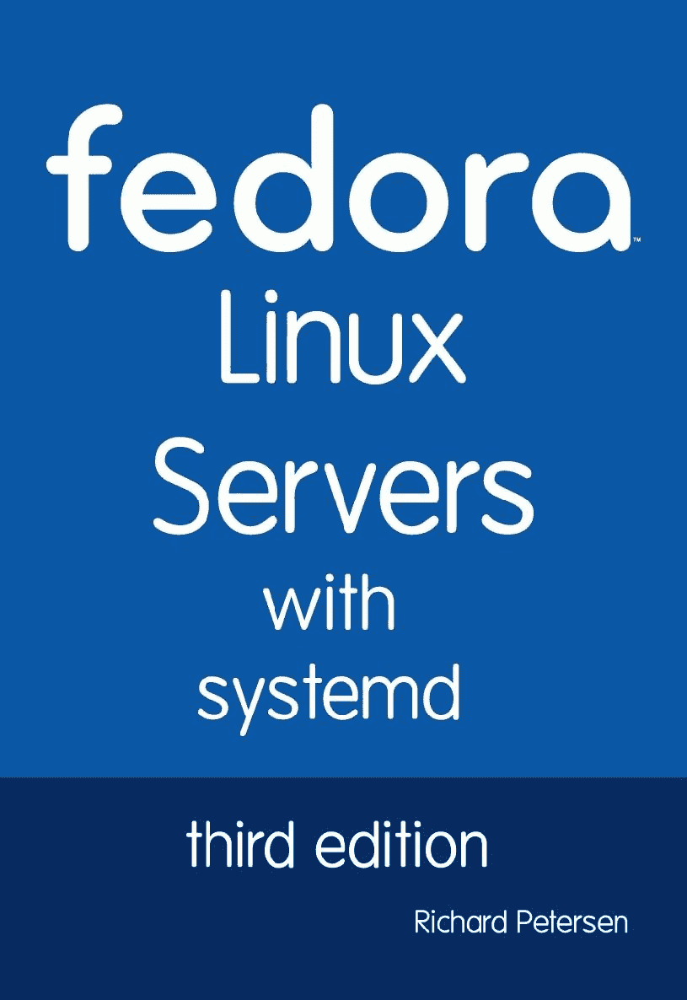


献给 Aleina 和 Larisa，再次同步。


# 前言

本书旨在作为带有 `systemd` 的 Fedora Linux 服务器参考指南。第二版基于 Fedora Linux 28。书中涵盖了管理工具以及底层配置文件和系统实现。重点是管理员执行关键网络和服务器任务时需要了解的内容。涵盖的主题包括 `systemd` 服务管理器、每台服务器的服务和目标文件、服务器角色以及 `FirewallD` 防火墙。检查了关键服务器，包括 Web、FTP、CUPS 打印、NFS 和 `Samba`（Windows 共享）。涵盖的网络支持服务器和应用程序包括 `Squid` 代理服务器、域名系统服务器和 `DHCP`。

本书分为五部分：系统工具、Internet 服务器、共享资源、网络支持和管理主题。

**第一部分**重点关注系统工具，如 `systemd` 服务管理器、`FirewallD` 防火墙和 shell 脚本。“入门”章节涵盖了 GNOME 桌面的基础、软件管理和桌面终端。

**第二部分**检查 Internet 服务器。详细介绍了 `Postfix` 和 `Sendmail` 邮件服务器、`vsftpd` 和 `ProFTPD` FTP 服务器以及 `Apache` Web 服务器的配置与实现。

**第三部分**处理在本地网络或 Internet 上提供共享资源的服务器。检查的服务包括 `Cups` 打印服务器、`NFS` 网络文件服务器、`Samba` Windows 文件和打印服务器以及 `GFS` 分布式文件系统。

**第四部分**涵盖提供网络支持的服务器，如 `Squid` 代理服务器、`Bind` 域名系统 (DNS) 服务器、IPv6 自动配置和 `DHCP` 服务器。

**第五部分**涵盖管理主题，如基础管理任务、配置 配置和 TCP/IP 网络。


要访问硬件时钟，你使用 `hwclock` 命令。命令本身将显示硬件时钟时间。

```
sudo hwclock
```

`--hctosys` 选项将使用硬件时钟的时间设置系统时钟，而 `--systohc` 选项将使用系统时间重置硬件时钟。使用 `--set` 和 `--date` 选项将硬件时钟设置为特定时间。

```
sudo hwclock --systohc
```

### 使用命令行界面编辑文件：文本编辑器

如果你只使用命令行界面，你通常需要直接编辑配置文件来配置你的系统和服务器。你将需要使用基于命令行的编辑器来执行你的编辑任务。大多数命令行编辑器提供一个基于屏幕的界面，使得显示和编辑文件变得相当简单。你的系统中默认安装了两个标准的命令行编辑器：`vi` 和 `nano`。几种常见的命令行文本编辑器列在表 2-1 中。你启动编辑器的命令也是编辑器的名称，且全小小写，例如 `Vi` 编辑器的命令是 `vi`，`Emacs` 编辑器的命令是 `nano` 和 `emacs`。

`vi` 编辑器是大多数 Linux 和 UNIX 系统上使用的标准编辑器。对于习惯了桌面编辑器的人来说，它可能很难使用。`nano` 编辑器易用得多，它具有基于屏幕的界面，你可以用方向键进行导航。如果你还不熟悉 `vi`，你可能想改用 `nano`。

`nano` 编辑器是一个简单的基于屏幕的编辑器，允许你视觉化编辑文件，使用方向键和翻页键在文件中移动。你使用控制键来执行操作。`Ctrl-x` 将退出并提示你保存文件，`Ctrl-o` 将保存它。

| 编辑器 | 描述 |
| :--- | :--- |
| vi | Vi 编辑器，难以使用，被认为是 Linux 和 UNIX 系统上的标准编辑器，默认安装 |
| nano | 易用的基于屏幕编辑器，默认安装 |
| emacs | 强大且复杂的基于屏幕编辑器，尽管比 Vi 更容易用 |
| joe | 类似于 Emacs 的简单基于屏幕编辑器，Universe 仓库 |

表 2-1: 命令行界面文本编辑器

使用 `nano` 命令启动 `nano`。要编辑配置文件，你需要管理员权限。你会使用 `sudo` 命令启动 `nano`。图 2-5 显示了使用 `nano` 编辑器编辑 `/etc/sysconfig/network-scripts/ifcfg-ens3` 文件。要编辑这样的配置文件，你会输入以下内容。

你可能会有帮助的更强大的编辑器是 `vim` 和 `emacs`。`vim` 编辑器提供了比 `vi` 稍微更容易的界面。`Emacs` 提供了类似于 `nano` 但复杂得界面。

(images/00012.jpeg) 图 2-5: 使用 nano 编辑

## Fedora 桌面

Fedora 桌面使用 `GNOME` 作为默认用户界面，尽管 Fedora 也支持 `KDE`（参见[图 2-6]）。`GNOME` 使用概览视图，通过顶部栏左侧的 `Activities` 按钮可以访问窗口、收藏应用程序和工作空间（参见[图 2-7]）。收藏应用程序可以通过概览上的程序栏（左侧）访问。最后一个收藏打开应用程序概览，列出你所有的应用程序。你可以从概览的搜索框（顶部，中央）搜索应用程序和文件。

你可以从应用程序概览访问管理工具。你也可以使用 `GNOME` 管理工具。在 `GNOME` 桌面顶部面板上，点击系统区域菜单（顶部栏右侧）并选择系统设置。

你可以从程序栏上的 `Files` 图标访问你的主目录。文件管理器窗口将显示你的主目录（参见[图 2-8]）。你的主目录已经创建了常用文件的默认目录。这些包括图片、文档、音乐、视频和下载。你的办公应用程序默认将文件自动保存到文档文件夹。图像和照片应用程序会将图像文件放在图片目录。桌面文件夹将包含所有保存到桌面的文件目录。当你下载文件时，它会被放入下载目录。

(images/00013.jpeg) 图 2-6: Fedora GNOME 桌面

(images/00014.jpeg) 图 2-7: GNOME 3 活动 应用程序概览模式


文件管理器窗口显示了几个组件，包括一个结合标题栏和工具栏的标题栏，以及侧边栏。当你打开新目录时，系统将使用同一个窗口显示它，你可以使用向前和向后箭头在之前打开的目录之间移动。标题栏显示了显示当前文件夹及其父文件夹的文件夹按钮。你的 Fedora 文件系统、任何其他本地磁盘、网络存储和 ftp 访问（连接到服务器）都可以从侧边栏的“其他位置”项访问。你可以点击父文件夹以跳转过去。GNOME 文件管理器还支持标签页。你可以在同一个文件管理器窗口中打开多个文件夹。

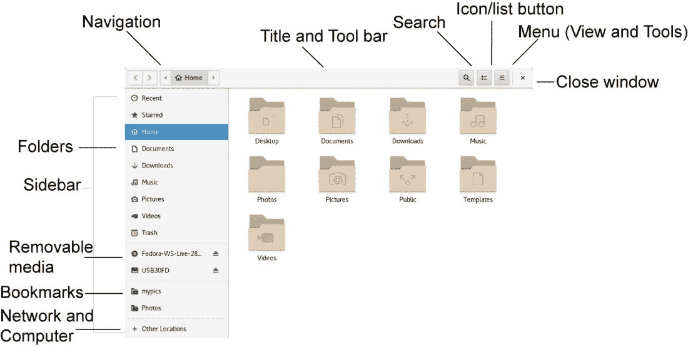

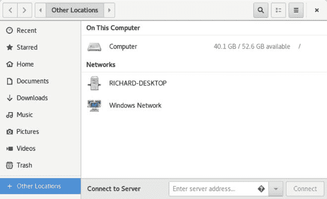 

图 2-8：主文件夹的文件管理器

## 网络连接

你使用网络管理器来配置网络连接。你有两个主要的网络管理器供选择：`NetworkManager` 和 `systemd-networkd`。`NetworkManager` 既有桌面版本，也有命令行版本（`nmcli`）。默认情况下，安装时会激活旧的 `NetworkManager`。`systemd-networkd` 网络管理器是一个新的简单管理器，使用 `systemd` 配置文件。它需要直接编辑配置文件。

网络配置取决于你是通过以太网卡连接局域网 (LAN)，还是使用 DSL 或 ISDN 调制解调器、无线连接或拨号调制连接。表 2-2 列出了几种不同的网络配置工具。

| 网络配置应用 | 说明 |
| :--- | :--- |
| `NetworkManager` | 配置无线和有线网络连接。 |
| GNOME 设置（网络和 Wi-Fi 标签页） | GNOME3 网络工具，用于配置有线和无线网络连接。取代旧的网络连接编辑器（`nm-connections-editor`）。 |
| `cockpit` | 启动和停止服务器，包括网络服务器（Samba 的 `smb`、Web 的 `httpd`、DNS 的 `bind` 和 NFS 的 `nfs`）。 |
| `system-config-firewall` | 使用 `FirewallD` 设置网络防火墙。 |
| `wvdial` | PPP 调制解调连接，在命令行中输入。 |
| `wconfig` | 无线连接，在命令行中输入。 |

表 2-2：Fedora 网络配置工具

### 网络信息：动态与静态

如果你位于网络中，你可能需要获取某些信息来配置接口。大多数网络现在都支持使用旧的动态主机配置协议 (DHCP) 或新的 IPv6 协议及其自动地址配置进行动态配置。在这种情况下，你只需要检查大多数网络配置工具中的 DHCP 条目即可。对于 IPv6，你需要检查 `system-config-network` 设备配置窗口中的 `Enable IPv6` 配置条目。

如果你的网络不支持 DHCP 或 IPv6 自动寻址，你必须提供有关你连接的详细信息。此类连接被称为静态连接，而 DHCP 和 IPv6 连接是动态的。在静态连接中，你需要手动输入连接信息（例如 IP 地址和 DNS 服务器），而在动态连接中，这些信息由 DHCP 服务器自动提供给你的系统，或者在你连接网络时由 IPv6 生成。对于 DHCP，每个主机上的 `DHCP` 客户端将从为该网络的 `DHCP` 服务器获取信息。IPv6 直接根据设备和路由器信息（如设备硬件 MAC 地址）生成其地址。

此外，如果你使用 DSL 动态、ISDN 或调制解调器连接，无论你的系统是动态还是静态，都必须提供提供商、登录名和密码信息。你可能还需要提供特殊信息，例如 DSL 或调制解调器压缩方法、拨号号码或要选择的无线通道。

你可以从网络管理员或 ISP（互联网服务提供商）处获取大部分静态网络信息。你需要以下信息：

- **网络接口的设备名称**：对于局域时间和无线连接，这是网络设备名称，你可以使用 `ifconfig` 或 `ip l` 命令找到它。对于调制解调器、DSL 或 ISDN 连接，这是一个名为 `ppp0` 的 PPP 设备（ISDN 为 `ippp0`）。系统也支持虚拟专用网络 (VPN) 连接。
- **主机名**：你的计算机在互联网上通过此名称进行标识。不要使用 `localhost`；该名称留供你的系统特殊用途。
- **域名**：这是你网络的名称。
- **分配给你的机器的网际协议 (IP) 地址**：仅静态互联网连接需要需要。动态连接使用 DHCP 协议自动为你分配 IP 地址。互联网上的每个主机都分配有一个 IP 地址。传统上，该地址使用 IPv4 格式，由一组用点隔开的四个数字组成，唯一标识互联网上的单个位置，允许来自其他位置的信息到达该计算机。网络现在正在转换为新的 IP 协议版本 6，即 IPv6，它使用具有更复杂编号序列的新格式。
- **你的网络 IP 地址**：仅静态连接。此地址通常与 IP 地址相似，但末尾有一个或多个零。
- **子网掩码**：仅静态连接。对于大多数网络，这通常是 `255.255.255.0`。但如果你是一个大型网络的一部分，请咨询你的网络管理员或 ISP。
- **网络广播地址（可用，可选）**：仅静态连接。通常，你的广播地址与 IP 地址相同，但在末尾加上数字 255。
- **网络网关计算机的 IP 地址**：仅静态连接。这是将你的本地网络到较大网络（如互联网）的计算机。
- **DNS 服务器**：仅静态连接。你的网络使用的 DNS 服务器 IP 地址。这些服务器可以使用 URL。
- **NIS 域和服务器 IP 地址**：如果你的网络使用 NIS 服务器，则需要（可选）。
- **用户登录和密码信息**：动态 DSL、ISDN 和调制解调器连接所需。

### NetworkManager

`Network Manager` 会自动检测你的网络连接，包括有线和无线。它是管理网络连接的默认方法。`Network Manager` 利用 `udev` 的自动设备检测功能来配置你的连接。如果你仍然需要手动配置网络连接，可以使用系统状态栏中的有线和无线选项 `GNOME Network`。

`Network Manager` 是用户特定的。当用户登录时，它会选择该用户优的网络连接。当用户首次运行 `NetworkManager` 时，可以从当前可能的连接列表中进行选择。对于有线连接，可以在系统启动时自动启动。初始设置将从系统级配置提供。

`Network Manager` 可以配置任何网络连接。这包括有线、无线和所有手动连接。网络接口卡（NIC）硬件使用 `udev` 进行检测。`Network Manager` 提供的信息通过 `D-Bus` 可供其他应用程序。

由于用于互联网连接的多个无线访问点，系统可能有多种不同的网络连接供选择，而不是像 DSL 或电缆那样的单线连接。对于在不同位置访问不同无线连接的笔记本电脑来说尤其如此。不需要每次遇到新连接时都手动配置，`Network Manager` 工具可以自动配置并选择要使用的连接。

默认情况下，如果有以太网连接，将是优先的。对于无线连接，你将选择你想要的一个。


Network Manager 设计用于在后台运行，为您的连接提供状态信息，并根据需要从一个配置连接之间进行切换。对于初始配置，它会尽可能地检测有关新连接的信息。

Network Manager 以名为 `NetworkManager` 的守护进程形式运行。如果没有可用的以太网连接，Network Manager 将扫描无线连接，检查扩展服务 set 集标识符 (ESSID)。如果某个 ESSID 识别出之前使用过的连接，则会自动选择它。如果发现了多个连接，则选择最近使用的一个。如果只有新连接可用，则 Network Manager 将等待用户选择一个。只有在用户登录后才会选择连接。如果稍后建立了以太网连接，Network Manager 将从无线连接切换到以太网连接。

可以使用具有管理员权限（sudo）的 `systemctl` 命令来开启或关闭 Network Manager 守护进程。

```bash
sudo systemctl start NetworkManager
sudo systemctl start NetworkManager
sudo systemctl restart NetworkManager
```

## 使用 nmcli 管理网络连接

`nmcli` 命令是 NetworkManager 命令行界面。大多数网络配置任务都可以通过 `nmcli` 完成。`nmcli` 命令通过一组对象管理 Network Manager：通用 (`g`)、网络 (`n`)、无线 (`r`)、连接 (`c`)、设备 (`d`) 和代理 (`a`)。每个对象都可以使用全名或唯一前缀引用，例如 `con` 表示连接，`dev` 表示设备。唯一前缀可以短到单个字符，例如表示通用的 `g`、表示连接的 `c` 或表示设备的 `d`。参见表 2-3 获取对象列表和常用选项。`nmcli` 的帮助页提供了带有示例的完整列表。

通用对象显示 NetworkManager 的当前状态以及启用了哪些设备。你可以使用 `-t`（简洁）和 `-f`（字段）选项限制显示的信息。`STATE` 字段显示连接状态，`CONNECTIVITY` 字段显示连通性。

```bash
$ nmcli general
STATE      CONNECTIVITY WIFI-HW  WIFI     WWAN-HW  WWAN   
connected  full         enabled  enabled  enabled  enabled

$ nmcli -t -f STATE general
connected
```

连接对象引用网络连接，`show` 选项显示该信息。下面的示例显示了您当前的连接。

```bash
nmcli connection show
```

| 对象 | 描述 |
| :--- | :--- |
| general | NetworkManager 状态和启用的设备。使用简洁 (`-t`) 和字段 (`-f`) 选项限制显示的信息。 |
| networking | 管理网络，使用 `on` 和 `off` 开启或关闭网络，使用 `connectivity` 查看连接状态。 |
| radio | 开启或关闭无线网络（on 或 off）。可以开启或关闭特定类型的无线：`wifi`、`wwan`（移动宽带）和 `wimax`。`all` 选项开启或关闭所有无线设备。 |
| connection | 管理网络连接。<br>`show`: 列出连接配置文件。使用 `--active` 仅显示活动连接。<br>`up`: 激活连接<br>`down`: 停用连接<br>`add`: 添加新连接，指定 `type`、`ifname`、`con-name`（配置文件）。<br>`modify`: 编辑现有连接，使用 `+` 和 `-` 为属性添加新值<br>`edit`: 使用交互式编辑器添加新连接或编辑现有连接<br>`delete`: 删除已配置的连接（配置文件）<br>`reload`: 重新加载所有连接配置文件<br>`load`: 重新加载或加载特定配置文件（用于加载新的或修改过的连接配置文件） |
| device | 管理网络接口（设备）。<br>`status`: 显示设备状态<br>`show`: 显示设备信息<br>`connect`: 连接设备<br>`disconnect`: 断开设备连接<br>`delete`: 删除软件设备，如桥接器。<br>`wifi`: 显示可用 wifi 接入点列表<br>`wifi rescan`: 重新扫描接入点并显示接入点<br>`wifi connect`: 连接到 wifi 网络；指定 `password`、`ep-key-type`、`ifname`、`ssid` 和 `name`（配置文件）<br>`wimax`: 列出可用 WiMAX 网络 |
| agent | 作为 Network Manager 密钥或 polkit 代理运行。<br>`secret`: 作为密钥代理，`nmcli` 监听密钥请求。<br>`polkit`: 作为 polkit 代理，它监听所有授权请求。 |

### 表 2-3: nmcli 对象
你可以用 `c` 代替 connection，用 `s` 代替 show。

```bash
$ nmcli c s
NAME                           UUID                                   TYPE      DEVICE
enp7s0                         7202f6d-fc66-4b81-a962-9b7120efc0  ethernet enp7s0
AT&T LTE 1                      6591b399-789a-488c-9559-2ea...      gsm
```

使用通用对象时，你可以使用 `-f` 选项限制显示的字段。以下仅列出名称和类型：

```bash
$ nmcli -f name, type c s
NAME                                            TYPE
enp7s0                          802-3-ethernet
AT&T LTE 1                      gsm
```

添加 `--active` 选项将只显示活动连接。

```bash
nmcli c s --active
```

要启动和停止连接，可以使用类似 `ifconfig` 的 `up` 和 `down` 选项。

```bash
nmcli con up en7s0
```

使用设备对象来管理网络设备。`show` 和 `status` 选项提供有关设备的信息。要查看设备状态：

```bash
nmcli device status
DEVICE          TYPE       STATE
enp7s0          ethernet    connected
wlp6s0          wifi        disconnected
lo              loopback    unmanaged
```

你还可以使用设备对象连接或断开设备。使用 `connect` 或 `disconnect` 选项以及接口名称（`ifname`），在此示例中为 `enp7s0`。

```bash
nmcli device connect eth0
```

要开启或关闭网络，使用 networking 对象以及 `on` 和 `off` 选项。使用 `connectivity` 选项检查连通性。networking 对象本身告诉你是否已启用。

```bash
$ nmcli networking
$ nmcli networking on
$ nmcli networking connectivity
```

如果你只想开启或关闭无线连接，可以使用 radio 对象。对于特定类型的无线连接使用 `wifi`、`wwan`，对于所有无线连接使用 `all`。radio 对象本身显示你所有无线连接的状态。

```bash
$ nmcli radio
WIFI-HW  WIFI     WWAN-HW  WWAN  
enabled  enabled  enabled  enabled

$ nmcli radio wifi on
$ nmcli radio all off
```

要删除已配置的连接（配置文件），可以使用 `delete` 选项。

```bash
nmcli connection delete my-connection
```


enp7s0 f7202f6d-fc66-4b81-8962-69b71202efc0 802-3-ethernet enp7s0

对于 DHCP 连接，请指定配置名称、连接类型和 `ifname`。以下示例创建了一个名为 "my-wired" 的以太网连接。

```
nmcli con add con-name my-wired type ethernet ifname enp7s0
```

对于静态连接，请添加 IP (`ip4` 或 `ip6`) 和网关 (`gw4` 或 `gw6`) 选项及其相应的地址。

```
nmcli con add con-name my-wired-static ifname enp7s0 type ethernet ip4 192.168.1.0/24 gw4 192.168.1.1
```

在大多数情况下，类型是以太网（有线）或 wifi（无线）。查看 `nmcli` 手页以获取其他类型的列表，例如 `gsm`、`infiniband`、`vpn`、`vlan`、`wimax` 和 `bridge`。

你也可以使用交互式编辑器来添加连接。使用 `edit` 代替 `add` 选项，并指定 `con-name`（配置）和连接类型。

```
nmcli con edit type ethernet con-name my-wired
```

要修改现有连接，请使用 `modify` 选项。对于 IP 连接，更改的属性被作为 IP 设置的一部分引用，在本例中为 `ip4`。IP 属性包括地址、网关和方法（`ip4.addresses`、`ip4.gateway` 和 `ip4.method`）。

```
nmcli con mod my-wired ip4.gateway 192.168.1.2
```

要添加或删除属性值，请使用 `+` 和 `-` 符号作为前缀。添加 DNS 服务器地址将使用 `+ip4.dns`。删除一个则使用 `-ip4.dns`。

```
nmcli con mod my-wired +ip4.dns 192.168.1.5
```

你也可以使用交互式编辑器修改连接。使用 `edit` 代替带有连接名的 `modify` 选项。

```
nmcli con edit enp7s0
```

随后你将进入交互式编辑器，显示 `nmcli>` 提示符，并列出你可以更改的设置。`help` 命令列出可用命令。使用 `describe` 命令显示属性描述。

使用 `print` 显示属性的当前值，使用 `set` 更改其值。要查看某个设置的所有属性，请使用 `print` 命令和设置名称。

```
print ipv4
print ipv4.dns
print connection
set ipv4.address 192.168.0.1
```

连接编辑命令还可以使用 `id` 选项引用配置。连接配置信息中的 `Name` 字段与 `ID` 相同。此外，每个配置都分配了一个唯一的系统 `UUID`，它也可以用于引用该配置。

一旦完成连接的编辑，输入 `quit` 命令退出编辑器。

### nmcli 无线连接

要查看你所在区域所有可用 wifi 连接的列表，你可以使用设备对象的 `wifi` 选项。你可以通过添加 `ifname` 选项（如果你有多个接口）以及通过添加 `bssid` 选项（BSSID）来进一步限定。

```
nmcli device wifi
```

要连接到新的 Wifi 网络，使用 `wifi connect` 选项和 `SSID`。你可以进一步指定密码、`wep-key-type`、`key`、`ifname`、`bssid`、`name`（配置名称）以及是否为私有。如果你未提供名称（配置名称），`nmcli` 将为你生成。

```
nmcli dev wifi connect surfturtle password mypass wep-key-type wpa ifname wlp6s0 name my-wireless1
```

要重新连接到之前设置过连接的 Wifi 网络，请使用连接对象配合 `up` 命令以及 `id` 选项指定配置名称。

```
nmcli connection up id my-wireless1
```

你也可以使用连接对象和 `wifi` 类型以及 `ssid` 选项来添加新的无线连接。

```
nmcli con add con-name my-wireless2 ifname wlp6s0 type wifi ssid ssidname
```

然后，要设置加密类型，使用 `modify` 命令设置 `sec.key-mgmt` 属性，对于口令，则设置 `wifi-sec.psk` 属性。

```
nmcli con mod my-wirless2 wifi-sec.key-mgmt wpa-psk
nmcli con modify my-wireless2 wifi-sec.psk mypassword
```

### 使用 GNOME 设置中的 Wi-Fi 和网络标签进行桌面网络配置

在 GNOME 设置对话框中，有一个用于无线配置的 Wi-Fi 标签，和一个用于有线、VPN 和代理配置的网络标签。对于 Wi-Fi，可以从系统状态栏展开的 Wi-Fi 项目中选择“选择 Wi-Fi 设置”，或者点击设置对话框中的 Wi-Fi 标签以打开 Wi-Fi 标签页（参见 图 2-9）。


在 `systemd-networkd.service` 文件中启用了多项安全功能。能力边界集（`CapabilityBoundingSet`）允许你将内核能力限制为指定的项。能力的 man 页列出了所有可用能力。`CAP_NET` 能力将 `networkd` 服务限制为网络操作，如接口配置、防火墙管理、多播播、套接字、广播和代理。`CAP_SET` 能力允许设置文件和进程的 GID 和 UID。`CAP_CHOWN`、`CAP_DAC_OVERRIDE` 和 `CAP_FOWNER` 能力用于处理绕过文件权限检查。该文件中未包含提供系统管理权限的 `CAP_SYS` 能力。此外，`ProtectSystem` 选项（`systemd.exec`）防止服务对系统进行任何更改（`/usr`、`/boot` 和 `/etc` 目录对该服务是只读）。`ProtectHome` 选项使得 `/home`、`/root` 和 `/run/user` 目录不可访问。`WatchdogSec` 设置服务的看门狗超时时间。查看 `systemd.directives` man 页获取所有 systemd 指令的列表。

### systemd-networkd.service

```
[Unit]
Description=Network Service
Documentation=man:systemd-networkd.service(8)
ConditionCapability=CAP_NET_ADMIN
DefaultDependencies=no
# 一旦 tuntap 移动到 netlink，就可以丢掉 systemd-udevd.service
After=systemd-udevd.service network-pre.target systemd-sysusers.service systemd-sysctl.service
Before=network.target multi-user.target shutdown.target
Conflicts=shutdown.target
Wants=network.target

[Service]
Type=notify
Restart=on-failure
RestartSec=0
ExecStart=!!/usr/lib/systemd/systemd-networkd
WatchdogSec=3min
User=systemd-network
CapabilityBoundingSet=CAP_NET_ADMIN CAP_NET_BIND_SERVICE CAP_NET_BROADCAST CAP_NET_RAW
AmbientCapabilities=CAP_NET_ADMIN CAP_NET_BIND_SERVICE CAP_NET_BROADCAST CAP_NET_RAW
ProtectSystem=strict
ProtectHome=yes
ProtectControlGroups=yes
ProtectKernelModules=yes
MemoryDenyWriteExecute=yes
RestrictRealtime=yes
RestrictAddressFamilies=AF_UNIX AF_NETLINK AF_INET AF_INET6 AF_PACKET
SystemCallFilter=~@clock @cpu-emulation @debug @keyring @module @mount @obsolete @raw-io @reboot @swap
SystemCallArchitectures=native
LockPersonality=yes
RuntimeDirectory=systemd/netif
RuntimeDirectoryPreserve=yes

[Install]
WantedBy=multi-user.target
Also=systemd-networkd.socket
Alias=dbus-org.freedesktop.network1.service
Also=systemd-networkd-wait-online.service
```

`systemd-networkd.socket` 文件为 `systemd.socket` 设置了用于缓冲区大小（`ReceiveBuffer`）、网络链路（`ListenNetlink`）和传递凭据（`PassCredentials`）的选项。作为启动服务的条件，需要在能力边界集（`ConditionCapability`）中设置 `CAP_NET_ADMIN` 能力。

### systemd-networkd.socket

```
[Unit]
Description=Network Service Netlink Socket
Documentation=man:systemd-networkd.service(8) man:rtnetlink(7)
ConditionCapability=CAP_NET_ADMIN
DefaultDependencies=no
Before=sockets.target

[Socket]
ReceiveBuffer=8M
ListenNetlink=route 1361
PassCredentials=yes

[Install]
WantedBy=sockets.target
```

`systemd-resolved.service` 提供了 `resolvconf` 操作（DNS 服务器信息）。它与 `systemd-neworkd.service` 具有相同的能力，网络能力除外。

### systemd-resolved.service

```
[[Unit]
Description=Network Name Resolution
Documentation=man:systemd-resolved.service(8)
Documentation=https://www.freedesktop.org/wiki/Software/systemd/resolved
Documentation=https://www.freedesktop.org/wiki/Software/systemd/writing-network-configuration-managers
Documentation=https://www.freedesktop.org/wiki/Software/systemd/writing-resolver-clients
DefaultDependencies=no
After=systemd-sysusers.service systemd-networkd.service
Before=network.target nss-lookup.target shutdown.target
Conflicts=shutdown.target
Wants=nss-lookup.target

[Service]
Type=notify
Restart=always
RestartSec=0
ExecStart=!!/usr/lib/systemd/systemd-resolved
WatchdogSec=3min
User=systemd-resolve
CapabilityBoundingSet=CAP_SETPCAP CAP_NET_RAW CAP_NET_BIND_SERVICE
AmbientCapabilities=CAP_SETPCAP CAP_NET_RAW CAP_NET_BIND_SERVICE
PrivateTmp=yes
PrivateDevices=yes
ProtectSystem=strict
ProtectHome=yes
ProtectControlGroups=yes
ProtectKernelTunables=yes
ProtectKernelModules=yes
MemoryDenyWriteExecute=yes
RestrictRealtime=yes
RestrictAddressFamilies=AF_UNIX AF_NETLINK AF_INET AF_INET6
SystemCallFilter=~@clock @cpu-emulation @debug @keyring @module @mount @obsolete @raw-io @reboot @swap
SystemCallArchitectures=native
LockPersonality=yes
RuntimeDirectory=systemd/resolve
RuntimeDirectoryPreserve=yes

[Install]
WantedBy=multi-user.target
Also=systemd-networkd.socket
Alias=dbus-org.freedesktop.network1.service
Also=systemd-networkd-wait-online.service
```


你也可以在 `systemd-networkd` 上使用 `start`、`stop` 和 `restart` 命令来启动、停止和重启网络。

```
sudo systemctl start systemd-networkd
```

```
sudo systemctl stop systemd-networkd
```

```
sudo systemctl restart systemd-networkd
```

如果你正在运行桌面环境并选择使用 `systemd-networkd`，你会发现面板中的 `nm-applet` 不再运行了。

### 可预测与不可预测的网络设备名称

网络设备现在使用一种可预测的命名方法，这与旧的命名方法不同。名称是根据特定的设备引用的网络设备类型、其硬件连接和插槽，甚至是其功能生成的。传统的网络设备名称对于以太网设备使用 `eth` 前缀加上设备编号。名称 `eth0` 这种名称指的是你计算机上的第一个以太网连接。这种命名方法被认为是不可预测的，因为它没有准确地引用真实的以太网设备。旧系统依赖于启动时探测网络驱动程序，如果你的系统有多个以太网连接，取决于启动过程如何进行，名称可能会发生交换。在当前版本的 `systemd udev` 中，命名使用一种指定特定设备的可预测方法。这种可预测方法引用你系统上的实际硬件连接。

| 名称 | 描述 |
| :--- | :--- |
| en | 以太网 |
| sl | 串行线路 IP (slip) |
| wl | wlan,无线局域网 |
| ww | wwan, 无线广域网（移动宽带） |
| p | pci 地理位置 (pci-e 插槽) |
| s | 热插槽索引号 |
| o | 板载卡 |
| f | 功能（用于具有多个端口的卡) |
| u | USB 端口 |
| i | USB 端口接口 |

表 2-4: 网络接口设备命名

用于引用可预测网络设备名称的名称具有设备类型的前缀，随后跟有若干限定符，例如硬件类型、使用的插槽和功能号。不再使用旧的不可预测名称（如 `eth0`），第一个以太网设备通过类似 `enp7s0` 的名称进行引用。接口名称 `enp7s0` 引用的是一个以太网 (`en`) 连接，位于 pci 插槽 7 (`p7`)，热插槽索引号为 0 (`s0`)。`wlp6s0` 是一个无线 (`wl`) 连接，位于 pci 插槽 6 (`p6`)，热插槽索引号为 0 (`s0`)。`virvb0` 是一个虚拟 (`vir`) 网桥 (`vb`) 网络接口。[表 2-4 列出了可预测命名前缀]。

与旧的不可预测名称不同，可预测名称对于每台计算机很可能不同。可预测网络名称及其替代方案在以下处讨论：

[`www.freedesktop.org/wiki/Software/systemd/PredictableNetworkInterfaceNames/`](https://www.freedesktop.org/wiki/Software/systemd/PredictableNetworkInterfaceNames/)

命名由内核执行，并在内核源码 `systemd/src/udev/udev-bultin-net_id.c` 文件的注释部分描述。

### 网络设备路径名称

目录 `/sys/devices` 以子目录列出了你所有的设备，包括你的网络设备。设备的路径通过以连接设备总线命名的子目录逐深入。为了快速找到完整路径名称，可以使用 `/sys/class` 目录。对于网络设备，使用 `/sys/class/net`。然后使用 `ls -l` 命令列出网络设备及其到 `/sys/devices` 目录中完整路径的链接（`../..` 路径引用向上切换两个目录（`class/net`）到达 `/sys` 目录）。

```bash
cd /sys/class/net
```

```bash
ls
enp7s0  lo  wlp6s0
```

```bash
ls -l
total 0
lrwxrwxrwx 1 root root 0 Feb 19 12:27 enp7s0 -> ../../devices/pci0000:00/0000:00:1c.3/0000:07:00.0/net/enp7s0
lrwxrwxrwx 1 root root 0 Feb 19 12:27 lo -> ../../devices/virtual/net/lo
lrwxrwxrwx 1 root root 0 Feb 19 12:28 wlp6s0 -> ../../devices/pci0000:00/0000:00:1c.2/0000:06:00.0/net/wlp6s0
```

因此 `/sys/devices` 目录中 `enp7s0` 的完整路径名称为：

`/sys/devices/pci0000:00/0000:00:1c.3/0000:07:00.0/net/enp7s0`

你可以使用 `lspci` 命令找到使用的 pci 总线插槽。该命令列出了你所有的 pci 连接设备。在示例中，使用的 pci 总线插槽是 7，这就是为什么名称 `enp7s0` 的 pci 部分是 `p7`。`s` 部分指的是热插槽，在本示例中为 `s0`。

```bash
lspci
06:00.0 Network controller: Qualcomm Atheros QCA9565 / AR9565 Wireless Network Adapter (rev 01)
07:00.0 Ethernet controller: Realtek Semiconductor Co., Ltd. RTL8101/2/6E PCI Express Fast/Gigabit Ethernet controller (rev 07)
```

设备具有由 `udev` 定义的某些属性，`udev` 管理所有设备。某些操作（例如 systemd link 文件）使用了这些属性。`ID_PATH`、`ID_NET_NAME_MAC` 和 `INTERFACE` 属性可向 `udev` 标识设备。要显示这些属性，你使用 `udevadm` 命令查询 udev 数据库。通过 `info` 和 `-e` 选项，显示所有活动设备的属性。你可以将此输出管道 (`|`) 到 `grep` 命令以仅显示特定设备的属性。在以下示例中，列出了 `enp7s0` 设备的属性。特定设备的属性之前有一行，以 "P" 开头 (`^`) 并以设备名称结尾。`.*` 匹配字符匹配该行上所有其他中间字符，`^P.*enp7s0`。`-A` 选项显示匹配项后指定数量的额外行，`-A 22`。

```bash
udevadm info -e | grep -A 22 ^P.*enp7s0
P: /devices/pci0000:00/0000:00:1c.3/0000:07:00.0/net/enp7s0
E: DEVPATH=/devices/pci0000:00/0000:00:1c.3/0000:07:00.0/net/enp7s0
E: ID_BUS=pci
E: ID_MM_CANDIDATE=1
E: ID_MODEL_FROM_DATABASE=RTL8101/2/6E PCI Express Fast/Gigabit Ethernet controller
E: ID_MODEL_ID=0x8136
E: ID_NET_DRIVER=r8169
E: ID_NET_LINK_FILE=/lib/systemd/network/99-default.link
E: ID_NET_NAME_MAC=enx74e6e20ec729
E: ID_NET_NAME_PATH=enp7s0
E: ID_OUI_FROM_DATABASE=Dell Inc.
E: ID_PATH=enp7s0
E: ID_PATH_TAG=pci-0000_07_0
E: ID_PCI_CLASS_FROM_DATABASE=Network controller
E: ID_PCI_SUBCLASS_FROM_DATABASE=Ethernet controller
E: ID_VENDOR_FROM_DATABASE=Realtek Semiconductor Co., Ltd.
E: ID_VENDOR_ID=0x1ec
E: IFINDEX=2
E: INTERFACE=enp7s0
E: SUBSYSTEM=net
E: SYSTEMD_ALIAS=/sys/subsystem/net/devices/enp7s0
E: TAGS=:systemd:
E: USEC_INITIALIZED=108179
```

对于某些任务（例如重命名），你可能需要知道 MAC 地址。你可以通过 `ip link` 命令找到它，该命令可以缩写为 `ip l`。MAC 地址位于 `brd` 字符串之前。在本示例中，`enp7s0` 的 MAC 地址是 `74:e6:e2:0e:c7:29`。`ip link` 命令还提供 MTU（最大传输单元）和连接的当前状态。

### 使用 udev 规则重命名网络设备

如果你更改了硬件，例如带有以太网连接的主板，或者如果你使用以太网卡并简单更改连接它的插槽，那么名称将会改变。对于引用特定以太网连接的防火墙规则，这可能会是一个问题。如果你愿意，可以将名称更改为自行选择的名称，甚至可以使用旧的不可预测名称。这样，你只需要更新名称更改处，而不是更新所有通过名称引用网络设备的规则和任何代码。


你可以通过为网络设备添加用户 udev 规则来更改设备名称。通过 udev 规则进行的更改同时适用于 NetworkManager 和 `systemd-networkd`。在 `/etc/udev/rules.d` 目录下，创建一个以 `.rules` 扩展并以小于 80 的数字开头的文件，例如 `70-my-net-names.rules`。`/etc/udev/rules.d` 中的 `.rules` 文件优先级高于 udev 系统目录 `/lib/udev/rules.d` 中的文件。

在 udev 规则中，识别子系统为 `net`（`SUBSYSTEM=="net"`），执行的操作为 `add`（`ACTION=="add"`），然后是 MAC 地址地址属性（`ATTR{address}`）。使用 `ip link` 获取 MAC 地址。MAC 地址也会列在 `udevadm info` 输出的 `ID_NET_NAME_MAC` 条目中（确保删除前缀并添加中间的冒号）。使用 `NAME` 字段来指定设备的新名称。使用单个 `=` 运算符进行名称赋值。

```bash
/etc/udev/rules.d/70-my-net-names.rules
SUBSYSTEM=="net", ACTION=="add", ATTR{address}=="74:e6:e2:0e:c7:29", NAME="eth0"
```

为了进一步指定设备，你可以添加设备的内核名称（`KERNEL`）。内核名称是 `INTERFACE` 条目。

```bash
SUBSYSTEM=="net", ACTION=="add", ATTR{address}=="74:e6:e2:0e:c7:29", KERNEL=="enp7s0", NAME="eth0"
```

### 使用 systemd.link 为 systemd-networkd 重命名网络设备名称

`systemd-networkd` 管理器提供了更改网络设备名称的另一种方法（请记住 udev 规则同样适用于 `systemd-networkd`）。要更改名称，你需要在 `/etc/systemd/network` 目录下设置一个 systemd link 文件。`systemd.link` 手页显示了如何这样做。一个 systemd link 文件由 `Match` 和 `Link` 部分组成。在 `Match` 部分中，你指定网络设备，在 `Link` 部分中指定你想给它指定的名称。网络设备可以通过其预测名称（`Path`）或 MAC 地址（`MACAddress`）引用。

默认的 systemd link 文件是 `/lib/systemd/network/99-default.link`。该文件只有一个 `Link` 部分，列出了在确定名称时使用的策略。`NamePolicy` 列出了要检查的策略，从内核开始，然后是 udev 数据库、udev 固件板信息、udev 热插插槽信息以及设备路径。在大多数情况下，使用的是插槽策略。`MACAddressPolicy` 被设置为持久性（persistent），适用于具有或需要固定 MAC 地址的设备。

```ini
99-default.link
[Link]
NamePolicy=kernel database onboard slot path
MACAddressPolicy=persistent
```

要重命名设备，你需要在 `/etc/systemd/network` 目录下设置一个 systemd link 文件。`/etc/systemd` 目录优先级高于 `/lib/systemd` 目录。link 文件由优先级数字、任意名称和 `.link` 扩展组成。数字越小优先级越高。在这个例子中，网络设备 `enp7s0` 的名称被更改为 `eth0`。`Match` 部分使用 `Path` 键匹配设备路径，使用 udev 提供的 `ID_PATH` 属性。

你可以使用 `udevadm info` 命令查询 udev 数据库获取有关网络设备的信息并匹配设备。添加 `ID_PATH=` 的 `grep` 操作将只显示 `ID_PATH` 属性。

```bash
$ udevadm info -e | grep -A 22 ^P.*enp7s0 | grep ID_PATH=
E: ID_PATH=pci-0000:07:00.0
```

对于 `Path` 键，使用 udev 的 `ID_PATH` 值和 `*` 通配符字符匹配路径的其余部分。`Link` 部分使用 `Name` 键指定新名称。`MacAddressPolicy` 应该设置为持久性，表示固定连接。以小于 99 的数字开头 link 文件名，以便其优先级高于 `99-default.link` 文件。

```ini
10-my-netname.link
[Match]
Path=pci-0000:07:00.0-*
[Link]
Name=eth0
MacAddressPolicy=persistent
```

除了 `Path` 键，你也可以使用 `MACAddress` 键匹配网络设备的硬件地址。MAC 地址是去除了前缀并用冒号分隔的 udev `ID_NET_NAME_MAC` 属性。示例中的 MAC 地址是 `74:e6:e2:0e:c7:29`。你也可以使用 `ip link` 查找 MAC 地址（`brd` 之前的数字）。

```ini
10-my-netname.link
[Match]
MACAddress=74:e6:e2:0e:c7:29
[Link]
Name=eth0
MacAddressPolicy=persistent
```

或者，你可以在 `Match` 部分使用 `OriginalName` 键代替 `Path`。原始名称是 udev 的 `INTERFACE` 属性，这也是 `ifconfig` 显示的设备名称。

```ini
10-my-netname.link
[Match]
OriginalName=enp7s0*
[Link]
Name=eth0
MacAddressPolicy=persistent
```

### 管理软件

从桌面安装软件，你可以使用 `PackageKit` 或 `GNOME Software`。


GNOME Software 是一个 `DNF` 的桌面软件管理前端。GNOME Software 软件管理器基于互联网，通过从在线存储库进行安装，并使用 `DNF` 进行下载和安装。它被设计为一种跨发行版的包管理器，可以用于任何支持 `DNF` 的 Linux 发行版。

GNOME Software 执行各种不同的软件任务，包括安装、删除、更新以及单个 `RPM` 文件的安装。GNOME Software 名为 `gnome-software`，可以在应用程序概览中通过“Software（软件）”访问。

 

图 2-12：GNOME Software

GNOME Software 目前的设计用于安装客户端级应用程序和系统级应用程序。它不安装服务器端软件，例如 `DNS` `named` 服务器或 `Apache` Web 服务器。它也不安装许多较旧的系统配置工具，例如 `system-config-samba` 或 `system-config-lvm`。要管理此类软件，你必须安装旧版的 `system-config-packages` 软件管理器，它在 GNOME Software 中名为“Packages（软件包）”。

要使用 GNOME Software，请点击应用程序概览上的“Software”图标。GNOME Software 将通过收集你所有软件包的信息来启动。打开一个窗口，顶部有三个标签页：`All（全部）`、`Installed（已安装）` 和 `Updates（更新）`。你可以从 `All` 标签安装应用程序，该标签顶部显示一个用于搜索的文本框、一个列表、推荐应用程序以及一系列分类按钮（参见图 2-12）。

### PackageKit

`PackageKit` 是一个旧版的 `DNF` 软件管理前端。`PackageKit` 软件包管理器（`Packages`）基于互联网，通过从在线存储库进行安装，并使用 `DNF` 进行下载和安装。它被设计为一种跨发行版的包管理器，可以用于任何支持 `DNF` 的 Linux 发行版。

要使用 `PackageKit`，请点击应用程序概览上的“Packages”图标。`PackageKit` 将通过收集你所有软件包的信息来启动。打开一个 `Software`窗口，带有一个用于搜索的侧边栏和分类列表（参见图 2-13）。在安装软件包之前，建议先刷新你的软件列表。这是你启用的存储库中可用的软件包列表。从 `PackageKit` GNOME 应用程序菜单中选择“Refresh Package Lists（刷新软件包列表）”。

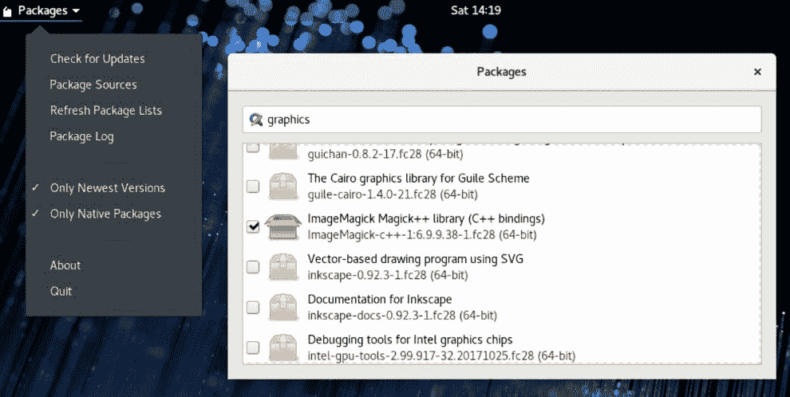 

图 2-13：软件，`PackageKit` (`Packages`）

你可以通过选择侧边栏上的分类来按分类查找软件包。该分类下的所有软件包都会被列出来。未安装的软件包图标为淡色，并带有一个空复选框，而已安装的软件包显示为实色，并在复选框中有一个勾选标记。分类允许你浏览软件，查看适用于不同类型任务或功能的哪些可用软件，例如多媒体应用程序或专为 GNOME 桌面设计的应用程序。

要安装软件包，首先，点击它的复选框（参见图 2-14）。框被勾选，软件包图标上会出现一个加号。你可以点击多个软件包来选择安装。当你准备好安装时，点击`Apply Changes（应用更改）`按钮（右上角）。底部的状态栏将显示正在执行的任务，从下载开始，然后安装，最后完成。

进度条将显示安装任务的进度。`PackageKit` 消息显示在右上角。在下载阶段，`Cancel（取消）`按钮将变为激活，允许你取消安装。一旦完成，软件包图标颜色将从淡色变为实色，并在复选框中显示勾选标记。如果你想要安装的软件需要依赖或额外的软件包，这些软件包将被列出，并提示你确认安装。点击`Continue（继续）`。每当你点击 `Apply Changes` 安装软件包时，都会提示你输入 root 用户密码以授权安装。

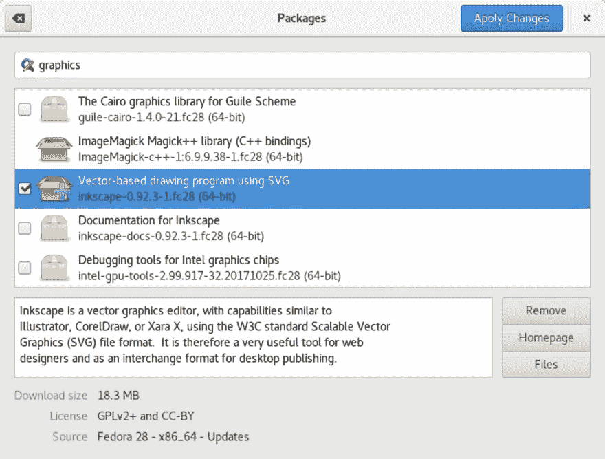

图 2-14：软件包信息

### 更新 Fedora

Fedora 新版本大约每六月发布一次。在此期间，特定的软件软件包不断准备新更新。这些更新以更新的形式发布，你可以从软件存储库下载并安装到你的系统中。这些包括应用程序、服务器甚至内核的新版本。此类更新可能从单个软件包到整个组件不等。

使用自动更新工具，更新 Linux 系统已变成一个非常简单的程序。对于 Fedora，你可以访问支持 `DNF` (Dandified YUM) 更新方法的软件存储库来更新系统。`DNF` 使用 `RPM` 头来确定哪些软件包需要更新。从命令行，你可以使用 `dnf upgrade` 命令执行更新。

在 Fedora 桌面上，你可以使用 GNOME Software 的 `Updates` 标签页进行更新（默认设置），或者使用较旧的 `Software Update（软件更新）`。`Software Update` 是 `PackageKit` 软件管理器的一部分，并随着 `PackageKit` 一起安装。`PackageKit` 默认安装。GNOME Software 上 `PackageKit` 的名称简单为 `Packages`。

如果检测到更新，GNOME Software 将消息栏中显示更新消息（参见图 2-15）。点击通知将打开 GNOME Software 并进入 `Updates` 标签页。


图 2-15：更新消息和图标

#### 使用 dnf 命令更新

要执行所有软件包的完整更新，使用 `dnf` 命令配合 `upgrade` 选项。这将产生更新的效果。

```bash
sudo dnf upgrade
```

你可以使用 `check-update` 选项查看哪些软件包需要更新。

```bash
dnf check-update
```

你可以使用 `updateinfo` 选项查看需要更新的信息。如果不带选项，将列出更新种类。使用 `--list` 选项将显示要更新的软件包。有关每个更新的详细信息，使用 `--info` 选项。

```bash
dnf updateinfo
dnf updateinfo --list
dnf updateinfo --info
```

你也可以更新单个或一组软件包。以下命令将更新已安装的 `vsftpd` 软件包。

```bash
sudo dnf upgrade vsftpd
```

#### 自动 D 更新

如果你希望自动更新，可以安装 `dnf-automatic` 软件包。该软件包为三种更新选项提供了定时和服务：`notifyonly`、`download` 和 `install`。`download` 选项仅通知并下载。`install` 选项通知、下载并安装。要指定选项，你需要启用并启动相应的定时器。这三个定时器为：

`dnf-automatic-notifonly.timer`
`dnf-automatic-download.timer`
`dnf-automatic-install.timer`

要选择下载和通知选项，你在终端窗口中输入：

```bash
sudo systemctl enable dnf-automatic-download.timer
sudo systemctl start dnf-automatic-download.timer
```

要通知、下载并安装，请启动安装定时器。

```bash
sudo systemctl start dnf-automatic-install.timer
```

当从一个选项切换到另一个时，务必禁用当前的。

```bash
sudo systemctl disable dnf-automatic-install.timer
sudo systemctl enable dnf-automatic-notifonly.timer
sudo systemctl start dnf-automatic-notifonly.timer
```

`dnf-automatic` 的配置位于 `/etc/dnf/automatic.conf` 文件。`updates`、`download_updates` 和 `apply_updates` 的默认项会被你启用的定时器覆盖。你可以自定义其他条目，例如邮件通知。查看 `dnf.automatic` 的手册页以获取配置详细信息。


# 服务器角色

服务器角色（Server roles）旨在安装并自动配置专用服务器。你可以将它们理解为一种更复杂的软件包。与其先为特定服务器安装组合包然后再进行配置，不如直接安装一个服务器角色，以安装所有预配置的包。

你使用 `rolekit` 和 `rolectl` 命令来管理角色。可以通过 `Packages` 或使用 `dnf` 命令安装 `rolekit` 软件包（Fedora 服务器已预安装该包）。`rolekit` 的 man 页提供了相关描述。`rolekit` 包会在 `/usr/lib/rolekit/roles` 目录下为支持的角色服务器安装角色配置文件。目前这些角色包括 `databaseserver`（PostgreSQL 服务器）、`domaincontroller`（域控制器）和 `memcache`。`/usr/lib/rolekit/roles` 目录为每个角色都有一个子目录。其他角色将在可用后添加。你也可以使用 `rolekit` 创建角色。

## 管理角色

使用 `rolectl` 命令管理角色。`list roles` 选项会列出你可用的角色。查看 `rolectl` 的 man 页以获取选项的详细说明。

```bash
rolectl list roles
```

`databaseserver`

`domaincontroller`

`memcache`

可以使用 `settings` 选项列出角色的当前设置。

```bash
rolectl settings databaseserver
```

使用 `list instances` 选项列出已部署的实例（即通过 `rolekit` 安装的服务器）。

```bash
rolectl list instances
```

使用 `deploy` 选项安装服务器。

```bash
sudo rolectl deploy databaseserver
```

部署可能需要很长时间。要监控进度，请运行：

```bash
journalctl -ef -u rolekit
```

success

```bash
sudo rolectl list instances
```

`databaseserver/1`

一个服务器角色至少包含一个实例。某些角色（如 `databaseserver` 角色）允许多个实例，而其他角色（如 `domaincontroller`）仅允许。你可以拥有多个 `databaseserver` 角色的实例，每个实例可能有不同的配置。当你部署一个实例时，它会在 `/etc/systemd/system` 中创建一个对应的 systemd target 文件。该 `.target` 文件带有 "role-databaseserver" 前缀。在本示例中，部署了一个名为 `newserver` 的 `databaseserver` 角色实例，这会在 `/etc/systemd/system/` 目录下为其创建一个 `role-databaseserver-newserver.target` 文件。该 target 文件连接到 `/lib/systemd/system`目录中的 `postgresql.service` 文件。

```ini
role-databaseserver-newserver.target

[Unit]
Description=Database Server Role - newserver
Requires=postgresql.service
After=syslog.target
After=network.target
RequiredBy=postgresql.service
BindsTo=postgresql.service

[Install]
WantedBy=multi-user.target
```

如果你部署 `domaincontroller` 角色，它的实例在 `/etc/systemd/system` 中也会有一个角色 target 文件。该 target 文件将连接到 `/lib/systemd/system` 中的 `ipa.service` 文件。

使用特定实例启动服务器，你需要使用 `systemctl` 命令和实例的 target 文件。请确保在实例名中包含 `.target` 扩展名。

```bash
systemctl start role-databaseserver-newserver.target
```

部署后，该实例的角色配置文件将设置在 `/etc/rolekit/roles` 目录下角色的子目录。文件使用 JSON（JavaScript 对象表示）格式，并以实例名加上 `.json` 扩展名命名，例如 `1.json`。JSON 语句具有键值对结构。

你可以编辑 JSON 配置文件为不同的服务器实例设置用户选项。`databaseserver` 角色支持数据库名称、密码和所有者的用户选项。`domaincontroller` 角色支持主机名和域名、管理员密码、主 IP 地址和 DNS 转发器地址等选项。查看服务器角色的 man 页以获取详情（`rolekit.roles.domaincontroller` 和 `rolekit.roles.databaseserver`）。

你可以在部署角色实例时设置选项。使用 `rolectl` 命令的 `--settings-file` 选项来指定你列出选项及其值的 json 文件。用引号指定选项名称，后跟一个冒号，然后是你想要给该选项的值（也用引号）。选项列表被包裹在大括号中。以下显示了在名为 `myserver-options.json` 的文件中列出的 `databaseserver` 角色的选项（该文件可以是任何名称，但需要 `.json` 扩展名）。你可以使用 `gedit` 文本编辑器创建一个 json 文件并以 `.json` 扩展名保存文件。

```json
myserver-options.json
{
  "database": "myserver",
  "owner": "richard"
}
```

接下来使用带有用户指定选项的 json 文件安装数据库服务器实例。

```bash
rolectl deploy databaseserver --settings-file /home/richard/myserver-options.json
```

如果未为数据库选项赋值，则数据库名称将自动设置为实例名称。如果没有为实例指定名称，则数据库实例名称将设置为从 1 开始的实例数字，并带有 `db_` 前缀。第二个实例的 `/etc/rolekit/roles/databaseserver` json 文件将命名为 `2.json`，如果没有设置数据库选项，数据库将命名为 `db_2`。

要指定实例名称，使用 `rolectl` 命令的 `--name` 选项。json 配置文件将具有该名称，并且如果没有由用户设置指定，数据库也将具有该名称。在以下示例中，配置文件为 `newserver.json`，数据库将为 `newserver`。

```bash
rolectl deploy databaseserver --name newserver
```

用户选项具有优先级。在本示例中，配置文件为 `newserver.json`，但数据库名称为 `myserver`。

```bash
sudo rolectl deploy databaseserver --name newserver --settings-file /home/richard/myserver-options.json
```

你可以使用 `decommission` 角色/实例选项来移除实例。用斜杠分隔角色名和实例名。注销将移除角色 `/etc/rolekit/roles` 目录下的配置文件。在接下来的示例中，`/etc/rolekit/roles/databaseserver` 目录下的 `1.json` 文件将被移除。

```bash
sudo rolectl decommission databaseserver/1
```


你可以根据需要打开任意数量的终端窗口，每个窗口都在自己的 shell 中运行。无需为每个新 shell 打开单独的窗口，而是可以使用标签页（tabs）在同一个窗口中打开多个 shell。从 `File` 菜单中选择 `Open Tab` 可以打开新标签页（`Shift-Ctrl-t`）。每个标签页都运行一个独立的 shell，允许你在每个标签中输入不同的命令。你可以使用 `Tabs` 菜单切换到不同的标签，或者直接点击对应的标签进行选择。只有在打开了多个标签页时，菜单栏才会显示 `Tab` 菜单。对于单个窗口，则不显示 `Tab` 菜单。

终端窗口还支持 GNOME 桌面的剪切/复制/粘贴操作。你可以从网页上复制一行，然后将其粘贴到终端窗口（你可以使用终端窗口 `Edit` 菜单上的 `Paste` 选项，或按 `Shift-Ctrl-v`）。命令将会出现，然后你可以按 `ENTER` 执行该命令。这对于说明性网页上显示的命令行操作非常有用。你不需要手动输入复杂的命令，只需直接从网页选择并复制，然后粘贴到终端窗口即可。如果需要，你可以在执行之前对命令进行任何编辑。

你可以使用配置（profiles）来自定义终端窗口。系统已设置了一个默认配置。要自定义你的终端窗口，从 `Edit` 菜单中选择 `Preferences`。这将打开一个窗口用于设置默认配置选项，侧边栏有 `Global` 和 `Profiles` 选项分类。在 `Profiles` 部分会有一个名为 `"Unnamed"` 的配置，它是默认配置。点击右侧的下拉菜单按钮，可以打开一个包含复制配置或更改名称选项的菜单。要添加另一个配置，点击 `Profiles` 标题右侧的加号按钮，即可打开创建新配置的对话框。对于你创建的配置，你还拥有删除它们或将其中设置为默认配置的额外选项。选中的配置显示 `Text`、`Colors`、`Scrolling`、`Command` 和 `Compatibility` 标签。在 `Text` 标签页中，你可以选择终端窗口的文本行和列的默认大小。

你的终端窗口将配置为使用深色背景和白色文字。要更改此设置，你可以编辑配置，在 `Colors` 标签页中更改背景和文本颜色。取消勾选 `"Use colors from system theme"` 项。这将启用 `"Built-in schemes"` 菜单，你可以从中选择 `"Black on white"` 显示。列表中还列出了其他颜色组合，例如 `"Black on light yellow"` 和 `"Green on black"`。`Custom` 选项允许你选择自己的文本和背景颜色。打开的终端窗口上的颜色将根据你的选择发生变化，让你看到颜色选择的效果。对于透明背景，选择 `"Use transparent background"` 项，然后设置阴影程度（none 为完全透明，full 则不透明）。

`Scrolling` 标签指定终端历史保留的命令行数，以及其他滚动选项，如滚动速度和是否显示滚动条。这些是你可以回溯并选择重新执行的行。你可以取消勾选 `Limit scrollback` 选项将其设置为无限制，以保留所有命令。

你可以创建带有自定义偏好的新配置。要创建新配置，从 `File` 菜单中选择 `New Profile` 以打开 `New Profile` 窗口，你可以在其中输入配置名称并选择任何现有配置作为基础。初始会选择默认配置。使用 `Terminal` 菜单上的 `Change Profile` 子菜单来切换配置。要要编辑特定配置，从 `Edit` 菜单中选择 `Preferences` 打开 `Preferences` 窗口，然后在 `Profiles` 部分点击你想要的那项。

## 受控的管理员访问：sudo 和 su

要执行系统管理操作，你必须是具有管理权限的用户。此时，你可以从任何账户访问特定任务的管理工具，临时获得仅用于该管理操作的超级用户权限。拥有管理权限后，你可以执行诸如启动和关闭系统、添加或删除用户、格式化文件系统、备份和恢复文件，你还可以指定系统的主机名。

你使用 `sudo` 命令来执行具有管理权限的操作。通过 `sudo` 工具，你可以允许普通用户对某些任务拥有有限的 root 用户级管理权限。这允许其他用户在没有完全 root 级控制的情况下执行特定的超级用户操作。你可以在 [`www.sudo.ws`](https://www.sudo.ws) 更多关于 `sudo` 的信息。要使用 `sudo` 运行命令，在命令前加上 `sudo`。系统会提示你输入 root 密码，这将授予在几分钟内有效的访问。

```bash
sudo date
Password:
```

与早期的 Fedora 版本不同，`sudo` 命令已经为你配置好并准备可用。它被认为是运行具有管理权限命令的首选方法。尽管如此，如果你需要，仍然可以使用 `su` 命令。

注意：系统安全服务守护进程（SSSD）为依赖远程认证（如 LDAP 服务器）的用户提供离线访问。`SSSD` 会缓存验证方法，允许你离线登录。在 `SSSD` 出现之前，用户必须维护相应的本地账户以便在离线时获得访问。`SSSD` 默认安装。你通过 `sssd.service` 文件对其进行管理。配置文件位于 `/etc/sssd`。更多信息请参阅 [`fedoraproject.org/wiki/Features/SSSD`](https://fedoraproject.org/wiki/Features/SSSD)。

### 使用管理权限运行桌面应用程序

在 Fedora Workstation（桌面）上，Wayland 桌面服务器不允许 root 访问如 `leafpad` 和 `gedit` 等图形工具，以及某些旧的管理工具如 `system-config-selux`。这些许多图形工具是为 X 服务器 设计的，尚未针对 Wayland 服务器进行更新。一种变方法是使用 `xhost` 命令为本地用户添加 root 访问。在终端窗口中输入以下命令以启用显示服务器对 root 的访问。你只需要每次登录时执行一次。

```bash
xhost +si:local:root
```

然后你就可以像这里这样使用 `leafpad` 来编辑系统配置文件，在本例中为 `/etc/default/grub`。

```bash
sudo leafpad /etc/default/grub
```

一种非常常见的用途是使用 `gedit` 或 `leafpad` 图形文本编辑器编辑系统配置文件。没有特定的管理工具来实现这一点，因此通常你需要以 root 用户身份登录执行此任务。然而，通过 `sudo` 命令，你可以从普通账户编辑任何系统配置文件。下面的示例将让你编辑用于自动挂载文件的 `/etc/fstab` 文件。打开终端窗口并输入命令。系统会提示输入用户密码，然后 `gedit` 将作为功能性桌面编辑器启动。

```bash
sudo gedit /etc/fstab
```

你甚至可以作为 sudo 操作运行文件管理器，允许文件管理器从任何普通账户获得完全管理权限。文件管理器将在 root 用户账户打开。

```bash
sudo nautilus
```


当在桌面上以具有管理权限的用户身份登录后，你可以使用终端窗口和 `sudo su` 命令切换到 root 用户（`su` 代表 switch user）。如果你只需要以 root 用户身份运行几条命令，这会非常有帮助。你可以配合 root 用户名使用 `sudo su` 命令，也可以单独使用 `sudo su` 命令（系统将默认为 root 用户名）。系统会提示你输入 root 用户密码。

```bash
sudo su root
password:
```

在接下来的示例中，用户以 root 用户身份登录，然后使用 `systemctl` 命令运行 `nmb` 脚本，这需要 root 用户权限。

```bash
sudo su
password:
systemctl start nmb
```

当完成 `sudo su` 登录操作并想要退出时，只需输入 `exit` 即可。

```bash
exit
```

## su
或者，你也可以直接在命令行提示符处输入 `su` 命令，或者在桌面上通过终端窗口输入该命令。执行 `exit` 命令将你返回到自己的用户登录状态。当你以 root 身份登录时，可以使用 `su` 登录任何用户，而无需提供密码。在下一个示例中，用户已经登录。随后通过 `su` 命令以 root 用户身份登录，使该用户成为超级用户。

```bash
$pwd
/home/chris
$ su
password:
# cd
# pwd
/root
# exit
$
```

在终端窗口中使用 `su` 命令以 root 用户身份登录后，你需要使用额外的 `sudo` 命令来以 root 用户身份运行 GNOME 桌面应用程序。你不能直接以 root 用户身份运行桌面程序。若要以 root 权限运行普通的 GNOME 程序，你必须对它们进行单独身份验证。例如，如下所示，可以使用 `sudo` 命令以管理（root 级）权限运行 `gedit` GNOME 编辑器。

```bash
sudo gedit
```

编辑是一个问题，因为你可能需要编辑只有 root 用户才能访问的系统配置文件。如果你熟悉 `vi` 编辑器的命令，可以使用它。但许多用户更倾向于使用类桌面的编辑器，如 `gedit`。在以 root 用户登录时，你也可以使用 `nano` 或 `leafpad` 这种基于光标的编辑器为配置文件提供基础的类桌面编辑体验。

**注意**：只要你有该用户的密码，`su` 命令实际上可以用于登录到任何用户。

## Root 用户密码
作为 root 用户，你可以使用 `passwd` 命令更改 root 登录密码，也可以更改系统中任何其他用户的密码。`passwd` 命令将通过可插拔认证模块（PAM）对你的密码进行检查（如第 9 章所述），以查看你选择的密码是否容易被破解。为了更方便地从 GUI 界面更改 root 密码，可以使用 `system-config-rootpassword` 工具。

```bash
$ sudo passwd root
New password:
Re-enter new password:
```

你必须采取措施保护你的 root 密码。任何获得 root 用户权限的人将对你的系统拥有完全控制权。`passwd` 命令的在线手册提供了处理和选择密码详细建议。例如，永远不要将密码存储在系统的文件中，也永远不要根据可获取的信息（如电话号码或出生日期）选择密码。一个基本的指南是让密码尽可能复杂，使用包含多个单词、数字以及大小写字母的短语，同时又要容易记住，这样你就不需要写下来。你可以通过以下命令访问 `passwd` 的在线帮助页：

```bash
man passwd
```

## sudo 配置
对于 `sudo`，访问是由 `/etc/sudoers` 文件控制的。该文件列出了用户及其可以运行的命令以及访问所需的密码。如果设置了 `NOPASSWD` 选项，则用户不需要密码。根据上下文，`ALL` 可以指网络上的所有主机、所有 root 命令或所有用户。

要进行更改或添加条目，必须使用特殊的 sudo 编辑命令 `visudo` 来编辑该文件。它会调用 `Vi` 编辑器来编辑 `/etc/sudoers`。与标准编辑器不同，`visudo` 会锁定 `/etc/sudoers` 文件并检查你的条目的语法。除非语法正确，否则不允许保存更改。如果你想使用不同的编辑器，可以将其赋值给 变量 `EDITOR`。

```bash
visudo
```

sudoers 文件中的条目在技术上被称为“规范”（specifications），分为两种：用户（user）和别名（alias）。用户规范是实际控制用户访问的主条目。用户规范包含 `user`、`host`、`runas` 和 `command` 列表。用户列表是该规范中被控制的用户。主机（hosts）是该用户可以访问的主机。`runas` 列表是用户可以以其身份访问主机的用户列表（具有完全 root 能力的用户应该能够访问主机上的任何用户）。`command` 列表是这些用户可以运行的命令列表。对于其中任何一项，你都可以使用 `ALL` 来表示所有用户（用户列表和 runas）、主机或命令。

用户规范具有以下语法：

`users hosts=(runas) commands`

`(runas)` 部分是可选的，用于允许用户以另一个用户的身份访问主机。`runas` 部分仅是用户列表。对用户使用 `ALL` 则将授予对所有用户的访问权限。

主机是你网络上的主机主机。你可以使用 `ALL` 术语指定所有主机。命令可以是命令列表，其中部分或全部命令可以通过是否需要密码等选项进行限定。要指定所有命令，你也可以使用 `ALL` 术语。以下赋予用户 `george` 对所有主机所有命令的完全 root 权限：

```text
george ALL = ALL
```

默认情况下，`sudo` 会拒绝所有用户的访问，但允许 root 用户访问。`/etc/sudoers` 文件包含了 root 用户使用 `ALL=(ALL` 的示例。

```text
root ALL=(ALL)
```

要赋予用户在所有主机上的管理权限，你可以复制 root 条目并将 root 替换为用户名。以下赋予 `richard` 访问权限：

```text
richard ALL=(ALL)
```

使用 `visudo` 编辑 sudoers 文件时，要复制某行，请移动到 root 行，然后按 `yy` 键再按 `p` 键进行复制和粘贴。移动到复制后的 root 名称并按 `cw` 键编辑，然后输入新名称。完成后按 `ESC` 键，然后按 `ZZ` 键保存并退出。

你允许用户在指定的主机上作为另一个用户运行。此类备用用户放在命令前的括号内。例如，如果你想让 `george` 以用户 `mydns` 的身份访问 `beach` 主机，使用：

```text
george beach = (mydns) ALL
```

要让用户在所有主机上作为任何用户运行，像处理 root 用户一样使用 `ALL = (ALL)`。

```text
george ALL=(ALL)
```

要指定组名，在组名前前加上 `%` 符号。这样，你可以为一组用户提供相同的访问权限。`/etc/sudoers` 文件包含了 `%wheel` 组的示例。

要赋予 `robert` 在所有主机上运行 `date` 命令的权限，使用：

```text
robert ALL=/usr/bin/system-config-date
```

如果用户想查看自己可以运行哪些命令，该用户应使用带有 `-l` 的 `sudo` 命令。

```bash
sudo -l
```

为了更好地控制不同组和用户的访问，sudo 还支持别名（alias）规范。更多细节请参 sudo 手页。你可以为用户、主机和命令设置别名。某些别名已经为你设置好了。别名具有以下语法：

`alias-type name list`

别名有三种，分别对应 sudo 条目的每个部分：`User_Alias` 用于用户，`Runas_Alias` 用于运行身份的用户，`Host_Alias` 用于主机，以及 `Cmnd_Alias` 用于命令。`Cmnd_Alias` 定义了命令组，随后可以在 sudo 定义中方便地引用。系统中已经为你定义了一些（尽管被注释掉了），例如运行 `fdisk`、`parted` 和 `mount` 等文件系统操作。

```text
Cmnd_Alias STORAGE = /sbin/fdisk, /sbin/parted /bin/mount
```


`/etc/sudoers` 文件中已经定义了一些 `User_Alias` 和 `Host_Alias` 条目，但它们被注释掉了，例如用于 `ADMINS` 的那个。你可以使用这些示例来创建自己的条目。

# User_Alias ADMINS = jsmith, mkem

以下配置允许用户 `robert` 在任何主机上使用 `service` 和 `chkconfig` 命令。

```
robert ALL=SERVICES
```

如果定义了 `ADMINS` 用户别名，你可以使用以下配置允许指定为管理员的用户组获得 root 级权限。

```
ADMINS  ALL=(ALL) ALL
```

此外，`sudo` 还支持提供特殊选项的标签。特别是 `NOPASSWD` 标签允许用户在无需密码的情况下登录。以下配置允许用户在无需输入 root 密码的情况下获得 root 级权限。

```
george ALL = NOPASSWD: ALL
```

你还可以为 `sudo` 设置一些选项，包括需要密码验证的 `authenticate`，以及用于密码提示超时的 `passwd_timeout`。`rootpw` 选项要求用户输入 root 用户密码，而不是自己的用户密码。

# 3. systemd：单元文件与服务器管理

单个 Linux 系统可以提供多种类型的服务，范围从安全到管理，包括更显而易见的 Internet 服务，如 Web 和 FTP 站点、电子邮件和打印。`SSH` 和 `SSSD` 等安全工具作为服务运行，以及如 `DHCP` 和 `LDAP` 等管理网络工具。网络连接接口本身就是一个服务，你可以随意重启它。每个服务都作为一个持续运行的守护进程运行，寻找其特定服务的请求。

系统启动由 `systemd` 服务管理。用于启动单个服务的原始 `System V init` 系统已逐渐淘汰。之前 Fedora 版本中使用的 `Upstart` 服务已被弃用。

## systemd

Linux 系统传统使用 `Unix System V init` 守护进程通过设置启动或关闭的运行级别（runlevels）来管理服务。Fedora 随后用 `systemd` init 守护进程替换了 `SystemV init` 进程。`System V init` 进程通过顺序运行的 shell 脚本在整个系统启动或关闭时启动某些服务，而 `systemd` 对所有系统任务和服务都使用 sockets。`systemd` 为守护进程设置 sockets 并在它们启动时协调它们的工作。这允许 `systemd` 同时（并行）启动守护进程。如果一个守护进程需要另一个守护进程的支持，`systemd` 会协调它们 sockets 中的数据（缓冲），以便一个守护进程接收来自另一个守护进程所需的的信息。这种并行启动的兼容性允许非常快的启动速度。

实际上，你可以将 `systemd` 视为 `System V init` 脚本与 `inetd` 守护进程 (`xinetd`) 的结合体，并将 socket 激活应用于所有系统启动任务和网络服务器。socket 激活的设计最初灵感来自 `inetd` 服务，它使用 sockets (`AT_INET`) 在接到请求时启动 Internet 守护进程。Apple 的 OS X 系统使用了 socket 激活设计来应用于所有 sockets (`AF_UNIX`)。这允许所有启动进程能够同时并行启动，从而实现了极快的启动速度。Sockets 由 `systemd` 设置和管理。当 `D-BUS` 需要向 `journald`（日志）写入数据时，它写入由 `systemd` 设置并管理的 `systemd-journald` socket。它不需要直接与 `journald` 通信。这意味着服务不再需要像在 `System V` 时代那样按照特定的顺序启动和关闭。它们可以同时启动和停止。此外，由于 `systemd` 控制 socket，如果某个服务失败，其 socket 仍然留在那里。可以使用相同的 socket 重启服务而不会丢失信息。`systemd` 管理所有类型的 sockets，包括 `UNIX`（系统）、`INET`（网络）、`NETLINK`（设备）、`FIFO`（管道）和 `POSIX`（消息）。更多细节请参阅：

- https://docs.fedoraproject.org/quick-docs/en-US/understanding-and-administering-systemd.html
- https://www.freedesktop.org/wiki/Software/systemd/

`systemd` 为所有系统任务和服务设置 sockets。`systemd` 任务的配置定义在 `/lib/systemd/system` 目录下的单元文件（unit files）中。在这方面，`systemd` 文件取代了以前 `Sys V init` `/etc/inittab` 文件中的条目。`systemd` 还有自己版本的 `shutdown`、`reboot`、`halt`、`init` 和 `telinit`，每个版本都有自己的 man 页面。这些版本用于 Fedora，而不是原始的 Linux 版本。

`systemd` 完全兼容 `System V` 脚本和 `/etc/fstab`。`SystemV` 脚本和 `/etc/fstab` 被视为 `systemd` 工作的额外配置文件。如果存在 `System V` 脚本，且尚未存在对应的 `systemd` 单元配置文件，则它将使用它们来生成相应的单元配置。`systemd` 配置始终具有最高优先级。如果需要，`systemd` 还会使用 `System V init` `/etc/rc.d` 目录中的启动和停止优先级文件来确定依赖关系。`/etc/fstab` 中的条目用于生成相应的 `systemd` 单元文件，然后用于管理文件系统。`systemd` 还支持快照，允许将服务恢复到之前的状态。

### systemd 基础配置文件

你可以使用 `/etc/systemd` 目录下的配置文件对系统、登录管理器、用户和日志服务配置 `systemd`。作为系统服务运行时，`systemd` 使用 `system.conf` 文件，否则使用 `user.conf` 文件。你可以设置如日志级别和资源限制等选项。详情请参阅 `systemd.conf`（`system.conf` 和 `user.conf`）、`logind.conf` 和 `journald.conf` 的 man 页面。

### 单元

`systemd` 将任务组织成单元，每个单元都有一个配置文件。有多种类型的单元（见表 3-1）。单元文件名带有扩展名以指定单元类型。服务类型扩展为 `.service`，挂载类型扩展为 `.mount`。服务类型的操作与 `System V init` 脚本非常相似。服务可以停止、启动和重启。`systemctl` 命令将列出所有单元，包括它生成的单元。

单元也可用于 socket、设备和挂载任务。socket 类型实现了 `inetd` 和 `xinetd` 使用的连接，允许按需启动服务。设备类型引用由 `udev` 检测到的设备。挂载类型管理文件系统的挂载点，而 `automount` 则在挂载点需要时自动激活。`automount` 单元文件有一个对应的 `mount` 单元文件，它使用后者来挂载文件系统。同样，socket 类型通常有一个对应的服务类型，用于执行该 socket 的任务。

```
man systemd.service
```


`target` 单元用于单元分组。例如，target 被用于模拟运行级别（runlevels）。多用户 `target` 将某些单元（服务）组合在一起，这些单元在 System V 中会运行在运行级别 3 上。实际上，target 将为了特定任务而在特定运行级别上运行的服务组合在一起。`printer` target 激活 `CUPS` 服务，而 `graphical` target 模拟运行级别 5。target 也可以用于引用其他 target。一个默认 target 被指定为默认运行级别。

| 单元类型 | 单元 man 手页 | 描述 |
| :--- | :--- | :--- |
| service | `systemd.service` | 服务，如服务器，可以被启动和停止 |
| socket | `systemd.socket` | 服务的套接字（允许类似 `inetd` 的服务，`AF_INET`） |
| device | `systemd.device` | 设备 |
| mount | `systemd.mount` | 文件系统挂载点 |
| automount | `systemd.automount` | 文件系统的自动挂载点。与 `mount` 单元配合使用。 |
| target | `systemd.target` | 单元分组 |
| path | `systemd.path` | 管理目录 |
| snapshot | `systemd.snapshot` | 由 `systemd` 使用 `systemctl snapshot` 命令创建，用于保存 `systemd` 的运行状态。使用 `systemctl isolate` 恢复状态。 |
| swap | `systemd.swap` | `systemd` 为交换文件系统生成的交换单元文件。 |
| timer | `systemd.timer` | 基于时间的单元激活。对应于服务文件。时间格式在 `systemd.time` man 手页中指定。 |
| | `systemd.unit` | 包含所有单元通用配置选项的 man 页 |
| | `systemd.exec` | 针对 service、socket、mount 和 swap 单元的执行环境选项 man 页 |
| | `systemd.special` | `systemd` 特殊 target（如 `multi-user.target` 和 `printer.target`）的 man 页 |
| | `systemd.time` | `systemd` 的时间和和日期格式 |
| | `systemd.directives` | 所有 `systemd` 选项及其描述的 man 页列表 |

表 3-1：`systemd` 单元类型和 man 页

某些单元文件是由 `systemd` 自动生成的。例如，在 `/etc/fstab` 中指定的操作由 `mount` 单元执行，这些单元是根据 `fstab` 条目自动生成的。

单元之间可以存在依赖关系，一个单元可能需要激活其他单元。这种依赖关系通过带有 `.wants` 扩展名的目录来指定。例如，`poweroff.target` 依赖于 `console-kit-log-system-stop` 服务和 `plymouth-poweroff` 服务。`poweroff.target.wants` 目录包含这两个服务的符号链接。如果你希望某个服务依赖于你的图形桌面，可以在 `graphical.target.wants` 目录中为其添加符号链接。

区分 `/etc/systemd/system` 目录下的 `wants` 目录与 `/lib/systemd/system` 目录下的 `wants` 目录非常重要。`/lib/systemd` 目录下的内容是由系统设置的，不应该变动。要管理自己的依赖关系，你可以在 `/etc/systemd/system` 目录中设置相应的 wants 目录。`/etc/systemd` 目录始终具有优先级。例如，在 `/etc/systemd/system/multi-user.target.wants` 目录中，你可以放置指向想要为 `multi-user.target`（运行级别 3）启动的服务的链接。你的系统会自动为你启用的服务安装链接，例如 `smb.service` 和 `httpd.service`。这些都是指向 `/lib/systemd/system` 目录中实际服务文件的链接。`basic.target.wants` 目录持有 `firewalld.service` 的链接，为所有运行级别启动防火墙。`printer.target.wants` 目录有一个指向 `cups` 服务的链接。

禁用一个服务会删除其在 `/etc/systemd/system` 中对应的 `wants` 目录中的链接。例如，禁用 `httpd` 服务会移除其在 `/etc/systemd/system/multi-user.target.wants` 目录中的链接。在这种情况下，原始服务文件 `httpd.service` 仍留在 `/lib/systemd/system` 目录中。如果你再次启用该服务，它的链接会被重新添加到 `/etc/systemd/system/multi-user.target.wants` 目录。

`/etc/systemd/system` 目录也持有指向服务的链接。`/etc/systemd/system/default.target` 是指向 `/lib/systemd/system/multi-user.target` 的链接。`/etc/systemd/system/dbus-org.freedesktop.NetworkManager.service` 链接引用了 `/lib/systemd/system/NetworkManager.service`。

要管理 `systemd`，可以使用 `systemctl` 或 `cockpit`。

### 单元文件语法

单元文件由括括号包含的关键字指定的节组成。所有单元都有一个单元节 `[Unit]` 和一个安装节 `[Install]`。这些节的选项在 `systemd.unit` man 手页中有描述。可以通过以 `#` 或 `;` 字符开头行来编写注释。见表 3-2 的常用 `Unit` 和 `Install` 列表。

单元节包含关于单元的通用信息。`Description` 选项提供了关于单元任务的信息，如此处所示的 Samba 服务器。

```
Description=Samba Daemon
```

`Documentation` 选项列出了应用程序的文档。

```
Documentation=man:dhcpd(8) man:dhcpd.conf(5)
```

依赖类型可以使用单元节中的 `Before`、`After`、`Requires`、`Wants` 和 `Conflicts` 选项来指定。After` 和 `Before` 配置单元的顺序。

```
After=syslog.target network.target nmb.service winbind.service
```

```
After=multi-user.target
```

```
Wants=display-manager.service
```

| 单元选项 | 描述 |
| :--- | :--- |
| `[Unit]` | |
| Description | 单元描述 |
| Documentation | 指向文档的 URI |
| Requires | 服务需要的单元。这是一个强制要求。如果所需的单元失败，单元也会失败。 |
| Wants | 服务需要的单元。这不是强制要求。如果需要的单元失败，单元仍会启动。功能与 wants 目录相同。 |
| Conflicts | 负单元依赖。启动该单元会停止 Conflicts 选项中列出的单元。 |
| Before | 单元排序。在列出的单元之前启动。 |
| After | 单元排序。等待列出的单元启动后才启动。 |
| OnFailure | 单元失败时运行的单元。 |
| SourcePath | 生成配置的文件，例如来自 `/etc/fstab` 的挂载单元文件。 |
| `[Install]` | |
| WantedBy | 在列出的单元的 `.wants` 目录中设置符号链接。当列表单元激活时，单元也会激活。这不是强制要求。 |
| RequiredBY | 在列出的单元的 `.requires` 目录中设置符号链接。当列表单元激活时，单元也会激活。这是一个强要求。 |
| Alias | 单元安装下的其他别名。别名通过指向单元文件的符号链接实现。 |
| Also | 与此单元一起安装的其他单元。 |

表 3-2：`systemd` 单元和安装 节选项（所有单元通用）

提供了多种条件选项，例如 `ConditionACPower`，如果为真，则检查系统是否在使用交流电。`ConditionPathExists` 检查静态防火墙规则文件是否存在。

```
ConditionPathExists=/etc/sysconfig/iptables
```


某些单元文件由 systemd 自动生成，允许您使用旧的配置方法。例如，用于管理文件系统挂载的单元文件是从 `/etc/fstab` 文件中的配置信息生成的。`SourcePath`选项指定了用于生成单元文件的配置文件。这里显示了 `boot.mount` 单元文件的 `SourcePath`选项。

```
SourcePath=/etc/fstab
```

`Install` 部分提供了该单元的安装信息。`WantedBy` 和 `RequiredBy` 选项指定了该单元想要或需要的单元。对于管理 Samba 和 Apache Web 服务器等服务的服务单元，`install` 部分有一个针对 `multi-user.target` 的 `WantedBy` 选项。这起到了在运行级别 2、3、4 和 5 下运行服务器的效果。当 `multi-user` 目标激活时，该单元也会激活。

```
WantedBy=multi-user.target
```

`WantedBy` 选项是通过在被请求的单元的 `wants` 子目录中创建一个指向该单元的链接来实现的。对于 `multi-user.target` 单元，名为 `multi-user.target.wants` 的子目录拥有指向所有它的单元的符号链接，例如用于 Samba 服务的 `smb.service`。这些 wants 符号链接建立在 `/etc/systemd/system` 目录下，可以在您启用或禁用服务时进行更改。禁用服务会移除该链接。`RequiredBy` 是一种强得多的依赖。

`Alias` 选项列出了可能引用此单元的其他单元名称。`default.target` 就是这种情况，它用于引用启动目标（运行级别）。在 `multi-user.target` 和 `graphical.target` 文件中，你会找到一个 `default.target` 的 `Alias` 选项。当系统启动时，它会激活默认目标，该目标是通您想要的目标的符号链接。

```
Alias=default.target
```

`Also` 选项列出了在该单元启动时也应该激活的其他单元。Sendmail 服务有一个 `Also` 选项来启动 sendmail 客户端服务。

```
Also=sm-client.service
```

不同类型的单元有它们自己的选项。服务、socket、目标和路径单元都拥有与其任务相适应的选项。

### 特殊目标

目标文件将服务、挂载、socket 和设备的单元进行分组。systemd 有一组为特定目的设计的特殊目标文件（参见表 3-3）。其中某些用于蓝牙和打印机等按需服务。当连接蓝牙设备时，`bluetooth` 目标变为激活状态。当您连接打印机时，`printer` 目标被激活，进而激活 CUPS 打印服务器。`sound` 目标在系统启动时激活并运行所有声音相关的单元。更多详情请参阅 `special.target` 手页。

有几个特殊目标文件旨在实现 System V 中运行级别的功能（参见表 3-4）。这些包括 `rescue`、`multi-user` 和 `graphical` 目标。在启动时，systemd 激活 `default` 目标，该目标是指向特殊目标的链接，例如 `multi-user.target` 和 `graphical.target`。您可以在 GRUB 中通过 `systemd.unit` 内内核命令行选项覆盖默认目标。

以下将启动 rescue 目标。

```
systemd.unit=rescue.target
```

在 GRUB 启动菜单上，您可以编辑内核启动行并添加以下选项以进入命令行而不是桌面启动。

```
systemd.unit=multi-user.target
```

以下将启动 rescue 目标。

```
systemd.unit=rescue.target
```

| 特殊单元 | 描述 |
| :--- | :--- |
| `basic.target` | 在早期启动时运行的单元 |
| `bluetooth.target` | 当蓝牙设备变为激活时启动 |
| `printer.target` | 当连接打印机时启动打印机服务。 |
| `sound.target` | 当检测到声音设备时启动，通常在启动时。 |
| `display-manager.service` | 指向 LightDM 或 KDM 等显示服务的链接。 |
| `ctrl-alt-del.target` | 当用户按下 Ctrl-Alt-Del 键时激活，这是指向 `reboot.target` 的链接，后者会重启系统。 |
| `system-update.target` | 实现离线系统更新。下载后，当您的系统重启时执行更新，此时系统会检测到目标的存在。 |

表 3-3: 特殊单元

在 GRUB 启动菜单上，您可以编辑内核启动行并添加以下选项以进入命令行而不是桌面启动。

```
systemd.unit=multi-user.target
```

您也可以像之前的版本中那样简单地添加一个 3，因为运行级别链接也会引用 systemd 中的特殊目标。3 将引用运行级别 3 目标，该目标链接到 multi-user 目标。

| 特殊运行级别目标 | 描述 |
| :--- | :--- |
| `default.target` | 引用启动时要激活的特殊目标 |
| `rescue.target` | 启动基础系统和救援 shell |
| `emergency.target` | 启动基础系统，并带有启动完整系统的选项 |
| `multi-user.target` | 启动命令行界面（类似于运行级别 3） |
| `graphical.target` | 启动图形界面（类似于运行级别 5） |

表 3-4: 特殊运行级别目标（启动）

`multi-user.target` 文件的副本。multi-user 目标需要 `basic` 目标（Requires）。它与 `rescue` 目标冲突（Conflicts），并且在 `basic` 目标之后运行（After）。`default.target` 是它的别名（Alias），让该目标启动。您在 `/etc/systemd/system` 目录下可以对其进行隔离，允许您切换到特殊目标（AllowIsolate）。

```
multi-user.target
[Unit]
Description=Multi-User System
Documentation=man:systemd(7)
Requires=basic.target
Conflicts=rescue.target
After=basic.target
AllowIsolate=yes
```


这会打开你的默认行编辑器并允许你添加新条目。当你保存时，如果该目录不存在，则会被创建。这会在 `/etc/systemd/system/vsftpd.service.d` 目录下创建一个 `override.conf` 文件。

注意：请记住，大多数应用程序（如 Samba 服务器）的运行时选项仍然存储在相应的 `/etc/sysconfig` 文件中，例如 `/etc/sysconfig/samba`。该服务在被激活时，会读取此文件。

## /etc/systemd/system

如果你想进行更广泛的更改，可以在 `/etc/systemd/system` 目录下创建原始单元文件的副本。此目录下的单元文件优先级高于 `/lib/systemd/system` 目录下的单元文件。然后，你可以修改 `/etc/systemd/system` 中的单元文件版本。你可以通过使用 `systemctl edit --full` 命令来创建此副本。

```
sudo systemctl edit --full vsftpd.service
```

这会打开你的默认行编辑器，显示单元文件的副本（现在它位于你的 `/etc/systemd/system` 目录中），并允许你修改或添加条目。

或者，你可以直接将单元文件拷贝到 `/etc/systemd/system` 目录，然后用文本编辑器进行编辑。使用 `cp` 命令拷贝文件。以下命令拷贝了 Samba 服务单元文件。

```
sudo cp /lib/systemd/system/smb.service /etc/systemd/system/smb.service
```

如果你只想向单元文件中添加单元选项，而不更改 `/lib/systemd/system` 版本中的原始选项，则你无需拷贝原始单元文件。相反，你可以在 `/etc/systemd/system` 中设置一个对应的新单元文件，该文件包含一个 `include` 选项，用于从 `/lib/systemd/system` 读取原始单元文件。然后，在新的 `/etc/systemd/system` 文件中，你可以添加新内容。

注意：Samba 或 vsftpd 等服务的实际启用或禁用是通过设置或删除位于 `/etc/systemd/system` 目录下的 `multi-user.target.wants` 符号链接来处理。这被认为适用于 `/etc/systemd/system` 的用户级修改。

## 执行环境选项

service、sockets、mount 和 swap 类型的单元文件共享相同的单元执行环境选项（参见 表 3-5）。这些选项位于对应类型的单元节中，例如 service 单元的 `[Service]` 或 socket 单元的 `[Socket]`。通过这些选项，你可以设置功能，如工作目录 (`WorkingDirectory`)、文件模式创建掩码 (`UMask`) 和系统日志级别 (`SysLogLevel`)。Nice 设置默认的调度优先级级别。User 指定单元运行进程的用户 ID。

```
User=mysql
```

## service 单元文件

service 单元文件用于运行应用程序和命令，例如 Samba (`smb`) 和 Web (`httpd`) 服务器。它们有一个 `[Service]` ，其中在 `systemd.service` 手页中指定了选项。请参见 表 3-6 的若干常用服务选项列表。service 文件的扩展名为 `.service`，前缀是服务器程序的名称，例如 Apache Web 服务器的 `httpd.service` 和 Very Secure FTP 服务器的 `vsftpd.service`。表 3-7 列出了几种流行的服务器。

| Exec 选项 | 说明 |
| :--- | :--- |
| WorkingDirectory | 为应用程序设置工作目录。 |
| RootDirectory | 应用程序的根目录 |
| User, Group | 应用程序的用户和组 ID。 |
| Nice | 为应用程序设置优先级 |
| CPUSchedulingPriority | 应用程序的 CPU 调度优先级。 |
| UMask | 文件模式创建掩码，默认为 `022\.`。 |
| Environment | 为应用程序设置环境变量。 |
| StandardOutput | 将标准输出重定向到日志、控制台或空。 |
| SysLogLevel | 系统日志级别，如 warn、alert、info 或 debug。 |
| DeviceAllow, DeviceDeny | 控制应用程序访问设备。 |
| ControlGroup | 将应用程序分配到控制组。 |

表 3-5：systemd exec 选项 (Service, Socket, Mount, Swap) (systemd.exec)

| Service 选项 | 说明 |
| :--- | :--- |
| ExecStart | 服务启动时执行的命令，如运行应用程序或服务器。 |
| Type | 启动类型，如 simple（默认）、forking、dbus、notify 或 idle |
| ExecStartPre, ExecStartPost | 在 ExecStart 命令之前和之后执行的命令。 |
| TimeStartSec | 在启动 ExecStart 命令之前等待的时间。 |
| Restart | 当 ExecStart 命令结束时重启。 |
| PermissionsStartOnly | 布尔值，如果为 true，则应用基于权限的选项，如 User。 |
| RootDirectoryStartOnly | 布尔值，如果为 true，则 RootDirectory 选项仅适用于 ExecStart 选项。 |

表 3-6：systemd service 选项 `[Service]` (systemd.service)

| service 单元文件 | 说明 |
| :--- | :--- |
| cups | CUPS 打印守护进程 |
| dhcpd | 动态主机配置协议进程 |
| httpd | Apache Web 服务器 |
| iptables | 控制 iptables |
| ip6tables | IP 协议版本 |
| NetworkManager | 启动或关闭操作 |
| nfs-server | 网络文件系统 |
| postfix | Postfix 邮件传输代理 |
| sendmail | Sendmail MTA |
| smb | 用于 Windows 的 Samba |
| squid | Squid 代理缓存 |
| sshd | Secure Shell 守护进程 |
| systemd-journald | 系统日志守护进程 |
| vsftpd | Very FTP 服务器 |
| ypbind | 网络信息服务 (NIS) |

表 3-7：`/lib/systemd/system` 中的 Service 文件集合


某些服务文件非常简单，例如用于监控硬盘温度的 `hddtemp.service` 文件。它在系统日志启动后运行（`After`）。设置了一个环境变量供系统访问，`localhost`（`Environment`）。它的运行时环境选项位于 `/etc/sysconfig/hddtemp` 文件中。它启动的程序是 `/usr/sbin/hddtemp`（`ExecStart`）。它在系统启动时由 `multi-user.target` （`WantedBy`）。

`hddtemp.service`

```
[Unit]
Description=Hard drive temperature monitor daemon
Documentation=man:hddtemp(8)

[Service]
Environment=HDDTEMP_OPTIONS=--listen=127.0.0.1
EnvironmentFile=-/etc/sysconfig/hddtemp
ExecStart=/usr/sbin/hddtemp -dF $HDDTEMP_OPTIONS

[Install]
WantedBy=multi-user.target
```

`dhcpd.service` 文件更加简单，将配置引用整合到了程序命令中。它在网络和时间服务之后运行，并由 `multi-user.target` 启动。

`dhcpd.service`

```
[Unit]
Description=DHCPv4 Server Daemon
Documentation=man:dhcpd(8) man:dhcpd.conf(5)
Wants-network-online.target
After=network-online.target
After=time-sync.target

[Service]
Type=notify
ExecStart=/usr/sbin/dhcpd -f -cf /etc/dhcp/dhcpd.conf -user dhcpd -group dhcpd --no-pid
StandardError=null

[Install]
WantedBy=multi-user.target
```

### 按需服务与独立服务 (socket)

服务的按需激活（以前由 `inetd` 实现）是 `systemd` 的默认行为。如果你需要一个独立的服务，可以指定它被一个特殊的 target 需要，以便它在启动时启动，而不是在第一次激活时启动。在服务单元文件的 `Install` 部分中，指定 `multi-user` target 的 `WantedBy` 选项会在启动时启动服务，使其成为一个独立服务。在接下来，该服务被 `multi-user.target` 需要。换句话说，该服务在运行级别 2、3、4 和 5 下启动。注意，图形 target (5) 依赖于（`Requires`）`multi-user` target (2, 3 和 4)，因此通过指定 `multi-user` target，服务也会随着图形 target 启动。

```
[Install]
WantedBy=multi-user.target
```

蓝牙服务只需要 `bluetooth.target`，该 target 仅在蓝牙设备存在时才被激活。它不会在启动时启动。

```
[Install]
WantedBy=bluetooth.target
```

如果你希望服务在所有运行级别下启动，将使用 `basic.target`，就像 `iptables` (`iptables.service`) 所做的那样。

```
[Install]
WantedBy=basic.target
```

为了模拟像以前 `inetd` 那样的按需服务器服务，你会使用一个 `.socket` 文件来配合 `.service` 文件。`CUPS` 就是这种情况，它有一个 `cups` 服务文件和一个对应的 `cups` socket 文件。`sockets.target` 的 `WantedBy` 选项将 socket 绑定到特殊的 target `sockets.target`，从而使单元变为 socket 激活的。

`Socket` 部分列出了 socket 的选项，通常是要在哪个 socket 上监听（`ListenStream`）。`systemd.socket` 手页列出了 socket 选项。表 3-8 列出了常用选项。

| Socket 选项 |  |
| :--- | :--- |
| `ListenStream` | 用于流监听的地址。该地址可以是端口号、socket 设备的路径名，或者带有端口号的 IPv4 或 IPv6 地址。 |
| `Accept` | 如果为 true，则为每个连接设置服务实例；如果为 false，则为所有连接设置一个服务实例 |
| `MaxConnections` | 服务的最大连接数 |
| `Service` | socket 激活时运行的服务单元。默认是与 socket 名称相同的服务名。 |

表 3-8：systemd socket 文件选项 `[Socket]` (`systemd.socket`)

`cups.socket`

```
[Unit]
Description=CUPS Scheduler
[Socket]
ListenStream=/var/run/cups/cups.sock
[Install]
WantedBy=sockets.target
```

`cups.service`

```
[Unit]
Description=CUPS Scheduler
Documentation=man:cupsd(8)
After=network.target
[Service]
ExecStart=/usr/sbin/cupsd -l
Type=notify
[Install]
Also=cups.socket cups.path
WantedBy=printer.target
```

### 路径单元

`systemd` 使用路径单元来监控路径。有时一个服务单元有一个对应的路径单元来监控目录，例如 `cups.path` 和 `cups.service`。`Path` 部分的选项列在表 3-9 和 `systemd.path` 手页中。此处显示了 `cups.path` 单元文件。`PathExistsGlob` 选项检查打印机队列文件是否存在。

`cups.path`

```
[Unit]
Description=CUPS Scheduler
[Path]
PathExistsGlob=/var/spool/cups/d*
[Install]
WantedBy=multi-user.target
```

| 路径选项 | 描述 |
| :--- | :--- |
| `PathExists` | 如果文件存在则激活 |
| `PathExistsGlob` | 如果存在匹配模式的文件（例如任何文件）则激活 |
| `PathModified` | 如果文件被修改过则激活 |

表 3-9：`Path` 选项 (`systemd.path`)

### 模板单元文件

有一种特殊的单元类型模板，用于服务的实例。例如，`getty@tty3`。大写的 `%I` 占位符替换为名称。

`getty@.service`

```
[Unit]
Description=Getty on %I
Documentation=man:agetty(8) man:systemd-getty-generator(8)
Documentation=http://0pointer.de/blog/serial-console.html
After=systemd-user-sessions.service plymouth-wait.service getty-pre.target
After=rc-local.service
Before=getty.target
IgnoreOnolate=yes
Conflicts=rescue.service
Before=rescue.service
ConditionPathExists=/dev/tty0

[Service]
# VT 由 TTYVTDisallocate 清除
# -o 选项值告诉 agetty 将 'login' 参数替换为
# 保存环境的选项 (-p)，接着是安全的 '--'，然后
# 是输入的用户名。
ExecStart=-/sbin/agetty -o '-p -- \\u' --noclear %I $TERM
Type=idle
Restart=always
RestartSec=0
UtmpIdentifier=%I
TTYPath=/dev/%I
TTYReset=yes
TTYVHangup=yes
TTYVTDisallocate=yes
KillMode=process
IgnoreSIGPIPE=no
SendSIGHUP=yes
# 为控制台 getty 取消本地设置，因为控制台在显示
 某些国际化消息时存在问题。
UnsetEnvironment=LANG LANGUAGE LC_CTYPE LC_NUMERIC LC_TIME LC_COLLATE LC_MONETARY LC_MESSAGES LC_PAPER LC_NAME LC_ADDRESS LC_TELEPHONE LC_MEASUREMENT LC_IDENTIFICATION

[Install]
WantedBy=getty.target
DefaultInstance=tty1
```


```ini
After=syslog.target network-online.target
Wants=network-online.target
Documentation=man:openvpn(8)
Documentation=https://community.openvpn.net/openvpn/wiki/Openvpn24ManPage
Documentation=https://community.openvpn.net/openvpn/wiki/HOWTO

[Service]
Type=notify
PrivateTmp=true
WorkingDirectory=/etc/openvpn/client
ExecStart=/usr/sbin/openvpn --suppress-timestamps --nobind --config %i.conf
CapabilityBoundingSet=CAP_IPC_LOCK CAP_NET_ADMIN CAP_NET_RAW CAP_SETGID CAP_SETUID CAP_SYS_CHROOT CAP_DAC_OVERRIDE
LimitNPROC=10
DeviceAllow=/dev/null rw
DeviceAllow=/dev/net/tun rw
ProtectSystem=true
ProtectHome=true
KillMode=process

[Install]
WantedBy=multi-user.target
```

## 运行级别 (Runlevels) 与特殊目标 (Special Targets)

在旧的 System V 中，Linux 系统可以根据你想赋予它的能力运行不同的不同的级别，称为运行级别（runlevels）。在 System V 下，Linux 有几个从 0 到 6 编号的运行级别。当你启动系统时，会进入默认运行级别。运行级别 0、1 和 6 是执行特定功能的特殊运行级别。运行级别 0 是关机状态。运行级别 6 是重启状态——它会关闭系统并重启。运行级别 1 是单用户状态，仅允许超级用户访问且不运行任何网络服务。

systemd 使用特殊目标（targets）而不是运行级别来产生与运行级别相同的效果，将服务分组以在指定的目标上运行。运行级别不再被直接实现。主要有两个特殊的目标：多用户（multi-user）和图形化（graphical）。多用户目标类似于运行级别 3，为你提供一个命令行登录界面。图形化目标类似于运行级别 5，为你提供图形化登录和界面。

你通过将一个目标的 systemd 服务文件链接到 systemd 默认目标文件来设置默认目标（运行级别）。此操作取代了以前版本中使用 `inittab` 来指定默认运行级别的方法。`inittab` 文件不再被使用。以下操作将图形化界面设置为默认（运行级别 5）。

```
ln -s /lib/systemd/system/graphical.target /etc/systemd/system/default.target
```

systemd 确实提供了对运行级别的兼容支持。运行级别兼容是通过使用 `/lib/system/systemd` 目录中的符号链接到 systemd 目标来实现的`runlevel0.target` 链接引用 systemd 的 `poweroff.target`。运行级别 2、3 和 4 目标都链接到同一个 `multi-user.target`（命令行界面）。`runlevel6.target` 链接到重启目标，`runlevel5.target` 链接到 `graphical.target`（桌面界面）。运行级别及其目标列表 3-10 所示。

你仍然可以使用 `runlevel` 命令查看当前运行在什么状态下。它会列出上一个状态，然后是当前状态。如果你没有更改状态，上一个状态将显示为 `N`，表示没有之前的状态。你启动系统时的状态就是这种情况。在下一个示例中，系统运行在状态 3，且没有之前的状态变化：

```
runlevel
N 3
```

| 系统运行级别链接 | systemd 目标 |
| :--- | :--- |
| runlevel0 | poweroff.target |
| runlevel1 | rescue.target |
| runlevel2 | multi-user.target |
| runlevel3 | multi-user.target |
| runlevel4 | multi-user.target |
| runlevel5 | graphical.target. |
| runlevel6 | reboot.target |

表 3-10：系统运行级别（状态）

如果你在特定的运行级别遇到问题，更改运行级别可能会很有。例如，如果你的显卡没有安装正确，那么任何尝试在运行级别 5 (`graphical.target`) 下启动的操作都可能失败，因为该级别会立即启动图形化界面。相反，你应该使用命令行界面运行级别 3 (`multi-user.target`) 来修复你的显卡安装。

无论你从哪个运行级别启动，都可以使用 `telinit` 命令从一个运行级别切换到另一个。如果你的默认运行级别是 3，你会在运行级别 3 下启动，但你可以通过 `telinit 5` 切换到例如运行级别 5。命令 `telinit 0` 会关闭你的系统。在下一个示例中，`telinit` 命令切换到运行级别 1，即管理状态：

```
telinit 1
```

在 systemd 实现之前，你也可以使用 `init` 来更改运行级别。在 systemd 中，`telinit` 和 `init` 现在都是原始 UNIX 命令的 systemd 仿真版本。`telinit` 命令始终用于更改运行级别。如果你带有运行级别数字使用 `init`，它现在仅仅是调用 `telinit` 来执行更改。

或者，你可以直接使用 `systemctl` 命令来更改运行级别（目标）。带有 `isolate` 选项和目标文件名称的 `systemctl` 命令会将系统切换到该目标（运行级别）。以下命令切换到多用户目标。

```
systemctl isolate multi-user.target
```

你也可以使用运行级别链接。

```
systemctl isolate runlevel3.target
```

这就是 `telinit` 命令实际执行的操作。

## systemd 与自动挂载文件系统

The `systemctl` command with the `isolate` option and the name of the target file changes to that target (runlevel). The following command changes to the multi-user target.


| DirectoryMode | 为创建的文件系统挂载目录设置权限 |
| :--- | :--- |
| TimeoutSec | 等待挂载操作完成的时间 |
| automount options | 描述 |
| Where | 文件系统的挂载点。如果不存在，则将创建。 |
| DirectoryMode | 为任何创建的目录设置权限。 |

表 3-11: `systemd` 挂载和自动挂载文件选项 `[Mount]` `[Automount]`

所有的单元文件都会将 `/etc/fstab` 文件指定为 `SourcePath`，即生成配置文件的来源。

`SourcePath=/etc/fstab`

所有内容在任何本地文件系统之前挂载。

`Before=local-fs.target`

本地和远程文件系统通过其单元文件中针对 `local-fs.target` 或 `remote-fs.target` 的 `Wants` 选项进行区分。

挂载单元文件必须根据其引用的挂载点进行命名。单元名称中的路径斜杠 `/` 会替换为横字符 `-`。例如，`proc-fs-nfsd.mount` 文件引用挂载点 `/proc/fs/nfsd`。根路径名 `/` 变成简单的横字符 `-`。

如果要在访问时自动挂载文件系统，可以使用 `automount` 单元类型。自动挂载单元必须具有一个同名的挂载单元。

### systemd slice 和 scope 单元

`slice` 和 `scope` 单元旨在将单元分组，以便更容易控制它们的进程和资源。`scope` 单元由 `systemd` 生成用于管理进程及其子进程。`scope` 单元的一个示例是用户会话范围，它将用户会话进程组合在一起。`slice` 用于管理进程资源，例如用于虚拟机的 machine slice、用于系统服务的 system slice 以及用于用户会话的 user slice。

## System V: /etc/rc.d/init.d

`SysVinit` 对服务的支持已不再实现。没有用于启动服务的 `rc.d` 脚本。`systemd` 直接管理所有服务。请检查 `/etc/init` 目录下的 `README` 文件。对于极少数系统任务，你可能会在 `/etc/rc.d/init.d` 目录下找到 System V 脚本。`systemd` 将读取这些脚本作为服务的配置信息，并为其生成相应的单元配置文件。如果已存在单元文件，则使用该单元文件并忽略 System V 脚本。`/lib/systemd/system` 目录下的 `rc-local.service` 单元文件会在存在运行 `/etc/rc.d/rc.local` 文件。这是为了保持与旧版 System V 配置的兼容。

## 关机和断电

你可以使用 `shutdown` 和 `poweroff` 命令关闭系统。`shutdown` 命令提供了更多选项。请记住，使用的 `shutdown` 命令是 `systemd` 版本，它将使用 `poweroff.target` 实际关闭系统。带有 `-f` 选项的 `poweroff` 命令强制关机，带有 `--reboot` 选项重启系统。

```
poweroff
```

`shutdown` 命令有一个时间参数，可以在关机前向系统上的用户发出警告。你可以指定具体的关机时间，或者从当前时间开始的几分钟。精确时间通过 `hh:mm` 指定小时和分钟。`hh` 为小时（一位或两位），`mm` 为分钟（两位）。时间段由 `+` 和分钟数表示。

`shutdown` 命令接受多个选项，通过这些选项你可以指定关闭系统的方式。`-h` 选项代表 halt（停止），直接关闭系统，而 `-r` 选项在关闭系统后将其重启。在下一个示例中，系统将在十分分钟后关闭：

```
shutdown -h +10
```

要立即关闭系统，你可以使用 `+0` 或单词 `now`。`shutdown` 选项列在表 3-12 中。以下示例立即关闭系统并重启：

```
shutdown -r now
```

通过 `shutdown` 命令，你可以包含一条警告消息发送给所有当前登录的用户，给他们留出时间在关机前完成正在做的事情。

```
shutdown -h +5 "System needs a rest"
```

如果你没有没有指定 `-h` 或 `-r` 选项，`shutdown` 命令将关闭多用户模式并将你切换到管理单用户模式。实际上，你的系统状态将从 3（多用户状态）变为 1（管理单用户状态）。只有 root 用户处于激活状态，允许 root 用户执行任何必要的系统管理操作，而其他用户可能会干扰这些操作。

| Command | 描述 |
| :--- | :--- |
| `shutdown [-rkhncft] time[warning]` | 在指定的时间段后关闭系统，并向用户发出警告；你可以在时间参数之后指定自己的警告消息；如果既没有指定 `-h` 也没有指定 `-r`，则系统将设置为管理模式，运行级别状态 1。 |
| Argument | |
| Time | 有两种可能的格式：它可以是 `hh:mm` 格式的绝对时间，其中 `hh` 为小时（一位或两位），`mm` 为分钟（两位）；也可以是 `+m` 格式，其中 `m` 为等待的分钟数；单词 `now` 是 `+0` 的别名。 |
| Option | |
| `-t sec` | 告诉 `init` 在向进程发送警告和杀死信号之间等待 `sec` 秒，然后切换到另一个运行级别。 |
| `-k` | 不实际关机；仅向所有人发送警告消息。 |
| `-r` | 关机后重启，运行级别状态 1。 |
| `-h` | 停止系统。 |
| `-n` | 不调用 `init`。 |
| `-f` | 强制关机。 |
| `-c` | 取消已调定的关机。 |

表 3-12: 关机选项


Cockpit 管理控制台（由 Red Hat 开发）提供了一个 Web 接口，用于管理系统上的系统管理和互联网服务器，以及您网络上的服务器（[`cockpit-project.org`](https://cockpit-project.org））。该 Web 接口在桌面系统（Fedora 工作站）上运行效果最好。你可以用它来管理系统资源，包括服务、存储和网络。一旦安装了 `cockpit`，请务必使用 `systemd` 将其启用，然后通过防火墙允许 `cockpit` 和 `https` 的访问。软件包包名为 `cockpit`。

```bash
sudo dnf install cockpit
sudo systemctl start cockpit
sudo firewall-cmd --permanent --add-service=cockpit
```

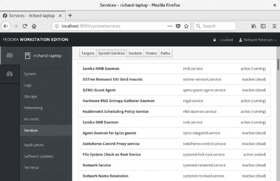 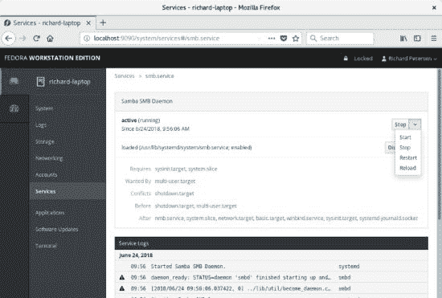

图 3-1：服务，cockpit

你可以使用 Web 浏览器并访问本地系统上的 `9090` 端口来访问 `cockpit`。如果你在工作站上安装，应用程序概览中会显示 Cockpit 图标，你可以点击它用默认浏览器打开 `cockpit`。`cockpit` 页面最初会提示你输入用户名和密码。它会显示你网络上的系统列表。点击其中一个，你将在左侧看到管理类别的链接，如系统管理、服务、网络和存储。点击 `services` 链接管理你的服务。然后点击 `System Services`（系统服务）选项卡列出启用和禁用的服务，包括网络服务如 Apache Web 服务器和 `vsftpd` FTP 服务器（参见图 3-1）。点击服务进入可以管理服务的页面。右侧的按钮显示当前状态。点击右侧的箭头按钮将显示你可能执行的操作菜单，例如停止或重启服务。如果你禁用了一个服务，它会被移动到禁用列表中。启用服务则会将其移动到启用列表中。

Cockpit 会随 `systemctl` 动态更新。如果你在终端窗口中使用 `systemctl` 了更改，这些更改将立即显示在 Cockpit 上。

### service 命令

`service` 命令现在仅仅是 `systemctl` 命令的前端，该命令使用 `systemd` 执行实际操作。`service` 命令不能启用或禁用服务。它只执行停止、重启和状态等管理操作。要手动启动和停止服务，你可以使用 `systemctl`、`cockpit` 或 `service` 命令。使用 `service` 命令时，你输入服务名并配合 `stop` 参数来停止它，配合 `start` 参数启动它，以及配合 `restart` 参数重启它。`service` 命令从终端窗口运行。你必须首先使用 `sudo` 或 `su` 命令以 root 用户身份登录。以下命令将启动 `smb` Samba 服务。

```bash
sudo service start smb
```

在 Fedora 中，`systemd` 版本的 `service` 命令实际上会调用 `systemctl` 命令，来运行位于 `/lib/systemd/system` 中的服务的 `systemd` `.service` 单元文件。你可以使用 `systemctl` 命令执行与 `service` 命令相同的操作。以下是前一个命令的等效命令。

```bash
sudo systemctl start smb
```

### 扩展互联网守护进程 (xinetd)

`xinetd` 功能现在由 `systemd` 执行。只有少数旧应用程序仍在使用它。`xinetd` 软件包默认未安装。只有当某个旧软件包需要它时才安装它。使用 `chkconfig` 开启 `xinetd` 服务。该会被启动或关闭，并相应地编辑其 `/etc/xinetd.d` 目录下 `xinetd` 配置脚本中的禁用行。


# 4. 防火墙

目前大多数连接到互联网的系统都面临外部用户尝试获取未经授权的访问。外部用户可以尝试通过建立非法连接、拦截远程连接到系统的用户的有效通信或伪装成有效用户来尝试直接获取访问。防火墙、加密和身份验证是防御此类攻击的方法。防火墙防止任何直接的未经授权访问尝试，加密保护授权远程用户的传输，而身份验证则验证请求访问的用户是否有权。当前的 Linux 内核整合了对使用 `Netfilter` (`IPtables`) 数据包过滤包的防火墙的支持（之前的版本 `IP Chains` 用于较旧内核版本）。要实现防火墙，你需要提供一系列规则来决定你想要在系统上允许的访问类型。如果该系统还是私有网络的网关，系统的防火墙功能可以有效帮助保护网络免受外部攻击。

你可以直接在直接连接互联网的独立系统上运行防火墙，也可以在连接本地网络到互联网的网关系统上运行防火墙。大多数网络现在使用专用路由器访问互联网，这些路由器自带自己的防火墙。如果你决定使用 Linux 系统作为网关，它将至少有两个网络连接：一个用于本地网络，一个用于互联网的互联网连接设备。确保防火墙应用于互联网设备，而不是你的本地网络。

| 网站 | 安全应用程序 |
| :--- | :--- |
| [`netfilter.org/`](https://netfilter.org/) | Netfilter 项目、Iptables 和 NAT |
| [`netfilter.org/ipchains`](https://netfilter.org/ipchains) | IP Chains 防火墙 |
| [www.openssh.org](http://www.openssh.org) | SSH 加密 |
| [`fedora-project.org/wiki/FirewallD`](https://fedora-project.org/wiki/FirewallD) | FirewallD |
| [www.squid-cache.org](http://www.squid-cache.org) | Squid Web 服务器 |
| [`web.mit.edu/Kerberos`](https://web.mit.edu/Kerberos) | Kerberos 身份验证 |

表 4-1：网络应用程序


## FirewallD 与 iptables

`FirewallD` 由 `systemd` 使用 `firewalld.service` 单元 `/lib/systemd/system/firewalld.service` 进行管理。它在网络启动之前（`Before`）启动，并与由静态 `iptables` 管理的防火墙冲突（`Conflicts`）。运行时配置从 `/etc/sysconfig/firewalld` 读取（`EnvironmentFile`）。与 `FirewallD` 守护的通信通过 `Dbus` 处理。`FirewallD` 由基础目标（`WantedBy`）启动，这意味着它会在所有启动目标运行时。

```ini
firewalld.service
[Unit]
Description=firewalld - dynamic firewall daemon
Before=network-pre.target
Wants=network-pre.target
After=dbus.service
After=polkit.service
Conflicts=iptables.service ip6tables.service ebtables.service ipset.service
Documentation=man:firewalld(1)

[Service]
EnvironmentFile=-/etc/sysconfig/firewalld
ExecStart=/usr/sbin/firewalld --nofork $FIREWALLD_ARGS
ExecReload=/bin/kill -HUP $MAINPID
StandardOutput=null
StandardError=null
Type=dbus
BusName=org.fedoraproject.FirewallD1
KillMode=mixed

[Install]
WantedBy=basic.target
Alias=dbus-org.fedoraproject.FirewallD1.service
```

如果你愿意，仍然可以使用 `iptables` 而不是 `FirewallD` 来管理防火墙。旧的自定义防火墙配置可能仍希望使用旧的 `iptables` 静态防火墙。`iptables` `systemd` 单元管理静态 `iptables` 规则，就像以前版本中的 System V 脚本一样。`iptables` 命令将防火墙规则保留在 `/etc/sysconfig/iptables` 中，该文件会被检查（`ConditionPathExists`）。`iptables` 操作运行一个 `iptables.init` 脚本来启动和停止防火墙。该脚本从 `/etc/sysconfig/iptables-config` 读取运行时配置。

```ini
iptables.service
[Unit]
Description=IPv4 firewall with iptables
After=syslog.target
ConditionPathExists=/etc/sysconfig/iptables

[Service]
Type=oneshot
RemainAfterExit=yes
ExecStart=/usr/libexec/iptables/iptables.init start
ExecStop=/usr/libexec/iptables/iptables.init stop
Environment=BOOTUP=serial
Environment=CONSOLETYPE=serial
StandardOutput=syslog
StandardError=syslog

[Install]
WantedBy=basic.target
```

## 使用 FirewallD 的动态防火墙

`FirewallD` 是 Fedora 中默认使用的防火墙，作为一个实现动态防火墙的守护进程运行。它不是从文件中离线加载规则，而是将它们直接添加到 `FirewallD` 守护进程中。参见参见：`https://fedoraproject.org/wiki/FirewallD`

`FirewallD` 设置网络区域（zones）来定义不同类型网络连接的信任级别。每个区域可以有多个连接，但一个连接只能属于一个区域。`FirewallD` 定义了多个区域，其中大多数区域是可以更改的（可变的）。`drop` 和 `block` 区域是不可变的，旨在停止所有入站数据。`public`、`external` 和 `dmz` 区域设计用于不可信的网络，仅暴露系统的部分内容。`work`、`home` 和 `internal` 区域用于信任的网络。`trusted` 区域（不可变的）允许所有网络连接。

区域配置位于 `/etc/firewalld/zones`。你可以使用 `firewall-config` 或 `firewall-cmd` 管理你的区域并添加新区域。默认区域在 `/etc/firewalld.conf` 文件中通过 `DefaultZone` 变量设置。初始被设置为 `public`。默认区域和备用区域保存在 `/lib/firewalld/zones` 中。

区域文件保存为 XML 文件，列出了区域名称以及允许的服务和端口。此外还有任何伪装（masquerade）、ICMP 和端口转发选项。

### firewall-config

Fedora 使用 `Firewalld` 防火墙守护进程。要配置 `Firewalld`，你使用 `firewall-config` 图形界面。你也可以从命令行使用 `firewall-cmd` 命令。要设置防火墙，运行 `firewall-config`。防火墙通过“Zones”选项卡上显示的区域进行配置。要配置特定服务，使用“Services”选项卡。可以从“View”菜单显示额外的选项卡，用于配置 ICMP 类型、白名单以及添加防火墙规则（直接配置）。

| 区域 (Zone) |  |
| :--- | :--- |
| drop (不可变) | 拒绝所有入站连接，接受出站连接。 |
| block (不可变) | 拒绝所有入站连接，并发出 ICMP 主禁止消息。 |
| trusted (不可变) | 允许所有网络连接 |
| public | 公区域，不信任其他计算机 |
| external | 用于启用了伪装的计算机，保护本地网络 |
| dmz | 用于可公共访问但访问受限的计算机 |
| work | 用于信任的工作区域 |
| home | 用于信任的家庭网络连接 |
| internal | 用于内部网络，限制入站连接 |

表 4-2：FirewallD 区域

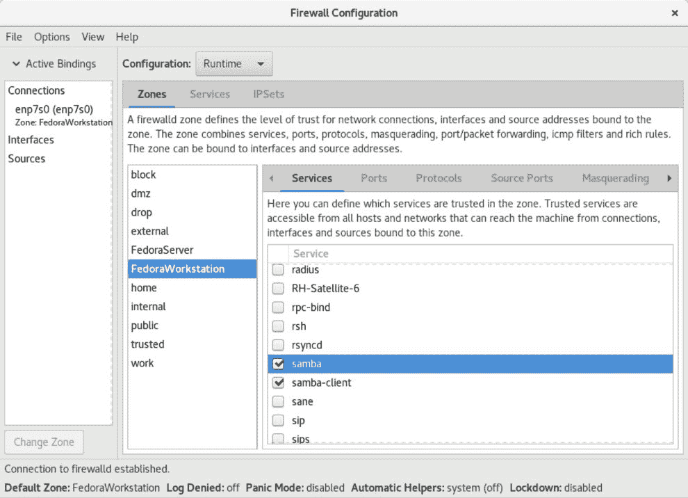 

图 4-1：firewall-config：运行时配置

使用 `firewall-config`，你可以选择“运行时配置”（Runtime Configuration）或“永久配置”（Permanent Configuration）。“运行时配置”显示你当前的设置，而“永久配置”在重新加载或重启之前不会生效。如果你想编辑你的区域，需要选择“永久配置”。


图 4-2：firewall-config：永久配置

如果你从“Configuration”菜单中选择“永久配置”，区域框下方将显示区域工具栏。加号按钮允许添加区域，减号移除区域。铅笔/页面按钮允许编辑区域。添加和编辑按钮打开“基础区域设置”对话框，你可以在其中输入或编辑区域名称、版本、描述和目标（target）。默认目标是 `ACCEPT`。其他选项有 `REJECT` 和 `DROP`。“加载区域默认”按钮（黄色箭头）会加载默认设置，移除你做的任何更改。


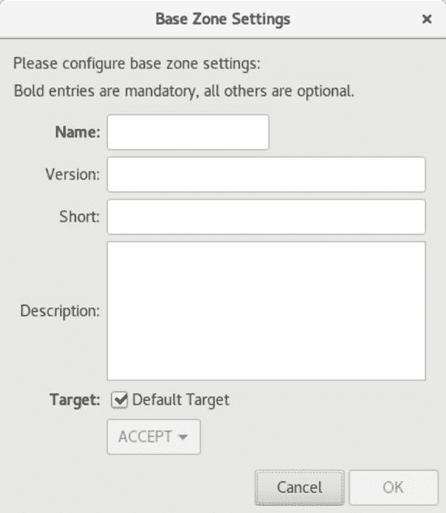 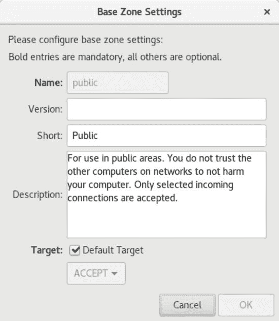

图 4-4：基础区域设置

每个区域反过来可以有一个或多个网络连接。从“Options”菜单选择“更改连接的区域”来打开“网络连接”对话框，你可以在其中添加网络连接。

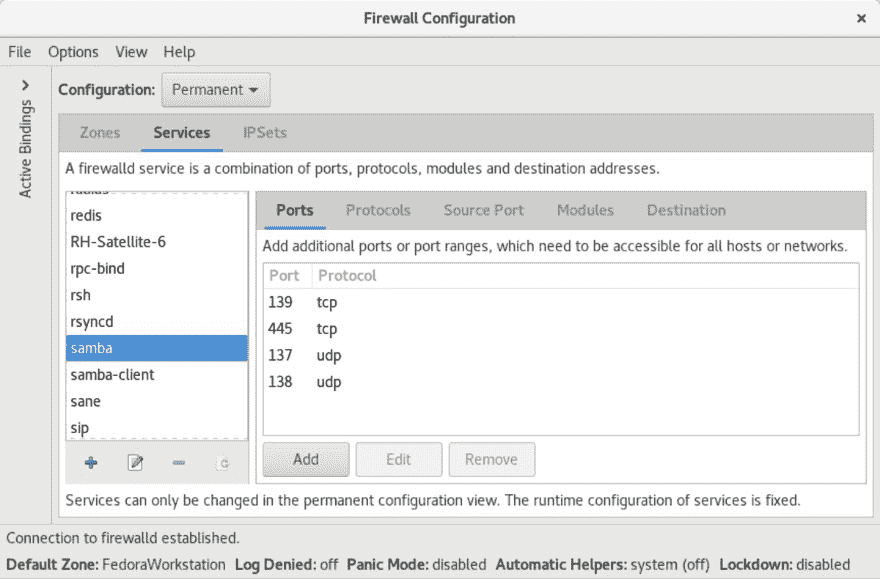

图 4-5：服务设置


对于给定的区域，你可以配置服务、端口、伪装、端口转发、接口、富规则、源和 ICMP 过滤器（请参阅图 4-5）。许多用户可能想要更改的功能是服务。Linux 系统通常用于为网络运行服务器。如果你正在创建一个强大的防火墙，但仍然想运行如 Web 服务器、FTP 服务器、Samba 桌面浏览或 SSH 加密连接等服务，必须在 `Services` 标签中指定它们。Samba 桌面浏览允许你从 GNOME 或 KDE 桌面访问你的 Samba 共享（例如远程 Windows 文件系统）。

对于选定的服务，你可以指定服务的设置，例如它使用的端口和协议、任何模块以及特定的网络地址。默认设置已为你配置好，例如用于 Samba 的端口 139 使用 `TCP` 协议。要修改服务的设置，请点击 `Firewall Configuration` 上的 `Services` 标签列出你的服务。从左侧的 `Service` 滚动框选择你想要编辑的服务。对于给定的服务，你可以使用 `Ports and Protocols`、`Modules` 和 `Destination` 标签来指定端口、协议、模块和地址。在 `Ports and Protocols` 标签上点击 `Add` 按钮打开 `Port and/or Protocol` 对话，你可以在其中添加端口或端口范围，并从 `Protocol` 菜单中选择协议（请参阅图 4-6）。在 `Destination` 标签上，你可以为服务输入 `IPv4` 或 `IPv6` 目标地址。

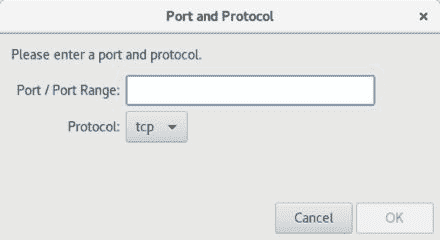

图 4-6: 服务协议与端口

`Ports` 标签允许你指定为某些服务（如 BitTorrent）开放的端口。点击 `Add` 按钮打开对话框，你可以在其中选择端口号以及控制协议（`tcp` 或 `udp`），或者输入特定的端口号或范围。

如果你的系统被用作本地网络的 Internet 网关，你可以实现 `masquerading`（伪装）来隐藏本地主机免受来自 Internet 的外部访问。尽管这需要 `IP forwarding`（IP 转发），当你选择伪装时，该功能会自动启用。本地主机仍然能够访问 Internet，但它们将伪装成你的网关系统。你应该为连接到 Internet 的接口选择伪装。`Masquerading` 仅适用于 `IPv4` 网络，不适用于 `IPv6` 网络。

`Port Forwarding` 标签允许你设置端口转发，将传输从一个端口引导到另一个端口，或另一个系统上的不同端口。点击 `Add` 按钮添加端口，指定其协议和目标（请参阅图 4-7）。

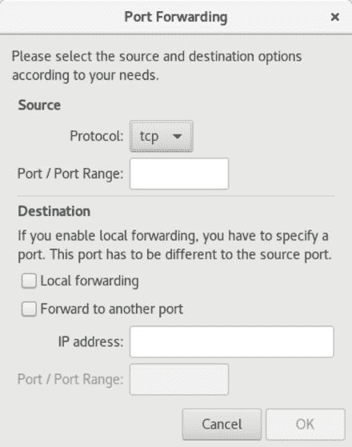

图 4-7: 端口转发

`ICMP Filters` 标签允许你阻止 ICMP 消息。默认情况下允许所有 ICMP 消息。阻止 ICMP 消息可以使系统更安全。某些类型的 ICMP 消息通常会被阻止，因为它们可能用于渗透或过载系统，例如 `ping` 和 `pong` ICMP 消息（请参阅图 4-8）。

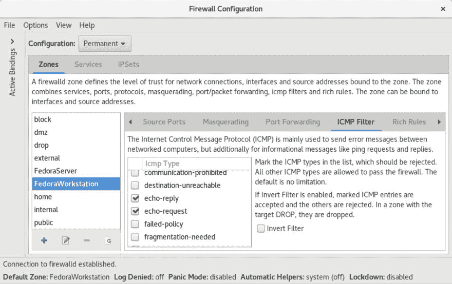

图 4-8: ICMP 过滤器

如果你有特定的防火墙规则需要添加，请使用 `Direct Configuration` 标签（从 `View | Direct Configuration` 菜单显示）。

### firewall-cmd

`firewall-cmd` 命令通过命令行工作，使用选项为不同区域设置功能。区域修改选项（如 `--add-service`）可以是运行时或永久性的。运行时更改在重启或重载后消失。要使更改永久生效，你需要添加 `--permanent` 选项，对永久配置而非运行时配置进行更改。对于修改防火墙配置的操作，请务必使用 `sudo` 命令。

使用 `get` 选项来显示有关防火墙的信息。`--get-zones` 选项列出你的区域，`--get-services` 选项列出当前区域支持的服务，`--get-icmptypes` 则列出 ICMP 类型。

```bash
firewall-cmd --get-zones
firewall-cmd --get-services
firewall-cmd --get-icmptypes
```

`--get-default-zone` 选项列出默认区域，而 `--set-default-zone` 设置一个新的默认区域。

```bash
sudo firewall-cmd --set-default-zone home
```

要查找某个区域启用了哪些功能，请使用 `--list-all` 选项配合 `--zone=` 选项来指定区域。

```bash
firewall-cmd --zone=home --list-all
```

区域分配了网络接口。有接口选项可以添加、删除或更改接口。使用 `query` 选项检查接口是否属于某个区域。

```bash
firewall-cmd --zone=home --query-interface=enp7s0
```

服务、端口、伪装、icmp 和转发选项可以是运行时的或永久性的。`--service` 选项可以向区域添加和删除服务。

```bash
sudo firewall-cmd --add-service=vsftp
```

要使更改永久生效，添加 `--permanent` 选项。

```bash
sudo firewall-cmd --permanent --add-service=vsftp
```

`--query-service` 选项检查某个区域是否启用了服务。

```bash
firewall-cmd --zone=home --query-service=http
```

`--port` 选项用于添加、删除或查询端口。

```bash
sudo firewall-cmd --zone=home --add-port=80/tcp
```

要使更改永久生效，添加 `--permanent` 选项。

```bash
sudo firewall-cmd --permanent --zone=home --add-port=80/tcp
```

`--masquerade` 选项添加、删除和查询区域伪装。

```bash
sudo firewall-cmd --zone=home --add-masquerade
```

`--icmp-block` 选项添加、删除和查询 ICMP 类型。

```bash
sudo firewall-cmd --zone=home --add-icmp-block=echo-reply
```

如果你的防火墙需要使用自定义规则，可以使用 `--direct` 选项添加、删除和列出规则。这些规则使用 `iptables` 语法编写。你需要指定协议、表、链和参数。以下列出了添加到 netfilter 表的规则。规则不会保存，每次重启或重载时必须重新添加。你可以编写一个 `firewall-cmd` 脚本来实现。

```bash
firewall-cmd --direct --get-rules ipv4 netfilter
```

以下添加了一个简单的 netfilter 规则。

```bash
sudo firewall-cmd --direct --add-rule ipv4 netfilter INPUT 0 -p tcp --dport 80 -j ACCEPT
```


FirewallD 和 `iptables` 命令集都用于设置防火墙规则。FirewallD 引入了额外的抽象层，允许你使用 `firewall-config` 和 `firewall-cmd` 工具来设置防火墙。你不需要编写任何实际的防火墙规则。这种抽象层允许动态防火墙实现，在运行时生成规则。对于 `iptables` 命令，你必须编写实际的防火墙规则，这些规则在防火墙启动之前加载（静态防火墙）。由于 `iptables` 命令可以让你精确地看到命令是如何设置的，在这些示例中，它被用于展示 netfilter、mangle 和 NAT 表是如何设置的。

### 模块

与其前身 IP Chains 不同，Netfilter 的设计是模块化且可扩展的。可以通过模块的形式的形式添加功能，例如状态模块（state module），它添加了连接跟踪。所需的模块作为 `IPptables` 服务的一部分加载。其他模块是可选的；你可以选择在安装规则之前加载它们。必需的 `IPptables` 模块位于 `/lib/modules/kernel-version/kernel/net/ipv4/netfilter`，其中 `kernel-version` 是你的内核版本。对于 IPv6 模块，请检查 `ipv6/netfilter` 目录。`iptables` 模块具有 `ipt_` 前缀，Nat 表模块具有 `nf_nat` 前缀。

可选的 `IPptables` 模块（也称为辅助模块）位于 `/lib/modules/kernel-version/kernel/net/netfilter` 目录。适用于 netfilter 表的模块以 `nf` 为前缀，适用于所有表的模块以 `xt` 为前缀。辅助模块的一个示例是连接跟踪模块，它负责跟踪属于已建立连接的数据包，例如 FTP 下载连接跟踪器模块。`conntrack` 辅助模块的名为 `conntrack`，例如 `nf_conntrack_ftp.ko`。

对于 `iptables` 静态防火墙，辅助模块被指定为一个列表，赋值给 `IPTABLES_MODULES` 变量，该变量位于 `/etc/sysconfig/iptables-config` 文件中， `iptables` 服务脚本使用。在本示例中，`IPTABLES_MODULES` 变量被分配了 `ftp` 和 `netbios` 辅助模块。

```
IPTABLES_MODUELS="nf_conntrack_ftp  nf_conntrack_netbios_ns"
```

每当你使用 `iptables` 脚本启动 `IPtables` 时，它们将自动加载。对于 IPv6 配置，你使用 `ip6tables-config` 文件。

```
sudo systemctl restart iptables
```

如果你正在编写自己的 `iptables` 脚本，而不是使用 Red Hat 或 Fedora 的 `iptables` 服务脚本，你需要添加 `modprobe` 命令来直接加载可选模块。

你可以创建并加载自己的 `IPtables` 模块。这些模块应该使用较新的 Xtables 前缀 `xt`。

### 包过滤

Netfilter 本质上是一个数据包管理框架，它可以检查特定网络协议的数据包并通知监听这些数据包的内核部分。基于 Netfilter 框架构建的是 `iptables` 实现的数据包选择系统。通过 `iptables`，可以设置不同的规则表以根据不同的标准选择数据包。Netfilter 目前支持三个表：`filter`、`nat` 和 `mangle`。包过滤通过使用 `filter` 表实现，该表保存有丢弃或接受数据包的规则。网络地址转换操作（如 IP 伪装）通过使用 `NAT` 表实现，该表保存有 IP 伪装规则。`mangle` 表用于专门的数据包修改。在数据包接收时、发送时或转发时，都可以对其进行修改。这种结构是可扩展的，因为新模块可以定义带有自身规则的表。它还极大地提高了效率。数据包不再需要检查一个大表，而是只访问它们所需的规则表。

IP table 规则使用 `iptables` 命令进行管理。对于该命令，你需要指定想要管理的表。默认值是 `filter` 表，不需要指定。你可以随时使用 `-L` 和 `-n` 选项列出你添加的规则，如下所示。`-n` 选项表示对 IP 地址和端口均仅使用数字输出，避免对主机名进行 DNS 查找。不过，你也可以仅使用 `-L` 选项查看端口标签和主机名：

```
iptables -L -n
```

#### 链 (Chains)

规则组合成不同的链。内核使用链来管理它接收和发送的数据包。链简单来说就是规则的清单。这些规则规定了对包含特定头部的数据包要采取的操作。规则以 `if-then-else` 结构运行。如果数据包不匹配第一条规则，则检查下一条规则，依此类推。如果数据包不匹配任何规则，内核将查询链策略。通常情况下，在此时数据包会被拒绝。如果数据包匹配某条规则，它将被传递给其目标（target），由目标决定如何对数据包进行处理。标准目标列在[表 4-3]中。如果数据包不匹配任何规则，它将传递给链的默认目标。

| 目标 (Target) | 功能 |
| :--- | :--- |
| ACCEPT | 允许数据包通过防火墙。 |
| DROP | 拒绝数据包访问。 |
| REJECT | 拒绝访问并通知发送者。 |
| QUEUE | 将数据包发送到用户空间。 |
| RETURN | 跳到链末尾并让默认目标处理。 |

表 4-3：IPtables 目标

#### 目标 (Targets)

目标反过来可以是另一个链，数据包可以经过多个链，最终到达一个目标。这类似于编程语言中的控制流。当规则具有用户定义的链作为目标时，激活该用户定义的链将被执行。如果未匹配到规则，执行将返回原始链。对于用户定义的链，默认目标总是链中的下一条规则。

#### 防火墙链与 NAT 链

内核使用三个防火墙链：`INPUT`、`OUTPUT` 和 `FORWARD`。当数据包通过接口接收时，使用 `INPUT` 链来决定如何处理。内核随后使用路由信息决定发送位置。如果内核将数据包发送到主机，则检查 `FORWARD` 链。在实际发送数据包之前，还会检查 `OUTPUT` 链。此外，有两个 NAT 表链 `POSTROUTING` 和 `PREROUTING` 用于处理伪装和数据包修改。内置的 Netfilter 链列在[表 4-4]中。

| 链 | 描述 |
| :--- | :--- |
| INPUT | 针对进入数据包的规则 |
| OUTPUT | 针对输出数据包的规则 |
| FORWARD | 针对转发数据包的规则 |
| PREROUTING | 重定向或修改进入数据包的规则，仅限 NAT 表 |
| POSTROUTING | 重定向或修改输出数据包的规则，仅限 NAT 表 |

表 4-4：Netfilter 内置链

#### 添加和修改规则

你使用 `iptables` 命令添加和修改链规则。一个 `iptables` 命令由 `iptables` 命令组成，后跟指示要执行命令的参数。例如，`iptables -A` 是添加新规则的命令，而 `iptables -D` 是删除规则的命令。`iptables` 命令列在[表 4-5]中。以下命令简单列出了你系统中定义的链及其规则。输出显示了由 `iptables` 命令创建的默认值。

```
iptables -L -n
```

Chain input (policy ACCEPT):

Chain forward (policy ACCEPT):

Chain output (policy ACCEPT):

| 选项 | 功能 |
| :--- | :--- |
| -A chain | 在链末尾追加规则。 |
| -D chain [rulenum] | 从链中删除匹配规则。删除链中的第 rulenum 条（1 为第一条）。 |
| -I chain [rulenum] | 插入链的 rulenum 位置（默认 1 为第一条）。 |
| -R chain rulenum | 替换链中的第 rulenum 条规则（1 为第一条）。 |


| `-L` `[chain]` | 列出链或所有链中的规则。 |
| `-E` `[chain]` | 重命名链。 |
| `-F` `[chain]` | 删除（清刷）链或所有链中的所有规则。 |
| `-R chain` | 替换规则；规则从 1 开始编号。 |
| `-Z` `[chain]` | 将链或所有链中的计数器零。 |
| `-N chain` | 创建一个新的用户自定义链。 |
| `-X chain` | 删除用户自定义链。 |
| `-P chain target` | 将链的策略更改为目标。 |

### 表 4-5: IPtables 命令

要向链中添加新规则，您可以使用 `-A`。使用 `-D` 移除它，使用 `-R` 替换它。在命令之后，列出规则所适用的链，例如 `INPUT`、`OUTPUT` 或 `FORWARD` 链，或者用户自定义链。接下来，您列出不同的选项来指定您想要执行的操作（大部分与 IP 链使用的选项相同，但有少数例外）。`-s` 选项指定与数据包关联的源地址，`-d` 指定目的地址，`-j` 选项指定规则的目标。`ACCEPT` 目标将允许数据包通过。`-i` 选项现在指示输入设备，且只能用于 `INPUT` 和 `FORWARD` 链。`-o` 选项指示输出设备，且只能用于 `OUTPUT` 和 `FORWARD` 链。表 4-6 列出了若干基本选项。

| 选项 | 功能 |
| :--- | :--- |
| `-p [!] proto` | 指定协议，例如 TCP、UDP、ICMP 或 ALL。 |
| `-s [!] address[/mask] [!] [port[:port]]` | 用于匹配的源地址。通过端口参数，您可以指定端口。 |
| `--sport [!] [port[:port]]` | 源端口指定。您可以使用冒号 `port:port` 指定一个端口范围。 |
| `-d [!] address[/mask] [!] [port[:port]]` | 用于匹配的目的地址。通过端口参数，您可以指定端口。 |
| `--dport [!][port[:port]]` | 目的端口指定。 |
| `--icmp-type [!] typename` | 指定 ICMP 类型。 |
| `-i [!] name[+]` | 使用名称指定输入网络接口（例如 `eth0`）。`+` 符号充当通配符。在名称末尾附加 `+` 可匹配所有具有该前缀的接口（`eth+` 匹配所有太网接口）。只能用于 `INPUT` 链。 |
| `-j target [port]` | 指定规则的目标（对于 `REDIRECT` 目标指定 `[port]`）。 |
| `--to-source < ipaddr> [-< ipaddr>]: port port` | 与 `SNAT` 目标配合使用，用新的源 IP 地址重写数据包。 |
| `--to-destination < ipaddr> [-< ipaddr>]: port port` | 与 `DNAT` 目标配合使用，用新的目的 IP 地址重写数据包。 |
| `-n` | 地址和端口的数字输出，配合 `-L` 使用。 |
| `-o [!] name[+]` | 使用名称指定输出网络接口（例如 `eth0`）。只能用于 `FORWARD` 和 `OUTPUT` 链。 |
| `-t table` | 指定要使用的表，例如 `-t nat` 用于 NAT 表。 |
| `-v` | 详细模式，显示规则详情，配合 `-L` 使用。 |
| `-x` | 扩展数字（显示精确值），配合 `-L` 使用。 |
| `[!] -f` | 匹配分片数据包的第二个到最后一个分片。 |
| `[!] -V` | 打印软件包版本。 |
| `!` | 对选项或地址取反。 |
| `-m` | 指定要使用的模块，例如 state。 |
| `--state` | 指定状态模块的选项，如 `NEW`、`INVALID`、`RELATED` 和 `ESTABLISHED`。用于检测数据包的状态。`NEW` 引用 SYN 数据包（新连接）。 |
| `--syn` | SYN 数据包，新连接。 |
| `--tcp-flags` | TCP 标志：SYN、ACK、FIN、RST、URG、PS 以及所有标志的 ALL。 |
| `--limit` | 限制模块（`-m limit`）的选项。用于控制匹配速率，即每秒匹配给定的次数。 |
| `--limit-burst` | 限制模块（`-m limit`）的选项。指定限制生效之前的最大突发量。用于控制拒绝服务攻击。 |

### 表 4-6: IPtables 选项

#### IPtables 选项

IPtables 软件包设计成是可扩展的，有许多带有选择标准的选项可以包含在 IPtables 中。例如，TCP 扩展包含了检查 SYN 数据包的 `--syn` 选项。ICMP 扩展提供了 `--icmp-type` 选项，用于指定如 ping 操作中运的 ICMP 数据包。limit 扩展包含了 `--limit` 选项，通过该选项您可以限制指定时间段（如一秒）内匹配数据包的最大数量。

**注意：** 在 IPtables 命令中，链名称必须大大写，与 `INPUT`、`OUTPUT` 和 `FORWARD` 链名称相同。

在下面的示例中，用户向 `INPUT` 链添加了一条规则，接受所有源自地址 `192.168.0.55` 的数据包。任何收到的（`INPUT`）且源地址（`-s`）匹配的数据包。在命令之后，列出规则所适用的链，例如 `INPUT`、`OUTPUT` 或 `FORWARD` 链，或者用户自定义链。接下来，您列出不同的选项来指定您想要执行的操作（大部分与 IP 链使用的选项相同，但有少数例外）。`-s` 选项指定与数据包关联的源地址，`-d` 指定目的地址，`-j` 选项指定规则的目标。`ACCEPT` 目标将允许数据包通过。`-i` 选项现在指示输入设备，且只能用于 `INPUT` 和 `FORWARD` 链。`-o` 选项指示输出设备，且只能用于 `OUTPUT` 和 `FORWARD` 链。表 4-6。

在下面的示例中，用户向 `INPUT` 链添加了一条规则接受所有源自地址 `192.168.0.55` 的数据包。任何收到的（`INPUT`）且源地址（`-s`）匹配的数据包。

```
iptables -A INPUT -s 192.168.0.55 -j ACCEPT
```

#### 接受和拒绝数据包：DROP 和 ACCEPT

在 IPtables 中，`FORWARD` 和 `INPUT` 链是分开评估的。一个不会输入到另一个。这意味着如果您想完全阻止某些地址通过您的系统，您将需要为它们同时添加一个 FORWARD 规则和一个 INPUT 规则。

... 有两个内置目标，DROP 和 ACCEPT。... 在下面的示例中，第一条规则引用以太网设备 eth0，第二条引用本地主机：

```
iptables -A INPUT -j DROP -i eth0 -s 192.168.0.45
```

```
iptables -A INPUT -j ACCEPT -i lo
```


减少重复 `INPUT` 和 `FORWARD` 规则的一种常用方法是创建一个 `INPUT` 和 `FORWARD` 链都流向的自定义链。你使用 `-N` 来定义自定义链。接下来的示例显示了这种安排的基本格式。将创建一个名为 `incoming` 的新链（你可以选择任何喜欢的名称）。你原本要为 `FORWARD` 和 `INPUT` 链定义的规则现在被定义在 `incoming` 链中。然后，`INPUT` 和 `FORWARD` 链将 `incoming` 链作为目标，直接跳转到该链并使用其规则来处理它们收到的任何数据包。

```bash
iptables -N incoming
iptables -A incoming -j DROP -i eth0 -s 192.168.0.45
iptables -A incoming -j ACCEPT -i lo
iptables -A FORWARD -j incoming
iptables -A INPUT -j incoming
```

### ICMP 数据包

防火墙通常会拦截某些 Internet 控制消息协议（ICMP）消息。特别是 ICMP 重定向（redirect）消息可能会接管你的路由任务。然而，你需要启用某些 ICMP 消息，例如 `ping`、`traceroute` 尤其是目标不可达（destination-unreachable）操作所需的消息。在大多数情况下，你始终需要确保允许目标不可达的数据包；否则，域名查询可能会挂起。一些常见的 ICMP 数据包类型列在 表 4-7 中。通过 `--icmp-type` 选项，你可以启用某种 ICMP 类型的数据包，其参数可以是代表消息的数字或名称。以下示例启用了 `echo-reply`、`echo-request` 和 `destination-unreachable` 消息的使用，它们对应的数字分别为 0、8 和 3：

```bash
iptables -A INPUT -j ACCEPT -p icmp -i eth0 --icmp-type echo-reply -d 10.0.0.1
iptables -A INPUT -j ACCEPT -p icmp -i eth0 --icmp-type echo-request -d 10.0.0.1
iptables -A INPUT -j ACCEPT -p icmp -i eth0 --icmp-type destination-unreachable -d 10.0.0.1
```

它们的规则列表看起来如下：

```text
ACCEPT      icmp --  0.0.0.0/0           10.0.0.1           icmp type 0
ACCEPT      icmp --  0.0.0.0/0           10.0.0.1           icmp type 8
ACCEPT      icmp --  0.0.0.0/0           10.0.0.1           icmp type 3
```

| 数字 | 节点 | 需要项 |
| :--- | :--- | :--- |
| 0 | echo-reply | ping |
| 3 | destination-unreachable | 所有 TCP/UDP 流量 |
| 5 | redirect | 如果未运行路由守护进程则路由 |
| 8 | echo-request | ping |
| 11 | time-exceeded | traceroute |

*表 4-7：常见的 ICMP 数据包*

`ping` 操作需要进一步控制以避免“死亡之 ping”（ping-of-death）安全威胁。你可以通过多种方法实现。一种方法是拒绝任何 ping 分片。`ping` 数据包通常很小。你可以通过拒绝任何分片的 ICMP 数据包来阻止死亡之 ping 攻击。使用 `-f` 选项指示分片。

```bash
iptables -A INPUT -p icmp -j DROP -f
```

另一种方法是限制接收到的 `ping` 数据包的匹配次数。你使用 `limit` 模块来控制 ICMP `ping` 操作的匹配次数。使用 `-m limit` 使用 limit 模块，并使用 `--limit` 指定允许的次数。`1/s` 将允许每秒一次匹配。

```bash
iptables -A FORWARD -p icmp --icmp-type echo-request -m limit --limit 1/s -j ACCEPT
```

### 控制端口访问

如果你的系统托管着 Internet 服务（例如 Web 或 FTP 服务器），你可以使用 `iptables` 来控制对该服务的访问。你可以通过使用源端口 `--sport` 或目标端口 `--dport` 选项配合服务所使用的端口来指定特定服务。`iptables` 允许对端口使用名称，例如 Web 服务器端口使用 `www`。服务的名称及其它们使用的端口列在 `/etc/services` 文件中，该文件将端口映射到特定服务。对于域名服务器，端口将是 `domain`。如果你愿意，也可以使用端口号，在数字前加冒号。以下示例接受所有到位于 `192.168.0.43` 的 Web 服务器的消息包：

```bash
iptables -A INPUT -d 192.168.0.43 --dport www -j ACCEPT
```

这里显示了常见的端口及其标签：

| 服务 | 端口号 | 端口标签 |
| :--- | :--- | :--- |
| Auth | 113 | auth |
| Finger | 79 | finger |
| FTP | 21 | ftp |
| NTP | 123 | ntp |
| Telnet | 23 | telnet |
| Web | 80 | www |

（注：原文包含关于端口访问逻辑的重复/乱码句子；这些已经过清理以保持所提供的核心技术背景。）

### 数据包状态：连接跟踪

另一个非常有用的扩展扩展是状态（state），它可以轻松地检测数据包的跟踪信息。连接跟踪维护有关连接的信息，如源、目的和端口。它提供了一种有效方法来确定哪些数据包属于已建立或相关的连接。要使用连接跟踪，你首先指定 `-m state`。然后你可以使用 `--state` 选项。在这里你可以指定任何以下状态：

| 状态 | 描述 |
| :--- | :--- |
| NEW | 创建新连接的数据包 |
| ESTABLISHED | 属于现有连接的数据包 |
| RELATED | 与现有连接相关但不直接属于其的数据包，例如 ICMP 错误或建立 FTP 数据连接的数据包 |
| INVALID | 因某些原因无法识别的数据包 |
| RELATED+REPLY | 与已建立连接相关但不是其直接一部分的数据包 |

如果你正在设计一个旨在保护你的本地网络免受外部网络渗透尝试的防火墙，你可能希望限制进入的数据包。简单地拒绝所有数据包是不可行的，因为连接到外部服务器（例如互联网上的服务器）的用户必须接收它们的信息。相反，你可以通过拒绝用于初始化连接的特定类型数据包来拒绝访问。思想是攻击者必须从外部发起连接。这类数据包的头部其 SYN 位被设置，且 FIN 和 ACK 位为空。状态模块的 `NEW` 状态匹配任何此类 SYN 数据包。通过为此类数据包指定 `DROP` 目标，你拒绝了任何尝试与你的系统建立连接的数据包。任何尝试从外部连接到你系统的人都无法做到。在你本地系统上与外部主机建立连接的用户仍然可以与它们通信。以下示例将丢弃任何在 `eth0` 接口上尝试创建新连接的数据包，但在其他任何接口上将被接受：

```bash
iptables -A INPUT -m state --state NEW -i eth0 -j DROP
```


你可以在 `eth0` 设备上使用 `!` 运算符，并结合 `ACCEPT` 目标来组合一条规则，该规则将接受除 `eth0` 设备上的包以外的所有新数据包。如果 `eth0` 设备是唯一连接互联网的设备，这仍然有效地阻止了外部访问。同时，对其他设备（如你的 `localhost`）的输入操作可以自由建立新连接。这种条件 `INPUT` 规则用于在允许整体访问的同时允许某些例外。它通常假设稍后的规则（例如链策略）将丢弃剩余的封包。

```
iptables -A INPUT -m state --state NEW ! -i eth0 -j ACCEPT
```

接下来的示例将接受 `eth0` 接口上任何属于已建立连接或与此类连接相关的数据包：

```
iptables -A INPUT -m state --state ESTABLISHED,RELATED -j ACCEPT
```

提示：你可以使用 `iptstate` 工具来显示当前的状态表。

#### 特殊连接跟踪：ftp, irc, Amanda, tftp。

为了跟踪某些类型的数据包，`IPtables` 使用了专门的连接跟踪模块。这些是可选的模块，你必须手动加载它们。要跟踪被动 FTP 连接，你需要加载 `ip_conntrack_ftp` 模块。要添加 NAT 表支持，你还需要加载 `ip_nat_ftp` 模块。对于 IRC 连接，你使用 `ip_conntrack_irc` 和 `ip_nat_irc`。对于 `Amanda`（备份服务器）和 `TFTP`（简易 FTP）也有相应的模块。

如果你正在编写自己的 `iptables` 脚本，你需要添加 `modprobe` 命令来加载这些模块。

```
modprobe ip_conntrack ip_conntrack_ftp ip_nat_ftp
modprobe ip_conntrack_amanda ip_nat_amanda
```

### 网络地址转换 (NAT)

网络地址转换 (NAT) 是系统在数据包通过系统时更改其目的或源地址的过程。数据包在到达最终目的地之前，会经过网络上的多个链接的系统。通常情况下，它们只会直接转发数据包。但是，如果这些系统中的一个对数据包执行 `NAT` 操作，就可以更改其源或目的。发送到特定目的的数据包的目的地址可能会被更改。为了实现这一功能，系统还需要记住这些更改，以便任何响应数据包的源和目的地址都能改回被响应数据包的原始地址。

`NAT` 通常用于为仅通过一个 IP 地址连接互联网的系统提供访问。例如 IP 伪装、多服务器支持和透明代理等网络功能。在 IP 伪装中，`NAT` 操作将更改通过连接互联网与本地网络计算机的防火墙/网关的数据包的目的和源。网关有一个单一 IP 地址，其他本地计算机可以通过 `NAT` 操作使用它。如果你有多个服务器但只有一个 IP 地址，你可以使用 `NAT` 操作将数据包发送到备服务器。你还可以使用 `NAT` 操作让你的 IP 地址引用特定的服务器应用程序，例如 Web 服务器（透明代理）。`ip6tables` 尚未实现 NAT 表。

注意：通过代理，你可以控制对特定服务（如 Web 服务器或 FTP 服务器）的访问。你为想要控制的每个服务都需要一个代理。Web 服务器有自己的 Web 代理，而 FTP 服务器有 FTP 代理。代理还可用于缓存常用数据（如 Web 页面），这样用户无需不断访问原始站点。Linux 系统上常用的代理软件是 `Squid`。

#### 添加 NAT 规则

`NAT` 操作的数据包选择规则被添加到由 `iptables` 命令管理的 NAT 表中。要向 NAT 表添加规则，你必须使用 `-t` 选项指定 NAT 表。因此，要向 NAT 表添加规则，你需要像此处所示使用 `-t nat` 选项指定 NAT 表：

```
iptables -t nat
```

使用 `-L` 选项，你可以列出已添加到 NAT 表的规则：

```
iptables -t nat -L -n
```

添加 `-n` 选项将以数字形式列出 IP 地址和端口。这将加快列表速度，因为 `iptables` 将不再尝试 DNS 查询来确定 IP 地址的主机名。

#### NAT 目标与链

此外，还有两种类型的 `NAT` 操作：源 NAT（指定为 `SNAT` 目标）和目的 NAT（指定为 `DNAT` 目标）。`SNAT` 目标用于更改源地址的规则，`DNAT` 目标用于更改目的地址的规则。

NAT 表中的三个链被内核用于执行 `NAT` 操作。这些链是 `PREROUTING`、`POSTROUTING` 和 `OUTPUT`。`PREROUTING` 用于目的 NAT (`DNAT`) 规则，这些是到达的数据包。`POSTROUTING` 用于源 NAT (`SNAT`) 规则，这些是离开的数据包。`OUTPUT` 用于本地本地生成数据包的目的 NAT 规则。

与数据包过滤一样，你可以指定源 (-s) 和目的 (-d) 地址，以及输入 (-i) 和输出 (-o) 设备。`-j` 选项将指定诸如 `MASQUERADE` 的目标。你可以通过向 `POSTROUTING` 链中添加 `MASQUERADE` 规则来实现 IP 伪装：

```
iptables -t nat -A POSTROUTING -o eth0 -j MASQUERADE
```

要更改离开系统的数据包的源地址，你需要使用 `POSTROUTING` 规则和 `SNAT` 目标。对于 `SNAT` 目标，你使用 `--to-source` 选项指定源地址：

```
iptables -t nat -A POSTROUTING -o eth0 -j SNAT --to-source 192.168.0.4
```

要更改到达系统的数据包的目的地址，你需要使用 `PREROUTING` 规则、`DNAT` 目标以及 `--to-destination` 选项：

```
iptables -t nat -A PREROUTING -i eth0 -j DNAT --to-destination
```

指定端口可以让你更改到达特定端口的目的地。实际上，这让你实现了端口转发。在下一个示例中，所有到达端口 80（Web 服务端口）的数据包都被重定向到 `10.0.0.3`，此处是一个运行 Web 服务器的系统。

```
iptables -t nat -A PREROUTING -i eth0 -dport 80 -j DNAT --to-destination 10.0.0.3
```

通过 `TOS` 和 `MARK` 目标，你可以对数据包进行标记以控制其路由或优先级。`TOS` 目标设置数据包的服务类型，可以使用 `normal-service`、`minimize-cost` 或 `maximize-throughput` 等标准设置优先级。

此处是仅适用于 NAT 表的目标：

- `SNAT`：修改源地址，使用 `--to-source` 选项指定新的源地址。
- `DNAT`：修改目的地址，使用 `--to-destination` 选项指定新的目的地址。
- `REDIRECT`：重定向数据包。
- `MASQUERADE`：IP 伪装。
- `MIRROR`：反转源目的并返回发送者。
- `MARK`：修改标记字段以控制消息路由。

#### NAT 重定向：透明代理

NAT 表可用于任何类型的数据包重定向，这种过程对用户是透明的。重定向通常用于实现透明代理。数据包重定向通过 `REDIRECT` 目标执行。通过透明代理，接收的数据包可以自动重定向到代理服务器。例如，到达 Web 服务端口 80 的包可以重定向到 Squid 代理服务端口（通常为 3128）。这涉及使用 `PREROUTING` 链上的 `REDIRECT` 目标来重定向包：

```
iptables -t nat -A PREROUTING -i eth1 --dport 80 -j REDIRECT --to-port 3128
```

### 数据包标记：Mangle 表


数据包修改表（mangle table）用于实际修改数据包信息。专门应用于此表的规则通常设计用于控制数据包的常规行为，例如路由、连接大小和优先级。只有实际修改数据包（而非仅仅重定向或停止它）的规则才能在 mangle 表中使用。例如，`TOS` 目标可以直接在 mangle 表中使用，通过更改服务类型（Type of Service）字段来修改数据包的优先级。可以设置 `TCPMSS` 目标来控制连接的大小。`ECN` 目标允许你规避 ECN 黑洞，而 `DSCP` 目标将允许你更改 `DSCP` 位。某些扩展（如 `ROUTE` 扩展）将更改数据包，在这种情况下，是重写其目的地，而不仅仅是重定向它。

mangle 表通过 `-t mangle` 选项指定。使用以下命令查看 mangle 表中列出了哪些链（chains）：

```
iptables -t mangle -L
```

这里显示了几个 mangle 表目标：

| 目标 | 描述 |
| :--- | :--- |
| `TOS` | 修改服务类型字段以管理数据包的优先级。 |
| `TCPMSS` | 修改连接允许的数据包大小，以启用更大的传输。 |
| `ECN` | 移除 ECN 黑洞信息。 |
| `DSCP` | 更改 `DSCP` 位。 |
| `ROUTE` | 扩展 `TARGET`，用于修改数据包中的目的信息。 |

注意：`IPtables` 软件包设计为可扩展，允许易地添加自定义目标。这涉及对内核应用补丁并进行重新编译。更多详情请参阅 [`netfilter.org/`](https://netfilter.org/)，以及扩展目标列表。

# 静态防火墙命令

用于执行数据包过滤、NAT 任务和数据包修改的命令是 `iptables`，该软件通常被简称为 `IPtables`。然而，`Netfilter` 使用不同的表和命令分别实现数据包过滤和 NAT 任务。一个表将包含其应用的命令集。这种方法简化了数据包过滤任务，让 `IPtables` 执行数据包过滤检查，而无需额外处理地址翻译的开销。NAT 操作也从与数据包过滤检查的混合中解放出来。

你使用 `iptables` 命令进行数据包过滤、NAT 任务和数据包修改。每个操作都有自己的规则表：`filter` 用于数据包过滤，`nat` 用于 NAT 任务，`mangle` 用于数据包修改。对于 NAT，你通过 `-t nat` 选项指定 NAT 表。对于 mangle 表，你使用 `-t mangle` 选项。数据包过滤是默认的。可以通过 `-t filter -t filter` 选项指定，但通常会省略，假设如果未指定表，则为过滤操作。此外，`netfilter` 还在 `raw` 表中处理针对连接跟踪操作的某些豁免。

## ip6tables

`ip6tables` 命令提供对 IPv6 地址的支持。它与 `IPtables` 相同，不同在于它允许使用 IPv6 地址而不是 IPv4 地址。`ip6tables` 同时支持 `filter` 和 `mangle` 表，但不支持 NAT 表。`filter` 表支持与 `IPtables` 相同的选项和命令。`mangle` 表将允许类似于 `IPtables` 的专用特化数据包更改，使用 `PREROUTING`、`INPUT`、`OUTPUT`、`FORWARD` 和 `POSTROUTING` 规则。某些扩展的名称带有 `ipv6` 标签，例如 `ipv6-icmp`，对应于 `IPtables` 的 `icmp` 扩展。`ipv6headers` 扩展用于选择 IPv6 头。

## arptables

`arptables` 工具允许你管理 IPv4 地址解析协议（ARP）的规则。`ARP` 用于 IPv4 本地网络发现与 IP 地址关联的硬件地址（MAC 地址）。一旦建立关联，就可以与该地址建立连接。通过这种方式，本地网络上的主机可以检测并连接另一个主机。`arptables` 设置 `IPtables` 规则来控制这些主机之间的访问。支持 `filter`、`mangle` 和 `nat` 表。

安装 `arptables` 软件包。`arptables` 有自己的保存和加载 ARP 规则的命令 `arptables-restore` 和 `arptables-save`。它用于管理本地网络传输。

## ebtables

`ebtables` 工具管理以太网桥接器的规则。安装 `ebtables` 软件包。配置文件为 `/etc/sysconfig/ebtables-config`。`ebtables` 使用 `ebtables-save` 和 `ebtables-restore` 来保存和加载 `ebtables` 规则。

## xtables

`xtables` 是一个结合了 `iptables`、`ip6tables` 和 `arptables` 代码的底层框架。防火墙模块挂在此框架上。直接连接到此框架的模块以 `xt` 前缀开头。

# 使用 iptables 使用静态防火墙

对旧静态 `IPtables` 规则的支持仍通过各种脚本和配置文件实现。`iptables` 文件 `iptables.service` 运行 `/usr/libexec/iptables/iptables.init` 脚本，该脚本管理 `IPtables` 防火墙。IPv6 有对应的单元文件 `iptables6.service`。两者都位于 `/lib/systemd/system`。确保已安装 `iptables-services` 软件包。

```
sudo dnf install iptables-services
```

确保启用 `iptables`，然后启动它。

```
sudo systemctl enable iptables
sudo systemctl start iptables
```

| 脚本和工具 | 描述 |
| :--- | :--- |
| `/etc/sysconfig/iptables` | Fedora `iptables` 服务脚本，用于管理 `/etc/sysconfig/iptables`。 |
| `/etc/sysconfig/iptables.save` | Fedora `IPtables` 备份脚本，用于创建 `IPtables` 规则。 |
| `/etc/sysconfig/iptables-config` | `iptables.init` 脚本的配置文件，包含 shell 变量。 |
| `/etc/rc.d/init.d/iptables` | Fedora `iptables` 服务管理 `/etc/sysconfig/iptables`。 |

**表 4-8：Fedora IPtables 脚本和工具**

你应该将 Fedora 提供的 `iptables.init` 脚本视为多功能工具，而非启动脚本。使用 `systemctl` 命令此脚本可能会引起混淆。`iptables` 脚本只管理 `IPtables` 规则的刷新、添加或报告。它并不启动 `IPtables` 服务。如果 `Netfilter` 未运行，你需要指定系统启动时启动它。

`iptables.init` 脚本使用多个预定义的 shell 参数来指定模块以及启动停止选项。默认定义放置在 `iptables` 服务脚本中，而相应的自定义定义位于名为 `/etc/sysconfig/iptables-config` 的特殊文件中。在这里，系统管理员可以设置加载哪些模块或在 `IPtables` 停止时是否保存规则，无需直接编辑 `IP` 服务脚本。对于 IPv6，将使用 `ip6tables-config`。每当使用 `iptables` 服务脚本启动 `IPtables` 时，它将加载 `iptables-config` 中列出的 `IPTABLES_MODULES` 指定模块。

| 参数 | 描述 |
| :--- | :--- |
| `IPTABLES_MODULES` | 要加载的 `IPtables` 模块列表。默认为空。 |
| `IPTABLES_MODULES_UNLOAD` | 默认为 `yes`，设置为 `yes` 在服务脚本启动和停止操作时卸载模块。 |
| `IPTABLES_SAVE_ON_STOP` | 默认为 `no`，如果设置为 `yes`，将在服务脚本停止防火墙时保存所有规则。 |
| `IPTABLES_SAVE_ON_RESTART` | 默认为 `no`，如果设置为 `yes`，将在服务脚本重启防火墙时保存所有规则。 |
| `IPTABLES_SAVE_COUNTERS` | 默认为 `no`，如果启用了停止或重启保存，则保存计数器。 |
| `IPTABLES_STATUS_NUMERIC` | 默认为 `yes`，如果设置为 `yes`，将以数字形式显示地址和端口。 |

**表 4-9：iptables-config 配置参数**


`iptables.init` 和 `iptables6.init` 脚本的操作方式类似于 System V init 中使用的服务脚本，具有 `start`、`stop`、`restart` 和 `save` 选项。`status` 选项显示所有当前规则的列表。`stop` 选项将清空当前的规则。与 `stop` 和 `status` 不同，`start` 和 `save` 选项直接关联到 `/etc/sysconfig/iptables` 文件。`start` 选项将清空当前的 `IPtables` 规则并添加 `/etc/sysconfig/iptables` 文件中的规则。`save` 选项将你当前的规则保存到 `/etc/sysconfig/iptables` 文件中。请记住，`stop` 和 `status` 操作作用于当前的 `IPtables` 规则，无论这些规则是手动在命令行添加的、通过你自己的脚本添加的，还是通过 `/etc/sysconfig/iptables` 的 `start` 选项添加的。以下命令将列出你当前的规则：

```bash
service iptables status
```

理解 `iptables` 服务脚本最有效的方法可能是将其视为一个 `IPtables` 开发工具。在创建复杂的防火墙规则（超出 `system-config-firewall` 生成的简单集合）时，你应该先创建一个脚本并将规则放置在其中，正如后文在 `IPables` 脚本示例中描述的那样。使脚本具有可执行权限。你在调试防火墙时需要进行的任何更改都可以在此脚本中进行。在运行它之前，先使用 `stop` 选项运行 `iptables` 服务脚本以清除任何之前的规则：

```bash
systemctl stop iptables
```

然后运行你的脚本，如下所示的 `myfilters` 脚本：

```bash
./myfilters
```

要查看 `IPtables` 是如何解释这些命令的，请使用带有 `status` 选项的服务脚本：

```bash
systemctl status iptables
```

如需任何更改，请编辑你的 `iptables` 脚本。然后再次运行服务脚本以清除旧规则。再次运行 `iptables` 脚本，并使用服务脚本的 `status` 选项查看它们是如何执行的：

```bash
sudo systemctl stop iptables
./myfilters
systemctl status iptables
```

### 使用 system-config-firewall 配置静态 IPtables

你仍然可以使用旧的 `system-config-firewall` 桌面工具来配置 `iptables` 静态防火墙。下载并安装 `system-config-firewall` 软件包。你可以从 Sundry（杂项） | Firewall 启动它。请记住，它与 `FirewallD` 冲突。在使用 `system-config-firewall` 之前，你必须先停止 `firewalld`。

```bash
sudo systemctl stop firewalld
```

设置防火墙，运行 `system-config-firewall`（Sundry | Firewall）。它应该是第二个防火墙图标。顶部工具栏具有 `Firewall` 向向按钮、应用任何更改的 `Apply` 按钮、恢复已保存防火墙的 `Reload`、以及 `Disable` 和 `Enable` 按钮。你可以通过 `Enable` 和 `Disable` 按钮启用或禁用防火墙。如果 `Firewall` 处于激活状态，则可以使用 `Disable` 按钮，反之亦然。

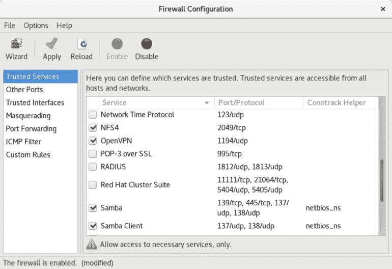 

图 4-9：显示防火墙信任服务的 `system-config-firewall`

默认已经有一个配置了。要创建你自己的基础自定义配置，只需点击 `Wizard` 按钮运行向导即可。

你也可以直接对不同的防火墙组件进行更改。`Firewall Configuration` 窗口将显示从侧边栏选择的多个标签。标签分别是 `Trusted Services`（信任服务）、`Other Ports`（其他端口）、`Trusted Interfaces`（信任接口）、`Masquerading`（伪装）和 `Custom Rules`（自定义规则）。

许多用户可能想要更改的是 `Trusted services`。Linux 系统通常用于为网络运行服务器。如果你正在创建一个强大的防火墙，但仍希望运行如 `Web` 服务器、`FTP` 服务器、`Samba` 桌面浏览或 `SSH` 加密连接，你必须在 `Trusted Services` 标签中指定它们。`Samba` 桌面浏览允许你从 `GNOME` 或 `KDE` 桌面访问你的 `Samba` 共享（例如远程 Windows 文件系统）。

`Other Ports` 标签允许你指定可能为某些服务（如 `BitTorrent`）开放的端口。点击 `Add` 按钮打开对话框，你可以在其中选择端口号以及要控制的协议（`tcp` 或 `udp`），或输入特定的端口号或范围。

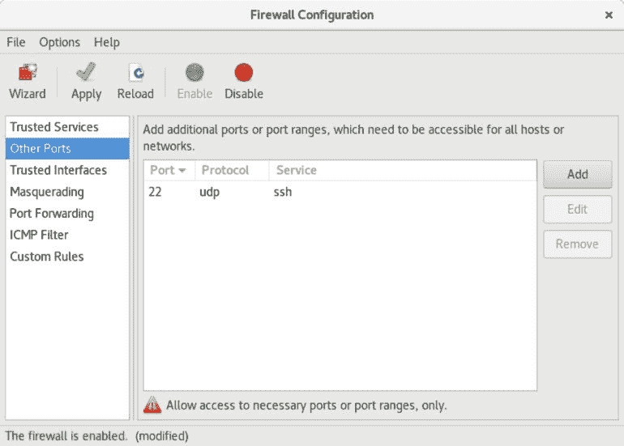

图 4-10：防火墙 Other Ports 配置

`Trusted interfaces` 标签允许你选择那些可以信任的硬件网络连接，如 `NIC` 卡、`modems` 或 `wireless connections`。这通常适用于连接到本地网络或直接连接到本地路由器或服务器（如 `print server`）的接口。连接到互联网等更广泛网络上的接口不应被信任。

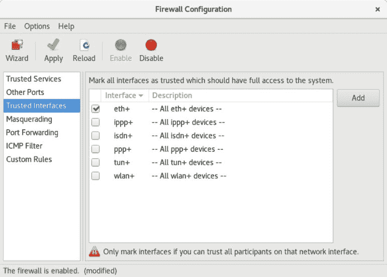

图 4-11：防火墙 Trusted Interfaces

如果你的系统被用作本地网络的网关，你可以实现 `masquerading`（伪装）来隐藏本地主机免受来自互联网的访问。尽管如此，这还需要 `IP forwarding`，IP 转发在你选择 `masquerading` 时会自动启用。本地主机仍然能够访问互联网，但它们将伪装成你的网关系统。你会为连接到互联网的接口选择 `masquerading`。`masquerading` 仅适用于 IPv4 网络。

`Port Forwarding` 标签允许你设置端口转发，将传输从一个端口引导到另一个端口或到另一个系统。

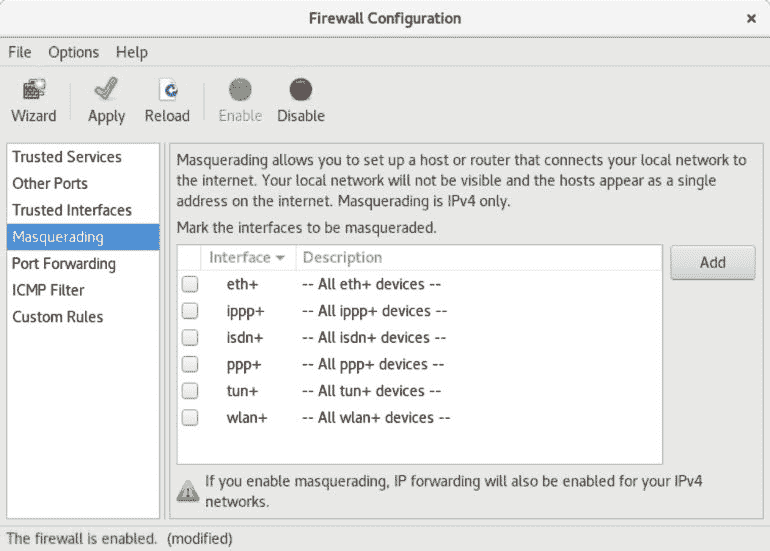

图 4-12：防火墙 Masquerading

`ICMP Filters` 标签允许你阻止 ICMP 消息。默认情况下所有 ICMP 消息都是允许的。阻止 ICMP 消息可以使系统更安全。某些类型的 ICMP 消息通常会被阻止，因为它们可能用于渗透系统，例如 `ping` 和 `pong` ICMP 消息。

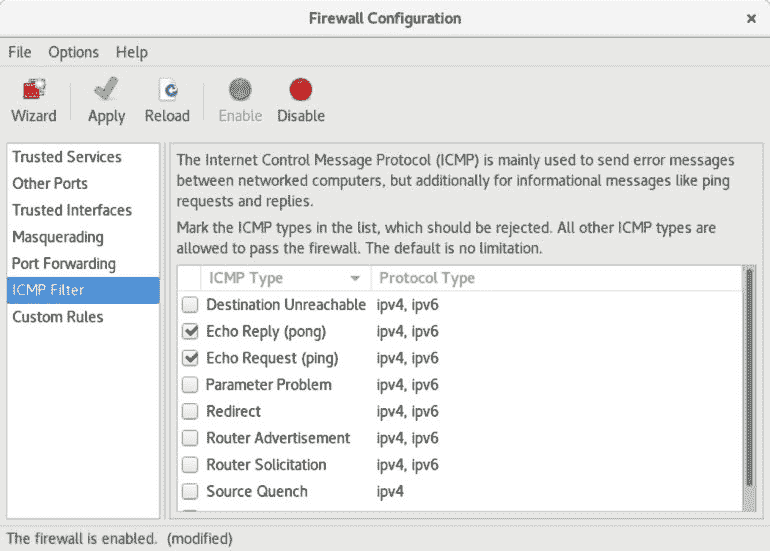

图 4-13：ICMP Filters


图 4-14：防火墙 Custom Rules

`Custom Rules` 标签允许你加载包含自定义规则的 IP-tables 文件。与其选择使用 `system-config-firewall` 或创建一个整个规则规则文件，你可以使用 `system-config-firewall` 自动配置标准防火墙规则，然后创建一个包含自定义规则的 IP-tables 文件。这些规则会被添加到 `system-config-firewall` 实现的标准集中。当你加载文件时，必须确定 IPtables 文件包含 IPv4 还是 IPv6 协议规则。你还必须选择防火墙规则适用于哪个表。三个选择是：`filter`（Netfilter 规则）、`mangle` 用于重写地址的 mangle 表）以及 `nat` 表。使用 `File` 按钮打开定位要加载的 IPtables 文件。

### 保存 IPtables 规则

当你确认 `IPtables` 规则运行正常后，可以将你的规则保存到 /etc/sysconfig/iptables 文件中（对于 IPv6 使用 /etc/sysconfig/ip6tables）。使用带有 `save` 选项的 `iptables` 服务脚本。现在，你的规则将在系统启动时自动读取。你可以将 `save` 操作理解为将你的 `IPtables` 规则安装到系统中，使其成为你每次启动系统时系统设置的一部分。

```bash
sudo systemctl save iptables
```


与其使用服务脚本，不如使用 `iptables-save` 脚本保存规则。推荐使用的文件是 `/etc/iptables.rules`。服务脚本实际上使用了带有 `-c` 选项的 `iptables-save` 将规则保存到 `/etc/sysconfig/iptables` 文件。`iptables-save` 的 `-c` 选项在输出中包含计数器（iptables 服务脚本设计为在解析命令的同时解析计数器信息）。`iptables-save` 命令将规则输出到标准输出。要将它们保存到文件中，必须使用重定向运算符 `>` 将输出重定向到文件，如下：

```bash
iptables-save -c > /etc/sysconfig/iptables
```

你也可以将规则保存到任选的文件，例如 `/etc/iptables.rules`。`/etc/rc.d/init.d/iptables` 服务脚本定义了 `IPTABLES_CONFIG` 变量，该变量持有 IPtables 配置文件的名称 `/etc/sysconfig/iptables`。

```bash
iptables-save > /etc/iptables.rules
```

然后，要恢复规则，请使用 `iptables-restore` 脚本从该保存文件中读取 IPtables 命令：

```bash
iptables-restore < /etc/iptables.rules
```

### IPtables 脚本

虽然你可以从 shell 命令行输入 IPtables 规则，但在系统关闭时，这些命令将会丢失。你可能需要将 IPtables 规则放在一个可以直接执行的脚本中。这样，你就可以编辑和管理一组复杂的规则，添加注释并维护它们的顺序。

#### IPtables 脚本示例：IPv4

你现在有了足够的信息来创建一个简单的 IPtables 脚本，为连接到网络的单个系统提供基本保护。以下脚本 `myfilter` 提供了一个 IPtables 过滤过程，保护本地网络和网站免受外部攻击。此示例使用了 IPtables 和 IPv4 地址。对于 IPv6 地址，你将使用 `ip6tables`，它具有相应的命令，但 NAT 规则除外，后者将作为 mangle 规则实现。为了清晰，这里使用了旧的网络设备名称 `eth0` 和 `eth1`。你系统的实际设备名称将不同，遵循可预测的命名格式（见第 2 章）。

该脚本为私有网络配置了一个简单的防火墙（更复杂的示例请查看 IPtables HOWTO）。如果你有本地网络，可以对此脚本进行调整。在此配置中，所有从外部发起的远程访问都被阻塞，但允许网络中的用户与外部系统建立连接进行双向通信。在本示例中，防火墙系统作为网络地址为 `192.168.0.0` 的私有网络的网关（参见图 4-15）。为了示例演示，互联网地址为 `10.0.0.1`。系统有两个以太网设备：一个用于私有网络 (`eth1`)，另一个用于互联网 (`eth0`)。网关防火墙系统还支持地址为 `10.0.0.2` 的 Web 服务器。此示例中过长而无法在一行的条目将延续在第二行，并用反斜杠引用换行符。应用于网络不同部分的基本规则如图 4-16 所示。

在脚本中，起初，你会使用刷新选项 (`-F`) 清空当前的 IPtables，然后为非用户定义的规则设置策略（默认目标）。在设置链规则时，还应关闭 IP 转发：

```bash
echo 0 > /proc/sys/net/ipv4/ip_forward
```

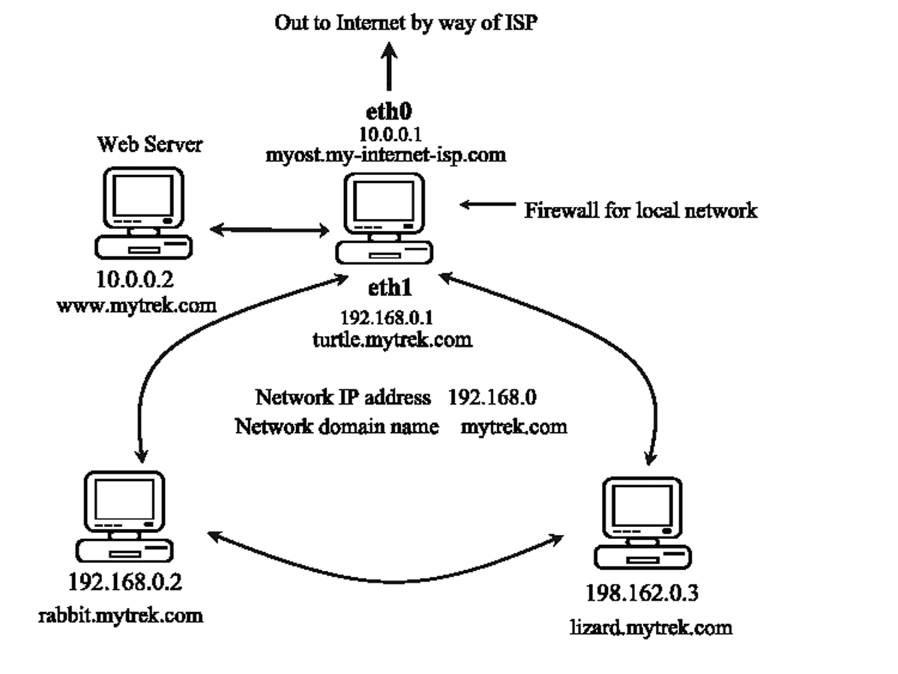
图 4-15: 带有防火墙的网络

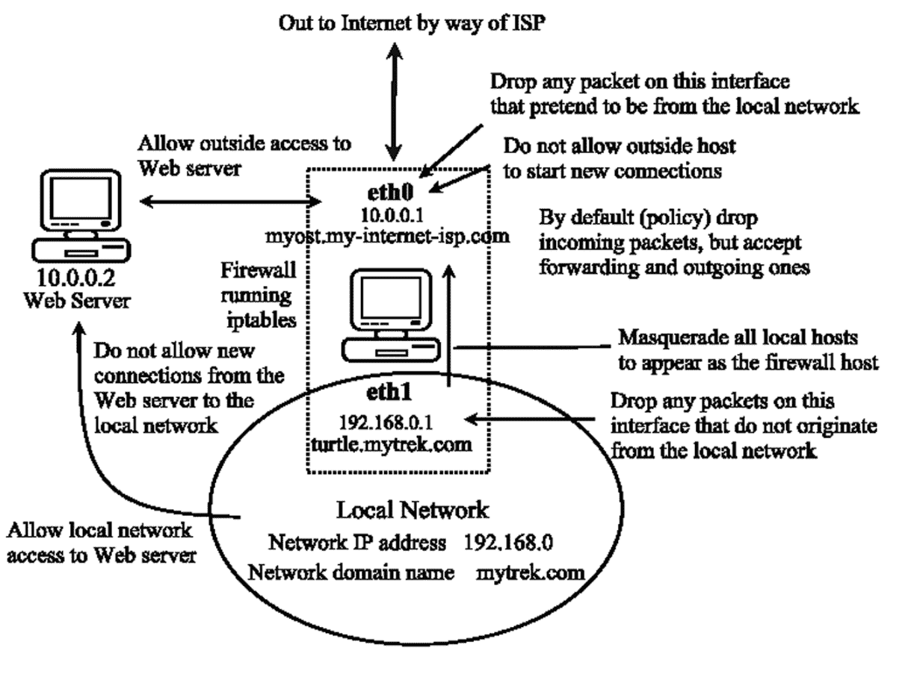
图 4-16: 应用于本地网络的防火墙规则示例

```bash
myfilter

Firewall Gateway system IP address is 10.0.0.1 using Ethernet device eth0
# Private network address is 192.168.0.0 using Ethernet device eth1
# Web site address is 10.0.0.2
# turn off IP forwarding
echo 0 > /proc/sys/net/ipv4/ip_forward
# Flush chain rules
iptables -F INPUT
iptables -F OUTPUT
iptables -F FORWARD
# set default (policy) rules
iptables -P INPUT DROP
iptables -P OUTPUT ACCEPT
iptables -P FORWARD ACCEPT
# IP spoofing, deny any packets on the internal network that have an external source address.
iptables -A INPUT -j LOG -i eth1 \! -s 192.168.0.0/24
iptables -A INPUT -j DROP -i eth1 \! -s 192.168.0.0/24
iptables -A FORWARD -j DROP -i eth1 \! -s 192.168.0.0/24
# IP spoofing, deny any outside packets (any not on eth1) that have the source address of the internal network
iptables -A INPUT -j DROP \! -i eth1 -s 192.168.0.0/24
iptables -A FORWARD -j DROP \! -i eth1 -s 192.168.0.0/24
```


```bash
iptables -A INPUT -j DROP -i eth1 ! -s 192.168.0.0/24
iptables -A FORWARD -j DROP -i eth1 ! -s 192.168.0.0/24
```

# IP 伪欺，拒绝任何来自外部（非 eth1 接口）
# 且源地址为内部网络的数据包
```bash
iptables -A INPUT -j DROP ! -i eth1 -s 192.168.0.0/24
iptables -A FORWARD -j DROP ! -i eth1 -s 192.168.0.0/24
```

# IP 伪欺，拒绝任何带有本地地址的外部数据包
# （不在 lo 接口上的数据包（任何 eth0 或 eth1 上的包）
# 其源地址为本地回地址）
```bash
iptables -A INPUT -j DROP -i ! lo -s 127.0.0.0/255.0.0.0
iptables -A FORWARD -j DROP -i ! lo -s 127.0.0.0/255.0.0.0
```

然后，你将设置规则来允许系统内部（本地主机）发送和接收的所有数据包通过。
```bash
iptables -A INPUT -j ACCEPT -i lo
```

## 服务器访问
对于 Web 服务器，你希望允许外部用户访问，但阻止任何尝试从 Web 服务器向私有网络发起连接的操作。在下一个示例中，Web 服务器接受所有消息，但 Web 服务器无法主动与私有网络建立联系。这可以防止任何人通过对外部开放的 Web 服务器侵入本地网络。允许已建立的连接，以便私有网络可以使用 Web 服务器。

# 允许访问 Web 服务器（地址 10.0.0.2），端口 www
```bash
iptables -A INPUT -j ACCEPT -p tcp -i eth0 --dport www -s 10.0.0.2
```

# 允许从 Web 服务器到内部网络的已建立连接
```bash
iptables -A INPUT -m state --state ESTABLISHED,RELATED -i eth0 \
  -p tcp --sport www -s 10.0.0.2 -d 192.168.0.0/24 -j ACCEPT
```

# 防止从 Web 服务器到内部网络的新连接
```bash
iptables -A OUTPUT -m state --state NEW -o eth0 -p tcp \
  --sport www -d 192.168.0.0/24 -j DROP
```

## 防墙外部访问
为了允许防火墙访问外部网络，你允许除 ICMP 包以外的所有数据包输入。这些包将在稍后处理。防火墙由防火设备 `eth0` 指定。首先，你的防火墙应该允许已建立和相关的连接通过，如下。然后你将按照后文描述阻止外部访问。

# 允许外部到防火墙的通信，
# ICMP 包除外
```bash
iptables -A INPUT -m state --state ESTABLISHED,RELATED -i eth0 -p ! icmp -j ACCEPT
```

### 阻塞外部发起访问
为了防止外部人员向你的系统发起任何访问，创建一个规则，使用 `state` 选项配合 `NEW` 来拦截来自外部的 SYN 包。丢弃 `eth0` 连接上的任何新连接（假设只有 `eth0` 连接到互联网或外部网络）。

# 防止外部发起的连接
```bash
iptables -A INPUT -m state --state NEW -i eth0 -j DROP
iptables -A FORWARD -m state --state NEW -i eth0 -j DROP
```

## 本地网络访问
为了允许内部网络与防火墙交互，你允许内部以太网连接 `eth1` 上的所有数据包。有效的内部网络地址被指定为输入源。
```bash
iptables -A INPUT -j ACCEPT -p all -i eth1 -s 192.168.0.0/24
```

## 列出规则
这些 `iptables` 选项的列表显示了每个选项的不同规则，如下：

```bash
$ iptables -L
Chain INPUT (policy DROP)
target  prot opt source             destination
LOG     all  -- !192.168.0.0/24  anywhere        LOG level warning
DROP     all  -- !192.168.0.0/24  anywhere
DROP     all  --  192.168.0.0/24  anywhere
DROP     all  --  127.0.0.0/8      anywhere
ACCEPT   all  --  anywhere        anywhere
ACCEPT   tcp  --  10.0.0.2       anywhere        tcp dpt:http
ACCEPT   tcp  --  10.0.0.2       192.168.0.0/24  state RELATED,ESTABLISHED
ACCEPT !icmp  --  anywhere        anywhere        state RELATED,ESTABLISHED
DROP     all  --  anywhere        anywhere        state NEW
ACCEPT   all  --  192.168.0.0/24  anywhere        tcp:http
ACCEPT   icmp  --  anywhere        10.0.0.1         icmp echo-reply
ACCEPT   icmp  --  anywhere        10.0.0.1         icmp echo-request
ACCEPT   icmp  --  anywhere        10.0.0.1         icmp destination-unreachable
Chain FORWARD (policy ACCEPT)
target  prot opt source             destination
DROP     all  -- !192.168.0.0/24  anywhere
DROP     all  --  192.168.0.0/24  anywhere
DROP     all  --  127.0.0.0/8      anywhere
DROP     all  --  anywhere        anywhere        state NEW
Chain OUTPUT (policy ACCEPT)
target  prot opt source             destination
DROP     tcp  --  anywhere        192.168.0.0/24  state NEW tcp:http
$ iptables -t nat -L
Chain PREROUTING (policy ACCEPT)
target  prot opt source             destination
Chain POSTROUTING (policy ACCEPT)
target  prot opt source             destination
MASQUERADE all  --  anywhere        anywhere
Chain OUTPUT (policy ACCEPT)
target  prot opt source             destination
```

## 用户定义规则
对于更复杂的规则，你可能想要创建自己的链以减少重复。一种常见方法是为 `INPUT` 和 `FORWARD` 链都定义一个用户链，这样就不需要为每个链重复 `DROP` 操作。相反，你只需要一个用户链，`FORWARD` 和 `INPUT` 链都向该链提供 `DROP` 操作。记住，除了共享的规则外，`FORWARD` 和 `INPUT` 操作可能有单独的规则。在下一个示例中，创建了一个名为 `arriving` 的用户链。该链在脚本顶端使用 `-N` 选项定义：

```bash
iptables -N arriving
```

用户链必须在用作其他规则的目标之前进行定义。因此，你必须先定义并添加该链的所有规则，然后将其作为目标。`arriving` 链首先被定义并添加规则。然后，在文件末尾，它被用 `INPUT` 和 `FORWARD` 链的目标。`INPUT` 链列出了接受数据包的规则，而 `FORWARD` 链具有 `ACCEPT` 策略，默认将接受它们。

```bash
iptables -N arriving
iptables -F arriving
# IP 伪欺，拒绝内部网络中
# 带有外部源地址的数据包。
iptables -A arriving -j LOG -i eth1 ! - 192.168.0.0/24
iptables -A arriving -j DROP -i eth1 ! -s 192.168.0.0/24
iptables -A arriving -j DROP ! -i eth1 -s 192.168.0.0/24
…………………………
# 脚本末尾项
iptables -A INPUT -j arriving
iptables -A FORWARD -j arriving
```

对应的规则列表所示：

```text
Chain INPUT (policy DROP)
target  prot opt source             destination
arriving all  --  anywhere        anywhere (base chain 0)

Chain FORWARD (policy ACCEPT)
target  prot opt source             destination
arriving all  --  anywhere        anywhere (base chain 0)

Chain arriving (2 references)
target  prot opt source             destination
LOG     all  -- !192.168.0.0/24  anywhere        LOG flags 0 level 4
DROP     all  -- !192.168.0.0/24  anywhere
DROP     all  --  192.168.0.0/24  anywhere
DROP     all  --  127.0.0.0/8      anywhere
```


要实现伪装（masquerading），即私网上的系统可以使用网关的互联网地址连接到互联网主机，你需要创建一个 `-t nat` 表的 `POSTROUTING` 规则，并使用 `MASQUERADE` 目标。

```bash
iptables -t nat -A POSTROUTING -o eth0 -j MASQUERADE
```

### 控制 ICMP 数据包
此外，为了允许 ping 和目标不可达的 ICMP 数据包，你需要以防火墙为目的地输入 `INPUT` 规则。要启用 ping 操作，你同时使用 `echo-reply` 和 `echo-request` ICMP 类型；对于目标不可达，你则使用 `destination-unreachable` 类型。

```bash
iptables -A INPUT -j ACCEPT -p icmp -i eth0 --icmp-type echo-reply -d 10.0.0.1
iptables -A INPUT -j ACCEPT -p icmp -i eth0 --icmp-type echo-request -d 10.0.0.1
iptables -A INPUT -j ACCEPT -p icmp -i eth0 --icmp-type destination-unreachable -d 10.0.0.1
```

最后，再次开启 IP 转发。

```bash
echo 1 > /proc/sys/net/ipv4/ip_forward
```

### 简单 LAN 配置
要创建一个支持不支持 Web 服务器等任何互联网服务的简单局域网的脚本，你只需要不包含支持这些服务的规则即可。你仍然需要 `FORWARD` 和 `POSTROUTING` 规则来将本地主机连接到互联网，以及管理主机与防火墙之间交互的规则。要修改示例脚本以支持没有 Web 服务器的简单 LAN，只需删除控制 Web 服务器的三条规则，其余部分保持不变。

### 防火墙系统上带有互联网服务的 LAN 配置
通常，作为防火墙的同一系统也用于运行互联网服务器，如 Web 和 FTP 服务器。在这种情况下，防火墙规则被应用于这些服务使用的端口。示例脚本处理的是运行在独立主机系统上的 Web 服务器。如果 Web 服务器运行在防火墙系统上，你将把 Web 服务器防火墙规则应用到 Web 服务器使用的端口上。通常，Web 服务器使用的端口是 `80`。在接下来的示例中，Web 服务器的 `iptables` 规则已应用于防火墙系统上的 `www` 端口（端口 `80`）。修改只需要移除旧的 Web 服务器主机地址引用 `10.0.0.2`。

# 允许访问 Web 服务器，端口 www (端口 80)
```bash
iptables -A INPUT -j ACCEPT -p tcp -i eth0 --dport www
```

# 允许从 Web 服务器到内部网络的已连接
```bash
iptables -A INPUT -m state --state ESTABLISHED,RELATED -i eth0 \
  -p tcp --sport www -d 192.168.0.0/24 -j ACCEPT
```

# 防止从 Web 服务器到内部网络的新连接
```bash
iptables -A OUTPUT -m state --state NEW -o eth0 -p tcp \
  --sport www -d 192.168.0.0/24 -j DROP
```

同样可以为 FTP 服务器设置类似的条目。如果你运行多个互联网服务，可以使用用户自定义规则在每个服务上运行相同的规则，而不是为每个服务重复三条独立的规则。根据示例脚本，你将使用两个定义规则，一个用于 `INPUT`，一个用于 `OUTPUT`，用于控制服务的输入和输出数据包。

```bash
iptables -N inputservice
iptables -N outputservice
iptables -F inputservice
iptables -F outputservice
```

# 允许访问服务
```bash
iptables -A inputservice -j ACCEPT -p tcp -i eth0
```

# 允许从服务到内部网络的已连接
```bash
iptables -A inputservice -m state --state ESTABLISHED,RELATED -i eth0 \
  -p tcp -d 192.168.0.0/24 -j ACCEPT
```

# 防止从服务到内部网络的新连接
```bash
iptables -A outputservice -m state --state NEW -o eth0 -p tcp \
  -d 192.168.0.0/24 -j DROP
```

…………………………

# 为 Web 服务器运行规则，端口 www (端口 80)
```bash
iptables -A INPUT --dport www -j inputservice
iptables -A INPUT --dport www -j outputservice
```

# 为 FTP 服务器运行规则，端口 ftp (端口 21)
```bash
iptables -A OUTPUT --dport ftp -j inputservice
iptables -A OUTPUT --dport ftp -j outputservice
```

### IP 伪装 (IP Masquerading)
在 Linux 系统上，你可以建立一个网络，该网络可以使用同一个网关连接到互联网。通过这种方式，仅使用一个 IP 地址，多个系统就可以连接到互联网。这种方法被称为 IP 伪装，一个系统伪装成另一个系统，使用该系统的 IP 地址。在这样的网络中，一个系统通过 IP 地址连接到互联网，而其他系统通过局域网（LAN）连接到该系统。当本地系统想要访问网络时，它会伪装成连接互联网的系统，借用 IP 地址。

IP 伪装在 Linux 上通过 `iptables` 防火墙工具实现。实际上，你设置一个防火墙，然后对其进行配置以伪装。你可以从 Linux 文档中获取有关 IP 伪装的更多信息。


在 Netfilter 中，IP 伪装（IP masquerading）是一种 NAT 操作，它不像 IP Chains 那样与数据包过滤集成。IP 伪装命令被放置在 NAT 表中，并数据包过滤命令分开处理。

在 FirewallD 中，可以使用 `firewall-config` 的 Masquerading 选项卡或 `firewall-cmd --add-masquerade` 选项为区域启用伪装功能。使用 `--remove-masquerade` 选项从区域中移除伪装。

```bash
sudo firewall-cmd --permanent --zone=work -add-masquerade
```

对于静态防火墙，你可以使用 `iptables` 在 NAT 表上放置伪装规则。首先，使用 `-t nat` 选项引用 NAT 表。然后使用 `-o` 选项指定输出设备，并使用 `-j` 选项配合 `MASQUERADE` 命令在 `POSTROUTING` 链中添加规则。

```bash
sudo iptables -t nat -A POSTROUTING -o eth0 -j MASQUERADE
```

下一步是开启 IP 转发，可以手动操作，也可以通过在 `/etc/sysctl.conf` 文件中设置 `net.ipv4.ip_forward` 并运行带有 `-p` 选项的 `sysctl`。IP 转发默认关闭。对于 IPv6，请使用 `net.ipv6.conf.all.forwarding`。`/etc/sysctl.conf` 条目所示：

```text
net.ipv4.ip_forward = 1
net.ipv6.conf.all.forwarding = 1
```

然后你运行带有 `-p` 选项的 `sysctl`。

```bash
sysctl -p
```

你可以直接使用 `echo` 命令修改相应的转发文件，如下所示：

```bash
sudo echo 1 > /proc/sys/net/ipv4/conf/all/forwarding
```

对于 IPv6，你将使用对应 `/proc/sys/net/ipv6` 目录下的转发文件 `conf/all/forwarding`。

```bash
sudo echo 1 > /proc/sys/net/ipv6/conf/all/forwarding
```

### 伪装选定的主机

与其将所有本地主机伪装成防火墙/网关主机的单一 IP 地址，不如使用 NAT 表为少数选定的本地主机重写地址。这种方法通常适用于你希望多个本地主机显示为 Internet 服务器的设置。通过 `DNAT` 和 `SNAT` 目标，你可以将数据包定向到特定的本地主机。你会使用 `PREROUTING` 和 `POSTROUTING` 链上的规则来引导输入和输出数据包。

例如，上一个示例中的 Web 服务器可以配置为本地主机，`DNAT` 目标可以重定向任何原始接收给 `10.0.0.2` 的数据包。假设 Web 服务器设置在 `192.168.0.5` 上。它在互联网上可以显示为地址 `10.0.0.2`。发送到 `10.0.0.2` 的数据包将由 NAT 表重写并定向到 `192.168.0.5`。你会使用带有 `-d` 选项的 `PREROUTING` 链处理入站数据包，使用带有 `-s` 选项的 `POSTROUTING` 链处理出站数据包。

```bash
iptables -t nat -A PREROUTING -d 10.0.0.2 --to-destination 192.168.0.5 -j DNAT
iptables -t nat -A POSTROUTING -s 192.168.0.5 --to-source 10.0.0.2 -j SNAT
```

提示：请记住，在 `iptables` 中，伪装不会与 `FORWARD` 链结合（就像在 IP Chains 中那样）。因此，如果你为 `FORWARD` 链指定了 `DROP` 策略，你还必须专门为正在伪装的网络启用 `FORWARD` 操作。你同时需要 `POSTROUTING` 规则和 `FORWARD` 规则。

# 5. Shell 变量与脚本

Shell 脚本以某种方式组合 Linux 命令以执行特定任务。不同类型的 Shell 提供了许多你可以用于创建 Shell 脚本的编程工具。你可以定义变量并为它们赋值。你还可以在脚本文件中定义变量，并在用户执行脚本时交互式地为它们输入值。Shell 提供了循环和条件控制结构，可以重复执行 Linux 命令或决定执行哪些命令。你还可以构建执行算术或比较操作的表达式。所有 Shell 编程工具的操作方式与其他编程语言中的工具相似，因此如果你已经熟悉编程，可能会发现 Shell 编程非常简单。

`BASH`、`TCSH` 和 `Z` Shell 是不同类型的 Shell。你可以拥有某种特定类型 Shell 的多个实例。根据定义，Shell 是你在其中执行命令的解释执行环境。你可以同时运行许多环境，这些环境可以是相同或不同类型的 Shell；例如，你可以同时运行几个 `BASH` Shell 类型的 Shell。

本章将介绍使用 `BASH` 和 `TCSH` Shell 创建 Shell 脚本的基础知识，这些是大多数 Linux 系统上所使用的 Shell。你将学习如何创建自己的脚本、定义 Shell 变量以及开发用户界面，并学习组合控制结构以创建复杂程序的更困难的任务。本章中的表格列出了 Shell 命令和操作符，大量的示例展示了它们是如何实现的。

通常，组成 Shell 程序的指令被输入到脚本文件中，然后执行该文件。你甚至可以将程序分发到多个脚本文件中，其中一个文件将包含如何执行其他文件的指令。你可以将变量、表达式和控制结构视为你用于将多个 Linux 命令组合为一个操作的工具。从这个意义上说，Shell 程序是你创建的一个全新且复杂的命令。与 UNIX 使用的第一个 Shell Bourne shell 不同，`BASH` 包含了 `TCSH` 的许多特性……特别是算术运算，在 `BASH` 中执行更容易。

## Shell 变量

在每个 Shell 中，你可以输入并执行命令。你可以使用 Shell 变量进一步增强 Shell 的功能。Shell 变量允许你持有反复引用的数据。例如，你可以定义一个 Shell 变量来存储复杂文件的名称。

你在 Shell 中定义变量，这些变量被称为 Shell 变量。某些实用（如 Mail 工具）有它们自己的 Shell 和相应的 Shell 变量。你还可以使用 Shell 脚本创建自己的 Shell。你有一个一登录就会变为激活的用户 Shell，这通常被称为登录 Shell（login shell）。特殊的系统级参数变量定义在这个登录 Shell 中。

注意：Shell 变量只要你的 Shell 处于激活状态就会存在——也就是说直到你退出 Shell。例如，注销将退出登录 Shell。当你再次登录时，登录 Shell 中可能需要的任何变量必须重新定义。

### 变量的定义与评估：= $, set, unset

当你第一次使用变量名时，你就在 Shell 中定义了变量。变量名可以是任何字母字符组合，包括下划线。名称也可以包含数字，但数字不能是名称的第一个字符。名称不能包含任何其他类型的字符，例如感叹号、&甚至空格。这些符号被 Shell 留供自身使用。此外，变量名不能包含多个单词。Shell 使用命令行上的空格来区分命令的不同组件，如选项、参数和命令名。


你使用赋值运算符（`=`）为变量分配一个值。你输入变量名、赋值运算符，然后是赋值的值。不要在赋值运算符周围留任何空格。例如，赋值操作 `poet = Virgil` 将会失败（C shell 的赋值操作类型略有不同）。你可以为变量分配任何一组字符。在接下来的示例中，变量 `poet` 被赋值为字符串 `Virgil`：

```
$ poet=Virgil
```

一旦你为变量分配了值，你就可以使用变量名来引用该值。你通常将变量的值作为命令的参数使用。你可以通过在变量名前前面加上 `$` 运算符来引用变量的值。美元符号 `$` 是一个特殊的运算符，它使用变量名来引用变量的值，实际上是对变量进行求值。求值会检索变量的值（通常是一组字符）。然后，这组字符将替换命令行上的变量名。在在变量名之前放置 `$` 的地方，变量名都会被变量的值替换。在接下来的示例中，壳变量 `poet` 被求值，其内容 `Virgil` 被用 `echo` 命令的参数。`echo` 命令简单地将一组字符回显或打印到屏幕上。

```
$ echo $poet
Virgil
```

你必须区分变量的求值与其名称本身。如果你在变量名之前漏掉 `$` 运算符，你拥有的只是变量名本身。在接下来的示例中，变量名缺少了 `$` 运算符。在这种情况下，`echo` 命令的参数是 `poet` 这个词，因此打印出 `poet`：

```
$ echo poet
poet
```

变量的内容经常用作命令参数。常见的命令参数是目录路径。反复输入正在使用的目录路径可能会很麻烦。如果你将目录路径分配给变量，你就可以直接用求值后的变量代替它。当你使用 `$` 运算符对变量进行求值时，就会检索你分配的目录路径。接下来的示例将目录路径分配给变量，然后在复制命令中使用求值后的变量。`ldir`（即 `$ldir`）的求值结果是路径 `/home/chris/letters`。复制命令解析为 `cp myletter /home/chris/letters`。

```
$ ldir=/home/chris/letters
$ cp myletter $ldir
```

你可以通过 `set` 命令获取所有定义的变量列表。如果你决定不需要某个变量，可以使用 `unset` 命令将其移除。`unset` 命令会取消变量的定义。

### 变量值：字符串

你分配给变量的值可以由任何字符组成。这些字符可以是你显式输入的字符字符串，也可以是执行 Linux 命令获得的结果。在大多数情况下，你需要使用单引号、双引号、反斜杠或反引号（back quotes）对你的值进行引用。单引号、双引号和反斜杠允许你以不同的方式引用字符串。反引号具有执行 Linux 命令并将其结果作为命令行参数的特殊功能。

#### 引用字符串：双引号、单引号和反斜杠

变量值可以由任何字符组成。然而，当你想要包含同样被壳（shell）用作运算符的字符时问题就会出现。你的 shell 有某些在求值命令行时使用的元字符。空格用于解析命令行上的参数。星号（`*`）、问号（`?`）和括号（`[]`）是用于生成文件名列表的元字符。点（`.`）表示当前目录。美元符号（`$`）用于求值变量，大于号和小于号（`>`, `<`）是重定向运算符。安符（`&`）用于执行后台命令，管道（`|`）输出输出。如果你想将这些字符之一作为变量的值，首先需要对它们进行引用。在命令行上引用元字符会使其变成普通字符，它不会被 shell 求值。

你可以使用双引号、单引号和反斜杠来引用此类元字符。双引号和单引号允许你一次引用多个元字符。双引号或单引号内的任何元字符都会被引用。反斜杠引用其其后的单个字符。

如果你想给变量分配多个单词，你需要引用分隔单词的空格。你可以通过将所有单词包含在双引号内来实现。你可以认为这是创建一个要分配给变量的字符字符串。当然，双引号内的任何其他元字符也会被引用。

在下面的第一个示例中，双引号包含了由空格分隔的单词。因为空格包含在双引号内，它们被视为字符，而不是用于解析命令行参数的分隔符。在第二个示例中，双引号还包含了一个点，将其视为普通字符。在第三个示例中，星号也被包含在双引号内。该星号被视为字符串中的另一个字符，不会被求值。

```
$ notice="The meeting will be tomorrow"
$ echo $notice
The meeting will be tomorrow

$ message="The project is on time."
$ echo $message
The project is on time.

$ notice="You can get a list of files with ls *.c"
$ echo $notice
You can get a list of files with ls *.c
```

然而，双引号并不引用求值变量的运算符美元符号。包含在双引号内的变量名旁的 `$` 运算符仍然会被求值，将变量名替换为它的值。变量的值随后将成为字符串的一部分，而不是变量名。有时你可能希望引号内的变量被求值。在接下来的示例中，使用双引号是为了将名字包含在通知中。

```
$ winner=dylan
$ notice="The person who won is $winner"
$ echo $notice
The person who won is dylan
```

另一方面，有时你不希望引号内的变量被求值。在这种情况下，你必须使用单引号。单引号会抑制任何变量求值，并将美元符号视为普通字符。在接下来的示例中，单引号防止了 `winner` 变量的求值。

```
$ winner=dylan
$ result='The name is in the $winner variable'
$ echo $result
The name is in the $winner variable
```

如果在这种情况下使用了双引号，就会发生无意外的变量求值。在接下来的示例中，字符 `"$winner"` 被解释为变量求值。

```
$ winner=dylan
$ result="The name is in the $winner variable"
$ echo $result
The name is in the dylan variable
```

你始终可以通过在任何元字符（包括 `$` 运算符）之前加上反斜杠来引用它。使用反斜杠是为了引用换行符。当你需要在字符串内求值变量的同时包含 `$` 字符时，反斜杠非常有用。在接下来的示例中，反斜杠放在 `$` 之前以便将其视为美元符号字符：`\$`。同时，变量 `$winner` 被求值，因为使用的双引号并没有引用 `$` 运算符。

```
$ winner=dylan
$ result="$winner won \$100.00"
$ echo $result
dylan won $100.00
```

#### 引用命令：单引号


然而，有时你可能想在 Linux 命令周围使用单引号。单引号允许你将编写的命令赋值给变量。如果你这样做，你就可以将该变量名作为 Linux 命令的另一个名称。在命令行中输入以 `$` 运算符开头的变量名即可执行该命令。在下一个示例中，一个 shell 变量被赋值了组成列文件 Linux 命令的字符：`'ls -F'`。注意命令周围的单引号。当 shell 变量在命令行上求值时，它包含的 Linux 命令将变成一个命令行参数，并由 shell 执行。

```
$ lsf='ls -F'
$ $lsf
mydata /reports /letters
$
```

实际上，你正在为命令创建另一个名称，类似于别名。

## 来自 Linux 命令的值：反引号

虽然你可以通过输入字符或字符字符串来创建变量值，你也可以从其他 Linux 命令获取值。要将 Linux 命令的结果赋值给变量，你首先需要执行该命令。如果你在命令行上将 Linux 命令放在反引号（`` ` ``）中，该命令将首先执行，其结果将成为命令行上的一个参数。在赋值的情况下，可以通过先将命令放在反引号内执行，将命令的结果赋值给变量。反引号可以被看作是由一个待执行命令组成的表达式，其结果随后被赋值给变量。构成命令本身的字符本身不会被赋值。在下一个示例中，执行了命令 `ls *.c`，然后将其结果赋值给变量 `listc`。`ls *.c` 会生成所有带有 `.c` 扩展名的文件列表。该文件列表随后被赋值给 `listc` 变量。

```
$ listc=`ls *.c`
$ echo $listc
main.c prog.c lib.c
```

请记住单引号和反引号的区别。单引号将 Linux 命令视为一组字符。反引号则强制执行 Linux 命令。有时你可能在想用反引号时，却不不无意中输入了单引号。在接下来的第一个示例中，`lscc` 变量的赋值在 `ls *.c` 命令周围使用了单引号而不是反引号。在这种情况下，`ls *.c` 只是要赋值给变量 `lscc` 的字符。在第二个示例中，`ls *.c` 命令周围放置了反引号，强制对命令进行求值。生成一个以 `.c` 结尾的文件列表并将其赋值为 `lscc` 的值。

```
$ lscc='ls *.c'
$ echo $lscc
ls *.c
$ lscc=`ls *.c`
$ echo $lscc
main.c prog.c
```

## Shell 脚本：用户自定义命令

你可以将 shell 命令放置在一个文件中，然后让 shell 读取并执行文件中的命令。从这个意义上说，该文件充当了 shell 程序，像程序中的语句一样执行 shell 命令。包含 shell 命令的文件称为 shell 脚本。

你使用标准文本编辑器（如 Vi 编辑器）将 shell 命令输入脚本文件。配合脚本文件名使用的 `sh` 或 `.` 命令将读取脚本文件并执行命令。在下一个示例中，名为 `lsc` 的文本文件包含一个 `ls` 命令，该命令只显示扩展名为 `.c` 的文件：

```
lsc
ls *.c
```

这里是 `lsc` 脚本的运行情况：

```
$ sh lsc
main.c calc.c
$ . lsc
main.c calc.c
```

### 执行脚本

你可以通过设置脚本文件的执行权限来省略 `sh` 和 `.` 命令。当文本编辑器首次创建脚本文件时，它只具有读写权限。带有 `+x` 选项 `chmod` 命令将赋予脚本文件执行权限。一旦可执行，在 shell 提示符处输入脚本文件名并回车即可执行该脚本文件及其中的 shell 命令。实际上，脚本文件名变成一个新的 shell 命令。通过这种方式，你可以使用 shell 脚本来设计和创建自己的 Linux 命令。你只需要设置一次权限。

在下一个示例中，`lsc` 文件所有者的执行权限被设置为开启。然后像执行任何 Linux 命令一样直接执行 `lsc` shell 脚本。

```
$ chmod u+x lsc
$ lsc
main.c calc.c
```

你可能需要指定使用的脚本位于当前工作目录。通过在脚本名称前加上点和斜杠的组合来实现，例如 `./lsc`。点是表示当前工作目录名的特殊字符。斜杠是目录路径分隔符。以下示例显示了如何执行 `lsc` 脚本：

```
$ ./lsc
main.c calc.c
```

### 脚本参数

就像任何 Linux 命令都可以接受参数一样，shell 脚本也可以接受参数。命令行上的参数从 `1` 开始顺序引用。参数使用 `$` 运算符和位置数字进行引用。第一个参数用 `$1` 引用，第二个用 `$2` 引用，依此类推。在下一个示例中，`lsext` 脚本打印带有指定扩展名的文件。第一个参数是扩展名。然后带参数 `c` 执行脚本（当然，必须已设置执行权限）。

```
lsext
ls *.$1
```

这里是带参数运行的 `lsext` 脚本示例：

```
$ lsext c
main.c calc.c
```

在下一个示例中，打印带行号的文件的命令被放置在一个名为 `lpnum` 的可执行文件中，该文件接受文件名作为参数。带有 `-n` 选项的 `cat` 命令首先输出带有行号的文件内容。然后该输出被传递给 `lpr` 命令，由其打印。打印行号的命令在后台执行。

```
lpnum
cat -n $1 | lpr &
```

这里是带参数运行的 `lpnum` 脚本示例：

```
$ lpnum mydata
```

你可能需要一次引用多个参数。使用的参数数量可能有所不同。在 `lpnum` 中，你可能想一次打印三个文件，而在其他其他时间打印五个文件。带有星号的 `$` 运算符 `$*` 引用命令行上的所有参数。使用 `$*` 允许你创建接受不同数量参数的脚本。在下一个示例中，`lpnum` 使用 `$*` 重写，以便每次使用它时都能接受不同数量的参数：

```
lpnum
cat -n $* | lpr &
```

这里是带多个参数运行的 `lpnum` 脚本示例：

```
$ lpnum mydata preface
```

## 变量

当你登录账户时，你的 Linux 系统会生成你的用户 shell。在这个 shell 中，你可以发布命令并声明变量。你还可以创建并执行 shell 脚本。然而，当你执行 shell 脚本时，系统会生成一个子 shell。这时有两个 shell：你登录的那个和一个为脚本生成的那个。在脚本 shell 中，你可以执行另一个 shell 脚本，它也将会有它自己的 shell。当脚本执行完毕后，它的 shell 会终止，你回到执行它的 shell。从这个意义上说，你可以拥有许多 shell，每个都嵌套在另一个之中。

你在 shell 中定义的变量是该 shell 局部的。如果你在 shell 脚本中定义变量，那么当脚本运行时，该变量在该脚本的 shell 中定义并对其局部的。其他 shell 无法引用它。从某种意义上说，该变量隐藏在它的 shell 内部。


为了更清晰地说明这种情况，接下来的示例将使用两个脚本，其中一个从另一个脚本内部调用。当第一个脚本执行时，它会生成自己的 shell。在这个 shell 内部，会执行另一个脚本，该脚本反过来生成它自己的 shell。在下一个示例中，用户首先执行 `dispfirst` 脚本，它会显示第一个名字。当 `dispfirst` 脚本执行时，它会生成自己的 shell，然后在该 shell 中定义 `firstname` 变量。在显示 `firstname` 的内容后，脚本执行另一个脚本：`displast`。当 `displast` 执行时，它会生成自己的 shell。它在自己的 shell 中定义 `lastname` 变量，然后显示 `lastname` 的内容。接着它尝试引用 `firstname` 并显示其内容。它无法这样做，因为 `firstname` 是 `dispfirst` shell 的局部变量，无法在外部被引用。系统会显示一条错误消息，指示对于 `displast` shell 来说，`firstname` 是未定义的变量。

```
dispfirst
firstname="Charles"
echo "First name is $firstname"
```

```
displast
lastname="Dickens"
echo "Last name is $lastname"
echo "$firstname $lastname"
```

这里是 `dispfirst` 脚本的运行结果：

```
$ dispfirst
First name is Charles
Last name is Dickens
Dickens
sh: firstname: not found
```

如果你想在脚本 shell 和子 shell 中使用同一个变量值，你可以简单地定义两次变量，在每个脚本中各一次，并赋予它们相同的值。在上一个示例中，`dispfile` 和 `printfile` 中定义了 `myfile` 变量。用户执行 `b` 脚本，它首先显示带行号的文件列表。当 `dispfile` 脚本执行时，它生成自己的 shell，然后在该 shell 中定义 `myfile` 变量。在显示文件内容后，脚本执行另一个脚本 `printfile`。当 `printfile` 执行时，它生成自己的 shell。它在自己的 shell 中定义了自己的 `myfile` 变量，然后将文件发送到打印机。

如果你在一个 shell 中定义一个变量并在任何子 shell 中引用它的值怎么办？例如，如果你想在 `dispfile` 脚本中定义 `myfile` 变量，并在 `printfile` 脚本内部引用它的值 "List"，而不是在 `printfile` 中显式定义另一个变量？由于变量对于定义它们的 shell 是局部的，你无法通过普通变量实现这一点。但是，有一种变量被称为**环境变量**，它允许其值被任何子 shell 引用。环境变量构成了 shell 及其生成的任何子 shell 的环境，无论嵌套有多深。

```
dispfile
myfile="List"
echo "Displaying $myfile"
pr -t -n $myfile
```

```
printfile
myfile="List"
echo "Printing $myfile"
lp $myfile &
```

这里是 `dispfile` 脚本的运行结果：

```
$ dispfile
Displaying List
1 screen
2 modem
3 paper
Printing List
```

你可以在三种主要类型的 shell（Bourne、Korn 和 C）中定义环境变量。然而，在 Bourne 和 Korn shell 中实现环境变量的策略与 C shell 截然不同。在 Bourne 和 Korn shell 中，环境变量是**导出（export）**的。这意味着在每个子 shell 中都会创建一个该环境变量的副本。从某种意义上说，如果 `myfile` 变量被导出，系统会在每个子 shell 中自动为你定义一个副本。相反，在 C shell 中，环境变量只定义一次，就可以被任何子 shell 直接引用。

## Shell 环境变量

在 Bourne、BASH 和 Korn shell 中，环境变量可以被看作具有额外能力的普通变量。要创建一个环境变量，你对已经定义的变量应用 `export` 命令。`export` 命令指示系统为生成的每个新 shell 定义该变量的副本。每个新 shell 都将拥有该环境变量的私有副本。这个过程被称为**导出变量**。

在下一个示例中，变量 `myfile` 在 `dispfile` 脚本中定义。然后使用 `export` 命令将其转换为环境变量。因此，`myfile` 变量将能够导出到任何子 shell 中，例如执行 `printfile` 时生成的 shell。

```
dispfile
myfile="List"
export myfile
echo "Displaying $myfile"
pr -t -n $myfile
```

```
printfile
echo "Printing $myfile"
lp $myfile &
```

这里是 `dispfile` 脚本的运行结果：

```
$ dispfile
Displaying List
1 screen
2 modem
3 paper
Printing List
```

当执行 `printfile` 时，它将获得 `myfile` 的自己的副本，并可以在自己的 shell 中引用该副本。你不再需要在 `printfile` 中显式地定义另一个 `myfile` 变量。

将导出的环境变量视为全局变量是错误的。新 shell 永远无法引用其自身外部的变量。相反，系统会为新 shell 生成一个带有其值的变量副本。你可以将导出的变量理解为将其值导出到 shell，而不是变量本身。对于熟悉编程结构的人来说，导出变量可以被看作是**值传递（call-by-value）**的一种形式。

### 控制结构

你可以使用控制结构在 shell 脚本中控制 Linux 命令的执行。控制结构允许你重复执行命令并在某些命令之间进行选择。一个控制结构由两个主要部分组成：测试（test）和命令。如果测试成功，则执行命令。通过这种方式，你可以使用控制结构来决定是否执行某些命令。

使用了两种不同的控制结构：**循环**（重复执行命令）和**条件**（在满足特定条件时执行命令）。BASH shell 有三种循环控制结构——`while`、`for` 和 `for`——以及两种条件结构——`if` 和 `case`。控制结构的测试部分是执行一个 Linux 命令。所有 Linux 命令在完成后都会返回一个退出状态（exit status）。如果命令成功，其退出状态为 0。如果命令由于任何原因失败，其退出状态为正值。

### 测试操作

通过 `test` 命令，你可以比较整数和字符串，甚至执行逻辑操作。该命令由关键字 `test` 组成，后面跟着要比较的值，值之间通过一个指定特定比较类型的选项隔开。该选项可以被看作运算符，但它像其他选项一样，使用减号和字母代码编写。例如，`-eq` 是代表相等比较的选项。然而，两个字符串操作实际上使用的是运算符而不是选项。当你比较两个字符串是否相等时，你使用等号（`=`）。对于不相等，你使用 `!=`。`test` 命令的语法所示：

```
test value -option value
test string = string
```


| -d | Filename 是目录名 |

#### 表格 5-1: BASH Shell 测试操作符

下一个示例比较了两个整数值以确定它们是否相等。在这种情况下，应该使用等值选项 `-eq`。通过检查 `test` 命令的退出状态来确定测试操作的结果。Shell 特殊变量 `$?` 存储了最近执行的 Linux 命令的退出状态。

```bash
$ num=5
$ test $num -eq 10
$ echo $?
1
```

除了使用关键字 `test` 执行测试命令，你还可以使用括号。命令 `test $greeting = "hi"` 可以写为：

```bash
$ [ $greeting = "hi" ]
```

同样，命令 `test $num -eq 10` 可以写为：

```bash
$ [ $num -eq 10 ]
```

括号本身必须被空白字符包围：空格、制表符或回车。如果没有空格，代码将是无效的。

### 条件控制结构

BASH shell 有一组条件控制结构，允许你选择执行哪些 Linux 命令。其中许多结构与编程语言中的条件控制结构相似，但存在一些差异。`if` 条件测试的是 Linux 命令的成功与，而不是表达式。此外，`if-then` 命令的结束必须用关键字 `fi` 表示，而 `case` 命令的结束用关键字 `esac` 表示。条件控制结构列在表 5-2 中。

`if` 结构为命令设置了条件。该条件是特定 Linux 命令的退出状态。如果命令成功并返回退出状态 0，则执行 `if` 结构中的命令。如果退出状态为任何非 0 值，则表示命令失败，`if` 结构中的命令将不执行。`if` 命令以关键字 `if` 开始，随后跟着一个将被评估退出条件的 Linux 命令。关键字 `fi` 结束命令。

下一个示例中的 `elsels` 脚本执行 `ls` 命令通过两种不同的可能选项列出文件：按大小或列出所有文件信息。如果用户输入 `s`，则按大小列出文件；否则，列出所有文件信息。

```bash
elsels
echo Enter s to list file sizes,
echo otherwise all file information is listed.
echo -n "Please enter option: "
read choice
if [ "$choice" = s ]
    then
        ls -s
    else
        ls -l
fi
echo Good-bye
```

| 条件控制结构：if, else, elif, case | 功能 |
| :--- | :--- |
| `if command then command fi` | 如果其测试命令为真，则 `if` 执行操作。 |
| `if command then command else command fi` | 如果其测试命令的退出状态为真，则 `if-else` 执行操作；如果为假，则执行 `else` 操作。 |
| `if command then command elif command then command else command fi` | `elif` 允许你嵌套 `if` 结构，在多个备方案之间进行选择；在第一个为真的 `if` 结构处，执行其命令并离开整个 `elif` 结构。 |
| `case string in pattern) command;; esac` | `case` 将字符串值与多个模式进行匹配；如果匹配到某个模式，则执行其关联命令。 |
| `command && command` | 逻辑 AND 条件如果两个命令都返回真值 0，则返回真值 0；如果其中一个返回非零值，则 AND 条件为假并同样返回非零值。 |
| `command \| command` | 逻辑 OR 条件如果其中一个命令返回真值 0，则返回真值 0；如果两个命令都返回非零值，则 OR 条件为假并同样返回非零值。 |
| `! command` | 逻辑 NOT 条件会反转命令的返回值。 |
| **循环控制结构：while, until, for, for-in, select** | |
| `while command do command done` | 只要其测试命令为真，`while` 就一直执行操作。 |
| `until command do command done` | 只要其测试命令为假，`until` 就一直执行操作。 |
| `for variable in list-values do command done` | `for-in` 设计用于值列表；`variable` 操作数被连续赋值列表中的值。 |
| `for variable do command done` | `for` 设计用于引用脚本参数；`variable` 操作数被连续赋值每个参数值。 |
| `select string in item-list do command done` | `select` 根据 `item-list` 中的项目创建菜单；然后执行命令；该命令通常是一个 `case`。 |

#### 表格 5-2: BASH Shell 控制结构

程序的运行如下：

```bash
$ elsels
Enter s to list file sizes,
otherwise all file information is listed.
Please enter option: s
total 2
    1 monday      2 today
```

### 循环控制结构

`while` 循环重复命令。`while` 循环以关键字 `while` 开始，后跟一个 Linux 命令。下一行是关键字 `do`。循环的结束由关键字 `done` 指定。while 中使用的 Linux 命令通常包含括号。

`for-in` 结构设计用于值列表；`variable` 操作数被连续赋值列表中的值。for 设计用于引用脚本参数；`variable` 操作数被连续赋值每个参数值。

```bash
for backfile in *.c
do
    cp $backfile sourcebak/$backfile
    echo $backfile
done
```

程序的运行如下：

```bash
$ cbackup
io.c
lib.c
main.c
```


在每个阶段，都会使用不同的代理（程序）执行不同类型的操作。邮件用户代理（MUA）是一个邮件客户端程序，例如 `Evolution`、`Thunderbird`、`Kmail` 或 `mail`。通过 MUA，用户可以编写邮件消息并发送它。然后，邮件传输代理（MTA）在互联网上传输这些消息。MTA 是邮件服务器，它们使用 `SMTP` 跨互联网从一个邮件服务器发送消息到另一个邮件服务器，并在子网之间进行传输。在 Fedora 上，常用的 MTA 是 `Postfix` 和 `Sendmail`。这些是邮件服务器守护进程，会不断检查来自其他邮件服务器的入站邮件，并将传出的邮件发送到相应的服务器（参见表 6-1）。邮件服务器收到的传入邮件通过邮件投递代理（MDA）分发给用户。大多数 Linux 系统使用 `procmail` 作为其 MDA，将邮件服务器接收到的消息投递到用户账户（更多信息请参阅 [www.procmail.org](http://www.procmail.org)）。

| Agent | Description |
| :--- | :--- |
| `Sendmail` | `Sendmail` 邮件传输代理，由 `Sendmail` 组织支持 [www.sendmail.org](http://www.sendmail.org) |
| `Postfix` | 快速、易于配置且安全的邮件传输代理，兼容 `Sendmail` 并设计用于取代它 [www.postfix.org](http://www.postfix.org) |
| `Exim` | 基于 `smail3` 的 MTA [www.exim.org](http://www.exim.org) |
| `Courier` | `Courier` MTA [`www.courier-mta.org/imap/`](http://www.courier-mta.org/imap/) |

表 6-1: 邮件传输代理

有关 Fedora 上邮件服务器的文档，请参阅《Fedora 系统管理指南  | 服务器 | 邮件服务器》。它提供了邮件服务的概述以及 `Postfix` 和 `Sendmail` 等邮件服务器的基础配置。

[`docs.fedoraproject.org/f28/system-administrators-guide/servers/Mail_Servers.html`](https://docs.fedoraproject.org/f28/system-administrators-guide/servers/Mail_Servers.html)

## 邮件传输代理

在 Fedora 上，你可以安装并配置 `Postfix`、`Exim` 或 `Sendmail`。你还可以设置你的 Linux 系统运行 POP 服务器。POP 服务器会保留用户的邮件，直到他们登录访问消息，而不是直接将邮件发送到他们的主机。

`Courier` 是一个快速、小巧且安全的 MTA，与 `Sendmail` 保持某些兼容性。`Courier` 软件包还包含 POP、`IMAP` 和 Web 邮箱服务器以及邮件列表服务。它支持广泛的验证方法，包括影子密码、`PAM` 和 `LDAP`。

`Exim` 是一个快速且灵活的 MTA，类似于 `Sendmail`。它开发于剑桥大学，其实现方式与 `Sendmail` 有然不同。

## Postfix

`Postfix` 是一个快速、安全且灵活的 MTA，旨在在保持尽可能兼容性的同时取代 `Sendmail`。它由 Wietse Venema 编写，最初作为 IBM Secure Mailer 发布，现在根据 GNU 许可证可用（[www.postfix.org](http://www.postfix.org)）。`Postfix` 的创建考虑了安全性，将所有入站邮件视为潜在的安全风险。`Postfix` 使用许多与 `Sendmail` 相同的目录和文件，并利用 `Sendmail` 包装器，让 `Sendmail` 客户端与 `Postfix` 服务器无缝交互。`Postfix` 比 `Sendmail` 更容易配置，使用它自己的配置文件。

`Postfix` 不是一个大程序，而是实现为一组较小的程序，每个程序设计用于执行特定的邮件相关任务。`Postfix` 主守护进程持续运行并管理其他 `Postfix` 守护进程的使用，仅在需要时运行它们。退回守护进程处理无法投递的邮件，重写守护进程重定向消息，而 `showq` 守护进程提供打印队列的信息。

```
postfix.service

[Unit]
Description=Postfix Mail Transport Agent
After=syslog.target network.target
Conflicts=sendmail.service exim.service

[Service]
Type=forking
PIDFile=/var/spool/postfix/pid/master.pid
EnvironmentFile=-/etc/sysconfig/network
PrivateTmp=true
CapabilityBoundingSet=~ CAP_NET_ADMIN CAP_SYS_ADMIN CAP_SYS_BOOT CAP_SYS_MODULE
ProtectSystem=true
ProtectDevices=true
ExecStartPre=-/usr/libexec/postfix/aliasesdb
ExecStartPre=-/usr/libexec/postfix/chroot-update
ExecStart=/usr/sbin/postfix start
ExecReload=/usr/sbin/postfix reload
ExecStop=/usr/sbin/postfix stop

[Install]
WantedBy=multi-user.target
```

`Postfix` 由此处所示的 `postfix.service` 单元文件 `systemd` 管理。它作为多用户目标（运行级别 2, 3, 4 和 5）的一部分作为一个独立的守护进程启动的（`WantedBy`）。它与 `sendmail` 和 `exim` 邮件服务器冲突（`Conflicts`）。它从 `/etc/sysconfig/network` 读取运行时配置（`EnvironmentFile`）。在启动之前，它运行 Postfix 别名数据库（`ExecStartPre`）。使用 `/etc/sbin/postfix` 命令启动、停止和重载服务器（`ExecStart`、`ExecReload` 和 `ExecStop`）。

### Postfix 命令

几个 Postfix 命令允许你管理服务器任务。`sendmail` 命令发送消息。你使用 `mailq` 显示邮件队列的状态。`newaliases` 命令获取别名文件列列出的邮件别名，并将它们存储在供 `Postfix` 使用的数据库文件中。

`postmap` 命令用于维护 Postfix 使用的各种数据库文件，例如别名文件和限制服务器接收消息的访问文件。你还可以将这些数据库文件实现为 MySQL 等 SQL 数据库。`mysql_table` 手页提供了有关如何配置 SQL 的详细信息（检查 `pgsql_table` 以获取 Postgresql 的支持）。你也可以使用 `LDAP` 代替 SQL（`ldap_table`）。

此外，Postfix 还提供了更底层的工具，均以 `post` 词开头，例如维护别名数据库的 `postalias` 命令，以及显示打印队列的 `postcat` 命令。

### Postfix 配置：main.cf

Postfix 的配置通过在它的配置文件 `main.cf` 中设置参数来处理。`master.cf` 文件持有运行 Postfix 服务的参数，`dynamicmaps.cf` 文件用于额外功能。

安装 Postfix 时带有一个默认的 `/etc/postfix/main.cf` 文件，设置了大部分基本配置值。参数名称倾向于用户友好。例如，目录位置由以 `directory` 结尾的参数指定，例如用于 Postfix 队列位置的 `queue_directory` 和用于 Postfix 守护进程位置的 `daemon_directory`。大多数参数已经实现了默认值。例如，针对特定的资源设置了消息大小、时间限制和每个队列允许的消息数。你可以编辑 `main.cf` 文件来更改参数值以满足自己的需求。进行任何更改后，你只需要使用 `postfix reload` 命令重载配置：

```
postfix reload
```

#### 网络参数

你可能需要设置几个网络参数。为了方便过程，Postfix 定义了持有关键网络信息的参数，例如 `myhostname`（持有你的系统主机名）和 `mydomain`（持有你的网络域名）。例如，`myhostname` 将被设置为主机 `turtle.mytrek.com`，而 `mydomain` 仅为 `mytrek.com`。`myhostname` 和 `mydomain` 参数本身被用作分配其他参数的值。在 Fedora 上，`myhostname` 应设置为系统邮件名。在下一个示例中，`myhostname` 和 `mydomain` 设置为邮件服务器运行的主机：

```
myhostname=turtle.mytrek.com
mydomain=mytrek.com
```

`myorigin` 参数指定服务器发送的电子邮件的起始地址。在 Fedora 上，该参数被注释掉了。你可以将其设置为参数 `myhostname` 的值，如下所示。注意 `myhostname` 变量前面有一个 `$` 以对其求值。

```
myorigin=$myhostname
```


如果你直接使用连接到互联网的单一系统，你可能希望保留此配置，将邮件标记为由你的主机发送。如果你的系统是作为网络的网关运行，那么你的邮件服务器将从该网络上的不同主机发送邮件。你可能希望将源地址更改为域名，以便邮件被认为是从该域名发送的。

```
myorigin=$mydomain
```

你可能还需要指定邮件服务器接收邮件的网络接口。默认情况下，使用 `inet_interfaces` 参数指定本地回环接口（localhost interface）。

```
inet_interfaces = localhost
```

`inet_protocols` 选项指定要使用的 IP 协议。可以是 IPV4、IPV6 或用于两者的所有协议（all）。

```
inet_protocols = all
```

## 本地网络

`mydestination` 参数包含你的邮件服务器将接收的域名列表。默认情况下，这些包括 `localhost` 和你的系统主机名。

```
mydestination = $myhostname, localhost.$mydomain, localhost
```

如果你想让邮件服务器接收整个本地区域的邮件，你还需要指定其域名。这样，服务器就可以接收仅发送给域名的邮件，而不是发送给你特定的主机。

```
mydestination = $myhostname, localhost.$mydomain, $mydomain
```

此外，如果你的主机还有其他主机名，并且有 DNS 记录通过这些名称识别你的主机，你还需要指定这些名称。例如，你的主机可能还是 Web 服务器，邮件可以定向到该服务器。主机 `turtle.mytrek.com` 也可以被识别为网站 `mytrek.com`。这两个名称都必须列在 `mydestination` 参数中。

```
mydestination = $myhostname, localhost.$mydomain, $mydomain www.$mydomain
```

如果你的系统是一个或多个本地网络的网关，你可以使用 `mynetworks` 参数指定它们。这允许你的邮件服务器中继发送至这些网络的邮件。网络使用其 IP 地址指定。`relay_domains` 参数允许你指定你可以中继消息的网络域名地址。默认情况下，这设置为 `mydestination`：

```
mynetworks=192.168.0.0
relay_domains=$mydestination
```

通过网关连接到互联网的本地网络内的主机需要知道中继主机（即邮件服务器）的身份。你通过 `relayhost` 参数进行设置。此外，`myorigin` 应该仅设置为 `mydomain`。如果有 DNS 服务器识别网关为邮件服务器，你只需要将 `relayhost` 设置为 `mydomain` 的值。如果没有，则 `relayhost` 应设置为网关/邮件服务器的具体主机名。如果你的本地网络没有运行 DNS 服务器，请确保将 `disable_dns_lookups` 设置为 `yes`。

```
relay_host=$mydomain
```

## 直接连接

如果你的系统直接连接到互联网并使用 ISP（互联网服务提供商）接收邮件，可以将 Postfix 配置为空客户端（null client），仅发送邮件。将 `relay_host` 参数设置为你自己的域名。此外，在 `master.cf` 文件中，注释掉 SMTP 服务器和本地代理条目。

```
relayhost = $mydomain
```

## 伪装 (Masquerading)

如果你的邮件服务器运行在本地网络的网关上，并且你想隐藏该网络中的主机，你可以选择对本地主机进行伪装，使得所有邮件看起来来自整个域名，而不是特定的主机。要设置此选项，你使用 `masquerade_domains` 参数。在以下示例中，由如 `rabbit.mytrek.com` 等本地主机发送的所有邮件都将被标记为来自 `mytrek.com`。因此，用户 `chris@rabbit.mytrek.com` 发送的消息将作为来自 `chris@mytrek.com` 发出：

```
masquerade_domains = $mydomain
```

收到的邮件不会伪装。这允许 Postfix 仍然将收到的邮件投递给特定的主机。如果你希望收到的邮件也被伪装，你必须将 `envelope_recipients` 参数添加到 `masquerade_class` 参数分配的值列表中。在这种情况下，Postfix 将不再能够投递收到的邮件。

## 虚拟域名和虚拟账户

如果你的网络已经实现了虚拟域名，你需要设置一个虚拟域名表，然后使用 `virtual_maps` 选项指定该表。设置表只需在如 `/etc/postfix/virtual` 这样的文本文件中列出虚拟名称及其真实地址即可。然后使用 `postmap` 命令创建 Postfix 表格：

```
postmap /etc/postfix/virtual
```

在 `main.cf` 文件中，使用 `virtual_maps` 参数指定该表。Postfix 将会使用此表来查找虚拟域名。

```
virtual_maps = hash:/etc/postfix/virtual
```

注意：参阅 [www.postfix.org](http://www.postfix.org) 上的 Postfix FAQ 获取有关如何为网关、本地工作站或直接连接到互联网的主机（空服务器）设置 Postfix 的详细信息。

你可以设置虚拟账户而不是系统上的实际账户。虚拟账户可以在标准的 Postfix 文本文件、SQL 数据库或 LDAP 条目中管理。SQL 数据库更倾向于管理大量的虚拟账户。对于 SQL 支持，你首先在 MySQL 数据库中为域名（虚拟域名）、用户（用户账户）和转发（别名）创建表。相应的虚拟域名配置文件将列出数据库、表和使用的主机等信息，例如用于访问 SQL 数据库的 `mysql_virt.cf` 和访问用户表的 `mysql_users.cf`。请查阅文档。

## Postfix 灰名单服务器

Postfix 还支持通过 Postfix Greylisting Server (`postgrey`) 使用灰名单。灰名单根据垃圾邮件发送者的邮件发送方式而非内容来阻止他们，这基于垃圾邮件发送者不会重试（[www.greylisting.org](http://www.greylisting.org)这一事实。来自新的未知来源的消息会被拒绝，随后有效的 MTA 将重试。为了支持灰名单服务器，Postfix 配置为将访问委托给服务器。在 `/etc/postfix` 目录下，你可以使用 `postgrey_whitelist` 文件将电子邮件地址排除在灰名单之外。灰名单服务器作为独立服务器运行，使用自己的启动脚本。`postgrey` 帮助页提供了有关服务器选项的详细信息。

对于更繁重的工作，你可以使用 SQL Postfix Greylisting Server (`sqlgrey`)。该服务器使用 SQL 数据库后端处理灰名单任务。更多详情请参阅 [`sqlgrey.sourceforge.net`](https://sqlgrey.sourceforge.net)。

## 控制用户和主机访问

通过访问文件（access file），你可以控制特定用户、主机和域的访问。访问文件的工作原理类似于 Sendmail 使用的文件。条目写在以用户、主机或域名或地址开头的文本文件中，随后是要执行的操作。用户、主机或域名可以被接受、不带消息地拒绝或带消息地拒绝。一旦创建了条目，就可以使用 `postmap` 命令将它们安装到 Postfix 数据库文件中：

```
postmap /etc/postfix/access
```

然后你可以在各种 Postfix 操作中使用访问文件来控制客户端、收件者和发送者。

还可以通过使用邮件滥用防止系统 (MAPS) 控制访问，它提供了 RBL+ 服务，这是一个基于 DNS 的邮件地址数据库集合。这些数据库（如实时黑名单列表 RBL）列出了已知被邮件滥用者使用的邮件地址。域名或主机将与该服务维护的列表进行匹配，该列表可以在本地服务器上访问或直接从在线网站访问。各种 Postfix 操作允许你使用 MAPS 数据库来控制客户端、收件者或发送者的访问。


通过 `header_checks` 参数，你可以指定一个 Postfix 表格，并在其中列出拒绝邮件的标准。请检查 `/etc/postfix/header_checks` 文件以获取详情。这些标准是能够匹配邮件头部的模式。你可以让匹配的邮件被拒绝、带回复的拒绝、直接删除或带有警告日志。你可以选择采取多种操作，包括 `REJECT`、`DISCARD`、`WARN`、`HOLD` 和 `IGNORE`。

```bash
header_checks = regexp:/etc/postfix/header_checks
```

在这种情况下，数据库 `/etc/postfix/header_checks` 将包含若干行，每行都包含一个正则表达式和一个相应的操作。正则表达式可以是由 `header_checks` 参数中的 `regexp` 所指明的标准正则表达式，也可以符合 Perl 兼容正则表达式（PCRE）。

`body_checks` 参数允许你使用正则表达式和操作逐行检查文本消息的正文，这些操作与在 `/etc/postfix/body_checks` 文件中用于 `header_checks` 使用的操作类似。

### 控制客户端、发送者和接收者

通过 `smtpd_client_restrictions` 参数，你可以限制某些客户端对邮件服务器的访问。你可以应用的限制包括：`reject_unknown_client_hostname`，它将拒绝任何未解析地址的客户端；`permit_mynetworks`，允许由 `mynetworks` 定义的任何客户端访问；以及 `check_client_access`，它将检查访问数据库以判断是否接受还是拒绝客户端。`reject_rbl_client` 和 `reject_rhsbl_client` 参数将拒绝来自指定域的客户端。

```bash
smtpd_client_restrictions = permit_mynetworks, \
             reject_unknown_client_hostname, check_client_access
```

`reject_rbl_client` 限制根据指定的 MAPS 服务拒绝域名地址。站点可以是在线站点，也可以是设置用于提供服务的本地站点。`reject_rhsbl_client` 限制拒绝主机地址。

```bash
smtpd_client_restrictions = reject_rbl_client relays.mail-abuse.org
```

若要从访问文件中实现限制，你可以使用 `hash` 指令和文件名。

```bash
smtpd_client_restrictions = hash:/etc/postfix/access
```

相应的 `smtpd_sender_restrictions` 参数的工作方式与其客户端对应部分相似，但它控制来自特定发送者的访问。它具有许多相同的限制，但额外增加了 `reject_non_fqdn_sender`（它将拒绝任何没有完全限定域名的邮件头）和 `reject_sender_login_mismatch`（它将要求进行发送者验证）。`reject_rhsbl_sender` 限制根据指定的 MAPS 服务拒绝域名地址。

`smtpd_recipient_restrictions` 参数将限制服务器接受邮件的接收者。限制包括：`permit_auth_destination`（允许经过授权的邮件）和 `reject_unauth_destination`（拒绝未授权的邮件）。`check_recipient_access` 限制将检查本地网络中是否存在接收者地址。`reject_unknown_recipient_domain` 限制拒绝没有 DNS 词目的接收者地址。`reject_rhsbl_recipient` 限制根据指定的 MAPS 服务拒绝域名地址。

你还可以通过 `smtpd_helo_restrictions` 等参数进一步完善限制，该参数要求客户端发送 HELO 命令。限制参数包括：`reject_invalid_helo_hostname`（检查语法错误）、`reject_unknown_helo_hostname`（针对没有 DNS 词目的主机）以及 `reject_non_fqdn_helo_hostname`（针对名称不是完全限定的主机）。`strict_rfc821_envelopes` 参数将实现严格的信封协议合性。

### Sendmail

Sendmail 作为服务器同时接收和发送邮件消息。Sendmail 监听来自其他主机并发送给其所服务的网络主机上用户的邮件消息。同时，Sendmail 还处理用户发送给远程用户的消息，并决定将它们发送到哪些主机。你可以在 [www.sendmail.org](http://www.sendmail.org) 学习更多关于 Sendmail 的信息，包括在线文档和当前的软件包。Sendmail 新闻组是 comp.mail.sendmail。你也可以从 [www.sendmail.com](http://www.sendmail.com) 获取商业版本。

你网络的域名服务器指定了运行 Sendmail 服务器的主机。这就是你的邮件主机。邮件被发送到该主机，然后其 Sendmail 服务器将邮件发送给适当的用户及其对应的主机。在你的域名服务器配置文件中，邮件主机项通过 `MX` 记录指定。若要打印未来投递的邮件队列，你可以使用 `mailq`（或 `sendmail -v -q`）。这会运行带有打印邮件队列指令的 Sendmail。

Sendmail 软件包包含多个用于管理你 Sendmail 服务器的工具。这些包括：`mailq`（显示输出邮件队列）、`mailstats`（显示邮件服务器的使用统计数据）、`hoststat`（提供连接到邮件服务器的远程主机的统计数据）以及 `praliases`（打印 `/etc/aliases` 文件列出的邮件别名）。某些工具如 `mailq` 和 `hoststat` 仅是带特定选项调用 Sendmail。另一些工具如 `mailstats` 和 `praliases` 是独立的程序。

Sendmail 将所有配置和数据库文件维护在 `/etc/mail` 目录下。在这里，你会找到 Sendmail 宏配置文件 `sendmail.mc` 以及多个数据库文件。专用文件为某些功能提供支持，例如 `access`（允许你通过不同的主机、网络控制访问）以及 `virtusertable`（允许指定虚拟主机）。这些文件既有文本版本也有数据库版本。数据库版本以 `.db` 结尾，是 Sendmail 实际使用的文件。在文本版本中创建条目，然后通过生成相应的数据库使更改生效。例如，要拒绝特定主机的访问，可以在 `/etc/mail/access` 文件中放置其相应的条目。然后，为了生成 `/etc/mail/access.db` 版本，你需要切换到 `/etc/mail` 并使用以下命令：

```bash
cd /etc/mail
makemap hash < access
```

要重新生成所有数据库文件，只需在 `/etc/mail` 目录下使用 `make` 命令：

```bash
make
```

| 文件 | 描述 |
| :--- | :--- |
| `/etc/mail/sendmail.cf` | Sendmail 配置文件 |
| `/etc/mail/sendmail.mc` | Sendmail M4 配置文件 |
| `/etc/mail/submit.cf` | Sendmail 邮件提交模式的配置文件，在此模式下 Sendmail 不作为服务器运行，仅提交邮件。 |
| `/etc/mail/submit.mc` | Sendmail 邮件提交模式的 Sendmail M4 配置文件。 |
| `/etc/aliases` | 用于邮件列表的 Sendmail 别名文件 |
| `/etc/aliases.db` | 使用 `newaliases` 命令通过别名文件生成的 Sendmail 别名数据库文件 |
| `/etc/mail/access` | Sendmail 访问文本文件。用于对不同主机、网络或用户的访问进行筛选控制。用于生成 `access.db` 文件。 |
| `/etc/mail/access.db` | Sendmail 访问数据库文件。由访问文本文件生成 |
| `/etc/mail/local-host-names` | 使用同一台邮件服务器的多主机本地主机文件（旧 `sendmail.cw`） |
| `/etc/mail/trusted-users` | Sendmail 信任用户文件（旧 `sendmail.ct`） |
| `/etc/mail/statistics` | Sendmail 统计文件（旧 `sendmail.st`） |
| `/etc/mail/virtusertable` | Sendmail 虚拟用户表文本文件。映射用户虚拟域名地址，允许在系统中托管虚拟域名。在此文件中创建条目，然后使用它生成 `virtusertable.db` 文件 |


| `/etc/mail/virtusertable.db` | 根据 virtusertable 文件生成的 Sendmail 虚拟用户表数据库 |
| `/etc/mail/mailertable` | Sendmail 邮件传输表文本文件，用于覆盖您的域的路由 |
| `/etc/mail/mailertable.db` | Sendmail 邮件传输表数据库文件，根据 mailertable 文件生成 |
| `/etc/mail/userdb` | Sendmail 用户数据库文件 |
| `/etc/mail/domaintable` | Sendmail 域名表文件，将域名名映射到另一个域名名 |
| `/etc/mail/domaintable.db` | Sendmail 域名表数据库文件，根据 domaintable 文件生成 |
| `/var/spool/mail` | 入站邮件 |
| `/var/spool/mqueue` | 出站邮件 |
| `/var/spool/maillog` | 邮件日志文件 |

表 6-2: Sendmail 文件和目录

某些文件和目录用于管理收到的和发送的邮件。入站邮件通常保存在 `/var/spool/mail` 目录中，出站消息保存在 `/var/spool/mqueue` 目录中，并设有不同用户的子目录。监控和错误信息记录在 `/var/log/maillog`文件中。

Sendmail 由 `systemd` 使用此处所示的 `sendmail.service` 文件管理。它作为独立守护进程随多用户目标（运行级别 2, 3, 4 和 5）启动（`WantedBy`）。它与 `postfix` 和 `exim` 邮件服务器冲突（`Conflicts`）。它从 `/etc/sysconfig/sendmail` 读取网络配置（`EnvironmentFile`）并设置 `SENDMAIL_OPTS` 环境变量（`Environment`）。在启动之前，它会运行 Sendmail make 操作 `/etc/mail/make`（`ExecStartPre`）。使用 `/etc/sbin/sendmail` 命令启动（`ExecStart`）。

```
sendmail.service

[Unit]
Description=Sendmail Mail Transport Agent
After=syslog.target network.target
Conflicts=postfix.service exim.service
Wants=sm-client.service
StartLimitIntervalSec=0

[Service]
Type=forking
PIDFile=/run/sendmail.pid
Environment=SENDMAIL_OPTS=-q1h
EnvironmentFile=-/etc/sysconfig/sendmail
ExecStartPre=-/etc/mail/make
ExecStartPre=-/etc/mail/make aliases
ExecStart=/usr/sbin/sendmail -bd $SENDMAIL_OPTS $SENDMAIL_OPTARG

[Install]
WantedBy=multi-user.target
Also=sm-client.service
```

注意：如果您的邮件服务器为多个主机服务，您需要在 `/etc/mail/local-host-names` 文件中输入它们。

### 别名（Aliases）和 LDAP

Sendmail 还支持轻量级目录访问协议（LDAP）。LDAP 允许使用单独服务器管理 Sendmail 对用户邮件地址的查询。无需在不同的服务器上维护别名和 `virtusertable` 文件，Sendmail 使用 LDAP 支持，只需使用一个集中的 LDAP 服务器来定位接收者。邮件地址在 LDAP 服务器中查找，而无需在多个服务器上搜索多个别名和 `virtusertable` 文件。LDAP 还提供了用户的安全身份验证，允许对邮件账户进行受控制的访问。下面的示例如何在 `sendmail.mc` 文件中启用 Sendmail 的 LDAP 支持：

```
FEATURE('ldap_routing')dnl
LDAPROUTE_DOMAIN('mytrek.com')dnl
```

或者，Sendmail 仍然支持使用别名，无论是发送还是接收邮件。它会检查名为 `aliases.db` 的别名数据库文件，该文件存储别名及其关联的电子邮件地址。这通常用于管理员邮件，邮件可能会发送到系统的 root 用户，然后重定向到实际系统管理员的邮件地址。您还可以为主机地址设置别名，允许您仅使用别名即可访问网络上的主机。别名条目保留在 `/etc/aliases` 文件，该文件由关联别名与用户地址的单行别名记录组成。您可以编辑此文件以添加新条目或更改旧条目。然后，使用 `newaliases` 命令将它们存储在 `aliases.db` 文件中供查找，该命令运行 Sendmail 并带有更新 `aliases.db` 文件的指令。

别名允许您为一个电子邮件地址或一组电子邮件地址赋予不同的名称。它最实用的功能之一创建一个用户邮件列表。发送到别名的邮件将发送到与别名关联的用户或用户列表。别名条目由由冒号结尾的别名组成，后面跟着用户名或用逗号分隔的用户列表。例如，将 `filmcritic` 别名为用户 `george@rabbit.mytrek.com`，您将使用以下条目：

```
filmcritic: george@rabbit.mytrek.com
```

将 `singers` 别名为本地用户 `aleina` 和 `larisa`，您将使用：

```
singers: aleina, larisa
```

您还可以将别名作为目标地址，在这种情况下它们将扩展为各自的用户地址。例如，`performers` 别名将通过 `filmcritic` 和 `singers` 别名扩展到用户 `george@rabbit.mytrek.com`、`aleina` 和 `larisa`：

```
performers: filmcritic, singers
```

一旦您在 `/etc/mail/aliases` 文件中创建了条目，您需要使用 `newaliases` 命令生成数据库版本：

```
newaliases
```

注意：Sendmail 现在支持提交模式（submission mode）。在这种模式下，Sendmail 不作为服务器运行并带有相应的权限。相反，它仅提交邮件。在这种模式下，Sendmail 可以被直接调用。使用 `/etc/mail/sendmail.mc`。

### Sendmail 配置

Sendmail 主配置文件是 `sendmail.cf`，位于 `/etc` 目录。该文件由设置选项、指定 MTA 和定义重写规则的长列表组成。MTA 是 Sendmail 路由消息通过。

`sendmail.cf` 定义可能复杂且混乱。为了简化配置过程，Sendmail 支持使用 `m4` 处理器（这需要安装 `sendmail-cf` 软件包）。宏位于 `/etc/mail/sendmail.mc`。在这里，可以使用宏指定您所需的定义和功能，然后使用宏生成相应的 `sendmail.cf` 文件。作为 Sendmail 软件包的一部分，多个版本的 `sendmail.mc` 文件在 `/usr/share/sendmail-cf` 中可用。这些文件以系统名称开头并结尾。在许多发行版中，为您的发行版定制的特殊版本已安装为 `/etc/mail/sendmail.mc` 文件。

一旦您配置了 `sendmail.mc` 文件，您需要使用以下命令生成 `sendmail.cf` 文件（请先备份原始的 `sendmail.cf` 文件）。您可以重命名 `sendmail.mc` 文件以反映特定配置。您可以拥有无限多个 `.mc` 文件并使用它们来实现不同的配置。在 Red Hat 和 Fedora 上，您可以在 `/etc/mail` 目录可以使用命令：

```
sudo make -C /etc/mail
```

或者，您可以使用原始的 `m4` 宏命令：

```
sudo m4 sendmail.mc > /etc/mail/sendmail.cf
```

然后您将需要重启 Sendmail 服务器使配置生效：

```bash
sudo systemctl restart sendmail
```


```
undefine('UUCP_RELAY')
```

要指定你的 Sendmail 服务器运行的操作系统类型，你将使用 `OSTYPE` Sendmail 宏。以下示例指定了 Linux 操作系统：

```
OSTYPE('linux')
```

`MAILER` 宏指定了要使用的邮件投递代理（MDA）。你可能有多个。通常，你需要一个如 `procmail` 这样的邮件投递代理来向你网络上的主机发送邮件。此外，Sendmail 实际上还充当 MDA 接收来自本地网络主机的消息，然后将将其发送到更大的网络中。

```
MAILER(procmail)
MAILER(smtp)
```

Sendmail 还支持许多需要显式开启的特性。你可以通过 Sendmail 的 `FEATURE` 宏来实现。请参阅表 6-3 获取常用 Sendmail 特性的列表。以下示例开启了 `redirect` 特，该特性用于通知发送者收件人已更改到不同的地址：

```
FEATURE(redirect)
```

此外，你还可以设置某些配置选项。这些是以 `conf` 前缀开头的变量，你可以使用 `define` 命令对它们进行设置并赋值。配置选项非常多，大多数你都不需要更改。以下示例定义了 `confAUTO_REBUILD` 配置选项，它会在需要时自动重建别名数据库：

```
define('confAUTO_REBUILD')
```

| 特性 | 说明 |
| :--- | :--- |
| `use_cw_file` | 检查由邮件服务器 `/etc/mail/local-host-names` 文件提供的主机。 |
| `use_ct_file` | 从 `/etc/trusted-users` 文件读取用户列表。这些是允许更改邮件发送者名称的信任用户。 |
| `redirect` | 拒绝所有寄发至 "address.REDIRECT" 的邮件，前提是在 `/etc/aliases` 文件中放置了转发地址。 |
| `mailertable` | 使用邮件表文件 `/etc/mail/mailertable` 来覆盖特定域的路由。 |
| `domaintable` | 使用域名表文件 `/etc/mail/domaintable` 将一个域映射到另一个域。当你更改域名时这很有用。 |
| `allmasquerade` | 使收件人地址也伪装成来自伪装主机。 |
| `masquerade_entire_domain` | 伪装 `MASQUERADE_AS` 中指定域内的所有主机。 |
| `masquerade_envelope` | 伪装信封的发送者、收件人以及报头。 |
| `virtusertable` | 对于虚拟主机，将虚拟地址映射到真实地址。 |
| `nullclient` | 将 Sendmail 服务器转换为空客户端，它仅将邮件消息转发到中央邮件服务器进行处理。 |
| `local_procmail` | 使用 `procmail` 作为本地邮件处理器。 |
| `smrsh` | 使用 Sendmail 限制 Shell (`smrsh`) 进行邮件传输。 |
| `promiscuous_relay` | 允许中继邮件，允许从你的域之外接收邮件并发送到域之外的主机。 |
| `relay_entire_domain` | 允许你域中的任何主机中继邮件（默认限制为访问数据库中的主机）。 |
| `relay_hosts_only` | 检查特定主机的中继权限而非域。 |
| `accept_unqualified_senders` | 允许发送者邮件地址为单个用户名，而不仅仅是包含域名的完全限定名。 |
| `accept_unresolvable_domains` | 允许 Sendmail 接受无法解析的域名。对于那些被防火墙拦截完整 DNS 命名空间的本地网络用户很有用。默认情况下，Sendmail 要求地址中的域名必须可以通过 DNS 解析。 |
| `access_db` | 接受或拒绝来自访问数据库中域和主机的邮件。 |
| `blacklist_recipients` | 阻止向某些用户的邮件，例如那些不应接收邮件的用户——如 nobody 用户和 host 主。 |
| `dnsbl` | 拒绝实时黑洞列表（Realtime Blackhole List）中的主机。由 MAPS（邮件滥用预防系统 LLC）管理，旨在限制垃圾邮件的传输。 |
| `ldap_routing` | 启用 LDAP 使用。 |

表 6-3：Sendmail 特性

某些宏和类型的宏需要按照所示的顺序放在 `sendmail.mc` 文件中。注意 `MAILER` 位于末尾，而 `OSTYPE` 位于开头。本地宏定义（`define`）和 `FEATURE` 条目位于 `OSTYPE` 和 `DOMAIN` 条目之后：

```
VERSIONID
OSTYPE
DOMAIN
define
FEATURE
local macro definitions
MAILER
LOCAL_RULE_*
LOCAL_RULESETS
```

影响特定特性的本地宏和配置选项定义需要在 `FEATURE` 条目之前输入。例如，`redirect` 特性使用别名文件。任何别名文件的本地定义都需要在 `redirect` 特性之前输入。

```
define('ALIAS_FILE','/etc/aliases')
FEATURE(redirect)
```

你必须小心地向 `sendmail.mc` 文件中输入注释。该文件被视为宏流读取，会忽略所有空白字符（包括换行符）。它不会寻找特殊的注释字符。相反，你必须使用 `dnl` 或 `divert` 命令来模拟注释指示。`dnl` 命令指示忽略该 `dnl` 命令之后到下一个换行符（包含）的所有字符。如果你在 `sendmail.mc` 文件的文本行开头放置 `dnl` 命令，它的效果是将该行变为注释，忽略该行上的内容——包括其换行符。即使是空行也需要 `dnl` 项来忽略：

```
dnl this is a comment own
```

或者，你可以使用 `divert` 命令。`dnl` 命令指示忽略该 `dnl` 命令之后到下一个换行符（包含）的所有字符。如果你在 `sendmail.mc` 文件的文本行开头放置 `dnl` 命令，它的效果是将该行变为注释，忽略该行上的内容——包括其换行符。即使是空行也需要 `dnl` 项来忽略：

```
dnl this is a comment
```

为了让 Sendmail 能够工作，只需要定义 `OSTYPE` 和 `MAILERS` 宏，并包含任何需要的特性和选项。这里显示了一个简单的 Sendmail 文件：

```
mysendmail.mc
dnl My sendmail.mc file
OSTYPE('linux')
define('PROCMAIL_MAILER_PATH','/usr/bin/procmail')
FEATURE(redirect)
MAILER(procmail)
MAILER(smtp)
```

### Sendmail 伪装 (Masquerading)

对于一个从本地主机向互联网中继消息的邮件服务器，你可能希望伪装消息的来源。在连接到互联网并有自己的邮件服务器的大型网络中，Sendmail 伪装可以让本地主机发送的消息看起来像是由邮件服务器发送的。它们的主机地址将被邮件服务器的地址替换。退回邮件可以发送到邮件服务器，并存储在 POP 或 IMAP 服务器邮箱中，稍后供本地主机上的用户访问。此外，服务器虚拟用户表中的条目可以将邮件转发给本地主机上的相应用户。

伪装通常用于用域名掩盖本地主机。任何子域名也可以被伪装。这种方法适用于 ISP 或你的网络管理员为你的网络分配了独立域名的情况。你可以将所有邮件消息伪装成来自你的域名，而不是来自特定的主机或你可能拥有的任何子域名。例如，如果一个网络的官方域名是 mytrek.com，来自 mytrek.com 网络中主机（如 rabbit.mytrek.com 和 turtle.mytrek.com）的所有消息都可以被伪装成看起来仅来自 mytrek.com。如果 mytrek.com 网络拥有域名为 mybeach.com 的子网，任何来自 mybeach.com 的消息也可以被伪装成来自 mytrek.com。


通过 `MASQUERADE_AS` 命令开启伪装（Masquerading）。该命令的参数是你想要让邮件伪装成的名称。通常情况下，使用的名称只是域名，而不包含邮件主机名。在下面的示例中，邮件被伪装为简单的 `mytrek.com`。从 `turtle.mytrek.com` 等本地主机发送的邮件将看起来像是由 `mytrek.com` 发送的：

```
MASQUERADE_AS('mytrek.com')
```

你还需要指定本地网络上你的 `Sendmail` 服务器应该伪装的主机和域名。如果你决定伪装本地网络中的所有主机，你只需要设置 `masquerade_entire_domain` 特性即可，如下所示：

```
FEATURE('masquerade_entire_domain')
```

相反，如果你想伪装特定的主机，或者你的域名有多个想要伪装的子域名，你可以在 `MASQUERADE_DOMAIN` 条目中列出它们。你可以列出特定的主机，整个整个域名。例如，对于一个具有本地主机 `turtle.mytrek.com` 和 `rabbit.mytrek.com` 的本地网络，你可以在 `MASQUERADE_DOMAIN` 中列出它们以进行伪装。它们被伪装后的域名在 `MASQUERADE_AS` 条目中指定。

```
MASQUERADE_DOMAIN('turtle.mytrek.com rabbit.mytrek.com')
```

如果你想伪装本地网络中的所有主机，可以简单地列出本地网络的域名。如果你的本地网络还支持多个子域名，你也可以列出它们以进行伪装。例如，要伪装 `mybeach.com` 域名中的所有主机，你应该使用以下条目：

```
MASQUERADE_DOMAIN('mytrek.com mybeach.com')
```

如果你有一份长的域名或主机列表，或者你想要方便地更改应该伪装的主机，可以将它们放在一个由 `Sendmail` 读取的文件中。使用 `MASQUERADE_DOMAIN_FILE` 命令指定该文件：

```
MASQUERADE_DOMAIN_FILE('mydomains')
```

如果你只想伪装本地域名中的所有主机，则使用 `masquerade_entire_domain` 特性：

```
FEATURE(masquerade_entire_domain)
```

本地网络的一种常用配置是在 `MASQUERADE_AS` 条目和 `MASQUERADE_DOMAIN` 条目中指定域名。使用 `myisp.com` 作为域名，条目看起来如下：

```
MASQUERADE_AS('mytrek.com')
FEATURE(masquerade_entire_domain)
```

如果你想伪装成 ISP 的邮件域名，你应该在 `MASQUERADE_AS` 条目中使用 ISP 的域名，如下所示：

```
MASQUERADE_AS('myisp.com')
MASQUERADE_DOMAIN('mytrek.com')
```

当从外部接收到带有仅有 `mytrek.com` 地址的邮件时，你的网络需要知道将其发送到哪个主机。这就是为 `mytrek.com` 网络指定的邮件服务器主机。此信息由你 DNS 配置中的邮件交换记录 (`MX`) 提供，该记录将指定发送到 `mytrek.com` 的邮件将由邮件服务器处理——在这种情况下，为 `turtle.mytrek.com`：

```
mytrek.com. IN MX 0 turtle.mytrek.com.
```

你还必须确保通过 `relay_based_on_MX` 特性启用了 `MX` 中继：

```
FEATURE(relay_based_on_MX)
```

所有消息都看起来源自邮件服务器的主机。例如，如果你的 `Sendmail` 邮件服务器运行在 `turtle.mytrek.com` 上，从名为 `rabbit.mytrek.com` 的本地主机发送的邮件将看起来是从 `turtle.mytrek.com` 发送的。

你还可以伪装收件者地址，这样发送给本地主机用户的邮件将发送到伪装地址。使用 `allmasquerade` 特性启用收件者伪装：

```
FEATURE(allmasquerade)
```

### 配置邮件服务器和邮件客户端

`Sendmail` 既可以用邮件服务器处理网络上各种主机的邮件，也可以作为邮件客户端管理特定主机上本地用户的邮件。在简单的网络配置中，你将让每个主机以客户端配置运行 `Sendmail`，并让一个主机作为邮件服务器为网络主机中继邮件。对于连接到 Internet 的本地网络，你的本地主机将以客户端配置运行 `Sendmail`，而你的网关将以服务器配置运行 `Sendmail`（尽管邮件服务器并不一定运行在网关上）。邮件服务器将把本地网络主机的消息中继到 Internet。邮件服务器还可以用于阻止外部主机的意外访问，例如发送垃圾邮件的主机。基础的客户端或服务器 `Sendmail` 配置涉及 `/etc/mail/sendmail.mc` 文件中的几个特性。系统上安装的默认 Fedora 配置允许在单个主机上使用，管理该主机上用户之间的消息。要启用客户端和服务器功能，你需要修改 `/etc/mail/sendmail.mc` 文件。

### 为简单网络配置配置 Sendmail

Fedora 最初将 `Sendmail` 配置为仅在本地主机上工作。要让 `Sendmail` 向其他主机发送消息，你需要更改 `sendmail.mc` 并添加 `/etc/mail/access` 文件。简单的网络配置将让 `Sendmail` 运行在每个主机上，处理发送到其他主机的邮件。使用之前的网络示例，`turtle`、`rabbit` 和 `lizard` 将运行自己的服务器。

在网络上的每个主机上，编辑 `/etc/mail/sendmail.mc` 文件并进行以下更改。通过在 `DAEMON_OPTIONS` 行前加上 `dnl` 单词注释掉默认 `sendmail.mc` 文件中的该行，如下。移除此特性将允许你通过本地网络接收消息。此条目将 `Sendmail` 限制在 `127.0.0.1`：

```
dnl DAEMON_OPTIONS('Port=smtp,Addr=127.0.0.1, Name=MTA')
```

在想要中继消息的主机的 `sendmail.mc` 文件中，还需要添加以下行：

```
FEATURE(relay_entire_domain)
```

运行 `m4` 操作安装更改后的配置，然后如之前所述使用 `service` 操作重启服务器。

你现在可以跨网络从一个用户向另一个用户发送邮件。例如，`Sendmail` 现在可以处理。本地 `Sendmail` 服务器将处理发送和投递给其主机内用户以及位于其他主机的用户的邮件。

### 为集中邮件服务器配置 Sendmail

或者，你可以设置一个集中邮件服务器来处理你网络上的所有邮件。各种主机上的邮件客户端可以将它们的消息发送到集中邮件服务器，然后由其将其中继到更大的网络或 Internet。邮件随后可以接收在集中邮件服务器上，客户端稍后从中检索。设置集中邮件服务器有多种方法。最简单的方法是在你的网关主机上运行集中邮件服务器，然后在本地主机上运行空客户端版本的 `Sendmail` 服务器。从本地主机发送的任何邮件将自动转发到集中邮件服务器。收到的邮件只能投递到集中服务器，通常投送到同样运行在集中服务器主机上的 `POP` 或 `IMAP` 服务器。用户随后可以访问 `POP` 服务器来检索他们的邮件。


对于集中式配置，将用户的网络域视为其地址，而不是其网络中独立的主机，是合理的。因此，`rabbit.mytrek.com` 上的用户 `cece` 将使用邮件地址 `cece@mytrek.com`，而不是 `cece@rabbit.mytrek.com`。用户可以与各自主机上的用户具有相同的名称，但在网关主机上设置相应的用户来处理由 POP 或 IMAP 服务器管理的收到的邮件。

一个有效的简单邮件服务器涉及以下几个组件：

- 运行在网关主机上的中央邮件服务器
- 每个客户端运行 `Sendmail` 作为哑空客户端
- 伪装所有邮件，使其仅使用域名地址而不使用主机地址
- 运行在网关主机上的 `POP` 或 `IMAP` 服务器，用于处理收到的邮件

### 配置具有直接 ISP 连接的工作站

如果你运行的是一个不属于网络但通过 ISP（互联网服务提供商）直接连接到互联网的 `Linux` 系统，你可以简单地使用 ISP 的邮件服务器来收发邮件。通常情况下，你会有一个用于发送邮件的 `SMTP` 邮件服务器和一个用于接收邮件的 `POP` 服务器。然而，你也可以配置 `Sendmail` 以与你的 ISP 接口。

务必首先按照前面的章节所示注释掉 `DAEMON_OPTIONS` 选项。

通常，你的 ISP 会提供一个为其其主机处理邮件的邮件服务器。要使用 ISP 邮件服务器，你可以通过 `SMART_HOST` 选项对其进行定义。邮件将通过 ISP 邮件服务器发送。`SMART_HOST` 的格式为 `type:hostname`，其中 `type` 是使用的邮件服务器类型，通常为 `SMTP`。默认值是 `relay`。定义 `SMART_HOST` 选项以使用你的 ISP 收发邮件：

```
define ('SMART_HOST', 'smtp:mail.my-isp.com')dnl
```

`SMART_HOST` 选项用于指定一个特定的远程邮件服务器，由其处理你网络消息的中继。它可以是 ISP 邮件服务器，也可以是较大网络中的任何邮件服务器。

对于通过调制解调器的拨号连接，你可以使用各种配置选项来控制连接。`confMESSAGE_TIMEOUT` 选项允许你控制邮件在输出队列中保留的时间，让你保留邮件直到你准备好拨号并发送它。将 `confDELIVERY_MODE` 选项设置为 `queueonly` 可以让你只在准备就绪时发送邮件。

### 邮件传输表 (Mailer Table)

邮件传输表允许你将指向指定主机或域的邮件路由到特定的邮件服务器。你可以使用邮件传输表将发往虚拟域的邮件路由到你网络的邮件服务器。要引用整个域，请在域名名前面加一个点。邮件路由到的主机由使用的邮件传输器前缀，通常对于 `Sendmail` 使用 `smtp`。以下条目将把发往 `.mybeach.com` 的邮件路由到邮件服务器 `turtle.mytrek.com`：

```
.mybeach.com      smtp:turtle.mytrek.com
```

条目存放在 `/etc/mail/mailertable` 文件中。一旦你制作了条目，使用 `make` 命令生成 `mailertable.db` 数据库文件：

```
make mailertable
```

### 虚拟域：virtusertable

你可以为你的网络定义虚拟域。这些虚拟域由你的 `DNS` 服务器映射到一个或多个真实域。你可以接收针对虚拟域上用户邮件地址的邮件。在这种情况下，你需要将这些地址映射到真实域上的用户，以便邮件能够递送到现有位置。这种映射由名为 `/etc/mail/virtusertable` 的虚拟用户表执行。虚拟用户表允许将虚拟域的邮件地址映射到真实域上的用户。一旦你制作了条目，使用 `make` 命令生成 `virtusertable.db` 数据库文件：

```
make virtusertable
```

### 安全

为了安全，`Sendmail` 允许你筛选特定消息，并为 `Sendmail` 传输提供认证和加密。`Sendmail` 包含了对安全套接层 (SSL) 和简单身份验证安全层 (SASL) 支持。对 SSL 的支持通过 `Sendmail` 命令 `STARTTLS` 实现，意为“启动传输层安全”。SSL 为 `Sendmail` 操作提供认证、加密和完整性检查。必须先安装 `OpenSSL` 允许使用 `SSL` 加密和认证方法。

`SASL` 通过 `AUTH` 命令实现并称为 `SMTP AUTH`。`SASL` 为邮件用户和服务器提供认证。它可以利用已安装的 `Kerberos` 服务来提供认证。

`Sendmail` 还为你提供了筛选来自特定域、主机、IP 和用户地址消息的能力。执行此类筛选的规则保留在 `/etc/mail/access` 文件中。你可以编辑此文件并添加你自己的规则。规则由一个地址后跟要执行的操作组成。（支持的操作列在表 6-4 所示）。例如，要删除来自 `myannoyingad.com` 域的所有邮件，你将输入

```
myannoyingad.com DISCARD
```

| 动作 | 描述 |
| :--- | :--- |
| OK | 即使其他规则会拒绝也接受消息（规则的例外）。 |
| DISCARD | 完全丢弃消息。 |
| REJECT | 拒绝消息，向发送者发送拒绝通知。 |
| RELAY | 中继指定域的邮件。 |
| SMTP-code message | 发送给发送者的代码和消息。 |

| 标签 | 描述 |
| :--- | :--- |
| Connect:address | 标记连接访问 |
| To:recipient | 标记发送给接收者的消息 |
| From:sender | 标记由发送者接收的消息 |

表 6-4: 访问动作

下一个示例拒绝任何来自 `larisa@turtle.mycar.com` 的消息并发送拒绝通知：

```
larisa@turtle.mycar.com REJECT
```

你也可以指定要返回的错误消息，如下所示：

```
cecelia@rabbit.mytrek.com    ERROR:”Retired yesterday”
```

要向垃圾邮件发送者发送错误消息，你可以包含所示的消息。第一个数字是错误代码：

```
cyberspammer.com    ERROR:"550 We don't accept mail from spammers"
```

具有上述条目的 `/etc/mail/access` 文件看起来如下：

```
myannoyingad.com           DISCARD
larisa@turtle.mycar.com    REJECT
cecelia@rabbit.mytrek.com  ERROR:"Retired yesterday"
cyberspammer.com          ERROR:"550 We don't accept mail from spammers"
```

`Sendmail` 实际上从数据库文件 `access.db` 中读取访问规则，该文件也位于 `/etc/mail` 目录。要实现你的规则，你必须使用访问文件重新生成 `access.db` 文件。你可以使用 `make` 命令并将 `access` 作为参数来实现，如下：

```
make access
```

然后必须重启 `Sendmail` 以读取新的 `access.db` 文件。

访问文件的使用在 `sendmail.mc` 文件中通过 `access_db` 功能启用：

```
FEATURE('access_db')dnl
```

访问文件将拒绝来自列出地址的邮件。然而，你也可以拒绝发送给它们的任何邮件。此外，你还可以接收你网络上某些主机的邮件。你通过在 `sendmail.mc` 文件中启用 `blacklist_recipients` 选项来实现。该选项控制接收者，而 `access` 通常控制发送者。列出的地址将无法接收任何邮件。此功能也用于某些不应接收邮件的特定管理用户，例如 `nobody`（客用户）或 `ftp`（FTP 用户）：

```
FEATURE('blacklist_recipients')dnl
```

以下示例将不允许向 `cyberspammer.com`（接收者）发送邮件，也无法接收为 `justin@lizard.mytrek.com`、`secretproject@rabbit.mytrek.com` 或 `mysurfboard.com` 的邮件：

```
mysurfboard.com             ERROR:"Domain does not exist"
justin@lizard.mytrek.com    "Moved to Hawaii"
secretproject@rabbit.mytrek.com REJECT
cyberspammer.com           REJECT
```


为了进行更精细的方向控制，你可以使用指定连接、来自（from）和去（to）操作的标签。你可以拒绝来自某个地址的消息，但允许继续向该地址发送消息。标记条目会被首先检查并赋予优先级。共有三个标签：`Connect`、`To` 和 `From`。`Connect` 标签允许连接，例如中继。`From` 标签用于接收来自特定发送者的消息，而 `To` 标签用于可以发送给接收者的消息。以下示例允许接收来自 justin 的消息，但不允许向 larisa 发送消息。

`From:justin@lizard.mytrek.com OK`
`To:larisa@turtle.mycar.com REJECT`

在 Fedora 上，默认授予 `localhost`（本地机器）上的用户中继权限，如下所示。

`Connect:localhost.localdomain RELAY`
`Connect:localhost RELAY`
`Connect:127.0.0.1 RELAY`

如果你的系统被用作网络的邮件服务器，且你没有启用 `relay_entire_domain` 功能，则你需要允许网络上的其他主机访问。在访问文件中，你可以为你的网络放置一个 `RELAY` 规则。`RELAY` 规则将允许其他主机使用你的邮件服务器向其他主机发送消息。这通常用于需要将邮件从本地网络中继到互联网的网关主机。以下示例允许来自 `mytrek.com` 网络的访问：

`Connect:mytrek.com RELAY`

对于特定主机，可以在访问文件中为其放置一个条目，如下所示：

`Connect:rabbit.mytrek.com RELAY`

为了进一步增强 Sendmail 的安全性，你应该禁用 `VRFY` 的。此选项允许远程用户尝试验证用户地址是否存在。这可以被用来猜测你系统上的有效用户。通过 `noverify` 功能可以禁用此选项：

```bash
FEATURE('noverify')dnl
```

另一个潜在的安全漏洞是 `EXPN` 选项，它会将邮件列表和别名扩展（展开）为实际地址。使用 `noexpn` 功能将其关闭：

```bash
FEATURE('noexpn')dnl
```

默认情况下，Sendmail 将拒绝来自任何无法解析的域的邮件。你可以通过 `accept_unresolvable_domains` 功能覆盖此限制。Sendmail 还会拒绝地址不具有完全限定域名的邮件。你可以通过 `accept_unqualified_senders` 覆盖此功能。

## POP 和 IMAP 服务器：Dovecot

互联网邮件访问协议 (IMAP) 和邮局协议 (POP) 允许远程服务器为用户保留邮件，用户可以在准备就绪后从服务器处获取邮件。与 `procmail`（它将邮件消息直接投递到 Linux 系统上的用户账户）不同，IMAP 和 POP 协议会保留邮件，直到用户访问 IMAP 或 POP 服务器上的账户。然后，服务器会将任何收到的消息传输到用户的本地邮箱。此类服务器通常被 ISP 用于为用户提供互联网邮件服务。邮件不是直接发送到用户的机器，而是保留在 IMAP 或 POP 服务器上直到被检索。Fedora 可以安装 `Dovecot` 作为其 IMAP 和 POP 服务器。其他常用的 IMAP 和 POP 服务器还有 `Qpopper`、`Qmail` POP 服务器、华盛顿大学 POP 和 IMAP 服务器，以及 `Courier` POP 和 IMAP 服务器。

你可以从不同的主机访问 POP 服务器；但当你这样做时，所有消息都会传输到该主机。它们不会保留在 POP 服务器上（尽管你可以设置一个保留它们的选项）。POP 服务器简单地在请求的主机上转发你的消息。当你从某台计算机访问消息时，它们将被传输到那台计算机并从 POP 服务器上删除。如果你从另一台计算机再次访问你的 POP 服务器，之前的消息将会消失。

互联网邮件访问协议 (IMAP) 允许远程服务器为用户保留邮件，用户随后可以登录访问其邮件。与 POP 服务器不同，IMAP 服务器会保留用户的邮件消息。用户甚至可以将邮件保存在 IMAP 邮件服务器上。这种做法的优点是将用户的邮件保留在一个集中的位置，并可以在网络上的任何地方进行访问。用户可以从网络上的任何主机登录邮件服务器，并读取、发送和保存邮件。

与 POP 不同，IMAP 允许用户在其邮件服务器上设置多个文件夹，并在其中组织邮件。IMAP 还支持使用共享文件夹，多个用户可以访问特定主题的邮件。

### Dovecot

Dovecot 是 IMAP 和 POP 服务器的结合体，也是一个 LDA（本地投递代理）。通过使用自己的索引方法，Dovecot 能够处理大量的电子邮件流量。它的特点是支持 SSL 的支持，以及多种身份验证方法。密码数据库支持影子密码、LDAP、PAM 和 `MySQL`。Dovecot 可以作为主要邮件服务器的本地投递代理，包括 `Postfix`、`Exim` 和 `Sendmail`。详细配置请查看 https://wiki.dovecot.org/。关于 Dovecot LDA 的信息查看 https://wiki.dovecot.org/LDA。

Dovecot 由 `systemd` 使用 `dovecot.service` 单元文件管理。你可以使用 `systemctl` 命令手动启动和停止 dovecot。

dovecot 配置文件位于 `/etc/dovecot` 目录。基本配置选项放在 `/etc/dovecot/dovecot.conf` 中，特定配置保存在 `conf.d` 子目录（/etc/dovecot/conf.d）下的文件中。这些文件由 `dovecot.conf` 文件通过以下包含操作读取：

```bash
!include conf.d/*.conf
```

配置组织在 `conf.d` 子目录下的几个文件中，例如用于日志记录的 `10-logging.conf`、用于 SSL 设置的 `10-ssl.conf`、用于登录进程的 `10-master.conf`、用于邮箱位置和命名空间的 `10-mail.conf` 以及用于身份验证进程的 `10-auth.conf`。针对 imap 和 pop3 的选项放在它们各自的文件中，用于 IMAP 特有设置的 `20-imap.conf` 和用于 POP3 特有设置的 `20-pop3.conf`。每个文件名都有数字前缀，将它们按照读取顺序进行组织。身份验证、日志记录和邮箱等配置类别以 `10-` 开头，例如 `10-auth.conf`、`10-logging.conf` 和 `10-mail.conf`。imap 和 pop3 类别以 `20-` 开头，例如 `20-imap.conf` 和 `20-pop3.conf`。acl、插件和配额类别位于最后：`90-acl.conf`、`90-plugin.conf` 和 `90-quota.conf`。

注意：IMAP 和 POP 服务器为安全邮件传输提供 SSL 加密。你也可以使用 Stunnel 运行 IMAP 和 POP 服务器。Stunnel 是 `imad`、`popd` 甚至 `pppd` 等守护进程的 SSL 封装。

配置文件包含带有注释的默认设置，并对每项进行了详细说明。是一些需要配置的基础设置：

`protocols` 可以设置为 `imap`、`pop3` 和 `lmtp`，以及用于 SSL 加密连接的 `imaps` 和 `pop3s`。

`listen` 可以设置为监听连接的 IPv4 或 IPv4 地址。`*` 字符表示所有 IPv4 网络接口，`[::]` 表示所有 IPv6 接口。

身份验证进程 `/etc/dovecot/conf.d/10-auth.conf` 该文件持有默认身份验证选项。它读取几个 `.ext` 文件来配置用户控制。例如，`auth-deny.conf.ext` 文件被 `10-auth.conf` 读取，它指定 `/etc/dovecot/deny-users` 文件为被拒绝访问的用户列表。

`mechanism` 在 `10-auth.conf` 身份验证中默认为 `plain`。支持 `digest-MD5` 和 `cran-MD5` 方法，但如果你使用 SSL，则不需要它们。

`mail_location` 默认邮件存储方式和位置（`10-mail.conf` 文件）。


Dovecot 支持 mailbox（邮箱）或 maildir (IMAP) 存储格式。mailbox 格式使用单个大型邮箱文件来存储多条邮件消息。这将是位于 `/var/mail` 下的用户 mbox 文件。更新可能非常耗时。maildir 格式为每条消息使用一个单独的文件，使得更新效率高得多。你可以通过将 `mail_location` 选项设置为 maildir 设置来配置 Dovecot 使用 maildir 格式，并指定要使用的目录（`conf.d/10-mail.conf`）。变量 `%u` 可用于表示用户名，`%h` 表示主目录。消息将存储在用户的 maildir 目录中，而不是 mbox 文件。务必创建 maildir 目录并赋予其读、写、执行权限。`dovecot.conf` 文件中的默认 maildir 条目使用用户主目录下的 `Maildir` 子目录（见“Mailbox locations and namespaces”部分）。

```
mail_location=maildir:~/Maildir
```

以下内容内容将使用域名名和用户名在 `/var/mail` 目录下为用户设置 maildir 目录。`%n` 变量是从用户名和域名条目中提取的用户名（与 `%u` 相同），%d` 是域名。

```
mail_location=maildir:/var/mail/%d/%1n/%n/maildir
```

如果你安装了 Postfix，那么 dovecot 会通过 `/etc/postfix/main.cf` 文件中的 `home_mailbox` 选项配置用户邮件目录。这会将邮箱目录设置为用户主目录下的 `Maildir` 目录。

```
home_mailbox = Maildir/
```

注意：作为 Dovecot 的替代方案，你可以安装并使用代替 Dovecot 的 Cyrus IMAP 服务器。Cyrus IMAP 服务器 ([`cyrusimap.org/`](https://cyrusimap.org)) 具有安全控制和认证功能，使用私有邮箱结构。它设计用于在专用邮件服务器上运行，由卡内基梅隆大学支持和维护。

## Spam: SpamAssassin

通过 SpamAssassin，你可以对发送和接收的电子邮件进行垃圾邮件过滤。过滤器会检查头部和内容，利用检测常见垃圾邮件设计的规则。检测到这些邮件时，它会将消息标记为垃圾邮件，以便邮件客户端将其丢弃。SpamAssassin 还会将垃圾邮件报告到垃圾邮件检测数据库。分发 Linux 的 SpamAssassin 版本是由 Apache 项目开发的开源版本，位于 [`spamassassin.apache.org`](http://spamassassin.apache.org)。在那里你可以找到详细的文档、常见问题解答（FAQs）、邮件列表，甚至是 SpamAssassin 执行的测试列表。

SpamAssassin 规则文件位于 `/usr/share/spamassassin`。这些文件包含运行测试的规则，例如检测头部中的伪造 hello。SpamAssassin 的配置文件位于 `/etc/mail/spamassassin`。`local.cf` 文件列出了系统范围的 SpamAssassin 选项，例如如何重写头部。`init.pre` 文件持有垃圾邮件系统配置。`spamassassin-spamc.rc` 文件将把所有邮件重定向到 `spamc` 客户端。

用户可以在其 `.spamassassin/user_prefs` 文件中设置自己的 SpamAssassin 选项。常用选项包括 `required_score`（设置将消息分类为垃圾邮件的阈值）、）、许多白名单和黑名单选项（用于接受或拒绝来自特定用户和域的邮件），以及重写或仅添加 SPAM 标签的标记选项。请查看 `Mail::SpamAssassin::Conf` 手页获取详情。

要配置 procmail 使用 SpamAssassin，你需要让 procmail 运行 `/etc/mail/spamassassin/spamassassin-spamc.rc` 文件。这将通过 SpamAssassin 过滤所有邮件。`spamassassin-spamc.rc` 文件使用 `spamd` 守护进程，这意味着你必须运行 SpamAssassin 服务。`spamassassin-default.rc` 文件运行一个效率较低的脚本来使用 SpamAssassin，而不是守护进程。如果你想进行系统范围的 procmail 过滤，可以使用 `/etc/procmailrc` 文件；要实现按用户的过滤，则使用用户主目录下的 `.procmail` 文件。在相应的 procmail 文件中，在顶部添加以下内容：

```
INCLUDERC=/etc/mail/spamassassin/spamassassin-spamc.rc
```

## 邮件过滤：Amavisd-new

在 Fedora 上，你可以使用 `amavisd-new` 设置邮件过滤，它会调用 ClamAV 病毒防护工具和 SpamAssassin 来过滤邮件。你也可以使用外部过滤器，例如用于 Sendmail 的 `opendkim` 和用于 Postfix 的 `python-policy-spf`。`amavisd-new` 根据需要调用过滤工具。更多信息请查看 [`www.ijs.si/software/amavisd`](https://www.ijs.si/software/amavisd)。

`amavisd-new` 根据需要调用过滤工具。首先，消息使用外部过滤器（如 `opendkim` 或 `python-policy-spf`，Postfix 将同时使用两者）进行过滤，然后 `amavisd-new` 让 ClamAV 对消息进行病毒扫描，随后由 SpamAssassin 分析判断是否为垃圾邮件。只有这样，`amavisd-new` 允许消息进入收件箱。

要实现邮件过滤，请确保已安装了 `amavisd-new`、`spamassassin` 和 `clamav`以及外部过滤器。

```
sudo dnf install amavisd-new spamassassin clamav
sudo dnf install opendkim
```

你还应该安装支持的应用，如 `pyzor`、`razor` 以及提取工具（`arg`、`capextract`、`cpio`、`lha`、`nomarch`、`pax`、`rar`、`unrar`、`unzip`、`zip`），如果尚未安装的话。将 `clamav` 用户添加到 `amavis` 组，以便 amavis 使用 `clamav` 扫描文件。

```
sudo adduser clamav amavis
sudo adduser amavis clamav
```

启用并启动 spamassassin：

```
sudo systemctl enable spamassassin
sudo systemctl start spamassassin
```

你可以通过 `/etc/amavisd` 目录下的 `amavisd.conf` 文件配置 Amavisd。要激活病毒检测和 spamassassin，请编辑文件并取消病毒检测行的注释。

你还应该通过将 `amavisd.conf` 文件中的 `final_spam_destiny` 选项设置为 `D_DISCARD` 而不是 `D_BOUNCE` 来禁用垃圾邮件的回退。你还可以调整垃圾邮件检测的级别。

```
$final_spam_destiny = D_DISCARD;
```

# 7. FTP

文件传输协议 (FTP) 设计用于跨网络从一个系统传输文件到另一个系统。与大多数互联网操作一样，FTP 基于客户端/服务器模型。FTP 客户端程序允许用户在运行 FTP 服务器程序的远程系统之间进行文件传输。任何 Linux 系统都可以作为 FTP 服务器运行。它只需要运行服务器软件——一个经过适当配置的 FTP 守护进程。传输是在客户端和服务器系统的用户账户之间进行的。远程系统上的用户必须登录服务器上的账户，然后可以在该账户的目录之间传输文件。一种特殊的用户账户命名为 ftp，允许任何用户使用“anonymous”作为用户名登录。该账户拥有一套自己的目录和文件，被认为是公开的，供网络上任何想要下载的用户使用。互联网上的大量 FTP 站点都是支持匿名登录 FTP 用户账户的 FTP 服务器。


## 绪言

FTP 服务器软件由一个 FTP 守护进程和配置文件组成。守护进程是一个持续检查来自远程用户 FTP 请求的程序。当接收到请求时，它会管理登录、建立与请求的用户账户的连接，并执行远程用户发送的任何 FTP 命令。对于匿名 FTP 访问，FTP 守护进程允许远程用户使用 `anonymous` 或 `ftp` 作为用户名登录 FTP 账户。随后，该用户就可以访问为该 FTP 账户设置的目录和文件。然而，作为进一步的安全措施，守护进程会将该会话的根目录更改为 FTP 主目录。这使得远程用户无法看到系统的其余其他部分。通常情况下，系统上的任何用户都可以在对用户开放的任何目录之间移动，但使用匿名 FTP 登录的用户只能看到 FTP 主目录及其子目录。系统的其余部分对该用户是隐藏的。这种效果是通过 `chroot` 操作（后文将进行讨论）实现的，该操作会从字面上将该用户的系统根目录更改为 FTP 目录。默认情况下，FTP 服务器还要求用户必须使用有效的 shell。它会在 `/etc/shells` 文件中检查有效 shell 列表。大多数守护进程都提供了关闭此功能的选项。

| FTP 服务器 | 站点 |
| :--- | :--- |
| 非常安全的 FTP 服务器 (vsftpd) | [`vsftpd.beasts.org`](https://vsftpd.beasts.org) |
| ProFTPD | [`www.proftpd.org`](https://www.proftpd.org) |
| PureFTP | [`www.pureftpd.org`](https://www.pureftpd.org) |

*表 7-1: FTP 服务器*

## 可用服务器

Linux 系统上有多个可用的 FTP 服务器（请参见表 7-1）。三个较常用的服务器包括 `vsftpd`、`pureftpd` 和 `proftpd`。非常安全的 FTP 服务器（Very Secure FTP Server）提供了一个简单且非常安全的 FTP 服务器。PureFTPD 服务器是一个基于 Troll-FTPD 的轻量级、快速且安全的 FTP 服务器。文档和最新源码可以在 [`www.pureftpd.org`](https://www.pureftpd.org) 获取。ProFTPD 是一个基于 Apache Web 服务器设计的流行 FTP 守护进程。它的特点是配置简化并支持对虚拟 FTP 主机的支持。最新版本的压缩归包以及文档可以在 ProFTPD 网站 [`www.proftpd.org`](https://www.proftpd.org) 获取。

## FTP 用户

在 FTP 服务器上拥有账户的普通用户只需登录其账户即可获得完全 FTP 访问权限。此类用户可以直接从自己的账户或他们可能有访问权限的任何目录访问并传输文件。你还可以创建用户（即访客用户），他们对 FTP 公开访问目录具有受限访问权限。这涉及设置标准用户限制，并将 FTP 公共目录设置为其主目录。用户还可以以匿名用户的身份登录，允许网络或 互联网上的任何人访问 FTP 服务器上的文件。

## 匿名 FTP: vsftpd

匿名 FTP 站点本质上是你系统上的一种特殊用户，其主目录中具有公开可访问的目录和文件。任何人都可以登录此账户并访问其文件。由于任何人都可以登录匿名 FTP 账户，你必须小心限制远程 FTP 用户仅访问该匿名 FTP 目录中的文件。通常情况下，用户的文件与你系统的整个文件结构是互连。普通用户具有写权限，允许他们创建或删除文件和目录。匿名 FTP 文件和目录可以配置为使得文件系统的其余部分对他们隐藏，并只赋予远程用户读取权限。`ProFTPD` 和 `vsftpd` 实现了对系统命令的安全访问。一种较旧的方法是将某些系统配置、命令和库文件的副本放置在 FTP 主目录的子目录中。通过对这些子目录设置限制，来控制其他用户的访问权限。在 FTP 主目录内，你将有一个公开可访问的目录，用于存放你想提供给远程用户的文件。该目录通常命名为 `pub`（public 的缩写）。

一个 FTP 站点由一个 FTP 用户账户、一个 FTP 主目录以及某些包含选定配置和支持文件的系统目录副本组成（ProFTPD 不需要系统目录和支持文件）。

## FTP 用户账户：anonymous

为了允许其他用户通过匿名 FTP 访问你的系统，你必须有一个名为 `FTP` 的用户账户。大多数发行版已经已经为你创建了该账户。如果你的系统没有此类账户，你将必须手动创建一个。然后，你可以对 FTP 账户设置限制，以防止任何远程 FTP 用户访问你系统的任何其他部分。该账户在 `/etc/passwd` 文件中的条目必须设置成防止普通用户访问它。以下是你在 Fedora 的 `/etc/passwd` 文件中找到的设置匿名用户身份登录 FTP 的条目：

```
ftp:x:14:50:FTP User:/var/ftp:/sbin/nologin
```

密码字段中的 `x` 阻塞了该账户，防止任何其他用户获取访问权限，从而获得对其文件的控制或访问系统其他部分的权限。用户 ID `14` 是一个唯一 ID。注释字段为 `FTP User`。登录目录是 `/var/ftp`。当 FTP 用户登录你的系统时，他们会被放置在此目录中。如果没有设置主目录，请创建一个，然后使用 `chown` 命令将其所有权更改为 `ftp` 用户。

### FTP 组

组 ID 是 `ftp` 组的 ID，它是为匿名用户设置的。这是你在 `/etc/group` 中找到的 `ftp` 组条目。如果系统没有，你应该添加它：

```
ftp:x:50:
```

### 创建新用户

如果你在创建虚拟 FTP 主机，你需要为每个主机创建一个 FTP 用户及其目录。例如，为 `host1-ftp` 创建 FTP 服务器，你需要创建 `host1-ftp` 用户：

```
useradd -d /home/host1-ftp
```

这将创建一个如下所示的密码条目：

```
host1-ftp:x:501:501::/home/host1-ftp:/bin/bash
```

你还需要创建相应的主目录（例如中的 `/home/host1-ftp`），并设置其权限以给予用户访问：

```
mkdir /home/host1-ftp
chmod 755 /home/host1-ftp
```

此外，你需要确保 root 用户拥有该目录，而不是新的 FTP 用户。这将控制权仅交给 root 用户：

```
chown root.root /home/host1-ftp
```

### 匿名 FTP 服务器目录

FTP 主目录名为 `ftp`，并放在 `/var` 目录下。当用户匿名登录时，他们会被放置在该目录中。保护系统的重要部分是防止远程用户使用限制目录之外的任何命令或程序。例如，你不会让用户使用你的 `ls` 命令来列出文件，因为 `ls` 位于你的 `/bin` 目录。同时，你想让 FTP 用户使用 `ls` 命令列出文件。较新的 FTP 守护进程（如 `vsftpd` 和 `ProFTPD`）通过对所需的系统命令和文件创建安全访问来解决这个问题，同时将远程用户限制在 FTP 站目录内。确保 FTP 主目录由 root 所有，而不是 FTP 用户。使用 `ls -ld` 命令检查 FTP 目录的所有权：

```
ls -ld /var/ftp
```

要更改目录的所有权，你使用 `chown` 命令，如示例所示：

```
chown root.root /var/ftp
```


另一种更为传统的解决方案是创建远程用户所需的某些系统目录和文件的副本，并将它们放置在 `ftp` 目录中，以便用户访问。在 `ftp` 目录中放置一个 `bin` 目录，并将远程用户限制在该目录中，而不是使用系统的 `bin` 目录。每当他们使用 `ls` 命令时，远程用户使用的是 `ftp/bin` 中的命令，而不是你在 `/bin` 中使用的那一个。如果由于某种原因，你自己设置了匿名 FTP 目录，你必须使用 `chmod` 命令更改目录的访问权限，以确保远程用户无法访问你系统的其余部分。创建一个 `ftp` 目录，并使用权限 `555` 的 `chmod` 命令来关闭写权限：`chmod 555 ftp`。接下来，在 `ftp` 目录中创建一个新的 `bin` 目录，然后制作 `ls` 命令的副本并将其放在 `ftp/bin` 中。对于任何你想让 FTP 用户使用的命令，都执行此操作。然后创建一个 `ftp/etc` 目录来存放 `passwd` 和 `group` 文件的副本。同样，此举是为了防止 FTP 用户访问 `/etc` 目录中的原始文件。应编辑 `ftp/etc/passwd` 文件，删除你系统中任何普通用户的条目。所有其他条目的密码都应被设置为 `x` 以阻止访问。对于组文件，删除所有用户组并将所有密码设置为 `x`。创建一个 `ftp/lib` 目录，然后制作运行你在 `bin` 目录中放置的命令所需的库文件副本。

### 匿名 FTP 文件

位于 FTP 主目录下的名为 `pub` 的目录通常存放了你提供给远程 FTP 用户下载的文件。当 FTP 用户登录时，他们会被放置在 FTP 主目录（`/var/ftp`）中，然后他们可以切换到 `pub` 目录以开始访问这些文件（`/var/ftp/pub`）。在 `pub` 目录中，你可以添加所需的任意数量的文件和目录。你甚至可以指定某些目录作为上传目录，允许 FTP 用户将文件传输到你的系统。

在 `pub` 目录下设置的每个用于存放 FTP 文件的子目录中，你应该创建一个 `README` 文件和一个 `INDEX` 文件，以表示对 FTP 尊重。`README` 文件包含该目录下所含文件类型的简要描述。`INDEX` 文件包含文件列表以及每个文件内容的描述。

## Very Secure FTP Server

Very Secure FTP Server (`vsftpd`) 具有轻量、快速、易用且安全的特点。它的设计旨在避免如 `ProFTPD` 等大型 FTP 服务器应用程序的开销，同时保持极高的安全性。它还可以处理非常大的工作负载，管理 FTP 站点上的高流量水平。对于许多匿名和访客用户下载相同文件的站点，它可能是最好的。

Very Secure FTP Server 天生设计旨在提供尽可能的安全性，充分利用 UNIX 和 Linux 操作系统的特性。服务器分为特权进程和非特权进程。非特权进程接收所有的 FTP 请求，对其进行解释，然后通过 socket 将发送给特权进程，由后者安全地过滤所有请求。即使是特权进程也没有以全 root 权限运行，仅使用执行任务所必需的。

有关 Fedora 上 `vsftpd` 的详细文档和配置，请参阅 Fedora System Administration Guide | Servers | File and Print Servers | FTP。

[https://docs.fedoraproject.org/f28/system-administrators-guide/servers/File_and_Print_Servers.html]

Very Secure FTP Server 通过 `systemd` 使用 `vsftpd.service` 单元文件进行，如下所示。这是一个在网络启动后（`After`）运行的简单文件，并由 `multi-user.target`（运行级别 2、3、4 和 5）启动（`WantedBy`）。它通过 `/usr/sbin/vsftpd` 命令运行，并读取 `/etc/vsftpd/vsftpd.conf` 文件进行配置。

```ini
vsftpd.service
[Unit]
Description=Vsftpd ftp daemon
After=network.target

[Service]
Type=forking
ExecStart=/usr/sbin/vsftpd /etc/vsftpd/vsftpd.conf

[Install]
WantedBy=multi-user.target
```

## 运行 vsftpd

Very Secure FTP Server 的守护名为 `vsftpd`。它被设计作为独立服务器运行，可以使用 `/lib/systemd/system/vsftpd.service` 脚本进行启动和停止。

确保使用 `systemctl` 命令和 `enable` 参数将其启用，如所示。使用 `disable` 参数禁用服务器。如果你之前启用了另一个 FTP 服务器（如 `ProFTPD`），请确保先禁用它。

```bash
sudo systemctl enable vsftpd
sudo systemctl start vsftpd
```

要启动、停止和重启 `vsftpd`，可以使用 `systemctl` 命令。

```bash
sudo systemctl start vsftpd
```

你也可以使用 `cockpit` 来启动和停止 `vsftpd`，或让其自动启动。

## 防火墙访问

要允许防火墙访问 FTP 端口（通常为端口 21），你应该使用防火墙配置工具 `firewall-config` 启用访问并检查“服务”选项卡上的 FTP 条目。

如果你直接管理 IPtables 防火墙，可以通过添加以下 IPtables 规则来管理访问。该规则接受 TCP/IP 协议包在端口 21 输入（或使用 system-config-firewall 上的信任服务选项卡）。

```bash
iptables -A INPUT -p tcp --dport 21 -j ACCEPT
```

## 配置 vsftpd

`vsftpd` 的配置使用一个配置文件 `/etc/vsftpd/vsftpd.conf`。该文件列了一些常用选项，并对每个选项进行了详细说明。


| 选项 | 说明 |
| :--- | :--- |
| `chroot_local_user` | 允许所有用户访问其家目录。 |
| `pam_service_name` | 指定 PAM 脚本。 |
| `ls_recurse_enable` | 启用递归列出。 |
| `user_config_dir` | 用户特定配置目录 |

表 7-2: vsftpd.conf 的配置选项。

请参阅 [Fedora 系统管理指南 | 服务器 | 文件和打印服务器 | FTP | vsftpd 配置选项] 获取详细的 vsftpd 选项列表。

[`docs.fedoraproject.org/f28/system-administrators-guide/servers/File_and_Print_Servers.html`](https://docs.fedoraproject.org/f28/system-administrators-guide/servers/File_and_Print_Servers.html)

## 启用独立访问

要将 vsftpd 作为独立服务器运行，您需要将 `listen` 选项设置为 `YES`。这指示 vsftpd 持续监听其分配的端口以接收请求。`listen` 选项用于 IPv4 连接。您可以使用 `listen_port` 选项指定它监听的端口。

```
listen=NO
```

对于 IPv6 连接，请取消 `listen_ipv6` 选项的注释。您可以激活 `listen` 或 `listen_ipv6` 选项之一，但不能两者同时激活。

```
listen_ipv6=Yes
```

## 启用登录访问

在以下取自 vsftpd.conf 文件的示例中，通过为 `anonymous_enable` 选项分配 `YES` 值来启用匿名 FTP。`local_enable` 选项允许系统上的本地用户使用 FTP 服务器。

### 允许匿名 FTP 吗？

```
anonymous_enable=YES
```

# 取消此注释以允许本地用户登录。

```
local_enable=YES
```

如果您想让匿名用户在不提供密码的情况下登录，可以将 `no_anon_password` 设置为 `YES`。您可以使用 `local_umask` 选项进一步指定上传文件的权限（022 是 vsftpd.conf 中的默认设置，即所有者具有读写权限，所有其他用户只有读权限，644）。

```
local_umask=022
```

## 本地用户权限

各种用户权限控制本地用户如何访问服务器上的文件。如果您想允许本地用户在他们的账户上创建、重命名和删除文件及目录，则必须通过 `write_enable` 选项启用写入权限。这样，他们上传的任何文件都可以删除。从字面上说，`write_enable` 选项激活了一系列更改文件系统的命令，包括创建、重命名和删除文件以及目录。通过 `user_config_dir` 您可以配置特定用户配置。

```
write_enable=YES
```

由于 ASCII 上传涉及某些安全风险，它们默认是关闭的。然而，如果您正在上传大型文本文件，您可能在特殊情况下想要启用它们。使用 `ascii_upload_enable` 允许 ASCII 上传。

## 匿名用户权限

您还可以允许匿名用户上传和删除文件，以及创建或删除目录。通过 `anon_upload_enable` 选项启用匿名上传。要让匿名用户也能重命名或删除他们的文件，您需要设置 `anon_other_write_enable` 选项。要让他们创建目录，您需要设置 `anon_mkdir_write_enable` 选项。

```
anon_upload_enable=YES
anon_other_write_enable=YES
anon_mkdir_write_enable=YES
```

`anon_world_readable_only` 选项将使上传的文件变为只读（可下载），将写入权限限制为创建它的用户。只有上传文件的用户才能删除它。

所有上传的文件都属于匿名 FTP 用户。您可以让文件属于另一个用户，从而增加可能性的安全性。实际上，拥有上传文件的实际用户对匿名用户来说是隐藏的。要启用此选项，您使用 `chown_uploads` 并使用 `chown_username` 指定新用户。切勿将该用户设置为 root 等管理级用户。

```
chown_uploads=YES
chown_username=myftpfiles
```

上传目录本身应该由其他用户授予写入权限。

```bash
sudo chmod 777 /var/ftp/upload
```

您可以使用 `anon_mask` 选项控制用户对文件的访问类型，设置上传文件的默认读/写权限。默认值是 077，它仅给所有者提供读写权限（600）。要允许所有用户读取访问，您将 umask 设置为 022，其中 2 关闭了写入权限但设置了读取权限（644）。值 000 允许所有用户读取和写入。

## 日志

一组 `xferlog` 选项控制日志记录。您可以启用日志，并指定文件的格式和位置。

```
xferlog_enable=YES
xferlog_std_format=YES
```

使用 `xferlog_file` 选项指定您想要使用的日志文件。默认值在此显示：

```
xferlog_file=/var/log/xferlog
```

## 连接时间限制

为了更有效地控制服务器上的负载，您可以对空闲用户和失败的传输设置时间限制。`idle_session_timeout` 选项将在指定后断开空闲用户，`data_connection_timeouts` 将断开失败的数据连接。默认值在此显示：

```
idle_session_timeout=600
data_connection_timeout=120
```

## 消息

`dirmessage_enable` 选项允许目录的 `.message` 文件中的消息在用户访问该目录时显示。`ftpd_banner` 选项让您设置自己的 FTP 登录消息。默认值在此显示：

```
ftpd_banner=Welcome to blah FTP service.
```

## vsftpd 访问控制

某些选项控制对 FTP 站的访问。如前，`anonymous_enable` 选项允许匿名用户访问，`local_enable` 允许本地用户登录他们的账户（如果存在 `/etc/vsftpd`，如在 Fedora 中所示，文件不使用 vsftpd 前缀）。

### 拒绝访问

`deny_email_enable` 选项允许拒绝匿名用户的访问，`banned_email` 文件选项指定了文件（通常为 `/etc/vsftpd/banned`），该文件保存这些用户的电子邮件地址。`/etc/vsftpd/ftpusers` 文件列出了那些永远无法访问的用户。这些通常是系统用户。查看表 7-3 的 vsftpd 文件列表。

| 文件 |  |
| :--- | :--- |
| `/etc/vsftpd/ftpusers` | 始终拒绝访问的用户 |
| `/etc/vsftpd/user_list` | 拒绝访问的用户（如果 `userlist_deny` 为 NO） |
| `/etc/vsftpd/chroot` | 允许访问的用户（如果 `chroot_local_user` 开启） |
| `/etc/vsftpd/vsftpd.conf` | vsftpd 配置文件 |
| `/etc/pam.d/vsftpd` | PAM vsftpd 脚本 |
| `/lib/systemd/system/vsftpd.service` | Systemd vsftpd 单元 |

表 7-3: vsftpd

### 用户访问

`userlist_enable` 选项控制用户访问，拒绝列在 `userlist_file` 选项指定的文件（通常为 `/etc/vsftpd/userlist`）中的用户。如果，您想将访问限制为特定用户，可以更改 `/etc/vsftpd/user_list` 文件的含义和用法，以指示允许访问的用户而不是拒绝的用户。要这样做，您将 `userlist_deny` 选项设置为 `NO`（其默认值为 YES）。只有列在 `/etc/vsftpd/user_list` 文件中的用户才能获得 FTP 站的访问权限。

### 用户限制

`chroot_list_enable` 选项控制本地用户的访问，让他们仅访问自己的目录而限制系统访问。`chroot_list_file` 选项指定的文件（通常为 `/etc/vsftpd/chroot`）列出了允许访问的用户。您可以使用 `chroot_local_user` 选项允许所有本地用户访问。

```
chroot_local_users=YES
```

如果设置了此选项，`chroot_list_file` 指定的文件将具有相反的含义，列出不允许访问的用户。在以下示例中，本地用户的访问被限制在 `/etc/vsftpd/chroot` 中的用户：

```
chroot_list_enable=YES
chroot_list_file=/etc/vsftpd/chroot
```

### 用户验证

vsftpd 服务器使用 PAM 服务验证通过 FTP 远程访问账户的本地用户。在 vsftpd.conf 文件中，通过 `pam_service_name` 选项指定用于服务器的 PAM 脚本。

```
pam_service_name=vsftpd
```


在 `/etc/pam.d` 目录下，你会找到一个名为 `vsftpd` 的 PAM 文件，其中包含控制 `vsftpd` 服务器访问的条目。目前 PAM 配置为：通过有效账户验证用户身份，并拒绝位于 `/etc/vsftpd/ftpusers` 文件中的用户访问。默认的 `/etc/pam.d/vsftpd` 文件所示：

```
#%PAM-1.0

session    optional     pam_keyinit.so     force revoke
auth required pam_listfile.so item=user sense=deny file=/etc/vsftpd/ftpusers onerr=succeed
auth      required   pam_shells.so
auth       include    password-auth
account    include    password-auth
account    include    system-auth
session    required   pam_loginuid.so
session    include    password-auth
```

## 命令访问

`vsftpd` 对命令的使用有严格限制。用于列出文件的 `ls` 命令的大多数选项都是被允许的。仅支持星号（`*`）文件匹配操作。要启用子目录文件的递归列出，你必须通过将 `ls_recurse_enable` 设置为 `YES` 来启用 `-R` 选项的使用。

## vsftpd 虚拟主机

你可以配置并设置 `vsftpd` 服务器以支持虚拟主机。虚拟主机允许单个 FTP 服务器表现得像拥有两个或多个 IP 地址一样运行。随后可以使用多个 IP 地址访问同一台服务器。服务器随后将为每个主机使用独立的 FTP 用户目录和文件。对于 `vsftpd`，这涉及为每个虚拟主机手动创建独立的 FTP 用户和目录，并在 `/etc/vsftpd` 目录下为每个虚拟主机创建单独的 `vsftpd` 配置文件。`vsftpd@service` systemd 模板文件将读取 `/etc/vsftpd` 目录中列出的配置文件。`vsfptd@service` 文件所示：

```
[Unit]
Description=Vsftpd ftp daemon
After=network.target
PartOf=vsftpd.target

[Service]
Type=forking
ExecStart=/usr/sbin/vsftpd /etc/vsftpd/%i.conf

[Install]
WantedBy=vsftpd.target
```

以下示例为 FTP 服务器使用了两个 IP 地址。为每个主机创建一个 FTP 用户。为每个主机创建目录（你可以使用已经为其中一个用户设置的目录）。例如，对于第一个虚拟主机，你可以使用 `FTP-host1`。确保设置了 root 所有权和相应的权限。

```
useradd -d /var/ftp-host1 FTP-host1
chown root.root /var/ftp-host1
chmod a+rx /var/ftp-host1
umask 022
mkdir /var/ftp-host1/pub
```

在 `/etc/vsftpd` 目录下，为每个虚拟主机创建单独的配置文件。在每个文件中，使用 `ftp_username` 条目指定你为每个创建的 FTP 用户。

```
ftp_username = FTP-host1
```

`vsftpd@service` 文件有一个对应的目标文件 `vsftpd.target`，它为你通过此 `vsftpd@.service` 启动的所有 `vsftpd` 服务器提供组组配置。`vsftpd.target` 文件在 `network.target` 文件（网络服务文件）之后启动服务器，并被 `multi-user.target` 想要。

```
vsftpd.target
[Unit]
Description=FTP daemon
After=network.target

[Install]
WantedBy=multi-user.target
```

## vsftpd 虚拟用户

可以通过利用 PAM 验证授权用户来实现虚拟用户。实际上，你允许某些用户访问，而无需实际在 FTP 服务器系统上为他们设置账户。首先，创建一个 PAM 登录数据库文件，配合 `/etc/pam.d` 目录下访问该数据库的 PAM 文件使用。然后创建一个虚拟 FTP 用户以及虚拟用户将访问相应的目录（详细信息请参阅 [`vsftpd.beasts.org`](https://vsftpd.beasts.org)  `vsftpd` 文档）。然后，在 `vsftpd.conf` 文件中可以禁用匿名 FTP：

```
anonymous_enable=NO
local_enable=YES
```

然后启用游客访问。

```
guest_enable=YES
guest_username=virtual
```

## 专业 FTP 守护进程：ProFTPD

ProFTPD 基于与 Apache Web 服务器相同的设计，实现了类似的简化配置结构，并支持如虚拟主机等灵活功能。ProFTPD 是一个在 GPL 许可证下提供的开源项目。你可以从其网站 [`www.proftpd.org`](https://www.proftpd.org) 下载当前版本。在那里你还可以找到详细文档，包括常见问题解答（FAQs）、用户手册和示例配置。ProFTPD 设计具有可扩展性，支持自定义或由第三方开发者提供的动态模块。目前，已有模块可以提供 LDAP 和 SQL 身份验证，以及许多用于用户配额、日志格式和时间限制等功能的增强模块。

### 安装与启动

ProFTPD 服务器位于 ProFTPD 软件包中。ProFTPD 由 systemd 使用 `proftpd.service` 单元进行管理。

```
[Unit]
Description = ProFTPD
After = network.target remote.target

[Service]
Type = simple
EnvironmentFile = /etc/sysconfig/proftpd
ExecStart = /usr/sbin/proftpd $PROTPD_OPTIONS
ExecReload = /usr/sbin/proftpd graceful
PIDFile = /run/proftpd.pid

[Install]
WantedBy = multi-user.target
```

`proftpd.conf` 文件位于 `/etc/proftpd/`。你可以通过编辑此文件来配置服务器。常见配置包括设置根目录、身份验证方法和安全设置。


```text
DefaultChdir /pub
DisplayLogin /welcome.msg
DisplayChdir .message
DisplayReadme README

# 用于让所有文件看起来都属于用户 "ftp" 的外观选项
DirFakeUser on ftp
DirFakeGroup on ftp

# 限制匿名 chroot 下除进入文件以外的所有写入权限
<Limit WRITE SITE_CHMOD>
    DenyAll
</Limit>

<Directory uploads/*>
    <Limit READ>
        DenyAll
    </Limit>
    <Limit STOR>
        AllowAll
    </Limit>
</Directory>

# 不要将匿名访问记录写入系统 wtmp 文件（这是一个好主意！）
WtmpLog off

# 匿名传输的日志
ExtendedLog /var/log/proftpd/access.log WRITE,READ default
ExtendedLog /var/log/proftpd/auth.log AUTH auth
</Anonymous>
</IfDefine>
```

要配置特定目录，您可以在该目录下放置一个包含配置选项的 `.ftpaccess` 文件。这些 `.ftpaccess` 选项的优先级高于 `proftpd.conf` 目录中的选项。`.ftpaccess` 文件的设计类似于 Apache Web 服务器中的 `.htaccess` 文件，用于配置特定的网站目录。您可以在 ProFTPD 官方网站（[`www.proftpd.org`](https://www.proftpd.org)）以及作为 ProFTPD 软件包一部分安装在 `/usr/doc` 中的文档找到 ProFTPD 配置参数的完整列表。一些常用参数列在 表 7-4 中。在创建新配置时，应该复制 `proftpd.conf` 配置文件并进行修改。然后，您可以使用 `proftpd` 命令配合 `-c` 选项和文件名测试其语法。

```bash
proftpd -c newfile.conf
```

存在不同类型的指令。许多指令设置值，例如 `MaxClients`（设置最大客户端数量）或 `NameServer`（设置 FTP 服务器名称）。其他指令则创建块，其中可以包含适用于特定 FTP 服务器组件的指令。块指令成对出现：一个起始指令和一个结束指令。结束指令定义了块的结束，它由相同的名称组成，并以斜杠开头。块指令接受一个参数，用于指定指令应用的特定对象。对于 `Directory` 块指令，您必须指定其适用的目录名称。`<Directory mydir>` 块指令创建一个块，其内部的指令适用于 `mydir` 目录。该块由 `</Directory>` 指令结束。`<Anonymous ftp-dir>` 为您的 FTP 服务器配置匿名服务。您需要指定系统上用于匿名 FTP 服务的目录，例如 `/var/ftp`。该块由 `</Anonymous>` 指令结束。`<VirtualHost hostaddress>` 块指令用于配置特定的虚拟 FTP 服务器，并且必须包含用于该服务器的 IP 地址或域名地址。`</VirtualHost>` 是其结束指令。您在此块内放置的任何指令都将应用于该虚拟 FTP 服务器。`<Limit permission>` 指令指定了您想要限制的访问类型。它接受几个关键字中的一个作为参数，这些关键字指示了要控制的权限类型：`WRITE` 用于写入权限，`READ` 用于读取权限，`STOR` 用于传输访问（上传），以及 `LOGIN` 用于控制用户登录。

| 指令 | 说明 |
| :--- | :--- |
| Allow [“from”] “all”`\|`”none”`\|`host`\|`network` `[,host`\|`network[,`...]]` | 在 `<Limit>` 上文中文中，用于显式指定哪些主机和/或网络可以访问受限的命令或操作。与 `Order` 和 `Deny` 配合创建访问控制规则。默认：Allow from all |
| 上下文：`<Limit>` | |
| AllowAll | 允许访问 `<Directory>`、`<Anonymous>` 或 `<Limit>` 块。 |
| AllowFilter regular-expression | 允许配置正则表达式，所有发送到 ProFTPD 的命令必须匹配该正则。 |
| AllowUser user-expression | 允许访问的用户。 |
| `<Anonymous root-directory>` | 创建匿名 FTP 登录，由匹配的 `</Anonymous>` 指令结束。根目录参数是 `proftpd` 首先移动并切换到根目录环境（chroot）的目录，从而隐藏文件系统的其余部分。 |
| Bind address | 允许将额外的地址绑定到组。 |
| DefaultRoot directory [group-expression] | 分配给用户的根目录。默认：DefaultRoot `/` |
| Deny [“from”] “all”`\|`”none”`\|`host`\|`network` `[,host`\|`network[,`...]]` | 显式拒绝的主机和网络列表。上下文中的 `all` 表示拒绝所有主机，`none` 表示无主机拒绝。 |
| DenyAll | 拒绝访问目录、匿名块或 Limit 块。 |
| DenyFilter regular-expression | 指定一个正则表达式，该正则不能匹配任何命令。 |
| DenyUser user-expression | 在 Limit 块内拒绝访问的用户。 |
| `<Directory pathname>` | 目录特定配置。用于创建一个适用于该目录及其子目录的块。 |
| DisplayLogin filename | 指定显示给登录用户的文本文件。 |
| `<Global>` | 全局配置块 |
| `<Limit command`\|`command-group ...]> | 给定上下文中对 FTP 命令的访问限制。`command-group` 指 ProFTPD 定义的命令分组。 |
| LsDefaultOptions “options string” | 目录列表的默认选项（如 `ls` 命令）。 |
| MasqueradeAddress host | 指定 FTP 服务器的公共主机名。用于通过 NAT 表伪装的服务器。 |
| MaxClients number`\|`none message | 允许连接的最大客户端数量。拒绝连接时显示指定的消息。 |
| MaxLoginAttempts number | 用户尝试登录服务器的最大次数。 |
| Order allow,deny\|\|deny,allow | 配置 `<Limit>` 块内部 `Allow` 和 `Deny` 指令的检查顺序。默认：Order allow,deny |
| PersistentPasswd on`\|`off | 开启时，proftpd 在登录期间打开系统全局 `/etc/passwd`, `/etc/group` 文件，即使在更改根目录的 chroot 操作期间也能访问。 |
| ServerAdmin “admin-email-address” | 服务器或虚拟主机管理员的电子邮件地址。 |
| ServerType type-identifier | 服务器守护的运行模式，独立。 |
| TimeoutIdle seconds | proftpd 允许客户端在无活动的情况下连接的最大秒数。默认：TimeoutIdle 600 |
| Umask octal-mask | 应用于给定上下文中新创建的文件和目录的权限。 |
| User userid | proftpd 守护进程运行的用户。 |
| UserAlias login-user userid | 将客户端使用的登录名称映射到服务器上的用户 ID。以 login-user 登录的客户端实际上以 userid 登录。通常在 `<Anonymous>` 块内部使用，允许指定的登录名执行匿名登录。 |
| `<VirtualHost address>` | 特定主机名或 IP 地址的配置指令。通常用于运行在同一物理机器上的虚拟服务器。该块由 `</VirtualHost>` 指令结束。 |


此处显示了作为 ProFTPD 软件包一部分安装的标准 `proftpd.conf` 文件的条目。它建立了一个单一服务器和单个匿名登录。请注意，默认的 `ServerType` 为 `standalone`。关于 `proftpd.conf` 文件的详细示例（展示了各种匿名 FTP 和虚拟主机配置），可以在位于 `/usr/share/doc` 的 ProFTPD 文档以及 ProFTPD 网站 [`www.proftpd.org`](https://www.proftpd.org) 上找到。

### 身份验证
ProFTPD 中的用户身份验证可以通过 PAM、LDAP 或 SQL 实现。对于 LDAP 或 SQL，你需要加载相应的 ProFTPD 模块。PAM 验证是默认选项。请确保已安装 `/etc/pam.d/proftpd` 文件以提供 PAM FTP 支持。ProFTPD 同时支持标准密码和影子密码（shadow passwords）。通过将 `AuthPAMAuthoritative` 指令设置为 `off` 可以关闭默认的 PAM 验证，允许使用 LDAP 等其他验证方法。如果服务器通过 IP 伪装技术进一步隐藏在本地网络中，可以使用 `MasqueradeAddress` 指令指定其公有主机名，允许其真实主机名保持隐藏。

### 匿名访问
你使用 `Anonymous` 配置指令创建一个匿名配置块，在块中你可以放置配置匿名 FTP 服务的指令。该指令包含了系统上用于匿名 FTP 服务的目录。ProFTPD 守护进程会对该目录执行 `chroot` 操作，使其成为访问服务的远程用户的根目录。默认情况下，支持匿名登录，期望用户输入其电子邮件地址作为密码。你可以修改匿名配置以构建更受控制的匿名服务，例如访客登录和强制密码。

以下示例显示了一个标准的匿名 FTP 配置。初始的 `Anonymous` 指令指定 `/var/ftp` 为匿名 FTP 的主目录。`User` 指令指定匿名 FTP 守护进程运行身份的用户，`Group` 指明其所属组。在两种情况下，大多数系统都使用 `ftp` 作为标准用户名进行匿名 FTP。随后，使用带有通配符字符 `*` 的 `Directory` 指令定义了一个 作用于 `/var/ftp` 中所有目录和文件的 `Directory` 块。`*` 符号匹配所有文件名和目录。在 `Directory` 指令内部有一个 `Limit` 指令，你用它对目录进行控制。该指令接受多个参数，包括 `READ` 用于读取权限，`WRITE` 用于写入权限。在示例中，`Limit` 指令对用户的写入能力进行了限制。在 `Limit` 指令内部，`DenyAll` 指令拒绝写入权限，防止用户创建或删除文件，并实际上只给他们读取权限。第二个 `Directory` 指令为传入目录（incoming directory）创建了例外。传入目录通常在 FTP 站点上设置，允许用户上传文件。对于此目录，第一个 `Limit` 指令通过其 `DenyAll` 指令防止用户进行 `READ` 和 `WRITE` 访问，有效防止用户在此处删除或读取文件。然而，第二个 `Limit` 指令允许用户上传文件，但通过 `AllowAll` 指令仅允许传输（`STOR`）。

匿名 FTP 配置中一个重要的指令是 `RequireValidShell`。默认情况下，FTP 守护进程首先检查远程用户是否尝试使用有效的 shell（如 BASH shell 或 C shell）登录。FTP 守护进程从 `/etc/shells` 文件获取有效 shell 列表。如果远程用户没有有效的 shell，连接将被拒绝。你可以使用 `RequireValidShell` 指令和 `off` 选项关闭此检查。远程用户随后可以使用任何类型的 shell 登录。

FTP 最初的设计目的是让远程用户连接到其在系统上属于自己的账户。用户可以使用 FTP 服务登录你系统上的不同账户。匿名用户被限制在匿名用户账户。然而，你可以创建其他用户及其主目录，这些目录也可以作为具有相同限制的匿名 FTP 账户运行。此类账户被称为访客账户。远程用户需要知道用户名，通常还需要密码。一旦连接，他们仅对该账户的文件具有读取权限；文件系统的其余部分对他们是隐藏的。实际上，你是在相同位置创建了一个访问限制更严格的独立匿名 FTP 站点。

```conf
<Anonymous /var/ftp>
    User ftp
    Group ftp
    UserAlias anonymous ftp
    RequireValidShell off
    <Directory *>
        <Limit WRITE>
            DenyAll
        </Limit>
    </Directory>
    # incoming 中唯一允许的命令是 STOR
    # (从客户端传输文件到服务器)
    <Directory incoming>
        <Limit READ WRITE>
            DenyAll
        </Limit>
        <Limit STOR>
            AllowAll
        </Limit>
    </Directory>
</Anonymous>
```

要创建一个访客账户，首先创建一个用户并为其创建主目录。然后你在 `proftpd.conf` 中为其创建一个 `Anonymous` 块。`Anonymous` 指令包含了你创建的主目录。`User` 指令指定了用户。`UserAlias` 定义了用户名的别名。如果你希望远程用户提供密码，将 `AnonRequirePassword` 设置为 `on`。

```conf
<Anonymous ~myproject>
    User myproject
    Group other
    UserAlias myproject
    AnonRequirePassword on
    <Directory *>
</Anonymous>
```

你可以轻松地创建一个不需要密码的账户，让用户输入他们的电子邮件代替。该示例配置了一个用户 usericsicsics 一个 shell。 neither。

a 是，/ftp。

```conf
<Anonymous /var/mypics>
    AnonRequirePassword off
    User mypics
    Group nobody
    RequireValidShell off
    <Directory *>
</Anonymous>
```

以下示例提供了一种更通用的访客登录。用户名是 `guest`，主目录位于 `~guest`。远程用户需要知道访客账户的密码。第一个 `Limit` 指令允许所有用户登录。第二个 `Limit` 指令允许来自特定网络（由网络 IP 地址所示）的用户进行写入，并拒绝其他人的写入。

```conf
<Anonymous ~guest>
    User guest
    Group nobody
    AnonRequirePassword on
    <Limit LOGIN>
        AllowAll
    </Limit>
    # 拒绝来自所有信任主机以外的写入访问。
    <Limit WRITE>
        Order allow,deny
        Allow from 10.0.0.
        Deny from all
    </Limit>
</Anonymous>
```

### 虚拟 FTP 服务器


ProFTPD 守护进程可以同时管理多个 FTP 站点。通过在 `proftpd.conf` 文件中使用 `VirtualHost` 指令，你可以创建一组独立的指令，用于配置一个单独的 FTP 服务器。`VirtualHost` 指令通常用于将虚拟服务器配置为 FTP 站点。你可以配置系统以支持多个 IP 地址。这些额外的 IP 地址可用于虚拟服务器，而不是独立的机器。你可以使用此类额外的 IP 地址来建立虚拟 FTP 服务器，从而在同一台系统上为你提供另一个 FTP 站点。这个新增的服务器将使用该额外的 IP 地址作为它自己的地址。远程用户可以使用该 IP 地址访问它，而不是使用系统的主 IP 地址。由于此类 FTP 服务器并非独立地运行在另一台机器上，而是运行在同一台机器上，因此它被称为虚拟 FTP 服务器或虚拟主机。此功能允许你在单台机器上运行在他人看来似乎是几个不同的 FTP 服务器。当远程用户使用虚拟 FTP 服务器的 IP 地址访问它时，ProFTPD 守护进程会检测到该请求并作为该站点的 FTP 服务运行。ProFTPD 可以在单台机器上同时处理大量的虚拟 FTP 站点。

**注意：** 鉴于其配置能力，你还可以将任何虚拟 FTP 站点定制为特定角色，例如访客站点、针对特定组的匿名站点或针对特定用户的匿名站点。

你通过在 `proftpd.conf` 文件中为其输入 `<VirtualHost>` 指令来配置虚拟 FTP 服务器。此类输入以 `VirtualHost` 指令和 IP 地址开始，并以终止 `VirtualHost` 指令 `</VirtualHost>` 结束。放置在其中的任何指令都会应用于虚拟主机。对于匿名或访客站点，添加 `Anonymous` 和 `Guest` 指令。你甚至可以为特定目录添加 `Directory` 指令。通过独立配置上的 `Port` 指令，你可以创建一个在同一系统上运行但在不同端口连接的虚拟主机。

```
<VirtualHost 10.0.0.1>
      ServerName "My virtual FTP server"
</VirtualHost>
```

接下来的示例显示了虚拟 FTP 主机的示例配置。`VirtualHost` 指令使用域名地址作为其参数。当使用域名地址时，它必须与网络域名服务器中的 IP 地址关联。反之，该 IP 地址必须引用运行 ProFTPD 守护进程的机器。在 `ftp.mypics.com` 虚拟 FTP 服务器上，配置了一个名为 `robpics` 的匿名访客账户，该账户需要密码登录。还配置了一个匿名 FTP 账户，使用主目录 `/var/ftp/virtual/pics`。

```
<VirtualHost ftp.mypics.com>
  ServerName           "Mypics FTP Server"
  MaxClients           10
  MaxLoginAttempts      1
  DeferWelcome         on
  <Anonymous ~robpics>
    User            robpics
    Group           robpics
    AnonRequirePassword    on
  </Anonymous>
  <Anonymous /var/ftp/virtual/pics>
    User            ftp
    Group           ftp
    UserAlias       anonymous ftp
  </Anonymous>
  <Limit LOGIN>
     AllowAll
  </Limit>
</VirtualHost>
```

## ProFTPD 服务器工具

ProFTPD 守护进程提供了一系列你可以用于管理 FTP 服务器的 FTP 工具。通过 `ftpshut` 命令，你可以平滑地关闭运行中的服务器，在关闭发生很很久以前警告用户。`ftpwho` 可以告诉你谁正在连接以及他们正在做什么。`ftpcount` 可以给你当前生效的连接数。虽然每个守护进程都有自己的工具，但它们使用非常相似的选项执行相同的操作。ProFTPD 提供的工具具有相同的名称和选项，尽管 ProFTPD 为虚拟主机提供了更多信息，并包含了一些额外的选项。

### ftpshut

通过 `ftpshut` 命令，你可以让 FTP 服务器在指定时间关闭，而不是通过杀死其进程来突然关闭它。这给了你一个机会警告用户服务器即将关闭，不要启动任何长时间的下载。`ftpshut` 带有几个选项用于指定时间并包含警告消息。`ftpshut` 的参数是距离关闭的时间，随后是你你想要发送给用户的警告消息。时间可以是像“now”这样的单词（以实现立即关闭），也可以是带有剩余分钟数的 `+` 符号，或者是以 `HHMM` 格式指明的当天某一个特定时间，其中 `HH` 是 24 小时制中的小时，`MM` 是分钟。接下来的示例将在十分后关闭 FTP 服务器，并向用户发出警告：

```
ftpshut +10 "Shutdown in ten minutes"
```

在计划关闭十分钟前，关闭将禁用任何新的 FTP 访问，尽管可以使用 `-l` 选项配合所需的分钟数进行更改。在计划关闭五分钟前，所有当前连接都会被断开。

### ftpwho 和 ftpcount

通过 `ftpwho` 命令，你可以发现谁正在连接。输出显示五个字段：进程 ID、tty 连接、连接状态、到目前为止使用的 CPU 时间以及详细信息。连接状态 `R` 表示运行（running），`S` 表示睡眠（sleeping），`Z` 表示崩溃（crashed）。详细信息包括连接的 Internet 地址、连接的用户以及正在执行的任务（例如下载文件）。

`ftpcount` 命令显示连接到你的 FTP 服务器的用户数，并根据 `.ftpaccess` 文件中指定的类进行分类。除了用户数，它还显示了允许的最大连接数。

## 使用 rsync 使用 FTP

许多 FTP 服务器还支持使用 rsync 作为守护进程的操作。这允许从 FTP 服务器进行增量更新。你可以更新目录中的多个文件或单个文件（例如 ISO 镜像）。

### 使用 rsync 访问 FTP 站点

要访问运行 rsync 的 FTP 服务器，你输入 `rsync` 命令，在主机名之后输入双冒号，然后输入你想访问的目录路径或 FTP 服务器的某个模块。在接下来的示例中，用户从本地 `myproject` 目录更新来自 `mytrek.com` FTP 站点的目录：

```
rsync ftp.mytrek.com::/var/ftp/pub/myproject /home/myproject
```

要发现哪些目录支持 rsync，你需要检查该站点上的 rsync 模块。这些模块由站点的 `/etc/rsyncd.conf` 配置文件定义。模块只是包含其所有子目录的目录。要查找可用模块，只需双冒号输入 FTP 站点：

```
rsync ftp.mytrek.com::
```

这告诉你 `mytrek.com` 站点有一个 `ftp` 模块。要列出模块上的文件和目录，你可以使用带有 `-r` 选项的 `rsync` 命令：

```
rsync -r ftp.mytrek.com::ftp
```


要配置您的 FTP 服务器允许客户端在您的站点上使用 `rsync`，您需要首先作为服务器运行 `rsync`。使用 `systemctl` 或 `cockpit` 开启 `rsync` 守护进程。这将使用 `rsyncd.service` 单元文件运行 `rsync` 守护进程。

作为守护进程运行时，`rsync` 将读取 `/etc/rsyncd.conf` 文件来获取配置选项。在这里，您可以指定 FTP 选项，例如 FTP 站点文件的位置。配置文件被分为多个模块，每个模块都有自己的选项。模块是导出树（一个目录及其子目录）的符号表示。模块名包含在括号中，例如用于 FTP 模块的 `[ftp]`。然后您可以为该模块输入选项，例如使用 `path` 选项指定您的 FTP 站点目录和文件的位置。用户 ID 和组 ID 可以通过 `uid` 和 `gid` 选项指定。默认值为 `nobody`。这里显示了一个匿名访问的 FTP 模块示例：

```
[ftp]
    path = /var/ftp/pub
    comment = ftp site
```

对于更严格的访问控制，您可以添加 `auth users` 选项来指定授权用户；`rsync` 默认允许所有用户匿名访问。使用 `hosts` 允许或拒绝选项可以控制来自特定主机的访问控制。`rsync` 对 FTP 站点上区域的访问可以使用密码密钥文件（例如 `/etc/rsyncd.secrets`）进行进一步控制。这是一个由冒号分隔的用户名和密码列表。

```
aleina:mypass3
larisa:yourp5
```

受控区域对应的模块看起来如下：

```
[specialftp]
    path = /var/projects/special
    command = restricted access
    auth users = aleina,larisa
    secrets file = /etc/rsyncd.secrets
```

如果您在 FTP 服务器上并想查看哪些模块可用，可以带有 `localhost` 选项运行 `rsync` 并在双冒号后不加任何内容。

```bash
$ rsync localhost::
```
ftp
specialftp
```

远程用户只需输入您的主机名和双冒号即可发现您有哪些模块。

```bash
rsync ftp.mytrek.com::
```

### rsync 镜像

某些站点将允许您使用 `rsync` 执行镜像操作。通过 `rsync`，您不需要复制整个站点，只需复制已更改的文件。以下示例将 mytrek FTP 站点镜像到本地系统的 `/var/ftp/mirror/mytrek` 目录：

```bash
rsync -a --delete ftp.mytrek.com::ftp /var/ftp/mirror/mytrek
```

`-a` 选项是归档模式，它包含了其他几个选项，例如 `-r`（递归）包含所有子目录，`-t` 保留文件时间和日期，`-l` 创建符号链接以及 `-p` 保留所有权限。此外，添加 `--delete` 选项用于删除发送端不存在的文件，移除过文件。

# 8. Web 服务器

Fedora 的主要 Web 服务器是 `Apache`，它几乎已成为所有 Linux 发版的标准的 Web 服务器。它是一个非常强大、稳定且相当易配置的系统。Fedora 为 `Apache` 提供了默认配置，安装后即可使用。可用的还有 `lighttpd`，这是一个系统要求较小的快速小型 Web 服务器，以及 `cherokee` 和 `thttpd`，都是精小精简且极快的 Web 服务器。表 8-1 列出了各种 Web 服务器网站。

此外，Fedora 仓库中还包含了用于 Web 开发的 `Zope` 应用服务器。Zope 服务器 ([`www.zope.org`](https://www.zope.org)) 是一个开源 Web 服务器，集成了安全性、基于 Web 管理与开发以及数据库接口功能。它由 `Zope Corporation` 开发，该公司也开发了 Python 语言。

| 网站 | 描述 |
| :--- | :--- |
| [`www.apache.org`](https://www.apache.org) | Apache Software Foundation |
| [`httpd.apache.org`](https://httpd.apache.org) | Apache HTTP Server Project |
| [`jakarta.apache.org`](https://jakarta.apache.org) | Jakarta Apache Project |
| [`www.lighttpd.net/`](https://www.lighttpd.net/) | The Lighttpd Webserver |
| [`www.cherokee-project.com`](https://www.cherokee-project.com) | the cherokee Web server |
| [`www.acme.com/software/thttpd/`](https://www.acme.com/software/thttpd/) | the thttpd tiny http server |
| [`www.php.net`](https://www.php.net) | PHP Hypertext Preprocessor, 嵌入式网页编程语言 |
| [`www.zope.org`](https://www.zope.org) | Zope application server |

表 8-1: Web 服务器网站

## Lighttpd Web 服务器

`Lighttpd Webserver` 是一个非常快速的轻量级 Web 服务器。Lighttpd 是 [`www.lighttpd.net`](https://www.lighttpd.net)。在网站上，您可以访问包含教程和详细说明的文档。

Lighttpd 使用 Web 服务器站点目录下的 `lighttpd` 目录 `/var/www/lighttpd`。配置文件位于 `/etc/lighttpd`。服务器变量设置在 `/etc/sysconfig/lighttpd` 中。您可以使用 `systemctl` 命令或 `cockpit` 启动和停止服务器。使用 `systemctl` 命令启用它。

```bash
sudo systemctl enable lighttpd
sudo systemctl start lighttpd
```

与 Apache 一样，您可以使用带有端口 80 的 localhost URL 访问 Web 服务器。

`http://localhost:80`

Lighttpd 配置文件为 `/etc/lighttpd/lighttpd.conf`。配置文件包含系列简单的 Web 配置选项，例如用于 站点文件的 `server.document-root`（`/var/www/lighttpd` 是默认值）、用于日志文件的 `server.errorlog` 以及用于使用的索引 HTML 文件名的 `index-file.names`。服务器用户名 (`server.username`) 被设置为 lighttpd。条目也可以是条件判断，用于检查某些值（如虚拟 Web 地址），然后在附加的块中列出在条件真时适用的选项或条件。

注意：varnish 服务器提供高性能的 HTTP 加速（varnish 包），[`varnish-cache.org/docs/`](https://varnish-cache.org/docs/)。

详细文档位于 `/usr/share/doc/lighttpd*` 目录，其中存储了不同模块和功能的文本文件，例如用于增强虚拟主机的 `evhost.txt` 和用于身份验证方法的 `authentication.txt`。检查 `configuration.txt` 文件可查看带有示例的配置选项说明。

Lighttpd 可以使用支持的模块轻松扩展。其中包含几个模块，例如用于虚拟主机的 `mod_simple-vhost`，尽管它们在 `lighttpd.conf` 文件中最初几乎都是禁用的。在文件顶部的 `server.modules` 块中，您可以找到列出的基础模块，尽管被注释掉了。模块名以 `mod_` 开头，例如 `mod_auth`。移除模块条目上的注释字符 (`#`) 即可启用加载该模块。Fedora 仓库还提供了额外模块的包，包括 FastCGI、用于地理位置的 GeoIP，以及带有 MySQL 数据库支持的虚拟主机模块。Lighttpd 模块位于 `/usr/lib/lighttpd` 目录。

如果您想同时运行 Apache 和 Lighttpd，可以在 `/etc/lighttpd/lighttpd.conf` 文件中将 Lighttpd 使用的端口改为 81。

```
server.port = 81
```

可以使用 `simple-vhost` 选项为 `server`、`default-host` 和 `document-root` 设置简单的虚拟主机 (`mod_simple_vhost` 模块)。对于增强虚拟主机，Lighttpd 将 URL 重写为由 `evhost.path-pattern` 选项指定的预定义目录 (`mod_evhost` 模块)。


Apache Web 服务器是一个功能齐全的免费 HTTP（Web）服务器，由 Apache Server Project 开发和维护。该项目的目标是提供一个可靠、高效且易于扩展的 Web 服务器，并根据自己的 Apache 软件许可免费开源代码。该服务器软件包括服务器守护进程、配置文件、管理工具和文档。Apache Server Project 由一个核心志愿者程序员小组负责维护，并受到全球大量贡献者的支持。Apache Server Project 是 Apache 软件基金会（以前称为 Apache Group）目前支持的几个项目之一。该非营利组织为各种 Apache 开源项目提供财务、法律和组织支持，包括 Apache HTTPD 服务器、Java Apache、Jakarta 和 XML-Apache。Apache 软件基金会的网站为 [`www.apache.org`](https://www.apache.org)。表 8-1 列出了各种与 Apache 相关的网站。

Apache 最初是基于伊利诺伊大学厄巴纳-香槟槟分校国家超级计算应用中心开发的 NCSA Web 服务器的。自此以后，Apache 成为了一个独立的服务器，并成为最受欢迎的 Web 服务器之一。虽然最初是为 Linux 和 Unix 系统开发的，但它已成为一个跨平台应用程序，拥有 Windows 和 OS/2 版本。Apache 在 [`httpd.apache.org`](https://httpd.apache.org) 为其 Web 服务器提供在线支持和文档。服务器安装时还提供了一个基于 HTML 的手册。

有关在 Fedora 上使用和配置 Apache Web 服务器的详细文档，请参阅《Fedora 系统管理员指南 | 服务器 | Web 服务器》。

[`docs.fedoraproject.org/f28/system-administrators-guide/servers/Web_Servers.html`](https://docs.fedoraproject.org/f28/system-administrators-guide/servers/Web_Servers.html)

| 网站目录 | 描述 |
| :--- | :--- |
| `/var/www/html` | 网站 Web 文件 |
| `/var/www/cgi-bin` | CGI 程序文件 |
| `/var/www/manual` | Apache Web 服务器手册 (`httpd-manual` 包) |
| 配置文件 |  |
| `.htaccess` | 基于目录的配置文件；`.htaccess` 文件包含控制其所在目录内文件访问的指令 |
| `/etc/httpd/conf` | Apache Web 服务器配置文件目录 |
| `/etc/httpd/conf/httpd.conf` | Apache Web 服务器配置文件 |
| `/etc/httpd/conf.d` | 存放模块配置文件的目录，如用于 SSL 的 `ssl.conf`、用于 PHP 的 `php.conf` 以及用于欢迎信息的 `welcome.conf`。 |
| 服务脚本 |  |
| `httpd.service` | Apache Web 服务器的 systemd 服务脚本。 |
| `/var/sysconfig/httpd` | Red Hat 和 Fedora 用于 Web 服务器守护进程的配置选项，供 `httpd` 服务脚本使用 |
| 应用程序和模块文件 |  |
| `/usr/sbin` | Apache Web 服务器程序文件和工具的位置 |
| `/usr/share/doc/` | Apache Web 服务器文档 |
| `/var/log/http` | Apache 日志文件的位置 |
| `/etc/httpd/modules` | 存放 Apache 模块的目录，链接到 `/usr/lib/httpd/modules` |
| `/etc/httpd/run` | 存放 Apache 进程 ID 的目录，链接到 `/var/run` |

表 8-2：Apache Web 服务器文件和目录

## Linux Apache 安装

安装 Fedora `httpd` 软件包会设置 Apache Web 服务器。所有必要的目录和配置文件都会自动为你生成。然后，每当你运行 Linux 时，你的系统就会变成一个功能完全的网站。

Web 服务器通常在 `/var/www` 目录中设置你的网站。它还设置了几个用于管理网站的目录。`/var/www/cgi-bin` 目录存放 CGI 脚本，如果你安装了 `httpd-manual` 包，`/var/www/manual` 则存放 HTML 格式的 Apache 手册。你可以使用浏览器查看它。你的 Web 页面应该放置在 `/var/www/html` 目录中。将你的 Web 页面放在此目录或任何子目录中。你的配置文件位于另一个目录 `/etc/httpd/conf`。表 8-2 列出了各种 Apache Web 服务器目录和配置文件。

Apache 还安装了几个管理应用程序，例如用于启动和停止服务器的 `apachectl`。Apache 服务器通过 systemd 使用此处所示 `httpd.service` 文件和 `httpd.socket` 文件进行管理。服务器在网络和文件系统挂载后（After）启动。它从 `/etc/sysconfig/httpd` 读取运行时配置信息。`/usr/sbin/httpd` 命令用于启动、停止和重启服务器（`ExecStart`、`ExecStop`、`ExecReload`）。它由 `multi-user.target`（运行级别 2、3、4 和 5）运行（WantedBy）。

```
httpd.service
[Unit]
Description=The Apache HTTP Server
Wants=httpd-init.service
After=network.target remote-fs.target nss-lookup.target httpd-init.service
Documentation=man:httpd.service(8)
[Service]
Type=notify
Environment=LANG=C
ExecStart=/usr/sbin/httpd $OPTIONS -DFOREGROUND
ExecReload=/usr/sbin/httpd $OPTIONS -k graceful
# Send SIGWINNCH for graceful stop
KillSignal=SIGWINCH
KillMode=mixed
PrivateTmp=true
[Install]
WantedBy=multi-user.target

httpd.socket
[Unit]
Description=Apache httpd Socket
Documentation=man:httpd.socket(8)
[Socket]
ListenStream=80
NoDelay=true
DefaultAcceptSec=30
[Install]
WantedBy=sockets.target
```

要修改 `httpd.service` 文件，你可以将其复制到 `/etc/systemd/system` 目录并在该处进行更改。或者，你可以在 `/etc/systemd/system/httpd.service.d` 中创建一个配置文件，例如 `local.conf`。此类配置文件具有 `.conf` 扩展名，并作为服务文件的一部分读取，具有较高优先级。相同的选项也适用于 `httpd.socket` 文件，即使用 `httpd.socket.d` 目录。

你可以使用 `systemctl` 命令安全地停止、重启和停止你的 Web 服务器。你也可以使用 `cockpit` 实现相同的目的。你可以使用 `system-config-httpd` 配置你的 Web 服务器，可以从应用程序概览、系统工具筛选中的 HTTP 访问。表 8-3 列出了部分应用程序。完整列表请参见 [`httpd.apache.org/docs/2.4/programs/`](https://httpd.apache.org/docs/2.4/programs/)。

| 应用程序 | 描述 |
| :--- | :--- |
| `apachectl` | 控制启动、停止和重启 apache 服务器 |
| `system-config-httpd` | 用于 Apache Web 服务器的 Fedora 桌面配置工具 |
| `htcacheclean` | 限制网站磁盘缓存的大小 |
| `ab` | 网站性能基准工具 |
| `htpasswd` | 管理网站目录的密码 |
| `httpd.service` | 用于 systemd 的 Apache Web 服务器服务脚本 |

表 8-3：Apache 管理工具

### Apache 多进程模块：MPM

Apache 使用多进程模块（MPM），这些模块旨在使 Apache 适应不同的操作系统并处理某些多进程操作。对于主 MPM，Linux 系统将使用 `prefork` 或 `worker` MPM，而 Windows 将使用 `mpm_winnt` MPM。`prefork` 是一个标准的 MPM 模块，旨在兼容旧的 Unix 和 Linux 系统，特别是不支持线程的系统。它是 Fedora 默认加载的模块。`worker` MPM 为 Apache 服务器进程实现了线程，该功能由 Red Hat 和 Fedora 的原生 POSIX 线程库（NPTL）支持。你可以在 Apache  `/etc/httpd/conf/httpd.conf` 中为这两者配置工作负载参数。你可以在 `/etc/sysconfig/httpd` 配置文件中指定是否使用 `worker` 模块代替 `prefork` 模块。


许多曾经位于 Apache 核心的指令现在被放置在相应的模块和 MPM 中。由于这种模块化设计，某些指令已被弃用，例如 `ServerType`。这些模块的配置文件位于 `/etc/httpd/conf.d` 目录。

## 启动和停止 Web 服务器

在大多数系统中，Apache 作为独立服务器安装，并持续运行。正如第 5 章在讨论 `systemd` 时所提到的，你的系统会自动启动 Web 服务器守护进程，每当启动启动系统时都会调用它。名为 `httpd.service` 的 Web 服务器服务脚本位于 `/lib/systemd/system` 目录。

从桌面，你可以使用 `cockpit` 启用或禁用 Apache Web 服务器，并手动启动和停止服务器。Apache Web 服务器的名称为 `httpd`。

使用 `systemctl` 命令启用和禁用服务器，以及启动、停止和重启服务器。

```bash
sudo systemctl enable httpd
sudo systemctl start httpd
```

你也可以使用 `systemctl` 命令手动启动和停止 `httpd` 服务器。这在你测试或修改服务器时可能很有帮助。带有 `start` 选项的 `httpd` 脚本启动服务器，`stop` 选项停止它，`restart` 将重启它。不建议直接杀死 Web 进程。

```bash
sudo systemctl restart httpd
```

`/etc/sysconfig/httpd` 配置文件用于设置 `httpd` 服务脚本的选项。在这里你可以指定此类选项，例如使用 worker 还是 `prefork` Apache MPM 模块。

Apache 还提供了一个名为 `apachectl`（Apache 控制）的控制工具来管理你的 Web 服务器。通过 `apachectl`，你可以从命令行启动、停止和重启服务器。`apachectl` 命令接受多个参数：`start` 启动服务器，`stop` 停止它，`restart` 关闭并重启服务器，以及 `graceful` 优雅地关闭并重启。此外，你还可以使用 `config` 参数来检查配置文件的语法。

```bash
sudo apachectl graceful
```

`httpd` 服务脚本调用实际的 `httpd` 守护进程。可以使用其完整路径直接调用守护进程，尽管不建议这样做。该守护进程有多个选项。`-d` 选项允许在 `httpd` 程序与默认目录不同时为其指定一个目录。使用 `-f` 选项可以指定不同于 `httpd.conf` 的配置文件。`-v` 选项显示版本。

```bash
/usr/sbin/httpd -v
```

要检查你的 Web 服务器，启动浏览器并输入系统的互联网域名地址。对于系统 `turtle.mytrek.com`，用户输入 `http://turtle.mytrek.com`。这应该显示你放在 Web 文档根目录 `/var/www/html` 中的首页。请确保先在 `/var/www/html` 目录中放置一个 `index.html` 文件。

一旦服务器运行，你可以使用 Apache 提供的 `ab` 基准测试工具检查其性能：`ab` 显示了你的服务器一次可以处理多少请求。选项包括 `-v`（允许你控制显示的详细程度），`-n` 指定要处理的请求数（默认为 1），以及 `-t` 指定时间限制。

## Apache 配置

配置指令放置在 `httpd.conf` 文件中。一个带有文档的 `httpd.conf` 配置文件自动安装在 `/etc/httpd/conf`。强烈建议查阅系统上的该文件。它包含了 Apache 指令的详细说明和默认条。

主配置文件中的任何指令都可以使用位于目录内的 `.htaccess` 文件按目录进行覆盖。虽然 `.htaccess` 文件最初仅用于访问指令，但它也可以包含任何资源指令，允许你定制 Web 页面在特定目录中的显示方式。你可以在 `httpd.conf` 文件中配置对 `.htaccess` 文件的访问。

此外，为 Apache 提供的许多模块都有自己的配置文件。这些文件位于 `/etc/httpd/conf.d` 目录。

## 使用 system-config-httpd 配置 Apache

你可以使用 Fedora Web 管理工具 `system-config-httpd` 通过桌面界面来执行基本配置任务。`system-config-httpd` 是一个旧的桌面应用程序。尽管它在 Red Hat 和 Centos 上已被弃用，但在 Fedora 仓库中仍然可用，尽管已不再受支持。它在 Fedora 28 上可能运行良好。

Wayland 显示服务器默认不允许图形工具（如 `system-config-httpd`）拥有 root 权限。许多这些旧的图形化管理工具是为旧的 Xorg 服务器设计的，尚未针对 Wayland 服务器进行更新。一种解决方法是使用 `xhost` 命令为 root 用户向本地用户添加访问控制。在终端窗口中输入以下命令以通过显示服务器启用 root 权限。你需要在每次新的登录会话中重新输入此命令，以便使用旧的 Xorg 管理应用程序。

```bash
xhost +si:localuser:root
```

你可以从 Fedora Workstation 的应用程序概览打开 `system-config-httpd`。它打开带有三个标签页的 HTTP 服务器配置对话框：主（Main）、虚拟主机（Virtual Hosts）和性能调优（Performance Tuning）（参见图 8-1）。在每个标签页中，你都会看到打开对话框的按钮，可以在其中输入设置。点击帮助按钮显示基于 Web 的参考手册，详细说明如何使用每个标签页。

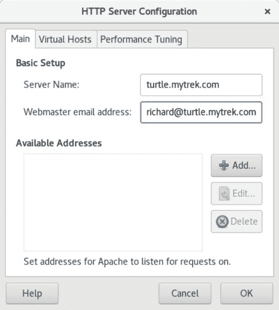

图 8-1: system-config-httpd 服务器配置

在主标签页上，你输入 Web 服务器地址、管理员电子邮件地址以及 Web 服务器将监听的地址和端口。

当 Apache 配置工具保存设置时，它将覆盖 Apache 配置文件 `/etc/httpd/conf/httpd.conf`。建议先对你的 `httpd.conf` 文件进行备份，以防你想恢复发行版为 Apache 创建的原始设置。如果你已经手动编辑了此文件，将收到警告，并且 Apache 配置工具将备份 `/etc/httpd/conf/httpd.conf.bak`。

性能调优标签页设置连接限制，例如最大连接数和超时时间（参见图 8-2）。

虚拟主机标签页是可以配置特定站点的地方，包括默认站点（参见图 8-3）。虚拟主机列出，从默认虚拟主机开始。使用 Add 按钮添加新主机，使用 Edit 按钮修改现有主机。delete 按钮移除主机。要更改全局设置，点击 Edit Default Settings 按钮。

在虚拟主机标签页上，选择 Default Virtual Host 并点击 Edit 设置服务器选项、页面搜索、SSL 支持、日志文件、CGI 环境支持和目录（性能）的默认设置。点击 Add 按钮打开一个对话框，你可以在可以在其中输入主机信息，如虚拟主机名和 IP 地址。你可以为虚拟主机选择不同的配置标签，例如日志文件和目录控制。

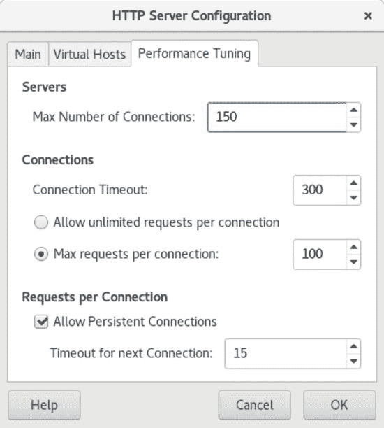

图 8-2: system-config-httpd 性能调优

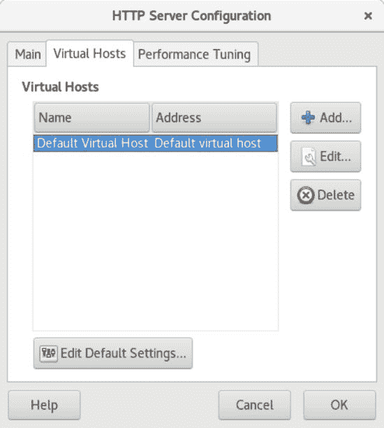

图 8-3: system-config-httpd 虚拟主机

添加或编辑虚拟主机会打开虚拟主机属性窗口，列出五个标签页：通用选项（General Options）、页面选项（Page Options）、SSL、日志（Logging）、环境（Environment）和性能（Performance）（参见图 8-4）。

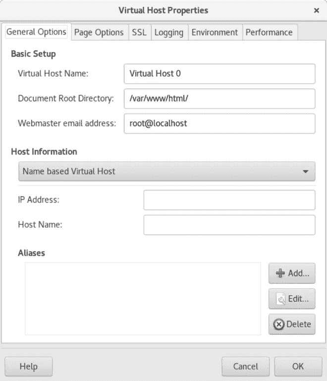

图 8-4: system-config-httpd 虚拟主机属性，通用选项


在“常规选项”（General Options）选项卡中，你可以指定主机名、其站点目录、管理员地址以及虚拟主机类型，`Name` 或 `IP`。你还可以添加别名。在“页面选项”（Page Options）中，你可以指定自动搜索并显示的文件类型。这通常是 `index.html` 及其任何变体（如 `index.htm`）。你也可以指定自己的类型。

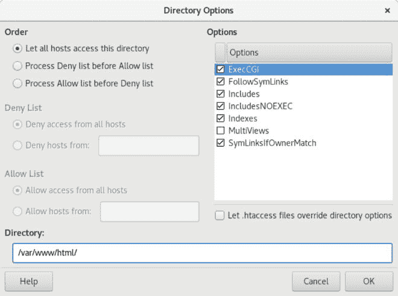

图 8-5：system-config-httpd 虚拟主机属性 | 性能 | 目录

在 SSL 选项卡中，你可以启用 SSL 支持，并指定使用的证书以及 SSL 选项。“日志”（Logging）选项卡指定访问日志和错误日志。在“环境”（Environment）选项卡中，你可以为你的 CGI 脚本定义环境变量，以及你想要传递给脚本的变量和想要未定义的变量。

“性能”（Performance）选项卡控制目录访问功能（如访问控制）以及目录能力（如执行 CGI 脚本或跟随符号链接）。选项卡顶部有一个编辑默认目录选项的按钮。这会打开一个列出可能目录选项的窗口，并勾选已启用的选项。从目录列表中，你可以选择特定目录进行编辑。点击 `Add` 按钮添加新目录。这会打开一个“目录选项”窗口，右侧显示可能的选项，左侧显示访问控制选项（参见图 8-5）。对于 `Deny` 和 `Allow` 列表，你可以指定自己的文件。

## Apache 配置指令

Apache 配置操作以输入 Apache 配置文件的指令形式存在。通过这些指令，你可以输入基本配置信息（例如你的服务器名称），也可以执行更复杂的操作（例如，实现虚拟主机）。该设计足够灵活，允许你为特定目录和不同的虚拟主机定义配置功能。Apache 有多种不同的指令，可以执行控制目录访问、分配文件图标格式和创建日志文件等多种操作。大多数指令设置某些值，例如 `DirectoryRoot`（存放服务器 Web 页面根目录）或 `Port`（服务器用于监听请求的系统端口）。简单指令的语法所示：

```
directive option option ...
```

某些指令会创建块，其中可以包含适用于特定服务器组件的指令（称为分段指令）。例如，`Directory` 指令用于定义一个块，在该块内放置仅适用于特定目录的指令。块指令成对输入：一个起始指令和一个终止指令。终止指令定义了块的结束，并由斜杠开头的相同名称组成。块指令接受一个参数，指定指令适的特定对象。对于 `Directory` 块指令，你必须指定一个将应用于它的目录名称。`<Directory mydir>` 块指令创建一个块，其内部指令适用于 `mydir` 目录。该块由 `</Directory>` 指令终止。`<VirtualHost hostaddress>` 块指令用于配置特定的虚拟 Web 服务器，必须包含用于该服务器的 IP 或域名名地址。`</VirtualHost>` 是其终止指令。你放置在此块内的任何指令都适用于该虚拟 Web 服务器。`<Limit method>` 指令指定你想要限制的访问方法，例如 `GET` 或 `POST`。位于块内的访问控制指令列出了你对这些方法施加的控制措施。块指令的语法如下：

```
<block-directive option ... >

directive option ...

directive option ...

</block-directive>
```

全局指令放置在主配置文件 `/etc/httpd/conf/httpd.conf` 中。该文件中的目录指令可用于配置特定目录。然而，Apache 也使用基于目录的配置文件。任何目录都可以有自己的 `.htaccess` 文件，其中包含仅配置该目录的指令。如果你的站点有很多目录，或者某些目录有特殊的配置需求，你可以将它们的配置指令放在它们的 `.htaccess` 文件中，而不是在主配置文件中为每个目录填充特定的 `Directory` 指令。你可以控制 `.htaccess` 文件中的哪些指令优先级高于主配置文件中的指令。如果你的站点允许用户或客户端控制的目录，你可能需要仔细监控或禁用它们对 `.htaccess` 文件的使用。（`.htaccess` 文件中的指令可能会覆盖标准配置文件中的，除非使用 `AllowOverride` 指令禁用。）

你可以在 Apache 网站找到 Apache Web 配置指令的完整列表：[`httpd.apache.org/docs/2.4/mod/directives.html`](https://httpd.apache.org/docs/2.4/mod/directives.html)。

在 Fedora 系统管理指南 | 服务器 | Web 服务器 | 常用 `httpd.conf` 指令中也有一组常用指令。

[`docs.fedoraproject.org/f28/system-administrators-guide/servers/Web_Servers.html`](https://docs.fedoraproject.org/f28/system-administrators-guide/servers/Web_Servers.html)

### 全局配置

标准的 Apache 配置分为三个部分：全局设置、服务器设置和虚拟主机。全局设置控制 Web 服务器的基本操作和性能（参见表 8-4）。在这里你设置配置位置、进程 ID 文件、超时、所使用的 MPM 模块设置以及要加载的 Apache 模块。

`ServerTokens` 指令防止暴露服务器正在使用的任何可选模块。`ServerRoot` 指令指定你的 Web 服务器配置文件和模块存放的位置。该服务器根目录随后被用作其他目录项的前缀。

```
ServerTokens OS
ServerRoot "/etc/httpd"
```

进程 ID 文件为 `/etc/httpd/run/httpd.pid`。`/etc/httpd/run` 目录包含多个 Apache 支持的进程的 PID 文件。

连接和请求超时由 `Timeout`、`KeepAlive`、`MaxKeepAliveRequests` 和 `KeepAliveTimeout` 指令处理。`Timeout` 是 Web 服务器超时发送或接收请求的秒数。`KeepAlive` 允许持久连接，允许一个客户端在同一连接上发送多个请求。这默认关闭。`MaxKeepAliveRequests` 设置持久连接上的最大请求数。`KeepAliveTimeout` 是与客户端的特定连接保持打开以接收该客户端更多请求的时间。

`Listen` 指令将服务器绑定到特定端口或 IP 地址。默认是端口 80。`Listen` 指令定义在 `httpd.conf` 中。

```
Listen 80
```

`User` 和 `Group` 指令指定 Apache Web 服务器以什么用户和组运行。这允许 Web 服务器以非 root 用户身份运行，提供更高的安全性。在 Fedora 上，用户和组为 `apache`。

```
User apache
Group apache
```

| 指令 | 说明 |
| :--- | :--- |
| `ServerToken url-path directory-filename` | 允许访问存储在根目录之外本地文件系统的文档。 |
| `BindAddress saddr` | 将服务器绑定到指定的 IP 地址。对于对监听的地址和端口的更多控制，请使用 `Listen` 指令。（在 Apache 2.0 中被 `Listen` 指令替换。） |


## 全局指令

| 指令 | 描述 |
| :--- | :--- |
| `<IfDefine [!]parameter-name> ... </IfDefine>` | `<IfDefine test> ... </IfDefine>` 节指定条件指令。如果 `test` 为真，则会处理 `IfDefine` 节内的指令，否则将其忽略。测试由一个参数名称组成，如果该参数已定义则为真，如果未定义则为假。在参数前放置 `!` 会在句参数未定义（`not`）时使测试为真。 |
| `<IfModule [!]module-name> ... </IfModule>` | `<IfModule test> ... </IfModule>` 节指定条件指令。测试检查某个模块是否在 Apache 中已编译。如果存在则为真，不存在则为假。`!module-name` 在模块不存在时为真。 |
| `Include filename filename ...` | 引入其他配置文件。 |
| `KeepAlive on/off` | 启用持久连接，“Off”为禁用。 |
| `KeepAliveTimeout seconds` | Apache 在关闭连接之前等待另一个请求的秒数。 |
| `MaxKeepAliveRequests seconds` | 每个连接允许的最大请求数。 |
| `Listen [IP address:]port number` | 监听多个 IP 地址或端口。默认情况下，它响应所有 IP 接口上的请求，但仅通过 `Port` 指令指定的端口。上下文：服务器配置。 |
| `ListenBacklog backlog` | 等待处理连接队列的最大长度。 |
| `LoadFile filename filename ...` | 在服务器启动或重启时链接到命名的对象文件或库。用于加载某些模块工作所需的额外代码。 |
| `LoadModule module filename` | 链接对象文件或库的文件名，并将命名为 `module` 的模块结构添加到活动模块列表中。 |
| `LockFile filename` | Apache 编译时使用的锁文件路径。 |
| `PidFile filename` | 存储服务器进程 ID (PID) 的文件。 |
| `ServerRoot directory-filename` | 设置服务器配置、模块、日志和错误文件文件所在的目录。 |
| `TimeOut number` | 设置接收 GET 请求、接收 POST 和 PUT 请求以及 TCP 数据包传输确认的超时时间（秒）。 |

表 8-4: 全局指令

Apache 模块从 `conf.modules.d` 目录下的配置文件加载，并使用 `Include` 指令读取。

```
Include conf.modules.d/*.conf
```

在 `conf.modules.d` 目录下的 `conf` 文件中，模块使用 `LoadModule` 指令加载，每个模块一个一个。

```
LoadModule vhost_alias_module modules/mod_vhost_alias.so
LoadModule negotiation_module modules/mod_negotiation.so
```

任何额外的配置文件都在文件末尾使用 `IncludeOptional` 指令读取，该指令引用 `conf.d` 目录。这些包括用于指定默认欢迎页的 `welcome.conf` 等文件。

```
IncludeOptional conf.d/*.conf
```

## 多进程模块 (MPM)

MPM `prefork`、`worker` 和 `event` 模块允许根据工作负载需求定制您的 Apache Web 服务器（参见表 8-5）。对于在轻负载下运行的标准 Web 服务器，已经设置了默认项。您可以针对不同的需求修改这些设置。

| MPM Prefork 指令 | 描述 |
| :--- | :--- |
| `StartServers` | 启动的服务器进程数 |
| `MinSpareServers` | 最小空闲服务器 |
| `MaxSpareServers` | 最大空闲服务器 |
| `ServerLimit` | 允许的最大服务器数 |
| `MaxRequestsWorkers` | 启动的最大服务器数 |
| `MaxConnectionsPerChild` | 每个服务器允许的最大请求数 |
| MPM worker and event 指令 | |
| `StartServers` | 启动的服务器进程数 |
| `MaxRequestsWorkers` | 最大客户端数 |
| `MinSpareThreads` | 最小空闲线程 |
| `MaxSpareThreads` | 最大空闲线程 |
| `ThreadsPerChild` | 每个服务器进程的线程数 |
| `MaxConnectionsPerChild` | 服务器允许的最大请求数 |
| `AsyncRequestWorkerFactor` | 控制每个进程的连接数（仅限 event） |

表 8-5: MPM Prefork, Worker 和 Event 指令

三个 MPM 模块：`prefork`、`worker` 和 `event` 适用于 Unix 和 Linux。`prefork` 模块允许设置空闲服务器的最小和最大值。`MaxRequestsWorkers` 设置允许启动的最大服务器数，`ServerLimit` 设置允许的服务器数。`MaxConnectionsPerChild` 设置服务器允许的最大连接数。对于 `worker` 模块，`MaxRequestsWorkers` 也设置最大客户端数，`ThreadsPerChild` 设置每个服务器的线程数。`MaxConnectionsPerChild` 限制服务器请求数。`event` 模块基于 `worker` 模块使用相同的指令。它添加 `AsyncRequestWorkerFactor` 指令控制每个进程的连接数。

## 服务器配置

某些指令用于配置服务器的整体操作。这些指令放置在 `httpd.conf` 文件的中间，直接位于“Server Settings”部分（参见表 8-6）。某些指令需要路径，而另一些只需要使用 `on` 或 `off` 关键字启用或禁用。默认 `httpd.conf` 文件已经包含了这些指令。某些被 `#` 符号注释掉了。可以通过移除 `#` 符号来激活某个指令。许多条目之前都有注释说明其用途。

以下是 `ServerAdmin` 指令的示例，用于设置用户发送管理邮件的地址。您将 `you@your.address` 条目替换为您想要接收系统管理邮件的地址。默认情况下，设置为 `root@localhost`。

```
# ServerAdmin: 您的地址，问题应发送至此地址。
ServerAdmin root@localhost
```

`ServerName` 指令持有 Web 服务器的主机名。指定主机名是重要的，可以避免 DNS 查找失败导致服务器挂起。注意该条目被 `#` 注释。只需移除 `#` 在 `new.host.name` 处输入您的 Web 服务器主机名。如果您使用的端口不是 80，请务必在主机名后面指定该端口，例如 `turtle.mytrek.com:80`。这里是原始的默认项：

```
# ServerName new.host.name
```


# `ServerName` 提供服务器用于识别身份的名称和端口。

这通常可以自动确定，但我们建议您显式指定，以防止启动过程中出现问题。

`ServerName www.example.com:80`

| 指令 | 说明 |
| :--- | :--- |
| `AddModule` `module module ...` | Apache 1.3: 启用已编译但未使用的模块（在 Apache 2.0 中移除）。上下文：服务器配置 |
| `Alias` `url-path directory-filename` | 允许访问本地文件系统中文档根目录以外的文档。 |
| `BindAddress` `saddr` | 将服务器绑定到指定的 IP 地址。如需对地址和监听的端口进行更多控制，请使用 `Listen` 指令。（在 Apache 2.0 中被 `Listen` 指令替换。） |
| `DefaultLanguage` `MIME-lang` | 将 MIME-lang 指定为默认文件语言。上下文：服务器配置、虚拟主机、目录、.htaccess |
| `DefaultType` `MIME-type` | 对于无法通过其 MIME 类型映射确定类型的文档，设置默认类型。 |
| `DocumentRoot` `directory-filename` | `httpd` 提供服务的目录。默认：`DocumentRoot /usr/local/apache/htdocs`（Red Hat 系统上为 `/var/www/html`） |
| `Group` `unix-group` | 设置服务器的组。独立服务器最初必须以 root 身份运行。建议您专门为运行服务器设置新组。 |
| `HostNameLookups` `on \| off \| double` | 启用 DNS 查询以便记录主机名。Double 指双双反向 DNS 查询。 |
| `LoadFile` `filename filename ...` | 在服务器启动或重启时链接到命名的对象文件或库。用于加载某些模块运行所需的额外代码。 |
| `Port` `number` | 如果不存在 `Listen` 或 `BindAddress` 指令，则通过 `Port` 指令设置服务器监听的网络端口。虚拟主机的端口由 `VirtualHost` 指令设置。 |
| `ServerAdmin` `e-mail-address` | 服务器管理员的电子邮件。 |
| `ServerAlias` `host1 host2 ...` | 设置主机的备用名称，用于基于名称的虚拟主机。 |
| `ServerName` `fully qualified domain name` | 设置服务器的主机名。这仅在创建重定向 URL 时使用。如果没有指定，服务器将尝试从其 IP 地址推断。 |
| `ServerPath` `pathname` | 为主机设置旧版 URL 路径，用于基于名称的虚拟主机。 |
| `ServerSignature` `Off \| On \| Email` | 配置服务器生成的文档（如错误消息）下方的页脚行。 |
| `SetHandler` `handler-name` | 强制所有匹配的文件通过由 `handler-name` 提供的处理器。 |
| `User` `unix-userid` | 指定服务器的用户 ID。独立服务器最初必须以 root 身份运行。您可以使用用户名或用户 ID 数字。该用户不应具有系统文件的权限。建议您专门为运行服务器设置新用户和组。 |
| `UserDir` `directory/filename` | 当接收到用户文档请求时，设置用户主目录中的实际目录。 |
| `Redirect` `[ status ]` `url-path url` | 将旧 URL 映射到新 URL。 |
| `ScoreBoardFile` `filename` | 指定 ScoreBoardFile 文件。 |

表 8-6：服务器指令

修改后的 `ServerName` 条目如下所示：

`ServerName turtle.mytrek.com`

当接收到服务器系统的 URL 请求时（例如针对系统本地文件的请求），`UseCanonicalName` 指令将使用 `ServerName` 生成主机 URL 的主机名。当设置为 `off` 时，它将仅使用由客户端请求提供的名称。如果 Web 服务器通过一个名称引用但使用另一个名称（例如用 `www.mytrek.com` 引用 `turtle.mytrek.com`），可能会导致混淆。将 `UseCanonicalName` 设置为 `on` 将解决这个问题，生成正确的本地 URL。

在 Fedora 系统上，已经为使用 `/var/www` 作为网站目录的标准 Web 服务器创建了条目。您可以通过更改适当的指令根据自己的需求定制网站。`DocumentRoot` 指令决定您的 Web 页面主目录。

`DocumentRoot "/var/www/html"`

`EnableSendfile` 和 `EnableMMAP` 指令（位于 `httpd.conf` 文件末尾）可增强服务器性能。`EnableSendfile` 允许系统执行文件传输。`EnableMMAP` 允许在系统支持的情况下对传输的文件启用内存映射。

```apache
EnableMMAP off
EnableSendfile on
```

注意：您还可以配置 Apache 仅作为代理和/或缓存服务器。默认的代理和缓存服务器指令已包含在 `httpd.conf` 文件中。`ProxyRequests` 指令开启代理活动。可以使用 `CacheRoot` 等指令配置缓存，使用 `CacheSize` 设置缓存大小（默认 500KB），并使用 `CacheMaxExpire` 为未修改的文档设置时间限制。

### 访问控制

通过访问控制指令 `require`，您可以控制远程用户和主机对您的网站的访问。

| 指令 | 说明 |
| :--- | :--- |
| `require user-authentication` | 验证可以访问给定目录或站点的用户。验证可以指所有用户 (`all`)、用户 ID (`user`)、组 (`group`)、域名 (`host`)、IP 地址 (`ip`)，甚至可以是表达式、HTTP 方法或环境变量。 |
| `require host hosts` | 确定可以访问给定目录的主机（域名）。 |
| `require ip addresses` | 确定可以访问给定目录的主机（IP 地址）。 |
| `require all granted` | 允许所有主机访问 |
| `require all denied` | 拒绝所有主机访问 |
| `<Files filename> ... </Files>` | 提供通过文件名进行访问控制。类似于 `<Directory>` 指令。`<Files>` 部分按其出现顺序处理，在读取 `<Directory>` 部分和 .htaccess 文件之后，但在 `<Location>` 部分之前处理。`<Files>` 可以嵌套在 `<Directory>` 内部，以限制其生效的文件系统范围。 |
| `<FilesMatch regex> ... </FilesMatch>` | 类似于 `<Files>` 指令通过文件名进行访问控制，但使用正则表达式。 |
| `<Limit method ...> ... </Limit>` | `<Limit>` 和 `</Limit>` 指定一组访问控制指令，这些指令仅适用于指定的访问方法（即任何有效的 HTTP 方法）。出现在 `<Limit>` 指令之外的访问控制指令适用于所有访问方法。方法名称为 GET, POST, PUT, DELETE, CONNECT 和 OPTIONS。 |
| `<LimitExcept method ...> ... </LimitExcept>` | `<LimitExcept>` 和 `</LimitExcept>` 指定一组访问控制指令，这些指令适用于参数中未列出的任何 HTTP 访问方法。 |
| `<Location URL> ... </Location>` | `<Location>` 指令提供通过 URL 进行访问控制。类似于 `<Directory>` 指令。 |
| `<LocationMatch regex> ... </LocationMatch>` | 以与 `<Location>`相同的方式通过 URL 提供访问控制，使用正则表达式作为参数。 |
| `LimitRequestBody number` | 限制 HTTP 请求体的大小。 |

表 8-7：访问控制指令

在 Apache 2.4 中，`require` 指令替换了 Apache 2.2 中使用的 `allow`、`order`、`deny` 和 `satisfy` 指令。它由 `mod_authz_host` 模块实现。可以授予或拒绝访问。`all` 术语指所有主机。`require` 指令可以全局使用以控制整个站点的访问，也可以放在 `Directory` 指令内部以控制单个目录的访问。在以下示例中，允许所有用户访问：

```apache
require all granted
```


`require` 指令对用户进行身份验证。身份验证可以是所有用户（`all`）、特定用户（`user`）、组（`group`）、用户所在主机的域名（`host`）、主机 IP 地址（`ip`），甚至是表达式（`expr`）、HTTP 方法（`method`）或环境变量（`env`）。在大多数情况下，它用于确定所有用户（`all`）或指定主机（`host` 或 `ip`）的访问权限。

## 目录级配置

Apache 最灵活的特性之一是它能够配置单个目录。通过 `Directory` 指令，你可以定义一个仅适用于特定目录的指令块（参见表 8-8）。此类指令可以放置在 `httpd.conf` 配置文件中。你也可以在特定目录内使用 `.htaccess` 文件来存放配置指令。这些指令将仅应用于该目录。`.htaccess` 的名称通过 `AccessFileName` 指令设置。你可以根据需要更改它。

`AccessFileName .htaccess`

`Directory` 块以 `<Directory pathname>` 指令开始，其中 `pathname` 是要配置的目录。结束指令使用相同的 `<>` 符号，但在“Directory”一词前有一个斜杠：`</Directory>`。放置在此块内部的指令仅适用于指定的目录。`httpd.conf` 文件中定义了一个限制性的默认 `Directory` 指令。

```
<Directory />
    AllowOverride None
    Require all denied
</Directory>
```

允许访问 `/var/www` 下的 Web 服务器内容。

```apache
<Directory "/var/www ">
    AllowOverride None
    # 允许开放访问：
    Require all granted
</Directory>
```

然后为网站目录 `/var/www/html` 定义了目录块。这是所有网站网站文件所在的位置。`"Require all granted"` 指令将允许任何人访问这些文件。

```apache
<Directory "/var/www/html">
    Options Indexes FollowSymLinks
    AllowOverride None
    Require all granted
</Directory>
```

你还可以为特定目录设置指令。以下示例允许来自 `www.myvids.com` 的请求访问 `mypics` 目录。

```apache
<Directory /var/www/html/mypics>
Require host www.myvids.com
</Directory>
```

| 指令 |  |
| :--- | :--- |
| `AccessFileName filename` | `filename` - 位于目录内的默认目录配置文件名。 |
| `<Directory directory> ... </Directory>` | `<Directory>` 和 `</Directory>` 指令作为标签使用，封装了一组仅适用于命名目录及其子目录的指令。 |
| `<DirectoryMatch regex> ... </DirectoryMatch>` | `<DirectoryMatch>` 和 `</DirectoryMatch>` 封装了一组仅适用于命名目录的指令。它的工作方式与 `<Directory>` 相同，但接受正则表达式作为参数。 |
| `DirectoryIndex local-url local-url ...` | 指定当客户端通过在目录名末尾指定 `/` 来请求目录索引时（通常是 `index.html`），服务器要查找的资源列表。 |
| `Options [+&#124;-]option [+&#124;-]option ...` | 控制在特定目录中可用的服务器功能。`OPTIONS` <br>`None`: 如果设置为 `None`，则不启用任何额外功能。<br>`All`: 除 `MultiViews` 之外的所有选项。这是默认设置。<br>`ExecCGI`: 允许执行 CGI 脚本。<br>`FollowSymLinks`: 服务器遵循此目录中的符号链接。<br>`Includes`: 允许服务器端包含。<br>`IncludesNOEXEC`: 允许服务器端包含，但禁用了 `#exec` 命令和 CGI 脚本的 `#include`。<br>`Indexes`: 对于没有 `DirectoryIndex` 的目录，返回格式化的目录列表。<br>`MultiViews`: 允许内容协商 `MultiViews`。<br>`SymLinksIfOwnerMatch`: 服务器仅遵循目标文件或目录的所有者与链接 UID 相同的符号链接。 |
| `AllowOverride override override ...` | 可以被 `.htaccess` 文件中的项覆盖的指令。所有 `allow` 允许覆盖，没有 `deny` 禁止。默认：`AllowOverride All` <br>上下文：目录 |

表 8-8：目录指令

为了拒绝 Web 客户端访问 `.htaccess` 文件，定义了一个 `Files` 块并带有访问控制指令 `"Require all denied"`，这拒绝所有用户的访问。`Files` 指令引用任何以 `.ht` 开头的文件（点用反斜杠转义）。`</Files>` 条目结束 `<Files>` 块。

```apache
<Files ~ ".ht*">
    Require all denied
</Files>
```

通过 `Options` 指令，你可以启用目录中的某些功能，例如使用符号链接、自动索引、执行 CGI 脚本和内容协商。默认是 `All` 选项，它开启除内容协商（Multiviews）之外的所有功能。以下示例启用了自动索引（`Indexes`）、符号链接（`FollowSymLinks`）和内容协商（`Multiviews`）。

```apache
Options Indexes FollowSymLinks Multiviews
```

主配置文件或上级目录中的指令会被会被目录继承。`.htaccess` 文件和 `Directory` 块中的特定目录指令允许覆盖这些配置。这种能力可以通过 `AllowOverride` 指令控制。使用 `all` 参数，`.htaccess` 文件可以覆盖任何之前的配置。使用 `none` 参数不允许覆盖，实际上禁用了 `.htaccess` 文件。你还可以进一步控制特定组指令的覆盖。`AuthConfig` 启用授权指令，`FileInfo` 用于类型指令，`Indexes` 用于索引指令。

`AllowOverride all`

## URL 路径名

某些指令可以修改或完成用于访问网站的 URL 的路径名段。URL 的路径名段指定了网站上的特定目录或 Web 页面。指令允许你重命名或重定向路径名，以及选择默认 Web 页面。通过 `Alias` 指令，你可以让用户访问位于系统其他部分、其他文件系统或其他网站上的资源。别名可以使用互联网网站的 URL，而不是系统目录的路径名。通过 `Redirect` 指令，你可以将用户重定向到另一个站点。这些指令要求加载 `alias_module`。

`Alias /mytrain /home/dylan/trainproj`

`Redirect /mycars http://www.myautos.com/mycars`

如果只给 Apache 提供一个目录而不是特定的 Web 页面，它会在该目录下查找并显示索引 Web 页面。默认 Web 页面的可能名称由 `DirectoryIndex` 指令列出。通常使用的名称是 `index.html`，但你可以添加其他的。标准名称在此显示。当给 Apache 提供一个 Web 目录进行访问时，它会查找并显示其中的 `index.html` Web 页面。

```
DirectoryIndex index.html index.shtml index.cgi
```


`DirectoryIndex` 指令取决于 `dir_module` 是否已加载。

```apache
<IfModule dir_module
    DirectoryIndex index.html
</IfModule>
```

Apache 还允许用户在用户主目录下的特殊子目录中维护 Web 页面，而不是在主网站目录中。使用 `~` 后跟用户名可以访问此目录。该目录名称通过 `UserDir` 指令指定。默认名称为 `public_html`，如下。站点 `turtle.mytrek.com/~dylan` 访问主机 `turtle.mytrek.com` 目录 `turtle.mytrek.com/home/dylan/public_html`。

```apache
UserDir public_html
```

如果你想允许人们使用完整路径，则可以使用路径引用。例如，对于用户 `dylan`，`/usr/www` 将翻译为 URL 引用 `/usr/www/dylan`，即 HTML 文件所在的位置；而 `/home/*/www` 将翻译为 `/home/dylan/www`，即用户 `dylan` 主目录下的 `www` 目录。

```apache
UserDir /usr/www
UserDir /home/*/www
```

在标准配置文件中，`Userdir` 访问默认被注释掉。通常，你希望禁止像 `root` 这样的用户访问。通过 `disable` 和 `enable` 选项，你可以向某些用户开放访问，同时禁用其他用户的访问，如下：

```apache
UserDir disable root
UserDir disabled
UserDir enabled dylan chris justin
```

### CGI 目录

通用网关接口（CGI）文件是 Web 浏览器访问你的站点时可以执行的程序。CGI 文件通常由 Web 页面作为显示内容的一部分（参见表 8-9）。传统上，CGI 程序被放在名为 `cgi-bin` 的目录中，并且只有当位于此类特殊目录时才能被执行。通常，每个网站存在一个 `cgi-bin` 目录。发行版通常会在默认 Web 服务器目录中设置 `cgi-bin` 目录（Fedora 上为 `/var/www/cgi-bin`）。在这里，你可以放置任何可以在你的网站上执行的 CGI 程序。`ScriptAlias` 指令为你的 `cgi-bin` 目录指定别名。任何 Web 页面或浏览器可以使用该别名引用此目录。

```apache
ScriptAlias /cgi-bin/ /var/www/cgi-bin/
```

然后对 `cgi-bin` 目录进行控制。

```apache
<Directory "/var/www/cgi-bin">
    AllowOverride None
    Options None
    Require all granted
</Directory>
```

### MIME 类型

当浏览器访问网站上的 Web 页面时，通常会访问许多种对象，包括 HTML 文件、图片或声音文件以及脚本文件。为了正确显示这些对象，浏览器必须拥有关于它们是什么类型的指示。JPEG 图片文件的处理方式与简单的文本文件不同。服务器以 MIME 类型的形式提供这种类型信息。MIME 类型与通过 Internet 邮件程序（如 `Pine`）发送附件使用的类型相同。每种对象都与给定的 MIME 类型关联。提供了 MIME 类型，浏览器就能正确处理并显示该对象。

| 指令 | 说明 |
| :--- | :--- |
| `AddAction` `action-type cgi-script` | 添加一个动作，当请求触发 `action-type` 时，激活 `cgi-script`。 |
| `AddHandler` `handler-name extension extension ...` | 将文件名扩展名 `extension` 映射到处理器 `handler-name`。 |
| `RemoveHandler` `extension extension ...` | 移除给定扩展名文件的处理器关联。这允许子目录中的 `.htaccess` 文件撤销从父目录或服务器配置文件继承的任何关联。 |
| `Script` `method cgi-script` | 添加一个动作，当使用 `method`（可以是 `GET`、`POST`、`PUT` 或 `DELETE` 之一）请求文件时，激活 `cgi-script`。 |
| `ScriptAlias` `url-path directory-filename` | 将目标目录标记为包含 CGI 脚本。 |
| `ScriptInterpreterSource` ‘registry’ 或 ‘script’ | 查找运行 CGI 脚本的解释器。默认方法是使用脚本中 `#!` 行指定的解释器。 |

表 8-9：CGI 指令

MIME 协议将特定类型与给定扩展名的文件关联。例如，具有 `.jpg` 扩展的文件的 MIME 类型为 `image/jpeg`。`TypesConfig` 指令持有 `mime.types` 文件的位置，该文件列出了所有 MIME 类型及其关联的文件扩展名（`DefaultType` 在 Apache 2.4 中不再生效）。`AddType` 允许你在不编辑 MIME 文件的情况下修改 `mime.type` 类型列表。

```apache
TypesConfig /etc/mime.types
```

这些指令要求加载 `mime_module`。它们依赖于 `mime_module` 模块。

```apache
<IfModule mime_module>
```

`AddDefaultCharset` 指令指定默认字符集。

```apache
AddDefaultCharset UTF-8
```

mime 模块利用文件内容的提示来确定其类型。提示定义列在 `/etc/httpd/conf/magic` 文件中，该文件包含动画、TeX、MS Word、XML、音频格式和压缩文件的提示。

```apache
<IfModule mod_mime_module>
    #   MIMEMagicFile /usr/share/magic.mime
    MIMEMagicFile conf/magic
</IfModule>
```

其他类型指令用于指定对某些文档采取的操作。`AddEncoding` 让浏览器能够解压缩压缩文件。`AddHandler` 将文件扩展名映射到操作，`AddLanguage` 允许你为文档指定语言。以下示例将带有 `.gz` 的文件名标记为 gzip 编码文件，将带有 `.fr` 的文件标记为法语：

```apache
AddEncoding x-gzip .gz
AddLanguage fr .fr
```

### 自动目录索引

当给定目录的 URL 而不是 HTML 文件，且目录中没有默认 Web 页面时，Apache 会动态创建一个页面并显示。这通常只是目录中不同文件的列表。实际上，Apache 为你对目录中的项进行了索引。你可以为生成和显示此类索引设置多个选项。索引指令列在表 8-10 中。

```apache
FancyIndexing on
```

如果开启 `FancyIndexing`，Web 页面项目将带有图标和列标题显示，这些标题可对列表进行排序。

`Icon` 指令告诉 Apache 为特定类型的文件显示什么图标。`AddIconByType` 和 `AddIconByEncoding` 指令使用 MIME 类型信息确定文件类型，然后将指定的图像与其关联。`AddIcon` 使用文件的扩展名来确定其类型。通过 `IndexOptions` 指令，你可以为显示生成的索引设置不同的选项。存在设置图标和文件名宽高的选项。`IconsAreLinks` 选项让图标成为文件名锚点的一部分。`ScanHTMLTitles` 选项读取 HTML 文档中的标题并使用它们在索引列表中显示，而不是文件名。存在多种选项来抑制不同的索引显示功能，如排序、描述以及头部/readme 插入。

```apache
Option multiviews
```

### 身份验证

你的 Web 服务器还可以按用户或按组控制网站上特定目录的访问。你可以要求不同级别的身份验证。访问可以限制为特定用户并需要密码，也可以扩展到允许组组成员访问。你可以完全放弃密码，或者设置一种类似于 FTP 使用的匿名访问类型。


要将身份验证指令应用于特定目录，你需要将这些指令置于 `Directory` 块或该目录的 `.htaccess` 文件中。你使用 `require` 指令来确定哪些用户可以访问该目录。你可以列出特定的用户或组。`AuthName` 指令为用户提供验证领域（realm），即用于识别通过此验证过程所访问的特定资源集的名称。`AuthType` 指令指定验证类型，例如 `basic` 或 `digest`。`require` 指令还需要 `AuthType`、`AuthName` 以及指定组和用户验证文件位置的指令。在接下来的示例中，仅允许用户 `george`、`robert` 和 `mark` 访问 `newpics` 目录：

```apache
<Directory /var/www/newpics
    AuthType Basic
    AuthName Newpics
    AuthUserFile /web/users
    AuthGroupFile /web/groups
    <Limit GET POST>
        require user george robert mark
    </Limit>
</Directory>
```

| 指令 | 描述 |
| :--- | :--- |
| `AddDescription string file file ...` | 设置为文件显示的描述。可以是文件扩展名、部分文件名、通配符表达式或完整文件名。字符串用双引号 (") 包围。 |
| `IndexOptions [+&#124;-]option [+&#124;-]option ...` | 设置目录索引选项：`FancyIndexing`、`IconHeight`、`IconsAreLinks`、`IconWidth`、`NameWidth`、`ScanHTMLTitles`、`SuppressDescription`。 |
| `ReadmeName filename` | 指定附加到索引列表末尾的文件名。 |
| `AddIcon icon name name ...` | 指定文件名旁边显示的图标。 |
| `AddIconByEncoding icon MIME-encoding MIME-encoding ...` | 指定在具有 `MIME-encoding` 的文件旁边显示的图标（`FancyIndexing`）。 |
| `AddLanguage MIME-lang extension extension ...` | 将给文件扩展名映射到指定的内容语言。 |
| `FancyIndexing Boolean` | 设置目录的 `FancyIndexing` 选项。布尔值可以开启或关闭。 |
| `DefaultIcon url` | 指定在未知特定图标时为文件指定的图标（`FancyIndexing`）。 |
| `HeaderName filename` | 指定插入到索引列表顶部的文件名（`FancyIndexing`）。 |

**表 8-10: 索引指令**

要为目录设置匿名访问，请将 `Anonymous` 指令及其参数 `anonymous` 放在目录的 `Directory` 块或 `.htaccess` 文件中。你也可以使用 `Anonymous` 指令为特定用户提供访问，而无需他们提供密码。

Apache 维护自己的用户和组验证文件，指定哪些用户和组允许访问哪些目录。这些文件通常是简单的平文件，例如系统的密码和组文件。然而，这些文件可能会变得很大，可能减慢验证查找。作为替代方案，许多网站使用数据库管理文件代替这些平文件。然后使用数据库方法访问文件，从而提供更快的响应时间。Apache 有相应的指令来指定验证文件，取决于你所使用的文件类型。`AuthUserfile` 和 `AuthGroupFile` 指令用于指定验证文件的位置。

`AuthUserfile` 和 `AuthGroupFile` 指令用于指定验证文件的位置。`htigest`、`htpasswd` 和 `dbmanage` 工具用于管理验证文件。如果你想进行持久性更改，请配合 `fcontext` 指令以及 `-a` 和 `-t` 使用 `semanage`，然后运行 `restorecon`。如果你只想进行临时更改，可以使用 `chcon`。此更改在系统重新打标签或恢复上下文时将会丢失。


| LogLevel | 调整错误日志中记录的信息的详细程度。 |

表 8-11: 日志指令

### Webalizer

可以使用 `Webalizer` 工具生成 Web 日志的报告。`Webalizer` 将显示有关您的 Web 网站使用的信息。当运行 `webalizer` 命令时，使用报告将被放置在 `/var/www/html/usage` 目录中。访问索引页可以显示一个带有月度报告链接的页面，`file:/var/www/html/usage/index.html`。报告配置指定在 `/etc/webalizer.conf` 文件中。之前的摘要保留在 `/etc/webalizer.history` 文件中。`Webalizer` 的 Apache 配置位于 `conf.d` 目录下的 `webalizer.conf` 文件中，即 `/etc/httpd/conf.d/webalizer.conf`。

### 错误日志和警告级别

`httpd.conf` 文件包含了用于配置日志文件的配置指令。`ErrorLog` 指令指定用于保存错误消息的日志文件。每个虚拟主机都可以有自己的错误日志。

```
ErrorLog "logs/error_log"
```

`LogLevel` 指令控制保存到错误日志中的消息数量。选项从 `debug`、`info`、`notice`、`warn`、`error`、`crit`、`alert`、`emerg` 从大到小。默认是 `warn`。

```bash
LogLevel warn
```

### 格式化日志

使用 `LogFormat` 和 `CustomLog` 指令，您可以格式化日志记录以添加具有不同详细级别的字段。它们依赖于 `log_config_module` 的加载。

```apache
<IfModule log_config_module>
```

这些指令使用由字段标识符组成的格式字符串来确定在日志记录中记录的字段。您可以按照任何顺序添加您需要的任何字段。字段标识符由一个百分号 (`%`) 符号后跟一个标识性字符组成。例如，`%h` 是远程主机的字段标识符，`%b` 是字节大小的标识符，`%s` 是状态（见表 8-12）。请查看 `mod_log_config` 模块的文档获取完整列表。

您应该对内容可能超过一个单词的字段加引号。引号本身必须用反斜杠转义以便包含在格式字符串中。以下示例是作为 `LogFormat` 指令实现的常用日志格式（Common Log Format）：

```
LogFormat "%h %l %u %t \"%r\" %>s %b" common
```

日志格式中的某些字段标识符可以被限定以记录特定信息。`%i` 标识符记录服务器接收到的请求中的标头行。要记录的特定标头行的引用放置在 `%` 和字段标识符之间的大括号内。例如，`User-agent` 是指示请求中使用的浏览器软件的标头行。要记录 `User-agent` 标头信息，请使用转换标识符 `%{User-agent}i`。

```apache
LogFormat "%{Referer}i -> %U" referer

LogFormat "%{User-agent}i" agent
```

为了保持与 NCSA 服务器的兼容性，Apache 原本实现了 `AgentLog` 和 `RefererLog` 指令来记录 `User-agent` 和 `Referer` 标头。此后这些被用于 `LogFormat` 和 `CustomLog` 指令的限定 `%i` 字段标识符取代。`Referer` 标头记录来自客户端的链接信息，检测谁可能链接到您的网站。以下是一个符合 NCSA 标准的组合日志格式：

```
LogFormat "%h %l %u %t \"%r\" %s %b\"%{Referer}i\" \"%{User-agent}i\"" combined
```

如果您想记录每个请求的字节数，可以加载 `logio_module` 并使用 `%I` 和 `%O` 字段标识符分别输入和输出。

```apache
<IfModule logio_module>
    # 您需要启用 mod_logio.c 来使用 %I 和 %O
    LogFormat "%h %l %u %t \"%r\" %>s %b \"%{Referer}i\" \"%{User-Agent}i\" %I %O" combinedio
</IfModule>
```

| 字段标识符 | 描述 |
| :--- | :--- |
| %a | 远程 IP 地址 |
| %A | 本地 IP 地址 |
| %b | 发送的字节，不包括 HTTP 标头 |
| %{variable}e | 环境变量的内容 |
| %{variable}i | 发送到服务器的请求中的标头行 |
| %f | 文件名 |
| %h | 远程主机 |
| %l | 远程登录名（如果提供了 identd） |
| %m | 请求方法 |
| %P | 服务请求的子进程的进程 ID |
| %r | 请求的第一行 |
| %s | 状态 |
| %t | 时间，采用常用日志格式时间格式（标准英语格式） |
| %u | 远程用户（来自 auth；如果返回状态 [%s] 为 401 则可能是虚假的） |
| %U | 请求的 URL 路径 |
| %v | 提供请求服务的服务器的规范 ServerName |

表 8-12: Apache 日志字段标识符

注意：Apache Web 服务器还可以提供有关服务器活动和配置的详细报告，让您将此信息显示给远程服务器。`Location` 指令 `server-info` 将显示您的 Web 服务器的配置细节，而 `server-status` 指令将显示 Web 进程。`server-info` 和 `server-status` 将显示报告，类似于 http://localhost/server-info。使用 `ExtendedStatus` 指令启用详细报告。

### 生成和管理日志文件

与其维护一个大日志文件，您可以使用 `CustomLog` 或 `TransferLog` 指令创建多个日志文件。这对于虚拟主机很有帮助，您可能想为每个主机维护单独的日志文件。您使用 `LogFormat` 指令定义日志记录的默认格式。`TransferLog` 指令在创建新日志文件时使用此默认格式作为其格式。`CustomLog` 结合了这两个操作，使您能够创建一个新文件并为其定义格式。

```apache
LogFormat "%h %l %u %t \"%r\" %s %b" myprojlog

# 使用 myprojlog 格式创建一个新日志文件
TransferLog myprojlog

# 使用自己的格式创建一个名为 mypicslog 的新日志文件
CustomLog mypicslog "%h %l %u %t \"%r\" %s %b"
```

您可以先用 `LogFormat` 定义格式，然后使用 `CustomLog` 指定使用的日志文件。默认情况下，`httpd.conf` 文件定义组合格式并使用该格式保存到 `access_log` 文件。

```apache
LogFormat "%h %l %u %t \"%r\" %>s %b \"%{Referer}i\" \"%{User-Agent}i\"" combined

CustomLog access_log combined
```

使用前面的示例，`mypicslog` 格式先被定义，然后保存到 `picslog` 文件。

```apache
LogFormat "%h %l %u %t \"%r\" %s %b" mypicslog

CustomLog picslog mypicslog
```

Apache 提供了两个处理和管理日志文件的实用：`logresolve` 将日志文件中的 IP 地址解析为主机；`rotatelogs` 在不杀死服务器的情况下滚动日志。您可以指定滚动时间。

## Apache 虚拟主机

虚拟主机允许 Apache Web 服务器作为一个整体托管多个 Web 网站。实际上，服务器可以充当多个服务器，每个托管的网站对外部用户来说都是独立的。Apache 支持基于 IP 地址和基于名的虚拟主机。基于 IP 的虚拟主机使用有效的注册 IP 地址，而基于名的虚拟主机使用完全限定域名地址。这些域名地址是由请求浏览器的 `header` 标头提供的。服务器随后仅根据域名即可确定使用的正确虚拟主机。注意，SSL 服务器需要 IP 虚拟主机。请访问 [`httpd.apache.org`](https://httpd.apache.org) 获取更多信息。

### 基于 IP 的虚拟主机

在基于 IP 地址的虚拟主机方法中，每个虚拟主机必须有一个不同的 IP 地址。您使用的 IP 地址已设置为引用您的系统。网络系统管理操作可以设置您的机器支持多个 IP 地址。您的机器可以为每个地址拥有独立的物理网络连接，或者特定的连接可以配置为同时监听多个 IP 地址。实际上，任何 IP 地址都可以访问您的系统。


您可以配置 Apache 为每个虚拟主机运行一个独立的守护进程（daemon），分别监听每个 IP 地址；您也可以运行一个单一的守护进程来监听所有虚拟主机的请求。要设置单个守护进程来管理所有虚拟主机，请使用 `VirtualHost` 指令。要为每个主机设置独立的守护进程，也请使用 `Listen` 指令。

## 基于名称的虚拟主机

通过基于名称的虚拟主机，您可以在不需要额外 IP 地址的情况下支持任意数量的虚拟主机。即使机器只有一个 IP 地址，仍然支持无限数量的虚拟主机。这种功能是通过 `HTTP/1.1` 协议实现的，它允许服务器识别访问它的名称。这种方法要求客户端（远程用户）使用支持 `HTTP/1.1` 协议的浏览器，目前的浏览器都是如此。使用此类协议的浏览器可以发送指定在机器上特定主机的 host header。

```ServerName turtle.mytrek.com

<VirtualHost 192.168.1.5:80>

ServerName www.mypics.com

ServerAdmin webmaster@mail.mypics.com

DocumentRoot /var/www/mypics/html

ErrorLog /var/www/mypics/logs/error_log

...

</VirtualHost>

<VirtualHost 192.168.1.5:80>

ServerName www.myproj.org

ServerAdmin webmaster@mail.myproj.org

DocumentRoot /var/www/myproj/html

ErrorLog /var/www/myproj/logs/error_log

....

</VirtualHost>
```

要实现基于名称的虚拟主机，请为每个主机使用 `VirtualHost` 指令，并使用 `Listen` 指令指定您希望用于虚拟主机的 IP 地址（`NameVirtualHost` 指令在 `Apache 2.4` 中已弃用）。如果您的系统只有一个 IP 地址，则需要使用该地址。在 `VirtualHost` 指令内部，您使用 `ServerName` 指令指定您希望为该主机使用的域名。使用 `ServerName` 指定域名对于避免 `DNS` 查找非常重要。`DNS` 查找失败将导致虚拟主机禁用。每个 `VirtualHost` 指令以 IP 地址作为参数。您在 `VirtualHost` 块中使用 Apache 指令来单独配置每个主机。基于名称的虚拟主机使用 host header 中指定的域名地址来确定要使用的虚拟主机。如果不存在此类信息，则使用第一个主机作为默认主机。以下示例实现了两个基于名称的虚拟主机。在这里，`www.mypics.com` 和 `www.myproj.org` 被实现为基于名称的虚拟主机，而不是基于 IP 的主机：

如果您的系统只有一个 IP 地址，实现虚拟主机将防止通过该地址访问您的主服务器。您将无法直接使用主服务器作为 Web 服务器；您只能间接使用它来管理您的虚拟主机。您可以配置一个虚拟主机来管理主服务器的 Web 页面。然后，您将使用主服务器来支持一组虚拟主机，这些虚拟主机将作为网站运行，而不是让主服务器直接作为一个站点运行。如果您的机器有两个或多个 IP 地址，您可以使用其中一个用于主服务器，另一个用于您的虚拟主机。您甚至可以在服务器上混合基于 IP 的虚拟主机和基于名称的虚拟主机。您还可以使用不同的 IP 地址来支持不同的虚拟主机组。您甚至进一步让多个域名地址访问同一个虚拟主机。为此，请在选定的 `VirtualHost` 块中放置列出域名的 `ServerAlias` 指令。

```ServerAlias www.mypics.com www.greatpics.com
```

## 动态虚拟主机

如果您在服务器上实现了许多具有相同配置的虚拟主机，可以使用名为“动态虚拟主机”的技术让这些虚拟主机动态生成。实现您的虚拟主机的代码将变得小得多，因此您的服务器访问它们的速度更快。增加更多虚拟主机只需创建相应的目录并在 `DNS` 服务器中为它们添加条目即可。

要让动态虚拟主机工作，服务器使用 `mod_vhost_alias` 模块中的命令将服务器名称和文档根都重写为相应的虚拟服务器。动态虚拟主机可以是基于名称的，也可以是基于 IP 的。在任何情况下，您都必须设置 `UseCanonicalName` 指令，允许服务器使用虚拟主机名而不是服务器自身的名称。对于基于名称的托管，您只需关闭 `UseCanonicalName`。这允许您的服务器从用户请求的 host header 中获取主机名。对于基于 IP 的托管，您将 `UseCanonicalName` 指令设置为 `DNS`。这允许服务器在 `DNS` 服务器中查找主机。

```UseCanonicalName Off

UseCanonicalName DNS
```

然后您必须让服务器能够定位各种虚拟主机的不同文档根目录和 CGI bin 目录。使用 `VirtualDocumentRoot` 指令来指定虚拟主机目录的模板。例如，如果您将不同的主机目录放在 `/var/www/hosts` 目录下，则可以相应设置 `VirtualDocumentRoot` 指令。

```VirtualDocumentRoot /var/www/hosts/%0/html
```

当访问该虚拟主机时，`%0` 将替换为虚拟主机的名称。使用该主机名称创建动态虚拟主机目录是非常重要的。例如，对于一个名为 `www.mygolf.org` 的动态虚拟主机，您首先创建一个名为 `/var/www/hosts/www.mygolf.org` 的目录，然后为文档根和 CGI 程序创建子目录，如 `/var/www/hosts/www.mygolf.org/html`。对于 CGI 目录，使用 `VirtualScriptAlias` 指令指定您使用的 CGI 子目录。

```VirtualScriptAlias /var/www/hosts/%0/cgi-bin
```

以下是基于名称的动态虚拟主机指令的简单示例：

```UseCanonicalName Off

VirtualDocumentRoot /var/www/hosts/%0/html

VirtualScriptAlias /var/www/hosts/%0/cgi-bin
```

对 `www.mygolf.com/html/mypage` 的请求将评估为

`/var/www/hosts/www.mygolf.com/html/mypage`

这里显示了一个动态虚拟主机的简单示例：

```UseCanonicalName Off

<VirtualHost 192.168.1.5>

ServerName www.mygolf.com

ServerAdmin webmaster@mail.mygolf.com

VirtualDocumentRoot /var/www/hosts/%0/html

VirtualScriptAlias /var/www/hosts/%0/cgi-bin

...

</VirtualHost>
```

要实现基于 IP 的动态虚拟主机，将 `UseCanonicalName` 设置为 `DNS` 而不是 `Off`。

```UseCanonicalName DNS

VirtualDocumentRoot /var/www/hosts/%0/html

VirtualScriptAlias /var/www/hosts/%0/cgi-bin
```

### 字符串

`mod_vhost_alias` 模块支持各种插字符串，每个字符串以 `%` 符号开头，后面跟着一个数字。如您所见，`%0` 引用整个 Web 地址。`%1` 仅引用第一个段，`%2` 引用第二个段，`%-1` 引用最后一部分，而 `%2+` 则从第二个部分开始引用。例如，为了使用 Web 地址的第二部分作为目录名，请使用以下指令：

```VirtualDocumentRoot /var/www/hosts/%2/html

VirtualScriptAlias /var/www/hosts/%2/cgi-bin
```

在这种情况下，对 `www.mygolf.com/html/mypage` 的请求仅使用 Web 地址的第二部分。这在 `www.mygolf.com` 中是“mygolf”，并将评估为

`/var/www/hosts/mygolf/html/mypage`

如果您改为使用 `%2+`，例如 `/var/www/hosts/%2/html`，对 `www.mygolf.com/html/mypage` 的请求将评估为

`/var/www/hosts/mygolf.com/html/mypage`

相同的方法适用于 IP 地址，其中 `%1` 引用第一个 IP 地址段，`%2` 引用第二个段，依此类推。

### 虚拟主机的日志

动态虚拟主机的一个缺点是，您只能为所有主机设置一个日志。但是，您可以创建自己的 shell 程序，简单地从该日志中提取属于不同主机的条目。

```LogFormat "%V %h %l %u %t \"%r\" %s %b" vcommon

CustomLog logs/access_log vcommon
```


注意：Apache 还支持基于 IP 地址的虚拟主机。您的服务器必须为每个虚拟主机准备不同的 IP 地址。您的机器可以为每个虚拟主机拥有独立的物理网络连接。您可以配置 Apache 为每个虚拟主机运行单独的守护进程并分别监听每个 IP 地址，或者运行一个单一的进程进程监听所有虚拟主机的请求。要设置单个守护进程管理所有虚拟主机，请使用 `VirtualHost` 指令。要为每个主机设置单独的守护进程，也使用 `Listen` 指令。

# Apache 实例

Apache 还支持在同一 Linux 系统上实现额外的 Web 服务器实例。实例实际上是一个独立的 Web 服务器，它有自己的 `/etc/httpd/conf/httpd.conf` 文件的副本。请参阅 `/usr/share/doc/httpd` 目录下 `instance.conf` 文件中的注释，以获取有关创建和维护 Apache 实例的详情。另请参见 `httpd.service` 手书中“Instantiated services”部分，执行 `man httpd.service`。

为您的实例确定一个名称。它可以是任何名称。使用 `/usr/share/doc/httpd/` 目录下的 `instance.conf` 文件作为您实例的配置文件。复制该文件并将其命名为您的实例名称到 `/etc/httpd/conf/` 目录。例如，如果您想将实例命名为 `myhttpd1`，可以使用以下命令。

```bash
sudo cp /usr/share/doc/httpd/instance.conf /etc/httpd/conf/myhttpd1.conf
```

对该文件进行任何您需要的自定义更改。

要启用并运行新实例，您需要使用 `httpd@.service` 文件，并加上您的实例名称。

```bash
sudo systemctl enable httpd@myhttpd1
sudo systemctl start httpd@myhttpd1
```

此文件将您的实例名称分配给 `HTTP_INSTANCE` 变量，然后该变量被实例的 `.conf` 文件用于引用单独配置和运行时目录及文件。在示例中，`mythttd1.conf` 文件将使用 `HTTP_INSTANCE` 变量在 `/run/httpd/instance-myhttpd1` 设置单独的运行时目录。通过这种方式可以设置独立的运行时、pid 和日志文件。

```apache
DefaultRuntimeDir /run/httpd/instance-${HTTPD_INSTANCE}
PidFile /run/httpd/instance-${HTTPD_INSTANCE}.pid
ErrorLog "logs/${HTTPD_INSTANCE}_error_log"
CustomLog "logs/${HTTPD_INSTANCE}_access_log" combined
```

若要与其他实例同时运行，您还需要指定一个单独的进行监听。

实例将与主 `httpd` 服务共享许多配置文件。如果您更改了这些 `httpd` 配置文件并需要重新加载，您可能也想重新加载实例服务。您可以通过为实例创建一个包含以下行的片段文件（drop-in file）来实现自动完成。

```ini
[Unit]
ReloadPropagetedFrom=httpd.service
```

使用 `systemctl edit` 命令和带有实例名称的 `httpd@.service` 文件来创建片段文件。

```bash
sudo systemctl edit httpd@myhttpd1.service
```

这会在 `/etc/systemd/system/httpd@myhttpd1.service.d` 目录下创建一个 `override.conf` 文件。

# 服务器端包含

服务器端包含（SSIs）旨在为您的 Web 站点内容（即 Web 页面本身）提供更精细的控制。服务器端包含是放置在特定 Web 页面中作为页面 HTML 代码部分的 Apache 指令。您可以配置 Apache Web 服务器在特定 Web 页面查找 SSI 指令并执行它们。首先，您必须使用带有 `include` 选项的 `Options` 指令允许 SSI 指令。

```apache
Options Includes
```

您需要指示服务器解析特定的 Web 页面。启用解析的最方法是指示 Apache 解析指定扩展名的 HTML 文件。通常使用 `.shtml` 扩展用于包含 SSI 的 Web 页面。事实上，在默认 Apache 配置中，您可以找到以下启用 HTML 文件 SSI 指令解析的条目。这里的 `AddType` 指令将 `.shtml` 类型作为 HTML 文件类型，而 `AddOutputFilter` 指令指定对 `.shtml` 文件进行解析：

```apache
# 使用由服务器解析的 HTML 文件
AddType text/html .shtml
AddOutputFilter INCLUDES .shtml
```

与其创建一个单独类型的文件，您可以使用 `XBitHack` 指令让 Apache 解析任何可执行文件的 SSI 指令。换句话说，任何具有执行权限的文件都将被进行 SSI 指令解析。

SSI 指令的操作非常类似于编程语言中的语句。您可以定义变量、创建循环并使用测试来选择备选指令。SSI 指令由一个元素以及其后可以赋值的属性组成。SSI 指令的语法所示：

```html
<!--#element attribute=value ... -->
```

您可以将元素理解为操作上类似于编程语言中的命令，将属性理解为其参数。例如，要给变量赋值，您使用 `set` 元素并将变量赋值作为其属性。`if` 指令在指定的 Web 页面上显示后续任何文本。`if` 指令的属性为 `expr`，分配要测试的表达式。测试可以使用标准比较运算符（如 `<=` `!=` 或 `==`）比较两个字符串。测试中变量通过 `$` 运算符求值。

```html
<!--#set myvar="Goodbye" -->
<!--#if expr=="$myvar = Hello" -->
```

其他有用的 SSI 元素是 `exec`，它可以执行 CGI 程序或 shell 命令，将文件内容读入 Web 页面并执行 CGI 文件。`echo` 元素显示日期、文档名称和页面 URL 等值。通过 `config` 元素，您可以配置某些值，如日期或文件大小。

# PHP

PHP（PHP: Hypertext Preprocessor）是一种设计用于 Web 页面的脚本语言。启用 PHP 的页面允许您创建动态 Web 页面以执行任务而不仅仅是显示数据。PHP 是 Apache 软件基金会的官方项目。您可以在 [www.php.net](http://www.php.net) 更多关于 PHP 的信息。

与从 Web 页面独立执行的 CGI 程序不同，PHP 命令作为标签嵌入页面本身，就像 SSI 命令一样。Web 服务器直接提供解释和执行这些命令的支持。这种嵌入支持在 Apache 中通过 `mod_php` 模块（`/etc/httpd/conf.d/php.conf` 配置文件）启用。不需要单独构建在 Web 服务器之外调用和运行的程序，使用 PHP，此类命令嵌入 Web 页面中并由 Web 服务器运行。在执行任务时，Web 服务器始终保持完全控制。然而，也可以以 CGI 模式实现 PHP，其中 PHP 页面被构建为单独的程序，像基于 Perl 的 CGI 程序一样被 Web 页面调用。

PHP 具有灵活且强大的编程能力，与 C 和 Perl 相当。与这些语言一样，您可以创建 if 语句和循环等控制结构。此外，PHP 专门适用于 Web 页面任务的能力。PHP 可以直接与 Oracle、MySQL 和 IBM DB2 等数据库交互。它可以轻松地与所有标准协议（如 IMAP、LDAP、HTTP 和 POP3）交互。它甚至具有文本处理能力，例如解释正则表达式和显示 XML 文档。还有用于搜索、压缩工具（如 `gzip`）和语言翻译的扩展。PHP 支持大量的可能。访问其网站获取完整列表以及在线手册和教程。

# Web 服务器安全：SSL


Web 服务器安全涉及两个不同的任务：保护你的 Web 服务器免受未经授权的访问，以及为 Web 浏览器客户端与 Web 服务器之间进行的交易提供安全保障。为了防止服务器受到未经授权的访问，你可以使用如 `Squid` 等代理服务器。`Squid` 是一个 GNU 代理服务器，通常在 Linux 系统上配合 `Apache` 使用。`Apache` 具有多个提供安全能力的模块，包括用于强制控制的 `mod_access`；提供认证支持的 `mod_auth`、`mod_auth_db`、`mod_auth_digest` 和 `mod_auth_dbm`；以及用于匿名 FTP 类日志的 `mod_auth_anon`（参见之前关于访问控制和认证的章节）。

为了确保传输安全，你需要完成三个任务：验证身份、检查数据完整性以及确保传输的隐私性。为了验证参与传输的主机身份，你需要执行认证程序。为了检查数据的完整性，你为数据添加包含摘要值的数字签名。摘要值是一个唯一表示数据的值。最后，为了确保传输的隐私性，你对其进行加密。浏览器与你的服务器之间的交易可以被加密，只有浏览器和你的服务器能够解密这些传输。在 Linux Apache Web 服务器上实现安全传输最常用的协议是 `Secure Sockets Layer (SSL)` 协议，它最初由 Netscape 开发用于 Web 安全交易。

与 `Secure Shell (SSH)` 和 GNU Privacy Guard 一样，`SSL` 使用一种公钥和私钥加密的形式进行认证。数据用公钥加密，但只能用私钥解密。一旦数据通过认证，将使用约定的加密算法对其进行加密。数字签名对数据的 `MD5` 摘要值进行加密以确保完整性。认证通过使用权威机构的证书来完成。证书用于识别安全传输中的不同方，验证它们确实是其声称的身份。Web 服务器将有一个证书来验证其身份，证明它是它所声称的服务器。连接服务器的浏览器也将有一个证书来标识其身份。这些证书反过来由证书机构签名，以证明它们是有效的证书。证书机构是双方都信任的独立实体。

证书包含提供给特定服务器或浏览器的公钥，以及证书机构的数字签名和身份信息（如运行服务器或浏览器的的用户或公司名称）。证书的有效性直接取决于颁发它的证书机构的可靠性。要在互联网上运行安全的 Web 服务器，你应该从知名的证书机构（如 `VeriSign`）获取证书。商业供应商可以为你完成此工作。许多老牌公司已经维护自己的证书机构，确保公司网络内部传输的安全。`SSL` 会话通过握手序列建立，在握手过程中，服务器和浏览器通过交换证书进行认证，协商用于加密传输的加密算法，并选择摘要完整性检查的类型。用于认证的公钥加密类型也有选择，`RSA` 或 `DSA`。对于每个会话，都会建立一个浏览器和服务器使用的唯一会话密钥。

名为 `OpenSSL` 的免费开源 `SSL` 版本可用于 `Apache`（参见 `https://www.openssl.org/`）。它基于 Eric A. Young 和 Tim J. Hudson 的 `SSLeay`。`mod_ssl` 项目提供了一个带有补丁的 SSL 模块，你可以使用它更新 Apache Web 服务器以引入 SSL。`mod_ssl` 根据 Apache 风格许可对于商业和非商业用途均免费。

`mod_ssl` 实现的 `SSL` 通过不同的端口（`443`）和不同的协议 `https` 提供了访问 Web 服务器的另一种访问方式。实际上，你同时拥有一个 SSL 服务器和一个非安全版本。要访问安全的 SSL 版本，你在 Web 服务器的 URL 地址中使用 `https` 协议 而不是 `http`。例如，要访问运行在 `www.mytrek.com` 的 Web 服务器的 SSL 版本，你将在 URL 中使用 `https` 协议，所示：

```
https://www.mytrek.com
```

安装 `mod_ssl` 包以安装 `mod_ssl` 模块。你可以使用 Apache 配置文件 `/etc/httpd/conf.d/ssl.conf` 中的若干配置指令来配置 `mod_ssl`。在 Fedora 上，与 Apache 一起安装的默认配置文件加载 `ssl.conf` 文件以及 `/etc/httpd/conf.d` 目录下的其他模块配置文件。请查看 `mod_ssl` 的在线文档 `https://httpd.apache.org/docs/2.4/mod/mod_ssl.html` 以获取包含所有指令的详细参考。有全局的、基于服务器的和基于目录的指令可用。

在 Fedora 的 `ssl.conf` 文件中，以下代码将加载 SSL 模块：

```
LoadModule ssl_module     modules/mod_ssl.so
```

实现了若干个默认指令，例如 SSL 密钥目录的位置以及 SSL 版本服务器监听的端口（`443`）。

```
Listen 443 https
```

其他指令被注释掉了。你可以通过删除前面的 `#` 符号并设置你自己的选项来启用它们。Apache Web 服务器的 SSL 版本在 `ssl.conf` 文件中作为虚拟主机设置，从针对端口 443 的虚拟主机指令块开始：

```
<VirtualHost _default_:443>
```

在该语句块内，使用 `SSLEngine` 和 `SSLProtocol` 指令启用 SSL。

```apache
# SSL Engine Switch:
# 为此虚拟主机启用/禁用 SSL。
SSLEngine on

# SSL Protocol support:
# 列出客户端能够连接的启用协议级别。
# 默认禁用 SSLv3 访问：
SSLProtocol all -SSLv3
```

`SSLCipherSuite` 指令列出了允许的加密算法。

```
SSLCipherSuite PROFILE=SYSTEM
```

有几个 SSL 指令将指定 SSL 证书和加密密钥。SSL 与传输层安全 (TLS) 协作提供安全传输。证书将位于 `/etc/pki/tls/certs` 目录，即 TLS 证书目录。服务器密钥将位于 TLS 私有目录，该目录包含了认证加密使用的公钥和私钥。

```apache
# 服务器证书:
SSLCertificateFile /etc/pki/tls/certs/localhost.crt

# 服务器私钥:
SSLCertificateKeyFile /etc/pki/tls/private/localhost.key

# 证书机构 (CA):
#SSLCACertificateFile /etc/pki/tls/certs/ca-bundle.crt
```

`mod_ssl` 安装将为你提供一个名为 `snakeoil` 的演示证书，你可以用它测试 SSL 配置。当你拥有官方证书时，可以使用 `make certificate` 命令进行安装。

访问控制随后被置于某些类型的文件和包含执行文件的 `cgi-bin` 目录上。`+StdEnvVars` 选项应用于所有的 SSL 变量。

```apache
<Files ~ "\.(cgi|shtml|phtml|php3?)$">
    SSLOptions +StdEnvVars
</Files>

<Directory "/var/www/cgi-bin">
    SSLOptions +StdEnvVars
</Directory>
```

`CustomLog` 指令指定了 SSL 消息的位置 `ssl_request_log` 以及格式。

```
CustomLog logs/ssl_request_log "%t %h %{SSL_PROTOCOL}x %{SSL_CIPHER}x \"%r\" %b"
```

## NGINX Web 服务器


NGINX Web 服务器正迅速成为 Apache Web 服务器的关键支持服务器，通过提供反向代理允许 Apache 更好地处理高负载需求。NGINX 采用基于事件的异步设计，这使其能够使用极少的内存同时处理请求，而不是像 Apache 那样离散地为请求分配线程。这种方法了一个非常快的 Web 服务器，尽管它不太容易自定义。Apache 易于模块化的设计使其仍然更容易部署。NGINX 通常被用作 Apache 服务器的前端处理器，处理大量的请求，然后将其发送到 Apache 服务器。你可以在 [`nginx.org`](https://nginx.org) 了解更多关于 NGINX 的信息，并在 [`nginx.org/en/docs/`](https://nginx.org/en/docs/) 查看文档。

你可以使用 `nginx` 包安装 NGINX。配置位于 `/etc/nginx` 目录。NGINX 在 `/etc/nginx` 目录下有主配置文件，在 `default.d` 目录下有默认站点配置文件。示例默认文件的扩展名为 `.default`，例如 `nginx.conf.default`。

配置文件非常简单，`/etc/nginx/nginx.conf` 文件是 NGINX 服务器的主配置文件，还有若干个辅助配置文件以及一个额外的 `conf.d` 配置目录。命令格式使用大括号括起的块结构。在 `nginx.conf` 文件中，`http` 块设置了 Web 服务器的全局设置，并使用 `include` 指令引入配置文件和启用的站点服务器文件。你可以用非常少的指令和块来设置 Web 服务器。建议为网站配置创建一个新文件，以便更好地迎合你的需求。每个服务器监听的端口都有一个 `server` 块，并有用于访问网站文件的 `location` 块。这里显示了 `/etc/nginx/nginx.conf` 文件中的 `http` 块。该块包含了基础日志位置和 `gzip` 指令。网站配置文件从 `/etc/nginx/conf.d` 目录读取，图中的 `server` 块显示了默认服务器配置的指令。

```
http {
    log_format  main  '$remote_addr - $remote_user [$time_local] "$request" '
                            '$status $body_bytes_sent "$http_referer" '
                            '"http_user_agent" "$http_x_forwarded_for"';
    access_log  /var/log/nginx/access.log  main;
    sendfile            on;
    tcp_nopush         on;
    tcp_nodelay         on;
    keepalive_timeout  65;
    types_hash_max_size 2048;
    include             /etc/nginx/mime.types;
    default_type        application/octet-stream;
    # Load modular configuration files from the /etc/nginx/conf.d directory.
    # See http://nginx.org/en/docs/ngx_core_module.html#include
    # for more information.
    include /etc/nginx/conf.d/*.conf;

    server {
        listen       80 default_server;
        listen       [::]:80 default_server;
        server_name  _;
        root         /usr/share/nginx/html;
        # Load configuration files for the default server block.
        include /etc/nginx/default.d/*.conf;
        location / {
        }
        error_page 404 /404.html;
             location = /40x.html {
        }
        error_page 500 502 503 504 /50x.html;
             location = /50x.html {
        }
    }   
}
```

# 9. 新闻与数据库服务

新闻组服务器较少见，用于为本地网络设置新闻组或支持互联网的 Usenet 新闻服务。数据库服务器对于管理本地网络以及互联网服务的大型数据集变得越来越常见。

## 新闻服务器

新闻服务器为互联网用户提供 Usenet 新闻服务。它们有自己的 TCP/IP 协议，即网络新闻传输协议 (`NNTP`)。在大多数 Linux 系统上，InterNetNews (`INN`) 新闻服务器提供新闻服务（[`www.isc.org/`](https://www.isc.org/)）。此外，还存在提供更好的互联网资源的服务器。

INN 新闻服务器访问 Usenet 新闻源，为你网络上的新闻客户端提供完整的新闻组及其文章。新闻组文章使用 `NNTP` 传输，支持此协议的服务器被称为 `NNTP` 服务器。`INN` 由 Rich Salz 编写，目前由互联网软件协会 (`ISC`) 维护和支持。你可以从其网站 [`www.isc.org/`](https://www.isc.org/) 下载当前版本。`INN` 也包含在大多数 Linux 发行版中。`/usr/share/doc` 中的 `INN` 文档目录包含大量的示例。`INN` 的主程序是 `innd` 进程。

`INN` 有两个版本：用于本地网络的较小 `INN` 和用于大型网络的复杂的 `INN2`。`INN` 还包含几个支持程序，用于维护和崩溃恢复，并对服务器性能和使用进行统计分析。`cleanfeed` 实现垃圾邮件保护，`innreport` 根据日志生成 `INN` 报告。`INN` 还具有非常强大的过滤系统，用于筛选不需要的文章。

注意：`Leafnode` 是一种为连接可能缓慢的小网络设计的 `NNTP` 新闻服务器。你可以从其网站 [www.leafnode.org](http://www.leafnode.org) 获取 `Leafnode` 软件包及文档。

## 数据库服务器

Fedora 提供了几个功能完整的数据库服务器：`MariaDB`、`MySQL`、`Derby` 和 `PostgreSQL`。`MariaDB` 衍生自 `MySQL`，但它更先进且完全开源。它是 Fedora 默认的 `MySQL` 类型数据库。`MariaDB` 由原始 `MySQL` 开发人员支持和开发。原始的 `MySQL` 由 Oracle 所有，并具有商业版本。如果你愿意，仍然可以安装较旧的非商业版 `MySQL`。

如第 2 节所述，你可以使用 `databaseserver` 角色安装 `PostgreSQL` 服务器。你使用 `rolectl` 来安装（部署）服务器。你可以配置并安装多个服务器实例。

`Derby` 是由 Apache 开发的基于 `JAVA` 的数据库。`SQLite` 是一个简单快速的数据库服务器，不需要配置并将数据库实单个磁盘文件中。本章将介绍如何设置和管理 `MySQL` 数据库，并对 `PostgreSQL` 进行简要介绍。你可以通过表 9-1 列出的网站了解更多这些产品。

此外，Fedora 还支持基于文档的非 SQL 服务器，如 `MongoDB` 和 `Hadoop`。`MongoDB` 是一种可以快速搜索的基于文档的数据库。`Hadoop` 是一个访问跨网络分布式数据集的 Apache 项目。

| 数据库 | 资源 |
| :--- | :--- |
| MariaDB | [`mariadb.org/`](https://mariadb.org/) |
| MySQL | [`www.mysql.com`](https://www.mysql.com) |
| Derby | [`db.apache.org/derby/`](https://db.apache.org/derby/) |
| MongoDB | [`www.mongodb.org`](https://www.mongodb.org) |
| Hadoop | [`hadoop.apache.org/`](https://hadoop.apache.org/) |
| PostgreSQL | [`www.postgresql.org`](https://www.postgresql.org) |
| sqlite | [www.sqlite.org](http://www.sqlite.org) |

表 9-1: 数据库资源

### 关系型数据库结构

`MariaDB` 和 `PostgreSQL` 都使用关系型数据库结构。基本上，这意味着数据被放在表中，使用标识符字段将数据与其他表中的条目关联。表中的每行都是一条记录，每条记录都有唯一标识符（如记录号）。不同表之间的记录连接通过特殊表实现，这些表将一个表中记录的唯一标识符与另一个表的标识符关联起来。关系型数据库理论和实现超出了本章的范范围。


简单的单表数据库不需要唯一标识符。一个列出姓名和地址的简单地址簿就是单表数据库的示例。然而，大多数数据库访问的是不同类型且以各种方式相关的复杂信息。与其拥有包含重复信息的大型记录，不如将数据划分到不同的表中，每个表持有数据的唯一实例。通过这种方式，数据就不会被重复；你只需要一个存储一个人姓名唯一记录的表，而不是在每次数据引用该人员时都重复该人的姓名。关系组织随后承担了将一条数据与另一条关联起来的任务。通过这种方式，你可以使用较小的数据库文件存储大量信息。

虽然实现关系型数据库的方法有很多，但一个简单的法则是将数据组织成表，其中每项数据都有唯一实例。每条记录都被分配一个唯一标识符（通常是数字）。为了将一个表中的记录与另一个表关联，你需要创建关联它们标识符的表。

SQL 查询语言是大多数关系型数据库管理系统（RDBMS）使用的语言，包括 `MySQL` 和 `PostgreSQL`。虽然许多 RDBMS 使用管理工具来管理数据库，但在 Linux  `MySQL` 和 `PostgreSQL` 上，你仍然必须使用 `SQL` 命令。以下命令将创建一个数据库：

```sql
CREATE DATABASE myphotos
```

在对数据库执行任何操作之前，你首先需要使用 `USE` 命令访问它。

```sql
USE myphotos
```

使用 `CREATE TABLE` 命令创建表；每个表的字段列在表名后的括号内。对于每个字段，你需要指定名称、数据类型和其他选项，例如它是否可以为空值。

```sql
CREATE TABLE names (
    personid INT(5) UNSIGNED NOT NULL,
    name VARCHAR(20) NOT NULL,
    street VARCHAR(30) NOT NULL,
    phone CHAR(8)
    );
```

## MariaDB (MySQL)

MariaDB 设计为完全兼容 `MySQL` 数据库。与 `MySQL` 一样，`MariaDB` 构建在客户端/服务器模型上，由服务器守护进程 (`mysqld`) 处理来自客户端程序的请求。`MariaDB` 为速度、可靠性和易用性而设计。它旨在成为大型数据库的快速数据库管理系统，同时也是一个可靠的、适用于密集使用的系统。创建数据库时，使用标准的 `SQL` 语言。可以通过分配权限来控制用户访问。

在 Fedora 上，你可以安装 `MariaDB` 服务器和客户端包，以及针对 `Postfix`、`Exim` 和 `Apache` 等某些服务的配置包。需要安装的包是 `mariadb` 和 `mariadb-server`。

`MariaDB` `MySQL` 由 `systemd` 使用 `/lib/systemd/system/mariadb.service` 文件管理。`mysqld.service` 文件仅仅是 `mariadb.service` 文件的链接。对于服务文件，你应该在 `/etc/systemd/system` 目录下创建一个它的版本，该版本包含原始版本。正如 `mariadb.service` 文件的注释所示，你会在 `/etc/systemd/system` 中创建一个版本，该版本包含 `/lib/systemd/system` 中的系统版本。然后你添加一个带有额外选项的 `Service` 部分，所示：

```ini
/etc/systemd/system/mariadb.service
.include /lib/systemd/system/mysqld.service

[Service]
  LimitNOFILE=10000
```

或者，你可以在 `/etc/systemd/system/mariadb.service.d` 目录下创建一个 `.conf` 文件。

这里显示了 `mariadb.service` 文件。

```ini
mariadb.service
[Unit]
Description=MariaDB 10.0 database server
Documentation=man:mysqld(8)
Documentation=https://mariadb.com/kb/en/library/systemd/
After=network.target

[Install]
WantedBy=multi-user.target
Alias=mysql.service
Alias=mysqld.service

[Service]
Type=notify
User=mysql
Group=mysql
ExecStartPre=/usr/libexec/mysql-check-socket
ExecStartPre=/usr/libexec/mysql-prepare-db-dir %n
ExecStart=/usr/bin/mysqld_safe --basedir=/usr $MYSQLD_OPTS $_WSREP_NEW_CLUSTER
ExecStartPre=/usr/libexec/mysql-check-upgrade
PrivateNetwork=false
KillMode=process
KillSignal=SIGTERM
SendSIGKILL=no
Restart=on-abort
RestartSec=5s
UMask=007
TimeoutSec=300
PrivateTmp=true
```

### MariaDB 配置

`MariaDB` 支持不同的配置文件，一个用于全局设置，其他位于 `/etc/etc/my.cnf.d` 目录下用于客户端和服务器特定设置，以及一个用于用户自定义设置的可选文件。`MariaDB` 与 `MySQL` 相同的相同的，但增加了仅供 `MariaDB` 读取的 `mariadb` 部分。这确保了与 `MySQL` 数据库的兼容性。

`/etc/my.cnf` 配置用于适用于客户端和服务器的全局设置。`/etc/my.cnf` 文件提供了如数据目录 (`/var/lib/mysql`) 和日志文件 (`/var/log/mysql`) 位置，以及服务器基础目录 (`/var/lib`)。

`/etc/my.cnf.d/mariadb-server.cnf` 文件仅用于服务器设置。仅客户端的设置位于 `/etc/my.cnf.d/mariadb-clients.cnf`。

`.my.cnf` 文件允许用户自定义对 `MySQL` 的访问。它位于用户的目录下。注意这是一个隐藏文件（点文件）。

你可以在 https://mariadb.com/kb/en/library/documentation/ 访问 `MariaDB` 文档。

在安装 `MariaDB` 之后，你必须先用 `systemctl` 启用它，才能启动服务器。

```bash
sudo systemctl enable mariadb
```

然后你可以启动 `mysql` 服务器。

```bash
sudo systemctl start mysql
```

#### 全局配置:/etc/my.cnf

`MariaDB` (`MySQL`) 根据不同的组指定选项，通常是服务器工具的名称。选项排列在段中。段名放在括号内，适用于它的选项随其后。这里显示了一个基本的 `/etc/my.cnf` 文件：

```ini
[mysqld]
datadir=/var/lib/mysql
socket = /var/run/mysqld/mysql.sock
symbolic-links=0
log-error=/var/log/mysqld.log
pid-file = /var/run/mysqld/mysqld.pid
!includedir /etc/my.cnf.d
```

全局选项列在 `/etc/my.cnf` 文件中。选项根据控制数据库服务不同行为的组进行设置：`mysqld` 用于守护进程，`safe_mysqld` 用于启动脚本。`datadir` 目录 `/var/lib/mysql` 是你的数据库文件存放的地方。

服务器和客户端配置从 `/etc/my.cnf.d` 目录中的 `cnf` 文件读取。`client.cnf` 文件有一个 `client` 段，它将设置发送给客户端的选项，例如访问数据库的端口和套。还有一个名为 `client-mariadb` 的部分，用于 `MariaDB` 选项。

```ini
[client]
port=3306
```

将应只由服务器读取的选项放在 `mariadb-server.cnf` 文件中。`MariaDB` 还有一个用于 `MariaDB` 选项的 `mariadb` 部分。

```ini
[mysqld]
datadir=/var/lib/mysql
socket=/var/lib/mysql/mysql.sock
log-error=/var/log/mariadb/mariadb.log
pid-file = /var/run/mariadb/mariadb.pid
```

要查看当前为客户端和服务器设置的选项，直接带 `--help` 选项运行 `mysqld`。

```bash
/usr/libexec/mysqld --help
```

#### 用户配置：my.cnf

访问数据库服务器的用户目录下会有自己的配置文件：`.my.cnf`。在这里用户可以指定连接选项，例如访问数据库的密码和连接超时。

```ini
[client]
password=mypassword
[mysql]
no-auto-rehash
set-variable = connect_timeout=2
[mysql-hotcopy]
interactive-timeout
```

#### MariaDB 工具

`MariaDB` 提供了多种工具，包括服务器、客户端和管理工具。可以使用 `mysqldump` 命令处理备份。`mysqlshow` 命令将显示数据库，就像执行 `SQL` 命令 `SELECT *.*` 一样，而 `mysqlimport` 可以导入文本文件，就像 `LOAD INFILE` 一样。


# 使用 mysql 和 mysqladmin 管理 MariaDB

要管理您的 MariaDB 数据库，您可以使用 root 用户运行 `mysql`。`mysql` 客户端会启动 MySQL 监控器。作为 root 用户，您可以输入管理命令来创建数据库和数据库表、添加或删除条目，以及执行显示数据等标准客户端任务。

以 root 用户身份登录并打开终端窗口。首先确保 `mysql` 服务器已启动。您可以使用 `systemctl` 命令和 `cockpit`。在安装后，请您已启用 mariadb 服务器（`systemctl`）。

```bash
sudo systemclt start mysql
```

然后输入 `mysql` 命令。这将启动一个带有 `mysql>` 提示符的监控器 shell。请确保您的命令以分号结尾；否则监控器将提供一个缩进的箭头提示符，等待添加参数。在监控器中，结束命令的是分号而不是回车键。

| 命令 | 说明 |
| :--- | :--- |
| `mysqld` | MySQL (MariaDB) 服务器 |
| `mysql` | MySQL (MariadDB) 客户端 |
| `mysqladmin` | 创建和管理数据库 |
| `mysqldump` | 数据库备份 |
| `mysqlimport` | 文本文件 |
| `mysqlshow` | 显示数据库 |

表 9-2：MySQL 命令

如果您尚未设置 root 用户密码，可以使用 `mysqladmin` 命令进行设置，如下所示。

```bash
mysqladmin -u root password 'mypassword'
```

如果您已经设置了 MySQL (MariaDB) root 用户，可以使用 `-u root` 配合 `-p` 选项。系统会提示您输入密码。

```bash
mysql -u root -p
mysql>
```

一旦 `mysql` 客户端启动，您可以使用 `status` 命令检查服务器状态，并使用 `show databases` 列出当前数据库。

```bash
mysql> status;
mysql> show databases;
```

初始情况下，会显示 MariaDB 为自身管理设置的两个数据库：`mysql` 和 `test`。`mysql` 数据库存储 MariaDB 用户信息，而 `test` 数据库用于测试服务器。

# PostgreSQL

PostgreSQL 基于 POSTGRESQL 数据库管理系统，尽管它使用 SQL 作为查询语言。POSTGRESQL 是在加州大学伯克利分校开发的下一代研究原型。您可以在 PostgreSQL 网站 [`www.postgresql.org`](https://www.postgresql.org) 上找到更多信息。PostgreSQL 是一个在 GPL 许可证下开发的开源项目。

PostgreSQL 通常用于为高需求的 Internet 终端（如 Web 服务器）提供数据库支持。通过几个简单的命令，您就可以创建关系数据库表。使用 `createuser` 命令创建 PostgreSQL 用户，然后可以登录服务器。随后您可以使用 `createdb` 命令创建数据库，并使用 `create table` 指令构建关系表。通过 `insert` 命令可以添加记录，然后使用 `select` 命令查看它们。远程用户对服务器的访问由 PostgreSQL 目录（通常为 `/var/lib/pgsql`）下的 `pg_hba.conf` 文件条目控制。

目前，PostgreSQL 服务器也包含在 Fedora 数据库服务器角色（Database Server Role）中。使用数据库服务器角色，您只需按照提示即可快速安装 PostgreSQL 数据库服务器。配置由服务器角色软件自动处理。使用 `Cockpit` 在 Fedora 服务器上安装它。

# 第 3 部分：共享资源

# 10. 打印服务

打印服务已成为每个 Linux 系统的组成部分。它们允许您使用系统或网络上的任何打印机。

打印机曾被视为直接连接到系统的设备，现在被视为由打印服务器管理的网络资源。在单台打印机直接连接到系统的情况下，网络功能变得透明，打印机看起来就像额外的一个设备。另一方面，您可以轻松利用打印服务器的网络功能，让多个系统使用同一台打印机。虽然在大多数 Linux 发行版中打印机安装几乎是自动的，但理解底层原理是有帮助的。打印站点和资源见表 10-1。

通用 Unix 打印系统 (CUPS) 提供打印服务。它在 GNU 公许可证下免费可用。虽然它现在包含在大多数发行版中，但您也可以从 [`www.cups.org/`](https://www.cups.org/) 下载最新的 CUPS 源代码版本，它提供了有关安装和管理打印机的详细文档。CUPS 基于网络打印协议 (IPP)，该协议旨在为 Internet 建立打印标准（更多信息请参见 [www.pwg.org/ipp](http://www.pwg.org/ipp)）。旧的基于行打印机 (LPD) 的打印系统主要关注行打印机，而基于 IPP 的系统则提供了网络、PostScript 和 Web 支持。CUPS 的工作方式类似于 Internet 服务器，并采用类似于 Apache Web 服务器的配置设置。它的网络支持允许客户端直接访问远程服务器上的打印机，而无需对打印机进行配置。配置只需要在打印服务器上维护。

| 资源 |get |
| :--- | :--- |
| [`www.cups.org`](https://www.cups.org) | 通用 Unix 打印系统 |
| [`www.pwg.org/ipp`](https://www.pwg.org/ipp) | 网络打印协议 |

表 10-1：打印资源

## 打印服务：CUPS

CUPS 是大多数 Linux 发行版的主要打印服务器。GNOME 为 CUPS 提供集成支持，允许基于 GNOME 的应用程序直接访问 CUPS 打印机。

一旦安装了打印机并配置了打印服务器，您就可以使用打印客户端打印并管理打印队列。CUPS 服务器有多种打印客户端可用，包括 GNOME 打印管理器、CUPS 配置工具以及如 `lpq` 和 `lpc` 等各种行打印工具。这些将在本章稍后部分详细介绍。CUPS 配置工具是一个基于 Web 的配置工具，也可以管理打印机和打印作业（打开浏览器并输入 URL http://localhost:631）。页面将显示管理作业、管理打印机和管理任务的条目。选择管理作业（Manage Jobs）条目可以删除或重新排序您提交的任务。

CUPS 由 `systemd` 管理，使用按需套字实现，涉及 `cups.service`、`cups.socket` 和 `cups.path` 文件。此外，一个特殊的 `printer.target` 单元检测打印机何时连接到您的系统。`cups.service` 文件运行 CUPS 服务器 `/usr/sbin/cupsd` (ExecStart)。它在 `printer.target` 激活时运行，这发生在用户连接打印机时 (WantedBy)。`cups.socket` 单元文件让 CUPS 在 CUPS socket `/var/run/cups/cups.sock` (ListenStream) 上监听请求。实际上，CUPS 类似于旧的 `inetd` 守护进程，仅在被请求时激活。`cups.path` 单元在系统启动时 (WantedBy=multi-user.target) 在 `/var/spool/cups` (PathExistsGlob) 建立 CUPS 打印目录。

```ini
cups.service
[Unit]
Description=CUPS Scheduler
Documentation=man:cupsd(8)
After=network.target ypbind.service
[Service]
ExecStart=/usr/sbin/cupsd -l
Type=notify
[Install]
Also=cups.socket cups.path
WantedBy=printer.target
```

```ini
cups.socket
[Unit]
Description=CUPS Scheduler
PartOf=org.cups.cupsd.service
[Socket]
ListenStream=/var/run/cups/cups.sock
[Install]
WantedBy=sockets.target
```

```ini
cups.path
[Unit]
Description=CUPS Scheduler
PartOf=org.cups.cupsd.service
[Path]
PathExistsGlob=/var/spool/cups/d*
[Install]
WantedBy=multi-user.target
```


注意：Line Printer, Next Generation (LPRng) 曾是 Linux 和 UNIX 系统的传统打印服务器，但后来已从 Fedora 中移除。你可以在 [`sourceforge.net/projects/lprng`](https://sourceforge.net/projects/lprng) 了解更多信息。

## 无驱动打印

大多数新的打印机型号都支持无驱动打印。打印机支持无驱动程序，而不是安装驱动程序。你无需先下载并安装驱动程序即可向这些打印机打印。打印机通过 DNS 服务发现 (DNS-SD) 自动检测。CUPS Web 配置界面、`system-config-printer`、GNOME 打印机以及 `lpadmin` 已经支持无驱动打印。

CUPS 使用 `driverless` 工具检测可用的无驱动打印机，并为它们生成 `PPD` 配置文件。驱动程序在功能上可能不如官方驱动程序完整，但可以打印。目前，兼容 `IPP Anywhere` 和受 Apple Raster 支持的打印机可以使用无驱动程序，这些通常是较新的打印机。GNOME 打印机、`system-config-printer` 和 CUP Web 界面均使用 `driverless` 工具来检测和配置无驱动打印机。更多信息请参见 `driverless` 的 man 页。

可能会与 `cups-browsed` 守护进程发生冲突，该它是实现无驱动打印版本的早期尝试，并且对于不支持无驱动打印的打印机仍然有用。你可能需要在 `/etc/cups/cups-browsed.conf` 文件中设置选项以支持无驱动打印。你需要设置 `OnlyUnsupportedByCUPS` 和 `CreateIPPPrinterQueues` 选项。

## 打印机设备与配置

在使用任何打印机之前，你必须在网络上的 Linux 系统上安装它。本地打印机直接安装在你自己的系统上。这涉及在打印机配置文件中为打印机创建一个条目，定义它的类型以及设备文件和池化目录等功能。在 CUPS 上，打印机配置文件为 `/etc/cups/printers.conf`。安装打印机非常简单：确定用于打印机的设备文件及其对应的配置条目即可。

### 打印机设备文件

Linux 为已安装的打印机动态创建设备名称。对于并行打印机，设备名称将为 `lp0`、`lp1` 和 `lp2`，取决于连接了多少台并行打印机。名称中使用的数字对应 PC 上的并行端口；`lp0` 引用 `LPT1` 并端口，`lp1` 引用 `LPT2` 并端口。串口打印机将使用串口端口，通过 `ttyS0`、`ttyS1`、`ttyS2` 等设备文件引用。USB 连接的打印机将具有硬件抽象层 (HAL) 设备连接。`HAL` 设计用于可以轻松连接到其他接口并仍被识别的可移动设备。

### 池目录

当你的系统打印文件时，它会使用称为池目录（spool directories）的特殊目录。打印任务是一个待打印的文件。当你将文件发送到打印机时，会创建该文件的副本并将其放在为该打印机设置的池目录中。池目录的位置从打印机配置文件条目中获取。在 Linux 上，池目录位于 `/var/spool/cups` 下以打印机命名的目录下。例如，`myepson` 打印机的池目录位于 `/var/spool/cups/myepson`。池目录包含若干个管理打印任务的文件。某些文件使用打印机名称作为扩展名。例如，`myepson` 打印机拥有 `control.myepson`（提供打印队列控制）、`active.myepson`（用于活动打印任务）以及 `log.myepson`（日志文件）。

### 服务器脚本

你可以使用 `systemctl` 命令或 `cockpit` 启动、停止和重启 CUPS。当你进行更改或安装打印机时，务必重启 CUPS 使更改生效。可以使用以下命令：

```
sudo systemctl restart cups
```

## 打印机安装与配置

有多种工具可安装 CUPS 打印机。最简单的方法是使用 GNOME 打印机工具（系统设置）。你也可以使用旧版本的 Fedora `system-config-printer` 工具。或者，你可以使用 CUPS 软件自带的基于浏览器的 Web 配置工具。最后，你可以直接编辑 CUPS 打印机配置文件。

## 打印机自动检测

当你首次将本地打印机连接到系统时，GNOME 3 打印机工具会自动检测打印机并安装相应的驱动程序。随后，打印机会列在 GNOME 3 打印机工具和旧的 `system-config-printer` 中。如果检测失败，你可以从系统设置访问 GNOME 3 打印机工具来设置打印机。

## 打印机 URI（通用资源标识符）

打印机可以是本地的或远程的。两者都使用通用资源标识符 (URI) 进行引用。URI 支持用于与远程打印机通信的网络协议，以及用于引用本地打印机的设备连接。

远程打印机通过用于与其通信的协议引用，例如用于 Unix 网络打印机的互联网打印协议 `ipp`、用于 Windows 网络打印机的 Samba 协议 `smb`，以及用于旧版 `LPRng` Unix 服务器的 `lpd`。它们的 URI 类似于 Web URL，指明打印机所连接的系统的网络地址。

```
ipp://mytsuff.com/printers/queue1
```

```
smb://guest@lizard/myhp
```

对于已连接的本地打印机，URI 将使用设备连接和设备名称。`usb:` 前缀用于 USB 打印机，`parallel:` 用于连接到并行端口的旧式式打印机，`serial:` 用于连接到串口的打印机，`scsi:` 用于 SCSI 连接的打印机。对于本地 USB 打印机，URI 如下所示。

```
usb://Canon/S30
```

### GNOME 打印机：GNOME 设置

可以通过 GNOME 设置 | 设备 | 打印机标签页访问 GNOME 打印机工具。它列出了已安装的打印机，让你对其进行配置并访问任务队列（见图 10-1）。如果没有检测到打印机，标签页上将显示“添加新打印机”按钮，你可以用它检测打印机。要检测额外的打印机，可以点击“添加”按钮。打印机标签页将列出已检测和配置的打印机条目。打印机条目显示打印机名称、型号、状态、带有任务数的“任务”按钮以及配置按钮（齿轮图标）。点击“任务”按钮可打开列出此打印机活动任务的对话框（见图 10-1）。对于每个任务条目，右侧都有暂停或删除任务的按钮。

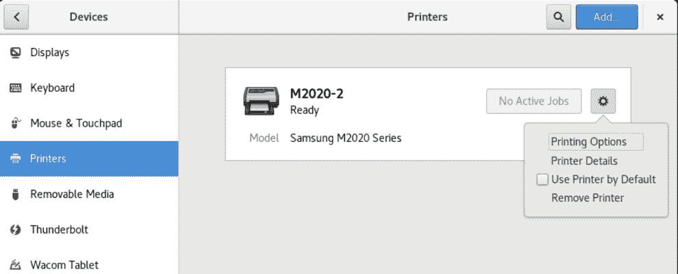 

图 10-1：GNOME 3 打印机工具

要配置打印机，点击配置按钮（齿轮图标）显示包含打印机选项、详情、默认值和删除条目的菜单。选择“设置为默认打印机”，将成为你的默认打印机。“删除打印机”条目将从你的系统中移除打印机配置。“打印机详情”条目打开显示打印机详情（如名称、位置、地址和驱动程序）的对话框。提供了从搜索、数据库或 PPD 文件选择驱动程序的按钮。如果没有检测到正确的驱动程序，可以使用这些。点击“打印选项”条目打开打印机选项对话框。你可以配置打印机功能，如页面设置、图像质量和色彩。高级标签页允许设置特殊选项，如对比度、墨水类型和饱和度。


在“打印机”设置选项卡中，你可以点击`添加`按钮打开“添加打印机”对话框，该对话框会列出连接到你系统的打印机。它们会被自动检测。如果你知道网络上打印机的地址，可以在底部的搜索框中输入该地址进行检测并显示。

# system-config-printer: 打印

要编辑打印机配置或添加远程打印机，可以使用 `system-config-printer`，它可以通过“打印”（杂项 | 打印设置）进行访问。该实用程序允许你为打印机选择合适的驱动程序，并设置纸张大小和打印分辨率等打印选项。你可以配置直接连接到本地计算机的打印机，也可以配置网络上远程系统的打印机。会显示一个打印机配置窗口，显示已安装打印机的图标。当你添加打印机时，它们的图标将显示在打印机配置窗口中（参见图 10-2）。

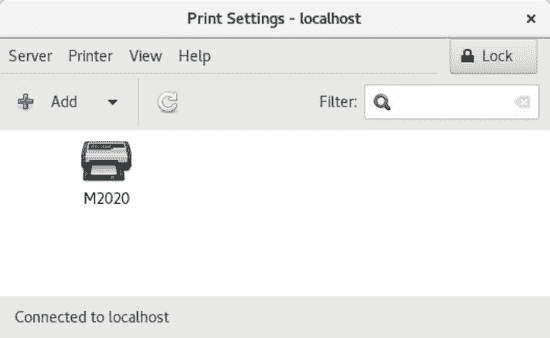 

图 10-2：`system-config-printer` 工具：多个打印机

要查看打印机设置（如打印机和作业选项、访问控制和策略），双击打印机图标或右键点击并选择“属性”。打开的打印机属性窗口包含五个选项卡：设置、策略、访问控制、打印机选项和作业选项（参见图 10-3）。

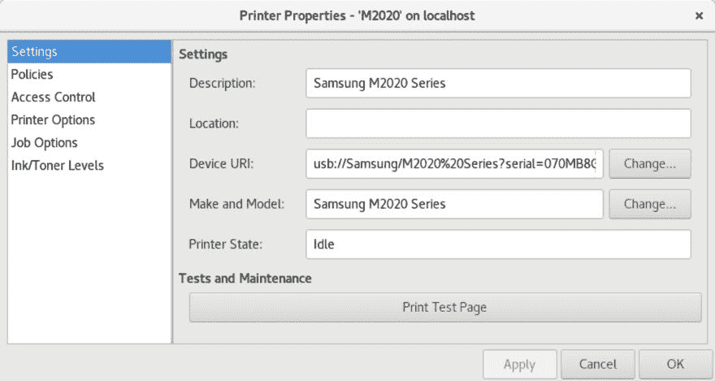

图 10-3：打印机属性窗口

# CUPS Web 配置界面

使用 CUPS 配置和安装打印机的简单方法之一是使用 CUPS 配置 Web 界面，这是一个基于浏览器的工具。CUPS 配置界面是一个 Web 工具，还可以管理打印机和打印作业。它会显示一个网页，带有用于管理作业、打印机以及执行管理任务的选项卡。

你使用 `localhost` 地址并指定端口 `631` 来访问 CUPS 配置工具。在网络浏览器中输入以下 URL：

[`localhost:631`](http://localhost:631)

在 Web 浏览器中输入 `localhost:631` URL 将打开 CUPS Web 界面的主屏幕。有针对不同部分的选项卡，以及用于特定任务（如添加打印机或获取帮助）的链接（参见图 10-4）。选项卡包括管理、类、帮助、作业和打印机。你可以在“管理”选项卡上管理和添加打印机。“打印机”选项卡将列出已安装打印机，并带有访问其打印队列、打印机选项和作业选项等按钮。“作业”选项卡列出你的打印作业并允许你管理它们。

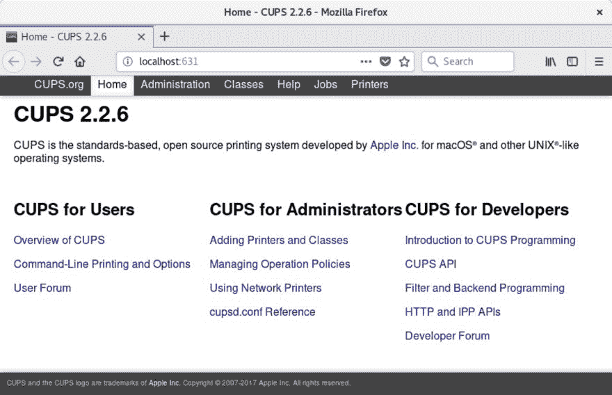

图 10-4：CUPS Web 配置：首页

当你在会话期间尝试进行任何更改时，系统会要求你输入管理员用户名（你的用户名）和密码（你的用户密码），就像执行 `sudo` 命令一样。

“管理”选项卡显示了打印机、类、作业和服务器的段部分。服务器部分是你允许打印机共享的地方。按钮允许你查看日志并更改设置。

通过 CUPS 配置工具，你可以通过一系列 Web 页面在 CUPS 上安装打印机，每个页面都会请求不同的信息。要安装打印机，点击首页或管理页上的“添加打印机”按钮。你首先指定协议。在下一个屏幕上，你输入用于打印机的 URI。对于本地打印机，这是协议和主机名。会显示一个页面，你在其中输入打印机名称和位置。“共享”项允许你选择共享打印机。位置是打印机连接的主机。该过程与 `system-config-printer` 类似。后续页面将提示你输入打印机的品牌和型号，你可以从可用列表中进行选择。如果你有 PPD 驱动文件，也可以加载它。读取完成后点击“添加打印机”按钮。在后续页面中，你将为打印机设置默认选项，如纸张大小和类型、颜色、打印质量和分辨率。

# 远程打印机

大多数新的打印机支持无驱动打印。系统会自动检测。要手动搜索连接到 Windows 系统或另一个运行 CUPS 的 Linux 系统的远程打印机，你需要使用特殊的 URL 协议指定其位置。对于远程主机上的另一个 CUPS 打印机，使用的协议是 `ipp`（互联网打印协议），而对于 Windows 打印机，将是 `smb`。使用 LPRng 的旧 Unix 或 Linux 系统将使用 `lpd` 协议。确保你的防火墙已配置允许访问远程打印机。

确保你的防火墙已配置允许访问远程打印机。在 `system-config-firewall`（杂项 | 防火墙）的受信任服务选项卡上，确保勾选了 `Samba` 和 `IPP` 服务。Samba 允许访问 Windows 打印机，IPP 允许访问通常在其他 Linux 系统上的互联网打印协议打印机。会有 Samba 客户端、服务器以及 IPP 客户端和服务器的项目。

要访问 `SMB` 共享远程打印机，你需要安装 Samba 并使用 `smb` 和 `nmb` 守护启用服务器消息块服务。Samba 服务应默认启用。如果没有，你可以使用 `systemctl` 命令启用它。打开终端窗口（实用程序| 终端），并对 `smb` 和 `nmb` 服务器输入 `sudo systemctl enable`。

```bash
sudo systemctl enable nmb
sudo systemctl enable smbd
```

## 使用 system-config-printer 配置远程打印机

你可以使用 `system-config-printer` 在 Linux、UNIX 或 Windows 网络上手动设置远程打印机。当你添加新打印机或编辑打印机时，“新打印机/选择连接”对话框将列出可能的远程连接类型。当你选择远程连接项时，将显示一个可以在其中配置信息的面板。位置使用特殊的 URI 协议指定。对于远程主机上的另一个 CUPS 打印机，使用的协议是 `ipp`（互联网打印协议），而对于 Windows 打印机，将是 `smb`。使用 LPRng 的旧 UNIX 或 Linux 系统将使用 `lpd` 协议。

## 使用 CUPS Web 配置配置远程打印机

要使用 CUPS Web 配置工具安装远程打印机，你在初始“添加打印机”页面指定远程打印机网络协议。你可以从 Windows、互联网打印协议（其他 UNIX 或 Linux 系统）、Apple 和 HP JetDirect 连接的打印机以及旧的 LPD 线打印机中进行选择。如果当前连接了网络打印机，可能会出现在“发现的网络打印机”列表中。

## 手动配置远程打印机

在 `cupsd.conf` 文件中，对于远程打印机，`DeviceURI` 项不再列出设备，而是将有一个 Internet 地址以及其协议。例如，CUPS 服务器上的远程打印机 (`ipp`) 将如所示所示（Windows 打印机将使用 `smb` 协议）：

```
DeviceURI ipp://mystuff.com/printers/queue1
```

对于 Windows 打印机，你首先需要安装、配置并运行 Samba。（CUPS 使用 Samba 访问 Windows 打印机）。当你在 CUPS 上安装 Windows 打印机时，使用 URL 协议 `smb` 指定其位置。允许登录打印机的用户在主机名之前并通过 `@` 符号分隔。在大多数配置中，这是客用户。连接到名为 `lizard` 的 Windows 主机的名为 `myhp` 的 Windows 打印机的位置项所示。它的 Samba 共享引用为 `//lizard/myhp`：

```
DeviceURI smb://guest@lizard/myhp
```

要在 Samba 上启用 CUPS，你还需要将 `/etc/samba/smb.conf` 文件中的打印选项设置为 `cups`，如下所示：

```
printing = cups
printcap name = cups
```

# CUPS 配置文件


CUPS 配置文件位于 `/etc/cups` 目录。这些文件列在表 10-2 中。`classes.conf`、`printers.conf` 和 `client.conf` 文件可以通过 Web 界面管理。`printers.conf` 文件包含了你已安装的不同打印机的配置信息。如果你愿意，可以手动编辑这些任何一个文件。

### cupsd.conf

CUPS 服务器通过位于 `/etc/cups` 的 `cupsd.conf` 文件进行配置。你必须手动编辑配置选项；服务器不支持通过 Web 界面配置。你安装 CUPS 时，会附带一个带注释的 `cupsd.conf` 文件，其中列出了每个选项，尽管大多数选项都被注释掉了。注释行以 `#` 符号开头。每个选项都有详细的文档说明。服务器配置使用 Apache Web 服务器的语法，由一组指令组成。与 Apache 一样，这些指令中的若干个可以将其他指令分组为块。

| 文件名 | 说明 |
| :--- | :--- |
| `classes.conf` | 包含不同本地打印机类的配置 |
| `client.conf` | 列出指定客户端的特定选项 |
| `cupsd.conf` | 配置 CUPS 服务器 `cupsd` |
| `printers.conf` | 包含可用本地打印机的打印机配置 |
| `cups-files.conf` | CUPS 使用的文件和目录 |
| `cups-browsed.conf` | 访问远程和本地打印机 |
| `subscriptions.conf` | 打印机和打印作业信息的订阅控制 |

**表 10-2: CUPS 配置文件**

如需了解 `cupsd.conf` 指令的详细说明，请查看 CUPS 文档中的 `cupsd.conf`。你也可以从 CUPS 浏览器端管理工具 `http://localhost:631` 的帮助页“引用（References）”链接访问此文档。

[`www.cups.org/documentation.html`](https://www.cups.org/documentation.html)

`cupsd.conf` 文件从将日志级别设置为 `warn`（警告）开始。

```
LogLevel warn
```

`Listen` 指令设置接收连接的机器和套接字。默认设置为本地机器 `localhost` 的 `631` 端口。如果你正在使用专用的网络接口连接到本地网络，你可以添加网卡的 IP 地址，允许网络上机器的访问。

```
# 仅监听来自本地机器的连接。
Listen localhost:631
Listen /var/run/cups/cups.sock
```

`Browsing` 指令允许你的本地打印机在网络上被检测到，从而实现共享。对于共享打印，`Browsing` 指令被设置为 `on`（默认为 `Off`）。`allow, deny` 的 `BrowseOrder` 将拒绝所有浏览传输，然后首先检查 `BrowseAllow` 指令以排除异常。反向顺序（`deny, allow`）则相反，接受所有浏览传输，然后首先检查被 `BrowseDeny` 指令拒绝的传输。默认的 `cupsd.conf` 文件有一个 `BrowseOrder allow, deny` 指令，随后是一个设置为 `all` 的 `BrowseAllow` 指令。要将其限制在特定网络，请使用网络的 IP 地址代替 `all`。`BrowseLocalProtocols` 列出了在本地网络上发布打印机时使用的网络协议。`BrowseAddress` 指令将使你的本地打印机在指定网络作为共享打印机。它设置为 `@LOCAL` 以允许本地网络访问。你可以添加其他 `BrowseAddress` 指令以允许其他网络访问。

```
# 在本地网络上显示共享打印机。
Browsing On
BrowseOrder allow,deny
BrowseAllow all
BrowseLocalProtocols dnssd
BrowseAddress @LOCAL
```

CUPS 支持基础（Basic）和摘要（Digest）两种形式的认证，在 `AuthType` 指令中指定。基础认证使用用户名和密码。例如，使用 Web 界面时，你会被提示输入 root 用户和 root 用户密码。摘要认证利用存储在 CUPS `/etc/cups/passwd.md5` 文件中的用户密码信息，使用用户和密码的 MD5 版本进行认证。此外，CUPS 还支持 `BasicDigest` 和 `Negotiate` 认证。`BasicDigest` 将使用 CUPS 的 `md5` 密码文件进行基础认证。`Negotiate` 将使用 Kerberos 认证。默认认证类型通过 `DefaultAuthType` 指令设置，设置为 `Basic`。

```
# 当需要认证时的默认认证类型...
DefaultAuthType Basic
```

#### 位置指令 (Location Directives)

某些指令允许你在特定位置设置访问控制。这些可以是打印机或资源，例如管理工具或池化目录。位置控制通过 `Location` 指令实现。有多个 `Location` 指令用于控制访问。第一个控制对服务器根目录 `/` 的访问。`Order allow, deny` 条目激活了对远程系统访问的限制。如果没有后续的 `Allow` 或 `Deny` 条目，则默认拒绝所有访问。在 `Order allow, deny` 指令中，有一个隐含的 `Allow localhost`，始终允许本地机器访问。实际上，这里拒绝了所有系统的访问，仅允许本地系统访问。

```
### 限制对服务器的访问...
<Location />
  Order allow,deny
</Location>
```

另一个 `Location` 指令用于限制管理级访问（即 `/admin` 资源），并添加对加密的要求。`Order allow, deny` 指令拒绝除本地机器以外的所有系统的访问。

```
# 限制对管理页面的访问...
<Location /admin>
  Order allow,deny
</Location>
```

`Allow from` 和 `Deny from` 指令可以允许或拒绝来自特定主机和网络的访问。如果你只想允许访问某特定机器，可以使用带有该机器 IP 地址的 `Allow from` 指令。CUPS 还使用 `@LOCAL` 表示你的本地网络，并使用 `IF(name)` 表示访问网络的特定网络接口（`name` 是接口的设备名称）。如果你允许本地网络上所有其他系统的管理访问，可以添加 `Allow from @LOCAL`。如果你添加了 `Allow` 指令，你还必须显式添加 `Allow localhost` 以确保本地机器的访问。

```
# 限制对管理页面的访问...
<Location /admin>
  Allow from localhost
  Allow from @LOCAL
  Order allow,deny
</Location>
```

以下条目将允许来自特定机器的访问。

```
Allow From 192.168.0.5
```

下一个位置指令限制对 CUPS 配置文件 `/admin/conf` 的访问。`AuthType default` 指令引用 `DefaultAuthType` 设置的默认值。`Require user` 指令引用 `SystemGroup` 指令 `@SYSTEM`（定义在 `cups-files.conf` 文件中）。仅允许来自组组的用户访问。

```
# 限制对配置文件的访问...
<Location /admin/conf>
  AuthType Default
  Require user @SYSTEM
  Order allow,deny
</Location>
```

#### 默认操作策略：限制指令 (Limit Directives)

随后为访问基础管理、打印机、打印作业和所有者操作定义默认操作策略。默认操作策略部分以 `<Policy default>` 指令开始。`Limit` 指令用于实现每种操作的指令。作业操作涵盖了发送文档、重启作业、暂停作业和恢复作业等任务。管理任务包括修改打印机配置、删除打印机、管理打印机类以及设置默认打印机。打印机操作负责暂停打印机、启用或禁用打印机以及关闭打印机任务。所有者操作由取消作业和验证作业访问组成。订阅定义在 `/etc/cups/subscriptions.conf` 文件中。

更多详情请查阅 CUPS 文档中关于管理操作策略的内容。


在所有默认的 `Limit` 指令上，仅允许本地机器（`localhost`）访问，`Order allow,deny`。

策略部分从对用户和作业信息的访问控制开始。`JobPrivateAccess` 的默认值限制访问为所有者、`system` 和访问控制列表。`JobPrivateValues` 指定了私有化的值，例如作业名称、源主机和源用户。`SubscriptionPrivateAccess` 和 `SubscriptionPrivateValues` 指定了对订阅属性的访问权限，例如打印事件通知（如作业完成或作业停止）。

管理指令和打印机 `Limit` 指令均被设置为 `AuthType` 默认值，并限制仅供管理员用户访问，`Require user @SYSTEM`。此处显示管理指令。

# 所有管理操作都需要管理员进行身份验证...

```xml
<Limit CUPS-Add-Modify-Printer CUPS-Delete-Printer CUPS-Add-Modify-Class CUPS-Delete-Class CUPS-Set-Default CUPS-Get-Devices>
    AuthType Default
    Require user @SYSTEM
    Order deny,allow
</Limit>
```

所有与作业相关的所有者 `Limit` 指令都需要所有者或管理员身份验证，`Require user @OWNER @SYSTEM`。此处显示 `Owner Limit` 指令。

```xml
<Limit Cancel-Job CUPS-Authenticate-Job>
    Require user @OWNER @SYSTEM
    Order deny,allow
</Limit>
```

#只有所有者或管理员才能取消或身份验证作业...

对于所有其他任务，`<Limit All>` 访问被限制在本地机器（`localhost`）。

```xml
<Limit All>
    Order deny,allow
</Limit>
```

`AuthClass` 指令可在 `Limit` 指令中使用，指定允许访问的打印机类。`System` 类包含了 `root`、`sys` 和 `system` 用户。

一组经过验证的策略指令遵循默认策略，具有类似的条目，并增加了一个用于创建和打印作业的 `Limit` 指令。

```xml
<Limit Create-Job Print-Job Print-URI Validate-Job>
    AuthType Default
    Order deny,allow
</Limit>
```

### cupsctl

你可以使用 `cupsctl` 命令来修改你的 `cupsd.conf` 文件，而不是直接编辑该文件。详情请查看 `cupsctl` 手页。不带选项的 `cupsctl` 命令将显示当前设置。

### cupsctl

通过此命令可以做的更改受限于关闭远程管理或禁用共享打印。你可以设置的主要选项有：

- `remote-admin`: 启用或禁用远程管理
- `remote-any`: 启用或禁用远程打印
- `remote-printers`: 启用或禁用远程打印机的显示
- `share-printers`: 启用或禁用与其他系统共享本地打印机

### printers.conf

打印机的配置信息将存储在 `/etc/cups/printers.conf` 文件中。你可以直接检查此文件，甚至进行修改。以下是一个打印机配置条目的示例。`DeviceURI` 条目指定了使用的设备，在此例中为 USB 打印机。它处于空闲状态，没有作业。`OpPolicy` 条目指定了 `cupsd.conf` 文件中定义的用于该打印机的策略。

```conf
# CUPS 打印机配置文件
# Written by cupsd
<Printer mycannon>
UUID urn:uuid:72f4abc6-9afe-35f6-47e3-35ae26e3fdc1
Info Cannon S330
Location
MakeModel Canon S300 - CUPS+Gutenprint v5.2.9 Simplified
DeviceURI usb://Canon/S330
State Idle
StateTime 1166554036
Accepting Yes
Shared Yes
JobSheets none none
QuotaPeriod 0
PageLimit 0
KLimit 0
OpPolicy default
ErrorPolicy stop-printer
</Printer>
```

### subscriptions.conf

打印机和作业信息的配置信息位于 `/etc/cups/subscriptions.conf` 文件。接收这些信息的用户由 `cupd.conf` 文件策略部分的 `SubscriptionPrivateAccess` 和 `SubscriptionPrivateValues` 指令指定。`Events` 指令指定了要发送的事件通知，例如 `job-completed`、`printer-stopped` 和 `server-started` 等事件。`Owner` 指令列出了此订阅的用户。`LeaseDuration` 是订阅有效的持续（0 值为打印作业的生命周期或永久有效）。`Interval` 是通知之间的时间。`Recipient` 是通知的接收者 URI。在以下示例中，它是 `dbus://`（你的桌面）。

此处显示示例 `subscriptions.conf` 文件：

```conf
# CUPS v2.2.6 订阅配置文件
# Written by cupsd on 2013-03-13 14:13
NextSubscriptionId 31
<Subscription 29>
Events printer-state-changed printer-restarted printer-shutdown printer-stopped printer-added printer-deleted job-state-changed job-created job-completed job-stopped
Owner richard
Recipient dbus://
LeaseDuration 3600
Interval 0
ExpirationTime 1529777935
NextEventId 1
</Subscription>
```

### cups-files.conf

CUPS 用于管理打印作业的文件和目录可以在 `/etc/cups/cups-files.conf` 文件中配置。`ErrorLog` 指令指定了 CUPS 错误日志输出，该日志会被发送到系统日志。

```conf
ErrorLog journal
```

`SystemGroup` 指令定义了 `cupsd.conf` 中 `@SYSTEM` 所引的用户。

```conf
SystemGroup sys root wheel
```

### cups-browsed.conf

`cups-browsed.conf` 文件配置了 `cups-browsed` 守护进程，用于浏览远程和本地打印机。`BrowseRemoteProtocols` 定义了要使用的协议。

```conf
BrowseRemoteProtocols dnssd cups
```

`BrowseAllow` 指令可用于限制浏览到指定的服务器或网络。

```conf
BrowseAllow 192.168.1.0/24
```

`CreateIPPPritnerQueues` 指令允许检测非 CUPS 的 IPP 打印机。

## CUPS 命令行打印客户端

一旦打印作业提交到打印队列，你可以使用多个打印客户端来管理打印机或打印机上的打印作业，例如 `Klpq`、GNOME 打印管理器以及用于 CUPS 的打印机配置工具。你还可以使用多个命令行 CUPS 客户端。这些包括 `lpr`、`lpc`、`lpq` 和 `lprm` 命令。通过这些客户端，你可以打印文档、列出打印队列、重新排序并删除打印作业（有效地取消它们）。对于网络连接，CUPS 为其命令提供了加密选项 `-E`，用于加密在网络上传的打印作业和打印信息。[表 10-3] 显示了各种打印机命令。

注意：命令行客户端与 Unix 和旧版 Linux 系统使用的旧 LPR 和 LPRng 命令行客户端具有相同的名称和非常相似的语法。

| 打印机管理 |  |
| :--- | :--- |
| GNOME Print Manager | GNOME 打印队列管理工具 (CUPS)。 |
| CUPS Configuration Tool | 打印、管理和配置 CUPS。 |
| `lpr options file-list` | 打印文件，将其复制到打印机的缓存目录并放入打印队列轮打印。`-P printer` 在指定的打印机上打印文件。 |
| `lpq options` | 显示打印队列中的打印作业。`-P printer` 打印打印机的队列。`-l` 打印详细列表。 |
| `lpstat options` | 显示打印机状态。 |
| `lprm options printjob-id or printer` | 从打印队列中移除打印作业。你通过 `lpq` 列出的编号识别特定的打印作业。`-P printer`移除指定打印机的所有打印作业。 |
| `lpc` | 管理你的打印机。在 `lpc>` 提示符下，你可以输入命令检查打印机状态并采取其他操作。 |

表 10-3：CUPS 打印客户端

### lpr

`lpr` 客户端提交作业，然后 `lpd` 接收并将其放入相应的打印队列；`lpr` 的参数是文件名。如果未指定打印机，则使用默认打印机。`-P` 选项允许你指定特定的打印机。在下一个示例中，用户首先打印序言，然后将报告文件打印到名为 myepson 的打印机上：

```bash
$ lpr preface
$ lpr -P myepson report
```

### lpc


你可以使用 `lpc` 来启用或禁用打印机、重新排序打印队列并重新执行配置文件。要使用 `lpc`，请在 shell 提示符处输入命令 `lpc`。你会得到一个 `lpc>` 提示符，可以在其中输入 `lpc` 命令来管理打印机并重新排序作业。带有打印机名称的 `status` 命令显示打印机是否就绪、有多少个打印作业等。`stop` 和 `start` 命令可以停止打印机并重新启动。显示的打印机取决于为特定打印服务器配置的打印机。在 CUPS 上配置的打印机只有在你切换到 CUPS 时才会显示。

```
$ lpc

lpc> status myepson

myepson:

printer is on device 'hal' speed -1
queuing is enabled
printing is enabled
1 entry in spool area
```

### lpq 和 lpstat

你可以使用 `lpq` 和 `lprm` 命令管理打印队列。`lpq` 命令列出打印队列中当前的打印作业。使用 `-P` 选项配合打印机名称可以列出特定打印机的作业。如果你指定了用户名，可以列出该用户的打印作业。使用 `-l` 选项，`lpq` 会显示每个作业的详细信息。如果你想获取特定作业的信息，只需配合 `lpq` 使用该作业的 ID 数字。要检查打印机状态，请使用 `lpstat`。

```
$ lpq

myepson is ready and printing
Rank    Owner  Jobs  File(s)         Total Size
active  chris     1  report           1024
```

### lprm

`lprm` 命令允许你从队列中删除打印作业，在作业打印之前将其删除。`lprm` 命令带有许多与 `lpq` 相同的选项。要删除特定作业，使用带有作业号的 `lprm`。要删除特定打印机的所有打印作业，使用带有打印机名称的 `-P` 选项。不带选项的 `lprm` 删除正在打印的作业。以下命令删除队列中的第一个打印作业（使用 `lpq` 获取作业号）：

```
lprm 1
```

## CUPS 命令行管理工具

CUPS 提供了命令行管理工具，如 `lpadmin`、`lpoptions`、`lpinfo`、`cupsenable`、`cupsdisable`、`accept` 和 `reject`。`cupsenable` 和 `cupsdisable` 命令直接启动和停止打印队列，而 `accept` 和 `reject` 命令则启动和停止特定作业。`lpinfo` 命令提供打印机信息，lpoptions` 允许设置打印选项。`lpadmin` 命令允许执行管理任务，如添加打印机和更改配置。CUPS 管理工具列在表 10-4。

### lpadmin

你可以使用 `lpadmin` 命令设置默认打印机或为打印机配置各种选项。你可以使用 `-d` 选项指定特定打印机作为默认目标。这里将 `myepson` 设置为默认打印机：

```
lpadmin -d myepson
```

`-p` 选项允许你指定要设置各种选项的打印机。以下示例设置了打印机描述信息：

```
lpadmin -p myepson  -D  Epson550
```

某些选项允许你控制每个用户的打印作业配额。`job-k-limit` 选项设置每个用户允许的作业大小，`job-page-limit` 设置作业的页数限制，`job-quota-period` 限制特定时间范围内的作业数量。以下命令为每个用户设置了 100 页的页数限制：

```
lpadmin -p myepson  -o job-page-limit=100
```

| 管理工具 |or |
| :--- | :--- |
| lpadmin | CUPS 打印机配置 |
| lpoptions | 设置打印选项 |
| cupsenable | 激活打印机 |
| cupsdisable | 停止打印机 |
| accept | 允许打印机接受新作业 |
| reject | 防止打印机接受打印作业 |
| lpinfo | 列出可用 CUPS 设备 |

表 10-4：CUPS 管理工具

使用 `-u` 选项配合 `allow` 或 `deny` 列表确定用户访问控制。允许访问的用户列在 `allow:` 条目之后，拒绝访问的用户列在 `deny:` 条目之后。这里授予 chris 访问权限，但拒绝了 aleina 和 larisa 的访问。

```
lpadmin -p myepson -u allow:chris  deny:aleina,larisa
```

使用 `all` 或 `none` 来允许或拒绝所有或无用户的访问。你可以通过将 `all` 或 `none` 与特定用户的访问结合来创建异常。以下示例允许 justin 之外的所有用户访问：

```
lpadmin -p myepson  -u allow:all  deny:justin
```

### lpoptions

`lpoptions` 命令允许你设置打印选项和默认值，这些选项主要决定了打印作业如何打印。例如，你可以为特定打印机设置使用的颜色或页面格式。所有用户的默认设置由 root 用户在 `/etc/cups/lpoptions` 文件中维护，每个用户创建自己的配置并保存在 `.lpoptions` 文件中。`-l` 选项列出打印机的当前选项，`-p` 选项指定打印机（你也可以使用 `-d` 选项设置默认打印机）。

```
lpoptions -p myepson -l
```

打印机选项使用 `-o` 选项配合选项名称和值设置，即 `-o option=value`。你可以使用 `-r` 选项移除打印机选项。例如，要在纸张的双面打印，你可以将 `sides` 选项设置为 `two-sided`：

```
lpoptions -p myepson -o sides=two-sided
```

移除该选项使用 `-r`。

```
lpoptions -p myepson -r sides
```

要显示可用选项列表，请查看 CUPS 软件手册中的 [`www.cups.org/`](https://www.cups.org/) 中的标准打印选项。

### cupsenable 和 cupsdisable

`cupsenable` 命令启动打印机，`cupsdisable` 命令停止它。使用 `-c` 选项，你可以取消打印机队列上的所有作业，使用 `-r` 选项广播解释关机的消息。

```
cupsdisable myepson
```

### accept 和 reject

`accept` 和 `reject` 命令允许你控制特定打印机的队列访问。`reject` 命令防止打印机接受作业，而 `accept` 允许新作业。

```
reject myepson
```

### lpinfo

`lpinfo` 命令是一个实用的工具，可以让你知道系统上有哪些 CUPS 设备和驱动程序。使用 `-v` 选项查看设备，使用 `-m` 选项查看驱动程序。

```
lpinfo -m
```


| `rpc.mountd` | `nfs-mountd.service` | 执行请求的挂载和卸载操作。 |
| `rpc.statd` | `nfs-lock.service` `rpc-statd.service` | 在远程主机重启时提供锁定服务。 |
| `rpc.idmapd` | `nfs-idmapd.service` | 将用户和组 ID 映射为名称。 |
| `rpc.gssd` | `nfs-secure.service` `rpc-gssd.service` | 客户端支持 NFSv4 用于 gss-api 安全的 `rpcsec_gss` 协议。 |
| `rpc.svcgssd` | `nfs-secure-server.service` | 服务端支持 NFSv4 用于 gss-api 安全的 `rpcsec_gss` 协议。 |

表 11-1: NFS 守护进程和 systemd 单元文件

### NFS 守护进程

NFS 运行在 TCP/IP 网络上。持有文件系统的远程计算机将其提供给网络上的其他计算机。它通过导出文件系统来实现这一点，这包括在名为 `/etc/exports` 的 NFS 配置文件中创建条目，以及运行多个守护进程以支持其他系统的访问。这些包括 `rpc.mountd`、`rpc.nfsd` 和 `rpc.gssd`。对 NFS 服务器的访问可以通过 `/etc/hosts.allow` 和 `/etc/hosts.deny` 文件进行控制。NFS 守护进程由 `systemd` 管理，使用位于 `/lib/systemd/system` 的多个服务单元文件。NFS 守护进程及其 systemd 单元文件列在表 11-1 中。

此处显示 `nfs-server.service` 文件。运行时配置信息从 `/etc/sysconfig/nfs`（`EnvironmentFile`）读取。

```
nfs-server.service

[Unit]
Description=NFS Server and services
DefaultDependencies=no
Requires= network.target proc-fs-nfsd.mount
Requires=nfs-mountd.service
Wants=rpc-statd.service  nfs-idmapd.service
Wants=rpc-statd-notify.service
After=network-online.target local-fs.target
After=proc-fs-nfsd.mount rpcbind.target nfs-mountd.service
After=nfs-idmapd.service nfs-statd.service
Before=rpc-statd-notify.service

# GSS services dependencies and ordering
Wants=auth-rpcgss-module.service
After=rpc-gssd.service gssproxy.service rpd-svcgssd.service
Wants=nfs-config.service
After=nfs-config.service

[Service]
EnvironmentFile=-/etc/sysconfig/nfs-utils
Type=oneshot
RemainAfterExit=yes
ExecStartPre=/usr/sbin/exportfs -r
ExecStart=/usr/sbin/rpc.nfsd $RPCNFSDARGS
ExecStart=/bin/sh -C 'If systemctl -q is-active gssproxy; then systemctl restart gssproxy; fi'
ExecStop=/usr/sbin/rpc.nfsd 0
ExecStopPost=/usr/sbin/exportfs -au
ExecStopPost=/usr/sbin/exportfs -f
ExecReload=/usr/sbin/exportfs -r

[Install]
WantedBy=multi-user.target
```

你可以使用 `systemctl` 命令通过 `nfs.service` 文件启动和关闭 NFS 守护进程。请确保它已启用。

```
sudo systemctl enable nfs-server
sudo systemctl start nfs-server
```

`nfsd`、`mountd`、`idmapd`、`statd` 和 `svcgssd` 守护进程对应的 systemd 单元文件将运行这些守护进程（带有 `nfs-` 和 `rpc-` 前缀）。

Fedora NFS 服务器和支持工具位于以下软件包中。

| `nfs-utils` | NFS 服务器及辅助工具 |
| `nfs4-acl-tools` | 支持 NFS4 安全的访问控制列表命令 |
| `nfswatch` | 监控 NFS 使用情况 |

确保你的防火墙允许 NFS 并勾选 NFS4。还要确保允许 SELinux 许可 NFS 访问。在侧边栏使用 `system-config-selinux select Boolean`，然后找到 NFS 并确保勾选“Support NFS home directories”（支持 NFS 主目录）。

### NFS 配置：/etc/exports

`/etc/exports` 文件中的条目指定要导出的文件系统以及网络上可以访问的主机。对于文件系统，输入其挂载点（即它在主机系统上挂载的目录）。随后是允许访问该文件系统的主机列表以及控制该访问的选项。每个主机后面可以跟一组括号内的逗号分隔的导出选项列表。例如，你可能想给一个主机只读权限，而给另一个主机读写权限。如果选项以 `*` 符号开头，则它们将应用于任何主机。选项列表在表 11-2 中。`/etc/exports` 文件中条目的格式所示：

`directory-pathname  host-designation(options)`

#### NFS 主机条目

你可以为同一个目录设置多个主机条目，每个条目都有访问该目录的权限：

`directory-pathname host(options) host(options) host(options)`

在指定主机时你具有极大的灵活性。对于域名内的主机，你可以直接使用主机名，而对于外部主机，你需要使用完全限定域名（FQDN）。你也可以只使用主机的 IP 地址。与其引用单个主机，不如引用特定域名内的所有主机，允许整个网络访问。实现此点的简单方法是在主机段使用 `*`，后面跟上网络域名，例如 `*.mytrek.com` 表示 mytrek.com 网络中的所有主机。除了域名外，你还可以使用 CIDR 格式的 IP 网络地址，通过指定子网掩码来指示 IP 地址范围。

你还可以使用 NIS netgroup 名称来引用一组主机。NIS netgroup 名称前带有 `@` 符号。

`directory host(options)`
`directory *(options)`
`directory *.domain(options)`
`directory 192.168.1.0/255.255.255.0(options)`
`directory @netgroup(options)`

| 通用选项 | 描述 |
| :--- | :--- |
| `secure` | 要求请求来自安全端口（小于 1024）。这是默认开启的。 |
| `insecure` | 关闭 `secure` 选项。 |
| `ro` | 仅允许只读。这是默认设置。 |
| `rw` | 允许读写访问。 |
| `sync` | 在请求时立即执行所有写入。这是默认设置。 |
| `async` | 当服务器准备好时执行所有写入。 |
| `no_wdelay` | 立即执行写入，不检查是否相关。 |
| `wdelay` | 检查写入是否相关，如果是，则等待合并执行。可能会降低性能。这是默认设置。 |
| `hide` | 自动隐藏作为另一个导出目录子目录目录。 |
| `subtree_check` | 检查文件系统的父目录以验证导出的子目录。这是默认设置。 |
| `no_subtree_check` | 不检查文件系统的父目录以验证导出的子目录。 |
| `insecure_locks` | 不对锁定请求进行认证。用于旧版本的 NFS。 |

| 用户 ID 映射 | 描述 |
| :--- | :--- |
| `all_squash` | 将所有 UID 和 GID 映射到匿名用户。 |
| `no_all_squash` | `all_squash` 的反向。这是默认设置。 |
| `root_squash` | 将远程 root 请求映射到匿名 UID/GID。这是默认设置。 |
| `no_root_squash` | 关闭 root 压缩。允许 root 用户以远程 root 身份访问。 |
| `anonuid` | 显式设置用于 `all_squash` 和 `root_squash` 选项的匿名账户 UID 和 GID。 |


`/etc/exports` 中的选项作为权限，用于控制对导出目录的访问。只读访问通过 `ro` 选项设置，读写访问通过 `rw` 选项设置。`sync` 和 `async` 选项指定写入操作是立即执行（`sync`）还是在服务器准备好处理时执行（`async`）。默认情况下，写入请求会被检查是否具有相关性，如果是，则会将它们一起写入（`wdelay`）。这可能会降低性能。你可以使用 `no_wdelay` 覆盖此默认设置，并按请求执行写入。如果导出两个目录，其中一个是另一个的子目录，除非显式挂载（`hide`），否则子目录是不可用的。换句话说，挂载父目录不会让子目录变得可用。在也进行挂载之前，子目录将保持隐藏状态。你可以通过 `no_hide` 选项克服这一限制（尽管这会导致某些文件系统出现问题）。如果导出的目录实际上是较大文件系统中的子目录，则会检查其父目录以确保该子目录是有效目录（`subtree_check`）。该选项在只读文件系统中效果良好，但对于可以写入的文件系统（文件名和目录可以更改的文件系统）可能会导致问题。你可以使用 `no_subtree_check` 选项取消此检查。

## NFS 用户级访问

除了通用选项外，还有适用于用户级访问的选项。作为一种安全措施，NFS 服务器会将客户端的 root 用户视为匿名用户。这被称为“用户压制”（squashing）。对于客户端 root 用户，压制防止了客户端尝试伪装成 NFS 服务器的 root 用户。如果你希望特定客户端的 root 用户对 NFS 服务器具有 root 级控制权限，可以指定 `no_root_squash` 选项。为了防止任何客户端用户尝试伪装成 NFS 服务器上的用户，你可以将他们归为匿名用户（`all_squash` 选项）。此类匿名用户仅具有访问匿名组部分目录和文件的权限。

通常，如果客户端系统上的用户在 NFS 服务器上拥有用户账户，该用户就可以挂载并访问其在 NFS 服务器上的文件。然而，NFS 要求用户的 User ID（用户 ID）在两个系统中必须相同。如果不是如此，他或她将被视为两个不同的用户。为了解决这个问题，可以使用 NIS 服务，将用户 ID 信息维护在一个地方，即 NIS 密码文件。

## NFS /etc/exports 示例

此处显示了 `/etc/exports` 文件条目的示例。所有主机对挂载在 `/pub` 目录的文件系统具有只读访问权限，这是一个用于公共访问的常用名称。然而，用户被视为匿名用户（`all_squash`）。`lizard.mytrek.com` 对挂载在 `/home/mypics` 目录的文件系统具有读写权限。下一个条目允许 `rabbit.mytrek.com` 仅使用读取权限访问 NFS 服务器的刻光驱。最后一个条目允许任何人安全地访问 `/home/richlp`。

```
/etc/exports

/pub               *(ro,insecure,all_squash,sync)
/home/mypics      lizard.mytrek.com(rw,sync)
/media/cdrom      rabbit.mytrek.com(ro,sync)
/home/richlp      *(secure,sync)
```

## 应用更改

每当系统启动 NFS 服务器（通常在系统启动时），`/etc/exports` 文件都会被读取，指定的目录将被导出。当一个目录被导出时，会在 `/var/lib/nfs/xtab` 文件中为其创建一个条目。NFS 读取并使用该文件来执行实际导出。条目从 `/etc/exports` 读取并在 `/var/lib/nfs/xtab` 中创建相应的条目。`xtab` 文件维护了实际导出的列表。

如果你想在不重启的情况下立即导出 `/etc/exports` 文件中新增的条目，可以使用带有 `-a` 选项的 `exportfs` 命令。添加 `-v` 选项显示 NFS 正在执行的操作很有帮助。使用相同的选项使你对 `/etc/exports` 文件所做的任何更改生效。

```
exportfs -a -v
```

如果你以后对 `/etc/exports` 文件更改了更改，可以使用 `-r` 选项重新导出其条目。`-r` 选项将把 `/var/lib/nfs/xtab` 文件与 `/etc/exports` 条目重新同步，移除任何其他导出或选项不同的导出项。

```
exportfs -r -v
```

若要同时导出新增的条目并重新导出更改的条目，可以组合 `-r` 和 `-a` 选项。

```
exportfs -r -a -v
```

## 手动导出文件系统

你也可以使用 `exportfs` 命令手动导出文件系统，而不是在 `/etc/exports` 文件中使用条目。导出条目将直接添加到 `/var/lib/nfs/xtab` 文件中。通过 `-o` 选项，你可以列出各种权限，然后是要导出的主机和文件系统。主机和文件系统用冒号分隔。例如，要手动将 `/home/myprojects` 目录以 `ro` 和 `insecure` 权限导出到 `golf.mytrek.com`，使用以下命令：

```
exportfs -o rw,insecure golf.mytrek.com:/home/myprojects
```

你还可以使用 `exportfs` 取消已导出的目录（无论是手动导出还是通过 `/etc/exports` 文件导出）。只需配合主机和导出的目录使用 `-u` 选项。导出条目将从 `/var/lib/nfs/xtab` 文件中移除。以下示例将取消导出到 `lizard.mytrek.com` 的 `/home/foodstuff` 目录：

```
exportfs -u lizard.mytrek.com:/home/foodstuff
```

## NFSv4

NFS 版本 4 是 NFS 协议的新版本，具有增强的功能，如更高的安全性、可靠性和速度。它是 Fedora 的默认 NFS 服务器。NFS 客户端（`nfs-utils` 包）同时支持 NFSv3 和 NFSv4。当你挂载 NFSv4 文件系统时，仍然使用 `nfs` 文件类型。更多细节请参阅 `nfs` 手页。

Fedora 还将术语 `nfs` 配置为 `nfs4` 的别名，因此任何对 `nfs4` 的使用都被解释为 `nfs`。在旧系统中对 `nfs4` 的使用被解释为 `nfs`。以下别名项位于 `/etc/modprobe.d/dist.conf` 文件。

```
alias nfs4 nfs
```

在 `/etc/exports` 文件中，可以使用 `fsid=0` 选项指定根导出位置。

```
/home/richlp  *(fsid=0,ro,sync)
```

前面的条目允许你在无需在挂载操作中指定的情况下，将文件系统挂载到 `/home/richlp`。

```
mount -t nfs rabbit.mytrek.com:/home/dylan/projects
```

NFSv4 还支持 RPCSEC_GSS（远程过程调用安全，通用安全服务）安全机制，该机制为私钥/公钥、加密和认证提供了支持。

提示：要查看 NFS 服务器当前导出哪些文件系统，可以使用带有 `-e` 选项的 `showmount` 命令，`showmount -e nfsserver`。要查看哪些客户端主机挂载了 NFS 服务器的文件系统

通过 NFS4，你可以为特定的目录和文件设置访问控制列表（ACL）。你使用 NFS4 ACL 工具管理这些列表（`nfs4-acl-tools` 包）。NFS4 文件系统 ACL 工具包括 `nfs4_getfacl`、`nfs4_setfacl` 和 `nfs4_editfacl`。查看每个工具的手页了解选项和示例。`nfs4_getfacl` 将列出指定文件或目录的访问控制。`nfs4_setfacl` 将为目录或文件创建访问控制，`nfs4_editfacl` 将允许你更改它们。`nfs4_editfacl` 只是调用了带有 `-e` 选项的 `nfs_setfacl`。在编辑访问控制时，你将进入一个编辑器并在其中进行你的更改。设置访问控制可以从文件、标准输入读取或在命令行中列出控制项。


文件和目录的访问控制比标准权限更精细。ACL 列表条目遵循 `nfs4_acl` 手页中详细描述的语法。一个 ACL 条目以项类型开始，例如允许或拒绝条目（`A` 或 `D`）；随后是一个 ACL 标志，该标志可以指定组或继承能力，然后是应用 ACL 的主体（principal）；最后是访问选项的列表，例如用于读取的 `r` 或用于写入的 `w`。主体通常是将被允许或拒绝访问的用户 URL。你也可以指定组，但你需要设置 `g` 组标志。特殊 URL `OWNER@`、`GROUP@` 和 `EVERYONE@` 分别对应于标准权限中使用的所有者、组和其他访问者。下面的示例为所有者提供了完全访问权限，但仅为用户 `george@rabbit.com` 提供读取和执行权限。拒绝组的写入和执行权限。

```
A::OWNER@:rwadtTnNcCy
A::george@rabbit.com:rxtncy
D:g:GROUP@:waxtc
```

除了读取、写入和执行权限（`r`,`w`,`x`）之外，ACL 列表还提供了属性读取（`t`,`n`）和属性写入（`T`,`N`），以及 ACL 读取（`c`）和写入（`C`）访问。通过 `y` 选项启用 NFS 读写同步。删除文件和目录的能力由 `d` 选项提供，子目录由 `D` 选项提供。`a` 选项允许追加数据并创建子目录。记住 `rtncy` 都是读取选项，而 `wadDTNC` 是写入选项，而 `x` 仍然是执行选项。对于任何同步访问，你都需要 `y`。特别是 `C` 选项非常强大，因为它允许用户更改访问控制（小写 `c` 仅允许读取访问控制）。

## 控制对 NFS 服务器的访问

你可以使用多种方法来控制对 NFS 服务器的访问，例如使用 `hosts.allow` 和 `hosts.deny` 来允许或拒绝访问，以及使用你的防火墙来拦截访问。

### `/etc/hosts.allow` 和 `/etc/hosts.deny`

`/etc/hosts.allow` 和 `/etc/hosts.deny` 文件用于限制来自你的网络或互联网（如果可访问）的主机访问服务器提供的服务。例如，你可以使用 `hosts.allow` 文件允许某些主机访问你的 FTP 服务器。`hosts.deny` 文件中的条目显式拒绝某些主机的访问。对于 NFS，你可以通过控制对特定 NFS 守护进程的访问提供类似的安全保护。`hosts.allow` 文件中的条目与你在 `shares-admin` 工具的添加允许的主机窗口（共享文件夹）中指定的条目相同。

### Portmapper 服务

第一道防线是控制对 `portmapper` 服务的访问。`portmapper` 通知主机可以在系统的何处找到 NFS 服务。限制访问会导致远程主机无法定位 NFS。为了高级别的安全性，你应该拒绝所有显式允许之外的主机的访问。在 `hosts.deny` 文件中，你放置以下条目，默认拒绝所有主机的访问。`ALL` 是一个表示所有主机的特殊关键字。

```
portmap:ALL
```

在 `hosts.allow` 文件中，然后输入你网络上的主机或任何你想允许访问你的 NFS 服务器的主机。同样，你指定 `portmapper` 服务，然后列出你允许访问的主机的 IP 地址。你可以列出特定的 IP 地址或使用 `netmask` 列出网络范围。下面的示例仅允许本地网络 `192.168.0.0` 以及主机 `10.0.0.43` 访问。你可以用逗号分隔地址：

```
portmap: 192.168.0.0/255.255.255.0, 10.0.0.43
```

`portmapper` 也用于 NIS 等其他服务。如果你在 `hosts.deny` 中关闭了对 `portmapper` 的所有访问，如果你正在运行 NIS 服务，则你需要在 `hosts.allow` 中允许访问 NIS 服务。这些服务包括 `ypbind` 和 `ypserver`。此外，如果你支持这些命令，可能还需要为 `ruptime` 和 `rusers` 等远程命令添加条目。

还建议对特定的 NFS 服务添加相同级别的控制。在 `hosts.deny` 文件中，你为每个服务添加条目，如下：

```
mountd:ALL
rquotad:ALL
statd:ALL
lockd:ALL
```

然后，在 `hosts.allow` 文件中，你可以为每个服务添加条目：

```
mountd:  192.168.0.0/255.255.255.0, 10.0.0.43
rquotad: 192.168.0.0/255.255.255.0, 10.0.0.43
statd:  192.168.0.0/255.255.255.0, 10.0.0.43
lockd:  192.168.0.0/255.255.255.0, 10.0.0.43
```

### Netfilter 规则

你可以使用 Netfilter 进一步控制来自某些主机在 NFS 服务使用端口上的传输。`portmapper` 使用端口 `111`，`nfsd` 使用端口 `2049`。如果你有一个连接互联网的私有网络并想保护它免受互联网的影响，Netfilter 将非常有帮助。通常，特定的网络设备（如以太网卡）用于互联网连接。下面的示例假设设备 `eth1` 连接到互联网。任何尝试访问端口 `111` 或 `2049` 的数据包将被拒绝。

```
iptables -A INPUT -i eth1 -p 111 -j DENY
iptables -A INPUT -i eth1 -p 2049 -j DENY
```

要为本地网络启用 NFS，你必须允许数据分包。假设 `eth0` 是用于本地网络的设备，可以使用下面的示例：

```
iptables -A INPUT -i eth0 -f -j ACCEPT
```

## 挂载 NFS 文件系统：NFS 客户端

一旦 NFS 让不同主机可以使用目录，这些主机就可以在自己的系统上挂载这些目录并访问它们。主机需要能够作为 NFS 客户端运行。当前的 Linux 内内核都内置了 NFS 客户端功能。这意味着任何 NFS 客户端都可以通过执行简单的 `mount` 操作来挂载其有权访问的远程 NFS 目录。

### 自动挂载 NFS：`/etc/fstab`

你可以通过 `/etc/fstab` 文件中的条目或显式的 `mount` 命令来挂载 NFS 目录。你可以通过在 `/etc/fstab` 文件中放置条目来自动挂载 NFS 文件系统。`/etc/fstab` 文件中的 NFS 条目挂载类型为 `NFS`。NFS 文件系统名称由其所在计算机的主机组成，随后是挂载目录的路径。两者之间用冒号分隔。例如，`rabbit.trek.com:/home/project` 指定了在 `rabbit.trek.com` 计算机上挂载在 `/home/project`的文件系统。`/etc/fstab` 文件中 NFS 条目的格式如下。NFS 版本 1 到 3 的文件类型为 `nfs`，而 NFS 版本 4 为 `nfs4`。

```
host:remote-directory local-directorynfs options  0  0
```

你还可以在你的 NFS 条目中包含几个 NFS 特有的挂载选项。你可以指定往返发送数据包的大小，以及你的计算机等待主机系统响应的时间。你还可以指定文件系统是硬挂载（hard-mounted）还是软挂载（soft-mounted）。对于硬挂载的文件系统，如果由于某些原因远程系统未响应，你的计算机将持续尝试联系。软挂载的文件系统在指定的间隔后将放弃尝试联系并发出错误消息。硬挂载是默认设置。进行硬挂载尝试的系统如果持续失败，将停止响应用户输入，因为它会不断尝试实现挂载。由于由于原因，软挂载可能是更好的选择，因为它们会简单停止尝试持续失败的挂载。[表 11-3] 和 `mount` 的手页包含了这些 NFS 客户端选项的列表。它们与之前提到的 NFS 服务器选项不同。


以下是一个 NFS 条目的示例。远程系统为 `rabbit.mytrek.com`，文件系统挂载在 `/home/projects`。该文件系统将挂载到本地系统的 `/home/dylan/projects` 目录。本地系统必须已经创建了 `/home/dylan/projects` 目录。系统类型为 `NFS`，`timeo` 选项指定本地系统最多等待 20 十分之一秒（两秒）以获得响应。该挂载是软挂载（soft mount），可以被 NFS 中断。

```
rabbit.mytrek.com:/home/projects /home/dylan/projects  nfs soft,intr,timeo=20
```

| 选项 | 描述 |
| :--- | :--- |
| `rsize=n` | NFS 从 NFS 服务器读取文件时使用的字节数。默认为 1,024 字节。设置为 8,192 可以显著提高性能。 |
| `wsize=n` | NFS 向 NFS 服务器写入文件时使用的字节数。默认为 1,024 字节。设置为 8,192 可以显著提高性能。 |
| `timeo=n` | 超时后发送第一次重传之前的等待时间（以十分之一为单位）。默认值为七十分之一。 |
| `retry=n` | 在放弃之前重试 NFS 挂载操作的分钟数。默认为 10,000 分钟（一周）。 |
| `retrans=n` | 在发生主超时之前，NFS 挂载操作的重传次数或微超时次数（默认为 3）。此时，连接被取消或显示“服务器未响应”的消息。 |
| `soft` | 使用软挂载挂载系统。 |
| `hard` | 使用硬挂载挂载系统。这是默认值。 |
| `intr` | 允许 NFS 中断文件操作并返回调用程序。默认不允许文件操作被中断。 |
| `bg` | 如果第一次挂载尝试超时，，则在后台继续尝试挂载。默认是直接失败且不进行后台运行。 |
| `tcp` | 使用 TCP 协议挂载 NFS 文件系统，而不是默认的 UDP 协议。 |

表 11-3: NFS 挂载选项

### 手动挂载 NFS：`mount`

你也可以使用 `mount` 命令配合 `-t nfs` 选项来显式地挂载 NFS 文件系统。对于 NFSv4 文件系统，使用 `-t nfs4`。要显式挂载之前的条目，请使用以下命令：

```
mount -t nfs -o soft,intr,timeo=20 rabbit.mytrek.com:/home/projects \ /home/dylan/projects
```

当然，你可以使用 `umount` 命令卸载 NFS 目录。你可以指定本地挂载点，也可以指定远程主机和目录，所示：

```
umount /home/dylan/projects
umount  rabbit.mytrek.com:/home/projects
```

### 按需挂载 NFS：`autofs`

你还可以使用自动挂载服务 `autofs` 来挂载 NFS 文件系统。这需要在客户端端进行额外的配置。`autofs` 服务仅在你尝试访问文件系统时才会将其挂载。对指定目录的目录切换操作（`cd`）将触发挂载操作，在此时挂载远程文件系统。

`autofs` 服务通过一个主文件（master file）来列出映射文件（map files），映射文件又列出了要挂载的文件系统。`/etc/auto.master` 文件就是 `autofs` 的主文件。主文件将列出可以挂载文件系统的根路径，以及每个这些路径对应的映射文件。映射文件将列出键（子目录）、挂载选项以及可以在该根路径目录中挂载的文件系统。在某些发行版中，`/auto` 目录已经实现为自动挂载文件系统的根路径。如果你愿意，可以在 `/etc/auto.master` 文件中添加你自己的文件系统以及映射文件。你会发现 `/etc/auto.master` 文件包含以下针对 `/auto` 目录的条目，将 `auto.misc` 为其映射文件：

```
/auto    auto.misc  --timeout 60
```

在映射文件之后，你可以添加选项，如前面的示例所示。`timeout` 选项指定了在尝试自动卸载之前等待的空闲秒数。

在映射文件中，你列出键、挂载选项和要挂载的文件系统。键将是本地系统上挂载文件系统的子目录。例如，要将 `rabbit.mytrek.com` 主上的 `/home/projects` 目录挂载到 `/auto/projects` 目录，你使用以下条目：

```
projects  soft,intr,timeo=20  rabbit.mytrek.com:/home/projects
```

你也可以在主文件中为 NFS 文件系统创建一个新条目，如下所示：

```
/myprojects    auto.myprojects  --timeout 60
```

然后你创建一个 `/etc/auto.myprojects` 文件，并在其中放置 NFS 文件系统挂载的条目，如下所示：

```
dylan    soft,intr,rw  rabbit.mytrek.com:/home/projects
newgame  soft,intr,ro  lizard.mytrek.com:/home/supergame
```

## 网络信息服务：NIS

在支持 NFS 的网络中，许多资源和设备由相同的系统共享。通常，每个系统对于每个设备或资源都需要自己的配置文件。更改涉及逐个更新每个系统。然而，NFS 提供了一种名为网络信息系统（NIS）的特殊服务，为整个网络维护此类配置文件。对于更改，你只需要更新 NIS 文件。NIS 适用于大多数管理任务所需的信息，例如与用户、网络访问或设备相关的信息。例如，你可以使用 NIS 服务维护用户和密码信息，只需更新那些 NIS 密码文件。

注意：`NIS+` 是 NIS 的更高级形式，提供了对加密和认证的支持。然而，它更难管理。

NIS 由 Sun Microsystems 开发，最初称为 Sun 黄页（YP）。NIS 文件保留在 NIS 服务器上（NIS 服务器有时仍被称为 YP 服务器）。网络上的各个系统使用 NIS 客户端向 NIS 服务器发送请求。NIS 服务器在名为 maps 的特殊数据库文件中维护其信息。Linux 存在 NIS 客户端和服务器版本。Linux NIS 客户端可以使用 NIS 轻松连接到任何网络。

注意：许多网络现在使用 LDAP 而不是 NIS 来管理用户信息和认证。

NIS 客户端作为初始安装的一部分通过 `ypbind` 和 `yp-tools` 包安装。NIS 服务器可以从 `ypserv` 包安装。NIS 客户端程序有 `ypbind`、`ypwhich`、`ypcat`、`yppoll`、`ypmatch`、`yppasswd` 和 `ypset`（`yp-tools` 包）。每个程序都有自己的 Man 手页详细说明用法。NIS 服务器程序有 `ypserv`、`ypinit`、`yppasswdd`、`yppush`、`ypcfr` 和 `netgroup`，每个也有自己的 Man 手页。

你可以使用 `systemctl` 命令启动和停止 `ypbind` 客户端守护和 `ypserv` NIS 服务器。确保它们已启用。或者，你可以使用 `cockpit` 来启动和停止 NIS 客户端和服务器守护。

```
sudo systemctl enable ypbind
sudo systemctl enable ypserv
sudo systemctl start ypbind
sudo systemctl start ypserv
```

NIS 服务器由 `systemd` 使用 `ypbind.service` 和 `ypserv.service` 单元管理。运行时配置从 `/etc/sysconfig/ypbind`（`EnvironmentFile`）。SELinux (`setsebool`) 被配置为允许访问 (`ExecStartPre`）。

```ini
ypbind.service
[Unit]
Description=NIS/YP (Network Information Service) Clients to NIS Domain Binder
Requires=rpcbind.service
Wants=nss-user-lookup.target network-online.target
After=syslog.target network.target rpcbind.service ypserv.service
Before=systemd-user-sessions.service
Before=nss-user-lookup.target
[Service]
Type=notify
NotifyAccess=all
EnvironmentFile=-/etc/sysconfig/network
EnvironmentFile=-/etc/sysconfig/ypbind
ExecStartPre=/usr/libexec/ypbind-pre-setdomain
ExecStartPre=-/usr/sbin/setsebool allow_ypbind=1
ExecStart=/usr/sbin/ypbind -n $OTHER_YPBIND_OPTS
ExecStartPost=/usr/libexec/ypbind-post-waitbind
PrivateTmp=true
[Install]
WantedBy=multi-user.target
```

`ypserv.service` 文件仅启动 NIS 服务器（`/usr/sbin/ypserv`）。

```ini
ypserv.service
```


```ini
[Unit]
Description=NIS/YP (Network Information Service) Server
Requires=rpcbind.service
After=syslog.target network.target rpcbind.service

[Service]
Type=notify
NotifyAccess=all
EnvironmentFile=-/etc/sysconfig/network
ExecStart=/usr/sbin/ypserv -f $YPSERV_ARGS
PrivateTmp=true

[Install]
WantedBy=multi-user.target
```

注意：你可以使用 `system-config-authentication` 来指定网络上的远程 NIS 服务器。

### NIS 服务器

在设置 NIS 服务器时，你具有极大的灵活性。如果你的网络较小，你可能只需要一个 NIS 域，对应一个 NIS 服务器。对于较大的网络，你可以将网络划分为几个 NIS 域，每个域域都有自己的服务器。即使你只有一个域，你可能也需要若干个 NIS 从服务器（slave servers）。对于一个 NIS 域，你可以拥有一个主 NIS 服务器和若干个 NIS 从服务器。从服务器可以作为备份使用，以防主服务器宕机。从服务器仅包含 NIS 主服务器上设置的配置文件的副本。

配置 NIS 服务器涉及以下几个步骤，列如下：

1. 定义 NIS 服务器工作的 NIS 域名。
2. 启动 `ypserv` 守护进程。
3. 在 `/var/yp/Makefile` 文件中，设置任何 NIS 服务器选项并指定要管理的配置文件。
4. 使用 `/usr/lib/ypinit` 创建配置文件的 NIS 版本。

#### 定义 NIS 域

你首先必须定义一个 NIS 域名。你可以通过在 `/etc/sysconfig/network` 文件中定义 `NIS_DOMAIN` 变量，在启动系统时定义 NIS 域。为该变量分配你想要的 NIS 域的名称。以下示例定义了名为 `myturtles.nis` 的 NIS 域：

```bash
NIS_DOMAIN=myturtles.nis
```

在首次设置服务器时，你可能希望在不重启系统的情况下定义 NIS 域名。你可以使用 `domainname` 命令来实现，如下：

```bash
domainname myturtles.nis
```

NIS 服务器选项存储在 `/etc/ypserv.conf` 文件中。详细信息请查看该文件的 man 页。你可以使用 `ypserv` 启动脚本启动 NIS 服务器：

```bash
service ypserv start
```

#### 设置 NIS 服务器选项

接下来，编辑 `/var/yp/Makefile` 文件以选择 NIS 服务器维护的配置文件，并设置任何 NIS 服务器选项。标准选项以及最常用的配置文件通常已经设置好了。

NIS 服务器选项列在最前面。`NOPUSH` 选项将设置为 `true`，表示没有 NIS 从服务器。如果你正在为该域设置任何 NIS 从服务器，你将不得不将此选项设置为 `false`：

```makefile
NOPUSH = true
```

最小用户 ID 和组 ID 被设置为 500。这些通过 `MINUID` 和 `MINGID` 变量进行设置：

```makefile
MINUID=500
MINGID=500
```

大多数发行版使用 shadow 密码和组文件来加密密码和组；`MERGE_PASSWD` 和 `MERGE_GROUP` 设置将被设置为 `true`。NIS 将 shadow 密码信息合并到它的密码文件中：

```makefile
MERGE_PASSWD=true
MERGE_GROUP=true
```

然后使用 `YPSRCDIR` 和 `YPPWDIR` 变量定义 NIS 查找密码和其他配置文件的目录。通常，`/etc` 目录存放你的配置文件：

```makefile
YPSRCDIR = /etc
YPPWDDIR = /etc
```

然后列出 NIS 可以管理的配置文件。在这里，你会找到类似 `PASSWD`（密码）、`GROUP`（用户组）和 `PRINTCAP`（用于打印机）的条目。这里显示了条目的示例：

```makefile
GROUP       = $(YPPWDDIR)/group
PASSWD      = $(YPPWDDIR)/passwd
SHADOW      = $(YPPWDDIR)/shadow
GSHADOW     = $(YPPWDDIR)/gshadow
ALIASES     = /etc/aliases
ETHERS      = $(YPSRCDIR)/ethers      # 以太网地址 (用于 rarpd)
BOOTPARAMS  = $(YPSRCDIR)/bootparams # 用于启动 Sun 机器 (bootparamd)
HOSTS       = $(YPSRCDIR)/hosts
NETWORKS    = $(YPSRCDIR)/networks
PRINTCAP    = $(YPSRCDIR)/printcap
PROTOCOLS  = $(YPSRCDIR)/protocols
```

#### 指定共享文件

网络上共享的实际文件列在 `all:` 条目中，它位于配置文件列表之后。只有定义的文件的某些被列为共享，即列在 `all:` 之后第一行的文件。其余行被自动注释掉（前面带有 `#` 符号）。你可以通过删除 `#` 号或将条目移动到第一行来添加文件。

```makefile
all: passwd group hosts rpc services netid protocols mail \
      # netgrp shadow publickey networks ethers bootparams printcap \
      # amd.home auto.master auto.home auto.local passwd.adjunct \
      # timezone locale netmasks
```

确保不要碰 Makefile 的其余部分。

#### 创建 NIS 数据库

然后使用带有 `-m` 选项 `ypinit` 命令创建由 NIS 配置文件组成的 NIS 数据库。你的 NIS 服务器将被检测，然后会被要求输入在该 NIS 域使用的任何 NIS 从服务器的名称。如果有，请输入它们。完成后，按 `ctrl-d`。随后将创建 NIS 数据库文件。

```bash
ypinit -m
```

对于 NIS 从服务器，你应该使用

```bash
ypinit -s masterhost
```

如果收到以下错误，最可能意味着你的 NIS 服务器没有运行。在运行 `ypinit` 之前确保已启动 `ypserv`。

```
failed to send 'clear' to local ypserv: RPC: Program not registered
```

如果你稍后需要更新 NIS 服务器文件，切换到 `/var/yp` 目录并执行 `make` 命令。

```bash
cd /var/yp
make
```

#### 控制访问

`/var/yp/securenets` 文件允许主机访问你的 NIS 服务器。主机可以通过网络或单独地进行引用。条目由子网掩码和 IP 地址组成。例如，你可以通过以下条目赋予本地网络中的所有主机访问权限：

```
255.255.255.0 192.168.1
```

对于单独主机，你可以使用掩码 `255.255.255.255` 或直接使用“host”，如下所示：

```
host   192.168.1.4
```

控制不同主机访问 NIS 数据取决于 `/etc/securenets`。

### 网络组

你可以使用 NIS 设置网络组（netgroups），这允许你创建网络级别的用户组。普通组是在单独主机上创建的，而 NIS 网络组可以用于网络服务。例如，你可以使用 NIS 网络组控制 NFS 文件系统的访问。网络组定义在 `/etc/netgroup` 文件中。条目由网络组名称以及由三个标识符组成：主机、用户和 NIS 域：

```
group    (host, user, NIS-domain) (host, user, NIS-domain) ...
```

例如，在 `myturtles.nis` NIS 域中，要定义名为 `myprojects` 的组包含 `rabbit` 上的用户 `chris` 以及 `lizard.mytrek.com` 上的用户 `george`，你应该使用：

```bash
myprojects (rabbit, chris, myturtles.nis) \
                          (lizard.mytrek.com, george, myturtles.nis)
```

空白段将匹配任何值。以下条目包含了 `rabbit` 主上的所有用户：

```bash
newgame (rabbit,,myturtles.nis)
```

如果你的组不需要用户或主机段，可以使用连字符（`-`）消除其中一个。以下示例生成了一个仅由主机名组成的网络组：

```bash
myservers (rabbit,-,) (turtle.mytrek.com,-,)
```

然后你可以通过在网络组名前加上 `@` 符号在不同的配置文件引用引用网络组，如下所示：

```
@newgame
```

### NIS 客户端

要让主机在网络上使用 NIS，你首先需要在主机上指定你的 NIS 域。此外，你的 NIS 客户端需要知道 NIS 服务器的名称。如果你在运行 NIS 的网络上安装了 Linux，你可能在安装过程中已经输入了这些信息。NIS 客户端应用程序通过 `yp-tools` 软件包安装。


您可以使用 `authconfg-gtk` 工具指定您的 NIS 域名和服务器，您可以通过“系统设置”窗口访问该工具。在该窗口中，选择“身份验证”。这将打开“身份验证配置”窗口。在“用户信息”面板上，点击“配置 NIS”按钮打开对话框，您可以在其中输入 NIS 域名称以及 NIS 服务器。请确保在“用户信息”面板上也启用 NIS。NIS 域将保存在 `/etc/sysconfig/network` 文件中，NIS 服务器将保存在 `/etc/yp.conf` 文件中。

### 访问服务器

您的网络上的每个 NIS 客户端主机必须运行 `ypbind` NIS 客户端来访问服务器。在客户端的 `/etc/yp.conf`文件中，您需要指定它将使用的 NIS 服务器。以下条目引用 `192.168.1.1` 处的 NIS 服务器：

```
ypserver 192.168.1.1
```

或者，您可以指定 NIS 域名及其所使用的服务器：

```
domain mydomain.nis server servername
```

`authconfg-gtk` 工具将为 `myturtle.nis` NIS 域在 `/etc/yp.conf` 中创建以下使用 `turtle.mytrek.com` 服务器的条目：

```
domain myturtles.nis server turtle.mytrek.com
```

启动 NIS 客户端，请运行 `ypbind` 脚本：

```
service ypbind start
```

然后，为了检查运行是否正常，可以使用 `ypcat` 尝试列出 NIS 密码文件：

```
ypcat passwd.
```

您可以使用 `ypcat` 列出任何 NIS 配置文件。`ypwhich` 命令将显示客户端正在使用的 NIS 服务器名称。`ypmatch` 可查找配置文件中的特定条目。

```
ypmatch cecelia passwd.
```

用户可以使用 `yppasswd` 命令在 NIS passwd 文件中更改密码。它的工作方式与 `passwd` 命令相同。您还需要让 `yppasswdd` 守护进程运行起来。

### 使用 nsswitch.conf 指定配置文件

为了确保客户端访问特定配置文件时使用 NIS 服务器，您应该在 `/etc/nsswitch.conf` 文件的对应条目中指定 `nisplus`。`nisplus` 选项指的是 NIS 版本 3。`nis` 选项指的是旧的 NIS 版本 2。`/etc/nsswitch.conf` 文件指定了主机应该去哪里查找某些类型的信息。例如，以下条目表示首先检查本地配置文件（文件），然后检查 NIS 服务器 (nisplus) 以获取密码数据：

```
passwd: files nisplus
```

# 12. Samba

通过 Samba，您可以将 Microsoft Windows 网络上的 Windows 客户端连接到由 Linux Samba 服务器控制的服务（如共享文件、系统和打印机），同时允许 Linux 系统访问 Windows 系统上的共享文件和打印机。Samba 是 Linux 工具的集合，允许您通过 Windows 网络与 Windows 系统进行通信。实际上，Samba 允许 Linux 系统或网络表现得像 Windows 服务器一样，并使用与 Windows 网络相同的协议。

大多数 Unix 和 Linux 系统使用 TCP/IP 协议进行联网，而 Microsoft Windows 网络联网使用不同的协议，称为服务器消息块 (SMB) 协议，该协议实现了运行 Windows 计算机的局域网 (LAN)。SMB 使用一种名为网络基本输入输出系统 (NetBIOS) 的网络接口，允许 Windows 系统共享资源（如打印机和磁盘空间）。此类网络上的一个 Windows 系统可以访问另一个 Windows 系统的磁盘分区，就像它是自己的一样。SMB 最初是为小型局域网设计的。为了连接到更大的网络（包括包含 Unix 系统的网络），Microsoft 开发了通用互联网文件系统 (CIFS)。CIFS 仍然使用 SMB 和 NetBIOS 进行 Windows 网络。

Andrew Tridgell 想将他的 Linux 系统连接到 Windows PC，因此编写了一个称为 Samba 的 SMB 客户端和服务器。Samba 允许 Unix 和 Linux 系统连接到此类 Windows 网络；就像是 Windows 系统一样。Unix 系统可以共享 Windows 系统上的资源，就像另一个 Windows 系统。Windows 系统也可以访问 Unix 系统上的资源，就像是 Windows 系统一样。实际上，Samba 已经成为专业的、开源且免费的 CIFS 版本。Samba 有效地让您将 Linux 或 Unix 服务器作为运行 Windows 网络的一组 Windows 机器的网络服务器。您还可以用它在 Linux 系统上与其他 Windows 系统共享文件，或从您的 Linux 系统访问 Windows 系统上的文件，以及 Windows 系统之间的文件访问。您可以从 Samba Web 和 FTP 网站获取大量的文档和当前发布版本，网址为 [`www.samba.org`](https://www.samba.org)。Samba HOW-TO 文档也可以在 [`www.tldp.org`](https://www.tldp.org) 获取。

在 Fedora 上，Samba 软件整合在几个软件包中（参见表 12-1）。通过选择 samba server 包，会自动选择所需的支持包（如 `smbclient` 和 `samba-common`）。Fedora 使用 Samba 4（当前的稳定版本），其特点是支持 SMB2 协议和活动目录服务。

有关 Fedora 上的 Samba 的详细文档和配置，请参阅 Fedora System Administration Guide | Servers | File and Print Servers | Samba。

## Samba 应用

Samba 包包含两个守护进程和若干实用程序（参见表 12-2）。其中一个守护进程 `smbd` 为 SMB 客户端和其他系统（如 Windows）提供文件和打印机服务。`nmbd` 是一个提供 NetBIOS 名称解析和支持服务的守护进程。

### 表 12-1: Fedora 上的 Samba 软件包

| 软件包名称 | 说明 |
| :--- | :--- |
| `samba` | Samba 服务器 |
| `samba-common` | Samba 配置文件和支持工具 |
| `samba-doc` | Samba 文档，包括示例 |
| `smbclient` | 访问 Windows 共享的 Samba 客户端 |
| `smbfs` | Samba 的挂载和卸载工具 |
| `kdenetwork-filesharing` | 由 KDE 实现的 Samba 文件共享 |
| `shares-admin` | GNOME Samba 共享支持，随 GNOME 桌面安装 |

### 表 12-2: Samba 应用

| 应用 |  |
| :--- | :--- |
| `smb` | 为 SMB 客户端提供文件和打印机服务的 Samba 守护进程 |
| `nmb` | 提供 NetBIOS 名称解析和支持服务的 Samba 守护进程 |
| `winbind` | 使用 Windows 域提供的身份验证服务 |
| `smbclient` | Linux 客户端对 Samba 服务提供的 FTP 访问 |
| `mount.cifs` | 在 Linux 客户端上挂载 Samba 共享目录（由 `mount` 命令配合 `-t cifs` 选项使用） |
| `smbpasswd` | 修改 Samba 服务器上的 SMB 加密密码 |
| `smbstatus` | 显示 SMB 网络连接的当前状态 |
| `smbrun` | `smbd` 与外部程序之间的接口程序 |
| `testparm` | 测试 Samba 配置文件 `smb.conf` |
| `smbtar` | 直接将 SMB/CIFS 共享资源备份到 Unix 磁带驱动 |
| `nmblookup` | 将 Windows PC 的 NetBIOS 名称映射到其 IP 地址 |
| `smb.service` | Samba 服务器的 systemd 服务脚本 |
| `pdbedit` | 编辑 Samba 用户数据库文件。这是一个安全账户管理器 (SAM) 数据库 |
| `smbcontrol` | 向 Samba 服务器发送管理消息，如关闭或关闭共享 |
| `tdbbackup` | 备份 Samba 的 `.tdb` 数据库文件 |


`smbclient` 工具允许 Linux 客户端通过 Samba 服务提供类似 FTP 的访问。`mount.cifs` 和 `umount.cifs` 工具允许 Linux 客户端挂载和卸载 Samba 共享目录（通过 `mount` 命令配合 `-t samba` 使用）。`smbstatus` 实用程序显示 SMB 服务器的当前状态以及正在使用的用户。你可以使用 `testparm` 来测试 Samba 配置。`smbtar` 是一个 脚本，可以直接将 SMB/CIFS 共享资源备份到 Unix 归档中。你可以使用 `nmblookup` 将 Windows 系统的 NetBIOS 名称映射到其 IP 地址。配置文件存放在 `/etc/samba` 目录中。Samba 配置使用 `/etc/samba/smb.conf`。

Samba 提供四种主要服务：文件和打印机服务、身份验证与授权、名称解析和服务公告。SMB 守护进程 `smbd` 提供文件和打印机服务，以及这些服务的身份验证与授权。这意味着网络上的用户可以共享文件和打印机。你可以通过要求用户提供密码来控制对这些服务的访问。当用户尝试访问共享目录时，系统会提示输入密码。控制可以在共享模式或用户模式下实现。共享模式为共享资源设置一个密码，然后允许任何拥有该密码的用户进行访问。用户模式则为每个用户提供不同的密码。Samba 为此目的维护了它自己的密码文件。

名称解析和服务公告由 `nmbd` 服务器处理。名称解析将 NetBIOS 名称解析为 IP 地址。服务公告（也称为浏览）是让连接的 Windows PC（以及通过 Samba 连接的 Linux PC）获知网络上可用服务列表的方法。

Samba 还包括 `winbindd` 守护进程，它允许 Samba 服务器使用 Windows 域提供的身份验证服务。Samba 服务器不再需要维护自己的用户列表来允许访问，而是可以利用 Windows 域身份验证服务来验证用户身份。

## 设置 Samba

为了允许 Windows 访问 Linux 系统以及让 Linux 访问 Windows 系统，你需要使用 Samba 服务器。首先确保已安装 Samba 以及服务（Services）工具。你可以使用 `dnf` 命令和 `samba` 包安装 Samba 服务器。

```bash
sudo dnf install samba
```

确保你的 Windows 系统上的防火墙没有阻止 Samba（参见图 12-1）。运行 `firewall-config`（杂项 | 防火墙）并选择服务选项卡。确保勾选了 Samba 服务和 Samba 客户端项，允许 Samba 以及多播 DNS 在你的系统上运行。点击“应用”保存更改。

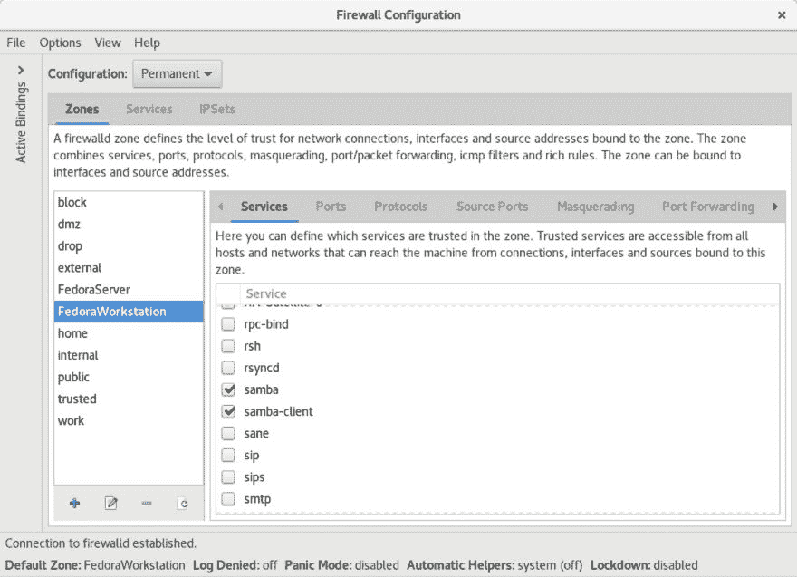

图 12-1：在防火墙上允许 Samba

Samba 服务器由两个守护进程组成：`smb` 和 `nmb`。你可能需要先使用管理员权限 (`sudo`) 通过 `systemctl` 命令启用并启动这些守护进程。打开终端窗口（系统工具 | 终端），为 `smb` 和 `nmb` 服务器输入 sudo `systemctl` 命令并配合 `enable` 命令来启用服务器，然后使用 `systemctl` 命令配合 `start` 命令启动它。一旦启用，每当系统启动时，服务器都应该自动启动。Samba 由 `systemd` 管理（见第 3 章）。

```bash
sudo systemctl nmb enable
sudo systemctl smb enable
sudo systemctl nmb start
sudo systemctl smb start
```

此外，确保 SELinux 允许 Samba 访问（`system-config-selinux`）。打开 SELinux 管理工具，在布尔值（Boolean）选项卡上启用 Samba 访问（参见图 12-2）。有几个 Samba 项。要共享文件夹、Windows 文件夹和 NFS 文件夹，你需要勾选以下项：

- 允许 samba 共享任何文件/目录的读/写
- 允许 samba 导出 ntfs/fusefs 卷
- 允许 samba 导出 NFS 卷

如果你收到安全警报，可以使用 `chcon` 和 `semanage` 命令手动更改 Samba 的 SELinux 文件上下文。输入的命令将列在安全警报“显示完整错误输出”滚动窗口的“修复命令”部分。Samba 共享目录的 SELinux 文件上下文被设置为 `samba_share_t`。`semanage` 命令会在重新标记标签时保留此更改。在下面的示例中，设置了 `/mymedia` 共享的 SELinux 文件上下文。

```bash
chcon -R -t samba_share_t '/mymedia'
semanage fcontext -a -t samba_share_t '/mymedia'
```

Samba 有两种身份验证方法：共享和用户。用户身份验证要求在 Windows 和 Linux 系统中有相应的账户。它们的名称可以相同，尽管 Windows 用户可以映射到 Linux 账户。共享可以对任何用户开放，并作为用户存储空间的扩展。推荐使用用户方法。

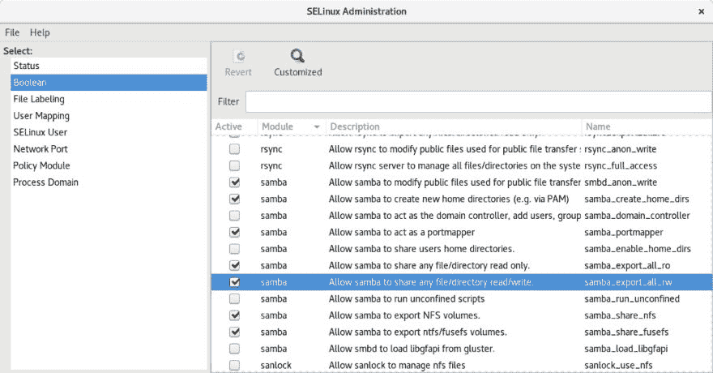

图 12-2：在 SELinux 上允许 Samba：system-config-selinux

为了在 Linux 系统上设置简单的文件共享，你首先需要配置 Samba 服务器。你可以通过直接编辑 `/etc/samba/samba.conf` 文件来实现。你首先需要指定你的 Windows 网络名称。

Samba 由 `systemd` 使用 `/etc/systemd/system` 中的 `smb.service` 和 `nmb.service` 文件管理。这里显示了 `smb.service` 文件。Samba 在系统日志、网络、`nmbd` 和 Winbind 服务之后（After）启动。它是为多用户目标（运行级别 2, 3, 4 和 5）启动的（WantedBy）。运行时配置从 `/etc/sysconfig/samba` 文件中读取（EnvironmentFile）。

```ini
smb.service
[Unit]
Description=Samba SMB Daemon
Documentation=man:smbd(8) man:samba(7) man:smb.conf(5)
After=network.target nmbd.service winbind.service
[Service]
Type=notify
NotifyAccess=all
PIDFile=/run/smbd.pid
LimitNOFILE=16384
EnvironmentFile=-/etc/sysconfig/samba
ExecStart=/usr/sbin/smbd --foreground --no-process-group $SMBDOPTIONS
ExecReload=/bin/kill -HUP $MAINPID
LimitCORE=infinity
Environment=KRB5CCNAME=/run/samba/krb5cc_samba
[Install]
WantedBy=multi-user.target
```

NMB 守护进程在系统日志和网络之后（After）启动。它还从 `/etc/sysconfig/samba` 读取运行时配置（EnvironmentFile）。它为多用户目标（WantedBy）启动 `nmbd` 服务器（ExecStart）。

```ini
nmb.service
[Unit]
Description=Samba NMB Daemon
Documentation=man:nmbd(8) man:samba(7) man:smb.conf(5)
Wants=network-online.target
After=network.target network-online.target
[Service]
Type=notify
NotifyAccess=all
PIDFile=/run/nmbd.pid
EnvironmentFile=-/etc/sysconfig/samba
ExecStart=/usr/sbin/nmbd --foreground --no-process-group $NMBDOPTIONS
ExecReload=/bin/kill -HUP $MAINPID
LimitCORE=infinity
Environment=KRB5CCNAME=/run/samba/krb5cc_samba
[Install]
WantedBy=multi-user.target
```

## 从 Windows 配置 Samba 访问

要为 Windows 客户端设置连接，你需要指定 Windows 工作组名称并配置密码。工作组名称是 Windows 上显示的网络名称。默认可能是 WORKGROUP 或 MSHOME。你可以设置自己的工作组名称，但你所有的电脑都必须配置为使用该名称。

在你的 Fedora Samba 服务器上，你通过手动在 `smb.conf` 文件中输入来指定网络名称，在 `global` 部分的 `workgroup=` 项指定工作组名称。工作组名称应该是大写且不包含空格。Windows 系统使用的默认名称是简单的 WORKGROUP。`smb.conf` 中的 `workgroup` 项所示：

```ini
workgroup = WORKGROUP
```

### 从 Windows 访问 Samba 共享

在 Windows 客户端上，当你打开任何 Windows 文件管理器窗口的网络窗口时，你会看到出 Samba 服务器。Samba 服务器的名称将你在 Samba 配置中提供的描述。要访问共享，用户将被要求输入用户名和 Samba 密码。你可以选择记住用户名和密码以实现自动访问。


你可能还需要确保你的 Windows 系统已启用 TCP/IP 网络。如果你的 Windows 客户端已经连接到微软网络，那么这可能已经开启了。如果你需要将 Windows 系统直接连接到运行 Linux Samba 服务器的 TCP/IP 网络，你应该检查该 Windows 系统是否启用了 TCP/IP 网络。这涉及确保已安装微软网络客户端和 TCP/IP 协议，并将你的网络适配器（`NIC adapter`）配置为使用 TCP/IP。

从 Windows 访问 Samba 共享是 Windows 10 的一个问题。Windows 10 的升级禁用了 Windows 的 SMBv1 网络浏览功能，因为它正在从 SMBv1 迁移到 SMBv3。你可以尝试重新启用 SMBv1 浏览，但由于安全问题，SMBv1 已被禁用。不建议重新启用它。这意味着目前无法简单地浏览 Linux 主机，但仍然可以轻松地设置访问该 Linux 主机上的每个 Samba 共享文件夹。

从 Windows 10 访问 Samba Linux 共享仍然很容易。你只需为它添加一个新的网络位置，就可以通过在 Windows 文件管理器“此电脑”文件夹中设置的快捷方式来访问它。要设置快捷方式，打开 Windows 文件管理器到任何文件夹，右键点击侧边栏中的“此电脑”项以显示菜单。点击“添加网络位置”项打开“添加网络位置向导”并点击“下一步”。点击“选择自定义网络位置”并点击“下一步”。在标记为“Internet 或网络地址:”的文本框中输入包含你想访问共享的 Linux 系统的主机名，开头使用两个反斜杠（你可能还需要输入该系统上某个共享文件夹的名称）。

`\\richard-laptop\`

然后你可以点击“浏览”按钮打开一个对话框，显示该主机上所有共享文件夹的树状。你可以选择一个共享，或者共享的任何子文件夹。它们的文件路径会自动添加到地址文本框中。或者，你也可以直接在文本框中输入文件夹路径，子文件夹之间用单反斜杠分隔。如果你正在共享 Linux 家目录，那么共享文件夹就是用户主目录的名字，即用户名。此处显示了示例。

`\\richard-laptop\richard`

`\\richard-laptop\richard\Pictures`

`\\richard-laptop\mydocs`

一旦在 Windows 中设置好共享文件夹的位置，你就可以通过“此电脑”文件夹中的快捷方式再次快速访问它们。

## 用户级安全

Samba 主要提供用户级安全，要求远程系统上的用户使用 Samba 注册的密码登录。Samba 仍然提供共享和服务器级访问，但这些方法已经过时且不建议使用。用户级安全要求使用 Windows 加密密码。Windows 使用它自己的加密方法。为了让 Samba 处理此类密码，它必须维护自己的与 Windows 兼容的密码数据库。它不能使用 Linux 密码数据库。Windows 还会在登录过程中使用额外信息，例如用户登录的位置。

用户级安全要求每个想要从 Windows 系统登录 Samba 共享的用户必须在 Samba 服务器上有一个相应的用户帐户。此外，该账户必须设有一个单独的 Samba 密码以登录 Samba 共享。实际上，他们成为了 Samba 用户。

Samba 服务器上的账户名称不需要与 Windows 系统上的名称相同。可以为 Samba 用户指定一个 Windows 用户名。这种 Windows 用户到 Samba (Linux) 用户的映射列在 `/etc/smbusers` 文件中。以下内容将 Windows 用户 `rpetersen` 映射到 Samba (Linux) 用户 `richard`。

```
richard = rpetersen
```

当 Windows 中的 Windows 用户尝试访问 Samba 共享时，用户将被提示登录。随后 Windows 用户将输入 `rpetersen` 作为用户名，以及为 `richard` 设置的 Samba 密码。

用户级安全由密码后端数据库管理。默认情况下使用 `tdbsam` 后端数据库。这是一个 tdb 数据库文件（易用数据库），存储了 Samba 密码以及 Windows 扩展信息。`tdbsam` 数据库为小规模网络设计。对于使用 LDAP 管理用户的系统，你可以使用启用 LDAP 的后端 `ldbsam`。`ldbsam` 数据库是为更大的网络设计的。以前使用的 `smbpasswd` 文件仍然可用，但仅为了向后兼容而包含。以下是 `smb.conf` 文件中用于用户访问的默认配置项。

```
security = user
passdb backend = tdbsam
```

`username map` 选项指定用于关联 Windows 和 Linux 用户的文件。Windows 用户可以使用 Windows 用户名作为关联用户登录。用户名映射文件通常为 `/etc/samba/smbusers`。

```
username map = /etc/samba/smbusers
```

请确保在 `smb.conf` 文件中启用 PAM：

```
obey pam restrictions = yes
```

如果你使用启用 LDAP 的 Samba 数据库 `ldbsam`，将使用特殊的 LDAP Samba 工具来管理用户。这些工具由 `smbldap-tools` 包提供。它们以 `smbldap` 为前。提供了添加、修改和删除用户及组的工具，如 `smbldap-useradd`、`smbldap-userdelete` 和 `smbldap-groupmod`。你使用 `smbldap-passwd` 命令通过 LDAP 管理 Samba 密码。`smdbldap-userinfo` 获取用户信息。你通过 `/etc/smbldap-tools/smbldap.conf` 文件配置你的 LDAP Samba 工具支持。

Samba 还提供了自己的用于域登录的 Samba 认证 PAM 模块 `pam_smb_auth.so`（位于 `pam_smb` 包）。配置在 `/etc/pam_smb.conf` 文件中设置，在其中指定你的域和登录服务器。

### smbpasswd

在用户级安全模式下，Windows 客户端访问 Samba 服务器资源仅允许该客户端上的用户。访问 Samba 服务器时所使用的用户名和 Samba 密码必须在 Samba 密码数据库中注册。

要管理用户，你可以使用 `smbpasswd` 命令或 `pdbedit` 工具。`smbpasswd` 命令适用于旧的 `smbpasswd` 文件和后端数据库（如 `tdbsam`）。`pdbedit` 命令仅作用于后端数据库。

或者，你可以在终端窗口中使用 `smbpasswd` 命令来添加或之后更改密码。带有 `-a` 选项的 `smbpasswd` 命令添加用户，带有 `-x` 选项将删除一个。启用或禁用用户可以使用 `-e` 和 `-d` 选项。

```
smbpasswd -a aleina
```

用户可以使用 `smbpasswd` 修改自己的密码。下面的示例显示了如何使用 `smbpasswd` 修改你的 Samba 密码。如果用户没有 Samba 密码，用户只需按回车键。

```
smbpasswd
Old SMB password: old-password
New SMB Password: new-password
Repeat New SMB Password: new-password
```

如果你不想使用密码，可以使用带有 `-n` 选项的 `smbpasswd`。`smb.conf` 文件必须将 `null passwords` 选项设置为 `yes`。注意：如果你正在使用旧的 `smbwords` 文件，请确保 Samba 配置为使用加密密码。将 `encrypt passwords` 选项设置为 `yes` 并指定 SMB 密码文件。

### pdbedit

`pdbedit` 是一个命令行工具，具有添加和删除用户的选项，以及更改密码和设置主目录等功能。你还可以将用户条目导入或导出到其他后端数据库。它仅作用于 `tdbsam` 等后端数据库文件，而不作用于旧的 `smbpasswd` 文件。

要添加用户使用 `-a` 选项，要删除用户使用 `-x` 选项。

```
pdbedit -a larisa
```

`pdbedit` 命令允许你显示有关用户的更多信息。要显示后端数据库中的用户可以使用 `-L` 选项。添加 `-v` 选项获取详细信息。对于特定用户，直接添加用户名即可。


```bash
pdbedit -Lv richard
```

对于最小密码长度或重试等域策略，你使用 `-P` 选项。

```bash
pdbedit -P
```

你使用 `-i` 和 `-e` 选项导入导出数据库条目。以下将将条目从旧的 `smbpasswd` 文件导入新的 `tdbsam` 后端数据库。

```bash
pdbedit -i smbpasswd -e tdbsam
```

如果你的系统使用了启用了 LDAP 的 Samba 数据库，请使用 `smbldap` 工具来管理用户和组。

## Samba smb.conf 配置文件

Samba 配置存储位于 `/etc/samba` 目录下的 `smb.conf` 文件中。你可以直接编辑该文件，创建自己的 Samba 配置。如果你的 Samba 配置证明非常复杂，你可能需要这样做。直接编辑还可以对你的共享提供更精细的控制。`smb.conf.example` 文件是带有标准默认设置以及详细注释的 `smb.conf` 副本。

你使用 `testparm` 命令来检查对 `/etc/samba/smb.conf` 文件所做的任何更改的语法。在终端窗口中运行以下命令。

```bash
testparm
```

该文件分为两个基本部分：一个用于全局选项，另一个用于共享服务。共享服务（也称为 shares，共享）可以是文件空间服务（客户端将其作为原生文件系统的扩展使用），可以是打印服务（客户端通过其访问运行服务器的主机上的打印服务）。文件空间服务是一个允许客户端访问的目录；它们可以使用其中的空间作为其本地文件系统的扩展。打印服务为客户端提供打印服务的访问，例如由 Samba 服务器管理的打印机。

`/etc/samba/smb.conf` 文件保存了各种共享资源的配置，以及适用于所有资源的全局选项。Linux 会在你的 `/etc/samba` 目录中安装了一个 `smb.conf` 文件。该文件包含了用于你所用分发版的默认设置。你可以编辑该文件以根据自己的需求自定义配置。许多条目使用分号或 `#` 符号进行了注释，你可以删除开头的注释符号以使其生效。要查看 Samba 配置参数的完整列表，请检查 `smb.conf` 的 Man 页。

在 `smb.conf` 文件中，首先设置全局选项，然后是每个共享资源的配置。`smb.conf` 文件的基本组织组件被称为“节”（section）。每个资源都有自己的节，其中包含它的服务名称和属性定义。即使是全局选项也放在它们自己的节中，标记为 `global`。例如，每个共享目录的节由该目录和允许目录用户的访问权限组成。每个共享的节以共享资源的名称标记。名为 `printers` 和 `homes` 的特殊节为 Samba 服务器上访问的用户目录和打印机提供了默认描述。在特殊节之后，会进入特定服务的节，即对特定目录或打印机的访问。

一个节以括括括的共享资源名称作为节标签开始。除了特殊节外，节标签可以是你想要给它的任何名称。在节标签之后，在单独的行上，会输入此服务的不同参数。这些参数定义了授予服务使用者的访问权限。例如，对于一个目录，你可能希望它是可浏览的但只读的，并且使用特定的打印机。参数以 `parameter name = value` 的格式输入。你可以通过在注释行的开头放置分号来输入注释。

下面是一个简单的节配置示例。节标签被括在括号中，后面跟着两个参数条目。`path` 参数指定允许访问的目录。`writeable` 参数指定用户是否有写入该目录的权限。

```ini
[mysection]
path = /home/chris
writeable = true
```

打印服务具有相同的格式，但需要某些其他参数。`path` 参数指定打印机缓存目录的位置。`read-only` 和 `printable` 参数设置为 `true`，表示该服务是只读且可打印的。`guest ok` 选项表示任何人都可以访问。

```ini
[myprinter]
path = /var/spool/samba
read only = yes
printable = yes
guest ok = yes
```

参数条目通常是同义或具有相同含义的不同条目。例如，`read only = no`、`writeable = yes` 和 `write ok = yes` 都意味着相同的内容，为用户提供写入权限。

提示：`writeable` 选项是 `read only` 选项的反向别名。`writeable = yes` 条目与 `read only = no` 条目相同。

### 全局节 (Global Section)

全局节决定了整个服务器的配置，并指定了用于主目录和目录节的默认条目。在此节中，你会找到工作组名称、密码配置和目录设置的条目。全局节以 `[global]` 标签开始。

```ini
[global]
```

这里讨论了几个较重要的条目。全局节组织成几个段，每个段都有带注释的标题，例如网络相关选项（Network Related Options）。它们都是 `[global]` 节的一部分。

Samba 支持 Windows 使用的 SMB2 协议。通过将 `max protocol` 选项设置为 SMB2 来启用它。

```ini
max protocol = SMB2
```

#### 网络相关选项 (Network related options)

网络相关选项以描述每个选项的注释节开始，随后是选项条目。注释以开头的 `#` 为标记，而实际选项以开头的 `;` 为注释标记。

```ini
# ----------------------- Network Related Options -------------------------
#
# workgroup = NT-Domain-Name or Workgroup-Name, eg: MIDEARTH
#
# server string 等同于 NT Description 字段
#
# netbios name 可以用于指定不绑定主机的服务器名称
#
# Interfaces 允许配置 Samba 使用多个接口
# 如果你有多个网络接口，则可以列出你
# 想要监听的接口（永远不要省略 localhost）
# interface (lo).
#
# hosts allow = 允许连接的主机。此选项也可以按共享
# 为的基础上使用。
# hosts deny = 不允许连接的主机。此选项也可以按共享
# 为的基础上使用。
#
# max protocol = 用于定义支持的协议。默认是 NT1。
# 如果你想获得实验性的 SMB2 支持，可以设置为 SMB2。

    workgroup = MYGROUP
    server string = Samba Server Version %v
;    netbios name = MYSERVER
;    interfaces = lo eth0 192.168.12.2/24 192.168.13.2/24
;    hosts allow = 127\. 192.168.12. 192.168.13.
```

Workgroup 条目指定了你想给网络的工作组名称。这是在 Windows 客户端网络窗口中显示的工作组名称。`smb.conf` 文件中的默认 Workgroup 条目所示：

```ini
# workgroup = NT-Domain-Name or Workgroup-Name
workgroup = WORKGROUP
```

Samba 服务器支持的每个 Windows 客户端的工作组名称必须相同。在 Windows 客户端上，工作组名称通常位于控制面板窗口中的“系统”工具中。在许多客户端上，默认认为 WORKGROUP。如果你想更改此名称，必须相应地更改 `smb.conf` 文件中的 Workgroup 条目。Workgroup 条目与每个 Windows 客户端上的工作组名称必须一致。在示例中，工作组名称为 mygroup。

```ini
workgroup = mygroup
```

这里显示的 `server string` 条目包含了你想在客户端系统上显示的服务器的描述性名称。在 Windows 系统上，这是在 Samba 服务器图标上显示的名称。

```ini
# server string 等同于 NT Description 字段
    server string = Samba Server Version %v
```


默认是 Samba Server，但你可以将其更改为任何名称。这里使用 `%h` 变量来显示服务器的主机名。

```
server string = %h server (Samba, Fedora)
```

作为一种安全措施，你可以将 `SMB` 服务的访问限制在某些指定的本地网络。对于 `hosts allow` 选项，输入你允许访问的本地网络的网络地址。若要拒绝网络中除少数特定主机以外的所有人的访问，可以在网络地址后使用 `EXCEPT` 选项加上这些主机的 IP 地址。`localhost (127)` 总是会自动包含。接下来的示例允许对两个本地网络的访问：

```
hosts allow = 127\. 192.168.1. 192.168.2.
```

要使用新的 `SMB2` 协议，你可以将 `max protocol` 设置为 `SMB2`。

注意：你还可以将 Samba 配置为 Windows NT 网络的主要域控制器 (PDC)。作为 PDC，Samba 会建立其他系统使用的 Windows 域，而不是参与已建立的工作组。

### 日志选项 (Logging Options)

此部分包含用于设置 Samba 服务器日志的指令。日志文件指令使用 `%m` 替换符号进行配置，以便为连接到服务器的每台机器设置单独的日志文件。日志由 `journald` 进程管理。

```
log file = /var/log/samba/log.%m
```

日志文件的最大大小设置为 1000 行。

```
max log size = 50
```

### 独立服务器选项 (Standalone Server Options)

`security`：Samba 运行的模式。可以设置为 `user`、`share`（已弃用）或 `server`（已弃用）。

`passdb backend`：用于存储用户信息的后端。新安装应使用 `tdbsam` 或 `ldapsam`。`tdbsam` 不需要额外的配置。提供了 `smbpasswd` 工具以实现向后兼容。

```
security = user
passdb backend = tdbsam
```

Samba 资源通常通过 `share` 或 `user` 级安全进行访问。在共享级别上，任何用户都可以访问资源而无需登录服务器。在用户级别上，每个用户都必须使用密码登录。Windows 客户端在登录过程中使用加密密码。密码默认是加密的，并由密码数据库管理。在以下条目中，安全性设置为用户级（`user` 选项），密码数据库文件（`passdb backend`）使用 `tdbsam`。

```
security = user
passdb backend = tdbsam
```

如果你想使用共享级安全，请指定 `share` 为安全选项。然而，该选项已弃用。用户级安全被认为是标准：

```
security = share
```

### 域成员选项 (Domain Members Options)

如果你的网络通过域服务器集中处理身份验证，那么你的 Samba 服务器需要成为域成员。域成员身份关系通常由 Active Directory 服务器（`ads` 选项）或特定的 PDC 服务器（`domain` 选项）处理。要为域成员配置 `smb.conf` 文件，需要将安全性选项设置为 `domain` 或 `ads`。如果你选择 `domain`，则将 `workgroup` 选项设置为域的。

```
security = domain
workgroup = mydomain
```

在 `smb.conf` 文件的域成员选项部分中，你可以设置域 (realm) 或密码服务器选项。如果安全性设置为 `ads`，你可以设置 `realm` 选项（Active Directory 域）。如果你将安全性设置为 `domain`，则使用密码服务器选项来指定你的网络使用的 Windows PDC 服务器。使用星号 (`*`) 代替 PDC 名称可以让 Samba 自动检测 PDC 服务器。

```
;realm = MY_REALM
;password server = <NT-Server-Name>
```

### 名称解析 (Name Resolution)

名称服务解析通常由 WINS 服务器（Windows NetBIOS 名称服务，`nmbd`）提供，它由 `samba` 系统 d 依赖项启动。如果你的本地网络已经有一个 WINS 服务器，你可以指定它。这里显示了注释掉的默认条目。将 `w.x.y.z` 替换为你网络的 WINS 服务器名称。

```
;wins server = w.x.y.z
```

你的 Samba `nmbd` 服务器对 WINS 的支持被注释掉以避免冲突，使你的 Samba 名称解析服务器仅变为客户端。这里显示了开启 WINS 支持的注释条目。

```
;wins support = yes
```

此部分详细介绍了对 Windows 内部名称服务 (WINS) 的支持。

注意：Samba 可以是 WINS 服务器也可以是 WINS 客户端，但不能两者兼备。

`wins support`：当设置为 `yes` 时，Samba 的 `NMBD` 组件启用其 WINS 服务器。

`wins server`：告诉 Samba 的 `NMBD` 组件作为 WINS 客户端。

`wins proxy`：当设置为 `yes` 时，Samba 代表不支持 WINS 的客户端回答名称解析查询。要使此工作，网络上至少有一个 WINS 服务器。默认为 `no`。

`dns proxy`：当设置为 `yes` 时，Samba 尝试通过 DNS `nslookups` 解析 NetBIOS 名称。

```
;wins support = yes
;wins server = w.x.y.z
;wins proxy = yes
;dns proxy = yes
```

如果你的网络也有自己的用于名称解析的 DNS 服务器，你可以启用它。默认情况下，它如所示被注释。移除注释符号以允许使用网络 DNS 服务器进行 Windows 名称解析。此外，必须关闭 WINS 服务器的支持。

```
;dns proxy = yes
```

还可以指示名称解析首先检查 `lmhosts` 和 `/etc/hosts` 文件。这里显示了注释掉的默认条目。

```
;name resolve order = lmhosts host wins bcast
```

### 打印选项 (Printing Options)

此部分中的选项允许你配置非默认打印系统。

`load printers`：当设置为 `yes` 时，会自动加载打印机列表，而不是逐个设置。

`cups options`：允许将选项传递给 `CUPS` 库。例如，将此选项设置为 `raw` 允许你在 Windows 客户端使用驱动程序。

`printcap name`：用于指定备用的 printcap 文件。

```
load printers = yes
cups options = raw
;printcap name = /etc/printcap
;printcap name = lpstat
printing = cups
```

要启用打印，将 `load printers` 选项设置为 `yes`。

```
load printers = yes
```

其他选项如 `printing` 允许你指定不同的打印服务器（`CUPS` 是默认）。

```
printing = cups
```

### 文件系统选项 (File System Options)

文件系统选项段列出了支持扩展属性和访客账户的文件系统的选项。通常可以阻止对某些类型文件的访问，例如归档文件、隐藏文件、只读文件和系统文件。可以启用扩展属性的访问。

```
;map archive = no
;map hidden = no
;map read only = no
;map system = no
;store dos attributes = yes
```

你可以使用访客用户登录让任何人都能访问资源而无需密码。访客用户登录将处理任何没有特定账户就登录的用户。在 Linux 系统上，Samba 默认将使用 `nobody` 用户作为访客用户。或者，你可以设置并指定一个特定用户作为访客用户。务必将访客用户添加到密码文件中。你通过 `smb.conf` 文件中的 `guest account` 条目指定访客用户。

```
guest account = nobody
```

### 用户主目录部分 (Homes Section)


`Homes` 部分指定了远程用户通过 `SMB` 协议访问用户主目录的默认控制选项。将 `browseable` 选项设置为 `no` 可以防止客户端在文件浏览器中列出文件。`writable` 选项指定用户是否对主目录下的文件具有读写控制权限。`create mask` 和 `directory mask` 选项设置了新文件和目录的最大默认权限。`valid users` 选项使用 `%S` 宏映射到当前服务。

```
[homes]
comment = Home Directories
browseable = no
writable = yes
valid users = %S
valid users = MYDOMAIN\%S
```

### printer 和 print$ 部分

`printers` 部分指定了访问打印机的默认控制选项。这些选项用于没有特定部分节的打印机。将 `browseable` 设置为 `no` 仅仅是向客户端隐藏 `Printers` 部分，而不会隐藏打印机。`path` 条目指定 Samba 用于打印文件的池化目录的路径。要启用打印功能，必须将 `printable` 条目设置为 `yes`。要允许访客用户打印，请将 `guest ok` 条目设置为 `yes`。这指定了服务器实际用于打印文档的命令。这里是 `Printers` 部分的标准实现示例：

```
[printers]
comment = All Printers
path = /var/spool/samba
browseable = no
guest ok = yes
writable = no
printable = yes
```

### 共享 (Shares)

特定共享资源（如系统上的目录）的部分通常放置在 `Homes` 和 `Printers` 部分之后。对于定义共享目录的部分，为系统输入一个标签。然后，在单独的行上输入其路径的选项以及你想要设置的不同权限。对于 `path` 选项，指定目录的完整路径。`comment` 选项包含赋予该共享的标签。你可以将目录设置为可写、公共或只读。对于未设置的选项，将使用在 `Global`、`Homes` 和 `Printers` 段中输入的默认值。需更多示例，请检查原始 `smb.conf` 文件中的示例。以下示例是 `myprojects` 共享。在这里，`/myprojects` 目录定义为向任何具有访客访问权限开放的共享资源。

```
[myprojects]
comment = Great Project Ideas
path = /myprojects
read only = no
guest ok = yes
```

要允许完全公共访问，将 `guest ok` 选项设置为 `yes`，且不设置 `valid user` 条目（使用此项代替 `public` 选项）。

```
[newdocs]
comment = New Documents
path = /home/newdocs
guest ok = yes
read only = no
```

要限制对某些用户的访问，你可以使用 `valid users` 选项列出一组 `valid users`。将 `guest ok` 选项设置为 `no` 则关闭其他人的访问。`invalid users` 选项拒绝某些用户的访问。

```
[mynewmusic]
comment = New Music
path = /home/specialprojects
valid users = robert george larisa aleina
invalid users = richard mark
guest ok = no
read only = no
```

你可以使用 `read list` 和 `write list` 选项来控制对某些用户的读写访问。`read list` 选项允许对文件进行只读访问，而 `write list` 选项允许读写访问。在接的示例中，`robert` 和 `george` 具有只读权限，而 `larisa` 和 `aleina` 具有读写权限。通过在组名前面加上 `@` 符号可以指定组，例如 `@mygroup`。请记住，这些文件在 Linux 系统上仍必须启用写权限（`chmod`）。

```
[mynewpics]
comment = New Music
path = /home/specialprojects writable = yes
valid users = robert george larisa aleina
read list = robert george
write list = larisa aleina
```

要设置一个可以被多个用户共享的目录，且每个用户对其创建的文件具有控制权，只需在 `Valid Users` 条目中列出用户。任何创建文件的权限在高级模式下通过 `Create Mask` 条目指定（与 `create mask` 相同）。在此示例中，权限设置为 `765`，这为所有者提供了读/写/执行权限，为组成员提供了读写权限，并为所有其他人提供了读/执行权限（默认值为 `744`，组和其他权限为只读）：

```
[myshare]
comment = Writer’s projects
path = /usr/local/drafts
valid users = justin chris dylan
writable = yes
guest ok = no
read only = no
create mask = 0765
```

### 打印机 (Printers)

特定打印机的访问定义在 `smb.conf` 文件的 `Printers` 部分。对于打印机，你需要包含 `Printer` 和 `Printable` 条目，并指定使用的 `Printing` 服务器类型。通过 `Printer` 条目命名打印机，并通过将 `Printable` 条目设置为 `yes` 允许其打印。你可以通过 `valid users` 条目并将 `Public` 条目设置为 `no` 来控制特定用户的访问。对于公共访问，将 `public` 条目设置为 `yes`。对于 `CUPS` 服务器，将打印选项设置为 `cups`。

以下示例设置了一个允许访客用户访问的打印机。这允许网络上的任何用户使用该打印机。用户需要对打印机的池化目录（位于 `/var/spool/samba`）具有写权限。请记住，任何打印机必须首先安装在系统上。以下打印机已安装为 `myhp`。你使用 `CUPS` 管理工具为 `CUPS` 服务器设置打印机。`Printing` 选项可以从常规 `Printers` 共享继承。

```
[myhp]
path = /var/spool/samba
read only = no
guest ok = yes
printable = yes
printer = myhp
oplocks = no
share modes = no
printing = cups
```

与共享一样，你可以将打印机的使用限制为某些用户，拒绝公共访问。以下示例设置了一个仅允许 `larisa` 和 `aleina` 用户访问的打印机（如果你需要，可以添加其他用户）。用户需要对打印机的池化目录具有写权限。

```
[larisalaser]
path = /var/spool/samba
read only = no
valid users = larisa aleina
guest ok = no
printable = yes
printing = cups
printer = larisalaser
oplocks = no
share modes = no
```

### 变量替换 (Variable Substitutions)

对于分配给参数的字符串值，结合替换运算符。这为指定可能取决于上下文的值（如用户名）提供了更大的灵活性。例如，假设服务需要为每个登录的用户使用独立的目录。此类目录的路径可以使用 `%u` 变量指定，该变量替换为当前用户名。字符串 `path = /tmp/%u` 对于 `justin` 用户将变为 `path = /tmp/justin`，对于 `dylan` 用户将变为 `path = /tmp/dylan`。表 12-3 列出了几种常见的替换变量。

| 变量 | 描述 |
| :--- | :--- |
| %S | 当前服务的名称 |
| %P | 当前服务的根目录 |
| %u | 当前服务的用户名 |
| %H | 用户的主目录 |
| %h | 运行 Samba 的互联网主机名 |
| %m | 客户端的 NetBIOS 名称 |
| %L | 服务器的 NetBIOS 名称 |
| %M | 客户端机器的互联网名称 |
| %I | 客户端机器的 IP 地址 |

表 12-3: Samba 替换变量

## 测试 Samba 配置

在修改 `smb.conf` 文件后，你可以使用 `testparm` 程序检查条目是否正确。`testparm` 会检查 Samba 条目的语法和有效性。默认情况下，`testparm` 检查 `/etc/samba/smb.conf` 文件。如果你使用不同的文件作为配置文件，可以将其作为参数传递给 `testparm`。你还可以让 `testparm` 检查特定主机是否具有访问配置文件设置的服务的权限。

要检查 Samba 服务器的实时运行情况，你可以登录运行 Samba 服务器的 Linux 系统用户账户并连接到服务器。


Samba 也可以作为域控制器 (PDC) 运行。该域控制器将注册并在网络上作为域控制器进行广播。PDC 提供了一种更集化的方式来控制 Samba 共享。它提供了 `netlogon` 服务和 `NETLOGON` 共享。PDC 会为每个 Windows 和 Samba 客户端设置机器信任账户。虽然你可以手动执行，但 Samba 会自动为你完成。你可以在此处获取更多关于 Samba PDC 的信息：

https://us1.samba.org/samba/docs/man/Samba-HOWTO-Collection/samba-pdc.html

正如 Samba 文档所示，微软域安全的主要优势是单点登录 (`SSO`)。实际上，登录你的用户账户也意味着登录了对整个网络共享资源的访问。你不需要在每次尝试访问共享网络资源时单独进行身份验证，因为你已经通过了验证。身份验证使用安全标识 (`SID`) 管理，它由网络 ID (`NID`) 和相对 ID (`RID`) 组成。`RID` 引用你的个人账户。每个账户都会分配一个单独的 `RID`，即使是组或系统服务的账户也是如此。`SID` 用于设置网络上不同共享资源的访问控制列表 (`ACL`)，允许资源自动识别你的身份。

### 核心 Samba PDC 配置选项

要配置你的 PDC，请编辑 `smb.conf` 文件中的域控制选项（Domain Control Options）部分。在这里你会找到配置 Samba PDC 的条目。

核心 PDC 选项所示：

```
netbios name = mysystem
workgroup = myworkgroup
security = user
domain master = yes
domain logons = yes
```

### 基础配置

netbios name 是你想要给 PDC 服务器起的名字。

```
netbios name = MYSERVER
```

和大多数 Samba 配置一样，PDC 需要一个 Samba 后端。`tdbsam` 已经为你配置好了。安全级别应该是 `user`。这通常是默认值，并且应该已经设置。`smb.conf` 的条目所示：

```
security = user
passdb backend = tdbsam
```

### 域登录配置

Samba PDC 使用域登录服务，用户可以通过它登录网络。微软将该域登录服务称为 `netlogon` 服务。它使用的 Samba 共享也称为 `netlogon`。要配置域登录服务，你需要将 `domain logons` 条目设置为 `yes`。PDC 必须被指定为域主（domain master）。这些条目位于 `smb.conf` 文件的 `[global]` 部分的域控制器选项段中。条目前面带有分号 `;` 注释。删除分号可以取消注释，使其生效。这些条目已经设置为 `yes`。

```
domain master = yes
domain logons = yes
```

登录脚本可以由系统设置，也可以由用户设置。登录路径引用了用户使用的配置文件。

```bash
# 登录脚本名称取决于机器名称
logon script = %m.bat

# 登录脚本名称取决于使用的 unix 用户
logon script = %u.bat
logon path = \\%L\Profiles\%u
```

然后，你可以启用用户添加和删除操作，以便从 PDC 中添加或移除用户。`add machine` 条目允许 Samba 在 Windows 系统首次加入 PDC 控制的网络时，自动为其添加受信任的机器账户。

```bash
add user script = /usr/sbin/useradd "%u" -n -g users
add group script = /usr/sbin/groupadd "%g"
add machine script = /usr/sbin/useradd -n -c "Workstation (%u)" -M -d /nohome -s /bin/false "%u"
delete user script = /usr/sbin/userdel "%u"
delete user from group script = /usr/sbin/userdel "%u" "%g"
delete group script = /usr/sbin/groupdel "%g"
```

你还需要在 `smb.conf` 文件中设置 `netlogon` 共享。找到标记为 `[netlogon]` 的部分。该共享持有 `netlogon` 脚本，在此情况下为 `/var/lib/samba/netlogon` 目录，它不应该是可写的，但应该允许所有用户访问 (`Guest OK`)。在 `smb.conf` 文件的共享定义部分你会发现被注释的 `[netlogon]` 部分。如所示，移除分号注释。

```ini
# 取消以下注释并为域登录创建 netlogon 目录
[netlogon]
comment = Network Logon Service
path = /var/lib/samba/netlogon
guest ok = yes
writable = no
share modes = no
```

如果你在使用配置文件（profiles），你应该添加漫游配置文件共享（`[Profiles]` 标签）。在 netlogon 共享之后添加以下内容以提供特定的漫游配置文件共享。配置文件共享是存储用户登录配置文件的位置。

```ini
# 默认使用用户家主目录
[Profiles]
path = /var/lib/samba/profiles
browseable = no
guest ok = yes
```

### 主浏览器配置

PDC 具有浏览器功能，通过该功能它可以定位网络上的系统和共享。浏览器功能在 `smb.conf` 的浏览器控制选项（Browser Control Options）部分设置。只有在你已经有另一个想要作为本地主运行的 PDC 时才使用本地主（local master）选项。通常情况下你会让该条目保持注释，如所示。你的网络中可能运行多个域控制器。你的微软网络将进行选举来决定哪一个应该是主。操作系统级别设置了此 PDC 的优先级。它应该高于 32，以获得相对于网络上其他域控制器的优先级，确保此 PDC 被选为主主域控制器。

```ini
; local master = no
; os level = 33
; preferred master = yes
```

### 使用客户端访问 Samba 服务

连接到 SMB 网络的客户端系统可以访问 Samba 服务器提供的共享服务。Windows 客户端应该能够在 Windows 桌面上自动访问共享目录和服务。对于连接到同一网的 Linux 系统，可以使用 GNOME 文件管理器或 KDE 文件管理器以及特殊的 Samba 客户端程序来访问 Samba 服务。

通过命令行客户端 Samba `smbclient`，本地 Linux 系统可以连接到 Samba 服务器上的共享目录并传输文件，还可以运行 shell 程序（安装 `samba-clients` 软件包）。使用带有 `-t cifs` 选项的 `mount` 命令，可以将 Samba 服务器上的目录挂载到 Linux 客户端的本地目录上。`cifs` 选项调用 `mount.cifs` 来挂载目录。

### 从 GNOME 访问 Windows Samba 共享

你可以使用 Nautilus（GNOME 文件管理器）访问你的 Samba 共享。在 GNOME 文件管理器中选择“网络”（Network）打开网络窗口，该窗口会显示你的网络图标。Windows 网络图标将包含你的 Windows 主机所属的 Windows 工作组。打开 Windows 网络图标将列出你的 Windows 网络组，如 `WORKGROUP`。打开 Windows 组图标将列出该组中的主机。这些将显示你共享的 Windows 主机图标。点击主机图标将列出该主机上的所有共享资源。

或者，你可以在文件管理器窗口中打开位置条目（转到 | 位置）并输入 `smb:` 协议来显示所有 Samba 和 Windows 网络，从中你可以访问 Samba 和 Windows 共享。

### smbclient


`smbclient` 工具的操作方式类似于 FTP，用于通过 `SMB` 协议访问系统。在使用 FTP 客户端时，你可以访问其他 FTP 服务器或 Unix 系统；而使用 `smbclient` 时，你可以访问位于 Samba 服务器或 Windows 系统上的 SMB 共享服务。许多 `smbclient` 命令与 FTP 相似，例如用于传输文件的 `mget` 或用于删除文件的 `del` 命令。`smbclient` 程序有多个选项用于查询远程系统以及连接到该系统。请参阅 `smbclient` 手页以获取完整的选项和命令列表。`smbclient` 程序将服务器名称和你想在该服务器上访问的服务作为参数。服务器名称前有一个双斜杠，一个单斜杠将其与服务隔开。该服务可以是任何共享资源，例如目录或打印机。服务器名称是其 NetBIOS 名称，该名称可能与其 IP 名称相同，也可能不同。例如，若要指定名为 `turtle.mytrek.com` 的服务器上的 `myreports` 共享目录，请使用 `//turtle.mytrek.com/myreports`。

```
//server-name/service
```

你还可以提供访问该服务的密码。将其作为在服务名称后的参数输入。如果你不提供密码，系统会提示你输入。

然后，你可以添加多个选项来访问共享，例如远程用户名或可用服务列表。通过 `-I` 选项，你可以使用其 IP 地址指定系统。使用 `-U` 选项和登录名作为你想在远程系统上使用的远程登录名。如果需要密码，请在密码后附上 `%`。使用 `-L` 选项，你可以获取服务器上提供的服务列表，例如共享目录或打印机。以下命令将列出主机 `turtle.mytrek.com` 上可用的共享：

```
smbclient -L turtle.mytrek.com
```

要访问远程系统上的特定目录，请将目录作为 `smbclient` 命令的参数输入，后跟任何选项。对于 Windows 文件，你使用反斜杠作为路径；对于 Unix/Linux 文件，你使用正斜杠。一旦连接，将显示 SMB 提示符，你可以使用 `smbclient` 命令（如 `get` 和 `put`）传输文件。`quit` 或 `exit` 命令会退出 `smbclient` 程序。在以下示例中，`smbclient` 使用 `dylan` 登录名访问 `turtle.mytrek.com` 系统上的 `myreports` 目录：

```
smbclient //turtle.mytrek.com/myreports -I 192.168.0.1 -U dylan
```

在大多数情况下，你可以直接使用服务器名称来引用服务器，如下所示：

```
smbclient //turtle.mytrek.com/myreports -U dylan
```

如果你正在访问 Samba 服务器上特定账户的主目录，可以只需指定 `homes` 服务。在下一个示例中，用户在提示输入该账户密码后，访问了 Samba 服务器上 `aleina` 账户的主目录：

```
smbclient //turtle.mytrek.com/homes -U aleina
```

你还可以使用 `smbclient` 访问位于 Windows 客户端上的共享资源。指定 Windows 客户端的计算机名称及其共享文件夹。在下一个示例中，用户访问了名为 `lizard` 的 Windows 客户端上的 `windata` 文件夹。该文件夹配置允许任何人访问，因此用户只需在密码提示符处按回车键：

```
smbclient //lizard/windata
```

一旦登录，你可以执行 `smbclient` 命令来管理文件和更改目录。可以使用 `!` 运算符执行 Shell 命令。要传输文件，你可以使用 `mget` 和 `mput` 命令，就像在 FTP 程序中使用它们那样的。

### mount.cifs: mount -t cifs

使用带有 `-t cifs` 选项的 `mount` 命令，Linux 客户端可以将共享目录挂载到其本地系统。`cifs` 选项调用 `mount.cifs` 命令来执行挂载操作。`mount.cifs` 命令的语法与 `smbclient` 命令相似，具有许多相应的选项。`mount.cifs` 命令将 Samba 服务器和共享目录作为参数，随后是你想挂载该目录的本地目录。

与其显式地使用 `mount.cifs`，不如使用文件系统类型为 `cifs` 的 `mount` 命令。这将 `/sbin/mount.cifs` 命令，该命令将调用 `smbclient` 来挂载文件系统：

```
mount -t cifs //turtle.mytrek.com/myreports /mnt/myreps -U dylan
```

要卸载该目录，请使用本地目录名运行 `cifs.umount` 命令，如下所示：

```
cifs.umount /mnt/myreps
```

要挂载服务器上特定用户的主目录，请指定 `homes` 服务和用户的登录名。以下示例将用户 `larisa` 的主目录挂载到本地系统的 `/home/chris/larisastuff` 目录：

```
mount -t samba //turtle.mytrek.com/homes /home/chris/larisastuff -U larisa
```

你也可以挂载 Windows 客户端上的共享文件夹。只需指定 Windows 客户端的计算机名称及其文件夹。如果文件夹名称包含空格，请将其括在单引号中。在以下示例中，用户挂载了名为 `lizard` 的 Windows 客户端上的 `windata` 目录。对于允许任何人访问的文件夹，只需在提示符处输入：

```
$ /mylinux
```

当你完成对文件夹的操作后，使用 `cifs.umount` 命令卸载共享文件夹：

```
cifs.umount /mylinux
```

如果需要访问，可以指定用户名和密码：

```
mount -t cifs -o username=chris,password //windata
```

你还可以在 `/etc/fstab` 的 `cifs` 类型来自动挂载 Samba 文件系统：

```
//lizard/windata cifs defaults 0 0
```

# 13. 分布式文件系统

对于大型 Linux 集群，Linux 还支持分布式文件系统，例如 Oracle 集群文件系统 (OCFS2)、Lustre、Gluster 平台 (GlusterFS) 以及 Red Hat 全局文件系统 (GFS 和 GFS2)。这些系统基于 `NFS` 的基本概念以及 `RAID` 技术，在跨越多个主机的情况下创建一个文件系统，实际上是在网络范围内实现的。你可以将其视为一种横跨网络而非单一系统的 `RAID` 阵列。每个主机不再依赖自己的文件系统，而是共享分布在不同服务器上的同一个文件系统。这为主机提供了更高效的存储利用，同时也为文件系统提供了更集中的管理。

| 网站 | 名称 |
| :--- | :--- |
| [`fedoraproject.org/wiki/Features/Cluster`](https://fedoraproject.org/wiki/Features/Cluster) | Fedora 集群状态和链接 |
| [`corosync.github.io/corosync/`](https://corosync.github.io/corosync/) | Corosync 集群引擎 |
| [`wiki.clusterlabs.org/wiki/Pacemaker`](https://wiki.clusterlabs.org/wiki/Pacemaker) | Pacemaker 集群服务和 PCS 文档 |
| [`oss.oracle.com/projects/ocfs2/`](https://oss.oracle.com/projects/ocfs2/) | OCFS2, Oracle 集群文件系统 |
| [`www.gluster.org`](https://www.gluster.org) | Gluster 存储平台 |
| [`wiki.lustre.org`](https://wiki.lustre.org) | Lustre 集群文件系统 |

表 13-1: 分布式文件系统


分布式网络文件系统基于 NFS 的基本概念以及 RAID 技术，创建了一个在跨越大型网络的多个主机上实现的文件系统，实际上是在非常低的层面上将同一个文件系统分发到不同的主机之间。你可以将其想象为一种跨网络主机的实现的 RAID 阵列，而不仅仅是单一系统。也就是说，每个主机不再依赖其自身硬盘上的文件系统，而是共同共享一个使用从不同分布式服务器上收集的硬盘的分布式文件系统。这极大地提高了主机可用存储的利用效率，并提供了更中心化的文件系统使用管理。GFS 可以直接连接到 SAN（存储区域网络）运行，也可以使用通过局域网（LAN）连接的 GNBD（全局网络块设备）存储。SAN 连接获得最佳性能，而 GNBD 格式可以利用连接局域网（以太网）的系统上的存储轻松实现。与 RAID 设备一样，镜像、故障转移和冗余可以帮助保护和恢复数据。

Red Hat 全局文件系统 (GFS2) 是 Fedora 首选的分布式文件系统。GFS 将物理实现与逻辑格式分离。GFS 表现为一个无缝逻辑设备上的 set 逻辑卷集，可以轻松挂载到你 Linux 文件系统的任何目录上。逻辑卷由集群逻辑卷管理器 (CLVM) 创建和管理，CLVM 是一个支持集群的 LVM。物理上，文件系统由分布在你的网络中的不同存储资源（称为集群节点）构建。管理员管理这些节点，提供必要的镜像或存储扩展。如果节点发生故障，GFS 可以将该系统隔离（fence），直到恢复了该节点为止。设置 GFS 需要进行规划。你必须提前确定不同的设置，例如全局文件系统的数量和名称、能够挂载文件系统的节点、隔离方法以及要使用的分区和磁盘。

Red Hat 全局文件系统 (GFS2)、Gluster 存储平台 (GlusterFS) 和 Oracle Linux 集群文件系统 (OCFS2) 均可在 Fedora 仓库获取。GlusterFS 是开源且免费提供的，尽管可以购买商业化支持。在 Fedora 上，它通过 `glusterfs-server`、`glusterfs-common` 和 `glusterfs-client` 包进行安装。更多信息请访问 GlusterFS 网站 [`www.gluster.org`](https://www.gluster.org)，商业支持可以在 [`www.gluster.com`](https://www.gluster.com) 获取。配置位于 `/etc/glusterfs`。详细示例位于 `/usr/share/doc/glusterfs-server` 目录。

OCFS2 集群文件系统由 Oracle 作为开源软件提供。你可以通过 `ocfs2-tools` 和 `ocfs2-tools-cman` 包进行安装。`ocfs2console` 包安装了一个图形化管理界面，你可以在终端窗口中使用 `ocfs2console` 命令运行它。你可以使用它来配置、挂载、格式化和检查你的 OCFS2 文件系统。你可以在 [`oss.oracle.com/projects/ocfs2/`](https://oss.oracle.com/projects/ocfs2/) 更多关于 OCFS2 的信息。

注意：OrangeFS 是并行虚拟文件系统 (PVFS) 的当前实现，它使用管理服务器管理不同 I/O 服务器上的文件来实现分布式网络文件系统。管理服务器维护文件系统信息，包括访问权限、目录结构和元数据信息 [`www.orangefs.org`](https://www.orangefs.org)。你可以通过 `orangefs` 包进行安装。

## Corosync 集群引擎

Corosync 集群引擎是用于集群服务的“用户态内核”。它提供了集群环境中使用的通信、成员关系和其他服务的基础，[www.corosync.org](http://www.corosync.org)。这是一个开源的 Linux 项目。Fedora 在 `corosync` 和 `corosynclib` 包提供了符合 Fedora 标准的二进制文件。Corosync 包包含 `corosync`、`corosync-cfgtool`（配置工具）和 `corosync-keygen`。Corosync 由 `systemd` 使用 `corosync.service` 单元文件管理，该文件通过位于 `/usr/share/corosync` 的 `corosync` 脚本为多用户目标（target）启动 Corosync 服务。你可以使用 `systemctl` 命令启动和停止 corosync。

它将核心基础架构与集群服务分离。Corosync 源自 OpenAIS 项目，提供了底层集群基础架构而非 API。

你可以在此处找到更多关于 Corosync 的信息：[`corosync.github.io/corosync/`](https://corosync.github.io/corosync/)

Corosync 是具有模块化设计的插件集群引擎。模块（称为服务引擎）被插入 Corosync 引擎中，以利用 Corosync 集群服务。Corosync 组件包括基于 OpenAIS 虚拟同步通信模型的 Totem 通信协议、活动组件替换 (LCR)插件系统、用于服务引擎及其配置的对象数据库、日志系统以及进程间通信 (IPC) 管理器。服务引擎模块包括 LDAP 配置和 `corosync/openeais` 文件格式、作为 corosync 部分运行的集群管理器 (`pacemaker`)，以及两种隔离代理（fence and fence agents）。

Corosync 通过 `/etc/corosync.conf` 配置文件进行配置。目前有四个指令形成了块状结构，可以在其中指定选项。这些与 OpenAIS 使用的相同。这四个指令分别是用于 Totem 协议的 `totem`、`logging`、用于 AMF 服务的 `amf` 以及用于事件服务的 `event`。参见 `corosync.conf` 手页以获取指令和选项的完整说明。

Corosync 使用名为 Totem 的自定义协议进行多播通信。Totem 配置指定在 `corosync.conf` 文件的 `totem` 指令中，如下所示：

```
totem {
    version: 2
    secauth: off
    threads: 0
    interface {
        ringnumber: 0
        bindnetaddr: 192.168.1.1
        mcastaddr: 226.94.1.1
        mcastport: 5405
    }
}
```

## Pacemaker

要管理你的集群，你需要使用集群管理器。Fedora 推荐的是 Pacemaker 集群资源管理器（`pacemaker` 和 `pcs` 包）。旧的 `cman` 集群管理器已弃用。`pacemaker` 包安装 pacemaker 服务。`pcs` 包安装 pacemaker 配置服务。Pacemaker 可以与 Redhat 的 GFS2、Oracle 的 OCFS2 以及集群 LVM (CLVM2) 工作。在 Fedora 上，你通常使用 GFS2。

Pacemaker 由 `systemd` 使用 `pacemaker.service` 单元文件管理，该文件由 `/etc/init.d` 中的 pacemaker System V 脚本生成。

安装后，你可以使用 Pacemaker 配置服务 (`pcs`) 来管理你的集群。`pcs` 进程由 `systemd` 使用 `pcsd.service` 单元文件管理。你可以使用 `pcs` 命令设置和管理你的集群。

查看 Pacemaker 网站以获取关于 PCS 的 Pacemaker 和 Corosync 的详细文档。[`wiki.clusterlabs.org/wiki/Pacemaker`](https://wiki.clusterlabs.org/wiki/Pacemaker)

## Red Hat 全局文件系统 (GFS)

Red Hat 提供全局文件系统 (GFS) 作为一种开源免费提供的分布式网络文件系统。原始的 GFS 版本已被新版本 GFS 2 取代，GFS2 使用了一组类似的配置和管理工具以及原生内核支持，而不是各种看似不相关的包。GFS 2 的原生内核支持提供了许多内核级操作。GFS 2 现在通过 Corosync 集群引擎运行。你将为你的集群使用 Corosync 集群命令。GFS2 工具被放置在 `gfs2-utils` 包中，分布式锁管理器 (DLM) 命令放置在 `dlm` 包中。


许多以前集群软件包和应用程序已在 Fedora 中弃用，包括 `cman`、`rgmanager`、`openais`、`heartbeat`、`luci` 和 `system-config-cluster`。尽管 `gfs2-utils` 包中提供了低级 `GFS` 命令，但你应该使用 `Corosync` 和 `Pacemaker` 命令来管理你的集群。

要运行集群，你同时需要集群管理器和锁定机制。带有分布式锁管理器 (`dlm`) 的 `Pacemaker` 实现了集群管理和锁定。`Pacemaker` 管理集群设备与服务之间的连接，并使用 `dlm` 提供锁定。`dlm` 锁定机制作为守护进程以及支持的库来运行。

要设置 GFS 2 文件系统，你首先需要使用物理卷创建集群设备，并将它们组织成逻辑卷。你使用 `CLVM`（集群逻辑卷管理器）从物理分区设置逻辑卷（过去你使用一个名为 `pool` 的卷管理器来完成此操作）。然后，你可以直接在这些逻辑卷上安装 `GFS` 文件系统。`CLVM` 的工作方式类似于 `LVM`，使用相同的命令。它在分布式网络上运行，并要求 `clvmd` 服务器正在运行（`lvm2-cluster` 包）。

若干 `GFS` 命令用于管理文件系统，例如用于 `mkfs.gfs2` 创建 GFS 文件系统，`fsck.gfs2` 检查和修复，以及 `gfs2_grow` 扩展文件系统。请查看各自的 Man 页面以获取详细说明。管理 `GFS` 文件系统的 `GFS` 命令列在表 13-2 中。

| 命令 | 描述 |
| :--- | :--- |
| `dlm_tool` | 分布式锁管理器，实现为内核模块，由 `cman` 脚本调用 |
| `gfs2_fsck` | GFS 2 文件系统检查器 |
| `gfs2_grow` | 扩展 GFS 2 文件系统 |
| `gfs2_jadd` | 为 GFS 2 文件系统添加日志 |
| `mkfs.gfs2` | 创建 GFS 2 文件系统 |
| `gfs2_convert` | 将 GFS 1 文件系统转换为 GFS 2 |
| `gfs2_edit` | 编辑 GFS 2 文件系统 |
| `getfacl` | 获取文件或目录的 ACL 权限 |
| `setfacl` | 为文件或目录设置访问控制 (ACL) |

表 13-2: GFS2 工具

要挂载 GFS 文件系统，你使用 `mount` 命令并指定 `gfs2` 为挂载类型，如下所示：

```
mount -t gfs2 /dev/vg0/mgfs /mygfs
```

这将调用 `mkfs.gfs2` 工具执行挂载操作。还提供了若干特定的 `GFS` 挂载选项，通过 `-o` 选项指定，例如用 `lockproto` 指定不同的锁定协议，以及用 `acl` 启用 ACL 支持。

要检查文件系统的状态，可以使用 `fsck.gfs2`。该工具的工作方式与 `fsck` 相似，用于检查损坏的系统并尝试修复。在对文件系统使用 `fsck.gfs2` 之前，你必须先卸载该文件系统。

如果你为 GFS 文件系统所在的设备添加了可用空间，可以使用 `gfs2_grow` 将文件系统扩展到该可用空间。它可以在单个节点上运行以扩展整个集群。如果你需要日志功能，必须先用 `gfs2_jadd` 工具添加日志文件。`gfs2_grow` 只能在挂载的 GFS 文件系统上运行。

`GFS` 的日志文件安装在 GFS 文件系统之外的空间，但在同一块设备上。在创建 GFS 文件系统后，你可以运行 `gfs2_jadd` 为其添加日志文件。如果你正在扩展当前的 GFS 文件系统，则需要先运行 `gfs2_jadd`。与 `gfs2_grow` 一样，`gfs2_jadd` 只能在挂载的文件系统上运行。通过 `setfacl` 命令，你可以为文件和目录设置权限。

要在集群设备上创建新文件系统，你使用 `mkfs.gfs2` 命令并使用 `-t gfs2` 选项挂载它们。以下命令在 `/dev/gv0/mgfs` 上创建一个 GFS 文件系统，然后将其挂载到 `/mygfs` 目录。对于 `mkfs.gfs2`，`-t` 选项表示使用的锁表，`-p` 选项指定锁定协议。`-j` 选项指定日志数量，`-p` 选项指定要使用的锁定协议。

```
mkfs.gfs2 -t mycluster:mygfs -p lock_dlm -j 2 /dev/vg0/mgfs
mount -t gfs /dev/vg0/mgfs /gfs1
```

要让 `gfs` 服务脚本自动为你挂载 GFS 文件系统，你需要在 `/etc/fstab` 文件中为其添加条目。如果你不想文件系统自动挂载，请添加 `noauto` 选项。

```
/dev/vg0/mgfs /mygfs gfs2 noauto,defaults 0 0
```

`GFS` 还支持访问控制。你可以限制用户或组对某些文件或目录的访问，并指定读取或写入权限。通过 `setfacl` 命令，你可以为文件和目录设置权限。你使用 `-m` 选项修改 ACL 权限，使用 `-x` 删除它。`getfacl` 获取文件或目录的当前权限。以下设置了用户 `dylan` 对 `myfile` 的读取权限。

```
setfacl -m u:dylan:r myfile
```

# 第 4 部分：网络支持

## 14. 代理服务器：Squid

## 15. 域名系统：BIND 9

## 16. 使用 IPv6 和 DHCP 4 的网络自动配置

# 14. 代理服务器：Squid

代理服务器作为本地网络与互联网等服务之间的中间介运行。本地客户端对互联网可用服务的请求由代理服务器处理，从而加快事务速度并控制访问。代理服务器维护常用访问页面的副本，通过消除频繁访问原始站点的需求来加快访问访问。它们还执行安全功能，防止未经授权的访问。

Squid 是一个免费开源的 Web 代理缓存服务器，旨在加速互联网访问并提供安全控制。它在用户请求时缓存网页。用户访问的页面保存在 Squid 缓存中，Squid 会检查是否有最新副本。如果 Squid 有副本，则从缓存返回；如果没有，它将从原始站点获取。替换算法定期替换缓存中的旧对象。通过这种方式，网页浏览器可以使用本地 Squid 缓存作为代理 HTTP 服务器。Squid 目前支持 HTTP、FTP 和 SSL 协议（Squid 不能配合 FTP 客户端使用），每个协议都有关联的默认端口（见表 14-1）。它还支持用于网页缓存的 `ICP`（互联网缓存协议）、`HTCP` 以及用于提供状态信息的 `SNMP`（简单网络管理协议）。

| 协议 | 描述和端口 |
| :--- | :--- |
| HTTP | 网页，端口 3128 |
| FTP | 通过网站的 FTP 传输，端口 3128 |
| ICP | 互联网缓存协议，端口 3130 |
| HTCP | 网页缓存协议，端口 4827 |
| CARP | 缓存数组路由协议 |
| SNMP | 简单网络管理协议，端口 3401 |
| SSL | 安全套层 |

表 14-1: Squid 支持的协议

你可以在 [www.squid-cache.org](http://www.squid-cache.org) 了解更多关于 Squid 的信息。详细信息请查看其网站上的 Squid FAQ 和用户手册。FAQ 也安装在你的 `/usr/share/doc` 下的 squid 目录下。


作为一个代理，Squid 的功能不仅仅是缓存 Web 对象。它在网页浏览器（客户端）和它们访问的服务器之间充当媒介。客户端不是直接连接到服务器，而是连接到代理服务器。然后代理服务器将请求转发到 Web 服务器。这对于 Web 服务器位于防火墙服务器之后的情况非常有用，可以保护其免受外部访问。可以在防火墙访问代理，防火墙可以在客户端和 Web 服务器之间来回传输请求和响应。这种设计通常允许 Web 服务器在受保护的本地网络上运行，同时可以通过 Internet 访问。你还可以使用 Squid 代理为本地主机提供 Internet 访问。本地主机可以使用提供完整 Internet 访问的网关，可以使用代理允许进行 Web 访问。你还可以将两者结合，允许网关访问，但使用代理服务器为 Web 访问提供更多控制。此外，Squid 的缓存功能可以为本地主机提供快速 Web 访问。

从技术上讲，你可以使用代理服务器仅仅管理 Web 服务器与与其通信的客户端之间的流量，而不进行任何缓存。Squid 作为代理缓存服务器结合了这两种功能。

Squid 还提供了安全功能，允许你控制访问你 Web 服务器的主机。你可以拒绝某些主机的访问，并允许其他主机的访问。Squid 还支持使用加密协议（如 SSL）。加密通信通过隧道（直接通过而不读取）从 Squid 服务器直接传输到 Web 服务器。

Squid 由加州大学圣地亚哥分校的国家应用网络实验室 (NLANR) 根据 GNU 公共许可证提供支持并分发。该工作基于 Harvest 项目，旨在创建一个 Web 索引系统，其中包含一个名为 `cached` 的高性能缓存守护进程。你可以从 Squid 主页 [www.squid-cache.org](http://www.squid-cache.org) 获取当前的源码版本和在线文档。Squid 软件软件包由 Squid 服务器、几个用于 LDAP 和 HTTP 等服务的支持脚本，以及一个名为 `cachemgr.cgi` 的缓存管理器脚本组成。`cachemgr.cgi` 可以让你查看 Squid 服务器运行时的统计数据。

## 配置客户端浏览器

Squid 支持标准代理缓存和透明缓存。对于标准代理缓存，用户需要配置其浏览器以特定访问 Squid 服务器。而透明缓存则不需要用户进行浏览器配置。该缓存是透明的，允许像访问普通网站一样进行访问。透明缓存通过 `IPtables` 使用网络过滤来拦截请求并将其重定向到代理缓存。

使用标准代理缓存时，用户需要在 Web 浏览器配置中指定其代理服务器。为此，他们需要运行 Squid 代理服务器的主机 IP 地址以及它正在使用的端口。代理通常使用端口 `3128`。要配置使用运行在私有网络上的代理服务器，你需要输入以下内容。代理服务器运行在 `turtle.mytrek.com` (`192.168.0.1`) 上并使用端口 `3128`。

```
192.168.0.1 3128
```

在 Firefox 上，本地网络的用户进入首选项对话框的“网络代理”部分，并点击“设置”链接。

对于 GNOME，进入系统设置“网络”选项卡。点击“网络代理”齿轮按钮打开对话框，可以在其中指定“自动”、“手动”和“禁用”选项。在“手动”选项，你可以输入代理服务器地址和端口号。

对于 KDE 桌面上的 Konqueror，在首选项 | 网络浏览菜单窗口中选择“网络代理”选项卡。在这里，你可以输入代理服务器地址和端口号。

你还可以设置 `http_proxy` 和 `ftp_proxy` 环境变量来配置 Linux 支持的 浏览器（如 Lynx）的访问。你可以将这些定义放在 `.bash_profile` 或 `/etc/profile` 文件中，以便在登录时自动定义它们。

```
http_proxy=192.168.0.1:3128
ftp_proxy=192.168.0.1:3128
export http_proxy ftp_proxy
```

或者，你可以使用代理的 URL。

```
http_proxy=http://turtle.mytrek.com:3128
```

对于 Elinks 浏览器，你可以在其配置文件 `/etc/elinks.conf` 中指定代理。同时设置 FTP 和 Web 代理主机选项，如下所示：

```
protocol.http.proxy.host turtle.mytrek.com:3128
protocol.ftp.proxy.host turtle.mytrek.com:3128
```

在本地主机上的客户端使用代理服务器之前，必须在服务器的 `squid.conf` 文件中赋予其访问权限，该文件在后文“安全”章节中描述。可以很容易地为整个网络提供访问权限。对于此处使用的示例网络，你必须在 `squid.conf` 文件中放置以下条目。这些将在后续章节中详细说明。

```
acl mylan src 192.168.0.0/255.255.255.0
http_access allow mylan
```

提示：需要作为标准代理缓存访问你的 Squid 服务器的 Web 客户端需要知道服务器地址以及 Squid HTTP 服务的端口（默认为 3128）。

## Squid 服务器配置文件

Squid 服务器配置文件位于 `/etc/squid` 目录。主配置文件是 `squid.conf`。`mime.conf` 文件为文件类型提供了 MIME 类型关联，例如将 `.tgz` 文件与 tar 应用关联，并将 `.jpeg` 关联为图像文件。如果你的网络使用 Windows Windows 主域控制器 (PDC) 服务器，你可以在 `msntauth.conf` 文件中指定它。`errorsheet.css` 文件是用于格式 Squid 错误页的样式表，允许你设置字体大小、边距和背景颜色或图像等功能。`cachemgr.conf` 文件指定了由 `cachemgr.cgi` 脚本管理的服务器（参见本章稍后的“代理缓存”部分）。

Squid 服务器由 `systemd` 使用 `squid.service` 文件进行管理，显示所示。它为 `multi-user.target`（运行级别 2, 3, 4 和 5）启动（WantedBy）。运行时配置从 `/etc/sysconfig/squid` 文件读取（EnvironmentFile）。使用 `/user/sbin/squid` 启动、停止和重启服务器 (`ExecStart`, `ExecReload`, `ExecStop`）。

```
squid.service
[Unit]
Description=Squid caching proxy
After=network.target nss-lookup.target

[Service]
Type=forking
LimitNOFILE=16384
EnvironmentFile=/etc/sysconfig/squid
ExecStartPre=/usr/libexec/squid/cache_swap.sh
ExecStart=/usr/sbin/squid $SQUID_OPTS -f $SQUID_CONF
ExecReload=/usr/sbin/squid $SQUID_OPTS -k reconfigure -f $SQUID_CONF
ExecStop=/usr/sbin/squid -k shutdown -f $SQUID_CONF
TimeoutSec=0

[Install]
WantedBy=multi-user.target
```

你可以使用 `systemctl` 命令手动停止、启动和重启服务器，以及启用或禁用它。

```
sudo systemctl enable squid
sudo systemctl start squid
```

## squid.conf 文件

Squid 服务器配置文件是 `squid.conf`，位于 `/etc/squid` 目录。列出了最少选项集并附有说明。在 `/etc/squid/squid.conf` 文件中，你可以设置通用选项，如使用的端口、控制服务器访问的安全选项以及用于配置缓存操作的缓存选项。你可以使用名为 `/etc/squid/squid.conf.default` 的备份版本恢复原始默认设置。有许多更多可用选项。请访问 [`www.squid-cache.org/Doc/config/`](https://www.squid-cache.org/Doc/config/) 查看完整列表以及示例。条目由指定不同属性的标签组成。例如，`maximum_object_size` 和 `maximum_object` 设置了传输对象的限制。

```
maximum_object_size 4096 KB
```


作为代理，Squid 会为特定服务使用某些端口，例如用于 HTTP 服务的端口 `3128`。Squid 已经设置了默认端口号。如果您需要使用其他端口，可以在 `/etc/squid/squid.conf` 文件中设置。以下条目显示了如何设置 浏览器端口：

```squid
http_port 3128
```

Squid 提供了一个默认的 `squid.conf` 文件，其推荐的配置所示：

`/etc/squid/squid.conf`

```conf
#
# 推荐的最小配置：

# 允许从本地网络访问的示例规则。
# 根据实际情况修改，列出允许进行浏览器访问的
# 您的（内部）IP 网络
acl localnet src 0.0.0.1-0.255.255.235   # RFC 1122 "this" 网络 (LAN)
acl localnet src 10.0.0.0/8               # RFC 1918 本地私有网络 (LAN)
acl localnet src 100.64.0.0/10          # RFC 6598 地址空间 (CGN)
acl localhet src 169.254.0.0/16         # RFC 3927 链路本地（直接插拔）机器
acl localnet src 172.16.0.0/12           # RFC 1918 本地私有网络 (LAN)
acl localnet src 192.168.0.0/16         # RFC 1918 本地私有网络 (LAN)
acl localnet src fc00::/7                # RFC 4193 本地私有网络范围
acl localnet src fe80::/10               # RFC 4291 链路本地（直接插拔）机器

acl SSL_ports port 443
acl Safe_ports port 80               # http
acl Safe_ports port 21               # ftp
acl Safe_ports port 443              # https
acl Safe_ports port 70               # gopher
acl Safe_ports port 210              # wais
acl Safe_ports port 1025-65535      # 未注册端口
acl Safe_ports port 280              # http-mgmt
acl Safe_ports port 488              # gss-http
acl Safe_ports port 591              # filemaker
acl Safe_ports port 777              # multiling http
acl CONNECT method CONNECT

# 推荐的最小访问权限配置：
#
# 拒绝某些不安全端口的请求
http_access deny !Safe_ports
# 拒绝非安全 SSL 端口的 CONNECT
http_access deny CONNECT !SSL_ports
# 仅允许从 localhost 访问 cachemgr
http_access allow localhost manager
http_access deny manager

# 我们强烈建议取消下行的注释，以保护运行在代理服务器上的
# 无辜 Web 应用程序，它们可能认为只有本地用户
才能访问“localhost”上的服务
#http_access deny to_localhost

#
# 在此处插入您自己的规则以允许来自客户端的访问
#
# 允许从本地网络访问的示例规则。
# 修改 ACL 部分中的 localnet，列出允许进行浏览器访问的
# 您的（内部）IP 网络
http_access allow localnet
http_access allow localhost
# 最后拒绝对此代理的所有其他访问
http_access deny all

# Squid 通常监听端口 3128
http_port 3128

# 取消注释并调整以下内容以添加磁盘缓存目录
#cache_dir ufs /var/spool/squid 100 16 256
# 将核心转储留在第一个缓存目录
coredump_dir /var/spool/squid

#
# 在这些内容上方添加任何您自己的 refresh_pattern 条目
#
refresh_pattern ^ftp:         1440    20%     10080
refresh_pattern ^gopher:      1440    0%     1440
refresh_pattern -i (/cgi-bin/|\?) 0      0%      0
refresh_pattern .            0     20%     4320
```

## 代理安全

Squid 可以利用其作为 Web 客户端和 Web 服务器之间中间人的角色来实施访问控制，决定谁可以访问 Web 服务器以及如何访问。Squid 通过检查对主机和域名设置了控制的访问控制列表 (ACL) 来实现。当它发现来自这些主机的一个 Web 客户端尝试连接到 Web 服务器时，它会执行控制。Squid 支持多种控制方法，根据远程主机的 Web 客户端拒绝或允许访问 Web 服务器（参见表 14-2）。实际上，Squid 为 Web 服务器建立了一个防火墙。

| 选项 | 描述 |
| :--- | :--- |
| `src ip-address/netmask` | 客户端的 IP 地址 |
| `src addr1-addr2/netmask` | 地址范围 |
| `dst ip-address/netmask` | 目标 IP 地址 |
| `myip ip-address/netmask` | 本地 Socket IP 地址 |
| `srcdomain domain` | 反向查询，客户端 IP |
| `dstdomain domain` | 来自 URL 的目标服务器；对于 `dstdomain` 和 `dstdom_regex`，如果使用基于 IP 的 URL，则会尝试反向查询 |
| `srcdom_regex [-i] expression` | 匹配客户端名的正则表达式 |
| `dstdom_regex [-i] expression` | 匹配目标的正则表达式 |
| `time [day-abbrevs] [h1:m1-h2:m2]` | 由指定的、小时和分钟指定的。星期缩写：S=周日，M=周一，T=周二，W=周三，H=周四，F=周五，A=周六 |
| `url_regex [-i] expression` | 匹配整个 URL 的正则表达式 |
| `urlpath_regex [-i] expression` | 匹配 URL 路径的正则表达式 |
| `port ports` | 特定端口或端口范围 |
| `proto protocol` | 协议 |


通过定义 ACL 并在 Squid 选项中使用它们，你可以根据所需的安全需求定制你的网站。你应该在文件中间附近的注释标签处，即在安全端口的 `http_access` 条目之后、localnet 和 local host 对应的 `http_access` 条目之前，添加你自己的 ACL。

# 在此处插入您自己的规则以允许客户端的访问

以下示例允许仅本地系统中的 `mylan` 组通过代理访问网页，并拒绝所有其他用户的访问。该示例设置了两个 `acl` 条目：一个针对本地系统，另一个针对所有用户；`http_access` 选项首先允许本地系统访问，然后拒绝所有其他访问。

```
acl mylan src 192.168.0.0/255.255.255.0
acl all src all
http_access allow mylan
http_access deny all
```

这里显示了 `mylan` 示例网络的条目。

```
acl mylan src 192.168.0.0/255.255.255.0
```

`http_access` 选项的顺序非常重要。Squid 从第一条开始并向下执行，在遇到第一个匹配的 ACL 条目的 `http_access` 选项时停止。在前面的示例中，匹配第一个 `http_access` 命令的本地系统被允许访问，而其他系统则进入第二个 `http_access` 命令并被拒绝。

对于使用代理的系统，你还可以控制它们可以访问哪些网站。对于目标地址，你可以使用带有 `dst` 修饰符创建 `acl` 条目。`dst` 修饰符的参数是站点地址。然后，你可以创建一个 `http_access` 选项来控制对该地址的访问。以下示例拒绝任何使用代理的用户访问目标站点 `rabbit.mytrek.com`。如果你有一个本地网络通过代理访问网络，可以使用此类命令来限制对某些网站的访问。

```
acl myrabbit dst rabbit.mytrek.com
http_access deny myrabbit
```

这里显示了 `squid.conf` 文件中已定义的 `http_access` 条目以及 `mylan` 网络的条目。拒绝外部用户的访问，但允许本地网络上的主机和本地主机（Squid 服务器主机）的访问。

```
http_access allow localhost
http_access allow mylan
http_access deny all
```

## 代理缓存

Squid 主要使用互联网缓存协议 (ICP)与其他 Web 缓存通信。它还支持更具实验性的超文本缓存协议 (HTCP) 和缓存数组路由协议 (CARP)。

使用 ICP 协议，你的 Squid 缓存可以连接到其他 Squid 缓存或其他缓存服务器，例如 Microsoft 代理服务器、Netscape 代理服务器和 Novell BorderManager。这样，如果你的网络 Squid 缓存没有请求的网页的副本，它可以联系另一个缓存来查看其是否存在，而不是访问原始站点。你可以通过将 Squid 连接到缓存层级结构来配置连接到其他 Squid 缓存。Squid 支持由 `child`（子级）、`sibling`（兄弟）和 `parent`（父级）术语表示的缓存层级。兄弟和子缓存处于同一级别，当在自己的 Squid 缓存中无法找到请求时，会自动查询它们。如果这些查询失败，则会查询父缓存，父缓存随后会搜索其自己的子缓存和兄弟缓存，或者其自己的父缓存，以此类推。

你可以通过在 `squid.conf` 文件中使用以下条目注册缓存，建立连接到主 NLANR 服务器的缓存层级：

```
cache_announce 24
announce_to sd.cache.nlanr.net:3131
```

使用 `cache_peer` 设置与其他缓存的父级、兄弟和子连接。该选项有五个字段。前两个由被查询缓存的主机或 IP 地址以及缓存类型（`parent`、`child` 或 `sibling`）。第三和第四个是该缓存的 HTTP 和 ICP 端口，通常为 3128 和 3130。最后一个用于 `cache_peer` 选项，例如 `proxy-only`（不在本地保存获取的对象）、`no-query`（用于那些不支持 ICP 的缓存）以及 `weight`（为父缓存分配优先级）。以下示例设置了到父缓存的连接：

```
cache_peer sd.cache.nlanr.net parent 3128 3130
```

Squid 提供了几个配置缓存内存的选项。`cache_mem` 选项设置主要分配给当前使用对象（传输中的对象）的内存。如果可用，该空间也可用于频繁访问的对象（热对象）和失败的请求（负缓存对象）。默认值为 8MB。以下示例将其设置为 256MB：

```
cache_mem 256 MB
```

要指定缓存磁盘存储，你可以使用 `cache_dir` 选项。已经设置了一个默认选项，但被注释掉了。它的参数是使用兆字节为单位的存储量、一级子目录的数量以及二级目录的数量。默认设置为 100 MB，配有 16 个一级目录和 256 个二级目录。

```
cache_dir ufs /var/spool/squid 100 16 256
```

最小配置还设置了 `refresh_pattern` 选项，用于控制没有指定过期时间的对象的刷新度。包含 `ftp` 和 `cgi-bin` 的条目。该选项设置了以分钟为单位的最小和最大时间，以及对象年龄的百分比。

```
refresh_pattern ^ftp: 1440 20% 100080
```

你可以使用缓存管理器 (`cachemgr.cgi`) 来管理缓存，并在缓存管理器运行时查看其统计信息。要运行缓存管理器，请使用浏览器执行 `cachemgr.cgi` 脚本（该脚本应放置在 Web 服务器的 `cgi-bin` 目录中）。允许使用 `cachemgr.cgi` 脚本的主机列在 `/etc/squid/cachemgr.conf` 文件中。其中包含 `localhost` 的默认条目。

## 日志

Squid 保留了几个详细记录访问、缓存性能和错误信息的日志。

- `access.log` 存储发送到你的代理的请求。
- `cache.log` 存储 Squid 服务器消息，例如错误和启动消息。
- `store.log` 存储有关 Squid 缓存的信息，例如添加或删除的对象。

# 15. 域名系统：BIND 9

域名系统 (DNS) 是一种互联网服务，用于定位域名转换为相应的互联网协议 (IP) 地址。所有连接到互联网的计算机都使用 IP 地址进行地址。由于网络上的普通用户可能需要访问许多不同的主机，跟踪所需的 IP 地址很快变成了一个问题。使用名称标记主机并使用这些名称访问它们要容易得多。名称与 IP 地址相关联。当用户使用名称访问主机时，会首先查找相应的 IP 地址，然后使用其提供访问。

随着从 IPv4 切换到 IPv6 地址，DNS 服务器将有一些配置差异。这里涵盖了这两种，但为了清晰起见，某些主题将使用 IPv4 寻，因为它们更容易表示。

## DNS 地址翻译

将 IP 地址转换为关联名称的过程相当直观。小型网络只需要基础配置即可轻松建立。当你处理更大型的网络和互联网时，任务就会变得复杂得多。任务任务的巨大规模可能会使 DNS 配置成为一项复杂的操作。

### 完全限定域名


IP 地址与相应的名称相关，这些名称称为完全限定域名（fully qualified domain names）。一个完全限定域名由三个或更多段组成。第一段是标识主机的名称，其余段是主机所在的网络。完全限定域名的网络段通常被简单地称为域名，而主机部分被称为主机名（hostname）（尽管该词也用于指代整个完全限定域名）。实际上，子网被称为域。完全限定域名 [www.linux.org](http://www.linux.org) 可能有一个 IPv4 地址 `198.182.196.56`，其中 `198.182.196` 是网络地址，`56` 是主机 ID。计算机只能通过 IP 地址进行访问，因此完全限定域名必须首先翻译成其相应的 IP 地址才能发挥作用。构成域名和主机的 IP 地址部分可能各异。

### IPv4 寻址

IP 地址可以采用较新的 `IPv6`（互联网协议第 6 版）格式，也可以较旧且更常见的 `IPv4`（互联网协议第 4 版）格式。由于 `IPv4` 寻址更容易阅读，因此这些示例将使用该格式。在较旧的 `IPv4` 格式中，IP 地址由一个由点分隔的四段数字组成。根据网络类型，前几段中的若干段用于网络地址，最后一段或多段用于主机地址。在用于较小网络的标准 C 类网络中，前三段是计算机的网络地址，最后一段是计算机的主机 ID（如这些示例所示）。例如，在地址 `192.168.0.2` 中，`192.168.0` 是网络地址，`2` 是该网络内计算机的主机 ID。它们共同组成 IP 地址，通过该地址可以从互联网的任何地方访问该计算机。然而，IP 地址很难记忆且容易出错。

### IPv6 寻址

`IPv6` 寻址使用了一种完全不同的方法，旨在提供更大的灵活性并支持极大的地址空间。`IPv6` 地址有三种不同类型：单播（unicast）、组播（multicast）和任播（anycast），其中单播是常用的常用的。单播地址指向特定的接口。根据地址的使用方式，有几种类型的单播地址。例如，你可以拥有一个用于通过互联网访问的全局单播地址，或一个用于私有网络的站点级单播地址。

尽管 `IPv6` 地址由 8 段 128 位组成（每段 16 位，2 字节），但它由多个字段组成，大致对应 `IPv4` 地址的段和能力、网络信息、子网信息以及接口标识符（主机 ID）。网络信息包括一个指示网络连接类型的格式前缀。此外，可以使用子网标识符来指定本地子网。网络信息占用前几段；其余部分用于接口 ID。接口 ID 是一个 64 位（四段）扩展唯一标识符 (`EUI-64`），由网络设备的介质访问控制（`MAC`）地址生成。IP 地址用十六进制表示，这使得它们难以使用。每个段之间用冒号分隔，一组连续的具有零值的段（如预留段）可以留空。

### 手动翻译：/etc/hosts

互联网上的任何计算机都可以维护一个文件，手动将 IP 地址与域名关联。在 Linux 和 UNIX 系统上，该文件被称为 `/etc/hosts` 文件。在这里，你可以输入经常访问的计算机的 IP 地址和域名。然而，使用这种方法，每台计算机都需要互联网上所有其他计算机的完整列表，且该列表必须不断更新。在早期，这对于互联网来说显然是不切行的，尽管对于小型孤立网络以及简单的家庭网络来说仍然是可能的。

### DNS 服务器

域名系统（Domain Name System）旨在处理将互联网上任何计算机的域名翻译为其 IP 地址的任务。该任务通过连接多个服务器来实现，这些服务器管理域名系统（也称为 `DNS` 服务器或名称服务器）。这些 `DNS` 服务器保存了完全限定域名及其 IP 地址的列表，并将它们相互匹配。它们为网络提供的这种服务被称为域名系统。互联网由许多连接的称为“域”的子网组成，每个域都有自己的域名系统（`DNS`）服务器，负责跟踪其网络上所有计算机的完全限定域名和 IP 地址。`DNS` 服务器层级链接到根服务器，根服务器反过来连接到互联网范围内其他根服务器以及它们所在子网的 `DNS` 服务器。由给定 `DNS` 服务器负责的网络部分称为区域（zone）。虽然一个区域可能对应一个域，但实际上许多区域可能位于一个域内，每个区域都有自己的名称服务器。这对于大型域是如此，因为系统太多，一个名称服务器无法管理。

### DNS 操作

当用户输入完全限定域名来访问远程主机时，解析程序会查询本地网络的 `DNS` 服务器，请求该远程主机的相应的 IP 地址。获取 IP 地址后，用户就可以访问远程主机。在图 15-1 中，`rabbit.mytrek.com` 的用户想要连接到远程主机 `lizard.mytrek.com`。`rabbit.mytrek.com` 首先向网络的 `DNS` 服务器（在此例中为 `turtle.mytrek.com`）发送请求，查找 `lizard.mytrek.com` 并找到其 IP 地址。`turtle.mytrek.com` 然后向请求主机 `rabbit.mytrek.com` 返回 `lizard.mytrek.com` 的 IP 地址 `192.168.0.3`。有了 IP 地址后，`rabbit.mytrek.com` 的用户就可以连接到 `lizard.mytrek.com`。

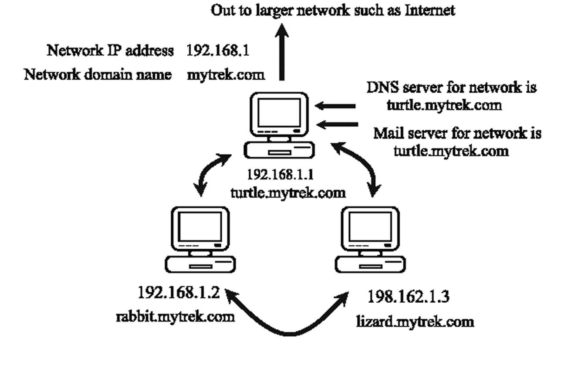

图 15-1：DNS 服务器操作

### DNS 客户端：解析器

为主机网络服务的 `DNS` 服务器名称位于主机的 `/etc/resolv.conf` 文件中。在建立互联网连接时，你的互联网服务提供商（`ISP`）提供的名称服务器被放置在此文件中。这些名称服务器解析你在访问不同网站时使用的任何完全限定域名。例如，当你在浏览器中输入域名时，名称服务器会查找该名称，然后使用与名称相关的 IP 地址访问该网站。

```
/etc/resolv.conf
search mytrek.com  mytrain.com
nameserver 192.168.0.1
nameserver 192.168.0.3
```

### 局域网寻址

如果你为未连接互联网的局域网（LAN）设置 `DNS` 服务器，你应该使用一组专门为此类本地网络保留 IP 数字（也称为私有网络或内网）。如果你正在实施 IP 掩装，则尤其如此，即只有网关机器具有互联网地址，而其他机器使用该地址连接互联网。虽然结构上相同，`IPv4` 和 `IPv6` 为本地地址使用不同的寻址格式。许多本地和家庭网络仍使用 `IPv4` 格式，这也是接下来的本地寻址示例中使用的格式。

| 地址 | 网络 |
| :--- | :--- |
| 10.0.0.0 | A 类网络 |
| 172.16.0.0–172.31.255.255 | B 类网络 |
| 192.168.0.0 | C 类网络 |
| 127.0.0.0 | 回环网络（用于系统自通信） |

表 15-1：非互联网私有网络 IP 地址

### IPv4 私有网络


IPv4 为 `IPv4` 支持的三个类提供了一系列私有地址。如你所见，C 类 IPv4 网络具有特殊的网络号 `192.168`。这些数字也被保留给 A 类和 B 类非互联网本地网络。表 15-1 列出了这些地址。地址中主机段的可用地址范围从 0 到 255。例如，B 类网络地址范围从 `172.16.0.0` 到 `172.16.255.255`，为您提供了共 65,534 个可能的主机。C 类网络范围从 `192.168.0.0` 到 `192.168.255.255`，为您提供了 254 个可能的子网，每个子网有 254 个可能的主机。数字 `127.0.0.0` 预留用于系统的回环接口，允许它与自身通信，从而使同一系统上的用户可以相互发送消息。

这些数字最初是为基于类的划分设计的。然而，它们也可以同样容易用于无类域间路由 (CIDR) 划分，其中你可以创建主机数量较少的子网。例如，C 类网络中的 254 个主机地址可以拆分为两个子网，每个子网有 125 个主机。

### IPv6 私有网络

IPv6 支持具有唯一本地地址（unique-local addresses）的私有网络，提供与 IPv4 私有地址相同的功能。唯一本地地址没有公共路由信息，它们无法访问互联网，被限制在使用的站点。唯一本地地址仅使用三个字段：格式前缀、子网标识符和接口标识符。站点级地址格式前缀为 `fc00`。如果你没有子网，它将设置为 `0`。这将为您提供网络前缀 `fc00:0:0:0`。你可以省略这一组空零得到 `fc00::`。接口 ID 字段将持有接口标识信息，类似于 IPv4 中的主机 ID 信息。

`fc00::` IPv6 唯一本地前缀

回环设备将具有特殊地址 `::1`，也称为 `localhost`。

`::1` IPv6 回环网络

与 IPv4 那样使用一组特殊的保留地址不同，IPv6 仅使用唯一本地前缀 `fc00` 和特殊的回环地址 `::1`。

### 使用 IPv4 的本地网络地址示例

如果你正在建立局域网 (LAN)，例如小型企业或家庭网络，你可以自由使用如示例所示的 C 类 IPv4 网络（254 个主机或更），它们具有特殊网络号 `192.168`。这些是用于你本地机器的数字。你可以使用以太网卡和以太网集线器等建立私有网络（如内网），然后使用从 `192.168.0.1` 开始的 IP 地址配置你的机器。主机段范围从 1 到 254，其中 255 用于广播地址。如果你在家庭网络中有三台机器，可以给它们分配地址 `192.168.0.1`、`192.168.0.2` 和 `192.168.0.3`。然后你可以在其中一台机器上运行 DNS 服务器，为你的网络设置域名系统服务。这台机器将成为你网络的 DNS 服务器。随后，你可以给你的机器分配完全限定域名，并配置你的 DNS 服务器将名称翻译为相应的 IP 地址。如图 15-1 所示，例如，你可以给机器 `192.168.0.1` 命名为 `turtle.mytrek.com`，给机器 `192.168.0.2` 命名为 `rabbit.mytrek.com`。你还可以通过在机器上为它们设置服务器，来实现网络上的互联网服务，如 FTP、Web 和邮件服务。然后你可以配置你的 DNS 服务器，让用户使用完全限定域名访问这些服务。例如，对于 `myttrek.com` 网络，可以使用名称 `www.mytrek.com` 访问 Web 服务器。与其使用域名系统，你可以让每台机器上的 `/etc/hosts` 文件包含网络中所有机器的 IP 地址和域名的完整列表。但对于任何更改，你必须更新每台机器的 `/etc/hosts` 文件。

## BIND

Linux 系统上当前使用的 DNS 服务器软件是伯克利互联网域名系统 (BIND)。BIND 最初开发于加州大学伯克利分校，目前由互联网软件整合会 (ISC) 维护和支持。你可以从其网站 [`www.isc.org/`](https://www.isc.org/) 获取 BIND 信息和当前软件发布版本。软件包中包含了网页文档和手册。在网站上，你还可以访问 BIND 管理手册获取详细的配置信息。RPM 包可以在发行版的 FTP 站点中找到。`/usr/share/doc` 中的 BIND 目录包含大量文档，包括网页手册和示例。域名系统的 Linux 教程 `DNS-HOWTO` 提供了详细示例。

BIND 9 管理参考手册位于 `/usr/share/doc/BIND` 目录。此外，检查 [`www.isc.org/`](https://www.isc.org/) 网站获取最新版本。

`/usr/share/doc/bind/Bv9ARM.html`

## BIND 9

BIND 9 DNS 服务器软件由一个名称服务器守护进程、若干示例配置文件和解析器库组成。从 8.x 系列开始的 BIND 版本使用新语法实现了一种新的配置文件。9.0 版本增加了新的安全功能和对 `IPv6` 的支持。以 4.x 开头的旧版本使用带有旧语法的不同配置文件。最新的版本 10 使用了截然不同的 DNS 服务器管理方法。大多数系统可能仍使用旧的 9.x 版本 BIND。

| 工具 | 描述 |
| :--- | :--- |
| `dig domain` | 域名信息抓取器，用于获取 DNS 服务器信息的工具。 |
| `host hostname` | 主机的简单查询 |
| `nslookup domain` | 查询 DNS 服务器以获取域名和主机信息的工具。 |
| `named-checkconf` | BIND 工具，用于检查你的 DNS 配置文件 `/etc/named.conf` 的语法。 |
| `named-checkzone` | BIND 工具，用于检查你的 DNS 区域文件的语法。 |
| `nslint` | 检查你的 DNS 配置和区域文件语法的工具 |
| `rndc command` | 远程名称守护进程控制器，用于管理 DNS 服务器的辅助工具（9.x 版本） |
| `ndc` | 名称守护进程控制器（8.x 版本） |
| `system-config-bind` | Fedora Bind DNS 服务器配置工具 |
| `named-rrchecker` | BIND 工具，用于检查你的 DNS 资源记录的语法 |
| `arpaname` | 将 IP 地址翻译为用于反向解析的 `IN-ADDR.ARPA` 地址的工具 |
| `bind9` | 使用 `bind9.service` 文件启动、停止和重启名称服务器 |

表 15-2: BIND 9 诊断和管理工具

BIND 名称服务器守护进程的名称是 `named`。要让你的机器作为名称服务器运行，只需使用适当的配置运行 `named` 守护进程。`named` 守护进程监听解析请求，并为请求的主机名提供正确的 IP 地址。你可以使用 BIND 提供的远程名称进程控制器工具 `rndc` 在测试配置时启动、停止、重启和检查服务器状态。`rndc` 的 `stop` 命令停止 `named`，而 `start` 命令重新启动它，并读取你的 `named.conf` 文件。`rndc` 的 `help` 命令提供所有 `rndc` 命令的列表。配置在 `/etc/rndc.conf` 文件中设置。一旦你的名称服务器运行，你可以使用 `dig` 或 `nslookup` 工具进行测试，这些工具可以查询名称服务器并提供主机和域名的信息。如果你不带参数启动 `dig`，它将进入交互模式，你可以在其中输入不同的 `dig` 命令来细化你的查询。


为了检查 DNS 服务器配置和区域文件的语法，BIND 提供了 `named-checkconfig` 和 `named-checkzone` 工具：`named-checkconfig` 将检查 DNS 配置文件 `named.conf` 的语法，而 `named-checkzone` 则会检查区域文件的语法。其他语法检查工具也可用，例如 `nslint`，它的操作方式类似于编程工具 `lint`。表 15-2 列出了若干种 DNS 管理工具。

在大多数发行版中，`named` 作为独立守护进程运行，在系统启动时启动并持续运行。如果你不想 `named` 自动启动，可以使用 `chkconfig` 更改其状态。

### 停止和启动 BIND 9 服务器

`named` 守护进程由 `systemd` 使用 `named.service` 单元文件管理。它为 `multi-user.target`（运行级别 2, 3, 4 和 5）启动（WantedBy）。运行时配置从 `/etc/sysconfig/named` 读取（EnvironmentFile）。虽然通过 `/usr/sbin/named` 命令启动服务器（ExecStart），但使用 `rndc` 命令来重启或停止服务器（ExecReload 和 ExecStop）。`bind` 服务要求激活特殊目标 `nss-lookup.target`（Wants）。在 bind 服务器启动之前，会使用 `named-chkconf` 从 `named.conf` 读取配置信息（ExecStartPre）。

```systemd
[Unit]
Description=Berkeley Internet Name Domain (DNS)
Wants=nss-lookup.target
Wants=named-setup-rndc.service
Before=nss-lookup.target
After=named-setup-rndc.service
After=network.target

[Service]
Type=forking
EnvironmentFile=NAMEDCONF=/etc/named.conf
EnvironmentFile=-/etc/sysconfig/named
Environment=KRB5_KTNAME=/etc/named.keytab
PIDFile=/run/named/named.pid
ExecStartPre=/bin/bash -c 'if [ ! "$DISABLE_ZONE_CHECKING" == "yes" ]; then /usr/sbin/named-checkconf -z /etc/named.conf; else echo "Checking of zone files is disabled"; fi'
ExecStart=/usr/sbin/named -u named -c ${NAMEDCONF} $OPTIONS
ExecReload=/bin/sh -c '/usr/sbin/rndc reload > /dev/null 2>&1 || /bin/kill -HUP $MAINPID'
ExecStop=/bin/sh -c '/usr/sbin/rndc stop > /dev/null 2>&1 || /bin/kill -TERM $MAINPID'
PrivateTmp=true

[Install]
WantedBy=multi-user.target
```

你可以使用 `systemctl` 命令手动停止、启动和重启服务器，以及启用或禁用它。

```bash
sudo systemctl enable named
sudo systemctl start named
```

注意：`system-config-bind` 是一个用于配置 BIND DNS 服务器的旧版桌面应用程序。虽然在 Red Hat 和 CentOS 上已被弃用，但在 Fedora 仓库中可用，尽管它不再受支持。它在 Fedora 28 上可能无法正常工作。

### 域名系统配置

你使用配置文件、多个区域文件和一个缓存文件来配置 DNS 服务器。名称服务器负责的网络部分称为区域（zone）。区域不等同于域名（domain），因为在一个大型域名中，可能有多个区域，每个区域都有自己的名称服务器。你也可以让一个名称服务器服务于多个区域。在这种情况下，每个区域都有自己的区域文件。

### DNS 区域

区域文件包含资源记录，为 DNS 服务器负责的网络中的计算机提供主机名和 IP 地址的关联。区域文件存在于服务器的网络和本地机器。区域目定义在 `named.conf` 文件中。在这里，你放置主、从和转发 DNS 服务器的区域目。这里描述了最常用的区域类型：

*   **主区域 (Master zone)**：这是 DNS 服务器支持的主区域文件。它保存该网络上所有主机从域名到 IP 地址的映射。
*   **从区域 (Slave zone)**：指向其他 DNS 服务器的引用。你的网络可以有一个主 DNS 服务器和若干从 DNS 服务器来分担负载。从 DNS 服务器会自动从主服务器复制配置文件（包括所有区域文件）。
*   **转发区域 (Forward zone)**：你使用配置文件、多个区域文件和一个缓存文件来配置 DNS 服务器。名称服务器负责的网络部分称为区域。
*   **in-addr.arpa 区域**：DNS 也可以提供反向映射。
*   **IP6.ARPA 区域**：这是 in-addr.arpa 区域的 IPv6 等效区域。
*   **IP6.INT 区域**：这是旧的 IPv6 类型。
*   **提示区域 (Hint zone)**：提示区域指定根名称服务器并用点（.）表示。


能够为特定区域（zone）回答 DNS 查询的服务器被称为权威服务器。权威服务器持有该区域内主机的 DNS 配置记录，这些记录将每个主机的 DNS 名称与 IP 地址关联起来。例如，主服务器就是权威服务器。从服务器和隐藏服务器也是如此（见下文列表）。缓存服务器不是权威的，它只持有从其他服务器获取的关联关系，且无法保证这些关联的有效性。9.10 版本为权威服务器引入的一个新功能是响应速率限制（Response Rate Limiting, RRL），它通过控制 DNS 响应包来避免 DNS 放大攻击（一种分布式拒绝服务攻击，DDOS）。

- **主服务器 (Master server)**：这是该区域的主 DNS 服务器。
- **从服务器 (Slave server)**：从主服务器接收区域信息的 DNS 服务器。
- **转发服务器 (Forwarder server)**：将未解析的 DNS 请求转发到外部 DNS 服务器的服务器。可用于此将本地局域网内的其他服务器隐藏在互联网之外。
- **仅缓存服务器 (Caching only server)**：缓存从 DNS 服务器接收到的 DNS 信息，并使用其来解析本地请求。
- **隐藏服务器 (Stealth server)**：未被主 DNS 服务器列为名称服务器的区域 DNS 服务器。

## Bind 9 服务器文件位置与 BIND chroot

BIND 软件包将 BIND 服务器文件安装在 `/etc` 和 `/var/bind` 目录。BIND 的 `named.conf` 文件位于 `/etc` 目录（`/etc/named.conf`），区域文件位于 `/var/bind` 目录。

- `/etc/named.conf`: BIND 配置文件
- `/var/named/`: BIND 区域文件

或者，你也可以通过将配置文件放在 chroot 监狱（chroot jail）中来实现更安全的服务器。安装 `bind-chroot` 软件包。BIND 使用的配置和区域文件将被放置在 `/var/named` 目录下的名为 `chroot` 的特殊子目录，即 `/var/named/chroot`。chroot 目录建立了一个 chroot 监狱，为任何 DNS 服务的用户创建了一个虚拟根目录。这防止了 DNS 用户访问系统的任何其他部分。当 BIND 服务器启动时，会在 `named` 服务上运行 `chroot` 命令，使 `/var/named/chroot` 成为任何 DNS 服务用户的根目录。更多信息请查看 Linux 文档点的 Chroot-BIND HOWTO（[https://www.tldp.org]）。

`/var/named/chroot` 目录下包含存放系统上 BIND 文件的子目录。这些包括 `var`、`etc` 和 `dev`。`var` 子目录内有一个 `named` 子目录，其中包含了 BIND DNS 服务器使用的区域文件。指向这些文件的链接位于 `/var/named` 目录中。`named.conf` 位于 `/var/named/chroot/etc` 目录。

- `/var/named/chroot/etc/named.conf`: BIND 配置文件
- `/var/named/chroot/var/named`: BIND 区域文件

## named.conf (BIND 9)

`named` 守护进程的配置文件是 `named.conf`，位于 `/etc` 目录（`/etc/named.conf`）。它使用类似于 C 语言的灵活语法。该格式允许对选定的区域进行轻松配置，并启用访问控制列表和分类日志等功能。`named.conf` 文件由 BIND 配置语句以及附加的块组成，块内列出了特定的选项。配置语句后跟着参数和一个由花括号分隔的块。块内部是选项和功能条目的行。每个条目以分号结束。注释可以使用 C、C++ 或 Shell/Perl 语法：使用 `/* */` 包裹、以 `//` 为缀或以 `#` 为缀。以下示例显示了一个 `zone` 语句，随后是区域名称和一个以左花括号（`{`）开始的选项块。每个选项条目以分号结束。整个块以右花括号结束，随后也跟着分号。这里显示了 `named.conf` 条目的格式，以及允许的不同类型的注释。表 15-3、15-4 和 15-5 列出了若干常用的语句和选项。

```c
// comments

/* comments */

# comments

statements {

options and features; //comments
};
```

以下示例显示了简单缓存服务器条目的 `zone` 语句：

```c
// a caching only nameserver config
//
zone "." IN {
    type hint;
    file "named.ca";
};
```

一旦创建了配置文件，就应该使用 `named-checkconfig` 工具检查其语法。在 shell 命令行输入该命令。如果没有指定配置文件，它将默认为 `/etc/named.conf`。

```bash
named-checkconfig
```

### zone 语句

`zone` 语句用于指定名称服务器将服务的域名。要创建 `zone` 语句，你需要输入关键字 `zone`，随后跟上放在双引号内的域名名称。不要在域名名称末尾加点。在以下示例中，域名名称内部有一个点，但末尾没有，“mytrek.com”；这与区域文件不同，区域文件要求完整域名名称末尾有一个点。

| 类型 | 描述 |
| :--- | :--- |
| master | 主 DNS 区域 |
| slave | 从 DNS 服务器；由主 DNS 服务器控制 |
| hint | 根 DNS 互联网服务器集 |
| forward | 将中的任何查询转发到其他服务器 |
| stub | 类似于从区域，但仅持有 DNS 服务器名称 |

表 15-3：DNS BIND 区域类型

在区域名称之后，你可以指定类 `IN`，它代表 Internet（互联网）。你也可以省略它，在这种情况下假设为 `IN`（只有少数极少使用的其他特殊类）。在区域块内部，你可以放置多个选项。两个基本选项是 `type` 和 `file`。`type` 选项用于指定区域类型。`file` 选项用于指定用于此区域的区域文件名。你可以从几种类型的区域中选择：master、slave、stub、forward 和 hint。master 表示该区域持有主信息并被授权对其进行操作。在旧的 4.x BIND 配置中，主服务器被称为 primary server。slave 表示该区域需要定期从指定的主名称服务器更新其数据。如果你的名称服务器是作为另一个主（master）DNS 服务器的从服务器运行的，则使用此条目。stub 区域（根区域）仅复制名称服务器条目，而不是整个区域。forward 区域将所有查询重定向到 `forwarders` 语句中指定的名称服务器。hint 区域指定所有互联网 DNS 服务器使用的根名称服务器集。你也可以指定多个选项，这些选项可以覆盖通过 `options` 语句设置的任何全局选项。表 15-3 列出了 BIND 区域类型。以下示例显示了 mytrek.com 域的简单 `zone` 语句。它的类是 Internet (in)，其类型是 master。它的区域文件名通常与区域名称相同并带有 `.db` 扩展，在此例中为“mytrek.com.db”。

```c
zone "mytrek.com" in {
    type master;
    file "mytrek.com.db";
};
```

### 配置语句

语句如 `acl`、`server`、`options` 和 `logging` 允许你为名称服务器配置不同的功能。`server` 语句定义了与远程名称服务器关联的特性，例如传输方法和安全的密钥 ID。`control` 语句定义了特殊的控制通道。`key` 语句定义了一个密钥 ID，用于 `server` 语句中将身份验证方法与特定的名称服务器关联。`logging` 语句用于配置名称服务器的日志选项，例如日志文件的最大尺寸和消息的严重级别。

| 语句 | 描述 |
| :--- | :--- |
| /*  comment */ | C 语法的 BIND 注释。 |


### 表 15-4: BIND 配置语句

| 语句 | 描述 |
| :--- | :--- |
| `//` | 使用 C++ 语法的 BIND 注释。 |
| `#` | 使用 Unix shell 和 Perl 语法的 BIND 注释。 |
| `acl` | 定义一个命名的 IP 地址匹配列表。 |
| `include` | 包含一个文件，将其解释为 `named.conf` 文件的一部分。 |
| `key` | 指定用于身份验证和授权的密钥信息。 |
| `logging` | 指定服务器日志的内容以及日志消息的发送位置。 |
| `options` | 全局服务器配置选项以及其他语句的默认值。 |
| `controls` | 声明供 `ndc` 工具使用的控制通道。 |
| `server` | 为指定的服务器基础设置某些配置选项。 |
| `sortlists` | 根据查询源对指定的网络赋予优先级。 |
| `trusted-keys` | 定义预配置到服务器中并隐含信任的 DNSSEC 密钥。 |
| `zone` | 定义一个区域。
| `view` | 定义一个视图。 |

### 表 15-5: 区域选项

| 选项 | 描述 |
| :--- | :--- |
| `type` | 指定区域类型。 |
| `file` | 指定该区域的区域文件。 |
| `directory` | 指定区域文件的目录。 |
| `forwarders` | 列出请求将被转发到的 DNS 服务器主机列表。 |
| `masters` | 列出用于从服务器的 DNS 主服务器主机列表。 |
| `notify` | 允许主服务器在主区域数据变化且需要更新时通知其从服务器。 |
| `allow-transfer` | 指定哪些主机允许接收区域传输。 |
| `allow-query` | 指定允许进行查询的主机。 |
| `allow-recursion` | 指定允许在服务器上执行递归查询的主机。 |

[表 15-5] 列出了 BIND 语句。`sortlists` 语句允许您在当查询返回多个响应时指定使用的优先级。例如，您可以为本地回环网络或诸如 `192.168.0.0` 的私有本地网络赋予优先级。

#### options 语句

`options` 语句定义了全局选项，且在配置文件中只能使用一次。大量的选项涵盖了转发、名称检查、目录路径名、访问控制和区域传输等组件（参见[表 15-6]）。完整列表可以在 BIND 文档中找到。

### 表 15-6: options 语句的 Bind 选项

| 选项 | 描述 |
| :--- | :--- |
| `sortlist` | 根据查询源对指定的网络赋予优先级。 |
| `directory` | 指定区域文件的目录。 |
| `forwarders` | 列出请求将被转发到的 DNS 服务器主机列表。 |
| `allow-transfer` | 指定哪些主机允许接收区域传输。 |
| `allow-query` | 指定允许进行查询的主机。 |
| `allow-recursion` | 指定允许在服务器上执行递归查询的主机。 |
| `notify` | 允许主服务器在主区域数据变化且需要更新时通知其从服务器。 |
| `blackhole` | 用于消除 `allow-query` 拒绝性响应的选项。 |
| `recursion` | 允许 DNS 服务器查询其不受控制的其他 DNS 服务器。 |

#### directory 选项

大多数配置文件中一个至关重要的选项是 `directory` 选项，它存储了系统上名称服务器区域和缓存文件的位置。以下示例取自 `/etc/named.conf` 文件。该示例指定区域文件位于 `/var/named` 目录。在此目录中，你可以找到区域文件，包括用于本地系统的区域文件。该示例使用了 IPv4 地址。

```cpp
options {
    directory "/var/named";
    forwarders { 192.168.0.34;
                192.168.0.47;
            };
};
```

#### forwarders 选项

另一个常用的全局选项是 `forwarders` 选项。通过 `forwarders` 选项，你可以列出若干 DNS 服务器，如果本地 DNS 服务器无法解析查询，则可以将查询转发到这些服务器。这对于可能需要使用连接互联网的 DNS 服务器的本地网络非常有帮助。`forwarders` 选项也可以放置在转发区域条目中。

#### notify 选项

开启 `notify` 选项后，当主区域 DNS 服务器的配置发生变化时，它们会向任何从 DNS 服务器发送消息。从服务器随后可以执行区域传输，下载已更改的文件。从服务器始终使用从其主 DNS 服务器复制的 DNS 配置。`notify` 选项接受一个参数，`yes` 或 `no`，其中 `yes` 是默认值。使用 `no` 参数，你可以让主服务器不向从服务器发送任何消息，实际上阻止了任何区域传输。

IPv6 反向映射在反向区域条目中使用 `IP6.ARPA` 域。`IP6.ARPA` 使用位标签提供位的位级规范。这仅仅是完整的十六进制地址，包括零，中间没有冒号。你也可以使用半字节格式（nibble format），用句号分隔每个数字。

#### 简单的 named.conf 示例

以下示例是一个基于 BIND 文档提供的示例简单 `named.conf` 文件（更详细的示例参见 `/usr/share/doc/bind*/sample/etc/named.conf`）。该示例展示了若干配置语句的样本。

文件以 C++ 语法的注释 `//` 开始。`logging` 语句将调试消息记录到 `/var/named/data/named.run` 文件中。named 服务器被允许写入数据子目录下的文件。`options` 语句有一个目录条目，将区域和缓存文件的目录设置为 `/var/named`。在此处，你可以找到指向区域文件的链接，例如 `named.local` 和反向映射文件，以及缓存文件 `named.ca`。第一个 `zone` 语句（`.`）定义了一个指定根名称服务器的提示区域。这些这些服务器的缓存文件是 `named.ca`。第二个 `zone` 语句定义了 `mytrek.com` 域的区域。其类型为 `master`，其区域文件为 `mytrek.com`。

下一个区域用于前一个区域的 IPv4 反向映射。它的名称由 `mytrek.com` 域 IP 地址的反向列表加上 `in-addr.arpa` 术语组成。`mytrek.com` 的域名地址是 `192.168.0`，因此反向为 `1.168.192\.`。`in-addr.arpa` 域是一个支持网关位置和互联网地址到主机映射的特殊域。

最后一条语句将包含 `named.rfc1912.zones` 配置文件，它定义了 `localhost` 及其反向查找的区域语句。这些是环回接口（`localhost`，`1.0.0.127`）的 RFC 1912 区域定义，系统用于标识自身并启用系统本地用户之间通信的方法。

```cpp
include "/etc/named.rfc1912.zones"

named.conf

//
// 一个简单的 BIND 9 配置
//
logging {
    channel default_debug {
        file "data/named.run";
        severity dynamic;
    };
};
options {
    directory "/var/named";
};
zone "." IN {
    type hint;
    file "named.ca";
};
zone "mytrek.com" {
    type master;
    file "mytrek.com.db";
};
zone "1.168.192.in-addr.arpa" {
    type master;
    file "192.168.0.db";
};
zone "\[xFC00000000000000/64].IP6.ARPA" {
    type master;
    file "fec.ip6.arpa.db";
};
```


zone 语句（区域语句）排列在 view 子句（视图语句）中，view 子句决定了 DNS 服务器如何响应客户端请求。如果没有列出 view 子句，则假设所有 zone 语句都是默认视图（default view）的一部分，供所有客户端访问。如果至少列出了一个 view 语句，则所有的 zone 语句必须放置在 view 子句中。

DNS 视图通过 `view` 子句进行配置，该子句使用 `match-clients` 指定可以访问该视图的客户端地址，并使用 `match-destinations` 指定客户端可以访问的地址。`match-recursive-only` 允许递归请求。在 view 中定义的选项仅适用于该视图。

```bind
//
// 一个简单的 BIND 9 配置
//
logging {
    channel default_debug {
        file "data/named.run";
        severity dynamic;
        };
};
options {
    directory "/var/named";
    };
view "internal" {
    match-clients {192.168.0.0/32;};
    match-destinations {any};
    recursion yes;
    zone "." IN {
        type hint;
        file "named.ca";
        };
    zone "mytrek.com" {
        type master;
        file "mytrek-internal.com.db";
        };
    zone "1.168.192.in-addr.arpa" {
        type master;
        file "192.168.0.db";
        };
    zone "\[xFC00000000000000/64].IP6.ARPA" {
        type master;
        file "fec.ip6.arpa.db";
        };
include "/etc/named.rfc1912.zones"
}
```

view 子句以 `view` 关键字开头，后面是视图名称，例如 `internal`、`external` 或 `localhost-resolver`。然后，`match-clients` 和 `match-destinations` 选项定义了可以访问该视图的地址。`named.conf.sample` 文件展示了如何为 `named.conf` 文件配置内部、外部和本地解析器区域。

视图通常为内部和外部客户端设置。内部视图允许本地网络上的客户端访问整个本地网络，包括用于任何用于外部用途的服务器（例如用于 Internet 的 Web 服务器）。外部视图允许任何客户端（本地或其他）进行访问，但将此类访问限制在具有 Internet 的外部服务器上（如 Web 和邮件服务器）。外部视图将防止非本地客户端访问本地网络，运行在该网络上的 Internet 服务器除外。

下一个示例为本地客户端设置了一个内部视图，它限制了来自本地网络（`192.168.0.0`）的客户端访问，尽管这些客户端可以访问任何目的地。允许递归。本地客户端可以完全使用 DNS 区域。为了访问 Internet，必须包含根区域定义（`zone "."`）。`mytrek.com` 区域定义加载了 `mytrek-internal.com.db` 文件，该文件包含访问整个网络的资源记录。

外部视图通常设计为允许所有内部和外部客户端访问。接下来的示例为两种客户端设置了一个外部视图。`match-clients` 选项设置为 `any`，匹配从任何地方访问区域的任何客户端。关闭了递归。`mytrek.com` 区域定义加载了 `mytrek-external.com.db` 文件，该文件仅包含访问公共服务器（如 Web 和邮件服务器）的资源记录。

```bind
view "external" {
    match-clients {any};
    recursion no;
    zone "." IN {
        type hint;
        file "named.ca";
        };
    zone "mytrek.com" {
        type master;
        file "mytrek-external.com.db";
        };
    }
}
```

您可以使用使用相同的区域名称，而是为外部区域创建新的区域。在接下来的示例中，`myweb.com.db` 文件将仅为 Web 服务器持有资源记录。

```bind
view "external" {
    match-clients {any};
    recursion no;
    zone "." IN {
        type hint;
        file "named.ca";
        };
    zone "myweb.com" {
        type master;
        file "myweb.com.db";
        };
}
```

这里显示了包含 `mytrek.com` 区域外部和内部视图的 `named.conf` 文件：

```bind
// 带有外部和内部视图的 BIND 9 配置
logging {
    channel default_debug {
        file "data/named.run";
        severity dynamic; 
    };
};
options {
    directory "/var/named";
};
view "internal" {
    match-clients {192.168.0.0/32;};
    match-destinations {any};
    recursion yes;
    zone "." IN {
        type hint;
        file "named.ca";
    };
    zone "mytrek.com" {
        type master;
        file "mytrek-internal.com.db";
    };
    zone "1.168.192.in-addr.arpa" {
        type master;
        file "192.168.0.db";
    };
    zone "\[xFC00000000000000/64].IP6.ARPA" {
        type master;
        file "fec.ip6.arpa.db";
    };
};
include "/etc/named.rfc1912.zones"
}
view "external" {
    match-clients {any};
    recursion no;
    zone "." IN {
        type hint;
        file "named.ca";
    };
    zone "mytrek.com" {
        type master;
        file "mytrek-external.com.db";
    };
}
```

### BIND 9 仅缓存服务器

当最初安装 BIND 时，它会为所谓的“仅缓存服务器”（caching-only server）创建一个默认配置。仅缓存服务器复制用户发起的查询并将其保存在缓存中，以便在以后重复查询时使用。这可以节省 DNS 查询时间。缓存存在内存中，其持续时间仅与 named 的运行时间同长。

#### 作为仅缓存服务器的 named.conf


您的名称服务器通过放置在区域和反向映射文件中的资源记录，持有关于您网络上主机的域名解析信息。资源记录用于将 IP 地址与完全限定域名名（FQDN）关联起来。对于名称服务器所服务的区域内的每台计算机，都需要一个记录。虽然一个记录占用一行，但您可以使用括号为一个记录使用多行，这在 SOA 记录中通常如此。资源记录使用如下所示的标准资源记录格式：

`name [<ttl>] [<class>] <type> <rdata> [<comment>]`

在这里，`name` 是该记录的名称。它可以是一个域名，也可以为主机名（完全限定域名名）。如果您只指定了主机名，则会附加默认域名。如果不存在名称条目，则使用上一个特定的名称。如果使用 `@` 符号，则使用名称服务器的域名。`ttl`（生存时间）是一个可选条目，指定记录缓存的持续（由 `$TTL` 指令设置默认值）。`class` 是记录的类别。大多数资源记录条目使用的类别是 `IN`，代表 Internet（互联网）。默认情况下，它与 `named.conf` 文件中为域名指定的类别相同。`type` 是记录的类型。`rdata` 是资源记录数据。以下是一个资源记录条目的示例。名称为 `rabbit.mytrek.com`，类别是 `Internet (IN)`，类型是主机地址记录 (`A`)，数据是 IP 地址 `192.168.0.2`。

```
rabbit.mytrek.com.    IN    A    192.168.0.2
```

## 资源记录类型

对于不同的主机和名称服务器操作存在不同类型的资源记录（资源记录类型列表请参见表 15-7）。

`A`、`NS`、`MX`、`PTR` 和 `CNAME` 是常用的类型。`A` 用于匹配域名与 IP 地址的主机地址记录。`NS` 用于引用名称服务器。`MX` 指定该区域邮件服务器主机地址。名称服务器有发送到该主机的邮件。`PTR` 类型用于指向其他资源记录的记录，用于反向映射。`CNAME` 用于识别系统上主机的别名。

```
$TTL 86400
```

## 生存时间指令与字段：$TTL

所有区域文件都以生存时间（Time To Live）指令开头，该指令指定了客户端在从 DNS 服务器重新刷新信息之前保留所提供的 DNS 信息的时间。从实际上，这至少应该是一天，但如果计划在更早的时间更改服务器，您可以临时缩短时间，稍后恢复。事实上，每条记录都有一个生存时间值，可以通过 `TTL` 字段显式指定。这是资源记录中的第二个字段。如果记录中未指定 `TTL` 字段，则可以使用 `$TTL` 指令定义的默认值。`$TTL` 指令位于每个区域文件的开头。默认情况下，它将列出秒为单位的时间，通常为 86400 秒（24 小时）。

| 类型 | 描述 |
| :--- | :--- |
| A | IPv4 主机地址，将主机名映射到 IPv4 地址 |
| AAAA | IPv6 主机地址 |
| A6 | 链式 IPv6 地址 |
| NS | 该区域的权威名称服务器 |
| CNAME | 规范名称，用于定义主机名的别名 |
| SOA | 权威起始，起始区域文件中的 DNS 条目，指定域名的名称服务器 |
| WKS | 众事实服务描述 |
| PTR | 指针记录，用于执行反向域名查找 |
| RP | 包含主机联系信息的文本字符串 |
| HINFO | 主机信息 |
| MINFO | 邮箱箱或邮件列表信息 |
| MX | 邮件交换器，告知远程站点您区域的邮件服务器 |
| TXT | 文本字符串，通常是关于主机的信息 |
| KEY | 域名私钥 |
| SIG | 资源记录签名 |
| NXT | 下一个资源记录 |

表 15-7：域名系统资源记录类型

您也可以以天 (d)、小时 (h) 或分钟 (m) 指定时间，例如：

```
$TTL 2d3h
```

当作为字段使用时，`TTL` 将作为第二个字段指定指定的时间。在接下来的示例中，turtle 资源记录可以缓存三天。这将覆盖 `TTL` 时间 指令中的默认时间：

```
turtle     3d      IN    A      192.168.0.1
```

## 权威起始：SOA

区域或反向映射文件始终以一种特殊的资源记录开头，称为权威起始（SOA）。该记录指定所有后续记录对于该域名都是权威的。它还包含了关于名称服务器域名的信息，这些信息将提供给其他名称服务器。SOA 记录的格式与其他资源记录相同，但其数据段的安排不同。SOA 记录的格式如下：

```
name {ttl} class  SOA  Origin  Person-in-charge (
 Serial number
 Refresh
 Retry
 Expire
 Minimum )
```

每个区域都有自己的 SOA 记录。SOA 起于 `named.conf` 区域条目中指定的区域名称。这通常是一个域名。`@` 符号通常用于名称，并像宏一样展开为域名名。类别通常是 Internet 类别，`IN`。`SOA` 是类型。`Origin` 是记录来源的机器，通常是运行您的名称服务器守护进程的机器。负责人（Person-in-charge）是管理名称服务器的人员的电子邮件地址（电子邮件地址请使用点，而不是 `@`，因为该符号用于域名）。多个配置条目被放置在花括号分隔的块中。第一个是序列号（Serial number）。当您添加或更改记录时，需要更改序列号，以便其他服务器进行更新。序列号可以是任何数字，只要每次对区域中的任何记录进行更改时都递增即可。常见的做法是使用“年-月-日-数字”作为序列号，其中数字是当天更改的次数。例如，`1999120403` 表示 1999 年 12 月 4 日的第 3 次更改。在进行更改时请务必更新它。

`Refresh` 指定了刷新 SOA 信息的时间间隔。`Retry` 是尝试联系权威服务器的频率。`Expire` 是辅助名称服务器在不更新的情况下保留区域信息的时间长度。`Minimum` 是区域内记录的生存长度。这些时间是以秒为单位指定的。

接接的示例显示了一个 SOA 记录。运行名称服务器的机器是 `turtle.mytrek.com`，负责服务器的人员电子邮件地址是 `hostmaster.turtle.mytrek.com`。注意这些名称末尾的句。对于没有点的名称，将附加域名。`turtle` 等同于 `turtle.mytrek.com`。在输入完整主机名时，请务必添加点，以防附加域名。

```
@ IN SOA turtle.mytrek.com. hostmaster.turtle.mytrek.com. (
                              1997022700 ; Serial
                              28800 ; Refresh
                              14400 ; Retry
                              3600000 ; Expire
                              86400 ) ; Minimum


## 名称服务器：NS

名称服务器记录指定了该区域名称服务器的名称。这些记录类型为 `NS`。如果您有多个名称服务器，请在 `NS` 记录中列出它们。这些记录通常位于 SOA 记录之后。由于它们通常适用于 SOA 记录相同的域名，因此它们的名称字段留为空，以继承上一个 SOA 记录中由 `@` 符号指定的服务器域名。

```
             IN    NS    turtle.mytrek.com.
```

如果您愿意，可以像所示显式地输入域名：

```
mytrek.com.  IN    NS    turtle.mytrek.com.
```

### 地址记录：A, A6, 和 AAAA


`A` 类型的资源记录是用于完全限定域名与 IP 地址关联的地址记录。通常，只指定其主机名。任何不以点号结尾的域名都会在其后自动附加域名。给定域名 `mytrek.com`，在下面的示例中 `turtle` 名称被扩展为 `turtle.mytrek.com`：

```
rabbit.mytrek.com. IN    A      192.168.0.2
turtle             IN    A      192.168.0.1 own
```

BIND 支持 `IPv6` 地址。`IPv6` IP 地址的格式与常用的 `IPv4` 地址完全不同。`IPv6` 不使用分为四段的数字，而是使用分为七段的十六进制数。在下面的示例中，`turtle.mytrek.com` 与一个唯一本地 `IPv6` 地址 `fc00::` 关联。请回想，唯一本地地址仅包含三个字段：格式前缀、子网标识符和接口标识符。子网标识符的空段可以用空冒号对（`::`）表示。接口标识符随其后，为 `8:800:200C:417A`。

```
turtle.mytrek.com. IN    AAAA    FC00::8:800:200C:417A
```

`IPv6` 还支持使用 `IPv4` 地址作为接口标识符，而不是基于 MAC 的标识符。`IPv6` 地址的网络部分将使用 `IPv6` 表示法，剩余的接口（主机）标识符将使用完整的 `IPv4` 地址。这些被称为混合地址。在下一个示例中，`lizard.mytrek.com` 使用 `IPv6` 网络信息和 `IPv4` 接口信息给出了混合地址。`IPv6` 网络信息用于一个 `IPv6` 唯一本地地址。

```
lizard.mytrek.com. IN      AAAA       fc00::192.168.0.3
```

`AAAA` 记录在大多数网络中用于 `IPv6` 记录。`AAAA` 记录的工作原理与标准的 `A` 地址记录非常相似，需要完整的 `IPv6` 地址。`A6` 记录是 `IPv6` 记录的一个实验性版本。它可以更灵活，因为它不需要完整的地址。相反，你将 `A6` 记录链在一起，在每条记录中仅指定地址的一部分。例如，你可以仅为主机指定接口标识符，而让网络信息由另一个 `IPv6` 记录提供（你可以像实现 `AAAA` 记录一样实现带有完整地址的 `A6` 记录）。在下一个示例中，第一个 `A6` 记录仅列出了主机 `divit` 的接口标识符地址。紧随地址之后的是域名 `mytrek.com`，其地址将用于完成 `divit` 的地址，提供网络信息。下一个 `A6` 记录提供了 `mytrek.com` 的网络地址信息。

```
divit.mygolf.com. IN    A6  0:0:0:0:1234:5678:3466:af1f  mytrek.com.
mytrek.com.       IN    A6    3ffe:8050:201:1860::
```

### 邮件交换器：MX

邮件交换器记录 `MX` 指定了该区域或特定主机使用的邮件服务器。邮件交换器是接收发送该主机邮件的服务器。在下面的示例中，邮件服务器指定为 `turtle.mytrek.com`。发送到该区域内任何机器地址的邮件将发送到邮件服务器，然后由它将其发送给特定的机器。例如，发送到 `rabbit.mytrek.com` 上用户的邮件将首先发送到 `turtle.mytrek.com`，然后将其转发到 `rabbit.mytrek.com`。在下面的示例中，主机 `192.168.0.1` (`turtle.mytrek.com`）被定义为 `mytrek.com` 域的邮件服务器：

```
mytrek.com. IN    MX  10  turtle.mytrek.com.
```

你也可以从 `SOA` 记录继承域名，将域名条目留空。

```
             IN    MX  turtle.mytrek.com.
```

你也可以使用 IP 地址，但在较大的网络中，可能需要域名来查找和解析特定机器的 IP 地址，而该地址可能会发生。

```
mytrek.com. IN    MX  10  192.168.0.1
```

`MX` 记录识别一个额外的字段，用于指定邮件交换器的优先级。如果你的区域有多个邮件服务器，你可以在它们的 `MX` 记录中为它们分配不同的优先级。数字越小，优先级越高。这样，如果邮件无法到达第一个邮件服务器，它可以路由到备用服务器以到达主机。在下面的示例中，发送到 `mytrek.com` 域上主机的邮件首先路由到位于 `192.168.0.1` (`turtle.mytrek.com`) 的邮件服务器。

```
mytrek.com. IN    MX  10  turtle.mytrek.com.
             IN    MX  20  192.168.0.1
```

### 别名：CNAME

`CNAME` 类型的资源记录用于指定主机的别名。别名通常用于运行不同类型的服务器的机器。它们在主机变化时用于主机。在下面的示例中，`ftp.mytrek.com` 是 `turtle.mytrek.com` 的别名：

```
ftp.mytrek.com. IN CNAME turtle.mytrek.com.
```

`CNAME` 术语代表规范名称（canonical name）。规范名称是主机的实际名称。在前面的示例中，规范名称是 `turtle.mytrek.com`。别名（称为 `CNAME`）是 `ftp.mytrek.com`。别名不能用于 `NS`（名称服务器）或 `MX`（邮件服务器）记录。对于这些记录，你需要使用原始名称或 IP 地址。

实现别名的更稳定方法是简单为主机创建另一个地址记录。你可以为同一个 IP 地址拥有多个主机名，只要它们经过经过的。例如，为了让 `www.mytrek.com` 成为 `turtle.mytrek.com` 的别名，你只需要添加另一个具有相同 IP 地址的地址记录。

```
turtle
mytrek.com. IN A 192.168.0.1
www.mytrek.com. IN A 192.168.0.1
```

### 指针记录：PTR

`PTR` 记录用于从 IP 地址到主机的反向映射。`PTR` 记录用于反向映射文件。名称条目持有反转后的 IP 地址，数据条目持有主机的名称。下面的示例将 IP 地址 `192.168.0.1` 映射到 `turtle.mytrek.com`：

```
1.1.168.192 IN PTR turtle.mytrek.com.
```

在 `PTR` 记录中，你可以仅指定地址的最后一个数字段（主机地址），让 DNS 填充域名部分。在下一个示例中，`1` 拥有域名地址 `1.168.192`，自动添加形成 `1.1.168.192`：

```
1 IN PTR turtle.mytrek.com.
```

### 主机信息：HINFO, RP, MINFO 和 TXT

`HINFO`、`RP`、`MIFO` 和 `TXT` 记录用于提供主机信息。`RP` 记录允许你指定特定主机的负责人。`HINFO` 记录提供基本的硬件和操作系统识别。`TXT` 记录用于输入任何想要的文本。`MIFO` 提供主机的邮件和邮箱信息。这些记录的使用非常谨慎，因为它们可能会泄露过多的信息。


DNS 服务器使用多个覆盖 DNS 不同组件的区域文件（zone files）。每个区域使用两个区域文件：主区域文件和反向映射区域文件。区域文件包含区域内主机的资源记录。反向映射文件包含提供你的域名条目反向映射的记录，使你能够从 IP 地址映射到域名。用于区域文件的文件名可以是任何名称。该文件名在 `named.conf` 文件的 `zone` 语句的条条目中指定。如果你的服务器支持多个区域，你可能希望使用一个表示特定区域的名称。大多数系统使用域名作为区域文件的名称。例如，区域 `mytrek.com` 将具有一个相同名称且扩展名为 `db` 的区域文件，如 `mytrek.com.db`。在以下示例中使用的区域文件名为 `mytrek.com.db`。

反向映射文件名也可以是任何名称，尽管它通常是其对应区域文件中指定的反向 IP 地址域名。例如，在 `mytrek.com.db` 区域文件的情况下，反向映射文件可能命名为 `192.168.0.db`，这是在 `mytrek.com.db` 区域文件中定义的 `mytrek.com` 域名的 IP 地址。此文件将包含域名中所有主机地址的反向映射，允许其主机名地址映射到其相应的 IP 地址。

此外，BIND 会为 `localhost` 设置缓存文件和区域文件。缓存文件持有你的名称服务器连接的根名称服务器的资源记录。缓存文件可以是任何名称，尽管它通常被称为 `named.ca`。`localhost` 区域文件持有本地环回接口 `localhost` 的反向 IP 资源记录。在 Fedora 上，`localhost` 文件名为 `.localhost`，其反向映射文件名为 `.loopback`。`localhost` 区域通过 `named.rfc1912.zones` 配置文件中的语句配置，该文件包含在 `named.conf` 中。`localhost` 地址根据 RFC 1912 互联网协议标准配置。

一旦你创建了区域文件，就应该使用 `named-checkzone` 工具检查它们的语法。该工具要求你同时指定区域和区域文件。在以下示例中，在 `/var/named` 目录下，检查了区域文件 `mytrek.com.db` 中的区域 `mytrek.com`：

```
named-checkzone mytrek.com mytrek.com.db
```

对于从服务器，你可以指定将区域文件存储为 map 文件格式。map 文件格式的读取和处理速度比通常用于区域文件的文本格式快得多。从服务器需要将区域文件写入磁盘并在稍后访问它。通过使用内存映射（memory mapping）保存文件（以内存中存在的形式保存文件），可以加快访问速度。以 map 格式（内存映射）保存的区域文件只能在生成的计算机上使用。要使用 map 格式，请在 `named.conf` 配置文件中该区域的区域语句中添加 `masterfile-format map` 选项。

```
masterfile-format map;
```

主服务器也可能使用 map 文件格式，但你必须将 map 文件转换为文本文件才能对它们进行编辑。`named-compilezone` 工具可以执行这些转换。

### 互联网区域的区域文件

区域文件持有遵循特定格式的资源记录。文件以通用指令开头，用于定义默认域名或包含其他资源记录文件。其后是单个 SOA 记录、名称服务器记录和域名资源记录，然后是不同主机的资源记录。注释以分号开始，可以放置在文件的任何位置。`@` 符号像一个特殊的宏，代表记录所属的区域的域名。`@` 符号在资源记录或 SOA 记录的第一字段中作为区域域名使用。可以使用 `*` 匹配字符指定多个名称。资源记录中的第一个字段是其所属的域名。如果名称留空，则自动使用之前另一个资源记录中的上一个显式名称条目。通过这种方式，你可以列出多个适用于同一主机的条目，而无需重复主机名。此文件中使用的任何不以点（.）结尾的主机或域名，都会在其后附加该区域的域名。例如，如果区域域名是 `mytrek.com`，且资源记录仅有名称 `rabbit` 且没有末尾的点，则会自动将区域域名附加在其后，从而得到 `rabbit.mytrek.com.`。每当你输入完整的完全限定域名（例如，`turtle.mytrek.com.`）时，请务必包含末尾的点。

### 指令

你还可以使用几个指令来设置全局属性。`$ORIGIN` 设置一个默认域名，附加到不以点结尾的地址名称上。`$INCLUDE` 包含一个文件。`$GENERATE` 可以生成其域名或 IP 地址仅通过迭代数字区分的记录。`$ORIGIN` 指令通常用于指定地址记录中使用的根域名。请务必包含末尾的点。以下示例将域名源设置为 `mytrek.com.`，它将自动附加到随后的 `lizard` 主机名：

```
$ORIGIN mytrek.com.
lizard IN A 192.168.0.2
```

### SOA 记录

区域文件以 SOA 记录开头，用于指定名称服务器运行的机器等其他规范。`@` 符号用于 SOA 记录的名称，表示区域域名。在 SOA 之后，列出名称服务器记录（`NS`）。紧接名称服务器记录之后是域名本身的资源记录。随后是主机地址（`A`）、别名（`CNAME`）和邮件交换器（`MX`）的资源记录。以下示例显示了一个区域文件，它以 SOA 记录开头，随后是 NS 记录、域名资源记录，然后是各个主机的资源记录：

```
; turle.mytrek.com 的权威数据
;
$TTL 86400
@ IN SOA turtle.mytrek.com. hostmaster.turtle.mytrek.com.(
                      93071200 ; 序列号
                      10800 ; 刷新 3 小时
                      3600 ; 重试 1 小时
                      3600000 ; 过期 1000 小时
                      86400 ) ; 最小 24 小时
      IN      NS      turtle.mytrek.com.
      IN      A       192.168.0.1
      IN      MX      10 turtle.mytrek.com.
      IN      MX      15 rabbit.mytrek.com.
turtle IN      A       192.168.0.1
      IN      HINFO   PC-686 LINUX
gopher IN    CNAME  turtle.mytrek.com
ftp IN      CNAME  turtle.mytrek.com
www IN      A       192.168.0.1
rabbit IN    A       192.168.0.2
lizard IN    A       192.168.0.3
      IN      HINFO   MAC MACOS
```


下一条资源记录指定了该区域的名称服务器。这里是 `mytrek.com`。注意此条资源记录的名称为空。如果名称为空，则资源记录将从上一个记录继承名称。在这种情况下，`NS` 记录继承了其前一个记录 `SOA` 记录中的 `@` 值。这是该区域的域名，而 `NS` 记录指定 `turtle.mytrek.com` 为该区域的名称服务器。

```
IN  NS    turtle.mytrek.com.
```

在这里，域名名是继承的。该条目可以解读如下所示。注意域名名末尾的点符号：

```
mytrek.com. IN  NS    turtle.mytrek.com.
```

### 地址记录 (Address Record)

以下地址记录为域名本身设置了地址。这通常与名称服务器地址相同，在本例中为 `192.168.0.1`（`turtle.mytrek.com` 的 IP 地址）。这使用户能够引用域名本身，而不是其中的某个特定主机。之后是一个邮件交换记录，它将该域名的邮件路由到名称服务器。用户可以向 `mytrek.com` 域名发送邮件，邮件将会被路由到 `turtle.mytrek.com`。

```
IN    A     192.168.0.1
```

在这里，域名名是继承的。该条目可以解读如下：

```
mytrek.com. IN  A     192.168.0.1
```

### 邮件交换记录 (Mail Exchanger Record)

后续记录是邮件交换 (`MX`) 记录，列出 `turtle.mytrek.com` 和 `fast.mytrek.com` 为该区域的邮件服务器。一个主机可以有多个邮件交换记录。可能存在多个可以路由邮件的主机。这些可以列在邮件交换记录中，你可以对其设置优先级排名（数字越小优先级越高）。在本例中，如果无法访问 `turtle.mytrek.com`，其邮件将通过 `rabbit.mytrek.com` 路由，该主机也被设置为用于处理 `mytrek.com` 域名的邮件：

```
IN     MX    100    turtle.mytrek.com.
IN     MX    150    rabbit.mytrek.com.
```

再次，域名名是继承的。这些条目可以解读为：

```
mytrek.com.  IN      MX 100  turtle.mytrek.com.
mytrek.com.  IN      MX 150  rabbit.mytrek.com.
```

### 带有主机名的地址记录 (Address Record with Host Name)

以下资源记录是一个地址记录 (`A`)，它将 IP 地址与完全限定域名 `turtle.mytrek.com` 关联。资源记录名称仅包含 `turtle` 且末尾没有点，因此它会自动扩展为 `turtle.mytrek.com`。该记录提供了 `turtle.mytrek.com` 可以映射的 IP 地址。

```
turtle  IN    A     192.168.0.1
```

### 继承名称 (Inherited Names)

紧随其后的几条资源记录的名称为空。它们从前一个完整记录继承名称——在本例中为 `turtle.mytrek.com`。实际上，这些记录也适用于该主机。使用空名称是列出同一主机额外资源记录的简单方法（注意这里出现了明显的缩进）。第一条记录是信息记录，提供了机器的硬件和操作系统信息。

```
IN    HINFO    PC-686 LINUX
```

### 别名记录 (Alias Records)

如果你正在使用同一台机器运行多个不同的服务器（例如 Web、FTP 和 Gopher 服务器），你可能希望为这些服务器分配别名，以便用户更容易访问。用户可能会发现使用真实的域名（如 `turtle.mytrek.com`）来访问运行在上面的 Web 服务器，不如使用以下地址更方便：对于 Web 服务器，使用 `www.mytrek.com`；对于 Gopher 服务器使用 `gopher.mytrek.com`；对于 FTP 服务器使用 `ftp.mytrek.com`。在 DNS 中，你可以使用别名记录实现这种功能。在示例区域文件中，为 `turtle.mytrek.com` 机器存在两个 `CNAME` 别名记录：`FTP` 和 `Gopher`。下一条记录使用针对同一台机器的另一个地址记录为 `www` 实现别名。由于这些名称条目都没有以点结尾，因此它们会自动补上域名 `mytrek.com`。`www.mytrek.com`、`ftp.mytrek.com` 和 `gopher.mytrek.com` 都是 `turtle.mytrek.com` 的别名。输入这些 URL 的用户会自动访问 `turtle.mytrek.com` 机器上的相应服务器。

```
gopher      IN      CNAME    turtle.mytrek.com.
ftp         IN      CNAME    turtle.mytrek.com.
www         IN      A       192.168.0.1
```

随后列出了该区域内另外两个机器的地址和邮件交换记录：`rabbit.mytrek.com` 和 `lizard.mytrek.com`。你可以为这些条目添加 `HINFO`、`TXT`、`MINFO` 或别名记录。

### IPv6 区域文件示例 (IPv6 Zone File Example)

这是使用 IPv6 地址的文件。地址是本地唯一的 (`FC00`) 而不是全局的 (`3`)，提供了私有网络地址。环回设备由 IPv6 地址 `::1` 表示。使用了 `AAAA` IPv6 地址记录。

```
; Authoritative data for turle.mytrek.com, IPv6 version
$TTL 1d
@ IN SOA turtle.mytrek.com. hostmaster.turtle.mytrek.com.(
                              93071200 ; Serial number
                              10800 ; Refresh 3 hours
                              3600 ; Retry 1 hour
                              3600000 ; Expire 1000 hours
                              86400 ) ; Minimum 24 hours
  IN     NS        turtle.mytrek.com.
  IN     AAAA      turtle.mytrek.com.
  IN     A     192.168.0.1
  IN     MX    100    turtle.mytrek.com.
  IN     MX    150    rabbit.mytrek.com.

mytrek.com.  IN      MX 100  turtle.mytrek.com.
mytrek.com.  IN      MX 150  rabbit.mytrek.com.
turtle  IN    A     192.168.0.1
IN    HINFO    PC-686 LINUX
gopher      IN      CNAME    turtle.mytrek.com.
ftp         IN      CNAME    turtle.mytrek.com.
www         IN      A       192.168.0.1
```


```bind
; 域名的反向映射 1.168.192.in-addr.arpa

$TTL 86400

@ IN SOA turtle.mytrek.com. hostmaster.turtle.mytrek.com.(
                               92050300 ; Serial (yymmddxx format)
                               10800 ; Refresh 3hHours
                               3600 ; Retry 1 hour
                              3600000 ; Expire 1000 hours
                              86400 ) ; Minimum 24 hours
@               IN NS      turtle.mytrek.com.
1               IN PTR     turtle.mytrek.com.
2.1.168.192     IN PTR     rabbit.mytrek.com.
3               IN PTR     lizard.mytrek.com.
```

如果你只列出主机 ID 且末尾没有点号，则会自动附上区域域名。在反向映射文件中，`zone` 语句指定的区域域名是 IP 地址的反序排列。`1` 会扩展为 `1.1.168.192\.`。在以下示例中，turtle 和 lizard 继承了域名 IP，而 rabbit 则显式地输入了它的地址：

### IPv6 IP6.ARPA 反向映射格式

在 IPv6 中，反向映射可以使用当前的 `IP6.ARPA` 域名格式，也可以使用较旧的 `IP6.INT` 格式。使用 `IP6.ARPA` 时，地址由位级表示法表示，将十六进制地址放在括号内。第一个括号之前有一个反斜杠。地址之前必须有一个 `x` 表示它是一个十六进制地址。地址后面紧跟着一个数字，表示所引用的位数。在 128 位的地址中，通常前 64 位引用网络地址，后 64 位用于接口地址。接下来的示例显示了 `lizard` 的网络地址和接口地址。

```text
FC00:0000:0000:0000:00E0:18F7:3466:007D  lizard IPv6 address
[xFC00000000000000/64]             lizard network address
[x00E018F73466007D/64]             lizard interface address
```

在 `named.conf` 文件中，带有 `IP6.ARPA` 扩展的反向映射区域条将使用网络地址的位级表示。

```bind
zone "[xfc00000000000000/64].IP6.ARPA" in {
    type master;
    file "fec.ip6.arpa";
};
```

反向映射文件对接口地址使用相同的位级格式。

```bind
$TTL 1d

@ IN SOA turtle.mytrek.com. hostmaster.turtle.mytrek.com.(
                               92050300 ; Serial (yymmddxx format)
                               10800 ; Refresh 3hHours
                               3600 ; Retry 1 hour
                              3600000 ; Expire 1000 hours
                              86400 ) ; Minimum 24 hours
@                                IN    NS      turtle.mytrek.com.
[x00080800200C417A/64]     IN    PTR     turtle.mytrek.com.
[xFEDCBA9876543210/64]     IN    PTR     rabbit.mytrek.com.
[x00E018F73466007D/64]     IN    PTR     lizard.mytrek.com.
```

### IPv6 IP6.INT 反向映射格式

较旧的 `IP6.INT` 格式对 IPv6 地址使用半字节（nibble）格式。这已被 `IP6.ARPA` 格式所取代。十六进制地址被分割成每个十六进制数字，用点号分隔并反序写入。这为你提供了 32 个反序排列的十六进制数字。`lizard` 地址的 `IP6.INT` 版本显示在此：

```text
FC00:0000:0000:0000:00E0:18F7:3466:007D  lizard IPv6 address
0.0.0.0.0.0.0.0.0.0.0.0.0.c.e.f           lizard network address
D.7.0.0.6.6.4.3.7.F.8.1.0.E.0.0         lizard interface address
```

在 `named.conf` 文件中带有 `IP6.INT` 扩展的反向映射区域条将对网络地址使用反序半字节格式。

```bind
zone "0.0.0.0.0.0.0.0.0.0.0.0.0.c.e.f.IP6.INT" in {
    type master;
    file "fec.ip6.int";
};
```

反向区域文件随后对每个接口地址使用反序半字节格式。

```bind
$TTL 1d
@ IN SOA turtle.mytrek.com. hostmaster.turtle.mytrek.com.(
                               92050300 ; Serial (yymmddxx format)
                               10800 ; Refresh 3hHours
                               3600 ; Retry 1 hour
                              3600000 ; Expire 1000 hours
                              86400 ) ; Minimum 24 hours
```


`named.loopback` 区域文件支持 IPv4 和 IPv6 地址。`NS` 记录指定了 `localhost` 应该使用的名称服务器。该文件有一个 `PTR` 记录，将 IP 地址映射到 `localhost`。`named.localhost` 文件的内容所示。请注意 `localhost` 末尾的点：

```bind
$TTL 1D

@       IN SOA  @  rname.invalid. (

                               0      ; serial
                               1D      ; refresh
                               1H      ; retry
                               1W      ; expire
                               3H )    ; minimum
        NS            @
        A             127.0.0.1
AAAA            ::1
PTR             localhost.
```

### BIND 9 子域名与从服务器

在 DNS 服务器上添加子域名是一个简单的事情，只需在 `named.conf` 文件中创建一个额外的主条目，然后在你的主 DNS 服务器的区域文件中放置该子域的名称服务器和权威条目即可。子域反过来有自己的区域文件，其中包含 `SOA` 记录以及列出主机的条目，这些主机是其子域的一部分，包括其自身的邮件服务器和新闻服务器。

#### 子域区域

子域的名称可以是完全不同的名称，也可以与主域名具有相同的名称。在以下示例中，子域名名为 `beach.mytrek.com`。它也可以同样地被称为 `mybeach.com`。在此示例中，该域的名称服务器位于主机 `crab.beach.mytrek.com` 上。它的 IP 地址为 `192.168.0.33`，区域文件为 `beach.mytrek.com`。`beach.mytrek.com` 区域文件包含了该名称服务器服务的所有主机的 DNS 条目。下面的示例显示了其 `named.conf` 中的区域条目：

```bind
zone "beach.mytrek.com" {
        type master;
        file "beach.mytrek.com.db";
    };
zone "1.168.192.in-addr.arpa" {
        type master;
        file "192.168.0.db";
    };
```

#### 子域记录

在主 DNS 服务器上，以 `turtle.mytrek.com` 示例为例，你会在主区域文件中放置条目，以识别子域服务器的主机并将其指定为名称服务器。此类条目也称为胶合记录（glue records）。在此示例中，你将在 `turtle.mytrek.com` 上的 `mytrek.com` 区域文件中放置以下条目：

```bind
beach.mytrek.com.   IN    NS    beach.mytrek.com.
beach.mytrek.com.   IN    A     192.168.0.33.
```

现在，可以从任何由 `mytrek.com` 服务的主机访问由 `beach.mytrek.com` 服务的 URL 引用，该主机不需要维护关于 `beach.mytrek.com` 主机的任何信息。它只需将此类 URL 引用指向 `beach.mytrek.com` 名称服务器即可。

#### 从服务器

从 DNS 服务器直接绑定到主 DNS 服务器上，并定期从其接收 DNS 信息。你使用主 DNS 服务器来自动配置其从 DNS 服务器。你对主服务器所做的任何更改都会自动传输到它的从服务器。这种信息的传输被称为区域传输（zone transfer）。每当从区域的刷新时间到达或从服务器接收到主服务器的通知消息时，就会自动启动区域传输。刷新时间是区域 `SOA` 条目中的第二个参数。当主区域的配置文件发生更改并重启 `named` 守护进程时，主服务器会自动发送通知消息。事实上，从区域是由主区域自动配置的，它们接收主区域的区域文件并将其变为自己的。

#### 从区域

使用前面的示例，假设你想在 `rabbit.mytrek.com` 上设置一个从服务器。如后续示例所示，区域条目在 `rabbit.mytrek.com` 上的从 DNS 服务器的 `named.conf` 配置中设置。从服务器与主服务器在同一个域中运行，因此它具有相同的区域名称 `mytrek.com`。它的 `SOA` 文件命名为 `slave.mytrek.com.db`。从区域文件将位于 `slaves` 子目录下。文件名中的“slave（从）”仅仅是一种约定，有助于识别其为从服务器配置文件。`masters` 语句列出了它的主 DNS 服务器——在此例中为 `192.168.0.1`。每当从服务器需要进行区域传输时，它就会从该主 DNS 服务器传输数据。该从服务器反向映射文件的条目将其反向映射文件列为 `slave.192.168.0.db`。

```bind
zone "mytrek.com" {
        type slave;
        file "slave.mytrek.com.db";
        masters { 192.168.0.1;
    };
zone "1.168.192.in-addr.arpa" {
        type slave;
        file "slave.192.168.0.db";
        masters { 192.168.0.1;
    };
```

#### 从记录

在主 DNS 服务器上，主 `SOA` 区域文件中有条目，用于识别持有从 DNS 服务器的主机并将其指定为 DNS 服务器。在此示例中，你将在 `mytrek.com` 区域文件中放置以下内容：

```bind
        IN        NS        192.168.0.2
```

你还会在 `mytrek.com` 反向映射文件中为此名称服务器放置一个条目：

```bind
        IN        NS        192.168.0.2
```

#### 控制传输

主 DNS 服务器可以使用 `allow-transfer` 语句控制哪些从服务器可以从其传输区域信息。放置 `allow-transfer` 语句并列出你允许访问的 IP 地址列表。主 DNS 服务器应确保其 `notify` 选项未禁用。只需删除“no”即可。

#### 增量区域传输

在 BIND 版本 8.2 和 9.0 中，BIND 现在支持增量区域传输（IXFR）。在此之前，更新时所有的区域数据都会被替换。使用增量区域传输，你必须在选项部分中开启 `ixfr` 选项。

```bind
ixfr yes;
“db.mytrek.com”
```

#### IP 虚拟域

基于 IP 的虚拟托管允许单台机器使用多个 IP 地址。如果一台机器有两个注册的 IP 地址，可以使用其中任何一个来寻址该机器。如果你想将额外的 IP 地址视为你域中的另一个主机，只需在域的区域文件中为它创建一个地址记录即可。该主机的域名将与你的域名相同。然而，如果你想为额外的 IP 使用不同的域名，则必须为它设置一个虚拟域。这涉及为它创建一个新的 `zone` 语句以及其自己的区域文件。例如，如果额外的 IP 地址是 `192.168.0.42` 且你想给它命名为 `sail.com`，你必须在 `named.conf` 文件中为它创建一个新的 `zone` 语句并配备一个新的区域文件。`zone` 语句看起来如下。区域文件名为 `sail.com`：

```bind
zone "sail.com" in {
        type master;
        file "sail.com.db";
    };
```

在 `sail.com` 文件中，名称服务器名称为 `turtle.mytrek.com`，电子邮件地址为 `hostmaster@turtle.mytrek.com`。在名称服务器（`NS`）记录中，名称服务器是 `turtle.mytrek.com`。这与名称服务器运行的原地址是同一台机器。`turtle.mytrek.com` 也是处理发往 `sail.com` 邮件（MX）的主机。地址记录随后将额外的 IP 地址 `192.168.0.42` 与 `sail.com` 域名关联。该域上的虚拟主机随后定义为 `jib.sail.com`。此外，还为该主机创建了 `www` 和 `ftp` 别名，创建了 `www.sail.com` 和 `ftp.sail.com` 虚拟主机。


```
@ IN SOA turtle.mytrek.com. hostmaster.turtle.mytrek.com. (
                               93071200 ; Serial (yymmddxx)
                             10800 ; Refresh 3 hours
                              3600 ; Retry 1 hour
                            3600000 ; Expire 1000 hours
                             86400 ) ; Minimum 24 hours
      IN      NS         turtle.mytrek.com.
      IN      MX  10    turtle.mytrek.com.
      IN      A            192.168.0.42 ;address of the sail.com domain
jib     IN      A           192.168.0.42
www     IN      A           jib.sail.com.
ftp     IN     CNAME     jib.sail.com.
```

在你的反向映射文件 `/var/named/1.168.192` 中，为任何虚拟域名添加 `PTR` 记录。

```
42.1.168.192      IN      PTR     sail.com.
42.1.168.192      IN      PTR     jib.sail.com.
```

你还需要配置你的网络连接，以监听你机器上的两个 IP 地址。

### BIND 9 缓存文件

缓存文件用于将 DNS 服务器连接到互联网上的根服务器。该文件可以是任何名称。在 Fedora 上，缓存文件名为 `named.ca`。其他系统可能将缓存文件称为 `named.cache` 或 `roots.hints`。缓存文件通常是由你的 BIND 软件安装的标准文件，它列出了指定互联网根服务器的资源记录。你可以从 `https://rs.internic.net` FTP 站点获取当前版本的 `named.ca` 文件。以下示例显示了从 `named.ca` 文件提取的条目：

```
; formerly NS.INTERNIC.NET
;
.NS.INTERNIC.NET 360000 IN NS A.ROOT-SERVERS.NET.
A.ROOT-SERVERS.NET. 360000 A 198.41.0.4
; formerly NS.ISI.EDU
;
.NS.ISI.EDU 360000 NS B.ROOT-SERVERS.NET.
B.ROOT-SERVERS.NET. 360000 A 128.9.0.10
```

如果你正在创建一个隔离的内域网，在连接互联网之前，你需要创建自己的 DNS 服务器。实际上，你正在创建一个伪根服务器，即你系统上另一台伪装成根的服务器。

### 动态更新：DHCP 和日志文件

在某些情况下，你需要动态更新区域。与其手动编辑区域文件来做出更改，不如由外部进程更新区域、进行更改并保存文件。动态更新通过主区域更新从区域以及通过提供 IP 地址的 DHCP 服务器来实现。

维护一个日志文件记录对区域进行的所有更改，扩展名为 `.jnl`。如果发生系统崩溃，将读取此文件以实施最新的更改。如果你想手动更新区域，需要先删除其日志文件；否则，更改将被日志文件覆盖。通过指定 `allow-update` 选项，你可以允许区域自动更新。该选项指示可以执行更新的主机。

```
allow-update {turtle.mytrek.com};
```

或者，对于主区域，你可以使用 `update-policy` 语句创建一组更精细的访问规则。使用 `update-policy` 语句，你可以为不同的主机列出多个允许和拒绝规则。

#### TSIG 签名与更新

在 BIND 9 中，TSIG 签名名可以代替主机名或 IP 地址用于 `allow-update` 和 `update-policy` 语句。使用 TSIG 签名对执行动态更新的主机进行验证，提供更高的安全性。例如，要允许 DHCP 服务器更新区域，可以在 `named.conf` 文件中放置 `allow-update` 条目。

TSIG 密钥在 `key` 语句中定义，命名为之前通过 `dnssec-keygen` 命令创建的密钥。算法是 `HMAC-MD5`，密钥是 `dnssec-keygen` 生成的 `.private` 文件列出的加密密钥。

```
key mydhcpserver {
algorithm HMAC-MD5;
secret "..."
};
```

密钥名称可以使用 `allow-update` 或 `allow-policy` 语句指定 TSIG 密钥。

```
allow-update {myddhcpserver};
```

#### 手动更新：nsupdate

你可以使用更新程序执行任何类型的更新。你可以手动执行更新，也可以使用脚本自动执行。对于 DHCP 更新，DHCP 服务器设计用于对 DNS 服务器进行动态更新。你需要恰当地配置 DHCP 服务器，指定要使用的 TSIG 密钥和要更新的区域。

你可以使用 `nsupdate` 命令手动执行更新，并通过 `-k` 选项指定持有密钥的文件。

```
nsupdate -k myserver.private
```

在提示符处处，你可以使用 `nsupdate` 命令来实现更改。你通过记录的完整或部分条目匹配记录。要更新记录，你首先需要删除旧记录，然后添加更改后的版本，如下：

```
update delete rabbit.mytrek.com A 192.168.0.2
update add rabbit.mytrek.com A 192.168.0.4
```

### DNS 安全：访问控制列表、TSIG 和 DNSSEC

DNS 安全目前允许你控制特定主机对 DNS 服务器的访问，并提供服务器之间的加密通信以及对 DNS 服务器的身份验证。通过访问控制列表（ACL），你可以决定谁将访问你的 DNS 服务器。BIND 9 包含的 DNS 安全扩展（DNSSEC）提供了私钥/公钥加密的验证和传输。TSIG（事务签名）使用共享私钥对服务器进行验证，以确保 DNS 服务器和 DHCP 服务器之间动态更新等操作的安全。

#### 访问控制列表

要控制其他主机的访问，你使用使用 `acl` 语句实现的访问控制列表。ACL 的 `allow` 和 `deny` 选项允许你拒绝或允许指定主机的访问。通过 `allow-query`，你可以将查询限制为指定的主机或网络。通常这会导致返回一个拒绝访问的响应。你可以通过 `options` 语句中的 `blackhole` 选项进一步消除此响应。

你使用 `acl` 语句定义 ACL，随后是你想要给列表的标签，然后是地址列表。地址可以是 IP 地址、网络地址或基于 CIDR 法的地址范围。你也可以使用之前定义的 ACL。以下示例定义了一个名为 `mynet` 的 ACL：

```
acl mynet {192.168.0.1; 192.168.0.2; };
```

如果你指定的是范围（例如网络），你可以在此类地址前加感叹号（`!`）向列表中添加异常。在以下示例中，`myexceptions` ACL 列出了 `192.168.0.0` 网络中的所有主机，但 `192.168.0.3` 除外：

```
acl myexceptions {192.168.0.0; !192.168.0.3; };
```

已经为你定义四个默认 ACL。你可以在选项使用地址列表的地方使用它们。这些是 `any`（所有主机）、`none`（无主机）、`localhost`（所有本地 IP 地址）和 `localnet`（DNS 服务器提供的所有本地网络上的主机）。

一旦定义了列表，你可以在 `zone` 语句中使用 `allow-query`、`allow-transfer`、`allow-recursion` 和 `blackhole` 选项来控制对区域的访问。`allow-query` 指定可以查询 DNS 服务器的主机。`allow-transfer` 用于主从区域，指定是否允许更新传输。`allow-recursion` 指定可以在服务器上执行递归查询的主机。`blackhole` 选项将拒绝来自列表中任何主机的连接，而不发送拒绝响应。在下一个示例中，创建了 `mynet` ACL。然后在 `mytrek.com` 区域中，仅允许这些主机查询服务器。由于服务器没有从 DNS 服务器，区域传输被完全禁用。`blackhole` 选项拒绝来自 `myrejects` 列表的访问，而不发送任何拒绝通知。

```
acl mynet {192.168.0.0; };
```


```bind
acl myrejects { 10.0.0.44; 10.0.0.93; };

zone "mytrek.com" {
    type master;
    file "mytrek.com";
    allow-query { mynet; };
    allow-recursion { mynet; };
    allow-transfer { none; };
    blackhole {myrejects};
};
```

### 密钥

不同的安全措施将使用通过 `dnssec-keygen` 命令生成的加密密钥。你可以使用 -`dnssec-keygen` 来创建不同类型的密钥，包括区域（`ZONE`）、主机（`HOST`）和用户（`USER`）密钥。你通过 `-n` 选项指定密钥类型。区域密钥需要 `ZONE` 名称以及该区域域名的名称。区域密钥用于 DNSSEC 操作。以下示例为 `mytrek.com` 区域创建一个区域密钥：

```bash
dnssec-keygen -n ZONE mytrek.com.
```

要创建主机密钥，你将使用 `HOST` 类型。`HOST` 密钥通常用于 TSIG 操作。

```bash
dnssec-keygen -n HOST turtle.mytrek.com.
```

你可以进一步指定加密算法（`-a`）和密钥大小（`-b`）。使用 `-h` 选项获取 `dnssec-keygen` 选项列表。目前，你可以从 `RSA`、`DSA`、`HMAC-MD5` 和 `DH` 算法中选择。位范围取决于算法。`RSA` 范围从 512 到 4096，`HMAC-MD5` 范围从 1 到 512。以下示例使用 768 位密钥和 `DSA` 加密算法创建一个区域密钥：

```bash
dnssec-keygen -a DSA -b 768 -n ZONE mytrek.com.
```

`dnssec-keygen` 命令将创建公钥和私钥，分别存储在后缀为 `.private` 和 `.key` 的对应文件中。`.key` 文件是一个持有公钥的 `KEY` 资源记录。对于 DNSSEC，私钥用于为区域生成签名，而公钥用于验证签名。对于 TSIG，则使用由 `HMAC-MD5` 算法生成的共享私钥，而不是公私钥对。

### DNSSEC

DNSSEC 为 DNS 提供了加密身份验证。通过 DNSSEC，你可以创建一个签名区域，该区域通过加密签名安全地标识。这种形式的安全主要用于保护主 DNS 服务器和从 DNS 服务器之间的连接，以便主服务器仅仅向经过授权的从服务器传输更新记录，并使用安全的加密通信进行传输。建立这种安全连接的两个服务器是通过使用公钥和私钥对来实现的。实际上，你拥有一个父区域，它可以使用加密传输安全地验证子区域。这涉及为每个子区域创建区域密钥，并让父区域使用这些密钥来验证子区域。

一旦你配置了 DNSSEC，就可以在 `/etc/named.conf` 文件中放置 `dnssec-enable` 选项来启用它。

```bind
dnssec-enable yes;
```

### 区域密钥

你使用 `dnssec-keygen` 命令并使用 `-n` 选项指定区域类型 `ZONE` 生成区域密钥。对于密钥名称，你使用区域的域名。以下示例为 `mytrek.com` 区域创建一个区域密钥：

```bash
dnssec-keygen -n ZONE mytrek.com.
```

你可以进一步指定加密算法（`-a`）和密钥大小（`-b`）。使用 `-h` 选项获取 `dnssec-keygen` 选项列表。由于你正在设置公私钥对，你应该选择 `RSA` 或 `DSA` 算法。位范围取决于算法。`RSA` 范围从 512 到 4096，`DSA` 范围从 512 到 1024。以下示例使用 768 位密钥和 `DSA` 加密算法创建一个区域密钥：

```bash
dnssec-keygen -a DSA -b 768 -n ZONE mytrek.com.
```

`dnssec-keygen` 命令将创建公钥和私钥，分别存储在后缀为 `.private` 和 `.key` 的对应文件中。私钥用于为区域生成签名，公钥用于验证签名。`.key` 文件是一个持有公钥的 `KEY` 资源记录。它用于解密由相应的私钥生成的签名。你使用 `$INCLUDE` 语句包含 `.key` 文件，将公钥添加到名为 `named.conf` 的 DNS 配置文件中。

### DNSSEC 资源记录

在区域文件中，你随后使用三个 DNSSEC 资源记录为给定区域实现安全通信：`KEY`、`SIG` 和 `NXT`。在这些记录中，你使用已为区域生成的签名密钥。`KEY` 记录持有与区域、主机或用户关联的公钥。`SIG` 存储一组资源记录的数字签名和过期日期。`NXT` 记录用于确定某个域的资源记录不存在。此外，几个工具可以让你管理 DNS 加密。通过 `dnskeygen` 工具，你生成了用于加密的公钥和私钥。`dnssigner` 使用区域的私钥对区域进行签名，建立身份验证。

```bind
mytrek.com. KEY 0x4101 3 3 (
AvqyXgKk/uguxkJF/hbRpYzxZFG388NX389l7GX6w7rlLy
BJ14TqvrDvXr84XsShg+OFcUJafNr84U4ER2dg6NrlRAmZA1
jFfV0UpWDWcHBR2jJnvgV9zJB2ULMGJheDHeyztM1KGd2oGk
Aensm74NlfUqKzy/3KZ9KnQmEpj/EEBr48vAsgAT9kMjN+V3
NgAwfoqgS0dwj5OiRJoIR4+cdRt+s32OUKsclAODFZTdtxRn
vXF3qYV0S8oewMbEwh3trXi1c7nDMQC3RmoY8RVGt5U6LMAQ
KITDyHU3VmRJ36vn77QqSzbeUPz8zEnbpik8kHPykJZFkcyj
jZoHT1xkJ1tk )
```

要使用 DNSSEC 安全 DNS 区域，你首先使用 `dnskeygen` 为 DNS 区域创建公钥和私钥。然后使用 `dnssigner` 创建身份验证密钥。在 DNS 区域文件中，你输入一个 `KEY` 资源记录，并在其中包含公钥。公钥将显示为一长串随机字符串。对于 `KEY` 记录，你输入域名，后面跟着 `KEY`，然后是公钥。

对于身份验证，你可以为给定的域名或主机对特定的资源记录签名。输入域名或主机，后面跟着术语 `SIG`，然后是资源记录的签名。

```bind
mytrek.com. SIG KEY 3 86400 19990321010705 19990218010705 4932 com. (
Am3tWJzEDzfU1xwg7hzkiJ0+8UQaPtlJhUpQx1snKpDUqZxm
igMZEVk= )
```

`NXT` 记录允许你进行否定回答。

```bind
mytrek.com. NXT ftp.mytrek.com. A NS SOA MX SIG KEY NXT
```

### 签名密钥

要在父区域（主）DNS 服务器和子区域（从）DNS 服务器之间建立安全通信，需要将公钥发送到父区域。在那里，密钥可以由父区域进行签名。由于你可能有多个区域密钥，你使用 `dnssec-makekeyset` 命令创建一个密钥集。这会生成一个扩展为 `.keyset` 的文件，然后将其发送到父区域。父区域随后使用 `dnssec-signkey` 命令对子密钥集进行签名。这将生成一个前缀为 `signedkey-` 的文件。将其发回子区域，现在它包含了子密钥集和父区域的签名。一旦子区域拥有 `signedkey-` 文件，就可以使用 `dnssec-signedzone` 命令对区域签名。`dnssec-signedzone` 命令将生成一个扩展为 `.signed` 的文件。该文件随后通过 `INCLUDE` 操作包含在 `named.conf` 文件中。`trusted-keys` 语句需要列出父区域的公钥。


动态信任锚管理 (RFC 5011) 允许 DNSSEC 自动更新关键密钥。它通过一个验证解析器来实现，该解析器访问存储在 `managed-keys-directory` 语句指定的目录中的密钥。可以使用 `managed-keys` 语句指定密钥，这与 `trusted-keys` 语句相同，不同在于它可以自动更新密钥。

托管密钥存储在托管密钥数据库中，该数据库实现名为 `managed-keys.bind` 的区域文件。`managed-keys-directory` 语句指定该目录的路径 `/var/named/dynamic`。`named.conf` 文件头部的 options 子句将包含以下语句：

```
managed-keys-directory "/var/named/dynamic";
```

默认情况下，`denssec-lookaside` 选项设置为 `auto`，这会将由 ISC DLV 注册表 `dlv.isc.org` 提供的密钥包含 `managed-keys.bind` 数据库中。

你可以使用 `dnssec-sign` 创建密钥，并使用 `dnssec-signzone` 将密钥添加到区域但不进行签名，从而为动态信任锚管理设置密钥签名密钥 (KSK)。该密钥随后可用于自动更新。以下示例创建一个 KSK 密钥 (`-f KSK`) 并现在发布到区域 (`-P now`)，并将密钥激活日期设置为三个月后 (`-A now+3mo`)。`dnssec-signzone` 操作使用智能签名 (`-S`)，这将发布密钥。

```
dnssec-keygen -K keys -f KSK -P now -A now+3mo turtle.mytrek.com
dnssec-signzone -S -K keys turtle.mytrek.com
```

## TSIG 密钥

TSIG（事务签名）也提供安全的 DNS 通信，但它们共享私密钥而不是公/私密钥对。它们通常用于两个本地 DNS 服务器之间的通信，并为动态更新提供认证，例如 DNS 服务器与 DHCP 服务器之间的动态更新。

### 生成 TSIG 密钥

要为你的 DNS 服务器创建 TSIG 密钥，你需要使用前面描述的 `dnssec-keygen` 命令。不要使用与用于 DNSSEC 相同的密钥，而是创建一组新密钥用于事务签名。对于 TSIG，使用共享私密钥而不是公/私密钥对。对于 TSIG 密钥，你会使用 `HMAC-MD5` 算法，它会在 `.key` 和 `.private` 文件中生成相同的密钥。使用 `-a` 选项指定要使用的 `HMAC-MD5` 算法，使用 `-b` 选项指定位长度。（HMAC-MD5 范围从 1 到 512。）使用 `-n` 选项指定密钥类型，在此情况下为主机名使用 `HOST`。位范围将根据算法而异。以下示例使用 128 位密钥和 `HMAC-MD5` 加密算法创建一个主机密钥：

```
dnssec-keygen -a HMAC-MD5 -b 128 -n HOST turtle.mytrek.com
```

这会创建一个私钥和一个公钥，分别位于 `.key` 和 `.private` 文件中。在 TSIG 方案中，两个主机都将使用相同的私钥进行认证。例如，为了允许 DHCP 服务器更新 DNS 服务器，两者都需要私密钥（密钥）进行 TSIG 认证。`HMAC-MD5` 密钥被用作共享私密钥，在 `.key` 和 `.private` 文件中生成相同的私钥和公钥。

### Key 语句

然后你可以在 `named.conf` 文件中使用 `key` 语句指定密钥。对于 `algorithm` 选项，列出 `HMAC-MD5` 算法；对于 `secret` 选项，列出私钥。此密钥将列在 `.private` 和 `.key` 文件中。前面的示例将生成名为 `Kturtle.mytrek.com.+157.43080.key` 和 `Kturtle.mytrek.com.+157.43080.private` 的密钥和私文件。`.key` 文件的内容包含所示资源记录：

```
turtle.mytrek.com. IN KEY 512 3 157 ONQAfbBLnvWU9H8hRqq/WA==
```

私文件的内容显示相同的密钥以及算法：

```
Private-key-format: v1.2
Algorithm: 157 (HMAC_MD5)
Key: ONQAfbBLnvWU9H8hRqq/WA==
```

在 `named.conf` 文件中，你随后使用 `key` 语句为密钥命名：

```
key myserver {
  algorithm HMAC-MD5;
  secret "ONQAfbBLnvWU9H8hRqq/WA==";
};
```

该密钥的名称可以用于在其他 named 语句中引用密钥，例如 `allow-update` 语句：

```
allow-update myserver;
```

与你建立通信的 DNS 服务器或 DHCP 服务器也必须具有相同的密钥。参见前面的章节“动态更新：DHCP 和日志文件”。对于两个 DNS 服务器之间的通信，每个服务器都必须有一个指定共享密钥的 `server` 语句。在以下示例中，位于 `192.168.0.1` 的 DNS 服务器的 `named.conf` 文件必须包含以下 `server` 语句，以便与 `10.0.0.1` 上的 DNS 服务器通信，使用共享的 `myserver` 密钥。`10.0.0.1` DNS 服务器上的 `named.conf` 文件必须有一个针对 `192.168.0.1` 服务器的对应 `server` 语句。

```
server 10.0.0.1 { keys (myserver;); };
```

## 分 Split DNS (Split DNS)

BIND 9.x 允许将 DNS 空间划分为内部和外部视图。这种对独立视图的组织被称为 Split DNS。这种配置对于管理连接到更大网络（如互联网）的本地网络非常有帮助。你的内部视图将包含本地网络主机的 DNS 信息，而外部视图将仅显示其他网络可访问的 DNS 空间部分。当你有一个想要免受互联网等更大网络影响的本地网络时，通常会使用 DNS 视图。实际上，你保护了本地网络主机的 DNS 信息免受互联网等更大外部网络的影响。

### 内部和外部 Split DNS

内部 DNS 服务器将持有本地主机的 DNS 信息。外部 DNS 视图通过网关与互联网连接，并管理任何允许外部访问的本地主机（如 FTP 或网站网站）的 DNS 信息。网关和互联网访问站点构成了网络上主机的外部视图。内部视图处理所有指向本地主机或子域的查询。指向互联网站点等外部主机的查询将发送到外部服务器，由其转发到互联网。发送到运行外部服务器（如互联网 FTP 和 网站）的本地主机的查询将发送到外部 DNS 视图进行处理。从互联网发送到本地主机的邮件首先由外部服务器处理，然后将消息转发到内部服务器。通过 Split DNS 配置，本地主机可以访问其他本地主机、互联网站点以及维护互联网服务器的本地主机。另一方面，互联网用户只能访问那些对互联网开放（由外部视图提供）的主机，例如具有 FTP 和 HTTP 等互联网服务器的主机。然而，互联网用户可以向任何内外部本地主机发送邮件。

你还可以使用 DNS 视图来管理内部网络，该网络可能仅使用一个互联网地址将其主机连接到互联网。在这种情况下，内部视图持有私有地址（`192.168...`），外部视图将具有互联网地址的网关主机连接到互联网。这增加了另一层安全性，提供了类似于 IP 伪装的结果。

### 为独立服务器配置视图

DNS 视图通过 `allow-query` 和 `allow-transfer` 等 `allow` 语句进行配置。通过这些语句，你可以指定区域可以发送和接收查询及传输的主机。例如，内部区域可以接受来自其他本地主机的查询，但拒绝来自具有外部访问权限（如互联网服务器）的本地主机查询。本地互联网服务器可以接受来自本地主机的查询。所有互联网查询都转发到网关。在外部配置中，本地互联网服务器可以接受任何地方的查询。网关接收来自本地主机和本地互联网服务器的查询。


## IPv6 无状态自动配置

在 IPv6 网络中，IPv6 协议包含了可以直接用于配置主机的配置信息。在 IPv4 中，你必须手动配置每个主机，或者依赖 DHCP 服务器来提供配置信息。而在 IPv6 中，配置信息直接集成到了互联网协议中。IPv6 地址的自动配置在 `RFC 2462` 中进行了详细描述。


IPv6 自动配置能力被称为无状态配置（stateless），这意味着它可以在不依赖外部服务器的情况下直接配置主机。相反，`DHCP` 是有状态的（stateful），主机依赖于外部的 `DHCP` 服务器来提供配置信息。无状态自动配置的优势在于主机不需要依赖 `DHCP` 服务器来维持与网络的连接。网络甚至可以是移动的，接入到一个子网或另一个子网，并根据需要自动生成地址。主机不再受限于特定的 `DHCP` 服务器。

## 生成本地地址

为了对本地网络上的主机进行自动配置，IPv6 利用了每个网络设备的硬件 MAC 地址。该地址被用于生成一个临时地址，主机可以通过该地址进行查询和配置。

MAC 地址被用于创建一个链路本地地址（link-local address），该地址具有链路本地前缀 `FE80::0`，随后是接口标识符。链路本地前缀用于物理连接的主机，例如小型局域网上的主机。

随后，会对生成的地址进行唯一性测试。通过使用邻居发现协议（`NDP`），检查网络上的其他主机，查看是否已有其他主机在使用生成的链路本地地址。如果没有其他主机在使用该地址，则该地址被分配给该本地网络。此时，主机仅有一个在本地物理网络内有效的本地地址。链路本地地址无法路由到更大的网络。

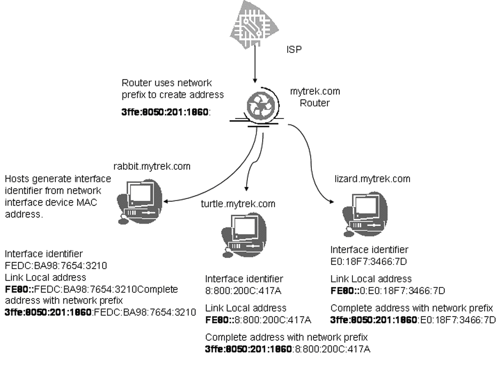

图 16-1：无状态 IPv6 地址自动配置

## 生成完整地址：路由器公告

一旦确定了链路本地地址，就会查询网络路由器以获取额外的配置信息。这些信息可以是有状态的、无状态的，或者两者兼有。对于无状态配置，会直接提供网络地址等信息；而对于有状态配置，主机会被引导至 `DHCP` 服务器，在服务器处获取配置信息。两者可以协同工作。通常使用无状态方法生成地址，而使用有状态的 `DHCP` 服务器提供其他配置信息（如 DNS 服务器地址）。

在无状态地址的情况下，路由器提供更大的网络地址，例如网络的 Internet 地址。随后，该地址被添加到本地地址中，替换掉原始的链路本地前缀，从而产生完整的全局 Internet 地址，或者在私有网的情况下，产生唯一本地地址（unique-local addresses）。路由器会例行发布此地址信息，尽管也可以通过特定请求获取。使用 `NDP` 查询这些信息。在地址正式分配之前，会通过重复地址检测程序检查该地址是否已在使用。该过程取决于路由器以路由器公告的形式提供适当的地址信息。如果没有路由器或路由公告，则必须使用如 `DHCP` 或手动配置等有状态方法提供地址。

图 16-1 显示了一个配置了无状态地址自动配置的网络。每个主机首先使用自己的 MAC 硬件地址确定接口标识符，为每个主机创建一个使用 `FE80::0` 前缀的临时链路本地地址。这允许主机与网络路由器进行初始通信。随后，路由器使用其网络前缀创建完整的 Internet 地址，替换掉链路本地前缀。

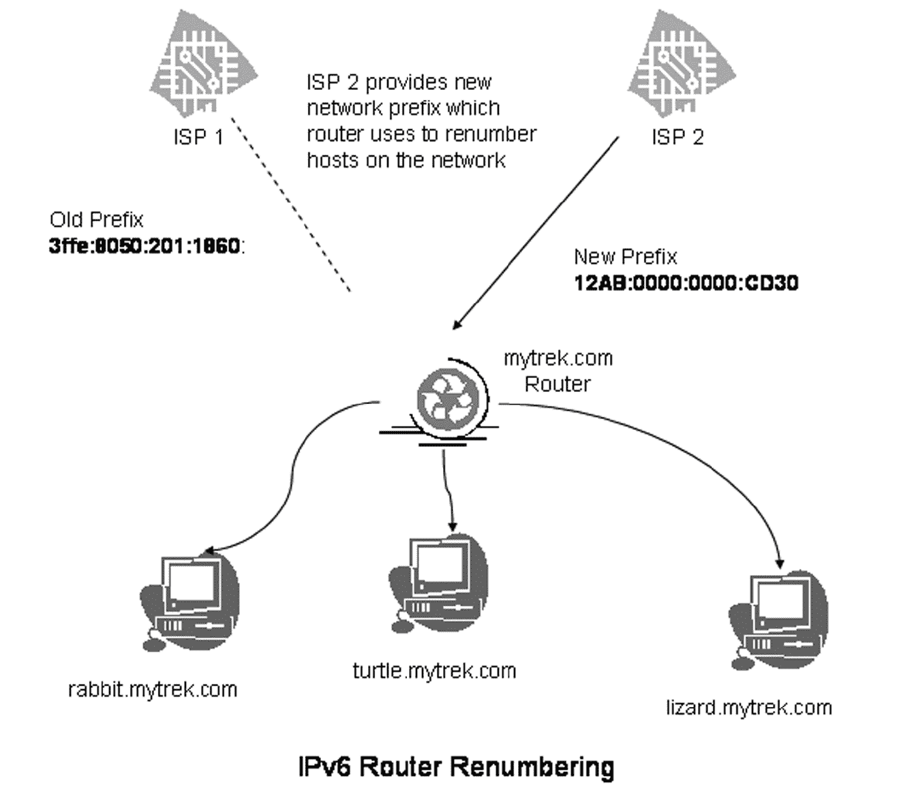

图 16-2：使用 IPv6 自动配置进行路由器重编号

## 路由器重编号

在 IPv6 中，路由器具有通过更改网络前缀来对其网络上的地址进行重编号的能力。重编号通过路由器重编号（`RR`）协议执行。（有关路由器重编号的描述参见 RFC 2894。）当网络更改 ISP 供应商并需要更改所有主机的网络地址时，经常使用重编号（参见图 16-2）。它也可以用于移动网络，网络可以接入不同的较大的网络并在每次运行时重编号。

通过重编号，路由器在生成地址时指定网络前缀的过期限制，对地址设置时间限制，类似于 `DHCP` 中的租约时间。为了平滑过渡，当新地址开始被使用时，接口仍将旧地址作为废弃地址（deprecated addresses）保留。新地址将成为任何新连接的首选地址（preferred addresses），而废弃地址则用于旧连接。实际上，一个主机可以有两个地址：一个被废弃的，一个首选的。这种地址的重新生成有效地对主机进行了重编号。

## 用于 IPv6 地址分配的 DHCP

`DHCP` 同时支持 IPv6 和 IPv4 地址。对于 IPv6 地址，通过 `dhcpd6` 命令启动 `DHCP` v6 服务器。与 IPv6 自动配置一样，首先会自动生成本地地址的主机标识符。这是一个链路本地地址，包含从主机接口 MAC 地址生成的主机标识符地址。

一旦确定了链路本地地址，就会查询路由器以获取 `DHCP` 服务器。这些信息通过定期广播的路由器公告提供。此时，服务器可以提供两种不同的有状态信息：地址和其他配置信息。主机会被通知提供了哪些类型的有状态信息。如果 `DHCP` 服务器未提供地址信息，则将使用上一节描述的无状态配置方法确定地址。如果提供了地址信息，则将从服务器获取地址，而不是直接生成。

## 作为 IPv6 路由器的 Linux：radvd

对于作为路由器的 Linux 系统，你使用 `radvd`（路由器公告守护进程）发布地址，并在 `/etc/radvd.conf` 文件中指定网络前缀（参考 Fedora 仓库）。`radvd` 守护会检测来自主机的网络地址请求（称为路由器请求），并使用路由器公告提供地址。这些路由器公告也会广播，为任何未发送请求的主机提供网络地址。为了让 `radvd` 工作，你需要开启 IPv6 转发。使用 `sysctl` 并将 `net.ipv6.conf.all.forwarding` 设置为 `1`。使用 `radvd` 启动脚本启动守护进程。要检查 `radvd` 发送的路由器地址，可以使用 `radvdump`。

你需要自行配置 `radvd` 守护进程，指定要广播的网络地址。然而，配置非常简单，因为完整地址将使用主机硬件地址自动生成。配置由接口项组成，接口项又列出接口选项、前缀定义和选项，以及所需的路由器定义。配置放置在 `/etc/radvd.conf` 文件，内容如下：

```
interface eth0 {
    AdvSendAdvert on;
    prefix fc00:0:0:0::/64
        {
            AdvOnLink on;
            AdvAutonomous on;
        };
};
```


这假设本地网络使用了接口 `eth0`。该接口配置列出了接口选项（`AdvSendAdvert`）和一个前缀定义，以及两个前缀选项（`AdvOnLink` 和 `AdvAutonomous`）。要为特定前缀指定前缀选项，请在前缀定义后的括号内添加。前缀定义指定了您的 IPv6 网络地址。如果局域网有自己的网络地址，您需要提供其 IPv6 网络前缀地址。对于私有网络（如家庭网络），可以使用唯一本地 IPv6 前缀，其工作方式类似于 IPv4 私有网络地址 `192.168.0`。上一个示例使用了一个用于私有 IPv6 网络的唯一本地地址 `fc00:0:0:0::`，其长度为 64 位。

`AdvSendAdvert` 接口选项开启向主机发送网络地址公告。`AdvAutonomous` 网络前缀选项提供自动地址配置，而 `AdvOnLink` 仅意味着可以在指定的网络接口上接收主机请求。

随后使用第二个网络接口将 Linux 系统连接到 ISP 或更大的网络。如果 ISP 支持 IPv6，这只需向 ISP 路由器发送路由器请求即可。这将使用连接到互联网的网络接口的硬件地址以及 ISP 路由器的公告网络地址自动生成您的互联网地址。在之前的图 16-2 中，`eth0` 网络接口连接到本地网络，而 `eth1` 连接到互联网。

# DHCP

DHCP 为连接到 TCP/IP 网络（无论是互联网还是内网）的系统提供配置信息。网络上的机器作为 DHCP 客户端，从其网络 DHCP 服务器获取网络配置信息。网络上的机器运行 DHCP 客户端守护进程，自动从网络的 DHCP 服务器接收网络配置信息。这些信息包括 IP 地址以及网络名称服务器、网关和代理地址（包括子掩码）。本地系统不需要手动配置任何内容，只需指定它应该从哪个 DHCP 服务器获取网络配置即可。这样做的额外优点是可以对网络上不同系统的网络配置进行集中控制。网络管理员可以通过 DHCP 服务器管理网络上所有系统的网络配置。

# DHCP 4

DHCP 4 服务器使用独立的服务器同时支持 IPv4 和 IPv6 地址。两者都是同一个 DHCP 软件包的一部分。

DHCP 服务器还支持几种 IP 地址分配方法：自动、动态和手动。自动分配为主机分配固的 IP 地址。手动分配分配由网络管理员指定的 IP 地址。通过动态分配，DHCP 服务器仅在主机实际需要使用时才为网络上的主机分配 IP 地址。动态分配从 IP 地址池中获取地址，主机在需要时使用这些地址，并在完成后释放。

DHCP 支持 DHCP 故障转移协议，即两个 DHCP 服务器支持同一个地址池。如果其中一个故障，另一个可以继续为网络提供 DHCP 服务。两台服务器保持同步状态，并且对于网络上的每个主机都拥有相同的网络支持信息副本。在该方案中，主服务器和备服务器通过 `primary` 和 `secondary` 语句指定。

不同的操作系统提供了多种 DHCP 服务器和客户端。Fedora 仓库提供了来自互联网软件联盟 (ISC) 的 DHCP 软件，位于 `https://www.isc.org/`。可用软件包括 DHCP 服务器、客户端和中继。DHCP 客户端称为 `dhclient`，DHCP 服务器称为 `dhcpd`（`dhclient` 和 `dhcp` 包）。

## 配置 DHCP 客户端主机

配置主机使用 DHCP 服务器只需为主机的网络接口设备（如以太网卡）设置选项即可。对于 Linux 主机，您可以使用发行版网络工具设置主机自动访问 DHCP 服务器获取网络信息。在配置 Internet 连接的网络工具选项卡上，您通常会找到一个选择 DHCP 的勾选框。勾选框将启用 DHCP。

客户端支持由 `dhclient` 工具实现。当您的网络启动时，它使用 `dhclient` 设置您的 DHCP 连接。虽然默认设置通常足够，但您可以使用 `/etc/dhclient.conf` 文件进一步配置 DHCP 客户端。请参阅 `dhclient.conf` 手页获取详细的配置选项列表。`dhclient` 在 `/var/lib/dhcp/dhclient.leases` 文件中保留 DHCP 连接的租约信息。您也可以直接运行 `dhclient` 来配置 DHCP 连接。

```
dhclient
```

## 为 IPv4 和 IPv6 地址配置 DHCP

DHCP 服务器包提供了一个单一服务器 `dhcpd` 同时用于 IPv4 地址配置和 IPv6 地址配置。每种寻址形式都有独立的配置文件：IPv4 使用 `/etc/dhcp/dhcpd.conf`，IPv6 使用 `/etc/dhcp/dhcpd6.conf`。IPv6 配置的文档集成在 DHCP 服务器的手页中。请参阅 `dhcpd.conf` 手页获取有关 IPv4 和 IPv6 路由的详情。IPv6 部分被标记为 DHCP6。`dhcp-options` 手页列出了 DHCP/DHCP6 选项。任何服务器运行时参数都可以在两种寻址方法对应的 `/etc/sysconfig` 文件中设置：`/etc/sysconfig.dhcpd` 和 `/etc/sysconfig/dhcpd6`。参数分配给 `DHCPDARGS` 变量。

对于 IPv4 路由，systemd 使用 `/lib/systemd/system` 目录下的 `dhcpd.service` 文件管理 DHCP 服务器。对于 IPv6 路由，它使用 `dhcpd6.service` 文件。DHCP 服务器在网络启动 (`After`) 之后并在多用户目标 (`WantedBy`) 下启动。它通过 `/usr/sbin/dhcpd` 命令启动，该命令从 `dhcpd.conf` 读取配置。`dhcpd6.service` 单元文件相同，只是 `dhcpd` 命令读取的是 `dhcpd6.conf` 文件并带有用于 IPv6 的 `-6` 选项。

```ini
dhcpd.service

[Unit]
Description=DHCPv4 Server Daemon
Documentation=man:dhcpd(8) man:dhcpd.conf(5)
Wants=network-online.target
After=network-online.target
After=time-sync.target

[Service]
Type=notify
EnvironmentFile=-/etc/sysconfig/dhcpd
ExecStart=/usr/sbin/dhcpd -f -cf /etc/dhcp/dhcpd.conf -user dhcpd -group dhcpd --no-pid $DHCPDARGS
StandardError=null

[Install]
WantedBy=multi-user.target
```

使用 `systemctl` 命令配合 `dhcpd` 或 `dhcpd6` 命令的 `start`、`restart` 和 `stop` 选项来管理服务器。以下示例使用 IPv4 或 IPv6 地址启动 DHCP 服务器。使用 `stop` 选项关闭它们，使用 `restart` 重启它们。

```bash
sudo systemctl start dhcpd
sudo systemctl start dhcpd6
```

动态分配的 IP 地址（称为租约）将为指定的时间分配。当租约过期时，可以扩展或生成新的。当前租约列在 `/var/lib/dhcp/` 目录下的 `dhcpd.leases` 文件中（IPv6 地址使用 `dhcpd6.leases`）。租约条目将指定 IP 地址、租约的开始和结束时间以及客户端的主机。

## DHCP 4 IPv4 服务器配置：/etc/dhcp/dhcpd.conf

dhcpd 服务器用于 IPv4 路由的配置文件为 `/etc/dhcp/dhcpd.conf`。dhcp 服务器的 `/usr/share/doc` 目录下有一个名为 `dhcpd.conf.sample` 的示例配置文件。还有一个用于 IPv6 路由的配置文件 `dhcpd6.conf.sample`。在命令行或终端窗口中，您可以使用以下命令移动到 DHCP 文档目录。

```bash
cd /usr/share/doc/dhcp*
```


在配置文件中，你指定了参数和声明，它们定义了 DHCP 服务器如何访问网络上的不同 DHCP 客户端，以及定义了 DHCP 服务器向客户端传递的信息的选项。这些参数、声明和选项可以针对某些子网或特定主机进行全局定义。全局参数、声明和选项适用于所有客户端，除非被子网声明或主机声明中相应的声明和选项所覆盖。从技术上讲，`dhcpd.conf` 文件中的所有条目都是可以是声明或参数的语句。所有语句都以分号结束。选项在 `options` 参数语句中指定。参数与声明的区别在于，参数定义了是否以及如何执行任务，例如分配租约多长时间。声明则描述了网络特征，例如要分配的地址范围或可访问的网络。请参见表 16-1 获取常用声明和选项列表。

### 声明

声明为 DHCP 服务器提供信息，或者指定其需要执行的动作。例如，`range` 声明用于指定动态分配给主机的 IP 地址范围：

```
range 192.168.0.5 192.168.0.128;
```

通过参数，你可以指定服务器如何处理客户端。例如，`default-lease-time` 声明设置了分配给客户端的租约秒数。`filename` 声明指定客户端使用的启动文件。`server-name` 声明告知客户端其启动的主机主机。`fixed-address` 声明可用于为客户端分配静态 IP 地址。请查看 `dhcpd.conf` 的 Man 页获取完整列表。

| 条目 | 描述 |
| :--- | :--- |
| **声明 (Declarations)** | |
| `shared-network name` | 表示某些子网是否共享相同的物理网络。 |
| `subnet subnet-number netmask` | 引用整个地址子网。 |
| `range [ dynamic-bootp ] low-address [ high-address];` | 提供动态分配的最高最低 IP 地址。 |
| `host hostname` | 引用特定的主机。 |
| `group` | 允许你对一组参数和声明进行标记，然后使用该标记将它们应用于子网和主机。 |
| `allow unknown-clients; deny unknown-clients;` | 不向未知客户端动态分配地址。 |
| `allow bootp; deny bootp;` | 决定是否响应 bootp 查询。 |
| `allow booting; deny booting;` | 决定是否响应客户端查询。 |
| **参数 (Parameters)** | |
| `default-lease-time time;` | 为租约分配长度（秒为单位）。 |
| `max-lease-time time;` | 分配租约的最大长度。 |
| `hardware hardware-type hardware-address;` | 指定网络硬件类型（以太网或令牌环）和地址。 |
| `server-name "name";` | 指定客户端启动的服务器名称。 |
| `next-server server-name;` | 指定用于加载 `filename` 中指定的初始启动文件的服务器。 |
| `fixed-address address [, address ... ];` | 为客户端分配固定地址。 |
| `get-lease-hostnames flag;` | 决定是否查找并使用客户端的 IP 地址。 |
| `authoritative; not authoritative;` | 拒绝无效的地址请求。 |
| `server-identifier hostname;` | 指定服务器。 |
| **选项 (Options)** | |
| `option subnet-mask ip-address;` | 指定客户端的子网掩码。 |
| `option routers ip-address [, ip-address... ];` | 指定客户端子网上的路由器 IP 地址列表。 |
| `option domain-name-servers ip-address [, ip-address... ];` | 指定客户端使用的域名服务器列表。 |
| `option log-servers ip-address [, ip-address... ];` | 指定客户端使用的日志服务器列表。 |
| `option host-name string;` | 指定客户端的主机名。 |
| `option domain-name string;` | 指定客户端的域名。 |
| `option broadcast-address ip-address;` | 指定客户端的广播地址。 |
| `option nis-domain string;` | 指定客户端的网络信息服务（NIS）域。 |
| `option nis-servers ip-address [, ip-address... ];` | 指定客户端可以使用的 NIS 服务器。 |
| `option smtp-server ip-address [, ip-address... ];` | 列出客户端使用的 SMTP 服务器。 |
| `option pop-server ip-address [, ip-address... ];` | 列出客户端使用的 POP 服务器。 |
| `option www-server ip-address [, ip-address... ];` | 列出客户端使用的 Web 服务器。 |

表 16-1：DHCP 声明、参数和选项

选项为客户端提供了它们可能需要访问网络服务的信息，例如网络的域名、客户端使用的域名服务器或广播地址。请查看 `dhcp-options` 的 Man 页获取完整列表。这些信息由 `option` 参数提供，如下所示：

```
option broadcast-address 192.168.0.255;
option domain-name-servers 192.168.0.1, 192.168.0.4;
option domain-name "mytrek.com";
```

你的 `dhcpd.conf` 文件通常以你为由 DHCP 服务器服务的网络定义的声明、参数和选项开头。以下示例为客户端提供了路由器（网关）、子网掩码、域名和 DNS 服务器信息。额外的参数定义了动态分配的 IP 地址的默认和最大租约时间。

```
option routers 192.168.0.1;
option subnet-mask 255.255.255.0;
option domain-name "mytrek.com ";
option domain-name-servers 192.168.0.1;
default-lease-time 600;
max-lease-time 7200;
```

通过 `subnet`、`host` 和 `group` 声明，你可以引用特定网络中的客户端、特定客户端或跨网络的不同客户端分组。在这些声明内部，你可以输入仅适用于这些客户端的参数、声明或选项。作用域内的声明、参数和选项包含在大括号中。例如，要为特定主机定义声明，你可以使用所示的 `host` 声明：

```
host rabbit {
  declarations, parameters, or options;
}
```

你可以使用 `group` 声明将不同的子网、全局声明收集在一起。在这种情况下，全局声明仅适用于组内定义的子网和主机。

### DHCP 的动态 IPv4 地址 地址你的 DHCP 服务器可以配置为从范围内选择 IP 地址并将其分配给不同的客户端。对于许多并不总是连接到网络的客户端，你可以使用较小的 IP 地址池为其高效提供服务。地址仅在需要时才会分配。通过 `range` 声明，你指定可以动态分配的地址范围。该声明接受两个参数：范围内的第一个和最后一个地址。

```
range 192.168.1.5 192.168.1.128;
```

例如，如果你正在设置自己的家庭网络，将使用以 `192.168\.` 开头的网络。范围将指定该网络可能的 IP 地址。因此，对于地址为 `192.168.0.0` 的网络，你放置 `range` 声明以及任何你想提供给客户端的其他信息。在以下示例中，从 192.168.0.1 到 192.168.0.128 的 IP 地址范围可以分配给网络上的主机：

```
range 192.168.0.5 192.168.0.128;
```

你还应该定义租约时间，包括默认和最大值：

```
default-lease-time 600;
max-lease-time 7200;
```

对于小型、简单的家庭网络，你只需要列出 `range` 声明以及所示所示任何全局选项。如果你的 DHCP 服务器管理多个子网，你将必须使用 `subnet` 声明。


为了给网络分配动态地址，`DHCP` 服务器要求你对网络拓扑结构进行映射。这意味着它需要知道哪些网络地址属于给定的网络。即使你只使用一个网络，也需要为它指定地址空间。你通过 `subnet` 声明来定义网络。在 `subnet` 声明内部，你可以指定用于该网络的任何参数、声明或选项。`subnet` 声明告知 `DHCP` 服务器给定 `subnet` 可能包含的 IP 地址。这是由网络 IP 地址和该网络的 `netmask`（子网掩码）决定的。下一个示例定义了一个地址空间从 `192.168.0.0` 到 `192.168.0.255` 的本地网络。`range` 声明允许从 `192.168.0.5` 到 `192.168.0.128` 分配地址。

```
subnet 192.168.1.0 netmask 255.255.255.0 {
    range 192.168.0.5 192.168.0.128;
}
```

`3.0` 之前的 `DHCP` 版本要求你甚至需要映射未由 `DHCP` 服务的连接网络接口。因此，每个网络接口都必须有一个相应的 `subnet` 声明。不受 `DHCP` 服务的接口没有此处所示的 `not authoritative` 参数（`192.168.2.0` 是一个不由 `DHCP` 服务的网络）。在 `3.0` 及更高版本中，`DHCP` 简单地忽略未映射的网络接口：

```
subnet 192.168.2.0 netmask 255.255.255.0 {
    not authoritative;
}
```

用于动态地址的非常简单的 `DHCP` 服务器的实现显示在下面的示例 `dhcpd.conf`文件中：

`/etc/dhcp/dhcpd.conf`

```
option routers 192.168.0.1;
option subnet-mask 255.255.255.0;
option domain-name "mytrek.com ";
option domain-name-servers 192.168.0.1;

subnet 192.168.1.0 netmask 255.255.255.0 {
    range 192.168.0.5 192.168.0.128;
    default-lease-time 21600;
    max-lease-time 43200;
}
```

### DHCP 4 IPv6 服务器配置

`DHCP` IPv6 地址配置文件是 `/etc/dhcp/dhcpd6.conf`。`IPv6` 地址（`DHCP6`）文档集成在 `DHCP` 手 页（`dhcpd`、`dhcpd.conf` 和 `dhcp-options`）中。检查 `/usr/share/doc/dhcp*` 中的 `dhcpd6.conf.sample` 文件。`IPv6` 配置与 `IPv4` 配置类似。某些选项是相同的，例如 `default-lease-time`。全局设置将具有 `dhcp6` 限定符，例如用于域名服务器的 `dhcp6.name-servers` 和 `dhcp6.preference`（详情见 `dhcp-options` 手页）。服务器租约文件由 `dhcpv6-lease-file-name` 设置。

```
dhcpv6-lease-file-name "/var/lib/dhcpd/dhcpd6.leases"
```

`subnet` 声明与 `IPv4` 配置类似，但使用了 `subnet6` 和 `range6` 命令以及 `IPv6` 地址。`subnet6` 声明使用 `CIDR` 表示法、`IPv6` 地址前缀和位掩码指定网络标识符。

```
subnet6 3ffe:501:ffff:100::/64 {
```

`range6` 指定可用地址，使用一个地址作为范围的上限，另一个作为下限，或者使用 `CIDR` 表示法来指定地址集。

```
range6 3ffe:501:ffff:100::10 3ffe:501:ffff:100::20;
```

作为安全替代方案，可以随机生成地址临时使用（`RFC 4941`）。在 `range6` 选项中添加 `temporary` 限定符，使用整个前缀用于临时地址。

```
range6 3ffe:501:ffff:100:: temporary;
```

以下示例基于示例 `dhcpd6.conf` 文件，定义了一个 `subnet` 范围。

```
subnet6 3ffe:501:ffff:100::/64 {
    range6 3ffe:501:ffff:100::10 3ffe:501:ffff:100::11;
}
```

你也可以分配 `IPVv6` 地址前缀。`prefix6` 语句委托了 `IPv6` 前缀（`RFC 3633`），为 `IPv6` 前缀指定地址范围（范围的高地址和低地址）。

```
prefix6 3ffe:501:ffff:100:: 3ffe:501:ffff:111:: /64
```

对于具有固定地址的客户端，你使用 `host` 声明和 `fixed-address6` 语句。`host-identifier` 语句使用选项来识别主机，例如指定客户端 `DHCP` 唯一标识符 (`DUID`) 的 `dhcpd6.client-id`。`DUID` 是基于网络设备硬件链路层地址（`duid-llt` 和 `duid-ll`）或供应商提供的标识符（`duid-en`）的永久标识符，详情见 `RFC 3315`。

```
host myclient {
    host-identifier option dhcpd6.client-id 00:01:00:01:00:04:93:e0:00:00:00:00:a2:a2;
    fixed-address6 3ffe:501:ffff:100::1234;
}
```

### DHCP 4 动态更新

对于也支持域名的网络，地址的动态分配有一个主要限制：`DHCP` 需要与 `DNS` 服务器同步。`DNS` 服务器将主机名与特定的 IP 地址关联，而在动态分配的情况下，`DHCP` 服务器为不同的主机分配地址。解决此问题的方案正在开发，被称为动态 DNS。通过动态 DNS，`DHCP` 服务器能够自动向 `DNS` 服务器更新其分配的 IP 地址。注意：如果你想静态同步 `DHCP` 和 `DNS` 服务器的固定地址，你需要为 DHCP 配置这些固定地址。然后你可以让 `DHCP` 服务器执行 `DNS` 查询以获取应分配的 IP 地址，或者手动在 `DHCP` 配置中分配相同的 IP 地址。执行 `DNS` 查询的优势是在 `DNS` 服务器一处指定 IP 地址。`DHCP` 服务器具有动态更新 `BIND` 区域文件的能力。通过在 `named.conf` 中指定 `allow-update` 在 `DNS` 服务器启用动态更新。此外，强烈建议使用 `TSIG` 密钥来验证 `DHCP` 和 `DNS` 服务器。两者必须使用相同的密钥。首先，你需要使用 `dns-keygen` 创建共享的 `TSIG` 密钥。在 `DNS` 服务器中，在 `named.conf` 文件中放置 `TSIG` 密钥声明，如下所示：

```
key mydhcperver {
    algorithm MD5;
    secret "example-secret";
};

zone "mytrek.com" {
    type master;
    file "mytrek.com";
    allow-update {key mydhcperver};
};

zone "168.192.in-addr.arpa" {
    type master;
    file "192.168";
    allow-update {key mydhcperver};
};
```

在 `DHCP` 服务器中，在服务器的 `dhcpd.conf` 文件中放置相应的 TSIG 密钥声明和 `allow-update` 条目，如示例所示。`key` 声明与 `DNS` 服务器的语法相同。随后使用 `DHCP` `zone` 语句指定域 IP 地址和使用的 `TSIG` 密钥。

```
key mydhcperver {
    algorithm MD5;
    secret "example-secret";
};

zone mytrek.com. {
    primary 192.168.0.1;
    allow-update {key mydhcperver};
};

zone 168.192.in-addr.arpa. {
    primary 192.168.0.1;
    allow-update {key mydhcperver};
};
```


DNS 和 DHCP 服务器的配置文件中，域名和 IP 地址需要完全匹配。与 `named.conf` 文件不同，`dhcpd.conf` 文件中的域名或 IP 地址周围没有引号。在 `dhcpd.conf` 文件中，`zone` 语句中使用的域名和 IP 地址也同样需要以句号结尾，这与 DNS 区域文件相同。`key` 语句列出了要使用的密钥。虽然 DHCP 服务器会尝试确定要更新的 DNS 服务器，但建议你在 `zone` 条目中使用主服务器语句来显式地指定它们。

为了生成一个用于 DNS 更新的完全限定主机名（FQDN），DHCP 服务器通常会使用自己的域名和 DHCP 客户端提供的主机名（异常情况请参见 `dhcpd.conf` 手页）。如果你想为某个主机分配特定的主机名，可以使用 `ddns-hostname` 语句在主机的硬件部分指定它。域名由 `domain-name` 选项指定：

```
option domain-name "mytrek.com"
```

可以使用 `ddns-update-style` 语句开启或关闭所有域的 DNS 更新。默认是开启的。若要关闭特定域的 DNS 更新，可以使用 `ddns-updates` 语句。这默认也是开启的。

## DHCP 4 IPv4 子网

如果你将网络空间划分为若干个子网，可以使用单个 DHCP 服务器管理它们。在这种情况下，你将为每个子网准备一个 `subnet` 声明。如果你正在建立自己的小型网络，你可以使用以 `192.168\.` 开头的网络地址。范围（range）指定了网络内可能的 IP 地址，因此对于地址为 `192.168.0.0` 的网络，你创建一个网络掩码为 `255.255.255.0` 的 `subnet` 声明。在该声明中，你放置一个 `range` 声明以及你想提供给客户端任何其他信息。在接下来的示例中，可以将从 `192.168.0.1` 到 `192.168.0.75` 的 IP 地址范围分配给该网络上的主机：

```
subnet 192.168.0.0 netmask 255.255.255.0 {
    range 192.168.0.1 192.168.0.75;
}
```

你可能想为每个子网指定不同的策略，例如不同的租用时间。`subnet` 声明中的任何条目都会覆盖全局设置。因此，如果你设置了全局租用时间，`subnet` 声明中的租用设置将覆盖该子网设置。下一个示例为不同的子网设置了不同的租用时间以及不同的地址分配。第一个子网的租用时间取自全局租用时间，而第二个子网则定义了自己的租用时间：

```
default-lease-time 21600;
max-lease-time 43200;

subnet 192.168.1.0 netmask 255.255.255.0 {
    range 192.168.0.5 192.168.0.75;
}

subnet 192.168.1.128 netmask 255.255.255.252 {
    range 192.168.0.29 192.168.0.215;
    default-lease-time 56000;
    max-lease-time 62000;
}
```

如果你的子网属于同一个物理网络，你需要通过将它们声明为共享网络（shared networks）来告知服务器此事实。你通过在 `shared-network` 声明内部放置 `subnet` 声明并指定共享网络的名称来实现该名称可以是任何描述性名称，尽管你可以使用域名。`shared-network` 声明内部且 `subnet` 声明之外的任何选项对于这些子网都是全局性的。在下一个示例中，子网属于同一个物理网络，并放置在 `shared-network` 声明中：

```
shared-network mytrek.com {
    default-lease-time 21600;
    max-lease-time 43200;
    subnet 192.168.1.0 netmask 255.255.255.0 {
        range 192.168.0.5 192.168.0.75;
    }
    subnet 192.168.1.128 netmask 255.255.255.252 {
        range 192.168.0.29 192.168.0.215;
        default-lease-time 56000;
        max-lease-time 62000;
    }
}
```

## DHCP 4 IPv4 固定地址

与其使用一个可能的 IP 地址池，你可能想为每个主机分配一个特定的地址。使用 DHCP 服务器仍然可以让你控制哪个地址将分配给特定的主机。然而，要为特定主机分配地址，你需要知道该主机网络网卡（NIC）的硬件地址。实际上，你必须告知 DHCP 服务器需要将特定的网络连接设备与指定的 IP 地址关联。为了做到，DHCP 服务器需要知道你指的是哪个网络设备。你可以通过硬件地址（即 MAC 地址）来识别网络设备。要查找客户端的硬件地址，你需要登录客户端并使用 `ifconfig` 命令查找有关网络设备的信息。列出所有网络设备请使用 `-a` 选项。如果你知道网络设备名称，可以使用它。下一个示例将列出关于第一个以太网设备 `eth0` 的所有信息：

```
ifconfig eth0
```

这将列出客户端所有网络设备的信息。带有 `hwaddr` 项的条目（通常是第一个）将显示 MAC 地址。一旦获得 MAC 地址，你可以在 DHCP 服务器上使用它为该设备分配特定的 IP 地址。

在 `dhcpd.conf` 文件中，你使用 `host` 声明为客户端设置固定地址。在 `host` 声明内部，你放置一个 `hardware` 选项，其中列出网络连接设备的类型及其 MAC 地址。然后你使用 `fixed-address` 参数指定分配给该设备的 IP 地址。在下面的示例中，MAC 地址为 `08:00:2b:4c:29:32` 的客户端网络设备被分配了 IP 地址 `192.168.0.2`：

```
host rabbit {
    option host-name "rabbit.mytrek.com"
    hardware ethernet 08:00:2b:4c:29:32;
    fixed-address 192.168.0.2;
}
```

你也可以让 DHCP 服务器执行 DNS 查询以获取主机的 IP 地址。这种方法的优点是让你只在一处处（即 DNS 服务器）管理 IP 地址。当然，这要求 DNS 服务器处于运行状态，以便 DHCP 服务器能够确定 IP 地址。例如，一个代理服务器连接（可以提供直接的 Web 访问）运行只需要 IP 地址，而不是 DNS 主机名。如果 DNS 服务器宕机，前面的示例仍会为主机分配 IP 地址，而接下来的示例则不会：

```
host rabbit {
    option host-name "rabbit.mytrek.com"
    hardware ethernet 08:00:2b:4c:29:32;
    fixed-address rabbit.mytrek.com;
}
```

你还可以使用 `host` 声明为无盘工作站或终端定义网络信息。在这种情况下，你添加一个 `filename` 参数，指定用于该工作站或终端的启动文件。在这里，名为 `myterm` 的终端从服务器 `turtle.mytrek.com` 获取启动信息：

```
host myterm {
    option host-name "myterm.mytrek.com"
    filename "/boot/vmlinuz";
    hardware ethernet 08:00:2b:4c:29:32;
    server-name "turtle.mytrek.com";
}
```

固定地址的一个常见候选对象是网络的 DNS 服务器。通常，你希望 DNS 服务器位于相同的 IP 地址，以便可以直接访问。然后， DHCP 服务器可以将此 IP 地址提供给其客户端。


Linux 设计旨在同时为多个用户服务，在用户与系统资源、服务和设备之间提供接口。用户拥有自己的 shell，通过它与操作系统进行交互，但你可能仍然需要以不同的方式配置操作系统本身，例如添加新用户、管理打印机和扫描仪等设备以及访问文件系统。此类操作属于系统管理的范畴。执行此类操作的人被称为系统管理员或超级用户（superuser）。从这个意义上说，与 Linux 的交互有两种类型：普通用户的交互以及执行系统管理任务的超级用户交互。本节章节涵盖了更改系统运行级别、管理用户、安装软件和编译内核等操作。你通常很少执行这些任务中的大部分，例如添加新打印机或挂载文件系统。有关 Fedora 上系统管理任务的详细文档和配置，请参阅《Fedora 系统管理指南》。

[https://docs.fedoraproject.org/f28/system-administrators-guide/index.html]

## Fedora 管理工具

在 Fedora 上，大多数管理任务可以由一组由 Red Hat、Fedora 和 GNOME 开发并支持的独立专用管理工具来处理，例如用户管理和打印机配置的工具。其中大多数是基于桌面的，并可以在 GNOME 上运行。你可以作为任何用户从用户菜单中的系统设置中访问 GNOME 桌面工具。在这里，你将找到设置日期、管理用户和配置打印机的工具。“用户账户”（User Accounts）允许你创建和编辑用户。“打印机”（Printers）允许你安装和重新配置打印机。所有工具都提供了非常直观且易于使用的桌面界面。工具通过简单的描述性术语标识。此外，你还可以使用以 `system-config` 开头的旧版管理工具。例如，打印机配置工具列为 `Printing`，但其实际名称为 `system-config-printer`。你可以在终端窗口中输入其名称来单独调用任何工具。[表 17-1] 列出了 Fedora 管理工具列表。

| Fedora 管理工具 | 描述 |
| :--- | :--- |
| `system-config-users` | 用户和组配置工具 |
| `GNOME users` | 用户配置工具 |
| `system-config-printer` | 打印机配置工具 |
| `system-config-rootpassword` | 修改 root 用户密码 |
| `system-config-selinux` | 管理和配置 SELinux |
| `Network Manager` | 自动化无线和标准网络连接。 |
| `cockpit` | 启动和停止服务器，以及启用和禁用它们。 |
| `firewall-config` | 为 FirewallD 设置网络防火墙。 |
| `system-config-firewall` | 为 iptables 设置网络防火墙。 |
| `system-config-httpd` | 配置 Apache Web 服务器。 |

表 17-1: Fedora 配置工具

## 系统目录

你的 Linux 文件系统组织成各种目录，其文件被用于不同的系统功能（见[表 17-2]）。对于基础系统管理，你应该熟悉存放应用程序的系统程序目录、存放大多数配置文件的系统配置目录（`/etc`）以及存放记录系统活动日志的系统日志目录（`/var/log`）。其他系统目录将在各自的章节中介绍。

| 目录 | 描述 |
| :--- | :--- |
| `/bin` | 系统相关程序 |
| `/sbin` | 系统程序 |
| `/usr/sbin` | 用于用户相关任务的系统程序 |
| `/lib` | 系统和应用程序库 |
| `/etc` | 系统、网络服务及应用程序的配置文件 |
| `/home` | 用户主目录和服务器数据目录的位置（如 Web 和 FTP 站点文件） |
| `/run/media` | 可移动式磁盘和介质挂载的位置（DVD、USB 驱动器） |
| `/var` | 文件不断变化的系统目录位置，例如日志、打印机堆栈文件和锁文件 |
| `/usr` | 用户相关的程序和文件。包括几个关键子目录，如 `/usr/bin`、`/usr/X11` 和 `/usr/doc` |
| `/usr/bin` | 用于用户的程序 |
| `/dev` | 用于设备文件的动态生成目录 |
| `/etc/X11` | X Window 系统配置文件 |
| `/usr/share` | 共享文件 |
| `/usr/share/doc` | 应用程序文档 |
| `/tmp` | 系统临时文件目录 |
| `/var/log` | 日志目录 |

表 17-2: 系统目录

### 程序目录

名称中包含“bin”的目录用于存放程序。`/bin` 目录存放基础用户程序，例如登录 shell（`BASH`、`TCSH` 和 `ZSH`）和文件命令（`cp`、`mv`、`rm`、`ln` 等）。`/sbin` 目录存放用于此类任务的专用系统程序，例如文件系统管理（`fsck`、`fdisk`、`mkfs`）和系统启动操作（init）。`/usr/bin` 目录存放为用户任务设计的程序文件。`/usr/sbin` 目录存放用户相关的系统操作，例如添加新用户的 `useradd`。`/lib` 目录存放系统使用的所有库，包括主 Linux 库 `libc` 以及存放所有当前内核模块的子目录（如 `modules`）。

## 配置目录和文件

当你配置系统的不同元素（如用户、应用程序、服务器或网络连接）时，你会使用存储在某些系统目录中的配置文件。配置文件存放在 `/etc` 目录，更具体的设备和服务配置位于 `/etc/sysconfig` 目录。

### 配置文件：/etc

`/etc` 目录存放你的系统、网络、服务器和应用程序配置文件。在这里，你可以找到列出文件系统的 `fstab` 文件、包含系统内主机 IP 地址的 `hosts` 文件，以及用于 GRUB 引导加载选项的 `/etc/default/grub`。该目录包含各种子目录，例如用于 Apache Web 服务器配置的 `/etc/httpd`、用于 X Window 系统和窗口管理器配置的 `/etc/X11`，以及用于在 `/dev` 中生成设备规则 `/etc/udev`。你可以通过直接编辑配置文件来配置许多应用程序和服务，但最好使用相应的管理工具。[表 17-3] 列出了在 `/etc` 目录中常见的几种常用配置文件。

### /etc/sysconfig

在 Red Hat 和 Fedora 系统上，配置和启动信息也保留在 `/etc/sysconfig` 目录中。在这里，你会找到包含 Web 服务器或 IPtables 防火墙等服务的运行时选项定义。这些条目是在安装服务软件时为你定义的。

若干设备和系统文件已从 `/etc/sysconfig` 中移除，并被 `/etc` 目录中的配置文件取代。`/etc/sysconfig` 中的键盘、时钟和 `i18n` 文件已弃用。键盘的设备配置已从 `/etc/sysconfig/keyboard` 移动到 `/etc/vconsole.conf`。时区信息通过创建指向适当时区文件的链接 `/etc/localtime` 实现。语言设置在 `/etc/locale.conf` 中指定。

## 系统日志、journal 和 journald


在系统上执行的任务的各种系统日志由 `journald` 日志守护进程存储和管理。实际上，日志现在被认为是可以由 `systemd` 守护进程 `journald` 访问的日志。从命令行（终端窗口），你可以使用 `journalctl` 命令来访问消息。`-f` 选项显示最后几条消息，等于显示旧 `/var/log/messages` 文件中的最后几条消息。以下命令列出了最后几条消息：

```
journalctl -f
```

要查看上次系统启动（boot）的日志，你可以使用 `-b` 选项。

| 文件 | 描述 |
| :--- | :--- |
| `/etc/bashrc` | Bash shell 默认配置文件 |
| `/etc/group` | 包含组列表以及每个组的配置 |
| `/etc/fstab` | 在启动系统时自动挂载文件系统 |
| `/boot/grub/` | GRUB 引导器的 GRUB 配置文件 |
| `/etc/profile` | 用户默认 shell 配置文件 |
| `/etc/mtab` | 当前挂载的文件系统 |
| `/etc/passwd` | 包含用户密码和登录配置 |
| `/etc/services` | 系统上运行的服务及其使用的端口 |
| `/etc/shadow` | 包含用户加密密码 |
| `/etc/shells` | 系统上安装的用户可使用的 shell |
| `/etc/sudoers` | 控制管理访问的 sudo 配置 |
| **目录** | |
| `/etc/cron` | Cron 脚本 |
| `/etc/cups` | CUPS 打印机配置文件 |
| `/etc/systemd/system` | systemd 单元文件，可修改 |
| `/lib/systemd/system` | systemd 单元文件 |
| `/etc/modprobe.d` | 内核模块配置文件的目录 |
| `/etc/open-ldap` | Open LDAP 服务器配置 |
| `/etc/skel` | 存放初始化文件版本的目录（如 `.bash_profile`），这些文件会被复制到新用户的家目录 |
| `/etc/sysconfig` | Red Hat 和 Fedora 服务配置环境
| `/etc/terminfo` | 包含可连接到系统的终端类型规范 |
| `/etc/X11` | X Window 系统配置文件 |
| `/etc/xinetd.d` | 由 Xinetd 服务器管理的配置脚本（已弃用） |
| `/etc/udev` | 生成设备的规则 |

表 17-3：配置文件和目录

```
journalctl -b
```

要查看特定服务的消息，你可以使用 `-u` 选项和单元服务文件的名称，例如 `smb.service`。以下列出了 samba 服务器的消息。

```
journalctl -u smb.service
```

通过 `--since` 和 `--until` 选项，你可以进一步指定时间。

```
journalctl -u smb.service --since=12:00
```

如果你愿意，仍然可以安装并运行旧的 `rsyslogd`，它将消息存储在 `/var/log/messages` 文件中。

要查看这些日志，你可以使用 GNOME Logs（工具 | 日志，GNOME 软件中的 GNOME Logs，或软件包中的 `gnome-logs` 软件包）。侧边栏列出了不同的日志类别：重要、全部、应用程序、系统、安全和硬件。选择其中一项会在右侧面板中显示日志。右上角的搜索按钮打开搜索框，你可以在其中搜索所选日志中的消息，并通过字段和时间修改搜索。右上角的保存按钮允许将日志保存到文件。日志通过 `journalctl` 查询 `journald` 守护进程获取日志报告。

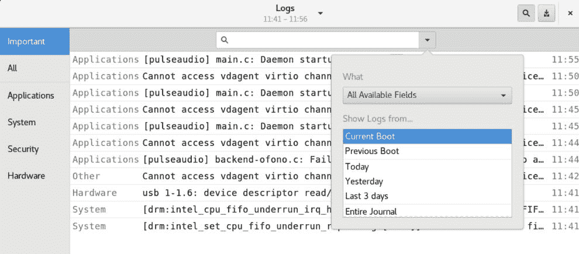 

图 17-1：GNOME Logs

## 性能分析工具和进程

Linux 将系统上执行的每个任务视为进程，并分配一个数字和一个名称。你可以检查这些进程，并启动和停止它们。Fedora 提供了几个工具来检查进程以及你的系统性能。

| 性能工具 | 描述 |
| :--- | :--- |
| `glances` | 综合系统和网络监控 |
| `vmstat` | 系统组件性能 |
| `top` | CPU 密集型进程列表 |
| `free` | 空闲 RAM 内存列表 |
| `sar` | 系统活动信息 |
| `iostat` | 磁盘使用情况 |
| `GNOME System Monitor` | 用于进程和使用监控的系统监视器（系统 | 管理 | 系统监视器） |
| `KDE System Monitor` | 用于进程和使用监控的 KDE 系统监视器 |
| `Frysk` | 系统进程监控工具 |

表 17-4：性能工具

### Glances

`glances` 是一个在终端窗口中、通过 `glances` 命令从命令行运行的综合系统监控工具。它显示系统、网络、磁盘、文件系统、传感器和进程的详细资源使用情况。它还会警告任何关键告警。系统部分涵盖了详细的内存、CPU、交换分区和负载使用情况。网络部分显示了每个网络设备的活动。Disk I/O 部分列出了你的存储设备及其读/写使用情况。File Sys 部分显示你所有的分区以及使用了多少内存。Sensors 部分显示了传感器检测到的温度，例如 CPU、GPU 和环境温度。Tasks 部分按 CPU 使用率列出你的活动进程，显示内存使用、pid、用户和命令。按 `q` 结束 `glances` 会话。

`glances` 组织成多个模块，你可以禁用这些模块以只显示有限的报告。例如，如果你对磁盘 I/O 报告感兴趣，可以使用 `--disable-diskio` 选项禁用 `diskio` 模块。查看 `glances` 手页以获取你可以使用的模块选项完整列表。

```
glances --disable-diskio
```

还有几个运行时命令可以用来显示和隐藏模块，例如 `f` 切换文件系统报告的开启、`d` 切换磁盘 I/O、`n` 用于网络统计、`s` 显示传感器以及 `p` 按名称排序进程。

### vmstat, free, top, iostat, dstat, and Xload

从终端窗口，你可以使用 `vmstat`、`free`、`top` 和 `iostat` 等工具监控你的系统（`systat` 软件包）。`vmstat` 命令输出详细列表，指示不同系统组件的性能，包括 CPU、内存、I/O 和交换操作。报告以行形式发布，带有不同组件的字段。如果你提供一个时间段作为参数，它会在指定的间隔（通常为几秒）重复。`top` 命令提供了系统中 CPU 密集型进程列表，显示哪些进程正在使用你的大部分资源。列表是实时的，并且每几秒更新一次。提供了更改进程状态（如其优先级）的命令。

`free` 命令列出系统上空闲 RAM 内存量，显示使用了多少、空闲多少，以及用于缓冲区和交换内存的量。`Xload` 是一个 X Window 系统工具，显示负载、CPU 和内存，`iostat` 显示你的磁盘使用情况，`sar` 显示系统活动。

### Frysk

`sk` 是一个用于系统进程的专用复杂监控工具。通过 `Frysk`，你可以设置非常特定的监控任务，关注特定的应用程序，并从一组观察进程中选择以提供有关退出通知、系统调用和执行的信息。你还可以为进程创建自定义的观察者。在 [`sourceware.org/frysk`](http://sourceware.org/frysk) 了解更多关于 `Frysk` 的信息。

### GNOME System Monitor

在 GNOME 桌面（Fedora Workstation，GNOME System Monitor 显示系统信息并监控系统进程（工具 | 系统监视器）。它有三个选项卡：进程、资源和文件系统。`Resources` 选项卡显示 历史、内存和交换历史以及网络历史的图表。如果你的系统具有多核 CPU，`CPU History` 图表将显示每个 CPU 的使用情况。`Memory and Swap Memory` 图表显示内存的使用量。`Network History` 图表同时显示发送和接收的数据量，以及当前会话的总计。


`File Systems` 标签页列出了你的文件系统，包括它们的挂载位置、类型以及已磁盘空间和可用空间。你可以按任何类别对列表进行排序。设备、目录和类型名称按字母顺序列出。总空间、可用和已空间按数字升序或降序排序。双击文件系统项将在文件管理器窗口中打开该文件系统。

`Processes` 标签页列出了你的进程，让你对进程进行排序和搜索。你可以使用字段按钮按名称（`Process Name`）、进程 ID（`ID`）、使用率（`%CPU`）和内存使用（`Memory`）等进行排序。菜单（菜单栏右侧）允许你选择所有进程、自己的进程（`My Processes`）或活动进程。你可以通过选择进程并点击 `End Process` 按钮（右下角），或右键点击并选择 `End` 来停止任何进程。你可以右键点击进程项以显示可以对所选进程执行的操作菜单，例如停止（`Stop`）、结束（`End`）、杀死（`Kill`）和继续（`Continue`），以及更改进程优先级（`Change Priority`）。`Open Files` 项会打开一个对话框，列出进程使用的所有文件、套接字管道。`Properties` 项显示一个对话框，显示进程的所有详细信息，如名称、用户、状态、内存使用、CPU 使用和优先级。`Memory Maps` 从 `Memory Maps` 项中选择，显示所选进程的虚拟内存、inodes 和标志信息。

显示功能（如用于 CPU 图表的颜色）可以使用 `dconf editor` 中 `org | gnome | gnome-system-monitor` 路径下的 `gnome-system-monitor` 键进行设置。

 结束进程

你可以使用 `pkill` 命令配合进程名或进程 ID 来结束进程。使用进程名时，输入 `-n` 选项进程名以获取该名称的最近一个进程。

```
pkill -n firefox
```

你还可以在终端窗口中使用 `kill` 命令来结束进程。`kill` 命令接受进程 ID 作为参数。确保获取了正确的 ID。输入错误的进程 ID 可能会导致你的系统崩溃。使用 `ps` 命令显示进程 ID。你可以使用 `-C` 选项或 `-aux` 选项搜索进程。带有 `-C` 选项的 `ps` 命令搜索特定的应用程序名称。`-o pid=` 选项仅显示进程 ID，而不是进程 ID、时间、应用程序名称和 tty。一旦获取了进程 ID，你就可以使用进程 ID 作为参数运行 `kill` 命令来结束进程。

```
$ ps -C firefox -o pid=
5555
$ kill 5555
```

确保数字正确的一种方法是使用 `ps` 命令直接将进程号作为 `kill` 命令的参数返回。停止进程的方法是首先执行 `ps` 命令获取 `firefox` 进程的进程 ID（反引号），然后在 `kill` 命令中使用该进程 ID 来结束进程。`-o pid=` 选项仅显示进程 ID。

```
kill `ps -C firefox -o pid=`
```

若要使用模式搜索进程，可以使用带有 `-aux` 选项的 `ps` 命令列出所有进程，并将输出管道到带有指定模式的 `grep` 命令中。以下命令列出了所有的 X Window System 进程：

```
ps -aux | grep 'firefox'
```

你可以使用 `pidof` 命令仅获取进程 ID。

```
pidof firefox
```

在桌面上，如果你必须强制退出某个进程或应用程序，可以使用 GNOME 系统监视“进程”标签页来查找、选择并停止它。你应该确保这是你想停止的进程。结束关键进程可能会导致你的系统崩溃。

应用程序进程将以应用程序命名，你可以使用它们来强制应用程序退出。手动结束进程通常用于无法正常停止的开放式操作。点击左下角的按钮显示所选进程的属性。右上角的菜单按钮显示显示选项，如活动、所有、你的进程以及以可展开树形排列显示其依赖关系的进程。同样位于右上角的搜索按钮会打开搜索框，让你搜索进程。

## 任务调度：systemd.timers 和 cron

调度定期的维护任务（如备份）可以使用 systemd 定时器或 cron 服务进行。systemd 定时器是运行服务文件的 systemd 文件。查看 `systemd.timers` 的 man 页面以获取有关定时器的详细说明。它们的扩展名为 `.timer`。定时器文件会自动运行一个具有相同名的对应服务文件。例如，`dnf-automatic.timer` 将运行 `dnf-automatic.service` 文件。定时器文件只包含调度信息。它的文件名决定了运行哪一个服务文件。可以在定时器文件中通过 `Unit` 指令指定不同的服务文件。如果你想运行一个没有服务文件的命令行操作，可以为该命令创建一个带有 `ExecStart` 条目的自定义服务。

定时器文件有一个 `timer` 部分，你在其中定义了服务文件的运行时间。有一些相对于某些起始点（如系统启动时）的选项，以及引用日历日期的 `OnCalendar` 。`OnCalendar` 选项使用 `systemd.time` man 页面定义的日历事件表达式。一个日历事件表达式由星期、年、月和时间组成。时间以小时、分、秒指定并用冒号分隔。星期范围用两个点分隔，特定的周几用逗号分隔。留空年份或月份则选择任何年份或月份。以下引用了 5 月下午 2 点的周几。

```
OnCalendar=Mon..Fri 05 14:00
```

你可以创建定时器文件并将它们放在 `/etc/systemd/system` 目录。如果你还需要为它设置一个服务文件，可以将其放在相同目录中。要激活定时器，确保使用 `systemctl` 启用它。如果你创建了服务文件，也要启用它。

你仍然可以使用旧的 cron 服务来调度任务。cron 服务是由 `cron` 守护进程实现的，它不断检查某些操作。这些任务列在 `crontab` 文件中。`cron` 守护进程检查用户的 `crontab` 文件以查看何时执行这些操作。任何用户都可以设置 `crontab` 文件。root 用户可以设置 `crontab` 文件来执行系统管理操作，例如每周或每月特定时间备份文件。守护进程的名为 `crond`。

你还可以手动启动和停止 `crond` 服务，你可能需要在紧急维护或升级期间这样做。使用 `systemctl` 命令和 `stop` 选项关闭服务，使用 `start` 选项重新运行，使用 restart 重启：

```
sudo systemctl stop crond
```

Cron 任务调度保存在类似 `/etc/crontab` 文件中。一个条目有六个字段：前五个用于指定操作时间，最后一个字段是操作本身。第一个字段指定分钟（0–59），第二个字段指定小时（0–23），第三个字段指定日期（1–31），第四字段指定月份（1–12，或月份前缀如 `Jan` 和 `Sep`），第五字段指定星期（0–6，或星期前缀如 `Wed` 和 `Fri`）， 0 代表星期日。在每个时间字段中，你可以指定范围、一组值或使用星号表示所有值。例如，星期字段中的 `1-5` 指定从周一到周五。在小时字段中，`8`、`12`、`17` 将指定上午 8 点、中午和下午 5 点。月份字段中的 `*` 表示每个月。cron 字段的格式如下：

```
minute  hour  day-month  month  day(s)-week  task
```

以下示例用于在每个工作日的下午 2 点备份项目目录：


```
0 2 * * 1-5  tar cf /home/backp /home/projects
```

相同的条目使用月份和星期几的前缀再次列出：

```
0 2 * * Mon-Fri tar cf /home/backp /home/projects
```

要指定特定的月份、日期、星期或小时，你可以逐个列出，并用逗号分隔。例如，若要在周日、周三和周五执行之前的任务，你可以在星期字段中使用 `0,3,5`，或者使用它们等价的前缀形式 `Sun,Wed,Fri`。

```
0 2 * * 0,3,5  tar cf /home/backp /home/projects
```

`cron` 也支持注释。注释是任何以 `#` 号开头的行。

```bash
# Weekly backup for Chris's projects

0 2 * * Mon-Fri  tar cf /home/backp /home/projects
```

`cron` 服务还允许你定义执行任务时使用的环境变量。Fedora 定义了 `SHELL`、`PATH`、`HOME` 和 `MAILTO` 变量。`SHELL` 指定用于执行任务的 shell，在本例中为 `bash` shell。`PATH` 列出了可以找到程序和脚本的目录。此示例列出了标准目录 `/usr/bin` 和 `/bin`，以及为系统应用程序保留的系统目录 `/usr/sbin` 和 `/sbin`。`MAILTO` 指定任务结果发送给谁。默认情况下，这些结果发送给调度任务的用户，但你可以让结果发送给特定用户，例如管理员的电子邮件地址或网络上另一个系统的账户。`HOME` 是任务的家目录，在本例中为根目录。

```bash
SHELL=/bin/bash
PATH=/sbin:/bin:/usr/sbin:/usr/bin
MAILTO=root
HOME=/
```

在被频繁使用的系统上，`/etc/crontab` 文件很容易变得拥挤。可能存在某些条目需要不同变量的情况。例如，你可能需要在不同的 shell 下运行某些任务。为了更好地组织 `cron` 任务，你可以将条目放在 `cron.d` 目录下的文件中。`cron.d` 目录中的文件都包含与 `/etc/crontab` 中相同格式的条目。它们可以赋予任何名称。它们被视为添加的 `crontab` 文件，`cron` 会检查它们以运行任务。例如，Fedora 在 `cron.d` 中安装了一个 smolt 文件，其中包含运行收集硬件配置工具的条目。

### crontab 命令

你使用 `crontab` 命令将条目安装到 `crontab` 文件中。执行此操作，首先创建一个文本文件并输入你的 `crontab` 条目。以你喜欢的名称保存此文件，例如 `mycronfile`。然后，要安装这些条目，输入 `crontab` 和文件名。`crontab` 命令会获取文本文件的内容并在 `/var/spool/cron` 目录下创建一个 `crontab` 文件，同时添加发布命令的用户名。在以下示例中，root 用户将 `mycronfile` 的内容安装为 root 的 `crontab` 文件。这会创建一个名为 `/var/spool/cron/root` 的文件。如果名为 `justin` 的用户安装了 `crontab` 文件，它将创建一个名为 `/var/spool/cron/justin` 的文件。你可以通过 `/etc/cron.allow` 文件控制普通用户对 `crontab` 命令的使用。只有文件中列出名字的用户才能创建自己的 `crontab` 文件。相反，`/etc/cron.deny` 文件列出了被拒绝使用 `cron` 工具的用户，防止他们调度任务。如果这两个文件都不存在，则所有用户的访问都会被拒绝。如果用户不在 `/etc/cron.allow` 文件中，则访问被拒绝。然而，如果 `/etc/cron.allow` 文件不存在，但 `/etc/cron.deny` 文件存在，则所有未列在 `/etc/cron.deny` 中的用户都将自动允许访问。

```
crontab mycronfile
```

永远不要尝试直接编辑你的 `crontab` 文件。相反，使用带有 `-e` 的 `crontab` 命令。这将使用标准文本编辑器（如 `vi`）在 `/var/spool/cron` 目录下打开你的 `crontab` 文件。`crontab` 使用由 `EDITOR` 环境变量指定的默认编辑器。要为 `crontab` 使用不同的编辑器，可以通过将编辑器的程序名赋予 `EDITOR` 变量并导出该变量来更改默认编辑器。通常，编辑器变量设置在 `/etc/profile` 脚本中。

带有 `-l` 选项运行 `crontab` 会显示 `crontab` 文件的内容，`-r` 选项删除整个文件。使用另一个带有 `crontab` 条目的文本文件调用 `crontab` 将覆盖你当前的 `crontab` 文件，用文本文件的内容替换它。

### 组织调度任务

你可以将管理 `cron` 任务组织为大类：可以定期运行的常见管理任务，或需要在特定时间运行的特殊任务。特殊任务可以像下一节所示，作为 `/etc/crontab` 文件中的条目运行。常见管理任务虽然可以从 `/etc/crontab` 文件运行，但最好组织到专门的 cron 目录中。在这些目录中，每个任务都放置在自己的 shell 脚本中，该脚本将在运行时调用该任务。例如，可能有几个管理任务都需要每周在同一天运行，例如，如果系统维护安排在周日的上午。对于这类任务，`cron` 提供了几个专门的目录用于自动的每日、每周、每月和每年任务。每个目录都包含一个时间间隔的 cron 前缀和后缀。`/etc/cron.daily` 目录用于每天执行的任务，而每周任务可以放在 `/etc/cron.weekly` 目录中。`cron` 目录列于表 17-5。

| cron 文件和目录 | 描述 |
| :--- | :--- |
| `/etc/crontab` | 系统 `crontab` 文件，仅 root 用户可访问 |
| `/etc/cron.d` | 多个 `crontab` 文件的目录，仅 root 用户可访问 |
| `/etc/cron.hourly` | 每小时执行一次任务的目录 |
| `/etc/cron.daily` | 每天执行一次任务的目录 |
| `/etc/cron.weekly` | 每周执行一次任务的目录 |
| `/etc/cron.monthly` | 每月执行一次任务的目录 |
| `/etc/cron.yearly` | 每年执行一次任务的目录 |
| `/cron.allow` | 允许提交 cron 任务的用户 |
| `/cron.deny` | 禁止访问 cron 的用户 |

表 17-5：Cron 文件和目录

### 运行 cron 目录脚本

每个目录都包含同时运行的脚本。每个组的调度由 `/etc/crontab` 文件中的条目决定。脚本的实际执行由 `/usr/bin/run-parts` 脚本执行，它会运行给定目录中的所有脚本和程序。

```bash
SHELL=/bin/bash
PATH=/sbin:/bin:/usr/sbin:/usr/bin
MAILTO=root
HOME=/

# run-parts

01 * * * * root run-parts /etc/cron.hourly
02 4 * * * root run-parts /etc/cron.daily
22 4 * * 0 root run-parts /etc/cron.weekly
42 4 1 * * root run-parts /etc/cron.monthly
```

给定目录中所有任务的调度由 `/etc/crontab` 文件中的条目处理。Fedora 提供了指定时间的条目，你可以根据自己的需要对其更改。

上面显示了默认的 Fedora crontab 文件，其中包含了在不同 cron 目录中运行脚本的时间。在这里你可以看到，大多数脚本都在凌晨 4 点左右运行，每天 (4:02)、周日 (4:22) 或每月第一天 (4:42)。每小时的任务在整点后一分钟运行。

提示：cron 目录内的脚本按字母顺序运行。如果你需要某个脚本在任何其他脚本之前运行，你可能需要更改其名称。一种方法是在名称前加数字。例如，在 `/cron.weekly` 目录中，`anacron` 脚本被命名为 `0anacron`，这样它就会在其他脚本之前运行。


请记住，这些仅仅是包含执行文件的目录。实际的调度是由 `/etc/crontab` 文件中的条目执行的。例如，如果将 `cron.weekly` cronab 条目中的每周字段改为 `*` 而不是 `0`，并将每月字段改为 `1`（即使用 `22 4 1 * *` 而不是 `22 4 * * 0`），那么 `cron.weekly` 文件中的任务将变为每月运行而不是每周运行。

这些目录使用的名称仅仅是命名约定。它们对 cron 守护进程没有特殊含义。事实上，你可以创建自己的目录，在其中放置脚本，并调度 `run-parts` 在指定时间运行这些脚本。在下一个示例中，放置在 `/etc/cron.mydocs` 目录中的脚本将在每逢周三的中午 12 点运行。

```
12 * * 3 root run-parts /etc/cron.mydocs
```

### Anacron

对于一个可能在 cron 预期运行期间处于关闭状态的系统，你可能想用 `anacron` 来补充 cron。`anacron` 仅在需要执行调度任务时才激活。例如，如果系统在安排了 cron 任务的周末关闭，那么这些任务将不会执行；然而，`anacron` 会在系统再次启动时检查哪些需要执行的任务，然后运行它们。它仅为每天或每周运行一次的任务设计。

对于 `anacron` 任务，你需要在 `/etc/anacrontab` 文件中放置 crontab 条目。对于每个调度任务，你需要指定其执行期间的间隔天数（7 为每周，30 为每月）、运行时间（以分钟为单位计数）、任务描述以及要执行的命令。对于备份，所使用的命令将是 `tar` 操作。你可以使用 `systemctl` 或 `cockpit` 来开启 `anacron` 服务，或让它在启动时自动启动。

### 统一引导加载程序 (GRUB2)

通过 Linux，你有能力加载不同版本的 Linux 内核以及你在系统上安装的其他操作系统。选择并启动操作系统或内核的任务由引导管理实用程序管理，即全局统一引导加载程序第 2 版 (GRUB2)。这是一个多功能工具，允许你加载安装在硬盘上的操作系统，并让你从可能在同一 Linux 系统上安装的不同 Linux 内核中选择。

通过 `Grub`，用户可以从系统启动时显示的菜单界面选择要运行的操作系统。使用方向键移动到某个条目并按回车。Linux 和 Unix 操作系统被称为多引导操作系统，并接收在启动时传递给它们的参数。输入 `e` 编辑命令，允许你更改内核参数或指定不同的内核。输入 `c` 命令将你置于命令行界面。只要你的系统 BIOS 支持非常大的驱动器，GRUB 就可以从其上的任何位置启动。查看 `grub` 帮助页（Man page）以获取 Grub 选项。

[`fedoraproject.org/wiki/GRUB_2`](https://fedoraproject.org/wiki/GRUB_2)

Fedora 使用 GRUB2，GRUB2 使用配置文件 `/etc/default/grub`。GRUB2 的文件保存在 `/etc/grub.d` 目录下。以 root 身份运行以下 `grub2-mkconfig` 以应用在 `/etc/default/grub` 中所做的更改。

```
grub2-mkconfig -o /boot/grub2/grub.cfg
```

使用 Grub2，配置放置在 `/etc/default/grub` 文件和 `/etc/grub.d` 目录下的用户可修改的配置文件。有一个名为 `/boot/grub/grub.cfg` 的 Grub2 文件，但该文件由 Grub 在每次系统启动时生成，绝不应由用户编辑。相反，你应该编辑 `/etc/default/grub` 文件来设置默认启动的操作系统等参数。要创建自己的菜单条目，你需要在 `/etc/grub.d/40_custom` 文件中为它们创建条目。

Grub 选项通过给 `/etc/default/grub` 文件中的 Grub 选项赋值来设置。你可以直接编辑该文件来更改这些选项。要使用 Gedit 编辑器编辑文件，请打开终端窗口并输入以下命令。系统将提示你输入密码。

```
sudo nano /etc/default/grub
```

在双引导系统（同时具有 Fedora 和 Windows 或 Mac 的系统）上，用户可能会更改的选项是 `GRUB_DEFAULT`，它设置在未选择选择时自动启动的操作系统或内核。该选项使用行号来指示 Grub 启动菜单中的条目，编号从 0 开始（而不是 1）。首先，在启动时检查你的 Grub 菜单（在启动时按任意键可以更长时间显示 Grub 菜单），然后数到你想设置为默认的操作系统条目所在的位置。如果 Windows 条目在第 4 个（即从 0 开始数的第 3 行），要将其设置为默认，你需要将 `GRUB_DEFAULT` 选项设置为 3。

```
GRUB_DEFAULT=3
```

你也可以搜索 `/boot/grub2/grub.cfg` 文件中的 `menuentry` 模式以显示所有菜单条目的列表。使用 `cut` 显示以单引号为分隔符的第二列（`-d "'" -f2`）。

```
grep ^menuentry /boot/grub2/grub.cfg  | cut -d "'" -f2
```

如果操作系统和内核的列表发生变化（添加或删除内核），你必须在每次发生更改时再次编辑 `/etc/default/grub` 文件。设置默认更安全的方法是配置 GRUB 使用 `grub-set-default` 命令。首先，编辑 `/etc/default/grub` 文件并将 `GRUB_DEFAULT` 选项改为 `saved`。

```
GRUB_DEFAULT=saved
```

然后更新 GRUB。

```
grub2-mkconfig -o /boot/grub2/grub.cfg
```

`grub2-set-default` 命令的选项是你想要设置的默认值数字（从 0 开始计数）或内核或操作系统的名称。以下命令将默认设置为 0，即第一个内核条目。

```
sudo grub2-set-default 0
```

对于内核名称或操作系统，你可以使用 GRUB 菜单上显示的名称（将名称括在引号中），例如：

```
sudo grub2-set-default 'Windows (loader) (on /dev/sda1)'
```

`GRUB_TIMEOUT` 选项设置 Grub 在启动默认操作系统之前等待用户访问菜单的秒数。用于 Fedora 内核的默认选项由 `GRUB_CMDLINE_LINUX` 选项列出。目前，这些选项包括 `rhgb` 和 `quiet`，用于在启动时显示 Fedora 徽标，但不显示正在执行的启动任务列表（quiet）。

一旦你完成了更改，就必须运行 `grub2-mkconfig` 命令。否则，你的更改将不会生效。此命令将生成一个新的 `/etc/grub/grub.cfg` 文件，该文件决定了实际的 Grub 2 配置。

```
grub2-mkconfig -o /boot/grub2/grub.cfg
```

你可以通过将自己的 Grub2 引导条目放置在 `/etc/grub.d/40_custom` 文件中添加。除了必须注意不要更改的初始 `exec tail` 命令外，文件几乎是空的。在 40_custom 文件中添加内容后，你必须更新 GRUB 以使更改生效。

### Dracut 选项 (initramfs RAM 文件系统)


Fedora 使用 `Dracut` initramfs RAM 文件系统，通过依赖 `udev` 检测文件系统设备来快速挂载根文件系统从而加速启动过程。其目标是尽可能减少对硬编码的依赖。Fedora 默认安装了 `Dracut`（`dracut` 包）。请查看 `dracut.cmdline` 手页以获取更多细节以及完整的选项。此外，请访问 Dracut 网站：

[`fedoraproject.org/wiki/Dracut`](https://fedoraproject.org/wiki/Dracut)

Dracut 使用 GRUB 内核命令行中列出的内核参数来动态配置 initramfs RAM 文件系统，这提供了更大的灵活性并进一步减少了 RAM 文件系统的代码。默认的 Fedora 安装在 Grub 菜单的内核行中列出了几个 `Dracut` 内核选项。你可以在 `/etc/default/grub` 文件中的 `GRUB_CMDLINE_LINUX` 选项修改这些选项。

`rd.lvm.lv` 选项激活根和交换逻辑卷，`rd.luks=0` 禁用 LUKS 文件系统加密，`rd.md=0` 禁用 MD raid 设备，`rd.dm=0` 禁用 DM raid 设备。`LANG` 指定语言和字符集，`vconsole.font` 指定系统控制台字体，`vconsole.keymap` 设置键盘类型。`dracut` 手页显示了完整的列表。

```
rd.lvm.lv=fedora/root
rd.lvm.lv=fedora/swap
rd.luks=0
rd.md=0
rd.dm=0
LANG=en_US.UTF-8
vconsole.font=latarcyrheb-sun16
vconsole.keymap=us
```

你也可以使用 `dracut` 命令来创建 initramfs RAM 文件系统镜像。Dracut 配置存储在 `/etc/dracut.conf` 文件和 `/etc/dracut.conf.d` 目录中。请查看 `dracut.conf` 手页获取配置详情。系统安装了一个示例的 `/etc/dracut.conf` 文件供你参考。Dracut 模块安装在 `/usr/share/dracut/modules.d` 目录中，用于构建 initramfs RAM 文件系统。如 `plymouth` 和 `redhat-il8n`（语言）等模块构建启动过程所需的不同功能。还有一些专门的 Dracut 模块包，例如用于完整性检查的 `dracut-fips` 和用于 OLPC 计算机的 `dracut-olpc`。`dracut-tools` 包安装了 `dracut-catimages`（用于组合 initramfs 磁盘镜像）以及 `dracut-gencmdline`（生成镜像所需的内核命令行参数）。

### 救援

如果由于某种原因你无法启动或访问系统，可能是由于配置、库或应用程序冲突导致的。在这种情况下，你可以以救援模式启动 Linux 系统，然后使用 `Vi` 等文本编辑器编辑配置文件，移除可疑库，或使用 `RPM` 重新安装损坏的软件。要进入救援模式，请运行 Fedora Server DVD，然后从 Troubleshooting 菜单中选择 `Rescue a Fedora System`。

你将进入命令行模式，系统文件将挂载在 `/mnt/sysimage`。你会收到通知，可以使用 `chroot` 命令将系统的 `/` 目录设置为根目录。在命令行提示符处输入以下命令：

```
chroot /mnt/sysimage
```

使用 `cd` 命令在目录间移动。检查 `/etc` 和 `/etc/sysconfig` 下的配置文件。你可以使用 `Vi` 编辑文件并使用 `less` 命令查看文件。要重新安装文件，请使用 `rpm` 命令。完成后，输入 `exit` 命令。

如果你是命令行系统，在启动提示符处输入：

```
linux rescue
```

你也可以下载并创建 Linux 救援 CD。只需从 Fedora 存储库下载 Linux 救援 CD iso 并使用此磁盘启动。

### 重新安装引导程序

如果你有一个双启动系统（即在同一台机器上运行 Windows 和 Linux），可能会遇到必须重新安装 GRUB 引导程序的情况。这个问题在你安装 Linux 之后又安装了新版本的 Windows 时发生。Windows 会自动覆盖你的引导程序（或者，你可以将引导程序安装在 Linux 分区而不是 MBR 上）。你将无法再次访问 Linux 系统。

你需要做的只是重新安装引导程序。首先，按照上一节所述的方法进入救援模式。

如前节所述，这会在救援模式下启动系统。然后使用 `grub2-install` 和第一个分区的设备名称来安装引导程序。在提示符处输入：

```
sudo grub-install /dev/sda1
```

假设 Windows 已已包含在 GRUB 配置中，这将重新安装当前的 GRUB 引导程序。然后你可以重启，GRUB 引导程序将启动。

你需要使用 `grub2-mkconfig` 命令创建一个新的配置文件（`/boot/grub2/grub.cfg`）：

```
sudo grub2-mkconfig -o /boot/grub2/grub.cfg
```

如果你的 Linux 救援盘无法访问系统，可以使用 Fedora Workstation Live DVD 启动 Fedora，然后手动挂载 Fedora 分区。你需要知道分区的设备名称（使用 `GParted`）。一旦挂载，你就可以访问挂载分区上的系统文件并进行任何必要的更改。

**提示：** 如果即使是 Linux 救援盘也无法访问系统，可以使用 Fedora Workstation DVD 启动 Fedora，然后手动挂载 Fedora 分区。你需要知道分区的设备名称（使用 `GParted`）。一旦挂载，你就可以访问挂载分区上的系统文件并进行任何必要的更改。

### 网络时间协议, Chrony

为了让服务器正确运行，它们始终需要正确的时间。全球互联网时间服务器以协调世界时（UTC）的形式提供时间。然后使用本地系统的时区计算本地时间。时间通过互联网连接从互联网时间服务器获取。你也可以选择使用本地硬件时钟，尽管这可能精确得多。

通常，主机上的时间存储在年芯片（TOY）中，该芯片在机器关闭时维持时间。机器重启时使用该时间。使用网络时间协议的主机可以使用从互联网时间服务器获取的时间调整时间。如果差异超过 1000 秒（约 15 分钟），则要求管理员手动设置时间。公网时间服务器按层级组织，最高层为 1。低层的时间服务器从高一层的服务器获取时间。

在 Fedora 28 上，主机时间通过 `systemd-timesyncd` 守护进程同步。你可以使用 `timedatectl` 命令管理和设置主机时间。然而，如果你想在本地网络上设置时间服务器，可以使用 Chrony。对于本地网络上的服务器，你可能想建立自己的时间服务器，确保所有服务器都使用同步的时间。如果所有服务器都运行在直接连接互联网并访问互联网时间服务器的单一主机系统上，则你不需要设置单独的时间服务器。

Chrony 时间服务器现在用于 Fedora 服务器，取代了旧的 NTP 时间服务器。你可以在此处找到 Chrony 的文档：

[`chrony.tuxfamily.org`](https://chrony.tuxfamily.org)

有关 Fedora 上 Chrony 的详细文档和配置，请参考《Fedora System Administration Guide | Servers | Configuring NTP Using the chrony Suite》。

[`docs.fedoraproject.org/f28/system-administrators-guide/servers/Configuring_NTP_Using_the_chrony_Suite.html`](https://docs.fedoraproject.org/f28/system-administrators-guide/servers/Configuring_NTP_Using_the_chrony_Suite.html)

`chronyd`、`chrony.conf` 和 `chronyc` 有手页。`chronyd` 服务器的命令行界面是 `chronyc`。

### Chrony 服务器

Chrony 服务器名称为 `chronyd`，由 `/lib/systemd/system/chrony.service` 脚本管理。

`chrony.service`

[Unit]


Description=NTP 客户端/服务器

Documentation=man:chronyd(8) man:chrony.conf(5)

After=ntpdate.service sntp.service ntpd.service

Conflicts=ntpd.service systemd-timesyncd.service

ConditionCapability=CAP_SYS_TIME

[Service]
Type=forking
PIDFile=/var/run/chronyd.pid
EnvironmentFile=-/etc/sysconfig/chronyd
ExecStart=/usr/sbin/chronyd $OPTIONS
ExecStartPost=/usr/libexec/chrony-helper update-daemon
PrivateTmp=yes
ProtectHome=yes
ProtectSystem=full

[Install]

WantedBy=multi-user.target

使用 `systemctl` 命令的 start、stop 和 restart 选项来管理服务器。

```bash
sudo systemctl start chronyd
```

随后，可以配置您的宿主机系统以使用 Chrony 并访问您的 Chrony 时间服务器。

### chrony.conf 配置文件

Chrony 服务器配置文件为 `/etc/chrony.conf`。该文件列出了您的时间服务器用于确定时间的互联网时间服务器列表。请查看 `chrony.conf` 手页以获取 Chrony 服务器配置指令的完整列表。

在 `chrony.conf` 文件中，`server` 指令指定了 Chrony 服务器用于访问时间的互联网时间服务器地址。 Fedora 时间服务器池有一个默认条目，但您可以为其他时间服务器添加更多服务器条目。您可以使用 `server` 指令指定特定的时间服务器。

```bash
pool 2.fedora.pool.ntp.org iburst
```

`allow` 指令允许局域网上的主机访问您的时间服务器，而 `deny` 指令拒绝访问。这些主机随后可以使用您的时间服务器。`deny` 指令拒绝指定主机的访问。

您可以使用 `cmdallow` 命令允许客户端主机查看您的时间服务器监控信息。主机随后可以运行 `cronyc` 命令行界面来执行监控命令。`cmddeny` 将拒绝访问。

您还可以在广播模式下运行时间服务器，将时间广播到您的网络客户端。使用 `broadcast` 指令和您的网络广播地址。

```bash
broadcast 192.168.123.255
```

此处显示默认的 `/etc/chrony.conf` 文件。

```conf
# 使用来自 pool.ntp.org 项目的公共服务器。
# 请考虑加入池（http://www.pool.ntp.org/join.html）。
pool 2.fedora.pool.ntp.org iburst

# 记录系统钟获得/丢失时间的速率。
driftfile /var/lib/chrony/drift

# 如果时钟偏移大于 1 秒，
# 则在前三次更新中允许时钟步进调整。
makestep 1.0 3

# 启用实时时钟 (RTC) 的内核同步。
rtcsync

# 在所有支持的接口上启用硬件时间戳。
#hwtimestamp *

# 增加调整系统钟所需的最小可选源数量。
#minsources 2

# 允许局域网内的 NTP 客户端访问。
#allow 192.168.0.0/16

# 即使未与时间源同步也提供时间服务。
#local stratum 10

# 指定包含 NTP 认证密钥的文件。
keyfile /etc/chrony.keys

# 从系统 tz 数据库获取 TAI-UTC 偏移和闰秒。
leapsectz right/UTC

# 指定日志文件的目录。
logdir /var/log/chrony

# 选择记录哪些信息。
#log measurements statistics tracking
```

### cronyc

`cronyc` 命令行界面让您能够监控您的 chronyd 服务器、生成状态报告，并允许您在程序运行时更改 chronyd 的配置。您通过 `cronyc` 命令启动 `cronyc` 界面。这将让您进入一个带有 `chrony>` 提示符的交互式 shell，在其中您可以输入 `cronyc` 命令。要退出 shell，请输入 `quit` 命令。

出于安全考虑，普通用户或来自其他主机的用户只能使用监控命令。`activity` 命令将检查有多少个 NTP 源在线，而 `sourcestats` 将列出 NTP 源的性能信息。

```bash
$chronyc
chronyc>
```

如果您想输入配置命令，必须以 root 用户身份启动 `chronyc`。请使用 `sudo` 命令。请记住这些更改不是永久的。`chrony.conf` 文件不会受影响。

```bash
sudo chronyc
```

要手动设置时间，您需要以 root 用户身份进入 `chronyccshell`，并使用 `settime` 命令指定时间。您可能需要先运行手动命令来启用 `settime` 命令。

```bash
$ sudo chronyc
chronyc> manual on
chronyc> settime Apr 7, 2018 18:24:09
chronyc> quit
.
```

# 18 Shell 配置

Linux 系统上常用四种不同的主要 shell：Bourne Again shell (BASH)、AT&T Korn shell、TCSH shell 和 Z shell。BASH shell 是 Bourne shell 的高级版本，包含了为 Korn shell 和 C shell 开发的大多数高级功能。TCSH 是 C shell 的增强版本，最初为 BSD 版本的 UNIX 开发。AT&T UNIX Korn shell 是开源的。Z shell 是 Korn shell 的增强版本。尽管它们的 UNIX 对应版本差异很大，但 Linux shell 共享许多相同特性。在 UNIX 中，Bourne shell 缺乏在其他 UNIX shell 中发现的功能。但在 Linux 中，BASH shell 包含了 Korn shell 和 C shell 的所有高级功能。

| 特性 | 说明 |
| :--- | :--- |
| bash | BASH shell |
| bsh | BASH shell (链接到 bash) |
| sh | BASH shell (链接到 bash) |
| tcsh | TCSH shell |
| csh | TCSH shell (链接到 tcsh) |
| ksh | Korn shell |
| zsh | Z shell |

BASH shell 是大多数发行版的默认 shell。当您登录到命令行界面时，您将处于带有提示符的默认 shell 中。在 GUI 界面（如 GNOME 或 KDE）中，您可以打开一个终端窗口，它将显示默认 shell (BASH)。尽管您在终端窗口中自动登录到默认 shell，但您可以通过输入其名称切换到另一个 shell。

提供了 Bourne Again shell (BASH)、AT&T Korn shell、TCSH shell 和 Z shell。您可以通过按下 ctrl-d 或使用 `exit` 命令退出 shell。您工作只需要一种类型的 shell。

本章描述了 BASH shell 的常见特性，例如别名（aliases），以及如何使用 shell 变量和初始化文件将 shell 配置为满足自己的需求。其他 shell 共享许多相同特性，并使用类似的变量和初始化文件。

## Shell 初始化和配置文件

每种类型的 shell 都有自己的初始化和配置文件。TCSH shell 使用 `.login`、`.tcshrc` 和 `.logout` 文件代替 `.profile`、`.bashrc` 和 `.bash_logout`。Z shell 有多个初始化文件：`.zshenv`, `.zlogin`, `.zprofile`, `.zschrc` 和 `.zlogout`。查看每个 shell 的手页了解通常是如何配置的。当您安装 shell 时，这些文件的默认版本会自动放置在用户的家目录中。除了 TCSH shell，所有 shell 在变量定义和赋值方面都使用相似的语法（TCSH 使用略有不同的语法，在它的手页中有描述）。

| 文件名 | 功能 |
| :--- | :--- |
| BASH Shell | |


## 控制 shell 操作

BASH shell 有一些功能可以让你控制不同 shell 操作的工作方式。例如，设置 `noclobber` 功能可以防止重定向覆盖文件。你可以使用 `set` 命令像开关一样开启或关闭这些功能。`set` 命令接受两个参数：指定开启或关闭的选项以及功能的名称。要开启某个功能，使用 `-o` 选项；要关闭它，使用 `+o` 选项。以下是基本格式：

```bash
$ set -o feature 开启功能
$ set +o feature 关闭功能
```

| 功能 | 说明 |
| :--- | :--- |
| `$ set -+o feature` | BASH shell 功能通过 `set` 命令开启和关闭；`-o` 开启功能，`+o` 关闭功能：例如 `$ set -o noclobber` 开启 noclobber， `$ set +o noclobber` 关闭 noclobber。 |
| `ignoreeof` | 禁用 ctrl-d 登出 |
| `noclobber` | 不通过重定向覆盖文件 |
| `noglob` | 禁用用于文件名扩展的特殊字符：`*`、`?`、`~` 和 `[]` |

表 18-3：BASH shell 特殊功能


三个常见的特征是 `ignoreeof`、`noclobber` 和 `noglob`。表 18-3 列出了这些不同的特征，以及 `set` 命令。设置 `ignoreeof` 可以启用一项功能，防止你通过 `ctrl-d` 退出用户 shell。`ctrl-d` 不仅用于退出用户 shell，还用于结束直接输入到标准输入的用户输入。`ctrl-d` 经常用于 `Mail` 程序或如 `cat` 等实用程序。在这些情况下，你可以很容易地输入额外的 `ctrl-d` 并意外注销。`ignoreeof` 特性可以防止这种意外注销。在接下来的示例中，使用 `set` 命令配合 `-o` 选项开启 `ignoreeof` 特性。用户随后只能通过输入 `logout` 命令来退出。

```
$ set -o ignoreeof
$ ctrl-d
Use exit to logout
$
```

## 环境变量与子壳：export

当你登录账户时，Linux 会生成你的用户 shell。在这个 shell 中，你可以发布命令并声明变量。你还可以创建并执行 shell 脚本。然而，当你执行 shell 脚本时，系统会生成一个子壳。此时你有两个 shell：你登录的那个和一个为脚本生成的那个。在脚本 shell 中，你可以执行另一个 shell 脚本，该脚本将会有它自己的 shell。当脚本执行完毕后，它的 shell 会终止，你返回到执行它的 shell。从这个意义上说，你可以有很多 shell，每个 shell 都嵌套在另一个之中。你在 shell 中定义的变量对该 shell 是局部的。如果你在 shell 脚本中定义了一个变量，那么当脚本运行时，该变量将在该脚本的 shell 中定义并对该 shell 局部的。其他 shell 无法引用该变量。在某种程度上，该变量隐藏在它的 shell 中。

你可以在所有类型的 shell 中定义环境变量，包括 `BASH` shell、`Z` shell 和 `TCSH` shell。然而，`BASH` shell 中实现环境变量的策略与 `TCSH` shell 不同。在 `BASH` shell 中，环境变量是被导出（exported）的。也就是说，每个子壳中都会创建一个环境变量的副本。例如，如果导出了 `EDITOR` 变量，系统会自动在每个子壳中定义它的副本。而在 `TCSH` shell 中，环境变量只被定义一次，并被任何子壳直接引用。

| Shell 变量 | 说明 |
| :--- | :--- |
| BASH | 存储 `BASH` 命令的完整路径 |
| BASH_VERSION | 显示当前的 `BASH` 版本号 |
| GROUPS | 用户所属的组 |
| HISTCMD | 当前命令在历史列表中的编号 |
| HOME | 用户主目录的路径 |
| HOSTNAME | 主机名 |
| HOSTTYPE | 显示主机所运行的机器类型 |
| OLDPWD | 上一个工作目录 |
| OSTYPE | 使用的操作系统 |
| PATH | 用于搜索可执行命令的目录路径列表 |
| PPID | shell 父级 shell 的进程 ID |
| PWD | 用户的工作目录 |
| RANDOM | 引用时生成随机数 |
| SHLVL | 当前 shell 层级，被调用的 shell 数量 |
| UID | 当前用户的用户 ID |

表 18-4：由 shell 设置的 Shell 变量

在 `BASH` shell 中，环境变量可以被看作带有额外能力的普通变量。要创建一个环境变量，你对一个已经定义的变量应用 `export` 命令。`export` 命令指示系统为生成的每个新 shell 定义该变量的副本。每个新 shell 都将拥有该环境变量的副本。这个过程被称为导出变量（exporting variables）。将导出的环境变量误认为全局变量是错误的。新 shell 永远无法引用自身之外的变量。相反，系统会为新 shell 生成一个带有其值的变量副本。

## 使用 shell 参数配置你的 shell

当你登录时，Linux 会为你的登录 shell 设置某些参数。这些参数以变量或特征的形式存在。请参见上一个章节“控制 shell 操作”有关如何设置特征的描述。Linux 为 shell 和系统使用预留了一组预定义的变量。这些变量被分配了系统值，实际上就是设置了参数。Linux 设置了你可以使用的参数 shell 变量，用于配置你的用户 shell。许多参数 shell 变量是在你登录时由系统定义的。某些参数 shell 变量由 shell 自动设置，另一些由初始化脚本（后文描述）设置。某些 shell 变量由 shell 直接设置，另一些仅由其使用。许多其他变量是特定于应用程序的，用于邮件、历史或编辑等任务。从功能上讲，将这些视为系统级变量可能更好，因为它们用于配置你的整个系统，设置诸如你系统上可执行命令的位置，或允许的历史命令数量。查看表 18-4 可由 shell 为 shell 特定任务设置的 shell 变量列表；表 18-5 列出了 shell 用于支持其他应用程序的一些变量。

要查看你的环境变量及其值的完整列表，请在 shell 提示符处输入 `set` 命令。该列表非常详尽，某些变量具有复杂的值。

```
$ set
```

一组保留的关键字被用于这些系统变量的名称。你不应该将这些关键字作为你自己的任何变量的名称。系统 shell 变量均用大写字母指定，易于识别。shell 特征变量为小写字母。例如，关键字 `HOME` 被系统用于定义 `HOME` 变量。`HOME` 是一个特殊的环境变量，存储用户主目录的路径。相反，关键字 `noclobber` 用于开启或关闭 `noclobber` 特性。

| Shell 变量 | 说明 |
| :--- | :--- |
| BASH_VERSION | 显示当前的 `BASH` 版本号 |
| EXINIT | Ex/Vi 编辑器的初始化命令 |
| FCEDIT | `history` 命令使用的编辑器。 |
| GROUPS | 用户所属的组 |
| HISTFILE | 历史文件的路径 |
| HISTSIZE | 允许的历史记录命令数量 |
| HISTFILESIZE | 历史文件的行数大小 |
| HISTCMD | 当前命令在历史列表中的编号 |
| HOME | 用户主目录的路径 |
| HOSTFILE | 设置主机文件名称（如果不是 `/etc/hosts`） |
| IFS | 字段间分隔符符号 |
| IGNOREEOF | 如果未设置，EOF 字符将关闭 shell。可以设置为在接受关闭 shell 之前忽略的 EOF 字符数（默认为 10） |
| INPUTRC | 为 Readline（命令行）设置 `inputrc` 配置文件。默认为当前目录下的 `.inputrc`。大多数 Linux 发行版将其设置为 `/etc/inputrc` |
| KDEDIR | KDE 桌面的路径位置 |
| LOGNAME | 登录名 |
| MAIL | 如果未设置 `MAILPATH`，`Mail` 工具检查的接收消息的特定邮件文件名称 |
| MAILCHECK | 检查接收邮件的间隔 |
| MAILPATH | `Mail` 检查接收消息的邮件文件列表 |
| HOSTTYPE | Linux 平台，例如 i686、x86_64 或 ppc |
| PROMPT_COMMAND | 在每个提示符之前执行的命令，将其结果作为提示符的一部分 |
| HISTFILE | 历史文件的路径 |
| PS1 | 主 shell 提示符 |
| PS2 | 次级 shell 提示符 |
| QTDIR | Qt 库的位置（用于 KDE） |
| SHELL | 你使用的 shell 类型的程序路径 |
| TERM | 终端类型 |
| TMOUT | shell 等待输入活跃的时间 |
| USER | 用户名 |
| UID | 真实用户 ID（数字） |


| EUID | 有效用户 ID（数值）。这通常与 UID 相同，但在用户更改 ID 时可能会不同，例如使用 `su` 命令，该命令允许用户变成有效 root 用户。 |

表 18-5：Shell 使用的系统环境变量

## Shell 参数变量

当你登录时，系统会自动定义并分配初始值的许多 Shell 参数变量，你可以根据自己的意愿对其更改。然而，存在某些参数变量的值是不应该被更改的。例如，`HOME` 变量存储了主目录的路径。如 `cd` 等命令会引用 `HOME` Shell 变量中的路径来定位你的主目录。本节描述了其中一些较为常见的参数变量。其他参数变量由系统定义并赋予初始值，你可以自由地更改它们。要做到这一点，你需要重新定义它们并分配一个新值。例如，`PATH` 变量由系统定义并赋予了初始值；它包含了命令所在的各个目录路径。每当你执行一个命令时，Shell 都会在这些目录中搜索该命令。你可以通过自己重新定义 `PATH` 变量来添加一个新的搜索目录，使其包含新目录的路径。尽管如此，还存在一些系统未定义的参数变量。这些通常是可选功能，例如 `EXINIT` 变量允许你为 Vi 编辑器设置选项。每次登录时，你必须为此类变量定义并分配值。一些常见的参数变量有 `SHELL`、`PATH`、`PS1`、`PS2` 和 `MAIL`。`SHELL` 变量存储你登录的类型 Shell 的程序路径。`PATH` 变量列出了搜索 Linux 命令的不同目录。`PS1` 和 `PS2` 变量存储提示符。`MAIL` 变量存储你的邮箱文件的路径。你可以修改其中任何一个的值来自定义你的 Shell。

注意：你可以使用 `env` 命令获取当前定义的 Shell 变量列表。`env` 命令的操作类似于 `set` 命令，但它只列出参数变量。

### 使用初始化文件

你可以使用称为初始化文件的特殊 Shell 脚本自动定义参数变量。初始化文件是一个特殊命名的 Shell 脚本，每当你进入某个 Shell 时就会执行。你可以编辑初始化文件，并在其中放置参数变量的定义和赋值。当你进入 Shell 时，初始化文件将执行这些定义和赋值，从而用你自己的值有效地初始化参数变量。例如，BASH Shell 的 `.bash_profile` 文件就是一个每次登录时都会执行的初始化文件。它包含了参数变量的定义和赋值。然而，`.bash_profile` 文件基本上只是一个 Shell 脚本，你可以使用任何文本编辑器（如 Vi 编辑器）对其进行编辑；根据需要更改分配给参数变量的值。

在 BASH Shell 中，所有的参数变量都被设计为环境变量。当你定义或重新定义参数变量时，你还需要导出（export）它使其成为环境变量。这意味着你对参数变量的任何更改都必须带有一个 `export` 命令。你会发现登录初始化文件 `.bash_profile` 的末尾通常有一个针对其中定义的所有参数变量的 `export` 命令。

### 你的主目录：HOME

`HOME` 变量包含你主目录的路径。你的主目录是由参数管理员在你创建账户时指定的。当你登录时，主目录的路径会自动读取到你的 `HOME` 变量中。在下一个示例中，`echo` 命令显示 `HOME` 变量的内容：

```
$ echo $HOME
/home/chris
```

当你需要指定主目录的绝对路径时，经常会使用 `HOME` 变量。在下一个示例中，使用 `HOME` 作为主目录路径来指定报告的绝对路径：

```
$ ls $HOME/reports
```

### 命令位置：PATH

`PATH` 变量包含一系列由冒号分隔的目录路径。每当执行一个命令时，系统都会按照 `PATH` 变量中列出的路径逐搜索该命令。例如，`cp` 命令位于系统的 `/bin` 目录下。该目录路径是 `PATH` 变量列出的目录之一。每当你执行 `cp` 命令时，系统都会搜索该路径并找到 `cp` 命令。系统定义并为 `PATH` 分配了一组初始路径。在 Linux 中，初始路径是 `/bin` 和 `/usr/bin`。

Shell 可以执行任何可执行文件，包括你创建的程序和脚本。出于如此，`PATH` 变量也可以引用你的工作目录；因此如果你想在工作目录中执行你自己的脚本或程序，Shell 能够找到它。路径字符串之间不允许有空格。没有指定路径的冒号会引用你的工作目录。通常，在路径列表末尾放置一个冒号，作为指定工作目录的空条。例如，路径 `//bin:/usr/bin:` 引用了三个目录：`/bin`、`/usr/bin` 和你当前的工作目录。

```
$ echo $PATH
/bin:/usr/sbin:
```

你可以将任何想要的新目录路径添加到 `PATH` 变量。如果你使用 Shell 脚本创建了多个自己的 Linux 命令，这将非常有用。你可以将这些新的 Shell 脚本命令放在你创建的目录中，并将该目录添加到 `PATH` 列表中。这样无论你在哪个目录下，都可以执行你的 Shell 脚本。`PATH` 变量将包含该脚本所在的目录，因此每当你发出命令时都会搜索该目录。

你可以通过变量赋值向 `PATH` 变量添加目录。你可以直接在你的 Shell 中执行此赋值。在下一个示例中，用户 `chris` 为 `PATH` 添加了一个名为 `bin` 的新目录。虽然你可以仔细地输入 `PATH` 中列出的完整路径进行赋值，但你也可以使用 `PATH` 的求值——`$PATH`——来代替。在这个示例中，还使用了 `HOME` 的求值来指定新目录路径中的用户主目录。注意最后一个冒号，它指定了工作目录：

```
$ PATH=$PATH:$HOME/mybin:
$ export PATH
$ echo $PATH
/bin:/usr/bin::/home/chris/mybin
```

如果你在登录期间向 `PATH` 添加目录，该目录仅在你的登录会话期间有效。当你重新登录时，初始化文件 `.bash_profile` 将再次用其原始目录集初始化你的 `PATH`。`.bash_profile` 文件在本章稍后详细介绍。要永久地向你的 `PATH` 添加新目录，你需要编辑 `.bash_profile` 文件并找到 `PATH` 变量的赋值。然后，你只需将目录及其前面的冒号插入到分配给 `PATH` 的路径集中即可。

### 指定 BASH 环境：BASH_ENV

`BASH_ENV` 变量存储了每次生成 BASH Shell 时执行的 BASH Shell 初始化文件的名称。例如，当执行 BASH Shell 脚本时，会检查 `BASH_ENV` 变量并在 Shell 脚本之前执行它所包含脚本名称。`BASH_ENV` 变量通常持有 `$HOME/.bashrc`。这是用户主目录下的 `.bashrc` 文件（`.bashrc` 文件将在本章稍后部分讨论）。如果你愿意，可以使用不同的文件来代替 `.bashrc` 文件用于 BASH Shell 脚本。

### 配置 Shell 提示符


`PS1` 和 `PS2` 变量分别包含主、次级提示符符号。`BASH` shell 的主提示符符号是美元符号（`$`）。你可以通过为 `PS1` 变量分配一组新字符来更改提示符符号。在下一个示例中，shell 提示符被更改为 `->`：

```bash
$ PS1='->'
-> export PS1
->
```

下表列出了配置提示符的代码：

| 提示符代码 | 说明 |
| :--- | :--- |
| `\!` | 当前历史编号 |
| `\$` | 除 root 用户外的所有用户均使用 `$` 作为提示符，root 用户使用 `#` 作为提示符 |
| `\d` | 当前日期 |
| `\#` | 仅当前 shell 的历史命令编号 |
| `\h` | 主机名 |
| `\s` | 当前激活的 shell 类型 |
| `\t` | 时、分、秒时间 |
| `\u` | 用户名 |
| `\v` | shell 版本 |
| `\w` | 当前工作目录的完整路径 |
| `\W` | 当前工作目录名称 |
| `\\` | 显示反斜杠字符 |
| `\n` | 插入换行 |
| `\[ \]` | 允许输入颜色或加粗字体等功能的终端特定显示字符 |
| `\nnn` | 以八进制格式指定的字符 |

你可以将提示符更改为任何字符集，包括字符串，如下一个示例所示：

```bash
$ PS1="Please enter a command: "
Please enter a command: export PS1
Please enter a command: ls
mydata /reports
Please enter a command:
```

`PS2` 变量持有次级提示符符号，用于需要几行才能完成的命令。默认次级提示符为 `>`。新增的命令行以次级提示符而非主提示符开头。你可以像更改主提示符一样轻松地更改次级提示符，如下：

```bash
$ PS2="@"
```

与 `TCSH` shell 一样，`BASH` shell 为提供了一组预定义的代码，供你配置提示符。通过这些代码，你可以将时间、用户名或目录路径设为提示符的一部分。你甚至可以让提示符显示你即将输入的当前命令的历史事件编号。每个代码前面都有一个 `\` 符号：`\w` 表示当前工作目录，`\t` 表示时间，`\u` 表示你的用户名；`\!` 将显示下一个历史事件编号。在下一个示例中，用户将当前工作目录添加到提示符中：

```bash
$ PS1="\w $"
/home/dylan $
```

代码必须包含在引号字符串中。如果不存在引号，代码字符将不会被求值，其本身将用作提示符。`PS1=\w` 将提示符设置为字符 `\w`，而不是工作目录。下一个示例将时间与历史事件编号结合起来并设到一个新提示符中：

```bash
$ PS1="\t \! ->"
```

默认的 `BASH` 提示符为 `\s-\v\$`，用于显示 shell 类型、shell 版本并将 `$` 符号作为提示符。Fedora 已将其更改为更复杂的命令，由用户（`\u`）、主机名（`\h`）和当前工作目录名称（`\W`）组成。此处的 Fedora 配置所示，主机名之前有 `@` 符号，当前工作目录位于 `$`（最终的提示符符号）之前。

```bash
$ PS1="[\u@\h \W]$"
[richard@turtle.com /home/richard]$
```

Fedora 還在 `/etc/bashrc` 文件中包含了一些复杂的提示符定义，以支持彩色提示符并检测任何远程用户登录。

#### 指定你的新闻服务器

多个 shell 参数变量用于设置网络应用程序（如网络浏览器或新闻阅读器）的值。`NNTPSERVER` 用于设置网络可访问的远程新闻服务器。如果你在使用 ISP，ISP 通常会提供一个你可以通过新闻阅读器访问的 Usenet 新闻服务器。但你首先必须为新闻阅读器提供新闻服务器的地址。这就是 `NNTPSERVER` 变量的作用。互联网上的新闻服务器通常使用 `NNTP` 协议。`NNTPSERVER` 应持有此类新闻服务器的地址。对于许多 ISP 来说，新闻服务器地址是以 `nntp` 开头的域名。以下示例将新闻服务器地址 `nntp.myservice.com` 分配给 shell 变量 `NNTPSERVER`。新闻阅读器应用程序会自动从 `NNTPSERVER` 获取新闻服务器地址。通常，此赋值被放在 shell 初始化文件 `.bash_profile` 中。

```bash
NNTPSERVER=nntp.myservice.com
export NTPSERVER
```

#### 配置你的登录 Shell：.bash_profile

`.bash_profile` 是 `BASH` shell 的初始化文件。它是一个在用户登录时自动执行的脚本。包含了环境变量和启动程序。`.bash_profile` 文件用于定义环境。

#### 导出变量

添加到 `.bash_profile` 的任何新参数变量都需要使用 `export` 命令导出。这使得它们对进入的任何子 shell 都可访问。你也可以通过列出多个参数，在一个 `export` 命令中导出多个变量。

#### 变量赋值

下一个示例列出了在你创建账户时提供的标准 `.bash_profile` 文件副本。注意 `PATH` 是如何赋值的。`PATH` 是系统已经定义的参数变量。`PATH` 持有在输入任何命令时将进行搜索的目录路径。赋值 `PATH=$PATH:$HOME/bin` 的效果是重新定义 `PATH`，包含你家目录下的 `bin` 目录，这样在搜索任何命令时（包括你自己创建的脚本或程序），也会搜索该 `bin` 目录。

```bash
.bash_profile

# 获取别名和函数
if [ -f ~/.bashrc ]; then
    . ~/.bashrc
fi

# 用户特定的环境和启动程序
PATH=$PATH:$HOME/.local/bin:$HOME/bin
export PATH
```

如果你也想搜索当前工作目录，可以使用任何文本编辑器修改 `.bash_profile` 文件中的这一行。你可以在 `bin` 之后插入一个冒号（`:`）。事实上，你可以更改此项以添加尽可能你想搜索的目录。在当前工作目录中使命令自动可执行可能会存在安全风险，允许任何目录中的文件被执行，而不是在特定的指定目录下执行。下一节将显示如何修改 `.bash_profile` 文件的示例。

```bash
PATH=$PATH:$HOME/.local/bin:$HOME/bin:
```

#### 编辑你的 BASH Profile 脚本


你的 `.bash_profile` 初始化文件是一个文本文件，可以像其他文本文件一样用文本编辑器进行编辑。你可以通过编辑 `.bash_profile` 并使用编辑命令在赋值给 `PATH` 变量的目录路径列表中插入新目录路径，从而轻松地添加新目录。你甚至可以添加新的变量定义。然而，如果你这样做，请务必在 `export` 命令的参数列表中包含新变量名。例如，如果你的 `.bash_profile` 文件没有 `EXINIT` 变量的定义，你可以编辑该文件并添加新行为 `EXINIT` 赋一个值。定义 `EXINIT='set nu ai'` 将配置 Vi 编辑器显示行号和缩进。然后，你需要将 `EXINIT` 添加到 `export` 命令的参数列表中。当 `.bash_profile` 文件再次执行时，`EXINIT` 变量将被设置为命令 `set nu ai`。当调用 Vi 编辑器时，`EXINIT` 变量中的命令将被执行，从而自动设置行号和自动缩进选项。

在下面的示例中，用户的 `.bash_profile` 已被修改，包含了 `EXINIT` 的定义以及对 `PATH`、`PS1` 和 `HISTSIZE` 的重新定义。`PATH` 变量末尾添加了冒号以指定当前工作目录，允许你执行可能位于主目录或工作目录的命令。`HISTSIZE` 的重新定义减少了保存的历史事件数量，从系统 `.bash_profile` 文件中定义的 1,000 条减少到 `30` 条。重新定义 `PS1` 参数变量将提示符更改为仅显示当前工作目录的路径。你对 `.bash_profile` 文件中参数变量所做的任何更改都会覆盖系统 `.bash_profile` 文件早前的设置。所有这些参数变量随后都通过 `export` 命令导出。

### `.bash_profile`

```bash
# .bash_profile

# 获取别名和函数

if [ -f ~/.bashrc ]; then
    . ~/.bashrc
fi

PATH=$PATH:$HOME/.local/bin:$HOME /bin:

HISTSIZE=30
NNTPSERVER=news.myserver.com
EXINIT='set nu ai'
PS1="\w \$"

export PATH HISTSIZE EXINIT PS1 NNTPSERVER
```

### 手动重新执行 .bash_profile 脚本

尽管 `.bash_profile` 文件在每次登录时都会执行，但在你修改它后它不会自动重新执行。`.bash_profile` 文件是一个每次登录时都会执行的初始化文件。如果你想在不注销并重新登录的情况下利用你所做的任何更改，可以使用点 `.` 命令重新执行 `.bash_profile` 文件。`.bash_profile` 是一个 shell 脚本，像任何 shell 脚本一样，可以使用 `.` 命令执行。

```bash
$ . .bash_profile
```

或者，你可以使用 `source` 命令来执行 `.bash_profile` 初始化文件或任何初始化文件，例如在 TCSH shell 中使用的 `.login` 或 `.bash_bashrc`。

```bash
$ source .bash_profile
```

### 系统 Shell Profile 脚本

你的 Linux 系统也有自己的配置文件，系统在任何用户登录时都会执行它。这个系统初始化文件被简单地称为 `profile`，位于 `/etc` 目录下的 `/etc/profile`。该文件包含了系统需要为每个用户提供的参数变量定义。下面是系统 `/etc/profile` 文件的副本。Fedora 和 Red Hat 使用 `pathmunge` 函数为 `PATH` 变量生成目录列表。普通用户路径和 root 用户路径包含了系统目录（`/sbin`、`/usr/sbin` 和 `/usr/local/sbin`）。为 root 用户生成的路径（有效用户 ID 为 0，`EUID = 0`）将系统应用程序目录放在路径优先，而普通用户路径将它们放在标准应用程序目录（`/usr/local/bin`、`/usr/bin`、`/bin`）之后。

```bash
# echo $PATH
/usr/local/bin:usr/sbin:/bin:/usr/local/sbin:usr/sbin:/sbin:/home/richard/bin
```

Korn Shell 了一个特殊的解决方法，用于设置用户 ID 和有效用户 ID (`EUID` 和 `UID`)。

只要提供用户 ID 的 `/usr/bin/id` 可执行，就会设置 `USER`、`MAIL` 和 `LOGNAME` 变量。带有 `-un` 选项的 `id` 命令仅提供用户 ID 的名称，例如 chris 或 richard。

`HOSTNAME` 变量使用 `/bin/hostname` 命令设置。

重新定义 `HISTSIZE` 以包含更多数量的历史事件，并将 `HISTCONTROL` 变量设置为不保存重复命令 (`ignoredup`)，如果设置为 `ignorespace`，则不保存以空格开头的命令和重复命令 (`ignoreboth`)。

在此示例中，为 `NNTPSERVER` 变量添加了一个条目。对于你的网络提供的新闻服务器，新的服务器地址应由系统管理员在系统的 `/etc/profile` 文件为所有用户设置。对于直接订阅互联网新闻服务器的用户，新闻服务器地址应该在用户自己的 `.bash_profile` 文件中设置。

注意：`/etc/profile` 文件还会执行 `/etc/profile.d` 目录中的任何脚本。这种设计允许更具模块化的结构。无需通过编辑 `/etc/profile` 文件来添加条目，只需向 `profile.d` 目录添加脚本即可。

注意：`/etc/profile` 文件不再运行 `/etc/inputrc` 文件，该文件用于配置你的命令行编辑器。

```bash
/etc/profile

# /etc/profile

# 全局环境和启动程序，用于登录设置

# 函数和别名放在 /etc/bashrc

pathmunge () {
    case ":${PATH}:" in
    *:"$1":*)
        ;;
    *)
            if [ "$2" = "after" ] ; then
                PATH=$PATH:$1
        else
                PATH=$1:$PATH
            fi
    esac
}

if [ -x /usr/bin/id ]; then
    if [ -z "$EUID" ]; then
        # ksh workaround
        EUID=`id -u`
        UID=`id -ru`
    fi
    USER="`id -un`"
    LOGNAME=$USER
    MAIL="/var/spool/mail/$USER"
fi

# 路径处理
if [ "$EUID" = "0" ]; then
    pathmunge /usr/sbin
    pathmunge /usr/local/sbin
else
    pathmunge /usr/local/sbin after
    pathmunge /usr/sbin after
fi

HOSTNAME=`/bin/hostname 2>/dev/null`
HISTSIZE=1000

if [ '$HISTCONTORL" = "ignorespace' ] ; then
    export HISTCONTROL=ignoreboth
else
    export HISTCONTROL=ignoredups
fi

export PATH USER LOGNAME MAIL HOSTNAME HISTSIZE HISTCONTROL

If [ $UID -gt 199 ] && [ "`id -gn` = "`id -un`" ]; then
    umask 002
else
    umask 822
fi

for i in /etc/profile.d/*.sh ; do
    if [ -r "$i" ]; then
        if [ "${-#*i}" != "$-" ]; then
            . "$i"
        else
            . "$i" >/dev/null
        fi
    fi
done

unset i
unset -f pathmunge

if [ -n "${BASH_VERSION-}" ] ; then
    if [ -f /etc/bashrc ] ; then
        . /etc/bashrc
    fi
fi
```


不同应用程序所需的别名和变量设置会让 `/etc/profile` 文件变得过于庞大而难以管理。相反，特定应用程序任务的别名和变量被放置在 `/etc/profile.d` 目录下的单独文件中。针对 `BASH` 和 `C` shell 都有相应的脚本。由 `BASH` shell 运行的文件以 `.sh` 结尾，而由 `C` shell 运行的文件具有 `.csh` 扩展。`BASH` shell 脚本由 `/etc/profile` 运行。这些脚本根据它们所配置的任务和应用程序类型命名。例如，`colorls.sh` 在 `ls` 命令显示文件和目录时设置文件类型颜色编码。`vim.sh` 文件为 `vi` 命令设置了一个别名，每当用户仅输入 `vi` 时，就会执行 `vim`。`kde.sh` 文件设置全局环境变量 `KDEDIR`，指定 KDE 桌面应用程序的目录 `/usr`。如果你安装了 Kerberos，`krb5.sh` 文件会将 Kerberos 的路径 `/usr/kerberos` 添加到 `PATH` 变量中。`/etc/profile` 脚本在运行任何用于控制台输出和输入（交互模式）或仅定义环境 shell 变量的 `/etc/profile.d` 脚本之前，还会首先检查是否定义 `PS1` 变量。

 配置 BASH Shell：.bashrc

`.bashrc` 是每次进入 `BASH` shell 或生成任何子 shell 时执行的配置文件。如果 `BASH` shell 是你的登录 shell，那么在登录时 `.bashrc` 会同你的 `.bash_login` 文件一起执行。如果你从另一个 shell 进入 `BASH` shell，`.bashrc` 文件将自动执行，其中包含的变量和别名定义将被定义。如果你进入不同类型的 shell，则将执行该 shell 的配置文件。例如，如果你使用 `tcsh` 命令进入 `TCSH` shell，将执行的是 `.tcshrc` 配置文件而不是 `.bashrc`。

### 用户 .bashrc BASH 脚本

`.bashrc` shell 配置文件实际上在每次生成 `BASH` shell 时都会执行，例如当你运行 shell 脚本时。换句话说，每当创建一个子 shell 时，都会执行 `.bashrc`。这样做的效果是导出你在 `.bashrc` shell 初始化文件中定义的任何本地变量或别名。`.bashrc` 文件通常包含别名的定义以及任何用于开启 shell 特性的特性变量。别名和特性变量是在 shell 内部局部定义的。但 `.bashrc` 文件在每个 shell 中都定义它们。因此，`.bashrc` 文件通常持有你想要为每个 shell 定义别名和选项。作为如何添加自定义别名和选项的示例，已经添加了 `rm`、`cp` 和 `mv` 命令的别名以及 shell 的 `noclobber` 和 `ignoreeof` 选项。对于 root 用户 `.bashrc`，`rm`、`cp` 和 `mv` 别已经包含包含 root 的 `.bashrc` 文件中了。

```bash
# .bashrc

# 用户特定的别名和函数

alias rm='rm -i'

alias cp='cp -i'

alias mv='mv -i'

# 加载全局定义

if [ -f /etc/bashrc ]; then
    . /etc/bashrc
fi
```

你可以将任何自己的命令或定义添加到你的 `.bashrc` 文件中。如果你修改了 `.bashrc` 并希望这些更改在当前登录会话中生效，你需要使用 `.` 或 `source` 命令重新执行该文件。

```bash
$ .bashrc
```

### 系统 /etc/bashrc BASH 脚本

Fedora 还有一个为所有用户执行的系统 bashrc 文件，称为 `/etc/bashrc`。目前，`/etc/bashrc` 文件设置默认 shell 提示符并检查是否为登录 shell。如果在交互 shell 中，`/etc/bashrc` 文件将确定默认提示符。如果不是登录 shell，它将确定 `PATH` 并运行任何 `profile.d` 脚本（这些脚本在登录 shell 中由 `/etc/profile` 运行）。

注意：`/etc/bash_completion.d` 目录下的 `bash_completion` 文件为应用程序提供了命令补全选项。

 BASH Shell 退出文件：.bash_logout

`.bash_logout` 文件也是配置文件，但在用户注销时执行。它旨在执行你希望每次注销时发生的任何操作。`.bash_logout` 文件通常包含构成一种“关机程序”的 shell 命令，即你在注销前总是希望执行的操作。一个常见的退出命令是清除屏幕然后发出告别消息。这是由 root 用户 `.bash_logout` 文件执行的，但在普通用户的 `.bash_logout` 文件中没有执行。

```bash
# ~/.bash_logout

clear

echo "Good-bye for now"
```

与 `.bash_profile` 一样，你可以将自己的 shell 命令添加到 `.bash_logout` 中。root 用户 `.bash_logout` 文件包含了调用 `clear` 命令清除屏幕的指令。在下一个示例中，用户在 `.bash_logout` 文件中添加了一个 `echo` 命令。

# 19. 管理 TCP/IP 网络

Linux 系统配置为连接到使用 `TCP/IP` 协议的网络。这些互联网使用的协议，许多局域网 (LAN) 也是如此。`TCP/IP` 是一套健壮的协议，旨在为不同操作系统和硬件之间的系统提供通信。`TCP/IP` 协议开发于 20 世纪 70 年，作为一个特殊的 DARPA 项目，旨在增强大学和研究中心之间的通信。这些协议最初开发在 `UNIX` 系统，大部分研究是在加州大学伯克利分校完成的。Linux 作为 `UNIX` 的一个版本，从这些最初的重点中受益。目前，`TCP/IP` 协议开发由互联网工程任务组 (`IETF`) 管理，而它又由互联网学会 (`ISOC`) 监督。`ISOC` 监督负责互联网开发不同领域的小组，例如负责互联网地址的互联网地址分配机构 (`IANA`)（见表 19-1）。多年来，TCP/IP 协议标准和文档以意见征求 (`RFC`) 文档的形式发布。可以在 IETF 网站 `www.ietf.org` 查看最新文档了解当前进展。

## TCP/IP 协议族

## TCP/IP 协议族

`TCP/IP` 协议族实际上由不同的协议组成，每种协议都为 `TCP/IP` 网络中的特定任务设计。三个基本协议是传输控制协议 (`TCP`)，它处理接收和发送通信；网协议 (`IP`)，它处理实际传输；以及用户数据报协议 (`UDP`)，它也处理接收和发送数据包。`IP` 协议是其他协议使用的的基础协议，负责实际传输，处理包含发送者和接收信息的数据包。`TCP` 协议设计用于处理连续的消息或数据。该协议检查收到的数据包并按指定的顺序进行排序，形成原始消息。对于发出的数据，`TCP` 协议将数据拆分成单独的数据包并指定它们的顺序。`UDP` 协议设计用于在更底层的层面上工作，也将数据拆分成数据包，但不检查它们的顺序。`TCP/IP` 协议旨在提供稳定且可靠的连接，确保所有数据都被接收并重新组织成原始顺序。相比之下，`UDP` 设计旨在尽可能发送更多数据，而不保证所有数据包都能被接收或放在正确的顺序上。`UDP` 通常用于传输可以忍受少量数据包丢失的大量数据——例如在互联网上显示的临时图像、视频和横幅。


其他协议提供了各种网络和用户服务。域名服务 (`DNS`）提供地址解析。文件传输协议 (`FTP`）提供文件传输，网络文件系统 (`NFS`）提供对远程文件系统的访问。表 19-2 列出了 TCP/IP 协议族中的不同协议。这些协议使用 `TCP` 或 `UDP` 协议来发送和接收数据包，而数据包反过来又使用 `IP` 协议进行实际传输。

在 TCP/IP 网络中，消息被拆分成小的组件，称为数据报（datagrams），然后通过各种相互锁的路由传输并递送到目标计算机。一旦接收，数据报就会重新组组成原始消息。数据报本身可以被拆分为更小的数据包。数据包是网络之间实际传输的物理消息单元。事实证明，将消息作为小组件发送比作为一个大型、笨重的传输发送要可靠且快速得多。对于小组件，如果其中一个丢失或损坏，只需重新发送该组件即可；而如果大传输的任何部分损坏或丢失，则必须重新发送整个消息。

| 组 | 标题 | 描述 |
| :--- | :--- | :--- |
| ISOC | 互联网学会 | 互联网专家专业会员组织，监督处理网络政策问题的委员会和任务组 [www.isoc.org](http://www.isoc.org) |
| IESG | 互联网工程指导小组 |  IETF 活动的技术管理和互联网标准流程 [www.ietf.org/iesg.html](http://www.ietf.org/iesg.html) |
| IANA | 互联网地址分配机构 | 负责互联网协议 (`IP`) 地址 [www.iana.org](http://www.iana.org) |
| IAB | 互联网体系委员会 | 定义互联网的整体架构，为 IETF 提供指导和总体方向 [www.iab.org](http://www.iab.org) |
| IETF | 互联网工程任务组 | 互联网的协议工程和开发分支 [www.ietf.org](http://www.ietf.org) |

表 19-1: TCP/IP 协议开发组

您 Linux 系统上的 TCP/IP 网络配置是通过一组网络配置文件实现的（表 19-6 提供了完整列表）。其中许多文件可以使用管理程序进行管理，例如桌面上的 `system-config-network`。您也可以使用更专门的程序，如 `netstat`、`ifconfig`、`Wireshark` 和 `route`。某些配置文件可以使用文本编辑器由自己轻松修改。

TCP/IP 网络使用一组实用程序进行配置和管理：`ifconfig`、`route` 和 `netstat`。`ifconfig` 工具从您的根用户桌面运行，允许您完全配置网络接口，添加新接口并修改其他接口。。`ifconfig` 和 `route` 工具是低级程序，需要对网络有特定的知识才能有效使用。`netstat` 工具为您提供有关网络连接状态的信息。`Wireshark` 是一个网络协议分析器，允许您捕获跨越网络传输的数据包，并选择您想要检查的包包。

## 零配置网络：Avahi 与链路本地地址

零配置网络 (Zeroconf) 允许在不需要 DHCP 服务器或静态 IP 地址的情况下建立不可路由的私有网络。Zeroconf 配置允许用户自动连接到网络并访问所有网络资源（如打印机），而无需执行任何配置。在 Linux 上，Zeroconf 网络通过 `Avahi` ([`avahi.org`](https://avahi.org)) 实现，它包含了对多播 DNS (`mDNS`) 和 DNS 服务发现 (`DNS-SD`) 支持，可以自动检测网络上的服务。IP 地址使用 `IPv6` 或 `IPv4` 链路本地 (`IPv4LL`) 地址确定。IPv4 链路本地地址从 `168.254.0.0` 网络池分配。它自 Apple 的 Bonjour Zeroconf 实现，是一个开源版本，目前被 GNOME 虚拟文件系统等桌面工具使用。Fedora 通过 `Avahi` 守护实现了实现了 Zeroconf 网络支持，该守护进程实现了多播 DNS 发现，并通过 `avahi-autoipd` 提供本地 IPv4 地址的动态配置。它们都作为桌面配置的一部分进行安装。Avahi 支持工具如 `avahi-browse` 和 `avahi-publish` 位于 `avahi-tools` 软件包中。专用工具如 `SSH` 和 Shell 工具位于 `avahi-ui-tools` 软件包中。

KDE Zeroconf 解决方案通过位于 `kdnnsd-avahi` 软件包中的 `Avahi` (`kdnssd`) 提供。使用 KDE 控制中心的服务面板（互联网与网络部分）指定您的域名。然后在 KDE 文件管理器窗口中输入 `zeorconf:/`。

## IPv4 和 IPv6

传统上，TCP/IP 地址组织成四个段，由点分隔的数字组成。这被称为 IP 地址。IP 地址实际上代表一个 19 位整数，其二进制值识别网络和主机。这种形式的 IP 地址遵循互联网协议第 4 版，也称为 `IPv4`。IPv4，即此处描述的 IP 地址类型仍在广泛使用。

目前，一种名为互联网协议第 6 版 (`IPv6`) 的新 IP 版本正在逐渐取代旧的 IPv4。IPv6 通过 128 位扩展了可能的 IP 地址数量。它与在使用 IPv4 的系统完全兼容。IPv6 地址的表示方式不同，使用一组八 16 位段，每段之间用冒号隔开。示例地址为 `FC00:0:0:0:800:BA98:7654:3210`

IPv6 的优势包括：

- IPv6 具有简化的报头，允许更快的处理。
- IPv6 通过集成的 `IPsec` 协议提供了对对虚拟专用网络 (`VPN`) 的加密和认证支持。
- 它最显著的优势之一是将地址空间扩展到 2 的 128 次方的可能主机（数万亿个）。这远超 IPv4 支持的 42 亿个。
- IPv6 支持主机的无状态自动配置地址，跳过了使用 `DHCP` 配置此类地址的需求。地址可以使用接口的 `MAC`（介质访问控制）硬件地址生成。
- IPv6 支持服务质量 (`QoS`) 操作，为多媒体和电信任务等服务提供足够的响应时间。
- 协议内置多播功能，为多媒体任务提供直接支持。多播地址提供了与 IPv4 广播地址相同的功能。
- 通过任播地址（anycast）可以确保更稳健的传输，数据包可以被定向到任播系统组，只需其中一个接收即可。支持给定网络的多个 DNS 服务器可以被指定为一个任播组，其中只需一个 DNS 服务器接收传输，从而提供了更大的传输成功的概率。
- IPv6 为移动节点（如 PDA、笔记本电脑和手机）提供了更好的访问支持。

| 传输层 | 描述 |
| :--- | :--- |
| TCP | 传输控制协议；使系统直接通信 |
| UDP | 用户数据报协议 |
| IP | 互联网协议；传输数据 |
| ICMP | 互联网控制消息协议；用于 IP 的状态消息 |

| 路由 | 描述 |
| :--- | :--- |
| RIP | 路由信息协议；确定路由 |
| OSPF | 开放最短路径优先；确定路由 |

| 网络地址 | 描述 |
| :--- | :--- |
| ARP | 地址解析协议；确定系统的唯一 IP 地址 |
| DNS | 域名服务；将主机名转换为 IP 地址 |
| RARP | 反向地址解析协议；确定系统的地址 |


| 用户服务 | 说明 |
| :--- | :--- |
| FTP | 文件传输协议；将文件从一个系统传输到另一个系统 (TCP) |
| TFTP | 简单文件传输协议；使用 UDP 传输文件 |
| Telnet | 远程登录到网络上的另一个系统 |
| SMTP | 简单邮件传输协议；在系统之间传输电子邮件 |
| RPC | 远程过程调用；允许远程系统上的程序进行通信 |

| 网关协议 | 说明 |
| :--- | :--- |
| EGP | 外部网关协议；为外部网络提供路由 |
| GGP | 网关到网关协议；在互联网网关之间提供路由 |
| IGP | 内部网关协议；为内部网络提供路由 |

| 网络服务 | 说明 |
| :--- | :--- |
| NFS | 网络文件系统；允许挂载远程文件系统 |
| NIS | 网络信息服务；在网络中维护用户账户 |
| BOOTP | 启动协议；使用服务器上的启动信息启动系统 |
| SNMP | 简单网络管理协议；提供 TCP/IP 配置的状态消息 |
| DHCP |动态主机配置协议；自动为主机系统提供网络配置信息 |

表 19-2：TCP/IP 协议族

## TCP/IP 网络地址

如前所述，传统的 `IPv4` TCP/IP 地址被组织成四个段，由点隔开的数字组成。这种地址仍被广泛使用，也是人们通常所说的 IP 地址。IP 地址的一个部分用于网络地址，另一部分用于识别该网络中主机上的特定接口。你应该意识到，IP 地址是分配给接口（例如以太网卡或调制解调器）而不是分配给主机计算机。通常，一台计算机只有一个接口，并仅通过该接口的 IP 地址进行访问。在这方面，IP 地址可以被认为是标识网络上的特定主机系统，因此 IP 地址通常被称为主机地址。

事实上，一个主机系统可能有多个接口，每个接口都有自己的 IP 地址。对于作为从局域网到互联网网关和防火墙的计算机来说，情况如此。一个接口通常连接到局域网 (LAN)，另一个连接到互联网，例如通过两个以太网卡。每个接口（如以太网卡）都有自己的 IP 地址。例如当你使用 `system-config-network` 工具为系统上的以太网卡指定 IP 地址时，`Devices` 选项卡列出了计算机上安装的每个以太网卡的条目。打开 `Device` 窗口，你可以在 `Protocols` 选项卡中选择 `TCP` 协议，打开 TCP/IP 设置窗口，在其中输入网卡的 IP 地址。其他以太网卡有自己的 IP 地址。如果你使用调制解调器连接到 ISP，你将设置一个点对点 (`PPP`) 接口，该接口也将有自己的 IP 地址（通常由 ISP 动态分配）。如果你计划使用 Linux 建立本地或家庭网络，并将 Linux 作为连接互联网的网关机，那么这种区别是非常重要的。

### IPv4 网络地址

IP 地址分为两部分：一个部分标识网络，另一部分标识特定的主机。网络地址标识主机上的特定接口所属于的网络。实现 IP 地址的网络部分和主机部分有两种方法：原始的基于类的 IP 址和当前的无类域间路由 (`CIDR`) 址。基于类的 IP 地址将官方预定义的地址部分指定为网络和主机地址，而 CIDR 址允许使用 `netmask` 动态确定这些部分。

### 基于类的 IP 址

最初，IP 地址是根据类组织的。在互联网上，网络根据其大小分为三类：A 类、B 类和 C 类。A 类网络仅使用第一段作为网络地址，其余三段用于主机，允许许多计算机连接到同一个网络。大多数 IP 地址引用的是较小的 C 类网络。对于 C 类网络，前三段用于标识网络，只有最后一段用于标识主机。总而言之，这形成了一个唯一地址，用于识别 TCP/IP 网络中计算机上的任何网络接口。例如，在 IP 地址 `192.168.1.72` 中，网络部分是 `192.168.1`，接口/主机部分是 `72`。该接口/主机是一个网络的一部分，该网络自身的地址为 `192.168.1.0`。

在 C 类网络中，前三个数字标识 IP 地址的网络部分。该部分被分为三个网络数字，每个数字标识一个子网。互联网上的网络被组织成子网，从最大的开始缩小到较小的子网络。最后一个数字用于标识特定的计算机，称为主机。你可以将互联网看作一系列带有子网络的网络；这些子网络又有它们自己的子网络。最右侧的数字标识主机计算机，其之前的数字标识该计算机所属的子网络。它左侧的数字标识该子网所属的网络，以此此类推。互联网地址 `192.168.187.4` 引用连接到由数字 `187` 标识网络的第四台计算机。网络 `187` 是由 `168` 标识的较大网络的子网。这个较大的网络本身又是由 `192` 标识的网络的子网。其拆分方式如下：

| 192.168.187.4 | IPv4 地址 |
| :--- | :--- |
| 192.168.187 | 网络标识 |
| 4 | 主机标识 |

### 子掩码 (Netmask)

系统使用 `netmask` 从主机地址推导出网络地址。你可以将 IP 地址看作一系列 32 位二进制位，其中一部分用于网络，其余部分用于主机。`netmask` 将网络位设置为 1，将主机位设置为 0（参见 图 19-1）。在标准的基于类的 IP 地址中，主机地址网络部分的所有数字都设置为 `255`，主机部分设置为 `0`。这样做的效果是将组成网络地址的所有二进制位都设置为 1。这便是你的 `netmask`。因此，主机地址 `192.168.1.72` 的 `netmask` 是 `255.255.255.0`。网络部分 `192.168.1` 已设置为 `255.255.255`，主机部分 `72` 已设置为 `0`。系统随后可以使用你的 `netmask` 从你的主机地址推导出网络地址。它们可以确定你的主机地址的哪些部分构成了网络地址，以及这些数字是什么。

对于熟悉计算机编程的人，对 `netmask` 和主机地址进行按位“与” (`AND`) 运算会将主机部分置零，留下主机地址的网络部分。你可以将该地址看作是一个四字节整数，每个字节对应地址的一个段。在 C 类地址中，三个网络段对应前三个字节，主机段对应第四个字节。子掩码的设计用于是屏蔽掉地址的主机部分，保留网络段。在标准 C 类网络的子掩码中，前三个字节全为 1，最后一个字节由 0 组成。最后一个字节中的 0 屏蔽了地址的主机部分，前三个字节中的 1 则保留了地址的网络部分。图 19-1 显示了 `netmask` 对地址 `192.168.1.4` 的按位运算。这是一个 C 类地址掩码，掩码由组成前三个字节的 24 个 1 和组成最后一个字节的 8 个 0 组成。当它应用于地址 `192.168.1.4` 时，网络地址保持（`192.168.1`），而主机地址被屏蔽（`4`），从而得到网络地址 `192.168.1.0`。


无分类网间路由（`CIDR`）使用的子网掩码要灵活得多。它不是通过网络类别来确定网络地址及其掩码的大小，而是通过附加在 IP 地址末尾的数字来确。这个数字简单地指定了网络地址的大小，即它在地址中占用了多少位。例如，在一个网络部分占用前三个字节（段）的 IP 地址中，用于该网络部分的比特位数为 24 位——每个字节（段） 8 位。它不是使用子网掩码来确定网络地址，而是将网络大小数字通过斜杠附加在地址末尾，如下：

192.168.1.72/24

`CIDR` 带来的优势在于可以指定任意位数的网络，而不仅仅是三种可能的段。你可以拥有一个地址占用 14 位、22 位甚至 25 位的网络。主机地址可以使用任何剩余的位。一个网络位为 21 位的 IP 地址可以覆盖剩余 11 位的主机地址，范围从 0 到 2,047。

### 无分类网间路由 (CIDR)

目前，基于类别的 IP 地址组织正在被 `CIDR` 格式取代。`CIDR` 是为中型网络设计的，即介于 C 类和主机数大于 256 且小于 65,534 的类之间。基于 C 网络的 IP 地址仅使用一个段，即一个 8 位整数，最大值为 256。基于 B 网络的 IP 地址使用两个段，组成一个最大值为 65,534 的 16 位整数。你可以将地址视为一个占用四个字节的 19 位整数，其中每个字节为 8 位。每个段都符合四个字节中的一个。C 类网络使用三个段（或 24 位）来组成其网络地址。反之，B 类网络使用两个段（或 16 位）作为其地址。在这种方案下，允许的主机和网络地址每次改变整个字节，从一段到另一段进行更改。通过 `CIDR` 址，你可以按位定义主机和网络地址，而不是整个段。例如，你可以使用 `CIDR` 址将主机段从 8 位扩展到 9 位，而不需要跳到 B 类的 16 位（两个段）。

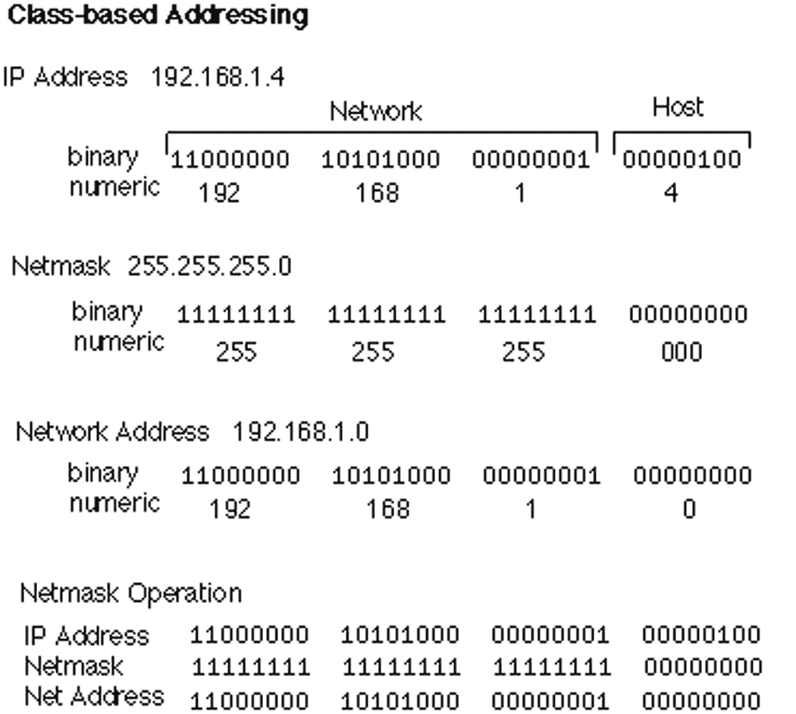

图 19-1：基于类的子网掩码操作

`CIDR` 址表示通过在 IP 地址中包含子网掩码信息来实现这一点（子网掩码应用于 IP 地址以确定地址的网络部分）。在 `CIDR` 表示法中，组成网络地址的比特数放在 IP 地址之后，并用斜杠隔。例如，C 类 192.168.187.4 IP 地址的 `CIDR` 形式为：

192.168.187.4/24

图 19-2 显示 `CIDR` 地址及其网络掩码的示例。IP 地址为 192.168.1.6，网络掩码为 22 位，即 192.168.1.6/22。网络地址占用 IP 地址的前 22 位，剩余的 10 位用于主机地址。主机地址占用了等同于基于类的 IP 地址的第四段（8 位）和第三段的 2 位。

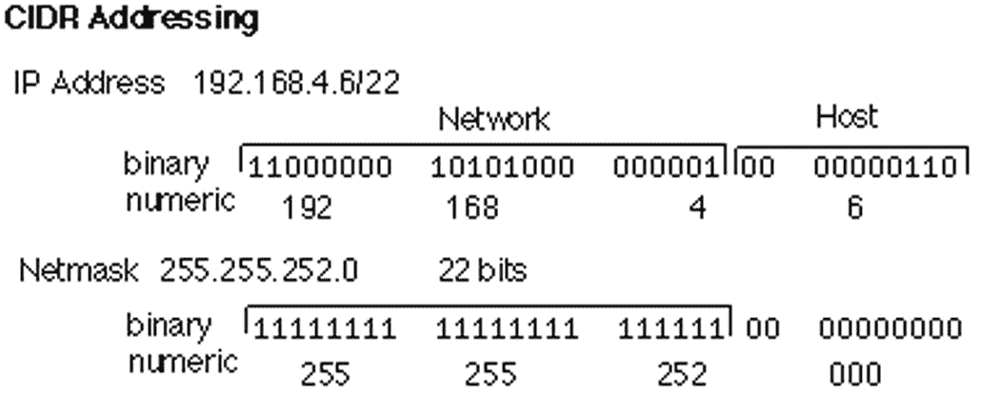

图 19-2：CIDR 址

表 19-3 列出了所有不同的 IPv4 `CIDR` 网络掩码以及相应的最大主机数。表中列出了子网掩码的短形式和完整形式。

| 简形式 | 完整形式 | 最大主机数 |
| :--- | :--- | :--- |
| /8 | /255.0.0.0 | 16,777,215 (A 类) |
| /16 | /255.255.0.0 | 65,535 (B 类) |
| /17 | /255.255.128.0 | 32,767 |
| /18 | /255.255.192.0 | 16,383 |
| /19 | /255.255.224.0 | 8,191 |
| /20 | /255.255.240.0 | 4,095 |
| /21 | /255.255.248.0 | 2,047 |
| /22 | /255.255.252.0 | 1,023 |
| /23 | /255.255.254.0 | 511 |
| /24 | /255.255.255.0 | 255 (C 类) |
| /25 | /255.255.255.128 | 127 |
| /26 | /255.255.255.192 | 63 |
| /27 | /255.255.255.224 | 31 |
| /28 | /255.255.255.240 | 15 |
| /29 | /255.255.255.248 | 7 |
| /30 | /255.255.255.252 | 3 |

表 19-3：CIDR IPv4 网络掩码

#### IPv4 址

标准 C 类 IPv4 地址的网络地址占用前三个段，即 24 位。如果你想创建一个最多 512 个主机的网络，可以提供网络地址为 23 位、主机地址为 9 位（0–511）。然而，IP 地址表示法保持不变，使用四个 8 位段。这意味着给定段的数字不再完全属于主机地址或网络地址。分配 23 位网络地址和 9 位主机地址意味着第三段的数字是网络和主机地址的一部分，前 7 位用于网络，最后一位用于主机。在以下示例中，第三个数 145 被用作网络地址的结尾和主机地址的开头：

192.168.145.67/23

这种情况使 `CIDR` 址变得复杂，在某些情况下，表示地址的唯一方法是指定两个多个网络地址。更多细节请查看 [www.ietf.org](http://www.ietf.org) 的 RFC 1520。`CIDR` 还允许网络管理员将 IP 地址的官方主机部分划分为主机较少的子网。这被称为子网划分（subnetting）。给定网络在互联网上有一个识别的官方网络地址。该网络的网络管理员反过来可以使用 `CIDR` 掩码创建若干更小的网络。一个经典的示例是将具有 254 个主机的标准 C 类网络划分为两个较小的网络，每个网络 64 个主机。这是通过使用 `CIDR` 掩码从 IP 地址的主机部分取位来实现的。在原始 254 个地址范围内，第一位为 1 的数字代表一个子网，而第一位为 0 的数字构成剩余的网络。在网络地址为 192.168.187.0 的网络中，最后段用于主机名，该最后段可以进一步划分为两个子网，每个都有自己的主机。对于两个子网，你使用最后 8 位段的第一位作为网络位。剩余的 7 位即可用于主机地址，给你每个网络 127 个主机。位置为 0 的子网范围为 1 到 127，`CIDR` 掩码为 25。第一个主机的 8 位段为 00000001。因此，地址为 1 的主机具有此 IP 地址：

192.168.187.1/25

对于第一位为 1 的子网，第一个主机地址为 129，CIDR 掩码为 25，所示。第一个主机的 8 位序列为 10000001。

192.168.1.129

注意：计算网络可以址的主机数量的一种简单方法是将主机段中的比特数作为 2 的幂，然后减去 2——即 2 的主机位次方减去 2。例如，8 位主机段是 2 的 8 次方，等于 256。减去 2（1 个广播地址 255 和 1 个零值 0）将剩下 254 个可能的主机。

每个子网将有一组 126 个地址，第一个从 1 到 126，第二个从 129 到 254；127 是第一个子网的广播地址，128 是第二个子网的网络地址。这里显示了你可以使用的可能子网及其掩码：

| 子网络 | CIDR 地址 | 二进制掩码 |
| :--- | :--- | :--- |
| 第一个子网网络地址 | .0/25 | 00000000 |
| 第二个子网网络地址 | .128/25 | 10000000 |
| 第一个子网广播地址 | .127/25 | 01111111 |
| 第二个子网广播地址 | .255/25 | 11111111 |
| 第一个子网中的第一个地址 | .1/25 | 00000001 |


| 第二个子网的第一个地址 | .129/25 | 10000001 |
| 第一个子网的最后一个地址 | .126/25 | 01111110 |
| 第二个子网的最后一个地址 | .254/25 | 11111110 |

## IPv6 CIDR 地址分配

IPv6 CIDR 地址的工作原理与 IPv4 方法相似。用于网络信息的位数由地址后的数字指示。主机（接口）地址占用的位数可能远超过其在 IPv6 地址中通常的 64 位，这使得网络前缀（地址）部分小于 64 位。网络前缀使用的位数由接下来的数字指示。在下一个示例中，网络前缀（地址）仅使用 IPv6 地址的前 48 位，而主机地址使用剩余的 80 位：

```
FC00:0000:0000:0000:FEDC:BA98:7654:3210/48
```

你也可以使用双冒号符号（::）来表示压缩版本：

```
FC00::FEDC:BA98:7654:3210/48
```

尽管你可以使用 CIDR 对地址进行子划分，但 IPv6 也支持一个可用于子网的子网字段。

## 获取 IP 地址

IP 地址由 IANA 正式分配，IANA 管理着互联网地址的所有方面（[www.iana.org](http://www.iana.org)）。IANA 监督互联网注册机构，这些注册机构又在区域和本地级别维护互联网地址。美洲互联网注册机构是美国互联网数字分配局（ARIN），其网站为 [www.arin.net](http://www.arin.net)。这些地址由互联网服务提供商（ISP）提供给用户。你可以从 ISP 获取你自己的互联网地址，或者如果你已经连接到互联网的网络，你的网络管理员可以为你分配一个。如果你正在使用 ISP，ISP 可能会在每次使用时从其手中的池中临时分配一个。

## IPv4 保留地址

某些数字是被保留的。数字 `127`、`0` 或 `255` 不能作为官方 IP 地址的一部分。数字 `127` 用于指定你系统中回环接口的网络地址。回环接口允许系统上的用户在系统内部相互通信，而无需通过网络连接路由。其网络地址将为 `127.0.0.0`，其 IP 地址为 `127.0.0.1`。对于基于类的 IP 地址分配，数字 `255` 是一个特殊的广播标识，你可以用它向网络上的所有站点广播消息。在 IP 地址的任何部分使用 `255` 都指向该层级连接的所有节点。例如，`192.168.255.255` 向网络 `192.168` 上的所有计算机、其所有子网络及其主机广播消息。地址 `192.168.187.255` 则向本地网络上的每台计算机广播。如果你在地址的网络部分使用 `0`，则主机号指向你本地网络内的某台计算机。例如，`0.0.0.6` 指向你本地网络中的第六台计算机。如果你想向本地网络上的所有计算机广播，可以使用数字 `0.0.0.255`。对于 CIDR IP 地址分配，广播地址可能看起来与普通 IP 地址非常相似。如前节所述，CIDR 地址分配允许使用任意数量的位来组成网络部分或主机部分的 IP 地址。对于广播地址，主机部分的所有位都必须设置为 `1`。

一组特殊的数字被保留用于非互联网局域网（`RFC1918`）。这些数字是以特殊网络数字 `192.168` 开头的。如果你正在建立局域网（LAN），例如小型企业或家庭网络，你可以自由地在你的本地机器上使用这些数字。你可以使用网卡（如以太网卡和以太网集线器）建立一个局域网，然后使用从 `192.168.1.1` 开始的 IP 地址配置你的机器。主机段可以一直到 `255`。如果你在家庭网络中有三台机器，你可以给它们分配地址 `192.168.1.1`、`192.168.1.2` 和 `192.168.1.3`。你可以在本地机器上实现如 `FTP`、`Web` 和 `mail` 等互联网服务，并使用互联网上使用的任何 TCP/IP 协议。例如，通过 `FTP` 工具，你可以在网络上的机器之间传输文件。通过 `mail` 工具，你可以从一台机器向另一台机器发送消息，通过 `Web` 浏览器，你可以访问可能安装在运行独立服务器的机器上的本地站点。如果你想让你的某一台机器连接到互联网或其他网络，可以将其设置为网关。按照惯例，网关机器通常被赋予地址 `192.168.1.1`。

数字也被保留用于 A 类和 B 类非互联网网络。可能的地址跨度从地址中主机段的 `0` 到 `255`。例如，B 类网络地址的范围从 `172.16.0.0` 到 `172.31.255.255`。C 类网络地址范围从 `192.168.0.0` 到 `192.168.255.255`，提供了 32,768 个可能的主机。网络地址 `127.0.0.0` 保留用于系统的回环接口，允许同一系统内的用户相互通信。

| IPv4 私有网络地址 | 网络类别 |
| :--- | :--- |
| 10.0.0.0 | A 类网络 |
| 172.16.0.0–172.31.255.255 | B 类网络 |
| 192.168.0.0 | C 类网络 |
| 127.0.0.0 | 回环网络（用于系统自通信） |

表 19-4：非互联网 IPv4 本地地址

### 广播地址

广播地址允许系统向网络上的所有系统发送相同的消息。对于 IPv4 基于类的 IP 地址分配，你可以通过主机地址轻松地确定广播地址：广播地址将你的主机部分设置为 `255`。网络部分保持不变。因此，主机地址 `192.168.1.72` 的广播地址是 `192.168.1.255`（将地址的网络部分与主机部分的 `255` 结合）。对于 CIDR IP 地址分配，你需要知道子网掩码中的位数。剩余的位被设置为 `1`。例如，IP 地址 `192.168.4.6/22` 的广播地址为 `192.168.7.255/22`。在这种情况下，前 22 位是网络地址，后 10 位是设置为广播值（全 1）的主机部分。

事实上，你可以将 C 类广播地址视为使用 24 位（前三个段）作为网络地址的 CIDR 地址，并将最后 8 位（第四段）作为广播地址。数字 `255` 在二进制表示上仅仅是 8 位全 1 的位。`255` 等于 `11111111`。


某些网络将一台计算机指定为到其他网络的网关。所有进出网络以及与其他网络的连接都通过这台网关计算机。大多数本地网络使用网关来建立与 Internet 的连接。如果你处于此类网络中，则必须提供网关地址。如果你的网络没有连接到 Internet 或更大的网络，你可能不需要网关地址。网关地址是为网络提供网关服务的主机系统的地址。在许多网络中，此主机被赋予主机 ID 为 1：地址为 `192.168.1` 的网络的网关地址为 `192.168.1.1`，但这仅是一种约定。要确定你的网关地址，请询问你的网络管理员。

### DNS 服务器地址

许多网络（包括 Internet）都拥有提供域名服务（DNS）的计算机，该服务将网络和主机的域名翻译为 IP 地址。这些被称为网络域名服务器。DNS 允许你的计算机仅使用域名（而非 IP 地址）在网络上就具有可识别性。你你也可以使用其他系统的域名来引用它们，因此无需知道它们的 IP 地址。然而，你必须知道你网络中任何域名服务器的 IP 地址。你可以从你的系统管理员处获取地址（通常存在多个）。即使你正在使用 ISP，也必须知道你的 ISP 为 Internet 运行的服务器地址。

## IPv6 体系

IPv6 地址对互联网协议下的地址系统格式和方法引入了重大变化（更多细节请参见 `www.ietf.org/rfc` 上的 RFC 3513 或 `www.faqs.org`）。有几种不同的寻址方式，其网络段具有不同字段。主机段已扩展为 619 位地址，允许对数量更多的系统进行直接寻址。每个地址都以一个类型字段开头，指定地址类型，这将决定其网络段的组织方式。这些更改的设计不仅是为了扩展地址空间，还为了在地址级别对传输提供更强的控制。

注意：Red Hat Enterprise Linux 和 Fedora 分发时已在内核启用 IPv6 支持。内核对 IPv6 的支持由 `ipv6` 内核模块提供。内核配置支持可以在 `Device Drivers | Networking Support | Networking Options | The IPv6 Protocol` 下找到。

### IPv6 地址格式

IPv6 地址由 128 位组成，多于 IPv4 地址使用的 32 位。前 64 位用于网络寻址，其中前几位保留用于指示地址类型。后 64 位用于接口地址，称为接口标识符字段。用于子网划分的位数可以通过 `CIDR 掩码` 进行调整，类似于 IPv4 CIDR 寻址中的掩码（见上一节）。

IPv6 地址写为八个段，每段代表 16 位（总共 128 位）。为了更方便地表示 16 位二进制数，使用了十六进制数。十六进制数使用 16 个唯一的数字，而不是八进制计数中使用的 8 个。这些数字是 0–9，紧接着是字符 A–F。

在接下来的示例中，前四个段代表 IPv6 地址的网络部分，接下来的四个段代表接口（主机）地址：

```
FC00:0000:0000:0000:0008:0800:200C:417A
```

你可以省略任何给定段中的任何前导零，但不能省略末尾零。全为零的段可以简化为单个零。

```
FC00:0:0:0:8:800:200C:417A
```

用于 localhost 寻址的环回地址可以使用七个前导零和一个 1 来编写。

```
0:0:0:0:0:0:0:1
```

许多地址将具有连续的零序列。IPv6 支持一种简写符号来表示相邻字段中的多个零序列。这由双冒号（`::`）组成。每个地址只能使用一次 `::` 符号。

```
FC00::8:800:200C:417A
```

环回地址 `0000000000000001` 可以简化为：

```
::1
```

为了方便从 IPv4 寻址过渡到 IPv6，还支持一种包含 IPv4 地址的寻址形式。在这种情况下，IPv4 地址（32 位）可以用于表示 IPv6 地址的最后两个段，并可以使用 IPv4 表示法写入。

```
FC00::192.168.0.3
```

### IPv6 接口标识符

IPv6 地址的标识部分占用后 64 位，由四个包含四个十六进制数的四个段组成。接口 ID 是根据网络设备的介质访问控制（`MAC`）地址生成的 619 位（四段）扩展唯一标识符（`EUI-64`）。

### IPv6 地址类型

IPv6 地址有三种类型：单播（unicast）、组播（multicast）和任播（anycast）。

单单地址用于发送到单个目的的数据包。

任播地址用于可以发送到多个目的的数据包。

组播地址用于向范围内的内的目标广播数据包。

在 IPv6 中，寻址由作为某种地址类型的格式前缀控制。格式前缀是 IP 地址的第一个字段。三类主要的单播网络地址类型是全局（global）、链路本地（link-local）和唯一本地（unique-local）。全局、唯一本地和链路本地通过它们各自的格式前缀来指示（见表 19-5）。

| IPv6 地址格式前缀和保留地址 | 描述 |
| :--- | :--- |
| 3 | 全局单播地址 |
| FE8 | 链路本地单播地址，用于网络上物理连接的主机，用于 DHCP 等效项。 |
| FC00 | 唯一本地单播地址，类似于 IPv4 私有地址。 |
| 0000000000000001 | 单播环回地址（用于系统自通信，localhost） |
| 0000000000000000 | 未指定地址 |
| FF | 组播地址 |

表 19-5：IPv6 格式前缀和保留地址

全局地址以地址类型 3 开头，唯一本地以 `FE00` 开头，链路本地以 `FE8` 开头。全局可以在 Internet 上传输。

链路本地地址用于本地网络上物理连接的系统。它通常用于 DHCP 地址。

唯一本地可用于本地网络上的任何主机。唯一本地地址的工作方式类似于 IPv4 私有地址；它们仅用于本地访问，不能在 Internet 上进行传输。

此外，IPv6 有两个特殊的保留地址。地址 `0000000000000001` 预留用于系统 localhost 地址的环回地址，地址 `0000000000000000` 是未指定地址。

#### IPv6 全局单播地址

目前 IPv6 全局地址使用四个字段：格式前缀、全局路由前缀、子网标识符和接口标识符。全局单播地址的格式前缀是 3（3 位）。全局路由前缀引用网络地址（45 位），子网 ID 引用站点内的子网（16 位）。

#### IPv6 本地使用地址：链路本地和唯一本地地址

对于本地使用，IPv6 提供了链路本地和唯一本地地址。链路本地寻址用于物理连接到网络的接口（主机）。这通常是一个小型本地网络。链路本地地址仅使用三个字段：格式前缀 FE8（10 位）、一个空字段（54 位）和接口标识符（主机地址）（64 位）。实际上，网络部分是空的。


IPv6 唯一本地地址（unique-local addresses）包含三个字段：格式前缀（10 位）、子网标识（54 位）和接口标识符（64 位）。除了任何本地子网划分外，没有网络地址。唯一本地地址的格式前缀为 `FC00`。唯一本地地址（也称为唯一本地地址）的功能与 IPv4 中的私有地址（`192.168.0`）相同。

## IPv6 组播地址

组播地址的格式前缀为 `FF`（8 位），带有标志位和范围字段，用于指示组播组是永久的还是临时的，以及范围是局部的还是全局的。组标识（112 位）引用组播组。对于范围，`2` 是链路本地（link-local），`5` 是唯一本地，`E` 是全局。除了接口标识符外，主机还有一个可以用作广播地址的组 ID。你使用此地址向主机进行广播。以下示例将仅向本地网络（`5`）中组 ID 为 `101` 的主机发送广播：

```
FF05:0:0:0:0:0:0:101
```

要向链路本地范围内的所有主机广播，你需要使用广播地址：

```
FF02:0:0:0:0:0:0:1
```

对于唯一本地范围（即本地网络），你将使用

```
FF05:0:0:0:0:0:0:2
```

## IPv6 和 IPv4 共存方法

在从 IPv4 到 IPv6 的过渡过程中，许多网络发现需要同时支持两者。一些将连接到使用相反协议的网络，另一些将通过使用该协议的其他网络进行连接。IETF 有几种官方方法来提供 IPv6 和 IPv4 协作，主要分为三大类：

- **双栈（Dual-stack）**：允许 IPv4 和 IPv6 在同一网络上共存。
- **翻译（Translation）**：允许 IPv6 设备与 IPv4 设备通信。
- **隧道（Tunneling）**：允许通过 IPv4 网络从一个 IPv6 网络传输到另一个，并允许 IPv6 主在 IPv4 网络上或通过 IPv4 网络运行。

在双栈方法中，网络上同时支持 IPv6 和 IPv4 地址。应用程序和 DNS 服务器可以使用其中任何一种来传输数据。

翻译使用 NAT 表将 IPv6 地址翻译为相应的 IPv4 地址，反之亦然。IPv4 应用程序就可以自由地与 IPv6 应用程序交互。IPv6 到 IPv6 的传输直接通过，实现完整的 IPv6 功能。

当一个 IPv6 网络需要通过无法处理 IPv6 地址的 IPv4 网络传输到另一个网络时，就会使用隧道。通过隧道技术，IPv6 数据包被封装在 IPv4 数据包中，然后 IPv4 网络使用外部 IPv4 地址来传递数据包。隧道有几种方法，如下所示，以及直接的手动操作：

- **6-over-4**：用于网络内部，通过 IPv4 组播实现虚拟局域网以支持 IPv6 主机，而无需 IPv6 路由器（RFC 2529）。
- **6-to-4**：用于允许 IPv6 网络连接并通过更大的 IPv4 网络（互联网），使用 IPv4 网络地址作为 IPv6 网络前缀（RFC 3056）。
- **隧道代理（Tunnel brokers）**：基于 Web 的服务，用于创建隧道（RFC 3053）。

## TCP/IP 配置文件

`/etc` 目录下的的一组配置文件用于设置和管理你的 TCP/IP 网络。这些配置文件指定了此类网络信息，如主机名和域名、IP 地址以及接口选项。你想访问的其它 Internet 主机的 IP 地址和域名输入在这些文件中。如果你在安装期间配置了网络，你已经可以在这些文件中找到这些信息。

### 识别主机名：/etc/hosts

如果没有 TCP/IP 网络用于识别计算机的唯一 IP 地址，就无法找到特定的计算机。由于 IP 地址难以使用或记忆，因此使用了域名。每个 IP 地址都对应一个域名。当你使用域名引用网络上的计算机时，你的系统会将其翻译为关联的 IP 地址。然后，你的网络就可以使用该地址来定位那台计算机。

| 地址 | 描述 |
| :--- | :--- |
| 主机地址 | 你的系统的 IP 地址；它包含一个用于识别你所在网络的网络部分和一个用于识别你自己的系统的主机部分 |
| 网络地址 | 你网络的 IP 地址 |
| 广播地址 | 用于同时向你网络上的所有主机发送消息的 IP 地址 |
| 网关地址 | 你的网关系统的 IP 地址，如果你有的话（通常是你的主机 IP 地址的网络部分，并将主机部分设置为 1） |
| 域名服务器地址 | 你的网络使用的域名服务器 IP 地址 |
| 子网掩码 | 用于确定你 IP 地址的网络部分和主机部分 |

| 文件 | 描述 |
| :--- | :--- |
| `/etc/hostname` | 计算机的主机 |
| `/etc/hosts` | 将主机名与 IP 地址关联，列出远程主机的域名及其 IP 地址 |
| `/etc/sysconfig/network-scripts` | 网络连接配置 |
| `/etc/host.conf` | 列出解析器选项 |
| `/etc/nsswitch.conf` | 名称切换服务（Name Switch Service）配置 |
| `/etc/resolv.conf` | 列出域名服务器名称、IP 地址 (nameserver) 以及远程主机可能所在的域名 (search) |
| `/etc/protocols` | 列出你系统上的可用协议 |
| `/etc/services` | 列出可用网络服务（如 FTP 和 Telnet）以及它们使用的端口 |
| `/etc/sysconfig/network` | 网络配置信息 |

最初，网络上的每台计算机都负责维护主机名及其 IP 地址的列表。此列表仍然保留在 `/etc/hosts` 文件中。当你使用域名时，你的系统会在 hosts 文件中查找其 IP 地址。系统管理员负责维护此列表。由于互联网的爆炸式增长和更大网络的发展，关联域名和 IP 地址的责任已由域名服务器接管。然而，hosts 文件仍用于存放频繁访问的主机的域名和 IP 地址。你的系统在执行访问名称服务器的额外步骤之前，通常会检查 hosts 文件以获取域名的 IP 地址。

hosts 文件中域名条目的格式是 IP 地址，后跟域名，中间用空格分隔。然后你可以为主机名添加别名。在条目后的同一行中，你可以输入注释。注释始终以 `#` 符号开头。你已经在 hosts 文件中发现了 `localhost.localdomain` 和 `localhost` 的条目，其 IP 地址为 `127.0.0.1`；`localhost` 是你的计算机使用的一种特殊标识，用于允许系统上的用户之间进行本地通信。IP 地址 `127.0.0.1` 是每台计算机为此目的而使用的特殊预留地址。它标识了技术上所谓的回环设备（loopback device）。对应的 IPV6 localhost 地址为 `::1`，其主机名为 `localhost6`。你不应该应该删除 `localhost` 和 `localhost6` 条目。这里显示了一个 `/etc/hosts` 文件的示例：

```
/etc/hosts
127.0.0.1           localhost.localdomain localhost turtle.mytrek.com
::1                 localhost6.localdomain6  localhost6
192.168.0.1         turtle.mytrek.com
192.168.0.2         rabbit.mytrek.com
192.168.34.56       pango1.mytrain.com
```

### /etc/resolv.conf

`/etc/resolv.conf` 文件存储了 DNS 服务器的 IP 地址以及要搜索的域名。DNS 条目以 `nameserver` 词开头，后跟名称服务器的 IP 地址。搜索条目将列出网络域名。检查此文件以查看你的网络 DNS 服务器已正确列出。示例所示：

```
/etc/resolv.conf
search mytrek.com  mytrain.com
nameserver 192.168.0.1
```


对于 DHCP 连接，`resolv.conf` 文件是指向 `/run/resolvconf/resolv.conf` 文件的链接，该文件保存了 DHCP 服务器提供的 DNS 服务器和搜索域。

### /etc/sysconfig/network-scripts
`/etc/sysconfig/network-scripts` 目录存储了不同网络连接设备的配置信息，例如使用的 IP 地址和网络地址。有关详细讨论，请参阅本章后续的“网络接口与路由：ifconfig 和 route”部分。

### /etc/services
`/etc/services` 文件列出了系统上可用的网络服务，如 `FTP` 和 `Telnet`，并将每个服务与特定的端口关联。在这里，你可以查出你的 Web 服务器正在检查哪个端口，或者你的 `FTP` 服务器使用了哪个端口。你可以为服务指定一个别名，在端口号后面指定即可。然后你就可以使用该别名来引用该服务。

### /etc/protocols
`/etc/protocols` 文件列出了系统当前支持的 `TCP/IP` 协议。每个条目显示了协议编号、其关键字标识符和简要描述。完整列表请参阅 [www.iana.org/assignments/protocol-numbers](http://www.iana.org/assignments/protocol-numbers)。

### /etc/sysconfig/network
`/etc/sysconfig/network` 文件包含用于网络配置的网络选项。

```
NETWORKING=yes
```

### /etc/hostname and hostnamectl
`/etc/hostname` 文件包含你的主机名。你可以使用 `hostnamectl` 命令显示当前的主机以及所有与其相关的信息，例如机器 ID、使用的内核、架构、机箱（计算机类型）和操作系统（如果你需要，可以添加 `status` 选项）。系统支持三种不同的主机名：静态（static）、漂亮（pretty）和瞬态（transient）。你可以使用 `hostnamectl` 的 `set-hostname` 命令配合相应的类型来设置每一个。静态主机名用于在网络上识别你的计算机（通常是完全限定域名）。你可以使用 `--static` 选项来设置它。漂亮主机名是提供给计算机用户的描述性主机名。可以通过 `set-hostname` 配合 `--pretty` 选项进行设置。瞬态主机名是由 `DHCP` 等网络服务分配的，可以使用 `--transient` 选项进行管理。如果不加选项，`set-hostname` 命令将该名称应用于所有主机名类型。

```
hostnamectl set-hostname --pretty "my computer"
```

`set-chassis` 命令设置计算机类型，可以是桌面式、笔记本电脑、服务器、平板电脑、手机和 `vm`（虚拟系统）。如果没有指定类型，它将恢复为系统的默认值。`set-icon-name` 设置图形化应用程序用于主机的名称。

## 域名系统 (DNS)
每台连接到 `TCP/IP` 网络（如互联网）的计算机都通过其自身的 IP 地址进行标识。IP 地址很难记忆，因此也使用每个 IP 地址的域名版本来标识主机。一个域名由两部分组成：主机名（hostname）和域（domain）。主机名是计算机的特定名称，而域标识了计算机所属的网络。美国使用的域通常具有标识主机类型的扩展名。例如，`.edu` 用于教育机构，`.com` 用于商业机构。国际域名通常具有指示其所在国家的扩展名，例如法国的 `.fr` 或澳大利亚的 `.au`。主机名、域和扩展名的组合形成了一个唯一的名称，通过该名称可以引用计算机。域反过来可以进一步划分为子域名。

如你所知，网络上的计算机即使有主机名，仍然只能通过其 IP 地址来标识。你可以使用主机名来引用网络上的计算机，但这涉及到使用主机名在数据库中查找对应的 IP 地址。然后网络使用 IP 地址而不是主机名来访问计算机。在像互联网这样的大型 `TCP/IP` 网络出现之前，网络上的每台计算机维护一个列有其网络上连接的所有计算机的主机名和 IP 地址的列表是可行的。每当使用主机名时，都会在该文件中进行查找，并找到对应的 IP 地址。你仍然可以在自己的系统上对经常访问的远程系统执行操作。

随着网络规模的扩大，让每台计算机都维护自己的所有域名和 IP 地址的列表是不切实际的——对于互联网来说是不可能的。为了提供将域名地址转换为 IP 地址的服务，开发了域名数据库并将其放在自己的服务器上。要找到域名的 IP 地址，你向名称服务器发送查询，由它为你查找 IP 地址并将其传回。在大型网络中，多个名称服务器可以覆盖网络的不同部分。如果名称服务器找不到特定的 IP 地址，它会将查询转发给另一个更有可能拥有该地址的名称服务器。

如果你正在管理网络并需要为它设置名称服务器，可以配置 Linux 系统运行名称服务器。要这样做，你必须启动名称服务器守护进程并等待域名查询。名称服务器利用多个配置文件，使其能够响应请求。Linux 系统上使用的名称服务器软件是伯克利互联网域名 (`BIND`) 服务器，由互联网软件协会 ([`www.isc.org/`](https://www.isc.org/)) 分发。第 30 章详细描述了设置域名服务器的过程。

名称服务器由解析器（resolvers）查询。解析器是专门设计用于从名称服务器获取地址的程序。要在你的系统上使用域名，你必须配置自己的解析器。你的本地解析器通过 `/etc/host.conf` 和 `/etc/resolv.conf` 文件配置。你可以使用 `/etc/nsswitch` 代替 `/etc/host.conf`。

### host.conf
你的 `host.conf` 文件列出了解析器选项（见表 19-7)）。每个选项可以有几个字段，用空格或制表符分隔。你可以在行开头使用 `#` 输入注释。这些选项告诉解析器使用哪些服务。列表的顺序非常重要。解析器从第一个选项开始，按顺序移动到后续选项。你可以在 `/etc` 目录下找到 `host.conf` 文件。

| 选项 | 描述 |
| :--- | :--- |
| `order` | 指定名称解析顺序：`hosts` 在本地 `/etc/hosts` 文件中检查；`bind` 查询 DNS 名称服务器获取地址；`nis` 使用网络信息服务协议获取地址 |
| `alert` | 尝试访问你系统的远程站点地址；通过 `on` 或 `off` 选项将其开启或关闭 |
| `nospoof` | 确认尝试访问你系统的远程站点地址 |
| `trim` | 检查本地主机文件；移除域名并仅检查主机名；允许你在主机文件中仅使用主机名来对应 IP 地址 |
| `multi` | 检查本地 hosts 文件；允许一个主机拥有多个 IP 地址；通过 `on` 或 `off` 选项将其开启或关闭 |

表 19-7：解析器选项，host.conf

在下一个 `host.conf` 文件示例中，`order` 选项指示你的解析器首先在本地 `/etc/hosts` 文件中查找名称，如果失败，则查询域名服务器。该系统没有多个地址。

```
/etc/host.conf

# host.conf 文件

# 有多个地址

multi on

# 先在主机文件中查找，然后检查 DNS

order bind host
```

/etc/nsswitch.conf: 名称服务切换和 authselect


标准 C 库中的不同函数必须配置为在 Linux 系统上运行。此前，类似于数据库的服务（例如密码支持以及 `NIS` 或 `DNS` 等名称服务）直接访问这些函数并使用固定的搜索顺序。对于用于当前 Linux 版本的 `GNU C Library 2.x`，这种配置是由称为名称服务切换（NSS）的方案完成的，该方案基于 Sun Microsystems Solaris 2 OS 使用的同名方法。数据库源及其查找顺序列在 `/etc/nsswitch.conf` 文件中。

| 文件 | 说明 |
| :--- | :--- |
| aliases | 邮件别名，由 Sendmail 使用 |
| ethers | 以太网编号 |
| group | 用户组 |
| hosts | 主机名和编号 |
| netgroup | 网络范围的主机和用户列表，用于访问规则；`glibc 2.1` 之前的 C 库仅支持通过 `NIS` 使用 netgroups |
| network | 网络名称和编号 |
| passwd | 用户密码 |
| protocols | 网络协议 |
| publickey | `NFS` 和 `NIS+` 使用的 SecureRPC 公钥和私钥 |
| rpc | 远程过程调用名称和编号 |
| services | 网络服务 |
| shadow | 影子用户密码 |

表 19-8：NSS 支持的文件

`/etc/nsswitch.conf` 文件由 `authselect` 工具管理。你不需要直接编辑它。相反，你可以使用 `authselect` 工具来启用或禁用功能，并选择不同的配置文件。提供了两个配置文件：`SSSD` 和 `Winbind`。对于 Fedora，使用了 `SSSD` 配置文件。你可以选择的功能包括 `with-smartcard`、`with fingerprint` 和 `with-krb5`。使用 `select` 命令指定配置文件，使用 `enable-feature` 选项启用某个功能。

```bash
sudo authselect select sssd
sudo authselect enable-feature fingerprint
```

使用 `authselect` 命令的 `list` 选项可以查看可能的配置文件列表。使用 `current` 选项查看有关当前配置的信息。

```bash
sudo authselect list
```

正在使用的配置文件位于 `/etc/authselect/custom` 目录，其中包含身份验证配置，包括 `nsswitch.conf`、`system-auth` 和 `password-auth`。为 `authselect`提供的两个配置文件位于 `/usr/share/authselect/default` 目录。这里有 `sssd` 和 `winbind` 目录。要创建一个新配置文件，请在 `/etc/authselect/custom` 目录下创建一个配置文件目录。你可以从默认配置文件拷贝文件，然后编辑新文件。`authselect` 工具是 `authconfig` 的替代品，是控制访问的一种更简单、更有效的方法。查看 `authselect-migration` 和 `authselect-profiles` 的手册页获取有关 `authselect` 功能和配置文件的信息。

`/etc/nsswitch.conf` 文件包含了由 `NSS` 控制的不同配置文件的条目。`NSS` 支持的系统配置文件列在[表 19-8]中。一个条目由两个字段组成：和服务配置规范。服务由配置文件后跟冒号组成。第二个字段是该文件的配置规范，它包含了查找程序将如何工作的指令。配置规范可以包含服务规范和操作项。服务规范是要要搜索的服务。目前，有效的服务规范有 `nis`、`nis-plus`、`sss`、`files`、`db`、`dns` 和 `compat`（见表 19-9）。并非所有规范对每个配置文件都有效。例如，`dns` 服务仅对 `hosts` 文件有效，而 `nis` 对所有文件有效。以下示例将首先检查 `SSSD`，然后检查本地的 `/etc/password` 文件。

```text
passwd: sss files
```

操作项指定了针对特定服务要采取的操作。操作项放置在服务后的括号内。配置规范可以列出多个服务，每个服务都有自己的操作项。在接下来的示例中，网络文件（network）的条目有一个配置规范，说明要检查 `NIS` 服务，如果未找到，则检查 `/etc/protocols` 文件：

```text
bootparams: nisplus [NOTFOUND=return] files
```

一个操作项由一个状态和一个动作组成。状态持有服务查找的可能结果，动作是在状态为真时要采取的操作。目前，可能的状态值有 `SUCCESS`、`NOTFOUND`、`UNAVAIL` 和 `TRYAGAIN`（服务临时不可）。可能的动作有 `return` 和 `continue`：`return` 停止该配置文件的查找过程，而 `continue` 继续处理下一个列出的服务。在先前的示例中，如果在 `NIS` 中未找到记录，查找过程将结束。

| 服务 |  |
| :--- | :--- |
| files | 检查相应的 `/etc` 文件进行配置（例如，用于 hosts 的 `/etc/hosts`）；此服务对所有文件有效 |
| db | 检查相应的 `/var/db` 数据库进行配置；对 `netgroup` 外的所有文件有效 |
| compat | 仅对 `passwd`、`group` 和 `shadow` 文件有效 |
| dns | 检查 `DNS` 服务；仅对 hosts 文件有效 |
| sss | 检查 `SSSD` 服务；对所有文件有效 |
| nis | 检查 `NIS` 服务；对所有文件有效 |
| nisplus | `NIS` 版本 3 |
| hesiod | 使用 `Hesiod` 进行查找 |
| sss | 检查 `SSSD` 服务（管理远程文件和文件夹的系统安全守护进程） |

表 19-9：NSS 配置服务

此处显示的是 `/etc/nsswitch.conf` 文件的副本，它列出了常用的条目。注释和被注释的条目以 `#` 符号开头：

```text
/etc/nsswitch.conf
#
# /etc/nsswitch.conf
#
# 一个名称服务切换配置文件示例。
passwd:      sssd files
group:       sss files
netgroup:    sss files
automount:  sss files
services:   sss files
sudoers:    files
shadow:     files
ethers:     files
netmasks:    files
networks:   files
protocols:  files
rpc:         files
hosts:       files dns myhostname
aliases:    files nisplus
bootparams: nisplus [NOTFOUND=return] files
publickey:  nisplus
```

## 网络接口与路由：`ifconfig` 和 `route`

你的系统通过特定的硬件接口（如以太网卡或调制解调器）与网络的连接。通过此接口的数据将被路由到你的网络。`ifconfig` 命令配置你的网络接口，`route` 命令相应地设置网络连接。如果你使用网络配置工具（如 `system-config-network`）配置接口，则无需使用 `ifconfig` 或 `route`。然而，如果你愿意，可以直接使用 `ifconfig` 和 `route` 配置接口。每当你启动系统时，必须建立网络接口及其路由。这会在你启动时通过为每个接口执行的 `ifconfig` 和 `route` 命令自动完成。如果你是手动添加接口，则必须设置网络脚本为你的新接口执行 `ifconfig` 和 `route` 操作。

### 网络 systemd 单元文件：`network.target`

你的网络接口通过特殊的 systemd 目标文件 `network.target` 。该目标将激活 `NetworkManager.service` 单元文件，该文件调用 `NetworkManager` 来启动你的网络。你可以使用 `systemctl` 命令及其 `restart`、`start` 或 `stop` 选项以及 `cockpit` 手动关闭和启动网络接口。以下命令关闭并启动你的网络接口：

```bash
sudo systemctl stop network
sudo systemctl start network
```

如果你正在更改网络配置，必须重启网络接口更改才能生效：

```bash
service network restart
```

要测试接口是否正常，请使用 `ping` 命令网络上系统的 IP 地址（例如你的网关机器）。`ping` 命令会持续重复，直到你用 ctrl-c 停止它。

```bash
ping 192.168.0.1
```

### 接口配置脚本：`/etc/sysconfig/network-scripts/`


`NetworkManager` 通过执行位于 `/etc/sysconfig/network-scripts` 目录下的几个特殊脚本来执行启动操作。网络脚本使用该目录下的 `ifup` 脚本来激活网络连接，使用 `ifdown` 将其关闭；`ifup` 和 `ifdown` 将调用针对特定设备类型定制的其他脚本，例如用于使用 PPP 协议的调制调器的 `ifup-ppp`，或用于使用 IP 协议第 6 版本地址的网络设备的 `ifup-ipv6`。

`ifup` 和 `ifdown` 脚本使用与当前配置的网络接口同名的接口配置文件，例如用于以太网设备的 `ifcfg-enp7s0`。这些文件定义了 shell 变量，存储有关接口的信息，例如是否在启动时启动它们。例如，对于静态连接，`ifcfg-enp7s0` 文件包含 `NETWORK`、`BROADCAST` 和 `IPADDR` 的定义，这些值被分配给设备使用的网络地址、广播地址和 IP 地址。

反过来，`ifdown` 和 `ifup` 脚本包含了 `ifconfig` 和 `route` 命令，使用接口配置文件中定义的这些变量来激活脚本。如果你想用 `ifup` 手动启动接口，只需将接口配置文件作为其参数即可。

```
cd /etc/sysconfig/network-scripts
ifup ifcfg-enp7s0
```

当您配置网络连接时，接口配置文件会自动生成。你也可以手动编辑这些接口配置文件，进行更改，例如是否在启动时启动接口（尽管使用 `system-config-network` 等配置工具更简单）。这里显示了一个使用静态 IP 地址的 `ifcfg-enp7s0` 文件：

```
/etc/sysconfig/network-scripts/ifcfg-enp7s0
NAME=enp7s0
BOOTPROTO=static
BROADCAST=192.168.0.255
IPADDR=192.168.0.1
NETMASK=255.255.255.0
NETWORK=192.168.0.0
ONBOOT=yes
```

基于 DHCP 的接口看起来像这样，其中 `BOOTPROTO` 被赋值为 `dhcp`：

```
/etc/sysconfig/network-scripts/ifcfg-enp7s0
NAME=enp7s0
BOOTPROTO=dhcp
HWADDR=00:00:00:00:00:01
TYPE=Ethernet
ONBOOT=yes
```

### ifconfig

`ifconfig` 命令的参数是接口名称、IP 地址以及选项。随后，`ifconfig` 命令将 IP 地址 分配给该接口。你的系统现在知道该接口存在，并且引用了特定的 IP 地址。此外，你还可以指定 IP 地址是主机地址还是网络地址。你可以为 IP 地址使用域名，只要该域名在 `/etc/hosts` 文件中与其 IP 地址一并列出即可。`ifconfig` 命令的语法如下：

```
ifconfig interface -host_net_flag address options
```

`host_net_flag` 可以是 `-host` 或 `-net`，用于指示主机或网络 IP 地址。`-host` 标志是默认值。`ifconfig` 命令可以有多个选项，这些选项设置接口的不同功能，例如它可以传输的最大字节数（`mtu`）或广播地址。`up` 和 `down` 选项用于激活和禁用接口。在下一个示例中，`ifconfig` 配置了一个以太网接口：

```
ifconfig enp7s0 192.168.0.1
```

| Option | Description |
| :--- | :--- |
| Interface | 网络接口的名称 |
| up | 激活接口；如果指定了 IP 地址则隐含包含 |
| down | 禁用接口 |
| allmulti | 开启或关闭混杂模式；前面的连字符 (-) 表示关闭；这允许网络监控 |
| mtu n | 每次传输中在该接口上发送的最大字节数 |
| dstaddr address | 点对点连接上的目的 IP 地址 |
| netmask address | IP 网络掩码；前面的连字符 (-) 表示关闭 |
| broadcast address | 广播地址；前面的连字符 (-) 表示关闭 |
| point-to-point address | 接口的点对点模式；如果包含地址，则将其分配给远程系统 |
| hw | 设置接口的硬件地址 |
| Address | 分配给接口的 IP 地址 |

表 19-10: ifconfig 选项

对于像这样简单的配置，`ifconfig` 会自动生成标准的广播地址和掩码。标准的广播地址是主机地址数字为 255 的网络地址。对于 C 类网络，标准掩码是 `255.255.255.0`，而对于 A 类网络，标准掩码是 `255.0.0.0`。然而，如果你连接到具有特定掩码和广播地址的网络，则在使用 `ifconfig` 时必须指定它们。指定广播地址的选项是 `broadcast`；网络掩码的选项是 `netmask`。[表 19-10] 列出了不同的 `ifconfig` 选项。在下一个示例中，`ifconfig` 包含了掩码和广播地址：

```
ifconfig enp7s0 192.168.0.1 broadcast 192.168.0.255 netmask 255.255.255.0
```

一旦配置了接口，你就可以使用 `ifconfig` 配合 `up` 选项激活它，并配合 `down` 选项禁用它。如果你在 `ifconfig` 操作中指定了 IP 地址（如前面的示例所示），则 `up` 选项是隐含的。

```
ifconfig enp7s0 up
```

点对点接口（如并行 IP (PLIP)、链路 IP (SLIP) 和点对点协议 (PPP)需要你包含 `pointopoint` 选项。PLIP 接口名称通过带有数字的 `plip` 名称来识别。例如，`plip0` 是第一个 PLIP 接口。SLIP 接口使用 `slip0`。PPP 接口以 `ppp0` 开始。点对点接口通常只在两个主机之间运行，例如通过调制解调器连接的两台计算机。当你指定 `pointopoint` 选项时，你需要包含主机的 IP 地址。在下一个示例中，配置了一个 PLIP 接口，将 IP 地址为 `192.168.1.72` 的计算机与 `204.166.254.14` 的计算机连接起来。如果 `/etc/hosts` 中列出了这些系统的域名，则可以使用这些域名代替 IP 地址。

```
ifconfig plip0 192.168.1.72 pointopoint 204.166.254.14
```

如果需要，你也可以使用 `ifconfig` 配置你的回环设备。回环设备的名称为 `lo`，其 IP 地址是特殊地址 `127.0.0.1`。接下来的示例显示了配置：

```
ifconfig lo 127.0.0.1
```

`ifconfig` 命令对于检查接口状态非常有用。如果你输入 `ifconfig` 命令加上接口名称，将显示有关该接口的信息：

```
ifconfig enp7s0
```

要查看回环接口是否已配置，你可以使用回环接口名称 `lo` 使用 `ifconfig`：

### 路由

传输的一部分数据包会通过特定的路由到达目的地。在大网络中，数据包从一台计算机传输到另一台计算机，直到到达目标计算机。路由决定了过程从哪里开始以及你的系统需要将数据包发送到哪个计算机以便到达。在小型网络中，路由可能是静态的——也就是说从一个系统到另一个系统的路由是固定的。一个系统知道如何到达另一个系统，通过固定路径移动。然而，在较大的网络和互联网上，路由是动态的。你的系统知道首先将数据包发送给哪台计算机，然后该计算机从那里获取数据包，将其传递给另一台计算机，由后者决定传递到哪里。对于动态路由，你的系统知道的很少。然而，静态路由可能会变得复杂，因为你必须跟踪所有的网络连接。

你的路由列在 `/proc/net/route` 文件的路由表中。要显示路由表，输入不带参数的 `route`（`netstat -r` 命令也会显示路由表）：

```
$ route
```

```
Kernel routing table
Destination Gateway     Genmask      Flags Metric Ref Use Iface
192.168.0.0     *           255.255.255.0  U     0      0  0    enp7s0
```


```
127.0.0.0      *         255.0.2055.0  U      0      0 0    lo
default        192.168.0.1  0.0.0.0       UG     0      0 0    enp7s0
```

路由表中的每个条目都包含多个字段，提供了路由目的和所使用的接口类型等信息。不同的字段列在表 19-11 中。

使用 `add` 参数，你可以通过 `-net` 选项添加网络路由，或者通过 `-host` 选项添加 IP 接口（主机）路由。`-host` 是默认选项。此外，你还可以指定多个信息参数，例如子网掩码（`netmask`）、网关（`gw`）、接口设备（`dev`）和默认路由（`default`）。如果系统上有多个 IP 接口（例如多个以太网），你必须使用 `dev` 参数指定接口名称。如果你的网络有一个网关主机，你使用 `gw` 参数指定它。如果你的系统连接到网络，路由表中至少应该有一个条目指定默认路由。当消息数据包没有其他路由条目指向其目的地时，将采用此条路由。以下是以太网接口的路由示例：

```
route add 192.168.1.2 dev enp7s0
```

| 字段 | 说明 |
| :--- | :--- |
| Destination | 路由的节点 IP 地址 |
| Gateway | 路由使用的网关的 IP 地址或主机名；`*` 表示不使用网关 |
| Genmask | 路由的子网掩码 |
| Flags | 路由类型：U = 启用，H =主机，G = 网关，D = 动态，M = 已修改 |
| Metric | 路由开值 |
| Ref | 依赖于此路由的路由数量 |
| Window | AX.25 网络的 TCP 窗口 |
| Use | 使用次数 |
| Iface | 该路由使用的接口类型 |

表 19-11：路由条目

如果你的系统只有一个以太网设备作为 IP 接口，你可以省掉 `dev enp7s0` 参数：

```
route add 192.168.1.2
```

你可以通过调用带有 `del` 参数和该路由 IP 地址的 `ifconfig` 命令来删除建立的任何路由，例如所示：

```
route del 192.168.1.2
```

对于网关，你首先向网关接口添加路由，然后添加一个指定其为网关的路由。示例中网关接口的地址为 192.168.1.1：

```
route add 192.168.1.1
route add default gw 192.168.1.1
```

如果你使用网关访问子网，请为该网络添加网络地址（在本例中为 192.168.23.0）：

```
route add -net 192.168.23.0 gw dev enp7s0
```

要向系统上的另一个网络接口上添加另一个 IP 地址，请使用带有新 IP 地址的 `ifconfig` 和 `route` 命令。以下命令配置了具有 IP 地址 192.168.1.3 的第二个以太网卡（eth1）：

```
ifconfig eth1 192.168.1.3
route add 192.168.1.3 dev enp7s0
```

## IP 别名 (IP Aliasing)

在某些情况下，你可能希望为一个只有一个网络接口的 Linux 系统分配两个或多个 IP 地址。例如，你可能希望在同一系统上运行可以通过独立 IP 地址访问的不同网站。实际上，你正在为系统设置一个别名，即另一个可以访问该系统的地址。事实上，你正在向同一个网络接口分配两个 IP 地址——例如给单个以太网卡分配两个 IP 地址。这种过程被称为 IP 别名，用于为 Internet 服务器设置多个基于 IP 的虚拟主机。有关虚拟主机的 FTP 和 Web 服务器信息，请参考第 21 章和 22 章，以及第 30 章的域名服务配置。

设置 IP 别名只是配置系统上的网络接口以监听添加的 IP 地址的简单问题。你的系统需要知道它应该监听哪些 IP 地址以及在哪个网络接口上。你使用 `ifconfig` 和 `route` 命令或网络管理工具来设置 IP 别名。

要在同一接口上添加另一个地址，你需要通过添加冒号和数字来限定接口。例如，如果你向以太网设备（在本例中为 eth0）添加另一个 IP 地址，你将在接口名称后添加 `:0`，即 `eth0:0`。以下示例显示了为以太网接口 192.168.1.2 添加了的两个 IP 别名（192.168.1.100 和 192.168.1.101）的 ifconfig 和 route 命令。要在同一接口上再次添加另一个 IP 地址，将使用 `eth0:1`，增加标识符并依此类推。第一个 `ifconfig` 命令将主 IP 地址 192.168.1.2 分配给第一个以太网设备 `eth0`。然后为该设备分配了另外两个 IP 地址。在第一个 `route` 命令中，为以太网设备设置了网络路由，然后为每个 IP 接口设置了路由。两个别名的接口用 `eth0:0` 和 `eth0:1` 指明：

```
ifconfig eth0 192.168.1.2
ifconfig eth0:0 192.168.1.100
ifconfig eth0:1 192.168.1.101
route add -net 192.168.1.0 dev eth0
route add -host 192.168.1.2 dev eth0
route add -host 192.168.1.100 dev eth0:0
route add -host 192.168.1.101 dev eth0:1
```

在使用 IP 别名之前，内核必须支持支持它。如果你的内核不支持，你可能需要重新编译内核（包括 IP 别名支持），或使用可加载模块添加 IP 别名。

## 监控你的网络：ping, netstat, tcpdump, EtherApe, Ettercap, Wireshark, 和 Nagios

Linux 上提供了多个应用程序来监控你的网络活动。像 EtherApe、Ettercap 和 Wireshark 等图形应用程序提供了详细显示和日志，让你分析并检测网络使用模式。其他工具如 `ping`、`netstat` 和 `traceroute` 提供特定的服务（参见表 19-12）。

| 网络信息工具 | 说明 |
| :--- | :--- |
| ping | 检测系统是否连接到网络 |
| finger | 获取网络上用户的信息 |
| who | 检查当前在线的用户 |
| whois | 获取域名信息 |
| host | 获取有关远程主机的网络地址信息 |
| traceroute | 跟踪消息通过的计算机网络和主机的序列 |
| wireshark | 用此检查网络流量的协议分析器 |
| gnome-nettool | 各种网络工具（包括 ping, finger 和 traceroute）的 GNOME 界面 |
| mtr and xmtr | My traceroute 结合了 ping 和 traceroute 操作（位于系统工具菜单中的 Traceroute） |
| EtherApe | 分析协议活动 |
| Ettercap | 用于中间人攻击的嗅探程序 |
| netstat | 实时网络状态监控 |
| tcpdump | 捕获并保存网络包 |
| Nagios | Nagios 网络监控，nagios 软件包 |

表 19-12：网络工具

EtherApe、Ettercap 和 Wireshark 工具可以在“应用程序 | Internet”概览访问。`ping`、`traceroute` 和 `netstat` 等工具可以通过“应用程序”概览中的“其他”过滤器下的 Gnome Network Tools 访问，也可以在命令行（终端窗口）中单独运行。

EtherApe 为你的协议活动提供了简单的图形化显示。首选项对话框让你设置各种功能，例如要检查的协议和要报告的流量类型。


对于 GNOME 桌面，`gnome-nettool` 工具提供了一个 GNOME 接口，用于输入 `ping` 和 `traceroute` 命令（参见图 19-4），以及用于查询网络用户和主机的 Finger、`Whois` 和 `Lookup`（其他 | 网络工具）。`Whois` 提供提供特定域名的域名信息，而 `Lookup` 同时提供域名和 IP 地址。它还包含了 `netstat` 和 `portscan` 等网络状态工具。第一个选项卡 `Devices` 描述了你连接的网络设备，包括每个设备的配置和传输信息，例如硬件地址和传输的字节数。IPv4 和 IPv6 主机 IP 地址都会列在其中。

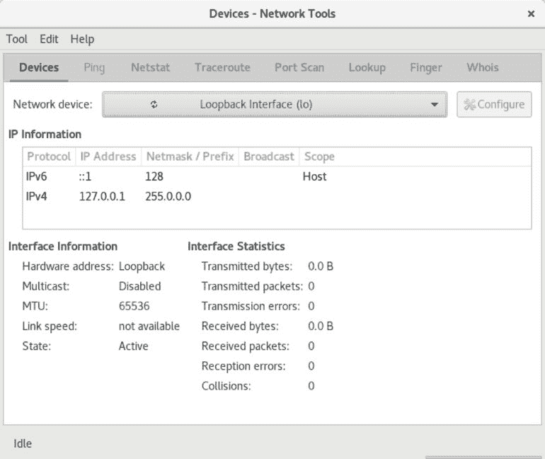

图 19-4：Gnome 网络工具

## 网络信息：ping, finger, traceroute 和 host

你可以使用 `ping`、`finger`、`traceroute` 和 `host` 命令查找网络上系统和用户的状态信息。`ping` 命令用于检查远程系统是否正在运行。你使用 `finger` 来查找网络上其他用户的信息，查看他们是否已登录或是否收到了邮件；`host` 显示网络上系统的地址信息，为你提供系统的 IP 和域名地址；而 `traceroute` 可用于跟踪消息在到达你处所经过的计算机网络和系统序列。表 19-12 列出了各种网络信息工具。

### ping

`ping` 命令检测系统是否正在运行。`ping` 以你想要检查的系统名称作为参数。如果你检查的系统处于关闭状态，`ping` 将发出超时消息，指示无法建立连接。下一个示例检查 [www.redhat.com](http://www.redhat.com) 是否运行并连接到网络：

```
$ ping www.redhat.com

PING www.redhat.com (209.132.177.50) 56(84) bytes of data.

64 bytes from www.redhat.com (209.132.177.50):icmp_seq=1 ttl=118 time=36.7ms

64 bytes from www.redhat.com (209.132.177.50):icmp_seq=2 ttl=118 time=36.9ms

--- www.redhat.com ping statistics ---

4 packets transmitted, 3 received, 25% packet loss, time 3000ms

rtt min/avg/max/mdev = 36.752/37.046/37.476/0.348 ms
```

你也可以用 IP 地址代替域名来使用 `ping`。使用 IP 地址，`ping` 可以尝试直接检测远程系统，而无需通过域名服务器将域名翻译为 IP 地址。这对于你的网络域名服务器可能临时宕机，且你想检查网络上某个特定远程主机是否连接的情况非常有帮助。

```
ping 209.132.177.50
```

注意：如果 `ping` 被网络防火墙拒绝，`ping` 操作也会失败。

### finger and who

你可以使用 `finger` 命令获取网络上其他用户的信息，并使用 `who` 命令查看当前系统上哪些用户正在在线。`who` 和 `w` 命令列出所有当前连接的用户，以及他们登录的时间、持续时间和位置。`w` 命令提供更详细的信息。它有多个选项可以指定详细程度。`who` 命令设计用于在本地系统或网络上运行；`finger` 可以在包括互联网在大型网络上运行，尽管出于安全考虑，大多数系统都阻止了它。

注意：Wireshark 是一种协议分析器，可以捕获数据包并显示有关它们的详细信息。你可以检测网络上正在传输什么类型的信息，以及其源和目的。Wireshark 主要用于网络和服务器管理。

### host

通过 `host` 命令，你可以找到连接到你网络的远程系统的网络地址信息。这些信息通常包括系统的 IP 地址、域名地址、域名别名和邮件服务器。这些信息是从你的网络域名服务器获取的。对于互联网，这包括所有你可以通过互联网连接的系统。

`host` 命令是确定远程站点 IP 地址或 URL 的有效方法。如果你只有某个站点的 IP 地址，可以使用 `host` 查找它的域名。对于网络管理，IP 地址可以帮助你在 `/etc/host` 文件中创建自己的域名条目。这样，你就不需要依赖远程域名服务器 (DNS) 来定位站点。

```
$ host gnome.org

gnome.org has address 209.132.180.168

gnome.org mail is handled by 10 smtp.gnome.org.

$ host 209.132.180.168

168.180.132.208.in-addr.arpa domain name pointer proxy2.gnome.org.
```

### traceroute

互联网连接通过各种路由建立，经过一系列相互的网关主机。从一个系统到另一个系统的路径可能采取不同的路由，其中某些可能比其他的更快。对于慢连接，你可以使用 `traceroute` 检查你连接主机的路由，监控速度以及路由经过的中间网关连接数量。`traceroute` 命令以你想要检查路由的系统主机名或 IP 地址作为参数。可以使用选项来指定参数，如服务类型（`-t`）或源主机（`-s`）。`traceroute` 命令将返回路由所经过的主机列表，以及向每个网关发送的三个探测包的时间。大于五秒的时间将用星号 `*` 显示。

```
traceroute rabbit.mytrek.com
```

你也可以使用 `mtr` 或 `xmtr` 工具同时执行 ping 和跟踪（在“系统工具”菜单上的 Traceroute）。

### Ettercap

Ettercap 是一种嗅探器程序，用于检测中间人攻击。在这类攻击中，数据包在传输过程中被检测并修改，以便未经授权的用户访问网络。你可以使用它的图形界面或命令行界面。Ettercap 可以对所有连接进行统一嗅，或对网络接口之间的连接进行桥接嗅。Ettercap 使用插件执行特定任务，如 `dos_attack` 检测拒绝服务攻击，`dns-spoof` 检测 DNS 欺骗。检查插件帮助面板，或输入 `ettercap -P list` 获取完整列表。Ettercap 可以多种模式运行，包括文本模式、命令行交互模式、使用文件的脚本模式，以及作为自动记录结果的守护进程模式。

### Wireshark

Wireshark 是一种网络协议分析器，可以让你捕获跨网络传输的数据包，并选择和检查你想查看的协议。你可以检查特定传输的数据包，以可读格式显示数据。Wireshark 界面显示三个窗格：当前数据包列表、当前选中数据包的协议树、选中数据包内容的显示。第一个窗格按时间、源、目的和协议对条目进行分类。每个类别都有按钮。按特定类别对条目排序，点击其标题。例如，按协议分组点击 Protocol 按钮；按目的使用 Destination 按钮。

#### 捕获选项

要配置 Wireshark，选择 Capture 菜单中的 Options。这会打开一个选项窗口，你可以在其中选择要观察的网络接口。在这里你还可以选择选项，如存储捕获信息的文件、捕获大小限制，以及筛选数据包的过滤器。选中杂杂模式时，你可以看到通过该设备的所有网络流量，而关闭它，你只能看到指向该设备的数据包。然后你可以点击开始按钮启动 Wireshark。要停止和启动 Wireshark，选择 Capture 菜单上的 Stop 和 Start 条目。


`Capture Files`（捕获文件）选项允许你选择用于保存捕获内容的文件。如果没有选择文件，数据将直接显示在 Wireshark 窗口中。如果你想保留网络流量的持续运行快照，可以使用 `ring buffers`（环形缓冲区）。这是一系列用于保存捕获数据的文件。当文件填满时，捕获将重新第一个文件开始保存，依此类推。勾选 `Use multiple files`（使用多个文件）来启用此选项。

`Display options`（显示选项）控制数据包是否在 Wireshark 窗口中实时显示。

`Limits`（限制）允许你设置捕获数据包的大小限制。

`Capture filter`（捕获过滤器）允许你选择想要检查的协议类型。

`Name resolution`（名称解析）允许在可能的情况下显示主机和域名而不是 IP 地址。

## Wireshark 过滤器

过滤器允许你选择符合特定标准的数据包，例如来自特定主机的数据包。标准使用数据包捕获库（Packet Capture Library）支持的表达式并由 `tcpdump` 实现。Wireshark 过滤器使用的表达式与 `tcpdump` 命令使用的表达式相似。请查阅 `tcpdump` 手页以获取详细说明。

你可以在 `Find` 选项卡（编辑菜单）中设置 `Search filter` 来搜索某些数据包，也可以在 `Options` 选项卡（捕获菜单）中设置 `Capture filter` 来选择记录哪些数据包。过滤器的窗口是相同的。在过滤器窗口上，你可以选择想要搜索或捕获的协议。`Filter name`（过滤器名称）和 `string`（字符串）将出现在 `Properties`（属性）部分。你也可以输入自己的字符串，创建一个自己的新过滤器。该字符串必须是一个过滤器表达式。

要创建一个新过滤器，在 `Filter Name` 框中输入你想给它起的名字。然后在 `Filter String` 框中输入过滤器表达式，例如 `icmp`。然后点击 `New`（新建）。你的新过滤器将出现在列表中。要更改过滤器，请选择它并在 `Filter String` 框中更改其表达式，然后点击 `Change`（更改）。

过滤器表达式由一个 ID（例如主机的名称或数字）和一个限定符组成。限定符有三种类型：`type`（类型）、`direction`（方向）和 `protocol`（协议）。类型可以引用主机、网络或端口。类型限定符为 `host`、`net` 和 `port`。方向选择源数据包或目的数据包，或两者。源限定符是 `src`，目的限定符是 `dst`。如果没有目的限定符，则选择两个方向。协议允许你指定特定协议的数据包。协议使用其小写名称表示，例如 ICMP 对应 `icmp`。例如，列出所有来自特定主机的入数据包的表达式为 `src host hostname`，其中 `hostname` 是源主机。以下示例将显示所有来自 192.168.0.3 主机的数据包：

```
src host 192.168.0.3
```

仅使用 `host` 将检查该主机的所有出站和入站数据包。`port` 限定符将检查通过特定端口的数据包。要检查特定协议，你可以使用协议名称。例如，要检查所有 ICMP 数据包，你将使用表达式

```
icmp
```

还有几种特殊限定符，可以让你进一步控制选择。`gateway`（网关）限定符允许你检测通过网关的数据包。`broadcast`（广播）和 `multi-cast`（多播）限定符检测广播到网络的数据包。`greater`（大于）和 `less`（小于）限定符可以应用于端口或 IP 地址等数字。

你可以使用 `and`、`or` 或 `not` 将表达式组合成复杂的布尔表达式。这允许你创建更精细的过滤器。例如，仅捕获来自主机 192.168.0.2 的入 ICMP 数据包，你可以使用

```
src host 192.168.0.3 and icmp
```

### tcpdump

像 Wireshark 一样，`tcpdump` 会捕获网络数据包并将其保存到文件中以便进行检查。`tcpdump` 完全通过命令行操作。你需要打开一个终端窗口来运行它。通过各种选项，你可以精炼捕获，指定你想要的数据包类型。`tcpdump` 使用一组选项来指定你想要执行的操作，包括限制捕获的大小、决定将其保存到哪个文件以及选择任何想要应用的过滤器。请查阅 `tcpdump` 手页以获取完整列表。

`-i` 选项允许你指定要监听的接口。

通过 `-c` 选项，你可以限制捕获的数据包数量。

数据包默认输出到标准输出。要将其保存到文件，你可以使用 `-w` 选项。

你稍后可以使用 `-r` 选项读取数据包文件并对其应用过滤器表达式。

`tcpdump` 命令的参数是一个过滤器表达式，你可以用它来精炼捕获。Wireshark 使用与 `tcpdump` 相同的过滤器表达式（参见 Wireshark 中关于过滤器的讨论）。

### netstat

`netstat` 程序提供了网络连接状态的实时信息，以及网络统计数据和路由表。`netstat` 命令有多个选项，可以用于获取你网络的不同类型的信息。

```
$ netstat
```

Active Internet connections
Proto Recv-Q Send-Q Local Address Foreign Address (State) User
tcp 0 0 turtle.mytrek.com:01 pango1.mytrain.com.:ftp ESTABLISHED dylan

Active UNIX domain sockets
Proto RefCnt Flags Type State Path
unix 1 [ ACC ] State Path
unix 1 [ ACC ] State Path
unix 1 [ ACC ] State Path
unix 1 [ ACC ] State Path
unix 1 [ ACC ] State Path
unix 1 [ ACC ] State Path

不带选项的 `netstat` 命令列出系统上的网络连接。首先列出活动连接，然后列出域接套字。域接套字包含了用于你的系统与其他系统之间通信的进程。

### Nagios

Fedora 还支持 Nagios，这是一种企业级监控软件。你可以通过 `nagios` 和 `nagios-plugins` 包安装 Nagios。`nagios-plugins-all` 包将安装所有插件包。你也可以选择单独安装插件，例如针对 `DHCP`、`DNS` 或 `HTTPD` 的插件。Nagios 的配置文件位于 `/etc/nagios`。主配置文件是 `nagios.cfg`，这是一个可编辑的文本文件，每个指令都有详细的注释。

你必须创建一个 nagios 管理用户和密码以访问 Web 界面。打开终端窗口并输入以下内容。系统将提示你输入两次新密码。以 root 用户登录，使用 `su` 命令。

```
htpasswd -c /etc/nagios/htpasswd.users nagiosadmin
```

然后你打开浏览器并使用以下 URL 访问 nagios 界面。

```
http://localhost/nagios
```

系统将提示你输入用户和密码。使用用户 `nagiosadmin` 以及你在运行 `htpasswd` 命令时提示输入的密码。

`nagiosadmin`

Nagios 还提供了一个远程插件服务器，允许 Nagios 插件在远程主机上运行。Nagios 远程插件执行器 (NRPE) 通过 `nrpe` 和 `nagios-plugins-nrpe` 包安装。NRPE 服务器脚本是 `nrpe`。NRPE 服务器的配置文件为 `/etc/nagios/nrpe.cfg`。

```
service nrpe start
```


## 表格列表

- 表 3-1: `systemd` 单元类型和 man 页
- 表 3-2: `systemd` Unit 和 Install 部分选项（适用于所有单元，`systemd.unit`
- 表 3-3: 特殊单元
- 表 3-4: 特殊运行级别目标 (boot)
- 表 3-5: `systemd` exec 选项 (`Service`, `Socket`, `Mount`, `Swap`) (`systemd.exec`)
- [表 3-6: `systemd` service 选项 `[Service]` (`systemd.service`)](#part0000_split_019.html__Toc517960849)
- 表 3-7: `/lib/systemd/system` 中的 Service 单元文件
- [表 3-8: `systemd` socket 文件选项 `[Socket]` (`systemd.socket`)](#part0000_split_019.html__Toc517960851)
- 表 3-9: path 选项 (`systemd.path`)
- 表 3-10: 系统运行级别 (状态)
- [表 3-11: `systemd` 挂载和自动挂载文件选项 `[Mount]` `[Automount]`](#part0000_split_019.html__Toc517960854)
- 表 3-12: 系统关机选项
- 表 4-1: 网络安全应用
- 表 4-2: FirewallD 区域
- 表 4-3: `IPtables` 目标
- 表 4-4: Netfilter 内置链
- 表 4-5: `IPables` 命令
- 表 4-6: `IPtables` 选项
- 表 4-7:  ICMP 数据包
- 表 4-8: Fedora `IPtables` 脚本和工具
- 表 4-9: `iptables-config` 配置参数
- 表 5-1: `BASH` Shell 测试操作符
- 表 5-2: `BASH` Shell 控制结构
- 表 6-1: 邮件传输代理
- 表 6-2: Sendmail 文件和目录
- 表 6-3: Sendmail 特性
- 表 6-4: 访问动作
- 表 7-1: FTP 服务器
- 表 7-2: `vsftpd.conf` 配置选项
- 表 7-3: `vsftpd` 文件
- 表 7-4: ProFTPD 配置指令, `proftpd.conf`
- 表 8-1: Web 服务器网站
- 表 8-2: Apache Web 服务器文件和目录
- 表 8-3: Apache 管理工具
- 表 8-4: 全局指令
- 表 8-5: MPM Prefork, Worker 和 Event 指令
- 表 8-6: 服务器指令
- 表 8-7: 访问控制指令
- 表 8-8: 目录指令
- 表 8-9: CGI 指令
- 表 8-10: 索引指令
- 表 8-11: 日志指令
- 表 8-12: Apache 日志字段指定符
- 表 9-1: 数据库资源
- 表 9-2: `MySQL` 命令
- 表 10-1: 打印资源
- 表 10-2: `CUPS` 配置文件
- 表 10-3: `CUPS` 客户端
- 表 10-4: `CUPS` 管理工具
- 表 11-1: NFS 守护进程和 `systemd` 单元文件
- 表 11-2: `/etc/exports` 选项
- 表 11-3: NFS 挂载选项
- 表 12-1: Samba 软件包
- 表 12-2: Samba 应用
- 表 12-3: Samba 变量
- 表 13-1: 分布式文件
- 表 13-2: GFS 工具
- 表 14-1: Squid 协议
- 表 14-2: Squid ACL 选项
- 表 15-1: 非互联网 IPv4 地址
- 表 15-2: BIND 管理工具
- 表 15-3: BIND 区域类型
- 表 15-4: BIND 语句
- 表 15-5: BIND 选项
- 表 15-6: BIND 声明
- 表 15-7: BIND 记录
- 表 16-1: DHCP 选项
- 表 17-1: Fedora 配置
- 表 17-2: Fedora 目录
- 表 17-3: 路由项
- 表 17-4: Fedora 工具
- 表 18-1: Shell 脚本
- 表 18-2: Shell 选项
- 表 18-3: Shell 变量
- 表 19-1: TCP/IP 协议集
- 表 19-2: TCP/IP 负载
- 表 19-3: CIDR IPv4 掩码
- 表 19-4: 非互联网 IPv4 区域
- 表 19-5: IPv6 前缀
- 表 19-6: TCP/IP 配置和文件
- 表 19-7: 解析器选项
- 表 19-8: NSS 支持的文件
- 表 19-9: NSS 配置服务
- 表 19-10: `ifconfig` 选项
- 表 19-11: 路由表
- 表 19-12: 网络工具

## 图表列表

- 图 1-1: 安装, 安装摘要
- 图 1-2: 安装, 软件选择
- 图 1-3: 安装, 配置
- 图 2-1: Fedora GRUB 菜单
- 图 2-2: 编辑 GRUB 菜单项
- 图 2-3: 服务器登录
- 图 2-4: 服务器主机名更改


图 2-5：使用 nano 编辑

图 2-6：Fedora GNOME 桌面

图 2-7：GNOME 3 活动应用程序概览模式

图 2-8：主目录的文件管理器

图 2-9：网络（系统设置）

图 2-10：无线配置

图 2-11：有线配置

图 2-12：GNOME 软件

图 2-13：软件，PackageKit（软件包）

图 2-14：软件包信息

图 2-15：更新通知消息和图标

图 2-16：终端窗口

图 3-1：服务，cockpit

图 4-1：firewall-config：运行时配置

图 4-2：firewall-config：永久配置

图 4-3：默认区域

图 4-4：基础区域设置

图 4-5：服务设置

图 4-6：服务协议和端口

图 4-7：端口转发

图 4-8：ICMP 过滤器

图 4-9：显示防火墙信任服务的 system-config-firewall

图 4-10：防火墙其他端口配置

图 4-11：防火墙信任接口

图 4-12：防火墙 伪装

图 4-13：ICMP 过滤器

图 4-14：防火墙自定义规则

图 4-15：带有防火墙的网络

图 4-16：应用到本地网络的防火墙规则示例

图 8-1：system-config-httpd 服务器配置

图 8-2：system-config-httpd 性能调优

图 8-3：system-config-httpd 虚拟主机

图 8-4：system-config-httpd 虚拟主机属性，常规选项

图 8-5：system-config-httpd 虚拟主机属性 | 性能 | 目录

图 10-1：GNOME 3 打印机工具

图 10-2：system-config-printer 工具：多个打印机

图 10-3：打印机属性窗口

图 10-4：CUPS 基于 Web 的配置：首页页页

图 12-1：在防火墙上允许 Samba

图 12-2：在 SELinux 上允许 Samba：system-config-selinux

图 15-1：DNS 服务器操作

图 16-1：无状态 IPv6 地址自动配置

图 16-2：使用 IPv6 自动配置的路由器重编号

图 17-1：GNOME 日志

图 19-1：基于类的子网掩码操作

图 19-2：CIDR 寻

图 19-3：基于类和 CIDR 的广播地址

图 19-4：Gnome 网络工具

# 索引

A B C D E F G H I K L M N O P Q R S T U V W X Z A B C D E F G H I K L M N O P Q R S T U V W X Z A B C D E F G H I K L M N O P Q R S T U V W X Z


# 工具
- 工具, link
- CUPS 配置工具, link
- 网络管理器 (Network Manager), link
- system-config-printer, link
- 终端窗口, link
- 文本编辑器, link

# 管理
- GNOME 系统监控器, link

# 网络
- 网络, link
- 别名 (Aliases), link
- Amsvisd-new, link
- anacron, link
- anacrontab, link
- 匿名 FTP, link
- Apache, link, link
- 身份验证, link
- 配置, link, link
- 目录级配置, link
- 安装, link
- 实例, link
- 日志, link
- MPM, link
- 多进程处理模块, link
- 基于名称的虚拟主机, link
- NGINX, link
- PHP, link
- 服务端包含, link
- 实例设置, link
- SSL, link
- system-config-httpd, link
- UserDir, link
- 虚拟托管, link
- 虚拟主机, link
- Apache Web 服务器, link
- apachectl, link
- arptables, link

### 身份验证
- Apache Web 服务器, link
- 系统安全服务守护进程 (SSSD), link
- authselect

# 名称服务切换
- 名称服务切换 (Name Service Switch), link
- 自动配置
- IPv6, link
- Avahi, link

# B
- 反引号 (Back Quotes), link
- BASH_ENV, link
- 伯克利互联网域名系统 (BIND), link
- bind
- TSIG, link
- BIND
- 访问控制列表, link
- 配置, link
- DHCP, link
- DNS, link
- DNSSEC, link
- 内部和外部视图, link
- 本地反向映射, link
- named, link
- named.conf, link
- 资源记录, link
- 反向映射文件, link
- 从机 (slave), link
- 拆分 DNS, link
- 区域起始 (SOA) 记录, link
- 子域名, link
- 视图语句 (view clause), link
- 视图 (views), link
- 区域 (zone), link, link
- 启动
- fstab 挂载单元, link
- graphical.target, link
- 运行级别 (runlevels), link
- 特殊目标, link
- 引导程序
- 重装, link
- 引导加载 (Bootloader)
- 配置, link
- 编辑, link
- GRUB_DEFAULT, link
- 广播地址, link

# C
- 缓存, link
- 链 (Chains), link
- Chrony, link
- chrony.conf, link
- chroot, link
- CIDR, link
- cifs, link
- Amsvisd-new, link
- 基于类 IP, link
- 无类域, link
- Corosync 集群, link
- GFS, link
- Pacemaker, link
- pcs, link
- 日, link
- 编辑, link
- 终端, link
- 驱动器, link
- 命令, link
- 手册, link
- 打印, link
- 配置, link
- 结构, link
- 条件, link
- 如果-则, link
- 配置, link
- nano, link
- 身份验证, link
- 网络, link
- system-config-printer, link
- 编辑器, link
- 配置, link
- 配置, link
- 目录级配置, link
- 打印, link
- 如果, link
- 条件, link
- 如果-则, link
- 循环, link
- 测试, link
- 循环, link
- Corosync 集群, link
- 拷贝, link
- cron, link
- /etc/crontab, link
- anacron, link
- anacrontab, link
- CUPS, link
- 接受, link
- 配置, link
- cupdenable, link
- cups-browsed.conf, link
- cupsctl, link
- cupsd.conf, link
- cups-files.conf, link
- 限制指令, link
- 位置指令, link
- lpadmin, link
- lpoptions, link
- 打印客户端, link
- printers.conf, link
- 拒绝, link
- 远程打印机, link


`subscription.conf`, link

Web 配置界面, link

CUPS 配置工具, link

`cups-browsed.conf`, link

`cupsctl`, link

`cupsd.conf`, link, link

`cupsenable`, link

`cups-files.conf`, link

Cyrus IMAP 服务器, link

## D

- 数据库服务器, link
- MariaDB, link
- PostgreSQL, link
- date, link

## Date

- date, link
- 桌面, link

## Desktop

- 文件管理器, link
- DHCP, link
- 域名系统, link

### DHCP 4

- 客户端, link
- DHCP 6, link
- `dhcpd.conf`, link
- 动态 DNS, link
- 固定静态地址, link
- IPv4, link
- IPv4 地址分配, link
- IPv6, link
- IPv6 地址分配, link
- 子网, link

### DHCPv6

- DHCP 4, link
- `dnf`, link
- 更新软件, link
- DNF, link, link
- 自动更新, link
- `dnf-automatic`, link
- DNS, link
- DNS 防火墙, link
- DNSSEC, link
- `dnssec-keygen`, link
- `dnssec-lookaside`, link
- `dnssec-signzone`, link
- `dnssec-validation`, link
- `managed-keys-directory`, link
- 资源记录, link
- `trusted-keys`, link
- 验证, link
- `dnssec-keygen`, link
- `dnssec-lookaside`, link
- `dnssec-signzone`, link
- `dnssec-validation`, link
- 环境变量, link
- 文档

- Fedora, link
- 页面, link
- 域名系统, link, link, link
- 访问控制列表, link
- BIND, link
- chroot, link
- 配置, link
- 配置, link
- DHCP, link
- DNS 防火墙, link
- DNSSEC, link
- 内部和外部视图, link
- 基于 IP 的虚拟主机, link
- IPv4 地址分配, link
- IPv6 地址分配, link
- IPv6 私有网络, link
- 本地主机映射, link
- `named`, link
- `named.conf`, link, link
- `resolv.conf`, link
- 资源记录, link
- 响应策略区域 (RPZ), link
- 反向映射, link
- 安全类型, link
- 从服务器, link
- 拆分 DNS, link
- 区域权威 (SOA) 记录, link
- 子域名, link
- 生存时间 (TTL), link
- TSIG, link
- 视图, link
- 区域文件, link
- Dovecot, link
- Dracut, GRUB, link
- 动态 DNS, link
- 动态主机 (DHCP), link
- 动态 IP 地址, link
- 动态主机, link

## E

- `ebtables`, link
- `GRUB 2`, link
- 编辑器
- `nano`, link
- 文本编辑器, link
- `vi`, link
- `vim`, link
- 启用, link
- 环境变量, link
- `Ettercap`, link
- `Exim`, link
- `export`, link
- 导出, link
- 扩展守护守护, link

## F

- Fedora, link
- 桌面, link
- 文档, link
- 介绍, link
- 图标, link
- Fedora 28, link
- Fedora 系统工具, link
- fedaproject.org, link
- 文件管理器, link
- 文件系统, link
- 文件传输协议 (FTP), link
- finger, link

### Firewall

- `arptables`, link
- `ebtables`, link
- `ICMP`, link
- IP 伪装, link
- IP 欺骗, link
- `ip6tables`, link
- `IPtables`, link
- 伪装, link, link
- Netfilter, link
- 网络地址转换, link
- 数据包翻改, link
- 端口, link, link
- 服务, link
- system-config-firewall, link
- 信任的接口, link
- 信任的服务, link
- `vsftpd`, link
- `xtables`, link
- 防墙配置

- samba, link


- 响应策略区域 (RPZ), link
- `for-in`, link
- `free`, link
- `Frysk`, link
- `fstab`, link, link
- `FTP`, link
- `anonymous`, link
- `ProFTPD`, link
- `rsync`, link
- `user access`, link
- `Very Secure FTP Server`, link
- `virtual hosts`, link
- `virtual users`, link
- `vsftpd`, link
- `ftpcount`, link
- `ftpshut`, link
- `ftpwho`, link

## G

- 网关地址, link
- `GFS`, link, link
- `Corosync Cluster Engine`, link
- `Glances`, link
- `全局文件系统 (GFS 和 GFS 2)`, link
- `全局文件系统 (GFS)`, link

### GNOME

- 文件管理器, link
- 网络工具, link
- GNOME 网络, link
- GNOME 软件, link
- GNOME 系统监控, link
- 进程, link
- `gnome-nettool`, link
- `graphical.target`, link
- `greylisting`, link

### GRUB

- `/etc/default/grub`, link
- `configuration`, link
- `Dracut`, link
- `grub2-mkconfig`, link
- `grub-set-default`, link
- `initramfs`, link
- `linux`, link
- `re-install`, link

### GRUB 2

- 编辑, link
- `GRUB_DEFAULT`, link
- `grub2-mkconfig`, link
- `grub-set-default`, link

## H

### Help

- info pages, link
- Man pages, link
- `HOME`, link
- `host`, link
- `host.conf`, link
- `hostname`, link
- `hostnamectl`, link
- `hosts.allow`, link
- `httpd.conf`, link
- `hwclock`, link

## I

- `ICMP`, link, link
- `if`, link
- `ifconfig`, link
- `if-then`, link
- `IMAP`, link
- `info`, link
- `initramfsGRUB`, link
- `inittab`, link
- `INN`, link
- `installing software`, link
- `GNOME Software`, link
- `PackageKit`, link
- `PackageKit`, link
- `rolectl`, link
- `rolekit`, link
- `Server Roles`, link
- `instances`, link
- `network`, link
- `Net`, link
- `IP Aliasing`, link
- `IP based hosting`, link
- `IP masquerading`, link
- `IP Spoof`, link
- `iptables`, link
- `IP-based hosting`, link
- `IPtables`, link
- `Chains`, link
- `ICMP`, link, link
- `coconnection`, link
- `tracking`, link
- `filter`, link
- `Network Translation`, link
- `packet`, link
- `scripts`, link
- `IPv4`, link
- `IPv4`, link
- `IPv4`, link
- `IPv6`, link
- `IPv6`, link
- `IPv6`, link
- `DHCP`, link
- `DHCP`, link
- `DHCP`, link
- `DHCP`, link
- `DHCP`, link
- `DHCP`, link
- `DHCP`, link
- `local`, link
- `local`, link
- `local`, link
- `router`, link
- `numbering`, link
- `unique`, link
- `methods`, link
- `options`, link
- `kernel`, link
- `kill`, link
- `mapping`, link
- `log`, link
- `log`, link
- `log`, link
- `log`, link
- `log`, link
- `log`, link
- `lp`, link
- `lp`, link
- `lp`, link

## K

- `GRUB`, link
- `kill`, link

## L

- `link`, link
- `logind`, link
- `GNOME`
- `Apache server`, link
- `loop`, link
- `for-in`, link
- `while`, link
- `lpadmin`, link
- `lpc`, link
- `lpinfo`, link
- `lpoptions`, link
- `lpq`, link
- `lpr`, link
- `lprm`, link
- `lpstat`, link

## M

- `Mail`, link
- `Amsvisd-new`, link
- `Dovecot`, link
- `IMAP`, link
- `mail filtering`, link
- `Mail Transport Agents`, link


- `POP`, link
- `Postfix`, link
- `Sendmail`, link
- `spam`, link
- `SpamAssassin`, link
- `Mail servers`, link
- `mailer table`, link
- `Man pages`, link
- `managed-keys-directory`, link
- `map file format`, link
- `MariaDB`, link, link
- `manage`, link
- `my.cnf`, link
- `masquerading`, link, link
- `Sendmail`, link
- `master-format map`, link
- `Microsoft Domain Security`, link

## 监控
- `free`, link
- `glances`, link
- `top`, link
- `vmstat`, link
- `xload`, link
- `监控网络`, link
- `mount`, link
- `cifs`, link
- `NFS`, link
- `Samba`, link
- `mount.cifs`, link
- `MTA`, link
- `MUA`, link
- `my.cnf`, link

## N
- `Nagios`, link
- `服务名称切换`, link
- `基于名称的虚拟主机`, link
- `named`, link
- `named.conf`, link, link
- `nano`, link
- `NAT`, link
- `NetBIOS`, link
- `Netfilter`, link
- `Netgroups`, link
- `子掩码`, link
- `netstat`, link, link
- `网络地址转换`, link
- `网络连接`, link
- `网络文件系统 (NFS)`, link
- `网络信息`, link
- `网络信息系统 (NIS)`, link
- `网络接口`, link
- `网络时间协议`, link
- `Chrony`, link
- `chrony.conf`, link
- `TOY`, link
- `协调世界时间`, link
- `UTC`, link

## 网络工具
- `Ettercap`, link
- `finger`, link
- `GNOME`, link
- `host`, link
- `nagios`, link
- `netstat`, link
- `ping`, link
- `tcpdump`, link
- `traceroute`, link
- `who`, link
- `Wireshark`, link
- `广播地址`, link
- `基于类的 IP 划分`, link
- `无类网间域路由`, link
- `配置文件`, link
- `域名服务`, link
- `网关地址`, link
- `conf`, link
- `ifconfig`, link
- `IPv4 地址`, link
- `IPv6 地址`, link
- `文件`, link
- `掩码`, link
- `nmcli`, link
- `可预测网络名称`, link
- `重命名名称`, link
- `重命名网络名称`, link
- `systemd-network`, link
- `udev`, link
- `wireshark`, link
- `Coordinated`, link
- `网络管理`, link
- `名称`, link
- `监控`, link
- `配置`, link
- `nmcli`, link
- `udev`, link
- `域名服务`, link
- `接口`, link
- `路由`, link
- `监控`, link
- `Ettercap`, link
- `nagios`, link
- `netstat`, link
- `tcpdump`, link
- `wireshark`, link
- `网络接口`, link
- `网络管理`, link
- `名称`, link
- `路由`, link
- `systemd-network`, link
- `udev`, link
- `Coordinated`, link
- `网络管理`, link
- `名称`, link
- `NFS`, link
- `/etc/exports`, link
- `fstab`, link
- `hosts.allow`, link
- `mount`, link
- `options`, link
- `portmapper`, link
- `nfs`, link
- `nfs4_getfacl`, link
- `nfs4_getfacl`, link
- `NGINX`, link

## NIS
- `Clients`, link
- `database`, link
- `netgroups`, link
- `nsswitch.conf`, link
- `NIS server`, link
- `options`, link


`nmcli`, link

`NNTPSERVER`, link

`notify`, link

`nsswitch.conf`, link

## O

`OCFS2`, link

Linux 版 Oracle 集群文件系统, link

## P

`Pacemaker`, link

Pacemaker 配置系统, link

`PackageKit`, link

浏览, link

`categories`, link

`install`, link

`数据包修改`, link

`passwd`, link

`PATH`, link

`pcs`, link

`pdbedit`, link, link

`PDC`, link

登录配置, link

主浏览器器配置, link

`PHP`, link

`ping`, link

`POP`, link

`portmapper`, link, link

## Ports

`firewall`, link, link

`Postfix`, link, link

配置, link

`灰名单机制`, link

`虚拟域名`, link

`PostgreSQL`, link, link

`poweroff`, link

`可预测网络设备名称`, link, link

链接文件, link

`systemd-networkd`, link

`udev`, link

## Print servers

配置, link

`CUPS`, link

CUPS 配置工具, link

`cupsd.conf`, link, link

`lpadmin`, link

打印服务, link

`printers.conf`, link

## Printing

配置, link

配置文件, link

`CUPS`, link

`lpc`, link

`lpq`, link

`lpr`, link

`lprm`, link

`lpstat`, link

`Samba`, link

Samba 打印机, link

`system-config-printer`, link

通用资源标识符 (URI), link

Web 配置界面, link

## Private networks

`IPv4 保留地址`, link

进程, link

`GNOME 系统监器`, link

`kill`, link

`ps`, link

`profile`, link

`proftpd`, link

`ProFTPD`, link

`ftpcount`, link

`ftpshut`, link

`ftpwho`, link

虚拟服务器, link

`prompt`, link

`TCP/IP`, link

代理服务器, link

`Squid`, link

`ps`, link

`公共域控制器`, link

`pureftpd`, link

## Q

`quotes`, link

## R

`radvd`, link

`打印`, link

`CUPS`, link

`system-printers`, link

`resource`, link

`响应策略`, link

`IPv6`, link

`反向映射`, link

`root`, link

`role`, link

`root 用户`, link

`sudo`, link

`root 账户`, link

`router`, link

`routing`, link

`rsync`, link

`configure`, link

`runlevels`, link

## S

`samba`, link

`firewall`, link

`clients`, link

`GNOME`, link

`homes`, link

`ldbsam`, link

`master 配置`, link

`Microsoft 域策略`, link

`mount`, link

`打印机`, link

`Printers`, link

`公共域控制器`, link

`共享资源`, link

`共享`, link

`smb.conf`, link

`smbclient`, link

`smbpasswd`, link, link

`tdbsam`, link

`testparm`, link

`用户级安全`, link

`变量`, link

`winbindd`, link

`Windows`, link, link

## T

`计划任务`, link

`cron`, link

`systemd 计时器`, link

`范围单元文件`, link

`脚本`, link

`参数`, link

`控制结构`, link

`环境变量`, link

## Security

`arptables`, link


- `ebtables`, 链接
- `IP 伪装`, 链接
- `IP 欺骗`, 链接
- `IPtables`, 链接
- `xtables`, 链接
- `Sendmail`, 链接, 链接
- `配置`, 链接
- `邮件传输送表`, 链接
- `伪装`, 链接
- `安全`, 链接
- `sendmail.cf`, 链接
- `sendmail.mc`, 链接, 链接
- `virtusertable`, 链接, 链接
- `服务器消息块 (SMB)`, 链接
- `服务器角色`, 链接
- `服务器端包含`, 链接
- `rolekit`, 链接
- `服务器角色`, 链接
- `服务`, 链接, 链接
- `服务`, 链接
- `服务`, 链接
- `/etc/systemd/system`, 链接
- `/lib/systemd/system`, 链接, 链接
- `执行环境选项`, 链接
- `图形目标`, 链接
- `挂载单元`, 链接
- `路径单元`, 链接
- `运行级别`, 链接
- `服务`, 链接
- `服务单元`, 链接
- `socket 单元`, 链接
- `systemd`, 链接
- `目标单元`, 链接
- `模板单元`, 链接
- `单元文件`, 链接
- `Wi-Fi`, 链接
- `服务器`, 链接
- `共享资源`, 链接
- `GNOME`, 链接
- `NFS`, 链接
- `Samba`, 链接
- `Windows`, 链接, 链接
- `共享`, 链接

### Shell
- `.bash_logout`, 链接
- `.bash_profile`, 链接
- `.bashrc`, 链接
- `别名`, 链接
- `反引号`, 链接
- `bash_completion.d`, 链接
- `配置文件`, 链接
- `环境变量`, 链接, 链接
- `变量求`, 链接
- `HOME`, 链接
- `PATH`, 链接
- `profile`, 链接
- `提示符`, 链接
- `引号`, 链接
- `脚本参数`, 链接
- `脚本`, 链接
- `字符串`, 链接
- `系统环境变量`, 链接
- `变量`, 链接, 链接
- `Shell 配置`, 链接
- `Shell 初始化`, 链接

### Shell 编程
- `结构`, 链接
- `for-`, 链接
- `if`, 链接
- `if-then`, 链接
- `循环`, 链接
- `脚本参数`, 链接
- `字符串`, 链接
- `test`, 链接
- `变量`, 链接
- `while`, 链接
- `Shell 脚本`, 链接
- `退出`, 链接
- `单元文件`, 链接
- `smb.conf`, 链接
- `smbclient`, 链接
- `smbpasswd`, 链接
- `自动更新`, 链接
- `类别`, 链接
- `GNOME 软件`, 链接
- `安装`, 链接
- `DNF`, 链接
- `软件包`, 链接
- `rolekit`, 链接
- `服务器角色`, 链接
- `更新`, 链接
- `dnf 命令`, 链接
- `am`, 链接
- `split`, 链接
- `ssid`, 链接
- `cache`, 链接
- `client`, 链接
- `security.conf`, 链接
- `Apache Web 服务器`, 链接
- `SSSD`, 链接
- `authselect`, 链接
- `静态 IP 地址`, 链接
- `strings`, 链接
- `quotes`, 链接
- `sub`, 链接
- `subdomain`, 链接
- `subscription.conf`, 链接
- `subshells`, 链接
- `sudo`, 链接
- `sudoers`, 链接
- `visudo`, 链接
- `sudoers`, 链接
- `sysconfig`, 链接
- `系统管理`, 链接
- `系统配置`, 链接
- `系统目录`, 链接
- `系统安全服务`, 链接
- `GNOME 系统监器`, 链接
- `System V`, 链接
- `system-config`, 链接
- `system-config-firewall`, 链接


- 文件系统, link
- 图形化目标, link
- logind, link
- 挂载单元, link
- 路径单元, link
- 运行级别, link
- 范围单元, link
- 服务单元, link
- 切片单元, link
- 套接字单元, link
- 特殊目标, link
- systemd 定时器, link
- systemd-networkd, link
- 目标单元, link
- 模板单元, link
- 单元文件, link
- systemd 定时器, link
- systemd-networkd, link
- 设备重命名, link

## T

### tabs
- 终端窗口, link
- 目标
- 图形化 r, link
- TCP/IP, link
- 配置文件, link
- tcpdump, link
- tdbsam, link
- 模板单元文件, link
- 终端窗口, link
- tabs, link
- 测试, link
- testparm, link

### Time
- 日期, link
- hwclock, link
- 生存时间 (TTL), link
- top, link
- traceroute, link
- 可信接口, link
- 可信服务, link
- trusted-keys, link
- TSIG, link

## U

### udev
- 可预测的网络设备名称, link, link
- 唯一本地地址, link

### units
- 执行环境, link
- fstab, link
- 挂载单元, link
- 路径, link
- 运行级别, link
- 范围, link
- 服务, link
- 切片, link
- 套接字, link
- 特殊目标, link
- 目标, link
- 模板, link
- 单元文件, link
- 通用资源标识符 (URI), link
- 协调世界时 (UTC), link

### updates
- dnf, link
- dnf-automatic, link
- USB 驱动器, link
- Usenet 新服务, link
- 用户数据报协议 (UDP), link

### 用户级安全
- Samba, link
- UserDir, link
- UTC, link

## V

### Variables
- 变量, link
- 反引号, link
- 定义, link
- 求值, link
- 字符串, link
- 非常安全的 FTP 服务器 (VSFTP), link
- vi, link
- 视图, link
- 视图, link
- vim, link
- 虚拟域名, link
- 虚拟主机, link
- 虚拟服务器, link
- DNS, link
- 虚拟主机, link
- 虚拟地址, link
- 虚拟主机, link
- 虚拟用户, link
- 虚拟, link
- 病毒, link
- 虚拟, link
- vmstat, link
- vsftpd, link
- 虚拟控制, link
- 虚拟访问, link
- 虚拟用户, link
- 虚拟服务器, link
- 虚拟配置, link
- 配置, link
- 身份验证, link
- 虚拟范围, link
- 虚拟资源, link
- Apache, link
- Apache, link
- systemd 配置, link
- PHP, link
- NGINX, link
- 主机, link
- 主机, link
- 范围, link
- 服务器, link
- Apache, link
- Apache, link
- 服务器, link
- systemd 配置, link
- SSL, link
- systemd 配置, link
- UserDir, link
- 虚拟, link
- 主机, link
- Apache, link
- Apache, link
- Apache, link
- 飞行模式, link
- winbind, link
- Windows, link
- Samba, link, link
- 共享资源, link, link
- 网络 (设置), link
- nmcli, link
- nmcli, link
- Wi-Fi (设置), link
- Wireshark, link
- 过滤器, link

## X
- xload, link
- xtables, link

## Z
- 零配置网络, link
- Zeroconf, link
- Avahi, link

