# `Systemd` 与 `Fedora Linux` 服务器：第二版

献给 Christopher，感谢创作

## 前言

本书旨在设计作为带有 `systemd` 的 `Fedora Linux` 服务器参考书。第二版基于 `Fedora Linux 23`。涵盖了管理工具，也涵盖了底层配置文件和系统实现。重点是管理员执行关键网络和服务器任务所需的内容。涵盖的主题包括系统服务管理器、每个服务器、角色的系统服务和目标文件，以及防火墙（`firewalld`）。检查了关键服务器，包括 Web、FTP、CUPS 打印、NFS 和 Samba（Windows 共享）。涵盖的网络支持服务器和应用程序包括 Squid 代理服务器、域名（DNS）和 DHCP。

本书分为五部分：系统工具、互联网服务器、共享资源、网络支持和管理主题。

第一部分侧重于系统工具，如系统服务管理器、防火墙和 Shell 脚本。入门章节涵盖了 GNOME 桌面、软件管理和桌面终端的基础知识。

第二部分检查了互联网服务器。详细介绍了 Postfix 和 Sendmail 邮件服务器、`vsftpd` 和 ProFTPD FTP 服务器以及 Apache Web 服务器的配置和实现。

第三部分处理在局域网或互联网上提供共享资源的服务器。检查的服务包括 CUPS 打印服务器、NFS 网络文件服务器、Samba Windows 文件和打印服务器以及 GFS 分布式文件系统。

第四部分涵盖提供网络支持的服务器，如 Squid 代理服务器、Bind 域名系统（DNS）、IPv6 自动配置和 DHCP 服务器。

第五部分涵盖了管理主题，如基础管理任务、Shell 配置和 TCP/IP 网络。

Lorem ipsum dolor sit amet, consectetur adipiscing elit, sed do eiusmod tempor incididunt ut labore et dolore magna aliqua. Ut enim ad minim veniam, quis nostrud exercitation ullamco laboris nisi ut aliquip ex ea commodo consequat. Duis aute irure dolor in reprehenderit in voluptate velit esse cillum cillum dolore eu fugiat nulla pariatur. Excepteur sint occaecat cupidatat non proident, sunt in culpa qui officia deserunt mollit mollit anim id est laborum. Curabitur pretium tincidunt lacus. Nulla gravida orci a odio. Nullam varius, turpis et comodisis pharetra, est bibendum elit, nec luctus risus magnaituditud tincidunt. Integer in mauris eu nibh, euismod nulla, neque, luctus, turpis in, eu nibh, a odio. Duis turpis, mi, condimentum, neque, nec, turpis, tri a quam.

Sed ut perspiciatis unde omnis iste natus error sit voluptatem accusantium doloremque laudantium, ab illo inventore veritatis quasi in architecto vitae dicta nesciunt, except ut qui provident! Neque porrousam, est, similis vel, it quas maxime velit, provident, sunt in quasi qui officia deserunt mollit anim id est laborum.

## 目录

- 概述：7
- 2. 入门：37
- 4. 防火墙：97
- 7. FTP：181
- 9. 新闻和数据库服务：243

## 第三部分：共享资源

- 10. 打印服务：253
- 12. Samba：293
- 15. 域名系统：`BIND 9`：341
- 18. Shell 配置：431
- 图表列表：491

## 详细目录

### 概述与 `Fedora Linux`

- 概述：7
- `Fedora Linux`：32
- `Fedora` 服务器：34

### 入门

- 2. 快速入门：37
- 网络连接：39
- `NetworkManager`：42
- 使用 GNOME 配置桌面网络管理器：48
- 可预测与不可预测的网络设备名称：53
- 使用 `udev` 名称重命名网络设备名称：56

### 软件与用户管理

- 管理软件：58
- GNOME 软件（Software）：60
- 更新 `Fedora`：61
- 服务器角色与 `rolekit`：62
- 超用户控制：Root 用户：66
- 桌面登录 root 用户：67
- 受控制的管理员访问：`sudo`：68

### `systemd`

- `systemd`：72
- 单元（units）：73
- 特殊目标（targets）：77
- 执行环境选项：80
- 按需服务与独立服务（socket）：83
- 模板单元文件：85
- `systemd` 与原子化挂载文件系统：`/etc/fstab`：89
- System V：`/etc/rc.d/init.d`：91
- 管理服务：92
- 手动管理服务：93
- `chkconfig`：94
- 扩展互联网服务守护（`xinetd`）：95

### 防火墙

- 动态与静态防火墙：`FirewallD` 和 `iptables` 命令：99
- `firewall-config`：101
- 防火墙规则：`Netfilter`、`NAT`、`mangle`：106
- 包过滤（Packet Filtering）：108
- 目标（Targets）：109
- 添加和更改规则：109
- 接受与拒绝包：`DROP` 和 `ACCEPT`：110
- `ICMP` 数据包：113
- 包状态：连接跟踪（Connection Tracking）：115
- 网络地址转换（`NAT`）：116
- `NAT` 目标与链：117
- 数据改边：`Mangle` 表：118
- `iptables`：119
- `ebtables`：120
- 使用 `iptables` 的静态防火墙：120
- 保存 `IPTables` 规则：126
- 一个 `IPTables` 脚本示例：`IPv4`：127

#### 防火墙规则示例

- 服务器访问：130
- 阻止外部发起的访问：131
- 规则列表：131
- 本地网络伪装：133
- 简单 LAN 配置：133
- IP 伪装：134
- 伪装 `NAT` 规则：135

### Shell 配置

- 变量的定义与评估：`$`、`set`、`unset`：139
- 字符串引用：双引号、单引号和反斜杠：140
- 来自 Linux 命令的值：反引号：142


- 执行脚本 ................................................................................... 143
- 环境变量 ........................................................................ 144
- 控制结构 ................................................................................ 147
- 条件控制结构 ............................................................................ 149
- `Postfix` 命令 ..................................................................... 158
- 网络参数 ................................................................ 158
- 直接连接 ................................................................ 160
- 虚拟域名与虚拟账户 ................................... 160
- 控制用户和主机访问 ........................................ 161
- 控制客户端、发送者和收件者 ................... 162
- 别名与 `LDAP` ................................................................... 164
- `Sendmail` 伪装 ............................................................ 170
- 为简单网络配置配置 `Sendmail` ... 172
- 配置具有直接 `ISP` 连接的工作站 ...... 173
- 虚拟域名：`virtuertable` ....................................... 174
- `POP` 和 `IMAP` 服务器：`Dovecot` ....................................... 177
- 其他 `POP` 和 `IMAP` 服务器 ........................................ 179
- 可用服务器 .......................................................................... 182
- 匿名 `FTP`：`vsftpd` ............................................... 183
- `FTP` 组 ............................................................................ 184
- 匿名 `FTP` 服务器目录 ............................... 184
- 非常安全的 `FTP`（The Very Secure FTP） ................................................................ 185
- 防火墙访问 ...................................................................................... 186
- 启用独立访问 ................................................................................. 187
- 本地用户权限 ...................................................................... 187
- 日志 ....................................................................................................... 189
- 消息 ....................................................................................................... 190
- 拒绝访问 ................................................................................. 190
- 用户限制 ................................................................................. 190
- 命令访问 ....................................................................................... 191
- `vsftpd` 虚拟用户：`ProFTPD` ......................................................... 192
- 安装与启动 .......................................................................................... 194
- 身份验证 ....................................................................................... 198
- 虚拟 `FTP` 服务器 ........................................................................ 200
- `ftshutdown` .......................................................................................... 202
- 配合 `rsync` 使用 `FTP` ...................................................................................... 202
- 配置 `rsync` 服务器 ..................................................................... 203
- Linux 下 `Apache` 安装 .............................................................................................. 209
- 启动与停止 `Web` 服务器 ............................................................................... 210
- 使用 `system-config-httpd` 进行 `Apache` 配置 ........................................................... 212
- 全局配置 ..................................................................................... 216
- 服务器配置 ..................................................................................... 219
- 目录级配置 .................................................................................. 222
- `CGI` 目录 ............................................................................................... 226
- 自动目录索引 ........................................................................... 228
- 用户主目录下的用户 `Web` 子站点：`UserDir` .................................................. 230
- `Webalizer` ...................................................................................... 231
- 日志格式化 ........................................................................... 232
- `Apache` 上的虚拟主机 ................................................................................ 234
- 基于名称的虚拟主机 ............................................................................... 234
- 插值字符串 ....................................................................................... 237
- 服务器端包含（`SSI`） ........................................................................ 237
- `Web` 服务器安全：`SSL` .................................................................................. 239

## 9. 新闻与数据库服务

- 新闻服务器 ............................................................................................... 244
- 关系数据库结构 ....................................................................... 245

### 目录

- `MariaDB`（`MySQL`） ................................................................................................ 246
- 全局配置：`/etc/my.cnf` ................................................................ 248
- `MariaDB` 工具 ................................................................................................ 249
- `PostgreSQL` ................................................................................................ 250

# 第 3 部分 共享资源

## 10. 打印服务

- 打印机设备与配置 ................................................................ 256
- 打印目录（`Spool Directories`） ............................................................................................ 256
- 打印机安装与配置 ................................................................ 256
- 打印机 `URI`（通用资源标识符） ................................................ 257
- `system-config-printer`：打印 ................................................... 258
- `CUPS` 浏览器配置工具 ................................................ 260
- 手动配置远程打印机 ........................................................ 260
- `CUPS` Web 配置界面 ......................................................... 261
- `cupsd.conf` ...................................................................................... 262
- 默认操作策略：限制指令（`Limit Directives`） ............................................ 265
- `printers.conf` ............................................................................................... 266
- `cups-files.conf` ......................................................................... 268
- `CUPS` 命令行打印客户端 .................................................................. 268
- `lpc` ................................................................................................................... 269
- `iprm` ......................................................................................................................................... 270
- `lpadmin` ..................................................................................................................... 270
- `cupsenable` and `cupsdisable` ............................................................................... 271
- `lpinfo` ..................................................................................................................... 272

## 11. 网络文件系统与网络信息服务：`NFS` 和 `NIS`

- `Portmapper` 和 `RPC` 服务 ............................................................................... 274
- `NFS` 守护进程 .................................................................................................................. 274
- `NFS` 配置：`/etc/exports` ....................................................................... 278
- `NFS` 选项 ......................................................................................................................... 279


- NFS `/etc/exports` 示例............................................................................... 279
- 手动导出文件系统............................................................... 281
- 使用 NFS4 访问列表保护 NFS 文件和目录....................... 282
- `/etc/hosts.allow` 和 `/etc/hosts.deny`.................................................. 283
- Netfilter 规则......................................................................................................... 283
- 自动挂载 NFS: `/etc/fstab`............................................... 285
- 按需挂载 NFS: `autofs`.................................................. 285

### 设置 NIS 服务器选项 289
### 创建 NIS 数据库 290
### Netgroups 290
### 指定 NIS 域和服务器 291
### 使用 `nsswitch.conf` 指定配置文件 292

## 12. Samba 293
### Samba 应用 294
### `system-config-samba` 299
### 添加 Samba 用户 301
### 从 Windows 配置 Samba 访问 302
### 用户级安全 303
### `pdbedit` 305
### 网络相关选项 307
### 独立服务器选项 309
### 名称解析 310
### 文件系统选项 311
### 打印机和 `print$` 部分 312
### 打印机 314
### 测试 Samba 配置 315
### 微软域安全 315
### 基础配置 316
### 主浏览器配置 317
### 从 GNOME 访问 Windows Samba 共享 318
### `mount.cifs`: `mount -t cifs` 319

## 13. 分布式网络文件系统 321
### Corosync 集群引擎 323
### 红帽全局文件系统 (GFS) 324

# 第 4 部分

### Squid 服务器配置文件 333
### 代理安全 336
### 日志 340

## 15. 域名系统：BIND 9 341
### DNS 地址转换 342
### IPv4 址 342
### 手动解析：`/etc/hosts` 343
### DNS 操作 343
### 局域网地址 344
### IPv6 私有网络 345
### BIND 346
### 停止和启动 BIND 9 服务器 347
### DNS 区域 348
### BIND 9 服务器文件位置和 BIND chroot 350
### `system-config-bind`：管理区域 351
### `named.conf` (BIND 9) 355
### 配置语句 357
### `directory` 选项 358
### `notify` 选项 358
### `view` 子句 360
### 区域文件的资源记录 365
### 生存时间 (TTL) 指令和字段：`$TTL` 365
### 名称服务器：NS 367
### 邮件交换器：MX 368
### 指针记录：PTR 370
### 区域文件 370
- SOA 记录............................................................... 372
- 地址记录（Address Record）.......................................................... 373
- 带有主机名的地址记录............................................... 373
- 别名记录（Alias Records）............................................... 374
- BIND 9 反向映射文件............................................... 375
- IPv6.ARPA 反向映射格式.................................. 376
- RFC 1912 私有地址管理：localhost............... 377
- 本地主机反向映射：`named.loopback`................ 379
- 子域区域............................................................... 380
- 从服务器....................................................................... 380
- 从服务器记录...................................................................... 381
- 增量区域传输........................................... 381
- BIND 9 缓存文件................................................................ 383
- TSIG 签名与更新........................................... 384
- DNS 安全：访问控制列表、TSIG 和 DNSSEC..... 384
- 密钥....................................................................... 386
- 区域密钥........................................................................... 386
- 签名密钥..................................................................... 388
- 动态信任锚点管理.................................. 388

目录 24

- TSIG 密钥 ............................................................ 389
- 密钥语句（Key Statement）............................................................................ 389
- 内部和外部分流 DNS......................................................... 390
- 使用 `view` 子句在单个 DNS 服务器上实现分流视图....................... 392
- 生成本地地址 ....................................... 396
- 路由器重编号 ........................................................ 398
- Linux 作为 IPv6 路由器：`radvd` ................................................ 399
- DHCP 4 ................................................................... 400
- 为 IPv4 和 IPv6 地址配置 DHCP ...................... 401
- DHCP 4 的动态 IPv4 地址...................................... 403
- DHCP 4 动态 DNS 更新........................................... 407
- DHCP 4 IPv4 固定地址 ....................... 410

## 17. 基础系统管理 ................................... 415
- Fedora 管理工具 ....................... 416
- 程序目录......................................................... 417
- 配置文件：`/etc` ................ 418
- 系统日志、journals 和 journal ...................... 420
- `crond` 服务............................................... 421
- `cron` 的环境变量....................................... 422
- `crontab` 命令............................................................... 423
- 组织计划任务............................................... 423
- Cron 目录名称............................................... 425
- 统一引导加载程序 (GRUB2) ........................ 425
- Dracut （`initramfs` 内存文件系统） ............... 427
- 重新安装引导加载程序.................................. 429

## 18. Shell 配置 ............................................ 431
- Shell 初始化和配置文件 ............... 432
- 别名（Aliases）................................................................... 434
- 别名命令和参数.................................. 435
- 控制 Shell 操作.......................................... 436
- 使用 Shell 参数配置你的 Shell.................. 438
- 使用初始化文件.................................................. 440
- 命令位置：PATH.................................................. 441
- 配置 Shell 提示符........................................... 442
- 配置你的登录 Shell：`.bash_profile` ............... 444
- 变量赋值..................................................... 444
- 手动重新执行 `.bash_profile` 脚本.................. 446

系统 Shell 配置文件脚本 ............................................................................ 446
用户 `.bashrc` BASH 脚本 ................................................................ 448
BASH Shell 退出文件: `.bash_logout` ................................................ 449

# 19. 管理 TCP/IP 网络 ........................................................ 451
零配置网络：Avahi 与链路本地地址 ............................... 453
TCP/IP 网络地址 ....................................................................... 456
基于类的 IP 寻址 ................................................................ 456
无类域间路由 (CIDR) ............................................ 458
IPv6 CIDR 寻址 ...................................................................... 461
IPv4 预留地址 ......................................................... 462
网关地址 ......................................................... 463
IPv6 寻址 ....................................................................... 464
IPv6 接口标识符 ................................................ 465
IPv6 单播本地使用地址：链路本地地址与唯一本地地址 .. 466
IPv6 与 IPv4 共存方法 ....................................... 467
识别主机名：`/etc/hosts` ................................... 467
`/etc/sysconfig/network-scripts` ................................ 469
`/etc/protocols` ................................................... 469
`/etc/hostname` 和 `hostnamectl` ................................................................ 470
`host.conf` ................................................................................................................ 471
网络接口与路由：`ifconfig` 和 `route`.............................................. 474
接口配置脚本：`/etc/sysconfig/network-scripts`................ 474
路由 ................................................................................................................ 477
监控你的网络：`ping`, `netstat`, `tcpdump`, EtherApe, Ettercap, Wireshark 和 Nagios.................................................................................................................. 479
网络信息：`ping`, `finger`, `traceroute` 和 `host`.................................. 481
`finger` 和 `who`...................................................................................................... 482
`traceroute`........................................................................................................... 482
Wireshark........................................................................................................................... 483
Wireshark 过滤器............................................................................... 484
`netstat`............................................................................................................................... 485


# 图列表

## 入门

### 防火墙

- Fedora 文档
- 获取 Fedora

# 第 1 部分：系统工具

Linux 由操作系统程序（称为内核）组成，最初由 Linus Torvalds 开发。它一直带有大量的应用程序一起发行，范围从网络服务器、安全程序到办公应用和开发工具。Linux 作为开源软件运动的一部分而演变，独立程序员聚集在一起，为任何用户提供免费的优质软件。Linux 已成为开源软件的首选平台，其中很大一部分是由自由软件基金会的 GNU 项目开发的。这些应用程序中的许多已作为 Linux 软件在 Fedora 软件仓库提供。大多数管理、服务器和桌面应用程序都使用符合 Fedora 标准的软件包包含在 Fedora 仓库中。

## Fedora Linux

Fedora 版本由 Fedora 项目维护和开发，完全由开源软件组成。开发工作通过 Linux 开发者的贡献进行，允许他们自由地推广改进和新功能。该项目旨在与其他开源项目协作，发布版本保持与快速开发的同步。Fedora 项目在`http://doc.fedaproject.org`提供了关于安装和桌面用户指南等主题的详细文档（见表 1-1）。

Fedora 标志描绘了一个蓝色圈内的字母“f”。在顶部面板上，Fedora 标志是应用程序菜单的图标。该标志有自己的软件包`fedora-logos`。该标志的设计代表了 Linux 社区和开发的三个特征：自由、交流和无限可能性——代表自由的“f”意味着无限符号（Infinity），两者都包含在一个回荡交流（声音）的气泡框中。通过全球交流开发的具有无限可能性的自由和开源软件。这一理念是让 Linux 的精神和目的演变为一种在发声后拥有的无限自由之一。该标志结合了 Fedora 的四个基本理念：开放、自由和前瞻。更多细节请参阅`http://fedaproject.org/wiki/Logo`。

Fedora 版本的 Linux 完全免费的。你可以从`https://getfedora.org`或`http://download.fedaproject.org`下载最新版本（包括测试版）。`http://download.fedaproject.org`地址将链接到适用于你的最佳可用镜像站。你可以使用“软件更新”（PackageKit）更新 Fedora 以访问 Fedora 仓库。

## Fedora 文档

Fedora 的文档可以在`http://docs.fedaproject.org`找到，并在`http://fedaproject.org/wiki/Docs`提供了专门主题（见表 1-1）。Fedora 桌面安装指南提供了对所有安装程序的详细描述。Fedora 桌面用户指南涵盖了基本的桌面操作，如登录、使用办公应用程序和访问 Web 网络。有几个专门的支持网站提供有用信息。`http://fedoraforum.org`网站是 Fedora 赞助的终端用户支持论坛。在这里，你可以发布问题并查看常见问题的答复。`http://ask.fedaproject.org`网站提供了按类别排列的常见问题操作指南（HowTo）。

## 第 1 章：引言

安装保留（安装解决方案）、`iptables`如何为防火墙工作（服务器解决方案）以及如何安装 Skype（多媒体解决方案）。

| 网站 | 名称 |
| --- | --- |
| `http://fedoraproject.org` | Fedora 项目 |
| `http://download.fedoraproject.org` | Fedora 存储库，镜像链接 |
| `http://docs.fedoraproject.org` | Fedora 发行版本的文档和支持教程 |
| `http://fedoraproject.org/wiki/Releases/23/ChangeSet` | Fedora 特性列表 |
| `http://fedoraproject.org/wiki/FAQ` | Fedora 常见问题解答 |
| `http://fedoraforum.org/` | 用户讨论支持论坛 |
| `http://fedoraproject.org/wiki/Fedora_Project_Wiki` | Fedora 开发人员发布的最新新闻和事件 |
| `http://kernel.org` | 最新 Linux 内核 |

`http://docs.fedoraproject.org/en-US/index.html`

`download.fedoraproject.org`

`su`

`systemctl set-default graphical.target`

`systemctl set-default multi-user.target`

- 网络连接
- 服务器角色
- 超用户控制

## Fedora 桌面

Fedora 桌面使用 GNOME 作为默认用户界面，尽管 Fedora 也支持 KDE（见图 2-1）。GNOME 通过“活动”按钮（顶部栏左侧）访问概览视图，用以访问窗口、收藏应用程序和工作空间（见图 2-2）。可以在概览视图中的程序栏（左侧）访问收藏的应用程序。点击最后一个收藏的项目会打开应用程序概览，列出所有应用程序。你可以从搜索框（顶部中央）搜索应用程序和文件。

| 活动（程序栏、窗口和工作空间） | 活动窗口的应用程序 | 日期和时间 | 系统状态区域菜单 |
| --- | --- | --- | --- |
|  |  |  |  |

图 2-1：Fedora GNOME 桌面

你可以从应用程序概览访问管理工具。你也可以使用 GNOME 管理工具。在 GNOME 桌面顶栏上，点击系统区域菜单（顶部栏右侧）并选择“系统设置”。

你可以从程序栏上的“文件”访问你的主目录。文件管理器打开并显示你的主目录（见图 2-3）。你的主目录已为常用文件创建了默认目录。这些包括图片、文档、音乐、视频和下载。你的办公应用程序默认会将文件自动保存到“文档”文件夹。图像和照片应用程序会将图像文件放在“图片”目录。“桌面”文件夹将存放所有保存到桌面的文件和目录。当你下载文件时，它会被放在“下载”目录。

活动按钮 | 搜索 | 带有收藏的程序栏

活动应用程序概览

图 2-2：GNOME 3 活动概览

文件管理器显示多个组件，包括头栏（结合了标题栏和工具栏）和侧边栏。当你打开一个新目录时，将使用同一个窗口进行显示，你可以使用前进和后退箭头在之前打开的目录之间移动。头栏显示了当前文件夹及其父文件夹的按钮。你的 Fedora 文件系统（计算机）、任何其他本地磁盘、网络存储（Samba 和 NFS）以及 FTP 访问（连接到服务器）都可以通过侧边栏中的“位置”项进行访问。你可以点击父文件夹以进入该文件夹。GNOME 文件管理器还支持标签。你可以在同一个文件管理器窗口中打开多个文件夹。

## 网络连接

你使用网络管理器来配置网络连接。对于 Ubuntu 16.04，有两个主要的网络管理器供选择：`NetworkManager`和`system-network`。`NetworkManager`既有桌面版本也有命令行界面（`nmcli`）。在 Ubuntu 上，默认情况下安装时会激活另一个 NetworkManager。`systemd-network`网络管理器是一个使用系统配置的新型简易管理器。它需要编辑配置文件。

网络配置的区别取决于你是通过以太网线连接到局域网（LAN）、DSL 或 ISDN 调制解调器、无线连接还是拨号调制解调器。在安装过程中，你有机会输入 LAN 网络设置。要修改 LAN 设置以及配置 DSL、无线或 ISDN 连接等其他接口，你可以使用`system-config-network`配置网络，并添加新连接。表 2-1 列出了几种不同的网络配置工具。


| 工具 | 说明 |
| --- | --- |
| GNOME Network | GNOME3 网络工具，用于配置有线和无线网络连接。替换了旧的网络连接编辑器（`nm-connections-editor`）。 |
| `cockpit` | 启动和停止服务器，以及启用和禁用。 |
| `system-config-samba` | 配置 Samba 共享。 |
| `w` | PPP 调制解调器连接，在命令行输入。 |

电缆连接。对于可以在不同位置访问无线连接的笔记本电脑，情况尤其如此。无需每次遇到新连接时都手动配置，Network Manager 工具可以自动配置并选择要使用的连接。

默认情况下将优先使用以太网连接。对于无线连接，您需要选择您想要的一个。

Network Manager 设计用于后台运行，为您的连接提供状态信息，并在需要时在连接之间进行切换。对于配置，它会尽可能检测有关新连接的所有信息。

Network Manager 以名为`NetworkManager`的守护进程形式运行。如果没有可用以太网连接，Network Manager 将扫描无线连接，检查扩展服务标识符（SSID）。如果某个 SSID 识别出以前使用过的连接，则会自动选择它。如果发现多个，则选择最近使用的一个。如果只有新连接可用，Network Manager 将等待用户选择。只有在用户登录时，才会选择连接。如果稍后建立了以太网连接，Network Manager 将从无线连接切换到以太网连接。

可以使用 root 用户通过`service`命令开启或关闭 Network Manager 进程。

```bash
su
service NetworkManager start
service NetworkManager stop
```

`service`命令实际上是运行`systemctl`，您可以直接使用它。

```bash
su
systemctl start NetworkManager
systemctl start NetworkManager
systemctl restart NetworkManager
```

## 使用 nmcli 管理网络连接

`nmcli`命令是 Network Manager 的命令行接口。大多数网络配置任务都可以通过`nmcli`完成。对象集包括：`general`（`g`）、`networking`（`n`）、`radio`（`r`）、`connection`（`e`）、`device`（`d`）和`agent`（`a`）。每个对象都可以使用全名或唯一前缀引用，例如用`con`表示连接，用`dev`表示设备。唯一前缀可以短至单个字符，如`g`表示 general，`c`表示 connections，`d`表示 device。对象列表和常用选项请参见表 2-4。`nmcli`帮助页面提供了带有示例的完整列表。

## 第一部分：系统工具

| 对象 | 说明 |
| --- | --- |
| `general` | 使用简写（`-t`）和字段（`-f`）选项限制显示的信息。 |
| `networking` | 管理网络，使用`on`和`off`开启或关闭网络，并使用`connectivity`查看连接状态。 |
| `radio` | 开启或关闭无线网络（`on`或`off`）。可以开启或关闭特定的无线类型：`wifi`、`wwan`（移动宽带）和`wimax`。`all`选项开启或关闭所有无线。 |
| `connection` | 管理网络连接。 |
| `show` | 列出连接配置。使用`--active`仅显示激活的连接。 |
| `up` | 激活连接。 |
| `down` | 取消激活连接。 |
| `add` | 添加新连接，指定类型、`ifname`和`co-name`（配置）。 |
| `modify` | 编辑现有连接，使用`+`和`=`为属性添加新值。 |
| `edit` | 使用交互式编辑器添加新连接或编辑现有连接。 |
| `delete` | 删除已配置的连接（配置）。 |
| `reload` | 重新加载所有连接。 |
| `load` | 重新加载特定配置（用于加载新的或修改过的连接配置）。 |
| `device` | 管理网络接口（设备）。 |
| `status` | 显示设备状态。 |
| `show` | 显示设备信息。 |
| `connect` | 连接设备。 |
| `disconnect` | 断开连接（断开设备）。 |
| `delete` | 删除软件设备，例如桥接器。 |
| `wifi` | 列出可用的 Wi-Fi 接入点。 |
| `wifi rescan` | 扫描设备并显示接入点。 |
| `wifi connect` | 连接到 Wi-Fi 网络；指定密码、`wep-key-type`、`ifname`、`bssid`和`name`（配置名称）。 |
| `wimax` | 列出可用的 WiMAX 网络。 |
| `agent` | 作为 Network Manager agent 或 polkit agent 运行。 |
| `secret` | 作为密钥代理，`nmcli`监听密钥请求。 |
| `polkit` | 作为 polkit agent，它监听所有授权请求。 |

**表 2-2：`nmcli`对象**

`general`对象显示 NetworkManager 的当前状态以及启用了哪些设备。您可以使用`-t`（terse）和`-f`（field）选项限制显示的信息。`STATE`字段显示状态，`CONNECTIVITY`字段显示连接情况。

```text
$ nmcli general CONNECTIVITY WIFI-HW WIFI WWAN-HW WWAN
connected full enabled enabled enabled enabled
```

## 第 2 章：入门

```text
$ nmcli -t -f STATE general
connected
```

`connection`对象引用网络连接，`show`选项显示该信息。以下示例显示了您当前的连接。

```bash
nmcli connection show
```

您可以使用`c`代替`connection`，并用`s`代替`show`。

```text
$ nmcli c s
NAME UUID                                TYPE DEVICE
enp7s0 f72202f6d-fc66-4b81-8962-69b71202efc0 802-3-ethernet enp7s0
AT&T LTE 1 659133b-799a-488c-9559-28ea6341d9e1 gsm
```

使用`general`对象时，您可以使用`-f`选项限制显示的字段。以下仅列出 name 和 type 字段：

```text
$ nmcli -f name, type cs
NAME TYPE
enp7s0 802-3-ethernet
AT&T LTE 1 gsm
```

`--active`选项将仅显示激活的连接。

```bash
nmcli c s --active
```

要启动和停止连接（类似于`ifconfig`），请使用`up`和`down`选项。

```bash
nmcli up enp7s0
```

使用`device`对象来管理您的网络设备。`show`和`status`选项提供有关设备的信息。要检查所有网络设备的状态，请使用`device`和`status`选项：

```text
nmcli device status
DEVICE TYPE CONNECTION
enp7s0 ethernet connected enp7s0
wlp6s0 wifi disconnected --
lo loopback unmanaged --
```

您可以将`device`和`status`缩写为`d`和`s`。

```bash
nmcli d s
```

您还使用`device`对象来连接和断开设备。使用设备的接口名称（`ifname`）使用`connect`和`disconnect`选项，在本例中使用`enp7s0`。使用`delete`选项，可以删除设备。

```bash
nmcli device disconnect enp7s0
nmcli device connect enp7s0
```

要开启或关闭网络，您可以使用`networking`对象以及`on`和`off`选项。使用`connectivity`对象来检查网络连通性。`networking`对象本身会告诉您它是否已启用。

```text
$ nmcli networking
enabled
```

## 第一部分：系统工具

```bash
$ nmcli networking on
$ nmcli networking connectivity full
```

如果您只想开启或关闭 Wi-Fi 连接，则可以使用`radio`对象。使用`wifi`、`wwan`和`wimax`针对特定类型的 Wi-Fi 连接，使用`all`针对所有类型。`radio`对象本身显示所有无线连接的状态。

```text
$ nmcli radio wifi
WIFI-HW WIFI WWAN-HW WWAN
enabled enabled enabled enabled
```

```bash
$ nmcli radio on
$ nmcli radio off
```

## nmcli 有线连接


您可以使用 `nmcli` 添加连接，就像使用桌面 NetworkManager 工具一样。要添加新的静态连接，使用 `connection` 对象配合 `add` 选项。使用 `con-name` 选项指定配置名称，使用 `ifname` 选项指定接口名称，以及类型如 `ethernet`。对于静态连接，添加 IP 地址（`ipv4` 或 `ipv6`）和网关（`gw4` 或 `gw6`）。对于 DHCP 连接，只需列出 IP 地址和网关。

配置可以具有任何名称。例如，对于您的无线设备，您可以拥有无线配置，取决于您想要连接的网络。要将以太网连接到不同的网络，只需使用已设置的连接配置，而不是手动重新配置连接。如果不指定连接名称，系统将生成并分配一个名称。连接名称可以与设备名称相同，但请注意连接指的是配置，而设备名称指的是实际设备。

```bash
$ nmcli c s
NAME UUID                                TYPE DEVICE
enp7s0 f72202f6d-fc66-4b81-8962-69b71202efc0 802-3-ethernet enp7s0
```

对于 DHCP 连接，指定配置名称、连接类型和 `ifname`。以下示例创建一个名为 `"my-wired"` 的以太网连接。

```bash
nmcli add con-name my-wired type ethernet enp7s0
```

对于静态连接，添加 IP（`ipv4` 或 `ipv6`）和网关（`gw4` 或 `gw6`）选项及其地址。

```bash
nmcli add con-name my-wired-static ifname enp7s0 type ethernet ip4 192.168.1.0/24 gw4 192.168.1.1
```

您还可以使用交互式编辑器添加连接。使用 `edit` 代替 `add` 选项，并指定 `con-name`（配置）和连接类型。

```bash
nmcli edit type ethernet con-name my-wired
```

## 第 2 章：入门

要修改现有连接，请使用 `modify` 选项。对于 IP 连接，所更改的属性作为 IP 设置的一部分被引用，在本例中为 `ip4`。IP 属性包括地址、网关和方法（`ip4.addresses`、`ip4.gateway` 和 `ip4.method`）。

```bash
nmcli con mod-wired ip4.gateway 192.168.1.2
```

要为属性添加或删除值，请使用 `+` 和 `-` 作为前缀。要添加 DNS 服务器地址，使用 `+ip4.dns`。要删除一个，使用 `-ip4.dns`。

```bash
nmcli con mod-wired ip4.dns 192.168.1.5
```

你还可以使用交互式编辑器来修改连接。在连接名称后使用 `edit` 而不是 `modify` 选项。

```bash
nmcli edit en7ps0
```

随后你将进入交互式编辑器，界面会显示 `nmcli` 提示符，并列出你可以更改的设置。`help` 命令会列出可用帮助。使用 `describe` 命令显示属性描述。

使用 `print` 查看属性的当前值，使用 `set` 更改其值。要查看某个设置的所有属性，请使用 `print` 命令和设置名称。完成更改后，使用 `save` 命令使更改生效。

```text
print ipv4
print ipv4.dns
print connection
set ipv4.address 192.168.0.1
```

连接编辑命令还可以使用 `id` 选项引用配置文件。连接配置信息中的 `Name` 字段与 `ID` 相同。此外，每个配置文件都分配了一个唯一的系统 UUID，也可以用于引用该配置文件。

完成连接编辑后，输入 `quit` 命令退出编辑器。

## nmcli 连接

要查看区域内所有可用 Wi-Fi 连接列表，你可以配合设备对象使用 `wifi` 选项。你可以通过添加 `iframe` 选项按接口（如果你有多个接口）以及通过添加 `bssid` 选项按 SSID 进一步进行限定。

```bash
nmcli device wifi
```

要连接到新的 Wi-Fi 网络，请使用 `wifi connect` 选项和 SSID。你可以进一步指定密码、`we-key-type`、`ifname`、`bssid`、`name`（配置名称）以及是否为私有网络。如果不提供 `name`（配置名称），`nmcli` 将为你生成一个。

```bash
nmcli dev wifi connect surfurtle password mypass we-key-type wpa wpl6 name my-wireless
```

要重新连接到之前设置过连接的 Wi-Fi 网络，请使用 `connection` 对象配合 `up` 命令以及 `id` 选项来指定配置名称。

```bash
nmcli connection up id my-wireless
```

你还可以使用 `connection` 对象和 `wifi` 类型配合 `ssid` 选项添加新连接。

```bash
nmcli con add name-my-wireless2 ifname wlp6s0 type wifi ssid ssidname
```

然后，要设置加密，请使用 `modify` 命令设置 `sec.key-mgmt` 属性；对于密码，使用 `wifi-sec.psk` 属性。

```bash
nmcli con mod my-wireless2 wifi-sec.key-mgmt wpa-psk
nmcli con modify my-wireless2 wifi-sec.psk password
```

## 使用 GNOME 网络进行桌面网络配置

从“系统设置”提供的 GNOME 3 网络工具可手动配置你所有的网络连接。从状态区域（GNOME 桌面面板右上角的菜单），你可以点击 Wi-Fi 条目打开无线 Wi-Fi 设置，从而以选定 Wi-Fi 选项卡的形式打开 GNOME 网络。点击 Wired（有线）条目将打开有线设置。

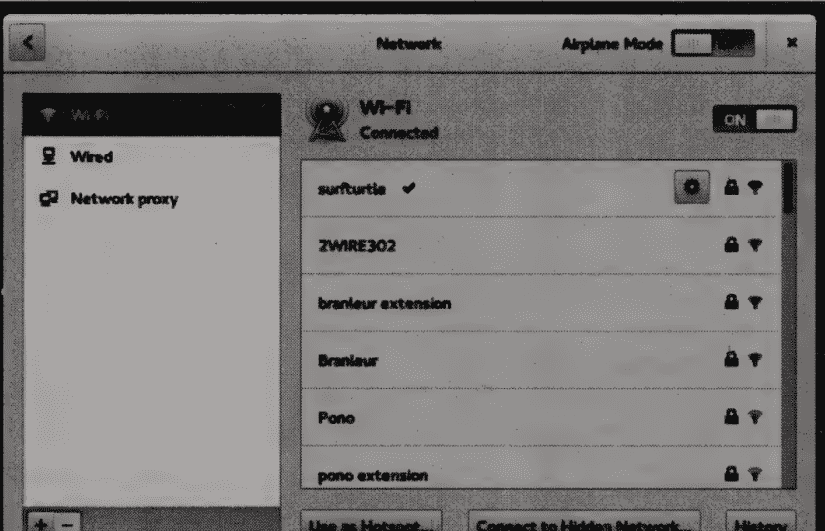

**图 2-4：** 网络（系统设置）

在 Wired（有线）选项卡中，右侧列出了可用的无线连接（参见图 2-4）。选择某一项将为其创建一个齿轮按钮，点击它可以打开网络配置对话框，其中包含详情（Details）、安全（Security）、身份（Identity）、IPv4、IPv6 和重置（Reset）等选项卡。详情选项卡显示信号强度、速度、安全方法、IP 和硬件地址、路由以及 DNS 服务器地址。

要手动编辑连接，你可以使用安全（Security）、身份（Identity）和 IP 选项卡。安全选项卡显示一个菜单，你可以从中选择安全方法和密码（参见图 2-5）。在身份选项卡上，你可以指定 SSID 名称、选择防火墙区域、选择登录时自动连接，以及是否将连接设置为系统范围（其他用户可用）。


### 图 2-5：无线连接配置

GNOME 网络对话框的 Wired（有线）选项卡显示连接信息，如 IP 地址、硬件地址和 DNS 服务器地址。右下角显示有一个齿轮按钮。开关允许你开启或关闭连接。点击齿轮按钮可以进入配置对话框，包含详情、安全、身份、IPv4、IPv6 和重置选项卡（参见图 2-6）。在身份选项卡上，你可以选择防火墙集、设置名称、硬件地址、设置 MTU 块，并选择自动连接以及是否将连接设置为系统范围。

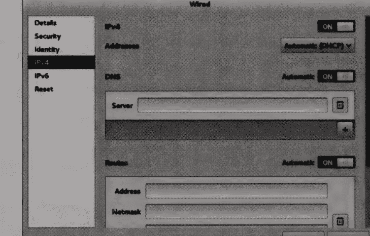

### 图 2-6：有线配置

在 IPv4 选项卡上，你可以通过地址（Addresses）、DNS 服务器和路由（Routes）部分来配置有线连接。DNS 和路由都有一个自动开关。关闭该开关允许你手动输入 DNS 服务器地址或路由信息。从地址菜单中，你还可以选择将连接设为自动或手动。当设为手动时，会出现供你输入地址的新条目。

## 使用 systemd 配置网络

这种名为 `systemd-network` 的系统网络管理器当前用于基础操作。它可以作为 NetworkManager 等大型管理器的轻量级、快速且简单的替代方案。systemd 将在第 5 章中详细介绍。`service`、`target` 和 `socket` 文件位于 `/lib/systemd/system`。

# 第一部分：系统工具

在 `systemd-network.service` 中开启了若干安全功能。能力边界集（`CapabilityBoundingSet`）允许你限制指定的权限。capabilities 的手册页列出了可用权限。`CAP_NET` 权限限制网络用于接口配置、防火墙管理、多播、广播和代理。`CAP_SET` 权限允许文件和进程 GID/UID。`CAP_CHOWN`、`CAP_DAC_OVERIDE` 和 `CAP_OWNER` 权限用于绕过权限检查。`CAP_SYS` 权限提供了系统管理权限。此外，`ProtectSystem` 选项（`systemd.exec`）防止服务对系统（`/usr`、`/boot` 和 `/etc`）进行任何更改。`ProtectHome` 使得 `/home`、`/root` 和 `/run` 目录不可访问。`WatchdogSec` 设置服务的超时。查看 `systemd.directories` 手册页获取所有 systemd 服务列表。

## systemd-networkd.service

```ini
[Unit]
Description=Network Service
Documentation=systemd-networkd.service (8)
ConditionCapability=CAP_NET_ADMIN
DefaultDependencies=no
# dbus.service 在 kdbus 上可以丢弃，systemd-udev.service 在 tuntap
 迁移到 netlink 后可以丢弃
After=systemd-udev.service dbus.service network-pre.target systemd-sys. target sysctl.service
Before=network.target multi-user.target shutdown.target
Conflicts=shutdown.target
Wants=network.target
```

```ini
[Service]
Type=notify
Restart=on-failure
RestartSec=0
ExecStart=/lib/systemd/systemd-networkd
CapabilityBoundingSet=CAP_NET_ADMIN CAP_NET_BIND_SERVICE CAP_NET_BROADCAST
CAP_NET_RAW CAP_SETUID CAP_SETGID CAP_SETCAP CAP_CHOWN CAP_DAC_OVERIDE
CAP_OWNER
ProtectSystem=full
ProtectHome=yes
WatchdogSec=3min
```

```ini
[Install]
WantedBy=multi-user.target
Also=systemd-networkd.socket
```

## 第 2 章：入门

`systemd-networkd.socket` 文件为 `systemd.socket` 设置了用于缓冲区大小（`ReceiveBuffer`）、网络链路监听（`ListenNetlink`）以及凭据传递（`PassCredentials`）选项。作为启动服务的条件，需要在能力边界集（capability bounding set）中设置 `CAP_NET_ADMIN` 权限（`ConditionCapability`）。

## systemd-networkd.socket

```ini
[Unit]
Description=Network Service Netlink Socket
Documentation=man:systemd-networkd.service(8) man:rtnetlink(7)
ConditionCapability=CAP_NET_ADMIN
DefaultDependencies=no
Before=sockets.target
```

```ini
[Socket]
ReceiveBuffer=8M
ListenNetlink=route 273
PassCredentials=yes
```

```ini
[Install]
WantedBy=sockets.target
```

`systemd-resolved.service` 为 resolvconf 操作（DNS 服务器信息）提供服务。它与 `systemd-networkd.service` 相同的权限，网络权限除外。

## systemd-resolved.service

```ini
[Unit]
Description=Network Name Resolution
Documentation=man:systemd-resolved.service(8)
After=systemd-networkd.service network.target
```

> 在 kdbus 系统上，我们显式地引入 busname，因为它携带了允许守护进程获取名称的策略。

```ini
Wants=org.freedesktop.resolve.busname

After=org.freedesktop.resolve.busname
```

```ini
[Service]
Type=notify
Restart=always
RestartSec=0
ExecStart=/lib/systemd/systemd-resolved
CapabilityBoundingSet=CAP_SETUID CAP_SETPCAP CAP_CHOWN
CAP_DAC_OVERRIDE CAP_OWNER
ProtectSystem=full
ProtectHome=yes
WatchdogSec=3min
```

```ini
[Install]
WantedBy=multi-user.target
```

此外，`systemd-networkd-wait-online.service` 会推迟其他服务的激活，直到 `systemd-networkd` 服务上线。

# 第 1 部分：系统工具

你使用 `/etc/system/network` 目录下的 `.network` 文件为 `networkd` 配置网络连接。文件名应以一个表示优先级的数字作为前缀。`10-my-dhcp.network` 示例设置了一个 DHCP 网络连接。`Match` 部分匹配网络设备，`Network` 部分配置该连接。你可以使用 `Name`、`Path` 或 `MacAddress` 键来引用设备。使用 `ifconfig` 或 `ip 1` 查找设备名称。使用此名称作为 `Name` 条目。在 `Network` 部分中，`DHCP` 键启用 DHCP 支持。你可以进一步指定 IPv4（`ipv4`）或 IPv6（`ipv6`）。

以下示例为有线（以太网）设备配置了 DHCP。`Name` 条目中使用的设备名称是通过 `ifconfig` 找到的。在 `Network` 部分中，将 `DHCP` 键设置为 `yes`，以开启 DHCP 支持。

## 10-my-dhcp.network

```ini
[Match]
Name=enp7s0

[Network]
DHCP=yes
```

你可以使用通配符 `*` 匹配字符来引用所有特定类型的设备。`en*` 字符串将匹配所有以太网（有线）设备。如果你的设备名称发生变化，你的 `.network` 文件仍然有效。

## 10-my-dhcp.network

```ini
[Match]
Name=en*

[Network]
DHCP=yes
```

带有 DHCP 的无线连接将使用相同的条目，但为名称指定特定的无线设备。

## 10-my-wireless.network

```ini
[Match]
Name=wlp6s0

[Network]
DHCP=yes
```

要连接你所有的无线设备，请使用 `wl` 和通配符匹配字符 `wl*`。带有 DHCP 的无线连接将使用相同的条目，但为名称指定特定的无线设备。

## 10-my-wireless.network

```ini
[Match]
Name=wl*

[Network]
DHCP=yes
```

## 第 2 章：入门

通过 `Address`、`Gateway` 和 `DNS` 键，你可以为计算机地址、网络网关以及 DNS 服务器的位置设置特定地址。这将建立静态连接，而不是 DHCP 连接。

## 10-my-static.network

```ini
[Match]
Name=enp7s0

[Network]
Address=192.168.0.15/24
Gateway=192.168.0.1
DNS=192.168.0.1
```

额外的部分允许你包含更多配置选项。在 `Address` 部分，你可以添加广播地址。`Routes` 部分允许你设置源路由和目的路由。`DHCP` 部分允许定义定义主机和 MTU 传输限制。如果你的系统是 DHCP 服务器，`DHCP` 部分允许你配置地址池、租约和 DNS 支持。`Bridge` 部分连接网接网络。

要使用 network，你必须首先确保已禁用了 NetworkManager。更改由 root 用户执行。使用 `sudo` 登录 root 用户（`su`）。

```bash
sudo systemctl disable NetworkManager
```

然后启用 systemd-network。

```bash
sudo systemctl enable systemd-network
```

此外，启动 systemd-resolved 以使用 DHCP 提供的 DNS 服务器。

```bash
sudo systemctl enable systemd-resolved
```


`etc/resolv.conf` 文件是指向`/run/resolve/resolv.conf`的软链接，它列出了由 DHCP 服务器提供的 DNS 服务器（`nameserver`）。

你可以使用`systemctl`检查 networkd 和 NetworkManager 的状态。

```bash
sudo systemctl status systemd-networkd
sudo systemctl status NetworkManager
```

你还可以在 systemd-networkd 上使用`start`、`stop`和`restart`命令来启动、停止和重启网络。

```bash
sudo systemctl start systemd-networkd
sudo systemctl stop systemd-networkd
sudo systemctl restart systemd-networkd
```

如果你正在运行桌面环境并选择使用 systemd-networkd，你会发现面板中的`nm-applet`不再运行。

## 可预测与不可预测的网络设备名称

网络设备使用一种可预测的命名方法，这与旧方法不同。这些方法根据特定的设备生成，引用设备类型、硬件连接和插槽，甚至其功能。传统的网络设备名称使用`eth`前缀作为以太网网络设备。`eth0`指你计算机上的第一个以太网连接。这种命名方法被认为是不可预测的，因为它没有准确引用真实的以太网设备。旧系统依赖于在启动时探测网络驱动程序，如果你的系统有多个以太网连接，取决于启动过程如何进行，名称可能会发生交换。在当前的 systemd 版本中，命名使用可预测的方法来指定特定设备。可预测方法引用你系统上的实际硬件连接。

用于引用可预测设备名称的名称具有设备类型的前缀，随后是几个限定符，例如硬件类型、使用的插槽和功能。不再使用像`eth0`这样的旧的不可预测名称，第一个以太网设备通过`enp7s`等名称引用。接口名称`enp7s`引用一个以太网（`en`）连接，位于 PCI 插槽 7（`p7`），热插槽索引号为 0。`wlp6s`是一个无线（`wl`）连接，位于 PCI 插槽 6（`p6`），热插槽索引号为 0（`s0`）。`virb0`是虚拟（`virb`）网络接口。表 2-3 列出了前缀。

与旧的不可预测名称不同，可预测名称在每台计算机上可能不同。可预测的网络名称及其替代：https://www.freedesktop.org/wiki/system/PredictableInterfaceName/

命名由内核执行，并在内核源码的`systemd/src/udev/udev-builtin-net_id.c`文件的注释部分进行描述。

| 名称 | 描述 |
| :--- | :--- |
| `en` | 以太网 |
| `sl` | 串行线路 IP（slip） |
| `wl` | 无线局域网 |
| `ww` | 广域网（移动宽带） |
| `p` | PCI 地理位置（PCI-E 插槽） |
| `s` | 热插槽索引号 |
| `o` | 板载 |
| `f` | 功能（用于具有多个端口的卡） |
| `u` | USB 端口 |
| `i` | USB 端口接口 |

**表 2-3：网络接口设备命名**

## 网络设备路径名称

`/sys/devices`目录以子目录列出你所有的设备，包括网络设备。设备路径通过连接设备的总线子目录进行。要快速查找完整名称，请使用`/sys/class`目录。对于网络设备使用`/sys/class/net`。然后使用`ls -l`命令列出网络设备及其指向`/sys/devices`目录完整路径的链接（`../`引用向上移动两个目录（`class/net`）到达`/sys`目录）。

```bash
$ cd /sys/class/net
$ ls
enp7s0 0 wlp6s0
$ ls -l
total 0
lrwxr-xr-x 1 root root 0 pci0000:0000:0000:1c.3/0000:07:00.0/net/enp7s0
lrwxr-xr-x 1 root root 0 pci0000:0000:0018:19:27 -> ../devices/virtual/lo
lrwxr-xr-x 1 root root 0 pci0000:0000:0018:19:27 lo wlp6s0 -> ../devices/pci0000:0000:0000:1c.2/0000:06:00.0/net/wlp6s0
```

`enp7s0`在`/sys/devices`目录下的完整路径为：

`/sys/devices/pci0000:0000:0000:1c.3/0000:07:00.0/net/`

你可以使用`lspci`命令找到使用的 PCI 总线。此命令列出所有连接到 PCI 的设备。在示例中，使用的 PCI 总线是 7，这就是为什么 PCI `enp7s0` 是`p7`的原因。“s”部分指的是热插插槽，在本例中为`s0`。

```bash
$ lspci
06:00.00 Network controller: Qualcomm Atheros QCA9565 / AR9565 Wireless Network Adapter (rev 01)
07:00.00 Ethernet controller: Realtek Semiconductor Co., Ltd. RTL8198/2/6 ECI Express/Gigabit Ethernet controller (rev 07)
```

设备具有由 udev 定义的特定属性，udev 管理所有设备。某些操作（例如系统链接文件）会利用这些属性。`ID_PATH`、`ID_NAME_MAC`和`INTERFACE`属性可用于向 udev 标识设备。通过`info`和`-e`选项，可以显示所有活动设备的属性。你可以通过管道（`l`）将此输出传递给`grep`命令，以仅显示特定设备的属性。使用 udev 命令查询 udev 数据库。这里列出了`enp7s0`设备的 info 属性。设备的属性是以“P”开头并以设备结尾的行。`*`匹配字符会匹配该行上的其他中间字符，即“`P.enp7s0.`”。`-A`选项显示该之后指定数量的额外行，此处为`-22`。

```bash
$ udev info -e grep -A 22 *.enp7s0
/devices/pci0000:0000:0000:1c.3/0000:07:00.0/net/enp7s0
E: DEVPATH=/devices/pci00000000:0000:1c.3/0000:07:00.0/net/enp7s0
E: BUS=pci
E: MID_CANDIDATE=1
E: MODEL_DATABASE=RTL8198/2/6 ECI Express Fast/Gigabit Ethernet
E: MODEL ID=0x8136
E: DRIVER=r8169
E: NET LINK_FILE=/lib/sys/network/99-default.link
E: NAME_MAC=enx74e6e200c729
E: NAME_PATH=enp7s0
E: OUT_FROM_DATABASE=Devell Inc.
E: PATH=pci-0000:0000:07:00.0
E: PCI CLASS_FROM_DATABASE=Network controller
E: PCI SUBCLASS_FROM_DATABASE=Ethernet controller
E: VENDOR_FROM_DATABASE=Realtek Semiconductor Co., Ltd.
```

```text
E: ID VENDOR_ID=0x10ec
E: INDEX=2
E: INTERFACE=enp7s0
E: SUBSSTEM=net
E: SYSTEM_ALIAS=/sys/subsystem/net/devices/enp7s0
E: TAGS=:system:
E: USE_INITIALIZED=1080179
```

对于某些任务（例如重命名），你可能需要知道如何缩写为`ip link`。MAC 地址位于`br`字符串之前。在示例中，通过`ip link`命令，`enp7s0`的 MAC 地址为 74:c6:e2:0e:c7:29。`ip link`命令还提供 MTU（最大传输单元）和连接当前状态。

### `ip link`

```text
1: <LOOPBACK,UP,LOWER_UP> mtu 65536 qdisc noqueue state UNKNOWN mode DEFAULT group default qlen 1 link loopback 00:00:00:00:00:00 brd 00:00:00:00:00:00
2: enp7s0 <BROCAST,MULTICAST,LOWER_UP> mtu 1500 qdisc codel state UP default DEFAULT qlen 1 74:c6:e2:0e:c7:29 brd ff:ff:ff:ff:ff:ff
3: wlp6s0 <BROCAST,MULTICAST> mtu 1500 qdisc noop state DOWN mode DEFAULT group default qlen 1000 link/eth4 cc:b5:58:22:44:1d brd ff:ff:ff:ff:ff:ff
```

### 使用 udev 规则重命名网络设备

如果你更换了网络硬件、以太网连接，或者使用以太网卡并简单更改其连接的插槽，名称就会改变。对于引用特定以太网连接的防火墙，这可能是一个问题。如果你愿意，可以使用旧的不可预测名称将其更改为你选择的名称。这将有助于你更新名称本身，而不是更新所有规则以及任何通过引用网络设备的代码。

你可以通过为网络设备添加 udev 规则来更改设备名称。使用 udev 规则进行的更改对 DriverManager 和 systemd-network 都有效。在`/etc/udev/rules.d`中，创建一个以`.rules`扩展的文件，并以小于 80 的数字开头，例如`70-my-network-names.rules`。`/etc/udev/rules.d`中的`.rules`文件优先级高于系统目录`/lib/udev/rules.d`中的文件。

在 udev 规则中：

```text
/etc/udev/rules/70-my-network-names.rules
SUBSYSTEM="net", ACTION="add", ATTR(address)="74:c6:e2:0e:c7:29", NAME="eth0"
```

要指定设备，可以添加设备的内核名称（`KERNEL`）。内核名称即是`INTERFACE`名称。

```text
SUBSYSTEM="net", ACTION="add", ATTR(address)="74:c6:e2:0e:c7:29", KERN="enp7s0", NAME="eth0"
```

## 使用 systemd-link 为 systemd-network 重命名网络设备名称

systemd-network 提供了更改网络设备名称的另一种方法（请注意，udev 规则对 systemd-network 同样有效）。要更改名称，你需要在`/etc/systemd/network`目录中设置 system link 文件。systemd-link 文件由 Match 和 Link 部分组成。在 Match 部分中，你指定网络设备；在 Link 部分中，你指定想要赋予它的名称。网络设备可以通过其预测名称（Path）或 MAC 地址（MACAddress）进行引用。

默认的 systemd link 文件位于`lib/systemd/network/99-default.link`。该文件仅有一个 Link 部分，其中包含了确定名称的策略。NameKey 列出了要检查的策略，顺序为：内核、然后是 udev 数据库、设备固件信息、udev 热插插槽信息和设备路径。在某些情况下，会使用该策略。对于具有或需要 MAC 地址的设备，MACAddressPolicy 设置为 persistent（持久性）。

### `99-default.link`

```ini
[Match]
[Link]
MACAddressPolicy=persistent
```

## 使用图形界面安装软件包


要安装软件包，首先点击其复选框（见图 2-8）。框被勾选后，软件包图标上会出现一个加号，如图所示。


你可以点击多个软件包来选择进行安装。一旦准备好安装，点击“更改”（Changes）按钮（右上角）。底部的状态栏将显示正在执行的任务，从下载、安装，最后到完成。


图 2-8：软件包信息

进度条将显示任务的进度。PackageKit 任务消息显示在右上角。在下载阶段，“取消”（Cancel）按钮将变为激活状态，允许你取消安装。完成后，软件包图标的颜色将从淡变为实色，并在复选框中显示勾选标记。

如果你想要安装的软件需要依赖或额外的软件包，它们将被列出来，并提示你确认安装。点击“继续”（Continue）。

每当你点击“更改”安装软件包时，系统都会提示你输入 root 密码以授权安装。

## GNOME 软件（Software）

GNOME Software 是 DNF 的管理前端。GNOME Software 管理器是基于互联网的，从在线仓库安装，并使用 DNF 进行下载和安装。它被设计为一种跨发行版的软件包管理器，适用于任何受支持的 Linux 发行版。更多信息请参阅`#fedoraproject.org/wiki/Changes/AppInstaller`。

GNOME Software 执行各种不同的软件任务，包括安装、删除、更新以及安装单个 RPM 文件。GNOME Software 应用程序为`gnome-software`，可以通过应用程序概览中的“软件”（Software）访问。


图 2-9：GNOME Software

GNOME Software 目前设计用于安装客户端和系统应用程序。它不安装服务器软件，例如 DNS named 服务器或 Apache Web 服务器。它也不安装许多旧的系统配置工具，例如`system-config-base`或`system-config-lvm`。要管理此类软件，你必须安装旧的`system-config-packages`软件包管理器，它在 GNOME Software 中名为“软件包”（Packages）。

## 使用 GNOME Software

要使用 GNOME Software，请点击应用程序概览上的“软件”图标。GNOME Software 将通过收集你所有软件包的信息来启动。打开一个窗口，顶部有三个标签页分别是“全部”（All）、“已安装”（Installed）和“更新”（Updates）。你可以从“全部”标签页安装应用程序，该标签页顶部有一个用于搜索的文本框、精选列表、特色应用程序以及一组分类标签（见图 2-9）。

## 使用 DNF 安装

下载 Fedora 软件或来自任何 Fedora 仓库的软件是 Dandified YUM（DNF）软件包管理器（http://fedoraproject.org/wiki/Features/DNF）的简单工作。DNF 使用与 YUM 许多相同的命令和选项，DNF 取代了 YUM。GNOME Software 和软件包（PackageKit）为 DNF 管理器提供了桌面界面。

或者，你可以在终端窗口中输入`dnf`命令和软件包名称。DNF 将检测软件及其依赖项，并提示你下载和安装它。例如，以下命令将安装 vsftpd 服务器：

```bash
dnf install vsftpd
```

## 更新 Fedora

Fedora 每六个月发布一次新版本。在此期间，会为特定的软件包不断准备新的更新。这些更新以更新的形式发布，你可以从软件仓库下载并安装到你的系统中。这些包括新版本的应用程序、服务器，甚至是内核。此类更新的范围从单个软件包到所有组件不等。

使用自动更新工具，更新你的 Linux 系统已变成一个非常简单的程序。对于 Fedora，你可以通过访问软件仓库来更新系统，DNF（Dandified YUM）更新方法使用 RPM 头来确定哪些软件包需要更新。要更新你的软件包，请使用“软件更新”（GNOME Software），其标记为“软件更新”。“软件更新”是 DNF 的图形化更新界面，从桌面执行所有更新。从命令行，你可以使用`dnf upgrade`命令执行更新。

如果检测到更新，GNOME Software 将在托盘中显示更新消息（见图 2-10）。点击“查看”（View）将打开 GNOME Software 并进入“更新”标签页，可以在那里执行更新。点击“重启并安装”（Restart & Install）按钮将立即关闭系统，然后重启，并在启动过程的一部分下载并安装更新。


图 2-10：更新通知消息和图标

在 Fedora 上，你可以使用 GNOME Software 执行更新（默认），或者使用较旧的“软件更新”。“软件更新”是 PackageKit 软件包管理器的一部分，并随 PackageKit 一起安装。PackageKit 默认不安装。GNOME 上用于 PackageKit 的名称简单为“软件包”（Packages）。

## 使用 `dnf` 命令更新

或者，你可以使用带有`upgrade`选项的`dnf`命令进行更新。以下命令将更新已安装的 Gnumeric 软件包。


```bash
dnf upgrade gnumeric
```

你可以使用`check-update`选项查看哪些软件包需要更新。

```bash
dnf check-update
```

要对所有已安装的软件包执行完整更新，只需使用`upgrade`选项。这与使用“软件更新”的效果相同。

```bash
dnf upgrade
```

## 服务器角色与`rolekit`

服务器角色（Server roles）设计用于安装和自动配置专用服务器。你可以将它们认为是一种更复杂的打包形式。与其先为特定服务器安装组合软件包然后配置服务器，不如你可以安装一个服务器角色来安装所有预配置的软件包。

你使用`rolekit`和`rolectl`命令管理角色。安装`rolekit`软件包（Fedora 服务器已内置）。`rolekit`帮助页提供了描述。`rolekit`在`/usr/lib/rolekit/rolekit`目录下为支持的服务器安装角色配置文件。目前，这些包括数据库服务器（PostgreSQL）、域控制器（domaincontroller）和 memcache。`/usr/lib/rolekit/rolekit`目录为每个角色有一个子目录。其他角色将在可用时添加。你也可以使用`rolekit`创建角色。

角色使用`rolectl`命令管理。`list`选项列出了你的可用角色。查看`rolekit`的帮助页以获取选项的详细说明。

```text
$ rolectl list roles
daterver
domaincontroller
memcache
```

可以使用`settings`选项列出角色的当前设置。

```bash
rolectl settings databaseserver
```

列出已部署服务器（由`rolekit`安装的服务器）使用`list instances`选项。

```bash
rolectl list instances
```

使用`deploy`选项安装服务器。

```bash
# rolectl deploy databaseserver
```

部署可能需要很长时间。要监控进度，运行：

```bash
journalctl -ef -u rolekit
```

```text
success

# rolelist instances

databaseserver/1
```

# 第 1 部分：系统工具

需要 JSON 扩展。你可以使用 gedit 编辑器创建一个 JSON 文件，并以 JSON 扩展名保存文件。

```json
{
  "database": "myserver",
  "owner": "richard"
}
```

以下命令使用 JSON 文件和用户指定的选项安装数据库服务器实例：

```bash
rolectl deploy databaseserver --settings-file /home/richard/myserver-options.json
```

如果没有为数据库选项分配值，则会自动将数据库名称分配给该实例。如果没有为实例指定名称，则数据库实例的名称将设置为从 1 开始的数字，并带有`db`前缀。第二个实例的`/etc/rolekit/roles/databaseserver`文件将命名为`2.json`，如果没有设置数据库选项，则数据库将命名为`db`。

若要指定实例的名称，请使用`rolectl`命令的`--name`选项。JSON 配置文件将具有该名称，并且如果用户设置了该名称，数据库也将具有该名称。在接下来的示例中，配置文件为`newserver.json`，而数据库将为`newserver`。

```bash
rolectl deploy databaseserver --name newserver
```

用户选项具有优先级。在此示例中，配置文件为`newserver.json`，但数据库名称为`myserver`。

```bash
rolectl deploy databaseserver --name newserver --settings-file /home/richard/myserver-options.json
```

你可以使用`decommission`角色/实例选项来移除实例。指定角色和实例名称，并用斜杠分隔。`decommission`将移除`/etc/rolekit/roles/`目录下的配置文件。在接下来的示例中，`/etc/rolekit/roles/databaseserver`目录下的`1.json`文件被删除。

```bash
rolectl decommission database/1
```

## 终端窗口

终端（Terminal）允许你在命令行上输入 Linux 命令（系统工具 | 终端）。它还为你提供了一个 shell 界面来执行 shell 命令，而不是你的桌面。命令行是可编辑的，允许你使用退格键删除行上的字符。按键将插入字符。你可以使用左右方向键移动到行的行的任何位置，按键插入字符，或使用退格键删除字符（参见图 2-11）。文件夹、文件和可执行文件有颜色编码：文件为黑色，可执行文件为绿色，链接为青色。共享文件夹显示为绿色背景。

# 第 2 章：入门


图 2-11：终端窗口

终端窗口会记住你之前输入的命令。使用上、下方向键可以在命令行上顺序显示这些命令。按回车键重新执行当前显示的命令。你甚至可以在运行之前的命令之前对其进行编辑，允许你执行以前命令的修改版本，或者在你误输入了一个复杂命令并想在不重新输入整个命令的情况下进行纠正。终端窗口将显示该会话之前的所有交互和命令。使用滚动条查看你运行的所有之前的命令及其显示结果。

你可以根据需要打开多个终端窗口，每个窗口都有自己的 shell。你不需要为每个 shell 打开单独的窗口，可以使用标签页（tabs）在同一个窗口中打开多个 shell。从“文件”菜单中选择“打开标签页”打开新标签页（`Shift-Ctrl-t`）。每个标签页运行一个独立的 shell，允许你在每个标签页中输入不同的命令。你可以使用标签页在标签页之间移动，或点击其中一个进行选择。如果打开了多个标签页，菜单上会显示标签菜单。对于单个窗口，不显示标签菜单。

终端窗口支持 GNOME 剪切、复制和粘贴操作。你可以从网页上复制一行并将其粘贴到终端窗口中（你可以使用终端窗口“编辑”菜单上的“粘贴”项或按`Shift-Ctrl-v`）。命令将出现，然后你可以按回车键执行命令。这对于显示在图形窗口上的命令操作非常有用。与其自己输入命令，不如直接从网页上选择并复制，然后粘贴到终端窗口。你还可以在执行命令之前对命令进行任何编辑。

你可以使用配置（profiles）来自定义终端窗口。已经设置了一个默认配置。你可以创建具有自定义偏好的新配置。要自定义你的终端窗口，从“编辑”菜单中选择“配置偏好”，打开一个设置配置选项的窗口，其中包含常规、标题、命令、背景、滚动和兼容性标签。终端窗口列出了你当前的配置。如果你没有设置其他配置，它将是默认配置。在默认配置上，“滚动”标签页指定了你的终端历史保留的命令行行数。这些是你可以回溯并选择以重新执行的行。你可以将其设置为无限以保留所有命令。你还可以将滚动条放在左侧或右侧。

你的终端窗口将被设置为使用黑底白字。要更改此设置，你可以编辑配置以更改“颜色”标签页上的背景和文本颜色。取消勾选“使用系统主题的颜色”。这将启用“内置方案”菜单，你可以从中选择“白底黑字”显示。其他颜色组合也列为“浅黄底黑字”和“黑底绿字”。自定义选项允许你选择文本和背景颜色。终端窗口上的颜色将根据你的选择而变化，允许你看到这些选择的效果。

如果你应该使用透明或图像背景，请使用“背景”标签页。最初，背景将是实色（在“颜色”标签页上选择的颜色）。要使用图像，请选择“背景图像”项并选择一个图像文件。对于透明背景，选择“透明背景”项并设置阴影量（完全透明将不显示透明度）。

要创建一个新配置，从“文件”菜单中选择“新建配置”。这将打开一个当前配置的列表。在配置窗口中点击“新建”按钮，你可以在其中输入配置名称并选择任何配置作为基础。初始将选择默认配置。要编辑配置，从“编辑”菜单中选择“配置”，打开列出你所有配置的配置窗口。选择你想要编辑的那个，然后点击“编辑”按钮打开该配置的编辑窗口。

## 超级控制：Root 用户

要执行系统操作，你必须首先获得 root 用户的访问权限，让你成为超级用户。由于超级用户拥有更改系统上几乎任何内容的权限，此类密码通常是经过仔细保护的秘密，频繁更改，并且只给那些工作是管理系统的人。有了正确的密码，你可以以系统管理员身份登录系统并以不同的方式配置系统。你可以启动和关闭系统，还可以切换到不同的运行模式，你也可以添加或删除用户，添加或删除文件系统，备份和恢复文件，甚至指定系统的名称和地址。

要成为超级用户，请登录 root 用户账户。这是一个为系统管理保留的特殊账户，对你的 Linux 操作系统的所有组件具有不受限制的访问权限。你可以通过终端使用命令（推荐）、命令行登录界面，以及在启用后的 GDM 登录界面（默认禁用且不推荐）作为 root 用户登录。从像 GNOME 这样的桌面界面，root 用户对 Fedora 管理工具（如 PackageKit）的访问由 PolicyKit 管理，这需要你使用 root 密码。

如果你登录命令行界面或终端窗口，可以运行相应的管理命令，如`dnf`安装包或`us`添加新用户。root 用户的命令行界面使用特殊的提示符，符号`#`。在接下来的示例中，用户作为 root 用户登录系统并收到`#`提示符。

```text
login: root
password:
#
```

## Root 用户密码

作为 root 用户，可以使用`passwd`命令更改 root 登录密码，就像更改系统中任何其他用户的一样。`passwd`命令将使用可插入身份模块（PAM，如第 9 章所示）检查你的密码，查看你是否选择了一个容易被破解的密码。要从 GUI 界面轻松更改 root 密码，你可以使用`system-config-rootpassword`工具。

```text
$ passwd

New password:

Re-enter new password:
```

你必须采取措施保护你的 root 密码。任何获得 root 用户访问权限的人将对你的系统拥有完全控制权。`passwd`命令的在线手册为处理和选择密码提供了详细的建议。例如，永远不要将密码存储在系统的文件中，也永远不要根据任何可访问的信息（如你的电话号码或出生日期）选择密码。一个基本指南是让你的密码尽可能复杂，使用包含几个单词、数字和小写字母的短语，但又要是你能够容易记住的内容，这样你就不需要将其写下来。你可以通过以下命令访问`passwd`在线页面：

```bash
man passwd
```

# 桌面登录 root 用户

GNOME 显示管理器（GDM）的登录窗口默认禁用了对 root 用户的访问。此功能被设计为一种安全预防措施，建议保持原样。如果你想访问 root 用户桌面，可以配置系统使用登录恢复 root 访问。详情请参阅 Fedora 发布说明和以下网站。

```text
http://fedoraject.org/wiki/Enabling_Root_User_For_GDM_Display
```

要启用此功能，请以 root 用户身份编辑`/etc/pam.d/gdm`文件。这是 GDM 的 PAM 配置文件。在此处行的前面加上`#`号来注释掉该行。它是第二行。

```text
# auth required pam_success.so so user = root
```

你必须编辑该文件以允许 root 用户。在终端中使用`su`命令获取访问权限，并使用`vi`或`nano`等编辑器编辑该文件。

```bash
su
nano /etc/pam.d/gdm
```

# Root 用户访问：`su`

当你以普通用户账户登录时，可能需要登录为 root 并成为超级用户。你可以使用`su`命令（切换用户）直接登录到 root，同时保持用户账户的登录状态。如果你使用 GNOME，可以在终端窗口中输入`su`命令，或者使用`ALT-CTRL-F6`切换到命令行界面（`ALT-CTRL-F7`返回桌面界面）。执行`exit`命令将返回你的用户登录状态。当你以 root 登录时，可以使用`su`登录为任何用户而无需提供密码。在下一个示例中，用户已经登录。随后`su`命令登录为 root 用户，使该用户成为超级用户。

# 第 1 部分：系统工具

```text
$ pwd
/home/chris

$ su
password:

# cd

# pwd
/root

# exit
```

在终端窗口中以 root 用户登录时，如果你熟悉`su`命令，你将使用额外的`sudo`命令来以 root 用户身份运行 GNOME 桌面应用程序。你不能直接以 root 用户身份运行桌面应用程序。要运行具有 root 权限的普通 GNOME 应用程序，你必须对它们进行单独身份验证。例如，如下所示，可以使用`sudo`命令以管理员（root 级别）权限运行`edit`GNOME 编辑器。

```bash
sudo edit
```

编辑是一个大问题，因为你可能需要编辑只有 root 用户才能访问的系统配置文件。如果你熟悉`vi`的命令，可以使用`vi`编辑器。但许多用户更倾向于使用类桌面的编辑器，例如`edit`。你也可以使用像`nano`或`leafpad`这样基于光标的编辑器，在以 root 用户登录时为配置文件提供基础的类桌面编辑。

# 受控制的管理员访问：`sudo`

通过`sudo`工具，你可以允许普通用户限制某些任务的 root 级别管理员访问。这允许其他人在没有 root 级别权限的情况下执行特定的超级用户操作。你可以在`www.sudo.ws`找到更多关于`sudo`的信息。要运行管理员命令，用户需要在命令前加上`sudo`。用户将获得一个有时性的票据以允许访问。

```bash
sudo date
```

访问由`/etc/sudoers`文件控制。该文件列出了用户及其可以运行的命令以及访问所需的密码。如果设置了`NOPASSWD`选项，则用户不需要密码。`ALL`根据上下文指的是网络上的所有主机、root 级别命令或所有用户。

要进行更改或添加条目，你必须使用特殊的编辑命令`visudo`编辑文件。这会调用`vi`编辑器来编辑`/etc/sudoers`文件。与标准编辑器不同，除非语法正确，否则`visudo`将锁定文件。如果你想使用不同的编辑器，可以将其分配给`EDITOR`变量。

```bash
visudo
```

`sudoers`文件中的条目技术上称为“规范”（specifications），有两种：用户（user）和别名（aliases）。用户规范是控制用户访问的主条目。用户规范包含`user`、`host`、`run`和`commands`。用户列表是包含在此规范中的内容。`hosts`是允许 root 访问的主机。`run`列表是用户可以以的身份访问主机的列表（具有完全 root 用户能力的用户应该能够访问主机上的任何用户）。`commands`列表是这些用户可以运行的命令列表。对于任何一项，你都可以使用`ALL`来表示所有用户（用户列表和运行身份）、主机或命令。用户规范的语法如下：

```text
users hosts=(runas) commands
```

`(runas)`部分仅仅是用户列表。在用户处使用`ALL`将获得对所有用户的访问权限。`runas`部分用于允许用户以另一个身份访问主机。

`host`是你网络上的主机。你可以使用`ALL`术语指定所有主机。命令可以是某些，也可以全部由选项（如是否需要密码）限定。要指定所有命令，你也可以使用`ALL`术语。以下赋予 george 对所有主机的 root 级别访问：

```text
george ALL = ALL
```

默认情况下，`sudo`会拒绝所有用户的访问，但允许 root 用户访问。默认的`/sudoers`文件使用`ALL=(ALL) ALL`条目为 root 用户设置了所有命令的完全访问权限。

```text
root ALL=(ALL) (ALL)
```

要给用户在所有主机上的完全管理员访问权限（与 root 用户访问相同），你可以复制 root 条目并将其替换为用户名。以下赋予 richard root 用户级别的访问：

```text
richard ALL=(ALL) (ALL)
```

在使用`visudo`编辑器编辑`sudoers`文件时，若要复制行，请移动到 root 行，然后按`yy`键再按`p`键复制并粘贴。移动到复制中的 root 名称并按`cw`键编辑 root 名称，然后输入新名称。完成后按`ESC`键，按`ZZ`键保存并退出。

你还可以允许用户在给定的主机上以另一个身份运行。备用用户放在命令前的括号中。例如，如果你想让 george 以`mydns`的身份访问`beach`主机，你可以使用：

```text
george beach=(mydns) ALL
```

要让用户在所有主机上以任何身份运行，你会使用`ALL = (ALL)`，就像对 root 用户所做的那样。

```text
george ALL=(ALL) ALL
```

要指定组名，在组名前加上`%`符号，例如`%mygroup`。这样你可以为一组用户提供相同的访问。`/etc/sudoers`文件包含了针对`%wheel`组的示例。

要让 robert 访问所有主机上的`date`命令，你会使用 sudo：

```text
robert ALL=/usr/bin/date
```

如果用户想查看他自己可以运行的命令，该用户将带`-1`选项使用`sudo`命令。

```bash
sudo -1
```

为了更好地控制不同组和用户，`sudo`还支持别名规范。详情请参阅`sudo`手页。你可以为用户、主机和命令设置别名。某些别名已经为你设置好了。别名的格式如下：

```text
alias-type name list
```


有三种别名类型，对应 `sudo` 条目的每个部分：`User_Alias` 用于用户，`Runas_Alias` 用于运行身份，`Host_Alias` 用于主机，以及 `Cmd_Alias` 用于命令。`Cmd_Alias` 定义了可以在 `sudo` 定义中轻松引用的命令组。已经为你定义了一些（尽管被注释掉了），例如用于运行 `service` 和 `chkconfig` 以及运行 `fdisk`、`parted` 和 `mount` 等文件系统操作。

```text
CmdAlias SERVICES = /bin/service, /bin/chkconfig
```

某些 `User_Alias` 和 `Host_Alias` 条目已经在 `/etc/sudoers` 文件中定义但被注释掉了，例如 `ADMINS`。你可以使用这些示例创建自己的条目。

```text
# User_Alias ADMINS = jsmith, mkem
```

以下将允许 `robert` 在任何主机上使用 `service chkconfig` 命令。

```text
robert ALL=SERVICES
```

如果定义了 `ADMINS` 用户别名，你可以使用以下内容为指定为管理员的用户组提供 root 级别访问。

```text
ADMINS ALL=(ALL) ALL
```

此外，`sudo` 还支持提供特殊选项的标签。特别是，`NOPASSWD` 标签将允许用户无需密码登录。以下将允许无需输入 root 密码即可获得 root 级别访问。

```text
george ALL = NOPASSWD: ALL
```

你还可以为 `sudo` 设置一些选项，包括 `authenticate` 要求密码，以及 `passwd_timeout` 用于密码提示的超时。`rootpw` 选项将要求 root 用户输入其 root 密码，而不是用户密码。

## 3. systemd：单元文件与服务器管理

- `systemd`
- system 单元文件：`/lib/systemd/system`
- 特殊目标（运行级别）
- 管理服务

# 第一部分：系统工具

单个 Linux 系统可以提供多种服务，范围从管理服务到更显而易见的 Internet 服务，如 Web 和 FTP 站点、电子邮件和打印服务。SSH 和 Kerberos 等安全工具以服务的形式运行，还包括 DHCP 和 LDAP 等管理网络工具。网络连接接口本身也是一个可以重启的服务。每个服务都作为一个持续运行的守护进程，为其特定服务处理请求。

系统启动由系统服务管理。用于启动单个服务的原始 V init 系统已被逐渐淘汰。先前的 Fedora 版本中的 Upstart 服务也已被弃用。

# systemd

Linux 系统传统上使用 Unix V init 守护进程通过设置启动或关闭的运行级别（runlevels）来管理服务。Fedora 已将 SystemV init 守护进程替换为 `systemd` 守护进程。V init 守护进程会在整个系统启动或关闭时启动某些服务，而 `systemd` 对所有任务和服务都使用套接字（sockets），并在守护进程启动时它们之间进行协调。这允许 `systemd` 同时启动守护进程（并行）。没有任何守护进程需要等待另一个守护进程，`systemd` 会协调套接字的数据（缓冲），以便一个守护进程接收到来自另一个守护进程的其继续运行所需的信息。这种并行启动的兼容性实现了极快的启动速度。

实际上，你可以将 `systemd` 视为 V init 脚本和 `inetd` 守护进程的结合，使用套接字激活来链接所有系统任务和网络服务器。套接字激活的设计最初受到 `inetd` 的启发，`inetd` 使用套接字（`AT_INET`）在请求时启动 Internet 守护进程。套接字激活设计被 OSX 系统应用于所有套接字（`AF_UNIX`）。这允许所有进程同时并行启动，从而实现了极快的启动速度。

套接字由 `systemd` 设置和管理。当 `D-BUS` 需要写入日志（logging）时，它会写入由 `systemd` 设置并管理的 `system-journal` 套接字。这意味着服务不再需要像在 System V 中那样按照特定的顺序启动和关闭。它们可以同时启动和停止。此外，如果服务失败，`systemd` 会控制套接字，其套接字将保留在。服务将使用相同的套接字重启且不会丢失信息。

`systemd` 管理所有类型的套接字，包括 UNIX（system）、INET（network）、NETLINK（devices）、FIFO（pipes）和 POSIX（messages）。更多细节见下文：

```text
http://fedaproject.org/wiki/systemd
```

`systemd` 为所有任务和服务设置套接字。系统任务的配置定义在 `lib/systemd/system` 中的单元文件（units files）中。在这方面，`systemd` 替换了 Sys V init 的 `/etc/init.ab` 中使用的条目。`systemd` 还有它自己的 `shutdown`、`reboot`、`halt` 和 `인지` 版本，每个版本都有自己的帮助页。这些版本用于 Fedora，而不是原始的 Linux 发行版。

`systemd` 与 V V 脚本和 `/etc/fstab` 完全兼容。System V 脚本和 `/etc/fstab` 被视为 `systemd` 使用的额外配置文件。如果存在 System V 脚本，且尚未存在相应的 `systemd` 单元配置文件，则它将使用它们来生成相应的单元文件。`systemd` 配置具有优先级。

如果需要，`systemd` 还会使用 System V init `/etc/rc.d` 目录中的启动和停止优先级文件来确定依赖关系。`/etc/fstab` 用于生成用于管理系统文件的 `systemd` 单元文件。`systemd` 支持快照，允许恢复到先前的状态。

# 第 3 章：systemd 73

# systemd 基础配置文件

你可以使用 `/etc/systemd` 目录下的配置文件为系统、登录管理器、用户和日志服务配置 `systemd`。当为系统运行时，`systemd` 使用 `system.conf` 文件，否则使用 `user.conf` 文件。你可以设置如日志级别（`LogLevel`）和资源大小等选项。可用选项请参见 `systemd.conf`（`system.conf` 和 `user.conf`）、`login.conf` 和 `journald.conf` 页面。

# 单元

`systemd` 将任务组织成单元（units），每个单元都有一个单元配置文件。有几种类型的单元（见表 3-1）。单元名称有一个扩展名，用于指定其类型。服务类型扩展名为 `.service`，挂载类型扩展名为 `.mount`。服务类型的功能与 System V init 脚本相同。服务可以启动、停止和重启。`systemctl` 命令将列出所有单元，包括那些……

单元也可以用于套接字、设备和挂载任务。套接字类型实现了用于 inet 的连接类型，允许你按需启动服务。设备类型引用由 `udev` 检测的设备。挂载类型管理文件系统的挂载点，并在该挂载点应当激活时激活它。自动单元有一个对应的挂载单元，它用它来挂载文件系统。同样，套接字单元通常有一个对应的服务类型来为套接字执行任务。

每个单元内部都有控制服务、套接字、设备或挂载点的指令。某些指令是单元类型特有的。这些指令列在对应服务的主页中，例如服务单元的 `systemd.service`，或挂载单元的 `systemd.mount`（见表 3-1）。

# systemd.service

单元的选项列在 `systemd.exe` 和 `systemd.unit` 页面中。`systemd.unit` 页面列出了所有单元的指令，如 `Conflicts`、`Before`、`SourcePath` 和 `Also`。`systemd.exe` 页面列出了单元执行的选项，例如服务器守护进程的启动。这些选项包括 `User`、`WorkingDirectory`、`Nice` 和 `Umask`。`systemd.exe` 页面涵盖了服务、套接字、挂载和交换单元的选项。`systemd.directives` 主页提供了所有系统单元选项的列表以及每个单元的主页。

目标单元（target unit）用于分组单元。例如，目标用于模拟级别。多用户目标分组了在 System V 中运行在运行级别 3 的单元（服务）。实际上，目标将运行在特定运行级别的针对特定目标的服务组合在一起。打印机目标激活 CUPS 服务，图形目标模拟运行级别 5。目标也可以用于引用其他目标。默认目标指定了默认运行级别。

# 第一部分：系统工具

| 单元类型 | 帮助页（Man page） | 描述 |
| --- | --- | --- |
| `service` | `systemd.service` | 服务，如服务器，可以启动和停止 |
| `socket` | `systemd.socket` | 用于服务的套接字（`AF_INET`） |
| `device` | `systemd.device` | 设备 |
| `mount` | `systemd.mount` | 文件系统挂载点 |
| `automount` | `systemd.automount` | 文件系统的自动挂载点。与挂载单元配合使用。 |
| `target` | `systemd.target` | 分组单元 |
| `path` | `systemd.path` | 管理目录 |
| `snapshot` | `systemd.snapshot` | 通过使用 `systemctl snapshot` 管理 `systemd` 的运行时状态创建。 |
| `swap` | `systemd.swap` | 由 `systemd` 文件系统生成的交换单元文件。 |
| `timer` | `systemd.timer` | 基于时间的单元激活。它对应于服务文件。时间格式在 `systemd.man` 页面指定。 |
|  | `systemd.unit` | 适用于所有单元的配置选项帮助页 |
|  | `systemd.exec` | 服务、套接字、挂载和交换单元的执行环境帮助页 |
|  | `systemd.special` | `systemd` 特殊目标（如多用户目标和打印目标）的帮助页。 |
|  | `systemd.time` | `systemd` 的时间和日期格式 |
|  | `systemd.directives` | 所有系统选项及其所在帮助页的列表。 |

**表 3-1：systemd 单元类型与帮助页**

## 第 3 章：systemd

你可以将希望在 `multi-user.target`（运行级别 3）中启动的服务链接此处。系统会自动为你启用的服务安装链接，例如 `smb.service` 和 `httpd.service`。这些都是指向 `/lib/systemd/system` 目录下实际服务文件的链接。`multi-user.target` 目录包含 `firewall.service` 的链接，在所有运行级别下启动防火墙。`printer.target` 目录包含 `cups` 服务的链接。

禁用服务会将其从 `/etc/systemd/system/multi-user.target/` 目录中删除链接。原始服务文件（在此例中为 `httpd.service`）留在 `/lib/systemd/system` 目录下。如果你再次启用它，将向 `/etc/systemd/system/multi-user.target` 添加它的链接。

`/etc/systemd/system` 目录也包含服务的链接。`/etc/systemd/default.target` 文件是 `/lib/systemd/system/multi-user.target` 的链接。`/etc/systemd/dbus-org.desktop.NetworkManager.service` 引用 `/lib/systemd/NetworkManager.service`。

管理时可以使用 `systemctl` 或 `cockpit`。其他服务 `chconfig` 和 `system-config-services` 已经修改为使用 `systemctl` 来执行启动和停止服务等操作。

# unit 语法

文件由括号包含的关键字指定的章节组成。所有单元都有一个 `[Unit]` 部分和一个 `[Install]` 安装部分。这些部分的选项描述了 `systemd.unit` 页面。可以通过以 `#` 或 `;` 字符开头的行来编写命令。参见表 3-2 以获取常用 `Unit` 和 `Install` 部分的列表。

文件的 `Unit` 部分包含有关单元的通用信息。`Description` 选项提供了有关该单元管理的任务的信息，例如这里的 Samba 服务器。

```ini
Description=Samba SMB Daemon
```

`Documentation` 选项列出了应用程序文档的 URI。

```text
Documentation=man:dhcpd(8) man:dhcpd.conf(5)
```

注意：单元文件的语法基于 `.desktop` 文件，而后者反过来灵感源于 Windows 文件。`.desktop` 文件类型符合 DBus Entry Specification。

可以使用 `unit` 部分中的 `Before`、`After`、`Requires`、`Wants` 和 `Conflicts` 选项指定依赖的类型。`After` 和 `Before` 配置单元的顺序。在以下 `smb.service` 文件的 `After` 选项中，smb 服务在系统日志、nmbd 服务器和 Windbind 服务器之后启动。

```ini
After=syslog.target network.target nmb.service windbind.service
```

`Requires` 选项设置了单元之间的依赖关系。如果一个失败，另一个也会失败。在以下 `graphical.target` 单元文件的 `Requires` 选项中，只有在激活了多-user target 的情况下，才能启动图形 target。

```ini
After=multi-user.target
```

# 第 部分：系统工具

`Wants` 选项设置了一个较弱的依赖关系，要求激活，但如果发生故障不会触发失败。图形 target 和如 GDM 这样的显示管理器服务就是如此。

```ini
Wants=display-manager.service
```

| 单元选项 | 描述 |
| --- | --- |
| `[Unit]` | 单元的描述。 |
| `Documentation` | 引用文档的 URI。 |
| `Requires` | 服务所需的单元。这是一个严格要求。如果所需的单元失败，该单元也会失败。 |
| `Wants` | 服务希望的单元。这不是一个严格要求。如果需要的单元失败，该单元将启动。功能与 `wants` 目录相同。 |
| `Conflicts` | 负向单元依赖。启动该单元会停止 `Conflicts` 选项中列出的单元。 |
| `Before` | 单元排序。单元在列出的单元之前启动。 |
| `After` | 单元排序。单元等待到列出的单元后启动。 |
| `OnFailure` | 单元失败时运行的单元。 |
| `SourcePath` | 生成配置的源文件，例如从 `/etc/fstab` 生成的挂载单元文件。 |
| `[Install]` |  |
| `WantedBy` | 在列出的单元的 `wants` 子目录中设置符号链接。当列出的单元激活时，该单元会被激活。这不是严格要求。 |
| `RequiredBy` | 在列出的单元的 `.requires` 子目录中设置符号链接。当列出的单元激活时，该单元会被激活。这是一个强要求。 |
| `Alias` | 单元安装的额外名称。别名实现为指向单元文件的符号链接。 |
| `Also` | 与此单元一起安装的额外单元。 |

**表 3-2：systemd Unit 和 install 选项（所有单元共用，systemd.unit）**

有多个条件选项可用，如 `ConditionPower`，如果为真，则检查系统是否正在使用 AC 电源。`ConditionPathExists` 检查静态防火墙规则文件是否存在。

```ini
ConditionPathExists=/etc/sysconfig/iptables
```

某些单元文件由 `systemd` 自动生成，允许你使用旧的配置方法。例如，用于管理文件系统挂载的单元文件是根据 `/etc/fstab` 文件中的配置信息生成的。`SourcePath` 选项指定用于生成单元文件的配置文件。此处显示 `boot.mount` 单元的 `SourcePath` 选项。

# 第 3 章：systemd

```ini
SourcePath=/etc/fstab
```

`Install` 部分提供了此单元的安装信息。`WantedBy` 和 `RequiredBy` 选项指定了该单元所需的单元。对于 Samba 和 Apache Web 服务器等服务单元，`install` 部分有一个针对 `multi-user.target` 的 `WantedBy` 选项。这具有在运行级别 2、3、4 和 5 下运行服务器的效果。当 `multi-user-target` 激活时，该单元也会激活。

```ini
WantedBy=multi-user.target
```


# 第 3 章：`systemd`

你可以将希望在 `multi-user.target`（运行级别 3）中启动的服务链接到此处。系统会自动为你启用的服务安装链接，例如 `smb.service` 和 `httpd.service`。这些都是指向 `/lib/systemd/system` 目录下实际服务文件的链接。

`multi-user.target` 目录包含 `firewall.service` 的链接，在所有运行级别下启动防火墙。`printer.target` 目录包含 `cups` 服务的链接。

禁用服务会将其从 `/etc/systemd/system/multi-user.target/` 目录中删除链接。原始服务文件（在此例中为 `httpd.service`）会保留在 `/lib/systemd/system` 目录下。如果你再次启用它，系统会向 `/etc/systemd/system/multi-user.target` 添加它的链接。

`/etc/systemd/system` 目录也包含服务的链接。`/etc/systemd/default.target` 文件是 `/lib/systemd/system/multi-user.target` 的链接。`/etc/systemd/dbus-org.desktop.NetworkManager.service` 引用 `/lib/systemd/NetworkManager.service`。

管理时可以使用 `systemctl` 或 `cockpit`。其他服务 `chconfig` 和 `system-config-services` 已经修改为使用 `systemctl` 来执行启动和停止服务等操作。

## Unit 语法

文件由用方括号包含的关键字指定的章节组成。所有单元都有一个 `[Unit]` 部分和一个 `[Install]` 安装部分。这些部分的选项描述于 `systemd.unit` 页面。

可以通过以 `#` 或 `;` 字符开头的行来编写注释。参见表 3-2，以获取常用 `Unit` 和 `Install` 部分的列表。

文件的 `Unit` 部分包含有关单元的通用信息。`Description` 选项提供有关该单元管理的任务的信息，例如这里的 Samba 服务器。

```ini
Description=Samba SMB Daemon
```

`Documentation` 选项列出应用程序文档的 URI。

```text
Documentation=man:dhcpd(8) man:dhcpd.conf(5)
```

注意：单元文件的语法基于 `.desktop` 文件，而后者反过来受到 Windows 文件的启发。`.desktop` 文件类型符合 DBus Entry Specification。

可以使用 `unit` 部分中的 `Before`、`After`、`Requires`、`Wants` 和 `Conflicts` 选项指定依赖关系的类型。`After` 和 `Before` 配置单元的启动顺序。

在以下 `smb.service` 文件的 `After` 选项中，Samba 服务在系统日志、`nmbd` 服务器和 `Windbind` 服务器之后启动：

```ini
After=syslog.target network.target nmb.service windbind.service
```

`Requires` 选项设置单元之间的依赖关系。如果一个单元失败，另一个单元也会失败。在以下 `graphical.target` 单元文件的 `Requires` 选项中，只有在激活了多用户 target 的情况下，才能启动图形 target。

```ini
After=multi-user.target
```

`Wants` 选项设置了一个较弱的依赖关系，要求激活相关单元，但如果相关单元发生故障，不会触发当前单元失败。图形 target 和 GDM 这样的显示管理器服务就是如此。

```ini
Wants=display-manager.service
```

### Unit 和 Install 选项

| 单元选项 | 描述 |
| --- | --- |
| `[Unit]` | 单元的描述。 |
| `Documentation` | 引用文档的 URI。 |
| `Requires` | 服务所需的单元。这是一个严格要求。如果所需的单元失败，该单元也会失败。 |
| `Wants` | 服务希望的单元。这不是一个严格要求。如果需要的单元失败，该单元仍会启动。功能与 `wants` 目录相同。 |
| `Conflicts` | 负向单元依赖。启动该单元会停止 `Conflicts` 选项中列出的单元。 |
| `Before` | 单元排序。单元在列出的单元之前启动。 |
| `After` | 单元排序。单元等待到列出的单元启动后再启动。 |
| `OnFailure` | 单元失败时运行的单元。 |
| `SourcePath` | 生成配置的源文件，例如从 `/etc/fstab` 生成的挂载单元文件。 |
| `[Install]` | 安装信息。 |
| `WantedBy` | 在列出的单元的 `wants` 子目录中设置符号链接。当列出的单元激活时，该单元会被激活。这不是严格要求。 |
| `RequiredBy` | 在列出的单元的 `.requires` 子目录中设置符号链接。当列出的单元激活时，该单元会被激活。这是一个强要求。 |
| `Alias` | 单元安装的额外名称。别名实现为指向单元文件的符号链接。 |
| `Also` | 与此单元一起安装的额外单元。 |

**表 3-2：`systemd` Unit 和 Install 选项（所有单元共用，`systemd.unit`）**

有多个条件选项可用，如 `ConditionPower`。如果条件为真，则检查系统是否正在使用 AC 电源。`ConditionPathExists` 检查静态防火墙规则文件是否存在。

```ini
ConditionPathExists=/etc/sysconfig/iptables
```

某些单元文件由 `systemd` 自动生成，允许你使用旧的配置方法。例如，用于管理文件系统挂载的单元文件，是根据 `/etc/fstab` 文件中的配置信息生成的。`SourcePath` 选项指定用于生成单元文件的配置文件。以下是 `boot.mount` 单元的 `SourcePath` 选项：

```ini
SourcePath=/etc/fstab
```

## Install 部分

`Install` 部分提供此单元的安装信息。`WantedBy` 和 `RequiredBy` 选项指定了该单元所需的单元。

对于 Samba 和 Apache Web 服务器等服务单元，`Install` 部分有一个针对 `multi-user.target` 的 `WantedBy` 选项。这具有在运行级别 2、3、4 和 5 下运行服务器的效果。当 `multi-user.target` 激活时，该单元也会激活。

```ini
WantedBy=multi-user.target
```

`WantedBy` 选项通过在单元子目录中为所需的单元设置链接来实现。对于 `multi-user.target` 单元，一个名为 `multi-user.targets` 的子目录包含指向它想要的所有单元的符号链接，例如用于 Samba 服务的 `smb.service`。

这些符号链接设置在 `/etc/systemd/system` 目录下，可以随着你启用和禁用服务而更改。禁用服务会移除链接。`RequiredBy` 是一个强得多的依赖关系。

`Alias` 选项列出其他可能引用此单元的单元。`default.target` 就是这种情况，它被用于引用启动 target（运行级别）。在 `multi-user.target` 和 `graphical.target` 中，你会找到 `default.target` 的 `Alias` 选项。

当系统启动时，它会激活一个默认 target，该 target 是指向你所选 target 的符号链接。

```ini
Alias=default.target
```

`Also` 选项列出当此单元启动时应该激活的单元。Sendmail 服务有一个 `Alias` 选项来启动 sendmail 客户端服务。

```ini
Also=sm-client.service
```

不同类型的单元有它们自己的选项。`Service`、`socket`、`target` 和 `path` 单元都有适用于其任务的选项。

## 特殊 targets

target 文件将服务、挂载、socket 和设备的单元分组。`systemd` 有一组为特定目的而设计的特殊 targets（见表 3-3）。

某些特殊 target 用于蓝牙和打印机等按需服务。当蓝牙设备连接到蓝牙 target 时，蓝牙 target 会被激活。当你连接打印机时，printer target 会被激活，从而激活相关单元和 CUPS 打印服务器。sound target 在系统启动时激活相关单元。参见 `special.target` 页面以获取更多信息。

有多个特殊文件用于满足运行级别的功能，包括 `rescue`、`multi-user` 和 `graphical` targets。系统启动时，它会激活一个默认 target，该 target 是指向你所选 target 的符号链接。

在 `multi-user.target` 和 `graphical.target` 中，你会找到 `default.target` 的 `Alias` 选项。

# 第 3 章：`systemd` 特殊 targets

## `multi-user.target`

```ini
[Unit]

Description=Multi-User System
Documentation=man:systemd.special(7)
Requires=basic.target
Conflicts=rescue.service rescue.target
After=basic.target rescue.service rescue.target
AllowIsolate=yes
```

`graphical.target` 依赖于 `multi-user.target`。它要求 `multi-user.target` 必须被激活（`Requires`）。任何为多用户 target 运行的内容（包括服务器）也会为图形桌面运行，该桌面 target 在 `multi-user.target` 之后运行（`After`）。

它不会为 `rescue.target` 运行（`Conflicts`）。它还希望显示管理器服务运行 GDM 或 KDM（`Wants`）。你可以将其隔离到另一个 target（`AllowIsolate`）。

## `graphical.target`

```ini
[Unit]

Description=Graphical Interface
Documentation=man:systemd.special(7)
Requires=multi-user.target
Wants=display-manager.service
Conflicts=rescue.service rescue.target
After=multi-user.target rescue.service rescue.target display-manager.service
AllowIsolate=yes
```

## 修改单元文件：`/etc/systemd/system`

`systemd` 使用单元文件来管理设备、挂载点和服务。这些文件位于 `/lib/systemd/system` 目录中，你不应该直接修改它们。

相反，若要修改单元文件，你应该将其复制到 `/etc/systemd/system` 目录。此目录下的单元文件优先级高于 `/lib/systemd/system` 目录下的文件。你可以修改 `/etc/systemd/system` 中的单元文件版本。

你可以使用 `cp` 命令来复制文件。以下命令复制了 Samba 单元文件：

```bash
cp /lib/systemd/system/smb.service /etc/systemd/system/
```


```bash
cp /lib/systemd/system/smb.service /etc/systemd/system/smb.service
```

如果你想向单元文件中添加选项，而不改变`/lib/systemd/system`版本中的原始选项，你不需要复制原始文件。相反，你可以在`/etc/systemd/system`中设置一个新的单元文件，该文件包含一个读取`/lib/systemd/system`中原始文件的选项。然后，在`/etc/systemd/system`的文件中，你可以添加新的系统选项。

或者，你可以在`/lib/systemd/system`目录中创建一个配置目录，在其中你可以放置供服务或套接文件读取的配置文件。例如，对于`httpd.service`文件，有一个对应的`httpd.d`目录，两者都在`/lib/systemd/system`目录中。配置文件具有`.conf`扩展名，例如`local.conf`。`/lib/systemd/system/httpd.d/local.conf`文件将被`/lib/systemd/system/httpd.service`文件读取并具有优先级。

请记住，大多数应用程序（如 Samba 服务器）的运行时选项仍然存储在相应的`/etc/sysconfig`文件中，例如`/etc/sysconfig/samba`。该文件在服务激活时会被服务读取。

Samba 或 vsftpd 等服务的实际启用或禁用是通过在`/etc/systemd/system`中的`multi-user.target`目录中设置或删除符号链接来处理的。这被认为是适用于`/etc/systemd/system`的用户修改。

## 执行环境选项

`service`、`sockets`、`mount`和`swap`类型的单元共享相同的单元执行环境选项（见表 3-5）。这些选项可以在该类型的单元段中找到，例如服务单元的`[Service]`和套接字单元的`[Socket]`。通过这些选项，你可以设置如工作目录（`WorkingDirectory`）、文件模式创建掩码（`UMask`）和系统日志级别（`SysLogLevel`）。`Nice`设置默认的调度优先级级别。`User`指定其运行进程所采用的用户 ID。

```ini
User=mysql
```

| `Exec` 选项 | 说明 |
|---|---|
| `WorkingDirectory` | 为应用程序设置工作目录。 |
| `RootDirectory` | 应用程序的根目录。 |
| `User`、`Group` | 应用程序的用户和组 ID。 |
| `Nice` | 为应用程序设置优先级。 |
| `CPUSchedulingPriority` | 应用程序的 CPU 调度优先级。 |
| `UMask` | 文件模式创建掩码，默认为 022。 |
| `Environment` | 为应用程序设置环境变量。 |
| `StandardOutput` | 将标准输出重定向到日志、控制台或空。 |
| `SysLogLevel` | 系统日志级别，如`warn`、`alert`、`info`或`debug`。 |
| `DeviceAllow`、`DeviceDeny` | 控制对设备的访问。 |
| `ControlGroup` | 将应用程序分配到控制组。 |

表 3-5：`systemd` exec 选项（`Service`、`Socket`、`Mount`、`Swap`）（`systemd.exec`）

## `service`单元文件

服务文件用于运行应用程序和命令，如 Samba（`smb`）和 Web（`http`）服务器。它们有一个`[Service]`段，其中选项在`systemd.service`手册中指定。参见表 3-6 可获取若干常用服务选项的列表。

服务单元文件的扩展名为`.service`，前缀是服务器程序的名称，例如 Apache Web 服务器的`httpd`和 Very Secure FTP 服务器的`vsftpd.service`。表 3-7 列出了流行的服务器。

以下是 Samba 服务单元文件`smb.service`的副本。Samba 服务在系统日志、网络、nmb 和 Winbind 服务启动后启动。它是 forking 类型（`Type`）。定义了 Kerberos 的环境变量（`Environment`）。指定了进程 ID 文件（`PIDFILE`），并将限制设置为文件数（`LIMITFILE`）。用于环境变量的配置文件位于`/etc/sysconfig`目录下的`/etc/sysconfig/samba`（`EnvironmentFile`）。指定了要运行的服务器程序为`/usr/sbin/smbd`（`ExecStart`）。该服务由`multi-user.target`安装（`WantedBy`），在系统启动时，于运行级别 2、3、4 和 5 生效。

### `smb.service`

以下是`httpd.service`单元文件的副本。它在网络、远程文件系统挂载和名称服务循环之后运行。该服务是 notify 类型（`Type`）。使用`/etc/sysconfig/httpd`文件作为运行时环境选项（`EnvironmentFile`）。服务器程序为`/usr/sbin/httpd`（`ExecStart`）。使用相同的程序通过不同的选项加载和停止服务器（`ExecReload`和`ExecStop`）。它由`multi-user.target`启动（`WantedBy`），这等同于运行级别 2、3 和 5。

### `httpd.service`

```ini
[Unit]
Description=Apache HTTP Server
After=network.target remote-fs.target

[Service]
Type=notify
EnvironmentFile=/etc/sysconfig/httpd
ExecStart=/usr/sbin/httpd $OPTIONS
ExecReload=/usr/sbin/httpd $OPTIONS
ExecStop=/usr/sbin/httpd $OPTIONS
Signal=SIGWINCH
KillMode=mixed
PrivateTmp=true

[Install]
WantedBy=multi-user.target
```

某些服务文件非常简单，例如监控驱动器温度的`hddtemp`文件。它在系统日志之后运行（`After`）。设置了用于访问 localhost 的环境变量（`Environment`）。其运行时选项在`/etc/sysconfig/hddtemp`文件中。启动的程序是`/usr/sbin/hddtemp`（`ExecStart`）。它在系统启动时由`multi-user.target`启动（`WantedBy`）。

### `hddtemp.service`

```ini
[Unit]
Description=Hard drive temperature monitor daemon
Documentation=man:hddtemp(8)

[Service]
Environment=HDDTEMP_OPTIONS=--listen=127.0.0.1
EnvironmentFile=/etc/sysconfig/hddtemp
ExecStart=/usr/sbin/hddtemp -DF $HDDTEMP_OPTIONS

[Install]
WantedBy=multi-user.target
```

`dhcpd.service`文件更为简单，将配置引用整合到程序命令中。它在网络和服务时间之后运行，并由`multi-user.target`启动。

### `dhcpd.service`

```ini
[Unit]
Description=DHCPv4 服务进程
Documentation=man:dhcpd(8) man:dhcpd.conf(5)
Wants=network-online.target
After=network.target
After=time-sync.target

[Service]
Type=notify
ExecStart=/usr/bin/dhcpd -f -cf /etc/dhcpd/dhcpd.conf -user dhcpd -group dhcpd --no-pid
StandardError=null

[Install]
WantedBy=multi-user.target
```

| 服务单元文件 | 描述 |
|---|---|
| `NetworkManager` | 用于启动或关闭网络连接的操作。 |
| `cups` | CUPS 打印守护进程。 |
| `dhcpd` | 动态主机配置协议守护进程。 |
| `httpd` | Apache Web 服务器。 |
| `iptables` | 控制静态防火墙的 IPTables 守护进程。 |
| `ip6tables` | 用于静态防火墙的 IP 6 版本 IPTables。 |
| `krb5kdc` | Kerberos kdc 服务器。 |
| `nfs-server` | 网络文件系统。 |
| `postfix` | Postfix 邮件服务器。 |
| `sendmail` | Sendmail MTA 守护进程。 |
| `smbd` | 用于 Windows 主机的 Samba。 |
| `squid` | Squid 代理缓存服务器。 |
| `sshd` | Secure Shell 守护进程。 |
| `systemd-journald` | 系统日志守护进程。 |
| `vsftpd` | 非常安全的 FTP 服务器。 |
| `ybind` | 网络信息服务（NIS）。 |

表 3-7：`/lib/systemd/system`中的服务单元文件集合

## 按需激活与独立服务（`socket`）

服务的“按需激活”（以前由`inetd`实现）是`systemd`的默认行为。如果你希望获得一个独立服务，可以指定它被某种特殊类型需要，这样它会在启动时启动，而不是在第一次被激活时启动。

在服务单元文件的`Install`部分，指定为`multi-user.target`的`WantedBy`选项将在启动时启动，使其成为一个独立服务。在下文中，该服务被`multi-user.target`需要。换句话说，该服务会在运行级别 2、3、4 和 5 下启动。注意，图形目标（5）依赖于（`Requires`）多用户目标（2、3 和 4），因此通过指定多用户目标，该服务也会随着图形目标启动。

```ini
[Install]
WantedBy=multi-user.target
```

蓝牙服务仅需要`bluetooth.target`，该目标只有在存在蓝牙设备时才会被激活。它不会在启动时启动。

```ini
[Install]
WantedBy=bluetooth.target
```

如果你要在所有运行级别启动该服务，你应该使用`basic.target`，就像`iptables`（`iptables.service`）所做的那样。

```ini
[Install]
WantedBy=basic.target
```

为了模拟守护服务（如`inet`所需的那样），你会使用 socket 文件来配合`.service`文件。CUPS 就是这种情况，它有一个 cups 服务文件和一个对应的 cups socket 文件。`sockets.target`的`WantedBy`选项将 socket 绑定到特殊目标`sockets.target`，这使得该单元变为 socket 激活状态。

`Socket`部分列出了 socket 的选项，通常是监听哪个 socket（`ListenStream`）。`systemd.socket`手册页列出了所有 socket 选项。表 3-8 列出了这些选项。

| Socket 选项 | 描述 |
|---|---|
| `ListenStream` | 监听流的地址。该地址可以是端口号、socket 设备名称，或带有端口号的 IPv4 或 IPv6 地址。 |
| `Accept` | 如果为 true，则为每个连接设置实例；如果为 false，则为所有连接设置一个实例。 |
| `MaxConnections` | 服务的最大连接数。 |
| `Service` | socket 激活运行时的单元。默认是与 socket 名称相同的服务名。 |

表 3-8：`systemd` socket 选项`[Socket]`（`systemd.socket`）

### `cups.socket`

```ini
[Unit]
Description=CUPS 调度器
```

```ini
[Socket]
ListenStream=/var/run/cups/cups.socket
```

```ini
[Install]
WantedBy=sockets.target
```

## 路径单元（Path units）

```ini
[Unit]
Description=CUPS 调度器
Documentation=man:cupsd(8)
After=network.target

[Service]
ExecStart=/usr/sbin/cupsd -l
Type=notify

[Install]
Also=cups.socket cups.path
WantedBy=printer.target
```

`systemd`使用路径（paths）来监控路径。有时服务单元有一个对应的路径单元来监控目录，例如`cups.path`和`cups.service`。`Path`部分的选项列在表 3-9 和`systemd.path`手册页中。此处显示了`cups.path`单元文件。`PathExistsGlob`检查打印机池化文件是否存在。

### `cups.path`

```ini
[Unit]
Description=CUPS 调度器

[Path]
PathExistsGlob=/var/spool/cupsd/*

[Install]
WantedBy=multi-user.target
```

| 路径选项 | 描述 |
|---|---|
| `PathExists` | 如果文件存在则激活。 |
| `PathExistsGlob` | 如果存在匹配模式的文件（例如指定目录中的任何文件），则激活。 |
| `PathModified` | 如果文件被修改过则激活。 |

表 3-9：路径选项（`systemd.path`）

## 模板单元文件（Template unit files）

有一种特殊的单元文件称为模板文件，它允许使用一个模板文件在运行时生成多个单元文件。模板用于生成服务实例的服务，例如 getty 终端、OpenVPN 连接和 rsync 连接。模板文件名以`@`符号结尾。如果未为服务找到对应的单元文件，`systemd`将检查是否存在可以应用于它的模板文件。`systemd`将服务名与模板名匹配，然后为该特定服务生成一个实例单元。

例如，终端使用 getty 服务（获取 TTY）。如果你不知道你使用的终端类型，它们是使用`getty@service`单元文件自动生成的。

在配置文件中，`%I`标识符用于替换服务名。假设`%i`替换为`tty3`。大写的`%I`则字面地使用参数，不对文件名进行任何更改（即字面名称）。

```ini
ExecStart=/sbin/getty --noclear %I
```

此处显示了`getty@service`模板文件。

### `getty@service`

```ini
[Unit]
Description=在 %I 上 getty
Documentation=man:getty(8)
After=network.target

[Service]
ConditionPathExists=/dev/tty%i
ExecStart=/sbin/getty --noclear %I
Type=simple

[Install]
WantedBy=multi-user.target
```

### `openvpn@service`

```ini
[Unit]
Description=OpenVPN 健壮且灵活的隧道应用程序
After=network.target

[Service]
PrivateTmp=true
Type=forking
PIDFile=/var/run/openvpn-%i.pid
ExecStart=/usr/sbin/openvpn --daemon --writepid /var/run/openvpn-%i.pid --config /etc/openvpn/%i

[Install]
WantedBy=multi.target
```

# 第 1 部分：系统工具

| 系统级链接 | `systemd`目标 |
|---|---|
| `runlevel0` | `poweroff.target` |
| `runlevel1` | `rescue.target` |
| `runlevel2` | `multi-user.target` |
| `runlevel3` | `multi-user.target` |
| `runlevel4` | `multi-user.target` |
| `runlevel5` | `graphical.target` |
| `runlevel6` | `reboot.target` |

**表 3-10：系统运行级别（状态）**

你可以使用`runlevel`命令来查看你当前运行的状态。它会列出上一个状态，然后是当前状态。如果你没有更改状态，上一个状态将显示为 N，表示没有之前的状态。在你启动系统时的状态就是如此。在下一个示例中，系统运行在状态 3，且没有之前的状态变化：

```bash
# runlevel
3
```


如果你在特定的运行级别下遇到问题，更改运行级别可能会有所帮助。例如，如果你的显卡没有安装正确，任何启动图形界面（`graphical.target`）的尝试都可能失败。相反，你应该使用命令行界面，运行级别 3（`multi-user.target`），来修复你的显卡安装。

无论你从哪个运行级别启动，你都可以通过 `telinit` 命令从一个运行级别切换到另一个。如果你的默认运行级别是 3，你会在运行级别 3 启动，但你可以通过 `telinit 5` 切换到运行级别 5。命令 `telinit 0` 会关闭你的系统。在下一个示例中，`telinit` 命令切换到了运行级别 1，即管理状态。

在实现 `systemd` 之前，你也可以使用 `init` 来更改运行级别。在 `systemd` 中，`telinit` 和 `init` 现在都是原始 UNIX 命令的 `systemd` 仿真版本。更改运行级别始终使用 `telinit` 命令。如果你配合运行级别使用 `init`，它现在仅仅调用 `telinit` 来执行更改。

或者，你可以直接使用 `systemctl` 命令更改运行级别（目标）。使用带有 `isolate` 选项和目标文件名名称的 `systemctl` 命令会将系统切换到该目标（运行级别）。以下命令切换到多用户目标：

```bash
systemctl isolate multi-user.target
```

你也可以改用运行级别链接。

```bash
systemctl isolate runlevel3.target
```

这就是 `telinit` 命令实际执行的操作。

## systemd 与自动挂载文件系统：`/etc/fstab`

扩展名为 `.mount` 的 `systemd` 单元文件可用于自动挂载文件系统。通常，`systemd` 会读取 `/etc/fstab` 来获取挂载信息。如果 `/etc/systemd` 目录下存在单元文件，则它具有优先级，并且 `/etc/fstab` 将接管 `/lib/systemd` 目录中的任何单元文件。目前在 Fedora 上，`/etc/fstab` 用于挂载配置信息。单元文件的选项对应于 `/etc/fstab`，指定了设备路径名、挂载点、文件系统类型和选项（见表 3-11）。

事实上，`/etc/fstab` 中的项目在启动时会被转换为单元文件，然后由 `systemd` 使用这些文件来执行实际操作。这些单元文件由 `systemd-fstab-generator` 创建，可以在 `/run/systemd/generator` 目录下找到。

以下 `fstab` 条目在 `/run/system/generator` 目录中创建了相应的挂载文件：用于启动文件系统的 `boot.mount`，用于主目录系统的 `mount.home`，以及用于根文件系统的 `root.mount`。生成了文件系统交换分区单元 `.dev-mapper-fedora22swap.swap`。对于 Fedora Server，“server”被添加到 `/dev/mapper/fedora-server-home.fedora-root`。对于 Fedora 和根分区，Fedora Workstation 使用 `ext2` 格式，而 Fedora Server 使用 `xfs`。

```fstab
/dev/mapper/fedora-root / xfs defaults 1 1

UUID=e759aa59-4a86-4072-982e-00017229b4a ext4 defaults 1 2

UUID=F075-3DA4 /boot vfat umask=0077,noint 0

/dev/mapper/fedora-home xfs defaults 2

/dev/mapper/fedora-swap swap defaults 0 0
```

`root.mount` 示例文件用于根文件系统，因为根目录在挂载文件名称中用连字符 `-` 表示，而不是斜杠 `/`。挂载选项列在 `[Mount]` 部分中。Fedora Workstation 使用 `ext2` 格式，而 Fedora Server 使用 `xfs`。

```ini
[Mount]

What=/dev/mapper/fedora-root

Where=

Type=xfs
```

`home.mount` 文件引用 `/dev/mapper/fedora-home` 文件系统并将其挂载到 `/home` 目录。Fedora Workstation 使用 `ext2` 格式，而 Fedora Server 使用 `xfs`。

```ini
[Mount]

What=/dev/mapper/fedora-home

Where=/home

Type=xfs
```

`boot.mount` 文件挂载了位于 `/boot` 目录中包含内核的 `ext4` 文件系统。

```ini
[Mount]

What=/dev/disk/by-uuid/e759aa59-4a86-4072-982e-00017229b4a

Where=

Type=ext4
```

EFI 分区（UEFI 主板所要求）使用 `vfat` 分区，`boot-efi`。

```ini
[Mount]

What=/dev/disk/by-uuid/F075-3DA4

Where=/boot/efi

Type=vfat

options=umask-0077,shortname=winnt
```

| 挂载选项 | 说明 |
|---|---|
| `What` | 设备路径 |
| `Where` | 挂载点的目录 |
| `Type` | 文件系统类型 |
| `Options` | 挂载选项 |
| `DirectoryMode` | 创建的文件系统挂载目录的权限 |
| `TimeoutSec` | 等待挂载操作完成的时间 |
| `automount options` | 说明 |
| `Where` | 文件系统的挂载点。如果不存在，将创建它。 |
| `DirectoryMode` | 任何目录的权限 |

**表 3-11：systemd 挂载和自动挂载选项**

所有单元都将 `/etc/fstab` 指定为 `SourcePath`，即生成配置的文件。

```ini
SourcePath=/etc/fstab
```

所有项均在任何本地文件系统之前挂载。

```ini
Before=local-fs.target
```

本地和远程文件系统通过其对应的 `local-fs.target` 或 `remote-fs.target` 单元文件中的 `Wants` 选项进行区分。

单元文件根据其引用的挂载点命名。单元中的路径名斜杠被替换为连字符。例如，`proc-fs-nsfd.mount` 文件引用挂载点 `proc-fs/nsfd`。根路径名变为连字符 `-`。

当访问该单元类型时，文件系统将自动挂载。自动挂载单元必须具有一个同名的相应挂载单元。

## systemd slice 和 scope 单元

`slice` 和 `scope` 单元设计用于分组，以便更容易控制进程和资源。`scope` 单元由系统生成，用于管理进程及其子进程。`scope` 单元的一个示例是用户会话范围。`slice` 用于管理进程资源，例如用于虚拟机的 `machine slice`、用于系统服务的 `slice` 以及用于用户会话的 `user slice`。

## System V：`/etc/rc.d/init.d`

不再实现对服务的 SysV 支持。`systemd` 直接管理所有服务。查看 `/etc/rc.d/init.d` 中的 README 文件。没有用于启动的 `rc.d` 脚本。以下示例显示十分钟后关机：

```bash
shutdown -h +10
```

要立即关机，可以使用 `+0` 或单词 `now`。`shutdown` 选项如表 3-12 所示。以下示例显示立即关闭并重启：

```bash
shutdown -r now
```

使用 `shutdown` 命令时，你可以包含一条警告消息发送给所有当前登录的用户，让他们在你关机之前有时间完成正在做的工作。

```bash
shutdown -h +5 "System needs a rest"
```

如果你没有指定 `-h` 或 `-r` 选项，`shutdown` 命令将停止多用户模式并将你切换到管理单用户模式。实际上，你的系统从 3（多用户状态）更改为 1（管理单用户状态）。只有 root 用户处于激活状态，执行必要的系统管理操作可能会干扰其他用户。

注意：`halt` 命令仅停止系统，不会关闭它。

# 第 1 部分：系统工具

| 命令 | 说明 |
|---|---|
| `shutdown [-rkhncft] time [waming]` | 在指定的时间段后关闭系统，并向用户发出警告；你可以在时间参数后指定自己的警告消息；如果未指定 `-h` 或 `-r` 来关闭系统，系统将设置为管理模式，运行级别状态 1。 |
| `Argument`（参数） | 有两种可能的格式：它可以是 `hh:mm` 格式的绝对时间，其中 `hh` 为小时（一位或两位数字），`mm` 为分钟（两位数）；也可以是 `+m` 格式，其中 `m` 为等待的分钟数；单词 `now` 是 `+0` 的别名。 |
| `Option`（选项） | 告诉 `init` 在向进程发送警告和杀死信号之间等待秒数，然后再切换到另一个运行级别。 |
| `-t sec` | 并不实际关闭；仅向所有人发送警告消息。 |
| `-k` | 关机后重启，运行级别状态 6。 |
| `-h` | 关机后停止，运行级别状态 0。 |
| `-n` | 不调用 `init` 执行关机；由你手动执行。 |
| `-f` | 重启时跳过文件系统检查（`fck`）。 |
| `-c` | 取消已运行的关机；不需要时间参数。 |

**表 3-12：系统关机选项**

## 管理服务

你可以选择要运行的服务以及运行这些服务的特殊目标（运行级别）。大多数服务类似于 Web 服务器或 FTP 服务器。其他服务提供安全性保障，例如 SSH 或 Kerberos。你可以使用 `chconfig`、`systemctl`、`cockpit` 或 `system-config-services` 工具来决定使用哪些服务。

## 启用服务：在启动时自动启动服务

大多数服务类似于 Web 服务器或代理服务器。其他服务提供安全性，例如 SSH 或 Kerberos。如 Apache Web 服务器、Samba 服务器和 FTP 服务器的服务现在由系统守护进程（daemon）处理。你可以使用 `systemctl` 命令决定在系统启动时启动哪些服务。旧的 `chconfig` 命令、`cockpit` 和 `system-config-services` 工具仅仅是 `systemctl` 命令的末端接口。

要让服务在启动机时启动，你首先需要以 root 身份使用 `systemctl` 工具启用它。使用 `enable` 命令来启用该服务。以下命令启用了 `vsftpd` 服务器和 Samba 服务器（`smb`）。`systemctl` 命令使用位于 `/lib/systemd/system` 目录下的服务配置配置文件。

```bash
su

systemctl enable vsftpd.service

systemctl enable smb
```

你也可以使用 `chkconfig` 命令通过 `on` 和 `off` 选项来启用或禁用服务。`chkconfig` 只是 `systemctl` 的前端。

```bash
chkconfig vsftpd on
```

## 手动管理服务

使用 `systemctl` 的 `start`、`stop` 和 `restart` 命令来手动启动、停止和重启服务。`enable` 命令仅自动启动服务。你可以在需要时使用 `start` 命令手动启动它。在服务已停止的情况下，你可以随时停止和重启它。只有在需要检查服务当前状态时才使用 `restart` 命令启动服务。

```bash
systemctl start vsftpd

systemctl restart vsftpd

restart vsftpd

systemctl stop vsftpd

systemctl status vsftpd
```

你可以使用 `service`、`cockpit` 和 `system-config-services` 来启动、停止或重启服务。这些仅仅是 `systemctl` 命令的前端，由 `systemd` 执行实际操作。

```bash
service start vsftpd
```

## Cockpit 和 system-config-services

Cockpit 管理控制台（由红帽开发中）提供 Web 界面，用于管理系统上的系统管理和互联网服务器，以及你网络上的服务器（`cockpit-project.org`）。Web 界面在桌面系统（Fedora 工作站）上效果最好。你可以用它管理系统资源，包括服务、存储和网络。一旦安装了 `cockpit`，请确保使用 `systemd` 启用它，然后通过防火墙允许 `cockpit` 和 `https` 的访问。该包名为 `cockpit`。

```bash
dnf install cockpit

systemctl start cockpit

firewall-cmd --permanent --add-service=cockpit
```

你可以使用浏览器访问本地系统上的 9090 端口来进入 `cockpit`。如果你安装了它，应用程序概览会显示 Cockpit 图标，你可以点击它用默认浏览器打开 `cockpit`。`cockpit` 页面最初会提示你输入用户名和密码。它会显示你网络上的系统列表。点击其中一个，你将在左侧看到管理类别的链接，如系统管理、服务、网络和存储。点击链接管理你的服务。

点击 Services 选项卡列出已启用和禁用的服务，包括网络服务如 Apache Web 服务器和 `vsftpd` FTP 服务器（见图 3-1）。点击服务可以打开一个管理服务的页面。右侧的按钮显示当前状态。点击右侧的按钮将显示你可能采取的操作菜单，例如停止或重启服务。如果你禁用了某个服务，它会被移动到禁用列表。启用服务会将其移动到启用列表。

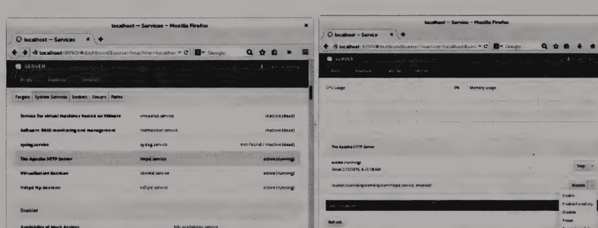

图 3-1：服务：`cockpit`

`Cockpit` 会随 `systemctl` 动态更新。如果你在终端窗口中使用 `systemctl` 做了更改，更改将立即显示在 Cockpit 上。

旧的 `system-config-services` 工具提供了一个界面，显示服务的简单列表，你可以从列表中选择你想要启动并自动启动的程序（应用程序 | 其他概览）以及守护进程和服务器。状态图标表示服务是否已启用，以及是否正在运行（即插即用图标）。右侧面板将显示所选服务的当前状态及其描述。

## chckconfig

若要配置服务在系统启动时自动启动，你也可以使用 `chckconfig` 工具，它在命令行运行。`chckconfig` 命令使用 `on` 和 `off` 选项来选择和取消选择用于启动的服务。

```bash
chckconfig amb on
```

`chckconfig` 工具已修改以配合 `systemd` 工作。你可以使用 `chckconfig` 开启或关闭服务（启用或禁用）。然而，不再支持运行级别（runlevels）。

尽管 `chckconfig` 可以开启或关闭系统，但它仍然是为 System V 服务设计的。`--list` 选项仅列出 System V 服务，这可能无效。`--level` 选项不再有效，因为 `systemd` 不再支持服务的运行级别。你可以输入它，但它会被忽略。`reset` 命令对系统服务不起作用。

你使用 `on` 选项来启用服务，使用 `off` 选项来禁用它。

```bash
chkconfig httpd on
```

`off` 选项禁用服务：

```bash
chkconfig httpd off
```

## service 命令

`service` 命令现在简单来说是一个 `systemctl` 命令，它使用 `systemd` 执行实际操作。`service` 命令无法启用或禁用服务。它只执行 `stop`、`restart` 和 `status` 等管理操作。

若要手动启动和停止服务，你可以使用 `system-config-services`、`cockpit` 或 `service` 命令。使用 `service` 命令时，你输入 `stop` 参数启动服务，输入 `restart` 参数重启服务。`service` 命令从终端窗口运行。你必须以 root 用户登录（使用 `su` 命令），或者如果配置了则使用 `sudo` 命令。以下将启动 Samba 服务。

```bash
service smb start
```

在 Fedora 中，`service` 的 `systemd` 版本实际上调用 `systemctl` 命令来运行位于 `/lib/system/system` 的 `systemd` 单元文件。如果服务未启用，`systemd` 将启用它。你可以使用 `systemctl` 命令执行与 `service` 命令相同的操作。以下是之前命令的等效形式：

```bash
systemctl start smb
```


## 扩展互联网服务守护进程 (`xinetd`)

`Xinetd` 功能现在由 `systemd` 执行。只有少数旧应用程序仍在使用它。`xinetd` 包默认不安装。只有当旧包需要时你才安装它。使用 `chkconfig` 开启 `xinetd` 服务。该服务将被启动或关闭，并相应编辑 `/etc/xinetd.d` 目录中 `xinetd` 配置脚本中的禁用行。

## 4. 防火墙

- 动态防火墙与静态防火墙
- `Firewall-ID`
- `firewall-config`
- 防火墙规则
- 使用 `iptables` 的静态防火墙 (`system-config-firewall`)
- 网络地址翻译 (`NAT`)
- 数据包操纵：`Mangle` 表
- `IPTables` 脚本
- IP 伪装 (`IP Masquerading`)

大多数连接到互联网的系统目前面临着外部用户尝试未经授权访问的风险。外部用户可以尝试通过建立非法连接、拦截远程连接到系统的用户的有效通信，或者伪装成合法用户来尝试获取访问权限。防火墙、加密和身份验证程序都是防御此类攻击的方法。防火墙可以防止直接的未经授权尝试，加密可以保护来自授权用户的传输，而身份验证则验证请求访问的用户是否有权进行操作。当前的 Linux 内核支持使用 `Netfilter` 数据包过滤来实现防火墙（`iptables`，旧版本中的 `IP Chains` 用于较旧的内核版本）。要实现防火墙，你需要提供一系列规则来管理你希望在系统中允许的访问类型。如果该系统还是私有网的网关，那么系统的防火墙能力可以有效保护网络免受外部攻击。

你可以在直接连接到互联网的独立系统上运行防火墙，也可以在连接本地网络和互联网的网关系统上运行防火墙。大多数网络现在使用专用的路由器访问互联网，这些路由器有自己的防火墙。如果决定使用 Linux 系统作为网关，那么它将至少有两个网络连接：一个用于本地网络，另一个是用于互联网的连接设备。确保将防火墙应用于互联网设备，而不是你的本地网络。

| 网站 | 安全应用 |
|---|---|
| `www.netfilter.org` | `Netfilter` 项目、`iptables` 和 `NAT` |
| `www.netfilter.org/ipchains` | `IP Chains` 防火墙 |
| `www.openssh.org` | `Secure Shell` (`SSH`) 加密 |
| `http://fedora-ject.org/wiki/FirewallD` | `FirewallD` |
| `www.squid-cache.org` | `Squid` Web 代理服务器 |
| `http://web.mit.edu/Kerberos` | `Kerberos` 网络身份验证 |

**表 4-1：网络安全应用**

为了给远程通信提供保护，可以对传输进行简单的加密。对于 Linux 系统，你可以使用 `Secure Shell` (`SSH`) 程序包来对任何传输进行加密，防止其被他人读取。`Kerberos` 身份验证提供了另一层安全保障，它可以对单个服务进行保护，允许只有获得访问许可的用户使用该服务。外部用户也可能通过你托管的任何互联网服务（如网站）尝试获得未经授权的访问。在这种情况下，你可以设置代理来保护你的系统。对于 Linux 系统，使用 `Squid` 代理软件来设置代理以保护你的 Web 服务器（第 14 节）。表 4-1 列出了 Linux 常用的几种网络安全应用。

为了清晰起见，本章中的示例使用了传统的网络设备名称（如 `eth0` 和 `eth1`），而不是可预测的设备名称（如 `enp7s0`）。请记住，除非你重命名网络设备（第 2 章），否则系统上的实际设备将使用可预测名称（如 `enp7s0`）。

## 动态和静态防火墙：`Firewall-ID` 和 `iptables` 命令

传统的防火墙是静态的。你需要修改防火墙规则并重启防火墙来加载这些规则。Fedora 采用了一种动态防火墙，称为 `Firewall-ID`，它可以在不重启防火墙的情况下应用修改后的规则。然而，规则必须由 `Firewall-ID` 守护进程直接管理。你可以使用 `iptables` 命令为防火墙守护进程添加防火墙规则。事实上，`Firewall-ID` 并没有在传统意义上使用 `netfilter`。你不需要像使用 `iptables` 等静态防火墙那样列出一组规则并让防火墙读取。相反，你使用 `firewall-config` 和 `firewall-cmd` 工具来配置你的防火墙。

`Firewall-ID` 由 `systemd` 使用 `firewall.service` 单元管理。它在网络启动之前 (`Before`) 启动，并与由 `iptables` 管理的静态防火墙冲突 (`Conflicts`)。运行时配置从 `/etc/sysconfig/firewall` 读取 (`EnvironmentFile`)。与防火墙守护进程的通信通过 `Dbus` 处理。`Firewall-ID` 由基础目标 (`WantedBy`) 启动，这意味着它会在所有启动目标中启动。

```
firewall.service

[Unit]

Description=firewall - dynamic firewall daemon

Before=network.target

Before=libfirewal.service

Before=NetworkManager.service

Conflicts=iptables.service ebtables.service

[Service]

EnvironmentFile=/etc/sysconfig/firewall

ExecStart=/usr/sbin/firewall --nofork $FIREWALL_ARGS

ExecReload=/bin/kill -HUP MAINPID

# 抑制日志调试和错误输出到 /var/log/messages

StandardOutput=null

StandardError=null

Type=dbus

[Install]

WantedBy=basic.target

Alias=dbus-org.fedoraproject.FirewallD1
```

如果你愿意，仍然可以使用 `iptables` 代替 `Firewall-ID` 来管理防火墙。旧的自定义防火墙可能仍然旧旧的 `iptables` 静态防火墙工作。`iptables` systemd 单元管理静态 `iptables` 规则，就像之前的版本中使用 System V 一样。`iptables` 命令将防火墙规则保留在 `/etc/sysconfig/iptables` 中，并检查该文件是否存在 (`ConditionPathExists`)。`iptables` 操作运行在一个 `iptables` 脚本上以启动和停止防火墙。脚本从 `/etc/sysconfig/iptables-config` 读取运行时配置。

## `iptables.service`

```
[Unit]

Description=IPv4 firewall with iptables

After=syslog.target

ConditionPathExists=/etc/sysconfig/iptables

[Service]
Type=oneshot
RemainAfterExit=yes
ExecStart=/usr/libexec/iptables/iptables.init start
ExecStop=/usr/libexec/iptables/iptables.init stop
Environment=-EBOOTUP=serial
Environment=CONSOLETYPE=serial
StandardOutput=syslog
StandardError=syslog

[Install]
WantedBy=basic.target
```

## 使用 `FirewallD` 的动态防火墙

`FirewallD` 是 Fedora 的默认防火墙，作为实现动态防火墙的守护进程运行。你不需要从文件中加载规则，而是可以直接将其添加到 `FirewallD` 守护进程中。文档请参见：

```
http://fedoraproject.org/wiki/FirewallD
```

防火墙设置了网络区域（zones），以定义不同类型网络连接的信任级别（见表 4-2）。每个区域可以有多个连接，但一个连接只能属于一个区域。防火墙定义了几个区域，大部分是可以更改的（可变的）。`drop` 和 `block` 区域是不可变的，旨在停止所有入站数据包。`public`、`external` 和 `dmz` 区域专为不可信的网络设计，只暴露系统的部分内容。`work`、`home` 和 `internal` 区域用于信任的网络。`trusted` 区域（同样不可变）允许所有网络连接。

| 区域 | 说明 |
|---|---|
| `drop` (immutable) | 拒绝所有入站连接，接受出站连接。 |
| `block` (immutable) | 拒绝所有入站连接，并发布 `ICMP` 主机禁止消息。 |
| `trusted` (immutable) | 允许所有网络连接 |
| `public` | 公共区域，不信任其他计算机 |
| `external` | 用于启用了伪装的计算机，保护本地网络 |
| `dmz` | 用于可公共访问但访问受限的计算机。 |
| `work` | 用于信任的工作区域 |
| `home` | 用于信任的家庭网络连接 |
| `internal` | 用于内部网络，限制入站连接 |

**表 4-2：`FirewallD` 区域**

区域配置位于 `/etc/firewall/zones` 中。你可以使用 `firewall-config` 和 `firewall-cmd` 管理你的区域并添加新区域。默认区域通过 `/etc/firewall.conf` 配置文件中的 `DefaultZone` 变量设置。初始设置为 `public`。默认和备用区域保存在 `/lib/firewall/zones` 中。

## 第4 章：防火墙

区域文件保存为 XML 文件，列出了区域名称以及允许的服务和端口。以及任何伪装、`ICMP` 和端口转发选项。

## `firewall-config`

Fedora 使用 `Firewallld` 守护进程。要配置 `Firewallld`，你可以使用 `firewall-config` 图形界面。你也可以从命令行使用 `firewall-cmd` 命令。设置你的防火墙，运行 `firewall-config`（杂项 | 防火墙）（见图 4-1）。防火墙通过 `Zones` 选项卡上的区域进行配置。要配置特定服务，使用 `Services` 选项卡。可以从“视图”菜单显示额外的选项卡，用于配置 `ICMP` 类型、白名单以及直接添加防火墙规则（默认配置）。

## 第 部分：系统工具

通过 `firewall-config`，你可以配置运行时配置（`Runtime Configuration`）或永久配置（`Permanent Configuration`）。从“配置”（`Configuration`）中选择其一。运行时配置显示你当前的运行时设置，而永久配置在重新加载或重启之前不会生效。如果你需要编辑区域和服务，可能希望选择永久配置（见图 4-2）。此视图在区域滚动框底部显示了一个区域工具栏用于编辑区域，并显示有一个“编辑服务”（`Edit Services`）按钮用于编辑服务协议、端口和目标地址。

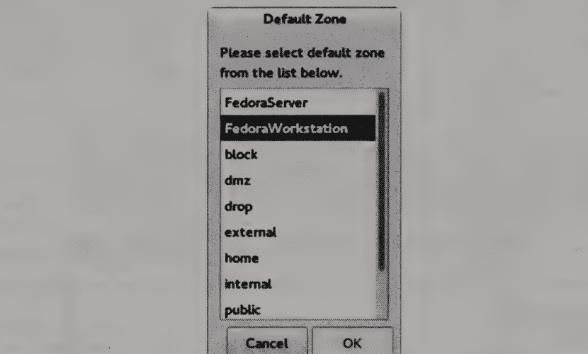

图 4-3：默认区域

防火墙配置是针对区域设置的，例如家庭、工作、内部、外部或公共区域。每个区域都有自己的配置。区域列在 `firewall-config` 窗口左侧的区域滚动框中（见图 4-3）。选择你想配置的区域。`firewall-config` 窗口默认打开时取决于安装的版本，可能是 `FedoraWorkstation` 或 `FedoraServer`。你可以从“系统默认区域”（`System Default Zone`）对话框中选择默认区域（见图 4-4），该对话框通过“选项”菜单中的“更改默认区域”打开。

如果你在“配置”菜单中选择“永久配置”，区域滚动框下方将显示一个区域工具栏，所示。加号按钮允许你添加区域，减号移除区域。铅笔/页面按钮打开“基础区域设置”（`Base Zone Settings`）对话框，你可以在其中输入或编辑区域名称、版本、描述和目标（见图 4-4）。默认目标是 `ACCEPT`。其他选项是 `REJECT` 和 `DROP`。“加载区域默认值”（`Load Zone Defaults`）按钮（黄色箭头）会加载默认设置，移除你所做的任何更改。

每个区域依次可以拥有一个或多个网络连接。从“选项”菜单中选择“连接区域”（`Zones of Connections`）打开网络连接对话框，你可以在其中添加网络连接。

对于区域，你可以配置服务、端口、伪装（`masquerading`）、端口转发和 `ICMP` 过滤器（见图 4-5）。用户可能希望更改服务的状态。Linux 系统用于为网络运行服务器。但仍然需要防火墙来运行如 Web 服务器、FTP 服务器、Samba 桌面浏览或 SSH 加密连接，你必须在“服务”选项卡中指定这些。Samba 桌面浏览允许你从 GNOME 或 KDE 桌面访问你的共享，例如远程 Windows 文件系统。

## 第 4 章：防火墙

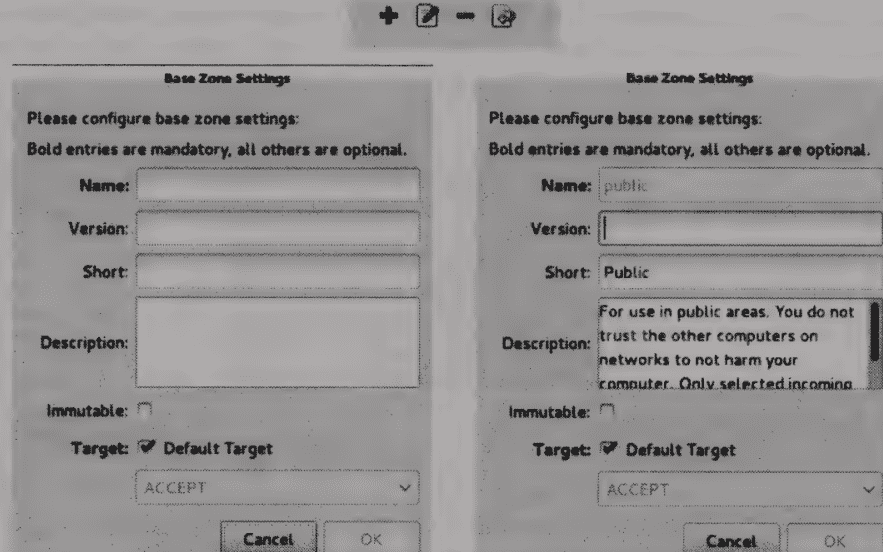

图 4-4：基础区域设置

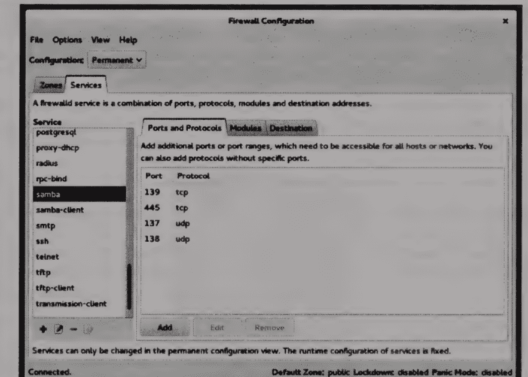

图 4-5：服务设置

对于选定的服务，你可以指定其使用的服务如端口和协议、任何模块以及网络地址。默认设置已为你配置好，例如 Samba 使用 139 端口，使用 TCP 协议。要修改服务的设置，点击防火墙配置窗口上的“服务”选项卡，以列出你的服务。从左侧的“服务”滚动框中选择你想编辑的服务。对于给定的服务，然后可以使用“端口和协议”（`Ports and Protocols`）、“模块”（`Modules`）和“目标”（`Destination`）选项卡来指定端口、协议、模块和地址。在“端口协议”选项卡上点击“添加”按钮打开“部分/或协议”对话框，你可以在其中添加端口或范围，并从“协议”菜单中选择一种协议（见图 4-6）。

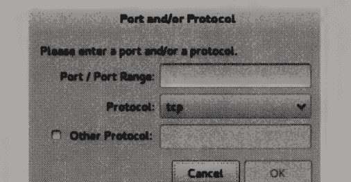

# 图 4-6：服务协议和端口

“端口”选项卡允许你指定某些服务（如 `BitTorrent`）可能需要的端口。点击“添加”按钮打开对话框，你可以在其中选择端口号以及要控制的协议（`tcp` 或 `udp`），或输入特定的端口号或范围。

如果你的系统被用作本地网络访问互联网的网关，你可以实现伪装以隐藏本地主机免外部互联网的访问。这还需要 IP 转发，当你选择伪装时，IP 转发会自动启用。本地主机仍然能够访问互联网，但它们将伪装你的网关系统。你会为伪装选择连接到互联网的接口。伪装仅适用于 IPv4 网络，不适用于 IPv6 网络。

“端口转发”选项卡允许你设置端口转发，从一个端口通道到另一个端口，或到另一个系统上的不同端口。点击“添加”按钮添加端口，指定其协议和目标（见图 4-7）。

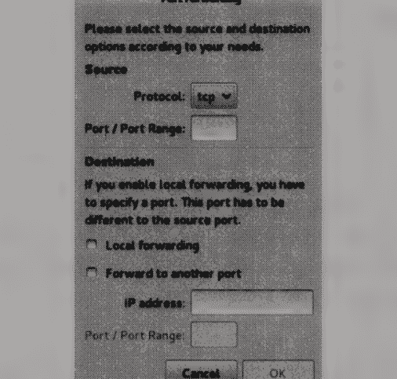

# 图 4-7：端口转发

“ICMP 过滤器”选项卡允许你阻止 `ICMP` 消息。默认允许所有 `ICMP` 消息。阻止 `ICMP` 消息使系统更安全。某些类型的 `ICMP` 消息通常会被阻止，因为它们可以被用于渗透或过载系统，例如 `ping` 和 `pong` ICMP 消息（见图 4-8）。

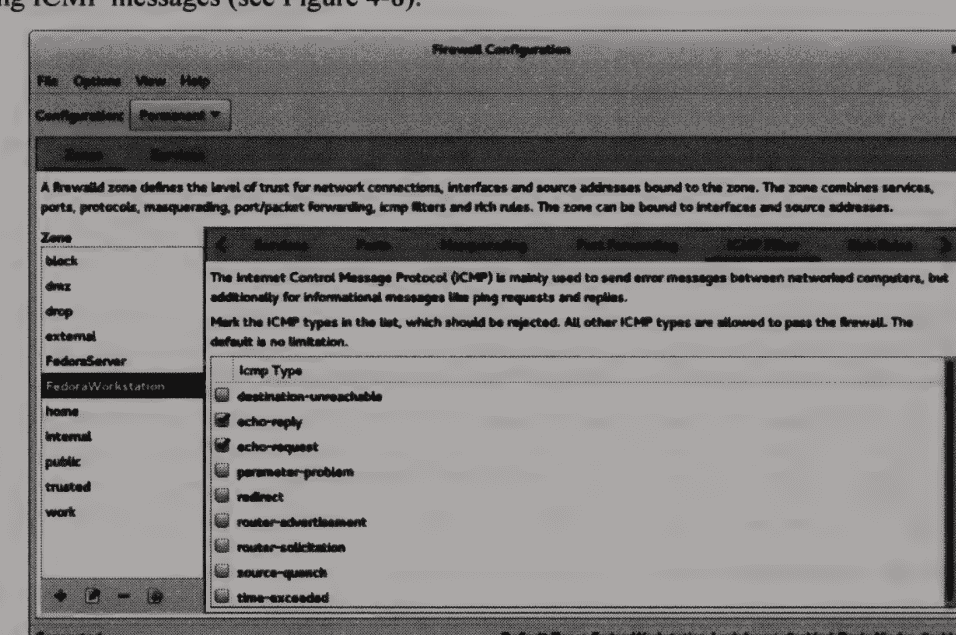

图 4-8：ICMP 过滤器

如果你有特定的防火墙规则需要添加，请使用“直接配置”（`Direct Configuration`）选项卡（显示为 `View | Direct Configuration` 菜单）。

## `firewall-cmd`

`firewall-cmd` 命令在命令行界面上工作，使用选项为不同区域设置功能。区域修改选项如 `--add-service` 可以是运行时或永久。运行时更改在重启或重新加载后发生。要使更改永久，你需要添加 `--permanent` 选项，为永久配置而非运行时配置进行更改。

使用 `get` 选项显示有关防火墙的信息。`--get-zones --get-services` 选项列出当前区域支持，`--get-icmptypes` 列出 ICMP 类型。

```
firewall-cmd --get-zones
firewall-cmd --get-services
firewall-cmd --get-icmptypes
```

`--get-default-zone` 选项列出默认区域，`--set-default-zone` 设置一个新的默认区域。

```
firewall-cmd --set-default-zone home
```

要查找某个区域启用了哪些功能，使用 `--list-all` 选项配合 `--zone=` 选项来指定区域。

```
firewall-cmd --zone=home --list-all
```

区域被分配了网络接口。有接口选项可以添加、删除或更改接口。使用 `query` 选项检查接口是否属于某个区域。

```
firewall-cmd --zone=home --query-interface=eth0
```

服务、端口、伪装和转发选项可以是运行时或永久的。`--service` 选项可以向区域添加和删除服务。

```
firewall-cmd --add-service=vsftap
```

要使更改永久，添加 `--permanent` 选项。

```
firewall-cmd --permanent --add-service=vsftap
```

`--query-service` 选项检查区域是否启用了某个服务。

```
firewall-cmd --zone=home --query-service=http
```

`--port` 选项用于添加、删除或查询端口。


`firewall-cmd --zone=home --add-port=22`

添加 `--permanent` 选项使其永久。

`firewall-cmd --permanent --zone=home --add-port=22`

`masquerade` 选项为伪装添加、删除和查询区域。

`firewall-cmd --zone=work --add-masquerade`

`--icmp-block` 选项添加、删除和查询 ICMP 类型。

`firewall-cmd --zone=work --add-icmp-block=echo-reply`

你应该学习防火墙以使用自定义规则，使用 `--direct` 选项添加、删除和列出规则。规则使用 IPTables 语法。你必须指定协议、表、链和参数。以下列出你添加到 nftfilter 的规则。这些规则不会保存，每次重启或重新加载时必须重新添加。你可以准备一个 `firewall-cmd` 规则脚本来实现。

`firewall-cmd --direct --get-rules ipv4 nftfilter`

以下添加了一个简单的 nftfilter 规则。

`firewall-cmd --add-rule ipv4 nftfilter INPUT Deny`

## 防火墙规则：Netfilter, NAT, mangle

## 第 4 章：防火墙

防火墙执行的另一项任务是网络地址转换（NAT）。网络地址转换将数据包重定向到相应的目的地。它执行的操作包括将数据包重定向到特定主机、转发数据包到其他网络，以及更改数据包源以实现 IP 伪装。

防火墙还会执行数据包修改（packet mangling），通过修改数据包信息来控制路由、连接大小和优先级等操作。

Netfilter 软件包为 Linux 2 及以上内核实现了数据包过滤、NAT 任务和数据包修改。Netfilter 软件由 Netfilter 项目开发，你可以在 http://www.netfilter.org 了解更多信息。

FirewallD 和 iptables 命令集都用于设置防火墙规则。FirewallD 引入了额外的抽象层，让你能够使用 `firewall-config` 和 `firewall-cmd` 工具来设置防火墙。你不需要编写任何实际的防火墙规则。这种抽象层允许动态防火墙实现，在运行时生成规则。对于 `iptables` 命令，你必须编写实际的防火墙规则，这些规则在防火墙启动之前加载（静态防火墙）。由于 `iptables` 命令让你能够确切看到命令是如何设置的，因此在这些示例中，它被用于展示如何设置 netfilter、mangle 和 NAT。

## 模块

与其前身 IP Chains 不同，Netfilter 设计为是模块化和可扩展的。功能可以通过模块的形式添加，例如状态模块（state module），它添加了跟踪功能。所需的模块作为 IPTables 服务的一部分加载。其他模块是可选的；你可以选择在安装之前加载它们。所需的 IPTables 模块位于 `/lib/modules/kernel-version/kernel/ipv4-netfilter`，其中 `kernel-version` 是你的内核版本。对于 IPv6 模块，请检查 `ipv6-netfilter` 目录。IPTables 模块具有 `ipt_prefix` 前缀，Nat 表模块具有 `nf_nat` 前缀。

可选的 IPTables 模块（也称为辅助模块）位于 `lib/modules/kernel-version/kernel/netfilter` 目录。适用于 netfilter 表的模块以 `nf` 前缀开头，适用于所有具有 `xt` 前缀的表。辅助模块的一个示例是连接跟踪模块，它可以跟踪属于已建立连接的数据包，例如 FTP 下载连接跟踪器。conrack 辅助模块的名为 `conrack`，例如 `nf_conrack_ftp.ko`。

对于 iptables 静态辅助工具，辅助工具作为列表赋值给位于 `/etc/sysconfig/iptables-config` 文件中的 `IPTABLES MODULE` 变量，该文件由 iptables 服务脚本使用。在示例中，`IPTABLES MODULE` 变量被赋值为 `ftp` 和 `netbios` 辅助工具。

`IPTABLES_MODULE="nf_conrack_ftp nf_conrack_netbios_ns"`

每当你使用 iptables 脚本启动 IPTables 时，它们会自动加载。对于 IPv6 配置，请使用 `ip6tables-config` 文件。

```
service iptables restart
```

如果你正在编写自己的 iptables 脚本，而不是使用 Red Hat 或 Fedora 的 iptables 脚本，你必须添加 `modprobe` 命令来直接加载模块。

## 第一部分：系统工具

你可以创建并加载自己自定义的 IPTables 模块。这些模块应该使用新的 Xtables 前缀 `xt`。

## 数据包过滤

Netfilter 本质上是一个数据包管理框架，可以检查特定网络协议的数据包，并通知监听这些数据包的内核部分。基于 Netfilter 框架构建的是 IPTables 实现的数据包选择系统。通过 IPTables，可以设置不同的规则表以根据不同的标准选择数据包。Netfilter 目前支持三张表：filter、nat 和 mangle。数据包过滤通过 filter 表实现，该表保存了丢弃或接受数据包的规则。网络地址转换（如 IP 伪装）通过 NAT 表实现，该表包含 IP 伪装规则。mangle 表用于专门的数据包更改。在数据包发送出去之前、接收时或转发时，都可以对数据包进行更改。这种结构是可扩展的，因为许多模块定义了它们自己的表和规则。它还极大地提高了效率。与其让所有数据包都检查一个大表，不如每个表只检查它们需要的规则。

IP 规则使用 `iptables` 命令进行管理。在这些命令中，你需要指定要管理的类型。默认值是 filter 表，不需要指定。你可以随时使用 `-L` 和 `-n` 选项列出你添加的规则，所示。`-n` 选项表示对 IP 地址和端口都仅使用数字输出，以避免对主机进行 DNS 查询。不过，你也可以只使用 `-L` 选项查看端口标签和主机名：

```
iptables -L -n
```

## 链 (Chains)

规则组合成不同的链。内核使用链来管理它接收和发送的数据包。链仅仅是规则清单。这些规则规定了对包含特定头部的数据包采取什么操作。规则按 `if-then-else` 结构运行。如果数据包不匹配第一条规则，将检查下一条规则，依此类推。如果数据包不匹配任何规则，内核将咨询链策略。通常，在这种情况下，数据包会被拒绝。如果数据包匹配某条规则，它将被传递到目标（target），由目标决定如何处理该数据包。标准目标列于表 4-3。如果数据包不匹配任何规则，它将传递给链的默认目标。

| 目标 | 功能 |
| :--- | :--- |
| ACCEPT | 允许数据包通过防火墙。 |
| DROP | 拒绝数据包访问。 |
| REJECT | 拒绝访问并通知发送者。 |
| QUEUE | 将数据包发送到用户空间。 |
| RETURN | 跳到链的末尾并让默认目标处理它。 |

表 4-3：IPTables 目标

## 目标 (Targets)

目标反过来可以是另一个规则链，甚至是用户定义规则的链。数据包在最终到达目标之前，可能会通过多个链。对于用户定义的链，默认目标始终始终是调用它的链中的下一个链。这建立了一个过程——即在编程语言中找到控制流。当规则以用户定义的链作为其目标时，一旦被激活，该用户定义的链就会被执行。如果没有规则匹配，执行过程将返回到原始链中的下一条规则。

## 防火墙和 NAT 链

内核使用三个防火墙链：INPUT、OUTPUT 和 FORWARD。当通过接口接收数据包时，使用 INPUT 链来决定如何处理它。内核使用其路由信息决定将其发送到哪里。如果内核将数据包发送到另一个主机，则检查 FORWARD 链。在实际发送数据包之前，还会检查 OUTPUT 链。此外，实现了两个 NAT 表链 PROROUTING 和 PREROUTING，用于处理伪装和数据包地址修改。内置的 Netfilter 链列于表 4-4。

| 链 | 描述 |
| :--- | :--- |
| INPUT | 入站数据包的规则 |
| OUTPUT | 输出数据包的规则 |
| FORWARD | 转发数据包的规则 |
| PREROUTING | 重定向或修改入站数据包的规则，仅限 NAT 表 |
| PROROUTING | 重定向或修改输出数据包的规则，仅限 NAT 表 |

表 4-4：Netfilter 内置链

## 添加和更改规则

你使用 `iptables` 命令添加和修改链规则。`iptables` 命令由命令 `iptables` 组成，后跟一个表示要执行命令的参数。例如，`iptables -A` 是添加新规则的命令，而 `iptables -D` 是删除规则的命令，`-R` 是替换规则。`iptables` 命令列于表 4-5。以下命令简单列出了系统中定义的链及其规则。输出显示了 `iptables` 命令创建的默认值。

```
iptables -L -n
Chain input (policy ACCEPT):
Chain forward (policy ACCEPT):
Chain output (policy ACCEPT):
```

要向链添加新规则，使用 `-A`。使用 `-D` 删除，使用 `-R` 替换。命令之后列出规则适用的链，例如 INPUT、OUTPUT 或 FORWARD 链，或用户定义的链。接下来，使用不同的选项（与 IP 链相同，但少数例外）。`-s` 选项指定数据包的源地址，`-d` 指定目的地址，`-j` 选项指定规则的目标。`ACCEPT` 目标将允许数据包通过。`-i` 选项指示输入设备并仅用于 INPUT 和 FORWARD 链。

## 110 第1部分：系统工具

链。`-o` 选项指示输出设备，且只能用于 OUTPUT FORWARD 链。表 4-6 列出了几个基本选项。

| 选项 | 功能 |
| --- | --- |
| -A chain | 向链中追加规则。 |
| -D chain [rulename] | 从链中删除匹配的规则。从链中删除 rulename（1 = 第一个）。 |
| -I chain [rulename] | 在链中插入 rulename（默认 1 = 第一个）。 |
| -R chain rulename | 替换链中的 rulename（1 = 第一个）。 |
| -L [chain] | 列出链或所有链中的规则。 |
| -E [chain] | 重命名链。 |
| -F [chain] | 删掉（清空）链或所有链中的所有规则。 |
| -R chain | 替换规则；规则从 1 开始编号。 |
| -Z [chain] | 将链或所有链中的计数器清零。 |
| -N chain | 创建一个新的用户自定义链。 |
| -X chain | 删除一个用户自定义链。 |
| -P chain target | 将链的策略更改为目标。 |

表 4-5：IPTables 命令

## IPTables 选项

IPTables 软件包设计为可扩展的，有许多带有选择标准的选项可以包含在 IPTables 中。例如，TCP 扩展包含了 `--syn` 选项，用于 SYN 数据包。ICMP 扩展提供了 `--icmp-type` 选项，用于指定如 ping 操作中使用的 ICMP 数据包。limit 扩展包含了 limit 选项，通过它你可以限制指定时间段（如一秒）内匹配数据包的最大数量。

注意：在 IPTables 命令中，链名必须大大写输入，如 INPUT、OUTPUT 和 FORWARD 链名所示。

在下面的示例中，用户向 INPUT 添加了一条规则，以接受所有来自地址 192.168.0.55 的数据包。源地址 (`-s`) 匹配的任何数据包将被接受并通过 (`-j`) ACCEPT：

```
iptables -A INPUT -s 192.168.0.55 -j ACCEPT
```

## 接受和拒绝数据包：DROP AND ACCEPT

有两个内置链：ACCEPT 和 DROP。其他的可以是用户自定义链或添加的扩展，例如 REJECT。使用了两个特殊目标来管理链：RETURN 和 QUEUE。RETURN 表示链的结束并返回到它开始的链。QUEUE 用于将数据包发送到用户空间。

## 第 4 章：防火墙 111

`iptables -A INPUT -s my.junk.com -j DROP`

你可以使用 `!` 符号将规则转为其反向。例如，要接受除来自特定地址以外的入站数据包，请在 `-s` 选项之前放置 `!` 符号。接下来的示例将接受除 IP 地址 192.168.0.45 以外的所有数据包：

```
iptables -A INPUT -j ACCEPT !s 192.168.0.45
```

你可以使用域名或 IP 数字来识别地址。对于一个地址范围，你可以使用其网络的 IP 数字和网络 IP。IP 掩码可以是一个 IP 数字，也可以仅仅是组成掩码的位数。例如，网络 192.168.0 中的所有地址都可以用 192.168.0/225.255.255.0 或 192.168.0.0/24 表示。要指定任何地址，你可以使用 all 或指定 0/。默认情况下，如果不存在 `-s` 或 `-d` 规范，规则将引用任何地址。以下示例接受来自（源自）192.168.0 网络中任何地方并发往（目的为）任何地方（在 `-d` 选项为空或可以写为 `-d 0/0` 的处）的消息：

```
iptables -A INPUT -s 192.168.0.0/24 -j ACCEPT
```

| 选项 | 功能 |
| --- | --- |
| -p [!] protocol | 指定协议，如 TCP、UDP、ICMP 或 ALL。 |
| -s [!] address[/mask] [!] port[:port] | 匹配的源地址。通过端口参数，你可以指定端口。 |
| --sport [!] port[:port] | 源端口指定。你可以使用冒号指定端口范围，port:port。 |
| -d [!] address[/mask] [!] port[:port] | 匹配的目的地址。通过端口参数，你可以指定端口。 |
| --dport [!] port[:port] | 目的端口指定。 |
| --icmp-type [!] typename | 指定 ICMP 类型。 |
| -i [!] name[+] | 使用名称指定输入接口（例如 eth0）。`+` 符号充当通配符。附加名称末尾的 `+` 匹配所有具有该前缀的接口（eth+ 匹配所有以太网接口）。只能用于 INPUT 链。 |
| -j target [port] | 指定规则的目标（对于 REDIRECT 目标指定 [port]）。 |
| --to-source <ipaddr> [- ipaddr>]: [port: port] | 与 SNAT 目标配合，用新的源 IP 地址重写数据包。 |
| --to-destination <ipaddr> [<- port:] | 与 DNAT 目标配合，用新的目的 IP 地址重写数据包。 |
| -n | 地址和端口的数字数字输出，与 `-L` 使用。 |

# 第 1 部分：系统工具

| | |
| --- | --- |
| -o [!] name[+] | 使用名称指定输出网络接口（例如 eth0）。只能用于 FORWARD 和 OUTPUT 链。 |
| -t table | 指定使用的表，如 `-t nat` 用于 NAT 表。 |
| -v | 冗余模式，显示规则详情，与 `-L` 使用。 |
| -x | 扩展数字（显示精确值），与 `-L` 使用。 |
| [!] -f | 匹配分片数据包从第二个到最后一个最后一个片段。 |
| [!] -V | 打印软件包版本。 |
| ! | 否定一个选项或地址。 |
| -m | 指定要使用的模块，例如 state（状态）。 |
| --state | 指定 state 模块的选项，如 NEW、INVALID、RELATED 和 ESTABLISHED。用于检测数据包的状态。NEW 引用 SYN 数据包（新连接）。 |
| --syn | SYN 数据包，新连接。 |
| --tcp-flags | TCP 标志：SYN, ACK, FIN, RST, URG, PS 和用于标志的 ALL。 |
| --limit | 模块 (`-m limit`) 的选项，用于控制匹配速率，即每秒匹配次数。 |
| --limit-burst | 模块 (`-m limit`) 的选项。指定在限制生效之前的最大突发。用于控制拒绝服务攻击。 |

## 表 4-6：iptables 选项

iptables 规则通常应用到特定的网络接口，例如用于连接 Internet 的以太网接口。iptables 规则通常应用到特定的网络接口，例如用于连接 Internet 的以太网接口。iptables 规则通常应用到特定的网络接口，例如用于连接 Internet 的以太网接口。iptables 规则通常应用到特定的网络接口，例如用于连接 Internet 的以太网接口。iptables 规则通常应用到特定的网络接口，例如用于连接 Internet 的以太网接口。iptables 规则通常应用到特定的网络接口，例如用于连接 Internet 的以太网接口。iptables 规则通常应用到特定的网络接口，例如用于连接 Internet 的以太网接口。iptables 规则通常应用到特定的网络接口，例如用于连接 Internet 的以太网接口。

## 4 章：防火墙 111

`iptables -A INPUT -s my.junk.com -j DROP`


你可以使用`!`符号将规则转为其反向。例如，要接受除来自特定地址以外的入站数据包，请在`-s`选项之前放置`!`符号。接下来的示例将接受除来自IP地址`192.168.0.45`以外的所有数据包：

```
iptables -A INPUT -j ACCEPT !s 192.168.0.45
```

你可以使用域名或IP数字来识别地址。对于一个地址范围，你可以使用其网络的IP数字和网络IP。IP掩码可以是一个IP数字，也可以仅仅是组成掩码的位数。例如，网络`192.168.0`中的所有地址都可以用`192.168.0/225.255.255.0`或`192.168.0.0/24`表示。要指定任何地址，你可以使用`all`或指定`0/`。默认情况下，如果不存在`-s`或`-d`规范，规则将引用任何地址。以下示例接受来自（源自）`192.168.0`网络中任何地方并发往（目的为）任何地方（在`-d`选项为空或可以写为`-d 0/0`的处）的消息：

```
iptables -A INPUT -s 192.168.0.0/24 -j ACCEPT
```

| 选项 | 功能 |
| --- | --- |
| `-p [!] protocol` | 指定协议，如TCP、UDP、ICMP或ALL。 |
| `-s [!] address[/mask] [!] port[:port]` | 匹配的源地址。通过端口参数，你可以指定端口。 |
| `--sport [!] port[:port]` | 源端口指定。你可以使用冒号指定端口范围，`port:port`。 |
| `-d [!] address[/mask] [!] port[:port]` | 匹配的目的地址。通过端口参数，你可以指定端口。 |
| `--dport [!] port[:port]` | 目的端口指定。 |
| `--icmp-type [!] typename` | 指定ICMP类型。 |
| `-i [!] name[+]` | 使用名称指定输入接口（例如`eth0`）。`+`符号充当通配符。附加名称末尾的`+`匹配所有具有该前缀的接口（`eth+`匹配所有以太网接口）。只能用于INPUT链。 |
| `-j target [port]` | 指定规则的目标（对于REDIRECT目标指定`[port]`）。 |
| `--to-source <ipaddr> [- ipaddr>]: [port: port]` | 与SNAT目标配合，用新的源IP地址重写数据包。 |
| `--to-destination <ipaddr> [<- port:]` | 与DNAT目标配合，用新的目的IP地址重写数据包。 |
| `-n` | 地址和端口的数字输出，与`-L`使用。 |

# 第1部分：系统工具

| | |
| --- | --- |
| `-o [!] name[+]` | 使用名称指定输出网络接口（例如`eth0`）。只能用于FORWARD和OUTPUT链。 |
| `-t table` | 指定使用的表，如`-t nat`用于NAT表。 |
| `-v` | 冗余模式，显示规则详情，与`-L`使用。 |
| `-x` | 扩展数字（显示精确值），与`-L`使用。 |
| `[!] -f` | 匹配分片数据包从第二个到最后一个片段。 |
| `[!] -V` | 打印软件包版本。 |
| `!` | 否定一个选项或地址。 |
| `-m` | 指定要使用的模块，例如`state`。 |
| `--state` | 指定`state`模块的选项，如`NEW`、`INVALID`、`RELATED`和`ESTABLISHED`。用于检测数据包的状态。`NEW`引用SYN数据包（新连接）。 |
| `--syn` | SYN数据包，新连接。 |
| `--tcp-flags` | TCP标志：SYN, ACK, FIN, RST, URG, PS和用于标志的ALL。 |
| `--limit` | 模块（`-m limit`）的选项，用于控制匹配速率，即每秒匹配次数。 |
| `--limit-burst` | 模块（`-m limit`）的选项。指定在限制生效之前的最大突发。用于控制拒绝服务攻击。 |

## 表4-6：iptables选项

iptables规则通常应用到特定的网络接口，例如用于连接Internet的以太网接口。

## 4章：防火墙111

```
iptables -A INPUT -s my.junk.com -j DROP
```

## 用户自定义链

在iptables中，INPUT和FORWARD链被评估。一种常用的方法是创建一个名为`incoming`的用户链。该链通过`-N`选项创建（你可以重命名它）。INPUT和FORWARD链将跳转到它。

```
iptables -N incoming
iptables -A INPUT -j incoming
```

## ICMP数据包

防火墙通常拦截某些Internet协议（ICMP）消息。ICMP重定向消息，特别是，可以控制。这意味着如果你想完全拦截地址，你需要启用某些ICMP消息，例如用于`ping`、`traceroute`以及目的不可到达的。一些常见的ICMP数据包类型列在表4-7。通过`--icmp-type`选项你可以启用ICMP类型，其参数为数字或表示消息的名称。以下示例启用了`echo-reply`、`echo-request`和`destination-unreachable`消息，它们的数字分别为0、8和3：

```
iptables -A INPUT -j ACCEPT -p icmp --icmp-type echo-reply -d 10.0.0.1
iptables -A INPUT -j ACCEPT -p icmp --icmp-type echo-request -d 10.0.0.1
iptables -A INPUT -j ACCEPT -p icmp --icmp-type destination-unreachable -d 10.0.0.1
```

它们的规则列表将如下：

| | | | |
| --- | --- | --- | --- |
| ACCEPT icmp | 0.0.0.0/0 | 10.0.0.1 | icmp type 0 |
| ACCEPT icmp | 0.0.0.0/0 | 10.0.0.1 | icmp type 8 |
| ACCEPT icmp | 0.0.0.0/0 | 10.0.0.1 | icmp type 3 |

Ping操作需要控制以避免`ping-of-death`安全威胁。你可以通过方法实现。一种是拒绝任何ping。Ping数据包通常很小。使用`-f`选项指示分片。通过拒绝任何分片的ICMP数据包来阻止`ping-of-death`攻击。

```
iptables -A INPUT -p icmp -j DROP -f
```

## 114 第1部分：系统工具

另一种方法是限制ping数据包接收的匹配次数。你使用`limit`模块来控制ICMP ping操作的匹配次数。使用`-m limit`使用`limit`模块，并使用`--limit`指定匹配次数。`1/s`表示每秒允许一次匹配。

```
iptables -A FORWARD -p icmp --icmp-type echo-request -m limit --limit 1/s -j ACCEPT
```

| 编号 | 名称 | 所需项 |
| --- | --- | --- |
| 0 | echo-reply | ping |
| 3 | destination-unreachable | 任意TCP/UDP流量 |
| 5 | redirect | 未运行守护进程时的路由 |
| 8 | echo-request | ping |
| 11 | time-exceeded | traceroute |

表4-7：常见ICMP数据包

## 控制端口访问

如果你的系统托管着互联网服务（例如Web或FTP服务器），你可以使用IPTables控制对该服务的访问。你可以通过使用源端口（`--sport`）或目标端口（`--dport`）配合该服务使用的选项来指定特定服务。IPTables允许你为端口使用名称，例如Web服务器端口使用`www`。这些名称使用`/etc/services`文件，该文件将端口映射到特定服务。对于域名，端口将是域名形式。如果你愿意，也可以使用端口号，在数字前加冒号即可。以下示例允许访问位于`192.168.0.43`的Web服务器：

```
iptables -A INPUT -d 192.168.0.43 --dport - -j ACCEPT
```

这里显示了正在检查的常用端口及其标签：

| 服务 | 端口号 | 端口标签 |
| --- | --- | --- |
| Auth | 113 | auth |
| Finger | 79 | finger |
| FTP | 21 | ftp |
| NTP | 123 | ntp |
| Portmapper | 111 | sunrpc |
| Telnet | 23 | telnet |
| Web server | 80 | www |

你还可以使用端口引用来保护某些服务并拒绝其他服务。当你设计一个对互联网非常开放的防火墙、允许用户自由建立互联网连接时，这种方法经常被使用。你已知某些服务（如Telnet和NTP）是有害的，可以选择性地拒绝。例如，为了在防火墙上拒绝任何类型的Telnet操作，你可以丢弃所有进入Telnet端口23的数据包。为了保护NFS操作，你可以拒绝对`portmapper`使用的端口111的访问。你可以使用端口号或端口名称。

## 第4章：防火墙115

```
# 拒绝外部对防火墙portmapper端口的访问。
iptables -A INPUT -j DROP -p tcp -i eth0 --dport 111

# 拒绝外部对防火墙telnet端口的访问。
iptables -A INPUT -j DROP -p tcp -i eth0 --dport telnet
```

规则列表看起来如下：

| DROP tcp --- 0.0.0.0/0 0.0.0.0/0 tcp dport:111 |
| DROP 0.0.0.0/0 0.0.0.0/0 tcp dport:23 |

与X相关的安全问题是你的X server端口，范围从6000到6009。在相对开放的防火墙上，这些端口可能被用于通过你的X server非法访问你的系统。可以使用冒号指定端口范围，例如`6000:6009`。你也可以使用`x11`作为第一个端口，即`x11:6009`。X server上的会话可以使用SSH进行保护，这通常会让X server运行在端口6010。

```
iptables -A INPUT -j DROP -p tcp -i eth0 --dport 6000:6009
```

## 数据包状态：连接跟踪

最有用的扩展之一是状态扩展，它可以轻松检测数据包的跟踪信息。连接跟踪维护关于连接的源、目的地和端口等信息。它提供了一种确定哪些数据包属于已建立或相关的连接的有效手段。通过连接跟踪，你首先使用`--state state`指定状态模块。然后你可以使用以下任何状态：

| 状态 | 描述 |
| --- | --- |
| NEW | 创建新连接的数据包 |
| ESTABLISHED | 属于现有连接的数据包 |
| RELATED | 与现有连接相关但不是其一部分的数据包，例如ICMP错误或建立FTP连接的数据包 |
| INVALID | 因某些原因无法识别的数据包 |
| RELATED+REPLY | 与已建立连接相关但不是直接其一部分的数据包 |

如果你正在防御一个旨在保护本地网络免受外部网络攻击的防火墙，你可能希望限制进入的回程包。简单地通过拒绝所有数据包来访问是不可行的，因为连接到外部服务器（例如互联网上的服务器）的用户必须接收来自这些服务器的信息。相反，你可以拒绝特定类型发起连接的数据包的访问。其核心思想是攻击者必须从外部发起连接。这类数据包的头部FIN和ACK位为空。状态模块的`NEW`状态匹配任何SYN数据包。通过对此类数据包指定`DROP`目标，你拒绝了任何尝试与你的系统建立连接的数据包访问。任何尝试从外部连接到你系统的人都无法实现。你本地系统中发向主机建立连接的用户仍然可以与它们通信。以下示例将丢弃任何在`eth0`接口上尝试创建新连接的数据包，尽管它们在任何其他接口上将被接受：

```
iptables -A INPUT -m state --state NEW -i eth0 -j DROP
```

你可以在`eth0`设备上使用`!`运算符并结合`ACCEPT`目标，组合出一条接受除`eth0`设备上的数据包以外的所有数据包的规则。如果`eth0`设备是唯一连接互联网的，这有效地阻止了外部访问。同时，对于`localhost`等其他设备的输入操作可以自由建立新连接。这种条件INPUT规则用于在整体允许访问的同时留有例外。它通常假设稍后的规则（如链策略）将丢弃剩余的数据包。

```
iptables -A INPUT -m state --state NEW ! -i eth0 -j ACCEPT
```

下一个示例将接受`eth0`接口上任何属于已建立连接或与此类连接相关的数据包：

```
iptables -A INPUT -m state --state ESTABLISHED,RELATED -j ACCEPT
```

提示：你可以使用`iptables`工具显示当前状态表。

## 特殊连接跟踪：ftp, icmp, Amanda, tftp

为了跟踪各种数据包，IPTables使用了特殊的连接跟踪模块。这些是你必须手动加载的可选模块。为了通过被动FTP连接，你必须加载`ip_conntrack ftp`模块。为了添加NAT表支持，你还会加载`ip_nat ftp`模块。对于IRC连接，你会使用`ip_conntrack_irc`以及对应Amanda（备份服务器）和TFTP（简单FTP）的相应模块。

如果你正在编写自己的iptables脚本，你必须添加`modprobe`命令：

```
modprobe ip_conntrack conntrack ftp ip_nat ftp
modprobe ip_conntrack amanda ip_nat amanda
```

## 网络地址翻译（NAT）

网络地址翻译（NAT）是系统在数据包通过系统时更改其目的或源的过程。数据包在到达最终目的地之前，会遍历网络上的多个链接系统。通常情况下，它只会直接转发数据包。然而，如果这些系统中的一个对数据包执行了NAT，它就可以更改源或目的。发送到特定目的的数据包其目的可能会被更改。为了做到这一点，系统还需要记住这些更改，以便任何响应数据包的源和目的能改回被响应数据包的原始地址。

NAT通常用于提供仅通过一个IP地址连接到互联网的系统访问。这适用于IP伪装（IP masquerading）、多服务器支持和透明代理等网络功能。NAT操作将更改通过连接互联网与本地网络的防火墙/网关的数据包的目的和源。网关具有一个IP地址，其他计算机可以通过NAT操作使用该地址。如果你有多个服务器但只有一个IP地址，

## 第4章：防火墙

你可以使用NAT操作将数据包发送到备份服务器。你还可以使用NAT操作让你的IP地址引用特定的服务器应用程序，例如Web服务器（透明代理）。`ipt6tables`并没有实现NAT表。

注意：通过代理，你可以控制对特定服务的访问，例如Web服务器或FTP服务器。对于你想要控制的每个服务，你都需要一个代理。Web服务器有它自己的Web代理，而FTP服务器有自己的FTP代理。代理还可用于缓存常用数据（如Web页面），这样用户就不需要不断访问原始站点。Linux系统上常用的代理软件是`Squid`。

## 添加NAT规则

NAT操作的数据包选择规则被添加到由`iptables`命令管理的NAT表中。要向NAT表中添加规则，你必须使用`-t`选项指定NAT表。要向NAT表中添加规则，你需要如下所示使用`-t nat`选项来指定NAT表：

```
iptables -t nat
iptables -t nat -L -n
```

使用`-L`选项，你可以列出已添加到NAT表的规则：

添加`-n`选项将以数字格式列出IP地址和端口。这将加快列表速度，因为`iptables`不会尝试进行DNS查询来确定IP地址的主机名。

## NAT目标与链

此外，有两种类型的NAT操作：源NAT（指定为`SNAT`目标）和目的NAT（指定为`DNAT`目标）。`SNAT`目标用于修改源地址的规则，`DNAT`目标用于修改目的地址的规则。

NAT表中的三条链被内核用于NAT操作。这些链分别是：`PREROUTING`、`POSTROUTING`和`OUTPUT`。`PREROUTING`用于目的NAT（DNAT）规则，这些是到达的数据包。`POSTROUTING`用于源NAT（SNAT）规则，这些是离开的数据包。`OUTPUT`用于本地生成的数据包的目的NAT规则。

作为数据包过滤，你可以指定源地址（`-s`）和目的地址（`-d`），以及输入（`-i`）和输出（`-o`）设备。`-j`选项将指定目标，例如`MASQUERADE`。你可以通过向`POSTROUTING`链中添加`MASQUERADE`规则来实现IP伪装：

```
iptables -t nat -A POSTROUTING -o eth0 -j MASQUERADE
```

要更改离开你系统的数据包的源地址，你会使用带有`SNAT`目标的`POSTROUTING`规则。对于NAT目标，你使用`--to-source`选项来指定源地址：


## 第一部分：系统工具

要更改到达你系统的数据包的目的，你会使用带有`DNAT`目标和`--to-destination`选项的`PREROUTING`规则：

```
iptables -t nat -A PREROUTING -i eth0 -j DNAT --to-destination 192.168.0.3
```

指定端口允许你更改到达特定端口的数据包的目的。实际上，这让你实现了端口转发。在下一个示例中，所有到达端口 80（Web 服务器）的数据包都会被重定向到`10.0.0.3`，在这种情况下这是一个运行 Web 服务器的系统。

```
iptables -t nat -A PREROUTING -i eth0 --dport 80 -j DNAT --to-destination 10.0.0.3
```

通过`TOS`和`MARK`目标，你可以对数据包进行修改（mangle）以控制其路由或优先级。`TOS`目标设置数据包的服务类型，可以使用`normal-service`（普通服务）、`minimize-cost`（成本最小）或`maximize-throughput`（吞吐量最大）等标准设置优先级。

以下是仅适用于 NAT 表的目标：

| 目标 | 说明 |
| :--- | :--- |
| `SNAT` | 修改源地址，使用`--to-source`选项指定新的源地址。 |
| `DNAT` | 修改目的地址，使用`--to-destination`选项指定新的目的。 |
| `REDIRECT` | 重定向数据包。 |
| `MASQUERADE` | IP 伪装。 |
| `MIRROR` | 反转源和目的并发送回给发送者。 |
| `MARK` | 修改 Mark 字段以控制消息路由。 |

## NAT 重定向：透明代理

NAT 表可用于实现任何数据包重定向，该过程对用户是透明的。重定向通常用于实现透明代理。数据包的重定向通过`REDIRECT`目标执行。通过透明代理，数据包可以自动重定向到代理服务器。例如，到达 Web 服务器端口 80 的数据包可以被重定向到 Squid 代理服务的端口`3128`。这涉及一个在`PREROUTING`链上使用`REDIRECT`目标重定向数据包的命令。

```
iptables -t nat -A PREROUTING -i eth0 --dport 80 -j REDIRECT --port 3128
```

## 数据包修改：Mangle 表

数据包修改表（mangle table）用于实际修改数据包信息。专门针对此表的规则通常设计用于控制数据包的修改行为，如路由、连接大小和优先级。这些规则实际上会修改数据包，而不是重定向或丢弃它。例如，`TOS`目标可以直接在修改表中使用，通过修改数据包的优先级来更改服务类型。`TCPMSS`目标可用于控制连接的大小。`ECN`目标允许绕过 ECN 黑洞，而`DSCP`目标将更改你的 DSCP 位。若干扩展（如`ROUTE`扩展）会更改数据包，在这种情况下是重写其目的，而不仅仅是重定向它。

修改表通过`-t mangle`选项指示。使用以下命令查看你的修改表中列出了哪些链：

```
iptables -t mangle -L
```

这里显示了几个修改表目标：

| 目标 | 说明 |
| :--- | :--- |
| `TOS` | 修改服务类型以管理数据包的优先级。 |
| `TCPMSS` | 修改连接允许的数据包大小，启用更大的传输。 |
| `ECN` | 删除 ECN 黑洞信息。 |
| `DSCP` | 更改 DSCP 位。 |
| `ROUTE` | 修改数据包信息的扩展。 |

IPTables 软件包被设计为可扩展，可以轻松添加自定义目标。这涉及对内核应用补丁并重新编译。访问`www.netfilter.org`获取更多详情以及扩展目标列表。

## 静态防火墙命令

执行数据包过滤、NAT 任务和数据包修改的命令是`iptables`，该软件通常被称为 IPTables。然而，Netfilter 使用不同的表和命令分别实现数据包过滤和 NAT 任务。表将包含其应用的命令集。这种方法分离了数据包过滤任务，让 IPTables 在不需要执行地址转换的情况下执行数据包过滤检查。NAT 操作也不会与数据包过滤检查混合。

你使用`iptables`命令进行数据包过滤、NAT 任务和数据包修改。每个操作都有自己的规则表：`filter`用于数据包过滤，`nat`用于 NAT 任务，`mangle`用于数据包修改。对于 NAT，你使用`-t nat`选项指定 NAT 表。对于修改表，你使用`-t mangle`选项。数据包过滤是默认的。可以使用`-t filter`选项指定，但通常省略它，假设未指定表时则为过滤操作。此外，netfilter 在`raw`表的连接跟踪操作中也有某些例外。

## ip6tables

`ip6tables`提供对 IPv6 地址的支持。它与 IPTables 相同，只是使用 IPv6 地址而不是 IPv4 地址。`ip6tables`同时支持`mangle`和`filter`表，但不支持 NAT 表。两个`filter`表都支持与 IPTables 相同的选项和命令。`mangle`表允许像 IPTables 那样的特殊数据包更改，使用`PREROUTING`、`INPUT`、`OUTPUT`和`FORWARD`规则。某些扩展的名称带有`ipv6`标签，例如`ipv6-icmp`，对应于 IPTables 的`icmp`扩展。`ipv6headers`扩展用于选择 IPv6 头部。

### 第1部分：系统工具

## arptables

`arptables`工具允许你管理 IPv4 地址解析协议（ARP）的规则。ARP 用于 IPv4 本地网络，以发现与 IP 地址关联的硬件地址（MAC 地址）。一旦建立关联，就可以与该地址建立连接。通过这种方式，本地网络上的主机可以检测并连接到另一个主机。`arptables`设置 IPTables 规则来控制这些主机之间的访问。支持过滤（`filter`）、标记（`mangle`）和网络（`nat`）表。

安装`arptables`软件包。`arptables`有自己的保存和加载 ARP 规则的命令：`arptables-restore`和`arptables-save`。它用于管理本地网络上的传输。

## ebtables

`ebtables`工具管理以太网桥的规则。安装`ebtables`软件包。配置文件位于`/etc/sysconfig/ebtables-config`，`ebtables`使用`ebtables-save`和`ebtables-restore`来保存和加载 ebtables 规则。

## xtables

`xtables`是一个底层框架，结合了`iptables`、`ip6tables`和`arptables`的代码。防火墙模块挂在此框架上。直接连接到框架的模块以`xt`前缀开头。

## 使用 iptables 配置静态防火墙

对静态`iptables`规则的支持仍通过各种脚本和配置文件实现（见表 4-8）。`iptables`单元`iptables.service`运行`/usr/libexec/iptables/iptables.init`脚本来管理 IPTables 防火墙。IPv6 有一个对应的单元`iptables6.service`。它们都位于`lib/systemd/system`。

| 脚本和工具 |  |
| :--- | :--- |
| `/etc/sysconfig/iptables` | 用于创建 IPTables 规则的 Fedora IPTables 脚本 |
| `/etc/sysconfig/iptables.save` | Fedora IPTables 备份脚本，用于创建 IPTables 规则。当使用`save`选项生成新的 IPTables 文件时，它是原始 IPTables 的副本。 |
| `/etc/sysconfig/iptables-config` | `iptables.init`脚本的配置文件，包含 shell 变量定义。 |
| `/etc/rc.d/init.d/iptables` | Fedora iptables 服务，用于管理`/etc/sysconfig/iptables`中的 IPTables 规则。 |

表 4-8：Fedora IPTables 脚本和工具

你应该将 Fedora 提供的`iptables.init`脚本视为一个多功能管理工具，而不是启动脚本。使用`service`命令执行此脚本可能会引起困惑。`iptables`脚本仅管理 IPTables 规则，如刷新、添加或报告规则。它不会启动和停止 IPTables 服务。如果 Netfilter 未在运行，你需要指定它在系统启动时已启动。为此，你可以使用`system-config-service`（“服务器设置”窗口中的“服务”），然后从服务列表中选择`iptables`。

`iptables.init`脚本由几个预定义的 shell 参数组成，用于指定带有`start`和`stop`选项的模块。默认定义放置在`iptables`服务脚本中，而自定义定义位于名为`/etc/sysconfig/iptables-config`的特殊文件中。在这里，系统管理员可以设置选项，例如加载哪些模块或是否允许在运行时停止 iptables，而无需直接编辑`iptables`服务脚本。对于 IPv6，你会使用`iptables-config`。表 4-9 列出了 iptables 参数。每当使用 iptables 服务脚本启动 iptables 时，它都会加载`iptables-config`中`IPTABLES_MODULES`所列出的指定模块。

| 参数 |  |
| :--- | :--- |
| `IPTABLES_MODULES` | 要加载的 IPTables 模块列表。默认为空。 |
| `IPTABLES_MODULES_UNLOAD` | 默认为`yes`，设置为`yes`则在服务启动和停止操作时卸载模块。 |
| `IPTABLES_SAVE_ON_STOP` | 默认为`no`，如果设置为`yes`，当脚本停止防火墙时将保存所有规则。 |
| `IPTABLES_SAVE_ON_RESTART` | 默认为`no`，如果设置为`yes`，当脚本重启防火墙时将保存所有规则。 |
| `IPTABLES_SAVE_ON_COUNTERS` | 默认为`no`，如果设置为`yes`，且启用了停止或重启，将保存计数器。 |
| `IPTABLES_STATUS_NUMERIC` | 默认为`yes`，如果设置为`yes`，将以数字形式显示地址和端口。 |

表 4-9：iptables-config 的配置参数

`iptables.init`和`iptables.init`脚本的操作方式类似于 System V 中使用的服务脚本，具有`start`、`stop`、`restart`和`save`选项。`status`选项显示当前规则列表。`stop`选项将刷新当前规则。与`stop`和`status`不同，`save`选项直接关联到`/etc/sysconfig/iptables`文件。`start`选项将刷新当前的 IPTables 规则并将其添加到`/etc/sysconfig/iptables`文件。`save`选项会将当前规则保存到`/etc/sysconfig/iptables`文件。请记住，`status`和`save`操作无论规则是在命令行手动添加、通过自己的脚本添加，还是通过`/etc/sysconfig/iptables`的`start`选项添加，都作用于当前的 IPTables 规则。以下命令将列出你当前的规则：

```
service iptables status
```

可能`iptables`服务脚本最有效的方式是将其视为一个 IPTables 开发工具。在创建复杂的防火墙规则（超出`system-firewall`生成的范围）时，你应该先创建一个脚本并将规则放在其中，如后文的 IPTables 脚本示例所示。使脚本具有可执行权限。在调试防火墙时需要进行任何更改，你都可以使用此脚本。在运行它之前，使用带有`stop`选项运行 iptables 服务脚本以清除任何之前的规则：

```
service iptables stop
```

然后运行你的脚本，如下所示的`myfilters`脚本所示：

```
./myfilters
```

要查看 IPTables 如何解释这些命令，请使用带有`status`选项的服务脚本：

```
service iptables status
```

对于任何更改，编辑你的 iptables 脚本。然后再次运行服务脚本以清除旧规则。再次运行 iptables 脚本，并使用服务脚本的`status`选项来查看它们是如何实现的：

```
service iptables stop
./myfilters
service iptables status
```

## 使用 system-config-firewall 配置 IPTables

你可以使用旧的`system-config-firewall`桌面工具来配置 iptables 静态防火墙。下载并安装`system-config-firewall`软件包。你可以从杂项（Sundry）| 防火墙（Firewall）启动它。请记住它与 firewallD 冲突。在使用`system-config-firewall`之前，你必须先停止防火墙。

```
service firewall stop
```

设置你的防火墙，运行`system-config-firewall`（杂项 | 防火墙）（见图 4-9）。它应该是第二个窗口。顶栏有向导（Wizard）按钮、应用任何更改的 Apply 按钮、加载（Reload）以恢复保存的防火墙，以及禁用（Disable）和启用（Enable）按钮。你可以通过 Enable 和 Disable 按钮启用或禁用防火墙。如果防火墙处于激活状态，则可以使用 Disable 按钮，反之亦然。

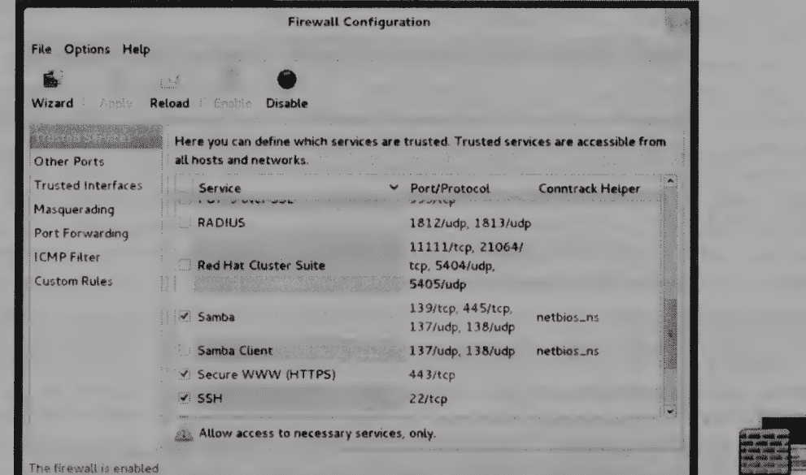

默认配置已经就绪。要创建自己的基本配置，只需运行向导，点击 Wizard 按钮。

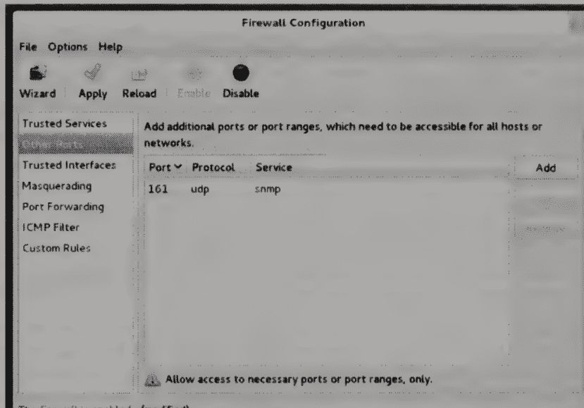

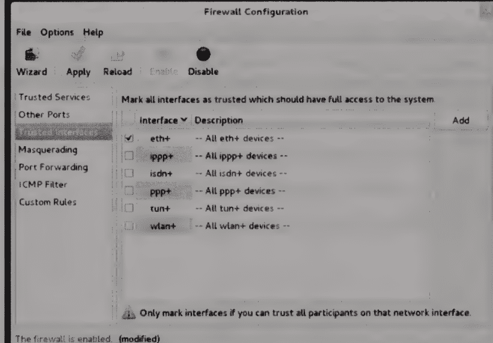

还可以对不同的防火墙组件进行更改。防火墙配置将显示从侧栏选择的多个标签。标签有信任服务（Trusted Services）、其他端口（Other Ports）、信任接口（Trusted Interfaces）、伪装（Masquerading）和自定义规则（Custom Rules）。

许多用户想要更改的服务。Linux 系统通常用于运行服务器。如果你正在创建一个强大的防火墙但仍想运行 Web 服务器、FTP 服务器、Samba 桌面浏览或 SSH 加密连接，你必须在信任服务标签中指定它们。Samba 桌面浏览允许从 GNOME 或 KDE 桌面访问 Samba 共享。

其他端口标签允许你为某些服务开放端口，例如 BitTorrent（见图 4-10）。点击 Add 按钮打开对话框，可以在其中选择端口号以及协议（tcp 或 udp），或输入特定端口或范围。

接口标签允许你指定可以信任的硬件连接，如网卡、调制解调器或无线连接。这通常应用于连接到本地网络直接连接到本地路由器或服务器（如打印机）。到更大网络的接口不应被信任。

如果你的系统被用作本地网络的互联网网关，你可以实施伪装以隐藏本地主机对互联网的访问（见图 4-12）。但这需要 IP 转发，它在你选择伪装时会自动启用。本地主机仍然可以访问互联网，但它们将被伪装成你的网关系统。你会选择连接到互联网的接口进行伪装。伪装仅适用于 IPv4 网络，不适用于 IPv6 网络。

端口转发标签允许你设置端口转发，将传输从一处引导到另一处，或另一个系统的不同端口。

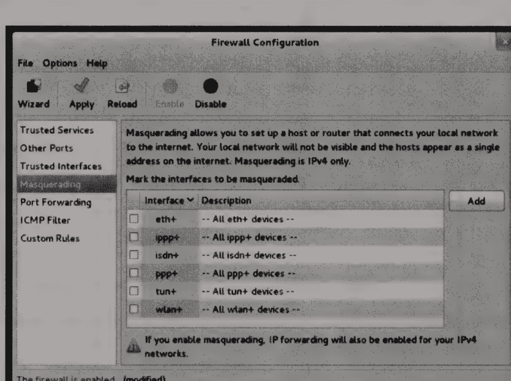

## 第4章：防火墙

ICMP Filters（过滤器）选项卡允许你阻止 ICMP 消息。默认情况下，所有 ICMP 消息都是允许的。阻止 ICMP 消息可以使系统更安全。某些类型的 ICMP 消息通常会被阻止，因为它们可能被用于渗透或过载系统，例如 ping pong ICMP 消息（见图 4-13）。

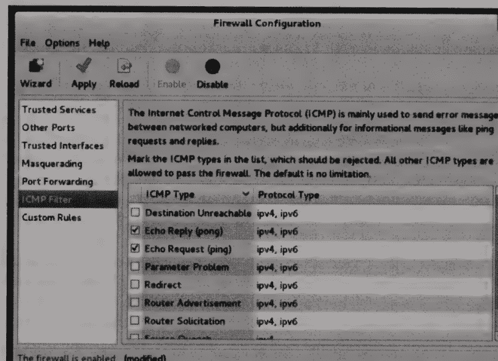

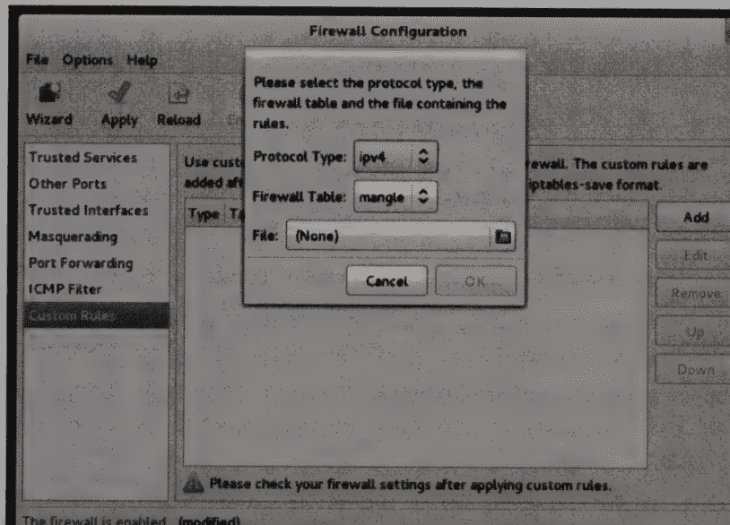


`Custom Rules`（自定义规则）选项卡允许你加载一个包含自定义防火墙规则的 IP-tables 文件（见图 4-14）。你不需要选择在使用 `system-config-firewall` 还是在 IP-tables 文件中创建整套规则，而是可以使用 `system-config-firewall` 配置标准的防火墙规则，然后设置一个仅包含系统自定义规则的 IP-table 文件。这些规则会被添加到 `system-config-firewall` 的标准实现中。当你加载文件时，必须确定 IPTables 文件包含 IPv4 还是 IPv6 规则（地址类型）。有三个选择：`filter`（Nft 规则）、`mangle`（用于重写地址的 mangle 表）和 `nat` 表。使用 `File` 按钮打开浏览器以定位要加载的 IPTables 文件。

## 保存 iptables 规则

一旦你确认 IPTables 规则正常工作，就可以将规则保存到 `/etc/sysconfig/iptables` 文件（IPv6 使用 `/etc/sysconfig/ipt6tables`）。使用带有 `save` 选项 IPTables 服务脚本。现在，你的规则将在系统启动时自动读取。你可以将 `save` 操作想为将 IPTables 规则安装到你的系统中，使其在每次启动系统时都成为系统设置的一部分。

```
service iptables save
```

要进行更改，请修改你的 iptables 脚本，运行服务脚本以清除旧规则，运行 iptables 脚本，然后使用带有 `save` 选项的服务脚本生成新的 `/etc/sysconfig/iptables` 文件。原始文件的备份保存在 `/etc/sysconfig/iptables.save` 中，以防你需要恢复旧规则。

除了使用脚本外，你还可以 `iptables-save` 脚本保存规则。推荐使用的文件是 `/etc/iptables.rules`。服务脚本实际上使用了带有 `-c` 选项的 `iptables-save` 来将规则保存到 `/etc/sysconfig/iptables` 文件。iptables 的 `-c` 选项会在输出中包含计数（iptables 服务脚本设计用于与命令一起解析计数信息）。`iptables-save` 命令将规则输出到标准输出。要将其保存到文件中，使用重定向运算符 `>` 将输出重定向到文件，如下：

```
iptables-save -c > /etc/sysconfig/iptables
```

你也可以将规则保存到你指定的文件中，例如 `/etc/iptables.rules`。`/etc/rc.d/init.iptables` 服务脚本定义了 `IPTABLES_CONFIG` 变量，它持有 IPTables 配置文件的名称 `/etc/sysconfig/iptables`。

```
iptables-save > /etc/iptables.rules
```

然后，要恢复规则，使用 `iptables-restore` 脚本从该保存文件中读取 IPTables 命令：

```
iptables-restore < /etc/iptables.rules
```

## IPTables 脚本

虽然你可以从 shell 命令行输入 IPTables 规则，但在关闭系统时，这些命令将会丢失。你可能需要将 IPTables 规则放置于一个可以直接执行的脚本中。这样你就可以编辑和管理一组复杂的规则，添加注释并维护它们的顺序。

### IPTables 脚本示例：IPv4

你现在有了足够的信息来创建一个简单的 IPTables 脚本，该脚本将为连接到互联网的单个系统提供基本保护。以下脚本 `myfilter` 提供了一个 IPTables 过滤过程，用于保护本地网络和网站免受外部攻击。此示例使用了 IPTables 和 IPv4 寻。对于 IPv6 地址，你将使用 `ip6tables` 以及相应的命令，NAT 规则除外（NAT 规则将实现为 mangle 名称）。此处使用的网络设备名称 `eth0` 和 `eth1` 是为了清晰起见。你系统的实际设备名称将是不同的、遵循可预测的命名格式（检查第 2 章）。

该脚本为私有网络配置了一个简单的防火墙（参考 IPTables HOWTO 获取更复杂的示例）。如果你有一个本地网络，可以针对它调整此脚本。在此配置中，阻止了从外部发起的远程访问，但允许网络中的用户与外部设备建立连接进行双向通信。在这个示例中，防火墙系统作为网络地址为 `192.168.0.0` 的私有网络的网关（见图 4-15）。为了本示例，互联网地址为 `10.0.0.1`。系统有两个以太网设备：一个用于私有网络（`eth1`），一个用于网络（`eth0`）。网关防火墙系统还支持地址为 `10.0.0.2` 的 Web 服务器。示例中过长无法放在单行的条目将延续在第二行，并用反斜杠引用换行符。基本规则如下：

```bash
#!/bin/bash
# myfilter

# 清空所有当前规则
iptables -F
iptables -X
iptables -t nat -F
iptables -t nat -X

# 设置默认策略
iptables -P INPUT DROP
iptables -P FORWARD DROP
iptables -P OUTPUT ACCEPT

# 允许所有回环流量
iptables -A INPUT -i lo -j ACCEPT

# 允许已和相关的连接
iptables -A INPUT -m state --state ESTABLISHED,RELATED -j ACCEPT
iptables -A OUTPUT -m state --state ESTABLISHED,RELATED -j ACCEPT
iptables -A FORWARD -m state --state ESTABLISHED,RELATED -j ACCEPT

# 允许 ICMP ping 和不可达消息
iptables -A INPUT -p icmp --icmp-type echo-request -j ACCEPT
iptables -A INPUT -p icmp --icmp-type destination-unreachable -j ACCEPT

# 允许来自本地网络 (eth1) 的流量
iptables -A INPUT -i eth1 -s 192.168.0.0/24 -j ACCEPT

# 允许通过 eth0 访问 Web 服务器 (10.0.0.2)
iptables -A INPUT -p tcp --dport 80 -d 10.0.0.2 -i eth0 -j ACCEPT

# 允许内部网络通过 NAT 访问互联网
iptables -t nat -A POSTROUTING -o eth -s 192.168.0.0/24 -j MASQUERADE
```

图 4-15：带有防火墙的网络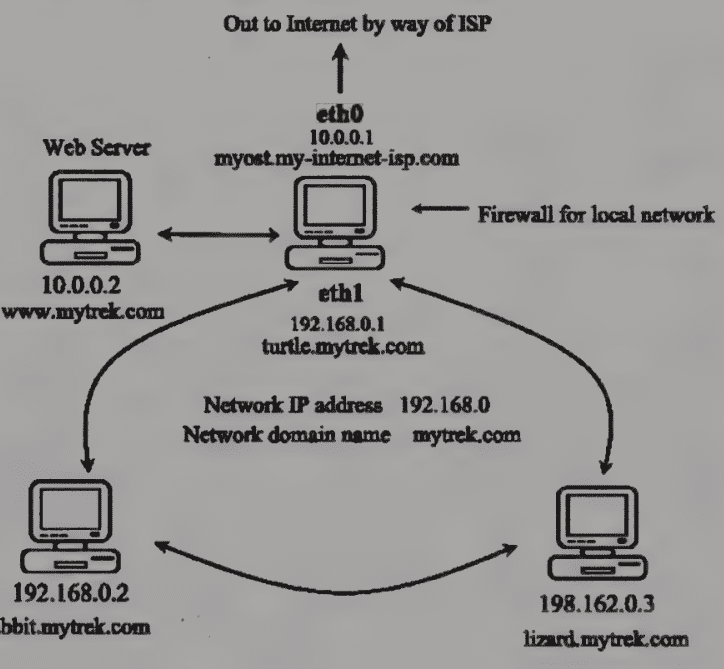

图 4-16：ICMP 过滤器 

## 第 4 章：防火墙 129

```bash
iptables -A INPUT -j ACCEPT -p icmp -i eth0 --icmp-type echo-reply -d 10.0.0.1
iptables -A INPUT -j ACCEPT -p icmp -i eth0 --icmp-type echo-request -d 10.0.0.1
iptables -A INPUT -j ACCEPT -p icmp -i eth0 --destination-unreachable -d 10.0.0.1
# 开启 IP 转发
echo 1 > /proc/sys/net/ipv4/forward
```

图-16：应用于本地网络示例的防火墙规则

## 策略 (Drop Policy)

首先，为 INPUT 和内置 IP 链设置 DROP 策略。这意味着如果数据包不符合任何一个允许通过的规则，它将被丢弃。然后，将拒绝所有的 IP 欺骗攻击以及任何从外部发起连接的尝试（SYN 数据包）。外部连接尝试也会被记录。这是一个非常基本的配置，可以通过添加 IPTables 规则轻松地根据自己的需求进行精化。

```bash
iptables -P INPUT DROP
iptables -P OUTPUT ACCEPT
iptables -P FORWARD ACCEPT
```

## IP 欺骗 (IP Spoofing)

保护私有网络免受任何数据包 IP 欺骗的一种方法是检查专用于私有网络的以太网设备上是否存在外部地址。在示例中，设备 `eth1`（专用于私有网络）上任何源地址不是私有网络地址（`! src 192.168.0.0`）的数据包都被拒绝。此外，还要检查来自外部的数据包是否将私有网络指定为它们的源地址。在该示例中，在除私有网络设备 (`eth1`) 之外的任何以太网设备上，源地址为私有网络的数据包都被拒绝。同样的策略适用于本地主机。

# 第 1 部分：系统工具

```bash
# IP 欺骗，拒绝内部网络上任何具有# 外部源地址的数据包。
iptables -A INPUT -j LOG -i eth0 -s 192.168.0.0/24
iptables -A INPUT -j DROP -i eth0 -s 192.168.0.0/24
iptables -A FORWARD -j DROP -i eth0 -s 192.168.0.0/24
# IP 欺骗，拒绝任何不在 eth0 上的具有# 内部网络源地址的外部数据包
iptables -A INPUT -j DROP -i eth0 -s0 -s 192.168.0.0/24
iptables -A FORWARD -j DROP -i eth0 -s 192.168.0.0/24
# IP 欺骗，拒绝任何不在 lo 接口上的具有# 本地回地址的数据包（任何在 eth0 或 eth1 上的数据包）
# 且源地址为本地回
iptables -A INPUT -j DROP -i lo -s 127.0.0.0/255.255.0
iptables -A FORWARD -j DROP -i lo -s 127.0.0.0/255.255.0
```

然后，你将设置规则来允许从你的系统（本地主机）接收的所有数据包通过。

```bash
iptables -A INPUT -j ACCEPT -i lo
```

## 服务器访问 (Server Access)

对于 Web 服务器，你将允许外部用户访问，但阻止任何试图从 Web 服务器向私有网络发起连接的人。在接下来的示例中，所有消息都接受 Web 服务器的，但 Web 服务器无法与私有网络建立连接。这防止了任何人通过对外部开放的 Web 服务器入侵本地网络。允许已建立的连接，允许私有网络使用 Web 服务器。

```bash
# 允许访问 Web 服务器（地址 10.0.0.2），端口 www
iptables -A INPUT -j ACCEPT -p tcp -i eth0 --dport -s 10.0.0.2
# 允许从 Web 服务器到内部网络的已建立连接
iptables -A INPUT -m state --state ESTABLISHED, RELATED -i eth0 \
    -p tcp --sport -s 10.0.0.2 -d 192.168.0.0/24 -j ACCEPT
# 防止从 Web 服务器到内部网络的新连接
iptables -A OUTPUT -m state --state NEW -o eth0 -p tcp \
    --sport -w 192.168.0.1/24 -j DROP
```

## 防火墙外部访问 (Firewall Outside Access)

为了允许防火墙访问外部，你允许除 ICMP 数据包外的所有数据包输入。这些稍后处理。防火墙由设备 `eth0` 指定。首先，你的防火墙应该允许已建立和相关的连接通过，如下。然后你将按照描述阻止外部访问。

```bash
# 允许访问防火墙，
# 除去 ICMP 数据包
iptables -A INPUT -m state --state ESTABLISHED, RELATED -i eth0 -p icmp -j ACCEPT
```

## 阻塞外部发起访问 (Blocking Outside Initiated Access)

为了防止外部人员向你的系统发起任何访问，创建一个规则，使用 `state` 选项 `NEW` 来阻止来自外部的 SYN 数据包访问。丢弃 `eth0` 连接上的任何新连接（假设 `eth0` 连接到互联网或外部网络）。

```bash
# 防止外部发起的连接
iptables -A INPUT -m state --state NEW -i eth0 -j DROP
iptables -A FORWARD -m state --state NEW -i eth0 -j DROP
```

## 本地网络访问 (Local Network Access)

为了允许内部网络与防火墙交互，你允许内部以太网连接 `eth1` 上的所有数据包。有效的内部网络地址被指定为输入源。

```bash
iptables -A INPUT -j ACCEPT -p all -i eth1 -s 192.168.0.0/24
```

## 列出规则 (Listing Rules)

这些 iptables 选项的列表显示了每个选项的不同规则，如下

```text
$ iptables -L
Chain INPUT (policy DROP)
target prot source destination
LOG all -- 192.168.0/24 anywhere LOG level warning
DROP all -- 192.168.0/24 anywhere
DROP all -- 192.168.0/24 anywhere
DROP all -- 127.0.0.8 anywhere
ACCEPT all -- anywhere
ACCEPT all -- anywhere
ACCEPT tcp -- 10.0.0.2 tcp dpt:http
ACCEPT tcp -- 192.168.0/24 state RELATED, ESTABLISHED
                                tcp spt:http
ACCEPT !icmp -- anywhere state RELATED, ESTABLISHED
DROP all -- anywhere state NEW
ACCEPT all -- 192.168.0/24
ACCEPT icmp -- anywhere 10.0.0.1 icmp echo-reply
ACCEPT icmp -- anywhere 10.0.0.1 icmp echo-request
ACCEPT icmp -- 10.0.0.1 icmp destination-unreachable
Chain FORWARD (policy ACCEPT)
target prot source destination
DROP all -- 192.168.0/24 anywhere
DROP all -- 192.168.0/24 anywhere
DROP all -- 127.0.0.8 anywhere
DROP all -- anywhere state NEW
ACCEPT all -- 192.168.0/24
ACCEPT icmp -- anywhere 10.0.0.1 icmp echo-reply
ACCEPT icmp -- anywhere 10.0.0.1 icmp echo-request
ACCEPT icmp -- 10.0.0.1 icmp destination-unreachable
Chain FORWARD (policy ACCEPT)
target prot source destination
```

## 第4 章：防火墙

接受数据包。在这个示例中，FORWARD 和 INPUT 链对在 `eth1` 设备上接受数据包有不同的规则。INPUT 规则更具限制性。为了让网络能够通过防火墙接收转发的数据包，你可以使用特定的 FORWARD 规则在设备上启用转发，如下所示：

```
iptables -A FORWARD -j ACCEPT -p all -i eth1
```

INPUT 链仅接受来自本地网络的数据包。

```
iptables -A INPUT -j ACCEPT -p all -s 192.168.0.0/24
```

## 本地网络伪装（Masquerading）

要实现地址伪装（即私有网络上的系统可以使用网关的 Internet 地址连接到 Internet主机），你需要创建一个带有目标（target）的 NAT 表（`-t nat`）POSTROUTING 规则。

```
iptables -t nat -A POSTROUTING -o eth0 -j MASQUERADE
```

## 控制 ICMP 数据包

此外，为了允许 ping 和目的不可达 ICMP 数据包，你需要输入以防火墙为目的地的 INPUT 规则。为了启用 ping 操作，你需要同时允许 `echo-request`（回显请求）和 `echo-reply`（回显响应）ICMP 类型，对于目的不可达，使用 `destination-unreachable` 类型。

```
iptables -A INPUT -j ACCEPT -p icmp -i eth0 --icmp-type echo-reply -d 10.0.0.1
iptables -A INPUT -j ACCEPT -p icmp -i eth0 --icmp-type echo-request -d 10.0.0.1
iptables -A INPUT -j ACCEPT -p icmp -i eth0 --icmp-type destination-unreachable -d 10.0.0.1
```


最后，开启 IP 转发。

```
echo 1 > /proc/sys/net/ipv4/ip_forward
```

## Simple LAN 配置

要创建一个不包含 Web 服务器等 Internet 服务的简单 LAN，你不需要包含支持这些服务的规则。你仍然需要用于连接本地主机到 Internet 的 `FORWARD` 和 `POSTROUTING` 规则，以及管理主机与防火墙之间交互的规则。若要修改示例脚本以支持不带 Web 服务器的简单 LAN，请删除三个管理 Web 服务器的规则。保留其他所有内容。

## 防火墙上带有 Internet 服务的 LAN 配置

通常，作为防火墙的同一系统也运行 Internet 服务器，如 Web 服务器和 FTP 服务器。在这种情况下，防火墙规则应用于用于这些服务的端口。示例脚本处理的是运行在独立主机系统上的 Web 服务器。如果 Web 服务器运行在防火墙系统上，你将把防火墙规则应用到 Web 服务器使用的端口上。通常，Web 服务器使用的端口是 80。在接下来的示例中，Web 服务器的 `iptables` 规则已应用到防火墙系统上的端口 `www`（即 80 端口）。该修改需要移除旧的 Web 服务器主机地址引用 `10.0.0.2`。

# 第 1 部分：系统工具

```
# 允许访问 Web 服务器，端口 www (port 80) 
iptables -A INPUT -j ACCEPT -p tcp -i eth0 --dport www
# 允许从 Web 服务器到内部网络的已建立连接
iptables -A INPUT -m state --state ESTABLISHED, RELATED -i eth0 \
-p tcp --sport www -d 192.168.0.0/24 -j ACCEPT
# 防止从 Web 服务器到内部网络的新连接
iptables -A OUTPUT -m state --state NEW -o eth0 -p tcp \
--sport www -d 192.168.0.1/24 -j DROP
```

可以为 FTP 服务器设置类似的条目。当你运行多个服务时，可以使用用户定义规则在每台服务器上运行相同的规则，而不是为每个服务重复三条单独的规则。使用示例脚本，你可以定义两个规则，一个用于 `INPUT`，一个用于 `OUTPUT`，用于控制该服务的进出数据包。

```
iptables -N inputservice
iptables -N outputservice
iptables -F inputservice
iptables -F outputservice
# 允许访问该服务
iptables -A inputservice -j ACCEPT -p tcp -i eth0
# 允许从服务到内部网络的已建立连接
iptables -A inputservice -m state --state ESTABLISHED, RELATED -i eth0 \
-p tcp -d 192.168.0.0/24 -j ACCEPT
# 防止从服务到内部网络的新连接
iptables -A outputservice -m state --state NEW -o eth0 -p tcp \
-d 192.168.0.1/24 -j DROP
```

```
# 运行 Web 服务器规则，端口 www (port 80)
iptables -A INPUT --dport www -j inputservice
iptables -A INPUT --dport www -j outputservice
# 运行 FTP 服务器规则，端口 ftp (port 21)
iptables -A OUTPUT --dport ftp/24 -j inputservice
iptables -A OUTPUT --dport ftp -j outputservice
```

## IP 伪装 (IP Masquerading)

在 Linux 系统上，你可以建立一个网络，其中只有一个连接到 Internet，而网络中的多个系统可以使用该连接。通过只使用一个 IP 地址，多个不同的系统可以连接到 Internet。这种方法被称为 IP 伪装，其中一个系统伪装另一个系统并使用该系统的 IP 地址。在这样的网络中一个系统通过自己的 IP 地址连接到 Internet，而其他系统通过局域网 (LAN) 连接到该系统。当本地系统需要访问网络时，它会伪装连接 Internet 的系统，借用其 IP 地址。

IP 伪装在 Linux 上通过 IPTables 防火墙实现。实际上，你设置了一个防火墙并将其配置为执行 IP 伪装。你可以从 Linux Documentation Project (http://ldp.org) 中的 Linux Masading HOWTO 文件中找到更多关于 IP 伪装的信息，那里你将找到 IP-Masquerade-HOWTO 和 Masquerading-Simple-HOWTO。它们提供了在你的系统上设置 IP 伪装的详细分步指南。在使用 IP 伪装之前，内核必须支持它。

通过在 Linux 系统上实现的 IP 伪装，该机器地址同时也是使用防火墙 Internet 地址连接 Internet 的机器的 LAN 的防火墙和网关。同时实现 IP 伪装的防火墙有时被称为 MASQ 门。通过 IP 伪装，连接 Internet 的系统（防火墙）监听来自 LAN 上主机的请求。当它收到请求时，它会将请求的本地主机的 IP 地址替换为防火墙的 Internet 地址，然后将数据包发送到 Internet，就像请求是它发出的一样。来自 Internet 的回复随后发送到防火墙系统。回复使用防火墙自己的 Internet 地址指向防火墙。然后防火墙确定回复响应的本地系统。它剥离自己的 IP 地址并通过 LAN 将响应发送给本地主机。从本地机器的角度来看，连接是透明的。它们看起来是直接连接到 Internet 的。

## 本地网络伪装（重复标题翻译内容）

IP 伪装通常用于允许私有网络上的机器访问 Internet。这些可以是家庭网络或小型 LAN 中的机器，例如小型企业。这样的网络可能只有一台机器具有 Internet 访问，因此只有一个 Internet 地址。本地地址从私有网络分配中选择（`10.`、`172.16.` 或 `192.168.`）。理想情况下，防火墙将有两个网卡：一个用于 LAN（例如 `eth1`），一个用于 Internet，例如 `eth0`（对于拨号 ISP，则是调制解调器 `ppp0`）。Internet 连接 (`eth0`) 将被分配 IP 地址。你的私有 LAN 将拥有类似 `192.168.0.1` 的地址。其以太网接口 (`eth1`) 将分配 IP 地址 `192.168.0.1`。实际上，防火墙让私有作为网关。你的 LAN 需要自己的域名服务器来识别网络上的机器，包括你的防火墙。每个本地机器都需要指定防火墙为网关。尝试不要在同一个物理接口上对防火墙和 Internet IP 地址使用 IP 别。为它们使用独立的接口，例如两个以太网卡，或一个以太网卡和一个调制解调器 (`ppp0`)。

## 伪装规则

在 Netfilter 中，IP 伪装是一种 NAT 操作，不像 IP 链那样与包过滤集成。IP 伪装命令放在 NAT 表中，与包过滤命令分开处理。

使用 `firewall-config` 的 Masquerading 标签或 `firewall-cmd --add-masquerade` 参数为区域启用伪装。使用 `--remove-masquerade` 参数从区域中移除。

```
firewall-cmd --permanent --zone=work --add-masquerade
```

对于静态防火墙，可以使用带有 `t nat` 参数的 `iptables`。在 `POSTROUTING` 链中添加规则，使用 `-o` 参数指定输出设备并使用 `-j` 参数配合 `MASQUERADE` 命令。

```
iptables -t nat -A POSTROUTING -o eth0 -j MASQUERADE
```

# 第 1 部分：系统工具

下一步是开启 IP 转发，可以手动操作，也可以通过在 `/etc/sysctl.conf` 文件设置 `net.ipv4.forward` 变量并运行带有 `-p` 选项的 `sysctl`。IP 转发默认是关闭的。对于 IPv6，请使用 `net.ipv6.conf.all.forwarding`。`/etc/sysctl.conf` 中的条目如下：

```
net.ipv4.forward = 1
net.ipv6.conf.all.forwarding = 1
```

然后你运行带有 `-p` 选项的 `sysctl`。

```
sysctl -p
```

你也可以使用 `echo` 命令直接修改相应的转发文件，如下所示：

```
echo 1 > /proc/sys/net/ipv4/conf/all/forwarding
```

对于 IPv6，你将使用对应 `/proc/sys/net/ipv6` 目录下的转发文件 `conf/all/forwarding`：

```
echo 1 > /proc/sys/net/ipv6/conf/forwarding
```

## 伪装选定主机

与其将所有本地主机伪装为防火墙/网关主机的单一 IP 地址，你还可以使用 NAT 表为少数选定的主机重写地址。这种方法通常适用于你希望多个本地主机显示为互联网服务器的设置。使用 `DNAT` 和 `SNAT` 目标，你可以将数据包定向到特定的本地主机。你会使用 `PREROUTING` 和 `POSTROUTING` 链上的规则来引导输入和输出数据包。

例如，上一个示例中描述 Web 服务器可以被配置为本地主机，`DNAT` 目标可以重定向原始从 `10.0.0.2` 接收的任何数据包。假设 Web 服务器设置在 `192.168.0.5`。它在互联网上可以显示为地址 `10.0.0.2`。发送到 `10.0.0.2` 的数据包将通过 NAT 表重写并定向到 `192.168.0.5`。你将使用带有 `-d` 选项的 `PREROUTING` 链处理传入数据包，使用带有 `-s` 选项的 `POSTROUTING` 链处理输出数据包。

```
iptables -t nat -A PREROUTING -d 10.0.0.2 --to-destination 192.168.0.5 -j DNAT
iptables -t nat -A POSTROUTING -s 192.168.0.5 --to-source 10.0.0.2 -j SNAT
```

> 提示：注意，在 `iptables` 中，伪装不会与 `FORWARD` 链结合。如果你为 `FORWARD` 链指定了 `DROP` 策略，你还必须专门为正在伪装的网络启用 `FORWARD` 操作。你需要同时拥有 `POSTROUTING` 规则和一个 `FORWARD` 规则。


## 5. Shell 变量与脚本

- Shell 变量
- 环境变量
- 控制结构

# 第 1 部分：系统工具

Shell 脚本通过组合 Linux 命令来执行特定任务。不同类型的 Shell 提供了许多用于创建 Shell 脚本的编程工具。你可以定义变量并为它们赋值。你还可以在脚本执行时，交互式地为它们定义变量。Shell 提供了循环和条件控制结构，用于重复 Linux 命令或对你想要执行的命令做出决策。你还可以构建执行算术或比较操作的表达式。所有这些编程工具的操作方式与其他编程语言中的工具类似，因此如果你已经熟悉编程，可能会发现 Shell 很容易学习。

BASH、TCSH 和 Z 是 Shell 的几种类型。你可以拥有某一特定类型 Shell 的多个实例。根据定义，Shell 是一个你在其中执行命令的解释性环境。你可以同时运行多个环境，可以是相同类型或不同类型的 Shell；例如，你可能同时运行多个 BASH Shell 类型的 Shell。

本章将介绍在大多数 Linux 系统上使用的 BASH 和 TCSH Shell 创建 Shell 脚本的基础知识。你将学习如何创建自己的脚本、定义 Shell 变量并开发用户界面，以及学习组合控制结构以创建复杂程序的更具挑战性的任务。本章中的表格列出了 Shell 命令和操作符，而大量的示例展示了它们是如何实现的。

通常情况下，组成 Shell 程序的指令会被输入到一个可以执行的脚本文件中。你甚至可以将你的程序分发到几个脚本文件中，其中一个文件将包含如何执行其他脚本的指令。你可以将变量、表达式和控制结构视为你用于将 Linux 命令组合成单一操作的工具。从这个意义上说，Shell 程序是你创建的新且复杂的 Linux 命令。

BASH Shell 拥有灵活且强大的编程命令，允许你构建复杂的脚本。它支持局部于给定 Shell 或导出到其他 Shell 的变量。你可以从一个脚本向另一个脚本传递参数。BASH Shell 拥有一套完整的控制结构，包括循环和 `if` 语句以及 `case` 结构，你将在阅读本书时学习所有这些内容。Shell 命令与重定向和管道操作轻松交互，允许它们从标准输入接收输入或将其发送到标准输出。与用于 UNIX 的第一个 Bourne shell 不同，BASH 整合了 TCSH 和 Z Shell 的许多特性。特别是算术操作，在 BASH 中执行更容易。

## Shell 变量

在每个 Shell 中，你都可以输入并执行命令。你可以使用 Shell 变量进一步增强 Shell 的功能。Shell 变量允许你持有数据，并在 Shell 中执行不同命令时反复引用这些数据。例如，你可以定义一个变量来存储复杂文件名的名称。与其在不同的命令中重新输入文件名，不如通过 Shell 变量来引用它。

你在 Shell 登录时定义变量。这通常被称为登录 Shell（login shell）。特殊级参数变量定义在这个登录 Shell 中。Shell 变量也可以用于定义 Shell 的环境。

注意：Shell 变量只要你的 Shell 激活状态就会存在——直到你退出 Shell。例如，注销将退出登录 Shell。当你再次登录时，任何需要在登录 Shell 中定义的变量必须重新定义。

## 变量的定义与评估：`=`, `set`, `unset`

你在 Shell 中使用变量运行时定义变量。变量名可以是任何字母组合，包括下划线。名称也可以包含数字，但不能作为名称的第一个字符。名称不能包含任何类型的字符，例如感叹号、安培符号甚至空格。这些符号被 Shell 留供其内部使用。此外，变量名不能包含多个单词。Shell 使用命令行上的空格来区分命令的不同组成部分，如选项、参数和命令名。

你使用赋值运算符 (`=`) 给变量赋值。你输入变量名、赋值运算符，然后分配值。不要在赋值运算符周围放置任何空格。例如，赋值操作 `poet = value` 将失败（C shell 的赋值类型略有不同）。你可以为变量分配任何字符组合。在下一个示例中，变量 `poet` 被赋值为字符串 `Virgil`：

```
$ poet = Virgil
```

一旦你为变量赋值，就可以使用变量名来引用该值。你经常将变量的值作为命令的参数。你可以通过变量名来引用变量的值，这被称为评估变量。评估会检索变量的值，通常是一组字符。这组字符会替换命令行上的变量名。当在变量名之前放置一个 `$` 时，变量名将被替换为变量的值。在下一个示例中，变量 `poet` 被评估，其内容 `Virgil` 被用作 `echo` 命令的参数。`echo` 命令简单地将其字符回到屏幕上。

```
$ echo $poet
Virgil
```

你必须仔细区分变量的评估和变量名本身。如果你在变量名之前漏掉 `$` 符号，你拥有的只是变量名本身。在下一个示例中，`echo` 命令将 `poet` 作为参数，并打印出 `poet`：

```
$ echo poet
poet
```

变量的内容通常用作命令参数。一种常见的参数是目录路径。获取一个反复使用的目录路径可能非常麻烦。如果你将目录路径赋值给变量，你就可以使用评估后的变量来代替它。当你使用 `$` 符号评估变量时，会检索你赋值的目录路径。在下一个示例中，将一个目录路径赋值给变量，然后使用评估后的变量执行复制命令。评估 `ldir`（即 `$ldir`）结果位于路径 `/home/chris/letters`。`copy` 命令的结果为 `cp myletter /home/chris/letters`。

```
$ ldir=home/chris/letters
$ cp myletter $ldir
```

你可以使用 `set` 命令获取所有已定义变量的列表。如果你决定不需要某个变量，可以使用 `unset` 命令将其删除。注：`unset` 命令用于删除变量。

## 变量值：字符串

你赋值给变量的值可以由任何字符组成。这些字符可以是你显式输入的字符，也可以是执行 Linux 命令获得的结果。在大多数情况下，你可能需要使用单引号、双引号、反斜杠或反引号（back quotes）对你的值进行引用。单引号、双引号和反斜杠以不同的方式对字符串进行引用。反引号（Back quotes）具有特殊功能，即执行一个 Linux 命令并将其结果作为命令行上的参数。

## 字符串引用：双引号、单引号和反斜杠

变量由任何字符组成。然而，当你想要包含同时也被 Shell 用作操作符的字符时就会出现问题。你的 Shell 在评估命令行时会使用某些字符。空格用于解析命令行上的参数。星号（`*`）、问号（`?`）和括号是生成文件名列表的元字符。点（`.`）表示当前目录。美元符号 `$` 用于评估变量，大于和小于符号 `<` 是重定向操作符。安符 `&` 用于执行后台命令和管道输出。如果你想将这些元字符中的任何一个作为变量的一部分引用，你只需将其变为另一个普通字符。它不会被 Shell 评估。

你可以使用双引号、单引号和反斜杠来引用此类元字符。双引号和单引号允许你一次引用多个元字符。如果你想给变量赋值多个单词，则需要对分隔变量的空格进行引用。你可以通过将所有单词包含在双引号内来实现。当然，任何包含在双引号内的元字符也会被引用。在接下来的示例中，双引号包含了由空格分隔的单词。由于空格被包含在双引号内，它们被视为字符，而不是用于解析命令行参数的分隔符。在第二个示例中，双引号还包含了一个点，将其视为仅仅一个字符。在第三个示例中，星号也被包含在双引号内。星号被视为字符串中的另一个字符，不会被评估。


进入`/path/to/xxx`目录，找到`xxx.json`。

在表达式`cvar = avar + bvar`中，加法运算符（`+`）将`avar`与`bvar`相加，得到它们的和`cvar`

在`List.of(arg0, arg1, arg2)`中，`List`接口的工厂方法`of()`接受一系列的元素，返回包含它们的只读列表。

之后我们这样调用`cmd`命令：`cmd arg0 arg1 arg2`。

```
if (condVar > someVal) {console.log("xxx")}
```


# 表 5-2: BASH Shell 控制结构

| `for variable` | `for` 设计用于引用脚本参数；变量 |
| `do` | 操作数被连续赋值为每个参数值。 |
| `command` | |
| `done` | |
| `select string in item-list` | `select` 根据 `item-list` 中的项目创建菜单； |
| `do` | 然后执行执行命令；该命令通常是一个 |
| `command` | `case`。 |

程序的运行如下：

```
$ shell
Enter s to list file sizes,
otherwise all file information is listed.
Please enter option:  s
total 2
  1 monday      2 today
```

## 循环控制结构

`while` 循环重复命令。`while` 循环以关键字开始，后面跟着一个 Linux 命令。关键字 `do` 位于下一。循环的结束由关键字 `done` 指定。结构中使用的 Linux 命令通常是指示闭合括号的测试命令。

`for-in` 结构设计用于顺序引用值列表。它接受两个操作数：一个变量和一个值列表。列表中的值逐一赋值给 `for-in` 结构中的变量。与 `while` 命令一样，`for-in` 结构是一个循环。每次循环，列表中的下一个值被赋值给变量。当到达列表结束时，循环停止。与 `while` 循环一样，循环体以关键字开始并以 `done` 结束。备份脚本对每个文件进行备份并将其放在名为 `sourcebak` 的目录中。注意使用 `*` 特殊字符来生成所有 `.c` 扩展名的文件名列表。

## `backfile`

```
for backfile in *.c
do
  cp $backfile sourcebak/$backfile
  echo $backfile
done
```

程序的运行如下：

```
$ backup
io.c
lib.c
main.c
$
```

未指定值列表的 `for` 结构将命令行参数作为其值列表。在调用 Shell 时在命令行指定的参数将变为 `for` 命令引用的值列表。`for` 命令中使用的变量自动按顺序设置为每个参数值。在循环第一次循环时，变量被设置为第一个参数的值。第二次循环时，它被设置为第二个参数的值。

# 第 2 部分：互联网服务器

邮件服务器

FTP 服务器

Web 服务器

新闻组和数据库服务器

## 第 2 部分：互联网服务器

邮件服务器为用户提供电子邮件服务。它们有自己的协议，例如简单邮件传输协议 (SMTP)、邮局局协议 (POP) 和互联网邮件访问协议 (IMAP)。当用户发送消息时，消息首先从用户系统发送到邮件服务器。然后由邮件传输代理 (MTA) 在互联网上传输它。MTA 是使用 SMTP 在互联网上从一个服务器到另一个服务器发送消息的邮件服务器，跨子网进行传输。在 Fedora 上，常用的 MTA 是 `Postfix` 和 `Sendmail`。

## 表 6-1: 邮件传输代理

| 代理 | 描述 |
|---|---|
| `Sendmail` | Sendmail 邮件传输代理，由 Sendmail 联盟支持 www.sendmail.org |
| `Postfix` | 快速、易于配置且安全的邮件传输代理，与 Sendmail 兼容并旨在取代它 www.postfix.org |
| `Qmail` | 快速、灵活且安全的 MTA，拥有自己的实现，并与 Postfix 具有竞争性 www.qmail.org |
| `Exim` | 基于 mail3 的 MTA www.exim.org |
| `Courier` | Courier MTA www.courier-major.org |

`Courier` 是一种快速、小巧且安全的 MTA，与 Sendmail 保持某些兼容性。`Courier` 软件包还包含 POP、IMAP 和 webmail 以及配合邮件列表服务。它支持广泛的身份验证方法，包括影子密码（shadow passwords）、PAM 和 LDAP。

`Exim` 是一个与 Sendmail 类似的快速且灵活的 MTA。它由剑桥大学开发，其实现方式与 Sendmail 非常不同。

`Qmail` 也是一个快速且安全的 MTA，但它与 Sendmail 的兼容性较低。它有自己的配置和维护文件。像 Postfix 一样，它采用模块化设计，为每个邮件任务使用不同的程序。它专注于安全、速度和易于配置。

`Zarafa` 是 Microsoft Exchange 的开源替代品。它是一个商业产品，但在 Fedora（`zarafa` 元数据包）上可以获得开源版本，http://www.zarafa.com。

## Postfix

`Postfix` 是一个快速、安全且灵活的 MTA，旨在取代 Sendmail 的同时尽可能地保持其兼容性。它由 Wietse Vena 编写，最初由 IBM Secure Mail 发布，现在在 GNU 协议下提供（www.postfix.org）。`Postfix` 的创建充分考虑了安全性，将所有入站邮件都视为潜在的安全风险。`Postfix` 使用了许多与 Sendmail 相同的目录和文件，并使用 Sendmail 封装器，让 Sendmail 客户端能够与 Postfix 服务器无缝交互。`Postfix` 也比 Sendmail 更容易配置，使用它自己的配置文件。

`Postfix` 不是一个庞大的程序，而是实现为一组较小的程序，每个程序执行特定的邮件相关任务。`Postfix` 主守护进程（master daemon）持续运行并管理其他 Postfix 守护进程的使用，根据需要运行它们。一个 `bounce`（退信）守护进程处理无法投递的邮件，一个 `trivial-retry`（重试）守护进程重定向消息，而 `show` 守护进程提供打印队列的信息。

### `postfix.service`

```
[Unit]
Description=Postfix Mail Transport Agent
After=network.target
Conflicts=sendmail.service exim.service
```

```
[Service]
Type=forking
PIDFile=/var/postfix/pid/master.pid
EnvironmentFile=/etc/sysconfig/network
ExecStartPre=/usr/libexec/postfix/aliasesdb
ExecStartPre=/usr/libexec/postfix/chroot-update
ExecStart=/usr/bin/postfix start
ExecReload=/usr/bin/postfix reload
ExecStop=/usr/bin/postfix stop
```

```
[Install]
WantedBy=multi-user.target
```

`Postfix` 由 `systemd` 管理，使用此处所示的 `postfix.service` 文件。它由多用户目标（运行级别 2, 3, 4 和 5 (`WantedBy`)）作为独立守护进程启动。它与 `sendmail` 和 `exim` 邮件服务器冲突（`Conflicts`）。它从 `/etc/sysconfig/network` 读取运行时配置（`EnvironmentFile`）。在启动 Postfix 别名数据库之前（`ExecStartPre`）。使用 `/etc/sbin/postfix` 命令来启动、停止和重载服务器（`ExecStart`, `ExecReload` 和 `ExecStop`）。

## Postfix 命令

几个 Postfix 命令允许你管理服务器任务。`sendmail` 命令用于发送消息。你使用 `mailq` 来显示邮件队列的状态。`newaliases` 获取别名文件中列出的别名，并将其存储在 Postfix 可以使用的数据库文件中。

`postmap` 命令用于维护 Postfix 的各种数据库文件，例如用于邮件别名的别名文件以及限制服务器接收消息的访问文件。你还可以将这些数据库文件实现为 SQL 数据库（如 MySQL），以便于更方便的管理。`mysql` 表提供了如何配置 SQL 数据库支持的详细信息（Postgres 数据库支持查看 `pg_table`）。你也可以使用 LDAP 代替 SQL（`ldap_table`）。

此外，Postfix 还提供了更底层的工具，所有工具都以 term `post` 开头，例如维护别名数据库的 `postfix` 命令，以及打印队列文件的 `postcat`。

## Postfix 配置：`main.cf`

Postfix 的配置通过在其的配置文件 `main.cf` 中设置参数来处理。`master.cf` 文件用于运行 Postfix 服务器，`dynamicmaps.cf` 文件用于运行时功能。

安装 Postfix 时带有一个默认的 `/etc/postfix/main.cf` 文件，大部分基本配置值已经设置好。参数名称倾向于用户友好。例如，目录位置由以 `directory` 结尾的参数指定，如 `queue_directory` 指定 Postfix 队列的位置，`daemon_directory` 指定 Postfix 守护进程的位置。大多数参数已经实现了了默认值。例如，针对特定的资源控制设置了默认值，如消息大小、时间限制和每个队列允许的邮件数量。你可以编辑 `main.cf` 文件来更改参数以满足你的需求。在进行任何更改后，你只需要使用 `postfix reload` 命令重新加载配置即可：

```
postfix reload
```

## 网络参数

你可能需要设置几个网络参数。为了方便这一过程，Postfix 定义了持有关键网络信息的参数，例如 `hostname`（存储你的系统主机名），`mydomain`（存储你的网络域名）。例如，`hostname` 将被设置为主机 `my.mytrek.com`，而 `mydomain` 只是 `mytrek.com`。`hostname` 和 `mydomain` 参数本身被用作赋值给其他参数。在 Fedora 上，`hostname` 应该设置为系统邮件名。在下一个示例中，`hostname` 和 `mydomain` 被设置为邮件服务器运行的主机及其网络域名：

```
myhostname=turtle.mytrek.com
mydomain=mytrek.com
```

`myorigin` 参数指定服务器发送的电子邮件的源地址。在 Fedora 上，该参数被注释掉了。你可以像此处所示设置 `myhostname` 参数的值：注意 `myhostname` 变量前面有一个 `$` 以对其进行求值。

```
myorigin=$myhostname
```

如果你正在使用直接连接到互联网的单个系统，你可能想要更改此配置，将邮件标记为由你的主机发送。如果你的系统作为网络的网关运行，你的邮件服务器是从该网络上的不同主机发送邮件。你可能希望将源地址更改为域名，以便被认为是从该域名发送的。

```
myorigin=$mydomain
```

你可能还需要指定邮件服务器接收邮件的网络接口。默认指定 `localhost` 接口，使用 `inet_interfaces` 参数。

```
inet_interfaces = localhost
```

`inet_protocols` 选项指定要使用的 IP 协议。可以是 IPV4、IPv6 或 all（两者）。

```
inet_protocols = all
```

### 本地网络

`mydestination` 参数包含了你的邮件服务器接收邮件的域名列表。默认情况下，这些包括 `localhost` 和你的系统主机名。

```
mydestination = $myhostname, localhost.$mydomain, localhost
```

如果你想让邮件服务器接收整个本地网络的邮件，你还需要指定它的域名。这样，服务器就可以接收发送给域名的邮件，而不是你特定的主机。

```
mydestination = $myhostname, localhost.$mydomain, $mydomain
```

此外，如果邮件服务器要接收整个本地网络的邮件，你需要或者作为 LDAP 条目。对于管理大量的虚拟账户，优先选择 SQL 数据库。为了支持 SQL，你首先需要在 MySQL 数据库中为网域（虚拟域名）、用户（用户账户）和转发（别名）创建表。相应的虚拟配置文件将列出有关数据库、表和要使用的主机的信息，例如用于访问 SQL 数据库的 `mysql_virt.cfg` 和访问用户表的 `mysql_user.cfg`。www.postfix.org 文档提供了详细信息。

## Postfix 灰名单策略服务器 (Postfix Greylisting Policy Server)

Postfix 也通过 Postfix 灰名单策略服务器（`postfix` 包）支持灰名单。灰名单根据垃圾邮件发送者的发送方式而非内容来拦截垃圾邮件，基于这样一个事实：垃圾邮件发送者在被拒绝时不会尝试重试（www.greylisting.org）。来自之前未知源的消息会被拒绝，随后 MTA（邮件传输代理）将尝试重试，而垃圾邮件发送者不会。要配置策略服务器，请将访问权限委托给服务器。在 `/etc/postfix` 目录中，使用 `postfix_whitelist` 将电子邮件地址排除在灰名单之外。灰名单策略服务器是一个独立的服务器，使用它自己的启动脚本。Postfix 手页提供了关于该服务器选项的详细信息。

对于高负载工作，你可以使用 SQL 灰名单策略服务器（`sqlquery` 包）。该服务器使用 SQL 后端处理灰名单任务。更多信息请参见 http://sqlquery.sourceforge.net。

## 控制用户和主机访问

通过访问文件（access file），你可以控制对特定用户、主机和网域的访问。访问文件的工作方式与 Sendmail 使用的类似。在文本文件中创建条目，包含用户、主机或名称地址，随后是跟要执行的操作。用户、主机或网域可以被接受、不带消息地拒绝或带消息拒绝。一旦创建了条目，可以使用 `postmap` 命令将它们安装到 Postfix 数据库文件中：

```
postmap /etc/postfix/access
```

然后你可以在各种 Postfix 操作中使用该访问文件来控制客户端、接收者和发送者。

访问也可以通过邮件滥用预防系统（MAPS）进行控制，该系统提供了 RBL+ 服务，这是一个基于 DNS 的邮件地址数据库集合（www.mailabuse.com）。这些数据库——即实时黑名单（RBL），列出了邮件滥用者已知的邮件地址。网域或主机将与该服务维护的列表进行匹配，该列表可以在本地服务器上或直接从在线站点访问。各种 Postfix 操作使用 MAPS 数据库来控制客户端、接收者或发送者的访问。

## 头部和正文检查

通过 `header_checks` 参数，你可以指定一个 Postfix 表，在其中你可以列出拒绝消息的标准。检查 `/etc/postfix/header_checks` 文件以获取详情。这些标准是能够匹配邮件头部的模式。当你有匹配的消息时，可以将其带回复拒绝、简单删除或带警告记录日志。你可以选择采取多种操作，包括 REJECT（拒绝）、DISCARD（丢弃）、WARN（警告）、HOLD（保留）和 IGNORE（忽略）。

```
header_checks = regexp:/etc/postfix/header_checks
```

在这种情况下，数据库 `/etc/postfix/header_checks` 将包含多行，每行都有一个正则表达式和一个相应的操作。正则表达式可以是 `header_checks` 参数中由 `regexp` 指明的标准表达式，也可以符合 Perl 兼容正则表达式（prec）。

`body_checks` 参数允许你使用正则表达式和在 `/etc/postfix/body_checks` 中与 `header_checks` 相同的操作，逐行检查文本消息的正文。

## 控制客户端、发送者和接收者

通过 `smpd_client_restrictions` 参数，你可以限制某些客户端对邮件服务器的访问。你可以包含的限制包括：`reject_unknown_hostname`（它将拒绝任何地址未解析的客户端）、`permit_mynetworks`（允许由 `mynetworks` 定义的任何客户端访问）以及 `check_client_access`（它将检查访问数据库以查看是否应该接受或拒绝客户端）。`reject_rbl_client` 和 `reject_rhbsl_client` 参数将拒绝来自指定网域的客户端。

```
smpd_client_restrictions = permit_mynetworks, \
reject_unknown_hostname, check_client_access
```

`reject_rbl_client` 限制根据指定的 MAPS 服务处理域名地址。该站点可以是在线站点，也可以是设置为提供服务的本地站点。`reject_rhbsl_client` 限制会拒绝主机地址。

```
smpd_client_restrictions = reject_rbl_client relays.mail-abuse.org
```

要实现来自访问文件的限制，你可以使用 `hash` 指令和文件名。

```
smpd_client_restrictions = hash:/etc/postfix/access
```

相应的 `smpd_sender_restrictions` 参数与其对应项的工作方式相同，用于控制来自特定发送者的访问。它具有许多全限定域名名（FQDN）限制，以及 `sender_login_mismatch`（发送者登录不匹配），后者将需要验证。`reject_rhbsl_sender` 限制根据指定的 MAPS 服务拒绝域名地址。


`smpd_recipient_restrictions`参数将限制哪些接收者将接受邮件。限制包括：`permit_auth_destination`（允许授权的消息）和`reject_unauth_destination`（拒绝未授权的消息）。`check_recipient`访问限制将检查本地网络以查找接收者地址。`reject_unknown_recipient`网域限制会拒绝没有 DNS 目的目的接收者地址。`reject_rhbsl_recipient`限制根据指定的 MAPS 服务拒绝域名地址。

你可以通过`smpd_helo_restrictions`等参数进一步细化限制，该参数要求客户端提供 HELO 命令。限制参数包括：

- `reject_invalid_helo_hostname`：检查语法错误；
- `reject_unknown_helo_hostname`：用于没有 DNS 记录的主机；以及
- `reject_nonfqdn_helo`：用于不是完全限定域名的主机。

`strict821_envelopes`参数将实现 RFC 821 标准。

## Sendmail

Sendmail 作为服务器运行，接收并发送邮件消息。它监听来自其他主机的邮件并发送用户。你可以在 www.sendmail.org 了解更多关于 Sendmail 的信息，包括在线文档和当前软件包。Sendmail 新组是 comp.sendmail.org。你也可以从 www.sendmail.com 获取商业版本。

你的域名服务器运行 Sendmail。这是发送向该主机的邮件消息。在你的名称服务器配置文件中，通过 MX 条目指定邮件主机。要打印未来递送的邮件队列，可以使用`mailq`（或`sendmail -v -q`）。这将运行 Sendmail 并打印邮件队列。

Sendmail 软件包包含多个管理 Sendmail 服务器的工具。这些工具包括：`daily`（显示发送邮件队列）、`mailstats`（显示邮件服务器使用统计）、`hoststat`（提供连接到邮件服务器的主机状态）以及`praliases`（打印`/etc/aliases`文件列出的所有邮件别名）。像`mailq`和`hoststat`只需要带某些选项调用即可。其他的如`mailstats`和`praliases`是独立的程序。

你将在`/etc/mail`目录下找到 Sendmail 配置和数据库文件。这里（见表 6-2）指定了某些功能的文件支持，例如`access`（用于控制不同主机和网络对邮件服务器的访问）以及`virtable`（用于定义虚拟主机）。这些文件都有文本和数据库版本。数据库版本具有`.db`扩展名，是 Sendmail 实际使用的文件。你在文本文件中创建条目，然后通过生成相应的数据库来实现更改。数据库版本使用`makemap`命令配合`hash`选项和对文件的重定向操作来生成。例如，为了访问特定主机，你会在`/etc/mail/access`文件中放置相应的条目，使用任何文本编辑器编辑该文件。然后，为了生成`/etc/mail/access.db`版本的访问文件，你需要切换到`/etc/mail`目录并使用以下命令：

```
cd /etc/mail
makemap hash access < access
```

要重新生成所有数据库文件，只需在`/etc/mail`目录下使用命令：

```
make
```

某些文件和目录用于管理接收和发送的邮件。入站邮件通常保存在`/var/spool/mail`目录下，而发出的消息保存在`/var/spool/mqueue`目录，包含不同用户的子目录。监控和错误信息记录在`/log/mailog`文件中。

Sendmail 由 systemd 通过此处显示的单元文件`sendmail.service`进行管理。它在多用户目标（运行级别 2, 3, 4 和 5）下启动（WantedBy）并作为独立守护进程运行。它与 postfix 和 exim 邮件服务器冲突（Conflicts）。它从`/etc/sysconfig/sendmail`读取网络配置（Environment），并设置`SENDMAIL_OPTS`环境变量（Environment）。在启动之前，它会运行 Sendmail make 操作`/etc/make`（ExecStartPre）。使用`/etc/bin/sendmail`命令启动（ExecStart）。

## sendmail.service

```
[Unit]
Description=Sendmail Mail Transport Agent
After=syslog.target network.target
Conflicts=postfix.service exim.service
WantedBy=sm-client.service
```

```
[Service]
Type=forking
PIDFile=/run/sendmail.pid
Environment=-SENDMAIL_OPTS -qlh
Environment=/etc/sysconfig/sendmail
ExecStartPre=/etc/make
ExecStartPre=/etc/make/mail aliases
ExecStart=/usr/sbin/sendmail -bd $SENDMAIL_OPTS $SENDMAIL_OPTARG
```

```
[Install]
WantedBy=multi-user.target
Alias=sm-client.service
```

注意：如果你的邮件服务器服务于多个主机，你需要将它们输入`/etc/mail/local-host-names`文件。

## 别名与 LDAP

Sendmail 还支持轻量级目录访问协议（LDAP）。LDAP 允许使用单独服务器来管理关于用户邮件地址的 Sendmail 查询。Sendmail 不需要在不同的服务器上维护别名或虚拟用户表文件，而是使用 LDAP 支持一个集中的 LDAP 服务器来接收接收者。邮件地址在 LDAP 服务器中查找，而不是在不同服务器上搜索多个别名和虚拟用户表文件。Sendmail 还提供用户安全身份验证，允许对邮件账户进行受控访问。以下示例在`Sendmail.mc`文件中启用 LDAP 支持：

```
FEATURE('ldap_routing')dnl
LDAPROUTE_DOMAIN('mytrek.com')dnl
```

## 第6章：邮件服务器

| 文件 | 描述 |
| --- | --- |
| `/etc/mail/sendmail.cf` | Sendmail 配置文件 |
| `/etc/mail/sendmail.mc` | Sendmail M4 宏配置文件 |
| `/etc/mail/submit.cf` | Sendmail 邮件提交模式配置，在此模式下 Sendmail 不作为服务器运行，仅提交邮件 |
| `/etc/mail/submit.mc` | Sendmail 提交模式的 Sendmail M4 宏配置文件 |
| `/etc/mail/aliases` | 用于邮件列表的 Sendmail 别名文件 |
| `/etc/mail/aliases.db` | 使用`newaliases`命令根据别名文件生成的 Sendmail 别名数据库文件 |
| `/etc/mail/access` | Sendmail 访问文本文件。用于筛选或转发来自不同主机、网络或用户的消息的访问控制。用于生成访问 db |
| `/etc/mail/access.db` | Sendmail 访问数据库文件。从访问文件生成 |
| `/etc/mail/local-hosts` | 使用同一邮件服务器的多个主机的 Sendmail 本地主机（原`sendmail.cw`） |
| `/etc/mail/trusted-users` | Sendmail 信任用户文件（原`sendmail.ct`） |
| `/etc/mail/lstatistics` | Sendmail 统计文件（原`sendmail.st`） |
| `/etc/mail/virtertable` | Sendmail 虚拟用户表文件。映射虚拟域名地址，允许虚拟域名托管在一个系统上。在此文件中创建条目并使用它生成`virtertable.db`文件 |
| `/etc/mail/virtertable.db` | 从`virtertable`文件生成的 Sendmail 虚拟用户数据库文件 |
| `/etc/mail/mailertable` | Sendmail 路由表文件，用于覆盖域的路由 |
| `/etc/mail/mailertable.db` | 从`mailertable`文件生成的 Sendmail 路由表数据库文件 |
| `/etc/mail/userdb` | Sendmail 用户数据库 |
| `/etc/mail/domaintable` | Sendmail 域名表文件，将域名映射到另一个域名 |
| `/etc/mail/domaintable.db` | 从`domaintable`文件生成的 Sendmail 域名表数据库文件 |
| `/var/spool/mail` | 入邮件 |
| `/var/spool/mqueue` | 出邮件 |
| `/var/spool/mailog` | 邮件日志文件 |

表 6-2：Sendmail 文件和目录

## 第二部分：互联网服务器

或者，Sendmail 支持使用别名来处理发送或接收的邮件。它检查一个名为`aliases.db`的别名数据库，该数据库存储了别名及其关联的电子邮件。这用于管理员邮件，邮件可以发送到系统 root 用户并重定向到实际系统管理员的地址。你也可以对主机设置别名，允许你仅使用别名在网络上添加主机。别名条目保留在`/etc/aliases`文件中，由别名与用户地址的单行记录组成。你可以编辑此文件以添加新条目或更改旧条目。使用`newaliases`命令将其存储在`aliases.db`中以便查找，该命令运行 Sendmail 并带有更新`aliases.db`文件的指令。

别名允许你为不同的邮件地址赋予不同的名称。这对于管理员邮件非常有用，邮件可以发送到系统 root 用户并重定向到实际系统管理员的地址。你也可以对主机设置别名，允许你仅使用别名在网络上添加主机。别名条目保留在`/etc/aliases`文件中，由别名与用户地址的单行记录组成。你可以编辑此文件以添加新条目或更改旧条目。使用`newaliases`命令将其存储在`aliases.db`中以便查找，该命令运行 Sendmail 并带有更新`aliases.db`文件的指令。

## Sendmail 配置

Sendmail 配置文件是`sendmail.cf`，位于`/etc/mail`。该文件由设置 Sendmail 特性的宏组成。例如，要将`PROMAIL_PATH`变量分配给目录`/usr/bin/procmail`，你需要使用以下操作：

| 文件 | 描述 |
| --- | --- |
| `/etc/mail/sendmail.cf` | Sendmail 配置文件 |
| `/etc/mail/sendmail.mc` | Sendmail M4 宏配置文件 |
| `/etc/mail/submit.cf` | Sendmail 邮件提交模式配置，在此模式下 Sendmail 不作为服务器运行，仅提交邮件 |
| `/etc/mail/submit.mc` | Sendmail 提交模式的 Sendmail M4 宏配置文件 |
| `/etc/mail/aliases` | 用于邮件列表的 Sendmail 别名文件 |
| `/etc/mail/aliases.db` | 使用`newaliases`命令根据别名文件生成的 Sendmail 别名数据库文件 |
| `/etc/mail/access` | Sendmail 访问文本文件。用于筛选或转发来自不同主机、网络或用户的消息的访问控制。用于生成访问 db |
| `/etc/mail/access.db` | Sendmail 访问数据库文件。从访问文件生成 |
| `/etc/mail/local-hosts` | 使用同一邮件服务器的多个主机的 Sendmail 本地主机（原`sendmail.cw`） |
| `/etc/mail/trusted-users` | Sendmail 信任用户文件（原`sendmail.ct`） |
| `/etc/mail/lstatistics` | Sendmail 统计文件（原`sendmail.st`） |
| `/etc/mail/virtertable` | Sendmail 虚拟用户表文件。映射虚拟域名地址，允许虚拟域名托管在一个系统上。在此文件中创建条目并使用它生成`virtertable.db`文件 |
| `/etc/mail/virtertable.db` | 从`virtertable`文件生成的 Sendmail 虚拟用户数据库文件 |
| `/etc/mail/mailertable` | Sendmail 路由表文件，用于覆盖域的路由 |
| `/etc/mail/mailertable.db` | 从`mailertable`文件生成的 Sendmail 路由表数据库文件 |
| `/etc/mail/userdb` | Sendmail 用户数据库 |
| `/etc/mail/domaintable` | Sendmail 域名表文件，将域名映射到另一个域名 |
| `/etc/mail/domaintable.db` | 从`domaintable`文件生成的 Sendmail 域名表数据库文件 |
| `/var/spool/mail` | 入邮件 |
| `/var/spool/mqueue` | 出邮件 |
| `/var/spool/mailog` | 邮件日志文件 |

## 第 2 部分：互联网服务器

| 特性 | 描述 |
| --- | --- |
| `domaintable` | 使用域名表文件`/etc/mail/domaintable`将一个域名映射到另一个域名。当您更改域名时此项非常有用。 |
| `allmasquerade` | 使收件者地址也伪装成来自伪装主机。 |
| `masquerade_entire_domain` | 伪装`MASQUERADE_AS`中指定域名内的所有主机。 |
| `masquerade_envelope` | 伪装信封发送者、收件者以及邮件头信息。 |
| `virtusertable` | 专用于虚拟主机，将虚拟地址映射到真实地址。 |
| `nullclient` | 将 Sendmail 服务器转换为客户端，仅将邮件消息转发到中央邮件服务器进行处理。 |
| `local_procmail` | 使用`procmail`作为本地邮件投递。 |
| `smsh` | 使用默认受限 Shell (`smsh`) 进行邮件。 |
| `promiscuous_relay` | 允许您中继邮件，允许从域名外部接收邮件并发送到域名外部的主机。 |
| `relay_entire_domain` | 允许域名中的任何主机中继邮件（默认限制为访问数据库）。 |
| `relay_hosts_only` | 检查特定主机的中继权限，而不是域名。 |
| `accept_unqualified_senders` | 允许发送者邮件地址为单个用户名，而不仅仅是包含域名的限定名称。 |
| `accept_unresolvable_domains` | 允许 Sendmail 接受无法解析的域名。适用于那些被防火墙阻止访问完整 DNS 命名空间的本地网络中的用户。默认情况下，Sendmail 要求地址中的域名必须可解析。 |
| `access_db` | 接受或拒绝来自访问数据库中域名和主机的邮件。 |
| `blacklist_recipients` | 阻塞某些用户的邮件，例如永远不接收邮件的用户——如`nobody`和`host`。 |
| `dnsbl` | 拒绝实时黑名单（Realtime Blacklist List）中的主机。由 MAPS（邮件滥用防护系统 LLC）管理，旨在限制垃圾邮件的传输（www.mail-abuse.org）。 |
| `ldap_routing` | 启用 LDAP 使用。 |

表 6-3：Sendmail 特性

`MAILER`宏指定了您可能拥有的多个邮件投递代理（MDA）。通常，您需要一个如`procmail`这样的邮件投递代理来向网络上的主机发送邮件。此外，Sendmail 实际上作为一个 MDA，接收来自本地网络主机的消息，然后将其发送到更大的网络。

```
MAILER (procmail)
MAILER (smtp)
```

Sendmail 还支持许多需要您显式开启的功能。您可以使用`Sendmail FEATURE`宏来实现。请参见表 6-3 以获取常用 Sendmail 特性的列表。以下示例开启了重定向（redirect）功能，该功能用于通知发送者收件现在位于不同的地址：

```
FEATURE (redirect)
```

此外，您还可以设置某些配置选项。这些是以特定前缀开头的变量，您可以使用`define`命令进行设置并赋值。配置选项非常多，大多数您可能都不需要更改。以下示例定义了`CONFAO_REBUILD`配置选项，它会在需要时自动重新构建别名数据库：

```
define ('CONFAO_REBUILD')
```

某些宏和类型的宏需要按照所示的特定顺序放在`sendmail.me`文件中。注意`MAILER`位于开头部分的末尾。本地宏定义（`define`）和`FEATURE`条目位于`OSTYPE`和`DOMAIN`之后：

```
VERSIONID
OSTYPE
DOMAIN
define
FEATURE
local macro definitions
MAILER
LOCAL RULE +
LOCAL RULESSETS
```

影响特定功能的本地宏和配置选项定义需要在`FEATURE`条目之前输入。例如，重定向功能使用别名文件。任何对别名文件的本地定义都需要输入到重定向功能之前。


```m4
define ('ALIAS FILE','/etc/aliases/')
FEATURE (redirect)
```

您需要小心如何向 `sendmail.me` 文件输入条目。该文件被视为宏流读取，忽略所有空白字符（包括换行符）。不会查找特殊字符。相反，您必须使用 `dnl` 或 `divert` 命令来模拟命令指示。`dnl` 命令影响该命令之后到下一行之前的所有字符，它们将被忽略。如果您在 `sendmail.me` 文件的行开头放置 `dnl` 命令，它的效果是将该行变为注释，忽略该行上的所有内容——包括其换行符。空行需要一个 `dnl` 条目来忽略换行符：

```m4
dnl you will have to /etc/mail/sendmail.cf by running this the m4
dnl macro config through preprocessor:
dnl
```

或者，您可以使用 `divert` 命令。`divert` 命令将忽略直到另一个 `divert` 命令之前的所有数据：

```m4
+ - divert(-1)
```

这是用于生成 `/etc/mail/sendmail.cf` 文件的宏配置文件。如果您修改了该文件，将通过运行 `m4` 宏来重新生成 `/etc/mail/sendmail.cf`：

```m4
divert(0)
```

要让 Sendmail 运行，它只需要定义 `OSTYPE` 和 `MAILERS` 宏，并带上任何所需的功能和选项。这里显示了一个非常简单的 Sendmail：

```m4
mysendmail.mc
dnl My sendmail.mc file
OSTYPE('linux')
define('PROCMAIL_MAIL_PATH','/usr/bin/procmail')
FEATURE(redirect)
MAILER(procmail)
MAILER (smtp)
```

一个 Sendmail 文件通常包含许多条目，特别是用于参数和特性。检查您的 Red Hat 或 Fedora 系统上的 `/etc/mail/sendmail.mc` 以查看 Sendmail 的默认项。

## Sendmail 伪装

对于从互联网中继本地主机消息的邮件服务器，您可能希望伪装邮件的来源。对于连接到互联网并拥有自己域名的大型网络，Sendmail 伪装可以使本地主机的邮件看起来是由邮件服务器发送的。其主机地址将被替换为邮件服务器的地址。返回的邮件可以发送到邮件服务器并在用户的邮箱。

## 第 6 章：邮件服务器

`mytrek.com` 伪装通过 `MASQUERADE_AS` 命令开启。它们伪装的域名在 `MASQUERADE_AS` 条目中指定。

```m4
MASQUERADE_AS ('mytrek.com')
```

如果您想伪装本地网络中的所有主机，只需列出您的域名。如果您的本地网络支持多个子域名，也可以一并列出以进行伪装。例如，要伪装 `mybeach.com` 域的所有主机，您将使用以下命令：

```m4
MASQUERADE_DOMAIN('mytrek.com mybeach.com')
```

如果您有一个很长的域名或主机列表，或者您希望能够方便地更改，可以将它们放在一个文件中供 Sendmail 读取。使用 `MASQUERADE_DOMAIN_FILE` 命令指定文件：

```m4
MASQUERADE_DOMAIN_FILE('mydmains')
```

如果您只想伪装本地域名中的所有主机，则可以使用 `masquerade_entire_domain` 特性：

```m4
FEATURE(masquerade_entire_domain)
```

当从外部接收仅指向 `mytrek.com` 地址的邮件时，您的网络需要知道发送到哪里。这是 DNS 配置中的邮件交换记录（MX）。此信息由邮件交换记录提供，指定发送到 `mytrek.com` 的邮件将由邮件服务器处理——在这种情况下，是 `turtle.mytrek.com`。

## 172 第 2 部分：互联网服务器

```dns
mytrek.com. IN MX 0.mytrek.com.
```

你必须确保已通过 `relay_based_on_MX` 特性启用了 MX 中继：

```m4
FEATURE(relay_based_on_MX) dnl
```

所有邮件看起来都源自邮件服务器的主机。例如，如果你的 Sendmail 服务器运行在 `mytrek.com` 上，那么从名为 `rabbit.mytrek.com` 的本地主机发送的邮件将看起来像是从 `turtle.mytrek.com` 发送的。

你还可以对收件者地址进行伪装（masquerade），这样发送到本地主机上用户的邮件将发送到伪装后的地址。使用 `allmasquerade` 功能来启用收件者伪装：

```m4
FEATURE(allmasquerade) dnl
```

## 配置邮件服务器和邮件客户端

Sendmail 既可以作为邮件服务器（处理网络上各种主机的邮件），也可以作为客户端（管理特定主机上本地用户的邮件）。在简单的网络配置中，你将让每个主机都以客户端配置运行 Sendmail，并让一个主机作为邮件服务器，为网络主机中继邮件。对于连接到互联网的本地网络，你的本地主机将以客户端配置运行 Sendmail，而网关将以服务器配置运行 Sendmail（邮件服务器并不一定运行在网关上）。邮件服务器可以将来自本地主机的消息中继到互联网，例如发送垃圾邮件的邮件。基础的客户端或服务器 Sendmail 配置仅涉及 `/etc/mail/sendmail.file` 中的几个功能。你系统上安装的 Fedora 配置允许你在单个主机上使用，管理该主机用户之间的消息。要启用客户端和服务器功能，你需要对 `/etc/mail/sendmail.file` 进行更改。

## 为简单网络配置配置 Sendmail

Fedora 最初将 Sendmail 配置为仅在其运行的主机（本地主机）上工作。要使用它，你需要更改并添加 `sendmail.conf` 和 `/etc/mail/access` 文件中的设置。简单的网络配置将使 Sendmail 运行在每个主机上，处理发送到该主机用户之间的邮件，以及发往和来自其他主机的邮件。对于每个 Sendmail 服务器配置，你将按照下一节中关于简单本地网络配置的描述进行更改。

对于网络中主机之间发送的邮件，你只需要在每个主机上运行 Sendmail 服务器，并对它们的 Sendmail 配置进行一些更改。你其中一个主机上的 Sendmail 服务器可以被配置为处理主机之间消息的中继任务。使用之前的网络示例，`turtle`、`rabbit` 和 `lizard` 主机将运行它们自己的 Sendmail 服务器。`turtle` 上的 Sendmail 服务器将被配置为在所有主机（包括它自己）之间中继消息。

在你网络上的每个主机上，编辑 `/etc/mail/sendmail.file` 并进行以下更改。在默认的 `sendmail.conf` 文件中，通过在 `DAEMON_OPTIONS` 行前放置 `dnl` 来将其注释。此功能将允许你通过本地网络接收消息。此条目将 Sendmail 限制在本地主机（`127.0.0.1`）。

## 第 6 章：邮件服务器 173

```m4
dnl DAEMON_OPTIONS('Port=smtp,Addr=127.0.0.1, Name=MTA')dnl
```

在位于处理消息中继的主机上的 `sendmail.me` 文件中，你需要添加以下行：

```m4
FEATURE (relay_entire_domain)dnl
```

运行 `ns` 操作以安装更改后的配置，并使用 `service` 操作重启服务器，如所述。

现在你可以跨网络从一个用户发送电子邮件给另一个用户了。例如，`george@turtle.mytrek.com` 现在可以向 `larisa@rabbit.mytrek.com` 发送邮件。本地 Sendmail 服务器将负责发送和递送给主机内用户以及位于其他网络的用户的邮件。

## 为中央邮件服务器配置 Sendmail

或者，你可以设置一个中央邮件服务器来处理你网络上的所有邮件。各种主机上的邮件可以发送到中央邮件服务器，然后由其将其中继到更大的网络或互联网。邮件可以在中央邮件服务器接收，客户端可以在那里调用 `retrieve`。使用在本地主机上运行的 Sendmail 设置中央邮件服务器有多种方法。来自本地主机的任何邮件都将自动转发到中央邮件服务器。收到的邮件只能递送到中央，通常是运行在中央服务器主机上的 POP 或 IMAP 服务器。用户可以访问 POP 服务器来检索他们的邮件。

对于集中化配置，将用户视为其网络域作为地址是更有意义的，而不是作为网络中的独立主机。因此，`rabbit@mytrek.com` 上的用户 `cee` 将使用邮件地址 `cee@mytrek.com`，而不是 `cee@mytrek.com`。用户可以使用与各自主机上相同的名称，但相应的用户将设置在网关主机上，以接收由 POP 或 IMAP 服务器管理的邮件。

一个有效的邮件服务器将涉及几个几个组件：

- 运行在网关主机上的中央邮件服务器
- 每个作为空客户端运行 Sendmail 的客户端
- 伪装所有邮件以仅使用域地址，而不是主机地址
- 运行在网关主机上的 POP 或 IMAP 服务器用于处理收到的邮件

## 配置具有直接 ISP 连接的工作站

如果你正在使用一个不属于网络但通过 ISP（互联网服务提供商）直接连接互联网的 Linux 系统，你可以简单地使用 ISP 邮件服务器发送和接收邮件。通常情况下，你将有一个 SMTP 邮件服务器用于出站邮件，有一个 POP 服务器用于入站邮件。然而，你也可以配置 Sendmail 与你的 ISP 接口。

确保首先如前所示注释掉 `DAEMON_OPTIONS` 选项。

## 第 2 部分：互联网服务器

通常，你的 ISP 将提供一个处理邮件的邮件服务器。要利用 ISP，你可以通过 `SMART_HOST` 选项定义它。邮件将通过 ISP 发送。`SMART_HOST` 的格式为：

```m4
define ('SMART_HOST', 'smtp:mail-isp.com')dnl
```

`SMART_HOST` 选项用于指示一个处理你网络中继的远程邮件服务器。它可以是 ISP 邮件服务器，也可以大型网络中的任何邮件服务器。

对于通过调制调器的拨号连接，你可以使用配置选项来控制你的连接。`MESSAGE_TIMEOUT` 选项让你控制邮件留在输出队列中的时间，保留你的邮件直到你准备好。将 `CONFDIVERY_MODE` 选项设置为 `queue` 让你只在你准备好时发送邮件。

## 邮件器表（Mailer Table）

邮件表允许将指定主机或域的消息路由到特定的邮件服务器。你可以使用邮件表将发往虚拟域的邮件路由到邮件服务器。要引用整个域，在域名名前面加一个点。邮件路由到的主机由邮件发送器前缀，通常是：`smtp turtle.mytrek.com: Sendmail`。以下条目将把发往 `.mybeach.com` 的邮件路由到邮件服务器：

```text
.mybeach.com      smtp:turtle.mytrek.com
```

条目放置在 `/etc/mail/mailtable` 文件中。一旦有了条目，使用 `make` 命令生成 `mailertable.db` 数据库文件：

```shell
make mailertable
```

## 虚拟域：virtusertable

你可以为你的网络定义虚拟域。这些虚拟域由你的 DNS 服务器映射到一个或多个真实域。你可以接收带有虚拟域邮件地址的消息。在这种情况下，你需要将这些地址映射到你的真实域，以便邮件能够递送到现有位置。这种映射是由虚拟用户表 `/etc/mail/virtusertable` 执行的。虚拟用户表允许你将虚拟域的邮件地址映射到真实域。一旦有了条目，使用 `make` 命令生成 `virtusertable.db` 数据库文件：

```shell
make virtusertable
```

## 安全

为了安全，Sendmail 允许你筛选特定的消息，并为敏感传输提供身份验证和加密。Sendmail 支持安全套字层（SSL）和简单身份验证安全层（SASL）。对 SSL 的支持通过 Sendmail 命令 `STARTTLS` 实现，它的意思是“启动传输安全”。

## 第 6 章：邮件服务器

针对 Sendmail 操作的身份验证、加密和完整性检查。必须先安装 OpenSSL 才能使用 SSL 加密身份验证方法。

SASL 通过 `AUTH` 命令实现，并称为 SMTP AUTH。SASL 为邮件用户和服务器提供身份验证。它可以利用已安装的 Kerberos 服务来提供身份验证。

Sendmail 还为你提供了筛选来自特定域名、主机、IP 和用户地址的邮件的能力。执行此类筛选的规则保留在 `/etc/mail/access` 文件中。你可以编辑此文件并添加自己的规则。一条规则由一个地址后跟着要执行的操作组成（支持的操作如表 6-4 所示）。例如，删除来自 `myannoyingad.com` 域的邮件，你需要输入：

| Action | Description |
|---|---|
| `OK` | 如果没有规则拒绝，则接受消息（规则的例外）。 |
| `DISCARD` | 完全丢弃消息。 |
| `REJECT` | 拒绝消息，并向发送者发送拒绝通知。 |
| `RELAY` | 为指定的域名转发消息。 |
| `SMTP-code message` | 发送给发送者的代码和消息。 |

| Tags | Description |
|---|---|
| `Connect:address` | 标记连接访问。 |
| `To:recipient` | 标记发送给接收者的消息。 |
| `From:sender` | 标记由发送者接收的消息。 |

### 表 6-4：访问操作

下一个示例拒绝了来自 `larisa@turtle.mycar.com` 的任何消息并发送了拒绝消息：

```text
larisa@turtle.mycar.com REJECT
```

你也可以指定要返回的错误消息，如下：

```text
cecelia@rabbit.mytrek.com ERROR:"Retired yesterday"
```

为了向垃圾邮件发送者发送错误消息，你可以包含如下所示的消息。第一个数字是错误代码：

```text
cybersammer.com ERROR:550 We don't accept mail from spammers
```

带有上述条目的 `/etc/mail/access` 文件看起来如下所示：

```text
myannoyingad.com DISCARD
larisa@turtle.mycar.com REJECT
cecelia@rabbit.mytrek.com ERROR:"Retired yesterday"
cybersammer.com ERROR:550 We don't accept mail from spammers
```

Sendmail 实际上从位于 `/etc/mail` 目录的数据库文件 `access.db` 中读取规则。要实现你的规则，你必须使用 access 文件重新生成 `access.db` 文件。你可以使用 `make` 命令并以 `access` 作为参数来实现，如下：

```shell
make access
```

必须重启 Sendmail 以读取新的 `sendmail.db` 文件。

在 `sendmail.mc` 文件中通过 `access_db` 功能启用 access 文件：

```m4
FEATURE('access_db') dnl
```

access 文件将拒绝来自列出地址的邮件。然而，你也可以拒绝任何发送到这些地址的邮件。此外，你可以接收网络上某些主机的邮件。你可以通过在 `sendmail.mc` 文件中启用 `blacklist_recipients` 来实现。该选项控制接收者，而通常控制发送者。列出的用户将无法接收任何邮件。此功能也用于不应接收邮件的管理员用户，例如 `nobody`（游客用户）或 `ftp`（FTP 服务器）：

```m4
FEATURE('blacklist_recipients') dnl
```

接下来的示例将不允许邮件发送到 `cybersammer`（一个接收者），也不允许接收 `justin@lizard.mytrek.com`、`secretproject@rabbit.mytrek.com` 或 `mysurfboard.com` 的邮件：

```text
mysurfboard.com                ERROR:Domain does not exist
justin@lizard.mytrek.com       Moved to Hawaii
secretproject@rabbit.mytrek.com REJECT
cybersammer.com                REJECT
```

为了进行更精细的控制，你可以使用指定连接、发送和接收操作的标签。你可以拒绝来自某个地址的消息，但允许消息仍发送到该地址。标记的条目会被首先检查并赋予优先级。共有三个标签：`Connect`、`To` 和 `From`。`Connect` 标签允许作为转发连接。`From` 标签用于来自特定发送者的消息，`To` 标签用于可以发送给接收者的消息。接下来的示例允许接收来自 `justin` 的消息，但不允许：

```text
From:justin@lizard.mytrek.com  OK
To:larisa@mycar.com            REJECT
Connect:localhost              RELAY
Connect:127.0.0.1              RELAY
```

在 Fedora 上，授予 `localhost`（本地机器）访问，如下：

```text
Connect:localhost.localdomain RELAY
Connect:localhost              RELAY
Connect:127.0.0.1              RELAY
```


如果你的系统被用作网络的邮件服务器，且你没有启用`relay_entire_domain`功能，则你需要访问网络上的其他主机。在`access`文件中，你可以为你的网络放置一个`RELAY`规则。`RELAY`规则将允许他人使用你的邮件服务器向其他主机发送消息。这对于需要从本地网络转发消息到互联网的网关主机是正常的。接下来的示例允许来自`mytrek.com`网络的访问：

```
Connect:mytrek.com RELAY
```

对于特定主机，在`access`文件中为其放置一个条目，如下所示：

```
Connect:rabbit.mytrek.com RELAY
```

为了确保 Sendmail 的安全，你应该禁用`VRFY`使用。此选项允许远程用户尝试验证用户地址的存在。这可以用来猜测你系统上的有效用户。通过`noverify`功能禁用此选项：

```
FEATURE('noverify') d
```

另一个安全漏洞是`EXPN`选项，它会将邮件列表和别名扩展到实际地址。使用`noexpn`功能将其关闭：

```
FEATURE('noexpn') d
```

默认情况下，Sendmail 将拒绝来自任何无法解析的域名的邮件。你可以通过`accept_unresolvable_domains`功能覆盖此限制。Sendmail 还会拒绝地址不具有完全限定域名的邮件。

## POP 和 IMAP 服务器：Dovecot

互联网邮件访问协议 (IMAP) 和邮局协议 (POP) 允许远程服务器为用户保留邮件，用户可以在准备好时从那里获取邮件。与`procmail`（直接将邮件投递到 Linux 系统上的用户账户）不同，IMAP 和 POP 协议会保留邮件直到用户访问 IMAP 或 POP 服务器上的账户。然后服务器将收到的消息传输到用户的本地邮箱箱。ISP 经常使用服务器为用户提供互联网邮件服务。邮件不是直接发送到用户的机器，而是保留在 IMAP 或 POP 服务器上直到被检索。Fedora 可以安装 Dovecot 作为其 IMAP 和 POP 服务器。其他流行的 IMAP 和 POP 服务器是 Qpopper、华盛顿大学 POP 和 IMAP 服务器以及 Courier POP 和 IMAP 服务器。

你可以从不同的主机访问 POP 服务器；然而，当你这样做时，所有消息都将传输到该主机。它们不会保留在 POP 服务器上（尽管你可以设置选项来保留它们）。POP 服务器简单地将你的消息转发到请求的主机。当你从某台计算机访问你的消息时，它们将被传输到该计算机并从 POP 服务器上删除。如果你从另一台计算机再次访问你的 POP 服务器，之前的消息将消失。

互联网邮件访问协议 (IMAP) 允许远程服务器为登录的用户保留邮件。与 POP 服务器不同，IMAP 服务器会保留用户的邮件消息。用户甚至可以在 IMAP 邮件服务器上保存他们的邮件。这样做的好处是将用户的邮件保留在网络上任何地方的一个中心化位置。用户可以登录邮件服务器并在网络任何地方读取、保存和发送邮件。

## 第二部分：互联网服务器：Dovecot

Dovecot 是 IMAP 和 POP 服务器的结合。它支持 LDAP、MySQL 和密码等多种身份验证方法。Dovecot 可以作为 Postfix、Exim 和 Sendmail 的投递代理 (LDA)。

Dovecot 由 systemd `dovecot.service` 单元管理。配置文件位于`/etc/dovecot/`。特定选项在`conf.d`子目录中 (`/etc/dovecot/conf.d`)。`dovecot.conf`如下：

```
!include conf/*.conf
```

配置由数字前缀的文件组成，组织读取顺序。身份验证、日志和邮箱类别以`10-`开头，例如`10-auth.conf`、`10-logging.conf`和`10-mail.conf`。imap 和 pop3 配置以`20-`开头，例如`20-imap.conf`和`20-pop3.conf`。acl、插件和配额位于最后：`90-acl.conf`、`90-plugin.conf`和`90-quota.conf`。

配置文件包含带有详细说明的默认设置。以下是一些基础设置：

- `protocols`可以设置为映射 imap、pop3 和 LDA，以及用于密密连接的 maps 和 pop3。
- `listen`可以设置为要监听连接的 IPv4 或 IPv6 地址。`*`表示所有 IPv4 网络接口，`::`表示所有 IPv6 接口。
- 身份验证位于`/etc/dovecot/conf.d/10-auth.conf`，此文件持有默认身份验证选项。它读取`.ext`文件以配置用户控制。例如`auth-deny.conf.ext`文件被`10-auth.conf`读取，后者指定了`/etc/dovecot/deny-users`为被拒绝的用户列表。
- 身份验证中`10-auth.conf`中的`mechanism`使用 md5 和`crypt-MD5`方法，但如果你使用 SSL，则不需要它们。
- `mail_location`默认存储方法和位置 (`10-mail.conf`)。

Dovecot 支持 mailbox 或 maildir (IMAP) 存储格式。mailbox 格式使用单个/角文件夹来持有序列化消息。这将是`/var/mail`的 mbox 文件。

## 第6章：邮件服务器

```
mail_location=~/Maildir
```

以下内容通过域名和用户名，在`/var/mail`目录下为用户设置 maildir 目录。`%n`变量是从用户名和域名项中提取的用户名（如`%u`），而`%d`是域名。

```
mail_location=/var/mail/%d/%n/maildir
```

如果你安装了 Postfix，那么 postfix 会通过`/etc/postfix/main.cf`文件中的`home_mailbox`选项来配置用户邮件目录。这会将 maildir 目录设置为用户主目录下的 Maildir 目录。

```
home_mailbox = Maildir/
```

## 其他 POP 和 IMAP 服务器

许多发行版都包含了 Cyrus IMAP 服务器，你可以安装并使用它来代替 Dovecot。此外，Linux 还有其他 IMAP 和 POP 服务器可用：

华盛顿大学的 POP 和 IMAP 服务器 (ftp.cyrus.washington.edu/imap) 是华盛顿大学图像软件包的一部分。POP 服务器守护进程被称为`ipop2`和`ipop3`。这样，你的 Linux 就会作为网络的 POP2 和 POP3 服务器运行。

Cyrus IMAP 服务器 (cyrusimap.web.cmu.edu) 具有安全控制和认证功能，使用私有邮箱结构。它专为在专用邮件服务器上运行而设计，由卡基梅隆大学支持和维护。

Courier-IMAP 服务器 (http://courier-mta.org) 是一个小型快速的 IMAP 服务器，提供包括 LDAP 和 PAM 在内的广泛认证支持。

Qpopper 是伯克的 POP 服务器 (popper)。Qpopper 已不再支持，目前由高通提供，由 Eudora 邮件软件制造。Popper 网页位于 Eudora 站点存档中 (eudora.com)。

注意：IMAP 和 POP 服务器提供 SSL 加密以确保电子邮件传输的安全。你也可以使用 Stelnel 运行 IMAP 和 POP 服务器以提供类似的安全性。Stelnel 是针对`imad`、`popd`和`pppd`（现代连接）等守护进程的 SSL 封装。

## 垃圾邮件：SpamAssassin

通过 SpamAssassin，你可以过滤收到的垃圾邮件。过滤器会检查邮件头和内容，并根据规则检测常见的垃圾邮件。当检测到垃圾邮件时，它们会被打标记，以便邮件客户端将其丢弃。

SpamAssassin 还会将垃圾邮件报告到垃圾邮件数据库。Linux 发行的 SpamAssassin 版本是由 Apache 项目开发的源码版本，位于 http://spamassassin.apache.org。你可以在那里找到详细文档、常见问题解答（FAQs）、邮件列表甚至是 SpamAssassin 执行的测试列表。

SpamAssassin 规则位于`/usr/share/spamassassin`。这些文件包含运行测试（如检测伪造的 hello）的配置。SpamAssassin 的配置文件位于`/etc/mail/spamassassin`。`local.cf`文件列出了系统级的 SpamAssassin 选项，例如如何重写邮件头。`init.pre`文件持有垃圾邮件系统配置。`spamassassin-spmmc`文件将所有邮件重定向到垃圾邮件客户端。

用户可以在`.spamassassin/user_prefs`中设置自己的 SpamAssassin 选项。常用选项包括`required_score`（设置将消息分类为垃圾邮件的阈值）、`whitelisted`和`blacklisted`选项（接受和拒绝来自特定用户和域名的消息），以及重写或添加 SPAM 标签的标记选项。详情请查看`Mail::SpamAssassin::Conf`页面。

要配置 procmail 使用 SpamAssassin，你需要让 procmail 运行`/etc/spamassassin/spamassassin-spmmc`文件。这将通过 SpamAssassin 过滤所有邮件。`spamassassin-spam.rc`文件使用垃圾邮件守护进程，这意味着你必须使用运行中的 SpamAssassin 服务。`spamassassin-default.rc`文件运行一个效率较低的脚本来使用 SpamAssassin，而不是使用守护进程。如果你想使用广泛的 procmail 过滤，可以使用`/etc/procmailrc`；而若要实现基于用户的过滤，请使用用户主目录下的`.procmail`文件。在相应的 procmail 文件中，在顶部添加：

```
INCLUDE=/etc/mail/spamassassin/spamassassin-spmmc.rc
```

配置 Postfix 使用 SpamAssassin 可能会很复杂。此项任务的一项有用工具是`amavisd-new`，它是 Exim 或 Postfix 等邮件传输代理与 SpamAssassin 等内容检查器以及病毒检查器之间的接口。访问 www.ijs.si/software/amavisd 查看详情。

## 7. FTP

- FTP 服务器
- 匿名 FTP：vsftpd
- FTP 用户账户：anonymous
- 配合 rsync 使用 FTP
- 非常安全的 FTP 服务器 (Very Secure FTP Server)
- 专业 FTP 守护进程 (ProFTPTPD)

文件传输协议 (FTP) 设计用于跨网络从一个系统传输大文件到另一个。像大多数互联网操作一样，FTP 基于客户端/服务器模型工作。FTP 客户端程序可以允许用户向运行 FTP 服务器程序的远程系统传输文件或从中下载。任何 Linux 系统都可以作为 FTP 服务器运行。只需运行服务器软件——即一个带有适当配置的 FTP 守护进程。传输在客户端和服务器系统的用户账户之间进行。远程系统必须登录服务器上的某个账户，然后在该账户的目录之间传输文件。一种特殊账户`ftp`允许任何用户使用用户名 "anonymous" 登录。该账户有自己的一组目录和文件，这些文件被认为是公开的，网络上任何想要下载它们的人都可以访问。互联网上支持匿名登录 FTP 用户账户的 FTP 服务器有很多。任何 Linux 系统都可以配置为支持匿名 FTP 访问，将其转换为 FTP 站点。此类站点可以在内网运行或通过互联网运行。

## FTP 服务器

FTP 服务器软件由 FTP 守护进程和配置文件组成。守护进程是一个持续检查来自远程用户 FTP 请求的程序。当接收请求时，它管理日志、设置到请求账户的连接并执行远程用户发送的任何 FTP 命令。对于匿名 FTP 访问，FTP 守护进程允许远程用户使用`anonymous`或`ftp`作为用户名登录 FTP 账户。用户随后就可以访问 FTP 账户设置的目录和文件。然而，作为进一步的安全措施，守护进程会将会话根目录更改为 FTP 主目录。通常，系统上的任何用户都可以移动到任何其他目录，但使用匿名 FTP 登录的用户只能看到 FTP 主目录及其子目录。系统的其余部分对该用户隐藏了。这是通过`chroot`操作（后文将讨论）实现的，该操作字面上更改了该用户的系统根目录。

| FTP 服务器 | 站点 |
| :--- | :--- |
| 非常安全的 FTP 服务器 (vsftpd) | http://vsftpd.org |
| 专业 FTP 守护进程 (ProFTPTPD) | http://proftpdpd.org |
| Pure FTP (pureftpd) | http://pureftpd.org |

### 表 1：FTP 服务器

| FTP 服务器 | 站点 |
| :--- | :--- |
| 非常安全的 FTP 服务器 (vsftpd) | http://vsftpd.org |
| 专业 FTP 守护进程 (ProFTPTPD) | http://proftpdpd.org |
| Pure FTP (pureftpd) | http://pureftpd.org |

## 匿名 FTP：vsftpd

匿名 FTP 站点本质上是一种具有公开访问目录的特殊用户。任何人都可以登录此账户访问文件。由于任何人都可以登录账户，因此你必须小心限制任何远程用户访问你系统的文件结构。普通用户具有写入权限，允许他们创建或删除文件。最新的`vsftpd`实现了对系统命令的安全访问。一种旧的方法是将系统配置副本和库文件副本放置在 FTP 主目录的子目录中。通过对子目录设置限制来控制其他用户的访问。这通常名为`pub`。在 FTP 主目录内，你随后有一个公开访问的目录，存放了你想提供给远程用户的文件。

## FTP 用户

要允许其他用户通过 FTP 访问你的系统，你必须有一个用户账户。大多数发行版已经为你创建了该账户。如果你的系统没有此类账户，你将必须创建一个。然后你可以对 FTP 账户设置限制，以防止任何远程用户访问你系统的任何部分。`/etc/passwd`文件中该账户的条目必须设置为防止普通用户访问。

## FTP 用户账户：anonymous

以下是你在 Fedora 的`/etc/passwd`文件中找到的条目，它设置了匿名用户的 FTP 登录：

```
ftp:x14:/var/ftp:/sbin/nologin
```

## FTP 组

组 ID 是 ftp 组的 ID，仅针对匿名 FTP 用户设置。你可以对 ftp 组设置限制，从而限制匿名 FTP 用户。以下是在`/etc/group`文件中找到的 ftp 组条目。如果你的系统中没有该条目，你应该添加它：

```
ftp:x:50:
```

## 创建新的 FTP 用户

如果你运行的是虚拟 FTP 主机，你需要为每个虚拟主机创建一个 FTP 用户及其相应的目录。例如，为了为 host1-ftp 主机创建一个 FTP 服务器，你需要创建一个拥有独立目录的 host1-ftp 用户。

```
useradd -d /home/host1-ftp host1-host1-ftp
```

这会创建一个带有密码条目的用户，其描述如下：

```
host1-ftp:501::/home/host1-ftp:/bin/bash
```

你还需要创建相应的家目录（在本例中为`/home/host1-ftp`），并设置其权限以赋予用户受限的访问权限。

```
mkdir /home/host1-ftp
chmod 755 /home/host1-ftp
```

此外，你需要确保 root 用户拥有该目录，而不是新的 FTP 用户。这使得只有 root 用户拥有该目录的控制权，而不是任何登录的用户。

```
chown root:root /home/host1-ftp
```

## 匿名 FTP 服务器目录

FTP 家目录名为`ftp`，放置在`/var`目录下。当用户匿名登录时，他们会被放置在此目录中。保护系统的重要部分是防止远程用户使用受限目录中的任何命令或程序。例如，你不会让用户使用`ls`命令列出`/bin`目录下的文件名。同时，你可以允许 FTP 用户使用`ls`命令列出文件。像 vsftpd 和 ProFTPD 等较新的 FTP 守护进程通过保护对所需系统命令的访问，同时将远程用户限制在 FTP 站点目录中解决这个问题。确保 FTP 目录由 root 用户拥有，而不是 FTP 用户。使用`ls -ld`命令检查 FTP 目录的所有权。

```
ls -d /var/ftp
```

要更改目录的所有权，你可以使用`chown`命令，如示例所示：

```
chown root:root /var/ftp
```


另一种传统的解决方案是创建远程用户所需的某些系统目录和文件的副本，并将它们放在`ftp`目录中，以便用户访问。在`ftp`目录中放置一个`bin`目录并将远程用户限制其中，而不是使用`bin`目录。每当他们使用`ls`命令时，远程用户使用的是`/ftp/bin`中的命令，而不是你在`/bin`中使用的。由于某种原因，你自己设置了匿名 FTP，你必须使用`chmod`命令更改远程用户无法访问的目录的权限。为系统的其余部分创建一个`ftp`目录。创建一个权限为 `555` 的`chmod`命令来关闭写入：`chmod 555 ftp`。接下来，在`ftp`目录下创建一个新的二进制文件，复制`ls`命令并将其放在`/bin`中。对任何你想让 FTP 用户使用的命令都执行此操作。创建一个`ftp/etc`目录来存放`passwd`和`group`文件的副本。同样，这样做是为了防止 FTP 用户访问`/etc`目录中的原始文件。应编辑`ftp/passwd`文件以移除你系统中任何普通用户的条目。将密码设置为`x`块。对于组文件，删除所有用户组并将所有密码设置为`x`。创建一个`ftp/lib`目录，然后复制运行你在`bin`目录中放置的命令所需的库文件。

## 匿名 FTP 文件

位于 FTP 家目录下的`pub`目录存放了你使用的文件。当 FTP 用户登录时，他们会被放置在 FTP 家目录（`/var/ftp/pub`），然后他们可以切换到`pub`目录开始访问那些文件（`/var/ftp/pub`）。在`pub`目录内，你可以添加任意的文件和目录。你还可以指定某些目录为上传目录，允许 FTP 用户将文件传输到你的系统。

在`pub`目录下每个存放 FTP 文件的子目录中，你应该创建一个`README`和`INDEX`文件，以方便 FTP 用户。`README`文件包含该目录下文件类型的简要描述。`INDEX`文件包含文件列表以及每个文件所内容的描述。

## Very Secure FTP 服务器

Very Secure FTP Server (vsftpd) 小巧、快速且安全。它的设计旨在避免像 ProFTPD 等大型 FTP 服务器应用程序的开销，同时保持高水平的安全性。它还可以处理非常大的负载，管理 FTP 站点的高流量水平。它最适用于许多匿名和访客用户下载相同文件的站点。

Very Secure FTP Server 固有地设计用于提供尽可能的安全性，充分利用 UNIX 和 Linux 操作系统的特性。服务器被分为特权进程和非特权进程。非特权进程接收所有的 FTP 请求，解释它们并通过 socket 发送给特权进程，由特权进程对请求进行安全过滤。特权进程不以全 root 权限运行，仅使用执行任务所需的权限。

Very Secure FTP Server 由所示的`vsftpd.service`单元管理。这是一个简单的文件，在网络启动后（`After`）运行，并由`multi-user.target`（运行级别 2、3，4 和 5）启动（`WantedBy`）。它通过`/usr/sbin/vsftpd`命令运行，并读取`/etc/vsftpd/vsftpd.conf`文件进行配置。

vsftpd.service

```
[Unit]
Description=Vsftpd ftp daemon
After=network.target

[Service]
Type=forking
ExecStart=/usr/sbin/vsftpd /etc/vsftpd/vsftpd.conf

[Install]
WantedBy=multi-user.target
```

## 运行 vsftpd

Very Secure FTP Server 的守护名为`vsftpd`。它被设计作为独立服务器运行，可以使用`/lib/systemd/system/vsftpd.server`脚本启动和停止。要启动、停止和重启 vsftpd，你可以使用`service`命令。

```
service vsftpd start
```

要让服务器自动启动，你可以使用`chkconfig`命令配合`on`参数开启它，或使用`off`参数禁用服务器。如果你之前启用了如 ProFTPD 等其他 FTP 服务器，请确保禁用它。

```
chkconfig vsftpd on
```

你也可以使用`system-config-services`（cockpit）来启动和停止 vsftpd，或让其自动启动。通过 Services 对话框管理 vsftpd，你必须先通过启用它。

## 防火墙

为了允许访问 FTP 端口，你应该启用防火墙。

```
iptables -A INPUT -p tcp --dport 21 -j ACCEPT
```

## 配置 vsftpd

vsftpd 的配置使用一个文件，这里列出了一些常用选项。你可以使用`local_umask`选项进一步指定上传文件的权限（vsftpd.conf 中的默认值为 `022`，你的账户具有读写权限，所有其他用户只有读权限，`644`）。

```
local_umask=022
```

## 启用独立访问

要将 vsftpd 作为独立服务器运行，你需要将`listen`选项设置为`YES`。这会指示 vsftpd 持续在其指定的端口上监听请求。你可以通过`listen_port`选项指定它监听的端口。

```
listen=NO
```

对于 IPv6 连接，取消注释`listenipv6`选项。你可以启用`listen`或`listenipv6`，但不能两者兼顾。

```
listenipv6=Yes
```

## 启用登录访问

在以下来自`vsftpd.conf`文件的示例，通过给`anonymous_enable`选项分配`YES`值来启用匿名 FTP。`local_enable`选项允许系统上的本地用户使用 FTP 服务器。

```
# 允许匿名 FTP 吗？
anonymous_enable=YES
# 取消注释以允许本地用户登录。
local_enable=YES
```

如果你想让匿名用户在不提供密码的情况下登录，可以将`no_anon_password`设置为`YES`。

## 本地用户权限

各种用户权限控制本地用户如何访问服务器上的文件。如果你想允许本地用户在其账户上创建、重命名和删除目录，你必须通过`write_enable`选项开启写入。这样，`write_enable`选项会激活更改文件系统的命令，包括创建、重命名和删除文件及目录。通过`user_config_dir`你可以配置特定用户。

```
write_enable=YES
```

ASCII 上传涉及某些安全风险，默认是关闭的。然而，如果你正在上传大型文本文件，你可能在特殊情况下启用它们。

`ascii_upload_enable`允许 ASCII 上传。

## 第 2 部分：互联网服务器

| 选项 | 描述 |
|---|---|
| listen | 设置独立运行模式。 |
| listen_port | 指定独立模式的端口。 |
| anonymous_enable | 启用匿名用户访问。 |
| local_enable | 启用本地用户访问。 |
| no_anon_password | 指定匿名用户是否必须提交密码。 |
| anon_upload_enable | 启用匿名用户上传。 |
| anon_mkdir_write_enable | 允许匿名用户创建目录。 |
| anon_world_readable_only | 使上传的文件对所有用户均为只读。 |
| idle_session_timeout | 设置空闲会话的时间限制。 |
| data_connection_timeouts | 设置失败连接的限制限制（秒）。 |
| dir_message_enable | 显示目录消息。 |
| ftppd_banner | 显示 FTP 登录消息。 |
| xferlog_enable | 启用传输事务日志记录。 |
| xferlog_file | 指定日志文件。 |
| deny_email_enable | 拒绝在 vsftpd.banned 中指定的电子邮件地址匿名用户。 |
| userlist_enable | 拒绝访问 vsftpd.user_list 文件中指定的用户。 |
| userlist_file | 根据 userlist_deny 的设置拒绝或允许用户访问。 |
| userlist_deny | 设置为 YES 时，userlist_file 拒绝列表中的用户访问；设置为 NO 时，userlist_file 允许列表中的用户（且仅这些用户）访问。 |
| chroot_list_enable | 将用户限制在其家目录中。 |
| chroot_list_file | 允许用户访问家目录。如果 chroot_local_user 为 YES，则此文件包含不允许访问其家目录的用户列表。 |
| chroot_local_user | 允许所有用户访问其家目录。 |
| pam_service_name | 指定 PAM 脚本。 |
| ls_recurse_enable | 启用递归列表。 |
| user_config_dir | 用户特定配置的目录 |

表 7-2：vsftpd.conf 的配置选项

## 匿名用户权限

你还可以允许匿名用户上传和删除文件，以及创建或删除目录。通过`anon_upload_enable`选项启用匿名用户上传。要让匿名用户也能重命名或删除其文件，你需要设置`anon_other_write_enable`选项。要让他们创建目录，你需要设置`anon_mkdir_write_enable`选项。

```
anon_upload_enable=YES
anon_other_write_enable=YES
anon_mkdir_write_enable=YES
```

`anon_world_readable_only`选项将上传的文件设置为只读（可下载），并将访问限制在创建它的用户。只有上传文件的用户才能删除它。

所有上传的文件都属于匿名 FTP 服务器。你可以让文件归另一个用户所有，以获得更高的安全性。实际上，拥有上传文件的实际用户将对匿名用户隐藏。要启用此选项，请使用`chown_uploads`并用`chown_username`指定用户。永远不要将用户设为 root 等管理员用户。

```
chown_uploads=YES
chown_username=myftfiles
```

上传目录本身应该赋予其他用户写权限。

```
chmod 777 /var/ftp/upload
```

你可以通过`anon_mask`选项控制用户对文件的访问类型，这是上传文件的默认读写权限。默认值是 `077`，仅赋予所有者读写权限（`600`）。要允许所有用户具有读取权限，你将 umask 设置为 `022`，其中 2 关闭了写权限但设置了读取权限（`644`）。值 `000` 允许所有用户读取和写入。

## 日志

一组`xferlog`选项控制日志记录。你可以启用日志记录，并指定格式和文件位置。

```
xferlog_enable=YES
xferlog_std_format=YES
```

使用`xferlog_file`选项指定你想使用的日志文件。默认值在此显示：

```
xferlog_file=/var/log/xferlog
```

## 连接时间限制

为了有效地控制服务器上的工作负载，你可以对空闲用户和失败的传输设置时间限制。`idle_session_timeout`选项将在指定时间后断开空闲用户，`data_connection_timeouts`将断开失败的数据连接。默认值在此显示：

```
idle_session_timeout=600
data_connection_timeout=120
```

## 消息

`message_enable`选项允许在用户访问目录时显示目录中`.message`文件保存的消息。`ftpd_banner`选项允许你设置 FTP 登录消息。默认值在此显示：

```
ftpd_banner=Welcome to blah FTP service.
```

## vsftpd 访问控制

某些选项控制对 FTP 站点的访问。如前，`anonymous_enable`选项允许匿名用户访问，而`local_enable`允许本地用户登录其账户（在 Fedora 中，如果存在`/etc/vsftpd`，则使用前缀而非文件）。

## 拒绝访问

`deny_email_enable`选项允许你拒绝匿名用户的访问，`banned_email`文件指定了（通常为`/etc/vsftpd/banned`）持有这些用户电子邮件地址的文件。`/etc/vsftpd/ftusers`文件列出了永远无法被访问的用户。这些通常是 root、mail 和 nobody 等用户。参见表 7-3 以获取 vsftpd 文件列表。

## 用户访问

`userlist_enable`选项控制用户的访问，拒绝访问`userlist_file`指定的文件（通常为`/etc/vsftpd/user_list`）中列的用户。如果你只想限制特定用户访问，可以更改`/etc/vsftpd/user_list`文件的含义和用法，指示仅允许访问的用户，而不是拒绝访问。要实现这一点，你将`userlist_deny`选项设置为 NO（其默认值为 YES）。只有`/etc/vsftpd/user_list`文件列出的用户才会被授予 FTP 站点的权限。

| 文件 | 描述 |
|---|---|
| /etc/vsftpd/ftusers | 永远拒绝访问的用户 |
| /etc/vsftpd/user_list | 指定拒绝访问的用户（如果 userlist_deny 为 NO，则允许访问） |
| vsftpd/chroot_list | 允许访问的本地用户（如果 chroot_local_user 开启则拒绝访问） |
| /etc/vsftpd.conf | vsftpd 配置文件 |
| /etc/pam.d/vsftpd | PAM vsftpd |
| /lib/systemd/system/vsftpd.service | Systemd vsftpd单元文件 |

表 7-3：vsftpd 文件

## 用户限制

`chroot_list_enable`选项控制用户的访问，允许他们访问其家目录的同时限制访问。`chroot_list_file`指定了列出允许访问用户的文件（通常为`/etc/vsftpd/chroot`）。你可以通过`chroot_local_user`选项允许所有用户访问。

如果设置了此选项，`chroot_list_file`将具有相反的含义，列出被拒绝访问的用户。在下面的示例中，本地用户访问`/etc/vsftpd/chroot`的：

```
chroot_list_enable=YES
chroot_list_file=/etc/vsftpd/chroot
```

## 用户身份验证

vsftpd 服务器使用 PAM 服务来验证通过 FTP 远程访问其账户的用户。在`vsftpd.conf`文件中，用于服务器的 PAM 服务通过`pam_service_name=vsftpd`指定。

在`/etc/pam.d/`目录下，你会发现一个名为`vsftpd`的 PAM 文件，其中包含控制 vsftpd 访问的条目。PAM 目前设置为验证有效账户的用户，并拒绝访问`/etc/vsftpd/ftrousers`中的用户。默认的`/etc/pam.d/vsftpd`文件如下：

```
##PAM-1.0
session optional pam_keyinit.so force revoke
auth required pam_list.so item=user sense=deny=/etc/vsftpd/ftrousers
                                onerr=success
auth required pam_shell.so
auth include password-auth
account include password-auth
account include system-auth
session required pam_login.so
session include password-auth
```

## 命令访问

命令的使用受 vsftpd 限制。大多数选项都不允许。仅支持星号文件匹配。要启用子目录文件的递归列表，你需要通过将`ls_recursive_option`设置为 YES 来启用 -R 选项。

## 虚拟主机

你可以配置并设置 vsftpd 服务器以支持虚拟主机。虚拟主机是指单个 FTP 服务器运行得像具有两个或多个 IP 地址一样。然后可以使用多个 IP 地址访问同一台服务器。服务器将为每个主机使用独立的 FTP 目录和文件。对于 vsftpd，这涉及到在`/etc/vsftpd`目录中为每个虚拟主机创建单独 vsftpd 配置文件。vsftpd@service 模板文件将读取`/etc/vsftpd`目录列出的配置文件。vsftpd@service 文件所示：

```
[Unit]
Description=vsftpd ftp daemon
After=network.target
PartOf=vsftpd.target

[Service]
Type=forking
ExecStart=/usr/sbin/vsftpd /etc/vsftpd@%i.conf

[Install]
WantedBy=vsftpd.target
```

以下示例使用了两个 IP 地址作为 FTP 服务器。请为每个主机创建一个 FTP 用户。为每个主机创建目录（你可以使用已经为某个用户设置的目录）。例如，你使用的第一个虚拟主机可以是 FTP-host1。请确保设置了 root 所有权和相应的权限。


`useradd -d /var/ftp-host1 FTP-host1`
`chown root.root /var/ftp-host1`
`chmod +rx /var/ftp-host1`
`umask 022`
`mkdir /var/ftp-host1/pub`

在`/etc/vsftpd`目录中，为每个虚拟主机创建独立的配置文件。在每个文件中，使用`ftp_username`条目来指定你为每个主机创建的 FTP 用户。

`ftp_username = FTP-host1`

`vsftpd.service`有一个对应的目标文件`vsftpd.target`，它为你通过`vsftpd@.service`启动的所有 vsftpd 服务器提供了组配置。`vsftpd.target`在`network.target`文件（网络服务文件）之后启动服务器，并被`multi-user.target`需要。

`vsftpd.target`

[Unit]

Description=FTP daemon

After=network.target

[Install]

WantedBy=multi-user.target

## vsftpd 虚拟用户

可以通过利用 PAM 验证授权用户来实现虚拟用户。实际上，你允许某些用户访问，而无需在 FTP 系统中实际为他们设置账户。首先，创建一个用于 PAM 登录数据库，并配合`/etc/pam.d`目录下的 PAM 文件访问该数据库。然后创建一个虚拟用户及其对应的访问目录（详细信息请参见 http://vsftpd.beasts.org 的 vsftpd 文档）。随后在`vsftpd.conf`中，你可以禁用匿名 FTP：

```
anonymous_enable=NO
local_enable=YES
```

然后启用访客访问。

```
guest_enable=YES
guest_username=virtual
```

## 专业级 FTP 守护进程：ProFTPD

ProFTPD 基于 Apache Web 服务器的设计，实现了类似的简化配置结构，并支持虚拟主机托管等功能。ProFTPD 是一个在 GPL 许可证协议下提供的开源项目。你可以从其网站 http://www.proftpd.org 下载当前版本。在该网站你可以找到详细的文档，包括常见问题解答（FAQs）、用户手册和示例配置。ProFTPD 设计具有可扩展性，支持自定义定制或由第三方开发者提供的动态模块。目前，已有模块提供 LDAP SQL 身份验证，并有许多针对用户配额、日志格式等功能的增强模块。

### 安装与启动

Fedora 存储库（Fedora repository）中以`proftpd`包的形式提供了 ProFTPD 服务器。ProFTPD 使用此处的`proftpd.service`单元文件由 systemd 管理。它在网络设置和文件系统挂载后运行。运行时配置选项从`/etc/sysconfig/proftpd`（EnvironmentFile）读取。FTP 服务器通过`/usr/sbin/proftpd`命令（ExecStart）进行配置。它适用于`multi-user.target`（运行级别 2、3、4 和 5）（WantedBy）。

`proftpd.service`

```
[Unit]
Description = ProFTPD FTP Server
After = network.target nss-lookup.target local-fs.target remote-fs.target

[Service]
Type = forking
PIDFile = /run/proftpd/proftpd.pid
Environment=PROFTPD_OPTIONS=
EnvironmentFile=/etc/sysconfig/proftpd
ExecStart = /usr/sbin/proftpd $PROFTPD_OPTIONS
ExecReload = /bin/kill -HUP $MAINPID

[Install]
WantedBy = multi-user.target
```

一个独立进程持续运行。你可以使用服务重启命令启动、停止和重启服务器，如下：

`service proftpd restart`

你也可以使用`system-config-services`或`cockpit`来启动和停止 proftpd，或让它自动启动（其他 | 服务）。要在服务对话框中管理，你必须先以 root 用户（su 命令）运行以下命令启用它。开启`chkconfig`即可启用。

`service proftpd enable`

要设置其自动启动的运行级别，你可以使用`chkconfig`、`cockpit`或`system-config-services`。以下命令设置 proftpd 在运行级别 3 和 5 下自动运行：

`chkconfig --level 35 proftpd on`

### proftpd.config 和 .ftpassconf

ProFTPD 仅使用一个配置文件`/etc/proftpd.conf`。配置条目以指令（directives）的形式存在。这种格式模仿了 Apache 配置。通过指令，你可以输入基本配置信息（例如你的服务器名称），或执行更复杂的操作（例如实现 FTP 主机）。该设计足够灵活，允许你为特定的目录、用户或组定义配置特性。

## /etc/proftpd.conf

`ServerName "ProFTPD server"`

`ServerType standalone`

`ServerIdent "on FTP Server ready."`

`ServerRoot localhost`

`DefaultServer`

除了 admin 以外的所有 FTP 用户都将被限制在自己的主目录中

将 `/etc/security/pam-env.conf` 映射到 chroot 环境中以便作为会话编辑时间使用 (http://gorilla.redhat.com/477120)

使用 PAM 进行身份验证（默认）并具有权威性

`AuthPAMConfig proftpd`

`OrderFile mod_auth_pam.c mod_auth_unix.c`

不要进行反 DNS 查找（解决 DNS 问题）

`User nobody`

`Group nobody`

`MaxInstances 20`

`UseFilename off`

定义日志文件

`LogFormat default "%h %l %u \"r\" %t %b"`

`LogFormat "%v %P %h at \"r\" %e %n"`

加载支持的模块，详见 proftpd.conf 文件

`LoadModule mod_vroot.c`

`@If` 根据已加载模块进行条件判断，详见 proftpd.conf 文件条目

```
<IfModule mod_vroot.c>
VRootEngine
<Global>
Umask 022
AllowOverride yes
<Limit ALL SITE CHMOD>
AllowAll
</Limit>
</Global>
```

一个基础配置，带有一个输入目录。

在 `/etc/sysconfig/proftpd` 中通过 `PROFTPD_OPTIONS=ANONYMOUS_FTP` 启用

```
<Define ANONYMOUS_FTP>
<Anonymous -ftp-dir>
User ftp
Group ftp
AccessGrantMsg "Anonymous login ok, restrictions apply."
MaxClients 10
UserAlias anonymous ftp
DefaultChdir /pub
DisplayLogin /welcome.msg
DisplayChdir .message
DisplayReadme README*
```

使所有文件看起来都属于用户 "ftp" 的装饰性选项

`DirFakeUser on ftp`

`DirFakeGroup on ftp`

```
# 限制匿名 chroot 外所有地方的写入权限
<Limit WRITE SITE_CHMOD>
DenyAll
</Limit>
```

```
<Directory uploads/*
<Limit READ>
DenyAll
</Limit>
<Limit STOR>
AllowAll
</Limit>
</Directory>
```

```
# 不要将匿名访问写入系统 wtmp 文件（这是个好主意！）
WtmpLog off
# 匿名传输的日志记录
ExtendedLog /var/log/proftpd/access.log WRITE,READ
ExtendedLog /var/log/proftpd/auth.log AUTH
```

```
<Anonymous>
</IfDefine>
```

`<Anonymous ftp-dir>` 配置匿名服务

## 第 2 部分：互联网服务器

用于你的 FTP 服务器。你需要指定系统上用于匿名 FTP 服务的目录，例如`/var/ftp`。该块以`<Anonymous>`指令结束。`<VirtualHost hostaddress>`指令用于配置特定的虚拟 FTP 服务器，必须包含用于该服务器的 IP 或域名名。`</VirtualHost>`是它的终止指令。你在此块中放置的任何指令都将应用于你想要限制的内容。它接受一个关键词作为参数，这些关键词表示要控制的权限类型：`WRITE`用于写入权限，`READ`用于读取权限，`STOR`用于传输访问（上传），以及`LOGIN`用于控制用户。

| 指令 |  |
| --- | --- |
| `Allow [from] "all"[none][host]network,[hostnetwork,...]` | 在`<Limit>`上下文中使用，显式指定哪些主机和网络可以访问受限的命令或操作。使用`Order`和`Deny`创建访问规则。默认：Allow from all。上下文：`<Limit>` |
| `AllowAll` | 允许访问`<Directory>`、`<Anonymous>`或`<Limit>`块。 |
| `AllowFilter regular-expression` | 允许配置正则表达式，所有发送到 ProFTPD 的命令必须匹配该表达式。 |
| `AllowUser user-expression <Anonymous root-directory>` | 允许的用户。创建一个匿名 FTP 登录，由匹配的`</Anonymous>`指令结束。根目录参数是`proftpd`移动到并对其进行 chroot 操作的目录，从而隐藏系统的其他部分。 |
| `Bind address` | 允许将额外的 IP 地址绑定到主配置或 VirtualHost 配置上。可以使用多个`Bind`指令绑定多个地址。 |
| `DefaultRoot directory [group-expression]` | 分配给用户登录的默认根目录。`group-expression`参数将`DefaultRoot`指令限制为一个组或一组组。默认：DefaultRoot / |
| `Deny [from] "all"[none][host]network,[hostnetwork,...]` | 显式拒绝访问特定`<Limit>`上下文块的主机和网络列表。除了`none`主机外，所有主机均被拒绝。`DenyAll`拒绝对目录、匿名 FTP 或 Limit 块的访问。 |
| `DenyFilter regular-expression` | 指定一个正则表达式，该表达式不能匹配任何命令。 |
| `DenyUser user-expression` | 在 Limit 块内被拒绝的用户。 |
| `<Directory pathname>` | 目录特定配置。用于创建一个指令块，适用于适用于指定的目录及其子目录。 |
| `DisplayLogin filename` | 指定显示给登录用户的文本文件。 |
| `<Global>` | 全局配置块 |
| `<Limit command>command-group [command2 ..>` | 在给定的上下文中对 FTP 命令的访问限制。`command-group`指的是 ProFTPD 文档中定义的命令分组。 |
| `LDefaultOptions "options string"` | 目录列表的默认选项（如`ls`命令）。 |
| `MasqueradeAddress host` | 指定 FTP 服务器的公共主机名。用于被 NAT 表（数据包过滤）伪装的 FTP 服务器，请见第 19 章。 |
| `MaxClients number|none` | 允许的连接客户端最大数量。当客户端被拒绝连接时，会显示指定的消息。 |
| `MaxLogAttempts number` | 客户端在给定连接期间尝试登录服务器的最大次数。 |
| `Order,allow,deny|deny,allow` | 配置在`<Limit>`块内部检查`Allow`和`Deny`指令。默认：Order,deny。上下文：`<Limit>` |
| `PersistentPasswd onoff` | 为`on`时，proftpd 在登录期间会打开`/passwd`、`/etc`文件，即使在更改根目录的 chroot 操作期间也能访问它们。 |
| `ServerAdmin "admin-email-address"` | 服务器或主机管理员的电子邮件。 |
| `ServerType type-identifier seconds` | proftpd 允许客户端在没有任何活动的情况下保持连接的最大秒数。默认：Timeout 600 |
| `Umask oct-mask` | 上下文中新创建的文件和目录允许的权限 |
| `User userid` | proftpd 守护进程运行的用户。 |
| `UserAlias login-user userid` | 将客户端使用的名称映射到服务器上的用户 ID。客户端登录时实际上是以用户 ID 的身份登录。通常用于`<Anonymous>`块内部，允许指定的名称执行匿名登录。 |
| `<VirtualHost address>` | 适用于特定主机名或 IP 地址的配置指令。用于运行在同一台物理机器上的虚拟服务器。该块以`</VirtualHost>`指令结束。 |

表 7-4：ProFTPD 配置指令，proftpd.conf

此处显示了作为 ProFTPD 软件包一部分的标准`proftpd.conf`文件条目。它建立了一个单一服务器和一个匿名用户。注意默认的`ServerType`是`standalone`。显示匿名 FTP 和虚拟主机配置的`proftpd.conf`文件的详细示例可以在 ProFTPD 文档（位于`/usr/share/doc`）以及 ProFTPD 网站（http://www.proftpd.org）找到。

### 身份验证

ProFTPD 中的用户验证可以通过 PAM、LDAP 或 SQL 实现。对于 LDAP 或 SQL，你需要加载已安装的`/etc/pam.d/ftp`文件以提供 PAM FTP 支持。ProFTPD 还支持标准密码和影子密码。通过将`AuthPAMDirective`指令设置为`off`可以关闭默认的 PAM 认证，允许使用 LDAP 等其他认证方法。如果你的服务器通过 IP 伪装技术进一步隐藏在本地网络中，请使用`MasqueradeAddress`指令指定其公共主机名，使其真实主机名保持隐藏。

### 匿名访问

你使用`Anonymous`指令创建一个匿名配置块，可以在其中放置用于配置匿名 FTP 服务的指令。该指令包含了系统上用于匿名 FTP 服务的目录。ProFTPD 守护进程会对该目录执行 chroot 操作，使其成为访问的远程用户的根目录。默认情况下，匿名登录是安全的，期望用户输入其电子邮件地址作为密码。你可以修改匿名配置以构建更具控制性的匿名服务，例如访客登录和强制性密码。

下面的示例显示了一个标准的匿名配置。初始的`anonymous`指令指定`/var/ftp`为匿名 FTP 目录。`User`指令指定守护进程将以`user`和`group`身份运行。在这两种情况下，大多数系统对匿名 FTP 都使用标准。具有文件匹配字符`*`的`Directory`指令定义了一个适用于`/var/ftp`中所有目录和文件的`Directory`块。`*`符号匹配所有文件名和目录。在`Directory`指令内部是一个`Limit`指令，你用它对目录进行控制。该指令接受多个参数，包括用于读取权限的`READ`和用于写入权限的`WRITE`。在示例中，`Limit`指令对用户的能力实施了限制。在`Limit`指令内部，`DenyAll`指令拒绝了权限，防止用户创建或删除文件，并实际上只给了他们读取权限。第二个`Directory`指令为传入目录（incoming directory）对此此创建了例外。在 FTP 站点上设置了传入目录以允许用户上传文件。第一个`Directory`指令通过其`DenyAll`指令阻止了用户的`READ`和`WRITE`访问，有效地防止了用户删除或读取文件。第二个`Limit`指令仅允许上传，通过`AllowAll`指令仅允许传输。


匿名配置中一个重要的指令是 `RequireValidShell`。默认情况下，守护进程会检查 shell 是否为 BASH shell 或 C shell。FTP 守护进程从 `/etc/shells` 文件中获取有效 `shell` 列表。如果远程用户没有有效的 shell，连接将被拒绝。你可以使用 `RequireValidShell` 指令和 `off` 指令关闭此检查。远程用户可以使用任何类型的 shell 登录。

FTP 最初的设计目的是为了让远程用户连接到其在系统上的个人账户。用户可以使用 FTP 服务登录您系统上的不同账户。匿名用户被限制在匿名用户账户。然而，你可以创建其他用户及其主目录，这些目录可以作为具有相同限制的 FTP 账户。此类账户被称为访客账户。远程用户需要知道用户名，通常还需要密码。一旦连接成功，他们只能访问该账户的文件；文件系统的其余部分对他们是隐藏的。实际上，你是在相同的位置创建了一个访问限制更严苛的匿名 FTP 站点。

```conf
<Anonymous /var/ftp>
User ftp
  Group ftp
  UserAlias anonymous ftp
  RequireValidShellOff

<Directory *>
  <Limit WRITE>
    DenyAll
  </Limit>
</Directory>

# 允许进入的唯一命令是 STOR
# (从客户端传输文件到服务器)
<Directory incoming>
  <Limit READ>
    DenyAll
  </Limit>

<Limit STOR>
  AllowAll
  </Limit>
</Directory>
<Anonymous>
```

要创建一个访客账户，首先要为其创建一个用户和主目录。然后你在 `proftpd.conf` 中为该账户创建一个 `Anonymous` 模块块。`Anonymous` 指令包含了你创建的访客的主目录。你可以使用 `~` 指定路径和名称，名称通常与用户名相同。在 `Anonymous` 块中，使用 `User` 和 `Group` 指令指定该用户账户的用户名和组名。如果你希望远程用户提供密码，将 `AnonRequirePassword` 指令设置为 `on`。`UserAlias` 定义了用户名的别名。远程用户可以使用别名或原始用户名登录。然后你定义控制账户主目录中文件和目录访问的指令。这里列出了显示初始指令的示例。`User` 指令指定了 `myproject`。主目录是 `~myproject`，它通常评估为 `/var/myproject`。`UserAlias` 让远程用户可以使用 `myproject` 或 `mysydert` 的名称登录。

```conf
<Anonymous ~myproject>
User myproject
  Group other
  UserAlias mysydert
```

## 200 第 2 部分：互联网服务器

```conf
AnonRequirePassword
<Directory *>
```

你可以轻松地创建一个不需要密码的账户，让用户输入他们的电子邮件地址代之。下面的示例配置了一个名为 `myypics` 的匿名用户。不需要密码，也不需要有效的 shell。远程用户需要知道用户名，在此例中为 `myypics`。

```conf
<Anonymous /var/mypypics>
AnonRequirePassword off
User myypics
Group nobody
RequireValidShell off
<Directory *>
```

下面的示例提供了一种更通用的访客登录方式。用户名为 `guest`，主目录位于 `~guest`。远程用户需要知道访客账户的密码。第一个 `Limit` 指令允许所有用户。第二个 `Limit` 指令允许来自特定网络（由网络 IP 地址指定）的用户访问，并拒绝任何其他人的写入访问。

```conf
<Anonymous -guest>
User guest
Group nobody
AnonRequirePassword on
<Limit LOGIN>
AllowAll
</Limit>
```

```conf
# 拒绝来自除信任主机以外的所有写入访问。
<Limit WRITE>
Order allow,deny
Allow from 10.0.0.0.
Deny from all
</Limit>
</Anonymous>
```

# 虚拟 FTP 服务器

ProFTPD 守护进程可以同时管理多个站点。通过在 `proftpd.conf` 文件中使用 `VirtualHost` 指令，你可以创建一组独立的指令来配置一个单独的 FTP 服务器。`VirtualHost` 指令通常用于将虚拟服务器配置为 FTP 站点。你可以配置你的系统以支持多个 IP 地址。额外的 IP 地址可以用于虚拟服务器，而不是独立的机器。你可以使用这种额外的 IP 地址来单独设置一个虚拟服务器。远程用户可以使用该 IP 地址访问它，而不是使用系统的主 IP 地址。因为 FTP 服务器并不是独立地运行在另一台机器上，而是运行在同一台机器上，因此它被称为 FTP 服务器或虚拟主机。此功能允许你在单台机器上运行似乎是几个不同的 FTP 服务器。当远程用户使用虚拟 FTP 服务器的 IP 地址访问它时，ProFTPD 守护进程会检测到该请求并作为该站点的 FTP 服务运行。ProFTPD 可以在单台机器上同时处理许多虚拟 FTP 站点。

注意：根据配置能力，你可以将任何虚拟 FTP 站点定制到特定的角色，例如访客站点、针对特定组的匿名站点，或针对特定用户的匿名站点。

通过在你的 `proftpd.conf` 文件中为虚拟 FTP 服务器输入 `<VirtualHost>` 指令来配置它。此类条目以 `VirtualHost` 指令和 IP 地址开始，并以终止 `VirtualHost` 指令 `</VirtualHost>` 结束。放在其中的任何指令都适用于虚拟主机。对于匿名或访客站点，添加 `Anonymous` 和 `Guest` 指令。你可以为特定目录添加 `Directory` 指令。通过独立配置上的 `Port` 指令，你可以创建一个在相同系统上运行但在不同端口连接的虚拟主机。

```conf
<VirtualHost 10.0.0.1>
ServerName "My virtual FTP server"
</VirtualHost>
```

下面的示例显示了虚拟 FTP 主机的示例配置。当使用域名地址时，它必须与网络域名服务器中的 IP 地址关联。ProFTPD 守护进程正在运行。在 `ftp.mypies.com` 上的 FTP 服务器上，一个名为 `robbies` 的匿名访客需要密码才能登录。还配置了一个匿名 FTP 账户，它使用主目录 `/var/ftp/virtual/pics`。

```conf
<VirtualHost ftp.mypies.com>
ServerName "Mypics FTP Server"
MaxClients 10
MaxLoginAttempts 1
DeferWelcome on
<Anonymous ~robbies>
User robbies
Group robbies
AnonRequirePassword on
<Anonymous /var/ftp/virtual/pics>
User ftp
Group ftp
UserAlias anonymous ftp
<Limit LOGIN>
AllowAll
</Limit>
</VirtualHost>
```

# ProFTPD 服务器工具

ProFTPD 守护进程提供了一套你可以用于管理 FTP 服务器的 FTP 工具。通过 `ftshdown` 命令，你可以平滑地关闭运行中的服务器，在关闭前警告用户。`ftpwho` 可以告诉你谁当前正在连接以及他们正在做什么。`ftpcount` 可以给你当前生效的连接数。虽然每个守护进程都有自己的工具，但它们执行相同的的操作，并具有非常相似选项。ProFTPD 工具具有相同的名称和选项，尽管 ProFTPD 提供了关于虚拟主机的更多信息并有一些额外的选项。

## ftpshutdown

通过 `ftpshutdown` 命令，你可以让 FTP 服务器在指定时间关闭，而不是通过杀死其进程来突然关闭它。这给了你机会警告用户服务器正在关闭，不要启动任何下载。`ftpshutdown` 带有几个选项来指定时间并包含警告消息。`ftpshutdown` 接收的参数是距离关闭的时间，随后是你发送给用户的警告消息。时间可以是 `"now"`（立即关闭）、带有 `+` 号的剩余分钟数，或者由 HHMM 格式指定的当天某个特定时间（其中 HH 是 24 小时制，MM 是分钟）。下面的示例以分钟为单位关闭 FTP 服务器，并向用户发出警告：

`ftpshutdown +10 "Shutdown in ten minutes"`

关闭会在计划关闭之前禁用任何 FTP 访问操作，但可以使用 `-l` 选项配合分钟数进行更改。在计划关闭前五分钟，所有当前连接都会被断开。你可以使用 `-d` 选项调整时间。警告消息格式为 75 个字符，你可以使用特殊格式符号对某些值进行就地替换，例如关闭时间。这些符号被称为魔术数字（magic cookies）。例如，`%s` 是关闭时间，`%t` 是拒绝新连接的时间，`%d` 是断当前连接的时间，`%M` 是最大用户数，`%L` 是本地主机名。

## ftpwho

通过 `ftpwho` 命令，你可以找出谁当前连接到你的 FTP 服务器。`ftpwho` 显示每个用户当前的进程信息。输出显示五个字段：进程 ID（PID）、类型、连接状态、该进程到目前为止占用的 CPU 时间以及连接详细信息。连接状态为 `R`（运行）、`S`（睡眠）和 `Z`（崩溃）。连接详细信息包括建立连接的 Internet 地址、连接的用户以及当前正在执行的任务（例如正在下载文件）。该字段的名称为 FTP 守护进程的名称，通常是 `ftp` 后跟由冒号分隔的不同段。

## ftpcount

`ftpcount` 命令显示连接到你的 FTP 服务器的用户数，并根据你的 `.ftpaccess` 文件指定的类进行分类。除了用户数外，它还会显示允许连接的最大数量。

# 与 rsync 使用 FTP

许多 FTP 服务器支持使用 `rsync` 作为守护进程进行 rsync 操作。这允许对 FTP 服务器上的文件进行智能增量更新。你可以更新目录中的多个文件，或像大型 ISO 镜像这样的单个文件。

## 使用 rsync 访问 FTP 站点

要访问运行在 rsync 服务器上的 FTP 服务器，你只需输入 `rsync` 命令，在主机名之后输入一个双冒号，然后输入要访问的目录路径或 FTP 服务器的模块之一。在接下来的示例中，用户从 `mytrek.com` FTP 站点更新了 `myproject` 目录：

```bash
rsync ftp.mytrek.com::/var/ftp/pub/myproject /home/myproject
```

要查找 rsync 支持哪些目录，你需要检查该站上的 rsync 模块。这些模块由 `/etc/rsyncd.conf` 配置文件定义。模块只是一个包含所有子目录的目录。要查找可用模块，你可以通过双冒号进入 FTP 站点：

```bash
rsync ftp.mytrek.com:
ftp
```

这会告诉你 `ftp.mytrek.com` 站点拥有 FTP 模块。要列出模块上的文件和目录，你可以使用带有 `-r` 选项的 `rsync` 命令。

rsync 服务器的许多运行中，rsync 协议可能已经设置为直接访问可用的 rsync 模块（目录）。你甚至可以使用 rsync 仅更新单个文件，例如可能已更改的 ISO。

## 配置 rsync 服务器

要配置 FTP 以列出客户端，你需要首先将 rsync 作为服务器运行。使用 `system-config-services`、`cockpit` 或 `chkconfig` 命令开启 rsync 守护进程。这将使用 `rsynccd.service` 单元文件运行守护进程。

作为守护进程运行时，rsync 将读取 `/etc/rsyncd.conf` 文件来获取配置选项。在这里你可以指定 FTP 选项作为 FTP 文件站点的位置。配置文件被分为多个模块，每个模块都有自己的选项。模块是导出树（目录及其子目录）的符号表示。模块名括在括号中，例如 FTP 模块为 `[ftp]`。然后你可以为模块输入选项，如使用路径指定你的 FTP 目录和文件的位置。用户和组 ID 可以 `uid` 和 `gid` 选项指定。默认值是 `nobody`。匿名访问的示例 FTP 模块如下：

```ini
[ftp]
path = /var/ftp/pub
comment = ftp site
```

对于受限制的访问，你可以添加 `auth users` 来指定授权用户；rsync 默认允许所有用户匿名访问。`hosts` 选项可以实现允许或拒绝来自特定主机的访问控制。可以使用密码文件（如 `/etc/rsyncd.secrets`）进一步控制 rsync 对 FTP 站点某些区域的访问。这是一个由冒号分隔的用户名和密码列表。

```text
aleina:mypass3
lisa:yourp5
```

## 第 2 部分：网络服务器

与控制区域对应的模块看起来如下：

```ini
[specialftp]
  path = /var/projects/special
  command = restricted access
  auth users = aleina,larisa
  secrets file = /etc/rsync.secrets
```

如果你在 FTP 服务器上并想查看哪些模块可用，可以带有 `localhost` 选项运行 `rsync` 并在双冒号后不留任何内容：

```bash
$ rsync localhost:
ftp
specialftp
```

远程用户只需输入你的主机名和双冒号即可发现你有哪些模块。

```bash
rsync ftp.mytrek.com:: /var/ftp/mirror/mytrek
```

## rsync 镜像

某些站点允许你使用 rsync 执行镜像操作。通过 rsync，你不需要复制整个站点，只需复制发生变化的文件。以下示例将 FTP 站点镜像到本地系统上的 `/var/ftp/mirror/mytrek` 目录：

```bash
rsync -a --delete ftp.mytrek.com:: /var/ftp/mirror/mytrek
```

`-a` 选项是归档模式，包含了许多其他选项，如 `-r`（递归）包含所有子目录，`-t` 保留文件时间和日期，`-l` 重建符号链接以及 `-p` 保留所有权限。此外，添加 `--delete` 选项用于删除发送端不存在的文件，从而移除过时文件。

# 8. Web 服务器

- Apache Web 服务器
- Linux Apache 安装
- Apache 配置
- 使用 `system-config-httpd` 进行 Apache 配置
- Apache 配置指令
- 日志文件
- Apache 虚拟主机
- 服务端包含
- PHP
- Apache 配置工具：`system-config-httpd`
- Web 服务器安全：SSL

## 第 2 部分：网络服务器

Fedora Apache 的主要 Web 服务器，它几乎成为所有 Linux 发行版的标准 Web 服务器。它是一个非常强大、稳定且易于配置的系统。Fedora 为 Apache 提供了默认配置，使其安装后即可使用。其他可用的 `lighttpd` 是一个需求极少的快速 Web 服务器，以及 `cherokee` 和 `htttpd` 都是精简的极快速 Web 服务器。表 8-1 列出了各种 Web 服务器站点。

此外，Fedora 仓库中还包含了用于 Web 开发 Zone 应用服务器。Zone 应用服务器（http://www.zone.org）是一款开源 Web 服务器，集成了安全性、基于 Web 的管理与开发以及数据库接口功能。它由 Zone Corporation 开发，该公司也开发了 Python 编程语言。

| 网站 | 描述 |
| :--- | :--- |
| http://www.apache.org | Apache 基金 |
| http://htttpd.apache.org | Apache HTTP Server 项目 |
| http://jakarta.apache.org | Jakarta Apache 项目 |
| http://www.lighttpd.net/ | Lighttpd Web 服务器 |
| http://www.cherokee-project.com | cherokee Web 服务器 |
| http://www.acme.com/software/htttpd/ | httttpd 微型服务器 |
| http://www.php.net | PHP 超文本预处理器，嵌入式网页编程语言 |
| http://www.zone.org | Zope 应用服务器 |

表 8-1：Web 服务器网站

## Lighttpd Web 服务器

Lighttpd Web 服务器是一个非常快速的轻量级 Web 服务器。Lighttpd Web 地址为 http://www.lighttpd.net。在该站点上，你可以访问包含教程和详细描述的文档。

Lighttpd 使用 Web 服务器目录下的 `lighttpd` 目录，即 `/var/www/lighttpd`。其配置文件位于 `/etc/lighttpd`。服务器变量设置在 `/etc/sysconfig/lighttpd` 文件中。可以使用 `system-config-services` 或 `cockpit` 作为 `lighttpd` 来启动和停止服务器。

```bash
service lighttpd start
```

与 Apache 一样，你可以使用带有 80 端口的 localhost URL 访问 Web 服务器。

```text
http://localhost:80
```


Lighttpd 配置文件为`/etc/lighttpd/lighttpd.conf`。配置文件包含了一系列简单的 Web 配置选项，如用于 Web 站点文件的`server.document-root`（`/var/www/lighttpd`）是默认值，日志文件的`server.errorlog`以及用于索引 HTML 文件的`index-file.names`。服务器用户`server.username`设置为 lighttpd。条目也可以是条件，用于检查某些值（如虚拟 Web 地址），然后在关联块内列出在条件成立时应用的选项或条件。

Varnish 服务器提供了高性能的 HTTP 加速（`varnish`包），<http://varnish-cache.org/docs/>

详细文档位于`/usr/share/doc/httpd*`目录，包含不同模块和功能的文本文件，如 ev。

Lighttpd 可以通过支持的模块轻松扩展。包括用于虚拟主机的`mod_simple_vhost`。Apache 的 Lighttpd 模块位于`/usr/lib/lighttpd`。

如果你同时运行 Apache 和 Lighttpd，可以在`/etc/lighttpd.conf`文件中将 Lighttpd 使用的端口更改为 81。

```ini
server.port = 81
```

可以使用`simplevhost`选项（服务器、默认主机和文档根）设置简单的虚拟主机（`mod_simple_vhost`模块）。对于增强型虚拟主机，Lighttpd 将 URL 重写为`evhost.path-pattern`指定的预定目录（`mod_evhost`模块）。

# Java：Apache Jakarta 项目

Apache Jakarta 项目支持开源 Java 软件开发；其网站位于 <http://jakarta.apache.org>。目前，Jakarta 支持许多项目，包括库、工具、框架、引擎和服务器应用程序。

Tomcat 是 Java Servlet 和 Server Pages 的开源实现。Tomcat 设计用于 Apache 服务器。JMeter 是一个 Java 桌面工具，用于测试服务器资源（例如 servlets 和 CGI 脚本）的性能测试。Velocity 是一个模板引擎，提供了对 Java 对象的便捷访问。Watchdog 是一个检查 servlet 容器兼容性的工具。Struts、Cactus 和 Tapestry 是 Java 框架，是开发 Java 应用程序的成熟方法。

提示：访问 Fedora 项目 FAQ 获取更多关于 Java 的信息：<http://fedoraproject.org/wiki/JavaFAQ>

| 网站目录 | 描述 |
| :--- | :--- |
| `/var/www/html` | 网站 Web 文件 |
| `/var/www/cgi-bin` | CGI 程序文件 |
| `/var/www/manual` | Apache Web 服务器手册（`httpd-manual`包） |
| 配置文件 | |
| `.htaccess` | 基于目录的配置文件；`.htaccess`文件包含指令，用于控制其所在目录内的文件 |
| `/etc/httpd/conf` | Apache Web 服务器配置文件的目录 |
| `/etc/httpd/conf/httpd.conf` | Apache Web 服务器配置文件 |
| `/etc/httpd/conf.d` | 存放模块配置文件的目录，如用于 SSL 的`ssl.conf`、用于 PHP 的`php.conf`以及用于欢迎信息的`welcome.conf` |
| 服务脚本 | |
| `httpd.service` | Apache Web 服务器的 systemd 服务脚本 |
| `/etc/sysconfig/httpd` | Red Hat 和 Fedora 的 Web 服务器守护进程配置选项，供 http 服务脚本使用 |
| 应用程序和模块文件 | |
| `/usr/sbin` | Apache Web 服务器程序文件和工具的位置 |
| `/usr/share/doc/` | Apache Web 服务器文档 |
| `/var/log/httpd` | Apache 日志文件的位置 |
| `/etc/httpd/modules` | 存放 Apache 模块的目录，链接到`/usr/lib/httpd/modules` |
| `/etc/httpd/run` | 存放 Apache 进程 ID 的目录，链接到`/var/run` |

表 8-2：Apache Web 服务器文件和目录

# Linux Apache 安装

安装 Fedora `httpd`包将设置 Apache Web。所有必要的目录和配置文件都会自动为你生成。然后，每当你运行 Linux 时，你的系统就会变成一个功能完备网站。

Web 服务器通常将你的网站设置在`/var/www`目录。它还设置了几个目录用于管理网站。`/var/www/cgi-bin`目录存放 CGI 脚本，如果你安装了`httpd-manual`包，`/var/www/manual`则存放 HTML 格式的 Apache 手册。你可以使用浏览器查看它。你的 Web 页面应该放置在`/var/www/html`目录中。将你的 Web 页面放在此目录或任何子目录中。你的配置文件位于不同的目录`/etc/httpd/conf`。表 8-2 列出了各种 Apache 服务器目录和配置文件。

# `httpd.service`

```ini
[Unit]
Description=The Apache HTTP Server
After=network.target remote-fs.nss-lookup.target

[Service]
Type=notify
Environment=LANG=C
ExecStart=/usr/sbin/httpd $OPTIONS -DFGROUND
ExecReload=/usr/sbin/httpd $OPTIONS -k graceful
# Send SIGWINCH for graceful stop
KillSignal=SIGWINCH
KillMode=mixed
PrivateTmp=true

[Install]
WantedBy=multi-user.target
```

# `httpd.socket`

```ini
[Unit]
Description=Apache httpd Server

[Socket]
ListenStream=80
NoDelay=true=notify
DefaultAcceptSec=30

[Install]
WantedBy=sockets.target
```

# 第 2 部分：互联网服务器

要修改`httpd.service`文件，你可以将其复制到`/etc/systemd/system`目录并在该副本中进行更改。或者，你可以在`/lib/systemd/system/httpd`目录下创建一个名为`local.conf`的配置文件。此类配置文件具有`.conf`扩展名，并作为服务文件的一部分读取，具有优先级。相同的选项也适用于`httpd.socket`文件，使用`httpd.socket`目录即可。

你可以使用`service`命令安全地停止、重启和启动你的 Web 服务器。你也可以使用`system-config-servers`或`cockpit`实现相同目的。你可以使用`system-config-httpd`来配置你的 Web 服务器，可以通过应用程序概览中的系统工具过滤器下的 HTTP 访问。表 8-3 列出了部分应用程序。请访问 <http://httpd.apache.org/docs/2.4/programs/> 查看完整列表。

| 应用程序 | 描述 |
| :--- | :--- |
| `apachectl` | 控制 apache 服务器的启动、停止和重启 |
| `system-config-httpd` | 用于 Apache Web 服务器的 Fedora 桌面配置工具 |
| `htcacheclean` | 限制网站磁盘缓存的大小 |
| `ab` | 网站性能基准测试工具 |
| `httppasswd` | 管理网站目录的密码 |
| `httpd.service` | 用于 systemd 的 Apache Web 服务器服务脚本 |

表 8-3：Apache 管理工具

# Apache 多进程模块：MPM

Apache 使用多进程模块（MPM），这些模块设计用于使 Apache 适应不同的操作系统，并处理某些多进程操作。对于主 MPM，Linux 系统将使用 prefork 或 MPM，而 Windows 将使用`mpm_win`。prefork 是一个标准的 MPM 模块，设计用于与旧的 Unix 和 Linux 系统兼容，特别是那些不支持线程的系统。它是 Fedora 默认加载的模块。

worker MPM 为 Apache 服务器进程实现了线程支持，该功能由 Red Hat 和 Fedora 的原生 POSIX 线程库（NPTL）支持。你可以在 Apache `/etc/httpd/conf.conf`中配置这两者的工作负载参数。你可以在`/etc/sysconfig/httpd`配置中指定使用 worker 模块代替 prefork 模块。

许多曾经位于 Apache 核心的指令现在位于就地模块和 MPM 中。通过这种模块化设计，某些指令已被弃用，例如`ServerType`。这些模块的配置文件位于`/etc/httpd/conf.d`目录。

# 启动和停止 Web 服务器

在大多数系统中，Apache 作为独立服务器安装，并持续运行。正如第 5 章在 systemd 讨论中提到的，你的系统会在每次启动系统时自动启动 Web 服务器守护进程。一个名为`httpd.service`的 Web 服务器服务脚本位于`/lib/systemd/system`目录。

# 第 8 章：WEB 服务器 211

从桌面，你可以使用`system-config-services`工具或`cockpit`启用或禁用 Apache Web 服务器，并手动启动和停止服务器。Apache Web 服务器的名称是`httpd`。

使用`systemctl`命令来启用和禁用服务器，以及启动、停止和重启它。

你也可以使用`service`命令手动启动和停止`httpd`服务器。这在你测试或修改服务器时可能很有帮助。带有`start`选项的`httpd`脚本启动服务器，`stop`选项停止它，`restart`则将重启它。不建议直接杀死 Web 进程。

```bash
su service httpd restart
```

`/etc/sysconfig/httpd`配置文件用于为`httpd`服务脚本设置选项。在这里，你可以指定此类选项，例如是否使用 worker 或 prefork Apache MPM 模块。

Apache 还提供了一个名为`apachectl`（Apache 控制）的控制工具来管理你的 Web 服务器。通过`apachectl`，你可以从命令行启动、停止和重启服务器。`apachectl`命令接受多个参数：`start`启动服务器，`stop`停止它，`restart`重启服务器以及`graceful`平滑重启。此外，你可以使用`apachectl`检查配置文件的语法。

`httpd`服务脚本调用实际的`httpd`守护进程。可以使用完整路径直接调用守护进程，但并不建议这样做。该守护进程有多个选项。`-d`允许你指定`httpd`程序的目录，如果它与默认目录不同。通过`-f`选项，你可以指定来自`httpd.conf`的配置文件。`-v`选项显示版本。

```bash
/usr/sbin/httpd -v
```

要检查你的 Web 服务器，启动浏览器并输入你系统的互联网域名地址。对于`turtle.mytrek.com`，这应该显示你放在 Web 文根目录（`/var/www/html/`）中的主页。确保在`/var/www/html/`目录下放置一个`index.html`文件。

一旦你的服务器运行，你可以使用 Apache 提供的`ab`基准测试工具检查其性能：`ab`显示你的服务器一次可以处理多少请求。选项有`-v`（允许控制显示的详细程度）、`-n`指定处理的请求数（默认为 1）以及`-t`指定时间限制。

# Apache 配置

配置指令放置在`httpd.conf`配置中。一个带有文档的`httpd.conf`配置文件会自动安装在`/etc/httpd/conf`中。它是

## 212 第 2 部分：互联网服务器

强烈建议你查看系统中的此文件。它包含了 Apache 指令的详细说明和默认项。

主配置文件中的任何指令都可以通过位于该目录内的`.htaccess`文件按目录进行覆盖。虽然`.htaccess`文件最初设计仅用于访问指令（access directives），但它也可以包含任何资源指令（resource directives），允许你定制 Web 页面在特定目录中的显示方式。你可以配置对`.httpd.conf`文件的访问。

此外，为 Apache 提供的模块都有自己的配置文件。这些文件位于`/etc/httpd/conf.d`目录下。

## 使用`system-config-httpd`进行 Apache 配置

你可以使用 Fedora Web 管理工具`system-config-httpd`通过桌面界面执行基本的配置任务。它会打开一个带有标签页的 HTTP 服务器配置对话框：主页（Main）、虚拟主机（Virtual Hosts）和性能调优（Performance Tuning）（见图 8-1）。在每个标签页中，你都会看到可以打开对话框以输入设置的按钮。点击帮助（Help）按钮将显示一个基于 Web 页面的参考手册，详细说明如何使用每个标签页。

在“主页”标签页上，你可以输入 Web 服务器地址、Web 管理员的电子邮件地址以及 Web 服务器将监听的地址和端口。

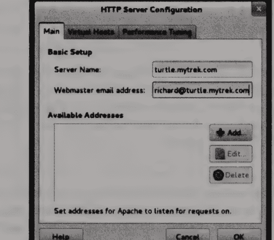

图 8-1：`system-config-httpd`服务器配置

当 Apache 配置工具保存设置时，它将覆盖 Apache 配置文件`/etc/httpd/conf.d.conf`。建议你先对你的`.httpd.conf`文件进行备份复制，以恢复发行版为 Apache 创建的原始设置。如果你已经手动编辑过此文件，将收到一个警告，且 Apache 配置工具将在`/etc/httpd/conf.d.bak`中创建一个备份副本。

“性能调优”标签页设置了连接限制，例如最大连接数和超时时间（见图 8-2）。

## 第 8 章：WEB 服务器

“虚拟主机”标签页是你可以配置特定站点的地方，包括默认站点（见图 8-3）。虚拟主机列在列表中，从默认虚拟主机开始。使用“添加”（Add）按钮添加新主机，使用“编辑”（Edit）按钮修改现有主机。“删除”（delete）按钮可以移除它们。要更改全局设置，点击“编辑默认设置”（Edit Default Settings）按钮。

在“虚拟主机”标签页上，选择“虚拟主机”并点击“编辑”，以设置服务器选项、页面搜索、SSL 支持、日志文件、CGI 环境支持和目录（性能）的默认设置。要添加虚拟主机，点击“添加”按钮进入对话框，你可以在其中输入主机信息，例如虚拟主机主机名和 IP 地址。你可以为虚拟主机选择不同的配置标签页，例如日志文件和目录控制。

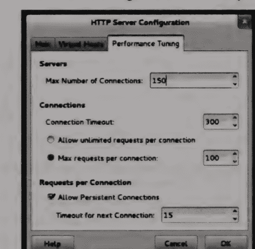

图 8-2：`system-config-httpd`性能调优

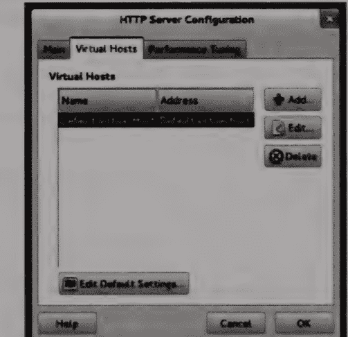

图 8-3：`system-config-httpd`虚拟主机

添加或编辑虚拟主机会打开“虚拟主机属性”窗口，列出五个标签页：常规选项（General Options）、页面选项（Page Options）、SSL、日志（Logging）、环境（Environment）和性能（Performance）（见图 8-4）。

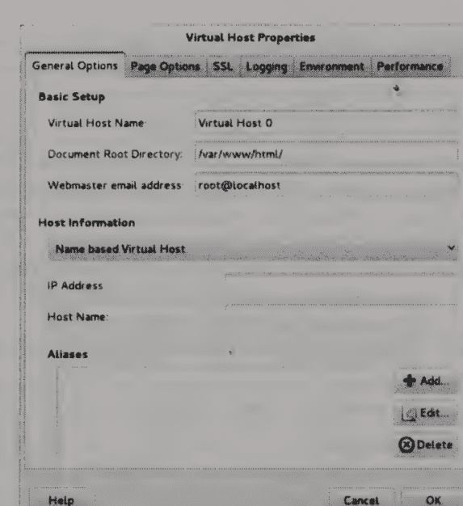

图 8-4：`system-config-httpd`虚拟主机属性，常规选项

在“常规选项”标签页上，你可以指定主机名、其站点目录、管理员以及虚拟主机类型（名称或 IP）。你还可以添加别名。在“页面选项”上，你可以指定要搜索并显示的文件类型。这通常是`index.html`及其任何变体（如`index.htm`）。你也可以指定自己的。

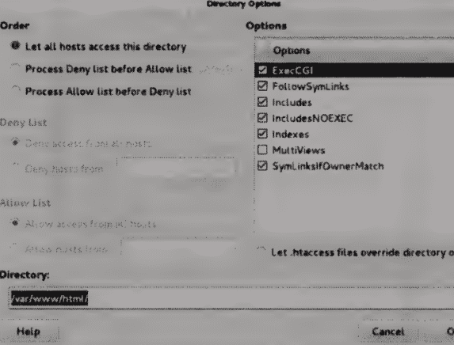

图 8-5：`system-config-httpd`虚拟主机属性 | 性能 | 目录

在“SSL”标签页上，你可以启用 SSL 支持，并指定与 SSL 选项使用的证书。“日志”标签页指定了日志和错误日志。在“环境”标签页上，你可以为你的 CGI 脚本定义环境变量，以及你想要传递给脚本的变量。

“性能”标签页控制目录访问功能（如访问控制）以及如执行 CGI 脚本或跟踪符号链接的能力。该标签页顶部有一个用于编辑默认选项的按钮。这会打开一个列出目录选项的窗口，并勾选已启用的选项。从目录列表中，你可以选择一个特定目录进行编辑。点击“添加”按钮添加新目录。这会打开一个“目录选项”窗口，右侧是可能的选项，左侧是访问控制选项（见图 8-5）。对于“拒绝”（Deny）和“允许”（Allow）列表，你可以选择你自己的文件。

## Apache 配置指令

Apache 配置选项以输入 Apache 配置文件中的指令形式存在。通过这些指令，你可以输入基本配置信息（例如服务器名称），或执行更复杂的操作（例如实现虚拟主机）。该设计足够灵活，允许你为特定目录和不同的虚拟主机定义配置功能。

Apache 有多种指令来执行操作，如控制访问、分配文件图标和创建日志文件。大多数指令设置某些值，例如`DirectoryRoot`（持有服务器 Web 页面的根目录）或`Port`（持有服务器监听请求的端口）。简单指令的语法所示：


某些指令会创建适用于特定服务器组件的块（也称为分段指令）。例如，`Directory` 指令用于定义一个块，你可以在块中放置仅适用于特定目录的指令。块指令成对输入：将一个起始指令和一个终止指令配对。终止指令定义了块的结束，并由相同的名称加一个斜杠组成。块指令接受一个参数。例如，`<Directory>` 块用于定义特定的 Apache 配置。`</Directory>` 终止指令定义了块的结束并具有相同的名称。`<VirtualHost>` 块用于配置虚拟主机。`</VirtualHost>` 结束。`<VirtualHost>` 块允许配置特定的 IP 地址或域名。该块以 `</VirtualHost>` 结束。

```
block-directive
  directive option ...
  directive option ...
</block-directive>
```

Apache 配置文件在 `conf.d` 目录中。`httpd.conf` 是主配置文件。可以使用目录内的 `.htaccess` 文件按目录覆盖主配置文件中的任何指令。虽然 `.htaccess` 文件最初设计仅用于访问指令，但它也可以包含任何资源指令，允许你定制 Web 页面在特定目录中的显示方式。你可以配置对 `.httpd.conf` 文件的访问。

此外，为 Apache 提供的模块都有自己的配置文件。这些文件位于 `/etc/httpd/conf.d` 目录下。

## 第 8 章：WEB 服务器

| 指令 | 说明 |
| --- | --- |
| `ServerToken url-path directory-filename` | 允许访问本地文件系统中文档根目录以外的文档。 |
| `BindAddress sadr` | 将服务器绑定到指定的 IP 地址。若要对列出的地址和端口进行更多控制，请使用 `Listen` 指令。（在 Apache 2.0 中已由 `Listen` 指令取代）。 |
| `<IfDefine parameter-name> ... </IfDefine>` | `<IfDefine test> ...` 区域指定条件指令。如果测试结果为真，则处理 `IfDefine` 区域内的指令，否则忽略。测试由一个参数名称组成，如果该参数已定义则为真，如果未定义则为假。在参数前放置 `!` 会在参数未定义时使测试为真（非）。 |
| `<IfModule module-name> ... </IfModule>` | `<IfModule test> ... </IfModule>` 区域指定条件指令。该测试检查模块是否已编译在 Apache 中。如果存在则为真，不存在则失败。如果模块不存在，则 `module-name` 为真。 |
| `Include filename` | 包含其他配置文件。 |
| `KeepAlive on/off` | 启用连接，“Off”为禁用。 |
| `KeepAliveTimeout seconds` | Apache 在关闭连接之前等待另一个请求的秒数。 |
| `MaxAliveRequests seconds` | 每个连接的最大请求数。 |
| `Listen [IP address:]port number` | 监听多个 IP 地址或端口。默认情况下，它响应来自所有 IP 接口的请求，但仅响应由 `Port` 指令指定的端口。上下文：server conf |
| `ListenBacklog backlog` | 等待处理连接队列的最大长度。 |
| `LoadFile filename filename` | 在服务器启动或重启时，链接到命名的对象文件或库。用于加载某些模块运行所需的额外代码。 |
| `LoadModule module filename` | 链接到对象文件或库文件名，并将模块结构名称添加到活动模块列表中。 |
| `LockFile filename` | Apache 编译时使用的锁文件路径。 |
| `PidFile filename` | 持有服务器进程 ID（PID）的文件。 |
| `ServerRoot directory-filename` | 设置服务器配置、模块、日志和错误文件所在的目录。 |
| `Timeout number` | 设置接收 GET 请求、接收 POST 和 PUT 请求以及 TCP 数据包传输确认的超时秒数。 |

## 表 8-4：全局指令

## 多处理模块 (MPM)

任何额外的事件配置都通过文件末尾的 `IncludeOptional` 指令进行读取，该指令引用了 `conf.d` 目录。这些文件包括用于指定默认页面的 `welcome.conf` 等文件。

```
IncludeOptional conf.d/*.conf
```

### 多处理模块 (MPM)

MPM `prefork`、`worker` 和 `event` 模块允许您根据工作负载需求定制您的 Apache Web 服务器。对于在轻负载下运行的标准 Web 服务器，将设置默认项。您可以根据不同需求修改这些设置。

MPM 模块适用于 Unix 和 Linux 系统：`event`、`prefork` 和 `worker`。`prefork` 模块最简单，支持每个进程一个线程，这保持了与旧系统和模块的兼容性。`worker` 模块为每个进程支持多个线程，从而显著降低了系统资源的负载。新的 `event` 模块在线程之间共享处理，并可用于较新的系统。它基于 `worker` 模块。这些模块共享几个相同的指令，例如 `MaxRequestPerChild`。

模块加载位于 `/etc/httpd/conf.modules` 目录下的 `00-mpm.conf` 文件中。Fedora 默认使用 `prefork` 模块。相应的模块在 `01-cgi.conf` 文件中自动加载。

```
LoadModule mpm prefork modules/mod_mpm_prefork.so
```

要加载 `worker` 或 `event` 模块，请从其项中删除字符 (`#`)，并将 `prefork` 加载模块项设为注释。查看 MPM 文档页面获取更多细节，例如：

```
http://apache.org/docs/2.4/mod/event.html
http://apache.org/docs/2.4/mod/mpm.html
```

Apache 运行一个父进程，并根据需要运行许多子进程来处理请求。MPM 的配置重点在于应该可用进程的数量。`prefork` 模块将列出服务器数量，因为每个服务器都会启动一个进程；`worker` 模块将控制线程，因为它为每个进程都使用线程。`StartServers` 指令列出了两个模块需要启动的服务器进程数量。通常情况下，`prefork` 的值比 `worker` 模块大。

对于 `prefork` 模块，您可以为空闲服务器设置最小和最大值。`MaxRequestsWorkers` 设置允许启动的服务器最大数量，`ServerLimit` 设置允许的服务器数量。`MaxConnectionsPerChild` 设置了服务器允许的最大连接数。

对于 `worker` 模块，`MaxRequestsWorkers` 也设置了客户端线程的最大数量，`ThreadsPerChild` 设置了每个服务器的线程数。`MaxConnectionsPerChild` 限制了服务器的最大请求数。配置了空闲线程限制。

`event` 模块基于 `worker` 模块，使用相同的指令。它添加了 `AsyncRequestWorkerFactor` 指令来限制每个进程的连接数。

## 第二部分：互联网服务器

| MPM Prefork 指令 | 说明 |
|---|---|
| `StartServers` | 启动的服务器进程数 |
| `MinSpareServers` | 最小空闲服务器 |
| `MaxSpareServers` | 最大空闲服务器 |
| `ServerLimit` | 允许的最大服务器数 |
| `MaxRequestsWorkers` | 最大启动服务器数 |
| `MaxConnectionsPerChild` | 每个服务器允许的最大请求数 |

| MPM worker and event 指令 | |
|---|---|
| `StartServers` | 启动的服务器进程数 |
| `MaxRequestsWorkers` | 最大客户端数 |
| `MinSpareThreads` | 最小空闲线程 |
| `MaxSpareThreads` | 最小空闲线程（注：此处原文应为最大） |
| `ThreadsPerChild` | 每个服务器进程的线程数 |
| `MaxConnectionsPerChild` | 服务器的最大请求数 |
| `AsyncRequestWorkerFactor` | 控制每个进程的连接数（仅限 `event`） |

**表 8-5：** MPM Prefork、Worker 和 Event 指令

## 服务器配置

某些指令用于配置服务器的整体运行。这些指令放置在 `httpd.conf` 配置文件的中间，直接位于标记为 Server Settings 的部分（参见 8-6）。某些指令需要路径名，而另一些指令只需要用 `on` 和 `off` 关键字开启或关闭。默认的 `httpd.conf` 文件已经包含了这些指令。有些指令用 `#` 符号注释掉了。您可以通过删除 `#` 号来激活指令。许多条目之前都有解释其用途的注释。

以下是 `ServerAdmin` 指令的示例，用于设置用户可以向其发送有关管理问题邮件的地址。您将 `you@address` 条目替换为您想要接收系统管理邮件的地址。默认情况下，设置为 `root@localhost`。

```
# ServerAdmin: Your address, where problems should be e-mailed.
ServerAdmin root@localhost
```

`ServerName` 指令持有您的 Web 服务器的主机名。指定主机名对于避免可能保护服务器的必要的 DNS 查找失败非常重要。注意该项前面有 `#` 注释。只需删除 `#` 并用您的 Web 服务器的主机名替换 `new.host.name`。如果您使用的端口不是 80，请确保将其附加到主机名上进行指定，例如 `turtle.mytrek.com`。这里是原始的默认项：

```
# ServerName gives the name and port that the server uses to identify itself.
# This can be determined automatically, but we recommend you specify
# it explicitly to prevent problems during startup.
#ServerName www.example.com:80
```

修改后的 `ServerName` 项看起来如下所示：

```
ServerName turtle.mytrek.com.
```

在接收服务器系统的 URL 请求时（例如针对系统上的本地文件的请求），`UseCanonical` 指令将使用 `ServerName` 生成主机 URL。当设置为 `off` 时，它将使用客户端提供的名称。这可能会导致 Web 服务器通过一个名称引用但使用其他名称产生混淆，例如通过 `www.mytrek.com` 使用 `turtle.mytrek.com`。将 `UseCanonical` 设置为 `on` 可以解决这个问题。

在 Fedora 系统上，已经为标准的 Web 安装制作了条目，使用 `/var/www` 作为您的站点目录。您可以通过更改相应的指令来根据自己的需求定制 Web 站点。`DocumentRoot` 决定了 Web 页面的根目录。

```
"var/www/html"
```

`EnableSendfile` 和 `EnableMMAP` 指令（位于 `httpd.conf` 文件的末尾）增强了服务器性能。`EnableSendfile` 允许系统执行文件传输。如果您的系统支持，`EnableMMAP` 为传输的文件启用内存映射。

```
#EnableMMAP off
EnableSendfile on
```

## 第 8 章：WEB 服务器

| 指令 | 说明 |
| :--- | :--- |
| `Group unix-group` | 设置服务器的组。独立运行的服务器必须以 `root` 身份运行。建议您专门为运行服务器设置一个新组。 |
| `HostNameLookups off` \| `double` | 启用 DNS 查询以便记录主机名。`double` 指双重反向 DNS 查询。 |
| `LoadFile filename ...` | 在服务器启动或重启时链接到命名的对象文件或库。用于加载某些模块运行所需的额外代码。 |
| `Port number` | 如果存在 `Listen` 或 `BindAddress` 指令，则 `port` 指令设置服务器监听的网络端口。虚拟主机的端口由 `VirtualHost` 指令设置。 |
| `ServerAdmin e-mail-address` | 服务器管理员的电子邮件地址。 |
| `ServerAlias host1 host2` | 设置主机的备用名称，与基于名称虚拟主机配合。 |
| `ServerName fully qualified domain name` | 设置服务器的主机名。仅在创建重定向 URL 时使用。如果没有指定，服务器将尝试从其自身的 IP 地址推断。 |
| `ServerPath pathname` | 设置主机的旧版 URL 路径，与基于名称虚拟主机配合。 |
| `ServerSignature Off` \| `Email` | 在服务器生成的文档（如错误消息）下方配置尾脚行。 |
| `SetHandler handler-name` | 强制所有映射文件通过由 `handler-name` 提供的处理器。 |
| `User unix-userid` | 指定服务器的用户 ID。独立运行的服务器必须必须以 `root` 身份运行。可以使用用户名或用户 ID 数字。该用户不应具有访问系统文件的权限。建议您专门为运行服务器设置一个新用户和组。 |
| `UserDir directory/filename` | 当接收到用户文档请求时，设置用户主目录下的实际目录。 |
| `Redirect [ status ] url-path url` | 将旧 URL 映射到新 URL。 |
| `ScoreBoardFile filename` | 指定 ScoreBoard 文件。 |

## 表 8-6：服务器指令

注意：您还可以配置 Apache 仅作为代理和/或缓存服务器运行。默认代理和缓存服务器指令已包含在 `httpd.conf` 文件中。`ProxyRequests` 指令开启代理活动。可以使用 `CacheRoot` 等指令配置缓存，以指定缓存目录。

## 第 2 部分：互联网服务器

缓存的 `CachSize`（默认 500KB），`CacheMaxExpire` 用于设置未修改文档的时间限制。

## 访问控制

通过访问控制 `require`，您可以控制用户和主机对您的网站的访问（见表 8-7）。在 Apache 2.4 中，`require` 指令取代了 Apache 2.2 中的 `allow-allow`、`order`、`deny` 和 `satisfy`。它由 `mod_authz_host` 模块实现。可以授予或拒绝访问。`All` 术语指所有主机。`require` 指令可以全局用于控制整个网站的访问，也可以放置在 `Directory` 指令中。在以下示例中，允许所有用户访问：

```
require all granted
```

`require` 指令对用户进行身份验证。验证可以是所有用户（`all`）、特定用户（`user`）、组（`group`）、用户主机的域名（`host`）、主机的 IP 地址（`ip`），甚至是表达式（`expr`）、HTTP 方法（`method`）或环境变量（`env`）。在大多数情况下，它用于确定所有用户（`all`）或来自指定主机（`host` 或 `ip`）的访问。

## 目录级配置

Apache 的灵活性方面之一是它可以配置单个目录。通过 `Directory` 指令，您可以定义一个仅适用于特定目录的指令块（此类指令可以放置在 `httpd.conf` 配置文件中）。您也可以在特定目录内使用 `.htaccess` 文件来存放配置指令。这些指令随后仅应用于该目录。名称通过 `AccessFileName` 指令设置。如果您需要，可以更改它。

```
AccessFileName .htaccess
```

`Directory` 块以 `<Directory pathname>` 指令开始，其中 `pathname` 是要配置的目录。结束指令使用 `<>` 符号，并在 "Directory" 单词前加一个斜杠：`</Directory>`。放置在此块内的指令仅适用于指定的目录。`httpd.conf` 文件中定义了一个限制性的默认 `Directory` 指令。

```
<Directory /
AllowOverride None
Require all denied
</Directory>
```

允许访问 `/var/www` 下 Web 服务器内容。

```
<Directory "/var/www">
AllowOverride None
# 允许开放访问：
Require all granted
</Directory>
```

然后为 Web 目录 `/var/www/html` 定义目录块。这是所有网站文件所在的位置。`Require all granted` 指令将允许任何人访问这些文件。

| 指令 | 说明 |
| :--- | :--- |
| `require user-authentication` | 对访问给定目录或站点的用户进行身份验证。验证可以是所有用户（`all`）、用户（`user`）、组（`group`）、域名（`host`）、IP 地址（`ip`），甚至是表达式、HTTP 方法或环境变量。 |
| `require host hosts` | 确定可以访问给定目录的主机（域名）。 |
| `require ip addresses` | 确定可以访问给定目录的主机（IP 地址）。 |
| `require all granted` | 授予所有主机访问权限 |
| `require all denied` | 拒绝所有主机的访问 |


# 访问控制指令

## `<Files>` 指令

```
<Files filename> ... </Files>
```

通过文件名提供访问控制支持。与 `<Directory>` 指令和 `<Location>` 指令类似。`<Files>` 部分按照它们在配置文件中出现的顺序进行处理，在 `.htaccess` 部分被处理和读取之后，在 `<Location>` 部分之前处理。`<Files>` 可以嵌套在 `<Directory>` 内部，以限制其所应用的文件系统部分。

## `<FilesMatch>` 指令

```
<FilesMatch regex> ... </FilesMatch>
```

通过文件名提供访问控制支持，类似于 `<Files>` 指令，但使用正则表达式。

## `<Limit>` 指令

```
<Limit method> ... </Limit>
```

`<Limit>` 和 `<LimitExcept>` 指定了一组访问控制指令，仅适用于指定的访问方法（任何有效的 HTTP 方法）。出现在 `<Limit>` 指令之外的访问控制指令适用于所有方法。方法名为 `GET`、`POST`、`PUT`、`DELETE`、`CONNECT` 和 `OPTIONS`。

## `<LimitExcept>` 指令

```
<LimitExcept method> ... </LimitExcept>
```

`<Limit>` 和 `<LimitExcept>` 指定了一组访问控制指令，这些指令随后适用于任何未在参数中列出的 HTTP 访问方法。

## `<Location>` 指令

```
<Location URL> ... </Location>
```

`<Location>` 指令为通过 URL 直接访问控制支持。与 `<Directory>` 指令类似。

## `<LocationMatch>` 指令

```
<LocationMatch regex> ... </LocationMatch>
```

通过 URL 提供访问控制，方式与 `<Location>` 相同，使用正则表达式。

## `LimitRequestBody` 指令

```
LimitRequestBody number
```

限制 HTTP 请求体的大小。

## 表 8-7：访问控制指令

您还可以为特定目录设置指令。以下示例允许来自 `www.com` 的请求访问 `mypics` 目录。

```
<Directory "/var/www/html/mypics">
Require host www.com
</Directory>
```

为了拒绝 Web 客户端访问 `.htaccess` 文件，定义了一个 `Files` 块，使用访问控制指令 `Require all denied` 拒绝所有用户。`Files` 指令引用以 `.ht` 开头的任何文件（带引号）。`</Files>` 条目结束任何 `<Files>` 块。

```
<Files ~ ".ht*
  Require all denied
</Files>
```

| 指令 | 说明 |
| :--- | :--- |
| `AccessFileName filename` | 目录内的默认文件名。 |
| `<Directory directory> ... </Directory>` | `<Directory>` 和 `</Directory>` 指令作为标签，封装仅适用于指定目录及其子目录的指令组。 |
| `<DirectoryMatch regex> ... </DirectoryMatch>` | `<DirectoryMatch>` 和 `</Directory>` 封装仅适用于指定目录的指令组。它的操作方式与 `<Directory>` 相同，但接收正则表达式作为参数。 |
| `DirectoryIndex local-url` | 当客户端请求目录索引时（通过在目录末尾指定 `index.html`），指定要查找的资源列表。 |
| `Options [+]-option[ option` | 控制特定目录可用的服务器功能。`OPTIONS` 如果设置为 `none`，则不启用任何额外功能。`All` 除 `MultiViews` 之外的所有选项。这是默认设置。`ExecCGI` 允许执行 CGI 脚本。`FollowSymLinks` 服务器跟踪此目录下的符号链接。`Includes` 允许服务器端包含。`IncludesNOEXEC` 允许服务器端包含，但禁用了 `#exec` 命令和 `#include` CGI 脚本。`Indexes` 对于没有 `DirectoryIndex` 的目录返回格式化的目录列表。`MultiViews` 允许内容协商。`SymLinksOwnerMatch` 服务器仅跟踪目标文件或目录与链接用户 ID 相同的符号链接。 |
| `AllowOverride override` | 可被 `.htaccess` 文件条目覆盖的指令。`All` 允许所有覆盖，`none` 拒绝。默认：`AllowOverrideAll` 上下文：目录 |

## 表 8-8：目录指令

通过 `Options`，可以设置特定目录的功能，例如符号链接、自动索引、执行 CGI 脚本和内容协商。

# 第 8 章：WEB 服务器

以下示例启用了自动索引（`Indexes`）、符号链接（`FollowSymLinks`）和内容协商（`Multiview`）。

```
Options Indexes FollowSymLinks Multiview
```

在主配置文件或上级目录中通过指令进行的配置会被下级目录继承。存储在 `.htaccess` 文件和 `Directory` 块中的特定目录指令可以允许覆盖这些配置。这种能力可以通过 `AllowOverride` 指令进行控制。使用 `all` 参数，`.htaccess` 文件可以覆盖之前的任何配置。使用 `none` 参数禁止覆盖，实际上禁用了 `.htaccess` 文件。你可以进一步控制特定组的覆盖。`AuthConfig` 启用授权指令，`FileInfo` 用于类型指令，`Index` 用于索引指令，`Limit` 用于访问控制指令，而 `Options` 用于选项指令。

```
AllowOverride all
```

当给定目录的 URL 而不是 HTML 文件，且目录中没有默认页面时，Apache 会动态创建一个页面并显示。这通常只是目录中不同文件的列表。Apache 会索引目录中的项目。你可以使用 `IndexOptions` 为生成和显示索引设置多个选项。使用 `FancyIndexing` 时，页面项目将带有图标和用于排序列表的颜色头部显示。使用 `VersionSort` 时，项目将按字母和数字排序。`NameWidth` 设置列宽，使用 `*` 值设置所需的宽度。`Charset` 设置字符集，请使用 UTF-8。完整选项列表请参见 `http://http.apache.org/docs/2.2/mod_autoindex.html#indexoptions`

```
IndexOptions FancyIndexing VersionSort NameWidth=* TableCharset=UTF-8
```

# URL 路径

某些指令可以修改或完成访问你网站的 URL 的路径段。URL 的路径段指定了网站上的特定目录或 Web 页面。指令允许你重定向路径，并选择默认 Web 页面。通过 `Alias` 指令，你可以访问位于系统其他部分、其他文件系统或 Web 网站上的资源。别名可以使用互联网网站的 URL，而不是系统目录的路径名。通过 `Redirect` 指令，你可以将用户重定向到另一个站点。这些指令要求加载 `alias_module`。

```
Alias /mytrain /home/dylan/trainproj
Redirect /mycars http://www.mycars.com
```

如果给 Apache 的一个目录而不是特定的 Web 页面进行访问，它会查找该目录下的索引 Web 页面并显示它。默认页面的名称由 `DirectoryIndex` 指令列出。使用的名称是 `index.html`，但你可以添加其他的。标准名称在此显示。当给 Apache 的一个 Web 目录进行访问时，它会查找并显示其中的 `index.html` 页面。

```
DirectoryIndex index.html shtindex.cgi
```

`DirectoryIndex` 指令取决于 `dir_module` 是否加载。

```
<IfModule dir_module
DirectoryIndex index.html
</IfModule>
```

Apache 还允许你在用户主目录的特殊子目录中维护 Web 页面，而不是在主网站目录中。使用 `~` 后跟用户名可以访问此目录。该目录名称通过 `UserDir` 指令指定。默认名称为 `public_html`，所示。站点 `turtle.mytrek.com/~dylan` 访问主机 `turtle.mytrek.com` 上的目录 `turtle.mytrek.com/dylan/public_html`。

```
UserDir public html
```

如果你想允许完整路径名，请使用路径引用。例如，对于用户 `dylan`，`/usr/www` 将翻译为 URL `/usr/www/dylan`，即 HTML 文件所在的位置；`/home/*` 将翻译为 `/home/dylan/www`，即用户 `dylan` 主目录下的一个目录。

```
UserDir /usr/www
UserDir /home/*
```

标准配置文件中 `Userdir` 默认被注释掉的。通常会有像 `root` 这样你想要拒绝访问的用户。通过 `disable` 和 `enable` 选项，你可以开放某些用户的访问，同时禁用其他用户的访问，所示：

```
UserDir disable root
UserDir disabled
UserDir enabled dylan chris just
```

# CGI 目录

通用网关接口 (CGI) 文件是由访问你网站的 Web 浏览器执行的程序。CGI 文件通常由 Web 页面启动，作为显示内容的一部分执行程序（见表 8-9）。传统上，CGI 程序被放在名为 `cgi-bin` 的目录中，并且只有当它们位于此类特殊目录时才能被执行。通常每个网站只存在一个 `cgi-bin` 目录。发行版通常会在默认 Web 服务器目录中设置一个 `cgi-bin` 目录（Fedora 上的 `/var/www/cgi/`）。在这里，你放置任何可以在你的网站上执行的 CGI 程序。`ScriptAlias` 指令为你的 `cgi-bin` 目录指定一个别名。

```
ScriptAlias /cgi-bin/ /var/www/cgi-bin/
```

随后对 `cgi-bin` 目录进行控制。

```
<Directory /var/www/cgi-bin>
AllowOverride None
Options None
Require all granted
</Directory>
```

# MIME 类型

当浏览器访问站点上的 Web 页面时，它通常在访问许多不同类型的对象，包括 HTML 文件、图片或声音文件以及脚本文件。为了正确显示这些对象，浏览器必须拥有关于它们是何种对象的指示。JPEG 图片文件的处理方式与简单的文本文件不同。服务器以 MIME 的形式提供这种类型信息。MIME 类型与通过 Pine 等互联网邮件收发器发送附件时使用的类型相同。每种对象都与给定的 MIME 类型关联。提供了 MIME 类型，浏览器就能正确处理并显示该对象。

```
TypesConfig /etc/mime.types
```

| 指令 | 描述 |
|---|---|
| `Action action cgi-script` | 添加一个操作，当请求触发 `action-type` 时，激活 `cgi-script`。 |
| `AddHandler handler-name extension ...` | 将文件名扩展名映射到处理器名称。 |
| `RemoveHandler extension ...` | 移除给定扩展文件的处理器关联。 |
| `ScriptMethod cgi-script` | 添加一个操作，激活 CGI 脚本。 |
| `ScriptAlias url-path` | 标记包含 CGI 脚本的目标目录。 |
| `ScriptInterpreter 'registry' or 'script'` | 寻找运行 CGI 脚本的解释器 |

表 8-9：CGI 指令

`AddDefaultCharset` 指令指定默认字符集。

```
AddDefaultCharset UTF-8
```

MIME 类型魔术使用来自文件内容的提示来确定其类型。提示定义列在 `/http/conf/magic` 文件中，该文件包含动画、TeX、MS Word、XML、音频文件和压缩文件的提示。

```
<IfModule mod_mime_magic.c>
  # MIMEMagicFile /usr/share/magic
MIMEMagicFile conf/magic
</IfModule>
```

其他指令用于指定对某些文档采取的操作。`AddEncoding` 允许浏览器动态解压缩压缩文件。`AddHandler` 将文件扩展名映射到操作，`AddLanguage` 允许你指定文档的语言。以下示例将 `.gz` 扩展名的文件名映射为 gzip 编码文件，将 `.fr` 文件映射为法语：

```
AddEncoding x-gzip .gz .tgz
AddLanguage fr .fr
```

# 第二部分：互联网服务器

Web 服务器可以显示并执行许多类型的文件和程序。然而，并非所有的 Web 浏览器都能显示所有文件。旧浏览器限制最多。某些浏览器（如 Lynx）并非旨在显示图形。为了允许 Web 浏览器显示页面，服务器会显示它。这通常只是目录中不同文件的列表。实际上，Apache 为你索引目录中的项目。你可以使用 `IndexOptions` 为生成和显示此类索引设置多个选项。Index 指令列在表 8-10 中。如果开启 `FancyIndexing`，页面项目将带有图标和用于排序列表的头部显示。

```
FancyIndexing on
```

| 指令 | 描述 |
|---|---|
| `AddDescription string file ...` | 为文件设置描述。可以是文件扩展 |

# 自动目录索引

当给定目录的 URL 而不是 HTML 文件，且目录中没有默认页面时，Apache 会动态创建一个页面并显示。这通常只是目录中不同文件的列表。Apache 会索引目录中的项目。你可以使用 `IndexOptions` 为生成和显示索引设置多个选项。使用 `FancyIndexing` 时，页面项目将带有图标和用于排序列表的颜色头部显示。使用 `VersionSort` 时，项目将按字母和数字排序。`NameWidth` 设置列宽，使用 `*` 值设置所需的宽度。`Charset` 设置字符集，请使用 UTF-8。完整选项列表请参见 `http://http.apache.org/docs/2.2/mod_autoindex.html#indexoptions`

```
IndexOptions FancyIndexing VersionSort NameWidth=* TableCharset=UTF-8
```

# 表 8-10：索引指令

`Icon` 指令告诉 Apache 为特定类型的文件显示什么图标。`AddIconByType` 和 `AddIconByEncoding` 指令使用 MIME 类型信息确定文件类型并与其关联的图像。`Addicon` 使用文件的扩展名来确定其类型。通过 `IndexOptions` 指令，你可以为生成的索引设置不同的选项。存在用于设置图标和文件名高度与宽度的选项。`IconsLinks` 选项将文件名作为锚点的一部分。`ScanHTMLTitles` 选项读取 HTML 文档中的标题，并使用这些标题在文件名列表中显示条目。存在多种选项可以抑制不同的索引显示功能，如排序、描述以及头部/readme 插入。

# 身份验证

你的 Web 服务器还可以根据每个用户或每个组，控制对网站上特定目录的访问。你可以要求不同级别的身份验证。访问可以限制为特定用户并要求密码，或者扩展到允许组组员访问。你可以完全不使用密码，或者设置类似于 FTP 那样的匿名访问类型。

要对特定目录应用身份验证，你需要在 `Directory` 块内或该目录的 `.htaccess` 文件中放置指令。你使用 `require` 指令来确定哪些用户可以访问该目录。你可以列出特定的用户或组。`AuthName` 指令为用户提供身份验证领域（realm），即用于识别此身份验证过程访问的特定资源集的名称。`AuthType` 指令指定身份验证类型，如基本（basic）或摘要（digest）。`require` 指令也允许指定 `AuthType`、`AuthName` 以及指定组和用户身份验证文件位置的指令。在以下示例中，仅用户 `george`、`robert` 和 `mark` 被允许访问 `newpics` 目录：

```
<Directory /var/www/newpics
  AuthType Basic
  AuthName Newpics
  AuthUser /web/users
  AuthGroup /web/groups
  <Limit GET>
    require user george robert mark
  </Limit>
</Directory>
```

要为目录设置匿名访问，在目录的 `Directory` 块或 `.htaccess` 文件中放置 `Anonymous` 指令并将用户作为其参数。你也可以使用 `Anonymous` 指令为特定用户提供访问，而无需其密码。

Apache 维护自己的用户和组身份验证文件，指定哪些用户和组允许访问目录。这些通常是简单的平文件，随着它们变大，可能会减慢身份验证查找。作为替代，许多站点使用数据库管理文件来代替这些平文件。然后使用数据库方法访问文件，以提供更快的响应。Apache 有相应的指令来指定身份验证文件，取决于你使用的文件类型。`AuthUser` 和 `AuthGroup` 指令用于指定具有标准平格式的身份验证文件的位置。


`hhtidpass`、`htpasswd` 和 `dbmanage` 是 Apache 软件包提供的工具，用于创建和维护用户身份验证文件，这些文件是用户密码文件，列出了有权访问网站特定目录或资源的的用户。`hhtid` 和 `htpasswd` 程序管理简单的用户身份验证记录平文件，而 `dbmanage` 使用更复杂的数据库管理格式。如果你的用户列表很大，你可能想使用数据库文件进行快速查找。`hdigest` 将身份验证文件、领域和用户名作为参数，创建或更新用户条目。`httppasswd` 还可以对密码进行加密。`dbmanage` 拥有大量的选项来添加、删除和更新用户条目。使用不同的数据库格式来设置此类文件。其中三个是 Berkeley DB2、NDBM 和 GNU GBDM。`dbmanage` 按照该顺序使用系统库处理这些格式。请注意在使用身份验证文件时使用相同的格式以保持一致。

## 用户主目录中的用户站点：UserDir

Apache 支持使用位于主目录的 html 文件在服务器上基于用户的站点。这些用户设置在 Apache 服务器宿主机上。你使用 `~` 配合用户名来选择你的用户站点。以下是对 `www.turtle.com` 站点上用户站点的访问。

```
www.turtle.com/~robert
```

在用户主目录中设置了一个 `public_html` 目录，用于存放该用户站点的 html 文件。`public_html` 目录必须启用执行权限，以允许所有用户访问。所有用户也将允许访问用户主目录。

```
chmod a+x public_html
chmod a+x /home/robert
```

用户的站点将位于 `/home/robert/public_html`。

为了让 Apache 支持主目录中的站点，你需要在 `/etc/httpd/httpd.conf` 文件中启用 `UserDir` 指令。`UserDir` 默认是禁用的。在其目下方提供了一个被注释的启用版本。你可以简单地移除或注释掉启用项中的符号 (`#`)。通过列出用于 Web 目录的名称来启用 `UserDir`。默认目录是 `public_html`。

```
UserDir public_html
```

如果启用了 SELinux，你还必须允许 Web 服务器访问你的用户文件。这些文件是以用户安全上下文创建的本地文件。你必须将你的 Web 文件上下文的安全类型更改为 `httpd_sys_content_t`。这与 `/var/www` 中 Web html 文件使用的上下文相同。要进行持久更改，请使用带有 `-a` 参数的 `fconext` 命令。对目录和名称添加正则表达式 `(/*)`，如果该目录下已有一些 Web 文件，它将保持安静。如果目录是空的，你不需要它。

```
fconext -a -t httpd_sys_content_t "/home/robert/public_html(/.*)"
restore -R /home/robert/public_html
```

如果你想进行临时更改，可以使用 `chcon`。如果系统放宽或恢复上下文，此更改将丢失。

```
chcon -Rt httpd_sys_content_t public_html
```

`httpd.conf` 文件还包含你可以使用的注释代码，通过将 Web 目录设为只读来保护它们。`public_html` 目录上的 `Directory` 指令使用带有 `order` 和 `allow` 选项的 `Limit` 指令来控制访问。

## 日志文件

Apache 维护用户对你的 Web 站点的所有请求日志。默认，这些日志使用常用日志格式 (CLF) 记录。每个请求的记录由由多个字段组成的行：主机、身份检查、已验证的用户（用于登录）、日期、客户端提交的请求行、给客户端的状态以及以字节为单位发送的对象大小（见表 8-11）。

| 指令 | 描述 |
| --- | --- |
| `CustomLog file-pipe format-[nickname]` | 创建具有指定格式的新日志文件。 |
| `ErrorDocument error-code document` | 重定向到本地或外部 URL 以处理问题/错误。 |
| `ErrorLog filename[syslog:facility]` | 服务器记录错误的文件。 |
| `LogFormat [nickname]` | 设置由 `TransferLog` 指令命名的默认日志文件的格式。默认：`LogFormat "%h %l %u %t \"%r\" %s %b"` |
| `TransferLog file-pipe` | 按最近的 `LogFormat` 指令定义的格式添加日志文件。 |
| `LogLevel level` | 调整错误日志中记录的消息的详细程度。 |

**表 8-11：** 日志指令

## Webalizer

可以使用 Webalizer 工具生成 Web 日志报告。Weblisher 将提供有关你的 Web 站点使用的信息。当你运行 `Webalizer` 命令时，使用报告将被放在 `/var/www/html/usage/` 目录下。访问索引页将显示包含每月报告链接的页面；`file:/var/www/html/usage/index.html`。报告配置指定在 `/etc/webalizer.conf` 文件中。之前的摘要在 `/etc/webalizer.history` 文件中缓存。Apache Apache 配置位于 `conf.d` 目录下的 `webalizer.conf` 文件。

## 错误日志和日志级别

`httpd.conf` 文件包含了配置你的日志文件的配置指令。`ErrorLog` 指令指定用于保存错误信息的日志文件。每个虚拟主机可以有自己的错误日志。

```
ErrorLog "logs/error_log"
```

`LogLevel` 指令控制保存到错误日志中的消息数量。选项范围从 `debug`、`info`、`notice`、`warn`、`error`、`crit`、`alert`、`emerg`；按从大到小排列。默认值是 `warn`。

```
LogLevel warn
```

# 格式化日志

使用 `LogFormat` 和 `CustomLog` 指令，你可以格式化日志记录以添加具有不同详细程度的字段。它们依赖于 `log_config_module` 的加载。

```
<IfModule log_config_module>
```

这些指令使用一个由字段说明符组成的格式字符串，来确定在日志记录中记录的字段。你可以按任何顺序添加字段。一个字段由百分号 (`%`) 符号后跟一个标识字符组成。例如，`%h` 是远程主机的字段说明符，`%b` 是以字节为单位的大小，`%s` 是状态码（见表 8-12）。完整列表请参阅 `log_config` 模块的文档。

| 字段说明符 | 描述 |
| --- | --- |
| `%a` | 远程 IP 地址 |
| `%A` | 本地 IP 地址 |
| `%b` | 发送的字节数，不包括 HTTP 头部 |
| `%(variable)` | 环境变量的内容 |
| `%(variable)` | 发送到服务器的请求头部行 |
| `%f` | 文件名 |
| `%h` | 远程主机 |
| `%l` | 远程日志名（来自 `identd`，如果已提供） |
| `%m` | 请求方法 |
| `%P` | 服务请求的子进程 ID |
| `%r` | 请求的第一行 |
| `%s` | 状态 |
| `%t` | 时间，常用日志格式时间（标准英语格式） |
| `%u` | 远程用户（来自 `auth`）；如果返回状态 [`%s`] 为 401，则可能是虚假的 |
| `%U` | 请求的 URL 路径 |
| `%v` | 提供请求服务的服务器的规范 `ServerName` |

表 8-12：Apache 日志字段说明符

你应对内容可能包含多个一个单词的字段加引号。引号必须使用反斜杠转义以便包含在格式字符串中。以下示例是作为 `LogFormat` 指令实现的常用日志格式（Common Log Format）：

```
LogFormat "%%h %l %u %t \%r\" %>s %b" common
```

# 第 8 章：WEB 服务器

日志格式中的某些字段符可以被限定以记录特定信息。`%i` 说明符记录服务器接收到的请求中的头部行。要记录的特定头部行的引用放置在 `%` 和字段说明符的大括号内。例如，`User-agent` 是标识请求中所用浏览器软件的头部行。要记录 `User-agent` 头部信息，使用转换说明符 `%{User-age}`。

```
LogFormat "%{Referer} -> %s" referer
LogFormat "%%{User-agent}i" agent in
```

为了保持与 NCSA 服务器的兼容性，Apache 最初实现了 `AgentLog` 和 `ReferLog` 指令，后来这些已被用于 `LogFormat` 和 `CustomLog` 指令的限定 `%h` 字段说明符所取代。`Referrer` 头部记录来自客户端的链接信息，客户端可能链接到你的站点。以下是组合后的 NCSA 兼容日志格式：

```
LogFormat "%h %l %u \%r" %s %b\%{Referer}i\" \%{User-agent}i\" combined
```

如果你想记录每个请求的字节数，请使用 `log_module` 并使用 `%I` `%O` 字段说明符分别代表输入和输出。

```
<IfModule log_module>
  # 需要启用 mod log.c 来使用 %I 和 %O
  LogFormat "%h %l %u \%r" %s %b\%{Referer}i\" \%{User-agent}i\" %I %O" decombinedo
</IfModule>
```

注意：Apache Web 服务器还可以提供服务器活动和配置的详细报告，并将此信息发送到远程服务器。`Location server-info` 将显示你的 Web 服务器的配置详情，`server-status` 指令将显示 Web 进程。`server-info` 和 `server-status` 页面将显示报告，如 `http://localhost/server-info`。使用 `ExtendedStatus` 指令启用详细报告。

# 生成和管理日志文件

与其维护一个大型日志文件，不如使用 `CustomLog` 或 `TransferLog` 创建多个日志文件。对于虚拟主机很有帮助，你可能希望为每个主机维护单独的日志文件。使用 `LogFormat` 定义日志记录的默认格式。`TransferLog` 指令在创建新日志文件时将使用此格式。`CustomLog` 结合了这两项操作，允许你创建一个新文件并为其定义格式。

```
LogFormat "%h %l %u \%r" %s %b myprojlog format
# 使用 myprojlog 格式创建一个新日志文件
TransferLog myprojlog
# 使用自己的格式创建一个名为 mycustomlog 的日志文件
CustomLog mycustomlog "%h %l %u \%r" %s %b"
```

你可以先用 `LogFormat` 定义格式，然后使用 `CustomLog` 指定要使用的日志文件。默认情况下，`http.conf` 文件定义了组合格式，并使用它将日志保存到 `logs/access_log` 文件。

```
LogFormat "%h %l %u \%r" %s %b\%{Referer}i\" \%{User-agent}i\" combined
CustomLog logs/access_log combined
```

使用上例，首先定义 `myslog` 格式，然后保存到 `/pyslog` 文件。

```
LogFormat "%h %l %u \%r" %s %b" myslog
CustomLog log/pyslog myslog
```

Apache 提供了两个处理和管理日志文件的工具：`log`。

# 动态虚拟主机

如果你在服务器上实现了许多具有相同配置的虚拟主机，你可以使用一种动态虚拟主机技术让这些主机动态生成。实现你虚拟主机的代码要小得多，且

## 第 2 部分：互联网服务器

结果是你的服务器访问速度更快。添加更多虚拟主机变得变成创建适当目录并在 DNS 服务器中添加相应条目的简单易事。

要实现动态虚拟托管，服务器使用 `mod_vhost_alias` 模块中的命令将服务器名称和文档根都重写为适当的虚拟服务器。无论哪种情况，它可以是基于名称或基于 IP 的。你必须以特定的方式使用 `UseCanonicalName`，允许服务器使用服务器自身名称的虚拟主机名。对于基于名称的托管，你只需关闭 `UseCanonicalName`。这允许你的服务器从用户请求的主机头中获取主机名。对于基于 IP 的托管，你将 `UseCanonicalName` 指令设置为 `DNS`。这允许服务器在 DNS 服务器中查找该主机。

```
UseCanonicalName Off
UseCanonicalName DNS
```

然后，你必须允许服务器定位你虚拟主机的不同文档根目录和 CGI 二进制文件。使用 `VirtualDocumentRoot` 指令来指定虚拟主机目录的模板。例如，如果你将不同的主机目录放在 `/var/www/hosts/` 中，可以相应地设置 `VirtualDocumentRoot` 指令。

```
VirtualDocumentRoot /var/www/hosts/%0/html
```

当该主机被访问时，`%0` 将替换为虚拟机的名称。例如，对于名为 `www.mysql.org` 的动态虚拟主机，你首先创建一个名为 `/var/www/hosts/www.mysql.org` 的目录，为文档根和 CGI 程序创建子目录，位于 `/var/www/hosts/www.mysql.org/html`。对于 CGI 目录，使用 `VirtualScriptAlias` 指令来指定 CGI 子目录。

```
VirtualScriptAlias /var/www/hosts/%0/cgi-bin
```

以下是基于名称的动态虚拟托管指令的简单示例：

```
UseCanonicalName Off
VirtualDocumentRoot /var/www/hosts/%0/html
VirtualScriptAlias /var/www/hosts/%0/cgi-bin
```

对 `www.mysql.com/html/mypage` 的请求将评估为

`/var/www/hosts/www.mysql.com/html/mypage`

这里显示了一个动态虚拟托管的简单示例：

```
UseCanonicalName Off
<VirtualHost 192.168.1.5>
ServerName www.mysql.com
ServerAdmin webmaster@mail.mysql.com
VirtualDocumentRoot /var/www/hosts/%0/html
VirtualScriptAlias /var/www/hosts/%0/cgi-bin
</VirtualHost>
```

要实现基于 IP 的动态虚拟托管，将 `UseCanonicalName` 设置为 `Off`。

## 第 8 章：WEB 服务器

```
UseCanonicalName DNS
VirtualDocumentRoot /var/www/hosts/%0/html
VirtualScriptAlias /var/www/hosts/cgi-bin
```

### 插值字符串

`mod_vhost_alias` 模块支持各种插值字符串，每个以 `%` 符号开头，后跟数字。如你所见，`%0` 引用整个地址，`%1` 引用第一个部分，`%2` 引用第二个部分，`%2+` 引用最后部分。例如，为了目录使用正确的 Web 地址部分，使用以下指令：

```
DocumentRoot /var/www/hosts/%2/html
VirtualScriptAlias /var/www/hosts/cgi-bin
```

在这种情况下，对 `www.mysql.com/mypage` 的请求使用 Web 地址的第二部分。这将评估为：

```
/var/www/hosts/mypage
```

如果使用了 `%2+`，例如在 `/var/www/hosts/%2/html` 中，对 `www.mysql.com/html` 的请求将评估为：

```
/var/www/hosts/html/mypage
```

相同的方法也适用于 IP 地址，其中 `%1` 引用第一个部分，`%2` 引用第二个部分，依此类推。

### 虚拟主机日志

虚拟托管的一个缺点是你只能为所有主机设置一个日志。但是，你可以创建自己的日志程序来记录不同主机的条目。

```
LogFormat "%V %l %u %s %b"
CustomLog logs/access_log
```

注意：Apache 同样支持基于 IP 的虚拟托管。对于每个主机，你的机器可以有不同的 IP 地址。你可以配置 Apache 为每个虚拟主机运行单独守护进程，或者你可以有一个监听所有虚拟主机请求的单一守护进程，使用 `VirtualHost` 指令。

### 服务器端包含

服务器端包含（SSI）旨在对你的站点内容提供更精细的控制，即页面本身。服务端包含是放置在页面中的 Apache 指令。你可以配置你的 Web 服务器查找并执行特定页面中的 SSI。首先要使用 `Options` 指令允许 SSI。

## 第 2 部分：互联网服务器

### 包含

你需要指令服务器解析特定的页面。最简单的方法是指令 Apache 解析指定扩展名的文件。通常，`.html` 扩展用于带有 SSI 的页面。事实上，在 Apache 默认配置中，可以通过以下指令启用 HTML 中的 SSI。`AddType` 指令添加 `.html` 作为 HTML 类型，`OutputFilter` 指令指定 `.html` 文件被解析：

```
AddType text/html .html
OutputFilter includes
```


与其创建一个单独的文件类型，可以使用 SSI 指令让 Apache 解析任何可执行文件。换句话说，任何具有执行权限的文件将被解析。SSI 指令的操作类似于编程语言中的语句。你可以定义变量、创建循环并使用测试切换指令。SSI 指令由一个元素和一个可以赋值的属性组成。SSI 指令的语法如下：

```
<!--attribute="value" -->
```

你可以将元素视为编程语言中的命令及其参数。例如，为了给变量赋值，使用 `set` 元素并将变量赋值作为其属性。`if` 指令显示指定页面上的任何文本。`if` 指令取其属性 `expr`，用于测试。测试是使用 `<=`、`!=` 或 `==` 等标准比较运算符比较两个字符串。测试中的值由服务器评估：

```
<!--set var="Goodbye"?>
<!--if expr="var = Hello">
```

其他有用的 SSI 元素包括执行 CGI 程序或脚本，它们将文件内容读入页面并执行 CGI 文件。`echo` 元素显示日期、文档名称和页面 URL 等值。通过 `config` 元素，你可以配置各种值，如日期或文件大小。

### PHP

PHP（PHP处理器）是一种用于 Web 页面的脚本语言。启用 PHP 的页面允许你创建可以执行任务而不只是显示数据的页面。PHP 是 Apache 基金会的官方项目。你可以在 `www.php.net` 了解 PHP。

与从页面单独执行的 CGI 不同，PHP 命令以标签的形式嵌入页面内部。PHP 对解释和执行这些命令的支持由 Web 服务器直接提供。在 Apache 中通过`mod_php`模块（`/etc/httpd/conf.d/php.conf` 配置文件）启用。而不是在 Web 服务器之外单独构建调用和运行程序。

## 第 8 章：WEB 服务器

PHP（PHP处理器）是一种用于 Web 页面的脚本语言。启用 PHP 的页面允许你创建可以执行任务而不只是显示数据的页面。PHP 是 Apache 基金会的官方项目。你可以在 `www.php.net` 了解 PHP。

与从页面单独执行的 CGI 不同，PHP 命令以标签的形式嵌入页面内部。PHP 对解释和执行这些命令的支持由 Web 服务器直接提供。在 Apache 中通过`mod_php`模块（`/etc/httpd/conf.d/php.conf` 配置文件）启用。而不是在 Web 服务器之外单独构建调用和运行程序。

### 服务器安全：SSL

服务器安全涉及两个任务：保护你的 Web 服务器免受未经授权的访问以及为交易提供安全。为了保护你的服务器免受未经授权的访问，你使用代理服务器。Squid 是一个在 Apache 之上的 GNU 代理。Apache 有多个提供安全性的模块。包括用于强制控制的 `mod_access`；提供认证的 `mod_auth_db`、`mod_auth_digest` 和 `mod_auth_dbm`以及用于匿名 FTP 的 `mod_auth_anon`。

为了加密传输，你需要执行三个任务：验证身份、检查数据完整性以及确保传输的隐私性。为了验证参与传输的主机身份，你进行认证。为了检查数据的完整性，你添加包含数据值的数字签名。该值是一个代表数据的唯一值。最后，为了确保传输的隐私性，你对其进行加密。这样浏览器和你的服务器之间的传输就可以被加密，只有浏览器和你的服务器可以解密。

认证是通过使用证书进行的。证书识别安全交易中的不同双方，验证它们确实是它们所称的。Web 服务器将有一个证书验证其身份，验证它是它声称的服务器。连接服务器的浏览器也将拥有证书识别它是谁。这些证书由证书颁发机构签名，验证它们是有效的证书。证书颁发机构是双方信任的独立实体。

证书颁发机构，用于保护公司网络内的传输。SSL 通过使用握手序列进行设置，在该过程中，服务器和浏览器通过交换证书进行验证，协商用于加密传输的加密算法，并选择完整性检查类型。用于认证的密钥加密类型也可以选择 RSA 或 DSA。对于每个会话，服务器和浏览器都会设置一个唯一的会话密钥。

名为 OpenSSL 的 SSL 开源版本由 Eric A. Young 和 Tim Hudson 提供 Apache（参见 `www.openssl.com`）。`mod_ssl` 项目提供了一个带有补丁的 SSL 模块，你可以使用它来更新你的 Apache 服务器以整合 SSL (`https://www.modssl.com`)。`mod_ssl` 在 Apache 风格的许可下适用于商业和非商业用途。

`mod_ssl` 的 SSL 实现提供了通过不同端口 (443) 和不同协议访问你的 Web 服务器的备用方法。实际上，你将同时拥有一个 SSL 服务器和一个非安全版本。要访问 SSL 版本，你需要在 Web 服务器的 URL 地址中使用协议而不是 `http`。例如，要访问运行在 `mytrek.com` 上的 Web 服务器的 SSL 版本，你将在 URL 中使用协议，如下：

```
https://www.mytrek.com
```

安装 `mod_ssl` 包以安装 `mod_ssl` 模块。你可以使用 Apache 配置文件 `/etc/httpd/conf/ssl.conf` 中的若干个配置指令来配置 `mod_ssl`。在 Fedora 上，随 Apache 安装的默认配置文件将加载 `/etc/httpd/conf` 目录中其他模块配置文件的 `ssl.conf` 文件。查看 `www.modssl` 上的 `mod_ssl` 在线文档以获取列出所有指令的详细参考列表。它们是全局的、基于服务器的和基于目录的可用。

在 Fedora 的 `ssl.conf` 中，以下代码将加载 SSL 模块：

```
LoadModule mod_ssl modules/mod_ssl.so
```

实现了若干默认设置，例如 SSL 密钥目录的位置以及 SSL 版本服务器监听的端口 (443)。

```
Listen 443
```

其他部分被注释掉了。你可以通过删除前面的 `#` 符号来启用它们：

```
<VirtualHost _default:443>
```

在此块内，使用 `SSLEngine` 和 `SSLProtocol` 指令启用 SSL。

```
# SSL Engine Switch:
# 为此虚拟主机启用/禁用 SSL。
SSLEngine
# SSL protocol support:
# 列出客户端将能够连接的协议级别。
# 默认禁用 SSLv3 访问：
SSLProtocol all -SSLv3
```

`SSLCipherSuite` 指令列出了允许的加密算法。

## 第 8 章：WEB 服务器

### SSLCipherSuite PROFILE-SYSTEM

若干指定 SSL 证书和加密密钥的 SSL 指令。SSL 与传输层安全协议 (TLS) 工作以提供安全传输。证书将位于 `/etc/pki/tls/certs` 目录，即 TLS 证书目录。服务器密钥位于 TLS 私有目录，该目录包含认证加密使用的公钥和私钥。

```
# Server Certificate:
SSLCertificateFile /etc/pki/tls/certs/localhost.crt
# Server Private Key:
SSLCertificateKeyFile /etc/pki/tls/private/localhost.crt
# Certificate Authority (CA):
#SSLCertificateFile /etc/pki/tls/certs/ca-bundle.crt
```

`mod_ssl` 的安装将为你提供一个名为 `snakeoil` 的演示程序，当你拥有官方证书时，可以使用 `make certificate` 命令安装它。

访问控制被应用于特定类型的文件以及包含可执行文件的 `cgi-bin` 目录上，这适用于所有 SSL 变量。

```
<Files ~ "(cgi|shtml||html|php3)?$">
SSLOptions +StdEnvVars
</Files>

<Directory "/var/www/cgi-bin">
SSLOptions +StdEnvVars
</Directory>
```

`CustomLog` 指令指定了 `ssl_request_log` 的位置以及 SSL 消息的格式。

```
CustomLog logs/ssl_request_log "%t %h %{SSL_PROTOCOL}x %{SSL_CIPHER}x "%r" "%b"
```

## 9. 新闻与数据库服务

- 新闻服务器

- 数据库服务器：MySQL 和 PostgreSQL

- 关系型数据库结构

- MySQL

- PostgreSQL

## 第 2 部分：互联网服务器

新闻组服务器较为罕见，用于为本地网络设置新闻组或支持互联网的 Usenet 新闻服务。数据库服务器在管理本地网络上的大型数据集以及互联网服务器方面变得越来越常见。

### 新闻服务器

新闻服务器为互联网用户提供 Usenet 服务。它们有自己的 TCP/IP 协议，即网络新闻传输协议 (NNTP)。在大多数 Linux 系统上，InternetNews (INN) 新闻服务器提供服务 (`www.isc.org`)。此外，服务器提供了更好的互联网资源访问。

InternetNews (INN) 新闻服务器访问 Usenet 馈送，为你的网络上的新闻客户端提供全范围的新闻组及其文章。新闻文章使用 NNTP 传输，支持此协议的服务器被称为 NNTP 服务器。INN 由 Rich Salz 编写，由互联网软件协会 (ISC) 支持和维护。你可以从其网站 `www.isc.org` 下载当前版本。大多数发行版中也包含了 INN。位于 `/usr/share/doc` 的 INN 文档目录包含丰富的示例。INN 的主程序是 `in` 进程。

INN 有两个版本：一个用于本地网络的较小的 INN，以及更为复杂的 INN2，后者还包含若干服务器程序，用于提供维护和崩溃恢复，并对服务器性能和使用情况进行统计分析。它可以清理员工垃圾邮件保护，并根据日志生成 INN 报告。INN 还具有一个非常强大的过滤器来筛选不想要的文章。

注意：`Leafnode` 是一种专为连接互联网可能缓慢的小型网络设计的 NNTP 新闻服务器。你可以从其网站 `www.leafnode.org` 获取带有文档的 `Leafnode` 软件包。

### 数据库服务器

Fedora 提供了若干功能性数据库服务器：MariaDB、MySQL、Derby 和 PostgreSQL。MariaDB 衍生自 MySQL，但更先进且完全开源。它是 Fedora 默认的 MySQL 类型数据库。MariaDB 由原始 MySQL 开发人员支持和开发。原始 MySQL 由 Oracle 所有，并具有商业版本。如果你愿意，仍然可以安装旧的非商业版本 MySQL。

如第 2 章所述，你可以使用 `databaseserver` 角色安装 PostgreSQL 服务器。你使用 `rolelect` 来安装（部署）服务器。你可以配置并安装多个实例。

Derby 是 Apache 的一个基于 JAVA 的数据库。SQLite 是一个简单快速且不需要配置的数据库。本章将涵盖如何设置 PostgreSQL。你可以通过表 9-1 了解更多关于这些产品。此外，Fedora 还支持文档型的如 Hadoop。Hadoop 是一个用于访问分布在网络上的大型数据的 Apache 项目。

## 第 9 章：新闻与数据库服务 245

| 数据库 | 资源 |

| :--- | :--- |

| MariaDB | `https://mariadb.org/` |

| MySQL | `www.mysql.com` |

| Derby | `http://db.apache.org/derby/` |

| MongoDB | `www.mongodb.org` |

| Hadoop | `http://hadoop.apache.org/` |

| PostgreSQL | `www.postgresql.org` |

| db4 | `www.oracle.com/database/berkeley-db/` |

| sqlite | `www.sqlite.org` |

表 9-1：数据库资源

## 第二部分：互联网服务器

`USE myphotos`

使用 `CREATE TABLE` 命令创建表；每个表的字段列在表名后的括号内。对于每个字段，你需要指定名称、数据类型以及其他选项，例如它是否允许空值。

```sql
CREATE TABLE names (
  personid INT(5) UNSIGNED NOT NULL,
  name VARCHAR(20) NOT NULL,
  street VARCHAR(30) NOT NULL,
  phone CHAR(8)
);
```

## MariaDB (MySQL)

MariaDB 设计为完全兼容 MySQL。MariaDB 采用客户端/服务器模型，由一个服务器守护进程（`mysql`）处理来自客户端程序的请求。MariaDB 为速度、可靠性和易用性而设计。它旨在作为一个大型数据库的快速数据库管理系统，同时也是一个可靠的、适用于高强度使用的系统。使用标准 SQL 语言来创建数据库。可以通过分配权限来控制用户访问。

在 Fedora 上，你可以安装 MariaDB 服务端和客户端包，以及针对 Postfix、Exim 和 Apache 等某些服务的许多配置包。需要安装的包是 `mariadb` 和 `mariadb-server`。

MariaDB MySQL 由 `systemd` 使用 `/lib/systemd/system/mariadb.service` 单元文件进行管理。`mysql.service` 文件仅是 `mariadb.service` 文件的链接。对于服务文件，你应该在 `/etc/systemd/system` 目录下创建一个它的版本，该版本包含原始版本。正如 `mariadb.service` 文件的注释所示，你会在 `/etc/systemd/system` 中创建一个包含 `/lib/systemd/system` 中系统版本的版本。然后，你添加一个带有额外选项的 `Service` 部分，如下所示。

```ini
/etc/systemd/system/mariadb.service
.include /lib/systemd/system/mysql.service
[Service]
LimitNOFILE=10000
```

或者，你可以在 `/etc/systemd/system/mariadb.service.directory` 中创建一个 `.conf` 文件。

```bash
service mysql start
```

## 全局配置：/etc/my.cnf

MariaDB (MySQL) 根据不同的组（通常是服务器工具的名称）指定选项。选项分段排列。段名放在括号内，选项紧随其后。这里显示了一个基础的 `/etc/my.cnf` 文件：

```ini
datadir=/var/lib/mysql
socket=/var/run/mysqld/mysql.sock
symbolic-links=0
log-error=/var/log/mysqld.log
pid-file = /var/run/mysqld/mysqld.pid
!included=/etc/my.cnf
```

`/etc/my.cnf` 文件中的全局选项根据控制数据库服务不同行为的组设置：`mysqld` 用于守护进程，`safe_mysqld` 用于启动脚本。`datadir` 目录 `/var/lib/mysql` 是存放你的数据库文件的地方。

服务器和客户端配置从 `/etc/my.cnf` 目录下的 `cnf` 文件中读取。`client.cnf` 包含一个 `[client]` 部分，将为客户端设置选项，例如访问 MySQL 数据库时使用的端口和套接字。还有一个名为 `[client-mariadb]` 的部分用于 MariaDB 选项。

将应仅供服务器读取的选项放在 `mariadb-server.cnf` 中。MariaDB 还有一个用于仅 MariaDB 选项的 `[mariadb]` 部分。

```ini
datadir=/var/lib/mysql
socket=/var/lib/mysqld/mysql.sock
log-error=/var/log/mariadb/mariadb.log
pid-file = /var/run/mariadb/mariadb.pid
```

`mysql-clients.cnf` 文件包含多个部分，你可以在其中为不同的 MariaDB 工具（如 `mysqldadmin`、`mysqlcheck` 和 `mysqlshow`）放置选项。

要查看当前客户端和服务器设置了哪些选项，可以直接运行带 `--help` 参数的 `mysqld`。

```bash
/usr/libexec/mysqld --help
```

## 用户配置：/my.cnf

访问数据库服务器的用户将在其目录下拥有自己的配置文件：`.my.cnf`。在这里，用户可以指定连接选项，例如访问数据库时使用的密码和连接超时时间。

## 第9 章：新闻与数据库服务器 249

```ini
[client]
password=mypassword

[mysql]
auto-rehash
set-variable = connect_timeout=2

[mysql-hotcopy]
interactive-timeout
```

## MariaDB 工具

MariaDB 提供了多种工具（如表 9-2 所示），包括服务端、客户端管理工具。可以使用 `mysqld` 命令处理备份。`mysqlshow` 命令通过执行 SQL 命令 `SELECT *.*` 显示数据库，而 `mysqlimport` 可以导入文本文件，类似于 `LOAD INFILE`。

## 使用 mysql 和 mysqladmin 管理 MariaDB

要管理你的 MariaDB 数据库，请使用 root 用户运行 `mysql`。`mysql` 客户端会启动 MySQL 服务器。作为 root 用户，你可以输入管理命令来创建数据库和表、添加或删除条目，以及执行显示数据等标准任务。


以`root`用户身份登录并打开终端窗口。首先确保`mysql`服务器已启动。你可以使用`service`命令、`cockpit`或`system-config-services`。在安装后，确保你已启用`mariadb`服务器（`systemctl`）。

```bash
service mysql start
```

然后输入`mysql`命令。这将启动一个带有`mysql>`提示符的监控外壳。确保你的命令以分号结尾；否则监控器将提供一个缩进的箭头提示符，等待添加参数。在监控器中，分号加回车键即可结束命令。

| 命令 | 描述 |
| --- | --- |
| `mysqld` | MySQL (MariaDB) 服务器 |
| `mysql` | MySQL (MariaDB) 客户端 |
| `mysqladmin` | 创建和管理数据库 |
| `mysqldump` | 数据库备份 |
| `mysqlimport` | 导入文本文件 |
| `mysqlshow` | 显示数据库 |

### 表 9-2：MySQL 命令

如果你还没有设置`root`用户密码，可以使用`mysqladmin`命令设置，如下所示：

```bash
mysqladmin -u root password 'password'
```

## 第二部分：互联网服务器

如果你已经设置了 MySQL (MariaDB) `root`用户，可以使用`-u root`配合`-p`选项。系统将提示你输入密码。

```bash
# mysql -u root -p
mysql>
```

一旦`mysql`客户端启动，你可以使用`status`命令检查服务器状态，并使用`show databases`列出当前数据库。

```sql
mysql> status;
mysql> show databases;
```

初始状态下，会显示 MariaDB 为其自身管理设置的两个数据库：`mysql`和`test`。`mysql`数据库存放 MariaDB 用户信息，而`test`数据库用于测试服务器。

## PostgreSQL

PostgreSQL 基于 POSTGRESQL 数据库管理系统，尽管它使用 SQL 作为查询语言。PostgreSQL 是在加州大学伯克利分校开发的下一代研究原型。你可以从 PostgreSQL 网站（`http://www.postgresql.org`）找到更多关于它的信息。PostgreSQL 是在 GPL 许可证下开发的开源项目。

PostgreSQL 通常用于为需求巨大的互联网服务器（如 Web 服务器）提供数据库支持。通过几个简单的命令，你可以创建关系型数据库表。使用`createuser`命令创建一个 PostgreSQL 用户，然后你可以登录服务器。接着你可以使用`createdb`命令创建数据库，并使用`create table`指令构建关系表。通过`insert`命令，你可以添加记录，然后使用`select`命令查看它们。远程用户对服务器的访问由 PostgreSQL 目录（通常为`/var/lib/postgresql`）下的`pg_hba.conf`文件条目控制。

目前，PostgreSQL 服务器也包含在 Fedora 数据库服务器角色中。使用数据库服务器角色，只需几次提示即可快速安装 PostgreSQL 数据库服务器。配置由服务器软件自动处理。可以使用 Cockpit 在其上进行安装。

# 254 第 3 部分：共享资源

打印服务器已成为每个 Linux 系统的集成组成部分。它们允许你使用系统或网络上的任何打印机。

打印机曾被视为直接连接到系统的视屏设备，而现在被视为由打印服务器管理的网络资源。对于直接连接到系统的单个打印机，其网络功能变得透明，打印机看起来就像是多一个设备。另一方面，你可以轻松地使用打印服务器的网络能力让多个系统使用同一台打印机。在大多数 Linux 发行版中，安装另一个打印机几乎是自动的，理解其底层过程有所帮助。打印站点和资源如表 10-1 所示。

通用 Unix 打印系统 (CUPS) 提供打印服务器。它根据 GNU 公共许可协议免费提供。尽管它现在包含在许多发行版中，但你也可以从`www.cups.org`下载 CUPS 的源代码版本，该网站提供了有关安装和管理打印机的详细文档。CUPS 基于互联网打印协议 (IPP)，该协议旨在为互联网建立打印标准（欲更多信息，请参阅`www.cups.org/ipp`）。旧的基于行 (LPD) 的打印系统主要关注 Linux 打印机，而基于 IPP 的系统提供了网络、PostScript 和 Web 支持。CUPS 作为一个互联网服务器工作，并提供类似于 Apache Web 服务器的配置设置。它的支持让客户端可以直接访问远程服务器上的打印机，而无需配置打印机本身。配置只需要在打印机上维护。

如果你找不到打印机的驱动程序，你可能可以从`http://linux-foundation.org/en/OpenPrinting`的 OpenPrinting 下载。该网站维护了一份广泛的驱动程序列表。Fedora-config-printer 工具现在可以从 OpenPrinting 网站下载最新的驱动程序。

| 资源 | 描述 |
| --- | --- |
| `www.cups.org` | 通用 Unix 打印系统 |
| `www.pw.org/ipp` | 互联网打印协议 |
| `http://linux-foundation.org/en/OpenPrinting` | OpenPrinting，打印驱动程序 |

表 10-1：打印资源

# 打印机服务：CUPS

CUPS 是大多数 Linux 发行版的主要打印服务器。GNOME 为 CUPS 提供了集成支持，允许基于 GNOME 的应用程序访问 CUPS 打印机。

一旦你安装了打印机并配置了打印服务器，你就可以使用打印客户端打印并管理你的打印队列。CUPS 服务器有多种打印客户端可用，包括 GNOME 打印管理器以及像`lpr`和`lpc`等各种行打印工具。这些在本章中将有更详细的描述。CUPS 配置工具是一个基于 Web 的配置工具，还可以管理打印机和打印作业（打开你的浏览器并访问 URL`http://localhost:631`）。显示的网页上带有管理作业、管理打印机和管理任务的条目。选择“管理作业 (Manage Jobs)”条目可以删除或重新排序你提交的任务。

# 第 10 章：打印机 255

CUPS 由 systemd 使用按需套接实现管理，使用`cups.service`、`cups.socket`和`cups.path`文件。此外，一个特殊的`printer.target`单元会检测打印机何时连接到你的系统。`cups.service`文件运行 CUPS 服务器，即`/usr/sbin/cupsd` (`ExecStart`)。它在`printer.target`激活时运行，这发生在用户连接打印机时 (`Wanted`)。`cups.socket`单元文件让 CUPS 监听 CUPS socket`/var/run/cups/cups.socket` (`ListenStream`)。实际上，CUPS 像`intd`守护进程一样运行，仅在请求时激活。`cups.path`单元在系统启动时 (`WantedBy=multi-user.target`) 在`/var/spool/cups`设置 CUPS 打印目录。

# `cups.service`

```ini
[Unit]
Description=CUPS 调度器
Documentation=man:cupsd(8)
After=network.target

[Service]
ExecStart=/usr/sbin/cupsd -l
Type=notify

[Install]
After=cups.socket cups.path
WantedBy=printer.target
```

# `cups.socket`

```ini
[Unit]
Description=CUPS 调度器

[Socket]
ListenStream=/var/run/cups/cups.socket

[Install]
WantedBy=sockets.target
```

# `cups.path`

```ini
[Unit]
Description=CUPS 调度器

[Path]
PathExistsGlob=/var/spool/cups/d*

[Install]
WantedBy=multi-user.target
```

注意：行式打印机，下一代 (LPRng) 曾是 Linux 和 UNIX 系统的传统打印服务器，但从那时已从 Fedora 中移除。你可以在`http://sourceforge.net/projects/lprng`找到 LPRng。

# 打印机设备与配置

在使用任何打印机之前，你必须首先在网络上的 Linux 系统上安装它。本地打印机直接安装在你自己的系统上。这涉及在打印机配置文件中创建一个条目，定义它是什么种打印机，以及如设备文件和 spool 目录等其他功能。在 CUPS 上，打印机配置文件为`/etc/cups/printers.conf`。安装打印机非常简单：确定使用哪个设备作为打印机以及它的配置条目。

# 打印机设备文件

Linux 动态地为已安装的打印机创建设备名称。对于并行打印机，设备名称为`lp0`、`lp1`和`lp2`，取决于连接了多少台并行打印机。名称中使用的数字对应 PC 上的并行端口；`lp0`引用 LPT1 端口，`lp1`引用 LPT2 端口。串口打印机将使用串口，通过`tty0`、`tty1`、`tty2`等设备文件引用。USB 连接的打印机将具有专为可移动设备设计的硬件抽象层 (HAL) 设备，这些设备可以轻松连接到其他连接并被识别。

# Spool 目录

当你的系统找到一个文件时，它会利用称为 spool 目录的特殊目录。打印作业是要打印的文件。当你将文件发送到打印机时，该文件的副本会被放置在该打印机设置的 spool 目录中。spool 目录的位置是从打印机在其配置文件中的条目获取。在 Linux 上，spool 目录位于`/var/spool/cups`下一个以打印机命名的子目录下。例如，mypson 的 spool 目录位于`/var/spool/cups/mypson`。spool 目录包含几个用于管理作业的文件。某些文件使用打印机的名称作为扩展名。例如，mypson 打印机有`control.mypson`文件（提供打印队列控制）和`active.mypson`（日志文件）。

# 服务器脚本

你可以使用`service`命令以及`cups`脚本、`cockpit`或`system-config-services`来启动、重启 CUPS。当你进行更改或安装打印机时，务必重启 CUPS 以使更改生效。你可以使用以下命令：

```bash
service cups restart
```

# 打印机安装与配置

有多种工具可以安装 CUPS 打印机。简单的是 GNOME 打印机（系统设置）。你也可以使用旧的 Fedora`system-config-printer`工具。或者，你可以使用 CUPS 软件包含的 CUPS Web 浏览器配置工具。最后，你可以直接编辑 CUPS 打印机配置文件。

# 自动打印机检测

当你首次将本地打印机连接到系统时，GNOME 3 打印机工具会自动检测打印机并安装相应的驱动程序。打印机会机会被列在 GNOME 3 打印机工具和旧的`system-config-printer`中。如果检测失败，你可以从系统设置访问 GNOME 3 打印机工具来设置你的打印机。

# 打印机 URI (通用资源标识符)

打印机可以是本地的或远程的。两者都使用通用资源标识符 (URI) 进行引用。URI 支持用于与远程打印机通信的协议，以及引用本地打印机的设备连接。

远程打印机通过与其通信的协议引用，例如用于 Unix 打印机的互联网打印协议`ipp`，用于 Windows 打印机的 Samba 协议`smb`，以及用于旧 LPR 服务器的`ip`。它们的 URI 类似于 Web URL，指示打印机所连接的网络地址。

```text
ipp://mysuff.com/printers/queue1
smb://guest@lizard/mhyhp
```

对于连接本地，URI 使用设备连接和设备名称。用于 USB 打印机的`usb:`，用于连接并行端口的旧打印机的`parallel:`，用于串口打印机的`serial:`以及用于 SCSI 连接打印机的的`sess:`。对于本地连接的 USB 打印机，URI 如下。

```text
usb://Canon/S330
```

# 系统设置打印机：GNOME 3 打印机工具

从系统设置对话框访问 GNOME 3 打印机工具列出已安装打印机，允许你开启或关闭它们并访问作业队列（见图 10-1）。如果没有检测到打印机，将显示“添加新打印机”按钮，你可以用它来检测打印机。选择打印机可以显示打印机名称、型号、位置和作业数。点击“显示”按钮列出此打印机的当前作业。要将打印机设为默认，请勾选“默认”复选框。你还可以打印测试页。

你可以使用 GNOME 3 打印机工具配置打印机。点击“选项”按钮打开打印机的选项对话框。在选项对话框中，你可以配置打印机功能，如页面设置、图像、质量和颜色。“高级”选项卡让你可以使用特殊选项，如对比度、墨水类型和饱和度。

## 258 第 3 部分：共享资源

图 10-1：GNOME 3 打印机工具

## `system-config-printer`：打印

要编辑打印机配置或添加远程打印机，可以使用`system-config-printer`，通过“打印（其他 | 打印设置）”访问。此实用程序允许你为打印机选择合适的驱动程序，并设置纸张大小和分辨率等打印选项。你可以配置直接连接到本地计算机的打印机，也可以配置网络上远程系统上的打印机。将显示一个打印机配置窗口，显示已安装打印机的图标。当你添加打印机时，打印机配置窗口会显示相应的图标（见图 10-2）。

图 10-2：`system-config-printer`工具：多台打印机

要以打印机和作业选项、访问控制和策略查看打印机设置，双击打印机图标或右键点击并选择“属性”。打印机属性窗口将带有五个选项卡：设置、策略、访问控制、打印选项和作业选项（见图 10-3）。

## 第 10 章：打印机

图 10-3：打印机属性窗口

## 配置远程打印机

要安装连接到 Windows 系统或运行 CUPS 的其他 Linux 系统的远程打印机，你需要使用特殊的 URL 协议来指定其位置。对于远程主机上的另一个 CUPS 打印机，使用的协议是`ipp`（互联网打印协议），而对于 Windows 打印机，将使用`smb`。使用 LPR 的旧版 Unix 或 Linux 系统将使用`lpd`协议。

确保你的防火墙已配置为允许远程打印机。在`system-config-firewall`（其他 | 防火墙）的“信任服务”选项卡中，请确保勾选了 Samba 和 IPP 服务。Samba 允许访问 Windows 打印机，IPP 允许访问通常在其他 Linux 系统上的 IP 协议访问。这里会有 Samba 客户端和服务器，以及 IPP 客户端和服务器的条目。

要访问 SMB 共享远程打印机，你需要安装 Samba 并启用 Server Message Block（SMB）服务。Samba 服务默认应该是启用的。如果没有启用，你可以以`root`用户身份使用`service`命令来启用它。打开终端窗口（实用程序 | 终端），使用`su`命令访问`root`用户，然后使用`enable`命令为`smb`和`nmb`服务器输入`service`命令。

```bash
su
service nmb enable
service smb enable
```

你可以使用`system-config-printer`在 Linux、UNIX 或 Windows 网络上安装远程打印机。当你添加新打印机或编辑时，“新打印机/选择”对话框将列出所有可能的打印机连接类型。当你选择远程连接项时将显示一个面板，你可以在其中输入配置信息。

位置使用特殊的 URI 协议指定。对于远程主机上的另一个 CUPS 打印机，使用的协议是`ipp`（互联网打印协议），而对于 Windows 打印机，将使用`smb`。使用 LPR 的旧版 Unix 或 Linux 系统将使用`lpd`协议。

要访问 SMB 共享远程打印机，你需要安装 Samba 并使用`smb`和`nmb`守护进程启用 Server Message Block 服务。Samba 服务默认将启用。通过作为`root`用户使用`service`命令启用该服务。打开终端窗口（实用程序 | 终端），使用`su`命令访问`root`用户，然后使用`enable`命令为`smb`和`nmb`服务器输入`service`命令。

```bash
su
service nmb enable
service smb enable
```

## CUPS 基于浏览器的配置工具

使用 CUPS 配置和安装打印机最简单的方法是 CUPS 配置工具，这是一个基于 Web 的配置工具。要启动 Web 界面，请在浏览器中输入以下 URL：

```text
http://localhost:631
```

这将打开管理界面，你可以在其中管理和添加打印机。你首先会被要求输入管理员用户名（通常为`root`）和密码（通常为`root`用户密码）。

通过 CUPS 配置工具，你通过一系列页面（每个页面请求不同的信息）在 CUPS 上安装打印机。要安装打印机，点击“添加打印机”按钮显示一个让你输入打印机名称和位置的页面。位置是打印机连接的主机。

随后的页面将提示你输入打印机型号和驱动程序，你可以从可用列表中选择。一旦添加了打印机，你就可以对其进行配置。在“管理”页面中点击“管理打印机”项将列出你已安装的打印机。然后你可以点击打印机显示一个允许你控制打印机的页面。你可以停止打印机、配置其打印、修改其安装，甚至删除打印机。点击“配置打印机”按钮将显示一个让你通过指定分辨率或纸张大小来配置打印机的页面。

## 使用 CUPS 基于 Web 的配置配置远程打印机


使用 CUPS 配置工具安装远程打印机，你在“添加打印机”页面上指定打印机网络协议。你可以从 Windows、互联网打印协议（其他 UNIX 或 Linux 系统）、Apple 和 HP JetDirect 连接打印机以及旧的 LPD 线打印机中选择。如果当前连接了网络打印机，它可能会列在“发现的网络打印机”列表中。

## 手动配置远程打印机

在 `cupsd.conf` 文件中，对于远程打印机，`DeviceURI` 不列出设备，而是有一个互联网地址及其协议。例如，CUPS 服务器上的远程打印机（ipp）将此处所示（Windows 打印机将使用 smb）：

```text
DeviceURI ipp://mystuff.com/printers/queue1
```

对于 Windows 打印机，你首先需要安装、配置并运行 Samba（CUPS 使用 Samba 访问 Windows 打印机）。当你在 CUPS 上安装 Windows 打印机时，使用 URL 协议 `smb` 指定其位置。允许登录打印机的用户输入主机名中，并用符号隔开。在大多数配置中，这是访客用户。连接名为 lizard 的 Windows 主机的名为 myhp 的 Windows 打印机的位置条目所示。它的 Samba 引用将 `/lizard/myhp`：

```text
DeviceURI smb://guest@lizard/myhp
```

要在 Samba 上启用 CUPS，你还需要在 `/etc/samba/smb.conf` 文件中将打印选项设置为 `cups`，如下所示：

```text
printing = cups
printcap name = cups
```

注意：要配置供 Windows 主机访问的共享 Linux 打印机，你需要将其配置为 SMB 共享打印机。你通过 Samba 实现。

## Windows 远程访问 Linux 打印机

在 Windows 系统（如 Windows XP）上，你可以使用“添加打印机向导”查找 Linux 系统上的共享打印机。找到 Fedora 系统，点击它，列出 Fedora 系统上的共享打印机。

提示：如果 Windows 系统上打印机的 Windows 驱动程序失效，你可以将打印机连接到 Linux 系统并使用 Linux 驱动程序，甚至从你的 Windows 系统远程访问该打印机。

## CUPS Web 配置界面

使用 CUPS 配置和安装打印机最简单的方法之一是使用 CUPS 配置 Web 界面，这是一个基于浏览器的工具。CUPS 配置界面是一个基于 Web 的工具，具有管理作业和打印机以及执行管理任务的选项卡。


图 10-4：CUPS 基于 Web 的配置：首页

## 第 3 部分：共享资源

CUPS 配置界面是一个基于 Web 的工具，具有管理作业和打印机以及执行管理任务的选项卡。在浏览器中输入 `localhost:631` 打开主页。在浏览器中输入以下 URL：

```text
http://localhost:631
```

在浏览器中输入 `localhost:631` 打开主页。这里有管理（Administration）、类（Classes）、作业（Jobs）和打印机（Printers）选项卡。管理选项卡显示打印机、类、作业和服务器的设置。服务器部分允许你查看日志。管理选项卡显示打印机、类、作业和服务器的设置。服务器部分允许你查看日志。打印机选项卡列出你已安装的打印机。然后你可以点击打印机显示一个允许你控制打印机的页面。你可以停止打印机、配置其打印、修改其安装，甚至删除打印机。点击“配置打印机”按钮将显示一个让你通过指定分辨率或纸张大小来配置打印机的页面。通过 CUPS 配置工具，你通过一系列页面（每个页面请求不同的信息）在 CUPS 上安装打印机。要安装打印机，点击“添加打印机”按钮显示一个让你输入打印机名称和位置的页面。位置是打印机连接的主机。共享项让你共享打印机。位置是打印机连接的主机。该过程是 `system-config-printer`。随后的页面将提示你输入打印机型号和驱动程序，你可以从可用列表中选择。你也可以加载 PPD 驱动文件（如果你有的话）。点击“添加打印机”时读取。在后续页面中，你设置纸张大小和类型、颜色、打印质量和分辨率。

CUPS 配置工具是一个基于 Web 的配置工具。要启动 Web 界面，请在浏览器中输入以下 URL：

这将打开管理界面，你可以在其中管理和添加打印机。你首先会被要求输入管理员用户名（通常为 root）和密码（通常为 root 用户密码）。当你第一次尝试更改时，你首先会被要求输入管理员用户名（你的用户名）和密码（你的用户密码），就像使用 `sudo` 命令一样。

管理选项卡显示打印机、类、作业和服务器的设置。服务器部分允许你查看日志。这里有管理、类、作业和打印机选项卡。帮助选项卡提供了（见图 10-4）。

## CUPS 配置文件

CUPS 配置文件位于 `/etc/cups` 目录下。这些文件见表 10-2。`classes.conf`、`printers.conf` 和 `client.conf` 文件可以通过 Web 界面进行管理。`printers.conf` 文件包含你安装的不同打印机的配置信息。如果你愿意，可以手动编辑任何文件。

### cupsd.conf

CUPS 服务器通过位于 `/etc/cups` 的 `cupsd.conf` 文件配置。你必须手动编辑选项；服务器未通过 Web 界面配置。你的 CUPS 安装了一个注释版本的 `cupsd.conf` 文件，其中列出了每个选项，但大多数选项都被注释了。注释行以 `#` 符号开头。每个选项都有详细文档。服务器配置使用 Apache Web 服务器语法。与 Apache 一样，这些指令中的某些指令可以将其他指令分组到块中。

# 第 10 章：打印机 263

| 文件名 | 说明 |
| :--- | :--- |
| `classes.conf` | 包含不同本地打印机类的配置 |
| `client.conf` | 列出指定客户端的特定选项 |
| `cupsd.conf` | 配置 CUPS 服务器 `cupsd` |
| `printers.conf` | 包含可用本地打印机的机配置 |
| `cups-files.conf` | CUPS 使用的文件和目录 |
| `cups-browsed.conf` | 访问远程和本地打印机 |
| `subscriptions.conf` | 打印机和打印作业信息的订阅控制 |

# 表 10-2：CUPS 配置文件

关于 `cupsd.conf` 打印机指令的详细说明，请查看 CUPS 文档中的 `cupsd.conf`。你也可以从在线帮助页面参考此文档 | [参考](链接到 CUPS 基于浏览器的管理工具，`http://localhost:631`。

`http://www.cups.org/documentation/doc-2.1/man-cupsd.html`

`cupsd.conf` 文件以 `warn` 级别设置开始。

```text
LogLevel warn
```

`Listen` 指令设置接收连接的机器和套接字。默认设置为本地机器 `localhost:631`。如果你使用专用网络接口连接到本地网络，就会添加网卡的 IP 地址，允许来自该网络的机器访问。

```text
Listen localhost:631
Listen /var/run/cups/cups.sock
```

`Browsing` 指令允许你的本地打印机在网络上被发现以便共享。对于共享打印，`Browse` 指令设置为 `on`（默认设置为 `Off`）。`Order allow,deny` 将拒绝所有传输，反之 `order(deny)` 允许所有传输，然后检查 `BrowseDeny` 指令拒绝的异常。`cupsd.conf` 文件有 `Order allow, deny` 后的 `BrowseAllow` 指令设置为 `particular` 而不是 `all`。`BrowseLocalProtocols` 列出了用于在本地网络发布打印机的协议。`BrowseAddress` 指令将你的本地打印机作为共享打印机在指定网络上可用。设置为 `@LOCAL` 以允许本地网络访问。如果你添加了 `Allow from @LOCAL` 指令，你必须显式地添加 `Allow localhost` 以确保对本地机器的访问。

```text
# 在本地网络上显示共享打印机。
Browsing On
Order allow,deny
BrowseAllow all
BrowseLocalProtocols dnssd
BrowseAddress @LOCAL
```

# 第三部分：共享资源

CUPS 支持 `Basic` 和 `Digest` 两种认证形式，由 `AuthType` 指令指定。`Basic` 认证使用用户名和密码。例如，使用 Web 界面时提示输入 root 用户密码。`Digest` 认证使用存储在 `/etc/cups/passwd` 文件中的用户名和密码。此外，CUPS 还支持 `Negotiate` 认证。默认认证类型使用 `DefaultAuthType` 指令设置为 `Basic`。

```text
# 需要认证时的默认认证类型...
DefaultAuthType Basic
```

# Location

某些目录对特定位置放置访问控制。这些可以是打印机或资源，例如管理工具或池化目录。位置控制可以通过 `Location` 指令实现。第一个 `Location` 指令控制根目录 `/` 的访问。`Order allow,deny` 条目限制远程系统。如果没有后续的 `Allow` 或 `Deny` 条目，则默认拒绝所有。隐含的 `Allow localhost` 配合 `Order allow, deny` 指令提供了对本地机器的访问。实际上，这里拒绝所有系统，仅允许本地系统访问。

```text
# 限制访问服务器...
<Location />
Order allow,deny
</Location>
```

另一个 `Location` 指令用于限制管理访问 `/admin` 资源，添加了加密要求。`Order allow,deny` 指令拒绝除本地机器以外的所有系统的访问。

```text
# 限制访问管理页面...
<Location /admin>
Order allow,deny
</Location>
```

`Allow` 和 `Deny` 指令可以允许或拒绝来自特定主机和网络的访问。如果你只想允许访问特定机器，将使用带有机器 IP 地址的 `Allow` 指令。CUPS 还使用 `@LOCAL` 表示你的本地网络，并使用 `IF(name)` 表示特定网络接口（name 是访问网络的接口名称）。你可能希望允许本地网络上的所有系统访问管理，可以添加 `Allow from @LOCAL`。如果你添加了 `Allow` 指令，也必须显式地添加 `Allow localhost` 以确保对本地机器的访问。

```text
# 限制访问管理页面...
<Location /admin>
Allow from @LOCAL
Allow from,deny
</Location>
```

以下条目将允许来自特定机器的访问。

```text
Allow From 192.168.0.5
```

下一个 `location` 指令限制访问 CUPS 配置文件 `/admin/conf`。`AuthType default` 引用 `DefaultAuthType` 的默认值。`Require user` 指令引用 `SystemGroup` 指令 `@SYSTEM`（在 `cups-files.conf` 文件中定义）。仅允许该组的用户访问。

```text
# 限制访问配置文件...
<Location /admin/conf>
AuthType Default
Require user @SYSTEM
Order allow, deny
</Location>
```

# 默认操作策略：Limit 指令

随后为基本管理、打印机、打印作业和所有定义了默认操作策略。默认操作策略部分以 `<Policy default>` 指令开始。`Limit` 指令用于实现每种作业的指令。操作任务涵盖发送文档、重启打印机、暂停作业和重启作业。管理任务包括修改打印机配置、删除打印机、管理打印机类以及设置默认打印机。打印机操作管理诸如暂停打印机、启用或禁用打印机以及关闭打印机等任务。所有者操作包括取消作业和对作业进行认证。订阅定义在 `/etc/cups/subscriptions.conf` 文件中。

查看 CUPS 管理操作策略文档以获取更多详情。

`http://www.cups.org/documentation.php/doc-2.1/policies.html`

在所有默认 `Limit` 指令上，仅允许本地机器（localhost）访问，`Order allow,deny`。

策略部分以对用户和作业信息的访问控制开始。`JobPrivateAccess` 的默认值限制对所有者、系统和访问控制列表的访问。`JobPrivateValues` 指定了私有属性，如名称、源主机和源用户。`SubscriptionPrivate` 指定了打印机事件（如完成或停止作业）的订阅。打印机 `Limit` 指令设置为 `AuthType default`，`Require user @SYSTEM`。（等待，文中提到：管理和打印机 `Limit` 指令设置为 `AuthType default`，`Require user @SYSTEM`。）

```text
# 所有管理操作都需要管理员...
<Limit CUPS-Add-Printer CUPS-Modify-Printer CUPS-Delete-Printer CUPS-Add-Class CUPS-Set-Default CUPS-Get-Devices>
AuthType Default
Require user @SYSTEM
Order deny,allow
</Limit>
```

所有相关和所有者的 `Limit` 指令都需要所有者或管理员认证，`Require user @OWNER @SYSTEM`。所有者 `Limit` 指令在此。

```text
# 只有所有者或管理员可以取消或认证作业...
<Limit Cancel-Job CUPS-Authenticate-Job>
  Require user @OWNER
  Order deny,allow
</Limit>
```

对于所有其他任务，`<Limit All>` 限制为本地机器（localhost）。

```text
<Limit All>
  Order deny,allow
```

`AuthClass` 指令可以在 `Limit` 指令内使用，指定允许访问的打印机类。`System` 类包含 root、系统和系统用户。一组策略指令遵循默认策略，具有类似的条目并增加了一个用于创建打印作业的 `Limit` 指令。

```text
<Limit Create-Job Print-Job Validate-Job>
  AuthType Default
  Order deny,allow
</Limit>
```

# cupsctl

你可以使用 `cupsctl` 命令修改 `cupsd.conf` 文件，而不是直接编辑文件。详情见 `cupsctl` 手页。不带选项的 `cupsctl` 命令将显示当前设置。

```text
cupsctl
```

通过此命令进行的更改限于关闭远程管理或共享打印。你可以设置的主要选项是：

- `remote-admin` 启用或禁用远程管理
- `remote-any` 启用或禁用远程打印
- `remote-printers` 启用或禁用远程打印机的显示
- `share_printers` 启用或禁用本地打印机与其他系统的共享

# printers.conf

配置打印机的配置信息将存储在 `/etc/cups/printers.conf` 文件中。你可以直接查看此文件甚至进行修改。这里是打印机配置条目的示例。`DeviceURI` 条目指定了使用的设备，例如 USB 打印机。它目前处于空闲，没有作业。`OpPolicy` 条目指定了用于该打印机的 `cupsd.conf` 文件定义的策略。

# 第 10 章：打印机 267

```conf
# CUPS 打印机配置文件
# 由 cuped 
<Printer mycanon>
UUID urn:uuid:72f4abc6-9afe-35f6-47e3-35ae26e3fdc1
Info Canon S330
Location
MakeModel Canon S330 - CUPS+Gutenprint v5.2.9
DeviceURI us://Canon/S330
State Idle
StateTime 116654036
Accepting Yes
Shared Yes
JobSheets none none
QuotaPeriod 0
PageLimit 0
KLimit 0
OpPolicy default
ErrorPolicy stop-printer
</Printer>
```

# subscriptions.conf

打印机和作业信息的配置信息位于 `/etc/cups/subscriptions.conf` 文件中。接收信息的用户由 `cupsd.conf` 文件策略部分中的 `SubscriptionPrivateAccess` 和 `SubscriptionPrivateValues` 指令指定。`Events` 指令指定要发送的事件，例如 `job-completed`（作业完成）、`printer-started`（打印机启动）和 `server-started`（服务器启动）。`Owner` 指令指向此订阅的用户。`LeaseDuration` 是订阅有效的持续（0 为打印作业的值或永久有效）。`Interval` 是通知之间的时间间隔。在下面的示例中，它是 `dbus://`（你的桌面）。你可以在此处找到完整的指令和事件列表：

`https://www.cups.org/documentation/php/doc-1.7/ref-subscriptions-conf.html`

此处显示了一个 `subscriptions.conf` 示例：


```conf
# CUPS v1.5.4 订阅配置文件
# 由 cuped 于 2013-03-13 14:13 编写
NextSubscriptionId 119
<Subscription 118>
Events printer-state-changed printer-restarted printer-shutdown printer-stopped
printer-added printer-deleted job-state-changed job-created job-completed job-stopped
Owner richard
Recipient dbus://
LeaseDuration 3600
Interval 0
ExpirationTime 136312783
NextEventId 1
</Subscription>
```

## cups-files.conf

CUPS 用于管理打印作业的文件和目录可以在`/etc/cups/cups-files.conf`文件中配置。`ErrorLog`指令指定 CUPS 错误日志输出，该日志会被发送到系统日志。

```conf
ErrorLog journal
TheSystemGroup 指令定义了 cupsd 中 @SYSTEM 引用的用户
SystemGroup sys root
```

## cups-browsed.conf

`cups-browsed.conf`文件配置 cups-browsed 守护进程，用于浏览远程和本地打印机。`BrowseRemoteProtocols`定义了要使用的协议。

```conf
BrowseRemoteProtocols dnss cups
BrowseAllow 192.168.1.0/24
CreateIPPPrinterQueues 指令允许检测非 CUPS 的 IPP 打印机。
```

## CUPS 命令行打印客户端

一旦打印作业被放入打印队列，你就可以使用多个打印客户端来管理打印机或多个打印机上的打印作业，例如`Lpq`、GNOME 打印管理器以及用于 CUPS 的 CUPS 打印机配置工具。你也可以使用命令行 CUPS 客户端。这些包括`lpr`、`lpc`、`lpq`和`lprm`命令。通过这些客户端，你可以打印文档、列出队列、重新排序并删除打印作业（实际上是取消它们）。对于网络连接，CUPS 为其命令提供了加密选项`-z`，用于加密在网络上传的打印作业和打印信息。表 10-3 显示了各种打印机命令。

注意：命令行客户端的名称与 Unix 和 Linux 系统中旧版 LPR 和 LPRng 命令行客户端相同，语法也相似。

### lpr

`lpr`客户端提交作业，`lpd`接收并将其放入相应的打印队列；`lpr`将其参数作为文件名。如果没有指定打印机，则使用默认打印机。`-p`选项允许你指定特定的打印机。在下一个示例中，第一个用户打印前缀文件，然后将文件报告打印到名为`myiphon`的打印机。

```bash
$ lpr prefix
$ lpr -P myiphon report
```

### lpc

你可以使用`lpc`来启用或禁用打印机、重新排序打印机队列并重新执行配置文件。要使用`lpc`，在 shell 提示符输入命令`lpc`。你会得到一个`lpc`提示符，可以在其中输入`lpc`命令来管理你的打印机并重新排序作业。`status`命令配合打印机名称显示打印机是否就绪、有多少个打印作业等。`stop`和`start`命令可以停止打印机并重新启动。打印机取决于为特定打印服务器配置的打印机。为 CUPS 配置的打印机只有在你切换到 CUPS 时才会显示出来。

```bash
$ lpc
lpc status myperson
myeperson:
printer is on device 'hal' speed -1
queuing is enabled
printing is enabled
1 entry in spool area
```

| 打印机管理 | 说明 |
| :--- | :--- |
| GNOME Print Manager | GNOME 打印队列管理工具 (CUPS)。 |
| CUPS Configuration Tool | 打印、管理和配置 CUPS。 |
| lpr options file-list | 打印文件，将文件复制到打印机的 spool 目录并将其放入打印队列进行打印。-P 在指定的打印机上打印文件。 |
| lpq options | 显示打印队列中的打印作业。-P 打印指定打印机的队列。-1 打印详细列表。 |
| lpstat options | 显示打印机状态。 |
| lprm options printjob-id or printer | 从打印队列中移除打印作业。你通过 lpq 列出的编号识别特定作业。-P 指定打印机的所有打印作业。 |
| lpc | 管理你的打印机。在`lpc>`提示符下，你可以输入命令检查打印机状态并采取其他操作。 |

表 10-3：CUPS 打印客户端

### Lpc 和 Ipstat

你可以使用`lpc`和`lprm`命令管理打印队列。`lpc`命令列出当前打印队列中的所有打印作业。通过`-p`选项和打印机名称，你可以列出特定打印机的作业。如果你指定了用户名，可以列出该用户的打印作业。使用`-1`选项，`lpq`显示每个作业的详细信息。如果你想获取特定作业的信息，只需使用`lpq`配合作业的 ID 即可。要检查打印机状态，使用`lpstat`。

## 第 3 部分：共享资源

### lprm

`lprm`命令允许你从队列中移除打印作业，在打印前将其删除。`lprm`命令具有许多与`lpq`相同的选项。要移除特定作业，请使用作业编号运行`lprm`。要移除特定打印机的所有作业，请配合打印机名称使用`-P`选项。不带选项的`lprm`会移除正在打印的作业。以下命令移除队列中的第一个打印作业（使用`lpq`获取作业编号）：

```
- 1
```

### CUPS 命令行管理工具

CUPS 提供了命令行管理工具，如`lpadmin`、`loptions`、`lpinfo`、`cupsenable`、`cupsdisable`、`accept`和`reject`。`cupsenable`和`cupsdisable`命令直接启动和停止打印队列，而`accept`和`reject`命令启动和停止作业。`lpinfo`命令提供有关打印机的信息，`loptions`允许设置选项。`lpadmin`命令允许你执行管理任务。CUPS 管理工具列在表 10-4 中。

| 管理工具 | 说明 |
| :--- | :--- |
| lpadmin | CUPS 打印机配置 |
| loptions | 设置打印选项 |
| cupsenable | 激活打印机 |
| cupsdisable | 停止打印机 |
| accept | 允许打印机接受作业 |
| reject | 防止打印机接受作业 |
| lpinfo | 列出可用设备 |

表 10-4：CUPS 管理工具

### lpadmin

你可以使用`lpadmin`命令设置默认打印机或配置选项。此处`-d`选项将`mypson`设置为默认。

```bash
lpadmin -d mypson
```

某些选项允许你控制用户的打印作业配额。`job-page-limit`设置用户的作业数。以下命令为每个用户设置页面限制为 100：

用户访问控制通过`-u`选项配合允许（allow）或拒绝（deny）列表来实现。被允许的用户列在`allow:`条目中，被拒绝的用户在`deny:`条目中。这里授予 chris 和 larisa 访问。

```bash
lpadmin -u allow:chris,larisa
```

使用`all`或`none`允许或拒绝所有用户的访问。你可以通过使用`all`或`none`配合特定用户来创建例外。以下示例允许所有用户访问，除了 justin：

```bash
lpadmin -u allow:all deny:justin
```

### lpoptions

`lpoptions`命令允许设置影响你打印作业的选项和默认值。例如，你可以设置特定打印机使用的颜色或页面格式。所有用户的默认设置由 root 用户在`/etc/cups/lpoptions`中维护，每个用户也可以创建自己的配置，保存在`~/.lpoptions`文件中。`-l`选项出打印机的选项，`-p`选项指定打印机（你也可以用`-d`选项设置默认打印机）。

```bash
lpoptions -p myelson -l
```

打印选项使用`-o`选项配合打印机名称和值设置，`-o option=value`。你可以使用`-r`选项移除打印选项。例如，为了在纸张双面打印，你将`sides`选项设置为`two-sided`：

```bash
lpoptions -p myelson -o sides=two-sided
```

移除该选项时使用`-r`。

```bash
lpoptions -p myelson -r sides
```

要显示可用选项列表，请查看 cups.org 上 CUPS 软件手册中的标准打印选项。

### cupsable 和 cupsdisable

`cupsable`命令启动打印机，`cupsdisable`命令停止它。通过`-c`选项，你可以取消打印机队列中的所有作业，`-r`选项广播解释关闭的消息。

```bash
cupsdisable myelson
```

## 接受与拒绝

`accept`（接受）和`reject`（拒绝）命令允许你控制对特定打印机队列的访问权限。`reject`命令阻止打印机接受打印作业，而`accept`则允许接受新的打印作业。

```
reject myepson
```

## lpinfo

`lpinfo`命令是一个非常实用的工具，可以让你了解系统中有哪些可用的 CUPS 设备和驱动。使用`-v`选项查看设备，使用`-m`选项查看驱动。

```
lpinfo -m
```

## 11. 网络文件系统和网络信息服务：NFS 和 NIS

- NFS 守护进程
- 使用 system-config-nfs 设置 NFS 目录
- NFS 配置：/etc/exports
- NFS 文件和目录安全
- 控制对 NFS 服务器的访问
- 挂载 NFS 文件系统：NFS 客户端
- 网络信息服务：NIS

Linux 提供了多种工具用于访问连接到网络的远程上的文件。网络文件系统（NFS）允许你连接并直接访问位于另一台机器上的资源，例如文件或 CD-ROM 设备。最新版本 NFSv4 提供了更高的安全性，并允许通过防火墙访问。它是 Fedora 的默认 NFS 服务器。网络信息系统（NIS）维护网络上所有系统的配置文件。

### Portmapper 和 RPC 服务

NFS 和 NIS 都是远程过程调用（RPC）服务。要运行它们，你首先必须启用并运行 portmapper 服务。portmapper 将地址映射到 RPC 服务，从而定位 RPC 服务。它告诉主机在系统的何处找到 NFS 和 NIS 服务。portmapper 服务的名称为 rpcbind。如果它尚未运行，请使用`system-config-services`、`cockpit`或`service`命令启动它。你可以使用`ifconfig`或`systemctl`让其自动启动。

```
service rpcbind start
```

### 网络文件系统：NFS

NFS 允许你将远程计算机上的文件系统挂载，就像它是你本地系统的一部分一样。然后你可以直接访问该远程文件系统上的任何文件。这样做的好处是可以在网络上的不同系统访问同一个文件，而无需保留自己的副本。远程文件系统中只有一份副本，每台计算机都可以访问该副本。你可以在 NFS 网站 http://nfs.sourceforge.net 了解更多关于 NFS 的信息。

| NFS 守护进程 | systemd unit | 说明 |
|---|---|---|
| rpc-nfsd | nfs-server.service | 接收来自远程系统的 NFS 请求并将其转换为本地系统的请求。 |
| rpc-mount | nfs-mount.service | 执行挂载和卸载操作。 |
| rpc-stat | nfs-lock.service rpc-statd.service | 当远程主机重启时提供锁定服务。 |
| rpc-idmapd | nfs-idmapd.service | 将用户和组 ID 映射为名称。 |
| rpc-gssd | nfs-server.service rpc-gssd.service | 用于 NFSv4 gss-api 安全的 rpc-gss 协议客户端服务器。 |
| rpc-vcgssd | nfs-server.service | 用于 NFSv4 gss-api 安全的 rpc-gss 协议服务器端口。 |

**表 11-1：NFS 守护进程和 systemd unit 文件**

### NFS 守护进程

NFS 在 TCP/IP 网络上运行。持有文件系统的远程计算机将其提供给网络上的其他计算机。它是通过导出文件系统来实现的，这需要在 NFS 配置文件`/etc/exports`中创建条目，并运行多个守护进程以支持其他系统的访问。这些包括 rpc.mount、rpc.nfs 和 rpc.gssd。对你的 NFS 服务器的访问可以通过`/etc/hosts.allow`和`/etc/hosts.deny`文件进行控制。NFS 守护进程由 systemd 管理，使用位于`/lib/systemd/system`的多个服务 unit 文件。NFS 守护进程及其对应的 systemd unit 文件列如表 11-1 所示。

此处显示了`nfs-server.service`文件。运行时配置信息从`/etc/sysconfig/nfs`（环境文件）读取。

```
[Unit]
Description=NFS Server and services
DefaultDependencies=no
Requires=network.target proc-fs-nfsd.mount rpcbind.target
Requires=nfs-mountd.service
Wants=rpc-stat.service nfs-idmapd.service
Wants=rpc-stat-notify.service
After=local-fs.target
After=network.target proc-fs-nfsd.mount rpcbind.target nfs-mountd.service
After=nfs-idmapd.service
Before=rpc-stat-notify.service
# GSS 服务依赖和排序
Wants=auth-rpcss-module.service
After=rpc-gssd-fs.target gssproxy.service rpd-vcgssd.service
Before=nfs-fs.target
Wants=nfs-config.service
After=nfs-config.service
```

```
[Service]
EnvironmentFile=/etc/sysconfig/nfs-utils
Type=oneshot
RemainAfterExit=yes
ExecStart=/exportfs -r
ExecStart=/usr/bin/rpc.nfs $RPCNFSDARGS
ExecStop=/usr/bin/rpc.nfs 0
ExecStopPost=/usr/bin/exportfs -au
ExecStopPost=/usr/bin/exportfs -f/usr/bin/exportfs -f
ExecStopPost=/usr/bin/exportfs -r
ExecReload=/usr/bin/exportfs -r
```

```
[Install]
WantedBy=multi-user.target
```

你可以使用`nfs.service`文件和 systemd 启动和关闭 NFS 守护进程，你可以通过`service`命令调用它们。

`nfs start`

要让 NFS 在 multi-user.target 下自动启动。你可以使用`chkconfig`、`system-config-tools`工具或`cockpit`来开启或关闭 NFS。

`chkconfig on`

对应 nfsd、mountd、idmapd、statd 和 svcgssd 的 systemd unit 文件将运行这些守护进程。

Fedora NFS 服务器和支持工具位于以下软件包中：

## 第 3 部分：共享资源

| nfs-utils | NFS 服务器及辅助工具 |
|---|---|
| system-config-nfs | Fedora NFS 桌面配置工具 |
| nfs4-acl-tools | 支持 NFS4 安全的访问控制列表命令 |
| nfswatch | 监控 NFS 使用情况 |

确保你的防火墙允许 NFS 访问，确保已勾选 NFS4。确保允许 SELinux 许可 NFS 访问。在侧边栏使用`system-config-selinux`选择 Boolean，然后找到 NFS 并确保勾选了 "Support NFS home directories"。

### 使用 system-config-nfs 设置 NFS 目录：共享文件夹

你可以使用 Fedora 桌面上的`system-config-nfs`工具轻松设置 NFS 和共享文件夹。在“应用程序”概览的“其他”过滤器中选择“NFS 服务器”。这将打开如图 11-1 所示的 NFS 服务器配置工具。


# 第 11 章：NFS 和 NIS

Linux 提供了多种工具用于访问连接到网络的远程文件。网络文件系统（NFS）允许你连接并直接访问位于另一台机器上的资源，例如文件或 CD-ROM 设备。最新版本 NFSv4 提供了更高的安全性，并允许通过防火墙访问。它是 Fedora 的默认 NFS 服务器。网络信息系统（NIS）维护网络上所有系统的配置文件。

## Portmapper 和 RPC 服务

NFS 和 NIS 都是远程过程调用（RPC）服务。要运行它们，你首先必须启用并运行 `portmapper` 服务。`portmapper` 将地址映射到 RPC 服务，从而定位 RPC 服务。它告诉主机在系统的何处找到 NFS 和 NIS 服务。`portmapper` 服务的名称为 `rpcbind`。

如果它尚未运行，请使用 `system-config-services`、`cockpit` 或 `service` 命令启动它。你可以使用 `ifconfig` 或 `systemctl` 让其自动启动。

```bash
service rpcbind
```

## 网络文件系统：NFS

NFS 允许你将远程计算机上的文件系统挂载，就像它是你本地系统的一部分一样。然后你可以直接访问该远程文件系统上的任何文件。这样做的好处是可以在网络上的不同系统访问同一个文件，而无需保留自己的副本。远程文件系统中只有一份副本，每台计算机都可以访问该副本。你可以在 NFS 网站 `http://nfs.sourceforge.net` 了解更多关于 NFS 的信息。

| NFS 守护进程 | systemd unit | 说明 |
|---|---|---|
| `rpc-nfsd` | `nfs-server.service` | 接收来自远程系统的 NFS 请求并将其转换为本地系统的请求。 |
| `rpc-mount` | `nfs-mount.service` | 执行挂载和卸载操作。 |
| `rpc-stat` | `nfs-lock.service`、`rpc-statd.service` | 当远程主机重启时提供锁定服务。 |
| `rpc-idmapd` | `nfs-idmapd.service` | 将用户和组 ID 映射为名称。 |
| `rpc-gssd` | `nfs-server.service`、`rpc-gssd.service` | 用于 NFSv4 GSS-API 安全的 `rpc-gss` 协议客户端服务器。 |
| `rpc-vcgssd` | `nfs-server.service` | 用于 NFSv4 GSS-API 安全的 `rpc-gss` 协议服务器端口。 |

表 11-1：NFS 守护进程和 systemd unit 文件

### NFS 守护进程

NFS 在 TCP/IP 网络上运行。持有文件系统的远程计算机将其提供给网络上的其他计算机。它是通过导出文件系统来实现的，这需要在 NFS 配置文件 `/etc/exports` 中创建条目，并运行多个守护进程以支持其他系统的访问。这些包括 `rpc.mount`、`rpc.nfs` 和 `rpc.gssd`。

对你的 NFS 服务器的访问可以通过 `/etc/hosts.allow` 和 `/etc/hosts.deny` 文件进行控制。NFS 守护进程由 `systemd` 管理，使用位于 `/lib/systemd/system` 的多个服务 unit 文件。NFS 守护进程及其对应的 `systemd` unit 文件列如表 11-1 所示。

此处显示了 `nfs-server.service` 文件。运行时配置信息从 `/etc/sysconfig/nfs`（环境文件）读取。

```ini
[Unit]
Description=NFS Server and services
DefaultDependencies=no
Requires=network.target proc-fs-nfsd.mount rpcbind.target
Requires=nfs-mountd.service
Wants=rpc-stat.service nfs-idmapd.service
Wants=rpc-stat-notify.service
After=local-fs.target
After=network.target proc-fs-nfsd.mount rpcbind.target nfs-mountd.service
After=nfs-idmapd.service
Before=rpc-stat-notify.service
# GSS 服务依赖和排序
Wants=auth-rpcss-module.service
After=rpc-gssd-fs.target gssproxy.service rpd-vcgssd.service
Before=nfs-fs.target
Wants=nfs-config.service
After=nfs-config.service
```

```ini
[Service]
EnvironmentFile=/etc/sysconfig/nfs-utils
Type=oneshot
RemainAfterExit=yes
ExecStart=/exportfs -r
ExecStart=/usr/bin/rpc.nfs $RPCNFSDARGS
ExecStop=/usr/bin/rpc.nfs 0
ExecStopPost=/usr/bin/exportfs -au
ExecStopPost=/usr/bin/exportfs -f/usr/bin/exportfs -f
ExecStopPost=/usr/bin/exportfs -r
ExecReload=/usr/bin/exportfs -r
```

```ini
[Install]
WantedBy=multi-user.target
```

你可以使用 `nfs.service` 文件和 `systemd` 启动和关闭 NFS 守护进程，你可以通过 `service` 命令调用它们。

```bash
nfs start
```

要让 NFS 在 `multi-user.target` 下自动启动，你可以使用 `chkconfig`、`system-config-tools` 工具或 `cockpit` 来开启或关闭 NFS。

```bash
chkconfig on
```

对应 `nfsd`、`mountd`、`idmapd`、`statd` 和 `svcgssd` 的 `systemd` unit 文件将运行这些守护进程。

Fedora NFS 服务器和支持工具位于以下软件包中：

### 共享资源

| 软件包 | 说明 |
|---|---|
| `nfs-utils` | NFS 服务器及辅助工具 |
| `system-config-nfs` | Fedora NFS 桌面配置工具 |
| `nfs4-acl-tools` | 支持 NFS4 安全的访问控制列表命令 |
| `nfswatch` | 监控 NFS 使用情况 |

## 配置 NFS

确保你的防火墙允许 NFS 访问，确保已勾选 NFS4。确保允许 SELinux 许可 NFS 访问。在侧边栏使用 `system-config-selinux` 选择 Boolean，然后找到 NFS 并确保勾选了 “Support NFS home directories”。

### 使用 `system-config-nfs` 设置 NFS 目录：共享文件夹

你可以使用 Fedora 桌面上的 `system-config-nfs` 工具轻松设置 NFS 和共享文件夹。在“应用程序”概览的“其他”过滤器中选择“NFS 服务器”。这将打开如图 11-1 所示的 NFS 服务器配置工具。

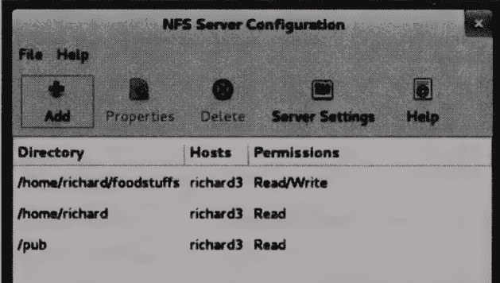

图 11-1：`system-config-nfs`

> 注意：建议仅在本地安全网络上使用 NFS。如果在互联网上使用，NFS 会让你的系统面临不安全的访问风险。

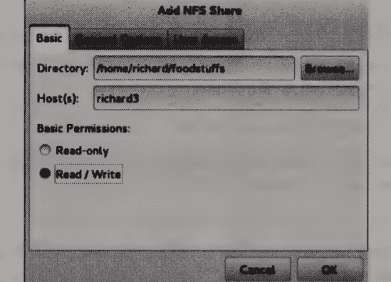

图 11-2：`system-config-nfs` 基础共享属性


# 第 11 章：NFS 和 NIS

Linux 提供了多种工具用于访问连接到网络的远程文件。网络文件系统（NFS）允许你连接并直接访问位于另一台机器上的资源，例如文件或 CD-ROM 设备。最新版本 NFSv4 提供了更高的安全性，并允许通过防火墙访问。它是 Fedora 的默认 NFS 服务器。网络信息系统（NIS）维护网络上所有系统的配置文件。

## Portmapper 和 RPC 服务

NFS 和 NIS 都是远程过程调用（RPC）服务。要运行它们，你首先必须启用并运行 `portmapper` 服务。`portmapper` 将地址映射到 RPC 服务，从而定位 RPC 服务。它告诉主机在系统的何处找到 NFS 和 NIS 服务。

`portmapper` 服务的名称为 `rpcbind`。如果它尚未运行，请使用 `system-config-services`、`cockpit` 或 `service` 命令启动它。你可以使用 `ifconfig` 或 `systemctl` 让其自动启动。

```bash
service rpcbind
```

## 网络文件系统：NFS

NFS 允许你将远程计算机上的文件系统挂载，就像它是你本地系统的一部分一样。然后你可以直接访问该远程文件系统上的任何文件。

这样做的好处是可以在网络上的不同系统访问同一个文件，而无需保留自己的副本。远程文件系统中只有一份副本，每台计算机都可以访问该副本。你可以在 NFS 网站 <http://nfs.sourceforge.net> 了解更多关于 NFS 的信息。

| NFS 守护进程 | systemd unit | 说明 |
|---|---|---|
| `rpc-nfsd` | `nfs-server.service` | 接收来自远程系统的 NFS 请求并将其转换为本地系统的请求。 |
| `rpc-mount` | `nfs-mount.service` | 执行挂载和卸载操作。 |
| `rpc-stat` | `nfs-lock.service`、`rpc-statd.service` | 当远程主机重启时提供锁定服务。 |
| `rpc-idmapd` | `nfs-idmapd.service` | 将用户和组 ID 映射为名称。 |
| `rpc-gssd` | `nfs-server.service`、`rpc-gssd.service` | 用于 NFSv4 GSS-API 安全的 RPC-GSS 协议客户端服务器。 |
| `rpc-vcgssd` | `nfs-server.service` | 用于 NFSv4 GSS-API 安全的 RPC-GSS 协议服务器端口。 |

**表 11-1：NFS 守护进程和 systemd unit 文件**

### NFS 守护进程

NFS 在 TCP/IP 网络上运行。持有文件系统的远程计算机将其提供给网络上的其他计算机。它是通过导出文件系统来实现的，这需要在 NFS 配置文件 `/etc/exports` 中创建条目，并运行多个守护进程以支持其他系统的访问。这些包括 `rpc.mount`、`rpc.nfs` 和 `rpc.gssd`。

对你的 NFS 服务器的访问可以通过 `/etc/hosts.allow` 和 `/etc/hosts.deny` 文件进行控制。NFS 守护进程由 `systemd` 管理，使用位于 `/lib/systemd/system` 的多个服务 unit 文件。NFS 守护进程及其对应的 systemd unit 文件列如表 11-1 所示。

此处显示了 `nfs-server.service` 文件。运行时配置信息从 `/etc/sysconfig/nfs`（环境文件）读取。

```ini
[Unit]
Description=NFS Server and services
DefaultDependencies=no
Requires=network.target proc-fs-nfsd.mount rpcbind.target
Requires=nfs-mountd.service
Wants=rpc-stat.service nfs-idmapd.service
Wants=rpc-stat-notify.service
After=local-fs.target
After=network.target proc-fs-nfsd.mount rpcbind.target nfs-mountd.service
After=nfs-idmapd.service
Before=rpc-stat-notify.service
# GSS 服务依赖和排序
Wants=auth-rpcss-module.service
After=rpc-gssd-fs.target gssproxy.service rpd-vcgssd.service
Before=nfs-fs.target
Wants=nfs-config.service
After=nfs-config.service
```

```ini
[Service]
EnvironmentFile=/etc/sysconfig/nfs-utils
Type=oneshot
RemainAfterExit=yes
ExecStart=/exportfs -r
ExecStart=/usr/bin/rpc.nfs $RPCNFSDARGS
ExecStop=/usr/bin/rpc.nfs 0
ExecStopPost=/usr/bin/exportfs -au
ExecStopPost=/usr/bin/exportfs -f/usr/bin/exportfs -f
ExecStopPost=/usr/bin/exportfs -r
ExecReload=/usr/bin/exportfs -r
```

```ini
[Install]
WantedBy=multi-user.target
```

你可以使用 `nfs.service` 文件和 `systemd` 启动和关闭 NFS 守护进程，你可以通过 `service` 命令调用它们。

```bash
nfs start
```

要让 NFS 在 `multi-user.target` 下自动启动，你可以使用 `chkconfig`、`system-config-tools` 工具或 `cockpit` 来开启或关闭 NFS。

```bash
chkconfig on
```

对应 `nfsd`、`mountd`、`idmapd`、`statd` 和 `svcgssd` 的 systemd unit 文件将运行这些守护进程。

## 共享资源

Fedora NFS 服务器和支持工具位于以下软件包中：

| 软件包 | 说明 |
|---|---|
| `nfs-utils` | NFS 服务器及辅助工具 |
| `system-config-nfs` | Fedora NFS 桌面配置工具 |
| `nfs4-acl-tools` | 支持 NFS4 安全的访问控制列表命令 |
| `nfswatch` | 监控 NFS 使用情况 |

确保你的防火墙允许 NFS 访问，确保已勾选 NFS4。确保允许 SELinux 许可 NFS 访问。在侧边栏使用 `system-config-selinux` 选择 Boolean，然后找到 NFS 并确保勾选了 “Support NFS home directories”。

## 使用 system-config-nfs 设置 NFS 目录：共享文件夹

你可以使用 Fedora 桌面上的 `system-config-nfs` 工具轻松设置 NFS 和共享文件夹。在“应用程序”概览的“其他”过滤器中选择“NFS 服务器”。这将打开如图 11-1 所示的 NFS 服务器配置工具。


图 11-1：`system-config-nfs`

注意：建议仅在本地安全网络上使用 NFS。如果在互联网上使用，NFS 会让你的系统面临不安全的访问风险。


图 11-2：`system-config-nfs` 基础共享属性


# 第 11 章：NFS 和 NIS

确保你的防火墙允许 NFS 访问，确保已勾选 NFS4。确保允许 SELinux 许可 NFS 访问。在侧边栏使用 `system-config-selinux` 选择 Boolean，然后找到 NFS 并确保勾选了“Support NFS home directories”。

Linux 提供了多种工具用于访问连接到网络的远程文件。网络文件系统（NFS）允许你连接并直接访问位于另一台机器上的资源，例如文件或 CD-ROM 设备。最新版本 NFSv4 提供了更高的安全性，并允许通过防火墙访问。它是 Fedora 的默认 NFS 服务器。网络信息系统（NIS）维护网络上所有系统的配置文件。

## Portmapper 和 RPC 服务

NFS 和 NIS 都是远程过程调用（RPC）服务。要运行它们，你首先必须启用并运行 `portmapper` 服务。`portmapper` 将地址映射到 RPC 服务，从而定位 RPC 服务。它告诉主机在系统的何处找到 NFS 和 NIS 服务。

`portmapper` 服务的名称为 `rpcbind`。如果它尚未运行，请使用 `system-config-services`、`cockpit` 或 `service` 命令启动它。你可以使用 `ifconfig` 或 `systemctl` 让其自动启动。

```bash
service rpcbind
```

## 网络文件系统：NFS

NFS 允许你将远程计算机上的文件系统挂载，就像它是你本地系统的一部分一样。然后你可以直接访问该远程文件系统上的任何文件。

这样做的好处是可以在网络上的不同系统访问同一个文件，而无需保留自己的副本。远程文件系统中只有一份副本，每台计算机都可以访问该副本。你可以在 NFS 网站 <http://nfs.sourceforge.net> 了解更多关于 NFS 的信息。

| NFS 守护进程 | systemd unit | 说明 |
|---|---|---|
| `rpc-nfsd` | `nfs-server.service` | 接收来自远程系统的 NFS 请求并将其转换为本地系统的请求。 |
| `rpc-mount` | `nfs-mount.service` | 执行挂载和卸载操作。 |
| `rpc-stat` | `nfs-lock.service`、`rpc-statd.service` | 当远程主机重启时提供锁定服务。 |
| `rpc-idmapd` | `nfs-idmapd.service` | 将用户和组 ID 映射为名称。 |
| `rpc-gssd` | `nfs-server.service`、`rpc-gssd.service` | 用于 NFSv4 GSS-API 安全的 RPC-GSS 协议客户端服务器。 |
| `rpc-vcgssd` | `nfs-server.service` | 用于 NFSv4 GSS-API 安全的 RPC-GSS 协议服务器端口。 |

**表 11-1：NFS 守护进程和 systemd unit 文件**

## NFS 守护进程

NFS 在 TCP/IP 网络上运行。持有文件系统的远程计算机将其提供给网络上的其他计算机。它是通过导出文件系统来实现的，这需要在 NFS 配置文件 `/etc/exports` 中创建条目，并运行多个守护进程以支持其他系统的访问。这些包括 `rpc.mount`、`rpc.nfs` 和 `rpc.gssd`。

对你的 NFS 服务器的访问可以通过 `/etc/hosts.allow` 和 `/etc/hosts.deny` 文件进行控制。NFS 守护进程由 `systemd` 管理，使用位于 `/lib/systemd/system` 的多个服务 unit 文件。NFS 守护进程及其对应的 systemd unit 文件如表 11-1 所示。

此处显示了 `nfs-server.service` 文件。运行时配置信息从 `/etc/sysconfig/nfs`（环境文件）读取。

```ini
[Unit]
Description=NFS Server and services
DefaultDependencies=no
Requires=network.target proc-fs-nfsd.mount rpcbind.target
Requires=nfs-mountd.service
Wants=rpc-stat.service nfs-idmapd.service
Wants=rpc-stat-notify.service
After=local-fs.target
After=network.target proc-fs-nfsd.mount rpcbind.target nfs-mountd.service
After=nfs-idmapd.service
Before=rpc-stat-notify.service
# GSS 服务依赖和排序
Wants=auth-rpcss-module.service
After=rpc-gssd-fs.target gssproxy.service rpd-vcgssd.service
Before=nfs-fs.target
Wants=nfs-config.service
After=nfs-config.service
```

```ini
[Service]
EnvironmentFile=/etc/sysconfig/nfs-utils
Type=oneshot
RemainAfterExit=yes
ExecStart=/exportfs -r
ExecStart=/usr/bin/rpc.nfs $RPCNFSDARGS
ExecStop=/usr/bin/rpc.nfs 0
ExecStopPost=/usr/bin/exportfs -au
ExecStopPost=/usr/bin/exportfs -f/usr/bin/exportfs -f
ExecStopPost=/usr/bin/exportfs -r
ExecReload=/usr/bin/exportfs -r
```

```ini
[Install]
WantedBy=multi-user.target
```

你可以使用 `nfs.service` 文件和 `systemd` 启动和关闭 NFS 守护进程，也可以通过 `service` 命令调用它们。

```bash
nfs start
```

要让 NFS 在 `multi-user.target` 下自动启动，你可以使用 `chkconfig`、`system-config-tools` 工具或 `cockpit` 来开启或关闭 NFS。

```bash
chkconfig on
```

对应 `nfsd`、`mountd`、`idmapd`、`statd` 和 `svcgssd` 的 systemd unit 文件将运行这些守护进程。

## 共享资源

Fedora NFS 服务器和支持工具位于以下软件包中：

| 软件包 | 说明 |
|---|---|
| `nfs-utils` | NFS 服务器及辅助工具 |
| `system-config-nfs` | Fedora NFS 桌面配置工具 |
| `nfs4-acl-tools` | 支持 NFS4 安全的访问控制列表命令 |
| `nfswatch` | 监控 NFS 使用情况 |

## 使用 `system-config-nfs` 设置 NFS 目录：共享文件夹

你可以使用 Fedora 桌面上的 `system-config-nfs` 工具轻松设置 NFS 和共享文件夹。在“应用程序”概览的“其他”过滤器中选择“NFS 服务器”。这将打开如图 11-1 所示的 NFS 服务器配置工具。


图 11-1：`system-config-nfs`

注意：建议仅在本地安全网络上使用 NFS。如果在互联网上使用，NFS 会让你的系统面临不安全的访问风险。


图 11-2：`system-config-nfs` 基础共享属性


| `nfs4-acl-tools` | 支持 NFS4 安全的访问控制列表命令 |
|---|---|
| `nfswatch` | 监控 NFS 使用情况 |

# 第 3 部分：共享资源

| `nfs-utils` | NFS 服务器及辅助工具 |
|---|---|
| `system-config-nfs` | Fedora NFS 桌面配置工具 |
| `nfs4-acl-tools` | 支持 NFS4 安全的访问控制列表命令 |
| `nfswatch` | 监控 NFS 使用情况 |

# NFS 和 NIS

Linux 提供了多种工具用于访问连接到网络的远程文件。网络文件系统（NFS）允许你连接并直接访问位于另一台机器上的资源，例如文件或 CD-ROM 设备。最新版本 NFSv4 提供了更高的安全性，并允许通过防火墙访问。它是 Fedora 的默认 NFS 服务器。网络信息系统（NIS）维护网络上所有系统的配置文件。

# 第 11 章：NFS 和 NIS

确保你的防火墙允许 NFS 访问，确保已勾选 NFS4。确保允许 SELinux 许可 NFS 访问。在侧边栏使用`system-config-selinux`选择 Boolean，然后找到 NFS 并确保勾选了 "Support NFS home directories"。

## NFS 选项

`/etc/exports`中的选项充当访问导出目录的权限。使用`ro`选项设置只读访问，使用`rw`选项设置读写访问。`sync`和`async`选项指定写入操作是立即执行（`sync`）还是在服务器准备好处理时执行（`async`）。默认情况下，会检查写入请求是否可靠，如果是的话，则进行写入（延迟）。这可能会降低性能。你可以通过默认的`no_wdelay`覆盖此设置，并按照你的要求执行写入。如果导出了两个目录，其中一个是另一个的子目录，除非显式提到（`hide`），否则该子目录是不可访问的。你可以通过`no_hide`选项来克服这一限制（这可能会对某些系统文件产生问题）。如果导出的目录实际上位于较大的文件系统中，将检查其父目录以确保该子目录是有效目录（`subtree_check`）。此选项在只读文件运行良好，但在可以更改文件名和目录的写启用文件系统中可能会导致问题。你可以使用`no_subtree_check`选项取消此。

## NFS 用户级访问

除了通用选项外，还有适用于用户级访问的选项。作为一种安全措施，NFS 服务器将客户端的 root 用户视为匿名用户。这被称为“压制（squashing）”。在客户端 root 用户的情况下，压制防止了客户端尝试伪装成 NFS 服务器的 root 用户。如果你希望特定客户端的 root 用户对 NFS 服务器具有 root 级别的控制权，可以指定`no_root`选项。若为了防止任何客户端尝试伪装成 NFS 服务器上的用户，你可以将他们归类为匿名用户（`all_squash`选项）。此类匿名用户仅限访问匿名组部分的目录和文件。

通常，如果客户端系统上的用户在 NFS 服务器上拥有用户账户，该用户就可以挂载并访问其在 NFS 服务器上的文件。然而，NFS 要求用户在两个系统上的用户 ID（User ID）必须相同。如果不是这样，他/她将被视为两个不同的用户。为了解决这个问题，你可以使用 NFS 服务，仅在一个地方（即 NFS 密码文件）维护用户 ID 信息。

## NFS `/etc/exports`示例

这里显示了`/etc/exports`文件中的条目示例。对于挂载在`/pub`目录的文件系统，向所有主机提供了只读访问，这是一个用于公共访问的常用名称。然而，用户被视为匿名用户（`all_squash`）。对于挂载在`/home/mypics`目录的文件系统，向`lizard.mytrek.com`提供了读写访问。下一个条目允许`rabbit.mytrek.com`访问 NFS 服务器的光驱，但仅使用读取访问。最后一个条目允许对`/home/richichp`进行安全访问。

```
/pub               *(ro,insecure,all_squash,sync)
/home/mypics     lizard.mytrek.com(rw,sync)
/media/cdrom      rabbit.mytrek.com(ro,sync)
/home/richichp     *(secure,sync)
```

## 应用更改

每当系统启动 NFS 服务器时（通常在系统启动时），`/etc/exports`文件将被读取，指定的目录将被导出。当导出一个目录时，`/var/lib/nfs/xtab`文件中会为其创建一个条目。这是 NFS 读取并用于执行实际导出的文件。条目从`/etc/exports`读取并在`/var/lib/nfs/xtab`中创建相应的条目。`xtab`文件维护了实际导出的列表。

| 通用选项 | 说明 |
|---|---|
| `secure` | 要求请求源自安全端口（小于 1024）。这是默认设置。 |
| `insecure` | 关闭`secure`选项。 |
| `ro` | 仅允许只读访问。这是默认设置。 |
| `rw` | 允许读写访问。 |
| `sync` | 在被请求时执行所有写入。这是默认设置。 |
| `async` | 在服务器准备好时执行所有写入。 |
| `no_delay` | 立即执行写入，不检查它们是否相关。 |
| `delay` | 检查是否已写入，如果是则等待一起执行。可能会降低性能。这是默认设置。 |
| `hide` | 自动隐藏作为另一个导出目录的子目录的导出目录。 |
| `subtree_check` | 检查文件系统中的父目录以验证导出的子目录。这是默认设置。 |
| `no_subtree_check` | 不检查文件系统中的父目录以验证导出的子目录。 |
| `insecure_locks` | 不需要对锁定请求进行身份验证。用于旧版本的 NFS。 |

| User ID 映射 | 说明 |
|---|---|
| `all_squash` | 将所有 UID 和 GID 映射到匿名用户。 |
| `no_all_squash` | `all_squash`的相反选项。这是默认设置。 |
| `root_squash` | 将来自远程用户的请求映射到匿名 UID/GID。这是默认设置。 |
| `no_root_squash` | 关闭 root 压制。允许 root 用户访问远程 root。 |
| `anymuid` | 设置用于`all_squash`和`root_squash`选项的匿名账户的 UID 和 GID。 |

如果你想在不重启系统的情况下立即导出`/etc/exports`文件中添加的条目，可以使用带有`-a`选项的`exportsfs`命令。使用`-v`选项来显示 NFS 正在采取的操作是有帮助的。使用相同的选项来实现你对`/etc/exports`文件所做的任何更改。

```
exportsfs -a -v
```

如果你稍后对`/etc/exports`文件进行了更改，可以使用`-r`选项重新导出其条目。`-r`选项将`/var/lib/nfs/xtab`文件与`/etc/exports`条目同步，移除任何其他导出或使用不同选项重新同步。

```
exportsfs -r -v
```

要同时导出添加的条目并重新导出更改的条目，你可以组合`-r`和`-a`选项。

```
exportsfs -r -a -v
```

## 手动导出文件系统

你也可以使用`exports`命令手动导出文件系统，而不是在`/etc/exports`文件中使用条目。导出条目将直接添加到`/var/lib/nfs/xtab`文件中。通过`-o`选项，你可以列出各种权限，然后是主机和文件系统。主机和文件系统之间用冒号分隔：例如，手动将`/home/myprojects`目录导出到`golf.mytrek`。

```
exports -o rw /home/myprojects golf.mytrek
```

（注：该命令的 OCR 文本不完整，我根据上下文重构了它）。

## `/etc/hosts.allow`与`/etc/hosts.deny`

`/etc/hosts.allow`和`/etc/hosts.deny`文件用于限制网络或互联网（如果可访问）对你服务器提供的服务的访问。例如，你可以使用`hosts.allow`文件允许某些主机访问你的 FTP 服务器。`hosts.deny`文件中的条目则显式拒绝某些主机的访问。对于 NFS，你可以通过控制对特定 NFS 守护进程的访问来提供类似的安全性。`hosts.allow`文件中的条目与你在`shares-admin`工具的添加主机窗口（共享文件夹）中指定的条目相同。

## Portmapper 服务

第一道防线是控制对 portmapper 服务的访问。`portmapper`告诉主机可以在系统的哪里找到 NFS 服务。限制访问可以允许远程主机定位 NFS。为了获得更强的安全性，你应该拒绝所有显式允许的主机以外的访问。在`hosts.deny`文件中，你放置以下条目，默认拒绝所有主机。`ALL`是一个表示所有主机的特殊关键字。

```
portmap:ALL
```

在`hosts.allow`文件中，随后输入你网络中的主机，或任何你想要允许访问 NFS 服务器的其他主机。同样，如果你指定`portmapper`服务并列出你允许访问的主机的 IP 地址。你可以列出特定的 IP 地址或使用子掩码的网络范围。以下示例允许本地网络`192.168.0.0/255.255.255.0`以及主机`10.0.0.43`访问。你可以用冒号分隔地址：

```
portmap:192.168.0.0/255.255.255.0, 10.0.0.43
```

`portmapper`也被 NFS 等其他服务使用。如果你在`hosts.deny`中关闭了对`portmapper`的访问，如果你正在运行 NFS 服务，则也需要在`hosts.allow`中允许访问 NFS 服务。这些服务包括`ybind`和`ypserver`。此外，如果你支持，可能还需要为`uptime`和`rusers`等远程命令添加条目。

建议对特定的 NFS 服务也拒绝相同级别的控制。在`hosts.deny`文件中，你为每个服务添加条目，如下所示：

```
mountd:ALL
quotad:ALL
statd:ALL
lockd:ALL
```

然后，在`hosts.allow`文件中，你可以为每个服务添加条目：

```
mountd:192.168.0.0/255.255.255.0, 10.0.0.43
quotad:192.168.0.0/255.255.255.0, 10.0.0.43
statd:192.168.0.0/255.255.255.0, 10.0.0.43
lockd:192.168.0.0/255.255.255.0, 10.0.0.43
```

## Netfilter 规则

你可以使用 Netfilter 进一步控制来自某些主机并在 NFS 服务端口的传输。`portmapper`使用端口 111，而`nfs`使用端口 2049。如果你有一个连接互联网的私有网络并想保护其不受互联网攻击，Netfilter 将非常有帮助。通常，特定的网络设备（如以太网卡）用于互联网连接。以下示例假设设备`eth1`连接到互联网。任何尝试访问端口 111 或 2049 的数据包都被拒绝。

```
iptables -A INPUT -i eth1 -j DENY
iptables -A INPUT -i eth1 -p 2049 -j DENY
```

要为你的本地网络启用 NFS，你必须允许数据包分段。假设`eth0`是用于本地网络的设备，你可以使用以下示例：

```
iptables -A INPUT -i eth0 -f -j ACCEPT
```

## 挂载文件系统：NFS 客户端

一旦 NFS 为不同的主机提供了目录，这些主机就可以在自己的系统中挂载目录并访问它们。主机必须能够作为 NFS 客户端运行。Linux 内核内置了所有 NFS 客户端功能。这意味着任何 NFS 客户端都可以通过执行简单的`mount`操作挂载其有访问权限的远程 NFS 目录。

| 选项 | 说明 |
| :--- | :--- |
| `rsize=` | NFS 从 NFS 服务器读取文件时使用的字节数。默认为 1,024 字节。大小为 8,192 可以极大提高性能。 |
| `size=` | NFS 向 NFS 服务器写文件时使用的字节数。默认为 1,024 字节。大小为 8,192 可以极大提高性能。 |
| `timeout=` | 在超时后发送第一次重传之前的秒数值。默认值为十分之七秒。 |
| `retry=` | 在放弃之前重试 NFS 挂载操作的分钟数。默认为 10,000 分钟（一周）。 |
| `retrans=` | 在发生主超时之前，NFS 挂载操作的重传次数或微超时次数（默认为 3）。此时，连接被取消或显示“服务器未响应”的消息。 |
| `soft` | 使用软挂载（soft mount）挂载系统。 |
| `hard` | 使用硬挂载（hard mount）挂载系统。这是默认选项。 |
| `intr` | 允许 NFS 中断文件操作并返回调用程序。默认不允许文件操作被中断。 |
| `bg` | 如果第一次挂载超时，则在后台继续尝试挂载。默认是失败且不进行后台。 |
| `tcp` | 使用 TCP 协议挂载 NFS 文件系统，而不是默认的 UDP 协议。 |

## 自动挂载 NFS：`/etc/fstab`

你可以通过`/etc/fstab`文件中的条目或显式命令来挂载 NFS 目录。通过在`/etc/fstab`文件中放置条目，可以让你的 NFS 文件系统自动挂载。`/etc/fstab`文件中的 NFS 条目挂载类型为`nfs`。一个 NFS 文件系统名称由其所在计算机的主机名以及其挂载的目录路径组成。它们之间用冒号分隔：例如，`rabbit.trek.com/home/project`指定挂载在`rabbit.trek.com`上`/home/project`的文件系统。`/etc/fstab`文件中 NFS 条目的格式如下。NFS 版本 1 到 3 的类型为`nfs`，而版本 4 的类型也是`nfs`。

```
host:remote-directory  local-directory  nfs  0  0
```

你还可以在 NFS 条目中包含 NFS 特有的选项。你可以指定往返数据包的大小以及你的计算机等待主机系统响应的时间。你还可以指定文件系统是进行硬挂载还是软挂载。对于硬挂载的文件系统，如果由于某些原因远程系统未响应，你的计算机将继续联系。软挂载的文件系统在失败后，会在尝试联系时经过一段时间并发布错误消息。硬挂载是默认选项。进行硬挂载且持续失败的系统将不断尝试实现挂载而停止响应用户输入。由于此原因，软挂载可能更好，因为它们将简单停止尝试持续失败的挂载。附录 11-3 和 Man 页面包含了这些 NFS 客户端选项的列表。它们与之前指示的 NFS 服务器选项不同。

以下是一个 NFS 条目的示例。远程系统是`rabbit.mytrek.com`，文件系统挂载在`/home/project`。该文件系统挂载在本地系统的`/home/dylan/projects`。`/home/dylan/projects`目录必须在本地系统中已创建。系统类型是 NFS，`timeout`选项指定本地系统等待最多 20 十分之一秒（秒）响应。响应是软挂载且可以被 NFS 中断。

```
rabbit.mytrek.com:/home/dylan/projects nfs soft,timeo=20
```

## 手动挂载 NFS：`mount`

你使用带有`-t nfs`选项的`mount`命令显式挂载 NFS 文件系统。对于 NFS4 文件系统使用`-t nfs`。要显式挂载之前的条目，请使用以下命令：

```
mount -t nfs -o soft,intr,timeo=20 rabbit.mytrek.com:/home/projects \
home/dylan/projects
```

当然，你可以用`mount`命令挂载 NFS 目录。你可以指定本地挂载点或远程主机和目录，如下所示：

```
mount /home/dylan/projects \
mabbit.mytrek.com:/home/projects
```

## 按需挂载 NFS：`autofs`

你还可以使用自动挂载服务`autofs`挂载文件系统。这需要在客户端端进行额外的配置。`autofs`服务只在你访问时挂载文件系统。尝试访问它。切换（`cd`）到指定目录将触发挂载操作，在此时挂载远程文件。


`autofs` 服务通过使用一个主文件（master file）配置来列出映射文件，映射文件反过来列出要挂载的文件系统。`/etc/auto.master` 是 `autofs` 的主文件。主文件将列出可以使用映射文件挂载文件系统的根路径，并为每个路径使用一个映射文件。映射文件随后将列出一个键（子目录）、挂载选项以及可以在该根目录下挂载的文件系统。

在某些发行版中，`/auto` 目录已经作为实现为自动挂载文件系统的根路径。如果你需要，你可以在`/etc/auto.master`文件中使用你自己的映射文件添加自己的文件系统。你会发现`/etc/auto.master`文件包含以下针对`/auto`目录的配置，将`/auto.misc`列为其映射文件：

```text
/auto auto.misc --timeout 60
```

遵循映射文件，你可以添加选项，如前面的示例所示。`timeout` 选项指定了在自动卸载之前等待的不活动秒数。在映射文件中，你列出键、挂载选项和要挂载的文件系统。键将是本地系统上挂载文件系统的子目录。

例如，要将`rabbit.mytrek.com`主机的`/home/projects`目录挂载到`/auto/projects`目录，你使用以下命令：

```text
projects soft,intr,time=20 rabbit.mytrek.com:/home/projects
```

你也可以为 NFS 文件系统在映射文件中创建一个新目，如下：

```text
myprojects auto.myprojects --timeout 60
```

然后你创建一个`/etc/auto.myprojects`文件，并在其中放置 NFS 文件系统挂载的条目，如下所示：

```text
dylan soft,intr,rw rabbit.mytrek.com:/home/projects
newgame soft,intr,ro lizard.mytrek.com:/supergame
```

# 网络信息服务：NIS

在支持的网络中，许多资源和设备由同一系统共享。通常，每个系统对于每个设备或资源都需要其自己的配置文件。更改涉及逐个更新每个系统。然而，NIS 提供了一种名为网络信息系统（NIS）的特殊服务，该服务为整个网络维护此类配置。对于更改，你只需要更新 NIS 映射。

NIS 适用于大多数管理任务所需的信息，如与用户、网络访问或设备相关的信息。例如，你可以使用 NIS 服务维护用户和密码信息，只需更新你的 NIS 密码文件即可。

> 注意：NIS+ 是 NIS 的更高级的形式，提供对加密和认证的支持。然而，它的管理起来更困难。

NIS 由太阳微系统（Sun Microsystems）开发，最初称为 Sun 黄页服务（YP）。NIS 文件保留在 NIS 服务器上（NIS 服务器有时仍被称为 YP 服务器）。网络上的各个系统使用 NIS 客户端向 NIS 服务器发出请求。

NIS 服务器在名为映射（maps）的特殊数据库文件中维护其信息。NIS 客户端和服务器都有 Linux 版本。Linux 客户端可以使用 NIS 轻松地连接到任何网络。

注意：许多网络使用 LDAP 而不是 NIS 来管理用户和身份验证。

NIS 客户端作为初始安装的一部分通过`ybind`和`yp-tools`包安装。NIS 服务器可以从`ypserv`包安装。NIS 客户端程序包括`ybind`（守护进程，`ybind`包）、`ypwhich`、`ypcat`、`ypcall`、`ypmatch`、`yppasswd`和`ypset`（`yp-tools`包）。每个程序都有其自己的详细说明页面。

NIS 服务器程序是`ypserv`（NIS 服务器包，`ypserv`）、`ypint`、`yppasswd`、`ypush`、`ypxfr`和`netgroup`，每个也有自己的页面。

你可以使用`service`命令启动`ybind`守护进程和`ypserv` NIS 服务器。或者，你使用`system-config-services`或`cockpit`来启动和停止 NIS 客户端和服务器守护进程。

```shell
service ybind start
service ypserv start
```

NIS 服务器由`ybind.service`和`ypserv.service`文件由`systemd`管理。运行时配置从`/etc/sysconfig/ypbind`（`EnvironmentFile`）读取。Linux 设置被配置为允许访问（`ExecStartPre`）。

## `ybind.service`

```ini
[Unit]
Description=NIS/YP (网络信息服务) 客户端绑定到 NIS 域
Requires=rpcbind.service
After=syslog.target network.target rpcbind.service ypserv.service NetworkManager-wait-online.service
Before=systemd-user-sessions.service

[Service]
Type=notify
NotifyAccess=all
EnvironmentFile=/etc/sysconfig/network
EnvironmentFile=/etc/sysconfig/ypbind
ExecStartPre=/usr/exec/ypbind-pre-setdomain
ExecStartPre=/usr/sbin/setubool allow_ypbind=1
ExecStart=/usr/sbin/ypbind -n OTHER YPBIND OPTS
ExecStartPost=/usr/libexec/ypbind-post-waitbind
PrivateTmp=true
```

```ini
[Install]
WantedBy=multi-user.target
```

`ypserv.service`仅仅启动 NIS 服务器（`/usr/sbin/ypserv`）。

## `ypserv.service`

```ini
[Unit]
Description=NIS/YP (网络信息服务) 服务器
Requires=rpcbind.service
After=syslog.target network.target rpcbind.service
```

```ini
[Service]
Type=notify-all
NotifyAccess=all
EnvironmentFile=/etc/sysconfig/network
ExecStart=/usr/bin/ypserv -f $YPSERV_ARGS
PrivateTmp=true
```

```ini
[Install]
WantedBy=multi-user.target
```

注意：许多网络使用 LDAP 而不是 NIS 来管理用户和身份验证。

## NIS 服务器

在设置 NIS 服务器时，具有很大的灵活性。对于较小的网络，你可能只需要一个 NIS 域，即一个主服务器。对于较大的网络，你可以将 NIS 域划分为多个从机服务器。从机服务器包含配置文件的副本。即使你只有一个 NIS 域，从机服务器也可以作为备份。

配置 NIS 服务器涉及以下步骤：

1. 定义 NIS 服务器工作的 NIS 域名。
2. 启动`ypserv`守护进程。
3. 在`/var/yp/Makefile`文件中设置要管理的配置文件。
4. 使用`/usr/lib/ypinit`创建 NIS 版本。

## 定义域

你首先必须定义域。使用`/etc/sysconfig/network`中的`NIS_DOMAIN`变量。以下示例定义了域：

```shell
NIS_DOMAIN=myurtles
```

在设置服务器时，你可能希望在不重启系统的情况下赋予域。可以使用`domainname`命令来实现：

```shell
domainname myurtles
```

NIS 服务器选项保留在`/etc/ypbind.conf`中。查看该文件的帮助页以获取详细信息。你可以使用`ypserv`脚本启动 NIS：

```shell
service ypserv start
```

## NIS 服务器选项

接下来编辑`/var/yp/Makefile`选择 NIS 服务器维护的配置文件，并设置任何服务器选项。标准选项以及大多数常用的配置文件通常已经设置。

`NOPUSH`选项将被设置为`true`，表示没有从机服务器。如果你为此域设置从机服务器，你必须将此选项设置为`false`：

```make
NOPUSH = true
```

最小用户和组 ID 设置为 500。这些通过`MINUID`和`MINGID`变量设置：

```make
MINUID=500
MINGID=500
```

大多数发行版使用影子密码组文件来加密密码和组；`MERGE_PASSWD`和`MERGE_GROUP`设置将设置为`true`。NIS 将影子密码信息合并到其密码中：

```make
MERGE PASSWD=true
MERGE GROUP=true
```

NIS 查找密码和其他配置文件的目录随后通过`YPSRDIR`和`YPPDIR`定义。通常，`/etc`目录持有你的配置文件：

```make
YPSRDIR = /etc
YPPDIR = /etc
```

## 指定共享文件

在网络上共享的文件列在`all::`条目中，该条目位于配置文件列表之后。定义的文件中只有部分被列为共享，即`all::`之后的第一行中的。剩余行会被自动注释（带有前面的`#`号）。

```make
all: passwd group hosts rpc services netid protocols mail \
# netgrp shadow publickey networks ethers bootparams printcap \
# amd.home auto.master.home auto.local passwd.adjunct \
# timezone locale netmasks
```

确保不要修改`Makefile`的其余部分。

## 创建 NIS 数据库

您带有`-m`选项输入`ypinit`命令来创建一个由 NIS 配置文件的 NIS 数据库。系统将检测您的 NIS 服务器，并要求您输入在该 NIS 局域上使用的任何 NIS 从用服务器的名称。如果有，请输入它们。完成后，按下`CTRL-D`。NIS 数据库文件即被创建。

```shell
ypinit -m
```

对于 NIS 从用服务器，您将使用：

```shell
ypinit -s masterhost
```

如果您收到错误，极可能意味着您的 NIS 服务器未运行。请确保在运行`ypinit`之前已启动`ypyserv`。

```text
failed to send 'clear' to local ypyserv: RPC: Program not registered
```

如果您以后需要更新 NIS 服务器文件，可以切换到`/var/yp`目录并执行`make`命令。

```shell
cd /var/yp
make
```

## 访问控制

`/var/yp/securenets`文件允许主机访问您的 NIS 服务器。主机可以通过网络或单独地进行引用。条目由一个子网掩码和一个 IP 地址组成。例如，您可以使用以下条目访问本地网络中的所有主机：

```text
255.255.255.0  192.168.1.10
```

对于单个主机，您可以使用掩码`255.255.255.255`或直接使用术语“host”，如下：

```text
host  192.168.1.4
```

不同主机如何访问 NIS 共享数据在`/etc/ypyserv.conf`中确定。

## 网络组（Netgroups）

您可以使用 NIS 设置网络组，这允许您创建网络层的用户组。普通组是在单独的主机上本地创建的，而 NIS 网络组可用于整个网络的服务。例如，使用 NIS 组来控制对 NFS 系统的访问。

网络组定义在`/etc/netgroup`文件中。条目由组名以及后续由三个部分组成的成员标识符组成：主机、用户和 NIS 域：

```text
group (host, user, NIS-domain) (host, user, NIS-domain) ...
```

例如，对于 NIS 域`myturtles.nis`，要定义一个名为`myprojects`的组（由主机`rabbit`上的用户`chris`和主机`lizard.mytrek.com`上的用户`george`组成），可以使用以下命令：

```text
myprojects (rabbit, chris, myturtles.nis) \
(lizard.mytrek.com, george, myturtles.nis)
```

空白段匹配任意用户。以下条目包含主机`rabbit`的所有用户：

```text
newgame (rabbit,,myturtles.nis)
```

如果您的组不需要用户或段，可以使用连字符（`-`）消除其中之一。以下示例生成了一个仅包含主机名而没有用户名的网络组：

```text
myservers (rabbit,-) (turtle.mytrek.com,-)
```

然后您可以通过在网络组前加上`@`符号在各种配置文件中引用不同的网络组；例如：

```text
@newgame
```

## NIS 客户端

要让主机在您的网络上使用 NIS，您首先在该主机上指定您的 NIS 域名。此外，NIS 客户端需要知道您的 NIS 服务器的名称。如果您在已经在运行 NIS 的网络上安装了 Linux，您可能在安装过程中已经输入了这些信息。NIS 客户端应用程序通过`yp-tools`软件包安装。

## 指定 NIS 域和服务器

您可以使用`authcfg-gtk`工具指定 NIS 域名和服务器，如下所示：在系统设置中选择身份验证。这会打开一个身份验证窗口。在用户信息面板上，点击 NIS 打开一个可以输入 NIS 名称以及服务器的对话框。确保在用户信息面板上启用 NIS。

NIS 将保存在`/etc/sysconfig/network`文件中，NIS 服务器保存在`/etc/yp.conf`文件中。

## 访问服务器

网络上的每个客户端都必须绑定 NIS 客户端以访问服务器。在客户端的`/etc/yp.conf`文件中，你需要指定它将使用的 NIS 服务器。以下条目将显示位于`192.168.1.1`的 NIS 服务器：

```text
ypserver 192.168.1.1
```

或者，你可以使用`authcfg-gtk`工具指定 NIS 域名和服务器：

```text
domain mydomain.nis servername
```

`authcfg-gtk`工具将在`/etc/yp.conf`中创建如下`myturtles.nis`NIS 域并使用服务器`turtle.mytrek.com`：

```text
domain myturtles.nis server turtle.mytrek.com
```

## 共享资源

启动 NIS 客户端运行`ypbind`脚本：

```shell
service ypbind start
```

然后，为了检查 NIS 是否正常，可以使用`ypcat`列出 NIS 密码文件：你可以使用`ypcat`列出任何 NIS 配置文件。`which`命令将显示客户端正在使用的 NIS 服务器名称。`ypmatch`可用于查找配置文件中的特定条目。

```shell
ypmatch cecelia passwd.
```

你可以使用`ypasswd`命令更改 NIS 文件中的密码。它的工作方式与`passwd`命令相同。你还需要运行`ypasswd`守护进程。

## 使用 `nsswitch.conf` 指定配置文件

为了确保客户端访问特定的 NIS 服务器，你应该在`/etc/nsswitch.conf`文件的条目中指定`nisplus`。`nisplus`选项指的是 NIS 版本 3。`nis`选项指的是旧的 NIS 版本 2。

该文件指定了主机应该从哪里查找某些信息。例如，以下条目表示首先检查本地配置文件（`files`），然后检查 NIS 服务器（`nisplus`）：

```text
passwd: files nisplus
```


# fedora

## 12. Samba

- Samba 应用
- 设置 Samba
- 从 Windows 访问 Samba
- 用户级安全
- Samba smb.conf 配置文件
- 测试 Samba 配置
- 域登录
- Samba 公共控制器：Samba PDC
- 使用客户端访问 Samba 服务

## 资源

通过 Samba，您可以将 Windows 客户端连接到由 Linux Samba 服务器控制的 Microsoft Windows 网络共享文件、系统和打印机，同时允许 Linux 系统访问 Windows 系统上的共享文件和打印机。Samba 是一系列 Linux 工具，帮助您在 Windows 网络上与 Windows 系统进行通信。实际上，Samba 允许 Linux 系统或网络像 Windows 服务器一样工作，使用与 Windows 网络相同的协议。

Unix 和 Linux 系统使用 TCP/IP 协议进行网络，而 Microsoft Windows 网络使用不同的协议，即实现 Windows 局域网 (LAN) 的服务器消息块 (SMB) 协议。SMB 使用名为 NetBIOS 的网络接口，允许 Windows 系统共享打印机和磁盘空间等资源。SMB 最初为小型局域网设计。为了将其连接到包含 Unix 系统在内的网络，微软开发了通用文件系统 (CIFS)。CIFS 使用 SMB 和 NetBIOS。

想要将 Linux 系统连接到 Windows PC，Andrew Tree 编写了一个称为 Samba 的 SMB 客户端和服务器。Samba 允许 Unix 和 Linux 系统连接到此类网络，就像 Windows 系统一样。Windows 系统可以在 Unix 系统上共享资源。实际上，Samba 是专业的、开源且免费的 CIFS 版本。Samba 有效让您使用 Linux 或 Unix 系统作为 Windows 机器的网络服务器。

您可以从 Samba Web 和 FTP (`http://www.samba.org`) 获取详细文档和当前发布版本。详细文档通过 `samba-doc` 软件包安装在您的系统中。`htmldocs` 子目录包含所有文档，均为网页格式。提供了不同配置类型的示例 `samba.conf` 文件。

在 Fedora 上，Samba 软件整合在多个软件包中（见表 12-1）。通过选择 `samba-server` 软件包，会自动选择 `smbclient` 和 `samba-common` 等所需的支持包。配置工具（如 `system-config-samba`）必须单独安装。Fedora 使用当前的稳定版本 Samba 4，它支持 SMB2 协议和活动目录。

## Samba 应用

Samba 软件包由两个守护进程和几个实用程序组成（见表 12-2）。一个守护进程 `smbd` 为 SMB 客户端和其他支持 Samba 的 Windows 等系统提供文件和打印机服务。`nmbdd` 是提供 NetBIOS 名称和解析服务器的守护进程。`smclient` 工具为 Linux 客户端提供类似 FTP 的 Samba 服务访问。`mount.cifs` 和 `mount.tools` 允许 Linux 客户端连接和卸载 Samba 共享目录（由 `mount` 命令配合 `-t samba` 使用）。`smstatus` 显示 SMB 服务器的当前状态以及谁正在使用它。

`testparm` 用于测试你的 Samba 配置。`smbtar` 是一个 shell 脚本，可以直接将 SMB/CIFS 共享资源备份到 Unix 归档。你可以使用 `nmblookup` 将 Windows 系统的 NetBIOS 映射映射到其 IP 地址。

| 包名 | 描述 |
| :--- | :--- |
| `samba` | Samba 服务器 |
| `samba-common` | Samba Fedora 配置文件和支持工具 |
| `samba-doc` | Samba 文档，包括示例 |
| `system-config-samba` | 来自 Red Hat 的 Samba GUI 配置工具 |
| `smclient` | 用于访问 Windows 共享的 Samba 客户端 |
| `smbfs` | Samba 共享的挂载和卸载工具 |
| `kdenetworkfilessharing` | 由 KDE 实现的 Samba 文件共享 |
| `shares-admin` | GNOME Samba 文件共享支持，随 GNOME 桌面安装。 |

### 表 12-1：Fedora 上的 Samba 软件包

| 应用 | 描述 |
| :--- | :--- |
| `system-config-samba` | Fedora Samba 管理工具，用于通过 GNOME GUI 界面配置 `smb.conf` |
| `smbd` | 为 SMB 客户端提供文件和打印服务的 Samba 守护进程 |
| `nmbd` | 提供 NetBIOS 名称解析和服务浏览支持的 Samba 守护进程 |
| `winbindd` | 使用 Windows 域提供的身份验证服务 |
| `smclient` | 为 Linux 客户端提供对 Samba 服务的类 FTP 访问 |
| `mount.cifs` | 在 Linux 客户端上挂载共享目录（由 `mount` 命令配合 `-t cifs` 参数使用） |
| `smbpasswd` | 修改 Samba 服务器上的 SMB 加密密码 |
| `smbstatus` | 显示 SMB 网络连接的当前状态 |
| `smbr` | `smbd` 与外部程序之间的接口程序 |
| `testparm` | 测试 Samba `smb.conf` |
| `smbtar` | 直接将 SMB/CIFS 共享资源备份到 Unix 磁带驱动器 |
| `nmblookup` | 将 Windows PC 的 NetBIOS 名称映射到其 IP 地址 |
| `smb.service` | Samba 服务的 systemd 服务脚本 |

### 表 12-2：Samba 应用

配置文件保存在 `/etc/samba` 目录下。Fedora 上主要的 Samba 配置工具是 `system-config-samba`，它允许你使用桌面界面来创建和维护 Samba 配置文件 `/etc/samba/smb.conf`。

Samba 提供四种主要服务：文件和打印服务、身份验证与授权、名称解析以及服务公告。SMB 守护进程 `smbd` 提供文件和打印服务，以及针对这些服务的身份验证和授权。这意味着网络上的用户可以共享文件和打印机。你可以通过要求用户提供密码来访问这些服务。当用户尝试访问共享目录时，系统会提示密码。可以通过共享模式或用户模式来实现控制。共享模式为共享资源设置密码，并允许任何拥有密码的用户访问它。用户模式则为每个用户提供不同的密码。Samba 为此维护了它自己的一套密码。

名称解析和服务公告由 `nmbd` 服务器处理。名称解析将 NetBIOS 名称解析为 IP 地址。服务公告（也称为浏览）是将网络上可用的服务列表呈现给连接的 Windows PC（以及通过它们连接的 Linux PC）的方式。

Samba 还包含 `winbind` 守护进程，它允许 Samba 服务器使用 Windows 域提供的身份验证服务。Samba 服务器不再需要自己维护一套用于访问的用户集，而是可以利用 Windows 域身份验证服务来验证用户。

## 设置 Samba

为了允许 Windows 访问 Linux 系统，以及 Linux 访问 Windows 系统，你需要使用 Samba 服务器。首先确保已安装 Samba 以及 Services 工具。打开“软件”应用程序（PackageKit）。点击“服务器”条目或搜索 `samba`。在右侧面板中向下滚动找到 `samba` 和 `system-config-samba` 包。安装两者。选择安装 `samba` 将自动选择任何需要的包。你也可以安装 `system-config-samba-docs` 包以获取 `system-config-samba` 工具的帮助。

确保你的 Windows 系统上的防火墙没有阻止 Samba（见图 12-1）。运行 `firewall-config`（杂项 | 防火墙）并选择“服务”选项卡。确保 Samba 服务和 `samba` 客户端项已勾选，允许 Samba 在你的系统上运行，同时允许多播 DNS。点击应用更改。

Samba 服务器由两个守护进程组成：`smb` 和 `nmb`。你可能需要以 root 用户身份使用 `service` 命令启用并启动这些守护进程。打开终端（系统工具 | 终端），使用 `su` 命令访问 root 用户，然后对 `smb` 和 `nmb` 服务器执行 `systemctl` 命令，配合 `enable` 命令启用服务器，并使用 `service` 命令配合 `start` 命令启动它。一旦启用，服务器应该会在系统启动时自动启动。Samba 由 systemd 管理（见第 3 章）。

```bash
su
systemctl nmb enable
systemctl smb enable
service nmb start
service smb start
```

### 第 12 章：Samba

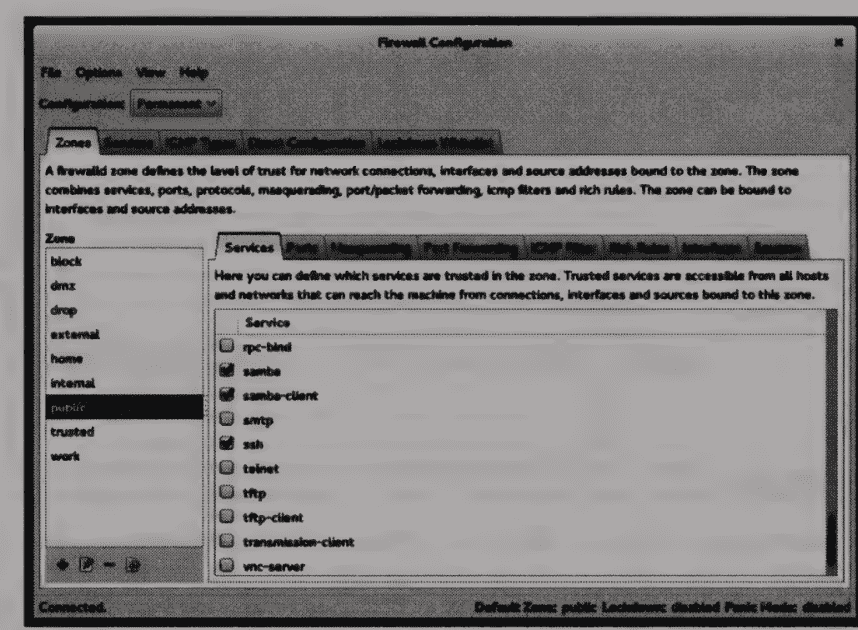

**图 12-1：在防火墙上允许 Samba**

同时，确保 SELinux 允许 Samba 访问（`system-config-selinux`）。打开 SELinux 管理工具，在“布尔”选项卡上启用 Samba 访问（见图 12-2）。有多个 Samba 条目。要共享文件夹、Windows 文件夹和 NFS 文件夹，你需要勾选以下：

- 允许 Samba 读写任何文件/目录
- 允许 Samba 导出 ntfs/fusefs 卷
- 允许 Samba 导出 NFS 卷

如果你收到安全警报，可以使用 `chcon` 和 `semanage` 命令手动更改 Samba 的 SELinux 文件上下文。命令将列在安全警报“显示完整错误输出”滚动部分的“修复命令”中。Samba 共享目录的 SELinux 文件上下文被设置为 `samba_share_t`。`semanage` 命令会在重新标记时保留更改。在下面的示例中，显示了 `/ymedia` 的 SELinux 文件上下文。

```bash
chcon -R t samba_share_t /ymedia
semanage fcontexta -t samba_share_t /ymedia
```

注意：如果 SELinux 连接并阻止了你的连接，可以通过将其设置为 Permissive（允许）模式来禁用 SELinux，`system-config-selinux`（状态）。

Samba 提供两种身份验证方法：共享和用户。用户身份验证要求 Windows 和 Linux 系统中有相应的账户。它们可以具有相同的名称，尽管 Windows 用户可以映射到 Linux 用户。共享可以对任何用户开放并作为用户存储空间的扩展。推荐使用用户方法。

### 部分 3：共享资源

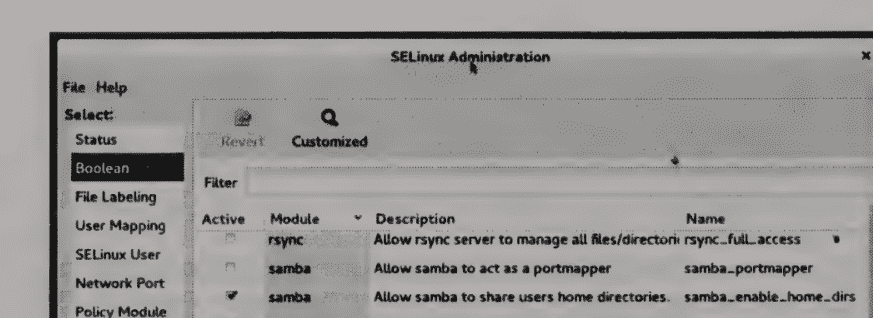

**图 12-2：在 SELinux 上允许 Samba**

### 第12章: Samba 299

`nmb.service`

```ini
[Unit]
Description=Samba NMB Daemon
After=syslog.target network.target

[Service]
Type=forking
Environment=KRB5CCNAME=/run/samba/krb5cc_samba
Type=notify
NotifyAccess=all
PIDFile=/run/nmb.pid
EnvironmentFile=/etc/sysconfig/samba
ExecStart=/usr/bin/nmb $NMBDOPTIONS
ExecReload=/usr/bin/kill -HUP $MAINPID

[Install]
WantedBy=multi-user.target
```


# `system-config-samba`

`system-config-samba` 工具提供了一种简单的方法来配置您的 Samba 服务器，添加 Samba 用户并指定 Samba 共享。它还会自动将您的 Linux 系统上的所有打印机配置为 Samba 共享打印机，允许您从任何连接的 Windows 系统使用它们。

您可以从应用程序视图（概述）中的 Samba 图标启动 `system-config-samba`，或者进行过滤（见图 12-3）。`system-config-samba` 对话框将列出您服务器的所有共享。您可以使用顶部的按钮来管理您的共享，添加新的或删除当前的共享。如果您删除了共享，实际目录不会被删除；它只是失去了作为共享目录的状态。

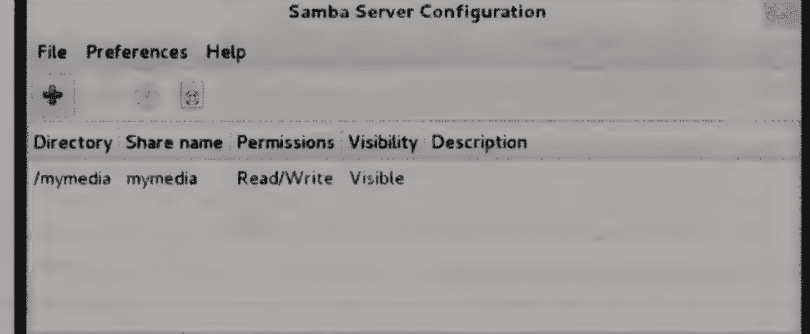

图 12-3：Samba 服务器配置

## Samba 服务器配置

要配置您的 Samba 服务器，请从 `system-config-samba` 的首选项菜单中选择“服务器设置（Server Settings）”。这将打开一个有两个面板的窗口：基础（Basic）和安全（Security）（见图 12-4）。

在基础面板上，您输入 Samba 服务器工作组名称。这将是所有 Windows 系统用作组的名称。Windows 为网络使用的默认名称是 `MSHOME` 或 `WORKGROUP`。对于家庭网络，您可以自行决定。只需确保所有计算机都使用该网络名称即可。检查您的 Windows 控制面板中的系统小程序以确保。描述是您希望在 Windows 系统上显示的 Samba 服务器名称。

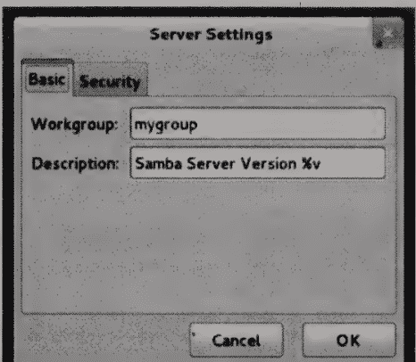

图 12-4：Samba 服务器设置

在安全选项卡上，您可以指定身份验证模式、密码加密选项以及访客账户名称，以及身份验证服务器（见图 12-5）。

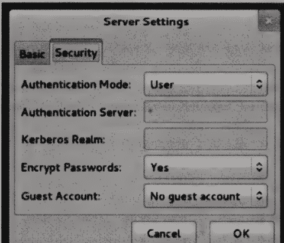

图 12-5：Samba 服务器设置：安全

默认情况下使用用户安全。您也可以使用共享安全或服务器安全，这些更加开放，但这两者都已弃用，并可能在后续版本中被删除。

身份验证模式指定访问级别，由用户、共享、服务器、ADS 或域使用。用户级访问通过用户密码限制访问，而共享访问则对任何访客开放。

通常，您会选择加密密码，而不是以明文形式通过网络传输密码。

访客（Guest）用户是用于允许访问您希望向任何用户的共享或打印机的账户名称，无需提供密码。弹出菜单列出您当前所有的用户，并默认选择“无访客账户（No Guest Account）”。除非您希望每个人都能访问共享，否则您将没有访客账户。

## 添加 Samba 用户

为了身份验证，您必须将 Windows 用户与特定的 Samba 用户关联。Samba 为用户维护自己的自己的密码列表。要为用户提供 Samba 访问权限，您需要将用户注册为 Samba 用户。

在 `system-config-samba` 的首选项菜单中选择“Samba 用户（Samba Users）”。这将打开列出所有当前 Samba 用户的 Samba 窗口。这些与系统中已设置的用户账户对应。

要添加 Samba 用户，点击右侧的“添加用户（Add User）”按钮打开“新建 Samba 用户”对话框（见图 12-6）。在这里，您输入 Unix 用户名、Windows 用户名和 Samba 密码。还有一个额外的框用于确认 Samba 密码。Unix 用户名是一个列出托管 Samba 服务器的 Linux 系统上所有用户的弹出菜单。

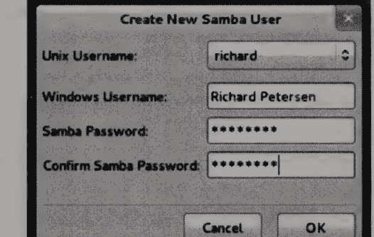

图 12-6：添加 Samba 用户

选择一个 Linux 用户作为 Unix 用户名，然后输入相应的 Windows 用户名。Windows 用户名可以与 Linux 账户（Linux 用户名）不同。当您输入 Windows 用户访问 Linux 的密码时，这就是该用户的 Samba 密码。Samba 维护一套用户访问 Samba 共享所需的密码。当 Windows 用户想要访问 Samba 共享时，他们需要他们的 Samba 密码。

一旦您创建了 Samba 用户，其名称将出现在 Samba 用户对话框的 Samba 用户列表中。要稍后修改或删除 Samba 用户，请打开同一个 Samba 用户对话框，从列表中选择用户，并点击“编辑用户（Edit User）”按钮更改密码等条目，或点击“删除用户（Delete User）”按钮删除 Samba 用户。

## 在 Linux 系统上添加 Samba 共享

要设置简单的共享，点击“添加共享（Add Share）”，这将打开“创建 Samba 共享”窗口。在“基础”选项卡上，选择要共享的 Linux 目录（文件夹）（点击“选择”查找），然后指定它是否可写且可见。您还为共享提供了一个名称，以及您想要的任何描述（见图 12-7）。


图 12-7：创建 Samba 共享

在“访问（Access）”选项卡上，您可以限制某些用户访问或允许所有用户访问。您系统上的 Samba 用户将带有复选框列出，您可以从中选择想要授予访问权限的用户（见图 12-8）。您还可以授予所有用户访问权限的选项。


图 12-8：创建 Samba 共享：访问

一旦创建，共享将出现在 `system-config-samba` 主窗口中。将显示共享目录、共享名称、可见性、读写权限和描述。要稍后修改共享，点击其条目，然后点击“属性（Properties）”菜单打开它。

## 从 Windows 配置 Samba 访问

要建立连接，您需要指定工作组名称。如果您的 Windows 客户端已连接到网络，可能已经设置好了。Windows 为网络使用的默认名称是 `MSHOME` 或 `WORKGROUP`。对于家庭网络，您可以自行决定。只需确保所有计算机都使用该网络名称即可。检查您的 Windows 控制面板中的系统小程序以确保。

### 第 12 章：Samba 303

在您的 Samba 服务器上，您在 `config-samba` 中指定工作组名称。或者，您可以手动在 `smb.conf` 文件中输入它。工作组名称应该是大写的且不包含空格。Windows 使用的默认名称是 `WORKGROUP`。

## 从 Windows 访问 Samba 共享

在 Windows 客户端上，当您打开网络管理器时可以看到列出的 Samba 服务器。Samba 服务器将具有您在 Samba 配置中赋予它的名称。要访问共享，将被将被输入用户名和 Samba 密码。可以选择记住密码以进行自动访问。

您可能还需要确保您的 Windows 系统具有 TCP/IP 网络功能。如果您需要将 Windows 系统直接连接到运行 Linux Samba 服务器的 TCP/IP 网络，您应该检查 Windows 上是否已启用 TCP/IP 网络。这涉及确保已安装 Microsoft 网络客户端和 TCP/IP 协议，并且您的网卡（NIC 适配器）已配置为使用 TCP/IP。

## 用户级安全

Samba 主要提供用户级安全，要求远程系统上的用户使用 Samba 密码登录。Samba 仍然提供共享和服务器级访问，但这些方法已弃用且不建议使用。

用户级安全要求使用 Windows 加密密码。Windows 使用它自己的加密方法。为了让 Samba 处理此类密码，它必须维护自己的与 Windows 兼容的数据库。它不能使用 Linux 密码数据库。

用户级安全要求每个从 Windows 系统登录到 Samba 共享的用户在 Samba 服务器上都必须有一个对应的用户名。这些用户是在 `system-config-samba` Samba 用户窗口中列出的用户（见图 12-4）。此外，账户必须有一个单独的 Samba 密码以登录 Samba 共享。实际上，他们变成了 Samba 用户。

Samba 服务器上的账户不必与 Windows 系统上的名称相同。Windows 用户可以让您在“Windows 用户名”条目中输入用户名（见图 12-5）。这种 Windows 用户到 Samba (Linux) 用户的映射列在 `/etc/smbsusers` 文件中。以下将 Windows 用户 `rptersen` 映射到 Samba (Linux) 用户 `richard`。

```text
rich = rptersen
```

当 Windows 用户尝试访问 Samba 共享时，用户将被提示登录。Windows 用户随后将输入 `rptersen` 作为用户名和 Samba 为 `richard` 设置了密码。在 `system-config-samba` 中，此密码是在“创建新 Samba 用户”窗口中输入的 Samba 密码（见图 12-5）。

用户级安全由密码后端数据库管理。默认情况下，使用 `tdbsam` 后端数据库。这是一个 tdb 数据库（简单数据库），用于存储 Samba 密码以及 Windows 扩展信息。`tdbsam` 数据库专为小型网络设计。

对于使用 LDAP 管理用户的系统，您可以使用启用 LDAP 的后端 `ldams`。`ldbsam` 数据库为较大的网络设计。以前使用的 `smbppasswd` 仍然可用，但仅为了向后兼容性。此处显示了 `smb.conf` 文件中用户访问的默认配置项。

```ini
security = user
passdb backend = tdbsam
```

`username map` 选项指定关联 Windows 和 Linux 用户的文件。Windows 用户可以使用 Windows 名称映射到关联的用户。用户名映射文件通常为 `/etc/samba/smbusers`。

```ini
username map = /etc/samba/smbusers
```

务必确保在 `smb.conf` 文件中启用 PAM：

```ini
obey pam restrictions = yes
```

如果您使用启用了 LDAP 的 Samba 数据库 `ldams`，则需要使用特殊的 LDAP 工具来管理用户。这些工具在 `smbdldap-tools` 包中提供，并以 `smbdldap-` 为前缀。

提供了用于添加、修改和删除用户及组的工具，如 `smbdldap-useradd`、`smbdldap-userdelete` 和 `smbdldap-groupmod`。您使用 `smbdldap-password` 命令通过 LDAP 管理 Samba 密码。`smbdldap-userinfo` 获取有关用户的信息。您通过 `/etc/smbdldap-conf` 文件配置您的 LDAP Samba 工具支持。

Samba 还提供了用于域登录的专用 Samba 认证 PAM 模块 `pam_smb_auth.so`（来自 `pam_smb` 包）。配置在 `/etc/pam_smb.conf` 文件中设置，可以在其中指定您的域和登录服务器。

## `smbpasswd`

对于用户级访问，Windows 客户端访问 Samba 服务器资源仅允许该客户端上的用户。访问 Samba 服务器时使用的用户名和 Samba 密码必须在 Samba 密码数据库中注册。

要管理用户，您可以使用 `system-config-samba`、`smbpasswd` 命令和 `pdpasswd` 工具。在系统 Windows 上（首选项 | Samba 用户）添加或编辑密码（见图 12-4）。`smbpasswd` 命令适用于旧的 `smbpasswd` 文件和如 `tdbsam` 等后端数据库。`pdpasswd` 命令仅适用于后端数据库。

或者，您可以在终端窗口中使用 `smbpasswd` 命令添加或稍后更改密码。带有 `-a` 选项的 `smbpasswd` 命令用于添加用户，`-x` 选项将删除用户。启用或禁用用户使用 `-e` 和 `-d` 选项。

```bash
smbpasswd -a aleina
```

用户使用 `smpasswd` 更改自己的密码。以下示例显示了如何使用 `smpasswd` 更改您的 Samba 密码。如果用户没有 Samba 密码，只需按回车键。

```text
smpasswd

Old SMB password: old-password

New SMB Password: new-password

Repeat: New SMB Password: new-password
```

如果您想不使用密码，可以使用带有 `-n` 选项的 `smpasswd`。`smb.conf` 文件必须将 `null passwords` 选项设置为 `yes`。

注意：如果您正在使用旧的密码文件，请确保 Samba 配置为使用加密密码。将 `encrypt` 选项设置为 `yes` 并指定 SMB 密码文件。

## `pdbedit`

`pdbedit` 是一个命令行工具，具有添加和删除用户的选项，以及更改密码和设置主目录等功能。您还可以从其他后端数据库导入或导出用户条目。它作用于 `tdbsam` 等后端数据库文件，而不是旧的 `smbpasswd` 文件。

添加用户将使用 `-a` 选项，删除用户将使用 `-x` 选项：

```bash
pdbedit -a larisa
```

`pdbedit` 命令允许您显示更多关于用户的信息。要显示后端数据库中的用户可以使用 `-L` 选项。添加 `-v` 选项获取详细信息。为特定用户添加用户名。

```bash
pdbedit -Lv richard
```

对于最小密码长度或重试次数等域策略，您使用 `-P` 选项。

```bash
pdbedit -P
```

您使用 `-i` 和 `-e` 导入和导出数据库条目。以下示例从 `smbpasswd` 文件导入条目到 `tdbsam` 后端数据库。

```bash
pdbedit -i smpasswd -e tdbsam
```

如果您的系统是启用 LDAP 的 Samba 数据库，则使用 `smldap` 工具管理用户和组。

## Samba `smb.conf` 配置文件

Samba 配置存储在位于 `/etc/samba` 目录下的 `smb.conf` 文件中。Samba 配置工具 `system-config-samba` 会为您维护此文件。或者，您可以直接手动编辑文件，创建自己的 Samba 配置。如果证明您的 Samba 配置非常复杂，您可能需要这样做。直接编辑还可以对您的共享资源提供更精细的控制。

您使用 `testparam` 命令检查对 `/etc/samba/smb.conf` 文件所任何更改的语法。在终端窗口中运行以下命令。

```bash
testparam
```

# 第三部分：共享资源

文件分为两个基本部分：一个用于全局选项，另一个用于共享服务。共享服务（称为 shares）可以是文件空间服务（客户端作为原生文件系统的扩展使用）或打印服务（客户端用于访问运行服务器的宿主机上的打印服务）。文件参数项通常是同义词，即含义相同的条目。

例如，`read only = no`、`writeable = yes` 和 `write ok = yes` 都意味着相同的意思，为用户提供写入权限。

提示：`writeable` 选项是 `read only` 选项的反别名。`writeable = yes` 项与 `read only = no` 项相同。

## 第 12 章：S 307

## 全局部分（Global Section）

全局部分决定了整个服务器的配置，并指定了用于主和目录部分的默认项。在此部分中，你可以找到工作组名称、密码配置和目录设置的条目。全局部分以 `[global]` 标签开始。

```ini
[global]
```

这里讨论了几个比较重要的项。全局部分被分为几个段，每个段都有一个注释标题，例如网络相关选项（Network Related Options）。它们都是 `[global]` 部分的一部分。

Samba 支持 Windows 使用的 SMB2。通过将 `max protocol` 选项设置为 `SMB2` 来启用它。

```ini
max protocol = SMB2
```

## 网络相关选项（Network related options）

网络相关选项以一个描述每个选项的注释部分开头，随后是选项项。注释以 `#` 开头，实际选项以 `;` 开头。

```ini
;-------------------------------------------------------------------------------------------------

# Network Related Options

# workgroup = NT-Domain-Name or Workgroup-Name, eg: MIDEARTH

# server string 等同于 NT Description 字段

# netbios name 可用于指定不绑定到主机的服务器名称

# Interfaces 你可以配置 Samba 使用多个接口

# 如果你有多个网络接口，可以列出你

# 想要监听的接口（千万不要省略 localhost）

# interface (lo).

#n# hosts allow = 允许连接的主机。此选项也可以按共享

# 基础使用。

#n# hosts deny = 不允许连接的主机。此选项也可以按共享

# 基础使用。

#n# max protocol = 用于定义支持的协议。默认是 NT1。

# 如果你想要实验性的 SMB2 支持，可以将其设置为 SMB2。

#

    workgroup = MYGROUP
```

## 第 3 部分：共享资源（Shared Resources）

```ini
server string = Samba Server Version %v

netbios name = MYSERVER

interfaces = eth0 192.168.12.24 192.168.13.24
```


# 第 12 章：Samba 307

参数项通常是同义词，即含义相同的条目。例如，`read only = no`、`writeable = yes` 和 `write ok = yes` 都意味着相同的意思，为用户提供写入权限。

提示：`writeable` 选项是 `read only` 选项的反别名。`writeable = yes` 项与 `read only = no` 项相同。

## 全局部分（Global Section）

全局部分决定了整个服务器的配置，并指定了用于主和目录部分的默认项。在此部分中，你可以找到工作组名称、密码配置和目录设置的条目。全局部分以 `[global]` 标签开始。

```ini
[global]
```

这里讨论了几个比较重要的项。全局部分被分为几个段，每个段都有一个注释标题，例如网络相关选项（Network Related Options）。它们都是 `[global]` 部分的一部分。

Samba 支持 Windows 使用的 SMB2。通过将 `max protocol` 选项设置为 `SMB2` 来启用它。

```ini
max protocol = SMB2
```

## 网络相关选项（Network Related Options）

网络相关选项以一个描述每个选项的注释部分开头，随后是选项项。注释以 `#` 开头，实际选项以 `;` 开头。

```ini
;-------------------------------------------------------------------------------------------------
# Network Related Options

# workgroup = NT-Domain-Name or Workgroup-Name, eg: MIDEARTH
# server string 等同于 NT Description 字段
# netbios name 可用于指定不绑定到主机的服务器名称
# Interfaces 你可以配置 Samba 使用多个接口
# 如果你有多个网络接口，可以列出你
# 想要监听的接口（千万不要省略 localhost）
# interface (lo).
# hosts allow = 允许连接的主机。此选项也可以按共享
# 基础使用。
# hosts deny = 不允许连接的主机。此选项也可以按共享
# 基础使用。
# max protocol = 用于定义支持的协议。默认是 NT1。
# 如果你想要实验性的 SMB2 支持，可以将其设置为 SMB2。

workgroup = MYGROUP
```

```ini
server string = Samba Server Version %v

netbios name = MYSERVER

interfaces = eth0 192.168.12.24 192.168.13.24
hosts allow = 127. 192.168.12. 192.168.13.

max protocol = SMB2
```

### 工作组名称

`workgroup` 项指定了你想为网络提供的工作组名称。这是 Windows 客户端网络窗口中显示的工作组名称。`smb.conf` 文件中的默认 `workgroup` 项如下所示：

```ini
# workgroup = NT-Domain-Name or Workgroup-Name
workgroup = WORKGROUP
```

Samba 服务器支持的每个 Windows 客户端的工作组名称是相同的。在 Windows 客户端上，工作组名称通常可以在控制面板窗口中的系统工具中找到。在许多客户端上，默认值是 `WORKGROUP`。要更改此名称，你需要相应地更改 `smb.conf` 文件中的工作组。`workgroup` 项与每个 Windows 客户端上的工作组名称必须一致。在示例中，工作组名称为 `myworkgroup`。

```ini
workgroup = myworkgroup
```

### 服务器描述

`server string` 包含了你想在客户端系统上显示的服务器描述性名称。在 Windows 系统上，这是显示在 Samba 服务器图标上的名称。

```ini
# server string 等同于 NT Description 字段
server string = Samba Server Version %v
```

默认值是 `Samba Server`，但你可以将其更改为任何你喜欢的名称。这里使用 `%h` 变量来显示服务器的主机。

```ini
server string = %h server (Samba, Fedora)
```

### 主机访问限制

作为一种安全措施，你可以将 SMB 服务的访问限制在某些本地网络。对于 `hosts allow` 选项，输入你想允许访问的本地网络的网络地址。要拒绝网络中少数特定主机以外的所有访问，可以在网络地址后带有这些主机的 IP 地址使用 `EXCEPT` 选项。`localhost (127)` 总是包含在内的。下一个示例允许访问两个本地网络：

```ini
hosts allow = 127. 192.168.1. 192.168.2.
```

要使用新的 SMB2 协议，你可以将 `max protocol` 设置为 `SMB2`。

注意：你还可以配置 Samba 作为 Windows NT 网络的主域控制器（PDC）。作为 PDC，Samba 会建立系统将使用的 Windows 域，而不是参与一个已建立的工作组。

## 日志选项（Logging Options）

此部分包含用于设置 Samba 服务器日志的指令。`log file` 指令使用 `%m` 替换符号配置，以便为每个连接到服务器的机器设置单独的日志文件。日志由独立的守护进程管理。

```ini
log file = /var/log/samba/log.%m
```

日志文件的最大设置为 1000 行。

```ini
max log size = 50
```

## 独立服务器选项（Standalone Server Options）

```ini
-------------------- Standalone Server Options ---------------------

# security = Samba 运行的模式。可以设置为 user、share
# （已弃用）或 server（已弃用）。

# passdb backend = 用于存储用户信息的后端。新的
# 安装应使用 tdbsam 或 ldaps。tdbsam 不需要额外的
# 配置。提供了 "smbspasswd" 工具用于向后
# 兼容。
```

```ini
security = user
passdb backend = tdbsam
```

Samba 资源通常使用共享级或用户级安全进行访问。在共享级别上，任何用户都无需登录服务器即可访问资源。在用户级别上，每个用户都必须使用密码登录。Windows 客户端在登录过程中使用加密密码。密码默认是加密的，并由密码数据库管理。在接下来的示例中，`security` 设置为用户级（`user` 选项），且密码数据库（`passdb backend`）使用 `tdbsam`。

```ini
security = user
passdb backend = tdbsam
```

如果你使用共享级安全，请将 `share` 指定为安全选项。然而，此选项已被弃用。用户级安全被认为是标准：

```ini
security = share
```

## 域成员选项（Domain Members Options）

如果你的网络通过域服务器集中处理身份验证，那么你的 Samba 服务器需要成为域的成员。域成员身份通常由 Active Directory 服务器（`ads` 选项）或 PDC 服务器（`domain` 选项）处理。

要配置用于域成员的 `smb.conf` 文件，将 `security` 选项设置为 `domain` 或 `ads`。如果你选择 `domain`，则将 `workgroup` 选项设置为域的名称。

```ini
security = domain
workgroup = mydomain
```

## 共享资源（Shared Resources）

在 `smb.conf` 文件的域成员选项中，你可以设置域（realm）或密码服务器选项。如果 `security` 设置为 `ads`，你可以设置 `realm` 选项（Active Directory Realm）。如果你将 `security` 设置为 `domain`，则必须使用 `password server` 选项来指定网络使用的 Windows PDC 服务器。使用星号（`*`）代替 PDC 名称可以让 Samba 自动检测 PDC。

```ini
realm = MY_REALM
password server = <NT-Server-Name>
```

## 名称解析（Name Resolution）

名称解析通常由 WINS 服务器（Windows NetBIOS 名称服务，`nmbd`）提供，它由 Samba 系统依赖项启动。如果你的本地网络已经有一个 WINS 服务器，你可以指定它。这里显示了注释的默认项。将 `w.x.y.z` 替换为你网络的 WINS 服务器名称。

```ini
wins server = w.x.y.z
```

Samba `nmbd` 服务器对 WINS 的支持被注释掉以避免冲突，使你的 Samba 解析服务变为客户端。这里显示了开启 WINS 支持的配置项。

```ini
wins support = yes
```

```ini
---------------------------------------------------------------------- Name Resolution ----------------------------------------------------------------------

# 此部分详细介绍了对 Windows 名称互联网名称服务（WINS）的支持。
# 注意：Samba 既可以是 WINS 服务器，也可以是 WINS 客户端，但不能兼得。
# wins support = 设置为 yes，Samba 的 NMBD 组件将启用其 WINS
# 服务器。
# wins server = 通知 Samba 的 NMBD 组件作为 WINS 客户端。
# wins proxy = 设置为 yes，Samba 代表非 WINS 能力的客户端
# 回答名称解析查询。为了使此项工作，网络上至少有一个
# WINS 服务器。默认是 no。
# dns proxy = 设置为 yes，Samba 尝试通过 DNS
# nslookups 解析 NetBIOS 名称。
```

```ini
wins support = yes
wins server = w.x.y.z
wins proxy = yes
```

如果你的网络也有它想要用于名称解析的自己的 DNS 服务器，你可以改为启用它。默认情况下，该选项是被注释掉的。移除注释符号以允许使用你网络的 DNS 服务器进行 Windows 名称解析。此外，WINS 服务器支持必须关闭。

```ini
dns proxy = yes
```


Samba `nmbd` 服务器对 WINS 的支持被注释掉以避免冲突，使你的 Samba 解析服务变为客户端。这里显示了开启 WINS 支持的注释项。

```
wins support = yes
```

```
---------------------------------------------------------------------- Name Resolution ----------------------------------------------------------------------
# 此部分详细介绍了对 Windows 名称互联网名称服务 (WINS)的支持。
# 注意：Samba 既可以是 WINS 服务器也可以是 WINS 客户端，但不能兼得。
# wins support = 设置为 yes，Samba 的 NMBD 组件将启用其 WINS
# 服务器。
# wins server = 通知 Samba 的 NMBD 组件作为 WINS 客户端。
# wins proxy = 设置为 yes，Samba 代表非 WINS 能力的客户端
# 回答名称解析查询。为了此项工作，网络上至少有一个
# WINS 服务器。默认是 no。
#n# dns proxy = 设置为 yes，Samba 尝试通过 DNS
# nslookups 解析 NetBIOS 名称。
```

```
wins support = yes
wins server = w.x.y.z
wins proxy = yes
```

如果你的网络也有它想要用于名称解析的自己的 DNS 服务器，你可以改为启用它。默认情况下，它是被注释掉的，如下。移除注释符号以允许使用你网络的 DNS 服务器进行 Windows 名称解析。此外，WINS 服务器支持必须关闭。

```
dns proxy = yes
```

; dns proxy = yes

也可以指示名称解析优先检查 `lmhosts` 和 `/etc/hosts` 文件。此处显示了注释掉的默认项。

; name resolve order = lmhosts hosts wins bcast

# 打印选项 (Printing Options)

```ini
# -------------------------- 打印选项 --------------------------
## 此部分的选项允许你配置非默认打印系统。
# load printers = 设置为 yes 时，会自动加载打印机列表
# 而不是逐个设置。
# cups options = 允许你将选项传递给 CUPS 库。将此选项
# 设置为 raw，允许你在 Windows 客户端使用驱动程序。
# printcap name = 用于指定替代 printcap 文件。

load printers = yes
cups options = raw
; printcap name = /etc/printcap
# 在 SystemV 上自动获取打印机列表
; printcap name = lspstat
; printing = cups
```

要启用打印功能，请将 `load printers` 设置为 `yes`。

```
load printers = yes
```

如 `printing` 等选项允许你指定不同的打印服务器（默认是 CUPS）。

```
printing = cups
```

# 文件系统选项 (File System Options)

文件系统选项段列出了支持扩展属性和访客账户的文件系统的选项。通常，可以阻止某些类型文件的访问，例如存档、隐藏文件、只读文件和系统文件。可以启用扩展属性的访问。

```ini
; map archive = no
; map hidden = no
; map read only = no
; map system = no
; store dos attributes = yes
```

你可以使用访客用户登录让任何人无需密码即可访问资源。访客登录将处理任何未使用特定账户登录的用户。在 Linux 系统上，Samba 默认使用 `nobody` 用户作为访客用户。或者，你可以设置并指定特定用户作为访客用户。请确保将访客用户添加到密码文件中。你通过 `smb.conf` 文件中的 `guest account` 条目来指定访客用户。

```
guest account = nobody
```

# Homes 部分 (Homes Section)

Homes 部分定义了通过 SMB 协议远程访问用户主目录的默认控制。将 `browseable` 设置为 `no` 可以防止客户端在文件浏览器中列出文件。`writable` 选项指定用户是否对其主目录下的文件具有读写控制权。`create mask` 和 `directory mask` 选项为新文件和目录设置最大权限。`valid users` 选项使用 `%S` 宏映射到当前服务。

```ini
[homes]
comment = Home Directories
browseable = no
writable = yes
valid users = %S
valid users = MYDOMAIN\%S
create mask = 775
directory mask = 775
```

# Printer机和 print$ 部分 (The printer and print$ Sections)

`printers` 部分定义了访问打印机的默认控制。这些用于没有特定段落的打印机。将 `browseable` 设置为 `no` 只是从客户端隐藏 Printers 部分，而不是隐藏打印机本身。`path` 条目指定了 Samba 用于打印机的池化打印目录的位置。要启用打印功能，`printer` 条目必须设置为 `yes`。要允许访客用户打印，请将 `guest ok` 条目设置为 `yes`。这指定了实际用于打印文档的服务器。Printers 部分的标准实现如下：

```ini
[printers]
comment = All Printers
path = /var/spool/samba
browseable = no
guest ok = yes
writable = no
printable = yes
```

# 共享 (Shares)

共享资源的段（例如系统上的目录）通常放置在 Homes 和 Printers 部分之后。对于定义共享目录的段，为系统输入一个标签。然后，在单独的行上输入其路径的选项以及你想设置的不同权限。`path` 选项指定目录的完整路径。`comment` 选项包含要给出的标签。你可以将目录设为可写、公共或只读。如果未设置这些选项，将使用 Global、Homes 和 Printers 段中输入的默认值。更多更多示例，请检查原始 `smb.conf` 文件中的内容。以下示例是 `myprojects` 共享。在这里，`/myprojects` 目录被定义为对任何具有访客权限的用户开放的共享资源。

```ini
[myprojects]
comment = Great Project Ideas
path = /myprojects
read only = no
guest ok = yes
```

要允许公共访问，将 `guest ok` 设置为 `yes`且不设置 `valid user` 条目（用此代替 `public` 选项）。

```ini
[newdocs]
comment = New Documents
path = /home/newdocs
guest ok = yes
read only = no
```

要限制某些用户的访问，你可以使用 `valid users` 选项列出一组有效用户。将 `guest` 选项设置为 `no` 则关闭与其他任何人的访问。`invalid users` 选项拒绝某些用户的访问。

```ini
[mynewmusic]
comment = New Music
path = /home/specialprojects
valid users = robert george larisa aleina
invalid users = richard mark
guest ok = no
read only = no
```

你可以使用 `read list` 和 `write list` 选项来控制某些用户的读写访问。`read list` 选项允许对文件进行只读，而 `write list` 选项允许读写访问。在以下示例中，`robert` 和 `George` 只有只读权限，而 `larisa` 和 `aleina` 具有读写权限。可以通过在组名前加上 `@` 符号来指定组，例如 `mygroup`。请记住，这些文件在 Linux 系统上仍必须开启写权限（`chmod`）。

```ini
[mynewpics]
comment = New Music
path = /home/specialprojects writable = yes
valid users = robert george larisa aleina
read list = robert george
write list = larisa aleina
```

设置一个可以被多个用户共享的目录，每个用户对其拥有或创建的文件具有控制权，只需在 Users 条目中列出用户即可。任何创建文件的权限在高级模式下通过 `Create Mask` 条目指定（相同的 `create mask`）。在此示例中，权限设置为 `765`，这为所有者提供了读/写/执行权限，为组内成员提供了读/写权限，并为其他人仅提供读/执行权限（默认是 `744`，即组和其他权限为只读）：

```ini
[share]
comment = Writer's projects
path = /usr/local/drafts
valid users = justin dylan
writable = yes
guest = no
read only = no
create mask = 0765
```

# 第3部分：共享资源 (Part 3: Shared Resources)

# 打印机 (Printers)

对特定打印机的访问在 `smb.conf` 文件的 Printers 部分定义。对于一个打印机，你需要包含 `Printer` 和 `Printable` 条目，并指定你需要的打印服务器类型。通过 `Printer` 条目，你命名打印机，通过将 `Pint` 设置为 `yes`允许其打印。你可以通过 `valid users` 条目控制对特定用户的访问，并将 `Public` 设置为 `no`。对于公共访问，将 `public` 设置为 `yes`。对于 CUPS 服务器，你设置 `printing` 选项。

以下示例设置了一个允许访客访问的打印机。这允许网络上的任何用户使用该打印机。用户需要对位于 `/var/spool/samba` 的打印池目录具有写入权限。请记住，任何打印机必须先安装在你的系统中。以下打印机已安装为 `myhp`。你使用 CUPS 管理工具为 CUPS 服务器设置打印机。`Printing` 选项可以从 General Printers 继承。

```ini
[myhp]
path = /var/spool/samba
read only = no
guest ok = yes
printable = yes
printer = myhp
oplocks = no
share modes = no
printing = cups
```

就像共享一样，你可以限制某些用户使用打印机，拒绝公共访问。以下示例设置了一个仅供 `larisa` 和 `aleina` 访问的打印机（如果你需要可以添加其他用户）。用户需要对打印池目录具有写入权限。

```ini
[larisalaser]
path = /var/spool/samba
read only = no
valid users = larisa aleina
guest ok = no
printable = yes
printing = cups
printer = larisalaser
oplocks = no
share modes = no
```

# 变量替换 (Variable Substitutions)

对于赋值给参数的字符串值，你可以包含替换运算符。这为指定上下文的值（如用户名）提供了更大的灵活性。例如，假设某个服务需要为每个登录的用户使用独立的目录。此类目录的路径可以使用 `%u` 变量来指定，该变量将替换为

```markdown
当前用户的名称。字符串 `path = /tmp/4u` 对于 `justin` 用户将变为 `path = /tmp/justin`，对于 `dylan` 用户将变为 `path = /tmp/dylan`。表 12-3 列出了了一些常用的替换变量。

| 变量 | 描述 |
| :--- | :--- |
| %S | 当前服务的名称 |
| %P | 当前服务的根目录 |
| %u | 当前服务的用户名 |
| %H | 用户的家目录 |
| %h | 运行 Samba 的互联网主机名 |
| %m | 客户端机器的 NetBIOS 名称 |
| %L | 服务器的 NetBIOS 名称 |
| %M | 客户端机器的互联网名称 |
| %I | 客户端机器的 IP 地址 |

表 12-3：Samba 替换变量

## 测试 Samba 配置

对 `smb.conf` 文件进行更改后，你可以使用 `testpar` 程序来检查条目是否正确。`testpar` 会检查 Samba 条目的语法和有效性。默认情况下，`testpar` 检查 `/etc/samba/smb.conf` 文件。如果你使用不同的文件作为配置文件，可以将其作为参数指定给 `testpar`。你也可以使用 `testpar` 检查特定主机是否有权访问配置设置的服务。

要检查 Samba 服务器的实时运行情况，你可以登录到运行 Samba 服务器的 Linux 系统用户账户并连接到服务器。

## Samba 公共域控制器：Samba PDC

Samba 也可以作为公共域控制器（PDC）运行。域控制器将被注册并公告为域控制器。PDC 提供了一种更中心化的访问 Samba 共享的方式。它提供了 `netlog` 服务和 `NETLOGON`。PDC 会为每个 Windows 和 Samba 客户端设置机器帐户。你可以手动执行，Samba 会自动完成。你可以在此处找到更多关于 Samba PDC 的信息：

```
http://user.samba.org/samba/docs/man/Samba-HOWTO-Collection/samba-pdc.html
```

## 微软域安全

如 Samba 文档所述，微软域安全的主要优势是单点登录（SSO）。实际上，登录你的用户账户也意味着登录并访问你整个网络的共享资源。你不需要在每次访问共享网络资源时单独进行身份验证，因为你已经通过了验证。身份验证使用安全标识（SID）管理，SID 由网络 ID（NID）和相对 ID（RID）组成。RID

## 第3 部分：共享资源

你的个人帐户。每个帐户都会分配一个单独 RID，即使是组或系统服务也是如此。SID 用于设置网络上不同资源的访问控制列表（ACL），允许资源自动识别你。

注意：你可以使用 `system-config-authentication`（应用程序概览，其他过滤器）启用并配置 Samba PDC 控制器。在身份与授权（Identity & Authorization）选项卡上，从用户账户数据库下拉菜单中选择 `Windbind` 以显示输入工作组和域控制器 URL（PDC）的条目。

## 必要的 Samba PDC 配置选项

在 `smb.conf` 文件中配置你的 PDC 域选项部分。在这里你将找到配置 Samba PDC 的条目。

基本的 PDC 选项所示：

```
netbios name = mysystem
workgroup = myworkgroup
domain logons = yes
domain master = yes
security = user
```

## 基础配置

`netbios name` 是你想赋予 PDC 服务器的名称。

```
netbios name = MYSERVER
```

与大多数 Samba 配置一样，PDC 需要一个 Samba 后端。`tdbsam` 已经为你配置好了。安全级别应为 `user`。这通常是默认值且应该已经设置。`smb.conf` 条目所示：

```
security = user
passdb backend = tdbsam
```

## 域登录配置

Samba PDC 使用登录服务，用户可以通过该服务登录网络。域登录服务被微软称为 `logon service`。它所使用的 Samba 共享也称为 `logon`。要配置域登录服务，你将将域相关的条目设置为 `yes`。PDC 必须在你的 `smb.conf` 文件的 `[global]` 部分的域控制器选项段中被指定域名称。这些条目通过开头的分号（`;`）进行了注释；删除前面的分号以取消注释，使其生效。这些条目已设置为 `yes`。

```
domain master = yes
domain logons = yes
```

登录脚本可以由系统设置，也可以由用户设置。登录路径引用用户使用的配置文件。

```
# 登录脚本取决于机器名
logon script = @m.bat
# 登录脚本名称取决于所使用的 unix 用户
logon script = @u.bat
logon path = \\LLProfiles\u
```

## 第12 章：Samba 3.17

你可以启用用户条目的添加和删除操作，以便从 PDC 中移除用户。`add machine` 条目允许 Samba 在控制第一个 PDC 时自动为 Windows 系统添加受信任的机器帐户。

你需要在 `smb.conf` 文件中设置一个登录共享。找到标记为 `[netlogin]` 的部分。该共享持有 `netlogin` 脚本，在此情况下为 `/var/lib/samba/netlogin` 目录，目录应该是可写的，但应该允许所有用户访问（Guest OK）。在 `smb.conf` 文件的共享定义部分，你会发现 `[netlogin]` 部分被注释了。如下所示，删除条目中的分号注释。

```
# 取消以下内容的注释并为域登录创建 netlogin 目录
[netlogin]
comment = Network Logon
path = /var/lib/samba/netlogin
guest ok = yes
```


# 取消以下内容的注释并为域登录创建 netlogin 目录

```
[netlogin]
comment = Network Logon
path = /var/lib/samba/netlogin
guest ok = yes
```

# 取消以下内容的注释并为域登录创建 netlogin 目录

```
[netlogin]
comment = Network Logon
path = /var/lib/samba/netlogin
guest ok = yes
```

# 取消以下内容的注释并为域登录创建 netlogin 目录

```
[netlogin]
comment = Network Logon
path = /var/lib/samba/netlogin
guest ok = yes
```

# 取消以下内容的注释并为域登录创建 netlogin 目录

```
[netlogin]
comment = Network Logon
path = /var/lib/samba/netlogin
guest ok = yes
```

# 取消以下内容的注释并为域登录创建 netlogin 目录

```
[netlogin]
comment = Network Logon
path = /var/lib/samba/netlogin
guest ok = yes
```

# 取消以下内容的注释并为域登录创建 netlogin 目录

```
[netlogin]
comment = Network Logon
path = /var/lib/samba/netlogin
guest ok = yes
```

# 取消以下内容的注释并为域登录创建 netlogin 目录

```
[netlogin]
comment = Network Logon
path = /var/lib/samba/netlogin
guest ok = yes
```

# 取消以下内容的注释并为域登录创建 netlogin 目录

```
[netlogin]
comment = Network Logon
path = /var/lib/samba/netlogin
guest ok = yes
```

# 取消以下内容的注释并为域登录创建 netlogin 目录

```
[netlogin]
comment = Network Logon
```

# 从 GNOME 访问 Samba 共享

## 使用客户端访问 Samba 服务

`sambclient` 工具的操作方式类似于 FTP，用于使用 SMB 协议访问系统。虽然使用 FTP 可以访问其他 FTP 服务器或 Unix 系统，但使用 `sambclient`，你可以访问 Samba 服务器或 Windows 系统上的 SMB 共享服务。许多客户端命令与 FTP 类似，例如使用 `get` 传输文件或使用 `del` 删除文件。`sambclient` 程序有多个选项用于连接远程系统以及连接到它。请查看 `sambclient` 页面以获取选项和命令列表。`sambclient` 程序的参数为服务器名称和你想连接的服务。双斜杠分隔服务器名称，单斜杠将其与服务隔开。服务可以是任何共享资源，如目录或打印机。

```
//server-name/service
```

你还可以提供访问服务的密码。将其作为服务名称后的参数提供。如果你不提供密码，系统会提示你输入。

## 第 12 章：Samba 319

你可以添加几个选项来访问共享，例如远程用户名或可用服务列表。通过 `-I` 选项，你可以使用 IP 地址指定系统。你使用 `-u` 选项和登录名称作为你在远程系统中使用的远程登录名。如果需要密码，请在密码后附加 `%`。通过 `-L` 选项，你可以获取服务器上提供的服务列表，例如共享目录或打印机。以下命令将列出 `turtle.mytrek.com` 主机上可用的共享：

```
smclient -L turtle.mytrek.com:
```

要访问远程系统上的特定目录，请将目录作为 `smclient` 命令的参数输入，后跟任意选项。对于 Windows 文件，路径使用反斜杠 `\`；对于 Unix/Linux 文件，使用正斜杠。连接后，将显示 SMB 提示符，你可以使用 `smclient` 命令（如 `get` 和 `put`）来传输文件。`quit` 或 `exit` 命令可退出 `smclient` 程序。在以下示例中，`smclient` 使用登录名 `dylan` 访问 `turtle.mytrek.com` 系统上的 `myreports` 目录：

```
smclient //turtle.mytrek.com/myreports -I 192.168.0.1 -U dylan
```

在大多数情况下，你可以直接使用服务器名称来引用服务器，如下所示：

```
smbclient //turtle.mytrek.com/myreports -U dylan
```

如果你正在访问 Samba 服务器上特定账户的家目录，可以简单指定 `homes` 服务。在下一个示例中，用户访问 Samba 服务器上 `aleina` 账户的主目录，系统会提示你输入该账户的密码：

```
smbclient //turtle.mytrek.com/homes -U aleina
```

你还可以使用 `smclient` 访问 Windows 客户端上的共享资源。指定 Windows 客户端的计算机名称及其共享文件夹。在下一个示例中，用户访问了名为 `lizard` 的 Windows 客户端上的 `windata` 文件夹。该文件夹被配置为允许任何人访问，用户只需在密码提示处按回车（`ENTER`）键即可：

```
smbclient //lizard/windata
```

登录后，你可以执行 `smclient` 命令来管理文件和目录。可以使用 `!` 运算符执行 Shell 命令。要传输文件，你可以像在 FTP 程序中一样使用 `get` 和 `put` 命令。

## mount.cifs -t cifs

使用 `-t cifs` 选项，Linux 客户端可以将共享目录挂载到其本地系统。`cifs` 选项会调用 `mount.cifs` 命令执行挂载操作。`mount.cifs` 命令的语法与 `smclient` 命令类似，具有许多相应的选项。`mount.cifs` 命令从 Samba 服务器和共享目录获取参数，随后是你想挂载该目录的本地目录。

不要显式使用 `mount.cifs`，而是使用文件系统类型 `cifs` 的 `mount` 命令。这将运行 `/sbin/mount.cifs` 命令，该命令将调用 `smclient` 来挂载文件系统：

```
mount -t cifs //turtle.mytrek.com/myreports /mnt/myreps -U dylan
```

## 第 3 部分：共享资源

卸载目录，使用带有本地目录名的 `cifs.umount` 命令，如下：

```
cifs.umount /mnt/myreps
```

要挂载服务器上特定用户的家目录，以下示例将用户 `larisa` 的家目录挂载到本地系统的 `/home/chris/larisastuff`：

```
mount -t samba turtle.mytrek.com/homes /home/chris/larisastuff -U larisa
```

你还可以挂载 Windows 客户端上的共享文件夹。只需指定 Windows 客户端的计算机名称及其文件夹即可。如果文件夹名称包含空格，请用单引号将其括起来。在接下来的示例中，用户将名为 `lizard` 的 Windows 客户端上的 `windata` 文件夹挂载为 `/mylinux` 目录。对于任何人可访问的文件夹，只需在密码提示处按回车（`ENTER`）：

```
$ mount -t cifs //lizard/windata /mylinux
Password:
$ ls /mylinux
mynewdoc.doc_myreport.txt
```

> 完成完成后，使用 `cifs.umount` 命令卸载共享文件夹。

```
cifs.umount /mylinux
```

如果需要用户级访问，你还可以将用户名和密码作为选项：

```
mount -t cifs -o username=chris password=mypass //lizard/windata /mylinux
```

你还可以在 `/etc/fstab` 条目中使用 `cifs` 类型，以便自动挂载 Samba 文件系统：

```
//lizard/windata /mylinux cifs defaults 0 0
```

## 13. 分布式网络文件系统

- Corosync
- Pacemaker
- Red Hat Global File System (GFS 2)

## 第 3 部分：共享资源

对于像 Linux 集群这样的大型广泛分布式系统，Linux 还支持分布式网络文件系统，例如 Linux 集群文件系统 (OCFS2)、Lustre、Gluster 存储平台 (GlFS) 以及 Red Hat Global 文件系统 (GFS 和 GFS2)。这些系统基于 NFS 的基本概念以及 RAID 技术，创建在跨越大型网络的多个主机上实现的文件系统，实际上在非常底层将文件系统分布在不同的主机之间（因此可以将其看作是跨网络主机实现的 RAID，而不仅仅是单一系统）。它们不再仅仅依赖于自己硬盘上的系统，而是共享所有系统。

## 第 13 章：分布式文件系统

| 网站 | 名称 |
| --- | --- |
| http://fedoraproject.org/wiki/Features/Cluster | Fedora Cluster 状态和链接 |
| http://www.corosync.org | Corosync 集群引擎 |
| http://clusterlabs.org/ | Pacemaker 集群服务和 PCS 文档 |
| http://oss.oracle.com/projects/ocfs2/ | OCFS2, 用于 Linux 的 Oracle 集群文件系统 |
| https://access.redhat.com/knowledge/docs/en-US/Red_Hat_Enterprise_Linux/6/html/High_Availability_Add-On_Overview/index.html | Red Hat 高可用插件 |
| http://www.gluster.org | Gluster 存储平台 |
| http://wiki.lustre.org | Lustre 集群文件系统 |

# 表 13-1：分布式文件系统

注意：并行虚拟文件系统 (PVFS) 使用管理服务器实现分布式网络文件系统，该服务器在不同的 I/O 服务器上维护文件系统。管理服务器维护文件系统信息，包括访问权限、目录结构和元数据信息，http://www.pvfs.org。

## Corosync 集群引擎

Corosync 集群引擎是用于集群服务的“用户空间内核”。它提供了集群环境中使用的通信、成员关系和其他服务的基础，www.corosync.org。这是一个开源 Linux 项目。Fedora 提供了符合 Fedora 标准的 `corosync` 和 `corosync` 软件包二进制文件。`corosync` 软件包包含 `corosync`、`corosync-cfgtool`（一种配置工具）和 `corosync-keygen`。Corosync 使用 `corosync.service` 单元由系统进行管理，该单元通过位于 `/usr/share/corosync` 的 `corosync` 脚本为多目标启动 `corosync` 服务。你可以使用 `service` 命令启动和停止 `corosync`。

它将基础架构与集群服务分离。Corosync 源自 OpenAIS 项目，提供的是底层的集群基础设施而非 API。

你可以在此处找到有关 Corosync 的信息：http://www.corosync.org/

Corosync 是一个具有模块化设计的插件式集群引擎。模块被称为服务引擎，被插入到 Corosync 引擎中以利用 Corosync 集群服务。Corosync 组件包括基于 OpenAIS 虚拟同步通信模型的 Totem 通信协议、活动组件替换 (LCR) 插件系统、用于服务引擎及其配置的对象数据库、日志系统以及进程间通信 (IPC) 管理器。服务引擎模块包括 LDAP 和 `corosync/openais` 文件格式的配置、作为 `corosync` 部分运行的集群管理器 (`pacemaker`)，以及 fence（隔离）和 fence 代理（fence agents）。

Corosync 通过 `/etc/corosync.conf` 进行配置。目前有四个指令形成块，可以在其中指定选项。这些指令与 OpenAIS 使用的相同。四个指令分别是用于 Totem 协议的 `totem`、日志 (`logging`)、用于 AMF 服务的 `raf` 以及用于事件服务的 `event`。请查看 `corosync.conf` man 页面以获取指令和选项的完整说明。

Corosync 使用它自己的协议 Totem 执行多播通信。Totem 配置在 `corosync.conf` 文件的 `totem` 指令中指定，如下所示：

```
totem (
  version: 2
  secauth: off
  threads: 0
  interface (
    ringnumber: 0
    bindnetaddr: 192.168.1.1
    mcastaddr: 226.94.1.1
    mcastport: 5405
  )
)
```

## Pacemaker

要管理集群，你需要使用集群管理器。Fedora 推荐的是 Pacemaker 集群资源管理器 (`pacemaker`) 和 `pcs` 软件包。旧的 `eman` 集群管理器已废弃。`pacemaker` 软件包安装了 `pacemaker` 服务。`pcs` 软件包安装了 `pacemaker` 配置服务。Pacemaker 可以与 Redhat 的 GFS2、Oracle 的 OCSF2 以及集群 LVM (CLVM2) 一起工作。在 Fedora 上，你通常使用 GFS2。

Pacemaker 由系统的 `pacemaker.service` 单元文件管理，该文件由 `init.d` 中的 `pacemaker` System V 脚本生成。

安装完成后，你将使用 Pacemaker 配置服务 (`pcs`) 来管理你的集群。`pcs` 守护进程由 `systemd` 使用 `pcsd.service` 单元文件管理。你可以使用 `pcs` 命令来设置和管理你的集群。

请查看 Pacemaker 网站以获取有关 Pacemaker 和 Corosync `pcs` 的详细文档。

```
http://clusterlabs.org
```

## Red Hat 全局文件系统 (GFS)

Red Hat 提供全局文件系统 (GFS) 作为一种开源免费的分布式网络文件系统。原始 GFS 版本已被新版本的 GFS (GFS 2) 取代，它使用一套类似的配置和管理工具，以及原生内核支持，而不是各种看似互不相关的包。GFS 2 的原生内核支持提供了许多内核级操作。GFS 2 现在通过 Corosync 集群引擎工作。你将为集群使用 Corosync 集群命令。GFS2 工具被放置在 `gfs2-utils` 软件包中，分布式锁管理器 (DLM) 命令放置在 `dlm` 软件包中。

Fedora 中的许多集群软件包和应用程序已废弃，包括 `cman`、`rgmanager`、`openais`、`heartbeat`、`luci` 和 `system-config-cluster`。虽然在 `gfs2-utils` 软件包中提供了较低层级的 GFS 命令，但你预期应该使用 Corosync 和 Pacemaker 命令来管理你的集群。

要运行集群，你同时需要集群管理器和锁定机制。带有分布式锁管理器 (`dlm`) 的 Pacemaker 实现了集群管理和锁定。Pacemaker 管理集群设备与服务之间的连接，使用 `dlm` 提供锁定。`dlm` 锁定机制作为带有支持库的守护进程运行。

要设置 GFS 2 文件系统，你首先需要使用物理卷创建集群设备，并将它们组织成逻辑卷。使用 CLVM（集群卷管理器）从物理分区设置逻辑卷（过去你使用一个名为 `pool` 的卷管理器来此此）。然后你可以直接在这些逻辑卷上安装 GFS 文件系统。CLVM 使用 LVM 运行，并在分布式网络上工作，需要 `lvm2-cluster` 软件包。

有几个 GFS 命令管理文件系统，例如用于挂载文件系统的 `gfs2_mount`、用于创建 GFS 文件系统的 `gfs2_mkfs`、用于检查和修复的 `gfs2_fsck` 以及用于扩展文件系统的 `gfs2_grow`。请查看各自的 Man 页面获取详细说明。管理 GFS 文件系统的 GFS 命令列于表 13-2。

要挂载 GFS 文件系统，你使用 `mount` 命令并指定 `gfs2` 为挂载类型，如：

```
mount -t gfs2 /dev/vg0/mgfs /mgfs
```

这将调用 `gfs2_mount` 工具执行挂载操作。还有几个 GFS 特有的挂载选项，通过 `-o` 选项指定，例如用于指定不同锁定协议的 `lockproto` 和启用 ACL 支持的 `acl`。

要检查文件系统状态，你使用 `gfs2_fsck`。该工具的工作方式类似于 `fsck`，检查损坏扇区并尝试修复。你必须在挂载文件系统之前才能对其使用 `gfs2_fsck`。

如果你在存放 GFS 文件系统的设备上添加了可用空间，你可以使用 `gfs2_grow` 将文件系统扩展到该可用空间。它可以在一个节点上运行以扩展整个集群。如果你在使用日志功能，必须先用 `gfs2_add` 工具添加日志文件。`gfs2_grow` 只能在已挂载的 GFS 文件系统上运行。


GFS 的日志文件安装在 GFS 文件系统之外的空间，但在同一块设备上。创建 GFS 文件系统后，你可以运行`gfs2_add`为其添加日志文件。如果你正在扩展当前的 GFS 文件系统，你需要先运行`gfs2_add`。`gfs2_grow`和`gfs2_add`只能在已挂载的文件系统上运行。通过`setfacl`命令，你可以为文件和目录设置权限。

## 第 3 部分：共享资源

| 命令 | 说明 |
| --- | --- |
| `dlm_tool` | 分布式锁管理器，作为内核模块实现，由`cman`脚本调用 |
| `gfs2_fsck` | GFS 2 文件系统检查器 |
| `gfs2_grow` | 扩展 GFS 2 文件系统大小 |
| `gfs2_jadd` | 为 GFS 2 文件系统添加日志 |
| `mkfs.gfs` | 创建 GFS 2 文件系统 |
| `gfs2_quota` | 操作 GFS 2 磁盘配额 |
| `gfs2_edit` | 编辑 GFS 2 文件系统 |
| `getfacl` | 获取文件或目录的 ACL 权限 |
| `setfacl` | 为文件或目录设置访问控制列表 (ACL) |

表 13-2：GFS2 工具

要在集群设备上创建新文件，您需要使用`gfs2_mkfs`命令并使用`-t gfs2`选项来挂载它们。以下命令在`/dev/vg0/mgfs`上创建一个 GFS 文件系统，然后将其挂载到`/mgfs`目录。对于`gfs2_mkfs`，`-t`选项指示使用的锁表，`-p`选项指定锁协议。`-j`选项指定日志数量，`-p`选项指定要使用的锁协议。

```
gfs2_mkfs -t cluster:mgfs -p lock_dim -j 2 /dev/vg0/mgfs
mount -t gfs2 /dev/vg0/mgfs /gfs1
```

要让`gfs2`服务脚本为您挂载 GFS 文件系统，您需要在`/etc/fstab`文件中为其添加条目。如果您不想让文件系统自动挂载，请使用`noauto`选项。

```
/dev/vg0/mgfs  /mgfs  gfs2 noauto,defaults 0 0
```

GFS 还支持访问控制。您可以限制特定用户或组对某些文件或目录的访问，并指定读取或写入权限。通过`setfacl`命令，您可以为文件和目录设置权限。您使用`-m`选项修改 ACL 权限，使用`-x`删除它。`getfacl`获取文件或目录的当前权限。以下设置了用户`dylan`对文件`file`的访问。

```
setfacl -u:dylan:rw file
```

## 第 4 部分：网络支持

### 代理服务器

域名系统

网络自动配置：IPv6 和 DHCP

## 第 14. 代理服务器：Squid

- 配置客户端浏览器
- `squid.conf`文件
- 代理安全
- 代理缓存
- 日志

## 第 4 部分：网络支持

代理服务器作为本地网络与较大网络（如互联网）上可用服务之间的中介运行。本地客户端对 Web 服务的请求由代理服务器处理，从而加速事务并控制访问。代理服务器维护已访问网页的当前副本，通过消除不断访问原始站点的需求来加快网页访问速度。它们还执行安全功能，保护服务器免受未经授权的访问。

| 协议 | 描述和端口 |
| --- | --- |
| HTTP | 网页，端口 3128 |
| FTP | 通过网站进行 FTP 传输，端口 3128 |
| ICP | 互联网缓存协议，端口 3130 |
| HTCP | 超文本缓存协议，端口 4827 |
| CARP | 缓存路由协议 |
| SNMP | 简单网络管理协议，端口 3401 |
| SSL | 安全套接层 |

**表 14-1：Squid 支持的协议** Squid 是一种用于 Web 服务器的开放式代理缓存服务器，旨在加速互联网访问并为 Web 服务器提供安全控制。它为客户端实现了一种代理缓存服务，在用户发出请求时缓存网页。用户访问的网页副本保留在 Squid 缓存中，当请求发出时，Squid 会检查它是否拥有当前副本。如果 Squid 拥有当前副本，它将从缓存中返回，而不是查询原始站点。如果没有当前副本，它将从原始站点检索一个。替换算法会定期替换缓存中的旧对象。通过这种方式，浏览器目前处理支持 HTTP、FTP 和 SSL 协议的网页（Squid 不能与 FTP 客户端配合使用），并带有相关的默认端口（见表 14-1）。它还支持 ICP（互联网缓存协议）、HTCP（超文本缓存协议）用于网页缓存，以及用于提供状态信息的 SNMP（简单网络管理协议）。

您可以在`www.squid-cache.org`找到更多关于 Squid 的信息。详细信息请查阅其网站上的 Squid FAQ 和用户手册。FAQ 也安装在您的`/usr/share/doc/squid` squid 目录下。

作为代理，Squid 的功能不仅仅是缓存 Web 对象。它在 Web 服务器（客户端）和它们访问的服务器之间充当中介。客户端不再直接连接到服务器，而是连接到代理服务器。然后代理向 Web 服务器发送请求。这对于 Web 服务器放置在防火墙服务器之后的情况非常有用，可以使其免受外部访问。代理可以在防火墙上访问，防火墙可以在客户端和 Web 服务器之间传输请求并来响应。这种设计通常用于允许 Web 服务器在保护本地网络的同时在互联网上被访问。您还可以使用 Squid 代理让本地主机访问互联网。本地主机不再使用提供互联网访问的网关，而是使用代理允许它们进行访问。您还可以将两者结合，允许网关访问，但使用代理服务器为 Web 访问提供更多控制。此外，Squid 的缓存功能可以为本地主机提供更快的 Web 访问。

## 第 14 章：代理服务器

从技术上讲，您可以使用代理服务器简单地管理 Web 服务器与想要通信的客户端之间的流量，而不进行任何其他操作。Squid 结合了作为代理缓存服务器的功能。

Squid 提供了安全功能，让您能够控制访问您 Web 服务器的主机。您可以拒绝某些主机的访问并允许其他主机的访问。Squid 支持如 SSL 等加密协议。加密通信通过隧道（在不读取的情况下）直接通过 Squid 服务器传输到 Web 服务器。

Squid 由加利尼亚大学圣地亚哥分校的应用网络研究国家实验室 (NLNAR) 根据 GNU 公共许可证支持并分发。该工作基于 Harvest 项目，该项目创建一个 Web 索引系统，其中包含一个高性能的缓存守护进程。您可以从 Squid 的主页 (`www.squid-cache.org`) 获取当前的源代码版本和文档。Squid 软件包由 Squid 服务器、几个用于 LDAP 和 HTTP 的支持脚本以及一个名为`cachemgr.cgi`的缓存管理器组成。`cachemgr.cgi`让您查看 Squid 的统计信息。

# 第 14 章：代理服务器

对于 Elinks 浏览器，你可以在其配置文件`/etc/elinks.conf`中指定代理。

如下所示设置 FTP 和 Web 代理主机：

```
protocol.http.proxy.host turtle.mytrek.com:3128
protocol.ftp.proxy.host turtle.mytrek.com:3128
```

在本地主机上的客户端使用代理服务器之前，必须向服务器的`squid.conf`文件授予访问权限，该文件在后文的“安全”部分中进行了描述。可以很容易地为整个网络提供访问权限。对于此处使用的示例网络，你需要在`squid.conf`文件中放置以下项。这些项将在后续章节中解释：

```
accl mylan src 192.168.0.0/255.255.255.0
http_access allow mylan
```

提示：需要作为标准代理缓存访问你的 Squid 服务器的 Web 客户端需要服务器的地址以及 Squid HTTP 服务的端口（默认为 3128）。

## Squid 服务器配置文件

Squid 服务器配置文件位于`/etc/squid`目录。主配置文件是`squid.conf`。`mime.conf`为文件类型提供了 MIME 类型关联，例如将`.tgz`文件与`tar`应用程序关联，将`.jpeg`与图像文件关联。如果你的网络使用 Windows 域控制器 (PDC) 服务器，你可以在`msauth.conf`文件中指定它。`errors.conf`文件是一个用于格式化 Squid 错误页的样式，让你设置字体大小、边距和背景颜色或图像等功能。`cachemgr.conf`文件指定了由`cachemgr.cgi`脚本管理的服务器（参见本章稍后介绍“代理缓存”部分）。

Squid 服务器由 systemd 使用`squid.service`文件进行管理，所示。它为`multi-user.target`（运行级别 2, 3, 4 和 5）启动（Wanted）。运行时配置从`/etc/sysconfig/squid`文件读取（EnvironmentFile）。`/usr/sbin/squid`程序被用于启动、停止和重启服务器（ExecStart, ExecReload, ExecStop）。

### squid.service

```
[Unit]
Description=Squid caching proxy
After=syslog.target network.target nss-lookup.target
```

```
[Service]
Type=forking
User=squid
Groups=squid
LimitNO=16384
EnvironmentFile=/etc/libexec/squid/cache_swap.sh
ExecStart=/usr/sbin/squid $SQUID_OPTS -f $SQUID_CONF
ExecReload=/usr/sbin/squid $SQUID_OPTS -k reconfigure -f $SQUID_CONF
ExecStop=/usr/sbin/squid -k shutdown -f $SQUID_CONF
TimeoutSec=0
[Install]
WantedBy=multi-user.target
```

你可以使用`service`命令手动停止、启动和重启服务器。你也可以使用`system-config-services`、`cockpit`和`chconfig`来开启 Squid 服务器。

```
service squid stop
```

## squid.conf 文件

Squid 服务器配置文件是`squid.conf`，位于`/etc/squid`目录。所有选项都列出并带有详细解释。未激活的选项被注释掉了。在`/etc/squid/squid.conf`文件中，你设置了通用选项，如所使用的端口、控制服务器访问的安全选项以及用于配置缓存操作的缓存选项。你可以使用名为`/etc/squid/squid.conf.default`的备份版本来恢复原始文件。Squid 自带的默认版本`squid.conf`包含了所有标准条目的详细解释，并带有注释的默认条目。条目由指定不同属性的标签组成。例如，`maximum_object_size`和`maximum_object`对传输的对象设置限制。

```
maximum_object_size 4096 KB
```

作为代理，Squid 将为特定服务使用某些端口，例如用于浏览器等 HTTP 服务的端口 3128。Squid 已经设置了默认端口。如果你需要使用其他端口，可以在`/etc/squid/squid.conf`文件中设置。以下项显示了如何设置浏览器端口：

```
http port 3128
```

Squid 在此处提供了一个带有推荐配置的默认`squid.conf`文件：

```
# /etc/squid/squid.conf
# 推荐的最小访问权限配置：
# 允许从你的本地网络访问的示例规则。
# 根据实际情况调整 ACL 部分中的 localnet，以列出允许
# 浏览的（内部）IP 网络
acl localnet src 10.0.0.0/8          # RFC1918 可能的内部网络
acl localnet src 172.16.0.0/12       # RFC1918 可能的内部网络
acl localnet src 192.168.0.0/16      # RFC1918 可能的内部网络
acl localnet src fc00::7             # RFC 4193 本地私有网络范围
acl localnet src fe80::10            # RFC 4291 链路（直接连接）机器

acl Safeports port 443               # http
acl Safeports port 80 
acl Safeports port 21                # ftp
acl Safeports port 443               # https
acl Safeports port 70                # gopher
acl Safeports port 210               # wais
acl Safeports port 1025-65535       # 未注册端口
acl Safeports port 8080               # http-mgmt
acl Safeports port 488               # gsa-http
acl Safeports port 591               # filemaker
acl Safeports port 777               # multiling http
acl CONNECT method CONNECT
```

```
#
# 推荐的最小访问权限配置：
#
```

```
# 拒绝到某些不安全端口的请求
http_access deny !Safe_ports
```

```
# 拒绝到非安全 SSL 端口的 CONNECT
http_access deny CONNECT !SSL_ports
```

```
# 仅允许 localhost 访问 cachemgr
http_access allow manager localhost
http_access deny manager
```

```
# 我们强烈建议取消以下行的注释，以保护运行在
# 代理服务器上的无辜 Web 应用，它们可能认为
# 能够访问“localhost”服务的只有本地用户
#http_access deny to_localhost
```

```
#
# 在此处插入你自己的规则，以允许你的客户端访问
```

```
# 允许从你的本地网络访问的示例规则。
# 调整 ACL 部分中的 localnet，以列出允许
# 浏览的（内部）IP 网络
http_access allow localnet
http_access allow localhost

http_access deny all
```

# 代理安全

Squid 可以使用访问列表 (ACLs) 来决定谁可以访问该服务器。`http_access`指令用于控制访问权限。ACL 选项在表 14-2 中列出。通过定义 ACL 并结合 Squid 选项使用它们，你可以根据所需的安全类型对网站进行定制。你应该在文件中间附近的注释之后，即在安全端口的`http_access`条目之后，以及`localnet`和`localhost`的`http_access`条目之前，添加自己的 ACL。

| 选项 | 描述 |
| --- | --- |
| `src ip-address/netmask` | 客户端 IP 地址/子网掩码 |
| `src addr1-addr2/netmask` | 地址范围 |
| `dst ip-address/netmask` | 目的 IP 地址 |
| `myip-address/netmask` | 本地 socket IP 地址 |
| `srcdomain domain` | 反向查询，客户端 IP |
| `dstdomain domain` | 来自 URL 的目标服务器：对于`dstdomain`和`dstdom_regex`，如果使用基于 IP 的 URL，则会尝试反向查询 |
| `srcdom_regex [-i] expression` | 匹配客户端名称的正则表达式 |
| `dstdom_regex [-i] expression` | 匹配目的地的正则表达式 |
| `time [day-abbrevs] [h1:m1-h2:m2]` | 按指定的星期、小时和分钟指定的时间。星期缩写：S = 周日, M = 周一, T = 周二, W = 周三, H = 周四, F = 周五, A = 周六 |
| `url_regex [-i] expression` | 匹配整个 URL 的正则表达式 |
| `urlpath_regex [-i] expression` | 匹配 URL 路径的正则表达式 |
| `ports` | 特定的端口或端口范围 |
| `proto protocol` | 特定的协议，如 HTTP 或 FTP |
| `method method` | 特定的方法，如 GET 和 POST |
| `browser [-i] regexp` | 对 user-agent 头部进行模式匹配 |
| `ident username` | 对 ident 缓存进行字符串匹配 |
| `src_as number` | 用于将请求路由到特定缓存 |
| `dst_as number` | 用于将请求路由到特定缓存 |
| `proxy_auth username` | 有效用户名列表 |
| `snmp_community string` | 用于限制对您的 SNMP 代理的访问的团体字符串 |

## 表 14-2：Squid ACL 选项

## 第 4：网络支持


```text
#
# 在此处插入您自己的规则(s)以允许您的客户端访问
#
```

以下示例仅允许本地系统的 `mylan` 组通过代理访问网络。每个 `acl` 条目都已设置：针对本地系统和所有其他系统；`http_access` 选项首先允许访问本地系统并拒绝所有其他。

```text
acl mylan src 192.168.0.0/255.255.255
acl all src all
http_access allow mylan
http_access deny all
```

这里显示了 `squid.conf` 文件中找到的基础默认条目，以及一个 `mylan` 示例网络的条目。

```text
acl manager proto cache_object
acl localhost src 127.0.0.1/32
acl mylan src 192.168.0.0/255.255.255
acl SSL ports port 443
```

`http_access` 选项的顺序非常重要。Squid 从第一条开始向下执行，直到遇到第一个匹配的 ACL 条目的 `http_access` 选项。而其他条目将进入第二条 `http_access` 命令并被拒绝。

对于使用代理的系统，你还可以控制可以访问的网站。对于目的地址，你创建一个带有 `dst` 限定符的 `acl` 条目。`dst` 的参数即为站点地址。你可以创建一个 `http_access` 选项来控制对该地址的访问。以下示例拒绝任何人使用代理访问目标站点 rabbit.mytrek.com。如果你有本地网络通过代理访问 Web，可以使用此类命令来限制对某些网站的访问。

```text
acl myrabbit dst myytrek.com
http_access deny myrabbit
```

这里显示了 `squid.conf` 文件中已经定义的 `http_access` 条目，以及一个 `mylan` 网络的条目。拒绝外部用户的访问，但允许对本地网络上的主机和本地主机（Squid 服务器主机）的访问。

```text
http_access allow localnet
http_access allow localhost
http_access allow mylan
http_access deny all
```

## 代理缓存

Squid 主要使用缓存协议（ICP）与其它 Web 缓存通信，它还支持更多实验性的超文本缓存协议（HTCP）和缓存路由协议（CARP）。

使用 ICP 协议，你的 Squid 缓存可以连接到其他 Squid 缓存或其他缓存服务器，例如 Microsoft 代理服务器、Netscape 代理服务器和 Novell BorderManager。

这样，如果你的网络 Squid 缓存没有请求的 Web 页面，它可以联系另一个缓存查看该内容是否存在，而不是访问原始站点。你可以通过将 Squid 连接到缓存层级结构来连接到其他 Squid 缓存。Squid 支持由 child（子）、sibling（兄弟）和 parent（父）术语表示的缓存层级。兄弟和子缓存位于同一层级可访问，每当在自己的 Squid 缓存中找不到请求时，就会自动查询它们。如果这些查询失败，则会查询父缓存，父缓存随后搜索其自己的子缓存、兄弟缓存或其父缓存，以此类推。

你可以通过在 `squid.conf` 文件中使用以下条目注册你的缓存，建立缓存层级以连接到主 NLANR 服务器：

```text
cache_announce 24
announce_to_sd.cache.nlanr.net:31313
```

使用 `cache_peer` 设置父缓存、兄弟缓存与其他缓存的连接。该选项有五个字段。第一个由被查询缓存的主机名或 IP 地址以及缓存类型（parent、child、sibling）组成。第三和第四个是该缓存的 HTTP 和 ICP 端口，通常为 3128 和 3130。最后一个用于 `cache_peer` 选项，例如 `proxy-only`（不在本地保存获取的对象）、`no-query`（不支持 ICP 的缓存）以及 `weight`（为父缓存分配优先级）。以下示例设置了到父缓存的连接：

```text
cache_peer sd.cache.nlanr.net parent 3128 3130
```

Squid 提供了多个配置缓存内存的选项。`cache_mem` 选项设置主要分配给（传输中）（transit）对象的内存。如果可用，该空间也可以用于频繁访问的对象（热点对象）和获取的请求（负缓存对象）。默认值为 8MB。以下示例将其设置为 256MB：

```text
cache_mem 256 MB
```

要指定缓存磁盘存储，可以使用 `cache_dir` 选项。已经设置了一个默认选项，尽管被注释掉了。它接受的参数是使用的存储量（以 MB 为单位）、一级子目录的数量以及二级目录的数量。默认设置为 100 MB，具有 16 个一级目录和 256 个二级目录。

```text
cache_dir ufs /var/spool/squid 100 16 100080
```

最小配置还设置了 `refresh_pattern` 选项来控制没有过期时间的对象的新鲜度。其中有 ftp 和 ghi-bin 的条目。该选项设置了以分钟为单位的最小最大时间，以及被认为新鲜的对象年龄百分比。

```text
refresh_pattern ftp: 1440 20% 100080
```

你可以使用缓存管理器（`cachemgr.cgi`）来管理缓存，并在缓存管理器运行时查看统计信息。要运行缓存管理器，请使用 `cachemgr.cgi` 脚本（该脚本应放置在你的 Web 服务器的 c-bin 中）。允许使用 `cachemgr.cgi` 脚本的主机列在 `/etc/squid/cachemgr.conf` 文件中。它包含一个 localhost 的默认条目。

## 日志

Squid 保留了几个日志：

- `access.log` - 关于请求的详情。
- `cache.log` - 关于 Squid 性能的信息。
- `store.log` - 关于添加对象的信息。

# 第 15 章：域名系统 BIND 9

- 局域网寻址
- 域名系统
- BIND
- 资源记录
- 区域文件
- 子域名
- 从机

## 第 4：网络支持

域名系统（DNS）是一种将域名翻译为其相应 IP 地址的互联网服务。连接到互联网的计算机通过名称进行地址。随着从 IPv4 到 IPv6 的转变，DNS 将有一些区别。名称被关联。

## DNS 地址翻译

将 IP 地址翻译成名称的过程相当简单。小型网络可以很容易建立。当你处理较大的网络时，任务会变得更加复杂。

## 完全限定域名（FQDN）

完全限定域名由三个或更多段组成。第一个分段是标识主机的名称，其余分段用于主机所在的网络。完全限定域名的网络分段通常称为域名，而主机称为主机名（这也用于指代完整的完全限定域名）。例如，www.linux.org 可能有一个 IPv4 地址 198.182.196.56，其中 198.182.196 是网络地址，56 是主机 ID。计算机只能通过 IP 地址访问，因此完全限定域名必须先翻译成相应的 IP 地址才能起作用。

## IPv4 地址

IP 地址可以使用较新的 IPv6（互联网协议版本 6）格式或旧且更常用的 IPv4（互联网协议版本 4）格式实现。IPv4 地址更容易阅读，这些示例将使用该格式。在旧的 IPv4 格式中，IP 地址由由点分隔的四个段组成。根据网络类型，前面的分段用于网络地址，最后的一个或多个分段用于主机地址。在较小网络使用的标准 C 网络中，前三个段是计算机的网络地址，最后一个段是计算机的主机 ID（如示例所示）。例如，在地址 192.168.0.2 中，192.168.0 是网络地址，2 是该网络内的计算机主机 ID。它们共同构成了一个从互联网任何地方对计算机进行寻址的 IP 地址。

## IPv6

IPv6 采用了一种完全不同的方法，旨在提供更大的灵活性并支持极大的地址空间。IP 地址有三种不同类型：单播、组播和任播，其中单播是最常用的。单播地址指向一个特定的接口。根据地址的使用方式，单播地址有若干类。例如，你可以拥有一个用于访问 Internet 的全局单播地址，或者一个用于私有网络的站点级单播地址。

考虑到 IPv6 地址由 8 段共 128 位组成（每段 16 位，即 2 字节），它由若干字段组成，这些字段大致对应于 IPv4 地址的段和功能：网络信息、子网信息以及接口标识符（主机 ID）。网络信息包含一个指示网络连接类型的格式前缀。此外，可以使用一个子网标识符来指定一个本地子网。网络信息占据前几段；剩余部分留给接口 ID。接口 ID 是根据网络设备的介质访问控制（MAC）地址生成的 64 位（四段）扩展唯一标识符（EUI-64）。IP 地址用十六进制数表示，这使得它们难以使用。每个段之间用冒号隔开，一组连续的零值段与预留段可以为空。

## 手动翻译：`/etc/hosts`

Internet 上的任何计算机都可以维护一个文件，手动将 IP 地址与域名关联。在 Linux 和 UNIX 系统上，这个文件被称为 `/etc/hosts` 文件。在这里，你可以输入你所访问的计算机的 IP 地址和域名。然而，使用这种方法，每台计算机都需要 Internet 上所有其他计算机的完整列表，并且必须不断更新该列表。在早期，这对于 Internet 来说是不切行的，尽管对于小型孤立网络以及简单的家庭网络，它仍然是可的。

## DNS 服务器

域名系统的实现是为了处理将 Internet 上任何计算机的域名翻译为其 IP 地址的任务。该任务通过互连管理域名系统的服务器（也称为 DNS 服务器或名称服务器）来完成。这些 DNS 服务器维护着完全限定域名（FQDN）及其对应 IP 地址的列表，并将它们相互匹配。它们为网络提供的这种服务被称为域名系统。域名系统（DNS）服务器跟踪 Internet 上所有计算机的所有完全限定域名和 IP 地址。DNS 服务器层级连接到根服务器，而根服务器又连接到整个 Internet 中的其他根服务器及其子网上的 DNS 服务器。给定 DNS 服务器负责的网络部分称为“区域”（zone）。虽然一个区域可能对应一个域名，但实际上一个域名内可能有许多拥有自己名称服务器的区域。这对于系统过多、无法由一个名称服务器管理的大型域名如此。

## DNS 操作

当用户输入完全限定域名访问远程主机时，解析器会查询本地网络 DNS 服务器，请求远程主机对应的 IP 地址。获取 IP 地址后，用户就可以访问远程主机。在图 15-1 中，rabbit.mytrek.com 用户想要连接到远程主机 lizard.mytrek.com。rabbit.mytrek.com 首先向网络的 DNS 服务器（在此例中为 turtle.mytrek.com）发送请求，查找 lizard.mytrek.com 的名称并找到其 IP 地址。turtle.mytrek.com 向请求主机 rabbit.mytrek.com 返回 lizard.mytrek.com 的 IP 地址 192.168.0.3。有了 IP 地址，rabbit.mytrek.com 的用户就可以连接到 lizard.mytrek.com。

图 15-1：DNS 服务器操作

## DNS 客户端：解析器

为主机网络提供服务的 DNS 服务器名称存储在 `/etc/resolv.conf` 文件中。在建立 Internet 连接时，你的 Internet 服务提供商（ISP）提供的名称服务器会被放在此文件中。这些名称服务器解析你访问不同 Internet 站点时使用的完全限定域名。例如，当你在浏览器中输入一个 Web 名称时，名称服务器会查找该名称，并使用该名称关联的 IP 地址访问站点。

`/etc/resolv.conf`

```text
search mytrek.com mytrain.com
nameserver 192.168.0.1
nameserver 192.168.0.3
```

## 局域网地址

如果你正在为未连接 Internet 的局域网（LAN）设置 DNS 服务器，你应该使用一组为此类本地网络预留的特殊 IP 数字（也称为私有网络或内网）。如果你正在实施 IP 伪装（NAT），这一点尤为如此，只有网关机器具有 Internet 地址，而其他机器使用一个地址连接到 Internet。结构上，IPv4 和 IPv6 使用不同的格式处理本地地址。许多本地和家庭网络使用 IPv4 格式，接下来的本地地址示例中也使用了该格式。

| 地址 | 网络 |
| :--- | :--- |
| 10.0.0.0 | A 类网络 |
| 172.16.0.0–172.31.255.255 | B 类网络 |
| 192.168.0.0 | C 类网络 |
| 127.0.0.0 | 回环网络（用于系统自通信） |

**表 15-1：非私有网络 IP 地址**

## IPv4 私有网络

IPv4 为其支持的三三个类别提供了私有地址范围。正如你所看到的，C 类 IPv4 网络具有特殊数字 192.168。A 类和 B 类非本地网络也预留了数字。表 15-1 列出了这些地址。可能的地址在地址的主机段范围从 0 到 255。例如，B 类网络地址范围从 172.16.0.0 到 172.31.255.255，总共有 65,534 个可能的主机。C 类网络范围从 192.168.0.0 到 192.168.255.255，为你提供了 254 个子网，每个子网有 254 个可能的主机。数字 127.0.0.0 预留给系统的回环接口，允许它与自身通信，因为它能够与自身通信。

IPv4 为其支持的三个类别提供了私有地址范围。正如你所看到的，C 类 IPv4 网络具有特殊数字 192.168。A 类和 B 类非本地网络也预留了数字。表 15-1 列出了这些地址。可能的地址在地址的主机段范围从 0 到 255。例如，B 类网络地址范围从 172.16.0.0 到 172.31.255.255，总共有 65,534 个可能的主机。C 类网络范围从 192.168.0.0 到 192.168.255.255，为你提供了 254 个子网，每个子网有 254 个可能的主机。数字 127.0.0.0 预留给系统的回环接口，允许它与自身通信，因为它能够与自身通信。

## IPv6 私有网络

IPv4 为其支持的三个类别提供了私有地址范围。正如你所看到的，C 类 IPv4 网络具有特殊数字 192.168。A 类和 B 类非本地网络也预留了数字。表 15-1 列出了这些地址。可能的地址在地址的主机段范围从 0 到 255。例如，B 类网络地址范围从 172.16.0.0 到 172.31.255.255，总共有 65,534 个可能的主机。C 类网络范围从 192.168.0.0 到 192.168.255.255，为你提供了 254 个子网，每个子网有 254 个可能的主机。数字 127.0.0.0 预留给系统的回环接口，允许它与自身通信，因为它能够与自身通信。

## BIND 版本与工具

对 IPv6 版本的功能和支持。旧版本以 4.x 开头，使用带有旧语法的不同配置文件。最新版本 10 采用了完全全新的 DNS 服务器管理方法。大多数系统可能仍在使用旧的 9.x 版本 BIND。

| 工具 | 描述 |
| :--- | :--- |
| `dig domain` | 信息抓取工具，用于获取 DNS 服务器信息的工具。 |
| `host hostname` | 主机简单查询。 |
| `nslookup domain` | 用于查询 DNS 服务器以关于域名和主机的信息的工具。 |
| `named-checkconf` | BIND 工具，用于检查 DNS 配置文件 `/etc/named.conf` 的语法。 |
| `named-checkzone` | BIND 工具，用于检查 DNS 区域文件（zone files）的语法。 |
| `nslint` | 用于检查 DNS 配置文件和区域文件语法的工具。 |
| `rndc command` | 远程命名守护进程控制器，用于管理 DNS 服务器的管理工具（版本 9.x）。 |
| `ndc` | 命名守护进程控制器（版本 8.x）。 |
| `system-config-bind` | Fedora DNS 服务器配置工具。 |

**表 15-2：BIND 诊断与管理工具**

BIND 命名守护进程的名称为 `named`。要将机器作为命名服务器运行，只需带有适当配置的 `named` 守护进程。`named` 守护进程监听解析请求并为请求的主机提供正确的 IP 地址。你可以使用 BIND 提供的远程命名守护进程工具 `rndc` 在测试配置时启动、停止、重启和检查服务器状态。使用 `rndc stop` 命令可以停止 `named`，使用 `rndc start` 命令它会重新启动它并读取你的 `named.conf` 文件。使用 `rndc help` 命令提供所有 `rndc` 命令的列表。配置设置在 `/etc/rndc.conf` 文件中。一旦命名服务器运行，你可以使用 `dig` 或 `nslookup` 工具进行测试，这些工具会查询命名服务器并提供有关主机和域名的信息。如果你在不带参数的情况下启动 `dig`，它将进入交互模式，可以在其中发布不同的命令来精炼查询。

为了检查 DNS 服务器配置和区域工具的语法，BIND 提供了 `named-checkconf` 和 `named-checkzone`。`named-checkconf` 将检查 DNS 配置文件 `named.conf` 的语法，而 `named-checkzone` 将检查区域文件的语法。还有其他语法检查工具，例如 `nslint`，它的操作方式类似于编程工具 `lint`。表 15-2 列出了若干 DNS 管理工具。

在大多数发行版中，`named` 作为独立守护进程运行，在系统启动时启动并持续运行。如果你不想让 `named` 自动启动，可以使用 `chkconfig` 修改它的状态。

# 停止和启动 BIND 9 服务器


`named`守护进程由`systemd`使用`named.service`单元文件管理。它为`multi-user.target`（运行级别 2, 3, 4 和 5）启动（`WantedBy`）。运行时配置从`/etc/sysconfig/named`读取（`EnvironmentFile`）。虽然`/usr/sbin/named`命令会启动服务器（`ExecStart`），但使用`rndc`命令来重启或停止服务器（`ExecReload`和`ExecStop`）。该服务需要激活特殊的`nss-lookup.target`（`Wants`）。在服务器启动之前，将使用`named-checkconf`从`named.conf`读取配置信息。

## named.service

```
[Unit]
Description=Berkeley Internet Name Domain (DNS)
Wants=nss-lookup.target
Wants=named-setup-rndc.service
Wants=network-online.target
Before=nss-lookup.target
After=named-setup-rndc.service
After=network-online.target
```

```
[Service]
Type=forking
EnvironmentFile=/etc/sysconfig/named
Environment=KRB5_KTNAME=/etc/named.keytab
PIDFile=/run/named/named.pid
ExecStart=/bin/bash -c 'if [ "$DISABLE_ZONE_CHECKING" = "yes" ]; then 
  /usr/sbin/named-chkconf -z /etc/named.conf; else echo Checking of zone files is disabled; fi'
ExecReload=/usr/sbin/named/sh -c '/usr/sbin/named rndc reload > /dev/null 2>&1 || /bin/kill -HUP $MAINPID'
ExecStop=/bin/sh -c '/usr/sbin/named rndc stop > /dev/null 2>&1 || /bin/kill -TERM $MAINPID'
```

```
PrivateTmp=true
```

```
[Install]
WantedBy=multi-user.target
```

你可以使用`service`命令并配合`stop`、`start`和`restart`参数来启动、停止和重启守护进程。

```
service named restart
```

## 域名系统配置

你使用配置文件、多个区域文件和一个缓存来配置 DNS 服务器。命名服务器负责的网络部分称为“区域（zone）”。区域不等同于域名，因为一个大域名可以有几台服务器，每台服务器都有自己的命名服务器。你也可以让一个命名服务器拥有多个区域。在这种情况下，每个区域都有自己的区域文件。

## DNS 区域

区域文件持有资源记录，为 DNS 服务器所负责的网络中的计算机提供主机名与 IP 地址的关联。区域文件存在于服务器的网络和本地机器中。区域条目定义在`named.conf`文件中。在这里，你为主服务器、从服务器和转发 DNS 服务器放置区域条目。这里描述了最常用的区域类型：

**主区域（Master zone）** 这是该支持的网络的主区域文件。它持有从域名到网络主机 IP 地址的映射。

**从区域（Slave zone）** 这些是对网络中其他 DNS 服务器的引用。你的网络可以有多个从服务器，从服务器会自动从主服务器复制配置文件。对主服务器配置的任何更改都会触发从服务器复制这些文件。实质上，你只需要管理主服务器的配置。

**正向区域（Forward zone）** 该区域列出了你网络外的 DNS 服务器。

**反向区域（in-addr.arpa zone）** DNS 也可以根据 IP 地址进行反向解析。查询命名服务器以获取有关域名的信息。`in-addr.arpa`区域通常包含反向条目。`in-addr.arpa`区域提供从 IP 地址的反向解析。`in-addr.arpa`区域条目是反向映射。对于 IP 地址 192.168.0.1，其反向映射是`1.0.168.1`。

**IPv6 反向区域（IP6.ARPA zone）** 这是`in-addr.arpa`区域的等效版本，提供反向解析。`IP6.ARPA`区域使用十六进制格式。

**IPv6 内部区域（IP6.INT zone）** 这是一个指定反向区域的格式，其中 IPv6 地址被划分为十六进制数字。

### 第 15 章：域名系统

在`/var/named/chroot`目录下，包含了存放系统中 BIND 文件的子目录。这些包括`var`、`etc`和`dev`。`var`子目录下有一个名为`named`的子目录，其中存放 BIND DNS 服务器所使用的区域文件。指向这些文件的链接位于`/var/named/named`目录。`named.conf`配置文件位于`/var/named/chroot/etc`目录。

| `/var/named/chroot/etc/named.conf` | BIND 配置文件 |

| `/var/named/chroot/var/named` | BIND 区域文件 |

## system-config-bind: BIND 9 桌面 DNS 管理

`system-config-bind`工具为管理你的 DNS 服务器提供了一个桌面图形化界面。你可以从“管理概览”（Administration overview）开始，通过“系统工具”（System Tools）过滤器，并选择“域名系统”（Domain Name System）来访问它。DNS 服务器及其区域文件将在此列出（见图 15-2）。

要查看`system-config-bind`生成的实际文件，请点击“预览”（Preview）按钮。这将列出你为服务器设置的所有文件。点击文件可以显示其实际内容。第一个条目是`/etc/named.conf`文件，随后是区域文件。在未点击“保存”（Save）按钮之前，更改不会生效。系统会先要求你确认更改。

（图 15-2: system-config-bind）

`system-config-bind`工具使用起来可能会变得复杂。它支持所有类型的记录和区域文件，包括安全条目。请参阅`system-config-bind`手册以详细讨论所有功能。在帮助菜单中点击“手册”（Manual）。

## system-config-bind: 管理区域

要添加区域，请点击 DNS 服务器条目并点击“新建”（New）按钮。你也可以右键点击 DNS 服务器条目。这将打开一个“新建区域”（New Zone）窗口，通过菜单选择类（class）、源类型（origin type）和区域类型（zone type）（见图 15-3）。区域类型可以是主（master）、从（slave）或转发（forward）等。类通常是 IN。源类型可以是 4 和 IPv6 协议的正向或反向映射。对于类和源类型，一旦选择了条目，请点击相应的 OK 按钮。

（图 15-3: system-config-bind, 新区域的类和源）

当你点击源类型的 OK 按钮后，就可以输入区域域名了。请确保在末尾加上句号（见图 15-4）。

（图 15-4: system-config-bind, 新区域域名和类型）

点击 OK 后，该区域将添加到 DNS 服务器列表中。相应的区域文件将在`/var/named`中创建。

一旦创建了区域文件，你就可以通过右键点击其条目并从“添加”（Add）子菜单中选择你所需的记录类型向其中添加记录（见图 15-5）。你也可以选择区域条目并点击“新建”（New）按钮，然后输入记录信息。

## system-config-bind: 管理视图（Views）

你还可以添加视图（views），控制 DNS 服务器响应客户端请求的方式。视图通常为内部和外部客户端设置。内部视图允许访问本地网络的客户端，包括任何用于外部用途的服务器（例如用于互联网的 Web 服务器）。外部视图允许任何客户端（本地或其他）进行访问，但限制对具有互联网访问权限的外部服务器（如 Web 和邮件服务器）的访问。外部视图将防止非本地客户端访问本地网络，除非是在该网络运行的互联网服务器。

（图 15-5: system-config-bind, 选择记录类型）

点击 DNS 服务器条目并点击“记录类型”（record type）显示选项菜单，从中选择“视图”（View）。你也可以右键点击 DNS 服务器条目并在弹出菜单中选择“添加 | 视图”（Add | View）。这将打开“新建视图”（New View）对话框，其中有选择客户端和目标主机的框（见图 15-6）。在对话框顶部，输入名称（内部或外部）。“源：访问控制列表过滤器”（From: Access Control List Filter）是你指定目的地（match-client 列表）的地方，“终目的：访问控制列表过滤器”（To: Access Control List Filter）是你指定目的的地方。每个列表都有一个列出当前客户端列表。默认列出`any`条目。如果你想指定，有一个“新列表元素”（New List Element）框，列出了你可以指定的客户端列表和目的地。当你选择一个元素时，中间部分将显示相应的条目，例如图 15-6 所示的 IPv4 地址。点击“添加”（Add）按钮将条目添加到匹配列表中。你可以通过点击匹配列表上的条目并点击中间部分的“移除”（Remove）按钮来删除条目。对于本地网络上的主机，你可以从“新列表元素”列表中指定`localhost`或`localnet`并点击“添加”按钮。地址匹配列表上的“另存为 ACL”（Save As ACL）按钮允许为匹配列表赋予一个访问控制列表名称。

（图 15-6: system-config, 新建视图对话框）

你还会设置一个外部视图。随后，DNS 配置将如图 15-7 所示组织成视图。每个视图将显示“源：过滤器”（From: Filter）和“终：过滤器”（To: Filter）的条目。你可以双击这些条目来编辑你的客户端和目标规范。你也可以右键点击条目显示弹出菜单，你可以在其中添加另一个 ACL 列表、删除当前的列表或编辑规范。

（图 15-7: system-config, 视图）

要添加特定选项，你只需编辑视图。选择视图条目并点击“属性”（Properties）按钮以打开该视图的“选项”（Options）对话框（见图 15-8）。在“当前选项”（Current Options）框中，选择你想要配置的视图条目：匹配客户端（match-clients）、匹配目标（match-destinations）和递归（recursion）。从右侧的“所有选项”（All Options）列表中，选择并将选项添加到条目中（点击 + 按钮添加选项）。对于`match-clients`和`match-destination`条目，你还需要配置地址匹配列表，指定由我们范围涵盖的主机选项。

（图 15-8: system-config-bind, 视图选项）

## named.conf (BIND 9)

`named`的配置文件名为`named.conf`，位于`/etc/named/named.conf`。它使用类似于 C 程序的灵活语法。该格式允许对所选区域进行轻松配置，并启用如访问控制列表和分类日志等功能。`named.conf`文件由 BIND 配置语句以及附带的块组成，块内列出了特定的选项。配置语句后面跟着参数和一个由分号分隔开的块。块内部是选项和功能条目的行。每个条目都以分号结束。

### 第 15 章：域名系统

| 语句 | 描述 |

| --- | --- |

| `/* comment */` | C 语言语法的 BIND 注释。 |

| `// comment` | C++ 语法的 BIND 注释。 |

| `# comment` | Unix shell 和 Perl 语法的 BIND 注释。 |

| `acl` | 定义命名的 IP 地址匹配列表。 |

| `include` | 包含一个文件，将其解释为命名配置文件的一部分。 |

| `key` | 指定用于身份验证和授权的关键信息。 |

| `logging` | 指定服务器日志的内容以及日志消息的发送位置。 |

| `options` | 全局服务器配置选项以及其他语句的默认值 |

| `controls` | 声明供`ndc`工具使用的控制通道。 |

| `server` | 为指定的服务器基础设置某些配置选项。 |

| `sortlists` | 根据查询源对指定的网络赋予优先权。 |

| `trusted-keys` | 定义在服务器中预配置并被隐式信任的 DNSSEC 密钥。 |

| `zone` | 定义一个区域。 |

| `view` | 定义一个视图。 |

表 15-4：BIND 配置语句

其他语句，如`acl`、`server`、`options`和`logging`，允许你为域名服务器配置不同的功能（见表 15-4）。`server`语句定义了与远程域名服务器关联的特性，例如传输方法和事务安全的密钥 ID。`control`语句定义了特殊的控制通道。`key`语句定义了一个密钥 ID，用于`server`语句，该语句将身份验证方法与特定的域名服务器关联（参见“本章后半部分的 DNSSEC”）。`logging`语句用于为域名服务器配置日志选项，例如日志文件的最大大小和消息的严重级别。表 15-5 列出了 BIND 语句。`sortlists`语句允许你在查询返回多个响应时指定使用的偏好。例如，你可以赋予本地主机网络或私有本地网络（如 192.168.0.0）优先权。

## options 语句

`options`语句定义了全局选项，且在配置文件中只能使用一次。大量的选项涵盖了转发、名称检查、目录路径名、访问控制和区域传输等组件（见表 15-6）。完整的列表可以在 BIND 文档中找到。

### 第 4 部分：网络支持

| 选项 | 描述 |

| --- | --- |

| `type` | 指定区域类型。 |

| `file` | 指定该区域的区域文件。 |

| `directory` | 指定区域文件的所在目录。 |

| `forwarders` | 列出用于转发请求的 DNS 服务器的主机列表。 |

| `masters` | 列出用于从服务器服务器的 DNS 主服务器的主机列表。 |

| `notify` | 允许主服务器在区域数据发生变化且需要更新时通知其从服务器。 |

| `allow-transfer` | 指定允许接收区域传输的主机。 |

| `allow-query` | 指定允许进行查询的主机。 |

| `allow-recursion` | 指定允许在服务器上执行递归查询的主机。 |

表 15-5：区域选项

### directory 选项

在大多数配置文件中，一个至关重要的选项是`directory`选项，它存储了域名服务器区域和缓存文件在系统中的位置。以下示例取自`/etc/named.conf`文件。该示例指定了区域文件位于`/var/named`目录。在此目录中，你可以找到区域文件，包括用于本地系统的区域文件。该示例使用了 IPv4 地址。

```
options {
  directory "/var/named";
  forwarders { 192.168.0.34;
    192.168.0.47;
  };
};
```

### forwarders 选项

另一个常用的全局选项是`forwarders`选项，如果本地 DNS 服务器无法解析查询，你可以列出几个可以接收查询转发的 DNS 服务器。这对于可能需要使用连接到互联网的 DNS 服务器的本地网络很有帮助。`forwarders`选项也可以放在转发区域条目中。

### notify 选项

开启`notify`选项后，每当主 DNS 服务器的配置发生变化时，它就会向任何从服务器发送消息。从服务器在下载了后的配置文件后就可以执行区域传输。从服务器始终使用从其主 DNS 服务器复制的 DNS 配置。`notify`选项接受一个参数，`yes`或`no`，`yes`是默认值。使用`no`参数，你可以让主服务器不向从服务器发送任何消息，实际上阻止了任何区域传输。

### 第 15 章：域名系统

| 选项 | 描述 |

| --- | --- |

| `sortlist` | 根据查询源对指定的网络赋予优先权 |

| `directory` | 指定区域文件的所在目录 |

| `forwards` | 列出用于转发请求的 DNS 服务器的主机列表 |

| `allow-transfer` | 指定允许接收区域传输的主机 |

| `allow-query` | 指定允许进行查询的主机 |

| `allow-recursion` | 指定允许在服务器上执行递归查询的主机 |

| `notify` | 当主区域数据发生变化且需要更新时，允许主通知其从服务器 |

| `blackhole` | 通过`allow-query`消除拒绝响应的选项 |

| `recursion` | 如果 DNS 服务器不受控制，则允许其查询其他 DNS 服务器 |

表 15-6：`options`语句的 Bind 选项

IPv6 反向映射使用反向区域条目中的`IPv6.ARPA`域）。`IPv6.ARPA`使用位标签，为地址提供位级规范。这是完整的十六进制地址，包括零，且没有中间的冒号。你也可以使用半字节格式（nibble format），用点分隔每个数字。

## 一个简单的 named.conf 示例

该文件以 C++ 语法开始，`// Logging`语句将调试信息写入`/var/named/data`。主服务器允许写入`data`子目录。`options`语句有一个目录项，设置区域和缓存文件的目录为`/var/named`。你可以找到区域文件，例如用于本地系统的，带有缓存文件`named.ca`。第一个语句定义了根服务器的`hint`区域。这些服务器的缓存文件。第二个语句定义了`mytrek.com`区域。其类型为`master`，


下一个区域用于 IPv4 反向映射。`mytrek.com`域附加`in-addr.arpa`。`mytrek.com`的域地址为`192.168.0`，所以反向。`in-addr.arpa`是支持网关查找的特殊域。

最后一条语句将包含`named.rfc912.zones`配置文件，它定义了回环接口（`localhost`，`1.0.0.127`）的区域定义。这是系统用于标识自身并启用本地用户之间通信的方法。

```
//
// A simple BIND 9 configuration
//
logging {
    channel default_debug {
        file "data/named.run";
        severity dynamic;
    };
}
options {
    directory "/var/named";
}
view "internal" {
    match-clients (192.168.0.0/32);
    match-destinations (any);
    recursion yes;

    zone "." IN {
        type hint;
        file "named.ca";
    }
    zone "mytrek.com" {
        type master;
        file "mytrek-internal.com.db";
    }
    zone "1.168.192.in-addr.arpa" {
        type master;
        file "192.168.0.db";
    }
    zone "\xFC00000000000000/64".IP6.ARPA {
        type master;
        file "fec.ip6.arpa.db";
    }
}

include "/etc/named.rfc1912.zones";
```

`view`子句以`view`关键字开头，后跟视图的名称，例如`internal`、`external`或`localhost-resolver`。然后`match-clients`和`match-destinations`选项定义了可以访问该视图的地址。`named.conf.sample`文件显示了如何为内部、外部和`localhost-resolver`配置`named.conf`文件。

视图通常为内部和外部客户端设置。内部视图（internal view）允许本地网络上的客户端访问整个本地网络，包括任何用作互联网 Web 服务器的服务器。外部视图（external view）允许任何客户端（本地或其他地方）访问，但限制对外部服务器（如 Web 服务器和邮件服务器）的访问，如下。

# 第 4 部分：网络支持

互联网访问。外部视图防止了非本地客户端访问本地网络，运行在该网络上的互联网服务器除外。

下一个示例为本地客户端设置了一个内部视图，它限制了来自本地网络（`192.168.0.0`）客户端的访问，尽管这些客户端可以访问任何目标。允许递归。本地客户端可以完全使用 DNS 区域。根区域定义将被包含以进行互联网访问（`zone "."`）。`mytrek.com`区域的定义加载了一个包含访问整个网络资源记录的文件：`mytrek-internal.db`。

外部视图设计良好，允许所有内部和外部客户端访问。接下来的示例为这两者设置了一个外部视图。`match-clients`选项设置为`any`，匹配任何访问该区域的客户端。关闭了递归。`mytrek.com`区域的定义加载了`mytrek-external.db`文件，该文件包含访问公共服务器（如 Web 服务器和邮件服务器）的资源记录。

```
view "external" {
  match-clients (any);
  recursion no;

  zone "." IN {
    type hint;
    file "named.ca";
  }

  zone "mytrek.com" {
    type master;
    file "mytrek-external.com.db";
  }
}
```

与其使用相同的区域名称，不如你可以为你的外部区域创建新的区域。在下面的示例中，`myweb.com.db`文件将持有 Web 服务器的资源记录。

```
view "external" {
  match-clients (any);
  recursion no;

  zone "." IN {
    type hint;
    file "named.ca";
  }

  zone "myweb.com" {
    type master;
    file "myweb.com.db";
  }
}
```

这里显示了带有`mytrek.com`区域的外部和内部视图的`named.conf`文件：

# 第 15 章：域名系统 363

```
// 带有外部和内部视图的 BIND 9 配置

logging {
    channel default debug {
        file "data/named.run";
        severity dynamic; 
    }
}
options {
    directory "/var/named";
}
view "internal" {
    match-clients {192.168.0.0/32};
    match-destinations {any};
    recursion yes;
}

zone "." IN {
    type hint;
    file "named.ca";
}

zone "mytrek.com" {
    type master;
    file "mytrek-internal.com.db";
}

zone "1.168.192.in-addr.arpa" {
    type master;
    file "192.168.0.db";
}

zone "\xFC00000000000000/64].IP6.ARPA" {
    type master;
    file "fec.ip6.arpa.db";
}

include "/etc/named.rfc1912.zones"

view "external" {
    match-clients {any};
    recursion no;
}
zone "." IN {
    type hint;
    file "named.ca";
}

zone "mytrek.com" {
    type master;
    file "mytrek-external.com.db";
}
```

# BIND 9 仅缓存服务器

当 BIND 最初安装时，它会创建一个所谓的“仅缓存服务器”（caching-only server）的配置。仅缓存服务器会复制用户的查询并将其保存在缓存中，以便在重复查询时稍后使用。这可以节省 DNS 查询响应时间。缓存保留在内存中，持续时间仅与`named`的运行时间一样。

作为仅缓存服务器的`named.conf`

```
// named.conf
// 由 Red Hat bind 包提供，用于将 ISC BIND named(8) DNS
// 服务器配置为缓存命名 服务器（仅作为本地 DNS 解析器）。
// 请参见 /usr/share/doc/bind*/sample/ 中的示例 named 配置文件。

options {
    listen-on port 53 { 127.0.0.1; ::1 };
    listen-on-v6 port 53 { ::1 };
    directory "/var/named";
    dump-file "/var/named/data/cache_dump.db";
    statistics-file "/var/named/data/named_stats.txt";
    memstatistics-file "/var/named/data/named_mem_stats.txt";
    allow-query { localhost };
    recursion yes;
}

dnssec-enable yes;
dnssec-validation yes;

/* Path to ISC DLV key */
bbindkeys-file "/etc/named.iscdlv.key"

managed-keys-directory "/var/named/dynamic";
pid-file "/run/named/named.pid";
session-keyfile "/run/named/session.key";

include "/etc/crypto-policies/back-ends/bind.config";

logging {
    channel default debug {
        file "data/named.run";
        severity dynamic;
    }
}
zone "." IN {
    type hint;
    file "named.ca";
}
```

# 第 15 章：域名系统 365

```
include "etc/named.rfc1912.zones"
include "etc/named.root.key";
```

仅缓存服务器的配置文件是默认的`named.conf`文件。该文件包含了管理缓存服务器的基本选项。它包含了`named.rfc1912.zones`文件（同样在`etc`目录下）。

仅缓存服务器被配置为使用 DNSSEC 安全。启用了`dnssec`选项，设置了验证，并引用了密钥。读取了`/etc/named.root.key`文件，该文件列出了根区域的 DNSKEY。

# 区域文件的资源记录

你的名称服务器持有区域内主机的信息。资源记录用于将 IP 地址与域名关联。区域中的每台计算机都需要记录。`A`记录占据一行，但你可以使用括号包含多行。记录使用如下所示的标准格式：

```
name <class> <type> <rdata> <comment>
```

这里该记录的名称。它可以是域名或主机名（完全域名）。如果你只指定主机名，则应用默认名称。如果使用了`$`符号，则名称服务器的`ttl`（生存时间）是一个可选实体，指定记录缓存的时间（TTL 记录）。`class`是记录的类别。大多数资源记录项使用的是`IN`，代表互联网。这与`named.conf`文件中的区域是相同的。`type`是记录的类型。`rdata`是资源记录数据。下面是一个资源记录项示例。名称是`mytrek.com`，类别是互联网，类型是主机地址记录 (`A`)，数据是 IP 地址`192.168.0.2`。

```
mytrek.com. IN A 192.168.0.2
```

# 资源记录类型

对于不同的主机和名称服务器操作存在不同类型的资源记录（请参见表 15-7 的资源记录类型列表）。

`A`、`NS`、`MX`、`PTR`和`CNAME`是常用类型。`A`用于匹配域名与 IP 地址的主机地址记录。`NS`用于引用名称服务器。`MX`指定了处理该区域的邮件服务器地址。名称服务器接收发送到该主机的邮件。`PTR`用于指向其他资源记录，并用于反向映射。`CNAME`用于标识系统中主机的别名。

`$TTL 86400`

# 生存时间字段：$TTL

所有区域文件都以生存时间指令开头，该指令指定了客户端在重新从 DNS 服务器刷新之前应该保留 DNS 信息的时间。现实情况下，这至少应该是一天，但如果计划更早进行更改，你可以临时缩短时间，稍后恢复。事实上，每个记录都有一个生存时间。

## 第 4 部分：网络支持

可以通过`TTL`字段显式指定的生存时间。这是资源记录中的第二个字段。如果记录中没有指定`TTL`字段，则可以使用`$TTL`指令定义的默认值。`$TTL`指令位于每个区域文件的开头。默认情况下，它列出的时间单位为秒，`86400`秒即 24 小时。

你也可以以天（`d`）、小时（`h`）或分钟（`m`）为单位指定时间，例如：

```
$TTL 2d3h
```

| 类型 | 说明 |
| --- | --- |
| `A` | IPv4 地址，将主机名映射到 IPv4 地址 |
| `AAAA` | IPv6 地址 |
| `A6` | 链式 IPv6 地址 |
| `NS` | 该区域的权威名称服务器 |
| `CNAME` | 规范名称，用于为主机名定义别名 |
| `SOA` | 权限起始，区域文件中 DNS 条目的起始记录，指定域名的名称服务器 |
| `WKS` | 熟知服务描述 |
| `PTR` | 指针记录，用于执行反向域名查询 |
| `RP` | 包含主机联系信息的文本字符串 |
| `HINFO` | 主机信息 |
| `MINFO` | 邮箱或邮件列表信息 |
| `MX` | 邮件交换器，告知远程站点你区域的邮件服务器 |
| `TXT` | 文本字符串，通常是主机信息 |
| `KEY` | 域名私钥 |
| `SIG` | 资源记录签名 |
| `NXT` | 下一个资源记录 |

表 15-7：域名系统资源记录类型

当作为字段使用时，`TTL`将是指定为第二个字段的时间。在下面的示例中，`turtle`资源记录可以缓存三天。这将覆盖`$TTL`指令中的默认时间：

```
turtle 3d IN A 192.168.0.1
```

## 权限起始：SOA

区域或反向映射文件始终以一种特殊的资源记录开头，称为权限起始（SOA）记录。该记录指定所有后续记录都是该域的权威记录。它还包含了关于名称服务器域的信息，这些信息将提供给其他名称服务器。SOA 记录的格式与其他资源记录相同，但其数据段的安排不同。SOA 记录的格式如下：

```
name {ttl} class SOA Origin Person-in-charge (
Serial number
Refresh
Retry
Expire
Minimum )
```

每个区域都有自己的 SOA 记录。SOA 开始于`named.conf`条目中指定的区域名称。名称通常使用`@`符号，它充当扩展为域名的宏。类（`class`）通常是 Internet 类，`IN`。`SOA`是类型（`type`）。记录的源地机器通常是运行你名称服务器守护进程的机器。负责人（Person-in-charge）是管理名称服务器的人员的电子邮件地址（电子邮件地址使用`not`而不是`@`，因为`@`用于域名）。多个配置条目被放置在括号分隔的块中。第一个是序列号（Serial number）。当你添加或更改记录时，需要更改序列号，以便其他服务器对其进行更新。序列号可以是任何数字，只要每次对区域进行更改时都递增即可。常见的做法是使用“年-月-日-数”作为序列号，其中数字是当天更改的次数。例如，`99120403`表示 1999 年 12 月 4 日的第三次更改。在进行更改时务必更新它。

刷新（Refresh）是刷新 SOA 信息的时间。重试（Retry）是尝试联系权威服务器的频率。过期（Expire）是二级名称服务器在不更新的情况下保留区域信息的时间。最小（Minimum）是区域内记录生存的时间。这些时间以秒为单位。

下面的示例了一个 SOA 记录。运行名称服务器的机器是`turtle.mytrek.com`，负责服务器的人员的电子邮件地址是`hostmaster.mytrek.com`。注意这些名称末尾的点。对于没有点的名称，会自动追加域名。`turtle`将等同于`turtle.mytrek.com`。在输入全名时，务必加上点，以防追加域名。

```
@ IN SOA turtle.mytrek.com. hostmaster.mytrek.com.
1997022700 ; Serial
28800 ; Refresh
14400 ; Retry
3600000 ; Expire
86400 ; Minimum
```

## 名称服务器：NS

名称服务器指定了该区域的名称服务器名称。这些记录的类型为`NS`。如果你有多个名称服务器，请在`NS`记录中列出它们。这些记录通常紧随 SOA 记录之后。由于它们通常与 SOA 记录属于同一个域，它们的名称字段通常留空，以继承上一个 SOA 记录中由`@`符号指定的服务器域名。

```
IN NS turtle.mytrek.com.
```

如果你愿意，可以像这里这样显式输入域名：

```
mytrek.com. IN NS turtle.mytrek.com.
```

## 地址记录：A, A6 和 AAAA

类型为`A`的资源记录是地址记录，它将完全限定域名与 IP 地址关联。通常，只指定其主机名。任何没有以点号结尾的域名都会自动追加其域名。给定域名`mytrek.com`，以下示例中的`turtle`名称将扩展为`turtle.mytrek.com`：

| `rabbit.mytrek.com` | IN A | `192.168.0.2` |
| --- | --- | --- |
| `turtle` | IN A6 | `192.168.0.1` |

BIND 支持 IPv6 地址，其格式与常用的 IPv4 地址不同。不是使用四段式排列的数字，在下面的示例中，`turtle.mytrek.com`与唯一本地地址关联：`ff00::prefix`、子网标识符和接口标识符。请记住，唯一本地地址中有三个字段：子网的空段由空冒号（`:`）表示。接口标识符是`8000:200C:417A`。

| `mytrek.com` | IN AAAA | `FC00::8:200C:417A` |
| --- | --- | --- |

IPv6 还支持使用 IPv4 地址作为接口标识符，而不是基于 MAC 的标识符。IPv6 地址的网络部分使用 IPv6 表示法，其余部分（标识符）使用 IPv4 地址。这些被称为混合地址。在下一个示例中，`lizard.mytrek.com`给了一个使用 IPv6 网络信息和 IPv4 接口信息的混合地址。IPv6 唯一本地地址是：

| `lizard.mytrek.com` | IN AAAA | `ff00::192.168.0.3` |
| --- | --- | --- |


AAAA 记录用于网络中的 IPv6 记录。AAAA 记录的运行方式与标准的`A`记录非常相似，需要完整的 IPv6 地址。`A6`记录更加灵活，因为它不需要完整的 IPv4 地址。相反，你可以链接 `A6` 记录，只需说明你需要的地址部分。例如，你可以为主机指定接口标识符，让另一个 IPv6 记录提供的网络信息（你可以使用完整地址实现 `A6` 记录，就像 `AAAA` 记录一样）。在下一个示例中，第一个 `A6` 记录仅列出了主机 `div` 的接口标识符地址。紧随地址之后的是域名 `mytrek.com`，其地址用于计算 `div` 的地址，提供网络信息。下一个 `A6` 记录提供了以下网络信息：

```
| divit.mygolf.com | IN A6 | 0:0:0:0:5678:3466:a1f1 mytrek.com |
```

```
| mytrek.com | IN A6 | 3ffe00:250 |
```

## 邮件交换器：MX

名称服务器指定了该区域的名称服务器名称。这些记录的类型为`NS`。如果你有多个名称服务器，请在`NS`记录中列出它们。这些记录通常紧随`SOA`记录之后。由于它们通常与`SOA`记录属于同一个域，它们的名称字段通常留空，以继承上一个`SOA`记录中由`@`符号指定的服务器域名。

```
IN NS turtle.mytrek.com.
```

如果你愿意，可以像这里这样显式输入域名：

```
mytrek.com. IN NS turtle.mytrek.com.
```

## 地址记录：A, A6 和 AAAA

类型为`A`的资源记录是地址记录，它将完全限定域名与 IP 地址关联。通常，只指定其主机名。任何没有以点号结尾的域名都会自动追加其域名。给定域名`mytrek.com`，以下示例中的`turtle`名称将扩展为`turtle.mytrek.com`：

```
| rabbit.mytrek.com | IN A | 192.168.0.2 |
```

```
| turtle | IN A6 | 192.168.0.1 |
```

BIND 支持 IPv6 地址，其格式与常用的 IPv4 地址不同。不是使用四段式排列的数字，在下面的示例中，`turtle.mytrek.com`与唯一本地地址关联：`ff00::prefix`、子网标识符和接口标识符。请记住，唯一本地地址中有三个字段：子网的空段由空冒号（`:`）表示。接口标识符是`8000:200C:417A`。

```
| mytrek.com | IN AAAA | FC00::8:200C:417A |
```

IPv6 还支持使用 IPv4 地址作为接口标识符，而不是基于 MAC 的标识符。IPv6 地址的网络部分使用 IPv6 表示法，其余部分（标识符）使用 IPv4 地址。这些被称为混合地址。在下一个示例中，`lizard.mytrek.com`给了一个使用 IPv6 网络信息和 IPv4 接口信息的混合地址。IPv6 唯一本地地址是：

```
| lizard.mytrek.com | IN AAAA | ff00::192.168.0.3 |
```

## 别名：CNAME

类型为`CNAME`的资源记录用于为区域内的主机指定别名。别名通常用于运行不同类型服务器的，例如例如 Web 和 FTP 服务器。它们还用于在主机更改名称时定位。旧名称成为新名称的别名。在下面的示例中，`ftp.mytrek.com`是名为`turtle.mytrek.com`的机器的别名。

```
ftp.mytrek.com. IN CNAME turtle.mytrek.com.
```

CNAME 代表“规范名称”。规范名称是主机的实际名称。在前面的示例中，规范名称是`turtle.mytrek.com`。别名（称为 CNAME）是`ftp.mytrek.com`。在 `CNAME` 条目中，别名指向规范名称。别名不用于 `NS`（名称服务器）或 `MX`（邮件服务器）记录。对于这些记录，你需要使用原始域名或 IP 地址。

实现别名的更稳定方法为主机或域名创建另一个地址记录。你可以为同一个 IP 地址拥有任意数量的主机名，只要它们是经过认证的。例如，让`mytrek.com`成为`turtle.mytrek.com`的别名，你只需要为其添加另一个地址记录，赋予它与`turtle.mytrek.com`相同的 IP 地址。

```
turtle.mytrek.com. IN A 192.168.0.1
www.mytrek.com. IN A 192.168.0.1
```

## 第 4 部分：网络支持

## 指针记录：PTR

PTR 记录用于从 IP 地址到主机的反向映射。PTR 记录用于反向映射文件。名称条目包含反转的 IP 地址，而数据条目包含主机的名称。以下示例将 IP 地址 `192.168.0.1` 映射到`turtle.mytrek.com`。

```
1.1.168.192 IN PTR turtle.mytrek.com.
```

在 PTR 记录中，你可以仅指定地址的数字段（主机地址），并让 DNS 自动填充地址的域名部分。在下一个示例中，我拥有域名地址 `168.192.1`，它会自动添加以生成 `1.1.168.192`：

```
+ 1 IN PTR turtle.mytrek.com.
```

## 主机信息：HINFO, RP, MINHO 和 TXT

`HINFO`、`RP`、`MINHO`和`TXT`记录用于提供有关主机的信息。`RP`记录允许你指定负责特定主机的个人。`HINFO`记录提供基础硬件和操作识别。`TXT`记录用于输入任何所需的文本。`MINHO`提供主机的邮件和邮箱信息。这些记录的使用较少，因为它们提供了太多关于服务器的冗信息。

## 区域文件

DNS 服务器使用多个覆盖 DNS 不同组件的区域文件。每个区域使用两个区域文件：主区域文件和反向映射区域文件。区域文件包含主机的资源记录。反向映射文件包含对你的域名反向映射的记录，使你能够将 IP 地址映射到域名。区域文件的名称可以是任何名称。区域文件名在`named.conf`文件的`zone`语句条目中指定。如果你的服务器支持区域，你可能想使用一个表示区域名称的名称。例如，`mymytrek.com`将有一个具有相同名称和`db`扩展名的区域，如`mymytrek.com.db`。示例中使用的区域文件名为`mymytrek.com.db`。反向映射文件也可以是任何名称，尽管它使用了其对应区域文件中指定的反向 IP 地址。例如，在`mymytrek.com.db`区域文件的情况下，反向映射文件可能被命名为`192.168.0.db`，该 IP 地址包含了域名中所有地址的反向映射，允许它们的主机地址映射到相应的 IP 地址。此外，BIND 使用缓存文件和根服务器来处理你的名称连接。缓存文件可以是任何名称，尽管通常被命名为`.ca`。`localhost`文件持有回环接口`localhost`的反向 IP 资源记录。在 Fedora 上，`localhost`文件名为`local.host`，其反向映射文件名为`.lookup`。`localhost`区域通过`named.rfc1912.zones`配置文件中的语句配置，该文件包含在`named.conf`文件中。`localhost`地址根据 RFC 1912 协议标准进行配置。

一旦你创建了区域文件，应该使用`named-check`工具检查它们的语法。该工具要求你同时指定一个区域和一个区域文件。在接下来的示例中，在`/var/named`目录下，检查了`myrek.com.db`区域中的`myrek.com`区域：

```
named-checkzone myrek.com myrek.com.db
```

对于从服务器，你可以指定将区域文件以映射格式存储。映射文件格式的读取和处理速度比通常用于区域文件的文本格式更快。从服务器需要将区域文件写入磁盘并在稍后访问。通过内存映射保存文件（以内存中存在的形式保存）可以加快访问。以映射格式（内存映射）保存的区域文件只能在生成它的计算机上使用。要使用映射格式，请在`named.conf`配置文件中区域的`zone`语句中添加`masterfile-format map`选项。

```
masterfile-format map;
```

从服务器也可能使用映射格式，但你必须将映射文件转换为文本文件才能进行编辑。`named-compilezone`工具可以执行这些转换。

## 互联网区域的区域文件

区域文件持有遵循特定格式的资源记录。文件以通用指令开始，用于定义默认域名或包含其他资源记录文件。之后是一个`SOA`记录、名称服务器记录和域名资源记录，然后是不同主机的资源记录。每个记录都以分号开头，并可以放置在文件的任何位置。`@`操作符像一个特殊的宏，代表记录所属的区域域名。`@`用于`SOA`记录的第一个字段，作为该区域的域名。可以使用通配字符`*`指定多个名称。资源记录中的第一个字段是其所属的域名。如果名称留空，则将自动使用另一个资源记录中的上一个名称条目。这样，你可以列出指向同一个主机的多个条目，而无需重复主机名。在此文件中使用的任何不以点结尾的主机或域名，都会在其后附加该区域的域名。例如，如果区域域名是`myrek.com`，而一个资源记录只有名称`rabbit`且没有尾随的点，则会自动在其后附加区域域名，从而得到`myrek.com.`。每当你输入完全限定域名名（例如`turtle.myrek.com.`）时，请务必包含尾随的点。

## 指令

你还可以使用几个指令来设置全局属性。`$ORIGIN`为不以点结尾的名称设置默认域名。`$INCLUDE`包含一个文件。`$GENERATE`创建仅在数字部分不同的记录。`$ORIGIN`指令通常用于指定地址记录的域名。确保包含尾随的点。以下示例将域名设置为`myrek.com`并将随其后的`lizard`：

```
$ORIGIN myrek.com.
```

```
lizard IN A 192.168.0.2
```

## SOA 记录

区域文件以`SOA`记录开始，指定运行在上面的服务器机器名称。`@`符号用于`SOA`记录，代表区域域名。在`SOA`之后，列出了名称服务器记录 (`NS`)。在名称服务器记录下方是域名本身的记录。地址记录 (`A`)、别名记录 (`CNAME`) 和邮件交换记录 (`MX`)。以下示例显示了一个示例区域文件，包含一个`SOA`记录，随后是`NS`、域名记录，以及各个主机的资源记录：

```
; 对于 myrek.com 的权威数据
;
TTL 86400
@ IN SOA turtle.mytrek.com. hostmaster.mytrek.com. (
    9307120 ; 序列号
    10800 ;  3 小时
    3600 ; 重试 1 小时
    360000 ; 1000 小时
    86400 ) 最小 24 小时

IN NS turtle.mytrek.com.
IN A 192.168.0.1
IN MX 10 turtle.mytrek.com.
IN MX 15 rabbit.mytrek.com.

turtle IN A 192.168.0.3
gopher IN HINFO PC-686 LINUX
ftp IN CNAME turtle.mytrek.com.
www IN CNAME turtle.mytrek.com.
www IN A 192.168.0.2

rabbit IN A 192.168.0.2
lizard IN A 192.168.0.3
lizard IN HINFO MAC MACOS
```

前两行是关于使用该区域服务器注释。注意前两行以分号开头。文件中每个记录的类都是`IN`，表示这些是互联网记录。`SOA`记录以`@`符号开始，代表区域域名。在此示例中，它是`myrek.com`。文件中使用的任何不以点结尾的主机或域名都会在其后附加域名。例如，接下来的资源记录`turtle`没有点，因此它扩展为`myrek.com.`。`rabbit`和`lizard`也是如此。它们被读取为`rabbit.mytrek.com`和`lizard.mytrek.com`。此外，在`SOA`中，`hostmaster`的邮件地址使用点而不是`@`符号；`@`是区域文件中的特殊符号，不能用于其他用途。

## 名称服务器记录

下一个资源记录指定了该区域的名称服务器。在这里，它是`myrek.com.`。注意此资源记录的名称为空。如果名称为空，资源记录将继承上一条记录的名称。在这种情况下，`NS`记录继承了`SOA`记录中`@`的值，即它的之前的记录。这是该域的域名，`NS`记录将`turtle.mytrek.com`指定为该区域的名称服务器。

```
| NS | turtle.mytrek.com |
```

在这里域名被继承了。该条目可以读取如下所示。注意域名末尾的点的点：

```
| mytrek.com. IN NS | turtle.mytrek.com |
```

# 地址记录 (Address Record)

以下记录为域名本身设置了地址。这通常与名称服务器相同，在此情况下为`192.168.0.1`（`turtle.mytrek.com`的 IP 地址）。这使用户能够引用域名本身，而不是其中的某个特定主机。邮件交换记录（`MX`）将将该域名的邮件路由到名称服务器。用户可以向`mytrek.com`域名发送邮件，邮件将被路由到`turtle.mytrek.com`。

```
| A | 192.168.0.1 |
```

在这里域名被继承了。该条目可以读取如下：

```
| mytrek.com. IN A | 192.168.0.1 |
```

# 邮件交换记录 (Mail Exchanger Record)

接下来的记录是邮件交换（`MX`）记录，将`turtle.mytrek.com`和`fast.mytrek.com`列为该区域持有的邮件服务器。你可以为一个主机设置多个邮件记录。可能存在多个可以路由邮件的主机。这些可以在邮件交换记录中出，你可以为其中设置优先级排名（数字越小优先级越高）。在示例中，如果无法访问`turtle.mytrek.com`，其邮件将通过`rabbit.mytrek.com`路由，该主机已设置为处理`mytrek.com`域名的邮件：

```
| MX 100 turtle.mytrek.com |
```

```
| MX 150 rabbit.mytrek.com |
```

再次域名被继承了。这些条目可以读取如下：

```
| mytrek.com. IN MX 100 turtle.mytrek.com |
```

```
| mytrek.com. IN MX 150 rabbit.mytrek.com |
```

# 带有主机名的地址记录 (Address Record with Host Name)

下面的资源记录是一个地址记录（`A`），它将 IP 地址与完全限定域名`turtle.mytrek.com`关联。该资源记录仅持有且没有末尾的点的点，因此它会自动扩展为`turtle.mytrek.com`。此记录提供了`turtle.mytrek.com`可以被映射的 IP 地址。

```
| turtle IN A 192.168.0.1 |
```

# 继承名称 (Inherited Names)

紧随其后的是几个名称为空的资源记录。它们从前一个完整记录中继承了名称——在此情况下，是`turtle.mytrek.com`。实际上，这些记录第 4 部分：网络支持也应用到那上。使用空白名称是列出同一主机额外资源记录的简单方法（注意这里发生了明显的缩进）。第一条记录是信息记录，提供了该机器的硬件和操作系统。

```
IN HINFO PC-686 LINUX
```

# 别名记录 (Alias Records)

如果你使用该机器运行多个不同的服务器，例如 Web、FTP 和 Gopher 服务器，你可能想为这些服务器分配别名，以便用户更容易使用。与其使用实际域名（如`turtle.mytrek.com`）来访问运行在上面的 Web 服务器，你可能会发现使用以下内容更简单：对于 Web 服务器`www.mytrek.com`；对于 Gopher 服务器`turtle.mytrek.com`；对于 FTP 服务器`ftp.mytrek.com`。在 DNS 中，你可以通过别名记录实现这种功能。在示例区域文件中，存在`turtle.mytrek.com`的`CNAME`别名。下一条记录实现了任何相同主机的另一个地址记录。没有任何名称以点结尾，所以它们会自动附加域名`mytrek.com`。`www.mytrek.com`、`gopher.mytrek.com`都是`turtle.mytrek.com`的别名。


`gopher      IN CAME turtle.mytrek.com.`
`ftp         IN CAME turtle.mytrek.com.`
`WWW         A       192.168.0.1`  

邮件交换记录列出了该区域的其他机器 `rabbit.mytrek.com` 和 `lizard.mytrek.com`。你可以为这些条目添加 `HINFO`、`TXT` 或别名记录。

## IPv6 区域文件 (IPv6 Zone File)

这是一个使用 IPv6 地址的相同文件。地址是本地（`FC00`）而不是全局（`3`），提供了私有网络地址。回环设备由 IPv6 地址 `::1` 表示。`AAAA` 记录如下：

```
; turtle.mytrek.com. 的权威数据
; TTL 1d
@ SOA master.mytrek.com. (
      930720 ; 序列号
      10800 ; 刷新
      3600 ; 重试
      360000 ; 过期
      86400 ; 最小
 )
```

`IN NS      turtle.mytrek.com.`
`IN AAAA     FC00:8:2000:417`
`IN MX      10 turtle.mytrek.com.`

```
turtle      IN      AAAA FC00:8:2000:417
           IN      HINFO PC-686 LINUX
gopher      IN      CNAME turtle.mytrek.com.
ftp         IN      CNAME turtle.mytrek.com.
```

### 反向映射 (Reverse Mapping File)

反向查找通过反向映射文件启用。反向映射将完全限定域名映射到 IP 地址。这种反向查找能力不是必须的，但当用户访问远程主机时，可以使用域名来识别主机，而不是仅仅是 IP 地址。文件名可以是任何内容。在当前的发行版中，它是区域地址的网络部分。例如，IP 地址为 `192.168.0.1` 的区域的反向映射。在某些 `BIND` 中，如果区域名为 `mytrek.com`，反向映射文件将名为 `mytrek.rev`。

#### IPv4 in-addr.arpa 反向映射格式

在 IPv4 中，`named.com` 文件中的反向映射区域使用由 IP 地址和 `in-addr.arpa` 后缀组成的特殊名称。此反向 IP 地址指向反向映射文件中 `@` 指向的区域。例如，IP 地址为 `192.168.43` 的域名的反向映射将是 `43.168.192.in-addr.arpa`。在下面的示例中，IP 地址为 `192.168.43` 的域名的反向映射将是 `43.168.192.in-addr.arpa`。

```
zone "43.168.192.in-addr.arpa" in {
  type master;
  file "192.168.0.db";
}
```

在 IPv4 中，`named.conf` 文件中的反向映射区域使用由 IP 地址和 `in-addr.arpa` 后缀组成的特殊名称。此反向 IP 地址指向反向映射文件中 `@` 指向的区域。例如，IP 地址为 `192.168.43` 的域名的反向映射将是 `43.168.192.in-addr.arpa`。

用点分隔并反向写入。这些为您提供了反向排列的 32 个数字。

这里显示 `lizard` 地址的 IPv6 版本：

```
FC00:0000:0000:0000:008e:18f7:3466:007d  lizard IPv6 地址
0.0.0.0.0.0.0.0.0.0.0.0.c.e.f      lizard 网络地址
D7.0.0.0.6.6.4.3.7.F.8.1.0.E.0.0  lizard 接口地址
```

在 `named.conf` 文件中，扩展名为 `IP6.INT` 的反向映射区域条目将使用反向半字节（`reverse nibble`）格式的网络地址。

```
zone "0.0.0.0.0.0.0.0.0.0.0.0.c.e.f.IP6.INT" in (
type master;
file "fec.ip6.int";
allow-update ( none );
);
```

反向区域随后对每个接口地址使用反向半字节格式。

```
$TTL 1d
@ IN SOA turtle.mytrek.com. hostmaster.turtle.mytrek.com.
Serial (ymymddxx format)
9205300  Refresh 3Hours
10800    Retry 1 hour
360000   Expire 1000 hours
86400    Minimum 24 hours
```

```
$ORIGIN 0.0.0.0.0.0.0.0.0.0.0.0.c.e.f IN NS turtle.mytrek.com.
A7.1.4.C.0.2.0.8.0.8.0.0.0 IN PTR turtle.mytrek.com.
0.1.2.3.4.5.6.7.8.9.A.B.C.D.E.F IN PTR rabbit.mytrek.com.
D7.0.0.0.6.6.4.3.7.F.8.1.0.E.0.0 IN PTR lizard.mytrek.com.
```

### 私有地址空间管理：localhost

在 Fedora 上，私有地址空间（包括 `localhost`）的区域由名为 `named.rfc1912.zones` 的 RFC 1912 文件处理。该文件由 `named.conf` 文件直接读取，并作为 `BIND` 配置的一部分包含其中。它定义了 `localhost`、`localhost.localdomain` 以及 IPv4 和 IPv6 的 `localhost` 反向映射区域。

#### Localhost 区域文件：named.localhost

`named.localhost` 区域文件实现了被称为 `localhost` 的环回接口的映射。该文件同时支持 IPv4 和 IPv6。`localhost` 的 IPv4 地址为 `127.0.0.1`，IPv6 地址为 `::1`。这些是作为您机器本地地址的特殊地址。它允许机器对自身进行寻址。

```
A       127.0.0.1
AAAA    ::1
```

这里显示 `named.localhost` 区域文件。

```
$TTL 1D
@       IN SOA      @ rname.invalid. (
                            0 ; serial
                            1D ; refresh
                            1H ; retry
                            1W ; expire
                            3H ) ; minimum

NS      @
A       127.0.0.1
AAAA    ::1
```

#### named.rfc1912.zones:

```
// named.rfc1912.zones:
// 由 Red Hat caching-nameserver 软件包提供
// ISC BIND 区域配置，用于 RFC 1912 第 4.1 节推荐的区域
// localhost TLDs 和地址区域
// 以及 http://www.ietf.org/internet-drafts/draft-ietf-dnsop-default-local-zones-02.txt
// (c)2007 R W Franks
//
// 请参考 /usr/share/cod/bind*/sample/get示例 named 配置文件。

zone "localhost.localdomain" IN {
  type master;
  file "named.localhost";
  allow-update ( none );
};

zone "localhost" IN {
  type master;
  file "named.localhost";
  allow-update ( none );
};

zone "1.0.0.0.0.0.0.0.0.0.0.0.0.0.0.0.0.0.0.0.0.0.0.0.0.ip6.arpa" IN {
  type master;
  file "named.loopback";
  allow-update ( none );
};

zone "1.0.0.127.in-addr.arpa" IN {
  type master;
  file "named.loopback";
  allow-update ( none );
};

zone "0.in.arpa" IN {
  type master;
  file "named.empty";
  allow-update { none };
};
```

#### Localhost 反向映射：named.loopback

`localhost` 反向映射文件实现了被称为 `localhost` 的本地环回接口的反向映射。该文件命名为 `named.loopback`。它被 IPv4 和 IPv6 的反向映射区域语句共同引用。

在该文件的 IPv4 区域中，区域名称为 `0.0.127.in-addr.arpa`。IP 地址的域名部分反向输入，并附加 `in-addr.arpa`，即 `0.0.127.in-addr.arpa`。这里显示 `named.rfc1912.zones` 条目：

```
zone "0.0.127.in-addr.arpa" {
  type master;
  file "named.loopback";
  allow-update { none };
};
```

对于 IPv6 区域语句，Fedora 的实现使用了半字节格式的反向映射地址：

```
1.0.0.0.0.0.0.0.0.0.0.0.0.0.0.0.0.0.0.0.0.0.
```

这里显示 IPv6 `localhost` 区域语句：

```
zone "1.0.0.0.0.0.0.0.0.0.0.0.0.0.0.0.0.0.0.0.0.ip6.arpa" IN {
  type master;
  file "named.loopback";
  allow-update { none };
};
```

`named.loopback` 区域文件支持 IPv4 和 IPv6 地址。`NS` 记录指定了 `localhost` 应该使用的服务器名称。如果文件包含有一个将 IP 地址映射到 `localhost.` 的 `PTR` 记录。这里显示 `named.localhost` 文件的内容。`localhost` 末尾的点：

```
@TTL 1D IN SOA @ rname.invalid. (
  0 ; serial
  1D ; refresh
  1H ; retry
  1W ; expire
  3H ) ; minimum

NS @
A 127.0.0.1
AAAA :::1
PTR localhost.
```

### 子域名与从服务器

在 DNS 服务器上添加子域名只需在 `named.conf` 文件中创建一个额外的条目，并将您的主 DNS 服务器的区域文件中放置该子域名的名称服务器条目和权威条目。反之，子域名有它自己的区域文件，包含 `SOA` 记录以及列出主机的条目，这些主机是其子域的一部分，包括其任何子子域。

只需编辑几个资源记录即可。通过增量传输，主区域会维护一个更改数据库。然后，仅将更改传输到从区域，从区域使用这些信息来更新其自己的文件。要实现增量区域传输，你必须在 `options` 部分中开启 `maintain-ixfr-base` 选项。

```
maintain-ixfr-base yes;
```

然后，你可以在区域部分中使用 `ixfr-base` 选项来指定存储更改的特定数据库。

```
ixfr-base "db.mytrek.com.ixfr";
```

### IP 虚拟域名

基于 IP 的虚拟主机允许单台机器使用多个 IP 地址。如果一台机器有两个注册的 IP 地址，可以使用其中一个来指向你网域中的另一个主机；如果你想将额外的 IP 地址视为你域名的区域，只需为其创建一个地址记录即可。该主机的域名名将与你的域名相同。

然而，如果你想为额外的 IP 使用不同的域名，则必须为它设置一个虚拟域名。这涉及为其创建一个带有独立区域的新区域语句（`zone` 语句）。例如，如果额外的 IP 是 `192.168.0.42` 且你想给它命名为 `sail.com`，你必须为你的 `named.com` 创建一个带有新文件的区域语句。该区域语句看起来如下，该区域名为 `sail.com`：

```
zone "sail.com" in {
  type master;
  file "sail.com.db";
};
```

在 `sail.com` 文件中，名称服务器是 `turtle.mytrek.com`，电子邮件地址是 `hostmaster@mytrek.com`。在名称服务器 (`NS`) 记录中，名称服务器是 `turtle.mytrek.com`。这与运行名称服务器的机器所使用的原始地址是同台机器。`turtle.mytrek.com` 也是处理发往 `sail.com` 邮件 (`MX`) 的主机。随后，地址记录将额外的 IP `192.168.0.42` 与 `sail.com` 域名关联。然后，该域名上的虚拟主机被定义为 `jib.com`。此外，还使用 `sail.com` 和 `ftp.com` 虚拟主机为该主机创建了 `www` 和 `ftp` 别名。

```
; sail.com 数据
; TTL 1d
@ IN SOA turtle.mytrek.com.mytrek.com. (
  93071200 ; Serial (ymmddxx)
  10800 ; Refresh 3 hours
  3600 ; Retry 1 hour
  360000 ; Expire 1000 hours
  86400 ) ; Minimum 24 hours

IN NS turtle.mytrek.com.
IN MX 10 turtle.mytrek.com.
IN A 192.168.0.42 ; address of the sail.com domain

jib IN 192.168.0.42

www IN      A jib.sail.com.
ftp IN CNAME jib.sail.com.
```

在你的反向映射文件 (`/var/named/1.168.192`) 中，为任何反向解析添加 `PTR` 记录：

```
42.1.168.192 IN PTR sail.com.
42.1.168.192 IN PTR jib.sail.com.
```

你还需要配置你的网络连接，以监听你机器上的两个 IP 地址。

### BIND 9 缓存文件

缓存文件用于将 DNS 服务器连接到互联网上的根服务器。该文件可以是任何名称。在 Fedora 上，缓存文件名为 `named.ca`。其他系统可能将其命名为 `named.cache` 或 `roots.hints`。缓存文件是由你的 `BIND` 软件安装的标准文件，它列出了互联网指定服务器的资源记录。你可以从 `http://rs.internic` FTP 站点获取当前版本的 `named.ca` 文件。以下是从 `named.ca` 文件中取的示例条目：

```
; formerly NS.INTERNIC.NET
; 360000 IN NS A.ROOT-SERVERS.NET.
A.ROOT-SERVERS.NET. 360000 A 198.41.0.4
; formerly NS1.ISI.EDU
; 360000 IN B.ROOT-SERVERS.NET.
.ROOT-SERVERS.NET. 360000 A 128.9.0.107
```

如果你正在创建一个隔离的局域网，你需要创建自己的根 DNS 服务器，直到连接到互联网。实际上，你正在创建一个伪造的根服务器。这可以是系统上的另一台假装成根服务器或相同名称服务器的机器。

### 动态更新：DHCP 和日志文件

在某些情况下，你需要动态更新区域。与其通过手动编辑区域文件来更改区域，不如由外部进程自动保存文件。动态更新通过主区域更新从区域，以及 DHCP 服务器为服务器上的主机提供生成的 IP 地址来实现。

系统会维护一个记录区域所有更改的日志文件，扩展名为 `.jnl`。如果发生系统崩溃，将读取此文件以实施当前更改。如果你想手动更新动态更新的区域，需要先删除其日志文件；否则，你的更改将被日志文件的条目覆盖。

通过指定 `allow-update` 选项来允许区域自动更新。该选项指示了可以执行更新的主机。

```
allow-update { any; };
```


## 第 4 部分：网络支持

### 密钥

不同的安全措施使用通过`dnssec-keygen`命令生成的加密密钥。你可以使用`dnssec-keygen`创建不同类型的密钥，包括区域（ZONE）、主机（HOST）和用户（USER）密钥。你通过`-n`选项指定密钥类型。区域密钥需要 NAME 和该区域的域名。区域密钥用于 DNSSEC 操作。以下示例为`mytrekkem`区域创建一个区域密钥：

```
dnssec-keygen -n ZONE mytrek.com.
```

要创建一个主机，你使用`HOST`类型。HOST 密钥通常用于 TSIG 操作。

```
dnssec-keygen -n HOST mytrek.com.
```

你可以进一步指定加密算法 (`-a`) 和密钥长度 (`-b`)。使用`-h`选项可以获取`dnssec-keygen`选项列表。目前，你可以选择 RSA、DSA、HMAC-MD5 和 DH 算法。位范围从 512 到 4096 不等，HMAC-MD5 的范围从 1 到 512。以下示例使用 768 位密钥和 DSA 加密算法创建一个区域密钥：

```
dnssec-keygen -a DSA -b 768 -n ZONE mytrek.com.
```

`dnssec-keygen`命令将创建公钥和私钥，分别存储在后缀为`.private`和`.key`的对应文件中。密钥文件是持有公钥的`KEY`资源记录。对于 DNSSEC，私钥用于为区域生成签名，而公钥用于验证签名。对于 TSIG，则使用由 HMAC-MD5 算法生成的共享私钥，而不是公钥/私钥对。

### DNSSEC

DNSSEC 为 DNS 提供了身份验证。通过 DNSSEC，你可以创建一个带有加密签名的签名区域。这种形式的安全主要用于保护主服务器和从服务器之间的连接，以便主服务器仅向经过授权的从服务器更新记录，并确保通过安全通信进行。建立这种安全连接的两台服务器使用一对公钥和私钥对来实现。实际上，你有一个父区域，它可以安全地验证子区域，并通过父区域的加密传输来验证子区域。

一旦你配置了 DNSSEC，就可以通过`/etc/named.conf`文件中放置`dnssec-enable`选项来启用它。

```
dnssec-enable yes;
```

### 区域密钥

你使用`dnssec-keygen`命令并通过`-n`选项指定区域类型`ZONE`来生成区域密钥。对于密钥名称，使用该区域的域名。以下示例为`mytrek.com`区域创建一个区域密钥：

```
dnssec-keygen -n ZONE mytrek.com.
```

你可以进一步指定加密算法 (`-a`) 和密钥长度 (`-b`)。使用`-h`选项获取`dnssec-keygen`选项列表。由于你使用的是公钥/私钥对，你应该选择 RSA 或 DSA 算法。位范围将随算法而变化。RSA 范围从 512 到 4096，DSA 范围从 512 到 1024。以下示例使用 768 位密钥和 DSA 加密算法创建一个密钥：

```
dnssec-keygen -a DSA -b 768 -n ZONE mytrek.com.
```

`dnssec-keygen`命令将创建公钥和私钥，其中私钥用于为区域生成签名，公钥用于验证签名。密钥文件是持有公钥的`KEY`记录。这用于解密由相应私钥生成的签名。你可以使用`$INCLUDE`语句将`.key`文件添加到 DNS 配置文件中。

### DNSSEC 资源记录

在区域中，你使用三种 DNS 资源记录为给定区域实现安全通信：`KEY`、`SIG`和`NXT`。在这些记录中，你使用已注册区域的签名密钥。`KEY`记录持有与区域、主机或用户关联的公钥。`SIG`记录存储一组资源记录的数字签名和过期时间。`NXT`记录用于确定域名的资源记录不存在。若干工具可以让你管理 DNS 加密。通过`dnskeygen`工具，你可以生成用于加密的公钥和私钥。`Dsigner`使用你的私钥对区域进行身份验证并签名。

```
mytrek.com 04AI101 3
AvqYvgqk/ugagjk/HBrpPyZXfG3B8EFN38917GX6w7r1ly
BJI47qrdvXr84Xs8ngH8+FC0dJaNr84AU4Er2dg6n6Rl1AmZA1
JJfVU0DWCHM8BBR2J9vQ92ZBBMLuGHeztymM1KGd20gGk
Asem741NFUQkyZ/32K39Qv6P/EEBr48ASY97KMN9yN
AgfWogSgd035S0I10R4ct+s3UksC1ADLOOFZdttXRn
Xf3QYVOBS8S0WebbeWm3htrXI1cltnNMCQ3R8RVVGT5U6LMAQ
KITHOYV3bRJ367vnQ76ZeUb8pZEnpb8hKPFKYtJcFckyj
J0ZhtIklkHjtk
```

为了保护 DNSSEC，你使用`dnskeygen`为 DNS 区域创建公钥和私钥。在 DNS 区域中，你输入一个包含公钥的`KEY`记录。密钥将显示为随机字符的长度字符串。对于`KEY`记录，你输入域名，然后是`KEY`，最后是密钥。

对于身份验证，你可以为特定的域名或主机对特定的资源记录签名。输入域名或主机，然后是`SIG`，最后是资源记录签名。

```
mytrek.com SIG KEY 3 86400 19990321010705 19990218010705 4932 com .
Am3tWJzEdEfU1xw77hzkiJ08UaPtTlJphqUjlknXpdQuzGqm
igZMVEK=
```

`NXT`记录允许你进行否定查询。

```
mytrek.com. FTP mytrek.com. A SOA MX SIG KEY NXT
```

### 签名密钥

为了在父（主）DNS 服务器和子（从）DNS 服务器之间建立安全通信，需要将公钥发送到父区域。在那里，密钥可以由父区域签名。由于你可能有多个区域密钥，你可以使用`dnssec-makeskeyset`命令创建一个密钥集。这会生成一个扩展名为`.keyset`的文件，并发送到父区域。父区域随后使用`dnssec-sign`命令对子密钥集签名。它会生成一个前缀为`signed-.`的文件。该文件返回给子区域，现在包含了子密钥集和父区域的签名。子区域拥有签名密钥文件后可以使用`dnssec-signedzone`命令对区域签名。`dnssec-signedzone`命令将生成一个扩展名为`.signed`的文件。该文件随后通过`INCLUDE`选项包含在`named.conf`文件中。`trusted-keys`语句需要出父区域的公钥。

### DNSSEC 验证

DNSSEC 还可以作为外部服务器的验证解析器运行。当 DNSSEC 作为仅缓存服务器时即如此。通过`dnssec-validation`选项启用 DNS 验证。在 Fedora 上，验证是通过 DNSSEC 旁验证 (DLV)，即`dnssec-lookaside`选项实现的。服务器不再在区域顶端维护自己的密钥，而是使用 DLV 注册表提供的密钥。在 Fedora 上，由`bindkeys-file`选项指定的 DLV 密钥位于`/etc/named.iscdv.key`。

```
dnssec-enable yes;
dnssec-validation yes;
dnssec-lookaside auto;
```

```
/* ISC DLV 密钥的路径 */
bindkeys-file "/etc/named.iscdv.key";
```

### 动态信任锚点管理

动态信任锚点管理（RFC 5011）允许 DNSSEC 自动更新关键密钥。它是通过验证解析器实现的，该解析器访问位于`managed-keys-directory`语句指定的目录中的密钥。使用`managed-keys`语句指定密钥与`trusted-keys`语句相同，但它可以自动更新密钥。

托管密钥存储实现为区域文件`managed-keys.bind`的密钥数据库中。`managed-keys-directory`语句指定了该目录的位置`/var/named/dynamic`。`named.conf`文件头的选项将包含以下语句。

```
managed-keys-directory "/var/named/dynamic";
```

默认情况下，`dnssec-lookaside`选项设置为`auto`，这会将 ISC DLV 注册表`dlv.isc.org`提供的密钥包含在`managed-keys.bind`数据库中。

你使用密钥签名密钥 (KSK) 为动态信任管理设置密钥，实现方式是使用`dnssec-sign`创建密钥，并使用`dnssec-signzone`将密钥添加到区域但不签名。该密钥随后可用于自动更新。以下示例创建一个 KSK 密钥 (`-f KSK`)，现在将其发布到区域 (`-P now`)，并设置密钥激活日期为三个月 (`-A now+3mo`)。`dnssec-signzone`操作使用智能签名 (`-S`)，该操作将发布密钥。

```
dnssec-keygen -K keys -f KSK -P now -A now+3mo turtle.mytrek.com
dnssec-signzone -S -K keys turtle.mytrek.com
```

### TSIG 密钥

TSIG（事务事务签名）也提供安全的 DNS 通信，但它们保护的是私密钥而非公/私钥对。它们通常用于两个本地 DNS 服务器之间的通信，并为动态更新提供身份验证，例如 DNS 服务器与 DHCP 服务器之间的动态更新。

### 生成 TSIG 密钥

要为您的 DNS 服务器创建密钥，请如前所述使用`dnssec-keygen`命令。不要使用您用于 DNSSEC 的相同密钥，而是为事务签名创建一组新的密钥。对于 TSIG，使用的是共享私密钥，而不是公/私钥对。对于此密钥，您将使用 HMAC-MD5 算法，它会在`.key`和`.private`文件中生成相同的密钥。使用`-a`选项指定要使用的 HMAC-MD5 算法，使用`-b`选项指定位长度（HMAC-MD5 范围从 1 到 512）。使用`-n`选项指定密钥类型，在这种情况下为主机 FOR（HOST）。位长度将根据算法而异。以下示例使用 128 位密钥和 HMAC-MD5 加密算法创建一个密钥：

```
dnssec-keygen -a HMAC-MD5 -b 128 -n HOST turtle.mytrek.com
```

这会创建一个私钥和一个公钥，分别位于`.key`和`.private`文件中。在设置中，为了让 DHCP 服务器更新 DNS 服务器，两者都需要用于 TSIG 身份验证的私（秘密）密钥。HMAC-MD5 密钥被用作共享私密钥，在`.key`和`.private`文件中生成相同的私钥和公钥。

### 密钥语句 (Key Statement)

您在`named.conf`文件中使用`key`语句指定密钥。对于`algorithm`选项，列出 HMAC-MD5 算法；对于`secret`选项，列出私密钥。此密钥将列在`.key`和`.private`文件中。之前的示例将生成名为`turtle.mytrek.com..157.43080`和`turtle.mytrek.com..157.43080.private`的密钥和私文件。`.key`文件的内容包含此处显示的记录：

```
turtle.mytrek.com. IN KEY 512 3 157 ONQafbBlnVWu9H8hRqq/WA==
```

私文件的内容显示相同的密钥以及算法：

在`named.conf`文件中，使用`key`语句命名您的密钥：

```
key myserver {
  algorithm HMAC-MD5;
  secret "ONQafbBlnvWU8hRqq/WA=";
}
```

密钥的名称可用于在其他 named 语句中的密钥，例如`allow-update`语句：

```
allow-update myserver;
```

与您正在建立通信的 DNS 服务器或 DHCP 服务器也必须具有相同的密钥。参考前面的章节“动态更新：DHCP 和日志文件”。对于两个 DNS 服务器之间的通信，每个服务器都必须有一个包含一个指定共享密钥的`server`语句。在示例中，192.168.0.1 上 DNS 服务器的`named.conf`文件必须具有以下`server`语句，以便与 10.0.0.1 上的 DNS 服务器通信，并使用共享的`myserver`。10.0.0.1 DNS 服务器上的`named.conf`必须有对应于 192.168.0.1 的`server`语句。

```
server 10.0.0.1 { keys myserver; };
```

### 分分 DNS (Split DNS)

BIND.9 允许您将 DNS 空间分为内部和外部视图（views）。这种分离视图的组织被称为拆分 DNS。这种配置对于管理连接到更大网络（如互联网）的本地网络非常有帮助。您的内部视图将包含本地网络中主机的 DNS 信息，而外部视图将仅显示其他网络可以访问的 DNS 空间部分。当您有一个想要从互联网等更大网络中保护起来的本地网络时，通常会使用 DNS 视图。实际上，您保护了本地网络主机的 DNS 信息免受互联网等更大网络的影响。

### 内部和外部拆分 DNS

内部服务器将持有有关本地主机的 DNS 信息。外部视图通过网关维持与互联网的连接，并管理允许外部访问的本地主机（如 FTP 或网站）的 DNS 信息。网关和互联网可访问站点可能会显示网络上主机的上视图。内部视图处理所有对本地主机或子域的查询。指向作为互联网站点的外部主机查询发送到外部服务器，然后由它们转发到互联网。发送到运行 FTP 和网站外部服务器的本地主机的查询将发送到外部服务器进行 DNS 视图处理。来自互联网的本地主机的邮件首先由外部服务器处理，然后将消息转发到互联网。通过拆分 DNS 配置，本地主机可以访问其他本地主机、互联网站点以及维护互联网服务器的本地主机。另一方面，互联网用户只能访问互联网上的某些主机（由外部视图提供），例如 FTP 和 HTTP 这样的互联网服务器。然而，互联网用户可以向任何本地主机（内部和外部）发送邮件。

您还可以使用 DNS 视图来管理私有网络的连接，该网络可能仅使用一个 Internet 地址将其主机连接到互联网。在这种情况下，视图持有私有地址（192.168.0.0），而外部视图将具有 Internet 地址的网关主机连接到互联网。这增加了另一层安全性，提供了类似于 IP 掩装（IP masquerading）的结果。

### 为单独服务器配置视图

DNS 视图通过`allow-query`和`allow-transfer`等 allow 语句进行配置。通过这些语句，您可以指定区域可以发送和接收查询及传输的主机。例如，内部区域可以接受来自其他本地主机的查询，但不能接受具有外部服务器访问权限的本地主机。然而，本地互联网服务器可以接受所有本地主机的查询。所有互联网查询都转发到网关。网关接收来自本地主机和内部服务器的查询。

在以下示例中，一个由三个内部主机和一个外部主机组成的网络被设置成拆分视图。有两个 DNS 服务器：一个用于内部网络，另一个基于外部主机用于外部访问。在实际上，我们虚构了这两者，但它们被分为两个视图。视图命名为`mys.com`，外部命名为`greatgolf.com`。在每个配置中，内部主机被指定为`internals` ACL，外部主机被指定为`externals` ACL。您应该将整个 IP 地址范围指定为内部，您也可以简单地使用网络地址，如 192.168.0.2。您也可以使用内置的 ACL `localnets`指代本地网络上的所有主机。在`options`语句中，`allow-query`、`allow-recursion`和`allow-transfer`限制了访问。

要实现拆分 DNS 空间，您可以为内部和外部视图设置不同的 DNS 服务器，或者为单个 DNS 服务器使用语句。

以下示例仅显示了实现内部视图所需的配置项。全局`mysgolf.com`区域的查询和传输仅在内部主机之间允许。

### 内部 DNS 服务器

```
acl internals { 192.168.0.1; 192.168.0.2; 192.168.0.3; };
acl externals { 10.0.0.1 };
options {
    forward only;
    forwarders { 10.0.0.1; }; // 转发到外部服务器
    allow-transfer { none; }; // 默认不允许传输
    allow-query { internals; externals; }; // 限制查询访问
    allow-recursion { internals; }; // 将递归限制在内部
}
include "etc/named.rfc1912.zones";
zone "mysgolf.com" {
    type master;
    file "mysgolf.db";
    forwarders {
        allow-query { internals; };
        allow-transfer { internals; };
    };
};
```

### 外部 DNS 服务器

```
acl internals { 192.168.0.1; 192.168.0.2; 192.168.0.3; }
acl externals { 10.0.0.1; }
options {
    allow-transfer { none; }; // 不允许传输给任何人
    allow-query { internals; externals; }; // 限制查询访问
};
```


`allow-recursion { internals; externals; };` // 限制递归

}

`zone "greatgolf.com"` {

    `type master;`

    `file "greatgolf.db";`

    `allow-query { any; };`

    `allow-transfer { internals; externals; };`

}

## 使用 view 语句在单个 DNS 服务器上实现分视图

与其使用两个物理服务器，你可以使用`view`语句在单个 DNS 服务器上配置视图。如果你使用了`view`语句，则所有的区域定义都必须包含在`view`语句中。以下示例基于`/usr/share/doc/BIND*/etc`目录下的`named.conf`示例，该文件使用视图来定义内部和外部服务器。请检查此示例以获取视图实现的详细描述。内部服务器标记为 "internal"，外部服务器标记为 "external"。对于纯缓存服务器，你可以像 Fedora BIND 服务器那样使用标签为 "localhost_resolver" 的视图。你使用`match-clients`选项来指定允许的客户端。要限制对本地网络的访问，你使用`locals`。要允许任何查询访问，你使用`any`。`recursion`选项允许递归访问，允许 DNS 服务器向其不控制的其他 DNS 服务器提交查询。内部视图加载用于 localhost 访问的`named.rfc1912.zones`文件。外部视图允许从任何主机访问，但关闭了递归，仅对自身和控制它的 DNS 服务器的查询做出响应。

## 用于分视图的 named.conf

```bind

options {

    directory "var/named";

    dump-file "var/named/data/cache_dump.db";

    statistics-file "var/named/data/named_stats.txt";

    memstatistics-file "var/named/data/named_mem_stats.txt";

}

view "internal" {

    match-clients {localnetworks};

    recursion yes;

    include "/etc/named.root.hints";

    include "/etc/named.rfc1912.zones";

    zone "mygolf.com" {

        type master;

        file "mygolf.db";

    }

}

view "external"

{

    match-clients { any; };

    recursion no;

    include "/etc/named.root.hints";

    zone "greatgolf.com" {

        type master;

        file "greatgolf.db";

    }

};

```

## 响应策略区域 (DNS RPZ)：DNS 防火墙

响应策略区域允许你控制对不同客户端或查询提供的响应。你可以为特定区域设置策略，以决定对某些请求提供哪些响应。此类区域被称为响应策略区域 (RPZ)。RPZ 区域可以拦截并阻止攻击，实际上设置了一个基于区域的 DNS 防火墙。RPZ 区域包含规则，类似于带有触发器和动作的防火墙规则。DNS 防火墙通常用于阻止域名，防止客户端访问已知的恶意网站。更多信息请参阅“使用响应策略区域构建 DNS 防火墙”，`https://kb.isc.org/article/AA-00525/0`。

## 16. 使用 IPv6 和 DHCP 4 的网络自动配置

- IPv6 无状态自动配置
- IPv6 有状态自动配置
- 用于 IPv4 和 IPv6 的 DHCP 4

## 4 部分：网络支持

许多网络现在提供 IPv6 自动配置或 DHCP（动态主机配置协议）服务，这会自动为所有连接的主机提供网络配置。自动配置可以是无状态的（如 IPv6 所示），也可以是有状态的（通过 DHCP）。无状态 IPv6 自动配置不需要独立的服务器或源来连接到网络。这是一种直接的即插即用操作，硬件接口和路由器可以直接确定正确的地址。DHCP 是一种较旧的方法，需要服务器来管理和分配所有地址。如果此服务器故障，主机将无法工作。

通过 DHCP 协议，管理员使用 IP 地址池，并根据需要从池中向主机分配 IP 地址。该协议还可提供所有必要的网络连接信息，例如网络的网关地址或子网掩码。与其配置每个主机，网络配置可以由中央 DHCP 服务器处理。地址持续时间可以通过租约（leases）来控制，从而有效利用可用地址。如果你的网络通过 DHCP 为系统进行配置，你就不需要手动进行配置。IPv4 协议和 IPv6 协议有不同的服务器。

为了清晰起见，本章示例使用了传统的网络设备名称（如`eth0`和`eth1`），而不是可预测设备名称（如`enps0`）。请记住，除非你重命名了设备名称（见第 2 章），否则系统上的实际地址将使用可预测设备名称（如`enp7s0`）。

## IPv6 无状态自动配置

在 IPv6 主机中，IPv6 协议包含可以直接配置主机的信息。对于 IPv4，你必须手动配置每个主机，或者依赖 DHCP 服务器提供配置信息。对于 IPv6，配置信息被集成到互联网协议中。IPv6 地址自动配置在 RFC 2462 中详细描述。

IPv6 自动配置能力被称为无状态的，这意味着它可以不依赖外部服务器而直接配置主机。相反，DHCP 是有状态的，主机依赖外部 DHCP 服务器提供配置信息。无状态自动配置的优势是主机不需要依赖 DHCP 子网来维持与网络的连接。IPv6 可以变成移动的，连接到一个子网或另一个子网，根据需要自动生成地址。主机不再绑定到特定的 DHCP 服务器。

## 生成本地地址

为了配置本地网络上的主机，IPv6 利用了每个网络设备的 MAC 地址。该地址被用于创建一个临时地址，主机可以通过该地址进行查询和配置。

MAC 地址用于创建链路本地地址（link-local address），该地址具有链路本地前缀`FE80::`，随后是接口标识。链路本地前缀用于物理连接的主机，例如小型本地网络上的主机。

随后会对生成的地址进行唯一性测试。通过使用邻居发现协议 (NDP)，检查网络上的主机以查看是否有另一个主机在使用生成的链路本地地址。如果没有其他主机使用该地址，则该地址将分配给该本地网络。此时，主机仅有一个在本地物理网络内有效的本地地址。链路本地地址无法路由到更大的网络。

**图 16-1:** 无状态 IPv6 地址路由器公告

## 生成完整地址：路由器公告

一旦确定了链路本地地址，就会查询路由器获取额外的配置信息。这些信息可以是无状态的、有状态的，或两者兼有。对于无状态配置，会提供网络地址等信息；而对于有状态配置，主机将指向 DHCP 服务器从那里获取配置信息。另一种方法用于地址，而有状态 DHCP 服务器则用于提供其他配置信息，例如 DNS 服务器地址。

在无状态地址的情况下，路由器提供较大的网络地址，例如网络的互联网地址。该地址被添加到本地地址中，并在私有网络（唯一本地地址）的情况下替换原始链路本地前缀。路由器将发布此地址信息，尽管也可以被特定请求。使用 NDP 查询这些信息。在地址正式分配之前，重复地址检测程序会检查该地址是否已被占用。该过程取决于路由器以路由器公告的形式提供适当的地址信息。如果没有路由器，或者没有路由器公告，则必须使用 DHCP 或手动配置等无状态方法来提供地址。

**图 16-1** 显示了一个使用无状态地址自动配置的网络。每个主机首先使用自己的 MAC 硬件地址确定其接口标识符，以创建一个

# 第 4 部分：网络支持

每个主机使用`FE80::0`前缀的临时链路本地地址。这允许与网络路由器进行初始通信。然后，路由器使用其网络前缀创建完整的 Internet 地址，替换链路本地前缀。

**图 16-2:** IPv6 自动配置的路由器重编号

## 路由器重编号

在 IPv6 中，路由器具有通过更改网络前缀对其网络进行地址重编号的能力。重编号通过路由器重编号（RR）协议执行。（有关路由器重编号的描述参见 RFC 2894。）重编号通常用于网络更改 ISP 或需要更改所有主机的新地址时（图 16-2）。它也可以用于移动网络，网络可以接入到更大的网络，并在每次进行重编号。

通过重编号，路由器会在生成地址时通过指定网络前缀的过期限制，对地址设置时间限制，类似于 DHCP 中的租约时间。为了便于过渡，接口在使用新地址的同时，仍保留旧地址作为弃用地址。新地址将成为任何新连接的首选地址，而弃用地址将用于其他连接。实际上，一个主机可以有两个地址，一个是弃用的，一个是优先的。这种地址的重新生成有效地对主机进行了重编号。

## 用于 IPv6 划分的 DHCP

DHCP 同时支持 IPv6 和 IPv4 地址。对于 IPv6 地址，使用`dhcp6`命令启动 DHCP 4 服务器。作为 IPv6 自动配置，本地地址的主机标识符会自动生成。这是一个链路本地地址，包含从主机接口 MAC 地址生成的主机标识符。

一旦确定了链路本地地址，就会查询路由器 DHCP 服务器。路由器会定期广播路由器广告。此时，服务器可以提供不同种类的状态信息：地址和其他配置信息。主机会被通知提供了哪些种类的状态信息。如果 DHCP 服务器未提供地址信息，则将使用前一节描述的无状态自动配置方法确定地址。如果提供了地址信息，则将从服务器获取地址，而不是直接生成。在分配地址之前，服务器将运行重复地址检测程序以确保地址是唯一的。

## Linux 作为 IPv6 路由器：radvd

对于作为路由器的 Linux 系统，你使用 radvd（路由器广告守护进程）来广播地址，并在`/etc/radvd.conf`文件（Fedora 仓库）中指定网络前缀。rad 守护进程将检测来自主机的网络地址请求（称为路由器请求），并通过路由器广告广播到网络地址提供这些请求。这些路由器广告也将广播给未发送请求的主机。对于 radvd，你必须开启 IPv6 转发。使用`sysctl`和`net.ipv6.conf.all.forwarding`启动 radvd 守护进程，使用 radvd 启动脚本。要检查 radvd 发送的地址，你使用`raddump`。

你必须自己配置 radvd 守护进程，指定要广播的网络地址。配置虽然简单，因为完整地址将使用主机的硬件地址自动生成。配置由接口条组成，进而包含接口选项、前缀定义和选项，以及如果需要的路由器定义。配置位于`/etc/radvd.conf`文件中，看起来如下：

```

interface eth0 {

  AdvSendAdvert on;

  prefix fc00:0:0:0::/64 {

    AdvOnLink on;

    AdvAutonomous on;

  };

};

```

这假设一个接口`eth0`用于本地网络。此接口配置列出了接口选项（`AdvSendAdvert`）以及前缀选项（`AdvOnLink`和`AdvAutonomous`）。要为特定前缀指定前缀选项，请在前缀定义后的括号内添加它们。前缀定义指定了 IPv6 网络前缀。如果局域网有自己的网络地址，你需要提供其 IPv6 网络前缀地址。对于私有网络，可以使用唯一本地 IPv6 前缀，其工作方式类似于 IPv4 私有网络地址`192.168.0`。先前的示例使用了用于私有 IPv6 网络的唯一本地地址，其长度为 64 位。

不同的操作系统提供了多种 DHCP 服务器和客户端。Fedora 仓库提供了来自互联网软件联盟 (ISC) 的`www.isc.org`的 DHCP 软件。可用软件包括 DHCP 服务器、客户端和中继代理。DHCP 客户端称为`client`，DHCP 服务器称为`dhcp`（`dhclient`和`dhep`包）。

## 配置 DHCP 客户端主机

使用 DHCP 服务器配置主机只是为主机的网络接口设备（如以太网卡）设置选项的简单事情。对于 Linux 主机，你可以使用发行版网络工具设置主机自动访问 DHCP 服务器获取网络信息。在配置 Internet 连接的网络工具标签上，你通常会找到一个选择 DHCP 的复选框。点击此框将启用 DHCP。

客户端支持由`dhcp`工具执行。当你的网络启动时，它运行`dhclient`来建立 DHCP 连接。虽然默认设置通常足够，但你可以使用`/etc/dhclient.conf`文件进一步配置 DHCP 客户端。详细的配置选项列表请参考 DHCP 页面。`dhclient`在`/var/lib/dhcp/dhclient.lease`文件中保留 DHCP 连接的租约信息。你也可以运行`dhclient`来配置 DHCP 连接。

```
dhclient
```

## 为 IPv4 和 IPv6 地址划分配置 DHCP

DHCP 服务器提供单一服务器`dhcp`同时用于 IPv4 地址划分和 IPv6 地址划分。每种划分形式都有单独的配置文件：IPv4 是`/etc/dhcpd.conf`，IPv6 是`/etc/dhcp6.conf`。IPv6 配置的文档集成在 DHCP 服务器的主页中。请查看`dhcpd.conf`的主页以获取 IPv4 和 IPv6 地址划分的信息。IPv6 部分标记为 DHCP6。`dhcp-options`页面管理 DHCP/DH6 选项。任何运行时参数都可以在两种划分方法的相应`/etc/sysconfig`文件中设置：`/etc/sysconfig/dhcpd`和`/etc/sysconfig/dhcp6`。参数分配给`DHCPDARGS`变量。

对于 IPv4 地址划分，systemd 使用`/lib/systemd/system`目录下的`dhcpd.service`单元文件管理 DHCP 服务器。对于 IPv6 地址划分，它使用`dhcp6.service`单元文件。DHCP 服务器在网络之后（After）启动，并在多用户目标下（WantedBy）启动。它使用`/usr/sbin/dhcpd`命令启动，该命令从`dhcpd.conf`读取配置。`dhcp6.service`单元文件也相同，只是`dhcp6`命令读取的是

## dhcpd.service

```

[Unit]

Description=DHCP4 Server Daemon

Documentation=man:dhcpd (8) man:dhcpd.conf (5)

Wants=network-online.target

After=network-online.target

After=time-sync.target

[Service]

ExecStart=/usr/sbin/dhcpd -f /etc/dhcp/dhcpd.conf -user dhcpd -group dhcpd --nno-pid

StandardError=null

[Install]

WantedBy=multi-user.target

```

使用`system-config-services`工具 cockpit，或者使用`service`命令配合`dhcpd`或`dhcp6`启动、重启和停止。以下示例使用 IPv4 和 IPv6 启动 DHCP 服务器。

```

service dhcpd start

service dhcp6 start

```

动态分配的地址（称为租约）将分配一段时间。当租约过期时，可以扩展或生成新的。当前租约列在`/var/lib/dhcpd`中。租约条目将指定 IP 地址以及主机名。

## DHCP4 服务器配置：/etc/dhcp/dhcpd.conf

用于 DHCP 服务器 IPv4 地址划分的配置文件是`/etc/dhcp/dhcpd.conf`。名为`dhcpd.sample`的示例文件位于`/usr/share/doc`。对于 IPv6 地址的也是`dhcp6.sample`。在命令行或终端上，你可以使用以下命令移动到 DHCP 配置目录：

```

cd /usr/share/doc/dhcp*

```

在配置文件中，指定参数和声明来定义网络上的不同 DHCP 客户端，以及传递给客户端的选项。这些参数、声明和选项可以全局定义，也可以针对特定子网或主机定义。全局参数、声明和选项会被子网或主机声明中的相应声明和选项覆盖。从技术上讲，`dhcp.conf`文件中的所有内容都是声明或参数。所有语句以分号结束。选项在参数语句中指定。参数与声明的区别在于，它们定义了如何执行任务，例如如何分配租约。声明描述网络功能，例如要分配的地址范围或可访问的网络。参见表 16-1 的常用声明和选项列表。

声明为 DHCP 服务器提供信息或指定其要执行的操作。例如，`range`声明用于指定分配给主机的 IP 地址范围

```

range 192.168.0.5 192.168.0.128;

```

通过参数，你可以指定服务器如何处理客户端。例如，`default-lease-time`声明设置了分配给客户端的租约秒数。`server-name filename`指定了客户端使用的启动文件。声明告知客户端从何启动。`fixed-address`声明可用于为客户端分配静态 IP 地址。查看`dhcp.conf`的手册页获取完整列表。

选项为客户端提供访问网络服务可能需要的信息，如网络域名、客户端使用的域名服务器或广播

## 第 16 章：网络自动配置与 DHCP

address。请参阅`dhcp-options`的 Man 页获取完整列表。这些信息由此处所示选项参数提供：

```

option broadcast-address 192.168.0.255

option domain-name-servers 192.168.0.1, 192.168.0.4;

```


```dhcp
option domain-name "mytrek.com"
```

您的`dhcp.conf`文件通常以您为 DHCP 服务器服务的网络定义的声明、参数和选项开头。以下示例为客户端提供了路由器（网关）、子网、域和 DNS 服务器信息。其他参数定义了动态分配 IP 地址的默认租约时间和最大租约时间。

```dhcp
option routers 192.168.0.1;
option subnet-mask 255.255.255.0;
option domain-name "mytrek.com";
option domain-name-servers 192.168.0.1;
default-lease-time 600;
max-lease-time 7200;
```

通过子网、主机和组声明，您可以引用特定网络中的客户端、特定客户端或跨网络的不同客户端组。在这些声明内部，您可以输入仅适用于这些客户端的参数、声明或选项。作用域声明、参数和选项包含在大括号中。例如，要为特定主机定义一个声明，您可以使用如下所示的`host`声明：

```dhcp
host rabbit {
  declarations, parameters, or options;
}
```

## DHCP 动态 IPv4 地址

您的 DHCP 服务器可以配置为从给定范围内选择 IP 地址并分配给不同的客户端。考虑到您有许多可能并不总是连接到网络的情况，您可以使用较小的 IP 地址池来有效地为它们提供服务。IP 地址仅在需要时才分配。通过`range`声明，您可以指定一个可以动态分配给客户端的地址范围。该声明接受两个参数，范围中的起始地址和结束地址。

```dhcp
range 192.168.1.5 192.168.1.228;
```

例如，如果您正在设置小型家庭网络，将使用带有 192.168.1 的网络寻址。范围将指定该网络可能的 IP 地址。因此，对于地址为 192.168.0.0 的网络，您将放置`range`声明以及任何您想提供给客户端主机的其他信息。在此示例中，从 192.168.0.1 到 192.168.0.128 的 IP 地址范围可以分配给网络上的主机：

```dhcp
range 192.168.0.5 192.168.0.128;
```

## 第 4 部分：网络支持描述

| 条目 | 描述 |
| :--- | :--- |
| **声明 (Declarations)** | |
| `shared-network name` | 表示某些子网是否共享相同的物理网络。 |
| `subnet subnet-number netmask` | 引用整个地址子网。 |
| `range [ dynamic-bootp ] low-address [ high-address ] ;` | 提供动态分配的最高最低 IP 地址。 |
| `host hostname` | 引用特定主机。 |
| `group` | 允许您对参数和声明组进行标记，并使用该标签将其应用于子网和主机。 |
| `allow unknown-clients; deny unknown-clients;` | 不向未知客户端动态分配地址。 |
| `allow bootp; deny bootp;` | 决定是否对 bootp 查询做出响应。 |
| `allow booting; deny booting;` | 决定是否对客户端查询做出响应。 |
| **参数 (Parameters)** | |
| `default-lease-time time;` | 为租约分配长度（秒）。 |
| `max-lease-time time;` | 分配租租约长度。 |
| `hardware hardware-type hardware-address;` | 指定网络硬件类型（以太网或令牌环网）和地址。 |
| `server-name "name" ;` | 指定客户端从中启动的服务器名称。 |
| `next-server server-name;` | 指定由哪个服务器加载文件名中的初始启动文件。 |
| `fixed-address address [, address ];` | 为客户端分配固定地址。 |
| `get-lease-hostnames flag;` | 决定是否查找并使用客户端的 IP 地址。 |
| `authoritative; not authoritative;` | 拒绝无效的地址请求。 |
| `server-identifier;` | 指定服务器。 |
| **选项 (Options)** | |
| `option subnet-mask ip-address;` | 指定客户端的子网掩码。 |
| `option routers ip-address [, ip-address... ];` | 指定客户端子网上的路由器地址列表。 |
| `option domain-name-servers ip-address [, ip-address...];` | 指定客户端使用的域服务器列表。 |
| `option log-servers ip-address [, ip-address...];` | 指定客户端使用的日志服务器列表。 |
| `option host-name string;` | 指定客户端的主机名。 |
| `option domain-name string;` | 指定客户端的域。 |
| `option broadcast-address ip-address;` | 指定客户端的广播地址。 |
| `option nis-domain string;` | 指定客户端的网络服务（NIS）域。 |
| `option nis-servers ip-address [, ip-address...];` | 指定客户端使用的 NIS 服务器。 |
| `option smtp-server ip-address [, ip-address...];` | 列出客户端使用的 SMTP 服务器。 |
| `option pop-server ip-address [, ip-address...];` | 列出客户端使用的 POP 服务器。 |
| `option www-server ip-address [, ip-address...];` | 列出客户端使用的 Web 服务器。 |

## 表 16-1：DHCP 声明、参数和选项

您还应该定义您的租约时间，包括默认和最大：

```dhcp
default-lease-time 600;
max-lease-time 7200;
```

对于小型简单的家庭网络，您只需要在这里列出`range`声明以及任何全局选项。如果您的 DHCP 管理多个网络，您将不得不必须使用`subnet`声明。为了给网络分配动态地址，DHCP 服务器要求映射您的网络拓扑结构。它需要知道哪些地址属于给定网络。即使您只使用一个网络，也需要为其指定地址空间。您使用`subnet`声明定义一个网络。在该声明内部，您可以指定用于该网络的任何参数、声明或选项。`subnet`声明告知 DHCP 服务器子网涵盖的 IP 地址。这由网络地址和网络掩码决定。接下来的示例定义了一个地址空间从 192.168.0.0 到 192.168.0.255 的本地网络。`range`声明允许从 192.168.0.5 到 192.168.0.128 分配地址。

```dhcp
subnet 192.168.0.0 mask 255.255.255.0
  range 192.168.0.5 192.168.0.128;
)
```

DHCP 3.0 之前的版本要求您映射连接的接口。因此，每个网络接口必须有一个对应的`subnet`声明。未由 DHCP 服务的网络有一个`not authoritative`参数（此处所示 192.168.2.0）。在 3.0 及更高版本中，DHCP 仅忽略无人接口：

```dhcp
subnet 192.168.2.0 netmask 255.255.255.0 {
  not authoritative;
}
```

非常简单的 DHCP 服务器的实现如下所示的`dhcp.conf`文件：

```text
/etc/dhcp/dhcp.conf
```

```dhcp
option routers 192.168.0.1;
option subnet-mask 255.255.255.0;
option domain-name "mytrek.com";
option domain-name-servers 192.168.0.1;
```

```dhcp
subnet 192.168.1.0 netmask 255.255.255.0 {
  range 192.168.0.5 192.168.0.128;
  default-lease-time 2100;
  max-lease-time 43200;
}
```

## DHCP 4 IPv6 服务器配置

DHCP IPv6 配置文件为`/etc/dhcp/dhcpcd6.conf`。IPv6 地址 (DHCP6) 文档集成在 DHCP 手页中（`dhcp`、`dhcpcd.conf`和`dhcp-options`）。我们检查`/usr/share/doc/dhcp*`下的`dhcp6.sample`文件。IPv6 配置与 IPv4 配置相似。某些选项与`default-lease-time`相同。全局设置将带有`dhcp6`限定符，例如`dhcp6.name-servers`，域服务器的偏好通过`dhcp6-lease-file-name`设置。

```dhcp
dhcp6-lease-file-name "/var/lib/dhcp6/dhcp6.leases"
```

# 第 16 章：网络自动配置与 DHCP

```dhcp
subnet 6:3ffe:ffff:ffff:10::/64
range 6:3ffe:ffff:ffff:10:::10 6:3ffe:ffff:ffff:10:::11;
```

你也可以分配 IPv6 地址前缀。`prefix`语句用于委托 IPv6 前缀（RFC 3633），并为 IPv6 前缀指定地址（范围内的高地址和低地址）。

```dhcp
prefix6 6:3ffe:ffff:ffff:100:::3ffe:ffff:ffff:1::/64
```

对于具有固定地址的客户端，使用`host`声明。`fixed-address`语句使用选项来识别主机，例如`dhcp6.client-id`，它指定客户端的 DHCP 唯一标识符（DUID）。DUID 是一个基于网络设备硬件链路地址（`duid-ll`和`duid-id`）或供应商提供的标识符（`duid-en`）的永久标识符，更多细节请参阅 RFC 3315。

```dhcp
host client
  host-identifier option dhcp6.client-id 00:01:00:01:00:04:93:e0:00:00:00:00:a2:a2;
  fixed-address 6:3ffe:ffff:100:::1234;
```

## DHCP 4 DNS 更新

对于同时也支持域名服务器（DNS）的网络，IP 地址的动态分配目前需要解决一个主要限制：DHCP 需要与 DNS 服务器同步。DNS 服务器将特定的 IP 地址分配给主机名，而在动态分配的情况下，DHCP 服务器随机将自己的 IP 地址分配给不同的主机。这可能与 DNS 服务器预期与主机名关联的 IP 地址相同。一种针对此问题的解决方案正在开发中，被称为动态 DNS（Dynamic DNS）。通过动态 DNS，DHCP 服务器能够自动向 DNS 服务器更新其已分配给主机的 IP 地址。

注意：或者，如果你想通过固定地址同步你的 DHCP 和 DNS 服务器，可以配置 DHCP 将这些固定地址分配给主机。然后你可以让 DHCP 服务器执行 DNS 查询以获取它应该分配的 IP 地址，或者你可以在 DHCP 配置中手动分配相同的 IP 地址。执行 DNS 查询的优点是在一处（即 DNS 服务器）指定 IP 地址。

DHCP 服务器具有动态 B绑定 DNS 区域配置文件的能力。你可以通过在`named.conf`文件中指定`allow-update`选项来启用 DNS 服务器区域文件的动态更新。此外，强烈建议你使用 TSIG 签名密钥来引用和验证 DHCP 和 DNS 服务器。目前，DHCP 使用临时 DNS 更新方案执行动态更新，取代了更早的即时 DNS 更新方案。最终版本将在未来的 DHCP 版本中实现。你可以在`dhcpd.conf`的手册页中找到有关动态更新的详细信息。

启用 TSIG 涉及对你的 DHCP 和 DNS 服务器的配置进行签名。两者必须针对相同的域名配置相同的密钥。你需要使用`dnssec-key-gen`创建一个秘密 TSIG 签名密钥。在 DNS 服务器中，你在服务器的`named.conf`文件中放置 TSIG 密钥声明和`allow-update`条目，例所示：

```dns
key mydhcpserver {
  algorithm HMAC-MD5;
  secret "ONQafbBlnvWU9H8hRqq/WA=";
};

zone "mytrek.com" {
  type master;
  file "mytrek.com";
  allow-update (key mydhcpserver);
};

zone "1.168.192.in-addr.arpa" {
  type master;
  file "192.168.0";
  allow-update (key mydhcpserver);
}
```

在 DHCP 服务器中，你在服务器的`dhcp.conf`文件中放置 TSIG 密钥声明和`allow-update`条目，如下所示。`key`声明的语法与 DNS 服务器相同。然后使用 DHCP `zone`语句来指定域的 IP 地址和要使用的 TSIG 密钥。

```dhcp
key mydhcpserver {
  algorithm HMAC-MD5;
  secret "ONQafbBlnvWU9H8hRqq/WA=";
}

zone mytrek.com {
  primary 192.168.0.1;
  key mydhcpserver;
}

zone 1.168.192.in-addr.arpa {
  primary 192.168.0.1;
  key mydhcpserver;
}
```

域名和 IP 地址在 DNS 和 DHCP 服务器的配置文件中必须完全匹配。在`named.conf`文件中，`dhcp.conf`文件中的域名或 IP 地址周围没有引号。`zone`语句中的域名和 IP 地址也需要以句号结尾，就像 DNS 区域文件中的一样。`key`语句列出了要使用的密钥。虽然 DHCP 服务器会尝试生成一个完全限定的主机名用于 DNS 更新，但 DHCP 服务器通常会使用自己的域名和 DHCP 客户端提供的主机名（异常情况请参考`dhcp.conf`手册页）。如果你想为主机分配特定的主机名，可以使用`ddns-hostname`语句在主机的硬件部分中指定它。域名在`domain-name`选项中指定：

```dhcp
option domain-name "mytrek.com";
```

可以使用`ddns-update-style`语句为所有域开启或关闭 DNS 更新功能。默认是开启的。要关闭特定域的 DNS 更新，可以使用`ddns-updates`语句。它默认也是开启的。

## DHCP IPv4 子网

如果你将将网络空间划分为几个子网，可以使用单个 DHCP 服务器来管理它们。在这种情况下，你需要为每个子网创建一个`subnet`声明。如果你正在设置小型网络，请使用以 192.168.0 开头的网络地址，并创建一个掩码为 255.255.255.0 的`subnet`声明。在此声明中，你放置一个`range`声明以及任何你想提供给客户端主机的其他信息。在接下来的示例中，从 192.168.0.1 到 192.168.0.75 的 IP 地址范围可以分配给以下主机机：

```dhcp
subnet 192.168.0.0 netmask 255.255.255.0 (
  range 192.168.0.5 192.168.0.75;
);
```

你可能希望为每个子网指定不同的策略，例如不同的租约时间。`subnet`声明中的任何条目都会覆盖全局设置。因此，如果你已经设置了全局租约时间，`subnet`声明将覆盖该子网的设置。下一个示例为不同的子网设置了不同的租约时间以及不同的分配。第一个子网的租约时间从全局租约设置获取，而第二个子网定义了自己的租约时间：

```dhcp
default-lease-time 21600;
max-lease-time 4300;

subnet 192.168.1.0 netmask 255.255.255.0 (
  range 192.168.0.5 192.168.0.75;
);

subnet 192.168.1.0 netmask 255.255.255.0 (
  range 192.168.0.5 192.168.0.75;
  default-lease-time 3600;
  max-lease-time 7200;
);
```

## 第 16 章 网络自动配置与 DHCP

```dhcp
host rabbit (
  option host-name "rabbit.mytrek.com"
  hardware ethernet 08:00:2b:4c:29:32;
  fixed-address rabbit.mytrek.com;
)
```

你也可以使用`host`声明来定义无盘工作站或终端的网络信息。在这种情况下，你添加一个`filename`参数来指定用于工作站或终端的启动文件。在这里，名为 myterm 的终端从服务器`turtle.mytrek.com`获取启动信息：

```dhcp
host myterm (
  option host-name "myterm.mytrek.com"
```


`filename "/boot/mlinux"`

`hardware ethernet 08:00:2b:4c:29:32;`

`server-name "turtle.mytrek.com";`

固定地址的一个常见候选者是网络的 DNS 服务器。通常，你希望 DNS 服务器位于相同的 IP 地址，以便直接访问。DHCP 服务器随后可以将此 IP 地址提供给其客户端。

## 第 5 部分：管理主题

基础系统管理、Shell 配置、TCP/IP 网络管理

## 17. 基础系统管理

- Fedora 管理工具
- 系统目录
- 配置目录和文件
- 系统日志
- 任务调度：cron
- 节点统一引导加载程序 (GRUB)

Linux 的设计旨在为许多用户同时服务，并在用户与系统资源、服务设备之间提供接口。用户拥有自己的 Shell，通过它与操作系统进行交互，但你可能需要以不同的方式配置操作系统，例如添加新用户、管理打印机和扫描仪等设备以及访问文件系统。此类操作属于系统管理的范畴。执行此类操作的人被称为系统管理员或超级用户（superuser）。在这种情况下，与 Linux 有两种类型的交互：普通用户和超级用户，本节涵盖了系统运行级别、用户管理、软件安装和内核编译。这些任务中的大多数很少执行，例如添加或删除用户、执行新打印机或管理文件系统。其他任务如基础系统管理涵盖了超级用户访问、设置日期时间、任务调度和配置引导加载程序等主题。

## Fedora 管理工具

在 Fedora 上，大多数管理任务可以由一组由 Red Hat、Fedora 和 GNOME 开发并支持的独立专用管理工具处理，例如用户管理和打印机配置工具。这些大部分是基于桌面的，可以在 GNOME 上运行。你可以作为任何用户从用户菜单中的“系统设置”访问 GNOME 桌面工具。在这里，你会找到设置日期时间、管理用户和配置打印机的工具。所有工具都提供了非常直观且易于使用的桌面界面。工具通过简单的描述性术语进行标识。此外，你还可以使用以 `system-config` 开头的旧版管理工具。例如，打印机配置工具列为“Printing”，但其实际名称是`system-config-printer`。你可以在终端窗口中输入其名称来单独调用任何工具。对于大多数需要 root 权限的工具，程序名称实际上是指向`consolehelper`的链接，它会首先调用 PAM 认证来提示请求管理访问。每个`system-config`管理工具在`/etc/pam.d`中都有自己的 PAM 配置文件。这些文件包含`config-util`文件，该文件指定了要使用的 PAM 认证模块。Fedora 使用 PolicyKit 而非 PAM 来管理几个`system-config`工具：`system-config-cups`、`system-config-services`、`system-config-samba`和`Packages`。

## 系统目录

你的文件系统组织成多个目录，其中文件用于不同的系统功能（见表 17-2）。对于基础系统管理，你应该熟悉系统程序目录（存放应用程序的地方）、系统配置目录（`/etc`，存放大多数配置文件的地方）以及系统日志目录（`/var/log`，存放记录系统活动日志的系统日志）。其他系统目录将在相应的章节中介绍。

## 第 17 章：基础系统配置

| Fedora 管理工具 | 描述 |
|---|---|
| `system-config-users` | 用户和组配置工具 |
| GNOME users | 用户配置工具 |
| `system-config-printer` | 打印机配置工具 |
| `system-config-root` | 更改 root 用户密码 |
| `system-config-date` | 系统日期和时间 |
| `system-config-language` | 选择使用的语言 |
| `system-config-selinux` | 管理和配置 SELinux |
| `PackageKit` | 软件管理 (PolicyKit) |
| Network Manager | 自动化无线和标准网络连接及通知。 |
| `system-config-services` | 启动和停止服务器，包括网络服务器（Samba 的 smb、Web 的 httpd、DNS 的 bind 和 NFS 的 nfs）。 |
| `cockpit` | 启动和停止服务器，以及启用和禁用。 |
| `firewall-config` | 为 FirewallD 设置网络防火墙。 |
| `system-config-firewall` | 为 iptables 设置网络防火墙。 |
| `system-config-bind` | 配置域名服务器。 |
| `system-config-samba` | 配置 Samba 共享。 |
| `system-config-nfs` | 配置 NFS 共享。 |
| `system-config-httpd` | 配置 Apache Web 服务器。 |

表 17-1: Fedora 配置工具

## 配置目录

名称包含“bin”的目录用于存放程序`/bin`目录存放基本用户程序，如登录 shell（BASH、TCSH 和 ZSH）和文件命令（`cp`、`mv`、`rm`等）。`/sbin`目录存放用于特定任务的程序，如文件管理（`fsck`、`disk`、`mkfs`）以及关机和启动的系统操作（`init`）。`/usr/bin`目录存放为设计用户的程序文件。`/usr/lib`目录存放系统操作，如添加新用户的`useradd`。`/lib`目录存放系统使用的所有库，包括主 Linux 库`libc`以及作为模块的子目录（所有持有当前的内核模块）。

## 配置目录和文件

当你配置系统的不同元素（如用户、应用程序、服务器或网络连接）时，你会使用存放在某些系统目录中的配置文件。配置文件存放在`/etc`目录，更具体的设备和服务配置位于`/etc/sysconfig`目录。

| 目录 | 描述 |
| --- | --- |
| `/bin` | 系统相关程序 |
| `/sbin` | 系统程序 |
| `/usr/sbin` | 用于用户相关的系统程序 |
| `/lib` | 系统和应用程序库 |
| `/etc` | 系统、网络服务及应用程序的配置文件 |
| `/home` | 用户目录和服务器数据目录的位置（例如 Web 和 FTP 站点文件） |
| `/run/media` | 可移动式磁盘和介质挂载的位置（DVD、USB 驱动器） |
| `/var` | 文件不断变化的系统目录位置，例如日志、打印队列文件和锁文件 |
| `/usr` | 用户相关的程序和文件。包含几个关键子目录，如`/usr/bin`、`/usr/x11`和`/usr/doc` |
| `/usr/bin` | 用户的程序 |
| `/dev` | 设备文件的动态生成目录 |
| `/etc/X11` | X Window 系统配置文件 |
| `/usr/share` | 共享文件 |
| `/usr/share/doc` | 应用程序文档 |
| `/tmp` | 系统临时文件目录 |
| `/var/log` | 日志目录 |

表 17-2: 系统目录

## /etc/sysconfig

在 Red Hat 和 Fedora 系统上，配置和启动信息也保存在`/etc/sysconfig`目录中。在这里你会找到包含 Web 服务器或 IPTables 防火墙等服务运行时选项的文件。这些条目是在你安装服务软件时为你定义的。

一些设备和系统文件已从`/etc/sysconfig`移除，并被`/etc`目录下的配置文件取代。`/etc/sysconfig/`下的键盘、时钟和 i18n 文件已弃用。您的键盘设备配置已从`/etc/sysconfig/keyboard`移动到`/etc/console.conf`。时区信息通过指向相应时区的链接`/etc/localtime`来实现。语言设置在`/etc/locale.conf`中指定。

| 文件 | 说明 |
|---|---|
| `/etc/bashrc` | Bash  shell 配置文件 |
| `/etc/group` | 包含组列表以及每个组的配置 |
| `/etc/fstab` | 启动系统时自动挂载文件系统 |
| `/boot/grub/` | GRUB 引导加载器的 GRUB 配置文件 |
| `/etc/profile` | 用户的默认 shell 配置文件 |
| `/etc/mtab` | 当前挂载的文件系统 |
| `/etc/passwd` | 包含用户密码和登录配置 |
| `/etc/services` | 运行在系统的服务及其使用的端口 |
| `/etc/shadow` | 包含用户加密后的密码 |
| `/etc/shells` | 系统上用户可以使用的安装 shell |
| `/etc/sudoers` | 控制管理权限的 sudo 配置 |
| 目录 | |
| `/etc/cron` | cron 脚本 |
| `/etc/cups` | CUPS 打印机配置文件 |
| `/etc/systemd/system` | systemd 文件，可修改 |
| `/lib/systemd/system` | systemd 文件 |
| `/etc/modprobe.d` | 包含内核模块配置文件的目录 |
| `/etc/ldap` | Open LDAP 服务器配置 |
| `/etc/skel` | 存放初始化文件版本的目录（如`.bash_profile`），这些文件会被复制到新用户的家目录 |
| `/etc/sysconfig` | Red Hat 和 Fedora 服务配置环境 |
| `/etc/terminfo` | 包含可连接到系统的终端类型规范 |
| `/etc/X11` | X Window System 配置文件 |
| `/etc/xinetd.d` | Xinetd 管理的服务配置脚本（已弃用） |
| `/etc/udev` | 生成设备的规则 |

**表 17-3：配置文件和目录**

## 系统日志、日志文件和 journald

在系统上执行任务的各种系统日志由日志记录守护进程存储和管理。实际上，日志现在被视为系统守护进程可以访问的日志（journals）。从命令行（终端窗口），你可以使用`journalctl`命令访问消息。`-f`选项显示最后几条消息，等同于显示旧`/var/log/messages`文件中的最后几条消息。日志的系统单元是`systemd-journald.service`。以下命令列出了最后几条消息。

```
journalctl -f
```

要查看上次系统启动（boot）的日志，请使用`-b`选项。

```
journalctl -b
```

要查看特定服务的消息，使用`-u`选项和单元服务文件名，例如`smb.service`。以下列出了 samba 服务器的消息：

```
journalctl -u smb.service
```

通过`--since`和`--until`选项，你可以进一步指定时间。

```
journalctl -u smb.service --since=12:00
```

如果你需要，仍然可以安装并运行旧的`rsyslogd`，它将消息存储在`/var/log/messages`文件中。

使用 GNOME 日志查看器查看这些日志：工具 | 日志文件查看器（GNOME 软件上的“系统日志”以及软件包中的`gnome-system-log`）。侧边栏列出了不同的日志。在右侧格中选择一个日志（见图 17-1）。右侧的搜索按钮会打开搜索框，你可以在所选日志中搜索消息。右侧的菜单按钮允许你执行缩放、复制、选择和过滤等任务。日志文件查看器使用`journalctl`向日志进程查询日志报告。

## 任务调度：cron

GNOME Schedule 为管理计划任务提供了一个易于使用的界面（见图 17-2）（需安装`gnome-schedule`软件包）。安装后，你可以从应用程序概览 | 计划任务访问它。

图 17-2：GNOME Schedule

使用“新建”（New）按钮调度任务。系统首先询问你是想将任务创建为循环项目、一次性任务还是从模板创建。随后会打开“新建计划任务”窗口，你可以在其中指定日期时间以及是否每周或每月重复。你可以使用“基本”（Basic）按钮为小时、每天、每周或每月设置默认值。然后点击“高级”（Advanced）指定时间。

模板功能允许你根据之前任务的信息设置新计划，在不同的时间使用相同或类似的命令。点击“模板”（Template）按钮添加新模板。这将打开一个与“创建”窗口类似的窗口。创建模板后，可以使用它来创建计划任务。在创建任务时，从初始菜单选择“来自预定义模板的任务”，这将打开 cron 模板窗口。点击“使用模板”（Use template）按钮将打开创建任务窗口，你可以在其中修改任务。

要删除 cron，在“计划任务”窗口中选择该项并点击“删除”（Delete）按钮。要立即运行任务，选择并点击“运行任务”（Run task）按钮。在“计划任务”窗口上，你可以点击“高级”按钮查看由 GNOME Schedule 创建的实际 cron 条目。

## cron 服务

cron 守护进程的名称为`crond`。通常它在系统启动时自动启动。一个条目有六个字段：前五个用于指定执行动作的时间，而最后一个字段是动作本身。第一个字段指定分钟（0–59），第二个字段指定小时（0–23），第三个字段指定日期（1–31），第四个字段指定月份（1–12，或月份前缀如 Jan 和 Sep），第五个字段指定星期（0–6，或星期前缀如 Wed 和 Fri）。在每个时间字段中，你可以指定一个范围、一组值或使用星号`*`表示所有值。例如，星期字段中的`1–5`表示周一到周五。在小时字段中，`8,12,17`指定早上 8 点、正午和下午 5 点。月份字段中的`*`表示每个月。

分钟 小时 日 月(日)-星期 任务

以下示例在每个工作日的凌晨 2:00 备份项目根目录：

```
* 0 2 * * 1-5 tar cf /home/backup/home/projects
```

这里使用月份和星期的前缀列出了相同的条目：

```
* 0 2 * Mon-Fri tar cf /home/backup/home/projects
```

要指定特定的月份、日期、星期或小时，可以单独列出它们并用逗号隔开。例如，要在周日、周三和周五执行上述任务，可以在星期字段中使用`0,3,5`或其等前缀`Sun,Wed,Fri`。

```
* 0 2 * 0,3,5 tar cf /home/backup/home/projects
```

cron 还支持注释。任何以`#`号开头的行都是注释。

```
# Chris 项目的每周备份
* 0 2 * Mon-Fri tar cf /home/backup/home/projects
```

## cron 的环境变量

cron 服务允许你为所执行的任务定义环境变量。`define`命令定义了`SHELL`、`PATH`、`HOME`和`MAILTO`变量。`SHELL`指定用于任务的 shell，在此例中为`bash`。`PATH`列出可以找到程序和脚本的目录。此示例列出了标准目录`/usr/bin`和`/bin`，以及系统应用程序的系统目录`/usr/sbin`和`/sbin`。`MAILTO`指定接收任务结果邮件的用户。默认情况下，这些邮件会发送给特定用户（例如管理员的电子邮件地址）或网络中的另一个系统。`HOME`是任务的家目录，在此例中为顶层目录。

```
SHELL=/bin/bash
PATH=/sbin:/bin:/usr/sbin:/usr/bin
MAILTO=root
HOME=/
```

## 第17章：基础系统配置 423

## cron.d 目录

在频繁使用的系统中，`/etc/crontab`文件可能会变得非常拥挤。也可能存在某些条目需要不同的变量。例如，你可能需要在不同的 shell 下运行某些任务。为了更好地组织 cron 任务，你可以将条目存放在 `cron.d` 目录下的文件中。`cron.d`目录中的文件包含与`/etc/crontab`相同格式的所有条目。它们可以命名为任何名称。它们被视为 crontab 文件，cron 会检查它们并运行。Fedora 在 `cron.d` 中安装了一个小文件，其中包含运行以收集硬件配置文件的工具的条目。

## crontab 命令

你使用`crontab`命令将条目安装到 crontab 文件中。要执行此操作，创建一个文件并输入你的 crontab 条目。以你喜欢的任何名称保存此文件，例如`mycron`。然后，为了安装这些条目，输入`crontab`和文本文件的文件名。`crontab`命令会测试文本文件的标记，并在`/var/spool/cron`目录下创建一个 crontab 文件，同时加上使用它的用户的名称。在示例中，root 用户从 root 的 crontab 文件安装了`mycron`的内容。这创建了一个名为`/var/spool/cron/root`的文件。如果一个名为 Justin 的用户安装了 crontab 文件，它将创建一个名为`/var/spool/cron/justin`的文件。你可以通过`/etc/cron.allow`文件控制普通用户对`crontab`命令的访问权限。`/etc/cron.deny`文件列出了所有被拒绝使用 cron 工具的用户，防止他们调度任务。如果这两个文件都不存在，则所有用户的访问都将被拒绝。如果一个用户不在`/etc/cron.allow`文件中，则访问被拒绝。但是，如果`/etc/cron.allow`文件不存在而`/etc/cron.deny`文件存在，则所有未在`/etc/cron.deny`列表中的用户都自动被允许。

```
crontab myfile
```


## 在 cron 中编辑

永远不要尝试直接编辑你的 crontab 文件。相反，请使用带有 `-e` 选项的 `crontab` 命令。这将使用标准文本编辑器（如 `vi`）打开`/var/spool/cron`目录。`crontab`使用环境变量`EDITOR`作为默认编辑器。要为`crontab`使用不同的编辑器，可以通过为变量`EDITOR`赋值来更改默认编辑器。通常，`EDITOR`变量设置在`/etc/profile`脚本中。

使用 `-l` 选项运行`crontab`会显示你的 crontab 文件内容，而 `-r` 选项会删除整个文件。使用另一个包含 crontab 条目的文本文件调用`crontab`将覆盖你当前的 crontab 文件，用文本文件的内容替换它。

## 组织调度任务

你可以将 cron 任务组织为两个大类：可以定期运行的常见管理任务，或者需要在特定时间运行的特殊任务。特殊任务可以如本节所述，作为`/etc/crontab`文件中的条目运行。常见管理任务由于可以从`/etc/crontab`文件运行，因此更好地组织到 cron 目录中。

在这些目录中，每个任务都放置在自己的 shell 中，该 shell 在运行时将调用该任务。例如，可能有几项管理任务都需要每周在同一天运行，例如安排在周日早上进行系统维护。对于这类任务，cron 提供了几个专门的目录用于自动的每日、每周、每月和每年任务。

每个目录都包含一个 cron 前缀和一个时间间隔的后缀。`/etc/cron.daily`目录用于每天执行的任务，而任务可以放置在`/etc/cron.weekly`目录中。cron 目录列于表 17-4。

| Cron 文件和目录 | 描述 |
| --- | --- |
| `/etc/crontab` | 系统 crontab 文件，仅限 root 用户访问 |
| `/etc/cron.d` | 包含多个 crontab 文件的目录，仅限 root 用户访问 |
| `/etc/cron.hourly` | 每小时执行任务的目录 |
| `/etc/cron.daily` | 每天执行任务的目录 |
| `/etc/cron.weekly` | 每周执行任务的目录 |
| `/etc/cron.monthly` | 每月执行任务的目录 |
| `/etc/cron.yearly` | 每年执行任务的目录 |
| `/etc/cron.hourly` | 每小时执行任务的目录 |
| `/etc/cron.allow` | 允许提交 cron 任务的用户 |
| `/etc/cron.deny` | 禁止访问 cron 用户 |

表 17-4：Cron 文件和目录

## 运行 cron 目录脚本

每个目录包含同时运行的脚本。每个组的调度由`/etc/crontab`文件中的条目决定。脚本的实际执行由`/usr/bin/run-parts`脚本执行，它会运行给定目录中的所有脚本和程序。

```text
SHELL=/bin/bash

PATH=/bin:/bin:/usr:/usr/bin

MAILTO=root

HOME=/

* run-parts

01 * * * * run-parts /etc/cron.hourly

02 4 * * * run-parts /etc/cron.daily

22 4 * * 0 run-parts /etc/cron.weekly

42 4 1 * * run-parts /etc/cron.monthly
```

给定目录中所有任务的调度由`/etc/crontab`文件中的条目处理。Fedora 提供了带有指定时间的条目，你可以根据自己的需要对其进行修改。

默认的 Fedora crontab 文件如所示。你可以看到大多数脚本大约在凌晨 4 点运行，分是每天（4:02）、周日（4:22）或每月第一天（4:42）。每小时的任务在整点后一分钟运行。

提示：cron 目录中的脚本按字母顺序运行。如果你需要某个脚本在其他脚本之前运行，你可能需要更改它的名称。一种方法是在名称前加上数字。例如，在`/cron.weekly`目录中，anachron 脚本被命名为`0ancron`，因此它将在任何其他脚本之前运行。

记住，这些是包含可执行文件的简单目录。实际调度是由`/etc/crontab`文件中的条目执行的。例如，如果 cron.weekly crontab 条目中的每周字段从 0 改为`*`，并将每月字段改为 1（使用`22 4 1 * *`而不是`24 * *`），则 cron.weekly 目录中的任务将变为每天运行。

## Cron 目录名称

这些目录使用的名称仅为约定。对于 cron 守护进程没有特殊意义。事实上，你可以创建自己的目录，在其中放置脚本，并调度 cron-parts 在给定时间运行它们。在下一个示例中，放置在`/cron.mydocs`目录中的脚本将在每周三的 12 点运行。

- `12 * * 3 root-parts /etc/cron.mydocs`

## 第 5 部分：管理主题

## 第 17 章：基础系统配置

425

## Anachron

对于一个在 cron 可能运行期间可能关机的系统，你可能想用 anachron 替换 cron。anachron 仅在需要执行调度任务时才激活。例如，如果系统在安排了 cron 任务的周末关机，那么这些任务将不会执行；anachron 会检查系统再次启动时需要执行哪些任务并运行它们。它仅为每天或每周的任务设计。

对于 anachron 任务，你在`/etc/anontab`文件中放置 crontab 条目。对于每个调度任务，你指定其执行的间隔天数（7 为每周，30 为每月）、运行时间（以分钟为计数）、任务描述以及要执行的命令。对于备份，使用的命令将是 `tar`。你可以使用 `system-config-services` 或 `cockpit` 来运行 anachron 服务，或让它在启动时自动启动。

## 统一引导加载程序（GRUB2）

在 Linux 中，你有能力加载不同版本的 Linux 内核以及安装在系统上的操作系统。选择和启动操作系统或内核的任务由引导管理实用程序——统一引导加载程序版本 2（GRUB2）管理。这是一个多功能工具，让你能够安装在硬盘上的操作系统，并让你从安装在同一 Linux 上的不同 Linux 内核中进行选择。

通过 Grub，你可以从系统启动时显示的菜单界面中选择操作系统。使用方向键移动到条目并按回车。输入 `e` 编辑命令，允许你更改内核参数或指定不同的内核。该命令将你置于命令行界面。只要你的 BIOS 支持非常大的驱动器，就可以从其上的任何位置启动。请查看 grub 手页以获取 GRUB 选项。

```text
http://fedoraproject.org/wiki/GRUB_2
```

Fedora 使用 GRUB2，它使用配置文件`/etc/default/grub`。GRUB2 文件存储在`/etc/grub.d`目录下。以 root 身份运行以下`grub2-mkconfig`命令，以应用`/etc/default/grub`中完成的更改。

```bash
grub2-mkconfig -o /boot/grub2/grub.cfg
```

在 Grub 中，配置位于用户可以修改的配置文件中，位于`/etc/default/grub`文件和名为`/boot/grub2/grub.cfg`的文件中，但该文件是 Grub 在每次系统启动时生成的，绝不应由用户直接编辑。相反，您应该编辑`/etc/default/grub`文件来设置默认启动的操作系统等参数。要创建自己的条目，您需要在`/etc/grub.d/40_custom`中为它们创建条目。

Grub 选项通过为`/etc/default/grub`文件中的 Grub 选项赋值来设置。您可以直接编辑该文件来更改这些选项（见图 14-43）。使用 Gedit 编辑器编辑文件，打开终端窗口并输入以下命令。系统将提示您输入密码。

```bash
sudo edit /etc/default/grub
```

在双启动系统（同时具有 Fedora 和 Windows 或 Mac）上，用户可能会更改的选项是`GRUB_DEFAULT`，它在未选择操作系统时自动启动指定的操作系统或内核。该选项使用行号来指示 grub 菜单中的条目，编号从 0 开始（而不是 1）。启动时检查您的 Grub 菜单（启动时按任意键可更长时间显示 Grub 菜单），然后数到您想要设置为默认的操作系统条目所在的位置。如果 Windows 条目在第 4 个（从 0 开始计数为 3），要将其设为默认，您需要将`GRUB_DEFAULT`设置为：

```text
GRUB_DEFAULT=3
```

您可以对`/boot/grub2/grub.cfg`文件进行`menuentry`模式搜索，以列出所有的菜单条目。使用`cut`使用单引号分隔符显示第二列：`-d '\'' -f2`。

```bash
grep ^menuentry /boot/grub2/grub.cfg | cut -d '\'' -f2
```

如果操作系统和内核的列表发生变化（添加或删除内核），您需要在每次发生更改时都重新编辑。设置默认值更安全的方法是配置 GRUB 使用`set-default`命令。首先，编辑`/etc/default/grub`文件并将`GRUB_DEFAULT`选项更改为`saved`。

```text
GRUB_DEFAULT=saved
```

然后更新 GRUB。

```bash
grub2-mkconfig -o /boot/grub2/grub.cfg
```

426 第 5 部分：管理主题

`grub2-set-default`命令的选项是您想要设置的默认编号（从 0 开始计数）或内核或操作系统的名称。以下命令将默认设置为 0，即第一个内核。

```bash
sudo grub2-set-default 0
```

对于内核或操作系统，可以使用其在 grub 菜单上显示的名称（将名称括在引号中），例如：

```bash
sudo grub2-set-default 'Windows (loader) on /dev/sda)'
```

`GRUB_TIMEOUT`选项设置了 GRUB 在启动默认操作系统之前等待用户访问菜单的秒数。Fedora 内核使用的默认选项由`GRUB_CMDLINE_LINUX`列出。目前，这些选项包括`rhgb`和`quiet`，用于在启动时显示 Fedora 标志，但只有第一组启动任务是静默的。

一旦进行了更改，您必须运行`grub2-mkconfig`命令。否则，您的更改将不会生效。此命令将生成一个新的`/etc/grub/grub.cfg`文件，它决定了 GRUB 2 的配置。

```bash
grub2-mkconfig -o /boot/grub/grub.cfg
```

您可以通过将条目放在`/etc/grub/40_custom`文件中来添加条目。除了一个可能不需要更改的初始`tail`命令外，该文件几乎是空的。在向`40_custom`文件中添加内容后，您必须更新 GRUB 以使更改生效。

## 引用内核

`linux`选项指定要运行的内核。内核位于`/boot`目录，名称为`vmlinux`并带有内核版本号。您可以在`/boot`目录中拥有多个内核，并使用 GRUB 选择所需的内核。

在内核程序之后，您可以指定内核所需的选项。这包括一个`root`选项，它以只读方式启动内核。`root`选项用于指定安装系统的设备，即您的根目录。在之前的示例中，系统安装在设备`/dev/sda3`上。如果根目录位于逻辑卷上（通常的安装位置），设备名称将类似于`/dev/mapper/fedora-root`。`rhgb`和`quiet`选项使用红帽图形界面启动您的系统，而不是在文本显示上列出所有启动信息。

注意：如果您在显卡驱动程序上遇到启动问题，可能需要从您的内核选项 GRUB `linux` 行中移除`quiet`。

如果您安装了 Workstation 配置，您的根目录将安装在逻辑卷上。您的`root`选项将引用逻辑卷，如下所示（针对 fed-root）：

```text
linux vmlinux-3.7.4.fc20.x86_64 root=/dev/mapper/fedora-root ro rhgb quiet
```

## Dracut 选项（initramfs RAM 文件系统）

Fedora 使用 Dracut initramfs RAM 系统，通过依赖`udev`检测文件系统设备，以便根文件系统可以快速挂载，从而加速启动过程。它的目标是尽可能少地依赖硬编码操作。Fedora 默认安装 Dracut（dracut 包）。

查看`dracut.cmdline`页以获取更多信息，以及完整的卷集。此外，访问 Dracut 网站：

```text
http://fedoraproject.org/wiki/Dracut
```

Dracut 使用 GRUB 内核命令行中列出的内核参数来动态配置 initramfs RAM 文件系统，提供更大的灵活性并进一步减少 RAM 文件系统代码。Fedora 默认在 Grub 菜单中列出了几个 Dracut 选项。您可以使用`/etc/default/grub`文件中的`GRUB_CMDLINE_LINUX`选项修改这些选项。

`rd.lvm`选项激活根和交换卷，`rd.uks=0`禁用 LUKS 文件系统加密，`rd.md=0`禁用 MD 设备，`rd.dm=0`禁用 DM RAID。`LANG`指定语言和字符集，`vconsole.font`指定系统字体，`vconsole.keymap`设置键盘类型。dracut 手页显示了选项列表。

```text
rd.lvm.lv=fedora/root

rd.lvm.lv=fedora/swap

rd.uks=0

rd.md=0

rd.dm=0

LANG=en_US.UTF-8

vconsole.font=latyr-sun16

vconsole.keymap=us
```

您还可以使用`dracut`命令创建 initramfs RAM 映像。Dracut 配置由`/etc/dracut.conf`文件和`/etc/dracut.conf.d`目录持有。详情请参考 dracut.conf 页。安装了一个示例`/etc/dracut.conf`文件供您参考。

Dracut 模块安装在`/usr/share/modules.d`目录下，用于构建 initramfs RAM 文件系统。`plymouth`和`redhat-i18n`（语言）模块构建了进程所需的不同功能。还有特殊的 Dracut 包，如用于完整性检查的`dracut-fixes`和用于 OLPC 计算机的`dracut-olpe`。`dracut-tools`包包括用于合并 initramfs 映像的`dracut-catimages`，以及用于生成映像所需的内核命令行参数的`dracut-gencmdline`命令。

## 救援

由于某些原因无法启动或访问系统，可以在救援模式下启动 Linux 系统，然后使用文本编辑器（如 Vi）编辑配置文件、删除可疑库或使用 RPM 重新安装损坏的软件。要进入救援模式，选择 CD-ROM 或 DVD-ROM 引导盘，并在初始菜单上选择 **Installed System**。

您将进入命令行模式，您的文件挂载在`/mnt/sysimage`。您可以使用`chroot`命令将系统设置为`/`根目录。在命令行提示符处执行以下命令：

```bash
chroot /mnt/sysimage
```

## 第 17 章：基本系统配置

使用`cd`命令在目录之间移动。检查`/etc`和`/etc/sysconfig`以查找你的配置文件。你可以使用 Vi 编辑文件，并使用`less`命令查看它们。重新安装文件，请使用`rpm`命令。完成后，输入`exit`命令。

### Linux 救援

你也可以下载并创建 Linux 救援光。只需从 Fedora 仓库下载 Linux 救援光并配合此磁盘使用。

## 重新安装引导程序

如果你有一个双启动系统（在同一台机器上同时运行 Windows 和 Linux），你可能会遇到必须重新安装 GRUB 引导程序的情况。如果你的 Windows 系统完全崩溃到无法修复且必须安装新版本的 Windows，或者你在安装 Linux 后向机器添加 Windows，就会出现这个问题。Windows 会自动覆盖你的引导程序（或者，你也可以将引导程序安装在 Linux 分区而不是 MBR 上）。你将无法再次访问 Linux 系统。

你所做的就是重新安装引导程序。首先从你的 Linux DVD/CD-ROM 安装盘启动，并在菜单中选择“救援已安装系统”（Rescue Installed System）。

如前节所述，这将在救援模式下启动你的系统。然后通过`grub-install`第一个分区的设备名称来安装引导程序。Windows 通常希望位于带有 MBR（主引导记录）的第一个分区。你需要指定该分区。在提示符下输入：

```bash
grub-install /dev/sda1
```


这将重新安装你当前的 GRUB 引导程序，假设 Windows 已经包含在 GRUB 配置中。然后你可以重启，GRUB 引导程序将启动。如果你是第一次添加 Windows，你必须在`/boot/grub/grub.conf`文件中为它添加一个条目，以便从引导程序访问它。

提示：如果你的 Linux 救援光无法访问你的系统，你可以使用 Fedora Workstation DVD 启动 Fedora，然后手动挂载你的 Fedora 分区。你需要知道分区的设备名称（使用 GParted）。挂载成功后，你就可以访问挂载分区上的系统文件并进行任何必要的更改。

## 18. Shell 配置

- Shell 初始化与配置文件
- 配置目录和文件
- 别名 (Aliases)
- 控制 Shell 操作
- 环境变量与子壳：`export`
- 使用 Shell 参数配置你的 Shell

Linux 系统上常用的有四种 Shell：Bourne Again shell (BASH)、AT&T Korn shell、TCSH shell 和 Z shell。BASH shell 是 Bourne shell 的高级版本，包含了为 Korn 和 C shell 开发的大多数高级功能。TCSH 是 C shell 的增强版本，最初为 BSD 版本的 UNIX 开发的。AT&T UNIX shell 是 Korn shell 的增强版本。尽管它们的 UNIX 对应版本差异很大，但 Linux Shell 共享许多相同特性。在 UNIX 中，BASH shell 缺少 Korn shell、C shell 以及 TCSH shell 的所有高级功能。所有的 Shell 都可供你使用，尽管 BASH 是默认 Shell。

| 特性 | 描述 |
| --- | --- |
| `bash` | BASH shell, `/bin/bash` |
| `bsh` | `bsh` shell, `/bin/sh` (链接到 `/bin/bash`) |
| `sh` | BASH shell, `/bin/sh` (链接到 `/bin/bash`) |
| `tcsh` | `tcsh` shell, `/usr/tcsh` |
| `csh` | TCSH shell, `/bin/csh` (链接到 `/tcsh`) |
| `ksh` | Korn shell, `/bin/ksh` (也链接到 `/usr/bin/ksh`) |
| `zsh` | Z shell, `/bin/zsh` |

**表 18-1: Shell 调用命令名称**

BASH shell 是大多数 Linux 发行版的默认 Shell。如果你登录命令行界面，将被置于默认 Shell 并获得一个 Shell 提示符 (`$`)。在 GUI 界面（如 GNOME 或 KDE）中，你可以打开终端窗口，它将显示带有默认 Shell (BASH) 的命令行界面。虽然你登录的是默认 Shell 或在终端窗口中自动显示它，但你也可以通过输入名称切换到另一个 Shell。要调用 TCSH shell，输入`bash`进入 BASH shell，输入`ksh`进入 Z shell。你可以通过按下 CTRL-D 或使用`exit`命令退出 Shell。你只需要其中某一个 Shell 即可完成工作。表 18-1 显示了你可以用于调用不同 Shell 的不同命令。某些 Shell 添加了链接允许你使用相同的 Shell，例如`ksh`和`bsh`，它们链接到并调用用于 BASH shell 的`bash`命令。

本章描述了 BASH shell 的常见特性（如别名），以及如何使用 Shell 变量和初始化文件根据自己的需求配置 Shell。其他 Shell 共享许多相同特性，并使用类似的变量和初始化文件。

尽管这里显示了基本的 Shell 特性和配置，但你应该咨询每个 Shell 相应的在线手册和 FAQ 以获取更详细的示例和解释。

## Shell 初始化与配置文件

每种类型的 Shell 都有自己的初始化和配置文件。TCSH shell 使用`.login`、`.tcshrc`和`.logout`来代替`.profile`、`.bashrc`和`.bash_logout`。Z shell 有几个初始化文件：`.zenv`、`.login`、`.profile`、`.zshrc`和`.logout`。列表详见表 18-2。查看每个 Shell 的 Man 页面以了解它们通常是如何配置的。在安装 Shell 时，这些文件的默认版本会自动放置在用户的家目录下。除 TCSH 之外，所有 Shell 使用相同的变量定义语法（TCSH 使用略有不同的语法，详见其 Man 页面描述）。

| 文件名 | 功能 |
| --- | --- |
| **BASH Shell** | |
| `.bash_profile` | 登录初始化文件 |
| `.bashrc` | BASH shell 配置文件 |
| `.bash_logout` | 退出时文件 |
| `.bash_history` | 历史文件 |
| `/etc/profile` | 系统登录初始化文件 |
| `/etc/bashrc` | 系统 BASH shell 配置文件 |
| `/etc/profile.d` | 专门的 BASH shell 配置文件的目录 |
| `/etc/bash_completion` | 应用程序的补全选项 |
| **TCSH Shell** | |
| `.login` | 登录初始化文件 |
| `.tcshrc` | TCSH shell 配置文件 |
| `.logout` | 退出文件 |
| **Z Shell** | |
| `.zenv` | Shell 登录文件（优先读取） |
| `.profile` | 登录初始化文件 |
| `.login` | Shell 登录文件 |
| `.zshrc` | Z shell 配置文件 |
| `.logout` | 退出文件 |
| **Korn Shell** | |
| `.profile` | 登录初始化文件 |
| `.kshrc` | KORN shell 配置文件 |

**表 18-2: Shell 配置文件**

## 配置目录和文件

应用程序通常在用户家目录中安装配置文件，其中包含特定的配置信息，用以根据特定用户的需求定制应用程序。这可能表现为一个以点开头的单个配置文件，或者是一个包含多个配置文件的目录。目录名也会以点开头。例如，Mozilla 在用户家目录下安装了一个名为`.mozilla`的目录，其中包含配置文件。另一方面，许多应用程序使用以`.rc`结尾的配置文件

## 别名 (Aliases)

你使用`alias`命令为命令创建另一个名称。`alias`命令的操作是展开为它所代表的命令宏。别名并没有真正替换命令名称；它只是为该命令提供了另一个名称。`alias`命令以关键字`alias`开始，后面是命令的新名称，然后是等号，别名将引向

注意：`alias`命令中的等号两不能有空格。

在下一个示例中，`list`变成了`ls`命令的另一个名称：

```bash
$ alias list=ls
$ ls
mydata today
$ list
mydata today
$
```

如果你希望别名被自动定义，你必须在 Shell 配置文件中定义别名。在 Fedora 发行版中，别名定义在用户的`.bashrc`文件或`.bash_aliases`文件中。要使用`.bash_aliases`文件，你必须先取消`.bashrc`文件中读取`.bash_aliases`文件的命令注释。只需编辑`.bashrc`并移除前面的`#`号，使其看起来如下所示：

```bash
if [ -f ~/.bash_aliases ]; then
  .bash_aliases
fi
```

你也可以直接在`.bashrc`文件中放置别名。有些已经定义了，但被注释掉了。你可以编辑`.bashrc`文件并移除这些行的`#`注释符号以激活别名。

```bash
# 更多 ls 别名
alias ll='ls -l'
alias la='ls -A'
alias l1='ls -CF'
```

## 命令和选项的别名

你可以使用别名来替换命令及其选项，但你需要将命令和选项都封装在单引号内。你定义的任何包含空格的别名也必须在单引号内。在下一个示例中，别名`ls`引用带有`-s`选项的`ls`命令，而别名`lsa`引用带有`-F`选项的`ls`命令。带有`-s`选项的`ls`命令以块为单位列出文件及其大小，带有`-F`选项的`ls`在目录名后加上一个斜杠。注意引号是如何包含命令及其选项的。

```bash
$ alias ls='ls -s'
$ ls
mydata 14 today 6 reports 1
$ alias ls='ls -F'
$ ls
mydata reports/
$
```

别名（Aliases）有助于简化复杂操作。在下一个示例中，`listlong`成为带有`-l`选项的`ls`命令的另一个名称（列出所有文件信息的长格式），以及`-h`选项（用于使用人类可读格式显示文件大小）。务必将命令及其参数封装在单引号内，这样它们会被视为一个参数而不是被 shell 解析。

```bash
$ alias listlong='ls -lh'
$ listlong
-rw-r--r-- 1 root 51K Sep 18 2008 mydata
-rw-r--r-- 1 root 16K Sep 27 2008 today
```

## 命令和参数的别名

你经常可以使用别名来包含带有参数的命令名。如果你经常执行一个带有复杂特殊字符组合参数的命令，你可能想为它设置别名。例如，假设你经常列出源代码和目标代码文件——即以`.c`或`.o`结尾的文件。你需要为`ls`使用一个特殊字符组合`*.[co]`作为其参数。相反，你可以为带有`.[co]`参数的`ls`设置别名，给它一个简单的名字。在下一个示例中，用户为`ls.*co`命令创建了一个别名：

```bash
$ alias lc='ls *.co'
$ lc
main.o lib.c lib.o
```

## 命令别名

你也可以将命令名作为别名。这在只有在配合特定选项使用命令时的情况下很有帮助。在处理`rm`、`cp`和`mv`命令时，应该始终使用`-i`选项以确保现有文件不被覆盖。与其每次使用这些命令时都小心使用`-i`选项，不如将命令名别命名为包含该选项。在下一个示例中，`rm`、`cp`和`mv`命令已被别命名为包含`-i`选项的形式：

```bash
$ alias rm='rm -i'
$ alias mv='mv -i'
$ alias cp='cp -i'
```

`alias`命令本身提供了所有已定义的别名列表，显示它们所代表的命令。你可以使用`unalias`命令删除别名。在下一个示例中，用户列出了当前的别名，然后删除了`lsa`别名：

```bash
$ alias
ls=ls -F
list=ls
rm=rm -i
$ unalias lsa
```

## 控制 Shell 操作

BASH shell 具有若干功能，让你控制不同 shell 操作方式。例如，设置`noclobber`可以防止重定向覆盖文件。你可以使用`set`命令像开关一样开启这些功能。`set`命令接受两个参数：一个指定开启或关闭的选项以及功能的名称。要设置某个功能，使用`-o`选项；要关闭它，使用`+o`选项。以下是基本形式：

```bash
$ set -o feature    开启该功能
$ set +o feature    关闭该功能
```

| 特性 | 说明 |
| --- | --- |
| `$ set +o feature` | BASH shell 功能通过`set`命令开启和关闭；`-o`开启功能，`+o`关闭功能：`$ set -o noclobber`（开启`noclobber`）；`$ set +o noclobber`（关闭`noclobber`） |
| `ignore` `noclobber` `noglob` | 不通过重定向覆盖文件；禁用用于文件名扩展的特殊字符：`*`、`~`和`[ ]` |

### 表 18-3：BASH Shell 特殊功能

最常见的三个功能是`ignore`、`noclobber`和`noglob`。表 18-3 列出了这些不同的功能以及`set`命令。设置`ignore`可以启用一种功能，该功能防止你通过 CTRL-D 退出用户 shell。CTRL-D 不仅用于注销，还用于直接输入标准输入的内容。CTRL-D 通常用于 Mail 程序或如`cat`等实用程序。在这些情况下，你可能会多输入一个 CTRL-D 并意外注销。`ignore`特性可以防止这种超时退出。在下一个示例中，使用`set`命令配合`-o`选项启用了`ignore`特性。用户只有通过输入`logout`命令才能注销。

```bash
$ set -o ignore
$ CTRL-D
Use exit to logout
$
```


## 环境变量和子壳：`export`

当你登录账户时，Linux 会生成你的用户 shell。在这个 shell 中，你可以发布命令并声明变量。你还可以创建并执行 shell 脚本。然而，当你执行 shell 脚本时，系统会生成一个子壳。这时你有两个 shell：登录的那个和为脚本生成的。在脚本 shell 中，你可以执行另一个脚本，该脚本又有它自己的 shell。当脚本执行完毕后，它会终止并返回到执行它的 shell。从这个意义上说，你可以有很多 shell，每个彼此嵌套。

如果你在 shell 脚本中定义一个变量，当脚本运行时，该变量定义在该 shell 中并是其局部的。其他任何 shell 无法引用该变量。在某种程度上，变量隐藏在它的 shell 中。

你可以在所有类型的 shell 中定义环境变量，包括 Bash shell、Z shell 和 TCSH shell。然而，Bash shell 实现环境变量的策略与 TCSH shell 不同。在 Bash shell 中，环境变量是被导出（`export`）的。也就是说，系统会在每个新生成的子壳中为你创建一个环境变量的副本。如果`EDITOR`变量被导出，则每个子壳中都会自动定义一个副本。而在 TCSH shell 中，环境变量只定义一次，可以被任何子壳直接引用。

| Shell 变量 | 说明 |
| --- | --- |
| `BASH` | 存储 BASH 命令的完整路径 |
| `BASH_VERSION` | 显示当前的 BASH 版本号 |
| `GROUPS` | 用户所属的组 |
| `HISTCMD` | 历史列表中当前命令的编号 |
| `HOME` | 用户主目录的路径 |
| `HOSTNAME` | 主机名 |
| `HOSTTYPE` | 显示主机运行的机器类型 |
| `OLDPWD` | 上一个工作目录 |
| `OSTYPE` | 使用的操作系统 |
| `PATH` | 用于搜索可执行命令的目录路径列表 |
| `PPID` | 父 shell 的进程 ID |
| `PWD` | 用户当前的工作目录 |
| `RANDOM` | 被引用时生成随机数 |
| `SHLVL` | 当前 shell 层级，被调用的 shell 数量 |
| `UID` | 当前用户的 ID |

### 表 18-4：由 Shell 设置的 Shell 变量

在 Bash shell 中，环境变量可以被看作带有额外能力的普通变量。要创建一个环境变量，你对已定义的变量应用`export`命令。`export`命令指示系统为每个新生成的 shell 定义该变量的副本。每个新 shell 都有该环境变量的副本。这个过程被称为导出变量（exporting variables）。

将导出变量视为全局变量是错误的。新 shell 永远无法引用自身之外的变量。相反，系统会为新 shell 生成一个带有其值的变量副本。

## 使用 Shell 参数配置你的 Shell

登录时，Linux 会为你的登录 shell 设置参数。这些参数可以以变量或功能的形式存在。前一节“控制 Shell 操作”描述了如何为 shell 和系统设置变量。这些变量实际上被分配了系统值，即设置了参数。

Linux 设置了你可以用于配置 shell 的 shell 变量。许多参数变量是在登录时由 shell 定义的。另一些由后文描述的初始化脚本设置。某些特定的 shell 变量直接由 shell 设置，而另一些仅供其使用。

从功能上来说，将这些视为系统级变量可能更好，它们用于配置你的整个系统，设置的值诸如系统上可执行命令的位置，或允许的历史命令数量。表 18-5 列出了 shell 用于支持其他应用程序的一些变量。

要查看你的环境变量及其值的完整列表，请在提示符处输入`set`命令。列表非常详尽，某些变量具有复杂的值。

一组保留的关键字被用于这些系统变量名。你不应该将这些关键字作为你的任何变量名。系统 shell 变量均用大写字母指定，易于识别。shell 特性变量使用小写字母。

例如，关键字`HOME`被系统用于定义 `HOME` 变量。`HOME` 是一个特殊的环境变量，保存用户主目录的路径。相反，关键字`noclobber`用于开启或关闭 noclobber 特性。

# 第 18 章：Shell 配置

| Shell 变量 | 说明 |
| :--- | :--- |
| `HOME` | 用户主目录的路径 |
| `HOSTFILE` | 设置主机文件的名称，如果不是`/etc/hosts` |
| `IFS` | 字段间分隔符符号 |
| `IGNOREEOF` | 如果未设置，EOF 字符将关闭 shell。可以设置为在接受关闭 shell 之前忽略的 EOF 字符数（默认值为 10） |
| `INPUTRC` | 为 Readline（命令行）设置输入文件。默认是当前目录下的`.inputrc`。大多数 Linux 发行版将其设置为`/etc/inputrc` |
| `KEDIR` | KDE 桌面环境的路径位置 |
| `LOGNAME` | 登录名 |
| `MAIL` | 如果没有设置 `MAILPATH`，Mail 实用程序检查接收消息的特定邮件文件名称 |
| `MAILCHECK` | 检查接收邮件的间隔 |
| `MAILPATH` | 用于 Mail 检查接收邮件的邮件文件列表 |
| `HOSTTYPE` | Linux 平台，例如 i686、x86_64 或 ppc |
| `PROMPT_COMMAND` | 在每个提示符之前执行的命令，并将结果整合到提示符中 |
| `HISTFILE` | 历史文件的路径 |
| `PS1` | 主级 shell 提示符 |
| `PS2` | 次级 shell 提示符 |
| `QTDIR` | Qt 库的位置（用于 KDE） |
| `SHELL` | 你正在使用的 shell 类型的程序路径 |
| `TERM` | 终端类型 |
| `MEOUT` | shell 保持活动等待的时间 |
| `USER` | 用户名 |
| `UID` | 真实用户 ID（数字） |
| `EUID` | 有效用户 ID（数字）。这通常与 `UID` 相同，当用户使用`su`命令更改 ID 时可能会不同，该命令允许用户变成有效 root 用户 |

表 18-5：Shell 使用的系统环境变量

## Shell 参数变量

当你登录时，系统会自动定义并分配初始值给许多 shell 参数变量，你可以根据需要更改它们。然而，也存在一些值不应更改的参数变量。

例如，`HOME`变量存储了你主目录的路径。诸如`cd`等命令会引用`HOME`变量来定位你的主目录。本节描述了其中一些较为常见的参数变量。其他参数变量由系统定义并赋予初始值，我们可以自由更改。

要做到这一点，你需要重新定义它们并分配一个新值。例如，`PATH`变量由系统定义并赋予初始值；它包含了命令所在目录的路径。每当你执行一个命令时，shell 都会在这些目录中搜索它。你可以通过重新定义`PATH`变量来添加新目录，使其包含新目录的路径。

尽管如此，还有其他可选功能，例如`EXIT`变量，允许你为 Vi 编辑器设置选项。每次你登录时，都可以为某些变量定义并分配值。

最常见的参数变量是`SHELL`、`PATH`、`PS1`和`MAIL`。`SHELL`变量存储了你登录时 shell 的类型路径。`PATH`变量存储了用于搜索 Linux 命令的不同目录。`PS1`和`PS2`变量存储了提示符符号。`MAIL`变量存储了你的邮箱文件路径。你可以修改其中任何一个变量的值来定制你的 shell。

注意：你可以使用`env`命令获取当前定义的变量列表。`env`命令的操作方式类似于`set`命令，但它只列出参数变量。

## 初始化文件

每当你进入 shell 时，你都可以使用特殊命名的 shell 脚本来自动定义参数变量。你可以编辑初始化文件，并在其中放置参数变量的定义和赋值。

当你进入 shell 时，初始化文件将执行这些定义和赋值，从而用你自己的值来初始化变量。例如，BASH shell 的`.bash_profile`文件是一个每次登录时都会执行的初始化文件。它包含了参数变量的定义和赋值。

然而，`.bash_profile`文件基本上只是一个脚本，你可以使用任何文本编辑器（如 Vi 编辑器）对其进行编辑；根据需要更改分配给参数变量的值。

在 BASH shell 中，所有参数变量都被设计为环境变量。当你定义或重新定义一个参数变量时，还需要将其导出（`export`）以使其成为环境变量。这意味着你对参数变量所做的任何更改必须伴随着`export`命令。

你会发现，登录初始化文件`.bash_profile`的末尾，通常有一个针对其中定义的所有参数变量的`export`命令。

## 你的主目录：`HOME`

`HOME`变量包含你主目录的路径。你的主目录是由参数管理员在你创建账户时指定的。登录时，主目录的路径会自动读取到你的`HOME`变量中。

在下一个示例中，`echo`命令显示了`HOME`变量的内容：

```bash
$ echo HOME

/home/chris
```

当你需要指定主目录的绝对路径时，经常使用`HOME`变量。在下一个示例中，使用`HOME`作为主目录路径指定了报告的绝对路径：

```bash
$ ls $HOME/reports
```

## 命令位置：`PATH`

`PATH`变量包含一系列由冒号分隔的目录路径。每当执行一个命令时，系统都会逐一搜索`PATH`变量中的路径以查找该命令。

例如，`cp`命令会在系统的`/bin`目录中搜索系统。该目录路径是`PATH`变量中列出的目录之一。每当你执行`cp`命令时，系统都会定义并为`PATH`分配一组初始路径名。在 Linux 中，初始路径是`/bin`和`/usr/bin`。

shell 可以执行任何可执行文件，包括你创建的程序和脚本。例如，`PATH`变量也可以引用你的工作目录；因此如果你想在工作目录中执行你自己的脚本或程序，shell 就能找到它。

字符串中的路径之间不允许有空格。路径末尾会放置一个没有指定路径的冒号，作为空条目指定你的工作目录。例如，路径`/bin:/usr/bin:`引用了三个目录：`/bin`、`/usr/bin`和你当前的工作目录。

```bash
$ echo $PATH

/bin:/usr/bin:
```

你可以向`PATH`变量添加任何新路径。如果你使用 shell 脚本创建了多个自己的 Linux 命令，这将非常有用。你可以将这些新的 shell 脚本放在你自己创建的目录中并将该目录添加到`PATH`列表中。这样，无论你在哪个目录，都可以执行你的 shell 脚本。`PATH`变量将包含该脚本所在的目录，因此每次发布命令时都会搜索该目录。

你可以通过变量赋值向`PATH`添加内容。你可以在你的 shell 中执行此赋值。在下一个示例中，用户向`PATH`添加了一个名为`mybin`的新目录。

虽然你可以仔细输入`PATH`中列出的完整路径进行赋值，但你也可以使用表达式`PATH=$PATH`。在这个示例中，还使用了`HOME`的表达式来指定新路径中的用户主目录。注意最后的冒号，它指定了你的工作目录：

```bash
$ PATH=$HOME:/mybin

export PATH

$ echo $PATH

/bin:/usr/bin::/home/chris/mybin
```

如果你在登录期间向`PATH`添加内容，该目录仅在你的登录会话期间有效。当你重新登录时，登录初始化文件将用其原始目录集初始化`PATH`。`.bash_profile`文件在本章后面的部分会有详细介绍。

要永久地向`PATH`添加新目录，你需要编辑你的`.bash_profile`文件并找到`PATH`变量的赋值语句。然后，只需将目录通过冒号插入分配给`PATH`的路径集中即可。

## 指定 BASH 环境：`BASH_ENV`

`BASH_ENV`变量存储了每当生成 BASH shell 时都会执行的 BASH shell 初始化文件的名称。例如，当执行一个 BASH shell 脚本时，该

# 第 5 部分：管理主题

在 shell 脚本之前，会检查`BASH_ENV`变量并执行其包含的脚本名称。`BASH_ENV`通常包含`HOME/.bashrc`。这是用户主目录下的`.bashrc`文件（本章稍后会讨论`.bashrc`文件）。

如果你有需要，可以使用该变量指定一个不同的文件，并在 BASH 脚本中使用它来代替`.bashrc`文件。

## 配置 Shell 提示符

`PS1`和`PS2`变量分别包含主、次级提示符符号。BASH shell 的主提示符符号是美元符号（`$`）。你可以通过给`PS1`变量分配一组新字符来更改提示符符号。在接下来的示例中，shell 提示符被改为`->`符号。

```bash
$ PS1='->'

export PS1

->
```

下表列出了配置你的提示符的代码：

| 提示符代码 | 说明 |
| --- | --- |
| `\N` | 当前历史记录编号 |
| `\W$` | 除 root 用户以外的所有用户都使用`$`作为提示符，root 用户使用`#`作为提示符 |
| `\d` | 当前日期 |
| `\#` | 仅当前 shell 的历史命令编号 |
| `\h` | 主机名 |
| `\s` | 当前激活的 shell 类型 |
| `\t` | 小时、分钟、秒的时间 |
| `\u` | 用户名 |
| `\v` | shell 版本 |
| `\w` | 当前工作目录的完整路径 |
| `\W` | 当前工作目录的名称 |
| `\\` | 显示反斜符字符 |
| `\n` | 插入换行符 |
| `\e` | 或加粗 |
| `\nnn` | 以八进制格式指定的字符 |

你可以将提示符更改为任何字符集，包括字符串，如下一个示例所示：

```bash
$ PS1="Please enter a command: "

Please enter a command: export PS1

Please enter a command: ls

mydata /reports

Please enter a command: *
```

`PS2`变量持有次级提示符符号，用于需要几行才能完成的命令。默认的次级提示符是`>`。添加的命令行以次级提示符而非主提示符开头。你可以像更改主提示符一样轻松地更改次级提示符，如下所示：

```bash
$ PS2='\>'
```

像 TCSH 一样，BASH shell 将为你提供一组预定义的代码，你可以使用它们来配置提示符。通过它们，你可以让时间、用户名或目录路径成为提示符的一部分。你甚至可以让提示符显示当前正在执行的命令的事件编号。

每个代码前面都有一个符号：`\w`表示当前工作目录，`\t`表示时间，你的用户名`\!`将显示下一个历史事件编号。在下一个示例中，用户将当前工作目录添加到提示符中：

```bash
$ PS1='\w'

/home/dylan $
```

代码必须包含在带引号的字符串中。如果没有引号，代码字符将不会被求值，而是作为提示符本身。`PS1=\w`将提示符设置为包含时间和事件编号的字符，并带有一个新提示符：

```bash
$ PS1='\u \t \! ->>'
```

默认的 BASH 提示符为`\u@h \W\$`，用于显示 shell 类型、shell 版本以及作为提示符的`$`符号、主机名（`h`）以及当前工作目录的名称（`W`）。显示了 Fedora 的配置，主机名之前有一个`@`符号，当前工作目录位于`$`符号之前，这是最终的主提示符：

```bash
$ PS1="\u@\h \W$"

[richard@turtle.com /home/richard]$
```

Fedora 还在`/etc/bashrc`中包含了一些复杂的提示符定义，以支持彩色提示符并检测远程用户登录。

## 指定你的新闻服务器

多个参数变量用于由网络应用程序（如浏览器或新闻阅读器）设置值。`NNSERVER`用于设置通过网络访问的远程新闻服务器的值。

如果你使用 ISP，ISP 会提供一个你可以通过新闻阅读程序访问的 Usenet 新闻服务器。首先，你必须提供新闻服务器的地址。新闻服务器的互联网地址是`NNSERVER`变量的角色。

互联网上的新闻服务器使用 NNTP 协议。`NNSERVER`应该持有此类新闻服务器的地址。对于许多 ISP 来说，新闻服务器地址是以 nnt 开头的域名。

接下来的示例显示将服务器地址`nnt.myservice.com`赋值给`NNSERVER` shell 变量。新闻阅读应用程序自动从`NNSERVER`获取新闻服务器地址。通常，此赋值放置在 shell 初始化文件`.bash_profile`中。

```bash
NNSERVER=nnt.myservice.com
```

# 手动重新执行`.bash_profile`脚本

虽然`.bash_profile`文件会在每次登录时执行，但在你对它进行更改后，它不会自动重新执行。`.bash_profile`文件是一个初始化文件，每当你登录时都会执行。

如果你想让你对它进行的任何更改立即生效，而无需注销并重新登录，可以使用点（`.`）命令重新执行`.bash_profile`文件。`.bash_profile`是一个 shell 脚本，而任何 shell 脚本都可以通过以下方式执行：

```bash
$ .bash_profile
```

或者，你也可以使用`source`命令来执行`.bash_profile`初始化文件，或者像在 TCSH shell 中使用的`.login`或`.bashrc`这样的任何初始化文件。

```bash
$ source .bash_profile
```

# 系统 Shell 配置文件脚本

```bash
# echo $PATH

/usr/local/bin:/usr/sbin:/bin:/usr/local/sbin:/usr/sbin:/home/rich/bin
```


针对 Korn Shell 包含了一个特殊的变通，用于设置用户 ID 和有效用户 ID（`EUID` 和 `UID`）。

只要提供用户 ID 的`/usr/bin/id`是可执行的，`USER`、`MAIL`和`LOGNAME`变量就会被设置。带有`-u`选项的`id`命令仅提供用户名，例如`chris`或`richard`。

`HOSTNAME`变量被重定义以包含较多的历史事件，`HISTCONTROL`变量被设置为不重复命令（`ignore`），如果设置为忽略空格（`ignorespace`），或者设置为同时忽略以空格开头的命令和重复命令（`ignoreboth`）。

在此示例中，为`NETSERVER`添加了一个条目。对于由你的网络提供的服务器，系统管理员应该在系统的`/etc/profile`文件中为所有用户设置新的服务器地址。对于直接使用互联网新闻服务器的用户，新闻服务器地址应该设置在个人所有者的`.bash_profile`文件中。

注意：`/etc/profile`文件还会执行`/etc/profile.d`目录中的任何脚本。这种设计允许更具模块化的结构。与其通过`/etc/profile`文件创建条目，你也可以向`profile.d`目录中添加脚本。

注意：`/etc/profile`不再运行配置你的命令行编辑器的`/etc/inputrc`文件。

# `/etc/profile`

```bash
# /etc/profile

# 全局环境和启动程序，用于登录设置

# 函数和别名存放在 /etc/bashrc

pathmunge () {
  case "${PATH}" in
    *:"$1"*:)
      ;
  esac

  if [ "$2" = "after" ]; then
    PATH=$1:$PATH
  else
    PATH=$PATH:$1
  fi
}

if [ -x /usr/bin/id ]; then
  if [ -z "$UID" ]; then
    # ksh 变通方案
    UID=`id -u`
    UID=`id -ru`
  fi

  USER=`id -un`
  LOGNAME=$USER
  MAIL="/var/spool/$USER"
fi

# 路径处理

if [ "$UID" = "0" ]; then
  pathmonge-munge /usr/sbin
  pathmunge /usr/local/sbin
else
  pathmunge /usr/local/sbin after
  pathmunge /usr/sbin after
fi

hostname=`/bin/hostname 2>/dev/null`

HISTSIZE=1000

if [ '${HISTCONTROL}' = "ignorespace" ]; then
  export HISTCONTROL=ignoreboth
else
  export HISTCONTROL=ignorenoredups
fi

export PATH USER LOGNAME MAIL HOSTNAME HISTSIZE HISTCONTROL

if [ $UID -gt 199 ] && [ "`id -gn` = "`id -un`" ]; then
  umask 002
fi

umask 022
```

# 448 第 5 部分：管理主题

```bash
for i in /etc/profile.d/*.sh; do
  if [ -r "$PS1" ]; then
    if [ "$PS1" ]; then
      $i
    else
      $i &>/dev/null 2>&1
    fi
  fi
done
```


`unset -f pathmunge`

不同应用程序所需的别名和变量设置会让`/etc/profile`文件变得过大而难以管理。相反，特定应用程序任务的别名和变量被放在`/etc/profile.d`目录下的单独配置文件中。为 BASH 和 C shell 有相应的脚本。由 BASH shell 运行的文件应该以`.bashrc`结尾。

Linux 系统配置为连接到使用 TCP/IP 协议的网络。这些协议与互联网以及许多局域网（LAN）使用的协议相同。TCP/IP 是一套健壮的协议集，旨在为具有不同操作系统和硬件的系统之间提供通信。TCP/IP 协议开发于 20 世纪 70 年代，作为 DARPA 的特别项目，旨在增强大学与研究中心之间的通信。这些协议最初在 Unix 系统上开发，当时加州大学伯克利分校的研究正是在这些系统上进行的。Linux 作为 Unix 的一个版本，受益于最初对 Unix 的许多关注。目前，TCP/IP 协议的开发由互联网工程任务组（IETF）管理，而 IETF 又由互联网学会（ISOC）监督。ISOC 负责监督若干负责互联网不同领域的小组，例如负责互联网地址分配机构（IANA），它负责互联网地址分配（参见表 19-1）。多年来，TCP/IP 标准和文档以“征求意见”（RFC）文档的形式发布。可以在 IETF 网站`www.ietf.org`查看最新文档以了解其最新进展。

## TCP/IP 协议族

TCP/IP 协议族实际上由不同的协议组成，每个协议都为 TCP/IP 网络中的特定任务而设计。基础协议包括传输控制协议（TCP），它处理通信的收发；互联网协议（IP），它处理实际传输；以及用户数据报协议（UDP），它也处理实际传输、接收和数据包。IP 协议是所有其他协议的基础，处理每个包中的实际数据和接收者信息。TCP 协议设计用于处理内聚的消息或数据，以形成原始消息。对于发送的数据，TCP 协议会将数据拆分成单独的数据包并指定它们的顺序。UDP 协议需要在更底层的层面上工作，同样会将数据拆分成数据包，但不对其进行检查。TCP/IP 协议旨在提供可靠且稳定的连接，确保所有数据都被接收并重新组织成原始顺序。相反，UDP 设计为尽可能地发送大量数据，而不保证数据包放置的位置或按顺序到达。UDP 用于传输能够忍受包丢失的大量数据——例如视频和互联网上显示的横幅。

其他协议提供了各种网络和用户服务。域名系统（DNS）提供地址解析。文件传输协议（FTP）提供文件传输，网络文件系统（NFS）提供对文件系统的访问。表 19-2 列出了 TCP/IP 协议族中的不同协议。这些协议利用 TCP 或 UDP 协议来发送和接收数据包，而数据包的传输则通过 IP 协议。

在 TCP/IP 网络中，消息被拆分成小的组件，称为数据报（datagrams），然后通过各种互锁的路由传输并递送到目标计算机。一旦接收，数据报就会重新组合成原始消息。数据报本身可以被拆分为更小的数据包。数据包是网络间实际传输的物理单元。将消息作为小组件发送被证明比作为一个大型、笨重的传输发送要可靠得多、快速得多。使用小组件，如果其中一个丢失或损坏，只需重新发送该组件；而大型传输的任何部分损坏或丢失，则整个消息都重新发送。

## 表 19-1：TCP/IP 协议开发小组

| 小组 | 标题 | 描述 |
|---|---|---|
| ISOC | 互联网学会 | 互联网专家的专业会员组织，监督处理网络政策问题的委员会和任务组 `www.isoc.org` |
| IESG | 互联网工程指导小组 | 负责 IETF 活动和互联网标准的技术管理 `www.ietf.org/iesg.html` |
| IANA | 互联网地址分配机构 | 负责互联网协议 (IP) 地址 `www.iana.org` |
| IAB | 互联网架构委员会 | 定义互联网的整体架构，为 IETF 提供指导和广泛方向 `www.iab.org` |
| IETF | 互联网工程任务组 | 互联网的协议工程和开发部门 `www.ietf.org` |

你的 Linux 系统上的 TCP/IP 网络配置是使用一组网络配置文件实现的（表 19-6 提供了完整列表）。其中许多文件可以使用管理程序进行管理，例如桌面上的`system-config-network`。你还可以使用专门的程序，如`ifconfig`、`Wireshark`和`route`。某些配置文件可以使用文本编辑器轻松地自行修改。

TCP/IP 网络使用一组实用程序进行配置和管理：`ifconfig`

## 零配置网络：Avahi 和链路寻址

零配置网络：Avahi 和链路寻址允许用户访问打印机，而不需要 DHCP 服务器。这被称为 zeroconf。在 Linux 中，zeroconf 由 Avahi 实现，它支持来自`224.0.0.0/24`池的 IPv4 地址。它源自 Apple 的 Bonjour，作为 zeroconf 的一部分免费。

## 第 19 章：管理 TCP/IP 网络

## 第 5 部分：管理主题

## IPv4 和 IPv6

传统上，TCP/IP 地址分为四个段，由用点分隔的数字组成。这被称为 IP 地址。IP 地址实际上代表一个 32 位整数，其二进制值标识网络。互联网协议版本 4（也称为 IPv4）仍在广泛使用。

目前，一种新的 IP 地址版本，称为互联网协议版本 6（IPv6），正在逐渐取代旧的 IPv4。IPv6 通过使用 128 位扩展了可能地址的数量。它与 IPv4 系统完全兼容。IPv6 地址的表示方式不同，使用一组 16 位的段，段与段之间用冒号隔开：每个段由十六进制数表示。一个示例地址为：

`FE00:0:0:800:BA98:7654:3210`

IPv6 的优势包括：

- IPv6 具有简化的报头，以便更快处理。
- IPv6 支持使用集成的 IPsec 协议通过虚拟专用网络 (VPN) 进行加密和验证。
- 最显著的优势之一是将其地址空间扩展到覆盖 2 的 128 次可能的主机（数万亿亿）。这远超 IPv4 支持的 40 亿。
- IPv6 支持主机的地址自动配置，跳过了使用 DHCP 配置这些地址的需求。可以直接使用接口的 MAC（媒体访问控制）地址生成地址。
- IPv6 支持服务质量 (QoS) 操作，为多媒体和电信任务等服务提供足够的响应时间。
- 组播内置在协议中，为多媒体任务提供直接支持。组播地址还提供了类似于 IPv4 广播地址的功能，数据包可以被定向到任播组系统，其中只需要一个系统接收即可。支持一个网络的多个 DNS 服务器可以被指定为一个任播组，其中只需要一个 DNS 服务器接收传输，这增加了传输传输的概率。
- IPv6 为移动节点（如 PDA、笔记本电脑和手机）提供了更好的访问支持。

# 第19章：管理 TCP/IP 网络 455

| 传输层 | 描述 |
| --- | --- |
| TCP | 传输控制协议；使系统建立直接通信 |
| UDP | 用户数据报协议 |
| IP | 互联网协议；传输数据 |
| ICMP | 互联网控制消息协议；用于 IP 的状态消息 |

| 路由 | 描述 |
| --- | --- |
| RIP | 路由信息协议；确定路由 |
| OSPF | 开放最短路径优先算法；确定路由 |
| 网络地址 | 描述 |
| --- | --- |
| ARP | 地址解析服务；确定系统的唯一 IP 地址 |
| DNS | 域名系统服务；将主机名翻译为 IP 地址 |
| RARP | 反向地址解析协议；确定系统的地址 |
| 用户服务 | 描述 |
| --- | --- |
| FTP | 文件传输协议；将文件从一个系统传输到另一个系统 (TCP) |
| TFTP | 简易文件传输协议；使用 UDP 传输文件 |
| Telnet | 远程登录到网络上的另一个系统 |
| SMTP | 简单邮件传输协议；在系统之间传输电子邮件 |
| RPC | 远程过程调用；允许远程系统上的程序进行通信 |
| 网关 | 描述 |
| --- | --- |
| EGP | 外部网关协议；为外部网络提供路由 |
| GGP | 网关网关协议；在互联网网关之间提供路由 |
| IGP | 内部网关协议；为内部网络提供路由 |
| 网络服务 | 描述 |
| --- | --- |
| NFS | 网络文件系统；允许挂载远程文件系统 |
| NIS | 网络信息服务；跨网络维护用户账户 |
| BOOTP | 启动协议；使用服务器上的启动信息启动系统 |
| SNMP | 简单网络管理协议；提供 TCP/IP 配置的状态消息 |
| DHCP | 动态主机配置协议；自动为主机系统提供网络配置信息 |

表 19-2：TCP/IP 协议族

## TCP/IP 网络地址

如前所述，传统的 IPv4 TCP/IP 地址分为四个段，由用点分隔的数字组成。这种地址仍在广泛使用，也是人们通常所说的 IP 地址。IP 地址的一部分用于网络地址，另一部分用于识别该网络上主机的特定接口。你应该意识到，IP 地址是分配给接口的——例如以太网卡或调制解调器——而不是分配给主机计算机的。计算机只有一个接口，并仅通过该接口的 IP 地址进行访问。在这方面，IP 地址可以用于识别网络上的特定主机系统，因此 IP 地址通常被称为主机地址。

事实上，一个主机系统可以有多个接口，每个接口都有自己的 IP 地址。作为从局域网到互联网网关和防火墙的计算机就是这种情况。通常一个接口连接到局域网 (LAN)，另一个通过两个以太网卡连接到互联网。每个接口（如以太网卡）都有自己的 IP 地址。例如，当你使用`system-config`工具为系统上的以太网卡指定 IP 地址时，Devices 选项卡会列出安装在你的计算机上的每个以太网卡。打开 Device 窗口，你可以在 Protocols 选项卡中选择 TCP 协议，以打开 TCP/IP 设置，在其中你输入网卡的 IP 地址。其他以太网卡有自己的 IP 地址。如果你使用调制解调器连接到 ISP，将设置一个点对点 (PPP) 接口，该接口也将有自己的 IP（通常由 ISP 分配）。如果你想使用 Linux 建立本地或家庭网络，并将 Linux 作为你到互联网的网关机器，这一点是非常重要的。

## IPv4 网络地址

IP 地址分为两部分：一部分识别网络，另一部分识别主机上的特定主机。存在实现 IP 地址的网络部分和主机部分的方法：原始的基于类的 IP 寻址和当前的类间域域路由 (CIDR)。基于类的 IP 寻址正式指定了地址的预定义部分作为网络地址和主机地址，而 CIDR 寻址允许使用掩码动态确定这些部分。

## 基于类的 IP 寻址

最初，IP 地址被组织若干类。在互联网上，网络根据其大小被分为三类——A 类、B 类和 C 类。A 类网络仅使用第一段作为网络地址，其余三段用于主机，允许许多计算机连接到同一个网络。大多数 IP 地址引用的是较小的 C 类网络。对于 C 类网络，前三段用于识别网络，最后一段识别主机。这形成了一个唯一的地址，用以识别 TCP/IP 网络中计算机上的任何网络接口。例如，在 IP 地址`192.168.1.72`中，网络部分是`192.168.1`，主机部分是`72`。这形成了一个唯一的地址，用以识别 TCP/IP 网络中计算机上的任何网络接口。

在 IP 地址`192.168.1.72`中，网络部分是`192.168.1`，主机部分是`72`。这形成了一个唯一的地址，用以识别 TCP/IP 网络中计算机上的任何网络接口。

# 第 5 部分：管理主题

网络地址，网络规模数字通过斜杠附加在地址末尾，如下：
`192.168.1.72/24`

CIDR 赋予了你优势，即可以指定任何规模的网络，而不仅仅是三种可能的分段。你可以拥有一个地址占用 14 位、22 位甚至 25 位的网络。主机地址可以使用任何剩余的字节。一个具有 21 位网络位段的 IP 地址可以使用剩余的 11 位（范围从 0 到 2,047）来容纳这些地址。

# 无类网间域路由 (CIDR)

目前，基于类的 IP 地址组织形式正在被 CIDR 格式所取代。CIDR 是为规模大于 256 且小于 65,534 之间的尺寸不匹配的网络设计的。基于类 C 网络的 IP 地址仅使用一个分段，即一个 8 位整数，最大值为 256。基于类 B 网络的 IP 地址使用两个分段，组成一个最大值为 65,534 的 16 位整数。你可以将一个地址想为一个占用四个字节的 19 位整数，其中每个字节为 8 位。每个分段确认四个字节中的一个。类 C 网络使用三个分段（或 24 位）来构成其网络地址。相反，类 B 网络使用两个分段（或 16 位）作为地址。通过这种方案，允许的主机和网络地址每次更改整个字节，从一个分段到另一个分段。使用 CIDR 址，你可以通过位而不是整个分段来定义主机和网络地址。例如，你可以使用 CIDR 址将主机段从 8 位扩展到 9 位，而不是被迫跳跃到类 B 的 16 位（两个分段）。

# 基于类的寻址

| IP 地址 192.168.1.4 | 网络 | 主机 |
| :--- | :--- | :--- |
| 二进制 11000000 10101000 00000001 | 00000100 |  |
| 数字 192 | 168 | 4 | |
| 子网掩码 255.255.255.0 | | |
| 二进制 11111111 11111111 11111111 00000000 | | |
| 数字 255 | 255 | 255 | 000 |
| 网络地址 192.168.1.0 | | |
| 二进制 11000000 10101000 00000001 00000000 | | |
| 数字 192 | 168 | 1 | 0 |

网络操作
IP 地址：`11000000 10101000 00000001 00000000`
子网掩码：`11111111 11111111 11111111 00000000`
网络地址：`11000000 10101000 00000001 00000000`

CIDR 址表示法通过将子网掩码信息整合到 IP 地址中来实现这一点（掩码应用于 IP 地址，以确定地址的网络部分）。

# 第 19 章：管理 TCP/IP 网络 459

CIDR 记法中，构成网络地址的位数置于 IP 地址之后，并用斜杠隔开。例如，类 C`192.168.187.4`IP 地址的 CIDR 形式为`192.168.187.4/24`

图 19-2 显示了一个 CIDR 地址及其网络掩码的示例。IP 地址为`192.168.1.6`，网络掩码为 22 位，即`192.168.1.6/22`。网络地址占了 IP 地址的前 22 位，剩余的 10 位用于主机。主机地址取等同于基于类的 IP 地址的第四分段（8 位）和第三分段的 2 位。

# CIDR 寻址

| IP 地址 192.168.4.6/22 | 网络 | 主机 |
| :--- | :--- | :--- |
| 二进制 11000000 10101000 00000100 00000110 | | |
| 数字 192 | 168 | 4 | |
| 子网掩码 255.255.252.0 | | |
| 二进制 11111111 11111111 11111100 00000000 | | |
| 数字 255 | 255 | 252 | |

**图 19-2：CIDR 寻址**

表 19-3 列出了可用的 IPv4 CIDR 掩码以及对应的最大主机数量。表中列出了掩码的短形式和全形式。

任何标准 IPv4 地址的网络地址占据前三个分段。如果你想创建一个最多有 512 个主机的网络，你可以给它们分配地址，其中网络地址为 23 位，主机地址占用 9 位（0-511）。然而，IP 地址表示法保持不变，使用 CIDR 还允许网络对 IP 地址中官方的主机部分进行子网划分。一个经典的用例是将一个具有 254 个主机的类 C 网络划分为两个较小的网络，每个网络有 64 个主机。你通过使用 CIDR 子网掩码从 IP 地址的主机部分取一个位，并将其用于子网。在 254 个地址的范围内，第一位为 1 的地址代表一个子网，而其他第一位为 0 的地址构成剩余的网络。网络地址为`192.168.187.0`的网络，其最后一个分段用于主机，该主机段可以进一步划分为两个子网，每个子网都有自己的主机。对于两个子网，你将使用最后 8 位段中的第一位作为网络位。剩余的 7 位可用于主机，从而每个网络提供 127 个主机的范围。位为 0 的子网范围为 1 到 127，CIDR 掩码为 25。第一个主机的 8 位段将具有此 IP 地址：

`192.168.187.1/25`

| 短形式 | 全形式 | 最大主机数 |
| :--- | :--- | :--- |
| /8 | 255.0.0.0 | 16,777,216 (A 类) | (注：已从 16,775 修正) |
| /16 | 255.255.0.0 | 65,536 (B 类) |
| /17 | 255.255.128.0 | 32,768 |
| /18 | 255.255.192.0 | 16,384 |
| /19 | 255.255.224.0 | 8,192 |
| /20 | 255.255.240.0 | 4,096 |
| /21 | 255.255.248.0 | 2,048 |
| /22 | 255.255.252.0 | 1,024 |
| /23 | 255.255.254.0 | 512 |
| /24 | 255.255.255.0 | 256 (C 类) |
| /25 | 255.255.255.128 | 128 |
| /26 | 255.255.255.192 | 64 |
| /27 | 255.255.255.224 | 32 |
| /28 | 255.255.255.240 | 16 |
| /29 | 255.255.255.248 | 8 |
| /30 | 255.255.255.252 | 4 |
| /31 | 255.255.255.254 | 2 |
| /32 | 255.255.255.255 | 1 |

| 子网 | 网络 | 主机 |
| :--- | :--- | :--- |
| 二进制 11000000 10101000 00000100 00000110 | 192.168.4 | |
| 数字 192 | 168 | 4 | |
| 子网掩码 255.255.252.0 | | |
| 二进制 11111111 11111111 11111100 00000000 | | |
| 数字 255 | 255 | 252 | |

**图 19-2：CIDR 寻址**

| 子网 | 网络 | 主机 |
| :--- | :--- | :--- |
| 二进制 11000000 10101000 00000000 00000000 | 192.168.1.0 | |
| 数字 192 | 168 | 4 | 0 |

获取 IP 地址

IP由官方由 IANA ，分配分配（`www.iana.org`）它 监督互联网方面方面方面。IANA 监督互联网注册机构，注册机构机构在区域和本地层面维护互联网地址。美洲的注册注册机构是美国互联网注册机构 (ARIN)，其网站为`www.arin.net`。这些地址提供。你可以从互联网服务提供商（ISP）获取自己的互联网地址，或者如果你已经在连接到互联网的网络上，你的管理员可以为你分配一个。如果你使用 ISP，ISP 可能会每次使用从其池中临时分配一个。

## IPv4 保留地址

某些数字是被保留的。数字 127、0 或 255 不能作为官方 IP 地址的一部分。数字 127 用于指定系统环回接口（loopback interface）的地址。环回接口允许系统上的用户在系统内部相互通信，无需通过网络连接进行路由。它的网络地址为`127.0.0.0`，IP 地址为`127.0.0.1`。对于基于类的 IP 划分，数字 255 是一个特殊的广播地址，你可以用它向网络上的所有节点发送消息。在 IP 地址的任何部分使用 255 表示引用连接到该层的所有节点。例如，`192.168.255.255`会向网络`192.168`的所有计算机、所有子网及其主机广播消息。地址`192.168.187.255`则向本地网络上的每台计算机进行广播。如果你在网络地址中使用 0，则主机号指向本地网络内的一台计算机。例如，`0.0.0.6`指的是你本地网络中的第六台计算机。如果你想向网络上的所有计算机广播，可以使用数字`0.0.0.255`。对于 CIDR 划分，广播地址看起来可能非常像普通的 IP 地址。如前一节所述，CIDR 划分允许使用任意数量的位来组成网络或主机的 IP 地址。对于广播而言，主机的所有位都必须设置为 1（见图 1-93）。

有一组特殊的数字被保留用于非互联网的局域网（RFC 1918）。这些数字由示例中所使用的特殊数字`192.168`（用于 C 类网络）给出。如果你正在建立局域网（例如小型企业或家庭网络），你可以将这些地址用于你的本地机器。你可以使用网卡（如以太网卡）和集线器建立建立局域网，然后使用从`192.168.1.1`开始的 IP 地址配置你的机器。主机段可以多达 256。如果你在家庭网络中有三台机器，你为它们分配地址`192.168.1.1`、`192.168.1.2`和`192.168.1.3`。你可以在本地机器上实现服务，如 FTP、Web 和邮件服务，并使用任何工具来利用这些服务。它们在你的网络上都使用相同的 TCP/IP 协议。通过邮件工具，你可以将文件从一台机器传输到另一台机器；通过 Web 浏览器，你可以访问安装在运行独立 Web 服务器的机器上的本地 站点。如果你想让其中一台机器连接到互联网或其他网络，可以将其设置为网关机器。按照惯例，网关机器通常被赋予地址`192.168.1.1`。通过一种称为 IP 伪装（IP masquerading）的方法，你可以让任何非互联网机器通过网关连接到互联网。

| IPv4 私有网络地址 | 网络类别 |
| :--- | :--- |
| 10.0.0.0 | A 类网络 |
| 172.16.0.0-172.31.255.255 | B 类网络 |
| 192.168.0.0 | C 类网络 |
| | 环回网络（用于系统自通信） |

表 19-4：非互联网 IPv4 局域网地址

数字也被保留用于 A 类和 B 类非互联网局域网。表 19-4 列出了这些地址。地址主机段中有从 0 到 255 的可用地址。例如，B 类网络地址范围从`172.16.0.0`到`172.31.255.255`，为你提供了总共 32,756 个可能的主机。C 类网络范围从`192.168.0.0`到`192.168.255.255`，提供了 256 个可能的子网，每个子网有 256 个可能的主机。主机地址`127.0.0.1`保留用于系统的环回接口，允许其自通信，从而允许同一系统上的用户发送数据。

## 第 19 章：TCP/IP 网络管理

### 广播地址

主机地址`127.0.0.1`保留用于系统的环回接口，允许其自通信，从而允许同一系统上的用户发送数据。

许多网络（包括互联网）都有广播地址。

# 第 19 章：TCP/IP 网络管理

用于本地寻址的环回地址可以在前面加 0 和数字 1。


`0:0:0:0:0:0:0:1`

许多地址将包含连续的零。IPv6 支持一种简写符号来表示相邻字段中的多个连续零。这由双冒号（`::`）组成。每个地址中只能使用一次`::`符号。

`FC00::8800:200C:417A`

环回地址`0000000000000001`可以简化为：

```
::1
```

为了方便从 IPv4 地址到 IPv6 地址的过渡，还支持一种包含 IPv4 地址的寻址形式。在这种情况下，可以使用 IPv4 地址（32位）来表示 IPv6 地址的最后两个段，并可以使用 IPv6 记法写入。

```
FC00::192.168.0.3
```

## IPv6 接口标识符

IPv6 地址的标识部分占用后 64 位，由四个包含四个十六进制数字的段组成。接口 ID 是根据网络设备的介质访问控制（MAC）地址生成的 64 位（四段）扩展唯一标识符（EUI-64）。

## IPv6 地址类型

IPv6 地址基本有三种：单播（unicast）、多播（multicast）和任播（anycast）。

单播地址用于发送到单个目的的数据包。

任播地址用于可以发送到多个目的的数据包。

多播地址用于向范围内的目的广播数据包。

在 IPv6 中，寻址由前缀格式控制，该格式充当一种地址类型。前缀是 IP 地址的第一个字段。三大类单播地址是全局地址（global）、链路本地地址（link-local）和唯一本地地址（unique-local）。全局、唯一本地和链路本地通过各自的格式前缀指示（见表 19-5）。

全局地址以地址类型`3`开始，唯一本地地址以`FE00`开始，链路本地地址以`FE8`开始。全局地址可以在互联网上传。

链路本地地址用于局域网上物理连接的系统。它通常用于 DHCP 地址。

唯一本地地址用于局域网上的任何主机。唯一本地地址的工作原理类似于 IPv4 私有地址；它们仅用于本地访问，不能在互联网上传输。

此外，IPv6 有两个特殊的预留地址。地址`0000000000000001`预留用于系统 localhost 地址的环回地址，地址`0000000000000000`是未指定地址。

## 第 5 部分：管理主题

| IPv6 地址格式前缀和预留地址 | 描述 |
|---|---|
| `3` | 全局单播地址 |
| `FE8` | 链路本地单播地址，用于网络上物理连接的主机，用于 DHCP 等效地址。 |
| `FC0` | 唯一本地单播地址，类似于 IPv4 私有地址。 |
| `0000000000000001` | 单播环回地址（用于系统自通信，localhost） |
| `000000000000000000` | 未指定地址 |
| `FF` | 多播地址 |

表 19-5：IPv6 格式前缀和预留地址

### IPv6 全局单播地址

IPv6 地址目前使用四个字段：格式前缀、全局路由前缀、子网标识符和接口标识符。全局单播的格式前缀为`3`（3位）。全局路由前缀引用网络地址（45位），子网 ID 站点内的子网（16位）。

### IPv6 本地单播地址：链路本地和唯一本地地址

为了本地使用，IPv6 提供了链路本地地址和唯一本地地址。链路本地寻址用于物理连接到网络的接口（主机）。这通常是一个较小的局域网。链路本地地址仅使用三个字段：格式前缀`FE8`（8位）、一个空字段（54位）和接口标识符（主机地址）（64位）。实际上，网络部分是空的。

IPv6 唯一本地地址有三个字段：格式前缀（10位）、子网标识符（54位）和接口标识符（64位）。除了本地子网划分外，没有网络地址。唯一本地地址的格式前缀为`FC00`。唯一本地地址（也称为唯一本地地址）履行 IPv4 中私有地址（`192.168.0`）的功能。

### IPv6 多播地址

多播地址具有前缀`FF`（8位），并带有标志字段以指示多播是永久的还是临时的，范围是局部的还是全局的。组标识符（24位）引用多播。范围`2`是链路本地，`5`是唯一本地，`E`是全局。除了接口标识符外，主机还需要一个可以作为广播地址的组 ID。以下示例将仅向本地网络（`5`）上的主机进行多播：

```
FF05:0:0:0:1
```

对于链路本地范围内的所有主机，你将使用：

```
FF02:0:0:0:0
```

对于唯一本地范围，你将使用：

```
FF05:0:0:0
```

### IPv6 与 IPv4 的共存方法

在从 IPv4 到 IPv6 的过渡过程中，有多种方法可以让 IPv4 和 IPv6 共存：

- 双栈（Dual-stack）：允许网络设备同时运行 IPv4 和 IPv6。
- 翻译（Translation）：允许 IPv4 和 IPv6 网络相互通信。
- 隧道（Tunneling）：将 IPv6 数据包封装在 IPv4 数据包中。

隧道方法包括：

- 6to4 隧道：允许在 IPv4 网络上运行 IPv6 流量。
- 4to6 隧道：允许在 IPv6 网络上运行 IPv4 流量。
- 隧道跃点协议（ISAT）：允许在异构网络上运行 IPv6 流量。

## TCP/IP 配置文件

位于`/etc`目录的一组配置文件（表 19-6 所示）用于设置和管理 TCP/IP。这些配置文件指定网络信息、域名和接口选项。要访问的其他 Internet 主机的 IP 地址和域名输入这些文件中。

识别主机名：`/hosts`

如果没有主机名定位计算机。由于 IP 地址难以使用或记忆，因此使用域名。每个 IP 地址都有一个对应的域名。当你使用域名引用网络上的计算机时，系统会将其转换为关联的 IP 地址。该地址随后可供网络定位该计算机。

| 地址 | 描述 |
|---|---|
| 主机地址 | 系统的 IP 地址，包含识别所在网络的网络部分和识别你系统的主机部分 |
| 网络地址 | 网络的 IP 地址 |
| 广播地址 | 用于向网络上的所有主机发送消息的 IP 地址 |
| 网关地址 | 网关系统的 IP 地址，如果有的话（通常是主机 IP 地址的网络部分将主机部分设为 1） |
| 域名服务器地址 | 你网络使用的域名服务器 IP 地址 |
| 子网掩码 | 用于确定 IP 地址的网络部分和主机部分 |

| 文件 | 描述 |
|---|---|
| `/etc/hostname` | 主机名 |
| `/etc/hosts` | 将主机名与 IP 地址关联，列出远程主机的域名 |
| `/etc/sysconfig/network` | 网络连接配置 |
| `/etc/host.conf` | 列出解析器选项 |
| `/etc/nsswitch.conf` | 名称切换服务配置 |
| `/etc/resolv.conf` | 列出域名服务器、IP 地址（nameserver）以及远程主机可能所在的域名（search） |
| `/etc/protocols` | 列出系统上的协议 |
| `/etc/services` | 列出可用的网络服务（如 FTP 和 Telnet）以及它们使用的端口 |
| `/etc/sysconfig/network` | 网络配置信息 |

表 19-6：TCP/IP 配置地址和文件

## 第 19 章：管理 TCP/IP 网络 469

在你的`hosts`文件中已经存在一个`localhost.localdomain`和`localhost`的条目，其 IP 地址为`127.0.0.1`；`localhost`是你的计算机使用的一个特殊标识，用于允许系统上的用户相互通信。IP 地址`127.0.0.1`是每台计算机用于特定目的的特殊保留地址。它标识了技术上所谓的环回设备（loopback device）。对应的 IPv6 本地地址是`::1`，其主机名为`localhost6`。你不应该删除`localhost`和`hosts`条目。这里显示了一个`/hosts`文件的示例：

`/etc/hosts`

| `127.0.0.1` | `localhost.localdomain localhost turtle.mytrek.com` |
| `::1` | `localhost6.localdomain6 localhost6` |
| `192.168.0.1` | `mytrek.com` |
| `192.168.0.2` | `rabbit.mytrek.com` |
| `192.168.34.56` | `pangol.mytrain.com` |

`/etc/resolv.conf`

`/resolv.conf`文件保存了 DNS 服务器的 IP 地址以及要搜索的域名。DNS 条目以`nameserver`开头，随后是名称服务器的 IP 地址。搜索条目将列出网络域名地址。检查此文件以查看你的网络 DNS 服务器是否已正确列出。示例所示：

`/etc/resolv.conf`

```
mytrerek.com mytrain.com

nameserver 192.168.0.1
```

对于 DHCP 连接，`/resolv.conf`文件是`/run/resolvconf/resolv.conf`文件的链接，该文件包含了 DHCP 服务器提供的 DNS 服务器和搜索域。

`/etc/sysconfig/network-scripts`

`/etc/sysconfig/network-scripts`目录存储了不同网络连接设备的配置信息，使用了设备所使用的 IP 地址和网络地址。要进行详细讨论，请参见本章的“网络接口与路由：ifconfig 和 route”部分。

`/etc/services`

`/etc/services`文件列出了系统上可用的网络服务（如 FTP 和 Telnet），并将其与特定端口关联。在这里，你可以找到你的 Web 服务器正在检查哪个端口，或者你的 FTP 服务使用了哪个端口。你可以为服务提供一个别名，在端口号后指定即可。然后你就可以使用别名来引用该服务。

`/etc/protocols`

`/etc/protocols`文件列出了系统当前支持的 TCP/IP 协议。每个条目显示了协议号、其关键字标识符和简要描述。完整列表见 [www.iana.org/assignments/protocol-numbers](http://www.iana.org/assignments/protocol-numbers)。

## `/etc/sysconfig/network`

`/etc/sysconfig/network`文件包含用于网络配置的网络选项。

`NETWORKWORKING=yes`

## `/etc/hostname`和`hostnamectl`

`/etc/hostname`文件包含你的主机名。你可以使用`hostnamectl`命令显示你的主机名以及与其相关的所有信息，例如机器 ID、使用的内核、架构、机箱（计算机类型）和操作系统（如果你需要可以添加 status 选项）。支持三种不同类型的主机名：静态（static）、漂亮（pretty）和瞬态（transient）。你可以使用`hostnamectl`的`set-hostname`命令配合相应的类型来设置每一个。静态主机名用于在网络上识别你的计算机（通常是完全限定主机名）。你使用`--static`选项来设置它。漂亮主机名是供计算机用户使用的描述性主机名。瞬态主机名由如 DHCP 等网络服务分配，并可以使用`--pretty`选项或`--transient`选项进行管理。如果不加选项，`set-hostname`命令将该名称应用到所有类型的主机名。

```
hostnamectl set-hostname --pretty "my computer"
```

`set-class`命令设置计算机类型，可以是桌面电脑、笔记本电脑、服务器、平板电脑、手机和`vm`（虚拟机）。如果没有指定类型，它将恢复为系统的默认值。`set-icon`设置图形化应用程序用于主机的名称。

## 域名系统 (DNS)

每台连接到 TCP/IP 网络（如互联网）的计算机都通过其 IP 地址进行标识。IP 地址很难记忆，因此也使用每个 IP 地址的域名版本来标识主机。域名由两部分组成：主机名和域名。域名是计算机的系统名称，域名标识了计算机所属的网络。美国使用的域名通常具有标识主机类型的扩展名。例如，`edu`用于教育机构，`.com`用于商业机构。国际域名使用指示其所在国家的扩展名，例如`.fr`代表法国或`.au`代表澳大利亚。主机名、域名和扩展名的组合形成唯一的名称，计算机可以通过它进行引用。域名进一步划分为子域名。

如你所知，网络上的计算机即使有主机名，也只能通过其 IP 地址标识。你可以使用主机名来引用网络上的计算机，但这涉及到在数据库中查找对应的 IP 地址。网络使用 IP 地址而不是主机名来访问计算机。在互联网等大型 TCP/IP 网络出现之前，网络上的每台计算机维护一个包含所有连接计算机主机名和 IP 地址的列表是可行的。当主机名更改时，会在该文件中查找并找到对应的 IP 地址。你可以在经常访问的远程系统上执行此操作。

随着网络的发展，让每台计算机维护一个包含所有域名和 IP 地址的列表变得不切实际——在互联网的情况下，是不可能的。

## 第 19 章：管理 TCP/IP 网络 471

为了提供域名地址翻译到 IP 地址的服务，开发了域名数据库并将其独立出来。要配置 Linux 运行名称服务器，你必须启动名称服务器守护进程并等待名称查询。名称服务器使用多个配置文件。Linux 上使用的名称服务器软件是由互联网软件协会（[www.isc.org](http://www.isc.org)）分发的 Berkeley Internet Domain（BIND）服务器。第 30 章详细描述了设置名称服务器的过程。

| 顺序 | 指定名称解析方法的序列 | hosts 在本地`/etc/hosts`文件中检查名称 | bind 向 DNS 名称服务器查询地址 | nis 使用 Network Service 协议获取地址 |
|---|---|---|---|---|
| alert | 检查访问你系统的远程站的地址；你通过`on`和`off`选项将其开启或关闭 |
| nospoof | 确认访问你系统的远程站的地址 |
| trim | 检查你本地的`hosts`文件；移除域名并仅检查主机名；允许你在`hosts`文件中仅使用主机名来对应一个 IP 地址 |
| multi | 检查你本地的`hosts`文件；允许一个主机拥有多个 IP 地址：你通过`on`和`off`选项将其开启或关闭 |

## `host.conf`

你的`host.conf`文件列出了解析器选项（如表 19-7 所示）。每个选项可以有多个字段，用空格或制表符分隔。你可以在行开头使用`#`输入注释。这些选项告诉解析器使用哪些服务。列表的顺序很重要。解析器从第一个选项开始，依次移动到下一个。你可以在`/etc`目录下找到`host.conf`文件，以及其他配置文件。

在下一个`host.conf`文件的示例中，`order`选项指示你的解析器首先在本地`/etc/hosts`文件中查找名称，如果失败，则查询域名服务器。系统没有多个地址。

表 19-7：解析器选项，`host.conf`

## 472 第5 部分：管理主题

```conf
/etc/host.conf

# host.conf 文件

# 如果有多个地址

multi on

# 在 host文件中查找名称并检查 DNS

ord host bind
```

## `/etc/nswitch.conf`: 名称服务切换 (Name Service Switch)

标准 C 库中的不同功能必须配置以在您的 Linux 上运行。数据库类服务（例如密码支持和 NIS 或 DNS 等名称服务）直接使用固定的搜索顺序访问这些函数。对于用于当前 Linux 版本的 GNU C Library 2.x，此配置是通过一个名为名称服务切换（NSS）的缓存完成的，它基于 Sun Microsystems Solaris 2 的命名方法。数据库服务及其查找顺序列在`/etc/nswitch.conf`文件中。

| 文件 | 描述 |
| :--- | :--- |
| aliases | 邮件别名，由 Sendmail 使用 |
| ethers | 以太网地址 |
| group | 用户组 |
| hosts | 主机名和数字 |
| netgroup | 网络范围的主机和用户列表，用于访问规则；glibc 2.1 之前的 C 库仅通过 NIS 支持 netgroups |
| network | 网络名称和数字 |
| passwd | 用户密码 |
| protocols | 网络协议 |
| publickey | NFS 和 NIS+ 用于 SecureRPC 的公钥和私钥 |
| rpc | 远程过程调用名称和数字 |
| services | 网络服务 |
| shadow | 影子用户密码 |

表 19-8: NSS 支持的文件

`/etc/nswitch.conf`文件包含可由 NSS 控制的不同配置文件的条目。NSS 支持的系统配置文件列在表 19-8 中。一个条目由两个字段组成：服务和配置规范。服务由配置文件后跟冒号组成。第二个字段是该文件的配置规范，它包含了关于查找程序如何运行的指令。配置规范可以包含服务规范和操作项。服务规范是需要搜索的服务。当前有效的服务规范有`nis`、`nis-plus`、`db`、`dns`和`compat`（见表 19-9）。注：并非所有规范对每个文件都有效。例如，`dns`服务仅对`hosts`文件有效，而`nis`对所有文件有效。以下示例将首先检查本地的`/etc/password`文件，然后检查 NIS。

```conf
passwd files nisplus
```


## 第19章：管理 TCP/IP 网络

操作项指定了针对特定服务要执行的操作。操作项放在服务后的括号中。配置规范可以列出多个服务，每个服务都有其自己的操作项。在以下示例中，`network` 文件的条目有一个配置规范指定检查 `NIS` 服务，如果未找到，则检查 `/etc/protocols` 文件：`bootparams: nisplus [NOTFOUND=return] files`。

操作项由一个状态和一个动作组成。状态持有服务查找的可能结果，如果状态为真，则执行该动作。目前，可能的状态值有 `SUCCESS`、`NOTFOUND`、`UNAVAIL` 和 `TRYAGAIN`（服务临时不可用）。可能的动作有 `return` 和继续到下一个列出的服务。在之前的配置文件中，如果在 `NIS` 中未找到记录，则查找过程将结束。

| 服务 | 描述 |
| :--- | :--- |
| `files` | 检查相应的 `/etc` 文件以获取配置（例如用于 `hosts` 的 `/etc/hosts`）；此服务对所有文件都有效 |
| `db` | 检查相应的 `/var/db` 数据库以获取配置；对所有文件 `netgroup` 有效 |
| `compat` | 仅对 `passwd`、`group` 和 `shadow` 文件有效 |
| `dns` | 检查 `DNS` 服务；仅对 `hosts` 文件有效 |
| `nis` | 检查 `NIS` 服务；对所有文件有效 |
| `nisplus` | `NIS` 版本 3 |
| `hesiod` | 使用 `Hesiod` 进行查找 |

表 19-9: NSS 配置服务

此处显示 `/etc/nsswitch.conf` 文件的副本，它列出了常用的条目。注释和被注释的条目以 `#` 号开头：

```
/etc/nsswitch.conf
```

```conf
#
# /etc/nsswitch.conf
# 一个示例的名称服务切换配置文件。

passwd: files
shadow: files
group: files
hosts: files dns
bootparams: nisplus [NOTFOUND=return] files
ethers: files
netmasks: files
networks: files
protocols: files
rpc: files
services: files
netgroup: files nis
publickey: nisplus
```

NSS 支持的系统配置文件列在表 19-8。一个条目由两个字段组成：服务和配置规范。服务由配置文件后跟冒号组成。第二个字段是该文件的配置规范，它包含了关于查找程序如何运行的指令。配置规范可以包含服务规范和操作项。服务规范是需要搜索的服务。并非所有规范对每个文件都有效。例如，`dns` 服务仅对 `hosts` 文件有效，而 `nis` 对所有文件有效。以下示例将首先检查本地的 `/etc/password` 文件，然后检查 `NIS`：

```conf
passwd files nisplus
```

## 配置脚本

对于像这样的简单配置，`ifconfig` 会自动生成标准的广播地址和网络。标准广播地址是主机地址部分为 255 的网络地址。对于 C 类网络，网络掩码为 `255.255.255.0`，而对于 A 类网络，网络掩码为 `255.0.0.0`。然而，如果你连接到具有特定网络和广播地址的网络，则在使用 `ifconfig` 时必须指定它们。指定广播地址的选项是 `broadcast`；网络掩码的选项是 `netmask`。表 19-10 包含了不同的 `ifconfig` 选项。

| 选项 | 说明 |
| --- | --- |
| `Interface` | 网络接口的名称 |
| `up` | 激活接口；如果指定了 IP 地址则隐含启用 |
| `down` | 禁用接口 |
| `allmulti` | 开启或关闭混杂模式；前面的连字符 (`-`) 表示关闭；这允许进行网络监控 |
| `mtu` | 每次传输中在该接口上发送的最大字节数 |
| `dstaddr address` | 点对点连接上的目的 IP 地址 |
| `netmask address` | IP 网络掩码地址；前面的连字符 (`-`) 表示关闭 |
| `broadcast` | 广播地址；前面的连字符 (`-`) 表示关闭 |
| `point-to-point` | 接口的点对点模式；如果包含地址，则将其分配给远程系统 |
| `hw` | 设置接口的硬件地址 |
| `Address` | 分配给接口的 IP 地址 |

表 19-10：`ifconfig` 选项

```bash
ifconfig eth0 192.168.0.1 broadcast 192.168.0.255 netmask 255.255.255.0
```

一旦配置了接口，你可以使用 `ifconfig` 配合 `up` 选项激活它，配合 `down` 选项禁用它。如果你在 `ifconfig` 操作中指定了 IP 地址（如上例），则 `up` 选项是隐含的。

```bash
ifconfig eth0 up
```

点对点接口如并行 IP (`PLIP`)、串行线路 IP (`SLIP`) 和点对点协议 (`PPP`) 需要你包含 `pointpoint` 地址。`PLIP` 接口通过名称 `pip` 加带数字进行标识。例如，`pip0` 是第一个接口。`SLIP` 接口使用 `slip0`。`PPP` 接口以 `ppp0` 开始。点对点接口通常在两个主机或通过调制解调器连接的两台计算机之间运行。当你指定 `pointpoint` 选项时，你需要包含主机的 IP 地址。在下一个示例中，配置了一个 `PLIP` 接口，连接了 IP 为 `192.168.1.2` 的计算机和 IP 为 `204.166.254.14` 的计算机。如果 `/etc/hosts` 中列出了这些系统的域名，则可以使用这些域名名来代替 IP 地址。

```bash
ifconfig plip0 192.168.1.72 pointpoint 204.166.254.14
```

如果需要，你还可以使用 `ifconfig` 配置你的环回设备。环回设备名称为 `lo`，其 IP 地址是特殊地址 `127.0.0.1`。以下示例显示了配置：

```bash
ifconfig lo 127.0.0.1
```

`ifconfig` 命令对于检查接口状态非常有用。如果你运行 `ifconfig` 命令并带有接口名称，将显示关于该接口的信息：

```bash
ifconfig enp7s0
```

要查看你的环回接口是否已配置，你可以使用环回接口名称 `lo` 运行 `ifconfig`。

## 路由

传输的一部分数据包会通过特定的路由到达目的地。在大网络中，数据包从一台计算机传输到另一台计算机，直到到达目标计算机。路由决定了进程开始的位置，以及你的系统需要将数据包发送到哪台计算机以到达目的地。在小型网络中，路由可能是静态的——也就是说，从一个系统到另一个系统的路由是固定的。人们通过固定路径到达另一个。然而，在较大的网络和互联网上，路由是动态的。你的系统知道将数据包发送到哪台计算机，然后由该计算机接收包并传递给另一台计算机，最后确定传递哪里。对于动态路由，你的系统只需要很少。然而，静态路由可能会变得复杂，因为你必须跟踪所有的网络连接。

你的路由列在 `/proc/net/route` 中。要显示路由表，输入不带参数的 `route` 命令（`netstat -r` 命令也会显示路由表）：

| 目的 | 掩码 | 标志 | 标量 | 接口 |
|---|---|---|---|---|
| `192.168.0.1` | `*` | `255.255.255.0` | `U` | `0` | `enp7s0` |
| `127.0.0.0` | `255.0.0.255` | `U` | `0` | `lo` |
| `default` | `192.168.0.1` | `0.0.0.0` | `UG` | `0` | `enp7s0` |

路由表中的每个条目都有几个字段，提供如路由目的和接口类型等信息。字段见表 19-11。

使用 `add` 参数，你可以为网络添加路由（`-net`），或者为 IP 接口添加路由（`-host`）。`-host` 选项是默认的。此外，你可以为信息指定多个参数，例如网络（`netmask`）、网关（`gw`）、接口（`dev`）以及默认路由（`default`）。如果你的系统上有多个 IP 接口（例如多个网卡），你必须使用 `dev` 参数指定接口名称。如果你的网络有网关，使用 `gw` 参数指定它。如果你的系统连接到网络，路由表中至少有一个指定默认路由的条目。该路由引导到达目的地。以下示例是以太网接口的路由：

| 字段 |  |
| --- | --- |
| `Destination` | 路由的 IP 地址 |
| `Gateway` | 网关的 IP 地址或主机名；`*` 表示无网关 |
| `Genmask` | 路由的网络掩码 |
| `Flags` | 路由的类型：`U` = 启用, `H` = 主机, `G` = 网关, `M` = 已修改 |
| `Metric` | 路由开销 |
| `Ref` | 依赖于此的路由数量 |
| `Window` | 用于网络的 TCP |
| `Use` | 使用次数 |
| `Iface` | 接口类型 |

表 19-11：路由表

如果你只有一个以太网设备作为接口，你可以使用 `dev enp70`：

```bash
route add 192.168.1.2
```

你可以通过调用带有 `del` 参数和该路由 IP 地址的 `ifconfig` 来删除建立的任何路由：

```bash
route del 192.168.1.2
```

对于网关，你首先为接口添加路由，并指定它是网关。示例中网关接口的地址是 `192.168.1.1`：

```bash
route add 192.168.1.1
route add default gw 192.168.1.1
```

如果你使用网关访问子网，为该网络添加路由（在本示例中为 `192.168.23.0`）：

```bash
route add -net 192.168.23.0 dev enp7s0
```

要为系统的不同接口添加另一个 IP 地址，使用带有新 IP 地址的 `ifconfig` 和 `route`。以下命令为第二个以太网（`eth1`）配置 IP 地址为 `192.168.1.3`：

```bash
ifconfig eth1 192.168.1.3
route add 192.168.1.2 dev enp7s0
```

## IP 别名

某些情况下，你可能希望为只有一个接口的 Linux 系统分配两个或多个 IP 地址。例如，你可能希望在该系统上运行可以通过单独 IP 地址访问的不同站点。实际上，你正在为你的系统设置一个别名，可以通过另一个地址进行访问。事实上，你正在为同一个接口分配两个 IP 地址——例如为单个以太网卡分配两个 IP 地址。这种被称为 IP 别名的过程用于为互联网服务器设置多个基于 IP 的主机。这种方法允许你在单台机器上使用单个接口（或多个）运行多个 Web 服务器。请参考第 21 和 22 章的 FTP 和 Web 服务器信息，以及第 30 章的域名配置。

设置 IP 别名只是配置系统上的网络接口以监听添加的 IP 地址的简单问题。你的系统需要知道它应该监听哪些 IP 地址以及在哪个网络接口上监听。你使用 `ifconfig` 和 `route` 命令或网络管理工具设置 IP 别名。

要在同一个接口上添加另一个地址，你需要通过添加冒号和数字来限定接口。例如，如果你正在向以太网设备（在本示例中为 `eth0`）添加 IP 地址，将向接口名称 `eth0` 添加 `:0`。以下示例显示了用于以太网接口 `192.168.1.2` 以及两个别名为 `192.168.1.100` 和 `192.168.1.101` 的 IP 的 `ifconfig` 和 `route` 命令：

```bash
ifconfig eth0 192.168.1.2
ifconfig eth0:0 192.168.1.100
ifconfig eth0:1 192.168.1.101
route add -net 192.168.1.0 dev eth0
route add -host 192.168.1.100 dev eth0
route add -host 192.168.1.100 dev eth0:0
route add -host 192.168.1.101 dev eth0:1
```


IP 别名必须由内核支持后你才能使用。如果你的内核不支持，你可能需要重新编译内核（包含 IP 别名支持），或使用加载模块来添加 IP 别名。

提示：Infiniband 用于替换本地网络连接。请查看 Linux Infiniband 项目：http://sourceforge.net/projects/infiniband。

## 监控网络：`ping`、`netstat`、`tcpdump`、Ethereape、Etercap、Wireshark 和 Nagios

Linux 上有多种应用程序可以监控网络活动。图形化应用程序如 Ethereape、Etercap 和 Wireshark 提供详细的统计和日志，让你分析并检测网络使用模式。`ping`、`netstat` 和 `traceroute` 工具提供特定的服务（见表 19-12）。

Ethereape、Etercap 和 Wireshark 工具可以通过应用程序 | Internet 概览访问。`ping`、`traceroute` 和 `netstat` 工具可以通过应用程序上的 Gnome Network Tools 应用程序访问。其他过滤，也可以在命令行（终端窗口）中单独运行。

## 第 5 部分：管理主题

EtherApe 为你的协议活动提供了一个简单的图形化显示。偏选项对话框允许你设置协议要检查的功能以及报告的流量类型。

| 网络信息工具 | 描述 |
|---|---|
| `ping` | 检测系统是否连接到网络。 |
| `finger` | 获取网络上用户的信息。 |
| `who` | 检查当前哪些用户在线。 |
| `whois` | 获取域名信息。 |
| `host` | 获取远程主机的网络地址信息。 |
| `traceroute` | 跟踪消息经过的计算机网络和主机序列。 |
| `wireshark` | 用于检查网络流量的协议分析器。 |
| `gnome-nettool` | 各网络工具（包括 `ping`、`finger` 和 `traceroute`）的 GNOME 界面。 |
| `mtr` and `xmtr` | My traceroute 结合了 `ping` 和 `traceroute` 操作（系统工具菜单中的 Traceroute）。 |
| `EtherApe` | 分析协议活动 |
| `Ettercap` | 中人攻击的嗅探器程序 |
| `netstat` | 实时网络状态监控器 |
| `tcpdump` | 捕获并保存网络数据包 |
| `Nagios` | Nagios 网络监控、`nagios` 软件包、`/etc/nagios` 配置目录、浏览器中的 `http://localhost/nagios` |

表 19-12：网络工具

## GNOME 网络工具：`gnome-nettool`

对于 GNOME 桌面，`gnome-nettool` 实用程序提供了输入 `ping` 和 `traceroute` 命令的 GNOME 界面（见图 19-4），以及用于查询网络上用户和主机的 Finger、Whois 和 Lookup（其他 | 网络工具）。Whois 将提供特定域的域名信息，而 Lookup 将提供域名和 IP 地址。它还包含了如 `netstat` 和 `portscan` 等网络状态工具。第一个标签页“设备”（Devices）描述了你连接的网络设备，包括每个设备的配置和传输信息，例如硬件地址和传输字节数。IPv4 和 IPv6 主机 IP 地址都将列出来。

## 第 19 章：管理 TCP/IP 网络 481

图 19-4：Gnome 网络工具

## 网络信息：`ping`、`finger`、`traceroute` 和 `host`

你可以使用 `ping`、`finger`、`traceroute` 和 `host` 命令来查找网络上系统和用户的状态信息。`ping` 命令用于检查远程系统是否运行。你使用 `finger` 来查找网络上其他用户的信息，查看他们是否已登录或是否收到了邮件；`host` 显示网络上系统的信息，为你提供系统的 IP 和名称地址；而 `traceroute` 可用于跟踪消息在传给你途中经过的计算机网络和系统序列。表 19-12 列出了各种网络信息字段。

## `ping`

`ping` 命令检测系统是否运行。`ping` 的参数是你想要检查的系统名称。如果你想要检查的系统处于离线状态，`ping` 将发出超时消息，指示无法连接。接下来的示例检查 `www.redhat.com` 是否运行并连接到网络：

```bash
$ ping www.redhat.com

PING www.redhat.com (209.132.177.50) 56(84) bytes of data.

64 bytes from www.redhat.com (209.132.177.50): icmp_seq=1 ttl=118 time=36.7ms

64 bytes from www.redhat.com (209.132.177.50): icmp_seq=2 ttl=118 time=36.9ms

--- www.redhat.com ping statistics ---

4 packets transmitted, 3 received, 25% packet loss, time 3000ms

trt min/avg/max/mdev = 36.752/36.047/36.476/0.348 ms
```

你可以使用 IP 地址代替域名来运行 `ping`。使用 IP 地址，`ping` 可以尝试直接检测远程系统，而无需通过域名服务器将域名翻译为 IP 地址。这对于你的网络域名服务器可能临时宕机，且你想检查网络上的某个特定远程主机是否连接的情况可能非常有帮助。

```bash
ping 209.132.177.50
```

注意：如果网络防火墙拒绝了 `ping` 访问，`ping` 操作也可能失败。

## `finger` and `who`

你可以使用 `finger` 命令获取网络上其他用户的信息，并使用 `who` 命令查看当前系统中有哪些用户在线。`who` 命令列出所有当前连接的用户，以及他们登录的时间和位置。`who` 命令提供了更详细的信息。它有多个选项可以指定详细程度。`who` 命令旨在本地系统或网络上运行；`finger` 可以在互联网在内的大型网络上运行，尽管大多数系统出于安全考虑阻止了它。

注意：Wireshark 是一种协议分析器，可以捕获网络数据包并显示它们的详细信息。你可以检测网络上正在传输什么类型的信息以及其源和目的。Wireshark 主要用于网络和服务器管理。

## `host`

通过 `host` 命令，你可以找到连接到你网络上的远程系统的地址信息。这些信息通常由系统的 IP 和名称地址组成。

`host` 命令用于查找连接到你网络上的远程系统的地址信息。这些信息通常由系统的 IP 和名称地址组成。`host` 命令用于查找连接到你网络上的远程系统的地址信息。这些信息通常由系统的 IP 和名称地址组成。`host` 命令用于查找连接到你网络上的远程系统的地址信息。这些信息通常由系统的 IP 和名称地址组成。

`host` 命令用于查找连接到你网络上的远程系统的地址信息。这些信息通常由系统的 IP 和名称地址组成。`host` 命令用于查找连接到你网络上的远程系统的地址信息-

```bash
$ host 209.132.177.50
```

`host` 命令用于查找连接到你网络上的远程系统的地址信息。这些信息通常由系统的 IP 和名称地址组成。`host` 命令用于查找连接到你网络上的远程系统的地址信息-

# 484 第 5 部分：管理主题

显示选项（Display options）控制是否在 Wireshark 窗口中实时显示包。

限制（Limits）允许你设置捕获打印限制。

捕获过滤器（Capture filter）允许你选择想要检查的协议类型。

名称解析（Name resolution）能够显示主机名和域名而非 IP 地址。

## Wireshark 过滤器

过滤器允许你选择符合特定标准的数据包，例如来自特定主机的数据包。标准使用捕获库（Capture Library）支持并由 `tcpdump` 实现的表达式。Wireshark 过滤器使用的表达式与 `tcpdump` 命令使用的表达式相似。详细描述请查看 `tcpdump` 手页。

你可以在 Filter 选项卡（Edit 菜单）中设置搜索过滤器来查找包，或在 Options 选项卡（Capture 菜单）中设置捕获过滤器来选择记录哪些数据包。两者的过滤器窗口是相同的。在过滤器窗口中，你可以选择想要搜索或捕获的协议。过滤器名称（Filter name）和字符串（string）将出现在属性（Properties）部分。你也可以输入自己的字符串，创建一个你自己的新过滤器。

要创建一个新过滤器，在 Filter Name 框中输入你指定的名称。然后在 Filter String 框中输入，例如 `icmp`。然后点击 New。你的新过滤器将出现在列表中。要更改过滤器，选择它并在 Filter String 框中更改其表达式，然后点击 Change。

过滤器由一个 ID（例如主机的名称或数字）和一个限定符（qualifier）组成。限定符有三种类型：类型（type）、方向（direction）和协议（protocol）。类型引用可以引用主机、网络或端口。类型限定符是 `host` 和 `port`。方向（direction）选择源包或目的包。源源限定符是 `src`，目的限定符是 `dst`。如果没有目的限定符，则选择两个方向。协议（protocol）允许你指定特定协议的数据包。协议使用其小写名称表示，例如 ICMP 对应 `icmp`。例如，列出来自特定主机的所有数据包的表达式为 `src hostname`，其中 hostname 是源主机。以下示例将显示来自 192.168.0.3 的所有数据包：

```
src host 192.168.0.3
```

使用 `host` 将检查该主机的所有传出和进入的数据包。端口限定符（port）将检查通过特定端口的数据包。要检查特定协议，你可以使用协议名称。例如，要检查所有 ICMP 包，你会使用表达式：

```
icmp
```

还有一些特殊的限定符允许你进一步控制选择。网关限定符（gateway）可以检测通过网关的数据包。广播（broadcast）和多播（multi-cast）限定符检测广播到网络的包。大于（greater）和小于（less）限定符适用于端口或 IP 地址等数字。

## 第 19 章：管理 TCP/IP 网络

你可以使用 `and`、`or` 或 `not` 将表达式组合成单个复杂的布尔表达式。这允许你创建更精细的过滤器。例如，要捕获来自主机 192.168.0.2 的 ICMP 包，你可以使用：

```
src host 192.168.0.3 tcpdump
```

与 Wireshark 类似，`tcpdump` 会捕获网络包并将其保存到文件中以便你进行检查。`tcpdump` 完全通过命令行操作。你必须打开一个终端窗口来运行。通过各种选项，你可以精炼捕获内容，指定你想要的包类型。`tcpdump` 使用一组选项来指定你想要采取的操作，包括限制捕获大小、决定保存到哪个文件以及选择任何想要应用的过滤器。请查看 `tcpdump` 手页以获取完整列表。

- `-i` 选项设置要监听的接口。
- 使用 `-c` 选项，你可以限制捕获的数据包数量。
- 数据包默认输出到标准输出。要将其保存到文件，可以使用 `-w` 选项。
- 你稍后可以使用 `-r` 选项读取包文件并对其应用过滤器表达式。

`tcpdump` 命令将过滤器表达式作为参数来精炼你的捕获。Wireshark 使用与 `tcpdump` 相同的过滤器表达式（参见 Wireshark 中的过滤器讨论）。

## `netstat`

`netstat` 程序提供网络连接状态的实时信息，以及网络统计和路由表。`netstat` 命令有多个选项，可以获取有关你网络的各种信息。

```
$ netstat

Active Internet

Proto Recv-Q Send-Q Local Address Foreign Address (State) User

tcp 0 0 turtle.mytrek.com:01 pangol.mytrain.com::ftp ESTABLISHED dylan

Unix domain sockets
```

| Proto | Recv-Q | Send-Q | Local Address | Foreign Address (State) | User |
| :--- | :--- | :--- | :--- | :--- | :--- |
| tcp | 0 | 0 | turtle.mytrek.com:01 | pangol.mytrain.com::ftp | ESTABLISHED | dylan |

| Flags | Type | Path |
| :--- | :--- | :--- |
| | LISTENING | /dev/printer |
| | CONNECTED | /dev/log |
| | LISTENING | /dev/log |
| | CONNECTED | /dev/log |
| | CONNECTED | |
| | LISTENING | /dev/log |

`netstat` 命令列出系统上的活动连接。TCP 连接会被列出，带有 `-i` 的 `netstat` 显示网络接口。

## Nagios

Fedora 还支持 Nagios，一种企业级监控软件。通过 `nagios-plugins` 安装 Nagios。Nagios 的配置文件为 `/etc/nagios.cfg`。

系统将提示你为 Nagios 界面创建一个密码。使用 `htpasswd` 命令。

```
htpasswd nagios
```

Nagios 还提供了一个远程插件服务器（NRPE），允许 Nagios 插件在远程主机上运行。NRPE 的配置文件为 `nrpe.cfg`。

```
service nrpe start
```


## 表格列表

- 表 1-1：Fedora 站点...............................................................33
- 表 2-1：Fedora 网络配置................................................41
- 表 2-2：`nmcli` 对象.....................................................44
- 表 2-3：网络接口命名................................................54
- 表 3-1：`systemd` 单元类型和手页.....................................74
- 表 3-2：`systemd` 单元和安装选项（通用，`systemd.unit`）。76
- 表 3-3：特殊单元................................................................78
- 表 3-4：特殊运行级别目标 (`boot`).......................................78
- 表 3-5：`systemd` `exec` 选项 (`Service`, `Socket`, `Mount`, `Swap`) (`systemd.exec`)。80
- 表 3-6：`systemd` `service` 选项 [`Service`] (`systemd.service`).................82
- 表 3-7：`/lib/systemd/system` 中的 `Service` 单元文件集合83
- 表 3-8：`systemd` `socket` 选项 [`Socket`] (`systemd.socket`).................84
- 表 3-9：`path` 选项 (`systemd.path`)......................................85
- 表 3-10：系统运行级别 (状态).................................................88
- 表 3-11：`systemd` 载和自动挂载文件选项 [`Mount`] [`Automount`]90
- 表 3-12：系统关机选项.......................................................92
- 表 4-1：网络安全应用................................................98
- 表 4-2：`FirewallID` 区域.........................................................100
- 表 4-3：`IPTables` 目标.....................................................108
- 表 4-4：`Netfilter` 内置链................................................109
- 表 4-5：`IPTables` 命令...............................................................110
- 表 4-6：`IPTables` 选项........................................................112

## 表列表

- 表 4-7：常见 `ICMP` 数据包............................................................................... 114
- 表 4-8：Fedora `IPTables` 脚本与工具.............................................................. 120
- 表 4-9：`iptables-config` 配置参数............................................................... 121
- 表 5-1：`BASH` `Shell` 测试运算符....................................................................... 148
- 表 5-2：`BASH` 控制结构........................................................................... 151
- 表 6-1：邮件传输代理................................................................................ 156
- 表 6-2：`Sendmail` 文件与目录.................................................................. 165
- 表 6-3：`Sendmail` 特性.................................................................................... 168
- 表 6-4：访问操作....................................................................................... 175
- 表 7-1：`FTP` 服务器.............................................................................. 182
- 表 7-2：`vsftpd.conf` 配置选项......................................................... 188
- 表 7-3：`vsftpd` 文件................................................................................ 190
- 表 7-4：`ProFTPD` 配置指令，`proftpd.conf`........................................... 197
- 表 8-1：`Web` 服务器网站............................................................................... 206
- 表 8-2：`Apache` `Web` 服务器文件与目录..................................................... 208
- 表 8-3：`Apache` 管理工具........................................................................... 210
- 表 8-4：全局指令................................................................................ 217
- 表 8-5：`MPM` `Prefork`, `Worker` 和 `Event` 指令.............................................. 219
- 表 8-6：服务器指令................................................................................ 221
- 表 8-7：访问控制指令..................................................................... 223
- 表 8-8：目录指令.............................................................................. 224
- 表 8-9：`CGI` 指令......................................................................................... 227
- 表 8-10：索引指令............................................................................... 228
- 表 8-11：日志指令............................................................................... 231
- 表 8-12：`Apache` 日志字段指定符...................................................... 232
- 表 9-1：数据库资源...................................................................... 245
- 表 9-2：`MySQL` 命令........................................................................... 249
- 表 10-1：打印资源........................................................................ 254
- 表 10-2：`CUPS` 配置文件........................................................ 263
- 表 10-3：`CUPS` 打印客户端..................................................... 269
- 表 10-4：`CUPS` 管理工具........................................................ 270
- 表 11-1：`NFS` 守护进程与 `systemd` 单元文件............................................... 274
- 表 11-2：`/etc/exports` 选项...................................................................... 280
- 表 11-3：`NFS` 挂载选项............................................................................... 284
- 表 12-1：Fedora 上的 `Samba` 包.................................................................. 295
- 表 12-2：`Samba` 应用............................................................................. 295
- 表 12-3：`Samba` 替换变量................................................................ 315
- 表 13-1：分布式文件系统..................................................................... 323
- 表 13-2：`GFS2` 工具..................................................................................... 326
- 表 14-1：`Squid` 支持的协议............................................................... 330
- 表 14-2：`Squid` `ACL` 选项......................................................................... 337
- 表 15-1：非互联网私有网络 `IP` 地址............................................................... 345
- 表 15-2：`BIND 9` 诊断与管理工具............................................... 347
- 表 15-3：`DNS` `BIND` 区域类型......................................................................... 356
- 表 15-4：`BIND` 配置语句............................................................... 357
- 表 15-5：区域选项...................................................................... 358
- 表 15-6：`options` 语句中的 `Bind` 选项............................................... 359
- 表 15-7：域名系统记录类型....................................................... 366
- 表 16-1：`DHCP` 声明、参数与选项........................................................ 405
- 表 17-1：Fedora 配置工具............................................................... 417
- 表 17-2：系统目录......................................................................... 418
- 表 17-3：配置文件与目录............................................................... 419
- 表 17-4：`Cron` 文件与目录............................................................... 424
- 表 18-1：`Shell` 调用名称................................................................ 432
- 表 18-2：`Shell` 配置文件..................................................... 433
- 表 18-3：`BASH` `Shell` 特性....................................................... 436
- 表 18-4：`Shell` 使用的变量................................................................ 437
- 表 18-5：系统使用的 `Shell` 变量................................................ 439
- 表 19-1：`TCP/IP` 分组............................................................... 453
- 表 19-2：`TCP/IP` 协议族............................................................... 455
- 表 19-3：`CIDR` `IPv4` 网络掩码..................................................... 460
- 表 19-4：非互联网 `IPv4` 本地网络................................................ 462
- 表 19-5：`IPv6` 保留前缀................................................ 466
- 表 19-6：`TCP/IP` 配置............................................................... 468
- 表 19-7：解析器 `host.conf`................................................ 471
- 表 19-8：`NSS` 支持的文件................................................................ 472
- 表 19-9：`NSS` 配置................................................................ 473
- 表 19-10：`ifconfig` 选项................................................................ 476
- 表 19-11：路由表条目............................................................................... 478
- 表 19-12：网络工具............................................................................... 480

## 图列表

- 图 2-1：Fedora GNOME............................................................... 38
- 图 2-2：GNOME 3 活动概览...............................39
- 图 2-3：用户主文件夹管理器............................................... 40
- 图 2-4：网络（系统设置）。............................................... 48
- 图 2-5：无线配置...................................................... 49
- 图 2-6：有线配置..................................................... 49
- 图 2-7：软件，`PackageKit`（软件包）................................................ 59
- 图 2-8：软件包信息...................................................... 59
- 图 2-9：GNOME 软件............................................................... 60
- 图 2-10：更新消息和图标.............................. 61
- 图 2-11：终端窗口............................................................... 65
- 图 3-1：服务: `cockpit`............................................................... 94
- 图 4-1：`firewall-config`: 运行时配置......................... 101
- 图 4-2：`firewall-config`: 永久配置................................ 101
- 图 4-3：默认区域................................................................ 102
- 图 4-4：基础区域设置......................................................... 103
- 图 4-5：服务设置........................................................... 103
- 图 4-6：服务协议与端口............................................ 104
- 图 4-7：端口转发........................................................... 104
- 图 4-8：`ICMP` 过滤器................................................................................ 105
- 图 4-9：显示防火墙受信任服务的 `system-config-firewall` ... 122
- 图 4-10：防火墙其他端口配置................................123

## 492 图表列表

- 图 4-1：防火墙信任接口 ................................................................ 123
- 图 4-12：防火墙地址转换 ............................................................... 124
- 图 4-13：`ICMP` 过滤器 ................................................................................. 125
- 图 4-14：防火墙自定义规则 ................................................................ 125
- 图 4-15：带有防火墙的网络.................................................................. 127
- 图 4-16：应用于本地网络的防火墙规则示例.............................. 129
- 图 8-1：`system-config-httpd` 服务器配置 ................................ 212
- 图 8-2：`system-config-httpd` 性能调优 ................................ 213
- 图 8-3：`system-config-httpd` 虚拟主机 ....................................... 213
- 图 8-4：`system-config-httpd` 虚拟主机属性，常规选项.... 214
- 图 8-5：`system-config-httpd` 虚拟主机属性性能 I 目录 .. 214
- 图 10-1：GNOME 3 打印机工具 ................................... 258
- 图 10-2：`system-config-printer` 工具：多台打印机 ................... 258
- 图 10-3：打印机属性窗口 ........................................ 259
- 图 10-4：`CUPS` `Web` 端配置：主页标签 ........................ 261
- 图 11-1：`system-config-nfs` ....................................... 276
- 图 11-2：`system-config-nfs` 基础共享属性 ...................... 276
- 图 11-3：`system-config-nfs` 常规选项 ........................ 277
- 图 11-4：`system-config-nfs` 用户访问选项......................... 277
- 图 12-1：在防火墙上允许 `Samba` ........................................ 297
- 图 12-2：在 `SELinux` 上允许 `Samba`：`system-config-selinux` ... 298
- 图 12-3：`system-config-samba` ....................................... 299
- 图 12-4：`Samba` 服务器设置 ................... 300
- 图 12-5：`Samba` 服务器设置：安全 ................... 300
- 图 12-6：添加 `Samba` 用户 ................... 301
- 图 12-7：创建 `Samba` 共享：访问 ....................... 302
- 图 12-8：创建 `Samba` 共享：访问 ....................... 302
- 图 14-1：Firefox 代理配置 ........................ 331
- 图 14-2：GNOME 网络代理对话框 ....................... 332
- 图 15-1：`DNS` 服务器操作 ................... 344
- 图 15-2：`system-config-bind` ................................ 351
- 图 15-3：`system-config-bind`，新区域类和源 .. 352
- 图 15-4：`system-config-bind`，新区域域名和类型........................................................... 352
- 图 15-5：`system-config-bind`，选择记录类型............................................................... 353
- 图 15-6：`system-config-bind`，新视图对话框............................................................... 354
- 图 15-7：`system-config-bind`，视图............................................................................... 354
- 图 15-8：`system-config-bind`，视图选项 ................................................................ 355
- 图 16-1：无状态 `IPv6` 地址自动配置............................................................... 397
- 图 16-2：使用 `IPv6` 自动配置的路由器重编号....................................................... 398
- 图 17-1：GNOME 日志查看器................................................................................ 420
- 图 17-2：GNOME 计划........................................................................................... 421
- 图 19-1：基于类的子网掩码操作............................................................................... 458
- 图 19-2：`CIDR` 体系............................................................... 459
- 图 19-3：基于类和 `CIDR` 体系....................................................... 463
- 图 19-4：Gnome 网络工具......................................................... 481

## 索引

- `.bash_logout`, 449
- `.bash_profile`, 444
- `.bashrc`, 448
- `.mount`, 89
- `.path`, 85
- `.service`, 80
- `.socket`, 83
- `.target`, 77, 88
- `.etc`, 418
- `/etc/bash_completion.d`, 449
- `/etc/bashrc`, 449
- `/etc/crontab`, 422, 423
- `/etc/default/grub`, 426
- `/etc/fstab`, 490
- `/etc/hostname`, 470
- `/etc/hosts`, 467
- `/etc/nwitch.conf`, 472
- `/etc/profile`, 446
- `/etc/protocols`, 469
- `/etc/rc/init.d`, 91
- `/etc/rc/init.d/network`, 474
- `/etc/resolv.conf`, 469
- `/etc/services`, 469
- `/etc/sysconfig`, 418
- `/etc/sysconfig/network`, 470
- `/etc/sysconfig/network-scripts`, 384
- `/etc/systemd/system`, 74, 79
- `lib/systemd/system`, 72, 74
- 广播地址, 463
- 类 `IP` 划分, 456
- 无类域间路由, 856
- 网关地址, 463
- `IPv4` 保留地址, 462
- `IPv6` 体系址, 464
- 子网掩码, 457
- 管理, 416
- 访问, 67
- 配置规则, 418
- Fedora 系统工具, 97
- 日志, 420
- 日志文件查看器, 420
- 网络, 451
- 远程打印机, 261
- 服务, 92
- `su`, 67
- 工具, 416
- `CUPS` 配置工具, 261
- 网络管理器, 42
- `system-config-printer`, 258
- `system-config-samba`, 299
- `system-config-services`, 94
- 终端窗口, 64
- 别名, 434
- `anacron`, 425
- `anracontab` 425
- 匿名 `FTP`, 183
- `Apache`, 206, 207
- 验证, 229
- 配置, 211, 255

### A
- 访问控制列表, 385
- 目录级配置, 222
- 安装, 209
- Jakarta, 208
- 日志, 232
- `MPM`, 218
- 多进程模块, 210
- 基于名称的虚拟主机, 234
- `PHP`, 238
- 服务端包含, 237
- `SSL`, 239
- `system-config-httpd`, 212
- `UserDir`, 230
- 虚拟主机, 234
- 虚拟主机, 213
- `Apache` `Web` 服务器, 207
- `apachectl`, 211
- 表格, 120
- 验证
- `Apache` `Web` 服务器, 229
- 自动配置
- `IPv6`, 396
- Avahi, 453
- 子域名, 380
- 视图语句, 360
- 视图, 352, 360
- 区域, 356, 371
- 启动
- `fstab` 挂载单元, 89
- `graphical.target`, 79
- 运行, 87
- 特殊目标, 87
- 引导加载程序
- 重装, 429
- 引导加载程序
- 配置, 426
- `GRUB` `DEFAULT`, 426
- 广播地址, 463

### C
- 缓存
- 代理, 338
- 链, 109
- `chkconfig`, 94
- `chroot`, 350
- `CIDR`, 458
- 类 `IP` 划分, 456
- 无类域间路由, 856
- 集群
- `Corosync` 引擎, 323
- `Pacemaker`, 324
- `pcs`, 324
- 命令行
- 终端窗口, 64
- 通用打印系统 (`CUPS`), 254
- 条件结构, 149
- `if`, 149
- `then`, 246
- 配置, 262
- `system-config-printer`, 258
- 配置文件, 418
- 跟踪, 15
- 结构, 147
- 条件, 149

### B
- 引号, 142
- `BASH_ENV`, 444
- `bash`, 444

## 498 索引

- `DNS` 防火墙, 393
- `DNSSEC`, 386
- 内部和外部视图, 391
- 基于 `IP` 的虚拟主机, 382
- `IPv4` 体系, 342
- `IPv6` 体系, 343
- `IPv6` 私有网络, 345
- `localhost` 反向映射, 379
- `named`, 347
- `named.conf`, 349, 355
- `resolv.conf`, 344
- 资源记录, 365
- 响应策略区域 (`RPZ`), 393
- 反向映射文件, 375
- 安全性, 384
- 服务器类型, 349
- 从机, 380
- 分 `Split` `DNS`, 390
- 区域起始 (`SOA`) 记录, 366
- 子域名, 380
- `system-config-bind`, 351
- 生存时间 (`Time` `To` `Live`), 365
- `TSIG`, 389
- 视图, 352, 360, 392
- 区域文件, 370
- `Dovecot`, 177

## F

- Fedora, 32
- 桌面, 38
- 文档, 32
- 简介, 31
- 图标, 32
- Fedora 14, 34
- Fedora 系统工具, 97
- `fedaproject.org`, 35
- 文件管理器, 39
- 文件系统, 89
- 文件传输协议 (`FTP`), 182
- `finger`, 482

### 防火墙 (Firewall)
- `arptables`, 120
- `etables`, 120
- `ICMP`, 113
- `IP` 伪装, 134
- `IP` 欺骗, 129
- `ip6tables`, 119
- `IPTables`, 119
- 伪装, 104, 124
- `Netfilter`, 108
- 网络地址翻译, 116
- 数据包数字修改, 118
- 端口, 124
- 服务, 102
- `system-config-firewall`, 101
- 可信接口, 124
- 可信服务, 124
- `vsftpd`, 186
- `xtables`, 120

### firewall-config
- `samba`, 296

### 防火墙 (Firewalls)
- 响应策略区域 (`RPZ`), 393
- `for-in`, 151
- `stab`, 89, 285
- `FTP`, 181
- 匿名, 183
- `ProSFTPD`, 193
- `rsync`, 203
- 用户访问, 190
- 非常安全的 `FTP` 服务器, 185

### Dracut
- `GRUB`, 428

### 动态 DNS (Dynamic DNS)
- `DHCP` 4, 407
- 动态主机配置 (`DHCP`), 396
- 动态 `IP` 地址, 40
- 动态虚拟主机, 235

## E

- `etables`, 120
- 启用, 270
- 环境变量, 146, 352
- Ettercap, 483
- Exim, 157
- 导出, 437
- 导出, 278
- 扩展互联网守护进程, 395

## 索引 499

- 虚拟主机, 191
- 虚拟用户, 192
- `vsftpd`, 185
- `ftpcount`, 202
- `ftpshud`, 202
- `ftpwho`, 202

## H

- `HOME`, 440
- `host`, 482
- `host.conf`, 471
- 主机名, 470
- `hostnamectl`, 470
- `hosts.allow`, 283
- `httpd.conf`, 211

## G

- 网关地址, 463
- `GFS`, 322, 324
- `Corosync` `Cluster` 引擎, 323
- `gfs2_mkfs`, 325
- 全局文件系统 (`GFS` 和 `GFS 2`), 322
- 全局文件系统 (`GFS`), 324

### GNOME
- 文件管理器, 39
- 网络工具, 480
- GNOME 日志查看器, 420
- GNOME 网络, 48
- GNOME 计划, 421
- GNOME 软件, 60
- `gnome-nettool`, 480
- `graphical.target`, 79
- 灰列表, 161

### GRUB
- `/etc/default/grub`, 426
- 配置, 426
- Dracut, 428
- `grub.conf`, 429
- `grub2-mkconfig`, 426
- `grub-install`, 429
- `grub-set-default`, 426
- `initramfs`, 427
- `linux`, 429
- 重新安装, 429
- `GRUB_DEFAULT`, 426
- `grub2-mkconfig`, 426
- `grub-install`, 429
- `grub-set-default`, 426

## I
- `ICMP`, 113, 133
- `ifconfig`, 475
- `if-then`, 149
- `IMAP`, 177
- InfiniBand, 479
- `initramfs`, 427
- `itab`, 72
- 安装
- `DNF`, 61, 62
- `PackageKit`, 59
- GNOME 软件, 65
- `PackageKit`, 58
- `rolelet`, 62
- 服务器角色, 62

### 接口 (Interfaces)
- `IP` 别名, 478
- 基于 `IP` 的虚拟主机, 234
- `IP` 伪装, 134
- `IP` 欺骗, 129
- `ip6ables`, 119
- 基于 `IP` 的虚拟主机, 382
- `IPTables`, 119
- 链, 108, 109
- `ICMP`, 113, 133
- `IP` 伪装, 134
- `IP` 欺骗, 129

## 索引 500

- `NAT`, 116
- `Netfiler`, 108
- 网络地址翻译, 116
- 数据包数字修改, 118
- 脚本, 126
- `IPv4`, 454, 456
- `IPv4` 体系, 342
- `IPv4` 保留地址, 362
- `IPv6`, 376, 396, 454
- 址, 464
- 共存方法, 346
- `DHCP6`, 401
- 私有网络, 345
- 路由器编号, 398
- 唯一本地地址, 365
- `IPv6` 体系, 343, 464
- `IPv6` 自动配置, 396
- `Ipc-info`, 270, 272
- `Ipoptions`, 270, 271
- `Ipq`, 268, 269
- `Ipr`, 268
- `Iprm`, 268, 270
- `Ipstat`, 269

## M
- 邮件, 156
- `Dovecot`, 177
- `IMAP`, 177
- 邮件传输代理, 156
- `POP`, 177
- `Postfix`, 157
- `Sendmail`, 163, 170
- 邮件服务器, 156
- 邮件器表, 174
- 管理密钥目录, 388
- 映射格式, 371
- `MariaDB`, 244, 246
- 管理, 249
- `my.cnf`, 248
- 伪装, 104, 124
- `master-format`, 371
- `vsftpd`, 185

## J
- Jakarta, 208
- `journal`, 420

## K
- `kernel`, 427

## L
- `ldbs`, 304
- `Lightttp`, 206
- `localhost` 反向映射, 379
- 日志查看器, 420

### 日志 (Logging)
- 日志查看器, 420
- 系统日志, 420

### 日志 (Logs)
- `journal`, 420

## Nagios
- Nagios, 486
- 名称服务切换, 472
- 基于名称虚拟主机, 234
- `named`, 347
- `named.conf`, 349, 355
- `NAT`, 116
- `NetBIOS`, 294
- `Netfilter`, 108
- `netgroups`, 290
- 子掩码, 457
- `netstat`, 480, 485

## 网络工具 (Network Tools)
- Ettercap, 483
- `finger`, 482
- `nagios`, 486
- `netstat`, 480, 481
- `ping`, 57
- `tcpcdump`, 485
- `traceroute`, 482
- `who`, 482
- `wreshark`, 483

## 网络 (Networking)
- 广播地址, 463
- 基于类的寻址, 456
- 无类域路由, 458
- 域名服务, 470
- 配置文件, 467
- 网关地址, 463
- Ettercap, 483
- `host.conf`, 471
- `ifconfig`, 475
- `IPv4` 保留地址, 462
- `IPv6` 体系, 364
- 链接文件, 57
- 子掩码, 457
- `mcli`, 43
- 可预测网络设备名称, 53, 56, 57
- `systemd-networkd`, 49, 57
- `udev`, 56
- `wreshark`, 483
- Zeroconf, 453

### NetworkManager 命令接口 (NetworkManager Interface)
- 管理, 451
- 配置, 42
- 设备名称, 53
- GNOME 网络, 48
- 手动配置, 48
- `NetworkManager`, 42
- `nmcli`, 43
- 网络接口, 474
- `Networkdev`, 42
- 设备名称, 53
- `nmcli`, 43
- `udev`, 56

### 网络 (Networks)
- 管理, 451
- 配置, 42
- 设备名称, 53
- GNOME 网络, 48
- 手动配置, 48
- `NetworkManager`, 42
- `nmcli`, 43
- 网络接口, 474
- `Networkdev`, 42
- 设备名称, 53
- `nmcli`, 43
- `udev`, 56

## 索引 502

- `portmapper`, 283
- `system-config-nfs`, 276
- `nfs4`
- `nfs4_getfacl`, 282
- `nfs4_getfacl`, 282

## NIS
- 客户端, 291
- 数据库, 290
- 名称服务切换, 472
- `netgroups`, 290
- `sswitch.conf`, 292
- NIS 服务器, 288
- 选项, 289
- `nmcli`, 443
- `NTPSERVER`, 443
- 通知, 358
- `nswitch.conf`, 292

## O
- `OCF2`, 322
- Linux 集群文件系统, 322

## P
- `Pacemaker`, 324
- `Pacemaker` 配置系统, 324
- `PackageKit`, 58
- 浏览, 58
- 分类, 58
- 安装, 59
- 数据包修改, 118
- `nasswd`, 66
- `PATH`, 441
- `pcs`, 324
- `pdbedit`, 304, 305
- `PDC`, 315
- 登录配置, 316
- 主机浏览器配置, 317
- `PHP`, 238
- `ping`, 481
- `POP`, 177
- `portmapper`, 274, 283

### 端口 (Ports)
- 防火墙, 104, 124
- `Postfix`, 156, 157, 158
- 配置, 158
- 灰列表, 161
- 虚拟域, 160
- `PostgreSQL`, 244, 250
- 关机, 91
- 可预测网络设备名称, 53, 56, 57
- 链接文件, 57
- `systemd-networked`, 57
- `udev`, 56

### 打印服务器 (print servers)
- 配置, 262
- `CUPS`, 254
- `CUPS` 配置工具, 261
- `CUPS` `Web` 配置工具, 260
- `cupsd.conf`, 260, 262
- `lpadmin`, 270

### 打印服务 (Print services), 254
- `printers.conf`, 266

### 打印 (Printing)
- 配置, 256
- 配置文件, 262
- `CUPS`, 254
- `lpc`, 269
- `lpq`, 269
- `lpr`, 268
- `liprm`, 270
- `lpstat`, 269
- 远程打印机, 261
- `Samba`, 314
- `Samba-config-printer`, 312
- `system-config-printer`, 258
- 通用资源标识符 (`URI`), 257
- `Web` 配置接口, 261

### 私有网络 (private networks)
- `IPv6` 保留地址, 462
- 配置文件, 444

## 索引 503

- `Squid`, 330
- 公共域控制器, 315
- 防火墙, 296
- 全局, 307
- 目录, 312
- `ldsam`, 304
- 主浏览器, 317
- Microsoft 域, 315

## Q
- `qmail`, 157
- `popper`, 179
- 引号
- 字符串

## R
- `radvd`, 399
- 打印, 272
- 远程打印机, 261
- `CUPS`, 259
- `system-config-printer`, 260
- 恢复, 428
- 资源记录, 365
- 响应策略区域 (`RPZ`), 393
- 反向映射-`IPv6`, 376
- 反向映射文件, 375
- `rolelet`, 62
- `rolekit`, 62
- `root` 用户, 66
- `su`, 68
- `sudo`, 68
- 路由器重编号, 398
- 路由, 474
- 路由, 477

### 计划任务, 421
- GNOME 计划, 421
- 范围单元文件, 90
- 脚本, 143
- 参数, 143
- 控制结构, 147
- 环境变量, 146

### 安全性 (Security)
- `artables`, 120
- `etables`, 120
- `IP` 伪装, 134
- `IP` 欺骗, 129
- `iptables`, 119
- `extxtables`, 120

### Sendmail, 156, 163
- 配置, 172
- 邮件器表, 174
- 伪装, 170
- 安全, 174
- `sendmail.cf`, 166
- `sendmail.mc`, 163, 176

## S
- Samba, 294
- `cifs`, 319
- 客户端, 318

# 504 索引

- 才出色的, 164, 174
- 脚本, 143
- 消息块协议 (`SMB`), 294
- 字符串, 140
- 服务器角色, 62
- 系统环境变量, 439
- 服务器端包含包含, 237
- 变量, 139, 437
- 服务器
- `Shell` 配置, 43
- `rolekit`, 62
- `Shell` 初始化, 432
- 服务器角色, 62
- `Shell` 编程
- 服务, 92, 95
- 控制结构, 147
- 服务, 102
- `for-in`, 151
- 服务, 92
- `if`, 149
- `/etc/systemd/system`, 74
- `if-then`, 149
- `/lib/systemd/system`, 72, 74
- 循环, 151
- `chkconfig`, 94
- 脚本参数, 143
- 执行环境选项, 80
- 字符串, 140
- 图形化目标, 79
- `test`, 148
- 挂载单元, 89
- 变量, 139
- 路径单元, 85
- `while`, 151
- 运行级别, 87
- `Shell` 脚本, 143
- 服务, 95
- 关, 91
- 服务单元, 80
- 切片单元文件, 90, 191
- 套接单元, 83
- `smb.conf`, 296, 305
- `system-config-services`, 94
- `smbclient`, 318
- `systemd`, 72
- `smbpasswd`, 304
- 目标单元, 77, 86
- 软件
- 模板单元, 85
- 类别, 58
- 文件, 73
- GNOME 软件, 60
- 服务器
- 安装, 59
- 邮件, 156
- `PackageKit`, 58
- 共享资源
- `rolect`, 62
- `NFS`, 274
- `rolekit`, 62
- 共享, 313
- 服务器角色, 62
- `Shell`
- 更新, 62
- + `.bash_logout`, 449
- + `.bash_profile`, 444
- + `.bashrc`, 448
- 别名, 434
- 缓存, 338
- 反引号, 142
- 客户端浏览器, 331
- + `.bash_completion.d`, 449
- 安全, 336
- 配置文件, 433
- `squid.conf`, 334
- 环境变量, 146, 387
- `SSL`
- 变量评估, 139
- `Apache` `Web` 服务器, 239

# 505 索引

- `subscription.conf`, 267
- 子 `shell`, 437
- `sudo`, 68
- `sudoers`, 68
- `visudo`, 68
- `sudoers`, 68
- 超级用户, 66
- `sysconfig`, 418
- 系统管理, 66
- `root` 用户, 66
- `sudo`, 68
- 系统配置, 97
- 系统目录, 416
- 系统日志, 420
- `System` `V`, 91
- `system-config`, 416
- `system-config-bind`
- 视图, 352
- `system-config-firewall`, 101
- `system-config-httpd`, 212
- 虚拟主机, 213
- `system-config-nfs`, 276
- `system-config-printer`, 258
- `system-config-printers`, 260
- 远程打印机, 260
- `system-config-samba`, 298
- `system-config-services`, 94
- `systemd`, 72
- `/etc/systemd/system`, 74
- `/lib/systemd/system`, 72, 74
- `chkconfig`, 94
- 执行环境选项, 80
- 文件系统, 89
- 图形化目标, 79
- 挂载单元, 89
- 路径单元, 85
- 运行级别, 87
- 作用域单元, 90
- 服务单元, 80
- 切片单元, 90
- 套接单元, 83
- 特殊目标, 87
- `system-config-services`, 94
- `systemd-networkd`, 49
- 目标单元, 75
- 模板单元, 85
- 文件, 73
- `systemd-networkd`, 49
- 重命名设备名称, 57
- `system-config-bind`, 351
- 制表符
- 终端窗口, 65
- 图形 `r`, 79
- `TCP/IP`, 452
- 配置文件, 467
- `tcpdump`, 485
- 模板单元, 85
- 终端窗口, 64
- 配置, 65
- `test`, 148
- `test`, 315
- 生存时间, 365
- `traceroute`, 482
- 可信接口, 124
- 可信服务, 124
- `trusted-keys`, 388
- `TSIG`, 389
- 单元
- 可预测网络名称, 53, 56
- 唯一本地地址, 466
- 执行环境, 80
- `stab`, 89
- 挂载单元, 89
- 运行级别, 87
- 作用域, 90
- 服务, 80
- 切片, 90
- 套接字, 83
- 特殊目标, 77
- 目标, 77
- 文件, 73
- `dnf`, 62
- 统一资源标识符, 257
- Usenet 新闻服务, 244
- 用户数据报协议, 452
- `UserDir`, 230
- `UserDir`, 230
- 认证, 229
- 目录级配置, 222
- 动态虚拟主机, 235
- 日志, 232
- 基于域名的虚拟主机, 234
- 基于域名的虚拟主机, 234
- `PHP`, 238
- 服务器端包含, 237
- `SSL`, 239
- `system-config-httpd`, 212
- 虚拟主机, 234
- 虚拟主机, 234
- 虚拟主机, 234
- 虚拟主机, 213
- 虚拟主机, 213
- 虚拟化器, 231
- 虚拟化器, 231
- `while`, 151
- `who`, 482
- `winbindd`, 296
- Windows, 296
- Windows, 105
- `Samba`, 302
- `Samba`, 352
- `Samba`, 352
- 变量, 139
- 后注, 142
- 定义, 139
- 评估, 139
- 字符串, 140
- 非常安全 `FTP`, 185
- 视图子, 360
- 视图, 352
- `system-config-bind`, 352
- 虚拟域名, 160
- 虚拟主机, 234
- 虚拟主机, 234
- `Apache` `Web` 服务器, 213
- `Apache` `Web` 服务器, 213
- `DNS`, 382
- 基于 `IP` 地址的, 234
- 基于域名的虚拟主机, 234
- 才出色的, 164, 174
- 才出色的, 164, 174
- `vsudo`, 68
- `vsip`, 182, 185
- 访问控制, 190
- 认证, 191
- 防火墙, 186
- 用户访问, 190
- 虚拟用户, 192
- `nmcli`, 46
- `nmcli`, 47
- Wireshark, 483
- 过滤器, 484
- `xtables`, 120

# 506 索引

- Zarafa, 157
- 零配置网络, 85
- Zeroconf, 452
- Avahi, 453
- `zone`, 351, 376
- Zone文件, 320
- 映射格式, 371
- Web, 206
- Apache, 207
- Linode, 79
- DigitalOcean, 268
- Cloudflare DNS: 257
- 海, 130
- AWS, 423
- 多租户, 229
- Linode 服务, 34
- 虚拟化, 211, 214
- 太平洋海洋, 457
- 共享云, 205
- 和云托管
- 虚拟主机, 235
- SiteGround, 285
- Linode, 205
- LinOcean, 196
- 共享虚拟主机, 234
- 共享托管,
- v, 208
- 共享托管, 221
- 海, 162
- `abc`, 230
- 后海, 130
- 共享托管, 212
- 虚拟主机, 234
- 虚拟主机, 234
- 虚拟主机, 213
- 虚拟主机, 213
- 海 DNS 服务, 188
- `abc`, 81
- 海, 152
- 网站, 202
- 海, 152
- Windows, 105
- 海, 152
- `Samba`, 352
- 海, 152
- `html`, 47
- 邮件, 152
- 海, 152
- Windows, 132
- 海, 152
- Linux, 454
- 海, 214
- 共享虚拟主机, 234
- 共享虚拟主机, 234
- `DNS`, 382
- 基于 `IP` 地址的, 234
- `de`, 142
- 认证, 185
- 服务器控制, 190
- 分配, 197
- 无服务器的, 186
- 用户访问, 199
- 虚拟开放, 492
- 表, 100
- Zambia, 131
- 零云网络, 453
- 零, 452
- April, 53
- Zone, 311, 371
- Zone文件, 320

