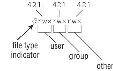
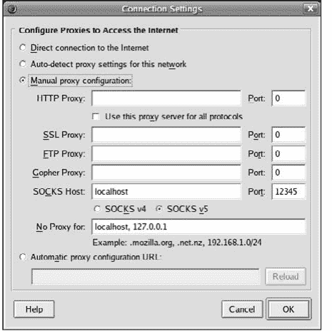
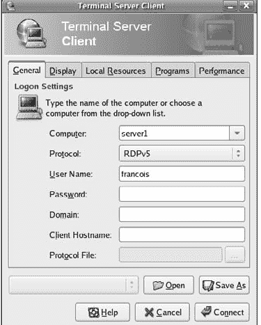
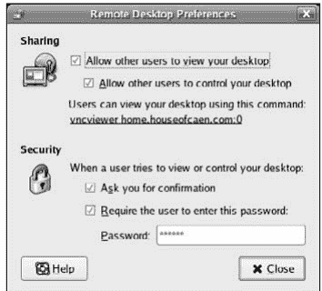

# Fedora Linux toolbox：面向 Fedora、CentOS 和 Red Hat 高级用户的 1000+ 命令指南


Negus, Chris, 1957—

Negus, François Caen.

+   1. Linux. 2. 操作系统（计算机）I. Caen, François. II. Title.

> 一如既往，我将这本书的工作献给我的妻子 Sheree。
> — Christopher Negus
> 献给我的父亲，感谢他小时候教我 BASIC 语言。
> — François Caen

## 作者简介

**Christopher Negus** 是畅销书《Fedora 和 Red Hat Linux 圣经》、《Linux 玩具》、《Linux 故障排除圣经》以及《Linux 圣经2007版》的作者。他是麦迪逊 Linux 用户组的成员。在成为全职作家之前，Chris 曾在 AT&T 的 Unix 操作系统开发团队工作了八年，Unix 正是在那里创建和开发的。他还与 Novell 合作过 Unix 开发和 Caldera Linux。

**François Caen** 通过他的公司 Turbosphere LLC 托管并管理业务应用基础设施，其95% 的系统运行在 Linux 上。作为开源的倡导者，他曾就网络管理和互联网服务进行演讲，并担任塔科马 Linux 用户组主席。他是一位红帽认证工程师（RHCE）。

## 致谢

**开发编辑** Jenny Watson

**执行出版者** Joseph B. Wikert

**编辑** Sara Shlaer

**封面设计** Linsey Osborn

**技术编辑** Thomas Blader

**编排** Laurie Stewart

**校对** Kathryn Duggan

**编辑经理** Mary Wakefield

**索引** Melanie Belkin

**制作经理** Tim Tate

**周年纪念** Richard Pacifico

**执行编辑** Richard Swadley

+   Index................................................................................................281

## 目录

- 使用 Shell 35
- 使用 Bash 历史记录 36
- 使用命令行补全 37
- 重定向标准输入和标准输出 37
- 使用别名 40
- 监控命令 41
- 监控文件 41
- 获取超级用户权限 41
  - 使用 `su` 命令 41
  - 使用 `sudo` 委托权限 42
- 使用环境变量 43
  - 创建简单的 Shell 脚本 45
  - 编辑和运行脚本 45
  - 在脚本中添加内容 45
- 总结 49

## 第 4 章：文件操作 51

- 理解文件类型 51
  - 使用普通文件 51
  - 使用目录 52
  - 使用符号链接和硬链接 53
  - 使用设备文件 54
  - 使用命名管道和套接字 54
- 设置文件/目录权限 55
  - 使用 `chmod` 更改权限 56
  - 设置 `umask` 58
  - 更改所有者 58
- 遍历文件系统 59
- 复制文件 60
- 更改文件属性 62
- 搜索文件 63
  - 使用 `locate` 查找文件 63
  - 使用 `find` 定位文件 64
  - 使用其他命令查找文件 66
- 获取更多文件信息 66
  - 列出文件 67
  - 验证文件 67
- 总结 69

## 第 5 章：文本处理 71

- 使用正则表达式匹配文本 71
- 编辑文本文件 72
  - 使用 `JOE` 编辑器 73
  - 使用 `pico` 和 `nano` 编辑器 76
  - 图形文本编辑器 78
- 列出、排序和更改文本 78
- 列出文本文件 79
- 分文本 80
- 使用 `pr` 对文本文件分页 80
- 使用 `grep` 搜索文本 81
- 使用 `sed` 替换文本 83
- 使用 `tr` 翻译或删除字符 84
- 使用 `diff` 检查两个文件的差异 85
- 使用 `awk` 和 `cut` 处理列 87
- 将文件转换为不同的格式 88
- 总结 88

## 第 6 章：多媒体玩 89

- 处理音频 89
- 播放音乐 89
  - 调整音量 91
  - 刻录 CD 音乐 92
  - 音乐编码 93
  - 流媒体音乐 95
  - 转换音频文件 97
- 转换图像 98
- 获取图像信息 98
  - 转换图像 99
  - 批量转换图像 100
- 总结 102

## 第 7 章：文件系统管理 103

- 理解文件系统基础 103
- 创建和管理文件系统 105
- 硬分区 105
- 使用文件系统标签 109
- 格式化文件系统 110
- 查看和更改文件系统属性 111
- 创建和使用交换分区 113
- 挂载和卸载文件系统 114
  - 从 `fstab` 文件挂载文件系统 114
  - 使用 `mount` 命令挂载文件系统 116
  - 使用 `umount` 卸载文件系统 119
- 检查文件系统 119
- 检查 RAID 磁盘 121
- 获取文件系统信息 123
- 逻辑卷管理器 `LVM` 124
  - 创建 `LVM` 卷 125
  - 使用 `LVM` 卷 127
  - 扩展 `LVM` 卷 128
  - 缩小 `LVM` 卷 129
  - `LVM` 逻辑卷和组 129
- 总结 130

## 第 8 章：备份与可移动介质 131

- 压缩备份 131
  - 使用 `tar` 创建压缩包 131
  - 使用压缩工具 133
  - 使用 `tar` 备份文件 135
  - 使用 `tar` 备份数据 136
  - 通过网络备份 137
  - 使用 `ssh` 备份 `tar` 137
  - 使用 `rsync` 备份 139
  - 备份到可移动介质 140
  - 使用 `mkfs` 创建镜像 141
  - 使用 `tar` 备份镜像 142
  - 使用 `growfs` 144
- 总结 146

## 第 9 章：进程管理 147

- 监控进程 147
- 使用 `ps` 列出进程 148
- 使用 `top` 监控进程 153
- 使用 `pgrep` 查找进程 154
- 使用 `fuser` 查找进程 156
- 杀死进程 157

## 第 10 章：系统监控 158

- 监控资源 158
- 监控内存使用 159
- 监控 CPU 使用率 160
- 监控存储设备 161
- 监控时间 162
- 使用 GUI 设置时间 163
- 监控硬件 164
- 总结 165

## 第 11 章：网络连接管理 166

- 通过 GUI 配置网络 167
- 管理网络卡 168
- 管理网络连接 169
- 启动以太连接 170
- 查看网络接口信息 171
- 使用无线连接 172
- 使用拨号调制接器 173
- 检查名称解析 174
- 诊断网络问题 175
- 检查主机连接性 176
- ARP 协议 177
- 检查路由 178
- 使用 `netstat` 查看连接和统计 179
- 其他网络工具 180
- 总结 181

## 第 12 章：访问网络资源 182

- 访问网络 182
- 使用 `wget` 浏览网页 183
- 下载文件 184
- 使用 `sc` 传输文件 185
- 使用 FTP 传输文件 187
- 使用 SSH 传输文件 188
- 共享共享目录 189
- 使用 NFS 共享目录 190
- 使用 Samba 共享目录 191
- 使用 SSHFS 共享目录 192
- 使用 IRC 聊天 193
- 使用文本式电子邮件客户端 194
- 使用 `mail` 管理邮件 195
- 使用 `mut` 管理邮件 196
- 总结 197

## 第 13 章：远程系统管理 198

- 远程登录 198
- 使用 SSH 进行远程登录和隧道 199
- 配置 SSH 200
- 使用 `ssh` 远程登录 201
- 使用 `screen`：强大的远程终端 202
- 使用 Windows 桌面 203
- 使用 `tsclient` 连接 Windows 桌面 204
- 使用 `rdesktop` 连接 Windows 桌面 205
- 远程 Linux 桌面和应用程序 206
- 使用 VNC 共享桌面 207
- 设置 VNC 服务器 208
- 启动 VNC 客户端 209
- 在不安全网络上通过 SSH 使用 VNC 210
- 使用 Vino 共享桌面 211
- 总结 212


# 第 14 章：安全加固 213

- 管理用户和组 213
  - 通过 GUI 管理用户 214
  - 添加用户账户 214
  - 修改用户账户 215
  - 删除用户账户 216
  - 管理密码 217
  - 添加组 218
- 检查用户 219
  - 配置内置防火墙 220
  - 使用系统日志 221
- 使用高级安全功能 222
- 总结 223

# 附录 A：使用 vi Vim 编辑器 224

- 启动和退出 vi 编辑 224
- 在 vi 中移动 225
- 在 vi 中更改和删除文本 226
- 使用杂项命令 227
- 使用数字修改 228
- 使用 Ex 命令 229
- 在视觉模式工作 230
- 总结 231

# 附录 B：Shell 特殊字符和变量 232

- 使用特殊字符 232
- 使用 Shell 变量 233

# 附录 C：从 `/proc` 获取信息 234

- 查看 `/proc` 信息 234
- 更改 `/proc` 信息 238

# 引言

在对 Linux 有了经验后，你就不需要有人告诉你点击“帮助”按钮来寻求帮助，或者将文件拖到垃圾桶图标来删除它。你需要的是一份参考资料，向你展示强大的命令和选项，让你能够掌控你的 Linux 系统，以及与之相关的进程、用户、存储介质、网络资源和系统服务。

Fedora Linux Toolbox 为你提供了超过 1,000 条特定的命令行，帮助你成为 Linux 高级用户。无论你是系统管理员还是桌面用户，这本书都将向你展示用于创建文件系统、排查网络故障、锁定安全性以及挖掘你对 Linux 系统感兴趣的任何相关知识的命令。

这本书在你的 Linux 命令行旅程中的重点是 Fedora，这是一种由 Red Hat, Inc. 赞助的基于社区的 Linux 发行版。Fedora 以及源自 Fedora 的其他 Linux 社区（如 Red Hat Linux 和 CentOS）已在世界上数以百万计的计算机上。掌握运行这些系统所需的技能，可以帮助你操作自己的 Linux 系统，并学习作为 Linux 专业人士所需要的知识。

## 谁应该读这本书

本书适用于任何想作为系统管理员或用户访问 Linux 系统力量的人。你可能是一个 Linux 爱好者、一个 Linux 专业人士，或者可能是一个计算机专业人士，你日益发现你数据中心中的 Windows 系统越来越多地由 Linux 机器提供。

核心点在于，你希望找到快速、高效的方法，让 Fedora、Red Hat Enterprise 或 CentOS 系统以最佳性能运行。这些系统可能是工作中的几台桌面系统，你学校的一台文件和打印服务器，或者是你为了好玩而做的家庭 Web 服务器。

在理想情况下，你应该已经具有了一些 Linux 经验。然而，如果你是一个拥有管理其他操作系统（如 Windows）技能的计算机专业人士，你应该能够轻松地调整你的知识，以使用我们在书中涵盖的特定命令。

## 本书涵盖了什么

这不是一本给初学者的 Linux 书。在开始之前，最好你对 Linux 是什么、shell 是如何工作的、以及进程、文件系统和网络接口具有基础的知识。这本书将用你执行以下活动所需的信息来补充这些知识：

- **获取软件** — Fedora 提供了软件包更新器 (`yum`) 和软件包管理 (`yum`) GUI 工具来获取软件。通过 `rpm` 和 `yum` 等工具，你将学习从命令行搜索、下载、安装、更新以及其他管理软件的最佳方法。
- **访问应用程序** — 通过搜索 `yum` 仓库查找 Fedora 海量软件中可用的内容。然后使用 `yum-utils` 软件包中的工具进行搜索和下载。
- **使用 shell** — 寻找使用 shell 的巧妙技巧和提示。
- **玩转多媒体** — 从你的计算机播放和流传输多媒体内容。你还可以修改音频和图像文件，并将这些内容转换为不同的格式。
- **处理文件** — 在 Linux 中使用、操作、转换和保护各种类型的文件。
- **管理文件系统** — 访问、格式化、分区和监控你的文件存储硬件（硬盘、CD/DVD 驱动器、软磁盘、USB 闪盘等）。然后对这些硬件设备上创建、格式化和检查文件。
- **备份和恢复数据** — 使用简单的命令收集、归档并压缩你的文件，生成高效的备份包。然后将这些存档存储在本地或远程计算机上。
- **处理进程** — 以多种方式列出运行中的进程，例如按 CPU 使用率、处理器使用情况或进程 ID。更改运行进程使其在后台或前台运行。向进程发送信号，使其重新读取配置文件、停止和恢复，或完全停止（终止）。
- **管理系统** — 运行命令检查系统资源，例如内存使用情况、运行级别、启动加载程序和内核模块。
- **监控网络** — 启用和禁用有线、无线和拨号网络连接。
- **访问网络** — 启用有线、无线和拨号网络连接。
- **远程管理** — 运行命令检查系统资源，如内存使用情况、运行级别、启动加载程序和内核模块。
- **安全性** — 运行命令命令的防火墙、日志墙和日志，来锁定安全性。
- **获取信息** — 运行命令检查系统资源，如内存使用情况、运行级别、启动加载程序和内核模块。

# 引言

时间（某些可以追溯到 30 多年前的原始 Unix 时代），大多数系统在 RHEL、CentOS 以及其他 Fedora 衍生系统上的工作方式与此处描述的完全相同，无论 CPU 架构如何。

书中描述的许多命令也适用于其他 Linux 和 Unix 系统。由于本书侧重于 Fedora 和其他基于 Red Hat 的发行版，因此其描述内容与其他 Linux 系统的主要区别在于软件包管理、安装和 GUI 管理工具等领域。

# 惯例

为了帮助你充分利用书中的内容并跟进开发进展，我们在整本书中使用了许多命名惯例。特别是，我们创建了用于显示命令的样式，以便在书中尽可能容纳更多的命令行内容。

在命令示例中，计算机输出（shell 提示符和消息）以正体等宽字体显示，计算机输入（你输入的内容）以**粗体等宽字体**显示，而简短的描述（如果包含）则以*斜体*显示。以下是一个示例：

```
$ ls *jpg
List all JPEG files in the current directory
hat.jpg
dog.jpg
...
```

为了节省空间，输出有时会被截断（完全跳过）。三个点（...）表示额外的输出被删除了。如果一个命令特别长，每行末会出现反斜杠（\），表示它将延续到下一行。以下是一个示例：

```
# oggenc NewSong.wav -o NewSong.ogg \
- *Bernstein -G Classical \
- d 06/15/1972 -t "Simple Song" \
- 1-"Bernsteins Mass" \
- c info=*From Kennedy Center"
```

在刚刚显示的示例中，你可以直接输入反斜杠，将所有信息包含在单个命令中。或者，你也可以简单地将所有信息放在一行（不包括反斜杠）。注意命令提示符以以下方式之一显示：

- `$` 表示普通用户提示符
- `#` 表示 root 用户提示符

如所述，当出现美元符号提示符 (`$`) 时，任何用户都可以运行该命令。带有井号符号提示符 (`#`)，你可能需要是 root 用户才能运行命令。

# 引言

注释和警告显示如下：

> **NOTE** 警告、注释和提示会像这样缩进并以斜体显示。

至于文中的样式：

- 我们在引入新术语和重要词汇时使用*斜体*进行突出显示。
- 我们这样显示组合键：`Ctrl+a`。如果命令要求你输入大写字母，组合键将显示为：`Ctrl+Shift+a`。
- 我们在文中像这样显示文件名、URL 和代码：`persistence.properties`

我们使用的最后一种技术是突出显示描述即将执行的命令用途的文本。例如，我们可能会说，“使用以下命令来*显示文件的内容*。”我们通过这种方式突出描述，是为了为读者提供快速的视觉提示，以便你可以轻松扫描页面找到你刚刚知道必须存在的那个命令。

# 从 Fedora Linux 开始

无论你是每天使用 Fedora Linux，还是偶尔对其进行调整，一本提供高效使用、检查、修复和增强系统方法的书籍都可以成为一份无贵的资源。

我们通过 Fedora Linux Toolbox 的目标是将大量关于 Linux 的有用信息封装在一个你可以随身携带的小型包中。最后，我们描述了：

- 命令 — 大量的命令行示例，帮助以有效且巧妙的方式使用 Fedora。
- GUI 工具 — 快速指向配置系统的图形化管理工具的指南。
- 软件仓库 — 查找和下载数千个应用程序的简短步骤。
- 在线资源 — 寻找 Fedora 论坛、邮件列表、IRC 通道和其他资源的最佳位置列表。
- 本地文档 — 从 `man` 页面（帮助手册）、`doc` 目录、帮助命令以及你 Fedora 系统上的其他资源收集更多信息的工具。

由于你不是 Linux 的初学者，你不会看到很多窗口、图标和菜单的截图。然而，你将看到：

- 寻找 Fedora 资源
- 学习快速且强大的命令
- 拥有许多实用工具的参考


# 像 Linux 大师一样工作

# 第 1 章：从 Fedora Linux 开始

这是获取所需信息的最快路径，让你充分利用你的 Fedora Linux 系统。

如果这听起来对你有用，请继续阅读。

Fedora 是由 Red Hat, Inc. 赞助的 Linux 操作系统。它的根源于 Red Hat Linux，后者在 2003 年结束了在该名称下的开发生命。当时，Red Hat 将其单一 Red Hat Linux 发行版转换为 Fedora Core（现在简单称为 Fedora）和 Red Hat Enterprise Linux。

- Fedora (`http://fedoraproject.org`) 变成社区驱动、快速开发的操作系统，每免费（原样）发行六到九个月一次。其目标是让 Red Hat 能够保持技术前沿性。
- Red Hat Enterprise Linux (`RHEL`) 的目标是为企业提供一个稳定的解决方案。
- Red Hat Enterprise Linux (`RHEL`) 的目标是为企业级提供可靠的长期支持。
- Red Hat Enterprise Linux (`RHEL`) 的目标是为企业级提供经过严格测试的软件包包。
- Red Hat Enterprise Linux (`RHEL`) 的目标是为企业级提供一个可预测的生命周期管理。


Red Hat Enterprise Linux (RHEL) Red Hat Enterprise Linux (RHEL) Red Hat Enterprise Linux (RHEL) Red Hat Enterprise Linux (RHEL) Red Hat Enterprise Linux (RHEL) Red Hat Enterprise Linux (RHEL) Red Hat Enterprise Linux (RHEL) Red Hat Enterprise Linux (RHEL) Red Hat Enterprise Linux (RHEL) Red Hat Enterprise Linux (RHEL) Red Hat Enterprise Linux (RHEL) Red Hat Enterprise Linux (RHEL) Red Hat Enterprise Linux (RHEL) Red Hat Enterprise Linux (RHEL) Red Hat Enterprise Linux (RHEL) Red Hat Enterprise Linux (RHEL) Red Hat Enterprise Linux (RHEL) Red Hat Enterprise Linux (RHEL) Red Hat Enterprise Linux (RHEL) Red Hat Enterprise Linux (RHEL) Red Hat Enterprise Linux (RHEL) Red Hat Enterprise Linux (RHEL) Red Hat Enterprise Linux (RHEL) Red Hat Enterprise Linux (RHEL) Red Hat Enterprise Linux (RHEL) Red Hat Enterprise Linux (RHEL) Red Hat Enterprise Linux (RHEL) Red Hat Enterprise Linux (RHEL) Red Hat Enterprise Linux (RHEL) Red Hat Enterprise Linux (RHEL) Red Hat Enterprise Linux (RHEL) Red Hat Enterprise Linux (RHEL) Red Hat Enterprise Linux (RHEL) Red Hat Enterprise Linux (RHEL) Red Hat Enterprise Linux (RHEL) Red Hat Enterprise Linux (RHEL) Red Hat Enterprise Linux (RHEL) Red Hat Enterprise Linux (RHEL) Red Hat Enterprise Linux (RHEL) Red Hat Enterprise Linux (RHEL) Red Hat Enterprise Linux (RHEL) Red Hat Enterprise Linux (RHEL) Red Hat Enterprise Linux (RHEL) Red Hat Enterprise Linux (RHEL) Red Hat Enterprise Linux (RHEL) Red Hat Enterprise Linux (RHEL) Red Hat Enterprise Linux (RHEL) Red Hat Enterprise Linux (RHEL) Red Hat Enterprise Linux (RHEL) Red Hat Enterprise Linux (RHEL) Red Hat Enterprise Linux (RHEL) Red Hat Enterprise Linux (RHEL) Red Hat Enterprise Linux (RHEL) Red Hat Enterprise Linux (RHEL) Red Hat Enterprise Linux (RHEL) Red Hat Enterprise Linux (RHEL) Red Hat Enterprise Linux (RHEL) Red Hat Enterprise Linux (RHEL) Red Hat Enterprise Linux (RHEL) Red Hat Enterprise Linux (RHEL) Red Hat Enterprise Linux (RHEL) Red Hat Enterprise Linux (RHEL) Red Hat Enterprise Linux (RHEL) Red Hat Enterprise Linux (RHEL) Red Hat Enterprise Linux (RHEL) Red Hat Enterprise Linux (RHEL) Red Hat Enterprise Linux (RHEL) Red Hat Enterprise Linux (RHEL) Red Hat Enterprise Linux (RHEL) Red Hat Enterprise Linux (RHEL) Red Hat Enterprise Linux (RHEL) Red Hat Enterprise Linux (RHEL) Red Hat Enterprise Linux (RHEL) Red Hat Enterprise Linux (RHEL) Red Hat Enterprise Linux (RHEL) Red Hat Enterprise Linux (RHEL) Red Hat Enterprise Linux (RHEL) Red Hat Enterprise Linux (RHEL) Red Hat Enterprise Linux (RHEL) Red Hat Enterprise Linux (RHEL) Red Hat Enterprise Linux (RHEL) Red Hat Enterprise Linux (RHEL) Red Hat Enterprise Linux (RHEL) Red Hat Enterprise Linux (RHEL) Red Hat Enterprise Linux (RHEL) Red Hat Enterprise Linux (RHEL) Red Hat Enterprise Linux (RHEL) Red Hat Enterprise Linux (RHEL) Red Hat Enterprise Linux (RHEL) Red Hat Enterprise Linux (RHEL) Red Hat Enterprise Linux (RHEL) Red Hat Enterprise Linux (RHEL) Red Hat Enterprise Linux (RHEL) Red Hat Enterprise Linux (RHEL) Red Hat Enterprise Linux (RHEL) Red Hat Enterprise Linux (RHEL) Red Hat Enterprise Linux (RHEL) Red Hat Enterprise Linux (RHEL) Red Hat Enterprise Linux (RHEL) Red Hat Enterprise Linux (RHEL) Red Hat Enterprise Linux (RHEL) Red Hat Enterprise Linux (RHEL) Red Hat Enterprise Linux (RHEL) Red Hat Enterprise Linux (RHEL) Red Hat Enterprise Linux (RHEL) Red Hat Enterprise Linux (RHEL) Red Hat Enterprise Linux (RHEL) Red Hat Enterprise Linux (RHEL) Red Hat Enterprise Linux (RHEL) Red Hat Enterprise Linux (RHEL) Red Hat Enterprise Linux (RHEL) Red Hat Enterprise Linux (RHEL) Red Hat Enterprise Linux (RHEL) Red Hat Enterprise Linux (RHEL) Red Hat Enterprise Linux (RHEL) Red Hat Enterprise Linux (RHEL) Red Hat Enterprise Linux (RHEL) Red Hat Enterprise Linux (RHEL) Red Hat Enterprise Linux (RHEL) Red Hat Enterprise Linux (RHEL) Red Hat Enterprise Linux (RHEL) Red Hat Enterprise Linux (RHEL) Red Hat Enterprise Linux (RHEL) Red Hat Enterprise Linux (RHEL) Red Hat Enterprise Linux (RHEL) Red Hat Enterprise Linux (RHEL) Red Hat Enterprise Linux (RHEL) Red Hat Enterprise Linux (RHEL) Red Hat Enterprise Linux (RHEL) Red Hat Enterprise Linux (RHEL) Red Hat Enterprise Linux (RHEL) Red Hat Enterprise Linux (RHEL) Red Hat Enterprise Linux (RHEL) Red Hat Enterprise Linux (RHEL) Red Hat Enterprise Linux (RHEL) Red Hat Enterprise Linux (RHEL) Red Hat Enterprise Linux (RHEL) Red Hat Enterprise Linux (RHEL) Red Hat Enterprise Linux (RHEL) Red Hat Enterprise Linux (RHEL) Red Hat Enterprise Linux (RHEL) Red Hat Enterprise Linux (RHEL) Red Hat Enterprise Linux (RHEL) Red Hat Enterprise Linux (RHEL) Red Hat Enterprise Linux (RHEL) Red Hat Enterprise Linux (RHEL) Red Hat Enterprise Linux (RHEL) Red Hat Enterprise Linux (RHEL) Red Hat Enterprise Linux (RHEL) Red Hat Enterprise Linux (RHEL) Red Hat Enterprise Linux (RHEL) Red Hat Enterprise Linux (RHEL) Red Hat Enterprise Linux (RHEL) Red Hat Enterprise Linux (RHEL)


) Red Hat Enterprise Linux (RHEL) Red Hat Enterprise Linux (RHEL) Red Hat Enterprise Linux (RHEL) Red Hat Enterprise Linux (RHEL) Red Hat Enterprise Linux (RHEL) Red Hat Enterprise Linux (RHEL) Red Hat Enterprise Linux (RHEL) Red Hat Enterprise Linux (RHEL) Red Hat Enterprise Linux (RHEL) Red Hat Enterprise Linux (RHEL) Red Hat Enterprise Linux (RHEL) Red Hat Enterprise Linux (RHEL) Red Hat Enterprise Linux (RHEL) Red Hat Enterprise Linux (RHEL) Red Hat Enterprise Linux (RHEL) Red Hat Enterprise Linux (RHEL) Red Hat Enterprise Linux (RHEL) Red Hat Enterprise Linux (RHEL) Red Hat Enterprise Linux (RHEL) Red Hat Enterprise Linux (RHEL) Red Hat Enterprise Linux (RHEL) Red Hat Enterprise Linux (RHEL) Red Hat Enterprise Linux (RHEL) Red Hat Enterprise Linux (RHEL) Red Hat Enterprise Linux (RHEL) Red Hat Enterprise Linux (RHEL) Red Hat Enterprise Linux (RHEL) Red Hat Enterprise Linux (RHEL) Red Hat Enterprise Linux (RHEL) Red Hat Enterprise Linux (RHEL) Red Hat Enterprise Linux (RHEL) Red Hat Enterprise Linux (RHEL) Red Hat Enterprise Linux (RHEL) Red Hat Enterprise Linux (RHEL) Red Hat Enterprise Linux (RHEL) Red Hat Enterprise Linux (RHEL) Red Hat Enterprise Linux (RHEL) Red Hat Enterprise Linux (RHEL) Red Hat Enterprise Linux (RHEL) Red Hat Enterprise Linux (RHEL) Red Hat Enterprise Linux (RHEL) Red Hat Enterprise Linux (RHEL) Red Hat Enterprise Linux (RHEL) Red Hat Enterprise Linux (RHEL) Red Hat Enterprise Linux (RHEL) Red Hat Enterprise Linux (RHEL) Red Hat Enterprise Linux (RHEL) Red Hat Enterprise Linux (RHEL) Red Hat Enterprise Linux (RHEL) Red Hat Enterprise Linux (RHEL) Red Hat Enterprise Linux (RHEL) Red Hat Enterprise Linux (RHEL) Red Hat Enterprise Linux (RHEL) Red Hat Enterprise Linux (RHEL) Red Hat Enterprise Linux (RHEL) Red Hat Enterprise Linux (RHEL) Red Hat Enterprise Linux (RHEL) Red Hat Enterprise Linux (RHEL) Red Hat Enterprise Linux (RHEL) Red Hat Enterprise Linux (RHEL) Red Hat Enterprise Linux (RHEL) Red Hat Enterprise Linux (RHEL) (RHEL) Red Hat Enterprise Linux (RHEL) Red Hat Enterprise Linux (RHEL) Red Hat Enterprise Linux (RHEL) Red Hat Enterprise Linux (RHEL) Red Hat Enterprise Linux (RHEL) Red Hat Enterprise Linux (RHEL) Red Hat Enterprise Linux (RHEL)


`Red Hat Enterprise Linux (RHEL)`


 Enterprise Linux (RHEL) RedHEL Enterprise Linux (RHEL) RedHEL Enterprise Linux (RHEL) RedHEL Enterprise Enterprise (RHEL) RedHEL Enterprise Enterprise (RHEL) RedHEL Enterprise Enterprise (RHEL) RedHEL Enterprise Linux (RHEL) RedHEL Enterprise Enterprise (RHEL) RedHEL Enterprise Enterprise (RHEL) RedHEL Enterprise Enterprise (RHEL) RedHEL Enterprise Enterprise (RHEL) RedHEL Enterprise Enterprise (RHEL) RedHEL Enterprise Enterprise (RHELHELHELHELHELHELHELHELHELHELHELHELHELHELHELHELHELHELHELHELHELHELHELHELHELHELHELHELHELHELHELHELHELHELHELHELHELHELHELHELHELHELHELHELHELHELHELHELHELHELHELHELHELHELHELHELHELHELHELHELHELHELHELHELHELHELHELHELHELHELHELHELHELHELHELHELHELHELHELHELHELHELHELHELHELHELHELHELHELHELHELHELHELHELHELHELHELHELHELHELHELHELHELHELHELHELHELHELHELHELHELHELHELHELHELHELHELHELHELHELHELHELHELHELHELHELHELHELHELHELHELHELHELHELHELHELHELHELHELHELHELHELHELHELHELHELHELHELHELHELHELHELHELHELHELHELHELHELHELHELHELHELHELHELHELHELHELHELHELHELHELHELHELHELHELHELHELHELHELHELHELHELHELHELHELHELHELHELHELHELHELHELHELHELHELHELHELHELHELHELHELHELHELHELHELHELHELHELHELHELHELHELHELHELHELHELHELHELHELHELHELHELHELHELHELHELHELHELHELHELHELHELHELHELHELHELHELHELHELHELHELHELHELHELHELHELHELHELHELHELHELHELHELHELHELHELHELHELHELHELHELHELHELHELHELHELHELHELHELHELHELHELHELHELHELHELHELHELHELHELHELHELHELHELHELHELHELHELHELHELHELHELHELHELHELHELHELHELHELHELHELHELHELHELHELHELHELHELHELHELHELHELHELHELHELHELHELHELHELHELHELHELHELHELHELHELHELHELHELHELHELHELHELHELHELHELHELHELHELHELHELHELHELHELHELHELHELHELHELHELHELHELHELHELHELHELHELHELHELHELHELHELHELHELHELHELHELHELHELHELHELHELHELHELHELHELHELHELHELHELHELHELHELHELHELHELHELHELHELHELHELHELHELHELHELHELHELHELHELHELHELHELHELHELHELHELHELHELHELHELHELHELHELHELHELHELHELHELHELHELHELHELHELHELHELHELHELHELHELHELHELHELHELHELHELHELHELHELHELHELHELHELHELHELHELHELHELHELHELHELHELHELHELHELHELHELHELHELHELHELHELHELHELHELHELHELHELHELHELHELHELHELHELHELHELHELHELHELHELHELHELHELHELHELHELHELHELHELHELHELHELHELHELHELHELHELHELHELHELHELHELHELHELHELHELHELHELHELHELHELHELHELHELHELHELHELHELHELHELHELHELHELHELHELHELHELHELHELHELHELHELHELHELHELHELHELHELHELHELHELHELHELHELHELHELHELHELHELHELHELHELHELHELHELHELHELHELHELHELHELHELHELHELHELHELHELHELHELHELHELHELHELHELHELHELHELHELHELHELHELHELHELHELHELHELHELHELHELHELHELHELHELHELHELHELHELHELHELHELHELHELHELHELHELHELHELHELHELHELHELHELHELHELHELHELHELHELHELHELHELHELHELHELHELHELHELHELHELHELHELHELHELHELHELHELHELHELHELHELHELHELHELHELHELHELHELHELHELHELHELHELHELHELHELHELHELHELHELHELHELHELHELHELHELHELHELHELHELHELHELHELHELHELHELHELHELHELHELHELHELHELHELHELHELHELHELHELHELHELHELHELHELHELHELHELHELHELHELHELHELHELHELHELHELHELHELHELHELHELHELHELHELHELHELHELHELHELHELHELHELHELHELHELHELHELHELHELHELHELHELHELHELHELHELHELHELHELHELHELHELHELHELHELHELHELHELHELHELHELHELHELHELHELHELHELHELHELHELHELHELHELHELHELHELHELHELHELHELHELHELHELHELHELHELHELHELHELHELHELHELHELHELHELHELHELHELHELHELHELHELHELHELHELHELHELHELHELHELHELHELHELHELHELHELHELHELHELHELHELHELHELHELHELHELHELHELHELHELHELHELHELHELHELHELHELHELHELHELHELHELHELHELHELHELHELHELHELHELHELHELHELHELHELHELHELHELHELHELHELHELHELHELHELHELHELHELHELHELHELHELHELHELHELHELHELHELHELHELHELHELHELHELHELHELHELHELHELHELHELHELHELHELHELHELHELHELHELHELHELHELHELHELHELHELHELHELHELHELHELHELHELHELHELHELHELHELHELHELHELHELHELHELHELHELHELHELHELHELHELHELHELHELHELHELHELHELHELHELHELHELHELHELHELHELHELHELHELHELHELHELHELHELHELHELHELHELHELHELHELHELHELHELHELHELHELHELHELHELHELHELHELHELHELHELHELHELHELHELHELHELHELHELHELHELHELHELHELHELHELHELHELHELHELHELHELHELHELHELHELHELHELHELHELHELHELHELHELHELHELHELHELHELHELHELHELHELHELHELHELHELHELHELHELHELHELHELHELHELHELHELHELHELHELHELHELHELHELHELHELHELHELHELHELHELHELHELHELHELHELHELHELHELHELHELHELHELHELHELHELHELHELHELHELHELHELHELHELHELHELHELHELHELHELHELHELHELHELHELHELHELHELHELHELHELHELHELHELHELHELHELHELHELHELHELHELHELHELHELHELHELHELHELHELHELHELHELHELHELHELHELHELHELHELHELHELHELHELHELHELHELHELHELHELHELHELHELHELHELHELHELHELHELHELHELHELHELHELHELHELHELHELHELHELHELHELHELHELHELHELHELHELHELHELHELHELHELHELHELHELHELHELHELHELHELHELHELHELHELHELHELHELHELHELHELHELHELHELHELHELHELHELHELHELHELHELHELHELHELHELHELHELHELHELHELHELHELHELHELHELHELHELHELHELHELHELHELHELHELHELHELHELHELHELHELHELHELHELHELHELHELHELHELHELHELHELHELHELHELHELHELHELHELHELHELHELHELHELHELHELHELHELHELHELHELHELHELHELHELHELHELHELHELHELHELHELHELHELHELHELHELHELHELHELHELHELHELHELHELHELHELHELHELHELHELHELHELHELHELHELHELHELHELHELHELHELHELHELHELHELHELHELHELHELHELHELHELHELHELHELHELHELHELHELHELHELHELHELHELHELHELHELHELHELHELHELHELHELHELHELHELHELHELHELHELHELHELHELHELHELHELHELHELHELHELHELHELHELHELHELHELHELHELHELHELHELHELHELHELHELHELHELHELHELHELHELHELHELHELHELHELHELHELHELHELHELHELHELHELHELHELHELHELHELHELHELHELHELHELHELHELHELHELHELHELHELHELHELHELHELHELHELHELHELHELHELHELHELHELHELHELHELHELHELHELHELHELHELHELHELHELHELHELHELHELHELHELHELHELHELHELHELHELHELHELHELHELHELHELHELHELHELHELHELHELHELHELHELHELHELHELHELHELHELHELHELHELHELHELHELHELHELHELHELHELHELHELHELHELHELHELHELHELHELHELHELHELHELHELHELHELHELHELHELHELHELHELHELHELHELHELHELHELHELHELHELHELHELHELHELHELHELHELHELHELHELHELHELHELHELHELHELHELHELHELHELHELHELHELHELHELHELHELHELHELHELHELHELHELHELHELHELHELHELHELHELHELHELHELHELHELHELHELHELHELHELHELHELHELHELHELHELHELHELHELHELHELHELHELHELHELHELHELHELHELHELHELHELHELHELHELHELHELHELHELHELHELHELHELHELHELHELHELHELHELHELHELHELHELHELHELHELHELHELHELHELHELHELHELHELHELHELHELHELHELHELHELHELHELHELHELHELHELHELHELHELHELHELHELHELHELHELHELHELHELHELHELHELHELHELHELHELHELHELHELHELHELHELHELHELHELHELHELHELHELHELHELHELHELHELHELHELHELHELHELHELHELHELHELHELHELHELHELHELHELHELHELHELHELHELHELHELHELHELHELHELHELHELHELHELHELHELHELHELHELHELHELHELHELHELHELHELHELHELHELHELHELHELHELHELHELHELHELHELHELHELHELHELHELHELHELHELHELHELHELHELHELHELHELHELHELHELHELHELHELHELHELHELHELHELHELHELHELHELHELHELHELHELHELHELHELHELHELHELHELHELHELHELHELHELHELHELHELHELHELHELHELHELHELHELHELHELHELHELHELHELHELHELHELHELHELHELHELHELHELHELHELHELHELHELHELHELHELHELHELHELHELHELHELHELHELHELHELHELHELHELHELHELHELHELHELHELHELHELHELHELHELHELHELHELHELHELHELHELHELHELHELHELHELHELHELHELHELHELHELHELHELHELHELHELHELHELHELHELHELHELHELHELHELHELHELHELHELHELHELHELHELHELHELHELHELHELHELHELHELHELHELHELHELHELHELHELHELHELHELHELHELHELHELHELHELHELHELHELHELHELHELHELHELHELHELHELHELHELHELHELHELHELHELHELHELHELHELHELHELHELHELHELHELHELHELHELHELHELHELHELHELHELHELHELHELHELHELHELHELHELHELHELHELHELHELHELHELHELHELHELHELHELHELHELHELHELHELHELHELHELHELHELHELHELHELHELHELHELHELHELHELHELHELHELHELHELHELHELHELHELHELHELHELHELHELHELHELHELHELHELHELHELHELHELHELHELHELHELHELHELHELHELHELHELHELHELHELHELHELHELHELHELHELHELHELHELHELHELHELHELHELHELHELHELHELHELHELHELHELHELHELHELHELHELHELHELHELHELHELHELHELHELHELHELHELHELHELHELHELHELHELHELHELHELHELHELHELHELHELHELHELHELHELHELHELHELHELHELHELHELHELHELHELHELHELHELHELHELHELHELHELHELHELHELHELHELHELHELHELHELHELHELHELHELHELHELHELHELHELHELHELHELHELHELHELHELHELHELHELHELHELHELHELHELHELHELHELHELHELHELHELHELHELHELHELHELHELHELHELHELHELHELHELHELHELHELHELHELHELHELHELHELHELHELHELHELHELHELHELHELHELHELHELHELHELHELHELHELHELHELHELHELHELHELHELHELHELHELHELHELHELHELHELHELHELHELHELHELHELHELHELHELHELHELHELHELHELHELHELHELHELHELHELHELHELHELHELHELHELHELHELHELHELHELHELHELHELHELHELHELHELHELHELHELHELHELHELHELHELHELHELHELHELHELHELHELHELHELHELHELHELHELHELHELHELHELHELHELHELHELHELHELHELHELHELHELHELHELHELHELHELHELHELHELHELHELHELHELHELHELHELHELHELHELHELHELHELHELHELHELHELHELHELHELHELHELHELHELHELHELHELHELHELHELHELHELHELHELHELHELHELHELHELHELHELHELHELHELHELHELHELHELHELHELHELHELHELHELHELHELHELHELHELHELHELHELHELHELHELHELHELHELHELHELHELHELHELHELHELHELHELHELHELHELHELHELHELHELHELHELHELHELHELHELHELHELHELHELHELHELHELHELHELHELHELHELHELHELHELHELHELHELHELHELHELHELHELHELHELHELHELHELHELHELHELHELHELHELHELHELHELHELHELHELHELHELHELHELHEL


# Introduction

time (some dating back over 30 years to the original Unix days), most will work exactly as described here on RHEL, CentOS, and other Fedora derivative systems, regardless of CPU architecture. own

Many of the commands described in this book will work on other Linux and Unix systems as well. Because this book focuses on Fedora and other Red Hat-based distributions, descriptions will differ from other Linux systems most prominently in the areas of packaging, installation, and GUI administration tools.

# 第1章：开始 Fedora Linux

## 寻找 Fedora 资源

关于 Fedora 项目信息的中心是 FedoraProject.org 网站 (`http://fedaproject.org/wiki/`)。这是 Fedora 项目的官方网站。该网站上特别有页面包括：

- `fedaproject.org/wiki/Communicate` — 从“交流与帮助”（Communicating and Getting Help）页面开始，可以通过链接访问文档、常见问题解答（FAQs）、错误报告、邮件列表、IRC聊天、论坛和社区网站。
- `fedaproject.org/wiki/Distribution` — 该网站列出了下载或购买 Fedora 安装 CD 或 DVD 的信息链接。某些页面会带您查看有关每个 Fedora 升级和生命周期的详细信息。
- `fedaproject.org/wiki/FAQ` — 这份常见问题解答包含了关于如何开始使用 Fedora、如何使用、获取帮助和支持，以及了解 Fedora 项目组成部分的优秀信息。对于关于硬件兼容性以及 Fedora 中包含哪些软件的问题，这里也是首选的地方。
- `fedaproject.org/wiki/ForbiddenItems` — 此页面列出了 Linux可用但未包含在 Fedora 中的软件，因为它们不符合 Fedora 关于法律限制或源代码可用性的要求。我们在本书的相关章节中将说明您如何合法地获取其中的一些条目。
- `fedaproject.org/wiki/Bugs/FC6Common` — 此页面描述了您可能会遇到但尚未修复的问题。还有关于获取包含软件修复的更新磁盘的信息。

## Fedora 社区连接

如果您想与 Fedora 社区交流，表 1-1 显示了最实用的 Fedora 和 RHEL 社区链接快速列表。

**表 1-1：连接到 Fedora 社区的在线资源**

| Fedora 活动 | 互联网站点 |
| --- | --- |
| 邮件列表 | `www.redhat.com/mailman/listinfo` |
| IRC 聊天 | `fedaproject.org/wiki/Communicate#IRC` |
| 论坛 | `FedoraForum.org LinuxForums.org` |
| 社区 | `FedoraFaq.org fcp.surfsite.org FedoraUnity.org FedoraSolved.org` |
| 新闻 | `FedoraNEWS.org` |
| 社交网络 | `groups.myspace.com/fedaproject www.fappr.com/fedora www.flickr.com/groups/fedora` |

## Fedora 软件

在 Fedora 7 之前，Fedora 软件的开发由基础操作系统（Fedora Core）和外部贡献包（Fedora Extras）组成。图形用户界面（GUI）的设计是直观的。具有某些经验后，您可能可以搞定，例如如何通过 GUI 添加用户、更改日期和时间以及配置显卡。对于这些情况，我们会提到您可以使用哪种图形工具完成工作。然而，您可能需要依赖命令行：

- 几乎任何时候都会出错 — 在在线论坛上提问以解决您遇到的某些 Linux 问题，您获得的帮助将始终以运行命令的形式出现。此外，如果在配置设备或访问文件和目录时出现问题，命令行工具通常提供多得反馈。
- 远程系统管理 — 如果您正在管理远程服务器，可能没有可用的图形工具。虽然可以使用远程 GUI 访问（使用 X 应用或 VNC）和基于 Web的管理工具，但它们的运行速度通常比从命令行执行要慢。
- **GUI 不支持的功能** — GUI 管理工具倾向于展示执行任务的基本方式。更复杂的操作通常需要只有命令行才提供的选项。
- **GUI 损坏或未安装** — 如果没有图形界面可用，或者安装的 GUI 运行不正常，您可能被迫从命令行工作。GUI 损坏有很多种原因，例如当您使用来自 NVIDIA 或 ATI 的第三方仅二进制驱动程序时，内核升级导致驱动程序不兼容。

底线是，若要释放您的 Linux 系统的全部威力，您必须能够使用 shell 命令。Linux 有成千上万条命令用于监控和管理您的 Linux 系统的各个方面。

但无论您是 Linux 大师还是新手，一个巨大的挑战悬在面前。当命令 shell 可能只向您显示这样时，您如何记住您需要的最关键命令和选项呢：

```
$
```

Fedora Linux 工具箱不仅仅是命令参考或手册页（man pages）的重述。相反，本书以您使用它们的方式来介绍 Fedora Linux 中的命令。换句话说，我们不是按字母顺序列出命令，而是将用于文件系统、连接网络和管理进程的命令分组，这样您就可以根据您想做什么来访问命令，而不仅仅根据它们如何命名。

同样，我们不会给您提供每个命令的所有可用选项列表。相反，我们将向您展示用于每个命令的最重要且实用的选项的运行示例。从那里，我们将告诉您查找更多选项的快捷方法，如果需要的话。

## 查找命令

书中描述的某些命令在您运行它们时可能尚未安装。您可能会输入命令并看到类似的消息：

```bash
bash: mycommand: command found
```

这可能是由于以下原因引起的：

- 您输入错误的命令名。
- 命令不在您的 `PATH` 中。
- 命令可能需要 root 用户权限才能在 `PATH` 中。
- 命令未安装在您的计算机上。

表 1-2 显示了您可以运行的查找您想要命令的命令。

**表 1-2：查找命令**

| 命令及示例输出 | 描述 |
|---|---|
| `$ type mount` | 显示 `PATH` 中的第一个 `mount` 命令。 |
| `mount is hashed (/bin/mount)` | |
| `$ whereabouts` | 显示 `mount` 的二进制、源和手册页。 |
| `mount:/bin/mount /sbin/mount.cifs /sbin/mount.smbfs /usr/share/man/man2/mount.2.gz /usr/share/man/man8/mount.8.gz` | |
| `$ locate bash.ps` | 在文件系统的任何位置查找 `bash.ps`。 |


| `$ which umount` | 在您的 PATH 或别名中查找 `umount` 命令。 |

| `/bin/umount` | |

| `$ rpm -qal um | grep umount` | 在任何已安装包中查找 `umount`。 |

| `/usr/share/man/man2/umount.2.gz` `/usr/share/man/man2/umount2.gz` | |

| `$ yum provides bzf` | 在 `bzflag` 中查找 `bzfs`。 |

| `bzflag.i386 2.0.8-3.fc6 extras` | |

匹配自：

/usr/bin/bzfs

/usr/share/man/man6/bzfs.6.gz

如果您怀疑所需的命令未安装，可以在 Fedora 存储库中搜索包含该软件包描述的术语。如果您找到了正确的包（例如 `bzflag`）且它尚未安装，可以通过输入以下命令从互联网安装：

```bash
# yum search capture-the-flag
Searching Packages:
Setting up repositories
Reading repository metadata in from local files
```

```
bzflag.i386 2.0.8-4.fc7 fedora
Matched from:
bzflag 是一个 3D 多玩家坦克大战游戏，允许用户进行...
...
```

主要有两种主要的游戏风格：夺旗战（`capture-the-flag`）和自由乱斗（`free-for-all`）。

```bash
# yum install bzflag
```

# 第一章：从 Fedora Linux 开始

## Fedora 中的命令参考信息

原始的 Linux 和 UNIX 文档都是通过手册页完成的，通常称为 `man pages`（手册页）。稍后出现了一种更复杂的文档编制工作，即 `info` 设施。在每个命令内部，几乎总是可以找到帮助信息。

这些参考信息是以组件为导的——换句话说，Linux 系统中的几乎每一个命令、文件格式、系统调用、设备和其他组件都有单独的 man 页。与整个软件包更紧密结合的文档通常存储在 `/usr/share/doc` 目录的子目录下。

这三类参考工具——`man` 页、`info` 文档和帮助信息——在 Fedora 中均可用。

## 使用帮助信息

`-h` 或 `--help` 选项通常用于显示命令的帮助信息。下面的示例说明了如何为命令显示帮助：

```bash
$ ls --help | less
Usage: ls [OPTION]... [FILE]
列出关于 FILE 的信息（默认是当前目录）。
如果没有使用 -ctfusUX 或 --sort，则按字母顺序对条目进行排序。
```

字体 长选项的强制性参数对于短选项也是强制性的。

- `-a`, `--all` 不隐藏以 . 开头的条目。
- `-A`, `--almost-all` 不列出隐含的 ..

前面的输出显示了 `ls` 命令行如何允许并列出可用选项。将输出通过到 `less` 命令可以进行分页查看。你可以使用 `card` 命令将帮助信息格式化为参考卡片。例如：

```bash
$ ls --output=tmp/ls.ps
$ lpr ls.ps
```

结果是一个名为 `ls.ps` 的文件，你可以用 PostScript 阅读器打开它（选择向右旋转以正确查看卡片）。你可以使用 `lpr` 命令打印卡片，或者如果不使用 `--output` 选项，它会自动将其发送到你的默认打印机。

## 使用 man 页

假设你想查找与某个单词相关的命令的 man 页。使用 `apropos` 命令搜索 man 页数据库。这会显示 NAME 行中包含 `crontab` 的 man 页：

```bash
$ apropos crontab
...
```

```bash
/etc/anacontab [anacontab] (5) - anacroncrontab (1) 的配置文件 - 维护单个用户的 crontab 文件 (ISC Cron V4.1)
crontab (1p) - 调度定期后台工作
crontab (5) - 用于驱动 cron 的表 (ISC Cron V4.1)
crontabs (rpm) - 用于调度程序执行的 Root crontab 文件。
..
```

`apropos` 输出显示了每个包含 `crontab` 的 man 页 NAME 行。数字显示了 man 页所在的章节（我们将会讨论章节）。

`whatis` 命令 是一种仅为包含你输入的单词的命令单独显示 NAME 行的方法：

```bash
$ cat
cat (1) - 合并文件并打印到标准输出
cat (1p) - 合并并打印文件
```

显示某个术语 man 页最简单的方法是使用 `man` 命令和命令名。例如：

```bash
$ find
FIND(1) FIND(1)
NAME
find - 在目录层次结构中搜索文件
SYNOPSIS
find [-H] [-L] [-P][path...] [expression]
...
```

前面的命令显示了为 `find` 命令找到的第一个 man 页。正如你在之前的示例中看到的，某些术语有多个 man 页。例如，有一个用于 `crontab` 命令的，另一个用于 `crontab` 文件。man 页被组织在不同的章节，如表 1-3 所示。

### 表 1-3：man 页章节

| 章节 | 描述 |

| :--- | :--- |

| 1 | 通用用户命令 |

| 2 | 系统调用 |

| 3 | 程序例程 / 库函数 |

| 4 | 特殊文件 |

### 表 1-3：man 页章节（续）

| 章节 | 描述 |

| --- | --- |

| 5 | 配置文件和文件格式 |

| 6 | 游戏 |

| 7 | 其他 |

| 8 | 管理命令和守护进程 |

下面的代码显示了 `man` 命令的一些有用选项的示例。

```bash
$ man mount -a           显示与组件相关的所有 man 页
$ man 5 crontab             显示组件的第 5 部分 man 页
$ man mount -P more          使用 more, less 进行分页查看
$ man --path                 列出 man 目录的选项
/usr/kerberos/man:/usr/local/share:/usr/share/en:
/usr/share/man:/usr/X11R/man:/usr/local/man
$ man -f mount               等同于 whatis 命令
$ man -k count               等同于 apropos 命令
```

多年来，出现了许多显示和处理 man 页的方法。例如，你可以使用 `man2html` 命令将 man 页转换为网页 (HTML)。例如：

```bash
$ whereis -m cat
cat: /usr/share/man/man1/cat.1.gz /usr/share/man/mlp/cat.lp.gz
$ cd /tmp ; cp /usr/share/man/man1/cat.1.gz .
$ gunzip cat.1.gz
$ man2html cat.1.gz
```

（以下代码再次显示了 `man` 命令的一些有用选项的示例。）

```bash
$ man mount -a           显示与组件相关的所有 man 页
$ man 5 crontab             显示组件的第 5 部分 man 页
$ man mount -P more          使用 more, less 进行分页查看
$ man --path                 列出 man 目录的选项
/usr/kerberos/man:/usr/local/share:/usr/share/en:
/usr/share/man:/usr/X11R/man:/usr/local/man
$ man -f mount               等同于 whatis 命令
$ man -k count               等同于 apropos 命令
```

# 第 2 章：安装 Fedora 和添加软件

来自 Fedora 项目 (`http://fedoraproject.org/wiki/Distribution/Download`)。从 `http://centos.org`（选择 Downloads）获取 CentOS 的介质。从红帽下载中心 (`https://www.redhat.com/apps/download`) 获取红帽企业级 Linux (RHEL) 介质。RHEL 产品可能需要支付订阅费用。

## 准备安装


为了方便地擦除您电脑硬盘上的所有内容以安装 Fedora，您不需要保留硬盘上的任何数据，请在继续之前备份这些数据。如果您想保留硬盘上的现有数据并添加 Fedora，您可能需要重新调整现有磁盘分区的大小并重新划分您的磁盘。有关磁盘调整大小和分区命令的信息，请参阅第 7 章。

## 选择安装选项

所有基于 Red Hat 的 Linux 发行版（Fedora、RHEL 和 CentOS）都使用 `anaconda` 安装程序来安装系统。当前版本 `anaconda` 中的新功能很可能出现在即将到来的 RHEL 和 CentOS 版本中。

> 注意：如果你有 Fedora 现场 CD，可以跳过 `anaconda` 安装程序直接安装到硬盘。启动现场 CD 后，你可以从桌面选择一个图标并将现场 CD 的内容复制到硬盘。虽然你没有 `anaconda` 安装程序提供的灵活性，但你可以获得一组基本的桌面软件包作为开始。

## 开始安装过程

大多数人从安装包中的 DVD 或第一张 CD 开始安装过程。作为替代方案，可以使用位于 CD 或 DVD `images` 目录中的启动镜像（请参考该目录下的 README 文件）。在 Fedora 中，执行以下操作之一来启动 `anaconda`：

- CD 和 DVD —— 插入安装 DVD 或 CD 并重启电脑。

- 最小 CD 启动镜像 —— 从 CD、DVD 或在线媒体的 `images` 目录找到 `diskboot.img`。将 `boot.iso` 刻录到 CD 并从 CD 开始安装，然后从其他介质继续。这在您进行快速安装且手头完整介质时非常有用。

- USB 闪存盘：从 CD、DVD 或在线媒体的 `images` 目录找到 `diskboot.img` 镜像。将 `diskboot.img` 复制到 USB 闪存盘（也称为 U 盘）并从该开始开始安装（前提是您的电脑 BIOS 可以从 USB 设备启动）。在 Linux 中，输入代表 `/dev/sda` 的驱动器将 `diskboot.img` 复制到您的闪存盘：

```
# dd if=media/cdrom/diskboot.img of=/dev/sda
```

- **硬盘启动** —— 如果您的 CD 驱动器无法启动，可以从硬盘启动安装。此过程假设您已经在硬盘上安装了某个版本的 Fedora，并且可以修改 GRUB 启动加载程序以启动新安装。在已安装的 Fedora 系统运行时，从 CD/DVD 上 `isolux` 目录复制 `initrd.img` 和 `vmlinuz` 文件到 `/boot` 目录。更新 `/boot/grub/grub.conf` 文件以包含您刚刚安装的 `initrd.img` 和 `vmlinuz` 文件。重启并在 GRUB 界面上选择该新条目启动安装。

- **PXE 启动** —— 在没有 CD 或 DVD 的情况下，可以使用 PXE 启动安装。要实现这一点，您的电脑需要支持 PXE 的以太网卡并且能够在 BIOS 顺序中设置 PXE。您还需要设置一个支持 PXE 启动的安装程序。启动 PXE 启动所需的内核和初始 RAM 位于 `images/pxeboot` 目录或 `/usr/doc/syslinux-*` 目录（当 Fedora 中安装了 `syslinux` 包时）。

**注意** 没有用于启动 Fedora 安装的软盘镜像。从 2.6 内核开始，已经没有小到可以放入软盘的安装镜像。

## 在启动界面选择软件来源

上述每种方法都会导致 Fedora 安装程序启动界面的出现。如果使用 CD 或 DVD 安装，按回车键继续从介质进行图形化安装。在启动提示符处输入以下内容以选择不同的安装类型：

```
boot: linux askmethod
```

> **注意** 从 Fedora 7 开始，Fedora 安装介质使用图形化启动界面。要从屏幕进入启动提示符，请按 Tab 键。在显示的 `vmlinuz` 行之后添加任何启动选项（`askmethod`、`text`、`vnc` 等）。

在出现提示时，请从以下选项选择您的安装方法：

- **本地 CDROM** —— 继续从本地 CD 或 DVD 安装。

- **硬盘驱动** —— 要使用此方法，您必须将 DVD 或 CD 镜像复制到本地硬盘。当提问时，识别存放镜像的分区和目录。

- **NFS 镜像** —— 要使用此方法，您必须将 DVD 或 CD 镜像复制到局域网计算机上的目录，并使用 NFS 共享该目录。当提问时，识别存放镜像的 NFS 资源。

- **FTP** —— 您可以使用此方法从现有的 FTP 镜像或您的内部安装点进行安装。当提问时，识别 FTP 站点的 URL 和目录。要创建自己的 FTP 安装点，例如，可以使用命令 `cp -ar` 将 DVD 内容或所有 CD 镜像复制到 FTP 服务器上的一个目录。

- **HTTP** —— 与 FTP 相同，但使用的是 HTTP Web 服务器（现有的互联网 镜像或您自己的）。

## 在启动界面选择安装如何进行

为了让安装以不同的方式进行，您可以添加启动选项。以下是您可以从启动提示符请求的请求类型的示例：

```
boot: linux text
boot: linux vnc
boot: linux vncconnect=192.168.0.2
```

# 第 2 章：安装 Fedora 和添加软件

从 shell 进行安装。`Ctrl+Alt+F3` 显示安装程序发送到安装日志的消息。`Ctrl+Alt+F4` 显示系统相关消息。`Ctrl+Alt+F5` 显示其他消息。按 `Ctrl+Alt+F7` 返回 X 图形安装界面。

## 表 2-2：Fedora 安装界面

| 界面 | 描述 | 提示 |
|---|---|---|
| 介质测试 | 将每个 CD/DVD 镜像与镜像中植的 md5sum 进行对比。 | 有时，在不支持 DMA 的驱动器上检查良好的介质可能会失败。如果检查失败，请使用 `ide=nodma` 启动安装程序并再次检查。如果介质通过，可以继续。 |
| 语言 | 选择安装语言。 | 如果你需要支持其他语言，请稍后添加。 |
| 键盘 | 按语言/国家选择键盘。 |  |
| 安装或升级 | 选择全新安装或升级（已安装 Fedora 版本）。 | 如果安装了多个 Fedora，请选择一个进行升级。 |
| 磁盘分区 | 让安装程序对您的磁盘进行分区，或选择自行分区。 | 你至少需要一个交换分区和一个存放安装的分区。有关硬盘硬盘分区的信息，请参见第 7 章。 |
| 引导加载器 | 选择是否在硬盘上安装引导加载器。 | GRUB 是 Fedora 支持的唯一引导加载器。GRUB 默认配置在您的第一块硬盘的主引导记录中。如果您的硬盘上安装了多个操作系统，可以将它们添加到引导加载器的可启动操作系统列表中。 |
| 网络 | 检测有线以太网卡并（默认情况下）配置为使用从 DHCP 服务器获取的动态地址。 | 如果你愿意，可以手动设置主机名和 IP 地址。无线网卡和调制解调器只能在安装 Fedora 后才能配置。（参见第 11 章中关于 `iwconfig` 的描述。） |
| 时区 | 从地图或下拉菜单中选择您的时区。 |  |
| Root 密码 | 为 root 用户设置密码。 | 设置一个难以猜测的密码。不要分享它。 |
| 软件包 | 显示来自安装介质的可用软件包组供您选择。 | 选择“添加额外的软件存储”以选择在线存储，从而提供更多可安装的软件包。点击“使用软件存储”复选框查看查找和添加存储的详细信息。点击“现在自定义”查看要安装的软件包的详情。 |
| 重启 | 当所有软件包安装完成后，系统会要求您重启。 |  |

### 表 2-2：Fedora 安装界面（续表）

| 界面 | 描述 | 提示 |
|---|---|---|
| 时区 | 从地图或下拉菜单中选择您的时区。 |  |
| Root 密码 | 为 root 用户设置密码。 | 设置一个难以猜测的密码。不要分享它。 |
| 软件包 | 显示来自安装介质的可用软件包组供您选择。 | 选择“添加额外的软件存储”以选择在线存储，从而提供更多可安装的软件包。点击“使用软件存储”复选框查看查找和添加存储的详细信息。点击“现在自定义”查看要安装的软件包的详情。 |
| 重启 | 当所有软件包安装完成后，系统会要求您重启。 |  |

## 使用软件软件包

专门为 Fedora 系统交付的软件被封装在所谓的 RPM 软件包中。RPM 软件包（`.rpm` 扩展名）不仅包含你想要安装的软件（压缩归档格式），还可以包含许多关于包内容的信息。这些信息可以包括软件描述、依赖关系、计算机架构、供应商、大小、许可和其他信息。

当安装了基础 Fedora 系统后，你可以添加、删除和其他管理软件包，以适应你使用该系统的方式。Fedora、RHEL、CentOS 和其他 Linux 系统使用 RPM 软件包管理 (`RPM`) 工具来创建和管理软件包。你使用两个主要的命令来管理 Fedora 中的 RPM：

- `yum`：用于从在线存储中下载并安装软件包。在大多数情况下，安装软件包时优先使用 `yum` 而不是 `rpm`，因为 `yum` 会获取你请求安装的软件包所需的依赖包，而且通过从官方存储获取包，你最有可能获得最新的可用软件包。

- `rpm`：用于安装从本地系统（硬盘或 CD/DVD）获取的 RPM 软件包，并其他方式管理已安装的软件包（删除、查询等）。如果发生问题，可以使用相关的命令和选项来验证软件软件包并修复你的 RPM 数据库。


# 第 2 章：安装 Fedora 和添加软件

在 Fedora 6 之前，Fedora 由一个安装套件（单张 DVD 或多达五张 CD）表示，其中包含超过 2200 个 RPM 软件包。该集合中的软件包被称为 Fedora Core。Red Hat, Inc. 的员工主要负责维护 Fedora Core。由 Fedora 社区提交的额外软件包由 Fedora Extras 委员会进行测试和批准，然后添加到单独的在线存储中。

Core 和 Extras RPM 软件包都遵循相同的标准：软件包必须是开源的、不受专利限制的、在美国法律（如《数字千年版权法》`DMCA`）下合法的，并许可重新分发。这使得在 Fedora 7 中将 Core 和 Extras 合并为单一存储变得更容易。因此，在获取了包含桌面、工作站和服务器软件包交叉部分的安装套件后，为 Fedora 7 桌面、服务器和其他分组创建了单独的版本（spins）。你发行版本之外的软件包可以从巨大的在线 Fedora 存储中下载。

其他与 Linux 工作但可能不符合 Red Hat 要求的软件软件包可以从第三方 `yum` 存储获取。其中某些存储的依赖关系建立在主 Fedora 存储之上。下一节描述了其中一些存储以及如何访问它们。

## 使用 yum 软件存储

在 Red Hat 的过去，当人们需要被 Red Hat 遗漏的软件包时，他们必须在网络上寻找这些包。如果运气好，他们会找到与他们正在使用的 Red Hat Linux 确切版本的 RPM。如果没有，他们就要与 RPM 依赖地狱或从源码安装的混乱作斗争。

`rpm` 命令在安装软件包（无论是本地还是从互联网）方面非常强大，但它不会去寻找你安装包时所需的依赖包。它也不会通过向请求来获取软件包的最新版本。

Debian GNU/Linux 和其他基于 Debian 的 Linux 发行版享受 `apt` 的快乐——这是一种允许用户安装几乎任何软件包的单行命令。依赖关系会自动计算并安装。

正如 `apt` 借用了 Yellow Dog Linux（一种运行在 Mac 上的 Red Hat 发行版），`yum` 工具（来自 Updater）提供了与 `apt` 几乎相同的功能。在 Fedora 采用 `yum` 之前，`aptpm` 成为 Fedora 的组成部分；它已不再维护。在 RHEL 5 时代，然而，`yum` 提供了软件包安装的底层结构。

## 启用 yum 存储

在 Fedora Core 和 Extras 合并为一个巨大的存储后，有数以千计的开源软件包供你免费安装。如果你有 Internet 连接，Fedora 会自动配置访问该存储。

存储由 `/etc/yum.repos.d` 目录下的 `.repo` 文件表示。稍后描述的简单 `yum` 命令可从这些存储中下载和安装软件包。为了访问专门为你的版本构建的许多软件包，你可以启用更多软件存储。

尽管 Fedora 项目不正式认可任何外部存储，但大多数 Fedora 用户依靠一个或多个存储来获取他们所需的软件。请记住，某些存储尽力与现有 Fedora 软件包兼容，这应该减少外部存储的软件包因依赖问题无法安装的情况。

> **警告！** Fedora 项目不正式推荐外部存储。因此，当你从这些第三方存储获取包时，基本上是在自负风险。风险包括与提供相同软件的存储发生冲突，以及替换系统组件的危险。谨慎使用全局 `yum upgrade`。有时，选择性地从第三方存储安装特定软件包会更好。

要启用以下列表中的存储，你需要安装 `.repo` 文件以及用于验证从下载的软件包真实性的 GPG 密钥。与其手动创建这些信息，大多数第三方存储提供一个你可以下载并安装的包含信息的 包。

根据 Fedora 用户的建议，考虑使用以下存储（按顺序）：

- RPMForge (`http://rpmforge.org`) —— 提供广泛的软件包，同时与主 Fedora 存储保持稳定。软件包适用于 RHEL/CentOS、Red Hat Linux 和其他发行版，涵盖 i86、x86_64 和其他架构。几个流行的存储包括 Dag Weiers (`http://dag.wieers.com/rpm`) 正合并到 RPMForge。

- Livna (`http://rpm.livna.org`) —— 包含解码器和驱动程序（如 AVI 和 NVIDIA 视频驱动程序）的软件包，由于限制无法与 Fedora 一起分发。这些软件包可能包含原本不支持的音频视频播放器所需的组件。

- FreshRPMS (`http://freshrpms.net`) —— 专门用于媒体播放器和无线网卡支持的软件包。

### 第三方仓库

`atrpms` (`http://atrpms.net`) — 包含了一些用于 QEMU 加速、电话、音频和视频流、MythTV 以及 NVIDIA 显卡驱动程序的有趣包。它通常被认为比之前的仓库具有更多的兼容性问题。

这些仓库中的每一个都为不同的发行版和版本设置了独立的路径（请务必选择与您的 Fedora 或其他 Linux 系统匹配的一个）。每个仓库都可以手动启用或通过 RPM 包启用。

> **注意**：在您添加额外的仓库之前，有几点需要您记在心中。每个添加的仓库都可能严重减慢 `yum` 的性能。只添加您需要的仓库，并且尽可能可能的，在执行 `yum` 时直接指定您想要的仓库。使用的仓库越少，遇到的兼容性问题就越少。

可以使用以下命令行来**获取并安装**列表前几个仓库的发布包，并将它们安装到本地系统中。这些命令需要针对不同的发行指向不同的包，因此您需要修改它们以适用于您的 Fedora：

```
# rpm -Uhv http://ftp.beil.net/packages/dris.ulyssis.org/fedora/fc5/i386/rpms/fedora-releases-0.2.2.fc5.rf.i386.rpm
# rpm -Uhv http://fedora.livna.org/linux-release-6.rpm
# rpm -Uhv http://freshrpm.net/pool/freshrpm/linux/6/freshrpm-release/freshrpm-release-1-1-1.noarch.rpm
```

该命令在这三行中分别获取并安装了 RPMForge、Livna 和 FreshRPM 仓库的发布包。RPMForge 的示例启用了 Fedora Core 5 的仓库，而另外两个是为 Fedora Core 6 用的。`atrpms` 仓库没有发布包，因此您必须手动添加 `atrpms` 仓库。但在在此之前，您需要通过输入以下命令在您的 Fedora 上安装 `atrpms` 签名密钥：

```
# rpm --import http://Arpms.net/RPM-GPG-KEY.atrpms
```

接下来，您将把 `atrpms` 仓库添加到您的 `yum` 中。Fedora 早期版本的 `yum` 使用一个单一的 `/etc/yum.conf` 文件，用户在其中添加几条语句来添加仓库。目前的 Fedora 使用 `/etc/yum.repos.d/` 目录下的独立 `.repo` 文件。因此，例如，您可以将以下内容作为 `a-atrpms.repo` 文件添加到 `/etc/yum.repos.d/` 目录中：

```
[atrpms]
name=Fedora $release-$basearch atrpms
baseurl=http://dl.atrpms.net/fc$release-$basearch/atrpms/stable
gpgkey=http://Arpms.net/RPM-GPG-KEY.atrpms
gpgcheck=1
```

此文件将仓库名称标识为 `atrpms`。`baseurl` 标识了 `atrpms` 仓库的位置。`gpgkey` 行注明了验证您下载的 `atrpms` 包时使用的密钥位置。`gpgcheck` 行告诉 `yum` 根据该密钥验证包。

## 使用 yum 命令

使用 `yum` 命令来完成从 Fedora 的 `yum` 仓库中获取、安装、升级、检查和搜索包的大多数活动。该命令有许多选项用于单独或批量处理包。

> 注意：如果您更喜欢使用 GUI 工具，“软件包管理器”窗口是构建在 `yum` 系列之上的。要启动它，请选择应用程序->添加/删除软件，或作为 root 运行 `yum` 命令。Fedora 7 的新功能可以轻松搜索和浏览可用包，然后选择您想要删除的包。

后续章节提供了一些 `yum` 命令行的示例。

## 查找软件包

`yum` 有许多选项可以查找有关特定包的信息，或在仓库中搜索特定的包或组件。使用 `yum` 查找。

以下是某些 `yum` 命令行的示例：

- `yum list installed` 列出已安装的包

- `yum list available` 列出可用的包

- `yum search package` 搜索包

- `yum info package` 查看包信息

- `yum deplist package` 查看包的依赖关系


如果你想执行的操作不需要新的元数据，可以让 `yum get-data` 仅从本地机器的缓存中获取。这将极大提高性能，但较小的风险是你正在查找的包信息可能自你上次更新元数据以来已经发生了变化。使用 `-c` 选项，你可以告诉 `yum` 使用元数据：

```
# yum -c info yum-utils
Setting up repositories
Reading metadata from local files
...
```

如果不使用 `-c`，如果该信息的本地缓存已过期超过 30 分钟（默认值），`yum` 将从存储库获取新的元数据。元数据的过期时间在 `/etc/yum.conf` 文件的 `metadata_expire` 选项中秒为单位设置（`metadata_expire=1800`）。

通过安装 `yum-utils` 软件包（`yum install yum-utils`），你可以使用一些实用的命令，用于访问和创建 yum 存储库。`repquery` 命令可用于列出 yum 存储库软件包软件包。例如：

```
# repquery -il tomcat5
# repquery --provides tomcat5
```

`yumdownloader` 有助于将软件包从 yum 存储库下载到本地磁盘。例如，以下命令将 `cacti` 软件包下载到本地目录：

```
# yumdownloader cacti
```

## 使用 rpm 管理软件

虽然 `yum` 已经取代 `rpm` 从在线存储库安装 RPM 包的工具，但 `rpm` 在查询 RPM 和验证已安装的 RPM 方面有一些特殊的选项。它也是安装、删除和验证计算机上可用 RPM 包的有用工具。

## 使用 rpm 命令

使用 `rpm` 命令，任何用户都可以查询本地 RPM 数据库。要使用该命令从系统中安装或删除软件，必须拥有 root 权限。

### 安装软件包

以下命令安装位于当前目录下的新软件包。该命令中的选项包括 `i` 表示安装，`v` 表示详细（verbose），以及 `h` 表示进度哈希标记。

```
# rpm -ivh rpmforge-release-0.2-2.2.fc5.rf.x86_64.rpm
Preparing... ########################### [100]
1:rpmforge-release ########################### [100]
```

以下示例了从互联网上安装新软件包。此方法适用于 http 和 ftp 协议：

```
# rpm -ivh http://ftp.belnet.net/packages/dries.ullysis.org/fedora/fc5/x86_64/RPM.dries/rpmforge-release-0.2-2.2.fc5.rf.x86_64.rpm
Retrieving http://ftp.belnet.net/packages/dries.ullysis.org/fedora/fc5/x86_64/RPM.dries/rpmforge-release-0.2-2.2.fc5.rf.x86_64.rpm
Preparing... ########################### [100]
1:rpmforge-release ########################### [100]
```

### 升级软件包

如果已经安装了旧版本的软件包，当你尝试安装它时会发生错误。使用 `-Uvh` 将现有软件包升级到新版本。

```
# rpm -Uvh flash-plugin-9.0.31.0-release.i386.rpm
```

### 删除软件包

要删除已安装的软件包，请如下使用 `-e` 选项：

```
# rpm -e rpmforge-release
```

有时在 64 位系统上，为了向后兼容性安装了 32 位软件包，你可能安装了两个或多个版本的软件包。如果你在尝试删除其中一个时遇到错误，你可能可以使用完整的包名或删除所有匹配的软件包来修复它：

```
# rpm -e avahi-0.6.11-3.fc5
# rpm -e avahi-0.6.11-3.fc5.i386
# rpm -e --allmatches avahi-0.6.11-3.fc5
error: Failed dependencies:
libavahi-client.so(3) (64bit) needed by (installed)
vino-2.13.5-2.2.x86_64
```

假设 `avahi` 软件包已安装，删除软件包的命令失败是因为安装了多个相同基础的包。第二个命令成功了（尽管它是静默执行的）。但请注意，最后一个命令因为依赖问题而失败了。解决依赖问题的最好方法是使用 `yum` 或手动处理依赖关系。然而，你可能会遇到必须强制安装或删除软件包的时刻。

警告！这样做是**危险的**，并可能导致系统不稳定。请确保你清楚自己在做什么。

在这里，你指定要删除 i386 版本的软件包并忽略依赖关系：

```
# rpm e --nodepops avahi-0.6.11-3.fc5.1386
```

### 查询 RPM 软件包信息

这显示了如何查询名为 `rsync` 的已安装软件包并显示该软件包的版本信息（你的版本号可能不同）：

```
# rpm -q rsync
sync-2.6.9-1.fc51
```

使用 `-qp` 选项获取当前目录中 RPM 的信息：

```
# rpm -qp rpmforge-release-0.2-2.2.fc5.rf.x86_64.rpm
```

要查看系统中所有安装软件包的列表，输入：

```
# rpm -qa
```

要查看 `rpmforge-release-0.2-2.2.fc5.rf.x86_64.rpm` 软件包的详细信息：

```bash
# rpm -qi rpmforge-release-0.2-2.2.fc5.rf.x86_64.rpm
```

要查看某个软件包包含哪些文件：

```bash
# rpm -ql rsync
```

要查看某个文件属于哪个软件包：

```bash
# rpm -qf /etc/yum.conf
```

要查看软件包提供的功能：

```bash
# rpm -q --provides rsync
```

要查看软件包所需的依赖：

```bash
# rpm -q --requires rsync
```

要查看谁提供了依赖：

```bash
# rpm -q --whatprovides rsync
```

要查看软件包的签名信息：

```bash
# rpm -q --whatsig rsync
```

要查看软件包的安装脚本：

```bash
# rpm -q --scripts rsync
```

要查看软件包的安装、卸载、升级等脚本列表：

```bash
# rpm -q --changelist rsync
```

要查看软件包的变更日志：

```bash
# rpm -q --changelog rsync
```

## 验证已安装的软件包

在某些情况下，你需要验证系统中安装的软件的行为。例如，当系统被入侵时，攻击者经常会用损坏的二进制文件替换 `ls` 或 `ps` 来掩盖踪迹。将文件系统与 RPM 数据库中存储的信息进行对比变得非常有用。

> 注意 替换关键二进制文件的入侵者也可能篡改你的 RPM 数据库。因此，将此工具作为检查系统有效性的一种方法，但不是唯一方法。

对于每个验证的软件包，`rpm` 会运行多个检查，并在行开头显示一系列字符。点表示检查通过。字母或数字表示检查失败。表 2-3 显示了最实用的检查项目及其失败对应的字符。

### 表 2-3：RPM 软件包验证失败消息

| 表示检查失败的字母 | 描述 |
|---|---|
| S | 文件大小不同 |
| M | 模式不同：包括权限和文件类型 |
| 5 | MD5 校验值不同 |
| U | 用户所有权不同 |
| G | 组所有权不同 |
| T | mTime（最后修改时间）不同 |

使用以下命令验证所有安装的软件包，并过滤出路径中包含 `bin` 的文件：

```
# rpm -Va | grep bin
S.5...T /usr/bin/curl
```

这显示文件系统的 `curl` 二进制文件的大小、MD5 校验值和修改时间与 curl RPM 带的不同。也就是说，该文件已被替换。以下是使用验证选项的几个其他示例：

```bash
# rpm -Vv coreutils               详细检查 coreutils 的文件
# rpm -V -f /usr/bin/pr             验证包含 pr 的软件包
# rpm -V -g Applications/Multimedia  验证所选组的软件包
```

# 第 2 章：安装 Fedora 和添加软件

## 重建你的 RPM 数据库


如果你的 RPM 数据库损坏到无法安装包的程度，你可以从已安装的包头文件重建数据库。首先删除旧的数据库，然后重建新的数据库：
```bash
# rm /var/lib/rpm/__db.0*
# rpm --rebuilddb
```
有关使用 `rpm` 命令的更多信息，请查看 `rpm` 手页（`man rpm`）或显示帮助信息（`rpm --help`）。

## 从 SRPMs 构建 RPMs

通过重新构建用于构建 RPM 软件包的源代码，你可以对其进行更改以更好地符合你使用软件的方式。首先，你需要获取想要修改的源 RPM（SRPMs）并安装 `rpm-build` 软件包（`yum rpm-build`）。

例如，你可以通过输入以下命令在当前目录下下载并安装 `rpmforge-release` SRPM 软件包：
```bash
# wget http://dl.fedorapro.org/packages/rpmforge-release/rpmforge-release-0.3-6.1.sr.rpm
# mkdir -p /usr/src/redhat/SOURCES
# rpm -ivh rpmforge-release-0.3-6.1.sr.rpm
```
当安装源码包（`src.rpm`）时，`rpm` 将其包含的文件存放在 `/usr/src/redhat` 目录下的默认构建树中。如果你安装了开发工具包和 `rpm-build` 软件包，你可以从该包重新构建二进制 RPM。你可以对该包的 spec 文件或源代码进行更改，然后使用示例所示的命令重建包：
```bash
# rpmbuild -bb /usr/src/redhat/SPECS/rpmforge-release.spec
```
该命令的结果是一个 RPM 文件，输出到特定于你计算机架构的目录：`/usr/src/redhat/RPMS/arch`，其中 `arch` 被替换为指示计算机架构的名称（例如 `i386`、`i586` 等）。生成的 RPM 文件已准备好进行安装。

## 从 RPMs 中提取文件

RPM 本质上是你想要安装到计算机上的文件归档以及一些标识软件的头文件信息（描述、校验和、构建信息等）。你可以从 RPM 软件包中提取归档并将将其输出到 `cpio` 归档。

`cpio` 格式类似于第 8 章描述的 `tar` 格式，可以类似地用于备份和传输文件。这里有一个使用 `rpm2cpio` 命令从 RPM 提取 `cpio` 归档的示例：
```bash
* rpm2cpio rpmforge-release-0.3.6-1.rf.x86_64.rpm > rpmforge-release.cpio
```
在此示例中，包含在 `rpmforge-release` RPM 软件包中的软件归档被提取到一个名为 `rpmforge-release.cpio` 的 `cpio` 归档中。与其将 `rpm2cpio` 命令的输出重定向到 `cpio` 归档文件，不如通过管道通过 `cpio -tv` 命令查看归档内容的列表：
```bash
* rpm2cpio rpmforge-release-0.3.6-1.rf.x86_64.rpm | cpio -tv
```
上述命令的结果也可以通过 `rpm` 命令产生。例如，`rpm -qlvp rpmforge-release-0.3.6-1.rf.x86_64.rpm` 产生的输出与所示的 `rpm2cpio` 命令行完全相同。

要从 RPM 文件中提取单个文件，你可以使用 `rpm2cpio` 配合 `cpio -idv` 命令指定你想要的文件。在以下命令中，`rpmforge.yum` 文件被提取到当前目录下的 `usr/doc/rpmforge-release-0.3.6` 目录。
```bash
* rpm2cpio rpmforge-release-0.3.6-1.rf.x86_64.rpm \
| cpio -idv ./usr/doc/rpmforge-release-0.3.6/rpmforge.yum
```
如果你尝试此示例，你得到的包将具有不同的版本号，并且必须匹配特定的 `rpm-release` 目录。

## 总结

用于 Fedora 和其他基于 Red Hat 的发行版的软件是以 RPM 格式封装的。`anaconda` 安装程序用于初始安装 Fedora。通过启动选项，你可以选择不同的安装类型并适应不同的环境。要安装额外的软件，你可以使用 `yum` 命令从在线仓库获取包。要在本地安装包或查询和验证已安装的包，你可以使用 `rpm` 命令。

## 使用 Shell

`shell` 命令解释器（通常就称为 `shell`）的使用可以追溯到第一个 Unix 系统的早期。除了运行命令的明显用途外，`shell` 还有许多内置功能，如环境变量、别名和大多数用于编程的各种函数。虽然 Linux 系统使用的 `shell` 称为 Bourne Again Shell (`bash`)，但也有其他可用的 `shell`（如 `sh`, `csh`, `ksh`, `tcsh` 等）。

本章提供的信息将帮助你通用的使用 Linux `shell`，特别是 `bash shell`。

| 本章内容 |
| :--- |
| 访问 `shell` |
| 使用命令历史记录和补全 |
| 分配别名 |
| 获取超级用户权限 |
| 编写简单脚本 |

## 终端窗口和 Shell 访问

从 Linux 图形界面访问 `shell` 的最方法是使用终端窗口。从图形界面，你可以经常访问虚拟终端来获取 `shell`。在没有图形界面的情况下，通过文本登录通常会直接进入 `shell`。

## 使用终端窗口

从 GNOME（默认 Fedora 桌面）打开终端窗口，选择应用程序  系统  终端。这将打开一个 `gnome-terminal` 窗口，显示 `bash` 提示符。图 3-1 显示了一个示例

图 3-1 中的命令说明了当前 `shell` 是 `bash shell` (`/bin/bash`)，当前用户是启动窗口的用户 (`chris`)，当前目录是该用户的家目录 (`/home/chris`)。用户名 (`chris`) 和主机名 (`localhost`) 显示在标题栏中。
```
文件 编辑 查看 终端 帮助
[chris@localhost ~]$ echo SHELL
/bin/bash
[chris@localhost ~]$ echo whoami
chris
[chris@localhost ~]$ echo pwd
/home/chris
[chris@localhost ~]$ 
```
**图 3-1：在 `gnome-terminal` 窗口中输入 `shell` 命令。**

`gnome-terminal` 窗口不仅让你访问 `shell`，还有一个用于管理你的 `shell` 的 `shell`。例如，点击文件 > 打开标签页打开另一个 `shell`，点击文件 ✎ 打开终端打开一个新终端，或者选择终端 ▾ 设置标签页新标题。

你还可以使用快捷键序列来操作终端。通过按下 `Shift+Ctrl+t` 在新标签页打开 `shell`，通过 `Shift+Ctrl+n` 或 `Shift+Ctrl+w` 打开新窗口，并使用 `Shift+Ctrl+q` 关闭终端。高亮文本并使用 `Shift+Ctrl+c` 复制它，然后在相同或不同窗口中使用 `Shift+Ctrl+v` 或通过点击鼠标按钮进行粘贴。

控制终端窗口的其他序列包括按 `F11` 将窗口切换到全屏模式。输入 `Ctrl+Shift++` 放大（增大字体）或 `Ctrl-`（即 `Ctrl` 和减减号）缩小（减小字体）。使用 `Ctrl+PageUp` 和 `PageDown` 在标签页之间切换（上一个和下一个标签页），或者使用 `Alt+1`、`Alt+2`、`Alt+3` 等跳转到标签页一、二、三（以此类推）。输入 `Ctrl+d` 退出 `shell`，这将关闭当前标签页或整个窗口（如果是最后一个）。

# 第 3 章：使用 Shell

## 使用虚拟终端

当 Fedora 在多用户模式下（级别 2、3 或 5）启动时，会创建六个虚拟控制台（称为 `tty1` 到 `tty6`），并提供基于文本的登录。如果正在运行 X Window System 桌面，X 可能运行在虚拟控制台 7 上。如果 X 没有运行，你看到的是虚拟控制台 1。

从 X 中，你可以通过 `Ctrl+Alt+F1`、`Ctrl+Alt+F2` 等直到 `F6` 切换到另一个虚拟控制台。从虚拟控制台，你可以使用 `Alt+F1`、`Alt+F2` 等进行切换。按 `Alt+F7` 返回 GUI。每个控制台都允许你使用不同的用户账户登录。切换到另一个控制台不会影响任何一个控制台中运行的进程。当你切换到虚拟终端 1 到 6 时，你会看到类似下面的登录提示符：
+ - Fedora release 7
- Kernel 2.6.20-129.22.fc7 on an i686
localhost login:

独立的 `mintety` 进程管理着每个虚拟终端。在登录终端之前，输入此命令查看 `mintety` 进程的状况：
| `ps awx` | `grep -v grep` | `grep mintety` |
| :--- | :--- | :--- |


| 2299 tty1 | Ss+ | 0:00 /sbin/mintety tty1 |
| 2300 tty2 | Ss+ | 0:00 /sbin/mintety tty2 |
| 2301 tty3 | Ss+ | 0:00 /sbin/mintety tty3 |
| 2302 tty4 | Ss+ | 0:00 /sbin/mintety tty4 |
| 2303 tty5 | Ss+ | 0:00 /sbin/mintety tty5 |
| 2304 tty6 | Ss+ | 0:00 /sbin/mintety tty6 |

在我第一个控制台登录后，`mintety` 处理了我的登录，然后启动一个 `bash` shell：

| ps awx | grep -v grep | grep tty |
| :--- | :--- | :--- |
| 1498 tty1 | Ss+ | 0:00 -bash |
| 2300 tty2 | Ss+ | 0:00 /sbin/mintety tty2 |
| 2301 tty3 | Ss+ | 0:00 /sbin/mintety tty3 |
| 2302 tty4 | Ss+ | 0:00 /sbin/mintety tty4 |
| 2303 tty5 | Ss+ | 0:00 /sbin/mintety tty5 |
| 2304 tty6 | Ss+ | 0:00 /sbin/mintety tty6 |

虚拟控制台在 `/etc/inittab` 文件中配置。你可以通过在该该文件中添加或删除 `mintety` 行来获得更多或更少的虚拟终端。

## 使用 Shell

打开一个 shell 后（无论是基于文本的登录还是 Terminal 窗口），shell 环境将根据启动 shell 的用户进行设置。所有用户 shell 的 `bash` shell 设置位于 `/etc/bashrc`、`/etc/profile` 和 `/etc/profile.d/`。用户特定的 shell 设置由从用户主目录中的几个点文件（如果存在）执行的命令决定：`.bash_profile`、`.bash_login` 和 `.profile`。当 shell 关闭时，将执行用户 `~/.bash_logout` 文件中的命令。更改这些文件中的设置将永久更改用户的 shell 设置，但不会影响其他 shell（其他 shell 使用不同的配置文件）。

你有多种方法可以列出并更改你的 shell 环境。其中最大的方法之一是更改你的用户身份；特别是，成为超级用户（参见本章稍后的“获取超级权限”章节）。

## 再次使用 Shell 历史记录

Bourne Again Shell (`bash`) 是大多数现代 Linux 系统默认使用的 shell。与其他许多 shell 一样，`bash` 内置了历史记录功能，允许你查看、修改和重用过去运行过的命令。

当 `bash` 启动时，它会读取 `~/.bash_history` 文件并将其加载到内存中。该文件由 `$HISTSIZE` 的值设置。当 `bash` 退出时，内存中的历史会被写回 `.bash_history` 文件。`bash` 会话期间保留的命令数量由 `$HISTSIZE` 设置，而历史文件中实际包含的命令数量由 `$HISTFILESIZE` 设置：

```
$ HISTSIZE $HISTSIZE $HISTFILESIZE
/home/fcaen/.bash_history 1000 50
```

要列出所有历史，输入 `history`。要列出指定数量的历史命令，在 `history` 后面跟一个数字。这列出了你历史记录中的前五个命令：

```
$ history 5
975 mkdir extras
976 mv *doc extras/
977 ls -CF
978 vi house.txt
979 history
```

要在历史记录的命令之间移动，请使用向上和向下方向键。当显示命令时，你可以使用键盘像编辑其他命令一样编辑当前命令：左方向键、右方向键、Delete、退格键等。以下是从历史记录中召回和运行命令的其他方法：

```
$ !!
运行上一个命令
$ 1997
运行编号为 1997 的命令
```

## 第 3 章：使用 Shell

在下一个示例中，管道和重定向结合在一起（`ls` 命令的标准输出被排序，而标准错误被丢弃到空桶中）：

```
$ ls /tmp/ /tmp 2> /dev/null | sort
```

管道可以用于许多场景：

```
$ rpm -qa | grep -i sql | wc -l
$ ps auww | grep firefox
$ ps auww | less
$ which yum | awk '{print $2}'$
```

上述代码的第一行列出了所有已安装的软件包，提取出其中包含 `sql` 的包（不区分大小写），并统计剩余的数量（实际上是统计名称中包含 `sql` 的包）。第二行从长进程列表中列出进程（假设 Firefox 浏览器正在运行）。第三行允许你分页查看进程列表。最后一行显示 `yum:` 后面跟着 `yum` 手册页的路径，然后只显示手册页的路径（该行的第二个元素）。

使用反引号（backticks），你可以执行命令行中的某一部分，并将该命令的输出传递给命令的其他部分。以下是几个示例：

```
$ rpm -q `which ps`
$ ls -l `which traceroute`
```

上述示例中的第一条命令行找到了 `ps` 命令的完整路径，并找到了包含 `ps` 命令的软件包。第二条命令行找到了 `traceroute` 命令的完整路径，并对该命令执行了长列表显示（`ls -l`）。

更高级且更强大的方法是将一个命令的输出并作为参数传递给下一个命令。例如：

```
$ ls /usr/bin/rpm* | xargs rpm -qf
```

要显示 `xargs` 的执行过程，请运行以下命令：

```
$ ls /usr/bin/rpm* | xargs -t rpm -qf
rpm -qf /usr/bin/rpm2cpio /usr/bin/rpmdb /usr/bin/rpmquery /usr/bin/rpmsign
/usr/bin/rpmverify
rpm-4.4.2-39.fc7
rpm-4.4.2-39.fc7
rpm-4.4.2-39.fc7
rpm-4.4.2-39.fc7
rpm-4.4.2-39.fc7
```

在这个示例中，`ls` 的整个输出被传递给单个 `rpm -qf` 命令。通过使用 `xargs` 的 `-t` 选项，在命令执行之前会显示命令行的详细输出。现在让 `xargs` 将 `ls` 的每一个输出都作为独立的 `rpm` 命令处理。我们将 `({})` 定义为该占位符：

```
$ ls /usr/bin/rpm* | xargs -t -I{} rpm -qf
rpm-qf /usr/bin/rpm2cpio
rpm-4.4.2-39.fc7
rpm-qf /usr/bin/rpmdb
rpm-4.4.2-39.fc7
rpm-qf /usr/bin/rpmquery
rpm-4.4.2-39.fc7
rpm-qf /usr/bin/rpmsign
rpm-4.4.2-39.fc7
rpm-qf /usr/bin/rpmverify
rpm-4.4.2-39.fc7
```

从输出中可以看到，对于 `ls` 传递的每一个选项都运行了独立的 `rpm -qf` 命令。

## 使用别名 (alias)

使用命令来设置和列出别名。某些别名已经在系统的 `/etc/bashrc` 或 `/etc/profile.d/*` 中为用户的 `~/.bashrc` 文件设置好了。以下是列出当前设置的别名的方法：

```
$ alias
alias cp='cp -i'
alias ls='ls -d * --color=tty'
alias ll='ls -l --color=tty'
alias ls='ls --color=tty'
alias mv='mv -i'
alias rm='rm -i'
alias whichalias='whichalias | /usr/bin/which --tty-only read-alias --show-dot --show-tilde'
```

注意某些别名仅作为为命令的默认行为添加选项的方法（例如 `mv -i`，这样用户在移动文件之前总是会被提示）。你可以按照如下方式为当前的 `bash` 会话定义自己的别名：

```
$ alias la='ls -la'
```

将你的行添加到 `~/.bashrc` 中，以便在每个新的 `bash` 会话中生效。使用 `unalias` 命令从当前 `bash` 会话中移除任何别名，如下：

```
$ unalias la      # 取消之前的别名命令
$ unalias -a      # 取消所有别名命令
```

## 监控命令 (Watching Commands)

如果你需要监控输出不断变化的命令，可以使用 `watch` 命令。例如，监控你的平均负载：


```
$ watch 'cat /proc/loadavg'
```

每隔两秒，`watch` 会再次运行 `cat` 命令。使用 `Ctrl+c` 退出。将刷新率更改为 10 秒，输入以下：

```
$ watch -n 10 'ls -l'
```

要高亮显示屏幕更新之间的差异，输入：

```
$ watch -d 'ls -l'
```

输入 `Ctrl+c` 退出 `watch` 命令。

## 监控文件 (Watching Files)

你可以使用 `watch` 命令查看文件的变化。例如，监控一个日志文件：

```
$ watch 'cat /var/log/messages'
```

每隔两秒，`watch` 会再次运行 `cat` 命令。使用 `Ctrl+c` 退出。将刷新率更改为 10 秒，输入以下：

```
$ watch -n 10 'cat /var/log/messages'
```

要高亮显示屏幕更新之间的差异，输入：

```
$ watch -d 'cat /var/log/messages'
```

输入 `Ctrl+c` 退出 `watch` 命令。

## 获取超级用户权限

如果你需要以 root 权限运行命令，请使用 `sudo` 命令。这允许普通用户以超级用户的身份执行命令。例如：

```
$ sudo apt update
```

系统会提示你输入用户密码。输入后，命令将以 root 权限运行。

## 使用 sudo

`sudo` 命令允许以另一个用户或超级用户的身份运行命令。这比直接登录 root 更安全，因为它允许审计并限制用户可以的操作。

`sudo` 配置存储在 `/etc/sudoers` 中。要编辑此文件，请使用 `visudo` 命令，它会在保存前检查语法错误。

## 通过 sudo 委托权限

`sudo` 命令允许向 root 以外的用户授予细粒度的权限。当你有多个用户需要执行特定的管理任务时，这是一个非常棒的工具。

## 使用环境变量 (Environment Variables)

对你的 shell 环境有用的少量信息存储在环境变量中。按照惯例，环境变量名称全大写（尽管这种惯例并没有强制执行）。如果你使用的

# 第3章：使用 Shell

在 bash shell 中，某些环境变量已通过各种 bash 启动脚本为你设置好：`/etc/profile`、`/etc/profile.d/*.sh`、`/etc/bashrc` 和 `~/.bash_profile`。

要按字母顺序显示所有已为你的 shell 设置的环境变量，请输入以下命令：

```bash
$ set | less
BASH=/bin/bash
COLORS=/etc/DIR_COLORS.xterm
COLUMNS=118
DISPLAY=:0.0
HOME=/home/fcaen
HOSTNAME=einstein
```

显示的输出仅包含你将看到的环境变量的几个示例。你也可以自己手动设置或重置任何变量。例如，要给变量 `ABC` 赋值值 `123`（然后显示 `ABC` 的内容），请输入以下命令：

```
$ ABC=123
$ echo $ABC
123
```

变量 `ABC` 仅存在于创建它的 shell 中。如果你从该 shell 启动一个命令（如 `ls`、`cat`、`firefox` 等），该新进程将无法看到该变量。启动一个新的 bash 进程并测试一下：

```bash
$ bash
$ echo $ABC
$
```

你可以通过 `export` 将变量变为环境变量的一部分，并让子进程继承：

```bash
$ export ABC=123
$ bash
$ echo $ABC
123
```

此外，你还可以将字符串拼接到现有变量上：

```bash
# export PATH=$PATH/home/fcaen
```

使用以下命令列出 bash 的环境变量：

```bash
# env
```

当你准备创建自己的环境变量时，请避免使用系统已常用的环境变量名称。请参附录 B 获取 shell 环境变量列表。

## 创建简单的 Shell 脚本

Shell 脚本适用于自动化重复的 shell 任务。Bash 和其他 shell 包含了各种编程语言中的基本结构，如循环、测试、case 语句等。主要区别在于只有一种类型：字符串。

## 编辑和运行脚本

Shell 脚本是简单的文本文件。你可以使用你喜欢的文本编辑器（如 `vi`）创建它们。要运行 shell 脚本，文件必须具有可执行权限。例如，如果你创建名为 `myscript.sh` 的 shell 脚本，可以通过如下使其可执行：

```bash
$ chmod u+x myscript.sh
```

此外，你的 bash 脚本的第一行始终应该是：

```bash
#!/bin/bash
```

与任何命令一样，除了识别要执行的 shell 脚本外，你还必须将其放在 `PATH` 中，或者在运行时指定其完整路径或相对路径。换句话说，如果你直接尝试运行脚本，可能会得到以下结果：

```bash
$ myscript.sh
bash: myscript.sh: command not found
```

在这个示例中，包含 `myscript.sh` 的目录未包含在你的 `PATH` 中。要解决这个问题，你可以编辑路径、将脚本复制到 `PATH` 中的某个目录，或者在运行脚本时如所示输入完整或相对路径：

```bash
$ mkdir /bin ; cp myscript.sh /bin ; PATH=$PATH:-/bin
$ cp myscript.sh /usr/local/bin
$ ./tmp/myscript.sh
```

避免在 `PATH` 中引入点号 `.` 表示可以从当前目录运行命令。这种技术可能会导致出现与重要、常用命令（如 `ls` 或 `cat`）同名的命令，如果当前目录中存在同名命令，它们可能会被覆盖。

## 向脚本中添加内容

虽然 shell 脚本可以是简单的命令序列，但也可以像使用任何编程语言一样使用 shell 脚本。例如，脚本根据不同的输入产生不同的结果。本节描述了如何在 shell 脚本中使用复合命令，如 `if/then` 语句、`case` 语句和 `for/while` 循环。

以下示例代码展示了如何在 shell 脚本中使用复合命令，如 `if/then` 语句、`case` 语句和 `for/while` 循环：

```bash
if [ $1 -eq 0 ]; then
    echo "zero"
else
    echo "is not zero"
fi

case $1 in
    start) echo "starting..." ;;
    stop) echo "stopping..." ;;
    *) echo "unknown command" ;;
esac

for i in 1 2 3; do
    echo "number $i"
done

count=0
while [ $count -lt 5 ]; do
    echo "count is $count"
    ((count++))
done
```

## 使用 Shell 进阶

在接下来的示例中，来自 `ls` 命令的输出（文件列表）提供了供 `for` 语句操作的变量：

```
for FILE in `/bin/ls`; do echo $FILE; done
```

与其将整个值列表传递给 `for` 语句，你也可以增加一个值并继续通过 `while` 循环直到满足条件。在下面的示例中，`VAR` 初始化为 0，`while` 循环将持续到 `VAR` 的值变为 3：

```bash
VAR=0
while [ $VAR -lt 3 ]; do
echo $VAR
VAR=$((VAR+1))
done
```

获取与上述 `while` 语句相同结果另一种方法是使用 `until` 语句，如下所示：

```bash
VAR=0
until [ $VAR -eq 3 ]; do echo $VAR; VAR=$((VAR+1)); done
```

## 总结

尽管图形用户界面有所改进，但 shell 仍然是高级用户操作 Linux 系统常用的方法。Bourne Again Shell (`bash`) 是 Linux 最常用的 shell。它具有许多非常有用的功能，用于回溯命令（历史）、补全命令、分配别名以及重定向命令的输入输出。你可以使用简单的 shell 脚本技术创建你自己的强大命令。

# 第 4 章：文件操作

Linux 文件系统中的一切内容都可以被视为文件。这包括数据文件、目录、设备、命名管道、链接和其他类型的文件。每个文件都关联着一组信息，决定了谁可以访问该文件以及他们如何访问。本章涵盖了许多用于探索和处理文件的命令。

- 本章内容
- 设置权限
- 遍历文件系统
- 创建/复制文件
- 使用硬链接/符号链接
- 更改文件属性
- 搜索文件
- 列出并验证文件

## 理解文件类型

目录和普通文件是你使用得最频繁的文件类型。然而，当你使用 Linux 时，还会遇到其他几种类型的文件。从命令行来看，你有许多方法可以创建、查找和列出不同类型的文件。


提供计算机硬件组件访问的文件被称为设备文件。包括字符设备和块设备。你还可以使用硬链接和软链接，以便从不同的位置访问同一个文件。普通用户较少直接使用的命名管道和套接字，它们为进程之间的通信提供了接入点。

## 使用普通文件

普通文件由数据文件（文档、音乐、图像、存档等）和命令（二进制文件和脚本）组成。你可以使用 `file` 命令确定文件的类型。在下面的示例中，你切换到包含 bash shell 文档的目录并使用 `file` 命令查看该目录下某些文件类型：

```bash
$ cd /usr/share/doc/bash*
$ file article* bash*
article.ms: ASCII troff or preprocessor input text
article.ps: PostScript document conforming to level 3.0

article.txt: ASCII English text, with escape sequences, with overstriking
bashdb: directory
bash.html: HTML document text

```

`file` 命令显示了不同格式的 bash shell 文档。它可以查看文件内部内容并判断文件是否包含排版标记的文本（在页面和 Unix 文档中）。PostScript 可以可以直接发送到打印机，也可以是纯文本或 HTML（网页）标记。示例中甚至显示了一个子目录（`bashdb`）。

任何可以保存数据的应用程序都可以创建普通文件。如果你只想创建空文件，有很多方法可以实现。这里有两个示例：

```bash
$ touch /tmp/newfile.txt      创建一个空文件
$ > /tmp/newfile2.txt      创建一个空文件
```

对文件列出详细长列表是确定其文件类型的另一种方法。例如：

```bash
$ ls -l /tmp/newfile2.txt   列出文件以查看其类型
-rw-rw-r-- 1 chris os Sep 5 14:19 newfile2
-rw-rw-r--
```

10 位权限信息（`-rw-rw-r--`）第一个字符中的连字符 `-` 表示该项是一个文件。（权限将在本章稍后的“设置文件/目录权限”部分中解释）。命令也是普通文件，但它们被保存为可执行文件。这里是一些示例：

```bash
$ ls -l /usr/bin/apropos
rwxr-xr-x 1 root 1786 Feb 13 1006 /usr/bin/apropos
$ file /usr/bin/apropos
/usr/bin/apropos: Bourne shell script text executable
$ file /bin/ls
/bin/ls: ELF 32-bit LSB executable, Intel 80386, version 1 (SYS), for GNU/Linux
2.2.5, dynamically linked (used shared libs), for GNU/Linux
```

你可以看到 `apropos` 命令通过所有者、组和其他和其他的 `x` 设置是可执行的。通过对 `apropos` 运行 `file`，你可以看到是一个 shell 脚本。这与上述 `ls` 命令指示的二进制执行文件相反。

## 使用目录

目录是文件和子目录的容器。目录按照从根目录 (`/`) 到多个子目录的层级结构建立，用斜杠 (`/`) 隔开。当你从图形文件管理器访问它们时，目录被称为文件夹。

要为存储数据创建新目录，可以使用 `mkdir` 命令。以下是使用 `mkdir` 以不同方式目录的示例：

```bash
$ mkdir /tmp/new      在 /tmp 中创建 new 目录
```

```bash
$ mkdir -p /tmp/a/b/c 按需要创建目录 a/b/c
$ mkdir -m 700 /tmp/new2 创建权限为 700 的 new2
```

第一个 `mkdir` 命令在现有的 `/tmp` 中添加了 `new` 目录。第二个示例按需要创建了子目录 `a`、`b` 和 `c`。最后一个命令通过 `-m` 设置了目录权限。

你可以识别出文件是目录，因为 10 位字符串中的第一个字符是 `d`：

```bash
$ file /tmp/new:
/tmp/new: directory
$ ls -l /tmp/new
drwxr-xr-x 2 chris 4096 Sep 5 /tmp/new
```

与其复制文件，不如为它们提供链接。有硬链接和符号链接。符号链接是一种特殊类型的文件，它不包含数据，而是指向另一个文件的路径。硬链接是文件数据的直接条目。

要创建符号链接，使用带 `-s` 参数的 `ln` 命令：

```bash
$ ln -s /tmp/new /tmp/newlink      创建一个符号链接
$ ls -l /tmp/newlink             列出符号链接
lrwxrwxrwx 1 chris chris 8 Sep 5 /tmp/newlink -> /tmp/new
```

要创建硬链接，使用不带参数的 `ln` 命令：

```bash
$ ln /tmp/new /tmp/hardlink       创建一个硬链接
$ ls -l /tmp/hardlink             -rw-rw-r-- 2 chris chris 4096 Sep 5 /tmp/hardlink
```

注意，如果你删除了原始文件，硬链接仍然有效，但符号链接会失效，因为它指向的文件路径可能已不存在。

## 使用设备文件

当应用程序需要与硬件通信时，它们使用位于 `/dev` 目录的设备文件。这些文件通常分为块设备和字符设备。

每个设备文件都关联有一个主设备号用于指示设备类型和一个次设备号用于指示实例。例如，基于 的 的硬盘号通常为 8。

```bash
$ ls -l /dev/sda                  列出设备文件
crw-rw---- 1 root disk 8, 0 Sep 5 /dev/sda
crw-rw---- 1 root disk 8, 1 Sep 5 /dev/sda1
```

第一个列表项是由 tvtime TV 播放器设置的命名管道（注意开头的 `p` 表示命名管道）。第二个列表项是由 X GUI 为了进程间通信而设置的套接字（socket）。

要创建你的命名管道，请如下所示使用 `mkfifo` 命令：

```
$ mkfifo mypipe
$ ls -l mypipe
prw-xr-r- 1 chris chris 0 Sep 26 00:57 mypipe
```

要创建你自己的套接字，请如下所示使用 `mksock` 命令：

```
$ /usr/bin/msock mysock
$ ls -l mysock
ssrw-xr-xr- 1 chris chris 0 Sep 26 00:57 mysock
```

除非你正在开发应用程序，否则你可能不需要创建命名管道或套接字。如果你想找到系统中命名管道和套接字的位置，可以使用 `find` 命令的 `-type` 选项，正如本章稍后描述的。

## 设置文件/目录权限

访问文件、运行命令和切换目录的能力可以通过对用户、组和其他用户的权限设置来限制。当你在 Linux 中对文件和目录进行长列表 (`ls -1`) 时，开头的 10 个字符表示该项目的类型（文件、目录、块设备等），以及该项目是否可以被读取、写入和/或执行。图 4-1 说明了这十个字符的含义。



> 图 4-1：为文件和目录设置读、写、执行权限。

为了跟随本节的示例，请创建一个名为 `/tmp/test` 的目录和一个名为 `/tmp/test/hello.txt` 的文件。然后如下所示对这两个项目进行长列表：

```
$ mkdir /tmp/test
$ echo "some text" > /tmp/test/hello.txt
$ ls -ld /tmp/test /tmp/test/hello.txt
```

## 第 4 章：处理文件

```
drwxrwr-x 2 francois sales 4096 Mar 21 13:11 /tmp/test
-rw-rw-r-- 2 francois sales 10 Mar 21 13:11 /tmp/test/hello.txt
```

创建目录后，长列表中的第一个字符显示 `/tmp/test` 是一个目录 (`d`)，而 `hello.txt` 是一个文件 (`-`)。Linux 中可用的其他显示为第一个字符的文件类型还包括字符设备 (`c`)、设备 (`b`) 或符号链接 (`l`)、命名管道 (`p`) 和套接字 (`s`)。


接下来的几行表示设置在文件和目录上的权限。第一个 `rwx` 表示所有者 (`francois`) 对该目录具有读、写、执行权限。同样，组 `sales` 具有相同的权限 (`rwx`)。然后，所有其他用户只有读取和执行权限 (`r-x`)；横杠表示缺少写入权限。对于 `hello.txt` 文件，用户和组具有读、写权限 (`rw--`)，而其他人只有读取权限 (`r--`)。

当你准备好更改权限时，每种权限都可以由一个八进制数字（其中读为 4，写为 2，执行为 1）或一个字母 (`rwx`)。通常情况下，读取权限允许你查看目录内容，写入允许你更改（添加或修改）目录内容，执行允许你切换（换句话说，即访问）目录。

如果你不喜欢你拥有的文件或目录的权限，可以使用 `chmod` 命令更改这些权限。

## 使用 chmod 修改权限

`chmod` 命令允许更改文件和目录的访问权限。表 4-1 显示了若干行 `chmod` 命令以及如何访问目录或文件的变化。

### 表 4-1：更改目录和文件访问权限

| `chmod` 命令（八进制或字母） | 原始权限 | 新权限 | 描述 |
| --- | --- | --- | --- |
| `chmod 0700` | 任意 | `drwx------` | 目录所有者可以读取或写入该目录中的文件，还可以进入该目录。所有其他用户（`root` 除外）无访问权限。 |
| `chmod 0711` | 任意 | `drwx-x--x` | 与所有者相同。其他人都可以进入该目录，但不能查看或更改目录中的文件。这对于服务器加固非常有用，可以防止他人列出目录内容，但如果有人知道某个文件在那里，则允许其访问目录中的文件。 |

### 表 4-1：更改目录和文件访问权限（续表）

| `chmod` 命令（八进制或字母） | 原始权限 | 新权限 | 描述 |
| --- | --- | --- | --- |
| `chmod go+r` | `drwx------` | `drwxrxr--` | 为目录添加读取权限可能无法得到预期结果。如果没有执行权限 (`x`)，其他人将无法看到目录中任何文件的内容。 |
| `chmod 0777` | 任意 | `drwxrwxrwx` | 所有权限开放。 |
| `chmod 0000 a=rwx` | 任意 | `d-------` | 所有权限关闭。对于保护目录免受意外更改很好。然而，以非 `root` 用户运行的备份程序可能无法备份目录内容。 |
| `chmod 666` | 任意 | `-rw-rw-rw` | 所有者、组和其他人都有读、写权限。 |
| `chmod 755` | 任意 | `drwxr-xr-x` | 所有者具有读、写、执行权限；其他人具有读取、执行权限。 |
| `chmod 600` | 任意 | `-rw-------` | 只有所有者具有读写权限。 |
| `chmod 444` | 任意 | `-r--r--r` | 所有人只有读取权限。 |

# 第 4 章：文件操作

## 遍历文件系统

更改目录 (`cd`)、检查当前目录 (`pwd`) 和列出目录内容 (`ls`) 的基本命令即使是普通用户也熟能详。本节重点介绍这些命令中一些不常用的选项，以及在文件系统中移动的其它较为人知的特性。以下是使用 `cd` 在文件系统中移动的一些快速示例：

```
$ cd         切换到你的家目录
$ cd $HOME 切换到你的家目录
$ cd -       切换到家目录
$ cd -francois 切换到 francois 的家目录
$ cd -       切换到上一个工作目录
$ cd $OLDPWD  切换到上一个工作目录
$ cd -public_html 切换到家目录下的 public_html
$ cd ..       切换到当前目录的父目录
$ cd /usr/bin  从根目录切换到 /usr/bin
$ cd /usr/bin  切换到当前目录下的 /usr/bin
```

如果你想知道当前目录在哪里，可以使用 `pwd`（工作目录）：

```
$ pwd
/home/francois
```

创建符号链接是从文件系统的其他部分访问文件的方法（请参见本章前面的“使用符号链接和硬链接”章节以获取更多信息）。然而，符号链接可能会导致对父目录视图产生混淆。以下命令从你的家目录创建一个指向 `/tmp` 目录的符号链接，并展示如何判断你是否处于链接目录：

```
$ cd $HOME
$ ln -s /tmp tmp-link
$ ls -l tmp-link
lrwxrwxrxr 1 francois francois 13 Mar 24 12:41 tmp-link -> /tmp
$ cd tmp-link/
$pwd
/home/francois/tmp-link
$pwd -P
/tmp/
$pwd -L
/home/francois/tmp-link
$ cd -L ..
$pwd
/home/francois
$ cd tmp-link
$ cd -P ..
$pwd
/
```

通过使用 `pwd` 和 `cd` 的 `-P` 和 `-L` 选项，你可以分别在永久位置或链接位置操作符号链接目录。例如，`cd -L ..` 会带你进入上一级的家目录，而 `cd -P ..` 则会带你进入永久目录的上一级（`/`）。同样，`pwd` 的 `-P` 和 `-L` 选项显示永久位置和链接位置。

`Bash` 可以记住一个工作目录列表。如果你想返回以前访问过的目录，这个列表会很有用。该列表以栈的形式组织。使用 `pushd` 和 `popd` 添加和删除目录。

```
$ pwd
home/francois
$ pushd /usr/share/man/
/usr/share/man ~
$ pushd /var/log/
/var/log /usr/share/man ~
$ dirs
/var/log /usr/share/man ~
$ dirs -v
0 /var/log
1 /usr/share/man
2 ~
$ popd
/usr/share/man ~
$ pwd
/usr/share/man
$ popd

$ pwd
home/francois
```

`dirs`、`pushd` 和 `popd` 命令还可以用于操作栈中目录顺序。例如，`pushd -0` 将栈中的最后一个目录推到栈顶（使其成为当前目录）。`pushd -2` 将栈底向上数第三第三的目录推到栈顶。

## 复制文件

只要你有目标目录的权限，就可以通过相当简单的命令复制文件和目录。标准的 `cp` 命令会将文件复制为新名称或在新目录中创建同名文件，并为新文件关联新的时间戳。`cp` 的其他选项允许你保留日期/时间戳、递归复制以及在覆盖前提示。以下是一些示例：

```
# cd ; touch index.html
# cp -i index.html /var/www/html/
# cp -il index.html /var/www/html
```

```
# cp -a /var/www/html /mnt/sda/var/www/
# cp -R /var/www/html /mnt/sda/var/www/
```

假设你安装了 Apache Web 服务器，上面的示例展示了将文件复制到服务器的方法。在第一个 `cp` 示例中，如果 `/var/www/html` 中存在 `index.html` 文件，系统会提示你用新文件覆盖它。在下一个示例中，`index.html` 文件与 `/var/www/html/` 目录下的同名文件硬链接。在这种情况下，两个硬链接都指向同一个文件，从任何位置编辑文件都会更改两个位置的文件内容。（只有在 `/var/www/html` 和你的家目录之间才能进行此链接。）

`cp` 命令复制 `/var/www/html` 目录下的所有文件，保留所有所有权权限设置。例如，如果 `/mnt/sda` 代表 USB 驱动器，那么这就是将服务器内容复制到驱动器的方法。`-R` 选项也会递归复制目录结构，但会将所有权分配给当前用户并添加日期/时间戳。

`dd` 命令是另一种复制数据的方法。该命令非常强大，因为在 Linux 系统中，一切皆文件，包括硬件外设。示例：

```
$ dd if=/dev/zero of=/tmp/null count=1
1+0 records in
1+0 records out
512 bytes (512 B) copied, 0.0003854 s, 1.7 MB
```

`/dev/zero` 是产生空字符的特殊文件。在示例中，`dd` 命令取 `/dev/zero` 作为输入并输出到 `/tmp/null`。`count` 是块数。默认情况下，块是 512 字节。结果是 512 字节空字符。你可以使用 `less` 或 `vi` 查看文件内容。但查看文件的更好工具是 `od`（十六进制转储）命令：

```
$ od -vt x /tmp/null 查看十六进制 dump
```

这是另一个 `dd` 示例：

```
$ dd if=/dev/zero of=/tmp/null count=10
10+0 records in
10+0 records out
5120 bytes (5 KB) copied, 0.00597 s, 3.6 KB
```


这次，我们将块大小设置为 512 字节并复制 10 个块。以下命令将 IDE 驱动器的第一个分区克隆到 IDE 驱动器的第二个分区（尝试如下）：

```
# dd if=/sda1 of=/sda2
```

下一个示例对 IDE 驱动器的第一个分区进行压缩备份。通常，在备份前应卸载分区，如下：

```
# umount /dev/sda1
# dd if=/sda1 > backup.gz
```

以下命令将 Fedora 安装的启动镜像 (`diskboot.img`) 复制到你的 USB 驱动器（假设驱动器显示为 `/dev/sda`）：

```
# dd if=diskboot.img of=/sda
```

此示例将 IDE 驱动器的主引导记录 (`MBR`) 复制到名为 `mbrfile` 的文件：

```
# dd if=/sda of=mbrfile bs=512 count=1
```

如果你想为刻录 CD 或 DVD 的 ISO 镜像制作副本，插入 CD/DVD 驱动器（假设 `/dev/cdrom` 与你的电脑关联），输入以下命令：

```
# dd if=/cdrom of=whatever.iso
```

## 修改文件属性

Linux 文件系统的文件和目录具有用户、组和其他的读写执行权限。然而，还有其他附加于特定文件系统的文件和目录。`ext2` 和 `ext3` 文件系统的文件具有你可以使用的特殊属性。你可以使用 `lsattr` 命令列出这些属性。大多数属性是隐藏的且默认未开启。这是一个使用 `lsattr` 查看某些属性的示例：

```
# lsattr /etc/host*
---- /etc/host.conf
---- /etc/hosts
---- /etc/host.allow
---- /etc/host.deny
```

横线表示可以设置的 `ext2`/`ext3` 属性。默认没有开启。这些属性包括 `a`（只追加）、`c`（压缩）、`d`（不转储）、`i`（不可变）、`j`（数据日志）、`s`（安全删除）、`t`（不尾合并）、`u`（不可删除）、`A`（不更新时间）、`D`（同步目录更新）、`S`（同步更新）。你可以使用 `chattr` 命令更改这些属性。示例如下：

```
# chattr +i /boot/grub.conf
```

```
$ chattr +A -R /home/francois/images/*
$ chattr +d /6-livecd.iso
$ lsattr /boot/grub.conf /home/francois/images/* /6-livecd.iso
---------- /boot/grub.conf
------A---- /home/francois/images/einstein.jpg
------A---- /home/francois/images/goth.jpg
------d---- /6-livecd.iso
```

如前面的示例所示，使用 `+i` 选项，`grub.conf` 文件变为不可变，这意味着它无法被删除、重命名、更改或创建链接。在这里，你可以防止更改 `grub.conf` 文件。（在 `i` 属性消失之前，即使是 `root` 用户也无法更改文件。）示例中的 `-R` 选项递归设置了 `+A` 选项，因此所有文件的访问时间 (`atime`) 被修改。设置 `A` 属性可以节省笔记本电脑或闪存驱动器的 I/O。如果你使用 `dump` 命令备份 `ext2`/`ext3` 文件系统，`+d` 选项可以防止选定的文件被备份。在这种情况下，我们选择不备份大型镜像。

使用 `chattr` 移除属性时使用减号 (`-`)。例如：

```
# chattr -i /boot/grub.conf
```

> 注意：成功入侵机器的黑客通常会将某些系统二进制文件（如 `ls` 或 `ps`）替换为损坏版本并使其变为不可变。偶尔检查设置执行文件的属性（例如在 `/bin`、`/usr/bin`、`/sbin` 和 `/usr/sbin`）是一个好主意。

## 搜索文件

Fedora 使用 `mlocate` 包的功能维护文件系统中所有文件的数据库（在 `/etc/updated.conf` 中定义了少数例外）。`locate` 命令允许你搜索数据库。数据库是即时构建的，因为大多数 Linux 用户运行 `find` 命令来查找文件系统中的文件。这里涵盖了 `locate` 和 `find`。

### 使用 locate 查找文件

由于数据库包含文件系统中每个节点的名称，而不仅仅是命令，你可以使用 `locate` 查找命令、帮助页、设备、数据文件或文件系统中通过名称识别的任何其他内容。示例：

```
$ locate e100
/lib/modules/2.6.20-1.2949.fc7/kernel/drivers/net/e100.ko
/lib/modules/2.6.20-1.2949.fc7/kernel/drivers/net/e1000/e1000.ko
```

# 第 4 章：文件操作

上面的示例表明，除非使用 `-i` 选项，否则 `locate` 无法找到 `e100.ko` 和 `e1000.ko` 内核模块。这是一个示例：

```
$ locate -i ltco_wdt
/lib/modules/2.6.20-1.2949/kernel/drivers/char/watchdog/iTCO_wdt
```

以下是一些使用正则表达式配合 `locate` 的示例：

```
$ locate -r /ls$
/bin/ls
/usr/share/locale/n10n/ls
$ locate -r mkfs*3
/sbin/mkfs.ext3
/usr/share/man/man8/mkfs.ext3.8.gz
$ locate -r /boot/grub/me
/boot/grub/menu.lst
```

`RLpm` 软件包（或某些 Linux 发行版中的 `locate`）包含一个 `cron` 任务，每天运行 `updatedb` 命令来更新文件数据库。由于文件可能自上次更新数据库以来已被删除，你可以使用 `locate -e` 选项来检查数据库中找到的文件仍然存在：

```
$ locate -e filename
```

要立即更新 `locate` 数据库，可以手动运行 `updatedb` 命令：

```bash
# updatedb
```

### 使用 find 定位文件

在 `locate` 出现之前，查找文件的方法是 `find` 命令。虽然 `locate` 速度快得多，但 `find` 有许多其他强大的选项，可以根据名称以外的属性查找文件。

> 注意：搜索整个文件系统可能需要很长时间。在搜索整个文件系统之前，请考虑文件系统的子集，或者排除目录或挂载的文件系统。

此示例在根文件系统 (`/`) 中递归查找名为 `e100` 的文件：

```
$ find -name "e100*" -print
find:/usr/lib/audit: Permission denied
find:/usr/libexec/utemp: Permission denied
/sys/node/e100
/sys/node/mi/holders/e100
```

作为普通用户运行 `find` 可能会在尝试进入你没有权限的目录时产生大量的“Permission denied”（权限拒绝）列表。你可以过滤掉无法访问的目录：

```
$ find -name "e100" -print 2>&1 | grep -v "Permission denied"
```

或者将所有错误重定向到 `/dev/null` 桶：

```
$ find / -name e100 -print 2 >/dev/null
```

由于 `find` 搜索是大小敏感的且必须精确匹配名称（`e100` 不匹配 `e100.ko`），你可以使用正则表达式使搜索更具包容性。这是一个示例：

```
$ find -name 'e100*' -print
lib/modules/2.6.20-1.2982.fc7/kernel/drivers/net/e100
```

你还可以根据时间戳查找文件。此命令行查找 `/usr/bin/` 中在过去两分钟内被访问过的文件：

```
$ find /usr/bin/ -amin -2 -print
/usr/bin/
/usr/bin/find
```

这会查找 `/home/chris/` 中超过 60 天未被访问过的文件：

```
$ find /home/chris/ -atime +60
```

使用 `-type` 选项查找目录。以下命令行查找 `/etc` 下的所有目录，并将标准错误 (`stderr`) 重定向到桶 (`/dev/null`)：

```
$ find /etc -type d -print 2 >/dev/null
```

此命令行查找 `/sbin` 中权限匹配 750 的文件：

```
$ find /bin/ -perm 750 -print
```

`find` 的 `exec` 选项非常强大，因为它可以让你对找到的所有文件执行命令。接下来的命令在 `/var` 中查找所有属于用户 `francois`（必须是有效用户）的文件，并对其中的每个文件执行 `ls -l` 命令：


`$ find /var -user francois -exec ls -l {} \;`

`find` 命令 `exec` 选项的替代方案是 `xargs`：

```
$ find /var -user francois -print | xargs ls -l
```

上述两个命令在运行方式上存在差异，导致了截然不同的性能。`find -exec` 为找到的每个结果启动一次 `ls` 命令。`xargs` 命令的工作效率更高，它将许多结果作为输入传递给单个 `ls` 命令。

要否定搜索标准，请在该标准前放置一个感叹号 (`!`)。接下来的示例查找所有不属于 root 组且是普通文件的文件，然后对每个文件执行 `ls -l`：

```
$ find ! -group root -type f -print 2 >/dev/null | xargs ls -l
```

下一个示例查找 `/sbin` 中普通文件且对其他用户可执行的运行，然后在 `ls -l` 命令中列出它们：

```
$ find /sbin -type f -perm /ox -print | xargs ls -l
-rwxr-x-- 1 root 295884 2007-03-02 17:44 /sbin/auditspd
-rwxr-x-- 1 root 88024 2007-03-02 17:44 /sbin/auditctl
```

按大小查找文件是确定哪些内容占据了硬盘空间的极佳方法。以下命令查找所有大于 10 MB (`+10M`) 的文件：

```
$ find -size +10M -print
```

## 使用其他命令查找文件

查找文件的其他命令包括 `whereis` 和 `which`。以下是这些命令的示例：

```
$ whereis man
$ which ls
```

`whereis` 查找命令是 man 目录。

`which` 命令不仅可以查找，还能显示文件的位置。下一个示例显示：

## 关于文件的更多信息

现在你已经知道如何查找文件了，可以通过 `ls` 的选项获取更多信息。通过 `md5sum` 和 `shalsum`，你可以验证文件的有效性。

## 列出文件

当你列出文件时，你可能熟悉 `ls` 命令，但可能不熟悉其上许多实用的选项。以下是使用 `ls` 显示文件的示例：

```
$ ls -1          当前目录下的文件
$ ls -la         包含点 (.) 开头的文件/目录
$ ls -lt         按修改时间排序
$ ls -1u         按访问时间排序
$ ls -S          按大小排序
$ ls -i          列出文件的节点号
$ ls -n          列出数字用户/组 ID
$ ls -h          以易读格式显示文件大小（K, M 等）
$ ls -R          递归列出当前目录和子目录的文件
```

在列出文件时，还有方法让不同类型的文件在列表中显示得不同：

```
$ ls -F          添加字符指示文件类型
FC70            FC/  memo.txt pipe| script*
$ ls --color=always 以颜色显示文件类型
$ ls -C          分列显示文件
```

在 `-F` 示例中，输出显示了多种类型的文件。`FC70` 表示普通目录，`memo.txt` 是普通文件（无额外字符），`pipe|` 是命名管道（通过 `mkfifo` 创建），`script*` 是可执行文件，`socket` 是套接字。

## 验证文件

当通过互联网共享软件包以及 CD 或 DVD 镜像，会发布一个 SHASUM 或 MD5 文件。这些文件包含校验和，可以确保下载的文件与仓库发布的文件完全一致。

以下是使用 `md5sum` 和 `shalsum` 命令生成校验文件的示例：

```
$ md5sum FC-6-i386-rescuecd.iso
54881969da026da24a92db4aad1bcc6 FC-6-i386-rescuecd.iso
$ shalsum FC-6-i386-rescuecd.iso
834df761b9c0a5dc5010d9730dac998103a68 FC-6-i386-rescuecd.iso
```

# 第 4 章：文件操作

选择哪种命令取决于你正在检查的文件是否包含分发的 md5sum sha 信息。例如，以下是 Fedora 6 发版的 SHA1SUM 文件内容：

```
----
```

如果 SHA1 文件中列出的所有文件都在当前目录中，你可以使用 `-c` 选项配合 `sum` 来验证所有文件。以下是一个示例：

```
$ -c SHASUM
FC-1386-rescued.iso: OK
FC-1386-disc1.iso: OK
FC-1386-disc2.iso: OK
FC-1386-disc3.iso: OK
FC-1386-disc4.iso: OK
FC-1386-DVD.iso: OK
FC-1386-disc5.iso: OK
```

如果你只想验证 SHA1 文件中列出的其中一个文件，可以执行如下操作：

```
$ cat SHASUM | rescued -c
FC-1386-rescued.iso: OK
```

如果你有一个 MD5 文件而不是 SHA1 文件需要检查，可以用同样的方法使用 `md5sum` 命令。通过将本章前面介绍的 `find` 命令与 `md5sum` 命令结合，你可以验证文件系统的任何部分。以下是如何为 `/etc` 目录下的每个文件创建 MD5 校验和，以便以后检查它们是否发生了变化：

```
# find /etc -type f -exec md5sum \; 2>/dev/null > /tmp/md5.list
```

上一个命令的结果是一个 `/tmp/md5.list` 文件，其中包含 `/etc` 目录中每个文件的 128 位校验和。稍后，你可以输入以下命令查看这些文件中是否发生了变化：

```
# cd /etc
# md5sum -c /tmp/md5.list | grep -v 'OK'
./hosts.allow: FAILED
md5sum: WARNING: 1 of 1668 computed checksums did NOT match
```

从输出可以看出，只有一个文件发生了变化（`hosts.allow`）。因此，下一步是检查已更改的文件并查看这些更改是否是人为为之。

## 总结

Linux 中有几十种命令用于探索和处理文件。如 `chmod` 等命令用于更改与文件相关的权限，而包含 `lsattr` 和 `chattr` 的命令可用于列出和更改与 ext2 和 ext3 文件系统类型相关的文件属性。

要在文件系统中移动，人们最常用 `cd` 命令。然而，要在相同的目录之间反复移动，可以使用 `pushd` 和 `popd` 命令来操作目录栈；你也可以使用 `mkdir` 命令。

复制文件通过 `cp` 命令完成。然而，可以使用 `dd` 命令从设备（如 CD-ROM 驱动器）复制文件（如磁盘镜像）。创建文件时，你可以使用 `mkdir` 命令。

与其在文件系统中保留文件的多个副本，不如你可以使用符号链接和硬链接让多个文件名指向同一个文件或目录。符号链接可以位于文件系统的任何位置，而硬链接必须存在于原始文件所在的分区上。

要搜索文件，Linux 提供了 `locate` 和 `find` 命令。要验证从互联网下载的文件的完整性，可以使用 `md5sum` 和 `shasum` 命令。

# 第 5 章

## 文本处理

在早期的 UNIX 系统（Linux 基于这些系统）上，只有 Shell 可用，使用这些系统主要意味着命令和纯文本文件。文档、程序代码、配置文件、电子邮件以及你创建或配置的几乎任何内容都由文本文件表示。为了处理这些文件，早期开发者创建了许多文本处理工具。

本章内容

- 使用正则表达式匹配文本

- 使用 `vi`、`JOE` 或 `nano` 编辑文本文件

- 使用图形化文本编辑器

- 使用 `cat`、`head` 和 `tail` 列出文本

- 使用 `less` 和 `more` 对文本进行分页

- 使用 `pr` 对文本进行分页

- 使用 `grep` 搜索文本

- 使用 `wc` 统计单词、行数和字符

- 使用 `sort` 对输出进行排序

- 使用 `sed`、`cut` 和 `awk` 进行流编辑

- 在二进制文件中搜索文本字符串

- 使用 `diff` 查找文件之间的差异

- 使用 `unix2dos`/`dos2unix` 转换文本文件

尽管有用于处理文本的图形化工具，但大多数 Linux 用户发现命令行工具更高效、更方便。大多数 Linux 发行版都提供了如 `(Vim)`、`Emacs`、`JOE`、`nano` 和 `Pico` 等文本编辑器。如 `grep`、`sed` 和 `awk` 等命令可用于查找并可能修改文本文件中的信息。

本章展示了如何在 Fedora 中使用许多常用的命令处理文本文件。它还探索了一些你可能感兴趣的文本处理命令较少常用的用法。

## 文本匹配

使用正则表达式


许多处理文本的工具允许你使用 `regular expressions`（正则表达式，有时称为 `regex`），根据某些模式识别你正在查找的文本。你可以使用这些字符串在文本编辑器中查找文本，或者配合搜索命令扫描多个文件，以查找你所需的文本字符串。

正则表达式搜索模式可以包含特定的文本字符串（如 Linux 中的某个单词）或位置（如 Linux 中的某个单词）或位置（如 Linux 中的某个单词）。……表 5-1 显示了一些正则表达式。

### 表 5-1：使用正则表达式

| 表达式 | 匹配 |
| :--- | :--- |
| ^ | 行首 |
| $ | 行尾 |
| . | 任意字符 |
| * | 零或多个 |
| + | 一个或多个 |
| ? | 零或一个 |
| [abc] | a、b 或 c 中的一个 |
| [^abc] | 不是 a、b 或 c 的字符 |
| [a-z] | a 到 z 的字母 |
| [0-9] | 0 到 9 的数字 |

## 编辑文本文件

有许多文本编辑器。最常用的是 `vi`，它随处可用。

传统的 UNIX 文本编辑器是 `Emacs` 及其图形变体 `XEmacs`。`Emacs` 是一个强大的工具，具有复杂的快捷键。现在 `Vim` 广泛可用，提供了你所需的所有编辑功能。如果你不熟悉 `vi` 或 `Emacs`，我们建议从 `vi` 开始。

还有许多命令行和 GUI 文本编辑器，比 `vi` 和 `Emacs` 更简单的包括 `JED`、`JOE` 和 `nano`。通过输入命令名称启动这些编辑器，可选地跟上要编辑的文件名。后续章节将提供如何使用这些器的描述。

## 使用 JOE 编辑器

如果你用过处理文本文件的经典文字处理器如 WordStar，你可能会习惯 `JOE` 编辑器。要使用 `JOE` 请安装 `joe` 包。要使用 `JOE` 中的拼写检查器，请安装 `aspell` 包。与其在文件周围移动，使用命令模式或文本模式时，你随时准备好输入。使用控制字符或方向键移动。打开文本文件进行编辑，只需输入 `joe` 和文件名或使用以下选项：

```
$ joe memo.txt
$ joe -wordwrap memo.txt
$ joe -lmargin -5 -tab memo.txt
$ joe +25 memo.txt
```

打开 `memo.txt` 进行编辑

编辑时开启换行

设置左边距为 5，tab 为 5

从第 25 行开始编辑

添加文本只需开始输入。你可以使用快捷键执行许多功能。使用方向键移动光标左、右、上、下。使用 `Delete` 删除光标下的文本，使用 `Backspace` 键左侧文本。按 `Enter` 换行。按 `Ctrl+k+h` 查看帮助屏幕。某些命令在 Fedora 上的键绑定略有不同。表 5-2 显示了 `JOE` 中编辑常用的控制键。

| 控制键 | 功能 |
| :--- | :--- |
| ^Q | 退出编辑器 |
| w | 保存当前文件 |
| s | 正向搜索字符串 |
| r | 反向搜索字符串 |
| k | 移动到下一行 |
| j | 移动到上一行 |
| h | 移动到行首 |
| l | 移动到行尾 |
| u | 撤销操作 |
| c | 命令模式 |
| x | 剪切行 |
| y | 复制行 |
| p | 粘贴行 |

## 第 5 章：文本操作

### 表格 5-2：使用 JOE 编辑的控制键

| 组合键 | 结果 |
| --- | --- |
| 光标 |  |
| Ctrl+b | 向左 |
| Ctrl+p | 向上 |
| Ctrl+f | 向右 |
| Ctrl+n | 下 |
| Ctrl+z | 上一个单词 |
| Ctrl+x | 下一个单词 |
| 搜索 |  |
| Ctrl+k+f | 查找文本 |
| Ctrl+l | 查找下一个 |
| 块 |  |
| Ctrl+k+b | 开始 |
| Ctrl+k+k | 结束 |
| Ctrl+k+m | 移动块 |
| Ctrl+k+c | 复制块 |
| Ctrl+k+w | 将块写入文件 |
| Ctrl+k+y | 删除块 |
| Ctrl+k+/ | 过滤 |
| 其他 |  |
| Ctrl+k+a | 行中对齐 |
| Ctrl+t | 选项 |
| Ctrl+r | 刷新 |
| 文件 |  |
| Ctrl+k+e | 打开新文件编辑 |
| 文件（续） |  |
| Ctrl+k+r | 在光标处插入文件 |
| Ctrl+k+d | 保存 |
| 所在 |  |
| Ctrl+u | 上一屏幕 |
| Ctrl+v | 下一屏幕 |
| Ctrl+a | 行首 |
| Ctrl+e | 行尾 |
| Ctrl+k+u | 文件顶部 |
| Ctrl+k+v | 文件末尾 |
| Ctrl+k+l | 跳到行号 |
| 删除 |  |
| Ctrl+d | 删除字符 |
| Ctrl+y | 删除行 |
| Ctrl+w | 删除右侧单词 |
| Ctrl+o | 删除左侧单词 |
| Ctrl+j | 删除到右侧行 |
| Ctrl-- | 撤销 |
| Ctrl+6 | 重做 |
| 退出 |  |
| Ctrl+k+x | 保存并退出 |
| Ctrl+c | 终止 |
| Ctrl+k+z | Shell |
| 拼写 |  |
| Ctrl+[+n | 单词 |
| Ctrl+[+l] | 文件 |

## 使用 pico 和 nano 编辑器

`Pico` 是一个流行的非常微小的文本编辑器，作为 `Pine` 邮件客户端的一部分分发。尽管 `Pico` 是免费的，但它并非真正的开源软件。因此，许多 Linux 发行版（包括 Fedora）并不提供 `Pico`。相反，它们提供一个名为 `nano` 的 `Pico` 开源克隆（`nano` 的祖先）。本节将介绍 `nano` 编辑器。

`Nano`（由 `nano` 命令表示）是一个紧凑的文本编辑器，可以在 shell 中运行，但它是面向屏幕的（因为它是基于 Pine 的编辑器库）。`Nano` 在以前使用过 `Pine` 邮件客户端的用户中非常受欢迎，因为 `nano` 的编辑功能与 `Pine` 编辑器使用的功能相同。在 Linux 系统上没有 `vi` 编辑器的罕见情况下（例如在安装最小化的 Gentoo Linux 时），可能会提供 `nano`。`Nano` 是 `nano` 软件包的一部分，并依赖 `aspell` 软件包进行拼写检查。

与 `JOE` 编辑器一样，它没有命令和输入模式之分，你可以直接开始输入。要打开文本文件进行编辑，只需输入 `nano` 加文件名，或使用以下某些选项：

```
$ nano memo.txt      打开 memo.txt 进行编辑
$ nano -B memo.txt      保存时，将之前的版本备份为 ~filename
$ nano -m memo.txt      开启鼠标移动光标（如果支持）
$ nano +83 memo.txt     从第 83 行开始编辑
```

在 `JOE` 中，若要添加文本，只需开始输入。使用方向键向左、右、上、下移动光标。使用 `Delete` 键删除光标下的文本，或使用 `Backspace`（退格）键删除光标左侧的文本。按 `Enter` 键换换行。按 `Ctrl+g` 读取帮助文本。表格 5-3 显示了帮助屏幕上描述的 `nano` 控制代码。

### 表格 5-3：使用 nano 编辑的控制键

| 控制代码 | 功能键 | 描述 |
|---|---|---|
| Ctrl+g | F1 | 显示帮助文本。（按 Ctrl+X 退出帮助。） |
| Ctrl+x | F2 | 退出 nano（或关闭当前文件缓冲区）。 |
| Ctrl+o | F3 | 保存当前文件。 |
| Ctrl+j | F4 | 对当前段落中的文本进行两端对齐。 |
| Ctrl+r | F5 | 将文件插入到当前文件中。 |
| Ctrl+w | F6 | 查找文本。 |
| Ctrl+y | F7 | 回到上一屏幕。 |
| Ctrl+v | F8 | 去到下一屏幕。 |
| Ctrl+k | F9 | 剪切（并存储）当前行或标记的文本。 |
| Ctrl+u | F10 | 将之前剪切行粘贴到文件中。 |
| Ctrl+c | F11 | 显示当前光标位置。 |
| Ctrl+t | F12 | 显示当前光标位置。 |
| Ctrl-- | | 跳到行号。 |
| Ctrl+6 | | 拼写检查。 |
| Ctrl+f | | 向前一个字符。 |
| Ctrl+b | | 向后一个字符。 |
| Ctrl+s | | 向前一个单词。 |
| Ctrl+q | | 向后一个单词。 |
| Ctrl+p | | 上一行。 |
| Ctrl+n | | 下一行。 |
| Ctrl+a | | 行首。 |
| Ctrl+e | | 行尾。 |
| Alt+ | | 文件顶部。 |
| Alt+$ | | 文件末尾。 |
| Alt-- | | 段落开头。 |
| Alt+ | | 段落末尾。 |

## 列出文件


显示文件最基本的方法是使用 `cat` 命令。`cat` 命令连接（换句话说输出）文件。你可以通过不同的方式使用它。例如：

```
$ cat memo.txt
$ cat memo.txt > copy.txt
$ cat memo.txt >> memo.txt
$ cat -s memo.txt
$ cat -n memo.txt
$ cat -b memo.txt
```

发送整个文件到屏幕

重定向内容到另一个

追加内容到另一个

显示连续空行

然而，如果你的文本块超过几行，单独使用 `cat` 将变得不实际。这时你需要更好的工具来查看开头或结尾或分页。

要查看文件的顶部，使用 `head`：

```
$ head memo.txt
$ cat memo.txt | head
```

这两条命令都使用 `head` 命令输出文件的前 10 行。你可以使用行数作为参数来显示文件开头任意数量的内容。例如：

```
$ head -n 50 memo.txt
$ ps auxw | head -n 15
```

显示文件的前 50 行

显示 `ps` 的前 15 行（较短）

也可以通过这种（过时的）语法完成：

```
$ tail -n 50 memo.txt
$ ps auxw | tail -n 15
```

显示文件的最后 15 行

显示文件中的最后 15 行

显示 `ps` 输出的最后 15 行

你可以使用 `tail` 命令查看文件的结尾：

```
$ tail -n 15 memo.txt
$ tail -15 memo.txt
$ ps auxw | tail -n 15
```

`tail` 还可以用于持续监控另一个程序写入的文件结尾。这在排查 `app`、`sendmail` 或任何其他系统服务的读取日志文件时非常有用：

```
$ tail -f /var/log/messages
# tail -f /var/log/mailillog
# tail -f /var/log/httpd/access_log
```

实时查看系统消息

实时查看邮件服务器消息

实时查看 Web 服务器消息

# 第 5 章：文本处理

## 文本翻页

当你拥有一段文本并需要查看不仅仅是开头或结尾的内容时，你需要一个工具来对文本进行翻页。原始 Unix 系统的分页器是 `more` 命令：

```
$ ps aux | more
$ more myfile.txt
```

然而，`more` 具有一些局限性。例如，在上面的 `ps` 命令行中，`more` 无法向上滚动。`less` 命令的创建是为了提供一个更强大、更易用户的 `more`。`less` 引入时有一句流行的说法是：“少即是多！我们建议你不再使用 `more`，而是改用 `less`。”

> 注意：`less` 还有另一个值得注意的优点。与 `vi` 等文本编辑器不同，它在启动时不会读取整个文件。这使得查看大文件时启动速度更快。

在以下示例中，`less` 命令可以采用与 `more` 相同的语法使用：

```
$ ps aux | less
$ cat myfile.txt | less
$ less myfile.txt
```

`less` 命令允许你使用上下方向键、PageUp、PageDown 和空格键进行导航。如果你正在使用 `less` 查看文件（而不是标准输入），按 `v` 键会在 `vi` 中打开当前文件。与 `vi` 一样，Shift+g 会带你到文件末尾。Shift+f 会带你到文件末尾，并随着添加新输入时不断滚动，类似于 `tail -f`。

按 Ctrl+c 中断该模式。与 `vi` 一样，在用 `less` 查看文件时，可以通过按 `/`（正斜杠）后跟字符串并按回车来搜索字符串。要查找后续出现的内容，重复按 `/` 回车即可。

在使用 `less` 时向前和向后滚动，分别使用 `f` 和 `b` 键。例如，`10f` 向前滚动 10 行，`15b` 向后滚动 15 行。输入 `d` 向下滚动半屏幕，`u` 向上滚动半屏幕。

### 使用 pr 对文本文件分页

`pr` 命令提供了一种将文本块格式化为可打印形式快速方法。如果你想打印某些命令的结果，而无需打开文字处理器或文本编辑器，这会特别有用。通过 `pr`，你可以格式化带有日期、文件名和页码等头部信息的文本。以下是一个示例：

```
$ rpm -qa | sort | pr --column=2 | less
Paginate package list in 2 cols
```

在这个示例中，`rpm -qa` 命令列出了系统上安装的所有软件包，并将该列表通过管道传给 `sort` 命令进行字母顺序排序。接着，该列表被传给 `pr` 命令，该命令通过 `--columns=2` 将单列列表转换为两列，最后，`less` 命令允许你对其进行分页查看。

与其对输出进行分页，不如将输出发送到文件或打印机。以下是示例：

```
$ rpm -qa | sort | pr --column=2 > pkg.txt   将 pr 输出发送到文件
$ grep -qa | sort | pr --column=2 | lpr      将 pr 输出发送到打印机
```

使用 `pr` 命令还可以进行的其他文本处理包括文本双倍行距（`-d`）、显示控制字符（`-c`）或将文本相对于左边距偏移特定数量的空格（例如，`-o 5` 从左侧缩进 5 格）。

### 使用 grep 搜索文本

当你需要在文件中执行更高级的字符串搜索时，`grep` 命令非常实用。事实上，“grep”这个词已经作为动词进入了计算机术语，就像 Google 进入了流行语言一样。以下是 `grep` 命令的示例：

```
$ grep francois myfile.txt               显示包含 francois 的行
$ grep 404 /var/log/httpd/access_log      显示包含 404 的行
$ ps aux | grep grep                       显示 ps 输出中的行
$ ps aux | grep "[[:]]"                     显示带括号的命令
$ dmesg | grep "[l][ata]*"                显示 ata 内核设备
```

这些命令除了作为 `grep` 命令的示例，还有特定的用法。通过在 `access_log` 中搜索 404，你可以看到对 Web 服务器的未找到页面的请求（这可能是有人在尝试利用你的系统，或者是你移动或忘记创建的页面）。显示 `ps` 命令中带括号的命令是一种查看哪些 `ps` 无法显示选项的方法。最后一个命令检查内核缓冲区是否存在任何 ATA 设备信息，例如硬盘和 CD-ROM 驱动器。

`grep` 命令还可以同时递归搜索大量文件。以下命令递归搜索 `/etc/httpd/conf*` 和 `/etc/httpd` 目录下的字符串 `VirtualHost`：

```
$ grep -R VirtualHost /etc/httpd/conf*
```

在你的 `grep` 命令中添加行号（`-n`）可以找到搜索词出现的精确行：

```
$ grep -Rn VirtualHost /etc/httpd/conf*
```

要在搜索结果中为搜索项着色，添加 `--color` 选项：

```
# grep --color -Rn VirtualHost /etc/httpd/conf*
```

默认情况下，在多文件搜索中，每个搜索结果都会显示文件名。使用 `-h` 选项禁用文件名。此示例在 `secure.1`、`secure.2` 等文件中搜索字符串 `sshd`：

```
# grep -h sshd /var/log/secure*
```

如果你想忽略大小写，请使用 `-i` 选项：

```bash
# grep -i sshd /var/log/secure*
```

此示例在文件中搜索字符串 `sshd`：

```bash
# grep -h sshd /var/log/secure*
```

## 文本替换

在替换行的末尾添加 `g`（如下面的命令所示），会导致 `francois` 的所有出现处改为 `chris`。此外，在下面的示例中，输入重定向到文件 `myfile.txt`，输出重定向到 `newfile.txt`：

```
$ sed s/francois/chris/g myfile.txt > newfile.txt
```

下一个示例将 `/etc/httpd/conf/httpd.conf` 文件每行的第一个 `/var/www` 替换为 `/home/www`。在这里，我们需要使用引号和反斜杠来转义正斜杠，以免它们被解释为分隔符：

```
$ sed s'/\var\/www\'//home\/www/' < /etc/httpd/conf/httpd.conf
```


虽然正斜杠 `/` 是 `sed` 命令的默认分隔符，但你可以将分隔符更改为任何字符。当字符串中包含斜杠时，更改分隔符可以让操作更方便。例如，之前包含路径的行可以使用以下任一命令进行替换：

```
$ sed s-'var/www/-/home/www/-' < /etc/httpd/conf/httpd.conf
$ sed sD/var/www/D/home/www/D < /etc/httpd/conf/httpd.conf
```

在第一行中，使用连字符 `-` 作为分隔符。在第二种情况下，`D` 是分隔符。

`sed` 命令可以一次性运行多次替换，只需在每个替换前加上 `-e`。在这里，来自 `myfile.txt` 的流文本中，所有 `francois` 的出现处都已改为 `FRANCOIS`，`chris` 的出现处已改为 `CHRIS`：

```
$ sed -e s/francois/FRANCOIS/g -e s/chris/CHRIS < myfile.txt
```

你可以使用 `sed` 向文本流中添加换行符。在出现 `Enter` 的地方，按下 Enter 键。第二行的 `>` 是通过 Shift 键生成的，而不是手动输入的。

```
$ echo aaabccc | sed 's/b/\n'
aaa
ccc
```

这个技巧在 `sed` 替换命令的左侧不起。当你需要替换换行符时，使用 `tr` 命令更简单。

## 使用 `tr` 翻译或删除字符

`tr` 命令是即时进行简单字符翻译的一种方法。在下面的示例中，换行符被替换为空格，因此当前输出列出的所有文件都在同一行：

```
$ ls | tr '\n' ' '  # 将换行符替换为空格
```

`tr` 命令可以将一个字符替换另一个，但它不像 `sed` 那样处理字符串。下面的命令将所有小写字母 `f` 替换为大写字母 `F`。

```
$ tr f F < myfile.txt  # 将文件中每个 f 替换为 F
```

你也可以使用 `tr` 命令直接删除字符。这里有两个示例：

```
$ ls | tr -d '\n'  # 删除换行符（结果为一行）
$ tr -d f < myfile.txt  # 删除文件中的每个 f
```

当你指定要处理字符范围时，`tr` 命令可以实现非常巧妙的技巧。这里有一个将小写字母转换为大字的示例：

```
$ echo chris | tr a-z A-Z  # 将 chris 翻译为 CHRIS
```

可以使用以下语法获取结果：

```
$ echo chris | tr '[:lower:]' '[:upper:]'  # 将 chris 翻译为 CHRIS
```

## 使用 `diff` 检查两个文件之间的差异

当你有一个文件的两个版本时，了解这两个文件之间的差异是有用的。例如，在升级 RPM 时，旧的配置文件通常保留在原处，而新版本的配置文件会被创建为 `file.rpmnew`。当发生这种情况时，你可以使用 `diff` 命令发现你的配置与新配置之间哪些行不同，以便合并两者。例如：

```
$ diff /etc/named.conf.rpmnew /etc/named.conf
```

你可以将 `diff` 的输出更改为所谓的统一格式（unified format）。统一格式可以供人类阅读。它在报告的每个更改块前后各添加三行上下文，并使用 `+` 和 `-` 显示文件之间的差异。以下命令set创建了一个包含数字序列（1–7）的文件 `f1.txt`，创建了一个其中一个数字被修改（使用 `sed`）的文件 `f2.txt`，并使用 `diff` 命令比较这两个文件：

```
$ seq 1 7 > f1.txt  # 将数字序列发送到 f1.txt
$ cat f1.txt  # 显示 f1.txt 的内容
1
2
3
4
5
6
7
```

```
$ sed s4/FOUR/ < f1.txt > f2.txt    # 将 4 改为 FOUR 并发送到 f2.txt
$ diff f1.txt f2.txt                          # 显示文件第 4 行已更改
4c4
< 4
> FOUR
$ diff -u f1.txt f2.txt                    # 显示 diff 的统一输出
--- f1.txt 2007-09-07 18:26:00.000000000 -0500
+++ f2.txt 2007-09-07 18:26:39.000000000 -0500
@@ -1,7 +1,7 @@
 1
 2
 3
-4
+FOUR
 5
 6
 7
```

# 第 6 章 玩转多媒体

## 玩转多媒体

如果你只需要播放一首歌或将图像或音频文件转换为其他格式，那么无需使用 GUI 工具。有很多用于处理多媒体文件（音频或图像）的命令，如果你需要批量处理多媒体文件，这些命令非常快速高效；你可以将转换单个文件的命令添加到脚本中，以便对许多文件重复该过程。

本章重点介绍从终端处理音频文件和数字图像文件的工具。

### 处理音频

Linux 系统提供了许多命令，可以处理数十种音频格式的文件。可以使用 `ogg123`、`mpg321` 和 `play` 等命令来播放音频文件。还有命令可以从音乐 CD 中提取歌曲并对其进行编码以实现高效存储。此外，也有音频流传输命令可以让网络上的任何人都能听你的播放列表。

### 播放音乐

根据你想要播放的音频格式，Linux 有多种命令行播放器可用。`play` 命令（基于后文介绍的 `sox` 工具）可以播放多种免费格式的音频文件。你可以使用 `ogg123` 播放流行的开源音乐格式，包括 Ogg Vorbis、自由无损音频编码器 (FLAC) 和 Speex 文件。通过第三方 RPM 存储库提供的 `mpg321` 播放器因播放 MP3 音乐文件而流行。

本章内容

- 使用 `play`、`ogg123` 和 `mpg321` 播放音乐
- 使用 `alsamixer` 和 `aumix` 调整音频
- 使用 `cdparanola` 提取音乐 CD
- 使用 `oggenc`、`flac` 和 `lame` 编码音乐
- 使用 `icecast` 和 `ices` 流音乐
- 使用 `sox` 转换音频文件
- 使用 `convert` 转换数字图像

输入 `play -h` 可以查看 `play` 命令可用的音频格式和效果：

```
$ play -h
```

支持的文件格式：8svx aif aiff aiffc alsa al au avr cdda cdr

cvs cvat dms fvs gsm hcm moi arcam la maud nill null null ossdsp

prac raw 3sb sf sl sm snd ndt sot sph sw tx u3 u4 ub ul uv vox vorbic

vox vox wav xa

支持的效果：allpass bandpass bandreject bass chorus compand dcshift

deepth deemper wax echoes equalizer fade filter highpass lowpass

cmixand mixer equalizer nolised pan phaser pitch polyphase repeat resample

reverb reverse speed stat stretch warp synth treble tremolo vibro

vol

以下是使用 `play` 播放文件的一些示例：

```
$ play inconceivable.wav
$ play *.wav
$ play hi.au vol .6
$ play -r 14000 short.aiff
```

以下是使用 `ogg123` 播放 Ogg Vorbis (`www.vorbis.com`) 文件的示例：

```
$ ogg123.ogg 
$ ogg123 /var/music/
$ ogg123 -z *.ogg
$ ogg123 /var/music/
$ ogg123 -o myplaylist
```

播放列表只是要播放的目录或单个 Ogg文件的列表。当列出一个目录时，将播放该目录或任何子目录中的所有 Ogg 文件。

播放多个文件时，按 Ctrl+c 跳过到下一首歌。按两次 Ctrl+c 退出。

要使用 `mpg321` 播放器播放 MP3 文件，你需要从 `livna.org` 存储库安装 `mpg321` 包（参见第 2 章有关从第三方存储库安装的信息）。以下是使用 `mpg321` 播放 MP3 音频文件的示例：

```
$ mpg321 yoursong.mp3
$ mpg321 -o myplaylist
$ cat myplaylist | mpg321 -o -
$ mpg321 -z *.mp3
$ mpg321 -Z *.mp3
```

`mpg321` 播放列表简单的文件列表。你可以使用 `ls` 命令并将输出重定向到文件来生成列表。使用文件的完整路径，除非你想从相对路径有意义的地方使用列表。

## 调整音频电平


启用音频设备和调整音频电量的命令行音频工具取决于你使用的音频系统类型。高级 Linux 架构（`ALSA`）是如今大多数 Linux 系统使用的声音系统。开源声音系统（`OSS`）历史较久，仍在使用较旧硬件上。通常情况下，使用 `ALSA` 时可以使用 `alsixer` 调整声音，使用 `OSS` 时可以使用 `amix`。

`ALSA` 是大多数 Linux 系统的默认声音系统。通过可加载模块使 `OSS` 设备接口同样工作，需要 `OSS` 设备接口与 `ALSA` 工作的音频应用程序。查看是否加载了 `OSS` 模块，包括 `snd-pcm-cm`（模拟 `/dev/dsp` 和 `/dev/audio`）、`snd-mixer-oss`（模拟 `/dev/mixer`）和 `snd-seq-oss`（模拟 `/dev/sequencer`），输入：

```
# lsmod grep snd
```

如果加载了模块，你可以使用 `alsixer` 调整 `OSS` 应用程序的音频电平。按如下方式启动 `alsixer`：

- `$ alsixer` 显示带有播放视图的 `alsixer` 界面
- `$ alsixer -V playback` 只显示播放通道（默认）
- `$ alsixer -V all` 显示播放和捕获视图
- `$ alsixer -c 1` 在第二个（1）上使用 `alsixer`

每个通道都会出现音量条。移动左右键增加或减少音量。主音（Master）、PCM、麦克风（Mic）、线路（Line）、低音（Bass）、数字（Digital）、耳机（Headphone）、左声道（Front Left）、右声道（Front Right）、环绕左（Surround Left）、环绕右（Surround Right）、前中（Front Center）、前后（Front Back）、后左（Back Left）、后右（Back Right）、扬器左（Speaker Left）、扬器右（Speaker Right）、扬器中（Speaker Center）、扬器后（Speaker Back）、低音器（Subwoofer）、侧左（Side Left）、侧右（Side Right）、侧中（Side Center）、侧后（Side Back）。

## 第6 章：玩转多媒体

### 音乐编码

从 CD 刻录提取音乐文件后，通常的下一步是对该文件进行编码以节省磁盘空间。流行的编码器包括 `oggenc`、`flac` 和 `lame`，分别用于编码为 Ogg Vorbis、FLAC 和 MP3 格式。

使用 `oggenc`，你可以从 WAV、AIFF、FLAC 或原始格式的音频文件或流开始，并将它们转换为 Ogg Vorbis 格式。虽然 Ogg Vorbis 并不是一种糟糕的格式，但对 WAV 文件进行默认编码仍然能产生极佳的质量，生成的文件大小仅为原文件的十分之一。以下是 `oggenc` 的一些示例：

```
$ oggenc mysong.wav
$ oggenc ab.flac -o new.ogg
$ oggenc ab.wav -q 9
```

- 将 WAV 编码为 Ogg (`mysong.ogg`)
- 将 FLAC 编码为 Ogg (`new.ogg`)
- 将编码质量提高到 9

默认情况下，`oggenc` 输出的质量（`-q`）设置为 3。你可以将质量设置为 -1 到 10 之间的任何数字（包括 5.5 这样的小数）。

```
$ oggenc NewSong.wav -o NewSong.ogg \
-a Bernstein -G Classical \
-d 06/15/1972 -t "Simple Song" \
-1 "Bernstein Mass" \
-c info=From Kennedy Center
```

刚刚显示的命令将 `MySong.wav` 转换为 `MySong.ogg`。艺术家名称是 Bernstein，音乐类型是 Classical。日期是 1972 年 6 月 15 日，歌曲标题为 Simple Song，专辑名称为 Bernstein Mass。注释为 From Kennedy Center。如果你将命令保持在一行，则不需要反斜杠。但是，如果你添加了反斜杠，请确保反斜杠后面没有空格。

上一个示例向 `ogg` 文件的头部添加了信息。你可以使用 `ogginfo` 查看头部信息以及关于文件的其他信息：

```
$ ogginfo NewSong.ogg
Processing file "NewSong.ogg"
...
Channels: 2
Rate: 44100
Nominal bitrate: 112.000000 kb/s
User comments section follows...
info=From Kennedy Center
title=Simple Song
artist=Bernstein
genre=Classical
date=06/15/1972
album=Bernsteins Mass
```

Vorbis stream 1:

Total data length: 3039484 bytes

Playback length: 3m:25.240s

Average bitrate: 118.47507 kb/s

Logical stream 1 ended

在这里你可以看到编码期间添加了注释。使用了 `-c` 选项来设置一个数组字段（在本例中），并将某些值写入头部。除了注释信息外，你还可以看到该文件有两个通道，并且是以 44100 的比特率录制的。你还可以看到数据长度、播放时间和平均比特率。

`flac` 和 Ogg 文件是编码为 `ogg` 的编码器，不同之处是将 WAV、AIFF、RAW、FLAC 或 Ogg 编码为 FLAC 文件。由于 `flac` 是一种无损音频编码器，对于那些既想节省空间又想获得顶级音频输出的人来说，它是一种流行的编码方式。使用默认值，我们从 WAV 到 FLAC 的编码生成的文件大小为原文件的一半，而 `ogg` 则为十分之一。这是一个示例：

```
$ flac now.wav                将 WAV 编码为 FLAC (now.flac)
$ sock.wav.now.aiff           将 WAV 编码为 AIFF (now.aiff)
$ flac.aiff -o now2.flac      将 AIFF 编码为 FLAC (now.aiff)
$ flac -8 top.wav -o top.flac  将压缩级别提高到 8
```

压缩级别默认设置为 `-5`。可以使用 `-0` 到 `-8` 之间的范围，数字越大压缩率越高，数字越小压缩速度越快。`flac` 编码器还可以向 FLAC 文件中添加图像。这里有一个示例：

```
$ flac hotsong.wav -o hotsong.flac \ 将 WAV 编码为 FLAC (now.flac)
  --picture=cover.jpg           将 cover.jpg 添加到 FLAC 文件
```

在 FLAC 音频文件中嵌入图像后，像 Rhythmbox 这样的音乐播放器在播放歌曲时可以显示嵌入的图像。因此，CD 封面或音乐视频中的图像都可以用于 FLAC 文件。

要使用 `lame` 命令转换为 MP3，你必须先安装 `lame` 包。因为 Fedora 不包含 `lame`，所以你必须从第三方仓库获取。有关如何从 `rpm.livna.org` 仓库安装的信息，请参见第 2 章。以下是使用 `lame` 命令编码为 WAV 和 AIFF 文件的示例：

```
$ lame in.wav                  将 WAV 编码为 MP3 (in.wav.mp3)
$ lame in.wav --preset standard  使用标准预设编码为 MP3
$ lame tune.aiff -o tune.mp3      将 AIFF 编码为 MP3 (tune.mp3)
$ lame -h -b 64 -m in in.wav out.mp3  高质量，单声道
```

`oggenc` 输出的质量（`-q`）设置为 3。你可以将质量设置为 -1 到 10 之间的任何数字（包括 5.5 这样的小数）。

压缩级别默认设置为 `-5`。可以使用 `-0` 到 `-8` 之间的范围，数字越大压缩率越高，数字越小压缩速度越快。

要使用 `lame` 命令转换为 MP3，你必须先安装 `lame` 包。因为 Fedora 不包含 `lame`，所以你必须从第三方仓库获取。有关如何从 `rpm.livna.org` 仓库安装的信息，请参见第 2 章。

在所示（加粗）值中，最关键的是你的播放列表位置以及你的 `icecast` 服务器实例的相关信息。密码必须与你添加到 `/etc/icecast.xml` 文件中的源密码匹配。

- 8. 输入以下命令启动音频馈流：

```
# service icecast start
```

- 9. 按照如下方法测试你是否可以从本地计算机播放音乐：


```
$ ogg123 http://localhost:8000/mymusic.ogg
```

- 10. 如果运行正常，尝试将 `localhost` 替换为服务器的 IP 地址或主机名，从网络上的另一台计算机播放 icecast。

- 11. 如果出现问题，请检查 `/var/log/icecast` 和 `/var/log/ices` 日志文件。刷新你的密码和配置文件的位置。

- 12. 完成后，只需停止音频和 icecast 服务：

```
# service audio stop
# service icecast stop
```

当 icecast 和 ices 服务器运行时，你应该可以访问那台服务器计算机。使用任何可以从 HTTP 地址播放的音乐播放器（`ogg123`、`Rhythmbox`、`XMMS` 等）。支持你所提供的内容类型的 Windows 音乐播放器也可以工作。

> 注意：如果你想跳过一首歌，在服务器上输入：`killall -HUP ices`。

## 转换音频文件

`soy` 工具是一个极其多功能的工具，用于处理不同自由格式的音频文件。以下是一些可以使用它进行的操作的示例：

以下命令将两个 WAV 文件合并为单个输出文件：

```
$ soy head.wav tail.wav output.wav
```

此命令混合两个 WAV 文件：

```
$ somix sound1.wav sound2.wav output.wav
```

要使用 `soy` 显示文件信息，请如下所示使用该效果：

```
$ soy sound1.wav -e stat
Samples read: 208512
Length (seconds): 9.456327
Scaled by: 2147483647.0
Maximum amplitude: 0.200592
```

| 最小幅值: | -0.224701 |

| 中线幅值: | -0.012054 |

| 平均归一化: | 0.030373 |

| 平均幅值: | 0.000054 |

| RMS 幅值: | 0.040391 |

| 最大差值: | 0.060852 |

| 最小差值: | 0.000000 |

| 平均差值: | 0.000643 |

| RMS 差值: | 0.009028 |

| 粗略频率: | 784 |

| 音量调整: | 4.450 |

使用 `trim` 删除音频文件中的部分声音。例如：

```
$ sound1.wav output.wav trim 4    从开始删除 4 秒音频
$ sound1.wav output.wav trim 2 6    保留文件第 2-6 秒的内容
```

第一个示例删除了 `sound1.wav` 的前 4 秒音频并将结果写入 `output.wav`。第二个示例取自 `sound1.wav`，保留第 2 秒到 6 秒之间的部分并删除其余部分，写入 `output.wav`。

# 第 6 章：玩转多媒体

对于拥有数字图像目录，从命令行操作图像的能力可以节省大量时间。`ImageMagick` 软件包（Fedora 提供）自带了一些非常实用的工具，可以将你的数字图像转换为可处理的形式。本节将了一些操作数字图像的命令，并提供了用于批量更改的简单脚本示例。

## 获取图像信息

要获取图像信息，请如下所示使用 `identify` 命令：

```
$ identify p209042.jpg
p209042.jpg JPEG 2048x1536+0+0 DirectClass 8-bit 402.037kb
$ identify -verbose p209042.jpg | less
Standard deviation: 61.1665 (0.239869)
Colors: 205713
Rendering intent: Undefined
Resolution: 72x72
Units: PixelsPerInch
Filesize: 402.03kb
Interlace: None
Background color: white
Border color: rgb(223,223,223)
Matte color: grey74
Transparent color: black
Page geometry: 2048x1536+0+0
Compression: JPEG
Quality: 44
```

上述示例中的第一个命令显示图像的基本信息（文件名、格式、几何结构、类、通道深度和文件大小）。第二个命令显示了它可以从图像中提取的所有信息。除了示例中看到的信息外，详细输出还显示了创建时间、使用的相机类型、光圈值和 ISO 速率。

## 转换图像

`convert` 命令是文件转换器中的“瑞士军刀”。以下是使用 `convert` 命令操作图像的一些方法。以下示例将图像从一种格式转换为另一种格式。

```
$ convert tree.jpg tree.png
$ convert icon.gif icon.gif
```

支持转换 JPG、GIF、TIFF、XPM 的图像类型。

使用相同的相同的脚本，你可以使用之前显示的任何 `convert` 命令行，或者根据自己的需求创建自己的命令。你可能可以在几分钟内转换整个目录的图像，而这在图形界面中点击可能需要花费你几个小时的时间。

## 总结

Shell（壳）可以为处理音频和数字图像文件提供一个快速高效的平台。本章描述了从命令行播放、刻录、编码、转换和流传输音频文件的方法。对于数字图像，我们提供了许多使用 `convert` 命令对图像进行缩放、旋转、转换、绘制以及其他操作的示例。

# 第 7 章

## 文件系统管理

文件系统提供了从 Linux 访问文件、目录、设备以及系统其他元素的结构。Linux 支持许多不同类型的文件系统（`ext3`、`VFAT`、`ISO9660`、`NTFS` 等）以及文件系统可以存在的许多不同类型的介质（硬盘、CD、USB 闪存器、ZIP 驱动器等）。

创建和管理磁盘分区以及这些分区上的文件系统是管理 Linux 系统最关键的任务之一。这是因为，如果你搞乱了文件系统，你很可能会丢失存储在计算机硬盘或可移动介质上的关键数据。

本章包含了分区存储介质、创建文件系统、挂载和卸挂载分区，以及检查文件系统错误和磁盘空间的命令。

## 文件系统基础

尽管 Linux 中有许多不同的文件类型，但你建立一个基础 Linux 系统所需的类型并不多。你的计算机硬盘可能只包含三个分区：一个交换分区（用于处理内存中的信息溢出）、一个包含引导加载程序和内核的引导分区，以及一个根文件系统分区。

### 本章内容

- 理解 Linux 文件系统类型

- 使用 `fdisk` 和 `parted` 对磁盘分区

- 使用 `e2label` 和 `findfs` 处理标签

- 使用 `mkfs` 创建文件系统

- 使用 `tune2fs/dump2fs` 查看文件系统信息

- 使用 `mkswap`、`swapon` 和 `swapoff` 使用交换区域

- 使用 `fstab`、`mount` 和 `umount` 挂载文件系统

- 使用 `badblocks` 和 `fsck` 检查文件系统

- 使用 `mdadm` 查看 RAID 信息

- 使用 `du` 和 `df` 检查磁盘空间

- 逻辑卷管理器 `LVM`

# 第 7 章：文件系统管理

引导和根文件系统分区通常是 `ext3` 文件系统类型。

`ext3` 文件系统基于 `ext2` 文件系统类型，在其先驱版本的基础上增加了一个名为“日志记录”（journaling）的功能。日志记录可以提高数据完整性和恢复能力，特别是在发生非正常关机后。在非正常关机后的下一次重启期间，可以避免耗费时长的文件系统检查，因为自最近一次写入磁盘以来发生的更改已保存并准备好进行恢复。

本章中的大多数示例都使用 `ext3` 文件系统来阐明如何创建和管理文件系统。然而，在某些情况下，你可能想要使用其他文件系统类型。表 7-1 列出了不同的文件系统类型，并描述了你可能想要使用它们的时机。

# 表 7-1：Linux 支持的文件系统

| 文件系统类型 | 描述 |

|---|---|

| ext3 | Linux 最常用的文件系统。包含日志记录，可确保数据更安全并在意外关机后快速重启。 |

| ext2 | ext3 的前身，但不包含日志记录。 |

| iso9660 | 演变自高地锡拉文件系统（CD-ROM 的原始标准）。可能包含 Rock Ridge 扩展，允许 iso9660 文件系统支持长文件名和其他其他信息（权限、所有权和链接）。 |

| Jfs2 | 日志闪存文件系统版本 2 (JFS2)，专为 USB 闪存器上的高效操作而设计。JFS2 的继任者。 |

| jfs | IBM 用于 OS/2 Warp 的 JFS 文件系统。针对大型文件系统和高性能环境进行了优化。 |

| mddos | MS-DOS 文件系统。可用于挂载旧的 MS-DOS 文件系统，例如旧软磁盘上的。 |


# 第 7 章：文件系统管理

## 表 7-1：Linux 支持的文件系统类型

| 文件系统类型 | 描述 |
|---|---|
| `ntfs` | 微软新建技术文件系统 (NTFS)。当文件系统需要与较版本的 Windows 系统共享文件时（如双系统或可移动驱动器）非常有用。 |
| `reiserfs` | 日志文件系统，曾是某些 SUSE、Slackware 和其他 Linux 系统的默认系统。Reiserfs 在 Fedora 或 RHEL 中不支持良好。 |
| `squashfs` | 使用在许多 Linux Live 光盘上的压缩、只读文件系统。 |
| `swap` | 用于交换分区，在当前内存可用时临时存放数据。 |
| `ufs` | Sun Micros 公司的 Solaris 和 SunOS 操作系统上流行的文件系统。 |
| `vfat` | 扩展 FAT (VFAT) 文件系统。当文件系统需要与旧版本的 Windows 系统共享文件时（如双系统或可移动驱动器）非常有用。 |
| `xfs` | 适用于高性能环境的日志文件系统。可以扩展到包含多个 TB 数据且数据传输速度达到每秒数 GB 字节的系统。 |
| `ext3` | Linux 最常用的文件系统。包含日志记录，可确保数据更安全并在意外关机后快速重启。 |
| `ext2` | `ext3` 的前身，但不包含日志记录。 |
| `iso9660` | 演变自高地锡拉文件系统（CD-ROM 的原始标准）。可能包含 Rock Ridge 扩展，允许 `iso9660` 文件系统支持长文件名和其他信息（权限、所有权和链接）。 |
| `Jfs2` | 日志闪存文件系统版本 2 (`JFS2`)，专为 USB 闪存器上的高效操作而设计。`JFS2` 的继任者。 |
| `jfs` | IBM 用于 OS/2 Warp 的 `JFS` 文件系统。针对大型文件系统和高性能环境进行了优化。 |
| `mddos` | MS-DOS 文件系统。可用于挂载旧的 MS-DOS 文件系统，例如旧软磁盘上的。 |

除了表中列出的文件系统类型外，还有所谓的网络共享文件系统。在本地，网络共享文件系统可能是 `ext3`、`ntfs` 或其他普通文件系统类型。

### 创建和管理文件系统

使用相同的脚本，你可以使用之前显示的任何 `convert` 命令行，或者根据自己的需求创建自己的命令。你可能可以在几分钟内转换整个目录的图像，而这在图形界面中点击可能需要花费你几个小时的时间。

引导和根文件系统分区通常是 `ext3` 文件系统类型。

`ext3` 文件系统基于 `ext2` 文件系统类型，在其先驱版本的基础上增加了一个名为“日志记录”（journaling）的功能。日志记录可以提高数据完整性和恢复能力，特别是在发生非正常关机后。在非正常关机后的下一次重启期间，可以避免耗费时长的文件系统检查，因为自最近一次写入磁盘以来发生的更改已保存并准备好进行恢复。

本章中的大多数示例都使用 `ext3` 文件系统来阐明如何创建和管理文件系统。然而，在某些情况下，你可能想要使用其他文件系统类型。表 7-1 列出了不同的文件系统类型，并描述了你可能想要使用它们的时机。

### 分区磁盘

文件系统提供了从 Linux 访问文件、目录、设备以及系统其他元素的结构。Linux 支持许多不同类型的文件系统（`ext3`、`VFAT`、`ISO9660`、`NTFS` 等）以及文件系统可以存在的许多不同类型的介质（硬盘、CD、USB 闪存器、ZIP 驱动器等）。

创建和管理磁盘分区以及这些分区上的文件系统是管理 Linux 系统最关键的任务之一。这是因为，如果你搞乱了文件系统，你很可能会丢失存储在计算机硬盘或可移动介质上的关键数据。

本章包含了分区存储介质、创建文件系统、挂载和卸挂分区，以及检查文件系统错误和磁盘空间的命令。

### 文件系统基础

尽管 Linux 中有许多不同的文件类型，但你建立一个基础 Linux 系统所需的类型并不多。你的计算机硬盘可能只包含三个分区：一个交换分区（用于处理内存中的信息溢出）、一个包含引导加载程序和内核的引导分区，以及一个根文件系统分区。

### 本章内容

- 理解 Linux 文件系统类型
- 使用 `fdisk` 和 `parted` 对磁盘分区
- 使用 `e2label` 和 `findfs` 处理标签
- 使用 `mkfs` 创建文件系统
- 使用 `tune2fs`/`dump2fs` 查看文件系统信息
- 使用 `mkswap`、`swapon` 和 `swapoff` 使用交换区域
- 使用 `fstab`、`mount` 和 `umount` 挂载文件系统
- 使用 `badblocks` 和 `fsck` 检查文件系统
- 使用 `mdadm` 查看 RAID 信息
- 使用 `du` 和 `df` 检查磁盘空间
- 逻辑卷管理器 (`LVM`)


除了表中列出的文件系统类型外，还有所谓的网络共享文件系统。在本地，网络共享文件系统可能是 `ext3`、`ntfs` 或其他普通文件系统类型。

## 分区磁盘

文件系统提供了从 Linux 访问文件、目录、设备以及系统其他元素的结构。Linux 支持许多不同类型的文件系统（`ext3`、`VFAT`、`ISO9660`、`NTFS` 等）以及文件系统可以存在的许多不同类型的介质（硬盘、CD、USB 闪存器、ZIP 驱动器等）。

创建和管理磁盘分区以及这些分区上的文件系统是管理 Linux 系统最关键的任务之一。这是因为，如果你搞乱了文件系统，你很可能会丢失存储在计算机硬盘或可移动介质上的关键数据。

本章包含了分区存储介质、创建文件系统、挂载和卸挂分区，以及检查文件系统错误和磁盘空间的命令。

## 文件系统基础

尽管 Linux 中有许多不同的文件类型，但你建立一个基础 Linux 系统所需的类型并不多。你的计算机硬盘可能只包含三个分区：一个交换分区（用于处理内存中的信息溢出）、一个包含引导加载程序和内核的引导分区，以及一个根文件系统分区。

### 本章内容

- 理解 Linux 文件系统类型
- 使用 `fdisk` 和 `parted` 对磁盘分区
- 使用 `e2label` 和 `findfs` 处理标签
- 使用 `mkfs` 创建文件系统
- 使用 `tune2fs/dump2fs` 查看文件系统信息
- 使用 `mkswap`、`swapon` 和 `swapoff` 使用交换区域
- 使用 `fstab`、`mount` 和 `umount` 挂载文件系统
- 使用 `badblocks` 和 `fsck` 检查文件系统
- 使用 `mdadm` 查看 RAID 信息
- 使用 `du` 和 `df` 检查磁盘空间
- 逻辑卷管理器 (LVM)

# 第 7 章：文件系统管理

引导和根文件系统分区通常是 `ext3` 文件系统类型。

`ext3` 文件系统基于 `ext2` 文件系统类型，在其先驱版本的基础上增加了一个名为“日志记录”（journaling）的功能。日志记录可以提高数据完整性和恢复能力，特别是在发生非正常关机后。在非正常关机后的下一次重启期间，可以避免耗费时长的文件系统检查，因为自最近一次写入磁盘以来发生的更改已保存并准备好进行恢复。

本章中的大多数示例都使用 `ext3` 文件系统来阐明如何创建和管理文件系统。然而，在某些情况下，你可能想要使用其他文件系统类型。表 7-1 列出了不同的文件系统类型，并描述了你可能想要使用它们的时机。

## 表 7-1：Linux 支持的文件系统

| 文件系统类型 | 描述 |
|---|---|
| `ext3` | Linux 最常用的文件系统。包含日志记录，可确保数据更安全并在意外关机后快速重启。 |
| `ext2` | `ext3` 的前身，但不包含日志记录。 |
| `iso9660` | 演变自高地锡拉文件系统（CD-ROM 的原始标准）。可能包含 Rock Ridge 扩展，允许 `iso9660` 文件系统支持长文件名和其他信息（权限、所有权和链接）。 |
| `Jfs2` | 日志闪存文件系统版本 2 (`JFS2`)，专为 USB 闪存器上的高效操作而设计。`JFS2` 的继任者。 |
| `jfs` | IBM 用于 OS/2 Warp 的 `JFS` 文件系统。针对大型文件系统和高性能环境进行了优化。 |
| `mddos` | MS-DOS 文件系统。可用于挂载旧的 MS-DOS 文件系统，例如旧软磁盘上的。 |
| `ntfs` | 微软新建技术文件系统 (`NTFS`)。当文件系统需要与较版本的 Windows 系统共享文件时（如双系统或可移动驱动器）非常有用。 |
| `reiserfs` | 日志文件系统，曾是某些 SUSE、Slackware 和其他 Linux 系统的默认系统。`Reiserfs` 在 Fedora 或 RHEL 中不支持良好。 |
| `squashfs` | 使用在许多 Linux Live 光盘上的压缩、只读文件系统。 |
| `swap` | 用于交换分区，在当前内存可用时临时存放数据。 |
| `ufs` | Sun Micros 公司的 Solaris 和 SunOS 操作系统上流行的文件系统。 |
| `vfat` | 扩展 FAT (`VFAT`) 文件系统。当文件系统需要与旧版本的 Windows 系统共享文件时（如双系统或可移动驱动器）非常有用。 |
| `xfs` | 适用于高性能环境的日志文件系统。可以扩展到包含多个 TB 数据且数据传输速度达到每秒数 GB 字节的系统。 |

使用相同的脚本，你可以使用之前显示的任何 `convert` 命令行，或者根据自己的需求创建自己的命令。你可能可以在几分钟内转换整个目录的图像，而这在图形界面中点击可能需要花费你几个小时的时间。

## 总结

Shell（壳）可以为处理音频和数字图像文件提供一个快速高效的平台。本章描述了从命令行播放、刻录、编码、转换和流传输音频文件的方法。对于数字图像，我们提供了许多使用 `convert` 命令对图像进行缩放、旋转、转换、绘制以及其他操作的示例。


# 第 7 章：文件系统管理

## 表 7-1：Linux 支持的文件系统

| 文件系统类型 | 描述 |
|---|---|
| `ext3` | Linux 最常用的文件系统。包含日志记录，可确保数据更安全并在意外关机后快速重启。 |
| `ext2` | `ext3` 的前身，但不包含日志记录。 |
| `iso9660` | 演变自高地锡拉文件系统（CD-ROM 的原始标准）。可能包含 Rock Ridge 扩展，允许 `iso9660` 文件系统支持长文件名和其他信息（权限、所有权和链接）。 |
| `Jfs2` | 日志闪存文件系统版本 2 (`JFS2`)，专为 USB 闪存器上的高效操作而设计。`JFS2` 的继任者。 |
| `jfs` | IBM 用于 OS/2 Warp 的 `JFS` 文件系统。针对大型文件系统和高性能环境进行了优化。 |
| `mddos` | MS-DOS 文件系统。可用于挂载旧的 MS-DOS 文件系统，例如旧软磁盘上的。 |
| `ntfs` | 微软新建技术文件系统 (`NTFS`)。当文件系统需要与较版本的 Windows 系统共享文件时（如双系统或可移动驱动器）非常有用。 |
| `reiserfs` | 日志文件系统，曾是某些 SUSE、Slackware 和其他 Linux 系统的默认系统。`Reiserfs` 在 Fedora 或 RHEL 中不支持良好。 |
| `squashfs` | 使用在许多 Linux Live 光盘上的压缩、只读文件系统。 |
| `swap` | 用于交换分区，在当前内存可用时临时存放数据。 |

## 表 7-1：Linux 支持的文件系统类型（续表）

| 文件系统类型 | 描述 |
|---|---|
| `ufs` | Sun Micros 公司的 Solaris 和 SunOS 操作系统上流行的文件系统。 |
| `vfat` | 扩展 FAT (`VFAT`) 文件系统。当文件系统需要与旧版本的 Windows 系统共享文件时（如双系统或可移动驱动器）非常有用。 |
| `xfs` | 适用于高性能环境的日志文件系统。可以扩展到包含多个 TB 数据且数据传输速度达到每秒数 GB 字节的系统。 |

除了表中列出的文件系统类型外，还有所谓的网络共享文件系统。在本地，网络共享文件系统可能是 `ext3`、`ntfs` 或其他普通文件系统类型。

## 创建和管理文件系统

使用相同的脚本，你可以使用之前显示的任何 `convert` 命令行，或者根据自己的需求创建自己的命令。你可能可以在几分钟内转换整个目录的图像，而这在图形界面中点击可能需要花费你几个小时的时间。

引导和根文件系统分区通常是 `ext3` 文件系统类型。

`ext3` 文件系统基于 `ext2` 文件系统类型，在其先驱版本的基础上增加了一个名为“日志记录”（journaling）的功能。日志记录可以提高数据完整性和恢复能力，特别是在发生非正常关机后。在非正常关机后的下一次重启期间，可以避免耗费时长的文件系统检查，因为自最近一次写入磁盘以来发生的更改已保存并准备好进行恢复。

本章中的大多数示例都使用 `ext3` 文件系统来阐明如何创建和管理文件系统。然而，在某些情况下，你可能想要使用其他文件系统类型。表 7-1 列出了不同的文件系统类型，并描述了你可能想要使用它们的时机。

## 分区磁盘

文件系统提供了从 Linux 访问文件、目录、设备以及系统其他元素的结构。Linux 支持许多不同类型的文件系统（`ext3`、`VFAT`、`ISO9660`、`NTFS` 等）以及文件系统可以存在的许多不同类型的介质（硬盘、CD、USB 闪存器、ZIP 驱动器等）。

创建和管理磁盘分区以及这些分区上的文件系统是管理 Linux 系统最关键的任务之一。这是因为，如果你搞乱了文件系统，你很可能会丢失存储在计算机硬盘或可移动介质上的关键数据。

本章包含了分区存储介质、创建文件系统、挂载和卸挂分区，以及检查文件系统错误和磁盘空间的命令。

## 文件系统基础

尽管 Linux 中有许多不同的文件类型，但你建立一个基础 Linux 系统所需的类型并不多。你的计算机硬盘可能只包含三个分区：一个交换分区（用于处理内存中的信息溢出）、一个包含引导加载程序和内核的引导分区，以及一个根文件系统分区。

## 本章内容

- 理解 Linux 文件系统类型
- 使用 `fdisk` 和 `parted` 对磁盘分区
- 使用 `e2label` 和 `findfs` 处理标签
- 使用 `mkfs` 创建文件系统
- 使用 `tune2fs`/`dump2fs` 查看文件系统信息
- 使用 `mkswap`、`swapon` 和 `swapoff` 使用交换区域
- 使用 `fstab`、`mount` 和 `umount` 挂载文件系统
- 使用 `badblocks` 和 `fsck` 检查文件系统
- 使用 `mdadm` 查看 RAID 信息
- 使用 `du` 和 `df` 检查磁盘空间
- 逻辑卷管理器 (`LVM`)

## 管理文件系统

- 切换启动标记
- 编辑 bsd disklabel
- 切换兼容性标记
- 删除分区
- 列出已知分区类型
- 打印此菜单
- 添加新分区
- 创建新的空 DOS 分区表
- 打印分区表
- 不保存更改退出
- 创建新的空 Sun disklabel
- 修改分区的系统 ID
- 更改显示/条目单位
- 验证分区表
- 将表写入磁盘并退出
- 额外功能（仅限专家）

### 命令（获取帮助）

在提示的显示界面中，你可以使用任何命令来操作你的硬盘。特别地，你可以使用 `p`（打印与 `fdisk -l` 相同的内容）、`n`（创建新分区）、`d`（删除分区）、`l`（列出已知的文件系统类型）或 `t`（更改分区的文件系统）。以下示例展示了这些 `fdisk` 命令的实际用法：

```
Command (for help): d
请求删除一个分区
分区号 (1-4): 4
输入要删除的分区类型号
Command (for help): n
创建一个新分区
第一个圆柱 (1-4983, 默认 1): 1
选择起始（或按回车）
最后一个圆柱 ... (默认 4983): 4983
选择结束（或按回车）
Command (for help): a
将分区设置为可启动
分区号 (1-3): 3
输入可启动的分区号
Command (for help): t
选择文件系统类型
分区 (1-3): 3
选择要更改的分区
十六进制代码（输入 L 列出代码）： 82
将分区分配为交换分区 (swap)
```

除非你指定，否则 `fdisk` 假设新分区为 Linux `ext3`。你可以输入 `L` 来查看相同的文件系统类型和十六进制代码列表。如所述，`82` 可以将分区分配为交换分区。你可能感兴趣的其他分区还包括 Linux 扩展分区 (`85`)、Linux LVM (`8e`)、Linux 软件 RAID (`fd`) 以及 Efi/GTP (`gpt`)。


对于 Windows 分区，你可以将分区分配为 HPFS/NTFS (`7`)、`Windows 95 FAT32`、`FAT 16` (`6`) 或 `Windows 95 FAT32 LBA` (`c`)。其他 Unix 类型的文件系统包括 Minix (`be` 或 `off`)、`BSD/OS` (`4`)、`FreeBSD`、`OpenBSD` (`e`)、`NextSTEP` (`f0`)、`Darwin` (`f1`) 和 NetBSD (`fd`)。如果你备份了想要恢复的文件系统介质，这些文件系统中的任何一个都可能很有用。

到目前为止，你还没有对分区表做任何永久性更改。如果你非常确定设置正确，请使用 `w` 将这些更改写入分区表。若要放弃更改（或在写入更改后），使用 `q` 退出 `fdisk` 会话。

# 使用 sdfisk 复制分区表

要备份或复制磁盘的分区表，请使用 `sdfisk`：

```
# sdfisk -d /dev/sda > sda-table
# sdfisk /dev/sda < sda-table
# sdfisk -d /dev/sda | sdfisk /dev/sdb
```
将分区表备份到文件
从文件恢复分区表
从磁盘到磁盘复制分区表

# 使用 parted 更改磁盘分区

与磁盘一样，`parted` 也可以用于列出或更改磁盘分区。然而，`parted` 还有其他功能。以下是使用 `parted` 列出分区的方法：

```
# parted -l
Model: ATA FUJITSU MPG3409A (scsi)
Disk /dev/sda: 41.06GB
扇区大小（逻辑/物理）：512B/512B
Partition Table: msdos
```

| 编号 | 起始 | 结束 | 大小 | 类型 | 文件系统 | 标记 |
|---|---|---|---|---|---|---|
| 1 | 32.3KB | 206MB | 206MB | primary | ext3 | boot |
| 2 | 206MB | 39.5GB |  | primary | ext3 |  |
| 3 | 39.5GB | 41.06GB | 1536MB | primary | linux-swap |  |

如果你拥有经典的 `msdos` 标签（分区表）或 `gpt`，可以使用此列表。在这种情况下，分区表为 `msdos`。

若要交互式运行，请使用 `parted` 后跟你想要操作的存储设备名称（例如 `/dev/sda`）。或者，如果你只有一个存储设备，只需输入 `parted`：

```
# parted
GNU Parted 1.8.6
Using /dev/sda
欢迎来到 GNU parted! 输入 'help' 查看命令列表。
(parted)
```

若要交互式使用 `parted`，可以输入命令，或者先输入几个字母并使用 `Tab` 键补全命令（就像在 bash shell 中执行一样）。如果你效率极高，只需要输入足够的字母让 `parted` 猜测你的输入，就像在 Cisco IOS 中一样：`p` 用于打印，`mkl` 用于创建标签，等等。

> 警告！与 `fdisk` 不同，`parted` 会立即合并你对分区所做的更改，而不会显式地将更改写入磁盘。不要认为仅仅通过退出 `parted` 就能撤销任何更改。

在 `parted` 会话的每个命令中，你还可以选择输入带有所有参数的命令（例如 `mkpart logical ext3 10.7GB 17.0GB`），或者只输入命令（`mkpart`），`parted` 将引导你进行交互式操作：

```
parted mkpart
分区类型? logical
文件系统? ext3
起始? 10.7GB
结束? 17.0GB
```

除非你指定，`fdisk` 假设新分区为 Linux `ext3`。你可以输入 `L` 来查看相同的文件系统类型和十六进制代码列表。如所述，`82` 可以将分区分配为交换分区。你可能感兴趣的其他分区还包括 Linux 扩展分区 (`85`)、Linux LVM (`8e`)、Linux 软件 RAID (`fd`) 以及 Efi/GTP (`gpt`)。


``` 
# sdfisk -d /dev/sda > sda-table
# sdfisk /dev/sda < sda-table
# sdfisk -d /dev/sda | sdfisk /dev/sdb
将分区表备份到文件
从文件恢复分区表
从磁盘到磁盘复制分区表
```

# 使用 parted 更改磁盘分区

与磁盘一样，`parted`也可以用于列出或更改磁盘分区。然而，`parted`还有其他功能。以下是使用`parted`列出分区的方法：

```
# parted -l
Model: ATA FUJITSU MPG3409A (scsi)
Disk /dev/sda: 41.06GB
扇区大小（逻辑/物理）：512B/512B
Partition Table: msdos
```

| 编号 | 起始 | 结束 | 大小 | 类型 | 文件系统 | 标记 |
|---|---|---|---|---|---|---|
| 1 | 32.3KB | 206MB | 206MB | primary | ext3 | boot |
| 2 | 206MB | 39.5GB | | primary | ext3 | |
| 3 | 39.5GB | 41.06GB | 1536MB | primary | linux-swap | |

如果你拥有经典的`msdos`标签（分区表）或`gpt`，可以使用此列表。在这种情况下，分区表为`msdos`。

若要交互式运行，请使用`parted`后跟你想要操作的存储设备名称（例如`/dev/sda`）。或者，如果你只有一个存储设备，只需输入`parted`：

```
# parted
GNU Parted 1.8.6
Using /dev/sda
欢迎来到 GNU parted! 输入 'help' 查看命令列表。
(parted)
```

若要交互式使用`parted`，可以输入命令，或者先输入几个字母并使用`Tab`键补全命令（就像在`bash` shell中执行一样）。如果你效率极高，只需要输入足够的字母让`parted`猜测你的输入，就像在`Cisco IOS`中一样：`p`用于打印，`mkl`用于创建标签，等等。

> 警告！与`fdisk`不同，`parted`会立即合并你对分区所做的更改，而不会显式地将更改写入磁盘。不要认为仅仅通过退出`parted`就能撤销任何更改。

在`parted`会话的每个命令中，你还可以选择输入带有所有参数的命令（例如`mkpart logical ext3 10.7GB 17.0GB`），或者只输入命令（`mkpart`），`parted`将引导你进行交互式操作：

```
parted mkpart
分区类型? logical
文件系统? ext3
起始? 10.7GB
结束? 17.0GB
```

除非你指定，`fdisk`假设新分区为`Linux ext3`。你可以输入`L`来查看相同的文件系统类型和十六进制代码列表。如所述，`82`可以将分区分配为交换分区。你可能感兴趣的其他分区还包括`Linux`扩展分区 (`85`)、`Linux LVM` (`8e`)、`Linux`软件`RAID` (`fd`)以及`Efi/GTP` (`gpt`)。

对于`Windows`分区，你可以将分区分配为`HPFS/NTFS` (`7`)、`Windows 95 FAT32`、`FAT 16` (`6`)或`Windows 95 FAT32 LBA` (`c`)。其他`Unix`类型的文件系统包括`Minix` (`be`或`off`)、`BSD/OS` (`4`)、`FreeBSD`、`OpenBSD` (`e`)、`NextSTEP` (`f0`)、`Darwin` (`f1`)和`NetBSD` (`fd`)。如果你备份了想要恢复的文件系统介质，这些文件系统中的任何一个都可能很有用。

到目前为止，你还没有对分区表做任何永久性更改。如果你非常确定设置正确，请使用`w`将这些更改写入分区表。若要放弃更改（或在写入更改后），使用`q`退出`fdisk`会话。

# 使用 sdfisk 复制分区表

要备份或复制磁盘的分区表，请使用`sdfisk`：

```
# sdfisk -d /dev/sda > sda-table
# sdfisk /dev/sda < sda-table
# sdfisk -d /dev/sda | sdfisk /dev/sdb
```

将分区表备份到文件
从文件恢复分区表
从磁盘到磁盘复制分区表


| 1 | 32.3KB | 206MB | 206MB | primary | ext3 | boot |

| 2 | 206MB | 39.5GB | | primary | ext3 | |

| 3 | 39.5GB | 41.06GB | 1536MB | primary | linux-swap | |

如果你拥有经典的 `msdos` 标签（分区表）或 `gpt`，可以使用此列表。在这种情况下，分区表为 `msdos`。

若要交互式运行，请使用 `parted` 后跟你想要操作的存储设备名称（例如 `/dev/sda`）。或者，如果你只有一个存储设备，只需输入 `parted`：

```
# parted
GNU Parted 1.8.6
Using /dev/sda
欢迎来到 GNU parted! 输入 'help' 查看命令列表。
(parted)
```

若要交互式使用 `parted`，可以输入命令，或者先输入几个字母并使用 `Tab` 键补全命令（就像在 `bash` shell 中执行一样）。如果你效率极高，只需要输入足够的字母让 `parted` 猜测你的输入，就像在 Cisco IOS 中一样：`p` 用于打印，`mkl` 用于创建标签，等等。

> 警告！与 `fdisk` 不同，`parted` 会立即合并你对分区所做的更改，而不会显式地将更改写入磁盘。不要认为仅仅通过退出 `parted` 就能撤销任何更改。

在 `parted` 会话的每个命令中，你还可以选择输入带有所有参数的命令（例如 `mkpart logical ext3 10.7GB 17.0GB`），或者只输入命令（`mkpart`），`parted` 将引导你进行交互式操作：

```
parted mkpart
分区类型? logical
文件系统? ext3
起始? 10.7GB
结束? 17.0GB
```

（注：此处根据原文逻辑调整了示例格式）

除非你指定，`fdisk` 假设新分区为 Linux `ext3`。你可以输入 `L` 来查看相同的文件系统类型和十六进制代码列表。如所述，`82`可以将分区分配为交换分区。你可能感兴趣的其他分区还包括 Linux 扩展分区 (`85`)、`Linux LVM` (`8e`)、`Linux` 软件 RAID (`fd`) 以及 Efi/GTP (`gpt`)。

对于 Windows 分区，你可以将分区分配为 HPFS/NTFS (`7`)、`Windows 95 FAT32`、`FAT 16` (`6`) 或 `Windows 95 FAT32 LBA` (`c`)。其他 Unix 类型的文件系统包括 Minix (`be` 或 `off`)、`BSD/OS` (`4`)、`FreeBSD`、`OpenBSD` (`e`)、`NextSTEP` (`f0`)、`Darwin` (`f1`) 和 NetBSD (`fd`)。如果你备份了想要恢复的文件系统介质，这些文件系统中的任何一个都可能很有用。

到目前为止，你还没有对分区表做任何永久性更改。如果你非常确定设置正确，请使用 `w` 将这些更改写入分区表。若要放弃更改（或在写入更改后），使用 `q` 退出 `fdisk` 会话。

## 使用 sdfisk 复制分区表

要备份或复制磁盘的分区表，请使用 `sdfisk`：

```
# sdfisk -d /dev/sda > sda-table
# sdfisk /dev/sda < sda-table
# sdfisk -d /dev/sda | sdfisk /dev/sdb
将分区表备份到文件
从文件恢复分区表
从磁盘到磁盘复制分区表
```

## 使用 parted 更改磁盘分区

与磁盘一样，`parted` 也可以用于列出或更改磁盘分区。然而，`parted` 还有其他功能。以下是使用 `parted` 列出分区的方法：

```
# parted -l
Model: ATA FUJITSU MPG3409A (scsi)
Disk /dev/sda: 41.06GB
扇区大小（逻辑/物理）：512B/512B
Partition Table: msdos
```

| 编号 | 起始 | 结束 | 大小 | 类型 | 文件系统 | 标记 |

|---|---|---|---|---|---|---|

| 1 | 32.3KB | 206MB | 206MB | primary | ext3 | boot |

| 2 | 206MB | 39.5GB | | primary | ext3 | |

| 3 | 39.5GB | 41.06GB | 1536MB | primary | linux-swap | |

如果你拥有经典的 `msdos` 标签（分区表）或 `gpt`，可以使用此列表。在这种情况下，分区表为 `msdos`。

若要交互式运行，请使用 `parted` 后跟你想要操作的存储设备名称（例如 `/dev/sda`）。或者，如果你只有一个存储设备，只需输入 `parted`：

```
# parted
GNU Parted 1.8.6
Using /dev/sda
欢迎来到 GNU parted! 输入 'help' 查看命令列表。
(parted)
```

若要交互式使用 `parted`，可以输入命令，或者先输入几个字母并使用 `Tab` 键补全命令（就像在 `bash` shell 中执行一样）。如果你效率极高，只需要输入足够的字母让 `parted` 猜测你的输入，就像在 Cisco IOS 中一样：`p` 用于打印，`mkl` 用于创建标签，等等。

> 警告！与 `fdisk` 不同，`parted` 会立即合并你对分区所做的更改，而不会显式地将更改写入磁盘。不要认为仅仅通过退出 `parted` 就能撤销任何更改。

在 `parted` 会话的每个命令中，你还可以选择输入带有所有参数的命令（例如 `mkpart logical ext3 10.7GB 17.0GB`），或者只输入命令（`mkpart`），`parted` 将引导你进行交互式操作：

```
parted mkpart
分区类型? logical
文件系统? ext3
起始? 10.7GB
结束? 17.0GB
```

（注：此处根据原文逻辑调整了示例格式）

除非你指定，`fdisk` 假设新分区为 Linux `ext3`。你可以输入 `L` 来查看相同的文件系统类型和十六进制代码列表。如所述，`82`可以将分区分配为交换分区。你可能感兴趣的其他分区还包括 Linux 扩展分区 (`85`)、`Linux LVM` (`8e`)、`Linux` 软件 RAID (`fd`) 以及 Efi/GTP (`gpt`)。

对于 Windows 分区，你可以将分区分配为 HPFS/NTFS (`7`)、`Windows 95 FAT32`、`FAT 16` (`6`) 或 `Windows 95 FAT32 LBA` (`c`)。其他 Unix 类型的文件系统包括 Minix (`be` 或 `off`)、`BSD/OS` (`4`)、`FreeBSD`、`OpenBSD` (`e`)、`NextSTEP` (`f0`)、`Darwin` (`f1`) 和 NetBSD (`fd`)。如果你备份了想要恢复的文件系统介质，这些文件系统中的任何一个都可能很有用。

到目前为止，你还没有对分区表做任何永久性更改。如果你非常确定设置正确，请使用 `w` 将这些更改写入分区表。若要放弃更改（或在写入更改后），使用 `q` 退出 `fdisk` 会话。


若要交互式使用 `parted`，可以输入命令，或者先输入几个字母并使用 `Tab` 键补全命令（就像在 `bash` `shell` 中执行一样）。如果你效率极高，只需要输入足够的字母让 `parted` 猜测你的输入，就像在 `Cisco IOS` 中一样：`p` 用于打印，`mkl` 用于创建标签，等等。

> 警告！与 `fdisk` 不同，`parted` 会立即合并你对分区所做的更改，而不会显式地将更改写入磁盘。不要认为仅仅通过退出 `parted` 就能撤销任何更改。

在 `parted` 会话的每个命令中，你还可以选择输入带有所有参数的命令（例如 `mkpart logical ext3 10.7GB 17.0GB`），或者只输入命令（`mkpart`），`parted` 将引导你进行交互式操作：

```
parted mkpart
分区类型? logical
文件系统? ext3
起始? 10.7GB
结束? 17.0GB
```

（注：此处根据原文逻辑调整了示例格式）

除非你指定，`fdisk` 假设新分区为 Linux `ext3`。你可以输入 `L` 来查看相同的文件系统类型和十六进制代码列表。如所述，`82`可以将分区分配为交换分区。你可能感兴趣的其他分区还包括 Linux 扩展分区 (`85`)、Linux LVM (`8e`)、Linux 软件 RAID (`fd`) 以及 Efi/GTP (`gpt`)。

对于 Windows 分区，你可以将分区分配为 HPFS/NTFS (`7`)、Windows 95 FAT32、FAT 16 (`6`) 或 Windows 95 FAT32 LBA (`c`)。其他 Unix 类型的文件系统包括 Minix (`be` 或 `off`)、`BSD/OS` (`4`)、`FreeBSD`、`OpenBSD` (`e`)、`NextSTEP` (`f0`)、`Darwin` (`f1`) 和 NetBSD (`fd`)。如果你备份了想要恢复的文件系统介质，这些文件系统中的任何一个都可能很有用。

到目前为止，你还没有对分区表做任何永久性更改。如果你非常确定设置正确，请使用 `w` 将这些更改写入分区表。若要放弃更改（或在写入更改后），使用 `q` 退出 `fdisk` 会话。

# 使用 sdfisk 复制分区表

要备份或复制磁盘的分区表，请使用 `sdfisk`：

```
# sdfisk -d /dev/sda > sda-table
# sdfisk /dev/sda < sda-table
# sdfisk -d /dev/sda | sdfisk /dev/sdb
将分区表备份到文件
从文件恢复分区表
从磁盘到磁盘复制分区表
```

（注：此处修复了多余的代码块标记）

# 使用 parted 更改磁盘分区

与磁盘一样，`parted` 也可以用于列出或更改磁盘分区。然而，`parted` 还有其他功能。以下是使用 `parted` 列出分区的方法：

```
# parted -l
Model: ATA FUJITSU MPG3409A (scsi)
Disk /dev/sda: 41.06GB
扇区大小（逻辑/物理）：512B/512B
Partition Table: msdos
```

| 编号 | 起始 | 结束 | 大小 | 类型 | 文件系统 | 标记 |
|---|---|---|---|---|---|---|
| 1 | 32.3KB | 206MB | 206MB | primary | ext3 | boot |
| 2 | 206MB | 39.5GB |  | primary | ext3 |  |
| 3 | 39.5GB | 41.06GB | 1536MB | primary | linux-swap |  |

如果你拥有经典的 `msdos` 标签（分区表）或 `gpt`，可以使用此列表。在这种情况下，分区表为 `msdos`。

若要交互式运行，请使用 `parted` 后跟你想要操作的存储设备名称（例如 `/dev/sda`）。或者，如果你只有一个存储设备，只需输入 `parted`：

```
# parted
GNU Parted 1.8.6
Using /dev/sda
欢迎来到 GNU parted! 输入 'help' 查看命令列表。
(parted)
```

若要交互式使用 `parted`，可以输入命令，或者先输入几个字母并使用 `Tab` 键补全命令（就像在 `bash` `shell` 中执行一样）。如果你效率极高，只需要输入足够的字母让 `parted` 猜测你的输入，就像在 `Cisco IOS` 中一样：`p` 用于打印，`mkl` 用于创建标签，等等。

> 警告！与 `fdisk` 不同，`parted` 会立即合并你对分区所做的更改，而不会显式地将更改写入磁盘。不要认为仅仅通过退出 `parted` 就能撤销任何更改。

在 `parted` 会话的每个命令中，你还可以选择输入带有所有参数的命令（例如 `mkpart logical ext3 10.7GB 17.0GB`），或者只输入命令（`mkpart`），`parted` 将引导你进行交互式操作：

```
parted mkpart
分区类型? logical
文件系统? ext3
起始? 10.7GB
结束? 17.0GB
```

（注：此处根据原文逻辑调整了示例格式）

除非你指定，`fdisk` 假设新分区为 Linux `ext3`。你可以输入 `L` 来查看相同的文件系统类型和十六进制代码列表。如所述，`82`可以将分区分配为交换分区。你可能感兴趣的其他分区还包括 Linux 扩展分区 (`85`)、Linux LVM (`8e`)、Linux 软件 RAID (`fd`) 以及 Efi/GTP (`gpt`)。

对于 Windows 分区，你可以将分区分配为 HPFS/NTFS (`7`)、Windows 95 FAT32、FAT 16 (`6`) 或 Windows 95 FAT32 LBA (`c`)。其他 Unix 类型的文件系统包括 Minix (`be` 或 `off`)、`BSD/OS` (`4`)、`FreeBSD`、`OpenBSD` (`e`)、`NextSTEP` (`f0`)、`Darwin` (`f1`) 和 NetBSD (`fd`)。如果你备份了想要恢复的文件系统介质，这些文件系统中的任何一个都可能很有用。

到目前为止，你还没有对分区表做任何永久性更改。如果你非常确定设置正确，请使用 `w` 将这些更改写入分区表。若要放弃更改（或在写入更改后），使用 `q` 退出 `fdisk` 会话。

# 使用 sdfisk 复制分区表

要备份或复制磁盘的分区表，请使用 `sdfisk`：

```
# sdfisk -d /dev/sda > sda-table
# sdfisk /dev/sda < sda-table
# sdfisk -d /dev/sda | sdfisk /dev/sdb
将分区表备份到文件
从文件恢复分区表
从磁盘到磁盘复制分区表
```

# 使用 parted 更改磁盘分区

与磁盘一样，`parted` 也可以用于列出或更改磁盘分区。然而，`parted` 还有其他功能。以下是使用 `parted` 列出分区的方法：

```
# parted -l
Model: ATA FUJITSU MPG3409A (scsi)
Disk /dev/sda: 41.06GB
扇区大小（逻辑/物理）：512B/512B
Partition Table: msdos
```

| 编号 | 起始 | 结束 | 大小 | 类型 | 文件系统 | 标记 |
|---|---|---|---|---|---|---|
| 1 | 32.3KB | 206MB | 206MB | primary | ext3 | boot |
| 2 | 206MB | 39.5GB |  | primary | ext3 |  |
| 3 | 39.5GB | 41.06GB | 1536MB | primary | linux-swap |  |

如果你拥有经典的 `msdos` 标签（分区表）或 `gpt`，可以使用此列表。在这种情况下，分区表为 `msdos`。

若要交互式运行，请使用 `parted` 后跟你想要操作的存储设备名称（例如 `/dev/sda`）。或者，如果你只有一个存储设备，只需输入 `parted`：

```
# parted
GNU Parted 1.8.6
Using /dev/sda
欢迎来到 GNU parted! 输入 'help' 查看命令列表。
(parted)
```

若要交互式使用 `parted`，可以输入命令，或者先输入几个字母并使用 `Tab` 键补全命令（就像在 `bash` `shell` 中执行一样）。如果你效率极高，只需要输入足够的字母让 `parted` 猜测你的输入，就像在 `Cisco IOS` 中一样：`p` 用于打印，`mkl` 用于创建标签，等等。

> 警告！与 `fdisk` 不同，`parted` 会立即合并你对分区所做的更改，而不会显式地将更改写入磁盘。不要认为仅仅通过退出 `parted` 就能撤销任何更改。

在 `parted` 会话的每个命令中，你还可以选择输入带有所有参数的命令（例如 `mkpart logical ext3 10.7GB 17.0GB`），或者只输入命令（`mkpart`），`parted` 将引导你进行交互式操作：

```
parted mkpart
分区类型? logical
文件系统? ext3
起始? 10.7GB
结束? 17.0GB
```

（注：此处根据原文逻辑调整了示例格式）


# 第 7 章：管理文件系统

- 切换启动标记
- 编辑 bsd disklabel
- 切换兼容性标记
- 删除分区
- 列出已知分区类型
- 打印此菜单
- 添加新分区
- 创建新的空 DOS 分区表
- 打印分区表
- 不保存更改退出
- 创建新的空 Sun disklabel
- 修改分区的系统 ID
- 更改显示/条目单位
- 验证分区表
- 将表写入磁盘并退出
- 额外功能（仅限专家）

## 命令（获取帮助）

在提示的显示界面中，你可以使用任何命令来操作你的硬盘。特别地，你可以使用 `p`（打印与 `fdisk -l` 相同的内容）、`n`（创建新分区）、`d`（删除分区）、`l`（列出已知的文件系统类型）或 `t`（更改分区的文件系统）。以下示例展示了这些 `fdisk` 命令的实际用法：

```
Command (for help): d
请求删除一个分区
分区号 (1-4): 4
输入要删除的分区类型号
Command (for help): n
创建一个新分区
第一个圆柱 (1-4983, 默认 1): 1
选择起始（或按回车）
最后一个圆柱 ... (默认 4983): 4983
选择结束（或按回车）
Command (for help): a
将分区设置为可启动
分区号 (1-3): 3
输入可启动的分区号
Command (for help): t
选择文件系统类型
分区 (1-3): 3
选择要更改的分区
十六进制代码（输入 L 列出代码）： 82
将分区分配为交换分区 (swap)
```

除非你指定，`fdisk` 假设新分区为 Linux ext3。你可以输入 `L` 来查看相同的文件系统类型和十六进制代码列表。如所述，`82` 可以将分区分配为交换分区。你可能感兴趣的其他分区还包括 Linux 扩展分区 `85`、Linux LVM `8e`、Linux 软件 RAID `fd` 以及 Efi/GTP `gpt`。

对于 Windows 分区，你可以将分区分配为 HPFS/NTFS `7`、Windows 95 FAT32、FAT 16 `6` 或 Windows 95 FAT32 LBA `c`。其他 Unix 类型的文件系统包括 Minix `be` 或 off、BSD/OS `4`、FreeBSD、OpenBSD `e`、NextSTEP `f0`、Darwin `f1` 和 NetBSD `fd`。如果你备份了想要恢复的文件系统介质，这些文件系统中的任何一个都可能很有用。

到目前为止，你还没有对分区表做任何永久性更改。如果你非常确定设置正确，请使用 `w` 将这些更改写入分区表。若要放弃更改（或在写入更改后），使用 `q` 退出 `fdisk` 会话。

## 使用 sdfisk 复制分区表

要备份或复制磁盘的分区表，请使用 `sdfisk`：

```
# sdfisk -d /dev/sda > sda-table
# sdfisk /dev/sda < sda-table
# sdfisk -d /dev/sda | sdfisk /dev/sdb
将分区表备份到文件
从文件恢复分区表
从磁盘到磁盘复制分区表
```

## 使用 parted 更改磁盘分区

与磁盘一样，`parted` 也可以用于列出或更改磁盘分区。然而，`parted` 还有其他功能。以下是使用 `parted` 列出分区的方法：

```
# parted -l
Model: ATA FUJITSU MPG3409A (scsi)
Disk /dev/sda: 41.06GB
扇区大小（逻辑/物理）：512B/512B
Partition Table: msdos
```

| 编号 | 起始 | 结束 | 大小 | 类型 | 文件系统 | 标记 |
|---|---|---|---|---|---|---|
| 1 | 32.3KB | 206MB | 206MB | primary | ext3 | boot |
| 2 | 206MB | 39.5GB | | primary | ext3 | |
| 3 | 39.5GB | 41.06GB | 1536MB | primary | linux-swap | |

如果你拥有经典的 msdos 标签（分区表）或 gpt，可以使用此列表。在这种情况下，分区表为 msdos。

若要交互式运行，请使用 `parted` 后跟你想要操作的存储设备名称（例如 `/dev/sda`）。或者，如果你只有一个存储设备，只需输入 `parted`：

```
# parted
GNU Parted 1.8.6
Using /dev/sda
欢迎来到 GNU parted! 输入 'help' 查看命令列表。
(parted)
```

若要交互式使用 `parted`，可以输入命令，或者先输入几个字母并使用 Tab 键补全命令（就像在 bash shell 中执行一样）。如果你效率极高，只需要输入足够的字母让 `parted` 猜测你的输入，就像在 Cisco IOS 中一样：`p` 用于打印，`mkl` 用于创建标签，等等。

> 警告！与 `fdisk` 不同，`parted` 会立即合并你对分区所做的更改，而不会显式地将更改写入磁盘。不要认为仅仅通过退出 `parted` 就能撤销任何更改。

在 `parted` 会话的每个命令中，你还可以选择输入带有所有参数的命令（例如 `mkpart logical ext3 10.7GB 17.0GB`），或者只输入命令（`mkpart`），`parted` 将引导你进行交互式操作：

```
parted mkpart
分区类型? logical
文件系统? ext3
起始? 10.7GB
结束? 17.0GB
```

### 创建虚拟文件系统

如果你想尝试文件系统类型，或者只是创建一个更具迁移性的文件系统（换句话说，不绑定物理磁盘），你可以创建一个虚拟文件系统。虚拟文件系统是存在于现有文件系统文件中的。虚拟文件系统对于创建启动盘或运行运行的虚拟机操作系统非常有用。在接下来的示例中，你创建一个空的 500MB 磁盘镜像文件，将其格式化为文件系统，并挂载以访问文件系统上的数据：

```
$ dd if=/dev/zero of=mydisk count=2048000
$ du -sh mydisk
101M mydisk
$ mkfs -t ext3 mydisk
mydisk is not a block special device
Continue (y/n): y
$ mkdir /mnt/image
$ mount -o loop mydisk /mnt/image
```

- 创建全零GB文件
- 检查虚拟文件系统大小
- 在 `mydisk` 上创建文件系统
- 创建挂载点
- 将 `mydisk` 挂载到 `/mnt/image`

在此过程中，`dd` 命令创建了一个包含2048000个块（约1GB）的空磁盘文件。`mkfs` 命令可以创建你选择的任何文件系统（此处使用的是 ext3）。由于该文件不是特殊设备（格式化分区时的情况），`mkfs` 在开始创建文件系统之前会警告你。创建挂载点后，另一个技巧是标示你正在将该文件（`mydisk`）作为回设备挂载（`-o loop`）。注意，`mkfs` 命令是唯一需要 root 权限的命令。

挂载虚拟文件系统后，你可以像访问任何文件系统一样访问它。完成文件系统操作后，删除并卸载：

```
$ cd /mnt/image
$ mkdir test
$ cp /etc/hosts .
$ cd
$ umount /mnt/image
```

- 切换挂载点
- 在文件系统上创建目录
- 将文件复制到文件系统
- 离开文件系统
- 卸载文件系统

卸载虚拟文件系统后，你可以将其移动到另一个系统或将其刻入 CD 以在其他位置使用文件系统。如果你不再需要该文件系统，只需删除文件即可。

## 查看和更改文件系统属性


使用 `tune2fs` 或 `dumpe2fs` 命令，可以查看 ext2 和 ext3 文件系统的属性。`tune2fs` 命令也可用于更改文件系统属性。使用 `mkswap` 命令创建交换分区。以下是示例（两个命令产生相同的输出）：

```
$ tune2fs -l /dev/sda1
# dumpe2fs -h /dev/sda1
dumpe2fs 1.39 (29-May-2006)
Filesystem name:
Last mounted on: <not available>
Filesystem UUID: f5f261d3-3879-41d6-8245-f2153b030224
Filesystem magic number: 0xEF53
Filesystem version#: 1 (dynamic)
```

### 查看可调的文件系统属性

与 `tune2fs` 输出相同

```
Filesystem features: has_journal ext_attr resize_inode dir_index filetype
needs_recovery sparse_large_file
Default mount options: user_attr acl
Filesystem state: clean
Errors behavior: Continue
FileSystem OS type: Linux
Inode count: 7914368
Block count: 7907988
Reserved block count: 395399
Free blocks: 5916863
Free inodes: 7752077
First block: 0
Block size: 4096
Fragment size: 4096
Reserved GDT blocks: 1022
Blocks per group: 32768
Fragments per group: 32768
Inodes per group: 32704
Inode blocks per group: 1022
Filesystem created: Fri Jun 15 12:13:17 2007
Last mount time: Tue Jul 24 06:47:35 2007
Last write time: Tue Jul 24 06:47:35 2007
Mount count: 2
Maximum mount count: 29
Last checked: Fri Jun 15 12:13:17 2007
Check interval: 0 (<none>)
Reserved blocks uid: 0 (user root)
Reserved blocks gid: 0 (group root)
First inode: 11
Inode size: 128
Journal inode: 8
First orphan inode: 988413
Default directory hash: tea
Directory Hash Seed: 4137d2d0-b398-467b-a47a-a9110416b393
Journal backup: inode blocks
Journal size: 128M
```

输出显示了关于文件系统的大量信息。例如，如果你有一个需要创建许多小文件的系统（如服务器），你可以检查是否会耗尽 inode。设置 `Maximum mount count` 可以确保文件系统在被挂载指定次数后，会对其进行错误检查。你还可以找到文件系统被创建、挂载和写入的时间戳。

要更改现有的 ext2 或 ext3 文件系统的设置，你可以使用 `tune2fs` 命令。以下命令更改了强制进行文件系统检查之前的挂载次数：

```
# tune2fs -c 31 /dev/sda      # 设置强制检查前的挂载次数
```

*(注：原文后续存在大量重复内容，已根据要求处理核心内容。)*

# 第 7 章：文件系统管理

| sysfs | /sys sysfs defaults 0 0 |

| proc | /proc defaults 0 0 |

| /dev/VolGroup00/LogVol01 | swap defaults 0 0 |

| /dev/sda | /mnt/windows vfat noauto 0 0 |

所有系统都会自动挂载，但 `/dev/sda` 除外（如 `noauto` 选项所示）。根目录（`/`）和硬盘分区被配置为逻辑卷管理（LVM）。LVM 使得移动或合并物理分区变得更加容易，同时保留了卷 ID。伪系统（不与分区关联）包括 `devpts`（指向 pty 终端的接口）、`sysfs`（来自 2.6 内核的信息）和 `proc`（在 2.6 内核之前实现的内核信息）。在本示例中，手动添加了 `/dev/sda` 磁盘分区，以便在设备设备上挂载 Windows 分区。

`/etc/fstab` 文件通常包含关于可移除介质的信息。这是因为硬件抽象层（HAL）设施会自动检测可移除介质，并将这些介质挂载到 `/media` 目录下的相应位置（基于介质卷 ID 等信息）。

## 表 7-2：/etc/fstab 文件中的字段

| 字段 | 说明 |

| :--- | :--- |

| 1 | 代表文件系统的设备名称。最初，它包含要挂载分区的设备名称（如 `/dev/sda`）。现在它可以包含标签（LABEL）或通用唯一标识符（UUID），而不是设备名称。 |

| 2 | 文件系统中的挂载点。文件系统包含从挂载点到整个目录树结构的所有数据，除非在它下面的某处挂载了另一个文件系统。 |

| 3 | 文件系统类型。常见文件系统类型列表请参见表 7-1。 |

| 4 | `mount` 命令选项。挂载选项的示例包括 `noauto`（防止文件系统在启动时挂载）和 `ro`（以只读模式挂载文件系统）。要让任何用户挂载文件系统，你可以在此文件中添加 `user` 或 `owner` 选项。逗号分隔选项。有关支持选项的信息，请查看 `mount` 命令用法（`-o` 选项下）。 |

| 5 | 是否备份文件系统？只有当你运行 `dump` 备份时，此字段运行有意义。数字 `1` 表示该文件系统需要备份。`0` 表示不需要。 |

| 6 | 是否检查文件系统？此字段中的数字表示是否需要用 `fsck` 文件系统。`0` 表示不检查文件系统。数字 `1` 表示需要先检查文件系统（用于根文件系统）。数字 `2` 可以在检查根文件系统后的任何时间检查文件系统。 |

你可以在 `/etc/fstab` 文件中为任何你想要的硬盘分区或可移除介质分区创建自己的条目。远程文件系统（NFS、Samba 等）也可以包含 `/etc/fstab` 文件中的条目，以便在启动时或之后自动挂载这些文件系统。

## 挂载文件系统

使用 `mount` 命令

`mount` 命令用于查看已挂载的文件系统，以及挂载任何本地（硬盘、USB 驱动器、CD、DVD 等）或远程（NFS、Samba 等）文件系统。以下是列出文件系统的命令示例：

```
$ mount 列已挂载的远程和本地文件系统
/dev/sda on / type ext3 (rw)
proc on / proc type (rw)
sys on /sys type sys (rw)
devpts on /dev/pts type devpts (rw,gid=5,mode=620)
/dev/sda on /mnt/debian type ext3 (rw)
/dev/sda on /mnt/slackware type ext3 (rw)
tmpfs on /dev/shm type tmpfs
none on /proc/sys/fs/binfmt_misc type binfmt_misc (rw)
sunprc on /var/lib/nfs/rpc_pipes type rpc_pipes (rw)
```

使用 `-t` 选项仅列出某种类型的文件系统：

```
$ mount -t ext3 列已挂载的 ext3 文件系统
/dev/sda on / type ext3 (rw)
/dev/sda on /mnt/debian type ext3 (rw)
/dev/sda on /mnt/slackware type ext3 (rw)
```

若要在挂载信息中显示分区标签，请使用 `-l` 选项：

```
$ mount -t ext3 -l 列已挂载的 ext3 文件系统和标签
/dev/sda on / type ext3 (rw) [/123]
/dev/sda on /mnt/debian type ext3 (rw) [/mnt/debian]
/dev/sda on /mnt/slackware type ext3 (rw) [/mnt/slackware]
```

以下是一个将 `/dev/sda` 设备挂载到名为 `/mnt/mymount` 的现有目录的简单命令：


```
# mount /dev/sda /mnt/mymount/ 挂载本地文件系统
# mount -v /dev/sda /mnt/mymount/ 挂载文件系统，更详细输出
mount: you didn't specify a filesystem type for /dev/sda
I will try ext!
/dev/sda on /mnt/mymount type ext3 (rw)
```

在上面的示例中，`mount`命令将在`/etc/fstab`文件中查找`/dev/sda`的条目，或者尝试猜测文件系统类型。使用`-t`显式指示类型。

在示例下文所示：

```
## 将 /dev/sda 设备挂载到名为 /mnt/mymount 的现有目录
# mount /dev/sda /mnt/mymount/ 挂载本地文件系统
# mount -v /dev/sda /mnt/mymount/ 挂载文件系统，更详细输出
mount: 你没有为 /dev/sda 指定文件系统类型
我将尝试 ext!
/dev/sda on /mnt/mymount type ext3 (rw)
```

在挂载`/dev/sda`挂目录时：

```
/dev/sda on /mnt/mymount type ext3 (rw)
```

# 第 7 章：文件系统管理

**注意** `mount`命令也可用于挂载 NFS、Samba/Windows CIFS 共享。请参阅第 12 章获取有关挂载这些远程文件系统的信息。

## 使用 unmount 卸载文件系统

卸载文件系统，请使用`umount`命令。你可以使用设备名称或挂载点来挂载文件系统。最好使用挂载点进行卸载，以避免绑定挂载带来的混淆。以下是两种方式的示例，并开启了详细模式：

```
# umount -v /dev/sda          通过设备名卸载
/dev/sda unmounted
# umount /mnt/mymount/           通过挂载点卸载
/tmp/diskboot.img unmounted
```

如果设备正忙碌，则卸载将失败。卸载失败的一个常见原因是你打开了一个 shell，且当前目录位于该挂载目录内部：

```bash
# umount -v /mnt/mymount/
umount: /mnt/mymount: device is busy
numount: /mnt/mymount: device is busy
```

有时，并不清楚是什么导致设备忙碌。你可以使用`lsof`列出打开的文件，然后搜索你感兴趣的挂载点：

```bash
# lsof | grep mymount             查找 mymount 分区上的打开文件
bash      9341  francois  cwd       DIR      8,1  1024  2 /mnt/mymount
```

你可以看到，由 francois 运行且 PID 为 9341 的 bash 进程阻止了 mymount 分区的卸载。

对于文件系统，另一种选项是执行懒惰卸载：

```
# umount -vl /mnt/mymount/      执行懒惰卸载
```

懒惰卸载会立即将文件系统从树中移除，但会等待设备不再忙后再清理所有内容。可移动介质的卸载也可以通过`eject`完成。这会卸载 CD 并从驱动器中弹出：

```
# eject /dev/cdrom           卸载并弹出 CD
```

## 检查文件系统

在 Linux 中，你不再像 Windows 那样只有一个`scandisk`工具，你可以使用`badblocks`命令在物理层面扫描物理设备是否存在坏块，并使用`fsck`命令在逻辑层面扫描文件系统错误。以下是扫描坏块的方法：

```bash
# badblocks /dev/sda          物理扫描硬盘以查找坏块
# badblocks -v /dev/sda     为硬盘扫描添加详细输出
Checking blocks 0 to 200781
Checking for bad blocks (read-only) test: done
Pass completed, 0 bad blocks found.
```

默认情况下，`badblock`对数据块进行安全读取测试。你也可以执行非破坏性/写入测试。这是最慢的，但也是你在不破坏设备数据的情况下可以执行的最优测试。`-s`用于查看正在进行的进度：

```bash
# badblocks -vs /dev/sda     检查坏块，非破坏性
Checking for bad blocks in non-destructive read-write mode
From block 0 to 200781
Testing with random pattern: Pass completed, 0 bad blocks found.
```

以下命令执行更快的、具有破坏性的读写测试：

> 警告！这将擦除分区上的所有数据。

```
# badblocks -vw /dev/sda     检查坏块，破坏性
Checking for bad blocks in read-write mode
From block 0 to 200781
Testing with pattern 0xaa: done
Reading and comparing: done
Testing with pattern 0x55: done
Reading and comparing: done
Testing with pattern 0xff: done
Reading and comparing: done
Testing with pattern 0x00: done
Reading and comparing: done
Pass completed, 0 bad blocks found.
```

你可以执行多次`badblocks`轮测试；例如，此命令行可用于驱动器进行“老化测试”并筛选出早期故障：

```bash
# badblocks -vsw /dev/sda
```


与 `mkfs` 命令一样，`fsck` 命令只是特定文件系统实用工具的接口。你只需通过向 `fsck` 命令添加想要检查的磁盘分区设备名称，即可检查 ext3 文件系统：

```bash
# fsck /dev/sda
fsck 1.39 (29-May-2006)
e2fsck 1.39 (29-May-2006)
mypart has gone 18 days without being checked, check forced.
Pass 1: Checking inodes, blocks, and sizes
Pass 2: Checking directory structure
Pass 3: Checking directory connectivity
Pass 4: Checking reference counts
Pass 5: Checking group summary information
mypart: 11/50200 files (9.1% non-contiguous), 12002/200780 blocks
```

你可以为 `fsck` 添加其他选项，例如 `-T`（不忽略无用的 fsck 版本号）和 `-V`（更详细地输出 fsck 实际在执行什么）：

```bash
# fsck -TV /dev/sda      检查文件系统（详细且不显示版本）
[/sbin/fsck.ext3 (1) -- /dev/sda fsck.ext3 /dev/sda
e2fsck 1.39 (29-May-2006)
mypart: clean, 11/50200 files, 12002/200780 blocks
```

对于 `fsck` 遇到的任何问题，它都会询问你是否要修复：

```bash
# fsck -TV /dev/sda      提示修正遇到的问题
[/sbin/fsck.ext3 (1) -- /mnt/mymount fsck.ext3 /dev/sda
e2fsck 1.39 (29-May-2006)
Couldn't find ext2 superblock, trying backup...
Resize inode not valid. Recreate?
```

除非你对文件系统有深入的了解，否则最好回答 yes。可以通过 `-y` 选项自动完成：

```bash
# fsck -y /dev/sda
[/sbin/fsck.ext3 (1) -- /mnt/mymount fsck.ext3 -y /dev/sda
e2fsck 1.39 (29-May-2006)
Couldn't find ext2 superblock, trying backup...
Resize inode not valid. Recreate? yes
mypart was not unmounted, check forced.
Pass 1: Checking nodes, blocks, and sizes
Pass 2: Checking directory structure
Pass 3: Checking directory connectivity
Pass 4: Checking reference counts
Pass 5: Checking group summary information
Free blocks wrong for group 0 (3552, counted=3553). Fix? yes
Free blocks wrong (188777, counted=188778). Fix? yes
mypart: ***** MODIFIED *****
mypart: 11/50200 files (0.0% non-contiguous), 12002/200780 blocks
```

## RAID

独立磁盘阵列（RAID）可以提高存储介质的可靠性和性能。`mdadm` 包中的 `mdadm` 命令可检查计算机上的软 RAID。示例是一个：

```
# mdadm -Q /dev/md1
/dev/md1:1498MiB raid1 2 devices, 0 spares.
```

最后一行没有 superblock 意味着 `/dev/md1` 是 RAID 阵列本身。这是正常的，如果你查询的是 RAID 阵列的成员，输出将如下所示：

```
# mdadm -Q /dev/s3
/dev/s3: not an array
```

要获取更详细的输出，添加 `--detail` 选项：

```
# mdadm --detail /dev/md1
/dev/md1:
Version : 0.90
Creation Time : Fri 8 16:32:2006
Raid Level : raid1
Array Size : 1534080 (1498.38 MiB 1570.90 MB)
Device Size : 1534080 (1498.38 MiB 1570.90 MB)
Total Devices : 2
Preferred Minor : 1
Persistence : Superblock
Update Time : Sun 17 02:06:01 2007
State : clean
Active Devices : 2
Working Devices : 2
Failed Devices : 0
UUID : 49c56cc-2d3c9a14-d93cca0763ca
Events : 42
```

| Number | Major | Minor | State |
|---|---|---|---|
| 0 | 3 | 2 | active sync /dev/hda2 |
| 1 | 3 | 66 | active sync /dev/hdb2 |

`mdadm` 命令也可用于管理你的存储设备。获取更多信息，请运行：

```
# mdadm --help
$ mdadm
```

**注意** 如果你使用硬件 RAID 控制器，请确保安装 rpm 中提供的磁盘管理器 `smartdm`。`smartdm` 工具提供了一个守护进程和 Web 界面。

## 查找文件使用情况

磁盘空间耗尽会让你的系统变得困恼，对你的服务器来说可能是一场灾难。要确定可用磁盘空间和当前已空间，可以使用 `df` 命令。要检查特定文件和目录占用多少空间，使用 `du` 命令。

`df` 命令提供挂载文件的利用摘要。通过 `-h` 选项，你可以将数据（默认显示为字节）转换为兆字节（M）和千字节（G），使输出更易于阅读：

| Filesystem | Size | Used | Avail% | Mounted on |
|---|---|---|---|---|
| /dev/sda2 | 7.6G | 3.4G | 3.9G | 47% | / |
| /dev/sda1 | 14M | 80M | 15% | /boot |
| tmpfs | 501M | 501M | 0% | /dev/shm |
| /dev/sda5 | 197G | 137G | 59% | /home |
| /home/chris | 9204796 | 5.5G | 307068 | 66% | /mnt/mymount |

由于文件系统在创建时只有少量索引（inodes），如果你有大量小文件，可能在耗尽实际空间之前就耗尽了索引。检查 inode 使用情况，使用 `-i` 选项：

| Filesystem | Inodes | IUsed | IU% | Mounted on |
|---|---|---|---|---|
| /dev/sda2 | 2.0M | 108K | 1.9M | 6% | / |

如果有网络挂载（如 Samba 或 NFS），这些将出现在你的 `df` 输出中。要将 `df` 限制为本地文件系统，请使用：

```bash
$ df -hl 仅显示本地文件系统的磁盘空间
```

要在列表中添加文件类型，使用 `-T` 选项：

| Filesystem | Type | Size | Used | Avail% | Mounted on |
|---|---|---|---|---|---|
| /dev/sda | ext3 | 8.8G | 5.5G | 2.9G | 66% | / |

要检查系统中特定文件或目录的磁盘空间使用情况，使用 `du` 命令。以下命令是以用户 francois 运行的：

```bash
$ du -h /home/ 显示 /home 目录的磁盘使用情况
du: `/home/chris`: Permission denied
4.0K
/home/francois/Mail
52K
/home/francois
64K
/home/
```

输出显示出于安全原因，访问另一个主目录的磁盘使用（在此例中为 /home/chris）被拒绝了。接下来的示例展示了如何

# 第 7 章：文件系统管理

使用 root 用户账户可以避免权限问题并获得正确的总计。当你使用 `-s` 进行摘要时，这一点显而易见。


```
$ du -sh /home # 普通用户被拒绝查看其他主目录的空间总计
du: `/home/chris`: Permission denied
du: `/home/horati99`: Permission denied
64K /home
# du -sh /home # 你可以使用 root 用户显示磁盘使用摘要
1.6G /home
```

你可以使用 `-c` 选项指定多个目录并对其进行总计：

```
# du -sch /home /var # 显示目录和总摘要
1.6G /home
111M /var
1.7G total
```

你可以使用 `exclude` 选项排除匹配模式的文件计数。在以下示例中，磁盘镜像文件（以 `.iso` 结尾的文件）不会计入磁盘空间使用的总计中：

```
# du -sh --exclude='*.iso' /home/chris # 从总计中排除镜像
588M /home/chris
```

你可以指定想要摘要的树的深度。将 `--max-depth` 设置为大于 1 的数值，可以更深入地查看磁盘空间情况：

```
# du -h --max-depth=1 /home # 提供磁盘空间使用，深度为一级
1.6G /home/chris
52K /home/francois
1.6G /home
# du -h --max-depth=2 /home # 磁盘空间使用深度两层
4.0K /home/francois/Mail
52K /home/francois
1.6G /home
```

## 逻辑卷管理器 (Logical Volume Manager)

逻辑卷 `LVM` 是一种旨在帮助你应对 Linux 系统磁盘空间变化的特性。通过将硬盘配置为 LVM 卷，你可以根据需要的变化，在扩展、缩小和移动系统存储空间方面具有极大的灵活性。`LVM` 还支持快照，这种功能通常在昂贵的存储区域网络 `SAN` 中找到。

Fedora 在其发布中整合了 `LVM2`，并使用它在首次安装 Fedora 时定义如何分配磁盘分区。使用 `LVM2`，你可以定义并管理卷组 `vg`、逻辑卷 `lv` 和物理卷 `pv`。每个逻辑卷和物理卷分别被划分为逻辑区 `extents` 和物理区 `extents`。

使用 `LVM` 创建所需的卷组和逻辑卷的基本业务是，将区（磁盘空间的小块）分配到需要它们的地方。与旧的磁盘分区不同（在旧分区中你可能需要备份数据、更改分区、将数据返回调整大小后的分区），现在你只需要在需要的地方添加未使用的区即可。

在 Fedora 中，逻辑卷管理 GUI（`system-config-lvm` 包）让你能够查看并操作你的 LVM 卷。`LVM` 还随附了一系列命令（`lvm2` 包），可用于操作 LVM 卷。按照下一节中的步骤操作，以学习许多 LVM 命令。

**警告！** 为了避免在学习 `LVM` 时弄乱电脑所依赖的硬盘，我们建议你在某些非关键存储设备上尝试以下示例。例如，我们使用了一个廉价的 32 MB USB 闪存（`/dev/sdb`）来运行本节所示的命令。

## 创建 LVM 卷

首先，使用 `fdisk` 命令为位于 `/dev/sdb` 的 32 MB USB 闪存盘存储设备创建物理分区：

```
# fdisk /dev/sdb
开始管理磁盘分区
Command (m for help): p
打印当前分区（无存在）

Disk /dev/sdb: 32 MB, 32112128 bytes
1 heads, 62 sectors/track, 1011 cylinders
Units = cylinders of 62 * 512 = 31744 bytes

Command (m for help): n
创建新分区
Command action
extended
primary partition (1-4)
pnPartition number (1-4): 1
将其设置为主分区
第一个磁道 (2-1011, 默认: 2): Enter
分配给分区 1
使用默认值 2
最后一个磁道 +size orsizeM +sizeK (2-1011, 默认: 1011): Enter
使用默认值 1011
```

```
Command (m for help): t
分配分区类型
已选分区 1
十六进制代码 (L 列出列表): 8e 表示 8e (LVM 分区)
将分区 1 的类型更改为 8e (Linux LVM)
Command (m for help): p
输入 p 查看新分区
/dev/sdb: 32 MB, 32112128 bytes
1 heads, 62 sectors/track, 1011 cylinders
Units = cylinders of 62 * 512 = 31744 bytes
```

| Device | Boot | Start | End | Blocks | Id | System |
| :--- | :--- | :--- | :--- | :--- | :--- | :--- |
| `/dev/sdb1` | | 2 | 1011 | 31310 | 8e | Linux LVM |

在继续之前，确保你已对正确的分区进行了正确的更改！如果一切看起来不对，请按如下写入新分区表：

```
Command (m for help): w
分区表已更改；
调用 ioctl() 重新读取分区表。
正在同步磁盘。
#
```

回到 shell 提示符后，使用 `sfdisk` 命令查看驱动器上的分区情况：

*(注：由于 OCR 文本存在大量混乱，已根据内容提供最佳清理版本。)*

# 第 7 章：文件系统管理

新挂载的卷大小为 16MB，而不是 10MB。

### 缩小 LVM 卷

如果你想从现有的 LVM 卷中释放不需要的空间，可以使用 `lresize` 命令。在调整大小之前，请卸载该卷，然后运行 `e2fsck`（检查文件系统）和 `resize2fs`（将其调整为较小尺寸）：

```bash
# mount /mnt/ul
$ e2fsck -f /dev/vgsub/lvm_ul
fsck 1.38 (30-Jun-2005)
e2fsck 1.38 (30-Jun-2005)
```

文件大小（根据超级块）为 16384 块

设备大小为 8192 块

Pass 1: 检查索引、块和切片

```bash
/dev/vgsub/lvm_ul: 12302 (8.3% 非连续,3531/16384)
# resize2fs /dev/vgsub/lvm_ul 12M
调整文件系统
resize2fs 1.38
```

将 `/dev/vgsub/lvm_ul` 上的文件大小调整为 12288 (16 kb)。

`/dev/vgsub/lvm_ul` 上的文件系统现在为 12288 块。

```bash
# lresize --size 12M /dev/vgsub/lvm_ul
警告：正在将活动逻辑卷缩小到 12.00 MB
这可能会破坏你的数据（文件系统等）
你确定要缩小 lvm_ul 吗？[y/n]: y
正在将逻辑卷 lvm_ul 缩小到 8.00 MB
逻辑卷 lvm_ul 调整成功
```

```bash
# mount -t ext3 /dev/mapper/vgsub-lvm_ul /mnt/ul
$ df -m /mnt/ul                已使用 12MB 中的 4MB
Filesystem                     1M-blocks      Used Available Use% Mounted on
/dev/mapper/vgsub-lvm_ul       12             4        9 20% /mnt/ul
```

新挂载的卷显示为 12MB，而不是 16MB。

### 删除 LVM 逻辑卷和卷组

要从卷组中删除 LVM 逻辑卷，使用以下 `lvremove` 命令：

```bash
# lvremove /dev/vgsub/lvm_ul
你确定要删除活动逻辑卷 "lvm_ul" 吗？[y/n]: y
逻辑卷 "lvm_ul" 已成功删除
```

要删除现有的 LVM 卷组，使用 `vgremove` 命令：

```bash
# vgremove vgsub
组 "vgsub" 已成功删除
```

还有许多其他删除 LVM 的方法。更多信息请参阅 LVM HOWTO (`http://tldp.org/HOWTO/LVM-HOWTO/`).

## 总结

在 Linux 中创建和管理文件系统是 Linux 系统管理的关键部分。Linux 支持多种标准的 Linux 文件系统类型（`ext2`, `ext3`, `reiserfs` 等）。它还能够创建和管理 Windows 文件系统类型（`VFAT`, `NTFS` 等）以及旧的和特殊的 Linux 和 Unix 文件系统（如 `minix`, `jfs` 和 `xfs`）。


你可以使用 `fdisk` 和 `parted` 命令对硬盘进行分区。用于文件系统的工具包括创建文件系统的 (`mkfs`)、查看和修改文件系统属性的 (`tune2fs` 和 `dumpe2fs`)、挂载/卸载文件系统的 (`mount` 和 `umount`) 以及检查问题的 (`badblocks` 和 `fsck`)。要查看文件系统使用了多少空间，请使用 `df` 和 `du` 命令。

### 备份和可移动媒体

Linux 中的数据备份传统上运行命令归档并压缩要备份的文件，并将该备份存档写入磁带。近年来，工具、压缩技术和备份介质的选择大幅增加。对于许多人来说，磁带存档已被通过网络备份数据、到其他硬盘或到 CD、DVD 以及其他低成本可移动介质的技术所取代。

### 本章内容

- 使用 `tar` 创建备份存档
- 使用 `gzip`、`bzip2` 和 `lzop` 压缩备份
- 通过 `SSH` 进行网络备份
- 使用 `rsync` 进行网络备份
- 使用 `mkisof` 创建备份 ISO 镜像
- 使用 `ddrecord` 和 `growisofs` 将备份镜像刻录 CD 或 DVD

本章详细介绍了一些用于备份和恢复关键数据的有用工具。章节的第一部分详细介绍了如何使用 `tar`、`gzip` 和 `rsync` 等基础工具进行备份。

### 将数据备份到压缩存档

如果你有 Windows 背景，你可能习惯了 WinZip 和 PKZIP 等工具，它们在同一个应用程序中同时归档和压缩一组文件。Linux 提供了独立的工具来将一组文件收集到一个存档中（如 `tar`），并对该存档进行压缩以便高效存储（`gzip`, `bzip2` 和 `lzop`）。不过，你也可以通过使用 `tar` 命令的额外选项来完成这两个步骤。

### 使用 tar 创建备份存档

`tar` 命令代表 tape archiver（磁带归档器），可以追溯到早期 Unix 系统。虽然磁带最初是 `tar` 写入的常用介质，但今天 `tar` 最常用于创建存档。

> 注：此处原文存在大量重复段落，已根据要求按核心逻辑进行翻译并避免重复输出

## 第8 章：备份与可移动介质

如果你正在归档并压缩大量数据，压缩备份所需可能会非常长。因此，你应该意识到，通常情况下，`bzip2` 所花费的时间比 `lzip` 长 10 倍以上，而压缩率仅为其两倍。然而，在每个压缩命令中，你都可以选择不同的压缩级别，以平衡对更高压缩的需求与所需时间之间的关系。

要使用 `tar` 命令配合 `bzip2` 压缩，请使用 `-j` 选项：

```bash
$ tar cvjf myfiles.tar.bz2 *.txt  创建归档，使用 bzip2 压缩
```

你也可以在使用 `tar` 命令提取文件 (`-x`) 的同时，解压 (`-j`) 一个经过 `bzip2` 压缩的文件：

```bash
$ tar xjvf myfiles.tar.bz2  提取文件，解压 bzip2 压缩
```

`lzip` 压缩工具与 `tar` 的集成程度稍低。在用 `lzip` 之前，你可能需要安装 `lzip` 软件包。要进行 `lzip` 压缩，你需要使用 `--use-compress-program` 选项：

```bash
$ yum install lzip
$ tar --use-compress-program=lzip -cf myfiles.tar.lzo *.txt
$ tar --use-compress-program=lzip -xf myfiles.tar.lzo
```

在之前的示例中，压缩通过在命令前添加开关来反转 `tar` 的语法。在普通用法和其他示例中，我们使用了不带开关的 `tar` 现代语法。

> 注意：你可能会遇到 RAR 格式的压缩文件。这种格式在点对网络网络世界似乎非常流行。RAR 是一种专用格式，因此没有广泛使用的压缩工具。FreshRPMs.net 仓库为某些版本的 Fedora 提供了 rar RPM 包。另一方面，`unrar` 命令则更为常见。Livna.org 仓库为 Fedora 提供了 `unrar` RPM 包。

### 使用 gzip 压缩

如前所述，你可以单独使用任何一个压缩命令（这与 `tar` 命令行相比）。以下是使用 `gzip` 命令创建和处理 `gzip` 压缩文件的示例：

```bash
$ gzip myfile  将 myfile 压缩并重命名为 myfile.gz
```

接下来的命令提供了相同的结果，但带有详细输出：

```bash
$ gzip -v myfile  带详细输出的 gzip myfile
myfile: 86.0% -- 已替换为 myfile.gz
$ gzip -tv myfile.gz  测试 gzip 文件的完整性
myfile.gz: OK
```

```bash
$ gzip -lv myfile.gz             获取 gzip 文件的详细信息
方法 crc 日期              压缩 未压缩比例 压缩后文件名
defla 0727d9e4 Jul 10 04:48 46785 334045 86.0% myfile
```

使用以下命令之一来压缩目录下的所有文件：

```bash
$ gzip -rv mydir               压缩目录中的文件
mydir/file1: 39.1% -- 已替换为 mydir/file1.gz
mydir/file2: 39.5% -- 已替换为 mydir/file2.gz
$ gzip -1                      最快压缩，压缩率最低
$ gzip -9                      最慢压缩，压缩率最高
```

在 1 到 9 的数字前添加连字符来设置压缩级别。如上所示，`-1` 是最快（压缩最低），`-9` 是最慢（压缩最高）。`gzip` 的默认级别是 6。`lzop` 命令的级别有：1、3（默认）、7、8 和 9。

`bzip2` 的压缩级别行为有所不同。

要解压 gzipped 文件，你可以使用 `gzip` 命令。使用以下两个示例之一：

```bash
$ gzip -v myfile.gz           解压 myfile.gz 并将其重命名为 myfile
file.gz:                      86.0% -- 已替换为 myfile
$ gzip -dv myfile.gz           与上一个命令行相同
```

尽管显示的示例指的是压缩普通文件，但相同的选项也可以用于压缩 `tar` 归档文件。

### 使用 bzip2 压缩

`bzip2` 命令被认为在本章描述的压缩工具中提供了最高的压缩率。以下是 `bzip2` 的示例：

```bash
$ bzip2 myfile                压缩文件并将其重命名为 myfile.bz2
$ bzip2 -v myfile             与之前的命令相同，但更详细
file: 9,529:1, 0.840 bytes/byte, 节省了 89.51%, 输入 334045, 输出 35056.
$ bzip2 -d myfile.gz          解压文件并重命名为 myfile
$ bzip2 -dv myfile.gz         与之前的命令相同
$ bzip2 -v myfile.bz2         与之前的命令相同，但更详细
file.bz2: done
```

### 使用 lzop 压缩

`lzop` 命令的行为与 `gzip` 和 `bzip2` 不同。当压缩速度比最终压缩率更重要时，`lzop` 最好。当 `lzop` 压缩文件内容时，它会保留原始文件（除非使用 `-u`），但会创建一个带有 `.enzo` 后缀的新文件。使用以下 `lzop` 命令示例之一压缩名为 `myfile` 的文件：

```bash
$ lzop -v myfile            保留 myfile，创建压缩后的 myfile.enzo
正在将 myfile 压缩为 myfile.enzo
$ lzop -U myfile             删除 myfile，创建压缩后的 myfile.enzo
```

创建 `myfile.lzo` 后，选择任何命令来测试、列出或解压文件：

```bash
$ lzo -t myfile.lzo    测试压缩文件的完整性
$ lzo --info myfile.lzo     列出每个文件的内部头部
$ lzo -1 myfile.lzo         列出每个文件的压缩信息
方法      压缩 未压缩比例 压缩后文件名
LZO1-X      59008       99468      59.3% myfile
$ lzo --ls myfile.lzo 以 ls -1 的方式显示压缩文件的内容
$ cat myfile | lzo > x.lzo   压缩 stdin 并重定向到 stdout
$ lzo -dv myfile.lzo       保留 myfile.lzo，生成未压缩的 myfile
```


与 `gzip` 和 `bzip2` 不同，`lzo` 没有用于解压缩的相应命令。始终使用 `lzo` 的 `-d` 选项来解压文件。如果输入文件和目录名称列表，`lzo` 命令将压缩所有文件并忽略目录。原始文件名、权限模式和时间戳在压缩文件上的使用方法与原始文件上相同。

## 列出、合并和添加文件到归档

到目前为止，我们使用 `tar` 创建并解包归档。还有列出归档内容、合并归档、添加文件到归档以及从归档删除文件的操作。

要列出归档内容，使用 `t` 选项：

```bash
$ tar tvf myfile.gz      列出 gzip 压缩归档的内容
```

如果归档使用 `lzo` 压缩并名为 `myfile.tar.lzo`，你可以使用以下 `lzop` 命令示例之一压缩：

```bash
$ tar --use-compress-program=lzo -lf myfile.tar.lzo 列出 lzo 压缩归档的内容
```

要将一个文件合并到另一个，使用 `A` 选项。在下面的示例中，将 `myfile` 添加到归档：

```bash
$ tar -Af archive.tar myfile 将 myfile 添加到归档
```

要向现有归档添加一个或多个文件，使用 `r` 选项：

```bash
$ tar -rf archive.tar 将 myfile 添加到归档
```

你可以使用通配符匹配多个文件以添加到归档：

```bash
$ tar -rf archive.tar *.txt  将所有 .txt 文件添加到归档
```

# 第 8 章：备份与可移动介质

为了共享加密密钥，你可以在它们之间传输文件，而无需每次都输入密码。这一特性允许你创建脚本，将数据从 SSH 客户端备份到 SSH 服务器，无需任何人工干预。

从中央 Linux 系统，你可以使用 `SSH` 命令从多个客户端收集备份。以下示例在远程站点运行 `tar` 命令（并压缩文件），将 `tar` 通过管道传输到标准输出，并使用 `ssh` 命令通过 `tar` 将备份内容拷贝到本地：

```
$ mkdir mybackup ; cd mybackup
$ ssh francois@server1 'tar cf - myfile*' | tar xvf -
francis@server1's password: *****
myfile1
myfile2
```

在上面的示例中，所有从 `francois` 目录中以 `myfile` 开头复制的文件都被放置在当前目录。注意，管道的左侧创建归档，右侧将文件从归档展开到当前目录。请记住，如果本地存在文件，`ssh` 将覆盖它们，这就是为什么我们在示例中创建了一个空目录。

要反转这一过程并将文件从本地系统复制到远程系统，我们运行本地 `tar` 命令。然而，第一次我们添加了 `cd` 命令，以便将文件放在远程机器上选择的目录中：

```
$ tar cf - myfile | ssh francois@server1 \
'cd /home/francois/folder; tar xvf -'
francis@server1's password: *****
myfile1
myfile2
```

在接下来的示例中，我们不会在接收端解压文件，而是将结果写入 `tgz` 文件：

```
$ ssh francois@server1 'tar czf - myfile*' | cat > myfiles.tgz
$ tar cvf - myfile | ssh francois@server1 'cat > myfiles.tgz'
```

第一个示例从 `francois` 的家目录（`server1`）获取所有以 `myfile` 开头的文件，使用 `tar` 压缩文件，并将这些压缩文件重定向到本地系统的 `myfiles.tgz` 文件。第二个示例执行了相反操作，获取本地目录中所有以 `myfile` 开头的文件并将其发送到远程系统的 `myfiles.tgz` 文件。

刚刚显示的示例适用于通过网络拷贝文件。除了提高压缩率外，它们还允许你使用任何选择的 `tar` 功能，例如增量备份功能。

## 使用 rsync 备份文件

功能更丰富的备份命令是 `rsync`。`rsync` 之所以独特之处在于其 `rsync` 算法，它使用校验和逐个小块地比较本地和远程文件，仅传输不同的块。该算法非常高效，已在许多备份产品中被复用。

`rsync` 命令可以在远程 shell (`ssh`) 之上运行也可以可以通过服务器端的 `rsync` 守护进程运行。以下示例通过 `ssh` 使用 `rsync` 镜像一个目录：

```
$ rsync -avz --delete chris@server1:/home/chris/pics/ chrispics/
```

刚刚显示的命令旨在将远程目录结构（`/home/chris/pics/`）镜像到本地系统。`-a` 表示归档（递归复制远程目录的所有文件），`-z` 选项压缩文件，而 `-v` 使输出详细化。`--delete` 告诉 `rsync` 删除本地系统中远程系统不再存在的任何文件。

对于持续备份，你可以让 `rsync` 执行七天增量备份。这里有一个示例：

```bash
$ mkdir /var/backups
# rsync --delete /var/backups/backup-$(date +%A) \
-avz chris@server1:/home/chris/Personal \
/var/backups/current-backup/
```

当该命令运行时，远程服务器 `server1` 上 `/home/chris/Personal` 的所有文件都会拷贝到本地目录 `/var/backups/current-backup`。今天修改的所有文件都会拷贝到以今天星期命名的目录，例如 `/var/backups/backup-Monday`。在一个周内，将创建七个目录，反映过去七每天的变化。

轮转备份的另一个技巧是使用硬链接而不是文件的多个副本。这个两步过程包括轮转文件，然后运行 `rsync`：

```bash
$ rm -rf /var/backups/backup-old/
# mv /var/backups/current-backup /var/backups/backup-old/
# rsync --delete --link-dest=/var/backups/backup-old -avz \
chris@server1:/home/chris/Personal/ /var/backups/current-backup/
```

在之前的步骤中，现有的 `current-backup` 目录替换了 `backup-old` 目录，并将两周前的完整备份与上周的备份合并。当使用 `--link-dest` 选项运行 `rsync` 执行新的完整备份时，如果从远程 `Personal` 目录备份的任何文件在上次备份期间存在（现在位于 `backup-old` 中），则会在 `backup-current` 目录中的文件与 `backup-old` 目录之间创建一个硬链接。

通过在备份和 `backup-current` 目录的文件之间建立硬链接，你可以节省大量空间。例如，如果你在两个目录中都有名为 `file.txt` 的文件，可以通过列出文件的 inode 来检查它们是否是同一个物理文件：

```bash
$ ls -i /var/backups/backup-current
$ ls -i /var/backups/backup-old
```

## 使用 unison 备份

## 使用 mkisosfs 创建备份镜像

大多数数据 CD 和 DVD 都可以在 Windows 和 Linux 系统上访问，因为它们是使用 ISO9660 标准对这些光盘上的信息进行格式化生成的。由于大多数现代操作系统需要保存比基础 ISO9660 标准包含更多的关于文件和目录的信息，因此对该标准确定了一些扩展，以包含这些信息。

使用 `mkisosfs` 命令，你可以从 Linux 文件系统的任何点备份文件和目录结构，并生成一个 ISO9660 镜像。该镜像可以包含以下几种类型的扩展：

- 使用共享协议（SUSP）是 Rock 交换协议（Rock Interchange Protocol）中标识的记录。SUSP 记录可以包含 Unix 风格的属性，如所有权、长文件名和特殊文件（如字符设备和链接）。

- Joliet 目录记录以 Windows 系统可以识别的格式存储较长的文件名。

- 分层文件系统（HFS）扩展允许 ISO 看起来像一个 HFS 文件系统，这是 Macintosh 的原生文件系统。同样，可以通过不同的方式添加数据分支和资源分支（Data and Resource forks），以便被 Mac 读取。

当你准备创建 ISO 镜像时，请考虑你最终需要在哪里通过使用 `mkisosfs` 备份来访问文件（Linux、Windows 或 Mac）。一旦镜像创建完成，就可以以不同的方式使用，最明显的方法是将镜像刻录到 CD 或 DVD 中。


除了可以将 Linux 文件系统的全部或部分制作到便携式介质上之外，`mkisosfs` 对于创建 CD/DVD 也很有用。它通过向镜像中添加启动信息，可以启动 Linux 内核或其他操作系统，从而绕过计算机的硬盘。

> 尽管你可以在 Fedora 中仍然使用 `mkisosfs` 命令，但 `mkisosfs` 是指向 `genisoimage` 的指针。`genisoimage` 命令源自 `mkisosfs`，而 `mkisosfs` 是 `cdtools` 软件包的一部分（详见 http://cdrecord berilios.de）。`genisoimage` 的开发是 `cdkit` 项目（www.cdkit.org）的一部分。

由于 Linux 用户将个人文件存储在主目录中，使用 `mkisosfs` 备份文件的一种常用方法是备份 `/home` 目录的所有内容。以下是使用 `mkisosfs` 从 `/home` 目录下的所有文件和目录创建 ISO 镜像的示例。

```
# cd /tmp
# mkisosfs -o home.iso /home          创建基础 ISO9660 镜像
# mkisosfs -o home2.iso -J -R /home      添加 Joliet Rock Ridge 扩展
# mkisosfs -o home3.iso -J -R -hfs /home 同时也添加 HFS 扩展
```

在这三个示例中，`/home` 目录下的所有文件和目录都被添加到 ISO 镜像（`home.iso`）中。第一个示例没有扩展，因此所有文件名都转换为 DOS 风格的命名（8 个字符）。第二个示例使用了 Joliet 和 Ridge 扩展，因此当你在 Linux 或 Windows 系统上挂载该 ISO 时，文件名和权限应该看起来像它们在原始 Linux 系统上显示时一样。最后一个示例还让镜像上的文件可以从 Mac 文件系统读取。

你可以向镜像中添加多个源。以下是一些示例：

```
# mkisofs -o home.iso -R -J music/ docs/ \ 多个目录/文件
chris.pdf -J /spool/mail
# mkisofs -o home.iso -J \ 在镜像上嫁接文件
graft-Pictures /var/pics/ \
home/chris
```

第一个示例显示了将各种文件和目录组合并放置在 `/home` 镜像的根目录下。第二个示例将 `/var/pics` 目录嫁接到 `/home/chris/Pictures` 目录。结果是 CD 镜像中的 `/Pictures` 目录将包含 `/var/pics` 目录的所有内容。

在 ISO 镜像的头文件中添加信息可以帮助你以后识别该镜像的内容。如果镜像是在线保存或分发的，而没有物理磁盘可以写入，这非常有用。以下是一些示例：

```
# mkisofs -o /tmp/home.iso -R - \ 向头文件中添加信息
-p www.handsonhistory.com \ \
-publisher "Swan Folk Art Center" \ \
-V "WebBackup" \
-A "mkisofs"
-volset "1 of 4 backups, July 30, 2007" \ \
/home/chris
```

在下面的示例中，`-p` 表示制者 ID（preparer ID），它可以包含电话号码、邮寄地址或用于联系 ISO 镜像制者的网站。使用 `-publisher` 选项，你可以指定一个 128 字符的制者描述。`-V` 表示卷 ID（volume ID）。卷 ID 非常重要，因为在 Linux 系统中，当插入 CD 时，此卷被用于挂载。在上面所示命令行中，CD 将挂载在 Fedora 和其他 Linux 系统的 `/media/WebBackup`。`-A` 选项可以识别创建 ISO 镜像的应用程序。`-volset` 选项可以包含关于一组 ISO 镜像的信息字符串。

当你创建了 ISO 镜像后，在刻录之前，你可以检查镜像并确保你可以访问其中的文件。以下是几种检查它的方法：

```
# volumename home.iso 显示卷名
WebBackup
# isinfo -d -i home.iso 显示头信息
CD-ROM is in ISO 9660 format
System id: LINUX
```

Volume id: WebBackup

Volume set: All material on November 2, 2007

Publisher id: Swan Folk Art Center

Data preparer: Swan Folk Art Center

Wait, www.handsonhistory.com

Application id: mkisofs

Copyright: 

Abstract id: 


Publisher id: Swan Folk Art Center

Data preparer: Swan Folk Art Center

Wait, www.handsonhistory.com

Application id: `mkisofs`

Copyright: 

Abstract id: 

Volume id: WebBackup

Volume set: All material on November 2, 2007

Publisher id: Swan Folk Art Center

Data preparer: Swan Folk Art Center

Wait, www.handsonhistory.com

Application id: `mkisofs`

Copyright: 

Abstract id: 

Volume id: WebBackup

Volume set: All material on November 2, 2007

（注：此处存在重复内容）

在在下面的示例中，`-p` 表示制者 ID，它可以包含电话号码、邮寄地址或用于联系 ISO 镜像制者的网站。使用 `-publisher` 选项，你可以指定一个 128 字符的制者描述。`-V` 表示卷 ID（volume ID）。卷 ID 非常重要，因为在 Linux 系统中，当插入 CD 时此卷被用于挂载。在上面所示的命令行中，在 Fedora 和其他 Linux 系统中，CD 将挂载在 `/media/WebBackup`。`-A` 选项可以识别创建 ISO 镜像的应用程序。`-volset` 选项可以包含关于一组 ISO 镜像的信息字符串。

当你创建了 ISO 镜像后，在刻录之前，你可以检查镜像并确保你可以访问其中的文件。以下是几种检查它的方法：

```
# volumename home.iso 显示卷名
WebBackup
# isinfo -d -i home.iso 显示头信息
CD-ROM is in ISO 9660 format
System id: LINUX
```

Volume id: WebBackup

Volume set: All material on November 2, 2007

Publisher id: Swan Folk Art Center

Data preparer: Swan Folk Art Center

Wait, www.handsonhistory.com

Application id: `mkisofs`

Copyright: 

Abstract id: 

（注：此处存在重复内容）

卷 ID（Volume ID）可以帮助你识别该镜像的内容。Joliet 扩展可以允许文件名在 Windows 系统上显示可见。Rock Ridge 扩展可以允许文件名在 Linux 系统上显示可见。Joliet 和 Rock Ridge 扩展可以确保文件名和权限在当你在 Linux 或 Windows 系统上挂载该 ISO 时，看起来像它们在原始 Linux 系统上显示时一样。最后一个示例还让镜像上的文件可以从 Mac 文件系统读取。

你可以向镜像中添加多个源。以下是一些示例：

```
# mkisofs -o home.iso -R -J music/ docs/ \ 多个目录/文件
chris.pdf -J /spool/mail
# mkisofs -o home.iso -J \ 在镜像上嫁接文件
graft-Pictures /var/pics/ \
home/chris
```

第一个示例显示了将各种文件和目录组合并放置在 `/home` 镜像的根目录下。第二个示例将 `/var/pics` 目录嫁接到 `/home/chris/Pictures` 目录。结果是，CD 镜像中的 `/Pictures` 目录将包含 `/var/pics` 目录的所有内容。

在 ISO 镜像的头文件中添加信息可以帮助你以后识别该镜像的内容。如果镜像是在线保存或分发的，而没有物理磁盘可以写入，这非常有用。以下是一些示例：

```
# mkisofs -o /tmp/home.iso -R - \ 向头文件中添加信息
-p www.handsonhistory.com \ \
-publisher "Swan Folk Art Center" \ \
-V "WebBackup" \
-A "mkisofs"
-volset "1 of 4 backups, July 30, 2007" \ \
/home/chris
```

在下面的示例中，`-p` 表示制者 ID（preparer ID），它可以包含电话号码、邮寄地址或用于联系 ISO 镜像制者的网站。使用 `-publisher` 选项，你可以指定一个 128 字符的制者描述。`-V` 表示卷 ID（volume ID）。卷 ID 非常重要，因为在 Linux 系统中，当插入 CD 时，此卷被用于挂载。在上面所示的命令行中，在 Fedora 和其他 Linux 系统中，CD 将挂载在 `/media/WebBackup`。`-A` 选项可以识别创建 ISO 镜像的应用程序。`-volset` 选项可以包含关于一组 ISO 镜像的信息字符串。

当你创建了 ISO 镜像后，在刻录之前，你可以检查镜像并确保你可以访问其中的文件。以下是几种检查它的方法：

```
# volumename home.iso 显示卷名
WebBackup
# isinfo -d -i home.iso 显示头信息
CD-ROM is in ISO 9660 format
System id: LINUX
```

卷 ID：WebBackup

卷集：2007年11月2日的所有材料

发布者：Swan Folk Art Center

（注：此处存在重复内容）

卷 ID（Volume ID）可以帮助你识别该镜像的内容。Joliet 扩展可以允许文件名在 Windows 系统上显示可见。Rock Ridge 扩展可以允许文件名在 Linux 系统上显示可见。Joliet 和 Rock Ridge 扩展可以确保文件名和权限在当你在 Linux 或 Windows 系统上挂载该 ISO 时，看起来像它们在原始 Linux 系统上显示时一样。

例如：第一个示例显示了将各种文件和目录组合并放置在 `/home` 镜像的根目录下。第二个示例将 `/var/pics` 目录嫁接到 `/home/chris/Pictures` 目录。结果是，CD 镜像中的 `/Pictures` 目录将包含 `/var/pics` 目录的所有内容。

在 ISO 镜像的头文件中添加信息可以帮助你以后识别该镜像的内容。如果镜像是在线保存或分发的，而没有物理磁盘可以写入，这非常有用。以下是一些示例：

```
# mkisofs -o /tmp/home.iso -R - \ 向头文件中添加信息
-p www.handsonhistory.com \ \
-publisher "Swan Folk Art Center" \ \
-V "WebBackup" \
-A "mkisofs"
-volset "1 of 4 backups, July 30, 2007" \ \
/home/chris
```

在下面的示例中，`-p` 表示制者 ID（preparer ID），它可以包含电话号码、邮寄地址或用于联系 ISO 镜像制者的网站。使用 `-publisher` 选项，你可以指定一个 128 字符的制者描述。`-V` 表示卷 ID（volume ID）。卷 ID 非常重要，因为在 Linux 系统中，当插入 CD 时，此卷被用于挂载。在上面所示的命令行中，在 Fedora 和其他 Linux 系统中，CD 将挂载在 `/media/WebBackup`。`-A` 选项可以识别创建 ISO 镜像的应用程序。`-volset` 选项可以包含关于一组 ISO 镜像的信息字符串。

当你创建了 ISO 镜像后，在刻录之前，你可以检查镜像并确保你可以访问其中的文件。以下是几种检查它的方法：

```
# volumename home.iso 显示卷名
WebBackup
# isinfo -d -i home.iso 显示头信息
CD-ROM is in ISO 9660 format
System id: LINUX
```

（注：由于原始文本中存在大量重复的乱码片段，译文已根据逻辑内容进行了清理和整合。）

# 第 8 章：备份与可移动介质

## 使用 mkisosfs 创建备份镜像

大多数数据 CD 和 DVD 都可以在 Windows 和 Linux 系统上访问，因为它们是使用 ISO9660 标准对这些光盘上的信息进行格式化生成的。由于大多数现代操作系统需要保存比基础 ISO9660 标准包含更多的关于文件和目录的信息，因此对该标准确定了一些扩展，以包含这些信息。

使用 `mkisosfs` 命令，你可以从 Linux 文件系统的任何点备份文件和目录结构，并生成一个 ISO9660 镜像。该镜像可以包含以下几种类型的扩展：


使用共享协议（`SUSP`）是 Rock 交换协议（`Rock Interchange Protocol`）中标识的记录。`SUSP` 记录可以包含 Unix 风格的属性，如所有权、长文件名和特殊文件（如字符设备和链接）。

`Joliet` 目录记录以 Windows 系统可以识别的格式存储较长的文件名。

分层文件系统（`HFS`）扩展允许 ISO 看起来像一个 `HFS` 文件系统，这是 Macintosh 的原生文件系统。同样，可以通过不同的方式添加数据分支和资源分支（Data and Resource forks），以便被 Mac 读取。

当你准备创建 ISO 镜像时，请考虑你最终需要在哪里通过使用 `mkisosfs` 备份来访问文件（Linux、Windows 或 Mac）。一旦镜像创建完成，就可以以不同的方式使用，最明显的方法是将镜像刻录到 CD 或 DVD 中。

除了可以将 Linux 文件系统的全部或部分制作到便携式介质上之外，`mkisosfs` 对于创建 CD/DVD 也很有用。它通过向镜像中添加启动信息，可以启动 Linux 内核或其他操作系统，从而绕过计算机的硬盘。

> 尽管你可以在 Fedora 中仍然使用 `mkisosfs` 命令，但 `mkisosfs` 是指向 `genisoimage` 的指针。`genisoimage` 命令源自 `mkisosfs`，而 `mkisosfs` 是 `cdtools` 软件包的一部分（详见 http://cdrecord berilios.de）。`genisoimage` 的开发是 `cdkit` 项目（www.cdkit.org）的一部分。

由于 Linux 用户将个人文件存储在主目录中，使用 `mkisosfs` 备份文件的一种常用方法是备份 `/home` 目录的所有内容。以下是使用 `mkisosfs` 从 `/home` 目录下的所有文件和目录创建 ISO 镜像的示例。

```
# cd /tmp
# mkisosfs -o home.iso /home          创建基础 ISO9660 镜像
# mkisosfs -o home2.iso -J -R /home      添加 Joliet Rock Ridge 扩展
# mkisosfs -o home3.iso -J -R -hfs /home 同时也添加 HFS 扩展
```

在这三个示例中，`/home` 目录下的所有文件和目录都被添加到 ISO 镜像（`home.iso`）中。第一个示例没有扩展，因此所有文件名都转换为 DOS 风格的命名（8 个字符）。第二个示例使用了 Joliet 和 Ridge 扩展，因此文件名和权限在当你在 Linux 或 Windows 系统上挂载该 ISO 时，看起来像它们在原始 Linux 系统上显示时一样。最后一个示例还让镜像上的文件可以从 Mac 文件系统读取。

你可以向镜像中添加多个源。以下是一些示例：

```
# mkisofs -o home.iso -R -J music/ docs/ \ 多个目录/文件
chris.pdf -J /spool/mail
# mkisofs -o home.iso -J \ 在镜像上嫁接文件
graft-Pictures /var/pics/ \
home/chris
```

第一个示例显示了将各种文件和目录组合并放置在 `/home` 镜像的根目录下。第二个示例将 `/var/pics` 目录嫁接到 `/home/chris/Pictures` 目录。结果是，CD 镜像中的 `/Pictures` 目录将包含 `/var/pics` 目录的所有内容。

在 ISO 镜像的头文件中添加信息可以帮助你以后识别该镜像的内容。如果镜像是在线保存或分发的，而没有物理磁盘可以写入，这非常有用。以下是一些示例：

```
# mkisofs -o /tmp/home.iso -R - \ 向头文件中添加信息
-p www.handsonhistory.com \ \
-publisher "Swan Folk Art Center" \ \
-V "WebBackup" \
-A "mkisofs"
-volset "1 of 4 backups, July 30, 2007" \ \
/home/chris
```

在下面的示例中，`-p` 表示制者 ID（preparer ID），它可以包含电话号码、邮寄地址或用于联系 ISO 镜像制者的网站。使用 `-publisher` 选项，你可以指定一个 128 字符的制者描述。`-V` 表示卷 ID（volume ID）。卷 ID 非常重要，因为在 Linux 系统中，当插入 CD 时，此卷被用于挂载。在上面所示的命令行中，在 Fedora 和其他 Linux 系统中，CD 将挂载在 `/media/WebBackup`。`-A` 选项可以识别创建 ISO 镜像的应用程序。`-volset` 选项可以包含关于一组 ISO 镜像的信息字符串。

当你创建了 ISO 镜像后，在刻录之前，你可以检查镜像并确保你可以访问其中的文件。以下是几种检查它的方法：

```
# volumename home.iso 显示卷名
WebBackup
# isinfo -d -i home.iso 显示头信息
CD-ROM is in ISO 9660 format
System id: LINUX
```

Volume id: WebBackup

Volume set: All material on November 2, 2007

Publisher id: Swan Folk Art Center

# 第 8 章：备份与可移动介质

## 使用 growisofs 制作和刻录 DVD

使用 `growisofs` 命令，你可以将收集文件并为 ISO 镜像（`mkisos`）以及将该镜像刻录到 DVD（`cdrecord`）这两个步骤合并为一个。除了节省一个步骤外，`growisofs` 命令还提供了默认保持会话开启直到你将其关闭的优势，因此你不需要对多刻会话进行任何特殊操作。

以下是一个用于多刻会话的 `growisofs` 命令示例：

```bash
# growisofs -Z /dev/dvd -R j /home/chris    主并刻录到 DVD
# growisofs -Z /dev/dvd -R j /home/francois  添加到刻录
# growisofs -M /dev/dvd=/zero                关闭刻录
```

如果你想在创建 ISO 镜像时添加选项，可以简单地在命令行中添加 `mkisos` 选项。（例如，参见上述示例中是如何添加 `-R` 和 `-J` 选项的。）

如果你想使用 `growisofs` 刻录 DVD 镜像，可以使用 `-dvd-compat` 选项。例如：

```bash
# growisofs -dvd-compat -Z /dev/dvd-image.iso 将 ISO 刻录到 DVD
```

`-dvd-compat` 选项可以在某些多会话 DVD 刻录过程中提高与不同 DVD 驱动器的性。

## 总结

Linux 及其前身 Unix 系统通过组合每个处理离散功能的命令来处理数据备份。你的关键数据备份仍然可以通过这种方式进行。你使用的许多工具现在比以前任何时候都更安全、高效。

磁带存档工具已经远远超出了其制作数据磁带备份的原始工作。由于几乎每个 Linux 和 UNIX 系统都包含 `tar`，它已成为软件包打包和将数据备份到压缩存档的标准工具。这些存档随后可以通过各种方式进行传输和存储。

要通过网络将数据移回其他机器器，你可以使用 OpenSSH 工具的远程功能（如 `ssh`）。你还可以使用一个名为 `rsync` 的优秀工具。通过 `rsync`，你可以通过备份已更改的文件（或文件的部分）来节省资源。

廉价的 CD 和 DVD 已成为个人和小型办公室备份的流行介质。`mkisos` 命令可以创建 ISO9660 格式的备份数据文件系统，这些可以在多种系统（Linux、Windows 或 Mac）上恢复。一旦 `mkisos` 创建了 ISO 镜像，可以使用 `cdrecord` 或 `growisofs` 命令将镜像刻录到 CD 或 DVD。

## 检查和管理运行中的进程

当一个可执行程序启动时，它作为一个进程运行，由你的 Linux 系统进程表管理。Linux 提供了查看和更改系统上运行进程所需的所有工具。

`ps` 和 `top` 命令是查看运行进程信息的绝佳工具。`ps` 和 `top` 实际上有几十个选项，可以帮助你按照你想要的方式查看进程信息。`grep` 命令可以进一步帮助找到你需要的进程。

诸如 `nice` 和 `renice` 等命令用于提高或降低进程的优先级。你可以将进程移动到后台运行（`bg` 命令）或返回前台（`fg` 命令）。

向进程发送信号是改变其行为或将其完全杀死的方法。通过使用 `kill` 和 `killall` 命令，你可以分别通过 PID 或名称向进程发送信号。你还可以向进程发送信号以执行如重新读取配置文件或继续已停止的进程等操作。


要在计划时间运行命令或在命令未绑定到 shell 会话时运行它们，可以使用 `at` 和 `batch` 命令。要按定时重复运行命令，有 `cron` 和 `anacron` 设施。或者，你可以将脚本（或脚本的符号链接）放入 `/etc/cron.hourly`（`cron.daily`、`cron.weekly` 或 `cron.monthly`）。

# 第 9 章：检查和管理运行中的进程

## 本章内容

- 使用 `ps` 和 `top` 查看活动进程
- 使用 `pgrep` 搜索进程
- 使用 `nice` 和 `renice` 调整 CPU 优先级
- 将进程移动到后台 `bg` 或前台 `fg`
- 使用 `kill` 和 `killall` 杀死和信号进程
- 使用 `at` 和 `batch` 运行命令
- 使用 `cron` 调度重复运行命令

## 列出活动进程

要查看系统当前正在运行哪些进程，大多数人使用 `ps` 和 `top` 命令。`ps` 命令为你提供当前运行进程的快照（简单列表形式）。`top` 命令提供了一个面向屏幕的、不断更新的运行命令列表，并根据你的选择进行排序（按 CPU 使用率、内存使用、UID 等）。

## 使用 ps 查看活动进程

每个 Linux 系统（以及所有衍生自 Unix 的系统，如 BSD、Mac OS X 等其他系统）都包含 `ps` 命令。多年来，出现了许多不同的 `ps` 版本，提供了略有不同的选项。由于 `ps` 可以可以追溯到第一个 Unix 系统，因此它支持以非标准方式输入某些选项（例如，在某些情况下允许你在选项前省略横字符 `-`）。

本章所示的 `ps` 的不同用法在 Fedora、RHEL、CentOS 和大多数其他 Linux 系统上有效。以下是当前用户运行进程的示例（表 9-1 列出了 `ps` 的列输出）：

```bash
$ ps                          列出当前 shell 下当前用户的进程
PID TTY CMD
2552 pts/0                   00:00:00
3438 pts/0                   00:00:00
```

```bash
$ ps -u chris               显示 chris 的所有进程（简单输出）
PID TTY TIME
2678 tty 00:00:00
```

```bash
$ ps -u chris               显示 chris 的所有进程（简单输出）
PID TTY TIME
2678 tty 00:00:00
2719 t0
```

```bash
$ ps -u chris               显示 chris 的所有进程（简单输出）
PID TTY TIME
2678 tty 00:00:00
2679 tty 00:00:00
2710 tty 00:00:00
```

```bash
$ ps -u0               显示0 的所有进程（00）
0000000000
```


# 第 8 章：备份与可移动介质

## 使用 growisofs 制作和刻录 DVD

使用 `growisofs` 命令，你可以将收集文件并为 ISO 镜像（`mkisos`）以及将该镜像刻录到 DVD（`cdrecord`）这两个步骤合并为一个。除了节省一个步骤外，`growisofs` 命令还提供了默认保持会话开启直到你将其关闭的优势，因此你不需要对多刻会话进行任何特殊操作。

以下是一个用于多刻会话的 `growisofs` 命令示例：

```bash
# growisofs -Z /dev/dvd -R j /home/chris    主并刻录到 DVD
# growisofs -Z /dev/dvd -R j /home/francois  添加到刻录
# growisofs -M /dev/dvd=/zero                关闭刻录
```

如果你想在创建 ISO 镜像时添加选项，可以简单地在命令行中添加 `mkisos` 选项。（例如，参见上述示例中是如何添加 `-R` 和 `-J` 选项的。）


如果你想使用 `growisofs` 刻录 DVD 镜像，可以使用 `-dvd-compat` 选项。例如：

```bash
# growisofs -dvd-compat -Z /dev/dvd-image.iso 将 ISO 刻录到 DVD
```

`-dvd-compat` 选项可以在某些多会话 DVD 刻录过程中提高与不同 DVD 驱动器的性。

## 总结

Linux 及其前身 Unix 系统通过组合每个处理离散功能的命令来处理数据备份。你的关键数据备份仍然可以通过这种方式进行。你使用的许多工具现在比以前任何时候都更安全、高效。

磁带存档工具已经远远超出了其制作数据磁带备份的原始工作。由于几乎每个 Linux 和 UNIX 系统都包含 `tar`，它已成为软件包打包和将数据备份到压缩存档的标准工具。这些存档随后可以通过各种方式进行传输和存储。

要通过网络将数据移回其他机器器，你可以使用 OpenSSH 工具的远程功能（如 `ssh`）。你还可以使用一个名为 `rsync` 的优秀工具。通过 `rsync`，你可以通过备份已更改的文件（或文件的部分）来节省资源。

廉价的 CD 和 DVD 已成为个人和小型办公室备份的流行介质。`mkisos` 命令可以创建 ISO9660 格式的备份数据文件系统，这些可以在多种系统（Linux、Windows 或 Mac）上恢复。一旦 `mkisos` 创建了 ISO 镜像，可以使用 `cdrecord` 或 `growisofs` 命令将镜像刻录到 CD 或 DVD。

## 检查和管理运行中的进程

当一个可执行程序启动时，它作为一个进程运行，由你的 Linux 系统进程表管理。Linux 提供了查看和更改系统上运行进程所需的所有工具。

`ps` 和 `top` 命令是查看运行进程信息的绝佳工具。`ps` 和 `top` 实际上有几十个选项，可以帮助你按照你想要的方式查看进程信息。`grep` 命令可以进一步帮助找到你需要的进程。

诸如 `nice` 和 `renice` 等命令用于提高或降低进程的优先级。你可以将进程移动到后台运行（`bg` 命令）或返回前台（`fg` 命令）。

向进程发送信号是改变其行为或将其完全杀死的方法。通过使用 `kill` 和 `killall` 命令，你可以分别通过 PID 或名称向进程发送信号。你还可以向进程发送信号以执行如重新读取配置文件或继续已停止的进程等操作。

要在计划时间运行命令或在命令未绑定到 shell 会话时运行它们，可以使用 `at` 和 `batch` 命令。要定时重复运行命令，有 `cron` 和 `anacron` 设施。或者，你可以将脚本（或脚本的符号链接）放入 `/etc/cron.hourly`（`cron.daily`、`cron.weekly` 或 `cron.monthly`）。

### 本章内容

- 使用 `ps` 和 `top` 查看活动进程
- 使用 `pgrep` 搜索进程
- 使用 `nice` 和 `renice` 调整 CPU 优先级
- 将进程移动到后台 (`bg`) 或前台 (`fg`)
- 使用 `kill` 和 `killall` 杀死和信号进程
- 使用 `at` 和 `batch` 运行命令
- 使用 `cron` 调度重复运行命令

# 第 9 章：检查和管理运行中的进程

## 列出活动进程

要查看系统当前正在运行哪些进程，大多数人使用 `ps` 和 `top` 命令。`ps` 命令为你提供当前运行进程的快照（简单列表形式）。`top` 命令提供了一个面向屏幕的、不断更新的运行命令列表，并根据你的选择进行排序（按 CPU 使用率、内存使用、UID 等）。

## ps 查看活动进程

每个 Linux 系统（以及所有衍生自 Unix 的系统，如 BSD、Mac OS X 等其他系统）都包含 `ps` 命令。多年来，出现了许多不同的 `ps` 版本，提供了略有不同的选项。由于 `ps` 可以追溯到第一个 Unix 系统，因此它支持以非标准方式输入某些选项（例如，在某些情况下允许你在选项前省略横字符 `-`）。

本章所示的 `ps` 的不同用法在 Fedora、RHEL、CentOS 和大多数其他 Linux 系统上有效。以下是当前用户运行进程的示例（表 9-1 列出了 `ps` 的列输出）：

```bash
$ ps                          列出当前 shell 下当前用户的进程
PID TTY CMD
2552 pts/0                   00:00:00
3438 pts/0                   00:00:00
```

```bash
$ ps -u chris               显示 chris 的所有进程（简单输出）
PID TTY TIME
2678 tty 00:00:00
```


磁带存档工具已经远远超出了其制作数据磁带备份的原始工作。由于几乎每个 Linux 和 UNIX 系统都包含 `tar`，它已成为软件包打包和将数据备份到压缩存档的标准工具。这些存档随后可以通过各种方式进行传输和存储。

要通过网络将数据移回其他机器器，你可以使用 OpenSSH 工具的远程功能（如 `ssh`）。你还可以使用一个名为 `rsync` 的优秀工具。通过 `rsync`，你可以通过备份已更改的文件（或文件的部分）来节省资源。

廉价的 CD 和 DVD 已成为个人和小型办公室备份的流行介质。`mkisos` 命令可以创建 ISO9660 格式的备份数据文件系统，这些可以在多种系统（Linux、Windows 或 Mac）上恢复。一旦 `mkisos` 创建了 ISO 镜像，可以使用 `cdrecord` 或 `growisofs` 命令将镜像刻录到 CD 或 DVD。

## 检查和管理运行中的进程

当一个可执行程序启动时，它作为一个进程运行，由你的 Linux 系统进程表管理。Linux 提供了查看和更改系统上运行进程所需的所有工具。

`ps` 和 `top` 命令是查看运行进程信息的绝佳工具。`ps` 和 `top` 实际上有几十个选项，可以帮助你按照你想要的方式查看进程信息。`grep` 命令可以进一步帮助找到你需要的进程。

诸如 `nice` 和 `renice` 等命令用于提高或降低进程的优先级。你可以将进程移动到后台运行（`bg` 命令）或返回前台（`fg` 命令）。

向进程发送信号是改变其行为或将其完全杀死的方法。通过使用 `kill` 和 `killall` 命令，你可以分别通过 PID 或名称向进程发送信号。你还可以向进程发送信号以执行如重新读取配置文件或继续已停止的进程等操作。

要在计划时间运行命令或在命令未绑定到 shell 会话时运行它们，可以使用 `at` 和 `batch` 命令。要定时重复运行命令，有 `cron` 和 `anacron` 设施。或者，你可以将脚本（或脚本的符号链接）放入 `/etc/cron.hourly`（`cron.daily`、`cron.weekly` 或 `cron.monthly`）。

### 本章内容

- 使用 `ps` 和 `top` 查看活动进程
- 使用 `pgrep` 搜索进程
- 使用 `nice` 和 `renice` 调整 CPU 优先级
- 将进程移动到后台 (`bg`) 或前台 (`fg`)
- 使用 `kill` 和 `killall` 杀死和信号进程
- 使用 `at` 和 `batch` 运行命令
- 使用 `cron` 调度重复运行命令

# 第 9 章：检查和管理运行中的进程

## 列出活动进程

要查看系统当前正在运行哪些进程，大多数人使用 `ps` 和 `top` 命令。`ps` 命令为你提供当前运行进程的快照（简单列表形式）。`top` 命令提供了一个面向屏幕的、不断更新的运行命令列表，并根据你的选择进行排序（按 CPU 使用率、内存使用、UID 等）。

## ps 查看活动进程

每个 Linux 系统（以及所有衍生自 Unix 的系统，如 BSD、Mac OS X 等其他系统）都包含 `ps` 命令。多年来，出现了许多不同的 `ps` 版本，提供了略有不同的选项。由于 `ps` 可以可以追溯到第一个 Unix 系统，因此它支持以非标准方式输入某些选项（例如，在某些情况下允许你在选项前省略横字符 `-`）。

本章所示的 `ps` 的不同用法在 Fedora、RHEL、CentOS 和大多数其他 Linux 系统上有效。以下是当前用户运行进程的示例（表 9-1 列出了 `ps` 的列输出）：

```bash
$ ps                          列出当前 shell 下当前用户的进程
PID TTY CMD
2552 pts/0                   00:00:00
3438 pts/0                   00:00:00
```

```bash
$ ps -u chris               显示 chris 的所有进程（简单输出）
PID TTY TIME
2678 tty 00:00:00
```


要在计划时间运行命令或在命令未绑定到 shell 会话时运行它们，可以使用 `at` 和 `batch` 命令。要定时重复运行命令，有 `cron` 和 `anacron` 设施。或者，你可以将脚本（或脚本的符号链接）放入 `/etc/cron.hourly`（`cron.daily`、`cron.weekly` 或 `cron.monthly`）。

### 本章内容

- 使用 `ps` 和 `top` 查看活动进程
- 使用 `pgrep` 搜索进程
- 使用 `nice` 和 `renice` 调整 CPU 优先级
- 将进程移动到后台 `bg` 或前台 `fg`
- 使用 `kill` 和 `killall` 杀死和信号进程
- 使用 `at` 和 `batch` 运行命令
- 使用 `cron` 调度重复运行命令

# 第 9 章：检查和管理运行中的进程

## 列出活动进程

要查看系统当前正在运行哪些进程，大多数人使用 `ps` 和 `top` 命令。`ps` 命令为你提供当前运行进程的快照（简单列表形式）。`top` 命令提供了一个面向屏幕的、不断更新的运行命令列表，并根据你的选择进行排序（按 CPU 使用率、内存使用、UID 等）。

## ps 查看活动进程

每个 Linux 系统（以及所有衍生自 Unix 的系统，如 BSD、Mac OS X 等其他系统）都包含 `ps` 命令。多年来，出现了许多不同的 `ps` 版本，提供了略有不同的选项。由于 `ps` 可以可以追溯到第一个 Unix 系统，因此它支持以非标准方式输入某些选项（例如，在某些情况下允许你在选项前省略横字符 `-`）。

本章所示的 `ps` 的不同用法在 Fedora、RHEL、CentOS 和大多数其他 Linux 系统上有效。以下是当前用户运行进程的示例（表 9-1 列出了 `ps` 的列输出）：

```bash
$ ps                          列出当前 shell 下当前用户的进程
PID TTY CMD
2552 pts/0                   00:00:00
3438 pts/0                   00:00:00
```

```bash
$ ps -u chris               显示 chris 的所有进程（简单输出）
PID TTY TIME
2678 tty 00:00:00
```


```bash
$ ps                          列出当前 shell 下当前用户的进程
PID TTY CMD
2552 pts/0                   00:00:00
3438 pts/0                   00:00:00
```

```bash
$ ps -u chris               显示 chris 的所有进程（简单输出）
PID TTY TIME
2678 tty 00:00:00
```

# 第 9 章：检查与管理进程

| PPID | PGID | SID | TTY | UID | TIME | COMMAND |
| :--- | :--- | :--- | :--- | :--- | :--- | :--- |
| 0 | 1 | 1 | -S | 0 | 0:01 | [5] |
| 1 | 2043 | 2043 | 1 | -S | 0 | 0:00 [migration/0] |
| 2043 | 2549 | 2549 ? | -S | 0 | 0:00 | /usr/sbin/sshd |
| 2549 | 2551 | 2549 ? | | 500 | 0:00 | sshd: chris [priv] |
| 2551 | 2552 | 2552 pts/0 | 8398 | 500 | 0 | sshd: chris@pts |
| 1 | 7760 | 7760 ? | -S | 0 | 0:00 | /usr/sbin/httpd |
| 7760 | 7760 | 7760 ? | -S | 48 | 0:00 | /usr/sbin/httpd |
| 7763 | 7760 | 7760 ? | -S | 48 | 0:00 | /usr/sbin/httpd |

```
$ ps axjf 以 BSD 风格输出显示进程层次结构
```

```
$ ps -ef 以树状格式显示进程层次结构
```

| UID | PID | PPID | START | TTY | TIME | COMMAND |
| :--- | :--- | :--- | :--- | :--- | :--- | :--- |
| root | 1 | 0 | Aug ? | | 00:00:01 | [5] |
| root | 2 | 0 | Aug ? | | 00:00:00 | [migration/0] |
| root | 3 | 0 | Aug ? | | 00:00:00 | [ksoftd/0] |
| root | 2043 | 0 | Aug ? | | 00:00:00 | /usr/sbin/sshd |
| chris | 2541 | 2043 | 0 Aug ? | | 00:00:00 | sshd: chris [priv] |
| chris | 2552 | 2551 | 0 Aug ? | pts/0 | 00:00:00 | sshd: chris@pts |
| root | 7760 | 1 | 08:27 ? | | 00:00:00 | /usr/sbin/httpd |
| apache | 7762 | 7760 | 0 18:27 ? | | 00:00:00 | /usr/sbin/httpd |
| apache | 7763 | 7760 | 0 18:27 ? | | 00:00:00 | /usr/sbin/httpd |

```
$ ptree 以树状格式按字母顺序显示进程
```

```
init+
|--atapi-registry
  |--atd
    |--auditd+-audispd
      |-(audit)
  |--sshd--sshd--sshd--bash--bash--pstree
    |--sshd--sshd--bash--bash---user
      |--sshd---bash---bash---su---user---su---bash---bash---vim
```


这些“示例”展示了显示进程层次结构的不同方法。输出经过嵌套处理，以便比较具有不同输出结果的几个进程。请注意，`PPID`（父进程 ID）是启动每个子进程的进程 ID。`sshd`进程显示正在运行一个 Secure Shell 守护进程，用户正通过网络登录，导致了一个`bash` shell（并最终进入`vim`编辑器）。父进程由`root`用户启动，子进程以`apache`用户身份启动。最后一个示例显示了 `pstree` 命令，它专门用于显示进程树结构。

# 第 9 章：检查与管理运行中的进程

如果你更喜欢个性化的 `ps` 输出，可以使用 `-o` 选项通过 `ps` 精确选择要显示的数据列。然后，你可以使用 `--sort` 选项根据这些任何数据对输出进行排序。表 9-1 显示了可用的列输出以及添加到 `-o` 的选项，以便用 `ps` 打印每列内容。

## 表 9-1：选择和查看 ps 列输出

| 选项 | 列标题 | 描述 |
| :--- | :--- | :--- |
| %cpu | %CPU | 进程生命周期内的 CPU 利用率，格式为 00.00 |
| %mem | %MEM | 进程占用机器物理内存的百分比（驻存集合） |
| args | COMMAND | 带有所有参数的命令 |
| bsdstart | START | 启动命令的时间：HH:MM 或 月 日 |
| bstime | TIME | 总（用户和系统）CPU 时间 |
| comm | COMMAND | 命令名（不显示参数） |
| cp | CP | 百分之十单位的 CPU 利用率 |
| cputime | TIME | [DD-]HH:MM:SS 格式的总 CPU 时间 |
| egid | EGID | 有效的组 ID（整数） |
| egroup | EGROUP | 有效的组 ID（名称） |
| etime | ELAPSED | 进程启动后的时间，格式为 [[DD-]HH:]MM:SS |
| euid | EUID | 有效 ID（整数） |
| euser | EUSER | 有效的用户 ID（名称） |
| fgid | FGID | 文件访问的组 ID（整数） |
| fgroup | FGROUP | 文件访问的组 ID（名称） |
| fname | COMMAND | 命令名的八个字符 |
| fuid | FUID | 文件访问的的用户 ID（整数） |
| fuser | FUSER | 文件访问的的用户 ID（名称） |

## 表 9-1：选择和查看 ps 列输出（续）

| 选项 | 列标题 | 描述 |
| :--- | :--- | :--- |
| lstart | STARTED | 命令启动日期 |
| nice | NI | Nice 值，范围从 -20 (最快) 到 19 (CPU 占用者) |
| pgid | PGID | 进程的组 ID |
| pid | PID | 进程 ID |
| ppid | PPID | 父进程 ID |
| psr | PSR | 分配的处理器（第一个 CPU 为 0） |
| rgid | RGID | 真实的组 ID（整数） |
| rgroup | RGROUP | 真实的组 ID（名称） |
| rss | RSS | 未交换的物理内存（驻存集合大小），单位 KB |
| rtprio | RTRIO | 实时优先级 |
| ruid | RUID | 真实的的用户 ID（整数） |
| ruser | RUSER | 真实的的用户 ID（名称） |
| s | S | 单字符状态显示（D:睡眠；R:运行；T:停止；W:分页；Z:僵尸） |
| sess | SESS | 会话领导者的会话 ID |
| sz | P | 当前运行的处理器 |
| size | SZ | 需要交换的空间量 |
| start | STARTED | 启动时间：HH:MM:SS 或 月 日 |
| start_time | START | 启动时间：HH:MM:SS 或 月 日 |
| stat | STAT | 多字符状态（S:高优先级；N:低优先级；L:锁定内存；I:线程；+:前台进程） |
| sz | SZ | 进程核心映像的大小（物理页） |

## 表 9-1：选择和查看输出（续）

| 选项 | 列标题 | 描述 |
| :--- | :--- | :--- |
| tname | TTY | 控制终端（终端） |
| user | USER | 有效的用户（名称） |
| vsize | VSZ | 进程的虚拟内存（1024 字节单位） |

注意，如果用户名过长无法适应空间，某些用户名值可能打印数字（UID）。使用逗号分隔的列选项可以产生自定义输出。以下是运行进程的自定义视图示例：

```
$ ps -ao pid,user,mem,size,vsize --sort=size

PPID USER %MEM VSZ COMMAND

1 root 27.0 68176 84264 yum-updates
```

```
$ ps -ao pid,user,bdtime,%cpu --sort=-cpu

PPID USER TIME %CPU COMMAND

1 root Jul 30 44:20 27.1 /usr/bin/python
```

```
$ ps -ao pid,user,stat,cime,args --sort=-priority

PPID USER NI SESS COMMAND

1 root 19 00:44:26 /usr/bin/python /usr/bin/yum-updates
```

```
$ ps -eo pid,user,stat,cime,args --sort=user

PPID USER STAT TTY SESS

1 avahi Ss ? 2221 00:00:07 /usr/bin/avahi-daemon
```

以下是 `ps` 命令的其他示例：

```
$ ps -C httpd

PID TTY TIME CMD

1493 ? 00:00:00 httpd

1495 ? 00:00:00 httpd
```

```
$ ps -p 5413 -o pid,btime,bdtime,args -t

PID TIME COMMAND

5413 1 0:08 -m /dev/input/mem exp2
```

```
$ ps -U chris,francois -o pid,user,tty,stat,args

PID RUSER TTY STAT COMMAND

1010 chris pts/0 Ss -bash

5951 francois pts/1 Ss+ /bin/bash
```

## 使用 top 监控活动进程

如果你想持续查看系统上运行的进程，可以使用 `top` 命令。`top` 运行一个面向屏幕的运行进程视图，并且该视图会持续更新。如果你带有选项启动 `top`，它会显示系统的运行时间、任务、CPU 使用率和内存占用，随后是按 CPU 使用率排序的运行进程列表。这是一个示例：

```
$ top

top -01:39:43 up 4 days, 1:53, 6 users, load average: 1.25, 1.08, 1.11

Tasks: 119, 1 running, 118 stopped, 0 zombie

Cpu(s): 46.8 us, 3.3 sy, 0.0 ni, 49.5 id, 0.0 wa, 0.3 hi

Mem: 482992k total, 427688k used, 103044k free, 243126 buffers

Swap: 586316k total, 534532k used, 539204k free, 68072k cache

PID USER VIRT RES SHR %MEM TIME+ COMMAND

2690 root 15 0 344m 7m 716 S 32.2 16.2 2349:08
```

当 `top` 运行时，你可以以不同的方式更新和排序进程列表。要立即更新进程列表，按空格或回车。按 `Shift+t` 按 PID 排序。按 `Shift+p` 按 CPU 使用率排序。刷新内存。你也可以使用 `Shift+`（向左移动）更改排序列，或者，按 `f` 并选择要排序的列字母。

你可以对任何运行中的进程进行操作。要信号（杀死）一个运行中的进程，输入 `k` 后跟要发送信号的进程的 PID。输入 `9` 来终止它，或输入不同的信号号发送给进程。要给进程更高的或更低的运行优先级，输入 `n` 并加上负数（增加优先级）或正数（降低优先级）。

最后一个示例（`top -b`）以适用于文件的格式格式化 `top` 输出，而不是重绘屏幕进行交互式查看。这可以创建进程日志，例如在查找耗尽你所有资源的运行程序时。以下是 top 并记录 10 分钟输出的方法：

```
$ top -b 1200 > processlog
```


# 第 9 章：检查和管理运行进程

如果你想找到更多关于如何使用 `top` 的信息，可以在 `top` 会话期间输入 `type help ?`。man 手页中也包含了许多关于如何使用 `top` 的信息：

```
$ man top
```

查看 `top` 手页

使用完 `top` 后，输入 `q` 退出。

## 查找和控制进程

更改运行中的进程首先意味着找到你想更改的进程，修改处理优先级或向进程发送信号以更改其行为。如果你正在寻找某个特定的进程，通过 `ps` 或 `top` 在大量的进程列表中定位它可能会很困难。`grep` 命令提供了在活动进程中搜索你所需要的进程的方法。`renice` 命令允许你更改运行进程的优先级。`kill`、`pkill` 和 `killall` 命令允许你向运行中的进程发送信号（包括结束进程的信号）。

## 使用 grep 查找进程

在最基本的形式，你可以使用 `grep` 搜索命令名称（或其部分），并生成包含该内容的任何进程的 ID（PID）。例如：

```
$ pgrep init
```

显示任何包含 'init' 字符串的进程 PID

```
1
2689
```

由于我们知道只有一个 `init` 命令在运行，我们接下来使用 `-l` 来查看每个进程的命令名称（以了解为什么会出现两个进程）：

```
$ pgrep -l init
```

显示任何包含 'init' 字符串的进程的 PID 和名称

```
1
2689 xinit
```

你还可以搜索与特定用户相关的进程。

```
$ pgrep -lu chris
```

列出用户 `chris` 拥有的所有进程

```
2551 sshd
2552 bash
2803 vim
```

可能使用 `grep` 最有用的方法是将 PIDs 通过管道传递给另一个命令以产生输出。以下是一些示例（寻找其他未运行的 `metacity` 或 `firefox` 的命令）：

```
$ ps -p `pgrep metacity`
```

搜索 `metacity` 并运行 `ps` (短格式)

```
PID TTY TIME CMD
2778      00:05:00 metacity
```

```
$ ps -fp $(pgrep xinit)
```

搜索 `xinit` 并运行 `ps` (全格式)

```
UID PID PPID TIME CMD
chris 2689 2678 2 aug 00:00:00 xinit /etc/X11/xinit/xinitrc
```

```
# renice -5 $(pgrep firefox)
```

搜索 `firefox`，提高其优先级

```
20522: old priority 0, new priority -5
20557: old priority 0, new priority -5
```

任何可以接受进程 ID 作为输入的命令都可以通过这些方式与 `pgrep` 结合使用。正如之前的 `pgrep` 示例所示，你可以使用 `renice` 等命令在进程运行时更改其行为。

## 使用 fuser 查找进程

定位特定进程的另一种方法是根据该进程正在访问的内容。`fuser` 命令可以查找当前哪些进程打开文件或套接字。找到进程后，可以使用 `fuser` 向这些进程发送信号。

`fuser` 命令对于查找文件是否正被挂载文件系统（如本地硬盘或 Samba 共享）上的进程占用最为有用。找到这些进程允许你正确地关闭它们（如果需要也可以杀死它们），这样文件系统就可以干净地卸载。

以下是 `fuser` 命令的示例，用于列出在所选文件系统上打开文件的进程：

```
# fuser -mau /boot
```

带有 `/boot` 的进程的详细输出

```
USER PID ACCESS COMMAND
/boot/grub/  root 3853 ..c.. (root)bash
             root 19760 ..c.. (root)bash
             root 28171 F.. (root)vi
             root 29252 ..c.. (root)man
             root 29356 F.. (root)vi
```

示例仅显示了与 `/boot` 相关的运行进程的进程 ID。它们可能打开了一个文件、打开了一个 shell，或者是一个当前目录在 `/boot` 中的 shell 的子进程。具体来说在这个示例中，`/boot` 文件有两个打开的 shell，并且在 `/boot` 中运行了一个命令。`-a` 显示所有进程，`-u` 表示哪个用户拥有每个进程，`-v` 产生详细输出。

以下是其他使用 `fuser` 显示打开文件的进程的示例：

```
# fuser /boot
```

显示打开 `/boot` 的进程 PID

```
/boot:         19760c 29396c
```

```
# fuser -m /boot
```

显示打开 `/boot` 的进程的所有 PID

```
/boot:         3853c 19760c 28171c 29396c 29252c 29255c
```

```
# fuser -u /boot
```

显示在 `/boot` 中打开的 shell 的 PID

```
19760c(root) 29396c(root) 29252c(root) 29255c(root)
```

在知道哪些进程打开了文件后，你可以手动关闭这些进程或杀死它们。如果尽可能手动关闭进程，因为杀死进程可能会导致文件处于不洁状态！

## 运行进程

当进程已经在运行时，你可以使用 `renice` 命令更改其优先级。

### 调整处理器优先级

默认 `nice` 值为 `0`。正值增加优先级（使进程优先级降低），负值降低优先级（使进程优先级提高）。`nice` 值范围从 `-20`（最有利）到 `19`（最不利）。

警告！分配负值时要谨慎。这可能会导致系统崩溃。

## 在后台和前景运行进程

当你从 shell 运行进程时，它默认在前台运行。这意味着在第一个命令完成之前，你无法输入另一个命令。通过在命令行末尾添加 `&` 符号，可以让该命令在后台运行。使用 `fg`、`bg` 和 `jobs` 命令结合控制代码，你可以在后台和前景之间移动命令。

在下面的命令序列中，我们从终端启动了 GIMP 图像程序。之后是一系列控制键和命令，用于停止并在前景和后台之间移动它：

```
$ gimp <Ctrl+z>
```

在前台运行 `gimp`

```
[1]+ Stopped gimp
```

停止进程并放入后台

```
$ bg 1
```

让进程再次在后台运行

```
$ fg 1
```

在前台继续进程

```
gimp
<Ctrl+c>
```

杀死进程


注意，放入后台的进程会被赋予一个作业 ID 数字（在此例中为 1）。通过在数字前面加上百分号（例如 `%1`），你可以为 `bg` 和 `fg` 命令识别特定的后台进程，或者直接输入数字。

## 第 9 章：检查和管理运行进程

使用命令（如 `fg 1` 所示）。当当前 shell 中运行一个或多个后台作业时，你可以使用 `jobs` 来管理这些后台作业：

```
$ jobs               显示当前 shell 的后台作业

[1] Running         gimp &

[2] Running         xmns &

[3]- Running         gedit &

[4]+ Stopped        gtali

$ jobs -1           显示每个作业的信息及其 PID

[1] 31766 Running     gimp &

[2] 31777 Running     xmns &

[3] 31683 Running     gedit &

[4]+ 31688 Stopped    gtali

$ jobs - %2          显示作业 %2 的信息

[2] 31777 Running     xmns &
```

在 `jobs` 示例中运行的进程可能是你在登录到远程系统（使用 `ssh`）时运行的，但目的是在本地桌面上运行 GUI 程序。通过在后台运行这些进程，你可以同时运行多个应用程序，同时让这些应用程序与你的当前 shell 相关联。一旦进程运行，你可以使用 `disown` 命令将进程从当前 shell 断开：

```
$ disown %3          将作业 #3 从当前 shell 断开

$ disown -a          将所有作业从当前 shell 断开

$ disown -h          保护所有作业不受当前 shell 的 HUP 信号影响
```

在 `disown` 一个进程后，你可以关闭 shell 而不杀死该进程。

> 注意：使用 `fg`、`bg` 或 `disown` 时，如果没有指定要对哪个进程进行操作，则将使用当前作业。当前作业旁边有一个加号 (`+`)。

`fg` 和 `bg` 命令通过将进程移动到前台或后台来操作运行中的进程。另一种操作运行命令的方法是向这些进程发送信号。向运行进程发送信号的常用方法是使用 `kill` 和 `killall` 命令。

## 杀死和信号进程

你可以通过向进程发送信号来停止或更改进程。`kill` 和 `killall` 命令可以向运行进程发送你选择的信号，正如名称所示，这通常是杀死进程的信号。

信号由数字（9、15 等）和字符串（`SIGKILL`、`SIGTERM` 等）表示。表 9-2 显示了在 Linux 中可以发送给进程的标准信号。

### 表 9-2：发送给进程的标准信号

| 信号数字 | 信号名称 | 描述 |
| --- | --- | --- |
| 1 | SIGHUP | 终端挂断或控制进程已死亡 |
| 2 | SIGINT | 键盘中断 |
| 3 | SIGQUIT | 键盘退出 |
| 4 | SIGILL | 非法指令 |
| 6 | SIGABRT | 从 abort 函数中止 |
| 8 | SIGFPE | 浮点数异常 |
| 9 | SIGKILL | 杀死信号 |
| 11 | SIGSEGV | 无效内存引用 |
| 13 | SIGPIPE | 管道破裂（没有进程从管道读取） |
| 14 | SIGALRM | 来自闹钟系统调用的定时信号 |
| 15 | SIGTERM | 终止信号 |
| 30,10,16 | SIGUSR | 用户自定义信号 1 |
| 31,12,17 | SIGUSR2 | 用户自定义信号 2 |
| 20,17,18 | SIGCHLD | 子进程终止或停止 |
| 19,18,25 | SIGCONT | 如果进程已停止则继续 |
| 17,19,23 | SIGSTOP | 停止进程 |
| 18,20,24 | SIGTSTP | 在终端输入的停止信号 |
| 21,21,26 | SIGTTIN | 后台进程的终端输入 |
| 22,22,27 | SIGTTO | 后台进程的终端输出 |

`kill` 命令可以通过进程 ID 或作业号向进程发送信号，而 `killall` 命令可以通过命令名称向进程发送信号。以下是一些示例：

```
$ kill 28665               向 PID 为 28665 的进程发送 SIGTERM

$ kill -9 4895            向 PID 为 4895 的进程发送 SIGKILL

$ kill -SIGCONT 5254      继续运行已停止的进程 (pid 5254)

$ kill %3                 杀死由作业 %3 代表的进程

$ killall spamd           杀死所有当前运行的 spam 守护进程

$ killall -SIGHUP sendmail 让邮件处理进程重新读取配置文件
```

`SIGKILL` (9) 信号经常被新手管理员滥用，应该被作为最后手段。它不允许目标进程整洁地退出，而是强制其突然结束。这可能会导致该进程处理的数据丢失或损坏。`SIGHUP` 信号最初在 Unix 系统中用于表示终端与主机的连接已断开（例如由于拨号调制解调器挂断）。然而，诸如 `sendmail` 和 `httpd` 等守护进程被设计为捕获 SIGHUP 信号，作为这些进程应该重新读取配置文件的指示。

## 让进程离开当前 shell 运行

如果你希望一个进程即使在你断开当前 shell 会话后继续运行，有几种方法可以实现。你可以使用 `nohup` 命令运行一个对挂断不受影响的进程：

```
$ nohup command 运行一个不受挂断影响的进程
```

使用 `nohup` 与 `batch` 不同，后者是为了在你退出后保留进程。`nohup` 命令是为了即使你断开当前 shell 也能继续运行，有几种方法可以做到。你可以使用 `nohup` 命令运行一个不受挂断影响的进程：

```
$ nohup command 不受挂断影响
```

使用 `nohup` 与 `batch` 不同，是为了在你退出后保留进程。`nohup` 命令是为了即使你断开当前 shell 也能继续运行，有几种方法可以做到。你可以使用 `nohup` 命令运行一个不受挂断影响的进程：

```
$ nohup command 不受挂断影响
```

使用 `nohup` 与 `batch` 不同，是为了在你退出后保留进程。`nohup` 命令是为了即使你断开当前 shell 也能继续运行，有几种方法可以做到。你可以使用 `nohup` 命令运行一个不受挂断影响的进程：

```
$ nohup command 不受挂断影响
```

## 调度进程的运行

`at` 和 `batch` 命令用于队列一次性执行的命令。你可以使用 `cron` 设施设置设置运行命令。这些命令被编写进 cron 作业。有一个系统 crontab 文件 (`/etc/crontab`)。此外，你还可以创建个人的 crontab 文件，按用户选择的时间启动命令。要创建个人的 crontab，输入以下命令：

```
$ cron -e 创建个人的 crontab 文件
```

`crontab -e` 命令使用 `vi` 编辑器打开你的 crontab（或创建一个新的）。这里是一些你可以添加到 crontab 中的条目：

```
15 8 * * 1 Mon,Tue,Wed,Thu,Fri mail chris < /var/project/stats.txt

* * 1,4,7,0 * * grep .doc$ > /var/sales/documents.txt
```


第一个 `crontab` 示例显示向用户 `chris` 发送消息，并将 `/var/project/stats.txt` 的内容重定向到该消息。该邮件命令在每周一至周五上午 8:15 运行。在 1、4、7、10 月的第一天，`cron` 命令运行查找系统中所有的 `.doc` 文件，并将列表发送到 `/var/sales/documents.txt`。

每个 `crontab` 条目的最后部分是运行运行的命令。前五个字段代表运行命令的日期和时间。从左到右的字段为：分钟（0 到 59）、小时（0 到 23）、日期（0 到 31）、月份（0 到 12 或 `Jan`, `Feb`, `Mar`, `Apr`, `May`, `Jun`, `Jul`, `Aug`, `Sep`, `Oct`, `Nov`, `Dec`）以及星期几（0 到 7 或 `Sun`, `Mon`, `Tue`, `Wed`, `Thu`, `Fri`, `Sat`）。字段中的星号（`*`）表示匹配该字段的任何值。

# 第 9 章：检查和管理运行进程

这里是 `crontab` 的其他选项：
```
# crontab -e chris 编辑另一个用户的 crontab（仅限 root）
$ crontab -l 列出你的 crontab 文件的内容
15 8 * * Mon, Tue, Wed, Thu, Fri mail < /var/project/stats.txt
* * 1,4,7,10 * find | grep .doc > /var/sales/documents.txt
$ crontab -r 删除你的 crontab 文件
```

配置系统作业的传统方法是将其添加到系统 `crontab` 中。虽然这仍然可选，但 Fedora 提供了一种更简单的方法来创建每小时、每天、每周和每月 `cron` 任务，方法是将你想要运行的命令与 `cron` 目录关联。只需创建一个你想要运行的脚本，并将该脚本复制到 `/etc/cron.hourly`、`/etc/cron.daily` 或 `/etc/cron.monthly` 即可。该命令将在目录指定的时间范围内（每天、每周或每月）运行。

作为 `cron` 设施的替代方案是 `anacron` 设施。通过 `anacron`，你可以配置定期运行的命令。然而，`anacron` 更适用于并非一直开启的机器。如果命令在计划时间内由于计算机关机而没有运行，那么在下次计算机开启时，`anacron` 设施会确保在停机期间错过的命令在系统恢复后运行。

## 总结

监控和处理 Linux 系统上运行的进程是确保系统高效运行的重要活动。使用 `ps` 和 `top` 等命令，你可以查看系统上运行的进程。你还可以使用 `pgrep` 搜索特定的进程列表。

使用 `nice` 和 `renice` 等命令，你可以调整所选进程的推荐优先级。当进程运行时，你可以通过 `kill` 或 `killall` 命令向其发送信号来更改运行方式或杀死进程。

从当前 shell 启动命令后，你可以设置该进程在后台 `bg` 或前台 `fg` 运行。你还可以使用不同的控制代码停止并重启进程。

要调度命令在稍后运行，你可以使用 `at` 或 `batch` 命令。要设置按固定间隔重复运行的命令，可以使用 `cron` 或 `anacron` 设施。

# 第 10 章：管理系统

如果没有细致的管理，对 Linux 系统的需求有时会超过你拥有的资源。能够随时间监控你的系统活动（内存、CPU 和设备使用情况）可以帮助你确保机器有足够的资源来完成你需要的工作。同样，管理系统的其他方面（如它使用的设备驱动程序和启动过程的工作原理），有助于避免性能问题和系统故障。

本章分为几个部分，与管理你的 Fedora 或其他 Linux 系统有关。第一部分可以帮助你监控 Linux 系统上的资源（处理能力、设备和内存）。下一部分描述了如何检查和设置系统时钟。随后是关于启动过程和后续运行级别的描述。最后部分描述了如何处理内核及相关的设备驱动程序，以及如何查看计算机硬件组件的信息。

### 本章内容

- 使用 `free`、`top`、`vmstat` 和 `slabtop` 检查内存使用
- 使用 `iostat`、`dstat` 和 `top` 查看使用
- 使用 `iostat`、`vmstat` 和 `isof` 监控存储设备
- 使用 `date`、`hwclock`、`cal` 和 `ntp` 处理日期/时间
- 修改 `GRUB` 启动行为
- 初始内存磁盘 `initial ramdisk` 的重建
- 使用 `reboot` 和 `init` 处理运行级别
- 使用 `chconfig` 和 `service` 添加、删除和列出服务
- 使用 `reboot`、`halt` 和 `shutdown` 关闭系统
- 使用 `ims`、`modinfo` 和 `modprobe` 检查并更改内核驱动设置
- 使用 `lspci`、`dmidecode` 和 `hdparam` 观察硬件设置

## 监控资源

Fedora、RHEL、CentOS 和其他 Linux 系统在跟踪自身操作方面非常出色。如果你感兴趣，可以找到大量关于 CPU、硬盘、虚拟内存和其他计算机资源如何被使用的信息。

你可以通过直接查看 `/proc` 文件系统中的文件内容（见附录 C）获取关于系统的 Linux 内核实时信息。然而，另一种方法是使用命令查看关于

你的计算机的虚拟内存、处理器、存储设备和网络接口在系统中是如何被使用的。

有一些命令可以监控系统资源的几个不同方面。然而，由于本书不仅仅是一个页面，我们按照主题（监控内存、CPU 和存储设备）来划分章节，而不是按照它们执行的功能（`top`、`vmstat` 和 `iostat`）。

> 注意：本节描述的许多应用程序在 Fedora 中默认安装，例如位于 `procps` 等软件包中。然而，要使用 `iostat` 或 `sar`，你需要安装 `sysstat` 软件包。

## 监控内存使用情况

没有什么比内存耗尽更快地杀死系统性能了。`free` 和 `top` 命令让你看到关于 RAM 和交换分区（`swap`）使用情况的信息。`vmstat` 命令提供了关于内存如何持续运行的详细信息。`slabtop` 命令可以显示内核（`slab cache`）消耗了多少内存。

`free` 命令提供了查看系统内存使用最快的方法。它显示了 RAM `Mem:` 和交换分区 `Swap:` 的总量以及已用量。以下是 `free` 命令的示例：

```
$ free 以千字节为单位列用法 (-k)
| | used | free | shared | cached |
| :--- | :--- | :--- | :--- | :--- |
| Mem: | 742476 | 725108 | 17368 | 0 |
| -/+ buffers/cache | | 229176 | 513300 |
| Swap: | 102116 | 102046 | | |
```

```
$ free 以兆字节为单位列用法 (-m)
| | used | free | shared | cached |
| :--- | :--- | :--- | :--- | :--- |
| Mem: | 725 | 706 | 18 | 0 |
| -/+ buffers/cache | | 223 | 501 |
| Swap: | 996 | 996 | | |
```

```
$ free 以块为单位列用法 (-b)
| | used | free | shared | cached |
| :--- | :--- | :--- | :--- | :--- |
| Mem: | 76209524 | 74251092 | 1778432 | 0 |
| -/+ buffers/cache | | 2346168 | 526542 |
| Swap: | 104459784 | 104728 | | |
```

```
$ free 显示带总计的列用法 (-t)
| | used | free | shared | cached |
| :--- | :--- | :--- | :--- | :--- |
| Mem: | 725 | 708 | 16 | 0 |
| -/+ buffers/cache | | 223 | 501 |
| Swap: | 996 | 996 | | |
| Total: | 1721 | 1704 | | |
```

```
$ free 以吉字节为单位列用法 (-s) 每 5 秒连续显示内存使用情况：
```

为了避免浪费 RAM 并加快应用程序，请密切关注输出的第二行，它显示了实际可用 RAM。在这种情况下是 501MB：`buffers/cache: 223`

猜测系统使用了多少内存的一种方法是去另一台运行 Fedora 的计算机，然后打开你认为正在运行的所有程序。运行带有 `total` 选项的 `free` 来查看使用了多少内存。然后确保你的新系统有足够的总内存（最好在 RAM 中）。`top` 命令提供了查看当前运行进程的方法，以及 CPU 使用率或内存（见第 9 章）。然而，你也可以使用 `top` 以屏幕视图查看内存使用情况。这是一个示例：

```
$ top
```


`top -14:15:49 3 days, 18:26, 1 user, load average: 0.11, 0.04, 0.01`

Tasks: 114 total, 3 running, 11 sleeping, 0 stopped, 0 zombie

Cpu(s): 0.0%us, 0.0%sy, 100.0%id, 0.0%wa, 0.0%hi, 0.0%si

Mem: 742476k total, 727232k used, 15244k free, 153708 buffers

Swap: 102016k total, 72d004k free, 343924k cached

PID USER VIRT SHR S %MEM TIME+ COMMAND

2347 root 34 198552 7m 563s 0 10.7 6:05:77 yum-updates

2797 chris 18 080612 2m 18s 0.0 3.8 0:01:29 nautilus

2814 erisha 15 04520 22m 0s 0.0 3.1 0:01:17 applet

```
```

退出 `top`，按键查看 RAM (`Mem`) 和交换空间 (`Swap`) 的总使用。然而，`top` 是面向屏幕的，你可以每秒（默认情况下）查看内存使用情况的变化。在 `top` 运行时，按下 `Shift-m`，进程将按内存使用显示（这样你可以观察哪些进程消耗了最多）。分析进程内存使用情况最有用的字段是 `RES`，它显示进程实际的 RAM 使用量，也称为驻留大小。`MEM` 列基于此驻留大小。

要查看虚拟内存统计的详细视图，请使用 `vmstat` 命令。通过 `vmstat`，你可以查看给定时间段内的内存使用情况，例如自上次重启以来，或通过采样周期。以下示例显示 `vmstat` 每三秒重新显示统计信息：

```
$ vmstat 3

procs ---memory---- -swap----io----system----cpu-
r b swpd free cache size bo in ca us sy id ta
1 097740 32488 3196 148360 0 0 0 1 26 38675 15 0 0
1 98388 7428 3020 151472 0 216 3 30 32028 18 0 0
1 113316 8148 2980 149668 0 4980 4 5121 79 3846 27 0 0
2 132648 7472 2904 148848 0 6455 3 6445 90 3644 83 0 0
2 147892 8088 2732 144028 0 5085 9 5220 74 3468 54 0 0
1 157948 7608 2380 138142 0 3272 12 3296 69 31974 27 0 0
```

## 第 10 章：系统管理

按 `Ctrl+C` 查看 `vmstat`。`vmstat` 示例显示了一个 30 秒的时间段，期间有超过 100 个应用程序启动。注意，当空闲空间从 32488 KB 减少到 7428 KB（内存 正在填满）时，数据开始移动到交换区域（`so` 列下的 216）。由于交换区域位于硬盘上，你可以看到在交换交换（swaps out）时，写入磁盘设备（`bo`）的数据块。你可以通过 `swpd` 命令看到正在使用的交换空间数量在增加。

在该示例中，CPU 处于过载状态，没有显示空闲时间（`id` 0）。同样请注意，当某些应用程序需要换回内存时（输出的最后三行），处理器必须在两个情况下等待输入/输出完成（`wa` 1）。

以下是使用 `vmstat` 的其他选项：

- `vmstat -S m` 以 1000k 兆为单位显示输出
- `vmstat -S M` 以 1024 兆为单位显示输出
- `vmstat -S k` 以 1000 字节千为单位显示输出
- `vmstat -S` 以 1024 字节千为单位显示输出
- `vmstat -n 20` 每两秒输出一次，重复10次
- `vmstat -S M | less` 显示事件计数器和内存统计

725 M 总内存
717 M 已用内存
486 M 活跃内存
175 M 非活跃内存
7 M 空闲内存
1 M 缓冲区内存
120 M 交换缓存
996 M 总交换空间
802 M 已用交换
193 M 空闲交换

上一个示例显示了以兆（`-S M`）为单位的各种内存统计（`-s`），我们认为这更便于获取内存使用的概览。这些示例展示了如何以兆和千字节显示 `vmstat` 输出（包括交互式术语和技术术语）。之后，`-n 2 10` 选项允许 `vmstat` 每隔指定的秒数（2秒）重复有限的次数（10次）。

通过 `ps` 和 `top` 命令，你可以查看系统中每个应用程序消耗了多少内存。然而，内核本身有自己的内存缓存来跟踪其资源，称为 `slab cache`。你可以使用 `vmstat` 命令按如下方式显示内核 slab 内存统计（`/proc/slabinfo`）：

```
$ vmstat -m | less Page kernel slab memory cache

Cache Total Size Pages

nf:_help 2 13 308 13
```

| nf_nat_base | 0 | 0 | 276 | 14 |
|---|---|---|---|---|
| bridge_fdb_cache | 0 | 0 | 64 | 59 |
| ext3_inode_cache | 1236 | 2928 | 488 | 8 |
| ext3_atattr | 29 | 156 | 48 | 78 |

`slab` 内存信息显示了每个缓存名称、该缓存类型的活跃对象数量、该缓存类型的可用对象总数、缓存大小（字节）以及每个缓存的页数。你可以使用 `slabtop` 以面向屏幕的视图（类似于 `top` 命令）显示内核 slab 缓存信息。

```
$ slabtop
```

| Active / Total Objects (% used) | 49172 / 70942 (69.2%) |
| Active / Total Slabs (% used) | 3094 / 3094 (100.0%) |
| Active / Total Caches (% used) | 101 / 145 (69.7%) |
| Active / Total Size (% used) | 8830.2K / 12013.K (73.5%) |
| Minimum / Average | 0.01K / 0.17K / 128.00K |

| OBJID | USE | SLABS | SLAB/SIZE | CACHE NAME |
|---|---|---|---|---|
| 11600 | 4307 | 0.13K | 400 | dentry_cache |
| 2928 | 1246 | 0.42K | 366 | ext3_inode_cache |
| 4355 | 2535 | 0.28K | 335 | radix_tree_node |
| 219 | 219 | 4.00K | 219 | 876K size |
| 4128 | 3485 | 0.16K | 172 | file file |

`slabtop` 每三秒更新一次。默认情况下，缓存按每个缓存中的对象数量（第一列）排序。按下 `c` 可以按缓存大小排序（如上一个示例所示）。

### 监控 CPU 使用率

CPU 过载是查找系统中性能问题的另一个地方。在早时候显示的 `vmstat` 命令可以产生与 CPU 使用相关的基本的统计（用户、活动、空闲时间、I/O 等待和从虚拟机中窃取的时间）。`iostat` 命令（来自 `sysstat` 软件包）可以生成更详细的 CPU 利用率报告。以下是两个使用 `iostat` 显示 CPU 报告的示例：

```
$ iostat -c 3 每 3 秒一次（启动应用程序）

Linux 2.6.21-3194.fe7 (davinci) 08/10/2007

avg-cpu:     user     system %iowait %steal  idle

           0.50 0.00 0.00 0.00 99.50

avg-cpu:     user     system %iowait %steal  idle

           0.50 0.00 0.00 0.00 99.00

avg-cpu:     user     system %iowait %steal  idle

           2.57 0..4  3.30 0.00 77.52

avg-cpu:     user     system %iowait %steal  idle

           0.00 0.00 0.00 0.00 80.50

avg-cpu:     user     system %iowait %steal  idle

           0.50 0.00 0.00 0.00 90.00
```


avg-cpu:     user     system %iowait %steal  idle

           0.50 0.00 0.00 0.00 90.50

avg-cpu:     user     system %iowait %steal  idle

           0.50 0.00 0.00 0.00 90.00

avg-cpu:     user     system %iowait %steal  idle

           0.50 0.00 0.00 0.00 90.00

avg-cpu:     user     system %iowait %steal  idle

           0.50 0.00 0.00 0.00 90.00

avg-cpu:     user     system %iowait %steal  idle

           0.50 0.00 0.00 0.00 90.00

avg-cpu:     user     system %iowait %steal  idle

           0.50 0.00 0.00 0.00 90.00

avg-cpu:     user     system %iowait %steal  idle

           0.50 0.00 0.00 0.00 90.00

avg-cpu:     user     system %iowait %steal  idle

           0.50 0.00 0.00 0.00 90.00

avg-cpu:     user     system %iowait %steal  idle

           0.50 0.00 0.00 0.00 90.00

avg-cpu:     user     system %iowait %steal  idle

           0.50 0.00 0.00 0.00 90.00

avg-cpu:     user     system %iowait %steal  idle

           0.50 0.00 0.00 0.00 90.00

avg-cpu:     user     system %iowait %steal  idle

           0.50 0.00 0.00 0.00 90.00

avg-cpu:     user     system %iowait %steal  idle

           0.50 0.00 0.00 0.00 90.00

```
$ iostat 每秒（复制文件）
Linux 2.6.21-3194.fe7 (davinci) 08/10/2007
avg-cpu:     user     system %iowait %steal  idle
           0.50 0.00 0.00 0.00 99.50
avg-cpu:     user     system %iowait %steal  idle
           0.50 0.00 0.00 0.00 99.50
avg-cpu:     user     system %iowait %steal  idle
           0.50 0.00 0.00 0.00 99.50
avg-cpu:     user     system %iowait %steal  idle
           0.50 0.00 0.00 0.00 99.50
avg-cpu:     user     system %iowait %steal  idle
           0.50 0.00 0.00 0.00 99.50
avg-cpu:     user     system %iowait %steal  idle
           0.50 0.00 0.00 0.00 99.50
avg-cpu:     user     system %iowait %steal  idle
           0.50 0.00 0.00 0.00 99.50
avg-cpu:     user     system %iowait %steal  idle
           0.50 0.00 0.00 0.00 99.50
avg-cpu:     user     system %iowait %steal  idle
           0.50 0.00 0.00 0.00 99.50
avg-cpu:     user     system %iowait %steal  idle
           0.50 0.00 0.00 0.00 99.50
```

第一个 `iostat` 示例从静默系统开始，然后启动了一些应用程序。第二个 `iostat` 示例显示了从一个硬盘复制大文件到另一个硬盘的情况。结果大量的时间花费在系统级别（在这种情况下是读取和写入磁盘分区）。注意文件复制导致了更多等待 I/O 完成的时间（%iowait）。

以下是使用 `iostat` 输出带有时间戳的 CPU 的示例：

```
$ iostat -c t      带有时间戳的 CPU 报告

Linux 2.6.21-3194.fe7 (davinci) 08/10/2007

Time: 09:28:03 AM

avg-cpu:     user     system %iowait %steal  idle

           0.50 0.00 0.00 0.00 99.50

$ iostat -c t 20      每 2 秒重复 10 次
```

`dstat`（dstat 软件包）可以作为 `iostat` 的替代方案，用于查看 CPU 使用信息（以及性能相关项目）。`dstat` 相比其他工具的优势是它可以更精确地显示测量单位（例如千字节或兆）。这是一个示例：

```
$ dstat -c 3      持续查看 CPU

--------------------cpu----
date/time    usr    idle wait hi    si
09:28:03    86.8 6.0 3.3 0.0
09:28:06    100    0.0 0.0 0.0
09:28:09    100    0.0 0.0 0.0
09:28:12    100    0.0 0.0 0.0
09:28:15    100    0.0 0.0 0.0
09:28:18    100    0.0 0.0 0.0
09:28:21    100    0.0 0.0 0.0
```

# 第 10 章：系统管理

关于你的处理器（们）的类似信息会在系统启动过程的最开始收集，并通过查看 `/var/log/dmesg` 文件的开头获取。

## 监控存储设备

Linux 文件系统可用存储空间的基本信息可以使用 `du` 和 `df` 等命令（如第 7 节所述）。然而，如果你想了解存储设备性能的细节，`vmstat` 和 `iostat` 等命令会非常有用。

之前 `iostat` 命令的某些输出可以用于判断在读写操作时是否发生了瓶颈。以下是一个示例：

```
$ iostat 3    Check disk reads and writes per disk

Linux 2.6.21-3194fc (davinci)    08/11/2007
```


| avg-cpu | user | %user | %iostat | steal | idle |
| :--- | :--- | :--- | :--- | :--- | :--- |
| 13.15 | 0.60 | 0.16 | 0.00 | 85.49 | |

| Device | tps | kB/s | Blkrt/s | kB_read | Blkrt/n |
| :--- | :--- | :--- | :--- | :--- | :--- |
| sda | 1.09 | 42.14 | 58.94 | 16086324 | 2955342 |
| sdb | 0.29 | 5.27 | 11.23 | 2644482 | 561348 |

| avg-cpu | user | %user | %iostat | steal | idle |
| :--- | :--- | :--- | :--- | :--- | :--- |
| 1.00 | 0.00 | 4.15 | 0.00 | 11.71 | |

| Device | tps | kB/s | Blkrt/s | kB_read | Blkrt/n |
| :--- | :--- | :--- | :--- | :--- | :--- |
| sda | 411.37 | 6651.05 | 2.68 | 198880 | 8 |
| sdb | 68.20 | 2.68 | 14696.99 | 0 | 43994 |

| avg-cpu | user | %user | %iostat | steal | idle |
| :--- | :--- | :--- | :--- | :--- | :--- |
| 0.67 | 0.00 | 41.50 | 0.00 | 0.00 | |

| Device | tps | kB/s | Blkrt/s | kB_read | Blkrt/n |
| :--- | :--- | :--- | :--- | :--- | :--- |
| sda | 239.67 | 52530.6 | 106.67 | 157592 | 320 |
| sdb | 236.00 | 0.00 | 55077.33 | 0 | 165232 |

`iostat` 输出的第一部分显示了自上次重启以来 CPU 使用的平均值。下一部分报告了当大量数据从第一个磁盘 (`sda`) 复制到第二个磁盘 (`sdb`) 时发生的情况。高 `iostat` 值表示磁盘输入/输出是系统的瓶颈。换句话说，磁盘写入对性能的影响比更快的 CPU 更大。

`vmstat` 命令也可以列出你的设备统计信息。这里是使用 `vmstat` 列出磁盘读写写信息的示例：

```
$ vmstat -d    Display disk read, and input/output statistics

| disk----------------------------------------------------------------------|

|        total merged sectors ms total merged sectors ms cur sec |

| sda 322773 74844 1902238 252421 245477 3473801 29758560 3714007 0 1372 |

| sdb 79963 253716 2466922 215800 76064 977122 8428140 12498909 0 506 |
```

此示例中的 Linux 系统有两个硬盘 (`sda` 和 `sdb`)。你可以看到从这些硬盘成功读取和写入的扇区总数。你还可以看到这些磁盘在输入/输出 (IO) 上花费了多少秒。你还可以查看是否有正在运行的 IO 操作。你还可以为选定的分区列出/写入信息。以下是一个示例：

```
$ vmstat -p sda Display/write stats for a disk partition

sdal      reads read sectors writes requested writes

        174060 12993688 2778 222224
```

遗憾的是，上述命令不适用于软 RAID 分区、LVM 分区以及某些硬件 RAID 特定的设备。

如果你想找出存储设备上当前打开打开的文件和目录，可以使用 `lsof` 命令。如果你正在尝试挂载一个导致系统繁忙的文件系统，该命令特别有用。它可以检查哪些文件是打开的。以下是 `lsof` 的示例：

```
# lsof | less List processes holding files and directories

COMMAND PID USER DEVICE SIZE NAME

init    1  root DIR 8,5 4096 /

init    1  root DIR 8,5 4096 /

init    1  root REG 8,5 38620 49950 /sbin/init

bash             23587 cwd 8,1 4096 /mnt/sda
```

显示的文件的第一部分由 `init` 进程（系统的第一个进程）持有。系统进程（如 `udev`）和守护进程（如 `syslog`）遵循 `init`。最终，你会看到由个人用户持有的文件。查看 `lsof` 输出时，你会看到打开的文件或目录的名称 (`NAME`)、运行它的命令 (`COMMAND`) 以及运行的进程 ID (`PID`)。你想要挂载的文件系统通常被 shell 持有。事实上，除了将 `lsof` 管道给 `grep` 之外还有其他方法：

```
# lsof -c bash List files open by shells

# lsof -d List directories open as current directory

# lsof -u List files and directories open by user

# lsof /mnt/sda List anything open on /mnt/sda

# lsof +d /mnt/sda List anything under directory
```

## 时间管理

在 Linux 系统上保持正确的时间对系统运行至关重要。你的计算机通过两种方式保持时间：系统时（Linux 用于跟踪时间）和硬件时（在 Linux 启动时设置）。系统时间可以手动（使用 `date` 命令）或自动（使用 `ntpd` 服务）查看。硬件时是主板 CMOS 的一部分，并在系统关机由主板电池运行。使用 `hwclock` 命令设置硬件时。还有许多其他工具可以在 Linux 系统中使用时间。例如，检查时间的工具包括 `clockdiff`（测量计算机之间的差异）和 `uptime`（查看系统运行了多久）。

### 使用图形工具更改时间/日期

Fedora、RHEL 和其他 Linux 系统中用于更改日期、时间和时区的图形工具包括“日期/属性”窗口 (`system-config-date`)。该窗口还可以用于网络时间协议 (NTP)，通过选定的服务器自动同步 Linux 系统的日期和时间。“日期/属性”窗口会修改 `/etc/sysconfig/clock` 文件。在 Fedora 启动期间，会读取 `/etc/sysconfig/clock` 文件来设置时区以及系统是否使用 UTC 时间。你 Linux 系统的时区基于 `/etc/localtime` 文件的内容。你可以通过从 `/usr/share/zoneinfo` 复制代表时区的文件立即设置新区域。例如，要将当前时间改为 `America/Chicago`，你可以这样做：

```
cp /usr/share/zoneinfo/America/Chicago /etc/localtime
```

也可以通过创建链接来实现：

```
ln -s /usr/share/zoneinfo/America/Chicago /etc/localtime
```

要永久更改时区，将 `/etc/sysconfig/clock` 中的 `ZONE` 值设置为所需的时区。例如，`ZONE="America/Chicago"`。

### 显示和设置你的系统时

如果你没有通过 NTP 自动完成，`date` 命令是查看和更改日期设置的主要命令行界面。以下是不同方式显示日期和时间的 `date` 命令示例：

```
$ date                              Display current date, time and zone

Sun Aug 12 01:26:50 CDT 2007

$ date '+%a %b %d %Z'                Display day, month, day of month, year

August 12 2007

$ date '+The date today is %F.' Add words to the date output
```


The date today is 2007-08-12

`$ date --+4 weeks` Display date four weeks from today

Sun Sep 9 10:51:18 CDT 2007

`$ date --+8 months 3 days'` Display date 8 months 3 days from today

Tue Apr 15 10:59:44 CDT 2008

`$ date --+Jul '+%A` Display day on which July 4 falls

Wednesday

虽然我们主要感兴趣的是时间，但既然我们也谈到了日期问题，`cal` 命令是按月显示日期的快速方法。以下是示例：

```
$ cal                               Show current month calendar (today is highlighted)

August 2007

Su Mo We Th Fr Sa

 1 2 3 4 5

6 7 8 9 10 11

12 13 14 15 16 17 18

19 20 21 22 23 24 25

26 27 28 29 30 31
```

```
$ cal                               Show whole year's calendar

2007

January             February             March

Su Mo We Th Fr Sa  Su Mo We Th Fr Sa  Su Mo We Th Fr Sa

 1 2 3 4 5 6        1 2 3              4 5 6 7 9

 7 8 9 10 11 12 13 11 12 13 14 15 16 17

14 15 16 17 18 19 20 12 13 14 15 16 17 18 19 20 21 22 23 24 25

21 22 23 24 25 26 27 18 19 20 21 22 23 24 25 26 27 28 29 30 31

 28 29 30 31                         25 26 27 28
```

```
$ cal -j                               Show Julian calendar (numbered from January 1)

August 2007

Mon Tue Wed Thu Fri Sat Sun

      213 214 215 216

217 218 219 220 221 222 223

224 225 226 227 228 229 230

231 232 233 234 235 236 237

238 239 240 241 242 243 243
```

## 第 10 章：管理系统

`date` 命令也可用于更改系统日期和时间。例如：

- `# date 08121522008` 将日期/时间设置为 2008年8月12日 下午2:21
Tue Aug 12 11:42:00 CDT 2008
- `# date --set=7 minutes'` 将时间设置为当前时间后 7 分钟
Sun Aug 12 11:49:33 CDT 2008
- `# date --set=1 month'` 将日期/时间设置为一个月前
Sun Jul 11 11:50:20 CDT 2008

当你下次启动 Fedora 时，系统将根据你的硬件时钟值（或者如果启用了 NTP 服务，则根据你的 NTP 服务器）进行重置。当你下次关机时，硬件时钟将重置为系统时间，以便在机器关机时保留该时间。要更改硬件时钟，你可以使用 `hwclock` 命令。

### 显示和设置你的硬件时钟

任何人都可以使用 `hwclock` 命令查看硬件时钟设置；但是，你必须拥有权限才能更改这些设置。使用 `hwclock` 查看来自计算机硬件时钟类型的当前时间，请输入：

```
# hwclock -r 显示当前硬件时钟设置

Sun 12 Aug 2007 03:45:40 PM CDT -0.47403 seconds
```

即使你的硬件时钟被设置为 UTC 时间，`hwclock` 默认也会显示本地时间。如果你的系统时间与硬件时钟出现偏差（例如，如果你尝试了之前显示的 `date` 命令），你可以从硬件时钟重置系统时钟：

```
# hwclock --hct 从硬件时钟重置系统时钟
```

同样，如果你的硬件时钟设置错误（例如，你更换了主板上的 CMOS 电池），你可以从系统时间设置硬件时钟：

```
# hwclock --systohc 从系统时间重置硬件时钟
```

随着时间的推移，你的硬件时钟可能会产生偏差。时钟往往每天产生相同的偏差（记录在 `/etc/adjtime` 文件中）。你可以根据 `adjtime` 文件调整硬件时钟时间：

```
# hwclock --adjust 根据偏差调整硬件时钟时间
```

要将硬件时钟设置为特定时间，你可以使用 `--set` 选项。这里是一个示例：

```
# hwclock --set --date="3/18/08 18:22:00" 将时钟设置为新日期/时间
```

在此示例中，硬件时钟被设置为 2008 年 3 月 18 日下午 6:22。此更新不会立即影响系统时钟。

### 使用网络时间协议设置日期/时间

当你安装 Fedora、RHEL 或 CentOS 运行时，你将有机会设置系统日期和时间。那时的一个选项是使用预配置的网络时间协议 (NTP) 服务器，在系统重启时自动获取当前日期和时间。如果你选择了该选项，安装程序将设置 `ntpd` 守护进程并使用它保持你的系统同步。

如果你在首次安装 Linux 系统时没有配置 NTP 为系统设置时间，你可以在以后通过开启 `ntpd` 服务来实现。操作方法如下：

```
# yum install ntpd          如果需要，则安装 ntpd 软件包。
# service ntpd start        立即启动 ntpd 服务
# chconfig ntpd on               设置 ntpd 服务在每次重启时启动
```

`ntpd` 服务使用 `/etc/sysconfig/ntpd` 文件中的信息。例如，默认情况下，来自 NTP 服务器的日期/时间不会重置硬件时钟。要更新硬件时钟，请在 `/etc/sysconfig/ntpd` 文件中将 `SYNC_HWCLOCK` 设置为 yes (`SYNC_HWCLOCK=yes`)。

无论你是手动安装的 `ntpd` 还是让 anaconda 安装程序自动完成，最终的设置将你的机器变成一个时间服务器，在 UDP 端口 123 上监听。除非你有非常特殊的需求（以及你自己的 GPS 或原子钟），否则系统管理员更倾向于使用 `ntdate`（通常在每日 cron 任务中）通过 ntp 设置他们的系统时间：

```
# ntpd pool.ntp.org

15 Aug 03:37:12 ntdate[9706]:

adjust time server 66.92.68.11 offset 0.009204 sec
```

如果你在 `ntpd` 运行时运行 `ntdate`，你将得到以下错误：

```
# ntdate pool.ntp.org

15 Aug 03:37:00 ntdate[9695]: the NTP socket is in use, exiting
```

注意，`ntdate` 命令已被标记为废弃，并将在未来消失。它已被 `ntpd` 的以下选项所取代：

```
# ntpd -g
```

`-q` 选项告诉 `ntpd` 在设置时钟后退出（而不是继续作为守护进程运行）。`-g` 选项防止在系统时钟偏差超过 1000 秒时 `ntpd` 发生恐慌。

### 尝试其他日期/时间命令

你可以使用几个额外的命令来处理系统上的时间设置。`clockdiff` 命令可用于检查系统日期/时间与另一个系统日期/时间之间的差异。例如：

```
# clockdiff pool.ntp.org  比较本地/远程时钟
host=pool.ntp.org

...

offset = 0.009204 seconds seconds
```

如果你在 `ntpd` 运行时运行 `ntdate`，你将得到以下错误：

```
# ntdate pool.ntp.org

15 Aug 03:37:00 ntdate[9695]: the NTP socket is in use, exiting
```

注意，`ntdate` 命令已被标记为废弃，并将在未来消失。它已被 `ntpd` 的以下选项所取代：

```
# ntpd -g
```


# 第 10 章：系统管理

现在，引导加载程序应该已经安装在硬盘的 MBR 中了。如果你的 `grub.conf` 文件是正确的，你的系统现在应该能够从硬盘重启。

## 修复初始 RAM 磁盘 (initrd)

`initrd` 文件位于 `/boot` 目录下，名称类似于 `initrd-2.6.20-1.2316.fc5.img`。如果你的 `initrd` 发生损坏，或者你由于需要向其添加新的块设备，请运行 `minitrd` 命令。首先，确保你已经为现有的 `initrd` 文件创建了备份。然后运行以下命令：

```bash
# minitrd -f /boot/initrd-2.6.20-1.2320.fc5.img 2.6.20-1.2320.fc5
```

将上述示例中的内核版本 `2.6.20-1.2320.fc5` 替换为你自己的内核版本。或者，若要使用当前正在运行的内核版本，可以使用：

```bash
# minitrd -v -f /boot/initrd `uname -r` `uname -r`
```

不幸的是，当你发现需要重新启动 `initrd` 文件时，可能已经太晚了，因为你会在 `boot` 挂载根文件系统期间目睹内核恐慌 `kernel panic`。当这种情况发生时，请按照上一节所述进入救援模式，并在 `chroot` 到正确的硬盘分区后运行 `minitrd`。

## 控制启动级别和运行级别 (Run Levels)

内核启动后，它会将系统控制权移交给 `init` 进程。`init` 进程成为系统上第一个运行的进程 `PID 1`，根据 `/etc/inittab` 文件的内容、默认运行级别以及在该级别下运行的 `init` 脚本来引导其他进程的启动。

默认运行级别对于桌面系统通常设置为 5，对于服务器系统设置为 3（基于 `/etc/inittab` 文件中 `initdefault` 的值）。如前提到的，可以通过在启动界面的内核启动行末尾添加不同的运行级别数字 `S, 1, 2, 3, 4 或 5` 来覆盖该值。

大多数 Linux 管理员不会动基本的启动功能，而是专注于在所选运行级别下开启或关闭哪些服务。在 Fedora、RHEL 和类似的系统中，启动运行级别脚本的机制基于 System V init 设施 `sysv` 和 `includes` 软件包，它最初用于 AT&T UNIX System V 系统。

本节包含了用于处理 `init` 脚本和更改运行级别的命令。作为 `root` 用户，你可以使用 `runlevel` 命令查看当前运行级别：

```bash
# runlevel
显示当前和上一个运行级别
N3
```

由于示例中的系统直接启动到运行级别 3，因此没有上一个运行级别 `n`。要更改当前运行级别，可以使用 `init` 命令：

```bash
# init 5    将当前运行级别更改为 5 (X 桌面)
```

在此示例中，当前运行级别从上一个级别 `3` 变为运行级别 5 `启动 X Window 图形界面`。你也可以使用 `init` 命令的 `q` 选项重新检查 `/etc/inittab` 文件，并根据其更改启动或停止进程：

```bash
# init q    在 inittab 中启动或停止进程
```

注意，`init q` 不会启动或停止系统服务。它主要用于在 `inittab` 中调优 `getty` 守护进程。

要管理服务，你可以使用 `chconfig` 和 `service` 命令。例如，要立即启动 Samba 服务，你可以输入：

```bash
# service smb start    立即启动 Samba 服务
正在启动 SMB 服务：      [ OK ]
```

`service` 命令从 `/etc/init.d` 目录启动名为 `smb` 的 `init` 脚本。这些脚本大部分都支持 `start` 和 `stop` 选项，同时也显示其他功能。以下是使用 `service` 启动和停止服务的方法：

```bash
# service smb             显示用法说明（带选项）
用法: /etc/init.d/smb [start|stop|restart|reload|status|config]

# service smb restart 重启 Samba 服务（先关闭，后开启）
正在停止 SMB 服务：      [ OK ]
正在停止 NMB 服务：      [ OK ]
正在启动 SMB 服务：      [ OK ]
正在启动 NMB 服务：      [ OK ]

# service smbd restart 重启 Samba 服务（已运行）
正在停止 SMB 服务：      [ OK ]
正在停止 NMB 服务：      [ OK ]
正在启动 SMB 服务：      [ OK ]
正在启动 NMB 服务：      [ OK ]

# service smb reload     重加载 smb.conf 文件中的设置
重加载 smb.conf 文件： [ OK ]

# service smbd status    检查 Samba 服务是否运行 (smbd)
smbd [2591:25915] 正在运行...

# service smb stop       停止 Samba 服务
正在停止 SMB 服务：      [ OK ]
正在停止 NMB 服务：      [ OK ]
```

`/etc/init.d` 中包含的任何 `init` 脚本都可以在此启动，但并非所有脚本都支持显示的所有功能。大多数 `init` 脚本会在不带任何选项时显示它们的用法（如上面的第一个示例所示）。

虽然 `service` 命令立即启动运行级别脚本服务，但若要让服务在启动时或运行级别更改期间自动启动，你可以使用 `chconfig` 命令。通过 `chconfig`，你可以列出服务，并根据每次运行的情况开启或关闭它们。例如：

```bash
# chconfig -list 列出所有服务
```

## 第 10 章：管理系统

| 模块 | 值 | 计数 | 依赖 |
| :--- | :--- | :--- | :--- |
| snd_ens1371 | 28769 | 1 | |
| gameport | 19017 | 1 | snd_ens1371 |
| snd_rawmidi | 26561 | 1 | snd_ens1371 |
| snd_ac97_codec | 96357 | 1 | snd_ens1371 |
| ac97_bus | 6465 | 1 | snd_ac97_codec |
| snd_timer | 24773 | 2 | snd_seq_pcm |
| soundcore | 11553 | 2 | snd |
| e100 | 37193 | 0 | |

如果你想了解有关特定模块的更多信息，可以使用 `modinfo` 命令。这是一个示例：

```
# modprobe ens1371
filename: /lib/modules/2.6.21-13194.fc7/kernel/sound/pci/
snd-ens1371.ko
description: Ensiq/Creative AudioPCI ES1371
license: GPL
author: Jaroslav Vysyla <perex@example.com>, Thomas Sailer <sailer@ee.ezth.ch>
version: 411PFDA32BD30C6B2A8F67
alias: pci:v0000102d000089bdsv*sd*bc*ci*
alias: pci:v0000127d000058bdsv*sd*bc*ci*
alias: pci:v0000127d00001371sv*sd*bc*ci*
deps: snd-pcm, snd-rawmidi, snd-ac97-codec
2.6.21-13194.fc7 mod_unload 686 4KSTACK
arm:Index for Ensiq AudioPCI soundcard. (array of int)
id:ID string for Ensiq AudioPCI soundcard. (array of bool)
enable:Enable Ensiq AudioPCI soundcard. (array of bool)
joystick:Joystick port address. (array of int)
```

如果你需要加载或删除模块以使系统上的硬件正常工作，可以使用 `modprobe` 命令。你也可以使用 `modprobe` 来列出所有可用模块并移除模块。以下是示例：

```
# modprobe -l | grep c-qcam 列出所有模块，然后查找 c-qcam
```


`/lib/modules/2.6.21-13228.fc7/kernel/media/video/c-qcam.ko`

## modprobe c-qcam 加载 QuickCCam 模块

## modprobe -r c-qcam 移除 QuickCCam 模块

> 注意：你可能会听说过 `insmod` 命令，但 `modprobe` 就像 `rpm` 之于 `yum`；`modprobe` 可以智能地加载模块依赖关系。因此，我们建议只使用 `modprobe`。

你可以使用 `sysctl` 命令在系统运行时控制内核参数。你也可以将参数永久地添加到 `/etc/sysctl.conf` 文件中，这样它们可以在启动或重启时加载。以下是一些示例：

```
# sysctl -a | less 列出所有内核参数
```

`kernel.panic = 0`

`kernel.exec-shield = 1`

```
# sysctl kernel.hostname 列出特定参数的值
# sysctl -p 从 /etc/sysctl.conf 加载参数
# sysctl -w kernel.hostname=joe 设置 /sysctl.hostname 的值
```

如前所述，如果你想永久更改任何内核参数，应该将它们添加到 `/etc/sysctl.conf` 文件。该文件中的参数设置采用 `参数 = 值` 的形式。

## 探测硬件

如果你只想了解更多关于你电脑硬件的信息，有几个命令可以尝试。`lspci` 命令列出你电脑上 PCI 设备的信息：

```
# lspci 列出 PCI 硬件项目
00:00.00 Host bridge: VIA Technologies, Inc. VT8375 [KM266/KL266] Host bridge
00:01.00 PCI bridge: VIA Technologies, Inc. VT8633 [Apollo Pro266 AGP]
00:10.00 USB Controller: VIA Technologies, Inc. VT82xxxxx UHCI USB 1.1
00:11.00 ISA bridge: VIA Technologies, Inc. VT8235 ISA Bridge
00:12.00 Ethernet controller: VIA Technologies, Inc. VT6102 [Rhine-II]
01:00.00 VGA compatible controller: S1 VT8375 [ProSavage8 KM266/KL266]
```

```
# lspci -v 列出带有更多详细信息的 PCI 硬件项目
# lspci -vv 列出带有更多详细信息的 PCI 硬件项目
```

使用 `dmidecode` 命令，你可以显示关于电脑硬件组件的信息，包括 BIOS 支持的哪些功能。这是一个示例：

```
# dmidecode | less 列出硬件组件
# dmidecode 2.7
```

已存在 SMBIOS 2.3。
32 个结构占据了 919 字节。表位于 0xF0000。
句柄 0x0000，DMI 类型 0，20 字节。
BIOS 信息
厂商: Award Software, Inc.
版本: F2
发布日期: 10/06/2003

处理器信息
插槽指定: A
类型: 中央处理器
家族: Athlon
制造商: AMD
ID: 44
型号: 6
步进: 4
标志: FPU（芯片上的浮点单元）

# 第 11 章：管理网络连接

在 Linux 中连接网络通常只需将电脑连接到 ISP 硬件。然而，如果你的网络接口没有正常工作或需要手动干预，有许多命令可以配置网络接口、检查网络连接。

本章涵盖了许多用于配置和操作网卡（NIC）的命令，例如 `ethtool`、`ifconfig`。特别是，它涵盖了有线以太网、无线以太网以及调制解调器。在硬件和网络接口连接后，本章描述了如何使用 `netstat`、`dig`、`ip` 和 `ping` 获取网络信息。

### 本章内容

- 使用 `ethtool` 和 `ittool` 操作网卡
- 使用 `netstat` 获取网络统计
- 使用 `service`、`ifconfig`、`ifup` 和 `ifdown` 启动网络
- 使用 `ifconfig` 和 `ip` 查看以太网信息
- 使用 `iwconfig` 管理无线卡
- 使用 `wconfig`、`stty` 和 `minicom` 配置模式
- 使用 `dig`、`host` 和 `hostname` 检查 DNS 名称解析
- 使用 `ping` 和 `arp` 检查连接性
- 使用 `traceroute`、`route` 和 `ip` 追踪连接
- 使用 `netstat`、`tcpdump` 和 `nmap` 监控网络

### 从 GUI 配置网络

当你安装 Fedora、RHEL 或 CentOS 时，`anaconda` 安装程序允许你配置连接到电脑的任何有线以太网（如果网络中存在 DHCP 服务器）。或者，你可以设置静态 IP 地址，以及网关和名称服务器的主机 IP 地址。安装后，还有图形化工具用于配置网络接口。

## 管理网络接口

网络配置窗口（从 GNOME 桌面选择“系统管理”）提供了一个配置网络接口、网络硬件、DNS 服务器、主机列表和 IPsec 虚拟专用网络的 GUI。你可以配置动态（DHCP、bootp）和静态 IP 地址。你甚至可以设置静态网络路由。

在某些情况下，你的网络接口可能无法工作。你可能需要的某些操作网络接口的方法是 GUI 不支持的。对于这些情况，后续章节描述了如何从命令行操作你的网络接口。

```
Advertised link modes: 10baseT/Half 10baseT/Full
100baseT/Half 100baseT/Full
Advertised auto-negotiation: Yes
Speed: 100MB/s
Duplex: Full
Port: MII
PHYAD: 1
Transceiver: internal
Auto-negotiation: on
Supports Wake-on: g
Wake-on: g
Current message level: 0x00000007 (7)
Link detected: yes
```

要查找特定网卡使用的驱动程序，请使用 `-i` 选项：

```
# ethtool -i eth0 显示 NIC 的驱动程序信息
driver: e1000
version: 7.3.15-k2-NAPI
firmware-version: 0.5-7
bus-info: 0000:04:00.00
```

使用 `-s` 选项显示网卡的详细统计信息：

```
# ethtool -s eth0 显示 NIC eth0 的统计
NIC statistics:
rx_packets: 1326384
tx_packets: 773046
rx_bytes: 1109944723
tx_bytes: 432773480
rx_errors: 5
```


```
tx_errors: 2

rx_dropped: 0

tx_dropped: 0

multicast: 0

collisions: 0

rx_length_errors: 0

rx_over_errors: 0

rx_crc_errors: 5

rx_frame_errors: 0

rx_fifo_errors: 0

rx_missed_errors: 0

tx_aborted_errors: 0

tx_carrier_errors: 2

...
```

`ethtool`命令可以用于更改 NIC 设置，也可以显示这些设置。要关闭自动协商并将网卡强制设置为 100 Mpps、全双工，请输入以下命令：

```
# ettool -s eth0 speed 100 duplex full autoneg  更改 NIC 设置
```

要关闭自动协商并将速度强制设置为 10 Mpbs、半双工，输入命令如下：

```
# ettool -s eth0 10 duplex autoneg off 更改 NIC 设置
```

你对 NIC 设置的更改对当前会话有效。然而，当你重启时，这些设置将会丢失。要让这些设置在下次重启或网络重启后生效，请将你需要的选项添加到`/etc/sys/network-scripts/ifcfg-eth0`文件中的`ETHTOOL_OPTS`行。例如：

```
ETHTOOL_OPTS="speed 10 duplex autoneg"
```

如前所述，`ethtool`在某些旧的 NIC 上可能无法工作。如果你有一个旧的网卡，请尝试使用`mi-tool`：

```
# mi-tool 显示旧网卡的协商速率和链路状态

eth0: negotiated 100baseTx-FD flow-control, link ok
```

此示例节取自与上方相同的机器，该网卡自动协商为 100 Mbps、全双工。`mi-tool`命令误读了速度设置。这就是为什么我们建议在`ethtool`无法与你的网卡配合时，才将`mi-tool`作为最后的手段。

要以更详细的方式显示`mi-tool`的输出，请使用`-v`选项：

```
# mi-tool -v 显示旧网卡设置的详细输出

eth0: negotiated 100baseTx-FD flow-control, link ok

product info: vendor 00:50:43, model 12 rev 2

basic mode: autonegotiation enabled

basic status: autonegotiation complete, link ok

capabilities: 100baseTx-FD 100baseTx-HD 10baseT-HD 10baseT-HD

advertising: 100baseTx-FD 100baseTx-HD 10baseT-HD 10baseT-HD flow-control

link partner: 100baseTx-FD 100baseTx-HD 10baseT-HD 10baseT-HD flow-control
```

在上面的示例中，你可以看到每个（100baseTx 和 10baseT）都支持半双工 (HD) 和全双工 (FD)。要禁用自动协商和特定设置，请使用`-F`选项：

```
# mi-tool -F 10baseT-FD eth0 强制速度/双工为 10baseT-FD
```

如果你改变主意并想重新启用自动协商，请使用`-r`选项：

```
# mi-tool -r eth0 为旧网卡重新启用自动协商

restarting autonegotiation...
```

`mi-tool`没有提供保存`ethtool`设置的功能，因此你必须在每次重启后运行它。这可以通过将其添加到`/etc/rc.local`的末尾来实现。

`netstat`命令提供了获取网络接口统计信息的另一种方法：

```
$ netstat -i

获取 eth0 的网络接口统计

内核接口表

Iface MTU RX-OK RX-ERR RX-DRP RX-OVR TX-OK TX-ERR TX-DRP TX-OVR

eth0 1500 75208 6 0 996834 4 0 0
```

你使用`netstat`的`-c`选项可以每秒刷新一次网络统计信息：

```
$ netstat -ic

每秒刷新网络统计信息
```

你可以通过将`netstat`与`watch`命令结合使用，来获取更整洁（面向屏幕）的刷新输出：

```
$ watch netstat -i

刷新网络统计信息（面向屏幕）

每2秒: netstat -ic

Wed Aug 22 01:55:48 207

内核接口表

Iface MTU RX-OK RX-ERR RX-DRP RX-OVR TX-OK TX-ERR TX-DRP TX-OVR

eth0 1500 75208 6 0 996834 4 0 0
```

如输出所示，`netstat`统计信息每 2 秒更新一次。

## 管理网络连接

启动和停止用于局域网（LAN）或互联网的网络接口通常在启动系统时自动处理。然而，你可以使用`service`命令随时启动和停止网络接口，或者使用`config`命令启动和停止网络接口（例如，`eth0`）。如果你是旧的网卡，可以使用`ifconfig`命令：

```
# ifconfig eth0 up 启动 eth0
```

通过以下命令，可以停止`eth0`：

```
# ifconfig eth0 down 停止 eth0
```

要查看网卡状态，可以使用`ifconfig`命令：

```
# ifconfig eth0 查看 eth0 状态
```

要更改网卡的 IP 地址，可以使用以下命令：

```
## ifconfig eth0 192.168.1.10 netmask 255.255.255.0 设置 eth0 的 IP 和掩码
```

要添加网关，可以使用以下命令：

```
# route add default gw 192.168.1.1 dev eth0 添加默认网关
```

要配置 DNS 服务器，可以使用以下命令：

```bash
## 写入 nameserver 8.8.8.8 添加 DNS 服务器
```

如果你想创建一个新的网卡，可以创建一个`/etc/sys/network-scripts/ifcfg-eth1`文件。例如：

```
DEVICE=eth1

ONBOOT=yes

BOOTPROTO=static

IPADDR=192.168.1.20

NETMASK=255.255.255.0
```

1. 编辑`/etc/sys/network-scripts/ifcfg-eth1`文件。
2. 运行`service network eth1`启动网卡。
3. 使用`ifconfig eth1`确认网卡已启动。

如果你想使用 DHCP 来获取 IP 地址，可以修改`/etc/sys/network-scripts/ifcfg-eth1`文件如下：

```
DEVICE=eth1

ONBOOT=yes

BOOTPROTO=dhcp
```

要重启网络服务以使更改生效，可以使用：

```
## service network restart 重启网络服务
```

要查看网络连接，可以使用`netstat`命令：

```
## netstat -an 显示所有连接
```

要查看路由表，可以使用`route`命令：

```
## route -n 查看路由表
```

要添加路由，可以使用`route`命令：

```
## route add -net 192.168.2.0 netmask 255.255.255.0 gw 192.168.1.1 添加路由
```

要删除路由，可以使用`route`命令：

```bash
## route del -net 192.168.2.0 netmask 255.255.255.0 删除路由
```

要查看监听端口，可以使用`netstat`命令：

```bash
## netstat -ln 查看监听的端口
```

要查看所有 TCP 连接，可以使用`netstat`命令：

```bash
## netstat -t 显示所有 TCP 连接
```

要查看所有 UDP 连接，可以使用`netstat`命令：

```bash
## netstat -u 显示所有 UDP 连接
```

要查看 ARP 缓存，可以使用`netstat`命令：

```bash
## netstat -a 查看 ARP 缓存
```

要查看接口统计，可以使用`netstat`命令：

```bash
# netstat -i 查看接口统计
```

要查看数据统计，可以使用`netstat`命令：

```bash
## netstat -s 查看数据统计
```


要查看当前的丢包计数，可以使用 `netstat` 命令：

```bash
netstat -i 查看丢包计数
```

要查看打开的端口，可以使用 `netstat` 命令：

```bash
netstat -p 查看打开端口的进程
```

要查看连接统计信息，可以使用 `netstat` 命令：

```bash
netstat -s 查看连接统计
```

要查看所有套字，可以使用 `netstat` 命令：

```bash
netstat -a 查看所有套字
```

要查看接口统计，可以使用 `netstat` 命令：

```bash
netstat -i 查看接口统计
```

要查看路由表，可以使用 `netstat` 命令：

```bash
netstat -r 查看路由表
```

要查看详细统计，可以使用 `netstat` 命令：

```bash
netstat -s 查看详细统计
```

要查看所有信息，可以使用 `netstat` 命令：

```bash
netstat -a 查看所有信息
```

要查看 TCP 连接，可以使用 `netstat` 命令：

```bash
netstat -t 查看 TCP 连接
```

要查看 UDP 连接，可以使用 `netstat` 命令：

```bash
netstat -u 查看 UDP 连接
```

要查看连接的统计，可以使用 `netstat` 命令：

```bash
netstat -c 查看连接的统计
```

要查看使用打开端口的程序，可以使用 `netstat` 命令：

```bash
netstat -p 查看使用打开的端口的程序
```

要查看丢包计数，可以使用 `netstat` 命令：

```bash
netstat -i 查看丢包计数
```

要查看数据统计，可以使用 `netstat` 命令：

```bash
netstat -s 查看数据统计
```

要查看所有套字，可以使用 `netstat` 命令：

```bash
netstat -a 查看所有套字
```

要查看接口统计，可以使用 `netstat` 命令：

```bash
netstat -i 查看接口统计
```

要查看路由表，可以使用 `netstat` 命令：

```bash
netstat -r 查看路由表
```

要查看详细统计，可以使用 `netstat` 命令：

```bash
netstat -s 查看详细统计
```

要查看所有信息，可以使用 `netstat` 命令：

```bash
netstat -a 查看所有信息
```

要查看 TCP 连接，可以使用 `netstat` 命令：

```bash
netstat -t 查看 TCP 连接
```

要查看 UDP 连接，可以使用 `netstat` 命令：

```bash
netstat -u 查看 UDP 连接
```

要查看连接的统计，可以使用 `netstat` 命令：

```bash
netstat -c 查看连接的统计
```

要查看使用打开端口的程序，可以使用 `netstat` 命令：

```bash
netstat -p 查看使用打开端口的程序
```

要查看丢包计数，可以使用 `netstat` 命令：

```bash
netstat -i 查看丢包计数
```

要查看数据统计，可以使用 `netstat` 命令：

```bash
netstat -s 查看数据统计
```

要查看所有套字，可以使用 `netstat` 命令：

```bash
netstat -a 查看所有套字
```

要查看接口统计，可以使用 `netstat` 命令：

```bash
netstat -i 查看接口统计
```

要查看路由表，可以使用 `netstat` 命令：

```bash
netstat -r 查看路由表
```

要查看详细统计，可以使用 `netstat` 命令：

```bash
netstat -s 查看详细统计
```

要查看所有信息，可以使用 `netstat` 命令：

```bash
netstat -a 查看所有信息
```

要查看 TCP 连接，可以使用 `netstat` 命令：

```bash
netstat -t 查看 TCP 连接
```

要查看 UDP 连接，可以使用 `netstat` 命令：

```bash
netstat -u 查看 UDP 连接
```

要查看连接的统计，可以使用 `netstat` 命令：

```bash
netstat -c 查看连接的统计
```

要查看使用打开端口的程序，可以使用 `netstat` 命令：

```bash
netstat -p 查看使用打开端口的程序
```

要查看丢包计数，可以使用 `netstat` 命令：

```bash
netstat -i 查看丢包计数
```

要查看数据统计，可以使用 `netstat` 命令：

```bash
netstat -s 查看数据统计
```

要查看所有套字，可以使用 `netstat` 命令：

```bash
netstat -a 查看所有套字
```

要查看接口统计，可以使用 `netstat` 命令：

```bash
netstat -i 查看接口统计
```

要查看路由表，可以使用 `netstat` 命令：

```bash
netstat -r 查看路由表
```

要查看详细统计，可以使用 `netstat` 命令：

```bash
netstat -s 查看详细统计
```

要查看所有信息，可以使用 `netstat` 命令：

```bash
netstat -a 查看所有信息
```

由于 `iproute` 包的出现，`ip` 命令是更现代的工具。

要显示 IP 地址，可以使用 `ip addr` 命令：

```bash
ip addr 显示所有 IP 地址
```

要显示路由表，可以使用 `ip route` 命令：

```bash
ip route 显示路由表
```

要显示网络接口状态，可以使用 `ip link` 命令：

```bash
ip link 显示网络接口状态
```

要显示 ARP 表，可以使用 `ip neighbor` 命令：

```bash
ip neighbor 显示 ARP 表
```

要配置一个 IP 地址，可以使用 `ip addr` 命令：

```bash
ip addr add 192.168.1.10/24 dev eth0 为 eth0 添加 IP 地址
```

要删除 IP 地址，可以使用 `ip addr` 命令：

```bash
ip addr del 192.168.1.10/24 dev eth0 从 eth0 删除 IP 地址
```

要添加路由，可以使用 `ip route` 命令：

```bash
ip route add 192.168.2.0/24 via 192.168.1.1 添加路由
```

要删除路由，可以使用 `ip route` 命令：

```bash
ip route del 192.168.2.0/24 删除路由
```

要启用网络接口，可以使用 `ip link` 命令：

```bash
ip link set eth0 up 启用 eth0
```

要禁用网络接口，可以使用 `ip link` 命令：

```bash
ip link set eth0 down 禁用 eth0
```

## 第11章：管理网络连接

要查看如何使用 `ip` 命令，请使用帮助选项。除了帮助选项外，你还可以识别 `ip` 对象以获取相关信息，如下：

```
$ ip help
View usage statement
Usage: ip { OPTIONS } OBJECT | COMMAND | help }
ip ip { -force } [-batch filename]
where OBJECT := { link | addr | route | neigh | ntable | tunnel |
addr | route | monitor | xfrm }
OPTIONS := { -Vversion | -statistics | -resolve | -family | inet | inet6 | ipx | dnet | link | -nolineline | -timestamp }
```

```
$ ip addr help View help for the addr object
$ ip route help View help for the route object
$ ip tunnel help View help for the tunnel object
```


如果你不熟悉子网掩码，理解它可能会很困惑。你可能需要使用 `ipcalc` 根据主机的 CIDR IP 地址来计算其掩码：

```
$ ipcalc -hmn 192.168.1.100/27

NETMASK=255.255.255.224

BROADCAST=192.168.1.127

NETWORK=192.168.1.96
```

在所示示例中，网络掩码（指示 IP 地址的哪部分代表网络，哪部分代表主机）为 `255.255.255.224`。这是根据 IP 地址 `192.168.1.100` 末尾的 `/27` 值推得出的。

## 使用无线连接

在 Fedora 中设置无线连接在过去一直很棘手，这主要是由于市场上大多数无线局域网卡没有可用的开源驱动。Fedora 项目从 Fedora 7 开始在很大程度上帮助解决了这个问题，其中包含了可以自由分发的局域网卡固件（尽管不是开源的）。现在，许多无线卡可以在 Fedora 中被自动检测并配置。

对于无线配置，我们建议使用 GUI 工具（特别是本章之前描述的“网络配置”窗口，或“网络管理器 `Network Manager`”）来完成基础配置。你可能需要向此工具添加无线包，例如 Fedora 提供的 `wireless-tools` 和 `b43km-fwcutter` 包。同样，你可能需要来自以下包的固件：`iw2100-firmware`、`ipw220-firmware`、`zd1211-firmware` 和 `iwlwifi-firmware` 包。

如果你无法通过“网络配置”窗口配置你的局域网卡，你可能可以使用来自 Atheros (`www.atheros.com`)、`MadWifi` (`www.madwifi.org`) 项目或 Ndiswrapper 项目 (`ndiswrapper.sourceforge.net`) 提供的驱动程序和工具使其工作。这些项目的 RPM 包可以在第 2 章描述的 `rpm.livna.org` 仓库中获取。

如果你需要帮助确定你具体拥有的是哪种无线卡，请输入以下命令：

```
# lspci | grep -i wireless Search for wireless PCI cards

01:09.0 Network controller: Broadcom Corporation BCM4306 802.11b/gn Wireless LAN Controller (rev 03)
```

假设你的无线卡已开启，且 `wireless-tools` 包中一些实用的命令，你可以用它们查看并更改无线卡的设置。特别是 `ifconfig` 命令可以帮助你处理无线接口。以下命令会扫描你的网络接口以支持的无线卡，并列出你当前的设置：

```
# ifconfig

eth0 no wireless extensions.

eth1 IEEE 802.11-DS ESSID="HERMES I"

Mode:Managed Frequency:2.457 GHz Access Point:Not-Associated

Bit Rate:11 Mb/s Tx-Power:15 dbm Sensitivity:1/3

Retry limit:4 RTS thr:off Fragment thr:off

Encryption key:off

Power Management:off
```

无线接口可能命名为 `wlan0` 或 `ethX`，取决于使用的硬件和驱动。在无线接口上建立链路后，你可能可以获得更多信息：

```
# ip link eth1 up

# ifconfig

eth1 IEEE 802.11-DS ESSID="HERMES I"

Mode:Managed Frequency:2.457 GHz Access Point:None

Bit Rate:11 Mb/s Tx-Power:15 dbm Sensitivity:1/3

Retry limit:4 RTS thr:off Fragment thr:off

Encryption key:off

Power Management:off

Link Quality:0/92 Signal level=134/153 Noise level=134/153

Rx invalid nid:0 Rx invalid crypto:0 Rx invalid frag:0

Tx execute retries:0 Invalid misc:0 Missed beacon:0
```

设置可以通过许多方式修改。以下是使用 `ifconfig` 修改接口设置的一些方法。在以下示例中，我们对接口进行操作。在以下示例中，根据你使用的无线卡，操作名为 `wlan0` 的接口：

```
# ifconfig wlan0 ssid="MyWireless" Set ssid

# ifconfig wlan0 3 Set the channel

# ifconfig wlan0 mode Ad-hoc Change to mode

# ifconfig wlan0 any -50 Set sensitivity

# ifconfig wlan0 20 Set retransmissions

# ifconfig wlan0 1234-5555 Set key
```

`ifconfig` 结果可以通过多种方式修改。在以下示例中，我们操作名为 `wlan0` 的接口：

```
# ifconfig wlan0 ssid="MyWireless" Set ssid

# ifconfig wlan0 3 Set the channel

# ifconfig wlan0 mode Ad-hoc Change to mode

# ifconfig wlan0 any -50 Set sensitivity

# ifconfig wlan0 20 Set retransmissions

# ifconfig wlan0 1234-5555 Set key
```

`ifconfig` 结果可以通过多种方式修改。在以下示例中，我们操作名为 `wlan0` 的接口：

```
# ifconfig wlan0 ssid="MyWireless" Set ssid

# ifconfig wlan0 3 Set the channel

# ifconfig wlan0 mode Ad-hoc Change to mode

# ifconfig wlan0 any -50 Set sensitivity

# ifconfig wlan0 20 Set retransmissions

# ifconfig wlan0 1234-5555 Set key
```

`ifconfig` 结果可以通过多种方式修改。在以下示例中，我们操作名为 `wlan0` 的接口：

`ifconfig` 结果中，SSID 的设置是支持的。在 Managed 模式下设置 SSID：

```
# ifconfig wlan0 ssid="MyWireless" Set ssid
```

在 Ad-hoc 模式下设置 SSID：

```
# ifconfig wlan0 mode Ad-hoc ssid="MyWireless" Set ssid
```

设置灵敏度：

```
# ifconfig wlan0 any -50 Set sensitivity
```

设置重传次数：

```
# ifconfig wlan0 20 Set retransmissions
```

设置密钥：

```
# ifconfig wlan0 1234-5555 Set key
```

## 拨号调制调器

虽然拨号调制调器在现代系统中已不再流行，但对于拨号调制调器，我们有许多实用的工具。对于拨号调制调器，Linux 提供了许多配置方法。如果你发现无法配置你的拨号调制调器，可能可以使用来自 Atheros (`www.atheros.com`)、`MadWifi` (`www.madwifi.org`) 项目或 Ndiswrapper 项目 (`ndiswrapper.sourceforge.net`) 提供的驱动和工具。

对于拨号调制调器，`dialconf.conf` 文件通常位于 `/etc/dialconf.conf` 目录下。

如果你需要帮助确定你具体拥有的是哪种无线卡，请输入以下命令：

```
# lspci | grep -i wireless Search for wireless PCI cards

01:09.0 Network controller: Broadcom Corporation BCM4306 802.11b/gn Wireless LAN Controller (rev 03)
```

假设你的无线卡已开启，且 `wireless-tools` 包中一些实用的命令，你可以用它们查看并更改无线卡的设置。特别是 `ifconfig` 命令可以帮助你处理无线接口。以下命令会扫描你的网络接口以支持的无线卡，并列出你当前的设置：

```bash
# ifconfig
```


`eth0 no wireless extensions.`

`eth1 IEEE 802.11-DS ESSID="HERMES I"`

`Mode:Managed Frequency:2.457 GHz Access Point:Not-Associated`

`Bit Rate:11 Mb/s Tx-Power:15 dbm Sensitivity:1/3`

`Retry limit:4 RTS thr:off Fragment thr:off`

`Encryption key:off`

`Power Management:off`

无线接口可能命名为 `wlan0` 或 `ethX`，取决于使用的硬件和驱动。在无线接口上建立链路后，你可能可以获得更多信息：

```bash
# ip link eth1 up
# ifconfig
eth1 IEEE 802.11-DS ESSID="HERMES I"
Mode:Managed Frequency:2.457 GHz Access Point:None
Bit Rate:11 Mb/s Tx-Power:15 dbm Sensitivity:1/3
Retry limit:4 RTS thr:off Fragment thr:off
Encryption key:off
Power Management:off
Link Quality:0/92 Signal level=134/153 Noise level=134/153
Rx invalid nid:0 Rx invalid crypto:0 Rx invalid frag:0
Tx execute retries:0 Invalid misc:0 Missed beacon:0
```

设置可以通过多种方式修改。以下是使用 `ifconfig` 修改接口设置的一些方法。在以下示例中，根据你使用的无线卡，操作名为 `wlan0` 的接口：

```bash
# ifconfig wlan0 ssid="MyWireless" Set ssid
# ifconfig wlan0 3 Set the channel
# ifconfig wlan0 mode Ad-hoc Change to mode
# ifconfig wlan0 any -50 Set sensitivity
# ifconfig wlan0 20 Set retransmissions
# ifconfig wlan0 1234-5555 Set key
```

# 第 11 章：管理网络连接

要查看串口的更详细信息，请使用 `-a` 选项：

```bash
# seterial - /dev/tty0 查看串口端口详情
/dev/tty0, Line 0, UART: 16550a, Port: 0x03f8, IRQ: 4
Baud rate: 115200, close_delay: 50, divisor: 0
closing_wait: 3000
Flags: spd_normal skip_test
# seterial -ga /dev/tty0 /dev/tty1 查看多个端口详情
```

`serial` 命令也可用于将串口重新映射到逻辑 `/dev/ttyS` 设备。除非你正在运行带有跳线线配置的 ISA 串口卡的内核 2.2，否则你不需要此功能。运行在现代硬件上的现代 Linux COM1 和 COM2 串口端口开箱即用，因此我们不会介绍这些选项。

`stty` 命令是另一个可以用于串口的命令。要查看 COM1 端口 (`tty0`) 的当前设置，请使用 `stty`：

```bash
# stty -F /dev/tty0 - 查看串口的 tty 设置
speed 9600 baud; rows 0; columns 0; line = 0;
intr = \C; quit =\; erase = \?; kill = \Z; uof = \U; eol = <undef>; eol2 = <undef>; switch = \; wasase = \?; flush = start = \S;
susp = \Z; prnt = \R; inx = \W; stop = \0; min = 1; time = 0;
nparen -parenb cs8 hupcl -cs70 tcread local -crcts
ignbrk -brkint -ignpar -parmrk -inpock -istrip -lncr -igncr icrn - ixon -ixoff
icicuc - -immaxxel -itub8
opost -oluc -ocrnl ocrnl -oncrl -ofill -ofdel nl0 cr0 tab0 bs0 vt0 ff0
isig icanon lexten echo echo echok echon -nofsh -xcase -topost -echoprat
echo echoll
```

拨号器通常会根据需要更改这些设置，尽管你也可以使用 `stty` 命令来更改这些设置。请参考 `stty` 页面（`man stty`）来获取任何 tty 设置的说明。

你可以使用 `minicom` 命令直接与调制调器或其他串口设备通信。事实上，通过向 `minicom` 发送 AT 命令来排除故障非常有帮助。第一次运行 `minicom` 时，使用 `-s` 进入设置模式：

```bash
# minicom -s 创建你的调制调器设置
+-[configuration]-
文件名和路径
文件传输协议
串口设置
调制调器和拨号
屏幕和键盘
将设置保存为 dfl
将设置保存为 ...
退出
从 Minicom 退出
```

让我们暂时忘掉 Cisco 调制调器，假设你想使用 COM1 在 9600 波特率下连接到 Cisco 设备。使用方向键导航到“Serial port setup”（串口设置）并按回车进入。按 `e` 编辑串口设备并将设备更改为 `/dev/tty0`。接下来，按 `e` 进入“port settings”（端口设置），当出现“Comm Parameters”（通信参数）屏幕时，按 `e` 选择 9600。按 `f` 关闭硬件流控。按回车返回配置屏幕。

要更改调制调器参数，选择“modem”和“dimming”。清除输入、重置、连接和挂起字符串（这些字符串不适用于已配置的 Cisco 设备）。完成后，从配置屏幕将设置保存为 df1（默认），并选择“Exit”（退出，不是从 Minicom 内部退出）。

你现在进入了 `minicom` 终端。要了解更多关于如何使用 `minicom`，按 `Ctrl+a`，然后按 `z` 获取帮助。完成后，按 `Ctrl+a` 然后按 `x` 退出 `minicom`。

> 警告！不要在具有默认键绑定的 `screen` 内部运行 `minicom`。否则，`Ctrl+a` 会被 `screen` 拦截！如果你不小心这样做，请到另一个 `screen` 窗口并输入：`killall minicom`。

## 检查名称解析

由于 IP 地址是数字，而人们更倾向于通过名称进行地址，TCP/IP 网络（如互联网）依赖 DNS 将主机名解析为 IP 地址。Fedora 提供了多个工具来查询与 DNS 名称解析相关的信息。

当你首次安装 Fedora 时，你要么识别了用于名称解析的域名系统 (DNS) 服务器，要么由 DHCP 服务器自动分配了它们。这些信息存储在 `/etc/resolv.conf` 文件中，看起来如下：

```
nameserver 11.22.33.44
nameserver 22.33.44.55
```

上述显示的数字被替换为作为 DNS 服务器的计算机真实 IP 地址。当你连接到工作的 DNS 服务器时，你可以使用命令查询这些服务器并查找主机。

你可以使用 `dig` 命令（应该用它代替已弃的 `nslookup` 命令）从 DNS 服务器查询信息。`host` 命令可用于查找主机名或域名的地址信息。

要搜索 DNS 服务器查找特定的主机名（在以下示例中使用 `www.turbosphere.com`），请如下所示使用 `dig` 命令：

```bash
$ dig www.turbosphere.com 查询在 /etc/resolv.conf 中设置的 DNS 服务器
```

## 管理网络连接

与其使用分配的名称，你还可以查询特定的服务器。以下示例显示了：

```bash
$ dig www.turbosphere.com @1.1.1
```

使用 `@` 符号可以查询特定的 DNS 服务器。

```bash
$ dig www.turbosphere.com @1.1.1
```

如果你想查看权威记录，使用 `+authority` 选项：

```bash
$ dig www.turbosphere.com +authority
```

要查看返回的 IP 地址，使用 `+short` 选项：

```bash
$ dig www.turbosphere.com +short
```


如果你想查找邮件交换器 (MX)，使用 `mx` 查询：

```bash
$ dig www.turbosphere.com mx
```

要查看域名的名称服务器，使用 `ns` 查询：

```bash
$ dig www.turbosphere.com ns
```

要查找域名的所有可用记录，使用 `any` 查询：

```bash
$ dig www.turbosphere.com any
```

## 排除网络故障

网络故障排除通常从底部开始。正如开头提到的，第一步是确保物理组件（电缆、网卡和等）已连接。当建立链路后，下一步是检查默认网关。

使用 `ip` 命令检查默认网关：

```bash
# ip route
10.0.0.0/24 dev eth0 proto kernel scope src 10.0.0.15
169.254.0.0/16 dev eth0 scope
default via 10.0.0.1 dev eth0
```

默认网关是 `10.0.0.1`。确保到网关的 IP 连通性，如下使用 `ping` 命令：

```bash
$ ping 10.0.0.1
PING 10.0.0.1 (1) 56(84) bytes of data.
64 bytes from 10.0.0.1: icmp_seq=1 ttl=64 time=0.382 ms
64 bytes from 10.0.0.1: icmp_seq=2 ttl=64 time=0.313 ms
64 bytes from 10.0.0.1: icmp_seq=3 ttl=64 time=0.360 ms
64 bytes from 10.0.0.1: icmp_seq=4 ttl=64 time=1.43 ms
```
-- 10.0.0.1 ping statistics
4 packets transmitted, 4 received, 0% packet loss, time 2999ms
rtt min/avg/mdev = 0.313/0.621/1.432/0.469 ms
```

默认情况下，`ping` 会一直持续直到你按下 `Ctrl+c`。其他选项包括：

```bash
$ ping -a 10.0.0.1
在 ping 进行时添加发声 ping
$ ping -c 4 10.0.0.1
ping 4 次并退出（Windows 默认）
$ ping -q -c 5 10.0.0.1
显示 ping 摘要（配合 -c 效果最佳）
# ping -f 10.0.0.1
发送洪水泛洪 ping（需要 root 权限）
```

# 第11章：管理网络连接

```bash
$ ping -i 3 10.0.0.1      每隔3秒发送一次数据包
$ ping -i eth0 10.0.0.1       将源设置为eth0（当有多个网卡时使用）
PING 10.0.0.1 (10.0.0.1) from 10.0.0.155 eth0: 56(84) bytes of data.
$ ping -i 10.0.0.155 10.0.0.155  将源设置为10.0.0.155
PING 10.0.0.1 (10.0.0.1) from 10.0.0.155 : 56(84) bytes of data.
$ ping -s 1500 10.0.0.1       将数据包大小设置为1500字节
PING 10.0.0.1 (10.0.0.1) 1500(1528) bytes of data.
```

请谨慎使用 `ping` 选项。默认情况下，`ping` 发送的是小数据包（56字节）。大数据包（如刚才所示的1500字节字节设置）有助于让故障的网卡或连接显现出来。

## 检查地址解析协议 (ARP)

如果你无法 `ping` 通你的网关，可能以太网 MAC 层上存在问题。地址解析协议 (ARP) 可用于查找 MAC 层的信息。使用 `arp` 或 `ip neighbor` 命令可以查看和配置 ARP 条目。此示例显示了按主机名列出的 ARP 缓存条目：

| arp -v | 按名称列出 ARP 缓存条目 |

| Address | Hwtype | HAddress | Flags | Mask | Iface |

| :--- | :--- | :--- | :--- | :--- | :--- |

| ritchie | ether | 00:10:A5:FB:A6:A7 | C | | eth0 |

| einstein | ether | 00:0B:6A:02:EC:98 | C | | eth0 |

条目: 1 跳过: 0 发现: 1

在此示例中，你可以看到本地计算机 ARP 缓存已知的的其他计算机名称，以及每台计算机网卡的关联硬件类型和硬件地址。你可以通过禁用名称解析来解析这些计算机的 IP 地址：

| arp -vn | 按 IP 地址列出 ARP 缓存条目 |

| Address | Hwtype | HAddress | Flags | Mask | Iface |

| :--- | :--- | :--- | :--- | :--- | :--- |

| 10.0.0.1 | ether | 00:10:A5:FB:A6:A7 | C | | eth0 |

| 10.0.0.50 | ether | 00:0B:6A:02:EC:98 | C | | eth0 |

条目: 1 跳过: 0 发现: 1

要从 ARP 缓存中删除条目，请使用 `-d` 选项：

```
$ arp -d 10.0.0.50      从 ARP 缓存中删除地址 10.0.0.50
```

与其让 ARP 动态学习其他系统，不如使用 `-s` 选项向缓存中添加静态 ARP 条目：

```
$ arp -s 10.0.0.51 00:0B:6A:02:EC:95  向 ARP 添加 IP 和 MAC 地址
```

使用 `ip` 命令执行与你刚才对 `arp` 命令执行相同的的操作，使用 `neighbor` 对象（注意 `neighbor`、`nei` 和 `n` 可以互换使用）：

```
# ip neighbor
10.0.0.1 dev eth0 laddr 00:10:5a:ab:f6:a7 DEL
10.0.0.50 dev eth0 laddr 00:0b:6a:02:98 REACHABLE
# ip nei 10.0.0.50 dev eth0
# ip add 10.0.0.51 laddr 00:0B:6A:02:EC5 dev eth0
```

使用 `arping` 命令查询子网以查看 IP 是否已占用，并找到使用它的设备的 MAC 地址。`arping` 命令被 `ifup` 用于在绑定以太网网卡时避免 IP 冲突。以下是示例：

```
# arping 10.0.0.50                查询子网查看 10.0.0.50 是否被占用
ARPING 10.0.0.50 from 10.0.195 eth0
Unicast reply from 10.0.0.50 [00:0B:6A:02:EC:98] 0.694ms
Unicast reply from 10.0.0.50 [00:0B:6A:02:EC:98] 0.683ms
# arping -i eth0 10.0.0.50        指定要查询的接口
```

像 `ping` 一样，`arping` 命令持续查询地址，直到按下 `Ctrl+C` 命令。通常，你想知道目标是否存活。如果是这样，可以使用 `tracer` 寻找瓶颈或故障点：

```
# arping -f 10.0.0.50             查询 10.0.0.50 在第一个回复时停止
# arping -c 2 10.0.0.51           查询 10.0.0.50 在计数2次后停止
```

## 追踪主机路由

在确保你可以 `ping` 通网关并到达网络外的机器后，可能仍然存在访问特定主机或网络的问题。如果是这样，可以使用 `traceroute` 寻找瓶颈或故障点：

```
traceroute boost.turbosphere.com 追踪到主机的路径
to boost.turbosphere.com (66.113.99.70), 30 hops max,40 byte packets
```

| Hop | Host | ms 1 | ms 2 |

| :--- | :--- | :--- | :--- |

| 1 | 10.0.0.1 (10.0.0.1) | 0.289 ms | 0.237 ms |

| 2 | tl-03.hbci.com (64.211.141) | 6.213 ms | 6.189 ms |

| 3 | 172.17.2.153 (172.17.2.153) | 14.027 ms | 14.025 ms |

| 4 | so-0-3-2.1.gbix (208.448.111) | 19.076 ms | 19.053 ms |


| 5 | sol-0-0-2488.mar.SEA.gbix (67.171.90) | 99.647 ms | 94.697 ms |

| 6 | 64.215.314 (64.215.314) | 99.643 ms | 101.647 ms |

| 7 | dr02-v109.optic.net (209.147.550) | 262.301 ms | 233.316 ms |

| 8 | dr01-v100.optic.net (66.113.96) | 99.313 ms | 99.401 ms |

| 9 | boost.turbosphere.com (66.113.970) | 99.251 ms | 96.215 ms |

| | | 100.220 ms |如所见，最长的跳数位于 4 (Global Crossing) 和 5 (Seattle) 之间。那个差距并不是距离。有时，最后的跳数像这样：

```
28 * *
29 * *
30 * *
```

追踪末的星号 (*) 行可能是由拦截流量的防火墙引起的。如果在目标之前看到多个星号，这可能指示拥堵或设备故障。

默认情况下，`traceroute` 使用 UDP，提供了比 ICMP 更真实的视图。如果仍然想追踪，请尝试这些命令：

```
# traceroute -I boost.turbosphere.com   使用 ICMP
# traceroute -t boost.turbosphere.com    使用 TCP
# traceroute -n boost.turbosphere.com   禁用名称解析
# tracepath boost.turbosphere.com    使用 UDP
```

`traceroute` 的替代方案是 `tracepath`，它也使用 UDP 执行追踪。要查看和管理内核路由表，`route` 命令曾是首选。它正在被 `ip route` 命令取代。大多数情况下，熟悉这两个命令没有坏处，因为 `route` 仍然在使用。你可以使用旧的 `route` 命令显示本地表。以下是 `route` 命令的两个示例，带有 DNS 解析的：

```
# route                显示本地路由表
Kernel IP routing table
```

# 第11章：管理网络连接

| Destination | Gateway | Genmask | Flags | Metric | Ref | Iface |

| :--- | :--- | :--- | :--- | :--- | :--- | :--- |

| 10.0.0.0 | * | 255.255.255.0 | U | 0 | 0 | eth0 |

| default | ritchie | 0.0.0.0 | UG | 0 | 0 | eth0 |

# route -n 显示带有 DNS 查找的路由表

| Destination | Gateway | Genmask | Flags | Metric | Ref | Iface |

| :--- | :--- | :--- | :--- | :--- | :--- | :--- |

| 10.0.0.0 | * | 255.255.255.0 | U | 0 | 0 | eth0 |

| 0.0.0.0 | 10.0.0.1 | | UG | 0 | 0 | eth0

你可以使用 gw 添加默认网关：

```
# route add gw 10.0.0.2
# 将 10.0.0.2 作为默认网关
```

通过指定接口 (`eth0`) 或网关 IP 地址（如 `gw 10.0.0.100`）为网络添加新路由：

```
# route add -net 192.168.0.0 netmask 255.255.255.250 eth0
# route add -net 192.168.0.0 netmask 255.255.255.250 gw 10.0.0.100
```

使用 `del` 选项删除路由：

```
# route del -net 192.168.0.0 netmask 255.255.255.0      删除路由
```

使用较新的 `ip` 命令，你可以执行与刚才对 `route` 命令执行相同的操作。有三种不同的方式显示相同的路由信息：

```
# ip route                               显示路由信息
10.0.0.0/24 dev eth0      proto kernel scope link src 10.0.0.195
169.254.0/16 dev eth0      scope link
default via 10.0.0.1 dev eth0      显示路由信息 (示例 #2)
# ip route                               显示路由信息 (示例 #2)
# ip r                                     显示路由信息 (示例 #3)
```

这里有一些使用 `ip` 添加和删除路由的示例：

```
# ip r add 192.168.0.24 via 10.0.0.100 dev eth0  添加到接口
# ip r add 192.168.0.24 via 10.0.0.100      添加到无接口
# ip r del 192.168.0.24                               删除路由
```

要使新路由永久，在 `/etc/sysconfig/network-scripts/` 创建名为 `route-ethX` 的文件（例如 `route-eth0`），并在文件中提供路由信息。例如，为了添加上述使用 `ip` 命令添加的路由，向 `/etc/sysconfig/network-scripts/route-eth0` 添加以下行：

```
ADDRESS0=192.168.0.0
NETMASK0=255.255.255.250
GATEWAY0=10.0.0.100
```

205

## 第11章：管理网络连接

### 显示 netstat 连接和统计数据

上述工具主要涵盖网络层（第 3 层）的故障排查。要显示在传输层协议（TCP 和 UDP）与 ICMP 之间发送的数据包信息，你可以使用 `netstat` 命令：

```
$ netstat -s | less 显示 TCP、ICMP、UDP 活动的摘要
```

你可以看到所有 TCP 连接的列表，包括是哪个进程正在处理该连接：

```
# netstat -tamp 查看活跃的 TCP 连接
Active Internet connections (服务器和已建立)
Proto Recv-Q Local Address Foreign Address State PID/Program name
tcp 0 127.0.0.1:631 0.0.0.0:* LISTEN 2039/cupsd
tcp 0 127.0.0.1:25 0.0.0.0:* LISTEN 2088/sendmail
```

你也可以通过以下方式查看 UDP 连接：

```
# netstat -tamp 查看活跃的 UDP 连接
Active Internet connections (服务器和已建立)
Proto Recv-Q Local Address Foreign Address State PID/Program name
udp 0 0 0.0.0.0:631 0.0.0.0:* 2039/cupsd
udp 0 192.168.122.123 0.0.0.0:* 2067/ntpd
```

要将 `netstat` 的输出缩小到绑定到 TCP 端口的守护进程，请查找单词 listen。例如：

```
# netstat -tamp | grep -i listen 查看正在监听端口的守护进程
```

刚刚显示的命令是解决守护进程之间端口使用冲突的极佳方法。

### 其他实用网络工具

如果你想查看系统发送和接收数据包时的头部信息，请使用 `tcpdump`。`tcpdump` 命令有一系列高级功能，其中大部分都围绕过滤和在数据包海洋中大海捞针展开。如果你在远程机器上运行 `tcpdump`，你的屏幕将被客户端与远程机器之间所有的 ssh 流量淹没。要在不需学习太多 `tcpdump` 过滤原理的情况下开始，请运行以下命令：

```
# tcpdump | grep -v ssh 查找除 ssh 相关包以外的数据包
```

如果你想深入研究数据包级流量，请使用 `wireshark`（以前称为 ethereal）。确保你已安装 `wireshark-gnome` 包，这样你就可以使用 X 版本的 wireshark。你可以在远程机器上通过 ssh 使用 X 运行 wireshark。Wireshark 是一个非常强大的数据包嗅获器，可以与最好的商业工具媲美。


要探索网络、远程机器及其提供的服务，请使用 `nmap`。`nmap` 命令是最常用的端口扫描器。它甚至出现在电影《黑客帝国重重》中！请确保你已获得明确授权扫描正在扫描的系统或网络。`nmap` 命令是 nmap 软件包中的第一个，可以以用户身份运行，但某些扫描类型需要 root 权限。

以下是使用 `nmap` 进行基础主机扫描的方法：

```
# nmap 10.0.0.1 扫描计算机上的端口
```

要从 `nmap` 获取最详细的输出，请使用 `-vv` 选项：

```
# nmap -vv 10.0.0.1 显示 nmap 输出的最详尽信息
```

```
# nmap -vv -sP 10.0.0.0/24 扫描实体网络上的主机
```

你可以对 `nmap` 收集的信息进行非常具体的指定。在接下来的示例中，`-P` 选项告诉 `nmap` 不要使用 ping（这对于扫描不响应 ping 的机器非常很有用）。`-O` 选项会显示你正在扫描的机器的操作系统指纹。`-p 100-200` 选项告诉 `nmap` 仅扫描 100 到 200 之间的端口：

```
# nmap -vv -P -O -p 100-200 10.0.0.1 不使用 ping，OS 指纹，端口 100-200
```

`nmap` 命令还有许多用于高级用法的选项。更多信息请参阅 nmap 手页（`man nmap`）。

## 总结

你的 Fedora 系统网络连接的几乎每个方面都可以使用命令行工具进行配置、检查和监控。你可以使用 `ethtool` 和 `mii-tool` 命令查看并更改网卡的设置。你可以使用 `netstat` 查看网络统计数据。

要启动和停止你的网络，`service`、`chkconfig`、`ifup` 和 `ifdown` 等命令很容易管理。当连接建立时，你可以使用 `ifconfig` 和 `ip` 命令查看该连接的统计信息。

除了有线以太网卡，Linux 还支持无线局域网卡和拨号调制调器等其他网络硬件。使用 `iwconfig` 命令处理无线接口，使用 `wvdialconf` 和 `minicom` 配置调制调器。

要检查 DNS 域名解析，请使用 `dig`、`host` 和 `hostname` 命令。检查与主机连接性和路由的命令包括 `ping`、`arp`、`traceroute` 和 `ip`。

# 第12章

## 访问网络资源

在启动图形化 FTP 客户端期间，你已经可以使用命令行工具从远程服务器下载几十个文件。即使在可以使用 GUI 的情况下，传输文件、网页浏览、共享目录和读取邮件的命令也可以非常快速且高效。在没有 GUI 的情况下，这些命令是救命稻草。本章涵盖了通过网络访问资源（文件、电子邮件、共享目录和在线聊天）的命令。

**本章内容**

- 使用 `elinks` 浏览网页
- 使用 `wget`、`curl`、`lftp` 和 `scp` 进行文件传输
- 使用 `NFS`、`Samba` 和 `SSHFS` 共享目录
- 使用 `mutt` 进行 IRC 聊天
- 电子邮件客户端

### 运行命令浏览网页

文本模式浏览器提供了一种快速检查 Web 服务器是否工作，或在没有 GUI 的情况下从 Web 服务器获取信息的快捷方法。流行的基于 lynx 的浏览器在大多数 Linux 系统中被 `elinks` 取代，后来又被在终端窗口中运行的 `links` 取代。除了不在终端中显示图像外，`elinks` 还可以处理大部分 HTML 内容和功能：帧、标签页浏览、cookie、历史记录、mime 类型和简单样式表（CSS）。你甚至可以使用鼠标跟随链接并选择项目。因为 `elinks` 支持多种颜色，只要你使用的终端支持，就很容易识别文本中的链接和标题。以下是一些 `elinks` 命令的示例：

```
$ elinks  提示文件名或 URL
$ elinks www.google.com  打开文件名或 URL
```

# 第 12 章：访问网络资源

如果你想让 `wget` 保留原始文件并进行转换，请输入以下命令：

```
$ wget -pkK http://www.wiley.com  重命名为本地名称，保留原始文件
```

有时，你下载的 HTML 文件没有 `.html` 扩展名，而是以 `.asp` 或 `.cgi` 结尾。这可能导致你的浏览器不知道如何打开你的本地文件副本。你可以使用 `-O` 选项让 `wget` 为这些文件添加 `.html` 扩展名：

```
$ wget -E http://www.asexamples.com  为下载的文件添加 .html
```

通过 `wget` 命令，你可以递归地镜像整个网站。在为整个服务器文件结构的整个层级复制文件和目录时，`-m` 选项会添加时间戳并保留 FTP 目录列表。（请谨慎使用此选项，因为可能会消耗大量的时间和磁盘空间）：

```
$ wget -m http://www.linuxxtoys.net
```

使用上述的某些选项，以下命令行可以获得最实用的网站本地副本：

```
$ wget -mEkK http://www.linuxxtoys.net
```

如果你曾经下载过大文件（如 CD 或 DVD 镜像文件）时连接中断，你可能会发现 `wget` 的 `-c` 选项是救星。使用 `-c`，`wget` 将从中断的地方继续，恢复被中断的文件下载。例如：


```
$ wget http://example.com/DVD.iso  开始下载大文件
95%================= } 685,251,583K/s  下载在完成前被杀死
$ wget -c http://example.com/DVD.iso  从停止处恢复下载
```

HTTP 请求，等待响应... `206` 部分内容

长度：剩余 `699,389,952` (`667`), `691,513` (`66M`) 字节 [`text/plain`]

由于有了继续功能（`-c`），`wget` 对于需要下载大文件的慢速网络连接特别有用。如果你经历过下载几小时的任务在完成前被中断，你就会明白我们的意思。（注意，如果你在打算恢复文件下载时没有使用 `-c`，该文件将保存为不同的文件：在原始文件名后附加 `.1`）

# 使用 cURL 传输文件

URL 客户端（`curl` 命令）提供了与 `wget` 类似的功能，用于通过 Web 和 FTP 协议传输文件。然而，`curl` 命令还可以使用其他流行协议传输文件，包括 SSH 协议（SCP 和 SFTP）、LDAP、DICT、Telnet 等。

`curl` 并不像 `wget` 那样支持大型的递归下载，而是为单次文件传输设计的。尽管如此，它支持更多的协议（如所述）和一些高级功能。以下是几个使用 `curl` 传输文件的示例：

```
$ curl -O ftp http://kernellog.mirrors.tds.net/pub/linux/kernel/v1.0/patch[6-8].sign
$ curl -O0 http://kernellog.mirrors.tds.net/pub/linux/kernel/v2.6/ChangeLog-2.6.(1,4)
$ curl -O ftp ftp://chris:Mypasswd8ftp.example.com/home/chris/fileA \
-Q "DELETE fileA"
$ curl -T install.log ftp://chris:Mypasswd8ftp.example.com/tmp/\
-Q "NRFR install.log" -Q "RTO Xinstall.log"
$ curl --ftp ftp.kernel.org/%2fpub/
```

前两个命令展示了如何使用方括号 `[6-8]` 表示范围，以及使用花括号 `[1, 4]` 表示匹配文件的字符或数字列表。

第三条命令说明了如何使用用户名和密码（`chris:Mypasswd`）从服务器下载文件（`fileA`），然后删除服务器上的该文件（通过 `-Q 'DELETE fileA'` 完成）。

第四个示例将 `install.log` 上传（`-T`）到 FTP 服务器。它将文件重命名为 `Xinstall.log`。最后一个示例告诉 `curl` 通过 `ftp.kernel.org` 列出 `/pub/` 目录的内容。

# 使用 FTP 命令传输文件

Fedora 自带标准的 FTP 客户端（`ftp` 命令），它的工作方式与大多数 Unix 和 Windows 系统上的相同。我们建议使用功能更全、用户友好的 `lftp`。由于许可问题，`ftp` 命令取代了旧版 Red Linux 发行版中提供的默认 FTP 客户端 `nftp`。

使用这些 FTP 客户端，你可以与 FTP 服务器建立会话（而不是像 `wget` 和 `curl` 那样获取文件）。你可以像操作本地文件系统一样导航服务器，跨网络连接获取和存放文档。以下是使用 `ftp` 连接到 FTP 服务器的示例：

```
$ ftp mirrors.kernel.org
lftp mirrors.kernel.org:>
$ ftp francrois@example.com
Authenticated connection
$ ftp example.com:>
$ ftp -u francisco example.com
Authenticated connection
Password: *****
$ ftp example.com:>
$ ftp -u francrois.Mypwd example.com
Authentication with password
lftp ftp example.com:>
$ lftp
在在不建立连接的情况下启动 lftp
lftp :-> open mirrors.kernel.org
在 lftp 会话中启动连接
lftp mirrors.kernel.org:->
```

**警告！** 在现实生活中应避免使用第四个示例。在命令中输入的密码将以明文形式存储在 `~/.bash_history` 中。它们可能会被他人看到。

使用这些 FTP 客户端，你可以与 FTP 服务器建立会话（而不是像 `wget` 和 `curl` 那样获取文件）。你可以像操作本地文件系统一样导航服务器，跨网络连接获取和存放文档。以下是使用 `ftp` 连接到 FTP 服务器的示例：

```
$ ftp mirrors.kernel.org
lftp mirrors.kernel.org:>
$ ftp francrois@example.com
Authenticated connection
$ ftp example.com:>
$ ftp -u francisco example.com
Authenticated connection
Password: *****
$ ftp example.com:>
$ ftp -u francrois.Mypwd example.com
Authentication with password
lftp ftp example.com:>
$ lftp
在不建立连接的情况下启动 lftp
lftp :-> open mirrors.kernel.org
在 lftp 会话中启动连接
lftp mirrors.kernel.org:->
```

**警告！** 在现实生活中应避免使用第四个示例。在命令中输入的密码将以明文形式存储在 `~/.bash_history` 中。它们可能会被他人看到。

使用这些 FTP 客户端，你可以与 FTP 服务器建立会话（而不是像 `wget` 和 `curl` 那样获取文件）。你可以像操作本地文件系统一样导航服务器，跨网络连接获取和存放文档。以下是使用 `ftp` 连接到 FTP 服务器的示例：

```
$ ftp mirrors.kernel.org
lftp mirrors.kernel.org:>
$ ftp francrois@example.com
Authenticated connection
$ ftp example.com:>
$ ftp -u francisco example.com
Authenticated connection
Password: *****
$ ftp example.com:>
$ ftp -u francrois.Mypwd example.com
Authentication with password
lftp ftp example.com:>
$ lftp
在不建立连接的情况下启动 lftp
lftp :-> open mirrors.kernel.org
在 lftp 会话中启动连接
lftp mirrors.kernel.org:->
```

**警告！** 在现实生活中应避免使用第四个示例。在命令中输入的密码将以明文形式存储在 `~/.bash_history` 中。它们可能会被他人看到。

使用这些 FTP 客户端，你可以与 FTP 服务器建立会话（而不是像 `wget` 和 `curl` 那样获取文件）。你可以像操作本地文件系统一样导航服务器，跨网络连接获取和存放文档。以下是使用 `ftp` 连接到 FTP 服务器的示例：

```
$ ftp mirrors.kernel.org
lftp mirrors.kernel.org:>
$ ftp francrois@example.com
Authenticated connection
$ ftp example.com:>
$ ftp -u francisco example.com
Authenticated connection
Password: *****
$ ftp example.com:>
$ ftp -u francrois.Mypwd example.com
Authentication with password
lftp ftp example.com:>
$ lftp
在不建立连接的情况下启动 lftp
lftp :-> open mirrors.kernel.org
在 lftp 会话中启动连接
lftp mirrors.kernel.org:->
```

**警告！** 在现实生活中应避免使用第四个示例。在命令中输入的密码将以明文形式存储在 `~/.bash_history` 中。它们可能会被他人看到。


# 第 12 章：访问网络资源

如果你想让 `wget` 保留原始文件并进行转换，请输入以下命令：

```
$ wget -pkK http://www.wiley.com  重命名为本地名称，保留原始文件
```

有时，你下载的 HTML 文件没有 `.html` 扩展名，而是以 `.asp` 或 `.cgi` 结尾。这可能导致你的浏览器不知道如何打开你的本地文件副本。你可以使用 `-O` 选项让 `wget` 为这些文件添加 `.html` 扩展名：

```
$ wget -E http://www.asexamples.com  为下载的文件添加 .html
```

通过 `wget` 命令，你可以递归地镜像整个网站。在为整个服务器文件结构的整个层级复制文件和目录时，`-m` 选项会添加时间戳并保留 FTP 目录列表。（请谨慎使用此选项，因为可能会消耗大量的时间和空间）：

```
$ wget -m http://www.linuxxtoys.net
```

使用上述的某些选项，以下命令行可以获得最实用的网站本地副本：

```
$ wget -mEkK http://www.linuxxtoys.net
```

如果你曾经下载过大文件（如 CD 或 DVD 镜像文件）时连接中断，你可能会发现 `wget` 的 `-c` 选项是救星。使用 `-c`，`wget` 将从中断的地方继续，恢复被中断的文件下载。例如：

```
$ wget http://example.com/DVD.iso  开始下载大文件
95%================= } 685,251,583K/s  下载在完成前被杀死
$ wget -c http://example.com/DVD.iso  从停止处恢复下载
```

HTTP 请求，等待响应... 206 部分内容

长度：剩余 699,389,952 (667), 691,513 (66M) 字节 [text/plain]

由于有了继续功能（`-c`），`wget` 对于需要下载大文件的慢速网络连接特别有用。如果你经历过下载几小时的任务在完成前被中断，你就会明白我们的意思。（注意，如果你在打算恢复文件下载时没有使用 `-c`，该文件将保存为不同的文件：在原始文件名后附加 `.1`）

## 使用 cURL 传输文件

URL 客户端应用（`curl` 命令）提供了与 `wget` 类似的功能，用于通过 Web 和 FTP 协议传输文件。然而，`curl` 命令还可以使用其他流行协议传输文件，包括 SSH 协议（SCP 和 SFTP）、LDAP、DICT、Telnet 等。

`curl` 并不像 `wget` 那样支持大型的递归下载，而是为单次文件传输设计的。尽管如此，它支持更多的协议（如所述）和一些高级功能。以下是几个使用 `curl` 传输文件的示例：

```
$ curl -O ftp http://kernellog.mirrors.tds.net/pub/linux/kernel/v1.0/patch[6-8].sign
$ curl -O0 http://kernellog.mirrors.tds.net/pub/linux/kernel/v2.6/ChangeLog-2.6.(1,4)
$ curl -O ftp ftp://chris:Mypasswd8ftp.example.com/home/chris/fileA \
-Q "DELETE fileA"
$ curl -T install.log ftp://chris:Mypasswd8ftp.example.com/tmp/\
-Q "NRFR install.log" -Q "RTO Xinstall.log"
$ curl --ftp ftp.kernel.org/%2fpub/
```

前两个命令展示了如何使用方括号 `[6-8]` 表示范围，以及使用花括号 `[1, 4]` 表示匹配文件的字符或数字列表。

第三条命令说明了如何使用用户名和密码（`chris:Mypasswd`）从服务器下载文件（`fileA`），然后删除服务器上的该文件（通过 `-Q 'DELETE fileA'` 完成）。

第四个示例将 `install.log` 上传（`-T`）到 FTP 服务器。它将文件重命名为 `Xinstall.log`。最后一个示例告诉 `curl` 通过 `ftp.kernel.org` 列出 `/pub/` 目录的内容。

## 使用 FTP 命令传输文件

Fedora 自带标准的 FTP 客户端（`ftp` 命令），它的工作方式与大多数 Unix 和 Windows 系统上的相同。我们建议使用功能更全、用户友好的 `lftp`。`ftp` 命令取代了旧版 Red Linux 发行版中提供的默认 FTP 客户端 `nftp`，由于许可问题。

使用这些 FTP 客户端，你可以与 FTP 服务器建立会话（而不是像 `wget` 和 `curl` 那样获取文件）。你可以像操作本地文件系统一样导航服务器，跨网络连接获取和存放文档。以下是使用 `ftp` 连接到 FTP 服务器的示例：

```
$ ftp mirrors.kernel.org
lftp mirrors.kernel.org:>
$ ftp francrois@example.com
Authenticated connection
$ ftp example.com:>
$ ftp -u francisco example.com
Authenticated connection
Password: *****
$ ftp example.com:>
$ ftp -u francrois.Mypwd example.com
Authentication with password
lftp ftp example.com:>
$ lftp
在不建立连接的情况下启动 lftp
lftp :-> open mirrors.kernel.org
在 lftp 会话中启动连接
lftp mirrors.kernel.org:->
```

**警告！** 在现实生活中应避免使用第四个示例。在命令中输入的密码将以明文形式存储在 `~/.bash_history` 中。它们可能会被他人看到。


使用这些 FTP 客户端，你可以与 FTP 服务器建立会话（而不是像 `wget` 和 `curl` 那样获取文件）。你可以像操作本地文件系统一样导航服务器，跨网络连接获取和存放文档。以下是使用 `ftp` 连接到 FTP 服务器的示例：

*(此处省略重复的示例代码，见上文)*

# 第 12 章：访问网络资源

使用 `-p` 选项可以保留复制文件的权限和时间戳：

```
$ scp -p myfile server1:/tmp/
```

如果 SSH 服务配置为监听在默认端口 22 以外的端口，请在 `scp` 命令行中使用 `-P` 来指明该端口：

```
$ scp -P 12345 myfile server1:/tmp/      连接到特定端口
```

若要从远程文件系统的特定位置进行递归复制，请使用 `-r` 选项：

```
$ scp -r mydir francois@server1:/tmp/      将所有 mydir 复制到远程 /tmp
```

虽然 `scp` 在你知道需要复制的文件确切位置时最有用，但某些情况下，通过交互式方式浏览和传输文件会更有帮助性。

## 在 sftp 和 lftp 会话中复制远程文件

`sftp` 命令允许你使用类似于 FTP 的接口通过 SSH 协议查找和复制文件。以下是启动 `sftp` 会话的示例：

```
$ sftp chris@server1
chris@server1:password: ******
sftp>
```

像使用普通 FTP 客户端一样使用 `sftp`。输入 `?` 可命令列表。你可以更改目录 (`cd`)、更改本地目录 (`lcd`)、检查当前和远程目录 (`pwd` 和 `lpwd`)，以及列出远程和本地计数 (`ls` 和 `ll`)。根据你登录用户的权限，你可能可以创建和删除目录 (`mkdir` 和 `rmdir`)，并更改文件和目录的权限 (`chmod`) 以及所有者/组 (`chown` 和 `chgrp`)。

你也可以将 `lftp`（在本章前面的部分讨论过）作为 `sftp` 客户端。使用 `lftp` 可以增加一些用户友好的功能，例如在 Tab 键下下进行路径自动补全：

```
$ lftp sftp://chris@server1
Password: ******
lftp chris@server1:->
```

## 使用 Windows 文件传输工具

在许多情况下，人们需要使用 Windows 客户端从 Linux 服务器获取文件。如果你的客户端操作系统是 Windows，你可以使用以下开源工具之一从 Linux 服务器获取文件：

- `WinSCP` (http://winscp.net) — 适用于 Windows 的 SSH1 和 SSH2 协议的图形化 `scp`、`sftp` 和 FTP 客户端。
- `FileZilla` (http://filezilla.sourceforge.net) — 在 Windows 中提供图形化客户端 FTP 和 SFTP 服务器，并提供 FTP 服务器功能。
- `PSCP` (www.chiark.greenend.org/~sgtatham/putty/) — PuTTY 套件的一部分的命令行 `scp` 客户端。
- `PSFTP` (www.chiark.greenend.org/~sgtatham/putty/) — PuTTY 组合件的一部分的命令行 `sftp` 客户端。

## 共享远程目录

本章到为止描述的工具实现了原子文件访问，即建立连接并一次性传输文件。在更具持久性的情况下，需要对远程文件目录进行访问，此时共享和挂载远程文件系统将最有用。此类服务包括网络文件系统 (`NFS`)、`Samba` 和 `SSHFS`。

## 使用 NFS 共享远程目录

假设服务器已运行 NFS 服务（在 Fedora 中以 root 身份运行 `service nfs start` 可启动它），你可以使用 `exports` 和 `showmount` 命令查看可用和已挂载的共享目录。挂载共享目录是通过标准 `mount` 命令的特殊选项完成的。

### 查看和导出 NFS 共享

在 NFS 服务器上运行此 `exports` 命令可显示该服务器上所有可用共享目录：

```
# /usr/bin/exports -v
/export/myshare client.example.com(ro,wdelay,root_squash,no_subtree_check)
  <world>(ro,wdelay,root_squash,no_subtree_check)
/mnt/public
```

正在共享的两个目录是 `/export/myshare`，第一个仅对主机 `client.example.com` 可用，而第二个对所有人可用。每个共享的选项显示在括号中。第一个共享为只读 (`ro`)；向服务器的写入将被延迟，以在导出更多写入时提高性能 (`wdelay`)；来自客户端 root 请求将映射为匿名 UID (`root_squash`)。此外，还会对文件系统权限进行较短的检查 (`no_subtree_check`)。第二个共享允许读写 (`rw`)。

通过修改 `/etc/exports` 文件来添加和修改 NFS 目录。要使更改生效，请以 root 身份执行以下任意命令：

```
# service nfs reload      重新加载导出的共享目录
# exportfs -r               重新加载导出的共享目录
# exportfs -rv              详细重新加载导出的共享
exporting client.example.com:/export/myshare
exporting *:/mnt/public
```

在 Linux 服务器系统上，你可以使用 `showmount` 命令查看本地系统可用的共享目录。例如：

```
# /usr/sbin/showmount -e
Export list for server.example.com
/export/myshare client.example.com
/mnt/public *
```

在客户端 Linux 系统上，你可以使用 `showmount` 命令查看所选计算机可用的共享目录。例如：

```
# /usr/sbin/showmount -e server.example.com
/export/myshare client.example.com
/mnt/public *
```

### 挂载 NFS 共享

使用 `mount` 命令挂载远程 NFS。以下是一个示例：

```
# mkdir /mnt/share
# mount server.example.com:/export/myshare /mnt/share
```

向 `mount` 命令传递 NFS 特有的选项：

```
# mount -o rw,hard,int server.example.com:/export/myshare /mnt/share
```

`rw` 选项允许读写访问。`hard` 选项确保在服务器不可用时客户端无限等待。`int` 选项设置请求超时。

> 注意：取决于你使用的 Fedora 版本，`NFS4` 的实现可能不够健壮。通过 SSH 隧道早期版本的 NFS 可能更安全、可靠。你可以在网上搜索“nfs ssh”获取更多信息。

## 使用 Samba 共享远程目录

`Samba` 是 Windows 文件和打印协议的开源实现，最初被称为消息块 (`SMB`)，现在称为通用网络文件系统 (`CIFS`)。`Samba` 不仅适用于 Linux，也适用于许多操作系统。

Windows 用于共享、查询和挂载共享目录的图形化工具包括 SWAT Web 管理工具。要在 Linux 中使用 SWAT 工具，安装 `samba-swat` 包，启用 `xinetd` 服务（输入 `xinetd`）并开启 SWAT（`chkconfig swat on`）。通过浏览器访问 SWAT 服务 (`http://localhost:901`) 并输入 root 用户名和密码。

用于 Samba 的命令可以查询 SMB 服务器、挂载目录和共享目录。要将现有的 Linux 用户添加为 Samba 用户，使用 `smbpasswd` 命令：

```
# smbpasswd -a francois
New SMB password: ******
Retype new SMB password: ******
Added user francois
```

### 第 12 章：访问网络资源

要列出服务器向匿名用户提供的服务，请输入以下命令：

```
$ smclient -l server
Password: *****
Anonymous login successful
Domain=[MYGROUP] OS=[Unix] Server=Samba 3.0.25a-3.fc7
tree connect failed: NT_ST_US_LOGON_FAILURE
```

以下是针对名为 `francois` 的特定用户的 `smclient` 输出：


```
$ smclient -l server -U francois
Password: *****
Domain=[MYGROUP] OS=[Unix] Server=[Samba 3.0.25a-3.fc7]
```

| 共享名称 (Sharename) | 类型 (Type) | 注释 (Comment) |
|---|---|---|
| IPC$ | IPC | IPC 服务 (Samba 服务器版本 3.0.25a-3.fc7) |
| hp5550 | | 打印机 HP DeskJet5550 |
| Server | | |
| THOMPSON | | Samba 服务器版本 3.0.25a-3.fc7 |
| Workgroup | | |
| MYGROUP | | THOMPSON |

要像 FTP 一样连接到 Samba，请输入以下命令：

```
$ smclient //192.168.1.1/myshare -U francois
Password:
Domain=[MYWORKGROUP] OS=[Unix] Server=[Samba 3.0.25a-3.fc7]
smb: \>
```

与大多数 FTP 客户端一样，输入 `help` 或 `?` 可以查看可用命令列表。同样，你可以使用常用的 Shell 类型命令，如 `cd`、`ls`、`get`、`put` 和 `quit` 在 SMB 主机跳转。

# 挂载 Samba 共享

你可以像挂载本地文件系统或远程 NFS 系统一样，将远程 Samba 共享挂载到本地文件系统。挂载共享：

```
# mount -t cifs -o username=francois,password=MySecret //192.168.1.1/myshare /mnt/myshare/
```

> 注意：Samba 文件系统 (`smbfs`) 已废弃，不应再使用。相反，在挂载远程 Samba 共享时，请指定 CIFS (`-t cifs`) 为文件系统类型。

你可以使用 `smbstatus` 命令查看服务器上的当前连接和文件锁。这将告诉你是否有人挂载了你的共享目录，或者当前正使用 `smbclient` 连接你的服务器：

```
$ smbstatus
Samba version 3.0.25a-3.fc7
PID       Username    Group
5466      francois     francois 10.0.0.55    (10.0.0.55)
```

```
Service    pid       machine      Connected at
myshare   5644      10.0.0.55   Tue Jul 3 15:08:29 2007
```

无锁文件

要查看更简短的输出，使用 `-b` 选项：

```
$ smbstatus -b
```

# 查找 Samba 主机

NetBIOS 名称用于识别 Samba 中的主机。你可以使用 `nmblookup` 命令在本地子网上广播特定的 NetBIOS 名称，从而确定计算机的 IP 地址，如下所示：

```
$ nmblookup thompson
querying on 192.168.1.255
192.168.1.1 server<0>
```

要查找特定子网的 IP 地址，使用 `-U` 选项：

```
$ nmblookup -U 192.168.1.255 server1
querying server1 on 192.168.1.255
192.168.1.1 server<0>
```

# 检查 Samba 配置

如果你无法使用 Samba 服务器，或者在与 Samba 服务器通信时遇到其他问题，可以使用 `testparm` 命令检查你的 Samba 配置文件 (`smb.conf`)：

```
$ testparm
Load smb config files from /etc/samba/smb.conf
Processing section "[homes]"
Processing section "[printers]"
Processing section "[myshare]"
Loaded services file OK.
Server role: ROLE_STANDALONE
Press Enter to see a dump of your service definitions
```

## 第 12 章：访问网络资源

按照指示按下回车键后，你可以看到自己的 `smb.conf` 文件的设置。以下是之前示例中 `myshare` 共享目录条目在 `smb.conf` 文件中的外观：

```
[myshare]
path = /home/francois
username = francois
valid users = francois
hosts allow = einstein
available = yes
```

此条目允许 Samba 用户 `francois` 从主机 `einstein` 访问 `/home/francois` 目录（由 `myshare` 名称表示）。该共享当前可用。

上一个 `testparm` 示例显示了你在 `smb.conf` 文件中输入的条目。然而，它没有显示你未指定的默认条目。你可以使用 `-v` 选项查看这些内容。将其管道到 `less` 命令以管理设置：

```
$ testparm -v | less
```

如果你想在配置文件生效之前对其进行测试，可以告诉 `testparm` 使用 `/etc/samba/smb.conf` 以外的文件：

```
$ testparm /etc/samba/test-smb.conf
```

# 使用 SSHFS 共享远程目录

通过 SSH 协议你可以实现的另一个魔法魔术是挂载远程文件系统。使用 SSH 文件系统 (`sshfs`)，你可以将你的用户账户可以访问的 SSH 服务器上的任何目录挂载到本地系统。`sshfs` 为挂载操作以及传输的数据提供加密。`sshfs` 的另一个酷酷之处是它在服务器端不需要任何设置。

以下是从远程服务器挂载目录到本地目录的快速步骤。这只需要远程服务器正在运行、可访问，并且你想要的目录对服务器上的你的用户账户是可见的。在这里，我们将主机 `10.0.0.50` 上的名为 `/var/docs` 的目录挂载到本地系统的挂载点 `/mnt/docs`：

```
# yum install fuse-sshfs
# mkdir /mnt/docs
# sshfs chris@10.0.0.50:/var/docs /mnt/docs
```

当你使用远程目录时，可以使用 `fusermount` 命令将其移除：

```
# fusermount -u /var/docs
```

# 在 IRC 中与朋友聊天


尽管即时消息软件已经出现，互联网相对聊天 (`IRC`) 仍然在使用。

# 使用文本电子邮件客户端

现在的电子邮件用户代理 (`MUA`) 多是基于图形界面的。因此，如果你过去开始使用电子邮件，可能熟悉 `Evolution`、`Kmail`、`Thunderbird`，或者在 Windows 系统上的 `Outlook`。在早期的 `Unix` 和 `Linux` 系统上，电子邮件是由文本应用程序处理的。

如果你发现自己需要在远程服务器或其他文本环境中检查电子邮件，经典的文本电子邮件客户端仍然可用且非常有用。事实上，一些硬核玩家完全使用文本客户端，推崇其效率并对 `HTML` 消息不屑以鼻。

本章介绍的邮件客户端期望邮件以标准格式存储在本地系统中。这意味着你要么登录了邮件服务器，要么已经在本地下载了邮件（例如使用 `POP3` 或类似工具）。


> 注意：文本邮件客户端可以读取由其他客户端下载的邮件。例如，你可以通过输入 `mail -f $HOME/.evolution/mail/loc/Inbox` 来打开你的 Evolution 邮件信箱。

# 使用 mail 管理电子邮件

最老、且当你只想快速检查远程服务器上 root 用户的邮箱内容时最简单的命令是 `mail` 命令 (`/bin/mail`)。虽然 `mail` 可以以交互方式使用，但它经常用于发送基于脚本的电子邮件。这里是一些示例：

```
$ mail -s 'My Fedora version' chris@example.com < /etc/redhat-release
$ ps aux | mail -s 'My Process List' chris@example.com
```

刚刚显示的邮件示例提供了快速发送文本的方案，而无需打开图形界面邮件应用程序。第一个示例发送了内容的

## 第 12 章：访问网络资源

将 `/etc/redhat-release` 文件发送给用户 chris@example.com。主题 (`-s`) 设置为 'My Fedora Version'。在第二个示例中，将当前运行的进程列表 (`ps aux`) 发送到同一个用户，主题为 'My Process List'：

以交互方式使用时，默认情况下 `mail` 命令会打开由当前 shell 的 `$MAIL` 值设置的邮箱。例如：

```
# echo $MAIL
# /var/spool/mail
# mail
mail 8.1 6/6/93. Type ? for help.
*/var/spool/root*: 25 messages 25 new
U logwhatab.1 Fri Jun 15 00:03 44/167 * "Logwhat for ab (Linux)"
U logwhatab.1 Sat 16 04:32 87/256 * "Logwhat for ab (Linux)"
3 logwhatab.1 Sun 17 04:28 92/269 * "Logwhat for ab (Linux)"
N logwhatab.1 Fri Jun 22 09:28 44/167 * "Logwhat for ab (Linux)"
N 5 MAILER-DAEMON@ Fri Jun 22 09:28 93/3348 * "Warning: could not send "
```

当前消息旁边有一个大于号 (`>`)。新消息有开头（但没有））标记，未读消息标记为 `U`，如果没有字母，则表示该消息已读。底部的提示符 (`&`) 准备好接收消息。

此时，你处于命令模式。你可以使用简单的命令进行移动并执行基础的邮件功能。输入 `?` 查看命令列表，或者更改你使用的消息数量。输入 `7` 查看一条消息。输入 `v3` 在 `vi` 编辑器中打开第三条消息。输入 `h18` 查看以 18 开头的的消息头列表。输入 `t` 回复消息，输入 `r7`（输入你的消息，在行尾输入一个点来发送消息）。输入 `d4` 删除第四条消息（或使用 `d4–9` 删除第 4 到 9 条消息）。输入 `!bash` 退出到 shell（然后退出即可返回 `mail`）。

在退出 `mail` 之前，请注意，退出时你查看的任何消息都会从你的邮箱文件复制到 `$HOME`，除非你保留了它们 (`pre`)。要让所有消息留在你的邮箱中，输入 `x` 退出。要保存对邮箱的更改，输入 `q` 退出。

你可以打开任何 MBOX 格式的文件。例如，如果你以 root 用户身份登录，但想打开用户 chris 的邮箱，输入以下命令：

```
mail -f /var/spool/mail/chris
```

### 使用 mutt 管理邮件

如果你想持续使用命令行邮件客户端，我们建议你使用 `mutt` 而不是 `mail`。`mail` 命令有很多局限性，例如无法在不预先对其进行编码（如使用 `uuencode` 命令）的情况下发送附件，而 `mutt` 具有许多处理现代电子邮件需求的功能。`mutt` 命令是 `mutt` 软件包的一部分。

像 `mail` 一样，`mutt` 也可以用于从脚本中弹出消息。`mutt` 还增加了发送附件的能力。例如：

```
$ mutt -s "My Fedora Version" -a /etc/redhat-release \
chris@example.com < email-body.txt
$ mutt -s "My Fedora Version" -a /etc/redhat-release \
chris@example.com < /dev/null
```

第一个示例将文件 `email-body.txt` 作为消息正文，并将 `/etc/redhat-release` 文件作为附件。第二个示例发送了附件，但消息正文为空 (`< /dev/null`)。

你可以通过简单输入 `mutt` 来开启你的 `mutt` 会话（假设你的默认邮箱是 `$MAIL`）：

```
$ mutt
/home/chris Mail does not exist. Create it? ([yes]/no): y

q:Quit d:El u:Unde s:Save m:Mail r:Reply g:Group r?:Help

1 0 Jun 16 logwatch@ab (69) Logwach for ab (Linux)
2 0 Jun 18 logwatch@ab (171) Warning for ab (Linux)
3 0 Jun 18 Mail Delivery S (219) Warning: could not send message
4 0 Jun 19 logwatch@ab (33) Warning for ab (Linux)
```

```
--Mutt:/var/pool/mail/root [Msgs:22 New:0 Old:20 63K]--(date)/(time)--(all)--
```

由于 `mutt` 是面向屏幕的，因此使用 `mutt` 更加方便。一常地，在 `mutt` 中使用 `mail` 快捷键命令来移动。输入 `t` 获取帮助。顶部栏会显示提示，帮助你处理邮件。使用上、下方向键来高亮你想读的消息。按回车键查看高亮的消息。使用 `PageUp` 和 `PageDown` 翻阅每条消息。按 `p` 返回消息头。

使用斜杠 (`/`) 搜索文本，或使用 `Esc` 键 (`Esc/`) 反向搜索。输入 `n` 搜索。按 `Tab` 键跳转到下一个新消息或未读消息。使用 `Esc-Tab` 回到上一个。输入 `s` 将当前消息发送到文件。输入 `d` 删除消息，输入 `u` 取消删除。

要发送新邮件，输入 `m`。输入 `r7` 回复（输入你的消息，在行尾输入一个点来发送消息）。输入 `d4` 删除第四条消息（或 `d4–9` 删除第 4 到 9 条消息）。输入 `!bash` 退出到 shell（然后退出即可返回 `mail`）。

在退出 `mail` 之前，请注意，退出时你查看的任何消息都会从你的邮箱文件复制到 `$HOME`，除非你保留了它们 (`pre`)。要让所有消息留在你的邮箱中，输入 `x` 退出。要保存对邮箱的更改，输入 `q` 退出。

（注：此处部分翻译原文似乎存在重复或乱码，已根据语意进行逻辑对齐）

（注：此处部分翻译原文似乎存在重复或乱码，已根据语意进行逻辑对齐）

# 第 13 章：执行远程系统管理

| 使用 SSH 工具 |

| :--- |

| 使用 SSH 隧道 |

| 使用 SSH 密钥 |

| 使用 SSH 远程桌面 |

| 使用 SSH 共享 |

| 使用 VNC 使用 SSH |

| 远程登录使用 SSH |

尽管 SSH 提供了更好的工具，但许多过时的 Unix 命令在处理远程通信时仍然被使用。

## SSH 总结

尽管 SSH 提供了更好的工具，但许多过时的 Unix 命令在处理远程通信时仍然被使用。

（注：原文部分存在存在重复内容）

尽管 SSH 提供了更好的工具，但许多过时的 Unix 命令在处理远程通信时仍然被使用。

## 第 13 章：进行远程系统管理

`OpenSSH` 同时提供了客户端和服务器组件。以下是关于 SSH 的一些事实：

- 对于 Windows，你可以在 Cygwin (`www.cygwin.com`) 内使用 Linux SSH 工具。除非你已经在使用 Cygwin（一个适用于 Windows 的类 Linux 环境），否则我们推荐使用 PuTTY (`www.chiark.greenend.org/uk/sgatatham/putty`)。PuTTY 是一个免费开源 Telnet/SSH 客户端。

- 尽可能使用 SSH 版本 2，因为它最安全。某些启用 SSH 的网络设备可能只支持旧的、不安全的版本。OpenSSH 支持所有版本。旧版本的 Fedora 和 RHEL 接受 SSH v1 和 v2。新版本默认接受版本 2。

- 在 Fedora 和 RHEL 中，使用 `systemctl start sshd` 来启动 SSH 服务（ssh daemon）。要配置该服务，请编辑 `/etc/ssh/ssh_config` 文件。


要配置 SSH 客户端，请编辑 `/etc/ssh/ssh_config` 文件。

如果你喜欢使用图形化工具来管理远程 Linux 系统，可以开启 X11 隧道（也称为 X11 端口转发）。通过 X11 隧道（在 SSH 客户端和服务器上），你可以在服务器上启动一个 X 并将其显示在你的客户端上。该连接上的所有通信都是加密的。

Fedora 和 RHEL 的服务器（`ssh daemon`）都默认启用了 X11 转发（`X11Forwarding yes`）。你仍然需要在客户端启用它。要为临时会话启用 X11 转发，请使用以下命令连接：

```bash
$ ssh -X francois@myserver
```

要为所有用户永久启用 X11 转发，请在 `/etc/ssh/ssh_config` 中添加 `ForwardX11 yes`。仅为特定用户启用，将该行添加到用户的 `~/.ssh/config` 中。设置完成后，使用 X11 隧道时不再需要 `-X` 选项。像往常一样运行 `ssh` 连接到远程系统。要测试隧道是否工作，在 `ssh` 进入远程机器后运行 `xclock`，它应该出现在你的客户端桌面上。

SSH 隧道是安全使用远程图形工具的极极方法！

## 使用 ssh 远程登录

要登录到远程主机，你可以使用两种不同语法之一来指定用户名：

```bash
$ ssh -l francois myserver
$ ssh francois@myserver
```

然而，`scp` 和 `smtp` 命令（第 12 章讨论）仅支持 `user@server` 语法，因此我们建议你习惯这种写法。如果你不指定用户名，`ssh` 将尝试使用你当前本地登录的用户名进行登录。连接成功后，如果需要强制退出 `ssh` 会话，请输入波浪号加点号 (`~.`)。

## 访问不同端口的 SSH

出于安全考虑，远程主机的 SSH 监听端口可能与默认端口号 22 不同。如果是这种情况，使用 `ssh` 的 `-p` 选项来连接该服务：

```bash
$ ssh -p 12345 francois@turbosphere.com # 连接到端口 12345 SSH
```

## 使用 SSH 进行隧道传输（X11 端口转发）

按照前面的描述配置 SSH 隧道后，SSH 服务会将 X Window 系统客户端转发到你的本地显示器。然而，隧道也可以用于其他基于 TCP 的协议：

### 用于 X11 客户端的隧道

以下命令序列说明了如何启动 SSH 会话，然后启动几个应用程序使其显示在本地桌面上：

```bash
$ francois@myserver ******* # 建立 myserver 的 ssh 连接
francois@myserver ~] echo DISPLAY # 显示当前的 X 显示项
localhost:10.0 # SSH 将显示器设置为 localhost:10.0
[francois@myserver ~] xeyes # 显示移动的桌面眼睛
[francois@myserver ~] system-config-printer # 配置远程打印机
[francois@myserver ~] system-config-service& # 配置安全隧道服务
```

### 用于 CUPS 打印远程管理的隧道

X11 并不是唯一可以可以通过 SSH 传输的协议。你可以使用 SSH 转发任何 TCP 端口。这是快速、地配置安全隧的极佳方法。服务器端不需要任何配置。

例如，`myserver` 是一个启用了 CUPS 打印服务 Web 用户界面的打印服务器（运行在端口 631）。该 GUI 仅从本地机器访问。在我的客户端 PC 上，我可以使用以下选项通过 `ssh` 建立隧道：

```bash
$ ssh -L 1234:localhost:631 myserver # 在我的客户端 PC 连接到服务器的本地端口 631。
```

此示例转发了我客户端 PC 上的端口 1234。现在我可以在客户端 PC 上访问 `http://localhost:1234`。这将被重定向到服务器上监听端口 631 的 `cupsd`。

### 通到互联网服务的隧道

另一个使用 SSH 隧道的示例是：你的本地机器被阻止访问互联网，但你可以访问另一台具有连接的机器（`myserver`）。以下示例允许你通过 SSH 连接访问 `Google.com` 网站（HTTP, TCP 端口 80）：

```bash
$ ssh -L 8080:google.com:80 myserver
```

通过此示例，你现在可以在客户端 PC 上访问 `http://localhost:8080`。这将通过服务器重定向到端口 80 上的 `google.com`。

### 将 SSH 作为 SOCKS

动态端口转发（`-D`）会在你的本地机器上创建一个 SOCKS 代理。这允许你通过 SSH 隧道运行任何支持 SOCKS 的应用程序：

```bash
$ ssh -D 1080 myserver
```

一旦建立连接，你就可以配置浏览器使用 `localhost:1080` 的 SOCKS 代理。所有流量将通过服务器进行路由。

## 使用公钥使用 ssh

到目前为止，我们只使用了带有密码认证的 `ssh`。`ssh` 也支持公钥认证。这提供了若干益处：

- 自动化登录脚本和 cron 任务：通过分配空密码短语，你可以在脚本中使用 `ssh` 自动登录。虽然这很方便但也是危险的，因为任何获取你密钥文件的人都可以连接到任何机器。配置自动登录也可以使用密码短语。

- 双因素身份验证：当使用受密码短语保护的密钥进行交互登录时，认证使用两个因素（密钥和密码短语）而不是一个。

## 第 13 章：进行远程系统管理



图：用于代理配置的 Firefox 设置窗口。

## 使用公钥登录

以下是在两个 Linux 系统之间建立基于密钥的通信的过程。在以下示例中，我们使用空密码短语进行无密码登录。如果你更喜欢使用带有密码短语的密钥，只需在第一步（创建密钥对）提示时输入即可。

在客户端系统上，以需要发起通信的用户身份运行 `ssh-keygen` 命令来生成密钥对：

```bash
$ ssh-keygen
正在生成公/私钥对。
输入保存密钥的文件 (/home/chris/.ssh/id_rsa): <Enter>
输入密码短语（留空则无密码）: <Enter>
再次输入密码短语: <Enter>
您的标识已保存到 /home/chris/.ssh/id_rsa。
您的公钥已保存到 /home/chris/.ssh/id_rsa.pub。
密钥指纹为：
ac:db:a4:e8:f3:2a:90:4f:05:f9:b4:44:db3db chris@host.domain.com
```

注意在每个提示处按回车键以创建默认密钥文件名并输入（以及验证）空密码短语。你现在有一个需要非常保护的私钥，特别是因为在此过程中你没有使用密码短语对其进行保护。

## 第 13 章：进行远程系统管理

你现在还拥有了一个公钥（`id_rsa.pub`），它是通过之前的命令创建。这个公钥需要安装在你想要连接的主机上。需要将 `~/.ssh/id_rsa.pub` 的内容（安全地）复制到你用于 `ssh` 登录远程服务器的用户 `~/.ssh/authorized_keys` 文件。如果有多个用户使用 `ssh` 连接到此账户，`authorized_keys` 文件可以包含多个公钥。

以你将用于 `ssh` 密钥的用户身份登录远程服务器系统。如果你还没有 `~/.ssh` 目录，第一步是按照如下方式创建它：

```bash
$ cd
$ mkdir .ssh
$ chmod 700 .ssh
```

下一步是从客户端（安全地）复制公钥并将其放入服务器上的 `authorized_keys` 文件中。这可以使用 `scp` 完成。例如，假设客户端名为 `myclient`，客户端用户名为 `chris`，输入以下服务器命令：

```bash
$ scp chris@myclient:home/chris/.ssh/id_rsa.pub ./id_rsa.pub
$ cat id_rsa.pub >> ~/.ssh/authorized_keys # 添加到你的密钥
$ chmod 600 ~/.ssh/authorized_keys # 关闭权限
$ rm id_rsa.pub # 复制内容后删除公钥
```

此过程可以通过编辑服务器上的 `~/.ssh/authorized_keys` 文件并从客户端复制、粘贴公钥来完成。确保通过 `ssh` 进行安全传输，并确保不在密钥中插入任何换行符。该条目应该只有单行，即使它在你的服务器上发生了换行显示。

然后从客户端（使用你刚刚配置的客户端和服务器账户），你可以直接使用 `ssh` 连接服务器，密钥将会被使用。如果你设置了密码短，系统会像提示密码一样要求你输入。

## 将私钥保存到 USB 闪存以备用

如果你想比硬盘更安全地存储私钥，可以使用 USB 闪存（有时称为优盘或 U 盘）：


```bash
$ mv ~/.ssh/id_rsa /media/THUMDRIVE1/myprivatekey
```

然后，当你想使用该密钥时，插入 USB 闪存并使用以下命令：

```bash
$ ssh -i /media/THUMDRIVE1/myprivatekey chris@myserver
```

使用带密码短的密钥比简单密码更安全，但也更麻烦。为了让生活更方便，你可以使用 `ssh-agent` 在你的会话期间存储已解锁的密钥。当你将一个解锁的密钥添加到运行中的 `ssh-agent` 时，你可以使用该密钥运行 `ssh`，而无需每次都提示密码短。

# 第 13 章：进行远程系统管理

要查看 `ssh-agent` 命令的作用，请不带选项运行该命令。运行它时会显示一个三行的 bash 脚本，如下：

```bash
$ ssh-agent
SSH_AUTH_SOCK=~/tmp/ssh-SkEq18329/agent.18329; export SSH_AUTH_SOCK;
SSH_AGENT_PID=18330; export SSH_AGENT_PID;
echo Agent pid 18330
```

输出的前两行只需要由你的 shell 执行。你可以通过输入以下内容启动 `ssh-agent` 并让 bash 评估其输出，从而避免这个额外的步骤：

```bash
$ eval `ssh-agent`
Agent pid 18408
```

你现在可以解锁密钥并将它们添加到运行中的 agent 中。假设你已经运行了 `ssh-keygen` 命令创建了默认密钥，让我们使用 `ssh-add` 命令添加该默认密钥：

```bash
$ ssh-add
Enter passphrase for /home/chris/.ssh/id_rsa: ******
Identity added: /home/chris/.ssh/id_rsa (/home/chris/.ssh/id_rsa)
```

接下来，你可以添加存储在 USB 闪存盘上的密钥：

```bash
$ ssh-add /media/THUMDRIVE1/myprivatekey
```

使用 `-l` 选项运行 `ssh-add` 来列出存储在代理中的密钥：

```bash
$ ssh-add -l
2048 f7:b0:7a:5a:65:3c:cd:45:b5:1c ...
```

（注：提示中提供的 OCR 文本在第 266 页和 267 页的半部分存在大量的重复和乱码。我已根据标准的 SSH 程序和提供的可读片段对逻辑流进行了处理。）

## 使用 screen

`screen` 是一个终端复用器，允许你在单个终端窗口内运行多个终端会话。这对于远程服务器管理特别有用，因为你可以启动一个进程，断开连接稍后再回来。

### 表 13-1：使用 screen 的控制键

| 键 | 描述 |
| --- | --- |
| Ctrl+a, ? | 显示帮助屏幕。 |
| Ctrl+a, c | 创建新窗口。 |
| Ctrl+a, d | 从终端分离 `screen` (Detach)。`screen` 会话及其窗口仍在运行。 |
| Ctrl+a, " | 查看窗口列表。 |
| Ctrl+a, ' | 提示要切换的窗口编号或名称。 |
| Ctrl+a, n | 查看下一个窗口。 |
| Ctrl+a, p | 查看上一个窗口。 |
| Ctrl+a, [ | `screen` 中禁用了终端垂直滚动。这些键开启 `screen` 的回滚模式。按回车退出。 |
| Ctrl+a, Shift-a | 重命名当前窗口。 |
| Ctrl+a, w | 在标题栏显示窗口名称列表。 |

## 重新连接 screen 会话

在从 `screen` 会话分离后，你可以稍后返回该 `screen`（即使在注销并断开服务器连接后也是）。当只有一个 `screen` 在运行时，输入以下内容：

```bash
$ screen -r
```

如果有多个 `screen` 会话在运行，`screen -r` 将无法工作。例如，以下显示了当两个分离的 `screen` 会话运行时发生的情况：

```bash
$ screen -r
There are several suitable screens on:
    7089.pts-2.myserver (Detached)
    7263.pts-2.myserver (Detached)
Type screen -d -r [pid].tty.host* to resume one of them.
```

如输出所示，你可以通过名称识别你想要使用的 `screen` 会话（默认情况下，该名称是会话进程 ID、tty 名称和主机主机名的组合）。例如：

```bash
$ screen -r 7089.pts-2.myserver
```

### 命名 screen 会话

与其使用默认名称，你可以在启动 `screen` 时为会话创建更具描述性的名称。例如：

```bash
$ screen -S mysession
$ screen -ls
```

有一个运行中的 `screen` 会话：

26523.mysession (已连接)

## 共享 screen 会话

`screen` 命令还允许共享会话。此项功能对于技术支持非常有用，因为连接到会话的每个人都可以向当前会话输入内容并观察其变化！如前节所述，创建一个命名的 `screen` 会让这变得更容易。另一台计算机上的其他人可以通过 `ssh` 连接到服务器（使用相同的用户名）并输入以下内容：

```bash
$ screen -x mysession
```

与 `screen -r` 一样，如果只有一个 `screen` 正在运行，你不需要指定要连接到哪个 `screen`：

```bash
$ screen -x
```

## 使用远程 Windows 桌面

许多习惯了使用 Linux 桌面的系统管理员倾向于尽可能从 Linux 管理他们的 Windows 系统。Linux 提供了如 `rdesktop` 和 `tclient` 等工具，使你能够连接到运行 Windows 终端服务的 Windows 系统。

为了能够从 Linux 连接到 Windows 系统桌面，你必须在 Windows 系统中启用远程桌面。在 Windows XP（以及其他版本）中，右键点击“我的电脑”并选择“属性”。然后从系统属性中选择“远程”选项卡，并勾选“允许用户远程连接到此计算机”。选择你想连接到 Windows 的用户并点击“确定”。

现在，从 Linux，你可以使用 `rdesktop` 或 `tclient`（`rdesktop` 的图形化封装）通过远程桌面协议 (RDP) 连接到 Windows 系统。如果尚未安装这些应用程序，请在 Linux 系统中输入以下命令：

```bash
# yum install xrdktop tsclient
```

### 使用 tsclient 连接到 Windows 桌面

如果你习惯使用 Windows 远程桌面连接（以前称为终端服务客户端）从一台机器连接到另一台机器，你可能会发现 `tsclient` 工具是從 Linux 连接到 Windows 桌面的良好工具。运行 `tsclient` 会打开一个终端服务器客户端窗口，该窗口模仿了 Windows 远程桌面客户端的用户界面。

安装 `tsclient` 软件包后，通过 GNOME 桌面上的应用程序 ➞ 互联网 ➞ 终端服务客户端启动 `tsclient`，或在 shell 中输入以下内容：

```bash
$ tsclient
```

图 13-2 显示了终端服务客户端窗口。



图 13-2：终端服务客户端 (`tsclient`) 连接到 Windows 桌面。

在此屏幕上可能只需要输入 Windows 系统的名称或 IP 地址。根据 Windows 系统的配置，可能会提示输入用户名和密码。选择不同的选项卡以完善你到远程 Windows 的连接。

注意，`tclient` 也可以作为 VNC 和 XDMCP 的客户端。

### 使用 rdesktop 连接到 Windows 桌面

如果你不想使用上述的 `tclient` 封装，可以使用 `rdesktop` 命令登录远程 Windows 桌面。`rdesktop` 命令请求登录 Windows 机器，并在你登录后为用户打开 Windows 桌面。以下是 `rdesktop` 命令的示例：


```bash
$ rdesktop 17.2.16.16             登录到 IP 地址的桌面
$ rdesktop -u chris -p M6pyXX win   识别主机 win 的用户/密码
$ rdesktop -f win                   以全屏模式运行桌面
$ rdesktop -0 -r local:win           直接从服务器到本地客户端
$ rdesktop -E win                    禁用客户端/服务器加密
```

如果你禁用了客户端/服务器加密，登录包将是加密的，但之后的所有内容都不再加密。尽管这可以提高性能，但嗅探你局域网的人将看到你的明文通信（包括初始登录包后的任何交互式登录）。或者 `rdesktop` 选项也可以改进你的 Windows 桌面，包括：`-m`（不发送鼠标移动事件）、`-D`（隐藏窗口管理器装饰）和 `-K`（不覆盖窗口管理器键绑定）。

## 使用远程 Linux 桌面和应用程序

出于安全和性能考虑，不应在典型的生产服务器上运行 X 窗口系统 (X)。得益于 X 的客户端-服务器架构，你可以在远程机器上运行启用 X 程序，并将其图形输出定向到你的桌面。这种关系被称为 X 客户端，而你的桌面则是 X 服务器。在不可信的网络或互联网上运行 X 应用程序时，请按前所述使用 SSH 进行转发。在可信的局域网上，按所述无需使用 SSH。

默认情况下，你的 X 桌面不允许远程 X 应用程序在你的桌面上连接（弹出）。你可以使用 `xhost` 命令在你的桌面上允许远程程序。在本地 Linux 显示器上，使用 `xhost` 命令控制哪些机器可以连接到 X。

```bash
$ xhost +
```

## 第 13 章：进行远程系统管理

例如，假设你的 VNC 服务器位于一个名为 `myserver` 的系统，你可以输入以下命令从另一个 Linux 系统启动该远程桌面：

```
$ vncviewer myserver:1    # 以 francois 身份连接到显示器 1
$ vncviewer myserver:2    # 以 chris 身份连接到显示器 2
```

你也可以使用 `tclient` 进行连接；对于该协议，你需要指定 `myserver` 为计算机，并将 `VNC` 为协议。默认情况下，你通过 VNC 连接，你将得到一个基础窗口管理器 `dwm` 和一个终端。为了让用户下次登录时获得完整的 Fedora 桌面，你应该编辑 VNC 服务器上的 VNC `xstartup` 文件。例如，以用户身份登录（在本例中为 `francois` 或 `chris`）并输入：

```
$ vi -/.vnc/xstartup
```

在编辑该文件时，请删掉以下两行中的注释字符，使其显示为：

```
unset SESSION_MANAGER
exec /etc/X11/xinit/xinitrc
```

对于旧版本的 VNC 软件，该文件可能不存在。因此请创建它并添加上述两行。创建文件后，按照如下方式设置权限：

```
# chmod 755 -/.vnc/xstartup
```

然后，为了使更改生效，你需要重启 VNC 服务器。作为 root 用户，输入：

```
# service vncserver restart
```

## 在不可信的网络上通过 SSH 使用 VNC

VNC 被认为是一种不安全的协议。密码使用相当较弱的加密方式进行传输，而会话的其他部分完全没有加密。由于由于原因，在不可信的网络或互联网上使用 VNC 时，我们建议通过 SSH 隧道进行。

有关 SSH 服务如何工作的的通用描述，请参考本章前面的“使用 SSH 进行远程登录和隧道”部分。要将计算机 `myserver` 上的 VNC 显示器 2（端口 5902）转发到相同的本地端口，请输入：

```
$ ssh -L 5902:localhost:5902 myserver
```

**注意** 如果你开始经常使用 VNC，你可能想看看 `tightvnc`。虽然它没有包含在 Fedora 中，但 `tightvnc` 是 VNC 协议的另一个简单实现，正在活跃开发中，并具有更新的功能和优化。这些功能包括内置的 ssh 隧道。

## 使用 Vino 共享 VNC 桌面

如果你正在运行 GNOME 并想要共享现有的 GNOME 桌面（显示器 `:0`），你可以使用 Vino（包）来实现。从 GNOME 桌面面板，选择系统  偏好设置 远程桌面，显示图 13-3 所示的远程桌面偏好窗口（`vino-preferences` 命令）。



图 13-3：Vino 让远程用户查看并可能控制你的桌面。

在远程桌面偏好设置窗口中，勾选“允许其他用户查看您的桌面”可以启用远程 VNC 查看器查看你的桌面。勾选“允许其他用户控制您的桌面”允许其他人使用他们的鼠标和键盘操作你的桌面。

如果选了“请求确认”复选框，查看你桌面的请求将弹出一个窗口，允许请求者查看你的桌面。勾选“要求用户输入此密码”复选框是一个好主意，可以防止别人在没有密码的情况下查看你的桌面。（确保密码至少八个字符。）

正如远程桌面偏好设置窗口注文字，你可以从另一个 Linux 系统使用 `vncviewer`（使用显示的地址和显示器编号）将共享桌面显示到另一个系统。然而，来自许多不同操作系统的 VNC 客户端也应该可以工作。

## 总结

如果你发现自己处于需要管理多个 Linux 系统的状况，你拥有一套丰富的 Linux 命令用于远程系统管理。安全外壳 `SSH` 功能为客户端和服务器之间提供了加密通信，用于远程登录、隧道传输和文件传输。

虚拟网络计算 `VNC` 允许一个 Linux 系统将其桌面与客户端系统共享，使得远程桌面直接出现在客户端的桌面上。通过 `Vino` 等工具，你甚至可以以这种方式共享桌面，使得 VNC 服务器和客户端可以同时从同一个桌面工作。

## 14 章 加固安全

加固你的 Linux 系统意味着首先限制对该系统用户账户和服务的访问。之后，安全意味着检查没有人绕过你设置的防御措施。

| 本章内容 |
| :--- |
| 使用 `useradd` 添加用户账户并更改用户设置 |
| 使用 `usermod` 修改用户账户 |
| 使用 `userdel` 删除用户 |
| 使用 `passwd` 添加、更改和管理密码 |
| 使用 `groupadd`, `groupmod`, 和 `groupdel` 管理组 |
| 使用 `last`, `lasth`, 和 `who` 查看谁登录了 |
| 使用 `iptables` 配置防火墙 |
| 使用 `logrotate` 和 `logwatch` 管理日志文件 |
| 使用 SELinux, tripwire, 和 rpm 检查高级安全设置 |

Fedora、Red Hat Enterprise Linux、CentOS 以及其他基于 Linux 的发行版系统在设计上默认就是安全的。这意味着没有空密码的用户账户，防火墙默认是具有限制性的，并且大多数网络服务（Web、FTP）都是关闭的。

Fedora 和其他 Hat 托管的系统会覆盖默认组 `100` 并为每个用户创建一个新组。默认情况下，分配给第一个创建的用户 ID 为 `500`，组 ID 也是 `500`。组名与用户名相同。主目录是 `/home` 加上用户名。例如，如果你在系统上创建第一个普通用户账户：

```
# useradd francois
```

```
# passwd francois
正在更改 francois 的密码。
新密码: ********
输入新密码: ******
passwd: 所有身份标记已更新。
```

## 第 14 章：加固安全

## GUI 管理用户

对于带有 X 的桌面系统，你可以通过用户管理器（系统管理用户和组）管理用户和组。在管理服务器账户时，一种方案是使用基于 Web 的界面。最常用的通用工具是 Webmin (`www.webmin.com`)。出于安全考虑，请不要在默认端口 `10000` 上运行 Webmin。你也可以使用特殊用途的 Web 界面。例如，有很多托管自动化 GUI，如 cPanel (`www.cpanel.com`)、Plesk (`www.swsoft.com/plesk`) 和 Ensim (`www.ensim.com`)。

## 添加用户账户

要添加新用户，你可以使用 `user` 命令。添加新用户所需的唯一选项是你要添加的用户。你可以通过输入 `-D` 来查看添加用户的一些默认设置：


```
# useradd -D             显示 useradd 默认值
GROUP=100               设置组 ID 为 100 (users)
HOME=/home              设置基础主目录为 /home
INACTIVE=-1             密码过期禁用 (-1)
EXPIRE=                  不设置默认禁用用户账户
SHELL=/bin/bash         设置默认 shell 为 /bin/bash
SKEL=/etc/skel          从 /etc/skel 复制默认配置文件到 HOME
CREATE_MAIL_SPOOL=      创建邮件池目录
```

## 第 14 章：锁定安全性

在创建用户时，你可以输入许多选项来覆盖默认设置。可以根据你的需求组合不同的选项。以下是一些示例：

- `useradd -u 1001 -g skolmes`

- `useradd -d /home/jj jome`

- `useradd -g support,sales timd`

- `useradd -c "Tom G. Totto" loto`

- `useradd -s /bin/tcsh qoeq`

- `useradd -e 2008-04-01 jerry`

- `useradd -f 0 jdoe`

- `useradd -s /sbin/nologin bilt`

- `useradd -M billyq`

`-e` 选项用于为需要临时的用户设置过期日期。当你希望用户能够访问计算机（通过 FTP、POP3 等），但又不希望其访问常规 Linux 登录 shell 时，可以将默认 shell 更改为 `login`。同样地，末尾的选项（`-M`）可能允许用户访问机器，但不拥有主目录。

在将用户添加到组之前，该组必须存在（请参见本章稍后“添加组”部分中的 `group` 命令）。用户必须属于一个初始组（可以使用 `-g` 定义），并且也可以属于通过 `-G` 定义的附加组。

```
$ groups francois 列出用户所属的组
francois ftpusers
```

### 更改 useradd 默认值

当你使用 `useradd` 创建新用户账户时，获得的默认值（默认 shell、GID、过期日期等）是由 `/etc/login.defs` 和 `/etc/useradd` 文件中的值设置的。你可以编辑这些文件来更改默认值，或者运行带有 `-D` 选项的 `useradd` 命令来选择或列出更改值：

- `useradd -D` 列出 `useradd` 的默认设置

- `useradd -D -b -s /bin/bash` 设置默认基础目录和 shell

- `useradd -D -e 2009-01-01` 设置所有新用户在 2009 年过期

如前所述，在创建账户时，`/etc/skel` 目录下的文件和目录会被复制到新用户的主目录中。这些文件包括 `.kde` 中的一些 shell 文件和配置文件。你可以向 `/etc/skel` 添加其他文件和目录，以便每个新用户都能获得它们。例如，如果你正在配置 Web 服务器，可能会创建 `public_html` 和 `public_ftp` 目录，供用户添加他们想要共享的网页文件。

### 修改用户账户

创建用户后，你可以使用 `usermod` 命令更改该账户的值。大部分选项与你在 `useradd` 时使用的选项相同。例如：

```
# usermod -c "Thomas Lotto" tlot 修改用户注释字段中的名称
# usermod -s /bin/sh joeq 将默认 shell 更改为 sh
# usermod -l swanson 锁定名为 swanson 的用户账户
# usermod -u travis 解锁名为 travis 的用户账户
```

注意，这两个示例分别用于锁定和解锁用户账户。锁定用户账户不会从系统中删除该用户，也不会删除该用户的任何文件和目录。然而，它会阻止用户登录。如果某个员工即将离开公司，但其文件中的工作需要交给他人，那么锁定账户就会非常有用。在这种情况下，锁定用户而不是删除，可以防止该用户拥有的文件显示属于未分配的 ID。

由于普通用户无法使用 `usermod` 或 `useradd` 命令，因此有特殊的命令来更改个人信息。以下是一些示例：

```
$ chsh -s /bin/sh 将当前用户的 shell 更改为 /bin/sh
$ chsh -s /bin/francois 将用户的 shell 更改为 /bin/sh
$ chfn -f "Francois Caen" \ 更改全名
  -o "B-205" \ 更改办公室号码
  -h 212-555-1212 \ 更改家庭电话
  -p 212-555-1957 更改办公室电话
```

```
$ finger finger
Login: francois Name: Francois Caen
Directory: /home/francois Shell: /bin/bash
Office: B-205, 212-555-1212 Home Phone: 212-555-1957
On since Sat Aug 4 13:39 (CDT) on tty 4 seconds idle
No mail.
No Plan.
```

通过 `chfn` 命令更改并通过 `finger` 显示的信息存储在指定用户的 `/etc/passwd` 第五个字段中。（`/etc/passwd` 只能由 root 用户编辑，且应仅使用 `vipwd` 命令并极其谨慎地进行编辑。）

### 删除用户账户

通过 `userdel` 命令，你可以从系统中删除用户账户，并根据需要删除其他文件（主目录、邮件池文件等）。以下是一些示例：

```
# userdel jimbo 删除用户，不删除其主目录
# userdel -r lily 删除用户、主目录和邮件池
```

### 管理密码

密码的添加或更改通常通过 `passwd` 命令可以非常简单地完成。然而，还有额外的选项。

管理员可以使用 `passwd` 命令要求用户定期更改密码，并在密码即将过期时警告用户。要使用密码过期功能，用户账户需要启用密码功能。以下示例使用 `passwd` 修改密码过期：

```
$ passwd -n 2 设置密码有效期为 2 天
# passwd -x 300 设置密码最大有效期为 300 天
# passwd -w 10 提前 10 天警告密码过期
# passwd -i 14 过期后 14 天禁用
```

在第一个示例中，用户必须等待至少两天（`-n 2`）才能更改新密码。在第二个示例中，用户必须在 300 天内（`-x 300`）更改密码。在下一个示例中，用户将在密码过期前 10 天收到警告（`-w 10`）。在最后一个示例中，用户账户将在密码过期 14 天后被禁用（`-i 14`）。

可以使用 `chage` 命令查看密码过期：

```
# chage -l 查看密码过期信息
Last password change : Aug 04, 2007
Password expires : May 31, 2008
Password inactive : Jun 14, 2008
Account expires : never
密码更改之间的最小天数 : 2
密码更改之间的最大天数 : 300
过期前的警告天数 : 10
```

作为系统管理员，可以使用 `chage` 命令管理密码过期。通过设置密码过期的最小（`-m`）、最大（`-M`）和警告（`-W`）天数，`chage` 还可以设置用户必须设置新密码的日期或账户变为失效的特定日期：

```
# chage -I 40 设置账户在 40 天后失效
# chage -d 5 强制用户密码在 5 天后过期
```

与其设置五天（`-d 5`），你可以将该选项设置为 0，这将强制用户在下次登录时设置一个新密码。例如，当用户下次登录时，如果设置了 `-d 0`，他们将看到如下提示并要求输入新密码：

```
login: perry
Password: ********
You are required to change your password immediately (root enforced)
Changing password for perry.
(current) UNIX password: ********
New UNIX password: ********
Retype new UNIX password: ********
```

### 添加组

每个新用户都会分配给一个或多个组。你可以随时创建组并将用户添加到这些组中。在 Linux 中，每个组对文件和目录的访问权限取决于每个项目上组权限位是如何设置的。将用户分配到组中，可以让你为文件、目录和应用程序关联所有权，以便这些用户可以在项目上共同工作，或共同访问资源。


你可以使用与处理用户类似的命令来管理你的组。你可以添加组（`groupadd`）、更改组设置（`groupmod`）、删除组（`groupdel`），以及从这些组中添加和删除成员（`groupadd`）。以下是使用 `groupadd` 命令添加新组的示例：

```
# groupadd marketing      创建一个具有下一个可用 GID 的新组
# groupadd -g 701 sales    创建一个 GID 为 701 的新组
# groupadd -r myadmin      创建一个具有 admin GID（499 以下）的系统级组
# groupadd -o -g 74 mysshd   创建一个使用现有 GID 的组
```

通过 `groupmod` 命令，你可以更改现有组的名称或组 ID。以下是一些示例：

```
# groupmod -g 491 myadmin   修改 myadmin 以使用 GID 491
# groupmod -n myad myadmin   将 myadmin 组的名称改为 myad
```

要删除现有组，请使用 `groupdel` 命令。示例如下：

```
# groupdel myad           删除现有的 myad 组
```

请记住，删除组或用户不会删除该组或用户拥有的文件、目录、设备或其他项目。如果你对分配给已删除组或用户的文件或目录进行长列显示（`ls -l`），将显示已删除用户或组的 UID 或 GID。

# 检查用户

在创建账户并让这些用户在你的计算机上运行后，你可以使用几个命令来跟踪他们如何使用你的计算机。检查 Linux 系统用户活动的命令在其他章节中介绍，包括：

- `find` 命令用于在系统任何地方搜索属于所选用户的文件（第 4 章）
- `du` 命令用于查看指定用户家目录占用了磁盘空间（第 7 章）
- `fuser`、`ps` 和 `top` 等命令用于查找用户正在运行哪些进程（第 9 章）

除了提到的命令外，还有命令可以检查谁登录了你的系统并获取有关用户的通用信息。以下是获取系统登录信息的示例：

```
$ last                    最近的成功登录
greek tty3               Sun Aug 5 18:05 still logged in
chris tty1               Sun Aug 4 13:39 still logged in
root pts/4              thompson     Sun Aug 5 14:02 still logged in
chris pts/4              :0           Sat Aug 4 15:47 still logged in
jim pts/0                10.0.0.50     Fri Aug 3 13:36 - 15:40 (01:53)
francois pts/2                           Thu Aug 21 11:34 - 13:38 (02:04:24)
$ last                   更易阅读远程客户端主机名
$ lastb                  最近的失败登录
jullian sh:notty        richtchie      Mon Aug 06 12:28 - 12:28 (00:00)
morris sh:notty         thompson     Tue Jul 31 13:08 - 13:08 (00:00)
baboon sh:notty         10.0.0.50     Sun Jul 8 09:40 - 09:40 (00:00)
francois sh:notty       00b0d93b4c.cli   Sun Aug 17 22:23 (00:00)
$ who -u                  列出当前登录的用户（长格式）
gree tty3               2007-08-05 18:05 17:24 18121
jim pts/0                2007-08-06 12:29 20959 (server1.example.com)
root pts/3                2007-08-04 18:13 17982 (server2.example.com)
francois pts/2           2007-07-31 23:05  old 4700 (a00db9b3x.example.com)
chris pts/1               2007-08-04 15:47  old 17502 (0.example.com)
```

## 第 14 章：锁定安全防护

```
Chain PROUTING (policy ACCEPT)
target prot opt source destination
MASQUERADE all -- 0.0.0.0 0.0.0.0

Chain OUTPUT (policy ACCEPT)
target prot opt source destination
```

上述显示的 `nat` 表适用于名为网络地址转换（NAT）的功能。NAT 允许你在防火墙后使用私有地址等操作。来自内部局域网（LAN）的数据包离开防火墙时，源私有地址将被重写为防火墙外部接口的 IP 地址。防火墙会跟踪这些话，以便允许返回流量通过局域网机器。这通过 `PROUTING` 链中的 `MASQUERADE` 行进行配置。

在示例中，`PREROUTING` 链中的 `DNAT` 行允许将指向 IP 地址 11.22.33.44 端口 8785 的请求转发到内部局域网 IP 地址 10.0.0.155 的端口 22（这是一种通过非标准端口 ssh 访问防火墙后计算机的技巧）。

以下是列出防火墙信息的其他示例，`iptables` 命令是 `iptables` 软件包的一部分。

```bash
# iptables -nL                   过滤规则，iptables 编号（无 DNS 查找）
# iptables -vL                      详细输出（带有数据包/字节计数）
# iptables -L --line-numbers        显示链中每条规则的行号
# iptables -nvL --line-numbers      我们技术编辑最喜欢的组合
# iptstate                          显示 iptables 条目的类似 top 的列表
# iptstate -tl                      显示带有 DNS 名称和总计的列表
```

在 Fedora 中，如果 `iptables` 未启动，你可以通过输入以下内容手动启动 `iptables`：

```bash
# service iptables start           现在启动 iptables
# chconfig iptables on              设置 iptables 在启动机时自动启动
```

以下是在 Fedora 系统上停止或清空所有 `iptables` 规则的方法：

```bash
# iptables -F                      清空 iptables 规则
# service iptables stop            现在关闭 iptables 服务
# chconfig iptables off             设置 iptables 在启动机时不自动启动
```

每次重启时都会恢复的 `iptables` 规则永久存储在 `/etc/sysconfig/iptables` 文件中。如果你使用 `iptables` 命令进行的防火墙更改未添加到此文件中，在下次重启时将丢失。要将当前激活防火墙规则保存到永久的 `/etc/sysconfig/iptables` 文件，请输入以下命令之一：

```bash
# service iptables save            永久保存设置
# iptables-save > /etc/sysconfig/iptables 同上
```

### `iptables` 规则示例

现在你已经了解了如何启动、停止、列出和保存与系统 `iptables` 设施相关的设置，你可能想查看一些使用 `iptables` 命令更改活动中防火墙规则的示例：

```bash
# iptables -A INPUT -p TCP \
  -d eth0 \
  --destination-port 25 \
  -j ACCEPT \

# iptables -t nat \
  -A POSTROUTING \
  -o eth0 \
  -j SNAT \
  --to-source 11.22.33.1
```


为发往第一个以太网接口目标为邮件服务端口（`25`）的 TCP 数据包添加过滤输入规则，在遇到这些数据包时允许通过。

为在 `eth0` 接口上收到的数据包添加 `nat` `POSTROUTING` 链规则，使用传出地址 `11.22.33.1` 跳到网络地址转换。

在两个示例中，第一个创建了一个允许通过端口 `25` 访问系统入站请求的规则。这可能是因为你已经将计算机配置为邮件服务器（带有 `sendmail`、`postfix` 或其他 SMTP 服务）。第二个示例创建了一个 `nat` 表，以允许防火墙执行源网络地址转换（SNAT）。SNAT 功能允许你在防火墙后拥有私有 IP 地址，并可以使用防火墙的外部 IP 地址与公共互联网通信。

要使用 SNAT 或任何其他格式的 NAT，你还必须在机器上启用 IP 转发。可以通过更改以下内容来实现：

```bash
# echo 1 > /proc/sys/net/ipv4/ip_forward  允许端口
```

要使更改在重启后永久生效，请编辑 `/etc/sysctl.conf` 文件并更改以下变量：

```bash
net.ipv4.ip_forward = 1
```

当防火墙后的机器上有一个面向互联网的服务时，你可以指示防火墙将该服务的请求转发到该机器。以下示例使用了名为端口转发的功能，通过防火墙将服务的请求传递到防火墙后的目标机器：

```bash
# iptables -t nat -A PREROUTING \
  -p tcp -d 11.22.33.1 \
  --dport 80 \
  -j DNAT \
  --to-destination 10.0.0.2
```

添加 `nat` `PREROUTING` 规则，接受来自 `11.22.33.1` 端口 `80`（Web 服务）的 tcp 请求，跳到 `DNAT` 目标，将这些数据包转发到 `10.0.0.2`

你可以创建许多其他类型的规则来更改防火墙的行为。请参考 `iptables` 手帮助页或 Netfilter 网站（`www.netfilter.org`）。

## 使用日志

大多数系统都配置为记录活动。Fedora、RHEL 和 CentOS 使用 `syslog` 实现此。当你实现 `syslog` 时，你可能想探索使用 `log`。此外，如果你对 `logwatch` 的需求增加，应该考虑使用如 Splunk 等日志解析器。

如果你管理几台 Linux 服务器，将所有日志汇总到中央 `syslog` 服务器会更理想。当你实现 `syslog` 服务器时，你可能想探索使用 `log`。

使用 `tripwire` 软件包，你可以对系统上的所有文件拍摄快照，稍后使用快照查看其中任何文件是否发生了变化。这对于发现某些不应被修改的应用程序特别特别有用。首先，你对系统文件创建一个基准。然后定期运行 `tripwire` 完整性检查，以查看你的任何应用程序是否被修改过。

检查任何应用程序是否被修改的另一种方法是使用 `rpm` 命令来验证你在系统上安装的应用程序和配置文件。使用 `rpm -V`，你可以验证 RPM 包中每个项目的大小、MD5 校验和、权限和所有权。有关验证已安装 RPM 包内容的所有权信息，请参阅第 2 章。

如果你怀疑系统被攻破，从 `www.chkrootkit.org` 下载并编译 `chrootkit`。这将帮助你检测可能用于接管机器的 rootkit。

## 使用高级安全功能

几十条命令不足以应对你提供的安全工具。除了本章涵盖的命令外，以下是你可能感兴趣的功能描述：

- **安全增强 Linux (SELinux)**：SELinux 功能提供了一种保护系统中的文件、目录和应用程序的方法，使得对这些区域的利用不会导致其他区域被破坏。例如，如果入侵者破坏了你的 Web 进程，他们并不一定能破坏系统的其他部分。SELinux 由美国国家安全局（NSA）开发，他们在 `www.nsa.gov/selinux/info/faq` 提供了 FAQ。安装 Fedora、RHEL 或 CentOS 时可以启用 SELinux。要使用 SELinux 保护选的服务，可以使用安全级别窗口。只需启用 SELinux，然后在窗口的 SELinux 选项卡中勾选你想开启的服务。SELinux 可以通过命令行配置。

- **集中日志**：如果你管理几台 Linux 服务器，将所有日志汇总到中央 `syslog` 服务器会更理想。当你实现 `syslog` 服务器时，你可能想探索使用 `log`。

- **Tripwire**：使用 `tripwire` 软件包，你可以对系统上的所有文件拍摄快照，稍后使用快照查看其中任何文件是否发生了变化。

- **RPM 数据库**：检查任何应用程序是否被修改的另一种方法是使用 `rpm` 命令来验证你在系统上安装的应用程序和配置文件。使用 `rpm -V`，你可以验证 RPM 包中每个项目的大小、MD5 校验和、权限和所有权。

- **chkrootkit**：如果你怀疑系统被攻破，从 `www.chkrootkit.org` 下载并编译 `chrootkit`。这将帮助你检测可能用于接管机器的 rootkit。我们建议在 LiveCD 或在挂载可疑驱动后运行 `chrootkit`。

# 摘要

尽管有许多工具可以保护您的 Linux 系统，但安全的第一道线是从保护系统上的用户账户以及运行在系统上的服务开始的。`useradd`、`groupadd` 和 `password` 命令是设置用户和组账户的标准工具。

由于组织外的大多数严重安全泄露可能来自入侵者通过公共网络访问您的系统，因此设置安全的防火墙至关重要——`iptables` 提供了 Linux 内核内置的防火墙功能。

为了跟踪系统上的活动，Syslog 设施记录了有关系统中发生操作的几乎每个方面的信息。默认安装的软件包（如 `logrotate` 和 `logwatch`）可以轻松管理并对系统日志进行日常检查。

# 使用 vi 或 Vim 编辑器

虽然 Linux 提供了易于使用的图形化文本编辑器（如 `gedit` 和 `kedit`），但大多数高级用户使用 `vi` 或 Emacs 来编辑文本文件。除了 `vi` 和 Emacs 可以在任何 shell（无 GUI 编辑器）中运行外，它们还提供其他优势，例如无需离开键盘以及与有用实用工具的集成。与 GUI 编辑器不同，基于文本的编辑器可以在拨号或卫星等 Internet 连接上使用。

# 本附录内容

- 使用 vi 编辑器
- 启动/退出 vi 编辑器
- 在 vi 中移动
- 修改和删除文本
- 使用 Ex 命令
- 使用可视模式

本附录侧重于 `vi` 编辑器的功能，这些功能不仅可以帮助你进行基础编辑，还可以帮助你进行一些高级文本操作。我们选择涵盖 `vi` 而不是 Emacs 是因为 `vi` 更通用、更轻量，而且由于许多 Linux 系统使用 Vim（改进版 `vi`）编辑器代替旧的 `vi`，因此本附录中的描述也扩展到了 Vim。Vim 中某些 `vi` 不具备的特性包括多级撤销、语法高亮和在线帮助。

> 注意：如果您以前从未使用过 `vi` 或 Vim，请尝试 `vim-enhanced` 软件包附带的教程。运行 `vimutor` 命令并按照说明逐步学习 `vi` 和 Vim 的许多关键功能。

## 启动和退出 vi 编辑器

如果您想尝试使用 `vi`，应该复制一个文本文件进行练习。例如，输入：

```bash
$ cp /etc/inittab /tmp
```

然后使用如下 `vi` 命令打开它：

```bash
$ vi /tmp/inittab
```

# 附录 A：使用 vi 或 Vim 编辑器

为了从许多系统的改进中受益，`vi` 被别命名为 `vim` 命令。您可能想双击检查使用 `alias` 命令的情况。如果您特别想使用旧式的 `vi` 命令，请使用 `vi` 命令的完整路径：

```bash
/bin/vi /tmp/text.txt
```

这里是其他几种启动方式：

```bash
$ vi +25 /tmp/inittab      从第 25 行开始
$ vi +/tmp/inittab           从文件的最后一行开始编辑
$ vi //tty /tmp/inittab         从带有单词 "tty" 的第一行开始编辑
$ vi -r /tmp/inittab           从崩溃的编辑会话中恢复文件
$ view /tmp/inittab             以只读模式编辑文件
```

完成会话后，有几种不同的方法可以保存并退出。在准备好保存文件之前，输入 `:w`。退出并保存更改，使用 `ZZ` 或 `:wq`。不保存直接退出，输入 `:q!`。如果您发现无法写入正在编辑的文件，可能是因为它是以只读模式打开的。如果是这样，您可以通过写入 `:w!` 来强制更改，或者将文件内容保存为不同的名称。例如，输入以下内容将当前文件的内容保存为名为 `myfile.txt` 的文件：

```bash
:w /tmp/myfile.txt
```

编辑器还允许您同时对多个文件进行编辑。例如，输入：


```bash
$ cd /tmp
$ touch a.txt b.txt c.txt
$ vi a.txt b.txt c.txt
```

在此示例中，`vi` 会先打开 `a.txt` 文件。您可以通过输入 `:n` 移动到下一个文件。您可能想移动到下一个文件之前保存更改 (`:w`) 或将更改保存为下一个文件 (`:wn`)。在移动到下一个文件时放弃更改，输入 `:n!`。

您可能会发现通过分屏来打开多个文件更简单。当您进入编辑器并打开了一个文件时，可以水平或垂直方向多次拆分屏幕：

```bash
:split /etc/httpd/conf/httpd.conf
:vsplit /etc/init.d/httpd
```

使用 `<Tab>` 键补全文件路径，就像在 `bash` Shell 中执行一样。要在拆分窗口之间导航，请按下 `Ctrl+w`，然后按 `w` 键。要关闭当前窗口，使用通常的退出命令 (`:q`)。

# 在 vi 中移动

在使用 `vi` 时习惯的第一点是，您不能直接开始输入。`vi` 有多种模式，允许您执行不同的任务集。您在普通模式（Normal mode）下启动 `vi` 会话，此时 `vi` 正在等待您输入命令以开始。在普通模式下，您可以在文件中移动，到您想在文件中所在的位置。要输入或修改文本，您需要进入插入模式（Insert mode）或替换模式（Replace mode）。

假设 `vi` 打开了一个包含几页文本的文件，A-1 显示了一些您可以在普通模式下输入以在文件中移动的按键和组合键。

### A-1：用于移动的按键命令

| 按键 | 结果 | 按键 | 结果 |
|---|---|---|---|
| h | 向左移动一位 | l | 向右移动一位 |
| k | 向上移动 | j | 向向下移动 |
| w | 移动到下一个单词 | b | 移动到上一个单词 |
| e | 移动到单词末尾 | v | 移动到上一个单词末尾 |
| 0 | 移动到行首 | $ | 移动到行尾 |
| G | 跳到最后一行 | gg | 跳到第一行 |
| Ctrl+d | 向下半页 | Ctrl+u | 向上半页 |
| Shift+g | 跳到第一行 | | |
| H | 移动到屏幕顶部 | J | 移动到屏幕底部 |
| ( | 移动到上一个句子 | ) | 移动到下一个句子 |
| { | 移动到上一个段落 | } | 移动到下一个段落 |
| /string | 向后查找字符串 | ?string | 向前查找字符串 |
| n | 向后查找相同字符串 | Shift+n | 向前查找相同字符串 |

# 修改和删除文本

要使用 `vi` 修改或添加文本，可以进入插入或替换模式，如表2所示。当您进入插入或替换模式时，您插入字符将出现在文档中（而不是被解释为命令）。

完成插入或替换后，按 `Esc` 键退出普通模式。

### A-2：用于修改的命令

| 按键 | 结果 | 按键 | 结果 |
|---|---|---|---|
| i | 在当前字符前插入文本 | Shift+i | 在行首插入文本 |
| a | 在当前字符后插入文本 | Shift+a | 在行尾插入文本 |
| o | 在当前行下方打开新行并开始输入 | Shift+o | 在当前上方打开新行并开始输入 |
| s | 删除当前字符并用新文本替换 | Shift+s | 删除当前行并输入新文本 |
| r | 用下一个输入的字符替换当前字符 | Shift+r | 从当前字符开始覆盖 |
| c | 修改单词、行尾或行 | Shift+c | 删除从光标到行尾的内容并输入新文本 |

### A-3：删除和粘贴

| 按键 | 结果 | 按键 | 结果 |
|---|---|---|---|
| x | 删除光标下的文本 | Shift+x | 删除光标左侧文本 |
| d | 剪切当前字符、单词、行尾或整行 | Shift+d | 剪切从光标到行尾的内容 |
| y | 复制（光标处的字符、单词或行尾） | Shift+y | 复制当前行 |
| p | 在光标后粘贴剪切或复制的文本 | Shift+p | 在光标前粘贴剪切或复制的文本 |

# 使用杂杂命令

表 A-4 显示了一些您应该了解的杂但重要的命令。

## 附录 A：使用 vi 或 Vim 编辑器

| Key | 结果 |
| --- | --- |
| u | 输入 `u` 撤销上一次更改。多次输入 `u` 命令将逐步后退以撤销多次更改 |
| | 输入句号 (`.`) 将重复执行上一个命令。因此，如果你删除了一行、替换了一个单词、更改了四个字母等，无论光标当前位于何处，都会执行相同的命令。（再次进入输入模式会重置该操作）。 |
| Shift+j | 将当前行与下一行合并 |
| Esc | 如果你之前没有注意，`Esc` 键会将你从输入模式返回命令模式。这是你使用最频繁的键之一。 |

# 使用数字修改命令

到为止描述的几乎每个命令都可以用数字进行修改。换句话说，与其删除一个单词、替换一个字母或更改一行，你也可以删除六个单词、替换 12 个字母并更改九行。表 A-5 显示了一些示例。

| 命令 | 结果 |
| --- | --- |
| 7cw | 删除下一个七个单词并将其替换为你输入的文本 |
| 5, Shift+d | 剪切接下来五行（包括当前行） |
| 3p | 在当前光标后粘贴之前删除的文本三次 |
| 9db | 剪切当前光标前的九个单词 |
| 10j | 光标向下移动十行 |
| y2) | 复制（复制）从光标到后两个句子结束的文本 |
| 5, Ctrl+f | 向移动五页 |
| 6, Shift+j | 合并接下来六行 |

从这些示例中可以看出，大多数用于更改文本、删除文本或在文件中移动的 `vi` 快捷键都可以使用数字进行修改。

## 使用 Ex 命令

该编辑器最初构建在一个名为 `Ex` 的编辑器上。你目前看到的某些 `vi` 命令以分号开头，被称为 Ex 命令。要进入 Ex 命令模式，请从普通模式开始并输入冒号 (`:`)。这会将你切换到命令行模式。在此模式下，你可以使用 `Tab` 键补全你的命令或文件名，并使用方向键导航命令历史，就像在 `bash` shell 中一样。当你在命令末尾按回车键时，你将返回普通模式。

表 A-6 显示了一些 Ex 命令的示例。

### 表 A-6：Ex 命令示例

| 命令 | 结果 |
|---|---|
| !bash | 退出到 `bash` shell。完成后，输入 `exit` 返回 `vi`。 |
| !date | 运行 `date`（或你选择的任何命令）。按回车返回。 |
| !! | 重新运行之前过的命令。 |
| :20 | 转到文件的第 20 行。 |
| :5,10 abc.txt | 将第 5 到 10 行写入文件 `abc.txt`。 |
| :e abc.txt | 离开当前文件并开始编辑文件 `abc.txt`。 |
| :r def.txt | 将 `def.txt` 的内容读取到当前行下方。 |
| :s/RH/RedHat | 将当前行中第一个 RH 替换为 Red。 |
| :s/RH/Red Hat/g | 将当前行中所有的 RH 替换为 Red Hat。 |
| :%s/RH/Red Hat/g | 将整个文件中所有的 RH 替换为 Red Hat。 |
| :g/Red Hat/p | 列出文件中包含字符串 "Red Hat" 的每一行。 |
| :g/gaim/s//pidgin/gp | 找到每一个 gain 并将其更改为 pidgin。 |

通过 ex 提示符，你还可以使用 `set` 命令查看并更改与 `vi` 会话相关的设置。表 A-7 显示了一些示例。

### 附录 A：使用 vi 或 Vim 编辑器

| 命令 | 结果 |
|--- |--- |
| :set all | 列出所有设置。 |
| :set | 列出仅与默认值不同的设置。 |
| :set number | 在每行侧显示行号。（使用 `set onu` 取消。） |
| :set ai | 设置自动缩进，开启新行将遵循之前的缩进。 |
| :set ic | 忽略大小写，因此文本搜索将忽略大小写。 |
| :set list | 用 `$` 显示行尾，用 `^I` 显示制表符。 |
| :set wm | 使 `vi` 在行尾附近的单词之间添加换行符。 |

# 在可视模式下工作

`Vim` 编辑器提供了更直观的文本选择方法，称为可视模式。要开始可视模式，将光标移动到想要选择的文本第一个字符并按 `v` 键。你会发现自己处于可视模式，因为屏幕底部会出现以下文本：

```
VISUAL --
```

此时，你可以使用任何光标移动键（方向键、Page Down、End 等）将光标移动到想要选择的文本末尾。随着页面和光标的移动，你将看到文本被高亮。当所有想要选择的文本都被高亮后，你可以按键对该文本进行操作。例如，`d` 删除文本，`c` 允许你更改所选文本，`w /tmp/test.txt` 将文本保存到文件，等等。

# Shell 特殊字符和变量

`Fedora` 提供 `bash` 作为默认 shell。


# Shell 特殊字符和变量

Fedora 提供 `bash` 作为默认 shell。

第 3 章将帮助你熟悉 shell。其中许多变量是由 shell 填充的。其中一些变量可以更改（例如默认的 `$INTER`）。另一些变量由 shell 管理（例如 `$PWD`）。表 B-2 包含了许多变量。

## . 和变量

Fedora 提供作为默认 shell。

## 默认变量

Fedora 提供 `bash` 作为默认 shell。

## 特殊和变量

Fedora 提供作为默认 shell。

Fedora 提供作为默认 shell。

作为默认变量。


# Shell 特殊字符和变量

Fedora 提供 `bash` 作为默认 shell。

# 附录 B：Shell 特殊字符和变量

## 表 B-2：Shell 变量（续）

| Shell 变量 | 描述 |
|---|---|
| `LOGNAME` | 存储当前用户的用户名。 |
| `LS_COLORS` | 将颜色映射到文件扩展名，指示 `ls` 命令在遇到这些文件类型时显示的颜色。 |
| `ARCHTYPE` | 显示机器架构、公司和操作系统的信息（例如 `x86-redhat-linux-gnu`）。 |
| `MAIL` | 指示你的邮箱文件位置（通常是 `/var/spool/mail` 目录下的用户名）。 |
| `MAILCHECK` | 在指定的秒数内检查邮件（默认值为 60）。 |
| `OLDPWD` | 切换到当前目录之前的工作目录。 |
| `OTYPE` | 标识当前操作系统的名称（例如 `linux` 或 `linux-gnu`）。 |
| `PATH` | 用冒号分隔的目录列表，用于定位你输入的命令（`/bin`、`/usr/bin` 和 `$HOME` 通常在 `PATH` 中）。 |
| `PPID` | 启动 shell 的命令的进程 ID（PID）。 |
| `PRINTER` | 设置默认打印机，`lpr` 和 `lpq` 等打印命令会使用它。 |
| `PROMPT_COMMAND` | 设置为每次显示 shell 提示符之前运行的命令名称。（例如，`PROMPT_COMMAND=ls` 会在显示提示符前列出当前目录下的命令）。 |
| `PS1` | 设置提示符。提示符中的项目可以包括日期、时间、用户名、主机名等。可以使用 `PS2`、`PS3` 等设置额外的提示符。 |
| `PWD` | 被分配为当前目录的目录。 |
| `RANDOM` | 访问此变量会生成 0 到 32767 之间的随机数。 |
| `SECONDS` | 自 shell 启动以来秒数。 |
| `SHELL` | 当前 shell 的完整路径。 |
| `SHELLOPTS` | 列出已启用的 shell （设置为开启的选项）。 |

# 附录 C：从 /proc 获取信息

`/proc` 文件系统最初设计用于存储运行进程所需的信息，但最终变成了存储 Linux 内核所使用的各种信息的主要位置。尽管出现了 `/sys` 来为内核信息提供一个更有序的框架，但许多 Linux 工具仍然从 `/proc` 收集并展示有关你运行系统的数据。

> 本附录内容
> - 查看 `/proc` 信息
> - 修改 `/proc` 信息变量

如果你是一个倾向于跳过中间环节的人，你可以绕过读取 `/proc` 文件的工具，直接读取（有时甚至是写入）`/proc` 文件。通过检查 `/proc`，你可以发现进程状态、硬件设备、内核子子系统以及 Linux 的其他属性。

### 查看 /proc 信息

可以使用简单的 `cat` 命令查看 `/proc` 目录中文件中的信息。在 `/proc` 中，每个进程（以其进程 ID 命名）都包含关于该进程的信息。此外，还有许多 `/proc` 文件包含各种其他事宜的数据，例如你计算机的 CPU、内存使用情况、软件、磁盘分区等。

以下示例描述了你可以从 Linux 系统的 `/proc` 目录中获取的某些信息：

```
$ cat /proc/cmdline             显示传递给启动提示符的选项
root=LABEL=123 rhgb quiet
$ cat /proc/cpuinfo             显示关于你的处理器的信息
Processor : 0
vendor_id : GenuineIntel
cpu family : 8
model : Pentium III (Coppermine)
stepping : 3
cpu MHz : 648.045
cache size : 256 KB
```

在上面的示例中，如果正在运行如 `cpuid` 等 CPU 调节器，MHz 速度可能远低于系统的实际速度。

```
$ cat /proc/devices 显示已存在的字符设备和块设备
Character devices:
1 mem
4 /dev/vc/0
4 tty
4 ttys
5 /dev/tty

Block devices:
1 ramdisk
7 loop
8 sd
9 md
```

```
$ cat /proc/diskstats 显示磁盘、分区和统计数据
1 ram000000000000
1 ram100000000000

8 sda 2228445 1032478 68629149 2167210 1098740 4003143
47990770 10170432 1358598 122799055
8 sda1 330077 13006510 188002 8443280
8 sda2 1491 1759 50 162

7 loop00000000000
```

在显示的 `diskstats` 输出中，你可以看到内存磁盘（ram0、ram1 等）和环回设备（loop0、loop1 等）。对于硬盘分区，示例显示了整个硬盘（sda）以及每个分区（sda1、sda2 等）的统计数据。

硬盘的 11 个字段显示了（从左到右）：总读取次数、合并读取次数、读取的扇区数、所有读取花费的毫秒数、完成的写入次数、合并写入次数、写入的扇区数、写入花费的毫秒数、正在进行的输入输出请求数、输入输出花费的毫秒数以及加权的输入输出操作毫秒数。对于特定分区（从左到右）：读取次数、读取扇区数、写入次数和写入扇区数。

```
$ cat /proc/filesystems 列出当前内核支持的文件系统类型
sysfs 未被任何设备使用
ext3 已挂载
iso9660 已挂载
```


```
$ cat /proc/interrupts 查看 IRQ 分配
CPU0: 1938091-PIC
1: 281892-PIC
2: 0-PIC
6: 3770197-PIC
7: 660-PIC0
```

```
$ cat /proc/meminfo 显示物理内存
00000000-09ffff : System RAM
00000000-ffff : Crash
00fc0000-09ffff : reserved
000a0000-bffff : Video area
000c0000-c7fff : Video ROM
00c80000-cfff : Adapter
000f0000-fffff : System RAM
0100000-febfff : System RAM
```

```
$ cat /proc/iopops 显示虚拟内存
0000-01df : dma1
0020-0021 : pic1
0040-0043 : timer0
0050-0053 : timer1
0060-006f : keyboard
0070-0077 : rtc
0080-08f : dma page
00a0-0a1 : pic2
00c0-0ff : dma2
00f0-0ff : fpu
```

```
$ cat /proc/keys 显示由内核保留的密钥列表
00000001-1 perm 1f3f0000 0 uid.0: 1/4
00000002-7 perm 1f3f0000 0 uid.0: empty
0442d29e-2 perm 1f3f0000 0 uid.2072: 1/4
```

```
$ cat /proc/loadavg 显示 1、5、15 分钟负载平均值、最高 PID 和总进程数
1.77 0.56 2/47 1869
```

```
$ cat /proc/meminfo 显示可用 RAM 和交换分区
MemTotal: 409292 KB
MemFree: 25616 KB
Buffers: 12240 KB
Cached: 64132 KB
SwapCached: 117472 KB
Active: 321344 KB
Inactive: 93168 KB
HighTotal: 0 KB
HighFree: 0 KB
LowTotal: 482992 KB
```

```
$ cat /proc/misc 显示设备的名称/次设备号
229 fuse
63 device-mapper 注册的 misc 设备 (10)
```

```
$ cat /proc/modules 显示加载的模块、内存大小、加载实例、依赖状态和内核内存
ls_utf8 6209 1 - Live 0x0d0c5900
cifs 213301 0 - Live 0x0d0e3b00
nfs 226861 0 - Live 0x0d0e0200
fad 208689 17 - Live 0x0d08d800
exports 9537 1, nfs, Live 0x0d0cfb00
lockd 62409 3, nfs, Live 0x0d045000
nfs_acl 7617 2 nfs, nfs 0x0d05c6000
fuse 45099 2 - Live 0x0d024000
vfat 16193 0 - Live 0x0d0cf6000
...
```

```
$ cat /proc/mounts 显示挂载的本地/远程文件系统信息
rootfs / rootfs rw 0
/dev/root / ext3 rw,data=ordered 0 0
/dev /dev tmpfs rw 0
/proc /proc proc rw 0
/sys /sys sysfs rw 0
...
```

```
$ cat /proc/partitions 显示挂载的本地分区
major minor #blocks name
B 0 4003172 sda
B 1 2007812 sda1
B 2 1024137 sda2
B 3 6160927 sda3
...
```

```
$ cat /proc/mdstat 显示挂载的本地磁盘分区
Personalities : [raid1]
read_ahead 1024 sectors
Event: 1
md0 : active raid1 sdb1[1] sda2[0]
6973084 blocks [2]/UU
...
```

如果使用软件 RAID，则显示 RAID 状态

未使用设备：<none>

`/proc/mdstat` 文件包含你的软件 RAID 设备状态信息。在示例中，`md0` 是由 `/dev/sdb1` 和 `/dev/sda` 分区组成的 RAID1（镜像）。在这一行中，每个健康的 RAID 成员都有一个 U。如果你看到 L，输出将显示为 `[U]`。

```
$ cat /proc/stat 显示自系统启动以来的内核统计数据
cpu 1559592 1488475 710279 218584583 1446686 5486 16708
cpu0 1559592 1488475 710279 218584583 1446686 5486 16708
inter 21855694 200097282 28242 0 1 3 3770197 660 1 0 3753340 ...
ctxt 283181626
bstime 1181950070
processes 519308
procs_running 1
procs_blocked 0
```

# 附录 C：从 /proc 获取信息

`/proc/stat` 文件包含与 CPU 和进程活动相关的统计信息。`cpu` 行显示所有 CPU 的总计，而每个处理器（`cpu0`、`cpu1` 等）的独立行显示计算机上每个 CPU 的统计数据。CPU 信息包含七字段：在用户模式下执行的普通进程数、在用户模式下执行的内核进程数、空闲进程、IO 等进程（等待输入/输出）、处理中断（IRQ）以及

```
$ /proc/swaps
List information about swap space
Filename Type Size Used Priority
/dev/sda2 partition 102888 201124 -1
$ /proc/utime
Seconds since system booted/total seconds
2300251.0 2261855.3
$ /proc/version
List kernel version and related compiler
Linux version 2.6.21-3.194.c7
(kojibuilder@xenbuilder4.fedora.phx.redhat.com)
(gcc version 4.1.2 20070502 (Red Hat 4.1.2-12))
#1 SMP Wed May 23 22:35:01 EDT 2007
```

## 修改 /proc/sys 信息

`/proc/sys` 目录中的值可以动态更改。对于接受任何二进制值（0 禁用或 1 启用）的 `/proc/sys` 文件，人们只需向他们想要更改的任何文件 `echo` 一个值即可。例如，为了使用 IPv4 数据包的转发，例如允许系统进行网络地址转换 (NAT) 或 IP 伪装 (IP Masquerading)，你可以输入：

```
# echo 1 > /proc/sys/net/ipv4/ip_forward
```

尽管你仍然可以使用这种技术对系统进行临时更改，但动态更改 `/proc/sys` 信息的首选方法是使用 `sysctl` 命令。若要更永久地更改这些设置，你应该向 `/etc/sysctl.conf` 文件中添加条目。以下是 `sysctl` 命令的一些示例：

```
# sysctl -A | less Display all kernel runtime parameters
# sysctl -w net.ipv4.ip_forward=1 Turn on IPv4 packet forwarding
```

更多信息请参见第 10 章以及 `sysctl` 和 `sysctl.conf` 手页。

## 索引

### A

- 地址解析协议 (ARP), 202–203

  - 从缓存中删除条目，202

  - 禁用名称解析，202

  - 条目，列出，202

  - 功能，202

  - 静态条目，添加到缓存，202–203

- Ad-Hoc 模式，无线连接，196

- 管理命令，手页，10

- 高级 Linux 声音架构 (ALSA), 91

- aff 文件系统，105

- AIFF 文件

  - 转换为 Ogg 格式，93

  - 编码为 WAV，94

  - 编码为 FLAC，94

  - WAV 文件编码为，94

- 别名 (alias(es))

  - 为 bash 会话定义，40

  - 删除，40

  - 设置/列出，40

- `alias` 命令

  - 为 shell 定义别名，40

  - 列出别名，40

  - 设置别名，40

- `alsamixer` 命令，音频文件，


### 调整，91

- `anaconda` 安装程序，13–14
  - 磁盘分区选项，105
  - `kickstart`，16
- `anacronset`，163
- Apache Web 服务器，复制文件，61
- Apple, Yellow Dog Linux，2
- `apropos` 命令
  - 作为可执行文件，52
  - 查找命令的主页，8–9
- `apt` 命令，软件软件包，安装，20
- 归档 (archives)
  - 向其中添加文件，136
  - 归档/压缩输出，132–133
  - 合并文件，136
  - 创建，131–133
  - 从中删除文件，137
  - 列出内容，136
  - 匹配多个文件以添加，136
  - 另另备份 (backups)
- `arp` 命令
  - 添加静态条目，202
  - ARP 缓存，删除条目，202
  - ARP 条目，查看，202
  - 名称解析，禁用，202
  - `arping` 命令，IP 查询，203
- ASCII 文本，可读的，提取，83
- 调度规则，161–162
- `atm` 终端模拟器，34
- `ateros`，194
- `atq` 命令，运行进程，
  - 检查运行队列，162
- `atrm` 命令，运行进程，
  - 从运行队列中删除，162
- `atrms` 软件包，安装，22–23
- 附件，电子邮件，226
- 音频，89–98
- ALSA 默认声音系统，91
- 捕获通道，分配，91
- CD，从中刻录音乐，92
- 合并 WAV 文件，97
- 显示设置，更改，91
- 音乐编码，93–95
- 文件格式，查看，90
- 文件信息，显示，97–98
- 混合 WAV 文件，97
- 音乐，播放，89–90
- 音乐播放器，类型，89
- 静音 (mute)，91
- OSS 模块，查看，91
- 播放列表，创建，90
- 声音秒，删除，98
- 流媒体音乐服务器，设置，95–97
- 音量，调整，91
- 扫描坏块 (bad blocks)，120
- 警告，120
- `bash` (Bourne Shell)，33, 36
- `BASH_COMMAND`，273
- `BASH_VERSION`，273
- `batch` 命令，进程，调度，161–162
- BIOS，启动过程，178
- 桶 (bucket)，直接输出，38
- 块 (block(s)),数量，61
- 块设备，54
- 书签 (bookmarks)，WordPress，24
- 启动操作，178
- 初始内存磁盘 (initial ramdisk)，修复，180
- 加载器 (loader)。参见 Grand Unified Boot
- 网络连接，启动，192
- `boot.iso`，CD，安装，14
- 瓶颈 (bottlenecks)，203–204
- 蹦蹦 (bouncers)，223
- Bourne Again Shell (`bash`)，33, 36
- 字节 (bytes)，数量，82
- `zip` 命令，压缩，135
- 自动协商 (auto-negotiation)，再次协商，190
- `awk` 命令，列，提取，87
- 分隔符 (delimiter)，更改，87
- 后台，运行进程中，158–159
- 回溯 (backtracks)，39
- 备份 (backups)，131–146
- 备份到 CD/DVD。参见 CD backups；
- 压缩工具，133–136
- 第一个分区，62
- 网络备份
- 坏块命令 (badblocks command)
- 破坏性读写测试，120
- 多次通过，120
- 进行中，190
- 缓存
- 本地数据，`yum` 使用，26
- `yum` 清理 (clean up)，25

### C

- `card` 命令，帮助信息，格式
- 引用 (to reference)，8
- `chattr` 命令，文件属性，更改，62–63
- `case` 命令，情况测试，48
- 大小写敏感
- `checkconfig`，网络启动，启动，192
- 搜索，忽略大小写，82
- 搜索命令，65
- 校验和，生成，67–68
- `cat` 命令
- `chgrp` 命令，目录所有权，更改，58
- `proc` 信息，查看，275–279
- 文本文件，列出，79
- `chkconfig` 命令
- 服务，列出，182
- 服务开启/关闭，182
- CD(s)
  参见 CD backups
  - 安装，14–15
- `chrootkit` 工具，下载，260
- `chmod` 命令
- ISO 镜像，复制，62
- 音乐，从中刻录，92
- 救援室 (rescue room)，16
- 权限，56–58
- 权限，锁定，113
- VNC 服务器，启动，243
- RPM 软件包，20
- 卸载/弹出 CD，119
- 刻录多次 CD，145
- 刻录镜像，144–145
- 驱动支持，检查，145
- ISO9660 镜像，创建，142–144
- `cd` 命令，更改目录，59–60
- `chsh` 命令，用户帐户信息，250
- `cifs` 文件系统，105
- `cdparanoia` 命令
- CDDA 能力，验证，92
- CD，从中刻录音乐，92
- `cdrecord` 命令
- 刻录多次 CD/DVD，145
- 刻录镜像到，144–145
- 数字音频 (CDDA)，91
- 压缩，133–136
- 目录中的所有文件，135
- 压缩到 `myfile`，133–136
- 最高压缩工具，135
- `rpm` 软件包，提取文件，31–32
- 未压缩的 `zip` 文件，135
- 带有详细输出的解压缩，134–135
- 配置文件
- 手页，10
- 搜索，66
- `convert` 命令
- 向图像添加文本，99
- 批量图像，转换为，100–102
- 文件格式，转换，99
- 调整图像大小，99
- 旋转图像，99
- 特效，100
- 缩略图，创建，100
- 复制和粘贴，终端窗口，34
- `crontab` 命令，个人 `crontab`
- 文件，创建，162–163
- `curl` 命令
- 用户名/密码，添加，213

命令 (`command(s)`)
- 作为可执行文件，52
- 查找。参见 `command`
- 帮助信息，
- 使用 `bash` 补全，37
- 命令行
- 未找到命令，原因
- 命令引用，8–11
- 使用 `bash` 补全，37
- 使用场景，5–6
- 命令行
- 未找到命令，原因
- 命令引用，8–11
- 复制和粘贴，终端窗口，34
- `crontab` 命令，个人 `crontab`
- 文件，创建，162–163
- `curl` 命令
- 用户名/密码，添加，213

### D

- 守护进程 (daemons)，手页，10
- 数据库，本地，更新，64
- 日期，系统。参见 `date` command；
  时间/日期
- `date` 命令
- 日期，更改，175
- 显示，显示，175
- `dd` 命令
- 备份，压缩，62
- 启动镜像，复制，62
- 刻隆 IDE 驱动分区，61–62
- 复制数据，61–62
- 空磁盘镜像文件，创建，211
- ISO 镜像，复制，62
- 在文件内创建交换区，113–114
- 从 USB 闪盘安装，15
- Debian
- Linux 产品，4
- 软件软件包安装，225
- 删除，字符，85

## 索引 = D

设备(s)
磁盘调整大小/分区。参见硬硬盘
列出，位置, 54
分区
类型, 54
`diskboot.img`, USB 闪存盘，安装
设备文件
来自, 14–15
创建, 54
`disown` 命令，运行中的进程
功能, 51, 54
从 shell 中断开, 159
`devpts` 文件系统, 115
`DISPLAY`, 273
`df` 命令
显示，故障排除, 17
文件系统类型，添加, 123
DistroWatch, 3
inode 占用率，检查, 123
`dmmsg` 命令，内核缓冲区
限制输出到本地文件系统, 123
内容，硬件, 183
LVM 卷，挂载, 127–128
`dmidecode` 命令，硬件
挂载文件系统，利用率信息，列出, 185–186
摘要, 123
DNS 服务器，主机名,查询,
`diff` 命令
199–200
文件，复制, 85–86
文档，子目录, 8
合并文件输出, 86
域 ID，无线网络, 196
`dig` 命令
DOS, 文本文件，转换, 88
主机 IP 地址，查看, 200
双倍间距，文本文件, 211–212
主机名，搜索 DNS 服务器, 199
中断，继续, 212
记录类型查询, 200
镜像网站, 212
反向 DNS 查询, 200
单页网页, 211
特定名称服务器查询, 200


来自 Web 服务器, 211

`trace` 修正查询, 200

`dstat` 命令，CPU 使用率

《千年数字版权法》

信息，查看, 170–171

(DMCA), 20

`du` 命令

`dirproxy`, 223

磁盘空间，检查, 123

目录, 52–53

排除文件, 124

添加/删除, 60

多个目录，指定, 124

全部压缩, 135

总计，获取, 124

创建, 52–53

树深度，指定摘要, 124

执行位,

DVD(s)

查找, 65

备份。参见 DVD 备份

功能, 52

安装, 14–15

名称，识别, 53

ISO 镜像，复制, 62

打开，检查, 173

救援模式来自, 16

更改顺序, 60

DVD 备份

权限, 55–58

刻录多版本 DVD, 144–146

刻录镜像, 144–145

`dirs` 命令，目录，更改

驱动支持，检查, 145

顺序, 60

ISO9660 镜像，创建, 142–144

Disk Druid, 105

磁盘标签, 109

制作/刻录镜像, 146

# 索引 = E-F

## E

`e2label` 命令，分区标签，查看, 109

`e2fsck` LVM 卷，减小, 129

`echo` 命令

IP 转发，启用, 258

`proc` 信息，更改, 279

`eject` 命令，卸载/弹出 CD, 119

`elinks` 浏览器, 209–210

控制键功能, 210

设置, 210

`elinks` 命令，浏览器

设置, 210

`else` 命令，文件名测试, 46

`emacs` 编辑器

`emacs` 风格命令，`bash`

历史, 37

功能, 73

邮件, 224–226

附件, 226

`logwatch` 消息, 259

`mail` 命令, 224–225

MBOX 格式, 224

`mutt` 命令, 225–226

Enlightenment, 34

`env` 命令，环境变量，列出, 44

环境变量, 43–44

连接字符串, 44

显示, 44

继承, 44

命名/重置, 44

测试，操作符, 46–48

`/etc/fstab` 文件, 114–115

终端窗口, 34

以太网卡, 191–194

地址/状态, 193

配置，全屏选项, 19

驱动信息, 189

显示, 193

设置, 188–189

统计信息, 191

参见网卡 (NIC)

`ettool` 命令

NIC 驱动信息, 189

NIC 设置，更改, 189–190

NIC 统计信息, 189

语法, 188

`eth`, 195

`EUID`, 273

`exec` 命令，`vi`, 260–279

执行位，目录使用, 53

`ext3` 文件系统, 104, 105

从 `ext2` 系统, 113

创建文件

`rpm` 包, 31–32

## F

FAT (VFAT) 文件系统, 105

`fc` 命令，`bash` 历史, 37

`EDIT`, 273

`fdisk` 命令

作为交换分区, 107

分区信息, 106

物理分区，创建, 125–126

特定磁盘，使用, 106–107

Fedora

音频, 89–98

备份, 131–146

命令参考信息

源, 8–11

与其他 Linux 比较, 3

文档，子目录, 8

文件系统, 103–130

文件, 51–69

目标, 2

镜像, 98–102

安装。参见安装

媒体, 13–14

网络连接, 187–208

网络资源, 209–227

远程系统管理, 229–246

运行中的进程, 148–163

安全, 247–261

`shell`, 33–49

软件用于。参见软件包

系统管理, 165–186

文本文件, 71–88

Web/资源, 5, 14

Fedora Core

RPM 包, 20

版本 6, 13

Fedora Extras

版本 7, 13

Fedora Project

资源, 13

Fedoraaq.org, 4

FedoraForum.org, 4

FedoraNEWS.org, 4

Fedaproject.org, 4

文件(s), 51–69

追加, 38

属性，更改, 62

属性，列出, 62

复制, 60

设备文件, 51, 54

直接输出, 38

目录, 52–53

下载, 211–212

查找, 63

链接, 51–53

列出, 67

打开, 173

输出, 81

所有权，更改, 58

权限, 55–58

创建, 52

大小，查看, 41

交换区域，创建, 113–114

测试，操作符, 46–48

传输。参见文件转换

类型, 69

验证, 111

查看, 51–52

文件转换

镜像, 99–102

文件扩展名, 88

文件系统, 103–130

属性，更改, 62

属性，列出, 62

复制, 60

设备文件, 51, 54

直接输出, 38

目录, 52–53

下载, 211–212

查找, 63

链接, 51–53

列出, 67

打开, 173

输出, 81

所有权，更改, 58

权限, 55–58

创建, 52

大小，查看, 41

交换区域，创建, 113–114

测试，操作符, 46–48

传输。参见文件转换

类型, 69

验证, 111

查看, 51–52

# 索引 = F–G

## F

FileZilla, 217

`find` 命令

对文件操作, 65

目录, 65

不可访问的目录，过滤, 64

正则表达式，使用 65

基于时间的搜索, 66

`finds` 命令，查找分区, 110

用于, 219

防火墙, 255–258

配置, 215

信息，列出, 215

IP 转发，启用, 258

`iptables`，停止, 257

`iptables`，手动启动, 257

表，查看, 256

请求转发258

源网络地址

(SNAT), 258

固件，网络连接, 194

`flac` 命令

CD 文件，编码, 94

转换为 FLAC, 94

镜像，添加, 94

FLAC 文件

编码为 Ogg, 94

镜像，添加, 94

编码为 WAV/AIFF, 94

用于命令，变量, 49

格式化，文本, 80–81

论坛，在 Fedora 上 4

`free` 命令，内存使用, 166

免费无损音频 (FLAC), 89, 94

节点服务器，连接到, 223

FreshRPMS 仓库, 21–22

`fsck` 命令

`ext3` 系统，检查, 120–121

修复问题, 121

FTP 协议

Fedora，安装, 15

RPM 包，安装, 27

FTP 服务器

下载文件, 211

登录/密码, 211

参见 `lftp` 命令

`fuser` 命令

杀死进程, 157

打开打开文件的进程，

列出, 156–157

`fumermount` 命令，远程

目录，卸载, 222

## G

游戏，帮助页, 10

`gimp` 命令，在前台/后台运行运行, 158

GNOME

活动盘/安装 CD, 13

终端窗口，打开, 33–34

文本编辑器, 78

`gparted` 分区工具, 106

`gpasswd` 命令，组密码，

更改, 58

统一引导加载程序 (GRUB),

178–179

启动选项, 179

重装, 179

设置，位置, 178

图形文本编辑器, 78

图形用户界面 (GUI)

远程访问, 55

故障排除, 5–6

不支持的功能, 6

`grep` 命令

高亮显示项, 82

显示文件名, 82

显示不匹配的字符串, 82

忽略大小写, 82

文本字符串搜索, 81–82

`grip`, CD 文件, 提取/编码, 92

`group` command, 用户, 列出, 249

`groupadd` command, 组, 添加, 253

`groupdel` command, 组, 删除, 253

`groupmod` command, 组名/ID, 更改, 253

`GROUPS`, 273

`groups`

添加, 253

删除, 253

名称/ID, 更改, 253

GPT 分区表, 106

图形化工具, 106

分区信息，访问, 106

安装屏幕选项, 18

标签，查看, 109–110

列出分区, 108

分区，更改, 108–109

安装前, 13

调整分区大小, 109

特定磁盘，选择, 106–107

警告，分区, 107

Windows 分区, 107

硬链接, 139–140

创建, 53–54

功能, 51, 53

`growisof` 命令

`compact` 选项, 146

DVDs, 制作/刻录镜像, 146

多刻录会话, 146

GUID 分区表, 106


# H

- `gunzip` 命令
  - 将文件还原到文件系统, 133
  - 解压/解tar 归包, 133
- `gzip` 命令, 压缩, 134–135
- 硬件
  - 更改信息, 186
  - 信息, 查看, 185–186
  - 硬件抽象层 (HAL), 115
  - 硬件时钟
    - 查看/设置, 176–177
    - 另见 time/date
- `hdparam` 命令
  - 硬盘信息, 查看, 186
  - 警告, 186
- `halt` 命令
  - 益处, 182
  - 警告, 182
  - 挂断信号, 避免, 161
- 硬盘
  - 从...启动, 16
  - 从...安装, 15
  - 分区. 另见 硬盘分区
  - 查看/更改信息, 186
- 硬盘分区, 105–110
  - anaconda 安装器选项, 105
  - 备份, 第一个分区, 62
  - 克隆 IDE 驱动器的分区, 61–62
  - 命令选项, 107
  - 磁盘读/写信息,
    - 查看, 173
  - 功能, 105–106
- `head` 命令, 文件头部, 79
- 帮助信息
  - 为命令显示, 8
  - 格式化为重用存储卡, 8
- `HISTCMD`, 273
- `HISTFILE`, 273
- `HISTFILESIZE`, 273
- `history`, bash
  - 命令, 运行, 36–37
  - 编辑, 36–37
  - emacs 风格命令, 37
- `HOME`, 273
- host(s)
  - 连接性, 检查, 201–202
  - IP 地址, 查看, 200
  - 子网掩码, 从 CIDR IP 地址计算, 194
  - 路由到, 203–205
  - troute 到, 203–206
- `host` 命令, 反向 DNS 查询, 200
- `hostname`(s), 199–201
- `HOSTNAME`, 273
- `hostname`(s)
  - bash shell, 33–34
  - DNS 服务器, 查询的, 199–200
  - 信息, 获取本地机器的, 200
  - IP 地址, 代替查看, 204
  - 设置, 201
- `hostname` 命令
  - hostname 查看, 启动时, 200–201
  - 临时主机名, 设置, 200
- `HOSTTYYPE`, 273
- HTML, Web 页面, 转换为 man 页面, 10
- HTTP
  - Fedora, 安装, 15
  - rpm 软件包, 安装, 27
- `hwclock` 命令
  - 硬件时钟, 设置, 175
  - 系统时钟, 重置, 175
  - 时间, 查看, 175
- `ifdown`, 网络接口启用/关闭, 192–193
- `if/then` 命令, 文件名测试, 46
- 图像, 98–102
  - 批处理, 操作, 100–102
  - 色彩, 100
  - 转换转换, 99
  - FLAC 文件, 添加到, 94
  - 信息, 访问, 88–99
  - 调整大小, 99
  - 旋转, 99
  - 深褐色色调, 100
  - 旋涡, 100
  - 文本, 添加到, 99
  - 缩略图, 创建, 100
- 凹陷, 文本文件, 81
- `info` 命令, info 数据库,
  - 进入, 11
- info 文档, 10–11
  - 查找, 发现, 11
- info 屏幕导航, 11
- 在, 环境变量, 44
- `init` 命令, 180–182
  - 进程, 启动/停止, 181
  - 运行级别, 更改, 181, 182
- `initrd.img`, 15
- inode 占用率, 检查, 123
- Fedora 的安装, 13–19
  - anaconda 安装器, 14
  - 启动屏幕安装选项, 16–17
  - 磁盘调整大小/分区, 13
  - Fedora 媒体, 来源, 13–14
  - 安装方法, 选择, 15
  - 安装屏幕, 18–19
  - 安装工具, 13
  - 启动, 14–15
  - 故障排除, 17–18
- Internet Relay Chat (IRC), 223–224
- `irc`, 安装/启动, 222–224
- icecast 服务器, 音乐流, 设置, 95–96
- audio 客户端, 音乐流, 设置, 96–97
- `id` 命令, 用户信息, 检查, 255
- `identify` 命令, 图像,
  - 访问, 98–99
- `ifconfig` 命令
  - 以太网接口地址/状态,
    - 显示, 193
  - NIC 激活/非激活, 193
- `iostat` 命令
  - 瓶颈, 检查, 172
  - CPU 使用率报告, 169–170
  - 安装, 166
- IP 地址
  - 连接性, 到网关, 201
  - DNS 信息, 反向查询, 200
  - 转发, 启用, 258
  - 主机计算机, 查看, 200
  - 主机解析, 199
  - Samba, 在其中, 221
  - 代替主机名, 204
- `ip` 命令
  - 添加/删除路由, 205
  - 所有接口信息,
    - 显示, 193
  - 默认网关, 检查, 201
  - 以太网接口信息,
    - 显示, 193
  - 路由信息, 显示, 205
  - 静态 ARP 条目, 添加, 203
- `ipcalc` 命令, 子网掩码,
  - 从 CIDR 地址计算, 194
- `iptables` 过滤表,
  - 显示, 256
  - 防火墙信息, 列出, 257
  - 手动设置, 257
  - nat 表, 查看, 256–255
  - 请求服务, 转发, 258
  - 规则, 更改, 258
  - 规则, 停止, 257
- 223–224
- 信息资源, 在,
  - 安装/启动, 223–224
- ISO 镜像, 拷贝, 62
- ISO960 镜像, 在 CD 上创建, 102–144
- `iwconfig` 命令
  - 无线卡/设置, 查找, 195
  - 无线设置, 修改, 195
- jfs 文件系统, 104
- `jobs` 命令, 后台作业, 管理, 159
- JOE 编辑器, 73–76
  - 添加文本, 73
  - 控制键功能, 74–76
  - 打开文本文件, 73
- 日志文件系统, 104–105
  - 功能, 104
- Journaling Flash File System 2, 104
- KDE
  - 实时化/安装 CD, 13
  - 文本编辑器, 78
- 内核, 182–185
  - 添加/删除模块, 184
  - 已加载模块, 查看, 183–184
  - 加载, 178
  - 模块信息, 显示, 184
  - 名称, 显示, 183
  - 参数, 184–185
  - 环形缓冲区, 显示, 183
  - 内核 slab 内存缓存统计,
    - 查看, 168–169
- 基于密钥通信. 另见 ssh 命令
- kickstart, 从...安装, 16
- 杀死运行进程
  - `kill`, 159–161
  - `killall`, 160–161
  - sigkill, 161
  - 向运行进程发送信号, 157,
    - 160–161
  - 按命令名杀死, 160–161
  - and top 命令, 154
- KNOPPI, 4
- konsole 终端模拟器, 34
- label
  - 磁盘标签, 109
  - 另见 分区标签
- `lame` 命令
  - MP3 格式, 转换为, 94–95
  - 标签信息, 添加到 MP3 文件,
    - 94–95
- `last` 命令, 登录, 检查, 254
- 懒卸载, 119
- leafpad, 78
- 旧版通信工具, 230
- `less` 命令
  - 文本翻页, 80
  - 配合...滚动, 80
- `LESSOPEN`, 273
- `lftp` 命令
  - 书签位置, 214
  - 检查当前目录, 214
  - 关闭会话, 215
  - 目录, 214
  - 下载, 发到后台, 214
  - FTP 服务器, 连接到, 213–214

# Index H–I


- 列出当前目录, 214
- 本地目录, 切换到, 214
- 匹配文件, 上传,
- 新目录, 切换到, 215
- 非交互下载, 215
- 路径配置, 216
- 远程目录权限, 更改, 215
- 服务器目录, 切换到, 214
- 将文件上传到服务器, 215
- 库函数, 主页, 9
- 行数, 文本文件, 82
- Linux, 3
- LINES, 273
- 线形磁盘, 109
- 另见 分区标签
- man pages, 8–9
- NAME 行, 8–10
- 网站/资源, 10
- man 命令
- 组件相关页面, 显示, 10
- man 目录, 列出位置, 10
- 页面, 显示, 9–10
- man2html 命令, 主页,
- 连接, 196
- man pages, 8–9
- NAME 行, 8–10
- 网站/资源, 10

# 索引 = M–N

- `mkinitrd` 命令,初始内存型磁盘 (initial ramdisk),修复, 180
- `mkisofs` 命令,ISO9660 镜像,在光盘上创建, 142–144
- `mknod` 命令,设备文件,创建, 54
- `mkpartfs` 命令,警告, 109
- `mcksock` 命令,命名套接字 (named socket),创建, 55
- `mkswap` 命令
  - 坏块,检查, 113
  - 交换分区,创建, 113
- 调制解器 (modems), 196–199
  - 配置文件,创建, 196–197
  - 拨号条目的, 197
  - 直接对话, 198
  - 参数,更改, 199
  - 电话号码,设置, 197
- 点点协议连接 (Point-to-Point Protocol connection), 197
  - 扫描, 196–197
  - 串口端口, 197–198
  - 设置, 198–199
  - 故障排除, 197
- `modinfo` 命令,已加载模块,信息, 184
- `modprobe` 命令
  - 模块/移除, 184
  - 模块,列出, 184
- `more` 命令,局限性, 80
- `mount` 命令
  - 防止执行二进制进制文件, 117
  - 文件系统类型,指定, 116
  - 文件系统,列出, 116
  - 挂起的请求,中断, 218
  - 分区标签/名称,显示, 117
  - 回环挂载 (loopback mount), 118
  - 挂载选项, 115, 117–118
  - 挂载点, 116
  - 将系统挂载到位置, 118
  - 已挂载的系统,列出, 118
  - 移动文件系统, 118
- NFS 文件系统类型,指示, 218
- NFS 特有选项,传递, 218
- 分区标签,查看, 116
  - 读/写或只读,指定, 117
  - Samba 共享,挂载到本地系统, 220
  - 要挂载的系统,指定, 117
  - 系统类型, 117
  - 卸载/重新挂载文件系统, 117
- 挂载文件系统, 114–119
  - 自动挂载, 114–115
  - `/etc/fstab` 文件, 114–115
  - 硬件抽象层, 115
  - 逻辑卷管理器 (LVM), 127–128
  - 卸载, 119
  - 利用率摘要, 123
- 虚拟文件系统, 111
  另见 `mount` 命令
- MP3 格式
  - 将文件转换为为, 94–95
  - 标签信息,添加到, 95
- `mpg321` 播放器, 89
  - 播放列表, 90
  - 使用, 90
- dmsos 文件系统, 104
- 音乐。见音频
- 静音,音频, 91
- `mutt` 命令,e-邮件,管理, 225–226
- myspace,Fedora 组中的, 4

# N

- NAME 行,显示, 8–9
- 命名管道 (named pipes)
  - 创建, 55
  - 功能, 51, 54
- 命名套接字 (named sockets)
  - 创建, 55
  - 功能, 51, 54
- `nano` 编辑器, 76–78
  - 添加文本, 76
  - 控制键功能, 76–78
  - 打开文本文件, 76

# 索引 = N 导航

- 主机掩码 (netmask), 194
- `elinks` 浏览器, 210
- 主机名信息, 199–201
- 文件系统, 59
- 调制解器 (modems), 196–199
- Info screen, 11
- 网络配置窗口,功能, 18
- 文本,分页, 80
- `vi` 编辑器, 265–266
- 网络接口卡 (NIC), 188–191
- ncpfs 文件系统, 105
- Linux 启动时启动, 192
- Ndiswrapper, 194
- 故障排除。另见网络连接。另见无线连接。
- `nedit`, 78
   另见以太网卡; 网络接口卡 (NIC)

# netstat 命令

- 守护进程监听,查看, 206
- 网络故障排除, 201–207
- NIC 统计信息, 191
- 地址解析协议 (ARP),检查, 202–203
- 与主机的连接性, 201–202
- 数据包级信息,查看, 206
- TCP 连接,查看, 206
- UDP 连接, 206
- IP 连接性, 201
- NetWare, 105
- 网络接口卡 (NIC), 188
- 网络(s)
  - TCP 连接,检查, 206
  - 安装选项, 118
  - 使用 traceroute 到, 203–206
  - 数据包级信息,查看, 206–207
- 网络文件系统 (NFS)
  - 端口排序, 207
  - 添加/修改目录, 217
  - 扫描条目, 207
  - 本地系统目录,可用性, 218
  - 共享文件系统, 105
  - 挂载共享, 218
- 网络地址转换 (NAT),功能, 257
- 远程目录共享, 217–218
- nat 表格,查看, 256–257
- 共享目录,显示, 217
- 源网络地址转换 (SNAT), 258
- 网络接口卡 (NIC), 188–192
- 网络备份, 137–141
  - 激活/非活动,信息, 193
  - 自动协商, 190
  - 将文件从本地到远程, 138
  - 配置接口, 192
  - 硬件锁,使用, 139–140
  - 驱动接口, 189
  - 增量备份, 139
  - 介质访问 (MAC) 地址, 193
  - 镜像目录, 139
  - `mii-tool`,使用, 190
  - 来自客户端机器, 138
  - 多个接口,启动/关闭, 192–193
  - OpenSSH 工具, 137–138
  - 网络服务,关闭/启动, 192
  - 同步文件, 140–141
- network-scripts, 192
- 将文件写入 tgz 文件, 138
- 网络配置窗口
  - 网络连接, 188
  - 无线连接, 194
- 硬件,检查, 188

# 索引 = N–P

- 输出,面向屏幕的, 191
- 设置,更改, 189–190
- 设置,显示, 188
- 设置,强制, 190
- NTFS 文件系统, 109
- 分区, 109
- 有用性, 104
- 空字符,生成, 69
- 统计信息,显示, 188
- 状态,检查, 192
- 离线/上线, 192
- 开启服务, 177
- 宽网络名称 (Network Name), 196
- 网络, 207
- 资源, 209
- 下载文件, 211
- `elinks` 浏览器, 210
- e-邮件, 224–226
- 文件传输, 212
- Ogg Vorbis, 89
  - CD 文件,编码, 92–93
  - 使用, 90
- `ogg` 命令,CD 文件,编码, 93–94
- `ogginfo` 命令,头文件, 94
- 互联网实时聊天 (IRC), 223–224
- 远程目录共享, 217
- 网络时间协议 (NTP)
  - 时间,设置, 177
- 网络脚本, 192
- 开源系统 (OSS), 91
  - 网络备份, 137–141
- 网站, 230
- Fedora 组中的, 4
- 密码, 248
- 新行符, 69
- Novell,产品, 4

# 索引 = P

- 密码, 251–253
- 端口转发, 258
- `poweroff` 命令,用处, 182
- 过期, 252
- PPID, 274
- FTP 服务器, 217
- `patch` 命令,输出, 86–87
- 伪文件系统, 115


- `PWD`, 274

- Plesk, 248

- `pwd` 命令,打印工作目录, 59–61

- 点点协议 (Point-to-Point Protocol), 197

- PXE 启动, 15

- `popd` 命令,目录,更改, 60

- pipe(s)

  - 功能, 39,54

  - 命名管道, 54–55

- `push` command,目录,更改, 60

- processes,重定向输出, 38–39

- `play` command

  - 音频格式,查看, 90

  - 音乐文件,播放, 90

- 播放列表,创建, 90

- `pvs` command,逻辑卷信息,查看, 126

- ices server, 96

- 虚拟桌面控制 (VNC), 243

- `ps` 命令

  - 掩码, 58

  - 列输出, 151–153

- `pgrep` 命令

  - 每一个进程,查看, 149

  - 命令名,查找, 155

  - 进程层次结构,查看, 149–150

- 进程 ID,查找, 155–156

- PhoENIX, 223

- 运行进程,自定义视图, 153

  - 针对当前用户, 148–149

- 编辑器, 76

- `PS1`, 274

- 另见. nano 编辑器

- PSCP, 217

- Pine 邮件客户端,和 nano 编辑器, 76

- PSFTP, 217

- `ping` 命令,IP 连接性, 201

- `pstree` 命令,运行进程,树形视图, 150

- 检查, 201

- 公钥身份验证,安全 Shell (SSH) 命令, 233–226

- pipe(s)

  - 功能, 39,54

  - 命名管道, 54–55

- `push` command,目录,更改, 60

- processes,重定向输出, 38–39

- `play` command

  - 音频格式,查看, 90

  - 音乐文件,播放, 90

- 播放列表,创建, 90

- `pvs` command,逻辑卷信息,查看, 126

- ices server, 96

# 索引 ■ Q–R

## Q

- qtparted 分区工具, 106

## R

- RAID 磁盘, 121–122

  - 功能, 121

- softraid 设备, 检查, 121–224

- RAM

  - 驻留大小, 167

  - 使用情况, 查看, 166–167

- `RANDOM`, 274

  - 桌面命令，连接到 Windows 桌面, 241

- 只读文件系统, 104

  - 作为文件系统监控, 117

- 读写文件系统, 作为文件系统监控, 117

- 重启, 安装 screen 选项, 19

  - `reboot` 命令

    - 优势, 182

    - 警告, 182

- 红帽企业 Linux (RHEL)

  - 下载资源, 13

  - 产品/服务, 2

  - 版本, 2–3

  - RPM 管理工具, 20

- rege, 71

  另参见正则表达式

- 正则表达式

  - 用于匹配字符串表达式, 72

  - 基于此搜索, 65, 71–72

  - 正规文件

    - 创建, 51–52

    - 识别, 52

- reisers 文件系统, 104, 105

- 远程目录共享, 217–223

  - 网络文件系统 (NFS), 217–218

  - 配合 Samba, 219–222

  - 配合 SSH 文件系统 (SSHF), 222

  - 远程系统管理, 229–246

- GUI 应用程序, 运行, 159

  - 旧版通信工具, 230

  - 端口扫描, 207

- screen 终端复用器, 237–239

- Secure Shell (SSH), 版本 2, 229–236

- 虚拟网络计算 (VNC), 242–245

  - Windows 远程桌面, 239–241

- X Window 系统 (X), 241–242

- 重新挂载文件系统, 117

- `renice` 命令, 运行进程,

  - 调整优先级, 155, 158

- 替换

  - 字符, 85

  - 文本文件, 83–84

  - requery 命令，列出 yum 仓库信息, 26

- 仓库

  - 瓦片, 7

    另参见 rpm 包; yum

  - 救援模式

    - 在 CD/DVD 上, 16

    - initrd 文件, 重建, 180

- `resize2fs` 命令

  - LVM 卷, 缩小, 129

  - LVM 卷, 增大, 128

- 调整图像大小

  - 批量图像, 100–102

  - 单个图像, 99

  - `rm` 命令, 删除 rpm 数据库,

- Rock Ridge 扩展, 104

- root 密码, 安装 screen 选项, 19

- root 用户。超级用户

- 旋转图像, 99

  - `route` 命令

    - 添加默认网关, 205

    - 删除路由, 205

    - 本地路由表, 显示, 204

    - 添加到网络的新路由, 205

- 路由表

  - 默认网关, 检查, 201

  - 禁用, 204

  - `rpm` 命令

    - 安装 ATrpm 仓库, 22–23

    - 查找命令, 7

# 索引 R–S

- 已安装包, 验证, 30

- 安装包, 27–28

- 非红帽包, 排序列表, 29

- 包信息, 查询, 28–29

- 发布包, 安装, 22

- 移除包, 27–28

- rpm 文件内容, 列出, 29

- 脚本, 列出, 29

- 软件安装, 13, 19

- 升级包, 27

- 变量, 列出, 29

- 警告, 28

- rpm 包, 26–32, 83

  - 数据库, 重建, 31

  - 从 rpm 提取, 31–32

  - 已安装包, 验证, 30

  - 安装, 27

  - 文件内容, 列出, 29

- `runlevel` 命令, 级别,

  - 查看, 180

- 运行进程, 148–163

  - 活跃进程, 153–155

  - 避免挂断信号 (hang-up), 161

  - 杀死, 154, 157, 159–161

  - 优先级, 调整, 157–158

  - 前台/后台运行, 158–159

  - 调度, 161–162

  - 搜索, 155–157

  - 信号, 159–160

  - 查看, 148–153

## S

- Samba, 105

  - 添加 Linux 用户, 219

  - 简要输出, 221

  - 配置文件, 221–222

  - 当前连接, 221

  - 文件锁, 221

  - FTP 风格共享, 220

  - 主机, 查找, 220

  - 挂载共享, 220

  - 网络邻域的表示, 219

  - 远程目录共享, 219–222

  - 服务, 列出, 220

  - 启动/停止, 181–182

- sar, 安装, 166

- 保存文件, vi 编辑器, 263

- 调度运行进程, 161–163

- `scp` 命令

  - 文件传输, 215–216

  - 递归拷贝, 216

  - 时间戳/保护, 219

- screen 终端复用器, 237–239

  - 选项, 安装, 18–19

  - 拆分, vi 编辑器, 264

  - 终端复用器, 237–239

  - 控制键功能, 237–238

  - 安装, 237

  - 命名会, 239

  - 移除, 27–28

  - rpm 数据库, 安全检查, 260

  - 从源码构建 rpms, 31

  - 升级, 27

  - 变量, 列出, 29

    另参见 rpm 命令

- `cpio` 命令

  - 存档内容, 列出, 32

  - 从 rpm 提取 cpio 存档, 32

  - cpio 文件, 提取, 32

  - rpm 数据库, 重建, 31

  - RPMForge 仓库, 21–22

- 快照命令, 快照, 137

- `sync` 命令, 139–140

  - 增量备份, 139

  - 目录, 139

  - 网络备份, 139–140

- 运行级别, 更改, 181

  - 查看, 180

  - 重新连接会话, 238–239

- 脚本

  - 创建。参见 shell 脚本

  - 编辑器, 78

- 终端窗口,回溯行, 34

- 文本文件,滚动, 80

- 搜索

  - 颜色化搜索词, 82

  - 负向准则, 65

  - 正则表达式的, 71–72

  - 用于进程, 155–157

  - 文本字符串, 80, 81–82

- Secure Shell (SSH) 服务, 229–236

  - 文件传输, 215–216


## Index S

- 公钥认证, 233–235
- 远程登录, 231–233
- SOCKS 代理, 233
  - 另参见 `ssh` 命令
- Secure Shell 文件系统 (`SSHFS`)
  - 远程目录共享, 222
  - 卸挂载目录, 222
  - 安全, 247–261
- `chrootkit`, 255–258
- 密码, 251–253
- 安全增强型 Linux (`SELinux`), 105, 260
  - 禁用, 17
  - `rpm` 数据库, 检查, 260
  - 粘滞 (sticky bit), 使用, 57
  - 用户日志, 259
- `sem` 命令
  - 分隔符, 更改, 84
  - 多次替换, 84
  - 带有换行符, 84
  - 替换文本, 83–84
  - 褐色调, 图像, 100
  - COM1 设置, 221
  - 信息, 查看, 198
  - 列表, 197
  - 映射, 198
  - 墙, 256
  - 手动启动, 257
  - 网络接口, 启动/停止, 192
  - 网络服务, 启动/关闭, 192
  - 网络状态, 检查, 192
  - 服务, 启动/停止, 181–182
  - Samba, 181–182
  - 启动/停止, 181–182
  - 设置命令, `vi` 编辑器, 37
  - 串口端口信息, 查看, 198
  - 串口端口映射, 198
  - 串口端口列表, 197
- `sfdisk` 命令
  - LVM 卷, 查看, 126
  - 分区表, 拷贝, 108
- `sftp` 命令, 文件传输, 216
- `shum` 命令
  - 文件的校验和, 产生, 67–68
  - 验证文件有效性, 67, 68
- `shell`, 33–49
  - `SHELL`, 274
  - 别名, 40
  - `bash` (Bourne Again Shell)历史, 编辑, 36–37
  - 命令补全, 37
  - 权限委托, `sudo` 命令, 42–43
  - 环境变量, 43–44
  - 管理, 控制, 34
- `shell` 命令, 45–49
  - 内容, 添加到, 45–49
  - 编辑, 45
  - 第一行内容, 45
  - 功能, 45
  - 循环结构, 48–49
  - `PATH`, 放置于, 45
  - 参考指南, 49
  - 运行, 45
  - 测试表达式, 运算符, 46–47
- `SHELLOPTS`, 274
- `shutdown` 命令
  - 优势, 182
  - 警告, 182
- `sigkill` 命令, 运行进程, 停止, 161
- 给运行进程的信号, 159–160
- 单点热文件传输, 213
- 文件大小, 基于此搜索, 66
- `slab` 命令, 内核 内存
  - 缓存统计, 屏幕化视图, 169
- `smbclient` 命令
  - FTP-文件共享, 220
  - 服务, 220
- `smbfs` 文件系统, 105
- `smbpasswd` 命令, Linux 用户, 219
- `smbstatus` 命令
  - 简要输出, 查看, 221
  - 当前连接/文件锁, 查看, 221

## Index S

- `split` 命令, `vi` 编辑器屏幕,分割, 264
- `squashfs` 文件系统, 104
- `ssh` 命令
  - 默认密钥, 添加, 236
  - 退出会, 231
  - 密钥对, 生成, 234–235
  - 私钥, 存储, 235
  - 公钥认证, 233–235
  - 远程命令, 防止, 233
  - 远程主机，登录, 231
  - 移除存储的密钥, 236
  - SSH, 在不同端口访问, 232
  - `ssh` 目录, 创建, 235
  - 隧道, 231–232
  - 解锁密钥, 存储, 235–236
  - VNC 服务器, 使用, 244–245
  - 警告, 236–237
- 启动, 管理, 180
- `stderr`
  - 重定向输出, 38–40
  - `shell` 错误输出, 37–38
- `stdout`
  - 重定向输出, 38–40
  - `shell` 输出流, 37–38
- 粘位, 安全功能, 57
- 存储设备管理, 172–173
  - 瓶颈, 检查, 172
  - 磁盘读写信息, 查看, 172–173
- SUID, 作为安全风险, 57
- SunOS 文件系统, 105
- 超用户, `shell`, 启用, 40–41
- 交换文件系统, 104
- 交换分区, 113–114
  - 坏块, 检查, 113
  - 创建, 113–114
  - 磁盘命令, 107
  - 交换文件列列表, 查看, 114
  - 交换区域, 在其中创建, 113–114
  - 交换区域优先级, 指定, 114
  - 交换区域, 关闭, 114
  - 交换区域使用, 指示, 114
  - 交换文件, 列出, 114
  - 使用情况, 查看, 166–167
- `swaps` 命令, 交换分区,
  - 创建, 111–112
  - `swapoff` 命令, 交换区域, 关闭, 114
- 交换区域, 使用, 114
- 交换文件, 列出, 114
- 旋转, 图像, 100
- 符号链接
  - 创建, 53–54
  - 创建到特定目录, 59
  - 功能, 53
- `sysctl` 命令
  - 内核参数, 列出, 184–185
  - 内核参数, 修改, 185
  - `proc` 信息, 更改, 279
  - `sysfs` 文件系统, 115
- 系统管理, 远程. 参见远程系统管理
- 系统调用, `man` 手页, 9
- 系统时钟. 参见时间/日期
- 系统管理, 165–186
  - 引导加载程序, 178–180
  - CPU 使用, 169–172
  - 硬件信息, 查看, 185–186
  - 内核, 检查, 182–185
  - 内存, 166–169
  - 资源, 监控, 165–166
  - 运行级别, 180–181
- 打开的文件/目录, 检查, 173
- 流媒体, 音乐服务器, 设置, 95–97
- `strings`
  - 拼接到环境变量, 44
  - 测试, 运算符用于, 46–48
- `stty` 命令, COM1 设置, 查看, 198
- `su` 命令, `shell`, 超用户功能, 41–42
- `sudo` 命令
  - 编辑, 42
  - `shell`, 权限委托, 42–43
  - 警告, 42

## Index S–T

- 服务, 181–182
- 启动, 180
- 存储设备, 172–173
- 时间/日期, 174–178
- `system-config-date` 命令, 174
- 打开, 33–34
- `shell`, 访问, 34
- 测试表达式, 脚本, 运算符用于, 46–47
- `testparam` 命令
  - 配置文件, 测试, 222
  - 默认项, 查看, 222
  - Samba 配置, 检查, 221–222
- 文本, 添加图像, 99
- 文本文件, 71–88
- ASCII 文本, 提取, 83
- 字节, 数字, 82
- 字符转换, 84–85
- 列, 操作, 87–88
- 比较两个文件, 85–87
- `tab(s)`, 终端窗口, 34
- `tab` 键, 行补全, 37
- `tail` 命令
  - 文件末尾, 查看, 79
  - 文件末尾, , 79
- 查看文件大小, 41
- `taper` 存档, 参见 `tar` 命令
- 将文件添加到归档, 136
- 存档内容, 列出, 136
- 存档/压缩输出, 132–133
- 备份存档, 创建, 131–133
- 来自多个客户端的备份
- Emacs 编辑器, 136
- 格式, 转换, 88
- 打印格式化, 80–81
- 图形文本编辑器, 78
- 缩进, 81
- JOE 编辑器, 73–76
- KDE 文本编辑器, 78
- 行代码, 82
- 匹配文本, 使用正则表达式, 71–72
- 机器, 138
- 拼接文件, 136
- 从本地到远程复制文件
- 从归档中删除文件, 137
- 功能, 132
- 将多个文件添加到归档, 136
- 将文件返回文件系统, 133
- `unzips/untar` 解压归档, 133
- 将文件写入 `tgz` 文件, 138
- TCP. 参见传输层协议 (`TCP`)
- `tcpdump` 命令, 数据包, 查找, 206
- `telnet` 命令, 协议, 诊断, 230
- 终端(s), 虚拟控制台, 335


# Terminal Services
参见 `Windows Desktop`

## 终端窗口
- 访问 `shell`, 33–34
- 控制, 34
- non-ome 类型, 34
- 合并输出, 86
- 分页, 80
- 补丁文件, 输出到, 86–87

- `pico` 编辑器, 76
- 替换文本, 83–84
- 单列列表, 转换为两列, 81
- 排序输出, 83
- 字符串搜索, 81–82
- `vi` 编辑器, 72–73
- 字代码, 82
- 文本模式, 安装在, 16
- 缩图, 图像, 创建, 100
- `tightvnc`, VNC 服务器, 使用, 245
- 时间/日期, 174–178
  - 更改, 176
  - 图形工具, 174
  - 样式, 175

# Index T–U

- 硬件时钟, 查看/设置, 176–177
- 本地/远程时钟, 检查, 178
- 月份, 显示, 175
- 重置硬件时钟, 176
- 使用网络时间协议设置, 177
- 时区, 174–175
- `uptime` 命令, 检查, 178
- 时间戳, 基于, 65
- 终端窗口, 34

## `top` 命令
- 运行时调整, 154
- CPU 使用信息, 查看, 171
- 帮助信息, 155
- 日志, 创建, 154
- 内存使用, 屏幕方向的, 167
- 运行进程, 持续查看, 153–154

- 远程通信, 230
- 救援模式, 16
- `rpm` 软件包, 验证失败, 30
- Web 站点/资源, 4–5
- 无线连接, 106
- `tsclient` 命令, `Windows Desktop`, 连接到, 240–244

## `tune2fs` 命令
- 转换为 `ext3`, 113
- 文件系统属性, 查看, 111–112
- 文件系统检查, 更改, 112–113
- 间隔检查, 113
- 时间依赖检查, 113
- 隧道, 232–233
  - 对于 CUPS 打印服务, 232
  - 启用, 231
  - 到 Internet 服务, 232–239
  - X11 隧道, 231–232

## `topdump` 命令
- 数据包, 查找, 206

## `tr` 命令
- 字符转换, 84–85
- 删除字符, 85
- 字符范围, 使用, 85

- `tracepath` 命令, 与 `SSH` 配合, 204

## `route` 命令
- 瓶颈, 检查, 203–204
- ICMP 数据包, 使用, 204
- 设置不同端口, 204

- 传输层协议 (`TCP`)
  - 连接, 查看, 206
  - 转发 `TCP`, 232
  - 使用冲突解决方案, 206

- 树形视图, 运行进程, 149–150
- `tntripwire`, 260

# U

- 诊断
- `Ubuntu Linux`, 4
- UDP 连接, 检查, 206
- `ufs` 文件系统, 105

## `unalias` 命令
- 别名, , 40

- `uname` 命令, 内核模式, 显示, 183
- 统一格式, 85
- `unison` 命令, 140
- 自动操作, 141

## 命令行工具, 5
- 显示, 177
- 图形用户界面 (`GUI`), 5
- 安装, 17
- 调制调器, 197

- 网络连接. 参见网络

## `profile`, 创建, 141
- 同步文件, 141

- Unix
  - Emacs 编辑器, 73
  - 文本文件, 转换, 88
  - `vi` 编辑器, 72–73

- `unmask`, 权限, 58

## 卸载
- 文件系统, 117
- 远程目录, 卸载, 232

# Index U–V

- 卸载/弹出 CD, 119

## `unmount` 命令
- 文件系统, 卸载, 119
- 懒卸载, 119
- 虚拟文件系统, 111

- `unmute`, 音频, 91
- `until` 命令, 变量用于, 64
- `update` 命令, 数据库, 20
- `users` 命令, 登录, 254
- 组, 253
- 登录, 查看信息, 254–255
- 日志, 259
- 管理工具, 248
- 用户账户, 248–249
  - 添加, 248–249
  - 默认值, 更改, 249
  - 删除, 250
  - 值, 修改, 250

- User Manager, 248

## `unner` 命令
- 默认值, 更改, 249
- 默认值, 覆盖, 249
- 新用户, 添加, 248

- `userdel` 命令, 用户账户, 删除, 250
- `usermod` 命令, 用户账户, 修改, 250

# V

## 变量
- `shell`, 列出, 273–274
- 参见环境变量

- `vfat` 文件系统, 105

## `vgrate` 命令
- 卷组, 创建, 126

- `vgremove` 命令, LVM 卷组, 删除, 129
- `vgs` 命令, 卷组, 查看, 126–127

## `vi` 命令
- 文件, 打开, 263

- `vi` 编辑器, 启动, 264
- VNC 服务器启动, 233, 244
- `vi` 编辑器, 72–73, 263–270
  - 更改文本, 266–270
  - 命令, 用数字修改, 268
  - 删除/粘贴, 267
  - Ex 命令, 269–270
  - 文件, 打开, 263
  - 键位命令, 列出, 265–266
  - 退出, 263
  - 保存文件, 263
  - 设置, 37
  - 多个文件, 编辑, 264
  - 分割屏幕, 263–264
  - 启动, 263–264
  - `vi` 样式编辑, 37
  - 在可视模式下, 270

- Vim (Vi Improved), 73
- X GUI 版本, 78
- 参见 `vi` 编辑器

- `vimdiff` 命令, 文件, 比较, 86

- Vino, 虚拟网络计算 (VNC)
  - 桌面, 使用, 245

## 升级
- 安装屏幕选项, 18
- `rpm` 软件包, 27
- y 仓库, 24–25

- `uptime` 命令, 系统运行时间, 检查, 178

- USB 闪盘
  - 安装, 14–15

- 私钥, 使用, 235–236

## 用户(s)
- 账户设置. 参见用户账户
- 组, 253
- 登录, 查看信息, 254–255
- 日志, 259
- 管理工具, 248
- 用户账户, 248–249
  - 添加, 248–249
  - 默认值, 更改, 249
  - 删除, 250
  - 值, 修改, 250

- User Manager, 248

## `unner` 命令
- 默认值, 更改, 249
- 默认值, 覆盖, 249
- 新用户, 添加, 248

- `userdel` 命令, 用户账户, 删除, 250
- `usermod` 命令, 用户账户, 修改, 250

# 索引 V–W

## 虚拟终端
- 配置, 35
- `getty` 进程, 35
- 切换, 35

## 虚拟文件系统
- 创建, 110–111
- 功能, 110–111

- 虚拟网络计算 (VNC), 242–245
  - 功能, 242
  - 安装, 243
  - 密码, 243
  - 安全问题, 244
  - 服务器，设置, 243
  - 启动, 243–244
  - 与 Vino 配合, 245

- 可视模式, `vi` 编辑器, 270

- `visudo` 命令, 42

- `vmminux` 文件, 15

## `vmstat` 命令
- 磁盘读/写信息，查看, 172–173
- 内核 slab 内存缓存缓存，查看, 168–189
- 内存使用，跨时间段, 167–168

- VNC 客户端，远程安装, 16

- `vncpasswd` 命令，VNC 密码，设置, 243

- `vncserver` 命令，VNC 服务器，启动, 244

- 卷，调整, 91
  - 编码为 FLAC, 94
  - 混音, 97
  - 声音秒，删除, 98

- `dialialf` 命令
  - 调制解调器，扫描, 196–197
  - 调制解调器配置，创建, 196–197

- Webmin, 248

## `wget` 命令
- 从 Web服务器下载文件, 211
- 下载网页, 211–212
- FTP 服务器, 211
- html，追加到下载的文件, 212
- 中断的下载，继续, 212
- 重命名以定位名称, 212
- 网站，本地可用副本, 212
- 网站，递归镜像, 212

- `what is` 命令，NAME 行，播放, 9


# W

`whereis` 命令，查找文件, 66

`which` 命令，查找文件, 66

`which unmount`，查找命令, 7

`while` 命令，变量，for 49

`who` 命令

- 登录情况，检查, 254
- 用户信息，检查, 255

文件传输工具, 216–217

硬磁盘分区, 107

文件文本，覆盖, 88

Windows 远程桌面, 239–241

- 连接到 `rdesktop`, 241
- 连接到 `tsclient`, 240–241
- 启用, 239

`WinSCP`

- 无线连接, 194–196
  - Ad-Hoc 模式, 196
  - 驱动程序/工具，资源, 194
  - 固件, 194
  - 管理/基础架构模式, 196
  - 名称, 195
  - 网络配置窗口，用途, 194
  - 网络名称/域 ID, 196

`watch` 命令

- NIC 统计，面向屏幕的输出, 191
- 监控命令, 41
- 监控文件大小, 41

WAV 文件

- 合并为单个文件, 97
- 转换为 Ogg 格式, 93
- 编码为 AIFF, 94
- 设置，修改, 195
- 故障排除, 196

无线卡，搜索, 195

`wireshark-gnome`，包, 207

`wan`, 195

`wodim` 命令，CD/DVD，刻录镜像, 144

单词计数，文件, 82

WordPress, 安装, 24

`wdial` 命令，拨号条目，用途, 197

`wdialconf` 命令，调制解调器配置文件，创建, 196–197

`apt` 命令

- 命令，查找, 7
- 文件，查找软件包, 23
- 播放，风格的 7
- 移除软件包, 25
- 软件仓库，启用/禁用, 25
- 仓库设置, 7
- 终端复用器，挂起, 237
- 软件安装, 13, 19
- 字符串，查找软件包, 23
- 更新软件包, 24–25

虚拟网络计算 (VNC)，安装, 243

# X

- X 窗口系统 (X), 241–242
  - 功能, 242
  - 连接, 242
- X 服务器/客户端, 241

X11 隧道

- 启用, 231
- 使用安全 Shell 服务 (SSH), 231–232

`xargs` 命令，输出重定向, 39, 40

`xxat`, 223

XFCE 桌面软件包，安装, 24

`xfs` 文件系统, 105

`host` 命令，允许远程应用, 242

`xterm` 终端模拟器, 34

`yum` 仓库, 20–26, 25

- 清理, 25
- 开发, 20
- 文件扩展名 (`.repo`), 21
- 查找软件包, 23
- 安装软件包, 24
- 元数据, 25–26
- 移除软件包, 25
- 提升性能, 26
- 更新, 24–25
- 工具，安装, 26

另见 `you` 命令

`yumdownloader` 命令，软件包，从本地磁盘下载, 26

# Y

- 黄色狗 Linux, 2

Yellow Dog Updater Modified, 20

`yum` 命令

- 清理软件包, 25
- 压缩文件
  - 存档/压缩输出, 132–133
  - 解压/解包, 133

另见 压缩

`zoom`，终端窗口, 34
