# Fedora 完全掌握指南，2008 年版：涵盖 Fedora 7 和 Fedora 8

## 快速指南

查找您需要的信息并非总是那么容易。这份简短的索引列出了本书中讨论的常见任务。请浏览目录或索引以获取详细列表，并查阅相应章节以获取关于每个主题的深入讨论。

| 我如何……？ | 参见…… |
|:---|:---|
| 备份我的系统？ | 第 13 章 |
| 构建新的 Linux 内核？ | 第 36 章 |
| 刻录光盘？ | 第 7 章 |
| 更改密码？ | 第 4 章 |
| 更改日期和时间？ | 第 32 章 |
| 压缩文件？ | 第 13 章 |
| 配置调制解调器？ | 第 2 章 |
| 配置打印机？ | 第 8 章 |
| 配置扫描仪？ | 第 7 章 |
| 配置声卡？ | 第 7 章 |
| 配置我的桌面设置？ | 第 3 章 |
| 连接到互联网？ | 第 5 章 |
| 控制网络接口？ | 第 14 章 |
| 复制文件或目录？ | 第 13、32 章 |
| 创建引导盘以引导 Fedora？ | 第 1 章 |
| 创建数据库？ | 第 16 章 |
| 创建用户？ | 第 4 章 |
| 删除文件或目录？ | 第 32 章 |
| 编辑文本文件？ | 第 4 章 |
| 从数码相机获取图像？ | 第 7 章 |
| 安装 Fedora？ | 第 1 章 |
| 登录到 Fedora？ | 第 1 章 |
| 让 Fedora 更安全？ | 第 14 章 |
| 挂载 CD-ROM 或硬盘？ | 第 35 章 |
| 分区硬盘？ | 附录 B，第 1、35 章 |
| 播放 MP3 和其他音乐？ | 第 7 章 |
| 打印文件？ | 第 8 章 |
| 读取文本文件？ | 第 4 章 |
| 阅读或发送电子邮件？ | 第 21 章 |
| 阅读或发布到新闻组？ | 第 5 章 |
| 重启 Fedora？ | 第 1 章 |
| 救援我的系统？ | 第 13 章 |
| 设置 DNS 服务器？ | 第 23 章 |
| 设置防火墙？ | 第 14 章 |
| 设置 Web 服务器？ | 第 15 章 |
| 设置 FTP 服务器？ | 第 20 章 |
| 使用 SWAT 设置 Samba？ | 第 19 章 |
| 设置无线网络？ | 第 14 章 |
| 关闭 Fedora？ | 第 1 章 |
| 使用电子表格？ | 第 6 章 |
| 使用即时通讯？ | 第 5 章 |
| 在电脑上观看电视？ | 第 7 章 |

# 系统救援
289

### Fedora 救援光盘
290

### 备份和恢复主引导记录
290

### 手动恢复分区表
290

## 从救援光盘启动系统
291

## 使用安装光盘上的恢复设施
292

## 参考
294

# 14 网络
297

### 使用网络配置工具
297

## 使用图形化配置工具
298

#### 命令行网络接口配置
300

## 网络配置文件
305

## 奠定基础：localhost 接口
308

### 检查回环接口是否可用
308

### 手动配置回环接口
308

## 使用 TCP/IP 进行网络通信
309

## 高级无线网络
310

### Fedora 中的无线网络支持
311

## TCP/IP 寻址
312

## 动态主机配置协议
314

### DHCP 的工作原理
314

### 安装 DHCP 软件
315

## 使用 DHCP 配置网络主机
316

## DHCP 的其他用途
319

## 在 Fedora 中使用 IP 伪装
319

## 端口
320

## 超越网络，走向互联网
321

## 常见配置信息
321

## 配置 DSL 访问
322

### 理解以太网上的点对点协议
323

### 手动配置 PPoE 连接
323

### 配置拨号互联网访问
325

### 手动配置拨号连接
325

### 使用 Fedora 互联网配置向导
328

### 排查连接问题
331

## 参考
333

- 通用
- DHCP
- 无线
- 书籍

# 15 使用 SSH 进行远程访问
335

### 设置 Telnet 服务器
336

### 设置 SSH 服务器
336

### SSH 工具
337

- 使用 scp 在机器之间复制单个文件
338
- 使用 sftp 在机器之间复制多个文件
339
- 使用 ssh-keygen 启用基于密钥的登录
339

## 远程 X
341

### XDMCP
341

### VNC
342

## 参考
343

# 16 Xen
345

## 为什么虚拟化是一个明智的想法
345

### 虚拟化与半虚拟化
346

## Xen 的工作原理
347

## 安装 Xen
347

## 设置来宾操作系统
348

## 运行时配置
349

## 参考
350

# 第四部分：Fedora 作为服务器

# 17 Apache Web 服务器管理
353

## 关于 Apache Web 服务器
353

## 安装 Apache 服务器
355

- 通过 Pirut 安装
355
- 从 RPM 安装
355
- 自行构建源代码
357

## 启动和停止 Apache
359

- 手动启动 Apache 服务器
360
- 使用 /etc/rc.d/init.d/httpd
361
- 使用 Fedora 的 service 命令控制 Apache
362
- 使用 Fedora 的 chkconfig 命令控制 Apache
363

## Apache 的图形界面配置
364

- 配置虚拟主机属性
365
- 配置服务器
366
- 配置 Apache 以达到最佳性能
366

## 运行时服务器配置设置
367

- 运行时配置指令
367
- 编辑 httpd.conf
368
- Apache 多处理模块
370
- 使用 .htaccess 配置文件
371

## 文件系统认证和访问控制
372

- 使用 allow 和 deny 限制访问
373
- 认证
374
- 关于访问控制的最后几点
376

# Apache 模块
377

- mod_access
378
- mod_alias
378
- mod_asis
378
- mod_auth
379
- mod_auth_anon
379
- mod_auth_dbm
379
- mod_auth_digest
379
- mod_autoindex
379
- mod_cgi
379
- mod_dir 和 mod_env
380
- mod_expires
380
- mod_headers
380
- mod_info 和 mod_log_config
380
- mod_mime 和 mod_mime_magic
381
- mod_negotiation
381
- mod_proxy
381
- mod_rewrite
381
- mod_setenvif
381
- mod_speling
381
- mod_status
382
- mod_ssl
382
- mod_unique_id
382
- mod_userdir
382
- mod_vhost_alias
382

## 虚拟主机
382

- 基于地址的虚拟主机
383
- 基于名称的虚拟主机
383

## 日志记录
384

## 参考
386

# 18 数据库服务管理
389

## 数据库基础简要回顾
390

## 关系型数据库是如何工作的
391

## 理解 SQL 基础
393

## 选择数据库：MySQL 与 PostgreSQL
397

- 速度
398
- 数据锁定
398
- 在事务处理中遵循 ACID 标准以保护数据完整性
399
- SQL 子查询
399
- 过程语言和触发器
400

## 配置 MySQL
400

- 为 MySQL root 用户设置密码
401
- 在 MySQL 中创建数据库
401
- 在 MySQL 中授予和撤销权限
402

## 配置 PostgreSQL
403

- 初始化 PostgreSQL 的数据目录
404
- 在 PostgreSQL 中创建数据库
405
- 在 PostgreSQL 中创建数据库用户
406
- 在 PostgreSQL 中删除数据库用户
407
- 在 PostgreSQL 中授予和撤销权限
407

## 数据库客户端
408

- 通过 SSH 访问数据库
409
- 本地 GUI 客户端访问数据库
410
- Web 访问数据库
410
- MySQL 命令行客户端
411
- PostgreSQL 命令行客户端
413
- 图形化客户端
413

## 参考
414

# 19 文件和打印
415

### 使用网络文件系统
415

- NFS 服务器配置
416
- NFS 客户端配置
418

## 让 Samba 发挥作用
419

- 使用 system-config-samba 配置 Samba
420
- 使用 SWAT 配置 Samba
421
- 使用 /etc/samba/smb.conf 手动配置 Samba
425
- 使用 testparm 命令测试 Samba
428
- 启动 smbd 守护进程
429
- 挂载 Samba 共享
430

## 使用 Fedora 进行网络和远程打印
431

- 在局域网中启用网络打印
431
- 会话消息块打印
434
- 网络附加打印机配置和打印
435
- 使用通用 UNIX 打印系统 GUI
437
- 控制台打印控制
440
- 使用基本打印命令
441
- 管理打印任务
441
- 避免打印机支持问题
443
- 多功能设备（打印/传真/扫描）
443
- 使用 USB 和旧式打印机
443

## 参考
444

# 20 使用 FTP 进行远程文件服务
445

### 选择 FTP 服务器
445

- 选择经过身份验证的服务器或匿名服务器
446
- Fedora FTP 服务器软件包
446
- 其他 FTP 服务器
446

## 安装 FTP 软件
447

## FTP 用户
448

## 为 wu-ftpd 配置 xinetd
450

- 为 wu-ftp 服务器配置 xinetd
450

## 启动非常安全的 FTP 服务器 (vsftpd) 软件包
451

## 配置非常安全的 FTP 服务器
452

- 控制匿名访问
452
- 其他 vsftpd 服务器配置文件
453

## 配置 wu-ftpd 服务器
455

# 使用 ftpaccess 文件中的命令配置 wu-ftpd
456

- 配置访问控制
456
- 配置用户信息
459
- 配置系统日志记录
463
- 配置权限控制
464
- 配置指向 cdpath 的命令
466
- shutdown 文件的结构
467

### 配置 FTP 服务器文件转换操作
468

- 去除前缀
468
- 去除后缀
468
- 添加前缀
468

# 21 处理电子邮件
479

## 电子邮件是如何发送和接收的
479

- 邮件传输代理
480
- 选择 MTA
482
- 邮件投递代理
483
- 邮件用户代理
483

## 基本 Sendmail 配置和操作
484

- 配置伪装
485
- 使用智能主机
485
- 设置消息投递间隔
486
- 构建 sendmail.cf 文件
487
- 邮件中继
487
- 使用别名转发电子邮件
488
- 拒绝来自指定站点的电子邮件
488

## 介绍 Postfix
489

- 进行切换
490

# 使用 Fetchmail 获取邮件
491

- 安装 Fetchmail
491
- 配置 Fetchmail
491

## 选择邮件投递代理
495

- Procmail
495
- Spamassassin
495
- Squirrelmail
496
- 病毒扫描器
496
- 特殊邮件投递代理
496

## 邮件守护进程
497

## Microsoft Exchange Server 的替代方案
497

- Microsoft Exchange Server/Outlook 客户端
498
- CommuniGate Pro
498
- Oracle Collaboration Suite
498
- Open XChange
498

## 参考
499

- Web 资源
499
- 书籍
500

# 22 设置代理服务器
501

## 什么是代理服务器？
501

### 安装 Squid
502

## 配置客户端
502

## 访问控制列表
503

- 指定客户端 IP 地址
508

### 示例配置
509

## 参考
510


# 23 管理 DNS

- 为客户端配置 DNS
- /etc/hosts.conf 文件
- /etc/nsswitch.conf 文件
- /etc/hosts 文件
- /etc/resolv.conf 文件
- 理解由 DHCP 所做的更改
- 基本 DNS 概念
    - 名称服务器如何存储 DNS 结构信息
    - DNS 如何向用户提供名称服务信息
    - 实际中的名称解析
- 使用 DNS 工具
    - dig
    - host
    - nslookup
    - whois
- 配置本地缓存名称服务器
- 自己的域名和第三方 DNS
- 使用 BIND 为真实域名提供 DNS 服务
    - rndc.conf
    - named.conf
    - 日志记录
    - 解析器配置
    - 运行 named 名称服务器守护进程
- 为真实域名提供 DNS 服务
    - 正向区域
    - 反向区域
    - 注册域名
- DNS 故障排除
    - 委托问题
    - 反向查找问题
    - 维护准确的序列号
    - 区域文件中的问题排查
    - 故障排除工具
        - 使用 Fedora 的 BIND 配置工具
- 管理 DNS 安全
    - UNIX 安全考量
    - DNS 安全考量
    - 使用 DNS 安全扩展
    - 使用分裂 DNS
- 参考资料

# 24 LDAP

- 配置服务器
- 填充您的目录
- 配置客户端
    - Evolution
    - Thunderbird
- 管理
- 参考资料

# 第五部分 Linux 编程

# 25 使用 Perl

- 在 Linux 中使用 Perl
- Perl 版本
- 一个简单的 Perl 程序
- Perl 变量和数据结构
    - Perl 变量类型
    - 特殊变量
- 运算符
    - 比较运算符
    - 复合运算符
    - 算术运算符
    - 其他运算符
    - 特殊字符串常量
- 条件语句
    - if/else
    - unless
- 循环
    - for
    - foreach
    - while
    - until
    - last 和 next
    - do ... while 和 do ... until
- 正则表达式
- 访问 Shell
- 模块和 CPAN
- 参考资料
- 书籍

# 26 使用 Python 进行开发

- Linux 上的 Python
    - 进入交互模式
- Python 基础
    - 数字
    - 更多关于字符串的内容
    - 列表
    - 字典
    - 条件语句和循环
- 函数
- 面向对象
    - 类和对象变量
    - 构造器和析构器
    - 类继承
    - 多重继承
- 标准库和帕纳索斯山（Vaults of Parnassus）
- 参考资料

# 27 编写 PHP 脚本

- PHP 简介
    - 进入和退出 PHP 模式
    - 变量
    - 数组
    - 常量
    - 注释
    - 转义序列
    - 变量替换
    - 运算符
    - 条件语句
    - 特殊运算符
    - 切换（Switch）
    - 循环
    - 包含其他文件
- 基本函数
    - 字符串
    - 数组
    - 文件
    - 杂项
- 处理 HTML 表单
- 参考资料

# 28 Fedora 的 C/C++ 编程工具

- 使用 Linux 进行 C/C++ 编程
- 使用 Fedora Linux 提供的 C 编程项目管理工具
    - 使用 make 构建程序
    - 使用 autoconf 实用工具配置代码
    - 使用 Subversion 管理软件项目
    - 调试工具
- 使用 GNU C 编译器
- 图形化开发工具
    - 使用 KDevelop 客户端
    - 用于在 GNOME 中开发的 Glade 客户端
- 参考资料

# 29 Mono

- 为什么要使用 Mono？
- 命令行中的 Mono
- C# 程序的结构
    - 打印参数
    - 创建您自己的变量
    - 添加一些错误检查
- 基于 Mono 库构建
    - 使用 Beagle 进行搜索
    - 使用 Gtk# 创建图形用户界面
- 参考资料

# 第六部分 Fedora 日常维护

# 30 保护您的机器

- 理解计算机攻击
- 评估您的易受攻击性
- 保护您的机器
    - 保护无线网络安全
    - 密码和物理安全
    - 配置和使用 Tripwire
    - 设备
- 病毒
- 配置您的防火墙
- 制定灾难恢复计划
- 关注 Linux 安全问题的最新动态
- 理解 SELinux
- 参考资料

# 31 性能调优

- 硬盘
    - 使用 BIOS 和内核调优磁盘驱动器
    - hdparm 命令
    - 文件系统调优
        - tune2fs 命令
        - e2fsck 命令
        - badblocks 命令
        - 禁用文件访问时间
- 内核
- Apache
- MySQL
    - 测量关键缓冲区使用情况
    - 使用查询缓存
    - 其他优化技巧
    - 查询优化
- 参考资料

# 32 命令行大师课

- 为什么要使用 Shell？
- 基本命令
    - 使用 cat 打印文件内容
    - 使用 cd 更改目录
    - 使用 chmod 更改文件访问权限
    - 使用 cp 复制文件
    - 使用 du 打印磁盘使用情况
    - 使用 find 通过搜索查找文件
    - 使用 grep 在输入中搜索字符串
    - 使用 less 分页显示输出
    - 使用 ln 在文件之间创建链接
    - 使用 locate 从索引中查找文件
    - 使用 ls 列出当前目录中的文件
    - 使用 man 阅读手册页
    - 使用 mkdir 创建目录
    - 使用 mv 移动文件
    - 使用 ps 列出进程
    - 使用 rm 删除文件和目录
    - 使用 tail 打印文件的最后几行
    - 使用 top 打印资源使用情况
    - 使用 which 打印命令的位置
- 组合命令
- 多个终端
- 日期和时间
    - 使用 date 命令
    - 使用 hwclock 命令
    - 捕获屏幕图像
- 参考资料
- 书籍

# 33 编写和执行 Shell 脚本

- 运行 Shell 程序
- 通过特定 Shell 解释 Shell 脚本
- 在 Shell 脚本中使用变量
    - 为变量赋值
    - 访问变量值
    - 位置参数
- 使用简单脚本自动化任务
- 内置变量
- 特殊字符
    - 使用双引号解析包含嵌入空格的字符串中的变量
    - 使用单引号保持变量未展开
    - 使用反斜杠作为转义字符
    - 使用反引号将字符串替换为输出
- bash 中的表达式比较
    - 字符串比较
    - 数字比较
    - 文件运算符
    - 逻辑运算符
- 特殊语句：for、while 及其他
    - for 语句
    - while 语句
    - until 语句
    - shift 语句
    - if 语句
    - case 语句
    - break 和 exit 语句
- 在 Shell 脚本中使用函数
- 参考资料

# 34 高级软件管理

- 使用 RPM 进行软件管理
    - 命令行上的 rpm
    - 两个实用选项


## 在命令行中使用 rpm 741
## 从 RPM 文件中提取单个文件 743
## yum 入门 744
## 非交互式运行 yum 746
## 使用 yum 移除软件包 747
## 维护 yum 747
## 使用 yum 管理软件包清单 748
## 配置 yum 749
## 使用 pirut 进行软件管理 750
## 使用 Yum Extender 752
## 创建本地 yum 仓库 753
## 参考资料 755

# 35 文件系统管理 757

- Fedora 文件系统基础 757
- 磁盘上文件系统的物理结构 758
- 文件系统分区 760
- 网络与磁盘文件系统 760
- 查看系统文件系统 762
- 使用 ext3 文件系统 762
- 理解 ext3 文件系统结构 763
- ext3 中的日志选项 764
- 使用 fsck 实用工具验证 ext3 文件系统完整性 764
- Fedora 可用的其他文件系统 765
- Reiser 文件系统（reiserfs） 766
- JFS 和 XFS 文件系统 766
- DOS 文件系统 766
- CD-ROM 文件系统 767
- 创建文件系统 767
- 磁盘作为存储设备 768
- 创建分区表 769
- 逻辑卷管理 781
- 文件系统操作 781
    - 创建用于测试的文件系统 782
    - 在运行中的系统上以只读方式挂载分区 784
    - 检查 initrd 映像文件 784
- 参考资料 786

# 36 内核与模块管理 787

- Linux 内核 788
    - Linux 源码树 788
    - 内核类型 791
- 模块管理 792
- 何时重新编译 794
- 内核版本 795
- 获取内核源码 796
- 修补内核 797
- 编译内核 798
    - 使用 xconfig 配置内核 803
    - 创建初始 RAM 磁盘映像 806
- 当出现问题时 807
    - 编译期间的错误 807
    - 运行时错误、引导加载器问题和内核 Oops 808
- 参考资料 809

# 第七部分 附录

# A Red Hat 和 Fedora 的历史 813

- 什么是 Fedora？ 815
- 商业用 Fedora 816
- 家庭中的 Fedora 818
- 64 位 Fedora 818
- PPC 平台上的 Fedora 819
- 多核计算机上的 Fedora 819

# B 安装资源 821

- 规划您的 Fedora 部署 822
    - 商业考量 822
    - 系统考量 824
    - 用户考量 825
    - 部署前规划清单 826
    - 规划安装 827
- 硬件要求 827
    - 满足 Fedora 最低硬件要求 828
    - 使用旧式硬件 828
    - 规划您的 Fedora 安装的硬盘存储空间 829
    - 检查硬件兼容性 830
    - 准备应对潜在的硬件问题 831
    - 准备和使用硬件清单 834
    - 为安装过程做准备 837
    - 安装前后分区 839
        - 选择分区方案 840
        - 将 Linux 文件系统的部分托管在独立分区上 841
    - 使用 Fedora 的 kickstart 安装方法 842
    - 参考资料 845

# C Fedora 和 Linux 互联网资源 847

- 网站和搜索引擎 848
    - 网络搜索技巧 848
    - Google 是你的朋友 849
    - Fedora 软件包列表 849
    - 认证 850
    - 商业支持 850
    - 文档 851
    - Linux 指南 851
    - Fedora 项目 852
    - Red Hat Linux 852
    - Mini-CD Linux 发行版 852
    - 基于软盘的 Linux 发行版 853
    - 各种基于 Intel 的 Linux 发行版 853
    - 基于 PowerPC 的 Linux 发行版 853
    - 笔记本电脑和 PDA 上的 Linux 854
    - X 854
- Usenet 新闻组 855
- 邮件列表 856
    - Fedora 项目邮件列表 857
    - Red Hat 邮件列表 857
- 互联网中继聊天（IRC） 857

# 索引 859

# 关于作者

Andrew Hudson 是*Linux Format*杂志的常规撰稿人，该杂志是英国最大的 Linux 杂志。他的专业领域是基于 Red Hat 的发行版，包括 Red Hat Enterprise Linux 和 Fedora 项目，他自第 5 版起就一直使用最初的 Red Hat Linux。他似乎对性能非常执着，经常在夜晚尝试从旧式硬件中榨取更多性能。Andrew 住在英格兰威尔特郡，和他的妻子 Bernice 以及儿子 John 住在一起。Andrew 不喜欢 Emacs。可以通过 andy.hudson@gmail.com 联系 Andrew。

Paul Hudson 是公认的技术开源专家。他是*Linux Format*杂志的编辑、一名专业开发人员，以及 Future Publishing 的专职记者。他的文章曾刊登在*Mac Format*、*PC Answers*、*PC Format*、*PC Plus*和*Linux Format*上。Paul 热衷于各种形式的自由软件，并使用 Linux 和 BSD 的混合系统来驱动他的桌面和服务器。Paul 喜欢 Emacs。可以通过 http://hudzilla.org 联系 Paul。

# 献词

> *献给我的家人，感谢他们的爱与支持——Andrew*

> *献给我的父母，感谢他们所有的爱、帮助和支持——Paul*


## 致谢

### 安德鲁·哈德逊

这里是我提及几位人士的地方，我想特别感谢达拉斯·雷勒福德（Dallas Releford）、迈克尔·瑟斯顿（Michael Thurston）和马克·泰伯（Mark Taber），是他们让我与保罗一直坚持下来。我的妻子伯尼斯（Bernice）和儿子约翰（John）允许我把自己关在房间里，在漫长的夜晚里写作，但我所做的一切都是为了他们。在写书、担任父亲和丈夫以及全职工作之间保持平衡绝非易事，但这一切都值得。

最后，我想感谢上帝赐予我的众多恩赐。没有祂，我的生活将一无所有，我对于祂的恩典永远心怀感激。

### 保罗·哈德逊

虽然这本书的封面上只有两个名字，但它是许多人多年写作、打磨、测试、重写、探索和热情投入的结晶。我很幸运能成为这个团队的一员，并感谢其他人的热情和幽默——知道所有参与这本书的人都热爱这个主题，这有着巨大的影响！

我感谢皮尔森（Pearson）整个团队的帮助和反馈——与那些真正关心自由软件并希望帮助他人走上同样旅程的人一起工作感觉很棒。当然，安德鲁和我都欠我们的好朋友霍伊特·达夫（Hoyt Duff）一大笔债，希望他现在正在某个阳光灿烂的地方翻新一辆经典车！

我的家人为这部作品做出了巨大的贡献。安德鲁勇敢地接受了联合撰写的任务，事实证明我们配合得非常默契——他做得非常出色，我们都对最终结果感到非常自豪。我的妻子伊丽迪科（Ilidiko）不得不忍受我更多月份不做家务的时光，不过我认为一旦我完成这本书，我又得回到磨盘上去了（你觉得这些致谢为什么这么长？）。我的父母在整个过程中给予了巨大的支持，我非常爱他们。

最后，没有上帝的恩典，这些工作是不可能完成的。安德鲁和我很幸运能写出这本书，我祈祷它也能更多地祝福你们。

## 我们想听听您的声音！

作为这本书的读者，*您是我们最重要的批评者和评论者*。我们重视您的意见，想了解我们做对了什么，哪里可以做得更好，您希望我们在哪些领域出版书籍，以及您愿意传达给我们的其他任何智慧之言。

您可以直接给我发邮件或写信，告诉我您喜欢或不喜欢这本书的哪些方面，以及我们可以做些什么来让我们的书更出色。

> *请注意，我无法为您提供与本书主题相关的技术问题的帮助，并且由于我收到的邮件数量巨大，我可能无法回复每一封邮件。*

当您写信时，请务必要附上本书的书名和作者，以及您的姓名和电话或电子邮箱地址。我将仔细审阅您的评论，并与参与本书工作的作者和编辑分享。

- 电子邮件：opensource@samspublishing.com
- 邮件：Mark Taber
    - 副出版人
    - 萨姆出版（Sams Publishing）
    - 东96街800号
    - 印第安纳州印第安纳波利斯 46240 美国

## 读者服务

请访问我们的网站并在 www.informit.com/sams 上注册本书，以便便捷地获取本书可能存在的任何更新、下载或勘误表。

## 引言

**欢**迎来到《Fedora Unleashed》2008 年版！本书介绍了名为 Fedora 的免费 Linux 发行版，并包含由红帽（Red Hat）赞助的 Fedora 项目生产的完全功能且完整的操作系统。

Fedora 直接衍生自有史以来最受欢迎的 Linux 发行版之一：红帽 Linux。那些对 Linux 一无所知的人可能听说过红帽；只需要知道它是北美最大的 Linux 供应商即可。Fedora 直接受益于众多红帽工程师以及来自世界各地自由软件开发者的广泛贡献。

如果您是 Linux 的新手，选择这本书是一个很棒的决定。萨姆出版（Sams Publishing）的 Unleashed 系列书籍对其主题进行深入探讨，既照顾初级用户，也照顾高级用户，帮助他们在知识和技能上提升到新的水平。

Fedora 是一个快速变化的发行版，每年至少更新两次。我们从很早的时候就跟踪 Fedora 的开发，以确保本书中包含的信息紧密跟随该发行版的发展。DVD 上包含 Fedora 的完整副本，使您可以在不到一小时内安装 Linux！

本书提供了您开始使用 Fedora 所需的所有信息。它不仅告诉您如何保持 Fedora 的最佳状态，还告诉您如何根据需求和要求的变化来适应 Fedora。Fedora 可以在家庭、工作场所或经许可的学校和学院中使用。实际上，您可能想看看您学校的电脑室：您可能会发现已经有人捷先登了——Linux 在学术机构中很常见。请随意制作该软件的任何数量的副本。版权律师不会扑到你的门上，因为 Fedora 可以在全世界自由分发。

在这简短的介绍之后，您将直接深入发行版本身，学习如何安装和配置 Fedora，熟悉 Gnome 图形界面，并了解命令行。我们还引导您完成软件安装、用户管理和其他常见的管理任务。对于更具技术头脑的读者，我们涵盖了多种编程语言的一些入门步骤——为什么不选一种试一试呢？贯穿全书，您还会找到关于多媒体应用、数字图形甚至工作之余游戏的资料。读完这本书后，您将具备成功使用 Linux 所需的知识。我们假设您至少已经熟悉某种操作系统（即使不是 Windows），并具备基本的计算机知识。我们在书末提供一些您可以通过网络访问的参考点，并探讨 Fedora 和 Linux 的起源。

### 与之前版本的变更

可能已经拥有 *Fedora Unleashed* 旧版读者的可能会想知道这一版做了哪些工作。好吧，我们彻底重构了整本书的结构，使您能更快地投入到 Fedora 的学习中。

我们还大幅重写了几章并引入了新章节，例如第 4 章“命令行快速入门”以及其他章节。本书还探讨了获取 Fedora 的三种主要方式：使用 DVD、Live CD 和 KDE Live CD 介质。这本书有许多变化，花了很长时间才结出硕果。

### 许可

考虑到 Linux 在市场上的独特地位，需要重点考虑的一个问题是 Fedora 的许可情况。信不信由你，您即将安装的软件在字面意义上是 100% 免费的。您可能为这本书付了钱，但您可以从互联网免费下载软件本身，或者以较低的价格购买一张 CD（通常用于支付邮寄和包装费用）。不仅如此，如果您愿意，还可以检查所有软件包背后的代码并进行修改。这与收费操作系统并禁止在代码层面进行任何修改的其他供应商形成了鲜明对比。正是这一关键差异使得 Linux 成为一个开源操作系统。令人惊讶的是，这些供应商实际上从未真正出售软件供您拥有；相反，他们只给予您使用软件的权利。正如前面提到的，这本书包含的软件绝非如此。您可以完全自由地制作 DVD 的副本，与朋友分享，并在您想要的任意多台计算机上安装软件——不过，我们鼓励您额外购买本书副本作为礼物赠送给他们。务必阅读随书 DVD 上的 Read Me 文件，以获取有关包含的软件和光盘内容的重要信息。安装 Fedora 后，请在 /usr/share/doc/fedora-release-8 目录下查看，您会在那里找到 GNU GPL 的副本（以及其他软件许可协议的副本）。您会看到，GPL 提供了不受限制的自由来使用、复制、分享、研究、修改、改进甚至出售该软件。

您可以立即在家或办公场所使用您的 Fedora 副本，而无需担心软件许可、按席位的工作站或客户端许可、软件审计、版税支付或向第三方的任何其他类型的付款。然而，请注意，虽然 Fedora 包含的大多数软件都在 GPL 许可下，但本书 DVD 上的一些软件包是在其他条款下许可的。存在多种相关的软件许可协议，许多软件包符合一个称为*开源*的广泛定义。其中一些包括艺术许可证（Artistic License）、BSD 许可证、Mozilla 公共许可证（Mozilla Public License）和 Q 公共许可证（Q Public License）。

如需了解更多关于各种 GNU 软件许可协议的信息，请访问 http://www.gnu.org/。如需了解开源定义和许可指南，以及近三十种开源许可协议条款的链接，请访问 http://www.opensource.org/。


# 本书适用对象

本书适合任何希望获得 Fedora 使用指导的人士，主要关注基于 Intel 的 PC 平台。尽管内容面向中级至高级用户，但即使是拥有一定电脑知识的新用户，也能从各章提供的建议、技巧、窍门、陷阱和技术中受益。每章末尾还附有指向更详细或相关信息的指引。

Fedora 的安装程序名为 Anaconda，它尽可能简化了 Linux 的安装过程。然而，如果你是 Linux 新手，可能需要学习一些新的计算机技能，例如如何调查计算机的硬件、如何分区硬盘，以及偶尔如何命令行操作。本书将帮助你学习这些技能，并展示如何进一步了解你的计算机、Linux 以及 Fedora 包含的软件。熟悉其他操作系统的系统管理员可以利用本书提供的信息来安装、设置和运行常见的 Linux 软件服务，例如网络文件系统（NFS）、文件传输协议（FTP）服务器以及 Web 服务器（使用 Apache 及其他 Web 服务器等）。

# 本书内容

《Fedora Unleashed》分为七个部分，涵盖安装与配置、桌面 Fedora、系统管理、作为服务器的 Fedora、编程与日常维护以及参考资料部分。随书附带一张包含完整发行版的光盘（DVD），以确保你拥有所需的一切以开始上手。本书首先介绍在目标系统上安装并运行 Fedora 所需的初始及基本任务。

如果你是 Linux，更具体地说是 Fedora 的新手，请先阅读第一部分“安装与配置”中的章节。你将获得关于以下内容的宝贵信息：

- 通过不同种类安装的详细步骤，手把手指导你完成操作
- 关于关键配置步骤的重要建议，以便完全安装和配置 Linux 以适配你的系统子系统或外设，如打印机、键盘、调制解调器、USB 设备、电源管理，以及（对于笔记本电脑用户）PCMCIA 设备
- 从其他计算环境过渡而来的新用户所需的初始步骤
- Linux 图形界面 Gnome 和 X 的配置与使用

第二部分“桌面 Fedora”面向希望利用 Fedora 提高生产力的用户，涵盖以下内容：

- 探索 Fedora 附带的大量生产力应用程序
- 浏览互联网，处理电子邮件和新sgroups（新闻组）
- 使用 Fedora 收听音乐和观看视频
- 使用 Fedora 从数码相机下载和处理图像
- 为 Fedora 设置本地打印机
- 审视当前 Linux 游戏的状态

超越生产力和桌面领域，第三部分“系统管理”涵盖以下内容：

- 管理用户和组
- 任务自动化和使用 Shell 脚本
- 监控系统资源和可用性
- 备份策略和软件
- 网络连接，包括共享文件夹和网络安全
- 通过电话拨号和宽带连接实现互联网连接

第四部分“作为服务器的 Fedora”通过涵盖以下内容，探讨了每个 Fedora 系统提供的机会：

- 构建和部署 Web 服务器
- 数据库创建、管理和操作
- 文件和打印服务器
- 使用 FTP 在互联网和局域网内提供文件服务
- 使用 Postfix 构建和部署邮件服务器以及管理邮件列表
- 创建远程访问网关和服务
- 为你的网络配置 DNS
- 使用 LDAP 存储用户和安全信息
- 配置本地新闻服务器

第五部分“Linux 编程”提供了出色的入门指南，介绍了如何使用随附的开发工具进一步扩展 Fedora 的功能。此部分涵盖以下内容：

- 使用变量和脚本进行 Perl 编程
- Python 语言简介
- 编写 PHP 脚本并将其链接到数据库
- Mono 编程语言简介
- Fedora 提供的 C 和 C++ 编程工具，以及如何使用 GNU C 编译器（gcc）

第六部分*“Fedora 日常维护”*介绍了维持系统完美运行所需的一些更高级技能，包括以下内容：

- 保护机器免受外部攻击和病毒
- 性能调优
- 命令行大师班
- 高级 yum
- 内核和模块管理及编译
- 文件系统管理

第七部分*“附录*”中还包含大量参考资料，让你有机会更深入地探索本书中涉及的一些主题。它还提供了 Fedora 和 Linux 的一些历史以及安装检查清单。

# 本书使用的约定

每个 Linux 发行版都附带大量文档，Fedora 自然也不例外。尽管*《Fedora Unleashed》*旨在尽可能全面，但不可能涵盖发行版中包含的所有命令的每一个选项。

然而，本书提供了大量关于各种选项、命令或按键组合的表格，以帮助浓缩、组织和呈现关于各种主题的信息。

此版本还布满了截图，以说明几乎所有 Fedora 特有的图形实用程序——特别是那些与系统管理或各种系统和网络服务的配置和管理相关的实用程序。

为了帮助你更好地理解代码列表示例和示例命令行，使用了多种格式技术来显示输入和所有权。例如，如果命令或代码列表示例显示的是键入的输入，该输入将以粗体格式显示，如下所示：

```
$ ls
```

如果需要键入输入，例如作为对提示符的响应，示例键入输入也以粗体格式显示，如下所示：

```
Delete files? [Y/n] y
```

所有应该显示在显示屏上的语句、变量和文本都使用相同的粗体格式。此外，需要 root 或超级用户权限的命令行以井号（#）开头，如下所示：

```
# printtool &
```

任何用户都可以运行的命令行示例以美元符号（$）开头，如下所示：

```
$ ls
```

以下元素提供与正文讨论相关有用信息片段：

> **注意**
>
> 注意提供你可能在工作时想记下的额外信息，辅以讨论的次要细节，或指引你阅读关于特定主题的文章、白皮书或其他在线参考资料以获取更多信息。

> **提示**
>
> 提示可能包含特殊的见解或省时技巧，以及关于你感兴趣但可能在其他地方找不到的项目的信息。

> **警告**
>
> 警告在运行命令、编辑配置文件或在管理你的系统时选择设置之前，提醒你注意陷阱或问题。

> **侧边栏可能蕴藏珍宝**
>
> 仅仅因为它在侧边栏中，并不意味着你不会在这里发现新的东西。务必留意这些引入外部内容的元素，它们作为正文讨论的旁白。你将阅读关于其他技术、基于 Linux 的硬件或特殊程序，以使你的系统更加健壮和高效。

用于提高可读性的其他格式技术包括在计算机命令语法中使用*斜体*作为占位符。计算机术语或概念在正文中首次引入时也会*斜体化*。

最后，你应该知道*《Fedora Unleashed》*中的所有文本、示例代码和截图都是使用 Fedora 和开源工具开发的。

继续阅读，开始学习和使用最新版本的 Fedora。经验丰富的用户希望在规划或考虑升级时考虑本版本中呈现的新信息。新用户，或对 Fedora 不熟悉的用户，将从本书呈现的细节中受益。


# 第一部分
## 安装与配置

- 第 1 章 安装 Fedora 9
- 第 2 章 Fedora 快速入门 41
- 第 3 章 使用 GNOME 53
- 第 4 章 命令行快速入门 77

---

# 第 1 章
## 安装 Fedora

本章将指导你如何完成 Fedora 的基本安装并使其运行。你将学习如何启动安装程序，以及如何在安装过程中指定特定的配置选项。甚至在插入光盘之前，你还有机会考虑那些将影响 Fedora 安装方式的选择。虽然我们无法涵盖安装的每一种变化场景，但你会获得一份典型安装的逐步指南，包括如何登录新系统以及如何关闭或重启系统。

### 在安装之前

将硬盘上原有的数据清空并替换为 Fedora 可能是一个巨大的步骤。在你甚至还未靠近 CD/DVD 驱动器之前，请通过研究一些关于硬件的基本信息来为安装做准备。在附录 B“安装资源”中，你会找到一段关于硬件规格的有用章节，其中列出了你很可能需要的硬件设备。幸运的是，现在你无需将其安装到硬盘上，就可以试用 Fedora，因为 Fedora 已经制作了对应的 Live CD（即时系统光盘）版本。

### Live CD

如果你之前没有接触过 Live CD，可能对它们是什么感到有些不确定。基本上，Live CD 是一张单一的光盘，它可以让你启动进入一个完全可操作的操作系统，在本案中即 Fedora。Live CD 以压缩格式在光盘上存储所有系统文件，并根据需要解压操作系统的一部分。这意味着你可以试用 Fedora，而无需重新分区或以其他方式修改你的硬盘。

然而，更重要的是，Live CD 允许你测试硬件，以确保其与 Fedora 兼容。当你确认满意后，可以使用 Live CD 为你提供一个基础的 Fedora 安装环境。只需双击桌面上的 Install（安装）图标，并遵循本章后面提供的安装说明。目前，请下载 Live CD ISO 文件，并使用你喜欢的 CD 烧录工具将其烧录到空白 CD 上——这以后会用得上！

### 规划分区策略

如果你是一名忠实的 Windows 用户，分区可能从未进入过你的脑海。但简单来说，分区是硬盘上信息的高效布局，在安装之前，花些时间思考如何对硬盘进行分区是非常值得的。

### 什么是分区？

> 向新用户解释*分区*可能有些困难。一个有用的类比是厨房，里面有许多不同的抽屉和柜子。想象一下厨房是你的硬盘，而抽屉和柜子就是分区。在一个柜子里，你可能放杯子；另一个可能放食材；还有一个可能放锅具和平底锅。它们都是厨房的一部分，但在厨房内具有特定的功能。
>
> 回到硬盘的概念，你可能有一个分区用来存储用户信息，另一个分区用来存储用于提供网页服务的文件，还有一个用于启动信息。

通常，Fedora 会在你的驱动器上创建三个分区：一个 `/boot` 分区，用于存储帮助 Fedora 启动的信息；一个 `/`（或根分区），用于存储大部分信息；以及一个交换分区（swap partition），Fedora 在内存（RAM）已满时使用它来临时存储信息。对于大多数人来说，这样就足够了，许多用户会直接使用默认分区选项。然而，在某些情况下，你可能希望将你的 `/home` 目录（包含你的用户设置和文档）存储在一个单独的分区上。如果你计划经常升级发行版，并且不希望丢失属于你自己的独特设置，这种情况就会发生。你应该关注的不仅是当前的业务需求，还包括预期的需求，尤其是如果你所在的公司在发展中。当存储空间不足时，因为低估了存储或分区需求，那种痛苦是难以言表的。

了解 Linux 下软件如何在硬盘上分配，需要了解 Fedora 如何组织其*文件系统*——即其在存储介质上的目录布局。这些知识可以帮助你充分利用硬盘空间；在某些情况下，例如计划通过 NFS 或其他方式挂载用户目录时，它还可以帮助防止数据丢失、提高安全性并适应未来的需求。创建一个出色的系统，你将成为信息服务领域的英雄。

为了规划最佳的分区方案，请研究并回答以下问题：

- 你的系统需要多少磁盘空间？
- 你预计未来磁盘空间需求会显著增长吗？
- 系统是仅启动 Fedora，还是需要双启动系统？
- 哪些数据需要备份，哪种备份系统效果最好？（有关系统备份的更多信息，请参见第 13 章“备份”。）

大多数 Fedora 的新用户会希望运行双启动系统，即一个允许你启动进入 Windows 和 Fedora 的系统。为此，你需要确保在硬盘上分配了足够的空间供 Fedora 在安装期间使用。不幸的是，Anaconda（Fedora 安装程序）不允许你调整 NTFS 分区的大小，因此你需要使用诸如 Partition Magic 之类的程序，或者，如果你不想花钱购买一个可能只使用一两次的应用程序，请下载一份 Fedora Live CD 并使用 gParted。

gParted 是一个简单的 GUI 程序，允许你调整 NTFS 分区的大小以为 Fedora 腾出空间。你可以在 Live CD 的“应用程序” > “系统工具”菜单中找到 gParted。其简洁的界面如图 1.1 所示。

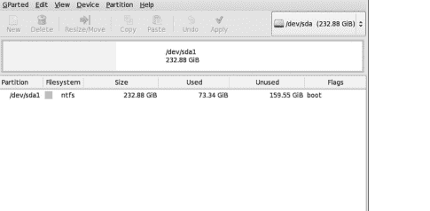

**图 1.1** gParted 允许你处理硬盘上的分区，以为 Fedora 腾出空间。

要开始操作，右键点击如图所示的主 Windows 分区，并选择“Resize/Move”（调整大小/移动）以调出调整大小选项，如图 1.2 和图 1.3 所示。

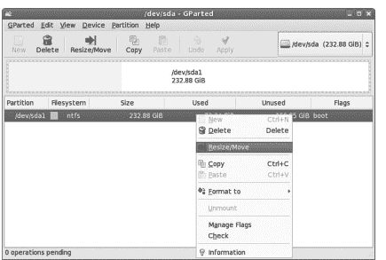

**图 1.2** 从右键菜单中选择“Resize/Move”（调整大小/移动）以开始调整大小的过程。

在图 1.3 中，你可以看到你可以选择调整分区大小，以便在当前分区的开头或结尾留出空间。我们强烈建议你在现有分区之后添加空闲空间，如图 1.3 所示，我们选择了在现有分区之后保留 8000MB 的空闲空间。或者，你可以点击并拖动所示分区条的两侧来相应地调整分区大小。

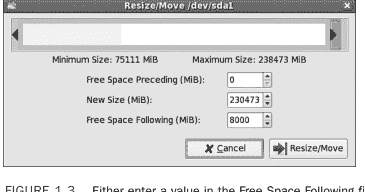

**图 1.3** 在“Free Space Following”（紧随其后的空闲空间）字段中输入数值，或者点击并拖动分区条两侧的箭头。

一旦你满意了，点击“Move/Resize”（移动/调整大小）按钮，gParted 将返回主屏幕，待处理的操作列在屏幕的下半部分，如图 1.4 所示。由于你在处理文件系统，gParted 不会立即更改，因为你可能希望在提交更改之前对文件系统执行其他操作。然而在这种情况下，你只是希望调整磁盘大小，所以要提交更改，请转到“编辑” > “应用所有操作”，或者点击工具栏中的“应用”按钮以启动过程。gParted 会询问你确定是否继续，因此只有当你真正准备好提交更改时，才点击“应用”。

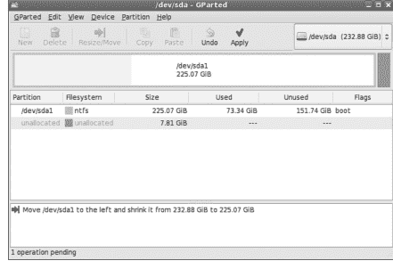

**图 1.4** 这是无法回头的一步。点击“应用”后，gParted 会在开始调整分区大小前最后一次提示你。

几分钟后，gParted 完成操作并返回主屏幕，如图 1.5 所示。

### DVD 安装快速启动

要从随附本书的 DVD 安装 Fedora，你至少需要 Pentium 级别的 CPU、800MB 硬盘和 128MB RAM。使用 Fedora 图形安装程序安装时至少需要 192MB。10GB 硬盘可以轻松地托管整个发行版，并为其他数据留下大约 3GB 的空闲空间。大多数现代系统的驱动器要大得多，但从当地电脑商店投资更多存储仍然是个好主意。

要开始安装，你需要进入计算机的 BIOS，设置启动顺序，使 CD/DVD 驱动器成为第一个启动的驱动器。将 DVD 插入驱动器并让系统启动。当出现 boot: 提示时，按 Enter 键并遵循各种对话框以安装 Fedora。

**本章内容**

- 在安装之前
- 选择如何安装 Fedora
- 逐步安装
- 登录与关机
- 参考资料


请确保您记住根密码（无论通过何种方式记录），因为后续操作需要用到。安装程序完成时，DVD 将弹出，系统会提示您重新启动计算机。随后会出现几个对话框，允许您在进入登录提示界面之前对系统进行一些初始配置。请务必以安装过程中创建的用户身份登录，而**不要**以 root 身份登录。最后，完成安装，从计算机中移除 DVD，并重启。然后登录并享受 Fedora 吧！

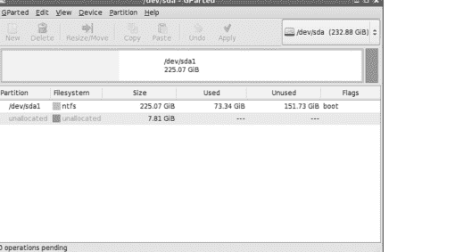

图 1.5 一切就绪，您可以开始安装 Fedora。您可以看到 GParted 已创建了 7.81GB 的未分配空间。

## 选择如何安装 Fedora

Fedora 可以通过多种方式进行安装，使用不同的技术和硬件。大多数用户通过直接从 CD 或 DVD 启动到安装界面来安装 Fedora。其他选项包括以下内容：

- 启动到安装界面，并通过网络甚至互联网使用 FTP 或 HTTP 协议安装软件
- 启动到安装界面，并从挂载的 NFS 硬盘安装软件

您选择（并使用）Fedora 安装的方式取决于系统的硬件、网络功能、企业信息服务策略或个人偏好。以下章节描述了与每种安装类型相关的问题。

### 从 CD 或 DVD 安装

大多数 PC 的 BIOS 支持直接从 CD 或 DVD 驱动器启动，并允许设置特定的设备搜索顺序（例如软盘、硬盘、CD-ROM 或 USB）以查找可启动软件。打开您的 PC，如有必要设置其 BIOS（通常通过在开机后按功能键或 Del 键访问）；然后插入 Fedora 安装光盘，并启动以安装 Fedora。

要使用此安装方法，您的计算机必须支持从光驱启动，并且该驱动器本身必须能被 Linux 内核识别。您可以通过检查 BIOS 并启动 PC 来验证这一点。

文件 `boot.iso` 是一个位于 Fedora DVD 的 `images` 目录下的 8.5MB CD-ROM 镜像。该镜像可以刻录到空白 CD 上，并支持启动网络安装。这是一种在具有可启动 CD-ROM 驱动器但没有安装软驱的 PC 上，或者在需要驱动程序磁盘但不希望使用多张软盘的安装过程中，启动网络安装的便捷方式。

您可以使用 `wodim` 命令将镜像刻录到光学介质上。例如，将文件复制到您的硬盘中，将空白 CD-R 插入 CD-RW 驱动器，然后使用类似以下的命令行：

```
# wodim -v speed=40 dev=0,0,0 -data -eject boot.iso
```

此示例创建了一个可启动的 CD-ROM，并在写入镜像后弹出新 CD-ROM。速度（本例中为 40）取决于您的 CD 写入设备的功能。设备编号是运行带有 `scanbus` 选项的 `cdrecord` 返回的，如下所示：

```
# wodim -scanbus
```

### 使用网络安装

Fedora 可以从本地网络（如果您拥有宽带访问权限，甚至可以通过互联网）进行安装。您需要访问托管安装软件包的 Web、FTP 或 NFS 服务器。要启动网络安装，请使用之前描述的用 `boot.iso` 启动镜像创建的可启动 CD-ROM，或随本书附带的 Fedora DVD。使用启动软盘启动您的 PC，或者如果使用 CD-ROM，在启动提示符处输入 `linux askmethod`。按照提示操作，您将被要求选择网络安装类型。

> **提示**
>
> 如果您使用用 `boot.iso` 镜像创建的 CD-R 启动网络安装，只需在启动提示符处按 Enter 键即可。这将启动图形化网络安装。

要从 FTP 位置安装，请为待安装 PC 选择网络 IP 地址分配方式，例如 DHCP，或者手动输入 IP 地址以及可选的网关 IP 地址和名称服务器地址。然后系统会询问 FTP 站点名称。您可以输入托管 Fedora 发布的远程 FTP 服务器的名称或 IP 地址。远程目录的名称取决于 Fedora 安装文件在远程服务器上的位置。

使用文件传输协议（FTP）安装 Fedora 需要访问 FTP 服务器（参见第 20 章“使用 FTP 进行远程文件服务”，了解如何设置服务器和使用 FTP）。您必须知道服务器的主机名或 IP 地址，以及存放 Fedora 软件的路径（目录）。为准备托管安装的服务器，可以按照以下步骤操作：

1. 在 FTP 服务器的 pub 目录下创建一个名为 Fedora 的目录。在 Linux 服务器上，该目录通常位于 /var/ftp/pub。
2. 在 Fedora 目录下创建一个名为 base 的目录和一个名为 RPMs 的目录。
3. 将所有包含在 Fedora 中的 RPM 软件包复制或下载到 pub/Fedora/RPMs 目录。
4. 从 DVD 的 base 目录复制所有原始基础文件（comps.rpm, comps.xml, hdl1st, hdlst2, hdstg2.img, netstg2.img, stage2.img, TRANS.TBL）到 pub/Fedora/base 目录。

使用这种方法，当询问托管 Fedora 安装软件的远程目录名称时，输入 pub。

从远程挂载的网络文件系统（NFS）安装 Fedora 类似于硬盘安装，但需要访问 NFS 服务器。您需要访问权限、为您计算机允许的 IP 地址或主机名、NFS 服务器的主机名或 IP 地址，以及 Fedora 软件的路径。有关 NFS 和网络寻址的更多信息，请参见第 14 章“网络”。

使用 HTTP 安装 Fedora 需要远程 Web 服务器的主机名或 IP 地址，以及包含 Fedora 软件的目录。有关如何设置 Web 服务器，请参见第 17 章“Apache Web 服务器管理”。

> **注意**
> 有关如何配置 vsftpd FTP 服务器的详细信息，请参见第 20 章。第 17 章提供了如何设置和配置 Apache 用于 Web 服务的信息。有关 Samba 设置，请参见第 19 章“文件和打印”。请注意，您可以让服务器执行所有这些功能。

## 逐步安装

本节提供从随本书附带的 DVD 进行 Fedora 的基本逐步安装说明。进行安装有许多不同的方式，安装程序可以以多种模式提供图形化或文本界面。

> **注意**
>
> 如果您使用的是 Live CD，我们假设您已经双击了桌面上的安装图标。从以下说明中的**发布说明**部分开始阅读。

此示例安装为计算机准备通用的桌面工作站任务，使您可以访问办公生产力应用程序和互联网应用程序。

> **警告**
>
> 如果您想与 Windows 双启动，请确保您已按照前面详细说明的指示准备了分区。

开始之前，请确保您的计算机未连接到互联网。虽然您可以使用安装程序在安装期间设置网络保护，但最好在每次安装后并开放任何公共服务之前检查系统设置（参见本章后面“Firstboot 配置”部分）。

> **提示**
>
> 如果您安装的系统使用了较旧的显示监视器，建议在安装过程中手头备好您的监视器手册。如果安装程序未能检测到您的监视器设置，您可能需要指定监视器的垂直和水平频率。这种情况并不常见，但如果发生，您将有准备。

### 开始安装

要开始操作，将 DVD 插入驱动器并重启计算机。您首先会看到一个启动屏幕，提供四个启动选项（见图 1.6）。您可以在此屏幕按 **e** 键向 Linux 安装内核传递选项。最常用的一些基本选项是

- **Install or Upgrade an Existing System**（安装或升级现有系统）——这开始图形化安装，使用 Anaconda。
- **Install or Upgrade an Existing System (text mode)**（安装或升级现有系统（文本模式））——开始安装，使用文本界面。
- **Rescue Installed System**（救援已安装的系统）——启动救援模式，使您能够救援“损坏”的系统。
- **Boot from Local Drive**（从本地驱动器启动）——启动硬盘上现有的任何操作系统。


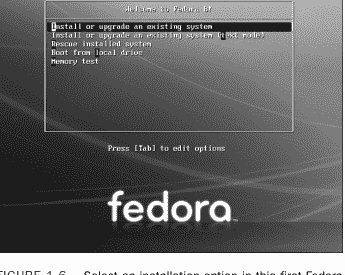

**图 1.6** 在此 Fedora 初始启动屏幕上选择一个安装选项。

> **提示**
> 安装程序会在 60 秒后自动启动。如果需要停止安装，请按空格键、重启或关闭您的 PC。

按下回车键后，安装程序的内核将加载，并会（在基于文本的屏幕上）询问您是否想要对安装介质执行介质检查，如图 1.7 所示。

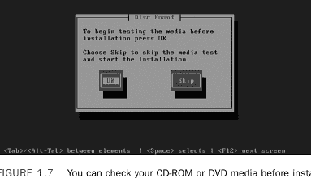

**图 1.7** 在安装 Fedora 之前，您可以检查 CD-ROM 或 DVD 介质。

此检查可能需要相当长的时间（取决于光驱的速度），但它可以确保 CD-ROM/DVD 内容的完整性，因为每个 CD-ROM 和 DVD 上都嵌入了 md5sum 值。此检查有助于防止从内容被篡改的 CD-ROM 和 DVD 上安装恶意软件。检查还有助于确保您使用的 CD-ROM 或 DVD 能在您的 PC 和光驱上正常工作。要执行此检查，请选择“确定”；否则，使用 Tab 键导航至“跳过”按钮并按下回车键以选择它。

在您检查 CD-ROM 或 DVD 或甚至跳过检查之后，显示屏将清空。Fedora 安装程序 Anaconda 加载，并会向您显示图形化的欢迎屏幕，如图 1.8 所示。安装程序应能识别您的 PC 的图形硬件和鼠标。然后，您可以点击“发行版说明”（Release Notes）按钮，以获取有关 Fedora 的详细信息，以及关于硬件要求和执行各种安装的方法提示。

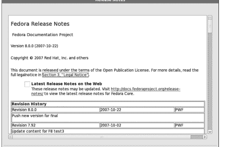

**图 1.8** 在安装 Fedora 之前阅读帮助或发行版说明。

**注意**

Fedora 的安装程序支持监控安装期间正在运行的后台和安装进程的能力。通过导航到不同的控制台显示或虚拟控制台，您可以观看安装的进度以及由 Linux 安装内核报告的硬件信息。为此，请同时按下 Ctrl、Alt 以及相应的功能键（如 F1–F5）。

使用这种方法来观察内核消息、监控硬件检测、获取单用户 shell 访问权限并查看安装脚本的进度。
在使用图形化安装程序时，按下 Ctrl+Alt+F4（然后 Alt+F2 或 Alt+F3）以导航到各个屏幕。按下 Alt+F7 返回安装程序。在执行基于文本的安装时，使用 Alt+F2（然后 Alt+F3 或 Alt+F4）。使用 Alt+F1 返回基于文本的安装界面。

如果您的指向设备（鼠标）未被识别，您可以按 Alt+R 来“按下”发行版说明按钮。类似地，您可以按 Alt+H 来隐藏屏幕左侧显示的文本，但您应该花一分钟阅读框架的内容。
点击 **下一步**（或按 Alt+N）继续，安装程序将要求您为安装选择 31 种不同语言中的一种，如图 1.9 所示。

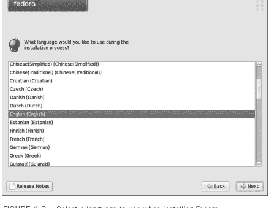

**图 1.9** 选择安装 Fedora 时使用的语言。

您可以通过使用 Tab 键来导航安装程序的对话框（在基于文本或图形化安装期间）。您可以通过使用方向键来滚动列表。请注意，您现在可以使用“后退”按钮在安装过程中向前回退。选择一种语言并点击“下一步”按钮。

然后，系统将要求您为安装选择键盘，如图 1.10 所示。

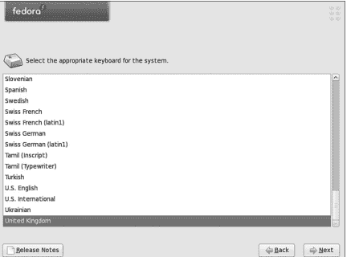

**图 1.10** 选择安装和使用 Fedora 时使用的默认键盘。

滚动到合适的键盘选项。您使用此选项来配置安装以支持 53 种不同语言键盘中的一种。选择完成后，点击“下一步”。

在此时，如果您正在将 Fedora 安装到一块全新的硬盘上，您将收到一个警告，提示 Fedora 无法读取分区表。通过点击“是”，您授予 Fedora 初始化磁盘并将其用于安装的权限。如果您确认这是一块完全空白的驱动器，请随意继续；否则，我们建议使用 Live CD 来安装 Fedora。

如果检测到现有的 Linux 安装，系统将询问您是否想要升级并重新安装；否则，系统将要求您分区磁盘以为 Fedora 腾出空间，如图 1.11 所示。

### 对硬盘进行分区

此刻，选择“创建自定义布局”（Create Custom Layout）并点击“下一步”，移动到图 1.12 所示的屏幕。但是，您也可以选择删除驱动器上的所有分区（包括 Windows 分区）、仅删除驱动器上的 Linux 分区，或者仅使用未分配的空间。

**注意** 如果您遵循了之前的分区说明，请选择“使用选定驱动器上的空闲空间并创建默认布局”（Use Free Space on Selected Drives and Create Default Layout）。

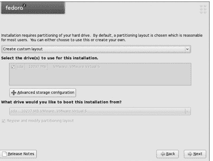

**图 1.11** 选择您希望如何对驱动器进行分区。

如果您选择这三种选项之一，您将得到一个使用逻辑卷管理（LVM）的默认布局。这是一种特殊的分区类型，使磁盘分区更容易管理。

### 初学者逻辑卷管理

逻辑卷管理听起来比实际要困难得多。实际上，它允许您生成单个逻辑分区，而这些逻辑分区可以由多个物理驱动器组成。逻辑卷还可以根据需要调整大小，这对于处理 ext3 分区（Fedora 的原生分区类型）通常来说是很困难的。有一件事您需要记住：创建一个独立的 /boot 分区，使其独立于逻辑卷；否则，您的系统将无法启动！

本示例考察的是在一个硬盘上创建分区表。要开始，点击“新建”按钮以调出图 1.13 所示的屏幕。首先，您需要创建一个小的分区，其挂载点为 /boot。这是为了让 Fedora 实际上能够启动，并且大小最大只需约 100MB。确保仅勾选第一个磁盘（示例中为 sda），并从下拉挂载点菜单中选择 /boot。最后，将分区大小更改为 100MB，并点击“确定”按钮以创建第一个分区。

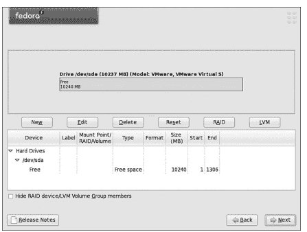

**图 1.12** Fedora 强大的分区工具使您可以创建符合您需求的独特分区方案。

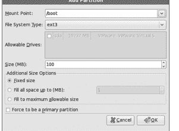

**图 1.13** 务必创建您的启动分区；否则，您所有的努力都将付诸东流！

现在我们需要创建物理卷，这将允许 Fedora 将它们组合成一个逻辑卷。再次点击“新建”按钮以调出与图 1.13 相同的窗口，但这次您要将文件系统类型更改为物理卷（LVM）。确保仅勾选一个驱动器，最后选择“填充至允许的最大大小”（Fill to Maximum Allowable Size）选项，以指示 Fedora 使用所有可用空间。

创建好物理卷后，您需要通过逻辑卷将它们绑定在一起。点击分区工具主窗口中的“LVM”按钮以调出 LVM 选项（参见图 1.14）。您可以将逻辑卷组命名为比 VolGroup00 更有意义的名称，但必须确保名称中没有空格。接下来，您可以为卷选择一个物理扩展大小，或者更确切地说，是磁盘将被“切割”成的块的大小。除非您确实有特定的需求来更改此设置，否则您应该将其保留为 32。

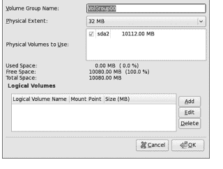

**图 1.14** 通过 Fedora 易于使用的工具，发挥逻辑卷的灵活性。

现在您需要创建逻辑卷组内的分区，就像在任何其他 Linux 发行版中那样，确保您至少有一个 / 分区和一个交换（swap）分区。在示例中，点击“添加”按钮，您将前往“创建逻辑卷”（Make Logical Volume）屏幕（参见图 1.15），在那里您可以指定挂载点、文件系统类型、卷名称（再次强调，不要有空格）以及分区的大小。

您必须至少创建两个分区：/ 分区和交换分区。但是，根据您特定的需求，您可以添加多个挂载点。一些用户发现创建单独的 /home 分区很有帮助，我们在示例中就是这样做的。每当您添加每个逻辑卷时，它都会出现在主 LVM 组选项屏幕中（参考图 1.14）。完成后，点击“确定”按钮返回主分区屏幕，该屏幕应类似于图 1.16。


## 图 1.15

使用此屏幕定义组成逻辑卷组的逻辑卷。

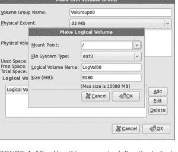

## 图 1.16

最终完成的杰作。花额外的时间来获得最适合你需求的分区布局是值得的。

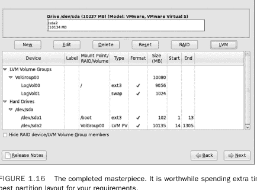

现在你可以通过点击“下一步”按钮进入下一个屏幕。

## 选择、配置和安装引导加载程序

接受分区方案后，会出现一个屏幕要求你选择用于启动 Fedora 的引导加载程序（见图 1.17）。此屏幕还允许你选择不使用引导加载程序（当从可移动介质、商业引导实用工具、DOS 分区或通过网络启动时），并在你配置了双启动系统时启动其他操作系统。

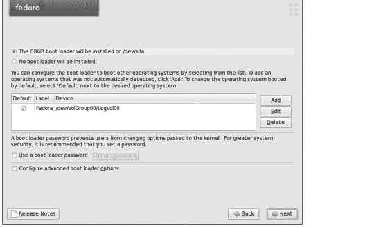

## 图 1.17

选择是否使用引导加载程序并配置其他引导选项。

> **提示**
> Fedora 与其他操作系统配合良好，但反之未必如此。如果你需要有关配置双启动系统的专业帮助，请在 http://www.tldp.org 上查看各种 HOWTO 以获取提示和技巧。

选择 GRUB 引导加载程序。GRUB 通常安装在 PC 中第一个 IDE 硬盘的 MBR（主引导记录）中。但是，引导加载程序也可以安装在 Linux 引导分区的第一个扇区中，或者根本不安装在硬盘上。请注意，你还可以通过回溯安装过程来更改任何设置。

请注意，你可以为引导加载程序分配密码。如果你选择使用此选项，你必须在 GRUB 引导屏幕上输入密码（有关图形登录的信息，请参阅本章末尾的“登录和关机”部分。仔细记下密码！它不必与用于登录的密码相同，但如果你的计算机 BIOS 通过密码保护启动并在此处使用引导加载程序密码，你随后将需要输入三个密码（BIOS、引导加载程序和登录）才能访问 Linux。输入一个至少八位字符的密码两次（每行一次）；然后点击“确定”或“取消”退出对话框。

### 注意

如果你计划将 PC 设置为与 Windows 双启动，它会以*其他*的形式出现在引导选项列表中。你可以点击“编辑”按钮访问选项，允许你将它重命名为更具信息性的名称，甚至将 Windows 设置为 GRUB 的默认选项。

如果你点击“配置高级引导加载程序选项”按钮，系统会要求你提供在启动前传递给 Linux 内核的参数。内核参数用于在启动时启用或禁用 Linux 的各种功能。如果你安装了 Linux 内核的源代码，你可以在 `/usr/src/linux/Documentation` 目录下的 `kernel1-parameters.txt` 文件中找到关于 200 多个不同内核参数的文档。点击“下一步”以设置你的引导加载程序配置。然后你进入网络接口配置，如图 1.18 所示。

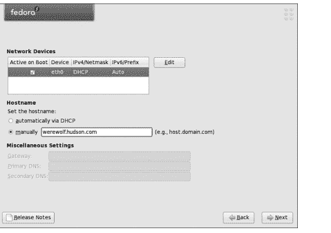

## 图 1.18

选择或输入网络配置信息。

## 网络配置

如果你有已安装的网络适配器，系统会要求你提供网络配置详细信息，如图 1.18 中所示。Fedora 可以设置为在启动时自动配置网络。请注意，你还可以在安装后使用 Fedora 的 *system-config-network* 图形网络管理工具来配置网络（有关使用这些工具的详细信息，请参阅第 10 章，“管理用户”）。

> **注意**
> 如果 Linux 内核发现你的计算机上安装了多个网络接口，系统可能会要求你配置第二个以太网设备。例如，如果你正在一台作为网关或防火墙的计算机上安装 Fedora，可能会出现这种情况。如果你配置了多个以太网设备，名为 eth0 的设备是启动 Fedora 时第一个活动接口。

你可以选择通过 DHCP 自动设置你的接口信息。否则，特别是如果你正在配置 DHCP 服务器，请手动输入 IP 地址、主机名或网关地址（例如路由器），如果你点击接口（例如示例中的 eth0）列出的“编辑”按钮，还可以输入 DNS 信息。完成选择后，点击“下一步”继续。

## 设置时区

接下来你会看到一个时区选择对话框（见图 1.19）。使用 PC 时有两个“时钟”，即时间：由计算机硬件和备用电池维持的硬件时钟；以及启动时设置并供 Linux 内核使用的系统时间。保持这两个时间的准确和同步很重要，因为自动化系统管理可能需要在关键时间进行。许多计算机安装使用硬件时钟设置为 GMT（*格林尼治标准时间*）的计算机。更现代的指定是 UTC 或*协调世界时*。Linux 系统时间是根据此时间和默认时区设置的，例如东部标准时间，即 UTC 减 5 小时。

将计算机的硬件时钟设置为 UTC（GMT）的优点在于，它可以轻松地将 Linux 系统时间设置为相对于计算机的地理位置和居民时区（例如，一个希望创建文件或发送带有正确时间戳的电子邮件的 Linux 笔记本电脑用户，他刚从纽约旅行到东京）。

> **提示**
> 阅读 *hwclock* 命令的 man 页面，以了解如何使正在运行的 Linux 系统与 PC 的硬件时钟保持同步。

选择你的时间配置，然后点击“下一步”。

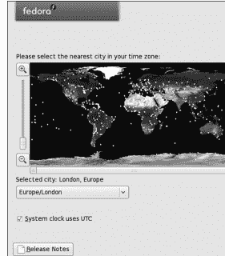

## 图 1.19

选择你的时区。

## 创建 root 密码和用户账户

接下来，系统会要求你输入 root 操作员密码，如图 1.20 所示。输入密码，按 Tab 或 Enter，然后再次输入以确实验证。密码区分大小写，应至少为八位字符（或更多），并由字母和数字组成。请注意，密码不会回显到显示器上。你的 root 密码很重要，因为你需要它来执行 Fedora 的任何系统管理或用户管理。

> **警告**
>
> 不要忘记你的系统 BIOS、引导加载程序或 root 密码！某些设备，例如笔记本电脑，如果所有者忘记了 BIOS 密码，可能需要工厂更换主板部件。大多数台式 PC 的 BIOS 设置通常可以通过跳线或移除并插入主板电池来重置。如果你忘记了引导加载程序密码，请使用启动磁盘（可能在本章后面所示的安装过程中创建）或使用你的 Fedora 光盘启动到救援模式，并使用 `passwd` 命令重置 root 密码。

完成后，点击**下一步**继续为新的服务器选择软件包。

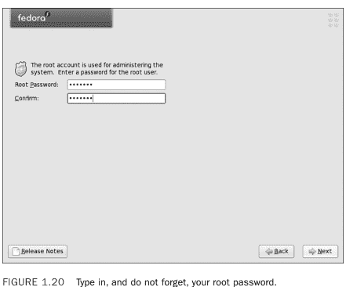

## 图 1.20

输入你的 root 密码，并且不要忘记它。

### 注意

你只能在 Fedora 安装期间创建 root 账户。你将在启动后使用命令行程序（例如 `adduser`）或图形 `system-config-users` 客户端创建用户账户。为你自己和任何额外用户创建一个账户。用户名传统上由一个人的名字首字母和然后姓氏组成。例如，Tom Denning 的用户名将是 `tdenning`。不要忘记为任何新用户输入密码！如果你创建用户而不创建密码，新用户将无法登录。

除了 root 操作员，你应该为你的服务器至少创建一个用户。这是为了安全目的，并避免通过服务器键盘或通过网络远程以 root 身份登录。默认 shell 和家庭目录设置应保持默认值，即 Bourne Again Shell（`bash`）和 `/home` 目录。

有关如何成为 root 用户或作为普通用户运行 root 命令，请参阅第 4 章“命令行快速入门”。有关管理用户的详细信息，请参阅第 10 章。


**提示**

强密码对于系统安全至关重要。然而，有些人仍然依赖诸如 admin 这样简单的密码。这是自找麻烦，我们建议你创建一个由字母、数字甚至标点符号组成的强密码。要创建一个既容易记忆又包含标点符号的密码可能比较困难，但它可以比你想象的更简单。例如，George Nedeff 可能想使用他的全名作为密码，但那将很容易被破解。他可以做的是使用标点和数字替换他名字中相似的字母，例如 G30rg3n3deff。这是一个非常强且不易被破解的密码，但同时也很容易记住。

## 软件选择与安装

Fedora 允许你为安装包清单选择三个预定义选项。在本示例中，我们只使用“办公与生产力”，但如果你打算探索本书后三分之一的章节，你将需要“软件开发”，并且如果你打算应用第 17 章中学到的内容，你肯定还需要“Web 服务器”。此屏幕如图 1.21 所示。

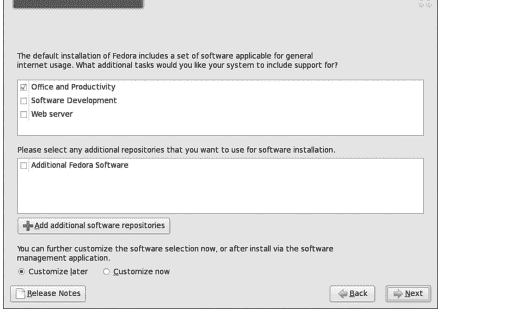

在较早版本的 Fedora 和 Red Hat Linux 中，有一个选项可以安装所有可用的软件。由于多种原因，此选项现已从 Fedora 中移除。首先，安装所有软件包可能在升级和安装新软件包时引发依赖地狱。其次，对于新用户来说，软件包可能多到难以处理。第三，也许最重要的是，它可能对您的系统构成巨大的安全风险。您安装软件越多，某人发现系统易受攻击入口点的风险就越大。

### 注意

Fedora 允许您在安装时输入自己的软件仓库。在您通过“自定义软件包”屏幕时，Fedora 会考虑这些新的软件仓库。您需要做的只是提供软件仓库的名称，以及指向 `repomd.xml` 文件的 FTP 或 HTTP 服务器和路径详细信息。只需单击“添加软件仓库”按钮即可完成此操作。

您还可以通过选择“立即自定义”按钮并单击“下一步”转到图 1.22 来指定是否希望进一步自定义您的软件包选择。否则，只需单击“下一步”即可到达最终屏幕。

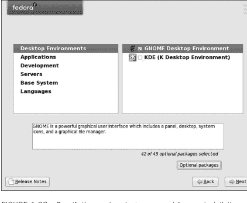

**图 1.22** 指定您安装所需的确切软件包。

如果您决定自定义软件包选择，您将看到类似图 1.22 的屏幕。左侧是包含软件的通用类别。当您单击每个类别时，右侧会出现一组新的软件包组。选中每个软件包组前的复选框以安装与该组关联的默认软件包。如果您希望指定组内的其他软件包，请单击“可选软件包”按钮以查看该组可用的所有其他软件包，如图 1.23 所示。选择您需要的软件包，然后单击关闭以将它们添加到您的软件包列表中。完成软件包选择后，单击“下一步”让 Fedora 扫描是否存在任何依赖性问题。

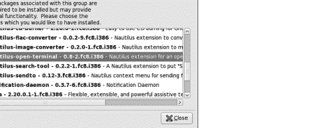

**图 1.23** 通过仅选择真正需要的软件包来微调您的安装。

您最终到达 Fedora 实际开始安装任何内容之前的最后一个屏幕，因此深呼吸并思考您可能忘记的任何事情是个好主意。您可以通过单击“返回”按钮直到到达您想去的地方，轻松回到安装过程的任何阶段。

当您满意时，单击“下一步”允许 Fedora 安装系统。现在是泡杯咖啡的好时候，因为根据您选择的选项，安装 Fedora 可能需要长达一个小时。在 Fedora 安装过程中，它会告诉您当前正在处理哪个软件包，如图 1.24 所示。

如果您通过网络或 DVD 进行安装，请休息一下；软件安装过程将在无人值守的情况下继续进行。

## 完成安装

你完成了！单击 **退出** 按钮，安装程序将弹出插入的媒体并重启。GRUB 引导加载程序将显示引导提示，如图 1.25 所示。

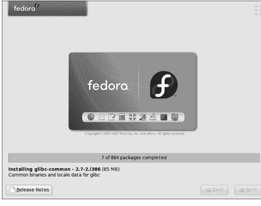

**图 1.24** Fedora 安装程序格式化您的驱动器，然后安装选定的软件包组。

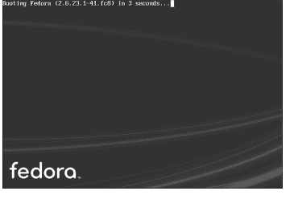

**图 1.25** 通过按 Enter 键或等待 5 秒使用 GRUB 启动 Fedora。

如果您已设置 GRUB 密码，请按 **P**，输入您的密码，然后按 Enter。如果您五秒内什么都没做，或者按 Enter，任一引导加载程序都会启动 Linux。

### 注意

安装完成后，您可以编辑文件 `/boot/grub/grub.conf` 并更改 `timeout=` 设置，以将引导时间更改为 5 秒以外的值。

## Firstboot 配置

尽管大部分配置是在实际安装过程中完成的，但 Fedora 允许您在首次登录前选择更多选项。当您启动 Fedora 时，它会加载 firstboot，这是负责定制您计算机的工具。它会问您几个简单的问题，最终结果是您可以登录 Fedora。

第一个屏幕欢迎您使用 firstboot，您应该单击“下一步”开始。下一个屏幕询问您是否接受发布 Fedora 的条件。如果您同意所述内容，请单击“是”按钮，然后单击“下一步”。

### 注意

要阅读 Fedora 的最终用户许可协议，请访问 http://fedoraproject.org/wiki/Legal/Licenses/EULA。

接下来是防火墙配置（参见图 1.26），您应该始终启用防火墙。合理的是，Fedora 默认设置为这样，但它还会询问您是否希望允许访问特定端口以允许服务运行。根据您的要求，您可能希望选择一个或多个复选框。您还可以输入特定端口和协议（TCP 或 UDP），但您应该意识到，允许访问的服务或端口越多，您的系统就越不安全，因为它开放了更多的攻击机会。

SELinux 允许更详细的安全策略，并且仍在开发中。SELinux 于 Fedora Core 2 中引入，是 NSA 的一项举措，旨在为 Linux 提供深入的强制访问控制系统，以将系统隔离。基本上，如果入侵者进入系统，SELinux 会限制入侵者可以造成的损害程度。

## SELinux

如前所述，SELinux 来自 NSA（美国国家安全局），这是美国最机密的机构之一。社区对获得这项技术发布的震惊可以由 Larry Loeb 的话概括：“让我向你保证，NSA 的这一举措在密码学上相当于教皇从罗马的阳台上走下来，用几块面包和鱼吸引人群，然后邀请大家去他家看足球比赛喝几杯啤酒。有些东西是人们永远预料不到的，NSA 分发源代码以及背后的安全机制细节正好属于这一类。”

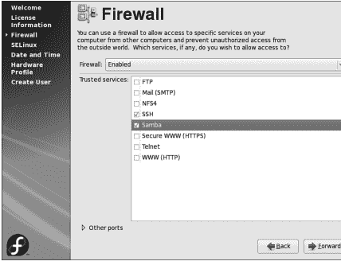

**图 1.26** 防火墙是您防御潜在破解者的关键部分。当您对选择满意时，单击“下一步”按钮开始配置 SELinux。

您可以选择 SELinux 在系统上的实现方式，但除非您有特定原因更改任何默认设置，否则只需单击“下一步”按钮继续。默认设置提供了非常安全的系统。

继 SELinux 之后，Fedora 让您有机会设置“时间和日期”设置。您已经告诉了 Fedora 您在世界上的位置，但这个屏幕（参见图 1.27）允许您微调时间和日期，并选择使用网络时间协议（NTP）从全球众多时间服务器之一获取准确时间。

“时间和日期”设置之后是您积极参与 Fedora 开发的机会。Smolt（参见图 1.28）旨在收集有关您硬件配置的信息，以便 Fedora 项目建立一个已知可用硬件配置的数据库。它使 Fedora 项目能够分析 Fedora 在哪些类型的系统上被使用，并使其能够优先考虑在特定平台上的开发。如果您有网络连接，我们建议您参与其中。作为 Smolt 提交的一部分，不会发送任何个人详细信息，您将在未来帮助 Fedora 的开发。


## 逐步安装指南

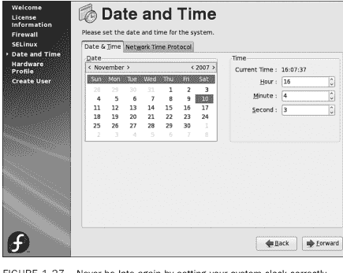

**图 1.27** 通过正确设置系统时钟，从此不再迟到。

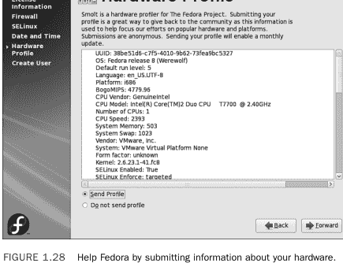

**图 1.28** 通过提交有关你硬件的信息来支持 Fedora。

点击“下一步”将进入“添加新用户”界面（见图 1.29），并允许你最初输入一个用户的详细信息。你可以输入用户的姓名、用户名和密码（你需要再次输入以确认），并且你可以选择其他身份验证设置，例如使用 Kerberos 或 NIS 服务。当你完成 firstboot 后，你可以使用 `system-config-users` 工具创建其他用户。

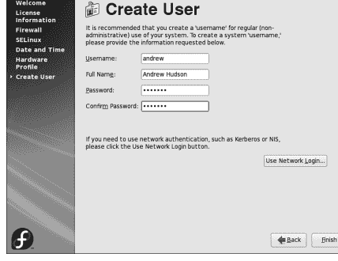

**图 1.29** 在此界面添加你的第一个用户。

最后，点击“完成”按钮直接进入登录提示符，如 图 1.30 所示。在这里，你应该登录为在 firstboot 期间创建的用户；请勿以 root 身份登录，因为如果你不知道自己在做什么，可能会造成严重的损坏。

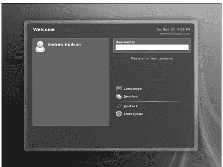

**图 1.30** 输入用户名和密码登录到 Fedora。

## 登录与关机

如果在安装过程中选择使用基于文本的安装程序，通常会在基于文本的登录提示符处登录。如果你使用了图形化安装且未从软件包清单中移除 X，那么你将使用图形化登录提示符进行登录，系统启动后屏幕会清空，并向你展示图形化登录界面，如图 1.30 所示。

要在基于文本的提示符处登录，请输入你的用户名并按 Enter 键。随后会被提示输入密码。按下 Enter 键后，你就进入了 Linux 命令行。如果使用图形化登录，你可以使用屏幕对话框中的“关机”或“重启”菜单来关闭或重启系统。若要从基于文本的会话的命令行立即关闭系统，请使用 `su` 命令及其 `-c` 选项运行 `halt` 命令，如下所示：

```
$ su -c '/sbin/shutdown -h now'
```

你也可以使用 `reboot` 命令重启计算机，如下所示：

```
$ su -c '/sbin/reboot'
```

对于新用户而言，安装 Fedora 只是迈向学习 Linux 这一充满高度回报的新旅程的开始。有关使用 Linux 命令的更多信息，请参阅第 4 章。对于 Fedora 系统管理员来说，接下来的任务是微调安装并自定义服务器或用户环境。

## 参考资料

- <http://fedoraproject.org>—当你寻找关于安装、配置和使用 Fedora 的新闻、信息和文档时，这里是起始之地。
- <http://tinyurl.com/c2x5u>—Symantec 的 PartitionMagic 工具包含 BootMagic，可用于支持启动 Linux 或，遗憾的是，其他功能较弱的操作系统，如 Windows XP。
- <http://www.v-com.com/product/System_Commander_Home.html>—V Communications, Inc. 的 System Commander，这是一个 4.2MB 的商业下载软件，可用于支持在当今 PC 上运行的任何操作系统的启动。其中包含一个智能分区实用工具 Partition Commander。
- <http://www.nwc.com/columnists/1101colon.html>—如何使用 Intel 的预引导执行环境（PXE）协议远程引导工作站。
- <http://www.gnu.org/software/grub/>—GRUB 引导加载程序的主页。

# 第 2 章
# Fedora 快速入门

## 本章内容

- Fedora 桌面
- 在 Fedora 中导航
- 可用应用程序
- 保持软件更新
- 配置无线网络

转向新操作系统的一部分挑战在于超越对事物应如何运行的预设想法。如果你一直被困在 Windows 环境中，且这是你首次转向 Linux，你可能会开始在桌面上寻找“我的文档”和“我的电脑”图标，但不会成功，因为它们不在那里。同样，如果你习惯于 Mac OS X 桌面，如果没有 Dock 来帮助启动应用程序，你可能会感到有些迷失方向。不过没关系；在本章中，你将学习使用 Fedora 的基本方法，以便能够舒适地阅读本书的其余部分。

在本章中，我们将探讨如何在新桌面上找到方向，每个菜单选项包含的内容，并带你了解预装软件。我们还将查看如何安装新软件，更重要的是，确保你已安装的软件通过相关补丁和安全更新保持最新。连接到网络，无论是无线还是通过物理连接，几乎每个人都会有此需求，因此我们稍后会在本章中讨论这一点。

## Fedora 桌面

第一次登录 Fedora 后，你将看到默认桌面。它类似于图 2.1 所示的内容。


**图 2.1** Fedora 桌面，通往更好计算生活的大门。

> **提示**
> 在 Linux 术语中，波浪号字符（~）代表“家目录”，即包含特定于你登录信息的文件夹。例如，我的家目录被称为 andrew’s home，因为这与我的登录名相匹配。除非你的名字也叫 Andrew，否则你的登录名将有所不同！
>
> 记住波浪号很有用，特别是当你阅读“命令行快速入门”（第 4 章）或“命令行精通课程”（第 32 章）时，因为它将帮助你在终端中进行导航。

顶部和底部有面板，其中可以包含诸如菜单选项（如在顶部面板中）或其他快捷方式（如系统菜单右侧的 Web 浏览器图标）等项目。主窗口包含三个图标：Computer（计算机）、Home（主目录）和 Trash（回收站）。

除了这三个图标外，在 System（系统）菜单的右侧还有一组快捷方式图标；这些代表五个你可能希望快速访问的有用应用程序。你还会在顶部面板更远处看到时钟，以及一个代表声音选项的 Speaker（扬声器）图标。你还可以看到一个表示网络状态的网络连接图标；更多详情将在“配置无线网络”部分中介绍。

屏幕左下角有另一个小图标，用于显示你的桌面。当你打开许多不同的窗口并且需要快速访问桌面中的某个东西时，你可以点击此图标，所有窗口将最小化，只留下你的桌面。如果你愿意，可以再次点击此图标，窗口将全部重新出现。

屏幕右下角持有着直到最近还专属于 UNIX/Linux 平台的东西：Workspace Switcher（工作区切换器）。你可以点击四个屏幕中的任意一个来访问该屏幕。

### 工作区切换器——快速简介

工作区可能是你在其他操作系统中未曾遇到过的概念，但你将在 Fedora 和其他 Linux、FreeBSD 和 UNIX 系统中频繁见到它们。本质上，Fedora 创建了四个工作区，你可以跨这些工作区运行多个应用程序，具体取决于你的工作方式。例如，你可以使用工作区 1 运行文字处理器，工作区 2 运行电子表格，工作区 3 运行电子邮件，工作区 4 运行配置工具。

访问每个工作区只需在工作区切换器中点击它即可。Fedora 立即切换到该工作区并显示其中存在的应用程序。你的桌面及其上的任何图标都会保留在工作区中，随时供你使用。

或者，如果你想使用键盘在工作区之间切换，你需要按 Ctrl+Alt 以及左键或右键，向左移动一个工作区或向右移动一个工作区。Fedora 通过在工作区切换器中高亮显示当前活动的工作区，让你了解当前处于哪个工作区。你还可以看到具有活动应用的工作区内打开的小窗口。

最后，在右下角是垃圾桶，你可以将文件拖入其中，在准备删除时进行处理。默认情况下它是空的，但当你删除物品时，垃圾桶会变满，表示里面有东西。

## 在 Fedora 中导航

如前所述，Fedora 是通往更好计算生活的大门。但要到达那个更好的计算生活，意味着你需要理解 Fedora 在桌面上存储物品的位置。我们已经介绍了桌面的基本外观，但在这一节中，我们将深入探讨一些菜单选项，以及一些你用来在 Fedora 中导航的技巧和诀窍。

### 菜单选项

Fedora 自动在顶部面板为你创建三个菜单选项。这些是 Applications（应用程序）、Places（位置）和 System（系统）。不要被误导认为 Fedora 标志本身是一个菜单；它只是 Applications 菜单的一部分。

这三个菜单保存着不同的内容，理解你可以在哪里找到特定的应用程序、实用程序和快捷方式对于你与系统的交互至关重要。

Applications 菜单保存当前安装在系统上的所有 GUI 应用程序，并按预定义的组（如 Accessories（附件）、Office（办公）、Internet（互联网）等）进行排列。在此菜单的底部，有一个条目允许你添加或移除额外的应用程序。

Places 菜单允许你快速导航到某些位置，这些位置要么是你的本地计算机上的，要么是网络服务器上的远程机器。你还会在 Places 菜单中找到搜索以及访问最近文档的选项。


最后一项是**系统**菜单，其中包含管理您的系统所需的所有相关实用程序，包括注销和关闭系统的选项。**系统**菜单下的两个子菜单将系统范围的更改与基于用户的更改清晰地分开。**首选项**子菜单允许您更改特定于用户登录的设置，因此这些设置只影响您，而不影响其他用户。另一方面，**管理**允许您进行系统范围的更改，例如添加打印机、管理逻辑卷以及修改系统服务等，这里仅举几例。

## 窗口选择器

Fedora 桌面的一个重要组成部分是**窗口选择器**（如图 2.2 所示），它默认显示在底部面板中。当您启动应用程序时，它们会显示在主桌面上，并且在底部面板中会出现相应的图标和应用程序名称。每个应用程序都会显示在对应工作区的面板中，使您能够轻松组织应用程序。窗口选择器还允许您通过点击每个条目来快速在窗口之间切换。点击每个条目会将相关窗口带到屏幕最前面。如果您再次点击该条目，该应用程序会被最小化；如果再点击一次，则会将其最大化。

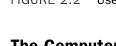

图 2.2 使用窗口选择器在打开的应用程序之间切换。

## 计算机图标

作为进入系统的入口，**计算机**图标是导航系统的工具之一，可通过 GUI 界面进行操作。该界面本身称为 Nautilus，是 Fedora 的默认文件管理器。您将看到类似于图 2.3 的屏幕，具体内容可能会因您计算机是否连接了额外的驱动器和存储设备而有所不同。您可以通过双击每个图标来导航文件系统，从而在新窗口中打开文件夹的内容。

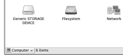

图 2.3 使用 Nautilus（Fedora 的 GUI 文件管理器）浏览文件系统上的目录。

## 主目录图标

Fedora 使用 UNIX 方法为每个最终用户分配一个主目录。这些目录集体存储在 /home 目录下，因此您可能会看到 /home/andrew 或 /home/bernice 等条目。然而，Fedora 还为每个用户创建了一个快捷方式图标，该图标在用户登录时会显示在她的桌面上。这个快捷方式图标直接将该用户带到其主目录，在那里她可以存储特定于她的文档和文件。您所有的个性化设置都存储在主目录下，因为它们是您特有的。

**注意**

正如我们所说，您所有的个性化设置都存储在主目录中，但当您打开它时，您会发现除了默认目录外什么也看不到。这是因为您所有的个性化设置都存储在隐藏文件夹中，这些文件夹通常以句点开头。只需转到“查看”菜单并选择“显示隐藏文件”，您就会突然看到所有与您的设置相关的文件夹。

在较早的版本中，Fedora 的主目录基本上保持为空（除了隐藏的个性化设置外），但现在有七个文件夹来帮助组织您的文件。您不必保留其中任何一个，但它们是在您转向 Fedora 过程中的有力助手。

当您双击一个文件夹时，图标会发生变化，表示该文件夹的内容已在另一个窗口中打开，如图 2.4 所示。

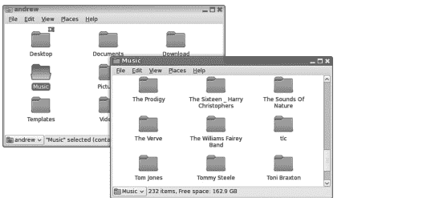

图 2.4 通过查看文件夹图标来跟踪哪些文件夹已打开。

如果您发现自己正在处理大量文件夹，Nautilus 有一个实用的功能，允许您关闭所有文件夹，或者仅关闭您当前正在使用的文件夹的父级文件夹。只需在 Nautilus 窗口中选择“文件”菜单，然后选择您所需的选项即可。

## 访问命令行

在本书中，您会看到许多对命令行的引用，也称为终端。这是您直接执行命令的方式，使用基于文本的输入而不是 GUI 实用程序。

早期版本的 Fedora 将终端应用程序放在“应用程序”、“附件”菜单下。Fedora 8 改变了这一做法，现在终端显示在“应用程序”、“系统工具”下，反映了其作为访问系统设置和管理工具的地位。您可以使用几种终端应用程序，但 Fedora 默认使用 gnome-terminal，除非您有充分的理由更换，否则您会发现它能够满足您的一切需求。

## 可用应用程序

如果您使用随本书提供的 DVD 安装了 Fedora，并使用了默认的包选择（生产力），那么恭喜您；现在您拥有一个功能完整的操作系统，配有文字处理器、电子表格、邮件客户端、日历、即时消息客户端以及其他允许您使用 Fedora 工作的程序。

本节简要介绍使用安装时定义的生产力包集时所安装的不同应用程序。

### 办公套件

Fedora 的首选办公套件是 OpenOffice.org。如果您在 Linux 极客圈子中待得足够久，您肯定听说过这个日益流行的开源办公套件。它由多个组件组成，但 Fedora 开箱即用地提供了文字处理（Writer）、电子表格分析（Calc）和演示文稿交付（Impress）。第 6 章“生产力应用程序”将更深入地介绍 OpenOffice.org。您可以通过点击顶部面板中的快捷方式图标来访问 Writer、Impress 和 Calc。

### 互联网工作站

Linux 的设计初衷就是为了通信，因此 Fedora 附带了一套互联网工具是顺理成章的，包括流行的 Firefox 网页浏览器、Evolution PIM（*个人信息管理*）软件、Pidgin（即时消息客户端，原名为 GAIM）以及 Ekiga（视频会议）。您可以通过点击顶部面板栏中的 Firefox 图标来启动 Firefox，并通过点击顶部面板栏中的信封图标来启动 Evolution。第 5 章“在网络上”涵盖了互联网应用程序。

## 多媒体

如今多媒体非常重要，许多人随身携带装满音乐、照片和其他媒体类型的 USB 闪存盘。Fedora 本身包含 GIMP，一个强大的图形处理包，以及用于管理照片集合的 gThumb。它在音乐方面也得到了很好的支持，提供 CD 播放器、CD 抓轨器和媒体播放器来处理各种基于免费编解码器的文件。您还能够获取用于观看 DVD 和其他专有视频格式的软件，尽管这在您的国家/地区可能是非法的。

**注意**

Fedora 默认不提供 MP3 支持，也不包含对 Windows 或 Mac OS X 中常见的许多标准格式的支持。这是由于这些格式（更常见的称为编解码器）开发中使用的专利所致。由于相关许可和专利的合法性问题，Fedora 无法包含这些编解码器。不过，一切并非毫无希望。一些第三方存储库为 Fedora 附带多媒体应用程序提供了插件，使它们能够使用额外的编解码器。

## 游戏

由于 Windows 3.86 包含 Reversi（黑白棋），因此大多数操作系统都包含一些简单的游戏可谓理所当然。Fedora 沿袭了这一传统，提供一系列游戏和谜题，为您带来片刻的消遣。我们实际上并不涵盖默认的游戏选择，因为它们非常简单明了，但第 9 章“游戏”将介绍 Fedora 上一些更知名的游戏。

## 保持软件最新

对于任何操作系统，确保您拥有最新的错误修复和补丁都很重要，这些补丁旨在使您的应用程序更加稳定。

Fedora 使更新软件变得极其容易，并依赖于一个名为 **yum** 的应用程序，您可以在“应用程序”、“系统工具”中找到它，显示为“软件更新器”条目。实际上，当您登录 Fedora 时，**yum** 会自动检查已配置的软件存储库，查看是否有可用的更新，然后询问您是否想要下载它们。如图 2.5 所示。

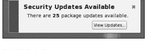

图 2.5 *yum* 密切关注任何更新，并通过顶部面板中的警报通知您。

使用 **yum** 更新的好处在于，它一次性更新通过 Fedora 安装的所有软件，如图 2.6 所示，而不是仅更新核心操作系统或其某些部分。


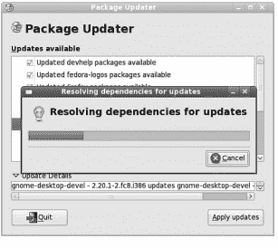

图 2.6 使用 pup 手动更新整个系统。

pup 的搭档是 pirut，或者说是“应用程序”菜单中的“添加/删除软件”项。这是 Fedora 的默认软件管理工具，允许您根据需要安装进一步的软件包或移除它们。pirut（如图 2.7 所示）使您可以通过包组（例如，窗口管理器，软件开发）、从列表中选择单个包，或通过搜索特定包来进行选择。

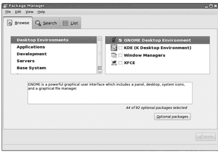

图 2.7 pirut 帮助您管理软件选择。

## 配置无线网络

无线网络曾经对于 Linux 来说配置起来很麻烦，需要许多复杂的步骤才能连接到无线网络。然而，Fedora 包含了一个名为 NetworkManager 的出色工具，使连接和管理无线网络变得极其容易。得益于 Fedora Linux 内核中包含的几个无线芯片组驱动程序，现在连接 WEP 和 WPA 加密的无线网络非常容易。

Fedora 现在开箱即支持 Intel 无线芯片组，因此，如果您有一台 Centrino 笔记本电脑，连接无线网络应该没有任何问题。这也适用于任何使用基于 zd1211 芯片组的设备的人，其中包括一些 USB 适配器。但是，对于基于 Broadcom 的无线系统，您需要获取 bcm43xx-fwcutter 程序从相关驱动文件中提取固件。请访问 http://tinyurl.com/32vtvsr 下载早期 Broadcom 芯片的驱动程序，或者访问 http://tinyurl.com/36mbr5 下载后期 Broadcom 芯片的固件。您关注的是以 Wl 开头的文件，因此将它们复制到主目录中的文件夹里。

> **注意**
>
> 对于 broadcom-wl-4.80.53.0.tar.bz2 文件，您需要双击它，因为它是一个压缩文件。当归档管理器打开时，浏览到 broadcom-wl-4.80.53.0/kmod/，并将 wl_apsta.o 和 wl_apsta_mimo.o 复制到您的主目录中，可以通过将两个文件拖到“主目录”图标上，或者通过点击工具栏中的“提取”并浏览到主目录来完成。

不幸的是，从这里开始就是试错法了，所以你必须依次尝试每个文件，看看是否启用你的硬件。对于文件 wl_apsta.o 和 wl_apsta-3.130.20.0.o，你需要使用命令 `bcm43xx-fwcutter`；对于 `wl_apsta_mimo.o` 文件，你需要使用 `b43-fwcutter`。无论如何，语法都是 `command file`。因此，例如，你可能会输入以下内容：

```
$ bcm43xx-fwcutter wl_apsta.o
```

然后按下 Enter 提取固件。完成此操作后，你需要切换到 root 将提取的文件移动到 Fedora 要求的位置。你可以通过发出命令 `su` 并在请求时输入 root 密码来切换到 root。

在 root 提示符下，当你使用过 `bcm43xx-fwcutter` 命令时，输入以下命令：

```
# mv *.fw /lib/firmware/
```

或者，如果你之前使用了 `b43-fwcutter` 命令，请输入此命令：

```
# mv b43 /lib/firmware/
```

此时，你必须重新启动系统以确保 Fedora 识别新的固件。转到“系统”、“关机”，然后选择“重新启动”。

当你的系统重新启动后，最好打开一个新的终端窗口（应用程序，系统工具，终端）并根据你使用哪个工具提取固件，输入命令 `dmesg | grep bcm` 或 `dmesg | grep b43`。你应该看到类似以下内容：

```text
b43-pci@0: Broadcom 4306 WLAN found
b43-pci@0 debug: Found PHY: Analog 2, Type 2, Revision 2
b43-pci@0 debug: Found Radio: Manuf 0x17F, Version 0x2050, Revision 2
b43-pci@0 debug: Adding interface type 2
b43-pci@0 debug: Loading firmware version 351.126 (2006-07-29 05:54:02)
b43-pci@0 debug: Chip initialized
b43-pci@0 debug: 30-bit DMA initialized
b43-pci@0 debug: Wireless interface started
```

这意味着 Fedora 已成功识别你的基于 Broadcom 的无线网卡。

现在，你只需要启动 NetworkManager 来帮助你管理无线网络。为此，请转到“系统”、“管理”，并选择“服务”以查看图 2.8 中所示的服务配置工具。

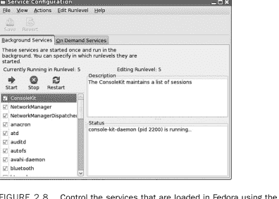

**图 2.8** 使用服务配置工具控制 Fedora 中加载的服务。

你需要确保在 NetworkManager 和 NetworkManagerDispatcher 旁边的复选框都被勾选；当你勾选框时，点击它们正上方的“启动”按钮立即启动服务。最后，点击工具栏中的“保存”按钮，并通过转到“文件”、“退出”关闭服务配置工具。完成此操作后，NetworkManager 图标将出现在你顶部面板的通知区域（见图 2.9）。这是处理并监控网络连接的小部件。

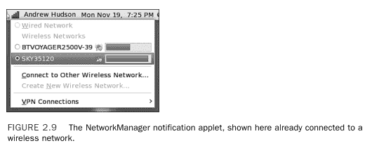

准备好后，点击工具栏中的 NetworkManager 图标以连接到无线网络。如果你的无线接入点广播其 SSID，它应该出现在无线网络列表下（类似于图 2.9）。只需点击所需的网络，NetworkManager 会检测正在使用的加密方式（如果有）并询问你密码。输入此密码后，NetworkManager 将开始无线连接。然后，密码将存储在默认密钥环中（本质上是 Fedora 中管理安全性的集中方式）；因此，如果你尚未使用过密钥环，你会被要求创建一个密码。从现在开始，每次你登录 Fedora 时，都会被要求输入密钥来解锁密钥环。

如果出于某种原因你的无线网络未出现（你可能已隐藏了 SSID），你必须使用“连接到其他无线网络”选项，这会调出图 2.10 中所示的屏幕。

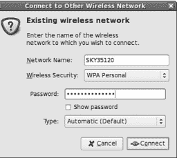

图 2.10 使用 NetworkManager 配置你的无线网络连接设置。

NetworkManager 可以处理 WEP 和 WPA 加密，以及企业版 WPA。建议你使用 WPA 加密，因为它比另一种更强。

NetworkManager 还可以连接到 Cisco VPN 连接。你可以根据需要指定连接设置，或者如果你有预定义的配置（PCF 文件），你可以将其直接导入 NetworkManager。

# 第 3 章
# 使用 GNOME

想象一个黑底白字的世界，或者对于那些记得的人来说，黑底绿字。这曾经是用户访问计算机的主要界面。自那以来，计算技术发展显著，并已在大多数桌面和工作站平台上采用图形用户界面（GUI）作为标准。

Fedora 也不例外，其主要窗口管理器被称为 GNOME（*Gnu 网络对象模型环境*）。基于设计简单性的理念，GNOME 提供了一个丰富且完整的界面，你可以轻松使用以提高生产力。主要的设计目标包括直观的系统，意味着它应该容易上手和使用，以及良好的本地化/国际化支持和无障碍性。

GNOME 建立在 X 窗口系统之上，这是许多 Linux 发行版中存在的图形网络接口，为广泛的图形工具和窗口管理器提供了基础。更常见的名称是 X，也可以称为 X11R7 和 X11（例如在 Mac OS X 中找到的）。来自世界闻名的麻省理工学院，X 经历了好几个版本，每个版本都扩展和增强了该技术。开源实现由 X.Org 基金会管理，其董事会由开源世界的几位关键人物组成。

思考 X 工作原理的最好方法是将其视为客户端/服务器系统。X 服务器为旨在充分利用服务器下可用的图形和网络功能以及支持的库的程序提供服务。X.Org 为许多不同的平台提供版本，包括 Linux 和 Mac OS X。最初作为 XFree86 实现，

## 本章内容

- GNOME 桌面环境
- AIGLX——大众的眼中秀
- 基本的 X 概念
- 使用 X
- 启动 X
- KDE——另一种环境
- Xfce
- 参考


X.Org 在 XFree86 许可证中即将包含某些限制而引发分歧时从 XFree86 分支出来。X.Org 对采用旧版许可证的代码进行了快照，并基于该代码继续向前发展，推出了自己的实现。几乎同时，大多数 Linux 发行版都背弃了 XFree86，将其开发精力和工作转向了 X.Org。

在本章中，您将学习如何操作 GNOME 以及 Fedora 包含的 X 版本。我们将探讨 X 的基础知识，以及如何确保 X 在可能影响它的升级（例如新显卡或您刚购买的新平面显示器）中正常工作。我们还将介绍 Fedora 中附带的一些其他窗口管理器，包括 KDE 和 Xfce。

## Red Hat 和 Fedora 桌面环境

> 如果您使用过早期版本的 Fedora 以及 Red Hat Linux，您对 Bluecurve 以及可能还有 Clearlooks 一定非常熟悉。Fedora 现在已统一了整个发行版的风格，并最终摒弃了略显老旧的 Bluecurve 图标集，转而采用 Nodoka 主题。KDE，另一个您稍后将了解的窗口管理器，也得到了一些润色，这两个窗口管理器现在具有一致的外观和感觉。

## GNOME 桌面环境

X 的桌面环境提供一个或多个窗口管理器以及一套符合标准图形界面的客户端，这些客户端基于一个共同的软件库集合。当使用这些库开发相关客户端时，它们为客户端窗口、菜单、按钮和其他屏幕组件提供图形一致性，以及一些通用的键盘控制和客户端对话框。以下各节讨论了 Fedora 中包含的主要桌面环境：GNOME。

GNOME 项目始于 1997 年，是编程天才 Miguel de Icaza 的创意。GNOME 提供了一套完整的软件库和客户端。GNOME 依赖于支持 GNOME 的窗口管理器。这意味着，为了提供带有 GNOME 元素的图形桌面，窗口管理器必须编写为能够识别并使用 GNOME。一些支持 GNOME 的合规窗口管理器包括 Havoc Pennington 的 *metacity*（GNOME 默认窗口管理器）、Enlightenment、Compiz、Window Maker 和 IceWM。

Fedora 使用 GNOME 用户友好的客户端套件来提供一致且用户友好的桌面。GNOME 是 Red Hat Enterprise Linux 发行版和 Fedora 的稳定功能，因为 Red Hat 积极支持其开发。GNOME 客户端位于 `/usr/bin` 目录下，GNOME 配置文件存储在 `/etc/GNOME` 和 `/usr/share/GNOME` 目录下，用户设置则存储在 home 目录下的 `.GNOME` 和 `GNOME2` 中。

图 3.1 展示了一个典型的 GNOME 桌面，其中运行了用于为事件设置操作的可移动媒体偏好设置工具。

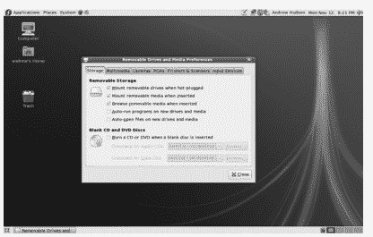

**图 3.1** Fedora 的 GNOME 桌面使用 *metacity* 窗口管理器，并提供多种 GNOME 主题选择。

您可以通过多种方式配置桌面，并使用“首选项”菜单下的不同菜单项进行操作，该菜单是主桌面菜单的一部分。凭借众多配置选项，您可以定制系统外观和感觉的每一个方面。图 3.2 展示了可供您选择的部分“首选项”选项。

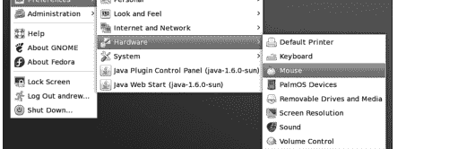

**图 3.2** 您可以使用“系统”、“首选项”菜单中可用的设置来自定义 Fedora 桌面。

## AIGLX——大众眼里的糖果

近期在 X 上进行的发展工作使得在 Fedora 及其窗口管理器中引入了一系列硬件加速效果成为可能。当同事在使用 Mac OS X 工作时，你不再需要流口水了；现在 Fedora 也拥有大量旨在为 Linux 增添专业触感的“哇哦”效果。直到最近，启用这些桌面效果还需要大量工作，包括下载特定包并使用控制台配置其中一些。然而，随着 Fedora 8 的到来，所有这些都已成为过去，你只需做很少的工作就能访问这些效果。

如果你想要炫酷的效果，Fedora 依赖于替代的 Compiz 窗口管理器，对于大多数最终用户来说，它看起来与 Fedora 正在使用的标准窗口管理器 metacity 并无不同。你需要确保拥有显卡/芯片组的最新驱动程序；我们将在第 9 章“游戏”中详细介绍这一点。

### 注意

你可能会想知道为什么图形驱动程序的安装信息会与游戏信息放在一起。在很大程度上，如果你仅使用 Fedora 进行生产力工作，3D 加速并不是必需的。但是，如果你打算通过在《虚幻竞技场》（Unreal Tournament）中击败一些对手来宣泄一点攻击性，那么你需要启用 3D 加速，并且需要特定的图形驱动程序。

在确认你的图形驱动程序状态后，你会发现“系统”、“首选项”、“外观与感觉”下有一个名为“桌面效果”的菜单选项（见图 3.3）。打开它并选择“启用桌面效果”选项。几秒钟后，你可能会看到窗口装饰（标题栏、最小化和最大化按钮）消失然后重新出现。可能看起来什么都没发生，但请勾选“激活晃动窗口”（Wobbly Windows）复选框，然后抓住窗口标题栏四处移动。如果一切按计划进行，它应该会晃动！点击“保留设置”以保存设置，欢迎来到充满时尚效果的世界。

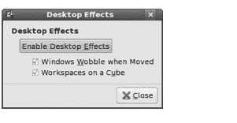

**图 3.3** 使用“桌面效果”工具为一些炫目的 3D 效果设置场景。

“晃动窗口”是最明显的一个效果，当你将窗口在桌面区域移动时，它提供了流畅的效果。或者，如果你按住 Ctrl 和 Alt 键并按下左右光标键，你的桌面应该会像立方体的一部分一样移动，带你从一个虚拟桌面到另一个虚拟桌面。

这项技术仍然非常初级，因此期待在未来版本中会有更出色的表现！

## 基本 X 概念

X11 的底层引擎是 X 协议，它提供了一个管理本地和远程桌面显示的系统。该协议使用客户端/服务器模型，允许对本地和网络上的客户端窗口以及其他装饰的绘制进行抽象。X 服务器根据客户端请求绘制针对本地硬件特定的客户端窗口、对话框和按钮。然而，客户端不必特定于本地硬件。这意味着系统管理员可以设置一个拥有大型服务器和众多客户端的网络，使用户能够在具有完全不同 CPU 和图形显示的台式机上查看和使用这些客户端。

> **注意**
> 我们无法想到比使用 X 处理远程客户端的能力来制作本章内容更好的方式，以此展示 X 的能力。虽然本节的 OpenOffice.org 文件存放在一台运行 Fedora 的 Mac mini 上，但使用的显示器和键盘实际上是另一台通过以太网连接的、运行 Ubuntu 6.06 LTS 的 Acer Ferrari 笔记本的一部分。修订工作是在一台运行 Fedora 8 的台式机上完成的，使用 Logitech 键盘和鼠标，再次通过 X 连接到 Mac mini，但这次使用的是无线连接。

由于 X 为用户提供了一种分布式处理方式，这意味着 Fedora 可以用作连接强大 X 服务器的低成本桌面平台。X 服务器越强大，可容纳的基于 X 的客户端数量就越多。此功能可以为较旧的硬件注入新的活力，将大部分图形处理推送到服务器上。如果你打算运行许多 X 客户端，快速网络是必须的，因为 X 可能会变得非常消耗带宽。

X 在 UNIX 和 Linux 世界中因各种原因而广受欢迎。它支持几乎所有的硬件图形系统，强大的多平台编程标准为其奠定了一个坚实的开发者基础，这些开发者致力于 X 的发展。X 的另一个关键好处是其网络功能，这在许多桌面的管理中起着核心作用，还可以协助部署瘦客户端计算环境。在远程桌面上启动应用程序以及标准化安装的能力，突显了这款强大应用程序的多功能性。

X 的较新版本还包含对形状窗口（即非矩形）、图形登录管理器（也称为显示管理器）和压缩字体的支持。X 的每个版本都带来更多旨在增强用户体验的功能，包括能够自定义 X 客户端应用程序的外观，一直到按钮和窗口。大多数办公室和家庭环境在其本地机器上运行 Linux 和 X。更开明的公司和用户利用 X 的网络功能的力量，启用瘦客户端环境，并允许使用专门为该公司设计的定制化桌面。应用程序能够从单一位置启动，使系统管理员的生活轻松了许多，因为他们只需在一台机器上工作，而不是几台。


# 使用 X

X.Org 7.3 是 Fedora 使用的 X 服务器。基础 Xorg 发行版由 30 个 RPM 包（总计约 120MB）组成，其中包含服务器、支持和开发库、字体、各种客户端以及文档。此外，Fedora 还包含额外的一千个或更多的 X 客户端、字体和文档。

**注意**

完整安装 X 及相关 X.Org 7.3 文件可能会占用更多——通常多得多——超过 170MB 的硬盘空间。这是因为额外的客户端、配置文件和图形文件（如图标）位于 /usr/bin 和 /usr/share 目录树下。您可以通过明智地选择在工作站上安装哪些 X 相关软件包（例如游戏）来精简过度的磁盘需求。然而，鉴于如今大多数台式电脑硬盘容量的增加，除了配置瘦客户端桌面或嵌入式系统之外，大小需求很少会成为问题。

/usr 目录及其子目录包含 Xorg 的大多数软件。一些重要的子目录包括：

- **/usr/bin**——这是 X 服务器和各种 X 客户端的位置。（请注意，并非所有 X 客户端都需要活动的 X 会话。）
- **/usr/include**——这是开发 X 客户端和图标等图形文件所需文件的路径。
- **/usr/lib**——此目录包含支持 X 服务器和客户端所需的软件库。
- **/usr/lib/X11**——此目录包含字体、默认客户端资源、系统资源、文档以及在 X 会话和各种 X 客户端期间使用的其他文件。您还可以在 /usr/lib 目录下找到一个指向此目录的名为 X11 的符号链接。
- **/usr/lib/modules**——这是 X 服务器使用的驱动程序和 X 服务器模块的路径，使各种显卡的使用成为可能。

如果您选择使用图形桌面，则用于活跃本地 X 会话的主要组件已安装在您的系统上。这些组件包括 X 服务器、杂项字体、终端客户端（即提供 shell 提示符访问的程序）以及一个称为窗口管理器的客户端。窗口管理器管理屏幕显示，包括重叠和瓦片式窗口、命令按钮、标题栏以及其他屏幕装饰和功能。

## xorg.conf 文件的元素

对于 Xorg 来说，最重要的文件是位于 /etc/X11 目录中的 xorg.conf 配置文件。该文件包含对 X 正确运行至关重要的配置信息，通常在 Fedora 安装期间创建。如果您需要在安装后更改任何内容，应使用 system-config-display 应用程序，本章稍后将对此进行介绍。与硬件、监视器、显卡和输入设备相关的信息存储在 xorg.conf 文件中，因此，如果您决定在文本编辑器中对其进行修改，请小心！

当然，我们不会让您盲目地去编辑如此重要的文件。让我们看看文件的内容，以便您了解 X 正在寻找什么。xorg.conf 文件的组件，即各个部分，指定了 X 会话或服务器布局，以及服务器使用的文件路径名、直接与服务器相关的任何选项、所需的任何可选支持模块、与连接到系统的鼠标和键盘相关的信息、安装的显卡、正在使用的监视器，以及当然 Fedora 使用的分辨率和颜色深度。在该文件的 12 个部分中，以下是基本组件：

- **ServerLayout**——定义显示，定义一个或多个屏幕布局，并命名输入设备。
- **Files**——定义颜色、字体或字体服务器端口号的位置。
- **Module**——告诉 X 服务器加载哪些图形显示支持代码模块。
- **InputDevice**——定义输入设备，如键盘和鼠标；可以使用多个设备。
- **Monitor**——定义任何连接显示的能力；可以使用多个监视器。
- **Device**——定义一个或多个显卡，并指定要启用或禁用的任何可选功能（如果有）。
- **Screen**——定义一个或多个分辨率、颜色深度、可能的默认颜色深度以及其他设置。

以下部分对这些元素提供了简短描述；xorg.conf 手册页包含所有选项和用于自定义桌面设置的其他关键字的完整文档。

### ServerLayout 部分

如前所述，xorg.conf 文件的 ServerLayout 部分定义显示和屏幕布局，并命名输入设备。自动配置的 xorg.conf 文件中典型的 ServerLayout 部分可能如下所示：

```
Section "ServerLayout"
    Identifier    "single head configuration"
    Screen      0     "Screen0" 0 0
    InputDevice "Mouse0" "CorePointer"
    InputDevice "Keyboard0" "CoreKeyboard"
    InputDevice "DevInputMice" "AlwaysCore"
EndSection
```

在此示例中，使用单个显示（数字指定屏幕位置），并在该会话中使用两个默认输入设备 Mouse0 和 Keyboard0。

### Files 部分

xorg.conf 文件的 Files 部分可能如下所示：

```
Section "Files"
RgbPath "/usr/lib/X11/rgb"
FontPath "unix/:7100"
EndSection
```

此部分列出了可用的会话颜色（通过名称，在文本文件 rgb.txt 中）以及到 X 字体服务器的端口号。字体服务器 xfs 在启动时开始运行，不需要活动的 X 会话。如果未使用字体服务器，FontPath 条目可以改为列出 /usr/lib/X11/fonts 目录下的每个字体目录，如下例所示：

```
FontPath "/usr/lib/X11/fonts/100dpi:1"
FontPath "/usr/lib/X11/fonts/misc:1"
FontPath "/usr/lib/X11/fonts/75dpi:1"
FontPath "/usr/lib/X11/fonts/type1:1"
FontPath "/usr/lib/X11/fonts/Speedo"
...
```

这些目录包含在 X 会话期间可供使用的默认压缩字体。您可以使用 /etc/X11/fs 目录下名为 config 的文件来配置字体服务器。该文件包含字体服务器使用的字体列表或目录。通过在此文件中添加备用服务器条目并重启字体服务器，您可以指定在 X 会话期间使用的远程字体服务器。这有助于集中字体支持并减少本地存储需求（尽管随 Fedora 和 X 安装的近 5,000 种字体仅需 25MB）。

### Module 部分

xorg.conf 文件的 Module 部分指定为 X 会话加载的可加载模块或驱动程序。此部分可能如下所示：

```
Section "Module"
Load "dbe"
Load "extmod"
Load "fbbdevhw"
Load "glx"
Load "record"
Load "freetype"
Load "type1"
Load "dri"
EndSection
```

这些模块的范围可以从特殊的视频卡支持到字体光栅化器。模块位于 /usr/lib/modules 目录下的子目录中。

### InputDevice 部分

*InputDevice* 部分配置特定设备，如键盘或鼠标，如下例所示：

```
Section  "InputDevice"
    Identifier  "Keyboard0"
    Driver      "kbd"

    Option      "XkbModel"  "pc105"
    Option      "XkbLayout" "us"
EndSection
Section  "InputDevice"
    Identifier  "Mouse0"
    Driver      "mouse"
    Option      "Protocol"  "IMPS/2"
    Option      "Device"  "/dev/input/mice"
    Option      "ZAxisMapping" "4 5"
    Option      "Emulate3Buttons" "yes"
EndSection
```

您可以配置多个设备，并且可能存在多个 InputDevice 部分。前面的示例指定了一个基本键盘和一个两键 PS/2 鼠标（实际上，是一个戴尔触摸板指针）。指定使用 USB 设备的 InputDevice 部分可以同时使用（以启用 PS/2 和 USB 指针的鼠标操作），可能如下所示：

```
Section  "InputDevice"
    Identifier  "Mouse0"
    Driver      "mouse"
    Option      "Device"  "/dev/input/mice"
    Option      "Protocol"  "IMPS/2"
    Option      "Emulate3Buttons" "off"
    Option      "ZAxisMapping" "4 5"
EndSection
```


### 注意

如果您更改了计算机的指向设备，随后应运行 Fedora 的 system-config**鼠标**客户端，该客户端会自动更新系统的 xorg.conf 文件。

## 警告

从 Fedora Core 3 开始，鼠标设备的位置从 /dev/mouse 更改为 /dev/input/mice。不幸的是，当 system-config**显示器**写入 xorg.conf 文件时，有时会出现一些混乱，仍然将鼠标映射到 /dev/mouse 而不是 /dev/input/mice。这时候懂一点 vi 知识就很有用了！

### 监视器部分

监视器部分配置在 ServerLayout 部分中指定的显示设备，如以下示例所示：

```
Section "Monitor"
    Identifier "Monitor0"
    VendorName "Monitor Vendor"
    ModelName "Monitor Model"
    DisplaySize 300 220
    HorizSync 31.5-48.5
    VertRefresh 50-70
    Option "dpm"
EndSection
```

请注意，X 服务器会根据此部分中的水平和垂直同步值以及刷新率自动确定最佳的视频时序。如果需要，旧式的模式行条目（用于 XFree86 4.0 之前的发行版和服务器）可能仍可使用。如果在配置 X 时自动检测到监视器（请参阅本章后面“配置 X”部分），其定义和功能将从 MonitorsDB 数据库插入到您的 xorg.conf 文件中。此数据库包含 600 多种监视器，位于 /usr/share/hwdata 目录中。

### 设备部分

设备部分提供了关于计算机所使用的视频图形芯片组的详细信息，如以下示例所示：

```
Section "Device"
    Identifier "Videocard0"
    Driver "radeon"
    VendorName "Videocard vendor"
    BoardName "ATI Radeon Mobility M6"
EndSection
```

此示例识别已安装的视频卡使用的是 ATI Mobility M6 图形芯片组。**Driver** 条目指示 Xorg 服务器从 `/usr/lib/modules/drivers` 目录加载 `radeon_drv.o` 模块。不同的芯片组具有不同的选项。例如，以下是 NeoMagic 视频芯片组的条目：

```
Section "Device"
Identifier "NeoMagic (laptop/notebook)"
Driver "neomagic"
VendorName "NeoMagic (laptop/notebook)"
BoardName "NeoMagic (laptop/notebook)"
Option "externDisp"
Option "internDisp"
EndSection
```

在此示例中，**Device** 部分指定了显卡的驱动程序（`neomagic_drv.o`）并启用了两个芯片组选项（`externDisp` 和 `internDisp`），以允许在笔记本电脑的 LCD 屏幕和连接的监视器上进行显示。

Xorg 服务器支持数百种不同的视频芯片组。如果您配置了 X11 但随后更换了安装的视频卡，您需要使用本章讨论的任一 X 配置工具编辑现有的 **Device** 部分或生成新的 xorg.conf 文件，以反映新卡的功能。您可以在随附的手册页中找到某些芯片组选项的详细信息。您应该查看这些来源，以获取有关优化和故障排除的提示。

### 屏幕部分

屏幕部分将之前部分的信息（使用 `Screen0`、**Device** 和 **Monitor** 的 *Identifier* 条目）结合在一起。它还可以为会话指定一个或多个颜色深度和分辨率。以下是示例：

```
Section "Screen"
Identifier "Screen0"
Device "VideoCard0"
Monitor "Monitor0"
DefaultDepth 24
SubSection "Display"
Viewport 0 0
Depth 16
Modes "1024x768" "800x600" "640x480"
EndSubSection
EndSection
```

在此示例中，默认的色深为数千种颜色，分辨率为 1024x768，可选分辨率为 800x600 和 640x480。如果显卡和监视器的组合支持，可以使用具有不同颜色深度和分辨率的多个 **Display** 子部分条目（例如，使用 **Depth 24** 表示数百万种颜色的设置）。您还可以使用 DefaultDepth 条目（在示例中为 24，即数千种颜色），结合特定的颜色深度来标准化安装中的显示深度。您还可以指定一个大于监视器或笔记本显示屏硬件支持的桌面分辨率。此设置称为 Display 子部分中的虚拟分辨率。例如，这允许 800×600 显示屏平移（即在 1024×768 的虚拟窗口内滑动）。

### 注意

如果您的监视器和显卡支持多种分辨率，并且设置已正确配置，您可以在 X 会话期间使用 Ctrl+Alt+小键盘+ 或 Ctrl+Alt+小键盘- 的组合键即时更改分辨率。

## 配置 X

虽然可以使用 Fedora 安装程序在安装过程中配置 X，但如果 PC 的视频卡未被识别，可能会出现一些问题。如果您无法在安装过程中配置 X（请参阅第 1 章“安装 Fedora”），请勿指定启动图形化配置，并跳过安装过程中的 X 配置部分。请注意，某些安装（例如服务器安装）不需要配置 X 以支持活动 X 会话，但可能需要安装 X 及相关软件以支持远程用户和客户端。

您可以使用以下配置工具（其中包括但不限于）来创建工作可用的 xorg.conf 文件：

-   system-config-display——这是 Fedora 的图形化配置工具，它启动 X 会话来创建 xorg.conf 文件。
-   xorg——X 服务器本身可以创建一个基本的可用配置。

以下部分讨论了如何使用这些软件工具来创建工作可用的 xorg.conf 文件。

## 使用 system-config-display 客户端配置 X

您可以使用 system-config-display 客户端创建或更新 xorg.conf 文件。如果您已经运行 X，可以通过点击“系统”、“管理”下的“显示器”菜单项开始，但您也可以在控制台会话期间以 root 身份从命令行启动该客户端，如下所示：

```
# system-config-display
```

屏幕清除，system-config-display 尝试启动 X 会话。如果在 X 会话期间启动此客户端，其主窗口将出现，如图 3.4 所示。

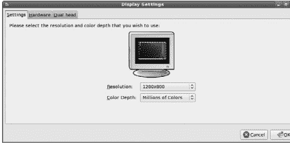

**图 3.4** system-config-display 客户端提供图形化配置界面，用于创建或更新系统的 xorg.conf 文件。在此您看到的是显示设置主屏幕，提供分辨率和颜色深度设置。

显示设置主屏幕是一个对话框，显示当前的监视器和视频卡设置（如果已配置）。您可以通过点击想要更改的具体下拉菜单来更改分辨率（水平和垂直像素）和颜色深度（支持的颜色数量）。点击“确定”或“取消”按钮以保存或取消任何更改。

如果您点击“硬件”选项卡，其他配置选项将变为可用，如图 3.5 所示。

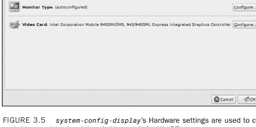

**图 3.5** system-config-display 的硬件设置用于配置 X11R7 的监视器和视频卡（以及多头视频卡）。

在“硬件”选项卡对话框的监视器类型区域，点击“配置”按钮以更改您的监视器设置，如图 3.6 所示。您可以使用此对话框配置不同的监视器或更改当前的监视器设置。


**图 3.6** 您可以滚动选择新的监视器用于您的 X 会话。

首先，滚动监视器品牌列表（来自 MonitorDB 数据库），然后点击制造商或类型名称左侧的小三角形。然后您将看到模型名称列表。点击选择其中一个，完成后，点击“确定”按钮使用新设置，或点击“取消”按钮放弃更改。

要配置视频卡，您可以点击“硬件”选项卡对话框中视频卡区域的“配置”按钮。视频卡对话框将出现，如图 3.7 所示。


**图 3.7** 使用“硬件”选项卡的视频卡配置按钮为您的 X 会话选择新的视频卡。

您可以滚动视频卡列表。您可以点击选择其中一个，完成后，点击“确定”按钮以确认选择。

如果您的视频卡支持使用两个或更多监视器，您可以使用“双头”选项卡来配置多监视器支持。Xorg 支持多个显示，使用


一项名为 Xinerama 的功能。该功能允许多台显示器表现为一个单一显示屏，并且每个显示屏可以位于屏幕布局的任意象限。

要在您的桌面会话中使用 Xinerama，您必须以 `+xinerama` 选项启动 `xorg` 服务器。您的 `xorg.conf` 文件还必须具有适当的设置，并且每个显示器必须能够支持相同的颜色深度（通常为 16bpp 或数千种颜色）。您可以在 `xorg` 的手册页以及位于 http://www.tldp.org/HOWTO/Xinerama-HOWTO/ 的 Xinerama HOWTO 中找到有关将 Xinerama 与 `xorg` 一起使用的详细信息。当您对 `X` 服务器设置完成更改后，点击“确定”按钮。然后您会看到一个对话框，提示您需要注销，然后重新登录（或退出 `X` 会话并重启 `X`）才能使用新设置。

新设置存储在一个位于 `/etc/X11` 目录下的新 `xorg.conf` 文件中。如果您发现新设置不起作用，您可以简单地将名为 `xorg.conf.backup` 的备份 `xorg.conf` 文件复制到同一目录中的 `xorg.conf`，以恢复到您的原始设置。

## 使用 Xorg 配置 X

您可以通过在文本编辑器中从头开始输入手动创建 `xorg.conf` 文件，但您也可以通过使用 `xorg` 服务器或配置实用程序（如前几节所述）自动创建它。作为 root 操作员，您可以在服务器上使用以下内容创建测试配置文件：

```
# X -configure
```

按下 Enter 后，会在 root 的主目录 `/root` 目录下创建一个名为 `xorg.conf.new` 的文件。然后您可以使用此文件进行测试会话，例如：

```
# X -config /root/xorg.conf.new
```

## 启动 X

您可以通过多种方式启动 `X` 会话。Fedora 安装程序将系统初始化表 `/etc/inittab` 设置为让 Linux 直接引导至 `X` 会话，使用*显示管理器*（即提供图形登录的 `X` 客户端）。登录之后，您使用本地会话（在您的计算机上运行）*或者*，如果系统配置得当，使用网络上远程计算机上运行的 `X` 会话。通过显示管理器登录需要您输入用户名和密码。您还可以从命令行启动 `X` 会话。以下部分描述了这两种方法。

## 使用显示管理器

`X` 显示管理器提供图形登录，在授予访问 `X` 桌面的权限之前需要输入用户名和密码。它还允许您为 `X` 会话选择不同的桌面。是否在引导 Linux 后呈现 `X` 显示管理器由*运行级别*（`/etc/inittab` 中的系统状态条目）控制。该文件中定义了以下运行级别：

```
# 0 - 关机（请勿将 initdefault 设置为此项）
# 1 - 单用户模式
# 2 - 多用户，无 NFS（如果没有网络，与 3 相同）
# 3 - 完整多用户模式
# 4 - 未使用
# 5 - X11
# 6 - 重启（请勿将 initdefault 设置为此项）
```

运行级别 5 用于通过显示管理器进行图形化 X 登录的多用户模式；引导至运行级别 3 则提供控制台或基于文本的登录。`/etc/inittab` 文件中的 `initdefault` 设置决定了默认运行级别：

```
id:5:initdefault:
```

在此示例中，Linux 启动然后运行 X。

默认显示管理器也可能在 `/etc/inittab` 中指定，如下所示：

```
x:5:respawn:/usr/bin/xdm -nodaemon
```

然而，Fedora 使用位于 `/etc/X11` 目录下的名为 `prefdm` 的 shell 脚本来设置显示*管理器*：

```
x:5:respawn:/etc/X11/prefdm -nodaemon
```

根据此脚本，显示管理器基于 `/etc/sysconfig` 目录下名为 `desktop` 的文件。`DESKTOP=` 条目后的 GNOME、KDE 和 XDM 决定了登录时使用的显示管理器。以下部分描述了如何配置三种最常用的显示管理器：gdm、kdm 和 xdm。

### 配置 gdm

gdm 显示管理器是包含在 Fedora 中的 GNOME 库和客户端发行版的一部分，当系统直接引导至 X 时，它提供图形登录。其登录界面（实际上由 gdmlogin 客户端显示）托管了窗口管理器、语言和系统选项（关机或重启工作站）的弹出菜单。虽然您可以（以 root 身份）编辑 `/etc/X11/gdm` 目录下的 `gdm.conf` 来配置 gdm，但配置 GNOME 显示管理器的更好方法是使用 `gdmsetup` 客户端。

您可以使用 `gdmsetup` 客户端来配置 GDM 外观和行为的一个方面。您可以从 GNOME 系统菜单中的“管理”下的“登录窗口”启动此客户端。

当 `gdmsetup` 加载时，您会看到如图 3.8 所示的 GDM 设置窗口。

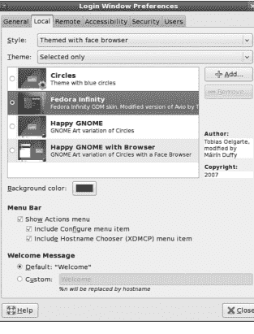

图 3.8 当使用 gdm 作为显示管理器时，您使用 gdmsetup 配置 gdmlogin 屏幕。

您可以通过点击 GDM 设置对话框中的选项卡来指定安全、远程网络登录、X 服务器以及会话和会话选择器设置的配置。

### 配置 kdm

kdm 客户端是 KDE 的一部分（本章节稍后将介绍），它提供类似 gdm 的图形登录。您通过作为 root 操作员运行 KDE 控制中心客户端 kcontrol 来配置 kdm，方法是点击 KDE kicker 或桌面面板菜单中的“控制中心”菜单项。

在 KDE 控制中心窗口左侧窗格的“索引”选项卡中，点击“系统管理”菜单项以打开其内容，然后点击“登录管理器”菜单项。控制中心窗口右侧窗格显示 kdm 登录管理器的选项卡和配置选项，如图 3.9 所示。

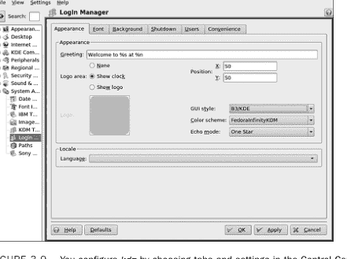

图 3.9 您通过在控制中心对话框中选择选项卡和设置来配置 kdm。

要在作为普通用户登录时更改 KDE 显示管理器的任何设置，您必须首先点击“管理员模式”按钮，然后输入 root 操作员密码。您可以点击控制中心对话框中的选项卡来设置配置选项。这些选项卡中的选项使您能够控制登录显示、提示、用户图标、会话管理以及系统选项配置（用于关机或重启）。在每个选项卡中做出配置选择后，点击“应用”按钮以立即应用更改；否则，更改将在 X 服务器重启时应用。

### 使用 xdm 显示管理器

xdm 显示管理器是 Xorg 发行版的一部分，提供用于 X 的简易登录。虽然可以通过编辑 /etc/X11/xdm 目录下的各种文件来配置 xdm，但 GNOME 和 KDE 在显示管理器设置中提供了更多样化的选项。默认 xdm 登录屏幕的显示由包含在 Xorg 中的 xsetroot 客户端和 Owen Taylor 的 xsri 客户端处理，如 /etc/X11 下 xdm 目录中的 Xsetup.0 文件所指定。xsri 客户端可用于设置登录显示桌面的背景颜色，并在初始显示中放置图像。

## 使用 startx 从控制台启动 X

如果您将 Fedora 设置为引导至运行级别 3（基于文本的控制台登录），您可以从命令行启动 X 会话。您使用 startx 命令（实际上是一个 shell 脚本）来完成此操作。您使用 startx 启动 X 服务器和 X 会话，如下所示：

```
$ startx
```

startx 首先会在您的主目录中查找名为 ~/.xinitrc 的文件。该文件可以包含用于为您的 X 会话启动替代桌面和 X 客户端的设置。默认的系统 .xinitrc 位于 /etc/X11/xinit 目录中，但可以使用本地文件来定制 X 会话并启动默认客户端。

如果您使用 Fedora 桌面，它运行 X 和 GNOME 感知的窗口管理器或 KDE 作为桌面环境，那么使用自定义 .xinitrc 并非必要。

您还可以使用带有一个或多个命令行选项的 startx 命令。这些选项在启动 X 会话之前传递给 X 服务器。例如，您可以使用 startx 通过 `-depth` 选项后跟一个数字（如 8、16、24 或 32，分别代表 256 色、数千色或数百万色，具体取决于 X 配置文件中的定义和支持情况）来指定 X 会话的颜色深度。在开发期间使用不同的颜色深度对于测试 X 客户端在不同显示器上的外观或节省视频内存的使用（例如在尝试获得最高分辨率时，增加颜色深度有时会影响旧显卡的最大分辨率）非常有用。

例如，要启动一个具有数千种颜色的会话，您使用 startx 命令如下：

```
$ startx -- -depth 16
```

另一个可以传递的选项是为 X 会话使用的特定每英寸点数（dpi）分辨率。例如，要使用 100dpi，您使用 `-dpi` 选项后跟 100，如下所示：

```
$ startx -- -dpi 100
```

您也可以使用 startx 启动多个 X 会话。这一功能源于 Fedora 对虚拟控制台或基于文本的多显示的支持。要启动第一个 X 会话，您使用 startx 命令后跟一个显示号，或 X 服务器实例（第一个是 0，使用屏幕 0 和一个代表虚拟控制台的数字。用于 X 的默认控制台是编号 7，因此您可以像这样启动会话：

```
$ startx -- :0 vt7
```

X 启动并出现窗口管理器后，您按 Ctrl+Alt+F2，然后在提示符处再次登录。接下来，您像这样启动另一个 X 会话，指定不同的显示号和虚拟控制台：

```
$ startx -- :1 vt8
```

另一个 X 会话将启动。要跳转到第一个 X 会话，按 Ctrl+Alt+F7。您使用 Ctrl+Alt+F8 返回第二个会话。如果您退出当前会话并转到另一个基于文本的登录或 shell，您使用 Alt+F7 或 Alt+F8 跳转到所需会话。


# 使用 Fedora 的 switchdesk 客户端

你可以使用 Fedora 的 switchdesk 客户端来更改默认的窗口管理器或桌面环境，例如 GNOME 或 KDE。大多数桌面环境还包含保存会话状态的功能（例如正在运行的应用程序、应用程序的窗口大小和位置等），这项功能被称为会话管理。

当你基于文本控制台运行 X 时，也可以使用 switchdesk 工具，配合一个关键词（例如 GNOME 或 KDE），在启动 X 之前设置默认的 X 桌面。例如，若要指定使用 KDE 桌面环境作为默认环境，请像这样使用 switchdesk：

```
$ switchdesk KDE
Red Hat Linux switchdesk 4.0
Copyright (C) 1999-2004 Red Hat, Inc
Redistributable under the terms of the GNU General Public License
Desktop now set up to run KDE.
For system defaults, remove /home/andrew/.Xclients
```

此示例表明，默认的 X 会话现在将使用 KDE。设置保存在主目录中名为 `.Xclients` 的文件中。你可以在 X 会话期间通过从“系统”、“首选项”菜单中点击“桌面切换工具”菜单项来启动 switchdesk。你将看到一个图形对话框，提供 X 会话的窗口管理器选择（具体取决于系统上安装的窗口管理器），如图 3.10 所示。

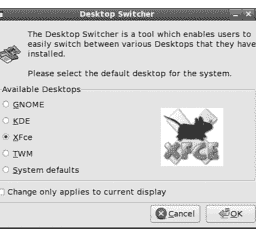

图 3.10 使用 switchdesk 设置 X 会话的默认窗口管理器。

选择窗口管理器取决于个人偏好、必要性或政策。在旧式 PC 上，你可能会选择使用其他窗口管理器，例如 Tab Window Manager (twm) 或 Xfce，因为它们的系统资源需求较低（即需要较少的硬盘空间、CPU 处理能力和系统内存）。较新的桌面环境需要 256MB 甚至更多的内存才能获得良好的性能。接下来的章节将介绍一些最流行的窗口管理器及其用途。

## KDE——另一种环境

Fedora 的一大优点在于它提供的选择。多年来，GNOME 一直是 Fedora 的默认桌面环境。然而，从 Fedora 8 开始，你可以下载 Fedora 的 Live CD 变体，该版本允许你使用 K 桌面环境，简称 KDE。

KDE 与 GNOME 略有不同，因为它使用 QT 库而不是 GTK 库，因此窗口和其他元素的外观有所不同。Linus Torvalds 本人明确表示他偏好 KDE，而且 KDE 允许你以几乎可以想到的任何方式定制工作环境，这也是其优势之一。

如果你使用随本书提供的 DVD 安装 Fedora，并且没有选择自定义安装，则需要使用 **应用程序**、**添加/删除软件** 来选择 KDE 的基础软件包。

图 3.11 展示了一个标准的 KDE 桌面。

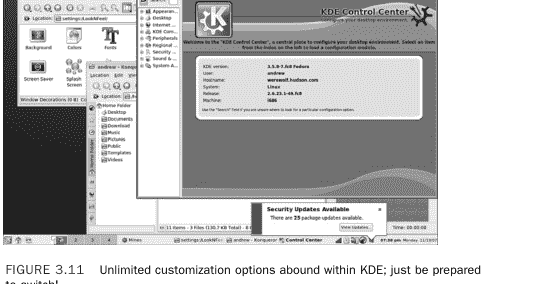

Fedora 默认使用 GNOME，但你可以使用前面章节中描述的 **switchdesk** 工具切换到 KDE。或者，你可以使用登录屏幕上的 **选项** 按钮，点击 **选择会话**，然后选择 **KDE**。当你登录时，系统会提示你希望使用 KDE 作为默认环境还是仅用于本次会话。如果你是初次尝试，我们建议使用一次性选项。

## Xfce

Xfce 是另一种桌面环境，适用于内存或处理能力有限的计算机。它基于与 GNOME 相同的 GTK 库，因此具有 GNOME 桌面的一些外观和感觉。不过，它附带了一系列特定的 Xfce 应用程序，用于替代诸如 nautilus 等 GNOME 工具。

有些人只是喜欢 Xfce 的简洁性，因此是否使用它由你决定。你可以像 KDE（前面已描述）一样访问它，图 3.12 展示了一个示例桌面。

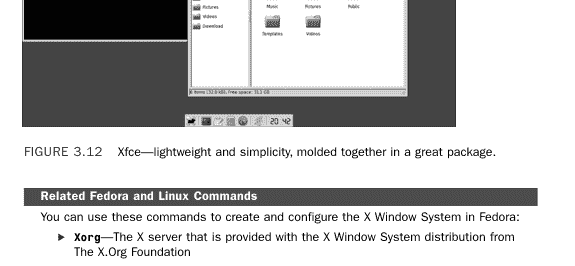

## 相关的 Fedora 和 Linux 命令

你可以使用这些命令在 Fedora 中创建和配置 X 窗口系统：

- **Xorg**— 来自 The X.Org Foundation X 窗口系统发行版的 X 服务器
- **mouseconfig**— Fedora 的基于文本的 GUI 指点设备配置程序
- **kcontrol**— KDE 控制中心客户端
- **system-config-display**— Fedora 的图形化 X11R7 配置工具
- **system-config-mouse**— Fedora 的图形化鼠标配置工具
- **gdmsetup**— GNOME 显示管理器配置客户端
- **startx**— 用于从 shell 命令行启动一个或多个 X 会话的 shell 脚本
- **xsr1**— 显示管理器根桌面装饰客户端

## 参考资料

- [http://www.x.org/](http://www.x.org/)— X 窗口系统维护者。
- [http://www.x.org/Downloads_mirror.html](http://www.x.org/Downloads_mirror.html)— 想要下载最新版本 *X* 的源代码？从这个镜像站点列表开始。
- [http://www.xfree86.org/](http://www.xfree86.org/)— XFree86 Project, Inc. 的首页，该公司为 Linux 提供图形界面已有近 10 年。
- [http://www.kde.org/](http://www.kde.org/)— 学习 KDE 及最新发展的起点。
- [http://www.gnome.org/](http://www.gnome.org/)— 获取关于 GNOME 更多信息的起点，包括新客户端链接和 GNOME 开发项目。
- [http://people.redhat.com/-hp/metacity/](http://people.redhat.com/-hp/metacity/)— Havoc Pennington 的 **metacity** 下载页面，你可以在这里获取此窗口管理器的最新完整源代码版本。
- [http://sawmill.sourceforge.net/](http://sawmill.sourceforge.net/)— **sawfish** 窗口管理器的首页（原名 sawmill）。
- [http://www.windowmaker.org/](http://www.windowmaker.org/)— 最新版 Window Maker 的源代码。
- [http://www.icewm.org/](http://www.icewm.org/)— IceWM 的首页。
- [http://www.lesstif.org/](http://www.lesstif.org/)— LessTif 项目的首页，该项目旨在提供与 OSF/Motif 兼容的 GNU GPL 版本软件库。
- [http://scwm.sourceforge.net/](http://scwm.sourceforge.net/)— 一个轻量级但支持虚拟桌面的窗口管理器的首页。
- [http://www.fvwm.org/](http://www.fvwm.org/)— FVWM2 的首页，你可以在这里下载最新版本。
- [http://www.novell.com/products/desktop/](http://www.novell.com/products/desktop/)— 开始使用 Ximian GNOME 的地方。

# 第 4 章
命令行快速入门

命令行是与 Fedora 甚至 Linux 一起使用时最强大的工具之一。了解与其相关的命令以及如何将它们组合使用，将使你在 Fedora 上的工作变得更加轻松，特别是当你遇到 X 无法正常工作的问题时。

本章介绍了一些你需要知道的基本命令，以便在命令行上高效工作。你将学习如何进入命令行，并掌握一些用于在文件系统周围导航的命令。本书稍后的部分（第 32 章）是“命令行大师班”，将更深入地探讨这一主题。

## 理解命令行

与 Linux 用户接触一段时间后，很快就会听到他们以压低的声音谈论命令行或终端。这是有道理的，因为命令行提供了一种独特且强大的与 Linux 交互的方式。然而，在大多数情况下，你可能永远不需要访问命令行，因为 Fedora 提供了各种图形工具，使你能够配置系统中的大部分内容。

但这是现实世界，有时事情会出错，这意味着你可能并不总是拥有图形界面这种奢侈品。正是在这种情况下，对命令行及其用途的基本理解可以成为真正的救星。

## 本章内容

- 理解命令行
- 登录和操作 Linux
- 使用文本编辑器
- 以 Root 身份工作
- 阅读文档
- 参考资料

很容易认为命令行是某种黑色且神秘的艺术的产物，在某些方面它可能看起来极难使用。到本章结束时，你至少应该能够舒适地使用命令行，并准备好进入第 32 章。

然而更重要的是，你将能够在基于命令行的系统中自如移动，如果你在服务器环境中工作，很可能会遇到这种情况。

本章向你介绍了一些命令，包括允许你执行以下任务的命令：

- ► 执行常规任务——登录和注销、使用文本控制台、更改密码、列出和导航目录
- ► 执行基本文件管理——创建文件和文件夹、在文件系统中复制或移动它们、重命名并最终删除它们（如有必要）
- ► 执行基本系统管理——关闭或重启、阅读 man 页、使用基于文本的工具编辑系统配置文件

本章的信息对于 Linux 新手或首次学习使用命令行的个人用户或系统管理员来说非常有价值。

> 那些长期使用计算机的人可能已经接触过 MS-DOS，在这种情况下，面对一个黑色屏幕会引发一种怀旧感。但不要太过安逸；Linux 中的命令行比其远亲 MS-DOS 优越得多。MS-DOS 的技能只能转移到其他 MS-DOS 环境，而你在 Linux 命令行上学到的技能可以轻松地转移到其他类 UNIX 操作系统，如 Solaris、OpenBSD、FreeBSD，甚至 Mac OS X（因为它允许你访问终端）。

## 安全性

有一个概念你必须习惯，即基于用户的安全性。总的来说，只有两类用户会作为实际用户访问系统。第一类是普通用户，你在首次启动 Fedora 时创建了一个这样的用户（参见第 1 章，“安装 Fedora”）。这些用户可以更改专属于他们的任何内容，例如桌面的壁纸、他们的个人偏好设置等。这些用户被阻止进行会影响其他用户（通常称为系统级变更）的更改。

要进行系统级更改，你需要使用超级用户或 root 账户。这是一种特殊访问权限，赋予你对整个系统的完全控制权，如果你愿意，也有能力摧毁一切。如果你在自己的 PC 上安装了 Linux，你在安装过程中设置时自动获得了 root 账户的访问权限


安装。然而，用户没有 root 用户的访问权限是很常见的，尤其是在安全和系统稳定性至关重要的企业环境中。

root 的破坏性在 `# rm -rf /` 这个古老的例子中可见一斑，它会抹去你硬盘上的所有数据。在以 root 身份工作时需要格外小心，否则你可能会不可修复地损坏系统。不过，你不必为此担心，因为 root 用户是健全 Linux 系统的基础。没有它，你将无法安装新软件、编辑系统配置文件或执行许多管理任务。到本章结束时，你将习惯于以 root 身份工作，并能够适当地管理系统。

和大多数事物一样，Fedora 提供了多种访问命令行界面（CLI）的方式。你可以使用 **应用程序** 菜单下 **系统工具** 中的终端项，但最简单的方法是按下 **Ctrl+Alt+F1**。Fedora 会切换到一个黑屏和传统的登录提示，如下所示：

```
Fedora Release 8 (Werewolf)
Kernel 2.6.23-0.217.fc8 on an i686
fedora login:
```

> **提示**
>
> 这实际上是 Fedora 为您提供的六个虚拟控制台之一。访问虚拟控制台后，您可以使用 Alt 键和 F1 到 F6 切换到不同的控制台。如果您想返回图形界面，请按 Alt+F7。您还可以通过按住 Alt 键并按下左或右方向键来切换控制台，例如从 vt1 移动到 vt2。

Fedora 正在等待您以用户身份登录，因此请输入您的用户名并按下 Return（回车）键。然后 Fedora 会提示您输入密码，您应该输入该密码。请注意，当您输入密码时，Fedora 不会显示任何字符。这是一件好事，因为它可以防止肩窥者看到您输入的内容或密码的长度。

按下 Return（回车）键会将您带入 shell 提示符，以美元符号表示：

```
andrew@fedora ~$ 
```

这个特定的提示告诉我，我以用户 andrew 的身份登录到 fedora 系统，并且我当前位于主目录中。（Linux 使用波浪号作为主目录的简写形式。）

> **提示**
>
> 在命令行中导航系统有时会令人困惑，特别是当一个目录名称出现在几个不同的地方时。幸运的是，Linux 包含一个简单命令，告诉您确切地在文件系统中的位置。因为它很容易记住——该命令只是 *present working directory*（当前工作目录）的缩写——所以**在任何时候输入 pwd** 即可获取您所在位置的完整路径。例如，按照这些指示操作后输入 **pwd** 将显示 */home/youruserName*，这意味着您当前位于主目录中。当您半打次更改目录后失去方向时，使用 **pwd** 命令可以为您省去很多麻烦。

另一种快速访问终端的方法是转到应用程序、附件，然后选择终端项。Fedora 会打开 **gnome-terminal**，允许您在保持 Gnome 环境的同时访问终端。这次，终端显示为白底黑字。您可以选择通过这种方式访问终端，或使用 **Ctrl+Alt+F1** 路线；无论如何，您都会到达同一个地方。

### 在文件系统中导航

使用 **cd** 命令在 Fedora 文件系统中导航。该命令通常与特定的目录位置或路径名一起使用，如下所示：

```
$ cd /usr/share/doc
```

在 Fedora 下，**cd** 命令也可以与多个快捷方式一起使用。例如，要快速移动到 *parent*（父级，即更高层级）目录，请像这样使用 **cd** 命令：

```
$ cd ..
```

要从 Linux 文件系统中的任何位置返回到用户的主目录，请像这样使用 **cd** 命令：

```
$ cd
```

您还可以使用 `$HOME` shell 环境变量来完成相同的事情。输入此命令并按 Enter 键以返回您的主目录：

```
$ cd $HOME
```

使用波浪号 (~) 也可以实现相同的效果，如下所示：

```
$ cd ~
```

> **注意**
>
> 别忘了使用 **pwd** 命令提醒你在文件系统中的位置！

另一个重要的命令是 `ls` 命令，它列出当前目录的内容。通常单独使用，但 `ls` 的许多选项（或开关）可以为您提供更多信息。例如，以下命令返回当前目录内所有文件和目录的列表，包括任何隐藏文件（以 . 前缀表示）以及完整列表，因此它将包括诸如权限、所有者和组、大小以及最后修改时间和日期等详细信息：

```
$ ls -al
```

您也可以发出以下命令：

```
$ ls -R
```

此命令扫描并列出当前目录的子目录的所有内容。这可能涉及大量信息，因此您可能希望使用以下方法将输出重定向到文本文件，以便您可以随时浏览：

```
$ ls -alR > listing.txt
```

表 4.1 显示了 Fedora 中的一些标准目录。

**表 4.1 基本 Linux 目录**

| **名称** | **描述** |
| :--- | :--- |
| / | 根目录 |
| /bin | 基本命令 |
| /boot | 引导加载器文件，Linux 内核 |
| /dev | 设备文件 |
| /etc | 系统配置文件 |
| /home | 用户主目录 |
| /initrd | 初始 RAM 磁盘引导支持（在引导期间使用） |
| /lib | 共享库，内核模块 |
| /lost+found | 恢复文件的目录（如果在文件系统检查后找到） |
| /media | 可移动介质的挂载点，如 DVD 和软盘 |
| /mnt | 本地、远程文件系统的常规挂载点 |
| /opt | 附加软件包 |
| /proc | 内核信息，进程控制 |
| /root | 超级用户（root 主目录） |
| /sbin | 系统命令（大多仅限 root 使用） |
| /selinux | 存放 SELinux 数据，SELinux 是 Fedora 的安全组件 |
| /sys | 内核使用的设备的实时信息 |
| /tmp | 临时文件 |
| /usr | 次级软件文件层次结构 |
| /var | 可变数据（如日志）；排队文件 |

表 4.1 中的一些重要目录，如包含用户和 root 命令或系统配置文件的目录，将在接下来的章节中讨论。当使用 Fedora 时，您会在这些目录中使用和编辑文件。

Linux 还包括许多用于搜索文件系统的 GNU 命令。这些包括以下内容：

- **whereis 命令** — 返回命令及其 man 手册页的位置。
- **whatis 命令** — 返回命令 man 手册页中的一行摘要。
- **locate 文件 命令** — 返回所有匹配文件的位置；由于 locate 搜索一个包含系统中所有文件索引的数据库，因此这是搜索系统的极快方法。但是，该数据库（大小约为 4MB，命名为 slocate db，位于 /var/lib/slocate 目录下）默认每天上午 4:20 构建，并不包含工作日间或夜间创建的文件的 pathname。如果您没有让机器持续开机，可以以超级用户身份运行 updatelocatedb 命令以手动启动数据库构建。
- **apropos 主题 命令** — 返回与主题相关的命令列表。

### 使用 Shell 管理文件

管理主目录中的文件涉及使用一两个容易记住的命令。如果您熟悉现在的古旧 DOS，您会认出其中一些命令（尽管它们的名称与您记得的不同）。基本的文件管理操作包括分页（读取）、移动、重命名、复制、搜索和删除文件和目录。这些命令包括以下内容：

- **cat** *文件名* — 将文件内容输出到显示设备
- **less** *文件名* — 允许在读取文件内容时滚动
- **mv** *file1 file2* — 将 *file1* 重命名为 *file2*
- **mv** *file dir* — 将文件移动到指定目录
- **cp** *file1 file2* — 复制 *file1* 并创建 *file2*
- **rm** *file* — 删除文件
- **rmdir** *dir* — 删除目录（如果为空）
- **grep** *string 文件(s)* — 搜索文件(s) 并显示包含匹配字符串的行

注意，这些每个命令都可以与称为 *通配符或表达式* 的模式匹配字符串一起使用。例如，要删除当前目录中所有以字母 abc 开头的文件，可以使用以这三个字母开头的表达式


所需的文件名。随后会附加一个星号 (*) 来匹配所有这些文件。请使用 `rm` 命令构造如下命令行：

```
$ rm abc*
```

Linux shell 识别多种类型的文件名通配符，但这与 Linux 命令支持使用更复杂表达式的功能不同。有关使用通配符的更多信息，请参见第 11 章“自动化任务”。

**注意**

通过阅读 `ex` 或 `grep` 的手册页，可以进一步了解如何使用表达式。

## 处理压缩文件

另一种文件管理操作是文件的压缩和解压缩，或者文件及目录归档的创建、列表显示和展开。Linux 发行版通常包含多个压缩实用工具，可用于创建、压缩、展开或列出压缩文件和归档的内容。这些命令包括以下内容：

- `bunzip2`—展开压缩文件
- `bzip2`—压缩或展开文件和目录
- `gunzip`—展开压缩文件
- `gzip`—压缩或展开文件和目录
- `shar file`—创建文件的 shell 归档
- `tar`—创建、展开或列出已知为*磁带归档*或*tarballs*的压缩或未压缩文件及目录归档的内容

大多数这些命令都易于使用。然而，`tar` 命令具有一套较为复杂（尽管功能强大）的命令行选项和语法。即便如此，通过在命令行上记住几个简单的调用方式，你就可以快速学会使用 `tar`。例如，要创建目录的压缩归档，请像这样使用 `tar` 的 `czf` 选项：

```
$ tar czf dirname.tgz dirname
```

结果是所指定目录（及其下的所有文件和目录）的压缩归档（扩展名为 .tgz 的文件）。在前面的选项后添加字母 `v`，可以在压缩和归档过程中查看所添加的文件列表。要列出压缩归档的内容，请用字母 `t` 替换选项 `c`，如下所示：

```
$ tar tzf archive
```

当然，如果归档中包含许多文件，为了更好地阅读或滚动查看输出，更好的调用方式是以下命令：

```
$ tar tzf archive | less
```

要展开压缩归档的内容，请使用 `tar` 的 *zxf* 选项，如下所示：

```
$ tar zxf archive
```

`tar` 实用程序会解压缩指定的归档，并将内容提取到当前目录中。

## 使用 /bin 和 /sbin 目录中的基本命令

`/bin` 目录（如果你进行完整安装，大约为 5MB）包含系统运行和启动 Linux 所需的命令行工具。通常，只有 root 操作员使用 `/sbin` 目录中的命令。这些命令中的许多（尽管不是全部）都是*静态链接*的；这意味着这些命令不依赖于位于 `/lib` 或 `/usr/lib` 目录下的软件库。你系统上的几乎所有其他应用程序都是*动态链接*的——这意味着它们需要外部软件库（也称为*共享库*）才能运行。

## 使用和编辑 /etc 目录中的文件

如果你安装了本书中包含的所有软件，那么在 `/etc` 目录下将存在超过 90MB 的系统配置文件和目录。一些主要的软件包，如 Apache、OpenSSH 和 *xinetd*，在 `/etc` 下有配置文件的目录。`/etc` 中其他重要的与系统相关的配置文件包括以下内容：

- **fstab**——文件系统表是一个文本文件，列出了连接到你 PC 的每个硬盘、CD-ROM、软盘或其他存储设备。该表将每个设备的分区信息索引到 Linux 文件系统（目录结构）中的某个位置，并列出每个设备在 Linux 中使用时（参见第 35 章，“文件系统管理”）的其他选项。`fstab` 中几乎所有的条目都可以通过 root 使用 `mount` 命令进行操作。
- **inittab**——系统初始化表定义默认运行级别，也称为*运行控制级别*或*系统状态*。对此文件的更改可以决定你的系统是引导至图形界面还是文本登录，以及是否启用拨号远程访问。（你将在第 11 章中“系统服务和运行级别”一节了解默认运行级别。有关更改 `inittab` 以引导至图形界面的更多信息，请参见第 3 章“使用 GNOME 工作”中的“启动 X”一节。）
- **modules.conf**——此配置文件包含加载内核模块以启用各种类型硬件（如声音、USB、网络等）时使用的指令和选项（在第 36 章“内核和模块管理”的“管理模块”一节中讨论）。此文件的内容在引导期间使用，该文件可以手动编辑，或由 Fedora 的 kudzu 硬件管理工具自动更新。
- **passwd**——系统用户列表，以及用户帐户信息。此文件的内容可以通过各种程序（如 `useradd` 或 `csh`）进行修改。
- **printcap**——系统的打印机功能数据库（在第 8 章“使用 Fedora 打印”的“Fedora 打印概览”一节中讨论）。
- **shells**——批准的 shell（命令行界面）列表。

*/etc/sysconfig* 目录包含许多对 Fedora 系统运行至关重要的硬件和软件设置。如果你需要排查新的硬件配置问题，了解这些文件的位置和内容会非常有帮助。列出 */etc/sysconfig* 内容最好的方法是使用 `tree` 命令，如下所示：

```
$ tree -afx /etc/sysconfig
```

*/etc/sysconfig* 下各种文件（如 `firstboot`、`keyboard`、`clock` 等）中的设置通常由相关的 Fedora 图形界面或基于控制台的配置实用工具自动创建。

如果你使用 kudzu 硬件配置服务，这些内容可能会动态变化。如果 kudzu 检测到新硬件或不同的硬件（如新的 USB 键盘、网卡或显示器），kudzu 服务还会在启动时提示你移除、配置或忽略相关设置。kudzu 服务创建一个名为 `hwconf` 的文件，其中包含你 PC 当前状态的硬件配置文件。请注意，如果 kudzu 未启用或未运行，你可以使用针对特定设备的配置实用工具（如 `system-config-keyboard`），或者手动编辑配置文件。

例如，有关连接到 PC 的键盘类型的信息包含在文件 */etc/sysconfig/keyboard* 中：

```
KEYBOARDTYPE="pc"
KEYTABLE="uk"
```

这里使用的键盘布局是英国布局，但如果你在美国，你很可能会看到以下内容：

```
KEYBOARDTYPE="pc"
KEYTABLE="us"
```

**警告**
如果你是 Linux 新手，`system-config-keyboard` 客户端是配置键盘的最佳工具。只有在万不得已的情况下，才应手动编辑由图形化管理客户端使用的系统硬件配置文件。

## 保护用户目录 /home 的内容

Linux 系统上最重要的数据位于用户目录下，这些目录位于 /home 目录下之下。将系统数据和用户数据分离有助于防止数据丢失并简化备份过程。例如，让用户数据存储在单独的文件系统上或从网络上的远程计算机挂载，可能会在系统硬件故障时帮助用户避免数据丢失。

## 使用 /proc 目录的内容与内核交互

/proc 目录的内容是从内存创建的，仅在 Linux 运行期间存在。此目录包含特殊的“文件”，它们要么从内核提取信息，要么向内核发送信息。许多 Linux 实用程序从此目录（也称为虚拟文件系统）下动态创建的目录和文件中提取信息。例如，`free` 命令从名为 `meminfo` 的文件中获取信息：

```
$ free
        total     used     free shared buffers cached
Mem:      1026320    822112 204208        0   41232 481412
-/+ buffers/cache:  299468  726852
Swap:     2031608         0 2031608
```

随着系统的使用，这些信息会不断变化。你可以使用 `cat` 命令查看 `meminfo` 文件的内容来获取相同的信息：

```
$ cat /proc/meminfo

MemTotal:       1026320 kB
MemFree:         204200 kB
Buffers:          41252 kB
Cached:           481412 kB
SwapCached:            0 kB
Active:           307232 kB
Inactive:         418224 kB
HighTotal:        122692 kB
HighFree:             244 kB
LowTotal:         903628 kB
LowFree:          203956 kB
SwapTotal:        2031608 kB
SwapFree:        2031608 kB
Dirty:                 0 kB
Writeback:             0 kB
AnonPages:        202804 kB
Mapped:            87864 kB
Slab:              21736 kB
SReclaimable:     12484 kB
```


SUnreclaim: 9252 kB
PageTables: 5060 kB
NFS_Unstable: 0 kB
Bounce: 0 kB
Commitlimit: 2544768 kB
Committed_AS: 712024 kB
VmallocTotal: 114680 kB
VmallocUsed: 6016 kB
VmallocChunk: 108148 kB
HugePages_Total: 0
HugePages_Free: 0
HugePages_Rsvd: 0
Hugepagesize: 4096 kB

`/proc` 目录还可以用于通过向 `/proc/sys` 目录下的特定文件“回显”数值来动态更改正在运行的 Linux 内核的行为。例如，要“启用”内核对一种称为 SYN 泛洪的拒绝服务（DoS）攻击的保护，请使用 echo 命令将数字 1（一个）发送到以下 /proc 路径：

```
# echo 1 >/proc/sys/net/ipv4/tcp_syncookies
```

> **注意**
> Linux 内核具有许多内置保护机制，但良好的系统管理安全策略以及保护网关、路由器或连接互联网的系统的防火墙是您能使用的最佳保护手段。请参阅第 30 章“保护您的机器”，以获取防火墙概述以及实现 Fedora 自带网络安全工具的示例。

使用 `/proc` 目录的其他方法包括

- 从 `/proc/cpuinfo` 获取处理器信息，例如家族、类型和速度。
- 查看 `/proc/net` 下的重要网络信息，例如 `/proc/net/dev` 下的活动接口信息、`/proc/net/route` 中的路由信息以及 `/proc/net/netstat` 中的网络统计信息。
- 检索文件系统信息。
- 通过 USB 报告媒体挂载点信息；例如，如果在系统中检测到 USB 摄像头或硬盘，Linux 内核将报告用于访问文件（如 `/dev/sda`）的设备。您可以使用 `dmseg` 命令来查看此信息。
- 获取 `/proc/version` 中的内核版本、`/proc/uptime` 中的性能信息（如正常运行时间），或 `/proc/stat` 中的其他统计信息，如 CPU 负载、交换文件使用情况以及进程。

## 在 /usr 目录中处理共享数据

`/usr` 目录（如果进行默认安装，大小约为 3GB）包含软件应用程序、库以及系统任何人都可以使用的其他类型的共享数据。许多 Linux 系统管理员为 `/usr` 分配了自己的分区。`/usr` 下的许多子目录包含 X 窗口系统（`/usr/bin`）、手册页（`/usr/share/man`）、软件包共享文件（`/usr/share/name_of_package`，例如 `/usr/share/emacs`）、额外的应用程序或软件包文档（`/usr/share/doc`），以及一个完整的子目录树，即本地构建和安装的软件 `/usr/local`。

## /tmp 目录中的临时文件存储

顾名思义，`/tmp` 目录用于临时文件存储；在使用 Linux 时，各种程序会在此目录中创建文件。`/tmp` 目录由 `tmpwatch` 命令每天清理陈旧文件。（陈旧文件是指超过 10 天未使用的任何文件。）系统调度表 `/etc/crontab` 中的设置默认配置 Fedora 使用 `tmpwatch` 每天检查 `/tmp`。

## 访问 /var 目录中的变量数据文件

`/var` 目录包含用于各种系统服务暂存和日志记录的子目录。许多这些变量数据文件，如打印队列，是临时的；而其他的，如系统和内核日志，则在使用过程中被重命名和轮转。收到的电子邮件通常被定向到 `/var/spool/mail` 下的文件中。

Linux 还使用 `/var` 用于其他重要的系统服务。这些包括位于 `/var/ftp` 下的顶层文件传输协议（FTP）目录（参见第 20 章“通过 FTP 进行远程文件服务”），以及 Apache Web 服务器的系统初始主页目录 `/var/www/html`。（有关使用 Apache 的更多信息，请参见第 17 章“Apache Web 服务器管理”。）

## 登录并在 Linux 上工作

您可以以多种方式访问和使用 Linux 系统。一种方式是使用连接到 PC 的监视器、键盘和鼠标在控制台前操作。另一种方式是使用串行控制台，通过调制解调器拨号或通过运行终端模拟器的 PC 并通过 null modem 电缆连接到 Linux PC。您还可以使用 `telnet` 或 `ssh` 命令，通过有线或无线网络连接到您的系统。本节中的信息向您展示了如何使用基于文本的物理和远程登录来访问和使用 Linux 系统。

> 注意
> 本章重点介绍基于文本的登录和 Linux 的使用。图形登录和使用图形桌面在第 3 章中描述。

## 基于文本的控制台登录

如果您坐在 PC 前并登录到一个未启动图形登录界面的 Linux 系统，您会看到一个类似的提示符：

```
Fedora release 8 (Werewolf)
Kernel 2.6.23-1.217_fc8 on an i686

login:
```

您的提示符可能因您使用的 Fedora 版本而异。无论如何，在此提示符下，输入您的用户名并按 Enter。当提示您输入密码时，输入密码并按 Enter。

> **注意**
> 请注意，您的密码不会回显给您，这是一个好主意。为什么这是个好主意？嗯，这可以防止别人从您的肩后看到屏幕上有多少个字符。不难猜测，五个字符的密码可能对应于用户配偶的名字！

## 注销

使用 `exit` 或 `logout` 命令退出您的会话。输入命令并按 Enter。然后您会返回到登录提示符。如果您使用虚拟控制台，请记住在离开 PC 之前退出每个控制台。（否则，别人可以很容易地坐下来并使用您的帐户。）

## 从远程计算机登录和注销

虽然您可以愉快地在计算机上登录（一种称为本地登录的行为），但您也可以通过网络连接从远程计算机登录到您的计算机。基于 Linux 的操作系统提供了许多远程访问命令，您可以使用这些命令登录到本地局域网（LAN）、广域网（WAN）或互联网上的其他计算机。请注意，您不仅需要在远程计算机上有一个帐户，远程计算机还必须配置为支持远程登录——否则，您将无法登录。

> **注意**
> 参见第 14 章“网络”，了解如何设置 Linux 网络接口以支持远程网络登录，并参见第 11 章了解如何启动远程访问服务（如 sshd）。

登录远程 Linux 计算机的最佳和最安全的方式（除非未来出现漏洞）是使用 `ssh` 或 Secure Shell 客户端。当您在远程计算机上工作时，您的登录和会话是加密的。`ssh` 客户端具有许多不同的命令行选项，但可以使用远程计算机的名称或 IP 地址简单地使用，如下所示：

```
[andrew@eletranan ~]$ ssh 192.168.0.10

The authenticity of host '192.168.0.10 (192.168.0.10)' can't be established.
RSA key fingerprint is 32:90:31:1e:31:1c:a8:d4:9a:0b:07:78:93:9d:65:df.
Are you sure you want to continue connecting (yes/no)? yes
```

当您第一次使用 `ssh` 连接到远程计算机时，Linux 显示远程计算机的加密身份密钥并要求您验证连接。输入 `yes` 并按 Enter 后，您会收到警告，远程计算机的身份（密钥）已输入到您主目录下 `.ssh` 目录中名为 `known_hosts` 的文件中。您还会被提示输入密码：

```
Warning: Permanently added '192.168.0.10' (RSA) \
to the list of known hosts.
andrew@192.168.0.41's password:
andrew@fedora:~$
```

输入密码后，您就可以在远程计算机上工作了。再次说明，您在键盘上输入并与远程计算机通信的一切都是加密的。使用 `exit` 或 `logout` 命令退出您的会话并返回到计算机上的 shell。

### 使用环境变量

当用户登录时，会默认分配并加载许多内存中的变量。这些变量被称为 shell 环境变量，可用于各种命令以获取关于您的环境的信息，例如您正在运行的系统类型、您的主目录以及正在使用的 shell。环境变量用于 Linux 操作系统，以帮助定制您的系统的计算环境，并包括有用的规格和设置，例如可执行文件和软件库的默认位置。如果您开始编写 shell 脚本，可能会在脚本中使用环境变量。在此之前，您只需要了解环境变量是什么以及它们的作用。

以下列表包含许多环境变量，以及 shell 如何使用它们的描述：

- **PWD** — 用于提供当前工作目录的名称，由 `pwd` 命令使用（例如 `/home/andrew/foo`）
- **USER** — 用于声明用户的名称，例如 `andrew`
- **LANG** — 用于设置语言默认值，例如英语


-   **SHELL**——用于声明当前 Shell 的名称和位置，例如 /bin/bash
-   **PATH**——用于设置可执行文件的默认位置，例如 /bin、/usr/bin 等
-   **LD_LIBRARY_PATH**——用于声明重要软件库的位置（因为大多数（但并非全部）Linux 命令都使用共享资源）
-   **TERM**——用于设置正在使用的终端类型，例如 vtt100，这在使用面向屏幕的程序（如文本编辑器）时可能非常重要
-   **MACHINE**——用于声明系统类型、系统架构等

### 注意

每个 Shell 都可以拥有自己的特性集和语言语法，以及一组独特的默认环境变量。有关使用 Fedora 中附带不同 Shell 的更多信息，请参阅第 15 章“通过 SSH 进行远程访问”。

在命令行中，您可以使用 `env` 或 `printenv` 命令来显示这些环境变量，例如：

```
$ env
SSH_AGENT_PID=2881
HOSTNAME=teletran.hudson.com
SHELL=/bin/bash
TERM=xterm
DESKTOP_STARTUP_ID=
USERNAME=andrew
MAIL=/var/spool/mail/andrew
PATH=/usr/kerberos/bin:/usr/lib/ccache:/usr/local/bin:\
/usr/bin:/bin:/home/andrew/bin
DESKTOP_SESSION=default
INPUTRC=/etc/inputrc
PWD=/home/andrew
KDEDIRS=usr
SSH_ASKPASS=/usr/libexec/openssh/gnome-ssh-askpass
SHLVL=2
HOME=/home/andrew
DISPLAY=:0.0
```

这个简化的列表显示了一些常见变量。这些变量由 /etc、/etc/skel 或用户 /home 目录中包含的配置或资源文件设置。例如，您可以找到 bash 的默认设置，位于安装在您主目录中的 /etc/profile、/etc/bashrc、.bashrc 或 .bash_profile 文件中。请阅读 bash 的手册页，以了解有关使用这些配置文件的详细信息。

最重要的环境变量之一是 `$PATH`，它定义了可执行文件的位置。例如，如果作为普通用户，您尝试使用一个不在您的 `$PATH` 中的命令（如 `ifconfig` 命令），您将会看到类似以下内容：

```
$ ifconfig
-bash: ifconfig: command not found
```

但是，您可能知道 `ifconfig` 确实已安装在您的系统上，您可以使用 `whereis` 命令来验证这一点，如下所示：

```
$ whereis ifconfig
ifconfig: /sbin/ifconfig /usr/share/man/man8/ifconfig.8.gz
```

您还可以通过输入其完整路径名，或像这样输入完整的目录规范来运行该命令：

```
$ /sbin/ifconfig
```

如您在这个例子中所见，`ifconfig` 命令确实已安装。发生的情况是，默认情况下，/sbin 目录不在您的 $PATH 中。其中一个原因是，/sbin 目录下的命令通常仅 intended 由 root 运行。您可以通过编辑主目录中的 `~/.bash_profile` 文件（如果您默认使用 `bash` Shell，就像大多数 Linux 用户那样）将 `/sbin` 添加到您的 `$PATH` 中。查找以下行：

```bash
PATH=$PATH:$HOME/bin
```

然后，您可以编辑此文件，也许使用 `vi` 编辑器（在本章中讨论过），像这样添加 `/sbin` 目录：

```bash
PATH=$PATH:/sbin:$HOME/bin
```

保存该文件。下次登录时，`/sbin` 目录将位于您的 `$PATH` 中。立即使用此更改的一种方法是使用 `bash` Shell 的 `source` 命令读取 `~/.bash_profile` 中的新设置，如下所示：

```bash
$ source ~/.bash_profile
```

现在，您可以运行 `ifconfig`，而无需明确输入其完整路径名。

一些 Linux 命令也使用环境变量——例如，用于获取配置信息（例如，通信程序查找诸如 `BAUD_RATE` 这样的变量，它可能表示默认调制解调器速度）。

若要试验环境变量，您可以修改 `$PS1` 变量来操控 Shell 提示符的外观。如果您正在使用 `bash`，可以使用其内置的 `export` 命令来更改 Shell 提示符。例如，如果您的默认 Shell 提示符看起来像

```bash
[andrew@telettran ~]$
```

您可以通过使用 PS1 变量像这样更改其外观：

```
$ PS1='$STYPE r001z .>'
```

按下回车键后，您会看到以下内容：

```
linux-gnu r001z .>
```

> **注意** 请参见 bash 手册页，了解可用于提示符设置的其他变量。

# 使用文本编辑器

Linux 发行版包含许多被称为 *文本编辑器* 的应用程序，您可以使用它们来创建文本文件或编辑系统配置文件。文本编辑器类似于文字处理程序，但通常功能较少，仅处理文本文件，并且可能支持也可能不支持拼写检查或格式设置。文本编辑器在功能和使用便捷性上有所不同，但几乎存在于每个 Linux 发行版中。系统中安装的编辑器数量取决于您在系统上安装了哪些软件包。

一些基于控制台的文本编辑器如下所示：

-   **emacs**——综合的 GNU emacs 编辑环境，它远不止一个编辑器；请参见本章后面“使用 emacs”部分
-   **joe**——Joe's Own Editor，一种文本编辑器，可用于模拟其他编辑器
-   **nano**——一种简单的文本编辑器，类似于随 pine 邮件程序提供的 pico 文本编辑器
-   **vim**——vi 文本编辑器的改进、兼容版本（我们在本章其余部分将其称为 vi，因为它有一个名为 vi 的符号链接和一个符号链接的手册页）

请注意，此处描述并非所有文本编辑器都是 *面向屏幕的*。X 窗口系统的一些文本编辑器提供了图形界面，例如菜单栏、按钮、滚动条等，如下所示：

-   **gedit**——GNOME 的 GUI 文本编辑器
-   **kate**——一个简单 KDE 文本编辑器
-   **kedit**——另一个简单 KDE 文本编辑器

学习如何使用基于文本的编辑器（如 vi）的一个良好原因是，系统维护和恢复操作通常不在 X 窗口会话期间进行（从而否定了使用 GUI 编辑器的可能性）。许多更大、更复杂且功能更强大的编辑器在 Linux 启动到单用户模式或维护模式时无法工作。有关 Fedora 启动方式的更多信息，请参见第 11 章。如果您的系统出现任何问题，您可能无法进入 X 窗口系统，因此熟悉使用命令行和 vi 等文本编辑器是很重要的。务必打开一些编辑器并试用它们；您永远不知道——也许某天您会感谢我！

学习如何在 Linux 控制台模式下使用基于文本的编辑器的另一个原因是，这样您就可以通过电话拨号或网络 Shell 会话编辑文本文件，因为许多服务器不提供图形桌面。

## 使用 vi

几乎在所有 UNIX 和 Linux 系统上都能找到的编辑器，毫无疑问，就是 vi 编辑器，最初由 Bill Joy 编写。这个简单但功能强大的编辑器拥有一套略显晦涩的命令集，但只需几个命令即可熟练使用。尽管更有经验的 UNIX 和 Linux 用户在计算会话中仍然大量使用 vi，但许多较新的用户可能更喜欢学习使用更容易操作的文本编辑器，如 pico 或 GNU nano。忠实的 GNU 爱好者和程序员肯定使用 emacs。

话虽如此，学习如何使用 vi 是个好主意。您可能需要编辑具有最小安装配置的 Linux 系统上的文件，或者远程服务器上没有安装更多可选文本编辑器。vi 可用的可能性非常大。

您可以像这样使用 vi 命令来开始编辑会话：

```
$ vi file.txt
```

vi 命令通过使用插入（或编辑）模式和查看（或命令）模式来工作。

当您刚开始编辑时，您处于查看模式。您可以使用光标或其他导航键（如稍后所示）滚动浏览文本。要开始编辑，请按 i 键插入文本或按 a 键追加文本。完成后，使用 Esc 键从插入或追加模式切换到查看（或命令）模式。要输入命令，输入冒号（:），然后输入命令，例如 w 用于写入文件，并按回车键。

虽然 vi 支持许多复杂的编辑操作和众多命令，但您可以使用几个基本命令来完成工作。这些基本的 vi 命令如下：

-   光标移动——h、j、k、l（左、下、上、右）
-   删除字符——x
-   删除行——dd
-   模式切换——Esc、Insert（或 i）


- ▶ **退出** — :q
- ▶ **不保存退出** — :q!
- ▶ **运行 shell 命令** — :sh（使用 ‘exit’ 返回）
- ▶ **保存文件** — :w
- ▶ **文本搜索** — /

### 注意

使用 vimtutor 命令可以快速学习如何使用 vi 的键盘命令。教程耗时不到 30 分钟，并教会新用户如何启动或停止编辑器、浏览文件、插入和删除文本，以及执行搜索、替换和插入操作。

## 使用 Emacs

Richard M. Stallman 的 GNU Emacs 编辑器与 vi 类似，包含在 Linux 以及几乎其他所有 Linux 发行版中。与其他 UNIX 和 Linux 文本编辑器不同，Emacs 不仅仅是一个简单的文本编辑器——它是一个编辑环境，可用于编译和构建程序，充当电子日记、预约簿和日历，撰写和发送电子邮件，阅读 Usenet 新闻，甚至玩游戏。这种功能之所以存在，是因为 Emacs 包含一个内置的语言解释器，使用 Elisp（Emacs LISP）编程语言。

该编辑器的 GNU 版本需要超过 30MB 的硬盘空间。然而，有一些资源需求较少的版本，并且 Linux 中至少包含另一个名为 joe 的文本编辑器，可以作为 Emacs 的克隆版本使用（尽管功能较少）。

你可以像这样启动一个 Emacs 编辑会话：

```
$ emacs file.txt
```

## 提示

如果你在使用 X11 时启动 Emacs，编辑器将在其自己的浮动窗口中启动。若要强制 Emacs 在终端窗口内显示而不是在其自己的窗口中显示（如果窗口是远程计算机上的登录窗口，这可能很有用），请使用 -nw 命令行选项，如下所示：`emacs -nw file.txt`。

Emacs 编辑器使用大量的按键和命名命令，但你可以通过使用基本命令子集来操作它。这些基本命令中的许多要求你按住 Ctrl 键，或先按下一个 meta 键（通常映射到 Alt 键）。基本命令列在表 4.2 中。

**表 4.2 Emacs 编辑命令**

| **操作** | **命令** |
| :--- | :--- |
| 中止 | Ctrl+G |
| 光标左移 | Ctrl+B |
| 光标下移 | Ctrl+N |
| 光标右移 | Ctrl+F |
| 光标上移 | Ctrl+P |
| 删除字符 | Ctrl+D |
| 删除行 | Ctrl+K |
| 移至行首 | Ctrl+A |
| 移至行尾 | Ctrl+E |
| 帮助 | Ctrl+H |
| 退出 | Ctrl+X, Ctrl+C |
| 另存为 | Ctrl+X, Ctrl+W |
| 保存文件 | Ctrl+X, Ctrl+S |
| 向后搜索 | Ctrl+R |
| 向前搜索 | Ctrl+S |
| 启动教程 | Ctrl+H, T |
| 撤销 | Ctrl+X, U |

## 提示

学习如何使用 Emacs 的最好理由之一是，你可以使用几乎相同的按键来编辑 bash shell 命令行上的命令。另一个理由是，与 vi 一样，Emacs 几乎在每个 UNIX 和 Linux 系统上都可以通用使用，包括 Apple 的 Mac OS X。

## 以 Root 身份工作

root 或超级用户账户是 UNIX 和 Linux 系统上的一个特殊账户和用户。由于重要的系统配置文件被赋予了严格的文件权限，因此部分需要超级用户权限。你必须具有 root 权限才能编辑这些文件或访问或修改某些设备（例如硬盘）。当以 root 身份登录时，你对系统拥有完全控制权，这可能是危险的。

以 root 身份工作时，你可以通过简单的 rm 命令调用破坏正在运行的系统，如下所示：

```
# rm -fr /
```

该命令行不仅删除文件和目录，还可能抹去其他分区甚至远程计算机上的文件系统。仅凭这一点就足以在时使用 root 访问时采取预防措施。

你应该仅在启动到运行级别 1（即系统维护模式）时以超级用户身份运行 Linux，以配置文件系统或维修/维护系统。***作为 root 操作员登录并使用 Linux 不是一个好主意，因为它违背了文件权限的整个概念。***

知道如何在不以 root 身份登录的情况下以 root 身份运行命令，有助于在配置系统时避免严重失误。Linux 附带了一个名为 su 的命令，允许你以 root 身份运行一个或多个命令，然后迅速返回普通用户状态。例如，如果你想编辑系统的文件系统表（一个简单的文本文件，描述本地或远程存储设备、其类型和位置），你可以像这样使用 su 命令：

```
$ su -c "nano -w /etc/fstab"
Password:
```

按 Enter 后，系统会提示你输入授予 root 访问权限的密码。这个额外的步骤也可以帮助你“三思而后行”。输入 root 密码后，你将使用禁用了自动换行的 nano 编辑器编辑 /etc/fstab。

**警告**

在编辑任何重要的系统或软件服务配置文件之前，请制作备份副本。然后确保启动文本编辑器时禁用了自动换行。如果未禁用自动换行就编辑配置文件，可能会向内容中插入多余的回车符和换行符，导致重启时配置的服务失败。按照惯例，几乎所有配置文件都格式化为 80 个字符的文本宽度，但情况并非总是如此。默认情况下，vi 和 emacs 编辑器不使用自动换行。

你可以使用 sudo 为特定用户或组分配执行特定任务的权限（类似于 BSD UNIX 及其“wheel”用户组）。sudo 命令首先检查 /etc 目录下名为 sudoers 的文件；你使用 visudo 命令修改此文件。有关配置和使用 sudo 的详细信息，请参阅第 10 章“用户管理”中的“偶尔授予 root 权限——sudo 命令”一节。

## 创建用户

当 Linux 系统管理员创建用户时，会在 /etc/passwd 中为该用户创建一个条目。系统还会在 /home 目录下创建一个以用户名为标签的目录。例如，如果你创建一个名为 bernice 的用户，该用户的主目录就是 /home/bernice。

**注意**

在本章中，你将学习如何从命令行管理用户。有关使用图形管理工具（如 **system-config-users** 客户端）在 Fedora 上进行用户管理的更多信息，请参阅第 10 章。

使用 **useradd** 命令和用户名称，可以快速创建一个用户：

```
# useradd andrew
```

创建用户后，还必须使用 **passwd** 命令创建用户的初始密码：

```
# passwd andrew
Changing password for user andrew.
New password:
Retype new password:
passwd: all authentication tokens updated successfully.
```

两次输入新密码。如果你没有为新用户创建初始密码，该用户将无法登录。

你可以使用 **useradd** 命令及其 **-D** 选项查看默认新用户设置，如下所示：

```
# useradd -D
GROUP=100
HOME=/home
INACTIVE=-1
EXPIRE=
SHELL=/bin/bash
SKEL=/etc/skel
CREATE_MAIL_SPOOL=yes
```

这些选项显示默认组 ID、主目录、账户和密码策略（永久有效且无密码过期时间）、默认 shell 以及包含 shell 默认设置的目录。

**useradd** 命令有许多不同的命令行选项。该命令可用于设置新用户的密码策略和日期、分配登录 shell、分配组成员身份以及管理用户账户的其他方面。

## 删除用户

使用 **userdel** 命令从系统中删除用户。该命令从系统的 */etc/passwd* 文件中删除用户的条目。你还应使用命令的 **-r** 选项来删除用户的所有文件和目录（例如位于 */var/spool/mail* 下的用户邮件队列文件）：

```
# userdel -r andrew
```

如果你不使用 -r 选项，你必须手动删除 /home 下用户的目录，以及用户的 /var/spool/mail 队列。

## 关闭系统

使用 shutdown 命令关闭系统。shutdown 命令有许多不同的命令行选项（例如在预定时间关机），但快速干净地关闭 Linux 的最快方法是使用 -h 或 halt 选项，后跟单词 now 或数字零 (0)，如下所示：

```
# shutdown -h now
```

或

```
# shutdown -h 0
```

要引入定时关机和给所有活动用户的简短消息，请使用 shutdown 的时间和消息选项，如下所示：

```
# shutdown -h 18:30 "System is going down for maintenance this evening"
```

此示例将关闭系统，并在关机（或重启）前 15 分钟向所有活动用户发出警告。关闭正在运行的服务器可能被视为极端行为，特别是如果有活动用户或重要数据交换正在发生（例如备份正在进行中）。一个很好的方法是提前警告用户。这可以通过编辑系统“每日消息”（MOTD）的 motd 文件来实现，该文件在登录后向用户显示消息。要创建自定义 MOTD，请使用文本编辑器并更改 /etc/motd 的内容。你还可以将停机时间作为常规计划的一部分，也许与安全审计、软件更新或硬件维护相协调。

你应该仅在非常特定的几种情况下关闭 Fedora：

- 你不使用计算机并希望节约电力。
- 你需要执行需要停止一个或多个所有系统服务的系统维护。
- 你想要更换关键硬件。

**提示**

如果你怀疑一个或多个入侵者已渗入你的系统，不要关闭计算机；相反，断开机器与任何或所有网络的连接，并制作硬盘的备份副本。你可能还想让机器继续运行以检查内存内容和查看系统日志。有关如何保护和监控网络连接的系统，请参阅第 14 章和第 30 章“保护你的机器”。


## 重启系统

您还应使用 `shutdown` 命令来重启系统。干净地重启 Linux 的最快方法是使用 `-r` 选项以及单词 *now* 或数字零 (0)：

```bash
# shutdown -r now
```

或者

```bash
# shutdown -r 0
```

如果在错误的时间（例如在备份或关键文件传输期间）执行重启和关机，可能会产生严重的后果，这会激怒您的系统用户。然而，基于 Linux 的操作系统被设计为以有序的方式正确停止活跃的系统服务。您可以使用 *halt* 和 *reboot* 命令来关机和重启 Linux，但 `shutdown` 命令更加灵活。

## 阅读文档

虽然您在这本书中学习了使用 Fedora 的基础知识，但您需要时间和练习来掌握并排查 Linux 操作系统及您的发行版中更复杂的方面。与任何操作系统一样，随着您继续与 Linux 工作，预计会遇到一些问题或令人困惑的问题。寻求这些问题的帮助，第一个要查看的是系统中包含的文档；如果您在那里找不到所需信息，请检查 Fedora 的网站。

> **注意**
>
> 检查 Fedora 网站获取安全更新和错误修复是个好主意。浏览到 `http://fedoraproject.org/wiki/`。或者，您可以随时执行一次快速的 `yum update`，以确保您的系统拥有最新可用的软件。

与 UNIX 一样，Linux 是一个自文档化的系统，可以通过 `man` 命令访问手册页。Linux 提供了许多其他有用的命令来访问其文档。您可以使用 `apropos` 命令——例如，使用诸如 *partition* 之类的关键词——来查找与分区相关的命令，如下所示：

```bash
$ apropos partition
diskdumpfmt        (8) - format a dump device or a partition
fdisk              (8) - Partition table manipulator for Linux
gnu parted [parted](8) - a partition manipulation program
mpartition         (1) - partition an MSDOS hard disk
MPI_Cart_sub       (3) - Partitions a communicator into subgroups which form lower-dimensional Cartesian subgrids
partprobe          (8) - inform the OS of partition table changes
pvcreate           (8) - initialize a disk or partition for use by LVM
sfdisk             (8) - Partition table manipulator for Linux
```

要查找命令及其文档，您可以使用 `whereis` 命令。例如，如果您正在寻找 `fdisk` 命令，您可以这样做：

```bash
$ whereis fdisk
fdisk: /sbin/fdisk /usr/share/man/man8/fdisk.8.gz
```

## 使用手册页

要了解命令或程序的更多信息，请加上命令名称后使用 `man` 命令。Linux 和 X Window 命令的手册页位于 `/usr/share/man`、`/usr/local/share/man` 和 `/usr/X11R6/man` 目录中。因此，例如，要阅读 `rm` 命令的手册页，请像这样使用 `man` 命令：

```bash
$ man rm
```

按回车后，`less` 命令（一种被称为*分页器*的 Linux 命令）将显示手册页。`less` 命令是一个文本浏览器，您可以使用它向前和向后（甚至横向）滚动文档，以了解更多关于该命令的信息。输入字母 `h` 以获取帮助，使用正斜杠输入搜索字符串，或者按 `q` 退出。

> **注意**
>
> 尽管 Linux 中包含的数百个 GNU 命令中几乎每一个都有手册页，但您必须使用 `info` 命令来阅读有关使用 GNU 命令的详细信息。例如，要了解有关 `bash`（其手册页相当详尽）的更多信息，请像这样使用 `info` 命令：
>
> ```bash
> $ info bash
> ```
>
> 按 `n` 和 `p` 键在文档中导航，或向下滚动到屏幕上的菜单项并按回车键以阅读特定功能。按 `q` 退出阅读。

## 相关的 Fedora 和 Linux 命令

以下程序和内置 shell 命令在命令行工作时经常使用。这些命令按类别组织，帮助您了解命令的用途。如果您需要查找使用命令的完整信息，可以在该命令的手册页中找到这些信息。

- **管理用户和组**—`chage`、`chfn`、`chsh`、`eduquota`、`gpasswd`、`groupadd`、`groupdel`、`groupmod`、`groups`、`mkpasswd`、`newgrp`、`newusers`、`passwd`、`umask`、`useradd`、`userdel`、`usermod`
- **管理文件和文件系统**—`cat`、`cd`、`chattr`、`chmod`、`chown`、`compare`、`cp`、`dd`、`fdisk`、`find`、`gzip`、`ln`、`mkdir`、`mkfs`、`mount`、`mv`、`rm`、`rmdir`、`rpm`、`sort`、`swapon`、`swapoff`、`tar`、`touch`、`umount`、`uncompress`、`uniq`、`unzip`、`zip`
- **管理运行中的程序**—`bg`、`fg`、`kill`、`killall`、`nice`、`ps`、`pstree`、`renice`、`top`、`watch`
- **获取信息**—apropos, cal, cat, cmp, date, diff, df, dir, dmesg, du, env, file, free, grep, head, info, last, less, locate, ls, lsattr, man, more, pinfo, ps, pwd, stat, strings, tac, tail, top, uname, uptime, vdir, vmstat, w, wc, whatis, whereis, which, who, whoami
- **控制台文本编辑器**—ed, jed, joe, mcedit, nano, red, sed, vim
- **控制台 Internet 和网络命令**—bing, elm, ftp, host, hostname, ifconfig, links, lynx, mail, mutt, ncftp, netconfig, netstat, pine, ping, pump, rdade, route, scp, sftp, ssh, tcptr, traceroute, whois, wire-test

## 参考

本节列出了有关本章讨论的标准和命令的背景信息的一些额外参考资料。浏览这些链接，以了解本章讨论的一些概念，并扩展您对新的 Linux 社区的知识：

- `http://www.winntmag.com/Articles/Index.cfm?ArticleID=7420`—一位 Windows NT 用户撰写的文章，他在尝试使用 Linux 时，坦然承认自己不知道如何在 Linux 控制台读取文本文件，因此重启了系统。
- `http://standards.ieee.org/regauth/posix/`—IEEE 的 POSIX 信息页。
- `http://www.itworld.com/Comp/2362/lw-01-govemment/#sidebar`—关于 Linux 和 POSIX 合规性的讨论。
- `http://www.pathname.com/fhs/`—Linux FHS（Linux 文件系统层次结构标准）的主页。
- `http://www.tldp.org/`—浏览 HOWTO 部分，查找并阅读 Andries Brouwer 编写的关于使用 Linux 键盘和控制台的 HOWTO 文档，虽然有些过时，但非常有用。
- `http://www.gnu.org/software/emacs/emacs.html`—FSF 的 GNU emacs 编辑环境的主页；您可以在此找到有关最新版本的附加文档和源代码链接。
- `http://www.vim.org/`—Linux 发行版中包含的 vim（vi 克隆）编辑器的主页。在此检查更新、错误修复和该编辑器的新闻。
- `http://www.courtesan.com/sudo/`—sudo 命令的主页。在此检查最新更新、安全功能和错误修复。

# 第二部分

# 桌面版 Fedora

第 5 章 因特网                        105

第 6 章 生产力应用程序                125

第 7 章 多媒体                         147

第 8 章 使用 Fedora 打印              177

第 9 章 游戏                           191

*此页故意留白*

# 第 5 章
因特网

因特网在很短的时间内彻底改变了我们的现代文明。直到不久前，通过因特网进行交流还闻所未闻，由于《战争游戏》和《终结者》等好莱坞大片的影响，计算机网络曾经被持有一些怀疑态度；如今，如果您没有电子邮件账户或即时通讯“昵称”，则被认为落伍。本章向您介绍一些更流行的软件，您可以使用它们来访问因特网、收发电子邮件、阅读新闻，甚至使用即时消息和视频会议进行实时交流。您将了解如何设置每款软件以访问您所需的资源。

## 浏览因特网

因特网永远改变了我们访问和分享信息的方式。我们看待因特网的方式也发生了变化，并且不断改善，以提供更好、更丰富的体验。

## 因特网简介

因特网本身最初由美国国防部于 1969 年创建。它被称为 ARPANet，得名于国防部的先进研究计划局（Advanced Research Projects Agency）。其设计目的是建立一个能够承受重大灾难的网络（这是冷战的顶峰时期），它很快发展到包含越来越多的网络，从而构建了因特网。然后，在 1991 年，欧洲核子研究组织（CERN）的 Tim Berners-Lee 开发了万维网（World Wide Web）的概念，包括超文本传输协议（HTTP）和超文本标记语言（HTML）。这就给了我们如今所知道的因特网。

## 本章内容

- 浏览因特网
- 选择电子邮件客户端
- RSS 阅读器
- 使用 Pidgin 进行即时消息
- 因特网中继聊天
- Usenet 网络新闻组
- Pan 新闻客户端
- Newsreader
- 使用 Ekiga 进行视频会议
- 参考


## Mozilla Firefox

最流行的 Web 浏览器之一，同时也是 Fedora 的默认 Web 浏览器，就是 Mozilla Firefox（见图 5.1）。Firefox 构建于一个坚实且源自原始 Mozilla 套件（其前身是 Netscape）的代码基础之上，与在 Windows 平台上占据主导地位的 Internet Explorer 相比，它为互联网浏览带来了一股清新的空气。Firefox 提供了一个安全的浏览环境，并允许通过插件和扩展来增强浏览体验，我们稍后将在本章节中简要介绍这些内容。自 2005 年中期发布以来，Firefox 的下载量已超过 4.16 亿次，并从 Internet Explorer 手中夺取了相当可观的市场份额。

在 Fedora 中，你可以在屏幕顶部的*应用程序, 互联网*菜单下找到 Firefox。一种更简单的启动 Firefox 的方法是点击*操作*菜单旁边的小型*世界*图标。无论哪种方式，Firefox 都会打开。

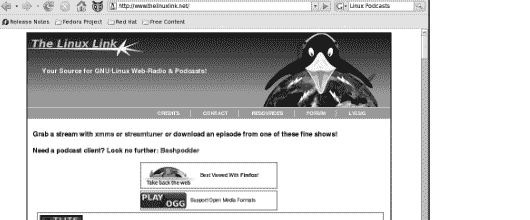

**图 5.1** Mozilla Firefox——重新发现 Web。Firefox 允许你添加众多升级功能，进一步丰富你的使用体验。

除了基本程序外，还拥有丰富的插件和扩展，可以将 Firefox 的功能提升至简单 Web 浏览之外。Shockwave Flash 和 Java 等插件可即时使用，它们是用于观看视频内容的多媒体编解码器；而扩展则为浏览体验提供了实用且有时幽默的补充。例如，ForecastFox 是一个提供当地天气状况的扩展，而 Bandwidth Tester 是一个计算当前带宽的工具。也许打发慵懒午后的最佳方式是下载 StumbleUpon 扩展，它为你提供那个传说中的大红色按钮，点击它即可前往基于你选择的特定预设条件的网页。很多时候，你会遇到一些让你恰好需要的《花生漫画》（Calvin and Hobbes）漫画条，从而让你微笑。然而，使用 StumbleUpon 也能发现一些真正的瑰宝。随着 Firefox 的发展，你将可以使用越来越多的扩展和插件来增强你的浏览乐趣。

寻找和获取这些插件和扩展变得非常容易，因为 Mozilla 开发者贴心地创建了一个专门帮助你从 Firefox 中挖掘更多潜力的网站。特别受欢迎的包括 Adblock Plus 和 StumbleUpon 插件。Adblock Plus 允许你清除那些在你浏览时占据大量带宽的烦人横幅和动画。

我们另一个大量使用的插件是 Google BrowserSync。如果像我们一样在多台计算机之间工作，你无疑曾不得不在每台不同的电脑上重新创建书签，并努力保持它们的一致性。Google 使整个过程变得更加简单，它不仅允许你同步书签，还可以同步你的 cookies、浏览器历史，以及最终保存在多台浏览器中的任何密码。请记住，你可以选择要同步的内容，这使得仅复制你的书签变得很容易。

## Konqueror

KDE 用户可以选择使用 Konqueror，它是 KDE 的默认浏览器（见图 5.2）。除了处理文件系统导航外，Konqueror 也可以用于浏览 Web。它同样基于 Firefox 中使用的 Gecko 渲染引擎。


**图 5.2** Konqueror，标准的 KDE Web 和文件系统浏览器。

## 选择电子邮件客户端

在 UNIX 时代，有各种基于文本的电子邮件客户端，如 `elm` 和 `pine`（Pine Is Not Elm，即 Pine 不是 Elm）。虽然它们看起来基础，但它们允许普通用户与自己的电子邮件进行交互，无论是撰写还是阅读信件。随着主流计算的兴起以及人们意识到需要友好的 GUI 界面才能高效工作，出现了大量的电子邮件客户端，其中一些是跨平台的，兼容 Linux、Windows 和 Mac OS X，更不用说 UNIX 了。

## Evolution

Evolution 是随 Fedora 附带的标准电子邮件客户端，如果称其为电子邮件客户端，那是对其作为应用程序的实用性严重低估。它不仅处理电子邮件，还可以管理联系人、日历以及任务（见图 5.3）。下一节将演示如何配置 Evolution 以处理电子邮件。


**图 5.3** 使用 Evolution，你可以处理所有电子邮件和联系人，安排约会并跟踪任务。

你需要具备以下信息才能成功配置 Evolution：

-   你的电子邮件地址
-   你的 incoming email 服务器名称和类型（例如 pop.email.com、POP 和 IMAP）
-   你的 incoming server 用户名和密码
-   你的 outgoing email 服务器名称（例如 smtp.email.com）

当你拥有所有信息后，你可以启动 Evolution。你首先看到的是账户设置辅助向导的一部分——身份识别屏幕（见图 5.4）。


**图 5.4** 你只需几条简单命令即可启动并配置 Evolution。身份识别屏幕是几个屏幕中的第一个，要求你输入你的信息。点击“继续”以进入下一步。

下一个屏幕允许你配置 Evolution 使用你的邮件传输代理（MTA；用于将你的邮件从你的计算机传输到更广泛的网络或 Internet 的软件）。你可以选择 POP、IMAP、/var/mail 中本地 spools（mbox 或 maildir 格式）、本地 MTA，或者选择“无”，如果你只想使用 Evolution 的其他功能。如图 5.5 所示，你还可以设置密码。

现在，你可以选择控制 Evolution 如何处理 incoming email 的选项。在这里，你可以选择 Evolution 检查邮件的频率（勾选复选框使 Evolution 每 10 分钟检查一次邮件），以及 Evolution 应如何处理消息存储；但老实说，我们会保持这些特定设置未勾选。点击“继续”框以继续。

> **提示**
> 如果你使用拨号调制解调器连接 Internet，请确保不勾选“检查新邮件”选项；否则，你可能会发现你每 10 分钟就会连接一次网络。


**图 5.5** 接收邮件屏幕需要你的 ISP 或系统管理员提供的信息。

你还必须选择使用 SMTP 还是 Sendmail 来发送邮件；输入你的电子邮件地址，并选择一个时区（这对你的日历非常重要）。最后，你将看到图 5.6 中显示的 Evolution 启动窗口。


**图 5.6** 标准的 Evolution 界面。在左侧，你可以看到用于选择邮件、联系人、日历和任务窗口的按钮。

主 Evolution 窗口左侧窗格中的每个图标在被选中时会打开不同的窗口。每个视图都有可以根据你的需求进行配置的选项；你可以在编辑菜单下找到访问偏好设置对话框的入口，如图 5.7 所示。


**图 5.7** 日历应用程序的工具屏幕是信息可以与他人共享的地方。在这里，你可以配置时间和日期。

### Mozilla Thunderbird

Mozilla Thunderbird（见图 5.8）是 Firefox 的姊妹程序。Firefox 设计用于浏览 Web，而 Thunderbird 的专长在于通信。它可以处理电子邮件、网络新闻（见本章稍后部分）以及 RSS 订阅。


**图 5.8** Firefox 的天然伴侣，Mozilla 的轻量级电子邮件客户端 Thunderbird 在世界各地被广泛使用。

Thunderbird 并未随 Fedora 默认安装，因此你必须使用“添加/删除软件包”或 yum 来安装它。与 Firefox 一样，有许多插件和扩展可以增强你的电子邮件和新闻阅读体验。

### KMail

如果你使用的是 KDE 桌面环境而不是 Fedora 默认的 GNOME 桌面，你也已经安装了 KMail。与 Balsa 一样，Outlook Express 或 Mozilla Mail 的用户很快就能习惯 KMail 的界面。KMail 中一些有用的功能包括选择 mbox 或 maildir 格式、改进的过滤器创建、将邮件排序为线程的能力以及在 MTA 处应用过滤器的能力。图 5.9 显示了 KMail 电子邮件程序。KMail 提供 IMAP 访问、广泛的过滤功能、mbox 和 maildir 格式，以及轻松集成 Procmail、Spamassassin 或自定义处理脚本等 MTA 的能力。


## 其他邮件客户端

Fedora 自带的邮件客户端只是众多可用客户端中的一小部分。Claws Mail（未包含在系统内）非常流行，因为它支持输入时的拼写检查，并且非常适合在网络开销和内存使用量是需要重点考虑因素的大型网络环境中使用。你可以通过访问 http://freshmeat.net/ 搜索到适合在 Fedora 中使用的其他邮件客户端和应用。

## RSS 阅读器

RSS 是 Web 2.0（下一代互联网内容）的协议之一。尽管 RSS 已经使用了好几年，但直到最近才真正开始普及，这得益于大量网站和门户网站对其的支持。

RSS 的关键优势在于，你可以选择在你方便的时间，快速阅读来自你特定选择的网站上的新闻。有些服务只提供文章标题，而另一些服务则提供完整文章供你浏览。你可以通过多种方式使用 RSS 订阅源，甚至可以通过你的网页浏览器！

### Firefox

Firefox 将 RSS 订阅源实现为它所称的“实时书签”（如图 5.10 所示），其本质上是带有子书签的书签，每个子书签都链接到你选定网站上的一个新页面。我喜欢将几个新闻网站分组放在工具栏上一个名为“新闻”的文件夹下，这样可以让我快速浏览我的网站收藏并挑出真正感兴趣的文章。


**图 5.10** Firefox 的实时书签，让你的所有新闻订阅只需一次鼠标点击即可到达。

### Liferea

当然，并非所有人都希望使用浏览器来阅读 RSS 订阅源。使用 Firefox 阅读 RSS 订阅源的主要问题是，你只能看到标题，而看不到实际文本。这时，一个专门的 RSS 阅读器就派上用场了，而 Liferea（见图 5.11）是其中最好的之一。

它默认没有安装，因此你需要通过“应用程序”、“添加/删除软件”来获取它。安装完成后，你可以在“应用程序”、“互联网”菜单中找到它，标签仅为 Liferea。

默认情况下，Liferea 提供许多 RSS 订阅源，包括 Fedora People、Red Hat Magazine 和 Fedoranews.org。添加新订阅源非常简单。你只需在“订阅源”菜单下选择“新建订阅”，将 RSS 订阅源的 URL 粘贴到输入框中即可。Liferea 随后会获取该订阅源可用的所有当前项目，并在左侧显示订阅源名称，供你选择并开始阅读。


**图 5.11** 使用 Liferea 阅读你的每日新闻订阅源，这是一个非常出色且易于使用的 RSS 订阅源阅读器。

## 使用 Pidgin 进行即时通讯

即时通讯是人们通过网络互动的主要方式之一。AOL 是这一领域的主要推动者，尤其是在美国，但很快其他网络和系统也进入了市场，为用户提供了丰富的选择。

即时通讯不再仅仅是消费级工具，它现在是企业界的一部分，许多不同公司部署了内部即时通讯软件以进行协作。

Fedora 必须克服的最大障碍之一是，除了 Jabber 之外，没有客户端软件可以访问诸如 AIM 或 MSN 等网络。幸运的是，有志者事竟成，Pidgin 作为多协议即时通讯客户端应运而生，使你可以连接使用不同协议的多个不同网络。

> **注意**
>
> 如果你使用过早期版本的 Fedora，你可能会好奇为什么我们介绍的是 Pidgin 而不是 GAIM。好吧，GAIM 在其名称中使用 AIM 时遇到了一些法律问题，这可能导致与 AOL 即时信使（AOL Instant Messenger）混淆。因此，GAIM 将其重新命名为 Pidgin，并包含在 Fedora 中。

你可以在“应用程序”、“互联网”下找到 Pidgin，它被列在 Internet Messenger 位置，如图 5.12 所示。


**图 5.12** Pidgin（GAIM 的新名称）允许你向几乎任何 IM 网络发送即时消息。

当你第一次启动 Pidgin 时，系统会提示你创建账户。只需从协议列表中选择一个选项，输入该协议/服务的屏幕名和密码（如图 5.13 所示），然后单击“保存”按钮。Pidgin 会自动尝试使用你提供的凭据登录该网络。如果成功，并且你之前已为 IM 服务分配了联系人，你应该会在“好友列表”窗口中看到它们弹出。


**图 5.13** Pidgin 提供了一种简便的解决方案，无论他们使用哪种 IM 网络，都能让你与人们保持联系。

> **注意**
>
> Pidgin 支持 Jabber，这是一种基于开放 XML 的即时通讯协议，可用于设置企业 IM 服务器。Fedora 不提供 Jabber，但你可以通过 Jabber 主页 `http://www.jabber.com/` 获取有关它的更多信息。你可以从 `http://jabberd.jabberstudio.org/` 获取 Jabber 服务器 Jabberd。如果你想使用 Pidgin 在本地进行协作，Jabber 将是私有本地服务器的绝佳选择。

## 互联网中继聊天（IRC）

如 RFC 2812 和 RFC 2813 中所述，*互联网中继聊天（IRC）* 协议用于文字会议。与邮件和新闻一样，IRC 使用客户端/服务器模型。虽然个人建立 IRC 服务器的情况很少见，但这是可以做到的。大多数人使用公共 IRC 服务器并通过 IRC 客户端访问它们。

Fedora 提供了多种图形 IRC 客户端，包括 X-Chat、lircq 和 Chatzilla，但 Fedora 没有默认的聊天客户端。Fedora 还为那些避免使用 X 的用户提供了控制台客户端 epic 和 lircq。如果你没有特别喜欢的客户端，你应该试试所有这些。

> **警告**
>
> 当你处于 root 用户身份时，永远不要使用 IRC 客户端。由于潜在的安全问题，最好创建一个专门用于 IRC 的用户。要以此方式使用 X-Chat，你打开一个终端窗口，使用 su 切换到你的 IRC 用户，并启动 X-Chat 客户端。

X-Chat 是一个流行的 IRC 客户端，也是本章示例中使用的客户端。X-Chat 的 HTML 文档位于 /usr/share/docs/xchat。建议你在开始之前阅读它们，因为它们包含 IRC 的入门介绍并涵盖了一些基础知识。你需要下载并安装 X-Chat 以启动 X-Chat 客户端，从“应用程序”、“互联网”中选择 X-Chat。

X-Chat 应用程序允许你为自己指定多达三个昵称。你还可以指定你的真实姓名和用户名。由于许多人选择不使用真实姓名进行 IRC 聊天，你可以自由地在提供的任何空格中输入你希望的名字。你可以选择多个昵称；你可能会因其中一个名字被禁止进入某个 IRC 频道，然后你可以使用另一个名字重新加入。如果这听起来有点幼稚，那么你将开始了解许多 IRC 频道上的行为类型。

当你打开 X-Chat 主屏幕时，会出现一个 IRC 服务器列表，如图 5.14 所示。通过双击选择服务器后，你可以通过选择“窗口”、“列表窗口”来查看该服务器上可用的频道列表。将显示 X-Chat 频道列表窗口。在该窗口中，你可以选择加入涉及你感兴趣主题频道的。要加入频道，请双击它。


**图 5.14** X-Chat 主屏幕提供了可供选择的公共服务器列表。

## IRC 的狂野一面

不要惊讶于公共 IRC 服务器上大量粗俗主题和粗话的使用。若想以幽默的角度看待 IRC 骂人的话题，请访问 http://www.iroc.org/fun_docs/naoccuss.html。该网站还提供了一些关于维持 IRC 礼仪的建议，如果你不成为那些脏话对象的话，这是必不可少的！以下是一些最重要的 IRC 礼仪规则：

- 不要使用彩色文本、全大写文本、闪烁文本或“铃声”（由向终端发送 'a 产生的哔声）。
- 尊重他人。
- 忽略行为不当的人。

选择频道后，你可以加入对话，对话以屏幕文本形式出现。随着新消息的出现，消息会在屏幕上向下滚动。

> **提示**
>
> 即使 Fedora 不提供 IRC 服务器，你也可以建立自己的 IRC 服务器。设置服务器并不是任何不熟悉 Linux 或 IRC 的人能完成的任务。一个流行的服务器是 IRCd，你可以从 ftp://ftp.iroc.org/irc/server/ 获取它。在下载 IRCd 之前，请查看 Read Me 文件以确定你需要下载哪些文件，并阅读 http://www.irchelp.org/irchelp/ircd/ 上的信息。

## Usenet 网络新闻组

新闻组的概念彻底改变了网络上人与人之间交换信息的方式。Usenet 网络新闻系统创造了一种方法，让人们可以与拥有相似兴趣的大群体进行电子通信。正如你将看到的，Usenet 新闻的许多概念体现在其他形式的协作通信中。

Usenet 新闻组充当一种公共公告板系统。任何用户都可以订阅单个新闻组并向该新闻组发送（或发布）消息（称为文章），以便该新闻组的所有其他订阅者都可以阅读它们。一些新闻组包含一名管理员，他必须批准每条消息才能发布。这些被称为受管理新闻组。其他新闻组是开放的，允许任何已订阅成员发布消息。当文章发布到新闻组时，它会传输到新闻网络中的所有其他主机。

Usenet 新闻组分为层级，以便于找到单个新闻组。层级级别基于主题，如计算机、科学、娱乐和社会问题。每个新闻组都命名为较高级别主题的子集。例如，新闻组 comp 涉及所有计算机主题。新闻组 comp.laptops 涉及笔记本电脑问题。通常层级会深入好几层。例如，新闻组 comp.databases.oracle.server 涉及 Oracle 服务器数据库问题。


### 注意

新闻组文章的格式遵循互联网标准文档《请求评阅书》（RFC）1036中定义的严格准则。每篇文章必须包含两个独立部分：头部行和消息正文。

头部行标识关于文章发布的时间和发布者的信息。消息正文应仅包含标准的ASCII文本字符。新闻文章中不应发布二进制字符或文件。为了绕过此限制，二进制文件会被转换为文本数据，通过使用标准的UNIX uuencode程序或较新的多用途互联网邮件扩展（MIME）协议来实现。生成的文本文件随后被发布到新闻组。新闻组阅读器随后可以将发布的文本文件解码回其原始的二进制形式。

作为对共同主题响应的文章集合被称为*线程*。当用户响应其他已发布的消息并发送消息时，线程可以包含许多文章。一些新闻阅读器程序允许用户根据所属线程来追踪文章。这有助于简化新闻组中文章的组织。

## 提示

免费新闻服务器 news.gmane.org 通过新闻组提供 Red Hat 和 Fedora 邮件列表。这是阅读线程化讨论的便捷方式，比使用 Fedora 邮件列表归档更简单。

用于在主机之间传输新闻组文章的协议是*网络新闻传输协议*（NNTP），定义于 RFC 975。（你可以在 ftp://metalab.unc.edu/pub/docs/rfc/ 搜索 RFCs；查看文件 `rfc-index.txt`。）NNTP 被设计为一种简单的客户端/服务器协议，使两个主机能够以高效的方式交换新闻组文章。

### Pan 新闻客户端阅读器

无论你的 Fedora 服务器是否被设置为新闻服务器，你都可以使用新闻阅读器程序来阅读新闻组文章。新闻阅读器程序只需要与新闻服务器的连接即可。无论新闻服务器是在同一台机器上，还是位于世界另一端的远程新闻服务器，都无关紧要。

有许多程序可用于 UNIX 系统连接新闻服务器，以阅读和发布新闻组中的文章。这里我们将讨论 Pan 新闻客户端。

Pan 是一个适用于 GNOME 的图形新闻阅读器客户端，是 Fedora 的默认新闻阅读器。如果你安装了 GNOME 库（通常默认已安装），你也可以在 *K 桌面环境*（KDE）中使用 Pan。Pan 可以下载和显示所有新闻组，并显示发布的新闻文章。你可以通过 GNOME 或 KDE 桌面面板或使用 X 终端窗口中的命令 pan & 来启动它。Pan 支持组合多部分消息以及 yenc 编码/解码协议。图 5.15 展示了一个 Pan 显示的示例。


图 5.15 Pan 图形新闻阅读器是 Linux 上可用的最漂亮的阅读器之一，此处展示的是正在浏览 Red Hat 用户组。

第一次运行 Pan 时，会出现一个配置向导，提示你输入你的名字、SMTP 服务器名称、NNTP 服务器名称以及你想用于标识连接的名称。（在图 5.16 所示的示例中，我们使用自定义新闻服务器。）向导完成后，你将被告知下载服务器提供的新闻组列表；这可能花费一些时间。如果你需要更改新闻服务器或添加额外的服务器，你可以访问编辑菜单下的“首选项”项来显示服务器列表。然后，你突出显示相应项并点击“编辑”进行更改，或仅点击“新建”按钮添加新的新闻服务器。


图 5.16 Pan 新闻服务器配置窗口。

### 使用 Ekiga 进行视频会议

Ekiga 是一个互联网视频会议应用程序，通过 H.323 协议进行 IP 电话（也称为 *IP 语音 [VoIP]*），在因特网上提供双向语音和图像传输。它是一个类似于 Microsoft NetMeeting 的应用程序，并在 Fedora 中作为默认的视频会议客户端提供。

在充分利用 Ekiga 的电话和视频会议功能之前，你必须配置一个支持全双工的声卡和视频设备（参见第 7 章，“多媒体”）以及摄像头。

Ekiga 位于“互联网”菜单中，标记为*视频会议*；点击图标即可启动。当你第一次启动 Ekiga 应用程序时，会运行一个配置向导（称为*向导*），你会看到四个配置屏幕中的第一个。你只需输入你的名字、电子邮件地址和位置，并选择你的连接类型。你的音频和视频设备的设置会自动检测；你可以通过选择编辑菜单中的“首选项”项来查看它们。图 5.17 展示了正在运行并准备拨打另一位用户的 Ekiga。

当 Ekiga 运行时，你必须（在 Ekiga 内部）向位于 http://ekiga.net/ 的服务器注册以启用会议；如果你在初始配置期间告诉它这样做，Ekiga 会自动为你完成此操作。

你可以在 Ekiga 主页 http://www.Ekiga.org/ 找到信息丰富的常见问题解答（FAQ），在使用 Ekiga 之前你应该完整阅读。此外，http://freshmeat.net/articles/view/430/ 上有一篇关于 VoIP 的精彩文章。


图 5.17 Ekiga 使用起来出奇地简单。不需要视频源；静态图像也可以使用。

### 注意

如果你经常使用 VoIP 应用程序，如 Ekiga，你会因反复输入长 IP 地址来建立连接而感到厌倦。为了避免这种麻烦，你可以使用网关管理器（类似于 DNS 服务器的目的）将名称转换为 IP 地址。OpenH323 Gatekeeper 是一个如此流行的网关管理器应用程序。Fedora 不提供该应用程序，但你可以从 http://www.gnugk.org/ 获取。

## 参考

-   ▶ http://www.novell.com/—Ximian Evolution 的主页，它是 Fedora 的标准电子邮件客户端。
-   ▶ http://www.mozilla.org/—Mozilla Firefox、Thunderbird 和 Mozilla 套件的首页。
-   ▶ http://www.spreadfirefox.com/—Firefox 倡导首页对于转化那些 Internet Explorer 用户很有用。
-   ▶ http://ekiga.net/—在此注册一个免费的 SIP 账户以配合 Ekiga 使用。

### 第 6 章 生产力应用

## 本章内容

-   OpenOffice.org 中有什么？
-   Fedora 的办公套件
-   为 Microsoft Windows 编写的生产力应用
-   参考

随着开源软件的快速增长，企业直接从办公生产力套件的开发中受益。许多企业已经使用 OpenOffice.org 及其商业对应物 StarOffice，并且已经享受到无需支付许可证费用或支持成本的益处。当然，可用的套件不仅仅只有 OpenOffice.org，在本章中我们将探讨可用的选择。

### 注意

> OpenOffice.org 与 Microsoft Office 并不 100% 兼容。这是为什么？好吧，Microsoft 以其对专有文件格式的保密性而闻名，OpenOffice.org 确保兼容性的唯一方法就是逆向工程每个文件格式，这就像拆开电话以查看其工作原理一样。这种逆向工程在美国法律下可能被视为非法，如果 OpenOffice.org 选择这条路，它将成为一个潜在的烫手山芋。然而，OpenOffice.org 成功地维持了非常高标准的导入和导出，因此你不应该遇到太多问题。

生产力套件可以归类为包含两个或更多用于创建文档、演示文稿、电子表格和数据库的应用程序。其他应用程序可能包括电子邮件客户端、计算器/公式编辑器，甚至插图包。通常它们都通过默认的界面和感觉联系在一起，这使得坚持使用特定的套件变得更容易。因为 Fedora 使用 OpenOffice.org 作为其标准办公套件，我们


## 第 126 章 第 6 章 生产力应用

我们将向你介绍 Writer 和 Calc，这两个是 OpenOffice.org 中最受欢迎的组件。我们还会简要看看其他一些可用的基于 Linux 的办公套件。

### 使用 OpenOffice.org

对于大多数生产力套件的用戶来说，OpenOffice.org 应该能满足你的大部分甚至全部需求。然而，你需要克服的第一个障碍并不是它是否能做到你所要求的功能，而是它是否成功地导入和导出专有 Microsoft 格式。主要来说，OpenOffice.org 应该能轻松导入和导出，尽管可能会在一些更晦涩的 Office 格式上卡住。鉴于大多数用户很少超出制表符、列和表格的范围，这种兼容性水平应该就足够了。

但是，强烈建议你收集一批可能受到导入/导出过滤器影响的文档，并对其进行彻底测试（当然，保留原始文件的备份）。对于部署了新的生产力套件的系統管理員来说，没有什么比突然收到用户抱怨他们无法读取自己的文件更糟糕的了。这会迅速破坏从 OpenOffice.org 中其他实用功能中获得的任何好处，甚至可能导致专有格式和昂贵的办公套件的回归。许多用户不介意切换到 OpenOffice.org， largely 因为其用户界面与类似的 Microsoft 应用程序非常相似。这有助于用户适应其环境，并消除他们对切换的担忧。这种相似性使过渡到 OpenOffice.org 变得更加容易。

当然，仅仅看起来像 Microsoft 应用程序并不是唯一的直接好处。OpenOffice.org 支持大量文件格式，能够导出近 70 种不同类型的文档。如此广泛 的文件格式意味着你应该几乎能够在任何环境中成功使用 OpenOffice.org。

### OpenOffice.org 中有什么？

OpenOffice.org 包含许多用于创建文本文档、准备电子表格、组织演示文稿、管理项目等生产力应用程序。以下是 OpenOffice.org 软件包中随 Fedora 提供的组件：

- **Writer** — 这款文字处理程序允许你编写、格式化和组织文本文档。如果你习惯于使用 Microsoft Word，OpenOffice.org Writer 的功能会让你感到熟悉。你将在本章稍后学习如何开始使用 Writer。Writer 位于“应用程序”、“办公”、“文字处理器”下。

- **Calc** — 这款电子表格程序允许你在电子表格格式中操作数字。除了最晦涩的 Microsoft Excel 功能外，Calc 都提供支持，这意味着与 Excel 用户交换电子表格应该是成功的。Calc 提供有限的 Excel 宏兼容性，但这些宏通常需要重写。我们将在本章稍后介绍如何设置带有公式的基本电子表格，并展示如何构建基本的数据模型。Calc 位于“应用程序”、“办公”、“电子表格”下。

- **Impress** — 这款演示程序类似于 Microsoft PowerPoint，允许你创建包含图表、图解和其他图形的幻灯片演示。Impress 也能很好地处理 PowerPoint 文件。Impress 位于“应用程序”、“办公”、“演示文稿”下。

- **Math** — 这款数学公式编辑器允许你使用多种数学字体和符号编写数学公式，以便包含在文字处理文档中。这些符号非常专业化，不容易包含在文字处理器的基本功能中。这主要对数学和科学写作者感兴趣，但 Math 对任何需要在文本中包含复杂公式的人都有用。你使用“添加/删除软件”下载 Math。

- **Base** — 这款数据库随 OpenOffice.org 2.3 套件引入，并随 Fedora 提供。它提供了一个功能齐全的数据库应用程序。你使用“添加/删除软件”下载 Base。

- **Draw** — 这款图形应用程序允许你创建图像，以便包含在使用 OpenOffice.org 生成的文档中。它仅以 OpenOffice.org 格式保存文件，但可以导入大多数常见的图像格式。你使用“添加/删除软件”下载 Draw。

- **Dia** — 这款来自 GNOME 办公套件的工程绘图编辑器允许你创建测量绘图，如建筑师和工程师使用的绘图。其功能类似于 Microsoft Visio。你使用“添加/删除软件”下载 Dia。

- **Planner** — 你可以使用这款项目管理应用程序进行项目规划、调度和跟踪；此应用程序类似于但与 Microsoft Project 不兼容。它在“办公”菜单中作为“项目管理”项出现。

### OpenOffice.org 简史

OpenOffice.org 办公套件基于一个名为 StarOffice 的商业套件。最初由一家德国公司开发，StarOffice 被美国的 Sun Microsystems 收购。对旧 StarOffice 的最大抱怨之一是，所有组件应用程序都集成在一个看起来非常像 Microsoft Windows 桌面的 StarOffice“桌面”下，包括开始按钮和菜单。这意味着要编辑一个简单的文档，必须加载不必要的 应用程序，使办公套件加载缓慢、运行缓慢，并且对系统资源要求很高。

收购 StarOffice 后，Sun Microsystems 在 GPL（GNU 公共许可证）下发布了 StarOffice 代码的大部分，并开始开发后来成为 OpenOffice.org 的项目，该版本在 GPL 下免费可用。Sun 继续开发 StarOffice，并发布了商业版本 StarOffice 6.0。软件免费版本和商业版本之间的显著区别在于，StarOffice 提供更多的字体，甚至比 OpenOffice.org 提供更多的导入/导出文件过滤器（由于许可证限制，GPL 版本无法提供这些过滤器），并且 StarOffice 提供其自己的关系数据库，即 Software AG 的 Adabas D 数据库。OpenOffice.org 2.3 的 StarOffice 对应版本是 StarOffice 8。

### 安装和配置 OpenOffice.org

Fedora 提供 OpenOffice.org 的 RPM 包。如果你没有在初始 Fedora 安装期间安装 RPM 包，你可以稍后使用“添加/删除软件”工具或从命令行使用 `yum install openoffice.org` 进行安装。

> OpenOffice.org 正在不断改善其生产力应用程序。你可以查看 OpenOffice.org 网站（http://www.openoffice.org/）以获取最新版本。该网站提供链接下载最新工作安装文件的源代码或预编译版本。较新的版本可能提供你所需的文件格式支持。如果你需要 Windows 兼容版本，你也会在该网站找到。

OpenOffice.org 的安装是在系统范围内进行的，这意味着所有用户都可以访问它。然而，用户必须进入 OpenOffice.org 以根据他们的个人需求进行配置。这种初始配置在你加载任何 OpenOffice.org 组件时透明地进行，因此应用程序可能需要更长的时间来加载。请耐心等待，你所需 的应用程序将会出现。

图 6.1 显示的是 OpenOffice.org Writer，一个空白文档已准备好供你创作你的杰作。OpenOffice.org 在所有相关应用程序中共享通用首选项，这意味着你只需要定义一次你的某些个人详细信息或保存文档的路径。


与许多 Linux 应用程序一样，你可能会被 OpenOffice.org 中提供的配置选项的巨大数量所压倒。值得庆幸的是，人们花了大量精力来组织这些选项，如果你点击“工具”菜单并选择“选项”即可访问它们。无论你使用哪个程序打开此对话框，它看起来都一样；无论从 Writer、Impress 还是 Calc 打开。它充当所有 OpenOffice.org 应用程序的中央配置管理工具。你可以使用它设置所有 OpenOffice.org 应用程序的全局选项，或为每个单独组件设置特定选项。例如，在图 6.2 中，你可以更改用户详细信息和信息，并反映到所有 OpenOffice.org 应用程序中。


**图 6.2** 你可以从该对话框中为所有 OpenOffice.org 应用程序设置用户详细信息。

## 提示

两个网站提供有关 OpenOffice.org 功能的额外信息。

- [https://lingucomponent.openoffice.org/download_dictionary.html](https://lingucomponent.openoffice.org/download_dictionary.html) — 该网站提供安装拼写和连字符词典的说明和文件，这些词典未随 OpenOffice.org 提供。
- [http://sourceforge.net/projects/ooxtras/](http://sourceforge.net/projects/ooxtras/) — 该网站提供模板、宏和剪贴画，这些未随 OpenOffice.org 提供。

OpenOffice.org 是一个持续进行中的项目，但当前发布版本与 Sun 版本的 StarOffice 8.0 持平。你可以浏览 OpenOffice.org 网站以获取文档和常见问题解答，并提供反馈。

### 使用 OpenOffice.org Writer

在构成 OpenOffice.org 的所有应用程序中，你最有可能经常使用的是 Writer，即 OpenOffice.org 的文字处理器。具有类似 Microsoft Word 的视觉风格，Writer 在一些方面优于其商业版和


昂贵的竞争对手。在本节中，您将学习如何开始使用 Writer，并利用其强大的格式化和排版工具。

## 注释

您可能会感兴趣地知道，Writer 是编写和编辑本书时选定的主要文字处理软件。

## 入门

您可以通过面板上的快捷方式访问 Writer，或者前往“应用程序”>“Office”菜单并选择“文字处理”。几秒钟后，Writer 将打开，显示一个空白文档和闪烁的光标，等待您的指令。虽然很想直接开始输入文档，但在此之前进行一些初始配置可能非常值得，以便您为工作做好充分准备。

首先，确保选项已设置为您的需求。点击“工具”菜单并选择“选项”，调出选项对话框，如图 6.2 所示。初始界面允许您使用姓名、地址和联系方式个性化定制 OpenOffice.org，但也有一些选项可以配置您可能希望更改的功能。首先，通过点击“路径”选项来检查您的默认路径是否正确。您可能希望将“我的文档”路径（如图 6.3 所示）更改为比主目录更具体的位置。


图 6.3 点击“编辑”按钮以选择您的默认文档目录。

您可能还希望更改 OpenOffice.org 设置，使其默认以 Microsoft Word 格式保存，如果您有此需求的话。这可以通过图 6.4 中显示的“加载/保存 常规”选项完成。如果您重视自己的工作，这是一个好主意，更改自动恢复设置以让其每几分钟保存一次。


**图 6.4** 确保您正在使用最适合您的文件格式。

图 6.4 中还显示了一组专门针对 Writer 的选项。从上到下，它们分别是：

- **常规** — 指定影响 Writer 常规使用的选项。
- **视图** — 指定您希望 Writer 显示的内容。
- **格式化辅助工具** — 指定是否显示非打印字符。
- **网格** — 创建一个网格，可用于将框架和图像对齐。
- **基本字体** — 在此处选择文档的默认字体。
- **打印** — 指定打印文档时希望 Writer 输出的确切内容。
- **表格** — 设置 Writer 中绘制表格的选项。
- **更改** — 定义 Writer 如何处理文档中的更改。
- **兼容性** — 一组 Writer 使用的规则，以确保与早期版本的高度兼容性。
- **自动题注** — 为图像、图表和其他对象创建自动题注。

花一点时间操作这些选项，可以为您提供一个高度个性化且极具生产力的环境。

# 样式和格式化操作

使用 Writer 的一个显著好处是，您可以轻松地将格式和样式应用于极其复杂的文档。根据您处理的文档类型，您可能需要考虑在默认的 20 种样式之外创建自己的样式。您可以通过工具栏中的样式下拉框或图 6.5 中显示的“样式和格式化”窗口访问样式。如果看不到该窗口，请按 F11 键显示它。

使用“样式和格式化”工具最简单的方法是突出显示要设置样式的文本，并在窗口中双击所需的样式。有很多样式可供选择，但如果您有更专业的需求，可能会发现它们有限。要开始定义自己的样式，请按 Ctrl+F11 调出如图 6.6 所示的样式目录，在那里您可以为页面、段落、列表、字符和框架添加、修改和删除样式。


图 6.5 Writer 快速且易于使用的样式和格式化工具。


图 6.6 Writer 强大的样式目录让您控制样式的每个方面。

# 使用 OpenOffice.org Calc

OpenOffice.org 的电子表格组件名为 Calc，是一个功能强大的 Excel 替代软件。

Calc 用于存储您需要以某种方式分析的数字信息。例如，您可以使用它来帮助您按月做预算。只要您告诉 Calc 要做什么，它可以为您处理计算。任何有 Excel 经验的人都会觉得使用 Calc 非常得心应手。

在本节中，我们向您展示如何开始使用 Calc，包括输入公式和格式化。我们还将介绍 Calc 的一些更高级的功能，包括数据透视表功能，它可以轻松汇总信息。

## 入门

您可以点击位于顶部 GNOME 面板上的快捷图标，或者在“应用程序”主菜单下的“Office”菜单中选择“电子表格”。无论您选择哪条路径，结果都是一样的，Calc 将开始加载。

默认情况下，Calc 加载时是一个空白电子表格，等待您输入信息。在图 6.7 中，可以看到我们已经开始在 Calc 中输入一些基本信息。


Calc 的布局使您可以轻松地将信息组织到行和列中。如示例所示，我们在左列列出销售人员，第二列列出客户，第三列列出发票日期，最后一列列出收入。目前，没有输入任何公式来帮助您解释数据。点击 E43 单元格会选中该单元格，并允许您在顶部的公式栏中输入公式。如果您输入等号，Calc 知道您正在输入公式并会相应处理。

在此示例中，我们想知道迄今为止带来的总收入，因此要输入的公式是 **=sum(E4:E42)**，然后按回车。Calc 会自动将结果填入单元格 E43 供您查看。现在您想查看平均订单金额是多少。为此，您需要获取订单数量。您可以使用 **counta** 函数来统计给定列表中的条目数量。这通常用于查找文本列表中有多少个条目。因此，在单元格 B43 中输入 **=counta(B4:B42)** 并按 Enter。Calc 现在将统计范围内的条目数量，并在 B43 中返回总数。您只需将总收入除以订单数量即可找到平均订单金额。因此，在单元格 E44 中输入公式 **=E43/B43** 以获取平均订单金额。

> **提示**
> Calc 提供一些实用的小功能，您可以在需要时快速使用。我们认为最方便的功能之一是能够选择多个单元格并立即查看该范围的总和和平均值。您可以在右下角的状态栏中找到这些数字。这在我们需要快速获取这些信息时帮了我们无数次！

## 格式化您的电子表格

回到我们的示例，目前看起来有点基础，因为没有涉及格式化。例如，计费货币是什么？您还会看到一些单元格的文本无法完全显示，这由单元格中的一个小向右箭头突出显示。我们还应该在电子表格中添加一些标签和标题，使其在视觉上更具吸引力。

首先，所有的收入数字都可以更改为货币数字。为此，选择所有包含收入信息的单元格，并点击图 6.8 中显示的小图标。这会立即格式化单元格，使它们显示美元符号，并添加千位分隔符，使数字更易于阅读。

现在您需要调整所有单元格的大小，以便阅读所有信息。一种快速简便的方法是点击 A 列左侧和 1 行上方紧邻的区域，以选择整个电子表格。现在您只需双击分隔线，每个列就会根据其最长的条目进行调整。

接下来，您可以使用工具栏中的油漆桶图标为工作表添加一些颜色。用鼠标光标选择 B3 到 E3 的范围，点击背景填充图标，调出图 6.9 中显示的颜色窗口。现在选择您想要使用的颜色，Calc 将用该颜色填充单元格。您还可以以同样的方式使用右侧紧邻的图标来更改字体颜色。


**图 6.8** 使用货币和百分比图标使数字更具意义。


**图 6.9** 使用“填充背景”图标为原本枯燥的电子表格增添一抹色彩。

最后，你还需要进行几处修饰。第一处是放大列标题的字体。再次选择 B3 到 E3 的范围，点击工具栏中的字体大小，将其调整为稍大的字号。你可能还想使用**粗体**和*斜体*选项来进一步强调标题以及总计部分。

如果你按照上述步骤操作，最终得到的电子表格应与图 6.10 相似。


**图 6.10** 完成后的成果，看起来比之前好多了！

## 使用 Calc 汇总数据

Calc 包含一个强大的工具，可以帮助你汇总大量数据，以便在进行分析时提供帮助。该工具称为*数据向导*（Data Pilot），你可以用它快速汇总那些如果手动计算可能需要很长时间的数据。使用前面提到的示例电子表格，我们将带你创建一个简单的数据向导，展示如何分析和处理长数据列表。

上一节介绍了一个包含销售人员、客户、发票日期和收入的电子表格。在电子表格底部有几个公式，可以快速显示总收入和平均订单金额。

现在你想知道每位销售人员分别赚取了多少。当然，你可以用计算器手动累加，但这违背了使用 Calc 的初衷。因此，你需要创建一个数据向导来汇总信息。

首先，你需要选择从 B3 到 E42 的所有单元格，因为它们包含你希望分析的数据。选择这些单元格后，点击“数据”菜单，选择“数据向导，启动”以打开数据向导。第一屏如图 6.11 所示，默认为“当前选择”。确保你选择此项以使用所选范围内的数据，然后点击“确定”继续。


**图 6.11** 使用当前选择或外部数据源为数据向导提供信息。

下一个屏幕允许你按意愿布局数据向导。在这个例子中，你希望将“销售人员”放在标记为“行域”的左侧列中，因此请从右侧列表中点击并拖动“销售人员”选项，将其放置到“行域”区域。接下来，拖动“收入”并将其放置到“数据域”区域；它将自动计算收入的总和。我们还希望知道每单位的平均价格或均值，因此将“每单位价格”拖动到“数据域”区域并双击它。在弹出的对话框中选择“平均值”，然后点击“确定”。你应该得到类似图 6.12 的结果，此时你几乎准备好显示你的数据向导了。


**图 6.12** 按你的意愿布局数据向导。

拼图的最后一块是告诉 Calc 你希望将完成的数据向导放在哪里。为此，点击“更多”按钮以展开额外选项，然后，若要选择新工作表，请选择“结果到”旁边的下拉框。此时点击“确定”，Calc 将构建数据向导并将其显示在你工作簿的新工作表中。图 6.13 展示了新的数据向导。


**图 6.13** 使用 Calc 的数据向导功能，轻松汇总大量数值数据。

## Fedora 的办公套件

如前所述，OpenOffice.org 是 Fedora 的默认应用程序套件。然而，随着所有事物的开源化，如果你发现 OpenOffice.org 无法满足你的特定需求，也有许多替代方案可供选择。这些包括流行的 Gnome Office 以及 KOffice（KDE 默认的生产力套件）。你更有可能听到关于 OpenOffice.org 的消息，特别是随着越来越多的人意识到它与 Microsoft Office 文件格式兼容。事实上，马萨诸塞州最近投票决定在政府中使用两种标准文件格式：Adobe Acrobat PDF 格式和 OASIS OpenDocument 格式，这两种格式均被 OpenOffice.org 原生支持。

### 注意

马萨诸塞州标准化采用 PDF 和 OpenDocument 的决定对开源世界有着巨大的影响。这是 OpenDocument 这一已达成一致的开放标准首次以这种方式被指定使用。这意味着，任何希望与该州政府开展业务的人必须使用基于 OpenDocument 的文件格式，而不是 Microsoft 正在使用的专有格式。不幸的是，Microsoft 的任何应用程序都不支持 OpenDocument，这使得它们对于希望与该州政府合作的人毫无用处。尽管 Microsoft 是制定并批准 OpenDocument 标准的 OASIS 的创始成员！

### 使用 Gnome Office

GNOME 可用的另一个办公套件是 Gnome Office，它是一系列独立应用程序的集合。与 OpenOffice.org 不同，Gnome Office 没有连贯的应用程序套件，这意味着你必须习惯使用一个不提供与电子表格集成的文字处理器，并且无法直接与演示文稿包协作。然而，如果你只需要其中一两个组件，那么调查一下 Gnome Office 是值得的。

### GTK 小部件集

开源开发人员一直在努力让人们更容易构建应用程序并参与开发。为此，有许多开发人员可以使用的小部件或工具包来快速创建和部署 GUI 应用程序。这些小部件控制下拉列表、“另存为”对话框、窗口按钮以及总体外观和感觉等。不幸的是，虽然 Windows 和 Apple 开发人员只需担心各自的一组小部件，但 Linux 拥有众多不同的小部件，包括 GTK+、QT 和 Motif。更糟糕的是，这些小部件彼此不兼容，使得将完成的应用程序从小部件集移植到另一个小部件集变得困难。

GTK 是 GIMP Tool Kit（GIMP 工具包）的缩写。GIMP（The GNU Image Manipulation Program，GNU 图像处理程序）是一个非常类似于 Adobe Photoshop 的图形应用程序。通过使用基于 GTK 的术语，我们可以节省几百字的打字，并有助于推进关于 GNOME Office 的讨论。你在这几章中也可能看到关于 QT 和 Motif 以及其他小部件集的类似引用。

以下是 Fedora 中可用的 Gnome Office 套件的一些主要组件：

- **AbiWord**—这款文字处理程序允许你创建、格式化和组织文本文档，并与 Microsoft Word 文件格式具有一定兼容性。它使用插件（添加功能，如语言翻译的程序）来增强其功能。

- **Gnumeric**—这款电子表格程序允许你在电子表格格式中操作数字。除了最晦涩难懂的 Microsoft Excel 函数外都提供支持，这意味着用户在 Excel 用户之间交换电子表格时应该没有什么困难。

- **The GIMP**—这款图形应用程序允许你创建通用图像。它可以导入和导出所有常见的图形文件格式。The GIMP 类似于 Adobe 的 Photoshop 应用程序，在第 7 章“多媒体”中有描述。

- **Evolution**—Evolution 是一个电子邮件客户端，其界面类似于 Microsoft Outlook，提供电子邮件、日程安排和日历功能。它在第 5 章“在互联网上”中有描述。

被称为 Gnome Office 的松散应用程序关联包含了几个与 Fedora 已提供的应用程序功能重复的额外应用程序。这些额外的 GNOME 应用程序未包含在 Fedora 的默认安装中，以消除冗余。它们均可从 Gnome Office 网站 http://www.gnome.org/projects/ooo/ 获取。The GIMP 和 Evolution 在 Fedora 中默认可用。你需要使用 yum 或 pnmaint 获取其余组件。

Fedora 在其 Extras 中提供 AbiWord 编辑器，如图 6.14 所示。AbiWord 可以导入 XML、Microsoft Word、RTF、UTF8、纯文本、WordPerfect、KWord 以及少数其他格式。AbiWord 因使用插件或集成的辅助应用程序而著称，这些插件扩展了其功能。这些插件包括语言翻译、HTML 编辑、同义词词典、Linux 命令 shell 和在线词典，以及其他功能和特性。如果你只需要一个简单但强大的文字处理应用程序，你应该查看 AbiWord。


**图 6.14** AbiWord 是 Fedora、GNOME 和 X11 的文字处理程序。它处理某些 OpenOffice.org 无法处理的格式，但尚未很好地处理 Microsoft Word 格式。

AbiWord 在 Fedora 中不是默认安装的；相反，你需要使用“添加/删除程序”来获取它。只需搜索 AbiWord，并安装该软件包。

安装 AbiWord 后，它会在“应用程序”、“办公”、“Abiword”下可用。如果你熟悉 Microsoft Works，那么 AbiWord 的界面对你来说会非常熟悉，因为其设计者是基于 Works 来设计界面的。

你可以使用 Gnumeric 电子表格应用程序执行财务计算并对数据进行绘图，如图 6.15 所示。它可以导入逗号或制表符分隔的文件、文本，

或 Gnumeric XML 格式的文件，仅将文件保存为 XML 或文本格式。你需要使用“添加/删除软件”或以下命令安装 Gnumeric：

```
# yum install gnumeric
```

要从菜单启动 Gnumeric，请选择：应用程序，办公，Gnumeric 电子表格。


图 6.15 GNOME 的 Gnumeric 是一款功能强大的财务数据编辑器——此处正在处理前面使用过的同一电子表格。OpenOffice.org 也提供电子表格应用程序，KOffice 同样如此。

按下回车键后，主 Gnumeric 窗口会出现。通过点击单元格然后在文本框中输入文字来在电子表格中输入数据。要创建图表，请按住鼠标左键并在电子表格单元格上拖动以高亮显示所需的数据，然后点击 Gnumeric 工具栏中的图表向导图标。Gnumeric 的图表组件将启动，并通过一系列对话框引导你创建图表。完成后，你可以点击并拖动电子表格的空白区域，图表便会显示出来。

Project Planner 应用程序在跟踪项目进度方面非常有用，类似于其 Windows 对应软件 Microsoft Project。当主窗口显示时，你可以开始新项目或导入现有项目。该应用程序提供三种视图：资源、甘特图和任务。

## 使用 KOffice

KDE 办公套件 KOffice 旨在提供与 KDE 桌面的紧密集成。这种集成允许将一个应用程序中的对象通过拖放方式插入到其他应用程序中，并且所有应用程序都可以相互通信，因此对象的更改会立即传达给其他应用程序。KDE 提供的应用程序集成大大提高了生产力。（某些 GNOME 桌面应用程序之间也共享类似的通信功能。）如果你使用的是 KDE 桌面而不是默认的 GNOME 桌面，你可以享受这种集成的好处，以及 Konqueror 网页和文件浏览器的优势。

KOffice 的文字处理器是 KWord。KWord 是一款基于框架的文字处理器，意味着文档页面可以在框架集（framesets）中进行格式化，这些框架集将文本、图形和对象封装在封闭区域内。框架集可用于格式化包含分栏文本和图像（文本需要环绕这些图像）的页面，使 KWord 成为创建标准商务信函之外文档（如新闻稿和宣传册）的绝佳选择。

KWord 和其他 KOffice 组件仍在开发中，缺乏 OpenOffice.org 和 AbiWord 那样的完善功能。不过，它确实能够处理 OpenOffice.org 中使用的 OpenDocument 格式，并且对 Microsoft 文件格式具有有限的兼容性。

你可以从 Office 菜单访问 KOffice 组件。KWord 会要求你为当前会话选择一个文档。如上图 6.16 所示，KWord 客户端提供了高级编辑功能，包括桌面出版功能。


KOffice 的 KSpread 客户端是一款功能齐全的电子表格程序，提供图表绘制功能。与 KWord 一样，你可以从 Office 菜单访问 KSpread。

KDE 在其 KOffice 及相关应用程序集合中包含其他生产率高客户端。这些客户端包括地址簿、时间追踪器、计算器、记事本和计划程序。其中一个受欢迎的客户端是 KOrganizer，它提供每日、每周、工作周和每月视图，用于管理任务、待办事项和带有背景闹钟的日程安排。它还支持日志或日记功能，你可以与 Palm Pilot 同步信息。你可以从 Office 菜单启动此客户端。图 6.17 展示了一个典型的 KOrganizer 窗口。


图 6.17 KDE 的 KOrganizer 客户端支持编辑任务和日程，并且可以与 PDA 同步。

## 适用于 Linux 的商业办公套件

除了前面提到的 StarOffice 外，Fedora 还可用几种商业办公套件。这些商业套件均未随 Fedora 提供。其中值得一提的是 Hancom Office。Hancom Office 使用了 KDE 桌面中常见的 Qt 组件集，在 Microsoft 文件格式兼容性方面表现良好。该套件包括文字处理器、电子表格演示工具和图形应用程序。Corel 曾推出其 WordPerfect Office 2000 的 Linux 版本，但在停止发布任何新的 Linux 产品之前就已停产。虽然仍提供支持页面，但该软件已不再可用，优秀的——尽管略显陈旧的——Linux 版 WordPerfect 8 也同样不可用。

## 为 Microsoft Windows 编写的生产力应用程序

Microsoft Windows 与 Linux 有本质不同，但你可以通过使用名为 Wine 的应用程序在 Linux 中安装和运行一些 Microsoft Windows 应用程序。Wine 使你能在基于 UNIX 的系统上使用 Microsoft Windows 和 DOS 程序。Wine 包含一个程序加载器，可用于执行 Windows 二进制文件，以及一个实现 Windows 命令调用的 DLL，将其转换为等效的 UNIX 和 X11 命令调用。由于 Wine 代码库频繁更新，Wine 未包含在 Fedora 中。请从 http://www.winehq.org/ 下载最新版本 Wine。要查看你最喜欢的应用程序是否受 Wine 支持，你可以访问 Wine 应用程序数据库 http://appdb.winehq.org/appbrowse.php。

此外，还有其他解决方案可以启用使用 Microsoft 生产力应用程序，主要是 CodeWeavers 的 CrossOver Office。如果你寻求一种无痛的方式不仅运行 Microsoft Office，还运行 Apple iTunes 和其他软件，你应该真的去 CodeWeavers 看看。CrossOver Office 是你可以让基于 Windows 的程序正常工作最简单的程序之一。请查阅 http://www.codeweavers.com 以下载最新软件的试用版。它需要注册，但别担心——CodeWeavers 的团队很棒，不会滥用你的详细信息。最大的优点是，在你决定是否购买前，你有整整一个月的时间来试用。当然，你可能会在 30 天结束时意识到 Linux 已经实现了你想要的功能，你不想再回到 Windows。别害怕，大胆尝试吧！


以下命令使你能够访问 Fedora 中的生产力应用程序、工具和进程：

- `oowriter`—OpenOffice.org 的 Writer
- `ocalc`—OpenOffice.org 的 Calc
- `oimpress`—OpenOffice.org 的 Impress
- `koshell`—KDE 的 KOffice 办公套件 shell
- `kspread`—KDE 的 KSpread 电子表格
- `gimp`—GIMP（GNU 图像操纵包）
- `gnumeric`—GNOME 的电子表格编辑器
- `planner`—GNOME 的项目管理客户端
- `abiword`—GNOME 的图形文字处理器

## 参考

- http://www.openoffice.org—OpenOffice.org 办公套件的首页
- http://www.gnome.org/projects/ooo—GNOME 办公站点
- http://www.koffice.org—KOffice 套件的首页
- http://en.hancom.com—Hancom Office 套件的首页
- http://bulldog.tzo.org/webcal/webcal.html——优秀的基于 Web 的日历和日程安排程序 WebCal 的首页
- http://www.codeweavers.com—CodeWeavers 极其流行的 CrossOver Office 的网站，它允许你在 Linux 下运行 Windows 程序

## 第 7 章

## 多媒体

## 本章内容

- 听音乐
- 图形处理
- 在 Fedora 中使用数码相机
- 在 Fedora 中刻录 CD 和 DVD
- 声音和音乐
- 观看视频
- 参考

21 世纪已成为数字生活方式的世纪，全球数以百万计的计算机用户正在拥抱新技术，如数码相机、MP3 播放器和其他各种多媒体小工具。

十年前，你的 Windows 安装中可能散布着一堆 WAV 文件，但现在你更有可能在多台计算机上散布着数百甚至数千个 MP3 文件。随着视频片段、动画和其他图形的增加，对组织和管理这些庞大库的需求正在推动应用程序的开发。Linux 用户渴望像 iTunes 和 Google Picasa 等流行的专有应用程序，但开源应用程序开始提供真正的替代方案，对一些人来说，这是他们全天候转向 Linux 的最终理由。

本章概述了 Fedora 附带的一些基本多媒体工具。你将看到如何创建自己的 CD、观看电视、将音频 CD 抓录为开源 Ogg 音频格式以便播放，以及如何管理你的媒体库。你还将了解 Fedora 如何处理图形和图片。

## 听音乐

也许你需要的基本多媒体应用程序是 CD 播放器。几乎每个人都知道 CD 是什么，绝大多数人拥有 CD。Fedora 可以通过“应用程序，声音和视频”下的默认 CD 播放器轻松处理 CD 音频，如图 7.1 所示。如果你只想要一个基本的 CD 播放应用程序，那么使用 CD 播放器绝不会出错。


图 7.1 Fedora 的 CD 播放器遵循“基本但实用”的原则。

默认的音乐播放器是 Rhythmbox，它旨在播放多种格式的音乐文件，例如本地存储的 Ogg 文件、网络广播电台或 CD（如图 7.2 所示）。它位于“应用程序，声音与视频”菜单下，名称为 Rhythmbox Music Player。你还可以使用它订阅通过互联网提供的播客。


图 7.2 Rhythmbox 可以处理播客、网络广播电台、CD 和本地音频文件。

另一个流行的音乐播放器是 Xms，它是 Winamp 的克隆版本，其完整版本不仅可以播放音乐，还可以播放 MPEG1/2/3 视频。Xms（见图 7.3）支持许多插件，这些插件可以添加会跳舞的、带灯光的示波器样式的显示效果，将其输出重定向到其他设备，支持不寻常的文件格式，使动画与音乐同步，并以其他方式成倍增加其极客吸引力。你需要使用 yum 通过以下命令进行安装：

```
#yum install xms
```

安装完成后，它将在“应用程序，声音与视频”菜单下作为“Audio Player”条目出现。


**图 7.3** 非常受欢迎的 Xms 音乐播放器，此处显示正在播放一个本地 Ogg Vorbis 文件。

其他与音乐和声音相关的应用程序可以在“声音与视频”菜单中找到，当然，你也可以自由安装自己选择的应用程序。

## 使用 Sound Juicer 将音乐导入 Fedora

Fedora 附带的一个实用工具是 Sound Juicer，它位于“应用程序，声音和视频”菜单下。Sound Juicer 会自动检测你何时安装 CD 并尝试从互联网获取曲目详细信息。然后，它将把 CD 曲目刻录为 Ogg 文件并存储在你的文件系统中。你可以在图 7.4 中看到 Sound Juicer 的工作过程。


**图 7.4** 使用 Sound Juicer 创建你自己的数字音乐收藏。

# 流式音频

流式音频用于玩游戏、收听网络广播和其他在线音频内容。流式音频旨在产生不间断的声音输出，但这就要求系统执行内容“杂耍”操作。基本上，系统的音频缓冲区不断填充音频信息，这些信息通过系统的互联网连接输入到缓冲区中。由于服务器和连接功能的原因，输入速率可能会变化。由于音频以恒定速率使用，管理流式音频的关键在于始终保持缓冲区满载，尽管你可能无法以恒定速率填充它。

在 Fedora 中，流式音频采用 `.m3u` 格式进行处理。MPEG 格式也用于流式音频。虽然 Xmsps 支持流式音频，但另一个流行的应用程序是 Real Player，可从 http://www.real.com/linux/ 获取。Linux 中音乐和声音的一个优秀资源是 http://linux-sound.org/。该网站的“网络音频”部分包含一个广泛的流式音频应用程序列表。

> **注意**
> Icecast 应用程序（Fedora 未提供）是一个流行的流式音频服务器。你可以使用 Icecast 通过家庭局域网提供你的 MP3 音乐收藏。你可以在 http://www.icecast.org/ 上了解更多关于 Icecast 的信息。在 http://www.linuxnetmag.com/en/issue4/m4icecast1.html 上有一个关于 Icecast 的不错教程。

## 图形处理

在很短的时间内，数码相机和数字影像变得非常流行，以至于一些传统胶片相机制造商正在完全转向数字领域。这种飞速增长导致能够处理数字影像的应用程序数量增加。得益于其快速的发展速度，Linux 如今被高度视为编辑数字图像的首选多媒体平台。你知道电影 *《指环王》* 的 CGI 特效是在运行 Fedora 的 Linux 工作站和数百台 Linux 服务器上制作的吗？

本章的这一节讨论 The GIMP，这是一个强大的图形处理工具。你还将了解 Fedora 支持的图形文件格式，以及一些你可以在需要不同格式的应用程序时用于转换格式的工具。

## GNU 图像操纵程序

可用的最佳图形客户端之一是 The GIMP。The GIMP 是一个免费的、采用 GPL 许可的图像编辑器，具有复杂的功能，可以导入和导出 30 多种不同的图形格式，包括使用 Adobe Photoshop 创建的文件。它经常被拿来与 Photoshop 比较，而 The GIMP 代表了 GNU 项目的早期重大成功之一。Linux 中的许多图像都是用 The GIMP 制作的。

The GIMP 可以在“应用程序，图形”菜单下找到，名称仅为 The GIMP。

首次启动 The GIMP 时，你会看到一个安装对话框，随后是一系列显示本地 GIMP 目录创建和内容信息的对话框。此目录可以包含个人设置、偏好、外部应用程序资源文件、临时文件以及指向编辑器使用的外部软件工具的符号链接。

## The GIMP 缺少而 Photoshop 具备的是什么？

虽然 The GIMP 功能强大，但它缺少 Adobe Photoshop 提供的两个对某些图形专业人员很重要的功能。

其中之一是为商业印刷机生成色彩分色的能力（CMYK，即青色、品红色、黄色和关键色（或黑色））。The GIMP 使用 RGB（红色、绿色和蓝色），这对视频显示很棒，但对印刷机则不怎么样。The GIMP 缺少的第二个功能是使用 Pantone 颜色（一种专利颜色规范）以确保准确的色彩匹配。

如果这些功能对你不重要，The GIMP 是一个优秀的工具。如果你必须使用 Adobe Photoshop，CodeWeavers 的 CrossOver Office 当前版本可以在 Linux 上运行 Photoshop。

这些缺陷可能不会持续太久。CMYK 插件正在开发中，Pantone 问题也可能在不久的将来得到解决。

初始配置完成后，The GIMP 的主窗口和工具箱出现。The GIMP 的主窗口包含用于选择、绘制、移动、视图放大或缩小、喷枪、绘画、涂抹、复制、填充和选择颜色的工具。取决于系统中安装的版本，工具箱可以托管 25 种以上不同的工具。

工具箱的文件、扩展和帮助菜单分别用于文件操作（包括通过电子邮件发送当前图像）、图像采集或操纵以及文档。如果你右键单击一个打开的图像窗口，你会看到 The GIMP 丰富的菜单，如图 7.5 所示。

## 在 Fedora 中使用扫描仪

随着数码摄影的兴起，对图像扫描仪的需求同等下降。然而，仍有时候你想使用扫描仪，而 Fedora 让这变得很容易。

你还可以使用许多类型的图像扫描仪与 The GIMP 配合。过去，功能最强的扫描仪需要一个 SCSI 端口。然而如今，大多数扫描仪通过 USB 端口工作。在使用扫描仪与 The GIMP 之前，必须为 Linux 启用扫描仪支持（通常通过加载的内核模块 scanner.o）。

虽然一些扫描仪可以通过命令行工作，但如果你使用图形界面，你将享受更高效的扫描会话，因为 GUI 功能，如预览和裁剪，可以在实际扫描图像之前节省时间。Linux 中使用的大多数扫描仪使用“扫描仪访问变得容易”（Scanner Access Now Easy, SANE）软件包，该软件包支持并启用图形化扫描会话。


图 7.5 右键单击图像窗口以访问 The GIMP 的层叠菜单。

SANE 由两个软件组件组成。低级驱动程序启用硬件支持，并且针对每个扫描仪特定。接下来，一个图形扫描仪接口 X 客户端，与 xsane 一起使用，作为插件或辅助程序（或脚本）使用，为 GIMP 添加功能。

### 注意

虽然 xsane 通常用作 GIMP 插件，但它也可以作为独立程序使用。另一个有用的程序是 Joerg Schulenbarg 的 goocr 客户端，用于光学字符识别（OCR）。虽然它不是一个独立应用程序，但它包含在 Kooka 扫描应用程序中。该程序在多种不同的图形格式下以每英寸 300 点（dpi）扫描效果最佳。OCR 是一个资源密集型任务，可能需要数百兆字节的磁盘存储！

当前支持的扫描仪列表可以在 http://www.sane-project.org/sane-supported-devices.html 找到。不幸的是，如果你的扫描仪不在列表上，你不应该期望它能与 SANE 软件一起工作。同一页上还有一个未包含的驱动程序列表，但你必须能够从源代码编译应用程序才能使用它们。

支持的 USB 扫描仪会自动检测并自动加载相应的驱动程序。USB 设备在连接时向 USB 系统提供几件信息——其中最重要的是供应商 ID 和设备 ID。此标识用于在表中查找设备并加载适当的驱动程序。


你会发现 Fedora 能够成功识别并配置大多数基于 USB 的现代扫描仪。

许多扫描仪都支持 Linux。如果扫描仪不支持 Linux，它仍然可能可以使用。Kooka 和 Xsane 扫描应用程序随 Fedora 提供，并且使用起来相当简单。它们都可以从“图形”菜单中的“扫描仪工具”找到。

## 处理图形格式

图像文件格式是为满足特定的技术目的（例如无损压缩，即在不牺牲图像质量的情况下减小文件大小）或出于竞争原因满足对专有格式的需求而开发的。许多文件格式受一项或多项专利保护。例如，GIF 格式在开源社区中失宠，因为专利持有者在很长一段时间后才决定执行其专利权利。

如果你想查看或处理图像，你需要识别文件格式，以便选择处理该图像的正确工具。文件的扩展名是文件类型的首要指示器。Fedora 中提供的应用程序支持的图形图像格式包括以下格式：

- **.bmp** — 位图图形，常用于 Microsoft Windows
- **.gif** — 康普计算机图形互换格式（CompuServe Graphics Interchange Format）
- **.jpg** — 联合图像专家组（Joint Photographic Experts Group）
- **.pcx** — IBM Paintbrush
- **.png** — 可移植网络图形（Portable Network Graphics）
- **.svg** — 可缩放矢量图形（Scalable Vector Graphics）
- **.tif** — 标记图像文件（Tagged Image File）格式

可以在 ImageMagick 的 **man** 手册页中找到大量图像文件扩展名的列表。ImageMagick 是一个优秀的应用程序，随 Fedora 提供，你将在本章后面的部分中了解更多信息。

> **提示**
>
> Fedora 包含数十种可通过命令行访问的图形转换程序，在使用 Linux 时，几乎没有任何图形文件格式是无法处理的。这些程序可以在 Perl 脚本、Shell 脚本或命令行管道中调用，以支持许多类型的复杂格式转换和图像处理任务。请参见 **ppm**、**pbm**、**pnm** 和 **pbm** 命令系列的手册页。还请参见 **convert** 命令的手册页，它是 ImageMagick 套件中包含的一套功能强大的程序的一部分。

通常，你想以某种方式处理的文件处于你的图形应用程序或最终应用程序无法使用的格式中。解决方案是转换图像文件——有时需要通过几种格式。ImageMagick 的 *convert* 实用程序非常有用，**netpbm** 实用程序系列也是如此。如果尚未安装，可以通过“系统设置”菜单中的“添加/删除软件”图形界面安装 ImageMagick；**netpbm** 工具默认始终已安装。

*convert* 实用程序在 ImageMagick 识别的图像格式之间进行转换。在转换过程中，还可以调整色彩深度和尺寸。你可以使用 ImageMagick 来追加图像、添加边框、添加标签、旋转和着色，以及执行其他适合脚本化的操作。与 ImageMagick 相关的命令包括 **display**、**animate**、**identify** 和 **import**。该应用程序支持 130 多种不同的图像格式（全部列在 ImageMagick 的手册页中）。

## 使用 ImageMagick 的 *identify* 进行趣味操作

你可以使用 ImageMagick 的 **identify** 命令来识别图像文件的详细信息。用于 GRUB 引导装载器的欢迎启动画面位于 /boot/grub 目录中，是一个 **gzip** 压缩的 .xpm 图像。如果你对该图像运行 **identify**，你会发现它是一个 640×480 的 xpm 图像，色彩深度为 16 位。要构建自己的替换图像，你需要知道的就是这些。使用 The GIMP 或其他图形工具，将你选择的图像裁剪或调整为 640×480，并将色彩深度更改为 16 位。将图像保存为 splash.xpm，然后对生成的文件进行 gzip 压缩。替换原始的 Fedora 文件，你就拥有了一个自定义的启动图像。**identify** 的使用帮助你复制原始图像的参数以符合 GRUB 的要求。

**identify** 命令还有助于识别未知的图像文件并确定它们是否已损坏。

**netpbm** 工具默认安装，因为它们构成了图形格式处理的基础。每种图像格式的手册页都列出了相关的转换实用程序；这些实用程序的数量可以指示该格式的使用方式，并展示一种格式是如何建立在另一种格式之上的：

- **ppm**（可移植像素图文件）的手册页列出了与 **ppm** 相关的 47 个转换实用程序。这是合理的，因为 **ppm** 或 **portable pixmap** 被认为是彩色图像文件的最大公约数。因此，它通常用作中间格式。
- **pgm**（可移植灰度图文件）的手册页列出了 22 个转换实用程序。这是合理的，因为 **pgm** 是灰度图像文件的最大公约数。
- **pnm**（可移植任意图文件）的手册页列出了与其相关的 31 个转换实用程序。然而，与 **pnm** 没有特定的格式关联，因为它与 **ppm**、**pgm** 和 **pbm** 协同工作。

检查 **pbm**（可移植位图文件）的手册页，你会发现没有转换实用程序。它是一种单色格式，并作为其他相关格式的基础。

## 捕获屏幕图像

你可以使用图形处理工具来捕获显示在计算机屏幕上的图像。虽然这项技术用于制作本书，但它有更广泛的用途；“一图胜千言”这个陈词滥调是有道理的。有时，展示一个例子比描述它更容易。

捕获的屏幕图像（也称为截屏或屏幕截图）可用于说明应用程序显示中的错误（例如字体问题）或过于复杂而无法手动抄录的错误对话框。你可能只是想与朋友分享你精心制作的自定义桌面配置的图像，或在书面文档中进行说明。

在使用 GNOME 桌面环境时，你可以利用内置的屏幕截图机制（gnome-panel1-screenshot）。按 Print Screen 键即可访问此工具。（Alt+Print Screen 仅截取桌面当前聚焦窗口的屏幕截图。）捕获的图像以 .png 格式保存。

## 在 Fedora 上使用数码相机

大多数与 Fedora 配合使用的数码相机属于以下两类之一：网络摄像头（连接到计算机接口的低成本、低分辨率摄像头）或手持式数码相机，后者将图像数据记录在磁盘或存储卡上，以便在 PC 上下载和查看。Fedora 支持这两种类型。其他类型的摄像头，例如通过有线或无线连接直接连接到网络的监控摄像头，与 Linux 计算机配合使用时不需要特殊支持（除了网络连接和查看软件）。

Fedora 支持数百种不同的数码相机，从早期的并口（基于 CPIA 芯片组）摄像头到当今基于 USB 的摄像头。你甚至可以使用 Intel 的 QX3 USB 显微镜与 Fedora 配合。如果你更喜欢独立的基于网络的摄像头，请探索 Axis 基于 Linux 的摄像头的功能（访问 http://www.axis.com/products/video/camera/productguide.htm）。以下部分介绍了 Fedora 支持的更常用的静态相机硬件和软件。

## 手持式数码相机

数码相机是过去几年主要的成功故事之一。现在你可以拍照并立即预览照片。照片本身存储在小插盘或存储卡中，可以轻松插入 Fedora 进行进一步处理，使用 The GIMP 或其他软件。不幸的是，随相机提供的大多数软件仅适用于 Windows 用户，这使你不得不依赖 Fedora 提供的软件包。

不过，好消息是，由于 Fedora 和 GNOME 的良好开发，你现在几乎可以通过 USB 接口将任何相机插入计算机，Fedora 会自动将相机识别为 USB 大容量存储设备。你甚至可以设置 Fedora，使其在插入相机时自动识别，从而自动为你导入照片。

要执行此操作，你需要设置可移动驱动器设置。你可以在“系统”、“首选项”、“硬件”菜单中找到此设置。单击“相机”选项卡并选择连接时导入数码照片的选项（参见图 7.6）。


图 7.6 通过设置自动导入照片，利用 GNOME 对可移动介质的智能处理。

现在，每当您将数码相机连接到计算机时，GNOME 都会自动检测到它（参见图 7.7），并询问是否要导入照片。


图 7.7 GNOME 检测到数码相机的存在，并询问是否应导入照片。


默认情况下，GNOME 使用出色的 gThumb 软件包（见图 7.8）。尽管外观比较基础，但它提供了易于使用的界面和强大的编目功能。


**图 7.8** 利用 gThumb 管理您庞大的照片收藏。

## 使用 F-Spot

由于 Mono 被引入 Fedora Extras，Fedora 现在可以使用卓越的照片管理应用程序 F-Spot。您可以在“应用程序”菜单下的“图形”子菜单中找到 F-Spot，其显示名称为“F-Spot 照片管理器”。如果您曾经使用过广受欢迎的 Google Picasa 应用程序，那么在 F-Spot 中您会立刻感到宾至如归，因为它在许多方面都非常相似。

第一次打开 F-Spot 时，系统会提示您导入第一批照片，如图 7.9 所示。如果您想追踪特定类型的照片，还可以为它们分配标签。您可能希望允许 F-Spot 将照片复制到一个新目录，例如“Photos”——这或许有助于您整理系统中的照片。


**图 7.9** 功能强大的 F-Spot 让向图库中添加照片变得轻而易举。

准备就绪后，点击“导入”让 F-Spot 将照片导入图库。图片将显示在 F-Spot 图库中，并按照拍摄日期进行存储。这一信息是由您的相机每次拍照时存储的 EXIF 信息提供给 F-Spot 的。在图 7.10 中，您可以看到标准的 F-Spot 窗口。


**图 7.10** 浏览您庞大的照片收藏，并使用 F-Spot 修正一些小问题。

使用窗口顶部的时间线浏览您的照片，并且可以通过双击任何照片进行一些简单的编辑。F-Spot 仍处于发展初期，但开发工作正在进行中，因此请留意任何重大更新。

## 在 Fedora 中刻录 CD 和 DVD

Linux 通过 Internet 分发，其使用 ISO 等待写入 CD 或 DVD。因此，如果您需要下载并安装 Linux 发行版，学习如何刻录光盘是必不可少的。不仅如此，您很可能希望使用 CD，更常见的是 DVD，来备份您的音乐、家庭照片或其他重要文件。由于 DVD 刻录机非常便宜，这种格式现在无处不在，越来越多的人使用廉价的 DVD 作为归档方式，仅仅是因为它们提供更大的存储容量。当然，您可以使用空白 CD 介质，但它们的容量远不及 DVD。如今的高分辨率数码相机每张照片可能占用 3MB 以上，而音乐文件大小可从 1MB 到 10MB 以上不等。这些文件大小使得 DVD 成为显而易见的选择，但仍有一些场合需要写入 CD。您可以使用 CD 和 DVD 来

- 记录和存储多媒体数据，如备份文件、图形图像和音乐。
- 从音乐 CD 中提取音频轨道（*提取*是指从音乐 CD 中提取音乐轨道），并为个人用途编译自己的 CD/DVD。

Linux 音频客户端和程序支持创建和使用多种不同类型的音频格式。本章后续部分将讨论声音格式、声卡、音乐播放器等更多内容。由于 CD 刻录在 Fedora 中用于许多其他用途，我们将在本章中首先介绍该过程的基本知识。要在 CD 上记录多媒体数据，您的系统必须已安装具有 CD 写入功能的光驱。为了确保您的 CD 刻录机正常工作，请使用 `wodim -scansbus` 获取在 SCSI（小型计算机系统接口）模拟下使用 CD 光驱的信息：


```text
# wodim -scansbus
Cdrecord-Clone 2.01a52-dvd (1686-pc-linux-gnu) Copyright (C) 1995-2001 Jörg Schilling
Linux sg driver version: 3.5.27
Using libscg version 'schily-0.8'
scsisbus:0
0,0,0 0) 'HL-DT-ST' 'RW/DVD GCC-4120B' '2.01' Removable CD-ROM
0,1,0 1) *
0,2,0 2) *
0,3,0 3) *
0,4,0 4) *
0,5,0 5) *
0,6,0 6) *
0,7,0 7) *
```

在这里，您可以看到 CD 刻录机（在本例中，是一个 CD 刻录机/DVD 读取器）存在，并且系统将其识别为设备 0,0,0。这些数字代表设备的 `/scsibus/target/lun`（逻辑单元号）。在刻录 CD 时，您需要知道此设备编号，因此请将其写下或牢记。

## 使用 Fedora 的图形客户端创建 CD 和 DVD

尽管命令行技术足以应对快速刻录和 shell 脚本使用，但对于许多人来说，除非他们熟练掌握所有晦涩的命令，否则它在实际操作中是一个笨拙的选择。幸运的是，Fedora 提供了几个图形客户端。

### Nautilus

在 Fedora 中，默认的文件浏览器 Nautilus 包含了增强的功能。在“位置”菜单项下有一个“CD/DVD 创建器”选项。要使用它，请将一张空白 CD 或 DVD 插入您的 CD-R/DVD-R 光驱。您必须打开两个 Nautilus 窗口：一个显示您想要保存到 CD 的文件，另一个打开“CD/DVD 创建器文件夹”（在 Nautilus 中通过“位置”菜单，“CD/DVD 创建器”访问）。如图 7.11 所示，点击“写入光盘”按钮以调出“写入”对话框；在下一个对话框中，选择您要写入光盘的格式。Nautilus CD/DVD 创建器支持写入光盘映像文件，通常称为 `ISO`。您还可以给您的新光盘添加标签，并告诉 Nautilus 您希望以什么速度写入光盘。最后，点击“写入”按钮开始刻录过程——就是这么简单！


**图 7.11** 使用 Nautilus 浏览器创建 CD 或 DVD，借助其提供的拖放功能变得轻而易举。

### GnomeBaker

如果您需要的灵活性比仅将文件拖放到 CD 文件夹要多一些，那么应该考虑 GnomeBaker，它允许您刻录数据 CD 和 DVD，还可以制作音频 CD 母盘。它默认未安装，因此请确保使用命令

```bash
# yum install gnomebaker
```

来获取并安装该应用程序。GnomeBaker 本身非常容易使用，可以在“应用程序”菜单下的“声音和视频”子菜单中找到。启动 GnomeBaker 时，系统会立即提示您选择要创建的内容，如图 7.12 所示。


**图 7.12** GnomeBaker 为刻录光媒体提供基于任务的方法。

选择好要创建的内容后，您可以导航到 GnomeBaker 窗口上半部分中想要刻录的文件，并将它们拖动到下半部分的项目区域。在图 7.13 中，我正在备份一张由 Sound Juicer 提取到硬盘上的音频 CD。

> **提示**
> 一个提供 CD 相关信息的优秀网站是 http://www.cdmediaworld.com/。Gracenote CDBD 音乐识别服务向软件开发商授权数据库服务，使它们能够通过访问数据库并在应用程序中显示音乐 CD 的信息（包括艺术家、歌曲标题、CD 轨道列表等）来包含额外的功能。位于 cddb.org 的数据库服务器，或在被适当软件联系时，会识别相应的 CD 并发送信息以在本地显示。许多 CD 播放器应用程序都提供此功能。该服务是交互式的：如果您有一张不在 CDDB 数据库中的 CD，该网站将告诉您如何将信息添加到数据库中。


**图 7.13** 使用 GnomeBaker 备份您的 CD 或照片收藏。

## 从命令行创建 CD

在 Linux 中，从命令行创建 CD 是一个两步过程。首先创建 `iso9660` 格式的映像，然后将映像刻录或写入 CD。如您在第 35 章“管理系统”中所学到的，`iso9660` 是 CD-ROM 的默认文件系统。

使用 `mkisofs` 命令创建 ISO 映像。`mkisofs` 命令有很多选项（请参阅 man 页面获取完整列表），但对于快速刻录，请使用以下命令：

```bash
$ mkisofs -r -v -J -o /tmp/our_special_cd.iso /source_directory
```


本示例中使用的选项如下：

- `-r`—将文件权限设置为更有用的值。UID 和 GID（用户及组用户 ID 要求）被设为零，所有文件全局可读且可搜索，并且所有文件均被设为可执行状态（针对 Windows 系统）。
- `-v`—显示详细信息（而非简略信息），以便您能查看进程正在发生的情况；如果出现问题，这些消息有助于您解决问题。
- `-J`—使用 `ISO 9660` 的 Joliet 扩展，以便您的 Windows 用户朋友能更轻松地读取光盘。Joliet（适用于 Windows）、Rock Ridge（适用于 Unix）和 HSF（适用于 Mac）这些 `ISO 9660` 标准的扩展用于适应长文件名，而非 `ISO 9660` 标准支持的八字符 DOS 文件名。
- `-1`—允许 31 字符的文件名；DOS 不喜欢这样，但其他人都不介意。
- `-o`—定义镜像写入的位置（即输出）及其名称。/tmp 目录在此目的下很方便，但镜像可以写入您拥有写权限的任何地方。
- `/source_directory`—指示源目录的路径；即包含您想要包含的文件的目录。有方法可以添加额外的路径并排除指定路径下的目录（和文件）——如果您需要这种程度的复杂性，所有内容都在 man 页面中解释。简单的解决方案是构建一个新的目录树并填充您想要复制的文件，然后使用该目录作为源来创建镜像。

还有许多其他可用选项，包括使光盘可启动的选项。创建 ISO 镜像后，您可以使用 cdrecord 命令将其写入光盘：

```
$ cdrecord -eject -v speed=12 dev=0,0,0 /tmp/our_special_cd.iso
```

本示例中使用的选项如下：

- `-eject`—写入操作完成后弹出光盘。
- `-v`—显示详细信息。
- `speed`—设置速度；速率取决于驱动器本身的能力。如果驱动器或可记录介质性能较差，您可以使用较低的速度以获得良好的烧录效果。
- `dev`—指定光盘刻录机的设备号（即之前告诉您要记下的那个号码）。

### 注意

您还可以使用 cdrecord 命令的 blank= 选项来擦除 CD-RW 盘。cdrecord 命令的选项比 xisofs 少，但它提供了 multi 选项，允许您制作多会话光盘。多会话光盘允许您写入数据轨道，退出，然后稍后再向光盘添加更多数据。单会话光盘只能写入一次；任何剩余的光盘容量将被浪费。关于其他选项，请阅读 cdrecord 的 man 页面。

当前光盘介质的容量为 700MB 数据或 80 分钟音乐。（虽然有 800MB/90 分钟的光盘，但很少见。）某些光盘可以超录；即记录超过标准的容量。如果您的 CD-RW 驱动器支持，cdrecord 命令可以超录。您可以在 http://www.cdmediaworld.com/hardware/cdrom/cd_oversize.shtml/ 了解更多关于超录光盘的信息。

# 从命令行创建 DVD

DVD 有几种竞争格式，随着价格迅速下降，DVD 写入驱动器变得更为普及的可能性更大。这些格式如下：

- DVD+R
- DVD-R
- DVD+RW
- DVD-RW

+ 和 - 格式之间的差异主要涉及数据如何调制到 DVD 本身，其中 + 格式在缓冲区欠载恢复方面具有优势。这种实现方式会影响新创建的 DVD 在任何 DVD 播放器上的可播放性。DVD+ 格式在记录有划痕或脏污的介质时也有一些优势。大多数驱动器支持 DVD+ 格式。与任何相对较新的技术一样，您的体验可能有所不同。

我们专注于 DVD+RW 驱动器，因为大多数驱动器都支持该标准。Fedora 提供的软件也支持写入 DVD-R/W（可重写）介质。在您尝试使用 dvd+rw-tools（您需要安装它以启用 DVD 创建（也称为母带制作）以及 cdtools 包）之前，查看 http://fy.chalmers.se/~appro/linux/DVD+RW/ 上的 Linux DVD+RW/+R/-RW HOWTO 会很有用。您可以忽略 HOWTO 中关于内核补丁和编译工具的部分。

## 提示

DVD 介质的 4.7GB 容量是按每 GB 1000 MB 计算的，而不是更常用的每 GB 1024 MB，因此当实际格式化容量约为 4.4GB，小于您的预期时，请不要感到惊讶。dvd+rw-tools 不允许您超过磁盘的容量。

您需要安装 dvd+rw-tools 包（以及 cdrtools 包）。dvd+rw-tools 包包含 growiso1fs 应用程序（它充当 mkisofs 的前端）以及 DVD 格式化工具。

您可以使用两种方法将数据记录到 DVD 介质。第一种方法与在会话中记录 CD 的方式非常相似，第二种方法是将数据作为真正的文件系统记录，使用包写入。

# 会话写入

要在会话中记录数据，您使用一个两阶段过程：

1. 使用 dvd+rw-format /dev/scd0 格式化磁盘（仅在使用磁盘的第一次时必要）。
2. 使用 growiso1fs -Z /dev/scd0 -R -J /your_files 将数据写入磁盘。

growiso1fs 命令只是将数据流式传输到磁盘。对于后续会话，使用 -M 参数而不是 -Z。-Z 参数仅用于初始会话记录；如果您在已使用的磁盘上使用 -Z 参数，它将擦除现有文件。

> **注意**
> 一些 DVD 是预格式化的；在首次使用它们时再次格式化可能会使 DVD 失效。请务必仔细阅读 DVD 的包装，以确保您不会制造出另一个没用上的杯垫！

> **提示**
> 写入至少 1GB 的第一会话有助于保持您记录的数据与其他光驱的兼容性。DVD 播放器通过尝试从磁盘上的特定位置读取来校准自己；您需要在那里有数据供驱动器读取和校准。
> 此外，由于 Linux 中 ISO9660 文件系统的限制，不要开始多会话 DVD 的新会话，该会话会创建超过 4GB 边界的目录。如果您这样做，会导致指向文件的偏移量“回绕”并指向错误的文件。

# 包写入

包写入将 CD 或 DVD 磁盘视为硬驱动器，您创建文件系统（如 ext3）并格式化磁盘，然后像对常规硬驱动器一样随机写入。虽然这种方法在基于 Windows 的计算机上很常见，但对于 Linux 来说仍然是实验性的，这里尚未详细介绍。

> **提示**
> DVD+RW 介质只能写入大约 1,000 次，因此使用 noatime 选项挂载它们非常有用，以消除任何用于更新其 inode 的写入，或者在不需要写入时直接以只读方式挂载它们。

可以将数据通过管道传输到 `growisofs` 命令：

```
# your_application | growisofs -Z /dev/sd@=/dev/fd/0
```

也可以从现有镜像（或文件、命名管道或设备）进行烧录：

```
# growisofs -Z /dev/scd0=image
```

dvd+rw-tools 的文档，位于 /usr/share/doc/dvd+rw-tools.*/index.html，是首次使用该程序前必读的内容。我们还建议您先实验 DVD-RW（可重写）介质，因为如果您犯错，您仍然可以重新使用该磁盘，而不是为您的咖啡杯制造几个新的杯垫。

# 声音和音乐

Linux 历史上以缺乏对声音和多媒体应用（总体而言）的良好支持而闻名。然而，近年来在纠正这一问题方面取得了巨大进展，现在的支持比以前好了很多。（知道 Microsoft 不再支持 Microsoft Sound Card，但 Linux 用户仍然享受对其的支持，这无疑是为了惹恼雷德蒙德的那些家伙，可能会让您微笑。）然而，Unix 一直拥有良好的多媒体支持，正如 Unix 作者和权威 David Taylor 指出的那样：

> 计算机最初的图形工作是由 Evans & Sutherland 在 Unix 系统上完成的。MIT 媒体实验室的创新是在 Unix 工作站上完成的。1985 年，我们在 HP Labs 正在 Unix 工作站上创建复杂的沉浸式多媒体工作环境，因此也许 Unix 比暗示的更具多媒体性。Linux 支持的限制并不意味着 Unix 有相同的限制。我认为这更多是一个物流问题，拥有数百种声卡和数千种不同的可能 PC 配置。

最后一句话很好地总结了这一点。Unix 支持有限的硬件范围；Linux 拥有数百种声卡。声卡设备驱动程序支持长期缺乏来自制造商的支持，并且在 Linux 中声学子系统仍然没有单一的标准。

在本节中，您将了解声卡、声音文件格式以及 Fedora 提供的声音应用程序。

# 声卡

Fedora 支持各种声音硬件和软件。两种声卡驱动模型在当今市场上竞争主导地位：

- ALSA，高级 Linux 声音架构，完全是开源的
- OSS，开放声音系统，提供免费和商业驱动

Fedora 使用 ALSA，因为 ALSA 是 2.6 系列内核的声音架构。


ALSA 支持长名单的声卡。您可以在 http://www.alsa-project.org/alsa-doc/ 查看该列表。如果您的声卡不受支持，它可能在 OSS 的商业版本中受到支持。您可以下载商业软件的试用版本，并在 http://www.opensound.com/download.cgi 测试您的声卡。

Fedora 在原始安装过程中会检测大多数声卡。如果在初始安装后添加或更换声卡，Kudu 新硬件配置实用程序将在下次重启时自动检测并配置它。若要在其他时间配置声卡，请使用 `system-config-soundcard` 图形工具。该图形工具可在“系统”、“管理”菜单下的“声卡检测”菜单项中找到。

### 调整音量

Fedora 现在受益于 PulseAudio 的引入，这是一种在 Fedora 上控制声音的新方式。PulseAudio 允许您根据具体需求为每个程序量身定制音量设置，而不是拥有一个单一的全局音量级别。您可能希望将音乐播放得比视频更响；使用 PulseAudio 可以轻松做到这一点，PulseAudio 位于“应用程序”、“声音和视频”下，如图 7.14 所示。


**图 7.14** 使用音量滑块控制当前处理声音的每个应用程序的音量级别。

您也可以通过“输出”选项卡下的滑块来设置全局输出音量。

或者，您可以控制系统的所有输出音量，以确保您已将所有设置调整到满意的程度，如图 7.15 所示。要访问音量控制，请右键单击扬声器图标并选择“打开音量控制”。


**图 7.15** 使用音量控制管理所有声音输出设备的音量设置。

## 音频格式

存在多种用于存储录音的格式。其中一些格式与特定技术相关联，另一些则纯粹出于专有原因使用。Fedora 支持几种最流行的音频格式，包括：

- 原始格式（.raw）——更准确地称为无头格式（headerless format），使用该格式的音频文件包含各种特定设置和编码器的无定形变体。所有其他音频文件都在开头包含一小段代码——一个文件头——用于识别格式类型。
- MP3（.mp3）——一种流行但受商业许可保护的数字编码格式，被许多 Linux 和 Windows 应用程序使用。MP3 不受 Fedora 包含的任何软件支持（建议改用开源的 Ogg-Vorbis 格式）。
- WAV（.wav）——流行的未压缩 Windows 音频视觉声音格式。它通常用作音频编码的中间文件格式。
- Ogg-Vorbis（.ogg）——Fedora 首选的音频编码格式。当您对音频文件使用这种开源编码格式时，您可以享受更好的压缩率和音频播放质量，并免受诉讼困扰。

**注意**

由于专利和许可问题，Fedora 在 Fedora Linux 中移除对 MPE、MPEG2 和 MPEG3（MP3）文件格式的支持。虽然我们不提供任何法律建议，但看起来个人使用 MP3 软件是合法的。只是 Fedora 无法分发代码，因为它出售其发行版。目前看来，您获取支持 MP3 的 Xms 版本（例如，这是一个可以播放 MPEG1/2/3 文件的 Winamp 克隆）是完全没问题的。您可以直接从 http://www.xmms.org/ 获取 Xmms，因为该组织有权分发 MP3 代码。

您也可以通过使用 livna.org yum 软件仓库在 Fedora 中启用 MP3 编解码器。您需要安装 `gstreamer-plugins-mp3` 包，这将在所有 GNOME 应用程序中启用 MP3 编解码器。

另一种替代方案是使用 OggVorbis 格式；它完全不受限制。CD 音乐的抓轨器可从 http://www.thekompany.com/projects/tkcogripper/ 获取，MP3 转 Ogg 转换器可从 http://faceprint.com/code/ 获取。或者，您可以从 FreshRPMS 在 http://www.freshrpms.net/ 下载并安装未阉割版本的多媒体应用程序。

Fedora 包含软件（例如用于在音频格式之间转换的 sox 命令），以便您可以更轻松地收听以多种格式提供的音频文件，例如 AU（来自 NeXT 和 Sun）、AIFF（来自 Apple 和 SGI）、IFF（最初来自 Commodore 的 Amiga）、RA（来自 Real Audio）和 VOC（来自 Creative Labs）。

**提示**

若要了解音频格式的技术细节，请阅读 Chris Bagwell 的音频格式常见问题解答（FAQ），位于 http://www.cnpbagwell.com/audio.html。

Fedora 还提供用于将声音文件从一种格式转换为另一种格式的工具。转换工具在您希望使用当前首选应用程序不接受的格式中的声音时非常方便。转换工具库位于 http://libiblio.org/pub/linux/apps/sound/convert//INDEX.html，包括 Fedora 中找不到的 MP3 和音乐 CD 导向的工具。但是，您需要知道如何从源代码编译和安装。如果您看到有用的内容，如果您不想执行此任务，可以查看 http://www.rpmfind.net/ 以定位二进制 RPM。

Fedora 确实提供了 sox，这是一个自我描述的音频翻译器，可以在 AIF、AU、VAR、DAT、Ogg、WAV 和其他格式之间转换音乐。它还可用于更改音频文件的许多其他参数。

Timidity 是一个 MIDI 转 WAV 的转换器和播放器。如果您对 MIDI 和乐器感兴趣，Timidity 是一个便捷的应用程序；它还可以处理卡拉 OK 文件，显示歌词以配合您的演唱尝试。

### 查看视频

您可以使用 Fedora 工具和应用程序在 PC 上查看电影和其他视频演示。本节介绍随本书提供的 Fedora 发行版中包含的一些电视和电影视频软件工具。

### 电视和视频硬件

要在 PC 上观看电视和视频内容，您必须安装受支持的电视卡，或者安装视频/电视组合卡。Fedora 支持的电视和视频卡的完整列表位于 http://www.exploits.org/v4l/。

对于具有 TV-out 插孔的视频卡，自由可用的 Linux TV 显示支持较差。该支持必须来自 X 驱动程序，而不是来自 Video4Linux 通过设备驱动程序支持的视频设备。一些组合电视调谐器/视频显示卡具有支持，包括 Matrox Marvel、Matrox Rainbow Runner G-Series 和 RivaTV 卡。许多其他组合卡缺乏支持，尽管独立开发人员可能已自行修改以支持自己的卡。您最佳的做法是通过 Google 进行彻底的互联网搜索。

许多仅电视 PCI 卡受支持。然而，在 Linux 中，它们由所使用的视频芯片组支持，而不是由某些制造商贴在通用板上的名称支持（通常相同的板以不同名称由不同制造商销售）。最常见的芯片组是 Brooktree Bt8xx 系列芯片；它们由 bttv 设备驱动程序支持。

如果计算机中有受支持的卡，应在安装期间检测到它。如果稍后添加，Kudzu 硬件检测实用程序应检测到并配置它。您也可以始终手动进行配置。

要确定卡的芯片组，请使用 `lspci` 命令列出 PCI 设备信息，找到电视卡列表，并查看卡使用的芯片组。例如，我的计算机的 `lspci` 输出显示以下内容：

```bash
# lspci
00:00.0 Host bridge: Advanced Micro Devices [AMD] AMD-760 [IGD4-1P] 
System Controller (rev 13)
00:01.0 PCI bridge: Advanced Micro Devices [AMD] AMD-760 [IGD4-1P] AGP Bridge
00:07.0 ISA bridge: VIA Technologies, Inc. VT82C686 [Apollo Super South] (rev 40)
00:07.1 IDE interface: VIA Technologies, Inc. VT82C586B PIPC Bus Master IDE 
(rev 06)
00:07.2 USB Controller: VIA Technologies, Inc. USB (rev 1a)
00:07.3 USB Controller: VIA Technologies, Inc. USB (rev 1a)
00:07.4 SMBus: VIA Technologies, Inc. VT82C686 [Apollo Super ACPI] (rev 40)
00:09.0 Multimedia audio controller: Ensoniq 5880 AudioPCI (rev 02)
00:0b.0 Multimedia video controller: Brooktree Corporation Bt878 Video Capture 
(rev 02)
00:0b.1 Multimedia controller: Brooktree Corporation Bt878 Audio Capture (rev 02)
00:0d.0 Ethernet controller: Realtek Semiconductor Co., Ltd. RTL-8029(AS)
00:0f.0 FireWire (IEEE 1394): Texas Instruments TSB12LV23 IEEE-1394 Controller
00:11.0 Network controller: Standard Microsystems Corp [SMC] SMC2602W EZConnect
01:05.0 VGA compatible controller: nVidia Corporation NV15 [GeForce2 T1] (rev a4)
```

此处，列出多媒体视频控制器和多媒体控制器的行表明，该电视板使用 Brooktree Bt878 Video Capture 芯片和 Brooktree Bt878 Audio Capture 芯片。此卡使用 Bt878 芯片组。您的结果会有所不同，取决于


你的电脑拥有什么样的显卡和芯片组。这张卡恰好是 ATI All-in-Wonder VE（也称为 ATI TV-Wonder）。（VE 代表 Value Edition（价值版）；因此，该卡上没有 TV-out 连接器和无线电芯片；这就是所谓的“价值”所在！）芯片组的名称表明该卡使用 bttv 驱动程序。

在文档目录中有一个名为 CARDLIST 的文件，该文件中包含以下条目（除其他内容外）：

```
card=64 · ATI TV-Wonder VE
```

列出了 105 张卡，以及 41 张无线电卡，包括

```
card=0 · *** UNKNOWN/GENERIC ***
```

如果你不知道该卡的制造商名称，本来可以使用这个条目。

位于同一目录下的文件 Modules.conf 提供了以下示例信息，用于放置在 /etc/modules.conf 文件中：

```
# i2c
alias char-major-89 i2c-dev
options i2c-core i2c_debug=1
options i2c-algo-bit bit_test=1

# bttv
alias char-major-81 videodev
alias char-major-81-0 bttv
options bttv card=2 radio=1
options tuner debug=1
```

你只需要将这些信息输入 /etc/modules.conf，并将 card=2 的值更改为 card=64 以匹配你的硬件。你可以删除对无线电卡的引用（radio=2），因为并没有该组件，而其他值保持不变。然后你必须执行

```
# depmod -a
```

以重建模块依赖列表，以便所有模块都能自动加载。完成后，你只需执行

```
# modprobe bttv
```

你的电视卡就应该可以完全正常工作了。每次重启时，所有正确的模块都会自动加载。Fedora 足够聪明，可以在安装期间检测并配置支持的电视卡（如果存在的话）。

# 视频格式

Fedora 识别多种视频格式。然而，MPEG 组、Apple 和 Microsoft 创建的视频格式占据主导地位。视频格式的核心是编解码器——视频和音频信息的编码器和解码器。这些编解码器通常是专有的，但也存在免费编解码器。以下是最常见的视频格式及其关联文件扩展名的列表：

- .mpeg—MPEG 视频格式；也称为 .mpg
- .qt—来自 Apple 的 QuickTime 视频格式
- .mov—另一种 QuickTime 视频格式
- .avi—Windows 音频视觉格式

如果你需要将视频从一种格式转换为另一种格式，你使用称为 *抓取器*（grabbers）的编码器应用程序。这些应用程序从摄像头或电视卡等视频设备获取原始视频数据，并将其转换为标准的 MPEG 格式之一，或转换为静态图像格式，如 JPEG 或 GIF。Fedora 不提供任何编码器应用程序（除了 *pnmtopng*，它用于编码 MPEG-1 视频），但你可以从 http://www.freshrpms.net/ 或其他在线资源（参见本章末尾的“参考”部分）找到它们。

# 在 Linux 中观看视频

由于前面提到的专利和授权问题，播放视频文件的功能已从 Fedora 中移除。如果你从 FreshRPMs 安装本文所述应用程序的完整版本（位于 http://www.freshrpms.net/），可以恢复此功能。在那里，你可以找到 Ogre、Xine、AlsaPlayer、Gstreamer、Grip、Mplayer、VCDImager、VideoLAN-client、Xmmns 和 Zapping 等多媒体应用程序。

你可以使用 Linux 软件看电视、保存单独的图像（从电视广播中截取快照）、保存一系列快照以构建动画序列，或捕获视频、音频或两者。以下各节介绍了一些你可以让 Linux 多媒体软件为你工作的方法。

Fedora 提供 noatun 查看器，用作 Konqueror 浏览器中的嵌入式查看器。noatun 被设置为其所播放视频文件格式的默认关联。在 Konqueror 或 Nautilus 中打开视频文件，如果该格式受支持，视频就会在查看器中显示。该查看器提供基本的开始、停止和快进等 VCR 类型功能。

你可以使用 Xine 观看 MPEG 和 DVD 视频。Xine 是一个多功能且流行的媒体播放器，但不随 Fedora 提供。Xine 用于观看 AVI、QuickTime、Ogg 和 MP3 文件（后者在 Fedora 中是禁用的）。

## Macromedia Flash

Mozilla 浏览器的 Macromedia Flash 插件是一个商业多媒体应用程序，不随 Fedora 提供，但许多人发现它很有用。Macromedia Flash 使你可以查看支持 Flash 内容的网站上的内容。Mozilla 插件可从 http://macromedia.mplug.org/ 获取。提供了 .rpm 和 .tar.gz 文件。

遇到 Mozilla 的 Macromedia Flash 插件问题？只需手动将 flashplayer.xpt 和 libflashplayer.so 文件复制到 /usr/lib/firefox-2.0.0.x/plugins，其中 x 是 Firefox 的最新点版本（撰写本文时为 2.0.0.4）。应该可以从 http://macromedia.mplug.org/ 获取 Flash 的 .rpm 文件，该文件安装时不应出现问题。

另一个有趣的视频查看器应用程序是 MPlayer（Fedora 不提供），它是 Linux 的电影播放器。MPlayer 可以使用 Win32 编解码器，并且支持比 Xine 更广泛的视频格式，包括 Divx 和一些 RealMedia 文件。MPlayer 还使用一些支持 Matrox、3DFx 和 Radeon 卡的特殊显示驱动程序，并且可以利用一些硬件 MPEG 解码板以获得更好的 MPEG 解码效果。在 http://www.mplayerhig.hu 查找 Fedora 软件包；还有一个 Win32 编解码器软件包，以及其他编解码器软件包和 GUI 界面。

## 个人视频录像机

然而，将电视天线连接到电脑的最佳理由是，将视频卡和电脑用作个人视频录像机（PVR）。

商业个人视频录像机 TiVo 使用运行在 PowerPC 处理器上的 Linux 来录制电视节目，并具有多种自定义功能。TiVo 具有巧妙的界面和出色的功能，包括录制/播放缓冲区、编程录制和暂停、慢动作和重新用户效果。Fedora 不提供许多试图在运行 Linux 的桌面 PC 上模仿 TiVo 功能的应用程序。但是，在 http://www.explolits.org/v4/i/ 列出了几种这样的应用程序，包括 DVR、The Linux TV Project 和 OpenPVR。这些项目正在开发中，且不提供 .rpm 文件，因此你必须知道如何从 CVS 下载并编译自己的二进制文件。想要更简单的东西，请查看 MythTV，位于 http://www.mythtv.org/；ATrpm.s 应该提供 Fedora 的 .rpm 文件。

## Linux、TiVo 和 PVR

一些 TiVo 用户表示，使用这种基于 Linux 的设备改变了他们的生活。确实，使用个人视频录像机（PVR）的便利性可以使狂热的换台者生活轻松许多。尽管 Fedora 不包含 PVR 应用程序，但开源开发人员正在致力于开发更容易安装和使用的新版本 Linux PVR 软件。有关 TiVo 的更多信息（它需要每月收费和电话线，或较新的 TiVo2 需要的宽带连接），请访问 http://www.tivo.com/。旨在拆卸或升级 TiVo 的“不可重复”Linux 硬件黑客可以浏览 http://www.9thitee.com/tiupgrades.htm 或阅读位于 http://www.tivofaq.com/ 的 TiVo Hack FAQ。PVR 使观看电视变得乐趣无穷！

许多 Linux 网站致力于 PVR 软件开发。浏览位于 http://www.pierrox.net/dvr/ 的 DVR 项目页面。

## DVD 和视频播放器

只要安装适当的软件，你现在就可以轻松使用 Fedora 播放 DVD。（Fedora 不提供任何相关软件。）浏览 http://www.videolan.org/，然后下载、构建并安装 vlc 客户端。

使用 DVD 播放器，你至少需要一个 450MHz 的 CPU 和一个可用的声卡。默认的 Fedora 内核支持 DVD CD-ROM 文件系统。如前所述，Xine 和 MPlayer 在播放 DVD 文件方面表现出色。

> 注意
>
> 位于 http://videolan.org/ 的 VideoLAN HOWTO 讨论了流视频网络的构建。尽管你可能不想创建网络，但该企业中涉及软件和硬件的大量有用信息可以推广用于其他领域，因此值得一看。该网站还包含一个指向关于在 Linux 上交叉编译以生成 Windows 二进制文件的 HOWTO 的链接。


## 参考资料

- [http://www.cdcopyworld.com](http://www.cdcopyworld.com/)— 关于 CD 介质和 CD 光驱技术信息的资源。
- [http://hardware.redhat.com/hcl](http://hardware.redhat.com/hcl/)— 受支持硬件的数据库。
- [http://www.opensound.com/download.cgi](http://www.opensound.com/download.cgi/)— 商业版 OSS 声音驱动程序的试用版下载。
- [http://www.xmms.org](http://www.xmms.org/)— Xmms 音频播放器的首页。
- [http://www.thekompany.com/projects/tkoggripper](http://www.thekompany.com/projects/tkoggripper)— 一款免费（但非 GPL 许可）的 Ogg CD 抓取器。
- [http://faceprint.com/code](http://faceprint.com/code/)— 一款名为 mp32ogg 的 MP3 转 Ogg 转换工具。
- [http://www.ibiblio.org/pub/linux/apps/sound/convert/INDEX.html](http://www.ibiblio.org/pub/linux/apps/sound/convert/INDEX.html)— 多个声音转换工具的首页。
- [http://linux-sound.org](http://linux-sound.org/)— Linux 音乐和声音的出色资源。
- [http://www.cnpbagwell.com/audio.html](http://www.cnpbagwell.com/audio.html)— 音频格式常见问题解答（FAQ）。
- [http://www.icecast.org](http://www.icecast.org/)— 一个流媒体音频服务器。
- [http://www.linuxnetmag.com/en/issue4/m4icecast1.html](http://www.linuxnetmag.com/en/issue4/m4icecast1.html)— 一篇关于 Icecast 的教程。
- [http://linuxshelf.com/HOWTO/MP3-HOWTO-7.html](http://linuxshelf.com/HOWTO/MP3-HOWTO-7.html)— MP3 HOWTO 简要介绍了许多音频应用，虽然它侧重于 MP3 格式，但其信息很容易推广到其他音乐格式。
- [http://www.expl0its.org/v4l/](http://www.expl0its.org/v4l/)— Video for Linux（Linux 视频）资源。
- [http://fame.sourceforge.net](http://fame.sourceforge.net)— 视频编码工具。
- [http://teletext.mb21.co.uk/faq.shtml](http://teletext.mb21.co.uk/faq.shtml)— 图文电视（Teletext）常见问题解答（FAQ）。
- [http://xine.sourceforge.net](http://xine.sourceforge.net/)— Xine DVD/视频播放器的首页。
- [http://www.MPlayerHQ.hu/homepage/](http://www.MPlayerHQ.hu/homepage/)— MPlayer 视频播放器的首页。
- [http://www.videoLAN.org/](http://www.videoLAN.org/)— 拥有良好文档的 VideoLAN 项目。
- [http://fy.chalmers.se/~appro/linux/DVD+RW/](http://fy.chalmers.se/~appro/linux/DVD+RW/)— Linux 下的 DVD+RW/-RW/-R[RW]，这是一份在 Linux 下创建 DVD 的 HOWTO。
- [http://www.gimp.org](http://www.gimp.org/)— The GIMP（Gnu 图像处理程序）的主页。
- [http://f-spot.org](http://f-spot.org/)— F-Spot 项目的主页。
- [http://www.linuxformat.co.uk](http://www.linuxformat.co.uk)— Linux Format 网站，收录了 Michael J Hammel 长期连载的 GIMP 教程。
- [http://www.exif.org](http://www.exif.org)— 有关 EXIF 及其在数码相机中使用的更多信息。
- [http://www.sane-project.org](http://www.sane-project.org)— SANE（扫描机访问即易用）项目的主页。
- [http://www.imagemagick.org](http://www.imagemagick.org)— ImageMagick 的主页。
- [http://www.codeweavers.com](http://www.codeweavers.com)— 流行的 crossover 办公套件的主页；如果您想在 Linux 下运行 Photoshop，这是必需的。
- [http://gimp.net/tutorials/](http://gimp.net/tutorials/)— The GIMP 的官方教程。

## 第 8 章
### 在 Fedora 中打印

- Fedora 打印概述
- 配置和管理打印服务
- 创建和配置本地打印机
- 参考资料

从一开始，Fedora 就支持来自许多不同制造商的庞大范围的打印机。本章介绍了如何连接打印机并与 Fedora 通信，以及 Fedora 用于管理打印机和打印作业的软件。

与其他大多数 Linux 发行版保持一致，Fedora 使用 CUPS（通用 Unix 打印系统）来处理打印机。还支持其他系统，例如 LPRng，但在 Fedora 内部无法访问某些图形管理工具。

### 互联网打印协议

CUPS 支持互联网打印协议，称为 IPP，并提供许多独特功能，例如网络打印机目录（打印机浏览）服务、加密支持以及对 PostScript 打印机描述（.ppd）文件的支持。

根据互联网工程任务组（IETF）的说法，IPP 起源于 1996 年 Novell 公司提出的创建用于互联网打印协议的提案。

此后，该系统经过开发，已成熟为一个稳定的打印系统，可用于多种 Linux 和类 Unix 操作平台。

### Fedora 打印概述

Fedora 的打印过滤器系统是实现多种文档打印的主要引擎。该引擎的核心是 GNU GPL 版本的 Aladdin Ghostscript 解释器，即 `gs` 客户端。系统管理员的打印机配置工具是 `system-config-printer` 客户端。

Fedora 的打印系统可用于打印到本地（连接）或远程（网络）打印机。如果使用本地打印机，它由一个打印机设备表示，例如 `/dev/lp0` 或 `/dev/usb/lp0`（如果使用 USB 打印机）。本地和远程打印机使用在系统的打印机能力数据库 `/etc/printcap` 中定义的打印队列。正在打印的文档被称为*打印作业*，您可以在暂存目录 `/var/spool/cups/` 中查看和控制当前打印作业的列表或队列。请注意，您只能控制自己的打印作业；只有 `root` 操作员可以控制系统中任何用户的打印作业。

要向系统中添加打印机，您使用 `system-config-printer` 客户端来创建、配置和保存打印机的定义。该客户端将定义保存为系统打印机能力数据库 `/etc/printcap` 中的一个条目。每个定义都包含一个文本字段，其中包含打印机的名称、其主机以及打印队列的名称。打印的文档会被暂存到 `/var/spool/cups` 目录中。一个示例 `printcap` 定义可能如下所示：

```text
# This file was automatically generated by cupsd(8) from the
# /etc/cups/printers.conf file. All changes to this file
# will be lost.
Officejet|Officejet Pro K5400:rm=teletran.hudson.com:rp=Officejet:
```

CUPS 在 `/etc/cups` 目录下的一个名为 `printers.conf` 的文件中维护其已定义打印机自己的数据库。例如，之前在 `/etc/printcap` 中定义的关联打印机可能在 `/etc/cups/printers.conf` 中有以下条目：

### 配置和管理打印服务

CUPS 使用一个名为 `cupsd` 的打印服务器（守护进程），在 CUPS 文档中也被称为*调度器*。该服务器可以像其他 Fedora 服务一样通过 `service` 命令或 `system-config-services` 客户端进行控制。服务器在系统上的工作方式由其配置文件 `cupsd.conf` 中的设置决定，该文件位于 `/etc/cups` 目录下。CUPS 可执行文件位于 `/usr/lib/cups` 目录下。

`cupsd.conf` 手册页记录了 80 多个不同的服务器设置，您可以将其配置以匹配您的系统、网络或打印环境。默认的 CUPS 相关文件和目录存储在 `/usr/share/cups` 目录下。日志可以设置为七个不同的级别，关于访问和错误的信息存储在 `/var/log/cups` 目录下的日志文件中。

资源需求可以通过其他设置进行定制，例如 `MaxCopies` 用于设置用户打印作业的最大副本数，`MaxJobs` 用于设置活动打印作业数量的限制，`MaxJobsPerUser` 用于设置每个用户活动作业数量的限制。`RIPCache` 设置（默认为 8MB）控制打印过程中用于图形缓存的内存量。

例如，如果您想将每次打印文档或页面的副本数限制为 20 份，每个用户仅限 10 个并发打印作业，请使用如下设置：

```text
MaxCopies 20
MaxJobsPerUser 10
```

> **提示**
> 在对配置文件进行任何更改后，不要忘记重启 CUPS 服务器。更改仅在服务重启时（当守护进程重新读取其配置文件时）才会生效。请参阅本章后面的“基于 GUI 的打印机配置快速入门”部分。

由于 CUPS 不使用传统的 Berkeley 风格打印暂存系统 `lpd`，您可以将打印机能力数据库的名称从默认的 `/etc/printcap` 更改。打印可以使用加密，安全访问行为由 `/etc/cups/client.conf` 中的设置决定。网络访问设置包括端口、连接、IP 地址、域以及对客户端请求数量和大小的限制。

作为系统管理员（或工作站 `root` 操作员），您的任务是正确定义本地或远程打印机，并确保打印服务已启用并正常运行。幸运的是，Fedora 包含一个图形化的打印服务配置工具，使这项任务变得容易。您应该使用这些工具来配置打印，正如本章的这一部分将要教您的那样。但首先，请花点时间阅读配置过程的快速概述。


> **注意**
> 
> 不要手动编辑你的 `/etc/printcap` 文件。当打印服务重启或系统重新启动时，任何更改都将丢失。如果你需要创建自定义的打印机条目，请将条目保存在 `/etc/printcap.local` 中，然后重启打印服务。

你可以使用命令行**system-config-printer-tui** 程序或 **system-config-printer-gui** 图形界面来配置打印服务。本章中的大部分详细信息都指的是如何使用图形界面。不过，接下来的概述部分为你提供了两种配置方法的基础知识。你将在本章的后续部分学习这些过程的详细信息。

## 基于图形界面的打印机配置快速入门

为 Fedora 配置打印机很容易，但你必须使用 **root** 权限来进行操作。确保已安装并正在运行 **cupsd** 守护进程。如果在安装 Fedora 时选择了使用打印支持，该守护进程及相关软件将被安装。如果你不确定 **cupsd** 是否正在运行，可以快速进入终端，使用名为该服务的 **service** 命令和 **status** 关键词，如下所示：

```
# service cups status
```

你会看到以下结果之一：

cupsd 已停止

或者，如果 cupsd 正在运行，你会看到一个确认信息，以及其进程 ID，例如：

cupsd (pid 2378) 正在运行...

如果 **cupsd** 已安装但未运行，请像这样启动守护进程：

```
# /etc/rc.d/init.d/cups start
```

你也可以使用 **service** 命令来启动守护进程，如下所示：

# service cups start

如果你正在使用桌面环境，请选择“系统”、“管理”、“打印”。系统会提示你输入 root 密码。如果没有提示，说明你正以 root 身份使用 X，这是一个坏主意。请注销，然后以普通用户身份重新登录！输入 root 密码后，会出现打印机配置对话框。

然后只需按照提示定义你的打印机并添加本地或远程打印服务即可。在保存更改之前，你应该打印一张测试页。使用打印机配置客户端或从 GNOME 或 KDE 客户端的“文件”菜单中选择“打印”菜单项。

**注意**
system-config-printer 实用程序是对之前随 Red Hat Linux 发行版分发的现已成为遗留工具的 printtool 客户端的更新。虽然你可能会在系统上找到相关的工具（或符号链接），例如 printtool、printconf-tui 和 /usr/sbin/printconf-gui，但在 Fedora 下管理打印机时，你应该使用 system-config-printer 客户端。

## 管理打印服务

定义好打印机后，你可以使用命令行来查看和控制你的打印作业，或者如果是 root 用户，可以控制系统上所有的打印作业和打印机。表 12.1 列出了 Fedora 附带的 CUPS 及相关打印命令和驱动程序的部分列表。

**表 12.1** **与打印相关的命令和驱动程序**

| **名称** | **描述** |
|:-------------------------------------------------------------|:---------------------------------------------------------------|
| a2ps | 将文本文件格式化为用于 PostScript 打印 |
| accept | 控制 CUPS 打印作业目的地 |
| cancel | 取消 CUPS 打印作业 |
| disable | 控制 CUPS 打印机 |
| dvi[[j, l]41, l]2p, l]4] | 将 TeX DVI 文件转换为特定的 PCL 格式 |
| enable | 控制 CUPS 打印机 |
| enscript | 将文本文件转换为 PostScript |
| escputil | Epson Stylus 喷墨打印机实用程序 |
| groff | 用于佳能 LBP-4 和 LBP-8 激光打印机的 groff 驱动程序 |
| gs | Ghostscript 解释器 |
| gsb[[d]500, lp] | Ghostscript BubbleJet 打印机驱动程序 |
| gsdl[d]500, l], lp] | Ghostscript DeskJet 打印机驱动程序 |
| lpadmin | 基于命令行的 CUPS 打印机实用程序 |
| lp | 启动 CUPS 打印作业 |
| lpc | Berkeley 子集 CUPS 打印机控制客户端 |
| lpf | 通用打印机过滤器 |
| lprm | Berkeley 兼容的 CUPS 作业队列实用程序 |
| lpstat | 显示 CUPS 打印作业和打印机状态 |
| mpage | PostScript 文本格式化工具 |
| pbm[[2ppa, page, to1b], topson, toppa, toptx] | 便携式位图转换实用程序 |
| pr | 文本格式化命令 |
| psmandup | 用于非双面打印机的双面打印实用程序 |
| reject | 控制 CUPS 打印作业目的地 |
| setup | 启动打印机配置工具 |
| smbclient | SMB 打印后台处理程序 |
| smbprint | SMB 打印 shell 脚本 |
| smbspool | SMB 打印机后台处理程序 |
| thinkjettopbm | 便携式位图到 ThinkJet 打印机的转换实用程序 |

大多数 Linux 系统使用 PostScript 作为打印的默认文档格式。Fedora 使用 gs 命令结合 CUPS 来管理本地和远程打印作业以及打印作业期间传输的数据类型。gs 命令用于将文档流翻译为目的地打印机接受的格式（很可能使用 HPGL）。

你可以使用 Ghostscript 解释器 gs 通过其 `--help` 命令行选项来显示其内置的打印机设备，方法如下：

```
# gs --help
```

**注意**

Fedora 包含了图形客户端，你可以用它来查看许多不同类型的文档。例如，要显示 PostScript 文档（包括压缩的 PostScript 文档）或 PostScript 图像，请使用 gv 客户端。要显示可移植文档格式（PDF）文档，你可以使用 gv 或 xpdf 客户端。

gs 命令会在命令行用法上输出许多行帮助文本，然后列出内置的打印机和图形设备。获取此信息的另一种方法是启动 gs，然后使用 devicenames == 命令，如下所示：

```
# gs

GPL Ghostscript 8.60 (2007-08-01)
Copyright (C) 2007 Artifex Software, Inc. All rights reserved.
...输入格式: PostScript PostScriptLevel1 PostScriptLevel2 PostScriptLevel3 PDF
默认输出设备: display
可用设备:
alc1900 alc2000 alc4000 alc4100 alc8500 alc8600 alc9100 ap3250 appledmp
atx23 atx24 atx30 bbx24 bitcmyk bitrgb bj10e bj10v bj10vh bj200 bjC600
bjc800 bjC880 bjc890 bjcslor bjcgrj b1cmo b1cmo bmp16 bcmp256
bmp32b bmpa16 bmpa256 bmpa256 bmpa256 bmpanono bmpase1 bmp4s3 bmpg4y
bmpmono bmpse1 bmpsep8 ccr cdeskjet cdj1600 cdj500 cdj550 cdj670 cdj850
cdj880 cdj890 cdj890 cdj970 cdjm1600 cdjm24 cgm cgm0 cgmmono cgp2200 cf1
cijet5 cj1jet5c cj1jet5f cros1wp cros1w2 cp50 cups delci1250 deskjet
dvicem fax16x9 fax25w display dj505j dj508 dj508c d12100 dnfj650c
ep12050 ep12050p ep12120 ep12500 ep12750 ep15800 ep15900 ep16100 ep16200
epsonlgl epsonmidl epson epsonc epswrite escp escpace fax32 fax643 fax64
...
```

```
搜索路径:
. : /usr/share/ghostscript/8.15/lib :
/usr/share/ghostscript/8.15/Resource : /usr/share/ghostscript/fonts :
/usr/share/fonts/default/ghostscript : /usr/share/fonts/Type1 :
/usr/share/fonts/default/amsfintf/pfb :
/usr/share/fonts/default/cmsfont/pfb : /usr/share/fonts/japanese :
/etc/ghostscript
```

本示例并未列出所有设备。

## Aladdin 还是 GNU？

Linux 至少有两个版本的 Ghostscript 可用。其中一个版本名为 AFPL Ghostscript，以前被称为 Aladdin Ghostscript。该版本采用 Aladdin 自由公共许可证授权，禁止商业分发。另一个版本称为 GNU Ghostscript，采用 GNU 通用公共许可证分发。有关不同版本的详细信息或关于许可证问题的答案，请访问 Ghostscript 主页 http://www.cs.wisc.edu/~ghost/。

## 创建和配置本地打印机

为你的 Fedora 系统创建本地打印机可以通过六个简单步骤完成。你必须拥有 root 权限才能使用 `system-config-printer` 客户端。开始之前，`cupsd` 守护进程也应该正在运行（手动启动守护进程如本章前面所示，或者使用 `ntsysv`、`chkconfig` 或 `system-config-services` 命令确保在启动时启动 `lpd`）。

要启动 `system-config-printer`，请前往“系统”、“管理”，选择“打印”菜单选项，或者使用 X 终端窗口的命令行，如下所示：

```
# system-config-printer &
```

### 创建打印队列

Fedora 的 `system-config-printer` 工具引导你通过一个流程来创建新的打印队列，这实际上是在你的系统上定义一个新打印机。要开始配置本地（连接的）打印机，请点击 `system-config-printer` 主窗口工具栏中的 **New Printer**（新打印机）按钮。将出现新打印机配置对话框，如图 8.1 所示。

选择适合你的连接类型。根据你的具体需求，你可以选择多种不同的连接类型。通常，如果你的打印机通过标准并口（或过去称为 Centronics）电缆连接，你将使用 **LPT#1** 选项。或者，如果你正在连接具有 JetDirect 端口的打印机（大多数 HP 网络功能打印机属于此类），则选择适当的选项并输入打印机的网络地址。


## 图 8.1


为你的打印机选择合适的连接方式并输入相关详细信息。

接下来，你需要选择正在设置的打印机的品牌/制造商，如图 8.2 所示。

## 图 8.2


在此对话框中选择打印机品牌或制造商，以帮助 Fedora 缩小驱动程序选项的范围。

请注意，即使打印机未连接到计算机，你也可以为 Fedora 配置该打印机。选择打印机的制造商后，会出现该制造商的打印机列表（例如 HP，如图 8.3 所示）。从列表中选择你的打印机，然后单击“前进”按钮。

## 图 8.3


从列表中选择你的打印机，然后单击“前进”按钮以完成本地连接打印机的配置。

如果在列表中没有看到你的打印机，请勿担心；你可以选择一个相关但不同的打印机型号，仍然能够向你的打印机打印。例如，许多 HP 打印机可以通过选择 DeskJet 500 用于单色打印或 500C 型号用于彩色打印来使用。

> **注意**
>
> 你还可以访问 [http://www.linuxprinting.org/](http://www.linuxprinting.org/) 来查找应使用哪些驱动程序与你的打印机配合使用，或者查看每个驱动程序支持的打印机交叉引用列表。你可能还会在市场上找到针对最新打印机的新驱动程序和改进型驱动程序。

如果未列出你的打印机型号，你可以通过实验来确定哪种打印机选择最适合你的打印机。你或许无法使用打印机的所有功能，但你可以设置打印服务。做出选择后，单击“前进”。

最后一个屏幕允许你为打印机命名，并提供更详细的信息以帮助你识别和管理它（如果你的办公室里分布着几十台打印机，这会很有用）。此屏幕如图 8.4 所示。


最后一个屏幕（如图 8.5 所示）总结了 `system-config-printer` 即将执行的操作。如果你对详细信息满意，请单击“应用”按钮以将更改提交到系统。


创建打印队列后，系统会询问你是否希望打印测试页。单击“是”以保存新的打印机设置并打印测试页。如果单击“否”，则不会打印测试页，并且在退出 `system-config-printer` 之前，你必须删除新的打印机条目或保存/取消更改。

你可以在 `system-config-printer` 的主窗口中看到新定义的打印机，如图 8.6 所示。

## 图 8.6


在 `system-config-printer` 主窗口中显示的在 `/etc/printcap` 中创建的新打印机条目。

> **提示**
>
> 你也可以为同一台打印机配置多个打印队列。使用此技术，通过为同一打印机使用不同的打印驱动程序来测试打印。创建一个新队列，为其指定特定名称（例如 testpc13），并选择不同的打印机。完成配置并打印测试页，与其他条目进行比较以找到最佳输出结果。你还可以使用此技术为同一打印机定义单色或彩色打印机条目，或为不同类型的介质（例如普通纸或照片纸）使用不同的驱动程序。

### 编辑打印机设置

你还使用 `system-config-printer` 工具来编辑新定义的打印机。要编辑打印机设置，请在打印机浏览器窗口中突出显示打印机列表。然后，你可以使用对话框右侧出现的标签页来选择与该打印机相关的具体设置。打印机设置的一部分——打印机选项对话框如图 8.7 所示。

## 图 8.7


使用 system-config-printer 中的标签页编辑打印机设置。

此对话框中的第一个标签允许你为打印机分配新的描述。在此示例中，打印机的描述为 OfficeJet Pro K5400。此对话框中的其他标签允许你更改队列类型或队列选项（例如是否打印横幅页或设置页面的图像区域），选择或更新驱动程序，或设置打印作业选项（如图 8.8 所示）。

## 图 8.8


使用“作业选项”标签配置 system-config-printer 如何处理提交给它的打印作业。

进行更改时，务必单击 system-config-printer 右下角的“应用”按钮，以便重启 CUPS 并使更改生效。完成后，从“操作”菜单中选择“退出”。

## 相关的 Fedora 和 Linux 命令

以下命令有助于管理打印服务：

- **accept**—通过命令行控制打印作业对 CUPS 服务器的访问
- **cancel**—从命令行取消打印作业
- **cancel**—通过命令行控制打印队列
- **disable**—从命令行控制打印
- **enable**—通过命令行控制 CUPS 打印机
- **lp**—通过命令行控制打印机和打印服务
- **lpc**—在控制台上显示打印机和打印服务的状态
- **lpq**—在控制台上查看打印队列（待处理的打印作业）
- **lprm**—通过命令行从打印队列中移除 *打印* 作业
- **lpstat**—显示打印机和服务器状态
- **system-config-printer**—Fedora 的图形化打印机配置工具

## 参考

- [http://www.linuxprinting.org/](http://www.linuxprinting.org/)—在此浏览特定驱动程序以及有关 USB 和其他类型打印机的信息。
- [http://www.hp.com/solutions/linux/products/printing_imaging/index.html](http://www.hp.com/solutions/linux/products/printing_imaging/index.html)—来自 HP 的简短但明确的信息，关于 Linux 下的打印产品支持。
- [http://www.cups.org/](http://www.cups.org/)—CUPS 软件的全面存储库，包括 Fedora 的版本。
- [http://www.pwg.org/ipp/](http://www.pwg.org/ipp/)—互联网打印协议标准的主页。
- [http://www.linuxprinting.org/cups-doc.html](http://www.linuxprinting.org/cups-doc.html)—关于通用 UNIX 打印系统（CUPS）的信息。
- [http://www.cs.wisc.edu/~ghost/](http://www.cs.wisc.edu/~ghost/)—Ghostscript 解释器的主页。

# 第 9 章
游戏

- 本章内容
  - Linux 游戏
  - 在 Fedora 中安装流行游戏
  - KDEdu
  - 使用 Cedega 玩 Windows 游戏
  - 参考

为了让任何操作系统拥有大众市场的吸引力，它必须具备许多与其兼容的游戏。让我们面对现实，没有人只想使用计算机进行文字处理或数据库管理——他们希望将其作为放松甚至娱乐的来源！本章探讨 Linux 游戏的现状，并告诉你如何让当前的一些热门游戏在 Linux 环境中运行起来。我们甚至展示了如何在 Linux 下运行基于 Windows 的游戏。

# Linux 游戏

一些游戏作为 Fedora 发行版的一部分提供，它们分为三个不同的类别：KDE 游戏、GNOME 游戏和 X 游戏。我们最喜欢的是 Planet Penguin Racer 和 Frozen Bubble（见图 9.1），但还有几个其他游戏可供选择。当然，最好的部分是尝试每一个游戏，看看你觉得如何。

网络上还有许多其他免费游戏，因此去 Google 看看你能找到什么。

然而，Linux 游戏并不止于此——一些流行的基于 Windows 的游戏版本已被移植到 Linux 平台，包括 Doom 3、Unreal Tournament 2004 和 Quake 4。这三款流行游戏具有原生 Linux 支持，在某些情况下，其运行速度可与它们的 Windows 对应版本相当，甚至更好。

最后，有一个名为 Cedega 的 Wine 代码实现，特别是针对游戏进行了优化。它使用应用程序接口使 Windows 游戏相信它们运行在 Windows 平台上，而不是 Linux 平台上。请记住，Wine 代表“Wine is not an emulator”（Wine 不是模拟器），因此不要开始把它当作模拟器——社区对此可能会非常敏感！


**图 9.1** 请务必小心：**冰冻泡泡**可能会让人极度上瘾！

Linux 用户的一个历史抱怨是，让现代 3D 显卡在 Linux 下工作涉及难度。幸运的是，由于 ATI（主要的显卡供应商之一）被 AMD 收购，他们发布了一个真正的开源驱动，该驱动可以在 Fedora 下安装。NVIDIA 也支持 Linux，尽管是通过使用闭源驱动。这意味着 Fedora 并不附带 NVIDIA 卡的原生 3D 驱动。获取并安装该驱动相当简单；Livna.org 网站有现成的 RPM 包，可以使用 yum 进行安装。

## 安装专有视频驱动程序

Fedora 不提供官方的 NVIDIA 或 ATI 显示驱动程序，因为它们是闭源的，而 Fedora 致力于提供一个完全自由（指言论自由）的发行版。你可以从 http://www.nvidia.com/object/linux.html 或 http://www.ati.com/ 下载最新的官方驱动程序。如果你特别遇到 NVIDIA 驱动的问题，请查看 http://www.nvnews.net/vbulletin/forumsdisplay.php?f=14 以获取更多帮助。NVIDIA 的工作人员也会参与那个论坛，因此你應該能找到专家的帮助。

请记住，如果你选择走“官方”路线，你必须采取某些步骤。如果能通过 yum 访问这些驱动那就太棒了，Livna 存储库现在已经将这些驱动打包成 RPM，只要你启用了 Livna 存储库用于 yum，就可以轻松下载。

## 警告

Livna 存储库不仅包含许多流行硬件的大量内核模块和驱动程序，还包含一些在法律上存在疑问的软件包，这些软件包在 Fedora 中默认未启用，其中包括原生的 MP3 支持。如果你将 Fedora 用于个人用途，应该不会有真正的麻烦，但在开始从 Livna 安装软件包到公司工作站或服务器之前，请务必进行检查！

若要使用 yum 安装 NVIDIA 驱动，你需要启用 Livna 存储库（有关设置存储库的更多信息，请参见第 34 章“高级软件管理”）。在命令行中，输入

```bash
# yum install kmod-nvidia
```

然后按 Enter。几秒钟后，yum 会检索并下载适用于你当前内核版本的最新 NVIDIA 驱动。安装包完成后，你必须重启机器才能利用这些改进。

安装 ATI 驱动的过程类似，因为 Livna.org 也为 ATI 硬件提供了一组驱动。与 NVIDIA 驱动一样，你需要以超级用户身份进入并输入以下命令：

```bash
# yum install kmod-fglrx
```

在充分利用显卡的 3D 功能之前，需要重启系统。

## 警告

这两组显卡驱动都非常依赖于你正在运行的内核版本。每次更新内核时，你也需要更新驱动。如果你使用了 Livna 的 kmod-* 软件包，运行 `yum upgrade` 时它应该会自动更新。

## 在 Fedora 中安装热门游戏

这是一个常见的误解，认为 Linux 不适合玩游戏。事实上，正如你即将看到的那样，这种假设是完全错误的。在本节中，我们将介绍如何在 Fedora 中安装五个流行的游戏。请确保你已按照前面的说明为你的显卡安装了图形驱动程序；否则，你很可能在运行《毁灭战士 3》、《虚幻竞技场 2004》和《雷神之锤 4》等游戏时遇到困难。

### 毁灭战士 3

著名的《毁灭战士》和《毁灭战士 II》的后续作品于 2004 年下半年发布（参见图 9.2），它提供了一种在 Linux 下运行的方式。你仍然需要购买 Windows 版本，因为你需要光盘上的一些文件。其余文件可以从 id Software 的网站 http://zerowing.idsoftware.com/linux/doom 获取。


**图 9.2** 深入地狱深处。《毁灭战士 3》是现有的图形化程度最高的电脑游戏之一。

你可以从 id Software 的 FTP 服务器下载文件 `doom3-linux-1.1.1282.x86.run`，或使用 BitTorrent 下载。完成后，打开一个终端并切换到保存该文件的目录。输入以下命令：

```bash
# sh doom3-linux-1.1.1282.x86.run
```

这将开始安装演示版。与其他商业游戏一样，在安装之前你必须同意 EULA（最终用户许可协议）。按照安装程序进行操作，完成后你需要准备好 Windows 光盘。

你需要复制以下文件：

- pak000.pk4
- pak001.pk4
- pak002.pk4
- pak003.pk4
- pak004.pk4

这些文件必须保存在 /usr/local/games/doom3/base/ 目录中。复制文件后，你可以通过输入 `doom3` 启动游戏，或者通过输入 `doom3-dedicated` 启动多人游戏的专用服务器。

### 虚幻竞技场 2004

来自 Epic 的《虚幻竞技场 2004》（亲切地称为 UT2004）原生支持 32 位和 64 位的 Linux 系统（参见图 9.3）。请注意，如果你运行 64 位版本，需要确保你的显卡驱动在 64 位模式下得到支持。


安装很容易，有两种方法。你可以插入 DVD 并挂载它，或者在 GNOME 中打开 DVD 并双击 `linux-installer.sh` 图标。当被询问是否运行或显示其内容时，点击“在终端中运行”以启动图形安装程序。与《毁灭战士 3》一样，在安装 UT2004 之前，你必须阅读并接受 EULA 条款。你可以选择安装软件的位置；默认情况下是在你的主目录中。选择目标目录后，点击“开始安装”；UT2004 会完成其余工作。

访问图形安装程序的另一种方式是通过命令行。将目录切换到 /media/cdrom/ 并输入以下命令：

```bash
$ sh linux-install.sh
```

这将启动图形安装程序。继续操作，完成后，你应该能在 /home/username/ut2004 找到《虚幻竞技场 2004》。

如果你想卸载 UT2004，可以使用 ut2004 目录中的卸载脚本。输入以下命令：

```bash
$ sh uninstall.sh
```

确认之后，《虚幻竞技场》将从你的系统中移除。

### 雷神之锤 4

基于《毁灭战士 3》引擎，几乎可以预期《雷神之锤 4》（参见图 9.4）将提供对 Linux 的良好支持。开始之前，你必须有该软件的 Windows 版本，因为你需要几个文件以及 CD 密钥才能玩游戏。首先，前往 http://zerowing.idsoftware.com/linux/quake4/ 下载所需的 Linux 安装程序（quake4-linux-1.0*.run），可以直接通过 FTP 下载，或通过更节省带宽的 BitTorrent 下载。

下载文件后，进入命令行并输入

```bash
# sh quake4-linux-1.0*.run
```

然后按 Enter。安装程序启动并询问几个问题。回答这些问题后，安装程序将创建必要的文件和文件夹。你需要做的只是从 DVD 上的 /quake4/qbase 目录复制几个文件到 /usr/local/bin/quake4/qbase。你可以在命令提示符下输入 `quake4` 来启动游戏。

### 狼：敌后战线

早期的《重返德军总部》既支持单人模式也支持多人模式，而免费提供的《狼：敌后战线》仅支持多人模式（参见图 9.5）。

它有 Win32 和 Linux 原生版本，可以通过 http://www.SplashDamage.com/ 下载。下载名为 et-linux-2.55.x86.run 的 260MB 文件后，输入以下命令安装游戏：

```bash
# sh et-linux-2.55.x86.run
```


图 9.4 基于流行的 Doom 3 引擎，Quake 4 让你与邪恶的 Strogg 军团展开对抗。快去战场上消灭他们吧！


图 9.5 在这个郁郁葱葱但充满敌意的图形环境中，团队合作是胜利的关键。

然后接受默认设置。在 `/usr/local/bin` 中存在一个符号链接，指向加载该游戏的脚本。在使用 KDE 桌面时，由于与 KDE 声音守护进程 `artsd` 发生冲突，我们遇到了声音方面的困难。修复方法是在 `et` 脚本开头添加一行代码：`killall artsd`。

### Battle for Wesnoth

当然，Fedora 上的游戏并非全是像前几节所述的第一人称射击游戏。对于你们中较为机智（或更具策略性）的人，有一款名为 Battle for Wesnoth（韦斯诺特之战）的策略游戏（见图 9.6）。在这款经典的回合制策略游戏中，你将通过一系列日益复杂的场景来征服你的敌人。如果你玩过 Windows 游戏《帝国时代》（Age of Empires），你会立刻对 Wesnoth 感到亲切。

Battle for Wesnoth 安装非常简单。你只需输入以下命令：

```
# yum install wesnoth
```

Fedora 会处理其余部分。应用程序、游戏菜单中会出现一个新条目，你可以用它来启动 Battle for Wesnoth。


图 9.6 通过玩 Battle for Wesnoth 锻炼你的策略大脑，这是一片充满幻想与冒险的富饶土地。

### KDEdu

Fedora 还有其他属于“教育娱乐”（edutainment）范畴的游戏。这类游戏通常通过简单的玩法来辅助学习。它们都可以通过元包 kdedu 获取，所以你只需使用 yum 获取此包即可。

**注意**

从名称可以看出，KDEdu 是一个基于 KDE 的包。因此，当你安装 KDEdu 时，还需要安装几个 KDE 组件，实际上足以让你运行 KDE 环境。有关 KDE 及其访问方式的更多信息，请参阅第 3 章“使用 GNOME”。

其中包括猜词游戏（hangman，见图 9.7）、文字重组游戏、一个用于学习元素周期表的工具，以及一个名为 Kstars 的优秀观星工具。还有其他游戏供你探索，它们可以为你的孩子提供数小时的学习乐趣。


图 9.7 和你的孩子一起玩猜词游戏，在这个 KDEdu 的彩色部分学习一些语言知识。

## 使用 Cedega 玩 Windows 游戏

如前所述，操作系统获得大众市场吸引力的关键在于其可用的应用程序。一组开发者注意到，计算机世界的大多数用户都在使用基于 Windows 的生产力软件和游戏软件，因此他们决定开发一种在 Linux 上运行这些软件的方式，从而让 Linux 用户能够访问这一庞大的应用程序基础。这些开发者开发了一个名为 Wine 的程序，它定期更新，并成为名为 Cedega 的游戏版本的基础。Cedega 是由 TransGaming Technologies（http://www.transgaming.com/）提供的商业产品，因此你不能通过 yum 获取它。

然而，Cedega 是一个非常受欢迎且时效性很强的产品，支持最新发布的软件，如《上古卷轴 IV》（Elder Scrolls IV）和《命令与征服 3：泰伯利亚战争》（Command & Conquer 3: Tiberium Wars）。由于 Cedega 的状态不断变化，TransGaming Technologies 提供了一项订阅服务，这意味着当代码更新发布时你会收到更新——确保你不仅能享受今天的游戏，也能享受未来的游戏。

因此，如果你等不及 Linux 在游戏开发者中变得更受欢迎，可以使用 Cedega 作为权宜之计，直到他们能够被说服直接支持 Linux。

> **提示**
>
> 在 Linux 中成功玩游戏的关键在于：始终仔细阅读文档，彻底调查互联网资源，并始终理解你的系统。安装游戏是了解系统的绝佳方式，因为成功带来的回报是如此有趣。

## 参考资料

1. [http://www.transgaming.com/](http://www.transgaming.com/) — TransGaming Technologies 官方网站提供了在 Cedega 下直接支持的游戏详情。
2. [http://www.linuxgames.com/](http://www.linuxgames.com/) — 关于 Linux 游戏现状的时效性信息的良好来源。
3. [http://zerowing.idsoftware.com/linux/doom/](http://zerowing.idsoftware.com/linux/doom/) — 包含在 Linux 下运行 Doom 3 的完整操作指南和故障排除指南。
4. [http://www.unrealtournament.com/](http://www.unrealtournament.com/) — Unreal Tournament 官方网站。
5. [http://www.nvnews.net/vbulletin/forumdisplay.php?f=14](http://www.nvnews.net/vbulletin/forumdisplay.php?f=14) — 官方 NVIDIA Linux 驱动程序支持论坛。
6. [http://www.nvidia.com/object/linux.html](http://www.nvidia.com/object/linux.html) — NVIDIA Linux 驱动程序主页。
7. [http://tinyurl.com/3pm2v](http://tinyurl.com/3pm2v) — ATI Linux 驱动程序主页（由 tinyurl.com 提供）。

# 第三部分

## 系统管理

- 第 10 章 用户管理 203
- 第 11 章 任务自动化 231
- 第 12 章 系统监控工具 259
- 第 13 章 备份 271
- 第 14 章 网络 297
- 第 15 章 使用 SSH 进行远程访问 335
- 第 16 章 Xen 345

*此页故意留白*

# 第 10 章
## 用户管理

## 本章内容

- 用户账户
- 管理组
- 管理用户
- 管理权限
- 管理密码
- 为普通用户授予系统管理员权限
- 磁盘配额
- 参考资料

使用 Fedora 时需要学习的最重要的事情之一是有效的用户管理。无论你是设置一个仅供自己使用的系统，还是供一家五口共享，甚至是处理一个需要容纳数千名不同用户的机器，理解如何有效地分配用户权限并锁定需要保护的区域都至关重要。同样重要的是，能够微调用户访问权限，使人们能够做他们需要做的事情，而不一定是他们想要做的！

用户管理包括管理每个用户独有的主目录和设置。你还必须检查你希望允许用户访问系统的哪些部分，并建立良好的密码实践。本章涵盖了所有这些任务，以及其他教你如何有效管理系统用户的任务。它还探讨了超级用户账户，以便你可以理解它为何如此重要，以及如何允许其他人访问超级用户的一部分（如果并非全部）权力。

## 用户账户

每个 Fedora 安装通常包含三种类型的账户：超级用户、日常用户和系统用户。每种类型本身都很重要，你必须了解每个账户的职责。如果它们不协同工作，Fedora 将很难做任何事情！

所有用户必须在系统上拥有账户。Fedora 使用 `/etc/passwd` 文件来存储用户账户信息。无论类型如何，每个用户在 `/etc/passwd` 文本文件中都有一行账户信息条目。

每个账户条目包含一个用户名（用于登录）、一个包含 x 的密码字段（因为密码实际上存储在 /etc/shadow 中）、一个用户 ID (UID) 和一个组 ID (GID)。第五个字段包含可选的人类识别信息，如真实姓名、办公室位置、电话号码等。最后两个字段是用户主目录的位置和用户的默认登录 shell。有关更多信息，请参阅本章稍后的“密码文件”部分。

与其他 Linux 发行版一样，Fedora 利用了既定的 UNIX 文件所有权和权限系统。每个文件（可以是目录甚至设备）都可以被分配一个或多个读取、写入和/或执行权限。这些权限可以进一步分配给所有者、组的成员或系统中的任何人。文件安全性来自所有权和权限的结合。系统管理员（通常称为超级用户）负有全部责任，确保用户拥有适当的 UID 和 GID，并确保敏感文件（可能包括重要的系统文件）使用文件权限进行锁定。你将在“管理权限”部分了解更多关于权限的内容。

无论系统中存在多少系统管理员，只能有一个 root 用户。这是拥有所有访问权限的用户，可以授予或撤销系统中的任何特权。root 用户的 UID 为 0，GID 为 0，使其在系统中的所有其他用户中独树一帜。root 用户可以使用任何程序，操纵任何文件，访问文件系统中的任何位置，并在 Fedora 系统中执行任何操作。出于安全原因，这种原始的强大力量只应赋予单个受信任的个人。

由 root 用户将权力委托给其他用户往往是实用的。这种委托被称为权限提升，这些人被称为超级用户，因为他们享有与 root 相同的权力。这种方法通常仅用于大型系统，其中一个人无法有效地充当唯一的系统管理员。

> 注意
>
> 在你的 Fedora 系统上，当你以 root 身份登录时，你是 root 或超级用户。在本章中，root、超级用户、系统管理员和 sysadm 这些术语互换使用，尽管它们不一定都指同一个人。

普通用户是登录系统以使用非管理任务（如文字处理或电子邮件）的人。这些用户不需要进行系统范围更改，也不需要管理任何其他用户。然而，他们可能希望更改针对他们自己的设置（例如，桌面背景）。当然，取决于 root 用户多么严苛，普通用户可能甚至无法做到这一点！

超级用户通过文件和目录权限向普通用户授予权限。（这在标题为“管理权限”的部分中进行了介绍。）例如，如果超级用户不希望你更改 ∼/.profile 中的设置（− 是 shell


代表主目录的快捷方式），root 可以更改权限，使你可以从该文件读取，但不能写入。

**警告**

由于以超级用户身份操作可能导致灾难性错误（使用 `rm -rf /` 命令是经典例子，但绝对不要尝试！），因此始终应以普通用户身份使用系统，仅临时切换为 root 以执行系统管理任务。在使用 Linux 系统时，请将此建议视为绝对规则：如果 root 删除了错误的文件或终止了错误的进程，后果可能对企业造成灾难性影响。在你的个人系统中，你可以随心所欲，以 root 身份运行会让许多事情变得更简单，但安全性会降低。然而，在任何环境下，长期以 root 身份运行的风险都是显著的。（如果你想知道，上述命令将完全清空整个文件系统，除了让你满脸通红之外，你将一无所有！）

第三种用户是系统用户。系统用户不是人，而是系统在日常运行各种服务时使用的管理账户。例如，名为 *apache* 的系统用户拥有 Apache Web 服务器及其所有相关文件。只有它和 root 才能访问这些文件——其他人无法访问或更改这些文件。系统用户没有主目录或密码，也不允许通过登录提示符访问系统。

你可以在 `/etc/passwd` 文件中找到系统上所有用户的列表。Fedora 将这些用户称为*标准用户*，因为它们在每台 Fedora 计算机上都存在，是初始安装过程中提供的默认系统（或逻辑）用户集合。这种“标准”集合在不同的 Linux 发行版中有所不同。

## 添加新用户

通过命令行添加任何用户的实际上非常简单，只需一行即可完成。在下面的示例中，系统管理员使用 *useradd* 命令添加新用户 *bernice*。命令 *adduser*（某些 UNIX 系统中的变体）是 *useradd* 的符号链接，因此两个命令的工作方式相同。在本例中，我们使用 *-p* 选项设置用户请求的密码；使用 *-s* 选项设置其特殊 shell，并使用 *-u* 选项指定其 UID。（如果以默认设置创建用户，则无需使用这些选项。）我们想要执行的所有操作均可在一行中完成：

```bash
# useradd bernice -p sTitcher -s /bin/bash -u 507
```

系统管理员也可以使用 Fedora 提供的图形界面，如图 10.1 所示。通过“系统设置”菜单项中的“用户和组”项访问。在此处，系统管理员正在向系统添加一个新用户，该用户 *bernice* 使用 *bash* 命令 shell。

以下是我们使用图形用户管理界面添加与前一条命令相同的账户所采用的步骤：

- 1. 通过点击“系统”、“管理”菜单中找到的“用户和组”菜单项，启动 Fedora 用户管理图形界面。
- 2. 点击“添加用户”按钮，调出“添加用户”对话框窗口。
- 3. 按照本节第一段所述，在表单中填写适当的信息。
- 4. 点击“登录 Shell”下拉菜单，选择 bash shell。
- 5. 勾选“指定用户 ID”复选框，以允许访问 UID 对话框。
- 6. 使用 UID 对话框中的箭头，将 UID 增加到 5413。
- 7. 点击“确定”保存设置。


图 10.1 添加新用户很简单。图形界面提供了比组管理更完整的命令集用于用户管理。

请注意，该用户被手动分配 UID 为 549，因为这是她在另一台将与此机器连接的机器上的 UID。由于系统只将其识别为 549 而不是 bernice，如果分配了两个不同的 UID，两台机器将无法识别 bernice 为同一用户。

### 注意

Linux 用户名可以是任何字母数字组合，但不能以保留用于 shell 脚本使用的特殊字符开头（请参阅第 1 章“自动执行任务”，了解不允许的字符，主要是标点符号）。用户名通常为用户的名字加上姓氏的首字母，这在拥有大量用户的大型系统中是一种常见的做法，因为它简化了系统管理员的工作，但这既不是规则也不是要求。

## 用户 ID 和组 ID

计算机本质上是一种数字导向的机器。它通过称为**用户 ID (UID)**和**组 ID (GID)**的数字来识别用户和组。屏幕上显示的字母名称纯粹是为了方便你使用。

如前所述，root 用户的 UID 为**0**。数字**1**到**499**以及**65,534**是系统（或逻辑）用户。普通用户的 UID 从**500**开始；Fedora 从该数字开始依次分配。

除少数例外情况外，GID 与 UID 相同。这些例外是需要以 root 权限操作的系统用户：`sync`、`shutdown`、`halt` 和 `operator`。

Fedora 为每个 UID 大于**500**的用户创建一个私有 GID。系统管理员可以将其他用户添加到 GID，或创建一个全新的组并将用户添加到其中。与 Windows NT 和某些 UNIX 变体不同，在 Linux 中，组不能成为另一个组的成员。

## 警告

如果你打算使用 NFS，至关重要的是你在主机和客机上为同一用户使用相同的 UID；否则，你将无法连接！

## 用户刻板印象

与许多职业一样，用户和系统管理员也出现了*夸张的特征描述（刻板印象或漫画式人物）*。许多刻板印象包含部分真实元素，混合了大量的夸张和幽默，有助于我们理解这些被刻板印象化主体的特征及其差异。“luser”（普通用户）和“BOFH”（后端办公室英雄，指系统管理员）的刻板印象也起到了警示作用，描述了在计算机社区中哪些行为是可接受的，哪些是不可接受的。

理解这些刻板印象有助于你更好地界定系统管理员、用户及其他人的适当与不适当角色。这些术语的规范参考可以在 alt.sysadmin.recovery 常见问题解答中找到，地址为 http://www.ctri c.liu.se/~/ingvar/asr/。

## 管理组

组可以使用户管理变得更加容易。无需为每个用户单独分配权限，你可以使用组快速轻松地授予或撤销大量用户的权限。设置组权限允许你设置协作工作区，并控制可以使用的设备，例如外部驱动器或 DVD 刻录机。这种方法还代表了一种安全方法，将系统资源的访问限制在仅需要的用户范围内。例如，系统管理员可以将用户 andrew、paul、scott、derek、mark 和 vanessa 放入一个名为 unleashed 的新组中。这些用户中的每个用户都可以创建用于其组工作的文件，并执行 chgrp 命令将这些文件更改为 unleashed。

现在，unleashed 组中的每个用户——除了 root 之外的任何人都无法——都可以处理这些文件。系统管理员可能会创建一个由该组拥有的目录，以便其成员有一个易于访问的位置来存储这些文件。系统管理员还可以将其他用户（如 bernie 和 lido）添加到组中，并在他们的工作完成后移除现有用户。系统管理员可以将用户 andrew 设为组管理员，使 andrew 可以决定如何更改组成员资格。你还可以对 DVD 刻录机施加限制，使只有 andrew 可以刻录 DVD，从而保护敏感材料不落入错误的手中。

不同的 UNIX 操作系统以各种方式实现组概念。Fedora 使用一种称为 UPG（用户私有组）的方案，在这种方案中，默认情况下所有用户都被分配到一个与其自身名称相同的组中。（用户的用户名和组名是相同的。）所有组都列在 `/etc/group` 文件中。这是一个示例 `/etc/group` 文件的部分列表：

```bash
# cat /etc/group
root:x:0:root
bin:x:1:root,bin,daemon
daemon:x:2:root,bin,daemon
sys:x:3:root,bin,adm
adm:x:4:root,adm,daemon

dovecot:x:97:

...

postdrop:x:90:
postfix:x:89:
andrew:x:500:
```

在此示例中，有许多组，主要用于服务（邮件、ssh 等）和设备（CD-ROM、磁盘等）。如前所述，系统服务组使这些服务能够拥有和控制其文件。例如，如前所示，将 postfix 添加到 mail 组中，使 postfix 应用程序能够以 mail 决定其文件组访问的方式访问 mail 的文件。将普通用户添加到设备的组中，允许普通用户使用由组所有者授予权限的设备。将用户 andrew 添加到组 cdrom，用于


例如，这将允许 andrew 使用光驱。您将在下一节中学习如何从组中添加和删除用户。

## 组管理工具

Fedora 提供了多个用于管理组的命令行工具以及图形化工具。许多经验丰富的系统管理员更喜欢使用命令行工具，因为它们快捷易用，并且如果系统管理员希望将重复性任务脚本化，还可以将这些命令包含在脚本中。以下是最常用的组管理命令行工具：

- **groupadd**—该命令创建并添加一个新组。
- **groupdel**—该命令删除现有组。
- **groupadd**—该命令创建组名称或 GID，但不会向组中添加或删除成员。
- **gpasswd**—该命令创建组密码。每个组都可以拥有一个组密码和管理员。使用 -A 参数可将用户指定为组管理员。
- **useradd -G**—-G 参数在初始创建用户时将该用户添加到组中。（使用其他参数来创建用户。）
- **usermod -G**—只要该用户当时未登录，该命令就能让您将用户添加到组中。
- **grpck**—用于检查 /etc/group 文件中的拼写错误。

作为一个例子，假设有一台配有 DVD-RW 设备（/dev/scd0）的计算机，系统管理员希望名为 vanessa 的普通用户能够访问该设备。为了授予 vanessa 该访问权限，他将使用以下步骤：

1. 使用 groupadd 命令添加新组：
   ```bash
   # groupadd dvdwr
   ```
2. 使用 chgrp 命令更改设备的所有组为新组：
   ```bash
   # chgrp dvdwr /dev/scd0
   ```
3. 使用 usermod 命令将已批准的用户添加到组中：
   ```bash
   # usermod -G dvdwr vanessa
   ```
4. 使用 gpasswd 命令将用户 vanessa 设置为组管理员，这样她就可以向组中添加新用户：
   ```bash
   # gpasswd -A vanessa
   ```

现在，用户 vanessa 拥有使用 DVD-RW 光驱的权限，任何由超级用户或 vanessa（因为她现在是组管理员，可以向组中添加用户）添加到组中的其他人也拥有此权限。

系统管理员还可以使用 Fedora 提供的图形界面，如图 10.2 所示。可以通过系统设置菜单项中的“Users and Groups”访问它。


您会注意到，图形界面中并未提供完整的组命令和选项，这限制了图形界面的实用性，使其仅适用于最常用命令的一个子集。您将在下一节中更多地了解如何使用 Fedora 用户管理器图形界面。

## 用户管理

您之前已经阅读过关于用户的内容，但本节将探讨系统管理员如何管理用户。必须创建用户，分配 UID，提供主目录，提供主目录的初始文件集，并将其分配到组中，以便他们能够安全且高效地使用系统资源。系统管理员可能会选择限制用户对文件的访问，同时也限制他们使用的磁盘空间量。（您将在本章后面“磁盘配额”部分中更多地了解这一点。）

### 用户管理工具

Fedora 提供了多个用于管理用户的命令行工具以及图形化工具。许多经验丰富的系统管理员更喜欢使用命令行工具，因为它们快捷易用，并且如果系统管理员希望将重复性任务脚本化，还可以将这些命令包含在脚本中。以下是用于管理用户的最常用命令：

- **useradd**—该命令用于向系统添加新的用户账户。其选项允许系统管理员指定用户的主目录和初始组，或创建具有默认主目录和组分配的用户。
- **useradd -D**—该命令设置创建用户主目录、账户过期日期、默认组和命令 shell 的系统默认值。请在 man useradd 中查看具体选项。如果不带任何参数使用，它显示系统默认值。用户的默认文件集位于 /etc/skel 中。

> **注意**
> 最初用于填充新用户主目录的文件集保存在 /etc/skel 中。这对系统管理员非常方便，因为任何需要普遍应用的特殊文件、链接或目录都可以放置在 /etc/skel 中，并自动为每个新用户复制，且具有适当的权限。

```shell
# ls -al /etc/skel
total 60
drwxr-xr-x  4 root root   4096 2007-10-21 19:58 .
drwxr-xr-x 112 root root  12288 2007-10-22 20:48 ..
-rw-r----  1 root root     33 2007-08-31 15:20 .bash_logout
-rw-r----  1 root root    176 2007-08-31 15:20 .bash_profile
-rw-r----  1 root root    124 2007-08-31 15:20 .bashrc
drwxr-x--- 2 root root   4096 2007-10-17 12:52 gnome2
```

每一行提供了文件权限、该文件或目录名称下包含的文件数量、文件所有者、文件所属组、文件大小、创建日期和文件名。

如您所见，root 拥有这里的所有文件，但 adduser 命令（实际名为 useradd 的命令的符号链接）会将 /etc/skel 中的所有内容复制到新的主目录，并将文件所有权和权限重置为新用户。可能存在某些用户文件，系统管理员不希望用户更改这些文件；/home/username 中这些文件的权限可以重置，以便用户可以读取但不能写入。

- **userdel**—该命令完全删除用户账户（从而消除该用户的主目录及其包含的所有文件）。
- **passwd**—该命令更新密码管理系统使用的认证令牌。

> **提示**
> 要锁定用户登录其账户，请使用以下命令：
> ```bash
> # passwd -l username
> ```

这会在用户的加密密码前添加双感叹号（!，也称为*bang*）；使用 -u 选项的命令可以逆转此过程。与传统 UNIX 手动编辑文件的方式相比，这是一种更优雅且首选的解决方案。

- **usermod**—该命令更改多个用户属性。最常用的参数是 -s 用于更改 shell 和 -u 用于更改 UID。当用户登录或正在运行进程时，无法进行任何更改。
- **chsh**—该命令更改用户的默认 shell。对于 Fedora 来说，默认 shell 是 /bin/bash，称为 *Bash*（Bourne Again Shell）。

### 监控系统上的用户活动

监控用户活动是系统管理员职责的一部分，也是跟踪系统资源使用方式的一项基本任务。w 命令告诉系统管理员谁登录了、在哪里登录以及正在做什么。没有人能躲过超级用户。w 命令后可以跟随特定用户的名称，以仅显示该用户的信息。

ac 命令提供关于用户总连接时间的信息，以小时为单位衡量。它访问 /var/log/wtmp 文件作为其信息来源。ac 命令在 shell 脚本中最有用，可生成操作系统使用情况的报告供管理层审阅。

> **提示**
> 有趣的是，可能会出现一种被称为*时间扭曲*（timewarp）的现象，其中 wtmp 文件中的条目跳回到过去，ac 显示用户有异常多的连接时间。虽然这可以归因于与系统时钟相关的某些无害因素，但由于这也可能是安全违规的结果，因此值得系统管理员进行调查。

last 命令搜索 /var/log/wtmp 文件并列出自该文件首次创建以来所有登录和登出的用户。存在 user reboot 以便您可以知道自上次重启以来谁登录过。last 的伴随命令是 lastb，它显示所有失败的或错误的登录。这对于确定合法用户是否遇到问题或黑客是否试图访问很有用。

## 管理权限

在 Linux（和 UNIX）中，文件系统中的一切，包括目录和设备，都是文件。您系统中的每个文件都有一个基于所有权的伴随权限集。这些权限构成了 Linux 安全的基础，并为您的文件、组成员以及系统中所有其他用户指定读取、写入和执行权限。

您可以使用 umask 命令检查创建文件的默认权限，或者通过实际操作示例，使用 touch 命令，然后使用 ls 命令的长格式列表，如下所示：

```bash
$ touch file
$ ls -l file
-rw-rw-r-- 1 andrew andrew 0 2007-10-23 18:50 file
```

在这个例子中，touch 命令用于快速创建一个文件。然后，ls 命令报告文件信息，显示输出第一字段（如之前的 -rw-rw-r--）中的信息（从左到右）：

- 字段中的第一个字符是创建的文件类型——文件类型的常见指示符是输出中的前导字母。空白（在上面的示例中用破折号表示）表示普通文件，d 表示目录，c 表示字符设备（如 /dev/ttyS0），b 用于块设备（如 /dev/hda）。
- 权限——所有者、组以及系统中所有其他用户的读取、写入和执行权限。（您将在本节后面更多地了解这些权限。）
- 指向文件的链接数——数字 1 表示只有一个文件，而其他数字则指示可能存在一个或多个硬链接文件。使用 ln 命令创建链接。硬链接文件是文件的精确副本，但可能位于系统的其他位置。也可以创建目录的符号链接，但只有 root 操作者可以创建目录的硬链接。
- 所有者——创建或拥有该文件的账户；您可以使用 chown 命令更改此指定。
- 组—允许访问该文件的用户组；您可以使用 chgrp 命令更改此指定。
- 文件大小和创建/修改日期—最后两个元素指示文件大小（以字节为单位）以及文件创建或最后修改的日期。


## 分配权限

在 Linux 系统中，权限按所有者（owner）、组（group）和其他人（others）进行分组，并为每组分配读（read）、写（write）和执行（execute）权限，如下所示：

```text
Owner Group Others
rwx rwx rwx
```

权限可以通过助记符或八进制字符来表示。你可以使用以下助记符：

- r 表示允许所有者、所有者组成员或其他人打开并读取文件的权限。
- w 表示允许所有者、所有者组成员或其他人打开并写入文件的权限。
- x 表示允许所有者、所有者组成员或其他人执行文件（或读取目录）的权限。

在之前名为 *file* 的文件示例中，所有者 andrew 拥有读和写权限，名为 andrew 的组的任何成员也拥有读和写权限。其他所有用户只能读取该文件。还要注意，由 root 操作员创建的文件默认权限会有所不同！这是因为 shell 分配的 umask 设置所致。

许多用户更喜欢用基于八进制（基数 8）值的数字代码来表示权限。以下是这些值的含义：

- 4 表示读权限。
- 2 表示写权限。
- 1 表示执行权限。

在八进制表示法中，上述示例文件的权限设置为 664（读 + 写即 4 + 2，读 + 写即 4 + 2，只读即 4）。虽然你可以使用任何形式的权限表示法，但在你直观理解并掌握权限编号规则后，八进制表示法用起来非常简便快捷。

**注意**

在 Linux 中，你可以创建组，以便根据权限为多个用户分配对公共目录和文件的访问权。例如，你可能会将会计部的每个人都分配到一个名为 accounting 的组中，并允许该组访问应付账款文件，同时禁止其他部门访问。定义的组由 root 操作员维护，但你可以通过 newgrp 命令临时加入其他组以访问文件（只要 root 操作员已将你添加到这些其他组中）。你还可以通过修改文件的组权限，允许或拒绝其他组访问你的文件。

## 目录权限

在 Linux 中，目录也是文件。例如，再次使用 `ls` 命令来显示权限，如下所示：

```bash
$ mkdir foo
$ ls -ld foo
drwxrwxr-x 2 andrew andrew 4096 2007-10-23 19:06 foo
```

在这个示例中，`mkdir` 命令用于创建目录。`ls` 命令及其 `-ld` 选项用于显示目录的权限和其他信息（而不是其内容）。在这里你可以看到，该目录的权限值为 775（读 + 写 + 执行即 4 + 2 + 1，读 + 写 + 执行即 4 + 2 + 1，以及读 + 执行即 4 + 0 + 1）。

这表明所有者和组成员可以读取和写入该目录，并且由于拥有执行权限，还可以列出目录的内容。其他所有用户只能列出目录的内容。请注意，目录需要执行权限，任何人才能查看其内容。

你还应该注意，`ls` 命令的输出在权限字段中显示了一个前导的 `d`。这个字母指定该文件是一个目录；普通文件在该位置是空白字段。其他文件，例如指定块设备或字符设备的文件，会有不同的字母。

例如，如果你检查 Linux 串行端口的设备文件，你将看到以下内容：

```bash
$ ls -l /dev/ttyS0
crw-rw---- 1 root uucp 4, 64 2007-10-23 18:11 /dev/ttyS0
```

在这里，`/dev/ttyS0` 是一个字符设备（例如串行通信端口，用 c 标识），由 root 拥有，并且 uucp 组中的任何人可用。该设备的权限为 660（读 + 写，读 + 写，无权限）。

另一方面，如果你检查硬盘驱动器的设备文件，你会看到以下内容：

```bash
$ ls -l /dev/sda
brw-r----- 1 root disk 8, 0 2007-10-23 18:11 /dev/sda
```

在这个示例中，b 指定块设备（以块为单位传输和缓存数据的设备），其权限类似。在你的 Linux 系统中遇到的其他设备条目包括符号链接，用 s 标识。

你可以使用 `chmod` 命令来更改文件的权限。该命令使用各种形式的命令语法（包括八进制或助记符形式，如 u、g、o 或 a 以及 rw 等）来指定所需的更改。chmod 命令可用于添加、移除或修改文件或目录权限，以保护、隐藏或开放文件对其他用户的访问权限（root 除外，root 可以访问 Linux 系统上的任何文件或目录）。

chmod 选项的助记符形式（在使用加号 + 添加或用减号 - 移除时）指定了以下含义：

- **u** — 添加或移除用户（所有者）的读、写或执行权限
- **g** — 添加或移除组的读、写或执行权限
- **o** — 添加或移除文件组以外其他人的读、写或执行权限
- **a** — 添加或移除所有用户的读、写或执行权限
- **r** — 添加或移除读权限
- **w** — 添加或移除写权限
- **x** — 添加或移除执行权限

例如，如果你创建一个文件，如 readme.txt，该文件将具有由 /etc/bashrc 中的 umask 设置决定的默认权限，如下所示：

```bash
-rw-rw-r-- 1 andrew andrew 0 2007-10-23 19:08 readme.txt
```

如你所见，你和你组的成员可以读取和写入该文件。其他人只能读取该文件（且仅当该文件不在你的主目录中时，因为主目录通常只为你（所有者）设置了读、写和执行权限）。你可以使用 chmod、减号和 aw 来移除任何人的所有写权限，如下所示：

```bash
$ chmod a-w readme.txt
$ ls -l readme.txt
-rw-r-r-- 1 andrew andrew 12 Jan 2 16:48 readme.txt
```

现在，没有人可以写入该文件（除了你自己，如果该文件在你的主目录或 /tmp 目录中，由于目录权限的原因，你可能例外）。要仅为你作为所有者恢复读和写权限，请使用加号和 u 以及 rw 选项，如下所示：

```bash
$ chmod u+rw readme.txt
$ ls -l readme.txt
-rw-r-r-- 1 andrew andrew 0 2007-10-23 19:08 readme.txt
```

你也可以使用 chmod 命令的八进制形式（例如，修改文件的权限，使得只有你（所有者）才能读写该文件）。使用 chmod 命令和文件权限 600，如下所示：

```bash
$ chmod 600 readme.txt
```

如果你移除目录的执行权限，目录内的文件可能会被隐藏，其他人（除了当然拥有系统所有文件访问权限的 root 操作员外）无法列出或访问这些文件。通过使用各种权限设置组合，你可以快速轻松地为你的主目录设置一个更安全的环境，即使你只是普通用户也是如此。

其他用于分配和管理权限的有用命令包括以下命令：

- **chgrp** — 更改文件或目录的组所有权
- **chown** — 更改文件或目录的所有者

这些命令可以修改文件所有权和权限，因此可以将现实世界中的组织架构和权限映射到你的 Fedora 系统上。例如，人力资源部门可以通过将文件设置为可被可访问目录中的任何人读取（但不可写入），从而向所有公司员工共享福利待遇备忘录。另一方面，公司研发部门的程序员虽然可以访问彼此的源代码文件，但无法读取或写入人力资源部的薪资等级或人事档案（他们当然也不希望人力资源部或市场部去翻查研发部的资料）。

这些命令帮助你在命令行上轻松管理组和文件的所有权及权限。了解这些命令至关重要，因为有时你可能只能使用命令行界面进行操作；也许某个糊涂的系统管理员对 X11 设置了错误的权限，导致系统无法使用图形界面。

## 理解设置用户 ID 和设置组 ID 权限

另一种权限类型是“设置用户 ID”（*suid*）或“设置组 ID”（*sgid*）权限。当在程序中使用这些设置时，允许运行该程序的任何人获得该程序的所有者或组所有者权限。这些设置使得程序实际上可以由任何人运行，而无需更改每个用户的权限以包含针对该程序的特定权限。

一个常用具有 suid 权限的程序是 *passwd* 命令：

```bash
$ ls -l /usr/bin/passwd
-rwsr-xr-x 1 root root 25004 2007-04-05 09:54 /usr/bin/passwd
```

此设置允许普通用户以 root 身份执行该命令，从而修改 root 可访问的文件 /etc/passwd。

你还可以使用 *chfn* 命令分配类似的权限。该命令允许用户更新或更改 /etc/passwd 中的 *finger* 信息。通过在三个八进制值前面加上前导 4（或助记符 s）来实现此权限修改。


## 注

其他可能具有 suid 或 guid 权限的文件包括 at、rcp、rlogin、rsh、chage、chsh、ssh、crontab、sudo、sendmail、ping、mount 以及若干 UNIX 到 UNIX 拷贝（UUCP）实用程序。许多程序（例如游戏）也可能具有此类型的权限以访问声卡设备。

具有 suid 或 guid 权限的文件或程序有时会带来安全漏洞，因为它们绕过了常规权限。如果这种权限扩展到具有固有安全缺陷的可执行二进制文件（命令），这个问题会特别复杂化，因为这可能导致任何用户或入侵者获得 root 访问权限。在以往的利用案例中，这种情况通常发生在使用户向存在漏洞的命令输入了意外输入（例如长路径名或选项）时；命令会崩溃，而用户随后会看到一个 root 提示符。尽管 Linux 开发人员一直在查找不良编程实践，但新的漏洞时刻都在被发现，并且可能意外出现，尤其是在较新的软件包中，这些软件包尚未受益于同行开发人员的审查。

经验丰富的 Linux 系统管理员会将系统中存在的 suid 或 guid 文件数量保持在最低水平。可以使用 `find` 命令来显示系统上的所有此类文件：

```bash
# find / -type f -perm +6000 -exec ls -l {} \
```

## 注

`find` 命令非常有用，可用于许多用途，例如在备份操作之前或期间。请参阅第 13 章“备份”中的“使用备份软件”部分。

请注意，程序不一定必须从系统中删除。如果您的用户确实不需要使用该程序，您可以移除任何人对该程序的执行权限。作为 root 操作员，您必须决定您的用户是否被允许在您的系统上例如安装和卸载 CD-ROM 或其他媒体。尽管基于 Linux 的操作系统可以设置为便于使用和方便，但允许像 `mount` 这样的程序具有 suid 权限可能不是最佳的安全策略。其他候选修改 suid 权限的命令可能包括 chsh、at 和 chage 命令。

## 管理密码

密码是 Linux 安全性的组成部分，也是用户最直观可见的部分。在本节中，您将学习如何为系统建立最低限度的密码策略，密码存储在哪里，以及如何管理用户的密码。

有效的密码策略是良好系统管理计划的基本组成部分。该策略应涵盖以下内容：

-   允许和禁止的密码
-   强制更改密码的频率
-   丢失或忘记密码的检索或替换
-   用户处理密码的方式

### 密码文件

密码文件是 `/etc/passwd`，它是系统中所有用户的数据库文件。每行的格式如下：

```
username:password:uid:gid:gecos:home dir:shell
```

除了 `gecos` 字段外，其他字段都是不言自明的。该字段用于关于用户的杂项信息，例如用户的全名、办公室位置、办公和家庭电话号码，以及可能是一条简短的文本消息。出于安全和隐私原因，现在很少使用此字段，但系统管理员应意识到它的存在，因为传统的 UNIX 程序（如 `finger` 和 `mail`）会使用 `gecos` 字段。因此，它通常被称为 *finger 信息字段*。此字段中的数据以逗号分隔；可以使用 `chg`（更改 finger）命令更改 `gecos` 字段。

请注意，`/etc/passwd` 文件中的所有字段均由冒号分隔。如果某个字段没有可用信息，则该字段为空，但所有冒号都保留。

如果密码字段中出现星号，则表示该用户不允许登录。为什么要存在这个功能？这样用户就可以轻松地被禁用，并（可能）稍后恢复，而无需重新创建。系统管理员手动编辑此字段，这是完成此任务的传统 UNIX 方式。Fedora 通过前面提到的 `passwd` `-l` 命令提供了改进的功能。

多个服务以伪用户运行，通常具有 root 权限。这些就是前面提到的系统或逻辑用户。出于安全原因，您不希望这些账户可用于常规登录，因此它们的 shell 被指定为 `/sbin/nologin`，这禁止来自这些“用户”的任何登录。

列出 `/etc/passwd` 显示以下内容：

```
# cat /etc/passwd
root:x:0:0:root:/root:/bin/bash
bin:x:1:1:bin:/bin:/sbin/nologin
daemon:x:2:2:daemon:/sbin:/sbin/nologin
adm:x:3:4:adm:/var/adm:/sbin/nologin
gdm:x:42:42::/var/gdm:/sbin/nologin
named:x:25:25:Named:/var/named:/sbin/nologin
dovecot:x:97:97:dovecot:/usr/libexec/dovecot:/sbin/nologin
postfix:x:89:89::/var/spool/postfix:/sbin/nologin
andrew:x:500:500:Andrew Hudson:/home/andrew:/bin/bash
```

请注意，密码字段不显示密码，而是包含一个 x，因为它们是影子密码，这是 Linux 的一个有用的安全增强功能，将在下一节中讨论。

### 影子密码

将任何密码保留在 `/etc/passwd` 中被认为是一个安全风险，因为任何具有读权限的人都可以对该文件运行破解程序，轻松获得密码。为了避免这种风险，使用影子密码，这样 `/etc/passwd` 的密码字段中只会出现 x；真实的密码保存在 `/etc/shadow` 中，该文件只能由系统管理员（以及 PAM，即可插拔认证模块认证管理器；有关 PAM 的解释，请参见“PAM 解释”边栏）读取。

必须使用传统密码和登录程序的特殊版本来启用影子密码。在 Fedora 系统上，影子密码在安装阶段会自动启用。

让我们查看 `/etc/passwd` 的影子伴生文件 `/etc/shadow` 的列表：

```
# cat /etc/shadow
root:::13121::0:99999::7:::
daemon:*::13121::0:99999::7:::
bin:*::13121::0:99999::7:::
sys:*::13121::0:99999::7:::
sync:*::13121::0:99999::7:::
games:*::13121::0:99999::7:::
man:*::13121::0:99999::7:::
...
andrew:$1$z/9LTBHLs0mt70dYk.KJL7rwB1M0511::13121::0:99999::7:::
```

字段由冒号分隔，依次是：

1.  用户的登录名。
2.  用户的加密密码。
3.  上次更改密码的时间，以自 1970 年 1 月 1 日以来的天数测量。这个日期在 UNIX 圈子里被称为纪元。只要知道，自纪元以来的第 10 亿秒发生在 2001 年 9 月；那是 UNIX 版本的 Y2K——由于它没有发生太多事情。
4.  密码可以更改之前的天数（防止更改密码后立即改回旧密码——这是一种危险的安全实践）。
5.  必须更改密码之后的天数。可以将其设置为强制更改由系统管理员已知的新发行密码。
6.  在密码过期之前，警告用户即将过期的天数。
7.  密码过期后，账户被禁用的天数（出于安全原因）。
8.  自 1970 年 1 月 1 日以来账户被禁用的天数。
9.  最后一个字段是“保留”字段，目前未分配给任何用途。

请注意，密码过期日期和警告在 Fedora 中默认是禁用的。家庭系统上不使用这些功能，小型办公室通常也不使用。系统管理员有责任建立和执行密码过期策略。

`/etc/shadow` 文件的权限应设置为常规用户不可写或不可读：权限应为 600。

### PAM 解释

可插拔认证模块（PAM）是一组处理计算机上认证任务的库。它使用四个管理组：账户管理、认证管理、密码管理和会话管理。这使系统管理员可以选择单个应用程序如何认证用户。Fedora 已为您预装并预配置了所有必要的 PAM 文件。

Fedora 中的配置文件位于 `/etc/pam.d`。这些文件以其控制的服务命名，格式如下：

```
type control module-path module-arguments
```

type 字段是该规则对应的管理组。control 字段告诉 PAM 如果认证失败该怎么办。最后两项涉及使用的 PAM 模块及其所需的任何参数。使用 PAM 的程序通常附带针对 `/etc/pam.d` 目录的相应条目打包。为了实现更高的安全性，系统管理员可以修改默认条目。配置错误可能会产生不可预测的结果，因此在修改之前请备份配置文件。Fedora 提供的默认设置对于家庭和小型办公室用户来说是足够的。


# 下面展示了一个 PAM 配置文件的示例，其中包含了如前所述的格式化条目。以下是 /etc/pam.d/system-config-users 文件的内容：

```bash
#PAM-1.0
auth		include	config-util
account	include	config-util
session	include	config-util
```

有趣的是，即使是 PAM 文档也指出，要有效地使用 PAM，你并不真的需要（或想要）了解关于 PAM 的很多知识。

你很可能只需要 PAM 系统管理员指南。可以在 /usr/share/doc/pam* 目录下查找更多 PostScript、文本和 HTML 格式的文档。

## 管理用户密码安全

选择合适的用户密码始终是一种权衡。像 *password*（别笑，它在现实世界中被使用得太频繁了）这样的密码对于入侵者来说太容易猜到了，或者它只是简单的单词或数字组合（例如街道地址）。我为其服务过的一家公司的一位安全审计员曾经会拿走员工人事档案的封面页（上面包含常见的个人信息，如姓名、地址、出生日期等），然后尝试用由这些信息构造的密码登录终端——而且经常成功登录。

另一方面，像 `2aS6u"*"F($84u$&^"H1u44lK%$` (!#EJD 这样的密码肯定会给入侵者（或审计员）带来极大的困难。但是，这个密码太难记了，以至于密码拥有者很可能会把这个密码写下来并贴在她的键盘旁边。我曾经在一家公司工作，那里的保险柜密码就写在保险柜上方的天花板板上；经理记不住它，并且被告知他不应该把密码写在钱包里的一张纸上。这仅仅是安全领域中许多糟糕安全实例中的一个。

系统管理员可以通过 /etc/shadow 文件中的设置来控制密码必须更改的频率。可以使用文本编辑器、*change* 命令或 Fedora 的 User Manager 等配置工具来更改这些设置，如图 10.1 所示。点击特定用户属性下的 Password Info（密码信息）标签页可以设置单独的密码策略。

## 批量更改密码

在大型系统中，可能会有时候需要对大量用户及其密码进行处理。超级用户可以利用 *chpasswd* 命令批量更改密码，该命令接受每行一个名称/密码对的输入，格式如下：

```bash
# chpasswd username:password
```

你可以通过将名称和密码对的列表重定向到该命令来*大规模*更改密码。可以使用从本章获取的信息构建一个合适的 shell 脚本来实现这一点。

然而，Fedora 还提供了 `newusers` 命令，可以从文本文件中批量添加用户。该命令还允许将用户添加到组中，并且也可以为用户添加新目录。

## 授予普通用户系统管理员权限

普通用户可能需要像 root 用户一样运行命令。他们通常不需要这些权限，但偶尔可能会需要——例如，为了临时访问某些设备或为了测试目的运行某个命令。

有两种方法可以以 root 权限运行命令：第一种方法如果你是超级用户且也是该用户时有用；第二种方法则适用于你不是普通用户的情况（例如在大型多用户网络中）。

### 使用 `su` 命令临时更改用户身份

假设你也是 root，但因为正在执行非管理任务而以普通用户身份登录，并且你需要做某件只有超级用户才能做的事？`su` 命令可用于此目的。

> **注意**
> 一个流行的误解是认为 `su` 命令是 *super user*（超级用户）的缩写；它实际上意思是 *substitute user*（替代用户）。一个重要但常被忽视的区别在于 `su` 和 `su -` 之间。在前者情况下，你变成了该用户，但保留了你自己的环境变量（如 `PATH`）。在后者情况下，你继承该用户的环境。当你使用 `su` 变成超级用户 root 时，这一点最为明显。如果不附加 `-`，你不会继承包含 `/bin` 或 `/sbin` 的路径变量，因此当你仅使用 `su` 切换到 root 时，必须始终输入这些命令的完整路径。

由于几乎所有 Linux 文件系统安全都围绕文件权限展开，因此偶尔变成具有访问其他用户或组所属文件权限、或访问特殊文件（例如使用调制解调器时的通信端口 `/dev/ttyS0`，或玩游戏时的声音设备 `/dev/audio`）的不同用户身份会很有用。你可以使用 `su` 命令临时切换到另一个用户身份，然后切换回来。

**提示**

以 root 用户使用 *Internet Relay Chat* (IRC) 客户端从来不是一个好主意，你可能也不希望使用你的普通用户账户来运行它。只需创建一个专门用于 IRC 的新用户，并在终端窗口中使用该用户来启动你的 IRC 客户端即可。

`su` 命令会生成一个新的 shell，同时更改现有用户的 UID 和 GID，并自动更改与该用户相关联的环境变量。这种行为被称为*继承环境*。有关环境变量的更多信息，请参见第 4 章“命令行快速入门”。

`su` 命令的语法如下：

```
$ su option username arguments
```

`su` 的手册页提供了更多细节，但 `su` 命令的一些要点如下：

- `-C, --command COMMAND`
  - 通过 `-c` 向 shell 传递单个 COMMAND
- `-m, --preserve-environment`
  - 不复位环境变量
- `-l` 对替代用户进行完全登录模拟，
  - 等同于仅指定短横线

你可以通过不同的方式调用 `su` 命令，从而产生不同的结果。单独使用 `su`，你可以变成 root，但保留你的普通用户环境。你可以通过在更改前后使用 `printenv` 命令来验证这一点。请注意，工作目录（你可以执行 `pwd` 命令来打印当前工作目录）并没有改变。通过执行以下命令，你变成 root 并继承 root 的环境：

```
$ su -
```

通过执行以下命令，你变成该用户并继承超级用户的环境——这是一个非常实用的工具。（记住：继承环境来自命令中使用短横线；省略它，你会保留“旧”的环境。）要变成另一个用户，请在命令行上指定其他用户的名称：

```
$ su - other_user
```

当离开当前身份并返回到你通常的用户身份时，使用 `exit` 命令。例如，在以普通用户身份登录时，使用此命令：

```
$ su -
```

系统会提示输入密码：

```
Password:
```

当正确输入密码后，root 用户的提示符会出现：

```
#
```

要返回到普通用户的身份，只需输入以下命令：

```
# exit
```

这将带你回到普通用户的提示符：

```
$
```

如果你需要允许其他用户以 root 权限访问某些命令，有必要给予他们 root 密码以便他们可以使用 su——这绝对不是一个安全的解决方案。下一节描述了一种更灵活、更安全的方法，允许普通用户执行选定的 root 任务。

## 偶尔授予 root 权限——sudo 命令

通常有必要将 root 在系统上行使的部分权限委托出去。对于大型系统而言，这是有道理的，因为没有单个个人随时都能执行超级用户功能。问题在于 UNIX 权限附带的是全有或全无的权限。sudo 出现了，它是一个应用程序，允许分配 root 专属系统命令中的一个、几个或全部。

配置完成后，使用 sudo 很简单。授权用户只需在需要超级用户权限的命令前加上 sudo 命令，如下所示：

```
$ sudo command
```

在获取用户密码后，sudo 会检查 /etc/sudoers 文件，看该用户是否被授权执行该特定命令；如果是，sudo 会生成一个特定长度的“票据”，授权使用该命令。然后提示用户输入密码（以保持问责制并提供一定程度的安全性），接着该命令会像 root 发出的一样运行。在票据的生命周期内，该命令可以再次使用而无需输入密码。如果未授权用户尝试执行 sudo 命令，未授权尝试的记录将保存在系统日志中，并向超级用户发送邮件消息。

与 sudo 相关有三个手册页：sudo、sudoers 和 visudo。第一个涵盖命令本身，第二个涵盖 /etc/sudoers 文件的格式，第三个涵盖 /etc/sudoers 专用编辑器的使用。你应该使用专用编辑命令，因为它检查文件的解析错误并锁定文件以防止其他人同时编辑它。visudo 命令使用 vi 编辑器，因此你可能需要快速回顾一下


在第 4 章“使用 `vi`”部分可以找到 `vi` 编辑命令。你需要通过执行以下 `visudo` 命令开始编辑：

```
# visudo
```

默认的 /etc/sudoers 文件看起来像这样：

```
# sudoers file.
#
# This file MUST be edited with the ‘visudo’ command as root.
# See the sudoers man page for the details on how to write a sudoers file.
#
# Host alias specification

# User alias specification

# Cmd alias specification

# Defaults specification

# User privilege specification
root   ALL=(ALL) ALL

# Uncomment to allow people in group wheel to run all commands
# %wheel ALL=(ALL) ALL

# Same thing without a password
# %wheel ALL=(ALL) NOPASSWD: ALL

# Samples
# %users ALL=/sbin/mount /cdrom,/sbin/umount /cdrom
# %users localhost=/sbin/shutdown -h now
```

文件中 sudoers 行的基本格式如下：

```
user host_computer=command
```

user 可以是单个用户，也可以是组（在组名前加 % 以标识该名称为组）。host_computer 通常表示网络上的所有主机为 ALL，本地机器为 localhost，但也可以将主机计算机引用为任何特定主机的子集。sudoers 行中的 command 可以是 ALL、特定命令列表，或特定命令的限制（通过在命令前加 ! 形成）。可以使用许多选项与 sudoers 行配合使用，并且可以使用别名来简化权限分配。再次说明，sudoers man 页面提供了详细信息，但以下是一些示例：

如果你取消注释该行，如下所示

```
# %wheel ALL=(ALL) ALL
```

那么添加至 wheel 组的任何用户在输入其特定密码后都可以执行任何命令。

假设你想授予用户 vanessa 在网络上使用图形界面添加用户的权限。你会添加以下行：

```
vanessa ALL=/system-config-users
```

或者，你可能只希望授予她在本地计算机上的权限：

```
vanessa 192.168.1.87=/usr/bin/system-config-users
```

如果你想授予 editor 组系统范围的权限，且无需密码即可删除文件，请使用：

```
%editors ALL=NOPASSWD: /bin/rm
```

如果你想授予所有用户在 localhost 上挂载 CD 驱动器的权限且无需密码，请使用以下命令：

```
ALL localhost=NOPASSWD:/sbin/mount /dev/scd0 /mnt/cdrom /sbin/umount /mnt/cdrom
```

在构建 sudoers 文件时，也可以通配符。此外，还可以使用别名来更容易地定义用户和组。虽然 sudoers 的 man 页面包含一些示例，但 http://www.komar.org/pres/sudo/toc.html 提供了一家大型航空航天公司使用 sudo 的说明性注释和说明。sudo 主页 http://www.sudo.ws/ 也是有用的资源，提供额外的解释和示例。

以下命令向用户展示他们有权限使用的命令列表：

```
$ sudo -l
```

## 磁盘配额

在拥有大量用户的大型系统中，您需要控制用户可访问的磁盘空间量。磁盘配额正是为此目的而设计的。配额按每个分区管理，可以针对单个用户和组设置；组的配额无需像组内个人的总配额那么大。

创建文件时，用户和组都拥有它们；文件的拥有者始终是有关文件元数据的一部分。这使得基于用户和组的配额易于管理。

要管理磁盘配额，系统中必须安装 quota 软件包；通常默认安装。配额管理默认未启用，传统上需要由系统管理员手动启用和配置。系统管理员使用一系列配额命令，例如 quotacheck 用于初始化配额数据库文件，edquota 用于设置和编辑用户配额，setquota 用于配置磁盘配额，以及 quotaon 或 quotaoff 用于控制服务。（其他实用程序包括 warnquota，用于自动向超过磁盘空间使用限制的用户发送电子邮件。）

## 实施配额

重申一遍，即使系统上安装了 quota 软件包，配额也可能默认未启用。当配额安装并启用后，通过查看 /etc/fstab 文件中的第四字段，你可以看到哪些分区具有用户配额、组配额或两者。例如，/etc/fstab 中的一行显示 /home 分区启用了配额：

```
/dev/sda5 /home ext3 defaults,usrquota,grpquota 1 1
```

启用了配额的分区根目录中包含 aquota.user 或 aquota.group 文件（如果两种类型的配额都启用，则包含两个文件），这些文件包含实际的配额。这些文件的权限应为 600，以便用户无法读取或写入它们。（否则，用户会更改它们，为其音乐文件和互联网艺术收藏品留出大量空间。）要初始化磁盘配额，必须重新挂载分区。以下命令可以轻松完成：

```
# mount -o ro,remount partition_to_be_remounted mount_point
```

底层的控制台工具（包含 man 页面）如下：

- **quotaon, quotaoff**——切换分区上的配额。
- **repquota**——关于用户和组的摘要状态报告。
- **quotacheck**——更新配额状态（比较新的和旧的磁盘使用表）；它在 fsck 之后运行。
- **edquota**——基本的配额管理命令。

## 手动配置配额

配额的手动配置涉及更改系统文件系统表 /etc/fstab 中的条目，将 usrquota 挂载选项添加到文件系统的所需部分。在一个简单的文件系统中，可以像这样启用配额管理：

```
LABEL=/ / ext3 defaults,usrquota 1 1
```

也可以使用 grquota 选项启用组级配额。作为 root 操作员，然后你必须在文件系统的指定部分创建一个文件（使用创建用户配额的示例）命名为 aquota.user，如下所示：

```
# touch / quota.user
```

然后你应该使用 quotaon 命令开启配额的使用：

```
# quotaon -av
```

然后你可以使用 edquota 命令编辑用户配额，以设置文件系统使用的硬限制和软限制。当编辑用户配额时，会启动默认的系统编辑器（除非你更改 EDITOR 环境变量，否则为 vi）。

任何用户都可以使用以下命令查明她的配额：

```
$ quota -v
```

### 注意

Fedora 支持的任何图形工具都不能用于配置磁盘配额。配额迷你 HOWTO 维护在 http://www.tldp.org/HOWTO/Quota.html。

## 相关 Fedora 命令

你将使用这些命令在 Fedora 中管理用户账户：

- **ac**——用户账户统计命令
- **change**——设置或修改用户密码过期策略
- **chfn**——在 /etc/passwd 中创建或修改用户 finger 信息
- **chgrp**——修改组成员身份
- **chmod**——更改文件权限
- **chown**——更改文件拥有者
- **chpasswd**——批量修改用户密码的命令
- **chsh**——修改用户的 shell
- **groups**——显示现有组成员身份
- **lpass**——显示用户的登录名
- **newusers**——批量用户管理命令
- **passwd**——创建或修改用户密码
- **su**——作为其他用户执行 shell 或命令
- **sudo**——管理选定用户的执行权限
- **system-config-users**——Fedora 的图形用户管理工具
- **useradd**——创建、修改或管理用户
- **userinfo**——Fedora 的图形 chfn 命令
- **usermod**——编辑用户的登录配置
- **userpasswd**——Fedora 的图形用户密码命令

## 参考

- http://howtos.linux.com/howtos/User-Authentication-HOWTO/index.shtml— User-Authentication HOWTO 描述了用户和组信息如何存储并用于身份验证。
- http://www.ibiblio.org/pub/linux/docs/HOWTO/other-formats/html_single/Shadow-Password-HOWTO.html— Shadow-Password HOWTO 深入探讨了影子密码的模糊领域，甚至讨论了为什么你可能不想使用它们。
- http://www.ibiblio.org/pub/Linux/docs/HOWTO/other-formats/html_single/Security-HOWTO.html— 必读的 HOWTO，Security HOWTO 是安全问题的良好概述。特别是关于创建账户、文件权限和密码安全的部分与本章节特别相关。
- http://www.secfi.net/unix_security/Linux Administrators Security Guide/— 一般指南，Linux 系统管理员安全指南在限制和监控用户方面有有趣的章节。
- http://www.ibiblio.org/pub/Linux/docs/HOWTO/other-formats/html_single/ Path.html— 如何知道真实路径？Path HOWTO 阐明了这个问题。如果你想引导用户访问他们的数据和应用，你需要理解路径。
- http://www.courtesan.com/sudo/— sudo 命令是向普通用户授权特定命令的一种强大而优雅的方式。
- http://www.kernel.org/pub/linux/libs/pam/index.html— 可插拔身份验证模块套件包含复杂且非常实用的应用程序，为密码提供额外的安全性和日志记录。PAM 在 Fedora 中默认安装。有效使用 PAM 不需要理解其复杂性。
- http://localhost/localdomain/— 你的 Fedora 系统包含有关此处涵盖的大多数内容的 man 和 info 页面。使用 man -k 搜索关键字。


# 第 11 章
## 任务自动化

**在**本章中，你将学习系统自动化任务的三种方式：使它们成为在系统启动时运行的服务、使它们成为手动启动和停止的服务，以及将它们安排在特定时间运行。

打开电源开关后，启动过程开始，计算机执行存储在称为 BIOS 的芯片中的代码；无论安装了什么操作系统，此过程都会发生。Linux 的启动过程始于被称为引导加载程序（boot loader）的代码开始加载 Linux 内核，并结束于登录提示符出现之时。

作为系统管理员，你将使用本章学到的技能来控制系统的服务并管理计算机上的运行级别（runlevels）。理解系统服务和状态的管理对于理解 Linux 的工作原理至关重要（尤其是在多用户环境中），并将有助于解开你的 Fedora 系统几个配置文件的谜题。

此外，对于各级别的管理员来说，了解负责任务调度的 cron 守护进程都是必不可少的。

在本章中，你将迈出 shell 脚本编程的第一步，但如果你想更进一步，第 33 章“编写和执行 Shell 脚本”专门用于 shell 脚本编程。这些是你想要一次性执行的一组预设命令列表，因此将它们放入 shell 脚本中意味着你只需输入脚本名称，所有命令就会按顺序运行。不过，就目前而言，我们更感兴趣的是让事情在*最少*用户干预的情况下自动为我们完成。

## 本章内容

- 在启动时运行服务
- 故障排除运行级别问题
- 手动启动和停止服务
- 任务计划
- 基本 Shell 控制
- 参考资料

### 在启动时运行服务

尽管大多数人认为计算机要么开启要么关闭，但在 Fedora 中，中间存在许多状态。这些状态被称为*运行级别*（runlevels），它们控制启动时启动哪些系统服务。这些服务只是在后台运行的应用程序，为你的系统提供某些所需的功能，例如从鼠标获取信息并将其发送到显示器；或者服务可以监控分区，查看它们是否还有足够的可用空间。服务通常在启动过程中加载和运行（也称为*被启动*），这与 Microsoft Windows 服务的运行方式相同。

你可以通过配置和排序启动脚本以及使用 Fedora 附带的各种系统管理实用程序来管理你计算机的几乎所有方面以及启动后的行为。在本章中，你将学习如何使用这些启动脚本和系统管理实用程序。本章还就故障排除和修复因软件配置或系统中引入或移除各种类型的硬件而产生的问题提供建议。

#### 启动加载过程

尽管 Linux 的实际启动加载机制在不同的硬件平台（如 SPARC、Alpha 或 PowerPC 系统）上有所不同，但运行 Fedora 的 Intel 架构 PC 在整个产品系列中通常使用相同的机制。该过程是通过基本输入输出系统（BIOS）完成的。BIOS 是存储在主板芯片中的应用程序，它初始化主板上的硬件（以及通常连接在主板上的硬件）。BIOS 使系统准备好加载并运行我们识别为操作系统的软件。

最后一步，BIOS 代码寻找一个名为*引导加载程序*（boot loader）或*引导代码*（boot code）的特殊程序。这段小代码中的指令告诉 BIOS Linux 内核的位置、应如何加载到内存中以及应如何启动。

如果一切顺利，BIOS 会寻找可启动卷，例如软盘、CD-ROM、硬盘、RAM 磁盘或其他介质。可启动卷包含由引导加载程序应用程序（可能是 GRUB 或 LILo，尽管 Fedora 不提供 LILo）在首次安装系统驱动器中的引导加载程序代码时写入卷的特殊十六进制值。BIOS 按照 BIOS 设置中建立的顺序搜索卷（例如，先是软盘，然后是 CD-ROM，再是硬盘），然后从找到的第一个可启动卷启动。现代 BIOS 在选择用于系统启动的设备方面提供了相当大的灵活性。

> **注意**
> 如果 BIOS 检测到硬件问题，启动过程将失败，BIOS 会从系统扬声器发出几声蜂鸣。这些“蜂鸣代码”指示 BIOS 遇到的问题性质。代码因制造商而异，且诊断在此启动阶段发生的问题超出了本书的范围，也不涉及 Linux。如果遇到问题，你应该查阅主板手册或联系主板制造商。

接下来，BIOS 在可启动卷中查找引导代码，该代码位于主引导扇区（也分为第一个硬盘的主引导记录，即 MBR）中。MBR 包含引导加载程序代码和分区表——把它想象成一本书的索引，加上一些关于如何开始阅读这本书的评论。（我们在第 35 章“文件系统管理”中更详细地介绍 MBR。）如果 BIOS 找到引导加载程序，它会将引导加载程序代码加载到内存中。此时，BIOS 的工作完成，并将系统控制权交给引导加载程序。

引导加载程序在磁盘上定位 Linux 内核并将其加载到内存中。该任务完成后，引导加载程序将系统控制权交给 Linux 内核。你可以看到，一种过程建立在另一种过程之上，这种方法使许多不同的操作系统能够与相同的硬件配合工作。

Fedora 可以使用多种引导加载程序，包括 GRUB（Fedora 的默认选项）、LILO（长期标准但不随 Fedora 提供）、BootMagic（一种商业程序）和其他。

> **注意**
> Linux 非常灵活，可以从 CD-ROM 上的多个镜像启动，通过 PXE（读作“pixie”）或 NetBoot 通过网络启动，或者在无头服务器上通过串行或网络连接发送控制台显示进行启动。正在 http://www.linixbios.org/ 上创建一种特殊的 Linux BIOS 的工作，以加快启动过程，因为 Linux 不需要典型 BIOS 提供的许多服务。

这种灵活性使 Linux 能够以多种方式使用，例如远程服务器或无盘工作站，这通常在个人家庭使用中不会看到。

#### 加载 Linux 内核

从广义上讲，内核管理系统资源。作为用户，你通常不与内核直接交互，而是只与你正在使用的应用程序交互。Unix 将每个应用程序称为进程，内核为每个进程分配一个称为进程 ID（PID）的编号。首先，Linux 内核加载并运行一个名为 init 的进程，它也被称为“所有进程之父”，因为它启动了每个后续进程。init 进程在名为 /etc/rc.d/rc.sysinit 的文件中查找指令列表。该脚本发出仅在系统每次启动时运行一次的许多命令。

> **注意**
> 如果你安装了 Linux 内核文档，可以在 /usr/src/linux-2.6/init/main.c 文件中找到关于 Linux 内核加载时发生的事件顺序的详细信息。

启动过程的下一步以一条 Linux 内核正在加载的消息开始，随后一系列消息打印在屏幕上，给出 `rc.sysinit` 脚本语言中每条命令的状态。失败应显示错误消息。可以在启动时向内核传递 `-quiet` 选项以抑制这些消息中的许多。虽然不建议修改 `rc.sysinit` 脚本，但如果启动过程在此步骤失败，了解文件内容可能有助于你诊断问题。查看 `/etc/rc.d/rc.sysinit`，你会发现它只是一个充满了 shell 脚本语言的文本文本文件。

在 `rc.sysinit` 脚本运行之后，基本系统配置完成，内核控制系统。如果此时启动过程停止，系统将只是闲置，屏幕将是空白的。为了使系统对用户有用，你需要启动系统服务。这些服务是使你能够与系统交互的应用程序之一。

### 系统服务和运行级别

在完成启动加载过程中的 `rc.sysinit` 脚本后，`init` 命令使用位于 `/etc/inittab` 中的 Linux 系统初始化表将 Fedora 启动到特定的系统状态。系统的状态通常称为其*运行级别*。

存在多种启动和停止系统服务的方式，Fedora 使用源自 System V Unix 的方法。System V（读作“System Five”）方法使用运行级别和服务的不同组合来定义不同的操作状态。运行级别决定启动许多可用系统服务中的哪些，以及它们启动的顺序。有一个特殊的运行级别用于停止系统，还有一个特殊的运行级别用于系统维护。如你所见，还有用于特殊目的的其他运行级别。

> **注意**
> System V 方法大量使用符号链接，这是引用位于另一位置的文件并使其看起来像同时存在于两个或更多位置的方式。好处是你只需编辑一个文件即可更改所有文件。此外，任何需要进行的重新组织意味着只需更改链接，而不必更改文件本身。

你使用运行级别来管理在计算机上运行的系统服务。所有这些特殊文件和脚本在你的 Fedora Linux 安装期间设置，并根据安装期间你的选择接收初始值——如第 1 章“安装 Fedora”中所述。你可以手动更改和控制它们，正如你将在本章后面学到的那样，使用复杂程度不同的工具。

### 运行级别定义

Fedora 的操作系统在 `/etc/inittab` 中定义了 Fedora 的操作系统。


> **注意**
>
> 并非所有 Linux 发行版都使用相同的运行级别配置或运行级别定义！例如，尽管 Fedora 使用运行级别 3 来表示完整的基于控制台的多个用户模式，但 7.1 之前的 SUSE Linux 版本将此系统状态定义为运行级别 2。现在，Red Hat、Fedora 和 SUSE 使用相同的运行级别以符合 Linux 标准基础（LSB）。作为系统管理员，您应该意识到这个问题，特别是如果您编写了处理系统状态的管理脚本或工具。

每个运行级别都会告知 **init** 命令启动或停止哪些服务。尽管运行级别可能都有自定义定义，但 Fedora 已采用了一些运行级别标准：

- **运行级别 0** — 被称为“halt”，此运行级别用于关闭系统。
- **运行级别 1** — 这是一个特殊的运行级别，定义为“single”，它引导 Fedora 进入一个仅允许 root 用户登录的根访问 shell 提示符。网络、X 和多个用户访问都被关闭。这是维护或救援模式。它允许系统管理员在系统上执行工作、创建备份或修复配置或其他文件。
- **运行级别 2** — 此运行级别规定 Fedora 引导到控制台或基于文本的模式，具有多个用户访问权限。
- **运行级别 3** — 此运行级别与运行级别 2 相同，只是它还启动任何网络服务。
- **运行级别 4** — 此运行级别未定义，它可以轻松配置为引导 Fedora 到自定义系统状态。
- **运行级别 5** — 此运行级别将 Fedora 引导到具有活跃 X 会话的网络、多用户状态。这是希望使用图形界面的家庭用户最常见的运行级别。
- **运行级别 6** — 此运行级别用于重新启动系统。

运行级别 1（也称为*单用户模式*或*维护模式*）最常用于修复文件系统或在忘记密码时更改系统上的 root 密码。拥有物理访问权限的入侵者也可以使用运行级别 1 来访问您的系统。

> **警告**
>
> 切勿忘记，不受控制的物理访问几乎等于保证入侵者可以访问您的数据。

## 引导至默认运行级别

/etc/inittab 中的条目使用基于字段的表示法来确定运行级别——何时执行进程、引导时是否执行该进程、是否等待该进程完成以及在引导过程中何时执行该进程。默认选择是足够的，只有在普通用户不太可能遇到的特殊情况下才需要更改。


默认条目的值，或者 `/etc/inittab` 中的 `initdefault` 行，决定了当最终呈现登录提示时 Fedora 所处的特定系统状态。例如，

```
id:=5:initdefault:
```

在此示例中，Fedora 引导到运行级别 5，这是一种具有活跃 X 会话和图形登录的网络启用、多用户模式。值 5 被转发到 `/etc/rc.d` 目录下的名为 `rc` 的脚本。该脚本在引导或更改运行级别时使用；当您在引导期间按 `i` 以“交互”模式引导 Fedora 时，它也充当解释器。

在 `/etc/rc.d/rc.sysinit` 完成后，`init` 使用与指定默认运行级别匹配的相应 `/etc/inittab` 条目。使用上面的示例，`/etc/inittab` 中的行将是：

```
1:S5:wait:/etc/rc.d/rc 5
```

在 `/etc/rc.d` 目录下有一系列对应于每个运行级别的目录：

```
# ls /etc/rc.d
init.d rc0.d rc2.d rc4.d rc6.d rc.sysinit
rc rc1.d rc3.d rc5.d rc.local
```

假设值为 5，`rc` 脚本将执行 `/etc/rc.d/rc5.d` 目录下的所有脚本，然后启动图形登录。

如果 Fedora 引导到运行级别 5，它将执行 `/etc/rc.d/rc5.d` 目录中的脚本。以字母 K 开头的脚本首先执行，然后是以字母 S 开头的脚本：

```
# ls /etc/rc.d/rc5.d/
K01yum K20bootparamd K28and K45named K611dap
K74ypxfrd S05kudzu S24pnmcia S85gpmd K05snd
K201sccsi K30sendmail K48radvd K65ident K84bgpd
S08ip6tables S25netfs S90crond K05aslauthd K20netdump-server
K30dhcrelay S0Nethdump K65kdmid K84ospf6d S00ipchains
S26apmd S90Freewin K10psacct K20nfs K34ypasswdd
S50smmnpd K65kprco K84ospfd S00iptables S20autofs
S90xfs K10radiusd K20statd K3atalk K50snmptrapd
K65krb524 K841ppld S10network S45sartod S9211sa
K12canna K20usersd K35dcppd K50tux K65krb5kdc
K84rpngd S12syslog S44acpid S95anacron K12mailman
K20rwaild K35smb K50vsftpd K70aepl000 K85ezebra
S13irqbalance S50ups S95atd K12mysql d K20rwhod
K35vncserver K54dovecot K70bcm5820 K90i5icon S13portmap
S55ssh S97messagebus K15httd K20spamassassin K35winbind
K54pxe K74ntp K91isdn S14nfslock S56rawdevices
S97rhn sd K15postgresql K24irda K40ms-nwe K55scouted
K74ups K95firstboot S17keytable S56xinetd S99local
K16rapd K25squid K45arwatch K61hpoo K74xpserv
S00microcode_ctl S20random S84privoxy S99ndmonitor
```

这些脚本实际上是指向 `/etc/rc.d/` init.d 目录下的系统服务脚本的符号链接（您的可能看起来不同，取决于您正在处理工作站还是服务器安装以及系统上安装的服务或软件包）：

```
# ls /etc/rc.d/init.d/
acpid bgpd firstboot iptables keytable mars-nwe nfs
postgre$sql ripd smartd vncserver zebr a ep1000 bluetooth
FreeWin ipchains killall nmonitorn fslock privoxy
ripngd smb vsftpd amd bootparam functions iptables
kprop messagebus nscd psacct routed snmpd windbp
anacron canna gkernel ncid ir da krb524 microcode_ctl nt ip
pxe rstatd smcprad xfs apmd cpgroupay gd gpm
irqbal ance krb5kdc m sql ld o spf6 ed radius r users d
spamassassin xinetd arpwatch crond halt iscsi kudzu
named ospfd radvd rwaild squid vsftpd vp bind
talk cups hpo i isdn i dnp p netdump pand
random rwho s sh yppasswd atd dhcpd
httpd iscon lisa netdump-server pcmcia rapd
saslauthd syslog ypserver autofs dch relay identd kadnin
lm sensors netifs portmap rawdevices sendmail tux
yp xfrd bcm5820 dovecot innd kdc robot mailman
network postfix rh nsd single ups yum
```

rc5.d 链接以字母和数字为前缀，例如 K15 或 S10。这些前缀中的 (K) 或 (S) 表示是否应该终止 (K) 或启动 (S) 特定服务，并向相应的 `/etc/rc.d/init.d` 脚本传递 stop 或 start 值。前缀中的数字以特定顺序执行特定的 `/etc/rc.d/init.d` 脚本。符号链接有数字来划分启动顺序。特定数字并非神圣不可侵犯，但有些服务需要在其他服务启动之前运行。例如，您不希望您的 Fedora 系统在没有先启动网络和 NFS 服务的情况下尝试挂载远程网络文件系统 (NFS) 卷。

## 使用 GRUB 引导至非默认运行级别

选择默认运行级别后，每次从关机状态重新启动系统时都会选择该运行级别。可能会出现您不希望引导到该运行级别的情况。您可能想要进入维护模式，或者在没有活跃 X 服务器和图形登录的情况下启动系统，以修改或修复 X 服务器或桌面管理器。如果您使用 GRUB（Fedora 的默认引导加载程序），您需要遵循几个特定步骤才能引导到非默认运行级别。

> **注意**
>
> 如果您已启用 GRUB 密码，您必须先按 **p**，输入您的密码，然后按 Enter，才能使用此引导方法。

GRUB 引导加载程序在引导时将参数或命令传递给内核。这些参数除了其他用途外，还用于告诉 GRUB 内核的位置，并向内核传递特定参数，例如可用内存量或应如何配置特殊硬件。

要覆盖默认运行级别，您可以向 GRUB 添加额外的内核参数，如下所示：

1. 在图形引导屏幕上，按 **e**（编辑），向下滚动选择内核，然后再次按 **e**。
2. 按空格键，输入 `single` 或 `1`（Fedora 也允许 `S` 和 `s`），然后按 Enter。
3. 最后，按 **b** 进行引导，您将引导到运行级别 1 而不是 `/etc/inittab` 中列出的默认运行级别。

Fedora 包含若干命令行和图形系统管理实用工具，您可以使用它们在不同运行级别中启动、停止、重新排序或重启各种服务。这些命令（本章稍后讨论）通过重命名、删除或创建从 `/etc/rc.d/init.d` 到 `/etc/rc.d/rc.*` 的符号链接（视情况而定）来工作。许多管理员使用这些命令更改每个 `/etc/rc.d/rc*` 目录下脚本的符号链接，而不是手动操作。


符号链接的位置也可能令人困惑。红帽（如今包括 Fedora）传统上将它们保存在同一位置，而 Linux 标准基（*LSB*）现在要求将它们放置在别处。由于其他脚本引用这些文件，且很难更改所有引用，Fedora 将符号链接放置在 LSB 指定的位置。正如您所能推测的那样，符号链接是系统管理员工具箱中非常强大的工具。

## 理解 init 脚本及初始化的最后阶段

每个 */etc/rc.d/init.d* 脚本，即 *init* 脚本，都包含逻辑，用于确定在接收到启动（start）或停止（stop）值时该做什么。该逻辑可能是一个简单的用于执行的开关语句，例如下面所示：

```
case "$1" in
start)
start
;;
stop)
stop
;;
restart)
restart
;;
reload)
reload
;;
status)
rhstatus
;;
condrestart)
[ -f /var/lock/subsys/smb ] && restart || :
;;
*)
echo "$Usage: $0 {start|stop|restart|status|condrestart}"
exit 1
esac
```

虽然脚本可用于自定义系统从开机开始的运行方式，但在未更换内核的情况下，这种脚本方法也意味着系统不需要完全停止即可启动、停止、升级或安装新服务。

请注意，并非所有脚本都使用这种方法，并且可能会向服务脚本传递其他消息，例如 *restart*、*reload* 或 *status*。此外，并非所有脚本都响应同一组消息（*start* 和 *stop* 除外，根据惯例它们都必须接受这些消息），因为每个服务可能需要特定的命令。

**提示**

您可以参考现有脚本作为示例，编写自己的 *init* 脚本。在 `/usr/share/doc/initscripts/sysvinitfiles` 中还可以找到示例脚本，以及由红帽编写的简短教程和关于 *init* 脚本中可用的所有选项的简要说明。

在所有系统脚本运行完毕后，您的系统已配置完成，所有必要的系统服务均已启动。如果您使用的是除 5 以外的运行级别，*init* 过程的最后一步是启动用户 shell，这在 Linux 上几乎总是 `bash`。Shell 启动后，您会在屏幕上看到登录提示符。

## 使用管理工具控制启动时的服务

作为系统启动的主控文件，`/etc/inittab` 及其对应的符号链接系统控制系统服务。您可以使用以下图形和非图形管理工具来管理 `/etc/inittab` 及其符号链接：

- `chkconfig`——一个用于帮助配置系统服务的小脚本。
- `ntsysv`——`chkconfig` 配置脚本的图形界面。
- `system-config-services`——一个完整的图形化服务配置客户端。该应用程序可以在“系统服务/服务器设置”菜单中的“服务”菜单项中找到。

以下部分解释如何使用所有这些管理工具在 Fedora 中配置和管理服务。

### 使用基于文本的 `chkconfig` 命令行工具

传统上，命令行工具 `chkconfig` 被用于管理不同运行级别中的服务及其关联。与手动配置符号链接的过程相比，`chkconfig` 是一项重大改进。它是一个有效的、基于文本的命令行工具，可用于显示、诊断或更改系统服务的启动或停止状态（在各运行级别的 `/etc/rc.d/init.d` 中可用）。

例如，要列出所有在运行级别 5 中开启的服务，您可以像这样将 `chkconfig` 的输出通过管道传递给 `grep` 命令：

```
# /sbin/chkconfig -list | grep '5:on' | sort
anacron              0:off     1:off     2:on      3:on      4:on      5:on      6:off
apmd                 0:off     1:off     2:on      3:on      4:on      5:on      6:off
atd                  0:off     1:off     2:off     3:on      4:on      5:on      6:off
autofs               0:off     1:off     2:off     3:on      4:on      5:on      6:off
canna                0:off     1:off     2:on      3:off     4:on      5:on      6:off
crond                0:off     1:off     2:on      3:on      4:on      5:on      6:off
```

这里没有显示所有输出，但如您所见，chkconfig 可以显示每个服务和每个运行级别的 off 或 on 值。示例输出仅显示在运行级别 5 中启动的那些服务。chkconfig 命令可用于重新分配每个运行级别和每个服务的启动或停止值。例如，要在运行级别 5 使用 Fedora 时启动电源管理（由 /etc/rc.d/init.d 下的 apmd 脚本控制），请像这样使用 chkconfig：

```
# chkconfig --level 5 apmd on
```

然后，您可以再次使用 grep 对 chkconfig 的输出进行过滤来验证此操作，如下所示：

```
# chkconfig --list | grep apmd
apmd 0:off 1:off 2:on 3:on 4:on 5:on 6:off
```

chkconfig 命令不会启动或停止服务；相反，它更改启动或停止服务的脚本，或者它可以报告服务的状态。默认情况下，它仅影响当前运行级别；您可以使用 `--level` 选项修改其他运行级别。您需要使用 ntsysv 或 service 命令，或者直接运行守护进程来实际启动或停止服务（在本章后面有描述）。所有这些工具都有有用的手册页，可以帮助您回忆所有可用选项。

ntsysv 是一个图形界面，您可以使用它来访问 chkconfig 并使用图形界面。ntsysv 是一个基于 ncurses 的界面，这意味着它提供粗糙的块状图形和元素，您可以通过按 Tab 键遍历并按空格键进行选择（参见图 11.1）。


**图 11.1** ntsysv 实用程序仅管理在当前运行级别中启动的服务。使用 --level 1 选项来修改其他运行级别。

当打开 **ntsysv** 应用程序时，您可以滚动服务列表，并通过按键盘上的空格键来切换服务的开启或关闭状态。完成后，使用 Tab 键突出显示 OK 或 Cancel 按钮。您的更改将保存，并在下次 Fedora 启动时使用。

**注意**

> **ntsysv** 使用简单，对于没有 X 的系统来说是一个极好的工具，但它仅适用于您当前所在的 **runlevel**（运行级别）。使用 `-level` 选项来修改其他 **runlevels**（运行级别）。

Fedora 工具设置是一个基于 **ncurses** 的菜单，列出了所有可用的基于 **ncurses** 的命令行配置工具（参见图 11.2）。它可以用来访问 **ntsysv** 以及所有其他命令行配置工具。


## 使用基于图形界面的服务配置工具

随着 Linux 的成熟，Fedora 的开发者为许多仅文本、基于命令行的系统管理工具添加了 **GUI**（图形用户界面）。这些工具提供了更易用的界面，并且无需记忆或查找命令行选项。Fedora 提供了自己的服务配置工具，用于控制和管理服务（参见图 11.3）。您可以通过“系统设置/服务器设置”菜单访问图形菜单选项，然后选择“服务”。该工具的命令行名称是 `system-config-services`。


**图 11.3** 新的服务配置工具允许您选择要编辑的运行级别，显示所有可用服务，并提供关于服务功能的说明。

### 通过 xinetd 运行服务

xinetd 守护进程是 inetd 的替代品；它在特定端口上监听服务请求，并根据需要启动这些服务。xinetd 被称为超级服务器，因为它控制其他服务器。其目的是在不需要服务时不运行服务，从而节省资源。xinetd 守护进程比旧的 inetd 更安全，提供比 inetd 更好的日志记录功能，并且可以将服务请求重定向到另一台机器。它不需要 root 用户来启动任何服务。

xinetd 的配置文件位于 /etc/xinetd.conf；单个服务的配置文件位于 /etc/xinetd.d/；其格式的详细信息在 xinetd.conf 的手册页中有所介绍，其中还提供了一个示例文件列表。如果可能，Fedora 提供已配置为使用 xinetd 的相应服务器 RPM 软件包。如果您正在从源代码手动安装服务器，随附的文档描述了适当的 xinetd 配置。在 xinetd 下运行的服务不能以与 /etc/rc.d/init.d 中通过脚本运行的服务相同的方式启动和停止；您必须重新启动 xinetd 服务本身，并让它控制那些服务。

以下是 rsync 文件 /etc/xinetd.d/rsync 的示例列表：

```python
# default: off
# description: The rsync server is a good addition to an ftp server, as it \
# allows crc check summing etc.
```


## 更改运行级别

在对系统服务和运行级别进行更改后，你可以使用 `telinit` 命令在正在运行的 Fedora 系统上即时更改运行级别。通过这种方式更改运行级别，使得系统管理员能够修改正在运行的系统的特定部分，以更改服务或使已经做出的更改生效（例如，重新分配网络接口的网络地址）。

例如，系统管理员可以使用带有 S 选项的 `telinit` 命令快速将系统切换到维护模式或单用户模式，如下所示：

```
# telinit S
```

`telinit` 命令使用 `init` 命令来更改运行级别并关闭当前正在运行的服务。然后，该命令会启动指定运行级别的服务；在本例中，单用户运行级别等同于运行级别 2。`init` 命令只能从控制台运行，而不能从 X 会话中运行的 xterm 运行。

在启动到单用户模式后，你可以像这样返回到无 X 的多用户模式：

```
# telinit 3
```

如果你修改了系统初始化表本身 `/etc/inittab`，请使用 `telinit` 命令的 q 命令行选项强制 `init` 重新检查该表。

> **提示**
>
> Linux 充满了快捷键：如果你在提示符处输入 `exit` 退出单用户 shell，你将回到默认的运行级别，而无需担心使用 `telinit`。

## 故障排除运行级别问题

除非发生某些灾难性事件，否则在使用 Fedora 时，在特定运行级别中重新排序或更改系统服务很少是必要的。但系统管理员应该对 Linux 如何启动以及服务如何受控以执行故障排除或诊断问题有基本的了解。通过使用诸如 `dmesg | less` 命令（在启动后读取内核输出）或使用 `cat /var/log/messages | less` 检查系统日志等额外实用工具，可以在面对问题驱动程序或服务故障时获取更多关于正在发生什么的详细信息。

为了更好地理解如何在 Fedora 中排查服务问题，请查看典型服务相关问题的诊断和解决方法。在这个例子中，X 无法启动：你看不到桌面显示，计算机似乎也没有响应键盘输入。X 服务器可能卡在循环中，反复失败，或者可能退出到 shell 提示符，无论是否带有错误消息。

X 服务器仅在运行级别 5 中尝试重新启动自己，因此为了确定 X 服务器是否卡在循环中，请尝试切换到运行级别 3。

> **提示**
>
> 如果你正在多用户系统上工作，并可能无意中打断其他用户的工作，请让他们保存当前工作；然后切换到更安全的运行级别，例如单用户模式。

通过切换到另一个虚拟控制台（使用 `Ctrl+Alt+F2`），以 root 身份登录并运行命令 `telinit 3` 来切换到运行级别 3。这种切换到运行级别 3 的操作会阻止 X 服务器尝试重新启动。现在你可以轻松检查错误并尝试修复它。

首先，尝试“裸机”启动 X 服务器（不启动窗口管理器）。如果你成功，你将看到一个中间有一个大 X 的灰色屏幕。如果是这样，请通过 `Ctrl+Alt+Backspace` 键组合终止 X，并查看你的窗口管理器配置。（此配置根据你选择的窗口管理器而有所不同。）

假设 X 无法“裸机”运行。如果你查看 Xorg 的日志文件（它在 `/var/log` 目录中有明确的标识），请注意任何以 `(EE)` 开头的行，这是特殊的错误代码。如果主目录中存在错误日志文件 `.xsession-error`，你也可以检查该文件。

如果你发现错误行，错误的原因可能明显也可能不明显。Linux 社区的一个好处是，你不太可能是第一个遇到该错误的人。将错误消息（或者更好的是，其中独特的部分）输入到 `http://www.google.com/linux` 中，看看其他人对该问题说了什么。你可能需要调整搜索以产生可用的结果，但这种程度的细节超出了本章的范围。进行调整并像以前一样重新测试，直到你取得成功。修复 X 配置并使用 `startx` 启动 X。如有必要，请重复此过程。

> **注意**
>
> 在对任何配置文件进行任何更改之前，始终对原始未修改文件创建一个备份副本。我们的做法是在副本上添加扩展名 `.original`，因为这是一个唯一且无歧义的标识符。
>
> 如果你需要还原原始配置文件，请勿重命名它，而是将其复制回原始名称。

## 手动启动和停止服务

如果你更改了系统服务的配置文件，通常有必要停止并重新启动该服务，使其读取新配置。如果你正在重新配置 X 服务器，从运行级别 5 切换到运行级别 3 通常更方便，以便于测试，然后再切换回运行级别 5 以重新启用图形登录。如果服务配置不当，在将其正确配置之前，停止并重新启动它比重新启动整个机器更容易。

在使用 Fedora 时，有几种手动启动或停止服务或更改运行级别的方法。管理服务的传统方式（作为 root）是在命令行上调用服务的 `/etc/rc.d/init.d` 名称，并附带适当的关键词，如 `start`、`status` 或 `stop`。例如，要启动 yum RPM 包数据库的自动夜间更新，请像这样调用 `/etc/rc.d/init.d/yum` 脚本：

```
# /etc/rc.d/init.d/yum start
Nightly yum update is enabled:   [ OK ]
```

该脚本执行适当的程序并报告其状态。停止服务同样容易，事实上，你还可以使用 `status` 关键词检查某些服务的状态，如下所示：

```
# /etc/rc.d/init.d/yum status
Nightly yum update is enabled.
```

在这个例子中，yum 脚本报告守护进程正在运行。这些信息可能对其他系统管理任务有用。

手动启动或停止服务的一种更简单的方法是使用名为 `service` 的脚本。使用 `service`，你不需要知道系统服务的完整路径名；你只需要知道你要操作的系统服务的名称。使用这种方法，之前的 yum 示例看起来像这样：

```
# service yum start
Nightly yum update is enabled:   [ OK ]
```

当然，前面提到的图形用户界面工具也具有启动和停止当前运行级别中特定服务的功能。你选择的工具是个人喜好的问题；优秀的系统管理员会对所有工具都有了解。

## 相关的 Fedora 命令

以下是你到目前为止学到的一些命令：

- **chkconfig**——Fedora 的纯文本命令行运行级别配置实用工具
- **ntsysv**——Fedora 的基于文本的命令行系统服务配置工具
- **setup**——实际上是一个 bash 脚本，它是所有基于 ncurses 的配置工具（包括 `ntsysv`）的菜单
- **system-config-services**——Fedora 的图形用户界面运行级别配置工具，名为 Configure Services
- **telinit**——更改当前运行级别

## 计划任务

在 Fedora 中有三种计划命令的方法，它们都以不同的方式工作。第一种是 `at` 命令，它指定在相对于今天的特定时间和日期运行的命令。第二种是 `batch` 命令，它实际上是一个脚本，它将你重定向到 `at` 命令，并设置了一些额外选项，以便你的命令在系统空闲时运行。最后一个选项是 `cron` 守护进程，它是 Linux 在给定时间执行任务的方式。

### 使用 at 和 batch 稍后计划任务

如果你有一个耗时较长的任务想要运行，但不希望在你仍已登录时进行，你可以告诉 Fedora 稍后使用 `at` 命令运行它。要使用 `at`，你需要告诉它你想运行的时间，然后按 Enter。然后你会看到一个以 `at>` 开头的新提示符，你在那里输入的所有内容——直到你按 `Ctrl+D`——构成了你希望 `at` 运行的命令。

当指定时间到达时，`at` 逐个按顺序执行每个操作，这意味着后面的命令可以依赖前面命令的结果。在下一个示例中，在 5 点钟之后运行 `at`，使用 `at` 在网络应该空闲的时间下载并解包最新的 Linux 内核：

```
[paul@caitlin ~]$ at now + 7 hours
at> wget http://www.kernel.org/pub/linux/kernel/v2.6/linux-2.6.10.tar.bz2
at> tar xvfj linux-2.6.10.tar.bz2
at> <EOT>
job 2 at 2005-01-09 17:01
```

指定 `now + 7 hours` 作为时间会做你预期的事情：`at` 在 5 点钟运行时，该命令将在当晚午夜后不久运行。当你的任务完成后，`at` 会向你发送包含任务输出完整日志的邮件；在控制台输入 `mail` 调出你的邮箱，然后按相应的数字阅读 `at` 的邮件。


如果你有更复杂的任务，可以使用 `-f` 参数让 `at` 从文件中读取命令，例如：

```bash
$ echo "wget http://www.kernel.org/pub/linux/kernel/v2.6/linux-2.6.10.tar.bz2 | \
$ tar xvfjp linux-2.6.10.tar.bz2" > myjob.job
$ at -f myjob.job tomorrow
```

如你所见，`at` 对接受的时间格式非常灵活；你可以用三种方式指定：

-   使用 `now` 参数，你可以指定相对于当前时间的分钟、小时、天或周数——例如，`now + 4 weeks` 表示在今天一个月后执行命令。
-   你还可以指定几个特殊时间，包括 `tomorrow`（明天）、`midnight`（午夜）、`noon`（正午）或 `teatime`（下午 4 点）。如果指定 `tomorrow` 时没有附带具体时间，你的任务将设定为从当前时间起整整 24 小时后执行。
-   你可以使用 `HH:MM MM/DD/YY` 格式指定确切的日期和时间——例如，`16:40 22/12/05` 表示 2005 年 12 月 22 日下午 4:40。

当你的任务被提交时，`at` 会报告作业编号、执行日期和时间；队列标识符；以及作业所有者（你）。它还会捕获你所有的环境变量并将其与作业一起存储，以便在作业运行时可以恢复这些变量，从而保留你的执行环境。

作业编号和作业队列标识符都很重要。当你使用 `at` 计划任务时，默认情况下它会被放入队列 a，这意味着它将在你指定的时间运行，并占用正常数量的资源。

还有一个替代命令 `batch`，它实际上只是一个调用 `at` 并附带几个额外选项的 shell 脚本。这些选项（如果你感兴趣的话是 `-q b -m now`）设置 `at` 在队列 b 上运行（`-q b`），在完成后向用户发送邮件（`-m`），并立即运行（`now`）。队列部分是关键：在队列 b 上计划的任务仅在系统负载低于 0.8 时执行——也就是说，当系统未处于满载运行时。此外，它们以较低的优先级运行，这意味着队列 a 的任务通常具有优先级 2，而队列 b 的任务具有优先级 4。

由于 `batch` 始终指定 `now` 作为其时间，因此你不需要指定自己的时间；它只需在系统空闲时立即运行。默认的优先级为 4 意味着批处理命令获得的系统资源少于队列任务（`at` 的默认设置）以及大多数其他程序。你可以选择使用 `-t` 指定其他队列：队列 c 以优先级 6 运行，队列 d 以优先级 8 运行，等等。然而，需要注意的是，系统负载仅在命令运行前进行检查。如果负载低于 0.8，你的批处理任务将会运行。如果系统负载随后升至 0.8 以上，你的批处理任务将继续运行，尽管由于其优先级值，它会在后台运行。

当你提交作业以供执行时，也会返回一个作业编号。如果你忘记了这个编号，或者只是想查看你计划稍后运行的其他作业列表，请使用不带参数的 `atq` 命令。如果你以普通用户身份运行此命令，它只打印你的作业；以超级用户身份运行则打印所有用户的作业。输出格式与提交作业时相同，因此你会获得每个作业的 ID 编号、执行时间、队列 ID 和所有者。

如果你想删除一个作业，请使用 `atrm` 命令，后面跟上你要删除的作业的 ID 编号。下一个示例展示了如何使用 `atq` 和 `atrm` 列出作业并删除其中一个：

```
[paul@caitlin ~]$ atq
   14  2005-01-20 23:33 a paul
   16  2005-02-03 22:34 a paul
   17  2005-01-25 22:34 a paul
   15  2005-01-22 04:34 a paul
   18  2005-01-22 01:35 b paul
[paul@caitlin ~]$ atrm 16
[paul@caitlin ~]$ atq
   14  2005-01-20 23:33 a paul
   17  2005-01-25 22:34 a paul
   15  2005-01-22 04:34 a paul
   18  2005-01-22 01:35 b paul
```

在该示例中，作业 16 被 `atrm` 删除，因此它不会出现在第二次调用 `atq` 的结果中。

`at` 和 `batch` 的默认配置是允许每个人使用它们，但这并不总是期望的行为。访问权限通过两个文件进行控制：`/etc/at.allow` 和 `/etc/at.deny`。默认情况下，`at.deny` 存在但为空，这意味着允许每个人使用 `at` 和 `batch`。你可以在 `at.deny` 中每行输入一个用户名，以阻止这些用户计划任务。

或者，你可以使用 `at.allow` 文件；该文件默认不存在。如果你有一个空的 `at.allow` 文件，除了 root 之外，没有人被允许计划任务。与 `at.deny` 类似，你可以每行添加一个用户名到 `at.allow`，这些用户就可以计划任务。你应该使用 `at.deny` 或 `at.allow` 其中之一：当有人尝试运行 `at` 或 `batch` 时，Fedora 会在 `at.allow` 中查找用户名。如果用户名在其中，或者 `at.allow` 不存在，Fedora 会在 `at.deny` 中查找用户名。如果用户名在 `at.deny` 中或 `at.deny` 不存在，则不允许该用户计划任务。

### 使用 cron 重复运行任务

如果你只想在稍后的某个日期执行单个任务，`at` 和 `batch` 命令效果很好，但如果你希望频繁运行某个任务，它们的用处就小了。相反，有一个 `cron` 守护程序用于根据系统——和用户——请求重复运行任务。`cron` 具有与 `at` 类似的权限系统：列在 `cron.deny` 文件中的用户不被允许使用 `cron`，而列在 `cron.allow` 文件中的用户则是允许的。空的 `cron.deny` 文件——即默认设置——意味着每个人都可以设置任务。空的 `cron.allow` 文件意味着没有人（除了 root）可以设置任务。

有两种类型的任务：系统任务和用户任务。只有 root 可以编辑 `system` 任务，而任何名称出现在 `cron.allow` 中或不出现在 `cron.deny` 中的用户都可以运行 `user` 任务。系统任务通过 `/etc/crontab` 文件进行控制，其默认内容如下：

```
SHELL=/bin/bash
PATH=/sbin:/bin:/usr/sbin:/usr/bin
MAILTO=root
HOME=/
# run-parts
01 * * * * root run-parts /etc/cron.hourly
02 4 * * * root run-parts /etc/cron.daily
22 4 * * 0 root run-parts /etc/cron.weekly
42 4 1 * * root run-parts /etc/cron.monthly
```

前四行是可选的：`SHELL` 指定用于执行任务的 shell（默认是拥有 `crontab` 文件的用户的 shell，通常是 `/bin/bash`），`PATH` 指定可执行文件的搜索路径，应避免在那里使用 `environment` 变量。`MAILTO` 定义邮件应发送给谁。如果未设置此项，它将使用 `crontab` 的所有者，但如果你不希望任务运行时收到邮件，只需将其设置为 `""`。最后，`HOME` 指定用户的 home 目录；同样，如果未指定，默认为用户的 home 目录。

下一行 `# run-parts` 以井号（#）开头，因此被视为注释并被忽略。接下来的四行是关键部分：它们就是任务本身。

每个任务由七个字段指定，定义运行时间、所有者和命令。前五个命令以相当古怪的顺序指定执行时间：分钟（0–59），小时（0–23），月中的日期（1–31），年份中的月份（1–12），以及星期几（0–7）。对于星期几，0 和 7 都是星期日，这意味着 1 是星期一，3 是星期三，等等。如果你想指定“所有值”（即每分钟、每小时、每天等等），请使用星号 `*`。

下一个字段指定任务所有者的用户名。当任务被执行时，它将使用此处指定的用户名。最后一个字段是要执行的命令。

因此，第一个任务在每个月的每天每小时的第 1 分钟运行，并执行命令 `run-parts /etc/cron.hourly`。`run-parts` 命令是一个简单的脚本，用于运行给定目录内的所有程序——在这种情况下是 `/etc/cron.hourly`。因此，在这种情况下，任务在 00:01（午夜过 1 分钟）、01:01、02:01、03:01 等时间执行，并使用 `cron.hourly` 目录中列出的所有程序。

下一个任务在每个月的每天的第 4 小时第 2 分钟运行 `run-parts /etc/cron.daily`。由于小时的限制，此脚本每天仅在上午 4:02 运行一次。请注意，它使用第 2 分钟而不是第 1 分钟，以便每日任务不会与每小时任务冲突。通过查看它们运行的命令，你应该能猜出接下来的两个任务的作用！


在 *cron.hourly*、*cron.daily*、*cron.weekly* 和 *cron.monthly* 这四个目录中的每一个目录里，都包含一组由 *run-parts* 执行的 shell 脚本。例如，在 *cron.daily* 中包含诸如 *rpm*（每天将用户软件包列表保存在 *var/log/rpmlogs* 中）、*logrotate*（负责备份日志文件）以及 *makewhatis*（更新 *whatis* 数据库）等脚本。如果需要，你可以向这些目录中添加其他系统任务，但务必仔细确保你的脚本是正确的。

### 注意

*crontab* 守护进程每分钟（即整分钟时刻，例如 6:00:00、6:01:00 等）都会读取所有系统 *crontab* 文件和所有用户 *crontab* 文件以检查是否有变更。但是，它发现的新任务只有在至少一分钟过去后才会被执行。例如，如果当前时间是 6:01:49（即上午 6 点过 1 分 49 秒），而你设置了一个在 6:02 运行的 *cron* 任务，该任务不会立即执行。在 6:02 时，*cron* 守护进程重新读取其配置文件并发现新任务，但此时无法执行它。如果你将该任务设置为每天早上 6:02 运行，那么它*会*在次日上午以及之后每天的同一时间执行。

删除任务时也存在相同的情况。如果当前时间是 6:01:49，且你有一个计划在 6:02 运行的任务，此时删除该任务并无区别：*cron* 会在重新读取 *crontab* 文件以检查变更之前先执行该任务。然而，在它重新读取 *crontab* 文件并注意到该任务不再存在之后，它*就不会*在后续的日子中执行该任务了。

还有其他方式指定日期。例如，你可以使用*连字符*或*逗号*来使用日期和时间集合，比如 9–15 表示小时 9 到 15，将在 9、10、11、12、13、14 和 15 点执行（从上午 9 点到下午 3 点），而 9, 11, 13, 15 则会在偶数小时跳过。请注意，在这些集合中不要插入空格，因为 *cron* 守护进程会将空格解释为下一个字段。你可以使用*斜杠*（/）定义步长值来表示时间间隔：小时中的 */4* 意味着“全天每四小时一次”，而 *0-12/3* 意味着“从午夜到中午每三小时一次”。你还可以使用三字符缩写来指定*星期*和*月份*的名称，而不是数字：星期使用 *Sun*、*Mon*、*Tue*、*Fri*、*Sat*，月份使用 *Jan*、*Feb*、*Mar*、*Oct*、*Nov*、*Dec*。

除了系统任务外，拥有正确权限的用户还可以使用用户*任务*。用户任务存储在 */var/spool/cron* 目录中，每个用户都有一个以其用户名命名的文件——例如，*/var/spool/cron/psaur* 或 */var/spool/cron/root*。这些文件的内容包含用户希望运行的任务，其格式大致与 */etc/crontab* 文件相同，不同之处在于不需要指定任务的所有者，因为它始终与文件名相同。

要编辑你自己的 *crontab* 文件，请输入 *crontab -e*。这会启动一个文本编辑器（默认为 *vi*，但你可以通过设置 *EDITOR* 环境变量来更改编辑器），你可以在其中输入你的条目。由于此时不需要指定任务的所有者——它始终是你——该文件的格式与主 *crontab* 文件的格式略有不同。

因此，此时每一行由六个字段组成：分钟（0–59）、小时（0–23）、月中的日期（1–31）、年份中的月份（1–12）、星期中的日期（0–7），以及要运行的命令。如果你使用的是 vim 并且是新用户，请按下 i 进入插入模式以编辑文本；然后按 Esc 退出插入模式。要保存并退出，请输入冒号后跟 wq，然后按 Enter 键。

在编程时，我们倾向于在主目录中创建一个沙盒子目录，用来存放各种我们刚才随意生成的临时文件。我们可以使用个人任务在每天早上 6 点清空该目录，以便每天都能有一个全新的开始。以下是该任务在我们的 crontab 文件中的样子：

```
0 6 * * * rm -rf /home/paul/sandbox/*
```

如果你不被允许安排任务，你将无法编辑你的 crontab 文件。

当你的任务放置好之后，你可以使用命令 `crontab -l` 来列出你的任务。这只是打印你的 crontab 文件的内容，因此其输出与你刚刚输入的行相同。

如果你只想删除一个任务，最简单的做法是输入 `crontab -e` 在 vim 中编辑你的 crontab 文件；然后，将光标移动到你想要删除的任务后，输入 `dd`（两个 d）来删除该行。如果你想删除所有任务，可以使用 `crontab -r` 来删除你的 crontab 文件。

## 基本的 Shell 控制

Fedora 包含一系列功能强大、灵活且强大的 shell。每个 shell 都不同，但都拥有许多内置命令和可配置的命令提示符，并可能包含诸如命令历史、调用和使用先前命令行以及命令行编辑等功能。例如，bash shell 如此强大，以至于完全可以用 bash 语言编写一个包含 114 行脚本的最简 Web 服务器（更多信息请参见第 33 章）。

虽然有许多 shell 可供选择，但几乎所有人都坚持使用默认的 bash。bash shell 能够完成大多数人需要做的所有事情，甚至更多。只有在你真正需要时才更改你的 shell。

表 11.1 列出了 Fedora 文件系统中的每个 shell，以及其描述和位置。

**表 11.1 Fedora 中的 Shells**

| 名称 | 描述 | 位置 |
|---|---|---|
| ash | 一个小型 shell（类似 sh） | /bin/ash |
| ash.static | 不依赖软件库的 ash 版本 | /bin/ash.static |
| bash | Bourne Again Shell | /bin/bash |
| bsh | 指向 ash 的符号链接 | /bin/bsh |
| csh | C shell，指向 tcsh 的符号链接 | /bin/csh |
| ksh | Korn shell | /bin/ksh, /usr/bin/ksh |
| pdksh | 指向 ksh 的符号链接 | /usr/bin/pdksh |
| rsh | 受限 shell（用于网络操作） | /usr/bin/rsh |
| sash | 独立 shell | /sbin/sash |
| sh | 指向 bash 的符号链接 | /bin/sh |
| tcsh | 兼容 csh 的 shell | /bin/tcsh |
| zsh | 兼容 csh、ksh 和 sh 的 shell | /bin/zsh |

## 深入了解你的 Shell

表 11.1 中列出的所有 shell 都附有 man 页面，以及位于 `/usr/share/doc` 目录下的其他文档。有些文档可能相当长，但拥有过多文档总比过少要好得多！*bash* shell 的手册包含 100 多页内容，而 *zsh* shell 的文档如此详尽，以至于包含了 *zshall* 元 man 页面（使用 man zshall 阅读此概述）！

## Shell 命令行

对 shell 命令行能力的基本理解可以帮助你编写更好的 shell 脚本。如果读完这个简短的介绍后，你想了解更多关于命令行的内容，请查看第 32 章“命令行大师课”。你可以使用 shell 命令行执行多种不同的任务，包括：

- 从文件或命令获取数据以及向文件或命令发送数据，这被称为*输入*和*输出重定向*。
- 将程序的输出馈送或过滤到另一个命令（称为使用*管道*）。

shell 还可以拥有内置的*作业控制*命令，用于将命令行作为后台进程启动，暂停正在运行的程序，选择性地检索或终止正在运行或暂停的程序，并执行其他类型的进程控制。

可以在单个命令行上运行多个命令，使用分号分隔命令：

```
$ w ; free ; df
6:02pm up 4 days, 24 min, 1 user, load average: 0.00, 0.00, 0.00
USER TTY FROM LOGIN IDLE JCPU PCPU WHAT
bball pts/0 shuttle.home.org 1:14pm 0.00s 0.57s 0.01s w
total used free shared buffers cached
Mem:          190684       184420        6264         76      17620      142820
buffers/cache:     23980       166704
Swap:          1277156         2516     1274640
Filesystem           1k-blocks      Used Available Use% Mounted on
/dev/hda1              1178296    4478226    6711248  41% /
none                    95340         0      95340    0% /dev/shm
```

此示例显示了 `w`、`free` 和 `df` 命令的输出。如果你在 shell 脚本中或命令行上使用反斜杠字符（`\`），可以延长 shell 命令行。例如：

```
$ echo "this is a long \
> command line and"; echo "shows that multiple commands \
> may be strung out.."
this is a long command line and
shows that multiple commands may be strung out.
```

此示例的前三行是单个命令行。在该单一行中有两个 `echo` 命令的实例。请注意，当你将反斜杠用作续行符时，它必须是命令行上的最后一个字符（或者在你的 shell 脚本中，正如你将在本章稍后看到的）。

使用 shell 命令行的基本功能很容易，但掌握所有功能的使用可能比较困难。整本书都致力于使用 shell、编写 shell 脚本和使用模式匹配表达式。以下章节概述了与编写脚本相关的 shell 命令行的一些功能。

## 理解 grep

> 如果你计划开发 shell 脚本以扩展 `grep` 等模式匹配命令的功能，那么学习更多关于表达式的使用将使你受益。关于使用 Unix 和 Linux 命令的模式匹配功能的一部权威指南是 Jeffrey E. F. Friedl 著的《Mastering Regular Expressions》（O’Reilly 出版），ISBN: 0-596-00289-0。

## Shell 模式匹配支持

shell 命令行允许你使用由特殊构建的字符模式组成的字符串进行通配符匹配。这是一种比 GNU 工具（如 `grep`）所支持的能力更简单的功能，后者可以使用更复杂的模式（称为*表达式*）来搜索文件或目录，或者过滤输入到命令的数据或命令的输出。

shell 的模式字符串可以很简单，也可以很复杂，但即使在简单通配符中使用可用字符的一小部分，也可以在命令行上产生建设性的结果。以下列出了用于 shell 模式匹配的一些常用字符：


- **\*** — 匹配任意字符。例如，要查找当前目录下所有以 .txt 结尾的文件，可以使用：
  ```
  $ ls *.txt
  ```
- **?** — 匹配单个字符。例如，要查找当前目录下所有扩展名为 .dtc 的文件（其中 ? 可以是 0–9、a–z 或 A–Z）：
  ```
  $ ls *.dtc
  ```
- **[xX*] 或 [x-x]** — 匹配字符范围。例如，要列出目录中名称包含数字的所有文件：
  ```
  $ ls *[0-9]*
  ```
- **\x** — 匹配或转义字符，例如 ? 或制表符。例如，要创建一个名称中包含问号的文件：
  ```
  $ touch foo?\?
  ```

请注意，Shell 可能不会像 Linux 命令那样解释某些字符或正则表达式，除非小心谨慎，否则在 Shell 脚本中混用通配符和正则表达式可能会导致问题。例如，查找文本中的模式最好留给与 `grep` 等命令配合使用的正则表达式；简单的通配符应用于在命令行上过滤或匹配文件名。并且，尽管 Linux 命令表达式和 Shell 脚本都可以识别反斜杠作为模式中的转义字符，但美元符号 ($) 具有两种截然不同的含义（在表达式中用于单字符模式匹配，在脚本中用于变量赋值）。

> **注意**
> 使用通配符时，请务必仔细阅读您的命令；一个非常常见的错误是输入类似 `rm -rf *.txt` 的命令，但在 * 和 .txt 之间多输入了一个空格。当您发现命令运行时间过长并疑惑原因时，bash 可能已经删除了您的大部分文件。问题在于它将 * 和 .txt 视为两个独立的对象。* 匹配所有内容，因此 bash 会删除您的所有文件。

## 管道数据传输

许多 Linux 命令可以在单一的、相互连接的命令行中协同工作，将数据从一种形式转换为另一种形式。以这种方式串联 Linux 命令被称为使用或创建管道。管道通过竖线运算符（`|`）在命令行上创建。例如，可以使用管道通过单条命令行执行复杂任务，如下所示：

```
$ find /d2 -name '*.txt' -print | xargs cat | \
tr ' ' '\n' | sort | uniq > output.txt
```

这个示例获取 `find` 命令的输出，并通过 `xargs` 将 `/d2` 目录下所有文本文件的名称提供给 `cat` 命令。然后，所有匹配文件的内容通过 `tr` 命令处理，将数据流中的每个空格转换为回车。接着，单词流被排序，并使用 `uniq` 命令去除相邻的相同行。输出结果是一个原始单词列表，随后保存在名为 `output.txt` 的文件中。

## 后台处理

Shell 允许您启动一个命令，然后通过在命令行末尾使用 ampersand（`&`）将其作为进程放到后台运行。这种技术在 X 终端窗口中常用于启动客户端并返回命令行。例如，使用 `xterm` 客户端启动另一个终端窗口：

```
$ xterm &
[3] 1437
```

回显的数字显示了一个数字（本例中为 3），这是 *作业编号*，即 Shell 进程的引用编号，以及 *进程 ID* 编号，或 PID（本例中为 1437）。您可以使用 Shell 内置的 `kill` 命令配合作业编号来终止 `xterm` 窗口会话，如下所示：

```
$ kill %3
```

或者，可以使用 `kill` 命令配合 PID 来终止进程，如下所示：

```
$ kill 1437
```

后台处理可用于 Shell 脚本中启动耗时较长的命令，例如备份：

```
# tar -czf /backup/home.tgz /home &
```

## 相关的 Fedora 和 Linux 命令

在使用 Shell 或编写 Shell 脚本时，可以使用以下命令和工具：

- `csh` — 用于更改登录 Shell 的命令
- `kibitz` — 允许两人通过单个 Shell 进行交互
- `mc` — 名为 GNU Midnight Commander 的可视化 Shell
- `nano` — 控制台简易文本编辑器
- `system-config-users` — 用于更改一个或多个用户登录 Shell 的图形用户管理工具
- `shar` — 用于创建 Shell 归档的命令
- `vi` — `vi`（实际上是 `vim`）文本编辑器

## 参考

- [http://www.linuxgazette.com/issue70/ghosh.html](http://www.linuxgazette.com/issue70/ghosh.html) — 《Linux Gazette》上一篇关于“引导 Linux”的文章，其中详细介绍了引导过程中的 BIOS 和 MBR 方面。
- [http://www.lostcircuits.com/advice/bios2/l.shtml](http://www.lostcircuits.com/advice/bios2/l.shtml) — LostCircuits BIOS 指南；详细介绍了所有 BIOS 设置的含义。
- [http://www.rojakpot.com/default.aspx?location=1](http://www.rojakpot.com/default.aspx?location=1) — BIOS 优化指南；详细说明了如何尽情调整这些 BIOS 设置。
- [http://www-106.ibm.com/developerworks/linux/library/l-slack.html](http://www-106.ibm.com/developerworks/linux/library/l-slack.html) — 通过 IBM 网站链接到一篇关于启动 Slackware Linux 的文章，并附有关于 System V 与 BSD 初始化脚本历史的侧边栏。
- `/usr/src/linux/init/main.c` — Linux 源代码中的此文件是了解 Linux 如何启动的最佳场所。阅读起来非常引人入胜。从源代码获取它！
- [http://sunsite.dk/linux-newbie/](http://sunsite.dk/linux-newbie/) — Linux 新手管理员指南的主页——这是一篇关于 Linux 系统管理的温和介绍。
- [http://www.gnu.org/software/grub/manual/](http://www.gnu.org/software/grub/manual/) — 尚未完成的 GRUB 手册。在您的 Fedora 系统中，`info grub` 提供了大量信息，并且可以在 `/usr/doc/grub` 中找到一个示例 `grub.conf` 文件（`/boot/grub/menu.lst` 是 `/boot/grub/grub.conf` 的符号链接；可以使用任一名称）。
- Lilo 用户指南——Werner Almesberger 关于 Linux LILOoader（或 LILO）及其在基于 Intel 的 PC 上如何工作的权威技术巨著。在 `/usr/share/doc/lilo*/doc` 目录下查找文件 `User_Guide.ps`，该文件可以通过 `gv` 客户端查看。LILO 已从 Fedora 中移除；GRUB 现在是发行版支持的默认启动加载器。
- “Managing Liscritpts with Red Hat's chkconfig” — 作者 Jimmy Ball，《*Linux Journal*》，2001 年 4 月；第 128–132 页。
- “Grub, Glorious Grub” — 作者 Hoyt Duff，《*Linux Format*》，2001 年 8 月；第 58–61 页。关于 GRUB 启动加载器的教程。
- [http://www.redhat.com/docs/manuals/linux/RHL-9-Manual/custom-guide/s1-services-serviceconf.html](http://www.redhat.com/docs/manuals/linux/RHL-9-Manual/custom-guide/s1-services-serviceconf.html) — Red Hat 关于使用 `system-config-service` 客户端（当时称为 `redhat-config-services`）的指南。
- [http://www.linuxbase.org/spec/refspecs/LSB_1.0.0/LSB/lsb/init.html](http://www.linuxbase.org/spec/refspecs/LSB_1.0.0/LSB/lsb/init.html) — Linux 标准基关于系统初始化的描述；这是标准。

*此页故意留白*

# 第 12 章
# 系统监控工具

为了保持系统处于最佳状态，您需要密切关注它。在企事业单位环境中，这种监控至关重要，因为正常运行时间至关重要，任何系统故障都可能造成实际经济损失。无论是检查进程是否存在异常的守护程序，还是密切监视 CPU 和内存使用率，Fedora 都提供了丰富的实用程序，可以根据您的需求提供少量或大量的反馈。本章介绍了一些基本的监控工具，以及一些旨在让系统运行更长时间的技术。一些监控工具涵盖网络连接、内存和硬盘使用情况，但它们都应成为系统管理工具包中的一部分。最后，您将学习如何使用图形工具和命令行工具的组合来操作活跃的系统进程。

### 基于控制台的监控

熟悉 UNIX 系统管理的人员已经知道在大多数 UNIX 变体中常见的 `ps` 或进程显示命令。由于 Linux 与 UNIX 关系密切，它也从该命令中受益，允许您快速查看系统上当前运行的进程，以及谁拥有它们以及它们资源消耗如何。

虽然 Linux 内核具有自己独特的体系结构和内存管理，但它也从增强使用 `/proc` 文件系统中受益，这是在许多 UNIX 变体中找到的虚拟文件系统。通过 `/proc` 文件系统，您可以直接与内核通信，以深入了解当前正在发生的事情。开发人员倾向于使用 `/proc` 文件系统作为一种获取信息的方式

## 本章内容

- 基于控制台的监控
- 使用 `kill` 命令控制进程
- 使用优先级调度与控制
- 使用 `free` 显示空闲和已用内存
- 图形进程和系统管理工具
- KDE 进程和系统监控工具
- 参考


从内核中提取出来，以便其程序将其转换为更具人类可读性的格式。/proc 文件系统超出了本书的范围，但如果你希望更好地了解其内容，可以访问 http://en.tldp.org/LDP/Linux-Filesystem-Hierarchy/html/proc.html 获取一份出色且深入的指南。

进程也可以在命令行上进行控制，这一点很重要，因为你有时可能只有命令行界面。每当从命令行或点击图标启动应用程序或命令时，来自内核的进程都会被分配一个称为进程 ID（或简称 PID）的识别号码。如果程序是通过命令行启动的，该号码将在 shell 中显示：

```
# system-config-display &
[1] 4286
```

在此示例中，system-config-display 客户端已在后台启动，(bash) shell 报告了一个 shell 作业编号（在此情况下为 [1]）。作业编号或作业控制是 shell 特有的功能，允许不同形式的进程控制，例如将程序发送或挂起到后台，以及将后台作业恢复到前台（如果你没有使用 bash，请参阅你所在 shell 的手册页以获取更多信息）。

显示的第二个数字（本例中为 4286）代表进程 ID。你可以使用 ps 命令快速列出你的进程，如下所示：

```
# ps
PID TTY TIME CMD
4242 pts/0 00:00:00 su
4245 pts/0 00:00:00 bash
4286 pts/0 00:00:00 consolehelper-g
4287 pts/0 00:00:00 userhelper
4290 pts/0 00:00:00 system-config-d
4291 pts/0 00:00:00 python2
4293 pts/0 00:00:00 ps
```

请注意，显示的输出并非全部在此列出。但你可以看到，输出包括进程 ID（缩写为 PID）以及其他信息，例如正在运行的程序的名称。与其他 UNIX 命令一样，它有许多可用的选项；proc 手册页提供了完整的列表。最实用的选项之一是 aux，它提供了所有进程的详细且有用的列表。你还应该知道，ps 并非通过轮询内存工作，而是通过询问 Linux /proc 或进程文件系统来实现的。（ps 是本节开头提到的接口之一。）

/proc 目录包含相当多的文件——其中一些包含不断更新硬件信息（如电池电量水平等）。Linux 管理员通常将 `ps` 的输出通过 `grep` 命令族的一个成员进行管道处理，以显示有关特定程序的信息，也许就像这样：

```
$ ps aux | grep system-config-display
root 4286 0.0 0.3 13056 3172 pts/0 S 11:57 0:00 system-config-display
```

此示例返回了所有者（启动该程序的用户）和 PID，以及其他信息，如 CPU 和内存使用百分比、命令的大小（代码、数据和堆栈）、命令启动的时间（或日期）以及命令的名称。进程也可以通过 PID 进行查询，如下所示：

```
$ ps 4286
4286 pts/0 S 0:00 system-config-display
```

你可以使用 PID 通过 shell 的内置 `kill` 命令来停止正在运行的进程。此命令要求内核停止正在运行的进程并回收系统内存。例如，要停止示例中的 `system-config-display` 客户端，请像这样使用 `kill` 命令：

```
$ kill 4286
```

在你按下 Enter 键（或者可能再次按下 Enter 键）后，shell 可能会报告以下内容：

```
[1]+ Terminated system-config-display
```

请注意，用户只能终止他们自己的进程，但 root 可以终止所有进程。控制其他正在运行的进程需要 root 权限，这应该谨慎使用（尤其是在强制终止（通过使用 -9 选项）时；如果由于命令中的拼写错误而意外终止了错误的进程，可能会导致正在运行的系统崩溃。

## 使用 kill 命令控制进程

`kill` 命令是一个基本的 UNIX 系统命令。你可以通过将其接口中输入命令来与正在运行的进程通信，例如在文本编辑器中输入时。但一些进程（通常是系统进程而非应用程序进程）在没有这样的接口的情况下运行，因此你需要一种与它们通信的方法，所以我们使用信号系统。`kill` 系统通过向进程发送信号来实现这一点，你可以使用它与任何进程通信。`kill` 命令的一般格式如下：

```
# kill option PID
```

一些信号选项可以作为单词或数字发送，但大多数只对程序员感兴趣。其中一个最常见的是：

```
# kill PID
```

这告诉具有该 PID 的进程停止；你提供实际的 PID。

```
# kill -9 PID
```

是终止信号（9 是 SIGKILL 信号的编号）；当之前显示的普通 kill 不起作用时，使用此组合。

```
# kill -SIGHUP PID
```

是“挂断”——停止——并清理所有关联进程的信号。（其编号为 -1。）

当你在进程控制和作业控制方面变得熟练时，你将学到许多 kill 选项的实用性。你可以在 signal 手册页中找到完整的信号选项列表。

## 使用优先级调度和控制

没有进程可以随心所欲地使用系统资源（CPU、内存、磁盘访问等）。毕竟，内核的主要功能是公平地管理系统资源。它通过对每个进程分配一个优先级来实现这一点，以便某些进程获得更好的系统资源访问权限，而某些进程可能不得不等待更长时间才能轮到它们。优先级调度可以是管理支持关键应用程序的系统或在必须为特定任务保留或分配 CPU 和 RAM 使用量的情况中的重要工具。Fedora 中包含的两个遗留应用程序包括 nice 和 renice 命令。（nice 是 GNU sh-utils 包的一部分，而 renice 继承自 BSD UNIX。）

nice 命令与其 -n 选项一起使用，参数范围为 -20 到 19，按优先级从高到低排序（数字越低，优先级越高）。例如，要以低优先级运行 gkrellm 客户端，请像这样使用 nice 命令：

```
$ nice -n 12 gkrellm &
```

nice 命令通常用于可能对系统造成干扰或导致系统变慢的磁盘或 CPU 密集型任务。renice 命令可用于重置正在运行的进程的优先级，或控制用户拥有的所有进程的优先级和调度。普通用户只能使用此命令在数字上增加调度优先级（即使任务变得不那么重要），但 root 操作员可以使用完整的 nice 调度范围（-20 到 19）。

系统管理员还可以使用 time 命令来了解任务（如 shell 脚本）需要多少时间和系统资源的何种比例。（这里，time 用于测量经过时间的持续时间；处理民用时间和恒星时间的命令是 date 命令。）此命令与其他命令（或脚本）的名称一起作为参数使用，如下所示：

```
# time -p find / -name core -print /dev/core
```

`/proc/sys/net/core`

`real 1.20`
`user 0.14`
`sys 0.71`

命令的输出显示从开始到结束的时间，以及所需的用户时间和系统时间。你可以查询的其他因素包括内存、CPU 使用率和文件系统输入/输出（I/O）统计信息。请参阅 time 命令的手册页以获取更多详细信息。

几乎所有图形化进程监控工具都包含某种形式的进程控制或管理。许多移植到 Linux 的早期工具都是遗留 UNIX 实用程序的克隆。一个熟悉的监控（和控制）程序是 top。基于 ps 命令，top 命令提供了一个基于文本的显示，显示不断更新的基于控制台的输出，展示当前运行的最占用 CPU 的进程。可以像这样启动它：

```
# top
```

在你按下 Enter 键后，你会看到如图 12.1 所示的显示。top 命令有一些交互式命令：按下 **h** 显示帮助屏幕；按下 **k** 提示你输入要终止的进程的 PID；按下 **r** 提示你输入要更改其 nice 值的进程的 PID。top 手册页描述了其他命令，并详细说明了 top 可以显示的所有信息列的实际含义；请查看 top 写得很好的手册页。


图 12.1 top 命令可用于监控和控制进程。这里，我们被提示要重新调整（renice）一个进程。


top 命令显示了大量关于你系统的信息。进程可以按照 PID、运行时长、CPU 或内存使用率、时间或用户进行排序。该命令还提供了进程管理功能，系统管理员可以使用其 k 和 r 按键命令来分别终止和重新调度正在运行的任务。

top 命令会使用相当多的内存，因此你可能需要有节制地使用它，不要让它一直处于运行状态。当你使用完毕后，只需按 q 键即可退出 top。

## 使用 free 显示空闲和已用内存

尽管 top 包含一些内存信息，但 free 实用程序可以显示系统中空闲和已用内存的字节数（使用 -m 选项则以 MB 为单位显示）。在某个系统上，输出看起来像这样：

```
# free
Mem: 1025368 995860 29508 0 56472 551464
-/+ buffers/cache: 387924 637444
Swap: 2031608 0 2031608
```

此输出描述了一台拥有 1GB 内存和 2GB 交换分区的机器。请注意，尽管机器负载很高，但没有使用任何交换空间。Linux 在内存管理方面非常出色，它会“获取”尽可能多的内存，以为未来的工作做准备。

> **提示**
> 一个实用技巧是使用 watch 命令；默认情况下，它每隔 2 秒重新运行一次命令。如果你使用 `# watch free`，你可以看到 free 命令的输出每 2 秒更新一次。

另一个有用的系统监控工具是 vmstat（虚拟内存统计）。该命令报告进程、内存、I/O 和 CPU 的情况，通常提供自上次重启以来的平均值；或者你可以告诉它所需的时间间隔（以秒为单位）和迭代次数，让它报告当前时间段的使用情况，如下所示：

```
# vmstat 5 10
```

上面的命令每 5 秒运行一次 vmstat，共运行 10 次迭代。

使用 **uptime** 命令可以查看自上次重启以来的时间，并了解负载平均值；数字越高表示负载越高。

## 磁盘配额

磁盘配额是限制用户或组使用磁盘空间的一种方法。尽管在本地或独立工作站上很少使用（如果有的话），但在企业级计算中，配额绝对是一种生活方式。对磁盘空间使用量的限制不仅节约资源，还通过限制任何用户可以消耗的磁盘空间量提供一定程度的操作安全性。

磁盘配额在第 10 章“用户管理”中进行了更详细的介绍。

## 图形化进程和系统管理工具

GNOME 和 KDE 桌面环境提供了一组丰富的网络和系统监控工具。图形界面元素（如菜单和按钮）以及图形输出（包括计量表和实时负载图表）使这些工具易于使用。这些客户端需要活跃的 X 会话（在某些情况下需要 root 权限），并包含在 Fedora 中。

如果你本地查看正在服务器上运行的图形工具，你的本地机器必须正确安装和配置 X。虽然一些工具可用于远程监控系统或本地挂载的远程文件系统，但你必须正确配置相关的 X11 环境变量（如 $DISPLAY）才能使用该软件，或者在连接到远程主机时使用 ssh 客户端的 -X 选项。

Fedora 不再包含 **xosview** 客户端，该客户端曾提供负载、CPU、内存和交换使用率、磁盘 I/O 使用和活动、页面交换信息、网络活动、I/O 活动、I/O 速率、串行端口状态，如果启用 APM，还显示电池电量（例如笔记本电脑）。然而，一个很好的替代品是 GKrellM，它提供了更整洁的界面和一系列额外的插件。你必须使用此命令来安装 GKrellM：

```
# yum install gkrellm
```

安装 GKrellM 后，你可以在“应用程序”、“系统工具”下找到它。图 12.2 展示了 GKrellM。


**图 12.2 GKrellM 允许你监控 Fedora 上的大多数系统进程。**

随 Fedora 提供的图形系统和进程监控工具包括：

- **vncviewer**—AT&T 的开源远程会话管理器（Xvnc 包的一部分），可用于本地查看和运行远程桌面会话。此软件（在第 15 章“使用 SSH 进行远程访问”中详细讨论）需要远程计算机上有一个活跃的背景 X 会话。
- **gnome-nettool**—由 GNOME 开发的一款工具，使系统管理员能够对网络接口执行各种诊断，包括端口扫描和路由跟踪。
- **ethereal**—这款图形网络协议分析器可用于实时保存或显示数据包数据，并具备智能过滤功能，可识别来自各种硬件的数据签名或模式，以及来自第三方数据捕获程序的捕获数据（包括压缩文件）。一些协议包括 Appletalk、Andrew 文件系统 (AFS)、AOL 即时通信、各种 Cisco 协议，等等。
- **gnome-system-monitor**—这是一个简单的进程监控器，提供三种视图：列表视图、移动图表和存储状态概览。要访问它，请选择“应用程序”、“系统工具”，然后选择“系统监视器”条目（见图 12.3）。

从进程列表视图（通过窗口左上角的“进程”选项卡选择）中选择一个进程，然后单击屏幕左下角的“更多信息”以在显示底部显示该进程的详细信息。你可以从下拉“视图”列表中提供的三种视图中进行选择，以过滤显示：所有进程、我的进程（仅由你拥有的进程）或活动进程（所有处于活动状态的进程）。

选择顶部“编辑”命令下的“隐藏进程”以显示任何隐藏进程（那些内核不允许正常监控工具看到的进程）。选择任何进程并通过“结束进程”将其终止。

你可以通过选择“编辑”、“更改优先级”来更改进程的 *nice* 值。菜单栏中的“视图”选择还提供内存映射。在“资源”选项卡中，你可以查看代表 CPU 和内存使用的移动图表（见图 12.4）。


**图 12.3 系统监视器的进程列表视图。**


**图 12.4 系统监视器的图表视图。它显示 CPU 使用率、内存/交换使用率和磁盘使用率。要获取此视图，请选择“资源”选项卡。**

最后，通过单击图 12.5 中显示的“文件系统”选项卡，你可以查看文件系统和存储设备的状态。


**图 12.5 密切关注你的磁盘剩余空间。**

## KDE 进程和系统监控工具

KDE 提供几种进程和系统监控客户端。通过右键单击任务栏并遵循菜单，可以将 KDE 图形客户端集成到桌面任务栏中。这些 KDE 监控客户端包括：

- **kdf**—你系统文件系统的图形界面，显示剩余磁盘空间，并允许你使用指向设备挂载和卸载文件系统
- **ksysguard**—另一个面板小工具，提供 CPU 负载和内存使用信息，以动画图表形式呈现

## 参考

- **http://and.sourceforge.net/**—AND 自动 *nice* 守护进程的首页，可用于自动优先级排序和重新调度进程。
- **http://sourceforge.net/projects/schedutils/**—提供实时调度实用程序的各种项目的首页。
- **http://freetype.sourceforge.net/patents.html**—关于 FreeType 字节码解释器专利的讨论。
- **http://www.ethereal.com/**—Ethereal 客户端的首页。
- **http://www.realvnc.com/**—虚拟网络计算远程桌面软件的首页，适用于多种平台，包括 Fedora Core Linux。此软件如此受欢迎，以至于现在几乎每个 Linux 发行版都包含它。


## 第 13 章
# 备份

## 本章内容

- 选择备份策略
- 选择备份硬件和介质
- 使用备份软件
- 复制文件
- 系统救援
- 参考资料

本章探讨了通过备份保护数据、在必要时恢复这些数据，以及在发生灾难性硬件或软件故障时恢复数据的实践。阅读完本章后，你将充分理解健全备份实践的原因。你可以利用本章的信息，智能地选择最适合你的策略。本章还展示了如何自行执行某些类型的数据恢复和系统恢复，以及何时寻求专业帮助。

### 选择备份策略

备份总是一种权衡。任何备份都会持续消耗时间、金钱和精力；备份必须被监控、验证、索引、存储，并且需要不断购买新的介质。听起来很昂贵？没有备份的代价是你关键数据的丢失。从头重新创建数据需要花费时间和金钱，如果重新创建一切的代价大于备份相关的成本，你就应该执行备份。在具体的执行层面，备份不过是为你或你的企业提供财务损失的保险。

制定并学习使用有效备份策略的第一步是选择适合你的策略。首先，你必须了解一些最常见（以及不那么常见）的数据丢失原因，以便更好地理解你的系统面临的威胁。然后你需要评估你的系统，它是如何被谁使用的、你可用的硬件和软件资源，以及你的预算限制。以下各节将详细阐述这些问题，并提供一些示例备份系统及其使用的讨论。

### 为什么会发生数据丢失

文件消失的原因有很多种：可能因为硬件故障导致数据丢失；你的注意力可能分散，从而意外删除或覆盖文件。一些数据丢失是由自然灾害和其他你无法控制的情况造成的。龙卷风、洪水或地震可能会袭来，水管可能爆裂，或者建筑物可能起火。在这样的灾难中，你的数据以及硬件很可能会被摧毁。不满的员工可能会试图报复而破坏文件或硬件。并且任何设备都可能故障，最终所有设备都会在某时发生故障——最有可能在故障会导致极其严重后果的时候。

#### 一个案例

> 近期对财富 500 强公司高管的一项 Harris 民意调查发现，大约三分之二的他们存在问题与他们的备份和灾难恢复计划。你呢？

由于故障导致数据在尝试写入磁盘时损坏，数据也可能因此丢失。其他应用程序、实用程序和驱动程序可能编写不良、有 bug（最常听到的说法是“仍处于 beta 质量”），或者遭受某些损坏，无法正确写入你刚刚创建的那些至关重要的数据。如果发生这种情况，你的数据文件内容将成为无法识别的垃圾，对任何人都没有用处。

所有这些意外和灾难都为拥有一个良好的备份策略提供了重要理由；然而，数据丢失最常见的原因是人为错误。我们中谁没有用旧版本覆盖新文件，或无意中删除了需要的文件呢？这不仅适用于数据文件，也适用于配置文件和二进制文件。在用户浏览邮件列表或 Usenet 新闻组帖子时，关于删除诸如 /home、/usr 或 /lib 等整个目录的故事似乎过于常见。错误地修改配置文件而没有保存原始副本以便在需要时恢复（这种情况更常见，因为那个人配置错误了），是另一种常见错误。

## 提示

要备份你即将编辑的配置文件，请使用 `cp` 命令：

```bash
$ cp filename filename.original
```

要恢复它：

```bash
$ cp filename.original filename
```

永远不要编辑或移动 *.original 文件，否则原始副本将会丢失。

适当的备份可以帮助你以最小的麻烦从这些问题中恢复，但你必须付出努力保持备份的当前状态，验证其完整性，并练习在不同灾难场景下恢复数据。

### 评估你的备份需求和资源

到目前为止，你意识到需要某种计划来保护你的数据，并且像大多数人一样，你被这种前景吓倒了。关于备份和恢复数据的话题，已经编写了整本书以及无数文章和白皮书。使这个话题如此复杂的原因是，每个解决方案都是真正个性化的。

然而，做出决策的正确方法非常直接。你从问以下问题开始这个过程：

- 哪些数据必须被保护？
- 数据多久变化一次？

这两个问题的答案决定了数据的重要性、数据的体积以及备份的频率。这进而决定了备份介质。只有在那之后，才能选择能够适应所有这些考虑因素的软件。（你将在本章稍后学习如何选择备份软件、硬件和介质。）

可用资源是选择备份策略时的另一个重要考虑因素。备份需要时间、金钱和人员。通过确定你在所有这些资源方面面临的限制，开始你的规划活动。然后构建你的计划以适应这些限制，或者准备好通过仔细评估备份需求和成本来证明需要更多资源的必要性。

> 如果你不愿意或没有能力评估你的备份需求并选择备份解决方案，大量的顾问、硬件供应商和软件供应商将很乐意协助你。在你所在地区选择一家公司的最佳方法是询问其他 Unix 和 Linux 系统管理员（通过用户组、讨论组或邮件列表找到），他们愿意分享他们的经验并提出建议。如果你无法获得推荐，请向顾问索取参考并核实。

许多人在制定计划时也没有考虑到时间的因素。一些备份设备比其他设备快，一些恢复方法比其他方法快。你需要在做出选择时考虑这一点。

要制定你的备份计划，你需要确定备份的频率。备份的必要频率应由你系统上重要数据变化的速度决定。在家庭系统中，大多数文件从不改变，一些每天改变，一些每周改变。不需要创建复杂的策略来应对这种情况。良好的家庭使用策略是频繁备份（到任何类型的可移动介质）关键数据，并每周备份配置和其他文件。

在企业级别的较大系统上，具有多个用户，需要不同的方法。一些关键数据在持续变化，重新创建可能代价高昂；这通常涉及复杂且昂贵的解决方案。我们大多数人处于这两种极端之间的某个位置。评估你的系统及其使用情况，以确定你在这个频谱中的位置。

备份方案和硬件可以很复杂或很简单，但它们都需要可行的计划和忠实的执行。即使是最好的备份计划，如果过程没有执行、数据没有验证、数据恢复没有定期练习，也是无用的。无论你选择哪种备份方案，请确保在其中融入以下三个原则：

- **要有计划** — 设计一个符合你需求的计划，并配备适合任务的设备。这涉及评估影响你要备份数据的所有因素。我们将在本章稍后详细介绍。
- **执行计划** — 忠实地完成备份策略的每个部分，然后验证存储在备份中的数据。备份含有损坏的数据对任何人都没有用处。即使备份操作也可能出错。
- **练习你的技能** — 时不时地从你的备份系统中恢复数据，以便当灾难降临时，你准备好了（并有能力）从你的备份计划的优势中受益。（有关恢复数据的更多信息，请参阅本章稍后的“使用备份软件”部分。）请记住，你的备份计划中的缺陷可能只有在你尝试恢复时才会显现！

### 健全的做法

你必须创建自己的最佳备份计划，但以下是一些应该融入任何健全备份计划基础的构建模块：

- 保持关键数据的多份副本。
- 标记备份。
- 将备份存储在气候受控和安全的区域。
- 使用安全的异地存储来存放关键数据。许多公司选择银行保险库作为它们的异地存储，这是高度推荐的。
- 建立一个有意义且可以严格遵循的备份政策。尝试在系统一致时备份你的数据（即没有数据正在写入），这通常是在夜间。
- 记录谁有权访问你的备份介质，并将总人数尽可能减少。如果可以，只允许可信人员接近你的备份。
- 定期验证备份并练习从中恢复数据。
- 定期检查备份介质的缺陷并定期更换它们（如果数据是敏感的，在销毁数据后再更换）。

### 评估备份策略

现在你确信你需要备份，你需要一个策略。由于每个用户或管理员的策略将是高度个性化的，很难具体说明理想的策略，但以下是一些一般示例：


-   **家庭用户**——对于家庭用户而言，他们拥有 Fedora 安装 DVD，重新安装大约需要一个小时，因此时间问题并不是主要顾虑。家庭用户应当备份所有已修改的配置文件，保留已下载文件的归档，以及保留使用应用程序期间创建的数据文件的归档。除非家庭用户有特殊项目需要频繁备份，否则每周进行一次备份就足够了。家庭用户很可能会使用 DVD-RW 光驱或其他可移动介质进行备份。

-   **小型办公室**——许多小型办公室倾向于采用与家庭用户相同的策略，但它们更有可能每天备份关键数据，并使用手动操作的磁带机。如果它们拥有存储容量充足的磁带机，由于从磁带恢复比从 CD 重新安装更快，它们很可能会执行完整的系统备份。它们也可能使用 CD-RW 或 DVD 刻录机进行备份。尽管它们可能会使用脚本自动执行备份，但大部分工作可能还是由人工完成的。

-   **小型企业**——在这一层面，备份开始需要更高端的设备，例如配备全自动备份功能的自动装带磁带机。商业备份软件通常在这一层级开始被引入，但一位技术娴熟且预算有限的系统管理员也可以使用本章讨论的基本应用程序。备份具有高度结构化特征，并由专职系统管理员监督。

-   **大型企业**——这是最可能使用昂贵、专有且高度自动化的备份方案的环境。在这一级别，数据意味着金钱，数据丢失意味着资金损失，数据恢复延迟也意味着资金损失。这些系统管理员深知备份是必要的保险，并据此进行规划。

所有这些是否意味着企业级备份比家庭用户做的更好？完全不是。使用 Fedora 的“小人物”在投入更多时间精力的前提下，完全可以做到与企业级操作一样好。通过研究更高端的策略，你可以学到适用于各种场景的有用概念。

### 注意

如果你是一名新手系统管理员，你可能正在继承现有的备份策略。花些时间审查它，看看它是否满足组织当前的需求。思考你的组织真正需要何种级别的备份保护，并确定当前策略是否满足该需求。如果不满足，请更改策略。考虑用户是否实际执行当前策略，如果没有，原因是什么。

## 备份级别

Unix 使用备份级别的概念作为简写方式，用于指代相对于前一次备份所备份的数据量。其工作原理如下：

0 级备份是完整备份。下一个备份级别为 1 级。其他编号级别的备份会备份自该级别或数值更高的级别上次备份以来所有发生变化的内容（例如，dump 命令提供 10 种不同的备份级别）。例如，3 级备份后接 4 级备份，会生成基于完整备份的增量备份；而 4 级备份后接 3 级备份，则会生成两者之间的差异备份。


以下章节探讨了当今正在使用的许多策略。许多策略基于这些示例方案；其中一种可以作为你构建自身系统策略的基础。

## 简单策略

如果你只需要备份少数几个配置文件和一些小型数据文件，可以将它们复制到 USB 闪存盘上，启用写保护开关，并将其存放在安全的地方。如果你需要稍多的备份存储容量，可以将重要文件复制到 Zip 磁盘（容量为 100、250 和 750MB）、CD-RW 光盘（容量高达 700MB）或 DVD-RW 光盘（数据容量高达 8GB）。

除了配置文件和数据文件外，你还应归档每个用户的家庭目录以及整个 /etc 目录。这两者合计，备份将包含小型系统的大部分重要文件。然后，如有必要，在完全重新安装 Fedora 之后，你可以轻松地从未选择的备份介质设备中恢复这些数据。

专家认为，如果你的数据量超过了软盘所能容纳的范围，你就真的需要正式的备份策略。以下章节讨论了一些此类策略。我们以磁带介质备份为例。

## 定期完整备份

这种备份策略涉及每周、双周或其他定期时间间隔对完整文件系统进行一次备份。备份的频率取决于被备份的数据量、数据变更的频率以及丢失这些变更的成本。

执行这种备份策略并不复杂，并且可以使用本章后文讨论的可更换磁盘驱动器来完成。如果你连接到网络，可以在另一台机器（最好在异地）上镜像数据；rsync 工具特别适合此任务。要认识到，这并未解决保存文件近期状态归档的需求；它仅呈现系统在执行更新时点的快照。

## 完整备份配合增量备份

该方案涉及每周对整个系统执行一次完整备份，并每天对那些在前一天发生变化的文件执行增量备份，这开始类似于中大型系统管理员传统上使用的方式。

此备份方案可以通过两种方式进阶。一种方式是，每次增量备份都参照最初的完整备份进行。换句话说，0 级备份后跟随一系列 1 级备份。此备份方案的优点在于，恢复时仅需两盘磁带（完整备份磁带和最近的增量备份磁带）。

但由于它参照完整备份，在重度使用的系统中，每次增量备份可能都会很大（且越来越大）。

或者，每次增量备份可以参照前一次增量备份。这将是一个 0 级备份，后接 1 级，再接 2 级，依此类推。增量备份速度更快（每次数据量更少），但恢复完整系统需要每一盘磁带。同样，这是一个经典的权衡决策。

Amanda 和 BRU 等现代商业备份应用程序存在于组织复杂备份计划的管理过程以及追踪备份介质中。使用经典的 dump 工具或编写 shell 脚本运行 tar 来自行完成，要求系统管理员亲自处理所有组织工作。因此，复杂的备份情况通常由供应商打包、销售并支持的商业软件和专用硬件产品来处理。

## 镜像数据或 RAID 阵列

在拥有足够（且往往昂贵）的硬件资源的情况下，你始终可以将数据镜像到其他位置，本质上保持一份数据的实时副本在手。如果不涉及大量数据，这通常是一种廉价且可行的解决方案。使用 RAID 阵列（在其某些形态中——有关 RAID 的更多信息，请参阅第 35 章“管理文件系统”）可以在磁盘故障时提供恢复能力。

请注意，RAID 阵列和镜像系统写入损坏数据与写入有效数据一样轻而易举。此外，如果文件被删除，RAID 阵列并不会保存它。RAID 阵列最适合保护运行中系统的当前状态，而不是用于提供备份。

## 做出选择

只有你自己能决定哪种方案最适合你的情况。在阅读了本书中关于备份选项的介绍后，制定一些示例备份计划；模拟几种可能的场景，并评估你选择的有效性。

除了你已了解的所有关于备份策略的信息外，以下是做出选择时应记住的两条良好经验法则：

-   如果备份策略和方针过于复杂（这在大多数安全问题中也是如此），最终它会被忽视并停止使用。
-   最佳方案通常是多种策略的组合；使用行之有效的部分。

## 选择备份硬件和介质

任何能存储数据的设备都可以用于备份，但这就像说任何带轮子的东西都能带你进行横穿大陆的旅行一样。试图将几 GB 的数据塞进一大叠 CD-RW 中是一项令人沮丧的练习，而使用昂贵的自动化磁带设备仅用于保存单封电子邮件则是资源的浪费。


许多人在执行备份操作时使用现有的硬件。大多数消费级工作站都配有 CD-RW 光驱，但它们通常不具备执行和存储多次完整备份所需的大量空闲磁盘空间。

在本节中，您将了解一些最常见的备份硬件，以及如何评估其是否适合您的备份需求。相反，USB 硬盘和固态“U盘”驱动器已经取代了软盘驱动器的利基市场；您可以以不到 10 美元的价格买到 256MB 的驱动器，甚至以实惠的价格买到容量高达 16GB 的驱动器。如果您的机器支持（或者您购买了读卡器），您还可以使用 Compact Flash 设备，其闪存版本的尺寸最大可达 8GB，而日立微型硬盘（Hitachi Microdrives）则为 4GB。USB 硬盘和固态硬盘都具有高度便携性。Fedora 对这些驱动器的支持非常好，通过将它们模拟为 SCSI 驱动器来兼容这些设备——系统通常将它们识别为 `/dev/sd*`。请关注未来支持的改进和价格的持续下降。500GB 的 USB 硬盘大约需要 150 美元。USB 驱动器的最大优势在于数据传输速度和便携性。

## 可移动存储介质

### FireWire 驱动器

FireWire（IEEE-1394）硬盘与 USB 驱动器类似，只是它们使用不同的接口连接到计算机。许多数码相机和便携式 MP3 播放器都使用 FireWire。如果您能找到这种硬件，内核支持是可以提供的。由于许多外置驱动器现在标配同时配备 USB 和 FireWire 接口，FireWire 设备的成本实际上已经降至零。

### CD-RW 和 DVD+RW/-RW 驱动器

与软盘驱动器和某些可移动驱动器相比，CD-RW 驱动器及其“表亲”DVD+RW/-RW 驱动器可以存储大量数据，对于家庭或小企业非常有用。虽然过去价格昂贵，但如今 CD 刻录机和介质已成为大宗商品价格，然而对于自动备份大量数据所必需的自动换盘机来说，成本仍然相当高。与磁带设备相比，CD 和 DVD 存储的一个优点是，归档的非压缩文件系统可以被挂载，其文件可以像硬盘一样随机访问（当创建数据 CD 时就是这样做的）；请参阅第 7 章“多媒体”，这使得单个文件的恢复变得更加容易。

每张 CD-RW 光盘可以容纳 650MB 至 700MB 的数据（两种容量的介质价格大致相同）；较大的数据块可以分割以适应多张光盘。一些备份程序支持这种存储方法。在烧录和验证后，介质的保质期至少为十年或更久。价格随着写入速度增加而上涨，但可以买到性能可靠的 CD-RW 驱动器，价格不到 20 美元。DVD+RW/-RW 类似于 CD-RW，但价格更高，每张光盘可以存储高达 8GB 的非压缩数据。这些驱动器的售价低于 50 美元。

## 网络存储

对于网络备份存储，远程硬盘阵列提供了一种数据存储解决方案。随着大容量存储设备成本的下降和对更大存储空间需求的增加，网络存储（NAS，即网络附加存储）在 Linux 中已经可用并得到支持。这些是装满了硬盘及其相关控制电路的机柜，以及管理这一切的特殊软件。这些 NAS 系统连接到网络，充当一个巨大（且昂贵）的大容量存储设备。

更 modest 和简单的网络存储可以在具有足够存储空间（最多八块 250GB 的 IDE 硬盘就是很大的存储空间，使用现成的零件可以轻松实现）的远程桌面式机器上进行，但随后那台机器（以及当地系统管理员）就必须处理备份、保存和恢复其自身数据的所有问题，不是吗？几家硬件供应商提供此类产品，规格各异。

## 磁带机备份

磁带机自计算机行业诞生以来就一直被使用。磁带存储在该行业中非常普遍，以至于 `tar` 命令（最常用的归档命令）源自单词“Tape ARChive”（磁带归档）。现代磁带机使用可容纳 70GB 数据（或压缩格式下更多）的磁带盒。磁带的容量和耐用性因类型而异，范围从几吉字节到数百吉字节，相应地，设备和介质的成本也随之增加。自动加载磁带机系统可以容纳超出文件系统容量的归档。

> **提示**
> 旧式磁带设备通常在二手设备市场上有售，对于那些已经超出更有限备份设备选项的小型运营可能很有用。

磁带设备在 Linux 中支持良好，并且如果维护得当，极其可靠。考虑到其存储容量和重复使用的机会，磁带本身非常便宜。但是，请注意，磁带随时间推移会退化，并且作为机械装置，磁带机可能会发生故障。

> **注意**
> 忽视对磁带机的清洁、对齐和维护会使您的数据面临风险。磁带本身也容易发生机械磨损和退化。硬件维护是良好备份策略的一部分。永远不要忘记，硬件故障是时间问题，而不是是否会发生的问题。


## 使用备份软件

由于有成千上万种独特情况需要同样多的独特备份解决方案，Linux 提供许多备份工具也就不足为奇了。除了 `tar` 和 `dd` 等命令行工具外，Fedora 还提供了一种图形归档工具 File Roller，它可以创建和提取归档中的文件。最后，Fedora 提供对 Amanda 备份应用程序的支持——这是一种复杂的备份应用程序，在网络连接上运行良好，并可以配置为自动备份网络上的所有计算机。Amanda 既支持驱动器也支持磁带。W. Curtis Preston 所著的 *Unix Backup and Recovery* 一书包含一章关于设置和使用 Amanda 的内容，该章节可在 http://www.backupcentral.com/amanda.html 在线获取。

> **注意**
>
> 备份系统中的软件必须支持硬件，而这种关系可以决定您选择哪种硬件或软件。许多系统管理员选择特定的备份软件并不是因为他们比其他选项更喜欢它，而是因为该软件支持他们拥有的硬件。
>
> 免费备份工具的价格看起来合适，但在评估成本时，请考虑软件的易用性和自动化程度。如果您必须花费数小时来实现、调试、记录以及处理过于复杂的自动化脚本，实际成本就会增加。

## tar：最基础的备份工具

`tar` 工具，*归档实用程序中须发皆白的老前辈*，默认已安装。它是保存整个充满文件的目录的绝佳工具。例如，以下是用于备份 `/etc` 目录的命令：

```shell
# tar cvf etc.tar /etc
```

这里，选项使用 `tar` 创建一个归档，在消息输出中是详细的（verbose），并使用 `文件名 etc.tar` 作为目录 `/etc` 内容的归档名称。或者，如果将 `tar` 的输出发送到标准输出并重定向到文件，命令如下所示：

```shell
# tar cv /etc > etc.tar
```

结果是一样的。

`/etc` 目录中的所有文件将被保存到一个名为 `etc.tar` 的文件中。凭借其令人印象深刻的选项阵列（参见 man 页面），`tar` 与 shell 脚本结合使用相当灵活且强大。使用 `-z` 选项，它甚至可以创建和恢复 `gzip` 压缩归档，而 `-j` 选项则用于 `bzip2` 文件。

## 使用 tar 创建完整和增量备份

如果您想创建完整备份，

```bash
# tar cjvf fullbackup.tar.bz2 /
```

将创建整个系统的 bzip2 压缩 tar 包（`j` 选项）。

要执行增量备份，您必须找到自上次备份以来所有已更改的文件。为了简单起见，假设您每天执行一次增量备份。要查找这些文件，请使用 `find` 命令：

```bash
# find / -newer name_of_last_backup_file ! -a -type f -print
```

单独运行时，`find` 会生成系统范围内的文件列表并将其打印到屏幕上。`! -a -type` 从列表中消除了除常规文件以外的所有内容；否则，即使内容并非全部更改，整个目录也会被发送到 `tar`。

将 `find` 命令的输出通过管道传递给 `tar`，如下所示：

```bash
# find / -newer name_of_last_backup_file ! -type d -print | \
tar czT - backup_file_name_or_device_name
```

这里，`T` 选项从缓冲区获取文件名（其中 `-` 是缓冲区的简写名称）。

### 注意

`tar` 命令可以备份到原始设备（没有文件系统的设备）以及格式化分区。例如，

```bash
# tar cvzf /dev/hdd /boot /etc /home
```

将这些目录备份到设备 `/dev/hdd`（不是 `/dev/hda1`，而是未格式化的设备本身）。

`tar` 命令还可以跨多张软盘进行备份：

```bash
# tar czvMf /dev/fd0 /home
```

将 `/home` 的内容备份并分散到多张软盘上，并提示您以下消息：

> 请插入卷 #2 到 '/dev/fd0' 并按回车：

## 使用 tar 从归档中恢复文件

`tar` 中的 `xp` 选项可以从备份中恢复文件并保留文件属性，`tar` 还会创建其所需的任何子目录。使用此选项时要小心，因为备份可能是使用相对路径或绝对路径创建的。在使用 `tar` 提取文件之前，您应该使用 `tvf` 选项列出归档中的文件，以便您知道它们将被放置在哪里。


例如，要恢复一个使用 bzip2 压缩的 tar 归档文件，

```
# tar xjvf fedoratest.tar.bz2
```

要列出使用 bzip2 压缩的 tar 归档文件的内容，

```
# tar tjvf fedoratest.tar.bz2
drwxrwxr-x  paul/paul    0 2003-09-04 18:15:05 fedoratest/
-rw-rw-r--  paul/paul 163 2003-09-03 22:30:49
fedoratest/fedora_screenshots.txt
-rw-rw-r-  paul/paul  840 2003-09-01 19:27:59
fedoratest/fedora_guideline.txt
-rw-rw-r-  paul/paul 1485 2003-09-01 18:14:23 fedoratest/style-sheet.txt
-rw-rw-r-  paul/paul  931 2003-09-01 19:02:00 fedoratest/fedora_TOC.txt
```

请注意，由于路径名没有以反斜杠开头，因此它们是相对路径名，将安装在你当前的工作目录中。如果是绝对路径名，它们将安装在路径指定的确切位置。

## GNOME 文件滚轮

GNOME 桌面的图形化文件归档应用程序**文件滚轮**（File Roller，file-roller）使用 tar、gzip、bzip、compress、zip、rar、1ha 以及几种其他压缩格式来查看、提取和创建归档文件。请注意，文件滚轮只是那些实际提供这些压缩格式的命令实用程序的前端；如果这些实用程序未安装，文件滚轮将无法使用该格式。

> **注意**
> 如果你选择了一种已安装软件不支持的压缩格式，文件滚轮不会立即发出警告，直到你尝试创建归档之后才会提示。请首先安装所需的压缩实用程序。

文件滚轮与 GNOME 桌面环境集成良好，并提供与 Nautilus 文件管理器配合使用的便捷拖放功能。要创建新归档，请选择“归档，新建”以打开“新建归档”对话框，并导航到你希望保存归档的目录。在“新建归档”对话框底部的“选择：/root”文本框中输入归档的名称。使用“归档类型”下拉菜单选择压缩方法。现在，将你要包含的文件从 Nautilus 拖放到文件滚轮窗口的空白区域，动画图标将显示文件正在被包含到新归档中。完成后，之前在空白的文件滚轮窗口中将显示文件列表（参见图 13.1）。要保存归档，只需选择“归档，关闭”即可。打开归档与使用“归档，打开”对话框选择相应的归档文件一样简单。


图 13.1 使用 GNOME 文件滚轮通过拖放文件来构建归档。

## KDE 归档工具（KDE ark 和 kdat）

Fedora 提供 KDE 的 ark 和 kdat GUI 工具用于备份；只有在选择 KDE 桌面时才会安装它们。归档传统上是系统管理员的功能，不被视为单个用户的任务，因此认为不需要复杂的 GUI。备份也被视为由脚本驱动的自动化任务，GUI 在此过程中作用不大。

你从命令行启动 ark。它与 KDE 桌面集成（如同文件滚轮与 GNOME 集成一样），因此如果你使用 KDE，它可能是更好的选择。如图 13.2 所示，该应用程序提供了图形界面，用于查看、创建、添加和提取归档文件。ark 提供了几种配置选项，以确保其与 MS Windows 的兼容性。你可以从 KDE 桌面或 Konqueror 文件浏览器拖放以添加或提取文件，也可以使用 ark 菜单。

只要相关的命令行程序已安装，ark 就可以处理 tar、gzip、bzip2、zip 和 1ha 文件（后四种是通过压缩归档文件来节省空间的压缩方法）。

现有归档是在应用程序本身启动后打开的。你可以向归档中添加文件和目录，或者从归档中删除它们，如图 13.3 所示。打开归档后，你可以提取其所有内容或单个文件。你还可以使用模式（例如所有 * .jpg 文件）进行搜索以选择文件。


图 13.2 此处显示了一个包含一些 JPEG 文件的 .zip 文件的内容。


图 13.3 将 ark 的初始视图呈现为简单的 GUI 浏览器。此处正在选择几个文件以添加到新归档中。

从文件菜单中选择“新建”可创建新归档。然后，你输入归档的名称，提供适当的扩展名（.tar、.gz 等），然后按意愿添加文件和目录。

## 使用 Amanda 备份应用程序

Fedora 提供了 Amanda，这是由马里兰大学帕克分校创建的一款强大的网络备份应用程序。Amanda 是一款稳健的备份和恢复应用程序，最适合在配备足够容量自动加载磁带驱动器的无人值守备份中使用。它受益于良好的用户支持和文档。

Amanda 的功能包括压缩和加密。它旨在与高容量磁带驱动器、光驱、CD-R 和 CD-RW 设备配合使用。

Amanda 使用 GNU tar 和 dump；它旨在进行无人值守的自动磁带备份，不适合交互式或临时备份。Amanda 对磁带设备的支持很稳健，文件恢复相对简单。虽然 Amanda 不支持旧的 Macintosh 客户端，但它使用 Samba 备份 Microsoft Windows 客户端，以及任何可以使用 GNU 工具的 Unix 客户端（包括 Mac OS X）。由于 Amanda 运行在标准 GNU 工具之上，即使 Amanda 服务器不可用，你也可以使用恢复盘上的这些工具来恢复文件。文件压缩可以在客户端或服务器上进行，从而减轻需要备份的低功率机器的计算负载。

> **注意**
>
> Amanda 不支持大于单盘磁带大小的 dump 镜像，并且每次运行都需要新磁带。如果你忘记更换磁带，Amanda 将继续尝试备份，直到你插入新磁带为止，但这些备份将不会如你预期那样捕获数据。请不要使用太小的磁带或忘记更换磁带，否则你对结果会不满意。

Amanda 没有 GUI 界面。配置是按照 Unix 的传统做法，通过编辑位于 /etc/amanda 的文本配置文件来完成。Fedora 的默认安装包含一个示例 cron 文件，因为预计你将使用 cron 定期运行 Amanda。客户端实用程序随 am-utils 包安装；Amanda 服务器必须从 Amanda 网站获取。就备份方案而言，Amanda 会即时计算最优方案并相应安排。它可以被强制遵循传统方案，但其他工具可能更适合这项任务。

Amanda 的手册页（客户端是 amdump）编写得很好且有用，解释了 Amanda 的配置，并详细介绍了实际组成 Amanda 的程序。/etc/amanda 中的配置文件注释详尽，提供了许多示例以协助你配置。

该程序的首页是 http://www.amanda.org/。在那里，你可以找到订阅邮件列表的信息，以及指向 Amanda 相关项目和常见问题解答的链接。

## 替代备份软件

Fedora 的免费下载版本不提供其他复杂的备份应用程序，但 Red Enterprise Linux 提供多种第三方软件。商业和其他免费备份产品确实存在；BRU 和 Veritas 是有效的商业备份产品的好例子。这里有一些有用的免费软件备份工具，但未随 Fedora 安装：

- **flexbackup** — 此备份工具是一个包含大量 Perl 脚本的文件，使 **dump** 和 **restore** 更容易使用。你可以使用带有 **\-help** 参数的命令来访问 flexbackup 的命令语法。你还可以使用 **afio**、**cpio** 和 **tar** 在本地创建和恢复归档，或者如果安全是关注点，通过 **rsh** 或 **ssh** 通过网络进行。其首页是 [http://www.flexbackup.org/](http://www.flexbackup.org/)。
- **afio** — 此工具创建 **cpio** 格式的归档，但比 **cpio**（它完全不能很好地处理数据输入损坏）更好地处理输入数据损坏。它支持交互操作时的多卷归档，并且可以创建压缩归档。如果你认为需要使用 **cpio**，可能想看看 [http://freshmeat.net/projects/afio/](http://freshmeat.net/projects/afio/) 上的 **afio**。
- **cdbackup** — 专为家庭或小办公室用户设计，**cdbackup** 可与任何能从 **stdin** 读取、写入 **stdout** 并且可以处理磁带驱动器等线性设备的备份和恢复软件配合使用。它使使用 CD-R 作为存储介质变得更加容易。其他地方也可获得类似应用程序；此应用程序的首页在 [http://www.muempf.de/index.html](http://www.muempf.de/index.html)。

还存在许多其他替代备份工具，但涵盖所有工具超出了本书的范围。寻找免费备份软件的两大良好去处是 Freshmeat（[http://www.freshmeat.net/](http://www.freshmeat.net/)）和 Google（[http://www.google.com/linux](http://www.google.com/linux)）。

### 复制文件

通常，当你只需要保护少数文件免于丢失或损坏时，将这些单个文件复制到另一个存储介质可能比为它们创建归档更有意义。你可以使用 **tar**、**cp**、**rsync** 甚至 **cpio** 命令来执行此操作，以及一个被称为 **mc** 的手持文件管理工具。使用 **tar** 是传统选择，因为旧版本的 **cp** 有时不能很好地处理符号链接和权限，导致这些属性（文件的特征）丢失；**tar** 更好地处理了这些文件属性。**cp** 已经过改进以修复这些问题，但 **tar** 仍然使用更广泛。

为了说明如何将文件复制用作备份技术，这里的示例展示了如何复制（而非归档）目录树。该树包含符号链接和具有必须保持完好的特殊文件权限的文件。

### 使用 tar 复制文件

将文件复制到另一位置的一个选择是使用 **tar** 命令，这将创建一个 tar 文件，并管道传输到 **tar** 以在新位置解压。为此，首先更改到源目录。然后，整个命令类似于

```
# tar cvf - files | ( cd target_directory ; tar xpf - )
```

其中 **files** 是你想要包含的文件名；使用 **\*** 包含当前整个目录。


下面是该命令的工作方式：你已经切换到源目录，并执行了带有 `cvf` 参数的 `tar`，这些参数告诉 `tar` 执行以下操作：

- `c` — 创建一个归档。
- `v` — 保持*详细*模式；列出正在处理的文件，以便我们可以看到它正在工作。
- `f` — 使用归档的文件名；紧随其后的是文件名。（在这种情况下，它是 `-`。）
- `-` — 使用缓冲区，一个临时存放数据的地方。

以下 `tar` 命令可用于创建用于备份目的的文件副本：

- `--local` — 停留在本地文件系统（这样你就不会包含远程卷）。
- `--atime-preserve` — 即使你现在正在访问文件，也不更改文件的访问时间，以便保留旧的访问信息用于归档目的。

`tar` 文件的内容（暂时保存在名为 `-` 的缓冲区中）随后被管道传递到第二个表达式，该表达式将文件提取到目标目录。在 shell 编程中（参见第 10 章“管理用户”），用括号括起来表达式会导致其在子 shell 中运行并优先执行。
首先，我们切换到目标目录，然后：

- `x` — 从 `tar` 归档中提取文件。
- `p` — 保留权限。
- `f` — 从 `-` 读取，即保存了 tar 归档文件的临时缓冲区。

## 压缩、加密和发送 tar 流

上一节中使用 `tar` 命令的文件复制技术也可以用于通过 LAN 或互联网（使用 `ssh` 命令）快速且安全地复制目录结构。利用这些技术的一种方法是使用下面的命令行来首先压缩指定目录的内容，然后将压缩和加密的归档流解压到远程主机上的指定目录中：

```bash
$ tar cvzf . data_folder | ssh remote_host '( cd ~/mybackup_dir; tar xvf - )'
```

使用 `tar` 命令来创建、列出并压缩名为 `data_folder` 的目录中的文件。输出通过 `ssh`（secure shell）命令管道传输，并发送到名为 `remote_host` 的远程计算机。在远程计算机上，该流随后被提取并保存在名为 `~/mybackup_dir` 的目录中。系统会提示输入密码以发送该流。

## 使用 cp 复制文件

要复制文件，我们可以使用 `cp` 命令。当用于简单复制时，该命令的一般格式如下：

```bash
$ cp -a source_directory target_directory
```

`-a` 参数等同于使用 `-dR`，其含义为：

- `-d` — 取消符号链接的引用（从不跟随符号链接），并复制它们所指向的文件，而不是复制链接本身。
- `-p` — 尽可能保留所有文件属性。（文件所有权可能会产生干扰。）
- `-R` — 递归复制目录。

你也可以使用 `cp` 命令通过 `-avR` 命令行选项快速复制目录并保留权限。使用这些选项可以保留文件和目录权限，提供详细输出，并递归复制和重新创建子目录。你还可以通过重定向标准输出来在备份期间创建备份日志，如下所示：

```bash
# cp -avR directory_to_backup destination_vol_or_dir 1>/root/backup_log.txt
```

或者

```bash
# cp -avR /fedora /test2 1>/root/backup_log.txt
```

此示例在名为 `/test2` 的卷上创建名为 `/fedora` 的目录的精确副本，并在 `/root` 下保存名为 `backup_log.txt` 的备份报告。

## 使用 mc 复制文件

Midnight Commander（午夜指挥官）是一个命令行文件管理器，对于复制、移动以及归档文件和目录非常有用。Midnight Commander 的外观和感觉类似于 DOS 中著名的 Norton Commander。当你在 shell 提示符下执行 `mc` 时，会显示文件的双窗格视图。它包含下拉菜单选项和功能键，用于操作文件。它还使用自己的虚拟文件系统，使其能够挂载 FTP 目录并显示 `tar` 文件、gzipped tar 文件（`.tar.gz` 或 `.tgz`）、bzip 文件、DEB 文件和 RPM 文件的内容，还可以从中提取单个文件。如果这还不够，`mc` 还包含用于 ext2/3 分区的文件恢复（File Undelete）虚拟文件系统。通过使用 `cd /` 来“更改目录”到 FTP 服务器的 URL，你可以使用 FTP 协议传输文件。Fedora 默认选择的字体使得在 tty 控制台（相对于 xterm）中使用时 `mc` 的显示效果不佳，但不影响其性能。

图 13.4 显示了默认的双面板显示。按下 F9 键会显示下拉菜单，按下 F1 键会显示帮助文件。默认 GNOME 终端中的一个“特性”会拦截用于退出 `mc` 的 F10 键，因此请使用 F9 来访问退出菜单项，或者简单地用鼠标点击底部的菜单栏。配置文件


**图 13.4** Midnight Commander 是一个多功能性极强的文件工具。如果它没有在你的屏幕上正确显示，请使用 `-a` 参数启动它以强制使用 ASCII 模式。

都有很好的文档记录，如果你了解 shell 脚本和正则表达式，似乎很容易扩展 `mc` 在你系统上的功能。它是未运行 X 的服务器上文件管理的极佳选择。

# 系统救援

总有一天，你需要进行系统救援工作。这种需求出现在系统甚至无法启动 Linux，从而导致你无法恢复任何文件的时候。这个问题最常与引导加载程序或分区表有关，但也可能是关键系统文件被意外删除或损坏。如果你一直正确地做备份，这些类型的系统故障虽然不能快速但很容易通过完全恢复来修复。然而，自上次计划备份以来，可能有宝贵的当前数据尚未备份，并且备份归档可能无法找到是损坏、不完整或缺失的。完全恢复也需要你可能没有的时间。如果导致系统故障的问题仅仅是损坏的引导加载程序、损坏的分区表、缺失的库或配置错误，快速修复可以让系统启动并运行，然后数据就可以轻松检索。

本节首先研究了一种备份和恢复引导加载程序本身的方法，或者，如果未能做到这一点，则通过手动方式恢复它。然后查看启动受损系统的几种替代方法，以便你可以检查、修复或从中检索数据。

### Fedora 救援光盘

Fedora 在安装光盘中提供了一个隐藏的救援光盘。要使用它，插入光盘并重启计算机，就像你最初安装 Fedora 时那样从 DVD 启动。在介绍屏幕上，按 F1 键查看所有可用选项，但只需在 LILO 启动提示符处输入 `Linux rescue` 即可进入救援模式，如下所示：

```bash
boot: linux rescue
```

你将在本节稍后学习有关救援模式的更多信息，但你可以随时自由探索它。图形界面不可用，因此你需要磨练你的命令行技能。如有必要，你可以从救援模式执行本节中讨论的所有操作。

### 备份和恢复主引导记录

主引导记录（Master Boot Record，MBR）是硬盘的前 512 个字节。它包含前 446 个字节中的引导加载程序代码和接下来 64 个字节中的分区表；最后两个字节将该扇区标识为 MBR。MBR 可能会损坏，因此对其进行备份是有意义的。

此示例使用 `dd` 命令以 root 身份备份整个 MBR。如果引导加载程序代码在你制作此映像和恢复旧代码之间发生了变化，系统在恢复时将无法启动；如果那是你正在使用的工具，保持一张启动软盘备用并重新运行 LILO 就很容易做到。

要将整个 MBR 复制到文件中，使用以下命令：

```bash
# dd if=/dev/hda of=/tmp/hdamb bs=512 count=1
```

要恢复整个 MBR，使用以下命令：

```bash
# dd if=/tmp/hdamb of=/dev/hda bs=512 count=1
```

要仅恢复分区表，跳过引导加载程序代码，使用以下命令：

```bash
# dd if=/tmp/hdamb of=/dev/hda bs=1 skip=446 count=66
```

当然，将 MBR 的副本移动到软盘或其他适当的存储设备上是明智之举。（该文件的大小仅为 512 字节。）你需要能够在系统上运行 `dd` 来恢复它（这意味着你将使用 Fedora 救援光盘，如后所述，或其等效物）。

### 手动恢复分区表

处理问题的另一种方法是拥有分区表的打印副本，然后可以使用 Fedora 救援光盘和 `fdisk` 程序手动恢复分区表。


你可以使用 `fdisk` 的 `-l`（即“list”，列出）选项来创建分区表打印输出的列表，操作如下：

```bash
# fdisk /dev/hda -l > /tmp/hdaconfig.txt
```

或者将分区表列表发送到打印机：

```bash
# fdisk /dev/hda -l | kprinter
```

你还可以将文件 `/tmp/hdaconfig.txt` 复制到与主引导记录（MBR）相同的备份软盘中，以便安全保存。

现在，既然你已拥有分区表的纸质副本（同时也已将文件本身保存在某处），那么在将来某个时间点，你就有可能手动恢复 MBR。

请使用 Fedora 救援光盘进行此过程。在启动进入救援模式后，你可以利用菜单选择以读写方式挂载系统、不挂载系统，或以只读方式挂载找到的任何 Linux 分区。如果你计划进行任何更改，需要确保以写入权限挂载所需的分区。

登录系统后（默认用户为 root），在第一个驱动器上启动 `fdisk`：

```bash
# fdisk /dev/hda
```

使用 `p` 命令显示分区信息，并将其与你拥有的纸质副本进行比较。如果条目完全一致，说明问题出在别处，而不是分区表。如果存在问题，请使用 `d` 命令删除列出的所有分区。

现在使用 `n` 命令创建新的分区，使其与你纸质副本中的分区表相匹配。请确保分区类型（如 `ext2`、`FAT`、`swap` 等）相同。如果你在 `/dev/hda1` 上有一个 `FAT` 分区，请务必为其设置可引导标志；否则，Windows 或 DOS 将无法正常启动。

如果发现过程中出现了错误，只需使用 `q` 命令退出 `fdisk` 而不保存任何更改，然后重新开始。除非明确指示 `fdisk` 写入分区表，否则实际不会对其做出任何更改。

当屏幕上显示的分区表信息与你打印的版本相匹配时，使用 `w` 命令将更改写入磁盘；系统将自动退出 `fdisk`。重新启动 `fdisk` 以验证你的操作成果，然后取出救援光盘并重新启动系统。

在紧急情况下必须执行此操作之前，先在旧驱动器上练习手动恢复分区表会很有帮助。

## 从救援光盘启动系统

对于高级 Linux 用户，如果计算机上的启动加载程序代码损坏或配置错误，你可以使用救援光盘来启动系统。例如，若要从 `/dev/hda1` 使用救援 DVD 启动系统，请先启动该光盘并按下 F1 键。在 LILO 提示符下，输入类似于以下示例的内容。请注意，你只是告诉启动加载程序你的根分区是什么。

```
boot: linux rescue root=/dev/hda1
```

## 从安装光盘使用恢复功能

救援模式运行的是从 DVD 加载的独立 Fedora 版本，与你当前的系统相互独立，并允许你挂载根分区以进行维护。当根分区因故障而无法引导时，这种替代方案非常有用。Fedora 正在不断改进恢复功能特性。

在开始救援模式时，你可以选择语言和键盘布局。你会有机会在救援模式下配置网络，并看到一个基于 curses 的表单界面来填写信息。该应用程序会尝试查找现有的分区，并提供选择：以读写方式挂载、以只读方式挂载（首次使用这是一个明智的选择），或者跳过挂载并直接进入命令提示符。如果有多个分区，你必须指明哪个是根分区。该分区随后会挂载在 `/mnt/sysimage` 下。当你最终获得命令提示符时，可以使用以下命令将你的系统设为根文件系统：

```bash
# chroot /mnt/sysimage
```

要返回到救援文件系统，在提示符处输入 `exit`。要重启，在救援系统的提示符处输入 `exit`。

救援功能支持软件 RAID 阵列（RAID 0、1 和 5），以及格式化为 ext2/3 的 IDE 或 SCSI 分区。当恢复设施不确定如何继续时会要求输入，最终你会以 root 身份到达命令 shell；此时无需登录或密码。根据你的配置，你可能会或不会看到额外信息的提示。如果你迷失方向或感到困惑，始终可以重新启动。（练习使用救援模式会很有帮助。）

在救援模式下，提供了多种命令行工具，但没有 GUI 工具。在网络方面，你有 `ifconfig`、`route`、`rsh` 和 `ftp` 命令。在归档（和恢复归档）方面，提供了 `gzip`、`gunzip`、`dd`、`tar` 和 `mksysm` 命令。作为编辑器，`vi` 由 BusyBox 模拟提供，而 `pico`、`jmacs` 和 `joe` 则由 `joe` 编辑器提供。还有其他有用的系统命令。仔细查看这些命令会发现，它们都是指向一个名为 BusyBox 的程序的链接（主页位于 http://www.busybox.net/）。

BusyBox 为任何小型或嵌入式系统提供了相当完整的 POSIX 环境。BusyBox 中的实用程序通常比功能齐全的 GNU 对应工具具有更少的选项；但是，所包含的选项*“提供了预期的功能，其行为非常类似于 GNU 对应工具”*。这意味着你应该首先测试救援模式，看看它是否能恢复你的数据，并检查哪些选项对你可用，因为 BusyBox 版本的行为会与完整的 GNU 版本略有不同。（某些选项缺失；某些选项的行为不完全相同——你需要在*遇到*紧急情况的*之前*知道这会影响哪里。）

使用救援模式时有几个有用的技巧需要了解。如果你的系统功能正常，你可以使用 `chroot` 命令以这种方式将根文件系统从 CD 更改为你的系统：

```bash
# chroot /mnt/sysimage
```

你会发现自己处于一个新的命令提示符，所有旧文件都在——希望——正确的位置。你熟悉的工具——如果完好无损——应该可供你使用。要退出 *chroot* 环境，使用 `exit` 命令返回到救援系统提示符。如果再次使用 `exit` 命令，系统将重新启动。

救援环境提供了一套不错的网络命令和启用网络功能的工具，如 `scp`、`sftp` 以及一些 `tools`。它还提供了 `rpm`，可以通过网络连接获取软件包。安装它们比较棘手，因为你希望将它们安装在挂载于 `/mnt/sysimage` 的文件系统中，而不是 `/`。为了实现这一点，请使用 `--root` 参数设置根目录的替代路径：

```bash
# rpm -ivh --root /mnt/sysimage ftp://location/package.rpm
```

## Fedora 救援光盘的替代方案

Fedora 救援光盘可能无法满足你的系统恢复需求：它可能缺乏特定的以太网设备支持、文件系统支持，或你成功恢复操作所需的全功能实用程序。H. Peter Anvin 创建的 SuperRescue CD 提供了一种替代方案。

基本上，SuperRescue CD 是一个相当完整且稳健的 Red Hat 发行版（基于 Red Hat 7.2 和 `2.4.28-rc1` 内核），完全可以从可引导 CD 运行。SuperRescue CD 最棒的地方在于它附带了*构建脚本*，因此添加新软件（特定的驱动程序或应用程序）并创建新 CD 非常容易。其主页位于 `http://freshmeat.net/projects/superrescue/`，但你也可以直接从 `http://www.kernel.org/pub/dist/superrescue/v2/` 获取副本。

## 相关的 Fedora 命令

以下命令在 Fedora 中执行备份、恢复和还原操作时很有用：

- `andump` — Amanda 是一个基于网络的备份系统，由 18 个独立的命令组成，适用于 Linux。
- `ark` — 一个 KDE 桌面 GUI 归档实用程序。
- `cp` — 复制命令。
- `scp` — 安全 shell 复制命令。
- `cpio` — 一个数据归档实用程序。
- `dd` — 一个数据复制和转换实用程序。
- `gzip` — GNU 压缩实用程序。
- `tar` — GNU 磁带归档实用程序。

## 参考资料

- http://www.tldp.org/LDP/solrhe/Securing-Optimizing-Linux-RH-Edition-v1.3/whywhen.html — 关于使用 `dump` 和 `restore` 进行备份的详细讨论及示例。
- http://en.tldp.org/LDP/solrhe/Securing-Optimizing-Linux-RH-Edition-v1.3/chap29sec306.html — 使用 `cron` 和 `tar` 进行自动备份。
- http://kmself.home.netcom.com/Linux/FAQs/backups.html — Linux 备份迷你 FAQ 包含关于备份介质、压缩、加密和安全性的有用但简略的评论。
- http://www.tldp.org/ — Linux 文档项目提供了几个讨论备份和磁盘恢复的有用 HOWTO 文档。
- http://www.ibiblio.org/pub/Linux/docs/HOWTO/other-formats/html_single/Ext2fs-Undeletion.html — 如果你需要从 ext2/3 文件系统中恢复文件，Linux Ext2fs 文件恢复迷你 HOWTO 就是你的文档。多练习会提高成功率。
- http://www.ibiblio.org/pub/Linux/docs/HOWTO/other-formats/html_single/Ext2fs-Undeletion-Dir-Struct.html — Ext2fs 目录结构恢复是 Linux Ext2fs 文件恢复迷你 HOWTO 的配套 HOWTO，帮助你处理误操作的 `rm -rf *`。
- http://www.ibiblio.org/pub/Linux/docs/HOWTO/other-formats/html_single/Bootdisk-HOWTO.html#AEN1483 — 这里列出了 LILO 启动错误代码，以帮助你调试无法正常启动的问题系统。
- http://www.ibiblio.org/pub/Linux/docs/HOWTO/other-formats/html_single/Ftape-HOWTO.html — 这是关于软盘磁带设备驱动的 HOWTO。


- [http://www.linux-usb.org/USB-guide/x498.html](http://www.linux-usb.org/USB-guide/x498.html)—用于大容量存储设备的 USB 指南。如果您有 USB 设备并且需要知道它是否受支持，请在此处查看。

- [http://www.backupcentral.com/amanda.html](http://www.backupcentral.com/amanda.html)—这是《Unix 备份与恢复》一书中关于 Amanda 的章节（由 John R. Jackson 撰写，O’Reilly and Associates 出版）。该章节在线可用，涵盖了使用 Amanda 的方方面面。该网站提供了针对该章节的便捷搜索工具。

- [http://twiki.org/cgi-bin/view/WikiLearn/RsyncingALargeFileBeginner](http://twiki.org/cgi-bin/view/WikiLearn/RsyncingALargeFileBeginner)—使用 rsync 传输一个大文件以“修复”未通过 md5sum 检查的本地 ISO 镜像。

- [http://www.lycoris.org/sections.php?op=viewarticle&artid=8](http://www.lycoris.org/sections.php?op=viewarticle&artid=8)—Lycoris ISO rsync 迷你 HOWTO。使用 rsync 同步文件的分步教程。

- [http://www.mikerubel.org/computers/rsync_snapshots/](http://www.mikerubel.org/computers/rsync_snapshots/)—使用 rsync 进行自动化快照式备份。

- [http://www.mondorescue.org/](http://www.mondorescue.org/)—Mondo Rescue 是一个独立于 Fedora 的裸机备份/救援工具，使用 CD、DVD、磁带或 NFS；它可以生成可启动 CD 来恢复系统。

- [http://www.ccp14.ac.uk/ccp14admin/linux-server/mondorescue/dvd_mondo.html](http://www.ccp14.ac.uk/ccp14admin/linux-server/mondorescue/dvd_mondo.html)—一个使用 MondoRescue 在 DVD 上进行备份的 HOWTO。

- [http://www.linuxorbit.com/modules.php?op=modload&name=Sections&file=index&req=viewarticle&artid=222&Page=1](http://www.linuxorbit.com/modules.php?op=modload&name=Sections&file=index&req=viewarticle&artid=222&Page=1)—使用 split 和 mkisofs 手动将大型存档备份到 CD 的 HOWTO。

*此页故意留白*

## 第 14 章
### 网络

## 本章内容

- 使用网络配置工具
- 奠定基础：localhost 接口
- 基于 TCP/IP 的网络连接
- 高级无线网络
- 动态主机配置协议 (DHCP)
- 超越局域网走向互联网
- 配置拨号互联网访问
- 故障排除：连接问题
- 参考

开源技术（特别是 Linux）的一大优势在于它现在已经足够成熟，可以毫不费力地在多种不同的网络环境以及互联网中使用。凭借对标准互联网协议 TCP/IP 的强大支持，Linux 还可以与所有版本的 UNIX、Mac OS X、Windows（借助 Samba）、NetWare（IPX）以及甚至 DECnet 和 Banyan Vines 等较旧的协议进行通信。许多组织使用 Linux 作为互联网网关，允许许多不同的客户端通过 Linux 访问互联网，并经由电子邮件和即时通讯进行通信。本章涵盖网络和互联网连接，因为大多数网络最终都会以某种方式连接到互联网。您将学习如何正确掌握基础知识，包括使用 Fedora 配置和管理网络接口卡（NIC）以及其他网络服务。您还将了解如何从命令行管理网络服务——如果您曾经被困在命令行提示符下，这又是一个重要的一课。我们还探讨了连接选项，包括入站和出站网络流量，以及 PPP（点对点协议）的重要性。此外，还包括 Fedora 图形化管理客户端概览，它们正变得越来越流行。

### 使用网络配置工具

如果在初始安装后添加或更换网络硬件，您必须配置新硬件。您可以使用命令行或图形配置工具来执行此操作。要使用命令行配置网络客户端主机，您可以使用一系列命令的组合，或编辑 /etc/sysconfig 目录下的特定文件。要通过图形界面配置硬件，您可以使用 Fedora 提供的名为 system-config-network 的图形工具。本节介绍了您可以用来在 Fedora 系统上配置网络接口和网络设置的命令行和图形软件工具。您将看到如何控制您的 NIC 并管理系统与您网络的交互方式。

对于 Linux 新手来说，使用命令行配置工具可能看起来很难。对于任何网络新手来说，system-config-network 图形工具是首选方案。手动和图形方法都需要 root 访问权限才能工作。如果您没有 root 访问权限，请在尝试这些操作之前获取它。您不应编辑系统中用于图形网络管理工具的任何脚本或设置文件。下次运行该工具（如 system-config-network）时，您的更改将丢失！要么使用手动方法并编写自己的网络设置脚本，要么坚持使用图形配置实用程序。

> **注意**
> 本节描述的网络配置过程适用于客户端主机。在安装期间无法执行服务器网络配置，如域名系统 (DNS) 和 DHCP。（有关配置 DNS 的更多信息，请参见第 23 章“管理 DNS”；有关该项的更多信息，请参见本章后面的“DHCP”部分。）

#### 使用图形配置工具

如果您是网络新手，或者命令行使用尚未熟练，图形配置工具是您在 Fedora 中配置新硬件的最佳方法。与大多数图形工具一样，system-config-network 允许您填写空白；按下正确的按钮，该工具就会修改所需的文件并发出正确的命令。请记住，您必须是 root 才能运行 system-config-network。

您可以通过转到“系统”、“管理”菜单并选择“网络”来访问 system-config-network。由于您可以使用此工具进行系统范围的更改，因此系统会要求您输入 root 密码。

启动后，system-config-network 将显示图 14.1 中所示的屏幕。单击 DNS 选项卡以配置系统的 DNS 设置、主机名或 DNS 搜索路径。单击 Hosts 选项卡，然后单击“新建”或“编辑”按钮（选择主机后）以创建或编辑系统中的 /etc/hosts 文件中的条目——例如，添加网络上主机的 IP 地址、主机名和别名。有关编辑主机条目的示例，请参见图 14.2。


图 14.1 使用初始 *system-config-network* 网络屏幕开始配置您的网络客户端主机。


图 14.2 高亮显示现有条目，然后单击“编辑”按钮以更改网络配置屏幕中 Hosts 选项卡下的 */etc/hosts* 条目。

单击 Devices 选项卡，然后单击“新建”或选择现有设置并单击“编辑”，以自动或手动设置以太网设备。图 14.3 显示了以太网设备对话框，其中包含为 *静态* 或固定 IP 地址分配所需的所有必要信息。选择网卡获取配置的方式：手动、通过 *动态主机配置协议 (DHCP)*（参见下一节）或通过 Bootp。只需根据需要填写空白即可。


图 14.3 通过双击设备来配置以太网设备以使用静态 IP 地址。

> **注意**
> Bootp 是构建 DHCP 的初始协议，并且基本上已被 DHCP 取代。

完成 NIC 配置或编辑 NIC 的 IP 地址或分配方案后，使用文件菜单中的“保存”菜单项保存您的更改。请注意，您还可以使用配置文件菜单（如图 14.1 中先前所示）为您的已安装 NIC 创建不同的网络配置和 IP 地址分配。例如，如果您想在运行 Fedora 的笔记本电脑上为家庭或工作创建不同的网络设置，这非常有用。

#### 命令行网络接口配置

您可以使用基本的 Linux 网络实用程序从命令行配置网络接口。您通过使用命令更改当前设置或编辑一系列系统文件来使用命令行配置网络客户端主机。两个命令，`ifconfig` 和 `route`，用于网络配置。`netstat` 命令显示有关网络连接的信息。


## /sbin/ifconfig

`ifconfig` 用于配置网络接口。您可以使用它执行以下操作：

- 启用或禁用网卡（NIC），或更改网卡模式。
- 更改机器的 IP 地址、子网掩码或广播地址。
- 创建 IP 别名，以便在网卡上配置多个 IP 地址。
- 为点对点连接设置目标地址。

您可以使用单个命令更改任意数量或多或少的这些选项。该命令的基本结构如下：

```bash
# ifconfig [network device] options
```

表 14.1 展示了 `ifconfig` 选项的子集及其使用示例。

### 表 14.1 ifconfig 选项

| 用途 | 选项 | 示例 |
| :--- | :--- | :--- |
| 创建别名 | `[network device] [alias_name] [ip_address]` | `ifconfig eth0:0 10.10.10.10` |
| 更改 IP 地址 | `[network device] [ip_address]` | `ifconfig eth0 10.10.10.12` |
| 更改子网掩码 | `netmask [netmask]` | `ifconfig eth0 netmask 255.255.255.0` |
| 更改广播地址 | `broadcast [address]` | `ifconfig eth0 broadcast 10.10.10.255` |
| 关闭接口 | `down` | `ifconfig eth0 down` |
| 启用接口 | `up` | `ifconfig eth0 up` (或添加 IP 地址：`ifconfig eth0 10.10.10.10 up`) |
| 设置网卡混杂模式 | `[-]promisc` | `ifconfig eth0 promisc` / `ifconfig eth0 -promisc` |
| 设置多播模式 | `[-]allmulti` | `ifconfig eth0 allmulti` / `ifconfig eth0 -allmulti` |
| 启用 [禁用] 点对点连接 | `pointopoint [ip_address]` | `ifconfig eth0 pointopoint 10.10.10.20` |

`ifconfig` 手册页（man page）展示了其他选项，可使机器与多种网络类型（如 AppleTalk、Novell、IPv6 等）进行接口交互。同样，请阅读手册页以了解这些网络类型的详细信息。

**注意**

混杂模式会使网卡接收网络上的所有数据包。它通常用于嗅探网络。多播模式启用网卡接收网络上的所有多播流量。

如果没有提供参数，`ifconfig` 将显示活动接口的状态。例如，在没有参数且只有一个活动且已配置网卡的情况下，`ifconfig` 的输出类似于以下内容：

```bash
# ifconfig

eth0  Link encap:Ethernet  HWaddr 00:30:1B:08:07:0D
      inet addr:192.168.0.7  Bcast:192.168.0.255  Mask:255.255.255.0
      UP BROADCAST RUNNING MULTICAST  MTU:1500  Metric:1
      RX packets:127948 errors:0 dropped:0 overruns:0 frame:0
      TX packets:172675 errors:0 dropped:0 overruns:0 carrier:0
      collisions:784 txqueuelen:100
      RX bytes:19098389 (14.2 Mb)  TX bytes:73768657 (70.3 Mb)
      Interrupt:11  Base address:0x2000

lo    Link encap:Local Loopback
      inet addr:127.0.0.1  Mask:255.0.0.0
      UP LOOPBACK RUNNING  MTU:16436  Metric:1
      RX packets:212514 errors:0 dropped:0 overruns:0 frame:0
      TX packets:212514 errors:0 dropped:0 overruns:0 carrier:0
      collisions:0 txqueuelen:0
      RX bytes:68739080 (65.5 Mb)  TX bytes:68739080 (65.5 Mb)
```

输出很容易理解。`inet` 条目显示接口的 IP 地址。`UP` 表示接口已准备好使用，`BROADCAST` 表示接口连接到支持广播消息的网络（以太网），`RUNNING` 意味着接口正在运行，而 `LOOPBACK` 显示哪个设备（`lo`）是回送地址。`eth0` 上的*最大传输单元*（*MTU*）为 1500 字节。这决定了可以通过此接口传输的最大数据包大小（有时为了性能提升会将其“调整”为其他值）。`Metric` 是一个从 0 到 3 的数字，描述放入路由表中的接口信息量。数字越小，信息量越小。

可以使用 `ifconfig` 命令通过表 14.1 中列出的命令来显示特定接口的信息或对其进行控制。例如，要禁用主机上的第一个以太网设备，请使用 `ifconfig` 命令、接口名称以及命令 `down`，如下所示：

```bash
# ifconfig eth0 down
```

您也可以通过指定主机名或 IP 地址和网络信息来配置并激活设备。例如，要配置并激活（“启用”）具有特定 IP 地址的 `eth0` 接口，请像这样使用 `ifconfig` 命令：

```bash
# ifconfig eth0 192.168.0.9 netmask 255.255.255.0 up
```

如果系统 `/etc/hosts` 文件中定义了主机（参见本章稍后的“网络配置文件”部分），您可以按照定义的主机名来配置并激活接口，如下所示：

```bash
# ifconfig eth0 dogdug.hudson.com up
```

阅读下一节，了解如何配置系统以配合您的局域网（LAN）工作。

## /sbin/route

用于配置网络的第二个命令是 `route` 命令。它用于构建（内存中）用于路由数据包的路由表，以及显示路由信息。它在 `ifconfig` 初始化接口之后使用。通常使用 `route` 命令通过网关设置到其他网络的静态路由，或设置到其他主机的路由。命令配置如下：

```bash
# route [options] [commands] [parameters]
```

要显示路由表，请使用不带任何选项的 `route` 命令。显示效果类似于以下内容：

```bash
# route
Kernel IP routing table
Destination     Gateway         Genmask         Flags Metric Ref Use Iface
149.112.50.0    *               255.255.255.192 U     0      0   0   eth0
208.59.243.0    *               255.255.255.0   U     0      0   0   eth0
127.0.0.0       *               255.0.0.0       U     0      0   0   lo
default         149.112.50.65   0.0.0.0         UG    0      0   0   eth0
```

在第一列中，`Destination`（目标）是接收主机的 IP 地址（或者，如果主机在 `/etc/hosts` 或 `/etc/networks` 中，则是主机名）。`default` 条目是该机器的默认网关。`Gateway`（网关）列列出了数据包必须经过以到达目的地的网关。星号 (*) 表示数据包直接前往该主机。`Genmask` 是子网掩码。`Flags`（标志）列可能有几个条目。在我们的示例中，`U` 确认该路由已启用，`G` 指定目标需要使用网关。`Metric`（度量）列显示到目标的距离。某些守护进程使用此值来确定到目标的最简路径。`Ref` 列被某些 UNIX 变体用于传递路由的引用。Linux 不使用此列。`Use` 列指示查找此条目的次数。最后，`Iface` 列是对应条目的接口名称。

使用 `-n` 选项运行 `route` 命令会显示相同的信息，但将名称和星号 (*) 替换为 IP 地址，看起来像这样：

```bash
# route -n
Kernel IP routing table
Destination     Gateway         Genmask         Flags Metric Ref Use Iface
149.112.50.0    0.0.0.0         255.255.255.192 U     0      0   0   eth0
208.59.243.0    0.0.0.0         255.255.255.0   U     0      0   0   eth0
127.0.0.0       0.0.0.0         255.0.0.0       U     0      0   0   lo
0.0.0.0         149.112.50.65   0.0.0.0         UG    0      0   0   eth0
```

使用 `add` 选项，`route` 命令可以向表中添加条目。使用 `add` 选项时，您可以指定主机（`-host`）或网络（`-net`）作为目标。如果没有使用选项，`route` 命令假定您正在配置发出命令的主机。`route` 命令最常见的用途是为主机添加默认网关，为主机丢失路由表的情况添加条目，或在网关地址发生变化时添加条目。例如，要添加具有特定 IP 地址的网关，可以使用以下内容：

```bash
# route add default gw 149.112.50.65
```

请注意，如果需要，可以使用主机名代替 IP 地址。另一个常见用途是在使用 `ifconfig` 命令配置接口后，立即将网络添加到路由表中。假设之前示例中的 `208.59.243.0` 条目缺失，请使用以下命令替换它：

```bash
# route add -net 208.59.243.0 netmask 255.255.255.0 dev eth0
```

您还可以使用 `/sbin/route` 为直接（点对点）连接配置特定主机。例如，假设您有一个由两台计算机组成的家庭网络。其中一台计算机通过调制解调器连接到您的业务网络。您通常在另一台计算机上工作。您可以使用以下 `route` 命令通过特定主机建立连接：

```bash
# route add -host 198.135.62.25 gw 149.112.50.65
```

上述示例使带有调制解调器的计算机成为您当前使用计算机的网关。如果您有连接到互联网的路由器或防火墙，这种命令行很有用。`route` 命令还有许多其他用途，例如操纵默认数据包大小。请参阅手册页了解这些用途。

## /bin/netstat

`netstat` 命令用于显示网络状态。它具有多个参数，可以根据您的偏好显示大量或少量的信息。服务通过套接字（两台计算机之间的应用程序到应用程序连接）列出。您可以使用 `netstat` 显示表 14.2 中的信息。

### 表 14.2 netstat 选项

| 选项 | 输出 |
| :--- | :--- |
| `-g` | 显示已配置的多播组 |
| `-i` | 显示由 `ifconfig` 配置的接口 |
| `-s` | 列出每个协议的活动摘要 |
| `-v` | 提供详细输出，列出活动和非活动套接字 |
| `-c` | 每秒更新输出一次（适用于测试和故障排除） |
| `-e` | 仅为活动连接提供详细输出 |
| `-C` | 显示路由缓存中的信息，适用于查看过去的连接 |


该命令还有几种其他选项可用，但它们使用得较少。与 /sbin/route 命令一样，man 手册页可以提供关于所有选项和参数的详细信息。

## 网络配置文件

正如前文所述，可以修改七个网络配置文件以更改系统的基本网络交互。这些文件如下：

- /etc/hosts—地址、主机名和别名的列表
- /etc/services—网络服务和端口连接
- /etc/nsswitch.conf—Linux 网络信息服务配置
- /etc/resolv.conf—域名服务域（搜索）设置
- /etc/host.conf—网络信息搜索顺序（默认为先 /etc/hosts，后 DNS）
- /etc/sysconfig/network—主机名、IP 地址、启动激活控制以及网关设置（附带可选的 IPv6 设置）
- /etc/sysconfig/network-scripts/ifcfg-eth0—eth0 网络设备设置；有关可选设置的详细信息，请参阅 /usr/share/doc/init-scripts/ 目录下的 sysconfig.txt 文件

修改上述前六个文件后，更改即生效。与大多数配置文件一样，可以在注释前加上井号（#）来添加注释。最后一个文件（/etc/sysconfig/network）要求重启网络守护进程后才能使用该文件。这七个文件都有相应的 man 手册页提供更多详细信息。

## 向 /etc/hosts 添加主机

/etc/hosts 文件是 IP 到主机名的映射。如果你没有使用 DNS 或其他命名服务，并且连接到大型网络，这个文件可能会变得相当大，管理起来也可能是一个真正的难题。一个小型的 /etc/hosts 文件可能如下所示：

```
127.0.0.1 localhost.localdomain localhost
128.112.50.69 myhost.mydomain.com myhost
128.112.50.169 yourhost.mydomain.com yourhost
```

第一条条目是环回条目。第二条是机器名称。第三条是网络中的另一台机器。如果网络上没有使用命名服务，myhost 通过名称识别的唯一主机是 yourhost。（仍然可以使用网络上的 IP 地址。）

如果你的网络正在使用命名服务，则最后一行不需要，可以删除。然而，如果 myhost 经常连接到 yourhost，保留该条目可能是个好主意，这样 myhost 就不必每次都要咨询命名服务。这可以节省时间并减轻网络或名称服务服务器的负担。如果你需要更改主机名或 IP 地址，或者你未使用命名服务且网络中新增了主机，请编辑此文件。

## /etc/services 中的服务设置

/etc/services 文件将端口号映射到服务。前几行看起来类似于此（/etc/services 文件可能相当长，超过 500 行）：

```
# Each line describes one service, and is of the form:
#
# service-name port/protocol [aliases ...] [# comment]

tcpmux    1/tcp           # TCP port service multiplexer
tcpmux    1/udp           # TCP port service multiplexer
rje       5/tcp           # Remote Job Entry
rje       5/udp           # Remote Job Entry
echo      7/tcp
echo      7/udp
discard   9/tcp          sink null
discard   9/udp          sink null
systat   11/tcp          users
```

通常，每个服务有两个条目，因为大多数服务可以使用 TCP 或 UDP 进行传输。通常在 /etc/services 初始配置完成后，你就不需要修改它了。

## 更改命名服务后使用 /etc/nsswitch.conf

该文件最初由 Sun Microsystems 开发，用于指定系统中访问服务的顺序。/etc/nsswitch.conf 文件列出了许多服务，但最常修改的条目是 hosts 条目。该文件的一部分可能如下所示：

```
passwd:	files
shadow:	files
group:	files

#hosts:	db files nisplus nis dns
hosts:	files dns
```

这告知服务它们应该查阅标准 UNIX/Linux 文件进行 passwd、shadow 和 group（分别为 /etc/passwd、/etc/shadow、/etc/group）查找。对于主机查找，系统会检查 /etc/hosts，如果没有条目，则检查 DNS。被注释的 hosts 条目列出了 hosts 的可能值。只有当你的命名服务发生变化时，才需要编辑此文件。

## 使用 /etc/resolv.conf 设置名称服务器

/etc/resolv.conf 被 DNS（域名服务）使用。（DNS 在第 23 章中有详细讲解。）以下是 resolv.conf 的一个示例：

```
nameserver 192.172.3.8
nameserver 192.172.3.9
search mydomain.com
```

这会设置 DNS 使用的名称服务器以及域名的顺序。如果你使用动态主机配置协议（DHCP），此文件的内容会自动设置（参见本章稍后关于“DHCP”的部分）。

> **注意**
> 
> 如果你使用 NetworkManager 处理网络连接，请不要修改 /etc/resolv.conf，因为这会导致 NetworkManager 出现问题。相反，让 NetworkManager 自行动态处理此文件。

## 使用 /etc/host.conf 设置 DNS 搜索顺序

/etc/host.conf 文件列出了你的机器解析主机名时的搜索顺序。以下是默认的 /etc/host.conf 文件：

```
order hosts, bind
```

在此示例中，主机首先检查 /etc/hosts 文件，然后执行 DNS 查找。还有几个其他选项控制命名服务的使用方式。修改此文件的唯一原因可能是你使用 NIS 作为命名服务，或者你想要使用某个可选服务。no_nospf 选项可能是系统安全的一个好选择。它将标准 DNS 查找与反向查找（从主机到 IP 再从 IP 到主机）进行比较，如果两者不匹配则失败。缺点是，当使用代理服务时，查找通常失败，因此在使用此选项时需格外小心。

## 查看 /etc/sysconfig/network 中的主机网络设置

对 /etc/sysconfig/network 的修改只有在重启网络守护进程或重启系统后才生效。如果你使用 Fedora 的图形化网络配置工具（在下一节中描述），则不应编辑此文件。该文件可能如下所示：

```
NETWORKING=yes
HOSTNAME=myhost
GATEWAY=192.112.50.99
```
还可以使用 GATEWAYDEV 设置将特定的网络设备（如 eth0 或 eth1 等）相关联。/etc/sysconfig/network 的一个额外可选条目用于 NIS 域机器，形式如下：

```
NISDOMAIN=rebel
```
网络文件以前支持 FORWARD_IPV4 值，该值决定主机是否转发 IP 数据包（路由器通常设为“yes”）。现在，此设置保存在 /etc/sysctl.conf 中，作为 net.ipv4.ip_forward 设置，如果需要更改转发设置，可以修改此项。更多信息请参阅 sysctl.conf 的 man 手册页。

## 奠定基础：localhost 接口

在成功连接到网络甚至互联网之前，需要做的第一件事是创建 localhost 接口，有时也称为环回接口，但更常见的称呼是 lo。TCP/IP 协议（参见本章稍后的“使用 TCP/IP 进行网络通信”）使用此接口为计算机分配 IP 地址，并且对于 Fedora 建立 PPP 接口也是必需的。

## 检查环回接口是否可用

通常你不需要手动创建环回接口，因为 Fedora 在安装过程中会自动为你创建一个。要检查是否已设置，你可以在以 root 用户操作时使用 ifconfig 命令，显示类似以下内容：

```
# ifconfig
lo
Link encap:Local Loopback
inet addr:127.0.0.1 Mask:255.0.0.0
UP LOOPBACK RUNNING MTU:16436 Metric:1
RX packets:12 errors:0 dropped:0 overruns:0 frame:0
TX packets:12 errors:0 dropped:0 overruns:0 carrier:0
collisions:0 txqueuelen:0
RX bytes:760 (760.0 b) TX bytes:760 (760.0 b)
```
在此示例中看到的证据表明环回接口存在且处于活动状态。它显示 inet addr 是分配给 localhost 的 IP 地址，通常是 127.0.0.1，并带有广播掩码 255.255.255.0，并且该接口上的活动很少（RX = 接收，TX = 发送）。如果你的输出与上述不同，则必须在完成本节其余内容后手动配置 localhost 接口。

## 手动配置环回接口

localhost 接口的 IP 地址在一个文本配置文件中指定，Fedora 使用该文件记录各种全网 IP 地址。该文件名为 /etc/hosts，即使为空，通常也存在于系统中。Linux 内核和其他网络工具使用此文件来访问本地 IP 地址和主机名。如果你没有配置其他网络接口，你可能会发现该文件仅包含一行：

```
127.0.0.1 localhost.localdomain localhost
```


这行代码定义了特殊的 `localhost` 接口，并将其 IP 地址分配为 `127.0.0.1`。你可能会听到或读到诸如 `localhost`、`loopback` 和 *dummy interface*（虚拟接口）等术语；所有这些术语都指代 IP 地址 127.0.0.1 的用途。术语 `loopback interface` 表示对于 Linux 网络驱动程序而言，这看起来就像机器正在与仅由一台机器组成的网络进行通信；内核在同一台计算机上向自身发送和接收网络流量。*虚拟接口* 表示从外部世界的角度来看，该接口实际上并不存在；它仅对本地机器存在。

局域网（LAN）中每台联网的 Fedora 计算机都将使用相同的 IP 地址作为其 `localhost`。如果由于某种原因 Fedora 计算机没有此接口，请编辑 `/etc/hosts` 文件以添加 `localhost` 条目，然后使用 `ifconfig` 和 `route` 命令以 root 身份创建该接口，操作如下：

```
# ifconfig lo 127.0.0.1
# route add 127.0.0.1 lo
```

这些命令在内存中创建了 `localhost` 接口（所有接口，例如 `eth0` 或 `ppp0`，都是在 Linux 中通过内存创建的），然后将 IP 地址 `127.0.0.1` 添加到一个内部（内存中）的表中，以便 Linux 内核的网络代码可以跟踪到不同地址的路由。

使用前面所示的 `ifconfig` 命令来测试该接口。此时你应该能够使用 `ping` 来检查接口是否正常运行，如下所示（使用 `localhost` 或其 IP 地址均可）：

```
$ ping -c 3 localhost
PING localhost.localhost (127.0.0.1) from 127.0.0.1: 56(84) bytes of data.
64 bytes from localhost.localhost (127.0.0.1): icmp_seq=0 ttl=255 time=212 \usec
64 bytes from localhost.localhost (127.0.0.1): icmp_seq=1 ttl=255 time=80 usec
64 bytes from localhost.localhost (127.0.0.1): icmp_seq=2 ttl=255 time=50 usec

--- localhost.localhost ping statistics ---
3 packets transmitted, 3 packets received, 0% packet loss
round-trip min/avg/max/mdev = 0.050/0.114/0.212/0.070 ms
```

`-c` 选项用于设置 ping 的次数，如果命令成功（如前所述），它将返回有关发送到指定主机的测试数据包往返速度的信息。

## 使用 TCP/IP 进行网络通信

任何基于 UNIX 主机的网络的基本构建模块都是由三个协议组成的 *传输控制协议/互联网协议（TCP/IP）* 套件。该套件由 *互联网协议（IP）*、*传输控制协议（TCP）* 和 *用户数据报协议（UDP）* 组成。IP 是基础协议。TCP/IP 套件是 *基于数据包的*，这意味着数据在发送端被分解成小块以便传输到接收端。将数据分解为可管理的数据包可以实现更快、更准确的传输。在 TCP/IP 中，所有数据都通过 IP 数据包传输，这就是为什么地址被称为 IP 地址的原因。它是该套件的最低层。

TCP 是一种基于连接的协议。在两台机器之间传输数据之前，必须先建立连接。建立连接后，数据流会被发送到 IP，进而被分解为数据包并进行传输。在接收端，数据包会被重新排序并发送到正确的应用程序端口。TCP/IP 构成了互联网的基础；没有它，互联网将会是完全不同的样子，甚至可能根本不存在！

另一方面，UDP 是一种无连接协议。使用该协议的应用程序只需选择其目标并开始发送即可。UDP 通常用于小量数据或在快速可靠的网络上。如果你有兴趣了解 TCP/IP 的内部机制，请参阅本章末尾的“参考文献”部分，寻找更多相关信息。

## Fedora 与网络

你的网卡很可能在 Fedora 安装过程中已经配置好了。然而，你可以使用 shell 提示符下的 `ifconfig` 命令或 Fedora 的图形化网络配置工具（例如 `system-config-network`）来编辑系统的网络设备信息，或添加/移除系统中的网络设备。Fedora 附带数百个网络命令和实用工具——本章无法涵盖所有这些内容，其数量足以编写两三卷书。

几乎所有以太网卡都可以与 Linux 一起使用，许多 PCMCIA 有线和无线网络卡也是如此。好消息是，许多 USB 无线网卡也能在 Linux 上正常工作，而且随着 Linux 内核新版本的出现，更多设备将获得支持。请访问 http://www.linux-usb.org/ 查看 Linux USB 项目的最新进展或验证对你的设备的支持情况。

阅读完本章后，你可能想进一步了解用于 Linux 的其他图形化网络客户端。例如，GNOME etherpeak 客户端可用于监控局域网（LAN）上的所有流量或特定类型的流量。另一个客户端 NmapFE 可用于扫描特定主机的开放端口和其他运行中的服务。

## 高级无线网络

如前所述，自 1990 年代初制定第一项标准以来，Linux 就一直支持无线网络。随着计算机变得越来越小，无线网络的用途日益增加；同时，传输速度也一直在提高。创建无线网络有几种不同的方法。以下几节将介绍你可以在 Fedora 系统上用于初始化、配置和管理无线网络的若干 Linux 命令。

### Fedora 对无线网络的支持

Fedora 附带的 Linux 内核提供了对无线网络的广泛支持。用于配置、管理或显示无线连接信息的相关无线工具包括：

- **`iwconfig`**——设置无线网络接口的网络名称、加密、传输速率及其他功能
- **`iwlist`**——显示无线接口的信息，例如速率、功率级别或使用的频率
- **`iwpriv`**——使用 `i` 设置无线接口的可选功能，例如漫游
- **`iwspy`**——显示多个节点的无线统计信息

无线设备的兼容性各不相同——大多数情况下是以 PCMCIA 适配器的形式出现——尽管现在一些 USB 无线设备也能与 Linux 协同工作。通常，Linux 无线设备软件（通常以内核模块的形式存在）支持创建以太网设备，这些设备可以由传统的接口工具（例如 *ifconfig*）进行管理——而设备的无线功能则由各种无线软件工具管理。

例如，当首次识别并初始化无线网络设备以供使用时，驱动程序通常会报告一个新设备：

```
wlan_cs: WaveLAN/IEEE PCMCIA driver v1.0.6
wlan_cs: (c) Andreas Neuhaus <and@yafsta.fh-dortmund.de>
wlan_cs: index 0x01: Vcc 3.3, irq 3, io 0x0100-0x013f
wlan_cs: Registered netdevice eth0
wlan_cs: MAC address on eth0 is 00 05 5d f3 1d da
```

此输出（来自 *dmesg* 命令）显示 *eth0* 设备已被报告。如果使用了 DHCP，该设备应自动加入最近的无线子网并被自动分配 IP 地址。如果没有，下一步是使用 *iwconfig* 等无线工具来设置无线设备的各种参数。*iwconfig* 命令加上设备名称（本例中为 *eth0*）会显示状态：

```
# iwconfig eth0
eth0    IEEE 802.11-DS  ESSID:"GreyUF0"  Nickname:"Prism I" 
Mode:Managed  Frequency:2.412GHz  Access Point: 00:02:2D:2A:FE:3C 
Bit Rate:2Mb/s  Tx-Power=15 dBm  Sensitivity:1/3
RTS thr:off  Fragment thr:off 
Encryption key:off 
Power Management:off 
Link Quality:92/92 Signal level:-11 dBm Noise level:-102 dBm 
Rx invalid nwid:0  Rx invalid crypt:0  Rx invalid frag:0 
Tx excessive retries:0  Invalid misc:4  Missed beacon:0
```

此示例显示了一个连接到名为 `GreyUFO` 的网络的 2Mbps 连接。要更改参数（例如传输速率），请使用 `iwconfig` 命令的行选项，如下所示：

```
# iwconfig eth0 rate 11M
```

`iwconfig` 命令支持的其他选项包括 `essid`，用于按 *名称* 设置网卡连接到特定网络；*mode*，用于启用网卡从接入点自动获取设置或连接到另一个无线主机；以及 *freq*，用于设置用于通信的频率。其他选项还包括 *channel*、*frag*、*enc*（用于加密）、*power* 和 *txpower*。这些选项的详细信息和示例请参阅 `iwconfig` 手册页。

然后你可以使用 `iwconfig` 命令或可能的图形化 Fedora 工具来设置设备网络参数，该接口将像有线局域网一样工作。`iwconfig` 命令的一个有用输出是链路质量输出，可用于 shell 脚本或其他图形工具中进行信号监控目的（有关示例，请参阅第 15 章“使用 SSH 进行远程访问”）。

## TCP/IP 寻址

要理解在 Linux 上进行网络通信，你需要了解 TCP/IP 寻址的基础知识。互联网 IP 地址由美国互联网号码分配机构（American Registry for Internet Numbers，ARIN）分配（适用于美国及部分其他主机），该机构位于 <http://www.arin.net/>。该机构向 *互联网服务提供商*（ISP）分配一个或多个 IP 地址块，然后 ISP 可以将其分配给其用户。

你会很快认出当前的 TCP/IP 寻址形式，即 IPv4（IP 版本 4）。在此方法中，TCP/IP 地址表示为一系列四个十进制数——一个 32 位值，以点分十进制格式表示，例如 192.168.120.135。每组数字称为一个 *八位字节*（八个 1 和 0，例如 10000000 表示 128），范围从 0 到 255。

第一个八位字节通常决定网络所属的 *类别*。网络分为以下三个类别：

- **A 类**——由第一个八位字节范围从 1 到 126 的网络组成。只有 126 个 A 类网络——每个网络由最多 16,777,214 个主机组成。（如果你正在做数学题，潜在共有 16,777,216 个地址，但地址的主机部分不能全为零或 255。）“10.” 网络保留用于本地网络使用，“127.” 网络保留用于 *环回* 地址 127.0.0.1。

> **注意**
>
> 请注意，零不包括在 A 类中。零地址用于网络之间的广播。此外，请注意还有两个其他类别的网络，即 D 类和 E 类。D 类网络保留用于多播地址，不能供网络主机使用。E 类地址被视为实验性，因此不开放用于公共寻址。


-   **B类**——由前两个八位组定义的组成网络，第一个八位组范围为 128 到 191。“128.” 网络也保留供局域网使用。共有 16,382 个 B 类网络——每个网络可容纳 65,534 个主机。
-   **C类**——由前三个八位组定义的网络组成，第一个八位组范围为 192 到 223。“192.” 网络是另一个保留供局域网使用的网络。C 类网络最多可达 2,097,150 个，每个网络最多可容纳 254 个主机。

IP 地址的主机部分不能全为 0 或全为 255。这些地址保留用于局域网广播。用户通常不会看到广播消息。IP 地址中主机部分全为 0 的地址保留用于网络间广播地址。

这些类别是标准的，但子网掩码也决定了你的网络属于哪一类。子网掩码决定 IP 地址中哪一部分代表网络，哪一部分代表主机。不同类别的常用子网掩码如下：

-   **A类**—255.0.0.0
-   **B类**—255.255.0.0
-   **C类**—255.255.255.0

由于 IP 地址分配给互联网主机，现在已经不可能获得 A 类网络。获得 B 类网络也几乎不可能（所有地址已分配完毕，但据说有些公司愿意出售其地址），并且随着全球互联网使用量的快速增长，C 类网络的可用资源正在迅速减少。请参阅以下侧栏。

## 当前 IP 编址的局限性

当前的 IPv4 地址方案基于 32 位编号，将可用的 IP 地址数量限制在约 41 亿个。在互联网发展的早期阶段，许多公司和组织（特别是在美国）被分配了非常大的 IP 地址块，这导致了“空闲”地址的短缺。即使仔细分配连接互联网的主机 IP 地址，并使用网络地址转换（NAT）来提供与连接互联网的计算机后的机器之间的通信，互联网也可能耗尽可用地址。

为了解决这个问题，一种名为 IPv6（IP 版本 6）的较新方案正在实施中。它使用基于 128 位地址的更大范围的编址方案，有足够的空间来包含有关特定主机或设备的更多信息，例如全球定位系统（GPS）或序列号。尽管关于 IPv6 地址全部内容的具体细节尚未最终确定，但所有与互联网相关的组织似乎都同意必须采取措施提供更多地址。很难衡量互联网实际有多大，但根据互联网世界统计数据，截至 2007 年 9 月，约有 12.24 亿人使用互联网。将其乘以连接至互联网的邮件服务器、新闻组服务器和其他 Web 服务器的数量，你很快就会发现 IPv4 提供的地址范围正在迅速耗尽。

通过浏览 http://www.arin.net/registry/index.html，你可以很好地概览 IPv4 和 IPv6 在 IP 地址分配政策以及获取 IP 地址注册流程方面的差异。通过浏览 http://tldp.org/HOWTO/Linux+IPv6-HOWTO/ 阅读 Linux IPv6 HOWTO。

Fedora 支持使用 IPv6，并包含许多符合 IPv6 编址的网络工具。你可以通过使用 /etc/sysconfig/ 目录下名为 network 的文件中的设置和选项，以及对相关网络配置文件（如 /etc/hosts）进行修改来配置 IPv6 支持。Fedora 提供许多基于 IPv6 的工具，例如 ipcalc6、ping6 和 traceroute6。有关在 Linux 和 Fedora 中设置 IPv6 编址的更多特定信息，请参阅 /usr/share/doc/initscripts 目录下的各个文件。

然而，向 IPv6 的迁移进展缓慢，因为大多数计算机操作系统、软件、硬件、固件和用户仍处于 IPv4 的思维模式中。支持 IPv6 需要对许多网络工具、当前使用的操作系统的部分以及路由和防火墙硬件中的固件进行重写。

## 动态主机配置协议

如其名称所示，动态主机配置协议（DHCP）为连接到你的网络配置主机。DHCP 允许网络管理员在激活网卡（NIC）后，配置每个主机连接到网络时的所有 TCP/IP 参数。这些参数包括自动为网卡分配 IP 地址、在 /etc/resolv.conf 中设置名称服务器条目，以及为主机配置默认路由和网关信息。本节首先描述如何使用 DHCP 获取网卡的 IP 地址分配，然后描述如何使用 Fedora 快速设置并启动 DHCP 服务器。

> 注意
> 你可以通过阅读 RFC 2131“动态主机配置协议”来更多地了解 DHCP。浏览 http://www.ietf.org/rfc/rfc2131.txt。

### DHCP 的工作方式

DHCP 通过保存每个可能连接到网络的客户端的识别信息来提供网络参数的持久存储。三种最常见的识别信息对如下：

-   **网络子网/主机地址**— 用于主机随意连接到网络
-   **子网/主机名**— 允许指定的主机连接到子网
-   **子网/硬件地址**— 允许特定客户端在从 DHCP 获取主机名后连接到网络

DHCP 还为客户分配临时的或永久的网络（IP）地址。当临时分配（称为*租约*）过期时，客户端可以请求延长租约，或者如果不再需要该地址，客户端可以放弃该地址。对于将永久连接到有足够可用地址的网络的主机，DHCP 分配无限期租约。

DHCP 为你的网络带来一些优势。首先，它将分配 IP 地址的责任从网络管理员（可能意外分配重复的 IP 地址）转移到 DHCP 服务器。其次，DHCP 更好地利用了有限的 IP 地址。如果用户因任何原因离开办公室，用户的主机可以释放其 IP 地址供其他主机使用。

像生活中的大多数事物一样，DHCP 并不完美。仅通过 DHCP 无法配置服务器，因为 DNS 不知道 DHCP 分配给主机的地址。这意味着仅通过 DHCP 配置的机器无法进行 DNS 查询；因此，无法提供服务。然而，当使用子网/主机名或子网/硬件地址标识符时，DHCP 可以基于 DNS 条目进行分配。

> 注意
> 使用 DHCP 配置利用注册主机名的服务器的问题正在通过动态 DNS 得到解决，一旦动态 DNS 完全开发，它将使 DHCP 能够向 DNS 注册 IP 地址。这将使你例如可以注册一个域名（如 imalinumx.com），并能够轻松访问该域名的 Web 服务器，而无需使用特定主机的静态 IP 编址。需要克服的最大障碍是启用每个连接到系统的主机更新 DNS 所带来的安全影响。一些公司，如 **DynDNS**（http://www.dyn.com/），已经提供动态 DNS 服务，并且拥有 Linux 客户端。

### DHCP 软件安装

在 Fedora 初始安装期间安装 DHCP 客户端和服务器可能最容易，但你之后也可以使用 yum。本节描述配置 dhclient 以及设置和运行 dhcpd 守护程序。

### DHCP dhclient

如前所述，当在主机上安装 Fedora 时，使用 DHCP 配置已安装的网卡很容易实现（更多安装信息请参见第 1 章“安装 Fedora”），在安装的网络步骤中，你可以选择在启动时启动 DHCP。如果你选择这样做（并选择安装 DHCP 客户端包），DHCP 客户端 dhclient 会发送一条广播消息，DHCP 服务器会回复你主机的网络信息。就这样；你完成了。

如果你选择从源代码安装，你将必须以 root 身份下载并安装包含 dhclient 的服务器包。解压缩源文件，在源代码目录的根目录运行 ./configure，运行 make，然后运行 make install。这会将 DHCP 客户端二进制文件放置在启动过程中正确时间启动的位置。


## 微调 dhclient
不过，您可以微调 dhclient 的工作方式，以及它获取或查找 DHCP 信息的位置和方式。您可能无需付出这些额外努力；但如果需要，您可以创建并编辑一个名为 `dhclient.conf` 的文件，并将您的设置保存在 `/etc` 目录中。`dhclient.conf` 的选项包括以下几项：

- **timeout time ;**—放弃尝试前的等待时间（默认为 60 秒）
- **retry time ;**—重试前的等待时间（默认为 5 分钟）
- **select-timeout time ;**—选择 DHCP 提议前的等待时间（默认为 0 秒）
- **reboot time ;**—尝试获取先前设置的 IP 地址前的等待时间（默认为 10 秒）
- **renew date ;**—续租 IP 地址租约的时间，其中 date 的格式为 `<weekday><year><month><day><hour><minute><second>`，例如 `4 2004/1/1 22:01:01` 代表 2004 年 1 月 4 日星期四下午 10:01:01。

有关其他设置的更多信息，请参阅 `dhclient.conf` 手册页。

## DHCP 服务器
同样，在计算机上安装 DHCP 服务器最简单的方法是，在安装时包含相应的 RPM 包，或者如果您在未安装 DHCP 服务器的情况下安装了机器，可以使用 yum。如果您愿意，还可以前往互联网软件委员会（ISC）网站，自行下载并构建源代码（http://www.isc.org/）。

如果您决定从 ISC 网站下载的源代码进行安装，安装过程非常简单。只需解压您的 tar 文件，从源代码目录的根目录运行 `./configure`，运行 `make`，最后，如果没有错误，运行 `make install`。这将把 DHCP 守护进程使用的文件放到正确的位置。最好保留源代码文件，直到您确定 DHCP 运行正常；否则，您可以删除源代码树。

**注意**
无论您选择哪种安装方法，请务必确保创建了名为 `/etc/dhcpd.leases` 的文件。该文件可以为空，但 `dhcpd` 的正常启动需要该文件存在。

## 使用 DHCP 配置网络主机
使用 DHCP 配置网络可能看起来很难，但如果您的需求简单，其实很容易。如果网络更复杂，或者您希望 DHCP 执行更多任务，服务器配置可能需要更多的努力。

## DHCP 服务器配置
配置服务器需要深思熟虑和少量工作。幸运的是，这项工作只涉及编辑单个配置文件 `/etc/dhcpd.conf`。要在启动时启动服务器，请使用 `service` 命令或基于 GUI 的 `system-config-services`。

`/etc/dhcpd.conf` 文件包含运行 `dhcpd` 所需的所有信息。Fedora 在 `/usr/share/doc/dhcp*/dhcpd.conf.sample` 中包含了一个示例 `dhcpd.conf`。DHCP 服务器源代码文件也包含一个示例 `dhcpd.conf` 文件。

`/etc/dhcpd.conf` 文件可以看作是一个三部分文件。第一部分包含 DHCP 本身的配置。这些配置包括

- 设置域名—`option domain-name "example.org"`。
- 设置 DNS 服务器—`option domain-name-servers ns1.example.org, ns2.example.org`（可以替换为 IP 地址）。
- 设置默认和最大租约时间—`default-lease-time 3600` 和 `max-lease-time 14400`。

第一部分中的其他设置包括服务器是否为初级（权威）服务器以及 DHCP 应使用哪种类型的日志记录。这些设置被视为默认值，在更复杂的情况下，可以被配置中的子网和主机部分覆盖。

> `dhcpd.conf` 文件要求每个命令语句后面都加分号 (;)。如果您的配置文件有错误或运行不当，请检查这一点。

`dhcpd.conf` 的下一部分处理您的 DHCP 服务器提供的不同子网；这一部分非常简单明了。每个子网都是单独定义的，看起来可能如下所示：

```
subnet 10.5.5.0 netmask 255.255.255.224 {
range 10.5.26 10.5.5.30;
option domain-name-servers ns1.internal.example.org;
option domain-name "internal.example.org";
option routers 10.5.5.1;
option broadcast-address 10.5.5.31;
default-lease-time 600;
max-lease-time 7200;
}
```

这定义了 10.5.5.0 子网的 IP 寻址。它定义将 10.5.5.26 到 10.5.5.30 的 IP 地址范围动态分配给位于该子网上的主机。此示例表明，TCP/IP 的任何选项都可以在配置文件的子网部分进行设置。它显示了子网将连接到哪个 DNS 服务器，这对于 DNS 服务器负载均衡很有用，或者可用于限制可以通过 DNS 到达的主机。它定义了域名，因此您可以在网络上拥有多个域。还可以更改默认和最大租约时间。

如果您希望服务器忽略特定的子网，可以使用以下条目来实现：

```
subnet 10.152.187.0 netmask 255.255.255.0 {
}
```

这为 10.152.187.0 子网没有定义任何选项；因此，DHCP 服务器将忽略它。

您的 `dhcp.conf` 的最后一部分用于定义主机。如果您希望网络上的计算机具有特定的 IP 地址或该主机特有的其他信息，这将很有用。完成主机部分的关键是知道主机的硬件地址。硬件地址用于区分以进行配置的主机。您可以按照前面描述的方法，使用 `ifconfig` 命令获取硬件地址。硬件地址位于标记为 “HWaddr” 的 `eth0` 行上。

```
host fantasia {
    hardware ethernet 00:00:07:26:c0:a5;
    fixed-address fantasia.fugue.com;
}
```

此示例获取硬件地址为 00:00:07:26:c0:a5 的主机，并执行 DNS 查找，将 `fantasia.fugue.com` 的 IP 地址分配给该主机。

DHCP 还可以像这样定义和配置无盘客户端的启动：

```
host passacaglia {
    hardware ethernet 0:0:c0:5d:bd:95;
    filename “vmunix.passacaglia”;
    server-name “toccata.fugue.com”;
}
```

无盘主机 `passacaglia` 从服务器 `toccata.fugue.com` 获取其启动信息，并使用 `vmunix.passacaglia` 内核。还可以包含所有其他 TCP/IP 配置。

# **注意**
请记住，为了避免问题，本地网络上应该只有一个 DHCP 服务器。如果您的 LAN 上有主机运行过时的遗留操作系统，您的 DHCP 可能无法正常工作。通常 Windows NT 服务器默认安装了 Windows DHCP 服务器。由于没有配置文件供 NT 梳理，如果两台机器在同一 LAN 上，该 DHCP 服务器会在 Linux 服务器之前配置您的主机。检查您的 Windows NT 服务器是否存在这种情况，并禁用 Windows NT 服务器上的 DHCP；之后，您的其他启用 DHCP 的主机应该能正确配置。此外，如果您在 LAN 上使用可以提供 DHCP 的电缆或 DSL 调制解调器、无线接入点 (WAP) 或其他智能路由器，请务必确保没有冲突。

## DHCP 的其他用途
*dhcpd.conf* 中可以使用各种选项；有整整的书专门介绍 DHCP。最全面的书是 *The DHCP Handbook*，可在 http://www.dhcp-handbook.com/ 获取。您可以定义 NIS 域、配置 NETBIOS、设置子网掩码，并定义时间服务器或许多其他类型的服务器——仅列举您可以使用的 DHCP 选项中的几个。前面的示例将帮助您的 DHCP 服务器和客户端启动并运行。

DHCP 服务器发行版包含一个 *dhcpd.conf* 文件示例，您可以将其用作网络的模板。该文件展示了基本配置，并附带对所使用选项的解释，帮助您入门。

## 在 Fedora 中使用 IP 伪装
三个 IP 地址块保留用于内部网络和未直接连接到互联网的主机。地址范围是从 10.0.0.0 到 10.255.255.255，即 1 个 A 类网络；从 172.16.0.0 到 172.31.255.255，即 16 个 B 类网络；以及从 192.168.0.0 到 192.168.255.255，即 256 个 C 类网络。在为企业或家庭构建 LAN 时，请使用这些 IP 地址。您选择哪一类可能取决于网络上的主机数量。

您的内部网络的 Internet 访问可以由运行 Fedora 或其他宽带或拨号路由器的 PC 提供。该主机或设备连接到 Internet，并用作 Internet 网关，将信息转发到您的 LAN 以及从您的 LAN 传出。该主机还应用作防火墙，在作为 Internet 网关的同时保护您的网络免受恶意数据和用户的侵害。

以这种方式使用的 PC 通常至少有两个网络接口。一个连接到 Internet，另一个连接到 LAN 上的计算机（通过集线器或交换机）。一些宽带设备还集成了四个或更多交换网络接口。然后使用*网络地址转换*或 NAT（在 Linux 圈子中更常被称为 IP 伪装）在 LAN 和 Internet 之间传递数据。有关更多信息，请参阅第 30 章“保护您的机器”。


### 注意
不要将局域网（LAN）的安全寄托在单一的保护点上，特别是当你使用无线网络、提供拨入服务，或允许移动用户（笔记本电脑或 PDA）从内部或外部访问你的网络时。公司、机构和依赖“大多数”这种心态的个人，往往沮丧地发现，这种安全策略很容易被突破。务必确保你的网络运行伴随着强调多层次安全访问的安全策略，并且在每台服务器和工作站中内置保护——在 Linux 中很容易实现这一点。

## 端口
你网络上的大多数服务器都有不止一项任务。例如，Web 服务器必须同时提供标准页面和安全页面。你可能还在同一主机上运行着 FTP 服务器。出于这个原因，应用程序被分配了*端口*，以便为特定的软件服务建立“直接”连接。这些端口有助于 TCP/IP 区分不同的服务，从而确保数据能够到达正确的应用程序。如果你查看文件 `/etc/services`，你将看到常见的端口及其用途。例如，对于 FTP、HTTP 和邮局协议（电子邮件检索服务器），你将看到以下内容：

```text
ftp 21/tcp
http 80/tcp www www-http # WorldWideWeb HTTP
pop3 110/tcp pop-3 # POP version 3
```

在此示例中，`/etc/services` 中定义的端口为：FTP 使用 21，HTTP 使用 80，POP3 使用 110。其他常见的端口分配包括：简单邮件传输协议（SMTP）使用 25，安全外壳（SSH）远程登录使用 22。请注意，这些端口并非固定不变，你可以配置服务器以响应不同的端口。例如，尽管端口 22 在 `/etc/services` 中列为 SSH 的常见默认值，但如果你编辑其配置文件 `/etc/ssh/sshd_config`，可以配置 sshd 服务器监听不同的端口。默认设置（用井号注释）如下所示：

```text
#Port 22
```

编辑该条目以使用不同的端口，确保选择一个未使用的端口号，例如：

```text
Port 2224
```

保存你的更改，然后重启 sshd 服务器。（参见第 11 章“自动化任务”了解如何重启服务。）现在，远程用户必须通过端口 2224 访问该主机，这可以使用 ssh 的 -p（端口）选项来实现，如下所示：

```text
$ ssh -p 2224 remote_host_name_or_IP
```

## 超越网络进入互联网
Fedora 以多种不同的方式支持互联网连接及互联网资源的使用。你会发现，本书版本的 Fedora 附带了大量的互联网相关软件，并且你可以从各种来源下载数百个额外的免费实用工具。要使用它们，你必须拥有一个可用的互联网连接。

在本节中，你将学习如何在 Fedora 中设置互联网连接，使用调制解调器和点对点协议（PPP），以及其他连接方式，包括数字用户线路（DSL）和有线调制解调器服务。就在几年前，让拨号连接正常工作是很困难的——因此，本书专门有一章介绍了它。如今，只要你拥有硬件调制解调器，拨号配置就变得简单了。Fedora 开发人员和更广泛的 Linux 社区在使连接更容易方面取得了巨大进步。

尽管许多经验丰富的 Linux 用户继续使用手动脚本来建立他们的互联网连接，但新用户和有经验的系统管理员都会发现，Fedora 的图形化网络配置界面——互联网连接向导，使用起来要方便得多。在本章中，你将学习如何使用互联网连接向导，以及如何配置 Fedora 以提供拨入 PPP 支持。本章还描述了如何使用 Roaring Penguin 的 DSL 工具来管理通过有线调制解调器连接的连接。

## 常见配置信息
虽然 Fedora 在配置互联网连接方面提供了极大的灵活性，但这种灵活性是以增加复杂性为代价的。要在 Fedora 中配置互联网连接，你必须了解比你的互联网服务提供商（ISP）通常提供的信息更多的连接过程细节。在本节中，你将学习该询问哪些信息以及如何利用这些信息。

一些 ISP 对 Linux 一无所知，或者不愿意支持在其服务中使用 Linux。幸运的是，这种态度正在迅速改变，大多数 ISP 提供使用与 Linux 兼容的标准协议的服务，即使他们（或他们的技术支持人员）并不意识到他们自己的 ISP 对 Linux 友好。你只需要稍微施压就能获取你所需的信息。

如果你使用的是拨号调制解调器账户（在 Linux 中称为 PPP，即点对点协议），你的 ISP 会为你的计算机提供静态或动态 IP（Internet Protocol）地址。动态 IP 地址每次拨号时都会改变，而静态 IP 地址则保持不变。ISP 还可能自动为计算机提供域名服务（DNS）服务器的名称。你需要知道计算机进行连接时要拨入的电话号码；你的 ISP 也会提供该号码。你还需要一个可用的调制解调器，并且需要知道调制解调器的设备名称（通常是 /dev/modem）。


### 注意
大多数 IP 地址是由 ISP 动态分配的；ISP 拥有一个地址池，你获得的是可用的任何地址。从 ISP 的角度来看，少量的地址可以为大量用户服务，因为并非所有人都会同时在线。对于大多数互联网服务而言，动态 IP 运行良好，因为将信息路由给用户是 ISP 的工作，它处于中间位置——位于你和你想使用的服务之间。但动态 IP 地址会改变，如果有人需要在同一地址找到你（例如，如果你运行网站或文件传输站点），那么每次登录都会改变的 IP 将无法很好地工作。为此，你需要一个静态 IP。由于 ISP 不能将该 IP 重新用于其其他客户，因此他们很可能会对静态 IP 收取比动态 IP 更高的费用。普通消费者不需要静态 IP 的好处，因此他们很高兴为动态分配的 IP 支付较少的费用。此外，DNS 信息可以由 ISP 通过 DHCP 自动提供。

如果你使用 DSL 访问或有线调制解调器，你可能会通过 DHCP 获得动态 IP，或者被分配一个静态 IP。如果你使用 DHCP，可能会自动提供 DNS 服务器的名称；或者你可能需要手动设置 DNS（在这种情况下，你必须知道 DNS 服务器的 IP 地址）。在所有情况下，你都必须知道你的用户名、密码，以及配置其他服务所需的邮件服务器和新闻服务器的名称。如果你明确提出请求，可以从你的 ISP 处获取这些信息。

### 注意
本书中的信息将帮助你理解并避免许多连接问题，但你可能会遇到连接故障。请保存你 ISP 技术服务支持的电话号码，以防你无法建立连接。但请记住，很少有 ISP 提供 Linux 支持，如果你的特殊情况无法通过从本书中获得的知识来解决，你可能需要向精通 Linux 的朋友或 Linux 用户组寻求 help。当然，最好的查找地点是互联网。使用 Google 的 Linux 页面 (http://www.google.com/linux) 来研究问题，看看是否其他用户找到了修复方法或变通方案。

## 配置 DSL 访问
Fedora 还支持使用 DSL 服务。尽管它将可用的不同类型 DSL 称为 xDSL，但该名称包括 ADSL、IDSL、SDSL 和其他形式的 DSL 服务；它们都可以通过互联网连接向导进行配置。DSL 服务通常提供 128Kbps 到 24Mbps 的传输速度，并通过铜电话线从中心办公室传输数据到单个订阅者站点（例如你的家）。许多 DSL 服务提供不对称速度，下载速度大于上传速度。


### 注意

DSL 服务是一种“始终在线”类型的互联网服务。尽管你可以使用位于“系统” > “管理”菜单下的网络设备控制功能，在 Fedora 系统中关闭连接。始终在线的连接会使你的计算机暴露在网络攻击者的恶意滥用风险之下，这些攻击者会在互联网上尝试获取其他计算机系统的访问权限。除了能够关闭此类连接外，Fedora 还提供了一个防火墙来阻止网络攻击者；你在初始安装期间已经配置了一个简单的防火墙。你还可以通过系统设置菜单中“安全级别”选项下的安全级别配置工具来配置防火墙。

DSL 连接要求你的计算机或笔记本电脑中配备以太网网卡（有时是 USB 接口，但 Linux 对其支持不佳）。许多用户还会配置网关、防火墙或其他拥有至少两块网卡的计算机，以便通过局域网（LAN）共享连接。我们在本章前面已经讨论过硬件和协议问题。除了 Fedora 初始安装中涉及的内容外，防火墙或路由器的复杂配置超出了本书的范围。

## 理解以太网点对点协议（PPPoE）

与提供静态 IP 地址的 ISP 建立 DSL 连接非常容易。不幸的是，许多 DSL 提供商使用一种名为*以太网点对点协议（PPPoE）*的 PPP 协议，该协议通过在以太网帧中封装 PPP 信息来提供动态 IP 地址分配和身份验证。Roaring Penguin 的 rp-pppoe 客户端已包含在 Fedora 中，这些客户端使难以配置的 PPPoE 连接变得更容易处理。

## 手动配置 PPPoE 连接

使用 Fedora 手动设置 DSL 连接的基本步骤包括连接正确的硬件，然后如果你使用 Roaring Penguin 的 `rp-pppoe`，则运行一个简单的配置脚本。

首先，将你的 DSL 调制解调器连接到电话线，然后将调制解调器的以太网线缆插入计算机的网络接口卡。如果你计划将 DSL 连接与局域网（LAN）上的其他设备共享，你至少需要两块网卡——分别指定为 `eth0`（用于你的局域网）和 `eth1`（用于 DSL 连接）。

以下示例假设你有多台计算机，并将在局域网（LAN）上共享 DSL 连接。

首先，以*root*身份登录，并确保你的第一个 `eth0` 设备已启用且处于活动状态（也许可以使用 `ifconfig` 命令）。然后，启用另一个接口，但分配一个空 IP 地址，如下所示：

```
# ifconfig eth1 0.0.0.0 up
```

现在使用 **pppoe-setup** 命令来设置你的系统。输入命令如下：

```
# pppoe-setup
```

你会看到一个文本脚本，并要求你输入用户名以及用于连接的以太网接口（例如 eth1）。接着，你会被要求使用“按需”服务或让连接始终保持活动状态（直到 root 操作员将其关闭）。如果需要，你还可以设置以秒为单位的超时时间。然后，如果你尚未配置系统的 /etc/resolv.conf 文件，你会被要求输入 ISP 的 DNS 服务器的 IP 地址。

之后，系统提示你两次输入密码，并选择要使用的防火墙类型和 IP 伪装方式。（你已在之前的“在 Fedora 中使用 IP 伪装”部分中了解到了 IP 伪装的知识。）实际的配置是自动完成的。如今使用防火墙至关重要，因此你应该选择此选项，除非你打算自己定制一组防火墙规则——这超出了本书的范围。选择好防火墙和 IP 伪装设置后，系统会要求你确认、保存并实施这些设置。你还会有一个选项允许用户管理连接，这对家庭用户来说是一个便捷的功能。

更改将应用于系统的 /etc/sysconfig/network-scripts/ifcfg-ppp0、/etc/resolv.conf、/etc/PPP/PPP-secrets 以及 /etc/PPP/PPP-secrets 文件。

配置完成后，使用 **adsl-start** 命令开始连接和 DSL 会话，如下所示：

```
# adsl-start
```

DSL 连接几乎是即时的，但如果出现问题，请检查你的 DSL 调制解调器是否正在与电话公司的中央办公室通信，方法是通过检查调制解调器上的状态 LED。由于各调制解调器的情况不同，请查阅你的调制解调器用户手册。

请检查所有线缆是否连接正确，接口是否配置得当，并且你已在设置脚本中输入了正确的信息。

如果启用 IP 伪装，同一子网地址（如 192.168.1.xx）中局域网上的其他计算机可以使用互联网，但必须具有相同的 /etc/resolv.conf 名称服务器条目，以及一条以 DSL 连接计算机为网关的路由条目。例如，如果拥有 DSL 连接的主机计算机 IP 地址为 192.168.1.1，且局域网上的其他计算机使用 192.168.1.xx 范围的地址，请在每台计算机上使用 **route** 命令，如下所示：

```
# route add default gw 192.168.1.1
```

请注意，如果每台计算机都有一个 /etc/hosts 文件，其中包含局域网的主机和 IP 地址条目，你也可以使用主机名代替。要停止连接，请使用 **adsl-stop** 命令，如下所示：

```
# adsl-stop
```

## 配置拨号互联网接入

大多数 ISP 提供支持 PPP 的拨号连接，因为 PPP 是一种快速且高效的在串行线上使用 TCP/IP 的协议。PPP 专为双向网络设计；TCP/IP 提供数据传输的传输层协议。新 Fedora 用户面临的一个障碍是如何设置 PPP 并连接到互联网。使用 PPP 并不需要了解 PPP 协议的细节，而且设置 PPP 连接很容易。你可以手动配置 PPP 连接，使用命令行，或在 X 会话中使用图形界面通过 Fedora 的互联网配置向导进行配置。每种方法都会产生相同的结果。

PPP 在你的系统上使用几个组件。第一个是名为 pppd 的守护进程，它控制 PPP 的使用。第二个是名为高级数据链路控制（HDLC）的驱动程序，它控制两台机器之间的信息流。PPP 的第三个组件是一个名为 chat 的例程，当你想要时，它为你拨号连接的另一端。尽管 PPP 有许多“可调”参数，但默认设置对大多数人来说运行良好。

> **注意**
>
> 你可以通过以 root 身份从命令行运行带有 `--help` 参数的 pppd 命令来检查你的系统是否安装了 PPP，如下所示：
>
> ```bash
> # pppd --help
> ```
>
> 如果安装了 PPP，这将列出当前版本号并描述一些可用选项。
>
> 如果你的系统未安装 PPP，请使用 rpm 命令从 Fedora DVD 安装 PPP 软件包，或使用系统设置菜单中的软件包菜单项。第 34 章“高级软件管理”涵盖了使用 rpm 和图形软件包管理器的详细信息。

### 手动配置拨号连接

手动配置 PPP 的第一步是以 root 身份登录以复制和编辑必要的文件。登录后，你使用 chat 命令、pppd 守护进程和几个文件来配置 PPP：

- `/etc/ppp/ppp-on`—用于启动 PPP 连接。此文件包含 ISP 的电话号码、你的用户名和密码，以及各种选项，如 IP 地址选项、调制解调器设备及其设置（如波特率）。
- `/etc/ppp/ppp-off`—用于终止 PPP 连接。
- `/etc/ppp/ppp-on-dialer`—用于使用 chat 命令进行拨号和连接；此脚本包含远程系统与 chat 命令脚本之间的错误处理和协商响应。

**注意**

许多软件调制解调器在 Linux 上不起作用，因为制造商不会发布它们的编程信息或提供 Linux 驱动程序。外部串口调制解调器或 ISA 总线调制解调器几乎总是可以正常工作；USB 和 PCI 调制解调器仍然存在问题。建议你进行彻底的 Google 搜索，使用你的调制解调器名称和型号，查看其他人如何解决该特定调制解调器的問題。本章末尾提供了软件调制解调器兼容性网站的链接。

首先，将脚本从 `/usr/share/doc/ppp*/scripts` 目录复制到 `/etc/ppp` 目录，如下所示：

```
# cp -ar /usr/share/doc/ppp*/scripts/p/* /etc/ppp
```

使用你喜欢的文本编辑器编辑 ppp-on 文件（务必禁用编辑器中的自动换行功能——这因编辑器而异——因为自动换行会插入回车符，导致这些脚本停止工作），并更改前四个条目以反映你的 ISP 电话号码、用户名和密码，如下所示：

```
TELEPHONE=555-1212		# 连接的电话号码
ACCOUNT=hudzilla		# 登录的账户名称
PASSWORD=spasm			# 该账户的密码
LOCAL_IP=0.0.0.0		# 如果知道的本地 IP 地址。动态 = 0.0.0.0
```

更改 TELEPHONE、ACCOUNT 和 PASSWORD 的值，替换为你 ISP 的电话号码、用户名和密码。仅当你的 ISP 提供用于使用的 IP 地址时才更改 LOCAL_IP 条目为 IP 地址。（动态 IP 在拨号账户中很常见。）

否则，请保留该条目为空。接下来，滚动脚本直到找到拨号设置，它看起来可能像这样：

```
exec /usr/sbin/pppd debug lock modem crtscts /dev/ttyS0 38400 \ \
asyncmap 20A0000 escape FF kdebug 0 SLOCAL_IP:$REMOTE_IP \
\ noipdefault netmask $NETMASK defaultroute connect $DIALER_SCRIPT
```

这些行（实际上是一个单一的脚本行）包含 ppp-on-dialer 脚本中使用的 chat 脚本的调制解调器选项，并在建立连接后启动计算机上的 pppd 守护进程。使用文本编辑器，将调制解调器设备（本例中为 /dev/ttyS0）更改为 /dev/modem。

**注意**

只有当 Fedora 的 kudzu 实用程序已识别并配置了计算机的调制解调器时，你才能使用 /dev/modem。（如果 /dev/modem 不存在，请使用 ln 命令创建该文件作为指向正确串行端口的符号链接。）要创建符号链接（例如从 /dev/ttyS2）：

```
# ln -s /dev/ttyS2 /dev/modem
```


如果未自动检测到您的调制解调器并配置 `/dev/modem` 链接，那么您可能拥有一个软件调制解调器，也称为 Winmodem 或 HSF 调制解调器（参见前面的注释）。

将波特率（**默认情况下为 38400**）设置为期望的连接速度——通常是 115200 或 57600。完成后，保存该文件。

接下来，使用 `chmod` 命令使这些脚本可执行，如下所示：

```
# chmod +x /etc/ppp/ppp-o*
```

为了调试或检查您的调制解调器连接、拨号以及与 ISP 的连接进度，请使用 `tail` 命令及其 -f “无限循环”选项来监控 syslog 消息，方法如下：

```
# tail -f /var/log/messages
```

要连接到您的 ISP，请运行 ppp- 脚本：

```
# /etc/ppp/ppp-on
```

使用 `ppp-off` 脚本来停止 PPP 连接，如下所示：

```
# /etc/ppp/ppp-off
```

您还可以将 ppp-on 和 ppp-off 脚本移动到受识别的 $PATH 中，例如 /usr/local/bin。允许普通用户使用这些脚本将涉及更改串行端口和其他文件的权限（这可能是一个安全问题，因为未授权的用户可以访问它）。

## 提示

如果已安装并正常运行您的调制解调器，您可以使用终端程序（如 minicom）来访问它，通常 minicom 并未默认安装。使用 yum 或从源代码安装后，第一次启动时使用 -s 参数进行配置：

```
$ minicom -s
```

将串行端口设置为您的调制解调器的端口，然后保存配置。然后，您可以使用 minicom 通过发送 AT 命令并与调制解调器通信，查看其响应来设置和查看其状态。

如果您不想麻烦，可以使用 `echo` 命令向调制解调器发送命令，但调制解调器将无法响应您。例如，`AT&W` 命令可以按如下方式发送：

```
# echo "AT&W" > /dev/modem
```

## 使用 Fedora Internet 配置向导

Fedora 调制解调器配置向导可用于设置存在的许多类型的网络连接。Fedora 为以下连接提供了向导：

- IPSec（VPN）连接（使用加密 IP 封装的虚拟专用网络）
- 以太网连接
- ISDN 连接
- 调制解调器连接
- 令牌环连接
- 无线连接
- xDSL 连接

此处提供的示例使用向导配置调制解调器连接——这是最常见遇到的家庭网络连接。其他类型本质上以相同的方式配置。

从“系统”菜单中，选择“管理”子菜单并单击“网络”以打开“网络配置”工具。输入 root 密码以获得对该工具的访问权限，然后单击工具栏中的“新建”以启动向导。从选项列表中选中“调制解调器连接”（如图 14.4 所示），然后单击“下一步”。


图 14.4 “网络配置”工具可用于快速轻松地配置许多不同类型的互联网连接。

在“设备类型”列表中选中“调制解调器连接”，然后单击“下一步”按钮。然后，您将被要求选择一个服务提供商，为服务指定一个名称，输入您的 ISP 电话号码，并输入您在远程系统的用户名和密码，如图 14.5 所示。可以在“前缀”字段中添加拨号前缀（例如，用于禁用来电等待）。还包括针对各种国家/地区中拥有不同 ISP 的 PPP 用户的额外特殊设置，如左侧的国家旗帜所示。


> **图 14.5** 输入您的 ISP 服务的名称，以及服务的电话号码、用户名和密码。

输入您 ISP 远程计算机的调制解调器的电话号码。如需要，请输入国家代码，以及地区代码和电话号码。请注意，某些地区要求使用 10 位数字的号码进行本地电话服务。完成后，单击“下一步”按钮。然后，您将被询问 IP 地址设置；除非您收到 ISP 的特定指示，否则应启用自动选项。最后，您可以确认设置。单击“应用”按钮以创建接口。完成后，您将看到网络配置窗口中出现一个新的 ppp0 条目，如图 14.6 所示。

要编辑标识为 ppp0 的新连接，请选择该接口，然后单击“编辑”按钮。将出现一个配置对话框，如图 14.7 所示。每个标签页都为设置拨号选项提供了一个易于使用的界面。


图 14.6 您的新 PPP 拨号连接出现在“网络配置”对话框中，该对话框还显示连接的状态。


图 14.7 如有必要，您可以在此处编辑拨号配置，以设置 IP 地址和其他自定义值；默认值适用于大多数人。

此窗口以后可以从“系统设置”菜单中的“网络”菜单项访问。Fedora 还通过“系统、管理”菜单中的“网络设备控制”菜单项提供了一个简单的控制接口，如图 14.8 所示。


图 14.8 “网络设备控制”允许您启动和停止网络接口。

通过选择 `ppp0` 接口，然后单击“激活”按钮来启动 PPP 连接。

您也可以手动使用 `ifup` 命令（仅以 root 身份）来启动连接，如下所示：

```
# ifup ppp0
```

要手动关闭连接，请使用 `ifdown`：

```
# /sbin/ifdown ppp0
```

如果您将拨号连接命名为 `ppp0` 以外的名称，请使用该名称。因为此连接被命名为 Cavtel，所以可以用以下命令手动启动：

```
# ifup Cavtel
```

### 解决连接问题

Internet 配置向导不提供任何帮助对话框，但 Linux 文档项目（http://www.tldp.org/）提供了许多关于配置和排除这些连接故障的深入资源。Internet 搜索引擎 Google 也是处理这些连接特定问题的宝贵工具。有关许多其他有用的参考资料，请参见本章末尾的“参考”部分。

以下是从多年经验中收集的一些故障排除技巧：

- 如果您的调制解调器连接然后挂断，您可能使用了错误的密码或拨错了号码。如果密码和电话号码正确，则很可能是身份验证协议问题。
- 如果您已连接但无法访问网站，则可能是域名解析器问题，意味着 DNS 无法工作。如果昨天工作正常且您没有“调整”相关文件，则可能是 ISP 端的问题。打电话询问。
- 始终确保所有设备都已连接。再检查一遍——再检查一遍。
- 如果调制解调器在 Windows 下工作但在 Linux 下无论如何都不工作，那么它很可能是一个软件调制解调器，无论盒子上怎么说。
- 如果一切都突然停止工作（且没有看到烟雾），那么很可能是 ISP 或电信公司出现了故障。休息一下，给他们一些时间来修复。
- 切勿在睡眠不足或摄入过多咖啡因时配置网络连接；你只好明天重做一遍。

**相关 Fedora 和 Linux 命令**

在管理 Fedora 系统的网络连接时，您将使用这些命令：

| 命令 | 描述 |
| :--- | :--- |
| `dhclient` | 自动获取并设置 NIC 的 IP 信息 |
| `ethereal` | GNOME 图形化网络扫描器 |
| `gnome-lokkit` | Fedora 用于 X 的基础图形防火墙工具 |
| `ifconfig` | 显示和管理 Linux 网络设备 |
| `iwconfig` | 显示和设置无线网络设备参数 |
| `lokkit` | Fedora 的基础图形防火墙工具 |
| `netconfig` | Fedora 的控制台基础图形网络接口配置工具 |
| `route` | 显示和管理 Linux 内核路由表 |
| `setup` | Fedora 的控制台基础图形管理工具 |
| `ssh` | OpenSSH 远程登录客户端，`telnet` 的推荐替代品 |
| `system-config-ntfs` | Fedora 的图形化网络文件系统配置工具 |
| `system-config-network` | Fedora 用于 X 的图形化网络和服务管理客户端 |
| `system-config-securitylevel` | Fedora 的图形化防火墙配置实用程序 |


## 参考资料

以下网站和书籍是深入了解本章所涉及主题的优质资源。网络知识非常复杂。你花的时间越多去学习，建立和维护网络就会变得更加容易。

### 通用

- [http://www.ietf.org/rfc.html](http://www.ietf.org/rfc.html)——前往此处搜索或获取互联网标准 RFC（Request For Comments，请求意见书）列表。

# DHCP

- [http://www.oth.net/dyndns.html](http://www.oth.net/dyndns.html)——前往此网站可查看动态域名服务（Dynamic DNS service providers）提供商列表。
- [http://www.isc.org/products/DHCP/dhcpv3-Read Me.html](http://www.isc.org/products/DHCP/dhcpv3-Read Me.html)——DHCP 自述文件（Read Me）在此网站提供。

### 无线网络

- [http://www.ieee.org](http://www.ieee.org)——电气电子工程师学会（IEEE）网站。
- [http://www.mozillaaquest.com/Network_02/Wireless Network Technology_03 Story-01.html](http://www.mozillaaquest.com/Network_02/Wireless%20Network%20Technology_03%20Story-01.html)——使用 Red Hat 7.2 进行无线网络配置。
- [https://agora.cs.uiuc.edu/display/tsg/Technology+Services+Group+Home](https://agora.cs.uiuc.edu/display/tsg/Technology+Services+Group+Home)——伊利诺伊大学厄巴纳-香槟分校计算机科学系信息技术支持组（计算机研究实验室 CRL）使用 Red Hat Linux 进行无线网络配置的文档。
- [http://www.sorgonet.com/network/wirelessnoap/](http://www.sorgonet.com/network/wirelessnoap/)——使用 Red Hat 8.0 在不使用访问点的情况下构建无线网络。

## 书籍

- *Sams Teach Yourself TCP/IP Network Administration in 21 Days*（《21 天自学 TCP/IP 网络管理》），Sams 出版社，ISBN: 0-672-31250-6
- *TCP/IP Network Administration*（《TCP/IP 网络管理》），O'Reilly 出版社，ISBN: 1-56592-322-7
- *Practical Networking*（《实用网络技术》），Que 出版社，ISBN: 0-7897-2252-6
- *The DHCP Handbook*（《DHCP 手册》），Sams 出版社，ISBN: 0-672-32327-3

## 第 15 章
## 使用 SSH 进行远程访问

**本章内容**

- 设置 Telnet 服务器
- 设置 SSH 服务器
- SSH 工具
- 远程 X
- 参考资料

能够远程控制你的系统是 Fedora Core Linux 的一大亮点——你可以以多种方式从一台 Linux 机器连接到另一台 Linux 机器。如果你只是想快速查看某些信息，或者带宽有限，你可以选择仅使用命令行；但也可以直接连接到 X 服务器并获得完整的图形界面控制。

理解可用工具的选择在很大程度上是一堂历史课。例如，Telnet 是早期通过命令行连接到另一台计算机的方式，但后来已被 SSH 取代。这并不意味着你应该完全忽视 Telnet；你需要了解如何使用它，以便将其作为备用方案。然而，SSH 更受青睐，因为它更安全。本章将涵盖两者。

请记住，虽然 Telnet 作为最后手段的备用方案值得保留，但在几乎所有方面 SSH 都更优越。Telnet 速度较快，但不安全。它以明文形式发送所有文本（包括密码），任何拥有适当工具的人都能读取。相比之下，SSH 对所有通信进行加密，因此资源消耗较大但更安全——即使是政府安全机构出于某种原因在窃听你的数据包，破解其加密仍然非常困难。

Andy Green 在 `fedora-list` 邮件列表上的帖子完美总结了 Telnet 的现状，他说：“由于 Telnet 普遍被认为是纵容邪恶的，因此 telnetd 服务默认未启用。” 理解这一暗示非常有价值：仅在最后不得已时才使用 Telnet。

### 设置 Telnet 服务器

由于已被 SSH 取代，你将在“添加或删除软件包”对话框中的“传统网络服务器”（Legacy Network Server）下找到 Telnet 服务器安装包。你需要从“详细信息”（Details）中选择它，因为它不是该软件包组的默认选项。安装完成后，选择“系统设置” > “服务器设置” > “服务”，并启用运行级别 5（runlevel 5）下的 Telnet。注意你在此处记录的 IP 地址（切换到 root 用户并运行 `ifconfig`）。

完成后，你可以启动另一台 Linux 机器并输入 `telnet <你的IP>`。如果你不确定自己的 IP 地址，请切换到 root 用户并使用 `ifconfig` 命令。系统会提示你输入用户名和密码。整个对话过程应该如下所示：

```bash
[paul@susanah ~]$ telnet 10.0.0.1
Trying 10.0.0.1...
Connected to 10.0.0.1 (10.0.0.1)
Escape character is '^]'.

Welcome to Caitlin
Running Fedora

* All access is logged *

login: paul
Password:
Last login: Sat Jul 9 12:05:41 from 10.0.0.5
[paul@caitlin ~]$
```

> 请注意，服务器以“Welcome to Caitlin, running Fedora”响应，这是一条自定义消息。你的机器通常会响应 Fedora 和你的内核版本。这是不安全的：泄露版本号码从来不是一个明智之举。实际上，甚至提及 Fedora 也是值得商榷的。编辑 `/etc` 目录中的 `issue` 和 `issue.net` 文件以更改这些消息。

运行 `w` 命令将显示你来自外部 IP 地址正在连接。

### 设置 SSH 服务器

OpenSSH 服务器在 Fedora 中被设置为自动安装和运行，这意味着它应该已经在你的系统上正常工作。然而，如果你已禁用它，可以选择“系统设置” > “服务器设置” > “服务”，并选中 `sshd` 复选框来重新启用它。正如你可能猜到的，`sshd` 是 SSH 服务器守护程序名称。

存在两个不同版本的 SSH，分别称为 SSH1 和 SSH2。后者较新，更安全，功能更多，并且是 Fedora Core Linux 的默认选项。然而，对 SSH1 客户端的支持也默认保持启用状态，以便旧客户端可以连接。由于安全性较低，如果没有任何人特别依赖它，你应该禁用 SSH1。

要做到这一点，请编辑 `/etc/ssh/sshd_config` 文件并查找此行：

```
#Protocol 2,1
```

编辑此行，使其变为：

```
Protocol 2
```

这删除了注释符号（#）并告诉 sshd 你只希望它允许 SSH2 连接。保存文件并退出编辑器。下一步是让 sshd 重新读取其配置文件，通过执行此命令：

```
kill -HUP `cat /var/run/sshd.pid`
```

如果返回 `cat: /var/run/sshd.pid: No such file or directory`，意味着你之前没有运行 sshd。下次启动时，它将读取配置文件并仅使用 SSH2。

你可以尝试以 SSH1 模式连接到你的 SSH 服务器来测试此更改。在同一台机器上输入以下内容：

```
ssh -1 localhost
```

`-1` 开关强制进入 SSH1 模式。如果你成功强制使用了 SSH2 协议，你会看到消息 `Protocol major versions differ: 1 vs. 2`。

### SSH 工具

出乎许多人的意料，OpenSSH 实际上是一组工具。你之前已经看到 ssh（安全 shell 命令，用于连接其他机器）和 sshd（接受传入 SSH 连接的 SSH 服务器守护程序）。此外，还有 sftp（ftp 的替代品）和 scp（rcp 的替代品）。

你应该已经熟悉 ftp 命令，因为它是处理 FTP 文件传输的最低公分母系统。不过，与 Telnet 一样，ftp 也不安全：它在网络上以明文发送你的数据，任何人都可以嗅探数据包以提取用户名和密码。SSH 的替代品 sftp 将 FTP 流量置于 SSH 链接之上，从而保证其安全性。

rcp 命令对你来说可能比较陌生，因为它现在已经不太常用了。在它的鼎盛时期，rcp 是将单个文件复制到另一台服务器的主要方式。与 ftp 类似，scp 通过简单地将数据通过安全的 SSH 连接传输来替代 rcp。`sftp` 和 `scp` 之间的区别在于，前者允许你复制许多文件，而后者只发送一个文件。

### 使用 `scp` 在机器之间复制单个文件

`scp` 命令最基本用途是将文件从当前机器复制到远程机器。你可以用以下命令完成此操作：

```
scp test.txt 10.0.0.1:
```

第一个参数是你想要发送的文件名，第二个是你想要发送到的服务器。注意 IP 地址末尾有一个冒号。这是你可以指定文件复制的确切位置。如果冒号后面没有任何内容（如前面的示例），`scp` 会将文件复制到你的主目录。与 SSH 一样，`scp` 在复制发生前会提示你输入密码。

你可以重写上一条命令，以便将 `test.txt` 从本地机器复制并在服务器上保存为 `newtest.txt`：

```
scp test.txt 10.0.0.1:newtest.txt
```

或者，如果有一个目录你想保存文件，你可以这样指定：

```
scp test.txt 10.0.0.1:subdir/stuff/newtest.txt
```

到目前为止的这三个命令都假设你在本地机器上的用户名与在远程机器上的用户名相同。如果情况并非如此，你需要在远程地址前指定用户名，如下所示：

```
scp test.txt japh@10.0.0.1:newtest.txt
```

你可以通过简单地将文件名指定为源，将当前目录（.）指定为目标，来使用 `scp` 将远程文件复制到本地：

```
scp 10.0.0.1:remote.txt .
```

`scp` 命令名义上也能够将文件从一台远程机器复制到另一台远程机器，但此功能在 Fedora Core Linux 中尚未得到正式实现。如果发布了一个补丁（我们最终希望如此），正确的命令应该是：

```
scp 10.0.0.1:test.txt 10.0.0.2:remotetest.txt
```

这将 `test.txt` 从 10.0.0.1 复制到 10.0.0.2 上的 `remotetest.txt`。如果此操作成功，你会被要求输入两台服务器的密码。


## 使用 sftp 在多台机器间复制大量文件

sftp 是 ftp 和 scp 的结合。连接服务器时使用与 scp 相同的语法——你可以使用当前用户名指定一个 IP 地址来连接，或者使用 `username@ipaddress` 格式指定用户名。与 scp 一样，你可以选择性地添加一个冒号和目录。连接成功后，命令与 ftp 相同：cd, put, mput, get, quit 等。

在其中一个 scp 示例中，我们将远程文件复制到了本地。你可以使用 sftp 通过以下对话实现同样的功能：

```bash
[paul@susannah ~]$ sftp 10.0.0.1
Connecting to 10.0.0.1...
paul@10.0.0.1's password:
sftp> get remote.txt
Fetching /home/paul/remote.txt to remote.txt
/home/paul/remote.txt   100%   23   0.0kB/s   00:00
sftp> quit
paul@susannah ~]$
```

尽管 FTP 因其支持 SSH 的系统数量较少（特别是 Windows）而依然占据重要地位，但 SFTP 正日益普及。除了保护客户端和服务器之间的所有通信安全外，SFTP 受欢迎的原因在于客户端与服务器之间的初始连接是通过 sshd 守护进程的 22 端口建立的。使用 SFTP 的用户连接到标准的 sshd 守护进程，验证身份后，再被转交给 SFTP 服务器。这样做的优点是减少了攻击向量，因为 SFTP 服务器无法被直接联系，只要 sshd 守护进程是安全的，就无法对其进行攻击。


## 使用 ssh-keygen 启用基于密钥的登录

SSH 系统中存在一个薄弱环节，无可避免地，这在于用户。无论系统管理员在培训用户小心保管密码方面付出多大努力，世界各地仍有许多显示器上贴着写着“密码”的便利贴。当然，这些密码可能混合了字母和数字，但任何暴力破解方法都能在不到一秒的时间内将其破解。*暴力破解*（Brute-forcing）是一种尝试所有可能密码的方法，从可能使用的单词（例如 *password* 及其变体，或 *god*）开始，然后尝试随机字母（例如 *a, aa, ab, ac* 等）。

即使非常强硬的密码也不超过 16 个字符左右；这类密码暴力破解所需时间很长，但仍可被破解。解决方案是使用基于密钥的登录，它为你的机器生成唯一的 1024 位私钥和公钥对。这些密钥即使对于最快的计算机也需要极长的时间来破解，你可以使用密码对它们进行备份，以防止他人使用它们。

创建 SSH 密钥通过 ssh-keygen 命令完成，如下所示：

```bash
ssh-keygen -t dsa
```

当提示你保存密钥的位置时，按 Enter 键；当要求你输入密码短语（passphrase）时，请输入。这个密码短语只是一个用于保护密钥的密码——你可以留空，但这样做会在别人登录为你的用户时，允许他们使用你的账户连接远程机器。

密钥生成后（根据你的机器速度，可能需要长达 30 秒），将目录更改为 `~/.ssh`（执行 `cd ~/.ssh`），这是一个隐藏目录，你的密钥存储在此，同时也保存了一份安全的 SSH 主机列表。在那里你会看到文件 `id_dsa` 和 `id_dsa.pub`。前者是你的私钥，绝不应泄露。后者是你的公钥，可以安全分发。你需要将公钥复制到每个你想通过基于密钥的 SSH 连接到的服务器。

使用 `scp`，你可以将公钥复制到你的服务器，如下所示：

```bash
scp id_dsa.pub 10.0.0.1:
```

这将 `id_dsa.pub` 放置在 10.0.0.1 的主目录中。下一步是正常 SSH 登录到 10.0.0.1，并将该密钥设置为授权密钥。因此，你可以以自己身份 SSH 登录，然后输入以下命令：

```bash
touch .ssh/authorized_keys
cat id_dsa.pub >> .ssh/authorized_keys
chmod 400 .ssh/authorized_keys
```

`touch` 命令创建 `authorized_keys` 文件（如果尚不存在）；然后使用 `cat` 将 `id_dsa.pub` 的内容追加到已授权密钥列表中。最后，使用 `chmod` 将 `authorized_keys` 设为只读。

完成上述步骤后，你可以输入 `exit` 从远程机器断开连接并返回本地机器。然后你可以再次尝试运行 `ssh`。如果系统提示你输入密码短语，则说明你已成功配置基于密钥的身份验证。

现在当前机器已得到保护，但其他所有机器呢？仍然可能仅使用密码从另一台机器登录，这意味着你的远程机器仍然易受攻击。

解决方案是切换到 root 用户并编辑 `/etc/ssh/sshd_config` 文件。找到 `PasswordAuthentication` 行，确保其值为 `no`（并且没有被 `#` 注释掉）。保存文件，并运行 `kill -HUP $(cat /var/run/sshd.pid)` 使 `sshd` 重新读取其配置文件。完成后，`sshd` 仅接受拥有授权密钥的客户端连接，从而阻止黑客通过暴力破解进入系统。

## 提示

为了获得额外的安全性，请考虑在 `/etc/ssh/ssh_config` 中将 `PermitRootLogin` 设置为 `no`。当设置此项时，将无法使用 root 账户 SSH 登录到机器——你必须使用普通用户账户连接，然后使用 `su` 或 `sudo` 切换到 root。这样做是有利的，因为大多数暴力破解尝试都针对 root 账户，因为它是服务器上唯一保证存在的账户。此外，即使黑客知道你的用户账户，他们还需要猜测你的用户密码和 root 密码才能控制系统。

## 远程 X

到目前为止，我们研究的所有内容都关于命令行远程连接，未提及如何启动图形用户界面。在 Linux 中实现这一点有两种方式：X 显示管理控制协议（XDMCP）和虚拟网络计算（VNC）。前者专用于 X 窗口系统，与其余图形系统紧密集成，但也非常不安全。VNC 更现代且应用广泛，但在某些实现中并不安全。两者都在 Fedora 中使用，因此我们将在此涵盖两者。

### XDMCP

除非你将 Fedora 配置为自动登录特定用户，否则你会熟悉启动时出现的用户登录屏幕。你看到的是 GNOME 显示管理器（GDM），它运行你的 X 会话、检查密码等。你正在登录本地机器，因为这是默认配置。

然而，GDM 也具备允许其他网络用户通过 XDMCP 协议连接到你的机器的功能。使用 XDMCP 的各种原因中，最受欢迎的是许多现代机器体积庞大且噪音大。它们拥有大容量硬盘、配备巨大风扇的 CPU、高性能显卡等，不适合放在安静的客厅里。另一方面，瘦客户端（拥有极少 CPU 性能且没有自己硬盘的机器）很安静，但性能不足以运行 GNOME 或 OpenOffice.org。

解决方案是将你的高性能机器锁在某个柜子里，连接 Wi-Fi，并将安静的瘦客户端放在客厅，同样连接 Wi-Fi 链路。瘦客户端连接到高性能机器并在那里运行所有程序，所有图形通过网络传输。

在 Fedora 中，这很容易做到。在服务器端（高性能机器），你需要勾选一个选项；在客户端（性能较低的机器），你需要勾选另一个选项。我们先从服务器端开始。选择“系统设置”、“登录屏幕”；然后选择 XDMCP 选项卡并启用 XDMCP。在客户端，选择“系统设置”、“登录屏幕”；然后选择安全选项卡，并勾选“允许从登录屏幕运行 XDMCP 选择器”。你还应确保勾选“显示操作菜单”复选框。

现在，从客户端，注销你的桌面以返回 Fedora 登录屏幕。当提示输入用户名时，按 F10。出现一个菜单，其中有一个标记为“XDMCP 选择器”的选项。选择该选项，会出现一个新对话框，列出愿意接受你连接的本地 XDMCP 服务器——你应该能在其中看到你的服务器。选择它并点击“连接”；你会看到来自该服务器的登录屏幕，邀请你登录。当然，你需要在服务器上有一个有效账户才能登录；但这是你唯一需要的条件。

如你所见，因为 XDMCP 对于 X 窗口系统非常核心，设置起来很容易。然而，随着你使用它，你会发现 XDMCP 非常慢——即使在千兆以太网网络上，它也消耗大量带宽。它也不安全。任何人只需很少的工作量就可以监控你的操作。由于这两个缺陷，XDMCP 永远不应在受信任的网络之外使用。

### VNC

XDMCP 的下一步是 VNC，它由位于英国剑桥的 AT&T 研究实验室开发。VNC 在 Linux 世界中非常普及，在 Windows 世界中也有较小程度的普及。它的主要优势在于其广泛性：几乎所有的 Linux 发行版都捆绑了 VNC，并且客户端可用于多种平台。

默认情况下，Fedora 安装 VNC 服务器组件但不安装客户端组件。打开“添加或删除软件包”对话框，选择“系统工具”。然后选择 *vnc* 安装客户端，转到“网络服务器”，并选择 *vnc-server* 安装服务器。

完成上述步骤后，剩下的就是告诉 Fedora 谁可以连接到你的会话。这是通过首选项菜单中的“远程桌面”选项完成的。默认情况下，你的桌面是未共享的，因此勾选“允许其他用户查看你的桌面”以共享它。你还应勾选“允许其他用户控制你的桌面”；否则，人们只能看到你在做什么，但不能与桌面交互——这没什么帮助。

该屏幕上的第二组选项很重要。如果你将此作为远程连接自己桌面的方式，请取消勾选“请求确认”。如果未执行此操作，当你尝试从远程位置连接时，Fedora 会在本地机器上弹出一个消息框，询问 *是否允许此人连接？*。由于你不在那里点击“是”，连接会失败。如果你想让其他人远程


连接到您的系统，请保持此选项启用，以便您知道何时有人正在连接。无论谁可能连接，您都应该始终输入密码。与 XDMCP 类似，VNC 在 Internet 上，甚至在不安全的网络上，都不应被视为安全的。

## 参考

- http://www.openssh.com/ — Fedora Core Linux 使用的 SSH 实现 OpenSSH 的官网。它由 OpenBSD 的同一团队运行，OpenBSD 是一个安全的基于 BSD 的操作系统。
- http://www.realvnc.com/ — 在 AT&T 剑桥研究实验室开发 VNC 的团队官网。他们后来创立了 RealVNC Ltd.，一家致力于开发和支持 VNC 的公司。
- http://www.tightvnc.com/ — 在这里您可以找到一种称为 TightVNC 的 VNC 替代品，它相比标准 VNC 版本有几个关键的改进。最重要的功能是 TightVNC 可以使用 SSH 进行加密，从而保证安全性。
- http://www.nomachine.com/ — 另一种 VNC 替代品正在开发中，称为 NX。在撰写本文时，其免费实现 FreeNX 正处于大力开发阶段，但承诺运行速度将远快于 VNC。

有一本关于 SSH 的书脱颖而出，因其封面上的图片而被称为“蜗牛书”。它涵盖了完整的 SSH 套件，书名为 *SSH: The Secure Shell*（O'Reilly 出版），ISBN: 0-596-00011-1。

# 第 16 章
# Xen

Xen 是一个强大的新型虚拟化系统，它允许您在一台计算机上运行多个操作系统。如果您曾经使用过 VMware 或 Virtual PC 等虚拟化软件，您就会对 Xen 的工作原理有所了解，只是 Xen 速度更快、功能更强大，而且当然是完全免费的。

本章包含对 Xen 世界的介绍：它与常规虚拟化解决方案有何不同，如何在您的 Fedora 机器上安装它，以及如何配置它以最适合您的环境。

## 为什么虚拟化是一个明智的选择

过去几年，刀片服务器市场取得了令人难以置信的增长——刀片服务器是高性能、低成本且节省空间的服务器，可以串联在一起形成大规模的计算机网络。这些服务器集群以相对较小的预算提供了巨大的处理能力，但主要问题在于工作负载分配使得空闲服务器变得更加可能。例如，服务器 A 是一个单体服务器：它有四个 CPU、4GB 内存等，并同时运行您的数据库和 Web 服务器。如果数据库服务器很空闲，但 Web 服务器被大量请求淹没，它只能简单地给 Web 服务器分配更多资源。这里的缺点是，在一台计算机上运行多个服务器是不安全的——您的 Web 服务器中的漏洞（这绝非罕见）也会暴露您的数据库服务器。现在想象一下这样一种情况：有两个服务器，一个运行数据库，另一个运行 Web 服务器。在这种场景中，当 Web 服务器被请求淹没时，数据库刀片服务器将处于空闲状态。

## 本章内容

- 为什么虚拟化是一个明智的选择
- 虚拟化与半虚拟化
- Xen 如何工作
- 安装 Xen
- 设置客户操作系统
- 运行时配置
- 参考

如果您认为这个问题相当罕见，您应该知道专家估计当前服务器集群的利用率低至 15%，这意味着您的 85% 计算机可能正在闲置等待任务。虚拟化允许您创建多个独立的虚拟机（VM）操作系统，它们运行在单个服务器上。如果一个 VM 需要更多的处理能力，服务器只需分配给它更多的资源。更重要的是，因为 VM 之间完全隔离——它们在字面上被视为独立的硬件——一个服务器中的安全漏洞不会影响到其他服务器。

将您的服务器集群利用率从 15% 提升到 80% 或更高，要么意味着您的用户获得更快、更可靠的服务，要么意味着您突然拥有大量硬件可以出售或保持离线直到需要为止。无论如何，这都是巨大的成本节省，这使得虚拟化成为削减 IT 预算的最简单方式。

### 虚拟化与半虚拟化

保持操作系统隔离的方法相当简单：它们确实各自获得一个虚拟机。当您创建一个新 VM 时，它会被分配一块专属的 RAM，并完全与外界隔绝。VMware 甚至有一个虚拟 BIOS 来完善这种幻觉。如果您的 VM 想要与同一台计算机上的其他 VM 通信，它必须通过 TCP/IP 网络连接进行，就像任何其他机器一样。事实上，当您在虚拟机上安装操作系统时，它甚至无法分辨出它是一个虚拟机，因为它看起来与原始硬件完全相同。

这种类型虚拟化的问题在于它非常慢。例如，如果 VM 需要频繁访问硬件（保存文件、显示画面等），但它当然不能直接访问硬件，因为那样会干扰其他 VM。相反，它的请求必须被转换并路由到宿主操作系统（OS），在那里进行处理。类似地，如果 VM 试图执行任何会揭示其实际上是虚拟机的特殊 CPU 指令，宿主 OS 必须阻止这些指令并伪造答案，以便 VM 不会察觉（这种技术称为*二进制补丁*）。

解决方案是从虚拟化转向半虚拟化——Xen 使用的技术。Linux 是开源的，因此 Xen 开发人员修改了 Linux 源代码，使 Linux 意识到自己作为虚拟机的存在。当虚拟 Linux 需要访问硬件时，它只需向 Xen 请求许可。差异巨大：您可以期望普通 VM 的运行速度约为原生机器的 50%，而 Xen 虚拟机通过消除对二进制补丁和其他虚拟黑客技术的需求，运行速度可达约 95%。

Xen 的缺点是源代码必须被修补，这排除了闭源操作系统。VMware 可以在 Linux 上直接运行 Windows XP，但 Xen 不行。话虽如此，Intel 和 AMD 的新芯片在硬件中包含虚拟化功能，这使得 Xen 能够在 Linux 之上以全速运行未修改的 Windows。没有这项技术，Xen 只能使用经过修改的开源发行版，如 Linux、NetBSD 或 FreeBSD。

## Xen 如何工作

Xen 实际上是一个非常小的操作系统，其唯一目标是管理虚拟机的资源。在 Xen OS 之上运行的是以前被称为*宿主 OS*的东西——机器的主操作系统。与 VMware 不同，宿主 OS（在 Xen 术语中称为*域 0*或简称*dom0*）是一个虚拟机，但被赋予了特殊权限，使其响应更灵敏。

域 0 VM 是您控制 Xen 的地方，也是您启动其他来宾 VM——称为*非特权域*或*domU*——的地方。您可以启动任意数量的 VM，唯一的实际限制是您机器中的 RAM 数量。因为 domU OS 完全意识到自己作为 Xen 虚拟机的状态，Xen 允许您在 VM 运行时更改其 RAM 量，例外是您不能超过初始分配的 RAM 量。

Fedora Linux 指定最低系统要求为 256MB RAM，这意味着如果您要在 Fedora 上运行 Fedora，您至少需要 512MB RAM。考虑到 Xen 本身使用极少量的 RAM，理想情况下您应至少拥有 768MB RAM，才能以全速并排运行两个操作系统。

请注意，如果您在旧版本的 Fedora 上尝试过 Xen，现在您不再需要禁用 SELinux 就能让 Xen 正常工作。

## 安装 Xen

第一步是将您当前的操作系统转换为虚拟化的来宾操作系统。这实际上非常容易做到，因为如上所述，域 0 具有特殊权限——例如直接访问硬件的能力。因此，您不需要重新格式化您的机器：dom0 直接从磁盘读取，使用显卡，使用声卡等等。

要开始，请转到应用程序，添加/删除软件。从出现的窗口中，选择列表视图，然后选择以下软件包：`kernel-xen`、`vnc` 和 `xen`。`kernel-xen` 软件包提供了一个配置为在 Xen 之上运行且无需特殊权限的 Linux 内核，以及一个设计用作 dom0 的 Linux 内核，使其可以直接访问硬件。vnc 软件包旨在使 VM 管理变得更加容易。最后，xen 软件包提供了创建和管理虚拟机所需的所有工具。除了这些软件包外，Fedora 还会自动为您解决几个其他依赖项，因此只需继续安装所有软件包即可。

由于您安装了两个新内核，Fedora 会更新您的 Grub 启动配置以使其可启动，但保留您原来的非 Xen 内核作为默认设置。切换到 root 用户，并在您喜欢的文本编辑器中打开 `/boot/grub/grub.conf`。查找 `“default=2”` 这一行并将其更改为 `“default=0”`。这在您的机器上可能有所不同——将其设置为 Xen  hypervisor 内核在 `grub.conf` 文件中的位置，记住 Grub 是从 0 而不是从 1 开始计数的。也就是说，列表中的第一个操作系统被视为编号 0。请注意，您不应将来宾内核设置为默认，因为它*不会*启动——它仅设计为在 hypervisor（dom0）之上创建。


保存更改并重启系统，确保启动的是新的 Xen 管理程序内核。系统应该会正常重启，你可能会注意到启动过程最开始出现了一些“XEN”的字样，除此之外应该没有任何不同。但当你重新获得控制权后，打开一个终端并运行 `uname -r`——它应该会告诉你正在运行的是 Xen 管理程序内核。

此时，你实际上已经在一个运行于 Xen 内核之上的虚拟机中，但你无法与 Xen 内核通信，因此无法操纵系统上的虚拟机。要做到这一点，你需要启动 Xen 守护进程，它提供了 dom0（你当前工作的环境）与底层 Xen 内核之间的链接。

运行 `ps aux | grep xend`——如果看不到 `xend`，你需要切换到 root 用户（使用 `su -`）并运行 `service xend start` 来手动启动它。现在运行命令 `xm list`，它会打印出所有正在运行的虚拟机列表以及它们分配的 RAM 数量——你应该能在列表中看到 `Domain-0`，即你当前的系统。

## 设置客户机操作系统

`xm list` 的输出可能显示 domain 0 占用了系统上所有的 RAM，这意味着没有空间创建新的客户机 OS。幸运的是，你可以向下调整内存使用量来腾出空间：运行命令 `xm mem-set Domain-0 256` 让 domain 0 使用 256MB RAM。这是安装 Fedora 的最低要求，因此预计会出现一些速度减慢：如果你的 RAM 超过 512MB，我们建议为每个虚拟机分配更多内存。

在 Fedora 上创建 domU 虚拟机是通过 `xenguest-install.py` 脚本处理的，你应该以 root 身份运行它。系统会要求你执行以下操作：

- 1. 给你的虚拟机起一个友好的名称（例如 FCUnleashed），以便你能将其与其他虚拟机区分开来。
- 2. 分配一些 RAM，最低要求为 256Mb；分配越多越好。
- 3. 选择虚拟机文件的保存位置。Xen 使用回环文件系统，因此虚拟机的所有文件都存储在 domain 0 上的单个文件中。输入类似 `/home/paul/vms/fcu.img` 的路径。
- 4. 选择虚拟磁盘的大小。对于基本安装，大约 4.0GB 应该足够了。
- 5. 设置安装位置（Fedora 应从中安装的位置）。这需要是一个在线资源，因此从 `http://mirrors.fedoraproject.org/publicit/Fedora/8` 中选择一个服务器。

现在坐下来等待。下载必要的文件可能需要相当长的时间，具体取决于你的连接速度。

一旦文件下载完成，正常的 Fedora 安装程序（Anaconda）将会启动，并询问你是希望使用文本模式还是 VNC 进行安装——请选择 Start VNC，以便拥有图形化安装界面。Xen 的客户机没有直接访问硬件的权限，这意味着它们没有地方来显示图形。VNC 允许你的 Xen 虚拟机将图形渲染到 dom0 显示器的窗口中，这意味着你可以同时操作多个虚拟机。当你选择 Start VNC 时，系统会提示你输入密码。点击 OK，你将看到需要连接的 VNC 地址。这个地址应该看起来像 10.0.0.1:1，其中的 :1 是 VNC 显示器的编号。

在 dom0 上，你应该在本章开始时已经安装了 VNC Viewer，所以请前往 应用程序, 附件, VNC Viewer。现在输入那个地址（包括 :1 或你实际对应的编号）并点击 Connect。根据提示输入密码。VNC 启动后，你将看到 Fedora 安装程序。根据你的屏幕分辨率，Fedora 安装程序可能无法完全显示在屏幕上；在这种情况下，你必须使用滚动条来浏览。

之后的安装过程与普通安装一样，当然，除了它使用之前创建的虚拟磁盘，因此可用空间很小。它可能会将你的硬盘引用为 /dev/sda 之类的设备——不用担心这一点。

## 运行时配置

现在你的客户机操作系统已经启动并运行，你可以开始在 dom0 上尝试 `xm` 命令的更多功能了。你已经见过 `xm mem-set`，它改变了分配给机器的内存量。这之所以有效，是因为 domU 虚拟机意识到了其虚拟化状态，因此可以处理内存被回收的情况。这种特性延伸得更远：你可以使用 `xm shutdown yourvm` 让 Xen 礼貌地请求虚拟机关闭。在 Linux 上，这会经过完整的关机序列，确保机器干净地终止。如果你希望立即关机，请使用 `xm destroy yourvm`，但务必先确保虚拟机处于安全状态——例如，如果你有一个打开且未保存的文本文件，它将会丢失。

`xm` 命令还可以用于保存虚拟机的快照，而不仅仅是关闭它们。要做到这一点，请使用 `xm save yourvm yourvm.state`。该命令基本上将 yourvm 虚拟机（将 yourvm 更改为你给虚拟机起的名字）的 RAM 保存到文件中，然后关闭虚拟机。要恢复已保存的状态，只需使用 `xm restore yourvm.state`。如果你想从配置文件创建虚拟机，请使用 `xm create < yourconfig`。注意，Xen 会在 /etc/xen 目录中搜索配置文件，并且每个虚拟机必须分配一个唯一的名称并在配置文件中设置。

你可以通过运行 `xm console yourvm` 连接到任何虚拟机的控制台。要从控制台退出，请按 Ctrl+]（Control + 右括号）。这不会关闭虚拟机；虚拟机将继续运行，但你不再连接到它，并且必须使用 `xm connect` 重新连接。

> **提示**
> 
> */etc/xen* 中的配置文件是文本格式，因此很容易编辑。例如，如果你想改变虚拟机看到的 CPU 数量，请查找 *vcpus* 设置。请注意，这些是虚拟 CPU 而不是物理 CPU——你可以将此值设置为 8，让虚拟机看到 8 个 CPU，即使你的实际机器只有一个。这是在不超出台式机范围的情况下测试集群的一种绝佳方式！

## 相关的 Fedora 和 Xen 命令

以下命令对于在 Fedora 上处理 Xen 非常有用：

- *virt-manager*—Red Hat 新的图形化 Xen 管理系统
- *vncviewer*—允许你连接到 Xen 虚拟机的图形输出
- *xend*—不使用 *service* 命令即可启动和停止 Xen 守护进程
- *xen-guest-install.py*—一个有助于生成配置文件的脚本
- *xm*—允许你在虚拟机运行时操纵其状态

## 参考资料

- **http://www.xensource.com**—一家公司（由部分 Xen 工程师运营），提供 Xen 的帮助和支持，并生产 XenOptimizer 以简化企业部署。
- **http://www.cl.cam.ac.uk/Research/SRG/netos/xen**—位于剑桥计算机实验室的 Xen 主页。

# 第四部分

# 作为服务器的 Fedora

- 第 17 章 Apache Web 服务器管理 353
- 第 18 章 数据库服务管理 389
- 第 19 章 文件和打印 415
- 第 20 章 使用 FTP 进行远程文件传输 445
- 第 21 章 电子邮件处理 479
- 第 22 章 设置代理服务器 501
- 第 23 章 管理 DNS 511
- 第 24 章 LDAP 551

*此页有意留白*

# 第 17 章
Apache Web 服务器管理

本章涵盖了 Apache web 服务器的配置和管理。本章包括服务器主要组件的概述，并讨论了基于文本和图形的服务器配置。你将学习如何使用命令行和随 Fedora 附带的 Red Hat 实用工具来启动、停止和重启 Apache。本章首先介绍一些关于这个流行服务器的入门信息，然后展示如何安装、配置并开始使用 Apache。

## 关于 Apache Web 服务器

根据 2007 年 10 月 Netcraft 对活跃网站进行的调查，Apache 是当今互联网上使用最广泛的 web 服务器，结果如表 17.1 所示。

表 17.1 Netcraft 调查结果（2007 年 10 月）

| Web 服务器 | 数量 | 百分比 |
| :--- | :--- | :--- |
| Apache | 68,155,320 | 47.73% |
| Microsoft* | 53,017,735 | 37.13% |
| Google | 7,763,516 | 5.44% |
| SunONE | 2,262,019 | 1.58% |
| lighttpd | 1,515,963 | 1.08% |

*所有 web 服务器产品

请注意，这些统计数据并未反映 Apache 在内部网络（即内网）中的使用情况。

Apache 这个名称出现在软件的早期开发阶段，因为它是一个“拼凑的”服务器，由 NCSA 免费提供的源代码补丁组成

## 本章内容

- * 关于 Apache Web 服务器
- * 安装 Apache 服务器
- * 启动和停止 Apache
- * Apache 图形界面配置
- * 运行时服务器配置设置
- * 文件系统身份验证和访问控制
- * Apache 模块
- * 虚拟主机
- * 日志记录
- * 参考资料


# HTTPd Web 服务器

在 NCSA HTTPd 项目停止维护后的一段时间内，许多人为该代码编写了各种补丁，以修复错误或添加他们希望实现的功能。这些代码广泛流传，人们也乐于分享，但它们完全处于无人管理状态。

不久之后，Brian Behlendorf 和 Cliff Skolnick 建立了这些补丁的中心化存储库，Apache 项目由此诞生。该项目仍由一个小型核心程序员团队组成，但任何人都可以向该团队提交补丁，以寻求被纳入代码库的可能。

过去几年中，人们对 Apache 项目的兴趣激增。这部分得益于企业级信息服务领域对开源的兴趣日益浓厚；另一方面也源于微软 Internet Information Services (IIS) 中被发现的严重安全漏洞、恶意 Web 任务漏洞的存在，以及臭名昭著的 Code Red、Blaster 和 Nimda 蠕虫病毒所利用的操作系统和网络漏洞。IBM 早期就承诺支持和使用 Apache 作为其网络服务的基础，并为此投入了大量资源，因为使用成熟、经过验证的 Web 服务器更合乎逻辑。

1999 年年中，Apache 软件基金会作为非营利公司正式成立。一个由 ASF 成员每年选举产生的董事会负责监管该公司。该公司为多个开源软件开发项目提供了基础，包括 Apache Web 服务器项目。

获取 Apache 信息最佳的地方是 Apache 软件基金会的网站 [http://www.apache.org/](http://www.apache.org/) 和 Apache Week 网站 [http://www.apacheweek.com/](http://www.apacheweek.com/)。在那里，你可以订阅电子邮件以接收 Apache 新闻，从而掌握项目的最新动态、了解安全公告，并研究 bug 修复情况。

> **提示**
>
> 你可以在 Apache 软件基金会位于 [http://httpd.apache.org/docs-2.2/faq/](http://httpd.apache.org/docs-2.2/faq/) 的常见问题解答（FAQs）中找到关于 Apache 的概述。除了大量在线文档外，你还可以在你的 Apache 服务器 HTML 目录中找到完整的 Apache 文档。你可以通过在新的 Fedora 系统上使用系统自带的网络浏览器之一访问 [http://localhost/manual/index.html](http://localhost/manual/index.html) 来查看这些文档。你需要在你的系统上运行 Apache！

Fedora 自带 Apache 2.2，该服务器（名为 httpd）包含在本书的 CD-ROM 和 DVD 中。你可以从 Fedora FTP 服务器获取 Apache 的最新版本 RPM 安装文件；使用 *update*、*yum* 或 *apt-get* 进行升级；或者从 Apache 网站获取源代码，并本着纯正的 Linux 传统自行构建。

要确定系统中包含的 Apache 版本，请使用 Web 服务器的 -V 命令行选项，如下所示：

```bash
$ /usr/sbin/httpd -V
Server version: Apache/2.2.4 (Unix)
Server built: April 10 2007 12:47:09
```

输出内容在下一页继续：

```bash
Server's Module Magic Number: 20051115:4
Architecture: 32-bit
Server MPM: Prefork
threaded: no
forked: yes (variable process count)
Server compiled with... 
```

输出内容显示版本号、构建日期和时间、平台以及在构建期间使用的各种选项。你可以使用 -v 选项来查看更简洁的版本信息。

## 安装 Apache 服务器

你可以通过 Pirut、自己的 RPM 或自行编译源代码来安装 Apache。Apache 源代码几乎可以在任何类 Unix 操作系统以及 Win32 上构建。如果你选择在首次安装 Fedora 时安装 Web 服务器文件组，Apache 及相关软件和文档（共 17 个软件包）将自动安装。

如果你准备安装新版本的 Apache，应该先关闭旧服务器。即使旧服务器不太可能干扰安装过程，关闭它也能确保没有出现问题。如果你不知道如何停止 Apache，请参阅本章后面“启动和停止 Apache”部分。

### 通过 Pirut 安装

虽然安装期间有“Web 服务器”类别可用，但通常最好在系统初始状态时不安装任何服务，以最小化出厂时的攻击向量。Fedora 安装完成后，你可以通过在 Servers 类别中选择 Web Server 来使用 Pirut 添加 Apache。

然而，你可能会发现使用“列表”选项卡比使用“浏览”选项卡更有用，因为所有 Apache 模块都以“mod”开头，这有助于你轻松找到它们。Fedora 附带了许多 Apache 模块，其中一些在以下部分中进行了讨论。但是，默认只启用其中少数几个——你需要使用 Pirut 来安装和激活它们。

### 从 RPM 安装

你可以在 Fedora 安装介质、Fedora FTP 服务器或其众多镜像站点之一上找到 Apache RPM。请尽可能经常检查 Fedora 站点，以便在更新可用时下载它们。更新的 RPM 文件通常包含重要的错误和安全修复。当发布新版本时，请尽快安装，以保持系统安全。

> **注意**
>
> 请查看 Apache 网站上的安全报告。浏览至 [http://httpd.apache.org/security_report.html](http://httpd.apache.org/security_report.html) 可获取指向 Apache 1.3、2.0 和 2.2 安全漏洞的链接。订阅支持列表，或浏览 [http://httpd.apache.org/mail/](http://httpd.apache.org/mail/) （用于各种文章）或 [http://httpd.apache.org/lists.html](http://httpd.apache.org/lists.html) （用于全面且组织有序的存档）上所有 Apache 邮件列表的最新存档。

如果你想要最新且用于测试的实验版 Apache，请检查 Red Hat 的 Rawhide 发行版，它也可在 Fedora FTP 服务器（[http://download.fedorahat.com/pub/fedora/linux/core/development/](http://download.fedorahat.com/pub/fedora/linux/core/development/)）上获取。该发行版是实验性的，始终包含所有 RPM 的最新版本。但请注意，Apache 软件包可能依赖于其他 RPM 中新可用的功能。因此，为了使用 Rawhide 中的软件包，你可能需要安装许多新的 RPM。如果你仍然希望使用 Rawhide 发行版中的 Apache 版本进行测试，更好的选择可能是下载源代码 RPM (SRPM) 并自行编译。这样可以避免对其他新软件包的依赖。

> **警告**
>
> 你应该谨慎对待安装实验性软件包，切勿在生产服务器（即用于“现实生活”的服务器）上安装它们。请务必在一个未连接到网络的宿主上提前仔细测试这些软件包！

获取 Apache RPM 后，你可以通过输入以下命令使用命令行 rpm 工具进行安装：

```bash
rpm -Uvh latest_apache.rpm
```

其中 `latest_apache.rpm` 是最新 Apache RPM 的名称。

Apache RPM 在以下目录中安装文件：

- `/etc/httpd/conf/` — 此目录包含 Apache 配置文件 httpd.conf。有关更多信息，请参阅本章后面“配置 Apache 以获得最佳性能”部分。
- `/etc/rc.d/` — 此目录下的树包含系统启动脚本。Apache RPM 在 `/etc/rc.d/init.d` 目录下安装了一个名为 `httpd` 的 Web 服务器启动脚本。你可以使用此脚本从命令行启动和停止服务器，它还会在计算机停止、启动或重新启动时自动启动和停止服务器。
- `/var/www/` — RPM 在此位置安装默认服务器图标、通用网关接口 (CGI) 程序和 HTML 文件。如果你希望将 Web 内容保存在其他位置，可以通过在服务器配置文件中做出相应更改来实现。
- `/var/www/manual/` — 如果你安装了 `apache-manual` RPM，你会在这里找到 Apache 文档的 HTML 格式副本。你可以通过访问 [http://localhost/manual/](http://localhost/manual/) 使用 Web 浏览器访问它。
- `/usr/share/man/` — Fedora 的 Apache RPM 还包含 man 手册页，它们放置在此目录下。例如，`httpd` man 手册页位于 man 目录的第 8 节中。


- `/usr/bin` — Apache 软件包中的部分实用程序放置在此处——例如，`htpasswd` 程序，用于生成认证密码文件。
- `/var/log/httpd` — 服务器日志文件放置在此目录中。默认情况下，存在两个重要的日志文件（以及其他若干文件）：`access_log` 和 `error_log`。不过，你可以定义任意数量的包含各种信息的自定义日志。有关更多详细信息，请参阅本章稍后的“日志记录”部分。
- `/usr/src/redhat/SOURCES/` — 此目录可能包含一个压缩归档文件，其中包含 Apache 的源代码，在某些情况下还包含源代码补丁。必须安装了 Apache 的 SRPM 才能创建这些文件。

当 Apache 运行时，它还会在 `/var/run/` 目录中创建文件 `httpd.pid`，其中包含 Apache 父进程的进程 ID。

> **注意**  
> 如果你正在升级到更新版本的 Apache，RPM 不会覆盖你当前的配置文件。RPM 会移动你当前的文件，并为它们添加扩展名 `.rpmnew`。例如，`srm.conf` 会变成 `srm.conf.rpmnew`。

## 自行构建源代码

获取 Apache 源代码有几种方法。Fedora 提供包含 Apache 源代码的 SRPM，其中包含使其更好地兼容 Fedora 发行版的补丁。Fedora 中最新且稳定的二进制版本可以通过 `Pirut` 安装，或者通过安装来自 Fedora 源存储库的源代码 RPM 来安装。当你安装其中一个 SRPM 时，会在 `/usr/src/redhat/SOURCES/` 中创建一个包含 Apache 源代码的压缩归档文件。

获得 `tar` 文件后，必须将其解压到临时目录中，例如 `/tmp`。解压此 tar 文件会创建一个名为 `apache_version_number` 的目录，其中 `version_number` 是你下载的版本（例如，`apache_1.3.21`）。

你也可以直接从 `http://www.apache.org/` 下载源代码。在本文写作时，最新版本 `2.2.6` 是一个 6MB 的压缩磁带归档文件，而 `2.0` 之前最新的 Apache 版本是 `1.3.31`。虽然许多网站继续使用旧版本（出于脚本和其他兼容性原因），但许多新网站正在迁移到或开始使用最新的稳定版本。

> **提示**  
> 与许多以源代码形式分发给 Linux 和其他类 Unix 操作系统的软件包一样，提取源代码会产生一个包含 `README` 和 `INSTALL` 文件的目录。在尝试构建和安装软件之前，请务必阅读 `INSTALL` 文件。

要以简单的方式构建 Apache，请在刚刚创建的目录中运行 `./configure` 脚本。你可以提供 `--prefix` 参数，将其安装到默认目录（即 `/usr/local/apache/`）之外的其他目录。使用以下命令：

```bash
# ./configure --prefix=/preferred/directory/
```

这会生成用于编译服务器代码的 makefile。

接下来，键入 `make` 以编译服务器代码。编译完成后，以 root 身份键入 `make install` 来安装服务器。现在，你可以通过配置文件来配置服务器。有关更多信息，请参阅本章稍后的“运行时服务器配置设置”部分。

> **提示**  
> 从源代码安装新版本 Apache 的一种更安全方法是使用 `ln` 命令，为现有文件位置（在本章前面“从 RPM 安装”部分中列出）创建指向新文件位置的符号链接。这种方法更安全，因为默认安装位置与 RPM 安装文件时使用的不同。如果未使用此安装方法，可能导致系统启动时 Web 服务器进程未自动启动。
>
> 安装新版本 Apache 的另一种安全方法是首先备份重要的配置目录和文件（如 `/etc/httpd`），然后使用 `rpm` 命令移除服务器。然后你可以安装并测试新版本，并在需要时轻松恢复原始服务器和设置。
>
> 强烈建议在你真正了解系统启动时发生的情况之前，使用 Fedora 的 RPM 版本的 Apache。从源代码安装 Apache 时没有“卸载”选项！

## 构建和安装后的 Apache 文件位置

如果你从源代码构建服务器，文件将放置在 `/usr/local/apache`（或你用 `--prefix` 参数指定的目录）的各个子目录中。

以下是 Apache 使用的目录列表及其用途的简要说明：

- `/usr/local/apache/conf/` — 其中包含几个子目录以及 Apache 配置文件 `httpd.conf`。要了解有关配置文件的更多信息，请参阅本章稍后的“编辑 httpd.conf”部分。
- `/usr/local/apache/` — `cgi-bin`、`icons` 和 `htdocs` 子目录分别包含 CGI 程序、标准图标和默认 HTML 文档。
- `/usr/local/apache/bin/` — 可执行程序放置在此目录中。
- `/usr/local/apache/logs/` — 服务器日志文件放置在此目录中。默认情况下，有两个日志文件——`access_log` 和 `error_log`——但你可以定义任意数量的包含各种信息的自定义日志（请参阅本章稍后的“日志记录”部分）。Fedora 安装的 Apache 日志的默认位置是 `/var/log/httpd`。

## Apache 入门快速指南

使用 Fedora 设置、测试网页并启动 Apache 只需几个步骤即可完成。首先，确保你的系统上已安装 Apache。可以在安装过程中选择它，或者安装服务器及相关 RPM 文件。

接下来，通过编辑（以 root 身份）系统 `/var/www/html` 目录下的 `index.html` 文件来为你的系统设置主页。在开始之前，请对原始页面或 www 目录制作备份副本，以便在必要时可以将 Web 服务器恢复为默认状态。

通过服务命令使用关键字 `httpd` 和 `start`（再次以 root 身份）来启动 Apache，如下所示：

```bash
# service httpd start
```

你也可以使用 `/etc/rc.d/init.d/` 目录下的 `httpd` 脚本，如下所示：

```bash
# /etc/rc.d/init.d/httpd start
```

然后，你可以运行一个喜欢的浏览器，并在 URL 中使用 `localhost`、你的系统主机名或其互联网协议（IP）地址来检查你的主页。例如，使用 `links` 文本浏览器时，使用如下命令行：

```bash
# links http://localhost/
```

出于安全原因，如果你的主机连接到互联网或公司内网，你不应该以 root 身份启动和运行 Apache。幸运的是，无论 Apache 如何启动（通过 `/etc/httpd/httpd.conf` 中的 `user` 和 `group` 设置），它都设置为以用户和组 `apache` 运行。尽管有这种安全的默认设置，Apache 应该由在 `/etc/passwd` 中定义的用户 `apache` 启动和管理，其定义为：

```
apache:x:48:48:Apache:/var/www:/sbin/nologin
```

当你满意于你的网站后，使用 `setup`（选择 Services）或 `ntsysv`（选择 httpd）命令来确保 Apache 正确启动。

现在是第一次启动 Apache 的时候了。接下来的章节展示了如何启动和停止 Apache，或者配置 Fedora 在引导时是否启动 Apache。

### 手动启动 Apache 服务器

你可以在基于文本的控制台或 X 终端窗口的命令行中启动 Apache，并且你必须拥有 root 权限才能这样做。服务器守护进程 httpd 识别几个你可以使用的命令行选项，以设置一些默认值，例如指定 httpd 从何处读取其配置指令。Apache httpd 可执行文件还理解其他选项，使你能够选择性地使用其配置文件的一部分，指定实际服务器和支持文件的不同位置，使用不同的配置文件（可能用于测试），并将启动错误保存到特定日志。-v 选项会导致 Apache 打印其开发版本并退出。-V 选项显示服务器编译时生效的所有设置。

-h 选项会打印以下服务器使用说明（假设你以 root 身份运行该命令）：

```bash
# httpd -h

Usage: httpd [-D name] [-d directory] [-f file]
  [-C "directive" | -c "directive"]
  [-k start|restart|graceful|stop]
  [-v] [-V] [-h] [-l] [-L] [-t]

Options:
 -D name        : define a name for use in <IfDefine name> directives
 -d directory   : specify an alternate initial ServerRoot
 -f file         : specify an alternate ServerConfigFile
 -C "directive" : process directive before reading config files
 -c "directive" : process directive after reading config files
 -e level        : show startup errors of level (see LogLevel)
 -E file         : log startup errors to file
 -v              : show version number
 -V              : show compile settings
 -h              : list available command-line options (this page)
 -l              : list compiled in modules
 -L              : list available configuration directives
 -t -D DUMP_VHOSTS : show parsed settings (currently only vhost settings)
 -t              : run syntax check for config files
```

其他选项包括列出 Apache 的*静态模块*，或者特殊的内置独立服务器部分，以及可用于模块的选项。这些选项被称为*配置指令*，是控制静态模块如何工作的命令。请注意，Apache 还包含近 50 个*动态模块*，即服务器可以在运行时选择加载和使用的软件部分。

-t 选项用于检查你的配置文件。在重启服务器之前运行此检查是个好主意，特别是如果你已经对配置文件进行了更改。


这些测试非常重要，因为配置文件错误可能导致你在尝试重启服务器时服务器关闭。

### 注意

如果你从源码构建并安装 Apache，且不使用 Fedora 的 Apache RPM 文件，请手动以 root 身份从命令行启动服务器（例如在测试时）。你这样做有两个原因：

- 独立服务器使用默认的 HTTP 端口（端口 80），只有超级用户才能绑定 1024 以下的互联网端口。
- 只有由 root 拥有的进程才能更改 Apache 的 User 和 Group 指令所指定的 UID 和 GID。如果你在另一个 UID 下启动服务器，它将以待启动进程用户的权限运行。

请注意，尽管下面的一些示例展示了如何以 root 身份启动服务器，但你应在构建和安装 Apache 后仅出于测试目的这样做。如果你使用 Fedora RPM 文件安装 Apache，Fedora 被设置为以 apache 用户运行 web 服务。

# 使用 /etc/rc.d/init.d/httpd

Fedora 使用 /etc/rc.d/init.d 目录中的脚本来控制各种服务的启动和停止，包括 Apache web 服务器。为 Apache web 服务安装的主要脚本是 /etc/rc.d/init.d/httpd，尽管实际工作是由随 Apache 附带的 apachectl shell 脚本完成的。

### 注意

/etc/rc.d/init.d/httpd 是一个 shell 脚本，与位于 /usr/sbin 的 Apache 服务器不同。也就是说，/usr/sbin/httpd 是程序可执行文件（服务器）；/etc/rc.d/init.d/httpd 是一个使用另一个 shell 脚本 apachectl 来控制服务器的 shell 脚本。参见第 11 章，了解 /etc/rc.d/init.d 下一些服务脚本的描述以及如何利用这些脚本来管理诸如 httpd 之类的服务。

你可以使用 /etc/rc.d/init.d/httpd 脚本及以下选项来控制 web 服务器：

- **start** — 系统使用此选项在启动时启动 web 服务器。作为 root，你也可以使用此脚本来启动服务器。
- **stop** — 系统使用此选项优雅地停止服务器。你应该使用此脚本而不是 kill 命令来停止服务器。
- **reload** — 你可以使用此选项向 httpd 服务器发送 HUP 信号，使其在修改后重新读取配置文件。
- **restart** — 此选项是停止并立即启动 web 服务器的一种便捷方式。如果 httpd 服务器未运行，则会启动它。
- **condrestart** — 与 *restart* 参数相同，除了只有在 *httpd* 服务器实际运行时才重启该服务器。
- **status** — 此选项指示服务器是否正在运行；如果是，则提供服务器每个实例的各种 PID。

例如，要检查服务器的状态，请使用命令

```
# /etc/rc.d/init.d/httpd status
```

这为我打印出以下内容：

```
httpd (pid 15997 1791 1790 1789 1788 1787 1786 1785 1784 1781) is running...
```

这表明 web 服务器正在运行；事实上，在此配置中当前有 10 个服务器实例正在运行。

除上述选项外，*httpd* 脚本还提供以下功能：

- **help** — 打印 *httpd* 脚本的有效选项列表（这些选项会被传递给服务器，就像从命令行调用一样）。
- **configtest** — 对服务器配置的简单测试，如果设置正确则报告状态为 *OK*。你也可以使用 *httpd* 的 *-t* 选项执行相同的测试，如下所示：

```
# httpd -t
```

- **fullstatus** — 显示详细的状态报告。
- **graceful** — 与 *restart* 参数相同，除了首先使用 *configtest* 选项且未中止打开的连接。

如果你正在对各个服务器配置文件进行大量更改，请使用 *reload* 选项。这可以通过让系统简单地重新读取配置文件来节省停止和启动服务器的时间。

## 使用 Fedora 的 *service* 命令控制 Apache

你可以使用 Red Hat 的 *service* 命令来启动、停止和重启 Apache，而不是直接调用 */etc/rc.d/init.d/httpd* 脚本。*service* 命令与服务的名称（列于 */etc/rc.d/init.d* 下）和可选的关键字一起使用：

例如，你可以将 `service` 与 `httpd` 以及上一节中讨论的任何选项一起使用，如下所示：

```
# service httpd restart
```

如果 Apache 正在运行，这会重启它；如果未运行，则启动服务器。

# 使用 Fedora 的 chkconfig 命令控制 Apache

`chkconfig` 命令提供基于命令行的界面来访问 Fedora 的 `service` 脚本。该命令可用于列出和控制哪些软件服务在特定系统状态（如启动时、重启或关闭时）和运行级别（如单用户模式、多任务网络或带 X 的图形登录）下被启动、重启和停止。

例如，要查看系统的当前设置，请使用 `grep` 命令查看在系统初始化表 `/etc/inittab` 中定义的 Fedora 默认运行级别：

```
# grep id:/etc/inittab
id:3:inittab:default:
```

此示例显示该 Fedora 系统启动到基于文本的登录而不运行 X11。然后你可以使用 `chkconfig` 命令查看 Apache 在该运行级别下的行为：

```
# chkconfig --list|grep httpd
httpd   0:off 1:off 2:off 3:off 4:off 5:off 6:off
```

在这里可以看到 Apache 在运行级别 3 和 5 下是关闭的（在默认的 Fedora 系统中只有这两个实用运行级别，尽管你可以为 Apache 创建自定义的运行级别 4）。使用 `--level`、`httpd` 和控制关键字 `on` 来设置 Apache 在启动到运行级别 3 时自动启动：

```
# chkconfig --level 3 httpd on
```

然后你可以再次使用 `chkconfig` 来验证此设置：

```
# chkconfig --list|grep httpd
httpd   0:off 1:off 2:off 3:on 4:off 5:off 6:off
```

要让 Apache 也在系统启动到图形登录时启动，再次使用 `level`、`httpd` 和控制关键字 `on`，但这次指定运行级别 5，如下所示：

```
# chkconfig --level 5 httpd on
```

再次，要验证你的系统设置，请使用以下命令：

```
# chkconfig --list | grep httpd
httpd 0:off 1:off 2:off 3:on 4:off 5:on 6:off
```

使用 off 关键字来阻止 Apache 在特定运行级别启动。

## Apache 的图形界面配置

Apache 的一些基本行为可以通过 Red Hat 的 `system-config-httd` 进行配置，这是 X 窗口系统的一个 GUI 工具。这是一种简单的方式来配置设置，例如 Apache 的用户和组名、PID 和进程锁文件的位置，或性能设置（如最大连接数），而无需手动编辑配置文件。

> #### 注意
> 如果你使用 `system-config-httd`，你不应该尝试手动编辑 `httpd.conf` 文件。如果你再次使用 `system-config-httd`，手动更改将被 GUI 客户端覆盖！

通过在你的 X 桌面面板的 Server Settings 的 HTTP Server 菜单项中或通过 X 终端窗口中的命令行启动此客户端，如下所示：
$ `system-config-httd` &
按下 Enter 后，你会被要求输入 `root` 密码。然后你会看到图 17.1 中所示的主要客户端窗口。


**图 17.1** `system-config-httd` 的主对话框提供了访问 Apache web 服务器基本配置的功能。

在 Main 选项卡中，你可以设置服务器名称，指示将发送给 webmaster 的邮件发往何处，并设置 Apache 使用的端口。如果需要，你还可以配置特定的虚拟主机以监听不同的端口。

### 配置虚拟主机属性

在 Virtual Hosts 选项卡中，你可以配置每个虚拟主机的属性。Name 列表框包含在 Apache 中运行的所有虚拟主机的列表。通过打开 Virtual Hosts Properties 对话框（如图 17.2 所示）来编辑虚拟主机。你通过在 Virtual Hosts 选项卡的 Name 列表框中高亮显示虚拟主机的名称，然后单击选项卡右侧的 Edit 按钮来完成此操作。使用 Virtual Hosts Properties 对话框中的 General Options 项来配置基本的虚拟主机设置。


**图 17.2** `system-config-https` 的 Virtual Host Properties 对话框提供了访问配置 Apache 虚拟主机属性的众多选项。

单击此对话框的 General Options 列表中的 Site Configuration 列表项以设置默认值，例如当 URL 中未指定文件时默认加载哪些文件（默认为 `index.*`）。

General Options 窗格中的 SSL 列表项提供了访问用于启用或禁用 SSL、指定证书设置以及定义 SSL 日志文件名和位置的设置的权限。选择 Logging 列表项以访问配置错误消息记录位置以及传输日志文件存储位置及其记录信息的选项。


使用环境变量选项来配置 `env_mod` 模块的设置，该模块用于向 CGI 程序传递环境指令。“Directories” 部分用于配置目录选项（例如是否允许运行 CGI 程序）以及 `httpd.conf` 部分中提到的条目顺序。

## 配置服务器

如图 17.3 所示，“服务器”选项卡允许你配置诸如锁文件（lock file）和 PID 文件存放位置等内容。在这两种情况下，都建议使用默认值。你还可以配置核心转储（core dumps）文件将放置的目录。


图 17.3 system-config-httpd 的“服务器”配置选项卡。

最后，你可以设置 Apache 以哪个用户和组身份运行。如前文注释所述，出于安全考虑，你应该以名为 `apache` 的用户身份运行 Apache，并将其作为 `apache` 组的成员。

## 为峰值性能配置 Apache

使用“性能调优”选项卡中的选项来配置 Apache，使其在你的系统中提供峰值性能。此选项卡中的选项用于设置最大连接数、连接超时时间以及每个连接的请求次数。在设置此数值时，请记住，对于到你服务器的每个连接，可能会根据 Apache 的构建方式运行另一个 `httpd` 程序实例。每个实例都会占用 CPU 时间和内存等资源。你还可以配置关于每个重连的细节，例如连接超时前的秒数以及每个连接可以向服务器发出多少次请求。有关调整 Apache 性能的更多提示，请参阅第 31 章“性能调优”。

## 运行时服务器配置设置

此时，Apache 服务器已经运行，但你可能希望更改某些行为，例如网站文件的默认位置。本节将介绍配置服务器以按你期望的方式运行的基础知识。

运行时配置仅存储在一个文件中——`httpd.conf`，它位于 `/etc/httpd/conf` 目录下。可以使用此配置文件来控制 Apache 的默认行为，例如 Web 服务器的基础配置目录（`/etc/httpd`）、服务器进程标识符（PID）文件的名称（`/etc/httpd/run/httpd.pid`）或其响应超时时间（300 秒）。Apache 在启动（或重启）时读取配置文件中的数据。你还可以使用命令 `/etc/rc.d/init.d/httpd reload` 使 Apache 重新加载配置信息，这在更改其配置文件后是必要的。（你已在前面“启动和停止 Apache”一节中学到了如何实现这一点。）

### 运行时配置指令

你使用配置指令对服务器进行运行时配置，这些指令是用于设置 `httpd` 守护进程选项的命令。指令用于告知服务器你希望启用的各种选项，例如与服务器配置和操作相关的文件位置。Apache 支持近 300 个配置指令，其语法如下：

```
directive option option...
```

每个指令都在单独的一行中指定。有关示例指令及其用法的说明，请参阅以下章节。有些指令仅设置一个值，例如文件名，而有些指令允许你指定各种选项。某些特殊的指令被称为 *sections*（区段），它们看起来像 HTML 标签。区段指令被尖括号包围，例如 `<directive>`。区段通常包围一组仅适用于该区段中指定目录的指令：

```
<Directory somedir/in/your/tree>
  directive option option
  directive option option
</Directory>
```

所有区段都由一个匹配的区段标签关闭，看起来像这样：`</directive>`。请注意，区段标签与其他指令一样，每行指定一个。

**提示**
安装并启动 Apache 后，你可以在 http://localhost/manual/mod/directives.html 找到指令索引。


### 编辑 httpd.conf

配置文件中大多数默认设置保留不变即可，特别是如果你已将服务器安装在默认位置并且没有在服务器上执行任何异常操作。通常，如果你不理解某个特定指令的用途，应该将其保持为默认值。

以下各章节描述了一些你可能需要根据服务器运行情况而想要更改的配置文件设置。

#### ServerRoot

`ServerRoot` 指令设置服务器目录的绝对路径。此指令告诉服务器在哪里找到所有资源和配置文件。其中许多资源在配置文件中是相对于 `ServerRoot` 目录指定的。

如果你安装了 `RPM` 软件包，你的 `ServerRoot` 指令应设置为 `/etc/httpd`；如果你从源代码安装，则应设置为 `/usr/local/apache`（或者你编译 Apache 时选择的任何目录）。

#### Listen

`Listen` 指令指示你希望服务器在哪个端口上运行。默认情况下，这设置为 80，即标准 HTTP 端口号。你可能希望将服务器运行在另一个端口上——例如，当你运行一个不希望被人意外发现的测试服务器时。不要将此与安全混淆！有关如何保护 Web 服务器部分的信息，请参阅“文件系统身份验证和访问控制”部分。

#### User 和 Group

`User` 和 `Group` 指令应设置为服务器用于处理请求的 UID 和组 ID（GID）。在 Fedora 中，将这些配置设置为权限很少或没有权限的用户。在这种情况下，它们被设置为用户 `apache` 和组 `apache`——一个专门定义为运行 Apache 的用户。如果你希望使用不同的 UID 或 GID，请注意服务器将以此处设置的用户和组的权限运行。这意味着如果发生安全漏洞，无论是服务器上还是（更可能地）在你自己的 CGI 程序中，这些程序将以分配的 UID 运行。如果服务器以 `root` 或其他特权用户身份运行，某人可能会利用安全漏洞并对你的网站进行恶意操作。始终要考虑指定用户运行诸如 `rm -rf /` 这样的命令的可能性，因为这会清除系统中的所有文件。这应该足以让你信服，将 `apache` 保留为一个无特权用户可能是件好事。

除了使用名称指定 `User` 和 `Group` 指令外，你还可以使用 UID 和 GID 数字进行指定。如果使用数字，请确保你指定的数字对应于你所需用户和组，并且前面带有磅号（\#）符号。

如果按名称指定，这些指令看起来如下：

```
User apache
Group apache
```

如果使用 UID 和 GID 进行相同指定，则如下：

```
User #48
Group #48
```

> **提示**
>
> 如果在系统上发现一个非 root 用户的 UID 和 GID 为 0，则你的系统已被恶意用户攻破。

#### ServerAdmin

`ServerAdmin` 指令应设置为管理该服务器的网站管理员的地址。此地址应为一个有效的电子邮件地址或别名，例如 `webmaster-gnuix.org`，因为当服务器出现问题时，此地址会返回给访问者。

#### ServerName

`ServerName` 指令设置服务器返回的主机名。请将其设置为完全限定域名（FQDN）。例如，将其设置为 `www.your.domain` 而不仅仅是 `www`。如果该机器不仅在你的本地网络上可访问，而且可以从互联网访问，这一点尤为重要。

除非你希望返回除机器规范名称以外的名称，否则无需设置此项。如果未设置此值，服务器会自行计算名称并将其设置为其规范名称。然而，你可能希望服务器返回一个更友好的地址，例如 `www.your.domain`。无论怎么做，`ServerName` 都应该是你的网络的一个真实域名服务（DNS）名称。如果你自己管理 DNS，请记住为你的主机添加别名。如果其他人为你管理 DNS，请要求他们为你设置此名称。

#### DocumentRoot

将此指令设置为你的文档树的绝对路径，这是 Apache 提供文件服务的顶级目录。默认情况下，它设置为 `/var/www/html`。如果你自己构建了源代码，`DocumentRoot` 设置为 `/usr/local/apache/htdocs`（如果你在编译 Apache 时没有选择其他目录）。在版本 1.3.4 之前，此指令出现在 `srm.conf` 中。

#### UserDir

`UserDir` 指令禁用或启用并定义了一个目录（相对于本地用户的主目录），用户可以将公共 HTML 文档放在该目录中。它是相对的，因为每个用户都有自己的 HTML 目录。此设置默认是禁用的，但可以启用，以便将用户 Web 内容存储在任意目录下。

如果启用，此指令的默认设置是 `public_html`。每个用户可以在其主目录下创建一个名为 `public_html` 的目录，并将 HTML 文档放置在其中


该目录可通过 `http://servername/`-用户名 访问，其中 username 是特定用户的用户名。在 Apache 1.3.4 版本之前，此指令出现在 `srm.conf` 中。

## DirectoryIndex

DirectoryIndex 指令指示哪个文件应作为目录的索引提供服务，例如当请求 URL `http://servername/SomeDirectory/` 时，应提供哪个文件。

在此处放置一个文件列表通常很有用，这样如果找不到 index.html（默认值），就可以提供服务以替代另一个文件。此指令最实用的应用是使 CGI 程序作为目录中的默认操作运行。如果你有在 Windows 上制作网页的用户，你可能希望同时添加 index.htm。在这种情况下，该指令看起来像 `DirectoryIndex index.html index.htm`。

### Apache 多进程模块

Apache 2.0 及更高版本现在使用新的内部架构，支持多进程模块（MPM）。这些模块由服务器用于各种任务，如网络和进程管理，并编译到 Apache 中。MPM 使 Apache 能够在更广泛的计算机平台上更好地工作，并有助于提高服务器的稳定性、兼容性和可扩展性。

Apache 在任何时刻只能使用一个 MPM。这些模块与 Apache 附带的基础模块集不同（参见本章后面的“Apache 模块”部分），但它们用于实现设置、限制或其他服务器操作。每个模块又支持许多其他设置，称为指令，这些指令进一步细化服务器操作。

与 Linux 相关的内部 MPM 模块包括以下这些：

- `mpm_common`——所有 MPM 模块共有的 20 个指令集合
- `prefork`——一种非线程化、预 fork 的 web 服务器，其工作方式类似于早期（1.3）版本的 Apache
- `worker`——提供混合多进程多线程服务器

MPM 使 Apache 能够在资源较少的设备上使用，同时仍能处理大量命中并提供稳定服务。worker 模块提供了控制服务器能同时处理多少连接的指令。

> **注意**
> 还有其他的 MPM 可用于 Apache，与其他平台相关，例如用于 NetWare 主机的 `mpm_netware` 和用于 Windows NT 平台的 `mpm_winnt`。名为 `perchild` 的 MPM，可为选定的守护进程分配用户 ID，正在开发中。欲了解更多信息，请访问 Apache 软件基金会的主页 `http://www.apache.org/`。

## 使用 .htaccess 配置文件

Apache 还支持特殊的配置文件，称为 .htaccess 文件。httpd.conf 中出现的几乎任何指令都可以出现在 .htaccess 文件中。该文件在 httpd.conf 中的 AccessFileName 指令中指定（或在 1.3.4 版本之前在 srv.conf 中指定），按目录（通常在用户目录中）的基础设置配置。作为系统管理员，你可以指定该文件的名称以及服务器配置中哪些可以被该文件的内容覆盖。这对于有多个内容提供商且你希望控制这些人能做什么的网站特别有用。

为了限制 .htaccess 文件可以覆盖哪些服务器配置，请使用 AllowOverride 指令。AllowOverride 可以全局设置或按目录设置。例如，在你的 httpd.conf 文件中，你可以使用以下代码：

```
"# 每个 Apache 可以访问的目录都可以配置，以决定哪些服务和功能在该目录中（及其子目录中）被允许和/或禁用。
#
# 首先，最好将“默认”配置为非常严格的权限集。

<Directory />
    Options FollowSymlinks
    AllowOverride None
</Directory>"
```

## Options 指令

要配置默认情况下 Apache 可用的配置选项，你必须使用 Options 指令。Options 可以是 None、All；或者是 Indexes、Includes、FollowSymlinks、ExecCGI 和 MultiViews 的任何组合。MultiViews 不包括在 All 中，必须显式指定。这些选项在表 17.2 中解释。

TABLE 17.2 Options 指令使用的开关

| 开关 | 描述 |
| :--- | :--- |
| None | 此目录未启用任何可用选项。 |
| All | 除 MultiViews 外，此目录启用了所有可用选项。 |
| Indexes | 在没有 index.html 文件或另一个 DirectoryIndex 文件的情况下，目录中的文件列表生成为 HTML 页面以显示给用户。 |
| Includes | 此目录中允许服务端包含（SSI）。如果你希望允许包含但不希望允许其中的 exec 选项，也可以写成 IncludesNoExec。出于安全原因，在你没有完全控制的目录中（如 userDir 目录），通常这是个好主意。 |
| FollowSymLinks | 允许访问符号链接到文档目录的目录。你不应全局设置为整个服务器，也很少为个别目录设置。此选项是一个潜在的安全风险，因为它允许 web 用户逃离文档目录，并可能允许他们访问你并不希望人们随意探索的文件系统部分。 |
| ExecCGI | 此目录中允许 CGI 程序，即使它不是 ScriptAlias 指令中定义的目录。 |
| MultiViews | 这是 mod_negotiation 模块的一部分。当客户端请求一个找不到的文档时，服务器会尝试确定哪个文档最符合客户端的要求。请参阅你本地的 Apache 文档副本 http://localhost/manuals/mod/_mod_negotiation.html。 |

> **注意**
> 这些指令也影响指定目录的所有子目录。

## AllowOverrides 指令

*AllowOverrides* 指令指定 .htaccess 文件可以覆盖哪些配置选项。你可以为每个目录单独设置此指令。例如，你可以对主文档根目录和 UserDir 目录中哪些可以被覆盖有不同的标准。这种能力对用户目录特别有用，在那里用户无法访问主要的服务器配置文件。

*AllowOverrides* 可以设置为 All 或 *Options*、*FileInfo*、*AuthConfig* 和 *Limit* 的任何组合。这些选项在表 17.3 中解释。

TABLE 17.3 AllowOverrides 指令使用的开关

| 开关 | 描述 |
| :--- | :--- |
| Options | .htaccess 文件可以添加此目录 Options 指令中未列出的选项。 |
| FileInfo | .htaccess 文件可以包含用于修改文档类型信息的指令。 |
| AuthConfig | .htaccess 文件可能包含授权指令。 |
| Limit | .htaccess 文件可能包含 allow、deny 和 order 指令。 |

## 文件系统认证和访问控制

你可能会在你的网站上包含一些不应向公众开放的材料。你必须能够将此材料从公共访问中锁定，并为指定用户提供解锁材料的手段。Apache 提供两种方法来实现这种访问类型：认证和授权。你可以使用不同的标准来控制对你网站各部分的访问，包括检查客户端的 IP 地址或主机名，或要求用户名和密码。本节简要介绍其中一些方法。

> **警告**
> 允许个别用户在你的服务器上放置 web 内容会带来几个重要的安全风险。如果你在互联网上而不是在私人网络上运行 web 服务器，你应该阅读 WWW 安全常见问题解答，位于 http://www.w3.org/Security/Faq/ www-security-faq.html。

### 使用 allow 和 deny 限制访问

限制网站材料访问的最简单方法之一是根据 IP 地址或主机名将访问限制到特定的一组用户。Apache 使用 `allow` 和 `deny` 指令来实现这一点。

这两个指令都接受地址表达式作为参数。以下列表提供了地址表达式的可能值和使用方法：

- `all` 可用于影响所有主机。
- 主机名或域名，可以是部分或完全限定的域名；例如，`test.gnu1ix.org` 或 `gnu1ix.org`。
- IP 地址，可以是完整或部分；例如，`212.85.67` 或 `212.85.67.66`。
- 网络/子网掩码对，如 `212.85.67.0/255.255.255.0`。
- 以无类域间路由（CIDR）格式指定的网络地址；例如，`212.85.67.0/24`。这是前一示例中使用的相同网络和子网掩码的 CIDR 表示法。

如果有选择，最好基于 IP 地址而不是主机名来建立访问控制。这样做性能更快，因为不需要名称查找——客户端的 IP 地址包含在每个请求中。

你也可以使用 `allow` 和 `deny` 来根据特定环境变量的存在或缺失来提供或拒绝访问网站材料。例如，以下语句拒绝包含名为 `NOACCESS` 的环境变量的上下文的请求：

deny from env=NOACCESS


Apache 的默认行为是先应用所有 `deny` 指令，然后检查 `allow` 指令。如果你想更改此顺序，可以使用 `order` 语句。Apache 可能会以三种不同的方式解释前面的语句：

-   Order deny,allow — 在评估 `allow` 指令之前先评估 `deny` 指令。如果某个主机未被明确拒绝访问，则允许其访问资源。这是未指定其他内容时的默认排序。
-   Order allow,deny — 在所有 `deny` 指令之前评估所有 `allow` 指令。如果某个主机未被明确允许访问，则拒绝其访问资源。
-   Order mutual_failure — 仅允许那些在 `allow` 指令中指定且同时不出现在 `deny` 指令中的主机访问。如果某个主机未出现在任一指令中，则不授予其访问权限。

考虑这个例子。假设你希望仅允许你所在域名内的人员访问你的 Web 服务器上的 server-status 资源。如果你的域名是 gnuix.org，你可以在配置文件中添加以下行：

```
<Location /server-status>
  SetHandler server-status
  Order deny,allow
  Deny from all
  Allow from gnuix.org
</Location>
```

## 身份验证

身份验证是确保访问者确实是其所声称身份的过程。你可以配置 Apache，仅允许能够验证其身份的客户访问 Web 内容的特定区域。Apache 中有几种身份验证方法；基本身份验证（Basic Authentication）是最常见的（也是本章讨论的方法）。在基本身份验证下，Apache 要求用户提供用户名和密码才能访问受保护的资源。然后 Apache 会验证该用户是否被允许访问相关资源。如果用户名可接受，Apache 将验证密码。如果密码也通过验证，用户即被授权，Apache 将处理该请求。

HTTP 是一种无状态协议；每个发送到服务器的请求和每个响应都是单独处理的，而不是以智能的方式处理。因此，身份验证信息必须包含在每个请求中。这意味着对受密码保护区域的每个请求都更大，因此速度稍慢。为了避免不必要的系统使用和延迟，仅保护你的网站中绝对需要保护的区域。

要使用基本身份验证，你需要一个列出允许访问资源的用户的文件。该文件由包含名称和密码对的纯文本列表组成。它看起来非常像你的 Linux 系统中的 /etc/passwd 用户文件。

### 注意

不要将 /etc/passwd 用作身份验证的用户列表。当你使用基本身份验证时，密码和用户名以 base 64 编码的文本形式从客户端发送到服务器——这与纯文本的可读性相同。用户名和密码包含在每个发送到服务器的请求中。因此，任何可能正在嗅探网络流量的人都能获取到这些信息！

要为 Apache 创建用户文件，请使用 htpasswd 命令。该命令包含在 Apache 软件包中。如果你使用 RPM 安装，它位于 /usr/bin 中。不带任何选项运行 htpasswd 将产生以下输出：

Usage:

```
htpasswd [-cdmpS] passwordfile username
htpasswd -b[cdmpS] passwordfile username password

htpasswd [-ndmps] username
htpasswd -nb[ndmps] username password
```

-   -c 创建一个新文件。
-   -n 不更新文件；在 stdout 上显示结果。
-   -m 强制对密码进行 MD5 加密。
-   -d 强制对密码进行 CRYPT 加密（默认）。
-   -p 不对密码进行加密（纯文本）。
-   -s 强制对密码进行 SHA 加密。
-   -b 使用命令行中的密码，而不是提示输入。
-   -D 删除指定的用户。

在 Windows、TPF 和 NetWare 系统上，默认使用 `-m` 标志。
在其他所有系统上，`-p` 标志可能不起作用。

如你所见，使用这个命令并不难。例如，要创建一个名为 gnulixusers 的新用户文件，其中包含一个名为 wsb 的用户，你需要执行类似以下操作：

```
# htpasswd -c gnulixusers wsb
```

然后系统会提示你输入该用户的密码。要添加更多用户，请重复相同的步骤，只是省略 -c 标志。

你还可以创建用户组文件。这些文件的格式类似于 /etc/groups。在每一行中，输入组名，后跟一个冒号，然后列出所有用户，每个用户之间用空格分隔。例如，用户组文件中的条目可能看起来像这样：

```
gnulixusers: wsb pgj jp ajje nadia rkr hak
```

既然你已经知道如何创建用户文件，现在是时候看看 Apache 如何用它来保护 Web 资源了。

要让 Apache 指向用户文件，请使用 AuthUserFile 指令。AuthUserFile 接受用户文件的路径作为其参数。如果文件路径不是绝对路径——即不以 / 开头——则假设该路径是相对于 ServerRoot 的。使用 AuthGroupFile 指令，你可以以相同的方式指定组文件。

接下来，使用 AuthType 指令设置用于此资源的身份验证类型。在这里，类型设置为 Basic。

现在你需要决定资源属于哪个域（realm）。域用于对共享相同用户进行授权的不同资源进行分组。域几乎可以由任何字符串组成。域显示在用户的 Web 浏览器的身份验证对话框中。因此，你应该将域字符串设置为具有信息性的内容。域由 AuthName 指令定义。

最后，声明哪种类型的用户有权使用资源。你使用 require 指令来完成这一点。使用该指令的三种方式如下：

-   如果你指定 valid-user 作为选项，则用户文件中的任何用户都被允许访问资源（即，前提是她还输入了正确的密码）。
-   你可以使用 users 选项指定允许访问的用户列表。
-   你可以使用 group 选项指定组列表。组列表以及用户列表中的条目都以空格分隔。

回到你之前看到的 server-status 示例，你可以要求用户经过身份验证才能访问资源，而不是基于主机名让用户访问 server-status 资源。你可以通过配置文件中的以下条目来实现：

```
<Location /server-status>
    SetHandler server-status
    AuthType Basic
    AuthName 'Server status'
    AuthUserFile ".gnulixusers"
    Require valid-user
</Location>
```

## 关于访问控制的最后说明

如果你在一个资源上同时拥有基于主机和基于用户的访问保护，Apache 的默认行为是要求请求者满足这两种控制。但假设你想混合基于主机和基于用户的保护，并且只要任一方法成功就允许访问资源。你可以通过使用 satisfy 指令来实现这一点。你可以将 satisfy 指令设置为 All（这是默认值）或 Any。当设置为 All 时，在提供资源之前必须满足所有访问控制方法。如果 satisfy 设置为 Any，则满足任何访问条件即可提供资源。

这是另一个访问控制示例，再次使用前面的 `server-status` 示例。这次，你结合访问方法，使得所有来自 `gnulix` 域的用户都被允许访问，而域外的用户必须先进行身份识别才能获取访问权限。你可以通过以下内容来实现：

```
<Location /server-status>
    SetHandler server-status
    Order deny,allow
    Deny from all
    Allow from gnulix.org
    AuthType Basic
    AuthName "Server status"
    AuthUserFile "/etc/apache2/.htpasswd"
    Require valid-user
    Satisfy Any
</Location>
```

保护 Web 服务器上的材料还有更多方法，但这里讨论的方法应该能让你入门，并且对于大多数情况来说可能已经足够了。请参阅 Apache 的在线文档，获取更多关于如何保护网站区域的示例。

# Apache 模块

Apache 核心本身功能相对有限；Apache 的功能来自模块。每个模块都通过添加必要的功能来解决一个明确定义的问题。通过添加或移除模块以提供你希望 Apache 具备的功能，你可以定制 Apache 服务器以满足你的精确需求。

基本 Apache 服务器包含近 50 个核心模块。许多更多模块来自其他开发人员。Apache 模块注册中心是 Apache 附加模块的存储库，可以在 http://modules.apache.org/ 找到。模块列在 `/etc/httpd/` 下的 `modules` 目录中，但以下目录链接到模块所在的 `/usr/lib/httpd/modules` 目录（你的列表可能看起来不同）：

| mod_access.so | mod_cern_meta.so | mod_log_config.so | mod_setenvif.so |
| :--- | :--- | :--- | :--- |
| mod_actions.so | mod_cgi.so | mod_mime_magic.so | mod_speling.so |
| mod_alias.so | mod_dav_fs.so | mod_mime.so | mod_ssl.so |
| mod_asis.so | mod_dav.so | mod_negotiation.so | mod_status.so |
| mod_auth_anon.so | mod_dir.so | mod_perl.so | mod_suexec.so |
| mod_auth_dbm.so | mod_env.so | mod_proxy_connect.so | mod_unique_id.so |
| mod_auth_digest.so | mod_expires.so | mod_proxy.so | mod_userdir.so |
| mod_auth_mysql.so | mod_headers.so | mod_proxy_http.so | mod_ustrack.so |
| mod_auth_pgsql.so | mod_imap.so | mod_proxy.so | mod_whois_alias.so |
| mod_auth.so | mod_include.so | mod_python.so | mod_autoindex.so |
| mod_info.so | mod_rewrite.so | | |


## 概述

每个模块都会添加新的指令，这些指令可以在你的配置文件中被使用。正如你可能猜到的那样，额外的命令、开关和选项实在太多，无法在本章中一一描述。以下部分简要描述了随 Fedora 的 Apache 安装提供的部分模块。

### mod_access

mod_access 根据 IP 地址、主机名或环境变量来控制对 Web 服务器区域的访问。例如，你可能希望允许来自你自己域内的任何人访问你 Web 的某些区域。有关更多信息，请参阅本章前面提到的“文件系统身份验证和访问控制”部分。

### mod_alias

mod_alias 对传入的 HTTP 请求的 URL 进行操作，例如将客户端请求重定向到另一个 URL 时。它还可以将文件系统的一部分映射到你的 Web 层级中。例如，

```
Alias /images/ /home/wsb/graphics/
```

会为任何以 /images/ 开头的 URL 从 /home/wsb/graphics 目录获取内容。这在客户端不知道的情况下完成。如果你使用重定向，客户端会被指示前往另一个 URL 以找到请求的内容。更高级的 URL 操作可以通过 mod_rewrite 实现。

### mod_asis

mod_asis 用于详细指定包含在响应中的所有信息。这完全绕过了 Apache 原本可能添加到响应中的任何标头。所有带有 .asis 扩展名的文件都会原封不动地直接发送到客户端，不做任何更改。

关于 mod_asis 用途的一个简短示例：假设你已将网站上的内容从一个位置移动到另一个位置。现在，你必须告知尝试访问此资源的人它已移动，并将他们自动重定向到新位置。为了提供此信息和重定向，你可以在一个 .asis 扩展名的文件中添加以下代码：

```
Status: 301 No more old stuff!
Location: http://gnu1ix.org/newstuff/
Content-type: text/html

<HTML>
<HEAD>
<TITLE>We've moved...</TITLE>
</HEAD>
<BODY>
<P>We've moved the old stuff and now you'll find it at:</P>
<A HREF="http://ggnix.org/newstuff/">New stuff</A>.
</BODY>
</HTML>
```

### mod_auth

mod_auth 使用一种简单的用户身份验证方案，称为基本身份验证（Basic Authentication），它基于在文本文件中存储用户名和加密密码。该文件看起来非常像 Unix 的 /etc/passwd 文件，并使用 htpasswd 命令创建。有关此主题的更多信息，请参阅本章前面提到的“文件系统身份验证和访问控制”部分。

### mod_auth_anon

mod_auth_anon 模块提供类似于匿名 FTP 的匿名身份验证。该模块允许你定义将被作为来宾用户处理的用户 ID。当这样的用户尝试登录时，系统会提示他们输入电子邮件地址作为密码。你可以让 Apache 检查密码，以确保它是一个（或多或少）合适的电子邮件地址。基本上，它确保密码中包含一个 @ 字符和至少一个 . 字符。

### mod_auth_dbm

mod_auth_dbm 使用 Berkeley DB 文件而不是文本文件作为用户身份验证文件。

### mod_auth_digest

mod_auth_digest 基于 mod_auth 模块，并通过 RFC 2617 中定义的 MD5 摘要身份验证过程发送身份验证数据。与使用基本身份验证相比，这是一种在互联网上发送用户数据的更安全的方式。不幸的是，并非所有 Web 浏览器都支持这种身份验证方案。

要为 mod_auth_dbm 创建密码文件，你必须使用 htdigest 实用工具。它的功能与 htpasswd 实用工具大致相同。有关更多信息，请参见 htdigest 的手册页。

### mod_autoindex

mod_autoindex 模块动态创建用于目录索引的文件列表。该列表以类似 FTP 内置 ls 命令提供的列表那样，以用户友好的方式渲染。

### mod_cgi

mod_cgi 允许在你的服务器上执行 CGI 程序。CGI 程序是驻留在 /var/www/cgi-bin 目录中的可执行文件，用于在请求时为远程浏览器动态生成数据（通常是 HTML）。

### mod_dir 和 mod_env

mod_dir 模块用于确定当用户尝试访问目录时自动返回哪些文件。默认值是 index.html。如果你有在 Windows 系统上创建网页的用户，你也应该包含 index.htm，如下所示：

```
DirectoryIndex index.html index.htm
```

mod_env 控制环境变量如何传递给 CGI 和 SSI 脚本。

### mod_expires

mod_expires 用于通过向 HTTP 响应添加 Expires 标头，为你网站上的内容添加过期日期。Web 浏览器或缓存服务器不会缓存已过期的内容。

### mod_headers

mod_headers 用于操作你的服务器响应的 HTTP 标头。你可以按需要替换、添加、合并或删除标头。该模块为此提供了 Header 指令。Header 指令的顺序很重要。对同一个 HTTP 标头先执行 set 再执行 unset 会完全移除该标头。你可以在配置文件的几乎任何位置放置 Header 指令。这些指令按以下顺序处理：

- Core 服务器
- 虚拟主机
- `<Directory>` 和 .htaccess 文件
- `<Location>`
- `<Files>`

### mod_info 和 mod_log_config

mod_info 提供有关你服务器配置的综合信息。例如，它显示所有已安装的模块，以及配置文件中使用的所指令。

mod_log_config 定义日志文件的格式。有关此主题的更多信息，请参阅“日志记录”部分。

### mod_mime 和 mod_mime_magic

mod_mime 模块试图根据文件扩展名确定文件的 MIME 类型。mod_mime_magic 模块试图通过检查部分内容来确定文件的 MIME 类型。

### mod_negotiation

使用 mod_negotiation 模块，你可以选择最适合客户端能力的几个文档版本之一。你可以选择使用哪种标准作为协商过程中的依据，有多个选项可供选择。例如，你可以选择不同的语言、图形文件格式和压缩方法。

### mod_proxy

mod_proxy 为 Apache 服务器实现代理和缓存功能。它可以代理和缓存 FTP、CONNECT、HTTP/0.9 和 HTTP/1.0 请求。这对于拥有大量用户、因此具有较高代理和缓存需求的网站来说并不是理想的解决方案。然而，对于少量用户来说，它已经绰绰有余。

### mod_rewrite

mod_rewrite 是 URL 操作的瑞士军刀。它允许你使用强大的正则表达式执行任何可想象的 URL 操作。它提供重写、重定向、代理等功能。除了极少数情况，你几乎可以用此模块完成任何事情。

> **提示**
> 参见 http://localhost/manual/misc/rewriteguide.html，这是一本食谱式指南，详细介绍了 mod_rewrite 模块的功能。

### mod_setenvif

mod_setenvif 允许操作环境变量。使用已知为正则表达式的小型文本匹配代码片段，你可以有条件地更改环境变量的内容。SetEnvIf 指令在配置文件中出现的顺序很重要。当对同一环境变量使用时，每个 SetEnvIf 指令可以重置之前的 SetEnvIf 指令。在使用此模块的指令时，务必牢记这一点。

### mod_speling

mod_speling 用于启用更正 URL 中的小拼写错误。如果没有文件匹配请求的 URL，此模块将构建请求目录中文件的列表，并提取最接近匹配的文件。它试图仅更正一个拼写错误。

### mod_status

你可以使用 mod_status 创建一个包含大量有关正在运行的 Apache 服务器信息的网页。该页面包含内部状态信息以及关于正在运行的 Apache 进程的统计信息。当你尝试将服务器配置为最大性能时，这可能是一个很大的帮助。这也是查看你的 Apache 服务器是否有异常情况的好地方。

### mod_ssl

mod_ssl 为 Apache 提供安全套接字层（第 2 版和第 3 版）和传输层安全（第 1 版）支持。至少存在 30 个涉及加密选项和客户端授权的指令，可以与该模块一起使用。

### mod_unique_id

mod_unique_id 为每个传入请求生成唯一的请求标识符。此 ID 放入 UNIQUE_ID 环境变量中。

### mod_userdir

mod_userdir 模块允许将每个用户主目录中的子目录映射到你的 Web 树中。该模块提供了实现此目的的多种方法。

### mod_vhost_alias

mod_vhost_alias 支持动态配置的大规模虚拟主机，这对于拥有许多虚拟主机的互联网服务提供商（ISP）非常有用。然而，对于普通用户来说，Apache 的普通虚拟主机支持应该已经足够。

在 Apache 服务器上提供虚拟主机有两种方式。你可以有一个带有多个 CNAME 的 IP 地址，或者你有多个 IP 地址，每个地址有一个名称。Apache 有不同的指令集来处理这些选项。（你将在本章的下一节中更深入了解 Apache 中的虚拟主机。）

再次说明，Apache 模块的可用选项和功能太多，无法在本章中完全描述。你可以在 Fedora 附带的服务器在线文档或 Apache 软件基金会网站上找到有关 Apache 模块的完整信息。

## 虚拟主机

使用 Web 服务器提供的更流行的服务之一是托管虚拟域。也被称为虚拟主机，虚拟域是一个拥有自己域名的完整网站，就像它是一台独立的机器一样，但它与其他网站托管在同一台机器上。Apache 通过 httpd.conf 配置文件中的指令以简单的方式实现此功能。


Apache 现在可以通过使用本章前几节中介绍的 **mod_vhost_alias** 模块来动态托管虚拟服务器。该模块主要面向 ISP 和托管大量虚拟站点的大型网站。此模块面向更高级的用户，因此超出了本介绍性章节的范围。相反，本节侧重于传统的托管虚拟服务器的方式。

## 基于地址的虚拟主机

在为你的 Linux 机器配置多个 IP 地址后，将 Apache 设置为以不同的网站来提供服务非常简单。你只需要在 **httpd.conf** 文件中为每个想要作为独立网站的地址放置一个 **VirtualHost** 指令即可：

```
<VirtualHost 212.85.67.67>
ServerName gnuix.org
DocumentRoot /home/virtual/gnuix/public_html
TransferLog /home/virtual/gnuix/logs/access_log
ErrorLog /home/virtual/gnuix/logs/error_log
</VirtualHost>
```

请在 **VirtualHost** 标签中使用 IP 地址，而不是主机名。

你可以在 <VirtualHost> 标签内指定任何配置指令。例如，你可能希望为虚拟主机设置与主服务器不同的 **AllowOverrides** 指令。任何未指定的指令都将默认使用主服务器的设置。

## 基于名称的虚拟主机

基于名称的虚拟主机允许你在同一个 IP 地址上运行多个主机。你必须将这些名称作为目标机器的 CNAME 添加到你的 DNS 中。当 HTTP 客户端（Web 浏览器）向你的服务器请求文档时，它会随请求发送一个变量，指示其正在请求文档的服务器名称。基于此变量，服务器确定应从哪个虚拟主机提供内容。

> **注意**
>
> 一些较旧的浏览器无法使用基于名称的虚拟主机，因为这是 HTTP 1.1 的特性，而这些旧浏览器严格遵循 HTTP 1.0 标准。然而，许多其他旧浏览器部分符合 HTTP 1.1 标准，而这是大多数浏览器支持已久 HTTP 1.1 特性的一部分。

基于名称的虚拟主机比基于 IP 地址的虚拟主机多需要一步。你必须首先指示哪个 IP 地址上拥有多个 DNS 名称。这是通过 **NameVirtualHost** 指令完成的：

```
NameVirtualHost 212.85.67.67
```

然后，你必须为该地址上的每个名称设置一个部分，以设置该名称的配置。与基于 IP 的虚拟主机一样，你只需要设置那些必须不同的配置。你必须设置 ServerName 指令，因为它是区分一个主机与另一个主机的唯一因素：

```
<VirtualHost 212.85.67.67>
ServerName bugserver.gnuix.org
ServerAlias bugserver
DocumentRoot /home/bugserver/htdocs
ScriptAlias /home/bugserver/cgi-bin
TransferLog /home/bugserver/logs/access_log
</VirtualHost>

<VirtualHost 212.85.67.67>
ServerName pts.gnuix.org
ServerAlias pts
DocumentRoot /home/pts/htdocs
ScriptAlias /home/pts/cgi-bin
TransferLog /home/pts/logs/access_log
ErrorLog /home/pts/logs/error_log
</VirtualHost>
```

## 提示

如果你在内部网络或内网上托管网站，用户很可能使用机器的短名称而不是 FQDN。例如，用户可能在浏览器地址栏输入 `http://bugserver/index.html`，而不是 `http://bugserver.gnuix.org/index.html`。在这种情况下，Apache 不会识别这两个地址应指向同一个虚拟主机。你可以通过为 bugserver 和 bugserver.gnuix.org 都设置 VirtualHost 指令来解决这个问题，但简单的方法是使用 `ServerAlias` 指令，它列出了该机器所有有效的别名：

```
ServerAlias bugserver
```

有关 `VirtualHost` 的更多信息，请参阅 http://localhost/_manual 上的帮助系统。

## 日志记录

Apache 几乎可以提供任何你可能感兴趣的 Web 访问信息日志记录。日志记录可以帮助完成以下工作：

- 通过跟踪使用情况来进行系统资源管理
- 通过记录不良 HTTP 请求来进行入侵检测
- 通过记录请求处理中的错误来进行诊断

当你运行 Apache 服务器时，会生成两个标准日志文件：`access_log` 和 `error_log`。它们位于 `/var/log/httpd` 目录下。（其他还包括 SSL 日志 `ssl_access_log`、`ssl_error_log` 和 `ssl_request_log`。）除了 `error_log`（默认情况下仅为 `access_log`）之外，所有日志均按照由 `CustomLog` 和 `LogFormat` 指令指定的格式生成。这些指令出现在你的 `httpd.conf` 文件中。

可以使用 `LogFormat` 指令定义新的日志格式：

```
LogFormat "%h %l %u %t "%r" %>s %b" common
```

通用日志格式是创建自定义日志格式的良好起点。请注意，大多数可用的日志分析工具假设你使用的是通用日志格式或组合日志格式——这两种格式都在默认配置文件中定义。

以下变量可用于 `LogFormat` 语句：

- `%a`    远程 IP 地址。
- `%A`    本地 IP 地址。
- `%b`    发送的字节数，不包括 HTTP 头部。这在 Apache 的组合日志格式 (CLF) 中显示。对于没有数据内容的请求，显示 - 而不是 0。
- `%B`    发送的字节数，不包括 HTTP 头部。
- `%{VARIABLE}e` 环境变量 `VARIABLE` 的内容。
- `%f`    输出日志的文件名。
- `%h`    远程主机。
- `%H`    请求协议。
- `%{HEADER}i` `HEADER` 的内容；发送到服务器的请求中的标头行。
- `%I`    远程日志名称（如果提供，则来自 `identd`）。
- `%m`    请求方法。
- `%{NOTE}n` 来自另一个模块的注释 `NOTE` 的内容。
- `%{HEADER}o` `HEADER` 的内容；回复中的标头行。
- `%p`    提供请求的服务器的规范端口。
- `%P`    处理请求的子进程 ID。
- `%q`    查询字符串的内容，前面加上 ? 字符。如果没有查询字符串，这评估为空字符串。
- `%r`    请求的第一行。
- `%s`    状态。对于内部重定向的请求，这是原始请求的状态——最后一个是 %->s。
- `%t`    时间，采用通用日志时间格式。
- `%{format}t`    时间，采用格式给定的形式，格式应为 strftime(3) 格式。
- `%T`    处理请求所花费的秒数。
- `%u`    来自认证的远程用户；如果返回状态 (%s) 为 401，这可能是无效的。
- `%U`    请求的 URL 路径。
- `%v`    根据 UseCanonicalName 指令的服务器名称。
- `%V`    提供请求的服务器的规范 ServerName。

你可以在每个变量前添加条件，以确定该变量是否显示。如果该变量未显示，则代替显示 ‘-’。这些条件是一系列数值返回值的列表形式。例如，%{401}u 显示 REMOTE_USER 的值，除非返回代码是 401。

然后，你可以使用 CustomLog 指令指定日志文件的位置和格式：

```
CustomLog logs/access_log common
```

如果没有指定为绝对路径，则假设日志文件的位置是相对于 ServerRoot 的相对路径。

## 相关的 Fedora 和 Linux 命令

在 Fedora 中管理 Apache Web 服务器时，你会使用这些命令：

- **apachectl**——随 Apache 附带的服务器控制 shell 脚本
- **system-config-httpd**——Red Hat 的图形化 Web 服务器配置工具
- **httpd**——Apache Web 服务器
- **konqueror**——KDE 的图形化 Web 浏览器
- **elinks**——基于文本的图形菜单 Web 浏览器
- **firefox**——领先的开源 Web 浏览器

## 参考

- http://news.netcraft.com/archives/web_server_survey.html——一项关于 Web 服务器使用情况的统计图表指出，Apache 是互联网站点中使用最广泛的服务器。
- http://www.apache.org/——Apache 项目网站提供了关于 Apache 的大量文档和信息。


## http://apachetoday.com/

另一个不错的 Apache 网站。Apache Today 的网站上有原创内容，以及指向其他网站上 Apache 相关新闻的链接。

## http://modules.apache.org/

可以在 Apache 模块注册表网站上找到 Apache 可用的附加模块。

有一些关于 Apache 的好书。例如，请参阅 *Apache 服务器 unleashed*（Sams 出版社），ISBN 0-672-31808-3。

# 第 18 章
管理数据库服务

本章是 MySQL 和 PostgreSQL 的介绍，这是两个随 Fedora 一起提供的数据库系统。您将了解这些系统的功能、这两个程序的比较方法，以及如何考虑它们的优缺点。这些信息可以帮助您选择并部署哪种系统来满足您组织的数据库需求。

组织的数据库管理员（DBA）有几项职责，这些职责根据组织的规模和运营情况、支持人员等因素而变化。根据特定组织的结构，如果您是组织的 DBA，您的职责可能包括以下内容：

- **安装和维护数据库服务器**——您可能需要安装和维护数据库软件。维护工作可能包括安装补丁，以及在适当的时候升级软件。作为 DBA，您可能需要对系统拥有 root 访问权限，并知道如何管理软件（参见第 2 章“Fedora 快速入门”）。您还需要了解内核、文件系统和其他安全问题。
- **安装和维护数据库客户端**——数据库客户端是用于访问数据库的程序（您将在本章后面的“数据库客户端”部分了解更多内容），可以是本地访问，也可以通过网络远程访问。您的职责可能包括在用户的系统上安装和维护这些客户端程序。本章讨论了如何安装并使用来自 Linux 命令行及其图形界面数据库工具的客户端。

## 本章内容

- 数据库基础知识简要回顾
- 选择数据库：MySQL 与 PostgreSQL
- 配置 MySQL
- 配置 PostgreSQL
- 数据库客户端
- 参考
- 管理账户和用户
- 确保数据库安全性
- 确保数据完整性

管理账户和用户——账户和用户名管理包括从数据库中添加和删除用户、分配和管理密码等。在本章中，您将学习如何在使用 Fedora 时为 MySQL 和 PostgreSQL 授予和撤销用户权限和密码。

确保数据库安全性——为确保数据库安全，您需要关注访问控制（确保只有授权人员才能访问数据库）和权限（确保可以访问数据库的人员不能做他们不应做的事情）等方面。在本章中，您将学习如何管理对数据库的安全外壳（SSH）、Web 和本地图形界面客户端的访问。规划并监督组织数据库的定期备份，以及从这些备份中恢复数据，是保护数据库的其他关键组成部分。

确保数据完整性——在服务器硬盘存储的所有信息中，数据库中的信息可能是最重要的。确保数据完整性包括为多用户访问做计划，并确保当多个用户同时更改数据库时，更改不会丢失或被重复。

### 数据库基础知识简要回顾

Linux 下使用本章所述软件的数据库服务基于客户端/服务器模型。数据库客户端通常用于输入数据以及从服务器查询或显示查询结果。您可以使用命令行或图形客户端来访问正在运行的服务器。数据库通常有两种形式：平面文件数据库和关系数据库。

平面文件数据库可以非常简单，例如一个文本文件，其中使用空格、制表符或其他字符分隔信息的不同部分。一个简单的平面文件数据库的例子是 Fedora 的 /etc/passwd 文件。另一个例子可能是一个简单的通讯录，它看起来可能像这样：

```
Doe--John--505 Some Street--Anytown--NY--12345--555--555--1212
```

您可以使用标准的 Unix 工具，如 grep、awk 和 perl，来从这个原始数据库中搜索和提取信息。虽然这对于仅由一个人使用的小型数据库（如通讯录）可能运行良好，但这类平面文件数据库有几个局限性：

- 它们的可扩展性差——在平面文件数据库中，您无法随机访问数据。您只能顺序访问。这意味着任何搜索功能都必须逐行扫描文件中的每一行，以查找特定信息。随着数据库大小的增加，访问时间会增加，性能会下降。
- 平面文件数据库不适合多用户环境——根据数据库的设置，它要么只允许一个用户一次访问，要么允许两个用户同时更改，这可能导致更改相互覆盖，从而造成数据丢失。

这些局限性显然使平面文件数据库不适合任何严肃的工作，即使在小型企业中也不适用，更不用说企业环境了。关系数据库，或者说完整名称是关系数据库管理系统（RDBMS），擅长查找单个数据片段之间的关系。RDBMS 将数据存储在与电子表格类似的表中，每个表包含字段，使数据可搜索和可排序。RDBMS 是本章的重点。

Oracle、DB2、Microsoft SQL Server 以及免费提供的 PostgreSQL 和 MySQL 都是 RDBMS 的例子。以下部分讨论了关系数据库的工作原理，并详细查看了一些与管理和使用数据库相关的基本过程。您还将了解 SQL，它是用于存储、检索和操作数据库数据的标准语言。

#### 关系数据库如何工作

RDBMS 将数据存储在表中，您可以将其可视化为电子表格。表中的每一列是一个*字段*；例如，一列可能包含姓名或地址。表中的每一行是一条单独的记录。表本身有一个名称，当您需要从中获取数据或向其中放入数据时，使用该名称来引用该表。图 18.1 展示了一个简单的关系数据库示例，其中包含商店名称和地址信息。

| last_name | first_name | address | city | state | zip | phone |
| :--- | :--- | :--- | :--- | :--- | :--- | :--- |
| Doe | John | 501 Somestreet | Anytown | NY | 55011 | 555-555-1212 |
| Doe | Jane | 501 Somestreet | Anytown | NY | 55011 | 555-555-1212 |
| Palmer | John | 205 Anystreet | Sometown | NY | 55055 | 123-456-7890 |
| Johnson | Robert | 100 Easystreet | Easytown | CT | 12345 | 111-222-3333 |

**图 18.1** 在此 RDBMS 存储数据的可视化示例中，数据库存储了四条记录（行），其中包含姓名和地址信息，分为七个数据字段（列）。

在图 18.1 所示的示例中，数据库只包含一个表。大多数 RDBMS 设置都比这复杂得多，单个数据库包含多个表。图 18.2 展示了一个名为 sample_database 的数据库示例，其中包含两个表。

在 sample_database 示例中，phonebook 表包含四条记录（行），每条记录存储三个字段（列）的数据。cd_collection 表存储了八条记录，分为五个数据字段。

如果您认为在 sample_database 示例中，phonebook 表和 cd_collection 表之间没有逻辑关系，那么您是对的。在关系数据库中，用户可以在单个数据库中存储多表的数据——即使一个表中的数据与其他表中的数据无关。

例如，假设您经营一家销售小部件的小型公司，并且您有一个客户计算机化数据库。除了存储每个客户的姓名、地址和电话号码外，您还希望能够查找未付款的订单和


任何客户的发票信息。在关系型数据库（RDBMS）中，你可以使用三个相关的表来存储和组织仅用于这些目的的客户数据。图 18.3 展示了此类数据库的一个示例。


**图 18.2** 单个数据库可以包含两个表——在这种情况下，分别是 phonebook 和 cd_collection。

在图 18.3 的示例中，我们在每个客户记录中添加了一个客户 ID 字段。该字段存储一个客户 ID 编号，这是用于将每个客户的所有其他信息链接起来以跟踪订单和发票的唯一信息片段。每个客户都会被分配一个对其唯一的 ID；两个客户可能在姓名字段中拥有相同的数据，但它们的 ID 字段值绝不会相同。订单表和逾期发票表中的客户 ID 字段数据取代了客户表中的姓氏、名字和收货地址字段信息。现在，当你想要搜索任何客户的订单和发票数据时，你可以基于一个键而不是多个键进行搜索。你将在更快、更易于执行的数据搜索中获得更准确的结果。

现在，你已经了解了数据在关系型数据库（RDBMS）中的存储方式，以及 RDBMS 结构如何使你能够处理这些数据，你已准备好学习如何从数据库中输入和输出数据。这就是 SQL 发挥作用的地方。


**图 18.3** 你可以使用三个相关的表来跟踪客户、订单和未结发票。

## 理解 SQL 基础

SQL（发音为“S-Q-L”）是一种几乎当前所有 RDBMS 都能理解的数据库查询语言。你使用 SQL 语句将数据放入数据库并从中检索数据。与任何语言中的语句一样，SQL 语句具有定义的结构，决定其含义和功能。

作为数据库管理员（DBA），你应该了解 SQL 的基础知识，即使你并不亲自编写实际代码。幸运的是，SQL 与普通英语相似，因此学习基础知识很简单。

### 创建表

如前所述，RDBMS 将数据存储在与电子表格相似的表中。当然，在将任何数据存储到数据库之前，你需要创建必要的表和列来存储数据。你通过使用 CREATE 语句来完成此操作。例如，图 18.2 中的 cd_collection 表有五个列（或字段）：id、title、artist、year 和 rating。

SQL 为数据提供了几种列类型，定义了将存储在列中的数据类型。可用的类型包括 INT、FLOAT、CHAR 和 VARCHAR。CHAR 和 VARCHAR 都存储文本字符串，区别在于 CHAR 存储固定长度字符串，而 VARCHAR 存储可变长度字符串。

还有特殊的列类型，例如 *DATE*，它仅接受日期格式的数据；以及 *ENUMs*（枚举），可用于指定仅允许某些值。例如，如果你想记录你 CD 的流派，你可以使用一个 *ENUM* 列，该列仅接受 *POP*、*ROCK*、*EASY_LISTENING* 等值。你将在本章后面了解更多关于 *ENUM* 的内容。

观察 *cd_collection* 表，可以看到其中三个列存储数值数据，另外两个列存储字符串数据。此外，这些字符串是可变长度的。根据这些信息，你可以判断用于文本列的最佳类型是 *VARCHAR*，用于其他列的最佳类型是 *INT*。你还会注意到 *cd_collection* 表的另一个特点：其中一张 CD 缺少评分，可能是因为我们还没有听过它。因此，这个值是可选的；它初始为空，稍后可以填写。

现在你准备好创建表了。如前所述，你通过使用 *CREATE 语句* 来完成此操作，其语法如下：

```
CREATE TABLE table_name (column_name column_type(parameters) options, ...);
```

关于 *CREATE* 语句，你应该知道以下几点：

- SQL 命令不区分大小写——例如，CREATE TABLE、create table 和 Create Table 都是有效的。
- 空格通常被忽略——这意味着你应该使用空格使你的 SQL 命令更清晰。

以下示例展示了如何为 *cd_collection* 数据库创建表：

```
CREATE TABLE cd_collection
(
  id INT NOT NULL,
  title VARCHAR(50) NOT NULL,
  artist VARCHAR(50) NOT NULL,
  year VARCHAR(50) NOT NULL,
  rating VARCHAR(50) NULL
);
```

注意该语句以分号结尾。这就是 SQL 知道你已完成语句中所有条目的方式。在某些情况下，可以省略分号，当我们遇到这些情况时将会指出。

> **提示**
>
> SQL 有许多保留关键字，不能用作表名或字段名。例如，如果你跟踪想要带出去度假的 CD，你将无法使用字段名 *select*，因为这是一个保留关键字。相反，你应该选择其他名称（*selected?*）或者只是在字段名前加 r，例如 *rselect*。

### 向表中插入数据

创建表后，你可以向其中放入数据。你可以使用 INSERT 语句手动插入数据，其语法如下：

```
INSERT INTO table_name VALUES('value1', 'value2', 'value3', …);
```

该语句将 value1、value2 等插入到表 table_name 中。插入的值构成了数据库中的一行或一条记录。除非另有说明，值将按照数据库表中列出的列的顺序插入。如果由于某种原因，你想要以不同的顺序插入值（或者如果你想只插入几个值且它们不是连续顺序的），你可以使用以下语法指定数据要放入的列：

```
INSERT INTO table_name (column1, column4) VALUES('value1', 'value2');
```

你也可以使用单个 INSERT 语句填充多行，使用如下语法：

```
INSERT INTO table_name VALUES('value1', 'value2'),('value3', 'value4');
```

在此语句中，value1 和 value2 插入第一行，value3 和 value4 插入第二行。

以下示例展示了如何将 Nevermind 条目插入到 cd_collection 表中：

```
INSERT INTO cd_collection VALUES(9, 'Nevermind', 'Nirvana', '1991', 'NULL');
```

如果你不想包含评分，MySQL 要求最后一个列（rating）为 NULL 值。另一方面，PostgreSQL 允许你仅仅省略最后一个列。当然，如果中间有列是 null，你需要在 INSERT 语句中显式声明 NULL。

通常，INSERT 语句被编码到前端程序中，以便添加数据到数据库的用户无需担心涉及的 SQL 语句。

### 从数据库中检索数据

当然，将数据存储到数据库的主要原因以便日后查询、排序和生成该数据的报告。基本的数据检索是通过 SELECT 语句完成的，其语法如下：

```
SELECT column1, column2, column3 FROM table_name WHERE search_criteria;
```

语句的前两部分——SELECT 和 FROM 部分——是必需的。语句中的 WHERE 部分是可选的。如果省略，将返回表 table_name 中的所有行。


column1、column2、column3 表示你想查看的列的名称。如果你希望查看所有列，也可以使用通配符 `*` 来显示所有符合搜索条件的列。例如，以下语句显示 cd_collection 表中的所有列：

```
SELECT * FROM cd_collection;
```

如果你只想查看表中所有 CD 的标题，你可以使用如下语句：

```
SELECT title FROM cd_collection;
```

若要选择 CD 的标题和年份，你会使用以下语句：

```
SELECT title, year FROM cd_collection;
```

如果你想要一些更花哨的效果，可以使用 SQL 打印 CD 标题后跟括号中的年份，这是惯例。MySQL 和 PostgreSQL 都提供字符串连接功能来处理此类问题。然而，这两个系统的语法不同。

在 MySQL 中，你可以使用 CONCAT() 函数将标题和年份列合并为一个输出列，并加上括号。以下语句是一个示例：

```
SELECT CONCAT(title, " (", year, ")") AS TitleYear FROM cd_collection;
```

该语句在一个带有标签 TitleYear 的列下列出了标题和年份。注意 CONCAT() 函数中有两个字符串以及字段——这些添加了空格和括号。

在 PostgreSQL 中，字符串连接函数只是双管道符 (||)。以下命令是上述 MySQL 命令的 PostgreSQL 等效命令：

```
SELECT (genus||' ('||species||')') AS TitleYear FROM cd_collection;
```

注意括号是可选的，但它们使语句更易于阅读。再次说明，中间和末尾的字符串（注意引号之间的空格）用于在标题和年份之间插入空格和括号。

当然，大多数时候，你不希望列出数据库中的每一行。相反，你只想查找符合某些特征的行。为此，你在 SELECT 语句中添加 WHERE 语句。例如，假设你想在 cd_collection 表中查找所有评分为 5 的 CD。你会使用类似以下的语句：


逻辑 AND 和逻辑 OR 语句。例如，假设您希望细化查询条件，以便仅列出那些未在 2003 年发行的 CD。您会使用如下所示的查询：

```
SELECT * FROM cd_collection WHERE rating = 5 AND year != 2003;
```

在 SQL 中，`!=` 表示“不等于”。再次查看图 18.2 中的表格，您会看到此查询返回了 *Trouser Jazz* 和 *The Two Towers* 的行，但没有返回 *Life for Rent* 的行，因为它是 2003 年发行的。

那么，如果您想列出所有评分为 3 或 4 的 CD，但要排除 2000 年发行的那些呢？这次，您需要组合使用逻辑 AND 和逻辑 OR 语句：

```
SELECT * FROM cd_collection WHERE rating = 3 OR rating = 4 AND year != 2000;
```

此查询将返回 *Mind Bomb*、*Natural Elements* 和 *Combat Rock* 的条目。但是，它不会返回 *Adriemus 4* 的条目，因为它是 2000 年发行的。

> 新手数据库程序员最常见的错误之一，就是混淆逻辑 AND 和逻辑 OR。例如，在日常口语中，您可能会说“找到所有在 2003 年和 2004 年发行的 CD”。乍一看，您可能认为如果将此类语句以 SQL 格式输入数据库，它会返回 *For All You've Done* 和 *Life for Rent* 的行。事实上，它根本不会返回任何行。这是因为数据库将该语句解释为“查找所有 CD 在 2003 年发行且同时在 2004 年发行的行”。显然，同一张 CD 不可能发行两次，因此无论表中存储了多少 CD，该语句都不会返回任何行。形成此类语句的正确方式是使用 OR 语句，而不是 AND 语句。

SQL 能够做到的远不止这里演示的内容。但正如之前提到的，本节并不旨在教授您有关 SQL 编程的所有知识；而是教您基础知识，以便您成为一名更有效的 DBA。

## 选择数据库：MySQL 与 PostgreSQL

如果您是刚开始学习在 Linux 上使用数据库，那么合乎逻辑的第一步就是研究哪种数据库最适合您的需求。Linux 上有许多可用的数据库软件包；有些是免费的，有些则需要花费数十万美元。像 Oracle 这样的昂贵商业数据库超出了本书的范围。相反，本章重点介绍两种可免费获得的数据库：MySQL 和 PostgreSQL。

这两种数据库都相当强大，其中任何一种可能都能满足您的需求。然而，每种数据库都有其独特的功能和能力，可能更好地满足您的需求，或者使您更容易开发数据库应用程序。

### 速度

直到最近，速度选择都很简单：如果执行查询的速度对您应用而言至关重要，您就会使用 MySQL。MySQL 以极其快速的数据库著称。直到最近，相比之下，PostgreSQL 的速度相当慢。

PostgreSQL 的新版本在速度方面（就磁盘访问、排序等而言）有了改进。在某些情况下，例如在高强度并发访问期间，PostgreSQL 可能比 MySQL 快得多，您将在下一节中看到这一点。然而，与其他许多数据库相比，MySQL 仍然极其快速。

### 数据锁定

为了防止数据损坏，数据库需要在访问数据时对数据加锁。只要锁处于启用状态，没有其他进程可以访问数据，直到第一个进程释放锁为止。这意味着其他试图访问数据的进程必须等待当前进程完成。队列中的下一个进程然后锁定数据直到其完成，剩下的进程必须按顺序等待，等等。

当然，数据库上的操作通常很快完成，因此在同时访问数据库的用户数量较少的环境中，锁的持续时间通常很短，不会造成任何重大延迟。然而，在许多人同时访问数据库的环境中，当人们等待轮到他们访问数据库时，锁可能会造成性能问题。

旧版本的 MySQL 在表级别锁定数据，这可以被视为高强度使用期间更新操作的瓶颈。这意味着当有人在表中写入一行数据时，整个表都会被锁定，以便其他人无法输入数据。如果您的表中有 500,000 行（或记录），那么任何一行被访问时，所有 500,000 行都会被锁定。再次强调，在同时用户数量相对较少的环境中，这不会造成严重的性能问题，因为大多数操作完成得如此迅速，以至于锁定的时间极短。然而，在许多人同时访问数据的环境中，MySQL 的表级锁定可能是一个重大的性能瓶颈。

另一方面，PostgreSQL 在行级别锁定数据。在 PostgreSQL 中，只有当前正在访问的行被锁定。表的其余部分可以由其他用户访问。这种行级锁定显著减少了在具有大量并发用户的系统中锁定带来的性能影响。因此，通常来说，PostgreSQL 比 MySQL 更适合高负载环境。

Fedora 捆绑的 MySQL 版本允许您选择使用表级或行级锁定的表。在 MySQL 术语中，MyISAM 表使用表级锁定，而 InnoDB 表使用行级锁定。

**注意**

MySQL 的数据锁定方法在 [http://www.mysql.com/doc/en/Internal_locking.html] 中有更深入的讨论。

您可以在 [http://www.postgresql.org/docs/7.4/interactive/sql-lock.html] 找到有关 PostgreSQL 锁定的更多信息。

### 事务处理中的 ACID 合规性以保护数据完整性

MySQL 和 PostgreSQL 的另一个区别在于它们为保持数据不损坏所提供的保护程度。首字母缩略词 ACID 通常用于描述数据保护的几个方面：

- **原子性** — 这意味着几个数据库操作被视为一个不可分割的（原子）单元，通常称为*事务*。在事务中，要么所有单元操作都执行，要么都不执行。换句话说，如果原子单元中的任何操作失败，整个原子单元都会取消。
- **一致性** — 确保没有事务会导致数据库处于不一致状态。不一致状态可能由数据库客户端崩溃、网络故障等情况引起。一致性确保在这种情况下，任何会导致数据库处于不一致状态的事务或已完成一半的事务都将被*回滚*，即撤销。
- **隔离性** — 确保操作相同数据的多个事务彼此完全隔离。这可以防止两个用户试图同时写入同一记录时发生数据损坏。隔离的处理方式通常可以由数据库程序员配置。处理隔离的一种方法是通过前文讨论过的锁定机制。
- **持久性** — 确保事务已提交到数据库后，在系统崩溃、网络故障或其他问题发生时不会丢失。这通常通过事务日志实现。持久性意味着，例如，如果服务器崩溃，数据库可以在重启时检查日志，并将那些尚未完成的事务提交到数据库中。

PostgreSQL 符合 ACID 标准，但再次强调，MySQL 允许您选择使用符合 ACID 标准的表或不使用。MyISAM 表不符合 ACID 标准，而 InnoDB 表符合。请注意，ACID 合规性并非易事：所有额外的预防措施都会带来性能开销。

### SQL 子查询

子查询使您能够将几个操作组合成一个原子单元，并使这些操作能够访问彼此的数据。通过使用 SQL 子查询，您可以


对数据库执行一些极其复杂的操作。此外，使用 SQL 子查询可以消除由于其他用户对同一数据集执行某些操作而导致在两个操作之间数据发生变更的潜在问题。在本版本的 Fedora 中，PostgreSQL 和 MySQL 均支持子查询。

## 过程化语言和触发器

*过程化语言* 是一种外部编程语言，可用于编写函数和存储过程。这使得你能够执行简单 SQL 不支持的操作。*触发器* 允许你定义一个事件，该事件将调用你编写的外部函数或存储过程。例如，如果使用包含某列意外值或超出范围值的 `INSERT` 语句，触发器可以引发异常。

例如，在 CID 跟踪数据库中，你可以使用触发器来在用户输入无意义数据时引发异常。PostgreSQL 拥有一种名为 PL/pgSQL 的过程化语言。虽然 MySQL 支持有限数量的内置存储过程和触发器，但它没有任何过程化语言。这意味着你无法在 MySQL 中创建自定义存储过程或触发器，尽管通常可以通过富有创意的客户端编程实现相同的效果。

## 配置 MySQL

Fedora 附带了一个免费且稳定的 MySQL 版本。你也可以从网站 http://www.mysql.com/ 获取 MySQL。该软件以源代码、二进制文件和适用于 Linux 的 RPM 格式提供。你可以在安装 Fedora 时选择安装 MySQL，或者稍后使用 `redhat-config-packages` 客户端将软件添加到系统中。有关添加（或移除）软件的详细信息，请参阅第 2 章。

安装 MySQL 后，你需要初始化*授权表*，即访问数据库及数据库内所有表和列数据的权限。你可以以 root 身份运行 `mysql_install_db` 来完成此操作。该命令会初始化授权表并创建一个 MySQL root 用户。

> **注意**
>
> MySQL 数据目录的所有者必须是 MySQL 运行所对应用户（使用 chown 命令更改所有权）。此外，只有该用户才能在此目录上拥有任何权限。（换句话说，使用 chmod 将权限设置为 700。）以其他方式设置数据目录会产生安全漏洞。

运行 `mysql_install_db` 应生成类似于以下内容的输出：

```bash
# mysql_install_db
Preparing db table
Preparing host table
Preparing user table
Preparing func table
Preparing tables_priv table
Preparing columns_priv table
Installing all prepared tables
020916 17:39:05 /usr/libexec/mysqld: Shutdown Complete
...
```

该命令为在系统中使用 MySQL 做准备，并报告有用的信息。下一步是为 MySQL root 用户设置密码，将在以下章节中讨论。

> **注意**
>
> 默认情况下，MySQL root 用户创建时没有密码。这是你必须首先更改的事项之一，因为 MySQL root 用户有权访问数据库的所有方面。下一节解释如何更改该用户的密码。

## 为 MySQL Root 用户设置密码

要为 root MySQL 用户设置密码，你需要以 root MySQL 用户身份连接到 MySQL 服务器；可以使用命令 `mysql -u root` 来完成。该命令使用 MySQL 客户端将你连接到服务器。当出现 MySQL 命令提示符时，发出如下命令为 root 用户设置密码：

```sql
mysql> SET PASSWORD FOR root = PASSWORD('secretword');
```

应将 `secretword` 替换为你希望用作 root 用户密码的内容。你可以使用相同的命令配合其他用户名来设置或更改其他数据库用户的密码。

输入密码后，你可以在命令提示符处键入 `exit` 退出 MySQL 客户端。

## 在 MySQL 中创建数据库

在 MySQL 中，你使用 `CREATE DATABASE` 语句来创建数据库。要创建数据库，你需要通过键入 `mysql -u root -p` 并按 Enter 键连接到服务器。这样做后，你将以 MySQL root 用户身份连接到数据库，并被提示输入密码。输入密码后，你将位于 MySQL 命令提示符处。然后使用 `CREATE DATABASE` 命令。例如，以下命令创建一个名为 `animals` 的数据库：

```bash
# mysql -u root -p
Enter password:
Welcome to the MySQL monitor.  Commands end with ; or \g.
Your MySQL connection id is 1 to server version: 3.23.58

Type 'help;' or '\h' for help.  Type '\c' to clear the buffer.

mysql> CREATE DATABASE animals;
Query OK, 1 row affected (0.00 sec)
mysql>
```

创建数据库的另一种方法是以 root 用户身份使用 `mysqladmin` 命令，配合 `create` 关键字和新数据库的名称。例如，要创建一个名为 `reptiles` 的新数据库，你可以使用如下命令行：

```bash
# mysqladmin -u root -p create reptiles
```

## 在 MySQL 中授予和撤销权限

你可能希望授予自己一些权限，最终你也很可能会希望将权限授予其他用户。权限（也称为权利）在四个级别上授予和撤销：

- **全局级别**—这些权限允许访问服务器上的任何数据库。
- **数据库级别**—这些权限允许访问数据库中所有表。
- **表级别**—这些权限允许访问数据库中表内的所有列。
- **列级别**—这些权限允许访问数据库表中单个列。

> **注意**
>
> 列出所有可用权限超出了本章的范围。有关更多信息，请参阅 MySQL 文档。

要添加用户帐户，你需要通过键入 `mysql -u root -p` 并按 Enter 键连接到数据库。然后你将作为 root 用户连接，并被提示输入密码。（你已按照上一节的说明为 root 用户设置了密码，对吧？）输入 root 密码后，你将位于 MySQL 命令提示符处。

要授予用户权限，你使用 `GRANT` 语句，其语法如下：

```sql
grant what_to_grant ON where_to_grant TO user_name IDENTIFIED BY `password`;
```

第一个选项 `what_to_grant` 是你授予用户的权限。这些权限通过关键字指定。例如，`ALL` 关键字用于授予指定用户的全局、数据库、表和列级别权限。

第二个选项 `where_to_grant` 指定应授予权限的资源。第三个选项 `user_name` 是你希望授予权限的用户名。最后，第四个选项 `password` 是应分配给该用户的密码。如果这是一个已存在的用户且已有密码，并且你正在修改权限，你可以省略语句中的 `IDENTIFIED BY` 部分。

例如，要将对名为 `sampledata` 的数据库的所有权限授予名为 `foobar` 的用户，你可以使用以下命令：

```sql
GRANT ALL ON animals.* TO foobar IDENTIFIED BY 'secretword';
```

用户 `foobar` 现在可以使用密码 `secretword` 连接到数据库 `sampledata`，并且 `foobar` 拥有该数据库的所有权限，包括创建和销毁表的能力。例如，用户 `foobar` 现在可以登录到服务器（在此示例中使用当前主机名——`shuttle2`），并像这样访问数据库：

```bash
$ mysql -h shuttle2 -u foobar -p animals
Enter password:
Welcome to the MySQL monitor.  Commands end with ; or \g.
Your MySQL connection id is 43 to server version: 3.23.58

Type 'help;' or '\h' for help.  Type '\c' to clear the buffer.

mysql>
```

> **注意**
>
> 有关额外的命令行选项，请参阅本章稍后的"MySQL 命令行客户端”部分。

稍后，如果你需要从 `foobar` 撤销权限，你可以使用 `REVOKE` 语句。例如，以下语句从用户 `foobar` 撤销所有权限：

```sql
REVOKE ALL ON animals FROM foobar;
```

高级数据库管理、权限和安全是非常复杂的主题，超出了本书的范围。请参阅本章末尾的“参考”部分，了解在线文档的链接。你还可以查看 Luke Welling 和 Laura Thompson 由 Sams Publishing 出版的书籍 *PHP and MySQL Development*。

## 配置 PostgreSQL

如果你不想使用 Fedora 附带的 PostgreSQL 版本，最新的 PostgreSQL 二进制文件和源代码可在 http://www.postgresql.org/ 获取。PostgreSQL RPM 以多个文件形式分发。至少，你可能需要 `postgresql`、`postgresql-server` 和 `postgresql-libs` RPM。你应该使用 FTP 目录 ftp://ftp.postgresql.org/pub/ 中的 `README.rpm-dist` 文件来确定是否需要其他软件包。


## 从 Fedora RPM 文件安装

如果您是从 Fedora RPM 文件进行安装，系统会自动为您创建一个必要的 **postgres** 用户账户（即，一个名称与您系统中运行服务器的用户相同的账户）：

```bash
$ fgrep postgres /etc/passwd
postgres:x:26:26:PostgreSQL Server::/var/lib/pgsql::/bin/bash
```

否则，您需要在安装过程中创建一个名为 **postgres** 的用户。此用户不应具有登录权限，因为只有 root 才能使用 su 命令切换到该用户，且没有人会直接以该用户身份登录。（有关如何向 Fedora 系统添加用户的更多信息，请参阅第 10 章“用户管理”。）添加该用户后，您可以使用标准的 `rpm -i` 命令安装您下载的每个 PostgreSQL RPM，以进行默认安装。

## 在 PostgreSQL 中初始化数据目录

RPM 安装完成后，您需要初始化数据目录。为此，您必须首先创建数据目录，并且您必须是 root 用户。以下示例假设数据目录为 `/usr/local/pgsql/data`。

创建 `/usr/local/pgsql/data` 目录（使用 `mkdir`），并更改该目录的所有权（使用 `chown` 和 `chgrp`），使其归用户 **postgres** 所有。然后使用 `su` 命令，并以用户 **postgres** 的身份发出以下命令：

```bash
# mkdir /usr/local/pgsql
# chown postgres /usr/local/pgsql
# chgrp postgres /usr/local/pgsql
# su - postgres
-bash-2.05$ initdb -D /usr/local/pgsql/data
```

属于此数据库系统的文件将由用户 "postgres" 拥有。该用户也必须拥有服务器进程。

数据库集群将使用 en_US.UTF-8 语言环境进行初始化。此语言环境设置将阻止在模式匹配操作中使用索引。如果对此表示担忧，请重新运行 `initdb` 并将排序顺序设置为 "C"。有关更多信息，请参阅管理员指南。

```text
creating directory /usr/local/pgsql/data... ok
creating directory /usr/local/pgsql/data/base/... ok
creating directory /usr/local/pgsql/data/global... ok
creating directory /usr/local/pgsql/data/pg_xlog... ok
creating template1 database in /usr/local/pgsql/data/base/1... ok
creating configuration files... ok
initializing pg_shadow... ok
enabling unlimited row size for system tables... ok
initializing pg_depend... ok
creating system views... ok
loading pg_description... ok
creating conversions... ok
setting privileges on built-in objects... ok
vacuuming database template1... ok
copying template1 to template0... ok
```

成功。现在您可以使用以下命令启动数据库服务器：

```bash
/usr/bin/postmaster -D /usr/local/pgsql/data
or
/usr/bin/pg_ctl -D /usr/local/pgsql/data -l logfile start
```

这将初始化数据库并将数据目录的权限设置为正确的值。

> **注意**
> `initdb` 程序将数据目录的权限设置为 `700`。您不应将这些权限更改为其他任何值，以免创建安全漏洞。

您可以使用以下命令启动 `postmaster` 程序（请确保您仍然是用户 `postgres`）：

```bash
$ postmaster -D /usr/local/pgsql/data &
```

如果您决定使用 `/usr/local/pgsql/data` 以外的目录作为数据目录，则应使用您实际使用的目录替换 `postmaster` 命令行中的目录。

> **提示**
> 默认情况下，Fedora 将 PostgreSQL 数据目录设置为 `/var/lib/pgsql/data`。然而，这并非存储数据的理想位置，因为大多数人没有足够的 `/var` 分区空间来用于任何严肃的数据存储。请注意，如果您确实将数据目录更改为其他路径（如本节示例中的 `/usr/local/pgsql/data`），您需要编辑位于 `/etc/rc.d/init.d` 中的 PostgreSQL 启动文件（名为 `postgres`）以反映此更改。

## 在 PostgreSQL 中创建数据库

在 PostgreSQL 中创建数据库很简单，但必须由具有在 PostgreSQL 中创建数据库权限的用户执行——例如，最初是名为 **postgres** 的用户。然后，您可以简单地从 shell 提示符（不是 psql 客户端提示符，而是普通的 shell 提示符）发出以下命令：

```bash
# su - postgres
-bash-2.05b$ createdb database
```

其中 **database** 是您想要创建的数据库的名称。

实际上，**createdb** 程序是一个封装器，它使创建数据库变得更加容易，而无需登录并使用 **psql**。但是，您也可以从 **psql** 内部使用 **CREATE DATABASE** 语句创建数据库。这里是一个例子：

```sql
CREATE DATABASE database;
```

在启动 **psql** 客户端程序之前，您需要至少创建一个数据库。您应该在以用户 **postgres** 身份登录时创建此数据库。要以该用户身份登录，您需要使用 **su** 变为 root，然后使用 **su** 变为用户 **postgres**。要连接到新数据库，您需要将新数据库的名称作为命令行参数来启动 **psql** 客户端程序，如下所示：

```bash
$ psql sampledata
```

如果您在调用 **psql** 时未指定数据库名称，该命令将尝试连接到与您调用 **psql** 的用户名相同的数据库（即默认数据库）。

## 在 PostgreSQL 中创建数据库用户

要创建数据库用户，您需要使用 **su** 从 Linux root 账户切换为用户 **postgres**。然后，您可以使用 **PostgreSQL createuser** 命令快速创建一个允许访问数据库或创建新数据库用户的用户，如下所示：

```bash
$ createuser phudson
  Shall the new user be allowed to create databases? (y/n) y
  Shall the new user be allowed to create more new users? (y/n) y
  CREATE USER
```

在此示例中，创建了名为 **phudson** 的新用户，并允许其创建新数据库和数据库用户（您应仔细考虑允许谁创建新数据库或额外用户）。

您还可以使用 **PostgreSQL** 命令行客户端通过输入 **psql** 和数据库名称来创建新用户，然后使用 **CREATE USER** 命令创建新用户。这里是一个例子：

```sql
CREATE USER foobar;
```

> **注意**
> PostgreSQL 允许您省略语句中的 `WITH PASSWORD` 部分。但是，这样做会导致创建的用户没有密码。这是一个安全漏洞，因此您在创建用户时应始终使用 `WITH PASSWORD` 选项。

> **说明**
> 当您在 `psql` 命令行客户端中完成工作时，您可以输入 `\q` 退出并返回到 shell 提示符。

## 在 PostgreSQL 中删除数据库用户

要删除数据库用户，您使用 `dropuser` 命令，并附上用户名，该用户的访问权限将从默认数据库中移除，如下所示：

```bash
$ dropuser msmith
DROP USER
```

您也可以使用 `psql` 登录到数据库，然后使用 `DROP USER` 命令。这里是一个例子：

```text
$ psql demodb
Welcome to psql, the PostgreSQL interactive terminal.

Type: \copyright for distribution terms
  \h for help with SQL commands
  \? for help on internal slash commands
  \g or terminate with semicolon to execute query
  \q to quit

demodb=# \DROP USER msmith;
DROP USER
demodb=# \q
$
```

## 在 PostgreSQL 中授予和撤销权限

与 MySQL 类似，在 PostgreSQL 中授予和撤销权限是使用 `GRANT` 和 `REVOKE` 语句完成的。语法与 MySQL 相同，只是 PostgreSQL 不使用语句中的 `IDENTIFIED BY` 部分，因为在 PostgreSQL 中，密码是在您使用 `CREATE USER` 语句创建用户时分配的，如前文所述。以下是 `GRANT` 语句的语法：

```sql
GRANT what_to_grant ON where_to_grant TO user_name;
```


例如，以下命令将 `sampledata` 数据库上的所有权限授予用户 **foobar**：

```sql
GRANT ALL ON sampledata TO foobar;
```

要撤销权限，您使用 **REVOKE** 语句。这里是一个例子：

```sql
REVOKE ALL ON sampledata FROM foobar;
```

此命令从 `sampledata` 数据库中移除用户 **foobar** 的所有权限。

高级管理和用户配置是复杂的主题。本节无法涵盖 PostgreSQL 管理或权限和用户方面的所有内容。有关管理 PostgreSQL 的更多信息，请参阅 PostgreSQL 文档或咨询有关 PostgreSQL 的书籍，例如 Korry Douglas 的 *PostgreSQL*（Sams Publishing 出版）。

## 数据库客户端

MySQL 和 PostgreSQL 都使用客户端/服务器系统来访问数据库。简单来说，数据库服务器处理传入数据库的请求，而数据库客户端处理将请求发送到服务器以及将服务器输出获取到用户端。

即使数据库服务器恰好位于用户正在使用的同一台机器上，用户也从不直接与数据库服务器交互。对数据库服务器的所有请求都由数据库客户端处理，该客户端可能与数据库服务器运行在同一台机器上，也可能不在同一台机器上。

MySQL 和 PostgreSQL 都有命令行客户端。命令行客户端是与数据库进行接口的一种非常原始的方式，通常不被最终用户使用。然而，作为 DBA，您使用命令行客户端来交互式地测试新查询，而无需为此编写前端程序。在本章的后续部分中，您将了解一些关于 MySQL 图形客户端以及可用于 MySQL 和 PostgreSQL 的基于 Web 的数据库管理界面的信息。

以下部分考察了访问远程数据库的两种常见方法、访问本地数据库服务器的一种方法以及通过 Web 访问数据库的概念。


在设置数据库时，您应该考虑访问和权限问题。用户是否能够创建和销毁数据库？或者他们是否只能使用现有的数据库？用户是否能够将记录添加到数据库并修改现有记录？或者用户是否仅限于对数据库的只读访问？至于世界其他部分呢？公众是否需要通过 Internet 以任何方式访问您的数据库？作为 DBA，您必须确定这些问题的答案。


## 通过 SSH 访问数据库

本节简要讨论了两类远程数据库访问场景。在第一种场景中，用户通过 SSH 直接登录到数据库服务器（以利用加密会话的安全优势），然后在服务器上启动一个程序来访问数据库。在这种情况下，如图 18.4 所示，数据库客户端运行在数据库服务器本身之上。


**图 18.4** 用户从工作站（主机 cheetah）登录到位于主机 simba 上的数据库服务器。数据库客户端在 simba 上运行。

在另一种场景中，如图 18.5 所示，用户通过 SSH 登录到一个远程主机，并在其上启动一个程序来访问数据库，但数据库实际运行在另一个系统上。此时涉及三个系统：用户的工作站、运行数据库客户端的远程主机以及运行数据库服务器的远程主机。


**图 18.5** 用户从工作站（主机 cheetah）登录到远程主机 leopard，并在 leopard 上启动一个数据库客户端。leopard 上的客户端随后连接到运行在主机 simba 上的数据库服务器。数据库客户端在 leopard 上运行。

图 18.5 中值得注意的关键点是中间系统 leopard。虽然客户端不再运行在数据库服务器本身之上，但它也不是运行在用户的本地工作站上。

### 本地 GUI 客户端访问数据库

用户可以使用图形客户端（可能运行在 Windows、Macintosh OS 或 Unix 工作站上）登录到数据库服务器。然后，该图形客户端连接到数据库服务器。在这种情况下，客户端运行在用户的工作站上。图 18.6 展示了一个示例。


**图 18.6** 用户在其工作站（主机名 cheetah）上启动了一个 GUI 数据库程序。该程序（即数据库客户端）随后连接到运行在主机 lion 上的数据库服务器。

### 通过 Web 访问数据库

在本节中，我们将查看两个访问数据库服务器的基本 Web 示例。在第一个示例中，用户通过位于万维网（World Wide Web）上的表单访问数据库。乍一看，似乎客户端运行在用户的工作站上。当然，事实并非如此；客户端实际上运行在 Web 服务器上。用户工作站上的 Web 浏览器只是提供了一种方式，让用户输入想要发送到数据库的数据，并提供一种方式将数据库发送的结果显示给用户。实际处理向数据库发送请求的软件以 CGI 脚本、Java servlet 或嵌入式脚本（如 PHP 或 Sun Microsystems, Inc. 的 JavaServer Pages (JSP)）的形式运行在 Web 服务器上。

通常，在讨论数据库结构时，术语 *client*（客户端）和 *front end*（前端）可以互换使用。然而，图 18.7 展示了一种访问形式的示例，其中客户端和前端完全不同。在这个例子中，前端是显示在用户 Web 浏览器中的表单。在这种情况下，客户端被称为 *middleware*（中间件）。

在另一种可能的 Web 访问场景中，可以说客户端是一个两部分的application，其中一部分运行在用户的工作站上，另一部分运行在 Web 服务器上。例如，数据库程序员可以使用 Web 表单中的 JavaScript 来确保用户输入了有效的查询。在这种情况下，用户的查询部分在她自己的工作站上处理，部分在 Web 服务器上处理。错误检查在用户自己的工作站上完成，这有助于减少服务器的负载，也有助于减少网络流量，因为查询在通过网络发送到服务器之前已经被检查过是否有错误。


**图 18.7** 用户通过万维网访问数据库。前端是用户的 Web 浏览器，客户端在 leopard 上运行，服务器在 simba 上运行。

### MySQL 命令行客户端

MySQL 命令行客户端是 `mysql`，其语法如下：
`mysql [options] [database]`

`mysql` 的一些可用选项在表 18.1 中进行了讨论。`database` 是可选的，如果给出，则应为您想要连接的数据库的名称。

**表 18.1 调用 mysql 时使用的命令行选项**

| 选项 | 操作 |
| :--- | :--- |
| -h hostname | 连接到远程主机 `hostname`（如果数据库服务器不位于本地系统上）。 |
| -u username | 以用户 `username` 的身份连接到数据库。 |
| -p | 提示输入密码。如果您要连接的用户需要密码才能访问数据库，则此选项是必需的。注意，这是一个小写 p。 |
| -P n | 指定 `n` 作为客户端应连接的端口号。注意，这是一个大写 P。 |
| -? | 显示帮助信息。 |

除了表 18.1 中列出的选项外，还有更多可用选项，但这些是最常用的选项。有关可用选项的更多信息，请参阅 `mysql` 的 man 页。

> **注意**
> 虽然 `mysql` 允许您在 `-p` 选项后的命令行上指定密码，从而避免在提示符下输入密码，但您绝不应以此方式调用客户端。这样做会导致您的密码显示在进程列表中，而进程列表可以被系统上的任何用户访问。这是一个重大的安全漏洞，因此您永远不要在 `mysql` 命令行上提供您的密码。

您可以访问 MySQL 服务器而不指定要使用的数据库。登录之后，您可以使用 `help` 命令获取可用命令列表，如下所示：

```
mysql> help

MySQL commands:
Note that all text commands must be first on line and end with `;`:
help (\h) Display this help.
? (\?) Synonym for 'help'.
clear (\c) Clear command.
connect (\r) Reconnect to the server. Optional arguments are db and host.
edit (\e) Edit command with $EDITOR.
ego (\G) Send command to mysql server, display result vertically.
exit (\q) Exit mysql. Same as quit.
go (\g) Send command to mysql server.
nopager (\n) Disable pager, print to stdout.
note (\T) Don't write into outfile.
pager (\P) Set PAGER [to_pager]. Print the query results via PAGER.
print (\p) Print current command.
quit (\q) Quit mysql.
rehash (\#) Rebuild completion hash.
source (\.\s) Execute a SQL script file. Takes a file name as an argument.
status (\s) Get status information from the server.
tee (\T) Set outfile [to_outfile]. Append everything into given outfile.
use (\u) Use another database. Takes database name as argument.
```

然后，您可以使用 `use` 命令和一个已创建的数据库名称（例如 animals）来访问该数据库，并且您被授权连接该数据库，如下所示：

```
mysql> use animals
Database changed
mysql>
```

### PostgreSQL 命令行客户端

您使用 *psql* 命令调用 PostgreSQL 命令行客户端。与 *mysql* 类似，*psql* 可以用您想要连接的数据库名称来调用。与 *mysql* 类似，*psql* 可以接受多个选项。这些选项列在表 18.2 中。

**表 18.2 调用 psql 时使用的命令行选项**

| 选项 | 操作 |
| :--- | :--- |
| -h *hostname* | 连接到远程主机 *hostname*（如果数据库服务器不位于本地系统上）。 |
| -p *n* | 指定 *n* 作为客户端应连接的端口号。注意，这是一个小写 p。 |
| -U *username* | 以用户 *username* 的身份连接到数据库。 |
| -W | 在连接到数据库后提示输入密码。在 PostgreSQL 7 或更高版本中，如果服务器在连接建立后请求密码，则密码提示是自动的。 |
| -? | 显示帮助信息。 |

除了表 18.2 中列出的选项外，还有更多可用选项。有关所有可用选项的详细信息，请参阅 *psql* 的 man 页。

## 图形客户端

如果您更喜欢使用图形数据库客户端而不是上一节中讨论的命令行客户端来与数据库交互，那么您走运了：有一些可用的选项。

MySQL 有一个官方的图形客户端，称为 MySQLGUI。MySQLGUI 可以从 MySQL 网站 http://www.mysql.com/ 以源码和二进制格式获取。

MySQL 和 PostgreSQL 也有基于 Web 的管理界面。phpMyAdmin 和 phpPgAdmin 是两个此类产品。这两个产品都基于 PHP 嵌入式脚本语言，因此您需要安装 PHP。当然，您还需要安装 Web 服务器。

### 相关的 Fedora 和数据库命令

以下命令对于在 Fedora 中创建和操作数据库非常有用：

- *createdb* — 创建一个新的 PostgreSQL 数据库
- *createuser* — 创建一个新的 PostgreSQL 用户账户
- *dropdb* — 删除一个 PostgreSQL 数据库
- *dropuser* — 删除一个 PostgreSQL 用户账户
- *mysql* — 交互式查询 *mysqld* 服务器
- *mysqladmin* — 管理 *mysqld* 服务器


## 参考资料

- `mysqldump`——转储或备份 MySQL 数据或表
- `pgaccess`——访问 PostgreSQL 数据库服务器
- `pg_ctl`——控制 PostgreSQL 服务器或查询其状态
- `psql`——通过交互式终端访问 PostgreSQL

- **http://www.mysql.com/**——这是 MySQL 数据库服务器的官方网站。你可以在这里找到最新版本以及 MySQL 的最新信息和在线文档。你还可以在此购买支持合同。如果你打算在企业环境中使用 MySQL，这可能值得关注。（许多企业对使用没有支持合同保障的软件持犹豫态度。）
- **http://www.postgresql.org/**——这是 PostgreSQL 数据库服务器的官方网站。到达此网站时，系统会要求你选择一个镜像站点。选择镜像站点后，你会被重定向到主网站。在那里，你可以找到 PostgreSQL 最新版本的信息并阅读在线文档。
- **http://www.postgresql.org/docs/8.1/interactive/tutorial-start.html**——这个交互式 HTML 文档树是开始学习使用 PostgreSQL 的好地方。
- **http://www.psql.com/**——这是一家为 PostgreSQL 数据库提供付费支持合同服务的商业公司。

## 第 19 章
# 文件和打印

在计算发展的早期，由于缺乏良好的网络标准和互操作性，文件和打印机共享几乎是不可行的。如果你想使用连接到另一台计算机的打印机，你必须将文件保存到软盘上，然后走过去使用它。

如今，在一个一个人拥有多台计算机变得司空见惯的世界里，文件共享和打印机共享已经成为第二天性。无论是在不同计算机之间共享照片，还是为协作提供中央存储库，文件共享都是我们信息时代的重要组成部分。与此同时，共享打印机的需求也随之产生；毕竟，没有人希望为了打印一封简短的信函而不得不反复将计算机连接到打印机又断开。

无论你需要在网络上共享文件和打印机的原因是什么，你都会在本章中学习如何实现这两点。本章介绍了如何使用流行的 UNIX 网络文件系统（NFS）协议共享文件，以及更友好的 Windows Samba 系统。你还将了解如何配置具有 JetDirect 等接口的网络附加打印机。本章涵盖了图形界面和命令行工具，因此你应该能找到适合你工作方式的工具。

### 使用网络文件系统

NFS 是由 Sun Microsystems 开发的一种协议，它允许计算机将远程文件系统当作本地机器的一部分来使用。NFS 的一个常见用途是让用户的主目录出现在他们使用的每一台本地机器上，从而消除对物理主目录的需求。这使得“热插工位”和其他灵活的工作安排成为可能，尤其因为无论用户在哪里，他的主目录都会跟随他。

NFS 的另一个流行用途是在类似计算机之间共享二进制文件。如果你有一个新版本的软件包希望所有机器都拥有，你只需在 NFS 服务器上进行升级，所有运行相同版本 Fedora 的主机都将拥有相同的升级后软件包。

## 本章内容

- 使用网络文件系统
- 让 Samba 发挥作用
- 使用 Fedora 进行网络和远程打印
- 使用通用 UNIX 打印系统 GUI
- 控制台打印控制
- 避免打印机支持问题
- 参考资料

### NFS 服务器配置

你通过编辑 /etc/exports 文件来配置 NFS 服务器。该文件类似于 /etc/fstab 文件，因为它用于设置导出文件系统的权限。条目看起来像这样：

```
/file/system yourhost(options) *.yourdomain.com(options) 192.168.2.0/24(options)
```

这显示了三个常见的客户端，用于共享 /file/system。第一个，yourhost，仅向一台主机共享 /file/system。第二个，.yourdomain.com，使用星号 (*) 作为通配符，使 yourdomain.com 中的所有主机都能访问 /file/system。第三个共享允许 C 类网络 192.168.0.0 中的所有主机访问 /file/share。出于安全考虑，最好不要在 Internet 上使用像后两个这样的共享，因为所有数据都可以被任何数据经过的网络读取。表 19.1 展示了一些常见选项。

**表 19.1 /etc/exports 选项**

| 选项 | 用途 |
| :--- | :--- |
| rw | 授予读写访问权限 |
| ro | 授予只读访问权限 |
| async | 当服务器（而非客户端）认为需要时写入数据 |
| sync | 随数据接收而写入 |

以下是一个 /etc/exports 文件的示例：

```
# /etc/exports file for myhost.mydomain.com
/usr/local yourhost(ro,show)
/home/ahudson *.yourdomain.com(rw,hide, sync)
```

此文件将 /usr/local 导出（使其可用）给 yourhost。挂载是只读的（这对于包含不被写入的二进制文件目录是好的）。它还允许 yourhost 上的用户查看可能挂载在 /usr/local 上的文件系统的内容。第二个导出将 /home/ahudson 挂载到 yourdomain.com 中的任何主机。它不允许查看附属文件系统，但你可以读写该文件系统。

编辑完 /etc/exports 文件后，你需要检查 NFS 服务是否已启动，使用以下命令：

```
# service nfs status
```

如果你看到服务已停止的消息，请发出以下命令：

```
# service nfs start
```

并观察相关的 NFS 服务启动过程。当服务启动后，你可以输入命令

```
# /usr/sbin/exportfs -r
```

将 `/etc/exports` 文件中的所有文件系统导出到 `/var/lib/nfs` 目录下名为 `xtab` 的列表中，该列表作为远程计算机请求导出目录时进行挂载的指南。该命令的 `-r` 选项读取整个 `/etc/exports` 文件并挂载所有条目。`exportfs` 命令也可用于临时导出特定文件。以下是使用 `exportfs` 导出文件系统的示例：

```
# /usr/sbin/exportfs -o async yourhost:/usr/tmp
```

此命令使用 `async` 选项将 `/usr/tmp` 导出到 `yourhost`。

在对 `/etc/exports` 进行任何更改后，务必重启 NFS 服务器。如果你愿意，可以使用 Fedora 的 *system-config-nfs* 图形客户端在 X 环境下设置 NFS。通过转到 系统 > 管理 > 服务器设置 > NFS 来启动该客户端。

按 Enter 后，系统会提示输入 root 密码。输入密码并点击确定，你将看到主窗口。点击“添加”按钮，你将看到“添加 NFS 共享”对话框，如图 19.1 所示。


图 19.1 Fedora 的 *system-config-nfs* 客户端可用于快速设置通过 NFS 导出的本地目录。

在“目录”文本框中，输入要导出的目录名称；在“主机(s)”文本框中，输入允许访问该目录的远程主机的名称或 IP 地址。默认情况下，目录以只读方式导出，但你可以通过点击对话框中“基本权限”区域的任一选项来选择读写访问。完成后，点击“确定”按钮，点击“应用”按钮，然后使用“文件”菜单退出。

### 注意

作为使用 NFS 配置的一部分，你可能需要在防火墙上启用相关端口。转到 系统 > 管理 > 防火墙 以打开防火墙配置实用工具。勾选 NFS4 旁边的复选框并点击“应用”以应用新的防火墙策略。

### NFS 客户端配置

要将你的主机配置为 NFS 客户端（以获取远程文件或目录），请像挂载任何本地文件系统那样编辑 /etc/fstab 文件。但是，不要输入要挂载的设备名称（如 /dev/sda1），而是输入远程主机名和要导入的目标文件系统。例如，其中一个条目可能看起来像这样：

| 设备 | 挂载点 | 类型 | 选项 | 频率 | 校验 |
| :--- | :--- | :--- | :--- | :--- | :--- |
| yourhost:/usr/local | /usr/local | nfs | nfsvers=4,ro | 0 | 0 |

### 注意

如果你在系统中使用 autofs，你需要为远程 NFS 挂载使用正确的 autofs 条目。请参阅 autofs 的第 5 章手册页。

选项列使用与标准 fstab 文件条目相同的选项，并带有一些额外选项，例如 nfsvers=4，它指定 NFS 的第四版。你还可以使用 mount 命令，以 root 身份，通过使用远程主机名和导出目录，快速将远程目录附加到本地文件系统。例如：

```
# mount -t nfs 192.168.0.11:/home/andrew \
/home/andrew/test/foo
```

按 Enter 后，整个远程目录将显示在你的文件系统中。你可以使用 df 命令来验证导入的文件系统，如下所示：

```
# df
Filesystem 1K-blocks Used Available Use% Mounted on
/dev/mapper/Vol1Group00-LogVol00 73575592 58627032 11580752 85% /
/dev/sda1 101086 18697 77170 20% /boot
tmpfs 512724 0 512724 0% /dev/shm
192.168.0.11:/home/andrew 35740416 5554304 28341248 17% /home/andrew/test/foo
```


在使用 mount 命令之前，请确保目标挂载点存在。当您停止使用该目录（例如用于复制备份）后，可以使用 umount 命令移除远程文件系统。请注意，如果您将根目录（/）指定为挂载点，则在重启之前无法卸载 NFS 目录（因为 Linux 会提示该文件系统正被占用）。

## 让 Samba 发挥作用

Samba 使用会话消息块（SMB）协议，使 Windows 操作系统（或任何操作系统）能够访问 Linux 文件。使用 Samba，你可以让你的 Fedora 计算机对其他网络上的 Windows 计算机来说看起来就像一台 Windows 电脑一样。你不需要在 PC 上安装 Windows。

Samba 是一个非常复杂的程序——复杂到 *Samba Unleashed*（Sams Publishing，2000 年，ISBN 0-672-31862-8）这本书长达 1,200 多页。Samba 手册页（转换为文本后）仅关于配置文件的部分就有 330KB 且长达 7,013 行。虽然 Samba 很复杂，但设置和使用它并不一定困难。有很多选项，这造成了 Samba 的部分复杂性。根据您的需求，使用 Samba 可以简单到也可以困难到您希望的程度。

幸运的是，Fedora 包含两个工具：一个简化的 Samba 管理工具叫做 system-config-samba，以及一个更高级的工具称为 SWAT（Samba Web Administration Tool，Samba 网页管理工具），可以使用 Web 浏览器来配置 Samba。SWAT 提供简单的方式来启动和停止 Samba 服务器；设置打印服务；定义远程访问权限；以及创建 Samba 用户名、密码和共享目录。本节将深入介绍配置 Samba 的基础知识，建议您首先阅读如何手动配置 Samba 以了解该软件的工作方式。在本节末尾，您将了解如何启用、启动并使用 SWAT 设置简单的文件共享。

与 Fedora 附带的大多数软件一样，Samba 根据 GPL 授权且是免费的。它既有 RPM 版本也有源代码版本。在这两种情况下，安装都很简单，软件可以在安装 Fedora 时使用 RPM 软件包进行安装。Samba RPM 应该位于您的 Fedora 安装光盘之一上，或者最新版本可以从互联网下载，最好从 Fedora Project（位于 http://fedoraproject.org/）或授权的镜像站点下载。

从源代码安装可能更耗时。然而，如果您不想从 Fedora 的默认位置安装 Samba，从源代码安装是一种更可配置的方法。只需从 http://www.samba.org/ 下载源代码并解包文件。进入源代码目录后，以 root 身份运行命令 `./configure` 以及任何相对于默认值的修改。然后运行 `make`，`make test`（如果需要的话），最后运行 `make install` 将 Samba 安装到指定位置。

如果您从 Fedora DVD 安装 Samba，您可以在目录树中找到大量文档，起始于 `/usr/share/doc/samba*/doc/`，包含多种格式，包括 PDF、HTML 和文本等。总共有近 3MB 的文档随源代码提供。


安装 Samba 后，您可以创建文件 `/etc/smb.conf`，或者使用随 Samba 提供的 `smb.conf` 文件，该文件在 Fedora 中默认位于 `/etc/samba` 目录下。在 `/usr/share/doc/samba*/examples` 目录下可以找到近一打示例配置文件。

> **注意**
> 根据您的需求，`smb.conf` 可以是一个少于 20 行的简单文件，也可以是一个跨越多页文本的巨大文件。如果您的需求复杂，我建议购买一本 Carter、Ts 和 Eckstein（O'Reilly，2007）编写的 *Using Samba, 3rd Edition*。

## 使用 system-config-samba 配置 Samba

Fedora 受益于许多作为原始 Red Hat Linux 的一部分开发的实用工具。幸运的是，在 Red Hat Linux 停止开发之后，工作仍在继续，Samba 配置工具也存活了下来。尽管自 Fedora Core 1 以来它没有经历过重大增强，但它仍然是一个在配置基本 Samba 服务时非常实用的工具。

您可以从 系统（System）、管理（Administration）、Samba 菜单中访问它，初始屏幕如图 19.2 所示。


**图 19.2**  system-config-samba，是快速启动 Samba 的好方法。

要开始，只需点击工具栏中的“添加共享（Add Share）”图标，或从“文件（File）”菜单中选择“添加共享（Add Share）”。任何方式都会带您进入如图 19.3 所示的基本设置屏幕。


**图 19.3**  点击“浏览（Browse）”按钮定位您想要共享的文件夹。

在基本设置中，您需要提供通过 Samba 共享的文件夹路径。您还需要给它一个共享名称，以及一个可选的描述。如果您计划设置多个共享，可能需要考虑填写描述以帮助区分它们。

接下来，您需要选择一个或两个复选框，允许用户查看（可见，visible）和/或写入（可写，writable）该文件夹。指定目录下的子目录将继承此处声明的权限。

## 使用 SWAT 配置 Samba

Samba 团队竭尽全力提供了一个名为 SWAT 的实用图形用户界面（GUI）工具，用于管理 Samba 的几乎每个方面。本节提供了一个简单的示例，说明如何使用 SWAT 设置对用户主目录的 SMB 访问权限以及如何共享目录。

在开始使用 SWAT 之前，您需要执行几个步骤。首先，确保已安装 Samba 和 `samba-swat` RPM 软件包。然后，要启用 SWAT 对系统的访问，请编辑 `/etc/xinetd.d/swat` 文件，将以下行：

```
disable = yes
```

将单词 `yes` 更改为单词 `no`，如下所示：

```
disable = no
```

注意，您必须以此身份为 root 执行此操作，因为普通用户无法更改此文件。保存该文件，然后使用 `system-config-services` 客户端或 `/etc/rc.d/init.d` 下的 `xinetd` shell 脚本重启 `xinetd` 守护进程，如下所示：

```
# service xinetd restart
```

接下来，启动一个 X 会话，启动任何 Web 浏览器，并浏览到 `http://localhost:901` 统一资源定位符（URL）。会出现登录提示。输入 root 用户名和密码，然后单击“确定（OK）”按钮。屏幕清除后，您会看到主 SWAT 页面，如图 19.4 所示。

> **提示**
> 您还可以使用 Fedora 的 `system-config-samba` 客户端配置 Samba。从 X 终端窗口的命令行启动该客户端，或选择“系统（System）”、“管理（Administration）”、“Samba”菜单项（如图 19.10 稍后所示）。


**图 19.4**  可以使用 SWAT 轻松配置和管理系统中的 Samba。

首先，在 SWAT 的主页中点击“GLOBALS（全局）”图标。您将看到一个与图 19.5 类似的页面。窗口中有很多选项，但您只需在“安全选项（Security Options）”部分下的“允许主机（Hosts Allow）”字段中简单地输入一个或多个 IP 地址或子网地址（例如 `192.168.0.`——注意末尾的句点，允许所有主机访问；在此示例中，是 `192.168.0` 子网）即可快速设置来自主局域网（LAN）的主机的访问权限。如果您需要有关如何格式化条目的帮助，请单击该字段左侧的“帮助（Help）”链接。一个新的 Web 页面将出现，包含相关信息。

完成后，点击“提交更改（Commit Changes）”按钮保存全局访问设置。下一步是创建 Samba 用户并设置用户密码。点击主 SWAT 页面上的“PASSWORD（密码）”图标（参见图 19.4）。打开“服务器密码管理（Server Password Management）”页面，如图 19.6 所示。在“用户名（User Name）”字段中输入新用户名；然后在“新密码（New Password）”和“重新输入新密码（Re-type New Password）”字段中输入密码。

> **注意**
> 您必须提供一个现有系统用户名的用户名，但用于 Samba 访问的密码不必与现有用户的密码匹配。


图 19.5 配置 Samba，以允许来自您的局域网中特定主机或子网的访问。


图 19.6 在 SWAT 密码页面中输入 Samba 用户名和密码。

完成后，单击“添加新用户”按钮。然后，SWAT 会创建用户名和密码，并显示“已添加用户 *username*”（其中 *username* 是您输入的名称）。如果 Samba (smb) 服务器正在运行，新的 Samba 用户现在应该能够从任何允许的主机访问主目录。

例如，如果你在名为 *rawhide* 的主机上设置了 Samba，并且该主机的用户名是 andrew，那么该用户可以从任何远程主机（如果 GLOBALS 设置允许的话）访问 rawhide 上的主目录，也许可以像这样使用 `smbclient` 命令：

```
$ smbclient //rawhide/andrew -U andrew
Password:
Domain=[RAWHIDE] OS=[Unix] Server=[Samba 3.0.26a-6.fc8]
smb: \> pwd
Current directory is \\rawhide\andrew\
smb: \> quit
```

单击 SWAT 屏幕顶部工具栏中的“状态”图标，以查看 Samba 的状态，或者启动、停止或重新启动服务器。您可以使用生成的网页上的各种按钮来控制服务器并查看定期或连续的状态更新。

您也可以使用 SWAT 来共享 Linux 目录。首先，单击主 Samba 页面顶部工具栏中的“共享”图标（参见图 19.4）。在“创建共享”字段中输入共享名称，然后单击“创建共享”按钮。SWAT 共享页面会在对话框中显示详细的配置信息，如图 19.7 所示，从而提供对新 Samba 共享的详细配置访问。


图 19.7 使用 SWAT 共享页面来设置共享 Linux 文件系统的一部分。

在“基本选项”下的“路径”字段中输入您想要共享的目录名称（例如 /opt/share）。在“安全选项”下的“只读”字段中选择“否”或“是”，以允许或拒绝读写访问。选择“是”在“允许来宾”选项中，以允许其他用户访问，并在“允许主机”字段中指定主机名、IP 地址或子网以允许访问。完成后，单击“提交更改”按钮。然后，远程用户可以访问共享卷。这就是运行 Samba 的 Linux 服务器如何在混合计算环境中轻松模拟共享卷的方式！

或者，使用 `system-config-samba` 客户端（从命令行或系统设置菜单中的“服务器设置 > Samba 服务器”菜单项）。图 19.8 显示了名为 `/opt/share` 的共享目录的属性。使用“添加”按钮创建新的共享，并使用“属性”按钮（均位于主屏幕上）编辑共享的访问选项。使用“首选项”菜单编辑您的 Samba 服务器的一般设置，或创建和管理 Samba 用户。


图 19.8 通过编辑共享默认设置来配置 Samba 共享。

## 通过 `/etc/samba/smb.conf` 手动配置 Samba

`/etc/samba/smb.conf` 文件被分为几个部分。每个部分都是对共享资源（share）的描述，并且应该适当地命名。三个特殊部分如下：

- **[global]**—建立全局配置设置（在 `smb.conf` man 页面和 Samba 文档中有详细说明，这些文档位于 `/usr/share/doc/samba/docs` 目录下）
- **[homes]**—共享用户的主目录，并指定目录路径和权限
- **[printers]**—通过定义共享打印机和打印机访问来处理打印

您 `/etc/samba/smb.conf` 配置文件中的每个部分都应该以被共享的资源命名。例如，如果资源 `/usr/local/programs` 正在被共享，您可以将该部分命名为 `[programs]`。当 Windows 看到该共享时，它会被称为您为该部分命名的名称（在本例中为 programs）。设置此共享最简单、最快的方法是来自 `smb.conf` 的以下示例：

```
[programs]
path = /usr/local/programs
writable = true
```

这段配置将 /usr/local/programs 目录与任何请求它的有效用户共享，并使该目录可写。这是最基本的共享，因为它对该目录没有限制。

以下是您可以在部分中设置的一些参数：

- 要求用户在访问共享目录之前输入密码
- 限制允许访问共享目录的主机
- 更改用户在该目录上允许的权限
- 限制该目录可访问的时间段

可能性几乎是无穷无尽的。在各个部分中设置的任何参数都会覆盖 [global] 部分中设置的参数。以下部分在 [programs] 部分中添加了一些限制：

```
[programs]
path = /usr/local/programs
writable = true
valid users = ahudson
browsable = yes
create mode = 0700
```

`valid users` 条目将 `userid` 限制为仅 `ahudson`。由于 `browsable = yes` 条目，所有其他用户都可以浏览目录，但只有 `ahudson` 可以写入该目录。`ahudson` 在该目录中创建的任何文件都赋予 `ahudson` 完全权限，但其他人将无法访问这些文件。这与使用 `chmod` 命令设置权限完全相同。同样，有很多选项，因此在开发部分时，您可以尽可能富有创造性。

## 使用 [global] 部分设置全局 Samba 行为

[global] 部分建立了 Samba 的所有配置设置。如果某个参数未在另一个部分中明确设置，Samba 将使用 [global] 部分中的默认设置。[global] 部分还设置了 Samba 的一般安全配置。[global] 部分是唯一不需要括号内名称的部分。

Samba 假设第一个未标记为 [global] 的括号部分之前的任何内容都是全局配置的一部分。（在 `/etc/samba/smb.conf` 中使用括号标题可以使您的配置文件更具可读性。）以下部分讨论了共享目录和打印机的常见 Samba 设置。然后您将会看到如何测试您的 Samba 配置。

## 使用 [homes] 部分共享主目录

[homes] 部分共享 Fedora 用户的主目录。当用户的 Windows 计算机连接到持有主目录的 Linux 服务器时，主目录会自动共享。使用默认配置的一个问题是，用户会看到所有配置文件（如 .profile 和其他文件名以点开头的文件），而他们在通过 Linux 登录时通常不会看到这些文件。避免这种情况的一个快速方法是在 [homes] 部分中包含一个路径选项。要使用此解决方案，每个需要共享其主目录的 Samba 共享的用户都需要一个单独的“主目录”作为其 Windows 主目录。

例如，这个伪主目录可以是您在 Fedora 系统上每个用户主目录中名为 share 的目录。在使用 SWAT 时，可以通过在指定默认 homes 共享的路径时使用 *\u* 选项来指定路径选项。完整的路径设置将如下所示：

```
/home/\u/share
```

此设置指定每个用户目录下名为 share 的目录是共享的 Samba 目录。提供单独“主目录”的手动 smb.conf 设置如下所示：

```
[homes]
comment = Home Directories
path = /home/\u/share
valid users = %S
read only = No
create mask = 0664
directory mask = 0775
browsable = No
```

如果您有一个默认的 [homes] 部分，该共享会以用户的名称显示在用户的“网上邻居”中。当用户连接时，Samba 会扫描 smb.conf 中的现有部分，查找用户主目录的具体实例。如果没有，Samba 会在 /etc/passwd 中查找用户名。如果提供了正确的用户名和密码，则 /etc/passwd 中列出的主目录会在用户的主目录下共享出来。通常 [homes] 部分看起来像这样（`browsable = no` 条目防止其他用户能够浏览您的主目录，使用它是良好的安全实践）：

```
[homes]
browsable = no
writable = yes
```


此示例共享主目录，并将其设置为用户可写。以下是如何为每个用户指定单独的 Windows 主目录：

```
[homes]
  browseable = no
  writable = yes
  path = /path/to/windows/directories
```

### 通过编辑 [printers] 部分共享打印机

[printers] 部分的工作方式与 [homes] 部分非常相似，但它定义了用于网络共享的打印机。如果存在该部分，用户将能够访问 Fedora `/etc/printcap` 文件中列出的任何打印机。

与 [homes] 部分类似，当收到打印请求时，系统会扫描所有部分以查找打印机。如果未找到共享项（在命名谨慎的情况下，除非你为特定打印机创建了部分，否则不应该存在），则系统会扫描 `/etc/printcap` 文件以查找打印机名称，随后使用该名称发送打印请求。

为了确保打印正常工作，必须在你的 Fedora 计算机上正确设置打印服务。典型的 [printers] 部分如下所示：

```
[printers]
  comment = Fedora Printers
  browseable = no
  printable = yes
  path = /var/spool/samba
```

/var/spool/samba 是专为 Samba 打印设置的暂存路径。

### 使用 testparm 命令测试 Samba

创建 `/etc/smb.conf` 文件后，你可以检查其正确性。使用 `testparm` 命令来完成此操作。该命令解析 `/etc/smb.conf` 文件并检查是否存在任何语法错误。如果没有发现错误，你的配置文件应该能正常工作。然而，它并不保证文件中指定的服务一定会正常工作。它只是确保文件书写正确。

与所有配置文件一样，如果你正在修改一个现有且可工作的文件，总是明智的做法将可工作的文件复制到另一个位置并修改该副本。然后你可以使用 `testparm` 实用工具检查文件。命令语法如下：

```
# testparm /path/to/smb.conf.back-up
Load smb config files from smb.conf.back-up
Processing section "[homes]"
Processing section "[printers]"
Loaded services file OK.
```

此输出表明 Samba 配置文件是正确的。只要 Fedora 机器上的所有服务都正确运行，Samba 就应该能正常工作。现在，将旧的 `smb.conf` 文件复制到新位置，将新文件放在原处，并使用命令 `/etc/init.d/smb restart` 重启 Samba。此时，你的新 Samba 配置或修改后的配置应该已就位。

### 启动 smbd 守护进程

现在你的 `smb.conf` 文件已正确配置，你可以启动 Samba 服务器守护进程。你可以使用 `/usr/sbin/smbd` 命令来完成，该命令（不带任何选项）将以默认设置启动 Samba 服务器。你在此命令中更改的最常见选项是 `smb.conf` 文件的位置；如果你不想使用默认位置 `/etc/smb/smb.conf`，则需更改此选项。`-s` 选项允许你更改 Samba 使用的 `smb.conf` 文件；此选项对于测试新的 `smb.conf` 文件是否实际有效也很有用。另一个有用的选项是 `-l` 选项，它指定 Samba 用于存储信息的日志文件。

要从命令行启动、停止或重启 Samba，请使用 `service` 命令、`system-config-services` 客户端，或使用带有适当关键字（如 `start`）的 `/etc/rc.d/init.d/smb` 脚本，如下所示：

```
# /etc/rc.d/init.d/smb start
```

### 使用 smbstatus 命令

`smbstatus` 命令报告当前 Samba 连接的状态。其语法如下：

```
/usr/sbin/smbstatus [options]
```

表 19.2 列出了部分可用选项。

| 选项 | 结果 |
| :----- | :----- |
| -b | 简要输出。 |
| -d | 详细输出。 |
| -s /path/to/config | 如果启动时使用的配置文件不是标准文件，则使用此选项。 |
| -u username | 显示特定用户的连接状态。 |
| -p | 列出当前的 smb 进程。这在脚本中可能很有用。 |

### 使用 smbclient 命令连接

`smbclient` 命令允许其他 Linux 主机上的用户访问你的 `smb` 共享。你无法在主机上挂载该共享，但可以以类似使用 FTP 客户端的方式使用它。`smbclient` 命令可以使用多个选项。

最常用的是 `-I`，后跟你要连接的计算机的 IP 地址。运行 `smbclient` 命令不需要 root 权限：

`smbclient -I 10.10.10.20 -U username\password`

这将提供以下提示符：

`smb: <当前共享上的目录>`

从这里开始，命令几乎与标准的 UNIX/Linux FTP 命令相同。请注意，你可以在 `smbclient` 命令中省略密码。然后系统会提示你输入 Samba 共享密码。

### 挂载 Samba 共享

将 Samba 共享挂载到 Linux 主机有两种方法。挂载共享与挂载可用的媒体分区或远程 NFS 目录相同，不同之处在于你使用 SMB 来访问 Samba 共享。（参见第 35 章“管理系统”，了解如何挂载分区。）第一种方法使用标准的 Linux mount 命令：

```
mount -t smbfs //10.10.10.20/homes /mount/point -o username=ahudson, dmask=777, fmask=777
```

> 注意
> 如果你的名称服务正在运行，或者主机在你的 `/etc/hosts` 文件中，你可以使用主机名代替 IP 地址。

此命令在你的主机上挂载 ahudson 的主目录，并授予所有用户对该挂载点的完全权限。这些权限等同于 `chmod` 命令上的权限。

第二种方法产生相同的结果，使用 `smbmount` 命令如下：

```
# smbmount //10.10.10.20/homes /mount/point -o username=ahudson, dmask=777, fmask=777
```

要卸载共享，请使用标准的：

```
# umount /mount/point
```

这些挂载命令也可以用于将真正的 Windows 客户端共享挂载到你的 Fedora 主机。使用 Samba，你可以配置服务器提供 Windows 能提供的任何服务，除了你之外，没有人会知道。

## Fedora 的网络和远程打印

第 8 章“使用 Fedora 打印”讨论了如何设置和配置本地打印机及相关打印服务。本节涵盖为共享和网络访问配置打印机的内容。

世界各地的办公室都受益于使用打印服务器和共享打印机。在我的办公室里，我有两台通过 Mac mini（装有 Fedora PFC）连接到网络的打印机，这样我的妻子可以通过无线链接从楼下打印，而我可以从办公室的三台计算机打印。这是一件简单的事情，即使在小型环境中也能带来实际的生产力效益。

设置远程打印服务涉及配置打印服务器，然后在网络中的一台或多台计算机上创建远程打印机条目。本节介绍了一种快速方法，用于启用从一个 Linux 工作站到局域网中另一台 Linux 计算机的打印。你还将了解使用 Samba 及其实用工具进行 SMB 打印的内容。最后，本节讨论了如何配置网络附件打印机并使用它们打印单个或多个文档。

## 在局域网启用网络打印

要在局域网中设置从一个 Linux 工作站到另一个 Linux 主机的打印，你需要 root 权限以及对两台计算机的访问权限，但过程简单且易于执行。

首先，登录或通过 ssh 连接到连接打印机的计算机。这台计算机是打印服务器。使用主机名或 ifconfig 命令获取主机名或 IP 地址，并记下或标注打印机队列的名称。如果系统使用 Lpd 而不是 CUPS（通用 UNIX 打印系统），你需要编辑名为 /etc/lpd.perms 的文件。滚动到文件末尾，查找远程权限条目：

```
# allow local job submissions only
REJECT SERVICE=X NOT SERVER
```

默认情况下未启用远程打印，因此你必须用井号（#）注释掉服务拒绝行：

```
# allow local job submissions only
#REJECT SERVICE=X NOT SERVER
```

保存文件，然后重启 lpd 守护进程。

这允许来自任何远程主机的、具有正确队列名称（本地打印机名称）的传入打印请求被路由到打印机。完成后，注销并前往局域网中另一台未连接打印机的远程计算机。


## 提示

LPNg 与 CUPS 类似，可以配置为将打印服务限制为单个主机、一个或多个特定的本地或远程用户、整个或部分域，或 LAN 网段（如果指定了 IP 地址范围）。例如，`/etc/lpd.perms` 中允许仅来自 192.168.2.0 网段主机发送打印请求的条目如下所示：

ACCEPT SERVICE=x REMOTEIP=192.168.2.0/255.255.255.0

`lpd.perms` 手册页（作为 LPNg 文档的一部分提供）包含可用于创建自定义权限的关键字索引。修改 `/etc/lpd.perms`（或 `/etc/lpd.conf`）后，请务必重启 `lpd` 守护进程。

如果连接打印机的计算机运行的是 Fedora，并且您希望设置系统以提供打印服务，请再次使用 `system-config-printer` 客户端。您可以创建新打印机，但最简单的方法是将其打印机详细信息发布到网络上。

要启用共享，请启动 `system-config-printer`，然后在左侧面板中选择 **Server Settings**（服务器设置）选项。您只需选择 **Share Published Printers Connected to This System**（共享连接到本系统的已发布打印机），即可自动允许访问所有打印机，如图 19.9 所示。


**图 19.9** 通过共享，您可以将本地连接的打印机作为网络上的远程打印机提供。

默认情况下，所有用户都被允许访问打印机。您可以通过选择访问控制（Access Control）选项卡并将用户添加到列表中来更改此设置。

最后，您需要允许 Fedora 在网络上发布您选定的共享打印机。点击 **Server Settings**（服务器设置）并确保勾选 **Share Published Printers Connected to This System**（共享连接到本系统的已发布打印机）选项。

**提示**

如果您计划在局域网中与其他 Linux 主机使用 Berkeley 类型的打印排队守护进程 `lpd` 共享您的 CUPS 管理打印机，请检查共享对话框常规（General）选项卡下的 **Enable LPD Protocol**（启用 LPD 协议）项目。接下来，检查 `/etc/xinetd.d` 目录下的 `cups-lpd` 文件是否包含设置 `disable = no`，然后重启 `xinetd`。这将启用 CUPS 运行 cups-lpd 服务器并接收来自远程主机 lpd 的远程打印作业。不要忘记保存更改并重启 CUPS！

完成后，点击 **Apply**（应用）按钮，然后从 **Action**（操作）菜单中选择 **Quit**（退出）以结束。

要创建用于访问远程 UNIX 打印服务器的打印队列，请使用 `system-config-printer` 创建打印机，但选择 *Internet Printing Protocol (IPP)*（互联网打印协议）类型。点击 **Forward**（下一步）并输入打印机名称和描述；然后您会被要求输入连接打印机的远程计算机的主机名（或 IP 地址）以及打印机名称，如图 19.10 所示。


**图 19.10** 输入连接打印机的远程计算机的主机名或 IP 地址，以及远程打印机的队列名称。

> **注意**
> 浏览 http://www.faqs.org/rfcs/rfc1179.html 以阅读有关在配置 Fedora 以打印到远程 UNIX 打印机时使用 Strict RFC 1179 Compliance（严格 RFC 1179 合规）选项的更多信息。这份 15 年前的请求评论（RFC）文档描述了 BSD 行式打印机排队系统的打印协议。该选项用于允许您的文档使用较旧的打印系统或符合标准的软件打印到远程服务器。

输入此信息后，点击“下一步”按钮；然后继续配置新条目，就像远程打印机是本地连接的一样（使用与远程打印机相同的打印驱动程序设置）。完成后，不要忘记保存更改！

您还可以点击测试（Tests）菜单项并使用其中一个测试页项（例如 ASCII 或 PostScript 测试页）来测试新的远程打印机。ASCII 测试页打印少量文本以测试间距和页面宽度；PostScript 测试页打印一页包含打印机信息的文本、一组间隔 1 度的径向线以及一个色轮（如果使用彩色打印机）。

## 会话消息块（SMB）打印

向 SMB 打印机打印需要 Samba 及其工具，如 smbclient 和相关的 smbprint 打印过滤器。您可以使用 Fedora 附带的 Samba 软件向 Windows 网络上的共享打印机打印，或者将连接到您系统的打印机设置为 SMB 打印机。本节描述如何使用 SMB 创建本地打印机条目以打印到远程共享打印机。

在 Windows 操作系统下，控制面板中的网络打印机通常是配置 SMB 或共享打印机的常用方法（通过配置设置）。启用打印共享后，重启计算机。在“我的电脑”、“打印机”文件夹中，右键单击您要共享的打印机名称或图标，并从弹出菜单中选择“共享”。设置“共享名”项，然后输入描述性共享名称，例如 HP2100，以及密码。

在运行 Linux 时，配置打印机时必须输入共享名称和密码。您还需要知道打印机的工作组名称、IP 地址和打印机名称，并准备好用户名和密码。要查找这些信息，请选择“开始”、“设置”、“打印机”；然后右键单击“打印机”窗口中共享打印机的列表项，并从弹出窗口中选择“属性”。

在您的 Fedora 系统上，使用 system-config-printer 创建一个新的本地打印队列并为其分配名称；然后在右侧列表中选择“Networked Windows (SMB)”（网络 Windows (SMB)）类型。在顶部字段中（smb:// 之后）输入连接详细信息，在底部输入您的身份验证详细信息（如图 19.11 所示的示例中的 mini）。服务器提供的 SMB 打印机将显示在列表中，可以选择使用。


**图 19.11** 使用 Windows 所需信息创建共享远程打印机。

点击“下一步”，然后创建一个与远程打印机特性匹配的打印机。（例如，如果远程打印机是 HP 2100 LaserJet，请选择配置中列出的该设备的驱动程序。）

## 网络附加配置和打印

Fedora 支持其他远程打印方法，例如使用基于 Novell Netware 的打印队列，或使用直接连接到您网络并带有 HP JetDirect 适配器的打印机。一些制造商甚至提供针对 Linux 的专用驱动程序和帮助。例如，HP 在 http://h202000.www2.hp.com/bizsupport/TechSupport/Home.jsp 为其他 Linux 发行版提供图形化打印机配置工具和软件驱动程序。

您可以使用各种设备快速轻松地设置网络附加打印。例如，NETGEAR 的 PS101 打印服务器适配器与 Linux 配合良好。这个小型设备（自托管打印服务器）是一个直接连接到打印机 Centronics 端口的适配器，它消除了并行端口电缆的使用，并允许通过网络使用打印机。PS101 提供单个 10Mbps 以太网插口，在初始配置和分配静态 IP 地址后，可用于打印到 Fedora 支持的任意连接的打印机。

使用 system-config-printer 基于 JetDirect 或 UNIX 的配置可以允许您从 Fedora 或其他远程 Linux 主机打印到该设备。要查看设备上的开放端口或服务，请像这样使用 nmap 命令和打印服务器适配器的 IP 地址：

```
$ nmap 192.168.0.9
Starting Nmap 4.20 ( http://insecure.org ) at 2007-10-23 21:11 BST
```

192.168.0.9 上的有趣端口：
未显示：1691 个关闭的端口
PORT       STATE SERVICE
80/tcp open  http
443/tcp open https
515/tcp open printer
9100/tcp open jetdirect
9101/tcp open jetdirect
9102/tcp open jetdirect
Nmap 扫描完成：1 个 IP 地址（1 台主机在线），耗时 1.532 秒

要配置打印，请选择 system-config-printer 的 JetDirect 选项；然后指定设备的 IP 地址（示例中为 192.168.0.9）和端口 9100（如前所示——服务条目中的 jetdirect 状态提示您这是正确的端口）。或者，您可以将该设备连接的打印机配置为基于 UNIX 的打印服务器，但您需要使用 PS1 作为远程打印队列的名称。请注意，该设备托管一个内置的 Web 服务器（端口 80 上的 HTTP）；您可以通过浏览其 IP 地址（如示例中的 http://192.168.2.52）来管理该设备。支持其他服务，如 FTP 和 Telnet，但未被文档记录：

```
$ telnet 192.168.2.52
Trying 192.168.2.52...
Connected to 192.168.2.52 (192.168.2.52).
Escape character is '^]'.

Welcome to Print Server

PS> monitor
(P1)STATE: Idle
TYPE: Parallel
PRINTER STATUS: On-Line

PS> exit
Connection closed by foreign host.
```

> **提示**
> 奇怪的是，尽管 NETGEAR PS101 确实支持 Linux，但公司并未将其宣传为 Linux 兼容硬件。其他类型的网络附加打印设备包括支持蓝牙的打印机和 802.11b 无线以太网打印服务器，如 TRENDnet 的 TEW-PS3、HP/Compaq 的基于并行端口的 WP 110，以及带有 USB 接口的 JetDirect 380x。一如既往，在购买之前，请研究产品（如打印机或打印服务器）与 Linux 的兼容性！


# 使用通用 UNIX 打印系统（CUPS）图形界面

你可以通过启动浏览器（如 Firefox）并访问 http://localhost:631 来使用 CUPS 创建打印队列、获取打印服务器信息以及管理队列。CUPS 提供了一个基于 Web 的管理界面，如图 19.12 所示。


**图 19.12** 使用基于 Web 的 CUPS 管理界面来配置和管理打印。

本节提供了一个简短示例，展示如何使用 CUPS 的基于 Web 的接口创建 Linux 打印机条目。使用 CUPS 接口创建打印机和设备队列类型（例如本地、远程、串行端口或 Internet）；然后输入设备的*统一资源标识符*（*URI*），例如 *lpd://192.168.2.35/1p*，它表示远程 UNIX 打印服务器的 IP 地址以及服务器上远程打印队列的名称。你还需要指定打印机的型号或制造商及其驱动程序。打印机页面链接允许你打印测试页、停止打印服务、管理本地打印队列、修改打印机条目或添加另一台打印机。

在管理页面中，点击“添加打印机”按钮，然后在名称字段中输入打印机名称（例如 *lp*），在位置字段中输入打印机的物理位置，并在描述字段中填写有关打印机的简短注释（例如其类型）。图 9.13 展示了一个 Brother 多功能打印机的示例条目。


图 19.13 使用 CUPS 创建新的打印机队列。

点击“继续”按钮。然后，你可以在设备页面中选择打印机访问类型（本地、远程、串行端口或 Internet），如图 19.14 所示。例如，若要配置向本地打印机打印，请选择“并行端口 #1”；若是远程打印机，请选择“LPD/LPR 主机或打印机”条目。做出选择后，点击“继续”进入连接选项屏幕，如图 19.15 所示。


图 19.14 选择打印机的连接方式。


图 19.15 根据打印机连接情况输入适当的连接详细信息，如示例所示。

再次点击“继续”，并根据图 19.16 中所示对话框的要求选择打印机制造商。


图 19.16 创建新队列时选择打印机制造商。

点击“继续”后，接着选择驱动程序。创建打印机后，你可以使用如图 19.17 所示的打印机页面来打印测试页、停止打印服务、管理本地打印队列、修改打印机条目或添加另一台打印机。


图 19.17 使用 CUPS 打印机页面轻松管理打印机。

CUPS 提供许多其他功能，在安装、配置并运行后，为 Fedora 提供透明的传统 UNIX 打印支持。

> **注意**
> 要了解有关 CUPS 的更多信息并获取该系统的简要概述，请访问 [http://www.cups.org/](http://www.cups.org/)。

## 控制台打印控制

旧版本的 Red Hat Linux 使用了 4.3BSD 行式打印机假脱机系统及其配套的基于文本的打印实用程序。这些实用程序的新版本（名称相同）包含在你的 Fedora DVD 中，但它们是 CUPS 包的一部分。这些命令支持在后台启动打印作业（作为后台进程）、打印多个文档、指定本地和网络打印机、控制打印机以及管理等待在打印机假脱机队列中的文档。

## 使用基本打印命令

配置好打印机后，你可以使用任何支持打印的图形客户端从桌面进行打印。如果你不使用桌面，而是更喜欢使用或通过基于文本的界面访问你的 Fedora 系统，你也可以在命令行中输入若干打印命令。用于从命令行打印和控制打印的主要 CUPS 命令如下：

-   ► **lp**—行式打印机假脱机命令；用于使用特定打印机打印文档
-   ► **lpr**—行式打印机队列显示命令；用于查看等待打印的现有文档列表
-   ► **lpstat**—显示服务器和打印机状态信息
-   ► **lprm**—行式打印机队列管理命令；用于从打印机队列中移除打印作业
-   ► **lpc**—行式打印机控制程序；由 root 操作员用于管理打印假脱机、lp 守护程序和打印机活动

这些命令提供了 CUPS 所提供功能的一个子集，但可以从命令行用于启动和控制打印机及打印队列。

你使用 **lp** 命令配合指定的打印机和文件名来打印文件（文档或图像）。例如，要用名为 lp 的打印机打印文件 mydoc.txt，请使用 **lp** 命令、其 **-d** 命令行选项以及打印机名称，如下所示：

```bash
# lp -d lp mydoc.txt
```

## 管理打印作业

你还可以从命令行打印多个文档。例如，若要同时向 lp 打印机打印一组文件，请像这样使用 lpr：

```bash
# lp -d lp *.txt
```

这种方法利用 shell 的通配符功能，将当前目录中所有以 .txt 结尾的文件提供给 **lpr** 命令进行打印。使用 **lpq** 命令查看打印机的队列，如下所示：

```bash
# lpq
lp is ready and printing
Rank   Owner   Job   File(s)         Total Size
active root     7     classes.conf     3072 bytes
```

lpq 命令报告作业、所有者、作业号、正在打印的文件以及作业大小。作业号（本例中为 7）由 CUPS 用于跟踪正在打印或等待打印的文档。每个作业都有唯一的作业号。若要停止本例中的打印作业，请在 lprm 命令后跟作业号，如下所示：

```bash
# lprm 7
```

lprm 命令将假脱机文件从打印机队列中移除并终止该作业。打印作业的所有者（如普通用户）只能移除他们拥有的假脱机作业。作为 root 操作员，你可以终止任何作业。

只有 root 操作员才能使用 lpc 命令来管理打印机和队列，因为该命令主要用于打印机和队列控制。作为普通用户，你无法使用它来重新排列打印作业的顺序，但你可以获取任何系统打印机状态的显示。在命令行上像这样启动 lpc：

```bash
# /usr/sbin/lpc
```

lpc 命令内置了帮助，但仅包含五个命令：exit、help、quit、status 和 ?。status 命令显示指定打印机或所有打印机的状态：

```bash
# lpc
lpc> ?
Commands may be abbreviated. Commands are:

exit help quit status ?
lpc> status
lp:
    printer is on device 'parallel' speed -1
    queuing is enabled
    printing is enabled
    no entries
    daemon present

netlp:
    printer is on device 'parallel' speed -1
    queuing is enabled
    printing is enabled
    no entries
    daemon present
lpc> quit
```

上述示例会话显示了两台打印机（lp 和 netlp）的状态报告。另一个有用的命令是 lpstat，你使用其 -t 选项时如下所示：

```bash
# lpstat -t
scheduler is running
system default destination: lp
device for lp: parallel:/dev/lp0
device for net1p: parallel:/dev/lp0
lp accepting requests since Jan 01 00:00
net1p accepting requests since Jan 01 00:00
printer lp is idle. enabled since Jan 01 00:00
printer net1p is idle. enabled since Jan 01 00:00
```

此命令列出了本地系统上打印队列的所有状态信息。

## 避免打印机支持问题

排查打印机问题可能会令人沮丧，尤其是当你发现新打印机无法在 Linux 上正常工作的时候。首先，请记住今天市场上几乎所有的打印机都能与 Linux 配合使用。然而，某些厂商在支持 Linux 方面的记录更好。如果你想查看评分表，请访问 http://www.linuxprinting.org/vendors.html。

## 一体化（打印/传真/扫描）设备

有问题的打印机，或者可能与 Fedora 不兼容的打印设备，包括将扫描、传真和打印服务结合在一起的多功能（或一体化）打印机。你应研究任何计划购买的设备，并避免任何不愿意提供驱动程序或开发信息以支持 Linux 的厂商。

在 Linux 对多功能打印机的支持领域，惠普对 HP OfficeJet Linux 驱动程序项目的支持是一颗闪耀的明星，地址为 http://hpgoj.sourceforge.net/。许多型号支持打印和扫描，传真支持正在开发中。

## 使用 USB 和旧式打印机

其他问题可能源于缺少打印机的 USB 供应商和设备 ID 信息——这是 Linux 下某些 USB 扫描仪共有的问题。有关 USB 打印机支持的信息，你可以咨询 Linux 打印相关人员（http://www.linuxprinting.org/vendors.html）或位于 http://www.linux-usb.org/ 的 Linux USB 项目。

虽然许多新型打印机需要*通用串行总线*（USB）端口，但 Linux 仍然为旧式的并行端口（IEEE-1284）打印机提供了出色的支持，使站点能够继续使用较旧的硬件。即使主机计算机没有传统的并行打印机端口，或者你想在旧计算机上使用新型 USB 打印机，你也可以利用 Linux 的变通方法设置打印。

例如，要在仅支持 USB 的计算机上托管基于并行端口的打印机，请使用廉价的 USB 转并行转换器将打印机连接到计算机。USB 转并行转换器通常提供 Centronics 连接器；该连接器的一端插入旧式打印机，另一端插入 USB 连接器。然后，USB 连接器插入你的集线器、台式机或笔记本的 USB 端口。在其他


另外，如果旧式计算机没有内置 USB 端口，您可以使用附加的 PCI 卡为打印（和其他设备）增加 USB 支持。大多数 PCI USB 接口卡至少会添加两个端口，并且可以通过集线器将设备级联连接。

## 相关的 Fedora 和 Linux 命令

以下命令有助于您管理打印服务：

-   **accept**—通过命令行控制打印作业对 CUPS 服务器的访问
-   **cancel**—从命令行取消打印作业
-   **disable**—通过命令行控制打印
-   **enable**—控制 CUPS 打印机
-   **lp**—将指定文件发送到打印机，并允许控制打印服务
-   **lpc**—在控制台上显示打印机和打印服务的状态
-   **lpr**—在控制台上查看打印队列（待处理的打印作业）
-   **lprm**—通过命令行从打印队列中移除打印作业
-   **lpstat**—显示打印机和服务器状态
-   **system-config-printer**—显示 Fedora 的图形化打印机配置工具
-   **system-config-printer-tui**—显示 Fedora 的文本对话框打印机配置工具

## 参考资料

-   [http://www.linuxprinting.org/](http://www.linuxprinting.org/)—在此浏览有关 USB 及其他类型打印机的特定驱动程序和信息。
-   [http://www.hp.com/solutions/linux/products/printing_imaging/index.html](http://www.hp.com/solutions/linux/products/printing_imaging/index.html)—来自惠普的简短但权威的信息，涉及 Linux 下的打印产品支持。
-   [http://www.cups.org/](http://www.cups.org/)—CUPS 软件的综合资源库，包括 Red Hat Linux 的版本。
-   [http://www.pwg.org/ipp/](http://www.pwg.org/ipp/)—互联网打印协议（Internet Printing Protocol）标准的主页。
-   [http://www.linuxprinting.org/cups-doc.html](http://www.linuxprinting.org/cups-doc.html)—关于 CUPS 的信息。
-   [http://www.cs.wisc.edu/~ghost/](http://www.cs.wisc.edu/~ghost/)—Ghostscript 解释器的主页。
-   [http://www.samba.org/](http://www.samba.org/)—获取更多关于 Samba 以及使用 SMB 协议与 Linux、UNIX、Mac OS 和其他操作系统交互信息的基础入口点。
-   此外，一本关于 Samba 的优秀书籍*Using Samba, 3rd Edition*（O'Reilly & Associates，ISBN: 0-596-00769-8）将帮助您了解更多信息。

# 第 20 章
## 使用 FTP 进行远程文件服务

文件传输协议（FTP）曾一度被视为在网络上从一台计算机向另一台计算机传输文件的主要方法。尽管如今许多图形化 FTP 客户端补充了最初的基于文本的界面命令，但 FTP 目前仍被广泛使用。随着计算机的演变，FTP 也在发展，Fedora 包含了许多使用图形界面通过 FTP 传输文件的方式。

本章概述了 Fedora 中包含的可用 FTP 软件，以及关于初始设置、配置和使用特定于 FTP 的客户端的一些详细信息。Fedora 还包括一个名为 vsftpd（Very Secure FTP Server Daemon，高度安全的 FTP 服务器守护程序）的 FTP 服务器软件包，以及若干您可以用来通过 FTP 协议提供和传输文件的相关程序。

### 选择 FTP 服务器

FTP 采用客户端/服务器模型。作为客户端，FTP 访问服务器；作为服务器，FTP 提供对文件或存储的访问。几乎每个可用的计算机平台都有软件用于使计算机充当 FTP 服务器，但 Fedora 允许普通用户在不支付高昂的许可费且不考虑客户端使用限制的情况下实现这一点。

FTP 服务器和访问有两种类型：标准型和匿名型。标准 FTP 服务器要求任何尝试访问服务器的人都提供帐户名和密码。匿名服务器允许任何人连接到服务器以检索文件。匿名服务器提供了最大的灵活性，但也可能存在安全风险。幸运的是，正如您在本章中读到的那样，Fedora 被设置为使用适当的文件和目录权限以及常识性的默认配置，例如禁止 root 执行 FTP 登录。

## 本章内容

-   选择 FTP 服务器
-   安装 FTP 软件
-   FTP 用户
-   `wu-ftpd` 的 xinetd 配置
-   配置高度安全的 FTP 服务器
-   配置 `wu-ftpd` 服务器
-   使用 `ftpaccess` 文件中的命令配置 `wu-ftpd`
-   配置 FTP 服务器文件转换操作
-   使用 `ftphosts` 允许或拒绝 FTP 服务器连接
-   使用服务器管理命令
-   参考资料

> **注意**
> 许多 Linux 用户现在使用 OpenSSH 及其客户端套件（如 sftp 命令）来进行文件传输，以获得更安全的解决方案。OpenSSH 套件提供 sshd 守护程序，并支持加密远程登录（有关更多信息，请参见第 15 章）。

### 选择经过身份验证的服务器或匿名服务器

当准备设置 FTP 服务器时，您必须首先决定安装经过身份验证的服务还是匿名服务。*经过身份验证*的服务要求输入有效的用户名和密码才能访问。如前所述，*匿名*服务允许使用用户名 anonymous 和电子邮件地址作为密码进行访问。

经过身份验证的 FTP 服务器为远程用户提供一定程度的安全数据传输，但需要维护用户帐户，因为使用的是用户名和密码。当不需要或不必要用户身份验证时，会使用匿名 FTP 服务器，它对于提供易于访问的平台以进行客户支持或文档、软件或其他数据的公共分发非常有帮助。

如果您在家用或商用 Linux 系统中使用匿名 FTP 服务器，至关重要的是正确安装和配置它，以保持相对安全的环境。托管匿名 FTP 服务器的站点通常将其放置在防火墙外部的专用机器上。专用机器仅包含 FTP 服务器，并且不应包含无法快速恢复的数据。这种专用机器设置可以防止那些攻陷服务器的恶意用户获取关键或敏感数据。作为一个额外的（但绝不是更安全）设置，文件系统的 FTP 部分可以从单独的硬盘分区或卷以只读方式挂载，或者从 CD-ROM、DVD 或其他光学存储介质以只读方式挂载。

### Fedora FTP 服务器软件包

高度安全的 vsftpd 服务器，与 `wu-ftpd`（本章中也进行了讨论）一样，是根据 GNU GPL 许可的。该服务器可用于个人或商业用途。Fedora 还有其他 FTP 服务器可用，但只有 vsftpd 随本书的 DVD 捆绑提供。本章的其余部分将涵盖 `wu-ftpd` 和 vsftpd 服务器。

### 其他 FTP 服务器

另一种替代服务器是 NcFTpd，可从 [http://www.ncftp.com](http://www.ncftp.com) 获取。该服务器独立于 `xinetd`（通常用于启用和启动 `wu-ftpd` 服务器）运行，并提供自己的优化守护程序。此外，NcFTpd 具有在内存中缓存 FTP 服务器目录列表的功能，从而提高了用户获取可用文件和目录列表的速度。虽然 NcFTPd 比 wu-ftpd 有许多优势，但 NcFTPd 不是 GPL 许可的软件，其许可费根据最大并发服务器连接数而异（51 个或更多并发用户为 199 美元，最多 50 个并发用户为 129 美元，但对于具有合规域名的教育机构免费）。由于这种许可方式，NcFTPd 未随 Fedora 打包，您也不会在这本书的 DVD 上找到它。

> **注意**
> 不要将 ncftp 客户端与 ncftpd 混淆。Fedora 中附带的 ncftp-3.1.7-4 包是客户端软件，是 ftp-0.17-22 的替代品，包含用于通过命令行或远程文件统一资源定位器地址传输文件的 ncftpget 和 ncftpput 命令。ncftpd 是 FTP 服务器，可从 [www.ncftpd.com](http://www.ncftpd.com) 下载。

Linux 的另一个 FTP 服务器软件包是 ProFTPD，根据 GNU GPL 许可。该服务器与大多数 Linux 发行版配合良好，并已被许多 Linux 站点使用，包括 ftp.kernel.org 和 ftp.sourceforge.net。ProFTPD 得到积极维护和更新，以修复错误并增强安全性。其开发者建议您使用最新发布的版本（撰写本文时为 1.2.10），以避免遭受攻击和漏洞的影响。请访问 [http://www.proftpd.org](http://www.proftpd.org) 下载副本。

又一个 FTP 服务器软件包是 Bsdftpd-ssl，它基于 BSD ftpd（并根据 BSD 许可分发）。Bsdftpd-ssl 通过安全扩展提供同时的标准和安全访问；安全访问需要特殊的客户端。有关更多详细信息，请访问 [http://bsdftpd-ssl.scr.u/](http://bsdftpd-ssl.scr.u/)。

最后，另一种替代方案是使用 Apache 和 HTTP 协议来提供文件服务。使用 Web 服务器提供数据下载可以减少监视和维护服务器上的单独软件服务（或目录）的需求。这种文件提供方式还减少了系统资源需求，并为远程用户在下载时提供了一点灵活性（例如，允许他们一次下载多个文件）。有关使用 Apache 的更多信息，请参见第 17 章“Apache Web 服务器管理”。

## 安装 FTP 软件

作为工作站安装的一部分，FTP 的客户端软件已经安装。您可以通过使用此查询中的 RPM（Red Hat 包管理器）、grep 和 sort 命令来验证系统中是否安装了 FTP 相关软件：

```
$ rpm -qa | grep ftp | sort
```

示例结果可能会根据安装的软件包不同而有所差异。在您的 Fedora 文件系统中，/usr/bin/ftp 文件符号链接到 /usr/bin/ftp，并且 /usr/sbin 目录下的 vsftpd 服务器也是如此。基本的匿名 FTP 目录结构位于 /var/ftp 目录下。其他已安装的软件包包括额外的基于文本的 FTP 客户端和图形 FTP 客户端。


如果未安装 vsftpd，您可以在“添加/删除应用程序”对话框中的“FTP 服务器”下找到它。

> **注意**
> 如果您托管连接到互联网的 FTP 服务器，请养成习惯，始终访问 Fedora 网站 http://fedora.redhat.com，以获取最新的系统勘误以及服务器软件的安全修复和 bug 修复。

由于 anonftp 和 wu-ftpd RPM 软件包不包含在 Fedora 中，如果您想使用 wu-ftpd 服务器，必须下载并安装它们。从 http://www.wu-ftpd.org/ 获取适用于 Linux 的最新软件包，以从最新源代码进行构建，或从受信任的镜像站点获取 RPM 软件包。

## FTP 用户

安装 Fedora 后，会创建一个 FTP 用户。该用户本身不是普通用户，而是匿名 FTP 用户的名称。`/etc/passwd` 中的 FTP 用户条目如下所示：

`ftp:x:14:50:FTP User:/var/ftp:/sbin/nologin`

> **注意**
> 此处讨论的 FTP 用户适用于匿名 FTP 配置和服务器设置。
>
> 另外，请注意，其他 Linux 发行版可能会使用不同的默认目录（例如 /usr/local/ftp）来存储 FTP 文件和匿名用户。

此条目遵循标准的 `/etc/passwd` 条目格式：用户名、密码、用户 ID、组 ID、注释字段、主目录和 shell。要了解有关 /etc/passwd 的更多信息，请参阅第 10 章“管理用户”中的“密码文件”一节。该条目中的各项由冒号分隔。在上面的示例中，可以看到托管服务器的 Fedora 系统使用影子密码，因为传统密码字段中存在 `x`。影子密码系统很重要，因为它为 Fedora 提供了额外的安全级别；影子密码系统通常在 Fedora 安装过程中安装。

FTP 服务器软件使用此用户帐户来分配连接到服务器的用户的权限。通过为匿名 FTP 用户使用默认 shell `/sbin/nologin`（而不是 `/bin/bash` 或其他标准交互式 shell），该软件使这些用户无法作为常规用户登录。`/sbin/nologin` 不是一个 shell，而是一个通常分配给已锁定帐户的程序。作为 root 检查 `/etc/shadow` 文件（参见列表 20.1）显示，无法登录此帐户，这由使用 `*` 作为密码来表示。

**列表 20.1 影子密码文件中的 ftp 用户条目**

```bash
# cat /etc/shadow
bin:*:11899:0:99999:7:::
daemon:*:11899:0:99999:7:::
adm:*:11899:0:99999:7:::
lp:*:11899:0:99999:7:::
...
ftp:*:12276:0:99999:7:::
...
```

影子文件（列表 20.1 仅显示了其中的一部分）包含标准 `/etc/passwd` 文件中没有的额外信息，例如帐户过期时间、密码过期时间、帐户是否被锁定以及加密密码。密码字段中的 `*` 表示该帐户不是标准登录帐户；因此，它没有密码。

虽然系统中正在使用影子密码，但使用 FTP 时密码并未以安全方式传输。由于 FTP 是在加密和安全需求出现之前编写的，它不提供发送加密密码所需的机制。在 FTP 服务器上，帐户信息以纯文本形式发送；任何具备足够技术知识和网络嗅探器的人都可以找到您在服务器上连接的帐户的密码。许多站点专门使用仅限匿名的 FTP 服务器，以防止普通帐户密码通过互联网传输。图 20.1 显示了 ethereal 捕获的一个 FTP 会话的部分内容，可以看到它捕获了一个用户的密码以明文形式发送。ethereal 客户端是一个图形浏览器，用于实时显示网络流量，可用于监视数据包数据，例如局域网上的 FTP 登录。

## 快速且粗糙的 FTP 服务

负责任的 Linux 管理员会花时间仔细安装、设置和配置生产 FTP 服务器，然后才提供公共服务或在互联网上开展业务。然而，您可以通过遵循几个简单步骤，在安全的 LAN 上快速设置服务器：

- 确保已安装 FTP 服务器 RPM 软件包，已启用网络连接，且服务器上的防火墙规则允许 FTP 访问。请参阅第 14 章“网络”，了解如何使用 Red Hat 的 *system-config-securitylevel* 客户端进行防火墙设置。
- 如果需要匿名访问服务器文件，请填写 `/var/ftp/pub` 目录。通过在此目录挂载或复制内容（如目录和文件）来完成此操作。
- 编辑并保存适当的配置文件（例如 `vsftpd` 的 `vsftpd.conf`）以启用访问。
- 如果您使用的是 `wu-ftpd`，必须像这样启动或重启 `xinetd`：`/etc/rc.d/init.d/xinetd restart`。如果您使用的是 `vsftpd`，必须像这样启动或重启服务器：`service vsftpd start`。


**图 20.1 ethereal 客户端可以过滤和嗅探 FTP 会话，以捕获用户名和密码。**

## wu-ftpd 的 xinetd 配置

xinetd（读作“zy-net-d”）是扩展互联网服务守护程序，处理网络服务的传入连接。xinetd 是类似工具（用于其他 Linux 发行版和旧版 Red Hat 发布版本）inetd 的优选替代方案。然而，除了对 inetd 的一些小改进外，xinetd 还允许您对不同的网络连接请求（如 FTP）应用单独的访问策略。该守护程序根据 `/etc/xinetd.d` 目录下配置文件中的设置控制系统中的多项服务。本节介绍如何编辑适当的文件以启用 wu-ftpd FTP 服务器的使用。

### 为 wu-ftpd 服务器配置 xinetd

当您使用 RPM 安装 wu-ftpd 时，RPM 软件包可能包含一个 xinetd 配置文件 `/etc/xinetd.d/wu-ftpd`，如列表 20.2 所示。您需要编辑该文件，因为其默认设置禁用了传入的 FTP 请求。

> **注意**
>
> 不要被 wu-ftpd 文件文本的第一行混淆。尽管该行写着 `default: on`，除非您专门配置其使用，否则 FTP 服务是关闭的。该行是一个注释，因为它以井号（`#`）开头，会被 xinetd 忽略。FTP 服务是否开启由文本行 `disable = yes` 决定。

**列表 20.2 wu-ftpd 的 xinetd 配置文件**

```text
# default: on
# description: The wu-ftpd FTP server serves FTP connections. It uses \
# normal, unencrypted usernames and passwords for authentication.
service ftp
{
	disable	has
	sock	_type	=	stream
	wait	=	no
	user	=	root
	server	=	/usr/sbin/in.ftpd
	server_args	=	-1 -a
	log_on_success	+=	DURATION
	nice	=	10
}
```

使用编辑器将 `disable = yes` 行更改为 `disable = no`。保存文件并退出编辑器。然后必须重启 xinetd，因为配置文件仅在启动时解析。作为 root 重启 xinetd，发出命令 `/etc/rc.d/init.d/xinetd restart`。这将调用在任何运行级别启动或停止 xinetd 守护程序（从而启动或关闭系统）时调用的同一 shell 脚本。xinetd 应报告其状态为：

```bash
# /etc/rc.d/init.d/xinetd restart
Stopping xinetd:	[	OK	]
Starting xinetd:	[	OK	]
```

重启后，FTP 服务器可对所有传入请求访问。

## 启动 Very Secure FTP Server (vsftpd) 软件包

Red Hat Linux 发行版的早期版本要求您编辑 /etc/xinetd.d 目录下名为 vsftp 的文件以启用并启动 Very Secure FTP 服务器 vsftpd。使用 Fedora，您现在可以简单地使用 system-config-services 客户端或 service 命令来启动 vsftpd。例如，使用 service 命令像这样启动服务器：

```bash
# service vsftpd start
Starting vsftpd for vsftpd:	[	OK	]
```

使用 system-config-services 客户端或 service 命令来启动、停止或重启 vsftpd 服务器。不要同时在系统中运行两个 FTP 服务器！


## 配置 Very Secure FTP 服务器

尽管 vsftpd 服务器不如 wu-ftpd 流行，但 Red Hat, Inc. 仍将其用于其 FTP 服务器操作。（vsftpd 服务器的首页位于 http://vsftpd.beasts.org/。）该服务器提供诸如简单性、安全性和速度等功能。它已被多个站点使用，例如 ftp.debian.org、ftp.gnu.org、rpmfind.net 和 ftp.gimp.org。请注意，尽管名为“非常安全”的 FTP 服务器，它并不支持使用加密的用户名或密码。

其主要配置文件是 vsftpd.conf，位于 /etc/vsftpd 目录下。服务器具有多种功能和默认策略，但你可以通过修改已安装的配置文件来覆盖它们。

默认情况下，匿名登录是启用的，但不允许用户上传文件、创建新目录或删除或重命名文件。Fedora 安装的配置文件允许本地用户（即拥有登录和 shell 账户的用户）登录并访问其主目录。这种配置存在潜在的安全风险，因为用户名和密码在没有加密的情况下通过网络传输。最佳策略是拒绝用户通过其用户账户访问服务器。标准的 vsftpd 配置会禁用此功能。

## 控制匿名访问

你可以通过编辑 vsftpd.conf 文件并将文件中的相关条目更改为 YES 或 NO 来切换 FTP 服务器的匿名访问功能。控制服务器如何处理匿名登录的设置包括：

- anonymous_enable——默认启用。使用 NO 设置，然后重启服务器以关闭匿名访问。
- anon_mkdir_write_enable——允许或禁止创建新目录。
- anon_other_write_enable——允许或禁止删除或重命名文件和目录。
- anon_upload_enable——控制匿名用户是否上传文件（这也取决于全局 write_enable 设置）。这是一个潜在的安全和责任隐患，应极少使用；如果启用，请始终监控指定的上传目录。
- anon_world_readable_only——允许匿名用户仅下载具有全局可读（444）权限的文件。

在对服务器配置文件进行任何更改后，请确保重启服务器；这样做会强制 vsftpd 重新读取其设置。

## 其他 vsftpd 服务器配置文件

你可以编辑 vsftpd.conf 来启用、禁用和配置 vsftpd 服务器的许多功能和设置，例如用户访问、过滤虚假密码以及访问日志记录。某些功能可能需要创建和配置其他文件，例如：

- /etc/vsftpd.user_list——由 userlist_enable 和/或 userlist_deny 选项使用；该文件包含一个用户名列表，用于拒绝访问服务器。
- /etc/vsftpd.chroot_list——由 chroot_list_enable 和/或 chroot_local_user 选项使用，该文件包含一个用户列表，这些用户被允许或拒绝访问主目录。你可以使用 chroot_list_file 选项指定替代文件。
- /etc/vsftpd.banned_emails——这是一个匿名密码条目列表，如果启用了 deny_email_enable 设置，则用于拒绝访问。你可以使用 banned_email 选项指定替代文件。
- /var/log/vsftpd.log——如果你使用 xferlog_enable 设置启用日志记录，数据传输信息会被记录到此文件中。

> **注意**：在编辑 FTP 服务器文件之前，请先制作备份文件。此外，始终建议注释掉（在行首使用井号）被更改的内容，而不是删除或覆盖条目。在这些注释后附上一段简要说明，解释为什么进行更改。这留下了一个良好的审计轨迹，记录了什么操作、由谁执行、何时以及为何执行。如果配置出现问题，这些注释和详细信息可以帮助你进行故障排除，并在必要时恢复到有效条目。你可以使用 rpm 命令或其他 Linux 工具（如 mc）从软件的 RPM 存档中提取一份新的配置文件副本。但请注意，提取的版本会替换当前版本并覆盖你的配置更改。

## vsftpd 默认行为

当用户进入目录时，将显示名为 .message 的文件的内容（如果该文件存在于当前目录中）。此功能在已安装的配置文件中启用，但被守护进程禁用。FTP 用户也不允许执行递归目录列表，这有助于减少带宽使用。

启用了 PASV 数据连接方法，以便让外部用户了解 FTP 服务器的 IP 地址。当在防火墙/网关后使用 FTP（该网关使用 IP 伪装）或入站数据连接被禁用时，这是一个常见问题。例如，这里展示了一个连接到 FTP 服务器（运行 ProFTPd）的过程、尝试查看目录列表以及随后需要使用 ftp 的内部 passive 命令：

```bash
$ ftp ftp.tux.org
Connected to gwyn.tux.org.
220 ProFTPD 1.2.5src1 Server (ProFTPD on ftp.tux.org) [gwyn.tux.org]
500 AUTH not understood.
KERBEROS_V4 rejected as an authentication type
Name (ftp.tux.org:gbush): gbush
331 Password required for gbush.
Password:
230 User gbush logged in.
Remote system type is UNIX.
Using binary mode to transfer files.
ftp> cd public_html
250 CWD command successful.
ftp> ls
500 Illegal PORT command.
ftp: bind: Address already in use
ftp>
ftp> pass
Passive mode on.
ftp> ls
227 Entering Passive Mode (204,86,112,12,187,89).
150 Opening ASCII data connection for file list
-rw-r--r-- 1 gbush gbush 8470 Jan 10 2000 LinuxUnleashed.gif
-rw-r--r-- 1 gbush gbush 4407 Oct 4 2001 RHut72d.gif
-rw-r--r-- 1 gbush gbush 6732 May 18 2000 SuSEUnleashed.jpg
-rw-r--r-- 1 gbush gbush 6175 Jan 10 2000 TYSUSE.gif
-rw-r--r-- 1 gbush gbush 3135 Jan 10 2000 TZones.gif
```

> **注意**：访问 http://slacksite.com/other/ftp.html 以获取有关主动和被动 FTP 模式以及防火墙阻塞服务端口对 FTP 服务器和客户端连接影响的详细讨论。

另一个默认设置是未设置特定用户登录控制，但你可以配置这些控制以拒绝一个或多个用户的访问。

匿名客户端访问的数据传输速率没有限制，但你可以通过使用 vsftpd.conf 中的 anon_max_rate 设置来设置最大速率（以字节/秒为单位）。这在访问高峰期对限制带宽使用很有用。另一个默认行为是，远程客户端在闲置活动或数据传输停滞五分钟后会被注销。你可以分别设置闲置和数据传输超时（停滞连接）。

在提供 FTP 访问时，可能对管理你的系统资源（网络带宽或内存）很重要的其他设置包括以下内容：

- dirlist_enable——切换目录列表的开启或关闭。
- dirmessage_enable——切换用户进入目录时显示消息的功能。相关设置是 ls_recurse_enable，可用于禁止递归目录列表。
- download_enable——切换下载的开启或关闭。
- max_clients——设置最大连接数的限制。
- max_per_ip——设置来自相同 IP 地址的连接数限制。

## 配置 wu-ftpd 服务器

wu-ftp 使用许多配置文件来控制其操作，包括以下内容：

- ftpaccess——包含大部分服务器配置设置
- ftconversions——包含传输期间文件转换的定义
- ftphosts——保存控制特定主机用户访问的设置

这些文件可能在 RPM 安装过程中在 /etc 目录中创建，也可能由系统管理员创建。以下部分描述了这些文件及其如何使用方法中包含的命令来配置 wu-ftpd 服务器，使其可访问所有入站请求。

> **警告**：在配置匿名 FTP 服务器时，确保采取所有安全措施以防止恶意用户获得特权级访问权限至关重要。虽然本章展示了如何配置你的 FTP 服务器以进行安全使用，但所有连接到 Internet 的计算机都是潜在攻击的目标。存在漏洞的系统可能是潜在责任的来源，特别是如果有人访问并使用它们存储专有软件的非法副本——即使是暂时的。如果系统的其余部分仍然容易受到攻击，那么配置安全的 FTP 服务器就没有什么价值。使用 Red Hat 的 *lokkit* 或 *system-config-securitylevel* 客户端在你的系统上实施防火墙。


# 使用 ftpaccess 文件中的命令配置 wu-ftpd

ftpaccess 文件包含大部分服务器配置详情。每一行都包含一个定义或参数，传递给服务器以指定其操作方式。这些指令可以分为以下几类，包括：

- **访问控制** — 决定谁可以访问 FTP 服务器以及如何访问的设置
- **信息** — 决定服务器提供或向用户显示哪些信息的设置
- **日志记录** — 决定是否启用日志记录以及记录哪些信息的设置
- **权限控制** — 控制用户访问服务器时的行为；换言之，用户被允许执行的操作，例如创建目录、上传文件、删除文件或目录等

> **提示**
> 在 wu-ftpd FTP 服务器的 ftpaccess 文件中可以指定更多选项。此处已涵盖最常用的命令。安装服务器后，可以在 ftpaccess 手册页中找到完整的配置选项列表。

你可以在命令行编辑 ftpaccess 文件以对这些类别中的任意一类进行配置更改。以下章节描述了一些配置更改以及编辑这些文件以实现它们的方法。

## 配置访问控制

控制哪些用户可以访问 FTP 服务器以及他们如何访问是系统安全的关键部分。使用 ftpaccess 文件中的以下条目来指定访问服务器的用户被分配到哪个组。

## 限制匿名用户的访问

此命令对匿名用户施加了更高的安全性：

```
autogroup <groupname> <class> [<class>]
```

如果匿名用户是某个组的成员，他只能访问由他或他的组拥有的文件和目录。该组必须是来自 /etc/groups 或 /var/ftp/etc/groups 的有效组。

## 定义用户类

此命令根据用户连接的地址定义一类用户：

```
class <class> <typelist> <addrglob> [<addrglob>]
```

一个用户类可能有多个成员，并且多个类可能适用于单个成员。当多个类适用于一个用户时，使用第一个适用的类。

typelist 字段是关键词 anonymous、guest 和 real 的逗号分隔列表。anonymous 适用于匿名用户，guest 适用于 guestgroup 指令中指定的 guest 访问账户。real 定义那些在 /etc/passwd 文件中具有有效条目的用户。

addrglob 字段是一个指定该类所应用的地址的正则表达式。(*) 条目指定所有主机。

## 阻止主机访问服务器

有时有必要阻止整个主机访问服务器。这对于保护系统免受单个主机或整个 IP 地址块的攻击，或强制使用其他服务器很有用。使用此命令来执行此操作：

```
deny <addrglob> <message_file>
```

deny 总是拒绝匹配给定地址的主机的访问。

addrglob 是一个包含地址列表（数字或 DNS 名称）的正则表达式字段。此字段也可以是一个包含地址列表的文件引用。如果地址是文件引用，则必须是绝对文件引用；即以 / 开头。为了确保 IP 地址可以映射到有效的域名，请使用 nameserver 参数。

deny 行示例如下：

```
deny *.exodus.net /home/ftp/.message_exodus_deny
```

此条目拒绝了来自 exodus.net 域的所有用户对 FTP 服务器的访问，并显示 /home/ftp 目录中 .message_exodus_deny 文件包含的消息。

> Linux 安装过程中会创建某些系统账户，用于以特定权限分割和分离任务。/etc/ftpusers 中的 ftpusers 文件是列出系统目的账户的地方。你使用的 wu-ftp 版本可能在 Fedora 中弃用此文件的使用，而是在 ftpaccess 文件中通过 deny-uid/deny-gid 命令实现该文件的具体功能。

## 基于组 ID 限制权限

guestgroup 行将指定的组名分配为表现得像匿名用户。命令如下：

```
guestgroup <groupname> [<groupname>]
```

此命令以匿名用户被限制在 /var/ftp 的方式，将用户限制在特定的目录结构中。此命令还限制这些用户只能访问其分配组具有权限的文件。

groupname 参数可以是组名或该组对应的组 ID (GID)。如果你使用 GID 作为 groupname 参数，请在前面加上百分号 (%)。你可以使用此命令将权限分配给一组组 ID 范围，如本例所示：

```
guestgroup %500-550
```

此条目限制所有组 ID 为 500–550 的用户被视为 guest 组，而不是单独的用户。为了使 guestgroup 正常工作，你必须像匿名用户一样，为用户的家庭目录设置正确的权限。

## 基于单个 ID 限制权限

guestuser 行的工作原理与你刚刚阅读的 guestgroup 命令完全相同，只是它指定的是用户 ID (UID) 而不是组 ID。命令如下：

```
guestuser <username> [<username>]
```

此命令将 guest 用户限制在其具有权限的文件的访问范围内。通常，用户比组拥有更多的权限，因此这种类型的分配可能比 guestgroup 行限制更少。

## 限制类中的用户数量

limit 命令在给定时间段内限制类中的用户数量。命令如下，包含指定类、用户数、时间段和包含适当消息的文本文件名的字段：

```
limit <class> <n> <time> <message_file>
```

如果在给定时间段内超过列出的类中指定数量的用户，用户将看到 message_file 参数中给出的文件的内容。

times 参数比较简洁。其格式为 days, hours 形式的逗号分隔字符串。有效的 days 字符串为 Su, Mo, Tu, We, Th, Fr, Sa 和 Any。hours 字符串以 24 小时格式格式化。示例如下：

```
limit anonymous 10 MoToW@ThFr,Sa0000-2300 /home/ftp/.message_limit_anon_class
```

此行将 anonymous 类限制为周一至周五 10 个并发连接，以及周六从午夜到晚上 11:00 的 10 个并发连接。例如，如果周六晚上 11:00 超过了并发连接数，用户将看到文件 `/home/ftp/message_limit_anon_class` 的内容。

关于限制用户连接的更精细控制的语法可以在 `ftpaccess` 手册页中找到。

## 限制无效密码输入次数

此行允许控制用户在 FTP 服务器终止会话之前可以输入多少次无效密码：

```
loginfails <number>
```

`loginfails` 的默认值设为 5。此命令防止没有有效密码的用户不断尝试直到成功。

## 配置用户信息

为公共 FTP 服务器管理员提供良好的服务器及其使用信息是一种良好的实践。足够的用户信息可以帮助防止用户问题并消除技术支持呼叫。你还可以使用此信息通知用户关于使用你的 FTP 服务器的限制。用户信息是你记录如何使用 FTP 服务器的一种绝佳方式。

你可以使用以下章节中详述的命令，在用户登录服务器时以及在执行特定操作时向用户显示消息。以下命令允许在用户登录服务器时以及执行操作时向用户显示消息。

## 显示延长横幅

此命令引用一个在用户从 FTP 服务器接收登录提示之前显示的文件：

```
banner <path>
```

此文件通常包含用于标识服务器的信息。path 是相对于系统根 (/) 的绝对路径名，而不是匿名用户家庭目录的基底。条目可能如下所示：

```
banner /etc/rh8ftp.banner
```

此示例使用 /etc 目录下的名为 `rh8ftp.banner` 的文件。文件可以包含一行或多行文本，例如：

> 欢迎使用 Widget, Inc. 的 Red Hat Linux FTP 服务器。
> 此服务器仅供授权用户使用。
> 第三方开发人员应使用镜像站点。


# 横幅

当 FTP 用户尝试登录时，横幅会像这样显示：

```
$ ftp shuttle2
Connected to shuttle2.home.org.
220-Welcome to Widget, Inc.'s Red Hat Linux FTP server.
220-This server is only for use of authorized users.
220-Third-party developers should use a mirror site.
220-
220 shuttle2 FTP server (Version wu-2.6.2-8) ready.
504 AUTH GSSAPI not supported.
504 AUTH KERBEROS_V4 not supported.
KERBEROS_V4 rejected as an authentication type
Name (shuttle2:phdson):
```

**注意**

请注意，横幅并不会替换默认显示的包含主机名和服务器信息的问候文本，例如：

```
220 shuttle2 FTP server (Version wu-2.6.2-8) ready.
```

若要隐藏版本信息，请在 `ftpaccess` 中使用带有关键字（例如 `terse`）的 `greeting` 命令，如下所示：

```
greeting terse
```

此时，FTP 用户在登录文本中会看到类似以下的简短信息：

```
220 FTP server ready.
```

此外，并非所有 FTP 客户端都能处理来自 FTP 服务器的多行响应。`banner <path>` 命令用于将文件内容传递给客户端作为横幅行。如果客户端无法中断多行响应，则 FTP 服务器对它们来说毫无用处。您还应该编辑默认横幅以移除身份和版本信息。

# 显示文件

此语句指定一个在用户登录以及用户执行 `cd` 命令时显示给用户的文本文件：

```
message <path> {<when> {<class> ...}}
```

可选的 `when` 子句可以是 `LOGIN` 或 `CWD(=dir)`，其中 `dir` 是当前目录的名称。可选的 `class` 参数允许仅向特定一类或几类用户显示消息。

使用消息是提供站点内资源位置信息以及系统依赖信息（如替代站点、关于可用数据的一般策略、服务器可用时间等）的好方法。

您可以使用魔法饼干（magic cookies）让显示的消息栩栩如生。*魔法饼干* 是系统信息替换的符号常量。表 20.1 列出了消息命令有效的魔法饼干及其表示形式。

## 表 20.1 魔法饼干及其描述

| **饼干** | **描述** |
| --- | --- |
| %T | 本地时间 (形式为 Thu Nov 15 17:12:42 1990) |
| %F | CWD 分区的可用空间 (KiB) [并非所有系统都支持] |
| %C | 当前工作目录 |
| %E | 在 ftaccess 中定义的管理员电子邮件地址 |
| %R | 远程主机名 |
| %L | 本地主机名 |
| %u | 通过 RFC931 认证确定的用户名 |
| %U | 登录时提供的用户名 |
| %M | 此类别允许的最大用户数 |
| %N | 此类别当前的用户数 |
| %B | 分配的磁盘块的绝对限制 |
| %b | 首选的磁盘块限制 |
| %Q | 当前的块计数 |
| %I | 分配的最大 inode 数 (+1) |
| %i | 首选的 inode 限制 |
| %q | 当前分配的 inode 数 |
| %H | 过度使用磁盘的时间限制 |
| %h | 过度使用文件的时间限制 |

### *比率*

| **比率** | **描述** |
| --- | --- |
| %xu | 上传的字节数 |
| %xd | 下载的字节数 |
| %xR | 上传/下载比率 (1:n) |
| %xC | 信用字节数 |
| %xT | 时间限制 (分钟) |
| %xE | 自登录以来的经过时间 (分钟) |
| %xL | 剩余时间 |
| %xU | 上传限制 |
| %xD | 下载限制 |

要理解此命令如何工作，请想象您想向所有登录到 FTP 服务器的人显示欢迎消息。一条条目为：

```
message /home/ftp/welcome.msg login
message /welcome.msg login
```

会将 `welcome.msg` 文件的内容显示给所有登录到服务器的已认证用户。第二个条目向匿名用户显示相同的消息。

`welcome.msg` 文件并非随 RPM 安装而创建，但您可以使用文本编辑器创建它。输入以下内容：

```
Welcome to the anonymous ftp service on %!  

There are %N out of %M users logged in.  

Current system time is %T  

Please send email to %E if there are  
any problems with this service.  

Your current working directory is %C
```

将此文件保存为 `/var/ftp/welcome.msg`。通过连接到 FTP 服务器来验证其是否正常工作：

```
220 FTP server ready.
504 AUTH GSSAPI not supported.
504 AUTH KERBEROS_V4 not supported.
KERBEROS_V4 rejected as an authentication type
Name (shuttle:phudson): anonymous
331 Guest login ok, send your complete e-mail address as password.
Password:
230-Welcome to the anonymous ftp service on shuttle.home.org!
230-
230-There are 1 out of unlimited users logged in.
230-
230-Current system time is Mon Nov 3 10:57:06 2003
230-
230-Please send email to root@localhost if there are
230-any problems with this service.
230-Your current working directory is /
```

# 显示管理员电子邮件地址

此语句设置 FTP 管理员的电子邮件地址：

```
email <name>
```

每当指定 %E 魔法饼干时，都会打印此字符串。此魔法饼干用于 `message` 行或 `shutdown` 文件中。您应在登录横幅消息中向用户显示此字符串，以便在 FTP 服务器出现问题时知道如何联系您（管理员）。

**警告**

不要在显示横幅中使用真实的电子邮件地址；您需要让其他人能够按需访问用户电子邮件。相反，请使用将消息路由到相应 IT 部门或其他地址的别名地址。

# 通知用户最后修改日期

`readme` 语句告知服务器当特定文件最后被修改时是否应向用户显示通知。命令如下：

```
readme <path> {<when {<Class>}}
```

`path` 参数是用户的任何有效路径。可选的 `when` 参数与 `message` 语句中看到的完全相同。`Class` 可以是 `class` 文件中定义的一个或多个类别。对于真实用户，`path` 是绝对路径。对于匿名用户，`path` 是相对于匿名主目录的路径，默认为 `/var/ftp`。

# 配置系统日志

系统管理的一部分包括审查日志文件，以了解服务器在做什么、谁访问了它、传输了哪些文件以及其他重要信息。您可以在 `/etc/ftpaccess` 中使用许多命令来控制 FTP 服务器的日志记录操作。

# 重定向日志记录

此语句允许管理员重定向 FTP 服务器日志信息的记录位置：

```
log <syslog>{<xferlog>}
```

默认情况下，命令信息存储在 `/var/log/messages` 中，尽管某些 RPM 中附带的手册页称此信息写入 `/var/log/xferlog`。请检查您的服务器设置以获取有关文件传输日志位置的信息。

# 记录所有用户发出的命令

此语句启用对所有由用户发出的命令进行记录：

```
log commands [<typelist>]
```

`typelist` 是 `anonymous`、`guest` 和 `real` 的逗号分隔列表。如果未给出 `typelist`，则记录所有用户的命令。某些 `wu-ftpd` RPM 将所有文件传输的记录设置为 `/var/log/xferlog`（参见下一节）。然而，您可以在 `ftpaccess` 中添加带有 `commands` 关键字的 `log` 命令来捕获用户操作。然后启用记录，用户操作将记录在 `/var/log/messages` 中。以下是一个示例日志文件：

```
Oct  6 12:21:42 shuttle2 ftpd[5229]: USER anonymous
Oct  6 12:21:51 shuttle2 ftpd[5229]: PASS phudson@widget.com
Oct  6 12:21:51 shuttle2 ftpd[5229]: ANONYMOUS FTP LOGIN FROM 192.168.2.31
[192.168.2.31], phudson@widget.com
Oct  6 12:21:51 shuttle2 ftpd[5229]: SYST
Oct  6 12:21:54 shuttle2 ftpd[5229]: CWD pub
Oct  6 12:21:57 shuttle2 ftpd[5229]: PASV
Oct  6 12:21:57 shuttle2 ftpd[5229]: LIST
Oct  6 12:21:59 shuttle2 ftpd[5229]: QUIT
Oct  6 12:21:59 shuttle2 ftpd[5229]: FTP session closed
```

示例日志显示了匿名登录的用户名和密码条目。`CWD` 条目表明使用了 `cd` 命令导航到 `pub` 目录。请注意，显示的命令不一定反映用户输入的确切语法，而是列出 FTP 服务器接收到的相应系统调用。例如，`LIST` 条目实际上是 `ls` 命令。

# 记录安全违规和文件传输

在 `/etc/ftpaccess` 配置文件中，另外两个日志记录命令非常有用。此语句启用安全违规的记录：

```
log security [<type list>]
```

对于 `anonymous`、`guest` 和 `real` 用户的违规行为，会根据 `typelist` 进行记录——与其他日志命令相同。如果未指定 `typelist`，则记录所有用户的安全违规。

此语句将所有传输到服务器和从服务器传输的文件的日志写入：

```
log transfers [<type list> [<directions>]]
```

`typelist` 与 `log commands` 和 `log security` 语句中相同。`directions` 是关键字 `inbound`（上传的文件）和 `outbound`（下载的文件）的逗号分隔列表。如果未给出 `directions` 列表，则上传和下载的文件都会被记录。默认情况下，启用 `inbound` 和 `outbound` 记录。

# 配置权限控制

控制用户活动是保护服务器系统的重要组成部分。`ftpaccess` 文件包含许多命令，使您能够确定用户在 FTP 会话期间可以执行和不可以执行的操作。您可以使用这些权限控制来允许用户更改文件权限、删除和覆盖文件、重命名文件以及使用默认权限创建新文件。您将在以下章节中了解如何使用所有这些 `ftpaccess` 文件命令行。


### 注意

默认情况下，所有 *ftpaccess* 文件中的命令行都禁止匿名用户执行操作，并允许授权用户执行操作。

## 允许用户更改文件权限

*chmod* 命令行决定用户是否可以更改文件的权限。命令行如下：

```
chmod <yes;no> <typelist>
```

此命令的作用与标准的 *chmod* 命令相同。

*yes;no* 参数指定是否可以执行该命令。*typelist* 是由 *anonymous*、*guest* 和 *real* 等关键字组成的逗号分隔字符串。如果未指定 *typelist* 字符串，则该命令将应用于所有用户。有关其用途和参数的详尽说明，可在 man 页中找到。

## 分配用户文件删除权限

*delete* 命令行决定用户是否可以使用 *rm* 命令删除文件。命令行如下：

```
delete <yes;no> <typelist>
```

*yes;no* 参数用于开启或关闭此权限，且 *typelist* 与 *chmod* 命令中的相同。

## 分配用户文件覆盖权限

*ftpaccess* 文件中的此命令行允许或拒绝用户覆盖现有文件的能力。命令行如下：

```
overwrite <yes;no> <typelist>
```

FTP 客户端决定用户是否可以在其本地计算机上覆盖文件；此命令行专门控制上传到服务器的覆盖权限。*yes;no* 参数用于开启或关闭权限，且 *typelist* 与 *chmod* 命令行中的相同。

## 允许用户重命名文件

您可以使用此命令行来允许或阻止用户重命名文件：

```
rename <yes;no> <typelist>
```

*yes;no* 参数用于开启或关闭权限，且 *typelist* 与 *chmod* 中的逗号分隔字符串相同。

## 允许用户压缩文件

此命令行决定用户是否可以使用压缩命令对文件进行操作：

```
compress <yes;no> [<classGlob>]
```

yes|no 参数用于开启或关闭权限，classGlob 是一个正则表达式字符串，指定一个或多个已定义的用户类。使用此命令产生的转换在 ftpconversions 文件中指定，该文件包含有关对具有特定扩展名的文件使用何种压缩或解压缩命令的说明，例如，对于 compress 命令为 .z，对于 gunzip 命令为 .gz，等等。请参见本章稍后“配置 FTP 服务器文件转换操作”部分。

## 分配或拒绝使用 tar 的权限

此命令行决定用户是否可以使用 tar（磁带归档）命令对文件进行操作：

```
tar <yes;no> [<classGlob> ...]
```

yes|no 参数用于开启或关闭权限，classGlob 是一个正则表达式字符串，指定一个或多个已定义的用户类。同样，使用此命令产生的转换在 ftpconversions 文件中指定。

## 确定可应用于用户创建的上载文件的权限

此命令行与权限控制部分的其他命令略有不同。umask 命令决定用户可以使用何种权限创建新文件；如下所示。

```
umask <yes;no> <typeList>
```

yes|no 参数根据用户是否被允许在使用默认权限上传文件时创建文件来切换。正如您在本节前面读到的 overwrite 命令一样，此命令行专指上传文件，因为客户端计算机决定如何通过下载创建新文件。

## 配置指向 cpPath 的命令

此 alias 命令允许管理员为目录提供除标准名称之外的另一个名称：

```
alias <string> <dir>
```

alias 命令行仅适用于 cd 命令。如果常用的目录深埋在匿名用户目录树中，此命令行特别有用。以下是一个示例条目：

```
alias linux-386 /pub/redhat/7.3/en/i386/
```

此行允许用户输入 `cd linux-386` 并自动跳转到 `/pub/redhat/7.3/en/i386` 目录。

`cdpath <dir>` 命令行指定了 `cd` 命令查找给定用户输入字符串的顺序。搜索按照 `cdpath` 命令行在 `ftpaccess` 文件中输入的顺序进行。

例如，如果 `ftpaccess` 文件中有以下 `cdpath` 条目，

```
cdpath  /pub/redhat/
cdpath  /pub/linux/
```

且用户输入 `cd i386`，服务器将在任何已定义的别名中查找条目，首先在 `/pub/redhat` 目录中，然后在 `/pub/linux` 目录中。如果定义了大量别名，建议创建指向这些目录的符号链接，而不是别名。这样做可以减少 FTP 服务器的工作量，并减少用户的等待时间。

## shutdown 文件的结构

`shutdown` 命令告知服务器在哪里查找由 `ftpshut` 命令或用户生成的关机消息。`shutdown` 命令与指向 shutdown 文件的路径名一起使用，例如：

```
shutdown /etc/rh8ftpshut
```

如果此文件存在，服务器将检查文件以确定服务器何时应关闭。此文件的语法如下：

```
<year> <month> <day> <hour> <minute> <deny_offset> <disc_offset> <text>
```

`year` 可以是 1970 年之后的任何年份（称为 `epoch`），`month` 从 0–11，`hour` 为 0–23，`minute` 为 0–59。`deny_offset` 是在 `shutdown` 之前服务器拒绝新连接的分钟数。`disc_offset` 是在断开已连接用户之前的分钟数，`text` 是登录时显示给用户的消息。除了消息部分中定义的有效魔数（magic cookies）外，表 20.2 中列出的魔数也可用。

**表 20.2 shutdown 文件的魔数**

| **魔数** | **描述** |
| :--------- | :------------------ |
| `%s`       | 系统将关闭的时间 |
| `%r`       | 将拒绝新连接的时间 |
| `%d`       | 当前连接将被断开的时间 |

FTP 服务器可以在传输期间转换文件，以自动压缩和解压缩文件。假设用户正在将一个在 Linux 机器上进行了 TAR 和 GZIP 处理的文件传输到他的 Microsoft Windows 机器上。如果用户没有安装归档实用程序来解压缩这些文件，他就无法访问或使用这些文件。

作为 FTP 服务器管理员，如果站点支持没有解压缩功能的用户，您可以配置 FTP 服务器在下载前自动解归档这些文件。此外，您可以为用户配置一个上传区域，然后配置 FTP 服务器自动压缩传输到服务器的任何文件。

ftppconversions 文件的格式结构为：

```
1:2:3:4:5:6:7:8
```

其中 1 是去除前缀，2 是去除后缀，3 是添加前缀，4 是添加后缀，5 是外部命令，6 是类型，7 是选项，8 是描述。

### 去除前缀

去除前缀是文件名开头的字符，当文件被请求时，服务器应自动删除这些字符。通过在转换规则中指定要去除的特定前缀，例如 deven1，用户可以使用命令 `get deven1_procman.tar.gz` 来请求文件 devel_procman.tar.gz，FTP 服务器将执行适用于该文件的其他任何规则并从服务器检索该文件。尽管此功能有文档记录，但截至版本 2.6.2，它尚未实现。

### 去除后缀

去除后缀的工作原理与去除前缀非常相似，只是从文件名的末尾去除一个或多个字符。当服务器在将文件发送到客户端前执行自动解压缩时，此功能通常用于去除 TAR 和 GZIP 处理后的文件的 .gz 扩展名。

### 添加前缀

添加前缀转换指示服务器在将文件传输到服务器或客户端之前，在文件名中插入一个或多个字符。例如，假设用户请求文件 procman.tar.gz。服务器有一个转换规则，为所有 .tar.gz 文件添加前缀 gnome；因此，服务器将在将该文件发送到客户端之前将此字符串附加到文件名。用户将收到一个名为 gnome_procman.tar.gz 的文件。在此功能中，可以使用诸如大写和小写等关键字来更改文件名的大小写，以适用于大小写有区别的操作系统的文件。与去除前缀转换一样，此功能在版本 2.6.2 中尚未实现。


## 附加后缀

*附加后缀* 指示服务器在文件传输或接收过程中，在文件名末尾追加一个或多个字符。服务器可以包含未解压缩的应用程序 TAR 压缩包。如果在服务器上配置了附加后缀转换，服务器可以压缩文件，在文件压缩后追加 .gz 扩展名，然后将该文件发送到客户端。服务器也可以对发送到服务器的未压缩文件执行相同操作。这将有助于节省服务器上的磁盘空间。

## 外部命令

`ftpconversions` 文件中的*外部命令*条目包含了 FTP 服务器转换规则的主要内容。外部命令条目告知服务器在文件传输到服务器后应如何处理该文件。指定的转换工具可以是服务器上的任何命令，但通常是一个压缩工具。当文件发送时，服务器通过外部命令传递文件。如果文件正在上传到服务器，命令需要将结果发送到标准输入，而下载则将结果发送到标准输出。例如，以下是一个指定 tar 命令的条目：

```
::tar:/bin/tar -c -f - %s:T_REG|T_DIR:O_TAR: TAR
```

以下各节将描述转换条目中的各个字段。

### 类型

你必须使用 `ftpconversions` 文件的*类型*字段来告知服务器转换规则适用于哪些类型的文件。使用 (|) 字符分隔文件类型条目，并为每个*类型*指定 `T_REG`、`T_ASCII` 和 `T_DIR` 的值。

`T_REG` 表示常规文件，`T_ASCII` 表示 ASCII 文件，`T_DIR` 表示目录。典型的条目是 `T_REG | T_ASCII`，表示常规 ASCII 文件。

### 选项

*选项*字段告知服务器正在对文件执行什么操作。与*类型*字段类似，选项通过 (|) 字符分隔。以下是你可以分配给*选项*字段中各项的有效范围：

- `O_COMPRESS` 压缩文件
- `O_UNCOMPRESS` 解压缩文件
- `O_TAR` 对文件进行 TAR 打包

此字段的示例是 `O_COMPRESS | O_TAR`，其中文件既被压缩又被 TAR 打包。

### 描述

描述字段允许管理员快速了解该规则正在执行的操作。此字段没有语法限制，通常是一个单词的条目——例如 **TAR**、**TAR+COMPRESS** 或 **UNCOMPRESS**——足以传达概念。

### 转换操作示例

创建复杂的转换条目或许最好是留给 Linux/Unix 专家的任务，但**wu-ftpd** 中附带的**ftpconversions 文件**示例为普通 Red Hat 管理员提供了足够多的示例。构建自己的简单转换条目并不是很难，因此让我们检查并解析一个示例：

在这个示例中，剥离前缀（字段 1）是**空值**，因为它尚未实现，所以此规则不适用于前缀。此规则的第二字段包含 `.Z` 后缀；因此它处理那些使用**compress** 工具压缩过的文件。该规则未涉及附加前缀或后缀，因此字段 3 和 4 是**空值**。字段 5，即外部命令字段，告知服务器运行 **compress** 工具以解压缩所有带有 `.Z` 扩展名的文件，如 `-d` 参数所示。`-c` 选项告知 **compress** 将其输出写入标准输出，在本例中即服务器。`%s` 是应用该规则的文件名称。字段 6 指定该文件是 ASCII 格式的常规文件。字段 7，即选项字段，告知服务器该命令解压缩文件。最后，最后一个字段是一个注释，为管理员提供关于转换规则正在做什么的快速解读——即解压缩文件。

### 示例

在 **wu-ftpd** 的默认 **ftpconversions** 文件中可以指定多个转换规则。针对 Sun 的 Solaris 操作系统等转换规则的附加示例可能可在 **wu-ftpd** 文档中找到。

## 使用 ftphosts 允许或拒绝 FTP 服务器连接

**ftphosts** 文件的目的是允许或拒绝特定用户或地址连接到 FTP 服务器。该文件的格式是单词 **allow** 或 **deny**，后跟可选的用户名，然后是 IP 或 DNS 地址。

```
allow username address
deny username address
```

列表 20.3 显示了此文件的示例配置。

**列表 20.3 允许或拒绝用户的 ftphosts 配置文件**

```
# Example host access file
#
# Everything after a '#' is treated as comment,
# empty lines are ignored
allow tdc 128.0.0.1
allow tdc 192.168.101.*
allow tdc insanepenguin.net
allow tdc *.exodus.net
deny anonymous 201.*
deny anonymous *.pilot.net
```

`*` 是一个通配符，匹配该地址的任何组合。例如，`allow tdc *.exodus.net` 允许用户 `tdc` 从包含域名 `exodus.net` 的任何地址登录 FTP 服务器。同样，如果 `anonymous` 用户来自 201 类 C IP 地址，则不允许其访问 FTP。

对你系统 FTP 服务器配置文件的更改仅在重启 `xinetd` 后才会生效，因为配置文件仅在启动时解析。要以 root 身份重启 `xinetd`，请执行命令 `/etc/rc.d/init.d/xinetd restart`。这会调用与系统启动和关机时为任何运行级别启动或停止 `xinetd` 守护进程所调用的同一 shell 脚本。`xinetd` 应报告其状态为：

```bash
# /etc/rc.d/init.d/xinetd restart
Stopping xinetd: [  OK  ]
Starting xinetd: [  OK  ]
```

当 FTP 服务器重启时，它可接受所有传入请求。

## 使用命令进行服务器管理

`wu-ftp` 提供了一些命令以辅助服务器管理。这些命令是：

- **ftpwho**—显示当前 FTP 服务器用户的信息
- **ftpcount**—按类显示当前服务器用户的信息
- **ftpshut**—提供自动服务器关闭和用户通知
- **ftprestart**—提供自动服务器重启和关闭消息移除

由于这些命令引用 `ftpaccess` 配置文件以获取关于 FTP 服务器的信息，因此必须使用超级用户权限执行这些命令中的每一个。

## 显示已连接用户的信息

`ftpwho` 命令提供当前连接到 FTP 服务器的用户信息。以下是命令行：

```
/usr/bin/ftpwho
```

表 20.3 显示了 `ftpwho` 显示的输出格式。

**表 20.3 ftpwho 字段**

| 名称 | 描述 |
| :--- | :--- |
| 进程 ID | FTP 服务器进程的进程 ID。 |
| TTY | 进程的终端 ID。由于 FTP 守护进程不是交互式登录，这始终是一个问号 (?)。 |
| 状态 | FTP 进程的状态。值为：S: 睡眠, Z: 僵尸（表示崩溃）, R: 运行中, N: 正常进程。 |
| 时间 | 进程已使用的处理器时间，以分钟和秒为单位。 |
| 详细信息 | 指示进程从哪个主机连接、连接的用户以及当前正在执行的命令。 |

列表 20.4 显示了此命令的典型输出。它列出了处理请求的 ftp 守护进程的进程 ID、特定用户所属的类、总连接时间、连接的用户名以及会话状态。

除了关于每个已连接用户的信息外，ftpwho 还显示在 ftpaccess 文件中设置的任何最大连接数中已连接用户的总数。这些信息可用于监控你的 FTP 服务器的使用情况。

你可以向 ftpwho 传递一个参数。（你可以使用 ftpwho -help 命令找到该参数。）你可以传递给 ftpwho 的唯一参数是 -v。此参数打印 wu-ftp 的版本和许可信息，如所示：

```
# ftpwho
Service class all:
10447 ? Sn 0:00 ftpd: localhost: anonymous/winky@disney.com: IDLE
1 users (no maximum)
```

使用 -V 选项的 ftpwho 输出，显示版本信息，在列表 20.4 中展示。


## 列表 20.4：ftpwho -V 命令输出

```
Copyright © 1999,2000,2001 WU-FTP Development Group.
All rights reserved.

Portions Copyright © 1980, 1985, 1988, 1989, 1990, 1991, 1993, 1994
The Regents of the University of California.
Portions Copyright © 1993, 1994 Washington University in Saint Louis.
Portions Copyright © 1996, 1998 Berkeley Software Design, Inc.
Portions Copyright © 1989 Massachusetts Institute of Technology.
Portions Copyright © 1998 Sendmail, Inc.
Portions Copyright © 1983, 1995, 1996, 1997 Eric P. Allman.
Portions Copyright © 1997 by Stan Barber.
Portions Copyright © 1997 by Kent Landfield.
Portions Copyright © 1991, 1992, 1993, 1994, 1995, 1996, 1997
Free Software Foundation, Inc.

Use and distribution of this software and its source code are governed
by the terms and conditions of the WU-FTPD Software License ("LICENSE").

If you did not receive a copy of the license, it may be obtained online
at http://www.wu-ftpd.org/license.html.
Version wu-2.6.2-8
```

## 统计连接数

`/usr/bin/ftpcount` 统计连接到 FTP 服务器的用户数以及允许的最大用户数。相同的信息也可以在 `ftpwho` 命令输出的末尾找到。此命令仅接受一个参数 `-V`，用于显示与之前 `ftpwho` 示例相同的输出。

```
# ftpcount
Service class all - 4 users (no maximum)
```

## 使用 /usr/sbin/ftpshut 计划 FTP 服务器停机时间

正如任何公共服务器管理一样，告知 FTP 服务器用户即将到来的停机、服务器何时更新以及其他相关站点信息，始终是一种良好的实践。`ftpshut` 命令允许管理员让 FTP 服务器自动完成其中许多工作。


`ftpshut` 命令使管理员能够根据传递给它的某些参数，在特定时间关闭 FTP 服务器。该命令的格式如下，并在 `ftpshut` 手册页中有详细文档说明：

```
ftpshut [ -V ] [ -l min ] [ -d min] time [ warning-message ... ]
```

`-V` 参数显示命令的版本信息。`time` 参数指定 `ftpshut` 命令将停止 FTP 服务器的时间。该参数接受当前时间起的分钟数（以 `+` 号开头）或 24 小时制的具体小时和分钟，语法为 `HH:MM`。

`-l` 参数允许 FTP 服务器管理员指定在关闭前多少分钟（以分钟为单位）服务器禁用新连接。默认值为 10 分钟。如果给定的服务器关闭时间少于 10 分钟，则立即不允许新连接。

`-d` 参数与 `-l` 参数类似，但控制的是 FTP 服务器终止当前连接的时间。默认情况下，这在服务器关闭前 5 分钟发生。如果关闭时间少于 5 分钟，服务器将立即终止当前连接。

执行此命令时，FTP 服务器会在 `ftpaccess` 文件中指定的关闭部分下的位置创建一个包含关闭信息的文件。该文件的默认配置为 `/etc/ftpshutmsg`。如果您在执行 `ftpshut` 命令时包含警告消息，当用户登录到服务器时，这些消息将会显示。

```
Name (phenix:tdc): anonymous
331 Guest login ok, send your complete e-mail address as password.
Password:
230-system doing down at Mon Sep  3 06:23:00 2001
230-0 users of unlimited on phenix.
230 Guest login ok, access restrictions apply.
Remote system type is UNIX.
Using binary mode to transfer files.
```

以下是一个 `ftpshut` 命令的示例：

```
ftpshut -l 5 -d 5 +10 "system doing down at %s \n users of %M on %R"
```

此命令指示 FTP 服务器在 5 分钟后断开新连接，在 5 分钟后丢弃所有当前连接，在 10 分钟后关闭服务器，并在登录时向用户显示警告消息。该消息可以是文本和表 20.4 中定义的魔术饼干（magic cookies）的混合。重要的是要记住，消息长度最多为 75 个字符。此外，知道魔术饼干占用的字符数并不重要，因为系统知道这些信息，并会在 75 个字符处截断消息。

### 表 20.4：ftpshut 魔术饼干

| 饼干 | 描述 |
|---|---|
| `%s` | 系统将被关闭的时间 |
| `%r` | 拒绝新连接的时间 |
| `%d` | 断开当前连接的时间 |
| `%C` | 当前工作目录 |
| `%E` | 服务器管理员在 `ftpaccess` 文件中指定的电子邮件地址 |
| `%F` | 当前工作目录分区中可用的空闲空间，以千字节为单位 |
| `%L` | 本地主机时间 |
| `%M` | 此用户类中允许的最大连接数 |
| `%N` | 此用户类的当前连接数 |
| `%R` | 远程主机名 |
| `%T` | 本地时间，格式为 Fri Aug 31 21:04:00 2001 |
| `%U` | 登录时提供的用户名 |

当向系统发出 `ftpshut` 时，它会创建一个存储必要信息的文件。`ftprestart` 命令为所有服务器删除此文件，从而取消即将发生的关闭，或者删除关闭文件并重启 FTP 服务器。`ftprestart` 只有一个可选参数 `-V`，用于显示版本信息。

## 使用 /var/log/xferlog 查看服务器事务日志

`xferlog` 文件提供了 FTP 服务器发生的事务日志。根据 `/etc/ftpaccess` 文件中的设置，该文件的内容可以包含发送或接收的文件、发送者以及日期戳。表 20.5 列出了此文件的字段。相同的信息也可以在 `wu-ftpd` RPM 中包含的相应手册页中找到。

### 表 20.5：xferlog 文件字段

| 字段 | 描述 |
|---|---|
| `current-time` | 当前本地时间，格式为 DDD MMM dd hh:mm:ss YYYY，其中 DDD 是一周中的星期几，MMM 是月份，dd 是日，hh 是小时，mm 是分钟，ss 是秒，YYYY 是年份。 |
| `transfer-time` | 传输的总时间（以秒为单位）。 |
| `remote-host` | 远程主机名。 |
| `file-size` | 传输文件的大小（以字节为单位）。 |
| `filename` | 文件的名称。 |
| `transfer-type` | 表示传输类型的单个字符。类型包括：`a` 表示 ASCII 传输；`b` 表示二进制传输。 |
| `special-action-flag` | 一个或多个字符标志，指示服务器采取的任何特殊操作。值包括：`C` 表示压缩文件；`U` 表示解压缩文件；`T` 表示 tar 包文件；`-` 表示未采取特殊操作。 |
| `direction` | 指示文件是由服务器发送还是接收的。 |
| `access-mode` | 用户登录到服务器的方式。值包括：`a` 表示匿名来宾用户；`g` 表示来宾用户，对应于 /etc/ftpaccess 文件中的 guestgroup 命令；`r` 表示本地机器上的真实用户。如果登录为真实用户，则为用户名。 |
| `username` | 如果访问模式为来宾，则提供密码。 |
| `service-name` | 使用的服务名称，通常是 FTP。 |
| `authentication-method` | 使用的认证类型。值包括：`0` 表示无；`1` 表示 RFC931 认证（格式正确的电子邮件地址）。 |
| `authenticated-user-id` | 这是基于访问服务器时使用的认证方法返回给服务器的用户 ID。如果找不到已认证的用户 ID，则使用 `*`。 |
| `completion-status` | 表示传输状态的单字符字段。值包括：`c` 表示传输完成；`i` 表示传输未完成。 |

此文件的一个示例见列表 20.5。

## 列表 20.5 具有入站和出站日志记录的 /var/log/xfer.log 文件示例

```
Mon Sep  3 07:13:05 2001 1 localhost.localdomain 100
/var/ftp/pub/README b o a testing@test.com ftp 0 * c
Mon Sep  3 02:35:35 2001 1 helios 8 /var/ftp/pub/configuration a
o a testing@test.com ftp 0 * c
Mon Sep  3 02:35:35 2001 1 helios 8 /var/ftp/pub/temp.txt a o a
testing@test.com ftp 0 * c
Mon Sep  3 02:35:35 2001 1 helios 8 /var/ftp/pub/ftp-ftp-server-
0.17-14.i386.rpm a o a testing@test.com ftp 0 * c
Mon Sep  3 02:35:35 2001 1 helios 8 /var/ftp/pub/wu-ftpd-2.6.1-
22.i386.rpm a o a testing@test.com ftp 0 * c
```


## 相关的 Fedora 和 Linux 命令

在 Fedora 中，使用以下命令来安装、配置和管理 FTP 服务：

- **epiphany**—支持 FTP 的图形化 GNOME 浏览器
- **ftp**—基于文本的交互式 FTP 命令
- **ftpcopy**—从 FTP 服务器复制目录和文件
- **ftpcur**—从远程 FTP 服务器获取数据，但不会覆盖现有的本地文件
- **gftp**—GNOME 的图形化 FTP 客户端
- **konqueror**—KDE 的图形化网络浏览器
- **lftp**—一个高级的基于文本的 FTP 程序
- **nautilus**—Red Hat 的图形化文件资源管理器及浏览器
- **ncftp**—一个复杂的基于文本的 FTP 程序
- **sftp**—安全文件传输程序
- **smbclient**—用于访问服务器上 SMB/CIFS 资源的 Samba FTP 客户端
- **system-config-services**—Red Hat 的系统服务 GUI 管理工具
- **vsftpd**—非常安全的 FTP 守护进程
- **webcam**—xawtv 中附带的一个面向摄像头的 FTP 客户端

## 参考资料

- **http://www.wu-ftpd.org/**—wu-ftpd 官方网站。
- **http://www.cert.org/**—计算机应急响应团队。
- **http://www.openssh.com**—OpenSSH 主页以及最新版本的 OpenSSH 及其组件客户端（如 **sftp**）的源代码。
- **http://www.cert.org/tech\_tips/anomymous\_ftp\_config.html**—CERT 匿名 FTP 配置指南。
- **http://vsftpd.beasts.org/****—**vsftpd** FTP 服务器的主页。
- **ftp://vsftpd.beasts.org/users/cevasan/**—最新发布的 **vsftpd** 服务器下载站点。

# 第 21 章
## 处理电子邮件

电子邮件仍然是互联网上占主导地位的通信形式。它速度快、免费且极易使用。然而，幕后发生的大量事务极其复杂，对于不了解电子邮件处理机制的人来说可能会显得令人望而生畏。Fedora 配备了一系列强大的应用程序，可帮助您构建从小型电子邮件服务器到处理数千条消息的大型服务器的任何东西。

本章将展示如何配置 Fedora 以充当电子邮件服务器。我们将探讨 Fedora 中可用的选项，以及每个选项的优缺点。您还将了解电子邮件在 Linux 中是如何被处理的，以及在较小程度上，在 UNIX 中是如何被处理的。

## 电子邮件如何发送和接收

电子邮件通过 *SMTP*（*简单邮件传输协议*）以纯文本形式在全球各地的网络中传输。顾名思义，该协议本身相当基础，并经过扩展以增加更多的认证和错误报告/消息功能，以满足现代电子邮件日益增长的需求。*邮件传输代理*（*MTA*）在后台工作，将电子邮件从一台服务器传输到另一台服务器，使电子邮件可以发送到世界各地。您可能已经接触过此类 *MIA* 软件，如 Sendmail、Postfix、Fetchmail、Exim 或 Qmail。

SMTP 使邮件经过的每一台计算机都能将其转发到通往最终目的地的正确方向。当您考虑到世界上有数百万台电子邮件服务器时，就会惊叹于这一切看似多么简单。

## 本章内容

- 电子邮件如何发送和接收
- Sendmail 基本配置和操作
- 介绍 Postfix
- 使用 Fetchmail 获取邮件
- 选择邮件投递代理
- 邮件守护进程
- Microsoft Exchange Server 的替代方案
- 参考资料

这是一个关于电子邮件如何被成功处理并发送到目的地的简化示例：

1. andrew@hudson.org 编写并发送一封电子邮件消息给 paul@hudzilla.org。
2. hudson.org 上的 MTA 接收 andrew 的电子邮件消息，并将其排队等待投递，排在该时段内其他等待发出的消息之后。
3. hudson.org 上的 MTA 通过 25 端口联系 hudz11a.org 上的 MTA。在 hudz11a.org 确认连接后，hudson.org 上的 MTA 发送邮件消息。在 hudz11a.org 接受并确认收到该消息后，连接关闭。
4. hudz11a.org 上的 MTA 将邮件消息放入 paul 的收件箱；paul 在下次登录时会被通知他有新邮件。

当然，在这个过程中可能会出现许多问题。请考虑以下示例：

- 如果 paul 在 hudz11a.org 上不存在怎么办？在这种情况下，hudz11a.org 上的 MTA 将拒绝该电子邮件，并通知 hudson.org 上的 MTA 问题所在。随后，hudson.org 上的 MTA 会生成一封电子邮件消息并发送给 andrew@hudson.org，告知他 hudz11a.org 上不存在 paul（或者根据电子邮件服务器的配置，可能只是静默丢弃该消息，不给发送者任何问题的迹象）。
- 如果 hudz11a.org 没有响应 hudson.org 的连接尝试会发生什么？（也许服务器正在停机维护中。）hudson.org 上的 MTA 会通知发送者初始投递尝试失败。服务器管理员决定的间隔时间内会进行进一步的尝试，直到达到截止日期，然后发送者将收到通知，表明该邮件无法投递。

## 邮件传输代理

Fedora 提供几种 MTA，每种都有各自的优缺点。通常它们隐藏在 Fedora 的底层，默默地在全球各地服务器之间传输邮件，几乎不需要维护。一些 MTA 功能极其强大，每天能够处理数十万条消息，而另一些则面向较小的安装环境。其他 MTA 可能功能稍弱，但功能丰富。下一节将介绍 Fedora 上一些更受欢迎的 MTA。

### Sendmail

当今互联网上传输的电子邮件的绝大多数都是由 Sendmail 处理的，而它恰好也是 Fedora 提供的默认 MTA。它在 Linux/UNIX/BSD 世界中非常流行，并得到良好的支持。有一个商业版本可用，提供了用于简化的 GUI 配置界面。

除了流行之外，与其他一些 MTA 相比，Sendmail 特别强大。然而，它并非没有缺点，其他 MTA 在大型环境中每秒可以处理更多的电子邮件。Sendmail 的另一个问题是，要将其设置得完全符合您的意愿可能极其复杂。事实上，与 Sendmail 相关的复杂程度通常会导致系统管理员将其替换为更容易配置的其他替代方案。市面上有几本专门针对 Sendmail 的书，但最受欢迎的那本有超过一千页，反映了 Sendmail 配置的复杂性质。

然而，好消息是，Sendmail 的默认配置对于大多数基本安装来说开箱即用，不需要进一步配置。即使您想将其用作基本的电子邮件服务器，也只需进行一些微小的调整。我们将在本章稍后标题为“Sendmail 基本配置和操作”的章节中查看一些基本的 Sendmail 配置。

### Postfix

Postfix 起源于 IBM Secure Mailer，但由 IBM 发布给开发社区。与 Sendmail 相比，它更容易管理，并且具有许多速度优势。Postfix 提供了 Sendmail 的无痛替代方案，您可以将 Sendmail 替换为 Postfix，而系统不会出任何问题。事实上，当您安装 Postfix 替代 Sendmail 时，依赖 Sendmail 的应用程序会自动使用 Postfix 并继续正常工作。Postfix 使用 Sendmail 包装器，使其他程序误以为 Postfix 就是 Sendmail。这个包装器，或者更准确地说是接口，使得切换到 Postfix 变得极其简单。

> **注意**
> Fedora 提供 Postfix 版本 2.4，其配置与早期版本略有不同。如果您正在从早期版本的 Fedora 或 Red Hat 升级 Postfix，请检查您的配置文件。
> Fedora 现在针对版本 2.1 的 Cyrus SASL 库（一个认证库）编译 Postfix 和 Sendmail。发行说明中包含关于文件位置和选项更改的详细信息，如果您使用这些库，这些信息将对您产生影响。

为了增强安全性，许多 Postfix 进程过去使用 chroot 机制（该机制限制访问仅限于文件系统的特定部分）来提高安全性，并且 Postfix 中没有 setuid 组件。在当前的 Fedora 版本中，不再使用 chroot 配置，实际上 Postfix 作者也不推荐这样做。您可以手动将 Postfix 重新配置为 chroot 配置，但 Fedora 不再支持此配置。

如果您是从零开始，Postfix 被认为是比 Sendmail 更好的选择。

### Qmail 和 Exim

Qmail 是 Postfix 的直接竞争者，但未随 Fedora 提供。Postfix 的设计目标是比 Sendmail 更易用，同时更快、更安全。然而，Qmail 并不是


Qmail 是 Sendmail 的替代方案，因此将现有的 Sendmail 安装迁移到 Qmail 并不像从 Sendmail 迁移到 Postfix 那么简单。Qmail 相对易于管理，并且可以与许多软件插件集成，包括网页邮件系统和 POP3 服务器。Qmail 可从 http://www.qmail.org/ 获取。

Exim 是另一种 MTA，并且可以通过 yum 获取。Exim 被认为比 Sendmail 或 Postfix 更快且更安全，但其配置方式与这两者有很大不同。Exim 和 Qmail 使用 maildir 格式而非 mbox，因此两者都被认为“对 NFS 安全”（参见以下边栏）。

## MDIR 与 Mailbox 格式

Qmail 还引入了 maildir，它是存储传入邮件的标准 UNIX 方法的一种替代方案。maildir 是一种更灵活的传入邮件处理系统，但需要重新配置邮件客户端，并且与传统 UNIX 存储传入邮件的方式不兼容。您必须使用能够识别 maildir 格式的邮件程序。（现代程序均支持。）

传统的 mbox 格式将所有分配给某个文件夹的邮件合并为单个文件，并维护一个单独邮件的索引。而在 maildir 中，每个邮件文件夹包含三个子文件夹：/cur、/new 和 /tmp。每封邮件都存储在一个单独的、唯一的文件中。如果您正在为大量用户运行邮件服务器，应该选择一个能够高效处理大量小文件的文件系统。

mbox 确实有一个主要缺点。当您正在访问包含所有邮件的整体 mbox 文件时，假设发生某种类型的损坏，无论是文件本身还是索引的损坏。从这种问题中恢复可能很困难。如果文件是通过网络访问的，mbox 文件尤其容易出现此类问题并导致文件损坏；您应避免访问挂载在 NFS（网络文件系统）上的 mbox 邮件，因为连接突然中断可能会严重损坏您的 mbox 文件。

根据您访问邮件的方式，maildir 允许多个应用程序同时访问 maildir 文件；mbox 则不允许。

邮件用户代理（MUA）或电子邮件客户端的选择也会影响您对邮件目录格式的选择。例如，pine 程序不缓存任何目录信息，并且每次访问时都必须重新读取邮件目录。如果您正在使用 pine，那么 maildir 可能不是一个好的选择。更高级的电子邮件客户端执行缓存，因此 maildir 可能是一个不错的选择，尽管电子邮件客户端的缓存可能会不同步。似乎没有完美的选择。

Fedora 为您提供具有强点和弱点的邮件替代方案。了解不同替代方案之间的差异，并重新评估您的选择，以确保它是最适合您当前情况的最佳选项。

## 选择 MTA

Fedora 还有其他可用的 MTA，但前面章节中讨论的那些是最受欢迎的。您应该选择哪一个？这取决于您需要做什么。Sendmail 的主要优势在于它被视为标准，并且能够完成许多其他 MTA 无法完成的任务。然而，如果易用性或速度是您的关注点，您可能需要考虑用 Postfix、Exim 或 Qmail 替代 Sendmail。由于 Sendmail 是 Fedora 默认包含的 MTA，因此在以下章节中对其进行了更详细的介绍。

## 邮件传递代理

SMTP 是一种服务器到服务器的协议，旨在将邮件投递到始终连接到 Internet 的系统。拨号系统仅在用户指令下连接；它们为特定操作进行连接，并且经常断开。为了适应这种差异，许多邮件系统还包含邮件传递代理，即 MDA。MDA 将邮件传输到没有永久 Internet 连接的系统。MDA 类似于 MTA（参见以下备注），但不处理系统间的投递，也不向用户提供接口。

> **备注**
>
> Procmail 和 Spamassassin 是 MTAs 的示例；两者都为 MTA 提供过滤服务，同时本地存储消息，然后使其可供 MUA 或电子邮件客户端供用户阅读。

MDA 在此过程中使用 POP3 或 IMAP 协议。类似于邮局的邮政信箱，POP3 和 IMAP 实现了“存储并转发”过程，这减轻了如果您只是想阅读邮件则无需维护本地邮件服务器的需求。例如，拨号 Internet 用户可以间歇性地连接到其 ISP 的邮件服务器，使用 Fetchmail（Fedora 提供的 MDA，参见本章稍后的“使用 Fetchmail 检索邮件”部分）来检索邮件。

## 邮件用户代理

邮件用户代理，或 MUA，是电子邮件系统的另一个必要组成部分。MUA 是一个邮件客户端或邮件阅读器，它使用户能够阅读和撰写电子邮件，并提供用户界面。（这是大多数用户熟悉的“电子邮件”应用程序本身。）一些流行的 UNIX 命令行 MUA 包括 elm、pine 和 mutt。Fedora 还提供现代 GUI MUA：Evolution、Thunderbird、Mozilla Mail、Balsa、Sylpheed 和 KMail。作为比较，常见的非 UNIX MUA 包括 Microsoft Outlook、Outlook Express、Pegasus 和 Eudora。

Microsoft Windows 和 Macintosh 的 MUA 通常包含一些 MTA 功能；UNIX 则没有。例如，Microsoft Outlook 可以连接到您的 Internet 服务提供商的邮件服务器来发送消息。另一方面，UNIX MUA 通常依赖外部 MTA，如 Sendmail。这可能看起来像是一种不必要地复杂化事物的方式，如果用于将单个用户连接到其 ISP，确实如此。然而，对于任何其他情况，使用外部 MTA 为您提供更大的灵活性，因为您可以使用任意数量的外部程序来处理和处理您的电子邮件功能并定制服务。让不同的应用程序处理该过程使您能够极大地控制如何为网络上的用户以及个人和 SOHO（*小型办公室/家庭办公室*）用户提供电子邮件服务。

例如，您可以

- 使用 Evolution 阅读和撰写邮件。
- 使用 Sendmail 发送您的邮件。
- 使用 *xbiff* 在有新邮件时通知您。
- 使用 Fetchmail 从远程邮件服务器检索您的邮件。
- 使用 Procmail 根据发件人、主题或许多其他变量自动对传入邮件进行分类。
- 使用 Spamassassin 在您阅读之前消除不需要的消息。

## 基本 Sendmail 配置和操作

由于 Sendmail 是 Fedora 的默认客户端（也是最广泛使用的客户端），以下章节提供了配置和操作邮件系统的简要说明和示例。然而，如前所述，Sendmail 是一个极其复杂的程序，配置非常晦涩。因此，本章仅涵盖一些基础知识。关于 Sendmail 以及其他 MTAs 的更多信息，请参见本章末尾的“参考”部分。

Sendmail 配置由 /etc/mail 目录中的文件处理，大部分配置由 *sendmail.cf* 文件处理。配置文件 *sendmail.cf* 的实际语法晦涩难懂（参见以下示例）。为了更轻松地配置 Sendmail，创建了 *sendmail.mc* 文件。然而，以下示例并未实现这一目标。*sendmail.mc* 文件必须使用 m4 宏处理器进行处理以创建 *sendmail.cf* 文件；该处理器的需求导致了文件不寻常的语法。您稍后将学习如何使用它，我们将查看一个自动化并简化整个过程的 Perl 脚本。首先，让我们查看您可能希望对 Sendmail 进行的一些基本配置。

> **备注**
>
> sendmail.cf 具有一些奇怪的语法，这是由于 m4 宏处理器的要求所致。您在此处无需理解 m4 的细节，但请注意引用系统。起始引用是反引号 (`)，结束引用只是单引号 (' ')。此外，dnl 序列意味着“删除到下一行”，并导致序列中包括换行符在内的任何内容在输出中被删除。

以下是 *sendmail.cf* 文件片段的示例：

```
CP.
# "Smart" relay host (may be null)
DS
```


# 不能出现在本地用户名中的运算符（即网络指示符）
CO @ % !

# 仅包含点号的类（用于识别规范名称）
C....

# 仅包含左括号的类（用于识别域名字面量）
C[[

# access_db 接受类
C{Accept} OK RELAY
C{ResOk} OKR

# 允许中继的主机（$=R）
FR-o /etc/mail/relay.domains

以下是来自 `sendmail.mc` 文件的引用，以供比较：

```
dnl define(`SMART_HOST', 'smtp.your.provider')
define(`confDEF_USER_ID', `08:12')dnl
undefine(`UCP_RELAY')dnl
undefine(`BITNET_RELAY')dnl
dnl define(`confAUTO_REBUILD')dnl
define(`confTO_CONNECT', `1m')dnl
define(`confTRY_NULL_MX_LIST', true)dnl
```

你可以明白为什么该文件被描述为晦涩难懂。

复杂的邮件服务器设置超出了本书的范围；有关此主题的更多信息，我们建议阅读 Costales 和 Allman 所著的*《Sendmail，第3版》*，这是一部关于 Sendmail 配置的 1200 页综合著作。然而，下面五个部分介绍了一些常用的高级选项。

## 配置伪装

有时，你可能希望 Sendmail 伪装成除系统实际主机名以外的其他主机。如果你拥有连接到互联网的电话调制解调器连接，并且你的 ISP 为你处理所有邮件，这种情况就可能会发生。在这种情况下，你希望 Sendmail 伪装成你 ISP 的域名。例如：

```
MASQUERADE_AS(`samplen.net.org')dnl
```

## 使用智能主机

如果你没有全时连接到互联网，你可能希望 Sendmail 将你的消息发送到你的 ISP 邮件服务器，并让它为你处理投递。如果没有全时互联网连接，你可能会发现很难向某些位置（例如世界上电子邮件服务不可靠且时断时续的欠发达地区）投递消息。在这种情况下，你可以通过将邮件转发给另一个发送者而不是尝试直接投递邮件，来配置 Sendmail 作为智能主机运行。你可以使用诸如以下内容之类的行在 `sendmail.mc` 文件中启用智能主机：

```
define(`SMART_HOST', `smtp.samplenet.org')
```

这一行使 Sendmail 将其接收的任何邮件转发到服务器 `smtp.samplenet.org`，而不是尝试直接投递。如果你的 ISP 像许多其他 ISP 一样阻止任何邮件中继，智能主机功能对你将无效。一些 ISP 阻止中继，因为它常被用于散布垃圾邮件。

## 设置消息投递间隔

如前所述，Sendmail 通常在收到消息后立即尝试投递，并在之后以固定间隔再次尝试。如果你只有周期性连接到互联网，例如通过电话调制解调器连接，你可能更希望 Sendmail 将所有消息保留在队列中，并在特定时间间隔或应你的提示时尝试投递。你可以通过向 `sendmail.mc` 添加以下行来配置 Sendmail 执行此操作：

```
define(`confDELIVERY_MODE', `d')dnl
```

这一行使 Sendmail 仅在定期调度的队列处理间隔（默认为 20 到 30 分钟之间）时尝试邮件投递。

然而，如果你离线时间较长，这个延迟时间可能不够。在这种情况下，你可以调用没有队列处理时间的 Sendmail。例如，默认情况下，Sendmail 可能会使用以下命令启动：

```
# sendmail -bd -q30m
```

这告诉 Sendmail 它应该每 30 分钟处理一次邮件队列（并尝试消息投递）。你可以将 30 更改为其他任何数字来更改投递间隔。如果你希望 Sendmail 在特定提示下等待再处理队列，你可以调用没有队列时间的 Sendmail，如下所示：

```
# sendmail -bd -q
```

此命令告诉 Sendmail 在启动时处理一次队列，并且仅当你手动指示它时才再次处理。要手动告诉 Sendmail 处理队列，你可以使用如下命令：

```
# sendmail -q
```


如果你使用调制解调器进行网络通信，有一个名为 `ppp.linkup` 的 `pppd` 配置文件，它位于 `/etc/ppp` 中。此文件中的任何命令都将在每次启动 PPP 守护进程时自动运行。你可以将行 `sendmail -q` 添加到该文件中，以便在每次拨号上网连接时自动处理你的邮件队列。

## 构建 sendmail.cf 文件

有书籍可供探索 Sendmail 配置的深度，但*《Sendmail 安装和操作指南》*（可以在 Google 上查找此内容）是标准参考。

配置指导也可以通过 Google 搜索找到；许多人在许多不同的配置中使用 Sendmail。幸运的是，Fedora 提供默认的 Sendmail 配置，对于家庭用户来说开箱即用，只要你的网络配置正确，并且你不需要类似 ISP 的 Sendmail 配置。

在对 `sendmail.mc` 进行所有更改后，你必须重新构建 `sendmail.cf` 文件。首先，备份你的旧文件：

```
# cp /etc/mail/sendmail.cf /etc/mail/sendmail.cf.old
```

你必须通过 m4 宏处理器运行 `sendmail.mc` 以生成可用的配置文件。使用如下命令即可完成此操作：

```
# m4 /etc/mail/sendmail.mc > /etc/mail/sendmail.cf
```

此命令从 `/usr/share/sendmail/cf/m4/cf.m4` 加载 `cf.m4` 宏文件，然后使用它处理 `sendmail.mc` 文件。输出通常发送到 STDOUT，然后重定向到文件 `sendmail.cf`，你的新配置文件就准备就绪了。在更改生效之前，你必须重启 Sendmail。

> **提示**
>
> Fedora 还提供了使用 awk 重新构建 Sendmail 配置的替代方案。作为 root，执行以下操作：
>
> ```
> # make -C /etc/mail
> ```

## 邮件中继

默认情况下，Sendmail 不中继未起源于本地域名的邮件。这意味着，如果在 `hudson.org` 运行的 Sendmail 安装收到旨在发送给 `huzzilla.com` 的邮件，且该邮件未起源于 `hudson.org`，该邮件将被拒绝且不中继。如果你想允许特定域名通过你进行中继，请为该域名在文件 `/etc/mail/relay-domains` 中添加条目。如果该文件不存在，请在你喜欢的文本编辑器中创建它，并添加一行包含你希望允许通过你中继的域名名称。此更改需要重启 Sendmail 才能生效。

> **注意**
>
> 你需要有非常充分的理由来中继邮件；否则，请勿这样做。允许所有域名通过你中继会使你成为垃圾邮件发送者想要利用你的邮件服务器发送垃圾邮件的磁铁。这可能导致你的网站被许多其他网站列入黑名单，然后这些网站将不接受来自你或你的网站用户的任何邮件——即使邮件是合法的！

## 通过别名转发电子邮件

别名允许你在系统上拥有无限数量的有效收件人地址，而无需担心为每个地址创建账户或其他支持文件。例如，大多数系统都定义了 `postmaster` 作为有效收件人，但并没有实际的名为 `postmaster` 的登录账户。别名在文件 `/etc/aliases` 中配置。这是一个别条目示例：

```
postmaster: root
```

此条目将接收到的任何旨在发送给 `postmaster` 的邮件转发给 `root` 用户。默认情况下，`/etc/aliases` 文件中列出的几乎所有别名都转发给 `root`。

### 注意

以 root 身份阅读电子邮件是一种安全隐患；恶意电子邮件消息可以利用电子邮件客户端，导致它以运行该客户端的用户的身份执行任意代码。为避免这种危险，你可以将 root 的所有邮件转发到另一个账户，并从中阅读。你可以选择以下两种方式之一来完成此操作。

你可以向 `/etc/mail/aliases` 文件添加条目，将 root 的邮件发送到不同的账户。例如，`root: foobar` 将把所有旨在发送给 root 的邮件转发到账户 `foobar`。

另一种方法是在 root 的主目录中创建一个名为 `.forward` 的文件，其中包含应转发邮件的地址。

每次你对 `/etc/mail/aliases` 文件进行更改时，在该更改生效之前，必须重建别名字数据库。这是通过以下命令完成的：

```
# newaliases
```

## 拒绝来自特定站点的电子邮件

你在本章前面读到，你必须小心处理邮件中继，以免成为垃圾邮件磁铁。但如果你正遇到某些站点向你发送垃圾邮件的问题，你该怎么办？你可以使用 `/etc/mail/access` 文件自动拒绝来自某些站点的邮件。

你可以使用访问文件中的几个规则。表 21.1 列出了这些规则。

### 表 21.1 访问规则的各种可能选项

| 选项 | 动作 |
| :--- | :--- |
| OK | 接受来自此站点的邮件，覆盖任何会拒绝来自此站点邮件的规则。 |
| RELAY | 允许此域名通过服务器中继。 |
| REJECT | 拒绝来自此站点的邮件并发送预置的错误消息。 |
| DISCARD | 仅丢弃从该站点接收的任何消息。 |


## 表 21.1（续）

| 选项 | 操作 |
| :--- | :--- |
| ERROR: "n 消息" | 向发起服务器发送一条错误消息，其中 n 是符合 RFC 821 标准的错误代码编号。消息内容可以是您想要的任何内容。 |

以下是一个使用三条规则来控制对 Sendmail 账户访问权限的示例。第一条规则拒绝来自 spam.com 的邮件。第二条规则拒绝来自 laner.com 的邮件，并向该站点显示错误消息。第三条规则允许来自特定主机 user5.laner.com 的邮件，即使存在拒绝来自 laner.com 站点邮件的规则也是如此。

**注意**

举个更贴近生活的例子，说明为什么要这样做：我发现自己收到很多来自 Hotmail 域名的垃圾邮件，因此我宁愿全部拒绝。但是，我的妻子使用 Hotmail 账户来处理她的邮件。如果我不允许她的邮件通过，对我来说将是个问题。

```
spam.com          REJECT
laner.com         ERROR: "550 Mail from spammers is not accepted at this site."
user5.laner.com   OK
```

打开 /etc/access 文件，输入您选择的规则，然后重启 Sendmail 以使对访问文件的更改生效。可以使用以下命令完成：

```
# service sendmail restart
```

或者使用第 11 章“自动化任务”中讨论的其他方法。

# 简介 Postfix

长期以来，Sendmail 一直是互联网上事实上的首选 MTA（邮件传输代理）。曾有一段时间，它是全球 90% 电子邮件流量的幕后动力，尽管现在它已 largely 被更优秀的程序所取代。

较受欢迎的程序之一是 Postfix，它由 Wietse Venema 开发并由其独家维护。Postfix 旨在作为 Sendmail 的直接替代品，允许系统管理员在不损害系统性能的情况下替换 Sendmail。

Postfix 从底层设计起就保留了与 Sendmail 的兼容性，但以更有效的方式工作。众所周知，Sendmail 在处理大量邮件或大量客户端时系统资源占用很高。一条命令几乎处理所有事项，使 Sendmail 成为一个庞大的单体系统。另一方面，Postfix 使用多个独立模块协同工作，仅在需要时使用模块。

# 进行切换

Postfix 易于安装和配置。首先要做的是备份所有希望保留的 Sendmail 信息，以防万一。完成此操作后，您需要使用 `yum` 移除 `Sendmail` 并安装 Postfix。

成功安装 Postfix 后，您可以开始配置它。Postfix 的脚本都位于 `/etc/postfix` 目录中，包括

- **install.cf**—在安装 Postfix 时生成的脚本。此文件列出了 Postfix 使用的路径，在处理 **main.cf** 文件时可提供很大帮助。
- **main.cf**—Postfix 的主要配置脚本。在脚本开头的备注中，建议您一次只更改几个选项。鉴于可能性超过 300 种，这是明智的建议。
- **master.cf**—Postfix 的节流控制。此脚本允许您更改直接影响 Postfix 工作速度的设置。除非有理由调整此文件，否则请保持原样。相信我：当您知道需要更改时自然会明白。
- **postfix-script**—Postfix 用作封装器的脚本。您不能直接执行它；而是由 Postfix 本身调用。

您可以保留原始的 Sendmail 别名文件以供 Postfix 使用，因为它对此文件的差异不大。

您还需要 `system-switch-mail` 的服务，也可以通过使用 `yum` 安装。

成功安装 `system-switch-mail` 后，切换到 root 终端并键入以下内容：

```
# system-switch-mail
```

随后您会看到一个简单的文本屏幕，询问您要使用哪个 MTA。选择 Postfix 并按 Enter。几秒钟后，会出现一个新窗口，通知您 MTA 已成功切换。然后您只需确保在运行级别 5 中启用 Postfix，通过检查服务（`system-config-services`）即可。

Postfix 的进一步配置集中在 **main.cf** 文件上，该文件在文件中通过注释进行了广泛记录。

Postfix 的优美之处在于，它可用于从单个家庭用户到拥有数千个客户端的大型公司，甚至 ISP 级别的任何情况。它甚至可以链接到 MySQL 用于身份验证和虚拟主机功能。

# 使用 Fetchmail 获取邮件

SMTP 设计用于与拥有全天候互联网连接的系统一起工作。如果您使用的是拨号账户怎么办？如果您有另一个系统为您存储电子邮件，然后您偶尔登录领取，会怎样？（大多数未设置服务器的用户处于这种情况。）在这种情况下，您无法轻松通过 SMTP 接收电子邮件，因此需要改用 POP3 或 IMAP 等协议。

**注意**

还记得我们说过某些邮件客户端可以包含一些 MTA 功能吗？Microsoft Outlook 和 Outlook Express 可以配置为使用 SMTP，如果您使用拨号连接，它们会提议启动连接，然后使用 SMTP 发送您的邮件。因此，这些邮件客户端中包含了一种类型的 MTA 功能。

不幸的是，许多 MUA（用户代理）对 POP3 或 IMAP 一无所知。为了解决这个问题，您可以使用名为 Fetchmail 的程序，通过 POP3 或 IMAP 联系邮件服务器，从服务器下载邮件，然后将这些消息注入本地 MTA，就像它们来自标准的 SMTP 服务器一样。以下部分解释了如何安装、配置和使用 Fetchmail 程序。

## 安装 Fetchmail

与其他软件包类似，Fetchmail 可以通过 `yum install` 命令安装。该命令将所有文件安装到其默认位置。如果出于任何原因您需要执行自定义安装，请参阅第 34 章“高级软件管理”，了解有关更改 `rpm` 默认选项的更多信息。

您可以在 http://fetchmail.berlios.org 获取 Fetchmail 的最新版本。它提供源码和 RPM 二进制格式。随书 DVD 上的 Fedora 版本提供了相当最新的 Fetchmail 版本，并在 `/usr/share/doc/fetchmail` 目录中安装了有用的 Fetchmail 文档。该目录包括常见问题解答、功能列表和安装文档。

## 配置 Fetchmail

安装 Fetchmail 后，您必须在主目录中创建 `.fetchmailrc` 文件，该文件提供 Fetchmail 程序的配置。

您可以使用任何文本编辑器创建并随后编辑 `.fetchmailrc` 文件。配置文件很简单，很容易创建；以下部分解释了创建和编辑文件的手动方法。以下部分中提供的信息并未讨论 `.fetchmailrc` 文件中的所有选项，但涵盖了使基本 Fetchmail 安装运行所需的最常见选项。您需要使用文本编辑器创建文件，以包含类似示例中显示的条目——当然，需针对您的个人信息进行修改。对于高级配置，请参见 Fetchmail 的手册页。手册页编写良好，详细记录了所有配置选项。


**警告**

`.fetchmailrc` 文件分为三个不同的部分：全局选项、邮件服务器选项和用户选项。重要的是，这些部分必须按照列出的顺序出现。不要将选项添加到错误的部分。选项放错位置是新手用户在配置 Fetchmail 配置文件时最常犯的错误之一。

# 配置全局选项

`.fetchmailrc` 的第一部分包含全局选项。这些选项会影响配置文件中稍后列出的所有邮件服务器和用户账户。其中一些全局选项可以用本地配置选项覆盖，正如您稍后在本节中所学到的。以下是 `.fetchmailrc` 文件全局部分中可能出现的选项示例：

```
set daemon 600
set postmaster foobar
set logfile ./fetchmail.log
```

此示例中的第一行告诉 Fetchmail 应以守护进程模式启动，并每 600 秒（即 10 分钟）检查一次邮件服务器是否有新邮件。守护进程模式意味着在 Fetchmail 启动后，它将自己转入后台并继续运行。如果没有这一行，Fetchmail 将在启动时检查一次邮件，然后终止，不再检查。

第二个选项告诉 Fetchmail 使用本地账户 foobar 作为最后的手段地址。换句话说，它收到但无法交付到指定账户的任何电子邮件都应发送到 foobar。

第三行告诉 Fetchmail 将其活动记录到文件 `./fetchmail.log` 中。或者，您可以使用行 `set syslog`——在这种情况下，Fetchmail 通过 syslog 设施进行记录。

# 配置邮件服务器选项

`.fetchmailrc` 文件的第二部分包含应检查新邮件的每个邮件服务器的信息。以下是邮件部分可能看起来的示例：

```
poll mail.sample.net
proto pop3
no dns
```

第一行告诉 Fetchmail 应在每个在全局选项部分设置的轮询间隔（在我们的示例中为 600 秒）检查邮件服务器 mail.sample.net。或者，第一行可以以 skip 开头。如果邮件服务器行以 skip 开头，则不会按轮询间隔进行轮询，而是仅在 Fetchmail 命令行上明确指定时才进行轮询。


## 配置用户账户

.fetchmailrc 文件的第三部分也是最后一部分，包含关于服务器（在上一部分中指定）上用户账户的信息。以下是一个示例：

```
user foobar
pass secretword
fetchall
flush
```

当然，第一行是用于登录邮件服务器的用户名，第二行指定该用户的密码。许多注重安全的人一想到在配置文件中明文存储密码就会感到不舒服，如果该文件对其他用户或所有人可读，他们确实应该感到不安。保护此信息的唯一方法是确保该文件仅可由所有者读取；也就是说，文件权限应为 600。

第三行告诉 Fetchmail 应从服务器获取所有邮件，即使它们已经被读取。

第四行告诉 Fetchmail 在完全下载邮件后，应将其从邮件服务器中删除。这是默认行为，因此您实际上无需指定此选项。如果您希望在下载后保留服务器上的邮件，请使用 `no flush` 选项。

您刚才插入的配置选项将整个 .fetchmailrc 文件配置为如下所示：

```
set daemon 600
set postmaster foobar
set logfile ./.fetchmail.log

poll mail.sompenet.org
proto pop3
no dns

user foobar
pass secretword
fetchall
flush
```

此文件指示 Fetchmail 执行以下操作：

- 每 600 秒检查一次 POP3 服务器 `mail.samplingnet.org` 上的新邮件。
- 使用用户名 `foobar` 和密码 `secretword` 登录。
- 下载服务器上的所有邮件。
- 在 Fetchmail 完成下载后，从服务器中删除这些邮件。
- 将 Fetchmail 接收到的任何无法投递给本地用户的邮件发送给账户 `foobar`。

如前所述，`.fetchmailrc` 文件可以包含比此处列出的更多选项。然而，这些选项足以让您开始使用基本配置。

为了获得更大的灵活性，您可以定义多个 `.fetchmailrc` 文件，以便使用同一个 Linux 用户账户从不同的远程邮件服务器检索邮件。例如，您可以为您最常用账户定义设置，并将其保存在默认的 `.fetchmailrc` 文件中。然后就可以像这样快速检索邮件：

```
$ fetchmail -a
1 message for ahudson at mail.myserver.com (1108 octets).
reading message 1 of 1 (1108 octets). flushed
```

通过使用 Fetchmail 的 `-f` 选项，您可以指定替代资源文件，然后轻松地从此另一服务器检索邮件，如下所示：

```
$ fetchmail -f .myothermailrc
2 messages for bball at othermail.otherverser.org (5407 octets).
reading message 1 of 2 (3440 octets). flushed
reading message 2 of 2 (1967 octets). flushed
You have new mail in /var/spool/mail/bball
```

通过使用 `-d` 选项并指定时间间隔（以秒为单位），您可以将 Fetchmail 用于守护程序——或后台——模式。该命令作为后台进程启动，并以指定间隔从指定的远程服务器检索邮件。有关更多高级选项，请参阅 Fetchmail 手册页，该手册页编写得非常详尽，详细记录了所有选项。

> **注意**  
> 由于 `.fetchmailrc` 文件包含您的邮件服务器密码，它应仅对您可读。这意味着它应由您拥有，且权限不得超过 600。如果 `.fetchmailrc` 文件的权限大于此值，Fetchmail 会发出抱怨并拒绝启动。

## 选择邮件传输代理

由于邮件处理具有模块化特性，因此可以使用多个应用程序来处理邮件，而不仅仅是投递邮件。从存储区域获取邮件并将其显示给用户是邮件传输代理（MDA）的目的。MDA 功能可以在某些邮件客户端（MUA）中找到，这可能会让那些对 UNIX 邮件概念尚不熟悉的人感到困惑。例如，Procmail MDA 提供基于规则集的过滤功能；KMail 和 Evolution（两者都是 MUA）也提供过滤功能，但 MUA pine、mutt 和 Balsa 不提供。一些 MDA 执行简单的排序，而其他 MDA 则旨在消除不需要的电子邮件，例如垃圾邮件和病毒。

您应根据希望如何处理邮件来选择 MDA。以下部分将介绍五个 MDA，它们提供的功能在您的特定情况下可能有用。如果您的需求很简单（只需按规则组织邮件），那么提供过滤功能的 MUA 可能更适合您的需求。Fedora 默认提供 Evolution MUA（如上所述，它包含一些 MDA 功能），因此请首先尝试该 MUA，看看它是否满足您的需求。如果不能满足，请研究 Fedora 提供的以下 MDA 之一。

除非另有说明，所有 MDA 软件均随 Fedora 光盘提供。第 34 章详细介绍了任何软件的一般安装方法。

### Procmail

作为高级用户的工具，Procmail 应用程序在从邮件服务器获取邮件时起过滤器作用。它使用规则集（称为配方）来读取每封电子邮件。不提供默认配置；您必须为每个用户手动创建 `.procmailrc` 文件，或者每个用户可以创建自己的文件。

没有系统范围的默认配置文件。创建规则集并非易事，需要对正则表达式的使用有深刻理解，这超出了本章的范围。Fedora 确实在 `/usr/share/doc/procmail/examples` 中提供了这三个文件的示例，并且在 `/usr/share/doc/procmail` 目录中提供了带有完整注释的示例，该目录还包含 Read Me 和 FAQ。有关规则集的详细信息可在 Procmail 的手册页中找到，以及 `procmailrc`、`procmailrc` 和 `procmaillex` 的手册页（包含 Procmail 配方的示例）中也有记载。

### Spamassassin

如果您使用电子邮件有一段时间了，您可能已经遭受过垃圾邮件的困扰——即垃圾邮件是同时发送给成千上万人的 unwanted 电子邮件。Fedora 提供了一个名为 Spamassassin 的 MDA，以帮助您减少和消除不需要的电子邮件。它可以轻松与 Procmail 和 Sendmail 集成，并可以配置为系统范围和个人使用。它采用规则集和黑名单（已知发送垃圾邮件的互联网域名）的组合。

启用 Spamassassin 很简单。您必须先安装并配置 Procmail。位于 `/usr/share/doc/spamassassin` 中的 *Read Me* 文件提供了有关配置 `.procmail` 文件以便通过 Spamassassin 处理邮件的详细信息。它会为可能的垃圾邮件添加独特的标头；然后您可以让 Procmail 以任何您选择的方式过滤邮件。Spamassassin 的一个有趣用途是将其用于标记专门用于吸引垃圾邮件的特殊电子邮件账户收到的邮件。此信息随后与 Spamassassin 网站共享，其中由这些“垃圾邮件陷阱”生成的命中次数有助于作者微调规则集。

# Squirrelmail

也许您不想在 MUA 中阅读邮件。如果您经常使用 web 浏览器，通过 web 界面阅读和发送邮件可能是有意义的，例如 Hotmail 或 Yahoo! Mail 使用的那种界面。Fedora 提供 Squirrelmail 正是用于此目的。Squirrelmail 使用 PHP 4 语言编写，支持 IMAP 和 SMTP，所有页面均以 HTML 4.0 渲染而不使用 Java。它支持 MIME 附件，以及用于隔离电子邮件的地址簿和文件夹。

您必须配置 web 服务器以支持 PHP 4。详细安装说明可在 `/usr/share/doc/squirrelmail/INSTALL` 中找到。配置完成后，将您的 web 浏览器指向 `http://www.yourdomain.com/squirrelmail/` 即可阅读和发送电子邮件。

### 病毒扫描器

尽管目前的普遍看法是，Linux 对针对 Microsoft Outlook 用户的电子邮件病毒具有免疫力，但显然 UNIX 邮件服务器允许受感染的电子邮件通过它们发送是没有道理的。虽然 Fedora 不提供病毒扫描器，但许多此类扫描器中较受欢迎的是 MailScanner，可从 `http://www.eng.scs.mot.com/mailscanner/` 获取；也有 Fedora RPM 包以及源代码可用。它支持 Sendmail 和 Exim，但不支持 Postfix 或 Qmail。在 Freshmeat.net 上搜索“*病毒*”和“*电子邮件*”这两个术语，将发现一份令人惊讶的、可能满足您需求的带有 GPL 许可证的病毒扫描器列表。

### 特殊邮件传输代理

如果您已经使用 Hotmail 或其他基于 web 的电子邮件账户，当前可用的 MUA 对您没有用：无法免费获得 Hotmail 账户的正式 POP3 访问。但是，Microsoft Outlook Express 可以使用称为 `HTTPMail` 的特殊协议免费访问 Hotmail。其实现方式在 RFC 2518 中作为“HTTP/1.1 的 WebDAV 扩展”进行了介绍。Fedora 没有提供特定的解决方案，但它提供的基本工具辅以一些巧妙的 Perl 编程就足够了。

Hotwayd 可从 `http://sourceforge.net/projects/hotwayd/` 获取并实现此功能，允许您使用您喜爱的邮件客户端阅读来自 Hotmail 的邮件。

较新的 Hotmail 访问工具是 Gotmail，来自 `http://sourceforge.net/projects/gotmail/`。这是一个易于配置的 Perl 脚本。在 `http://www.madpenguin.org/cms/?m=show&id=437` 上有关于配置其与 KMail 和 Evolution 一起使用的简短教程。


## 邮件守护进程

Fedora 提供了一个安装 IMAP 和 POP 守护进程（服务器）的 imap 软件包，用于你的系统。这些服务器便于从远程站点接收邮件。安装完成后，文档位于 `/usr/share/doc/imap`，其中的说明文档非常简短。Fedora 已经为你完成了配置；你只需要启动服务（参见第 15 章，“使用 SSH 进行远程访问”）。

Biff 及其 KDE 版本 Korn 是小型守护进程，它们监控你的邮件文件夹，并在有新邮件放入时通知你。如果你希望使用 Biff，通常会在 `.login` 或 `.profile` 文件中包含 biff，以便在用户登录时自动启动它。你可以通过将 applet 添加到 KDE 任务栏来启动 Korn。

> **注意**
> 自动回复程序会自动生成对收到邮件的回复；它们通常用于通知他人收件人不在办公室。然而，Fedora 并未包含此类程序，但你可以 Freshmeat.net 上查找并安装自动回复程序。如果你订阅了邮件列表，请注意来自你账户的自动回复可能会让列表中的其他人感到非常恼人。请在你离开办公室并启用自动回复程序之前，退订邮件列表。

## Microsoft Exchange Server 的替代方案

开源软件尚未取代微软产品的最后一个领域，是作为 MS Exchange Server 的替代品。许多企业使用 MS Outlook 和 MS Exchange Server 来访问电子邮件，并提供日历、笔记、文件共享和其他协作功能。业界对 Exchange Server 的普遍抱怨集中在可扩展性、管理（尤其是备份和恢复）以及许可费用上。

即插即用型替代方案需要与 MS Outlook 兼容，因为它的目的是在一个存在使用 Outlook 的微软桌面的环境中替换 Exchange Server。类似功能替代方案提供与 Exchange Server 相似的功能，但不提供与 MS Outlook 客户端本身的兼容性；这种与 Outlook 的不兼容性是许多开源替代方案的典型特征。

**应用程序编程接口（API）**。由于 MAPI 是一个文档记录不完善的微软协议，实现这一目标将非常困难。对于仅限 Linux 的解决方案而言，许多替代方案缺少的是一个可用的组日历/调度系统，其功能类似于 Exchange Server/Outlook 所提供的系统。

当然，在开源世界中，用于这些功能的独立应用程序比比皆是，但 groupware（群件）的一个特点是其集中管理；另一个特点是所有组件可以共享信息。

以下章节考察了当前可用的若干服务器，从 MS Exchange Server 本身开始，逐渐转向与其兼容性越来越低的应用程序。这些服务器均未随 Fedora 提供。

### Microsoft Exchange Server / Outlook 客户端

由于 Exchange Server 和 Outlook 的广泛部署，它们似乎是行业基准。它们提供了一个专有服务器，使用 MS Outlook 作为客户端，MAPI 作为 API，提供电子邮件、联系人、日程安排、公共文件夹、任务列表、日志记录以及笔记等服务。如果你认为 MS Exchange 提供的功能是完整的功能集，那么没有其他替代品能提供 100% 由 MS Exchange Server 提供的所有功能——即使那些被认为即插即用的替代品也是如此。Microsoft Exchange Server 的主页是 http://www.microsoft.com/exchange/。

### CommuniGate Pro

CommuniGate Pro 是一种专有的即插即用 MS Exchange Server 替代方案，提供电子邮件、web 邮件、LDAP 目录、web 服务器、文件服务器、联系人、日历（第三方）和列表服务器。CommuniGate Pro MAPI 连接器允许从 MS Outlook 和其他支持 MAPI 的客户端访问该服务器。此服务器的主页是 http://www.stalker.com/。

### Oracle Collaboration Suite

Oracle Collaboration Suite，简称 OCS，是一个支持在 Linux 上部署的专有应用程序。它提供多种服务，包括电子邮件（基于 POP 和 IMAP）、文件共享、日历和即时消息等，仅列举了其中几项。你可以在 http://www.oracle.com/collabsuite/ 找到它。

### Open Xchange

Open Xchange 消息服务器基于 Cyrus-imap 和 Postfix。服务器的大部分群件功能由一个专有的基于 Web 的群件服务器（ComFire）提供。Open Xchange 还使用 Apache、OpenLDAP 和 Samba 来提供公共目录、笔记、web 邮件、调度器、任务、项目管理、文档管理、论坛和书签。它提供了一定程度的与 MS Outlook 的兼容性。主页是 http://www.open-xchange.org/。

## 相关的 Fedora 和 Linux 命令

你将在 Fedora 中使用以下命令来管理电子邮件：

- **balsa** — 用于 X 的 GNOME 邮件用户代理
- **biff** — 基于控制台的邮件通知实用程序
- **evolution** — 功能强大且全面的 Ximian GNOME 邮件 PIM，用于 X
- **fetchmail** — 用于 Linux 的基于控制台和守护进程模式的邮件检索命令
- **fetchmailconf** — 用于 X 的图形化 Fetchmail 配置客户端
- **kmail** — 用于 KDE 和 X 的图形化邮件用户客户端
- **korn** — 用于 KDE 和 X 的 biff applet
- **mail** — 基于控制台的邮件用户代理
- **mutt** — 基于控制台的邮件用户代理
- **sendmail** — 用于 UNIX 和 Linux 的全面邮件传输代理
- **xbiff** — 用于 X 的邮件通知客户端

## 参考资料

以下是关于电子邮件配置的推荐阅读材料。当然，并非所有参考资料都适用于你。请选择适用于你所使用的邮件服务器的参考。

### 网络资源

- **http://www.sendmail.org/** — 这是 Sendmail 的主页。你可以在这里找到有关 Sendmail MTA 的配置信息和常见问题解答。
- **http://www.postfix.org/** — 这是 Postfix 的主页。如果你使用的是 Postfix MTA，可以在该站点找到文档和示例配置。
- **http://www.qmail.org/** — 这是 Qmail MTA 的主页。它包含有关 Qmail 的文档和其他资源的链接。
- **http://www.linuxgazette.com/issues35/jao.html** — Linux 上的 IMAP：实用指南。互联网邮件访问协议允许用户访问存储在远程服务器上的电子邮件，而不是本地磁盘上的邮件。
- **http://www.imap.org/about/whatisIMAP.html** — 介绍 IMAP 是什么的页面。
- **http://www.rfc-editor.org/** — 定义现代计算机使用技术“规则”的 RFC 存储库。
- **http://www.procmail.org/** — Procmail 的主页。
- **http://www.itbillio.com/pub/Linux/docs/HOWTO/other-formats/html_single/Qmail-VMailMgr-Courier-imap-HOWTO.html** — 如果你需要帮助配置基于使用较少的应用程序的邮件系统，此 HOWTO 可以提供帮助。

## 书籍

- *Sendmail*，出自 O'Reilly Publishing。这是有关 Sendmail 一切内容的实际标准指南。书中包含超过 1,000 页的内容，这让你能了解 Sendmail 实际上有多复杂。
- *Postfix*，出自 Sams Publishing。这是一本优秀的介绍 Postfix MTA 的书籍。
- *Running Qmail*，出自 Sams Publishing。这本书类似于 Sams Publishing 出版的 Postfix 书，但它涵盖的是 Qmail MTA。

# 第 22 章
## 设置代理服务器

- 什么是代理服务器？
- 安装 Squid
- 配置客户端
- 访问控制列表
- 指定客户端 IP 地址
- 示例配置
- 参考资料

在这个世界里，有两样东西你永远不会嫌多：时间和带宽。Fedora 自带一个代理服务器——Squid——它允许你在服务器上缓存 web 流量，从而使网站加载更快，用户消耗更少的带宽。

## 什么是代理服务器？

代理服务器位于客户端机器（你公司的台式机）和互联网之间。当客户端请求网站时，它们不直接连接到 web 并发送 HTTP 请求。相反，它们连接到本地代理服务器。然后代理将请求转发到 web，获取结果并将其返回给客户端。从最简单的角度看，代理服务器确实只是客户端和服务器之间的额外一层，那么为什么要费这个劲呢？

部署代理服务器的三个主要原因是

- **内容控制** — 你想阻止人们在上班时间阅读新闻或下载 MP3。
- **速度** — 你想缓存常用网站以最大限度地利用你的带宽。
- **安全** — 你想监控人们在做什么。

Squid 能够实现所有这些目标，甚至更多。


### 安装 Squid

Squid 的安装通过“系统设置”菜单下的“添加/移除应用程序”对话框进行管理。Squid 软件包位于 Web 服务器组中，这一归类有些令人困惑；其缺点是无论你是否愿意，安装 Squid 都会连带安装 Apache。话虽如此，你可以（也应该）取消勾选 Web 服务器类别中其他不需要的自启动软件包。

安装完 Squid 后，切换到控制台并使用 `su` 获取 root 账户权限。你应该运行命令 `chkconfig --level 345 squid on`，以便 Squid 在运行级别 3、4 和 5 下运行，操作如下：

```bash
[root@susanah ~]# chkconfig --list squid
squid 0:off 1:off 2:off 3:off 4:off 5:off 6:off
[root@susanah ~]# chkconfig --level 345 squid on
[root@susanah ~]# chkconfig --list squid
squid 0:off 1:off 2:off 3:on 4:on 5:on 6:off
```

这将使 Squid 在下一次系统切换到运行级别 3、4 或 5 时启动，但当前并不会立即运行。

## 配置客户端

在配置新的 Squid 服务器之前，应先设置本地 Web 浏览器使用 Squid 进行 Web 访问。这样可以让你在处理配置文件时测试各项规则。

要配置 Firefox，请从“编辑”菜单中选择“首选项”。在弹出的对话框中，点击“连接设置”按钮（位于“常规”选项卡底部附近），然后选择“手动代理配置”选项。勾选下方的“对所有协议使用相同的代理”复选框；接着输入 **127.0.0.1** 作为 IP 地址，**3128** 作为端口号。参见图 22.1 了解正确的配置外观。如果你正在配置远程客户端，请指定 Squid 服务器的 IP 地址，而不是 127.0.0.1。

对于 Konqueror，请进入“设置”菜单并选择“配置 Konqueror”。在左侧标签页中，向下滚动到“代理”，选择“手动指定代理设置”，然后点击“设置”。输入 **127.0.0.1** 作为代理 IP 地址，**3128** 作为端口。与 Firefox 相同，如果你正在配置远程客户端，请指定 Squid 服务器的 IP 地址，而不是 127.0.0.1。

Internet Explorer 的代理设置位于“工具/Internet 选项”中。从“连接”选项卡中，点击“局域网设置”按钮，并启用“为局域网使用代理服务器”选项。将地址输入为你 Squid 机器的 IP，然后指定 **3128** 作为端口。


图 22.1 将 Firefox 设置为使用 127.0.0.1 可将其所有 Web 请求通过 Squid 路由。

## 访问控制列表

Squid 的主要配置文件是 /etc/squid/squid.conf，默认的 Fedora 配置文件包含大量注释以提供指导。默认配置文件允许对本地机器的完全访问，但拒绝网络中其他部分的访问。这是一个安全的起点；我们建议你在将这些规则推广到其他机器之前，先在本地（localhost）上尝试所有规则。

开始之前，请以 root 身份打开两个终端窗口。在第一个窗口中，切换到目录 /var/log/squid 并运行以下命令：

```bash
tail -f access.log cache.log
```

该命令读取两个文件的最后几行，并且（得益于 -f 标志）跟踪这些文件，以便任何更改都会显示出来。这允许你监控当人们访问时 Squid 的活动。我们将把这个窗口称为日志窗口，请保持其打开状态。在另一个窗口中（记住是以 root 身份），使用你喜欢的编辑器打开文件 /etc/squid/squid.conf。这个窗口将被称为配置编辑器，你也应该保持其打开状态。

首先，搜索字符串 `acl all`——这将带你进入访问控制部分，大部分工作都需要在此处完成。虽然你可以在其他地方配置许多内容，但除非你有特殊需求，否则可以保留默认设置。

### 注意

Squid 的默认端口是 3128，但你可以通过编辑 http_port 行来更改。或者，你可以通过设置多个 http_port 行让 Squid 监听多个端口：80、8000 和 8080 都是代理服务器常用的端口。

acl 行组成了你的访问控制列表。前 16 行左右定义了设置监听端口以及其他相当标准的配置项的最小推荐配置，这些可以安全地忽略。如果你向下滚动更多（越过另一段简短的注释），你会看到 http_access 行，它们与 acl 行结合以规定谁可以做什么。你可以（也应该）混合搭配 acl 和 http_access 行，以保持配置文件易读。

在第一组 http_access 行下方，有一行注释 `# INSERT YOUR OWN RULE(S) HERE TO ALLOW ACCESS FROM YOUR CLIENTS`。这正是我们要做的。不过，先再向下滚动几行，你应该会看到以下两行：

```bash
http_access allow localhost
http_access deny all
```

第一行表示“允许本地计算机的 HTTP 访问，但拒绝其他人”。这是前面提到的默认规则。暂时保留它，并运行 `service squid start` 以默认设置启动服务器。如果你尚未配置本地 Web 浏览器使用你的 Squid 服务器，请立即配置，以便你可以测试默认规则。

在你的 Web 浏览器中（从下文开始假设使用 Firefox，但这差别不大），访问 URL http://fedora.redhat.com。你应该看到它在浏览器中正常显示，但在日志窗口中，你会看到大量信息滚动而过，因为 Squid 正在为你下载网站并将其存储在缓存中。这是因为默认配置允许访问 localhost，所以所有这些操作都是被允许的。

回到配置编辑器窗口，在最后两行 http_access 行之前添加以下内容：

```bash
http_access deny localhost
```

因此，最后三行应该看起来像这样：

```bash
http_access deny localhost
http_access allow localhost
http_access deny all
```

保存文件并退出编辑器。然后运行以下命令：

```bash
kill -SIGHUP `cat /var/run/squid.pid`
```

该命令查找 Squid 守护进程的 PID，然后向其发送 SIGHUP 信号，强制其在运行中重新读取配置文件。你应该在日志窗口中看到一系列信息，表明 Squid 正在重新读取其配置文件。如果你现在回到 Firefox 并输入一个新 URL，你应该看到 Squid 错误页面，告知你没有访问请求站点的权限。

你被代理阻止的原因是 Squid 按顺序从上到下读取其 ACL 行。如果找到明确允许或拒绝请求的行，它将停止读取并采取相应操作。因此，在上一行的示例中，localhost 在第一行被拒绝，在第二行被允许。当 Squid 看到 localhost 请求某个站点时，它首先读取拒绝行，并立即发送错误页面——它甚至没有到达允许行。强烈建议在底部设置一个 deny all 行，以便只有明确允许的人才能使用代理。

回到配置文件的编辑，删除 `deny localhost` 和 `allow localhost` 行。这样只剩下 `deny all`，它会阻止所有人（包括 localhost）访问代理。现在我们要添加一些条件允许语句：我们只想在符合特定条件时允许 localhost。

使用 acl 行定义访问标准，因此在 deny all 行上方添加以下内容：

```bash
acl newssites dstdomain news.bbc.co.uk slashdot.org
http_access allow newssites
```

第一行定义了一个名为 newssites 的访问类别，其中包含一个域名列表（dstdomain）。域名是 news.bbc.co.uk 和 slashdot.org，因此整行读作“创建一个名为 newssites 的新访问类别，该类别应基于域名过滤，并包含所列出的两个域名。”它并未说明该类别的访问应被授予还是拒绝；这在下一行体现。行 `http_access allow newssites` 意味着“允许访问 newssites 类别，无其他限制”。它不仅限于 localhost，这意味着它适用于连接到代理服务器的每台计算机。

保存配置文件并重新运行前面的 kill -SIGHUP 行以重启 Squid；然后回到 Firefox 并尝试加载 http://fedora.redhat.com。你应该看到与之前相同的错误，因为它不在 newssites 类别中。现在尝试 http://news.bbc.co.uk，它应该会正常工作。然而，如果你尝试 http://www.slashdot.org，它将无法工作，你可能还注意到 BBC 新闻网站上的图片也没有显示。这里的问题是，指定 slashdot.org 作为网站非常具体：这意味着 http://slashdot.org 将有效，而 http://www.slashdot.org 将无效。BBC 新闻网站将其图片存储在站点 http://newsimg.bbc.co.uk，这就是它们未显示的原因。

回到配置文件，将 newssites ACL 编辑为：

```bash
acl newssites dstdomain .bbc.co.uk .slashdot.org
```

在域名前加个点（对于 BBC 的情况，也是去掉了 news 前缀），意味着 Squid 允许该站点的任何子域名工作，这通常是你想要的。如果你想要更广泛的匹配，可以只指定 .com 以匹配 *.com 地址。


接下来，你还可以为网站使用时间条件。例如，如果你想允许用户在晚上访问新闻网站，你可以使用以下行来设置一个时间类别：

```
acl freetime time MTWHFAS 18:00-23:59
```

此时，类别名为 `freetime`，条件为 `time`，这意味着我们需要指定该类别应包含的时间。其后紧跟的七个字符代表星期几：`Monday`（周一）、`Tuesday`（周二）、`Wednesday`（周三）、`Thursday`（周四）、`Friday`（周五）、`Saturday`（周六）和 `Sunday`（周日）。为了避免与周二和周日混淆，周四和周六分别使用大写的 *H* 和 *A*。

定义了 `freetime` 类别后，你可以修改 `http_access` 行以包含它，如下所示：

```
http_access allow newssites freetime
```

为了让 Squid 现在允许访问，必须同时满足两个条件——请求必须是 `*.bbc.co.uk` 或 `slashdot.org` 之一，并且处于指定的时间段内。如果任一条件不匹配，该行就不会被匹配，Squid 将继续在其下方查找其他匹配规则。这里指定的时间是两端包含的，这意味着属于 `freetime` 类别的用户可以从 18:00:00 访问到 23:59:59。

你可以添加任意数量的规则，但你应该注意尝试将它们排序，使其有意义。请记住，该行中的所有条件都必须匹配，该行才算匹配。下面是一个更复杂的示例：

- 你想要一个包含人们工作所需严肃网站类别 `newssites`。
- 你想要一个包含人们工作不需要的网站类别 `playsites`。
- 你想要一个从 09:00 到 18:00 的类别 `worktime`。
- 你想要一个从 18:00 到 20:00 的类别 `freetime`，此时办公室关闭。
- 你希望人们在工作时间内能够访问新闻网站，但不能访问娱乐网站。
- 你希望人们在工作时间后的空闲时间内能够访问新闻网站和娱乐网站。

为此，你需要以下规则：

```
acl newssites dstdomain *.bbc.co.uk .slashdot.org
acl playsites dstdomain .tomshardware.com fedora.redhat.com
acl worktime time MTWHF 9:00-18:00
acl freetime time MTWHF 18:00-20:00
http_access allow newssites worktime
http_access allow newssites freetime
http_access allow playsites freetime
```

**注意**

字母 **M** 等价于 **MTWHF**，意为“所有工作日”。

注意，**newssites** 类别有两行 **http_access**：一行用于 **worktime**，另一行用于 **freetime**。所有条件都必须匹配，该行才算匹配。替代方案是写成这样：

```
http_access allow newssites worktime freetime
```

然而，如果你这样做，而有人在星期二下午 2:30 (14:30) 访问 news.bbc.co.uk，Squid 会这样工作：

- 该网站在 **newssites** 类别中吗？是的，继续。
- 时间在 **worktime** 类别中吗？是的，继续。
- 时间在 **freetime** 类别中吗？不是；不匹配规则，继续查找其他规则。

因此，**worktime** 类别需要两行。

过滤请求的一种特别强大的方式是使用 **url_regex** ACL 行。这使你能指定一个正则表达式，并将其与每个请求进行检查：如果表达式与请求匹配，则该条件匹配。

例如，如果你想阻止人们下载 Windows 可执行文件，你会使用这一行：

```
acl noexes url_regex -i exe$
```

美元符号表示“URL 末尾”，这意味着它会匹配 http://www.somesome_site.com/virus.exe，但不匹配 http://www.executable.com/innocent.html。-i 部分表示“不区分大小写”，因此规则匹配 .exe、.Exe、.EXE 等。你可以使用脱字符 (^) 表示“URL 开头”。

例如，你可以使用以下 ACL 来阻止一些色情网站：

```
acl noporn url_regex -i sex
```

不要忘记每次对 Squid 进行修改后都运行 **kill -SIGHUP** 命令；否则，它不会重新读取你的更改。你可以通过以 root 身份运行 **squid -k parse** 让 Squid 检查你的配置文件是否有错误。如果没有看到错误，说明你的配置是正确的。

**注意**

每次更改配置时，运行命令 **kill -SIGHUP** 并提供你的 Squid 守护进程 ID 至关重要；否则，Squid 不会重新读取其配置文件。

### 指定客户端 IP 地址

迄今为止的配置选项都是基本的，还有很多其他选项可用于增强你希望的代理系统。

在你决定哪些规则在本地有效之后，是时候将它们推广到其他机器上了。这是通过指定允许或禁止访问的 IP 范围来实现的，你使用更多的 ACL 行将这些输入 Squid。

如果你愿意，你可以指定网络上的所有 IP 地址，每行一个。

但是，对于大约 20 人以上的网络或使用 DHCP 的网络，这样做比必要的更费事。更好的解决方案是使用无类别域间路由 (CIDR) 表示法，它允许你像这样指定地址：

```
192.0.0.0/8
192.168.0.0/16
192.168.0.0/24
```

每行都有一个 IP 地址，后跟一个斜杠，然后是一个数字。最后一个数字定义你想覆盖的地址范围，并指 IP 地址中的位数。IP 地址是一个 32 位数字，但我们习惯于以点分十进制记法查看它：A.B.C.D。每个点分部分可以在 0 到 255 之间（尽管实际上其中一些是保留用于特殊用途的），每个都存储为 8 位数字。

上一段代码中的第一行涵盖了从 192.0.0.0 开始的 IP 地址；/8 部分意味着前 8 位（第一个点分部分，192）是固定的，其余部分是灵活的。因此，Squid 将其视为地址 192.0.0.0、192.0.0.1，一直到 192.0.0.255，然后是 192.0.1.0、192.0.1.1，一直延续到 192.255.255.255。

第二行使用 /16，这意味着 Squid 允许从 192.168.0.0 到 192.168.255.255 的 IP 地址。最后一行是 /24，允许从 192.168.0.0 到 192.168.0.255 的地址。

你可以使用 src ACL 行将这些地址放入 Squid，如下所示：

```
acl internal_network src 10.0.0.0/24
```

该行创建了一个从 10.0.0.0 到 10.0.0.255 的地址类别。你可以像这样组合多个地址组：

```
acl internal_network src 10.0.0.0/24 10.0.3.0/24 10.0.5.0/24 192.168.0.1
```

该示例允许 10.0.0.0–10.0.0.255，然后是 10.0.3.0–10.0.3.255，最后是单个地址 192.168.0.1。

请记住，如果你使用本地机器并且将网页浏览器配置为使用 127.0.0.1 上的代理，客户端 IP 地址也将是 127.0.0.1。因此，确保你有针对 localhost 的规则。

与其他 ACL 行一样，你需要使用适当的 http_access allow 和 http_access deny 行来启用它们。

### 示例配置

为了帮助你充分理解 Squid 访问控制是如何工作的，并帮助你制定自己的规则时抢先一步，以下是一些你可以尝试的 ACL 行。每行之前都有带有说明其功能的注释行（以 # 开头）：

```
# 包含域 news.bbc.co.uk 和 slashdot.org
# 但不包含 newsimg.bbc.co.uk 或 www.slashdot.org
acl newssites dstdomain news.bbc.co.uk slashdot.org
```

```
# 包含 bbc.co.uk 或 slashdot.org 的任何子域
acl newssites dstdomain .bbc.co.uk .slashdot.org
```

```
# 仅包含位于加拿大的网站
acl canadasites dstdomain .ca
```

```
# 仅包含工作时间
acl workhours time MTWHF 9:00-18:00
```

```
# 仅包含午餐时间
acl lunchtimes time MTHWF 13:00-14:00
```

```
# 仅包含周末
acl weekends time AS 00:00-23:59
```

```
# 包含以 ".zip" 结尾的 URL。注意：\ 很重要，
否则 "." 具有特殊含义
acl zipfiles url_regex -i \.zip$
```

```
# 包含以 https 开头的 URL
acl httpsurls url_regex -i ^https
```

```
# 包含所有匹配 "hotmail" 的 URL
acl hotmail url_regex -i hotmail
```

```
# 包含三个特定的 IP 地址
acl directors src 10.0.0.14 10.0.0.28 10.0.0.31
```

```
# 包含从 192.168.0.0 到 192.168.0.255 的所有 IP
acl internal src 192.168.0.0/24
```

```
# 包含从 192.168.0.0 到 192.168.0.255 的所有 IP
# 以及从 10.0.0.0 到 10.255.255.255 的所有 IP
acl internal src 192.168.0.0/24 10.0.0.0/8
```


当你的 ACL 规则配置好后，你就可以组合出适当的 `http_access` 指令了。例如，你可能希望使用多层访问系统，使得某些用户（例如，公司董事）拥有完全访问权限，而其他用户则受到过滤。例如：

```
http_access allow directors
http_access deny hotmail
http_access deny zipfiles
http_access allow internal lunchtimes
http_access deny all
```

由于 Squid 按顺序匹配这些指令，因此董事将拥有完全且无过滤的 Web 访问权限。如果客户端 IP 地址不在 `directors` 列表中，则处理这两个 `deny` 指令，以防止用户下载 `.zip` 文件或在 Hotmail 上阅读在线邮件。在屏蔽了这两种类型的请求后，第四行的 `allow` 指令允许内部用户访问 Web，前提是他们只能在午餐时间进行访问。最后一行（强烈建议保留）阻止其他所有用户通过代理访问。

## 参考

- `http://www.squid-cache.org/` — Squid Web Proxy Cache 的首页。
- `http://www.deckle.co.za/squid-users-guide/Main_Page` — *Squid: A User's Guide* 的首页，这是一本关于 Squid 的免费在线书籍。
- `http://www.faq.org/docs/securing/netproxy-squid.html` — 配置本地 Squid 服务器的简要在线指南。
- `http://squid.visolove.com/squid/index.htm` — 一家提供 Squid 商业支持和部署服务的公司的首页。
- `http://squid.visolove.com/squid/reverseproxy.htm` — ViSolve 关于配置 Squid 作为反向代理以缓存本地 Web 服务器供外部访客访问的指南。

除了这些网址，还有两本关于 Web 缓存主题的绝佳书籍。第一本是杜安·韦塞尔（Duane Wessel）著的 *Squid: The Definitive Guide*（O'Reilly 出版），ISBN: 0-596-00162-2。第二本是同一作者著的 *Web Caching*（O'Reilly 出版），ISBN: 1-56592-536-X。

这两本书中，前者更实用，深入涵盖了 Squid 服务器。后者更具理论性，讨论缓存的实现方式。韦塞尔是 Squid 的主要开发人员之一，因此两本书的技术准确性都无可挑剔。

## 第 23 章
# 管理 DNS

网络中的计算机需要有用，这意味着你需要能够识别每台计算机，以便与其连接和通信。如今大多数网络使用 *Internet Protocol*（*IP*），因此该网络中的每台计算机都有一个独特的 IP 地址用于标识。

IP 地址是一个非常庞大的 32 位数字，但有一种显示该数字的快捷方法，称为 *dotted-quad address*（点分十进制地址）。点分十进制形式的地址由四个用点分隔的 8 位数字组成。例如，地址为 3232250992 的计算机的点分十进制形式为 192.168.60.112。使用并记忆 IP 地址的点分十进制形式更容易，但即便如此，记住许多数字仍然相当困难。*domain name system*（*DNS*，域名系统）允许你为这些 IP 地址分配主机名，这些名称更容易记忆。这些名称（如 fedoraproject.org）由 DNS 翻译成点分十进制 IP 地址，节省了时间——还有记忆力！

这种翻译过程被称为 *name resolution*（名称解析），由称为 *resolver*（解析器）的软件执行。对于普通用户而言，本地配置涉及 DNS 客户端，它查询远程 DNS 服务器以交换信息。DNS 服务器通常由 *Internet service providers*（*ISPs*，互联网服务提供商）和大型企业网络维护，尽管任何人都可以配置和运行自己的 DNS 服务器。网络中的所有计算机都需要配置好 DNS 客户端。

本章介绍使用 *Berkeley Internet Name Domain*（*BIND*，伯克利互联网域名服务）的 DNS 概念和实践，BIND 是 UNIX 的事实标准 DNS 软件。在本章中，你将学习一些 DNS 及其功能的基本概念，包括 DNS 结构信息的存储方式、DNS 如何向用户提供名称信息，以及名称解析的实际工作原理。你将学习如何使用 BIND 配置名称服务器，以及如何为域名提供 DNS 服务。本章还将向你介绍一些保持 DNS 功能安全的重要技术，以及追踪与你 DNS 功能相关潜在问题的一些最重要的故障排除技术。

如果你不会成为 DNS 管理员，本章中的许多信息对你可能没有实际用处。话虽如此，你在本章中获得的 DNS 知识可能有助于你理解发生的 DNS 问题——这样你就会意识到并不是你的计算机坏了！你还将看到，在注册域名后，如何获取第三方 DNS 服务，从而无需自己维护 DNS 服务器。此外，常用的 DNS 相关工具也会进行讲解，重点介绍如何使用它们来排除你很可能遇到的域名解析问题。

DNS 对许多类型的网络操作至关重要，尤其是当你的网络通过互联网提供与外部世界的连接时。DNS 旨在使主机名的分配和翻译快速可靠，并为网络资源提供一致、可移植的命名空间。其数据库以分布式方式维护，以适应其规模以及频繁更新的需求。通过广泛使用本地缓存，提高了性能和带宽利用率。数据库部分的权限被委托给能够并愿意及时维护数据库的人，因此更新不再受中央管理机构日程安排的限制。

DNS 是一个简单——但容易配置错误——的系统。主机名解析错误可能会以非常不明显的方式表现出来，甚至在导致错误的更改发生很久之后。这样的命名错误会导致不可接受且令人尴尬的服务中断。

理解处理 BIND 所涉概念和流程将有助于确保你作为 DNS 管理者的体验是愉快的。

## 本章内容

- 为客户端配置 DNS
- 基本 DNS 概念
- 使用 DNS 工具
- 配置本地缓存名称服务器
- 你自己的域名和第三方 DNS
- 使用 BIND 为真实域名提供 DNS
- 为真实域名提供 DNS
- 故障排除 DNS
- 管理 DNS 安全
- 参考

## 为客户端配置 DNS

本章稍后部分将重点介绍提供 DNS 的设置和配置。本节简要检查计算机使用 DNS 服务所需的设置和配置。重要的用户设置和配置过程很可能已在 Fedora 的初始安装过程中完成。初始安装后，进一步的 DNS 配置可以通过以下一种或多种方法完成：

- 使用 Dynamic Host Control Protocol（DHCP，动态主机控制协议），在这种情况下，某些系统设置由 dhclient 命令更新，无需本地或远程管理员或用户干预
- 使用 system-config-network 图形界面配置工具
- 手动编辑系统的 `/etc/host.conf` 配置文件以指定名称解析的方法和顺序
- 手动编辑系统的 /etc/nsswitch.conf 配置文件以指定名称解析的方法和顺序
- 手动编辑系统的 /etc/hosts 文件，该文件列出了特定的主机名和 IP 地址
- 手动编辑系统的 /etc/resolv.conf 配置文件以添加 name-server、domain 或 search 定义条目

成功的 DNS 查询依赖于系统的网络功能被启用并正确配置。你可以参考第 14 章“网络”了解如何做到这一点。

当应用程序需要解析主机名时，它会调用系统库函数来进行名称解析。如果安装的 GNU C 库版本为 2 或更高，则使用 /etc/nsswitch.conf 配置文件。旧版本的库使用 /etc/host.conf。Fedora 使用较新的 GNU C 库，但 /etc/host.conf 仍然提供给与其他库静态链接的应用程序。这两个文件应保持同步。

### /etc/host.conf 文件

/etc/host.conf 文件，也称为解析器配置文件，指定用于名称解析的服务及其使用顺序。此文件已被 /etc/nsswitch.conf 取代，但仍然存在以提供给使用其他库的应用程序。

在 Fedora 的默认配置中，此文件包含以下内容：

```
order hosts,bind
```

此处显示的顺序是首先查询 /etc/hosts 以获取主机名。如果主机名在 /etc/hosts 中找到，则使用其中指定的 IP 地址。如果主机名未在 /etc/hosts 中找到，则尝试使用 DNS（BIND）解析该名称。

还有另一个可用选项，尽管它默认未设置。这就是 NIS，即 Sun 的网络信息服务。

### /etc/nsswitch.conf 文件

文件 /etc/nsswitch.conf 是系统数据库和名称服务开关配置文件。它包含许多类型查找的方法，但此处我们关注的是 DNS 解析，因此我们感兴趣的行是 hosts 行。此行定义了解析主机名使用的方法以及应用它们的顺序。使用的方法如下：

- db — 本地数据库文件 (*.db)
- files — 使用本地文件 /etc/hosts
- dns — 使用 BIND


- **nis** —使用 Sun 的 NIS
- **nisplus** —使用 Sun 的 NIS+

Fedora 的默认配置行如下：

`hosts: files dns`

使用此默认设置时，所指定的方法和顺序与默认 `/etc/host.conf` 中的一致。首先搜索 `/etc/hosts`，然后使用 DNS。
另一个示例如下：

`hosts: files dns nisplus nis`

在此示例中，在 `/etc/hosts` 和 DNS 中查找失败的主机名搜索会继续到 NIS 服务（nisplus 和 nis）。Fedora 中包含的 NIS 是 ypserv 守护进程。

在测试配置时，您可能希望在特定点停止主机名搜索。您可以使用 `[NOTFOUND=return]` 条目。例如，要在查看 `/etc/hosts` 后停止搜索，您可以使用以下行：

`hosts: files [NOTFOUND=return] dns nisplus nis`

### /etc/hosts 文件

`/etc/hosts` 文件包含一个本地主机表（主机名和 IP 地址），用于本地 DNS 类型的查找。如果 `/etc/host.conf` 的顺序行中包含 `hosts` 关键字，则使用此文件。

在小型网络上使用 `/etc/hosts` 来提供主机名和主机名别名是有效的。例如，简短的 `/etc/hosts` 可能如下所示：

```
192.168.0.3   teletran.hudson.com   teletran webserver  always breaks
192.168.0.4   optimus.hudson.com    optimus mailserver
192.168.0.5   prow1.hudson.com      prow1 music repository
192.168.0.6   megatron.hudson.com   fileservers
```

此示例显示了一个简短的主机列表。该文件的格式是 IP 地址、主机名/域名以及别名（例如 teletran 和 optimus）。使用这种方法，系统管理员将维护和更新主主机列表，然后将完整的 `/etc/hosts` 文件复制到 LAN 上的每台计算机。然后，用户只需使用主机名别名（例如 teletran）即可访问其他系统。`/etc/hosts` 的格式易于理解且易于维护，可以与 DNS 一起使用，也可以与同一网络上的动态主机配置协议（DHCP）服务器一起使用。

在大型网络上，使用 `/etc/hosts` 的两个缺点显而易见：维护和复制。维护巨大的 IP 地址、主机名和别名列表——并确保定期将更改更新到网络上的每个主机——可能是一个挑战。

`/etc/hosts` 文件可以使用文本编辑器或 system-config-network GUI 配置工具进行编辑，该工具可通过转到“系统”、“管理”并选择“网络”来启动。选择“Hosts”选项卡来编辑该文件。

### /etc/resolv.conf 文件

`/etc/resolv.conf` 文件指定了如何进行 DNS 搜索。该文件包含一组名称服务器列表（要连接的 DNS 服务器）和一些选项。例如，一个简单但可用的 `/etc/resolv.conf` 通常至少包含两个 nameserver 条目，指定主要和次要名称服务器。此示例使用虚拟的内部 IP 地址：

```
nameserver 192.168.0.1
nameserver 192.168.0.2
search mydomain.com
```

`/etc/resolv.conf` 文件中列出的 IP 地址通常由 ISP 分配，并代表远程名称服务器。其他可选关键字，如 domain 和 search，用于指定本地域和查询的搜索列表；然而，这两个术语是互斥的（这些术语稍后会有解释）。如果同时拥有这两个术语，则使用最后列出的术语。

您可以通过从系统设置菜单中的“网络”菜单项启动 system-config-network 工具来配置 `/etc/resolv.conf` 中的信息。如图 23.1 所示，DNS 选项卡允许您输入或编辑 DNS 信息。


图 23.1 GUI 网络配置工具是 Fedora 设计最佳的 GUI 工具之一，允许进行广泛的网络配置。

### 理解 DHCP 所做的更改

如果系统将设置为由 DHCP 处理，任何现有的 `/etc/resolv.conf` 都会保存为 `resolv.conf.predhcpclient`，并且在建立 DHCP 连接时，会使用 DHCP 提供的 DNS 信息创建一个新的 `/etc/resolv.conf`。当释放 DHCP 时，保存的文件会移回作为 `/etc/resolv.conf`。

## 基本 DNS 概念

我们在讨论用于实现 DNS 的软件细节之前，先来看看 DNS 背后的概念。在这个层面的理解对于避免管理员在 DNS 中常见的多数问题以及诊断并快速解决确实发生的问题是无价的。以下概述省略了协议中的几个小细节，因为它们与 DNS 管理员的日常任务无关。如果您需要了解有关 DNS 的更多信息，请参阅 DNS 标准，特别是 RFC 1034。与 DNS 相关的 RFC 随 BIND 一起分发。Fedora 将它们安装在 `/usr/share/doc/bind-*/rfc/` 中。

域名称空间结构为一棵树。每个域都是树中的一个节点，并具有一个名称。对于每个节点，都有资源记录（RRs）——其中每个都存储关于该域的一个事实。（谁拥有它？它的 IP 地址是什么？）域可以有任意数量的子节点或子域。树的根是一个名为 `.` 的域（类似于文件系统中的 `/` 根目录）。

属于每个域的资源记录的每个都存储不同类型的信息。例如：

- **A (Address)** 记录存储与名称关联的 IP 地址。
- **NS (Nameserver)** 记录指定域的权威名称服务器名称。
- **SOA (Start of Authority)** 记录包含域和域的域区的基本属性。
- **PTR (Pointer)** 记录包含 IP 所属的主机的真实名称。
- **MX (Mail Exchanger)** 记录指定域区的邮件服务器。

每种记录类型将在本章后面详细讨论。

每个节点都有一个唯一的名称，指定其在树中的位置，正如每个文件都有一个从根目录到该文件的唯一路径。也就是说，在域名中，从根域名（`.`）开始，使用点分隔名称，并在前面添加路径中的每个名称。根域有名为 `com.`、`org.`、`net.`、`de.` 等的子节点。反过来，它们有名为 `ibm.com.`、`wiw.org.` 和 `gmx.de.` 的子节点。

通常，完全限定域名（FQDN）是包含机器名称和域名的名称，例如：

`foo.example.com.`

这类似于以下路径：

`/com/example/foo`

与示例相反，FQDN 中的尾部点经常被省略。这种反向顺序是许多初次研究 DNS 的人感到困惑的来源。

### 名称服务器如何存储 DNS 结构信息

关于树结构及其相关资源记录的信息由称为 **nameservers**（名称服务器）的程序存储。每个域都有一个权威名称服务器，持有该数据的完整本地副本；域的管理员负责维护这些数据。名称服务器还可以缓存有关其没有权限的树部分的缓存信息。为了方便管理，名称服务器可以将某些子域的权限委托给其他独立维护的名称服务器。

某个域区的权威名称服务器知道已委托子域权限的名称服务器。权威名称服务器可能会将关于委托域区的查询转发到这些名称服务器。因此，通过从 `.`（根域名）沿着权限委托链直到到达该域的权威名称服务器，您总能找到域的权威数据。这就是 DNS 具有分布式树结构的原因。

### DNS 如何向用户提供名称服务信息

DNS 用户无需了解这些细节。对他们来说，名称空间只是一棵树——他们可以请求关于其中任何部分的信息。从域的 resource set 中查找请求的 RR 的任务留给称为 **resolvers**（解析器）的程序。解析器了解数据库的分布式结构。它们知道如何联系根名称服务器（它们是根域名的权威），以及如何沿着委托链直到找到能提供它们所需信息的权威名称服务器。

作为一个类比，您可以将域视为文件系统中的目录，将 RR 视为这些目录中的文件。委托子域的权限类似于在子目录下挂载一个 NFS 文件系统：对该目录下文件的请求将去 NFS 服务器，而不是此文件系统。解析器的任务是从根目录开始，向下遍历目录树（遵循挂载点），直到到达包含用户感兴趣的文件所在的目录。出于效率考虑，名称服务器可以缓存它们找到的信息一段时间。这就是为什么事物看起来是按反向顺序列出的原因。接下来将详细研究此过程。

实际上，一个域有几个权威名称服务器。其中一个是 *master*（或 *primary*，主）名称服务器，它持有域的数据。其他的被称为 *slave*（或 *secondary*，从）名称服务器，它们持有主数据的自动更新副本。主名称服务器和从名称服务器都提供相同的信息，因此解析器询问哪一个都没有关系。主名称服务器和从名称服务器之间的区别在于

纯粹出于可靠性的考虑——以确保单个名称服务器的故障不会导致该域权威数据的丢失。作为额外的益处，这种冗余还在多台主机之间分配了网络负载，从而避免任何一台名称服务器因权威信息请求过多而不堪重负。

> **注意** 作为 DNS 管理员，您有责任确保您的名称服务器为您的区域提供足够的冗余。您的从服务器（slaves）应距离主服务器（master）较远，以便电力故障、网络中断和其他灾难不会影响到您的域名服务。

尽管采取了这些预防措施，如果没有广泛使用本地缓存，DNS 服务器上的负载将不堪重负。如前所述，名称服务器被允许在一段时间内缓存查询结果和中间转发的信息，以便在收到重复的数据请求时，无需每次都向源服务器发起查询即可提供服务。如果它们不这样做，根名称服务器（以及其他流行区域的名称服务器）将会被来自世界各地的客户机针对每次域名查找而联系，这将浪费大量资源。

## 实际中的域名解析

当 Web 浏览器发出请求以获取 IP 地址时，该请求会被发送到本地名称服务器，该名称服务器解析域名，将结果存储在其缓存中，并返回 IP 地址。DNS 可以是一个迷人且极为深入的主题——请参阅本章末尾的“参考资料”部分以获取更多阅读材料。

## 使用 DNS 工具

Fedora 包含一些标准工具，使您可以处理 DNS。这些工具位于 `bind-utils` 和 `whois` 软件包中，具有日常用途，且不要求具备 DNS 管理员技能。如果您想知道某个 IP 地址属于哪个域名，或者反过来，这些就是用于追踪此类信息的工具。正向查找是将域名映射到 IP 地址的过程；反向查找是将地址映射到域名的过程。

以下是您可以使用的工具：

- dig (Domain Information Groper)
- host
- nslookup
- whois

以下部分简要介绍了这些工具并提供了使用示例。

### dig

Domain Information Groper（域名信息抓取器）是一个命令行实用程序，用于查询 DNS 名称服务器。默认情况下，`dig` 使用 `/etc/resolv.conf` 中列出的名称服务器，并执行 NS（名称服务器）查询。反向查找是通过带默认 A（地址）查询的 `-x` 参数实现的。

以下是使用 `dig` 进行正向查找的示例：

```
$ dig www.pearson.com

; <<>> DiG 9.5.0a6 <<>> www.pearson.com
; global options: printcmd
; Got answer:
; ->>HEADER<<; opcode: QUERY, status: NOERROR, id: 5889
; flags: qr rd ra; QUERY: 1, ANSWER: 1, AUTHORITY: 3, ADDITIONAL: 3

; QUESTION SECTION:
;www.pearson.com.                IN    A

; ANSWER SECTION:
www.pearson.com.            86400 IN    A   195.69.212.200

; AUTHORITY SECTION:
pearson.com.                46430 IN    NS    ns2.pearson.com.
pearson.com.                46430 IN    NS    oldtxdns2.pearson.com.
pearson.com.                46430 IN    NS    ns.pearson.com.

; ADDITIONAL SECTION:
ns.pearson.com.             162044 IN    A   195.69.213.15
ns2.pearson.com.            78028 IN    A   195.69.215.15
oldtxdns2.pearson.com.      139762 IN    A   192.251.135.15

; Query time: 50 msec
; SERVER: 192.168.0.1#53(192.168.0.1)
; WHEN: Sun Oct 28 20:02:53 2007
; MSG SIZE  rcvd: 166
```

以下是使用 `dig` 进行反向查找的示例：

```
$ dig 195.69.212.200

; <<>> DiG 9.5.0a6 <<>> 195.69.212.200
; global options: printcmd
; Got answer:
; ->>HEADER<<; opcode: QUERY, status: NXDOMAIN, id: 53249
; flags: qr rd ra; QUERY: 1, ANSWER: 0, AUTHORITY: 1, ADDITIONAL: 0

; QUESTION SECTION:
;195.69.212.200.                 IN    A

; AUTHORITY SECTION:
.                       10800 IN  SOA    A.ROOT-SERVERS.NET. NSTD.VERISIGN-GRS.COM. 2007102800 1800 900 604800 86400

; Query time: 47 msec
; SERVER: 192.168.0.1#53(192.168.0.1)
; WHEN: Sun Oct 28 20:03:49 2007
; MSG SIZE  rcvd: 107
```

### host

`host` 是一个命令行实用程序，它通过查询 DNS 名称服务器来执行正向和反向查找，类似于 `dig`。

以下是使用 `host` 进行正向查找的示例：

```
$ host www.pearson.com
www.pearson.com has address 195.69.212.200
```

以下是使用 `host` 进行反向查找的示例：

```
$ host 195.69.212.200
200.212.69.195.in-addr.arpa domain name pointer www.environment.pearson.com.
200.212.69.195.in-addr.arpa domain name pointer booktime.pearson.com.
200.212.69.195.in-addr.arpa domain name pointer environment.pearson.com.
```

### nslookup

`nslookup` 是一个命令行实用程序，可以以交互或非交互方式查询 DNS 名称服务器。请注意，`nslookup` 已经过时；建议尝试使用 `dig` 代替。

以下是使用 `nslookup` 进行正向查找的示例：

```
$ nslookup www.pearson.com
Server:      192.168.0.1
Address:     192.168.0.1#53

Non-authoritative answer:
Name:    www.pearson.com
Address: 195.69.212.200
```

以下是使用 `nslookup` 进行反向查找的示例：

```
$ nslookup 195.69.212.200
Server:      192.168.2.1
Address:     192.168.2.1#53

Non-authoritative answer:
200.212.69.195.in-addr.arpa      name = environment.pearson.com.
200.212.69.195.in-addr.arpa      name = www.environment.pearson.com.
200.212.69.195.in-addr.arpa      name = bookstore.pearson.com.

Authoritative answers can be found from:
212.69.195.in-addr.arpa nameserver = ns2.pearson.com.
212.69.195.in-addr.arpa nameserver = ns.pearson.com.
ns2.pearson.com internet address = 195.69.215.15
```

请注意，使用反向查找并不能告诉您使用该 IP 地址的服务器的 FQDN（完全限定域名）。要确定这一点，必须使用 whois 客户端。

### whois

`whois` 是 `whois` 软件包中的一个命令行实用程序，它查询互联网上各种 whois 服务器。

对于 IP 查找：

```
$ whois 165.193.130.83

[Querying whois.arin.net]
[whois.arin.net]

OrgName:    Savvis
OrgID:      SAVV1-3
Address:    3300 Regency Parkway
City:       Cary
StateProv:  NC
PostalCode: 27511
Country:    US

NetRange:   165.193.0.0 - 165.193.255.255
CIDR:       165.193.0.0/16
NetName:    SAVVIS
NetHandle:  NET-165-193-0-0-1
Parent:     NET-165-0-0-0
NetType:    Direct Allocation
NameServer: NS01.SAVVIS.NET
NameServer: NS02.SAVVIS.NET
NameServer: NS03.SAVVIS.NET
NameServer: NS04.SAVVIS.NET
NameServer: NS05.SAVVIS.NET

Comment:

RegDate:

Updated: 2007-09-18

OrgAbuseHandle: ABUSE11-ARIN
OrgAbuseName: Abuse
OrgAbusePhone: +1-877-393-7878
OrgAbuseEmail: abuse@savvis.net

OrgNOCHandle: NOC99-ARIN
OrgNOCName: SAVVIS Support Center
OrgNOCPhone: +1-888-638-6771
OrgNOCEmail: ipnoc@savvis.net

OrgTechHandle: UIAA-ARIN
OrgTechName: US IP Address Administration
OrgTechPhone: +1-888-638-6771
OrgTechEmail: ipadmin@savvis.net

# ARIN WHOIS database, last updated 2007-10-27 19:10
# Enter ? for additional hints on searching ARIN's WHOIS database.
```

对于域名查找（这不是 whois 的主要用途）：

```
$ whois www.pearson.com

Whois Server Version 2.0

Domain names in the .com and .net domains can now be registered with many different competing registrars. Go to http://www.internic.net for detailed information.

No match for "WWW.PEARSON.COM".
```

## 配置本地缓存名称服务器

缓存名称服务器构建已解析域名的本地缓存，并将其提供给您的局域网（LAN）中的其他主机。这通过重用频繁访问域的查找结果来加快 DNS 搜索速度并节省带宽，在慢速拨号连接或您的 ISP 自己的名称服务器出现故障时尤其有用。

如果您的计算机上安装了 BIND 和 BIND-utils，您可以通过安装 `caching-nameserver` 软件包来配置缓存名称服务器。这将设置 `/etc/named.conf` 配置文件、`/var/named` 目录以及 `/var/named` 中的配置文件（`localhost.zone`、`named.ca` 和 `named.local`）。

要启动缓存名称服务器，您可以手动启动 named 服务（参见第 11 章，“自动化任务”），或者使用 `system-config-services` GUI 配置工具。选择服务器设置菜单中的“服务”菜单选项（位于“系统设置”菜单中），然后选择 named 并单击“启动”按钮。

要使您的本地计算机使用缓存名称服务器，请重新配置 `/etc/resolv.conf` 文件，将指向您的 ISP 名称服务器的任何引用注释掉，并将唯一的名称服务器设置为 localhost (127.0.0.1)。缓存名称服务器主机的 `/etc/resolv.conf` 如下所示：

```
#/etc/resolv.conf
#nameserver 83.64.1.10
#nameserver 83.64.0.10
nameserver 127.0.0.1
```

您网络上的其他机器应在它们的 `/etc/resolv.conf` 文件中包含本地缓存名称服务器的 IP 地址。假设运行缓存名称服务器的计算机的 IP 地址为 192.168.1.5，则您网络上其他机器的 `/etc/resolv.conf` 文件应为以下内容：

```
#/etc/resolv.conf
#nameserver 83.64.1.10
#nameserver 83.64.0.10
Nameserver 192.168.1.5
```

## 使用缓存名称服务器屏蔽广告

设置缓存名称服务器的另一个优势是，您可以使用伪 DNS 区域来屏蔽特定域名，从而阻止广告和令人反感的网站。您可以通过覆盖您要屏蔽的站点的 DNS 查找来实现此目的。配置很简单。首先，确定您要屏蔽的网站。例如，您可能想要阻止对 doubleclick.net 的所有访问。在 `/etc/named.conf` 中创建一个条目，如下所示：

```
zone “doubleclick.net” { type master; file “fakes”; };
```

然后创建一个新的 `/var/named/fakes` 文件。该文件应包含

```
$TTL 1D
@       IN      SOA     dns.companyname.com. hostmaster.companyname.com. (
                        2004081701 8H 2H 4W 1D)

@       IN      NS      dns.companyname.example.com.
@       IN      A       127.0.0.1
*       IN      A       127.0.0.1
```


其中 *dns.companyname.com* 应替换为缓存名称服务器的域名。这会将所有针对 doubleclick.net 的 DNS 查询指向 **127.0.0.1**，在那里这些域名无法被解析。为了使更改生效，你必须重启 *named*，以便读取新的配置信息。第 11 章描述了重启 *named* 服务的几种不同方法；以下是其中一种方法：

```
# kill -HUP `pidof named`
```

当 *named* 重启后，解析所有 doubleclick.net 地址的尝试都会失败，广告既不会被加载也不会被显示，你的浏览体验也会更快。

## 你拥有的域名和第三方 DNS

你完全可以拥有自己的域名并为其提供第三方 DNS 服务，这意味着你不必自行配置和管理 DNS 名称服务器。即使没有邮件服务器，你也可以为你的域名设置邮件地址。以下是为你的自有域名提供第三方 DNS 服务所涉及的主要任务摘要：

- **注册并支付唯一的域名费用**——目前有几家公司提供域名注册服务，因此请货比三家，寻找最合理的价格，并在使用前对该公司进行一些谷歌背景调查。
- **使用第三方 DNS 提供商提供 DNS 服务**——一家流行的提供商是 ZoneEdit，它提供了使用服务的详细步骤。ZoneEdit 还提供邮件转发服务，因此发给 *you@yourown.domain* 的邮件会被转发到你常用的 ISP 邮件账户。ZoneEdit 还允许你使用动态 DNS，这使你可以在动态分配的 IP 地址（来自电缆或拨号提供商）上运行服务器，同时仍能让 DNS 服务器找到你。ZoneEdit 还可以为你提供一个启动网页空间，或将请求转发到已建立的具有长且复杂地址的页面。
- **返回你的域名注册商，并告知负责你域名的权威名称服务器是什么。**

完成上述任务后，信息在互联网上传播大约需要三天时间。

## 使用 BIND 为真实域名提供 DNS

BIND 是 UNIX 事实上的标准 DNS 软件套件。它包含一个响应 DNS 查询的名称服务器守护进程（*named*）、一个允许程序发起此类查询的解析器库，以及一些实用程序。BIND 由 *ISC (Internet Software Consortium，互联网软件联盟)* 维护，其网站为 http://www.isc.org/bind/。

目前通用的是三个主要版本的 BIND：4、8 和 9。由于存在众多安全漏洞和其他 bug，现在*强烈*不推荐使用 BIND 4，因此此处不予讨论。BIND 8 拥有许多新功能和 bug 修复，现在已得到广泛部署。它仍被积极维护，但仍易受多种攻击；因此，*强烈*不推荐使用它。Fedora 现在提供的是 BIND 9。

**注意**

如果你是从 BIND 8 升级到 BIND 9，请务必阅读文件 `/usr/share/doc/bind-9.5.0/misc/migration`，了解关于配置文件（若不加以处理将导致 BIND 无法运行）及现有 shell 脚本使用方面的任何问题。BIND 9 手册的 HTML 版本是位于 `/usr/share/doc/bind-9.5.0/arm` 目录下的 `BvBARM.html` 文件。

在本章中，我们将讨论 BIND 9 的使用，该版本随 Fedora 一起发布。BIND 9 是从头重写的，旨在使代码更加健壮，并摆脱旧代码中固有的问题。它符合新的 DNS 标准，并在功能、性能和安全性方面代表了实质性的改进。

*bind* RPM 包包含 *named* 守护进程和大量的 BIND 文档。*bind-utils* RPM 包除其他内容外，还包含无价的 `dig(1)` 实用程序。如果你选择自行编译 BIND，可以从 ISC 的网站下载源代码分发版并遵循其中的构建说明。

**注意**

你也可以在 `/usr/share/doc/bind-9.5.0` 目录下的 Read Me 文件中找到构建说明。

安装 RPM 包后，以下目录具有特殊的意义，因为它们包含 BIND 使用的文件以及列表所示的信息：

- `/etc/`
  - rndc.conf、named.conf 配置文件。
- `/usr/bin/`
  - dig、host、nslookup、nsupdate。
- `/usr/sbin/`
  - named、rndc 以及各种支持程序。
- `/usr/share/doc/bind-9.5.0/`
  - BIND 文档。
- `/usr/share/man/`
  - 手册页。
- `/var/named/*`
  - 区域文件。

如果你从源代码安装，文件将位于你配置时指定的位置，默认目录位于 `/usr/local/` 之下。

以下示例使用 BIND 配置一个名称服务器，然后根据需要提供有用的 DNS 服务将其扩展。为了实现这一点，你必须配置 *named*（名称服务器守护进程）和 rndc 组件（一种控制实用程序，允许与正在运行的 named 实例进行各种交互）。你可能还需要配置解析器软件，如后文所述。使用三个配置文件：

- `rndc.key` 用于指定 `rndc` 和 `named` 之间用于身份验证的密钥
- `rndc.conf` 用于配置 `rndc`
- `named.conf` 用于配置 `named`

当 `rndc` 与 `named` 通信时，它会使用加密密钥在通过网络将命令发送到 `named` 之前对命令进行数字签名。配置文件 `/etc/rndc.key` 指定了用于身份验证的密钥。

`named` 当前支持的唯一身份验证机制是使用由 HMAC-MD5 算法加密并在 `rndc` 和 `named` 之间共享的密钥。生成密钥的最简单方法是使用 `dnsssec -keygen` 实用程序。在以下示例中，该实用程序被要求生成一个名为 `rndc` 的 128 位 HMAC-MD5 用户密钥：

```
$ dnsssec -keygen -a hmac-md5 -b 128 -n user rndc
Krndc.+157+14529
$ cat Krndc.+157+14529.private
Private-key-format: v1.2
Algorithm: 157 (HMAC_MD5)
Key: mKKd2FiHMFef1JqXL/24cfw==
```

该实用程序分别创建两个扩展名为 `.key` 和 `.private` 的文件。`.private` 文件中的 `key` 行揭示了 `rndc` 和 `named` 需要共享的秘密（`mKKd2FiHMFef1JqXL/24cfw==`）。当你获得此密钥后，你可以设置 `rndc.key` 配置文件，该文件由 `rndc.conf` 和 `named.conf` 共同使用：

```
key "rndc" { algorithm hmac-md5; secret "mKKd2FiHMFef1JqXL/24cfw==";};
```

## rndc.conf

`rndc` 使用 TCP 连接（端口 53）与 `named` 通信。配置文件默认情况下是 `/etc/rndc.conf`，必须指定要通信的服务器，并包含与服务器通信时要使用的相应密钥（该密钥必须被 `named` 识别）：

```
# Use the key named "rndc" when talking to the nameserver "localhost."
server localhost {
    key                 "rndc";
};

# Defaults.
options {
    default-server       localhost;
    default-key          "rndc";
};

# Include the key to use
include "/etc/rndc.key";
```

该文件需要包含三个部分：

- **Server 部分**——定义名称服务器（localhost）并指定与其通信时要使用的密钥（rndc）
- **Options 部分**——设置合理的默认值，因为文件可能列出多个服务器和密钥
- **Key 部分**——包含已创建的文件 /etc/rndc.key

如有需要，rndc(8) 和 rndc.conf(5) 手册页包含更多信息。

## named.conf

接下来你必须配置 named 本身。其单一的配置文件（/etc/named.conf）具有与 rndc.conf 非常相似的语法；本节仅描述配置一个功能性名称服务器所必需的少量配置指令子集。如需更全面的手册，请参考 BIND 9 ARM（管理员参考手册）；它随 BIND 分发，Fedora 将其安装在 /usr/share/doc/bind-*/arm/ 目录下。

在 named.conf 文件中，仅有 options 和 named 部分是绝对必要的。options 部分必须告诉 named 区域文件存储在哪里，并且 named 必须知道在哪里找到根区域（.）。我们还设置了 controls 部分，以便接受经过适当身份验证的来自 rndc 的命令。由于客户端（特别是 nslookup）通常依赖于解析名称服务器的 IP，我们也设置了 0.0.127.in-addr.arpa 反向区域。

我们从类似以下内容的配置文件开始：

```
options {
    # This is where zone files are kept.
    directory "/var/named/";
};

# Allow rndc running on localhost to send us commands.
controls {
    inet 127.0.0.1 allow { localhost; } keys { rndc; };
};
include "/etc/rndc.key";

# Information about the root zone.
zone "." {
    type hint;
    file "root.hints";
};

# Lots of software depends on being able to resolve 127.0.0.1
zone "0.0.127.in-addr.arpa" {
    type master;
    file "rev/127.0.0";
};
```


options 部分用于指定 named 查找区域文件的目录（在文件的其他部分中指定的目录）。您将在本章后续的示例中了解如何使用的其他选项。

接下来，我们指示 named 接受来自经过身份验证的 rndc 的命令。我们包含密钥文件 /etc/rndc.key 以及 controls 部分，其中说明 rndc 从 localhost 连接并使用指定的密钥。（您可以在 allow 列表中指定多个 IP 地址，或使用如本章后面“管理 DNS 安全性”一节中所述的访问控制列表。）

. 区域告诉 named 有关根名称服务器的信息，其名称和地址位于 root.hints 文件中。该信息决定了最初查询哪个根名称服务器，尽管基于服务器的响应时间，这一决定通常会被修正。虽然可以通过 FTP 获取 hints 文件，但推荐的、对网络友好的保持同步方法是使用 dig。我们向一个根名称服务器（任何一个都行）请求 . 的 NS 记录，并直接使用 dig 的输出：

```
# dig @j.root-servers.net. ns > /var/named/root.hints
# cat /var/named/root.hints
;; <<> Dig 8.2 <<> @j.root-servers.net . ns
;; (1 server found)
;; res options: init recurs defnam dnsrch
;; got answer:
;; ->>HEADER<< opcode: QUERY, status: NOERROR, id: 6
;; flags: qr aa rd; QUERY: 1, ANSWER: 13, AUTHORITY: 0, ADDITIONAL: 13
;;
; QUERY SECTION:
;; , type = NS, class = IN
;
;
; ANSWER SECTION:
.			6d IN NS	H.ROOT-SERVERS.NET.
.			6d IN NS	C.ROOT-SERVERS.NET.
.			6d IN NS	G.ROOT-SERVERS.NET.
.			6d IN NS	F.ROOT-SERVERS.NET.
.			6d IN NS	B.ROOT-SERVERS.NET.
.			6d IN NS	J.ROOT-SERVERS.NET.
.			6d IN NS	K.ROOT-SERVERS.NET.
.			6d IN NS	L.ROOT-SERVERS.NET.
.			6d IN NS	M.ROOT-SERVERS.NET.
.			6d IN NS	I.ROOT-SERVERS.NET.
.			6d IN NS	E.ROOT-SERVERS.NET.
.			6d IN NS	D.ROOT-SERVERS.NET.
.			6d IN NS	A.ROOT-SERVERS.NET.
;
;; ADDITIONAL SECTION:
H.ROOT-SERVERS.NET.		5w6d16h IN A	128.63.2.53
C.ROOT-SERVERS.NET.		5w6d16h IN A	192.33.4.12
G.ROOT-SERVERS.NET.		5w6d16h IN A	192.112.36.4
F.ROOT-SERVERS.NET.      5w6d16h IN A    192.5.5.241
B.ROOT-SERVERS.NET.      5w6d16h IN A    128.9.0.107
J.ROOT-SERVERS.NET.      5w6d16h IN A    198.41.0.10
K.ROOT-SERVERS.NET.      193.0.14.129
L.ROOT-SERVERS.NET.      198.32.64.12
M.ROOT-SERVERS.NET.      202.12.27.33
I.ROOT-SERVERS.NET.      192.36.148.17
E.ROOT-SERVERS.NET.      192.203.230.10
D.ROOT-SERVERS.NET.      128.8.10.90
A.ROOT-SERVERS.NET.      198.41.0.4
;
;; Total query time: 4489 msec
;; FROM: lustre to SERVER: j.root-servers.net 198.41.0.10
;; WHEN: Mon Sep 10 04:18:26 2001
;; MSG SIZE  sent: 17  rcvd: 436
```

## 区域文件

named.conf 中的区域 0.0.127.in-addr.arpa 部分说明我们是该区域的主名称服务器，并且区域数据位于文件 127.0.0.中。在详细查看第一个真正的区域文件之前，先看一下 RR（资源记录）规格的一般格式：

```
name TTL class type data
```

这里，name 是与该记录关联的 DNS 名称。在区域文件中，以 . 结尾的名称是完全限定名称，而其他的名称是相对于区域名称的。在区域 example.com 中，foo 指的是完全限定名称 foo.example.com。特殊名称 @ 是区域本身名称的缩写形式。如果省略名称，则再次使用最后指定的名称。

TTL（生存时间）字段是一个数字，指定记录可以被缓存的时间。这在下一节关于 SOA 记录的讨论中会详细解释。如果省略此字段，则假设使用区域的默认 TTL。TTL 值通常以秒为单位，但您可以添加 m 表示分钟，h 表示小时，或 d 表示天。

BIND 支持不同的记录类，但就实际目的而言，唯一重要的类是 IN，代表互联网。如果没有明确指定类，则假设默认值为 IN；为了少打几个字，我们在编写的任何区域文件中都不提及类。

type 字段是强制性的，它指定了正在使用的 RR，例如 A、NS、MX 或 SOA。（这里我们只使用了现有的少数几种 RR。请查阅 DNS 标准以获取完整列表。）

data 字段（或字段）包含特定于此类型记录的数据。适当的语法将在我们依次检查每个 RR 的使用时介绍。

以下是 `0.0.127.in-addr.arpa` 区域的区域文件：

```
$TTL	2D
@	SOA	localhost. hostmaster.example.com. (
		2001090101	; Serial
		24h		; Refresh
		2h		; Retry
		3600000	; Expire (1000h)
		1h)		; Minimum TTL
	NS	localhost.
1	PTR	localhost.
```

应该开始每个区域文件的 $TTL 指令将该区域的默认最小生存时间设置为两天。这在下一节中将进一步讨论。

### 区域文件的 SOA 记录

区域文件中的第二行使用了您之前看到的特殊 @ 名称。在这里，它代表 `0.0.127.in-addr.arpa`，SOA（*Authority 的起点*）记录属于它。其余的字段（持续到右括号）包含 SOA 特定的数据。

SOA 记录中的第一个数据字段是域的主名称服务器的完全限定名称。第二个字段是区域联系人的电子邮件地址。用 . 替换 @ 符号可以将其写为 DNS 名称；foo@example.com 将写为 `foo.example.com`（注意末尾的 .）。

不要使用诸如 a.b@example.com 这样的地址，因为它写成 `a.b.example.com`，后来会被错误解释为 `a@b.example.com`。


接下来的几个数字字段指定该区域的各个特征。这些值必须正确配置，为此，您必须理解每个字段。如注释中所示（请注意，区域文件注释的语法与 `named.conf` 注释的相同语法不同），这些字段是序列号、刷新间隔、重试时间、过期期和最小 TTL。

序列号是 32 位量，可以保存 0 到 4,294,967,295（2^32 − 1）之间的值。每次更改区域文件时，必须递增序列号。此更改作为信号告知从服务器它们需要再次传输区域内容。惯例是以 `YYYYMMDDnn` 格式分配序列号，即变更日期和一个两位数的修订号（例如，2007060101）。对于同一天内的更改，只递增修订号。这合理假设您在一对内一个区域进行不超过 99 次更改。对于第二天的更改，日期变更，修订号从 01 重新开始。

刷新间隔指定从服务器应检查主数据是否更新的频率。这里设置为 24 小时，但如果区域经常更改，该值应更低。如果从服务器和主服务器都支持 DNS NOTIFY 机制，从服务器可以更快重新加载区域，大多数 DNS 软件都支持此机制。

重试时间仅在刷新时间过去后从服务器无法联系到主服务器时才相关。它指定在再次尝试之前应等待多长时间。（这里设置为两小时。）如果从服务器在过期期长度内持续无法联系到主服务器（通常是由于某种灾难性故障），它会丢弃已有的区域数据并停止回答该区域的查询。因此，过期期应足够长，以便主名称服务器能够恢复。已反复表明，一两周的值太短。一千小时（约六周）被认为是良好的默认值。

正如您前面阅读的，每个 RR 都有一个 TTL 字段，指定在必须再次咨询数据来源之前可以缓存该记录的时间。如果 RR 定义没有明确指定 TTL 值，则使用默认 TTL（由 $TTL 指令设置）代替。这使得单个 RR 可以根据需要覆盖默认 TTL 值。

SOA TTL，SOA 记录中的最后一个数字字段，用于确定负面响应（NXDOMAIN）应被缓存多长时间。（也就是说，如果查询导致 NXDOMAIN 响应，则缓存该事实的时间由 SOA TTL 指示。）旧版本的 BIND 使用 SOA 最小 TTL 来设置默认 TTL，但 BIND 9 不再这样做。推荐缓存友好的默认 TTL 为 2（两天）和 SOA TTL 为 1（一小时）。

之前使用的值对于不常更改的区域是良好的默认值。对于具有不同需求的区域，您可能需要稍作调整。在这种情况下，建议阅读网站 http://www.ripe.net/docs/ripe-203.html。

### 区域文件的其他记录

区域文件中的下一两行创建 NS 和 PTR 记录。NS 记录没有指定显式名称，因此使用最后的一个，即 SOA 记录的 @。因此，0.0.127.in-addr.arpa 的名称服务器被定义为 localhost。

PTR 记录的名称是 1，它变成 1.0.0.127.in-addr.arpa（这是将地址 127.0.0.1 写为 DNS 名称的方式）。当限定后，PTR 记录名称 1 变成 localhost。（稍后，当我们配置我们的名称服务器以成为真实域的权威服务器时，您会看到其他许多 RR 类型。）


## TXT 记录与 SPF

还有一种尚未提及的记录是 TXT 记录。该记录通常用于 DNS 中的文档记录目的，但最近的一项提案利用 TXT 记录来帮助对抗电子邮件地址伪造、垃圾邮件和钓鱼攻击。

电子邮件和 SMTP 的一个问题是，在邮件传输过程中，发送者可以声称邮件来自 trusted.bank.com，而实际上它来自 smtpsite.crook.com。当收件人收到邮件时，它看起来像是来自 trusted.bank.com 的有效指令；但如果接收者信任该邮件并遵循其指令，他们的银行账户可能会面临风险。使用 SPF（发送方策略框架）可以控制这些情况。

域可以在特别格式的 TXT 记录中发布其邮件服务器的有效 IP 地址。TXT 记录可能如下所示：

```
trusted.bank.com. IN TXT "v=spf1 ip4:37.21.50.80 -all"
```

此记录指定只有一个 IP 地址被允许代表 trusted.bank.com 发送邮件。

接收邮件的服务器随后可以对收到的邮件进行一项额外检查。当邮件到达时，他们知道邮件来自哪个 IP 地址。他们也知道发送者声称来自 trusted.bank.com（例如）。接收邮件的服务器可以查询 trusted.bank.com 的 DNS TXT 记录，提取允许的 IP 地址，并将它们与邮件实际来源的 IP 地址进行比较。如果它们匹配，则强烈表明邮件确实来自 trusted.bank.com。如果它们不匹配，则强烈表明邮件是伪造的，应将其删除或进一步调查。

SPF 系统确实依赖于发送方和接收方之间的合作。发送方必须将 TXT 记录发布到 DNS 中，而接收方必须对照收到的邮件检查这些记录。如果您想了解更多关于 SPF 的细节，请访问 http://spf.pobox.com/ 的首页。

## 日志记录

目前的示例已具备一个最小功能 DNS 服务器的所有要素，但在进一步实验之前，增加一些额外的日志将允许您确切地看到 named 正在做什么。日志选项在 named.conf 的 logging 部分进行配置，各种选项在 BIND 9 ARM 中有详细描述。

所有日志消息都进入一个或多个通道——其中一个可以将消息写入 syslog、普通文件、stderr 或 null。（写入 null 的日志消息会被丢弃。）存在消息类别，例如在解析配置文件时生成的消息、由操作系统错误引起的消息等。您的日志语句必须定义一些通道，并将它们与您希望查看的消息类别相关联。

BIND 日志非常灵活，但也复杂，因此我们在这里只研究一个简单的日志配置。以下对 `named.conf` 的添加设置了一个名为 `custom` 的通道，它将带时间戳的消息写入文件，并将所列类别的消息发送到该文件：

```
logging {
    channel custom {
        file "/tmp/named.log";  # 消息发送目的地。
        print-time yes;        # 是否打印时间戳？
        print-category yes;    # 是否打印消息类别？
    };

    category config     { custom; };  # 配置文件
    category notify     { custom; };  # NOTIFY 消息
    category dnssec     { custom; };  # TSIG 消息
    category general    { custom; };  # 杂项
    category security   { custom; };  # 安全消息
    category xfer-out   { custom; };  # 区域传输
    category lame-servers { custom; };
};
```

> **注意**
> 保留并经常检查您的日志尤为重要，因为语法错误经常导致 BIND 拒绝某个区域并无法回答该区域的查询，从而使您的服务器变得失效（意味着它对于其本应作为权威服务器的那个区域不再具有权威性）。

### 解析器配置

运行 BIND 前的最后一步是设置本地解析器软件。这涉及配置 `/etc/hosts`、`/etc/resolv.conf` 和 `/etc/nsswitch.conf` 文件。

为避免不必要的网络流量，大多数 UNIX 解析器仍然使用名为 `/etc/hosts` 的类似 `hosts` 的文本文件来存储常用主机的名称和地址。该文件中的每一行都包含一个 IP 地址和该主机的名称列表。为您希望独立于 DNS 解析的主机添加该文件的条目。如果在 `/etc/hosts` 中找到该条目，解析器就不必联系 DNS 服务器来解析名称，从而减少网络流量。

`/etc/resolv.conf` 指定首选名称服务器的地址以及未限定名称相对于其解析的域名列表。您使用形式为 `nameserver 1.2.3.4`（其中 `1.2.3.4` 是名称服务器的地址）的行来指定名称服务器。您可以使用多行 nameserver 条目（通常最多三个）。您可以使用 search 行来指定用于搜索未限定名称的域名列表。

诸如 `search example.com example.net` 的搜索行会导致解析器尝试解析未限定名称 `xyz`，首先作为 `xyz.example.com`，然后，如果失败，则作为 `xyz.example.net`。不要在搜索列表中使用过多的域名，因为这会降低解析速度。

`/etc/nsswitch.conf` 中的 `hosts: files dns` 行导致解析器在名称查找过程中先咨询 `/etc/hosts` 再使用 DNS。这允许您通过临时修改 `/etc/hosts` 来覆盖 DNS，这在网络测试期间特别有用。（较旧的解析器可能需要 `/etc/host.conf` 文件中的 `order hosts, bind` 行代替。）

## 运行 named 名称服务器守护进程

终于！现在您可以使用 `/etc/rc.d/init.d/named start` 启动 `named`。您应该在 syslog（或根据您设置的日志配置的其他位置）中看到类似以下内容的消息。执行此操作的一种方法是使用 `tail` 命令监视日志文件；该命令会将文件中的更改向下滚动屏幕：

```
# tail -f /var/log/messages
---------
July 9 23:48:33 titan named[2605]: starting BIND 9.2.3 -u named
July 9 23:48:33 titan named[2605]: using 1 CPU
July 9 23:48:33 titan named[2608]: loading configuration from '/etc/named.conf'
July 9 23:48:33 titan named[2608]: no IPv6 interfaces found
July 9 23:48:33 titan named: listening on IPv4 interface lo, 127.0.0.1#53
July 9 23:48:33 titan named: named startup succeeded
July 9 23:48:33 titan named[2608]: listening on IPv4 interface eth0, 192.168.2.68#53
July 9 23:48:33 titan named[2608]: command channel listening on 127.0.0.1#953
October 9 23:48:33 titan named[2608]: zone 0.0.127.in-addr.arpa/IN: loaded serial 19970822700
October 9 23:48:33 titan named[2608]: zone localhost/IN: loaded serial 42
October 9 23:48:33 titan named[2608]: running
----------
```

您可以使用 `rndc` 与此 `named` 实例进行交互。不带参数运行 `rndc` 会显示可用命令列表，包括重新加载或刷新区域、将统计数据和数据库转储到磁盘、切换查询日志记录以及停止服务器的命令。不幸的是，`rndc` 尚未实现 `ndc` 支持的所有命令——`ndc` 是早期版本 BIND 附带的控制程序。

您现在应该能够本地解析 `1.0.0.127.in-addr.arpa`（尝试 `dig @localhost 1.0.0.127.in-addr.arpa PTR +norec`）以及其他名称通过递归解析。如果您无法完成此解析，说明有问题，您应该阅读本章后面关于“DNS 故障排除”的部分来诊断并纠正您的问题，然后再继续。记得阅读日志！

## 为真实域名提供 DNS

您可以将刚刚创建的最小名称服务器配置扩展为为一个真实域名提供有用名称服务的配置。假设您的 ISP 分配了 `192.0.2.0/29` 范围内的 IP 地址（该范围有六个可用地址：`192.0.2.1~6`），并且您希望为域 `example.com` 提供权威数据。一位朋友已同意将她的名称服务器（`192.0.2.96`）配置为该域的从服务器，同时也作为备份邮件服务器。作为回报，她希望将 `foo.example.com` 子域委托给她自己的名称服务器。

### 正向区域

首先，您必须将该区域引入 `named.conf`：

```
zone "example.com" {
    type master;
    file "example.com";
};
```

并创建区域文件：

```
    $TTL 2D
@    SOA    ns1.example.com.  hostmaster.example.com. (
            2001090101 ; 序列号
            24h        ; 刷新间隔
            2h         ; 重试间隔
            3600000    ; 过期时间 (1000h)
            1h)        ; 最小 TTL

    NS     ns1.example.com.
    NS     ns2.example.com.
    MX 5   mx1.example.com.
    MX 10  mx2.example.com.
    A      192.0.2.1

    ; 地址
    ns1  A      192.0.2.1     ; 名称服务器
```


## 反向区域

请花点时间假设我们生活在一个完美的世界：你能力出众的 ISP（互联网服务提供商）已经成功地将你反向区域的权威权限委派给了你，并且你必须设置 `named` 来处理反向解析。这个过程与你之前用于设置 `0.0.127.in-addr.arpa` 反向区域的过程非常相似。然而，现在你必须确定你区域的名称。

DNS 只能在域名中的 `.` 处委派权威权限；因此，你可以为整个 A 类、B 类或 C 类网络设置反向区域，因为它们在 IP 地址中是在八位组边界处划分的。这种方法显然不适合无类别子网，比如你的子网，因为划分不在八位组边界，而是在八位组的中间。换句话说，你的网络不能描述为 `x.*`（A 类）、`x.y.*`（B 类）或 `x.y.z.*`（C 类）。后者最接近，但包含了几个不属于极小的 `192.0.2.0/29` 网络的地址（例如 `192.0.2.22`）。要为你的网络设置反向区域，你必须诉诸于使用无类别委派（在 RFC 2317 中有描述）。

负责 `2.0.192.in-addr.arpa` 区域的 ISP 必须要么为你维护反向区域，要么在其区域文件中添加以下记录：

```dns
  1      CNAME   1.1-6
  2      CNAME   2.1-6
  3      CNAME   3.1-6
  4      CNAME   4.1-6
  5      CNAME   5.1-6
  6      CNAME   6.1-6

  1-6    NS      192.0.2.1
  1-6    NS      192.0.2.96
```

第一条 CNAME 记录说明 `1.2.0.192.in-addr.arpa` 是 `1.1-6.2.0.192.in-addr.arpa` 的别名。（其他记录类似。网络和广播地址 0 和 7 没有 CNAME 记录，因为它们不需要解析。）解析器已经知道如何在解析名称时跟踪 CNAME 别名。当它们询问 `1-6` 域名时，它们会找到之前定义的 NS 记录，并继续通过询问关于 `1.1-6.2.0.192.in-addr.arpa` 的名称服务器来完成查询。

因此，你必须为 `1-6.2.0.192.in-addr.arpa` 设置一个区域文件。除了特殊的名称外，这个区域文件在各个方面都与之前设置的反向区域相似，并且应包含六条 PTR 记录（除了 SOA 和 NS 记录）。请注意，你也将 `192.0.2.96` (ns2) 设置为反向区域的从服务器，因此管理员必须在 `named.conf` 中为它添加合适的区域声明。

> **注意**
> 请记住，在现实世界中，你可能需要等待数月才能让你的 ISP 正确设置反向委派，在此之前，你的反向区域仍然是损坏的。

## 注册域名

你现在拥有一个可用的 DNS 设置，但外部解析器看不到它，因为从根名称服务器到你的服务器之间没有委派链。你需要通过注册域名来创建这条链；也就是说，向被称为*注册商*的机构支付相应的注册费用，然后该机构将所选区域的权威权限委派给你的名称服务器。

注册商所做的工作并没有什么神秘之处。它对 DNS 数据库的某一部分（例如 `com` 顶级域名 [TLD]）拥有权威权限，并且收费后将子域（`example.com`）的权威权限委派给你。这种委派是通过之前解释的委派 `foo.example.com` 的相同机制来实现的。

网站 `http://www.iana.org/domain-names.htm` 包含所有 TLD 和相应注册商（现在有几个）的列表。注册域名的程序和费用在不同注册商之间差异很大。访问相关注册商的网站并按照其中概述的程序进行操作。在解决了所需数量的繁琐手续后，你的域名应该会对世界其他地方可见。

祝贺！你作为 DNS 管理员的工作才刚刚开始。

## 故障排除 DNS

有几个来源提供了关于查找和修复 DNS 错误的良好信息。位于 `http://www.dns.net/dnsrd/tricks.html` 的 DNSRD 技巧与提示页面和 `comp.protocols.tcp-ip.domains` FAQ（HTML 版本位于 `http://www.intac.com/~cdp/cpfd-faq/`）是很好的起点。本节讨论了一些更常见的错误及其解决方法。

> **说明**
> RFC 1912，“常见 DNS 操作和配置错误”，详细讨论了几个最常见的 DNS 问题。它位于 http://www.intac.com/~cdp/cptd-faq/。

## 委派问题

你的区域必须被委派给对其具有权威性的名称服务器，由根名称服务器或所讨论区域的父级执行。不正确的委派会导致你的域名名称服务失效，阻止某些网络使用名称服务，并引发许多其他问题。这些问题通常仅出现在设置域名的初始阶段，当时委派尚未广泛传播。

如果你遇到此类问题，可以使用 **dig** 来跟踪委派链并找到问题发生的点。像 **dnsawk** 这样的工具可能也有用（参见本章后面“故障排除工具”部分）。

弱委派是另一个常见的 DNS 委派问题。**弱委派**发生在某名称服务器被列为对某区域具有权威性，但实际上并不具有权威性（它未被配置为该区域的主服务器）时；弱委派中的名称服务器被称为**弱服务器**。不幸的是，弱委派在互联网上非常普遍。它们可能是域名迁移的暂时结果，或者（特别是在反向区域的情况下）更永久性的配置错误，由于缺乏对细节的关注而未被发现。

如果你的注册商针对你域名的账单未得到及时支付，注册商可能会停止对你区域的权威委派。如果这种情况发生（你的域名的 **whois** 记录通常会提及这一点），最好的做法是迅速向注册商付款并要求更新委派。然而，最好不要让这种情况发生，因为此类变更可能需要相对较长的时间才能完成并传播。

## 反向查找问题

反向查找问题往往很难诊断，因为它们表现为非 DNS 系统中的故障。许多对安全敏感的服务会对所有传入连接的源主机执行反向查找，如果查询失败，则拒绝该连接。

即使反向解析成功，如果你的 A 记录和 **PTR** 记录不匹配，许多服务器也可能会拒绝来自你主机的连接。也就是说，特定 IP 地址的 **PTR** 记录指向一个名称，而该名称的 A 记录指向另一个 IP 地址。你执行双重查找以验证 **PTR** 记录和 A 记录是否匹配，从而消除欺骗攻击。务必时刻仔细维护你的反向区域。

委派问题是一种常见的痛苦来源。不幸的是，许多 ISP 似乎无法理解、配置或委派反向区域。在这种情况下，你经常会有


你几乎别无选择，只能尝试告诉你的 ISP 该怎么做才能解决问题。如果 ISP 员工拒绝听取意见，那就找一家新的 ISP（或者忍受损坏的 DNS）。

反向查找失败的另一个典型症状是连接尝试时出现异常长的延迟。当服务器查询 PTR 记录未得到响应并超时（通常由于网络问题或名称服务器宕机）时，这种情况就会发生。这可能让人难以诊断，但每当听到诸如“嘿！为什么我的 Web 浏览器连接这么慢？”之类的问题时，你都应该怀疑是 DNS 问题。

## 维护准确的序列号

准确的序列号对于从服务器的正确运行非常重要。区域中序列号的增加会导致从服务器重新加载该区域并更新其本地缓存。

系统管理员常犯的一个错误是，在更改区域数据后忘记递增序列号。如果你犯了这个错误，二级名称服务器不会重新加载区域，并会继续提供旧数据。如果你怀疑主服务器和从服务器上的数据不同步，可以使用 `dig` 查看每个服务器上该区域的 `SOA` 记录（`dig @master domain SOA` 和 `dig @slave domain SOA`），并比较响应中的序列号。

另一个常见问题是将序列号设置为不正确的值——要么太小，要么太大。过小的序列号会导致从服务器认为它们拥有更新的区域数据副本，但这可以通过根据需要增加序列号轻松纠正。过大的序列号则更具问题性，需要更复杂的措施来修复。

序列号比较的定义方式是，如果一个序列号——当从另一个序列号中减去且没有溢出修正时——结果为正数，则第二个数比第一个新，并且需要进行区域传输。（详见 RFC 1982，“Serial Number Arithmetic”。）你可以利用这一特性，暂时将序列号设置为 2^31 (4,294,967,296)，等待所有从服务器重新加载区域，然后将其设置为正确的数字。

## 排查区域文件中的问题

区域数据中最常见的错误是忘记区域文件中的名称是相对于区域的起始点，而不是相对于根。在 `example.com` 的区域文件中编写 `www.example.com` 并期望它是完全限定的，会导致像 `www.example.com.example.com` 这样的名称出现在 DNS 中。你应该写 `www`，这会限定为正确的 `www.example.com`，或者写 `www.example.com.`（带尾随点）来表示该名称是完全限定的。

`SOA` 记录应包含（作为第一个字段）主服务器的域名（而不是 `CNAME`）以及报告问题的联系地址（用 `.` 替换 `@`）。

应经常阅读发送到该地址的邮件。其他字段应包含适合你区域的合理值，并且在每次更改后正确递增序列号。

如前所述，A 记录和 PTR 记录始终应匹配；也就是说，由 PTR 记录指向的 A 记录应指回 PTR 记录的地址。记得如果 HINFO 记录的两个参数包含任何空格，请给它们加引号。避免在 MX、NS 和 SOA 记录中使用 CNAME 记录。

一般来说，在对区域数据做出更改后，重新加载 named 并检查日志中是否有任何导致 named 抱怨或拒绝该区域的错误，是一个好主意。更好的做法是使用其中一个验证工具，例如下面简要介绍的 *dnswalk*。

### 故障排除工具

BIND 包含了始终有用的 *dig* 程序，以及 *named-checkconf*（用于检查 /etc/named.conf 中的语法错误）和 *named-checkzone*（用于对区域文件执行相同操作）。我们还特别推荐 *dnswalk* 和 *nslint*。*dnswalk* 是一个 Perl 脚本，用于扫描给定域名的 DNS 设置中的问题。它应与 RFC 1912 配合使用，该文件解释了它检测到的大多数问题。*nslint* 类似于针对 C 程序的 *lint* 实用程序，用于查找常见的 BIND 和区域文件配置错误。

偶尔使用这些程序来排除 DNS 故障（特别是在非平凡的区域更改之后），可以极大地帮助保持你的 DNS 配置健康且无故障。

### 使用 Fedora 的 BIND 配置工具

Fedora 提供了一打或更多不同的图形配置工具，系统管理员可以使用这些工具来配置网络（和系统）服务。其中一种工具是 system-config-bind，这是一个看似简单实则不然的 BIND 配置工具，它需要一个活动的 X 会话并且必须以 root 权限运行。

你可以通过在终端窗口中使用命令 system-config-bind，或者从“Server Settings”菜单中选择“Domain Name Service”菜单项来启动此客户端。如果你选择了 Fedora 配置工具，system-config-bind 将自动安装。

> **注意**  
> 使用 system-config-bind 然后保存任何更改都会覆盖现有设置！如果你更喜欢手动编辑 named 配置文件，请不要使用 system-config-bind。无论如何，始终为配置文件做备份——你会庆幸自己这么做的。

输入 root 密码并按下 Enter 键后，客户端启动。然后你会看到它的主窗口，如图 23.2 所示。


图 23.2 Fedora 的 system-config-bind 工具可用于创建、修改和保存基本的域名服务器设置。

system-config-bind 可用于添加正向主区域、反向主区域、MX 记录或从属区域。单击“New”按钮以选择要配置的条目，如图 23.3 所示。


图 23.3 使用 system-config-bind 向服务器添加新的 DNS 记录或编辑现有设置。

你可以先选择现有设置，然后单击 `system-config-bind` 对话框中的 **Properties** 或 **Delete** 按钮来编辑或删除现有设置。完成输入或编辑自定义设置后，从 File 菜单中选择 Save 菜单项。配置文件保存在 `/etc/named.conf` 和 `/var/named` 目录下。

### 管理 DNS 安全

安全考量对 DNS 管理员至关重要，因为 DNS 最初并不是设计为一种安全的协议，而且多年来已经发现了一些针对 BIND 的成功攻击。最重要的防御措施是密切关注安全领域的发展并迅速采取行动。

DNS 特别容易受到被称为**污染**和**欺骗**的攻击。*污染*指的是将错误数据放入 DNS 数据库中，这些数据随后传播到世界各地的客户端和缓存，可能导致数十万人无意中使用了坏数据。虽然 DNS 污染可能因疏忽而发生，但当故意实施时，它有着严重的后果。如果有人设置了一个常见网站的克隆，通过 DNS 污染将用户重定向到该克隆，然后向他们索要信用卡号，那会怎样？*欺骗*，即伪造网络数据包并让名称服务器相信它们收到了查询的有效响应，是执行恶意污染的途径之一。

BIND 经常因其不安全性而受到批评，尽管近期版本在这方面有了很大改进，但今天的 DNS 管理员必须采取几种预防措施，以确保其使用免受攻击的保护。当然，始终运行最新推荐的 BIND 版本也很重要。

> **提示**
> 
> 你抵御 DNS 安全风险的最强防御措施之一是密切关注安全领域的发展并迅速采取行动。BugTraQ 邮件列表，托管在 [http://www.securityfocus.com/](http://www.securityfocus.com/)，以及 SANS 研究所，位于 [http://www.sans.org/](http://www.sans.org/)，是很好的起点。

### UNIX 安全考量

保护任何 UNIX 系统的最重要步骤是配置 BIND 运行的环境，使其利用操作系统提供的所有限制机制。简而言之，这意味着你应该对计算机应用一般的安全措施。

以尽可能少的权限运行 `named`。不要以 `root` 身份运行 `named`。即使攻击者设法利用 BIND 中的安全漏洞，如果 `named` 作为用户 nobody 而不是 root 运行，也可以将入侵的影响降至最低。当然，`named` 必须以 root 身份启动，因为它需要绑定到端口 53，但可以使用 `-u` 和 `-g` 命令行选项指示其切换到给定的用户和组。


强烈建议以诸如 `named -u nobody -g nologroup` 这样的命令启动命名服务（named）。不过请记住，如果你以 nobody 用户运行多个服务，会增加被入侵的风险。在这种情况下，最好为每个服务创建单独的账户，并仅将这些账户用于该服务。Fedora 以名为 named 的用户运行 named。

你还可以使用 UNIX 的 chroot 功能将 named 隔离到文件系统的独立部分。如果配置正确，这种文件系统“越狱”环境会将攻击者——如果他们设法入侵——限制在包含少量有价值数据的文件系统部分。重要的是要记住，chroot 越狱环境并非万能药，它并不能消除对其他防御措施的需求。

> **注意**
> 研究表明，使用 chroot 但未采取任何其他预防措施的程序是不安全的。BIND 确实采取了这些额外的预防措施。请参阅位于 http://www.ibiblio.org/pub/Linux/docs/HOWTO/other-formats/html_single/Chroot-BIND-HOWTO.html 的 chroot-BIND HOWTO。

为了使 chroot 环境正常工作，你必须设置一个包含 BIND 运行所需所有内容的目录。建议你先建立一个可工作的 BIND 配置，创建一个目录——例如 /usr/local/bind——并将它所需的文件复制到该目录下的子目录中。例如，你必须复制二进制文件、一些系统库、配置文件等。有关具体需要哪些文件的详细信息，请查阅 BIND 文档。

当你的 chroot 环境设置完成后，你可以使用 `-t /usr/local/bind` 选项（结合 `-u` 和 `-g` 选项）启动 named，指示它 chroot 到你设置的目录。

你可能还希望检查日志并跟踪资源使用情况。named 管理着 DNS 数据缓存，它可能会变得非常大；它也会欣然占用大量的 CPU 和带宽，使你的服务器无法使用。这是狡猾的攻击者可以利用的事情，但你可以配置 BIND 设置资源限制。named.conf 文件中提供了多个此类选项，包括 datasize，它限制数据段的最大值，因此也限制了缓存大小。这种方法的一个缺点是，如果 named 超过这些限制，内核可能会将其终止，这意味着你必须在一个循环中运行它，以便在其停止时重新启动，或者从 /etc/inittab 运行它。

## DNS 安全考虑

存在几个针对 named 的配置选项，可以使其对各种潜在攻击更具抵抗力。下面简要介绍了最常见的几个。有关这些选项语法和用法的详细讨论，请参阅 BIND 9 文档。

> **提示**
> 安全级别配置工具（*system-config-securitylevel*）已更新，以简化防火墙的实现。新的开/关选项（而不是之前使用的级别）允许你使用防火墙，而无需为 DNS 服务器进行任何特殊配置。

## 定义访问控制列表

在配置文件中多次指定网络和 IP 地址是枯燥且容易出错的。BIND 允许你定义*访问控制列表*（*ACLs*），这是网络和 IP 地址的命名集合。你使用这些集合来简化分配权限的任务。存在四个预定义的 ACL：

-   *any*——匹配任何内容
-   *none*——不匹配任何内容
-   *localhost*——匹配你的名称服务器本机上的所有网络接口
-   *localnets*——匹配直接连接到本地接口的任何网络

此外，你可以在 *named.conf* 中定义自己的列表，其中包含你喜欢的任何数量的网络和 IP 地址，使用 **acl** 命令，如所示：

```
acl trusted {
   192.0.2.0/29;    // 我们的网络没问题。
   localhost;       // localhost 也没问题。
   !192.0.2.33/29; // 但不包括这个范围。
};
```

在这里你可以看到，你可以使用感叹号（**!**）来否定 ACL 中的成员。定义之后，你可以在 *allow-query*、*allow-transfer*、*allow-recursion* 以及类似的选项中使用这些 ACL，如下所述。

## 控制查询

如前所述，大多数名称服务器都会对其收到的任何查询执行递归解析，除非特别配置为不这样做。（我们使用 *dig* **+norec** 抑制了这种行为。）通过反复从众多未知且不受信任的名称服务器获取数据，递归使你的安装容易受到 DNS 投毒攻击。（换句话说，你会有意或无意地获得错误的列表。）你可以通过明确拒绝递归来避免这个问题。

你可以通过在 `named.conf` 的 options 部分添加 `recursion no` 语句来禁用递归查询。然而，可能仍然希望允许某些受信任的主机进行递归查询，这可以通过使用 `allow-recursion` 语句来实现。此示例将配置 `named` 以禁止除列出的主机之外的所有递归：

```
options {
...
    recursion no;
    allow-recursion {
        192.0.2.0/29;
        localnets;     // 信任我们的本地网络。
        localhost;     // 以及我们自己。
    };
};
```

你可以选择更加严格，通过设置 `allow-query` 语句（语法类似于前面描述的 `allow-recursion`）来允许只有选定的主机查询你的名称服务器。当然，如果你的服务器是某个区域的权威服务器，这种解决方案行不通。在这种情况下，你必须在每个希望提供权威数据的区域的配置部分中明确 `allow-query { all; }`。

## 控制区域传输

你还可以使用查询来仅允许已知的从服务器从你的服务器执行区域传输。区域传输不仅消耗大量资源（每次都需要生成 `named-xfer` 进程）并为用户提供拒绝服务攻击的途径，而且 `named-xfer` 中的缓冲区溢出还存在远程利用漏洞，允许攻击者在受影响的系统上获取 root 权限。为防止这种情况，请向你的所有区域定义添加如下类似的部分：

```
zone "example.com" {
...
    allow-transfer {
        192.0.2.96;      // 已知的从服务器。
        localhost;       // 测试时通常需要。
    };
};
```

## 提醒 named 注意潜在的问题主机

尽管有上述所有措施，可能仍有必要将少数麻烦的主机单独出来进行特殊处理。named.conf 中的 server 和 blackhole 语句可用于告知 named 已知的中毒信息源或攻击尝试。例如，如果主机 203.122.154.1 正在反复尝试攻击服务器，则在 named.conf 的 options 部分添加以下内容将使服务器忽略来自该地址的流量。当然，你可以在黑洞列表中指定多个地址和网络：

```
options { ...

blackhole { 203.122.154.1; };
```

对于已知的坏数据来源，你可以执行类似以下操作，使你的名称服务器停止向列出的服务器提出任何问题。这与将主机添加到黑洞列表不同。被标记为 bogus 的服务器永远不会收到查询，但它仍然可以提出问题。被黑洞化的主机则被完全忽略：

```
server bogus.info.example.com { bogus yes;};
```

讨论针对 DNS 服务器拒绝服务攻击的 AUS-CERT 通告 AL-1999.004 也讨论了限制对名称服务器访问的各种方法，是一篇高度推荐阅读的文章。其副本位于 ftp://ftp.auscert.org.au/pub/auscert/_advisory/AL-1999.004.dns_dos。除此之外，它还建议尽可能采用最严格的配置，并永久黑洞一些已知是伪造请求和响应流行来源的地址。为你的所有服务器的黑洞列表添加以下 ACL 是个好主意：

```
/* 这些是已知的伪源地址。 */
acl "bogon" {
    0.0.0.0/8;      # 空地址
    1.0.0.0/8;     # IANA 保留，流行的伪造地址
    2.0.0.0/8;
    192.0.2.0/24;  # 测试地址
    224.0.0.0/3;   # 多播地址

    /* RFC 1918 地址也可能是伪造的。如果你
    在内部使用它们，请不要列出它们。 */
    10.0.0.0/8;
    172.16.0.0/12;
    192.168.0.0/16;
};
```


## 使用 DNS 安全扩展

DNS 安全扩展（DNSSEC）是 DNS 协议的一组安全扩展，通过使用加密数字签名提供数据完整性和身份验证。它允许在 DNS 中存储公钥，并将其用于验证事务。尽管 DNSSEC 尚未广泛部署，但 BIND 9 支持将其用于服务器间事务（区域传输、NOTIFY、递归查询、动态更新）。如果你的从服务器也运行 BIND 9，那么配置*事务签名（TSIG）*是值得的。我们将简要讨论在此处使用 TSIG 进行身份验证的区域传输。

首先，我们使用 `dnssec-keygen`（就像之前使用 `rndc` 一样）来生成一个共享密钥。该密钥存储在主服务器和从服务器上。与之前一样，我们从 `.private` 文件中提取 Key: 数据。以下命令创建一个名为 `transfer` 的 512 位主机密钥：

```
$ dnssec-keygen -a hmac-md5 -b 512 -n host transfer
```

接下来，我们在主服务器和从服务器的 `named.conf` 中设置匹配的关键字声明（类似于之前创建的 `/etc/rndc.key` 文件的内容）。请记住，不要通过不安全的通道将共享密钥从一台机器传输到另一台机器。请使用 `ssh`、`sftp`（安全 FTP）或类似工具。还要记住，共享密钥不应存储在任何人可读的文件中。这两台机器上的声明是相同的，看起来可能类似于以下内容：

```
key transfer {
    algorithm "hmac-md5";
    secret "...";    # 来自 .private 文件的 Key
};
```

最后，我们在主服务器上设置一个 `server` 声明，指示它在与从服务器通信时使用我们刚刚创建的密钥，并使用适当的 `allow-transfer` 指令启用经过身份验证的区域传输：

```
server 192.0.2.96 {
    key { transfer; };
};
```

BIND 9 ARM 包含了更多关于 BIND 中 TSIG 配置和 DNSSEC 支持的信息。

## 使用分割 DNS

BIND 经常在防火墙上运行——既作为内部网络解析器的代理，又为某些区域提供权威数据。在这种情况下，许多人倾向于避免通过 DNS 暴露比不可避免更多的私人网络配置细节（尽管关于这是否实际上有用存在一些争论）。从防火墙外部访问您系统的人应该只能看到他们明确被允许访问的信息；因此，内部主机被允许访问其他数据。这种设置被称为分割 DNS。

假设您有一组想要向外部世界公开的区域，以及另一组允许网络上的主机看到的区域。您可以通过类似以下配置来实现：

```
acl private {   localhost;   192.168.0.0/24;
        # 适当定义您的内部网络。
};

view private_zones { match { private; };   recursion yes;
        # 为内部主机进行递归解析。
zone internal.zone {      # 区域声明;     };
        # 更多内部区域。
};

view public_zones {  match { any; }   recursion no;
zone external.zone {  # 区域声明;     };
        # 更多外部区域。
};
```

此外，您可能希望配置运行 named 的内部主机，将所有查询转发到防火墙，并且永远不要尝试自己解析查询。named.conf 中的 forward only 和 forwarders 选项可以实现此功能。（forwarders 指定了转发查询的名称服务器 IP 地址列表。）

BIND 9 ARM 讨论了在安全的分割 DNS 配置中运行 BIND 的几个细节。

## 相关的 Fedora 和 Linux 命令

您可以使用以下命令在 Fedora 中管理 DNS：

- dig——域信息抓取器命令，用于查询远程 DNS 服务器
- host——域名服务器查询实用工具
- named——Fedora 自带的域名服务器
- system-config-bind——配置 DNS 信息的 GUI 工具
- nsupdate——动态 DNS 更新实用工具
- rndc——BIND 包含的名称服务器控制实用工具

## 参考

- http://www.dns.net/dnsrd/——DNS 资源数据库。
- http://www.isc.org/products/BIND/——ISC 的 BIND 网页。
- http://www.bind9.net/manuals——BIND 9 管理员参考手册。
- http://www.ibiblio.org/pub/Linux/docs/HOWTO/other-formats/html_single/Chroot-BIND-HOWTO.html——关于 chroot 如何与 BIND 9 一起工作的指南。
- http://langfeldt.net/DNS-HOWTO/——DNS HOWTO 针对 BIND 版本 4、8 和 9 的主页。
- http://www.ibiblio.org/pub/Linux/docs/HOWTO/other-formats/html_single/DNS-HOWTO.html#3——设置解析、缓存名称服务器。请注意，引用的文件 /var/named/root.hints 在 Fedora 中称为 /var/named/named.ca。
- http://spf.pobox.com/——发件人策略框架（Sender Policy Framework）的主页，这是一种防止电子邮件地址伪造的方法。
- Nicolai Langfeldt 著的《DNS 和 BIND 简明指南》（Que Publishing, 2000）——深入讨论 DNS 管理的理论和操作方面。

# 第 24 章：LDAP

## 本章内容

- 配置服务器
- 配置客户端
- 管理
- 参考

轻量级目录访问协议（LDAP，发音为 ell-dap）是一项技术，尽管它是隐藏的，但它构成了企业计算核心基础设施的一部分。它的工作很简单：它存储有关用户的信息。然而，它的力量在于它可以链接到数十种其他服务。LDAP 可以为登录身份验证、公钥分发、电子邮件路由和地址验证提供支持，并且最近成为推动单点登录技术的核心。

> **提示**
> 大多数人将 LDAP 视为一种高度专业化的数据库服务器形式时，会发现其概念更容易理解。在幕后，Fedora 使用数据库来存储所有 LDAP 信息；然而，LDAP 并不提供任何像 SQL 那样直观的数据操纵方法！
> OpenLDAP 使用 Sleepycat Software 的 Berkeley DB (BDB)，强烈建议坚持使用此默认值。不过，如果您有特定需求，也有替代方案。

本章介绍一个相对基本的 LDAP 服务器安装，包括如何托管包含员工姓名和电子邮件地址的公司范围目录服务。LDAP 是一个客户端/服务器系统，意味着 LDAP 服务器托管数据，而 LDAP 客户端对其进行查询。Fedora 附带 OpenLDAP 作为其 LDAP 服务器，以及几个支持 LDAP 的电子邮件客户端，包括 Evolution 和 Mozilla Thunderbird。本章涵盖了这三个应用程序。

由于 LDAP 数据通常可通过互联网——或者至少是您的本地网络——访问，因此至关重要，您要尽力保护您的服务器。本章提供了关于 OpenLDAP 密码配置的具体说明，我们建议您仔细遵循我们的指示。

## 配置服务器

如果您使用 LDAP 多年了，您深知其巨大的力量和灵活性。另一方面，如果您是第一次尝试 LDAP，它可能会像您能想象到的最坏组件一样。LDAP 有非常具体的配置要求，缺乏图形工具，并且有大量的缩写需要记忆。从积极的一面看，您所做的大量艰苦工作是值得的，因为当它工作时，LDAP 将极大地改善您的网络体验。

配置您的 LDAP 服务器的第一步是安装客户端和服务器应用程序。选择“添加/删除应用程序”，点击“网络服务器”旁边的“详细信息”按钮，并勾选 `openldap-servers`。然后点击“系统工具”旁边的“详细信息”按钮并选择 `openldap-clients`。安装完成后，关闭对话框并打开一个终端。

现在切换到 root 用户，并在您选择的文本编辑器中编辑 `/etc/openldap/slapd.conf`。这是 OpenLDAP 服务器守护进程 `slapd` 的主要配置文件。向下滚动，直到您看到 `database`、`suffix` 和 `rootdn` 行。

这是您的 LDAP 系统最基础的配置。您的服务器名称是什么？`dc` 代表*域组件*，这是存储在 DNS 中您的域名——例如，`example.com`。在我们的示例中，我们使用了 `hudzilla.org`。LDAP 将域名（由点分隔）的每个部分视为一个域组件，因此域 `hudzilla.org` 由域组件 `hudzilla` 和域组件 `org` 组成。

修改后缀行以匹配您的域组件，用逗号分隔。例如：

```
suffix "dc=hudzilla,dc=org"
```

下一行定义根 DN，这是另一个 LDAP 缩写，意味着*可区分名称*。DN 是您目录中一个人的完整描述符：她的名字和她所在的域。例如：

```
rootdn "cn=root,dc=hudzilla,dc=org"
```

CN 是另一个 LDAP 缩写，这次意味着*通用名称*。通用名称就是那个——一个人通常被称呼的名字。有些人有几个通用名称。Andrew Hudson 是一个通用名称，但同一用户可能也有通用名称 Andy Hudson。在我们的 rootdn 行中，我们定义了一个完整的用户：域 hudzilla.org 中的通用名称 root。这些行在本质上是反向读取的。LDAP 首先前往 org，搜索 org 中的 hudzilla，然后搜索 hudzilla 中的 root。


rootdn 之所以重要，是因为它不仅仅是目录中的另一个用户。LDAP 的 root 用户类似于 Linux 中的 root 用户。该用户拥有系统的完全控制权，可以随意进行任何更改。

接下来是一个稍微复杂的部分：需要为 LDAP root 用户设置密码。最简单的方法是打开一个新的终端窗口，同时保留现有的窗口。在新终端中也切换到 root 用户，并输入 `slappasswd`。此工具使用 SHA1 哈希算法为 OpenLDAP 生成密码哈希值。当提示你输入时，请输入密码。当你输入并确认密码后，你应该会看到类似以下的输出：

`{SSHA}qMwXFT2KlUmrA89Gd7z6EK3gRLD1o2W`

这是根据你的密码生成的密码哈希值。你的哈希值将不同于这里显示的示例，但重要的是它以 `{SSHA}` 开头，这表示它使用 SHA1 算法。现在你需要切换回另一个终端（即正在编辑 `slapd.conf` 的那个终端），并在 rootdn 行下方添加以下这一行：

`rootpw <your password hash>`

你需要将 `<your password hash>` 替换为 slappasswd 的完整输出，如下所示：

`rootpw {SSHA}qMwXFT2KlUmrA89Gd7z6EK3gRLD1o2W`

这将 LDAP 根密码设置为你刚刚使用 slappasswd 生成的那个。这是你在 slapd.conf 文件中需要做的最后一次更改，因此请保存你的更改并关闭编辑器。

回到终端，运行 slaptest 命令。此命令检查 slapd.conf 文件是否存在错误，并确保你正确地编辑了它。假设没有错误，请运行以下两个命令：

```bash
chkconfig ldap on
service ldap start
```

这些命令指示 Fedora 在每次启动时都启动 OpenLDAP，并立即启动它。

最后的配置步骤是告诉 Fedora，在未指定 DN 时应该使用哪个 DN。你可以通过转到系统设置并选择身份验证来做到这一点。在弹出的对话框中，在用户信息选项卡和身份验证选项卡中都勾选启用 LDAP 支持。接下来，点击配置 LDAP 按钮，为 LDAP 搜索基础 DN 输入你的 DC（例如，`dc=hudzilla,dc=org`），并为 LDAP 服务器输入 `127.0.0.1`。点击确定，然后再次点击确定。

**提示**
勾选启用 LDAP 支持实际上并不会改变用户登录的方式。在幕后，这会强制 Fedora 在 */etc/openldap* 中设置 *ldap.conf* 文件，从而将未指定基本搜索起点的 LDAP 搜索指向你的 DC。

# 填充你的目录

随着 LDAP 的安装、配置和运行，你现在可以将目录填入人员信息。这涉及更多 LDAP 缩写，绝对不是一件容易的事，所以如果你需要重读几遍才能理解，请不要担心。

首先，创建文件 *base.ldif*。你使用此文件来定义系统的基本组件：域和地址簿。LDIF 是 LDAP 数据 interchange 格式（LDAP Data Interchange Format）的缩写，它是将用户数据记录到 LDAP 目录中的标准方式。以下是我们在示例中使用的文件内容：

```ldif
dn: dc=Hudzilla,dc=org
objectClass: top
objectClass: dcObject
objectClass: organization
dc: Hudzilla
o: Hudzilla Dot Org

dn: ou=People,dc=Hudzilla,dc=org
ou: People
objectClass: top
objectClass: organizationalUnit
```

此文件包含两个独立的实体，由空行分隔。第一个是*组织*，*hudzilla.org*。你已经知道 `dn` 行；它们在目录范围内唯一地定义了每个对象。`objectClass` 指令指定哪些属性允许用于此实体，哪些属性是必需的。在这种情况下，我们用它将 `DC` 设置为 `hudzilla`，并将 `o`（组织名称）设置为 `Hudzilla Dot Org`。

下一个实体定义了地址簿 *People*，我们将所有人员存储在此处。它被定义为一个组织单元，即 `ou` 代表的内容。*组织单元* 实际上只是你公司的任意分区。例如，你可能有用于市场营销、会计和管理的 OU。

你需要根据自己的需求定制该文件。具体来说，将 `DC` 更改为你在 *slapd.conf* 中指定的那些。

接下来，创建并编辑一个新文件 *people.ldif*。你将在此处使用 LDIF 定义地址簿条目。以下是我们在示例中使用的用户：

```ldif
dn: cn=Paul Hudson, ou=People, dc=hudzilla, dc=org
objectClass: inetOrgPerson
cn: Paul Hudson
cn: Hudzilla
mail: paul@hudzilla.org
jpegPhoto: file:///home/paul/paulhudson.jpg
sn: Hudson

dn: cn=Andrew Hudson, ou=People, dc=hudzilla, dc=org
objectClass: inetOrgPerson
cn: Andrew Hudson
cn: IzAndy
mail: andrew@hudzilla.org
sn: Hudson

dn: cn=Nick Veitch, ou=People, dc=hudzilla, dc=org
objectClass: inetOrgPerson
cn: Nick Veitch
cn: CrackAttackKing
mail: nick@hudzilla.org
sn: Veitch
```

那里有三个条目，同样由空行分隔。每个人都有一个 DN，由他的通用名称（CN）、组织单元（OU）和域组件（DC）组成。他还有一个 objectClass 定义，inetOrgPerson，这赋予他标准属性，如电子邮件地址、照片和电话号码。inetOrgPerson 类型的实体必须拥有 CN 和 SN（姓氏），因此你会在这段代码中看到它们。

还要注意，每个人都有两个通用名称：他的真名和一个昵称。并非所有 LDAP 客户端都支持多个 CN，但只要主要名称排在第一位并出现在 DN 中，拥有多个名称并无害处。

> **提示**
> 拥有多个键值对，例如多个 CN，是 LDAP 的定义特征之一。在当今互联的世界中，很少有人能用单一的一组属性来定义，因为他们有家庭电话号码、工作电话号码、手机号码，以及几个电子邮件地址，甚至可能还有几个他们热座办公的办公室。使用多个 CN 和其他属性可以让你正确记录这些复杂场景。

第一个实体的 jpegPhoto 属性具有非常特殊的语法。在冒号后面，你使用一个左尖括号（<），接着是一个空格，然后是照片的位置。因为照片是本地的，所以前面加有 file://。它在 /home/paul/paulhudson.jpg，所以完整的 URL 是 file:///home/paul/paulhudson.jpg。

编辑文件以包含你组织中的人员后，保存它并关闭编辑器。作为 root，发出以下两个命令：

```bash
ldapadd -x -W "cn=root,dc=hudzilla,dc=org" -f base.ldif
ldapadd -x -W "cn=root,dc=hudzilla,dc=org" -f people.ldif
```

ldapadd 命令用于将 LDIF 转换为实时的目录内容，并且最重要的是，可以在 LDAP 服务器运行期间执行。-x 参数意味着仅使用基本身份验证，这意味着你需要提供 root 用户名和密码。-W 意味着提示你输入密码。-D 让你指定用户名的 DN，并且紧跟着 -D，我们指定了在 slapd.conf 中先前设置的 root DN。最后，-f 意味着使用以下文件的 LDIF。

当你运行它们时，系统会提示你输入之前设置的 root 密码。输入后，你应该会看到条目被添加的确认信息，如下所示：

```text
adding new entry "cn=Paul Hudson,ou=People,dc=hudzilla,dc=org"
```

如果你看到诸如 `ldap_bind: Can't contact LDAP server (-1)` 这样的错误，你需要通过输入 `service ldap start` 来启动 LDAP 服务器。其他错误的最可能来源是输入错误。LDIF 是一种精确的格式，甚至包括空白的使用。

为了测试目录是否已填充以及你的配置设置是否正确，请运行此命令：

```bash
ldapsearch -x "objectClass=*"
```

ldapsearch 命令的作用正如你所期望的：它从命令行查询 LDAP 目录。同样，-x 意味着使用简单身份验证，尽管在这种情况下，由于你只是从目录读取，因此无需提供任何凭证。objectClass=* 搜索指定你正在搜索任何 objectClass 的条目，因此搜索将返回目录中的所有条目。

你可以修改搜索使其更具体，例如：

```bash
ldapsearch -x 'cn=Ni*'
```

这会返回所有通用名称以 Ni 开头的人员。如果你获得了搜索结果，你就准备好配置你的客户端了。

> **注意**
> OpenLDAP 需要其文件的特定权限。/var/lib/ldap 目录应由用户 ldap 和组 ldap 拥有，权限为 600。如果你遇到问题，请尝试运行 `chmod 600 /var/lib/ldap`。


## 配置客户端

虽然 Fedora 自带了一些电子邮件客户端，但这里没有足够的空间来涵盖所有客户端。因此，我们将讨论最常使用的两个客户端：默认的 Evolution 和 Thunderbird。两者都是功能强大的消息解决方案，并且都与 LDAP 配合良好。在这两者中，Thunderbird 似乎更容易配置。我们在某些场景下遇到过 Evolution 的问题，而 Thunderbird 却能一次性正常工作。

## Evolution

要配置 Evolution 使用 LDAP，请点击 **New**（新建）按钮旁边的箭头，并选择 Address Book（地址簿）。会出现一个新屏幕，其第一个选项会提示你选择要创建的地址簿类型。请选择 **On LDAP Servers**（在 LDAP 服务器上）。

在 Name（名称）字段中，只需输入 **Address book**（地址簿）；在 Server（服务器）字段中，输入你的 LDAP 服务器的 IP 地址（如果你是在服务器上操作，则输入 **127.0.0.1**），如图 24.1 所示。端口保持为 389，这是 LDAP 的默认值。切换到 Details（详细信息）选项卡，将 Search Base（搜索基）设置为你地址簿的 DN——例如，`ou=People,dc=hdzilla,dc=org`。将 Search Scope（搜索范围）设置为 Sub，以便 Evolution 执行全面搜索。最后，点击 Add Address Book（添加地址簿）。


> 图 24.1 配置 Evolution 以使用 LDAP 处理地址对于匿名连接来说很容易。

虽然 Evolution 现在已配置为使用你的目录，但它还不会立即将其用于电子邮件地址的自动补全。要启用此功能，请转到 Tools（工具）菜单并点击 Settings（设置）。在左侧出现的选项中，点击 Autocompletion（自动补全），并从列表中选择你的 LDAP 服务器。点击 Close（关闭），然后创建一个新的电子邮件消息。如果一切正常，输入某人姓名的一部分应该会自动弹出一个包含 LDAP 匹配结果的框。

## Thunderbird

Thunderbird 比 Evolution 稍微容易配置一些，并且通常运行得更好，特别是对于具有多个 CN 的条目。要启用自动补全，请转到 Tools（工具）菜单，点击 Options（选项），然后在左侧选项卡中选择 Composition（撰写）。

勾选 Directory Server（目录服务器）复选框，并点击其右侧的 Edit Directories（编辑目录）按钮。在出现的对话框中，点击 Add（添加）以添加新目录。你可以给它任何名称，因为这仅用于显示目的。如图 24.2 所示，将 Hostname（主机名）字段设置为你 LDAP 服务器的 IP 地址（如果你是在服务器上操作，则为 127.0.0.1）。将 Base DN（基础 DN）设置为你地址簿的 DN（例如，`ou=People,dc=duzilla,dc=org`），并将端口号保持为 389。点击 OK（确定）三次以返回主界面。


现在，点击 Write（撰写）创建新的电子邮件消息，并在 To（收件人）框中输入用户的前几个字母。如果一切正常，Thunderbird 应该会弹出一个包含 LDAP 匹配结果的框。

# 管理

在 LDAP 服务器和客户端设置好之后，除非外部情况发生变化，否则它们需要很少的维护。具体来说，如果你目录中的某人换了工作、改了电话号码、结婚（改了姓氏）、辞职或类似情况，你需要能够更新目录以反映这些变化。

OpenLDAP 附带了一组用于操作目录的工具，你已经认识了其中的 ldapadd。除此之外，你可以使用 ldapdelete 删除目录中的条目，使用 ldapmodify 修改条目。这两个工具都很难使用，但它们的 man 手册页提供了中等程度的文档说明。

一个更智能的选择是使用 phpLDAPadmin，这是一个 GPL 许可的 LDAP 管理工具，允许你完全通过 Web 浏览器来添加和修改条目。你可以了解更多并在 [http://www.phpldapadmin.com/](http://www.phpldapadmin.com/) 下载该产品进行尝试。

## 参考

- [http://www.openldap.org/](http://www.openldap.org/) — OpenLDAP 项目的主页，你可以在这里下载最新版本的软件并结识其他用户。
- [http://www.ingsmountain.com/ldapRoadmap.shtml](http://www.ingsmountain.com/ldapRoadmap.shtml) — 一组来自互联网各处的优秀链接和资源，解释了 LDAP 及其父协议 X500 的各个方面。
- [http://ldap.perl.org/](http://ldap.perl.org/) — 用于与 LDAP 交互的 Perl 库的主页，提供全面的文档帮助你入门。
- [http://www.ldapguru.com/](http://www.ldapguru.com/) — 面向全球 LDAP 管理员的大型门户。从专注于 LDAP 的论坛到专门针对 LDAP 管理员的工作机会，这个网站很可能就是你所需的一切。
- 关于 LDAP 的权威书籍是 *LDAP System Administration*（O'Reilly 出版），ISBN: 1-56592-491-6。它是任何 Linux LDAP 管理员书架上必不可少的读物。
- 对于更一般的阅读，可以尝试 *LDAP Directories Explained*（Addison-Wesley 出版），ISBN: 0-201-78792-X。不过，该书更侧重于 Microsoft 的 Active Directory LDAP 实现。

## 第五部分

## Linux 编程

- 第 25 章 使用 Perl 563
- 第 26 章 使用 Python 579
- 第 27 章 编写 PHP 脚本 599
- 第 28 章 Fedora 的 C/C++ 编程工具 629
- 第 29 章 Mono 641

## 第 25 章

## 使用 Perl

## 本章内容

- 在 Linux 中使用 Perl
- Perl 变量和数据结构
- 运算符
- 条件语句
- 循环
- 正则表达式
- 访问 Shell
- 模块和 CPAN
- 参考

Perl（Practical Extraction and Report Language 或 Pathologically Ecclectic Rubbish Lister，取决于你问谁！）是一个强大的脚本工具，你可以在使用 Linux 时用它来管理文件、创建报告、编辑文本以及执行许多其他任务。Perl 包含在 Fedora 中，可以被视为该发行版的重要组成部分，因为 Fedora 在许多类型的软件服务、日志活动和软件工具中依赖于 Perl。如果你从本书的 DVD 进行完整安装，你会发现几乎 150 个用 Perl 编写的软件工具安装在 /usr/bin 和 /usr/sbin 目录下。

Perl 并不是最容易学习的编程语言之一，因为它的设计旨在灵活性。本章展示了如何在你的系统上创建和使用 Perl 脚本。你将看到 Perl 程序长什么样子、语言的结构如何，以及在哪里可以找到预写代码的模块来帮助你自己编写 Perl 脚本。

### 在 Linux 中使用 Perl

虽然 Perl 最初被设计为数据提取和报告生成语言，但它吸引了许多 Linux 系统管理员，因为它可用于创建实用工具，填补 shell 脚本功能和编译后的 C 程序之间的空白。Perl 相对于其他 Unix 工具的另一个优势是它可以处理和从二进制文件中提取数据，而 sed 和 awk 做不到。

> **注意**
>
> 在 Perl 中，“完成一件事永远不止一种方法。”这是 Perl 的非官方座右铭，它经常出现，通常缩写为 TIMTOWTDI。

你可以在 shell 命令行上使用 Perl 来执行单行 Perl 程序，但通常程序（通常以 .pl 结尾）作为命令运行。这些程序通常可以在任何计算机平台上工作，因为 Perl 已被移植到几乎所有操作系统。安装 Fedora 时默认提供 Perl，你可以在随本书提供的 DVD 上找到其 RPM 文件。

Perl 程序用于支持许多 Fedora 服务，例如系统日志记录。例如，logwatch.pl 程序每天早晨 4:20 由你系统上的 crond（调度）守护进程运行。其他由 Perl 支持的 Fedora 服务包括：

- 用于本地和网络备份的 Amanda
- 使用 faxrunq 程序的传真排队
- 由 Perl 文档过滤程序支持的打印
- 使用 sensors -detect Perl 程序的硬件传感器监控设置

### Perl 版本

截至撰写本文时，当前的生产版本 Perl 是 5.8.8（即 Perl 版本 5.8，补丁级别 8）。你可以从 http://www.perl.com/ 下载代码并从源代码自行构建。你偶尔会在 Fedora 中找到更新版本的 RPM 格式 Perl，你可以通过更新系统来安装它们。

你可以通过在 shell 提示符下输入 `perl -v` 来确定你安装的 Perl 版本。如果你正在安装最新的 Fedora 发行版，你应该拥有最新版本的 Perl。

### 一个简单的 Perl 程序

本节介绍一个简单的示例 Perl 程序，帮助你开始使用 Perl。虽然对于经验丰富的 Perl 黑客来说这很微不足道，但对于希望了解更多关于 Perl 的新用户来说，一个简短的示例是必要的。

为了向你介绍 Perl 编程的绝对基础知识，代码清单 25.1 说明了一个打印简短消息的简单 Perl 程序。

```
LISTING 25.1     一个简单的 Perl 程序

#!/usr/bin/perl
print 'Look at all the camels!\n';
```

将其输入并保存到一个名为 trivial.pl 的文件中。然后使用 chmod 命令使该文件可执行（参见以下侧栏），并在命令提示符下运行它。


## 命令行错误

如果您收到消息 `bash: trivial.pl: command not found` 或 `bash: ./trivial.pl: Permission denied`，这意味着您可能输入了错误的命令行，或者忘记使 `trivial.pl` 可执行（使用 `chmod` 命令）：

```bash
$ chmod +x trivial.pl
```

您可以强制命令在当前目录中执行，如下所示：

```bash
$ ./trivial.pl
```

或者，您可以使用 Perl 像这样运行程序：

```bash
$ perl trivial.pl
```

列表中的示例程序是一个两行的 Perl 程序。输入该程序并运行它（使用 Perl 或使程序可执行）展示了如何创建您的第一个 Perl 程序，这是全球各地的 Linux 用户每天都在重复的过程！

### 注意

> `#!` 通常被发音为 `she-bang`，这是 `sharp`（音乐家对 `#` 字符的称呼）和 `bang`（感叹号的另一种称呼）的缩写。这种记法也用于 shell 脚本中。有关编写 shell 脚本的更多信息，请参阅第 33 章“编写和执行 Shell 脚本”。

从技术上讲，`#!` 行根本不是 Perl 代码的一部分。`#` 字符表示屏幕行的其余部分是一个注释。该注释是发给 shell 的消息，告诉它应该去哪里查找运行此程序的可执行文件。解释器会忽略该注释行。

这种做法的例外情况包括当 `#` 字符位于引号字符串中时，以及当它被用作正则表达式的分隔符时。注释对于文档化您的脚本很有用，如下所示：

```perl
#!/usr/bin/perl
# a simple example to print a greeting
print "hello there\n";
```

代码块，例如循环内部或条件语句分支中可能出现的内容，用花括号（`{}`）表示。例如，下面是一个无限循环：

```perl
#!/usr/bin/perl
# a block of code to print a greeting forever
while (1) {
    print "hello there\n";
}
```

Perl 语句以分号结尾。由于 Perl 不关心空白字符，因此 Perl 语句可以跨越多个实际屏幕行。

简单程序的 second line 打印引号内的文本。`\n` 是换行符的转义序列。

**提示**
使用 *perldoc* 和 *man* 命令是获取更多关于系统上安装的 Perl 版本信息的一种简单方法。要了解如何使用 *perldoc* 命令，请输入以下命令：
`$ perldoc perldoc`
要获取 Perl 的介绍性信息，您可以使用这两个命令中的任意一个：
`$ perldoc perl`
`$ man perl`
若要查看 Perl 文档的概述或目录，请使用 *perldoc* 命令，如下所示：
`$ perldoc perltoc`
文档内容详尽且组织良好。Perl 包含许多标准的 Linux 手册页，作为其功能的简要指南，但或许了解更多 Perl 的最佳方式是阅读其 *perlfunc* 文档，该文档列出了所有可用的 Perl 函数及其用法。您可以通过使用 *perldoc* 脚本并在命令行中输入 *perldoc perlfunc* 来查看此文档。您还可以在 http://www.cpan.org/doc/manual/html/pod/perlfunc.html 在线找到此文档。

## Perl 变量和数据结构

Perl 是一种*弱类型*语言，这意味着它不要求您声明数据类型，例如要存储在特定变量中的*值类型*（数据）。例如，*C* 要求您声明某个变量是整数、字符、结构体或类似的其他类型。Perl 变量可以是它们所需的任何类型，并且可以在您需要时改变类型。

### Perl 变量类型

Perl 中有三种变量类型：*标量*、*数组*和*哈希*。使用不同的字符来表示每种变量类型。

标量变量用 `$` 字符表示，如 `$penguin`。标量可以是数字或字符串，并且可以根据需要在两种类型之间转换。如果您将数字当作字符串处理，它就成了字符串。如果您将字符串当作数字处理，如果这样处理有意义，它会被转换为数字；否则，它通常求值为 `0`。例如，在数值计算中使用字符串 `"76trombones"` 时会求值为数字 `76`，但字符串 `"polar bear"` 会求值为 `0`。

Perl 数组用 @ 字符表示，如 @fish。*数组* 是一个值列表，通过索引号引用，第一个元素编号为 0，就像在 C 和 awk 中一样。数组中的每个元素都是一个标量值。由于标量值用 $ 字符表示，数组中的单个元素也用 $ 字符表示。

例如，$fish[2] 指的是 @fish 数组中的第三个元素。这可能会让一些人感到困惑，但它类似于 C 中的数组，其中第一个数组元素为 0。

哈希用 % 字符表示，如 %employee。*哈希* 是名称和值对的列表。哈希中的单个元素通过名称而不是通过索引来引用（与数组不同）。同样，由于值是标量，单个元素使用 $ 字符。

例如，%employee{name} 给出哈希中的一个值。处理哈希时有两个相当有用的函数是 *keys* 和 *values*。*keys* 函数返回一个包含哈希所有键的数组，而 *values* 返回一个包含哈希值的数组。使用这种方法，列表 25.2 中的 Perl 程序显示环境中的所有值，很像在 bash shell 中输入 *env* 命令。

**列表 25.2 显示 env 哈希的内容**

```perl
#!/usr/bin/perl
foreach $key (keys %ENV) {
    print "$key = $ENV{$key}\n";
}
```

## 特殊变量

Perl 具有各种各样的特殊变量，它们通常看起来像标点符号——$., $!, 和 $]——对于简写代码都非常有用。$! 是默认变量，$! 是操作系统返回的错误消息，$] 是 Perl 版本号。

$_ 可能是这些变量中最有用的一个，您在本章中会经常看到这个变量。$_ 是 Perl 默认变量，在未指定参数时使用。例如，以下两个语句是等价的：

```perl
chomp;
chomp($_);
```

以下循环是等价的：

```perl
for $cow (@cattle) {
    print "$cow says moo.\n";
}
for (@cattle) {
    print "$_ says moo.\n";
}
```

要查看特殊变量的完整列表，您应该查看随 Perl 发行版提供的 *perlvar* 文档（例如在 *perlvar* 手册页中），或者您可以在线访问 http://theoryx5.uwinnipeg.ca/CPAN/perl/pod/perlvar.html。

# 运算符

Perl 支持许多运算符来执行各种操作。有*比较*运算符（顾名思义，用于比较值）、*复合*运算符（用于组合操作或多个比较）、*算术*运算符（用于执行数学运算）以及特殊的*字符串*常量。

### 比较运算符

Perl 使用的比较运算符类似于 C、*awk* 和 *csh* shell 使用的运算符，并用于指定和比较值（包括字符串）。通常，比较运算符用于*if* 语句或循环中。Perl 有用于数字和字符串的比较运算符。表 25.1 显示了数值比较运算符及其行为。

**表 25.1 Perl 中的数值比较运算符**

| 运算符 | 含义 |
| :--- | :--- |
| == | 等于 |
| < | 小于 |
| > | 大于 |
| <= | 小于或等于 |
| >= | 大于或等于 |
| != | 不等于 |
| .. | 范围 >= 第一个操作数 到 <= 第二个操作数 |
| <=> | 如果小于返回 -1，如果等于返回 0，如果大于返回 1 |

表 25.2 显示了字符串比较运算符及其行为。

**表 25.2 Perl 中的字符串比较运算符**

| 运算符 | 含义 |
| :--- | :--- |
| eq | 等于 |
| lt | 小于 |
| gt | 大于 |
| le | 小于或等于 |
| ge | 大于或等于 |
| ne | 不等于 |
| cmp | 如果小于返回 -1，如果等于返回 0，如果大于返回 1 |
| =~ | 匹配正则表达式 |
| !~ | 不匹配正则表达式 |


## 复合运算符

Perl 使用复合运算符，类似于 C 或 awk 所使用的运算符，可用于将其他操作（如比较或算术运算）组合成更复杂的逻辑形式。表 25.3 展示了复合模式运算符及其行为。

### 表 25.3 Perl 中的复合模式运算符

| 运算符 | 含义 |
| :--- | :--- |
| && | 逻辑与（Logical AND） |
| \|\| | 逻辑或（Logical OR） |
| ! | 逻辑非（Logical NOT） |
| ( ) | 括号；用于对复合语句进行分组 |

## 算术运算符

Perl 支持多种数学运算。表 25.4 总结了这些运算符。

### 表 25.4 Perl 算术运算符

| 运算符 | 用途 |
| :--- | :--- |
| x**y | 计算 x 的 y 次方（等同于 x^y） |
| x%y | 计算 x 除以 y 的余数 |
| x+y | 将 x 加到 y 上 |
| x-y | 从 x 中减去 y |
| x*y | x 乘以 y |
| x/y | x 除以 y |
| -y | 取 y 的负值（切换 y 的符号）；也称为一元负号 |
| ++y | 将 y 自增 1 并使用新值（前缀自增） |
| y++ | 先使用 y 的值，然后将其自增 1（后缀自增） |
| --y | 将 y 自减 1 并使用新值（前缀自减） |
| y-- | 先使用 y 的值，然后将其自减 1（后缀自减） |
| x=y | 将 y 的值赋给 x。Perl 还支持运算符赋值（如 +=、-=、\*=、/=、%=、\*= 等） |

您还可以在算术语句中使用比较运算符（如 == 或 <）以及复合模式运算符（&&、\|\| 和 !）。它们评估为假时返回 0，为真时返回 1。

## 其他运算符

Perl 支持一些不属于上述类别的运算符。表 25.5 总结了这些运算符。

### 表 25.5 其他 Perl 运算符

| 运算符 | 用途 |
| :--- | :--- |
| -x | 按位取反（将 0 位变为 1，将 1 位变为 0） |
| x & y | 按位与 |
| x \| y | 按位或 |
| x ^ y | 按位异或（XOR） |
| x << y | 按位左移（将 x 左移 y 位） |
| x >> y | 按位右移（将 x 右移 y 位） |
| x . y | 将 y 连接到 x 上 |
| a x b | 将字符串 a 重复 b 次 |
| x , y | 逗号运算符——先评估 x，然后评估 y |
| x ? y : z | 条件表达式——如果 x 为真，则评估 y；否则，评估 z |

除了逗号运算符和条件表达式外，这些运算符还可以与赋值运算符配合使用，类似于加法（+）可以与赋值（=）组合成 += 的方式。

## 特殊字符串常量

Perl 支持具有特殊含义或无法通过键盘输入 的字符串常量。表 25.6 展示了 Perl 支持的大多数常量。

### 表 25.6 Perl 特殊字符串常量

| 表达式 | 含义 |
| :--- | :--- |
| \\ | 包含反斜杠的方式 |
| \\a | 警报或响铃字符 |
| \\b | 退格 |
| \\c | 控制字符（类似于按住 Ctrl 键并按下 C 键） |
| \\e | 转义 |
| \\f | 换页 |
| \\n | 换行 |
| \\r | 回车 |
| \\t | 制表符 |
| \\x*NW* | 表示 *NW* 是一个十六进制数 |
| \\0*NW* | 表示 *NW* 是一个八进制（基数 8）数 |

## 条件语句

Perl 提供两种条件语句，*if* 和 *unless*，它们的功能互为相反。*if* 允许您仅在满足特定条件时执行代码块，从而控制程序的逻辑流程。相反，*unless* 在特定条件不满足时执行语句。以下部分将解释并演示在编写 Linux 脚本时如何使用这些条件语句。

### if/else

Perl *if/else* 结构的语法如下：

```perl
if (condition) {
    statement or block of code
} elsif (condition) {
    statement or block of code
} else {
    statement or block of code
}
```

*condition*（条件）可以是返回 *true*（真）或 *false*（假）值的语句。

Perl 对“真”的定义可能对您来说并不熟悉，因此请小心。在 Perl 中，除了 **0**（数字零）、"0"（包含数字 **0** 的字符串）、""（空字符串）和未定义值之外，所有内容均为 *true*（真）。请注意，即使是字符串 "00" 也是一个 *true*（真）值，因为它不属于上述四种 *false*（假）的情况。

如果测试 *condition*（条件）返回 *true*（真）值，则执行语句或代码块。例如，示例 25.3 使用了 *if/else* 结构，并展示了使用 *eq* 字符串比较运算符的条件语句。

**示例 25.3** *if/elsif/else*

```perl
if ($favorite eq "chocolate") {
    print "I like chocolate too.\n";
} elsif ($favorite eq "spinach") {
    print "Oh, I don't like spinach.\n";
} else {
    print "Your favorite food is $favorite.\n";
}
```

### unless

*unless* 的工作方式与 *if* 完全相同，只是逻辑相反。*unless* 在 *condition*（条件）为 *false*（假）时执行语句或代码块：

```perl
unless ($name eq "Rich")          {
    print "Go away, you're not allowed in here!\n";
}
```

### 注意

您可以使用更自然的语言重新表述前面的示例，如下所示：

```perl
print "Go away!\n" unless $name eq "Rich";
```

### 循环

*循环* 是一种多次重复执行程序操作的方式。一个简单的例子是倒计时器，它在执行任务（等待一秒钟）300 次后，告诉您您的鸡蛋煮好了。

循环构造（也称为*控制结构*）可用于迭代执行代码块，只要特定条件适用，或者当代码遍历（评估）值列表时（可能将该列表用作参数）。Perl 有四种循环构造：*for*、*foreach*、*while* 和 *until*。

### for

*for* 构造执行 *statement*（代码块），针对定义如下的一组条件：

```perl
for (*start condition*; *end condition*; *increment function*) { statement(s) }
```

开始条件在循环开始时设置。每次循环执行时，都会执行增量函数，直到达成结束条件为止。这看起来很像传统的 *for/next* 循环。以下代码是 *for* 循环的一个示例：

```perl
for ($i=1; $i<=10; $i++) { print "$i\n" }
```

### foreach

*foreach* 构造针对列表或数组中的每个元素执行语句块：

```perl
@names = ("alpha", "bravo", "charlie");
foreach $name (@names) { print "$name sounding off!\n"; }
```

循环变量（示例中的 *$name*）不仅仅是被设置为数组元素的值；它还被别名（alias）到该元素。这意味着如果你修改循环变量，实际上就是在修改数组。如果没有指定循环数组，可以使用 Perl 默认变量 *$_*：

```perl
@names = ('alpha', 'bravo', 'charlie');
foreach (@names) {
    print "$_ sounding off!\n";
}
```

这种语法非常方便，但也可能导致代码难以阅读。请为那些将要维护你代码的人（很可能就是你自己）想一想。

> 注意
> foreach 通常缩写为 for。

### while

while 在特定条件为真时执行语句块：

```perl
while ($x<10) {
    print "$x\n";
    $x++;
}
```

请记住，条件可以是任何返回真或假值的表达式。例如，它可以是一个函数调用：

```perl
while ( InvalidPassword($user, $password) )  {
    print "You’ve entered an invalid password. Please try again.\n";
    $password = GetPassword;
}
```

### until

until 是 while 语句的完全相反操作。它在特定条件为假时执行语句块——或者更准确地说，直到该条件变为真时停止：

```perl
until (ValidPassword($user, $password))  {
    print "You’ve entered an invalid password. Please try again.\n";
    $password = GetPassword;
}
```

### last 和 next

您可以使用 last 语句强制 Perl 提前结束循环。last 类似于 C 中的 break 命令——循环将退出。如果您决定需要跳过循环的剩余内容而不结束循环本身，可以使用 next，它类似于 C 中的 continue 命令。不幸的是，这些语句不适用于 do … while。


另一方面，你可以使用 `redo` 跳转到一个循环（由标签标记）或调用该标签所在的循环内部：

```perl
$a = 100;
while (1) {
    print "start\n";
TEST: {
    if (($a = $a / 2) > 2) {
        print "$a\n";
        if (--$a < 2) {
            exit;
        }
    }
    redo TEST;
}
}
```

在这个简单的示例中，变量 `$a` 在一个无休止的循环中被反复操作和测试。“start” 这个词只打印一次。

## do ... while 和 do ... until

`while` 和 `until` 循环首先评估条件。通过在条件之前应用一个 `do` 块，你可以改变这种行为。使用 `do` 块时，条件在最后评估，这导致块的内容至少执行一次（即使条件为假）。这与 C 语言中的 `do ... while (conditional)` 语句类似。

## 正则表达式

Perl 最大的优势在于文本和文件操作，它是通过使用正则表达式（regex）库来实现的。正则表达式与 shell 的通配符处理和文件名扩展功能有很大不同，它们允许高效且轻松地完成复杂的模式匹配和替换。例如，下面这行代码将文本行中字符串 `bob` 或字符串 `mary` 的每次出现都替换为 `fred`：

```perl
$string =~ s/bob|mary/fred/gi;
```

不深入讨论太多细节，表 25.7 解释了前面那行代码的含义。

| 元素 | 解释 |
| :--- | :--- |
| `$string` | 在对名为 `$string` 的变量中找到的文本执行此模式匹配。 |
| `s` | 用一个文本字符串替换另一个。 |
| `/` | 开始要匹配的文本。 |
| `bob\|mary` | 匹配文本 `bob` 或 `mary`。你应该记住，它寻找的是文本 `mary,` 而不是单词 `mary;` 也就是说，它也会匹配单词 `maryland` 中的文本 `mary`。 |
| `/` | 结束要匹配的文本；开始要替换它的文本。 |
| `fred` | 用文本 `fred.` 替换任何被匹配的内容。 |
| `/` | 结束替换文本。 |
| `g` | 全局执行此替换；也就是说，在字符串中匹配到的任何位置（任意次数）都替换匹配文本。 |
| `i` | 使搜索文本不区分大小写。它匹配 `bob, Bob,` 或 `bOB.`。 |
| `;` | 表示代码行的结束。 |

如果你对这些细节感兴趣，可以从手册的正则表达式 (?) 章节中获取更多详细信息。

虽然将一个字符串替换为另一个字符串可能看起来是个相当简单的任务，但在另一种语言（例如 C）中执行相同操作所需的代码是相当令人生畏的，除非有外部库提供的额外子程序支持。

## 访问 Shell

Perl 可以通过 `` ` `` 语法执行你通常通过向 shell 输入命令所执行的任何进程。例如，列表 25.4 中的代码打印目录列表。

```perl
$curr_dir = `pwd`;
@listing = `ls -al`;
print "Listing for $curr_dir\n";
foreach $file (@listing) {
    print "$file";
}
```

> **注意**
> `` ` `` 符号使用位于 Tab 键上方的反引号（在大多数键盘上），而不是单引号。

你还可以使用 Shell 模块来访问 shell。Shell 是 Perl 附带的标准模块之一；它允许创建和使用类似 shell 的命令行。查看以下代码以获取示例：

```perl
use Shell qw(cp); 
cp ('/home/httpd/logs/access.log', '/tmp/httpd.log');
```

这段代码看起来几乎像是直接将命令行函数导入到 Perl 中。虽然实际上并不是这样，但你可以假装代码类似于命令行，并在你的 Perl 程序中使用这种方法。

访问 shell 的第三种方法是通过 system 函数调用：

```perl
$rc = 0xffff & system('cp /home/httpd/logs/access.log /tmp/httpd.log'); 
if ($rc == 0) { 
    print "system cp succeeded \n"; 
} else { 
    print "system cp failed $rc\n"; 
}
```

该调用也可以与 `or` 或 `die` 子句一起使用：

```perl
system('cp /home/httpd/logs/access.log /tmp/httpd.log') == 0 
or die "system cp failed: $?"
```

然而，你无法捕获通过 system 函数执行的命令的输出。

## 模块和 CPAN

Perl 社区（以及 Linux 社区）的一个巨大优势在于它是一个开源社区。这种社区支持通过 CPAN 表达，CPAN 是 Perl 代码仓库的镜像网络。

CPAN 的大部分由模块组成，模块是执行有用功能的可重用代码块，类似于包含供 C 程序员使用的函数的软件库。这些模块有助于在构建 Perl 程序时加快开发速度，并让 Perl 黑客在制造自行车时无需反复重新发明轮子。

Perl 附带了一套已安装的标准模块。这些模块应包含你最初使用 Perl 所需的大部分功能。如果你需要使用未随 Fedora 安装的模块，请使用 CPAN 模块（它是标准模块之一）将其他模块下载并安装到你的系统上。在 `http://www.perl.com/CPAN`，你将找到 CPAN 多路分发器，它试图将你引导到离你最近的 CPAN 站点。

输入以下命令会进入一个交互 shell，使你能够访问 CPAN。你可以在提示符处输入 `help` 以获取有关如何使用 CPAN 程序的更多信息。

```bash
$ perl -MCPAN -e shell
```

安装 CPAN 模块后（或者自己编写一个），你可以将该模块加载到内存中，此时你可以使用 `use` 函数来使用它：

```perl
use Time::CTime;
```

`use` 在变量 `@INC` 中列出的目录中查找模块。在此示例中，`use` 查找名为 `Time` 的目录，该目录包含名为 `CTime.pm` 的文件，进而假设该文件包含名为 `Time::CTime` 的包。每个模块的分发版本都应包含使用该模块的文档。

要查看所有标准 Perl 模块（随 Perl 安装一起提供的模块）的列表，请参阅 Perl 文档中的 `perlldoc`。你可以通过在命令提示符下输入 `perlldoc perlmodlib` 来阅读此文档。

## 相关的 Fedora 和 Linux 命令

在使用 Linux 下的 Perl 时，你将使用这些命令和工具：

- **a2p**—用于将 awk 脚本转换为 Perl 的过滤器
- **find2perl**—使用 **find** 命令从命令行创建 Perl 代码的工具
- **pcregrep**—使用兼容 Perl 的正则表达式搜索数据的工具
- **perlcc**—用于 Perl 程序的编译器
- **perlldoc**—用于阅读 Perl 文档的 Perl 工具
- **s2p**—用于将 sed 脚本转换为 Perl 的过滤器
- **vi**—vi（实际上是 vim）文本编辑器

## 参考资源

- **http://www.perl.com**—Tom Christiansen 维护 Perl 语言主页。这是查找各种有关 Perl 信息的地方，从其历史和文化到有用的技巧。这也是为你的系统下载 Perl 解释器的地方。
- **http://www.perl.com/CPAN**—这是刚才提到的站点的一部分，但它值得单独提及。CPAN（Comprehensive Perl Archive Network）是你查找 Perl 模块和程序的地方。如果你在 Perl 中编写了一些你认为特别有用的东西，你可以在此处将其提供给 Perl 社区。
- **http://www.perl.com/pub/q/FAQs**—常见 Perl 问题的常见问题索引；该网站提供了一种快速搜索 Perl 答案的便捷方式。
- **http://learn.perl.org**—在线学习 Perl 的最佳地点之一。如果你掌握了 Perl，请访问 **http://jobs.perl.org**。
- **http://www.pm.org**—Perl Mongers 是当地的 Perl 用户组。你的地区可能有一个。Perl 倡导站点是 **http://www.perl.org/**。
- **http://www.tpj.com**—*The Perl Journal* 是“一份读者支持的月刊电子杂志”，专注于 Perl 编程语言。*TPJ* 总是充满了出色的、有趣且信息丰富的文章，对于新手的和经验丰富的 Perl 程序员来说都是无价的资源。
- **http://www-106.ibm.com/developerworks/linux/library/l-p101**—关于单行 Perl 脚本和代码的简短教程。

## 书籍

- *Advanced Perl Programming*，作者 Srinam Srinivasan，O'Reilly & Associates 出版社。
- *Sams Teach Yourself Perl in 21 Days, Second Edition*，作者 Laura Lemay，Sams Publishing 出版社。
- *Learning Perl, Third Edition*，作者 Randal L. Schwartz, Tom Phoenix，O'Reilly & Associates 出版社。
- *Programming Perl, Third Edition*，作者 Larry Wall, Tom Christiansen, and Jon Orwant，O'Reilly & Associates 出版社。


## 第 26 章
### 使用 Python

随着 PHP 主导了 Web 脚本编程领域，Python 正日益主导命令行脚本领域。Python 精确且简洁的语法使其成为最容易学习的语言之一，并且它能让程序员更快地编写代码，从而减少维护代码的时间。虽然 PHP 在本质上与 Java 和 Perl 相似，但 Python 更接近 C 和 Modula-3，因此初学者可能一开始会感到陌生。

大多数其他语言的核心都有一群开发者，但 Python 拥有吉多·范罗苏姆（Guido van Rossum）——Python 的创造者、父亲以及终身仁慈独裁者（BDFL）。尽管吉多现在花在 Python 上的时间比以前少了，但他仍然实际上拥有对该语言变更与否决权，这使得 Python 在多年的发展中保持了一致性。结果正如吉多自己所说：“即使你实际上对语言设计一无所知，你也能看出 Python 是一种非常简单的语言。”

接下来的页面构成了一个 Python “快速入门”教程，旨在提供你编写基本脚本所需的所有信息，并指引你前往能让你进一步深入的资源。

### Linux 上的 Python

Fedora 默认安装了 Python，许多其他版本的 Linux 和 Unix 也是如此——甚至 Mac OS X 也预装了 Python。这部分原因是为了方便：因为 Python 是一种非常流行的脚本语言，预安装它可以在用户想要运行脚本时省去后续安装的麻烦。然而，就 Fedora 而言，预安装的另一部分原因是几个核心系统程序是用 Python 编写的，包括 yum 本身。

## 本章内容

-   Linux 上的 Python
-   Python 基础
-   函数
-   面向对象
-   标准库和帕纳索斯宝库
-   参考

Python 二进制文件安装在 `/usr/bin/python`；如果运行它，你将进入 Python 交互式解释器，在那里你可以输入命令并立即执行它们。虽然 PHP 也有交互模式（使用 `php -a` 激活），但它既没有 Python 强大，也没有 Python 灵活。

与 Perl、PHP 和其他脚本语言一样，你也可以通过在脚本开头添加一个指向 `/usr/bin/python` 的 shebang 行，并设置该文件为可执行，来执行 Python 脚本。如果你以前没见过这种行，它们看起来像这样：`#!/usr/bin/python`。

运行 Python 脚本的第三种也是最后一种方式是通过 mod_python，当你从“添加/删除软件包”对话框中选择 Web 服务器应用组时，它会默认安装。

为了介绍的目的，我们将使用交互式 Python 解释器，因为它在你输入命令时能提供即时反馈。

#### 进入交互模式

本章将使用交互式解释器，因此你必须习惯使用它。要开始，打开一个终端并运行命令 `python`。你应该看到以下内容：

```
[paul@caitlin ~]$ python
Python 2.3.4 (#1, Oct 26 2004, 16:42:40)
[GCC 3.4.2 20041017 (Red Hat 3.4.2-6.fc3)] on linux2
Type "help", "copyright", "credits" or "license" for more information.
>>>
```

在 `>>>` 处输入你的内容，你可以像这样设置和获取变量：

```
>>> python = 'great'
>>> python
'great'
>>>
```

在第 1 行，变量 `python` 被设置为文本 `great`，在第 2 行，当你输入想要读取的变量名时，该值会从变量中读取回来。第 3 行显示 Python 打印该变量；在第 4 行，你回到了提示符处，可以输入更多命令。Python 会记住你在交互式解释器中使用的所有变量，这意味着你可以将一个变量设置为另一个变量的值。

完成后，按 Ctrl+D 退出。此时，解释器会忘记你所有的变量和命令，这就是为什么复杂的 Python 程序总是保存在脚本中！

## Python 基础

Python 是一种与大多数其他语言截然不同的语言，但它逻辑性极强，大多数人可以很快掌握它。你之前已经看到如何轻松地为字符串赋值，但在 Python 中，几乎一切都如此简单——只要你记得语法！

### 数字

Python 处理数字的方式比一些其他语言更精确。它具有所有正常的运算符——例如用于加法的 `+`、用于减法的 `-`、用于除法的 `/` 以及用于乘法的 `*`——但它还增加了用于取模（除法余数）的 `%`、用于幂运算的 `**` 以及用于地板除法的 `//`。它对使用的数字类型也非常具体，如下例所示：

```
>>> a = 5
>>> b = 10
>>> a * b
50
>>> a / b
0
>>> b = 10.0
>>> a / b
0.5
>>> a // b
0.0
```

第一个除法返回 0，因为 `a` 和 `b` 都是整数，所以 Python 将除法作为整数计算，结果为 0。因为 `b` 被转换为 10.0，Python 将其视为浮点数，所以除法现在作为浮点值计算，结果为 0.5。即使 `b` 是浮点数，使用 `//`（地板除法）也会向下取整。

使用 `**`，你可以轻松看到 Python 如何处理整数：

```
>>> 2 ** 30
1073741824
>>> 2 ** 31
2147483648L
```

第一个语句将 2 提升到 30 次方（即 2 × 2 × 2 × 2 × 2 × ...），第二个将 2 提升到 31 次方。注意第二个数字末尾有一个大写 L——这是 Python 告诉你是这是一个长整型。长整型和普通整数之间的区别微小但重要：普通整数可以用 CPU 上的简单指令计算，而长整型——因为可以大到你需要的大小——需要在软件中计算，因此更慢。

在指定大数字时，你不需要在末尾加上 L——Python 会自动处理。此外，如果一个数字开始是普通数字然后超过了其边界，Python 会自动将其转换为长整型。反过来则不成立：如果你有一个长整型，然后除以另一个数字使其可以作为普通整型存储，它仍然是长整型：

```
>>> num = 9999999999999999999999999999L
>>> num = num / 100000000000000000000000000000
>>> num
999L
```

你可以使用类型转换在数字类型之间进行转换，如下所示：

```
>>> num = 10
>>> int(num)
10
>>> float(num)
10.0
>>> long(num)
10L
>>> floatnum = 10.0
>>> int(floatnum)
10
>>> float(floatnum)
10.0
>>> long(floatnum)
10L
```

你不需要担心使用的是整型还是长整型；Python 为你处理所有这些，所以你可以专注于让代码正确。

#### 更多关于字符串的内容

Python 将字符串存储为不可变的字符序列——这是一种充满行话的说法，意思是“它是字符的集合，一旦设置，就不能在不创建新字符串的情况下更改。”序列在 Python 中很重要。有三种主要类型，字符串是其中之一，它们共享一些属性。当你阅读下一节的列表时，可变性（Mutability）会更有意义。

正如你在前面的例子中看到的那样，你可以像这样在 Python 中用等号为字符串赋值：

```
>>> mystring = 'hello';
>>> myotherstring = "goodbye";
>>> mystring
'hello'
>>> myotherstring;
'goodbye'
>>> test = "Are you really Bill O'Reilly?"
>>> test
"Are you really Bill O'Reilly?"
```

第一个例子用单引号封装字符串，第二个和第三个用双引号。然而，打印第一个和第二个字符串时显示的都是单引号，因为 Python 不区分这两种。第三个例子是例外——因为它本身包含单引号，所以使用双引号。在这里，Python 用双引号打印字符串，因为它知道字符串包含单引号。

因为字符串中的字符是按顺序存储的，你可以通过指定感兴趣的字符来访问它们。与大多数其他语言一样，这些索引是从零开始的，这意味着你需要请求字符 0 来获取字符串中的第一个字母。例如：

```
>>> string = 'This is a test string'
>>> string
'This is a test string'
>>> string[0]
'T'
>>> string[0], string[3], string[20]
('T', 's', 'g')
```

最后一行展示了如何使用逗号同时请求多个索引。你可以使用以下方法打印整个第一个单词：

```
>>> string[0], string[1], string[2], string[3]
('T', 'h', 'i', 's')
```

然而，对于该目的，你可以使用一个不同的概念：切片（Slicing）。序列的切片绘制了一个索引选择。例如，你可以像这样提取第一个单词：

```
>>> string[0:4]
'This'
```

那里的语法意味着“从位置 0（包括 0）开始获取所有内容，并在位置 4（不包括 4）结束。”因此，`[0:4]` 复制索引 0、1、2 和 3 处的项。你可以省略索引的任何一侧，它会复制从开头开始或到结尾的内容：

```
>>> string[:4]
'This'
>>> string[5:]
'is a test string'
>>> string[11:]
'est string'
```


你也可以省略这两个数字，这将返回整个序列：

```python
>>> string[:]
'This is a test string'
```

稍后你会确切地知道为什么要这样做，但现在有很多其他字符串内置功能会让你的生活更轻松。例如，你可以使用 `*` 和 `+` 运算符来连接（拼接）和重复字符串，如下所示：

```python
>>> mystring = 'Python'
>>> mystring * 4
'PythonPythonPythonPython'
>>> mystring = mystring + ' rocks! '
>>> mystring * 2
'Python rocks! Python rocks! '
```

除了与运算符配合使用外，Python 字符串还附带一组内置方法。你可以使用 `capitalize()`（首字母大写，其余小写）、`lower()`（全部小写）、`title()`（每个单词首字母大写）和 `upper()`（全部大写）来更改字母的大小写。你还可以通过 `islower()`、`istitle()` 和 `isupper()` 检查字符串是否匹配特定大小写；这也扩展到 `isalnum()`（如果字符串仅包含字母和数字则返回 true）和 `isdigit()`（如果字符串全为数字则返回 true）。

这个示例展示了其中一些方法的实际效果：

```python
>>> string
'This is a test string'
>>> string.upper()
'THIS IS A TEST STRING'
>>> string.lower()
'this is a test string'
>>> string.isalnum()
False
>>> string = string.title()
>>> string
'This Is A Test String'
```

为什么 `isalnum()` 返回 false——字符串不是只包含字母数字字符吗？是的，不完全是。里面有空格，这正是导致问题的原因。更重要的是，之前调用的是 `upper()` 和 `lower()`，这些方法并没有改变字符串的内容——它们只是返回了新值。因此，要将字符串从 "This is a test string" 变为 "This Is A Test String"，你实际上必须将其重新赋值给字符串变量。

## 列表

Python 的内置列表数据类型是一种序列，类似于字符串。然而，Python 的列表是**可变的**（mutable），这意味着它们可以被修改。列表类似于数组，它们按特定顺序保存一组元素。你可以遍历它们、对它们进行索引以及对它们进行切片：

```python
>>> mylist = ['python', 'perl', 'php']
>>> mylist
['python', 'perl', 'php']
>>> mylist + ["java"]
['python', 'perl', 'php', 'java']
>>> mylist * 2
['python', 'perl', 'php', 'python', 'perl', 'php']
>>> mylist[1]
'perl'
>>> mylist[1] = "c++"
>>> mylist[1]
'c++'
>>> mylist[1:3]
['c++', 'php']
```

括号表示法很重要：你不能使用圆括号（`(` 和 `)`）或花括号（`{` 和 `}`）来表示列表。对于列表，使用 `+` 与对数字使用 `+` 不同。Python 会检测到你正在处理列表，并将一个列表附加到另一个列表后面。这被称为运算符重载，这也是 Python 如此灵活的原因之一。

列表可以嵌套，这意味着你可以将列表放入列表中。然而，这就是**可变性**开始变得重要的地方，所以这听起来可能有点复杂！如果你回想一下，不可变字符串序列的定义是一组字符，一旦设置后，如果不创建新字符串就无法更改。列表是**可变**的，与不可变相反，这意味着你可以更改列表而无需创建新列表。

这一点之所以重要，是因为 Python 默认只复制变量的引用，而不是完整的变量。例如：

```python
>>> list1 = [1, 2, 3]
>>> list2 = [4, list1, 6]
>>> list1
[1, 2, 3]
>>> list2
[4, [1, 2, 3], 6]
```

在这里你可以看到一个嵌套列表。`list2` 包含 4，然后是 `list1`，然后是 6。当你打印 `list2` 的值时，你可以看到它也包含 `list1`。现在，继续基于此进行操作：

```python
>>> list1[1] = "Flake"
>>> list2
[4, [1, 'Flake', 3], 6]
```

第一行将 `list1` 中的第二个元素（记住，序列是从零开始的！）设置为 Flake 而不是 2；然后打印 `list2` 的内容。正如你所见，当 `list1` 改变时，`list2` 也随之更新。原因是 `list2` 存储的是对 `list1` 的引用，而不是 `list1` 的副本；它们共享相同的值。

你可以通过对 `list2` 进行两次索引来证明这是双向有效的，如下所示：

```python
>>> list2[1][1] = "Caramello"
>>> list1
[1, 'Caramello', 3]
```

第一行表示，“获取 `list2` 中的第二个元素（即 `list1`），然后获取该列表的第二个元素，并将其设置为 'Caramello'。” 然后打印 `list1` 的值，你可以看到它已经改变。这就是**可变性**的本质：我们在不创建新列表的情况下修改我们的列表。另一方面，编辑字符串会创建一个新字符串，而保持旧字符串不变。例如：

```python
>>> mystring = "hello"
>>> list3 = [1, mystring, 3]
>>> list3
[1, 'hello', 3]
>>> mystring = "world"
>>> list3
[1, 'hello', 3]
```

当然，这就引出了一个问题：当引用是默认行为时，如何在不使用引用的情况下进行复制？对于列表，答案是使用你之前看到的 `[:]` 切片。这从第一个元素切片到最后一个元素（包含两端），本质上是在不保留引用的情况下进行复制。下面是看起来的样子：

```python
>>> list4 = ['a', 'b', "c"]
>>> list5 = list4[:]
>>> list4 = list4 + ["d"]
>>> list5
['a', 'b', 'c']
>>> list4
['a', 'b', 'c', 'd']
```

列表拥有自己的一组内置方法，例如 `sort()`、`append()` 和 `pop()`。后两者从列表末尾添加和移除单个元素，而 `pop()` 还会返回被移除的元素。例如：

```python
>>> list5 = ['nick', 'paul', 'julian', 'graham']
>>> list5.sort()
>>> list5
['graham', 'julian', 'nick', 'paul']
>>> list5.pop()
'paul'
>>> list5
['graham', 'julian', 'nick']
>>> list5.append("Rebecca")
```

此外，字符串有一个有趣的方法返回一个列表：`split()`。它接收一个用于分割的字符，然后给你一个列表，其中每个元素是字符串的一部分。例如：

```python
>>> string = 'This is a test string'
>>> string.split(" ")
['This', 'is', 'a', 'test', 'string']
```

列表在 Python 中被广泛使用，尽管随着语言的成熟，这种情况正在慢慢改变。

### 字典

与列表不同，*字典* 是没有固定顺序的集合。相反，它们有一个 *键*（元素的名称）和一个 *值*（元素的内容），Python 会将它们放置在需要最大性能的任何位置。在定义字典时，你需要使用花括号（`{ }`）和冒号（`:`）。你从一个开括号开始，然后为每个元素指定一个键和一个值，用冒号分隔，如下所示：

```python
>>> mydict = { "perl" : "a language", "php" : "another language" }
>>> mydict
{'php': 'another language', 'perl': 'a language'}
```

这个示例有两个元素，键分别为 `perl` 和 `php`。然而，当打印字典时，我们发现 `php` 在 `perl` 之前——Python 没有尊重它们输入的 order。你可以使用正常的代码对字典进行索引：

```python
>>> mydict['perl']
'a language'
```

但是，由于字典没有固定的序列，你不能取切片，也不能按位置进行索引。

与列表一样，字典是**可变**的，也可以嵌套；然而，与列表不同的是，你不能使用 `+` 合并两个字典。键用于定位字典元素，因此如果两个元素具有相同的键，就会发生冲突。相反，你应该使用 `update()` 方法，该方法通过覆盖冲突的键来合并两个数组。

你还可以使用 `keys()` 方法返回字典中所有键的列表。

## 条件语句和循环

到目前为止，我们一直在查看数据类型，这应该向你展示了 Python 的数据类型有多强大。然而，如果没有条件语句和循环，你根本无法编写复杂的程序。

Python 拥有大多数标准条件检查，如 `>`（大于）、`<=`（小于或等于）和 `==`（等于），但也增加了一些新的，例如 `in`。例如，你可以使用 `in` 来检查字符串或列表是否包含给定的字符/元素：

```python
>>> mystring = 'J Random Hacker'
>>> 'r' in mystring
True
>>> 'Hacker' in mystring
True
>>> 'hacker' in mystring
False
```

最后一个示例说明了 `in` 是区分大小写的。你也可以在列表上使用这个运算符：

```python
>>> mylist = ["soldier", "sailor", "tinker", "spy"]
>>> 'tailor' in mylist
False
```

对这些复杂数据类型的其他比较是逐项进行的：

```python
>>> list1 = ['alpha', 'beta', 'gamma']
>>> list2 = ['alpha', 'beta', 'delta']
>>> list1 > list2
True
```

`list1` 的第一个元素（alpha）与 `list2` 的第一个元素（alpha）进行比较，由于它们相等，因此检查下一个元素。这也相等，所以检查第三个元素，它们不同。`gamma` 中的 `g` 在字母表中位于 `delta` 中的 `d` 之后，因此 `gamma` 被认为大于 `delta`，`list1` 被认为大于 `list2`。

循环分为两种类型，两者同样灵活。例如，`for` 循环可以遍历字符串中的字母或列表中的元素：

```python
>>> string = 'Hello, Python!'
>>> for s in string: print(s, end="")
...
Hello, Python!
```

`for` 循环获取 `string` 中的每个字母并将其赋值给 `s`。当你使用 print 命令时，该字母会被打印到屏幕上，但请注意末尾的逗号：这告诉


Python 不会在每个字母后插入换行符。出现“...”是因为 Python 允许你在循环中输入更多代码；你需要在此处再次按 Enter 键才能执行该循环。

相同的结构也可以用于列表：

```python
>>> mylist = ["andi", "rasmus", "zeev"]
>>> for p in mylist: print p
...   
andi
rasmus
zeev
```

由于 print 语句后面没有逗号，因此每个项目都会单独打印在一行上。

另一种循环类型是 while 循环，它的样子类似：

```python
>>> while 1: print "This will loop forever!"
...   
This will loop forever!
This will loop forever!
This will loop forever!
This will loop forever!
This will loop forever!
This will loop forever!
This will loop forever!
(etc)
Traceback (most recent call last):
  File "<stdin>", line 1, in ?
KeyboardInterrupt
>>>
```

这是一个无限循环（它会永远不断地打印该文本），因此你需要按下 Ctrl+C 来中断它并重新获得控制权。

如果你想使用多行循环，你需要准备好使用 Tab 键：Python 通过记录所使用的缩进级别来处理循环块。有些人觉得这令人讨厌；而另一些人则欣赏它迫使用户编写整洁的代码。不过，我们大多数人只是继续编程而已！

例如：

```python
>>> i = 0

>>> while i < 3:
...   j = 0
...   while j < 3:
...     print "Pos: " + str(i) + "," + str(j) + ")"
...   j += 1
...   i += 1
... 
```

Pos: (0,0)
Pos: (0,1)
Pos: (0,2)
Pos: (1,0)
Pos: (1,1)
Pos: (1,2)
Pos: (2,0)
Pos: (2,1)
Pos: (2,2)

你可以使用 `break` 和 `continue` 关键字来控制循环。`break` 会退出循环并立即继续执行后续处理，而 `continue` 会跳转到下一次循环迭代。

## 函数

其他语言——例如 PHP——在执行之前会读取并处理整个文件，这意味着你可以在函数定义之前调用它，因为编译器在尝试调用之前已经读取了函数的定义。Python 不同：如果在尝试调用之前尚未到达函数定义，你会收到错误。这种行为背后的原因是 Python 实际上为你的函数创建了一个对象，而这又意味着两点。首先，你可以在脚本中多次定义相同的函数，并让脚本在运行时选择正确的那个。其次，你只需使用 `=` 就可以将函数分配给另一个名称。

函数定义以 `def` 开头，后面跟着函数名、括号和参数列表，然后是一个冒号。函数的内容需要比定义缩进至少一级。因此，利用函数分配和动态声明，你可以编写一个以迂回方式打印正确问候语的脚本：

```python
>>> def hello_english(Name):
...     print "Hello, " + Name + "!"
... 
>>> def hello_hungarian(Name):
...     print "Szia, " + Name + "!"
... 
>>> hello = hello_hungarian
>>> hello('Paul')
Szia, Paul!
>>> hello = hello_english
>>> hello('Paul')
```

请注意，函数定义不包含类型信息。正如我们所说的，函数是无类型的。这方面的优点是你可以编写一个函数来做几件事：

```python
>>> def concat(First, Second):
...     return First + Second
```

这展示了 `return` 语句如何将值返回给调用者，但也展示了一个函数如何对列表执行一种操作，而对字符串执行另一种操作。这里的魔法是由对象完成的。你可以编写一个函数，指示两个对象将它们自己加在一起，而对象内在地了解如何做到这一点。如果它们不了解——例如，用户传入一个字符串和一个整数——Python 会为你捕获该错误。然而，正是这种不干涉、“让对象自行解决”的态度使得函数如此灵活。理论上，`concat()` 函数可以连接字符串、列表或 *zorks*——一种某人自己创建的允许加法的数据类型。关键在于你不限制你的函数能做什么——虽然这听起来可能像陈词滥调，但唯一的限制是你的想象力！

# 面向对象

读到这里，当你得知 Python 的面向对象是灵活的，并且如果你使用了多年的 C 类语言，这可能会让你感到惊讶时，你不应该感到意外。

学习 Python OOP 的最好方法就是直接去做。因此，这里有一个基本脚本，它定义了一个类，创建该类的一个对象，并调用一个函数：

```python
class dog(object):
    def bark(self):
        print "Woof!"

fluffy = dog()
fluffy.bark()
```

定义一个类，不出所料地以 `class` 关键字开头，后面跟着你正在定义的类的名称和一个冒号。该类的内容需要缩进一级，以便 Python 知道每个类在哪里结束。注意，括号内的 `object` 用于对象继承，这在后面会讨论。目前，你至少需要知道的是，如果你的新类不是基于现有类的，你应该如前一个代码示例中所示在括号内放入 `object`。

类内部的函数的工作原理与普通函数非常相似（尽管它们通常被称为 *方法*），主要区别在于它们都应该接受至少一个参数，通常称为 `self`。该参数填充了调用该函数的对象的名称，你需要显式地使用它。

创建类的实例是通过赋值完成的。你不需要像某些其他语言中那样使用 `new` 关键字——你只需提供空括号。你通过使用点和要调用的类的名称来调用该对象的函数，参数在括号内传递。

## 类变量和对象变量

每个对象都有自己的一组函数和变量，你可以独立于同类型的对象来操作这些变量。此外，某些类变量为所有类设置了默认值，也可以全局操作。

这个脚本演示了创建两个 `dog` 类对象，每个对象都有自己的名称：

```python
class dog(object):
    name = ' Lassie '
    def bark(self):
        print self.name + 'says 'Woof!''
    def setName(self, name):
        self.name = name

fluffy = dog()
fluffy.bark()
puppy = dog()
puppy.setName("Puppy")
puppy.bark()
```

这将输出以下内容：

```
Lassie says 'Woof!'
puppy says 'Woof!'
```

每只狗最初都叫 Lassie，但随后被自定义。请记住，Python 默认按引用赋值，这意味着每个对象都引用类的 `name` 变量，当你使用 `setName()` 方法对其进行赋值时，该引用会丢失。这意味着，你未更改的任何引用都可以全局操作。因此，如果你更改类的变量，它也会在所有未为该变量设置自身值的该类的实例中发生变化。例如：

```python
class dog(object):
    name = ' Lassie '
    color = 'brown '
fluffy = dog()
puppy = dog()
print fluffy.color
dog.color = 'black '
print puppy.color
puppy.color = 'yellow '
print fluffy.color
print puppy.color
```

因此，狗的默认颜色是棕色——`fluffy` 和 `puppy` 狗对象最初都是棕色的。然后，通过 `dog.color`，默认颜色被设置为黑色，由于两个对象都没有设置自己的颜色值，它们被更新为黑色。倒数第三行使用 `puppy.color` 为 `puppy` 对象设置自定义颜色值——`puppy` 变成黄色，但 `fluffy` 和一般的 `dog` 类仍然保持黑色。

## 构造器和析构器

为了帮助你自动创建和删除对象，你可以轻松地重写两个默认方法：`__init__` 和 `__del__`。这些是 Python 在类被实例化和释放时调用的方法，分别称为 *构造器* 和 *析构器*。

当你需要为每个创建的对象接受一组参数时，拥有自定义的构造器是非常有用的。例如，你可能希望每只狗在创建时都有自己名字，你可以用以下代码实现：

```python
class dog(object):
    def __init__(self, name):
        self.name = name

fluffy = dog("Fluffy")
print fluffy.name
```

如果在创建 `dog` 对象时不提供 `name` 参数，Python 会报告错误并停止。当然，你可以要求任意数量的构造器参数，尽管通常最好只要求你需要的参数，并由其他函数填充其余部分。

另一方面是析构器方法，它允许你更控制对象销毁时发生的情况。使用这两种方法，你可以通过在对象创建和删除时打印消息来展示对象的生命周期：

```python
class dog(object):
    def __init__(self, name):
        self.name = name
        print self.name + ' is alive!'

    def __del__(self):
        print self.name + ' is no more!'

fluffy = dog("Fluffy")
```

析构器的作用是给你机会释放分配给对象的资源，或者也许将某些内容记录到文件中。

## 类继承

Python 允许你通过从一个或多个类继承来重用代码。例如，汽车、卡车和摩托车都是车辆，因此共享许多相似的特性。在那种情况下，你不希望被迫复制和粘贴 func-

它们之间；拥有一个定义所有共享功能的车辆类，然后从该类继承每个车辆会**更聪明**（也更简单！）。请考虑以下代码：

```python
class car(object):
    color = 'black'
    speed = 0
    def accelerateTo(self, speed):
        self.speed = speed
    def setColor(self, color):
        self.color = color

mycar = car()
print mycar.color
```

这创建了一个具有默认颜色的车辆类，并提供了一个 setColor() 函数，以便用户可以更改自己的颜色。现在，你上班开什么？是辆车？当然是一辆车，但很有可能它是一辆福特、道奇、吉普或其他品牌——你不会得到没有品牌的车。另一方面，你不想为了定义一个福特类，赋予它 accelerateTo()、setColor() 以及其他基本车辆所具备的方法，然后再对法拉利、日产等做完全相同的事情。

解决方案是使用继承：定义一个包含所有品牌共享函数和变量的车辆类，然后从该类继承。在 Python 中，通过在类声明的括号内放入要继承的类名来实现，如下所示：

```python
class car(object):
    color = 'black'
    speed = 0
    def accelerateTo(self, speed):
        self.speed = speed
    def setColor(self, color):
        self.color = color

class ford(car): pass
class nissan(car): pass

mycar = ford()
print mycar.color
```

pass 指令是一个空语句——它意味着该类不包含任何新的内容。然而，由于 ford 和 nissan 类继承自 car 类，它们获得了由其父类提供的 color、speed、accelerateTo() 和 setColor()。注意，你不需要在 ford 和 nissan 的类名后面加 object，因为它们是从现有的类 car 继承的。

默认情况下，Python 会提供父类拥有的所有方法，但你可以通过为需要的类提供新的实现来覆盖（override）这些方法。例如：

```python
class modelT(car):
    def setColor(self, color):
        print "Sorry, Model Ts come only in black!"

myford = ford()
ford.setColor("green")
mycar = modelT()
mycar.setColor("green")
```

第一辆车被创建为福特，因此 setColor() 工作正常，因为它使用的是 car 类的方法。然而，第二辆车被创建为 Model T，它拥有自己的 setColor() 方法，所以该调用将失败。

这提供了一种有趣的场景：如果你已经覆盖了某个方法，但又想同时调用父类的方法，该怎么办？例如，如果允许改变 Model T 的颜色但需要额外付费，你可能希望打印一条消息说“你多欠 50 美元”，然后改变颜色。为了做到这一点，你需要使用当前类所继承的类对象——在本例中是 car。下面是一个示例：

```python
class modelT(car):
    def setColor(self, color):
        print "You owe $50 more"
        car.setColor(self, color)

mycar = modelT()
mycar.setColor("green")
print mycar.color
```

这会打印消息，然后改变车辆的颜色。

## 多重继承

你可以继承所需的任何数量的类，随着进程构建功能。例如，你可以有一个 animalia 类，一个 chordata 子类，一个 mammalia 子子类，以及一个 homospapiens 子子子类。每一个都比其父类更具体。然而，Python 中一个有趣的添加是多重继承的能力——即同时从两个类获取功能。

同样，这一点在代码中展示得最好：

```python
class car(object):
    def drive(self):
        print "We're driving..."

class timemachine(object):
    def timeTravel(self):
        print "Traveling through time..."

class delorian(car,timemachine): pass
mydelorian = delorian()
mydelorian.drive()
mydelorian.timeTravel()
```

在这个示例中，你可以看到一个 car 类和一个 timemachine 类。它们各自都能工作，因此你可以拥有一辆车并驾驶它，或者拥有一台时光机并穿越时间。然而，还有一个 delorian 类，它继承自 car 和 timemachine。如你所见，它既能够调用 drive()（继承自 car），又能够调用 timeTravel()（继承自 timemachine）。

这引入了另一个有趣的问题：如果 car 和 timemachine 都有 refuel() 函数，会发生什么？答案是 Python 根据你列出父类的顺序来选择要使用的正确函数。前面的代码使用了 class delorian(car,timemachine)，这意味着“先继承 car，然后继承 timemachine”。因此，如果两个类都有 refuel() 函数，Python 会选择 car.refuel()。

当涉及进一步的继承时，这种情况变得更加复杂。也就是说，如果 car 从 vehicle 继承其 refuel() 方法，Python 仍然会选择它。幕后发生的是，Python 选择其继承的第一个类，并在该类及其所有父类中搜索匹配的方法调用。如果找不到，它会前往下一个类并检查该类和其父类。这个过程重复，直到找到拥有所需方法的类。

## 标准库与帕纳索斯宝库

默认的 Python 安装包含许多模块（代码块），使你能与操作系统交互，打开和操作文件，解析命令行选项，执行数据哈希和加密，等等。这是人们在被问到为什么如此喜欢 Python 时最常引用的原因之一——它出厂就预装了你能立即利用的大量功能。事实上，标准库中模块的数量之多，以至于整本书都被写来介绍它们——对于它们全面但稍显过时的列表，不妨尝试 *Python Standard Library*（O'Reilly，ISBN: 0-596-0096-0）。

对于 Python 的非官方脚本和扩展，推荐的起始点称为帕纳索斯宝库：[http://py.vaults.ca/](http://py.vaults.ca/)。在那里，你可以找到大约 20,000 个公共脚本和代码示例，涵盖从数学到游戏的各个方面。

## 参考资料

- [http://www.python.org/](http://www.python.org/)—Python 网站充满了信息并定期更新。如果只是为了阅读最新的 Python 新闻，这里也应该是你的第一站。
- [http://www.zope.org/](http://www.zope.org/)—Zope 内容管理系统（CMS）的主页，它是周围最流行的 CMS 之一，更重要的是，完全用 Python 编写。
- [http://www.jython.org/](http://www.jython.org/)—Python 还有一个优秀的基于 Java 的解释器，使其可以在其他平台上运行。如果你更喜欢 Microsoft 的 .NET，请尝试 [http://www.codeplex.com/Wiki/View.aspx?ProjectName=IronPython](http://www.codeplex.com/Wiki/View.aspx?ProjectName=IronPython)。
- [http://www.pythonline.com/](http://www.pythonline.com/)—Guido van Rossum 从《巨蟒飞行马戏团》中借用了他的语言名称，因此，许多 Python 代码示例使用了斜侧的《巨蟒飞行马戏团》引用。强烈建议访问官方《巨蟒飞行马戏团》网站来磨练你的 Python 知识！
- [http://www.python.org/moin/PythonBooks](http://www.python.org/moin/PythonBooks)—真正优秀的 Python 书籍很少；但是，你可以在此网站上找到现有书籍的列表。如果你迫切需要立即购买一本书，选择 *Learning Python*（O'Reilly，ISBN: 0-596-00281-5）将是错得离谱的事情（意指这是一本非常好的书）。


# 第 27 章

# 编写 PHP 脚本

## 本章内容

- PHP 简介
- 基本函数
- 处理 HTML 表单
- 参考资料

本章从将其用作 Web 脚本语言和命令行工具的角度，向你介绍 PHP 编程的世界。PHP 最初代表 *personal home page*（个人主页），因为它是一组旨在简化创建访客簿、留言板和其他常见于主页的交互式脚本的 Perl 脚本集合。然而，自那早期日子以来，它接受了两个主要更新（PHP 3 和 PHP 4），加上 PHP 5 的一次实质性修订，后者是 Fedora 捆绑的版本。

PHP 成功的一部分在于其与数据库的强有力集成——其最早用途几乎总是利用数据库后端。然而，在 PHP 5 中，引入了两个大型新数据存储机制：SQLite，这是一个功能强大且本地的数据库系统；以及 SimpleXML，这是一个旨在使 XML 解析和查询变得简单的 API。随着时间推移，你将看到 PHP 开发人员做得很好，因为 SQLite 和 SimpleXML 都易于学习和使用。

> **注意**
>
> PHP 的安装包位于“添加/移除应用程序”中的 Web 服务器类别下。基本包仅称为 php，但你可能还想添加诸如 php_ldap、php_mysql 或 php_pgsql 之类的扩展。仅选择你计划使用的扩展；否则，你将浪费系统资源。

## PHP 简介

就其外观而言，PHP 是 Java 和 Perl 的混合体，它采用了两者的最佳方面并成功地将它们合并为一种语言。Java 部分包括


一种强大的面向对象系统，抛出程序异常的能力，以及两种语言都从 C 语言借鉴的通用编程风格。Perl 语言贡献了“一切皆应顺滑运行”的理念，即易用性优先于严格性。因此，你在 PHP 中会发现大量“做事不止一条路（TMTOTM）”的案例。

## 进入和退出 PHP 模式

与 PHP 的前身不同，你是将 PHP 代码嵌入 HTML 中，而非反过来。在 PHP 出现之前，许多网站在大部分内容上使用标准 HTML 页面，仅在需要后端处理时链接到 Perl CGI 页面。使用 PHP 后，你的所有页面都具备处理能力和包含 HTML 的能力。

每个 .php 文件都由 PHP 处理，它会查找需要执行的代码。PHP 将其发现的所有文本视为 HTML，直到找到以下四种之一：

- `<?php`
- `<?`
- `<%`
- `<script language="php">`

第一种选项是进入 PHP 模式的推荐方法，因为它是保证可用的。

进入 PHP 模式后，你可以使用 `?>`（对应 `<?php` 和 `<?`）、`;%`（对应 `<%>`）或 `</script>`（对应 `<script language="php">`）来退出。以下代码示例演示了如何进入和退出 PHP 模式：

```php
In HTML mode
<?php
    echo "In PHP mode";
?>
In HTML mode
In <?php echo "PHP"; ?> mode
```

## 变量

PHP 中的所有变量都以美元符号（$）开头。与许多其他语言不同，PHP 没有为整数、浮点数、数组或布尔值设置不同的变量类型。它们都以 $ 开头，且可以互换使用。因此，PHP 是一种弱类型语言，这意味着你不需要声明变量包含特定类型的数据；你想怎么使用就怎么用。

将代码保存到列表 27.1 中的脚本 `fedora1.php`。

### 列表 27.1 测试 PHP 中的类型

```php
<?php
$i = 10;
$j = '10';
$k = "Hello, world";
echo $i + $j;
echo $i + $k;
?>
```

要运行该脚本，请打开控制台并浏览到你保存文件的位置。然后输入此命令：

```bash
$ php fedora1.php
```

如果 PHP 安装正确，你应该看到输出 2010，这实际上是两部分。20 是 10 + 10（$i 加 $j）的结果，而 10 是将 10 添加到文本字符串 "Hello, world" 的结果。这两个操作都不够直观。虽然 $i 被设置为数字 10，但 $j 实际上被设置为文本值 "10"，这两者并不相同。将 10 加到 10 得到 20，这是意料之中的；但将 10 加到 "10"（字符串）会迫使 PHP 在相加之前先将 $j 临时转换为整数。

运行 $i + $k 是将另一个字符串加到一个数字上，但这次字符串是 "Hello, world" 而不仅仅是字符串中的数字。PHP 仍会尝试转换它，但将任何非数字字符串转换为数字时，结果都会是 0。因此，第二个 echo 语句最终执行的是 $i + 0。

正如你此时应该猜到的，调用 echo 会将值输出到屏幕上。目前，这直接打印到你的控制台，但在内部 PHP 拥有一个复杂的输出机制，使你能够打印到控制台、通过 Apache 向 Web 浏览器发送文本、通过网络发送数据等。

既然你已经看到了 PHP 如何处理不同类型的变量，理解可用的类型选择就很重要了——参见表 27.1。

| 类型 | 存储内容 |
| :--- | :--- |
| 整数 (integer) | 整数；例如，1、9 或 324809873 |
| 浮点数 (float) | 小数；例如，1.1、9.09 或 3.141592654 |
| 字符串 (string) | 字符；例如，"a"、"asdfgh" 或 "Fedora Unleashed" |
| 布尔值 (boolean) | 真 (true) 或 假 (false) |
| 数组 (array) | 多个任意类型的变量 |
| 对象 (object) | 类的实例 |
| 资源 (resource) | 任何外部数据 |

前四种可以被视为简单变量，后三种被视为复杂变量。数组只是变量的集合。你可能有一个数字数组（例如班级所有孩子的年龄）；一个字符串数组（例如所有温布尔登网球锦标赛冠军的名字）；甚至还有一个数组的数组，即*多维数组*。由于数组在定义方式上具有独特性，下一节将更详细地介绍数组。

对象用于定义和操作属于唯一实体的变量集。每个对象都有自己的一组变量，以及操作这些变量的函数。对象常用于对现实世界事物进行建模。你可能定义一个代表电视的对象，具有诸如 *$CurrentChannel1*（可能是整数）、*$SupportsHiDef*（布尔值）等变量。

在所有复杂变量中，资源是最容易理解的。PHP 有许多可用的扩展，允许你连接数据库、处理图形，甚至调用 Java 程序。由于它们都是外部系统，因此需要拥有 PHP 无法用其他六种数据类型表示的独特数据类型。因此，PHP 将这些自定义数据类型存储在*资源*中——这些数据类型对 PHP 来说没有意义，但创建它们的外部库可以使用。

## 数组

数组是我们在 PHP 中最喜欢的部分之一，因为其语法智能且易于阅读，同时还能提供你所需要的强大功能。你需要了解四个术语来理解数组：

- 数组由许多*元素*组成。
- 每个元素都有一个*键*，用于定义其在数组中的位置。对于给定的键，数组只能有一个元素。
- 每个元素还有一个*值*，即与键关联的数据。
- 每个数组都有一个*游标*，指向当前的键。

前三个术语经常使用；最后一个使用得较少。数组游标在本章稍后的“基本函数”部分中介绍，但我们现在来看其他三个。在 PHP 中，你的键几乎可以是任何东西：整数、字符串、对象或其他数组。你甚至可以混合匹配键，使得一个键是数组，另一个是字符串，等等。所有规则的唯一例外是浮点数：你不能将浮点数用作数组中的键。

向数组添加值有两种方式：使用 [] 运算符（这是数组特有的）和使用 array() 伪函数。当你想要向现有数组添加项目时，应使用 []；创建新数组时使用 array()。

用代码总结一下所有这些信息，列表 27.2 显示了一个脚本，它创建一个未指定键的数组，以无键和各种类型键的方式向其中添加各项，执行一些打印操作，然后清除数组。

### 列表 27.2 操作数组

```php
<?php
$myarr = array(1, 2, 3, 4);

$myarr[4] = "Hello";
$myarr[] = "World";
$myarr["elephant"] = "Wombat";
$myarr["foo"] = array(5, 6, 7, 8);

echo $myarr[2];
echo $myarr["elephant"];
echo $myarr["foo"][1];

$myarr = array();
?>
```

初始数组通过指定四个元素创建，分别赋值为 1、2、3 和 4。由于未指定键，PHP 自动为我们分配键，从 0 开始递增——即键为 0、1、2 和 3。然后，我们使用 [] 运算符添加一个新元素，指定 4 为键，"Hello" 为值。接着，再次使用 [] 添加一个值为 "World" 且无键的元素，然后又添加一个键为 "elephant" 值为 "Wombat" 的元素。再下一行演示了使用字符串键和数组值——数组中的数组（多维数组）。

接下来的三行演示了从数组中读取，首先使用数字键，然后使用字符串键，最后使用字符串键和数字键。记住，"foo" 元素本身是一个数组，因此第三行读取操作获取该数组，然后打印第二个元素（记住数组是从 0 开始的）。最后一行通过使用不带参数的 array() 将数组清空，这会创建一个空数组并将其赋值给 $myarr。

以下是使用 array() 的另一种替代方法，允许你同时指定键及其值：

```php
$myarr = array("key1" => "value1", "key2" => "value2",
7 => "foo", 15 => "bar");
```

你选择哪种方法实际上取决于你是想要特定的键，还是希望 PHP 为你选择。

### 常量

常量经常用于需要传入特定值的函数中。例如，一个流行的函数是 extract()，它获取数组中的所有值并将它们放入独立的变量中。你可以通过使用第二个参数来选择在提取时更改变量名称——传入 0 则会覆盖


如果提取的变量中存在与当前变量同名的变量，发送 1 它将会跳过同名变量，发送 5 则仅当同名变量已存在时才添加前缀，依此类推。当然，没有人希望记住每个函数的很多数字，因此你可以直接使用 `EXTR_OVERWRITE` 代表 0，`EXTR_SKIP` 代表 1，`EXTR_PREFIX_IF_EXISTS` 代表 5，等等，这样更简单。

你可以通过使用 `define()` 函数来创建自己的常量。与变量不同，常量不以美元符号开头，这使得定义常量的代码看起来像这样：

```php
<?php
define("NUM_SQUIRRELS", 10);
define("PLAYER_NAME", "Jim");
define("NUM_SQUIRRELS_2", NUM_SQUIRRELS);
echo NUM_SQUIRRELS_2;
?>
```

该脚本演示了如何将常量设置为数字、字符串，甚至其他常量的值，尽管这种用法并不常见！

## 注释

建议在代码中添加简短的注释，在大型软件公司中这通常是一项要求。在 PHP 中，你有三种注释风格可选：`//`、`/* */` 和 `#`。第一种选项（两个斜杠）指示 PHP 忽略该行末尾之前的所有内容。第二种（斜杠和星号）指示 PHP 忽略直到遇到 `*/` 为止的所有内容。最后一种（井号符号）的作用与 `//` 相同，它之所以被包含在内，是因为它在 shell 脚本语言中很常见。

下面的代码示例展示了 `//` 和 `/* */` 之间的区别：

```php
<?php
echo "This is printed!";
// echo "This is not printed";
echo "This is printed!";
/* echo "This is not printed";
echo "This is not printed either"; */
?>
```

通常更推荐使用 `//`，因为它是一种已知量。另一方面，使用 `/* */` 时，如果弄不清注释的起始和结束位置，很容易引入编码错误。

> **注意**
> 与普遍认知相反，在 PHP 脚本中包含注释对脚本执行速度几乎没有影响。如果使用了代码缓存，这点微小的速度差异将完全消除。

## 转义序列

有些字符无法直接输入，但你几乎肯定会在某些时候想要使用其中一些。例如，你可能想使用换行的 ASCII 字符，但你无法直接输入它。相反，你需要使用转义序列：`\n`。类似地，你可以使用 `\r` 来打印回车字符。了解这两者很重要，因为在 Windows 平台上，你需要使用 `\r\n` 才能获得新行。如果你不打算在其他地方运行脚本，则无需担心此问题！

回到我们编写的第一段脚本，你还记得它打印了 **2010**，因为我们在 10 + 10 之后又加了 10 + 0。我们可以使用转义序列重写它，如下所示：

```php
<?php
$i = 10;
$j = '10';
$k = "Hello, world";
echo $i + $j;
echo "\n";
echo $i + $k;
echo "\n";
?>
```

这次 PHP 在每个数字后打印一个新行，从而明显表明输出是 20 和 10，而不是 2010。请注意，转义序列必须使用双引号，因为它们在单引号中不起作用。

三种常见的转义序列是 `\\`，意味着“忽略反斜杠”；`\"`，意味着“忽略双引号”；以及 `\'`，意味着“忽略单引号”。这在字符串内部包含引号时很重要。如果你有一个字符串，例如 “Are you really Bill O’Reilly?”，其中包含单引号，那么以下代码将无法正常工作：

```php
<?php
echo 'Are you really Bill O\'Reilly?';
?>
```

PHP 会看到开始引号，一直读取到 O'Reilly 中的 O，然后看到 O 后面的引号并将其视为字符串的结束。**Reilly?** 部分会看起来像是文本片段并导致错误。这里你有两个选择：你可以使用双引号包围字符串，或者使用 `\'` 转义单引号。

如果选择转义方式，它会看起来像这样：

```php
echo 'Are you really Bill O\'Reilly?';
```


虽然转义序列对于短文本字符串是一种干净的解决方案，但你应注意不要过度使用它们。HTML 特别充满了引号，转义它们可能会变得杂乱：

```php
$mystring = "";
```

在这种情况下，使用单引号包围文本会更好，因为这看起来要容易得多！

# 变量替换

PHP 允许你使用两种方法来定义字符串：单引号、双引号或 heredoc 语法，但后者不常使用。单引号和双引号的作用完全相同，只有一个细微的例外：变量替换。

考虑以下代码：

```php
<?php
  $age = 25;
  echo 'You are ';    
  echo $age;
?>
```

这是一种将变量作为字符串的一部分打印出来特别笨拙的方式。幸运的是，如果你将变量放在字符串内部，PHP 会执行变量替换，用变量的值替换该变量。这意味着你可以像这样重写代码：

```php
<?php
  $age = 25;
  echo "You are $age";
?>
```

输出是相同的。单引号和双引号之间的区别在于，单引号字符串中的变量不会被替换。这是一个例子：

```php
<?php
  $age = 25;
  echo "You are $age";    
  echo 'You are $age';
?>
```

第一个 `echo` 打印 "You are 25"，但第二个打印 "You are $age"。

# 运算符

现在我们有了可用于操作的数据值，还需要一些运算符。我们已经使用过 `+` 将变量相加，但 PHP 中还有许多其他运算符用于处理算术、比较、赋值和其他操作。*运算符* 只是一个执行操作（如加法或减法）的复杂词汇。然而，*操作数* 对你来说可能是新名词。考虑这个操作：

```php
$a = $b + $c;
```

在这个操作中，`=` 和 `+` 是运算符，而 **$a**、**$b** 和 **$c** 是操作数。除了 `+`，你也已经知道 `-`（减法）、`*`（乘法）和 `/`（除法），但表 27.2 显示了更多。

**表 27.2 PHP 中的运算符**

| 运算符 | 作用 |
| :--- | :--- |
| `=` | 将右操作数赋值给左操作数。 |
| `==` | 如果左操作数等于右操作数，则返回 *true*。 |
| `!=` | 如果左操作数不等于右操作数，则返回 *true*。 |
| `===` | 如果左操作数与右操作数完全相同，则返回 *true*。这与 `==` 不同。 |
| `!==` | 如果左操作数与右操作数不完全相同，则返回 *true*。这与 `!=` 不同。 |
| `<` | 如果左操作数小于右操作数，则返回 *true*。 |
| `>` | 如果左操作数大于右操作数，则返回 *true*。 |
| `<=` | 如果左操作数等于或小于右操作数，则返回 *true*。 |
| `&&` | 如果左操作数和右操作数都为 *true*，则返回 *true*。 |
| `\|\|` | 如果左操作数或右操作数任一为 *true*，则返回 *true*。 |
| `++` | 将操作数加一。 |
| `--` | 将操作数减一。 |
| `+=` | 将左操作数加上右操作数。 |
| `-=` | 将左操作数减去右操作数。 |
| `.` | 连接左操作数和右操作数（将它们拼接起来）。 |
| `%` | 将左操作数除以右操作数并返回余数。 |
| `!` | 执行按位 **OR** 操作。它返回一个数字，其位设置为左操作数或右操作数中任一为 1 的位。 |
| `&` | 执行按位 **AND** 操作。它返回一个数字，其位设置为左操作数和右操作数中均为 1 的位。 |

还有至少 10 个其他未列出的运算符，但公平地说，你不太可能会用到它们。即使是列表中的一些运算符也很少使用——例如按位 **AND**。话虽如此，按位 **OR** 运算符经常使用，因为它允许你组合数值。


这里有一个代码示例，演示了其中一些运算符：

```php
<?php
$i = 100;
$i++; // $i 现在是 101
$i--; // $i 又变回 100
$i += 10; // $i 是 110
$i = $i / 2; // $i 是 55
$j = $i; // $j 和 $i 都是 55
$i = $j % 11; // $i 是 0
?>
```

最后一行使用了*取模运算符*，这对一些人来说可能需要花点力气才能理解。**$i % 11** 的结果是 **0**，因为 **$i** 被设置为 55，而*取模*是通过将左操作数（55）除以右操作数（11）并返回余数来工作的。55 正好被 11 整除 5 次，因此余数为 0。

*连接运算符*，即句号，听起来可能比实际情况更可怕：它只是将字符串拼接在一起。例如：

```php
<?php
echo 'Hello, ' . 'world!';
echo 'Hello, world!' . "\n";
?>
```

PHP 中有两个“特殊”运算符在此未涉及，但使用频率很高。不过，在查看它们之前，重要的是你先了解比较运算符（如 **<**、**<=** 和 **!=**）是如何在条件语句中使用的。

## 条件语句

在*条件语句*中，你指示 PHP 根据测试结果采取不同的操作。例如，你可能希望 PHP 检查某个变量是否大于 10，如果是，则打印一条消息。这一切都通过*if 语句*来完成，其形式如下：

```php
if (your_condition) {
    // 如果条件为真，执行的操作
} else {
    // 否则可选执行的操作
}
```

*your_condition* 部分可以填入任何数量的你想让 PHP 评估的条件，这也是比较运算符真正发挥作用的地方。例如：

```php
if ($i > 10) {
    echo '11 或更高';
} else {
    echo '10 或更低';
}
```

PHP 查看条件并将 `$i` 与 10 进行比较。如果它大于 10，则将整个操作替换为 1；否则，替换为 0。因此，如果 `$i` 是 20，结果看起来像这样：

```php
if (1) {
    echo "11 或更高";
} else {
    echo "10 或更低";
}
```

在条件语句中，除了 0 以外的任何数字都被视为等同于布尔值 *true*（真），因此 `if (1)` 始终评估为 *true*。字符串也有类似的情况：如果你的字符串中包含任何字符，则其评估结果为 *true*，而空字符串则评估为 *false*。这一点很重要，因为你随后可以通过 `&&` 或 `||` 运算符在另一个条件中使用那个 1。例如，如果你想检查 `$i` 是否大于 10 但小于 40，可以这样写：

```php
if ($i > 10 && $i < 40) {
    echo "11 或更高";
} else {
    echo "10 或更低";
}
```

假设 `$i` 被设置为 50，第一个条件（$i > 10）被替换为 1，第二个条件（$i < 40）被替换为 0。这两个数字随后由 `&&` 运算符使用，该运算符要求左操作数和右操作数都为 *true*（真）。由于 1 等同于 *true*，而 0 则不是，因此 `&&` 操作数被替换为 0，条件不成立。

`=`, `==`, `===` 和类似的运算符很容易混淆，也常常是编程错误的根源。第一个，单个等号，将右操作数的值赋值给左操作数。然而，我们经常看到像这样的代码：

```php
if ($i = 10) {
    echo "该变量等于 10！";
} else {
    echo "该变量不等于 10";
}
```

这是错误的。它并不是检查 `$i` 是否等于 10，而是将 10 赋值给 `$i` 并返回 *true*。需要的是 `==`，它比较两个值的相等性。在 PHP 中，这被扩展为还有 `===`（三个等号），它检查两个值是否相同——不仅仅是相等。

这种区别虽然微小但很重要：如果你有一个值为字符串 "10" 的变量，并与数值 10 进行比较，它们是相等的。因此，PHP 会转换类型并检查数字。然而，它们并不*完全相同*。要被视为相同，两个变量必须相等（即具有相同的值）且数据类型相同（即两者都是字符串，两者都是整数，等等）。

### 注意

在条件语句中使用函数调用而不是直接比较是一种常见做法。例如：

```php
if (do_something()) {
}
```

如果 do_something() 函数返回 true（或相当于 true 的内容，例如非零数字），则条件语句评估为 true。

# 特殊运算符

三元运算符和执行运算符的工作方式与你之前看到的有所不同。幸运的是，三元运算符在 PHP 中很少使用，因为它实际上只是一个简化的条件语句。推测它的出现是因为有人希望代码占用尽可能少的空间，因为使用它肯定不能使 PHP 代码更易读！

三元运算符的工作方式如下：

```php
$age_description = ($age < 18) ? "child" : "adult";
```

如果不加解释，那段代码基本上毫无意义；然而，它展开后就是以下五行代码：

```php
if ($age < 18) {
    $age_description = 'child';
} else {
    $age_description = 'adult';
}
```

三元运算符之所以得名，是因为它有三个操作数：要检查的条件（前文代码中的 $age < 18）、条件为真时的结果（'child'）以及条件为假时的结果（'adult'）。虽然我们希望你永远不需要使用三元运算符，但了解其工作原理至少很重要，以防你遇到它。

另一个特殊运算符是执行运算符，即反引号符号，`。反引号键在键盘上的位置因键盘而异，但它很可能就在数字 1 键的左侧（Tab 键上方）。执行运算符会执行反引号内的程序，并返回该程序输出的任何文本。例如：

```php
<?php
    $l = `ls -l`;
    echo $l;
?>
```

这会执行 ls 程序，传入 -l（小写 L）以获取长格式，并将其所有输出存储在 $l 中。你可以让命令尽可能长或复杂，包括通过管道传输到其他程序。你也可以在命令中使用 PHP 变量。

### 分支

在一个地方有多个 if 语句既丑陋、缓慢又容易出错。请考虑列表 27.3 中的代码。

#### 列表 27.3	多个条件语句导致代码丑陋

```php
<?php
    $cat_age = 3;

    if ($cat_age == 1) {
        echo "Cat age is 1";
    } else {
        if ($cat_age == 2) {
            echo "Cat age is 2";
        } else {
            if ($cat_age == 3) {
                echo "Cat age is 3";
            } else {
                if ($cat_age == 4) {
                    echo "Cat age is 4";
                } else {
                    echo "Cat age is unknown";
                }
            }
        }
    }
?>
```

尽管它确实有效，但这并不是解决该问题的良好方案。更好的方法是使用 switch/case 块，它将之前的代码转换为列表 27.4 中所示的内容。

#### 列表 27.4	使用 switch/case 块

```php
<?php
    $cat_age = 3;

    switch ($cat_age) {
        case 1:
            echo "Cat age is 1";
            break;
        case 2:
            echo "Cat age is 2";
            break;
        case 3:
            echo "Cat age is 3";
            break;
        case 4:
            echo "Cat age is 4";
            break;
    default:
        echo "Cat age is unknown";
}
?>
```

虽然它只短了一点，但可读性大大提高，且更容易维护。switch/case 组由一个 switch ( ) 语句组成，其中提供你要检查的变量，随后是多个 case 语句。请注意每个 case 末尾的 break 语句。如果没有它，PHP 将执行与其匹配的 case 下方的每个 case 语句。调用 break 会使 PHP 退出 switch/case。还要注意末尾有一个 default case，它会捕获所有没有匹配 case 的情况。

重要的是，不要使用 case default::，而只是 default::。此外，它是最后一个 case 标签，因此不需要 break 语句，因为 PHP 在那里无论如何都会退出 switch/case 块。

### 循环

PHP 有四种方式可以让你多次执行代码块：while、for、foreach 和 do…while。在这四种中，只有 do…while 使用较少；其他几种很受欢迎，你肯定会在其他人的脚本中遇到它们。

最基本的循环是 while 循环，只要给定条件为真，它就执行代码块。因此，你可以用以下 PHP 代码编写一个无限循环——一个永远继续执行的代码块：

```php
<?php
$i = 10;
while ($i >= 10) {
    $i += 1;
    echo $i;
}
?>
```

循环块检查 $i 是否大于或等于 10，如果该条件为真，则给 $i 加 1 并打印它。然后它返回循环条件。由于 $i 从 10 开始且只向其添加数字，该循环将永远继续。通过两个小改动，你可以让循环从 10 倒数到 0：

```php
<?php
$i = 10;
while ($i >= 0) {
```


$i -= 1; echo $i; } ?>

因此，这次你检查的是 `$i` 是否大于或等于 0，并在每次循环迭代中将其减 1。当你不确定代码需要循环多少次时，通常会使用 `while` 循环，因为 `while` 会持续循环，直到某个外部因素使其停止。

对于 `for` 循环，你可以通过提供声明、条件和操作来精确指定其运行限制。也就是说，你指定一个或多个在循环首次运行时应当设置的变量（*声明*），设置导致循环终止的条件（*条件*），并告诉 PHP 在每次循环迭代中应更改什么（*操作*）。最后这部分正是 `for` 循环区别于 `while` 循环的关键所在：你通常会告诉 PHP 在每次迭代中更改条件变量。

你可以使用 `for` 循环重写之前那个从 10 倒数到 0 的脚本：

```php
<?php
    for($i = 10; $i >= 0; $i -= 1) {
        echo $i;
    }
?>
```

这次你不需要在循环外部指定 `$i` 的初始值，也不需要像在循环内部那样更改 `$i`——这些都是 `for` 语句的一部分。虽然实际的代码量完全相同，但就目的而言，`for` 循环可以说更整洁，因此更易读。在 `while` 循环中，`$i` 变量是在循环外部声明的，因此没有明确地依附于该循环。

第三种循环类型是 `foreach`，它是专门为数组和对象设计的，尽管除了数组之外很少用于其他用途。`foreach` 循环遍历数组中的每个元素（或对象中的每个变量），并可选择性地提供键名和值。

在最简单的形式中，`foreach` 循环如下所示：

```php
<?php
    foreach($myarr as $value) {
        echo $value;
    }
?>
```

这会遍历之前创建的 `$myarr` 数组，将每个值放入 `$value` 变量中。你可以对其进行修改，以同时获取数组的键和值，如下所示：


```php
<?php
foreach($marr as $key => $value) {
    echo "$key is set to $value\n";
}
?>
```

正如你可能猜测的那样，这次数组的键存放在 `$key` 中，数组的值存放在 `$value` 中。`foreach` 循环的一个重要特征是，它从数组的开头遍历到结尾然后停止——而这里所说的“开头”是指添加的第一项，而不是最小的索引号。这个脚本展示了这种行为：

```php
<?php
$marray = array(6 => "Hello", 4 => "World",
                2 => "Wom", 0 => "Bat");

foreach($array as $key => $value) {
    echo "$key is set to $value\n";
}
?>
```

如果你尝试这个脚本，你会发现 `foreach` 按照原始的顺序 6、4、2、0 打印数组，而不是按照数字顺序 0、2、4、6。

如果你想在循环结束之前退出循环，可以使用之前看到的同样用于退出 `switch/case` 块的 `break` 语句。如果你遇到嵌套循环——即循环内部还有循环时，这变得更加有趣。这是一种常见情况。例如，你可能想遍历表格中的所有行，并对于表中的每一行，再遍历每一列。调用 `break` 仅退出一个循环或 `switch/case`，但你可以使用 `break 2` 来退出两个循环或 `switch/cases`，或使用 `break 3` 来退出三个，依此类推。

## 包含其他文件

除非你将自己局限于最简单的编程尝试，否则你终将希望在脚本之间共享代码。最基础的需求是为你的网站拥有标准的页眉和页脚，只有正文内容变化。然而，你也可能会发现自己拥有一组经常使用的小型自定义函数，如果仅仅将这些函数复制并粘贴到使用它们的每个脚本中，那将是一个非常糟糕的做法。

包含其他文件最常见的方式是使用 `include` 关键字。将此脚本保存为 `include1.php`：

```php
<?php
for($i = 10; $i >= 0; $i -= 1) {
    include "echo_i.php";
}
?>
```

然后将此脚本保存为 `echo_i.php`：

```php
<?php
echo $i;
?>
```

如果你运行 `include1.php`，PHP 将从 10 循环到 0，并在每次迭代中包含 `echo_i.php`。就其本身而言，`echo_i.php` 只是打印 `$i` 的值，这是一种以疯狂方式执行本来简单操作的方法，但它确实展示了被包含的文件如何共享数据。请注意，`include1.php` 中的 `include` 关键字位于一个 PHP 块内部，但在 `echo_i.php` 中重新打开了 PHP 模式。这一点很重要，因为 PHP 会为每个新文件退出 PHP 模式，因此你始终有一个一致的入口点。

## 基本函数

PHP 拥有大量内置函数，使你能够操纵字符串、连接数据库等。这里没有空间甚至只涵盖 10% 的函数；如需更详细的函数介绍，请查阅本章末尾的“参考”部分。

# 字符串

有几个重要的函数用于处理字符串，还有许多不常用且这里空间不足的函数。我们将按难度排序来看最重要的几个——最简单的先来看！

最简单的函数是 `strlen()`，它接受一个字符串作为参数，并返回其中字符的数量，如下所示：

```php
<?php
$ourstring = ' The Quick Brown Box Jumped Over The Lazy Dog  ';
echo strlen($ourstring);
?>
```

我们将使用相同的字符串在后续示例中，以节省空间。如果你执行该脚本，它输出 48，因为字符串中有 48 个字符。请注意文本两侧的各自两个空格，它们将 44 个字符的短语填充至 48 个字符。

我们可以使用 `trim()` 函数来修复这种填充，该函数接受一个要修剪的字符串，并返回去除两侧所有空白后的结果。这是一个常用函数，因为你在实际应用中经常遇到末尾有多余换行符或开头有多余空格的字符串。这可以完美地清理它。

使用 `trim()`，我们可以将 48 字符的字符串变成 44 字符的字符串（相同的内容，去掉多余空格），如下所示：

`echo trim($ourstring);`

请记住，`trim()` 返回修剪后的字符串，因此它输出 "The Quick Brown Box Jumped Over The Lazy Dog"。我们可以修改代码，使 `trim()` 将其返回值传递给 `strlen()`，这样代码会先修剪它，然后输出修剪后的长度：

```php
echo strlen(trim($ourstring));
```

PHP 总是先执行最内部的函数，因此前面的代码取 `$ourstring`，将其通过 `trim()` 处理，使用 `trim()` 的返回值作为 `strlen()` 的参数，并打印它。

当然，众所周知方框（box）不会跳过狗——惯用短语其实是 "the quick brown fox"（敏捷的棕狐）。不幸的是，有一个函数可以修复这个问题：`str_replace()`。注意它里面有一个下划线；PHP 在这点上并不一致，因此你确实需要记住函数名。

`str_replace()` 函数接受三个参数：要搜索的文本、用于替换的文本，以及你要操作的字符串。在处理搜索函数时，人们经常谈论针（needle）和草堆（haystack）——在这种情况下，第一个参数是针（要查找的内容），第三个参数是草堆（你要搜索的对象）。

因此，我们可以使用以下代码修正我们的错误，将 `box` 更正为 `fox`：

```php
echo str_replace("Box", "Fox", $ourstring);
```

这里有两个小小的补充说明。首先，请注意我们指定了 "Box" 而不是 "box"，因为这是它在文本中出现的形式。`str_replace()` 函数是区分大小写的函数，这意味着它不认为 "Box" 与 "box" 相同。如果你想要执行不区分大小写的搜索和替换，可以使用 `str_ireplace()` 函数，其工作方式相同。

第二个补充说明是，因为我们实际上只改变了一个字符（B 到 F），所以根本不需要使用函数。PHP 允许你通过在大括号（ `{` 和 `}` ）内指定字符位置来读取（并更改）字符串的单个字符。与数组一样，字符串也是从零开始的，这意味着在 `$ourstring` 变量中，`$ourstring{0}` 是 T，`$ourstring{1}` 是 h，`$ourstring{2}` 是 e，等等。我们可以使用这种方式代替 `str_replace()`，如下所示：

```php
<?php
$ourstring = " The Quick Brown Box Jumped Over The Lazy Dog ";
$ourstring{18} = "F";
echo $ourstring;
?>
```

你可以使用 `substr()` 函数提取字符串的一部分，该函数接受第一个参数为字符串，第二个参数为起始位置，第三个参数为可选的长度。可选参数在 PHP 中很常见。如果你不提供它们，PHP


取一个默认值。在这种情况下，如果你只指定前两个参数，PHP 会从起始位置复制到字符串的末尾。如果你指定第三个参数，PHP 会从起始位置复制指定数量的字符。

我们可以编写一个简单的脚本来打印“Lazy Dog”，将起始位置设置为 38。记住，PHP 从 0 开始计算字符串位置，所以这会从第 39 个字符复制到字符串末尾：

```php
echo substr($ourstring, 38);
```

如果我们只想打印单词“Lazy”，我们需要使用可选的第三个参数来指定长度为 4，就像这样：

```php
echo substr($ourstring, 38, 4);
```

`substr()` 函数也可以使用负数的第二个和第三个参数。如果你只指定第一和第二个参数，并为第二个参数提供一个负数，`substr()` 会从字符串末尾向前计数。与其指定第二个参数为 38，我们可以使用 -10，这样它会取字符串的最后 10 个字符。使用负的第二个参数和正的第三个参数时，会从字符串末尾向前计数，然后使用前向长度。我们可以通过从末尾向前数 10 个字符，然后向前取接下来的 4 个字符来打印“Lazy”：

```php
echo substr($ourstring, -10, 4);
```

最后，我们也可以使用负的第三个参数，它同样从字符串末尾向前计数。例如，使用 -4 作为第三个参数意味着取除了最后 4 个字符之外的所有内容。困惑吗？这个代码示例应该能解释清楚：

```php
echo substr($ourstring, -19, -11);
```

这会从字符串末尾向前数 19 个字符（即定位到 Over 中的 O），然后从那里复制直到距离字符串末尾 11 个字符之前的位置。这会打印出“Over The”。同样的事情也可以使用 -19 和 8，甚至 29 和 8 来编写——完成它的方法不止一种！

接下来，`strpos()` 函数返回特定子串在字符串中的位置；然而，它最常用于回答这个问题：“这个字符串是否包含特定的子串？”你需要传递两个参数：一个 haystack（干草堆）和一个 needle（针）（是的，这与 `str_replace()` 的顺序不同）。

在其最基本的使用中，`strpos()` 可以找到我们短语中“Box”的第一个实例，就像这样：

```php
echo strpos($ourstring, "Box");
```

这输出 18，因为这是 Box 中 B 开始的位置。如果 `strpos()` 无法在父字符串中找到子串，它返回 `false` 而不是位置。不过，更有用的是检查字符串是否包含子串的能力；检查我们的字符串是否包含单词 The 的第一次尝试可能看起来像这样：

```php
<?php
$ourstring = 'The Quick Brown Box Jumped Over The Lazy Dog';
if (strpos($ourstring, "The")) {
    echo "Found 'The'\n";
} else {
    echo "'The' not found\n";
}
?>
```

注意，我们暂时移除了 `$ourstring` 的前导和后导空白，并且我们在条件语句中使用了 `strpos()` 的返回值。这读作：“如果找到字符串，打印一条消息；否则，打印另一条消息。”或者真的如此吗？

运行脚本，你会看到它打印“未找到”的消息。这是因为如果找不到子串，`strpos()` 返回 `false`，否则返回其开始的位置。如果你还记得，在 PHP 中，任何非零数字都等同于 `true`，这意味着 0 等同于 `false`。考虑到这一点，短语中第一个 The 的字符串索引是多少？因为 PHP 的字符串是零基的，并且字符串两侧不再有空间，The 位于位置 0，条件语句将其评估为 `false`——因此出现了问题。

这里的解决方案是检查同一性（identity）。你知道 0 和 `false` 是相等的，但它们不是同一的，因为 0 是一个整数，而 `false` 是一个布尔值。所以，我们需要重写条件语句，查看来自 `strpos()` 的返回值是否同一于 `false`。如果是，则未找到子串：

```php
<?php
$ourstring = 'The Quick Brown Box Jumped Over The Lazy Dog';
if (strpos($ourstring, "The") !== false) {
    echo "Found 'The'\n";
} else {
    echo "'The' not found\n";
}
?>
```

## 数组

处理数组绝非易事，但 PHP 通过提供一组可以排序、洗牌、求交集和过滤的函数使其变得更容易。与其他函数一样，这里只能选择介绍一部分；这绝非 PHP 数组函数的全面参考。

最简单的函数是 `array_unique()`，它接受一个数组作为唯一参数，并返回移除所有重复值后的同一数组。同样处于“简单到不需要代码示例”范畴的是 `shuffle()` 函数，它接受一个数组作为参数并随机化其元素的顺序。注意，`shuffle()` 不返回随机化的数组；它使用你传递的实际参数并直接对其进行洗牌。最后一个简单到难以演示的函数是 `in_array()`，它接受一个值作为第一个参数，一个数组作为第二个参数，如果值在数组中则返回 `true`。

解决了这些问题后，我们可以关注更有趣的函数，其中两个是 `array_keys()` 和 `array_values()`。它们都接受一个数组作为唯一参数，并分别返回一个由数组中的键或值组成的新数组。`array_values()` 函数是一种创建具有相同数据但不含键的新数组的简单方法。如果你已经对数组键进行了编号，删除了几个元素，并希望重新排序，通常会使用它。

`array_keys()` 函数创建了一个新数组，其值来自旧数组的键，就像这样：

```php
<?php
$myarr = array("foo" => "red", "bar" => "blue", "baz" => "green");
$mykeys = array_keys($myarr);
foreach($mykeys as $key => $value) {
    echo "$key = $value\n";
}
?>
```

这打印 `0 = foo`、`1 = bar` 和 `2 = baz`。

有几个函数专门用于数组排序，但只有两个常被使用：`asort()` 和 `ksort()`，前者按数组的值排序，后者按数组的键排序。给定前一个示例中的数组 `$myarr`，按值排序会产生元素顺序为 bar/blue、baz/green 和 foo/red 的数组。按键排序会产生元素顺序为 bar/blue、baz/green 和 foo/red 的数组。与 `shuffle()` 函数一样，`asort()` 和 `ksort()` 都是就地（in place）完成工作的，这意味着它们不返回值，而是直接修改你传入的参数。出于兴趣，你也可以分别使用 `arsort()` 和 `krsort()` 进行反向值排序和反向键排序。

这个代码示例按值对数组进行反向排序，然后像之前一样打印它：

```php
<?php
$myarr = array("foo" => "red", "bar" => "blue", "baz" => "green");
arsort($myarr);
foreach($myarr as $key => $value) {
    echo "$key = $value\n";
}
?>
```

之前讨论常量时，我们提到了将数组转换为独立变量的 `extract()` 函数；现在是时候真正开始使用它了。你需要提供三个变量：你想要提取的数组、你希望变量如何加前缀，以及你希望使用的前缀。技术上，最后两个参数是可选的，但实践中你应该始终使用它们，以正确命名空间你的变量并保持有序。

第二个参数必须是以下之一：

- `EXTR_OVERWRITE`—如果变量已经存在，则覆盖它。
- `EXTR_SKIP`—如果变量已经存在，则跳过它并移动到下一个变量。
- `EXTR_PREFIX_SAME`—如果变量已经存在，则使用第三个参数指定的前缀。
- `EXTR_PREFIX_ALL`—无论变量是否已经存在，都用第三个参数中的前缀为所有变量加前缀。
- `EXTR_PREFIX_INVALID`—仅当变量名无效时才使用前缀（例如，以数字开头）。
- `EXTR_IF_EXISTS`—仅提取已经存在的变量。我们从未见过这样使用过。

下一个脚本使用 `extract()` 将 `$myarr` 转换为独立变量 `$arr_foo`、`$arr_bar` 和 `$arr_baz`：

```php
<?php
$myarr = array("foo" => "red", "bar" => "blue", "baz" => "green");
extract($myarr, EXTR_PREFIX_ALL, 'arr');
?>
```

注意数组键是 "foo"、"bar" 和 "baz"，前缀是 "arr"，但最终的变量将是 `$arr_foo`、`$arr_bar` 和 `$arr_baz`。PHP 在前缀和数组键之间插入一个下划线。


## 文件

正如你在本书其他地方所学到的，Unix 哲学认为一切都是文件。在 PHP 中也是如此：一组基本的文件函数适合打开和操作文件，但同样的函数也可以用于打开和操作网络套接字。这里我们将涵盖两者。

两个基本的文件读写函数使执行这些基本操作变得容易。它们是 `file_get_contents()`，它接受一个文件名作为唯一参数，并返回文件内容作为一个 *string*（字符串）；以及 `file_put_contents()`，它接受文件名作为第一个参数，要写入的数据作为第二个参数。

使用这两个函数，我们可以编写一个脚本，从一个文件 `filea.txt` 读取所有文本，并将其写入另一个文件 `fileb.txt`：


由于 PHP 允许我们将网络套接字视为文件，因此我们也可以使用 `file_get_contents()` 来从网站读取文本，示例如下：

```php
$text = file_get_contents('http://www.slashdot.org');
file_put_contents("fileb.txt", $text);
```

使用 `file_get_contents()` 的问题在于它会将整个文件一次性加载到内存中；如果你处理的是大文件，或者即使是小文件但被许多用户访问，这样做就不太实际了。一种替代方案是逐块加载文件，这可以通过以下五个函数实现：`fopen()`、`fclose()`、`fread()`、`fwrite()` 和 `feof()`。这些函数名称中的 `f` 代表文件（file），因此它们用于打开、关闭、读取和写入文件及套接字。最后一个函数 `feof()` 在到达文件末尾时返回 true。

`fopen()` 函数的正确使用需要一点学习，但表面上看起来很直接。其第一个参数是你想要打开的文件名，这很简单。然而，第二个参数用于指定你希望如何操作该文件，你应该指定以下其中一种模式：

- `r` — 只读；如果文件已存在则打开，否则失败（注：原文此处描述可能有误，通常 `r` 模式不会覆盖文件，而是要求文件必须存在。但根据原文翻译：**它会覆盖文件**——*译注：原文描述与标准 PHP 行为不符，标准行为是 `r` 模式要求文件存在且可读，若不存在则出错，并不覆盖。但此处严格遵循原文翻译：它会覆盖文件*）
- `r+` — 读写；它会覆盖文件
- `w` — 只写；它会擦除现有内容并覆盖文件
- `w+` — 读写；它会擦除现有内容并覆盖文件
- `a` — 只写；它会在文件末尾追加内容
- `a+` — 读写；它会在文件末尾追加内容
- `x` — 只写，但仅当文件不存在时
- `a+` — 读写，但仅当文件不存在时（注：原文此处重复使用了 `a+` 但描述不同，标准 PHP 中 `x+` 才是读写且仅当文件不存在。但根据原文翻译：**它是读写，但仅当文件不存在时**）

*注：根据提供的原文直译，列表最后一项原文为 "a+ — Reading and writing, but only if the file does not exist"，这通常对应标准文档中的 "x+" 模式描述，但此处严格按原文翻译。*

可选地，你还可以添加 `b`（例如，`a+b` 或 `rb`）以切换到二进制模式。如果你希望你的脚本及其写入的文件在其他平台上顺利运行，建议这样做。

调用 `fopen()` 时，你应该保存其返回值。这是一个被称为文件句柄的资源，其他所有文件函数都需要它才能完成工作。例如，`fread()` 函数将文件句柄作为其第一个参数，要读取的字节数作为第二个参数，并返回其内容作为返回值。`fclose()` 函数将文件句柄作为其唯一参数，并释放该文件。

因此，我们可以编写一个简单的循环来打开一个文件，逐块读取，打印这些块，然后关闭句柄：

```php
$file = fopen('filea.txt', "rb");
while (!feof($file)) {
    $content = fread($file, 1024);
    echo $content;
}
fclose($file);
```

这就只剩下 `fwrite()` 函数了，它将文件句柄作为其第一个参数，要写入的字符串作为第二个参数。你还可以提供一个整数作为第三个参数，指定你希望写入该字符串中的字节数，但如果你省略了这个参数，`fwrite()` 将写入整个字符串。

如果你记得，你可以使用 `a` 作为 `fopen()` 的第二个参数，以向文件末尾追加数据。因此，我们可以将其与 `fwrite()` 结合，编写一个脚本，使每次执行该脚本时都向文件添加一行文本：

```php
$file = fopen('filea.txt', "ab");
fwrite($file, "Testing\n");
fclose($file);
```

为了让该脚本更有趣一点，我们可以引入一个新函数 `filesize()`，它接受文件名（不是文件句柄，而是实际的文件名字符串）作为其唯一参数，并返回文件的字节大小。使用这个新函数，脚本变为：

```php
$file = fopen('filea.txt', "ab");
fwrite($file, "The filesize was" . filesize('filea.txt') . "\n");
fclose($file);
```

虽然 PHP 会自动为你清理文件句柄，但最好还是自己使用 `fclose()`，这样你才能始终掌握控制权。

## 杂项

有几个函数不属于其他类别，因此在此处进行介绍。第一个是 `isset()`，它接受一个或多个变量作为参数，如果变量已被设置则返回 true。需要注意的是，即使一个变量的值被设置为某个会被评估为 false 的东西——例如 0 或空字符串——`isset()` 仍然返回 true，因为它不检查变量的值。它只是检查变量是否已设置；因此得名。

`unset()` 函数也接受一个或多个变量作为参数，简单地删除变量并释放内存。利用这两个函数，我们可以编写一个脚本，检查某个变量是否存在，如果存在则删除它（参见列表 27.5）。

### 列表 27.5 设置和取消设置变量

```php
$name = 'Ildiko';
if (isset($name)) {
    echo "Name was set to $name\n";
    unset($name);
} else {
    echo "Name was not set";
}

if (isset($name)) {
    echo "Name was set to $name\n";
    unset($name);
} else {
    echo "Name was not set";
}
```

该脚本运行了两次相同的 `isset()` 检查，但在第一次检查之后 `unset()` 了该变量。因此，它打印“Name was set to Ildiko”，然后打印“Name was not set”。

PHP 中最常用函数可能是 `exit`，尽管纯粹主义者会告诉你，它实际上是一种语言结构而非函数。`exit` 在执行时立即终止脚本的处理，这意味着后续代码行不会执行。这就是全部了；它几乎不值得作为一个示例，但这里提供一个以确保你理解它：

```php
exit;
echo "Exit is a language construct!\n";
```

该脚本不打印任何内容，因为 `exit` 位于 `echo` 之前。

我们可以保证你会经常使用的一个函数是 `var_dump()`，它将变量的信息（包括其值）输出到屏幕。这对于数组非常有价值，因为它会打印每个值，如果其中一个或多个元素是数组，它会打印那些数组中的所有元素，依此类推。要使用此函数，只需将一个变量作为其唯一参数传递给它：

```php
$sdrones = array('Graham', "Julian", "Nick", "Paul");
var_dump($sdrones);
```

该脚本的输出如下所示：

```
array(4) {
    [0]=>
    string(6) "Graham"
    [1]=>
    string(6) "Julian"
    [2]=>
    string(4) "Nick"
    [3]=>
    string(4) "Paul"
}
```

`var_dump()` 函数作为基本的调试技术经常使用，因为它是将变量数据打印到屏幕以进行验证的最简单方式。

最后，我们简要讨论正则表达式，重点在于“简要”，因为正则表达式的语法在本书其他地方已有介绍，而唯一与 PHP 相关的独特之处在于你将用于运行这些表达式的函数。你可以选择使用 Perl 兼容正则表达式（PCRE）或 POSIX 扩展正则表达式，但在提供的功能方面，它们之间真的没什么区别。在本章中，我们使用 PCRE 表达式，因为据我们所知，其他 PHP 程序员使用它的更多。

主要的 PCRE 函数是 `preg_match()`、`preg_match_all()`、`preg_replace()` 和 `preg_split()`。我们从 `preg_match()` 开始，因为它提供了最基本的功能，如果一个字符串匹配正则表达式，则返回 true。`preg_match()` 的第一个参数是你想要搜索的正则表达式，第二个参数是要匹配的字符串。因此，如果我们想要检查一个字符串是否包含单词 Best、Test、rest 或任何其他包含 `est` 且前面带有任意大小写字母的单词，我们可以使用这段 PHP 代码：

```php
$result = preg_match('/[A-Za-z]est*/', 'This is a test');
```

因为测试字符串匹配该表达式，`$result` 被设置为 1（true）。如果你将字符串更改为不匹配的结果，你将得到返回值 0。

下一个函数是 `preg_match_all()`，它给你一个包含所有匹配项的数组。然而，为了最有用的效果，它接受一个用于填充匹配项的数组作为引用传递参数，并将其返回值保留为找到的匹配项数量。


我们建议你使用 `preg_match_all()` 和 `var_dump()` 来体会该函数的运行方式。这是一个很好的切入点：

```php
$string = 'This is the best test in the West';
$result = preg_match_all('/[A-Za-z]est/', $string, $matches);
var_dump($matches);
?>
```

其输出如下：

```
array(1) {
  [0]=>
  array(3) {
    [0]=>
    string(4) "best"
    [1]=>
    string(4) "test"
    [2]=>
    string(4) "West"
  }
}
```

如果你仔细查看，会发现 `$matches` 数组实际上是一个多维数组，因为它包含一个元素，而该元素本身又是一个包含所有匹配我们正则表达式的结果的数组。原因在于我们的表达式中没有子表达式，这意味着没有使用括号进行的独立匹配。如果我们有子表达式，每个子表达式在 `$matches` 数组中都会拥有自己的元素，包含各自匹配的数组。

继续往下，`preg_replace()` 用于将匹配正则表达式的所有子字符串替换为其他内容。使用它的基本方式非常简单：你用正则表达式搜索某个东西，并提供一个替换项。然而，一种更有用的变体是反向引用；即，将匹配结果用作替换的一部分。对于这个例子，假设你写了一篇关于 PHP 的教程，但希望处理文本，使得对每个函数的引用后面都跟随一个指向 PHP 手册的链接。

PHP 手册页面的 URL 形式为 `http://www.php.net/<i>somefunc</i>`——例如，`http://www.php.net/preg_replace`。要匹配的字符串是函数名，它是由字母字符组成的字符串，可能还混合了数字和下划线，并以两个括号 `()` 结尾。作为替换项，我们将使用我们找到的匹配结果，包裹在 HTML 强调标签（`<em></em>`）中，然后添加一个指向相关 PHP 手册页面的链接。代码实现如下：

```php
$regex = '/([A-Za-z0-9_]\(\))?/';
$replace = "<em>$1</em> (<a href=\"http://www.php.net/$1\">manual</A>";
$haystack = "File_get_contents() is easier than using fopen().";
$result = preg_replace($regex, $replace, $haystack);

echo $result;
```

这里的 `$1` 是我们的反向引用；它将被替换为第一个子表达式的结果。我们编写的正则表达式非常精确。匹配函数名的 `[A-Za-z0-9_]` 部分被标记为一个子表达式。紧随其后的是 `\(\)`，它表示精确的符号 `(` 和 `)`，而不是它们在正则表达式中的含义，这意味着替换中的 `$1` 将包含 `fopen` 而不是 `fopen()`，这才是正确的做法。当然，替换中未反向引用的任何内容都会被移除，因此我们必须将 `()` 放在第一个 `$1` 之后（不在超链接内）以修复函数名。

完成上述所有工作后，输出完美如下：

`<em>file_get_contents</em> (<a href="http://www.php.net/file_get_contents">manual</a>) is easier than using <em>fopen</em> (<a href="http://www.php.net/fopen">manual</a>)`

## 处理 HTML 表单

鉴于 PHP 的主要角色是处理网页，你可能会疑惑为什么这一部分被安排在章节这么靠后的位置。这是因为处理 HTML 表单对于 PHP 来说如此核心，以至于基本上是自动完成的。

考虑此表单：

```html
<form method="POST" action="thepage.php">
User ID: <input type="text" name="UserID" /><br />
Password: <input type="password" name="Password" /><br />
<input type="submit" />
</form>
```

当访问者点击“提交”按钮时，`thepage.php` 会再次被调用，这次 PHP 在 `$_REQUEST` 数组内部拥有了可用的变量。给定该脚本，如果用户输入 `12345` 和 `frosties` 作为她的用户 ID 和密码，PHP 会为你提供设置 `$_REQUEST['UserID']` 为 `12345` 和 `$_REQUEST['Password']` 为 `frosties`。请注意，除非你明确想要使用 GET，否则使用 HTTP POST 很重要。POST 允许你发送更多的数据，并阻止人们通过篡改你的 URL 来试图寻找脚本中的漏洞。

就这样吗？嗯，几乎是的。这告诉了你如何检索用户数据，但务必对其进行清理（sanitize），以防止用户试图将 HTML 或 JavaScript 偷偷混入你的数据库，让你误以为它们是无害的。PHP 提供了 `strip_tags()` 函数用于此目的。它接收一个字符串并返回相同的字符串，但移除了所有 HTML 标签。

## 参考资料

鉴于 PHP 如此流行，互联网上有很多关于它的报道。然而，寻找信息的最佳去处是位于 `http://www.php.net/` 的 PHP 在线手册。它内容全面、书写精良且定期更新：

- `http://www.phpbuilder.net/` — 一个大型的 PHP 脚本和教程站点，你可以在这里学习新技术，也可以与其他 PHP 开发者交流。
- `http://www.zend.com/` — 由 PHP 两位关键开发者创立的公司的主页。Zend 开发和销售专有软件，包括强大的 IDE 和代码缓存，以助 PHP 开发者一臂之力。
- `http://pear.php.net/` — PEAR 项目所在地，包含大量可供下载和尝试的软件，并且该站点为此提供了详尽的文档。
- `http://www.phparch.com/` — 周围有很多不错的 PHP 杂志，但 PHP Architect 可能处于领先地位。它在线免费提供部分文章，其论坛也很不错。

高质量的 PHP 书籍比比皆是，你 certainly 会选择困难。对于初学者开发者，现有最好的书是 *PHP and MySQL Web Development*（Sams Publishing），ISBN 0-672-32672-8。对于一本简洁、切中要害且涵盖 PHP 所有方面的书，请查看 *PHP in a Nutshell*（O'Reilly）。最后，对于高级开发者，你可以查阅 *Advanced PHP Programming*（Sams Publishing），ISBN 0-672-32561-6。

# 第 28 章

# Fedora 的 C/C++ 编程工具

## 本章内容

- 在 Linux 上使用 C/C++ 进行编程
- 使用 Fedora Linux 提供的 C 编程项目管理工具
- 使用 GNU C 编译器
- 图形开发工具
- 参考资料

如果你想学习 C 或 C++ 编程，本书的这一部分不是开始的地方——与 Perl、Python、PHP 甚至 C# 不同，用 C 语言制作有生产力的成果需要更多的尝试，因此本章主要关注 Fedora 为 C 或 C++ 程序员提供的工具。

无论你是想编译自己的代码还是别人的代码，GNU 编译器集合（`gcc`）都会提供帮助——它理解 C、C++、Fortran、Pascal 以及数十种其他流行语言，这意味着你可以尝试任何你感兴趣的东西。Fedora 还附带了数百个可供链接的库，从 GNOME 和 KDE 背后的 GUI 工具包到 XML 解析和游戏编码。有些使用 C，有些使用 C++，还有一些同时支持两者，这意味着你可以选择你最适合的一种。

## 在 Linux 上使用 C/C++ 进行编程

C 是与类 Unix 操作系统（如 Linux 或 BSD）联系最紧密的编程语言。自 20 世纪 70 年代以来，Unix 操作系统及其应用程序的大部分都是用 C 编写的。由于 C 语言不直接依赖于任何特定的硬件架构，Unix 是第一个便携式操作系统之一。换句话说，构成 Unix 的大多数代码不知道也不关心它实际运行在计算机上。机器特定特性被隔离在 Unix 内核中的几个模块中，这使得在移植到不同的硬件架构时修改它们变得容易。

C 是一种*编译*语言，这意味着你的 C 源代码首先由*预处理器*分析。然后，它被翻译成汇编语言，再翻译为目标 CPU 适当的机器指令。随后，汇编器从机器指令创建二进制或*目标*文件。最后，目标文件由*链接器*链接到所需的外部软件支持。C 程序存储在以 `.c` 扩展名结尾的文本文件中，并且始终至少包含一个*例程*或*函数*（如 `main()`），除非该文件是一个*包含文件*（带有 `.h` 扩展名——也称为*头文件*），其中包含共享变量定义或其他数据或声明。*函数*是执行 C 程序旨在完成的任务的每个步骤的命令。

> **注意**
> Linux 内核主要由 C 编写，这就是 Linux 能与许多不同 CPU 一起工作的原因。要了解如何从源代码构建 Linux 内核，请参阅第 36 章“内核和模块管理”。

C++ 是 C 的面向对象扩展。由于 C++ 是 C 的超集，C++ 编译器可以正确编译 C 程序，并且可以用 C++ 编写非面向对象代码。反之则不然：C 编译器无法编译 C++ 代码。

C++ 通过提供面向对象的代码设计所需的特性扩展了 C 的功能。C++ 还提供了一些特性，如将功能与数据结构关联的能力，这些特性不需要使用基于类的面向对象技术。由于这些原因，C++ 语言使现有的 Unix 程序能够随着时间推移逐步向采用面向对象迁移。

Fedora 中用于 C++ 编程的支持由 `gcc` 提供，当你编译 C++ 代码时，使用名称 `g++` 运行它。

## 使用 Fedora Linux 提供的 C 编程项目管理工具

Fedora 配备了多种使 C/C++ 程序员生活更轻松的工具。有用于创建程序（编辑器）、编译程序（`gcc`）、创建库（`ar`）、控制源代码（Subversion）、自动化构建（`make`）、调试程序（`gdb` 和 `ddd`）以及确定效率低下所在（`gprof`）的工具。

以下部分介绍了随 Fedora 附带的一些编程和项目管理工具。随本书附带的 DVD 包含许多这些工具，你可以使用它们来帮助自动化软件开发项目。如果你有一些之前的 Unix 经验，你会熟悉大多数这些程序，因为它们通常是程序员软件套件的传统补充。

## 使用 make 构建程序

你使用 `make` 命令自动构建和安装 C 程序，在这种用途上，它是一个简单的工具。然而，如果你想创建自己的自动化构建，你


需要了解 make 使用的特殊语法；以下章节将带你熟悉基础的 make 设置。

## 使用 Makefile

make 命令通过使用 makefile 自动构建和更新应用程序。makefile 是一个文本文件，其中包含有关传递给编译器预处理器、编译器、汇编器和链接器的选项的说明。makefile 还规定了其他事项，例如为特定的代码模块必须编译哪些源代码文件（以及编译器命令行），以及构建程序需要哪些代码模块——这种机制称为依赖项检查。

make 机制的美感在于其灵活性。你可以使用简单的 makefile，也可以编写复杂的 makefile，其中包含大量宏、规则或命令，这些命令可以在单个目录中工作，也可以递归遍历你的文件系统以构建程序、更新你的系统，甚至充当文档管理系统。make 命令适用于几乎所有程序，包括 TeX 等文本处理系统。

你可以使用 make 来编译、构建和安装软件包，使用如此简单的命令：

```
# make install
```

你可以使用默认的 makefile（通常称为 Makefile，大写 M），或者你可以使用 make 的 -f 选项来指定任何 makefile，例如 MyMakefile，像这样：

```
# make -f MyMakefile
```

根据你的 makefile 的内容，可能还有其他可用的选项。

## 使用宏和 Makefile 目标

使用带有宏的 make 可以使程序具有可移植性。宏使其他操作系统的用户能够通过指定本地值（例如所需软件工具的名称、位置或路径名）来轻松配置程序构建。在下例中，宏定义了编译器的名称（CC）、安装程序（INS）、程序应安装到的位置（INSdir）、链接器应查找所需库的位置（LIBdir）、所需库的名称（LIBs）、源代码文件（SRC）、中间目标代码文件（OBS）以及最终程序的名称（PROG）：

```
# 骨架程序的示例 makefile
CC= gcc
INS= install

INSdir= /usr/local/bin
LIBdir= -L/usr/X11R6/lib
LIBs= -lXm -lSM -lICE -lXt -lX11
SRC= skel.c
OBS= skel.o
PROG= skel

skel:  $(OBJS)
    $(CC) -o $(PROG) $(SRC) $(LIBDIR) $(LIBS)

install: $(PROG)
    $(INS) -g root -o root $(PROG) $(INSIDIR)
```

**注意**
上一个示例中缩进的行是使用制表符（tabs）而不是空格进行缩进的。这一点非常重要，请牢记！人类很难看出其中的区别，但 make 可以分辨出来。如果刚开始在 Linux 下构建程序时，make 报告了令人困惑的错误，你应该检查项目的 makefile 是否使用了制表符以及其他正确的格式。

使用前面示例中的 makefile，你可以像这样构建程序：

```
# make
```

要构建 makefile 的指定组件，可以在命令行上使用目标定义。要仅构建程序，你可以使用带有 skel 目标的 make，像这样：

```
# make skel
```

如果你对目标的任何元素进行了更改，例如源代码文件，make 会自动重建目标。这是使用 make 管理开发项目的便利性的一部分。要在一步中构建并安装程序，你可以指定 install 目标，像这样：

```
# make install
```

较大的软件项目可能在 makefile 中包含许多传统目标，例如：

- test——对最终软件运行特定测试
- man——使用 man 宏处理 include 或 troff 文档
- clean——删除剩余的目标文件
- archive——清理、归档并压缩整个源代码树
- bugreport——自动收集并发送构建或错误日志的副本

大型应用程序可能需要数百个源代码文件。编译和链接这些应用程序可能是一项复杂且容易出错的任务。make 实用程序帮助你组织从多个源文件构建复杂应用程序的可执行形式的过程。

## 使用 autoconf 实用程序配置代码

make 命令只是 Fedora 包含的多个编程自动化实用程序之一。还有其他实用程序，例如 **p**ake（触发并行 make）、i**make**（一种依赖项驱动的 makefile 生成器，用于构建 X11 客户端）、auto**make**，以及较新的工具之一 auto**conf**，后者构建可用于配置程序源代码包的 shell 脚本。

构建以源代码形式分发的许多 Linux 软件包需要使用 GNU 的 auto**conf** 实用程序。该程序构建了一个名为 *configure* 的可执行客户端脚本，执行时会自动检查并根据安装在目标主机（你的 Linux 系统）上的软件资源或*依赖项*（如编程工具、库和相关实用程序）来定制客户端的源代码构建。

以源代码形式下载的许多 Linux 命令和 X 图形客户端包含 *configure* 脚本。要配置源代码包、构建软件，然后安装新程序，root 用户可以像这样使用该脚本（在解压缩源代码并导航到生成的构建目录后）：

```
# ./configure ; make ; make install
```

autoconf 程序使用名为 *configure.in* 的文件，其中包含基本的*规则集*，即一组宏。*configure.in* 文件是使用 auto**scan** 命令创建的。构建正确执行的 *configure* 脚本还需要一个名为 *Makefile.in* 的 makefile 模板。虽然手动创建依赖项检查 *configure* 脚本是可以的，但你可以通过使用图形化项目开发工具（如 KDE 的 K**de**velop 或 GNOME 的 **Glade**）轻松克服任何复杂的依赖项。（更多信息，请参见本章后面“图形化开发工具”部分。）

## 使用 Subversion 管理软件项目

虽然 make 可用于管理软件项目，但大型软件项目需要文档管理、源代码控制、安全性以及修订跟踪，因为源代码在其开发过程中会经过一系列变更。Subversion 为这种大型软件项目管理提供源代码版本控制实用程序。

Subversion 系统用于跟踪文件多个版本的更改，并可用于在项目范围内回溯或分支文档版本。它还可以用于预防或解决由多个开发人员对源代码文件所做的冲突条目或更改。使用 Subversion 进行源代码控制要求在 **svn** 命令行上使用至少以下五个命令选项：

- **checkout**—签出修订版本
- **update**—使用其他开发人员所做的更改更新你的源代码
- **add**—将新文件添加到存储库
- **delete**—从存储库中删除文件
- **commit**—将更改发布给其他存储库开发人员

请注意，其中一些命令要求你使用额外的字段，例如文件名。对于 commit 命令，你应始终尝试传递 -m 参数（允许你提供描述更改的消息），后跟关于你的更改的一些信息。例如：

```
svn commit -m "This fixes bug 204982."
```

Subversion 最令人印象深刻的功能之一是其离线工作能力——任何本地 Subversion 签出都会自动隐藏一个 .svn 目录，其中包含所有已签出文件的副本。得益于这一点，你无需联系服务器即可将当前文件与签出的文件进行对比——这一切都在本地运行。

### 调试工具

调试既是一门科学，也是一门艺术。有时，最简单的工具——代码列表——是最好的调试工具。然而在其他时候，你需要使用其他调试工具。其中三个工具是 splint、gprof 和 gdb。

## 使用 splint 检查源代码

splint 命令类似于传统的 Unix lint 命令：它静态检查源代码中的潜在问题，并且还有许多其他附加功能。即使你的 C 代码符合 C 标准并能干净地编译，它可能仍然包含错误。splint 执行多种类型的检查，并可以提供广泛的错误信息。例如，这个简单的程序可能可以干净地编译甚至运行：

```
$ gcc -o tux tux.c
$ ./tux
```

但 splint 命令可能会指出源代码中存在一些严重问题：

```
$ splint tux.c
Splint 3.1.1 --- 17 Feb 2004

tux.c: (in function main)
tux.c:2:19: Return value (type int) ignored: putchar(t[+i++])+...
Result returned by function call is not used. If this is intended, can cast result to (void) to eliminate message. (Use -retvalint to inhibit warning)
Finished checking --- 1 code warning
```

你可以使用 splint 命令的 -strict 选项，像这样，以获得更详细的报告：

```
$ splint -strict tux.c
```

GCC 还支持通过使用广泛的警告（通过 -Wall 和 -pedantic 选项）进行诊断：


## 使用 gprof 跟踪函数耗时

使用 gprof（性能分析）命令来研究程序如何分配其运行时间。如果程序在编译和链接时使用了 `-p` 标志，执行时就会生成一个 `mon.out` 文件，其中包含每个函数被调用的频率以及每个函数花费的时间数据。gprof 解析并显示这些数据。对 gprof 生成的输出进行分析，有助于确定性能瓶颈所在。使用优化编译器可以加快程序运行速度，但花时间使用 gprof 进行分析并修订瓶颈函数，能显著改善程序性能。

## 使用 gdb 进行符号调试

gdb 工具是一个符号调试器。当程序使用 `-g` 标志编译时，符号表会被保留，符号调试器即可用于跟踪程序错误。基本技术是在核心转储（core dump，即包含已崩溃程序所使用的内存快照的文件）发生后调用 gdb，并获取堆栈跟踪（stack trace）。堆栈跟踪指示了核心转储发生的源代码行以及为到达该行而被调用的函数。通常，这就足以识别问题。不过，这并不是 gdb 的极限。

gdb 还提供了一个交互式调试程序的环境。带程序调用 gdb 时，您可以设置断点、检查变量值以及监视变量。如果您怀疑某行代码附近存在问题，可以在该行设置断点并运行 gdb。当程序执行到该行时，执行会被中断。您可以检查变量值、查看堆栈跟踪并观察程序环境。您可以单步执行程序以检查值。您可以在任何时刻恢复执行。通过使用断点，您可以发现代码中的许多错误。

gdb 的图形化 X 窗口系统接口被称为 Data Display Debugger，简称 ddd。

## 使用 GNU C 编译器

如果在安装 Fedora 7 时（或稍后使用 RPM 或其他包管理工具）选择了安装开发工具包，您应该已经拥有了 GNU C 编译器（gcc）。GNU C 编译器有许多不同的选项，其中许多与其他 Unix 系统上可用的 C 和 C++ 编译器的选项相似。请查看 gcc 的手册页（man page）或信息文件（information file）以获取完整的选项列表和描述。


当使用 gcc 构建 C 程序时，编译过程分几个步骤进行：

- 首先，C 预处理器解析文件。为此，它按顺序读取行，包含头文件，并执行宏替换。
- 编译器解析修改后的代码，以确定是否使用了正确的语法。在此过程中，它构建符号表并创建中间目标格式。大多数符号会被分配特定的内存地址，但在其他模块中定义的符号（如外部变量）则不会。
- 最后的编译阶段——链接，将不同的文件和库连接起来，然后通过解析之前未解决的符号来链接这些文件。

**注意**

如果遵循严格的 ANSI 规则，大多数 C 程序可以用 C++ 编译器编译。例如，你可以用 GNU C++ 编译器编译标准的 *hello.c* 程序（每个人的第一个程序）。通常，你会将文件命名为 *hello.cc*、*hello.C*、*hello.c++* 或 *hello.cxx*。GNU C++ 编译器接受这些名称中的任意一个。

## 图形开发工具

Fedora 包含多种图形原型设计和开发环境，可用于 X 会话期间。如果你想为 KDE 或 GNOME 构建客户端软件，你可能会发现 KDevelop 和 Glade 程序极其有用。你可以使用这些程序中的每一个来为交互式窗口客户端构建图形框架，并且可以使用它们自动生成支持程序自定义界面所需的必要代码骨架。

### 使用 KDevelop 客户端

你可以从桌面面板的“开始”菜单中“附件”->“编程”菜单项，或者从终端窗口的命令行启动 KDevelop 客户端（如图 28.1 所示），如下所示：

```bash
$ kdevelop &
```

按下回车键后，KDevelop 设置向导将运行，你会经过几个简短的向导对话框，以设置并确保一个稳定的构建环境。然后你必须再次运行 *kdevelop*（无论是从命令行还是通过点击桌面面板“编程”菜单下的该菜单项）。然后你会看到主 KDevelop 窗口，并可以通过选择 KDevelop 的“项目”菜单并点击“新建”菜单项来开始你的项目。


**图 28.1** KDE 的 KDevelop 是用于 Linux 的 rapid prototyping（快速原型设计）和客户端构建工具。

你可以通过一步步通过向导对话框开始构建你的项目。当你点击 **Create（创建）** 按钮时，KDevelop 会自动生成通常在 KDE 客户端源目录中发现的所有文件（包括 *configure* 脚本，该脚本检查依赖项并构建客户端的 makefile）。要测试你的客户端，你可以先点击 **Build（构建）** 菜单下的 **Make** 项（或按 **F8**），或者只是点击 **Execute（执行）** 菜单项（或按 **F9**），客户端将自动构建。你可以使用 KDevelop 创建 KDE 客户端、*konqueror* 浏览器的插件、KDE *kicker* 面板小工具、KDE 桌面 *themes*（主题）、基于 GL 库的客户端，甚至 GNOME 程序。

## 用于在 GNOME 中开发的 Glade 客户端

如果你更喜欢使用 GNOME 及其开发工具，Glade GTK+ GUI 构建器可以在构建程序基本骨架时节省时间和努力。你从桌面面板的“编程”菜单启动 Glade。

当你启动 Glade 时，你的主目录下会创建一个名为 *Projects* 的目录，你会看到一个主窗口，以及两个悬浮的调色板和属性窗口（见图 28.2，该图显示了一个添加了日历控件到主窗口的基本 GNOME 客户端）。你可以使用 Glade 的“文件”菜单保存空白项目，然后通过点击和从“调色板”窗口添加用户界面元素开始构建你的客户端。例如，你可以先点击“调色板”窗口的 *Gnome* 按钮，然后点击创建新客户端的主窗口。一个带有菜单和工具栏的窗口将出现——这是新的 GNOME 客户端的基本框架！


**图 28.2** Glade 是 100% 向后兼容的，这意味着 Glade 2 可以读取 Glade 3 接口，反之亦然。

## 相关的 Fedora 和 Linux 命令

- 在为 Linux 进行 C 和 C++ 编程时，你将使用其中的许多命令：
- **ar** -- GNU 存档开发工具
- **as** -- GNU 汇编器
- **autoconf** -- GNU 配置脚本生成器
- **cervisia** -- 提供 CVS 项目图形化接口的 KDE 客户端
- **cvs** -- 较旧的项目版本控制系统，现已被 Subversion 取代
- **designer** -- Trolltech 用于与 Qt 库和 X 配合使用的图形原型设计工具
- **gcc** -- GNU C/C++ 编译系统
- **gdb** -- GNU 交互式调试器
- **glade-3** -- 用于构建 GTK+ 客户端的 GNOME 图形开发环境
- **gprof** -- GNU 程序性能分析器
- **kdevelop** -- 用于构建 KDE、GNOME 或终端客户端的 KDE C/C++ 图形开发环境
- **make** -- GNU 项目管理命令
- **patch** -- Larry Wall 的源代码补丁工具
- **pmake** -- BSD 项目管理命令
- **splint** -- C 源代码文件检查器
- **svn** -- Subversion 版本控制系统

## 参考

- http://www.trolltech.com/products/qt/tools.html — Trolltech 关于 Qt Designer 以及一些可与 Fedora 配合使用的编程自动化工具（包括翻译器）的页面。
- http://glade.gnome.org — Glade GNOME 开发者工具的主页。
- http://www.kdevelop.org — 托管 KDE 图形开发环境 KDevelop 最新版本的项目网站。
- Jesse Liberty 和 David B. Horvath 著，《Sams Teach Yourself C++ for Linux in 21 Days》，Sams Publishing 出版。
- Harvey M. Deitel 和 Paul J. Deitel 著，《C How to Program》和《C++ How to Program》，Deitel Associates 出版。
- Margaret A. Ellis 和 Bjarne Stroustrup 著，《The Annotated C++ Reference Manual》，ANSI 基础文档。
- Stephen G. Kochan 著，《Programming in ANSI C》，Sams Publishing 出版。


## 第29章 Mono

尽管 Microsoft 最初将该平台设计用于 Windows，但 Microsoft 的 .NET 平台已发展至涵盖许多其他操作系统。不，这并非 Microsoft 允许客户选择最适合他们的操作系统的罕见迹象——相反，.NET 的普及得益于 Mono 项目，这是一个在 GPL 许可证下提供的 .NET 免费重新实现版本。

由于可能存在专利纠纷，Red Hat 花费了很长时间才将 Mono 整合到 Fedora 中，但它现在已经存在并且运行良好。此外，Mono 支持 C# 和 Visual Basic .NET，以及完整的 .NET 1.0 和 1.1 框架（以及 2.0 框架的大部分），使其学习起来很快且易于使用。

### 为什么要使用 Mono？

Linux 已经拥有许多可用的编程语言，为什么要费心使用 Mono 和 .NET？以下是我的前五个理由：

- .NET 是“编译一次，随处运行”；这意味着你可以在 Linux 上编译代码，并在 Windows 上运行，或者反过来。
- Mono 支持 C#，这是一种类 C 语言，包含许多改进，使其更具面向对象特性并更易于使用。
- .NET 包含自动垃圾回收机制，消除了内存泄漏的可能性。
- .NET 使用带有内置安全检查的运行时，确保缓冲区溢出和许多类型的漏洞成为过去式。
- Mono 使用高性能即时编译器来优化代码，使其适应其运行的平台。这允许你在 32 位机器上编译，然后在 64 位机器上运行，并使代码动态重新编译以获得最大的 64 位性能。

至此，Mono 可能听起来很像 Java，确实它与 Java 共享了几个特性。然而，Mono 有以下几项改进：

- C# 语言修正了 Java 中的许多困扰，同时保留了其垃圾回收机制。
- .NET 旨在允许你将多种语言编译为相同的字节码，包括 C#、Visual Basic .NET 以及许多其他语言。Java VM 主要限制于 Java 语言。
- Mono 甚至有一个专门的项目（称为“IKVM”），它将 Java 源代码编译为可以在 Mono 上运行的 .NET 代码。
- Mono 完全是开源的！

无论你是想创建命令行程序、图形用户界面应用程序，甚至是网页，Mono 都拥有你需要的所有功能和性能。

### 命令行上的 Mono

Mono 应该已经安装在你的系统上；然而，它仅针对最终用户安装，而非针对开发者——你需要安装一些额外的包才能使其可用于编程。启动“添加/移除软件”，并从“列表”视图中确保选中了以下软件包：

- mono-core
- mono-data
- mono-data-sqlite
- mono-debugger
- mono-devel
- monodevelop
- monodoc
- mono-extras
- mono-javascript
- mono-locale-extras
- mono-nunit
- mono-web
- mono-winfoms

这为你提供了进行 Mono 开发的基础，如果你希望稍微扩展一下，还有一些额外的部件。

如果你想用 Mono 做一些激动人心的事情，有很多支持 Mono 的库可供选择。尝试转到“搜索”视图并搜索“sharp”以列出你可以与 Mono 一起使用的 .NET 支持的库列表——使用后缀是因为 C# 是最受欢迎的 .NET 语言。在这个列表中，你会看到诸如 avahi-sharp, dbus-sharp, evolution-sharp, gecko-sharp2, gmime-sharp, gnome-sharp, gtk-sharp2, gtksourceview-sharp 和 ipod-sharp 等项目——我们建议你至少安装 gtk-sharp2 库（包括开发包），因为这些库用于创建 Mono 的图形用户界面。

但现在，让我们开始你在命令行上使用 Mono 的工作。Mono 分为两个不同的部分：编译器和解释器。编译器将你的源代码转换为可执行文件，被称为 gmcs。解释器实际上运行你的代码作为工作程序，仅仅被称为 Mono。此时你应该已经安装了 MonoDevelop，所以转到**应用程序**菜单，选择**编程**，然后选择**MonoDevelop**以启动它。

> **提示**
> 你不必使用 MonoDevelop 来编写代码，但它有帮助——语法高亮、代码补全和拖放 GUI 设计器只是其功能中的几个。

当 MonoDevelop 加载后，转到**文件**菜单并选择**新建项目**。从出现的窗口左侧，选择**C#**，然后选择**控制台项目**。给它一个名称并选择一个保存位置——如果一切顺利，你应该看到类似图 29.1 的内容。当你准备好时，点击**新建**让 MonoDevelop 为你生成项目。


**图 29.1** MonoDevelop 附带多个模板供你开始使用，包括一个快速控制台项目模板。

默认的控制台项目模板创建一个将简单消息打印到命令行的程序：非常传统的 "Hello World!"。如果你想，可以将其更改为更有洞察力的内容，然后按 F5 构建并运行项目。跟随代码视图下方的一组选项卡，调试输出将在此打印。其中一个选项卡，“应用程序输出”，在程序运行时被选中，你会看到 "Hello World!"（或你选择的消息）打印在那里——鉴于你还没有编写任何代码，这还不错！你可以在图 29.2 中看到这应该是怎样的。


**图 29.2** 你的控制台模板将消息打印到窗口底部部分的应用程序输出窗口。

### C# 程序的结构

正如你可以从其名字猜测的那样，C# 在语法上大量借鉴 C 和 C++，但也从 Java 中借用了一些理念。C# 是面向对象的，这意味着你的程序被定义为一个类，然后通过 Main() 方法调用实例化。为了能够利用 .NET 框架的众多库，你需要在文件顶部添加 using 语句——默认情况下只有 using System，这使你可以访问控制台来写入你的消息。

如果你是从 C 或 C++ 转过来的，你会发现 C# 没有头文件：你的类定义及其实现都在同一个文件中。你可能还注意到 Main() 方法接受参数 "string[] args"，这是 C# 对“字符串数组”的说法。C 从未有原生的 "string" 数据类型，而 C++ 在后期才获得它，因此这两种语言都倾向于使用过时的 char * 数据类型来指向字符字符串。在 C# 中，"string" 本身就是一个数据类型，并带有内置功能，如替换子字符串、修剪空白以及将其转换为大写或小写（如果你希望的话）。.NET 中的字符串默认也支持 Unicode，所以你少了一件需要担心的事情。

你可能注意到的最后一件事——至少，如果你查看了 MonoDevelop 放置你编译程序的目录（通常是 /path/to/your/project/bin/Debug）——是 Mono 使用类似 Windows 的 .exe 文件扩展名作为其程序。因为 Mono 旨在与 Microsoft .NET 100% 兼容，这意味着你可以把你的 Hello World 程序在未修改的情况下在 Windows 机器上运行并打印出相同的消息。

### 打印参数

我们将通过让程序打印出所有传递给它的参数来扩展你的小程序，每行一个。在 C# 中，这是——相当令人恶心地——仅仅一行代码。在程序的现有 Console.WriteLine() 行之后添加这一行：

```
foreach (string arg in args) Console.WriteLine(arg);
```

foreach 关键字是一种特殊的循环，设计用于遍历有限大小的数组。C# 中存在 for 循环，允许你循环特定次数；while 循环也存在，允许你连续循环直到你告诉它中断。但 foreach 循环旨在遍历具有特定数量值的数组，但你不知道将有多少个值。你以任意类型的变量获取每个值——前面的代码说 string arg in args，这意味着“对于 args 中的每个数组元素，将其作为类型为 string 的变量 arg 给我”。当然，args 已经是字符串数组，所以这里实际上不会发生数据类型转换——但如果你想要转换类或做类似的事情，它是可能的。

拥有每个单独的参数后，调用 WriteLine() 将其打印出来。无论是一个参数还是一百个参数——甚至完全没有参数（在这种情况下循环根本不执行），这都有效。

### 创建你自己的变量

正如你在 Main() 的参数列表和 foreach 循环中的 arg 变量中看到的那样，C# 坚持每个变量都有明确的数据类型。你可以从相当多种类型中选择：用于真/假值的 Boolean；用于文本的 string；用于数字的 int；用于浮点数的 float；等等。如果你想要非常具体，你可以使用 int32 作为 32 位整数（范围从 -2147483648 到 2147483648）或 int64 作为 64 位整数（覆盖更大的数字）。但总的来说，你只需要使用 int 并让 C# 自己处理。所以现在你可以修改你的程序以接受两个参数，将它们作为数字相加，然后打印结果。这给了你一个机会看到变量定义、转换和数学运算，全在一处。编辑 Main() 方法如下所示：


# 添加一些错误检查

目前，如果用户未提供至少两个参数，你的程序会以一种糟糕的方式崩溃。原因是我们使用了 `args[0]` 和 `args[1]`（传递给程序的第一和第二个参数），却根本没有检查是否传入了任何参数。这很容易解决：`args` 是一个数组，而数组可以揭示其大小。如果大小不符合预期，你可以退出。

在 `Main()` 方法的开头添加以下代码：

```csharp
if (args.Length != 2) {
  Console.WriteLine("You must provide exactly two parameters!");
  return;
}
```

新代码中的关键在于 `return`，这是一个 C# 关键字，强制程序退出当前方法。由于 `Main()` 是唯一被调用的方法，这会导致程序终止，因为用户未提供两个参数。

利用 `args` 的 `Length` 属性，现在你可以编写自己的 `Main()` 方法，根据提供的参数数量执行不同的操作。为了正确完成这一点，你需要使用 `else` 语句，并像这样嵌套多个 `if` 语句：

```csharp
if (args.Length == 2) {
  /// whatever...
} else if (args.Length == 3) {
  /// something else
} else if (args.Length == 4) {
  /// even more
} else {
  /// only executed if none of the others are
}
```

# 基于 Mono 的库进行构建

Fedora 附带了若干由 Mono 构建的程序，包括 Tomboy 和 Beagle。它还包含一系列支持 .NET 的库，其中一些你可能已经安装过了。Mono 的一大优点是，它让你可以非常方便地基于这些库进行构建：你只需通过 `using` 语句导入它们，然后即可开始工作。

为了展示构建更复杂的 Mono 应用程序有多简单，我们将创建两个示例：一个使用 Beagle（一个超快速的文件索引器），另一个使用 Gtk#（一种 GUI 工具包，正迅速成为 Gnome 开发的标准）。每个工具包都有自己的 API，完全掌握需要花费一些时间，但你可以在几分钟内开始上手。

## 使用 Beagle 进行搜索

Beagle 是 Gnome 事实上的 Linux 搜索工具，也被几个基于 KDE 的程序使用。它通过在后端扫描你的计算机，并监控文件系统变更，以确保其数据始终保持最新。然而，其神奇之处在于它能够聪明地索引数据——如果你给图片打了标签，它会读取这些标签。如果你的 MP3 文件中包含专辑和艺术家数据，它也会读取这些数据。它还会读取你的电子邮件、即时通讯聊天记录、Web 浏览器历史记录以及更多内容——并将所有这些数据集中在一处。因此，如果你搜索 "firefox"，你不仅会找到应用程序本身，还会找到你在电子邮件中提及 Firefox 的所有记录等。

在 MonoDevelop 中，前往 文件，新建项目，选择 C#，然后选择 控制台项目。将其命名为 `BeagleTest`，并告知 MonoDevelop 不要为解决方案创建单独的目录。你将回到默认的 Hello World 程序，但你即将更改它。首先，你需要告诉 Mono 你希望使用 Beagle 和 Gtk#。不，你不会为搜索创建 GUI，但你确实希望利用 Gtk# 的空闲循环系统——我们稍后会解释原因。

要添加对这两个库的引用，右键单击左侧面板中的**References**（就在**Resources**上方），并选择**Edit References**。新窗口将出现（如图 29.3 所示），请确保在该窗口中选中了 Beagle 和 gtk-sharp。现在点击确定，左侧的 References 组应会展开，你可以看到已经拥有了 Beagle、gtk-sharp 和 System（最后一项是 .NET 程序的默认引用）。

现在是时候编写代码了。在 `Main.cs` 文件（你的主代码文件）的顶部，你需要编辑 "using" 语句，使其看起来像这样：

```csharp
using System;
using System.Collections;
using Beagle;
using Gtk;
```


**图 29.3** 你需要告诉 Mono 你希望为程序导入的确切资源库。

BeagleTest 命名空间和 MainClass 类没有改变，但你需要编辑 `Main()` 方法，以便你可以运行你的 Beagle 查询。以下是它应有的样子，其中穿插了 C# 注释（`//`，如 C++ 中那样），以帮助理解发生了什么：

```csharp
public static void Main(string[] args)
{
    Application.Init();

    // 'Query' is the main Beagle search type.
    //It does lots of magic for you - you just need to provide it with a search
    term and tell it where to search
    Query q = new Query();

    // these two are callback functions.
    // What you're saying is, when a hit is returned
    // (that is, when Beagle finds something, it should
    // run your OnHitsAdded() method. That code isn't written
    // yet, but you'll get there soon.
    q.HitsAddedEvent += OnHitsAdded;
    q.FinishedEvent += OnFinished;

    // these two tell Beagle where to search
    q.AddDomain(QueryDomain.Neighborhood);
    q.AddDomain(QueryDomain.Global);

    // finally, you tell Beagle to search for the first word
    // provided to your command (args[0]), then ask it
    // to asynchronously run its search. That is, it runs
    // in the background and lets your program continue running
    q.AddText(args[0]);
    q.SendAsync();
    // tell Gtk# to run
    Application.Run();
}
```

我尚未解释其中唯一的一点就是关于 Gtk# 的部分，但你可能已经猜到为什么需要它。问题在于：Beagle 异步执行搜索，这意味着它立即将控制权返回给你的程序。如果没有 `Application.Run()` 调用，`SendAsync()` 方法将是程序执行的最后一步，这意味着程序会在 Beagle 有机会返回任何数据之前终止。因此，Gtk# 充当了一个空闲循环：当你调用 `Run()` 时，Gtk# 确保你的程序继续运行，直到你告诉它退出，从而给 Beagle 足够的时间返回其结果。

现在，让我们看看 `OnHitsAdded` 和 `OnFinished` 方法，它们分别在 Beagle 找到要返回的内容以及搜索完成时被调用：

```csharp
static void OnHitsAdded(HitsAddedResponse response)
{
    // sometimes Beagle can return multiple hits (files)
    // in each response, so you need to go through each
    // one and print it out line by line
    foreach(Hit hit in response.Hits)
    {
        // the Url of hits is its location, which might
        // be on the web, on your filesystem, or somewhere else
        Console.WriteLine("Hit: " + hit.Url);
    }
}

static void OnFinished(FinishedResponse response)
{
    // the application is done, we can tell Gtk# to quit now
    Application.Quit();
}
```

完成后，按 F8 编译你的程序。如果遇到任何错误，说明你输入有误，因此请仔细对照上述文本进行检查。现在打开一个终端，切换到创建项目的目录，然后查看内部


## 使用 Gtk# 创建 GUI

Gtk# 首次在 Gnome 2.16 中成为 Gnome 的默认组成部分，但在此之前的几年里它已被广泛使用，因此已经相当成熟。MonoDevelop 附带了一个名为 Stetic 的 GUI 设计器，它允许你将 GUI 元素拖放到窗口上以进行设计。

要开始操作，请在 MonoDevelop 中点击“文件”>“新建项目”，选择 C#，然后选择 Gtk# 2.0 项目。将其命名为 GtkTest，并取消勾选“为解决方案创建单独目录”的选项。你会发现，由于需要创建并运行 Gtk# 应用程序，Main.cs 中的代码比之前多了一些。然而，实际用于创建 GUI 的代码位于左侧窗格中的“用户界面”部分。如果你展开该组，会看到 MainWindow，双击它即可打开 MonoDevelop 的 GUI 设计器。

由于篇幅有限，我无法详细介绍 GUI 创建的方方面面，但你只需将不同的窗口小部件拖放到表单上，就能看到它们拥有的属性，这非常容易。所有小部件都列在 GUI 设计器的右上角，小部件的属性则显示在右下角。

目前，请将一个按钮小部件拖放到你的表单上。它会自动占据窗口的所有空间。如果你不希望这样，可以先放置一个容器，然后将按钮放入其中。例如，如果你希望在顶部有一个菜单栏，中间有一个日历，底部有一个状态栏，你应该先将 VBox 窗格拖到窗口上，然后将这些小部件分别放入 VPane 的不同部分，如图 29.4 所示。

你的按钮默认文本为 “button1”，因此点击它以选中它，然后在属性窗格中查找 Label（标签）。它可能隐藏在“Button Properties”（按钮属性）组中，因此你需要确保该组已展开。将标签更改为 “Hello.”（你好。）。在属性窗格的顶部，有两个选项卡：Properties（属性，即你当前所在页面）和 Signals（信号）。信号是指发生在你小部件上的事件，例如鼠标移入、有人输入，或者对我们来说很关心的，按钮被点击时。在“Button Signals”（按钮信号）组中找到 Clicked（点击）并双击它。MonoDevelop 会自动切换到代码视图，并预先创建一个用于处理按钮点击的方法。

```
Type this code into the method:

button1.Label = "World1";
```


图 29.4 使用 VPane 可以让你在表单上整齐地排列小部件。Gtk# 会自动为你处理窗口和小部件的缩放。

在尝试编译之前，你还需要做最后一个更改。MonoDevelop 不会自动为你提供用于处理窗口中每个项的变量——你需要明确请求它们。在代码窗口下方，你会看到一个写着 Designer（设计器）的按钮——点击它以返回 GUI 设计器窗口。现在，点击你创建的按钮，然后点击标记为“Bind to Field”（绑定到字段）的按钮。这会编辑你的代码以创建 button1 变量（如果你点击 Source Code（源代码），你会在顶部附近看到该变量）。现在按 F5 进行编译和运行，并尝试点击该按钮！

## 参考资料

- [http://www.mono-project.com/](http://www.mono-project.com/)——Mono 项目的主页包含了大量帮助你入门的信息。如果你急需某些功能，也可以从这里下载新版 Mono。
- [http://www.monodevelop.com/](http://www.monodevelop.com/)——MonoDevelop 项目有自己的网站，这是查找更新的最佳地点。
- [http://www.icssharpcode.net/](http://www.icssharpcode.net/)——OpenSource/SD/——MonoDevelop 最初是 SharpDevelop 的移植版本。如果你恰好在 Windows 上安装了双系统，这可能对你非常有用。
- [http://msdn.microsoft.com/vcsharp/](http://msdn.microsoft.com/vcsharp/)——我们在本书中很少印刷 Microsoft 的网址，但这一条很重要：它是其 C# 项目的主页，可以被视为 C# 本身的精神家园。

我们参考 C# 信息的第一本书是 Jesse Liberty 的 *Programming C#*（O'Reilly 出版社，ISBN 0-596-00699-3）。它紧凑、全面，且价格具有竞争力。如果你时间非常紧迫，且希望获得最大程度的细节（当然，可读性相对有限），你应该尝试 *The C# Programming Language*，该书由 C# 的创造者 Anders Hejlsberg 共同撰写（Addison-Wesley 出版社，ISBN: 0-321-33443-4）。对于一本关于 .NET 框架及其提供的所有特性的更通用的书籍，你可能会发现 *.NET Framework Essentials*（O'Reilly 出版社，ISBN: 0-596-00505-9）很有用。

# 第六部分

## Fedora 系统管理

- 第 30 章 保护你的计算机 655
- 第 31 章 性能调优 669
- 第 32 章 命令行精通课程 683
- 第 33 章 编写和执行 Shell 脚本 711
- 第 34 章 高级软件管理 737
- 第 35 章 文件系统管理 757
- 第 36 章 内核和模块管理 787

*此页有意留白*

# 第 30 章

## 保护你的计算机

任何连接互联网的家用计算机都不是 100% 安全的。如果这些信息没有引起你的担忧，那么它应该引起！虽然无法阻止一个决心闯入你的计算机或网络的专业黑客，但你可以采取措施增加他的难度，并在他行动时向你发出警告。

在本章中，我们将讨论保护 Linux 计算机安全的方方面面。你可能想知道为什么我们没有将这些信息分散在书中合适的位置，原因很简单：如果你在任何时候遇到 Linux 安全问题，你知道可以翻到这一页开始阅读，而无需搜索或努力回忆你在哪里看到过某个技巧。你需要的一切都在这一个章节中，我们强烈建议你从头到尾阅读本章。

## 本章内容

- 理解计算机攻击
- 评估你的脆弱性
- 保护你的机器
- 病毒
- 配置你的防火墙
- 制定灾难恢复计划
- 了解最新的 Linux 安全问题
- 理解 SELinux
- 参考资料

## 理解计算机攻击

计算机攻击可以按照许多方式分类，但也许最容易理解的是*内部*攻击，即由拥有本地网络中计算机访问权限的人发起的攻击，以及*外部*攻击，即通过互联网由拥有计算机访问权限的人发起的攻击。这听起来可能像是一个微不足道的区分，但实际上它很重要：除非你定期聘请才华横溢的计算机黑客或允许访客将计算机插入你的网络，否则你最可能遇到的最严重的内部攻击来自心怀不满的员工。

## 黑客与闯入者

在早期，人们区分了 hacker（黑客）和 cracker（闯入者）这两个词。黑客是指以新颖或不寻常的方式利用技术进行创新的人，而闯入者是指利用技术攻击他人的计算机并造成损害的人。

> 这种区分在普通公众中已经丢失，因此在谈论安全时，黑客一词现在通常与闯入者具有相同的含义。

虽然你不应该忽视内部威胁，但可以说你更应该担心外部世界。广阔无垠的互联网是一个安全漩涡。直接连接到外部世界的机器会遭到世界各地人员的攻击，而且几乎总是如此，甚至在连接后短短几分钟内就会遭到攻击。

这种情况并不是由恶意用户守候你的 IP 地址以做有趣的事情所导致的。相反，精明的病毒编写者创建了蠕虫，它们利用漏洞，控制机器，然后扩散到周围的其他机器。因此，如今大多数攻击都是这些自动黑客工具的结果；真正的黑客寥寥无几，坦率地说，如果其中任何一个认真地将目标对准你，无论运行哪种操作系统，击退它将需要巨大的努力。

自动黑客脚本还有另一种形式：重写代码，利用漏洞并授予其用户在被黑机器上的特殊权限。这些脚本很少被其创建者使用；相反，它们被发布在网络上，被那些自诩为黑客的人（通常称为“脚本小子”）下载，然后用来攻击易受攻击的机器。

因此，外部类别本身由蠕虫、职业黑客和脚本小子组成。结合起来，它们将攻击你面向互联网的服务器，而你的工作是确保你的机器保持运行，愉快地忽略周围的战火纷飞。

在内部方面，事情有些更困难。位于防火墙内部的用户已经越过了你的主要防御来源，更糟糕的是，他们甚至可能拥有对你机器的物理访问权限。

无论攻击来源如何，你可以遵循一个五步检查清单来保护你的 Fedora 机器：

1. 评估你的脆弱性。决定哪些机器可以被攻击，它们运行哪些服务，以及谁可以访问它们。
2. 将服务器配置为最高安全级别。仅安装你需要的，仅运行你必须的，并配置本地防火墙。
3. 保护对服务器的物理访问。


4. 制定针对最坏情况的政策。
5. 紧跟安全新闻。

以下内容将在后续章节中介绍，且每一项都同等重要。

## 评估你的漏洞

人们常常错误地认为，开启防火墙就能确保安全。事实并非如此，且事实上从来就不是如此。每个系统都有独特的安全需求，花时间定制其安全配置能为你带来最高级别的安全性和最佳的性能。

以下列表总结了最常见的错误：

-   安装所有软件包——你打算将这台机器用作 DNS 服务器吗？如果不用，为什么还要安装 BIND？请浏览“添加/删除应用程序”对话框，确保你只保留所需的软件。
-   启用未使用的服务——你需要远程管理这台机器吗？你希望用户上传文件吗？如果不需要，请关闭 SSH 和 FTP，因为它们只是增加了无谓的攻击向量。许多其他服务也是如此。
-   以“边界已有防火墙”为由禁用本地防火墙——在安全领域，纵深防御至关重要：攻击者需要攻破的层级越多，她放弃或被抓获的可能性就越高。
-   让机器泄露比其实际需要更多的信息——许多机器默认配置为提供软件名称和版本号，这无异于给黑客提供帮助。
-   将服务器放置在未上锁的房间——如果是这样，你不妨直接把数据交给当地友好的黑客，省得麻烦。除非你公司里的所有员工都很开心且值得信赖，否则这种情况是个例外。但为什么要冒这个风险呢？
-   将机器连接到无线网络——除非你需要无线连接，否则请避免使用，尤其是当你的机器是服务器时。切勿将服务器连接到无线网络，因为这充满了安全问题。

在排除这些错误后，你才真正面对核心问题：你的服务器存在哪些开放的攻击向量？用互联网术语来说，这归结为哪些服务面向互联网以及它们在哪些端口上运行。

通常使用两种工具来确定你的漏洞：Nmap 和 Nessus。Nessus 会扫描你的机器，查询正在运行的服务，将其版本号与其漏洞列表进行比对，并报告问题。

虽然 Nessus 听起来很聪明，但由于补丁提供给软件的方式，它在许多现代发行版（包括 Fedora）中工作效果不佳。例如，如果你运行的是 Apache 2.0.52，且发现了一个在 2.0.53 中修复的漏洞，Fedora 会将该补丁回溯移植到 2.0.52。这样做是因为新版本可能包含可能破坏你代码的新功能，因此 Red Hat 团队只提取必要的部分并复制到你的版本中。如果 Nessus 未更新以考虑这些信息，它会报告误报——声称你存在某个漏洞，但实际上你已经打了补丁。

更好的解决方案是使用 Nmap，它会扫描你的机器并报告发现的所有开放 TCP/IP 端口。任何已安装并能响应 Nmap 查询的服务都会被指出，这使你能够确保尽可能锁定所有资源。

要安装 Nmap，请选择“系统设置”、“添加/删除应用程序”。在应用程序列表的底部附近是“系统工具”，你可以在那里选择 Nmap-frontend 和 Nmap。虽然你可以从命令行使用 Nmap，但使用前端更简单——至少在你熟练掌握之前是这样。要运行前端，请选择“操作”、“运行应用程序”并执行 nmappf。如果你想启用 Nmap 的所有选项，需要切换到 root 用户并在控制台运行 nmappfe。

运行 Nmap 的最佳方式是使用 SYN Stealth 扫描，并开启 OS Detection（操作系统检测）和 Version Probe（版本探测）。你需要 root 权限才能启用前两个选项（当你是 root 用户时，这两个选项默认是开启的），但这非常值得。当你运行 Nmap（点击“扫描”按钮）时，它会测试你机器上的每个端口并检查其是否响应。如果有响应，Nmap 会查询其版本信息，然后在屏幕上打印结果。

输出结果列出了系统中每个开放端口的端口号、服务名称（通常占用该端口的服务）和版本号。Nmap 显示的信息不应让你感到惊讶。如果你发现有你不认识的服务处于开放状态，黑客可能已经在你的系统中留下了后门，以便轻松访问。

你应该使用 Nmap 的输出结果来帮助你查找并消除不需要的服务。对外界开放的服务越少，你的安全性就越高。

## 保护你的机器

在禁用了系统中所有不需要的服务后，剩下的就是你想要保留的核心连接和程序集合。然而，你还没有结束：你需要限制无线网络，在物理上锁定你的服务器，并实施扫描程序（例如 Tripwire 和混杂模式网络监控器）。

### 保护无线网络

无线网络虽然方便，但由于其本性可能非常不安全，因为传输的数据（即使是加密数据）可以被远程设备接收。这些设备可能就在同一个房间；隔壁的房子、公寓或建筑；甚至几个街区之外。必须格外小心地保护你的网络实际使用的频率。过去几年在这一领域取得了巨大进步，但当攻击者在附近且知道要监听哪个频率时，安全漏洞的可能性会增加。还应注意，许多无线网卡使用的加密方法比其他形式的加密（如 SSH）更弱，不应将其作为安全计划的一部分。

> **提示**
>
> 在无线 LAN 上进行业务时，始终使用与 OpenSSH 相关的工具，如 ssh 或 sftp。密码不以明文传输，且你的会话是经过加密的。请参阅第 15 章“使用 SSH 进行远程访问”，了解如何使用 ssh 连接到远程系统。

你周围的物理安全越好，你的网络就越安全（这也适用于有线网络）。尽量将无线发射器（路由器、交换机等）放置在建筑物的中心附近。注意或监控传输信号的范围，以确定你的网络是否对移动网络嗅探开放——现在这是一种被称为*war driving*（漫游盗猎）的极客运动。（Linux 软件可在 http://sourceforge.net/project/showfiles.php?group_id=57253 获取。）偶尔在建筑物周围走动不仅可以让你在工作中休息一下，还可以给你一个机会，发现任何不应该出现在该区域的人员或设备。

请记住，只需一个流氓无线接入点连接到合法的网络集线器，就可以打开访问你整个系统的权限。这些接入点可能比一包香烟还小，因此发现它们的唯一方法是使用另一个无线设备进行扫描。

### 密码和物理安全

迈向更好安全的下一步是在你的网络上使用安全的密码，并确保用户也使用它们，特别是 root 密码。如果任何一台机器的 root 密码被破解，整个网络都会陷入麻烦。为了获得稍好的物理安全性，你可以强制在 LILO 或 GRUB 引导加载程序中使用密码，移除可引导设备（如软驱和 CD-ROM 驱动器），或为 Fedora 配置网络引导服务器。在本书撰写时，这种方法的支持和文档记录并不完善，但你可以在 Brie J. Lethomme 的《网络引导和特殊根文件系统 HOWTO》中阅读一种实现方法，该文档可在 http://www.tldp.org/HOWTO/Network-boot-HOWTO/ 获取。你还可以在第 36 章“内核和模块管理”中阅读更多关于 GRUB 和 LILO 的内容。

此外，请记住一些研究表明，高达 90% 的网络入侵是由现任或前任员工实施的。如果某人不再需要访问你的网络，请锁定访问权限，或者更好的做法是立即删除该账户。良好的安全政策还规定，与该账户关联的任何数据都应先备份并在设定的时间段内保留，以防重要数据丢失。如果条件允许，请在被解雇的员工离开建筑物之前将其从系统中移除。


最后，请注意物理安全。如果潜在的攻击者能够获得你系统的物理访问权限，获取完全访问权限就变得轻而易举。将所有服务器存放在上锁的房间里，并确保只有授权人员才能访问客户端。

## 配置和使用 Tripwire

Tripwire 是一种安全工具，用于检查正常系统二进制文件的完整性，并通过 syslog 或电子邮件报告任何更改。Tripwire 是一个确保你的二进制文件未被木马程序替换的好工具。*木马*是恶意程序，由于与分发（预期）程序的文件名相同而被意外安装，它们可能在被入侵的系统上造成严重破坏。

Fedora 不包含 Tripwire 的免费版，但可以使用它来监控系统。要首次设置 Tripwire，请访问 *http://www.tripwire.org/*，然后下载并安装该软件的一个开源版本。安装后，以 root 身份运行位于 `/etc/tripwire` 目录下的 `twinstall.sh` 脚本，如下所示：

```
# /etc/tripwire/twinstall.sh
=============================================
The Tripwire site and local passphrases are used to
sign a variety of files, such as the configuration,
policy, and database files.

Passphrases should be at least 8 characters in length
and contain both letters and numbers.

See the Tripwire manual for more information.

=============================================
Creating key files...

(When selecting a passphrase, keep in mind that good passphrases typically
have upper- and lowercase letters, digits, and punctuation marks, and are
at least 8 characters in length.)

Enter the site keyfile passphrase:
```

然后你需要输入一个至少八位字符的密码（也许最好是一个随机字符串，如 *5fwwc4lm*）至少两次。脚本生成你的站点（主机）的密钥，然后要求你输入一个本地使用的密码（两次）。随后，你会被要求输入新的站点密码。按照提示操作后，（相当庞大的）默认配置文件和策略文件（`tw.cfg` 和 `tw.pol`）会被加密。然后你应该备份并删除由 Fedora RPM 包安装的原始纯文本文件。

接着，要初始化 Tripwire，请像这样使用其 `--init` 选项：

```
# tripwire --init

Please enter your local passphrase:

Parsing policy file: /etc/tripwire/tw.pol

Generating the database...

*** Processing Unix File System ***

.....

Wrote database file: /var/lib/tripwire/shuttle2.twd

The database was successfully generated.
```

请注意，这里没有显示所有输出。在 Tripwire 创建其数据库（这是你文件系统的快照）之后，它使用此基线以及 `/etc/tripwire` 目录下的加密配置和策略设置来监控系统的状态。然后你应该在完整性检查模式下启动 Tripwire，并使用所需的选项。（有关详细信息，请参阅 `tripwire` 手册页。）例如，你可以让 Tripwire 检查你的系统，然后在命令行上生成报告，如下所示：

```
# tripwire -m c
```

这里没有显示输出，但在此示例中显示了报告。输出可以重定向到文件，但报告会保存为 `/var/lib/tripwire/report/hostname-YYYYMMDD-HHMMSS.twr`（换句话说，使用你的主机名、年、月、日、时、分和秒）。使用 `twprint` 实用程序读取此报告，如下所示：

```
# twprint --print-report -r \
/var/lib/tripwire/report/shuttle2-20020919-181049.twr | less
```

Tripwire 支持其他选项，如通过电子邮件发送报告，这些任务应由系统的调度表 `/etc/crontab` 在非工作时间作为计划任务运行。（在性能较弱的计算机上，这可能非常消耗资源。）Tripwire 软件包还包括一个 `twadmin` 实用程序，你可以使用它来微调或更改设置或策略，或执行其他管理任务。

### 设备

切勿宣传你已将 NIC 设置为混杂模式。混杂模式（可以通过使用 `ifconfig` 的 `promisc` 选项在接口上设置）适用于监控跨网络的流量，并且通常允许你监控可能已入侵你网络的人的行动。`tcpdump` 命令在程序运行期间也会将指定接口设置为混杂模式；不幸的是，当 `tcpdump` 运行时，`ifconfig` 命令不会报告这一事实！请记住，这是黑客监控你的网络以获取极其重要的 root 密码的一种方式。

> **注意**
> 
> 浏览 `http://www.redhat.com/docs/manuals/` 阅读关于如何检测未经授权的入侵或数据包浏览（称为 *网络嗅探*）的信息。你可以使用这些信息来帮助保护你的系统。向下滚动页面并点击安全指南链接。

不要忘记在合适的工作中使用合适的工具。虽然网络桥接器可用于将你的网络连接到互联网，但这样做并不是一个好的选择。桥接器几乎已经过时，因为它们会转发任何到达它们的数据包，当桥接器连接到互联网时，这并不是好事。路由器允许你过滤哪些数据包被中继。

## 病毒

即使在使用得当的情况下，Linux 与 Windows 一样容易受到病毒的侵害。这可能会让你感到惊讶，特别是如果你是基于 Linux 的安全记录才切换到 Linux 的话。然而，Windows 和 Linux 之间的区别在于，在 Linux 上防范病毒要容易得多。事实上，只要你足够聪明，你就不必为此担心。原因如下：

- Linux 从不将当前目录放入你的可执行文件路径中，因此输入 `ls` 会运行 `/bin/ls`，而不是当前目录中的任何 `ls`。
- 非 root 用户只能感染他具有写权限的文件，这通常仅限于其主目录中的文件。这是永远不要使用 root 账户超过必要时间的最重要原因之一！
- Linux 强制你将文件标记为可执行文件，因此你不会意外运行名为 `myfile.txt.exe` 的文件，误以为它只是一个文本文件。
- 通过拥有多个常见的 web 浏览器和电子邮件客户端，Linux 通过多样性获得优势：病毒编写者无法瞄准一个平台并击中 90% 的用户。

尽管说了这么多，Linux 仍然有成为病毒载体的风险。如果你运行邮件服务器，你的 Linux 机器可以将受病毒感染的电子邮件发送给 Windows 机器。基于 Linux 的服务器本身可能没问题，但 Windows 客户端会被病毒击倒。

在这种情况下，你应该考虑为你的机器配备病毒扫描器。你可以从免费和商业软件中进行多种选择。最流行的免费套件是 Clam AV（`http://www.clamav.net/`），但 Central Command、BitDefender、F-Secure、Kaspersky、McAfee 等都在争相提供商业解决方案——在承诺之前请四处寻找最划算的方案。

## 配置防火墙

始终在连接到互联网的计算上使用基于硬件或基于软件的防火墙。Fedora 包含一个名为 `system-config-securitylevel` 的图形化防火墙配置客户端，以及一个名为 `lokkit` 的控制台防火墙客户端。使用这些工具实施关于访问你的计算机或 LAN 的选择性或限制性策略。

从控制台或终端窗口启动 `lokkit` 命令。你必须以 root 身份运行此命令；否则，你会看到类似这样的错误消息：

```
$ su /usr/sbin/lokkit
ERROR · You must be root to run lokkit.
```

使用 `su` 命令像这样运行 `lokkit`：

```
$ su -c "/usr/sbin/lokkit"
```

按下回车键后，你会看到图 30.1 中所示的对话框。按 Tab 键导航以启用或禁用防火墙。你还可以自定义防火墙设置，允许特定协议通过端口访问，如果安装了多个 NIC，还可以指定用于防火墙的以太网接口。请注意，你还可以在 X 会话期间运行 `gnome-lokkit` 客户端来使用 `lokkit` 的图形界面版本。


使用 `system-config-securitylevel` 是实现简单数据包过滤规则集的快速而简单的方法，该规则集使用过滤规则来接受或拒绝流经你的主机以太网或指定设备（如 `eth0` 或 `ppp0`）的 TCP 和 UDP 数据包。这些规则是即时创建并立即在内存中通过 `iptables` 实施的。

从管理菜单的“防火墙”菜单项启动 `system-config-securitylevel`。系统会提示你输入 root 密码，然后客户端窗口出现。图 30.2 显示已为 `eth0` 以太网设备启用防火墙，允许传入的 secure shell 和 HTTP 请求。


**图 30.2** Fedora 的 system-config-securitylevel 客户端也可用于快速生成并实施 Linux 的标准或简单自定义防火墙规则。

你可以使用 Fedora 创建自定义防火墙，或许支持 IP 伪装（也称为 NAT），使用 ipchains 或 iptables 均可。你会在 /usr/share/doc/rp-pppoe/configs 目录下找到两个示例脚本；当使用数字用户线 (DSL) 进行 Internet 连接时，会使用到这些脚本。

# 制定灾难恢复计划

没有人喜欢为最坏的情况做准备，这就是为什么三分之二的人没有遗嘱。系统被黑客入侵是一件可怕的事情：一名或多名罪犯突破了你精心设置的多重防御，给机器造成了难以估量的损失。如果你有的话，你的老板会希望得到一份关于发生了什么以及原因的完整报告，而你的用户希望在早上坐在办公桌前时能收到他们的电子邮件。该怎么办？

如果你真的被黑客入侵了，没有什么能完全消除压力。然而，如果你花时间提前准备一套妥善的应对方案，至少可以避免过早衰老。以下是一些帮助你入门的建议：

- **不要仅仅拔掉网线**——这会让黑客知道他被发现了，从而排除了安全专家监控该黑客返回并实际抓住他的任何机会。
- **只通知需要知道的人**——你的老板和其他 IT 人员排在名单的最前面；其他员工则不需要。请记住，攻击者可能是其中一名员工，这样会打草惊蛇。
- **如果该机器不是必需的且你不想追踪攻击，可以安全地将其从网络中移除**——但是，不要关闭它，因为有些后门仅在系统重启时启用。
- 复制系统上所有的日志文件并存储在其他地方——这些文件可能已被篡改，但可能包含宝贵的信息。
- 检查 /etc/passwd 文件，寻找你不认识的用户——更改系统上的所有密码，并删除恶意用户。
- 检查 `ps aux` 的输出，查找异常运行的程序——还要检查是否设置了任何 cron 作业。
- 查看 `/var/www`，看看是否有不应该存在的 web 页面。如果你看到任何你不认识的，仔细检查它们，如有必要，将它们移动到隔离区域。
- 检查用户主目录中 `.bash_history` 文件的内容——root 用户是否有最近的命令？
- 如果你之前曾与外部安全公司合作，请他们进行全新的审计——交出所有日志并解释情况。他们将能够提取日志中所有可能的信息。
- 开始整理过去几周和几个月的备份磁带——你的系统可能在你注意到之前很久就已经被黑客入侵了，因此你可能需要多次回滚系统以找出攻击实际成功的时间。
- 从 http://www.rootkit.nl/projects/rootkit_hunter.html 下载并安装 Rootkit Hunter——它会搜索（并删除）坏家伙为了回归而留下的文件类型。

将你的灾难恢复计划存放在安全的地方；将其作为文件保存在受影响的机器上是一个非常糟糕的主意！

# 关注最新的 Linux 安全议题

众多网站与安全相关。其中一个特别网站托管了一个优秀的邮件列表。该网站名为 Security Focus，邮件列表名为 BugTraQ。BugTraQ 以其对安全漏洞的无偏见讨论而闻名。请留意：它接收相对大量的流量（每天 20–100+ 条消息）。归档位于 http://www.securityfocus.com/archive/1。

软件制造商甚至尚未发布修复程序时，安全漏洞通常已在 BugTraQ 上讨论。Security Focus 网站还有其他邮件列表和专门针对 Linux 的一般章节，是一个极好的资源。

# 理解 SELinux

从 Windows 迁移到 Linux 的用户常犯的一个错误是，通过更改默认 Linux 设置以“达到其应有的状态”来最大化系统的安全性。如果你是这种情况，请就此打住：Fedora 的设计初衷是开箱即安全，这意味着你无需进行任何更改即可保持安全。

Fedora 安全生态系统中最常被误解的组件之一是 SELinux，它由美国国家安全局设计，以确保 Linux 满足其对技术安全的极高要求。人们误解 SELinux 的地方在于，它是否被你理解与否都会自动工作、开箱即用；你不需要启用它、微调它，甚至不需要知道它是如何工作的，它就能帮助保持系统安全。SELinux 旨在补充而非取代现有的 Linux 安全权限系统，这意味着如果 SELinux 允许但文件系统权限禁止的操作将被拒绝。

SELinux 通过监控每个程序的每一个系统请求来工作。例如，每次 Apache 想要提供 web 页面时，它都必须询问 SELinux 是否可以读取所请求的文件。别担心，速度影响微乎其微；但从安全角度来看，这意味着即使 Apache 被入侵，由于 SELinux 的阻止，它仍然不能被用来读取敏感文件。

你很可能遇到 SELinux 的唯一时机是当某个程序试图做它不该做的事时。这可能意味着你有安全问题，但也可能意味着你的系统试图做 Fedora 开发者未曾预料到的事情。无论哪种情况，你会看到屏幕右上角出现一个小气泡，显示“AVC denial, click icon to view”（AVC 拒绝，点击图标查看）。当你点击图标时，SELinux 故障排除程序会弹出来，解释发生了什么以及为什么被阻止。故障排除程序还会告诉你，如果请求是合法的且你希望将来允许它，该怎么做。

最后一条建议：即使 SELinux 偶尔会妨碍你，也不要禁用它。以前一些 Linux 安全漏洞在其他发行版上被利用，但在 Fedora 上被 SELinux 阻止，这证明了它是有效的。正确设置文件系统权限、保持 SELinux 启用以及使用内置防火墙都有助于保持系统安全——充分利用它们！

## 相关的 Fedora 和 Linux 命令

这些命令用于管理你的 Fedora 系统中的安全：

- **Ethereal**——GNOME 图形网络扫描器
- **gnome-lokkit**——Fedora 用于 X 的基本图形防火墙工具
- **lokkit**——Fedora 的基本图形防火墙工具
- **ssh**——OpenSSH 远程登录客户端，**telnet** 的首选替代品
- **system-config-securitylevel**——Fedora 的图形防火墙配置实用程序

## 参考

- [http://www.redhat.com/docs/manuals/linux/RHL-9-Manual/custom-guide/s1-basic-firewall-gnomelokkit.html](http://www.redhat.com/docs/manuals/linux/RHL-9-Manual/custom-guide/s1-basic-firewall-gnomelokkit.html) — Red Hat 的基本防火墙配置指南。更新的文档将出现在 [http://fedora.redhat.com/](http://fedora.redhat.com/)。
- [http://www.insecure.org/nmap/](http://www.insecure.org/nmap/) — 该网站包含关于 Nmap 的信息。
- [http://www.securityfocus.com/](http://www.securityfocus.com/) — Security Focus 网站。
- [http://www.tripwire.org/](http://www.tripwire.org/) — Tripwire 开源版本的信息和下载链接。

# 第 31 章

# 性能调优

本章内容
- 硬盘
- 内核
- Apache
- MySQL
- 参考

鉴于如今廉价的大众升级品多么便宜，从硬件中榨取额外性能听起来可能是一项毫无意义的任务。在某种程度上这是真的——对我们大多数人来说，购买一台新电脑比花几个时间去争取 5% 的速度提升要便宜得多。但如果速度提升是 20% 呢？如果是 50% 呢？

通过优化系统所能获得的益处取决于你运行的是何种任务，但每个人都有所得。在接下来的几页中，我们将探讨快速优化 Apache web 服务器、GNOME 和 KDE 桌面系统、MySQL 和 PostgreSQL 数据库服务器以及更多内容的方法。

在开始之前，你需要理解优化不是一个绝对术语：如果你优化一个系统，你提高了它的性能，但仍有可能进一步提高。从系统中获得 99.999% 的性能并不是目标，因为优化受收益递减规律影响——基本更改带来最大的差异，但之后需要越来越多的工作才能获得越来越小的速度提升。

# 硬盘

许多 Linux 用户喜欢探索内部机制以提高计算机的性能，而 Linux 提供了一些极好的工具来做这件事。其他人告诉我们，“不要修复没有坏的东西”，而父亲们常说，“修到它坏为止”。在本节中，你将了解许多用于调整或“微调”文件系统的命令。

然而，在进行任何 Linux“内部”工作之前，请记住以下几点。首先，在开始之前对你的系统进行基准测试。Linux 会


没有提供一个成熟的基准测试应用程序，但可用性变化很快。您可以在线搜索 Linux 基准测试应用程序的最新信息。如果您是系统管理员，您可能需要选择创建自己的基准测试。其次，每次只调整一项内容，以便您能判断哪些有效，哪些无效，哪些会导致故障。这些调整中的一些可能不起作用，或者可能导致您的计算机死机。

务必手边准备好可用的启动盘，并请记住，尝试进行这些任何调整时，您个人承担所有风险。

## 使用 BIOS 和内核来调整磁盘驱动器

一种调整方法涉及调整 BIOS 中的设置。由于 BIOS 不是 Linux，且每个 BIOS 似乎都不同，请始终阅读您的主板手册以了解更好的可能设置，并确保所有驱动器都能被 BIOS 正确检测到。每次只更改一个设置。

Linux 确实提供了一种有限的在引导过程中与 BIOS 设置进行交互的方法（主要是覆盖它们）。在本节中，您将学习这些命令。

其他选项在以下列表中，并在 BOOTPROMPT HOWTO 和内核文档中有更详细的说明。这些命令可用于强制 IDE 控制器和驱动器进行最优配置。当然，效果因人而异（YMMV），因为这些并不适用于所有人：

- `idex=dma` — 这会强制为主 IDE 总线（x = 0）或副总线（x = 1）打开 DMA 支持。
- `ideautotune` — 此命令尝试调整接口以达到最佳性能。
- `ide=ata66` — 如果您有 ATA66 驱动器和控制器，此命令将启用对它的支持。
- `hdx=ide-scsi` — 此命令启用 IDE 驱动器的 SCSI 模拟。这是某些 CD-RW 驱动器在写入模式下正常工作所需的，也可能为普通 CD-R 驱动器提供一些性能提升。
- `idbus=xx` — 这可以是 20 到 66 之间的任何数字；会尝试自动检测，但如果 dmesg 提示未自动更正，或者您在 BIOS 中将其设置为不同的值（超频），则可以手动设置。大多数 PCI 控制器在 33 时运行良好。
- `pci=biosirq` — 某些主板可能导致 Linux 生成一条错误消息，提示您应该使用此选项。在 dmesg 中查找它；如果您没有看到，则不需要使用它。

这些选项可以像其他选项附加到 `/boot/grub/grub.conf` 中一样输入。

## hdparm 命令

**hdparm** 实用程序可以由 root 用户用于设置和调整 IDE 硬盘的设置。您这样做的目的是为获得最佳性能而调整驱动器。

一旦打了内核补丁并有了相关的支持程序，**hdparm** 程序现在已包含在 Fedora 中。您应该只对以只读方式挂载的驱动器进行实验，因为某些设置如果误用可能会损坏某些文件系统。**hdparm** 命令也适用于 CD-ROM 驱动器和某些 SCSI 驱动器。

该命令的一般格式如下：

```
# hdparm command device
```

此命令运行一个硬盘测试：

```
# hdparm -tT /dev/sda
```

您需要将 `/dev/sda` 替换为您的硬盘位置。**hdparm** 随后运行两个测试：缓存读取和缓冲磁盘读取。一块好的 IDE 硬盘在第一个测试中应能达到 400-500MB/sec，在第二个测试中应能达到 20-30MB/sec。记下您的得分，然后尝试此命令：

```
# hdparm -m16 -d1 -u1 -c1 /dev/sda
```

这会启用各种性能增强设置。现在再次尝试执行原始命令——如果您看到性能提升，应该运行此命令：

```
$ hdparm -m16 -d1 -u1 -c1 -k1 /dev/sda
```

额外的参数告诉 **hdparm** 将设置写入磁盘，以便每次启动时都能使用——确保未来的磁盘性能处于最佳状态。

**hdparm** 的 man 手册条目内容详尽，包含有用的详细信息，但由于 Fedora 选择的内核配置已经尝试优化驱动器，可能通过微调所能获得的提升很有限。由于无法预见到所有硬件组合，且性能提升总是有用的，因此鼓励您尝试。

**提示**

您可以使用 **hdparm** 命令通过以下命令生成磁盘传输速度结果：

```
# hdparm -tT device
```

然而，请注意，虽然结果数字看似定量，但它们受到本章讨论和解释范围之外的多项技术资格的限制。简而言之，不要将 **hdparm** 生成的值视为绝对数字，而应将其视为性能的相对度量。

hdparm 的系统级调整正式通过 `/etc/sysconfig/harddisks` 文件进行处理，但该文件的使用文档记载不佳，因此用处不大。

**提示**
您可能会发现，您的系统通过 `rc.sysinit` 中的 shell 脚本命令关闭了检测到的任何 CD-RW 驱动器的 DMA。这可能不适合您的硬件，因此您只需在 `/etc/modules.conf` 中添加 `options ide-cd dma=1` 这一行即可重新开启它。

## 文件系统调优

Linux 从不满足于保持原样，它提供了多种工具来调整和定制文件系统设置。其理念是，硬件制造商和发行版创建者倾向于选择保守的设置，这些设置总是能很好地工作，但束缚了系统的一些潜力——这就是您选择 *Fedora Unleashed, 2008 Edition* 来帮助您提升性能的原因。

Linux 文件系统设计者在选择用于文件系统创建的默认值方面做得非常出色，并且 Linux 2.6 版内核现在包含了针对 IDE 子系统的新型代码，这显著提高了与旧版本相比的 I/O（输入/输出）传输速度，从而如果您使用 IDE 磁盘，就免除了许多对文件系统和驱动器参数进行特殊调整的需要。虽然这些值对大多数用户效果很好，但 Linux 的一些服务器应用会从文件系统调优中受益。一如既往，请观察并对您的更改进行基准测试。

## 使用 sync 同步文件系统

由于 Linux 在写入设备时使用缓冲区，写入操作不会发生，除非缓冲区已满、内核告知其写入，或者您通过 `sync` 命令告知其写入。传统上，该命令会被给出两次，如下所示：

```bash
# sync ; sync
```

做两次其实是多余的。不过，在卸载某些写入速度慢的介质（例如某些 USB 硬盘或 PCMCIA 存储介质）之前，这可能会有帮助，但这仅仅是因为它延迟了用户过早尝试移除介质的行为，而不是因为两次同步比一次同步更好。

## tune2fs 命令

使用 tune2fs，您可以调整 ext2 或 ext3 文件系统上可调整的文件系统参数。以下几个值得注意的性能相关项目如下：

- 要禁用文件系统检查，`-c 0` 选项将最大挂载计数设置为零。
- 强制检查之间的间隔可以通过 `-i` 选项进行调整。
- `-m` 选项以较低的值设置保留块百分比，从而释放更多空间，代价是 fsck 用于写入恢复文件的空间更少。
- 使用 `-o sparse_super` 选项减少超级块数量以节省空间。（现代文件系统默认使用此选项。）更改此值后，始终运行 e2fsck。
- 可以使用 `-r` 选项释放更多空间，该选项设置保留（供 root 使用）块的数量。

请注意，tune2fs 的上述大多数用途都会释放驱动器上的空间，代价是 fsck 恢复数据的能力降低。除非您真的需要空间并能承受后果，否则请接受默认设置；现在大容量的驱动器相对便宜。

## e2fsck 命令

此实用程序检查 ext2/ext3 文件系统。从 man e2fsck 中选取的一些有用参数如下：

- `-c` — 检查坏块并将其标记为坏块
- `-f` — 强制对干净的文件系统进行检查
- `-v` — 详细模式

## badblocks 命令

虽然 badblocks 本身不是一个性能调整程序，但该实用程序用于检查（最好是）未挂载的分区是否存在坏块。不建议单独运行此命令，而应允许它由 fsck 调用。仅当您准确指定块大小时才应直接使用该命令——不要猜测或假设任何东西。

badblocks 的可用选项在 man 手册页中有详细说明。它们允许对文件系统非常底层的操作，这对于文件系统专家进行数据恢复或文件系统黑客行为很有用，但这超出了本章和平均用户的范围。

## 禁用文件访问时间

每当 Linux 读取文件时，它会更改最后一次访问时间——称为 atime。这对于您的 Web 服务器也是如此：如果您每秒受到 50 个请求的访问，您的硬盘每秒更新 50 次 atime。您真的需要知道文件最后一次被访问的时间吗？如果不需要，您可以通过输入以下内容来禁用目录的 atime 设置：

```
$ chattr -R +A /path/to/directory
```

chattr 命令更改文件系统属性，其中“不更新 atime”是其中之一。要设置该属性，请使用 +A，并指定 -R 以便递归设置。/path/to/directory 将被更改，它包含的所有文件和子目录也将被更改。


如果您想更改整个驱动器，使其永远不更新 atime，请以 root 身份编辑文件 `/etc/fstab`，查找您想要更改的驱动器中显示 `defaults` 的部分。它可能显示 `defaults`，或者像 `defaults,errors=remount-ro` 这样更复杂的内容。

# 内核

随着 Linux 内核随时间的发展，开发人员寻找一种方法来微调一些内核参数。在 `sysctl` 出现之前，这些参数必须在内核配置中更改，然后必须重新编译内核。

`sysctl` 命令可以更改运行中内核的某些参数。它通过 `/proc` 文件系统做到这一点，该文件系统是运行中内核的“虚拟窗口”。尽管 `/proc` 下似乎存在一组目录和文件，但这只是内核部分的表示。您可以从这些称为`变量`的“文件”中读取值并向其写入值。您可以显示变量列表，如下所示。（由于完整列表中存在大约 250 项甚至更多，因此提供了一个带注释的列表。）

```
# sysctl -A
net.ipv4.tcp_max_syn_backlog = 1024
net.ipv4.tcp_rfc1337 = 0
net.ipv4.tcp_sack = 0
net.ipv4.tcp_abort_on_overflow = 0
net.ipv4.tcp_tw_recycle = 0
net.ipv4.tcp_syncookies = 0
net.ipv4.tcp_fin_timeout = 60
net.ipv4.tcp_retries2 = 15
net.ipv4.tcp_retries1 = 3
net.ipv4.tcp_keepalive_intvl = 75
net.ipv4.tcp_keepalive_probes = 9
net.ipv4.tcp_keepalive_time = 7200
net.ipv4.ipfrag_time = 30
```

显示的项目是网络参数，实际上调整这些值超出了本书的范围。但是，如果您想更改某个值，可以使用 `-w` 命令：

```
# sysctl -w net.ipv4.tcp_retries2=20
```

这会增加该特定内核参数的值。

**注意**

Fedora 在 `system-config-proc` 中提供了 `sysctl` 命令的图形界面。它仍然是一个 beta 质量的应用程序，并且必须从命令行启动。界面本身并不引人注目，它不能提供一种操作所有可能值的手段，但它确实为它所涉及的内核变量提供了有用的帮助。

如果您发现某个特定设置很有用，可以将其输入 `/etc/sysctl.conf` 文件。其格式如下，使用前面的示例：

```
net.ipv4.tcp_retries2=20
```

对于内核黑客来说，`sysctl` 比普通用户更有兴趣，它是一个潜在的强大工具，并且仍在继续开发和记录中。

**提示**

内核在平衡图形系统的性能方面做得很好，因此没有什么太多事情可以让您的桌面运行得更快。

GNOME 和 KDE 都是“重量级”桌面系统：它们是全包式、功能齐全的环境，所做的远不止浏览您的文件系统。缺点在于它们的体积使它们在较旧的系统上运行缓慢。另一方面，Fedora 还附带了 Xfce 桌面，它比另外两个精简得多且速度更快。如果您发现 GNOME 和 KDE 仅仅是打开文件浏览器就很吃力，那么 Xfce 适合您。

或者，如果您根本离不开 GNOME 或 KDE，请查看 `/usr/share/autostart` 目录，在那里您会看到一个文件列表，这些文件在您的图形系统启动时启动。如果您不需要其中任何一个，只需将它们移出该目录并放到某个安全的地方，以防您再次需要它们。

## Apache

尽管 Apache 是互联网上最流行的 web 服务器，但它绝非最快的。问题的一部分在于 Apache 的编写旨在逐字遵循每一个适用标准，因此其大部分开发工作都侧重于标准合规性，而不仅仅是快速提供 web 页面。话虽如此，通过一点调整，您可以将一台 1,000 美元的戴尔服务器转换成能够抵御 Slashdot 效应的事物。

**注意**

Slashdot.org 是一个流行的极客新闻网站，它引发了*Slashdot 效应*——数千名极客同时涌入一个不知不觉的网站的结果。我们那台 1,000 美元的戴尔服务器配有双核 2.8GHz Xeon、1GB RAM 和 SCSI 硬盘——如果您拥有更多的 RAM、更快的芯片和高端网卡，您就可以让 Slashdot 吃一嘴沙子。

您调优的第一个目标应该是 **httpd.conf** 文件，位于 */etc/httpd/conf*，以及 */etc/httpd/conf.d* 中的其他文件。加载的模块越多，Apache 对服务器施加的负载就越大——浏览 LoadModule 列表，注释掉（在行首加上 #）您不需要的模块。其中一些模块可以通过“添加或删除软件包”对话框完全卸载。

作为一个粗略指南，您几乎肯定需要 **mod_mime** 和 **mod_dir**，可能还需要 **mod_log_config**。Fedora 中的默认 Apache 配置相当通用，因此除非您愿意牺牲某些功能，否则您可能还需要 **mod_negotiation**（如果曾有过速度杀手的话，它就是一个）和 **mod_access**（一个臭名昭著的问题）。可以将上述最后两个模块配置为以很少或没有性能下降的方式工作，但太频繁地，它们会被滥用并导致速度变慢。

无论您做什么，在禁用模块时，确保根据 Apache 版本启用 **mod_deflate** 或 **mod_gzip** 之一。您的瓶颈几乎肯定是带宽，而不是处理能力，并且让其中一种压缩您的内容通常会将 10Kb 的 HTML 转换为支持浏览器（大多数浏览器）的 3Kb。

接下来，确保关闭保持连接（keepalives）。是的，您读对了：关闭保持连接。这会给访问您网站的人增加一些延迟，因为他们不能通过同一连接下载多个文件。然而，这反过来减少了同时打开的连接数量，从而允许更多人连接。

如果您提供的内容不改变，您可以采取极端步骤启用 MMAP 支持。这允许 Apache 直接从 RAM 提供页面，而无需检查它们是否已更改，这对您的性能会产生奇迹般的效果。但是，缺点是当您更改页面时，需要重新启动 Apache。查找 **EnableMMAP** 指令——它可能被注释掉并设置为关闭，因此您需要取消注释并将其设置为 On。

最后，您应该尽一切可能确保您的内容是静态的：尽量避免 PHP（如果可以的话），避免数据库（如果可以的话），等等。如果您知道您将受到大量访问者的冲击，请使用纯 HTML，这样 Apache 提供页面的速度仅受限于您的带宽。

> **提示**
>
> 有些人，当被问及优化 Apache 时，建议您调整 Apache 源代码中的 **HARD_SERVER_LIMIT** 并重新编译。虽然我们同意，如果您知道自己在做什么，编译自己的 Apache 源代码是一种获得可测量速度提升的好方法，但除非您托管一个巨大的网站，否则您应该只需要更改此指令。
>
> 默认值 256 足以处理 Slashdot 效应——如果您能处理那，您就能处理大多数事情。

## MySQL

调整您的 MySQL 服务器以提高性能异常简单，主要原因是通过正确获取查询就可以看到巨大的速度提升。话虽如此，只要您的系统有足够的 RAM，您就可以调整服务器本身的各种设置以应对更高的负载。

关键在于理解其缓冲区——有用于各种事物的缓冲区和缓存，找出它们的填充程度对于最大化性能至关重要。当 MySQL 充分利用其缓冲区时，表现最佳，这反过来对系统 RAM 施加了沉重的需求。除非您的机器拥有 4GB 或更多的 RAM，否则您没有足够的容量为所有缓冲区设置非常高的值——您需要有所取舍。

### 测量关键缓冲区使用情况

当您为数据添加索引时，它使 MySQL 更快地查找数据。然而，理想情况下，您希望这些索引存储在 RAM 中以实现最快速度，而变量 `key_buffer_size` 定义了 MySQL 可以为索引键缓存分配多少 RAM。如果 MySQL 无法将其索引存储在 RAM 中，您会遇到严重的性能问题。幸运的是，大多数数据库的关键缓冲区需求相对较小，但您应该测量使用情况，看看需要做哪些工作。

为此，登录 MySQL，并输入 `SHOW STATUS LIKE 'Key_read%';`。这会返回描述您的关键缓冲区命中率的所有状态字段——您应该得到两行：`Key_reads` 和 `Key_read_requests`，分别是从磁盘读取的键数和从关键缓冲区读取的键数。使用这个简单方程，您可以从这两个数字计算出从 RAM 和磁盘满足请求的百分比：

```
100 – ((Key_reads / Key_read_requests) × 100)
```

也就是说，您将 `Key_reads` 除以 `Key_read_requests`，将结果乘以 100，然后从 100 中减去该结果。例如，如果您有 `Key_reads` 为 1000 且 `Key_read_requests` 为 100000，您将 1000 除以 100000 得到 0.01；然后将其乘以 100 得到 1.0，并从 100 中减去得到 99。该数字是从 RAM 提供关键读取请求的百分比，这意味着您 99% 的键是从 RAM 提供的。

大多数人应该寻求让 95% 以上的请求从 RAM 提供，但主要的例外是如果您非常频繁地更新或删除行——MySQL 无法缓存不断变化的内容。如果您的网站主要是只读的，您应该达到大约 98%。较低的数字意味着您可能需要增加关键缓冲区的大小。

如果您看到问题，下一步是检查当前关键缓冲区有多少在使用。使用 `SHOW VARIABLES` 命令并查找 `key_buffer_size` 变量的值。它可能是类似于 8388600，即八百 MB 字节，或 8MB。现在，使用 `SHOW STATUS` 命令并查找 `Key_blocks_used` 的值。


现在，你可以通过将 `key_blocks_used` 乘以 1024，除以 `key_buffer_size`，再乘以 100 来确定你的键缓冲区的使用率。例如，如果 `key_blocks_used` 是 8000，将其乘以 1024 得到 8192000；然后将其除以你的 `key_buffer_size`（8388600）得到 0.97656，最后乘以 100 得到 97.656。因此，你的键缓冲区几乎有 98% 正在被使用。

接下来是重要的部分：你已经确定正在从磁盘读取大量键，并且现在你也知道从磁盘读取的原因几乎肯定是因为分配给键缓冲区的 RAM 不足。一般经验法则是尽可能多地分配 RAM 给键缓冲区，最高不超过系统 RAM 的 25%——在一个 512MB 的系统中，128MB 大约是对大量从键读取的系统最理想的配置。超过这个值，由于系统必须使用虚拟内存来处理键缓冲区，你实际上会看到性能急剧下降。

在文本编辑器中打开 `/etc/my.cnf`，查找包含 `key_buffer_size` 的行。如果没有这一行，你需要创建一个——它应该位于 `[mysqld]` 行下方。设置新值时，不要随意选择一个极高的数字。尝试将当前值翻倍（如果还没有这一行，可以尝试 16MB）；然后观察运行效果。要将 16MB 设置为键缓冲区大小，你需要类似下面这样的行：

```
[mysqld]
set-variable = key_buffer_size=16M
datadir=/var/lib/mysql
```

使用 `service mysqld restart` 重启你的 MySQL 服务器，然后返回 MySQL 并再次运行 `SHOW VARIABLES` 以查看 `key_buffer_size`。如果你将其设置为 16M，它应该是 16773120。现在，由于 MySQL 刚刚重置，其键命中次数等所有值也都被重置了。你需要让它运行一段时间，以便评估有多少变化。如果你有一个可以运行的测试系统，现在是运行它的最佳时机。

在你的数据库在正常访问下运行了一段时间后（如果你访问频繁，这可能只是几分钟），重新计算键缓冲区的使用率。如果你再次得到高分，再次加倍大小，重启并重新测试。你应该不断重复此过程，直到看到你的键缓冲区使用率低于 50%，或者发现你没有足够的 RAM 来进一步增加缓冲区——记住，你绝不应该将超过系统 RAM 25% 的内存分配给键缓冲区。

## 使用查询缓存

较新版本的 MySQL 允许你缓存查询结果，这样，如果有新的使用完全相同 SQL 的查询进来，结果可以从 RAM 中提供。从某些方面来说，查询缓存相当智能：如果结果的一部分因另一个查询而改变，例如，缓存的结果将被丢弃并在下次重新计算。然而，在其他方面它并不那么聪明。例如，只有当新查询与缓存的查询完全相同时（甚至包括 SQL 的大小写），它才会使用缓存的结果。

查询缓存在大多数场景中运行良好。如果你的网站读写混合均匀，查询缓存会尽力工作但并非最优。如果你的网站主要进行读取而很少写入，更多的查询会被缓存（并且缓存时间更长），从而改善整体性能。

首先，你需要查明是否启用了查询缓存。为此，使用 `SHOW VARIABLES` 并查找 `have_query_cache` 的值。一切正常的话，你应该得到 `YES`，意味着查询缓存已启用。接下来，查找 `query_cache_size` 和 `query_cache_limit` 的值——前者是分配给查询缓存的 RAM 字节数，后者是应缓存的最大结果大小。这两个值的一组良好起始值是 `8388608 (8MB)` 和 `1048576 (1MB)`。

接下来，输入 `SHOW STATUS LIKE 'Qcache*';` 以查看所有关于查询缓存的状态信息。你应该得到类似这样的输出：

```
mysql> SHOW STATUS LIKE 'Qcache*';
+ Variable_name Value
Qcache_free_blocks 1
Qcache_free_memory 169544
Qcache_hits 698
Qcache_inserts 38
Qcache_lowmem_prunes 20
Qcache_not_cached 0
Qcache_queries_in_cache 18
Qcache_total_blocks 57
+ 8 rows in set (0.00 sec)
```

从中可以看出，缓存中只有 18 个查询（`Qcache_queries_in_cache`），缓存中有 `169544` 字节的空闲内存（`Qcache_free_memory`），有 `698` 个查询从缓存中读取（`Qcache_hits`），有 `38` 个查询被插入缓存（`Qcache_inserts`），但其中 `20` 个因内存不足而被删除（`Qcache_lowmem_prunes`），从而得到之前的 `18`。`Qcache_not_cached` 为 `0`，意味着 `0` 个查询未被缓存——MySQL 正在缓存所有查询。

从中，你可以计算出总共进来的查询数量——它是 `Qcache_hits`、`Qcache_inserts` 和 `Qcache_not_cached` 的总和，即 `736`。你还可以通过将该 `Qcache_hits` 除以该数量并乘以 `100` 来计算查询缓存的使用效率。在这种情况下，所有查询中有 `94.84%` 来自查询缓存，这是一个非常不错的数字。

在这个例子中，你可以看到由于查询缓存内存不足，许多查询被修剪了。这可以通过编辑 `/etc/my.cnf` 文件并在 `[mysqld]` 部分的某处添加类似下面这样的行来更改：

```
set-variable = query_cache_size=32M
```

对于大多数人来说，8MB 的查询缓存应该足够了，但较大的网站可能会想要 16MB 甚至 32MB，如果你存储了特别大量的数据的话。很少有网站需要超过 32MB 的查询缓存，但请密切关注 `Qcache_lowmem_prunes` 的值，以确保你有足够的分配 RAM。

使用查询缓存不会带来太多的性能损失。当 MySQL 正常计算查询结果时，它只是在连接关闭时丢弃结果。有了查询缓存，它跳过了丢弃过程，因此没有额外的开销。如果你的网站有很多更新和删除操作，请务必检查你是否确实从查询缓存中获得速度提升。

## 其他微调

如果你已经调整了键缓冲区并优化了查询缓存，但发现网站仍然运行吃力，你可以做一些额外的小改动来增加一些速度。

从表中读取时，MySQL 必须打开存储表数据的文件。它一次保持打开的文件数量由 `table_cache` 设置定义，默认设置为 64。如果你拥有的表超过 64 个，可以增加此设置，但你应该意识到 Fedora 对 MySQL 一次能打开的文件数量有限制。除非你有一个特别依赖数据库的网站并且确切知道自己在做什么，否则不建议超过 256。

你可以微调的另一件事是读取缓冲区的大小，它由 `read_buffer_size` 和 `read_buffer_rnd_size` 控制。这两个参数都是按连接分配的，这意味着你应当非常谨慎地使用大数值。无论选择什么值，`read_buffer_rnd_size` 都应该是 `read_buffer_size` 的三倍到四倍，所以如果 `read_buffer_size` 是 1MB（适合非常大的数据库），`read_buffer_rnd_size` 应该是 4MB。

## 查询优化

通过重新编写你的 SQL 语句使其更高效，可以看到最大的速度提升。如果你遵循这些建议，你的服务器会感谢你的：

- 尽可能少地选择数据。不要使用 SELECT *，只选择你需要的字段。
- 如果你只需要几行，使用 LIMIT 来选择你需要的数量。
- 创建表时将字段声明为 NOT NULL，以节省空间并提高速度。
- 为字段提供默认值，并在可能的地方使用它们。
- 小心使用表连接，因为它们是最容易编写低效查询的方式。
- 如果你必须使用连接，确保你在索引字段上进行连接。最好使用整数字段，因为整型比较比字符串比较更快。


- 查找并修复慢查询。将 `log-long-format` 和 `log-slow-queries=/var/log/slow-queries.log` 添加到你的 `/etc/my.cnf` 文件中 `[mysqld]` 部分下，MySQL 就会告诉你哪些查询耗时长久。
- 使用 `OPTIMIZE TABLE tablename` 来对表进行碎片整理并刷新索引。

## 参考资料

- `http://www.coker.com.au/bonnie++/`—bonnie 的主页，这是一款磁盘基准测试工具。它还包含指向 RAID 基准测试工具和 Postal（一种 SMTP 服务器基准测试工具）的链接。
- `http://httpd.apache.org/docs-2.0/misc/perf-tuning.html`—Apache 官方的 Web 服务器调优指南。
- `http://dev.mysql.com/doc/refman/5.0/en/optimization.html`—直接源自 MySQL 手册，学习如何优化你的 MySQL 服务器。

如果你运行大型站点，有一本特定的 MySQL 优化书籍将真正帮助你从系统中获得更多效益：*High Performance MySQL*，作者为 Jeremy Zawodny 和 Derek Balling（O'Reilly 出版），ISBN：0-596-00306-4。

# 第 32 章

## 命令行大师班

## 本章内容

- 为什么要使用 Shell？
- 基本命令
- 命令组合
- 多个终端
- 日期和时间
- 捕获屏幕图像
- 参考资料

在 Linux 发展的早期，人们大肆宣扬可用的图形环境——他们急于告诉新用户，你其实不需要总是回到命令行去输入指令。现在 Linux 已经更加成熟，人们也接受了命令行依然是一种现实且受欢迎的工具这一事实。虽然 GUI 确实让日常任务变得更轻松，但你的选择范围受限于开发者想要提供给你的功能——你不能以新的方式将命令组合在一起，而且例如如果你的 GUI 损坏了，你也无法使用任何 GUI 功能。这种情况确实会发生！

在他所著的《The Art of UNIX Programming》（UNIX 编程艺术）一书中，Eric Raymond 写了一个短故事，完美地阐明了命令行相对于 GUI 的威力。经许可，此处重印该故事供你阅读：

> 一天晚上，Foo 大师和 Nubi 参加了一场程序员聚会，这些程序员聚在一起互相学习。其中一位程序员要求 Nubi 展示他们所属的宗门。当被告知他们是“UNIX 大道”的追随者时，这位程序员变得轻蔑起来。
>
> “UNIX 的命令行工具是原始且倒退的，”他嗤笑道，“现代设计得当的操作系统都通过图形用户界面来完成一切。”
>
> Foo 大师一言未发，只是指向了月亮。附近的一只狗开始对着大师的手狂吠。

*Raymond, Eric. The Art of UNIX Programming, Addison-Wesley, 2004.*

“我不明白你在说什么！”那位程序员说道。

Foo 大师保持沉默，指向了一尊佛像。然后他指向了一扇窗户。

“你想告诉我什么？”程序员问道。

Foo 大师猛扑向程序员的头部。然后他指向了一块岩石。

“为什么你不能说清楚点？”程序员质问。

Foo 大师若有所思地皱起眉头，在程序员的鼻子上敲了两下，然后把他扔进了附近的垃圾桶里。

当这位程序员正试图从垃圾中挣脱出来时，那只狗溜达过来尿了他一身。

就在那一刻，这位程序员悟道了。

尽管这个故事充满戏谑，但它说明了一些事情 GUI 做得并不好。进入命令行领域：它是 Linux 上一个强大且灵活的操作环境——如果你多加练习，它甚至可能相当有趣！

在本章中，你将学习如何掌握命令行，以便能够通过它执行常见任务，并将命令链接在一起创建新的命令组。我们还将介绍 Linux 中最流行的两个文本编辑器：Vim 和 Emacs。命令行也被称为 shell、控制台、命令提示符或 CLI（*command-line interpreter*，命令行解释器）。就本章而言，这些术语可以互换使用，尽管它们之间存在细微的差别！

## 为什么要使用 Shell？

对于大多数人来说，从 GUI 转向命令行是一个有意识的选择，尽管如今这种非此即彼的选择越来越少了。在 X 窗口系统中，你随时可以按 Ctrl+Alt+F1 切换到终端，但大多数人倾向于运行一个 X 终端应用程序，使他们可以并排使用点击式应用程序和命令行应用程序。

运行 shell 的原因包括

- 你想将两个或更多命令链接在一起。
- 你想使用仅在 shell 上可用的命令或参数。
- 你正在一个纯文本系统上工作。
- 你长期使用它，并在那里感到自在。

将两个或更多命令链接在一起赋予了 shell 真正的力量。有数百个命令可用，通过以不同方式组合它们，你可以获得数百个新命令。一些 shell 命令可以通过 GUI 访问，但这些命令通常只提供了其参数的一小部分子集，这限制了你能用它们做的事情。

在纯文本系统上工作既包含了在 GUI 损坏时本地工作的情况，也包含了连接到远程纯文本系统的情况。如果你的 Linux 服务器遇到问题，你最后想做的事情就是加载一个 GUI 连接——以文本模式工作更快且更高效。

最后一种用途是最常见的：人们使用 shell 仅仅是因为它让他们感到熟悉，许多人甚至使用 shell 来启动 GUI 应用程序，仅仅是因为这可以让他们的手指暂时不离键盘！这并不是坏事；它提供了对系统的熟练度和便利性，是一种完全有效的工作方式。

## 基本命令

很难确切知道普通 shell 用户会使用多少命令，但如果我们必须猜测，我们会认为是大约 25 个：

- **cat**—打印文件内容
- **cd**—改变目录
- **chmod**—改变文件访问权限
- **cp**—复制文件
- **du**—打印磁盘使用情况
- **emacs**—文本编辑器
- **find**—通过搜索查找文件
- **gcc**—C/C++/Fortran 编译器
- **grep**—在输入中搜索字符串
- **less**—用于分页输出的过滤器
- **ln**—在文件之间创建链接
- **locate**—从索引中查找文件
- **ls**—列出当前目录中的文件
- **make**—编译和安装程序
- **man**—手册页阅读器
- **mkdir**—创建目录
- **mv**—移动文件
- **ps**—列出进程
- **rm**—删除文件和目录
- **ssh**—连接其他机器
- **tail**—打印文件的最后几行
- **top**—打印资源使用情况
- **vim**—文本编辑器
- **which**—打印命令的位置
- **xargs**—根据输入执行命令

当然，还有许多其他命令供你使用，而且它们也被相当频繁地使用——diff、man、ping、su、uptime、who 等等——但如果你能够理解这里列出的 25 个命令，你就拥有足够的技能来构思自己的命令组合。

注意我们说的是理解这些命令——而不是知道它们所有可能的参数和用途。这是因为其中一些命令，尽管常用，但仅被有特定需求的人使用。gcc 和 make 就是很好的例子：除非你打算成为程序员，否则你不需要担心这些，除了偶尔输入 make 和 make install 之外。如果你想了解有关这两个命令的更多信息，请参阅第 28 章“Fedora 的 C/C++ 编程工具”。

同样，Emacs 和 Vim 都是拥有自己独特文本接口的文本编辑器，而 SSH 已在第 15 章“使用 SSH 进行远程访问”中详细介绍过。

剩下的是 20 个命令，每个命令都有许多参数来自定义其实际行为。同样，你可以排除其中许多，因为许多参数是深奥的且很少使用，而在你 Linux 生涯中需要它们的少数几次情况下，你只需要阅读手册页！

我们将逐个讲解这些命令，说明它们最常见的用法。有一个例外：xargs 命令要求你理解如何将命令连接在一起，因此它被归并在“命令组合”部分中。

这些命令中的大多数在书中的其他地方已被提及，主要是在第 4 章“命令行快速入门”中。那一章的目标是给你“生存所需的最少知识”，而本章则单独对待每个命令，旨在赋予你足够的信心，以便将它们混合在一起创建自己的命令。

### 使用 cat 打印文件内容

Fedora 的许多 shell 命令都操作文本字符串，因此如果你希望能够向它们提供文件内容，你需要能够将这些文件作为文本输出。cat 命令登场，它打印你传递给它的任何文件的内容。它最基本的用法如下：

```
$ cat myfile.txt
```


这会输出 `myfile.txt` 的内容。在此用途中，有两个常用的额外参数：`-n` 为输出中的行添加编号，而 `-s`（“squeeze”）则限制每次最多输出一个空行。也就是说，如果你的文件包含 1 行文本、10 个空行、1 行文本、10 个空行，以此类推，使用 `-s` 后，它将显示第一行文本、一个空行、下一行文本、一个空行，依此类推。当你将 `-s` 和 `-n` 结合使用时，`cat` 仅为实际输出的行编号——显示为 1 行的 10 个空行在编号时仅计为 1 行。

以下命令会输出关于你 CPU 的信息，剔除多个空行并为输出编号：

```
$ cat -sn /proc/cpuinfo
```

你还可以使用 `cat` 一次输出多个文件的内容，如下所示：

```
$ cat -s myfile.txt myotherfile.txt
```

在该命令中，`cat` 将 `myfile.txt` 和 `myotherfile.txt` 在输出中合并，并剔除多个空行。重点在于 `cat` 在输出中不区分文件——不会打印文件名，两个文件之间也没有额外的换行。这使得你可以将这两个文件视为一个，或者通过在命令行中添加更多文件，将 20 个文件视为 1 个。

## 使用 cd 更改目录

更改目录肯定是没有任何选项的事情，对吗？并非如此。`cd` 实际上比大多数人意识到的要灵活得多。与这里的其他大多数命令不同，`cd` 本身不是一个命令——它是内置于 `bash`（或你正在使用的任何 shell 解释器）中的，但它的使用方式仍然像一个命令。

`cd` 最基本的用法如下：

```
$ cd somedir
```

该命令在当前目录中查找名为 `somedir` 的子目录，然后让你进入该目录。你还可以指定目录的确切位置，如下所示：

```
$ cd /home/paul/stuff/somedir
```

`cd` 神奇之处的第一部分在于其使用的字符（`-` 和 `~`，即短横线和波浪号）。前者表示“切换到我上一个所在的目录”，后者表示“切换到我的主目录”。下面这段与 `cd` 的交互展示了这一功能：

```
[paul@caitlin ~]$ cd /usr/local
[paul@caitlin local]$ cd bin
[paul@caitlin bin]$ cd -
/usr/local
[paul@caitlin local]$ cd -
[paul@caitlin ~]$
```

在第一行中，我们切换到 `/usr/local`，命令没有输出任何内容。在第二行中，我们切换到 `bin`，它是 `/usr/local` 的子目录。接着，使用 `cd -` 切换回上一个目录。这一次，bash 打印出上一个目录的名称，让我们知道当前所在位置。最后，使用 `cd` 切换回主目录；如果你想节省几个按键，直接键入 `cd` 等同于 `cd -`。

`cd` 神奇之处的第二部分是其能够在预定义位置中查找目录的能力。当你指定目录的绝对路径（即以 `/` 开头的路径）时，`cd` 始终切换到该确切位置。然而，如果你指定一个相对子目录——例如，`cd subdir`——你可以告诉 `cd` 你希望该目录相对于哪个位置。这是通过 `CDPATH` 环境变量实现的。如果未设置此变量，`cd` 始终以当前目录作为基准；但是，你可以将其设置为任意数量的其他目录。

下一个例子演示了对此功能的测试。它从 `/home/paul/empty`（一个空目录）开始，各行编号以便后续参考：

```
1 [paul@caitlin empty]$ pwd
2 /home/paul/empty
3 [paul@caitlin empty]$ ls
4 [paul@caitlin empty]$ mkdir local
5 [paul@caitlin empty]$ ls
6 local
7 [paul@caitlin empty]$ cd local
8 [paul@caitlin local]$ cd ..
9 [paul@caitlin empty]$ export CDPATH=/usr
10 [paul@caitlin empty]$ cd local
11 /usr/local
12 [paul@caitlin empty]$ cd -
13 /home/paul/empty
14 [paul@caitlin empty]$ export CDPATH=..
15 [paul@caitlin empty]$ cd local
16 /home/paul/empty/local
17 [paul@caitlin local]$
```

第 1-3 行显示你位于 `/home/paul/empty`，并且该目录确实为空——`ls` 没有输出。第 4-6 行显示了创建 `local` 子目录的过程，使得 `/home/paul/empty/local` 存在。第 7 和 8 行显示你可以进入 `/home/paul/empty/local` 然后退出。

在第 9 行中，`CDPATH` 被设置为 `/usr`。选择它是因为 Fedora 拥有 `/usr/local` 目录，这意味着当前目录（`/home/paul/empty`）和 `CDPATH` 目录（`/usr`）都有一个名为 `local` 的子目录。在第 10 行中，当在 `/home/paul/empty` 目录中时，使用了 `cd local`。这一次，bash 切换到 `/usr/local`，甚至打印出新目录以确保你知道它做了什么。

第 12 和 13 行将你移回上一个目录，即 `/home/paul/empty`。在第 14 行中，`CDPATH` 被设置为 `.:/usr`。`:` 是目录分隔符，这意味着 bash 应先在当前目录 `.` 中查找，然后在 `/usr` 目录中查找。在第 15 行中，再次发出 `cd local`，这次移动到 `/home/paul/empty/local`。注意 bash 仍然打印了新目录——只要它在 `CDPATH` 中查找目录，它都会这样做。

## 使用 chmod 更改文件访问权限

之前学到的关于 `chmod` 的知识可以通过一个简单的参数极大地扩展：`-c`。这指示 `chmod` 在操作过程中打印出它所做更改的列表，这意味着你可以捕获输出并将其用于其他目的。例如：

```
[paul@caitlin tmp]$ chmod -c 600 *
mode of '1.txt' changed to 0600 (rw-------)
mode of '2.txt' changed to 0600 (rw-------)
mode of '3.txt' changed to 0600 (rw-------)
[paul@caitlin tmp]$ chmod -c 600 *
[paul@caitlin tmp]$
```

在那里，`chmod` 命令带有 `-c` 参数，你可以看到它输出了操作结果：三个文件被更改为 `rw-------`（仅限用户读写）。然而，当再次发出该命令时，没有返回输出。这是因为 `-c` 仅打印它所做的更改。已经匹配你要设置的权限的文件保持不变，因此不会被打印。

还有两个值得关注的参数：`--reference` 和 `-R`。前者允许你指定一个文件作为权限模板，而不是自己指定权限。例如，如果你希望当前目录中的所有文件都具有与文件 `/home/paul/myfile.txt` 相同的权限，你可以使用：

```
$ chmod --reference /home/paul/myfile.txt *
```

你可以使用 `-R` 启用递归操作，这意味着你可以用它对目录执行 `chmod`，它会更改该目录及其下所有文件和子目录的权限。你可以使用 `chmod -R 600 /home` 将 `/home` 下的每个文件和目录更改为仅对其所有者可读写。

## 使用 cp 复制文件

像稍后介绍的 `mv` 一样，`cp` 是一个易于使用且易于掌握的命令。然而，两个奇妙的参数很少被使用（这很可惜！），尽管它们很有用。它们是 `--parents` 和 `-u`，前者将文件的完整路径复制到新目录中。后者仅在源文件比目标文件新时才进行复制。使用 `--parents` 需要一点解释，所以这里有一个例子。你有一个文件 `/home/paul/desktop/documents/work/notes.txt`，想要将其复制到你的 `/home/paul/backup` 文件夹中。你可以执行普通的 `cp`，但这将得到 `/home/paul/backup/notes.txt`，那么以后你怎么知道它来自哪里呢？如果你使用 `--parents`，文件将被复制到 `/home/paul/backup/desktop/documents/work/notes.txt`。

`-u` 参数非常适合同步两个目录，因为它允许你运行类似 `cp -Ru myfiles motherfiles` 的命令，让 `cp` 仅重新复制已更改的文件。`-R` 参数表示递归，并允许你复制目录内容。

## 使用 du 打印磁盘使用情况

`du` 命令打印当前目录内每个文件和目录的大小。其最基本的用法非常简单：

```
$ du
```

该查询输出一个长长的目录列表以及它们的文件占用的空间。你可以使用 `-a` 参数修改这一点，该参数指示 `du` 打印单个文件和目录的大小。另一个有用的参数是 `-h`，它使 `du` 使用人类可读的大小，如 18M（18MB），而不是 17532（相同的数值，未取整，单位是字节）。最后一个有用的基本选项是 `-c`，它打印文件的总大小。

因此，使用 `du`，你可以获得主目录中每个文件大小的打印输出，格式为人类可读格式，并在末尾带有摘要，如下所示：

```
$ du -ahc /home/paul
```

两个高级参数涉及你希望从统计中排除的文件名。第一个是 `--exclude`，它允许你指定一个应用于排除文件的模式。该模式是标准的 shell 文件匹配模式，而不是正则表达式，这意味着你可以使用 `?` 匹配单个字符，或使用 `*` 匹配零个或多个字符。你可以指定多个 `--exclude` 参数来排除多个模式。例如：

```
$ du --exclude="*.xml" --exclude="*.xsd"
```

当然，重复输入大量的 `--exclude` 参数是浪费时间的，所以你可以使用 `-X` 来指定一个包含你想要排除的模式列表的文件。该文件应该如下所示：

```
*.xml
*.xsd
```

也就是说，你想要排除的每个模式都应独占一行。如果该文件名为 `xml_exclude.txt`，你可以像这样用它替代前面的例子：

```
$ du -X xml_exclude.txt
```


> **提示**
> 
> 在包含多个硬链接指向同一 inode 的目录中运行 `du` 时，文件大小仅计算一次。如果出于某种原因需要单独计算每个硬链接，请使用 `-L` 参数（小写 L）。

## 使用 find 搜索查找文件

`find` 命令是 Linux 中最晦涩且理解最少人较多的领域之一，但同时也是最强大的工具之一。承认吧，`find` 命令因使用 X 风格参数而并没有帮到自己。UNIX 标准使用 `-c`、`-s` 等，而 GNU 标准则使用 `--dosomething`、`-nooby` 等。X 风格参数通过让单词前仅加一个短横线来融合这两种标准。

然而，`find` 最大的问题是它比大多数人能记住的选项还多——它确实有能力完成你希望的大多数操作。最基本的使用方式如下：

```
$ find -name "*.txt"
```

该查询在当前目录及所有子目录中搜索以 .txt 结尾的文件。上述搜索会找到以 .txt 结尾的文件，但不会找到 .TXT、.Txt 或其他大小写变体。若要进行不区分大小写的搜索，请改用 `-iname` 替代 `-name`。你还可以在 `-name` 参数前可选地指定搜索起始位置，如下所示：

```
$ find /home -name "*.txt"
```

另一个有用的测试是 `-size`，它允许你指定匹配文件的大小。你可以用千字节指定大小，并可选地使用 `>` 或 `<` 来指定大于或小于。例如：

```
$ find /home -name "*.txt" -size 100k
$ find /home -name "*.txt" -size +100k
$ find /home -name "*.txt" -size -100k
```

第一个命令列出恰好为 100KB 的文件，第二个仅列出大于 100KB 的文件，最后一个仅列出小于 100KB 的文件。

继续，`-user` 选项允许你指定所查找文件的属主用户。因此，若要搜索 /home 中所有以 .txt 结尾、小于 100KB 且属于用户 paul 的文件，你应使用以下命令：

```
$ find /home -name "*.txt" -size -100k -user paul
```

你可以通过在条件前指定 `-not` 来反转任何条件。例如，你可以在 `-user paul` 前添加 `-not`，以查找除 paul 以外所有用户拥有的匹配文件：

```
$ find /home -name "*.txt" -size -100k -not -user paul
```

你可以添加任意数量的 `-not` 参数，甚至可以使用 `-not -not` 相互抵消！（是的，那是毫无意义的。）但请记住，`-not -size +100k` 本质上等同于 `-size +100k`，区别在于前者会匹配恰好为 100KB 的文件，而后者不会。

你可以使用 `-perm` 来指定文件必须具备哪些权限才能匹配。这很棘手，请仔细阅读。权限的指定方式与 `chmod` 命令相同：u 代表用户，g 代表组，o 代表其他，r 代表读，w 代表写，x 代表执行。但是，在给出权限之前，你需要指定一个加号、减号或空格。如果你既不指定加号也不指定减号，文件必须完全匹配你给出的模式。如果你指定 `-`，文件必须匹配你指定的所有模式。如果你指定 `+`，文件必须匹配你指定的任一模式。你困惑了吗？

一些示例可以解开这种困惑。下一个命令查找所有具有权限 o=r（其他用户可读）的文件。注意，如果你去掉 `-name` 参数，它等价于 `*`，因为所有文件名都会匹配：

```
$ find /home -perm -o=r
```

任何设置了 o=r 的文件都会从该查询中返回。这些文件可能还设置了 u=rw 和其他权限，但只要它们拥有 o=r，就会匹配。下一个查询匹配所有设置了 o=rw 的文件：

```
$ find /home -perm -o=rw
```

然而，该查询不匹配权限为 o=r 或 o=w 的文件。要被匹配，文件必须对其他用户既可读又可写。如果你想匹配可读或可写（或两者兼有）的文件，你需要使用 `+`，如下所示：

```
$ find /home -perm +o=rw
```

类似地，下一个查询匹配仅允许用户、组和其他人可读的文件：

```
$ find /home -perm -ugo=r
```

而以下查询匹配只要用户、组或其他人中任何一人（或三者组合）可读的文件：

```
$ find /home -perm +ugo=r
```

若要查找其他用户不可读的文件，请使用 `-not` 条件，如下所示：

```
$ find /home -not -perm +o=r
```

现在，让我们进入 find 命令最高级的方面：`-exec` 参数。它允许你在每次匹配时执行一个外部程序，并将匹配到的文件名传递到你想要的位置。这有着非常具体的语法：你的命令及其参数应紧跟在 `-exec` 之后，以 `\;` 结尾；你可以使用 `{}`（一个左花括号和一个右花括号并排）在任意位置插入文件名匹配项。

因此，你可以匹配整个系统（即递归搜索 / 而非像之前示例那样从 /home 搜索）中所有大于 10KB、属于 paul 且其他用户不可读的文本文件，然后使用 `chmod` 启用读取权限，如下所示：

```
$ find / -name "*.txt" -size +10k -user paul -not -perm +o=r -exec chmod o+r {} \;
```

当你输入自己的 `-exec` 参数时，务必在 `\;` 前包含一个空格；否则，你可能会看到诸如 missing argument to ‘-exec’ 之类的错误。

你现在明白为什么有些人认为 find 命令令人望而生畏了吗？很多人对 find 的了解仅够以非常基本的方式使用它，但我们希望你会看到，如果你给它一个机会，它能做多少事情。

## 使用 grep 在输入中搜索字符串

与 find 类似，grep 命令在熟练使用者手中是一个极其强大的搜索工具。但与 find 不同，grep 处理任何文本，无论是在文件中，还是在标准输入中。

grep 的基本用法如下：

```
$ grep "some text" *
```

该查询在当前目录中的所有文件（但不包括子目录）中搜索字符串 some text，并打印匹配的行以及文件名。若要启用子目录中的递归搜索，请使用 `-r` 参数，如下所示：

```
$ grep -r "some text" *
```

每当文件中匹配到字符串时，文件名和匹配项会被打印。如果文件包含多个匹配项，每个匹配项都会被打印。你可以使用 `-l` 参数（小写 L）来改变这种行为，它强制 grep 打印包含至少一个匹配项的每个文件的文件名，而不打印匹配的文本。如果文件包含多个匹配项，它仍然只打印一次。或者，`-c` 参数会打印每个被搜索的文件名，并在末尾包含匹配数量，即使没有匹配也是如此。

在指定要搜索的模式时，你拥有大量的控制权。你可以如前所述指定一个简单的字符串，如 some text，或者通过指定 `-v` 参数来反转该搜索。例如，这将返回文件 **myfile.txt** 中不包含单词 **hello** 的所有行：

```
$ grep -v "hello" myfile.txt
```

你还可以使用正则表达式作为搜索词。例如，你可以使用以下命令搜索 **myfile.txt** 中所有对 cat、sat 或 mat 的引用：

```
$ grep "[csm]at" myfile.txt
```

在该命令中添加 **-i** 参数可移除大小写敏感性，匹配 Cat、CAT、MaT 等：

```
$ grep -i [cms]at myfile.txt
```

输出也可以通过 **-n** 和 **--color** 参数在一定程度上进行控制。第一个参数告诉 **grep** 为每个匹配项打印行号，即其在源文件中的位置。**--color** 参数告诉 **grep** 在输出中对搜索词进行着色，这有助于它们在行的其他文本中突出显示。你可以使用 GREP_COLOR 环境变量选择想要的颜色：`export GREP_COLOR=36` 会得到青色，`export GREP_COLOR=32` 会得到石灰绿。

下一个示例使用这两个参数为上一命令的所有匹配项编号并着色：

```
$ grep -in --color [csm]at myfile.txt
```

稍后你将看到 **grep** 在与其它命令进行管道操作时有多么重要。

## 使用 less 分页查看输出

**less** 命令使你能够比 **cat** 命令以更便捷的方式查看大量文本。例如，你的 `/etc/passwd` 文件可能比一屏还长，因此如果你运行 `cat /etc/passwd`，你无法看到顶部的行是什么。使用 **less** 查看 `/etc/passwd` 允许你使用光标键自由地上下滚动输出。输入 **q** 退出并返回到 shell。

表面上看，**less** 听起来是一个非常简单的命令；然而，它臭名昭著，是少数拥有对应字母表中每个字母的参数之一的 Linux 命令。也就是说，**-a** 做某事，**-b** 做另一件事，**-c**、**-d**、**-e** … **-x**、**-y**、**-z** – 它们都做某事，有些字母甚至区分大写和小写。此外，这些只是调用 **less** 时使用的参数。在你开始查看文本后，还有更多命令可供你使用。不要犯错误 – **less** 是一只需要掌握的复杂野兽。

输入到 **less** 的内容可以分为两类：你在运行 **less** 之前输入的内容和你在运行期间输入的内容。前一类很简单，所以我们从那里开始。


## 基本命令

我们已经讨论过 `less` 可以接受许多参数，但它们可以归结为三个非常有用的参数：`-M`、`-N` 和 `+`。添加 `-M`（这与 `-m` 不同）会在 `less` 中启用详细提示。除了仅打印一个冒号和闪烁的光标外，`less` 还会打印文件名、正在显示的行号、总行数以及你在文件中的进度百分比。添加 `-N`（同样，这与 `-n` 不同）会启用行号显示。

最后一个选项 `+` 允许你向 `less` 传递一条命令，以便它在启动时执行。要使用此功能，你首先需要了解 `less` 中可用的命令，这意味着我们需要进入 `less` 输入的第二类：在 `less` 运行时你输入的内容。

基本导航键包括上、下、左、右光标键；Home 和 End 键（用于导航到文件的开头和结尾）；以及 Page Up 和 Page Down 键。除此之外，最常见的命令是 `/`，它用于启动文本搜索。你输入想要搜索的内容并按下 Enter 键，`less` 会找到第一个匹配项并高亮显示后续的所有匹配项。再次输入 `/` 并按 Enter 键，`less` 会跳转到下一个匹配项。其反向操作是 `?`，用于向后搜索文本。输入 `?`，输入搜索字符串，然后按 Enter 键以转到该字符串的上一个匹配项；或者直接使用 `?` 并按 Enter 键以转到当前位置之前的下一个匹配项。你可以互换使用 `/` 和 `?`，例如先用 `/` 搜索某内容，然后用 `?` 在同一搜索中向后移动。使用 `/` 和 `?` 进行搜索通常结合前文提到的 `+` 命令行参数进行，该参数在文件加载后向 `less` 传递一条执行命令。例如，你可以告诉 `less` 加载一个文件并将光标放置在搜索 `hello` 的第一个匹配项处，如下所示：

```
$ less +/hello myfile.txt
```

或者，你可以告诉它将光标放置在搜索 `hello` 的最后一个匹配项处：

```
$ less +?hello myfile.txt
```

除了光标键之外，控制操作主要涉及输入数字然后按下一个键。例如，要转到第 50 行，输入 `50g`；或者要转到文件的 75% 位置，输入 `75p`。你还可以通过按 `m` 然后输入单个字母来在文件中放置不可见的标记点。稍后，在同一个 `less` 会话中，你可以按 `'`（单引号）然后输入该字母，你会回到相同的位置。你可以设置多达 52 个标记，命名为 `a-z` 和 `A-Z`。

`less` 的一个巧妙功能是，你可以随时按 `v` 让文件在你的文本编辑器中打开。这默认使用 Vim，但你可以通过将 EDITOR 环境变量设置为其他值来更改它。

如果你能读到这里，你使用 `less` 的水平已经超过大多数用户。此时，你可以合理地跳到下一节，并认为自己对 `less` 已经相当熟练。然而，如果你想成为 `less` 专家，还有两件事需要学习：如何同时查看多个文件以及如何运行 shell 命令。

与 Linux 中大多数基于文件的命令一样，`less` 可以接受多个文件作为其参数。例如：

```
$ less -IN 1.txt 2.txt 3.txt
```

该命令将这三个文件全部加载到 `less` 中，从 `1.txt` 开始。在查看多个文件时，`less` 通常会告诉你当前在哪个文件中，并对它们进行编号：`1.txt`（`3` 个文件中的 `file 1`）应该位于屏幕底部。不过，某些情况会使这些信息消失，因此无论如何你都应该使用 `-I`。

你可以通过输入冒号然后按 `n` 转到下一个文件，或按 `p` 转到上一个文件，从而在文件之间导航；从今以后，这些被称为 `:n` 和 `:p`。你可以通过输入 `:e` 并提供文件名来打开另一个文件以供查看。这可以是任何你有权限读取的文件，包括本地目录之外的文件。使用 `Tab` 键来补全文件名。以这种方式打开的文件会插入到你当前位置之后的一位，因此如果你正在查看 `4` 个文件中的第 `1` 个文件并打开一个新文件，新文件的编号将是 `5` 个文件中的第 `2` 个，并打开以供查看。要关闭文件并将其从列表中移除，请使用 `:d`。

同时查看多个文件对搜索有影响。默认情况下，`less` 仅在单个文件内搜索，但在所有文件内搜索很容易实现。当你输入 `/` 或 `?` 进行搜索时，后面跟随一个 `*`——你应该会看到 `EOF-ignore` 后跟一个搜索提示。现在你可以输入搜索内容，它将在当前文件中进行搜索；如果未找到，它会在后续文件中查找，直到找到匹配项为止。你可以通过按 `Esc` 键然后按 `n` 或 `N` 来重复搜索。小写选项向前跨文件重复搜索，大写选项向后重复搜索。

你需要知道的最后一件事是，你可以从 `less` 进入 shell 并执行命令。最简单的方法是直接输入 `!` 并按 Enter。这会启动一个 shell，让你可以自由地输入所有你需要的命令，就像平常一样。输入 `exit` 返回到 `less`。你也可以通过在感叹号后输入特定命令来执行具体命令，使用特殊字符 `%` 代表当前文件名。例如，`du -h %` 会打印当前文件的大小。最后，你可以使用 `!!` 来重复上一条命令。

### 使用 `ln` 在文件之间创建链接

Linux 允许你在文件之间创建链接，这些链接在大多数情况下看起来和工作起来都像普通文件。此外，它允许你创建两种类型的链接，称为 *硬链接* 和 *符号链接*（`symlinks`）。两者之间的区别至关重要，尽管起初可能并不明显！

你系统上的每个文件名都指向所谓的 *inode*，它是文件的绝对位置。Linux 允许你将多个文件名指向给定的 inode，其结果是一个 *硬链接*——两个文件名指向完全相同的文件。这些文件中的每一个共享相同的内容和属性。因此，如果你编辑其中一个，另一个也会改变，因为它们实际上是同一个文件。

另一方面，*符号链接*——有时称为 *软链接*——是指向真实文件的重定向。当程序尝试从符号链接读取时，它会自动重定向到符号链接所指向的内容。符号链接实际上只是哑指针这一事实有两个优势：你可以链接到不存在的东西（如果愿意，可以稍后再创建它），你可以链接到目录。

这两种类型的链接都有各自的用途。创建硬链接是同一磁盘上备份文件的好方法。例如，如果你在某个位置删除了文件，它在另一个位置仍然存在且未受触动。符号链接很流行，因为它们允许文件看起来位于不同的位置；你可以将网站存储在 `/var/www/live`，并将一个正在施工占位页存储在 `/var/www/construction`。然后你可以让 Apache 指向一个符号链接 `/var/www/html`，该链接根据需求重定向到 live 或 construction 目录。

> **提示**
> `shred` 命令用随机数据覆盖文件内容，从而实现安全删除。由于这直接影响文件内容，而不仅仅是文件名，这意味着所有硬链接到该 inode 的文件名都会受到影响。

两种类型的链接都通过 `ln` 命令创建。默认情况下，`ln` 命令创建硬链接，但你可以通过传递 `-s` 参数来创建符号链接。语法是 `ln [-s] <something> <somewhere>`，例如：

```
$ ln -s myfile.txt mylink
```

该命令创建了符号链接 `mylink`，它指向 `myfile.txt`。移除 `-s` 以创建硬链接。你可以通过运行 `ls -l` 来验证链接是否已创建。你的符号链接应该看起来像这样：

```
lrwxrwxrwx  1 paul paul     5 2007-11-12 12:39 mylink -> myfile.txt
```

注意文件属性以 l（小写 L）开头，表示链接，并且 `ls -l` 还打印了链接指向的位置。符号链接的大小总是非常小；之前的链接大小为 5 字节。如果你创建了一个硬链接，它应该看起来像这样：

```
-rw-rw-r--  2 paul paul    341 2007-11-12 12:39 mylink
```

这次文件具有正常的属性，但第二个数字是 2 而不是 1。该数字表示有多少个硬链接指向此文件，这就是为什么它现在是 2。文件大小也与之前文件名的相同，因为它是文件本身，而不仅仅是一个指针。

符号链接在 Linux 中被广泛使用。已被取代的程序，例如 `sh`，现在指向它们的替代者（在这种情况下是 `bash`），库版本管理也是通过符号链接实现的。例如，链接到 `zlib` 的应用程序加载 `/usr/lib/libz.so`。然而，在内部，那只是一个指向实际 `zlib` 库的符号链接：`/usr/lib/libz.so.1.2.1.2`。这使得可以安装多个版本的库，而应用程序无需担心版本名称。


## 使用 locate 从索引中查找文件

当使用 `find` 命令时，每次请求查找文件，它都会递归地搜索每个目录。想象一下，这会非常慢。幸运的是，Fedora 系统自带一个定时任务（cron job），每晚都会创建系统中所有文件的索引。搜索这个索引的速度极快，这意味着，如果你要找的文件在上一次索引构建之后一直存在，那么使用索引搜索是首选方式。

要在索引中查找文件，使用 `locate` 命令后跟你要查找的文件名，如下所示：

```
$ locate myfile.txt
```

在一台相对较新的计算机（1.5GHz 或更高）上，`locate` 应该能在不到一秒钟内返回所有匹配的文件。这种速度的代价是灵活性较差。你可以搜索匹配的文件名，但 Unlike `find`，你不能搜索文件大小、所有者、访问权限或其他属性。唯一可以改变的是大小写敏感性；使用 `-i` 参数进行不区分大小写的搜索。

虽然 Fedora 每晚都会重建文件名索引，但你可以通过以 root 身份运行命令 `updatedb` 随时强制重建。这通常只需几分钟，完成后新数据库立即可用。

## 使用 ls 列出当前目录中的文件

像 `ln` 一样，`ls` 命令也是你期望非常直观的命令之一。它列出文件，但究竟有多少选项呢？按照真正的 Linux 风格，答案是许多，尽管你只需了解少数几个就能发挥巨大威力！

基本用法就是简单地使用 `ls`，它会输出当前位置的文件和目录。你可以使用普通的通配符进行过滤，因此以下所有命令都是有效的：

```
$ ls *
$ ls *.txt
$ ls my*ls *.txt *.xml
```

匹配这些过滤器的任何目录都会递归进入一层。也就是说，如果你运行 `ls my*`，并且你有文件 `myfile1.txt` 和 `myfile2.txt` 以及目录 `mystuff`，匹配的文件会先打印出来。然后 `ls` 会打印 `mystuff` 目录的内容。

用于自定义 `ls` 输出最常用的参数如下：

-   `-a` — 包含隐藏文件
-   `-h` — 使用人类可读的大小
-   `-l` — 小写字母 L，启用长列表格式
-   `-r` — 反转结果顺序
-   `-R` — 递归列出目录
-   `-s` — 显示大小
-   `--sort` — 对列表进行排序

在 Linux 中，所有以点开头的文件都是隐藏的，因此包括你主目录中的 `.gnome` 目录，以及 `.bash_history` 和表示当前目录和父目录的隐含目录 `.` 和 `..`。默认情况下，`ls` 不显示这些文件，但如果你运行 `ls -a`，它们就会显示出来。你还可以使用 `ls -A` 来显示除 `.` 和 `..` 以外的所有隐藏文件。

`-h` 参数必须与 `-l` 参数结合使用，如下所示：

```
$ ls -hl *.txt
```

该查询会以人类可读的格式输出每个匹配文件的大小，例如 108KB 或 4.5MB。

使用 `-l` 参数会显示关于文件的更多信息。除了提供文件名外，你会得到如下输出：

```
drwxrwxr-x 24 paul paul 4096 2007-11-12 21:33 arch
-rw-r-r--r-- 1 paul paul 18691 2007-11-12 21:34 COPYING
-rw-r-r--r-- 1 paul paul 88167 2007-11-12 21:35 CREDITS
drwxrwxr-x 2 paul paul 4096 2007-11-12 21:35 trytot
```

该输出显示了四个匹配项，并打印了关于每个匹配项的许多信息。第一行显示 `arch` 目录；你可以通过其文件属性以 `d` 开头来判断它是一个目录。紧随其后的 `rwxrwxr-x` 显示访问权限，由于这是一个目录，因此具有特殊含义。目录的读取权限允许用户查看目录内容，写入权限允许你创建文件和子目录，执行权限允许你 `cd` 进入目录。如果用户有执行权限但没有读取权限，他可以 `cd` 进入目录但不能列出文件。

继续看，该行中的下一个数字是 `24`，对于目录也有特殊含义：它是子目录的数量，包括 `.` 和 `..`。之后是 `paul` `paul`，分别是目录的用户所有者和组所有者的名称。接下来是大小和修改时间，最后是目录名称本身。

下一行显示文件 `COPYING`，大多数数字的含义相同，除了访问权限后紧跟的 `1`。对于目录，这是子目录的数量，但对于文件，这是指向该文件的硬链接数量。此列中的 `1` 表示这是指向该 inode 的唯一文件名，因此如果你删除它，它就消失了。

Fedora 预配置了 `ls -l` 的快捷命令：`ll`。

`--sort` 参数允许你重新排序输出，默认是按字母顺序排序。你可以按多种标准排序，其中最流行的是扩展名（按字母顺序）、大小（最大优先）和时间（最新优先）。要反转排序（使大小按从小到大排序），也使用 `-r` 参数。因此，此命令列出所有 `.ogg` 文件，按从小到大排序：

```
$ ls --sort=size -r *.ogg
```

最后，`-R` 参数递归遍历子目录。例如，`ls /etc` 列出 `/etc` 中的所有文件和子目录，但 `ls -R /etc` 列出 `/etc` 中的所有文件和子目录，`/etc/acpi` 中的所有文件和子目录，`/etc/acpi/actions` 中的所有文件和子目录，依此类推，直到列出所有子目录。

## 使用 man 阅读手册页

是时候进行必要的思维休息了：man 命令很容易使用。大多数人只使用主题参数，例如：`man gcc`。然而，另外两个非常有用且与 `man` 密切相关的命令是 `whatis` 和 `apropos`。

`whatis` 命令返回另一个命令的一行描述，这是你在该命令的 man 页面顶部看到的文本。例如：

```
[paul@caitlin ~]$ whatis ls
ls (1) - list directory contents
```

那里的输出解释了 `ls` 的作用，但也提供了该命令的 man 页面章节编号，以便你进一步查询。

另一方面，`apropos` 命令接受搜索字符串作为参数，并返回所有匹配搜索的 man 页面。例如，`apropos mixer` 给出以下列表：

```
alsamixer (1) - soundcard mixer for ALSA soundcard driver
mixer   (1) - command-line mixer for ALSA soundcard driver
aumix   (1) - adjust audio mixer
```

因此，使用 `apropos` 帮助你查找命令，使用 `whatis` 告诉你命令的作用。

## 使用 mkdir 创建目录

创建目录听起来很容易，但有一个参数你应该知道：`-p`。如果你在 `/home/paul` 目录下想要创建目录 `/home/paul/audio/sound`，你会得到如下错误：

```
mkdir: cannot create directory 'audio/sound': No such file or directory
```

乍一看，这似乎是错误的，因为 `mkdir` 无法创建目录，因为该目录不存在。实际上，它的意思是无法创建目录 `sound`，因为目录 `audio` 不存在。这就是 `-p` 参数发挥作用的地方：如果你试图在另一个不存在的目录内创建目录，如前面的示例所示，`-p` 也会创建父目录。因此：

```
$ mkdir -p audio/sound
```

这首先创建 `audio` 目录，然后在其中创建 `sound` 目录。

## 使用 mv 移动文件

此命令是周围最简单的命令之一。`mv` 有两个有用的参数：`-f`，在不询问的情况下覆盖文件；以及 `-u`，仅当源文件比目标文件更新时才移动源文件。就这么简单！

## 使用 ps 列出进程

这是本文讨论的第三个也是最后一个“应该简单但实际不简单的命令”。`ps` 命令列出进程，并让你对其操作拥有极大的控制权。

首先要知道的是，`ps` 通常与所谓的 *BSD 风格参数* 一起使用。在“使用 `find` 通过搜索查找文件”一节中，我们讨论了 UNIX 风格、GNU 风格和 X 风格参数（例如，分别是 `-dosomething` 和 `--dosomething`），但 BSD 风格参数不同，因为它们使用不带连字符的单个字母。

因此，`ps` 的默认用法列出你正在运行的所有附加到终端的进程。然而，你可以通过添加 `x` 参数来让它列出附加到任何终端（或实际上没有终端）的所有你的进程：`ps x`。你可以使用 `a` 参数列出所有用户的所有进程，或者将其与 `x` 结合，列出所有用户的所有进程，无论是附加到终端还是未附加：`ps ax`。

然而，与全能的 `u` 选项相比，这两个都显得保守，该选项启用面向用户的输出。实际上，这带来了巨大差异，因为你得到了重要字段，如所有者用户名、使用的 CPU 时间和 RAM、进程启动时间等。这会输出很多信息，因此你可能想尝试添加 `f` 参数，它通过 ASCII 艺术将父命令与其子进程连接起来，创建一个进程森林。你可以将目前所有选项与此命令结合：`ps faux`（是的，加一点想象力，你可以用参数拼出单词！）

你可以通过使用 `- sort` 参数来控制数据返回的顺序。这接受一个 `+` 或 `-`（尽管 `+` 是默认值），后跟你要排序的字段：`command`、`%cpu`、`pid` 和 `user` 都是流行选项。如果你使用减号，结果将反转。下一个命令列出所有进程，按 CPU 使用率降序排列：

```
$ ps aux - sort=-%cpu
```

`ps` 还有许多其他参数，包括与兼容其他 UNIX 系统的大量选项。如果你有时间阅读 `man` 页面，你应该试一试！


## 使用 `rm` 删除文件和目录

`rm` 命令只有一个值得关注的参数：`--preserve-root`。此时你应该已经知道，以 root 身份执行 `rm -rf /` 会摧毁你的 Linux 安装，因为 -r 表示 *递归*，-f 表示 *强制*（删除前不请求确认）。粗心的人可能会意外发出此命令——并非 *故意输入* 该命令，而是因为在错误的位置多加了一个空格。例如：

```
$ rm -rf /home/paul
```

该命令删除了用户 paul 的主目录。这并非不常见；在你移除用户并备份其数据后，你通常希望执行类似的命令。然而，如果你在 home 中的 / 和 h 之间不小心加了一个空格，你会得到以下内容：

```
$ rm -rf / home/paul
```

这次命令的意思是“从 / 开始递归删除所有内容，然后删除 home/paul”——结果大相径庭！你可以使用 --preserve-root 参数来阻止这种情况发生，它通过以下信息防止灾难发生：

> rm: 递归操作 '/' 是危险的
> rm: 请使用 --no-preserve-root 覆盖此安全保护。

当然，没有人希望每次运行 `rm` 时都要输入 `--preserve-root`，因此你应该在主目录中的 .bashrc 文件中添加这一行：

```
alias rm='rm --preserve-root'
```

该别名会在未来的 bash 会话中自动为所有 `rm` 调用添加 `--preserve-root`。

## 使用 `tail` 打印文件的最后几行

如果你想监控日志文件被写入的过程，或者在用户操作发生时实时监控其行为，你需要能够跟踪日志文件的变化。在这种情况下，你需要 `tail` 命令，它可以打印文件的最后几行，并随着新行的添加而更新。此命令告知 `tail` 打印 /var/log/httpd/access_log（Apache 访问日志）的最后几行：

```
$ tail /var/log/httpd/access_log
```

要让 `tail` 保持运行状态并在文件变化时更新，请添加 -f 参数（意为“跟随”）：

```
$ tail -f /var/log/httpd/access_log
```

通过指定 `--pid` 参数，你可以将 `tail` 调用的生命周期与某个进程的存在绑定。这样做时，`tail` 会持续跟踪你请求的文件，直到它检测到该进程（由 PID 标识）不再运行，此时 `tail` 停止跟踪。

如果在命令行中指定多个文件，`tail` 会同时跟踪这两个文件，并在输入源变化时打印文件头。在跟随模式下，按 Ctrl+C 终止 `tail`。

## 使用 top 打印资源使用情况

`top` 命令在此列表中有些特别，因为它接受的少数参数很少（如果有的话）被使用。相反，它提供了许多可以在运行时使用的命令，用于自定义其显示的信息。为了从这些说明中获得最大收益，请打开两个终端窗口。在第一个窗口中，运行程序 `yes` 并让它保持运行；在第二个窗口中，切换到 root，并运行 `top`。

`top` 中的默认排序顺序首先显示 CPU 密集型的任务。那里的第一条命令应该就是你刚才从另一个终端启动的 `yes` 进程，但应该还有很多其他进程。首先，你需要过滤掉所有其他用户，并专注于运行 `yes` 的用户。为此，按 `u` 并输入你运行 `yes` 时使用的用户名。当你按 Enter 时，`top` 会过滤掉不是由该用户运行的进程。

下一步是终止 `yes` 命令的进程 ID，因此你需要理解每个重要字段的含义：

- **PID** — 进程 ID
- **User** — 进程所有者
- **PR** — 优先级
- **NI** — 亲和力（Nice 值）
- **Virt** — 虚拟映像大小（单位：千字节）
- **Res** — 驻留大小（单位：千字节）
- **Shr** — 共享内存大小（单位：千字节）
- **S** — 状态
- **%CPU** — CPU 使用率
- **%Mem** — 内存使用率
- **Time+** — CPU 时间
- **Command** — 正在运行的命令

其中一些字段除非你有特定问题，否则并不重要。我们感兴趣的是 **PID**、**User**、**Niceness**、**%CPU**、**%MEM**、**Time+** 和 **Command**。进程的 Niceness 是指与其他系统资源相比，CPU 分配给该进程的时间多少：19 是最低值，-19 是最高值。

在解释了这些列之后，你应该能够找到之前启动的 `yes` 命令的进程 ID；它通常是 **PID** 下方的第一个数字。现在输入 `k`，输入该进程 ID，并按 Enter。系统会提示你输入一个信号号（你希望终止进程的方式），默认提供的是 15。信号 15（也称为 SIGTERM，即“终止”）是礼貌地要求进程关闭的方式，所有未完全失控的进程都应该响应它。给 top 几秒钟时间自我更新，yes 命令应该会消失。如果没有，你需要更果断一些：再次输入 k，输入 PID，并按 Enter。当被提示要发送的信号时，输入 9 并按 Enter 以发送 SIGKILL，这意味着“不管你是否愿意，都要终止”。


你可以通过按 f 来选择要显示的字段。会出现一个新屏幕，列出所有可能的字段，以及你需要按下的字母以切换其可见性。选中的字段用星号标记，并带有其字母，例如：

```
* A: PID    = 进程 ID
```

如果你按下 a 键，屏幕会变为：

```
a: PID      = 进程 ID
```

当你完成选择后，按 Enter 返回正常的 top 视图，并恢复你正常的列选择。

你还可以按 F 来选择用于排序的字段。其工作原理与字段选择屏幕相同，只是你每次只能选择一个字段。同样，在选择完成后，按 Enter 返回 top，输出将根据新的排序进行更新。

如果按 B，则启用文本加粗。默认情况下，这会加粗部分标题栏以及当前正在运行的程序（相对于休眠状态），但如果你按 x，也可以启用排序列的加粗。你可以使用 y 切换正在运行的进程的加粗显示。

最后一个要尝试的命令是 r，它允许你重新调整（re-nice）——或调整进程的 nice 值。你需要输入进程的 PID，按 Enter，然后输入新的 nice 值。请记住，19 是最低值，-20 是最高值；小于 0 的值被视为“高”，应谨慎使用。

## 使用 which 打印命令的位置

which 的目的是告诉你如果输入该命令，实际执行的准确命令是什么。例如，当 mkdir 返回 /bin/mkdir 时，它告诉你运行命令 mkdir 实际上是执行 /bin/mkdir。

## 组合命令

到目前为止，我们只单独使用命令，在实践中大部分时间你也会这样做。然而，这些命令的真正威力在于将它们连接起来以获取你确切所需的功能。还有一些我们尚未涵盖的小型额外命令，通常用作“胶水”，因为它们做一件简单的事情，从而使更复杂的过程得以工作。

我们检查过的所有命令都将信息打印到屏幕上，但这通常是灵活的。控制输出位置有两种方式：管道和输出重定向。*管道* 是一个连接符，将一个命令的输出连接到另一个命令的输入。命令不将输出发送到你的终端，而是直接将其发送到另一个命令作为输入。输出重定向的工作原理与管道类似，但通常用于文件。我们先看管道，然后看输出重定向。

此前介绍过的两个命令是 *ps* 和 *grep*：分别是进程列表器和字符串匹配器。你可以将两者结合，找出当前哪些用户正在玩 NetHack：

```
$ ps aux | grep nethack
```

这会创建当前所有正在运行的进程列表，并将该列表发送给 *grep* 命令，它会过滤掉所有不包含 *nethack* 一词的行。Fedora 允许你尽可能多地串联命令进行管道传输。例如，你可以添加 *wc* 命令，它统计输入中的行数、单词数和字符数，以精确计算 NetHack 被运行了多少次：

```
$ ps aux | grep nethack | wc -l
```

*wc* 的 *-l*（小写 L）参数仅打印行数。

以这种方式使用管道通常优于使用 *find* 的 *-exec* 参数，因为许多人认为 *find* 是一门玄学，因此较少使用它的东西更好！这就是 *xargs* 命令的用武之地：它将一个命令的输出转换为另一个命令的参数。

一个很好的例子是考虑之前提到的这个庞大的 *find* 命令：

```
$ find / -name "*.txt" -size +10k -user paul -not -perm o=r -exec chmod o+r {} \;
```

该命令搜索从 */* 开始的每个目录，查找匹配 `*.txt`、大小超过 10KB、由用户 *paul* 拥有且其他人没有读权限的文件。然后它对每个文件执行 *chmod*。这是一个复杂的命令，不熟悉 *find* 工作原理的人可能会难以理解。因此，我们可以将单个命令分解为两部分：一个 *find* 调用和一个 *xargs* 调用。转换看起来像这样：

```
$ find / -name "*.txt" -size +10k -user paul -not -perm o=r | xargs chmod o+r
```

这消除了命令末尾令人困惑的 `{} \;`，但做了相同的事情，而且速度更快。两者之间的速度差异在于，使用 *find* 配合 *-exec* 会导致它对每个文件执行一次 *chmod*。然而，*chmod* 可以一次接受多个文件，并且因为每次使用相同的参数，你应该利用这一点。第二个使用 *xargs* 的命令只调用一次，带有来自


查找，从而节省许多命令调用。xargs 命令会自动将输入放在行末，因此上一条命令可能看起来像这样：

`$ xargs chmod o+r file1.txt file2.txt file3.txt`

然而，并非所有命令都接受多个文件。如果你指定了 `-l` 参数，xargs 将对输入中的每一行执行一次其命令。如果你想检查它正在做什么，可以使用 `-p` 参数，让 xargs 在执行每个命令前提示你确认。

为了获得更精细的控制，`-i` 参数允许你指定匹配的行应该放置在命令中的确切位置。如果你需要行出现在命令的末尾之前，或者需要它们出现多次，这一点至关重要。无论如何，使用 `-i` 参数也会启用 `-l` 参数，以便每一行单独发送到命令中。下一条命令在 `/home/paul` 中找到所有大于 10,000KB（10MB）的文件，并将它们复制到 `/home/paul/archive`：

`$ find /home/paul -size +10000k | xargs -i cp {} ./home/paul/archive`

将 find 与 xargs 结合使用是一个独特的例子。很多时候，人们使用管道时，参数其实同样能胜任工作。例如，以下两条命令是相同的：

`$ ps aux --sort=^%cpu | grep -v ‘whoami’`

`$ ps -N ux --sort=%cpu`

前者打印所有用户和进程，然后将其管道传输给 grep，grep 进而过滤掉所有包含 `whoami` 程序输出（即我们的用户名）的行。因此，第一行打印由其他用户运行的所有进程，并按 CPU 使用率排序。第二行没有为 ps 指定 `a` 参数，这使其仅列出我们的参数。然后它使用 `-N` 参数反转这一状态，这意味着列出除了我们以外的所有人，而不需要 grep。

人们使用前者的原因往往只是出于简单性：许多人只知道每个命令的几个参数，因此他们简单地串联两条命令，而不是正确编写一条命令。除非该命令需要经常运行，否则这不是问题。实际上，第一行会更好，因为它不会驱使人们去查阅手册来弄清楚 `ps -N` 的含义！

## 多个终端

许多 Linux 资深用户甚至听说过 `screen` 命令，这既令人好奇又令人惋惜。令人好奇的是，他们不必要地额外付出努力去复制 screen 轻松完成的事情；令人惋惜的是，他们错过了一种强有力的工具，而这本可以让他们受益匪浅。

想象这个场景：你通过 SSH 连接到服务器，并在远程 shell 中工作。你需要打开另一个 shell 窗口，以便让两个并排运行；也许你想在一个窗口中查看 `top` 的输出，同时在另一个窗口中打字。

你会怎么做？大多数人会打开另一个 SSH 连接，但这样做既浪费又不必要。screen 是一个终端复用器，这是一个华丽的术语，指的是一种允许你在一个终端内运行多个终端的程序。

学习 screen 的最好方法是亲自尝试，因此打开一个控制台，输入 `screen`，然后按 Enter。你的显示器会瞬间变黑，然后被一个控制台取代；它看起来似乎没有任何变化。现在，让我们用那个终端做点事情。运行 `top` 并暂时让它保持运行状态。按住 Ctrl 键并按下 a（从现在起简称为 Ctrl+a）；然后松开这两个键并按下 c。你的提示符再次清除，让你能够输入。运行 `uptime` 命令。

小测验：运行 `top` 的旧终端怎么了？它当然还在运行。你可以按 Ctrl+a 然后按 0（零）来返回到它。按 Ctrl+a 然后按 1 可以回到你的 uptime 终端。当你查看其他终端时，其他终端中的命令继续正常运行，这样你就可以多任务处理。

screen 的许多命令区分大小写，因此这里使用的字母非常具体：Ctrl+a 意味着“按下 Ctrl 和 a 键”，但 Ctrl+A 意味着按下 Ctrl、Shift 和 a 键¹，这样你就得到了大写字母 A。Ctrl+a+a 意味着“按下 Ctrl 和 a 键，松开它们，然后按下 Shift 和 a 键。”

你已经看到了如何创建新的显示以及如何通过数字在它们之间切换。然而，你还可以使用 Ctrl+a+* 调出窗口列表并使用光标选择窗口（即一起按下 Ctrl 和 a，松开，然后按双引号键 [通常是 Shift 和单引号键]）。你会发现你创建的 screen 默认名为 bash，这描述性不强。选择一个窗口并按下 Ctrl+a+A。系统会提示你为当前窗口输入名称，你的名称将用于窗口列表中。

当你超过窗口 9 时，使用 Ctrl+a 和 0-9 切换到窗口变得不可能；一旦你输入 10 中的 1，screen 就会切换到显示 1。解决方案是使用窗口列表或快速切换选项，即按下 Ctrl+a+*（单引号），输入屏幕编号或你赋予它的名称，然后按 Enter。你还可以通过按 Ctrl+a+Ctrl+a 切换回上一个窗口。如果你只在少量窗口中工作，可以使用 Ctrl+a+n 和 Ctrl+a+p 分别移动到下一个和上一个窗口。当然，如果你坚持只切换窗口来查看是否有变化，那你就是在浪费时间（因为 screen 可以为你监控窗口并在有变化时报告。要启用（或禁用）对某个窗口的监控，使用 Ctrl+a+M；当发生某事时，screen 会闪现一条消息。如果你错过了（当你输入某些内容时消息会消失），使用 Ctrl+a+m 调出最后一条消息。）

密码。第二个是 screen 最强大的功能：你可以退出它并做其他事情一会儿，然后稍后重新连接，screen 会从你离开的地方继续。例如，你可以在办公桌前打字，从 screen 断开连接，然后回家，重新连接，并继续操作，仿佛什么都没发生过。更重要的是，你从 screen 运行的所有程序即使在 screen 断开连接时也会继续运行。如果有人在锁定状态（使用 Ctrl+a+x）下关闭你的终端窗口，它甚至会自动为你断开连接。

要从 screen 断开连接，请按 Ctrl+a+d。你会返回到启动 screen 的提示符，并且可以继续工作，关闭你打开的终端，甚至完全注销。当你想要重新连接时，运行命令 `screen -r`。在此期间，你只需运行 `screen` 并开始一个新会话，而不恢复之前的会话，但如果你珍视自己的理智，这样做并不明智！你可以断开和重新连接同一个 screen 会话，次数不限，这意味着你潜在地永远不需要再丢失你的会话了。

虽然这仅仅是 screen 的一瞥，但我们希望你能看到它可以有多有用。

## 日期和时间

Fedora 安装程序会在安装过程中询问你默认的时区设置，以及你的计算机硬件时钟是否设置为格林尼治标准时间（GMT）——更准确地说是协调世界时（UTC）。

Linux 提供系统日期和时间；你的计算机硬件提供基于硬件时钟的时间。在许多情况下，这两个时间可能会产生偏差。Linux 系统时间基于自 1970 年 1 月 1 日以来的秒数。你计算机的硬件时间取决于安装在你的 PC 主板上的时钟芯片类型，许多主板芯片组以漂移而闻名。

准确计时不仅在单个工作站上很重要，在网络环境中也至关重要。备份、计划停机和其他网络范围的行动需要准确协调。

Fedora 提供了两个你可以在命令行中使用的日期和时间实用程序：

- **date**—用于从命令行显示、设置或调整系统日期和时间
- **hwclock**—一个 root 命令，用于显示、设置、调整并同步硬件时钟和系统时钟

### 使用 date 命令

使用 `date` 命令显示或设置你的 Linux 系统时间。此命令要求你使用特定的数字序列来表示所需的日期和时间。要查看你的 Linux 系统对当前日期和时间的看法，请像这样使用 `date` 命令：

```
$ date
Wed Jan 10 14:17:01 EDT 2005
```


若要调整系统时间（例如，设置为 2006 年 1 月 27 日 上午 8:00），请使用包含月份、日期、小时、分钟和年份的命令行，操作如下：

```text
# date 012606002003
Fri Jan 27 08:00:00 EDT 2003
```

## 使用 hwclock 命令

使用 `hwclock` 命令可以显示或设置 Linux 系统时间，显示或设置 PC 的硬件时钟，或者同步系统和硬件时间。若要查看硬件日期和时间，请像下面这样使用带有 `--show` 选项的 `hwclock`：

```text
# hwclock --show
Fri 27 Jan 2006 02:17:53 PM GMT    -0.193899 seconds
```

像下面这样使用带有 `--set` 和 `--date` 选项的 `hwclock` 可以手动设置硬件时钟：

```text
# hwclock --set --date "01/27/06 08:00:00"
# hwclock --show
Tue 27 Jan 2006 08:00:08 AM GMT    -0.151718 seconds
```

在这些示例中，硬件时钟已通过 `hwclock` 设置，随后再次使用该命令以验证新的硬件日期和时间。你还可以使用 `hwclock` 通过硬件时钟的值来设置 Linux 系统日期和时间。

例如，若要使用 PC 的硬件时钟来设置系统时间，请像下面这样使用 `--hctosys` 选项：

```text
# hwclock --hctosys
```

## 捕获屏幕图像

尽管你是在命令行而非华丽的图形用户界面（GUI）下操作，但你仍可以通过 `import` 命令捕获图形桌面的图像，这正是我们用来捕获本书中图像的这种方法。

首先，我们在远程计算机上运行了 `xhost +`，以允许另一台计算机访问远程机器上的 X 服务器；在本地机器上，截图命令如下运行：

```text
$ import -window root -display 192.168.2.4:0 l2fig07.jpg
```

这项工具让一项困难的任务变得容易，因为出版商要求截图必须来自 800×600 的屏幕（这对于舒适操作来说太小了），以配合其印刷和生产设备。

我们也可以使用经典的 UNIX 工具 `xwd` 来截取屏幕。该命令看起来与 `import` 命令相似：

```text
$ xwd -root -display 192.168.2.4:0 -out 12fig07.jpg
```

## 参考

- `http://www.gnu.org/`——GNU 项目的网站，包含许多命令行软件的手册和下载。
- `http://www.linuxdevcenter.com/linux/cmd/`——提供广泛的 Linux 命令及其功能解释。
- `http://www.tuxfiles.org/linuxhelp/cli.html`——由 Tuxfiles 提供的几个简短命令行教程。
- `http://www.linuxcommand.org/`——自称“一站式命令行商店！”，其中包含大量关于控制台的有用信息。
- `http://www.tripwire.org/`——Tripwire 开源版本的信息和下载链接。

## 书籍

在基础层面理解 UNIX 的工作方式既具挑战性又很有回报，有几本好书可以帮助你入门。其中最好的可能是 Eric Raymond 所著的《The Art of UNIX Programming》（ Addison-Wesley 出版社，ISBN: 0-13-142901-9），该书专注于 UNIX 背后的哲学，并巧妙地融入了大量关于命令行的内容。

O'Reilly 的《UNIX CD Bookshelf》（ISBN: 0-596-00392-7）将七本备受尊敬的书合为一册，但因此零售价超过 120 美元！尽管如此，其在覆盖内容的深度和广度上仍无可比拟。

## 第 33 章

# 编写和执行 Shell 脚本

为什么要编写和使用 Shell 脚本？Shell 脚本可以为你节省时间和输入，特别是当你每天多次使用相同的命令行时。虽然你也可以使用历史功能（在使用 bash 时按向上或向下键，或使用 history 命令），但 Shell 脚本可以通过命令行参数替换和内置帮助增加灵活性。

虽然 Shell 脚本的执行速度不会比用 C 等计算机语言编写的程序快，但 Shell 程序的大小可以比编译后的程序更小。Shell 程序除了 Shell 本身或系统上已安装的任何现有命令外，不需要任何额外的库支持。创建和测试 Shell 脚本的过程通常也比开发等效的 C 语言命令的过程更简单、更快。

**注意**

Fedora 包含的数百个命令实际上是 Shell 脚本，互联网上还有许多其他优秀的 Shell 脚本示例——快速搜索会发现大量来自其他 Linux 用户和开发者的在线教程和脚本指南链接。例如，用于从文本控制台启动 X Window 会话的 `startx` 命令是一个大多数用户每天使用的 Shell 脚本。若要了解有关使用 bash 进行 Shell 脚本编写的更多信息，请参阅本章末尾“参考”部分列出的《Advanced Bash-Scripting Guide》。你还会发现《Sams Teach Yourself Shell Programming in 24 Hours》是一本学习如何使用 Shell 构建自己命令的有用指南。

**本章内容**

- 运行 Shell 程序
- 通过特定 Shell 解释 Shell 脚本
- 在 Shell 脚本中使用变量
- 使用简单脚本自动化任务
- 内置变量
- 特殊字符
- bash 中的表达式比较
- 特殊语句：for、while 及其他
- 在 Shell 脚本中使用函数
- 参考

当你学习编写和执行第一个 Shell 脚本时，请从简单但有用的任务脚本开始。从简短的示例开始，随着经验和知识的积累扩展脚本。大量使用注释（以磅号 `#` 开头的行）来记录脚本的各个部分。包含作者声明和脚本概览作为额外帮助，以及创建日期或版本号。使用 `vi` 等文本编辑器编写 Shell 脚本，因为它不会自动换行文本。换行可能会破坏脚本语法并导致问题。如果你使用 `nano` 编辑器，请包含其 `-w` 标志以禁用自动换行。

在本节中，你将学习如何编写一个简单的 Shell 脚本，以便在每次登录时设置一堆别名（命令同义词）。这样你就不必在每次登录时输入所有别名，而是可以使用文本编辑器（如 `vi`）将它们放入文件中，然后执行该文件。通常，这些更改保存在 `/etc` 目录下的系统级 Shell 配置文件中，以使更改对所有用户生效，或者保存在你主目录下的 `.bashrc`、`.cshrc`（如果你使用 tcsh）或 `.bash_profile` 文件中。

以下是 `myenv` 中包含的内容，这是一个为此目的创建的示例 Shell 脚本（针对 bash）：

```bash
#!/bin/sh
alias ll='ls -l'
alias ldir='ls -aF'
alias copy='cp'
```

这个简单脚本为 `ls` 和 `cp` 命令创建了命令别名，或方便简化的命令形式。`ll` 别名提供长目录列表：`ldir` 别名是 `ls` 命令，但在列表中显示指示符（针对目录或可执行文件）。`copy` 别名与 `cp` 命令相同。你可以进行实验并添加自己的选项，或创建其他常用命令及选项的别名。

在 Linux 下，你可以通过多种方式执行 `myenv`。如本例所示，你可以使用 `chmod` 命令使 `myenv` 可执行，然后像执行任何其他原生 Linux 命令一样执行它：

```text
$ chmod +x myenv
```

这一行开启了 `myenv` 的可执行权限，可以使用 `ls` 命令及其 `-l` 选项像这样检查：

```text
$ ls -l myenv
-rwxrwxr-x 1 andrew andrew 65 2007-11-12 17:38 myenv
```

## 运行 Shell 程序

你可以通过几种方式运行新的 Shell 程序。每种方法产生的结果相同，这证明了在 Linux 下使用 Shell 的灵活性。运行 Shell 程序的一种方式是像执行 Linux 命令一样，从命令行执行文件 **myenv**：

```text
$ ./myenv
```

在特定 Shell（如 **zsh**）下执行 **myenv** 的第二种方式如下：

```text
$ zsh myenv
```

这会启动一个新的 **zsh** Shell，并将文件名 **myenv** 作为参数传递以执行该文件。第三种方式需要你在主目录中创建一个名为 **bin** 的目录，然后将新的 Shell 程序复制到此目录中。然后，你可以在不指定特定位置或使用 Shell 的情况下运行该程序。操作如下：

```text
$ mkdir bin
$ mv myenv bin
$ myenv
```

这之所以有效，是因为 Fedora 默认配置将可执行路径 **$HOME/bin** 包含在你的 Shell 环境中。你可以通过将 **env** 命令的输出通过管道传给 **fgrep** 来查看名为 **PATH** 的此环境变量，操作如下：

```text
$ env | fgrep PATH
/usr/kerberos/bin:/usr/local/bin:/bin:/usr/bin:/usr/X11R6/bin:/sbin:/home/andrew/bin
```

如你所见，用户（本例中为 **andrew**）可以使用新的 **bin** 目录来存放可执行文件。查看环境变量的另一种方法是使用 **echo** 命令加上变量名称（在本例中为 **$PATH**）：

```text
$ echo $PATH
/usr/kerberos/bin:/usr/local/bin:/usr/bin:/bin:/usr/X11R6/bin:/home/andrew/bin
```

> **警告**
> 
> 切勿在你的 **$PATH** 中放入 **.** 来执行当前目录中的文件或命令——这存在严重的安全风险，特别是对于 root 操作员而言，如果 **.** 在你的 **$PATH** 搜索顺序中排在首位，风险更大。黑客放置在 **/tmp** 等目录中的特洛伊脚本可被用于恶意目的，如果当前工作目录是你 **$PATH** 的一部分，这些脚本将立即被执行。

执行命令 **myenv** 后，你应该能够使用 **ldir** 从命令行获取当前目录下文件的列表，并使用 **ll** 获取显示属性的文件列表。然而，使用 **myenv** 中新命令的最佳方法是将其放入你的 Shell 登录文件或 profile 文件中。对于 Fedora 以及几乎所有 Linux 用户，默认 Shell 是 **bash**，因此你可以使这些命令对系统中的每个人可用，将其放在你的


通过将它们放入 `/etc/bashrc` 文件中来为系统设置。tcsh 的系统范围别名包含在 `/etc/profile.d` 目录下扩展名为 `.csh` 的文件中。Shell 也可以使用这些命令别名。

## 通过特定 Shell 解释 Shell 脚本

大多数 shell 脚本在开头使用 shebang 行（`#!`）来控制运行脚本时所使用的 shell 类型；这个 bang 行调用了一种 bash 的 sh-咒语：

```
#!/bin/sh
```

Shebang 行（sharp 和 bang 的简称，分别是 `#` 和 `!` 的别名）告诉 Linux 内核应该使用特定的命令（一个 shell，或者对于其他脚本而言，也许是 awk 或 Perl）来解释文件的内容。使用 shebang 行是所有 shell 脚本编写的惯例。例如，如果你使用 bash 编写 shell 脚本，但希望脚本表现得像由 Bourne shell（`sh`）运行那样，你的脚本的第一行将包含 `#!/bin/sh`，这是一个指向 bash shell 的链接。作为 sh 运行 bash 会使 bash 表现为 Bourne shell。这就是指向 bash 的符号链接 `sh` 存在的原因。

## Shebang 行

Shebang 行是一个 magic number，如 `/usr/share/magic` 中定义的——这是 Linux `file` 命令的 magic numbers 的文本数据库。许多不同的 Linux 命令使用 magic numbers 来快速识别文件类型，数据库格式在名为 `magic` 的第五卷 man 页中有文档记录（通过 `man 5 magic` 阅读）。例如，Linux `file` 命令可以使用 magic numbers 来显示脚本的身份（无论使用什么文件名），如果使用了特定的 shell 或其他解释器（例如 awk 或 Perl），则将其识别为 shell 脚本。

通过不同的 shell，你可能会发现你的脚本可以使用不同的或新的环境变量。例如，如果你从 `bash` 命令行启动 `csh`，你会发现几个新变量或定义略有不同的变量，例如以下内容：

```
$ env
...
VENDOR=intel
MACHYPE=i386
HOSTTYPE=i386-linux
HOST=werewolf.hudson.com
```

另一方面，`bash` 可能提供这些变量，或者提供同名但定义略有不同的变量，例如这些：

```
$ env
...
HOSTTYPE=i386
HOSTNAME=werewolf.f.hudson.com
```

虽然 shebang 行的行为未由 POSIX 定义，但当编写 shell 脚本时，其使用方式的变体可能是有用的。例如，如 `which` man 页面所述，你可以使用 shell 来帮助执行 shell 脚本中调用的程序，而无需硬编码程序的路径名。`wish` 命令是一个窗口工具控制语言（tcl）解释器，可用于编写图形客户端。避免对程序使用特定路径名可以增加 shell 脚本的可移植性，因为不是每个 UNIX 或 Linux 系统都在相同位置拥有程序。

例如，如果你想使用 `wish` 命令，你的第一反应可能是编写以下内容：

```
#!/usr/local/bin/wish
```

虽然这在许多其他操作系统上有效，但在 Linux 下脚本会失败，因为 `wish` 位于 `/usr/bin` 目录下。然而，如果你这样编写命令行

```
#!/bin/sh
exec wish "$0"
```

脚本总能找到正确的二进制文件。

## 在 Shell 脚本中使用变量

在编写用于 Linux 的 shell 脚本时，你处理三种类型的变量：

-   **环境变量**——作为系统环境的一部分，你可以在你的 shell 程序中使用它们。可以定义新变量，并且其中一些，如 `PATH`，也可以在 shell 程序中修改。
-   **内置变量**——这些变量，例如在命令上使用的选项（由 shell 解释为位置参数），由 Linux 提供。与环境变量不同，你不能修改它们。
-   **用户变量**——由你在编写 shell 脚本时定义。你可以随意在 shell 程序中使用和修改它们。

shell 编程与其他编程语言的一个主要区别在于，在 shell 编程中变量是没有类型的——也就是说，你不需要指定变量是数字还是字符串等。

## 为变量赋值

假设你想使用名为 `lcount` 的变量来计数 shell 程序中循环的迭代次数。你可以按如下方式声明和初始化此变量：

| 命令 | 环境 |
| :--- | :--- |
| `lcount=0` | bash |
| `set lcount=0` | tcsh |

> **注意**
> 在 bash 中，你必须确保等号（`=`）前后没有空格。

要将字符串存储在变量中，你可以使用以下内容：

| 命令 | 环境 |
| :--- | :--- |
| `myname=Andrew` | bash |
| `set myname=Andrew` | tcsh |

如果字符串没有嵌入的空格，请使用上述变量形式。如果字符串包含嵌入的空格，你可以按如下方式执行赋值：

| 命令 | 环境 |
| :--- | :--- |
| `myname="Andrew Hudson"` | bash |
| `set myname="Andrew Hudson"` | tcsh |

## 访问变量值

你可以通过在变量名前加 `$`（美元符号）来访问变量的值。也就是说，如果变量名是 `var`，你可以通过使用 `$var` 来访问该变量。

如果你想将 `var` 的值赋值给变量 `lcount`，你可以按如下方式操作：

| 命令 | 环境 |
| :--- | :--- |
| `lcount=$var` | bash |
| `set lcount=$var` | tcsh |

## 位置参数

可以从命令行或从另一个 shell 脚本向你的 shell 程序传递选项。

这些选项由 Linux 作为*位置参数*提供给 shell 程序，这些参数具有系统提供的特殊名称。第一个参数存储在名为 `1`（数字 1）的变量中，你可以在程序内使用 `$1` 来访问它。第二个参数存储在名为 `2` 的变量中，你可以在程序内使用 `$2` 来访问它，依此类推。在调用 shell 程序时，可以省略一个或多个编号较高的位置参数。

在开发更高级的 shell 程序时，理解如何使用这些位置参数以及如何访问和使用从命令行获取的变量是必要的。

## 位置参数的简单示例

例如，如果一个 shell 程序 `mypgm` 期望两个参数——例如名和姓——你可以仅使用一个参数（名）来调用 shell 程序。然而，你不能仅使用第二个参数（姓）来调用它。

下面是一个名为 `mypgm1` 的 shell 程序，它只接受一个参数（名称）并将其显示在屏幕上：

```bash
#!/bin/sh
#Name display program
if [ $# -eq 0 ]
then
  echo "Name not provided"
else
  echo "Your name is $1"
fi
```

如果你按以下方式执行 `mypgm1`：

```
$ bash mypgm1
```

你会得到以下输出：

```
Name not provided
```

然而，如果你按以下方式执行 `mypgm1`：

```
$ bash mypgm1 Andrew
```

你会得到以下输出：

```
Your name is Andrew
```

Shell 程序 `mypgm1` 还说明了 shell 编程的另一个方面：Linux 内核提供给 shell 的内置变量。在 `mypgm1` 中，内置变量 `$#` 提供传递给 shell 程序的位置参数的数量。在本章的下一个主要部分，你将学习更多关于处理内置变量的知识。

## 访问和检索变量

如果在脚本中需要处理具有复杂参数的管道命令，使用位置参数可能会很有帮助。如果命令使用不频繁，包含位置参数的 shell 程序会更方便。例如，如果你使用带有外接语音调制解调器的 Fedora 系统作为应答机，你可以编写一个脚本来发出命令以检索并播放语音消息。以下行将保存的声音文件（RMD 或 voice-phone 格式）转换并将其结果管道到你的系统音频设备：

```bash
#!/bin/sh
# play voice message in /var/spool/voice/incoming
rmdtopvf /var/spool/voice/incoming/$1 | pvfpspec -s 8000 | \
  pvftobasic >/dev/audio
```

如果你使用这个脚本（可能命名为 `pmm`），语音消息可以轻松回放：

```
$ pmm name_of_message
```

包含位置参数的 shell 脚本通常用于自动化例常和琐碎的工作，例如系统日志报告生成、文件系统检查、用户资源核算、打印机使用核算，以及其他系统、网络或安全管理任务。

## 使用简单脚本自动化任务

你可以使用一个简单的脚本来检查系统日志中的某些关键字。如果脚本通过你的系统调度表 `/etc/crontab` 运行，它可以帮助自动化安全监控。通过将现有 Linux 命令的输出能力与 shell 的语言特性相结合，你可以快速构建一个有用的脚本来执行通常需要多行命令的任务。例如，你可以创建一个短脚本，命名为 `greplog`，如下所示：

```bash
#!/bin/sh
#
# name: greplog
# use: mail grep of designated log using keyword
# version: v.01 08Aug02
#
# author: bb
#
# usage: greplog [keyword] [logpathname]
#
# bugs: does not check for correct number of arguments

# build report name using keyword search and date
log_report=/tmp/$1.logreport.`date "+%m%d%v"`

# build report header with system type, hostname, date and time
```


```shell
echo "=====================================================" \
> $log_report
echo "  S Y S T E M   M O N I T O R   L O G" > $log_report
echo uname -a >> $log_report
echo "Log report for" `hostname -f` `on` `date '+%c'`  >> $log_report
echo "=====================================================" \
> $log_report ; echo "" >> $log_report

# record log search start
echo "Search for: " "$1" `starting` `date '+%r'` >> $log_report
echo "" >> $log_report

# get and save grep results of keyword ($1) from logfile ($2)
grep -l $1 $2 >> $log_report

# build report footer with time
echo "" >> $log_report
echo "End of" $log_report at `date '+%r'` >> $log_report

# mail report to root
mail -s "Log Analysis for $1"  root < $log_report

# clean up and remove report
rm $log_report
exit 0
```

在此示例中，脚本创建变量 $log_report，该变量将作为临时报告的**文件名**。命令行上的关键字（$1）和第一个参数用作文件名的部分，同时还包括当前日期（使用 $$ 代替 date 可能是更好的方法，因为它将脚本的 PID 作为文件扩展名附加在后面）。接下来，报告头被添加到报告中，其中包含一些格式化文本、uname 命令的输出以及主机名和日期。随后记录搜索的开始时间，并将日志中与关键字匹配的任何内容添加到报告中。然后添加一个包含报告名称和时间的页脚。报告通过邮件发送给 root，搜索词作为邮件的主题，并删除该临时文件。

> **注意**
> 
> 默认情况下，Fedora 在系统的 /etc/cron.daily 目录中使用 logwatch 日志监控命令（实际上是一个 Perl 脚本），每天 04:02（上午 4:02）生成各种报告。通过编辑文件 /etc/log.d/logwatch.conf 来配置 logwatch。还包括其他系统监控工具，例如 tripwire。通过编辑 /etc/syslog.conf 可以控制系统日志记录。

你可以通过手动运行脚本并为其提供关键字和指向系统日志 /var/log/messages 的路径来测试该脚本，例如：

```shell
# greplog FAILED /var/log/messages
```

请注意，你的系统应该正在运行 syslogd 守护进程。如果你的系统发生过任何登录失败，root 操作员可能会收到如下所示的电子邮件消息：

> Date: Mon, 12 Nov 2007 16:23:24 -0000
> From: root <root@werewolf.hudson.com>
> To: root@werewolf.hudson.com
> Subject: FAILED

```text
================================================================
   S Y S T E M   M O N I T O R   L O G
Linux werewolf 2.6.23-1.41 #1 Thu Nov 8 21:41:26 EST 2007 i686 i686 i386
*GNU/LINUX
 Log report for werewolf.hudson.com on Tue 12 Nov 2007 04:23:24 PM GMT
================================================================

Search for: FAILED starting 04:23:24 PM

12 16:23:04 werewolf login[1769]: FAILED LOGIN 3 FROM (null) FOR hudson, *Authentication failure

End of /tmp/FAILED.logreport.102303 at 04:23:24 PM
```

为了进一步自动化该过程，你可以在另一个脚本中包含使用该脚本的命令，以生成一系列搜索和报告。

## 内置变量

内置变量是由 Linux 提供给 shell 的特殊变量，可用于在 shell 程序中进行决策。你无法在 shell 程序中修改这些变量的值。

其中一些变量如下：

- **$#**—传递给 shell 程序的位置参数数量
- **$?**—在 shell 程序内执行的最后一个命令或 shell 程序的完成代码（返回值）
- **$0**—shell 程序的名称
- **$***—调用 shell 程序时传递的所有参数的单个字符串

为了展示这些内置变量的使用，这里有一个名为 mypgm2 的示例程序：

```shell
#!/bin/sh

#my test program
echo "Number of parameters is $#"
echo "Program name is $0"
echo "Parameters as a single string is $*"
```

如果你在 bash 中从命令行以如下方式执行 mypgm2：

$ bash mypgm2 Andrew Hudson

你会得到以下结果：

```text
Number of parameters is 2
Program name is mypgm2
Parameters as a single string is Sanjiv Guha
```

# 特殊字符

某些字符对 Linux shell 具有特殊含义；这些字符代表命令，指定周围文本的具体用法，或提供搜索参数。特殊字符通过将这些相当复杂的含义合并到一个简单的字符中来提供某种简写方式。表 33.1 展示了一些特殊字符。

### 表 33.1 特殊 Shell 字符

| 字符 | 说明 |
| :--- | :--- |
| $ | 指示 shell 变量名的开始 |
| \| | 将标准输出通过管道传输到下一个命令 |
| # | 开始一个注释 |
| & | 在后台执行进程 |
| ? | 匹配一个字符 |
| * | 匹配一个或多个字符 |
| > | 输出重定向运算符 |
| < | 输入重定向运算符 |
| ` | 命令替换（反引号或 backtick——大多数键盘上 Tab 键上方的那个键） |
| >> | 输出重定向运算符（用于追加到文件） |
| << | 等待随后的结束输入字符串（here 运算符） |
| [ ] | 字符范围 |
| [a-z] | 从 a 到 z 的所有字符 |
| [a,z] 或 [az] | 字符 a 或 z |
| 空格 | 两个单词之间的分隔符 |

特殊字符在你创建 shell 脚本时非常有用，但如果你不小心将特殊字符用作变量名或字符串的一部分，你的程序将不正确地运行。如本节后续部分所述，如果你在前面添加一个*转义字符*（\，或反斜杠）来表示它不作为特殊字符使用且不应被程序当作特殊字符处理，你可以在字符串中使用其中一个特殊字符。

有几个特殊字符值得特别注意。它们是双引号 (")、单引号 (')、反斜杠 (\\) 和反引号 (`)，它们都在以下部分中讨论。

### 使用双引号解析包含嵌入空格字符串中的变量

如果字符串包含嵌入的空格，你可以用双引号 (") 将该字符串括起来，以便 shell 将整个字符串解释为一个实体，而不是多个。

例如，如果你在一个 shell 程序中将 *abc def*（abc 后跟一个空格，再后跟 *def*）的值赋给名为 *x* 的变量，如下所示：

| 命令 | 环境 |
| --- | --- |
| x=abc def | bash |
| set x=abc def | tcsh |

你可能会得到一个错误，因为 shell 会尝试执行 *def* 作为一个单独的命令：

如果你用双引号包围字符串，如下所示，shell 将把字符串作为单个命令执行：

| 命令 | 环境 |
| --- | --- |
| x="abc def" | bash |
| set x="abc def" | tcsh |

双引号解析字符串内的所有变量。以下是 *bash* 的一个示例：

```bash
var="test string"  
newvar="Value of var is $var"  
echo $newvar
```

如果你执行一个包含前面三行的 shell 程序，你会得到以下结果：

### 使用单引号防止变量扩展

在本节中，你将学习如何使用单引号来避免在 shell 脚本中扩展变量。未扩展的变量在输出中保持其原始形式。

在以下示例中，前面示例中的双引号已更改为单引号：

```bash
var='test string'
newvar='Value of var is $var'
echo $newvar
```

如果你执行一个包含这三行的 shell 程序，你会得到以下结果：

```text
Value of var is $var
```

如你所见，变量 `var` 在结果中保持其原始格式，而不是被扩展。

### 使用反斜杠作为转义字符

如前所述，反斜杠 (`\`) 用作转义字符，阻止 shell 将后续字符解释为特殊字符。假设你想将值 `$test` 赋给名为 `var` 的变量。如果你使用以下命令，shell 会读取特殊字符 `$` 并将 `$test` 解释为变量 `test` 的值。由于没有向 `test` 分配值，`var` 中存储的是一个空值，如下所示：

| 命令 | 环境 |
|---|---|
| `var=$test` | `bash` |
| `set var=$test` | `tcsh` |

不幸的是，此赋值可能对 `bash` 有效，但如果你将其用于 `tcsh`，它会返回未定义变量的错误。使用以下命令可以正确地将 `$test` 存储在 `var` 中：

| 命令 | 环境 |
|---|---|
| `var=\$test` | `bash` |
| `set var = \$test` | `tcsh` |

美元符号 (`$`) 前的反斜杠指示 shell 将 `$` 解释为普通字符，不赋予其任何特殊含义。你也可以在 `$test` 变量周围使用单引号 (`'`) 来获得相同的结果。

### 使用反引号用输出替换字符串

你可以使用反引号 (\`) 字符来指示 shell 在执行时用其输出替换字符串。当 shell 程序需要时，可以使用这种特殊字符


命令执行结果被存储到一个变量中。例如，如果你想统计当前目录中名为 test.txt 的文件行数，并将结果存储在一个名为 var 的变量中，你可以使用以下命令：

| 命令 | 环境 |
|---|---|
| var=`wc -l test.txt` | bash |
| set var = `wc -l test.txt` | tcsh |

## bash 中的表达式比较

比较数值或评估相似数据之间的差异——例如文件信息、字符串或数字——这一任务被称为*表达式比较*。表达式比较是 shell 程序中使用逻辑完成任务的组成部分。两个操作数（数值或字符串）的逻辑比较方式在不同 shell 中略有不同。在 bash 中，可以使用名为 `test` 的命令来实现表达式的比较。在 tcsh 中，你可以编写表达式来实现相同的功能。

bash shell 语法提供了一个名为 `test` 的命令来比较字符串、数字和文件。`test` 命令的语法如下：

```
test expression
```

或者

```
[ expression ]
```

bash 以相同的方式处理这两种形式的 `test` 命令。`test` 命令支持以下几种类型的比较：

- 字符串比较
- 数值比较
- 文件操作符
- 逻辑操作符

# 字符串比较

以下操作符可用于比较两个字符串表达式：

- `==`——比较两个字符串是否相等
- `!=`——比较两个字符串是否不相等
- `-n`——评估字符串长度是否大于零
- `-z`——评估字符串长度是否等于零

以下是使用这些操作符在名为 `compare1` 的 shell 程序中对两个字符串 `string1` 和 `string2` 进行比较的一些示例：

```bash
#!/bin/sh
string1="abc"
string2="abd"
if [ $string1 = $string2 ]; then
    echo "string1 equal to string2"
else
    echo "string1 not equal to string2"
fi
if [ $string2 != $string1 ]; then
    echo "string2 not equal to string1"
else
    echo "string2 equal to string1"
fi
if [ $string1 ]; then
    echo "string1 is not empty"
else
    echo "string1 is empty"
fi
if [ -n $string2 ]; then
    echo "string2 has a length greater than zero"
else
    echo "string2 has length equal to zero"
fi
if [ -z $string1 ]; then
    echo "string1 has a length equal to zero"
else
    echo "string1 has a length greater than zero"
fi
```

如果你执行 `compare1`，将得到以下结果：

```text
string1 not equal to string2
string2 not equal to string1
string1 is not empty
string2 has a length greater than zero
string1 has a length greater than zero
```

如果两个字符串的长度不相等，系统会用尾随空格填充较短的字符串以进行比较。也就是说，如果 `string1` 的值为 ab，而 `string2` 的值为 abc，为了进行比较，`string2` 会被填充一个尾随空格——其值将变为 abc（后跟空格）。

## 数值比较

以下操作符可用于比较两个数字：

- `-eq`——比较两个数字是否相等
- `-ge`——比较一个数字是否大于或等于另一个数字
- `-le`——比较一个数字是否小于或等于另一个数字
- `-ne`——比较两个数字是否不相等
- `-gt`——比较一个数字是否大于另一个数字
- `-lt`——比较一个数字是否小于另一个数字

以下 shell 程序比较了三个数字 `number1`、`number2` 和 `number3`：

```sh
#!/bin/sh
number1=5
number2=10
number3=5

if [ $number1 -eq $number3 ]; then
    echo "number1 is equal to number3"
else
    echo "number1 is not equal to number3"
fi

if [ $number1 -ne $number2 ]; then
    echo "number1 is not equal to number2"
else
    echo "number1 is equal to number2"
fi

if [ $number1 -gt $number2 ]; then
    echo "number1 is greater than number2"
else
    echo "number1 is not greater than number2"
fi

if [ $number1 -ge $number3 ]; then
    echo "number1 is greater than or equal to number3"
else
    echo "number1 is not greater than or equal to number3"
fi

if [ $number1 -lt $number2 ]; then
    echo "number1 is less than number2"
else
    echo "number1 is not less than number2"
fi

if [ $number1 -le $number3 ]; then
    echo "number1 is less than or equal to number3"
else
    echo "number1 is not less than or equal to number3"
fi
```

当你执行该 shell 程序时，你将得到以下结果：

```
number1 is equal to number3
number1 is not equal to number2
number1 is not greater than number2
number1 is greater than or equal to number3
number1 is less than number2
number1 is less than or equal to number3
```

## 文件操作符

以下操作符可用作文件比较操作符：

- `-d`——判断文件是否为目录
- `-f`——判断文件是否为常规文件
- `-r`——判断是否设置了文件的读权限
- `-s`——判断文件是否存在且长度大于零
- `-w`——判断是否设置了文件的写权限
- `-x`——判断是否设置了文件的执行权限

假设在一个目录中有一个名为 compare3 的 shell 程序，该目录下有一个名为 file1 的文件，以及当前目录下的一个子目录 dir1。假设 file1 的权限为 r-x（读和执行权限），dir1 的权限为 rwx（读、写和执行权限）。该 shell 程序的代码将如下所示：

```sh
#!/bin/sh
if [ -d $dir1 ]; then
    echo "dir1 is a directory"
else
    echo "dir1 is not a directory"
fi
if [ -f $dir1 ]; then
    echo "dir1 is a regular file"
else
    echo "dir1 is not a regular file"
fi
if [ -r $file1 ]; then
    echo "file1 has read permission"
else
    echo "file1 does not have read permission"
fi
if [ -w $file1 ]; then
    echo "file1 has write permission"
else
    echo "file1 does not have write permission"
fi
if [ -x $dir1 ]; then
    echo "dir1 has execute permission"
else
    echo "dir1 does not have execute permission"
fi
```

如果你执行该 shell 程序，你将得到以下结果：

```
dir1 is a directory
file1 is a regular file
file1 has read permission
file1 does not have write permission
dir1 has execute permission
```

### 逻辑操作符

逻辑操作符使用布尔逻辑来比较表达式，通过使用代表 NOT（非）、AND（与）和 OR（或）的字符来比较值。

- `!`——否定一个逻辑表达式
- `-a`——对两个逻辑表达式进行逻辑与运算
- `-o`——对两个逻辑表达式进行逻辑或运算

这个名为 logic 的示例使用了前述 compare3 示例中提到的文件和目录：

```sh
#!/bin/sh
if [ -x file1 -a -x dir1 ]; then
    echo file1 and dir1 are executable
else
    echo at least one of file1 or dir1 are not executable
fi

if [ -w file1 -o -w dir1 ]; then
    echo file1 or dir1 are writable
else
    echo neither file1 or dir1 are writable
fi

if [ ! -w file1 ]; then
    echo file1 is not writable
else
    echo file1 is writable
fi
```

如果你执行 logic，它将产生以下结果：

```
file1 and dir1 are executable
file1 or dir1 are writable
file1 is not writable
```

## 特殊语句：for、while 及其他

Bash 自带各种内置语句，用于处理更复杂的条件检查，例如循环和 switch 块。就像许多其他方面一样，bash 共享相同的语法，因此以下部分适用于两种 shell。

### for 语句

for 语句用于在指定条件为真时执行一组命令，每次执行一次。for 语句有几种格式。bash 使用的第一种格式如下：

```
for curvar in list
do
    statements
done
```

如果你想对 `list` 中的每个值执行一次 `statements`，应使用此形式。在每次迭代中，列表的当前值被分配给 `curvar`。`list` 可以是包含多个项的变量，或者是由空格分隔的值列表。第二种格式如下：

```bash
for curvar
do
   statements
done
```

在此形式中，对于传递给 shell 程序的每个位置参数，`statements` 会执行一次。在每次迭代中，位置参数的当前值被分配给变量 `curvar`。

这种形式也可以写成如下样子：

```bash
for curvar in $@
do
   statements
done
```

请记住，`$@` 提供传递给 shell 程序的位置参数列表，并且以与用户最初调用命令的方式一致的引用形式呈现。

假设你想为目录中的每个文件创建备份版本，并将其存储在一个名为 `backup` 的子目录中。你可以这样在 bash 中操作：

```bash
#!/bin/sh
for filename in *
do

   cp $filename backup/$filename
   if [ $? -ne 0 ]; then
      echo "copy for $filename failed"
   fi
done
```

在上面的示例中，每个文件的备份副本会被创建。如果复制失败，则会生成一条消息。

### while 语句

`while` 语句可用于在指定条件为真时执行一系列命令。一旦指定条件评估为 `False`，循环就会终止。如果指定条件最初评估为 `False`，循环可能根本不会执行。你应该小心使用 `while` 命令，因为如果指定条件从未评估为 `False`，循环将永远不会终止。


# 无限循环在 Shell 程序中的应用

无限循环有时非常有用。例如，你可以使用几行脚本轻松构建一个简单的命令，以持续监控网络接口的 802.11b 链路质量：

```sh
#!/bin/sh
while :
do
/sbin/ifconfig eth0 | grep Link | tr '\n' '\r'
done
```

该脚本输出搜索结果，然后 `tr` 命令对输出进行格式化。结果是一个简单的动画，显示不断更新的单行信息：

```text
Link Quality:92/92 Signal level:-11 dBm Noise level:-102 dBm
```

这种技术也可用于创建 X 的图形监控客户端，以输出关于网络接口的流量信息和活动状态：

```sh
#!/bin/sh
xterm -geometry 75x2 -e \
bash -c \
"while :; do \
/sbin/ifconfig eth0 | \
grep 'TX bytes' | tr '\n' '\r' ; \
done"
```

这个简单示例使用 bash 命令行脚本（通过 `-c` 启用）来重复执行命令行。该命令行将 `ifconfig` 命令的输出通过管道传递给 `grep`，`grep` 搜索 `ifconfig` 的输出，然后将包含字符串 'TX bytes' 的那一行通过管道传递给 `tr` 命令。接着，`tr` 命令移除行尾的回车符，以便在 xterm X11 终端窗口中显示信息，其大小由 `-geometry` 选项自动设定：

```text
RX bytes:4117594780 (3.9268 GB) TX bytes:452230967 (431.2 MB)
```

无限循环如此有用，以至于 Linux 包含了一个可以重复执行给定命令行的命令。例如，你可以使用 `sensors` 命令快速获取系统硬件健康状况的报告。但是，与其使用 shell 脚本无限循环输出，你可以使用 `watch` 命令来重复显示信息并提供简单的动画效果：

```sh
$ watch 'sensors -f | cut -c 1-20'
```

在 bash 中，`while` 流程控制结构使用以下格式：

```text
while expression
do
    statements
done
```

如果你想要计算前五个偶数之和，可以在 bash 中使用以下 shell 程序：

```bash
#!/bin/bash
loopcount=0
result=0
while [ $loopcount -lt 5 ]
do
    loopcount=`expr $loopcount + 1`
    increment=`expr $loopcount \* 2`
    result=`expr $result + $increment`
done

echo "result is $result"
```

# until 语句

`until` 语句可用于执行一系列命令，直到指定条件变为 `true`。一旦指定条件求值为 `True`，循环即终止。

在 bash 中，使用的格式如下：

```text
until expression
do
    statements
done
```

如你所见，`until` 语句的格式与 `while` 语句类似，但逻辑有所不同：在 `while` 循环中，你一直执行直到表达式迭代为 `False`；而在 `until` 循环中，你一直循环直到表达式迭代为 `True`。

如果你想要计算前五个偶数之和，可以在 bash 中使用以下 shell 程序：

```bash
#!/bin/bash
loopcount=0
result=0
until [ $loopcount -ge 5 ]
do
    loopcount=`expr $loopcount + 1`
    increment=`expr $loopcount \* 2`
    result=`expr $result + $increment`
done

echo "result is $result"
```

此处的示例与 while 语句的示例完全相同，除了被测试的条件恰好是 while 语句中指定条件的相反情况。

# shift 语句

shift 语句用于从左到右逐个处理位置参数。你会记得，位置参数被标识为 $1, $2, $3，以此类推。shift 命令的效果是每个位置参数向左移动一个位置，而当前的 $1 参数丢失。

在编写用户可以传递各种选项的 shell 程序时，shift 语句非常有用。根据指定的选项，后续参数的含义可能不同，或者可能根本不存在。

shift 命令的格式如下：

```text
shift *number*
```

参数 *number* 是要移动的位数，它是可选的。如果未指定，默认为 1；即参数向左移动一个位置。如果指定了，参数将向左移动 *number* 个位置。

# if 语句

if 语句通过评估逻辑表达式来做出决定。在 bash 中，if 条件具有以下格式：

```text
if [ *expression* ]; then
    *Statements*
elif [ *expression* ]; then
    *Statements*
else
    *Statements*
fi
```

if 条件可以嵌套。也就是说，一个 if 条件可以包含另一个 if 条件。if 条件不需要有 elif 或 else 部分。如果 if 语句中指定的表达式以及后续可选的 elif 语句中的表达式都没有为真，则执行 else 部分。关键字 fi 用于表示 if 语句的结束，如果你有嵌套的 if 条件，这将非常有用。在这种情况下，你应该能够将 fi 与 if 匹配，以确保所有 if 语句都正确编码。

在以下 bash 示例中，变量 var 可以具有两个值之一：Yes 或 No。任何其他值都是无效的。可以按以下方式编码：

```sh
if [ $var = "Yes" ]; then
    echo "Value is Yes"
elif [ $var = "No" ]; then
    echo "Value is No"
else
    echo "Invalid value"
fi
```

# case 语句

case 语句用于根据与指定变量匹配的离散值或值范围来执行语句。在大多数情况下，如果你有大量条件，可以使用 case 语句代替 if 语句。

bash 中 case 语句的格式如下：

```text
case str in
    str1 | str2)
        Statements;;
    str3, str4)
        Statements;;
    *)
        Statements;;
esac
```

你可以为每个条件指定一系列离散值——例如 str1、str2 等，或者你可以指定带有通配符的值。最后一个条件应该是 *（星号），如果在其他条件都不满足时执行。对于指定的每个条件，直到双分号 ( `;;` ) 为止的所有相关语句都会被执行。

你可以编写一个脚本，如果提供月份编号作为参数，则回显月份名称。如果你提供的编号不在 1 到 12 之间，则会得到错误消息。脚本如下：

```sh
#!/bin/sh

case $1 in
    01 | 1) echo "Month is January";;
    02 | 2) echo "Month is February";;
    03 | 3) echo "Month is March";;
    04 | 4) echo "Month is April";;
    05 | 5) echo "Month is May";;
    06 | 6) echo "Month is June";;
    07 | 7) echo "Month is July";;
    08 | 8) echo "Month is August";;
    09 | 9) echo "Month is September";;
    10) echo "Month is October";;
    11) echo "Month is November";;
    12) echo "Month is December";;
    *) echo "Invalid parameter";;
esac
```

你需要在每个条件下的语句末尾加上双分号（`;;`）。如果没有这样做，下一个条件下的语句也会被执行。

最后一个条件应该是 *default*，如果在其他条件都不满足时执行。对于指定的每个条件，直到 *break* 为止的所有相关语句都会被执行。

# break 和 exit 语句

你应该了解另外两个语句：*break* 语句和 *exit* 语句。

*break* 语句可用于终止迭代循环，例如 *for*、*until* 或 *repeat* 命令。

*exit* 语句可用于退出 shell 程序。你可以在 *exit* 后可选地添加一个数字。如果当前的 shell 程序是由另一个 shell 程序调用的，调用程序可以检查代码（根据 shell 不同，为 *$?* 或 *$status* 变量）并据此做出决定。

# 在 Shell 脚本中使用函数

与其他编程语言一样，shell 程序也支持函数。*函数* 是 shell 程序的一部分，用于执行特定过程；你可以在 shell 程序中多次重用同一个函数。函数有助于消除在编写 shell 程序时重复代码的需求。

bash 中函数的格式如下：

```text
func() {
    Statements
}
```

你可以如下调用函数：

```text
func param1 param2 param3
```

参数 *param1*、*param2* 等是可选的。你也可以将参数作为单个字符串传递——例如，*$0*。函数可以像解析从命令行作为命令行参数传递给 shell 程序的位置参数一样解析参数，但使用脚本内部传递的值。例如，以下脚本使用了一个名为 *DisplayMonth()* 的函数，该函数显示月份名称或一个


## 参考

- [http://www.gnu.org/software/bash/bash.html](http://www.gnu.org/software/bash/bash.html)— GNU 软件项目中的 Bash 主页。
- [http://www.tldp.org/LDP/abs/html/](http://www.tldp.org/LDP/abs/html/)— Mendel Cooper 的《高级 Bash 脚本指南》。
- [http://www.linuxnewbie.org/nht/intel/shells/basic.html](http://www.linuxnewbie.org/nht/intel/shells/basic.html)— 在该网站学习基本的 shell 命令。
- [http://www.cs.princeton.edu/~jlk/jlk/ksh93/](http://www.cs.princeton.edu/~jlk/jlk/ksh93/)—“The New Korn Shell—ksh93”，由 David G. Korn、Charles J. Northrup 和 Jeffery Korn 撰写的关于 Korn shell 的文章。
- [http://lug.umbc.edu/~mabzug1/bash-httpd.html](http://lug.umbc.edu/~mabzug1/bash-httpd.html)— Bash-httpd 常见问题解答，并附有指向最新版 bash 网络服务器 bash-httpd-0.02 的链接。
- [http://www.tsch.org/](http://www.tsch.org/)— 在此处了解有关 tesh 的更多信息。
- [http://www.zsh.org/](http://www.zsh.org/)— 在此处更详细地考察 zsh。

# 第 34 章

# 高级软件管理

Fedora 预先提供了大量已安装并随时可用的软件包。然而，Fedora 还附带了一个出色的软件包管理工具，名为 yum，它允许你快速轻松地下载和安装更多软件包。yum 工具（Yellowdog Updater, Modified）自 Fedora 1 版起就已包含在内，并已成为安装和更新应用的首选工具。本章将探讨 yum 的工作原理、基本用法以及更高级的软件包和存储库管理，包括使用 Fedora 提供的一些图形界面工具。但在开始之前，我们先看看 RPM，这是 yum 利用的底层技术。

## 使用 RPM 进行软件管理

rpm 命令使用 RPM 系统来安装、删除（erase）、升级、验证以及构建被称为 RPM 文件的软件存档。这些存档或软件包包含软件包标识（签名）、校验和（通过数学推导得出的验证值）以及软件存档本身，后者可以是源代码形式或二进制形式。RPM 软件包还包含大量额外信息，例如名称、版本和基本描述，并且可以包含用于软件安装、清除或升级的安装前和安装后脚本。

## 本章内容

- 使用 RPM 进行软件管理
- yum 入门
- 非交互式运行 yum
- 使用 yum 移除软件包
- 维护 yum
- 使用 yum 管理软件包清单
- 配置 yum
- 使用 pirut 进行软件管理
- 使用 Yum Extender
- 创建本地 yum 存储库
- 参考

## 什么是 RPM？

RPM 有着悠久的历史，并与 Fedora 的发起人 Red Hat 紧密相关。RPM 本身可以追溯到早期的 Linux 软件包管理软件——名为 RPM PMS 和 PM，它们是用 Perl 编写的。RPM 出现在 1995 年底发布的 Red Hat Linux 2.0 中，并在 1996 年发布的 Red Hat Linux 3.0.3 (Picaaso) 版本中用 C 语言重写。自那时起，rpm 命令就成为 Red Hat 独特软件管理系统的主要特性，该系统基于“纯净源代码”的概念，或者说是使用程序源代码的单个初始存档来构建针对不同系统的软件包并跟踪版本的能力。

除了改进早期软件管理脚本的软件包管理外，RPM 4.1 版本引入了旨在简化从单组源代码文件为不同平台构建软件功能的软件特性。更改可以跟踪并保存在开发者初始源代码之外，并且可以同时从零开始构建并安装多个软件包。同时，RPM 还会验证安装依赖关系。此外，诸如校验和和 GNU 隐私守护程序（GPG）签名等附加功能，使得二进制软件包能够安全分发，而不必担心病毒感染或木马代码的混入。Red Hat 承诺继续对 RPM 进行积极的开发。

安装在你电脑上的 RPM 数据库跟踪哪些软件包的哪些版本已安装。RPM 使用你系统的 /var/lib/rpm 目录来存储包含有关你系统上已安装软件信息 的文件（实际上是数据库）。你可以使用 ls 命令查看这些文件。（根据你安装的软件数量，你看到的文件大小可能与此处显示的不同。）

```
total 75476
-rw-r--r-- 1 root root 10432512 2007-10-29 21:36 Basenames
-rw-r--r-- 1 root root 12288 2007-10-29 21:17 Conflictfname
-rw-r--r-- 1 root root 0 2007-10-29 21:17 _db.000
-rw-r--r-- 1 root root 24576 2007-10-29 21:15 _db.001
-rw-r--r-- 1 root root 1318912 2007-10-29 21:15 _db.002
-rw-r--r-- 1 root root 450560 2007-10-29 21:15 _db.003
-rw-r--r-- 1 root root 3145728 2007-10-29 21:36 Dirnames
-rw-r--r-- 1 root root 10584064 2007-10-29 21:36 Filemd5s
-rw-r--r-- 1 root root 32768 2007-10-29 21:36 Group
-rw-r--r-- 1 root root 28480 2007-10-29 21:36 Installtid
-rw-r--r-- 1 root root 86016 2007-10-29 21:36 Name
-rw-r--r-- 1 root root 54706176 2007-10-29 21:36 Packages
-rw-r--r-- 1 root root 344064 2007-10-29 21:36 Providename
-rw-f--r-- 1 root root 131072 2007-10-29 21:36 Provideversion
-rw-r--r-- 1 root root 12288 2007-10-29 21:17 Pubkeys
-rw-r--r-- 1 root root 479232 2007-10-29 21:36 Requirename
-rw-r--r-- 1 root root 278528 2007-10-29 21:36 Requireversion
-rw-r--r-- 1 root root 163840 2007-10-29 21:36 Sha1header
-rw-f--r-- 1 root root 81920 2007-10-29 21:36 Sigmd5
-rw-r--r-- 1 root root 12288 2007-10-29 21:36 Triggername
```

已安装软件的主要数据库包含在名为 Packages 的文件中。如前例所示，如果你对 Fedora 执行完整安装（超过 4GB 的软件），该数据库可能会增长到 50MB（甚至更大）。安装 Fedora 后，rpm 及相关命令在软件管理操作期间会使用此目录。

## 命令行中的 rpm

作为 Fedora 系统管理员，你将使用 rpm 命令或 Fedora 图形客户端执行五项基本任务之一。这些操作必须由 root 操作员执行，包括以下内容：

- 安装新软件
- 擦除或移除过时或不需要的软件包
- 升级已安装的软件包
- 查询以获取有关软件包的信息
- 验证软件包安装或完整性

rpm 命令拥有超过 60 个命令行选项，但其管理功能可以根据前述五种操作类型进行分组。图形 RPM 客户端为这些操作提供了易于使用的界面。作为系统管理员，你可以在使用图形界面和使用 rpm 的各种命令行选项之间做出选择。

rpm 命令的一般格式如下：

```
# rpm option packagename
```

基本选项如下：

- -i — 安装选定的软件包或多个软件包
- -e — 擦除（移除）选定的软件包或多个软件包
- -u — 移除当前已安装的软件包，然后安装包含选定软件包或多个软件包内容的软件，保留现有配置文件
- -q — 查询系统或选定的软件包或多个软件包
- -v — 验证已安装或选定的软件包或多个软件包

## 两个实用的选项

通过在任何选项后附加 v 或 h，你可以获得以下效果：

- v — 一些状态反馈
- h — 在工作进行时显示哈希标记


还可以向这些选项添加更多其他选项，或将它们结合使用。表 34.1 对此进行了总结。

## 表 34.1 与 rpm 配合使用的实用选项

| 选项 | 用途 |
| :--- | :--- |
| `rpm -i` | 安装包 |
| | 适用于 `-i` 的实用选项： |
| | - `--excludedocs`：不安装文档以节省空间 |
| | - `--replacepkgs`：用自身的新副本替换包 |
| | - `--force`：“大锤”——忽略所有警告并强制安装 |
| | - `--noscripts`：不执行任何预安装或后安装脚本 |
| | - `--nodeps`：忽略任何依赖项 |
| | - `--root path`：将替代根目录设置为 `path` |
| `rpm -e` | 擦除（删除）包 |
| | 适用于 `-e` 的实用选项： |
| | - `--nodeps`：忽略任何依赖项 |
| `rpm -U` | 升级包，移除旧版本但保留已修改的文件（如配置文件） |
| | 适用于 `-U` 的实用选项： |
| | - `--oldpackage`：允许降级到较旧版本 |
| | - 其他选项与 `rpm -i` 相同 |
| `rpm -q` | 查询包信息 |
| | 适用于 `-q` 的实用选项： |
| | - `-p file`：显示关于包文件的所有信息 |
| | - `-f file`：询问哪个包拥有文件 `file`？ |
| | - `--whatprovides x`：确定哪些包提供了 `x` |
| | - `--whatrequires x`：确定哪些包需要 `x` |
| | - `-i`：概括包信息 |
| | - `-l`：列出包中的文件 |
| | - `--scripts`：显示任何安装、卸载或提供脚本的内容 |
| | - `--provides`：显示包提供的功能 |
| | - `--requires`：显示包需要的功能 |
| `rpm -V` | 根据 RPM 数据库验证包 |
| | 适用于 `-V` 的实用选项： |
| | - `-a`：验证所有已安装的包 |
| `rpm -K` | 使用 GPG 验证下载的包 |
| | 适用于 `-K` 的实用选项： |
| | - `--nosignature`：如果您缺少公钥 GPG 加密密钥、未安装 GPG 或法律禁止使用 GPG，此选项仍通过文件大小和 MD5 校验和验证包。 |

请记住，`RPM` 的创建不仅是为了提供一个易于使用的管理工具，也是为了作为开发人员用于多平台源代码包管理的工具。使用 `rpm` 进行开发和分发的程序员会用到其 `rpm` 构建命令，以及众多额外的命令行标志。`RPM` 可用于构建二进制文件、执行程序、测试安装、验证和签名包、构建源代码包、跟踪版本以及针对特定架构目标进行构建。您可以在 `RPM` 主页（http://www.rpm.org）找到详细信息。

## 在命令行上使用 rpm

虽然有几个 `GUI` 客户端使用 `rpm`，但您可以使用命令行上的 `rpm` 命令执行所有五个基本 `rpm` 操作。本节将介绍如何执行这些操作。它还提供了安装、验证、查询、删除和升级软件包的示例。

最常见的 `rpm` 操作是软件安装。使用 `rpm` 是跟踪已安装软件的简单方法，也可用于快速移除不需要的包。使用 `-i` 选项，连同软件包的完整或部分名称（使用正则表达式），即可使用 `rpm` 安装软件。例如，要安装用于配置 `FreshRPMs` 存储库使用的 `RPM` 文件，请像这样使用 `rpm` 命令：

```bash
# rpm -ivh http://ftp.freshrpms.net/pub/freshrpms/fedora/linux/ \
# /freshrpms-release/freshrpms-release-1.1-1.fc-noarch.rpm
Retrieving http://ftp.freshrpms.net/pub/freshrpms/fedora/linux/ \
# /freshrpms-release/freshrpms-release-1.1-1.fc-noarch.rpm
warning: /var/tmp/rpm-xfer.48amVs: V3 DSA signature: NOKEY, key ID 8df56d05
Preparing...   ##################################################### [100%]
1:freshrpms-release   ##################################################### [100%]
```

此示例使用了 `v` 和 `h` 选项，它们提供更详细的输出并显示哈希标记以展示安装进度。该示例还演示了 `rpm` 使用 `HTTP` 或 `FTP` 服务器获取安装文件的能力。它还表明 `rpm` 可以使用 `GPG` 密钥验证文件。（示例中未安装密钥。）

在安装包之后，您还可以使用 `rpm` 查询其数据库以验证安装。使用 `-q` 选项，连同软件包名称，即可验证系统的安装。例如，要验证 `freshrpms-release` 包，请像这样使用 `rpm` 命令：

```bash
# rpm -V freshrpms-release
```

> **注意**
>
> 如果您的软件安装一切正确，在运行命令后，您的系统对 `rpm -V` 没有响应；只有问题时才会显示。

正如您从以下程序输出中可以看到，您可以通过向 `-V` 选项添加额外的验证选项（例如再多加两个 v）来获取有关包的更多信息。要获取有关已安装包的更多信息，请使用一种或多种形式的 rpm 查询选项。例如，要显示有关已安装包的简洁信息，请使用 `-q` 选项，连同 `i` 选项和已安装包名称，如下所示。（注意您的版本将与此处显示的不同。）

```bash
# rpm -qi yum
```

```text
Name    : yum                       Relocations: (not relocatable)
Version : 3.2.7                     Vendor: Fedora Project
Release : 1.fc8                     Build Date: Fri 12 Oct 2007 09:22:34 PM
BST
Install Date: Sun 21 Oct 2007 05:20:19 PM BST        Build Host:
ppc3.fedora.redhat.com
Group   : System Environment/Base  Source RPM: yum-3.2.7-1.fc8.src.rpm
Size    : 1712619                    License: GPLv2+
Signature : (none)
Packager : Fedora Project
URL     : http://linux.duke.edu/yum/
Summary : RPM installer/updater
Description :
          Yum is a utility that can check for and automatically download and
          install updated RPM packages. Dependencies are obtained and downloaded
          automatically prompting the user as necessary.
```

这种 rpm 查询形式提供了关于软件包的大量信息。（您还可以通过提供包的路径名在安装前查询包。）

如果该包不是最新的，您可以通过下载更新版本，然后使用 rpm 的 `-U` 或 `upgrade` 选项来轻松快速升级包，如下所示：

```bash
# rpm -Uvh yum-3.2.0-1.fc8.rpm
Preparing... ########################################### [100%]
   1:yum ########################################### [100%]
```

请注意，无需删除当前安装的软件包——`U` 选项会移除软件的旧版本（保留旧配置文件），然后自动安装新软件。

您还可以使用 rpm 命令的 `-F` 或 "freshen" 选项升级系统软件，该选项从远程 FTP 或 HTTP 服务器获取指定的包。例如，要升级 `fetchmail` 包，请像这样使用 rpm：

```bash
# rpm -Fv ftp://ftp.tux.org/linux/redhat/updates/9/en/os/i386/ \
 intscripts-7.14-1.1386.rpm
Retrieving ftp://ftp.tux.org/linux/redhat/updates/9/en/os/i386/ \
 intscripts-7.14-1.1386.rpm
Preparing packages for installation...
 intscripts-7.14-1
```

使用 `-e` 选项，连同软件包名称，即可使用 rpm 从系统中移除或擦除软件。例如，要删除 `uac` `archiving` 包，请像这样使用 rpm 命令：

```bash
# rpm -e uac arch
```

请注意，如果操作成功，您的系统不会显示任何消息。您可以通过将 `rpm -qa` 的输出通过管道传递给 `grep` 和 `sort` 命令来快速搜索已安装包名称（有关 `grep` 和 `sort` 的更多信息，请参阅第 4 章“命令行快速入门”）；执行此搜索的方法如下：

```bash
# rpm -qa | grep mail | sort
fetchmail-6.3.8-3.fc8
mailcap-2.1.25-1.fc8
mailx-8.1.1-46.fc7
procmail-3.22-20.fc8
sendmail-8.14.1-4.2.fc8
```

此示例返回一个排序列表，包含所有名称中包含 `mail` 一词的包。

> `rpm` 命令的另一个基本功能是其 `--rebuilddb` 选项。如果您的系统的 `RPM` 数据库损坏，这是恢复软件管理服务的第一个（也许也是唯一）选项。我们希望您永远不需要使用此选项；请务必备份您的数据以确保这一点！

## 从 RPM 文件中提取单个文件

偶尔，从 `RPM` 包中提取单个文件是有用的。您可以使用 `mc`（Midnight Commander，午夜命令器）的命令行版本来完成此操作。在图 34.1 中，午夜命令器显示了 `yum` `RPM` 文件的内容。午夜命令器是著名的 DOS Norton Commander 的 UNIX 克隆版，是一种文件管理工具。使用 `mc` 时，只需突出显示 `RPM` 文件并按下 Enter 键；`RPM` 文件的内容将被显示。在列表中，您可以浏览 `RPM` 文件的文件结构，并使用 `mc` 从中复制文件。


**图 34.1** 经典的双面板目录视图和下拉菜单揭示了 Midnight Commander 的 DOS 灵感来源，但它是一个功能完整的 Linux 文件管理器。

在安装应用程序之前，你可能想知道 _.rpm 脚本会做什么。你可以使用 mc 中的 F3 键来查看脚本文件。如果你不想使用 mc 而想查看脚本，请使用此命令：

```
# rpm -q --scripts filename > scripts.txt
```

此命令将脚本管道输出到一个文件，你可以使用文本编辑器查看该文件。你也可以将其管道输出到 less 分页命令，以便在显示器上查看脚本：

```
# rpm -q --scripts filename | less
```

## 开始使用 yum

如前所述，yum 充当 rpm 的包装器，允许你轻松处理多个文件，包括安装和包含依赖项。本节将向你介绍 yum，并确保你掌握了基础知识。

### yum

yum 完全由命令行控制，因此你需要记住一些有用的开关选项才能最大程度地利用它。但在深入研究 yum 本身之前，了解幕后发生的情况是值得的。yum 究竟是如何工作的？最简单的方法是将 yum 视为一个利用 rpm 命令的软件层。当你向 yum 发出命令时，它会自动访问各个软件库并下载你请求的 rpm 头文件，然后使用 rpm 命令查询它们。这样做的好处是所有处理都在本地进行，无需下载整个 RPM 文件本身。通常，RPM 头文件仅占文件的一小部分，这使得它易于处理且下载速度快。yum 构建并维护本地头文件缓存，这些文件归属于提供它们的软件库，并在使用 yum 时查询此缓存。每次调用 yum 时，它都会检查软件库是否有更新。如果找到更新，它会向缓存中添加新的头文件，从而在你需要使用时使其尽可能最新。由于 yum 使用 rpm，因此不应该存在依赖性问题，使其成为安装和更新软件的快速简便方法。

yum 主要由其配置文件 yum.conf 和 yum.repos.d 目录的内容控制，两者都位于 /etc 目录中。默认情况下，yum 使用 Fedora 软件库进行更新，如果你想安装默认软件库中不可用的其他软件，可以轻松添加自己的软件库。

yum 极其易用，只需一个带有开关选项的命令即可更新 Fedora 中的所有软件。

要开始使用 yum，你需要打开终端。通过简单输入以下内容来检查 yum 是否已安装并正常工作：

```
$ yum
```

这将显示 yum 的使用选项，并告诉你它已安装。

确认 yum 可用后，你应该切换到超级用户并输入以下命令：

```
# yum check-update
```

此命令初始化 yum 并要求其扫描机器上已安装的 RPM，扫描软件库中的头文件，然后开始构建头文件缓存。经过几分钟的忙碌活动后，yum 将完成其本地头文件缓存的构建，并准备就绪，让你开始下载和安装更新及新软件。要快速轻松地更新系统上的所有软件，请键入以下命令：

```
# yum update
```

这要求 yum 从已注册的软件库下载头信息，将其与你当前安装的包进行检查，并更新标记为有新版本的任何包。根据你运行命令的频率以及系统上安装的包数量，这可能需要一些时间。

当 yum 完成下载头文件并解决依赖关系后，它会提示你显示要更新或安装的包列表，并要求你确认继续。在命令提示符下输入 y，yum 开始下载 RPM 文件。

下载完成后，yum 运行安装并测试以确保一切顺利完成。当 yum 确认一切存在且正确后，你将回到命令提示符，拥有一个刚刚更新过的系统。

当你想要更新整个系统时，这很棒，但如果你只想更新特定的包呢？同样，yum 可以轻松为你处理这件事。你可以标识出你要的包，然后使用 yum 检查其可用性，使用此处显示的命令：

```
# yum list <包名称>
```

此命令要求 yum 将包名称与注册在软件库中的包进行交叉参考，并告诉你哪些可用。你可以将通配符作为命令的一部分，以查找哪些相关包可用。例如，命令

```
# yum list kde*
```

搜索任何包含 kde 的包，如果你想选择性更新包时，这很有用。使用此处显示的命令来更新单个包：

```
# yum update <包名称>
```

或者使用此命令一次更新多个包：

```
# yum update <包名称1> <包名称2>
```

当然，当 yum 处理所需的包时，它也会解决任何依赖性问题。你不仅可以查看将要更新的包，还可以查看哪些包是为了解决依赖性问题所必需的。

> **关于 yum**
>
> yum 并非仅由 Red Hat 开发。相反，杜克大学荣幸地成为 yum 及其相关技术的创造者和维护者。特别是，Seth Vidal 投入了大量时间和精力，确保 yum 在速度和功能上都得到改进。请访问 https://lists.dulug.duke.edu/mailman/listinfo/yum 订阅 yum 邮件列表，以获取有关 yum 的最新信息和更新。Seth 现在已转投 Red Hat，并将大部分时间花在开发 yum 上！

### 非交互式运行 yum

运行 yum 可能涉及依赖项解析和许多更新，这本身可能需要很长时间来下载，特别是如果你通过慢速连接连入互联网。即使使用相对较好的连接（8Mbps DSL），下载几百兆字节的包也需要一段时间。然而，yum 内部有一个选项，你可以使用它来最小化用户干预地运行它。语法如下所示：

```
# yum -y update
```

这告诉 yum 当被询问时，自动假设答案为“是”。这样，你就可以去做其他任务，而不是等待 yum 完成所有头文件的下载并询问你是否要继续安装这些包。

## 使用 yum 移除包

到目前为止，我们只看了使用 yum 安装软件，但这只是其功能的一小部分。它还可以用于移除不再需要的包，并提供已安装和可用包的详细信息。其语法与 yum 的安装和更新功能相似。

如前所述，yum 通过接口调用 rpm 命令来查询本地包数据库。如果你需要移除一个包，可以使用 `yum remove <包名称>`。然后 yum 扫描本地文件系统，找到该名称的包，并检查潜在的依赖性问题。这样，你永远不会移除可能导致系统崩溃的包。系统会提示你确认是否要移除所需的包；然后 yum 处理该包及其依赖项以安全地移除它们。

## 维护 yum

随着时间推移，yum 可以积累大量的 RPM 头文件和其他杂项信息的缓存，这些缓存可能会逐渐占用你硬盘上的大量空间。此缓存保存在 /var/cache/yum 中，你可以使用 yum 命令及其选项来管理它。

在 yum 处理完下载的包后，它不会自动从系统中删除它们，即使你可能不再需要它们了。仅执行一次 yum update 调用后，我发现我的缓存文件膨胀到了刚好超过 500MB。几个月后，随着新更新、错误修复和安全补丁的发布，这可能会呈指数级增长。

与 Fedora 中的所有事物一样，你可以选择要移除什么：包本身、RPM 头文件或两者。要清除系统中的包，请使用以下命令：

```
# yum clean packages
```

当我这样做时，yum 移除了我系统上所有下载的包，立即为我节省了 450MB。

如果你也想移除头文件，可以使用以下命令：

```
# yum clean headers
```

除了移除包所节省的 450MB 之外，这额外节省了 10MB。


# **注意**

如果您决定删除头文件，那么下次您决定更新系统时，yum 必须重新下载它们。这可能会花一点时间，但如果您拥有快速的宽带连接，这不应该是个问题。

最后，如果您想在一个快速步骤中同时删除软件包和头文件，您应该使用此命令：

```
# yum clean all
```

这会从缓存中删除所有软件包和头文件。我们建议使用该命令仅清除软件包，尤其是在您的互联网连接较慢的情况下，因为保留头文件可以为您未来的更新会话节省时间。

## 使用 yum 管理软件包清单

yum 的另一个实用功能是它可以列出多组软件包。有一些您可以列出的选项，包括当前已安装的软件包、可供安装软件包以及有可用更新的软件包。

命令如下：

```
$ yum list <available> <updates> <installed> <extras>
```

- **available**—这列出了已配置存储库中可用的软件包。
- **updates**—这列出了当前已安装软件包的可用更新。
- **installed**—这列出了系统上当前已安装的软件包。
- **extras**—这列出了已安装但不在任何已配置存储库中的软件包。

因此，如果我想知道系统中安装了哪些软件包，我会使用 `yum list installed` 命令来获取已安装软件包及其版本号的详细摘要。您可以更进一步，查询单个软件包。您可能想知道已安装的 OpenOffice.org 是哪个版本，以及哪个版本可供安装。为此，您使用 `yum list openoffice.org`——结果将显示已安装的版本和可供更新的版本。

yum 还可以搜索每个 RPM 文件的头文件和摘要，以便您可以找到关于软件包的特定信息，这些信息通常无法仅通过软件包名称获得。例如，使用 `yum search kdebindings` 会显示匹配 *kdebindings* 的条目。该命令的结果显示如下：

```
$ yum search kdebindings
Loading "refresh-updatesd" plugin

kdebindings-devel.i386 : Development files for kdebindings
kdebindings-dcopperl.i386 : DCOP Bindings for Perl
kdebindings-devel.i386 : Development files for kdebindings
kdebindings.i386 : KDE bindings to non-C++ languages
kdebindings-dcopperl.i386 : DCOP Bindings for Perl
kdebindings.i386 : KDE bindings to non-C++ languages
```

## 配置 yum

如前所述，yum 主要受 yum.conf 文件和 /etc/yum.repos.d 目录内容的控制。让我们仔细查看这两者的内容，以便您能更好地理解如何最佳配置 yum。

当您最初安装 Fedora 时，默认的 yum.conf 文件为 yum 命令提供了多个开关。基本上，它节省了您输入大量开关的麻烦，并保持 yum 的简洁。默认情况下，yum 配置如下：

- 在 /var/cache/yum 中保留头文件缓存
- 在处理过程中提供最小的屏幕信息
- 在 /var/log/yum.log 中保留日志文件
- 仅下载最新的软件包
- 对过程中的错误具有容错性
- 将软件包匹配到您的处理器架构
- 最大重试次数限制为 20 次
- 检查过时软件包
- 使用 GPG 密钥以确保软件包的身份

所有这些选项都包含在 yum.conf 文件中，让您可以轻松修改甚至删除某些行。例如，您可能需要 yum 最多尝试五次，或者您可能需要 yum 提供更多视觉信息。

您可以将存储库信息添加到 yum.conf 文件中，但处理存储库的更简单方法是使用 /etc/yum.repos.d 文件夹。这个文件夹允许您为每个存储库创建单独的配置文件。默认情况下，Fedora 附带了其基础软件包、更新软件包、测试中的更新软件包以及更不稳定的开发软件包的存储库。默认情况下，仅启用基础软件包和更新软件包。

**警告**

除非您确实知道自己在做什么，否则请避免使用 _fedora-updates-testing_ 和 _fedora-development_ 等更不稳定的存储库。这些存储库包含处于最前沿的软件包，可能会破坏您的系统。已发出警告！

打开存储库文件可以显示有关该存储库本身的一些详细信息，包括其路径（通过 HTTP、FTP 或本地访问）、该存储库的任何镜像列表、该存储库是否已启用以及是否启用了 GPG 检查。

如果您想添加它，可以将其放在 _/etc/yum.repos.d_ 下的自己的存储库文件中，或者在 _yum.conf_ 文件中。

您还可以配置 _yum_ 来忽略或排除对某些软件包的更新。例如，如果您的图形驱动程序仅与特定内核版本兼容，并且您不希望每次发布新内核时都不得不修复它，您可以选择让 _yum_ 排除任何内核更新。在 _yum.conf_ 文件中，您需要在顶部的部分中添加一行类似于以下内容：

```
exclude=kernel
```

这告诉 _yum_ 忽略任何以 _kernel_ 开头的软件包，并且应限制当安装新内核版本时您需要进行的修复工作量。

## 使用 pirut 进行软件管理

到目前为止，我们仅专注于用于管理软件包的命令行实用程序。Fedora 还提供了一些用于软件包管理的图形工具，包括 _pirut_、_yumex_（Yum Extender）和 _pup_。第 2 章“Fedora 快速入门”介绍了 _pup_，因此接下来的两个章节将介绍 _pirut_ 和 _yumex_。Fedora 中默认的图形软件包管理工具是一个名为 _pirut_ 的应用程序，它巧妙地改名为应用程序菜单中的“添加/删除软件”。该应用程序取代了 _package_、_gnorp_ 和 _xrpml_——这些均不再提供。“添加/删除软件”允许您选择按类别排列的软件包，或安装或移除它们。

通过点击桌面上的应用程序菜单，然后选择“添加/删除软件”来启动 _pirut_。系统会要求您输入超级用户密码，然后软件包管理工具将以 _package-browsing_（软件包浏览）屏幕启动，如图 34.2 所示。

屏幕上列出的软件包被组织成广泛的大类，右侧列出了子类别。勾选每个子类别旁边的复选框以选择其默认软件包。软件包组窗口底部的数字指示您系统上安装的软件包数量以及该组中可用软件包的总数。在图 34.3 中，您可以看到 78 个可能的 KDE 软件包中有 24 个已安装。


图 34.2 `pirut` 的初始屏幕允许您浏览按组排序的软件包。


图 34.3 在此视图中，已选择所有三个主要窗口管理器。

您可以在选择框下方的框中查看子类别的简要信息。使用“可选软件包”按钮可以访问与该子类别相关的所有可选软件包。只需勾选每个复选框以选择该软件包，然后点击“关闭”返回主窗口。点击“应用”按钮开始下载和安装过程，根据您指定的软件包数量，这可能需要一些时间。

`pirut` 工具还允许您搜索特定软件包并浏览长长的软件包列表。只需勾选每个您要安装的软件包并点击“应用”按钮。借助搜索功能，`pirut` 会记住您勾选的每个软件包，因此您可以在一个会话中再次和再次搜索，以积累所需软件包的列表。

## 使用 Yum Extender

尽管 `pirut` 是 Fedora 的默认软件包管理工具，但社区也开发了一个功能更强大的工具，称为 *Yum Extender*（yumex）。自从两年多前发布以来，Yum Extender 的人气有所上升，主要因为其友好的用户界面以及它比 `pirut` 功能更丰富。

Yum Extender 并未默认安装，因此您需要转到命令行运行以下命令

```
# yum install yumex
```

以下载并安装 Yum Extender 软件包。`yum` 完成后，您将在 *Applications, System Tools*（应用程序，系统工具）菜单下找到一个条目。图 34.4 展示了 Yum Extender 的运行状态。


图 34.4 Yum Extender，使 `yum` 更加实用！


## 创建本地 yum 软件仓库

当 yum 处于活跃状态时，它可以下载大量以 RPM 标头和文件形式存在的信息，这很容易消耗带宽。如果本地网络中有三台或更多基于 Fedora 的机器，创建一个本地 yum 软件仓库是节省带宽和时间的良好方法。

在开始设置仓库之前，您需要安装 rsync 和 createrepo 软件包，因为两者都需要用到。使用命令 `yum install rsync createrepo` 以确保它们已安装。

首先，创建一个用于存放仓库的目录。在本例中，我们使用 `/home/andrew/repo/` 作为目标目录。接下来，找到您想要镜像的网站（可以在 [http://fedora.redhat.com/download/mirrors.html](http://fedora.redhat.com/download/mirrors.html) 找到 Fedora 的镜像站点列表）。本例使用位于肯特郡坎特伯雷的英国镜像服务。

```bash
# rsync -avz rsync://rsync.mirror.service.org/sites/ \
download.fedora.redhat.com/pub/fedora/linux/updates/ \
7/i386/ /home/andrew/repo
```

然后 rsync 开始下载该目录内找到的文件到 `/home/andrew/repo`。这可能需要一些时间。（在撰写本文时，上述地址大约有 5GB 的更新可用。）为确保 rsync 确实在工作，请使用 Nautilus 导航到 `/home/andrew/repo`；在这里你应该看到许多包依次出现。

完成下载所需的更新后，您需要创建您的仓库。这正是 `createrepo` 命令发挥作用的地方。

`createrepo` 是一个程序，旨在从 RPM 文件集合中快速有效地提取相关信息，以生成 yum 成功安装或更新当前已安装软件包基础所需的元数据。

命令如下所示：

```bash
createrepo /your targetdirectory here
```

因此，如果我们要使用上一节中的示例，语法看起来像这样：

```bash
$ createrepo /home/andrew/repo
```

这将产生以下输出：

```text
88/88 - alsa-lib-1.0.6-5.i386.rpm
Saving Primary metadata
Saving file lists metadata
Saving other metadata
```

这表明已编目了 88 个 RPM，并且相关元数据已保存。该程序自动使用给定的目录，因此您不需要担心制作目录的多个副本。

此时，您需要将新创建的仓库移动到 `/var/www/html/` 的子目录中，以便通过 apache 和 HTTP 协议进行访问。使用此命令：

```bash
# mv /home/andrew/repo /var/www/html/
```

完成后，您可以将新仓库包含在 `/etc/yum.conf` 文件中，或包含在 `/etc/yum.repos.d` 下的单独文件中。让我们看一下用于 yum 的典型配置文件：

```bash
$ cat /etc/yum.repos.d/local.repo
[local]
name=Fedora $releasever - $basearch - Updates
baseurl=http://192.168.0.5/repo
enabled=1
gpgcheck=0
```

这个文件相当容易阅读。第一行是传递给 yum 的仓库名称。名称必须用方括号括起来才能被识别；在这种情况下，它只是 `local`。第二行提供 yum 在工作时显示的显示名称；对于这个仓库，它使用 `Fedora $releasever - $basearch - Updates`，打印发行版版本（在此情况下为 4）和基础架构（i386）。接下来是基本 URL，或主要下载点。yum 使用它来扫描并下载所需的元数据。第四行显示该仓库是否已启用：`enabled=0` 表示禁用，`enabled=1` 表示已启用并可用。最后一行确定是否使用 GnuPG 密钥检查 RPM。建议您从原始仓库获取相关的 GnuPG 密钥，以确保安装的软件包未被篡改。使用以下命令将此密钥导入 RPM 数据库：

```bash
# rpm --import thiskey.txt
```

将密钥导入数据库后，yum 可以使用它来验证软件包是否完整且可安全使用。

> **注意**
>
> 请注意，我们说使用 GPG 密钥可以使软件包更安全。这当然是真的，但要知道有时软件包之间可能会发生冲突。请注意使用哪些仓库，因为某些仓库与其他仓库不兼容。选择仓库时，务必阅读常见问题解答（FAQ），以了解不兼容性的警告。

## 参考

- [http://www.linux.duke.edu/projects/yum/](http://www.linux.duke.edu/projects/yum/) — yum 项目主页，托管于 Linux@Duke（杜克大学）。
- [http://rpm.livna.org/](http://rpm.livna.org/) — Livna yum 软件仓库。
- [http://freshrpms.net/](http://freshrpms.net/) — Fresh Meat yum 软件仓库。它是 OSTG 的一部分，该组织还包括 Slashdot 和 linux.com。
- [http://dag.wieers.com](http://dag.wieers.com) — Dag Wieers 的 yum 软件仓库。
- [http://atrpms.net](http://atrpms.net) — Atrpms yum 软件仓库，其中包含一些极不稳定的软件包，因此使用风险自负！
- [http://apt.sw.be/dries/](http://apt.sw.be/dries/) — Dries 的 yum/apt 软件仓库。
- [http://www.fedorafaq.org/](http://www.fedorafaq.org/) — 一个有用但非官方的信息来源。它提供了上述所有仓库的 GPG 密钥位置。

# 第 35 章
文件系统管理

## 本章内容

- Fedora 文件系统基础
- 操作 ext3 文件系统
- Fedora 可用的其他文件系统
- 创建文件系统
- 挂载文件系统
- 移动文件系统
- 逻辑卷管理
- 文件系统操作
- 参考

Linux 文件系统不仅仅是硬盘或软盘的格式，也不仅仅是磁盘本身或格式化过程。文件系统是数据存储设备上数据的结构和组织。换句话说，它是数据在文件、磁盘驱动器和可移动介质中的组织和存储方式。

在本章中，您将了解磁盘本身的结构、可以放置在其中的文件系统，以及如何操作这些文件系统。您还将了解 Linux 可用的文件系统的一些背景和历史。本章提供了有关文件系统默认设置的一些基本信息，以及如何调整这些设置以更好地匹配您的系统及其需求。在章节末尾，您将学习如何构建一个测试文件系统并使用回环文件系统，以便您可以安全地探索所有文件系统命令，而不会给系统带来任何损坏风险。

还涵盖了文件系统表 `fstab` 的使用，以及格式化 `ext3`、`reiserfs` 和 DOS 驱动器的说明。“参考”部分包含了有关文件系统相关主题的大量信息来源。

## Fedora 文件系统基础

Fedora 文件系统与所有 Unix 文件系统一样，不仅用于存储数据，还用于存储元数据——关于文件的信息，例如文件的所有者是谁、与文件关联的权限以及其它文件属性。

Fedora 文件系统比大多数人愿意了解的复杂得多。其功能模式源于商业 Unix 系统中的功能，以及研究或实验文件系统中的功能。

幸运的是，原生 Linux 文件系统非常健壮，在默认设置下运行良好。Fedora 方便地提供了一个易于使用的设置工具，用于安装期间使用，但在这里您也将学习如何手动管理文件系统设置。

文件系统支持提供了大量的灵活性，使 Linux 用户能够访问其他操作系统使用的文件系统中的文件，其中许多系统非常冷门。Fedora 内核模块对受支持文件系统的样本如下：

- **cramfs** — 压缩 ROM 文件系统。
- **ext3** — Linux 扩展文件系统 3（为 ext2 添加了日志记录）。注意：目前正在开发 ext4，它将基于 ext3。
- **fat** — Microsoft 文件分配表文件系统：FAT 12 和 FAT 16。
- **hfs** — Macintosh：层次文件系统。
- **jfs** — IBM 的日志文件系统。
- **msdos** — Microsoft 文件分配表 -16。
- **nfs** — 网络文件系统。
- **ntfs** — Windows NT、Windows 2000、Windows XP。
- **reiserfs** — Reiser 文件系统。
- **smbfs** — 基于使用 Microsoft 和 Samba 共享消息块协议的文件系统。
- **udf** — 通用磁盘格式（DVD-ROM 文件系统）。
- **umsdos** — 带有 Linux 权限的 MS-DOS 文件系统。
- **vfat** — 称为 FAT32 的 Microsoft 文件分配表文件系统。

对 ext3、ext2、NFS 和 iso9660 文件系统的支持已编译到 Linux 内核中；其他所有都作为模块提供。

文件系统源代码与为默认内核编译的模块之间没有完全对应的关系。文件系统的内核文档可以在 `/usr/src/linux-2.6/Documentation/file systems/` 中找到。其中一些文件系统模块的使用在 mount 的手册页中有所提及。

### 磁盘上文件系统的物理结构

如果您试图将磁盘上的文件系统可视化，它将类似于已知为块的一系列方框。磁盘上的第一个块是一个包含引导扇区的特殊块；后续的块包含操作系统、应用程序和您的数据。


每个单独的区块由更小的数据组构成：

- 超级块（之所以叫这个名字，是因为它包含了有关整个文件系统的冗余信息）。
- 冗余的文件系统描述符——所有冗余信息都有助于提高可靠性，并用于从灾难和错误中恢复。
- 区块的位图。
- inode 表的位图。
- inode 表中的信息。
- 数据区块本身。

## inode 与文件属性

构成 ext2/ext3 文件系统中文件的信息以 inode 开始。inode 包含对文件如下方面的描述：文件类型、其访问权限、其所有者、多个不同的时间戳、文件大小，以及指向保存文件信息的数据区块的指针。当您想要访问一个文件时，内核会使用这些指针来计算数据在磁盘上的物理存储位置。

文件属性也存储在 inode 中。`chattr` 命令允许 root 操作员操纵 ext2/3 文件系统中文件的一些特殊属性。`chattr` 命令最有趣的用途之一是使文件变得不可变，这意味着任何人（即使是 root）都不能删除、重命名、写入或修改该文件（至少在该不可变属性被取消之前）。要使文件变为不可变（“不可变”一词意为不可更改；不具备变化的能力）：

```
# chattr +i 文件名
```

要恢复原状：

```
# chattr -i 文件名
```

另一个有趣的标志是 `s` 标志，它告诉系统在删除文件时将其用于该文件的所有区块清零。

要查看文件现有的属性，请使用：

```
# lsattr 文件名
```

`chattr` 工具是 e2fsprogs 软件包的一部分。

文件的属性包括其访问权限。传统的 Unix 权限系统由 `chmod` 控制。POSIX 访问控制列表（ACL）扩展了此功能。ACL 支持超越传统所有者/组/其他（world）方案的权限，为用户和组提供权限。它实现了对文件权限的更细粒度控制。

要了解有关访问控制列表的更多信息，请访问 Linux 的 POSIX ACL 网站：[http://acl.bestbits.at/](http://acl.bestbits.at/)。

这些区块有多大？默认大小是 1,024 字节，但在最初创建文件系统时，大小可以变小或变大。最佳大小由特定机器的应用程序决定。如果您通常使用非常大的文件，较大的区块大小可以加快磁盘 I/O 操作的速度，但代价是小文件的 I/O 速度变慢；反之亦然。对于单个系统，可能需要对区块大小进行长期的监控和基准测试，才能确定最佳值。对于大多数用户而言，默认值已被证明是令人满意的。

## 文件系统分区

文件系统分区是组织物理驱动器介质上数据块的方式，也是计算机上整体文件系统的一部分。不存在单一的通用分区格式。除了常用的 DOS 分区格式（Linux 也使用）之外，Fedora 还支持以下分区类型：

- Amiga
- Macintosh（已编译进内核）
- BSD（已编译进内核）
- SunOS/Solaris（已编译进内核）
- UnixWare 切片（已编译进内核）
- SGI（已编译进内核）
- Windows 逻辑磁盘管理器

### 注意

如果您愿意在互联网上搜索，可能会发现其他模块和支持；尝试在 [http://freshmeat.net/](http://freshmeat.net/) 和 [http://www.google.com/linux/](http://www.google.com/linux/) 上搜索关键词“文件系统”。与开源操作系统一贯的情况一样，任何有技术且肯钻研的人都可以编写自己的文件系统模块。

## 网络和磁盘文件系统

文件系统可以分为两大类：可用于网络的文件系统和本地磁盘文件系统。使用 Fedora 时，您将获得处理这两类文件系统所需的所有应用程序。

网络文件系统物理上存储在您本地计算机以外的某个位置，但看起来像是挂载在您本地计算机上。

### 注意

挂载是 Unix 将文件系统（也称为卷）挂载到文件系统树上挂载点的方法。本章节稍后将对使用 `mount` 命令进行说明。

一些常见的网络文件系统类型包括：

- NFS——网络文件系统（Network File System）由 Sun 开发，并得到广泛使用。由于最初是为在友好的网络上运行而设计的，因此它没有内置的安全性。尽管一些人认为这存在问题，但它的实现很简单。它通常用于 Unix 对等机之间。Fedora 支持该文件系统的客户端和服务器安装。
- Coda——类似于 NFS，Coda 支持断开连接时的操作和安全缓存（在失去网络连接时保留文件的本地副本）。Fedora 仅提供与 Coda 的内核兼容性；实际的客户端和服务器代码可从 [http://www.coda.cs.cmu.edu/](http://www.coda.cs.cmu.edu/) 获取。
- InterMezzo——在功能上类似于 Coda，InterMezzo 是一个 GPL 项目。服务器守护程序可从 [http://www.inter-mezzo.org/](http://www.inter-mezzo.org/) 获取。
- SMB——面向网络的服务器消息块（Server Message Block）协议由 Microsoft 开发。Linux 的实现称为 Samba，是现有最先进开源项目之一。它通常用于 Linux 和 Microsoft Windows 对等机之间。Netatalk 是 Macintosh 的等效协议。

磁盘文件系统存在于物理设备上；它们是您桌面或笔记本电脑中的硬盘驱动器。一些常见的磁盘文件系统类型包括：

- FAT 是微软使用的以磁盘为导向的、基于表格（链表）的文件系统。它已被定期扩展以增加功能。微软的企业级文件系统被称为 NTFS。（您将在本章稍后的“DOS 文件系统”部分了解有关此系统的更多信息。）
- ext2、ext3 和 reiserfs 是基于 inode 的。（您将在本章稍后的“Reiser 文件系统（reiserfs）”部分了解有关 reiserfs 的信息。）

JFS（来自 IBM 的记录式文件系统）和 XFS（来自 Silicon Graphics）文件系统可供 Fedora 使用，但主要作为将现有文件系统迁移到 Linux 的辅助工具。

记录式文件系统会在驱动器上的数据中添加一个日志（journal），或隐藏文件。由于数据写入磁盘的方式，内核可能在决定将数据放置在哪里时持有一部分数据。如果您的计算机发生故障，这些缓存的数据将会丢失。记录式文件系统会将这些数据保存在一个特殊位置，直到内核决定正式将其写入磁盘。如果发生系统故障，一个特殊的应用程序（fsck）知道这些数据从未被正式写入，并确保其被写入正确的位置。这确保不会丢失数据。记录式文件系统实际上比这复杂得多，但其机制超出了本章的范围。诸如 ext3、reiserfs、JFS 和 XFS 等记录式文件系统是相对于旧的非记录式文件系统的重大改进。

## 查看您的系统的文件系统

您的 Fedora 安装可能有其自己的一组可用的虚拟文件系统模块。您可以使用以下命令查看您的系统当前可以访问的文件系统（并验证您的内核对这些文件系统的支持）：

```
# cat /proc/filesystems
```

您的输出将根据系统的硬件和内核设置而变化。我们用于本章的测试系统呈现了以下输出：

```
nudev rootfs
nudev bdev
nudev proc
nudev sockfs
nudev tmpfs
nudev shm
nudev pipefs
    ext2
nudev ramfs
    iso9660
nudev devpts
    ext3
nudev usbdevfs
nudev usbfs
    ReiserFS
    vfat
nudev nfs
nudev autofs
nudev binfmt_misc
```

前面没有 `nudev` 的条目对我们来说并不重要，因为它们不提供有关文件系统的任何信息。在这台机器上，支持 ext2、ext3、vfat、reiserfs 和 iso9660 文件系统。如果需要，可以加载其他文件系统的模块。

## 操作 ext3 文件系统

Red Hat 在 ext3 文件系统的开发上投入了大量资源，并将其 ext3 文件系统作为其发行版的记录式文件系统提供支持。Red Hat（以及现在的 Fedora）不为其他文件系统提供同级别的支持。其他发行版，如 SUSE 和 Mandriva，支持 Reiser 文件系统，稍后会有说明。


将您的当前系统升级到当前版本的 Fedora。Fedora 提供的所有 ext2 工具都已升级，可以同时支持 ext2 和 ext3。我们之所以仅提及 ext2 工具，是因为您会经常看到 ext2 文件系统的提及；随 Fedora 提供的 ext3 与 ext2 完全兼容。

### 理解 ext3 文件系统结构

Fedora 选择 ext3 的理由可能很有说服力。尽管它在可用性、数据完整性和速度方面与其他文件系统选项类似，但 ext3 有一个独特优势：从 ext2 到 ext3 的过渡很容易，而且对于过程中犯下的错误具有很强的包容性。此外，从 ext3 文件系统中恢复已删除的文件在潜在上是可能的；而对于 reiser4s 文件系统，这种恢复是完全不可能的。

> **注意**
>
> 使用 ext3 的缺点似乎与性能有关。最近的一次基准测试评估（参见 http://fsbench.netrelation.com/）将所有 Linux 文件系统放在一起，ext3 在通用性能方面排名最后。这项研究真正表明的是，您必须使文件系统与应用相匹配，才能获得最佳的全面性能。

ext3 文件系统可以容纳最大 2TB 的文件，最大 2TB 的目录，以及最大 255 个字符的文件名长度。（如果使用特殊的内核补丁，当标准长度不足以满足您的需求时，此限制可以增加到 1,024 个字符。）ext3 文件系统可以非常高效地分配和使用空闲空间。

空间使用效率之高，以至于 ext3 文件系统通常不需要碎片整理（重新排列文件使其连续）。资源的动态分配也是该文件系统的一个致命弱点。当一个文件被删除时，其 inode 会被擦除，与其关联的数据块被释放；它们可能会立即被重新分配，旧数据将永久丢失。

> **注意**
>
> 虽然确实存在用于 ext2 文件系统的碎片整理程序，但它使用频率很低，通常不包含在诸如 Fedora 等标准 Linux 发行版中，且不推荐一般使用。ext2/3 文件系统根据其父目录为文件分配空间块；这将文件分散到整个物理磁盘上，为保持文件连续和减少碎片留出空间。然而，一个在容量 90% 时充满文件的文件系统可能会变得严重碎片化。

每个文件系统的结构都不同，取决于其效率、安全性，甚至是故意限制跨兼容性的专有设计。ext3 文件系统设计为遵循 Unix 设计概念，特别是“一切皆文件”。

例如，ext3 文件系统中的一个目录只是一个文件；该文件包含该目录中可找到的文件名以及这些文件的位置。名称列表是链接的，因此由于文件名长度不同而不会浪费空间。


3.5

764 第 35 章 管理文件系统

### ext3 中的日志记录选项

ext3 文件系统有几个选项，根据您的需求，允许您选择要记录多少信息。一般来说，典型的日志大约需要一秒钟来读取和恢复。从日志记录文件系统不当关机中恢复所需的时间不取决于文件系统的大小，而是日志中的数据量。

Fedora 提供的默认设置足以满足大多数需求。最佳选择取决于如此多的因素（计算机使用情况、使用的硬件以及测试和评估方法），有意义的讨论超出了本章的范围。本章向您介绍了有哪些选择以及它们之间的区别，但某个选择是否适合您只能根据个人情况确定。

与所有日志记录文件系统一样，传统的文件系统检查（fsck）在 ext3 文件系统中是不必要的。虽然在家中的 20GB 硬盘上只是轻微烦人，但想象一下在 TB 级别的数据上运行 fsck 所需的那些看似无尽的时间。这一特性与其他日志记录文件系统共有。

在选择日志记录选项时，您可以在文件系统的操作中牺牲数据完整性（保持数据最新和有效）以换取数据传输速度；由于文件系统设计的性质，两者不可兼得。您可以选择在不当关机时让部分数据面临潜在损坏的风险，以换取更快的数据处理，或者您可以牺牲一些速度以保持文件系统状态与操作系统状态一致。

ext3 可用的三种模式选项如下：

- **writeback**——允许旧数据保留在文件系统中，达到可能的最快速度。它不安排任何数据写入；它只是允许内核的 30 秒 writeback 代码刷新缓冲区。
- **ordered**——保持数据一致性，但在速度上有所牺牲（Fedora 的默认模式）。
- **journal**——需要更多的磁盘空间来记录更多数据。您可能会看到较慢的性能，因为数据被写入两次，但如果您进行同步数据写入（如数据库操作），则存在一些速度优势。

对我们大多数人来说，默认选择代表了良好的权衡。Fedora 支持在加载了正确驱动的 initrd 映像的情况下，从格式化为 ext3 的根文件系统启动。

您可以通过在 /etc/fstab 中使用适当的挂载选项来选择模式。例如，要将文件系统模式设置为三种模式中最快的一种，请使用 `data=writeback` 作为选项。更多详情，请输入 `man mount`。

### 使用 fsck 工具验证 ext3 文件系统中的文件完整性

通过使用 fsck（文件系统检查）程序，您确保文件系统的完整性——这是库中用于维护和修改 ext3 文件的五个命令之一。

当运行 fsck 时，如果它检测到无法追溯到根目录的目录或未删除且链接计数为零的文件，它将执行文件系统信息中可用信息的顺序分析。它将这些目录和文件放置在 /lost+found 目录中，该目录由文件系统格式化过程在每个物理分区上创建。一些块保留用于此及其他超级用户的用途。可以通过向格式化程序 mke2fs 提供特殊参数来减少此分配，以为常规用户释放额外空间。

要运行 fsck 命令，请使用文件系统名称作为参数。您必须使用 umount 命令确保您要检查的文件系统已卸载。例如，如果您想 fsck /dev/hdc 上的文件系统，请这样做：

```
# fsck /dev/hdc
```

> **提示**
>
> 如果您以常规用户登录并使用 su 切换到 root，您不会继承 root 的环境和路径，这意味着除非使用完整路径 /usr/sbin/fsck，否则前述命令无效。
>
> 要么每次输入完整路径，要么使用 `su -` 成为 root，这将使您继承 root 的环境和路径；您输入的内容更少。

文件系统状态在 ext3 文件系统中被跟踪。超级块中的一个特殊字段告知内核，在文件系统以读写方式挂载后，它被标记为“未清理”；当它被正确卸载时，它被标记为“已清理”。如果文件系统未正确卸载，它可能包含损坏的数据，因为所有文件数据可能尚未写入其中。（这正是 ext3 等日志记录文件系统力求消除的问题。）当系统启动时，会检查此标志，如果未清理，程序 fsck 将运行。内部地，fsck 实际上是一个包装程序，它运行正在使用的文件系统的适当版本的 fsck：fsck.minix, fsck.ext2, fsck.ext3, fsck.reiserfs, fsck.msdos 或 fsck.vfat。如果内核检测到超级块字段中的不一致，文件系统将被标记为错误，并且即使其他指示器表明 fsck 不需要运行，也会强制执行文件系统检查。

默认情况下，无论清理标志的状态如何，系统在经过周期性的重新启动次数后都会对文件系统运行 fsck。这种行为由超级块中保持的挂载计数器触发，或者在上次重新启动后经过预定时间量（信息也保存在超级块中）触发。这些参数可以通过 tune2fs 命令进行调整；此命令还可用于修改内核如何处理错误标志，有趣的是，还用于调整保留给超级用户（也称为 root）的块数。对于非常大的或非常小的磁盘，后一个选项很有用，因为它可以为用户提供更多磁盘空间。

## Fedora 可用的其他文件系统

虽然 ext3 肯定是一个可接受的根文件系统，但也有其他替代方案。没有操作系统能像 Linux 那样支持这么多根文件系统，但你应该


意识到每种文件系统都有其优缺点。有些更适合小文件，有些更适合大文件；有些擅长写入数据，而另一些则擅长读取数据。不幸的是，没有一种完美的文件系统。以下章节将讨论与 Fedora 兼容的其他一些常见文件系统。

## Reiser 文件系统 (reiserfs)

Linux 中另一种流行的日志文件系统是从零开始编写的 Reiser 文件系统，即 `reiserfs`。长期以来，它被 SUSE 发行版使用，但 SUSE 现在使用的是 ext3。`reiserfs` 提供了与 ext3 类似的功能，但并没有从现有 ext2 分区迁移的便捷路径。在过去，`reiserfs` 在 NFS 挂载点上表现不佳，但 `nfsd` 守护程序的近期版本已修复了这些问题。Fedora 确实提供了 `reiserfs`，但不支持将其作为根分区的文件系统启动，并且在安装过程中也不提供将非根分区格式化为 `reiserfs` 的选项。

提供 `reiserfs` 主要是为了兼容您可能希望访问的现有 `reiserfs` 分区。虽然 Reiser 文件系统可以作为根文件系统使用（即可以从 Reiser 文件系统启动 Linux），但 Fedora 选择不支持该选项。主要问题是，在撰写本文时，`reiserfs` 与 SELinux 的配合情况不佳，因此 Red Hat 和 NSA（SELinux 的开发者）都不建议将其使用。

> `reiserfs` 背后的公司 Namesys 自其创始人（Hans Reiser）因涉嫌参与对其妻子谋杀案的警方调查而被逮捕以来，一直处于困境之中。目前很少有发行版推荐使用 `reiserfs`，因此我们建议在可预见的未来避免使用它。

## JFS 和 XFS 文件系统

两种商业 Unix 文件系统已被移植（重写），以便在 Linux 中使用。IBM 提供了其日志文件系统（JFS），该文件系统与其名为 AIX 的商业 Unix 一起使用。Silicon Graphics, Inc.（SGI）提供了其 XFS 文件系统，该文件系统由其名为 IRIX 的商业 Unix 使用。由于这些文件系统通常适用于企业系统，而不是家庭或小型办公系统，它们似乎在 Fedora 中被提供，以便通过消除这些用户重新格式化其非常大的文件系统的需求，使 IRIX 和 AIX 用户能够轻松过渡到 Linux。

从内核 2.6 开始，XFS 在内核中得到完全支持。

## DOS 文件系统

Linux 中对 DOS 文件系统的支持程度常常让新来者感到惊讶，但事实证明，在 Linux 的早期年份，DOS 文件系统是一个可行的选项。由于 Microsoft 一直是 Intel 计算机上的主导操作系统，Linux 一直致力于与 DOS 共存。Microsoft DOS 和面向消费者的 Windows 操作系统使用一种名为 FAT（文件分配表）的文件系统。FAT32 是当今典型的系统。FAT 名称后的数字表示命名地址指针的空间大小；空间越大，能够识别和访问的连续空间部分就越大。FAT32 是 FAT 的最新版本，并且向后兼容其他版本的 FAT。旧版本不向前兼容。

Fedora 内核可以使用 vfat 内核模块访问所有版本的 FAT 格式分区（包括软盘）。

## CD-ROM 文件系统

如果您使用 CD-ROM 或 DVD/DVD 媒体，您需要了解一点关于文件系统及其与 Linux 工作方式的知识。对于普通用户来说，CD-ROM 的文件系统看起来就像一个原生的 Linux 文件系统。它不是原生文件系统，但虚拟文件系统的特性使其能够以这种方式呈现。CD-ROM 文件系统标准不断演变以适应新技术。

### iso9660

CD-ROM 上通常使用的文件系统称为 iso9660，这是定义该格式的标准名称。每个操作系统将 iso9660 文件系统转换为该操作系统的原生文件系统（有一些限制）。已创建了一些扩展以满足某些特殊需求。Rock Ridge 扩展允许使用长文件名和类似 Unix 的符号链接。Joliet 扩展允许使用 Unicode 字符和长文件名，在处理非英语语言时非常有用。El Torito CD 包含一个可启动映像，并且借助合适的 BIOS，可以从 CD 启动操作系统。

### 通用光盘格式 (UDF)

通用光盘格式 (UDF) 是用于 DVD 光盘的文件系统。UDF 具有许多内置特性，例如允许更大的文件、改进的文件描述符以及 iso9660 文件系统无法轻松实现的分组写入。UDF 格式是光盘技术的下一步。

## 创建文件系统

要在从未拥有分区表的磁盘上创建文件系统，或者更改分区表（称为重新分区磁盘），您必须首先创建新的分区表。在本节中，您将从学习磁盘作为存储设备的基本结构和运作原理开始。这些信息对于您理解文件系统的创建过程至关重要。然后，您学习使用 fdisk 和 GNU Parted 命令创建分区表。与所有类似的 Linux 命令一样，每个命令都有其自身的优缺点，没有一个是所有情况下的完美选择。最终，无论您使用哪个命令，创建的分区表都是相同的。然后，您学习使用适用于所需创建文件系统类型的命令来创建文件系统。

**注意**

Microsoft 版本的 fdisk 既创建分区表，也创建引导加载器（bootloader）。在 Linux 中，fdisk 仅创建分区表。引导加载器稍后由 LILO、GRUB 或其他引导加载器创建；创建文件系统并在磁盘上存储数据不需要引导加载器，只需要分区表。

事实上，物理安装为 /dev/hda 以外（例如 /dev/hdc，从属主驱动器）的 IDE 磁盘没有写入引导加载器；引导加载器代码通常驻留的空间很可能是空白的。对于 SCSI 磁盘，BIOS 中指定为可启动驱动器的驱动器上写入了引导加载器。

## 磁盘作为存储设备

由于数据存储设备是文件系统的核心，了解最常见的数据存储设备——硬盘驱动器——的工作原理非常重要。虽然它们使用不同的介质，但软盘和可移动磁盘驱动器的基本存储功能与硬盘相似。

在机械结构上，硬盘是一个金属盒，里面封装有被称为盘片（platters）的磁盘，其两侧涂有磁性涂层。通常多个磁盘连接到同一个主轴并由电机旋转。数据每侧的读头和写头由第二个电机移动，以定位到存储您要查找的数据的磁盘区域。每个盘片被组织成柱面（默认大小为 512 字节）和扇区，每个盘片都有一个磁头。每个驱动器都在控制器卡上有一些电子元件，这些元件与计算机主板上的磁盘控制器卡一起，能够将对这些位置定位到正确的位置以检索数据。

这三个组件，柱面、磁头和扇区（CHS），被称为驱动器几何结构，并用于标识驱动器上的特定位置。驱动器的 CHS 信息由系统 BIOS 检测并传递给操作系统。

磁盘的第一个扇区被称为 MBR，即主引导记录（Master Boot Record）。它是磁盘上最重要的扇区，因为它包含引导加载器代码和分区表（包含指向磁盘上逻辑分区起始和结束位置的表）。BIOS 准备系统的硬件，然后执行引导加载器代码。引导加载器代码和引导加载器程序加载内核并将系统的控制权移交给内核。然后，Linux 正朝着为我们提供世界上最好的操作系统体验之一迈进。

MBR 扇区长 512 字节；前 446 个字节包含引导加载器代码。接下来的 64 个字节包含分区表，最后 2 个字节包含一个特殊代码（分别为十六进制值 55 和 AA），用于标识该扇区为 MBR。有关 MBR 的更多详细信息可以在第 13 章“备份”中找到。


## 创建分区表

Fedora 提供了多种用于创建、检查和修改分区表的工具。由于并非所有本章介绍的工具都预装在您的系统上（或者您当前正在处理的其他系统上），本章将描述如何使用 Fedora 提供的一些命令行和图形化工具来制作分区表。

分区表仅有足够空间容纳四个分区。当初设计该格式时，人们一定假设四个分区就足够了。复杂的现代系统配备容量巨大的硬盘，出于各种独特原因，多分区变得必不可少。为了绕过这一问题，四个分区中的一个（通常是第四个分区）可以被用作*扩展*分区。换句话说，在分区表中，它看起来像是一个占据磁盘剩余空间的大分区。实际上，它是指向一个表的链接，该表包含最多 63 个 IDE 磁盘分区或 15 个 SCSI 磁盘分区的偏移量。一个扩展分区以这种方式链接到下一个。

## fdisk 命令

Linux 的 `fdisk` 命令用于编辑分区表。您必须拥有超级用户权限（root）才能运行 `fdisk`（在 Linux 简写中也被称为“以 root 身份运行 `fdisk`”）。只有硬盘（IDE 和 SCSI）可以通过 `fdisk` 访问，且必须使用设备名称作为参数。USB 硬盘通过 SCSI 模拟进行访问，并被像 SCSI 设备一样处理。例如，要打开 `fdisk` 并在系统上的第一个 IDE 硬盘上使用它，您需要输入以下内容：

```
# fdisk /dev/hda
```

您将看到类似以下内容：

```
# fdisk /dev/hda
The number of cylinders for this disk is set to 4982. There is nothing wrong
with that, but this is larger than 1024, and in certain setups could
cause problems with software that runs at boot time:
1) software that runs at boot time (e.g., old versions of Lilo)
2) booting and partitioning software from other OSes (e.g., DOS FDISK or the
DOS/2 FDISK)
```

按下 **m** 键将显示帮助界面，如下所示：

```
Command (m for help): m

Command action
a toggle a bootable flag
b edit bsd disklabel
c toggle the dos compatibility flag
d delete a partition
l list known partition types
m print this menu
n add a new partition
o create a new empty DOS partition table
p print the partition table
q quit without saving changes
s create a new empty Sun disklabel
t change a partition's system id
u change display/entry units
v verify the partition table
w write table to disk and exit
x extra functionality (experts only)
```

按下 p 键将显示卷的分区信息，如下所示（请注意您的磁盘信息会有所不同）：

```
Command (m for help): p

Disk /dev/hda: 255 heads, 63 sectors, 4982 cylinders
Units = cylinders of 16065 * 512 bytes

Device Boot | Start | End | Blocks | Id System
/dev/hda1 * | 1 | 383 | 3076416 | b Win95 FAT32
/dev/hda2 | 384 | 387 | 32130 | 83 Linux
/dev/hda3 | 388 | 1025 | 5124735 | 83 Linux
/dev/hda4 | 1026 | 4982 | 31784602+ | 5 Extended
/dev/hda5 | 1026 | 1042 | 136521 | 82 Linux swap
/dev/hda6 | 1043 | 1552 | 4096543+ | 83 Linux
/dev/hda7 | 1553 | 4102 | 20482843+ | 83 Linux
/dev/hda8 | 4103 | 4500 | 3196903+ | 83 Linux
/dev/hda9 | 4501 | 4982 | 3871633+ | 83 Linux
```

旧版本的 fdisk 默认使用 /dev/hda。fdisk 的作者认为这不好，所以现在您必须始终输入设备名称。

## 提示

只有在将更改写入分区表时，探索 fdisk 命令才会产生危险。因为系统会专门询问您是否希望执行此操作，所以您可以随意探索以满足好奇心，并在完成时避免按下 w 键；只需使用 q 退出即可。掌握了这一知识后，如果您好奇分区表，请不要太害羞。但如果您真的不想冒损坏任何东西的风险，请谨慎行事，使用 -l（注意是字母 l，不是数字 1），例如：

```
# fdisk -l /dev/hda
```

fdisk 会愉快地将分区表的内容打印到屏幕上（通常称为 stdout，即标准输出）并退出，而不进入编辑模式。保留编辑后的分区表的硬拷贝总是个好主意。您可以将 `fdisk -l` 的输出重定向到文件：

```
# fdisk -l device > mypartitiontable.txt
```

或者通过以下方式将其发送到打印机：

```
# fdisk -l device | printer
```

在第一个示例中，使用重定向符号（>）将列表从 stdout 重定向到文件。在第二个示例中，使用管道（|）将输出直接发送到打印机（假设您连接了打印机）。

既然您现在是以 root 身份运行 fdisk，您可以创建分区表。我们假设您已安装了一个全新的硬盘作为 /dev/hdb（主 IDE 从设备），并希望将整个硬盘分区为单个分区。使用以下命令启动 fdisk：

```
# fdisk /dev/hdb
```

使用 n 键创建新分区，fdisk 会提示您输入起始柱面：

```
First Cylinder (1-9729, default 1):
```

按下 Enter 键接受默认值 1。现在，fdisk 提示：

```
Using the default value of 1
Last Cylinder or +size or +sizk or +sizedb (2-9729, default 9729):
```

在这里，您可以输入以柱面为单位的尺寸、以 KB 为单位的尺寸、以 MB 为单位的尺寸，或者接受默认值（即磁盘上的最后一个柱面）。按下 Enter 键接受默认值。

```
Using default value of 9729
```

我们回到了 fdisk 提示符：

```
Command (m for help):
```

输入 w 命令将新的分区表写入磁盘，fdisk 退出，返回命令提示符。

## parted 命令

过去，Red Hat 在其安装过程中使用名为 Disk Druid 的分区编辑器；Disk Druid 的底层代码已被 GNUparted（通常简称为 parted，即该命令本身的名称）所取代。GNUparted 是 GNU 分区编辑器，是一个非常强大的实用程序。您可以使用 parted 创建、删除、移动、调整大小以及复制 ext2、ext3 和 FAT32 分区。尽管 GNUparted 在安装过程中显示 GUI 界面，但它实际上是一个控制台实用程序。GNUparted 可以从命令行使用。

## 在已分区磁盘上创建文件系统

为特定文件系统分区磁盘后，您可以对其进行创建文件系统。在 DOS 世界中，这个两步过程被 DOS 描述为**低级格式化**（创建分区和分区表）和**格式化**（创建文件系统）。在 Unix 世界中，后者被称为*创建文件系统*。在本节中，您将学习如何在 Linux 中创建文件系统。

未格式化的磁盘存储设备（软盘、硬盘驱动器或可移动介质）通常交付给您时已进行了低级格式化，这通常是使用 `fdisk` 或 `superformat` 等工具完成的。虽然磁盘可能具有引导块和分区信息，但通常缺乏文件系统所需的文件结构。

> **注意**
> 如果您准备在任何非软盘设备上创建文件系统，请使用 `fdisk` 或其他您选择的实用程序检查该设备，并相应地修改分区表（遵循本章前面各节中看到的说明）。

要创建文件结构，您需要执行通常称为高级格式化的操作。对于 FAT 文件系统，这是通过 `format` 命令完成的。在 Linux 中，您使用 `mke2fs -j` 命令来创建 ext3 文件系统。

> **注意**
> 如果您正在创建 Reiser 文件系统，请使用 `mkreiserfs` 命令。要创建 DOS 文件系统，请使用 `mkdosfs` 命令。其他文件系统的命令包括：
> - `mkfs.ext2`—ext2 文件系统
> - `mkfs.msdos`—MS-DOS 文件系统
> - `mkfs.vfat`—FAT32 文件系统

### 使用 mke2fs 创建文件系统

`mke2fs` 命令用于创建 ext2 和 ext3 文件系统。最简单情况下，该命令的使用方式如下：

```
# mke2fs partition
```

例如：

```
# mke2fs /dev/hdc4
```


## 使用 **mkfs.ext3**

以下是 **mke2fs** 的一些最常用选项：

- `-c`—此选项在创建文件系统时检查坏块。
- `-N`—此选项覆盖默认创建的 inode 数量。（默认数量通常是一个不错的选择，但您可能需要使用此选项来允许额外的可用磁盘空间。）
- `-m`—此选项释放磁盘上的一些空间，但这样做是有风险的。默认情况下，系统会将 5% 的块分配给超级用户——用于在 **fsck** 期间恢复文件。您可以降低该分配比例，但可能没有为 **fsck** 恢复足够多的文件留下足够的块。
- `-L`—此选项为卷分配一个标签，如果您需要提醒该文件系统用于什么用途，这将非常有用；它也为在 `/etc/fstab` 中标识卷提供了一些灵活性。
- `-S`—此选项是恢复损坏文件系统的最后手段；它只写入超级块和描述符，保留 inode 中的信息不变。使用此选项后，务必运行 **fsck**。

如您所见，**mke2fs** 提供了一些选项，以便为普通用户腾出更多空间。但是，这些额外空间总是来自超级用户用于恢复受损文件的空间。默认设置适用于大多数用户，因此在使用这些选项之前请仔细考虑。硬盘的价格越来越便宜，因此添加另一块硬盘可能是更好的解决方案。

要创建一个新的 **ext3** 文件系统，您可以使用带有 `-j` 或 `-J` 选项的 **mke2fs** 命令，或者将该命令调用为 **mkfs.ext3**。在现有的 **ext2** 文件系统上使用 **tune2fs** 命令可以添加日志功能。您将在本章后面了解如何将现有的 **ext2** 文件系统转换为 **ext3** 文件系统。在这里，*x* 代表一个分区：

```
# tune2fs /dev/hdx -j
```

您可以在此命令中使用的一些参数包括：

- `-j`—此选项使用默认值向新文件系统添加 **ext3** 日志。请注意，您必须使用支持 **ext3** 的内核才能实际利用该日志。
- `-J journal-options`—此选项覆盖默认的 **ext3** 日志参数，以便您可以选择所需的选项。以下日志选项以逗号分隔，您可以使用 = 号提供参数。
    - `size=journal-size`—此选项创建一个 *journal-size* 兆字节的日志。最小尺寸为 1,024 个块，最大不能超过 102,400 个块。文件系统中必须有足够的空闲空间来创建该大小的日志。
    - `device=external_journal`—此选项将文件系统与不包含在文件系统内部的日志相关联（该日志必须已经通过命令 `mkfs -0 journal_device journal_name` 创建）；换句话说，日志和数据文件不必位于同一设备上。

> **注意**
> 参数列表中的最后两个选项是互斥的。

要选择 ext3 日志模式，您必须在 `/etc/fstab` 中添加相应的条目。由于 ext3 文件系统是添加了日志功能的新版本 ext2 文件系统，因此它不仅支持 ext2 的相同选项，还支持以下附加选项：

- `no1oad`—此选项在挂载时禁用 ext3 文件系统的日志；此时它变为 ext2 文件系统。
- `data=journal / data=ordered / data=writeback`—此选项指定日志模式；默认值为 ordered。元数据始终记录日志。
    - `journal`—这是最慢但最安全的模式，因为所有数据在写入常规文件系统之前都会先写入日志。
    - `ordered`—这是默认模式，在该模式中，所有数据在其元数据提交到日志之前都会先写入主文件系统。
    - `writeback`—使用此选项时，数据可以在其元数据提交到日志之后写入主文件系统。此选项允许在崩溃和日志恢复后文件中出现旧数据，但它是速度最快的选项。

## 使用 mkreiserfs

Reiser 文件系统对文件数据进行日志记录，并且比 ext3 文件系统更高效地处理较小的文件。虽然它适合用作根文件系统，但 Fedora 并不官方支持将其用作根文件系统。您使用 `mkreiserfs` 命令创建 Reiser 文件系统。`mkreiserfs` 的默认值运行良好。要创建 Reiser 文件系统，请使用：

```
# mkreiserfs device
```

## 使用 mkdosfs 创建 DOS 文件系统

如果您使用 `mkdosfs` 命令，可以在没有微软软件的情况下创建 DOS 文件系统。要在镜像文件中创建 DOS 文件系统，请使用 `-C` 选项。`-n` 选项允许您指定卷标签。要创建一个带标签 dosfloppy 的 1.4MB DOS 文件系统镜像，扇区大小 (-S) 应为 512，块数应为 1440。使用 `-v` 选项提供详细输出，以便您可以观察发生了什么。

```
# mkdosfs -n dosfloppy -v -C floppy.img -S 512 1440
```

关于创建 DOS 文件系统的所有参数选项和语法的完整综述可以在 mkdosfs 的手册页中找到。新的文件系统必须被挂载（如下节所述），然后使用 mformat 命令进行格式化。

# 挂载文件系统

Unix 中的文件系统非常灵活，它们不必物理存在于您的计算机上；您可以通过网络访问其他机器上的其他文件系统。Linux 文件系统结构（我们在本章开头提到的虚拟文件系统）使得无论类型和位置如何，所有文件系统看起来都是本地的，并挂载在根文件系统的某个位置。作为系统管理员，您决定哪些文件系统可用，以及它们将挂载或连接到根文件系统的何处。文件系统的标准布局是 Fedora 默认安装的布局。该标准布局的来源可在文件系统层次结构标准中找到。尽管对这些标准的详细讨论超出了本节范围，但您可以在 http://www.pathname.com/fhs/ 查看它们。在本节中，您将学习如何挂载文件系统到根文件系统以及向系统添加文件系统，同时也将了解常用文件系统的传统挂载点。

在 Linux（及其 Unix 同源系统）中，所有文件系统——无论是本地的、远程的、磁盘上的镜像还是内存中的——都挂载在一个称为根（root）的单点上（这与 root 操作员或超级用户不同）。该挂载点写为斜杠，/，读取并发音为“root”。由此产生的文件目录层次结构都从 / 开始。挂载后，文件的物理位置无关紧要，因为它们看起来都是本地的。

即使文件系统不同（FAT、ext2、HPFS、NTFS 等），Linux 内核模块和 VFS 也使它们作为目录树的一部分，像本地文件一样呈现。将文件系统列为本地文件系统免除了应用程序需要感知文件物理位置或原生文件系统真实特性的需求。结果是，简化了这些应用程序的编程，因为应用程序只需处理其认为是本地、原生文件的对象。

任何文件系统都可以挂载在任何位置，但有些位置比其他位置更传统。可移动介质设备传统上挂载在 /mnt 目录下（例如，CD-ROM 驱动器挂载在 /mnt/cdrom）。/mnt 目录是挂载与根挂载点分支出来的本地系统目录无关的可移动或远程文件系统的传统位置。

## mount 命令

文件系统使用 mount 命令挂载，好奇的是，卸载使用 umount 命令。

在安装过程中，您有机会决定分区将在何处以及以何种方式挂载。您指示您的选择，Fedora 会自动将它们存储在您拥有的文件系统表 /etc/fstab 中。mount 命令查看 /etc/fstab


并根据这些已设置的偏好挂载文件系统。您将在本节后面的内容中了解有关文件系统表的更多信息。

*mount* 命令的语法为：

```
mount -t type file system_to_be_mounted mount_point
```

以下是 mount 命令的各个组成部分及其简要说明：

-   - type—始终由 `-t` 参数引导，后跟一个空格，然后是您要挂载的文件系统类型。典型的文件系统类型包括 ext2、ext3、vfat、iso9660、nfs、hfs、ntfs 以及其他类型。对于许多文件系统，mount 可以自动检测它们的类型，因此 `-t` 参数是多余的（并且会被 `auto` 替代）。
-   - file system_to_be_mounted（由其所在的分区表示）—这是您想要挂载的文件系统的设备名称，通常采用 `/dev/hdx`、`/dev/scx` 或 `/dev/fdx` 的形式。
-   - mount_point—您希望挂载文件系统的目录树位置。奇怪的是，您可以将文件系统挂载在现有文件系统的一部分之上。例如，如果您在 `/foo` 处有一个现有目录，其中包含一个名为 `bar` 的文件，并且您在 `/foo` 处挂载了一个包含名为 `snafu` 的文件的文件系统，那么列出目录 `/foo` 时不会显示文件 `bar`，而只显示文件 `snafu`。要同时显示这两个文件是一个称为透明度的特性，不幸的是，当前的 Linux 并不具备此功能。

“在任何地方挂载任何东西”唯一真正的限制是，`/bin`、`/etc`、`/lib`、`/dev`、`/proc` 和 `/tmp` 中的关键系统文件需要在启动时访问，这通常意味着它们必须位于同一个物理磁盘上。如果它们无法在启动时访问，Linux 将无法加载和运行。

以下是使用 mount 命令的几个示例：

挂载软盘：

```
# mount -t vfat /dev/fd0 /mnt/floppy
```

挂载 CD-ROM：

```
# mount -t iso9660 /dev/scd0 /mnt/cdrom
```

挂载网络文件系统 (NFS) 卷：

```
# mount -t nfs remote_host:/dir [options] mount_point
```

存在许多 mount 选项。这些选项主要用于 `/etc/fstab` 文件中。您可以通过在选项（或以逗号分隔的选项字符串）前面加上 `-o` 开关来调用 mount 选项。mount 选项在本章的 fstab 部分中列出。

## umount 命令

要卸载文件系统，请使用 `umount` 命令，其语法如下：

```
umount mount_point
```

您还可以按设备名称卸载：

```
umount device_name
```

> **注意**
> 不要使用 `umount -a` 来卸载系统运行所不需要（或当前未使用）的所有内容。在多用户、网络化系统中，卸载*所有*内容是一个特别糟糕的主意，因为您的用户肯定会失去对某些或所有文件的访问权限。因此，正如任何资深的系统管理员都会告诉您的那样，不要那样做。

## 使用 `/etc/fstab` 自动挂载

一个特殊文件 `/etc/fstab` 用于向系统提供预设的选项和挂载点，以便文件系统可以自动或手动挂载，只需极少的输入，且无需回忆晦涩难懂的 Linux 语法。

`/etc/fstab` 文件只能由超级用户写入。命令 `fsck`、`mount` 和 `umount` 都会从 `/etc/fstab` 读取信息。每个文件系统占据一行，信息之间用制表符分隔。

在 `fstab` 的每一行中，第一个字段表示将要挂载的块设备或远程文件系统。第二个字段标识本地系统中文件系统将要挂载的挂载点。第三个字段是文件系统类型，第四个字段是逗号分隔的挂载选项列表。选项包括：

-   - `exec`—如果指定此选项，则可以从该文件系统执行二进制文件。
-   - `noauto`—这意味着 `-a` 选项不会导致挂载该文件系统，并且它在启动时也不会被挂载。
-   - `noexec`—如果指定此选项，则不能从该文件系统执行二进制文件。
-   - `nosuid`—此选项不允许 `set_user_identifier` 或 `set_group_identifier` 位生效。
-   - `ro`—此选项以只读方式挂载文件系统。
-   - `rw`—此选项以读/写方式挂载文件系统。
-   - `sync`—对文件的读取和写入是同步进行的。
-   - `user`—此选项允许普通用户（不仅仅是 root）挂载文件系统，但默认情况下包含 `noexec`、`nosuid` 和 `nodev` 选项，除非被 `exec`、`dev` 和 `suid` 覆盖。

对于 **iso9660** 文件系统，有趣的选项是 *unhide*，它显示隐藏文件和关联文件。

**fstab** 的 man 手册页包含关于 **fstab** 及其选项的详细描述。

`/etc/fstab` 的第五个字段由 **dump**（一个传统的 Unix 备份程序）使用，以确定是否应该*转储*（备份）该文件系统；1 表示是，0 表示否。初始安装时会为您设置默认值。只有当您实际使用 **dump** 时，这些值才值得关注；那时您会将想要备份的文件系统的值设置为 1。

第六个字段由 **fsck** 使用，以确定*fsck* 需要如何与文件系统交互—0 表示永远不会对该文件系统运行 **fsck**（例如 FAT32 文件系统）；1 表示可以在预定时间对驱动器运行 **fsck**；2 建议用于非根文件系统，以便 **fsck** 不那么频繁地在它们上运行。

这是一个简单的 `/etc/fstab` 文件，来自一个使用 RAID0 **ext3** 根分区并与 MS Windows 双启动的系统：

| 设备 | 挂载点 | 类型 | 选项 | Dump | Pass |
| :--- | :--- | :--- | :--- | :---: | :---: |
| LABEL=/12 | / | ext3 | defaults | 1 | 1 |
| none | /etc/pts | devpts | gid=5,mode=620 | 0 | 0 |
| none | /proc | proc | defaults | 0 | 0 |
| none | /dev/shm | tmpfs | defaults | 0 | 0 |
| /dev/hda1 | swap | swap | defaults | 0 | 0 |
| /dev/sr0 | /mnt/cdrom | iso9660 | noauto,owner,kudzu,ro | 0 | 0 |
| /dev/fd0 | /mnt/floppy | auto | noauto,owner,kudzu | 0 | 0 |
| /dev/hda1 | /mnt/win_c | vfat | auto,quiet,exec | 0 | 0 |

注意标有 **kudzu** 选项的两个条目。这是 **mkfs** 操作的结果，它使 **fstab** 与系统上任何可移动设备（如 CD-ROM）的状态保持同步。用于 Windows 分区显示的 **quiet** 选项会抑制错误消息，如果您使用 **Wine** 应用程序，建议启用此选项。

### 注意

设备标签非常有用。您可以在 `/etc/fstab` 中使用标签，如果您有很多设备，它们的标签可能比设备名称更容易记忆和跟踪。您还可以通过更改它们的标签来调整分区的顺序，而无需编辑 **fstab**。与类似的 **tune2fs** 命令相比，**e2label** 命令更容易记忆。

命令 **e2label** 可以显示或更改设备的标签。（您也可以使用 **tune2fs** -L 来更改设备标签。）例如，要将 `/dev/hda4` 的标签更改为 *archives*，请使用：

```
# e2label /dev/hda4 archives
```

如前所述，您在安装期间在 `/etc/fstab` 中记录挂载偏好。只有当您更改挂载或希望更改默认设置以满足系统的特定需求时，才需要修改 `/etc/fstab`。

只要超级用户理解 `fstab` 文件的语法和选项，她就可以使用任何文本编辑器编辑该文件。

## 重新定位文件系统

许多家庭用户从一个单一的磁盘分区开始，该分区不仅挂载根文件系统文件，还挂载所有其他文件。虽然这对于大多数家庭用户可能运行得很好，但可能会有时候物理磁盘变满了。添加另一个驱动器并将文件系统的一部分移动过去并不难，但这是许多新 Linux 用户提问的来源。本章的这一部分解释了如何执行这种文件系统重新定位。

在这个例子中，我们将一个新的 IDE 硬盘安装到 `/dev/hdb`（主盘从驱动器），在其上创建单个分区，将其格式化为 `ext3` 文件系统，并将位于 `/home` 中的所有用户文件移动过去。完成后，我们通过编辑 `/etc/fstab` 文件使其默认挂载在 `/home` 挂载点上。

### 安装新驱动器

首先，物理安装驱动器，确保主/从跳线正确设置，将驱动器设置为从驱动器。还要确保现有主驱动器上的跳线设置正确。（某些驱动器根据是单个主驱动器还是带从驱动器的情况需要不同的跳线设置；其他驱动器提供“电缆选择”选项以自动设置驱动器状态。）未能确保跳线设置正确是一个常见的错误，即使是熟悉计算机硬件的人也会犯。

大多数现代大容量驱动器使用 LBA 设置（逻辑块寻址）来处理 BIOS 大小限制。如果未检测到驱动器，请检查电源连接、IDE 电缆连接（红色条纹通常位于电源连接器旁边，但务必再次检查）以及主/从跳线。如果所有这些都没问题，您可能有一个故障驱动器，或者两个硬盘可能不兼容（特别是如果它们由不同的制造商制造）。

为了进一步检查，将新驱动器的跳线重置为主驱动器，断开旧驱动器，并将其插入新驱动器的位置。如果新驱动器现在被正确检测到，则怀疑驱动器之间存在某种不兼容性。始终在断电的情况下对驱动器进行电缆更改，否则会损坏驱动器。

### 创建分区表和格式化磁盘

安装并被 BIOS 识别后，需要创建分区表。使用 `fdisk`（或您选择的程序）在驱动器上创建单个分区，记得在退出程序前将更改写入 MBR（参见本章前面的“创建分区表”）。


## 格式化驱动器

接下来是格式化驱动器。由于我们要创建一个新的 ext3 文件系统，因此使用 j 选项，如下所示：

```bash
# mke2fs -CJ /dev/hdb1
```

请注意，我们在格式化时正在检查（使用 -C 选项）驱动器的坏块。尽管这会增加格式化驱动器的显著时间，但进行初始坏块检查始终是个好主意。该程序会识别坏块并不使用它们；如果我们不标记文件系统以忽略它们，坏块只会损坏我们的数据。

## 挂载新分区并填充重定位的文件

对于以下示例，假设 /home 是挂载于 / 的分区的一部分，即它原本不是一个独立的分区。

在此，我们创建一个临时挂载点并挂载新分区：

```bash
# mkdir /mnt/newpartition
# mount -t ext3 /dev/hdb1 /mnt/newpartition
```

现在是时候将 /home 中的所有文件复制到 /mnt/newpartition 了。保留文件的时间日期戳和权限非常重要。我们要复制整个目录和子目录，因此使用 cp -a 命令。保留文件的时间日期戳和权限非常重要。我们要复制整个目录和子目录，因此使用 cp -a 选项，该选项保留文件属性。请注意，cpio 实用程序需要一个要复制的文件列表，因此此方法在此处不适用。tar 命令也不适用，因为它需要从文件列表中读取文件。在这种情况下，cp -a 选项是最好的解决方案。

```bash
# cp -a /home/* /mnt/newpartition
```

我们需要修改 /etc/fstab，以便新的 ext3 分区能够正确挂载：

```
/dev/hdb1     /home ext3    defaults      1   2
```

这里，我们选择对 ext3 分区使用默认的挂载选项。默认值与 ext2 文件系统的相同，并额外选择默认的 data=ordered 日志记录模式。

每次我们重启时，包含已复制文件的新分区将自动挂载到 /home。但在这样做之前，我们必须 cd 到 /home 并输入以下内容：

```bash
# touch thisistheoldhomepartition
```

现在我们可以挂载新分区了：

```bash
# umount /mnt/newpartition
# mount /dev/hdb1 /home
```

请注意，如果你输入：

```bash
# ls -al /home
```

你将看不到我们用 touch 命令创建的 thisistheoldhomepartition 文件。那么，旧文件去哪了？它们仍然在那里，只是因为我们挂载了一个目录“覆盖”了它们而被隐藏。当我们确信一切正常后，我们可以卸载新创建的 home 分区，并删除包含 thisistheoldhomepartition 文件的分区中的文件。

> **提示**：你可以使用之前解释的技术作为临时挂载文件系统的占位符或警告，以免你错误地认为文件系统已挂载而实际上没有。

## 逻辑卷管理

前面的示例向你展示了如何添加新驱动器来克服磁盘空间不足的问题。如果可以不经过所有挂载和文件复制过程就做到这一点呢？这就是逻辑卷管理（LVM）有用的地方。使用 LVM，可以将来自多个驱动器的磁盘空间汇集到一个单一的逻辑卷中。

与任何新技术一样，使用 LVM 涉及陡峭的学习曲线，其中最少见的是其术语。在这个术语中，分区被称为物理卷，或 pv。我们将 pv 添加到卷组中，该卷组定义了我们可以在其上创建文件系统的逻辑卷。

在重度使用的系统中，正在备份的文件可能会在备份过程中发生变化，并且恢复的文件可能处于不稳定状态。LVM 还可以对逻辑卷进行快照，然后可以挂载并备份这些快照。

关于 Linux 下 LVM 的更多信息，请阅读 http://tldp.org/HOWTO/LVM-HOWTO/ 上的 LVM HOWTO，其中解释了术语，并提供了在 Linux 系统上设置和使用 LVM 的指南。

## 文件系统操作

不同的人有各种各样的学习风格。对于那些偏好示例而非讲解的人来说，这里有几个实用示例，教你如何在文件中创建文件系统并使用循环文件系统挂载它——一种特殊的文件系统，使你能够完成这一有用的壮举。你可以使用你创建的文件系统来实验和练习本章中几乎所有命令，而不必担心损坏你的系统。

### 创建用于测试的文件系统

由于我们大多数人没有多余的计算机或硬盘来实验和练习，你可以通过创建一个包含所选文件系统的映像文件并使用循环文件系统来挂载它，从而自行制作一个。这样，你就不必冒意外对系统本身造成破坏的风险。虽然你也可以使用软盘驱动器进行这些相同的练习，但它们的小尺寸限制了你的灵活性。

#### 步骤 1—创建一个空白映像文件

使用 dd 命令创建一个块大小为 1,024 字节（即一兆字节）的文件，并创建一个大小为 10MB 的文件。（你需要在硬盘上有足够的空闲空间来容纳这么大的文件，因此请相应调整大小。）你需要 10,000 个 1KB（1,024 字节）块，因此选择一个计数为 10000 的值。

如果你想要一个软盘大小的映像，你会选择块大小（bs）为 512，计数为 2880 以适用于 1.4MB 软盘，或 5760 以适用于 2.88MB 软盘。以下是如何操作：

```bash
# dd if=/dev/zero of=/tmp/fedoratest.img bs=1024 count=10000
```

你可以看到计算机响应如下：

```
10000+0 records in
10000+0 records out
```

如果你检查你的新文件命令，你会看到：

```bash
# file /tmp/fedoratest.img
/tmp/fedoratest.img: data
```

#### 步骤 2—创建文件系统

现在你需要让系统认为该文件是块设备而不是 ASCII 文件，因此你使用 losetup，这是一个将循环设备与常规文件或块设备关联的实用程序；你将使用循环设备 /dev/loop0。

```bash
# losetup /dev/loop0 /tmp/fedoratest.img
```

现在你可以将该文件格式化为 ext2 文件系统：

```bash
# mke2fs /dev/loop0
```

你可以看到计算机响应如下：

```
mke2fs 1.27 (8-Mar-2003)
File System label=
OS type: Linux
Block size=1024 (log=0)
Fragment size=1024 (log=0)
2512 inodes, 10000 blocks
500 blocks (5.00%) reserved for the super user

First data block=1
2 block groups
8192 blocks per group, 8192 fragments per group
1256 inodes per group
Superblock backups stored on blocks:
      8193

Writing inode tables: done
Writing superblocks and file system accounting information: done

This file system will be automatically checked every 21 mounts or 180 days, whichever comes first. Use tune2fs -c or -i to override.
```

#### 步骤 3—挂载测试文件系统

在你的测试文件系统创建之后，你可以实验你将使用的格式化命令的不同选项。为你的映像文件创建一个挂载点将很有用：

```bash
# mkdir /mnt/image
```

然后挂载它：

```bash
# mount /dev/loop0 /mnt/image
```

你现在可以做到这一点，因为你已经将循环文件系统与映像文件关联。稍后，如果你重新挂载它，必须使用以下格式来使用循环选项：

```bash
# mount -o loop /tmp/fedoratest.img /mnt/image
```

挂载新文件系统后，你可以查看它，你会发现已在其上创建了 /lost+found 目录，并且 df 命令返回：

```bash
# df -h /mnt/image
File System    Size Used Avail Use% Mounted on
/dev/loop0     9.5M  13k 8.9M  1% /mnt/image
```

要卸载它，请使用此命令：

```bash
# umount /mnt/image
```

为以防你破坏了原始文件，对映像进行备份：

```bash
# cp /tmp/fedoratest.img fedoratest.bak
```

在测试文件系统创建后，你可以创建目录、将文件复制到其中、删除文件、尝试恢复它们，并且一般来说，在学习和实践有价值的技能时，在计算机上制造受控的混乱。如果你损坏了映像上的文件系统


……无法修复，将其卸载，删除它，然后创建一个新的（或者从该备份中复制一个新的）。

## 在运行中的系统上以只读方式挂载分区

请记住，要进行几乎任何类型的文件系统操作（格式化、检查等），您都应该先卸载该文件系统；这样做可以避免任何写入文件系统从而使其损坏。

如何在运行中的系统上重新挂载分区？例如，要将 /home 分区（假设它与根分区位于不同的物理分区上）重新挂载为只读以在其上运行 fsck，然后重新挂载为读写，请使用 mount 的 remount 选项：

```
# mount -o ro,remount /home
```

> 注意
> 
> 如果普通用户已登录，重新挂载将不起作用，因为 /home 正忙（正在使用中）。您可能需要切换到运行级别 1（init 1），即单用户模式，以重新挂载 /home。

现在你可以对该分区运行 fsck。完成后，

```
# mount -o rw,remount /home
```

即可恢复其服务。

如果您重启系统以将根文件系统挂载为只读以进行维护（如第 11 章中所述，输入维护模式 s），

```
# mount -o rw,remount /
```

会将其重新挂载为读写，您可以继续操作。这比卸载并重新挂载设备要简单。

## 检查 initrd 映像文件

initrd.img 文件在安装过程中（如有必要）或通过 mkinitrd 命令自动创建。您永远不需要检查它，但如果您好奇 initrd.img 文件中包含什么，可以查看一下：它实际上只是一个压缩的 ext2 文件系统。要检查它，首先将其复制到 /tmp 目录并添加 .gz 后缀：

```
# cp /boot/initrd-2.6.7-1.478.img /tmp/initrd-2.6.7-1.478.img.gz
```

按如下方式挂载它：

```
# mount -o loop /tmp/initrd-2.6.7-1.478.img /mnt/image
```

然后随意浏览目录。

并非每个系统都有 **initrd.img** 文件。它通常用于加载文件系统（如 Reiser）或硬件（如 Promise RAID IDE 控制器）的设备驱动程序，这些组件必须在系统继续引导之前就位。一些基于软盘的 Linux 发行版使用 **initrd.img** 来加载一个最小的操作系统，然后可以解压缩并从软盘加载可用的文件系统。

您也可以以相同方式挂载 **.iso** 映像，但请记住，由于底层 **iso9660** 文件系统的特性，它们始终是只读的；除非您显式地将其他映像挂载为只读，否则您可以写入它们。如果您希望读写 ISO 文件系统中的文件，必须先将文件复制到挂载为读写的设备上，进行修改，然后使用 **mkisofs** 创建新的 **.iso** 映像。这是许多用户常遇到的一个“陷阱”。

## 相关的 Fedora 和 Linux 命令

您在 Fedora 中管理文件系统时使用的这些命令：

- **df**—显示可用磁盘空间
- **du**—显示磁盘使用情况
- **dumpt**—ext2 文件系统备份实用工具
- **dump2fs**—显示关于 ext2 文件系统的信息
- **efisadm**—管理 LVM/ext2 文件系统
- **e2image**—创建 ext2 文件系统数据的映像文件
- **fdisk**—标准的 Linux 分区表编辑器
- **fsck**—检查或修复文件系统
- **lsraid**—显示关于 Linux RAID 设备的信息
- **mformat**—格式化 DOS 软盘；Mtools 工具套件的一部分
- **mkfs**—创建各种文件系统，并作为执行实际工作的程序的包装器
- **mkisofs**—创建 **iso9660** 格式的 CD-ROM 文件系统
- **mkreiserfs**—创建 Linux reiserfs 文件系统
- **mkswap**—准备 Linux 交换设备
- **mount**—挂载受支持的文件系统
- **parted**—GNU 分区编辑器和调整大小实用工具
- **reiserfsck**—检查 Linux reiserfs 文件系统
- **resize_reiserfs**—调整 Linux reiserfs 文件系统的大小
- **sbmount**—挂载 smbfs 文件系统
- **stat**—显示文件或文件系统状态
- **swapon**—显示交换使用情况或开始使用系统交换设备
- **swapoff**—关闭交换使用
- **sync**—刷新文件系统缓冲区
- **tune2fs**—更改 ext2 文件系统上的文件系统参数
- **umount**—卸载文件系统
- **usermount**—Fedora 图形化文件系统挂载和格式化工具

## 参考

- <http://www.ibiblio.org/pub/Linux/docs/HOWTO/other-formats/html_single/Ext2fs-Undeletion.html>—您删除了 ext2/3 分区上的文件吗？Linux Ext2fs 恢复 mini HOWTO 可以帮助您解决此问题。
- <http://www.ibiblio.org/pub/Linux/docs/HOWTO/other-formats/html_single/LVM-HOWTO.html>—抛弃那些将物理磁盘与固定大小文件系统绑定的概念；逻辑卷管理器 HOWTO 解释了如何克服这种限制性思维。
- <http://www.math.ualberta.ca/imaging/snf/>—通过 SSH 隧道实现安全 NFS 是针对公共网络上 NFS 安全缺陷的一种非常有趣的尝试。
- <http://www.ibiblio.org/pub/Linux/docs/HOWTO/other-formats/html_single/NFS-Root.html>—NFS-Root mini HOWTO。
- <http://www.ibiblio.org/pub/Linux/docs/HOWTO/other-formats/html_single/NFS-Root-Client-mini-HOWTO.html>—详细解释如何设置和使用 NFS 来导出根文件系统。
- <http://www.ibiblio.org/pub/Linux/docs/HOWTO/other-formats/html_single/Tips-HOWTO.html>—Linux Tips HOWTO 提供了一些有用的技巧，值得花时间阅读，因为它解决了诸如“是否有足够的可用空间？”和“如何在文件系统之间移动目录？”等文件系统问题。
- <http://www.ibiblio.org/pub/Linux/docs/HOWTO/other-formats/html_single/BootPrompt-HOWTO.html>—BootPrompt HOWTO 告知您可以传递给内核以处理行为异常的硬件、配置非 PNP 设备等引导时间参数。
- <http://www.linux-usb.org/USB-guide/x498.html>—用于大容量存储和其他 USB 设备的 USB 指南。如果您有一个 USB 设备并且需要知道是否支持以及如何访问它，请在此处检查。（提示：USB 存储设备模拟为 SCSI 设备。）

## 第 36 章

## 内核和模块管理

- Linux 内核
- 模块管理
- 何时重新编译
- 内核版本
- 获取内核源代码
- 打补丁到内核
- 编译内核
- 出错时该怎么办
- 参考

内核是一个复杂的软件，用于管理操作系统内部发生的过程和进程交互。作为用户，您很少，甚至从未直接与其交互。相反，您与内核管理的应用程序进行交互。

Linux 内核就是 Linux。它是世界各地众多人员多年合作（有时是有争议）工作的成果。只有一个通用的内核源代码树，但每个主要 Linux 发行版都会对其版本进行轻微的修改和打补丁，以增加功能、性能或选项。每个 Linux 发行版，包括 Fedora，都自带预编译的内核以及内核源代码，使您对 Linux 操作系统拥有绝对的控制权。本章探讨内核，因此您可以了解它为您和操作系统做了什么。

在本章中，您还将学习如何获取内核源代码，以及如何以及何时给内核打补丁。本章引导您进行内核架构的专业导览，并教授内核配置的关键步骤、如何构建和安装模块，以及如何在 Fedora 中编译驱动程序。本章还教您使用 GRUB（Fedora 默认引导加载器）的重要方面。最后，本章的故障排除信息将帮助您理解当 Linux 内核安装或编译过程出现问题时该做什么。尽管这些问题看起来令人不安，但本章向您展示了许多内核问题的简单修复方法。


大多数用户发现，预编译的 Fedora 内核已经满足了他们的需求。在某个阶段，你可能需要重新编译内核以支持特定的硬件组件，或者为操作系统添加新功能。如果你听说过关于重新编译 Linux 内核之困难的骇人听闻的故事，现在可以放松一下了；本章提供了你理解何时需要重新编译以及如何轻松完成整个过程所需的所有信息。

## Linux 内核

Linux 内核是操作系统中许多人所称的“Linux”的管理部分。尽管许多人将整个发行版视为 Linux，但唯一可以正确被称为 Linux 的部分是内核。与许多 Linux 发行版一样，Fedora 包含一个内核，该内核与附加软件一起打包，这些软件与内核交互，使用户能够以有意义的方式与系统交互。

系统实用程序和用户程序使计算机成为用户有价值的工具。

> ### 第一个 Linux 内核
> 1991 年，Linus Torvalds 发布了 Linux 内核 .99 版本，这是出于他想要为他的 Intel 80386 个人电脑拥有一个强大的类 Unix 操作系统的愿望。Linus 编写了创建如今众所周知的 Linux 内核所需的初始代码，并将其与 Richard Stallman 的 GNU 工具结合使用。事实上，由于 Linux 的许多基本系统工具来自 GNU 项目，许多人将操作系统称为 GNU/Linux。自那以后，随着数千名贡献者将他们的天赋和时间投入到 Linux 项目中，Linux 受益匪浅。Linus 仍然维护着内核，决定哪些功能将或不进入作为官方版本的内核，许多人将其称为原生（vanilla）或 Linux Linux 内核。

## Linux 源代码树

Linux 内核的源代码保存在一组称为内核源代码树的目录中。内核源代码树的结构很重要，因为编译（构建）内核的过程是自动化的；它由 make 应用程序解释的脚本控制。这些脚本称为 Makefiles，它们期望在特定位置找到内核代码的各个部分，否则无法工作。你将学习如何在本章稍后使用 make 编译内核。

对于系统运行或完成电子邮件、网页浏览或文字处理等典型任务而言，Linux 内核的典型代码不一定要安装在你的系统上。然而，如果你想编译一个新内核，就必须安装内核源代码。在下一节中，我们将向你展示如何安装内核源文件以及如何设置所需的特殊符号链接。该链接为 /usr/src/kernels/<yourkernelversion>，这就是我们在检查内核源代码树内容时引用内核源代码树目录的方式。

/usr/src/kernels/<yourkernelversion>/ 目录包含 .config 和 Makefile 文件等。
.config 文件是编译时你的 Linux 内核的配置。默认情况下没有 .config 文件；你必须从 /configs 子目录中选择一个。在那里，你会发现 Fedora 提供的每种内核版本的配置文件；只需将适合你系统的那个复制到默认目录并改名为 .config 即可。

我们已经讨论了 /configs 子目录的内容，所以现在你可以检查 /usr/src/kernels/<yourkernelversion> 下找到的其他目录。最有用的是 Documentation 目录。在其中及其子目录中，你可以找到关于内核每个部分的几乎全部文档。INDEX 文件（每个 Documentation 子目录也包含一个 INDEX 文件）包含主目录中文件的列表以及对其用途的简要说明。许多文件是专门为内核程序员和应用编写者编写的，但其中一些对试图了解内核和设备驱动问题的中级或高级 Linux 用户也很有用。一些更有趣和有用的文档包括：

-   **devices.txt**——列出了在 /dev 目录中表示的所有可能的 Linux 设备，提供主要和次要编号以及简短描述。如果你曾经遇到过提及 char_major-xxx 的错误消息，该文件就是保存此列表的地方。第 35 章“管理文件系统”中提到了设备。
-   **ide.txt**——如果你的系统使用 IDE 硬盘驱动器，此文件讨论内核如何与它们交互，并列出可用于解决 IDE 相关硬件问题、手动设置数据传输模式以及手动管理 IDE 驱动器的各种内核命令。大多数此类管理是自动完成的，但如果你想了解内核如何与 IDE 设备交互，此文件对此进行了说明。
-   **initrd.txt**——第 34 章也讨论了初始 RAM 磁盘。此文件提供了关于初始 RAM 磁盘的更深入知识，详细介绍了用于创建和挂载它们的循环文件系统，并解释了内核如何与它们交互。
-   **kernel.parameters.txt**——此文件列出了你可以在启动时传递以配置内核或硬件设置的大多数参数，但乍一看似乎不太有用，因为它只是一个列表。然而，知道某个参数存在并可能与你正在寻找的内容相关，可以帮助你追踪更多信息，因为现在你拥有了一些可以输入到 Internet 搜索引擎（如 http://www.google.com/linux）中的术语。
-   **sysrq.txt**——如果你曾经好奇键盘上的 SysRq 键是用来做什么的，此文件提供了答案。简而言之，它是一个硬编码在内核中的键组合，可以帮助你从系统死锁中恢复。出于安全原因，Fedora 默认禁用了此功能。你可以通过输入命令 `# echo "1" > /proc/sys/kernel/sysrq` 重新启用它，并将 0 而不是 1 回显以禁用它。


在 **Documentation** 中发现的其他目录中，你会发现处理 CD-ROM 驱动、文件系统驱动、游戏端口和摇杆驱动、视频驱动（不是显卡驱动——那些属于 X11R6，不属于内核）、网络驱动以及 Linux 操作系统中发现的所有其他驱动和系统的类似文本文件。再次说明，这些文档通常是写给程序员看的，但它们也可以为中级和高级 Linux 用户提供了有用的信息。

名为 **scripts** 的目录包含许多用户使用的脚本。它确实不包含任何对非程序员或内核开发人员（也称为*内核黑客*）感兴趣的内容。

在内核构建完成后，所有编译后的文件最终会位于 **arch** 目录及其子目录中。尽管你可以手动将它们移动到最终位置，但我们稍后会在本章中展示 make 脚本如何为你完成这项工作。在 Linux 的早期，这种编译后的文件重新定位都是手工完成的；你应该感激 *make*。

> **注意**  
> *make* 实用程序是一个非常复杂的程序。关于 Makefile 结构以及它可以接受的参数的完整文档可在 http://www.gnu.org/software/make/manual/make.html 找到。

其余目录包含内核和内核驱动的源代码。安装内核源时，这些文件会自动放置在那里。修补内核源时，这些文件会自动修改。编译内核时，这些文件会自动访问。虽然你从不需要接触源代码文件，但它们可能很有用。内核源文件只不过是具有特殊格式的文件，这意味着我们可以查看它们并阅读程序员的注释。有时，程序员编写了应用程序，但无法（或通常没有）编写文档。他们放在源代码中的注释往往是代码存在的唯一文档。

小型测试程序甚至隐藏在某些代码的注释中，连同其他信息的注释和引用。因为源代码是用一种几乎可以像英语一样轻松阅读的语言编写的，非程序员可能会了解应用程序或驱动实际上在做什么（参见第 28 章“Fedora 的 C/C++ 编程工具”）。这些信息对中级到高级 Linux 用户在面对内核和驱动相关问题时可能有用。

> **注意**  
> 硬件的交互和控制由内核的一个小部分，称为*设备驱动*处理。该驱动程序告诉计算机如何响应用户提示与调制解调器、SCSI 卡、键盘、鼠标等进行交互。没有设备驱动，内核不知道如何与关联设备交互。


## 内核的类型

在 Linux 的早期，内核是一大块单一代码，包含了针对处理器、主板及其他硬件的所有指令。如果你更换了硬件，就需要重新编译内核代码，以包含你所需的功能并去除不需要的部分。包含多余的、不需要的代码会带来性能损失，因为内核会变得更庞大，占用更多内存。在仅有 4MB–8MB 内存的旧系统上，将宝贵的内存浪费在非必要代码上被认为是不可接受的。在早期 Linux 用户试图从计算机中榨取最大性能时，内核编译多少有点像一门深奥的“黑魔法”。这些编译为单一代码块的内核被称为**单一内核（monolithic kernels）**。

随着内核代码变得更大，且可添加到计算机中的设备数量增加，必须重新编译的要求变得令人难以忍受。人们开发了一种新的构建内核的方法，以使编译任务变得更轻松。内核源代码中构建设备驱动程序代码的部分，可以选择性地编译成模块，这些模块可以根据需要加载或卸载到内核中。这被称为构建内核的*模块化方法（modular approach）*。现在，所有内核代码都可以一次性编译——其中大部分代码被编译为这些模块。只有所需的模块会被加载；内核可以保持较小，添加硬件也变得简单得多。

典型的 Fedora 内核包含一些作为内核本身一部分编译的驱动程序（称为*内联驱动程序*），以及另一些作为模块编译的驱动程序。只有在启动过程中编译在内核内的内联驱动程序对内核可用；模块化的驱动程序仅在系统启动完成后才可用。

> **注意**
>
> 作为一个常见的例子，如果你打算从 SCSI 磁盘启动，内核必须能够访问 SCSI 磁盘驱动程序的代码。如果内核未以“内联”方式编译这些驱动程序，系统将无法启动，因为它将无法访问这些磁盘。

针对模块化内核的这一问题，一种解决方案是使用初始 RAM 磁盘（*initrd*），在本书后面的“创建初始 RAM 映像”章节中会有详细说明。*initrd* 加载一个小的内核和相应的设备驱动程序，然后该驱动程序可以访问设备，从而加载你真正想要运行的完整内核。

某些代码由于技术原因（对普通用户不重要）只能作为内联或模块化之一，但大多数代码既可以编译为模块化，也可以编译为内联。根据应用场景的不同，一些系统管理员可能更偏好其中一种方式，但随着现代快速处理器和充足的系统内存的普及，除了一些最热衷的 Linux 黑客之外，性能差异对其他用户来说几乎无关紧要。

在编译内核时，选择模块化或内联的步骤是 `make config` 步骤的一部分，我们将在本章后面详细讲解。除非你有特定的理由不做如此，否则我们建议在选择时选取模块化选项。管理模块的过程将在下一节中讨论，因为你管理模块的频率将远高于你编译内核的频率。

## 管理模块

在使用模块化内核时，需要特殊的工具来管理模块。模块必须被加载和卸载，最好能尽可能自动地完成这一过程。你还需要能够在加载模块时向它们传递必要的参数——例如内存地址和中断。（这些信息因模块而异，因此你需要查阅模块的文档来确定是否有任何需要传递的信息。）本节将介绍提供的用于管理模块的工具，并展示一些使用它们的示例。

Linux 提供了以下模块管理工具供你使用。所有这些命令（以及 `modprobe.conf`）都有 man 手册页：

- `lsmod`——此命令列出已加载的模块。由于列表通常长于一页，很有用将其管道传输到 `less` 命令中。

- `insmod`——此命令将指定的模块加载到运行中的内核中。如果给出模块名称而未指定完整路径，则会在运行内核的默认位置 `/lib/modules/*/` 中进行搜索。此命令提供了几个选项——最有用的是 `-f`，它强制加载模块。

- `rmmod`——此命令从运行内核中卸载（移除）指定的模块。一次可以指定多个模块。

- `modprobe`——`insmod` 和 `rmmod` 的更高级版本，它使用由 `depmod` 创建的依赖文件，并自动处理加载模块，或使用 `-r` 选项移除模块。然而，它没有强制选项。`modprobe` 的一个有用选项是 `-t`，它使 `modprobe` 循环遍历一组驱动程序，直到找到一个匹配系统的驱动程序。如果你不确定哪个模块适合你的网卡，你可以使用此命令：

```bash
# modprobe -t net
```

使用术语 `net` 是因为这是保存所有网络驱动程序的目录名称（`/lib/modules/*/kernel/net`）。它会依次尝试每一个，直到成功加载一个为止。

- `modinfo`——此命令查询模块的对象文件，并提供模块名称、作者、许可证以及任何其他存在的详细信息列表。它通常没有多大用处。

- `depmod`——此程序为内核模块创建依赖文件。一些模块需要先加载其他模块；也就是说，它们依赖于其他模块。（很多内核代码都是这样的，因为它消除了代码库中的冗余。）在启动过程中，启动文件之一包含命令 `depmod -a`，并且每次启动时都会运行该命令以重新创建文件 `/lib/modules/*/modules.dep`。如果你更改了 `/etc/modprobe.conf` 文件，请手动运行 `depmod -a`。`depmod` 命令、其依赖列表以及 `/etc/modprobe.conf` 文件使得内核模块能够根据需要自动加载。

- `/etc/modprobe.conf`——这不是一个命令，而是一个控制 modprobe 和 depmod 行为的文件；它包含内核模块变量。虽然命令语法可能相当复杂，但大多数实际需求都非常简单。最常见的用法是为模块设置别名，然后向其传递一些参数。例如，在以下代码中，设备名称（来自 devices.txt）被别名化为更具描述性的词语，然后向相关模块传递一些信息。i2c-dev 设备用于读取系统中的 CPU 温度和风扇转速。/etc/modprobe.conf 中的这些行是程序文档建议使用的。它们是通过文本编辑器添加的。

```bash
alias char-major-89 i2c-dev options eeprom ignore=2,0x50,2,0x51,2,0x52
```

这里显示了 lsmod 的部分列表，通过 less 命令管道传输，以便你可以逐页查看：

```bash
# lsmod | less
Module      Size Used by
parport_pc      19392  1
lp            6236    0
parport       29640   2 parport_pc,lp
autofs4       10624   0
sunrpc        101064  1
```

列表实际上要长得多，但这里你可以看到 input 模块正被 joydev（摇杆设备）模块使用，但 joystick 模块并未被使用。这台计算机有一个被自动检测到的摇杆端口，但没有连接摇杆。还加载了一个扫描仪模块，但由于 USB 扫描仪已断开连接，该模块未被使用。你可以使用 lsmod 命令来确定某个模块是否已加载，以及哪些其他模块正在使用它。如果你查看完整列表，你会看到所有连接到计算机的设备的模块。

要移除一个模块，例如本例中的 joydev，请使用：

```bash
# rmmod joydev
```

或者：

```bash
# modprobe -r joydev
```

查看 lsmod 的输出将显示该模块不再被加载。如果你也移除了 input，然后可以使用 modprobe 加载 input 和 joydev 两者（记住，其中一个依赖于另一个），只需简单地执行：

```bash
# modprobe joydev
```


如果 Fedora 在加载某个模块时遇到问题（例如，因为该模块是使用与你当前运行的不同内核版本编译的；比如 NVIDIA 显卡模块），你可以强制加载它，操作如下：

```bash
# insmod -f nvidia
```

在这种情况下，如果内核产生任何警告（错误信息），你可以忽略它们。第 7 章“多媒体”讨论了加载扫描仪模块的情况；在那里的示例中，扫描仪模块是手动加载的，并且供应商 ID 被传递给了该模块。由于该扫描仪未包含在查找列表中（因为不受 GPL 扫描仪程序支持），结果，该扫描仪模块未被自动检测和加载。然而，在加载模块后，扫描仪可以与闭源应用程序一起工作。自动模块管理在正常工作时很方便，但有时直接操作模块是必要的。

## 何时重新编译

Fedora 系统使用的是标准 Linux 内核的修改版本（修改版本被称为打过补丁的内核），其中编译了额外的驱动程序和其他特殊功能。

Fedora 对所有发行版内核都有相当严格的测试周期，并定期分发更新版本。提供的 Fedora 内核尽可能多地编译了模块，以提供尽可能多的灵活性。正在运行的内核可以通过 sysctl 程序进一步调整，该程序允许直接访问正在运行的内核，并允许更改某些内核参数。得益于这种广泛的测试、可配置性和模块化，预编译的 Fedora 内核能够满足大多数用户的所有需求。大多数用户只有在以下情况下才需要重新编译内核：

- 适配某种陌生的新硬件。
- 在 Fedora 尚未提供预编译内核时进行系统更新。
- 实验系统功能。

Fedora 为 Athlon 和 Pentium 处理器、单处理器和多处理器主板以及企业级系统（更高安全性；使用 4GB 内存）提供了多个预编译的内核版本。这些内核版本以 RPM 格式提供。安装它们非常容易：

```bash
# rpm -Uvh new_kernel1.rpm
```

内核（但不包括源代码）RPM 文件包含安装脚本，会自动更改引导加载程序配置，使新内核成为默认内核。如果你不希望这样，只需手动编辑 /etc/lilo.conf 或 /boot/grub/grub.conf 文件并恢复原状即可。

> **注意**
> 你始终应该使用 `rpm -u`（升级）来升级新的内核 rpm，而不是使用 `rpm -i`（安装），以避免覆盖旧但仍可用的内核。这是作为一种安全措施。如果新的那个不起作用怎么办？

## 内核版本

Linux 内核处于持续开发状态。随着新功能的添加、错误的修复以及新技术被纳入代码库，有必要提供稳定版本的内核用于生产环境。拥有包含最新代码的独立发行版供开发者测试也很重要。为了追踪内核，它们被分配了版本号。程序员喜欢使用具有抽象含义的顺序版本号。同一应用的版本 8 是否比版本 4 先进两倍？一个应用的版本 1 是否比另一个应用的版本 3 开发程度低？版本号不能用于这种定性或定量比较。完全可能出现较高的版本号拥有较少的功能和更多的错误，而较旧版本则相反。数字存在的唯一目的是区分和组织软件顺序修订版。

例如，在本文撰写时，内核的最新开发版本号为 2.6.22。

内核版本号可以分为四个部分：

- 主版本号——这是主版本号，目前为 2。
- 次版本号——这是次版本号，目前为 6。
- 子级号——该数字表示内核的当前迭代；在这里是 10。
- 附加版本级——这是 Red Hat 工程师为使内核适用于他们（和你）而对内核所做的补丁和添加集合的代表数字。每个集合都有编号，该数字在名称中的内核名称中标示。根据前面的示例，它是 1。

在命令提示符下键入 `uname -r` 可显示你当前的内核版本：

```bash
$ uname -r
2.6.10-1
```

偶数次版本号是稳定内核，而奇数次版本号是开发版本。版本 2.6.x 是稳定的生产内核，而版本 2.5.x 是开发中的 Linux 内核。当开发内核的新版本开始时，它将被标记为 2.7.x。

对于生产机器，你始终应该使用偶数次版本号的 内核。奇数次版本号引入了新功能，因此如果你需要它们提供的功能，可能希望在测试机器上使用它们。

## 获取内核源代码

Linux 内核一直对任何想要的人免费开放。如果你只是想重新编译现有内核，请从 CD 安装 kernel-sources RPM。若要获取最新的 vanilla 版本，使用你喜欢的 FTP 客户端打开到 ftp.kernel.org 的 FTP 连接，并匿名登录。因为你对 2.6 内核感兴趣，请切换到 /pub/linux/kernel/v2.6 目录。截至本文撰写时的最新稳定内核是 2.6.15。

> **注**
> ftp.kernel.org 接收到的下载请求量很大。使用镜像站点以减少 ftp.kernel.org 承载的流量被认为是一种礼貌行为。[http://www.kernel.org/mirrors/](http://www.kernel.org/mirrors/) 列出了全球所有镜像。找一个靠近你地理位置的镜像并用该地址替换 ftp.kernel.org。

每个内核版本在 FTP 存档站点上都有许多不同的条目，但由于你只对完整内核感兴趣，只需要获取完整的源代码包。有两个这样的包：

```
linux-2.6.15.tar.gz
linux-2.6.15.bz2
```

虽然这些是相同的内核包，但使用不同的压缩工具构建：.gz 扩展名是 gzip 包，几乎在所有可用的 Linux 系统中都能找到。`.bz2` 扩展名是更新的 bzip2 工具，具有比 gzip 更好的压缩率。两个包的内容相同，因此下载使用你所用程序压缩的那一个。

下载完成后，将包移动到其他目录（如 /usr/src）之外并解压。如果你下载的是 .gz 包，解压命令是 `tar -zxvf linux-2.6.15.tar.gz`。否则，bzip2 解压命令是 `tar -xjvf linux-2.6.15.tar.bz2`。当包被解压时，它会创建一个新目录 `linux-2.6.15`。将其复制或移动至 `/usr/src/kernels`。然后创建一个 `linux-2.6` 指向 `linux-2.6.15` 的符号链接（否则，某些脚本将无法工作）。创建符号链接的方法如下：

```bash
# rm /usr/src/kernels/linux-2.6
# ln -s /usr/src/kernels/linux-2.6.15 /usr/src/kernels/linux-2.6
```

通过创建指向 /usr/src/linux-2.6 的符号链接，可以允许编译和定制多个内核版本以适配不同功能：你只需将符号链接更改为想要操作的内核目录。

> **注意**
> 正确的符号链接对 make 的运作至关重要。始终让符号链接指向你正在操作的内核源代码版本。

## 为内核打补丁

与下载整个源代码相比，将内核打补丁以更新至最新的 Linux 内核版本是可能的。对于那些没有高速宽带连接的人来说，这种选择可能很有利。（典型的压缩内核源文件在 512Kb DSL 连接上下载时间约为 10 分钟，大小接近 30MB；根据你的连接速度相应调整。）无论你是修补现有源代码还是下载完整源代码，最终结果都是相同的。

为内核打补丁不是盲目任务。它要求用户获取从当前版本到想要升级的版本之间的所有补丁。例如，如果你当前运行的是 2.6.1（并且拥有这些源代码）并且想要升级到 2.6.8，你必须获取 2.6.2 和 2.6.3 补丁集，依此类推。下载这些补丁后，必须按顺序应用它们以升级到 2.6.8。这比下载整个源代码更繁琐，但对于那些紧跟内核黑客技术并希望执行增量升级以使 Linux 内核尽可能新的人有用。

要在单个操作中将内核打上多个版本的补丁，可以使用 `patch-kernel` 脚本，它位于你当前使用的内核版本的内核源代码目录中。该脚本会应用所有必要的版本补丁，将你的内核更新到最新版本。

使用 `patch-kernel` 脚本的格式如下：

```
patch-kernel source_dir patch_dir stopversion
```

如果未指定源目录，则默认为 /usr/src/linux；如果未指定 `patch_dir`，则默认为当前工作目录。

例如，假设你有一个需要打补丁以升级到 2.6.8 版本的 2.6.6 内核代码树。2.6.7 和 2.6.8 的补丁文件已从 ftp.kernel.org 下载，并放置在源代码树中的 /patch 目录中。你在 /usr/src/kernels/linux-2.6 目录中发出以下命令：

```bash
# scripts/patch-kernel /usr/src/kernels/linux-2.6.6 /usr/src/kernels/linux-2.6.6/patch
```

每个后续补丁文件被依次应用，最终创建 2.6.8 代码树。如果在此操作期间发生任何错误，将创建名为 xxxi 或 xxxrej 的文件，其中 xxx 是


失败的补丁版本。你必须通过查看错误、源代码和补丁来手动解决这些失败的补丁。缺乏经验的人在此不会有任何成功，因为你需要理解 C 语言和内核编程，才能知道哪里出了问题以及如何修复。由于这是一个标准的 2.6.6 代码树，所有补丁都成功应用且没有错误。如果你试图应用非标准的第三方补丁，该补丁很可能会失败。

当你成功修补了内核后，你就准备好开始编译此代码树了，就像你从一个全新的标准 2.6.8 内核代码树开始一样。

## **使用 *patch* 命令**

如果你有特殊的、非标准的补丁需要应用——例如商业产品的第三方补丁——你可以使用 *patch* 命令，而不是通常用于内核源代码更新的特殊 patch-kernel 脚本。以下是一些快速步骤以及一种创建打过补丁的代码并保持原始代码不变的替代方法：

- 1. 在你的主目录下创建一个目录，并将其命名为具有意义的名称，例如 *mylinux*。
- 2. 使用 `cp -rAv /usr/src/kernels/linux-2.6/* ~/mylinux` 将纯净的 Linux 源代码复制到该目录。
- 3. 使用 `cp patch_filename ~/mylinux` 将补丁文件复制到同一目录。
- 4. 使用 `cd ~/mylinux` 切换到 ~/mylinux 目录。
- 5. 使用 `patch -p1 <patch_filename > mypatch.log 2>&1` 应用补丁。
    - （最后一部分代码将消息输出保存到文件中，以便你稍后可以查看）。
- 6. 如果补丁成功应用，你就完成了，并且没有危及任何纯净的源代码。如果新打补丁的代码无法工作，你不需要重新安装原始的纯净源代码。
- 7. 将你的新代码复制到 `/usr/src/kernels` 并创建章节其他部分描述的特殊符号链接。

## **编译内核**

如果你想使用新下载的源代码更新内核，或者如果你应用了补丁以添加新功能或硬件支持，你必须编译并安装新内核才能实际使用这些新功能。编译内核涉及将内核的内容从人类可读的代码转换为二进制形式。安装内核涉及将所有编译好的文件放到它们在 `/boot` 和 `/lib` 中相应的位置，并对引导加载程序进行修改。

编译内核的过程几乎完全由 make 工具自动化，安装过程也是如此。通过提供必要的参数并遵循下文介绍的步骤，你可以为你的用途重新编译并安装一个自定义内核。

以下是编译和配置内核的步骤清单：

- 1. 验证旧内核的工作引导盘，以便在新内核出现任何问题时可以重启系统。

> **注意**
>
> 在对当前正在工作的内核进行任何更改之前，请确保你在软盘上有一份备份副本。这使你可以在配置过程中出现问题时，用一个已知可用的内核启动系统。执行此操作的命令如下：
>
> `# mkbootdisk -device /dev/fd0 'uname -r'`
>
> 这假设你的软盘驱动器是 /dev/fd0。（这是一个好的 shell 脚本技巧：` 字符告诉 shell 先执行 ` 内的内容，然后将其输出作为 mkbootdisk 命令输入的一部分返回。）在这台机器上，结果如下：
>
> `# mkbootdisk -device /dev/fd0 2.6.7-1`
>
> 该命令不会在你的屏幕上回显，但它是系统实际执行的内容。

- 2. 如果有，应用所有补丁，以便你拥有想要的功能。详见前一节。

- 3. 如果 .config 文件存在，请备份该文件，以便你可以从不可避免的错误中恢复。使用以下 cp 命令：
    - `# cp .config .config.bak`

> **注**
>
> 如果你正在重新编译 Fedora 默认内核，/usr/src/kernels/linux-2.6//configs 目录包含用于不同目的的多个版本的配置文件。
>
> Fedora 在 configs 子目录中提供了一整套 .config 文件，均以其编译的目标系统类型命名。例如，kernel-2.6.7-i686-smp.config 是一个用于多处理器 Pentium 级计算机的配置文件。如果你想使用这些默认配置之一作为自定义内核的基础，只需将适当的文件复制到 /usr/src/kernels/linux-2.6 并将其重命名为 .config 即可。

- 4. 运行 make mrproper 指令准备内核源代码树，清除任何旧文件或二进制文件。

- 5. 恢复被 make mrproper 命令删除的 .config 文件，并编辑 Makefile 以更改 EXTRAVERSION 编号。


> **注**
>
> 如果你想保留用同一代码树编译的任何当前内核版本，请用你喜欢的文本编辑器手动编辑 Makefile，并在 EXTRAvERSION 变量中添加一些独特的字符串。你可以使用任何你喜欢的描述。

- 6. 使用 make config、make menuconfig 或 make xconfig 修改内核配置文件——我们推荐后者，但请阅读这些编号说明后面的文本以获取更多详细信息。

- 7. 运行 make dep 创建后续编译过程中使用的代码依赖项。

> **提示**
>
> 如果你有一台多处理器机器，你可以在 make 命令后插入 -jx 来利用两个处理器加快 make 过程，其中，作为经验法则，x 比你的处理器数量多一。你可以尝试一个更大的数字，甚至在单处理器机器上尝试（我们曾在 SMP 机器上成功使用 -j8）；它只会加载你的 CPU。例如，
>
> ```
> # make -j3 bzImage
> ```
>
> 除了 make dep 之外的所有 make 进程都能很好地支持这种并行编译方法。

- 8. 运行 make clean 为内核的实际编译准备源代码。

- 9. 运行 make bzImage 创建内核的二进制镜像。

> **注**
>
> 存在几种指令选择，尽管最常见的是如下几种：
>
> **zImage**——该指令编译内核，创建一个名为 zImage 的未压缩文件。
>
> **bzImage**——该指令创建一个压缩的内核镜像，某些系统需要内核镜像小于特定大小，BIOS 才能解析它们；否则，新内核将无法启动。这是最常用的选择。然而，用 bzImage 编译的 Fedora 内核仍然太大，无法放在软盘上，因此用于启动软盘的是移除了某些模块和功能的较小版本。Fedora 建议你从救援 CD-ROM 启动。
>
> **bzdisk**——该指令执行与 bzImage 相同的操作，但将新的内核镜像复制到软盘以进行测试目的。这对于在不将内核文件写入硬盘的情况下测试新内核很有帮助。确保驱动器中有一张软盘，因为你不会被提示插入软盘。

- 10. 运行 make modules 编译新内核所需的任何模块。

- 11. 运行 `make modules_install` 将模块安装到 `/lib/modules` 并创建依赖文件。

- 12. 运行 `make install` 自动将内核复制到 `/boot`，创建其需要的其他文件，并修改引导加载程序以默认启动新内核。

- 13. 使用你喜欢的文本编辑器，验证对 `/etc/lilo.conf` 或 `/boot/grub/grub.conf` 所做的更改；如有必要进行修复，并在需要时重新运行 `/sbin/lilo`。

- 14. 重启并测试新内核。

- 15. 如有必要，重复该过程，选择一个配置界面。

随着时间推移，配置 Linux 内核的过程已经改变。最初，你通过响应一系列提示来配置每个配置参数（这就是稍后描述的 `make config` 实用程序）。虽然你仍然可以这样配置 Linux，但大多数用户发现这种类型的配置既令人困惑又不方便；例如，向后移动提示以更正错误是不可能的。

`make config` 实用程序是一个命令行工具。该实用程序提出有关内核配置选项的问题。用户以 Y、N、M 或 ? 响应（不区分大小写）。选择 `M` 会将该选项配置为编译为模块。响应 `?` 会显示该特定选项的上下文帮助，如果可用的话。（如果你选择 `?` 但没有可用的帮助，你可以求助于庞大的互联网资源来查找信息。）我们建议你避免使用图 36.1 中所示的 `make config` 实用程序。


**图 36.1** 简朴到极致的 `make config` 实用程序。


如果您更喜欢使用命令行界面，可以使用 `make menuconfig` 来配置 Linux 内核。`menuconfig` 提供了一个围绕文本接口的图形包装器。虽然它不如 `make config` 那样原始，但 `menuconfig` 也不是一个花哨的图形界面；您无法使用鼠标，必须使用键盘命令进行导航。`make config` 中呈现的相同信息也由 `make menuconfig` 呈现，但如您所见，如图 36.2 所示，它看起来稍微好看一些。现在，至少在您改变主意或犯错时，可以在选择过程中前后移动。


**图 36.2** make menuconfig 实用工具，比 make config 略有改进。

在 `make menuconfig` 中，您使用方向键上下移动选择器，并使用空格键切换选择。Tab 键将屏幕底部的焦点移动到“选择”、“退出”或“帮助”。

如果没有图形桌面可用，`menuconfig` 是您能做的最好的选择。然而，`menuconfig` 和 `xconfig`（见后文讨论）都比直接编辑 .config 文件有改进。如果您想通过真正的图形界面配置内核——支持鼠标和可点击按钮——`make xconfig` 是最好的配置实用工具选项。要使用此实用工具，您必须运行 X Window 系统。xconfig 应用程序实际上不过是一套提供边框、菜单、对话框等的 Tcl/Tk 图形组件。其界面用于包裹在执行时解析的数据文件。图 36.3 显示了 2.6.7 内核 xconfig 的主菜单。

加载此实用工具后，通过点击列出了配置选项的每个按钮来使用它。您点击的每个按钮都会打开另一个窗口，该窗口包含该子部分的详细配置选项。每个窗口底部有三个按钮：主菜单、下一个和上一个（Prev）。点击“主菜单”按钮会关闭当前窗口并显示主窗口。点击“下一个”会带您进入下一个配置部分。从头开始配置内核时，点击标记为“代码成熟度级别选项”的按钮，然后继续在每个子部分窗口中点击“下一个”按钮，以浏览所有内核配置选项。当您选择所有选项后，主菜单再次显示。主菜单右下角的按钮用于保存和加载配置。它们的功能不言自明。如果您只是想看看，那就去探索吧！如果您选择不保存，系统上的任何东西都不会改变。


**图 36.3** 好得多的 make xconfig GUI 界面。如果您有条件，我们建议使用此界面。

如果您正在从以前的版本升级内核，则不需要从头开始进行整个配置。相反，您可以使用 `make oldconfig` 指令；它使用与 `make config` 相同的文本界面，并且是非交互式的。它只提示针对新代码进行更改。

## 使用 xconfig 配置内核

为了简单起见，在本次快速演示中，我们假设您正在使用 `make xconfig`。在此之前，我们也假设您已经完成了前面所示的内核编译检查表中的前五个步骤。

正如您在前面部分所学到的，您通过使用几个配置子部分窗口中的选择来使用 `make xconfig` 配置内核。每个子部分窗口包含特定的内核选项。随着数百种选择，内核配置令人望而却步。我们真的无法为您提供要选择的选项的详细描述，因为您的配置将与我们自己的系统和设置不匹配。表 36.1 提供了每个子部分选项的简要描述，以便您可以了解您可能会遇到什么。我们建议您将内核的 `.config` 文件复制到 `/usr/src/kernels/2.6`，并从那里运行 make `xconfig`。探索所有选项。只要您不保存文件，您的系统上绝对不会有任何改变。

### 表 36.1 内核配置子部分

| 名称 | 描述 |
|---|---|
| 代码成熟度级别选项 | 允许将开发代码编译到内核中，即使它已被标记为过时或仅作为测试代码。由于代码在开发期间可能处于不可用状态，此选项应仅由内核开发人员或测试人员使用。 |
| 常规设置 | 包含几个不同的选项，涵盖内核如何与 BIOS 通信、是否应支持 PCI 或 PCMCIA、是否应使用 APM 或 ACPI，以及支持哪种类型的 Linux 二进制格式。包含几个选项，用于支持运行为其他系统编译的二进制文件所需的内核结构，而无需重新编译程序。 |
| 可加载模块支持 | 确定内核是否启用驱动和其他非必需代码，使其作为可在运行时加载和卸载的可加载模块编译。此选项使基本内核保持小巧，使其能够更快速运行和响应；在这方面，选择此选项通常是个好主意。 |
| 处理器类型和功能 | 涉及将运行内核的架构的几个选项。 |
| 电源管理选项 | 涉及 ACPI 和 APM 电源管理功能的选项。 |
| 总线选项 | 针对在笔记本电脑和 PCI 热插拔设备中找到的 PCMCIA 总线的配置选项。 |
| 存储技术设备 (MTDs) | 支持闪存设备（如 EEPROMS）的选项。通常，这些设备用于嵌入式系统。 |
| 并行端口支持 | 配置内核如何支持并行端口通信的几个选项。 |
| 即插即用配置 | 支持即插即用 PCI、ISA 和即插即用 BIOS 支持的选项。通常，支持 PCI 和 ISA 设备的即插即用是个好主意。 |
| 块设备 | 涉及以字符块而不是流与内核通信的设备的部分。这包括通过并行端口连接的 IDE 和 ATAPI 设备，以及启用网络设备作为块设备进行通信。 |
| ATA/IDE/MFM/RLL 支持 | 大量选项，用于配置内核以使用不同类型的数据通信协议与大容量存储设备（如硬盘）通信。请注意，此部分不包括 SCSI。 |
| SCSI 设备支持 | 配置内核以支持小型计算机系统接口（Small Computer Systems Interface）的选项。此子部分涵盖特定卡、芯片集的驱动程序以及 SCSI 协议的可调参数。 |
| 旧 CD-ROM 驱动程序 | 支持不遵守 SCSI 或 IDE 标准的晦涩、较旧的 CD-ROM 设备的配置选项。这些通常是较旧的 CD-ROM 驱动程序，通常是专有类型的 SCSI（既不是 SCSI，也不是 IDE）。 |
| 多设备支持 | 启用内核支持 RAID 设备（RAID 和 LVM）软件仿真和不同级别 RAID 的选项。还包含支持逻辑卷管理器的选项。 |
| Fusion MPT 设备支持 | 配置对 LSI 的 Logic Fusion 消息传递技术的支持。此技术用于高性能 SCSI 和局域网接口。 |
| IEEE1394 (火线) 支持 | 对 FireWire 设备的实验性支持。 |
| I2O 设备支持 | 支持智能输入/输出架构的选项。此架构允许将硬件驱动与操作系统驱动分离，从而使大量硬件设备能够与一个实现中的操作系统兼容。 |
| 网络支持 | 内核中网络配置的几个选项。这些选项涉及支持的协议类型以及这些协议的可配置选项。 |
| 业余无线电支持 | 配置支持 AX25 协议的设备选项。 |
| IrDA (红外) 支持 | 配置支持红外数据协会（Infrared Data Association）协议套件及使用这些协议的设备选项。 |
| 蓝牙支持 | 对蓝牙无线协议的支持。包括支持蓝牙协议和硬件设备的选项。 |
| ISDN 子系统 | 支持综合业务数字网（Integrated Services Digital Networks）协议和设备的选项。ISDN 是一种通过条件良好的电话线以数字方式连接到大区域网络的连接方法，主要用于将用户连接到 ISP。 |
| 电话支持 | 支持使用普通电话线来支持 VOIP 应用的设备。此部分不处理调制解调器的配置。 |

## 编译内核


## 表 36.1（续）

| 名称 | 描述 |
| :--- | :--- |
| 输入设备支持 | 配置通用串行总线 (USB) 人机接口设备 (HID) 的选项。包括键盘、鼠标和摇杆。 |
| 字符设备 | 用于配置以顺序字符方式与服务器通信的设备的选项。这是一个大型子部分，包含若干主板芯片组的驱动程序。 |
| 多媒体设备 | 视频和音频设备硬件实现的驱动程序，例如视频采集卡、电视卡和 AM/FM 无线电适配器卡。 |
| 图形支持 | 配置 VGA 文本控制台、视频模式选择以及对帧缓冲卡的支持。 |
| 声音 | 用于配置内核支持的声音卡驱动器和芯片组支持的大型子部分。 |
| USB 支持 | 通用串行总线配置选项。包括 USB 设备的配置，以及 USB 的厂商特定版本。 |
| 文件系统 | 支持的文件系统类型的配置选项。有关内核支持的文件系统的描述，请参阅第 34 章。 |
| 附加设备驱动程序支持 | 第三方补丁。 |
| 剖析支持 | 剖析内核行为信息，以辅助调试和开发。 |
| 内核调试 | 确定内核是否包含高级调试选项。大多数用户不希望将其选项包含在生产内核中，因为这会增加内核大小并因添加额外的例程而降低性能。 |
| 安全选项 | 确定是否启用 NSA 安全增强型 Linux (SELinux)。 |
| 加密选项 | 对加密硬件的支持（在原版内核源代码中未找到 Fedora 补丁）。 |
| 库例程 | 包含 zlib 压缩支持。 |

选择完所有需要的选项后，您可以保存配置文件，并继续执行前面所示的内核编译检查清单中的第 7 步。

## 创建初始 RAM 磁盘映像

如果加载根文件系统所需的特殊设备驱动程序（例如用于 SCSI 驱动器、网卡或异构文件系统的驱动程序），您必须创建一个名为 /boot/initrd.img 的初始 RAM 磁盘映像。对于大多数用户，没有必要创建此文件，但如果您不确定，这样做也没有坏处。我们在第 34 章中讨论了 initrd.img。要创建 initrd.img 文件，请使用 shell 脚本 /sbin/mkinitrd。

命令的格式如下：

```bash
/sbin/mkinitrd fileName kernel_version
```

其中 **fileName** 是您想要创建的映像文件的名称。

mkinitrd 会查看 /etc/fstab、/etc/modprobe.conf 和 /etc/raidtab 以获取确定启动期间应加载哪些模块所需的信息。对于我们的个人系统，我们使用以下命令：

```bash
# mkinitrd initrd-2.6.7-1.img 2.6.7-1
```

### 当出现问题时

在内核编译和安装过程中，可能会出现若干问题，而若干线索会指出真正的问题所在。您会在屏幕上看到打印的错误消息，一些错误消息会被打印到 /var/log/messages 文件中，可以使用文本编辑器检查该文件。如果您按照我们的说明对内核进行打补丁操作，则还必须检查特殊的错误日志。不要担心错误，因为许多问题通过您自己的一些研究就可以轻松解决。然而，根据您的技能水平和技术信息的可用性，一些错误可能无法修复。

#### 编译期间的错误

虽然内核无法编译的情况很少见，但回归测试中总是有可能漏掉一些问题。让我们看一下可能在编译过程中出现的问题示例。

内核编译可能会崩溃并未能成功完成，尤其是当您尝试使用实验性补丁、添加未测试的功能或在旧系统上构建较新的（可能不稳定的）模块时。例如，在 Red Hat 7.2 原始安装上使用 2.4.9 内核时，如果选择了 NTFS 文件系统（无论是作为可加载模块还是内联方式），内核编译都会失败，如下所示：

```bash
gcc -O_KERNEL_ -I/usr/src/kernels/linux-2.4.9/include -Wall -Wstrict-prototypes
-Wno-trigraphs -O2 -fomit-frame-pointer -fno-strict-aliasing -fno-common
-pipe -mprefer-scaled -stack-boundary=2 -march=athlon -DMODULE -DMODVERSIONS
-include /usr/src/kernels/linux-2.4.9/include/linux/modversions.h
-DNTFS_VERSION='"1.16"'
-> .c o unistr.o unistr.c
unistr.c: In function 'ntfs_collate_names' :
unistr.c:99: warning: implicit declaration of function 'min'
unistr.c:99: parse error before 'unsigned'
unistr.c:99: parse error before ' )'
unistr.c:97: warning: 'c1' might be used uninitialized in this function
unistr.c: At top level:
unistr.c:118: parse error before 'if'
```


```bash
unistr.c:123: warning: type defaults to `'int'` in declaration of `'ci'`
unistr.c:123: `'name1'` undeclared here (not in a function)
unistr.c:123: warning: data definition has no type or storage class
unistr.c:124: parse error before `'if'`
make[2]: *** [unistr.o] Error 1
make[2]: Leaving directory `/usr/src/kernels/linux-2.4.9/fs/ntfs'
make[1]: *** [_modulesdir_ntfs] Error 2
make[1]: Leaving directory `/usr/src/kernels/linux-2.4.9/fs'
make: *** [_mod_fs] Error 2
```

在此阶段，您有两个选择：

-   修复错误并重新编译
-   移除有问题的模块或选项，并等待内核团队修复错误

由于内核代码的复杂性，大多数用户将无法修复某些错误，尽管您不应排除这个选项。有可能其他人在测试内核期间发现了相同的错误并开发了该问题的补丁：请检查 Linux 内核邮件列表存档。如果那里没有提到这个问题，在 Google 上进行搜索可能会找到相关内容。

第二个选项，即移除代码，是最简单的，也是大多数人在不需要有问题代码的情况下所做的事情。在 NTFS 模块失败的情况下，这几乎是意料之中的，因为 NTFS 支持仍被视为实验性的并易受错误影响。这主要是因为文件系统的代码是通过逆向工程实现的，而不是通过文档化的标准实现的。最近的内核中只读支持有了改善；写入支持仍然是实验性的。

最后，如果您想承担自行尝试修复问题的任务，这是一个参与 Linux 内核并做出贡献的绝佳机会，这可能有助于许多其他人。

如果您熟悉编码和内核事务，您可能需要查看内核源代码目录 `/usr/src/kernels/linux-2.6/` 中的 **MAINTAINERS** 文件，找到该代码的维护者。建议采取的行动是联系维护者，看看他们是否了解您遇到的问题。如果没有针对特定错误记录的内容，将错误提交到内核邮件列表是一个选项。这样做的准则位于内核源代码基础目录下的“如果出现问题”部分中的 **README** 文件中。

## 运行时错误、引导加载程序问题和内核错误

运行时错误发生在内核加载过程中。错误消息显示在屏幕上或写入 `/var/log/messages` 文件。引导加载程序问题会在屏幕上显示消息；不会产生日志文件。*内核错误* 是正在运行的内核中的错误，错误消息写入 `/var/log/messages` 文件。

互联网上存在优秀的文档，用于排查 LILO、GRUB 或内核在启动期间可能出现的几乎所有类型的错误。找到这些文档的最佳方法是进入您喜欢的搜索引擎并输入收到的错误关键词。随着您聚焦搜索，您将需要调整使用的关键词。

在这一类别中，最常见的问题涉及 LILO 配置问题。可以在 Linux 文档项目网站上找到的 LILO 迷你 HOWTO 中找到这些问题及其诊断和解决方案，网址为 http://www.ibiblio.org/pub/Linux/docs/HOWTO/other-formats/html_single/LILO.html。

如果您遇到 GRUB 问题，GRUB 手册在线可用，网址为 http://www.gnu.org/software/grub/manual/。

**提示**

为了获得最佳结果，请访问 http://www.google.com/linux 以在互联网上查找所有 Linux 相关内容。Google 专门创建了一个 Linux 数据库区域，这应该允许比任何其他搜索引擎更快地访问 Linux 信息。

可以通过 http://www.google.com/grphp 搜索 Usenet 新闻组帖子。

可以在 Mailing listArchives (MARC) 中搜索邮件列表讨论，网址为 http://marc.theaimsgroup.com/。

## 相关的 Fedora 和 Linux 命令

在 Fedora 中管理内核及其模块时，您将使用以下命令：

-   **gcc**—GNU 编译器系统
-   **make**—GNU 项目和文件管理命令
-   **mkbootdisk**—Fedora 的启动盘创建工具
-   **sysctl**—在运行时操作内核变量的接口
-   **mkinitrd**—创建用于引导支持的文件系统的 RAM 磁盘

## 参考

-   http://www.kernel.org/—Linux 内核存档。Linux 内核所有开发讨论的来源。
-   http://www.kerneltraffic.com/kernel-traffic/index.html—Linux Kernel Traffic。每周发布的 Linux 内核邮件列表的摘要版本和评论。
-   http://www.gnu.org/—自由软件基金会。用于整个内核编译过程中使用的程序和手册的软件来源。诸如 **make** 和 **gcc** 等工具的官方文档位于此处。


- http://slashdot.org/article.pl?sid=01/08/22/1453228&mode=thread—艾伦·科克斯（Alan Cox）著名的 AC 补丁系列，该系列以他的名字命名。
- http://www.digitahermit.com/linux/Kernel-Build-HOWTO.html—Linux 内核重新构建指南；涵盖配置、编译和故障排除。
- http://www.ibiblio.org/pub/Linux/docs/HOWTO/other-formats/html_single/KernelAnalysis-HOWTO.html—内核分析 HOWTO。描述了内核神秘的内部工作原理。
- http://www.tldp.org/HOWTO/Module-HOWTO/—内核模块 HOWTO。包含关于未解析符号的良好讨论。
- http://www.ibiblio.org/pub/Linux/docs/HOWTO/other-formats/html_single/Modules.html—Linux 内核模块安装 HOWTO；一份较旧的文档，讨论重新编译内核模块。
- http://www.tldp.org/—Linux 文档项目。它是所有 Linux 文档的圣地。它是 HOWTO 文档、常见问题解答（FAQ）以及在线书籍的极佳来源，内容全部关于 Linux。
- http://www.minix.org/—非官方 minix 网站。它包含关于 minix 的信息链接列表以及实际主页的链接。虽然 minix 仍然受版权保护，但所有者已授予每个人无限的权利。亲自看看用于开发 Linux 的操作系统吧。
- http://jungle.dit.upm.es/~jmseayas/linux/kernel/hackers-docs.html—一个包含 Linux 内核文档、书籍、黑客技术手册以及其他有助于初涉和有经验的 Linux 内核及内核模块开发者的有用信息的网页。如果你安装了 Fedora 内核源代码，在这个列表中也会发现在 `/usr/src/kernels/linux-2.6/Documentation/kernel-docs.txt` 文件中。

## 第七部分

## 附录

- 附录 A Red Hat 和 Fedora 的历史 813
- 附录 B 安装资源 821
- 附录 C Fedora 和 Linux 互联网资源 847

## 附录 A

## Red Hat 和 Fedora 的历史

## 本附录内容

- 什么是 Fedora？
- 用于商业的 Fedora
- 家庭中的 Fedora
- 64 位 Fedora
- PPC 平台上的 Fedora
- 多核机器上的 Fedora

本书的主要目的是为你提供关于让 Fedora 8 运行起来的实用建议，因此我们并没有花太多时间探讨 Fedora 的起源及其如何发展到今天的地位。本附录提供了能让你将 Fedora 置于背景中并理解 Fedora 8 背后历史的信息。

Fedora 代表了其赞助商 Red Hat 在业务方向上的一次进化。Red Hat 本身是世界上最大的商业 Linux 开发商，总部位于北卡罗来纳州罗利市。在近 10 年里，Red Hat 通过互联网免费提供其商业 Linux 发行版 Red Hat Linux 的副本，同时也向消费者和企业出售盒装副本。这一切在 2003 年 10 月发生了改变，当时 Red Hat 停止销售和商业版 Red Hat Linux 的免费分发。

自公司成立以来，Red Hat 随后将其在前一个商业发行版中所有关于开源软件的工作公开。这项工作将成为 Red Hat Linux 的一个新版本，随后与现有的 Fedora Linux 项目合并，并重生为 Fedora Core。Red Hat 现在将其重点努力放在基于 Linux 的企业和公司产品及服务上，但同样，它继续为其所有受开源许可证保护的产品提供源代码。

Red Hat 的企业版 Linux 是一系列旨在用于企业和大型机构迁移、部署和使用的软件产品。虽然由于所有 Linux 发行版都使用 Linux 内核，因此可以在底层被视为相同，但 Red Hat 特别注重创建、测试、销售和支持针对多种硬件和 CPU 架构进行优化的商业 Linux 发行版。这些高性能增强功能包括经过硬件调整的内核、故障转移和负载均衡集群，以及集成的 Java 支持——这对于关键任务应用程序和生产环境至关重要。

## 关于 Red Hat

Red Hat 是世界上领先的开源开发机构之一，并将其几乎所有的开发努力回馈给 Linux 开发社区。

该公司参与了众多开源和 GNU GPL 项目，例如 Apache Web 服务器、glibc 软件库、GNU 网络对象模型环境（GNOME）、各种 GNU 软件工具和软件包、Linux 内核和设备驱动程序、PostgreSQL 数据库系统以及 Red Hat 软件包管理器（RPM）。

Red Hat 还通过提供 FTP 服务和 Web 托管支持许多其他项目，并且是积极推广和使用开源业务发展模式的少数公司之一。这意味着，虽然其许多产品是免费的，但收入来源来自衍生和相关技术及服务。

Linux 成功的一个可能原因是“最佳黑客获胜”。换句话说，工作良好、满足关键需求、易于以源代码形式获得，并在免费软件许可证（如 GNU GPL）下分发的软件，将迅速传播并得到广泛使用。Linux 在全球范围内受欢迎程度的增长和广泛采用证明了 Linux 的质量、许可证和需求的结合。

UNIX 在 20 世纪 70 年代初分发后也经历了类似的快速采用，并在多个方面满足了用户需求。然而，其许可证具有限制性，给某些开源社区（如教育界）带来了很多痛苦，并且至今仍不断引发问题。

就在不久以前，任何涉及大型企业、政府（无论哪个级别）或学术界使用 Linux 的新重大项目都会成为大新闻。如今，Linux 越来越多地被 IS/IT 战略家用于计算解决方案。Linux 和相关开源软件在互联网上占据主导地位。它是传统服务器操作的首选宿主平台。Linux 正准备接管桌面市场，仅次于一家垄断性的软件实体，占据第二位。

> **注意**
> Linux 项目、努力和伙伴关系的名单就像软件行业的名人录：Amazon、Ameritrade、Borland、Computer Associates、Dell、Hewlett-Packard、IBM、Oracle 和 SAP 只是使用 Linux 的一些企业级参与者。Linux 也是一个关键成分，并且占各大供应商（如 IBM、Hewlett-Packard 和 Dell）服务器硬件销售额中不断增长的比例。

## 什么是 Fedora？

Fedora 是 Red Hat Linux 的继承者，包含许多先前 Red Hat Linux 发行版中附带的特性和软件工具，以及许多增强功能。在过去十年中，Red Hat Linux 在 Linux 世界孕育了许多模仿者，其中许多模仿者已开发出可信的产品和发行版。感谢获取 Fedora 的不同方式，你不再需要担心下载多张 CD。随本书附带的光盘中有一张 DVD，其中包含 3GB 随时等待安装到你硬盘上的软件包。或者，如果你想要一个可用但轻便的安装，你可以选择带有 Gnome 界面的 Live CD 或带有 KDE 界面的 KDE Live CD（颇具讽刺意味的是）。Fedora 中包含超过 5,000 个独立的软件包。该发行版由 Linux 内核、安装实用程序、数千页文档、数千种字体、全面的图形网络界面以及数千个单独的命令和客户端组成。

Fedora 提供一个基础或核心框架操作系统和桌面，完全由免费软件组成。Fedora 包含 Nodoka 桌面主题，并在两个主要可用的图形桌面 Gnome 和 KDE 之间具有改进的一致性。

你可以预期 Fedora 将支持大量的 Linux 软件，事实上，除了 Fedora 发布版本之外，还可通过第三方存储库获得大量软件包库。这意味着你的第一张 Fedora CD-ROM 或 DVD 只是大量 Linux 软件收藏的开始！

Fedora 提供最新版本的 X Window System 及其服务器 X11R7，该版本拥有改进的集成字体处理功能。Linux 桌面从未看起来更好过，当你浏览网页、使用 Fedora 附带的十几个文字处理器和文本编辑器之一，或在终端窗口中查看命令行文本时，你会注意到这种差异。

根据 Fedora 项目，Fedora 计划每年升级两到三次。然而，实际上，发行版的开发工作从未停止，因为开源开发者与 Red Hat 工程师一起，通过软件包升级、安全更新和错误修复，在 Red Hat 的企业版 Linux 和 Fedora 之间进行“异花授粉”。Fedora 的免费在线升级系统可通过互联网访问。

Red Hat 为企业版 Linux 遵循大约 18 个月的发布周期。这个周期是必需的，以便为第三方应用程序开发者提供测试、部署和推广产品的时间。过去，Red Hat 曾对消费者版本的 Red Hat Linux 使用 6 个月的发布计划，开发周期为 3 到 4 个月的 beta 测试周期。Fedora 将拥有类似的计划；Fedora 项目声明其打算“每年大约两次发布基于时间表的 Fedora 版本”。


## 发行版本与内核编号方案

Linux 内核、内核开发以及 Fedora 内核版本有一套特定的编号系统。请注意，这些编号与您 Fedora Linux 发行版的版本号无关。Fedora 发行版版本号由 Fedora 项目分配，而大部分 Linux 内核版本号则由 Linus Torvalds 及其众多内核开发人员分配。

要查看您的 Linux 内核编译日期，请使用带有 `-v` 命令行选项的 `uname` 命令。要查看您的 Linux 内核版本，请使用 `-r` 选项。诸如 2.6.23-1.49 这样的数字，分别代表主版本（2）、次版本（6）和补丁级别（23）。数字 1 是开发者补丁级别，而最后的数字（49）是发行版特定版本，由 Fedora 项目分配。

偶数次版本号被视为“稳定”版本，通常适用于生产环境，而奇数次版本号（例如 Linux 2.7 源代码树）代表正在开发和测试中的 Linux 内核版本。您会发现本书仅包含 Linux 内核的稳定版本。您可以选择下载并安装内核的 beta（测试）版本，但不建议将此用于日常使用的系统。大多数情况下，安装 beta 内核是为了提供对新硬件或操作系统功能的支持和测试。

## 面向商业的 Fedora

在过去 10 年中，Linux 已经趋于成熟，并且为了在企业级环境中使用所必需的功能（如 CPU 架构支持、文件系统和内存管理）已被添加并改进。虚拟内存（将部分 RAM 交换到磁盘的能力）的引入是早期必要的要素之一，此外还有一个无版权限制的 TCP/IP 协议栈实现（主要原因是当时的 BSD UNIX 陷入法律纠纷）。随后，其他功能也迅速跟进，例如对各种网络协议的支持。

Fedora 包含一个能够使用多处理器能力的 Linux 内核。这允许您在需要更强 CPU 性能的先进计算环境中使用 Fedora。实际上，小型企业服务器通常仅使用双 CPU 工作站或服务器，但 Fedora 具备在更强大硬件上运行 Linux 的能力。

Fedora 自动支持基于 Intel 的多 CPU 主板，您可以利用对称多处理器（SMP）在软件开发和其他操作中的优势。Fedora 附带的 Linux 内核可支持高达 64GB 的系统 RAM 大小，允许单个文件大小超过 2GB，并能理论上满足数十亿用户的需求。

依赖大规模、高吞吐量和高可用性系统的企业现在可以转向 Red Hat 的企业级 Linux 产品，以获得稳定、健壮、可扩展且低成本的各种平台托管解决方案。太字节级别的需求、无冗长的文件系统检查以及无停机时间，只是此类环境中的最低要求之一。

然而，拥有各种不同计算需求的客户可以在许多此类环境中使用 Fedora。Fedora 的一些应用包括：

- 桌面支持
- 小型文件、打印或邮件服务器
- 内部网络 Web 服务器
- 部署在公司局域网内部和外部战略位置的安全防火墙

商业 Red Hat 客户将从 Red Hat 的工程和支持团队中受益，因为 Red Hat 与许多计算机行业领导者（如 HP、富士通有限公司和 IBM）密切合作。这使得 Red Hat Enterprise Linux 能在广泛的计算机上良好运行，包括笔记本电脑、中端 Intel Xeon 和 Itanium 平台，以及世界上最强大的企业级服务器中的一些。

Red Hat 还为其他 CPU 开发平台和开发工具，例如 Sony 的 XtormR16 CPU、NEC 的 VRS500 MIPS、Motorola 的 128 位 Altivec 和 Book E PowerPC e500、SuperH 的 SuperH SH-5，以及基于 Intel XScale 的芯片。

## 政府机构中的 Red Hat Enterprise Linux

Red Hat Enterprise Linux 在全球各级多个政府机构中都有应用。例如，新泽西州警方使用基于 Red Hat 的 Oracle 系统，而印度先进计算发展中心（C-DAC）在其高性能计算实验室中使用 Red Hat Linux。

Linux 在美国联邦部门的使用正在迅速扩大。Red Hat Enterprise Linux 已列入总务管理局（GSA）采购计划，美国国家安全局（NSA）提供了一系列内核补丁，以协助构建安全版本的 Linux。这加速了 SELinux 在 Fedora 和 Red Hat Enterprise Linux 中的开发。其他机构和部门，如美国空军、美国海军陆战队、联邦航空管理局、NASA 以及国防部、农业部和能源部，也使用 IBM 和 Hewlett-Packard 提供的基于 Linux 的平台解决方案。

通过脱离软件许可证和升级的循环并采用基于 Linux 的解决方案，小型企业主可以获得巨大回报。使用 Fedora 不仅避免了许可证核算和软件审计的威胁，还为许多类型的商业生产软件提供了可行的替代方案。

出于其他原因，在小型企业环境中使用 Fedora 也很合理，例如无需投资尖端硬件即可建立富有生产力的工作环境。Fedora 轻松支持较旧的或传统硬件，随着不必要硬件升级的避免，节省的费用会随时间复利增长。由于软件和升级是免费的，还将实现额外的节省。新版本的软件可以以很少或没有成本下载和安装，办公软件也是免费的。

Fedora 易于安装和网络配置，并且与其他系统协同工作良好，这意味着它能在与其他操作系统（如 Windows 或 Mac OS X）混合的计算环境中良好运行。一个简单的 Fedora 服务器可以作为初始的局部解决方案投入使用，或者设置为模拟其他操作系统文件、邮件或打印服务器。文职人员将迅速适应使用熟悉的互联网和生产工具，而您的业务将获得稳定性、安全性和无病毒计算平台的额外好处。

当服务器硬件支出被仔细分配时，可以以远低于类似商业软件的成本构建生产高效的多服务器系统。将这些优势与对笔记本电脑、PDA 和远程访问的支持相结合，您会发现 Fedora 支持创建和使用一个廉价但高效的工作环境。

## 家庭中的 Fedora

Fedora 的基本安装选项将一组预选的特殊软件包复制到您的硬盘上；这些适合*小型办公室/家庭办公室*（SOHO）用户。此选项为文档管理、打印、通信和个人效率提供了丰富的生产工具。

基本安装选项需要近 2GB 的硬盘空间，但应能轻松安装在旧 Pentium 级 PC 较小的硬盘上。安装内容还包括管理工具、额外的撰写和发布客户端、各种编辑器、基于 Gnome 的桌面、声音支持、图形编辑程序以及基于图形和文本的互联网工具。您可以自定义选择，以包括或回避不需要的软件安装。

连接互联网轻而易举，Fedora 支持调制解调器拨号和其他宽带连接，如电缆调制解调器或*数字用户线*（DSL）。连接时，您可以相对放心，因为内置防火墙为您提供了来自外部攻击和恶意入侵者的保护。

如果您拥有数码相机，请运行 F-Spot 客户端来下载、整理和管理您的数字图像。然后，您可以使用世界上最优秀的数字图像编辑器之一 GIMP 对照片进行精细编辑。

Fedora 可用于多种用途，每个用户的需求都不同。幸运的是，Fedora 和 Linux 提供了许多不同的程序，以协助您完成正在尝试做的事情。我个人主要使用 Fedora 作为服务器，保存大量的 OGG 音乐文件以及不断增长的数字图像收藏。它们都对我本地网络可用，我还可以使用 FTP 服务器从世界任何地方上传文件，或者在访问国外亲友时获取照片。

## 64 位 Fedora

计算技术的进步在 2003 年春天带来了 AMD 的 64 位、与 x86 兼容的 CPU。发布时支持这一新技术的唯一平台是 Linux。Intel 的 x86 EM64T 扩展在很大程度上模仿了 AMD 取得的进展，这进一步增加了商品 x86-64 硬件的可用性。


该架构仍然比较新，您可能找不到所需所有软件的 64 位版本。

然而，由于 Intel Itanium 平台使用了一套与 x86 指令集完全不兼容的截然不同的指令集，Fedora 的 64 位版本并不支持 Itanium 或 Itanium2。社区中有一些成员正在努力使 Itanium 成为受支持的架构，但该平台利基的特性使得这种情况不太可能发生。

## Fedora 在 PPC 平台上的表现

鉴于 Power 架构的广泛可用性，Fedora 项目决定从 Fedora 4 开始同时发布 PPC 版本的 Fedora。Fedora 8 延续了这一传统，您可以在 Apple 基于 Power 的硬件（如 PowerMacs、iMacs 和 Mac mini）上原生运行 Fedora，更不用说那些美味的 PowerBooks 了。

当然，既然 Apple 已经转向 Intel 处理器，这将给市场留下一个巨大的空白。IBM 和 Genesys 等供应商仍将继续生产，并且在 IBM 的情况下，将继续开发 PowerPC 平台，超越当前基于 G4 和 G5 的机器世代。

您可能没有意识到，您的 PlayStation 3 可以运行 Fedora，因为 Cell 处理器是 PPC 家族的一部分。有关使用您的 PS3 主机的更多信息，请查阅发行说明。

## 在多核机器上的 Fedora

2005 年下半年，Intel、AMD 和 Power 的双核处理器开始大量可用。一如既往，Linux 始终处于支持新计算平台的前沿，双核处理器也不例外。Fedora 原生支持多核架构，使用此类机器可以带来显著的速度提升。双核处理器如今已经普及，但四核处理器开始出现在主流 PC 中，最引人注目的是双四核 Mac Pro（总共八个核心），这也得到了 Fedora 的支持。

## 附录 B
### 安装资源

- 规划您的 Fedora 部署
- 硬件要求
- 准备安装过程
- 安装前和安装过程中的分区
- 使用 Fedora 的 kickstart 安装方法
- 参考资料

安装新的操作系统总是一个重大事件，尤其是如果您从未安装过操作系统的话。如果您习惯运行计算机上预装的 Microsoft Windows XP 或 Windows Vista，这一点尤为明显。在许多情况下，会提供“恢复”光盘，其中包含系统下线当天的镜像；因此，实际上您并没有真正安装 Windows，只是复制了一些文件。使用 Fedora 时，您可以从许多选项中进行选择，从而轻松定制您的安装以符合您的最终目标。本附录旨在帮助您为安装 Fedora 做好准备，引导您思考一些您可能未曾意识到的重要考虑因素。

Linux 有着安装困难的不佳声誉。您必须了解计算机所有组件的每一处可能事实和规格，以确保安装顺利进行。幸运的是，在很大程度上这种声誉已成为过去，现在 Fedora 为您完成了大部分繁重的工作，硬件检测和自动配置能力大大增强。这绝对是一件好事，极大地减少了安装 Fedora 所需的时间。另一件好事是 Fedora Live CD 的出现，它让一张光盘拥有一个功能完整的操作系统。如果您一直担心您的系统是否与 Linux 兼容，不妨试用一张 Live CD 来帮助您做出决定。

本附录旨在为您在计算机上安装 Fedora 做准备。我们首先从考虑转向 Linux 时的一些因素入手，包括您使用 Fedora 的目标和目的。我们还查看了 Fedora 的硬件要求，以及如何检查您的硬件是否与 Fedora 兼容的信息。读完本附录后，您应该能够认识到 Fedora 究竟有多么灵活，无论是它提供的软件，还是安装它的多种方法。

### 规划您的 Fedora 部署

您需要决定的第一件事是为什么要安装 Fedora。通过确定拟议安装的“最终使用场景”，您就可以开始就硬件规格和软件选项做出选择和决定。在规划安装的具体步骤之前，您需要确定要进行的部署类型。例如，如果您打算将 Fedora 用于 3D 图形工作，就需要考虑存储有时非常复杂的 3D 模型和图形所需的空间，以及渲染所需的显卡，更不用说系统内存量和处理器速度了。另一方面，如果您只是为老年亲属提供一种快速便捷的互联网访问方式，RAM、硬盘存储空间和处理器速度可能就不那么重要了，而一台不错的显示器、键盘和鼠标则更为关键。在接下来的章节中，您可以了解这些问题的更多细节。这些章节还包括一个您可以用作部署前规划检查表的表格以及一些关于规划安装的最终建议。

### 业务考量

为企业选择操作系统往往是一个棘手的问题。当然，微软已经建立了垄断地位，许多用户只使用过微软产品。仅此一点就成为了走微软路线的有力论据，但为企业实施 Fedora 还有其他方法。您的公司可能曾遭受病毒攻击，或者您可能不得不应对用户桌面上过多的间谍软件和广告软件爆发。切换到 Linux 可以消除这些问题中的许多，提高用户正常运行时间并降低安全风险。重要的是与业务部门紧密合作，确保提供的任何内容都符合业务需求。如果您认为 Linux 仍属小众，您需要思考其他公司如何与您合作。人员培训和整体变革成本需要随时密切监控，以确保顺利交付。然而，不要指望它能完美无缺；任何参与过项目的人都知道，意外问题会发生，您需要尽可能做好准备以应对这些问题。请记住，适合您公司的方案可能并不适合其他公司，因此，当与其他饱受折磨的系统管理员一起喝啤酒交流经验时，请思考如何将他们的成功经验适应到您的企业中，但也请密切关注那些出错的地方。更好的做法是，让其中一家公司的业务用户向您的用户和管理层进行演示，以展示转向 Linux 带来的影响。与其他公司保持良好的关系对您的 IT 基础设施有多大帮助，这令人惊讶。

**注意**

作为公司间关系的一个例子，伦敦大多数大型律师事务所都有自己的足球队，经常聚在一起在足球场上进行比赛。他们也聚在一起讨论 IT 问题并在彼此之间交换想法，这使他们受益匪浅。为什么不在您的地区建立一个人企业 Linux 用户组呢？您不必把它变成体育相关会议；只需清楚地表明您希望分享想法和最佳实践即可。

**注意**

访问 Red Hat 迁移中心 http://www.redhat.com/business/utol/success/ 阅读有关使用 Red Hat 企业 Linux 产品进行商业运营的成功案例、市场分析和技术报告。

Linux 的一大优点是，它允许您在承诺之前先尝试一下。您还知道其他哪些操作系统可以从一张光盘启动并让您拥有一个完全可用的系统，并且配备应用程序呢？虽然这听起来像是黑魔法，但这种事情确实以 Live CD 的形式存在，并且有很多选择，包括 Fedora 提供的两种（基于 Gnome 和 KDE）。使用其中一张光盘启动您的系统，以了解您的硬件在运行 Linux 时表现如何。

当然，如果您对转向 Linux 感到满意，您可以通过为您的现有平台下载 OpenOffice.org、Firefox 和 Thunderbird 的版本来使过渡更加平稳，以便用户在迁移前可以测试这些软件。

有时，并非所有可见的变化都会带来最大的差异。仔细考虑将 Linux 部署到 Web 服务器以及文件和打印服务器等领域的潜在可能性。通过将其部署为打印或 Web 服务器，您可以大大延长现有硬件的使用寿命，远远超过其有实用价值的“Windows”生命周期。值得庆幸的是，Linux 和开源软件已经普及到足以提供大量灵活性，如果您决定在深入之前先试探一下水温，这将非常有用。如今，流行的开源应用程序如 OpenOffice.org 在 Windows 和 Mac 平台上均可用，使您可以在决定切换之前先尝试该软件。还考虑将后端系统更改为基于 Linux 的替代方案。例如，有许多 Linux 等效品可以处理 Microsoft Exchange 的电子邮件和日历功能。其他适合迁移到 Linux 的流行服务器包括文件和打印服务器、Web 服务器和防火墙。

当然，如果您使用 Fedora，在支持方面您基本上需要依靠自己，主要依赖社区论坛和留言板（尽管如果您选择 Red Hat Enterprise Linux 路线，这将开启来自 Red Hat 的商业支持渠道）。

不要认为您必须一次性切换所有内容。Linux 在混合环境中运行良好（包括 Mac OS X 和 Windows XP），因此您可以相当安全地规划逐步迁移，每次只实施一个阶段。将服务器迁移到新的操作系统应逐个服务器进行。


幸运的是，Linux 能够轻松地在多操作系统环境中共存，并与 Mac OS X、Windows 和 UNIX 保持兼容。

我们在表 B.1“部署 Fedora”中整理了一些在考虑迁移到 Fedora 时需要提出的关键问题。正如前文所述，你需要明确迁移到 Fedora 所要满足的需求。任何项目都需要达成特定的目标才能被视为成功，因此在一开始就弄清楚这一点至关重要。另一个需要考虑的领域是对现有计算环境的影响。用户将如何适应向 Linux 的过渡？他们是否是根深蒂固的 Windows 用户，从而抵制向其他平台的任何迁移？你是否获得了管理层的全力支持（这对任何规模的项目都至关重要）？在幕后顺利实施变革，展示开源的灵活性和选择多样性，可以迅速赢得管理层的支持。

从互联网泡沫时代脱颖而出的一个关键流行语是总拥有成本（Total Cost of Ownership），当人们谈论 Linux 时，这一点往往争论激烈。反对 Linux 的人认为，虽然软件是免费的，但真正的成本在于将用户迁移到新操作系统所需的重新培训和支持。通过在最终用户不受直接影响的情况下实施 Linux 可以避免这一问题，例如你计划退役的 Web 服务器，或需要更多磁盘空间的文件和打印服务器。经常被忽视的是，基于 Linux 的系统为公司提供了更高的可用性。简单地说，它们极少宕机，这与它们的 Windows  counterparts 不同。在这个电子商务的现代世界里，稳定性至关重要，即使是几分钟的停机也可能导致成千上万美元的订单损失和新客户流失。说到稳定性，Linux 的一大优点是它不一定需要最新的硬件才能有效运行——我在家里有一台基于 486 机器的路由器，那是我大约 1994 年买的，搭配了一个极简主义的 Linux 发行版！想想有多少电脑被不必要地丢弃了，它们本可以用作打印服务器或 Internet 网关。通过明智地回收利用现有硬件所节省的成本非常有吸引力，而且如果你选择 Linux 路线，这些节省很容易获得。

在所有这些方面，你需要非常清楚目标是什么。具体说明你希望从项目中实现什么，Linux 实施将提供什么，以及它将如何用于替换现有的机器。Linux 机器将替换什么，需要哪些资源来维护和支持它？如果你正在向最终用户推广，他们将使用哪些具体的应用程序，你需要为此提供何种支持？

在启动任何项目之前，研究绝对是必不可少的。建立测试环境也是明智的，这样你可以在设定的条件下检查新机器的性能，确保它按你要求的方式工作。花足够的时间进行测试至关重要，因为这样做从长远来看会付出回报，带来更少的 bug 需要修复，以及更积极用户反馈和终端用户体验。

# 系统考量

Fedora 足够灵活，能够应对广泛范围的计算需求，但在切换任何操作系统时，你都需要了解切换可能引发的一些问题。表 B.1 列出了其中一些。例如，你选择如何使用 Fedora 可能会影响你的计算机硬件选择，可能会影响你的网络配置，并可能决定软件策略问题（如访问权限、安全性和允许使用的协议）。基于 Linux 的操作系统可用于提供许多不同的服务。例如，一台服务器可以为瘦客户端网络提供引导管理，其中工作站通过网络加载内核和远程挂载的文件系统来启动到桌面。这种机制默认不支持，因此如果需要此类系统，就需要投入一些精力。其他服务实施起来更容易（字面意思是一个小时或更短），可以为文件共享、公司 Intranet 的 Web 托管或网络桥接和路由服务提供集中式服务器环境。

Linux 支持几乎每一种网络协议，这使得它即使在混合操作系统环境中也能发挥很好的作用。Linux 内核和配套安全软件的安全特性也使 Linux 在安全是首要任务时成为不错的选择。虽然没有任何操作系统或软件包是完美的，但内核和 Linux 其他软件的开源特性允许对相关代码进行同行审查并快速实施必要的修复。即使具备 Linux 的安全特性，在设计和管理网关、防火墙或安全网络路由器时仍需要付出一定努力。

Fedora 可以作为应用程序、电子商务网站、新操作系统、外部硬件系统或使用 Linux 作为嵌入式操作系统的新网络设备的开发平台。设置工作站、所需的服务器、源代码控制系统和工业安全将需要额外的努力。

在设置 Linux 服务器或构建基于 Linux 的网络时，硬件兼容性是一个需要考虑的问题。幸运的是，大多数大型服务器制造商，如 IBM、HP，甚至 Dell，都意识到基于 Linux 的操作系统（像 BSD 等其他开源操作系统）越来越受欢迎，支持开放标准，并提供有助于通过第三方开发者社区快速将产品推向市场的技术。

Fedora 可以帮助缓解迁移过程中的系统管理问题。Fedora 最新的配置工具套件为许多常见服务的系统管理提供了直观且易于使用的图形界面，例如网络、打印和基于 Windows 的文件共享。如有需要，Fedora 也可用于支持遗留应用程序环境，如 DOS。

## 用户考量

人类是习惯的生物。将劳动力、客户群或其他社区过渡到新环境可能很困难。然而，Fedora 桌面提供了友好且熟悉的界面，具有菜单和图标，新用户可以快速学习并使用。

迁移过程的一部分可能涉及解决用户的担忧，特别是当 Linux 将接管桌面时。可以分阶段部署 Fedora 以使迁移过程稍微容易一些，但用户培训问题必须尽早解决。如果用户需要开发新技能或在 Linux 中使用时需要注意任何事项（例如删除主目录中的所有文件），这一点尤其正确。虽然 Fedora 可以配置为提供“即插即用”的桌面，只能使用几个图形应用程序（如 Web 浏览器、组织者或文字处理器），但一些用户会想要并需要更多地了解 Linux。

你可以转向商业供应商提供的正式 Linux 培训。系统管理员可以直接从 Red Hat 获取培训（请访问 [http://www.redhat.com/training/](http://www.redhat.com/training/)）。对于涉及大型计算环境中 Linux 的其他问题，请浏览 Linas Vepstas 的 Linux 企业计算页面，位于 [http://linas.org/linux/](http://linas.org/linux/)。

## 部署前规划检查表

表 B.1 提供了一份最小化检查表，可用于帮助规划部署。

### 表 B.1 部署 Fedora

| 考量因素 | 描述 |
| :--- | :--- |
| 适用性 | Fedora 将如何使用？ |
| 引导管理 | 是否需要远程引导？ |
| 连接性 | 系统是否将在内部网络中使用，或连接到 Internet？是否有无线连接要求？带宽如何？ |
| 环境 | 此安装如何符合学术、商业或企业需求？ |
| 共识 | 管理者和潜在用户是否支持该项目？ |
| 比较 | 此安装是否是平台比较或基准测试的一部分？ |
| 开发平台 | 是否将使用开发工具？ |
| 嵌入式设备 | 这是一个嵌入式设备项目吗？ |
| 硬件 | 是否有特殊的硬件或设备互连要求？ |
| 财务 | 预算是多少？是否需要成本比较？ |
| 市场营销 | 是否会产生产品或服务？ |
| 网络 | 需要哪种类型的网络？ |
| 目标 | 安装是否有具体目标？ |
| 试点项目 | 这是一个试点或测试安装吗？ |
| 电源管理 | 是否有特殊的电源或能源要求？ |
| 公共关系 | 公众是否需要知道？ |
| 服务质量 | 高可用性或数据完整性是否是问题？ |
| 路线图 | 哪些其他步骤可能在此安装之前或之后进行？ |
| 报告 | 是否需要后续报告？ |
| 安全性 | 需要何种级别或类型的安全性？ |
| 服务器 | 这是一个服务器安装吗？ |
| 站点考量 | 地点是否提供所需的温度和安全保护，或者这甚至重要吗？ |
| 软件 | 成功运行是否需要特殊的设备驱动程序？ |
| 存储 | 是否有大小或完整性需求？是否已制定备份计划？ |


## 表 B.1（续）

| 考量因素 | 描述 |
| --- | --- |
| 时间表 | 安装是否存在时间限制或截止日期？ |
| 培训 | 是否需要对用户或管理员进行专门培训？ |
| 用户 | 预计有多少用户，以及用户类型是什么？ |
| 工作站 | 这是工作站还是个人桌面安装？工作站是否便携？ |

别忘了在迁移路线图中解决后续问题。如果使用了新的桌面，请留意新用户的满意程度或适应情况，尤其是那些 Linux 新手。然而，如果 Fedora 部署在混合环境中，许多用户可能甚至不知道（或无需知道）正在使用 Linux！

# 安装规划

有许多因素支持使用 Fedora 作为计算解决方案。由于提供大量软件种类，Fedora 可以在不同层级的多种硬件平台上担任许多不同的角色。

提前解决软件方面的疑虑有助于安抚新用户的担忧或恐惧。成功安装的一些关键因素包括：

- **准备工作** — 彻底讨论迁移或部署，以及诸如更高的稳定性和服务可用性等好处。
- **预配置** — 如果可能，让用户在软件选择或类别方面发声，并就相关顾虑进行投票征询意见。
- **正确的安装** — 确保已安装系统正常工作，包括访问权限、密码系统、其他用户相关问题以及与部署的交互。
- **合适的硬件** — 确保用户拥有工作所需的硬件，且计算机符合任务要求。例如，开发人员的工作站需求与管理人员的需求截然不同。

# 硬件要求

Fedora 可以安装在多种基于 Intel 的硬件上并正常运行。这并不包括奔腾之前的旧平台，但许多旧 PC、工作站、机架安装系统和多处理器服务器均受支持。通过 IBM 等多家公司，可以提供小型、中型甚至大型规模的专门调优的 Linux 发行版部署，这些公司提供硬件、软件和服务解决方案。

## 提示

在选择特定供应商之前，广泛探索硬件选项始终是个好主意。你可以购买预装 Linux 发行版的计算机硬件。在撰写本文时，Dell 电脑通过 http://www.dell.com/redhat/ 提供预装 Red Hat Enterprise Linux 的系统（如台式电脑和工作站）。IBM 也在其产品线中提供 Linux，更多信息可通过 http://www.ibm.com/linux/ 获取。若要查找 HP 及预装 Linux 系统，请访问 http://www.hp.com/linux/。你也可以通过 Wal-Mart 在线商店 http://www.walmart.com 购买低成本 Linux 台式电脑（点击选择电子部门）。

你选择的部署类型也决定了 Linux 成功部署——以及部署后满意度的所需硬件。Linux 硬件要求和兼容硬件类型的范围非常广泛，特别是考虑到 Linux 既可以用于大型机计算机，也可以用于嵌入式设备。

## 满足 Fedora 最低硬件要求

Fedora 项目发布了一份通用的最低硬件要求，用于安装和使用其基础发行版，该要求包含在第一个 CD-ROM 或 DVD 上名为 RELEASE NOTES 的文件中，或可在 http://fedora.redhat.com/docs/release-notes/ 上获取。对于当前版本，若要使用（并安装）无图形界面的 Fedora，你的 PC 至少应具备 200MHz 的 Pentium CPU、620MB 的硬盘空间和 128MB 的 RAM。出于显而易见的原因，更快速的 CPU、更大容量的硬盘和更多的 RAM 更为理想。服务器和开发工作站需要更多的存储和 RAM。

## 使用旧硬件

如果你有一台基于 Intel 486 CPU 的旧 PC，仅配备 32MB RAM 和 500MB 硬盘（这在当今可能很难找到），你可以安装来自 Debian 项目（http://www.debian.org/）的 Debian 等其他 Linux 发行版。

如果你选择使用较新的 Pentium 级 PC，在旧硬件上安装 Fedora 会更容易，但即使较旧的 Pentium PC 也可以使用，且购买成本仅为其原始价格的一小部分。此类 PC 可以轻松处理许多平凡但有用的任务。适合旧硬件的一些任务包括：

- 作为防火墙、路由器或网关
- 音频点唱机和音乐文件存储服务器
- 处理电子邮件
- 托管远程打印机并提供远程打印服务
- 网络字体服务器
- 提供 FTP 服务器访问
- 远程日志捕获
- 二级网络附加备份服务器
- 作为内部网（内部 LAN）Web 服务器
- 无人值守拨号网关、语音信箱或传真机
- 作为用于基本桌面任务的“瘦客户端”工作站

旧 PC 可以处理任何不需要强大 CPU 算力的任务。为了充分发挥硬件性能，请勿安装超过需求的软件（这始终是个好主意，尤其是如果你正在构建服务器）。为了获得一点性能提升，请尽可能在经济和实际可行范围内增加 RAM。如果无法这样做，可以通过关闭不必要或不需要的服务来减少内存使用。你还可以重新编译自定义 Linux 内核，以节省更多内存并提高性能。

## 为 Fedora 安装规划硬盘存储

为 Fedora 腾出空间需要你就如何使用现有硬盘空间做出决定。例如，你可能会决定完全更换现有硬盘，或者你可能会决定在计算机上只使用一个操作系统，从而无需分区。从本书的 DVD 进行完整安装仅软件部分就需要至少 7GB 的硬盘空间，因此如果你计划安装所有内容，对于工作站来说，10GB 的硬盘可能是理想的。请注意，根据你计划使用 Linux 的方式，可以使用较小容量的磁盘，或者可能需要比你的系统大许多倍的磁盘容量。

> **注意**
>
> 以下推荐的安装和最低存储要求基于互联网上提供的 Fedora 自由版本完整安装。随附本书的 Fedora 副本与此相同，但你可能会发现许多额外的软件包来自第三方 Fedora 贡献者。安装额外的软件会影响你的存储需求。

Fedora 安装程序不再提供不同的安装类别。相反，它允许你对你要安装的软件拥有大量控制权。然而，你可以指定是否想要安装生产力和开发工具，并可以根据你的确切需求指定软件包。Fedora 会在你选择软件包时计算所需的存储空间，因此你始终可以确保在安装开始前拥有足够的硬盘空间。当然，如果你追求极简安装，以下是一些在安装过程中为了尽可能小的系统你可能需要考虑跳过的软件包：

- X
- Gnome
- KDE
- 任何图形化互联网工具
- 办公/生产力应用程序
- 文档
- 声音和视频应用程序及工具
- 任何开发软件或库

## 检查硬件兼容性

基于 Intel PC 的 Fedora 软件是针对 Linux 内核支持的最小 x86 平台编译的。

### 注意

本附录中的兼容性信息与 Fedora 相关。其他发行版可能有不同的存储和 CPU 要求。还要记住，Fedora 也适用于 x86-64 和 PPC 架构。请查阅发布说明以获取这些版本的详细规格。

关于 Linux 硬件兼容性的具体问题可以在多个网站上在线研究。如果你想知道一般的 Linux 硬件兼容性，访问 http://www.linuxquestions.org/hcl/index.php 是个不错的地方；这涵盖了广泛的硬件设备和外围设备。

其他网站，如 http://www.qbk.ch/usb/devices/ 上的 Linux-USB 设备概览，提供了支持设备的交互式浏览，打印机兼容性可以在 http://linuxprinting.org/ 的 LinuxPrinting.org 上研究。在你的研究中需要考虑的一些硬件类别包括：

- 控制卡 — 如 SCSI、IDE、SATA、FireWire
- CPU — Intel、AMD、Power、64 位和多核
- 输入设备 — 键盘
- 调制解调器 — 外置、PCMCIA、PCI 和无控制器的变通方法
- 网络卡 — ISA、PCI、USB 及其他
- 指向设备 — 鼠标、数位板，可能还有触摸屏
- 打印机 — 各种打印机型号
- RAM — 关于系统内存类型的问题
- 声卡 — 关于支持的问题
- 特定的主板型号 — 兼容性或其他问题
- 特定的 PC、服务器和笔记本电脑型号 — 兼容性报告、供应商认证


# 存储设备
- 可移动、固定式及其他

## 显卡
- 控制台问题（X 的兼容性取决于使用的 X 版本或基于供应商的 X 发行版。）

如果您拥有特定的笔记本电脑或 PC 型号，请咨询其制造商了解 Linux 支持问题。HP 等某些制造商现在提供预装 Linux 操作系统，或拥有内部的 Linux 硬件认证计划。笔记本电脑用户肯定会想要浏览位于 http://linux-laptop.net/ 的 “Linux on Laptops” 网站。

> **提示**
> 美国一家名为 EmperorLinux 的公司，为各大知名制造商提供的笔记本电脑预装了 Linux，并附带完整支持服务。他们已经营数年，并确保与其销售的笔记本电脑 100% 兼容。请访问 http://www.emperorlinux.com 查看他们的产品系列。

如果您无法在各种在线数据库中找到兼容性答案，请继续通过阅读位于 http://www.tldp.org/HOWTO/Hardware-HOWTO/ 的 Linux 硬件 HOWTO 来深入研究。在该地址，您将找到大量的通用信息以及指向其他信息来源的链接。

请记住，当 PC 硬件在 Linux 下不受支持时，通常是因为制造商无法或不愿发布技术规格，或者因为没有人花费时间和精力去开发驱动程序。如果您在某个特定硬件上遇到阻碍，请查看该硬件制造商的支持网页，或者谷歌的 Linux 页面 http://www.google.com/linux。然后您可以输入具体的搜索请求，并希望找到如何让该硬件在 Linux 上正常工作的答案。这也是研究软件问题答案的好方法。

## 预防潜在的硬件问题

Fedora 几乎可以与所有基于 Intel 或 PowerPC 的桌面、服务器和笔记本电脑“开箱即用”；内核包含了数千种不同硬件外设的驱动程序。但是，如果 Linux 未识别某个硬件项目，如果 Fedora 未能正确初始化硬件，或如果已初始化的项目配置错误，您有时可能会遇到问题。出于这些原因，某些硬件项目在安装过程中容易出现故障。在接下来的部分中，您将学习一些避免这些问题或解决已发生问题的重要要点。

### 无控制器的调制解调器

正如前面所读，大多数与 Linux 硬件相关的安装问题都源于制造商缺乏技术规格，阻碍了开源开发人员创建驱动程序的尝试。在近期，一种同时引发这两类困难的硬件项目是无控制器调制解调器，俗称 WinModem。好消息是调制解调器芯片制造商现在更愿意提供驱动程序细节。一些原始设备制造商（例如 IBM）已做出积极努力以提供 Linux 支持。Linux 内核包含了用于 ACP Mwave 调制解调器（用于 ThinkPad 600/ES 和 770 系列）的支持。许多原本在 Linux 上不工作的无控制器调制解调器芯片组已开发出驱动程序。

如果您的无控制器调制解调器没有可用的驱动程序，您有几个选择。您可以下载驱动程序的源代码并自行构建驱动程序。或者，您可以下载仅包含二进制的软件包并安装驱动程序。

某些无控制器调制解调器可能还需要通过单独的工具程序进行初始化和配置。如果调制解调器得到支持，在安装并配置驱动程序后应能正常工作。

您可以通过浏览 http://www.linmodems.org/ 来研究 Linux 对无控制器调制解调器的支持。

### USB 设备

Fedora 支持数百种不同的通用串行总线（USB）设备。USB 是一种设计规范和协议，用于使主机计算机能够与连接的外设进行通信。由于缺乏制造商和设备 ID 信息，或缺乏关于某些芯片组的技术规格，某些设备可能无法在 Fedora 上工作。USB 1.1 设备设计支持在 1.5 Mbps 和 12 Mbps 之间的数据传输速度。

常见的 USB 设备包括相机、键盘、鼠标、调制解调器、网络接口、打印机、扫描仪、存储设备、视频（如网络摄像头）和集线器（用于链式连接更多设备）。

尽管大多数开明制造商都意识到 Linux 市场的机遇，但仍有一些不支持 Linux。在购买任何 USB 设备之前确定 Linux 支持是值得的；再次，通过浏览 http://www.gpib.ch/usb/devices/ 来研究 Linux USB 支持及其当前的开发状态。

较新的 USB 2.0 规范使设备（如硬盘和 CD 光驱）能够使用高达 480 Mbps 的速度。Fedora 使用 ehci-hcd 内核模块支持 USB 2.0。该驱动程序自 2001 年初开始开发，只要您拥有受支持的 USB 控制器，就可以使用许多新型 USB 2.0 设备。通过浏览 http://www.linux-usb.org/usb2.html 查看 Linux USB 2.0 支持的当前状态。

### 基于主板的硬件

小型因式 PC、瘦客户机、笔记本电脑和嵌入式设备是 PC 行业日益增长的趋势。制造商正在将更多功能压缩到更少的芯片中，以简化设计并降低功耗需求。如今，许多计算机都内置了视频显卡、音频芯片组和网络接口，以及一系列外设支持。

常见的现代（1996 年及以后）PC 主板因式设计是根据行业指定规范（通常来自 Intel）设计的，包括 ATX（12–9.6 英寸）；MicroATX（9.6–9.6 英寸）；以及 FlexATX（9–7.5 英寸）。最新且更小的主板形式之一是来自 VIA Technologies, Inc. 的 mini-ITX（约 6.5 × 6.5 英寸），它集成了 CPU。

所有这些主板中常用的 CPU 各不相同，并且基于芯片组引脚有不同的插座要求：
- K7 类型 CPU（来自 AMD）使用 Socket 478；
- 一些 Athlon 和 Sempron 处理器使用 Socket 939；
- 较新的 Athlon 64 和 AMD FX 处理器使用 Socket AM2；
- Intel 的 Pentium III 和 Celeron，或 VIA 的 C3 使用 Socket 370；
- Intel 的 Pentium 4 使用 Socket 478（早期版本使用 423 引脚插座）；
- 较新的 Core 2duo 和 Pentium D 处理器使用 Socket LGA775。

较旧的插座类型包括 Socket A、Socket 7（及 Super 7）、Slot 1 和 Slot B。幸运的是，几乎所有控制器、桥接器和其他芯片组都受到 Linux 的支持。虽然可以通过安装同等规格的 PCI 卡组件来（通常）绕过不稳定或不支持的内置硬件，但前沿笔记本用户面临兼容性问题风险最大，因为内部组件不可由用户替换。通过仔细研究（用金钱投票支持 Linux 兼容硬件），或选择内置功能最少的 PC 主板，并使用已知可用的 PCI（外围组件互连）、AGP（加速图形端口）或 PCI Express 卡，可以避免潜在的陷阱。

### CPU、对称多处理（SMP）和内存问题

Fedora 支持所有 Pentium 级 x86 兼容 CPU。Linux 内核中包含代码，用于在启动时识别 CPU 类型，并实施必要的修复以克服架构 bug（如今已臭名昭著的除零错误）。安装 Fedora 后，您还可以重新构建 Linux 内核，以专门支持并利用主机 PC 的 CPU。您可能不会意识到计算速度有极大的提升，但可以确保 Linux 是针对您的 CPU 架构定制的，这有助于提高稳定性和可靠性。一些具有针对 Linux 特定支持代码的 x86 基于 CPU 包括来自 Advanced Micro Devices、Transmeta 和 VIA Technologies 的产品。

Fedora 的 Linux 内核还应自动识别并使用已安装的 RAM 数量。Linux 内核还应识别并映射系统内存中的任何内存洞（可能用于视频显卡）。

如果您在运行稳定的 PC 上安装 Fedora，您不应该遇到与系统内存相关的问题。如果您正在组装新系统，您需要避免以干扰系统数据处理能力的方式组合或配置系统。需要注意的一些问题包括：

- 不要期望来自不同制造商（如 AMD 或 VIA）的产品线具有相似的 CPU 性能。某些 CPU 型号提供浮点或整数数学运算，这对于许多 CPU 密集型任务（如图形、音频和视频渲染或转换）很重要。如果您需要更好的性能，请尝试查找与主板兼容的更快 CPU，或切换到具有更好浮点单元（FPU）性能的 CPU。
- 超频会导致过热、内存访问和其他硬件性能问题，并且对于任何 Linux 系统来说都不是好主意。超频是极客流行的爱好，是通过 BIOS 更改电压设置和/或时钟时序来提高较慢 CPU 性能的好方法。您可以


可以尝试将 CPU 提升到更高的速度，但如果目标是系统稳定性，则不推荐采用这种方法。Linux 内核会在启动时报告识别到的 CPU 速度（你可以使用 `dmesg` 命令查看）。

- 同理，CPU 和主板过热也会导致问题。正确使用优质导热膏（切勿使用导热胶带）为 CPU 散热器装配，并配合一个或多个风扇提供充足的气流，可以降低硬件损坏和系统故障的风险。
- 如果你更换了计算机中安装的 CPU 类型，尤其是当你的 PC 的 BIOS 未能自动识别或配置新安装的主板硬件和组件时，可能会遇到问题。在某些情况下，可能需要重新安装系统，但应首先解决 BIOS 问题。
- 并非所有 CPU 都支持对称多处理（SMP）。Fedora 轻松支持使用两个或更多 CPU，并在安装过程中自动安装合适的 Linux 内核。通过阅读 Linux SMP HOWTO（可在 http://www.tldp.org/ 获取）可以避免问题。请注意，某些 CPU，如当前的 VIA C3 系列，可能无法用于 SMP。此外，SMP 主板要求所有 CPU 必须相同。这意味着你需要两个相同的 CPU 才能利用 SMP。
- 故障或劣质内存会导致 Linux 内核恐慌或信号 11 错误（段错误），从而导致系统崩溃或程序中止执行。Linux 对故障硬件非常敏感，但在配置正确且硬件良好的系统中运行非常稳定。错误的问题可能源于不正确的 BIOS 设置，特别是当视频内存必须占用并使用系统 RAM 的一部分时。为了避免问题，请在你的 PC 中始终安装优质（且合适的）内存。

### 准备和使用硬件清单

购买即开即用的 Linux 解决方案是避免硬件问题的一种方法，许多供应商都已准备好提供解决方案。然而，管理旨在使用现有硬件的部署需要收集一些信息。

如果你是小型企业或个人用户，建议在尝试迁移到 Linux 之前，详细列出现有硬件的清单。你不仅能从收集的信息中受益，还可能能够绕过或预见安装前、中或后的问题。问题最有可能发生在新硬件、尖端硬件（如新的主板芯片组和显卡）或附加硬件（如特定操作系统的扫描仪、打印机或无线设备）上。

表 B.2 提供了一份全面的清单，你可以用它来清点目标硬件，例如计算机及其外围设备。资深 Linux 用户可以利用收集到的信息，通过添加已知硬件或替换更便宜但等效的硬件来构建自定义系统。

#### 表 B.2 系统和外围设备清单

| 项目 | 勘误/备注 |
| :--- | :--- |
| 音频设备 | 麦克风： |
| | 线路输出： |
| | 线路输入： |
| BIOS | 类型： |
| | 修订版本： |
| | ACPI： |
| | APM： |
| CD-ROM 驱动器 | 品牌： |
| | 类型： |
| CD-RW 驱动器 | 品牌： |
| | 类型： |
| | CD-R 写入速度： |
| | CD 重写速度： |
| | CD-ROM 读取速度： |
| DVD 驱动器 | 品牌： |
| | 类型： |
| DVD+/-RW 驱动器 | 品牌： |
| | 类型： |
| | 双层支持？： |
| 数码相机 | 品牌： |
| | 型号： |
| | 隔行扫描： |
| CPU | 品牌： |
| | 插槽类型： |
| | 速度： |
| FireWire (IEEE 1394) | 芯片组： |
| | 设备： |
| IrDA 端口 | 设备编号： |
| | 端口 IRQ： |
| 键盘 | 品牌： |
| | 类型： |
| 笔记本电脑 | 品牌： |
| | 型号： |
| | 休眠分区： |
| 传统端口 | 并口类型： |
| | 并口 IRQ： |
| | RS-232 编号： |
| | RS-232 IRQ： |
| 鼠标 | 品牌： |
| | 类型： |
| 调制解调器 | 品牌： |
| | 类型： |
| 主板 | 品牌： |
| | 类型： |
| | 芯片组： |
| 显示器 | 品牌： |
| | 型号： |
| | 水平频率： |
| | 垂直频率： |
| | 最大分辨率： |
| 网卡 | 无线： |
| | 品牌： |
| | 类型： |
| | 速度： |
| PCI 总线 | 版本： |
| | 型号： |
| | 类型： |
| PCMCIA | 控制器： |
| | Cardbus： |
| | 品牌： |
| | 类型： |
| 打印机 | 品牌： |
| | 型号： |
| 系统 RAM | 容量： |
| | 类型： |
| | 速度： |
| S-Video 端口 | X 支持： |
| 扫描仪 | 品牌： |
| | 型号： |
| | 接口类型： |
| 声卡 | 芯片组： |
| | 类型： |
| | I/O 地址： |
| | IRQ： |
| | DMA： |
| | MPU 地址： |
| 存储设备 | 可移动： |
| | 容量： |
| | 品牌： |
| | 型号： |
| | 控制器： |
| 存储设备控制器 | 类型： |
| 数位板 | 品牌： |
| | 型号： |
| | 接口： |
| 通用串行总线 | 控制器： |
| | BIOS MPS 设置： |
| | BIOS 即插即用设置： |
| | 设备： |
| 视频设备 | 品牌： |
| | 型号： |
| | Xinerama： |
| | 芯片组： |
| | VRAM： |

将表 B.2 中的清单作为记录计算机硬件及其他功能的一般指导。你可以通过随 PC、视频、音频或网络接口卡附带的手册或其他文档获取大量信息。如果你无法填写整个清单，请不要担心；Fedora 在安装过程中很可能会识别并自动配置你的 PC 硬件。许多信息都可以在启动后通过 `dmesg` 命令显示。但是，其中一些细节，例如你的显卡图形芯片组和已安装的视频 RAM，在需要进行故障排除时可能会很有用。你还可以将此列表用作安装后的检查表，以查看 Fedora 与你的系统的兼容性如何。

### 准备安装过程

安装 Fedora 的基本步骤是计划、安装和配置。你必须决定如何启动到安装界面以及为 Linux 分配多少空间。然后执行安装（第 1 章“安装 Fedora”中讨论了一个分步安装示例），随后配置系统以托管新用户和特定的软件服务。许多初始工作是在安装过程中完成的，因为安装程序 Anaconda 会引导你完成分区、配置桌面以及配置任何识别出的网络适配器。

> **提示**
>
> 你可以使用第一张 Fedora CD 或 DVD 来执行除安装 Linux 以外的其他任务。CD-ROM/DVD 具有救援模式，你也可以使用它来分区和准备硬盘用于 Linux，使用前面描述的 *fdisk* 命令。

安装 Fedora 有很多不同的方法，选择安装方法可能取决于手头的设备、现有带宽或设备限制。以下是一些最常用的安装方法：

- **CD-ROM/DVD**——使用连接到计算机的兼容 CD-ROM 或 DVD 驱动器。（拥有外部 CD-ROM 驱动器的笔记本电脑用户需要来自第一张 CD-ROM *images* 目录下包含的驱动磁盘映像的 PCMCIA 支持。）
- **网络文件系统 (NFS)**——你可以从包含 Fedora 软件的远程挂载硬盘安装 Fedora。要执行此安装，你必须有一个已安装且受支持的网络接口卡，以及一个具有网络支持的启动软盘。（你将在本章稍后学习如何制作启动软盘。）
- **文件传输协议 (FTP)**——与 NFS 安装一样，通过 FTP 安装需要 Fedora 软件在公共 FTP 服务器上可用。你也需要一个已安装且受支持的网络接口卡，以及一个具有网络支持的启动软盘。
- **通过互联网安装**——如果你有这种带宽，可能可以通过互联网安装 Fedora；然而，由于 Fedora 项目或镜像站点上其他服务器的可用性和当前使用情况，这种方法可能不像使用*局域网* (LAN) 那样可靠。
- **硬盘分区**——通过复制 ISO 映像到硬盘分区，然后你可以启动到安装界面。
- **预安装介质**——你也可以将 Linux 安装到另一个硬盘，然后将该硬盘转移到你的计算机中。如果你的站点使用可移动硬盘或其他介质，这将非常有用。

在启动并选择使用图形或基于文本的安装接口后，对于每种类型的安装，安装过程几乎相同。第 1 章将引导你完成典型的安装过程。

安装 Fedora 可以很简单，只需将第一张 CD/DVD 插入计算机的 CD 驱动器并重启计算机即可。但如果你选择这种方法，请首先确保你的系统 BIOS 设置为从 CD-ROM 启动。

通常，你通过按下特定键（如 Del 或 F2）进入 BIOS 来进行此更改，就在打开计算机后立即按下。进入 BIOS 后，导航到 BIOS Boot 菜单，其外观应如图 B.1 所示。


**图 B.1** 要通过 Fedora CD-ROM 或 DVD 启动安装程序，请将 BIOS 设置为让计算机通过光盘驱动器启动。

## 安装前和安装过程中的分区

对 Linux 进行硬盘分区可以在安装之前或安装过程中完成。

如果你计划在安装 Linux 之前准备分区，则需要使用商业分区软件。一些流行的用于创建 Linux 分区的商业软件工具包括 Symantec 的 PartitionMagic 或 VCOM Products 的 Partition Commander。或者，你可能可以使用免费的 FTP5.EXE 命令在安装 Fedora 之前准备分区。

如果你想对一个已经在使用现有 Linux 系统的硬盘进行分区，你可以将硬盘连接到一个空闲的 IDE 通道，然后使用 Linux 的 `fdisk` 或 `GNU parted` 分区实用程序。这两个实用程序都提供了一种交互式分区和准备存储介质的方法。Linux 使用如 `/dev/hda`（用于 IDE 通道 0 的主设备）、`/dev/hdb`（用于 IDE 通道 0 的从设备）、`/dev/hdc`（用于 IDE 通道 1 的主设备）和 `/dev/hdd`（用于 IDE 通道 1 的从设备）这样的设备名称来识别 IDE 硬盘。在使用 SATA 接口的某些现代计算机上，Linux 将驱动器引用为 `/dev/sda`（用于通道 0 的主设备）、`/dev/sdb`（用于通道 0 的从设备），等等。

如果新硬盘正确连接到你的 PC，然后你启动 Linux，可以通过查看 `dmesg` 命令的输出来看内核是否识别该设备。然后，你可以使用设备名配合 `fdisk` 开始分区，如下所示：

```
# fdisk /dev/hdb
```

请注意，你需要 root 权限，并且在此示例中，新硬盘作为 IDE 通道 0 上的从设备连接。不要修改根设备的分区；否则，你将毁掉你的系统！`fdisk` 命令是交互式的，在使用该实用程序时，你可以按 `M` 键获取帮助。如果你指定命令行选项 `-i`（即交互式选项），就可以以类似的方式使用 `parted`，如下所示：

```
# parted -i /dev/hdb
```

在交互式使用 `parted` 时，按 `?` 键或输入 `help` 后跟命令关键字可获取帮助。`parted` 命令还有其他有用功能，例如可以将文件系统直接从一个分区复制到另一个分区。

最后，你可以通过使用活动 Linux 发行版（例如 LNX Bootable Business Card，可从 [http://www.lnx-bbc.org/](http://www.lnx-bbc.org/) 获取）启动系统，并使用原生 Linux 实用程序（如 `fdisk`）对硬盘进行分区，从而在安装前准备好分区。关于使用 `fdisk` 分区实用程序以及用于硬盘分区的替代软件工具的详细信息，请参阅第 35 章“管理文件系统”中的“创建分区表”部分。

> **注意**
>
> 可以创建双启动配置，允许选择启动 Fedora 和另一个操作系统，例如 Windows XP。要将系统配置为双启动，必须首先安装 Windows，然后安装 Linux。请注意，许多 Windows 系统恢复 CD-ROM 会清除硬盘上的所有数据，包括 Linux。在安装 Fedora 期间，你会将 GRUB Linux 引导加载程序安装在主驱动器的主引导记录（MBR）中。正确配置后，GRUB 允许你的系统重启到 Windows 或 Linux。浏览至 [http://www.gnu.org/software/grub/manual/](http://www.gnu.org/software/grub/manual/) 在线阅读 GRUB 手册。

### 选择分区方案

与 Linux 的部署和安装一样，将硬盘分区以接受 Fedora 需要一些预先考虑，特别是如果目标计算机将用作学习 Linux 之外的用途（而不仅仅是一台家用 PC）。如果 Linux 将是唯一的常驻操作系统，你可以让安装程序根据你在安装过程中选择的安装类型自动创建并使用分区方案。如果你计划拥有一个可以启动 Linux 或其他操作系统的双启动系统，则必须在安装之前（甚至可能是在安装过程中）手动对硬盘进行分区。

> **警告**
>
> 在开始对驱动器进行分区之前，请确保安全措施到位。首先，备份所有关键数据！对系统硬盘或操作系统进行的任何更改都会使现有数据面临风险。为了防止数据丢失后不可避免地损失时间和精力，在对系统进行任何更改之前进行完整备份。在安装过程中创建一个启动盘（在安装完成前你会被询问），以便在出现问题时至少能够启动 Linux。

Linux 系统最简单、最基本的分区方案需要一个 Linux 原生根分区和一个交换分区。在具有 12GB 存储和 512MB RAM 的单驱动器系统中，该方案可能如下所示：

| 硬盘分区 | 挂载点 | 大小 |
|---|---|---|
| /dev/hda1 | / | 10.74GB |
| /dev/hda2 | swap | 1GB |

在运行 Windows 的系统中，方案可能如下所示：

| 硬盘分区 | 挂载点 | 大小 |
|---|---|---|
| /dev/hda1 | /media/c_drive | 4GB |
| /dev/hda2 | / | 7.74GB |
| /dev/hda3 | swap | 1GB |

> **警告**
>
> 笔记本用户在分区时应小心。一些笔记本使用与已安装 RAM 大小相等的特殊分区来执行挂起到磁盘或其他休眠操作。在配置双启动系统时，始终检查计算机的初始分区方案，并且不要动那个特殊分区！解决此问题的一种方法是使用在 [http://www.suspend2.net/](http://www.suspend2.net/) 中概述的软件挂起方法。

## 将 Linux 文件系统的部分托管在单独的分区上

你具体分区方案的选择将取决于 Fedora 的使用方式。在针对扩展性、更大容量或托管额外软件或用户能力设计的系统中，你可以使用单独的分区来托管 Linux 文件系统的各个部分。这些单独分区的一些候选项包括：

- `/home`——用户将在其目录下存储数百甚至数百兆字节的数据。这是重要数据，甚至可能比系统本身更重要。使用单独的分区（位于不同的卷上）来存储这些用户数据有助于使数据更容易查找，并将用户数据和系统数据隔离。你必须提前决定为用户分配多少存储。对于单个工作站，你应该预留几吉字节的存储。

- `/opt`——作为额外软件包的主目录，此目录可以拥有自己的分区或远程文件系统。Fedora 不会填充此目录，但它可能会被你稍后安装的其他软件包使用。根据要安装的应用程序，1GB 的存储就足够了。

- `/tmp`——如果强制实施磁盘配额，此目录可被用户用作临时存储；因此，它放在自己的分区上是合理的。此目录可以小到 100MB。

- `/usr`——此目录包含 Fedora 系统上几乎所有的软件，如果添加额外软件，特别是在工作站配置中，可能会变得非常大。使用单独的分区可能很有意义。完整安装至少需要 6GB 用于此目录，如果添加额外软件，则需要更多。

- `/var`——将此目录（或其某些子目录）放在单独的分区上可能是一个好主意，特别是因为安全日志、邮件和打印作业队列处理都发生在此树下。你应该为 `/var` 预留至少 1GB 的存储空间，特别是如果将 Fedora 用作打印服务器（因为预印文档驻留在 `/var/spool` 下）。

> **提示**
>
> 作为一个*一般规则*，将用户数据和系统数据隔离是一个好主意。虽然可以很快恢复 Linux 系统，但用户数据的价值大得多，且替换起来困难得多。隔离数据可以使备份和恢复工作变得更加容易。如果你 ever 遇到无法访问分区的问题，我们建议获取优秀的 Knoppix 发行版，它完全从 CD 启动和运行。这将使你能够访问分区并进行必要的修复。

## 使用 Fedora 的 kickstart 安装方法

通过同时管理多台计算机，自动化安装过程可以在初始部署、升级或维护周期中为系统管理员节省大量时间和精力。Fedora 提供了一种由 Red Hat 开发的高度自动化安装技术，称为 *kickstart*，可用于 Linux 的无人值守安装。

Fedora 的 *kickstart* 安装在服务器、启动软盘或其他介质上使用单个配置文件，该文件具有特殊的扩展语法，用于通过 CD/DVD、硬盘分区或网络连接安装 Fedora。使用 *kickstart* 很简单，涉及向 Fedora Linux 引导内核传递内核参数。各种参数告知引导内核在软盘、指定的服务器、通过网络、特定文件或 CD/DVD 上查找配置文件。

你可以使用 *kickstart* 同时在多台计算机上安装 Fedora。首先，使用 Fedora 的安装文件设置 Web 或 FTP 服务器。接下来，使用下一节中描述的技术创建网络启动软盘。按照此处给出的说明（选择 FTP 安装），然后将自定义 *kickstart* 文件复制到网络启动软盘。然后，你可以使用此软盘（及其副本）通过 FTP 服务器启动一台或多台 PC 进行网络启动安装。

> **提示**
>
> Fedora 不会自动安装 `system-config-kickstart`，这是用于创建和定制 `system-config-kickstart` 文件的实用程序。请务必使用 `yum` 或“添加/删除软件”工具安装它。


要开始自动安装过程，你需要创建一个配置文件，该文件将用作 `kickstart` 的安装配置。你可以使用 Fedora 的 Kickstart 配置器来配置这个复杂的配置文件。要开始配置，请从“系统”>“管理”菜单中点击 Kickstart 选项，或者输入 `system-config-kickstart` 命令，如下所示：

```bash
# system-config-kickstart
```

按下回车键后，你会看到 Kickstart 配置器对话框，如图 B.2 所示。


点击选择各种选项，然后输入目标系统所需的详细信息。首先选择默认的系统语言、键盘类型、鼠标类型等。当然，自动安装在相似设备上的效果最好。完成后，按下 Ctrl+S，或使用“文件”菜单中的“保存文件”选项。配置文件将保存为 ks.cfg。当使用 `kickstart` 安装方法时，启动到安装环境的计算机将读取该 kickstart 文件。kickstart 语言涵盖了安装的几乎每个方面，除了声卡、打印机或调制解调器的设置。

例如，为安装生成的 kickstart 文件的一部分可能如下所示：

```bash
#Generated by Kickstart Configurator

#System language
lang en_US

#Language modules to install
langsupport en_US

#System keyboard
keyboard us

#System mouse
mouse genericps/2

#System timezone
timezone --utc Europe/London

#Root password
rootpw --iscrypted $1$/n3yjyDV$AoWBz9Rqq/JAxyRhX1JSM1...
```

请注意，此处并未显示示例 ks.cfg 的全部输出内容。然而，你可以看到该文件为安装提供了 kickstart 指令，包括要在目标系统上安装的加密 root 密码。

下一步是将新的 ks.cfg 文件复制到使用其中一个启动软盘镜像（位于 http://www.thisiscool.com/fcfloppy.htm）创建的启动软盘上。你可以使用 Linux 的 mount 和 cp 命令来完成此操作。例如，将启动软盘插入你的 PC，然后以 root 身份使用 mount 命令，如下所示：

```bash
# mount /mnt floppy
```

如果 Fedora 已经自动挂载了你的软盘，你会收到诸如 /dev/fd0 already mounted 的错误消息。然后，你只需将 ks.cfg 文件复制到软盘中，如下所示：

```bash
# cp ks.cfg /mnt/floppy
```

你可以使用 `ls` 命令验证软盘内容，如下所示：

```bash
# ls /mnt/floppy
boot.msg        general.msg       initrd.img        ks.cfg          1dlinux.sys
options.msg     param.msg         rescue.msg        snake.msg       splash.iss
syslinux.cfg    syslinux.png      vmlinuz
```

然后使用 `umount` 命令卸载软盘：

```bash
# umount /mnt/floppy
```

取出软盘。现在它已准备好使用。当你使用该软盘启动 PC 时，告知安装启动镜像你想要执行 `kickstart` 安装：

```bash
linux ks=floppy
```

安装程序随后使用你在 Kickstart 配置器中指定并保存在 `ks.cfg` 中的规格来安装 Fedora。

## 参考

以下是一份参考列表，你可以用它来进一步了解分区、安装工具以及在多种硬件上安装 Fedora 和 Linux 变体的知识。你还会找到有关嵌入式和大型机解决方案所使用硬件上的安装信息。

- [https://www.redhat.com/en_us/USA/rhel/migrate/](https://www.redhat.com/en_us/USA/rhel/migrate/)—Red Hat 有用的迁移中心，包含新闻、观点、白皮书以及关于迁移到 Linux 解决方案的其他技巧和研究。
- [http://www.yale.edu/pclt/BOOT/DEFAULT.HTM](http://www.yale.edu/pclt/BOOT/DEFAULT.HTM)—一个与操作系统无关的基础分区入门指南。
- [http://www-1.ibm.com/linux/](http://www-1.ibm.com/linux/)—IBM Linux 主页，包含产品、服务和下载的链接。
- [http://www-124.ibm.com/developerworks/opensource/linux390/](http://www-124.ibm.com/developerworks/opensource/linux390/)—IBM S/390 Linux 解决方案主页。
- [http://www.dell.com/linux/](http://www.dell.com/linux/)—戴尔计算机的 Linux 信息页面。
- [http://hardware.redhat.com/hcl](http://hardware.redhat.com/hcl)—Red Hat 硬件兼容性数据库的入口。
- [http://www.linux1394.org/](http://www.linux1394.org/)—Linux FireWire 项目主页，包含有关此端口驱动程序和设备状态的信息。
- [http://www.linux-usb.org/](http://www.linux-usb.org/)—Linux USB 项目主页，包含受支持设备的列表和指向驱动程序的链接。
- [http://elks.sourceforge.net/](http://elks.sourceforge.net/)—适用于 x286 及以下 CPU 的 Linux，即 ELKS Linux 的主页。
- [http://www.lnx-bbc.org/](http://www.lnx-bbc.org/)—可启动商业名片（Bootable Business Card）主页，这是一个 50MB 压缩的 Linux 发行版，提供数百个网络客户端、实时 X 会话、网络浏览、PDA 备份、无线网络、救援会话和文件恢复。
- http://www.coyotelinux.com/—几个提供防火墙和 VPN 服务的紧凑型 Linux 发行版的主页。基于软盘的发行版在旧 PC 上运行良好，并且不需要硬盘。
- http://www.freesco.org/—基于软盘的 Linux 路由器解决方案主页，适用于 386 PC，仅需 6MB RAM，并提供网桥、防火墙、IP 伪装、DNS、DHCP、Web、telnet、打印、时间和远程访问功能。
- http://www.bitwizard.nl/sig11/—关于 Linux 信号 11 错误某些根本原因的详细概述。
- http://www.gnu.org/software/parted/parted.html#introduction—GNU parted 工具的主页。
- http://www.linux.org/vendors/systems.html—一个查找附近销售预装 Linux 的 PC、笔记本电脑、服务器或硬盘供应商的地方。

# 附录 C：Fedora 和 Linux 互联网资源

Linux 拥有大量的互联网支持，形式包括提供技术信息的网站、特定程序文档、针对性的白皮书、错误修复、用户体验、第三方商业技术支持，甚至专业的、精细调整的克隆发行版的免费版本。

本附录列出了许多支持性网站、FTP 仓库、Usenet 新闻组和电子邮件列表，你可以使用它们来获取有关你的 Fedora 副本的更多信息和帮助。

## 如果你需要全天候帮助

如果你是小型企业、企业或企业级 Red Hat Enterprise Linux 用户，请记住，你随时可以转向源头 Red Hat，或者戴尔和惠普等提供 Red Hat 服务器的第三方公司，以获取全天候现场、通过电话、通过电子邮件或甚至按事件计算的商业技术支持。Red Hat 为其软件产品提供了一系列支持选项。你可以在购买 Red Hat 软件时阅读更多关于支持选项的信息，访问 `https://www.redhat.com/apps/commerce/`。请记住，Fedora 不是 Red Hat 官方支持的产品。如果你需要帮助，请尝试访问 `http://fedoraforum.org`。

本附录还列出了在使用 Fedora 或特定组件（如 Xorg）时可能感兴趣的网站。我们已尽力确保 URL 的准确性，但请记住，互联网始终处于变化之中！

## 本附录内容

- 网站和搜索引擎
- Usenet 新闻组
- 邮件列表
- 互联网中继聊天（IRC）

## 使用 yum 保持最新状态

了解错误修复、安全更新和其他勘误对于 Fedora 系统的成功和健康至关重要。为了掌握使用 Fedora 期间最重要的发展动态，请务必注册 Fedora Announcements 邮件列表。该列表会告知你已发布的更新以及由此修复的问题。访问 `http://www.redhat.com/mailman/listinfo/fedora-announce-list` 以注册此邮件列表。至少，你应该使用更新器 applet，或者像大家亲切称呼的那样叫它 *puplet*，以确保你的系统已应用所有可用的补丁、错误修复和安全更新。

或者，如果你更喜欢命令行，你也可以使用 `yum update` 命令（以 root 身份）来执行相同的操作。

## 网站和搜索引擎

存在数以千计包含 Linux 和 Fedora 信息的网站。立即获取所需答案的关键在于使用最好的搜索引擎和技术。知道如何搜索在故障排查问题上可能意味着挫败与成功之间的区别。本节提供了一些互联网搜索技巧，并列出按各种主题分类的 Red Hat、Fedora 和 Linux 相关网站。这些列表并不全面，但已经过检查，在撰写本文时是可用的。

### 网络搜索技巧

通过搜索网络来排查 Linux 问题是一种高效且富有成效的方式，可以获取令人烦恼问题的答案。进行高效搜索的最基本规则之一是使用具体的搜索词来查找具体的答案。例如，如果你只是搜索“Fedora Linux”，最终会得到太多的链接和太多的信息。但如果你搜索“Fedora sound”，你更有可能找到你需要的信息。如果你收到错误消息，请使用它；否则，使用 Linux 内核诊断消息作为你的搜索标准。

其他有效的技术包括：

- 在搜索字符串中使用符号，例如加号（+）以强制匹配包含两个字符串的网页（如果搜索引擎支持此功能）。
- 在返回的结果中进行搜索。
- 对结果进行排序（通常按日期排序以获取最新信息）。
- 搜索相关信息。
- 词干搜索；例如，指定不仅返回 `link` 的匹配项，还返回 `linking` 和 `linked`。

花点时间并尝试你最喜欢的搜索引擎的功能——这将产生更具成效的搜索。除了磨练你的搜索技能外，也花点时间选择最适合你需求的搜索引擎。


## 谷歌是你的朋友

网络中一些最快、最全面的搜索引擎都由 Linux 提供支持，因此利用现有的最佳资源是合情合理的。在众多拥有搜索引擎的网站中，http://google.com 脱颖而出，每月至少有 8100 万用户。谷歌利用先进的硬件和软件为搜索带来速度和效率，尽管其核心是一个经过高度定制的 Linux 发行版。如果你正在寻找特定的 Linux 答案，可以利用谷歌的 Linux 页面 http://google.com/linux。

为什么谷歌（以一个数学名词命名）如此强大？你可以从公司自身的 http://www.google.com/technology/index.html 页面快速了解概况。其成功部分归功于出色的算法、良好的编程以及简单的界面设计，但大多数用户似乎真正欣赏的是谷歌那种不可思议的能力，能够在搜索结果的第一页就提供你所寻找的链接。谷歌早期的成功还得益于该网站在运行于运行定制版红帽 Linux 的数千台个人电脑集群上运行其搜索引擎！

谷歌拥有网络中最大规模的数据库，据称搜索和索引了超过八十亿个网页。数据库规模之所以重要，是因为空的搜索结果对在线用户毫无用处，而能够返回冷门主题命中率的能力，可能决定了成功与失败、满意与沮丧之间的区别。谷歌的一些功能包括：GoogleSout 链接，用于在结果页面上返回相似页面（查看网页在返回给搜索引擎时的确切版本的能力，即缓存功能）、高级搜索，以及最近推出的一个链接到活跃的 Usenet 新闻源！

若要更好地了解谷歌能为你提供什么，请访问 http://www.google.com/options/。你会找到两个 dozen 多个不同服务链接和工具，涵盖专业搜索、数据库、信息链接、翻译器以及其他有用的浏览工具。

## Fedora 软件包列表

使用 **rpm** 命令，你可以快速轻松地查看已安装在 Fedora 系统上的 RPM 软件包列表，以及每个软件包的简短描述：

```
$ rpm -qai | less
```

Fedora 用户还可以使用 **yum** 命令查看软件包名称和关于已安装软件包以及任何可用更新软件包的信息，例如：

```
$ yum info | less
```

如果你使用 Fedora 并且只想查看已安装软件包的信息，请使用 **yum** 命令的 **installed** 列表选项，如下所示：

```
$ yum info installed | less
```

然而，由于这将生成大量信息，你可能希望生成一个包含所有这些信息的文本文件以供记录。通过将 yum 命令的输出重定向到文件，这并不难做到，如下所示：

```
$ yum info available > ~/availablepackages.txt

or

$ yum info installed > ~/installedpackages.txt
```

## 认证

Linux 认证课程是快速成长的信息技术培训行业的一部分。现在数百家不同的供应商提供关于 Linux 技能集的课程和测试。然而，由于 Linux 是开源软件，没有关于认证所需的知识或专业水平有何正式规定或强制要求。如果你有兴趣使用 Red Hat Linux 进行认证，并希望追求职业生涯或在一家使用 Red Hat Linux 的公司获得工作，你真的应该寻求来自最佳且最具资质的公司——Red Hat 的培训。

话虽如此，如果你希望追求 Red Hat 或其他 Linux 发行版的认证路径，以下网站可能会引起你的兴趣：

- http://www.lpi.org—Linux 专业协会，提供与 Linux 供应商和发行版无关的项目
- http://www.redhat.com/training/—Red Hat 全球学习服务的入口页面以及关于 Red Hat 认证工程师项目的信息

## 商业支持

Linux 和 Red Hat Linux 的商业支持是 Linux 在企业和商业社区成功的关键要素。虽然数百，甚至数千名精通 Linux 和 UNIX 的顾问可供付费调用，以下是知名 Linux 支持提供者的简短列表：

- http://www.redhat.com/apps/support/—Red Hat 的主要支持页面，包含其各种支持计划的链接。
- http://www.ibm.com/linux/—IBM 提供的 Linux 服务包括电子商务解决方案、开源咨询、数据库迁移、集群、服务器和支持。除了面向服务的支持公司外，几乎每个 Linux 商业分销商都提供某种易于购买的商业支持。利用支持服务（如远程管理、现场咨询、设备驱动程序开发等）的方式多种多样，但需求根据客户的环境和安装情况而有所不同。

## 加入 Linux 用户组的好处

加入当地 Linux 用户组（LUG）。加入并参与当地 LUG 有许多好处。你可以获得帮助、交换信息，并学习许多关于 Linux 的新奇美妙的事物。大多数 LUG 没有会费，许多经常主办来自 Linux、GNU 和开源领域顶级专家的定期讲座和讨论。

一个很好的起步之地是浏览 http://www.tux.org/~luglist.html。另一个与志同道合者见面的好地方是在世界各地举行的众多 Linuxworld 展览会上。前往 http://www.linuxworldexpo.com/flash/ 获取国际展览会的列表。

## 文档

几乎所有 Linux 发行版都包含数千页的文档，形式包括手动页面（man pages）、HOWTO 文档（各种格式，如文本和 HTML）、mini-HOWTO 文档，或软件包文档（通常位于 /usr/share/doc/ 目录下）。然而，阅读这些文档最新版本的权威站点是 Linux 文档项目，位于 http://www.tldp.org。

## Linux 指南

如果你在寻找关于 Linux 主题更广泛和详细的信息，请尝试阅读许多 Linux 指南之一。这些指南涵盖了多个主题，比 HOWTO 更详细、节奏更从容地探讨技术话题。你可以在网络上找到以下指南的副本：

- 《Advanced Bash-Scripting Guide》，作者 Mendel Cooper；使用 bash 进行 shell 脚本编写的指南
- 《LDP Author Guide》，作者 Mark E. Kominarski；如何编写 LDP 文档
- 《Linux Administration Made Easy》，作者 Steve Frampton
- 《Linux Consultants Guide》，作者 Joshua Drake；全球商业 Linux 顾问列表
- 《Linux from Scratch》，作者 Gerard Beekmans；从软件创建 Linux 发行版
- 《Linux Kernel Module Programming Guide》，作者 Peter J. Salzman, Michael Burian, and Ori Pomerantz；构建 2.4 和 2.6 系列模块的好指南
- 《Securing and Optimizing Linux》，作者 Gerhard Mourani
- 《The Linux Network Administrator’s Guide, Second Edition》，作者 Olaf Kirch and Terry Dawson；全面的网络管理员指南

## Fedora 项目

- **http://fedoraproject.org**—Fedora 项目的社区主页。还包括一个不断增长的 Wiki，为 Fedora 提供大量教程和 HOWTO。
- **http://planet.fedoraproject.org**—了解与 Fedora 密切相关的人们的生活动态。
- **http://fedoraforum.org**—如果你需要特定的 Fedora 支持，这是一个好去处。

## Red Hat Linux

- **http://www.redhat.com**—Red Hat Enterprise Linux 针对多处理器和架构的分发版的主页。
- **http://www.redhat.com/apps/support/documentation.html**—一个包含当前官方 Red Hat 手册和指南、FAQs、HOWTOs、白皮书、免费书籍、邮件列表存档、硬件兼容性列表和其他文档链接的网页。

## 迷你 CD Linux 发行版

迷你 CD Linux 发行版用于许多不同的用途。一些发行版用于启动到只读防火墙配置；其他用于提供尽可能完整的救援环境；而另一些则用于安装或协助启动完整发行版的安装。迷你 CD 有各种尺寸，例如 8cm CD-R（或 CD-RW），大小从 185MB 到 210MB 不等。你也可以下载 ISO 镜像并创建一个 Linux 可启动名片，通常适合 40MB 或 50MB 信用卡大小的 CD-R（如果你经常想要升级发行版，建议使用迷你 CD-RW）。以下是这些发行版的一些链接：

- **http://www.lnx-bbc.org**—Linux BBC 的主页，这是一个 40MB 的镜像，托管了一个相当完整的实时 Linux 会话，带有 X、网络浏览器和众多网络工具。
- **http://crux.nu**—CRUX 1686 优化版 Linux 发行版的主页。
- **http://www.trustix.net**—Trustix Secure Linux 发行版免费版的主页，目前使用最新的 2.6 内核。Trustix 基于 RPM。
- **http://smoothwall.org/get**—34MB 的 SmoothWall 发行版，轻松适合可启动名片，并用于安装带有 SSH、HTTP 和其他服务的 Web 管理防火墙、路由器或网关。


## 基于软盘的 Linux 发行版

- [http://floppix.ccai.com/index.html](http://floppix.ccai.com/index.html)——基于 Debian 的软盘发行版
- [http://www.toms.net/rb/](http://www.toms.net/rb/)——Tom 的根分区和启动磁盘发行版
- [http://www.coyotelinux.com/](http://www.coyotelinux.com/)——用于安全路由和嵌入式 Linux 的磁盘发行版
- [http://trinux.sourceforge.net](http://trinux.sourceforge.net)——超安全的软盘 Linux 发行版
- [http://PenguiBackup.sourceforge.net/](http://PenguiBackup.sourceforge.net/)——独特的基于软盘的发行版，允许快速备份您的 Palm 类型 PDA

## 各种基于 Intel 的 Linux 发行版

为基于 Intel 的 PC 选择 Linux 发行版（distro）通常取决于个人偏好或需求。许多 Linux 用户更喜欢 Red Hat 的发行版，因为其优秀的支持、商业支持选项以及在全球范围内的广泛使用。

然而，有许多不同的 Linux 发行版可供下载。寻找新发行版或您喜欢的发行版新版本的最佳起点之一是 [http://www.distrowatch.com](http://www.distrowatch.com)。通常每个发行版都会提供可下载的 x86_64 版本：

- [http://www.xandros.net](http://www.xandros.net)——Corel 基于 Debian 的 Linux 的原始和改进版的新主页
- [http://www.debian.org](http://www.debian.org)——Debian Linux 发行版，仅包含根据 GNU GPL 许可分发的软件
- [http://www.slackware.com](http://www.slackware.com)——最古老的 Linux 发行版之一 Slackware 最新版本的下载主页
- [http://www.opensuse.com](http://www.opensuse.com)——SuSE Linux 的主页，也可用于 PowerPC 和 x86_64 平台
- [http://www.ubuntu.com](http://www.ubuntu.com)——一个流行的基于 Debian 的 Linux 发行版
- [http://www.mandrivalinux.com](http://www.mandrivalinux.com)——一个针对 Pentium 优化、基于 RPM 的发行版，最初基于 Red Hat 的 Linux 发行版

## 基于 PowerPC 的 Linux 发行版

- [http://penguinppc.org/](http://penguinppc.org/)——PowerPC GNU/Linux 发行版的主页
- [http://www.opensuse.com](http://www.opensuse.com)——SuSE PPC Linux
- [http://www.yellowdoglinux.com](http://www.yellowdoglinux.com)——Terra Soft Solutions 为 PowerPC 提供的 Yellow Dog Linux 的主页，基于 Fedora

## 笔记本电脑和 PDA 上的 Linux

获取关于在笔记本电脑上运行 Linux 的信息的一个权威网站是 Kenneth Harker 的 Linux Laptop 网站。虽然不像过去那样积极更新，但该网站（[http://www.linux-laptop.net](http://www.linux-laptop.net)）仍然拥有世界上最大的 Linux 和笔记本电脑信息集合，包含指向用户经验和特定笔记本电脑型号详情的链接。

另一个值得检查的网站是 Werner Heuser 的 Tuxmobil-Mobile UNIX 网站，位于 [http://www.tuxmobil.org](http://www.tuxmobil.org)。该网站包含关于 IrDA、Linux PDA 和手机等主题的链接。Linux Zaurus PDA 用户可以访问 [http://www.openzaurus.org](http://www.openzaurus.org) 下载 Zaurus 5000 和 5500 型号的完整开源替代操作系统。

如果您想购买一台已预装 Linux 的笔记本电脑，我们强烈推荐 Emperor Linux，它是领先的 Linux 笔记本电脑供应商之一。他们从 Dell、Sony 和 Lenovo 等品牌处获取笔记本电脑，并安装定制版的 Fedora（称为 EmperorLinux），该版本完全支持笔记本电脑的功能。您可以在 [http://www.emperorlinux.com](http://www.emperorlinux.com) 找到他们。

## X

虽然互联网上有很多关于 X 窗口系统的技术信息，但在故障排除时寻找特定问题的答案可能是一个问题。如果您在使用 X 时遇到问题，首先尝试确定问题是软件相关的还是硬件相关的。在搜索或寻求帮助时（例如通过 Google 群组链接访问的 Usenet 的 comp.os.linux.x 新闻组；有关其他有用的 Linux 新闻组请参见下一节），请尽可能具体。充分评估问题所需的一些关键因素或信息包括：使用的 Linux 发行版；使用的内核版本；使用的 X 版本；视频卡的品牌、名称和型号；显示器和其他相关硬件的名称、品牌和型号。

本节仅列出了一些 Linux XFree86 用户的基本资源。有关 X 的确定性技术信息可从 [http://x.org](http://x.org) 获得：

- **[http://www.lesstif.org/](http://www.lesstif.org/)**——GPL 许可的 OSF/Motif 克隆 LessTif 的主页
- **[http://www.motifzone.net](http://www.motifzone.net)**——Linux 上 Motif 开源版本 Open Motif 的下载站点
- **[http://www.rahl.net/kenton/index.shtml](http://www.rahl.net/kenton/index.shtml)**——Ken Lee 的 X 和 Motif 网站，包含大量关于 X 的教程、开发和其他信息的链接
- **[http://www.x.org/](http://www.x.org/)**——X.org 的主页，Fedora 中使用的 X 服务器
- **[http://www.xig.com](http://www.xig.com)**——Linux 上 X 的商业版本的主页（以及其他软件产品）

## Usenet 新闻组

如果您在使用 Linux 时遇到问题，与 Linux 相关的 Usenet 新闻组是另一个很好的信息来源。如果您的 ISP 没有提供全面的 Linux 新闻组选择，您可以访问 [http://groups.google.com/](http://groups.google.com/)。

主要的 Linux 和与 Linux 相关的新闻组如下：

- alt.os.linux.dialup——使用 PPP 进行拨号上网
- alt.os.linux.mandriva——关于 Mandriva Linux 的一切
- alt.os.linux.redhat——关于 Red Hat Linux 的替代讨论
- alt.os.linux.slackware——使用 Slackware Linux
- alt.os.linux.suse——使用 SuSE Linux
- alt.os.linux.ubuntu——使用 Ubuntu Linux
- comp.os.linux.advocacy——关于 Linux 及其他相关问题的激烈讨论
- comp.os.linux.alpha——在 Alpha CPU 上使用 Linux
- comp.os.linux.announce——通用 Linux 公告
- comp.os.linux.answers——新 Linux FAQ 和其他信息的发布
- comp.os.linux.development.apps——使用 Linux 开发工具
- comp.os.linux.development.system——构建 Linux 内核
- comp.os.linux.embedded——Linux 嵌入式设备开发
- comp.os.linux.hardware——为各种硬件设备配置 Linux
- comp.os.linux.m68k——在 Motorola 68K 系列 CPU 上使用 Linux
- comp.os.linux.misc——杂项 Linux 话题
- comp.os.linux.networking——网络与 Linux
- comp.os.linux.portable——在笔记本电脑上使用 Linux
- comp.os.linux.powerpc——使用 PPC Linux
- comp.os.linux.redhat——关于 Red Hat Linux 的一切
- comp.os.linux.security——Linux 安全问题
- comp.os.linux.setup——Linux 安装话题
- comp.os.linux.x——Linux 与 X 窗口系统
- comp.windows.x.apps——使用基于 X 的客户端
- comp.windows.x.i386unix——针对 UNIX PC 的 X
- comp.windows.x.intrinsics——X Toolkit 库话题
- comp.windows.x.kde——使用 KDE 和 X 的讨论
- comp.windows.x.motif——关于 Motif 编程的一切
- comp.windows.x——关于 X 的讨论
- linux.admin.*——两个针对 Linux 管理员的新闻组
- linux.debian.*——关于 Debian 的 30 个新闻组
- linux.dev.*——25 个或更多 Linux 开发新闻组
- linux.help——获取 Linux 帮助
- linux.kernel——Linux 内核
- linux.redhat.*——基于 Red Hat 的讨论：linux.redhat.announce, linux.redhat.list, linux.redhat.appixware, linux.redhat.misc, linux.redhat.devel, linux.redhat.pam, linux.redhat.development, linux.redhat.ppp, linux.redhat.digest, linux.redhat.rpm, linux.redhat.install, linux.redhat.sparc, linux.redhat.axp

## 邮件列表

邮件列表是关于几乎任何主题的交互式或摘要形式电子讨论。要使用邮件列表，通常您需要发送电子邮件请求订阅列表，然后使用来自主列表邮件器的返回消息验证订阅。订阅邮件列表后，发送到列表的每封邮件都会出现在您的电子邮件收件箱中。然而，许多列表提供摘要形式的订阅，其中将一天或半天内的流量浓缩在一封邮件中。除非您设置了电子邮件过滤，否则通常偏好摘要形式。

主要的 Fedora 项目邮件列表在此详细介绍，但还有相当多的与 Linux 相关的列表。Red Hat 的产品也在此提供。您可以使用典型的邮件列表搜索网页（例如 [http://mail.com/lists/list_q.html](http://mail.com/lists/list_q.html)）搜索几乎所有的在线邮件列表。

## GNOME 和 KDE 邮件列表

GNOME 用户和开发者应该知道，通过 [http://mail.gnome.org/](http://mail.gnome.org/) 可以获得超过二十个邮件列表。KDE 用户也可以通过浏览 [http://www.kde.org/mailinglists.html](http://www.kde.org/mailinglists.html) 上与 KDE 相关的邮件列表从中受益。


# Fedora 项目邮件列表

Fedora 项目一直在扩展，许多用户都是首次使用 Fedora。通过参与 Fedora 的邮件列表之一，你可以找到许多其他知识渊博的用户来获取问题的解答。这些列表专注于使用、测试、开发以及参与 Fedora 的开发：

-   **fedora-devel-list@redhat.com** — 开发人员信息交流
-   **fedora-announce-list@redhat.com** — 关于 Fedora 的公告
-   **fedora-docs-list@redhat.com** — 正在处理项目文档的 Fedora 用户
-   **fedora-list@redhat.com** — Fedora 发行版用户之间的讨论
-   **fedora-test-list@redhat.com** — Fedora 测试版测试人员的查询和报告

# Red Hat 邮件列表

Red Hat 在 `http://www.redhat.com/mailman/listinfo/` 提供了一个全面的档案和邮件列表管理网页。你可以使用此页面订阅 40 多个与 Red Hat 和 Fedora 相关的邮件列表。其中一些更相关的列表如下：

-   **redhat-devel-list** — 使用 Red Hat Linux 的开发人员信息
-   **redhat-install-list** — Red Hat Linux 的安装问题
-   **redhat-list** — Red Hat Linux 通用讨论列表
-   **redhat-ppp-list** — Red Hat Linux 下关于 PPP 和拨号的问题
-   **redhat-secure-server** — 使用 Red Hat 公司的安全服务器
-   **redhat-watch-list** — Red Hat Linux 的 bug 修复和更新公告
-   **rpm-list** — 使用 Red Hat 包管理器

# 互联网中继聊天

*互联网中继聊天 (IRC)* 是许多 Red Hat Linux 开发人员和用户的一种流行沟通形式和论坛，因为它允许进行实时交互的信息和想法交流。要使用 IRC，你必须拥有 IRC 客户端以及托管你所需讨论聊天频道的网络和服务器地址。

你可以使用 `irc.freenode.net` IRC 服务器，或者 `http://www.freenode.net/` 上列出的服务器来与其他 Fedora 项目用户聊天。当前两个频道如下：

-   `#fedora channel` — 关于 Fedora 的通用聊天
-   `#fedora-devel` — 许多 Fedora 项目开发人员的聚集地

遗憾的是，本书前一版中提到的活跃 IRC 频道列表已从互联网上消失。不过，谷歌再次可以成为你的救星。只需在搜索选项中输入发行版名称和 IRC，即可获取与你需求相关的任何 IRC 频道的信息。若要开始使用 IRC，请浏览 `http://www.irchelp.org/`。一些感兴趣的频道可能是：

-   `#linux` — 关于 Linux 的通用讨论
-   `#linuxhelp` — 面向新用户的帮助聊天讨论

大多数 IRC 网络都提供一个或多个 Linux 频道，尽管某些提供商要求你在访问任何聊天频道之前进行注册和报名。

# 符号

-   **asterisk (星号)**
    -   通配符, 471
    -   shell 模式匹配搜索, 255
-   **backslash (反斜杠)**, shell 脚本, 723
-   **backtick (反引号)**, shell 脚本, 723
-   **double quotes (双引号)**, shell 脚本, 722
-   **equal sign (等号)**, 字符串表达式运算符, 724
-   **escape sequence (转义序列)**, 605
-   **exclamation point (感叹号)**, 212, 728
-   **[] 运算符**, 602
-   **? (question mark 问号) 通配符**, shell 模式匹配搜索, 255
-   **single quotes (单引号)**, shell 脚本, 722-723
-   **~ (tilde 波浪号)**, 42, 79
-   **!= 字符串表达式运算符**, 724
-   **\# run-parts 行 (/etc/crontab 文件)**, 250
-   **\# (she-bang 井号/释号)**, 565, 714-715
-   **\$# 内置变量 (shell 脚本)**, 720
-   **\$\* 内置变量 (shell 脚本)**, 720
-   **\$\$ 内置变量 (shell 脚本)**, 720
-   **\$? 内置变量 (shell 脚本)**, 720

00-INDEX 文件, 789
3D 加速, 56
3D 显卡, 安装, 192-193
64 位 Fedora, 818-819

# A

-   **-a 逻辑比较运算符**, 728
-   **a2p 命令**, 577
-   **a2ps 命令**, 181
-   **AbiWord (Gnome Office)**, 139-140
-   **abiword 命令**, 144
-   **Abort 命令 (emacs 文本编辑器)**, 96
-   **ac 命令**, 212, 229
-   **Accelerated Graphics Port (AGP 加速图形端口)**, 833
-   **accept 命令**, 181, 189, 444
-   **access control (访问控制)**
    -   Apache web 服务器, 372-377
    -   wu-ftpd 服务器, 配置, 456-459
-   **access control directives (访问控制指令) (ftpaccess 配置文件)**
    -   阻止主机访问服务器, 457
    -   定义用户类, 457
    -   限制, 456-459
    -   约束, 458

# 访问点, 无线网络, 659

-   **accessing (访问)**
    -   命令行, 46, 79-80
    -   变量数据文件, /.var, 88
-   **accounts (账户)**
    -   数据库账户, 管理, 390
    -   root 账户, 78-79
    -   以...身份工作, 96-100
    -   root 用户账户, 创建, 29-31
    -   super-user 账户, 78
    -   用户账户, 创建, 29-31
-   **accounts (user 用户账户)**, 203-205
    -   活动, 监控, 212-213
    -   属性, 更改, 212
    -   命令行工具, 229
    -   默认 shell, 更改, 212
    -   磁盘配额, 227-229
    -   etc/passwd 文件, 203
    -   文件所有权, 204
    -   主目录, 创建, 211
    -   管理, 210-212
    -   密码
        -   管理, 218-223
        -   更新, 211
    -   权限
        -   分配, 214
        -   目录权限, 215-217
        -   管理, 213-218
        -   suid (set user ID 设置用户 ID) 权限, 217-218
    -   regular users (普通用户), 204
    -   root users (根用户), 204
    -   standard users (标准用户), 205
    -   super users (超级用户), 204
    -   系统管理权限, 授予, 223-227
    -   系统用户, 205
-   **users (用户)**
    -   添加, 205-206, 211
    -   删除, 211
    -   锁定于..., 212
    -   刻板印象/分类, 207
    -   UIDs (user IDs 用户 ID), 207
-   **ACLs (Access Control Lists 访问控制列表)**, 759
    -   Squid 代理服务器, 503-507
-   **actions (PHP loops PHP 循环的操作)**, 613
-   **activities (活动)**, 监控用户, 212-213
-   **ad blocking via caching name servers (通过缓存名称服务器进行广告拦截)**, 523-524
-   **Add a New Printer dialog box (添加新打印机对话框)**, 183
-   **Add New Device Type dialog box (添加新设备类型对话框)**, 299
-   **Add or Remove Packages dialog box (添加或删除软件包对话框)**, 336
-   **add-on postfiles (附加 postfiles)**, 469
-   **add-on prefixes (附加前缀)**, 468
-   **adding (添加)**
    -   组, 209
    -   新用户, 205-206
    -   用户, 211
    -   到组, 209
    -   用户账户, 205-206
-   **Additional device driver support subsection (kernel 内核的附加设备驱动程序支持子节)**, 806
-   **address-based virtual hosting (基于地址的虚拟托管)**, Apache web 服务器, 383
-   **adduser 命令**, 205-206, 211
-   **administration (管理)**
    -   磁盘配额, 227-229
    -   FTP 服务器, 命令, 471-476
    -   组, 207-210
    -   LDAP, 558-559
    -   密码, 管理, 218-223
    -   权限
        -   分配, 214
        -   目录权限, 215-217
        -   管理, 213-218
        -   sgid (set group ID 设置组 ID) 权限, 217-218
        -   suid (set user ID 设置用户 ID) 权限, 217-218
    -   用户账户, 203-205
        -   添加用户, 205-206
        -   命令行工具, 229
        -   /etc/passwd 文件, 203
        -   文件所有权, 204
        -   锁定, 212
        -   regular users (普通用户), 204
        -   root users (根用户), 204
        -   standard users (标准用户), 205
        -   super users (超级用户), 204
        -   系统用户, 205
-   **users (用户)**
    -   活动监控, 212-213
    -   添加, 211
    -   属性更改, 212
    -   默认 shell 更改, 212
    -   删除, 211
    -   主目录, 211
    -   管理, 210-212
    -   密码更新, 211
    -   regular users (普通用户), 204
    -   root users (根用户), 204
    -   standard users (标准用户), 205
    -   刻板印象/分类, 207
    -   super users (超级用户), 204
    -   系统管理权限, 223-227
    -   系统用户, 205
    -   UIDs (user IDs 用户 ID), 207, 223-225
    -   使用统计, 213
-   **administration privileges, granting to regular users (授予普通用户系统管理权限)**, 223-227
-   **administrative tools, controlling system services at boot (管理工具，在启动时控制系统服务)**, 240-243
-   **administrators, DBAs (database administrators 数据库管理员)**, 389-390
-   **Adobe Photoshop versus GIMP (GNU Image Manipulation Program 通用图像操作程序)**, 151
-   **"Advanced Bash-Scripting Guide (高级 Bash 脚本指南)"**, 736, 851
-   **Advanced Perl Programming (高级 Perl 编程)**, 578
-   **Advanced PHP Programming (高级 PHP 编程)**, 627
-   **afio 备份应用程序**, 286
-   **AFPL Ghostscript**, 183
-   **AGP (Accelerated Graphics Port 加速图形端口)**, 833
-   **AIGL**, 55-56
-   **alias 命令**, 466-467
-   **aliases (别名)**
    -   电子邮件转发, Sendmail, 488
    -   shell 脚本, 712
-   **All switch (Options directive 选项指令)**, 371
-   **all-in-one printers (一体式打印机)**, 故障排除, 443
-   **allow 指令**, Apache web 服务器, 373-374
-   **AllowOverrides 指令 (Apache web 服务器)**, 372
-   **Amesberger, Werner**, 257
-   **ALSA (Advanced Linux Sound Architecture 高级 Linux 声音架构) 声卡驱动程序**, 166
-   **Amanda 备份应用程序**, 284-285
-   **Amateur radio support subsystem (kernel 业余无线电支持子系统 (内核))**, 805
-   **Amazon.com**, Linux, 使用, 814
-   **amd6up 命令**, 294
-   **Ameritrade**, Linux, 使用, 814
-   **Amiga partitions (file system Amiga 分区 (文件系统))**, 760
-   **Anaconda**, 安装 Fedora, 19
-   ***The Annotated C++ Reference Manual (注释版 C++ 参考手册)***, 639
-   **anon mknidr write enable 设置 (vsftpd 服务器匿名访问控制)**, 452
-   **anon other write enable 设置 (vsftpd 服务器匿名访问控制)**, 452
-   **anon upload enable 设置 (vsftpd 服务器匿名访问控制)**, 452
-   **anon world readable only 设置 (vsftpd 服务器匿名访问控制)**, 453
-   **anonymous access (匿名访问)**, 控制 vsftpd 服务器, 452-453
-   **anonymous enable 设置 (vsftpd 服务器匿名访问控制)**, 452
-   **anonymous FTP servers (匿名 FTP 服务器)**, 445
-   **authenticated FTP servers (认证 FTP 服务器)**, 比较, 446
    -   配置, 455
-   **Apache Module Registry 网站**, 387
-   **Apache 优化**, 675-676
-   **Apache 项目**, 386
-   **Apache Server Unleashed**, 387
-   **Apache 软件基金会**, 354
-   **Apache Today**, 387
-   **Apache web 服务器**, 353
    -   访问控制, 372-377
        -   通过 allow/deny 指令, 373
    -   身份验证, 372-376
        -   AuthGroupFile 指令, 376
        -   AuthName 指令, 376
        -   AuthUserFile 指令, 376
    -   通过 chkconfig 命令 (Red Hat), 363
    -   配置指令, 360
    -   运行 configure 脚本, 358
    -   开发, 353-354
    -   指令, ApacheSp3 指令, 376
    -   下载, 354
    -   动态模块, 360
    -   通过 `/etc/rc.d/init.d/httpd` 脚本, 362
    -   实验版本, 356
    -   图形界面, 配置, 364-366
    -   .htaccess 文件, 371


## Apache HTTP 服务器
- httpd.conf 文件，367
- 编辑，368-370
- 安装，355-359
- 内网站点，384
- 日志记录，384-386
- 模块。参见 modules, Apache web servers
- MPMs（多进程模块），370
- 在线文档，354
- 优化，675-676
- 峰值性能，配置，366
- 流行度，353
- 参考文献，386
- 来自 RPM，356-358
- 运行时配置指令，367
- 运行时服务器配置设置，367-372
- 安全报告，355
- 服务器，配置，366
- 源代码，构建，357-359
- 启动，359
  - chiconfig 命令，363-364
  - /etc/rc.d/init.d/httpd，361-362
  - 手动，360-361
  - service 命令，362
  - 静态模块，360
- 虚拟主机属性，配置，365-366
- 虚拟托管，382-384
- apachectl 命令，386

## 应用程序
- append() 方法，Python，586
- 应用程序菜单，43
- Application.Run() 方法，649
- 应用程序，46
  - 游戏，47
  - GMP，150-152
  - 互联网工作站，46
  - 多媒体，46-47
  - 办公套件，46
    - OpenOffice.org，46
  - 生产力应用程序，125, 138
    - 命令，144
    - CrossOver Office，144
    - Gnome Office，139-141
    - Hancom Office，143
    - KOffice，141-143
    - 源自 Microsoft Windows 的应用程序，144
    - OpenOffice.org，125-138
    - 网站，145
    - Wine，144
    - WordPerfect Office 2000，143
- Rhythmbox，147-150
- SANE（Scanner Access Now Easy，扫描器简易访问），151-153
- Timidity，169
- 更新，47-48
  - 应用程序菜单，43

## 命令与工具
- apropos subject 命令（Linux），82
- ar 命令，638
- 归档，恢复文件，281-282
- 算术运算符，Perl 编程语言，569
- ark 命令，294
- ark 工具，创建备份，283-284
- ARPAnet，105
- 数组数据类型（PHP），601
- 数组函数，PHP，618-620
- array() 伪函数，602
- 数组
  - 游标，602
  - 元素，602
  - Perl，566-567
  - PHP，602-603
  - 多维数组，602
- array_keys() 数组函数，619
- array_unique() 数组函数，618
- asort() 数组函数，619
- The Art of UNIX Programming（《UNIX 编程艺术》），683, 710
- 文章，新闻组，119
- as 命令，638
- ash shell，252
- ash.static shell，252
- assert() 数组函数，619
- 分配权限，214
- 星号，密码文件，219
- at 命令，247-249
- ATA/IDE/MFM/RLL 支持小节（内核），805
- ATL，Linux 驱动程序，200

## ATI 与 A 系列
- ATI All-in-Wonder VE 显卡，171
- ATI 视频驱动程序，安装，192-193
- atime 设置，禁用，673
- 原子性，数据库，399
- Atoms，174
- Atoms yum 软件仓库，755
- 攻击，655-657
  - 灾难恢复计划，创建，664-665
  - 外部攻击，655
  - 内部攻击，655-656
  - 病毒，662
  - 漏洞，评估，657-658
- 属性
  - 文件，inode，759
  - 用户，更改，212
- ATX 主板，832
- 音频，调整音量，167-168
- Audio Format FAQ（音频格式常见问题解答），169, 175
- AuthConfig 开关（AllowOverrides 指令），372
- 经过身份验证的 FTP 服务器，445
  - 匿名 FTP 服务器，比较，446
- 身份验证，Apache web 服务器，372-376
- 权威名称服务器，517
- AutoType 指令，Apache web 服务器，376
- AutoCaption 选项（Writer），131
- autoconf 命令，638
- autoconfig 实用工具（C/C++ 编程语言），633
- autofs 命令，418
- autohacking，656
- 任务自动化，231
  - shell 脚本，718-720
- 自动回复程序，497
- avi 文件格式，172
- Axis 基于 Linux 的摄像头网站，155

## B
- 后台处理，256
- 备份，内核，799
- 后向引用，625-626
- 反斜杠 (\)，shell 脚本，723
- 反引号 (`)，shell 脚本，723-724
- 备份
  - 最佳实践，274
  - 配置文件，272
  - 顾问，273
  - 数据丢失，原因，272-273
  - 文件，复制，286-289
  - 频率，确定，273
  - 完全备份
    - 配合增量备份，276-277
    - 定期基础，276
  - 硬件，277-278
    - CD-RW 驱动器，278
    - DVD+RW/-RW 驱动器，278-279
    - FireWire（IEEE-1394）硬盘，278
    - 网络存储，279
    - 磁带驱动器，279
  - 继承，275
  - 镜像数据，277
  - 需求，评估，273-274
  - 原则，274
  - 参考文献，294-295
  - 资源，评估，273-274
  - 软件，280
    - affio，286
    - Amanda，284-285
    - ark 工具，283-284
    - cackbackup，286
    - File Roller，282-283
    - flexbackup，286
    - kd ar 工具，283-284
    - tar 工具，280-282
  - 策略
    - 选择，271-277
    - 评估，274-277
    - 家庭用户备份策略，275
    - 大型企业备份策略，275
    - 简单备份策略，276
    - 小型企业备份策略，275
    - 小型办公室备份策略，275
  - 系统资源，289
  - MBR（主引导记录），290
  - 分区表，290-291
  - Recovery Facility（安装光盘），293-294
  - 救援光盘，290-291
  - Unix 级别，275
- badblocks 命令，硬盘优化，673
- Bagwell, Chris，169
- Ball, Jimmy，257
- Balling, Derek，681
- balsa 命令，499
- Bandwidth Tester（带宽测试器），106
- 感叹号，212, 565, 714
- Banyan Vines，297
- Base（OpenOffice.org），127
- bash 命令，表达式比较，724-729
- bash shell，252
- Bash-http FAQ，736
- 基本目录，Linux，81
- Basic Fonts 选项（Writer），131
- 基本输入输出系统（BIOS）。参见 BIOS（基本输入输出系统）
- batch 命令，任务调度，247-249
- 批量密码，更改，222-223
- 批次，更改密码，222-223
- Battle for Wesnoth（威斯特摩斯之战），在 Fedora 上安装，198
- Beagle，搜索 Mono 库，647-650
- Beekmans, Gerard，851
- 哔哔代码，232
- Behendorf, Brian，354
- 基准测试，669
- 伯克利互联网名称域。参见 BIND
- Berners-Lee, Tim，105
- biff 命令，499
- /bin 目录，84
- 二进制补丁，346
- BIND（伯克利互联网名称域），511
  - 配置工具，541-543
  - 域，提供 DNS，524-535
  - 日志记录，532-533
  - 真实域，提供 DNS，535-538
  - 解析器配置，533-534
  - 网站，550
- BIOS（基本输入输出系统），231
  - 启动加载过程，开始，232-233
  - 磁盘驱动器，调优，670
  - 硬盘检测，779
  - 硬件问题检测，232
  - 密码，29
- BIOS 优化指南，257
- BIOS 设置，硬盘优化，670
- BitWizard.nl，846
- 刀片服务器，345
- 块设备小节（内核），804
- 块
  - 文件系统，758-762
  - 超级块，759
- Bluecurve，54
- 蓝牙支持小节（内核），805
- bmp（位图图形）文件格式，153
- BOFHs，207
- bonnie 基准测试工具，681
- 布尔数据类型（PHP），601
- 启动代码，232
- 启动加载器错误，故障排除，808-809
- 启动加载器，231-233
  - BootMagic，233
    - 选择，26
    - 配置，27
  - GRUB，233
  - GRUB 启动加载器，40
  - 安装，26
  - 安装 Fedora，26-27
  - LILO，233
  - 密码，27-29
- 启动加载过程，开始，232-233
- 启动脚本，231
  - init 脚本，239-240
  - 内核，加载，233-234
- 启动
  - 双重启动，17, 27
  - 进入默认运行级别，235-238
  - 进入非默认运行级别，238-239
  - 系统
    - Recovery Facility（安装光盘），293-294
    - 救援光盘，291
- 启动加载器，密码，659
- BootMagic 启动加载器，233
- Boot，300
- BootPrompt HOWTO，786
- 启动时
  - 双重启动配置，840
  - 运行服务，232-244
- Borland（Linux），使用，814
- break 语句
  - shell 脚本，735
  - switch/case 块（PHP），611-612
- 桥接器，网络，662
- Brooktree Bt848 视频芯片组，170
- 浏览互联网，105-107
- 暴力破解登录，339
- BSD 分区（文件系统），760
- BSD 风格参数，701
- FTP 服务器，447
- bsh shell，252
- 缓冲区
  - MySOOptimization，677-678
  - sync 命令，672
- BugTraq，665
- 构建源代码，Apache web 服务器，357-359
- 内置函数，PHP，615, 622-626
  - 数组函数，618-620
  - 文件函数，620-622
  - 字符串函数，615-618
- 内置变量，shell 脚本，715, 720-721
- bzip2，83
- Burian, Michael，851
- 刻录 DVD，159-166
- 总线选项小节（内核），804
- 商业考量，822-825
- 商业环境，816-818
- 企业
  - Fedora，商业相关功能，816-818
  - Linux，使用，814
- BusyBox，293
- bzDisk 指令，800
- bzmack 指令，800
- bzip2，83

## C
- C How to Program and C++ How to Program（《C 程序设计》和《C++ 程序设计》），639
- C 编程语言，开发，629-630
- C#，网站，652
  - The C# Programming Language（《C# 编程语言》），652
  - C# 程序，Mono，644-645
- C++ 编程语言，开发，630
- C/C++ 编程语言
  - gnu（GNU C 编译器），635-636
  - 图形开发工具，636-638
  - 项目管理工具，630
  - autoconf 实用工具，633
  - 调试工具，634-635
  - make 命令，630-632
  - Subversion 系统，633-634
  - 参考文献，639

- 缓存名称服务器，522-524
- Calc（OpenOffice.org），126, 133-134
  - 数据，汇总，136-138
  - 格式化，134-136
  - 启动，133-134
  - 汇总数据，136-138
- cancel 命令，181, 189, 444
- capitalize() 方法，Python，584
- 捕获屏幕图像，155
- 卡通（用户），207
- case 语句，shell 脚本，734-735
- 区分大小写的函数，616
- cat 命令，685
  - 文件，打印，686-687
- cat filename，82
- cd 命令，80, 685
  - 目录，更改，687-689


## 索引

## C
- **CD 播放器**，148
  - **CD-ROM 文件系统**，767
  - **CD-ROM 安装**，Fedora，15
  - **CD-ROM/DVD 驱动器**，通过其安装，838
  - **CD-ROM/DVD 安装方法**（Fedora），838
  - **CD-RW 驱动器**，278
    - DMA，启用/禁用，672
  - **cdbackup 备份应用程序**，286
  - **CDCopyWorld.com**，175
  - **cdrecord 命令**，163-164
  - **CD 光盘**
    - 刻录，159-166
    - 命令行，162-166
    - GnomeBaker，160-162
    - Nautilus，160
    - 擦除，164
    - 安装 Fedora，15
    - Live CD，821-823
    - 超量刻录，164
  - **Cedega**
    - 游戏，191
    - 运行 Windows 游戏，200
    - Windows 游戏，运行，200
  - **认证课程**（Linux），850
  - **cervisia 命令**，638
  - **change**，229
  - **更改选项**（Writer），131
  - **字符设备子部分**（内核），806
  - **字符**，特殊字符（Shell 脚本），721-723
  - **chattr 命令**，673
    - 不可变文件，759
  - **检查清单**
    - 硬件清单，834-837
    - 规划 Fedora 安装，826-827
  - **chfn**，229
  - **chgrp**，209, 213, 217, 229
  - **chkconfig 命令**，247
    - Apache Web 服务器，控制，363-364
    - grep 命令，240
    - 系统服务，配置，240-242
  - **chmod 命令**，215, 229, 430, 685, 712
    - 文件访问权限，更改，689
  - **选择 Fedora 安装方式**，14-16
  - **chown 命令**，213, 217, 229, 400
  - **chpasswd 命令**，222, 229
  - **Christiansen, Tom**，577-578
  - **chroot**（UNIX），DNS 安全性，544
  - **chroot 命令**，293
  - **Chroot-BIND-HOWTO**，550
  - **chsh**，212, 229, 256
  - **CIDR**（无类域间路由），508
  - **A 类网络**，312
  - **B 类网络**，313
  - **C 类网络**，313
  - **D 类网络**，312
  - **E 类网络**，312
  - **类别**
    - 网络，312
    - Python 脚本语言，592-593
      - 继承，593-595
  - **无类域间路由**（CIDR），508
  - **Claws Mail**，113
  - **Clearlooks**，54
  - **CLI**（命令行解释器），684
  - **客户端** IP 地址，指定 Squid 代理服务器，508
  - **客户端软件**，安装 DHCP 客户端软件，315-316
  - **客户端**
    - 配置 LDAP，557-558
    - 数据库客户端，408
    - 图形客户端，413
    - 安装，389
    - 本地 GUI 客户端访问，410
    - 维护，389
    - MySQL 命令行客户端，411-412
    - PostgreSQL 命令行客户端，413
    - SSH 访问，409-410
    - Web 访问，410-411
    - DNS，为其配置，512-516
    - 邮件客户端，108
      - Claws Mail，113
      - Evolution，108-111
      - KMail，112-113
      - Mozilla Thunderbird，112
    - Ethereal 客户端，269
    - 前端，对比，410
    - Glade 客户端，637-638
    - gs 客户端，177
    - IRC 客户端，118
    - 作为 root 用户，224
    - KDevelop 客户端，636-637
    - NFS 客户端，配置，418-419
    - 远程客户端，处理，57
    - switchback 客户端，X 窗口系统，72
    - system-config-keyboard 客户端，85
    - system-config-printer 客户端，177
    - 终端客户端，X 窗口系统，58
    - xosview 客户端，断开连接，265
  - **CMS**（内容管理系统），597
  - **CN**（通用名称），LDAP，552, 555
  - **Coda 网络文件系统**，761
  - **代码，调试**（符号调试），635
  - **代码块**，Python 脚本语言，596
  - **代码成熟度级别选项子部分**（内核），804
  - **编解码器**，172
  - **Codeweavers.com**，176
  - **列级权限**（MySQL），402
  - **命令**
    - 表达式比较，724-729
    - startx，711
  - **命令与征服 3：泰伯利亚之战**，200
  - **命令行**，77-80
    - 访问，46, 79-80
    - /bin 目录，84
    - 相关书籍，710
    - CD/DVD，刻录，162-166
    - CLI（命令行解释器），684
    - 压缩文件，83-84
    - /etc 目录，84-85
    - 文件系统，导航，80-82
    - 文件，管理，82-83
    - /home 目录，86
    - 使用 Shell 管理文件，82
    - 导航，80
      - 目录，81-82
    - /proc 目录，86-87
    - 进程，控制，260
    - rpm 命令，739
    - /sbin 目录，84
    - Shell 命令行，253-254
    - /tmp 目录，88
    - /usr 目录，88
    - /var 目录，88
  - **命令行客户端**，411-413
  - **命令行错误**，Perl 编程语言故障排除，565
  - **命令行解释器**（CLI），684
  - **命令行网络接口配置工具**，300-305
  - **命令行脚本语言**，Python，581
    - 条件语句，588-590
    - 字典，587
    - 函数，590-591
    - 接口，580
    - Linux，579-580
    - 列表，585-587
    - 循环，588-590
    - 模块，596
    - 数字，581-582
    - OOP（面向对象编程），591-596
    - 运算符重载，585
    - 引用，597
    - 字符串，581-584
    - 类型转换，582
    - Vaults of Parnassus，596
    - 网站，597
  - **命令行工具**，Mono，642-644
  - **注释**
    - PHP，604
    - Shell 脚本，712
  - **商业支持**，Linux 和 Red Hat，850
  - **通用日志格式**（Apache Web 服务器），385
  - **通用名称**（CN），LDAP，552, 555
  - **通用 Unix 打印系统**（CUPS）。参见 CUPS（通用 Unix 打印系统）
  - **CommuniGate Pro**，498
  - **表达式比较**，724
    - 文件比较运算符，727-728
    - 逻辑比较运算符，728-729
    - 数字比较，726-727
    - Shell 脚本，724-729
    - 字符串比较，724-726
  - **比较运算符**，Perl 编程语言，568

## 兼容性
- 兼容性，检查硬件，830-831
- 兼容性选项（Writer），131
- 编译型语言，630
- 编译内核，798-807
  - 错误，807-808
- Compiz 窗口管理器，56
- 复合运算符，Perl 编程语言，569
- 压缩文件，命令行，83-84
- 压缩字体，X 窗口系统支持，57
- Computer Associates（Linux），使用，814
- 计算机攻击，655-657
  - 灾难恢复计划，创建，664-665
  - 外部计算机攻击，655
  - 内部计算机攻击，655-656
  - 病毒，662
  - 漏洞，评估，657-658
- 计算机图标，41, 44
- 计算研究实验室（CRL），333
- CONCAT() 函数，396
- 《DNS 和 BIND 简明指南》，550
- 条件语句
  - Perl 编程语言，570-571
  - PHP，608-611
- 条件，Python 脚本语言，588-590
- 条件（PHP 循环），613
- 配置
  - 匿名 FTP 服务器，455
  - Apache Web 服务器
    - 图形界面，364-366
    - 针对峰值性能，366
    - 运行时服务器配置设置，367-372
    - 服务器，366
    - 虚拟主机属性，365-366
  - 引导加载程序，27
  - 缓存域名服务器，522-524
  - 客户端，LDAP，557-558
  - DHCP 网络主机，316-319
  - 显示 Internet 访问，325-331
  - 磁盘配额，手动配置，228-229
  - 显示管理器，68-70
  - DNS，客户端，512-516
  - 双启动配置，840
  - Evolution 邮件客户端，108-111
  - Fedora，网络配置，28
  - fetchmail，491-494
  - 防火墙，35-36, 863-864
  - firstboot，35-39
  - FTP 服务器，文件转换操作，468-470
  - GNOME，55
  - 内核，801-806
  - 循环打印机，183-189
  - 回环接口，手动，308-309
  - 显示器，64
  - MySQL，400-403
  - 网络接口，301-303
  - 网络附加打印机，435-436
  - NFS 客户端，418-419
  - NFS 服务器，416-418
  - Nics，310
  - OpenOffice.org，128-129
  - Postfix，490
  - PostgreSQL，403-408
  - POP3 连接，323-324
  - 打印服务，179-181
  - 解析器，533-534
  - 路由表，303-304
  - Samba
    - 使用 /etc/samba/smb.conf 文件，425-428
    - 使用 SWAT，421-425
    - 使用 system-config-samba，420-421
  - Sendmail，484-485
    - 邮件转发，489
    - 邮件拒绝，489-489
    - 邮件中继，487
    - 伪装，485
    - 消息投递间隔，486
    - sendmail.cf 文件，487
    - 智能主机，485-486
  - 服务器，LDAP，552-556
  - 声卡，167
  - Squid 代理服务器，502-503
    - 示例配置，509-510
  - SSH 服务器，336-337
  - 系统服务，240-242
  - Telnet 服务器，336

我们如何让此索引更有用？请通过电子邮件联系我们：indexes@sampublishing.com


## 索引

- 绊线安全工具，660-661
- vsftpd 服务器，452-455
- 无线网络，49-52
- wu-ftpd 服务器，455
- ftpasswd 文件命令，456-467
- X 窗口系统，64
    - 命令，74
    - system-config-display 客户端，64-67
    - xorg.conf 文件，67
- Xen 虚拟化系统，348-350
- xinetd 守护进程，用于 wu-ftpd 服务器，450-452
- yum 工具，749-750

### 配置
- 指令，Apache Web 服务器，360
- 文件
    - 备份，272
    - /etc 目录，84-85
    - /etc/xen，350
    - /etc/xinetd.conf，243
    - 网络配置文件，305-308
    - ppp.linkup 文件，486
    - 解析器配置文件，513
- 工具，网络，297-298
    - 命令行网络接口配置工具，300-305
    - 图形化配置工具，298-300
    - 网络配置文件，305-308

### 配置
- 脚本，运行（Apache Web 服务器），358

### 配置
- 磁盘配额，手动，228
- 首次启动配置，35-38
- gdm，68-69
- kdm，69
- OpenOffice.org，128-129
- 无线网络，49-51
- X，64-67
- yum，749-750

### 已连接用户信息
- FTP 服务器，472

### 连接
- FTP 服务器，允许/拒绝，470-471
- 互联网连接，818
- 网络，321-323
- PPoE，手动配置，323-324

### 控制台
- 打印，控制，440-443
- X 窗口系统，启动，70-71

### 基于控制台的监控
- 259-261

### 基于控制台的文本编辑器
- Linux，93

### Console (WireLite) 方法
- 645

### 控制台
- 虚拟控制台，79

### 常量
- PHP，603-604
- 字符串常量，Perl，570

### 构造函数
- Python 脚本语言，593

### 顾问
- 备份，273

### 消费者相关功能
- Fedora，818

### 内容管理系统 (CMSe)
- 597

### 用户目录的内容
- 保护 /home 目录，86

### 控制器卡
- 830

### 无控制器模式
- 831-832

### 控制打印控制台
- 440-443

### convert 命令
- 153

### convert 实用工具
- 154

### 转换图形
- 153

### Cooper, Mendl
- 736

### Cooper, Michael
- 851

### 协调世界时 (UTC)
- 708

### 复制文件
- 286
- 机器之间，338-339
- cp 命令，689-690
- cp 工具，288
- mc (Midnight Commander) 工具，288-289
- tar 工具，286-287

### 核心 Shell
- 252

### CoyoteLinux.com
- 846

### cp 命令
- 82, 294, 685, 712, 844
- 配置文件，备份，272
- 文件，复制，689-690

### cp 文件2 文件2 命令
- 82

### cp 工具
- 复制文件，288

### CPAN (Comprehensive Perl Archive Network)
- 576-577

### cpio 命令
- 294

### CPUs (中央处理单元)
- 830
- 基于主板的硬件中，833
- 问题，准备应对，833-834
- 故障排除，833-834

### 破解者，黑客（对比）
- 656

### cramfs 模块 (文件系统)
- 758

### CREATE DATABASE 命令
- 401

### CREATE 语句 (SQL)
- 393-394

### createdb 命令
- 413

### createrepo 命令
- 753-754

### createuser 命令
- 413

### CRL (Computing Research Laboratory)
- 333

### cron 守护进程
- crontab 文件，读取，251
- 任务，重复运行，249-252
- 任务调度，247

### crontab 文件
- 251

### CrossOver Office
- 145

### 加密选项小节 (内核)
- 806

### csh Shell
- 253

### CUPS (通用 Unix 打印系统)
- 177-179, 437-440
- 本地打印机，配置，183-189
- PostScript 打印机描述 (.ppd) 文件，177
- 打印服务
    - 配置，179-181
    - 管理，181-183
- 打印机队列，创建，437
- 打印机队列，创建，438
- 打印机，管理，433
- 调度程序，179
- 网站，439, 444

### 当前目录，列出文件
- 698-700

### 光标下移命令 (emacs 文本编辑器)
- 96

### 光标左移命令 (emacs 文本编辑器)
- 96

### 光标移动命令 (vi 文本编辑器)
- 94

### 光标右移命令 (emacs 文本编辑器)
- 96

### 光标上移命令 (emacs 文本编辑器)
- 96

### 光标
- 数组，602

### CustomLog 指令 (Apache Web 服务器)
- 386

### cvs 命令
- 638

## d

### -d 文件比较运算符
- 727

### 守护进程
- cron 守护进程，249-252
- 邮件守护进程，497
- named 域，549
- named 域名服务器守护进程，运行，534-535
- smbd 守护进程，启动，429-430
- xinetd，243-244
    - 为 wu-ftpd 进行配置，450-452

### Dag Wiejers yum 软件仓库
- 755

### 数据管道
- 255-256

### 数据完整性
- PostgreSQL，404-405
- 确保，390

### 数据查找
- 数据库，398-399

### 数据丢失
- 原因，272-273

### 数据保护
- 数据库，399

### 数据检索
- SQL (结构化查询语言)，395-397

### 数据结构
- Perl 编程语言，566-568

### 数据类型
- PHP，600-601

### data=journal / data=ordered / data=writeback 模式
- ext3 磁盘文件系统，774

### 数据库账户
- 管理，390

### 数据库管理员 (DBAs)
- 参见 DBAs (数据库管理员)

## 数据库客户端
- 安装，389

### 数据库级别权限 (MySQL)
- 402

### 数据库服务器
- 安装，389

### 数据库用户
- PostgreSQL，406-407

### 数据库
- 390
- 原子性，399
- 数据完整性，确保，390
- 数据查找，398-399
- 数据保护，399

## 数据库客户端
- 408
- 图形客户端，413
- 本地-GUI-客户端访问，410
- MySQL 命令行客户端，411-412
- PostgreSQL 命令行客户端，413
- SSH 访问，409-410
- Web 访问，410-411

### 平面文件数据库
- 399-401

## 本地-GUI-客户端访问
- 数据库客户端，410

## MySQL
- 397-400
- 配置，400-403
- 创建，401-402

## PostgreSQL
- 397-400
- 配置，403-408
    - 创建，405-406
- 过程语言，400
- 查询，子查询，399
- 记录，395
- 关系数据库，390-393
- 安全性，390

# SQL (结构化查询语言)
- 393-397

# SSH 访问
- 数据库客户端，409-410

### 触发器
- 400

## Web 访问
- 数据库客户端，410-411

### date 命令
- 262

### date Shell 命令
- 708-709

### Dawson, Terry
- 851

### DBAs (数据库管理员)
- 389-390

### dc 命令
- 552

### dd 命令
- 294
- 空白映像文件，创建，782

### de lazc, Miguel
- 54

### Debian 项目
- 828

### 调试
- 符号调试，635

### 调试工具
- C++ 编程语言，634-635

### 声明 (PHP 循环)
- 613

### DECnet
- 297

### 默认端口
- Squid 代理服务器，504

### 默认运行级别
- 启动进入，235-238

### 默认 Shell
- 更改用户，212

### define() 函数
- 604

### 定义字符串
- PHP，606

### 定义
- 运行级别，234-235

### Deitel, Harvey M.
- 639

### Deitel, Paul J.
- 639

### 委托
- DNS 故障排除，539

### 删除字符命令 (emacs 文本编辑器)
- 96

### 删除行命令 (emacs 文本编辑器)
- 96

### 删除行命令 (vi 文本编辑器)
- 94

### 删除
- 组，209
- 用户，98, 211

### 投递间隔
- 配置 Sendmail，486

### Dell
- Linux，使用情况，814
- Linux 信息页面，845

### 依赖
- Apache Web 服务器，373-374

### 依赖检查
- 631

### 部署
- 参见 安装

### 部署 (Fedora)
- 计划，822-827

### depmod 命令
- 管理模块，792

### 描述字段 (ftpconversions 文件)
- 470

### designer 命令
- 638

### 桌面特效工具
- 56

### 桌面环境
- AIGLX，55-56
- GNOME，53-55
- KDE，73
- Xfce，74

### 桌面
- 外观，41-43
- 命令行，访问，46
- 计算机图标，44
- 图形桌面，88
- 主页图标，45
- 菜单选项，43-44
- 窗口选择器，44

### 析构函数
- Python 脚本语言，593

### 设备
- xorg.conf 文件，62-63

### 设备驱动程序
- 790

### 设备标签
- 778

### 设备部分 (xorg.conf 文件)
- 59, 62-63

### devices.txt 文档
- 789

### df 命令
- 785

### diffent 命令
- 332

### DHCP (动态主机配置协议)
- 299, 314-319, 319, 512
- 客户端软件，安装，315-316
- DNS 客户端配置，516
- 动态 DNS，315
- IP 伪装，319-320
- 网络主机，配置，316-319
- 端口，320
- 参考文献，333

### The DHCP Handbook
- 319, 333

### DHCP Read Me
- 333


## D

- dchcpd.conf 文件，317
- /tmp，88
- Dia（OpenOffice.org），127
- /tmp，88
- 拨号上网接入，配置，325-331
- 用户目录，保护，86
- 拨号调制解调器，110
- 用户主目录，211

### 字典

- /usr，88
- OpenOffice.org，129
- Xorg，58
- Python 脚本语言，587
- /var，88

- dig（Domain Information Groper）工具，查询名称服务器，519
- /var/spool/cron，251
- dig 命令，549
- 目录权限，215-217
- 数码相机，155-159
- DirectoryIndex 指令（httpd.conf 文件），370
- F-Spot 程序，157-159
- dirlist enable 设置（vsftpd 服务器默认设置），455
- 手持数码相机，155-157
- 455
- Digital Hermit.com，810
- dimessage enable 设置（vsftpd 服务器默认设置），455
- 数字图像，管理，818

### 禁用

- 数字用户线（DSL），321, 818
- disable 命令，181, 189, 444

### 指令

- atime 设置，673
- allow 指令，Apache Web 服务器，373-374
- CD-RW 光驱的 DMA，672
- Apache Web 服务器
- 灾难恢复计划，664
- 配置指令，360
- 创建，664-665
- 运行时配置指令，367

### 磁盘驱动器

- AuthType 指令，Apache Web 服务器，376
- SCSI 磁盘驱动器，791
- bzDisk，800
- 调优，670
- bzImage，800

### 磁盘文件系统，760-761

- deny 指令，Apache Web 服务器，373-374
- CD-ROM 文件系统，767
- httpd.conf 文件，368-369
- DOS 文件系统，766-767
- MPMs（多处理模块），370
- ext3 文件系统，762-765
- zImage，800
- reiser 文件系统，766

### 目录。另见具体目录

- 磁盘配额，227-228, 265
- 基本 Linux 目录，81
- HOWTO 文档，229
- /bin，84
- 实现，228
- 更改 cd 命令，687-689
- 手动配置，228-229
- 创建 mkdir 命令，700

### 磁盘传输速度，使用 hdparm 命令产生，671

- 删除 rm 命令，702

### 磁盘使用统计，打印（du 命令），690-691

- /etc，84-85
- 显示横幅，463
- 文件，列出，698-700

### 显示管理器

- /home，86
- gdm 显示管理器，配置，68-69
- LDAP 填充，554-556
- kdm 显示管理器，配置，69-70
- Linux，基本目录，81
- 启动 X，67-70
- 导航，81-82
- X Windows 系统
- /proc，86-87
- 启动，67-70
- /sbin，84
- 支持，57
- xdm 显示管理器，配置，70

- **显示设置** 主屏幕（**system-config-display 客户端**），65
- **显示**
- 连接的用户信息，FTP 服务器，472
- 空闲/已用内存，264-265
- 网络状态，304-305
- 便携式文档格式（PDF）文档，182
- PostScript 文档，182
- 使用 rpm 命令的软件信息，742
- **可区分** 名称（**DNs**），LDAP，552-554
- **分布式** 处理，X Windows 系统，57
- **发行版**（Linux），文本编辑器，93-95
- **发行版** 版本号（Fedora），816
- **Dix** 文件格式，172
- **DMA** 用于 CD-RW 驱动器，启用/禁用，672
- **DNS**（**域名系统**），298
- 身份验证，526
- BIND，511, 524-538
- 日志记录，532-533
- 配置缓存名称服务器，522-524
- 为客户端配置，512-516
- 配置，513
- dig 工具，519
- **DNSSEC**（**DNS 安全扩展**），548
- 域名，516-517
- 域
- 提供，524-535
- 注册，538
- 点分四组 IP 地址，511
- 动态 DNS，DHCP 315
- 正向查找，518
- 正向区域，535-537
- FQDN，516
- host 工具，520
- 信息网站，543
- 安装，525
- 本地缓存，518
- 日志记录，533
- 名称解析，518
- 运行 named 名称服务器守护进程，534-535
- 名称服务器，517-518
- 查询，519-521
- nslookup 命令，520
- nslookup 命令，521
- 潜在问题主机警报，547
- 查询，控制，545-546
- 为真实域提供，535-538
- 相关命令，549
- 解析器，517
- 反向查找，518
- 反向区域，537-538
- RR（资源记录），516
- 安全，管理，543-549
- 拆分 DNS，549
- 结构，516
- 第三方 DNS 服务，524
- 工具，518
- 故障排除，538
- 解析问题，539
- 反向查找，539-540
- 序列号，540
- 工具，541-543
- 区域文件，540-541
- 升级，525
- whois 命令，521-522
- whois 服务器，查询，521-522
- 区域文件，532
- 区域传输，控制，546
- **DNS**（可区分名称），LDAP，552-554
- **DNS** **HOWTO** for BIND，550
- **DNS 安全扩展**（**DNSSEC**），548
- **DNSSEC**（**DNS 安全扩展**），548
- **do** ... until 循环，Perl 编程语言，574
- **do** ... while 循环，Perl 编程语言，574
- **文档**
- 查找，851
- 阅读，100-102
- man 页面，101-102
- **DocumentRoot** 指令（**httpd.conf** 文件），369
- dom0，Xen 虚拟化系统，347
- domain 0，347
- domain components，552

**域名系统 (DNS)。参见 DNS (域名系统)**

- domains
- DNS（域名系统），511
- ACLs（访问控制列表），545
- BIND（Berkeley Internet Name Domain），511
- 为客户端配置，512-516
- DNS 安全扩展（DNSSEC），548
- 名称服务器，517
- 提供，524-535
- 为真实域提供，535-538
- 查询控制，545-546
- 注册，538
- 安全管理，543-549
- 拆分 DNS，549
- 第三方 DNS 服务，524
- 故障排除，538-543
- 区域传输，546
- domain 0，347
- FQDN（完全限定域名），516
- 命名域，549
- 特权域，347
- **domU, Xen 虚拟化系统，347**
- **Doom 3，191**
- 安装，194-195
- **DOS，低级格式化，772**
- **DOS 文件系统，766-772**
- 创建，772, 774
- **每英寸点数 (dpi)，152**
- **点分四组 IP 地址，511**
- **双引号 (\*)，Shell 脚本，722**
- **download enable 设置（vsftpd 服务器默认设置），455**
- **dpi（每英寸点数），152**
- **Drake, Joshua, 851**
- **Draw (OpenOffice.org), 127**
- **Dries 的 yum 存储库，755**
- **Dries 的 yum/apt 存储库，755**
- **驱动器几何结构，768**
- **驱动器**
- 3D 显卡，192
- 图形驱动的重要性，56
- 打印机，获取，185, 189
- 专有显卡，安装，192-193
- 专有视频驱动程序，安装，192-193
- **dropdb 命令，413**
- **dropuser 命令，413**
- **DSL (数字用户线)，321, 818**
- du 命令，685, 785
- 打印磁盘使用统计，690-691
- **双启动配置，840**
- **双启动系统，11**
- **双启动，17, 27**
- **Duff, Hoyt, 257**
- **dump 命令，285, 785**
- **dump2fs 命令，785**
- **DVD 驱动器，通过其安装，838**
- **通过 DVD 安装 Fedora，13-14**
- **DVD 播放机，174**
- **dvd+rw-tools 包，165**
- **DVD+RW/-RW 驱动器，278-279**
- **DVD-ROM 安装，Fedora，13, 15**
- **DVDs**
- 刻录，159-166
- 命令行，162-166
- GnomeBaker，160-162
- Nautilus，160
- 格式，164
- 安装 Fedora，15
- 包写入，165-166
- 预格式化 DVD，165
- 可重写性，限制，165
- 会话写入，165
- **动态 DNS, DHCP, 315**
- **动态主机配置协议 (DHCP)。参见 DHCP (动态主机配置协议)**
- **动态 ISP 地址分配，322**
- **动态模块，Apache Web 服务器，360**
- **动态链接命令，84**

## E

- e 选项，rpm 命令，739-740
- e2fsadm 命令，785
- e2fsck 命令，硬盘优化，673
- e2image 命令，785
- Echo, 54
- echo 命令，254


## 索引

- edit files 命令，84
- 编辑
  - crontab 文件，251
  - /etc 目录中的文件，84-85
  - FTP 服务器文件，453
  - httpd.conf 文件，Apache Web 服务器，368-370
  - 系统任务，250
- equota 命令，228-229
- effects, X，56
- Ekiga，46
  - 视频会议，122-123
- Ekiga 互联网视频会议应用程序，122-123
- Elder Scrolls IV，200
- 元素，数组，602
- 权限提升，204
- e links 命令，386
- Elks.sourceforge.net，845
- Ellis, Margaret A.，639
- emacs，93, 95-96, 685
- emacs 文本编辑器，95-96
- emacs 文本编辑器（Linux），93
- 电子邮件，479
  - 自动应答器，497
  - 用于电子邮件的命令，499
  - Hotmail，489
  - 邮件守护进程，497
  - MDA（邮件传输代理），483
    - 选择，495-497
    - FetchYahoo，497
    - Gdomail，496
    - Hotwaid，496
    - MailScanner，496
    - Pcmail，495
    - Spamassassin，495-496
    - Squirmemail，496
  - MS Exchange Server，替代方案，497-498
  - MTA（邮件传输代理），479-480
    - 选择，482-484
    - Exim，482
    - Postfix，481
    - Procmial，483
    - Qmail，481-482
    - Sendmail，480-481
    - Spamassassin，483
  - MUA（邮件用户代理），483-484
  - Postfix，489-490
  - 接收，479-480
  - 获取 Fetchmail，491-494
  - 发送，479-480
  - Sendmail. 参见 Sendmail
  - SMTP（简单邮件传输协议），479, 483
- 电子邮件客户端，108, 113
  - Cllaws Mail，113
  - Evolution，108-111
  - KMail，112-113
  - Mozilla Thunderbird，112
- 电子邮件邮件列表，856-857
- enable 命令，181, 189, 444
- 为 CD-RW 驱动器启用 DMA，672
- 编码器应用程序，172
- encrypt 命令，181
- 死循环，731
- Enterpise Linux，813-814, 817
- 条目组件（LDAP），555
- env 命令，91
- 环境变量，Linux，90-93
- 环境变量（Shell 脚本），715
- 环境变量，登录 Linux，90-93
- epiphany 命令，477
- -eq 数字比较运算符，726
- 擦除 CD，164
- 错误检查，Mono，646
- 错误，内核编译，807-808
- 转义序列，PHP，605-606
- esccpuli 驱动程序，181
- etc 目录，命令，84-85
  - /etc/at.allow 文件，249
  - /etc/at.deny 文件，249
  - /etc/crontab 文件，250
  - /etc/exports 文件，416
  - /etc/fstab 文件，228
    - 文件系统，自动挂载，777-779
    - 选项，416
    - 其选项，777
  - /etc/group 文件，208
  - /etc/host.conf 文件，DNS 客户端配置，513
  - /etc/host.conf 网络配置文件，307
  - /etc/hosts 文件，DNS 客户端配置，514-515
  - /etc/hosts 网络配置文件，305-306
  - /etc/httpd/conf 目录，356
  - /etc/initab 文件，确定默认运行级别，235-236
  - /etc/log.d/logwatch.conf 文件，logwatch 命令，配置，719
  - /etc/modprobe.conf 文件，793
  - /etc/named.conf 文件，527-529
  - /etc/nsswitch.conf 文件，DNS 客户端配置，513-514
  - /etc/nsswitch.conf 网络配置文件，306
  - /etc/passwd 文件，203, 219-220
  - /etc/rc.d/ 目录，356
  - /etc/rc.d/init.d/httpd，Apache Web 服务器，361-362
  - /etc/rc.d/rc.sysinit 文件，234
  - /etc/resolv.conf 文件，DNS 客户端配置，515
  - /etc/resolv.conf 网络配置文件，307
  - /etc/rndc.conf 文件，526-527
  - /etc/samba/smb.conf 文件，配置 Samba，425-428
  - /etc/services 网络配置文件，306
  - /etc/skel 文件，211
  - /etc/squid/squid.conf 配置文件，503
  - /etc/sudoers 文件，225-226
  - /etc/sysconfig/ 网络配置文件，307-308
  - /etc/vfcpd.banned 电子邮件配置文件，453
  - /etc/vfcpd.chroot 列表配置文件，453
  - /etc/vfcpd.user 列表配置文件，453
  - /etc/xen 配置文件，350
  - /etc/xinetd.conf，配置文件，243
  - /etc/yum.repos.d，文件夹，749
- Ethereal 客户端，269
- ethereal 命令，332
- Ethereal 图形网络扫描器，666
- ethereal 工具，266
- 以太网卡，310
- 以太网设备，Fedora 安装，28
- Evolution，108-111
- Gnome Office，139
- evolution 命令，499
- Evolution 电子邮件客户端，108-111
  - 配置，557-558
  - 网站，123
- Evolution PIM（个人信息管理），46
- Exchange Server（MS），替代方案，497-498
- ExecCell 开关（Options 指令），372
- 执行运算符（PHP），610
- EXIF，476
- Exim，182
- exit 命令，89
- exit 语句，Shell 脚本，735
- 实验版本，Apache Web 服务器，356
- export 命令，92
- exportsfiles 命令，417
- 将 OpenOffice.org 导出为 Microsoft 格式，126
- exports 文件，416
- 表达式，254
  - 正则表达式，381
  - Perl 编程语言，574-575
  - Shell 脚本，表达式比较，724-729
- ext2 磁盘文件系统，761
  - 碎片整理，763
  - Ext2fs 目录结构删除 HOWTO，294
- ext3 磁盘文件系统，762-763
  - 碎片整理，763
  - 开发过程，762-763
  - 从 ext2 过渡，763
  - 文件完整性，验证，764-765
  - 文件/目录大小，763
  - initrd 文件，784-785
  - 日志选项，764
  - 性能，763
  - 结构，763
- ext3 文件系统，761
- ext3 模块（文件系统），758
- 扩展分区，769
- 外部命令（tpconserver 文件），469
- extract( ) 数组函数，619
- 从 RPMfiles 中提取单个文件，743-744
- 额外视野级别部分（内核），795
- 视觉特效，X，56
- F
  - f 文件比较运算符，727
  - F-Spot 程序，数码相机，157-159
  - F-Spot 项目，175
  - FAT（文件分配表）磁盘文件系统，767
    - 创建，772
  - FAT 磁盘文件系统，761
  - fat 模块（文件系统），758
  - 传真/打印/扫描设备，故障排除，443
  - flose() 文件函数，621-622
  - fdisk 命令，772, 785, 839
    - 功能，770
    - 微软版本与 Linux 版本对比，768
    - 编辑分区表，769-771
- Fedora
  - 64 位 Fedora，818-819
  - 启动时间，更改，35
  - 商业考量，822-825
  - 商业环境，816-818
  - 与商业相关的特性，816-818
  - 与消费者相关的特性，818
  - 定义，815
  - 桌面，41-43
  - 开发过程，815-816
  - 发行版版本号，816
  - 文档，阅读，100-102
  - 政府环境，817
  - 安装，16-17, 822
    - Anaconda，19
    - 引导加载程序，26-27
    - 引导屏幕，17
    - CD-ROM 安装，15
    - DVD-ROM 安装，13-15
    - 完成，33-34
    - firstboot 配置，35-39
    - 硬盘存储，829-830
    - 硬件兼容性，830-831
    - 硬件清单，834, 837
    - 硬件问题，831-834
    - 硬件要求，827-837
    - 安装过程准备，837-839
    - kickstart 安装方法，842-845
    - Live CDs，821, 823
    - 媒体检查，18
    - 安装方法，837-839
    - 显示器设置，17
    - 多个以太网设备，28
    - 网络配置，28
    - 网络安装，15-16
    - 分区策略，10-14
    - 分区，839-842
      - 硬盘，839-842
    - 分区，21-25
    - 规划，9-14, 822-827
    - 为安装做规划，822-827
    - 创建 root 密码，29-31
    - 创建 root 用户账户，29-31
    - 软件安装，31-34
    - 软件选择，31-34
    - 启动，17-22
    - 时区设置，28-29
  - Internet 资源，847-848
    - IRC，857-858
    - 邮件列表，856-857
    - 新闻组，855-856
    - 搜索引擎，848-849
    - 网站，848-854
  - 许可，2
  - 登录，39-40
  - 最低系统要求，818
  - 在多核机器上运行，819
  - 导航，43-46
  - 起源，1
  - PPC 平台，819
  - 计划升级，815
  - 关机，39-40
  - SOHO 环境，818
  - 用户考量，825-827
- Fedora Announcements 邮件列表，848
- Fedora Core，813
- Fedora Modern Configuration Wizard，328-331
- Fedora Project，852
  - 邮件列表，857


Fetchmail，483
- 配置，491-494
- 邮件，检索，491-494
- fetchmail 命令，499
- fetchmailconf 命令，499
- FetchYahoo，497

**字段**
- /var/log/xferlog，475
- tfpwh 命令，472

文件访问权限，更改（chmod 命令），689
文件访问时间（atime）设置，禁用，673
文件比较运算符（表达式比较），727-728
文件比较（表达式比较），728
文件格式，图形格式，153-155
文件函数，PHP，620-622
文件句柄，621
文件完整性，验证 ext3 文件系统，764-765
文件权限，211
- OpenLDAP，556
File Roller，280
- 备份，创建，282-283

**文件共享**，415
- NFS，415-416
    - 客户端配置，418-419
    - 服务器配置，416-418
- Samba，419
    - 复杂性，419
    - 配置，420-428
    - 安装，419-420
    - 挂载共享，430
    - smbd 守护进程，429-430
    - SWAT，419
    - 测试，428

**文件系统**
- ext3 文件系统，762-763
    - 文件完整性验证，764-765
    - 日志选项，764
    - 物理结构，761-762
    - 独立分区，841-842
- 文件系统子节（内核），806
- 文件系统调整，硬盘优化，672

文件系统，10，757
- 块，758
- CD-ROM 文件系统，767
- Coda 文件系统，761
- 创建，767-771
- DOS 文件系统，774
    - 在分区磁盘上，772-774
- 磁盘文件系统，760-761
- 磁盘作为存储设备，768
- DOS 文件系统，766-767
- ext4 文件系统，761
- ext3 文件系统，761
- FAT 文件系统，761
- 硬盘，779
- initrd 映像文件，检查，784-785
- inode，759
- Intermezzo 文件系统，761
- JFS（日志文件系统），766
- 日志文件系统，761
- 回环文件系统，781
- LVM（逻辑卷管理），781
- 元数据，757
- 模块，758，760
- 挂载，760，775
    - 自动，777-779
    - mount 命令，775-776
- 导航命令行，80-82
- 网络文件系统，760-761
- NFS（网络文件系统）。见 NFS
- 优化，672-673
- 在分区磁盘上，772-774
- 分区表，创建，769-771，779
- 分区，760
- 文件传输，780-781
    - 挂载，780-781
    - 只读挂载，784
- 物理结构，758-761
- /proc 文件系统，259
- 冗余文件系统描述符，759
- 参考文献，786
- reiserfs（Reiser 文件系统），766
- reiserfs 文件系统，761
- 重定位，779-781
- SMB 文件系统，761
- 同步，672
- 测试文件系统，创建，782-784
- 卸载，777
- 查看，762
- 虚拟文件系统，86
- XFS，766

/etc/sudoers 文件，225-226
/etc/xinetd.conf，配置文件，243
exports，416

**查找**
- 文件传输协议（FTP），见 FTP（文件传输协议）
- 文件传输协议（FTP）安装方法（Fedora），838
- 文件转换操作，配置 FTP 服务器，468-470
- FileNto 开关（AllowOverides 指令），372
- 文件。另见特定文件
    - 00-INDEX 文件，789
    - 归档文件，恢复，281-282
    - 属性，inode，759
    - 压缩文件，83-84
    - 配置文件
        - /etc 目录，84-85
        - /etc/xen，350
        - 备份，272
        - 复制，286，288
        - cp 命令，689-690
        - cp 工具，288
        - mc（Midnight Commander）工具，288-289
        - tar 工具，286-287
    - crontab 文件，编辑，251
    - 当前目录，列出，698-700
    - 删除，rm 命令，702
    - dhcpd.conf，317
    - 编辑，在 /etc 目录中，84-85
    - /etc/at.allow，249
    - /etc/at.deny，249
    - /etc/crontab 文件，250
    - /etc/exports 文件，416
    - /etc/fstab，777-779
    - /etc/fstab 文件，228，416
    - /etc/group 文件，208
    - /etc/initab，235
    - /etc/motdpage.conf，793
    - /etc/passwd 文件，203
    - /etc/rc.d/rc.sysinit，234
    - /etc/samba/smb.conf 文件，425-428
    - /etc/skel，211
    - find 命令，691-693
    - 来自索引，698
    - FTP 服务器文件，编辑，453
    - 头文件，630
    - 不可变文件，759
    - 包含文件，630
    - initrd 映像文件，检查，784-785
    - INSTALL 文件，357
    - 链接，创建，696-697
    - 使用 shell 管理，82-83
    - meminfo 文件，86
    - 元数据，757
    - 移动 mv 命令，701
    - NFS，237
    - 所有权，用户，204
    - 分区，传输到，780-781
    - 密码文件，219-220
    - 权限，759
    - PHP 包含，614-615
    - ppp.linkup 文件，486
    - 打印
        - cat 命令，686-687
        - 最后几行，702-703
    - README 文件，357
    - 解析器配置文件，513
    - RPM 文件，737-739
    - sendmail.cf 文件，484
        - 构建，487
    - 临时文件，存储，88
    - /usr/src/linux/init/main.c，257
    - 变数据文件，访问，88
    - wtmpfiles，timewarp.s，212
    - xorg.conf 文件，60
    - 文件部分（xorg.conf 文件），59-60
    - file_size() 文件函数，622
    - file_get_contents() 文件函数，620-621
    - file_put_contents() 文件函数，620
    - find 命令，218，256，281，685，691-693
    - find2perl 命令，577

**查找**
- 文件，find 命令，691-693
- 使用 rpm 命令的软件，743

**微调**
- 基准测试，669
- 文件系统，672-673
- 参考文献，681

**finger 信息字段（密码文件），219**

**FIPS.EXE 命令，839**

**Firefox，106-107，113-114**
- 网站，123

**Firefox（Mozilla），106-107**
- RSS，实时书签，113

**firefox 命令，386**

**Firefox 网络浏览器，46**
- Squid 代理服务器，配置，502

**防火墙，配置，35-36，663-664**

**FireWire（IEEE-1394）硬盘，278**

**fstabboot，配置，35-39**

**固定 IP 地址分配，299**

**Flash 插件（Macromedia），173**

**平面文件数据库，390-391**

**FlexATX 主板，832**

**flexbackup 备份应用程序，286**

**float 数据类型（PHP），601**

**软盘基于的 Linux 发行版，853**

**FollowSymLinks 开关（Options 指令），372**
- Open X Windows 系统，57-58

**fopen() 文件函数，621-622**
- for 循环，613

**for 循环（Perl），572**
- for 语句，shell 脚本，729-730

**foreach 循环，613-614**
- Perl 编程语言，572-573

**ForecastFox，106**

**格式**
- DVD，164
- 文件格式，图形格式，153-155
- 视频，172

**格式化**
- Calc（OpenOffice.org），134-135
- 硬盘，779
- 电子表格，Calc（OpenOffice.org），134-136
- Writer（OpenOffice.org），131-132

**格式化选项（Writer），131**

**表单（HTML），处理（PHP），626**

**正向区域（DNS），535-537**

**转发电子邮件，Sendmail，488**

**FQDN（完全限定域名），516**

**Frampton，Steve，851**

**freadd() 文件函数，621**

**free 命令，86**
- 显示空闲/已用内存，264-265

**显示空闲内存，264-265**

**FreeBSD，78**

**FreeNX，网站，343**

**Freesco.org，846**

**FreeType 字节码解释器专利，269**

**Freid，Jeffrey E.F.，254**

**FreshMEat yum 软件仓库，755**

**font rend，客户端（对比），410**

**fsck 命令，764-765，785**
- 分区，只读挂载，784

**Fspot 客户端，818**

**fstab，84**

**fstab 文件**
- /etc 目录，84
- 文件系统，自动挂载，777-779
- 选项，416

**FTP（文件传输协议），445**
- 通过 Wu-FTP 服务器管理，473
- 计算连接数，473
- 显示已连接用户信息，472-473
- 计划服务器停机，473-474
- 查看服务器事务日志，475
- 通过 ftphosts 文件命令允许/拒绝连接，471
- 命令列表，477
- 示例，470
- 通过其安装，838
- 安装，447-449
- 安装 Fedora，16
- 参考文献，477

### 服务器
- 管理命令，471-476
- 允许/拒绝连接，470-471
- 匿名服务器，445-446，455
- 认证服务器，445-446
- Bsdftp-ssl 服务器，447
- 选择，445-446
- 已连接用户信息，472
- 编辑文件，453
- 文件转换操作，468-470
- NcFTPd 服务器，446-447
- 软件包，446
- vsftpd 服务器，446，451-455
- wu-ftpd 服务器，455-467
- 用户，448-450
- vsftpd 服务器，默认设置，455
- xinetd 守护进程，为 wu-ftpd 服务器配置，450-452

**ftp 命令，477**
- SSH 服务器，337

**FTP（文件传输协议）安装方法，838**

- ftp.kern.org，796
- ftpaccess 文件，456
- ftpaccess Wu-FTpd 服务器配置文件，455
- ftpconversions Wu-FTpd 服务器配置文件，455
- ftpcopy 命令，477
- ftpcoint 命令，471
- ftpcp 命令，477
- ftpchost 文件，FTP 服务器连接（允许/拒绝），470-471
- ftpchosts Wu-FTPD 服务器配置文件，455
- ftp restart 命令，471，475
- ftpshut 命令，471
    - FTP 服务器，计划停机，474
    - 魔法 Cookie，475
- ftpusers 文件，ftpaccess 配置文件，457
- ftpwho 命令，471
    - 显示已连接用户信息，472

### 完全备份
- 与增量备份，276-277
- 创建，281
- 定期执行，276

**完全限定域名（FQDN），516**
**函数时间，跟踪，635**

### 函数，630，735
- CONCAT()，396
- define()，604
- PHP，615，622-626
    - 数组函数，618-620
    - 文件函数，620-622
    - 字符串函数，615-618
- Python 脚本语言，590-591
- shell 脚本，735-736

**Fusion MPT 设备支持子节（内核），805**

**FVWM2，网站，75**
**fwrite() 文件函数，622**

## G

**GAIM，116**

### 游戏，47
- 韦诺之战，198
- 命令与征服3：泰伯利亚战争，200
- 毁灭战士3，191
- 安装，194-195
- 上古卷轴IV，200
- GNOME 游戏，191
- KDE 游戏，191
- KDEdu，199
- Linux 游戏，191-192
- 安装专有视频驱动程序，192-193
- 企鹅星球赛车，191
- 使用 Cedega 玩 Windows 游戏，200
- 雷神之锤4，191
    - 安装，196-197
- 虚幻竞技场2004，191
    - 安装，195-196
- 玩 Windows 游戏，200
- 重返德军总部：敌后，安装，196-198
- X Windows 系统游戏，191
- 游戏，191
- Cedega，191
- Windows 游戏游玩，200


## 索引

- 游戏，安装，193-198
- KDEedu 软件包，199
- 专有视频驱动程序，安装，192-193
- Wine 代码，191
- **gcc (GNU 编译器集合), 629, 635-636**
  - 开关列表，635
- **gcc 命令，638, 685, 809**
- **gdb 命令，635, 638**
- **gdb 工具 (C/C++ 编程)，635**
- **gdm，配置，68-69**
- **GDM (GNOME 显示管理器)，341**
  - gdm 显示管理器，配置，68-69
- **gdmsetup 命令，74**
- **gecos 字段 (密码文件)，219**
- **gedit，93**
  - gedit 文本编辑器 (Linux)，93
- **常规选项 (Writer)，131**
- **常规设置小节 (内核)，804**
- **GetCodecs 应用程序，172**
- **gftp 命令，477**
- **Ghostscript (幽灵脚本)**
  - 版本，183
  - 网站，189
  - Ghostscript 解释器，177
  - 网站，444
  - Ghostscript 打印驱动程序，181
- **GID (组 ID)，204, 207**
  - 创建，209
- **gif (图形交换格式) 文件，153**
- **GIMP (GNU 图像处理程序)，139, 150-152**
  - Adobe Photoshop，比较，151
  - Gnome Office，139
  - 菜单，152
  - 网站，175
  - xane，152
- **gimp 命令，144**
- **GiMP 工具包 (GTK)，139**
- **GKrellm，265-266**
- **Glade，637**
  - Glade 客户端，637-638
- **glade-3 命令，638**
- **全球学习服务 (Red Hat)，850**
- **全局级别权限 (MySQL)，402**
- **全局选项，配置 Fetchmail，492**
- **全球定位服务器 (GPS)，313**
- **GNOME (GNU 网络对象模型环境)，53, 814**
  - 配置，55
  - 桌面环境，54-55
  - 开发历史，54
  - 文件卷 (File Roller)，282-283
  - 游戏，191
  - Glade 客户端，637-638
  - 手持数码相机，使用，156-157
  - 邮件列表，856
  - Metacity 窗口管理器，55
  - 优化，675
  - 网站，75
  - X。参见 X 窗口系统
- **GNOME 显示管理器 (GDM)，341**
- **Gnome Office，139-141**
  - 网站，145
- **gnome-lookit 命令，332, 666**
- **gnome-nettool 工具，265**
- **gnome-panel-screenshot 机制，155**
- **gnome-system-monitor 工具，266**
- **GnomeBaker，刻录 CD/DVD，160-162**
- **GNU 命令，82**
- **GNU 编译器集合 (gcc)。参见 gcc (GNU 编译器集合)**
- **GNU Ghostscript，183**
- **Gnu 网络对象模型环境。参见 GNOME**
- **GNU 工具，788**
- **Gnumeric。Gnome Office，139-141**
- **gnumeric 命令，144**
- **转到行尾命令 (emacs 文本编辑器)，96**
- **转到行首命令 (emacs 文本编辑器)，96**
- **gorg 光学字符识别客户端，152**
- **Google BrowserSync，107**
- **Google 搜索引擎，849**
- **Gottmail，496**
- **政府对 Fedora 的使用，817**
- **gPARTed，11, 13-14**
- **gpasswd，209**
- **GPG 密钥，755**
- gprof 命令，635, 638
- GPS (全球定位服务器)，313
- 抓取器 (grabbers)，172
- Gracemate CDBB 音乐识别服务，161
- 授权
  - MySQL 权限，402-403
  - 权限，PostgreSQL，407-408
  - 向普通用户授予系统管理权限，223-227
- 图形视图 (系统监视器)，267
- 图形界面，配置 Apache Web 服务器，364-366
- 图形配置工具，网络，298-300
- 图形数据库客户端，413
- 图形桌面，88
- 图形开发工具，C/C++ 编程工具，636-638
- 图形登录管理器，X 窗口系统，57
- 图形登录，88
- 图形进程管理工具，265-268
- 图形进程工具，268
- 图形系统优化，675
- 图形用户界面 (GUIs)。参见 GUIs (图形用户界面)
- 图形
  - F-Spot 照片管理应用程序，158
  - 格式，153-155
  - 图像捕获，xwd UNIX 屏幕截图工具，710
  - import 命令 (ImageMagick)，709
  - 操作
    - 转换，153
    - 数码相机，155-159
    - GIMP (GNU 图像处理程序)，150-152
    - 扫描仪，151-153
    - 屏幕图像捕获，155
- 显卡，安装，192-193
- 图形驱动程序，重要性，56
- 图形支持小节 (内核)，806
- Green, Andy，335
- 格林尼治标准时间 (GMT)，708
- greeting 命令，隐藏 FTP 版本信息，460
- grep 命令，82, 254, 685, 693-694
  - chkconfig 命令输出，240
  - grep 字符串 文件(复数) 命令，82
- 网格选项 (Writer)，131
- grolop 驱动程序，181
- Group 指令 (httpd.conf 文件)，368-369
- 组 ID。参见 GID
- 组管理工具，209-210
- groupadd，209
- groupdel，209
- groupmod，209
- 组
  - 添加，209
  - 删除，209
  - 设备，所有权变更，209
  - 磁盘配额，227-229
  - GID (组 ID)，207
  - 创建，209
  - 管理，208-209
  - 组管理工具，209-210
    - 工具，209-210
- gswebos 命令，165-166
- grpck，209
- GRUB，840
  - 非默认运行级别，引导至，238-239
  - 密码，238
- GRUB 引导加载器，40, 233
  - 配置，27
  - 安装，26
- GRUB 手册，257
- Grub, 辉煌的 Grub (Glorious Grub)，257
- gs 客户端，177
- gs 命令，182
- gThumb，157
- GfK (GIMP 工具包)，139
- Gtk#，创建 GUI，650-651
- 客户操作系统，设置 Xen 虚拟化系统，348-349
- GUI 网络配置工具，515
- GUIs (图形用户界面)，683
  - 采用，53
  - AIGL，55-56
  - Apache Web 服务器，配置，364-366
  - 创建 Gtk#，650-651
  - GNome，53-55
  - KDE，73
  - Xfce，74
- gunzip，83
- gzip，83, 294
- gzip 软件包，Linux 内核，796

### H

- 黑客与破坏者，656
- 黑客行为，自动黑客行为，656
- Hammel, Michael J.，175
- Hancock Office，143
  - 网站，145
- 手持数码相机，155-157
- 硬盘优化，669
  - atime 设置，禁用，673
  - 使用 badblocks 命令，673
  - 基准测试，669
  - BIOS 设置，调整，670
  - 使用 e2fsck 命令，673
  - 文件系统调优，672
  - 使用 hdparm 命令，671-672
  - 使用 tune2fs 命令，672-673
- 硬盘，精细调整，669-674
- 硬盘分区安装方法 (Fedora)，838
- 硬盘存储，829-830
- 硬盘驱动器
  - 组成部分，768
  - 格式化，779
  - 安装，779
  - 主/从跳线，779
  - 分区，21-25, 839-840
  - 用于 Fedora 安装，21-22, 840-841
  - 分区方案，选择，840-841
  - 文件系统独立分区，841-842
- 硬链接，696
- 硬件
  - 备份，277-279
  - BIOS (问题检测)，232
  - 兼容性，检查，830-831
  - 控制器卡，830
  - 无控制器调制解调器，问题，831
  - CPU，830
  - 问题，833-834
  - 硬盘，性能调优，669-674
  - 输入设备，830
  - 清单，准备，834, 837
  - 遗留硬件，828-829
  - 内存，问题，833-834
  - 调制解调器，830
  - 主板基硬件，问题，832-833
  - 主板，830
  - 多媒体，169-172
  - 网卡，830
  - 个人视频录像机，173-174
  - 指向设备，830
  - 预装 Linux，828
  - 打印机，830
  - 问题，准备，831-834
  - RAM，830
  - 声卡，830
  - 存储设备，831
  - 对称多处理，问题，833-834
  - USB 设备，问题，832
  - 视频卡，831
  - 硬件兼容性，检查 (Fedora 安装)，830-831
  - 硬件兼容性数据库 (Red Hat)，845
  - 硬件清单，834-837
  - 硬件要求，827-829
    - 用于 Fedora 安装，827-828
    - 无控制器调制解调器问题，831-832
    - CPU 问题，833-834
    - 硬盘存储，829-830
    - 硬件兼容性，检查，830-831
    - 清单，834-837
    - 遗留硬件使用，828-829
    - 内存问题，833-834
    - 最低要求，828
    - 主板基硬件问题，832-833
    - USB 设备问题，832
- 硬件选项卡 (system-config-display 客户端)，65-66
- 哈希，Perl，566-567
- HDSL (高级数据链路控制)，325
- hdparm 命令，671-672
- hdx=ide-ccsl 命令，670
- 头文件，630
- 无头文件，168
- 无头服务器，233
- Heijsberg, Anders，852
- 帮助命令 (emacs 文本编辑器)，96
- Heuser, Werner，854
- 惠普 (Hewlett-Packard)，Linux，814
- lfs 模块 (文件系统)，758
- 隐藏进程，查看，266
- HIDs (人机接口设备)，806
- 高性能 MySQL，681
- 高级数据链路控制 (H DLC)，325
- 高级格式化 (文件系统)，772
- 历史
  - Red Hat 的历史，813-814
  - RPM 的历史，738
- HMAC-MD5 算法，526
- 主目录
  - 命令，86
  - 独立分区，841
  - 用户，创建，211
- 主图标，41, 45
- HOME 行 (/etc/crontab 文件)，250
- 家庭办公室，818
- 家庭相关功能，Fedora，818
- 家庭用户备份策略，275
- Horvath, David B.，639
- host 命令，549
  - 名称服务器，查询，520
- host.conf 文件，DNS 客户端配置，513
- 托管
  - Linux 文件系统，独立分区，841-842
  - 虚拟托管，Apache Web 服务器，382-384
- hostname 命令，431
- host 文件，DNS 客户端配置，514-515
- Hotmail，489
- Hotwayd，496
- HOWTO 文档，851
  - chroot-BIND，544
  - 磁盘配额，229
  - DVD，164
  - LILo 配置，809
  - LVM，781
  - 网络启动和异根 (Exotic Root)，659
  - Path HOWTO，230
  - Shadow/Password，230
  - User-Authentication，230
  - UuidLAN，174
- htaccess 配置文件，Apache Web 服务器，371-372
- HTML (超文本标记语言)，105
- HTML 表单，处理 (PHP)，626
- htpasswd 命令，375
- HTTP (超文本传输协议)，105
  - 安装 Fedora，16
- http 命令，386
- http.conf 文件，Apache Web 服务器，367
  - 编辑，368-370
- HTTP 邮件，496
- 人机接口设备 (HIDs)，806
- hwclock 命令，28
- hwclock shell 命令，709
- 超文本标记语言 (HTML)，105
- 超文本传输协议 (HT TP)，105
- 连字符词典，OpenOffice.org，129

### I

- `i` 选项，rpm 命令，739-740
- 120 设备支持小节 (内核)，805


## 索引

- **IBM**
- **Linux 网站**，845, 850
- **Linux**，使用情况，814
- **Icecast**，150, 175
- **IceWM**，网站，75
- **图标**
    - 计算机，41
    - 计算机图标，44
    - 主目录，41
    - 主目录图标，45
    - 快捷方式图标，42
    - 回收站，41
    - 网络浏览器图标，41
- **IDE 硬盘**，引导加载程序，768
- **ide.txt** 文档，789
- **idebus=xx** 命令，670
- **Identify** 命令 (ImageMagick)，154
- **Identity** 屏幕 (Evolution)，109
- **ide=ata66** 命令，670
- **ide=auto tune** 命令，670
- **ide=dma** 命令，670
- **IEEE** (电气和电子工程师学会)，333
    - IEEE1394 (Firewire) 支持小节 (内核)，805
- **IETF** (互联网工程任务小组)，177
- **if 语句**，shell 脚本，733-734
- **if/else** 条件语句，Perl 编程语言，571
- **ifconfig** 命令，92, 301-303, 310, 332, 431
- **lftp** 命令，477
- **IIS** (互联网信息服务平台)，354
- **ImageMagick**
    - convert 工具，154
    - Identify 命令，154
- **双启动配置**，840
- **DVD 安装** Fedora，13-14
- **Fedora**。参见 Fedora，安装
- **FTP** 软件，447-449
- **Fedora 上的游戏**
    - Battle for Wesnoth (韦索斯之战)，198
    - Doom 3 (毁灭战士 3)，194-195
    - Quake 4 (雷神之锤 4)，196
    - Unreal Tournament 2004 (虚幻竞技场 2004)，195-196
    - Wolfenstein: Enemy Territory (重返德军总部：敌对领土)，196-198
- **硬盘**，779
- **OpenOffice.org**，128-129
- **操作系统**，挑战，821
- **Postfix**，490
    - 准备安装 Fedora，9
    - 分区策略，10-13
- **专有视频驱动程序**，192-193
- **Samba**，419-420
- **使用 rpm 命令安装软件**，741
- **软件选择和安装**，31-33
- **Squid 代理服务器**，502
- **Xen 虚拟化系统**，347-348
- **即时通讯 (IM)**，Pidgin，115-117
- **电气和电子工程师学会 (IEEE)**，333
- **整型数据类型** (PHP)，601
- **整数**，Python 脚本语言，581
- **基于 Intel 的 Linux 发行版**，853
- **公司间关系**，重要性，823
- **界面**
    - AIGLX，55-56
    - Apache 网页服务器，配置，364-366
    - GNOME，53-55
    - GUIs (图形用户界面)，683
        - 采用，53
        - 创建，650-651
    - KDE，73
    - 本地主机接口，308-309
    - 网络接口，配置，301-303
    - Python，获取，580
    - Xfce，74
- **InterMezzo** 网络文件系统，761
- **互联网**
    - 浏览，105
    - Konqueror，107
    - Mozilla Firefox，106-107
    - 连接，818
    - 发展，105
    - 电子邮件客户端，108
        - Claws Mail，113
        - Evolution，108-111
        - KMail，112-113
        - Mozilla Thunderbird，112
    - 历史，105
    - 通过其安装，838
    - 即时通讯，Pidgin，115-117
    - IRC (互联网中继聊天)，117-119
    - Pan 新闻阅读器，120-122
    - RSS 阅读器，113-115
    - Usenet 新闻组，119-120
    - 视频 conferencing，Ekiga，122-123
- **Internet Connection Wizard** (互联网连接向导)，321-332
- **互联网连接**
    - 拨号互联网接入，配置，325-331
    - 网络，321-324
    - 故障排除，331-332
- **互联网工程任务小组 (IETF)**，177
- **Internet Explorer** (MS)，为其配置 Squid 代理服务器，502
- **互联网信息服务平台 (IIS)**，354
- **互联网安装方式** (Fedora)，838
- **互联网打印协议 (IPP)**，177
    - 标准，189
- **互联网打印协议标准网站**，444
- **互联网协议 (IP)**，511
- **互联网中继聊天 (IRC)**。参见 IRC (互联网中继聊天)
- **互联网资源**，847-848
    - IRC (互联网中继聊天)，857-858
    - 邮件列表，856-857
    - 新闻组，855-856
    - 搜索引擎，848-849
    - 网站，848-854
- **互联网服务提供商 (ISPs)**，511
- **互联网工具**，46
- **互联网工作站**，46

### J

- **Jabber**，117
- **Jackson, John R.**，295
- **JavaServer Pages (JSP)**，410
- **JetDirect**，415
- **JFS** (日志文件系统)，761, 766
    - jfs 模块 (文件系统)，758
- **作业控制命令**，253
- **作业**
    - 打印作业，管理，441-443
    - 重复运行，cron 守护程序，249-252
    - 系统作业，250
- **jo** 文本编辑器 (Linux)，93
- **日志文件系统 (JFS)**，766
- **日志模式**，ext3 磁盘文件系统，764, 774

### K

- **内核**
    - C 编程语言，630
    - 磁盘驱动器，调整，670
    - 交互，/proc 目录，86-87
    - 加载，233-234
    - 优化，674-675
    - /proc 目录，86-87
    - RAM 磁盘镜像，807
    - 重新编译，794
- **内核 (Linux)**，787-788
    - 备份，799
    - 编译，798-807
        - 错误，807-808
    - 配置，801-806
    - GNU 工具，788
    - gzip 包，796
    - 初始 RAM 磁盘镜像，创建，806-807
    - 简介，788
    - Makefiles，788
    - 管理，809
    - 打补丁，797-798
    - 保留当前版本，800
    - 源码树，788-790
    - 源码，获取，796-797
    - 加速，800
    - 小节，804-806
    - 故障排除，807-809
        - /usr/src/kernels/yourkernelversion/
            - 目录，789
            - 版本，795-796
- **内核黑客**，790
- **内核开发小节** (内核)，806
- **内核模块**
    - 文件系统，758
    - Livina 仓库，193
- **内核操作**，808-809
- **内核优化**，674-675
- **Kernel Traffic.org**，809
- **kernel-parameters.txt** 文档，789
- **kernel-xen** 包，347
- **Kernel.org**，809
- **内核**，787, 791
    - 设备驱动程序，790
    - 内联内核，791
    - 模块化内核，791
    - 管理，792-794
    - 单体内核，791
    - 编号方案，816
    - 打过补丁的内核，794
    - 重新编译，794
    - 选择，791
- **键缓冲区使用**，测量 MySQL，677-678
- **基于密钥的登录**，339-340
- **键盘**，830
- **键**
    - 数组元素，602
    - Python 字典，587
- **keys** 函数 (Perl)，567
- **key()** 方法，Python，587
- **kibitz** 命令，256
- **kickstart 安装方式**，842-845
- **kill** 命令，261-262
- **kill -SIGHUP** 命令，507
- **Kirch, Olat**，851
- **KDE**，KMail，112-113
- **KMail**，112-113
- **kmail** 命令，499
- **Kochan, Stephen G.**，639
- **KOffice**，141-143
    - 网站，145
- **Komarnski, Mark F.**，851
- **Konqueror**，107, 477
- **konqueror** 命令，386, 477
- **Konqueror 网络浏览器** (KDE)，107
    - Squid 代理服务器，配置，502
- **KOrgaizer**，143
- **korn** 命令，499
- **Korn, David G.**，736
- **Korn, Jeffery**，736
- **koshell** 命令，144
- **ksh** shell，253
- **kspear** 命令，144
- **kysguard** 工具，268
- **kudzu**，85
- **KWord**，142

# L

- **lame delegation** (无意义委派)，539
- **lame servers** (无意义服务器)，539
- **LANG**，90
- **LANG** 环境变量 (Linux)，90
- **Langlefitt, Nicolai**，550
- **LANs** (局域网)，启用打印，431-434
- **笔记本电脑**
    - 其上的 Linux，831
    - Linux 资源，854
    - 特殊分区，841
- **大型企业备份策略**，275
- **last** 命令，212
- **lastb** 命令，212
- **LBA** (逻辑块寻址)，779
- **LDAP** (轻量级目录访问协议)，551-552
    - 为其分配密码，553
    - 客户端配置，557-558
    - CN (通用名称)，552, 555
    - 目录，填充，554-556
    - DNs (可分辨名称)，552-554
    - 条目组件，555
    - LDIF (LDAP 数据互换格式)，554
    - 管理，558-559
    - OpenLDAP 551
    - 文件权限，556
    - 引用，559
    - 服务器配置，552-556
- **LDAP Directories Explained** (LDAP 目录详解)，559
- **LDAP System Administration** (LDAP 系统管理)，559
- **ldapadd** 命令，556
- **ldapsearch** 命令，556
- **LDIF** (LDAP 数据互换格式)，554
- ***LDAP Author Guide*** (LDAP 作者指南)，851
- **LD_LIBRARY_PATH**，91
- **-le** 数字比较运算符，726
- ***Learning Perl*** (学习 Perl)，578
- ***Learning Python*** (学习 Python)，597
- **租约** (IP 地址)，315
- **传统硬件**
    - Fedora 对支持，817
    - 用于 Fedora 安装，828-829
    - 使用，828-829
- **传统打印机**，故障排除，443-444
- **Lemay, Laura**，578
- **less** 命令，101, 685, 694-696, 793
- **less filename**，82
- **LesStiF** 项目，75
- **级别**，备份 (Unix)，275
- **lftp** 命令，477
- **Liberty, Jesse**，639, 652
- **库**
    - Mono，647-651
    - 共享库，84
- **Librarv 例程小节** (内核)，806
- **许可**，2
- **Liferea**，114-115
    - RSS，114-115
- **轻量级目录访问协议 (LDAP)**。参见 LDAP (轻量级目录访问协议)
- **LILO** 引导加载程序，233
- **LILO User’s Guide** (LILO 用户指南) (L)，257
- **Linit** 开关 (AllowOverrides 指令)，372
- **链接**，630
    - 创建，in 命令，696-697
    - 硬链接，696
    - 符号链接，696
- **Linux**
    - 企业，使用情况，814
    - 认证课程，850
    - 商业支持，850
    - 编译日期，查看，816
    - 目录，基本目录，81
    - 环境变量，90-93
    - 安装。参见安装 Fedora
    - 互联网资源，847-848
        - IRC，857-858
        - 邮件列表，856-857
        - 新闻组，855-856
        - 搜索引擎，848-849
        - 网站，848-854
    - 内核，787-788
        - 备份，799
        - C 编程语言，630
        - 编译，798-807
        - 配置，801-806
        - GNU 工具，788


# L

- gzip 软件包，796
- 初始 RAM 磁盘映像创建，806-807
- 简介，788
- Makefiles，788
- 管理，809
- 编号方案，816
- 打补丁，797-798
- 重新编译，794
- 保留当前版本，800
- 源代码树，788-790
- 源代码，796-797
- 加速，800
- 小节，804-806
- 故障排除，807-809
- /usr/src/kernels/yourkernelversion 目录，789
- 版本，795-796
- 在笔记本电脑上，831

- 《Linux from Scratch》Linux 指南，851
- Linux 游戏，191-192
  - 安装专有视频驱动程序，192-193
- Linux Gazette.com，257
- Linux 内核存档网站，809
- 《Linux 内核模块编程指南》，851
- 《Linux 内核重建指南》，810
- 《Linux 网络管理员指南》，851
-  Linux 专业协会（LPIC），850
- Linux 标准基础，网站，257
- 《Linux 系统管理员安全指南》网站，230

- 登录，88
  - 环境变量，90-93
  - 从远程计算机登录，89-90
  - 基于文本的控制台登录，89
  - 基于文本的控制台登录，89
- 注销，89-90
- 与 MS-DOS 对比，78
- 流行度，814
- 预装，828
- Python 脚本语言，579-580

- 《Linux Tips HOWTO》，786
- Linux 电视项目，174
- Linux USB 项目网站，845
- 加入 Linux 用户组（LUG），851
- Linux.org，846
- LinuxGames.com，200
- Listen 指令（httpd.conf 文件），368
- 列出进程，ps 命令，701
- 列表，Python 脚本语言，585-587
- 实时书签（Firefox），113
- 实时光盘（Live CDs），9-10, 17, 821-823
- Line 软件仓库，193

- 红帽 Linux（Red Hat Linux），1
  - 发行版，813
  - 作为 root 账户工作，96-100
  - 文本编辑器，93-94
    - 基于控制台的文本编辑器，93
    - emacs 文本编辑器，95-96
    - vi 文本编辑器，94-95
  - 与 UNIX 对比，814

- Linux yum 软件仓库，755
- in 命令，358, 685, 696-697
- 可加载模块支持小节（内核），804
- 加载
  - 内核，233-234
  - 模块，794

- 《Linux Administration Made Easy》Linux 指南，851
- Linux 备份迷你 FAQ，294
- 《Linux 顾问指南》，851
- Linux 文档项目，294
- Linux Ext2fs 文件恢复迷你 HOWTO，294, 786
- Linux 文件系统，托管独立分区，841-842
- Linux FireWire 项目网站，845

- 本地打印机，178
  - 配置，183-189
    - 创建打印队列，183-187
    - 编辑打印设置，187-189
- 使用 yum 工具创建本地软件仓库，753-754
- 本地 GUI 客户端访问，数据库客户端，410
- 本地化界面，308-309
- locate 命令，685, 698
- locate 文件（Linux），82
- locate file 命令，82
- 锁定用户账户，212

- LogFormat 语句（Apache Web 服务器），385

- 记录日志
  - Apache Web 服务器，384-386
  - BIND，532-533
- 登录，39-40
- 登录 Linux，88
  - 环境变量，90-93
  - 从远程计算机登录，89-90
  - 基于文本的控制台登录，89
- 注销 Linux，89-90
- 逻辑比较运算符（表达式比较），728-729
- 逻辑比较（表达式比较），729
- 逻辑磁盘管理器分区（文件系统），760
- 逻辑卷管理（LVM），22, 781
  - 《逻辑卷管理器 HOWTO》，786
- 逻辑卷，22
- 登录
  - 暴力破解，339
  - 图形登录，88
  - SSH 远程登录，320
  - SSH 服务器，基于密钥的登录，339
- loginame，229
- logout 命令，89
- logwatch 命令，配置，719
- logind 命令，332, 666
  - 防火墙配置，663
- 长整数，Python 脚本语言，581
- 循环回文件系统，781-783
- 循环回接口，308-309
- 循环，Python 脚本语言，588-590
- 循环
  - 无限循环，731
  - Perl 编程语言，572-574
  - PHP，612-614
- 《指环王》，150
- losetup 命令，创建循环回文件系统，782
- LostCircuits.com，257
- 低级格式化（DOS），772
- lp 命令，181, 189, 441, 444
- lpadmin 命令，181
- lpc 命令，181, 189, 441-444
- lpd.perms 手册页，432
- lpf 命令，181
- lpg 命令，189, 441-444
- lprm 命令，181, 189, 441-444
- 配置 LPng 打印服务限制，432
- lpstat 命令，181, 189, 441, 444
- ls 命令，213-215, 685, 698-700, 844
- lsmod 命令，管理模块，792
- lspci 命令，170
- lsraid 命令，785
- lt-number 比较运算符，726
- 加入 LUGs（Linux 用户组），851
- lusers，207
- LVM（逻辑卷管理），781
- lyris ISO rsync 迷你 HOWTO，295

## M

- .m3u 文件格式，150
- Mac OS X，78
- MACHINE，91
- MACHINE 环境变量（Linux），91
- Macintosh 分区（文件系统），760
- Macromedia Flash 插件，173
- 魔法签名（magic cookies），462
  - tpshoot 命令，474-475
- 魔法签名（magic cookies）列表，461
- mail 命令，499
- 邮件守护进程，497
  - 邮件传送代理。参见 MDAs
  - 配置 Sendmail 邮件中继，487
  - 配置 Fetchmail 邮件服务器选项，492-493
  - 邮件传输代理。参见 MTAs
- 邮件用户代理（MUA），483-484
- 邮件发送（Qmail），482
- 邮件列表，856-857
- MailScanner，496
- MAILTO 行（/etc/crontab 文件），250
- Main() 方法，644
- 维护 yum，747-748
- 维护模式（运行级别 1），235
- 主要版本部分（内核），795

# MDAs（邮件传送代理）

- make blzimage 命令，800
- make clean，800
- make 命令，638, 685, 797, 809
  - *C/C++ 编程语言*，630-632
- make config 实用工具，配置内核，801
- make install 命令，801
- make menu config 实用工具，配置内核，802
- make modules 命令，内核编译，800
- make modules_install 命令，801
- make 实用工具，790
- make xconfig 实用工具，配置内核，802-806
- makefiles，631-632
  - Linux 内核，788
  - 创建目标，631-632
- man 命令，101, 566, 685, 700
- man 手册页，101-102
  - 图形处理，154
  - Shell，253
- 管理
  - 压缩文件，命令行，83-84
  - 使用 Shell 管理文件，82-83
  - 用户组，208-209
    - */etc/group 文件*，208
    - 用户组管理工具，209-210
    - 权限，208-209
    - 工具，209-210
    - 用户组，208
    - LDAP，558-559
  - 密码，218-223
    - 批量更改密码，222-223
    - 密码文件，219-220
    - 安全性，222
    - shadow 密码，220-221
  - 权限，213-218
    - 分配权限，214
    - 分配，214
    - 目录权限，215-217
    - 设置用户 ID 和设置组 ID 权限，217-218
      - sgid 权限，217-218
      - suid 权限，217-218
  - 打印服务，181-183
  - 用户，210
    - 活动监控，212-213
    - 命令行工具，210-212
- 《使用红帽的 chifconfig 管理 Inscripts》，257
- 阅读手册页（man 命令），700
- 手动配置
  - 磁盘配额，229
  - 磁盘守护进程，228
  - 循环回接口，308-309
- 手动恢复分区表，290-291
- 手动启动
  - Apache Web 服务器，360-361
  - 系统服务，246
- 手动停止系统服务，246
- MAPI（Microsoft 消息应用程序编程接口），498
- Marvel TV-tuner/视频显示卡，170
- 配置 masquerading Sendmail，485
- 主引导记录（MBR。参见 MBR（主引导记录））
- 主名称服务器，517
- 刻录 DVD，164
- 《精通正则表达式》（I），254
- 数学公式编辑器（OpenOffice.org Math），127
- 数学运算符，Perl，569
- Matrox Marvel TV-tuner/视频显示卡，170
- Matrox Rainbow Runner G-Series TV-tuner/视频显示卡，170
- 最大客户端设置（vsftpd 服务器默认设置），455
- 每文件最大连接数设置（vsftpd 服务器默认设置），455
- MBR（主引导记录），233, 768, 840
  - 备份和恢复，290
- mc（Midnight Commander）工具
  - 文件，复制，288-289
- mc 命令，256
- MDAs（邮件传送代理），483
  - 选择，495-497
  - Fetchmail，497
  - Gottmail，496
  - Hotwayd，496
  - MailScanner，496
  - Procmail，495
  - Spamassassin，495-496
  - Squirrelmail，496
- 测量键缓冲区使用率，MySQL，677-678
- 媒体，备份，277-278
  - CD-RW 驱动器，278
  - DVD+RW/-RW 驱动器，278-279
  - FireWire（IEEE-1394）硬盘驱动器，278
  - 网络存储，279
  - 软件，280-286
  - 磁带驱动器，279
- meminfo 文件，86
- 内存
  - 显示可用/已用内存，264-265
  - 问题，准备工作，833-834
  - 故障排除，833-834
- 存储技术器件（MTDs）小节（内核），804
- 菜单选项，43-44
- 菜单
  - 应用程序，43
  - GIMP（GNU 图像操纵程序），152
  - 位置，43
  - 系统，43
- 配置消息投递间隔 Sendmail，486
- metacity，下载页面，75
- metacity 窗口管理器，GNOME，55
- 元数据，757
- 方法
  - Application.Run()，649
  - Console.WriteLine()，645
  - Main()，644
  - Run()，649
  - SendAsync()，649
  - WriteLine()，645
- mformat 命令，785
- MicroATX 主板，832
- Microsoft Exchange Server，替代方案，497-498
- Microsoft Office，OpenOffice.org（兼容性），125
- Microsoft Windows，生产力应用程序，144
- Microsoft 消息应用程序编程接口（MAPI），498
- 迁移中心（红帽），823, 845
- MIME（多用途互联网邮件扩展）协议，120
- 迷你 CD Linux 发行版，852
- mini-IX 主板，833
- 最低硬件要求，827-829
- 最低系统要求，818
- Minix.org，810
- 镜像版本部分（内核），795
- 数据镜像，277
- 杂项字体，X 窗口系统，58
- mkbootdisk 命令，809
- mkdir 命令，215, 685, 700
- mkdosfs 命令，创建 DOS 文件系统，774-775
- mke2fs 命令，772-773
- mkfs 命令，785
- mkfs.ext2 命令，772
- mkfs.ext3 命令，773-774
- mkfs.msdos 命令，772
- mkfs.vfat 命令，772
- mkinitrd 命令，809
- mkisofs 命令，162-163, 785
- mkreiserfs 命令，774, 785
- mkswap 命令，785
- 助记字符，权限，214
- 模式切换命令（vi 文本编辑器），94
- 调制解调器，830
  - control/ers 调制解调器，831-832
  - 拨号调制解调器，110
- 审阅新闻组，119
- modinit 命令，管理模块，792
- modprobe 命令，管理模块，792
- modprobe.conf，84
- modprobe.conf（etc 目录），84
- 模块化内核，791
- 模块
  - 加载，794
  - 管理，792-794
  - 移除，793


## M
- 模块部分（xorg.conf 文件），59-61
- 模块
  - Apache  Web 服务器，377-382
  - 动态模块，360
  - mod_access 模块，378
  - mod_alias 模块，378
  - mod_asis 模块，378
  - mod_auth 模块，379
  - mod_auth_anon 模块，379
  - mod_auth_dbm 模块，379
  - mod_auth_digest 模块，379
  - mod_autoindex 模块，379
  - mod_cgi 模块，379
  - mod_dir 模块，380
  - mod_env 模块，380
  - mod_expires 模块，380
  - mod_headers 模块，380
  - mod_info 模块，380
  - mod_log_config 模块，380
  - mod_mime 模块，381
  - mod_negotiation 模块，381
  - mod_proxy 模块，381
  - mod_rewrite 模块，381
  - mod_setenvif 模块，381
  - mod_spelling 模块，381
  - mod_ssl 模块，382
  - mod_status 模块，382
  - mod_unique_id 模块，382
  - mod_userdir 模块，382
  - mod_vhost_alias 模块，382
  - MPM（多处理模块），370
  - 静态模块，360
  - 文件系统，758-760
  - 内核，Linux 软件仓库，193
  - 加载，794
  - 管理，792-794
  - PAM（可插入身份验证模块），220-222
  - Perl 编程语言，576-577
  - Python 脚本语言，596
  - 移除，793
- mod_access 模块（Apache Web 服务器），378
- mod_alias 模块（Apache Web 服务器），378
- mod_asis 模块（Apache Web 服务器），378
- mod_auth 模块（Apache Web 服务器），379
- mod_auth_anon 模块（Apache Web 服务器），379
- mod_auth_dbm 模块（Apache Web 服务器），379
- mod_auth_digest 模块（Apache Web 服务器），379
- mod_autoindex 模块（Apache Web 服务器），379
- mod_cgi 模块（Apache Web 服务器），379
- mod_dir 模块（Apache Web 服务器），380
- mod_env 模块（Apache Web 服务器），380
- mod_expires 模块（Apache Web 服务器），380
- mod_headers 模块（Apache Web 服务器），380
- mod_info 模块（Apache Web 服务器），380
- mod_log_config 模块（Apache Web 服务器），380
- mod_mime 模块（Apache Web 服务器），381
- mod_negotiation 模块（Apache Web 服务器），381
- mod_proxy 模块（Apache Web 服务器），381
- mod_rewrite 模块（Apache Web 服务器），381
- mod_setenvif 模块（Apache Web 服务器），381
- mod_spelling 模块（Apache Web 服务器），381
- mod_ssl 模块（Apache Web 服务器），382
- mod_status 模块（Apache Web 服务器），382
- mod_unique_id 模块（Apache Web 服务器），382
- mod_userdir 模块（Apache Web 服务器），382
- mod_vhost_alias 模块（Apache Web 服务器），382
- Mondo Rescue，295
- 监视器部分（xorg.conf 文件），59，62
- 监视用户活动，212-213
- 监控工具
  - 基于控制台的监控，259-261
  - 磁盘配额，265
  - 空闲/已用内存，显示，264-265
  - 图形化进程管理工具，265-268
  - kill 命令，261-262
  - 优先级调度，262-264
  - 系统管理工具，265-268
- 监视器
  - 配置，64
  - 设置，Fedora 安装，17

## Mono
- 641
  - 优势，641-642
  - C# 程序，644-645
  - 命令行工具，642-644
  - 错误检查，646
  - 图形用户界面，创建，650-651
  - 库，647-651
  - 搜索，647-650

## MonoDevelop
- 643-644
  - 网站，651

## parameters
- 打印输出，645

## references
- 651

## variables
- 创建，645-646

## website
- 651

- 单片式内核，791
- Monty Python 飞行马戏团，597
- 主板硬件
  - 问题，准备，832-833
  - 故障排除，832-833
- 主板，830
- mound 命令，命令行选项，776
- mount 命令，419，760，785，844
  - 组件，776
  - 文件系统，挂载，775-776
  - Samba 共享，挂载，430
- 挂载
  - 文件系统，760，775
    - 自动，777-779
    - mount 命令，775-776
    - 分区，780-781
    - 作为只读，784
    - 共享，Samba，430
- Mourani，Gerhard，851
- 鼠标设备，62
- mouseconfig 命令，74
- mov 文件格式，172
- Mozilla，网站，123
- Mozilla Firefox，106-107，113-114
  - RSS，Live Bookmarks，113
- Mozilla Thunderbird，112
- MP3 文件，168-169
- MP3 支持，47
- mpage 命令，181
- MPEG 文件，168
- MPEG 视频格式，172
- Mplayer 视频播放器，175
- MPM（多处理模块），Apache Web 服务器，370
- mpm_common 多处理模块（Apache Web 服务器），370
- MS-DOS，78
- msdos 模块（文件系统），758
- MTA（邮件传输代理），479-480
  - 选择，482-484
  - Exim，482
  - Fetchmail，491-494
  - Hotmail，489
  - Postfix，481，489
    - 配置，490
  - Procmail，483
  - Qmail，481-482
  - Sendmail，参见 Sendmail
  - Squid Web 服务器，483
- MUA（邮件用户代理），483-484
- 多设备支持子选择（内核），805
- 多会话 CD，创建，164
- 多核计算机，819
- 多核机器，运行 Fedora，819
- 多维数组，PHP，602
- 多媒体，46-47，147
  - CD，刻录，159-166
  - DVD
    - 刻录，159-166
    - 预格式化 DVD，165
  - 图形格式，153-155
  - 扫描仪，151-153
    - 屏幕图像捕捉，155
  - 知识产权，150
  - 音乐，166-169
    - 收听，147-150
  - 声音，166-169
  - 声卡，166-168
  - 存储容量，164
  - 电视卡，169-172
  - 电视/视频，169
  - 视频，观看，169-174
  - 显卡，169-172
  - 视频格式，172
- 多媒体设备子部分（内核），806
- 多个文件，在机器之间复制，339
- 多个工作区，71
- 多处理模块（MPM），370
- 多用途互联网邮件扩展（MIME）协议，120
- MultiViews 开关（Options 指令），372
- 音乐，收听，147-150
- mutt 命令，499
- mv 命令，82，685，701
- my file dir 命令，82
- my file2 命令，82
- myenv shell 脚本，712
  - 别名，712
  - 运行，712-714
  - 系统级访问，存储用于，713

## MySQL
- 配置，400-403
- 数据查找，398-399
- 数据保护，399
- 数据库客户端，408
  - 本地图形用户界面客户端访问，410
  - MySQL 命令行客户端，411-412
  - SSH 访问，409-410
  - Web 访问，410-411
- 数据库，创建，401-402
- 键缓冲区使用，测量，677-678
- PostgreSQL，比较，397-400
- 权限，402-403
- 查询缓存，678-680
- 根用户，密码，401
- 调优，677-681
- 网站，414

- mysql 命令，413
- MySQL 优化，677
  - 缓冲区使用，测量，677-678
  - 查询缓存使用，678-680
  - 查询优化，680-681
  - 读缓冲区使用，680
  - 表缓存使用，680
- mysqldump 命令，402，413
- mysqlqdump 命令，414
- MythTV，174

## N
- -n 字符串表达式运算符，724
- 名称解析。参见 DNS（域名系统）
- 基于名称的虚拟主机，Apache Web 服务器，383-384
- named.conf 文件，527-529

## nameservers
- 权威名称服务器，517
- 缓存名称服务器，配置，522-524
- DNS，517-518
- 主名称服务器，517
- 查询
  - dig 工具，519
  - host 命令，520
- nslookup 命令，520-521
- 序列号，维护，540
- 从名称服务器，517

- nano，93，256
- nano 文本编辑器（Linux），93
- NAS（网络附加存储），279
- NAT（网络地址转换），313，319
- 国家安全局（NSA），35
- Nautilus，45，477
  - CD/DVD，刻录，160
- nautilus 命令，477

## navigating
- 命令行，80
- 目录，81-82
- 文件系统，命令行，80-82
- 导航，Fedora，43-46
- ncftp，477
- NcFTPd 服务器，446-447
- 基于 ncurses 的命令行配置工具，242
- -ne 数字比较运算符，726
- Nessus，执行漏洞评估，657-658
- .NET，641-642
- .NET Framework Essentials，652
- NetBoot，233
- netconfig 命令，332
- NETGEAR，436
  - PS101 打印服务器适配器，435
- 子网掩码，313
- netstat 命令，304-305
- NetWare，297
- 网络地址转换（NAT），313，319
- 网络附加存储（NAS），279
- 网络卡（NIC）。参见 NIC（网络卡）
- 网络配置，Fedora，28
- 网络配置文件，305-308
  - `/etc/host.conf` 网络配置文件，307
  - `/etc/hosts` 网络配置文件，305-306
  - `/etc/nsswitch.conf` 网络配置文件，306
  - `/etc/resolv.conf` 网络配置文件，307
  - `/etc/services` 网络配置文件，306
  - `/etc/sysconfig/network.conf` 网络配置文件，307-308
- 网络配置，安装 Fedora，28
- 网络文件系统（NFS）安装方法（Fedora），838
- 网络文件系统。参见 NFS
- 网络文件系统，760-761
- 网络主机，配置 DHCP（动态主机配置协议），316-319
- 网络安装，Fedora，15-16
- 网络接口，配置，301-303
- 网络新闻传输协议（NNTP），120
- 网络新闻组，119-120
- Pan 新闻阅读器，120-122
- 网络嗅探，662
- 网络状态，显示，304-305
- 网络存储，279
- 网络子网/主机地址网络参数，314

## networking
- TCP/IP（传输控制协议/网际协议），309-310
- 无线网络，310-314
- 网络支持子系统（内核），805
- NetworkManager，50-52

## networks
- 备份，659
- 类别，312
- 配置工具，297-298
  - 命令行网络接口配置工具，300-305
  - 图形配置工具，298-300
  - 网络配置文件，305-308
  - DHCP 314-315，319
    - 客户端软件安装，315-316
    - IP 伪装，319-320
    - 网络主机配置，316-319
    - 端口，320
  - 文件共享，Samba，419-430
  - 防火墙，配置，663-664
  - 安装 Fedora，15-16
  - 互联网连接，321
    - 常见配置，321-322
    - 拨号互联网访问配置，325-331
    - DSL 访问配置，322-323
    - PPPoE，323-324
    - 故障排除，331-332
  - 本地主机接口，308-309
  - NAT，313
  - NFS，415-416
    - 客户端配置，418-419
    - 服务器配置，416-418
  - 密码，659-660
  - 物理安全，659-660
  - 打印机，配置，435-436
  - 打印，431
    - CUPS，437-440
    - 启用，431-434
    - 会话消息块打印，434-435


## 索引

- security
  - 网桥, 662
  - 灾难恢复计划, 664-665
    - Tripwire 安全工具, 660-661
  - 病毒, 662
- 无线网络
  - 接入点, 659
  - 配置, 49-52
  - 安全加固, 658-659
- “The New Korn Shell”, 736
- news.gmane.org, 120
- newsgroups, 855-856
  - Usenet 新闻组, 119-120
- newsgroups (Usenet), 119-120
- Pan 新闻阅读器, 120-122
- 新闻阅读器, 120-122
- newssers 命令, 223, 229
- next 语句, Perl 编程语言, 573
- NFS (Network File System), 237, 415-416, 761
  - 客户端配置, 418-419
  - 通过其安装, 838
  - 服务器配置, 416-418
- NFS (Network File System) 安装方法 (Fedora), 838
- nfs 模块 (文件系统), 758
- NFS Root Client 简版 HOWTO, 786
- NFS-Root 简版 HOWTO, 786
- nice 命令, 262
- NICs (network cards), 297
  - 配置, 310
  - 混杂模式, 661
- nmap 命令, 435, 667
  - 漏洞评估，执行, 657-658
- NNTP (Network News Transfer Protocol), 120
- noatun 播放器, 173
- noload 模式, ext3 磁盘文件系统, 774
- nofailfast 运行级别，引导进入, 238-239
- None 开关 (Options 指令), 371
- 非矩形窗口, X Windows 系统 (支持), 57
- 普通整数, Python 脚本语言, 581
- Northup, Charles J., 736
- 笔记本。参见 laptops
- Novell，网站, 75
- NS 记录, 531
- NSA (National Security Agency), 35
- nslookup 命令，查询名称服务器, 520-521
- nsswitch.conf 文件，DNS 客户端配置, 513-514
- ntpdate 命令, 549
- nfs 模块 (文件系统), 758
- ntsys 命令, 247
  - 系统服务，配置, 240-242
- 数字比较 (表达式比较), 726-727
- 编号方案，内核, 816
- 数字, Python 脚本语言, 581-582
- 数值比较运算符, Perl 编程语言, 568
- NVIDIA, 192-193
  - Linux 驱动程序支持论坛, 200
  - Linux 驱动程序, 200

## O

- -o 逻辑比较运算符, 728
- 对象数据类型 (PHP), 601
- 对象变量, Python 脚本语言, 592-593
- OCR (Optical character recognition), 152
- OCS (Oracle Collaboration Suite), 498
- 八进制表示法，权限, 214
- Office (Microsoft, OpenOffice.org (兼容性)), 125
- 办公套件, 138
  - Gnome Office, 139-141
  - KOffice, 141-143
  - OpenOffice.org, 46
- Ogg 音频格式, 147
- Ogg CD 抓轨工具, 175
- Ogg Vorbis 文件, 168
- Old CD-ROM 驱动程序子部分 (内核), 805
- oocalic 命令, 144
- oompress 命令, 144
- OOP (object-oriented programming), Python 脚本语言, 591-592
  - 类层次结构, 593-595
  - 类, 592-593
  - 构造函数, 593
  - 析构函数, 593
  - 模块, 596
  - 多重继承, 595-596
  - 对象变量, 592-593
  - 引用, 597
  - Vaults of Parnassus, 596
  - 网站, 597
- oowriter 命令, 144
- 开源开发模式，红帽, 814
- Open Xchange 消息服务器, 498
- OpenBSD, 78
- OpenDocument，标准化, 138
- OpenLDAP 551
  - 文件权限, 556
  - 网站, 559
- OpenOffice.org, 46, 126
  - Base, 127
  - Calc, 126, 133-134
    - 数据汇总, 136-138
    - 格式化, 134-136
    - 启动, 133-134
    - 汇总数据, 136-138
    - 配置, 128-129
    - 开发, 127
    - Dia, 127
    - Draw, 127
    - 历史, 127
    - 连字符词典, 129
    - Impress, 127
    - 安装, 128-129
    - 安装和配置, 128-129
    - Math, 127
    - Microsoft Office，兼容性, 125-126
    - Planner, 127
    - 拼写词典, 129
    - 网站, 128
  - Writer, 126, 129-132
- OpenPVR, 174
- OpenSound.com, 175
- OpenSSH, 446
  - 网站, 477
- OpenSSH 服务器
  - 配置, 336-337
  - ftp 命令, 337
  - rcp 命令, 337
  - scp 命令, 338
  - sftp 命令, 339
  - ssh-keygen 命令, 339-341
  - 网站, 343
- OpenSSH 相关工具, 659
- 操作数, 607
- 操作系统
  - 来宾操作系统，设置, 348-349
  - 安装挑战, 821
- 运算符重载, Python 脚本语言, 585
- 运算符
  - Perl 编程语言, 568-570
  - PHP 607-608
  - 特殊运算符, 610
  - Python 脚本语言, 581
- /opt 目录，独立分区, 841
- 光学字符识别 (OCR), 152
- 优化, 669
  - Apache 优化, 675-676
  - Apache  web 服务器, 675-676
  - 基准测试, 669
  - 文件系统, 672-673
  - 图形系统优化, 675
  - 硬盘优化, 669
    - 原子设置，禁用, 673
    - 使用 badblocks 命令, 673
    - 基准测试, 669
    - BIOS 设置，调整, 670
    - 使用 e2fsck 命令, 673
    - 文件系统调优, 672
    - 使用 hdparm 命令, 671-672
    - 使用 tune2fs 命令, 672-673
  - 硬盘, 669-674
  - 内核, 674-675
  - 内核优化, 674-675
  - MySQL, 677-681
  - 引用, 681
- 选项
  - rpm 命令, 739-744
  - Writer (OpenOffice.org), 131

### P

- Options 指令 (Apache web 服务器), 371-372
- options 字段 (ftpconversions 文件), 469
- Options 开关 (AllowOverrides 指令), 372
- Oracle, Linux, 使用, 814
- Oracle Collaboration Suite (OCS), 498
- ordered 模式, ext3 磁盘文件系统, 764, 774
- 组织单元, 554
- Owant, Jon, 578
- OSS (Open Sound System) 声卡驱动程序, 166
- OUs (organizational unit), 554
- Outlook, 498
- 输出，翻页 (less 命令), 694-696
- 输出重定向, 253
- CD 过度烧录, 164
- 超频, 833
- 过热, 834
- 文件所有权, 用户, 204
- parted 命令, 771, 785, 840
- 分区表
  - 创建, 769-771, 779
  - 手动恢复, 290-291
- 在文件系统上创建分区磁盘, 772-774
- 分区
  - Fedora 安装的硬盘分区, 21-26, 839-840
  - 选择分区方案, 840-841
  - 文件系统的独立分区, 841-842
  - 安装, 839-842
  - 准备安装 Fedora, 10-13
  - 分区方案，选择, 840-841
- PartitionMagic 实用工具, 40
- 分区, 10
  - 扩展分区, 769
  - 文件系统, 760
  - 文件，传输到, 780-781
  - Linux 文件系统，托管, 841-842
  - 挂载, 780-781
  - 作为只读, 784
  - 策略, 10-14
- 包。另见 软件
  - dvd+rw-tools, 165
  - FTP 服务器, 446
  - 库存管理, yum 工具, 749
  - 生产力, 46-47
  - 移除 yum 命令, 747
- 数据包浏览, 662
- 数据包写入, DVD, 165-166
- PAM (Pluggable Authentication Modules), 220-222
  - 网站, 230
- Pan 新闻组新闻阅读器, 120-122
- Pan 新闻阅读器, 120-122
- 面板 (桌面), 41
- Parallel port 支持子部分 (内核), 804
- 参数
  - BSD 风格参数, 701
  - Mono，打印输出, 645
  - 位置参数, shell 脚本变量, 716-718
- 半虚拟化, 与虚拟化的区别, 346
- passive 命令, 454
- passwd, 85, 211, 229
- passwd 文件 (/etc 目录), 85
- passwd 文件, 203
- 密码文件, 219-220
- 密码策略, 219
- 密码
  - 分配, LDAP 553
  - 批量密码，更改, 222-223
  - BIOS, 29
  - 引导加载程序, 27-29, 659
  - 为组创建, 209
  - FTP 用户, 448
  - GRUB, 238
  - 管理, 218-223
  - MySQL root 用户，设置, 401
  - 网络, 659-660
  - 密码文件, 219-220
  - 策略, 219
  - root 密码, 29-31

*如何使此索引更有用？请通过电子邮件联系我们：indexes@sams-publishing.com*

- shadow 密码, 220-221
- 用户，更新, 211
- patch 命令, 638, 798
- 打过补丁的内核, 794
- 打补丁，Linux 内核, 797-798
- **PATH**, 91
- PATH 环境变量 (Linux), 91
- Path HOWTO 文档, 230
- PATH 行 (/etc/crontab 文件), 250
- 模式匹配支持，shell, 254-255
- PCI (Peripheral Component Interconnect), 833
- PCI Express 卡, 833
- pci-biosig 命令, 670
- pcx (IBM Paintbrush) 文件, 153
- PDAs, Linux 资源, 854
- PDFs, 标准化, 138
- pdksh shell, 253
- 峰值性能 (Apache web 服务器)，配置以, 386
- 性能调优, 669. 另见 优化
  - Apache web 服务器, 675-676
  - 硬盘, 669-674
  - 内核, 674-675
  - MySQL, 677-681
- 定期基础，完全备份, 276
- 外设和系统库存清单, 835-837
- Peripheral Component Interconnect (PCI), 833
- Perl (Practical Extraction and Report Language), 563
  - 数组, 567
  - 优势, 563-564
  - 命令行错误，故障排除, 565
  - 命令行工具, 577
  - 条件语句, 570-571
  - 数据结构, 566-568
  - 文档, 566
  - 哈希, 567
  - if/else, 571
  - 循环, 572-574
  - 运算符, 568-570
  - 引用, 578
  - 正则表达式, 574-575
  - 标量, 566
  - shell, 575-577
  - 简单的 Perl 程序示例, 564-566
  - 字符串常量, 570
  - 系统日志记录, 564
  - 变量, 566-568
  - 版本, 564
  - The Perl Journal, 578
  - Perl 语言主页, 577
  - Perl Mongers 网站, 578
  - periodic 命令, 566
  - perfume 文档，访问, 566
  - 权限控制指令，配置 wi-ftpd 服务器, 464-466
- 权限
  - 分配, 214
  - 目录权限, 215-217
  - 文件访问权限，更改, 689
  - 文件权限, 211
    - OpenLDAP 556
  - 文件, 759
  - FTP 用户，分配, 448
  - 组权限, 208-209
  - 管理, 213-218
  - sgid 权限, 217-218
  - suid 权限, 217-218
- 个人视频录像机, 173-174
- pgaccess 命令, 414
- pg_ctl 命令, 414
- PhoeniX, Tom, 578
- Photophop，与 GIMP (GNU 图像操纵程序) 比较, 151
- PHP
  - 数组, 602-603
  - 多维数组, 602
  - 注释, 604
  - 条件语句, 608-611
  - 常量, 603-604
  - 数据类型, 600-601
  - 开发, 599
  - 进入/退出, 600
  - 转义序列, 605-606
  - 文件，包含其他文件, 614-615


## 索引

### P

#### p (函数)
- 函数, 615, 622-626
- 数组函数, 618-620
- 文件函数, 620-622
- 字符串函数, 615-618

#### PHP
- HTML 表单, 处理, 626
- 安装包, 位置, 599
- 循环, 612-614
- 手册页 URL, 625
- 运算符, 607-608
- 特殊运算符, 610
- 引用, 627
- 设置和取消设置, 623
- 字符串, 定义, 606
- 开关, 611-612
- 类型, 601
- 变量, 600-602
- 设置/取消设置, 623
- 替换, 606

- 《PHP and MySQL Web Development》, 627
- 《PHP in a Nutshell》, 627
- phpLDAPadmin 管理工具, 559
- 物理安全, 660
  - 网络, 659-660
- 物理结构, 文件系统, 758-762
- Picasa, 147
- Pidgin, 46
  - 即时消息, 115-117
- Pidgin 即时消息客户端, 115-117
- PIDs (进程 ID), 233, 260
- 管道, 253, 255-256
- pirut, 48
  - 通过其安装 Apache Web 服务器, 355
  - 软件管理, 750-752
- pirut 工具, 750, 752
- 位置菜单, 43
- 企鹅赛车手 (Planet Penguin Racer), 191
- Planner (OpenOffice.org), 127
- planner 命令, 144
- 规划
  - Fedora 部署, 822-827
  - Fedora 安装, 822
  - 业务考量, 822-824
  - 检查清单, 826-827
  - 影响因素, 827
  - 系统考量, 824-825
  - 用户考量, 825-826
- 播放流音频, 150
- 即插即用配置子部分 (内核), 804
- 插件, Google BrowserSync, 107
- 可插入认证模块 (PAM), 220-222
- pmake 命令, 638
- png (可移植网络图形) 文件格式, 153
- 点对点协议 (PPP)。参见 PPP (点对点协议)
- 指点设备, 830
- 投毒, 543
- 策略, 密码, 219
- Pomerantz, Ori, 851
- pop() 方法, Python, 586
- 填充目录, LDAP, 554-556
- 可移植文档格式 (PDF) 文档, 显示, 182
- 端口, DHCP, 320
- 位置参数, 715
- 位置参数, 717
  - 访问/检索 shell 命令行变量, 718
  - shell 脚本变量, 716-718
- Posix 访问控制列表, 759
- Postfix, 481, 489
  - 配置, 490
  - 网站, 499
- Postfix (I), 500
- PostgreSQL
  - 配置, 403-408
  - 数据目录, 初始化, 404-405
  - 数据查找, 398-399
  - 数据保护, 399
  - 数据库客户端, 408
    - 本地 GUI 客户端访问, 410
    - PostgreSQL 命令行客户端, 413
    - SSH 访问, 409-410
    - Web 访问, 410-411
  - 数据库用户, 406-407
  - 数据库, 创建, 405-406
  - 与 MySQL 的比较, 397-400
  - 权限, 407-408
  - 网站, 414
- 发布消息, 新闻组, 119
- PostScript 文档, 显示, 182
- PostScript 打印机描述文件 (.ppd), 177
- 电源管理选项子部分 (内核), 804
- 基于 PowerPC 的 Linux 发行版, 853
- PPC 平台, 819
- ppd (PostScript 打印机描述) 文件, 177
- PPP (点对点协议), 297, 321
- ppp.linkup 配置文件, 486
- PPPoE (以太网上的点对点协议), 323-324
- pr 命令, 181
- 《Practical Networking》 (I), 333
- 预执行环境 (PXE) 协议, 40
- prefork 多进程模块 (Apache Web 服务器), 370
- 预格式化 DVD, 165
- preg_match() PCRE 函数, 624
- preg_match_all() PCRE 函数, 624-625
- preg_replace() PCRE 函数, 625
- 预装 Linux, 828
- 通过预装介质安装, 838
- 预登录横幅, 460
- 准备安装 Fedora, 9
  - 分区策略, 10-13
- 预处理器, 630
- Preston, W. Curtis, 280
- 打印任务, 178
  - 管理, 441-443
- 打印选项 (Writer), 131
- 打印队列, 178
  - 创建, 183-187
- 打印服务
  - 配置, 179-181
  - 管理, 181-183
- 打印设置, 编辑, 187-189
- 打印共享, 433
- 打印/传真/扫描设备, 故障排除, 443
- printcap, 85
- printing 命令, 91
- 打印选项对话框, 187
- 打印机队列, 创建, 438
- 打印机共享, 415
- 打印机, 830
  - 驱动程序, 附加, 185, 189
  - 本地打印机, 178
    - 配置, 183-189
    - 打印队列, 183-187
    - 打印设置, 187-189
  - 网络连接打印机, 配置, 435-436
  - 远程打印机, 178
  - 共享, 433
  - 故障排除, 443-444
- 打印, 431
  - 命令位置, 704
  - 命令, 189, 441, 444
  - 控制台打印控制, 440-443
  - CUPS (通用 Unix 打印系统), 177-179, 437-440
    - PostScript 打印机描述文件 (.ppd), 177
    - 打印机条目, 437
    - 打印机队列创建, 438
    - 网站, 439
  - 磁盘使用情况统计, du 命令, 690-691
  - 文件, cat 命令, 686-687
  - LP/LPR 打印服务限制, 配置, 432
  - Mono 参数, 645
  - 网络打印
    - 启用, 431-434
    - 会话消息块打印, 434-435
  - 打印任务, 178
    - 管理, 441-443
  - 打印队列, 178
  - 资源使用情况统计, 703-704
- 优先级调度, 进程, 262-264
- 权限
  - 权限提升, 204
  - 授予
    - 使用 sudo 命令向普通用户授予 root 权限, 225-227
    - 超级用户, 204
    - 向普通用户授予系统管理员权限, 223
    - 使用 su 命令临时更改用户身份, 223-225
  - PostgreSQL, 407-408
  - 临时授予 root 权限, 225-227
  - 授予系统管理权限, 223-227
- /proc 目录, 86-87
- /proc 文件系统, 259
- 过程式语言, 400
- 进程, 查询, 261
- 进程 ID (PIDs), 233, 260
- 进程列表视图 (系统监视器), 266-267
- 进程
  - 控制
    - 命令行, 260
    - kill 命令, 261-262
    - 优先级调度, 262-264
    - ps 命令, 260
  - 图形化进程管理工具, 265-268
  - 查看隐藏进程, 266
  - init, 233
  - 监控 KDE 进程, 268
  - 列表, ps 命令, 701
  - PIDs (进程 ID), 260
  - 停止, kill 命令, 261
- 处理器类型和功能子部分 (内核), 804
- Procmail, 483, 495, 499
- 生产力应用, 125, 138
  - 命令, 144
  - CrossOver Office, 144
  - Gnome Office, 139-141
  - Hancom Office, 143
  - KOffice, 141-143
  - 源自 Microsoft Windows 的应用程序, 144
  - OpenOffice.org, 126-138
    - Microsoft Office 兼容性, 125
    - 网站, 145
  - Wine, 144
  - WordPerfect Office 2000, 143
  - 为 Microsoft Windows 编写, 144
- 生产力软件包, 46-47
- 生产力套件, 125-126
  - OpenOffice.org. 参见 OpenOffice.org
- 剖析支持子部分 (内核), 806
- 《Programming C#》 (I), 652
- 《Programming in ANSI C》 (I), 639
- 编程语言
  - C, 629-630
    - 图形化开发工具, 636-638
    - 项目管理工具, 630-635
  - C++, 630
    - 图形化开发工具, 636-638
    - 项目管理工具, 630-635
  - Perl, 563
    - 优点, 563-564
    - 命令行错误, 565
    - 命令行工具, 577
    - 条件语句, 570-571
    - CPAN, 576-577
    - 数据结构, 568
    - 文档, 566
    - 循环, 572-574
    - 模块, 576-577
    - 运算符, 568-570
    - 引用, 578
    - 正则表达式, 574-575
    - shell 访问, 575-576
    - 简单 Perl 程序示例, 564-566
    - 字符串常量, 570
    - 变量, 566-568
    - 版本, 564
  - PHP 599
  - 《Program Perl》, 578
  - 项目管理工具, C/C++ 编程语言, 630
    - autoconf, 633
    - 调试工具, 634-635
    - make 命令, 630-632
    - Subversion 系统, 633-634
- 混杂模式 (网卡), 661
- 安装专有视频驱动程序, 192-193
- 保护用户目录内容, /home 目录, 86
- 协议
  - Bootp, 300
  - DHCP, 299, 314-315, 319, 512
    - 客户端软件安装, 315-316
    - IP 伪装, 319-320
    - 网络主机配置, 316-319
    - 端口, 320
  - FTP (文件传输协议), 445
  - HTTP (超文本传输协议), 105
  - HTTPMail, 496
  - IP 511
  - IPP 177
  - IRC, 117-119
    - Jabber, 117
  - LDAP 551-552
    - 客户端配置, 557-558
    - 目录填充, 554-556
    - 管理, 558-559
  - OpenLDAP 551
    - 引用, 559
    - 服务器配置, 552-556
  - MIME 协议, 120
  - NFS, 415-416
    - 客户端配置, 418-419
    - 服务器配置, 416-418
  - NNTP 120
  - PPP 297, 321
  - PPPoE, 323-324
  - PXE 协议, 40
  - SMB 协议, 119
  - SMTP 320, 479, 483
  - 使用其进行 TCP/IP 网络, 309-310
  - VoIP 123
  - X 协议, 57
- 代理服务器, 501
  - 优点, 501
  - 引用, 510
  - Squid 代理服务器
    - ACL, 503-507
    - 客户端 IP 地址, 508
    - 配置, 509-510
    - 设置, 502-503
    - 默认端口, 504
    - 安装, 502
    - 引用, 510
- ps 命令, 260, 685, 701
- PS/101 打印服务器适配器 (NETGEAR), 435
- psmandup 命令, 181
- psql 命令, 414
- PTR 记录, 531
- pup, 47-48
- PVR (个人视频录像机), 173-174
- PWD, 90
- pwd 命令, 80
- PWD 环境变量 (Linux), 90
- PXE, 233
- PXE (预执行环境) 协议, 40

#### Python
- Python, 581
  - 条件, 588-590
  - 字典, 587
  - 函数, 590-591
  - 获取接口, 580
  - Linux, 579-580
  - 列表, 585-587
  - 循环, 588-590
  - 模块, 596
  - 数字, 581-582
- OOP 591-592
  - 类继承, 593-595
  - 类, 592-593
  - 构造函数, 593
  - 析构函数, 593
  - 多重继承, 595-596
  - 对象变量, 592-593
  - 运算符重载, 585
  - 引用, 597
  - 字符串, 581-584
  - 类型转换, 582
  - Vaults of Parnassus, 596
  - 网站, 597
- Python 标准库, 596

## Q

#### q
- -q 选项, rpm 命令, 739-740
- -qe 数字比较运算符, 726
- Qmail, 481-482
  - 邮件代理, 482
  - 网站, 499
- -qt 数字比较运算符, 726
- q (QuickTime 视频) 格式, 172
- Quake 4, 191
  - 安装, 196-197


## Q
- 查询（queries）
  - 数据库、子查询，399
  - DNS、控制，545-546
  - 查询缓存（MySQL），678-680
  - 查询优化，680-681

- 请求（querying）
  - 名称服务器，519-521
  - 进程，261
  - whois 服务器，521-522

- 队列、打印机，438
- 退出命令（emacs 文本编辑器），96
- 退出命令（vi 文本编辑器），95
- 不保存退出命令（vi 文本编辑器），95
- 配额检查命令，228
- 配额关闭命令，228
- 配额开启命令，228-229
- 配额（磁盘），227-229
- 引用符（\*），shell 脚本，722

## R
- -r 文件比较运算符，727
- RAID 阵列，277
- Rainbow Runner G 系列电视调谐器/视频显示卡，170
- RAM（随机存取存储器），830
- RAM 磁盘映像、创建，806-807
- 原始文件，168
- Reymond, Eric, 683, 710
- rc.sysinit 脚本，234
- rcp 命令、SSH 服务器，337-338
- RDBMS（关系型数据库管理系统），391-393
- 读取缓冲区、MySQL 优化，680
- 阅读
  - crontab 文件、cron 守护进程，251
  - 文档，100-102
  - 手册页、man 命令，700
- README 文件，357
- 只读挂载、文件系统分区，784
- reboot 命令，39, 100
- 重启系统，100
- 接收电子邮件，479-480
- 接收邮件屏幕（Evolution），110
- 重新编译内核，794
- 记录
  - 数据库，395
  - SQL 记录，530
  - TXT 记录，532
- 恢复工具（安装光盘）、执行系统启动，293-294
- Red Hat
  - 商业支持，850
  - 企业版 Linux，813, 817
  - Fedora、计划升级，815
  - 全球学习服务，850
  - 硬件兼容性数据库，845
  - 历史与发展，813-814
  - Linux、发行版，813
  - 迁移中心，823, 845
  - 开源开发模式，814
  - RPM（Red Hat 软件包管理器），814
  - 网站，850, 852
- Red Hat Linux, 1
- Red Hat 软件包管理器（RPM）。参见 RPM（Red Hat 软件包管理器）
- Redo 语句、Perl 编程语言，574
- 冗余文件系统描述符，759
- 注册域名，538
- 寄存器，538
- 正则表达式，381
  - Perl 编程语言，574-575
- 普通用户，204
  - root 权限、偶尔授予，225-227
  - 系统管理权限、授予给，223-227
- reiserfs（Reiser 文件系统）磁盘文件系统，766
  - 创建，772
- reiserfs 文件系统，761
- reiserfs 模块（文件系统），758
- reiserfs 命令，785
- reject 命令，181
- 拒绝电子邮件、Sendmail，488-489
- 关系型数据库管理系统（RDBMS）。参见 RDBMS（关系型数据库管理系统）
- 关系型数据库，390-393
- 中继（邮件）、配置 Sendmail，487
- 发行说明按钮，20
- 移动文件系统，779-781
- 远程
  - 访问，335
  - 引用，343
- 远程 X, 341
  - SSH 服务器，336-339
  - Telnet 服务器、配置，336
  - VNC（虚拟网络计算），342-343
  - XDMCP（X 显示管理器控制协议），341-342
- 远程客户端、处理 X Window 系统，57
- 远程计算机、登录 Linux，89-90
- 远程打印机，178
- 远程打印，431
- 远程 X, 341
- 可移动存储介质，278-279
- 卸载软件
  - 使用 rpm 命令，743
  - 使用 yum 命令，747
- renice 命令，262-263
- 重复运行任务、cron 守护进程，249-252
- 软件仓库、yum 软件仓库
  - 创建，753-754
  - 在线资源，755
- repquota 命令，228
- 需求、硬件，827-829
  - Fedora 安装，827-837
- 救援光盘，290-291
- 救援。参见系统救援
- resize_reisefs 命令，785
- resolv.conf 文件、DNS 客户端配置，515
- 解析器、配置，533-534
- 解析器配置文件，513
- 解析器，511
  - DNS，517
- 资源数据类型（PHP），601
- 资源记录（RR）、DNS，516
- 资源使用统计、打印，703-704
- 资源
  - 备份、评估，273-274
  - 互联网资源，847-848
  - IRC，857-858
  - 邮件列表，856-857
  - 新闻组，855-856
  - 搜索引擎，848-849
  - 网站，849-854
- 职责、DBA（数据库管理员），388-390
- 恢复
  - 归档文件，281-282
  - MBR（主引导记录），290
  - 分区表、手动，290-291
- 保留电子邮件、Fetchmail，491-494
- 反向查找、排查 DNS 故障，539-540
- 反向区域（DNS），537-538
- 撤销
  - MySQL 权限，402-403
  - 权限、PostgreSQL，407-408
- 可重写性、DVD+RW 的限制，165
- Rhythmbox、收听音乐，147-150
  - 抓取音频轨道，159
- RivaTuner/视频显示卡，170
- rm *f* /** 命令，205
- rm 命令，82-83, 685, 702
- rm 文件命令，82
- rm shell 命令，702
- rmdir 命令，82
- rmmod 命令、管理模块，792
- rndc 命令，549
- rndc.conf 文件，526-527
- root, 96-97
  - 用户，97-98
- root 账户，78-79
  - 远程服务器安全，341
  - 作为 root 工作，96-100
- root 密码，29
  - 创建，29-31
  - 安装 Fedora，29-31
- root 权限、偶尔授予（sudo 命令），225-227
- root 用户账户、创建，29-31
- root 用户，204
  - 电子邮件、阅读，488
  - IRC 客户端、作为使用，224
  - MySQL、密码，401
- route 命令，303-304, 332
- 路由表、配置，303-304
- RPM（Red Hat 软件包管理器），738, 814
  - Apache Web 服务器、通过它安装，355-357
  - 命令行选项，739-740
  - 创建，741
  - 显示软件信息，742
  - 从 RPM 文件中提取单个文件，743-744
  - 文件、从中提取，743-744
  - 查找软件，743
  - 历史，738
  - 安装软件，741
  - 选项，739-740
  - 卸载软件，743
- RPM 文件，737-739
  - 软件管理，737-739
  - 升级软件，742-743
  - 验证软件安装，741
- rpm -i 命令、与 rpm -U 命令比较，795
- rpm -U 命令、与 rpm -i 命令比较，795
- rpm 命令，743
  - 选项，739-743
  - 软件管理，737-739
- rpm 文件，174
  - 使用 rpm 命令提取，743-744
- RPM 软件包、已安装软件包列表，849-850
- rpmbuild 命令，741
- RR（资源记录）、DNS，516
- rsh shell, 253
- RSS 阅读器，113
  - Liferea, 114-115
  - Mozilla Firefox, 113-114
  - 实时书签，113
- rsync 命令、创建 yum 本地软件仓库，753
- 运行 shell 命令命令（vi 文本编辑器），95
- Run() 方法，649
- run-parts 命令，250
- 运行级别 0, 235
- 运行级别 1, 235
- 运行级别 2, 235
- 运行级别 3, 235
- 运行级别 4, 235
- 运行级别 5, 235
- 运行级别 6, 235
- 运行级别，68, 232-234
  - 更改、telinit 命令，244
  - 默认运行级别、启动进入，235-238
  - 定义，234-235
  - 非默认运行级别、启动进入，238-239
  - 运行级别 0, 235
  - 运行级别 1, 235
  - 运行级别 2, 235
  - 运行级别 3, 235
  - 运行级别 4, 235
  - 运行级别 5, 235
  - 运行级别 6, 235
  - 系统服务，234
  - System V 方法，234
  - 故障排除，245-246
- 运行
  - 任务、重复，249-252
  - shell 脚本，712-714
  - 系统任务，250
  - 系统服务，243-244
  - yum 非交互式，746-747
- 运行 Gmail（li），500
- 运行时配置、Xen 虚拟化系统，349-350
- 运行时配置指令、Apache Web 服务器，367
- 运行时错误、排查内核故障，808-809
- 运行时服务器配置设置、Apache Web 服务器，367-372

## S
- -s 文件比较运算符，727
- Salzman, Peter J., 851
- Samba, 297, 415, 419
  - 复杂性，419
  - 配置
    - 使用 /etc/samba/smb.conf 文件，425-428
    - 使用 SWAT，421-425
    - 使用 system-config-samba，420-421
  - 安装，419-420
  - 共享、挂载，430
  - smbd 守护进程、启动，429-430
  - SWAT（Samba Web 管理工具），419
  - 使用 testparm 命令测试，428
  - 网站，444
- Samba Unleashed，419
- Sams Teach Yourself C++ for Linux in 21 Days（萨姆斯教你在 21 天内掌握 Linux 上的 C++），639
- Sams Teach Yourself Perl in 21 Days（萨姆斯教你在 21 天内掌握 Perl），578
- Sams Teach Yourself Shell Programming in 24 Hours（萨姆斯教你在 24 小时内掌握 Shell 编程），711
- SANE（现正轻松的扫描仪访问）、网站，176
- SAP Linux、使用，814
- sash shell, 253
- 另存命令（emacs 文本编辑器），96
- 保存文件命令（emacs 文本编辑器），96
- 保存文件命令（vi 文本编辑器），95
- sawfish 窗口管理器，75
- /sbin 目录，84
- 标量、Perl，566
- 扫描/传真/打印设备、故障排除，443
- 扫描仪
  - SANE, 151-153
  - USB 扫描仪，152
- 扫描、dpi（每英寸点数），152
- 调度器、cupsd, 179
- 调度、任务，247
  - at 命令，247-249
  - batch 命令，247-249
  - cron 守护进程，249-252
- Schartz, Randal L, 578
- scp 命令，294
- Screen、xorg.conf 文件，63-64
- 屏幕图像捕获、xwd UNIX 截图工具，710
- 屏幕图像、捕获，155
- Screen 部分（xorg.conf 文件），59, 63-64
- screen shell 命令，706-708
- 脚本小子，656
- 脚本语言、rc.sysinit 脚本语言，234
- 编写 init 脚本，240
- 脚本语言、Python。参见 Python 脚本
- init 脚本，239-240
- shell 脚本、编写，256
- 脚本、shell。参见 shell 脚本
- SCSI 设备支持子部分（内核），805
- SCSI 磁盘驱动器，791
- 向后搜索命令（emacs 文本编辑器），96
- 搜索引擎、搜索技巧，848-849
- 向前搜索命令（emacs 文本编辑器），96
- 搜索技巧、Web 搜索技巧，848-849
- 搜索 Mono 库、Beagle，647-650
- 安全 shell（SSH）远程登录，320
- Securing and Optimizing Linux（保护和优化 Linux），851
- 安全，230
- 安全性
  - 访问控制列表（ACL），545
  - Apache Web 服务器，372-377
  - 命令，666
  - 计算机攻击，655-657
  - 数据库，390
  - 灾难恢复计划、创建，664-665
  - DNS，543
    - DNS 安全扩展，548
    - 管理，543-549
    - 分割 DNS，549
  - 防火墙、配置，663-664
  - 网络
    - 网桥，662
    - 密码，659-660
  - 物理安全，659-660
  - Tripwire 安全工具，660-661
  - 密码，222
    - 管理，222
    - 网络，659-660
  - 物理安全，659-660
  - 引用，667
  - SELinux，666
  - 假脱机，543
  - Tripwire 安全工具，660-661

如何使此索引更有用？请发送电子邮件至 indexes@samspublishing.com


## 安全
- UNIX 安全注意事项，544
- 更新，665
- 基于用户的安全，78-79
- 病毒，662
- 漏洞，评估，657-658
- 无线网络，保护，658-659
- Security Focus 网站，667
- Security HOWTO 文档，230
- 安全选项子章节（内核），806
- 安全报告，Apache Web 服务器，355
- SELECT 语句（SQL），395
- 选择分区方案，840-841
- SELinux，35-36, 666
- SendAsync() 方法，649
- 发件人策略框架，网站，550
- 发件人策略框架 (SPF)，532
- 发送邮件，479-480
- Sendmail，480-481
  - 配置，484-485
  - 邮件，拒绝，488-489
  - 使用别名转发邮件，488
  - 邮件中继，487
  - 设置消息投递间隔，486
  - 构建 sendmail.cf 文件，487
  - 智能主机，485-486
  - 网站，499
- Sendmail，500
- sendmail 命令，499
- Sendmail 安装与操作指南，487
- sendmail.cf 文件，484
  - 构建，487
- 序列，切片，583
- 序列号，维护域名服务器，540
- ServerAdmin 指令（httpd.conf 文件），369
- ServerLayout，xorg.conf 文件，59
- ServerLayout 部分（xorg.conf 文件），59-60
- ServerName 指令（httpd.conf 文件），369
- ServerRoot 指令（httpd.conf 文件），368
- 服务器
  - 匿名 FTP 服务器，配置，455
  - Apache Web 服务器。参见 Apache Web 服务器
  - 刀片服务器，345
  - 缓存域名服务器，配置，522-524
  - 配置 LDAP，552-556
  - 数据库服务器，389
  - DHCP 服务器，配置，316-319
  - FTP 服务器
    - 管理命令，471-476
    - Bsdftp-ssl 服务器，447
    - 选择，445-446
    - 连接用户信息，472
    - 文件转换操作，468-470
    - ncFTPd 服务器，446-447
    - 软件包，446
  - GFS，313
  - 无头服务器，233
  - IRC 服务器，建立，119
  - Microsoft Exchange Server，替代方案，497-498
  - 域名服务器，517
    - 查询，519-521
  - NFS 服务器，配置，418
  - 准备托管安装，116
  - 代理服务器，501
    - 优势，501
    - Squid 代理服务器，502-510
  - SSH 服务器，336-340
  - Telnet 服务器，配置，336
  - vsftpd 服务器
    - 匿名访问控制，452-453
    - 配置，452-455
    - 启动，451-452
  - whois 服务器，查询，521-522
  - wu-ftpd 服务器
    - 配置，455-467
    - xinetd 守护进程配置，450-452
- service 命令，241
  - Apache Web 服务器，控制，362
- Service Configuration 工具，系统服务（在启动时控制），242-243
- 服务
  - 启动初始化脚本，239-240
  - 配置，240-242
  - 在启动时控制，240-243
  - 运行级别，234
    - 启动到默认级别，238-239
    - 启动到默认级别，235-238
  - 更改，244
  - 定义，234-235
  - 运行
    - 在启动时，232-244
    - xinetd，243-244
    - 手动启动，246
    - 手动停止，246
- 会话管理，72
- 会话消息块 (SMB) 协议，419
- 会话消息块打印，434-435
- 会话刻录 DVD，165
- 设置组 ID 权限，217-218
- 设置用户 ID 权限，217-218
- setup 命令，181, 242, 247, 332
- sftp，477
- SSH 服务器，339
- SGI 分区（文件系统），760
- sgid（设置组 ID）权限，217-218
- sh shell，253
- 影子密码，220-221
  - FTP 用户，448-449
- Shadow-Password HOWTO 文档，230
- 形状窗口，对 X Windows 系统的支持，57
- shar 命令，256
- shar 文件，83
- shar 文件命令，83
- 共享数据，88
- 共享库，84
- 共享，挂载（Samba），430
- 共享
  - 文件，415
  - NFS，415-419
  - Samba，419-428
  - 打印机，415, 433
- SharpDevelop，651
- sharps，714
- she-bangs，565
- shebang 行，714
- SHELL，91
- shell
  - 基本命令列表，685-686
  - 打印命令位置，704
  - 组合命令，704-706
  - 目录
    - 更改，687-689
    - 创建，700
  - 打印磁盘使用统计，690-691
  - 更改文件访问权限，689
  - 文件
    - 复制，689-690
    - 删除，702
    - 查找，691-693
    - 列出，698-700
    - 从索引中定位，698
    - 管理，82-83
    - 移动，701
    - 打印，686-687
    - 打印最后几行，702-703
  - 创建链接，696-697
  - 使用其管理文件，82
  - 阅读手册页，700
  - 输出，分页浏览，694-696
  - 访问 Perl 编程语言，575-576
  - 列出进程，701
  - 使用资源，684-685
  - 打印资源使用统计，703-704
  - 搜索字符串，693-694
- shell 命令行，253-254
- SHELL 环境变量（Linux），91
- SHELL 行（/etc/crontab 文件），250
- shell 脚本
  - 别名，712
  - 注释，712
  - 表达式比较，724-729
  - 函数，735-736
  - 通过特定 shell 解释执行，714-715
  - myenv shell 脚本，712
  - 使用理由，711
  - 运行，712-714
  - 特殊字符，721-723
  - 特殊语句，729
    - break 语句，735
    - case 语句，734-735
    - exit 语句，735
    - for 语句，729-730
    - if 语句，733-734
    - shift 语句，733
    - until 语句，732-733
    - while 语句，730, 732
  - 任务自动化，718-720
  - 测试，720
  - 文本换行，712
  - 变量，715
    - 赋值，716
    - 内置变量，720-721
    - 位置参数，716-718
    - 访问值，716
  - 编写，256
- shells，85
  - ash，252
  - ash，静态，252
  - 后台处理，256
  - bash，252
  - bsh，252
  - csh，253
  - 更改默认 shell，212
  - Fedora Core shell 列表，252
  - ksh，253
  - man 手册页，253
  - 模式匹配支持，254-255
  - pdksh，253
  - 管道传输数据，255-256
  - rsh，253
  - sash，253
  - sh，253
  - shell 命令行，253-254
  - 解释 shell 脚本，714-715
  - 语法，91
  - tcsh，253
  - zsh，253
- shells 文件（/etc 目录），85
- shift 语句，shell 脚本，733
- 快捷方式图标，42
- 快捷方式，244
- shred 命令，697
- shuffle() 数组函数，619
- shutdown 命令，99-100, 467
- 关闭文件，魔数，列表，467
- 关闭，39-40
  - 系统，99
  - 关闭 Fedora，39-40
  - 关闭系统，99
- 简单备份策略，276
- 简单邮件传输协议 (SMTP)，320, 479, 483
- 单引号（`），shell 脚本，722-723
- 单用户模式（运行级别 1），235
- Skunkick, BUFF，354
- slappasswd 工具，553
- slapest 命令，553
- Slashdot 效应，675
- Slashdot.org，675, 810
- 从域名服务器，517
- 小型办公室/家庭办公室 (SOHO) 环境，818
- 小型企业备份策略，275
- 小型办公室备份策略，275
- 智能主机，Sendmail，485-486
- SMB（服务器消息块）网络文件系统，761
- SMB（会话消息块）协议，419
- smbclient 命令，181, 429, 477
- 启动 smbd 守护进程，429-430
- smbfs 模块（文件系统），758
- smbmount 命令，430
- smbprint 命令，181
- smbpool 命令，181
- smbstatus 命令，429
- SMP（对称多处理），816, 834
- SMTP（简单邮件传输协议），320, 479, 483
- 嗅探（网络），662
- SOA（权威记录起始）记录，530-531
- SOA 字段，区域文件，530

- 软件
  - 备份，280
  - aifio，286
  - Amanda，284-285
  - ark 工具，283-284
  - cbacksup，286
  - File Roller，282-283
  - fckbacksup，286
  - idat 工具，283-284
  - tar 工具，280-282

> *我们如何让此索引更有用？请通过电子邮件发送至 indexes@samspublishing.com*


# DHCP
- 客户端软件，安装，315–316
- 显示信息，使用 rpm 命令，742
- Fedora，安装，31–34
- 使用 rpm 命令查找，743

# FTP
- 软件，安装，447–448
- 游戏，47
- 使用 rpm 命令安装，741
- 互联网工作站，46
- 库存管理，yum 工具，748

# 内核
- 787, 791
- 内联内核，791
- 模块化内核，791–794
- 整体式内核，791
- 补丁内核，794
- 重新编译，794
- 选择，791

# 管理
- pirut 命令，750–752
- rpm 命令，737–744
- yum 工具，744–750, 753–754
- yumex 命令，752
- 管理包库存，yum 命令，748
- 多媒体，46–47
- 办公套件，46

# 移除
- 使用 rpm 命令，743
- yum 工具，747
- 使用 yum 命令移除，747

# 更新
- 47–48
- 使用 rpm 命令，742
- 使用 rpm 命令升级，743
- 使用 rpm 命令验证安装，741

# 软件管理
- pirut 工具，750, 752
- RPM。参见 RPM

## yum 命令
- 配置，749–750
- 创建 yum 仓库，753–754
- 维护，747–748
- 管理包库存，748
- 在线 yum 仓库，755
- 概述，744–746
- 移除软件包，747
- 非交互式运行，746–747

## yumex (Yum 扩展程序)
- 752

# 软件选择
- 安装 Fedora，31–33

# SOHO (小型办公室/家庭办公室) 环境
- 818

# Solaris
- 78

# sort() 方法
- Python，586

# 声音
- 调节音量，167–168
- 声卡，166–168, 830
- 声音转换实用工具，资源，175
- 声音格式，168–169
- Sound Juicer，149
- 声音子系统 (内核)，806

# 源代码
- Apache Web 服务器，构建，357–359
- 检查，634

# 源代码树
- Linux 内核，788–790

# sourceforge
- 窗口管理器，75

# Sourceforge.net
- 268

# 源
- 获取 Linux 内核，796–797

# sox 命令
- 169

# 空间需求
- X Windows 系统，58

# SpamAssassin
- 485–496

# 特殊字符
- Shell 脚本，721–724

# 特殊运算符
- PHP 610

# 特殊分区
- 在笔记本电脑中，841

# 特殊语句
- Shell 脚本，729
  - break 语句，735
  - case 语句，734–735
  - exit 语句，735
  - for 语句，729–730
  - if 语句，733–734
  - shift 语句，733
  - until 语句，732–733
  - while 语句，730–732

# 拼写字典
- OpenOffice.org，129

# SPF (发送方策略框架)
- TXT 记录，532

# split 命令
- 638

# split 命令 (C/C++ 编程语言)
- 634

# 分割 DNS
- 549

# split() 方法
- Python，587

# SpreadFirefox.com
- 123

# 电子表格
- Calc。参见 Calc (OpenOffice.org)

# SQL (结构化查询语言)
- 393

## 数据
- 检索，395–397

## 数据库客户端
- 408

## 图形客户端
- 413

## 本地-GUI-客户端访问
- 410

## MySQL
- 命令行客户端，411–412
- 397–400
  - 配置，400–403

## PostgreSQL
- 命令行客户端，413
- 397–400
  - 配置，403–408

# SSH 访问
- 409–410

## Web 访问
- 410–411

# 语句
- 393–395

# 子查询
- 399

## 表
- 创建，393–394
- 数据插入，395

# SQL 语句优化
- 680–681

# Squid 代理服务器
- ACL，503–507
- 客户端 IP 地址，指定，508
- 配置，509–510
- 配置，502–503
- 默认端口，504
- 安装，502
- 参考文献，510

## 参考文献
- *Squid: 用户指南*，510
- *Squid: 权威指南*，510

# Squirrelmail
- 496

# Srinivasan
- Srinam，578

# SSH 访问
- 数据库客户端，409–410

# SSH (安全 shell) 远程登录
- 320

# ssh 命令
- 332, 666, 686

# SSH 服务器
- 配置，336–337
- rcp 命令，337–338
- scp 命令，338
- sftp 命令，339
- ssh-keygen 命令，339–341
- SSH1，禁用，337

## stsp 命令
- 337

## Telnet 服务器，对比
- 335

## 网站
- 343

## ssh-keygen 命令
- SSH 服务器，339–341

## 参考
- *SSH: 安全 Shell*，343

# Stallman
- Richard M.，95, 788

# 标准用户
- 205

# 标准化
- 138

# StarOffice
- 127

# 授权起始 (SOA) 记录
- 530–531

# 启动教程命令
- emacs 文本编辑器，96

# 启动
- Apache Web 服务器，359
  - /etc/rc.d/init.d/httpd，361–362
  - 手动，360–361
  - service 命令，362–364
- Calc (OpenOffice.org)，133–134
- 系统服务，手动，246
- X，67–71
- X Windows 系统，67–70
  - 通过控制台，70–71
  - 通过显示管理器，67–70
  - 通过 switchdesk 客户端，72

# startx 命令
- 74, 711
- X Windows 系统，启动，70–71

# stat 命令
- 785

# 语句
- 5, 572

## 条件语句
- Perl，570–571
- PHP 608–610
- Shell 脚本，729–735
- SQL 语句，393–395

# 静态 IP 地址分配
- 299

# 静态模块
- Apache Web 服务器，360

# 统计链接命令
- 84

# 统计
- 用户使用统计，213

# status 命令
- 442

# 刻板印象
- (用户)，207

# 停止
- Apache Web 服务器，361–364
- 系统服务，手动，246

# 存储
- 硬盘存储，规划，829–830
- 临时文件存储，/tmp 目录，88

# 存储容量
- 多媒体，164

# 存储设备
- 831

# 存储需求
- 用于 Fedora 安装，829–830

# 存储临时文件
- 88

# str replace() 字符串函数
- 616

# 策略
- 备份。参见 备份

# 流式音频
- 播放，150

# Strict RFC1179 合规性选项
- 远程 UNIX 打印机，434

# strlcat
- 比较运算符，Perl 编程语言，568

# 字符串比较
- (表达式比较)，724–726

# 字符串
- 常量，Perl 编程语言，570

# 字符串数据类型
- (PHP)，601

# 字符串函数
- PHP 615–618

# 字符串
- PHP 定义，606
- Python 脚本语言，581–584
  - 搜索，grep 命令，693–694

# strip
- 后缀，468
- 前缀，468

# strlen() 字符串函数
- 615

# Stroup
- Bjarne，639

# stros() 字符串函数
- 617–618

# StubbleUpon
- 107

# 样式
- Writer (OpenOffice.org)，131–132

# su 命令
- 229
  - 临时更改用户身份，223–225
  - UID，临时更改，223–225

# 子级别号段
- (内核)，795

# submount 命令
- 785

# 子网/硬件地址参数
- 314

# 子网/主机名网络参数
- 314

# 子查询
- 数据库，399

# 子章节
- 内核，804–806

# 替换
- PHP 变量，606

# substr() 字符串函数
- 616–617

# Subversion 系统
- (C/C++ 编程语言)，633–634

# sudo 命令
- 229
  - 授予 root 权限，225–227
  - root 权限，偶尔授予，225–227

# suid (设置用户 ID) 权限
- 217–218

# 套件
- (生产力)，125, 138
  - 相关命令，144
  - CrossOver Office，144
  - Gnome Office，139–141
  - Hancock Office，143
  - KOffice，141–143
  - Microsoft Windows 衍生应用程序，144
  - OpenOffice.org。参见 OpenOffice.org
  - 网站，145
  - Wine，144
  - WordPerfect Office 2000，143

# 数据汇总
- Calc (OpenOffice.org)，136–138

# SunOS/Solaris 分区
- (文件系统)，760

# 超级用户
- 204

# 超级用户账户
- 78
  - 作为超级用户操作，96–100

# 超级块
- 759

# Super Rescue CD
- 293

# svg (可缩放矢量图形) 文件格式
- 153

# sxn 命令
- 638

# swapoff 命令
- 786

# swapon 命令
- 785

# SWAT (Samba Web 管理工具)
- 419
  - Samba，配置，421–425

# switchback 客户端
- 启动 X Windows 系统，72

# switchdesk 客户端
- 72

# 开关
- 371–372
- gcc (GNU C 编译器)，635

# 切换 PHP
- 611–612

# 符号调试
- 635

# 符号链接
- 696
  - System V 方法，234

# 符号链接
- 696

# 对称多处理 (SMP)
- 834
  - 问题，准备，833–834

# 对称多处理器 (SMP)
- 816

# SYN 隐蔽扫描
- (Nmap)，658

# sync 命令
- 672, 786

# 同步
- 文件系统，672

# 语法
- Shell，91

# 系统管理员
- 204

# sysctl 命令
- 674–675, 809

# sysrq.txt 文档
- 789

# 系统管理权限
- 授予普通用户，223–227

# 系统管理员
- 204

# 系统和外设库存清单
- 835–837

# System Commander
- 40

# 系统配置键盘客户端
- 85

# 系统考量
- 规划 Fedora 安装，824–825

# 系统作业
- 编辑，250

# 系统日志
- 719

# 系统日志指令
- 463–464

# 系统管理工具
- 265–268

# 系统菜单
- 43

# 系统监视器
- 266–267

# 系统要求
- Fedora，818
- Xen 虚拟化系统，347

# 系统救援
- 289
  - MBR，290
  - 分区表，手动恢复，290–291
  - 恢复设施 (安装光盘)，系统引导，293–294
  - 救援光盘，290

# 系统引导
- 291

# 系统服务
- 引导，init 脚本，239–240
- 引导时运行，232–244
- 配置，240–242
- 在引导时控制，240–243
- 定义，234–235
  - 运行级别，234
    - 引导到非默认运行级别，238–239
    - 引导到默认运行级别，235–238
- 更改，244
- 运行 xinetd 守护进程，243–244
- 手动启动，246
- 手动停止，246

# 系统用户
- 205

# System V 方法
- 234

# system-config-bind 命令
- 541–543, 549

# system-config-display
- 配置 X，64–67

# system-config-httpd 配置工具
- 386

# system-config-keyboard 客户端
- 85

# system-config-mouse 命令
- 74

# system-config-network 命令
- 332, 512

# system-config-network 网络屏幕
- 299

# system-config-nfs 命令
- 332

# system-config-printer 客户端
- 177

# system-config-printer 命令
- 432, 444

# system-config-printer 工具
- 189
  - 创建打印队列，183–187

# system-config-printer-tui 图形界面
- 配置打印服务，179–181

# system-config-printer-tui 程序
- 配置打印服务，179–181

# system-config-samba 命令
- 配置 Samba，420–421

# system-config-securitylevel 命令
- 332, 663, 666

# system-config-securitylevel 配置客户端
- 防火墙配置，663

# system-config-securitylevel 工具
- 545

# system-config-services 命令
- 247, 477

# system-config-services
- 配置，240

# system-config-users 命令
- 229, 256

# system-config-display 命令
- 74

# 系统监控工具
- 259
  - 基于控制台的监控，259–261
  - 磁盘配额，265
  - 显示空闲/已用内存，264–265
  - 图形化进程管理工具，265–268
    - KDE，268
  - kill 命令，261–262
  - 优先级调度，262–264
  - 系统管理工具，265–268

# 系统
- 引导，291–294
- 重新启动，100
- 关机，99
- 监控用户活动，212–213

如果我们如何让此索引更有用？请发送电子邮件至 indexes@sampublishing.com


T 标签页窗口管理器（twm），72

表格缓存，MySQL 优化，680

表级权限（MySQL），402

表选项（Writer），131

表
- 路由表，配置，303-304
- SQL 表，393-395

tail 命令，686, 702-703

磁带归档，83

磁带驱动器，279

tar 命令，83, 279

tar 工具，285, 294
- 备份，创建，280-282
- 文件，复制，286-287

tar 包，83

目标，创建 Makefile，631-632

任务
- 自动化，231
- Shell 脚本，718-720
- 调度，247
  - at 命令，247-249
  - batch 命令，247-249
  - cron 守护进程，249-252

Taylor, David, 166

TCP/IP（传输控制协议/互联网协议），网络配置，309-312

TCP/IP 寻址，无线网络，312-314

《TCP/IP 网络管理》，333

tcppdump 命令，661

tcsh Shell，253

《21 天自学 TCP/IP 网络管理》，333

电话支持小节（内核），805

图文电视常见问题解答，175

telnet 命令，247
- 运行级别，更改，244

Telnet 服务器，335-336

临时更改 UUID（用户 ID），223-225

临时文件存储，/tmp 目录，88

TERM，91

终端客户端，X Windows 系统，58

终端复用器，707

三元运算符（PHP），610

test 命令，724

测试文件系统，创建，782-784

测试
- 使用 testparm 命令测试 Samba，428
- Shell 脚本，720

testparm 命令，测试 Samba，428

文本编辑器，93-94
- emacs，95-96
- Linux，93-94
- 基于控制台的文本编辑器，93
- emacs 文本编辑器，95-96
- vi 文本编辑器，94-95
- vi，94-95

文本搜索命令（vi 文本编辑器），95

文本脚本，Shell 脚本，712

基于文本的控制台登录，登录 Linux，89

thinkjetopbmn 命令，181

第三方 DNS 服务，524

线程，newgroups，120

Thunderbird（Mozilla），112
- 网站，123

Thunderbird 电子邮件客户端，112
- 配置，558

TIF（标记图像文件）格式，153

TightVNC，网站，343

波浪号（~），42, 79

时间，格林威治标准时间（GMT），708

time 命令，262

生存时间（TTL），529

时区，28-29

timewarp，wtmp 文件，212

Timidity 应用程序，169

title() 方法，Python，584

TIVo，174

TiVo2，174

/tmp 目录，88
- 独立分区，84

工具
- 命令行，77-80
- /bin 目录，84
- 压缩文件管理，83-84
- /etc 目录，84-85
- 文件管理，82-83
- 文件系统导航，80-82
- /home 目录，86
- /proc 目录，86-87
- /sbin 目录，84
- /tmp 目录，88
- /usr 目录，88
- /var 目录，88
- 桌面特效，56
- 组管理工具，209-210
- Mono，642-644
- 用户管理工具，210-212
- yum（Yellowdog Updater, Modified），737

工具屏幕（Evolution），111

top 命令，263, 686, 703-704

Tovalds, Linus, 788

总拥有成本，824

touch 命令，213

跟踪函数时间，635

事务签名（TSIG），548

事务，399

TransGaming Technologies，200

传输控制协议/互联网协议（TCP/IP）
参见 TCP/IP（传输控制协议/互联网协议）

回收站图标，41

触发器，数据库，400

trim() 字符串函数，615-616

Tripwire，网站，667

Tripwire 安全工具，660-661

特洛伊木马，660

故障排除
- 无控制器调制解调器，831-832
- CPU，833-834
- DNS，538-541
- 互联网连接，331-332
- 内核，807-809
- 内存，833-834
- 主板硬件，832-833
- Perl 命令行错误，565
- 打印机，443-444
- 运行级别，245-246
- USB 设备，832

TSIG（事务签名），548

TTL（生存时间），529

tune2fs 命令，672-673, 786

调优。参见 优化

Tuxmobi-Mobile UNIX 网站，854

电视卡，169-172

twn（标签页窗口管理器），72

Python 脚本语言的类型转换，582

带类型的输入，5

types 字段（ffconversions 文件），469

-U 选项，rpm 命令，739-740

UDF（通用磁盘格式）文件系统，767

udf 模块（文件系统），758

UID（用户 ID），204, 207
- 使用 su 命令临时更改用户身份，223-225

umask 命令，213

umount 命令，419, 786, 845

umsdos 模块（文件系统），758

uname -r 命令，795

uname 命令，816

Undo 命令（emacs 文本编辑器），96

统一资源定位器（URLs），421

Unix
- 备份，级别，275
- 历史，814
- Linux，比较，814

Unix 备份和恢复，280, 295

Unix to Unix Copy，710

Unix-to-Unix Copy（UUCP）实用工具，218

UnixWare 切片（文件系统），760

unless 条件语句，Perl 编程语言，571-572

unmount 命令，卸载文件系统，777

卸载文件系统，777

非特权域，347

Unreal Tournament 2004，56, 191, 200
- 在 Fedora 上安装，195-196

unset() 函数，623

until 循环，Perl 编程语言，573

until 语句
- Perl 编程语言，573-574
- Shell 脚本，732-733

如何让此索引更有用？请通过电子邮件联系我们：indexes@samspublishing.com

update() 方法，Python，587

更新
- 鼠标设备，X Windows 系统，62
- 安全更新，665

升级
- 密码，211
- 软件，47-48
- 使用 rpm 命令，742

UPG（用户私有组），208

升级
- DNS，525
- Fedora，815
- 使用 rpm 命令升级软件，743

UPGs（用户私有组），208

upper() 方法，Python，584

uptime 命令，265

URLs（统一资源定位器），421

使用统计，用户，213

USB（通用串行总线）设备，为问题做准备，832

USB 设备，故障排除，832

USB 驱动器，278

USB 打印机，故障排除，443-444

USB 扫描仪，152

USB 支持小节（内核），806

已用内存，显示，264-265

Usenet 新闻组，119-120, 855-856
- Pan 新闻阅读器，120-122

USER，90

用户账户，203-205
- 添加新用户，205-206
- 命令行工具，229
- 管理命令，229
- 磁盘配额，227
- HOWTO 文档，229
- 实施，228
- 手动配置，228-229
- /etc/passwd 文件，203
- Fetchmail，配置，493-494
- 文件所有权，204
- GID，207
- 安装 Fedora，29-31
- 锁定，212
- 普通用户，204
- 使用 sudo 命令授予 root 权限，225-227
- 授予系统管理员权限，223-225
- 创建 root 用户账户，29-31
- root 用户，204
- 标准用户，205
- 超级用户，204
- 系统管理权限，授予，223-225, 227
- 系统用户，205
- UID，207

用户
- 添加，205-206
- 刻板印象，207
- UIDs（用户 ID），207

用户注意事项，Fedora，825-827

User 指令（httpd.conf 文件），368-369

用户目录，保护，86

USER 环境变量（Linux），90

用户组，LUGs（Linux 用户组），851

用户 ID 参见 UID

用户信息
- FTP 服务器，显示，472
- wu-ftpd 服务器，配置，459-463

用户信息指令（ftpcaccess 配置文件）
- 显示
  - 管理员电子邮件地址，462
  - 文件，460-462
  - 登录前横幅，459-460
  - 最后修改日期通知，463

用户任务，运行，250

用户管理工具，210-212

用户私有组（UPG），208

用户变量（Shell 脚本），715

UserAuthentication HOWTO 文档，230

useradd，211, 229

useradd -D，211

useradd -D 命令，211

useradd -G，209

useradd -G 命令，209

useradd 命令，98, 205-206, 211, 229

基于用户的安全，78-79

userdel，211

userdel 命令，98, 211

UserDir 指令（httpd.conf 文件），369

userinfo，229

userinfo 命令，229

usermod，212, 229

usermod -G，209

usermod -G 命令，209

usermod 命令，209, 212, 229

usermount 命令，786

用户名，207

userpasswd，229

userpasswd 命令，229

用户
- 账户
  - 添加到，205-206
  - 锁定，212
- 添加，211
- 添加新用户，205-206
- 属性，更改，212
- 创建，97-98
- 数据库用户，406-407
- 数据库，管理，390
- 默认 Shell，更改，212
- 删除，98, 211
- 磁盘配额，227-229
- FTP 用户，448-450
- 组，添加到，209
- 主目录，创建，211
- 管理，210-213
- 密码
  - 管理，218-223
  - 更新，211
- 权限
  - 分配，214
  - 目录权限，215-217
  - 管理，213-218
  - sgid 权限，217-218
  - suid 权限，217-218
- 普通用户，204
- root 权限，偶尔授予，225-227
- root 用户，204
- IRC 客户端，224
- 标准用户，205
- 超级用户，204
- 系统管理权限，授予，223-227
- 系统用户，205
- UIDs，临时更改，223-225
- UPGs，208
- 使用统计，213

使用 Samba，444

/usr 目录，88
- 独立分区，842

Xorg，58

/usr/bin 目录，357

/usr/bin 子目录，58

/usr/include 子目录，58

/usr/lib 子目录，58

/usr/lib/modules 子目录，58

/usr/lib/X11 子目录，58

/usr/local/apache 目录，358

/usr/local/apache/bin 目录，358

/usr/local/apache/conf 目录，358

/usr/local/apache/logs 目录，356

/usr/share/man 目录，356

/usr/src/kernels/linux-2.6/configs 目录，799

/usr/src/kernels/yourkernelversion 目录，789

/usr/src/linux/init/main.c 文件，257

/usr/src/redhat/SOURCES/ 目录，357

usrquota，228

UTC（协调世界时），708

UTF-8 语言编码，150

实用工具
- make config 实用工具，801
- make menu config 实用工具，802
- make 实用工具，790
- make xconfig 实用工具，802-806


## V

- **-V** 选项，rpm 命令，739-740
- **values（值）**
  - 数组元素，602
  - Python 字典，587
  - shell 脚本变量，716
- **values 函数 (Perl)**，567
- **van Rossum, Guido**，579, 597
- **vanilla Linux kernel（原版 Linux 内核）**，简介，788
- **/var 目录**，88
  - 独立分区，842
- **var dump() 函数**，623-625
- **/var/log/httpd 目录**，357
- **/var/log/vsftpd.log 配置文件**，453
- **/var/log/xferlog 文件**，字段，475-476
- **/var/spool/cron 目录**，251
- **/var/www 目录**，356
- **/var/www/manual/ 目录**，356
- **variable data files（变量数据文件）**，88
- **variables（变量）**，5, 674
  - 环境变量，Linux，90-93
    - Mono，创建，645-646
    - Perl 编程语言，566-568
      - PHP 600-602
      - 设置/取消设置，623
      - 替换，606
    - Python 脚本语言，对象变量，592-593
    - shell 脚本，715
      - 赋值，716
      - 内置变量，720-721
      - 位置参数，716-718
      - 值访问，716
- **Vaults of Parnassus, Python scripting language（帕纳索斯宝库，Python 脚本语言）**，596
- **verifying software installation with rpm command（使用 rpm 命令验证软件安装）**，741
- **versions（版本）**
  - Linux 内核，795-796
  - Perl 编程语言，564
- **vfat modules (file system)（vfat 模块（文件系统））**，758
- **vi (text editors)（vi（文本编辑器））**，94-95
- **vi 命令**，256, 577
- **vi 文本编辑器**，94-95
- **Vidal, Seth**，746
- **video, viewing（视频，观看）**，169-174
  - 视频卡，169-172, 831
    - 安装，192-193
- **video formats（视频格式）**，172
- **video players（视频播放器）**，174
- **video recorders（视频录像机）**，173-174
- **videoconferencing, Ekiga（视频会议，Ekiga）**，122-123
- **VideoLAN HOWTO**，174
- **VideoLAN 项目**，175
- **View options (Writer)（查看选项（Writer））**，131
- **viewing（查看）**
  - 文件系统，762
  - 隐藏进程，266
  - Linux 编译日期，816
  - 视频，169-174
- **vim**，93, 686
- **vim 文本编辑器 (Linux)**，93
- **vinstall 命令**，350
- **virt-manager 命令**，350
- **virtual consoles（虚拟控制台）**，79
- **virtual CPUs（虚拟 CPU）**，350
- **virtual desktops（虚拟桌面）**，71
- **virtual file systems（虚拟文件系统）**，86
- **virtual host properties, configuring Apache web servers（虚拟主机属性，配置 Apache Web 服务器）**，365-366
- **virtual hosting, Apache web servers（虚拟主机托管，Apache Web 服务器）**，382-384
- **virtual machines (VMs)（虚拟机）**，346
- **Virtual Network Computing (VNC)（虚拟网络计算）**，341-343
- **Virtual Network Computing 远程桌面软件**，269
- **Virtualization（虚拟化）**，345-346
- **virtualization systems, Xen（虚拟化系统，Xen）**，345-347

## virus scanners（病毒扫描器）, 662
## viruses（病毒）, 662
## VMs (virtual machines)（虚拟机）, 346
## vmstat (virtual memory statistics) tool（vmstat（虚拟内存统计）工具）, 264
## VMware, 346
## VNC (Virtual Network Computing)（VNC（虚拟网络计算））, 341-343
## vmc package, 347
## VNC Viewer, Xen virtualization system, 349
## ncviewer command, 350
## ncviewer tool, 265
## Voice over IP (VoIP)（IP 语音传输）, 122
## VoIP (Voice over Internet Protocol)（VoIP（互联网协议语音传输））, 122-123
## volume, adjusting（音量，调节）, 167-168

## volumes（卷）
- logical volume management（逻辑卷管理）, 22
- LVM (Logical Volume Management)（LVM（逻辑卷管理））, 781
## vsftpd, 477
## vsftpd (Very Secure FTP) servers, starting（vsftpd（非常安全的 FTP）服务器，启动）, 452
## vsftpd command, 477
## vsftpd servers, 446
- anonymous access, controlling（匿名访问，控制）, 452-453
- configuring（配置）, 452-455
- starting（启动）, 451-452
## vulnerabilities assessments (security)（漏洞评估（安全））, 657-658

## W
## w command, 212
- **-w file comparison operators（-w 文件比较运算符）**, 727
- **Wall, Larry**，578, 638
- **war driving（无线路由器探测/蹭网）**，659
- **watch command**，264
- **wav files（wav 文件）**，168
- **weakly typed languages, Perl（弱类型语言，Perl）**，566
- **Web access, database clients（Web 访问，数据库客户端）**，410-411
- **Web Browser icon（Web 浏览器图标）**，41
- **Web Caching（Web 缓存）**，510
- **Web servers（Web 服务器）**
  - Apache web servers. 参见 Apache web servers
- **WebCal, website（WebCal，网站）**，145
- **webcam（网络摄像头）**，477

## websites（网站）
- FTP references（FTP 参考），477
- OpenOffice.org，128
- productivity applications（生产力应用程序），145
- Python scripting language（Python 脚本语言），597
- remote access references（远程访问参考），343
- resources（资源），848-854
## welcome.msg files, 462
## Wessel, Duane, 510
## whatis command, 82
## WHERE statement (SQL)（WHERE 语句 (SQL)）, 395
## wherels command, 82
## which command, 686, 704
## while loops, 612

## while statements（while 语句）
- Perl programming language（Perl 编程语言）, 573
- shell scripts（shell 脚本）, 730-732
## whos command, 521-522
## Wiess, Dag, 755
## Window Maker, website, 75
## window managers（窗口管理器）
- sawfish window manager（sawfish 窗口管理器）, 75
- sourceforge window manager（sourceforge 窗口管理器）, 75
- X Windows System（X 窗口系统）, 58
## Window Selector（窗口选择器）, 44
## Windows games, playing with Cedega（Windows 游戏，使用 Cedega 运行）, 200
## Windows Logical Disk Manager partitions (file system)（Windows 逻辑磁盘管理器分区（文件系统））, 760
## Wine, 191
## Wine code, gaming（Wine 代码，游戏）, 191
## Wine productivity application（Wine 生产力应用程序）, 144
## WinModems, 831

## wireless networks, configuring（无线网络，配置）, 49-51
## wireless networking（无线组网）, 310-314
## Wireless Networking section（无线组网章节）, 42
## wireless networks（无线网络）
- access points（接入点）, 659
- configuring（配置）, 49-52
- passwords（密码）, 659-660
- physical security（物理安全）, 659-660
- references（参考）, 333
- securing（加固/安全设置）, 658-659
## wish command, 715

## wizards（向导）
- Fedora Modem Configuration Wizard（Fedora 调制解调器配置向导）, 328-331
- Internet Connection Wizard（互联网连接向导）, 321-332

## wodim command, 15
## Wolfenstein: Enemy Territory, installing on Fedora（德军总部：敌对阵营，在 Fedora 上安装）, 196-198
## WordPerfect Office 2000, 143
## worker multiprocessinng mode (Apache web server)（worker 多进程模式 (Apache Web 服务器)）, 370
## Workspace Switcher（工作区切换器）, 42-43
## workspaces（工作区）, 43
## writeback mode, ext3 disk file system（写回模式，ext3 磁盘文件系统）, 764, 774
## WriteLine( ) method（WriteLine( ) 方法）, 645
## Writer (OpenOffice.org), 126, 129-131
- formatting（格式化）, 131-132
- options（选项）, 131
- starting（启动）, 130-131
- styles（样式）, 131-132
- styles and formatting（样式与格式化）, 131-132

## working（运行中）
- init scripts（初始化脚本）, 240
- shell scripts（shell 脚本）, 256

## wttmp files, timewarps, 212

## wu-ftpd servers（wu-ftpd 服务器）
- access control, configuring（访问控制，配置）, 456-459
- configuring（配置）, 455
- ftpassword file command（ftpassword 文件命令）, 456-467
- permission control, configuring（权限控制，配置）, 464-466
- system logging, configuring（系统日志记录，配置）, 463-464
- user information, configuring（用户信息，配置）, 459-463
- xinetd daemons, configuring for（xinetd 守护进程，为其配置）, 450-452

## WWW (World Wide Web), introduction of（WWW（万维网），简介）, 105

## X
- **\*x file comparison operators（\*x 文件比较运算符）**, 727

## X Display Manager Control Protocol (XDMCP), 341-342
## X 协议, 57
## X server, X Windows System（X 服务器，X 窗口系统）, 58
## **\*x wildcard, shell pattern-matching searches（\*x 通配符，shell 模式匹配搜索）**, 255

## X Window System（X 窗口系统）, 53-54
- AILGX, 55-56
- basic concepts（基本概念）, 57
- benefits of（优点）, 57
- commands for creating and configuring（用于创建和配置的命令）, 196-198
- compressed fonts, support for（压缩字体，支持）, 57
- configuring（配置）, 64-67
  - commands（命令）, 74
  - system-config-display client（system-config-display 客户端）, 64-67
  - xorg.conf file（xorg.conf 文件）, 67
- development of（发展历程）, 53
- distributed processing（分布式处理）, 57
- eye candy（视觉享受/华丽效果）, 56
- games（游戏）, 191
- GNOME, 53-55
- graphical login managers, support for（图形登录管理器，支持）, 57
- hardware graphics systems, support for（硬件图形系统，支持）, 57
- miscellaneous fonts（其他字体）, 58
- mouse devices, updating（鼠标设备，更新）, 62
- remote clients, handling（远程客户端，处理）, 57
- resources for（相关资源）, 854
- shaped windows, support for（形状窗口，支持）, 57
- space requirements（空间要求）, 58
- starting（启动）, 67-70
  - via console（通过控制台）, 70-71
  - via display manager（通过显示管理器）, 67-70
  - via switchdesk client（通过 switchdesk 客户端）, 72
- terminal clients（终端客户端）, 58
- /usr directory（/usr 目录）, 58
- window managers（窗口管理器）, 58
- X 协议, 57
- X Server（X 服务器）, 58
- X.Org 7.2, 58
- xorg.conf file（xorg.conf 文件）, 59
  - Device, 62-63
  - elements（元素）, 59
  - Files, 60
  - InputDevice, 61
  - Module, 60
  - Monitor, 62
  - Screen, 63-64
  - ServerLayout, 59-60
## X-Chat, 118-119

## X-Chat IRC client（X-Chat IRC 客户端）, 118
## X.Org, 53
- website（网站）, 75
## X.Org 7.2, 58
## X.Org foundation（X.Org 基金会）, 53
## X11, 53
## X11R7, 53
## xargs command, 686
## x86f command, 499
## xdm display manager, configuring（xdm 显示管理器，配置）, 70
## XDMCP (X Display Manager Control Protocol)（XDMCP（X 显示管理器控制协议））, 341-342
## Xen, runtime configuration（Xen，运行时配置）, 349
## xen package（xen 包）, 347
## Xen virtualization system（Xen 虚拟化系统）, 345-347
- benefits of（优点）, 345-346
- commands（命令）, 350
- dom0, 347
- domU, 347
- guest operating systems, setting up（客户机操作系统，设置）, 348-349
- installing（安装）, 347-348
- paravirtualization, compared（半虚拟化，对比）, 346
- runtime configuration（运行时配置）, 349-350
- system requirements（系统要求）, 347
- VNC Viewer, 349
- website（网站）, 350
## xend command, 350
## xenguest-install.py command, 350
## xenguest-install.py script, 348
## Xensource.com, 350
## Xfce desktop, 74, 675
## XFree86 Project, Inc., 75
## XFS, 766
## XFS file system, 761
## Ximian Evolution, website, 123
## Xine DVD/video player（Xine DVD/视频播放器）, 175
## Xinerama, 67
## xinetd daemons（xinetd 守护进程）
- system services, running（系统服务，运行）, 243-244
- wu-ftpd servers, configuring for（wu-ftpd 服务器，为其配置）, 450-452
## xm command, 349-350
## xm console yourvm command, 349
## xm destroy yourvm command, 349
## xm mem-set command, 349
## xm restore yourvm.state command, 349
## xm shutdown yourvm command, 349
## Xms audio player, 175
## Xmms music player, 149
## Xorg, 74
- configuring X（配置 X）, 67
- xorg.conf file（xorg.conf 文件）, 59
  - Device, 62-63
  - elements（元素）, 59
  - Files, 60
  - InputDevice, 61
  - Module, 60-61
  - Monitor, 62
  - Screen, 63-64
  - ServerLayout, 59-60
## X Windows System, configuring（X 窗口系统，配置）, 67
## xsolveview client, discontinuation of（xsolveview 客户端，停止支持）, 265
## xsane, 152
## xsel command, 74
## xwd UNIX screenshot tool（xwd UNIX 屏幕截图工具）, 710
## xxx wildcard, shell pattern-matching searches（xxx 通配符，shell 模式匹配搜索）, 255
## yum (Yellowdog Updater, Modified) tool, 193, 737
- configuring（配置）, 749-750
- creating yum repositories（创建 yum 仓库）, 753-754
- development of（发展历程）, 746
- home page（主页）, 755
- local repository, creating（创建本地仓库）, 753-754
- maintaining（维护）, 747-748
- managing package inventory（管理包清单）, 748
- online yum repositories（在线 yum 仓库）, 755
- overview（概述）, 744-746
- packages（包）, 747-748
- removing packages（移除包）, 747
- running noninteractively（非交互式运行）, 746-747
## yumex (Yum Extend), 752
## Yum Extend (yumex), 752
## yum update command, 848
## yumex tool, software management（yumex 工具，软件管理）, 752

## Y


# **Z**

-   * -z 字符串表达式运算符，**724**
-   * Zawodny, Jeremy，**681**
-   * zimage 指令，**800**
-   * 区域文件，**529-531**
    -   SOA 字段，**530**
    -   区域文件，DNS 故障排除，**540-541**
    -   区域传输（DNS），控制，**546**
-   * ZoneEdit，**524**
-   * 区域（DNS）
    -   正向区域，**535-537**
    -   反向区域，**537-538**
    -   区域传输，控制，**546-547**
-   * Zope 内容管理系统 (CMS)，**597**
-   * zsh 外壳，**253**

## 光盘内容

本书附带的光盘包含 Fedora Linux 发行版的完整二进制版本——相当于至少四张光盘的内容。

### 桌面环境

-   GNOME 桌面环境
-   K 桌面环境 3

## 应用程序

#### 创作与发布

-   DocBook 幻灯片、样式和工具
-   Linux 文档工具
-   Scribus
-   TeX

#### 编辑器

-   Emacs（基础 + X11）
-   Vi（改进版（基础 + X11））
-   Icedx

#### 工程与科学

-   NetCDF

#### 游戏与娱乐

-   GNOME 游戏
-   GNU 国际象棋
-   摇杆

#### 图形互联网

-   Enigma
-   Evolution
-   Evolution Webcal
-   Firefox
-   K FTP Grabbit
-   Konversation
-   Pidgin
-   Transmission

#### 图形

-   Draw
-   Digikam
-   F-Spot
-   GIMP
-   ImageMagick
-   kdeggraphics
-   Kipi 插件
-   Libsane-iaio
-   Netpbm-progs
-   SANE/XSANE
-   Xsane-gimp

#### 办公/生产力

-   Evince
-   Kdepim
-   OpenOffice.org Calc
-   OpenOffice.org Draw
-   OpenOffice.org Graphic-filter
-   OpenOffice.org Impress
-   OpenOffice.org Math
-   OpenOffice.org Writer
-   OpenOffice.org Xslt-filter
-   Planner

#### 声音和视频

-   Akode
-   Amarok
-   Gdparanoia
-   Codeixna
-   Festvox
-   GStreamer
-   Icedx
-   Jack-audio-connection-kit
-   Kaffeine
-   Kdemultimedia
-   Muxbox
-   Rhythmbox
-   Sound Juicer
-   Sox
-   Totem
-   Vdr
-   Wodim

#### 基于文本的互联网

-   BitTorrent
-   Cadaver
-   Felims
-   Fetchmail
-   Lynx
-   Mutr
-   Slang Read News (slrm)
-   W3m

### 开发

#### 开发库

-   Binutils
-   Boost
-   Coolkey
-   Curl
-   Cyurl
-   DB4
-   Dbus
-   Expect
-   Gdbm
-   GMP
-   gmp
-   GMP
-   Hesiod
-   Kerberos
-   Kuadu
-   Libaot

#### 开发工具

-   Automake
-   Bazaar
-   Ccache
-   Cscope
-   Ctags
-   并发版本系统 (CVS)
-   Diffstat
-   Dooxen
-   efutils
-   Fysik
-   GCC
-   Imake
-   Indent
-   Intace
-   Lua
-   Oprofile
-   Pathutils
-   进程栈转储器 (gstack)
-   Pythondab
-   修订版本控制系统 (RCS)
-   Ruby
-   Subversion
-   Systemtap
-   Valgrind
-   Vex

#### GNOME 软件开发

-   辅助技术服务提供程序接口 (at-spi)
-   Devhelp
-   Eel 2
-   Libart
-   Libcap
-   Libggit
-   Libelinux
-   Libos
-   Liborbis
-   Libxml2
-   Lockdev
-   Nsot
-   OpenGLAP
-   OpenSSL
-   PCutil
-   Pcsc Lite
-   Perl
-   Python
-   RPM
-   Slang
-   Xorg 开发
-   Ant
-   字节码工程库 (Bcel)
-   Jakarta
-   Java cup
-   Ldapjdk
-   Libcgv
-   Log4j
-   Mvj
-   Regexp
-   Xalan
-   Xenexs
-   XML Commons

#### KDE 软件开发

-   Kdbg
-   KDE Base
-   KDE 图形
-   KDE 网络
-   KDE PM
-   KDE SDK
-   KDEvops
-   PyQT
-   Qt Designer

#### X 软件开发

-   FreeType
-   Gd
-   Glibf
-   LIBDMX
-   LIBDRM
-   LibJPEG
-   LibMNG
-   LibPNG
-   LibSM
-   LibTIFF
-   LibXau
-   LibXcomposite
-   LibXcursor

#### GNOME 软件开发

-   Evolution
-   Firefox
-   Gail
-   Glade2
-   GNOME 桌面
-   GNOME 面板
-   GNOME Pilot
-   Gtk
-   HAL
-   Light libgl
-   Libgnomeprintui

#### Java 开发

-   Ant
-   字节码工程库 (Bcel)
-   Jakarta
-   Java cup
-   Ldapjdk
-   Libcgv
-   Log4j
-   Mvj
-   Regexp
-   Xalan
-   Xenexs
-   XML Commons

#### KDE 软件开发

-   Kdbg
-   KDE Base
-   KDE 图形
-   KDE 网络
-   KDE PM
-   KDE SDK
-   KDEvops
-   PyQT
-   Qt Designer

#### X 软件开发

-   FreeType
-   Gd
-   Glibf
-   LIBDMX
-   LIBDRM
-   LibJPEG
-   LibMNG
-   LibPNG
-   LibSM
-   LibTIFF
-   LibXau
-   LibXcomposite
-   LibXcursor

## 光盘内容

### X 软件开发（续）

-   LibXdamage
-   LibXdmcup
-   LibXevie
-   LibXext
-   LibXfontcache
-   LibXft
-   LibXkbfile
-   LibXmu
-   LibXrandr
-   LibXrender
-   LibXres
-   LibXScrnSaver
-   LibXtrap
-   LibXtst
-   LibXvMC
-   LibXvapp
-   Mesa libGL
-   Mesa libGLU
-   NepTBM
-   Simple DirectMedia Layer (SDL)
-   Xaw3d
-   X.Org
-   X 资源监视器

### 服务器

#### DNS 名称服务器

-   bind-chroot

#### 邮件服务器

-   Cyrus SASL
-   Dovecot
-   Esmtop
-   Exim
-   Postfix
-   Sendmail
-   SpamAssassin
-   Spamzayes

#### MySQL 数据库

-   Libdbi-dbd-mysql
-   Mod_auth_mysql
-   MySQL ODBC 连接器
-   MySQL Python
-   MySQL 服务器
-   Perl-DBD-MySQL
-   PHP MySQL
-   UniODBC

#### 网络服务器

-   Cyrus SASL
-   DNS Masq
-   虚拟网络计算 (VNC)

#### PostgreSQL 数据库

-   Lib-DBI-pgsql
-   Perl-DBD-Pg

#### PostgreSQL 数据库（续）

-   PostgreSQL Python
-   PostgreSQL 服务器
-   Rbnd-utils
-   UnixODBC

### 打印支持

-   A2ps
-   Enscript
-   Gutenumpt
-   Hal Cups

#### HP Linux 成像和打印项目 (hplip)

-   HP 打印机驱动程序 (hpjs)
-   Samba 客户端

### 服务器配置工具

-   Apachc
-   防火墙
-   NFS
-   打印机
-   Samba
-   服务

#### Web 服务器

-   Apacne 手册
-   Apacne Top
-   Awstats
-   Boa
-   Crypotutis
-   Dap 服务器
-   Disteache
-   Drupal
-   Light Tpd
-   Media Wiki
-   Mod_auth_kerb
-   Mod_auth_MySQL
-   Mod_auth_PGSQL
-   Mod_auth_LDAP
-   Mod_chand
-   Ftp
-   Mod_extract_forwarded
-   Mod_fcgid
-   Mod_geoip
-   Mod_perl
-   Mod_python
-   Mod_security
-   Mod_ssl
-   MoimMain
-   Namazui
-   Perl-HTMILMasong
-   Perl-Kwiki
-   PHP
-   PHP LDAP
-   PHP MySQL
-   PHP ODBC
-   PHP Pec! APC

#### Web 服务器（续）

-   PHP PGSQL
-   Pound
-   Squid
-   NFS
-   TcI HTTPD
-   Thin Tpd
-   Tqt
-   Tomcat
-   VDR
-   Webazilzer

### Windows 文件服务器

-   SAMBA

### 基础系统管理工具

-   Authconfig
-   Pirut
-   系统配置工具

#### 基础

-   Aracoon
-   Aspell
-   Autofa
-   BlueZ utils
-   Bridge utils
-   Ccild
-   Coolkey
-   CPUI Speed
-   Crypt setup
-   设备映射器
-   DClient
-   DHCPCpS 客户端
-   Dmmad
-   Dos2unix
-   DosaSslool
-   Dump
-   Eject
-   Fsser
-   Finger
-   Firstboot
-   Fuse
-   GnuPG
-   GPM
-   IP Ttstate
-   Irla utils
-   IRQ 平衡
-   ISCSI 发起者
-   Ifns utils
-   Logwatch
-   Man
-   Mdadm
-   Mingetty
-   Microcode
-   Micatoe
-   Mtools
-   Mitr

#### 基础（续）

-   Nano
-   NetworkManager
-   NFS
-   NITFS
-   Numas CTL
-   OpenSSH
-   Pam
-   Pax
-   RSH
-   Resync
-   Smartmon 工具
-   StrumeI
-   Studo
-   Taik
-   Telniet
-   Yum
-   Zip

### 拨号网络支持

-   ISDN4L-utiks
-   Irsrs
-   Mimcom
-   PPP
-   Wdiat

#### 系统工具

-   Audit
-   BackupPc
-   Creatcrepo
-   Festval
-   Fuse
-   Gnocki
-   Ispec 工具
-   Jigld
-   网络管理器
-   Nmap
-   Ntp
-   OpenLDAP 客户端
-   OpenVPN
-   SAMBA 客户端
-   Screen
-   虚拟网络计算 (VNC)
-   XDeteta
-   Zisofs
-   Zsh

### 虚拟化

-   GNome Applet VM
-   Kernel Xen
-   Kemu
-   Qemu
-   Xent-managcr
-   Xcn


## 相关 Linux 和开源书籍


### Ubuntu Linux 7.10 完全解析
Andrew and Paul Hudson
ISBN-10: 0-672-32969-7
ISBN-13: 978-0-672-32969-2


### openSUSE Linux 完全解析
Michael McCallister
ISBN-10: 0-672-32945-X
ISBN-13: 978-0-672-32945-6


### FreeBSD 6 完全解析
Brian Tierman
ISBN-10: 0-672-32875-5
ISBN-13: 978-0-672-32875-6


### Red Hat Enterprise Linux 5 管理完全解析
Tammy Fox
ISBN-10: 0-672-32892-5
ISBN-13: 978-0-672-32892-3

| Sams 自学 PHP、MySQL 和 Apache 一体化教程 | PHP 速查表 | Linux 防火墙，第三版 |
| :--- | :--- | :--- |
| Julie Meloni | Christian Wenz | Steve Suehring 和 Robert L. Ziegler |
| ISBN-10: 0-672-32873-9 | ISBN-10: 0-672-32817-8 | ISBN-10: 0-672-32771-6 |
| ISBN-13: 978-0-672-32873-2 | ISBN-13: 978-0-672-32817-6 | ISBN-13: 978-0-672-32771-1 |
| Linux 速查表 | Apache 速查表 | Linux 内核开发 |
| Scott Grannenman | Daniel Lopez | Robert Love |
| ISBN-10: 0-672-32838-0 | ISBN-10: 0-672-32836-4 | ISBN-10: 0-672-32720-1 |
| ISBN-13: 978-0-672-32838-1 | ISBN-13: 978-0-672-32836-7 | ISBN-13: 978-0-672-32720-9 |
| MySQL 速查表 | SUSE Linux Enterprise Server 9 管理员手册 | Sams 10 分钟学会 MySQL |
| Zak Grentz 和 Chris Newman | Peter Kuo 和 Jacques Bèland | Chris Newman |
| ISBN-10: 0-672-32839-8 | ISBN-10: 0-672-32735-X | ISBN-10: 0-672-32863-1 |
| | ISBN-13: 978-0-672-32735-3 | ISBN-13: 978-0-672-32863-3 |

www.sampublishing.com

