# 大规模存储光纤通道


Yawn, Stachnach, Sellars: 传承继续：在 HP-UX 和 Windows NT 下使用 HP 3000

-

-

## 第一章：用于大规模存储的光纤通道概述 ................................... 1
### 1.1 当前存储架构 ............................................................................ 2
### 1.2 什么是光纤通道？......................................................................... 3
#### 1.2.1 网络光纤通道 ...................................................................... 4
### 1.3 用于大规模存储的光纤通道 ...................................................... 5
### 1.4 大规模存储光纤通道的优势 ................................................................ 5
#### 1.4.1 距离 ....................................................................................... 5
#### 1.4.2 速度 ............................................................................................................ 6
#### 1.4.3 连接性或扩展性 ................................................................ 6
### 1.5 基础术语 ....................................................................................... 6
### 1.6 拓扑结构 ........................................................................................ 7
#### 1.6.1 点对点 ................................................................................................................ 7
#### 1.6.2 仲裁环 ............................................................................................ 9
#### 1.6.3 交换机拓扑或织 ..................................................................... 10
#### 1.6.4 典型的园区拓扑 ........................................................................ 11

## 第二章：光纤通道功能层与协议 ...................................... 13
### 2.1 功能层 ....................................................................................................... 14
#### 2.1.1 在拓扑结构中的位置 .......................................................................... 15
### 2.2 FC-0: 物理层 ................................................................................ 17
#### 2.2.1 连接器 ................................................................................................................ 18
#### 2.2.2 光纤 . . . . . . . . . . . . . . . . 19
##### 2.2.2.1 OFC 与非 OFC . . . . . . . . . . . . . . . 22
##### 2.2.2.2 波长 . . . . . . . . . . . . . . . . . . . . 22
### 2.3 FC-1: 传输协议层 . . . . . . . . . . . . . . 22
#### 2.3.1 8B/10B 编码 . . . . . . . . . . . . . . . . . . . 23
#### 2.3.2 K28.5 特殊字符编码 . . . . . . . . . . . . . . 24
#### 2.3.3 FC-1 传输字 . . . . . . . . . . . . . . 25
#### 2.3.4 FC-1: 有序集 (Ordered Set) . . . . . . . . . . . . . . 26
### 2.4 FC-2: 帧协议 . . . . . . . . . . . . . . 27
#### 2.4.1 帧结构 . . . . . . . . . . . . . . . 27
#### 2.4.2 帧头结构 . . . . . . . . . . . . . . 28
### 2.5 FC-3: 通用服务 . . . . . . . . . . . . . . . . . . . 30
### 2.6 FC-4: 映射 . . . . . . . . . . . . . . . . . . . 31
### 2.7 上层协议 . . . . . . . . . . . . . . . 32
### 2.8 服务类别 . . . . . . . . . . . . . . 32

## 第 3 章: 光纤通道仲裁环 (FC-AL) 35
### 3.1 FC-AL 特性 . . . . . . . . . . . . . . 36
#### 3.1.1 环路类型 . . . . . . . . . . . . . . . . . . 36
##### 3.1.1.1 FC-AL 私有环 . . . . . . . . . 36
##### 3.1.1.2 FC-AL 公有环 . . . . . . . . . 38
### 3.2 FC-AL 运行 . . . . . . . . . . . . . . 40
#### 3.2.1 原语信号 (Primitive Signals) . . . . . . . . . . . . . . 40
#### 3.2.2 原语序列 (Primitive Sequences) . . . . . . . . . . . . . . . . 41
#### 3.2.3 仲裁环物理地址 (AL-PA) 41
#### 3.2.4 环路状态与操作 . . . . . . . . . . 42
##### 3.2.4.1 运行概述 . . . . . . . . 42
##### 3.2.4.2 监控状态 . . . . . . . 43
##### 3.2.4.3 仲裁过程 . . . . . . . 44
##### 3.2.4.4 开启状态 . . . . . . . . . . . 45
##### 3.2.4.5 开启环路 . . . . . . . . . . . . 46
##### 3.2.4.6 关闭环路. . . . . . 47
### 3.3 集线器 (Hubs) . . . . . . . . . . . . . . . . . . . . 49
### 3.4 拓扑结构 . . . . . . . . . . . . . . . . . . . . 50
#### 3.4.1 级联短波集线器 . . . . . 50
#### 3.4.2 级联长波集线器 ................................................................. 51

## 第 4 章: 寻址 53
### 4.1 HP-UX 的寻址限制 ................................................................................ 54
#### 4.1.1 目标地址空间限制 ........................................................................ 54


# 第 5 章: 惠普光纤通道产品

## 5.1 控制器 (IC'S)

### 5.1.1 概述

### 5.1.2 技术

#### 5.1.2.1 产品亮点

#### 5.1.2.2 描述

### 5.1.3 光纤通道仲裁环 HP-5100

#### 5.1.3.1 特性

#### 5.1.3.2 描述

#### 5.1.3.3 FC-AL 特性

#### 5.1.3.4 物理层

#### 5.1.3.5 应用

### 5.1.4 技术图表

#### 5.1.4.1 特性

#### 5.1.4.2 规格

#### 5.1.4.3 免责声明

## 5.2 K 类系统的光纤通道适配器

## 5.3 T 类系统的光纤通道适配器

## 5.4 D 类系统的光纤通道适配器

## 5.5 V 类系统的光纤通道适配器

## 5.6 光纤通道仲裁环

### 5.6.1 特性

### 5.6.2 短波集线器 (HP A3724A)

### 5.6.3 长波集线器 (HP A4839A)

### 5.6.4 FC-AL 连接

#### 5.6.4.1 正确布线示例

#### 5.6.4.2 错误布线示例

## 5.7 高可用性光纤通道磁盘阵列

### 5.7.1 基础拓扑

### 5.7.2 距离拓扑

### 5.7.3 高可用性拓扑

### 5.7.4 高可用性、距离与容量拓扑

### 5.7.5 园区拓扑

## 5.8 SCSI 多路用器

### 5.8.1 FC-SCSI MUX 拓扑

## 5.9 FC 交换机

## 5.10 典型的惠普光纤通道拓扑

### 5.10.1 2000 年问题

# 第 6 章: 光纤通道的未来

## 6.1 未来增强

### 6.1.1 展望

#### 6.1.1.1 更快的光纤传输速率

#### 6.1.1.2 寻道组 (Hunt Groups)

#### 6.1.1.3 多播组 (Multicast Groups)

#### 6.1.1.4 服务类别

#### 6.1.1.5 其他可能的增强


### 6.2 关于光纤通道的更多信息来源 118

#### 6.2.1 出版物 118

#### 6.2.2 世界维网 118

## 术语表 119

## 参考文献 127

## 索引 129

## 图表列表

- 图 1-1 当前限制 2
- 图 1-2 基础术语 7
- 图 1-3 点对点拓扑 8
- 图 1-4 点对点连接 8
- 图 1-5 仲裁环拓扑 9
- 图 1-6 织网拓扑 10
- 图 1-7 典型的惠普光纤通道拓扑 11
- 图 2-1 光纤通道功能级 14
- 图 2-2 拓扑中的布局 15
- 图 2-3 功能级 16
- 图 2-4 光纤通道层级 17
- 图 2-5 FC-0 连接器 18
- 图 2-6 光纤缆组件 20
- 图 2-7 光传输 21
- 图 2-8 弯半径 21
- 图 2-9 8B/10B 编码 24
- 图 2-10 8B/10B 转换 25
- 图 2-11 FC-2 帧结构 27
- 图 2-12 帧头结构 28
- 图 2-13 FC-3 通用服务层 31
- 图 3-1 FC-AL 私有环 37
- 图 3-2 FC-AL 公有环 38
- 图 3-3 FC-AL 织网 39
- 图 3-4 监控或空闲状态 43
- 图 3-5 仲裁过程 44
- 图 3-6 开启状态 45
- 图 3-7 开启环路 46
- 图 3-8 关闭环路 47
- 图 3-9 级联短波集线器拓扑 50
- 图 3-10 级联长波集线器拓扑 51

## 图列表

- 图 4-1 目标地址空间局限性 54
- 图 4-2 LUN 地址空间局限性 55
- 图 4-3 目标地址限制的规避方案 56
- 图 4-4 LUN地址限制的规避方案 57
- 图 4-5 寻址方法 57
- 图 4-6 硬件路径 58


## 图列表

- 图 4-1 目标地址空间局限性 . . . . . . . . . . . . 54
- 图 4-2 LUN 地址空间局限性 . . . . . . . . . . . . 55
- 图 4-3 目标地址限制的规避方案 . . . . 56
- 图 4-4 LUN地址限制的规避方案 . . . . 57
- 图 4-5 寻址方法 . . . . . . . . . . . . . . . . 57
- 图 4-6 硬件路径 . . . . . . . . . . . . . . . . 58
- 图 4-7 30槽阵列环地址半字节转换 . . . . . . . . . . . . 60
- 图 4-8 使用外设备寻址的 LUN 示例 . . . . . . . . . . . . . . . 61
- 图 4-9 惠普 HA FC 磁盘阵列 . . . . 61
- 图 4-10 `ioscan` 示例 . . . . . . . 62
- 图 4-11 逻辑单元寻址示例 . . . . 63
- 图 4-12 MUX 环地址转换示例 . . . . . . . . . . . . . . . . 64
- 图 4-13 MUX 控制端口的硬件路径 . . . 65
- 图 4-14 MUX 总线 3 设备硬件路径示例 . . . . . . . . . . . . . . . . 65
- 图 4-15 带有设备的 MUX `ioscan` 示例 . . . . . . . . . . . . . . . . 66
- 图 4-16 卷集寻址示例 . . . . 67
- 图 4-17 使用卷集寻址推导环地址的示例 . . . . . . . 68
- 图 4-18 推导 LUN 硬件路径 . . . . 69
- 图 4-19 LUN 179 的最终硬件路径 . 70

- 图 5-1 惠普的光纤通道芯片 75
- 图 5-2 TACHYON 内部框图 78
- 图 5-3 TACHYON 引脚框图 80
- 图 5-4 A3404A 光纤通道适配器（用于 K 类系统） . . . . 82
- 图 5-5 A3636A 光纤通道适配器（用于 T 类系统） . . . . . . . 83
- 图 5-6 A3591A 光纤通道适配器（用于 D 类系统） . . . . . 86
- 图 5-7 A3740A 光纤通道适配器（用于 V 类系统） . . . . . . . 85
- 图 5-8 A3724A/A4839A FC-AL 集线器 . . . . 86
- 图 5-9 级联长波集线器拓扑 . . . . . 88
- 图 5-10 级联短波 FC-AL 集线器配置 . . . . . . 90
- 图 5-11 错误布线示例：连接在同一集线器上的端口 . . . . . 90
- 图 5-12 错误布线示例：集线器之间存在多条线缆连接 . . . . 91
- 图 5-13 错误布线示例：连接了两个以上的集线器 . . . . . 92
- 图 5-14 A3661A HA FC 磁盘阵列 . . . . . 92
- 图 5-15 基础拓扑，带有附加设备的 MUX .can . . . . . . . . . . . . . 66
- 图 5-16 卷集寻址示例 . . . . 67
- 图 5-17 使用卷集寻址推导环地址的示例 . . . . . . . 68
- 图 5-18 推导 LUN 硬件路径 . . . . 69
- 图 5-19 LUN 179 的最终硬件路径 . 70


- 图 5-8 A3724A/A4839A FC-AL 集线器 . . . . 86
- 图 5-9 级联长波集线器拓扑 . . . . . 88
- 图 5-10 级联短波 FC-AL 集线器配置 . . . . . . 90
- 图 5-11 错误布线示例：连接在同一集线器上的端口 . . . . . 90
- 图 5-12 错误布线示例：集线器之间存在多条线缆连接 . . . . 91
- 图 5-13 错误布线示例：连接了两个以上的集线器 . . . . . 92
- 图 5-14 A3661A HA FC 磁盘阵列 . . . . . 92
- 图 5-15 基础拓扑，带有附加设备的 MUX .can . . . . . . . . . . . . . . 66
- 图 5-16 卷集寻址示例 . . . . 67
- 图 5-17 使用卷集寻址推导环地址的示例 . . . . . . . 68
- 图 5-18 推导 LUN 硬件路径 . . . . 69
- 图 5-19 LUN 179 的最终硬件路径 . 70

# 前言

## 本书主要内容

本书介绍了光纤通道的实现。它从存储架构的局限性开始，介绍了光纤通道如何解决这些局限性，最后讨论了未来的发展和改进。

# 谁应该读这本书

光纤通道是一项新技术，许多人对其并不熟悉。因此编写这本书是为了用户介绍这项技术。

## 如何使用本书

本书可以作为参考书。例如，如果你对光纤通道陌生，应该从开始阅读。然而，如果你熟悉光纤通道并只想回顾寻址部分，可以阅读第四章。

## 概述

以下是各章节的概述：
- 第一章：本章讨论了当前存储架构的局限性，解释了光纤通道如何解决这些局限性，并定义了基础术语。
- 第二章：本章详细介绍了光纤通道的功能层次，强调了物理组件。共有六层：三层端口和三层节点。
- 第三章：本章讨论了光纤通道环（FC-AL）的特性和操作，并解释了为什么它是大规模存储的非常有效的拓扑结构。
- 第四章：本章介绍了外设备、逻辑单元和卷集寻址，这些是惠普-UX 系统的特有的。
- 第五章：本章介绍了惠普产品的概述，描述了支持光纤通道的系统，并讨论了这些产品如何协同。
- 第六章：本章讨论了光纤通道的未来发展和改进以及如何获取更多信息。

# 致谢

感谢以下人员在惠普光纤通道计划中付出的努力和工作：
- Kale Black：在开发期间提供了技术评审。
- Paul McGowan：在本书编写期间提供了支持并进行了技术评审。
- Marks Montanez：编写了产品服务手册并发表了一篇关于光纤通道的杂志文章。
- Judy Smith：编写并交付了现场培训材料并发表了一篇关于惠普光纤通道芯片的杂志文章。
- Debbie Clingsmith：负责编写光纤通道现场培训材料。
- Russ Routh：负责光纤通道环的工作。
- Barry Schoenborn：在开发现场培训材料和编写本书期间提供了所有努力和支持。
- Bobbi Gibson：信息工程部经理，为本书的编写提供了支持。
- Jade Simonson：我们部门的技术营销经理，为本书的编写提供了支持。

# 关于作者

Ralph Thornburgh 在惠普公司（Hewlett-Packard Company）工作了 24 年，担任 IT 培训师、IT 数据中心经理和学习产品工程师（技术作家）。

在此期间，他为全球惠普数据中心的员工和支持人员创建了 21 门培训课程。他还编写了 15 份用户手册和许多技术支持手册。

他曾带领团队为惠普实施的大规模存储光纤通道（Fibre Channel for Mass Storage）编写了多课程培训计划，以及针对惠普光纤通道外设备的另外两个课程。

在惠普工作期间，Ralph 拥有三年的辅助教学证书。他为加利福尼亚州圣克拉拉的计算机学习中心设计并讲授了计算机课程，包括操作系统和计算机操作。

Ralph 还设计、开发并传授了一门针对中学生的美国手语（ASL）课程。

Ralph 曾在美国陆军服役 11 年，其中一部分是在加利福尼亚州陆军卫队。在那里，他担任部门训练军士，培训士兵航空电工等技术技能，以及基础战斗技能（如陆地导航/地图阅读和基础射击）。

# 大规模存储光纤通道概述

本章讨论了：
- 当前大规模存储架构的局限性
- 光纤通道如何解决这些局限性
- 基本术语和拓扑结构

# 1.1 当前大规模存储架构

当前的架构（数据传输协议）存在三个主要问题：
1. 速度限制
2. 设备间距离限制
3. 支持设备数量限制

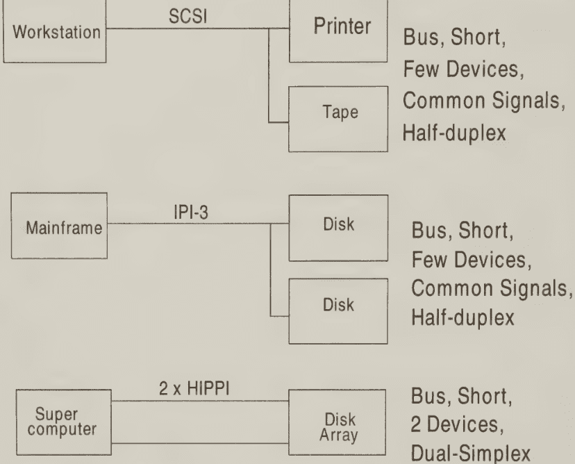

**图 1-1** 当前局限性

# 什么是光纤通道？

例如，小型系统接口（SCSI）并行接口受限于：
- 总线长度不超过 25 米
- 每个总线支持 32 个 SCSI 设备
- 双电缆系统

在当今的现代计算机系统环境中，这些限制对设计和空间限制是非常是非常大的，而且情况在变糟。双字节宽 SCSI P 缆将配置限制在 16 个设备。

单端 SCSI 协议限制为每个总线 8 个 ID 或地址（7 个设备和 1 个控制器），宽差分 SCSI 限制为每个总线 16 个 ID（15 个设备和 1 个控制器），以配置 1TB 的磁盘存储单元。完全冗余的磁盘阵列需要 30 个 SCSI ID（每个总线两个）。

这些对速度、距离和设备数量限制的担忧导致行业开始考虑替代方案。替代方案就是光纤通道。

### 1.2 什么是光纤通道？

光纤通道是一种新的通信协议，旨在克服现有架构的局限性。它是一种通用数据传输机制，主要任务是使用当前技术以可能的速率传输数据。光纤通道是一种可扩展接口，用于在异构系统和外设之间实现高速数据传输率。系统类型可以包括超级计算机、主机、工作站和桌面电脑（个人计算机）。

外设可以包括大规模存储设备，如磁盘阵列和可能的磁带库。光纤通道的主要目的是在各种物理介质现有电缆选项上运行任意数量的现有协议。下表了使用不同电缆类型可以实现的各种速度。

# 表 1-1

| 类型/ 速度 (Mhz) | 单模 @9 um | 多模 @50 um | 多模 @62.5 um | 同轴 | 型同轴 | 双绞轴 | STP |
|---|---|---|---|---|---|---|---|
| 133 | | | | 100 m | 42 m | 93 m | 80 m |
| 266 | 1300 nm @ 10 km | 780 nm @ 2 km | 780 nm @ 1 km | 100 m | 28 m | 66 m | 57 m |
| 533 | 1300 nm @ 10 km | 780 nm @ 1 km | 780 nm @ 1 km | 71 m | 19 m | 46 m | 46 m |
| 1063 | 1300 nm @ 10 km | 780 nm @ 500 m | 780 nm @ 175 m | 50 m | 14 m | 33 m | 28 m |
| 2125 | 1300 nm @ 2 km | 780 nm @ 500 m | | | | | |
| 4250 | 1300 nm @ 2 km | 780 nm @ 175 m | | | | | |

### 1.2.1 网络光纤通道

光纤通道可用于网络。光纤通道标准的编写还涵盖了网络协议（系统与系统的通信）。惠普的网络实现使用的速度为每秒 25 兆字节（M/bytes/s，也称为 Mbps）或 266 (265.625) 兆赫。这称为四分之一速，全速为 100 Mbytes/s 或 1063 (1062.5) 兆赫。全速也称为四分之一速（注：原文说“Full speed is also known as quarter speed”，这可能是源文件错误，但我必须保留它）。全速也称为四分之一速（等等，我将坚持提供的 OCR 文本）：

### 1.2.1 网络光纤通道

光纤通道可用于网络。光纤通道标准的编写还涵盖了网络协议（系统与系统的通信）。惠普的网络实现使用的速度为每秒 25 兆字节（M/bytes/s，也称为 Mbps）或 266 (265.625) 兆赫。这称为四分之一速，全速为 100 Mbytes/s 或 1063 (1062.5) 兆赫。全速也称为四分之一速（等等，我将坚持提供的 OCR 文本）：

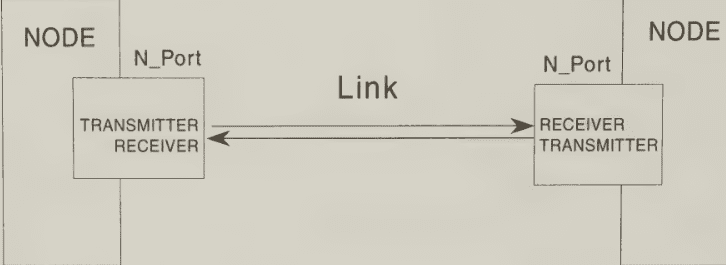

图 1-3 点对点拓扑

这种特定的拓扑使用了两个节点（每个节点必须至少有一个端口），节点之间通过一条链路或电缆连接。点对点连接保证了即时访问，且不受任何其他节点或应用程序的干扰。

如果外围节点（如磁盘阵列）有两个 N_Port，则对磁盘阵列的访问可以在两个计算机系统之间共享。例如，磁盘阵列可以作为两个计算机系统的公共软件库。这被认为是两个点对点连接。见图 1-4。

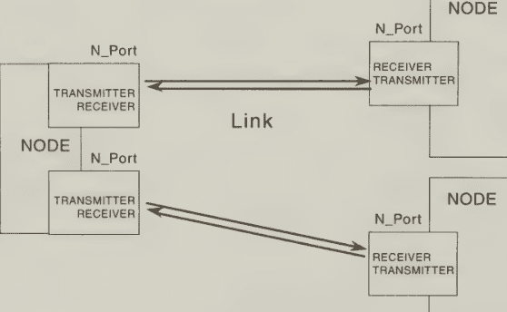

图 1-4 两个点对点连接

## 拓扑结构


点对点连接也可以被视为双节点环。惠普（Hewlett-Packard）对点对点的实现是一个双节点环。这引出了我们下一个讨论的下种拓扑。

## 1.6.2 仲裁环

一种被称为光纤通道授权环（FC-AL）的环路可以有多达 127 个端口串联（一个接一个），环绕一圈回到起点。例如，节点 1 的发送器连接到节点 2 的接收器，节点 2 的发送器连接到节点 3 的接收器，以此此类推，直到最后一个节点的发送器连接到节点 1 的接收器，从而完成环路。图 1-5 阐释了这个示例。

节点环端口（NL_Port）在环上赢得仲裁，并与环上的另一个 NL_Port 建立连接。在连接建立时，它被认为是一个对点连接或双节点环。

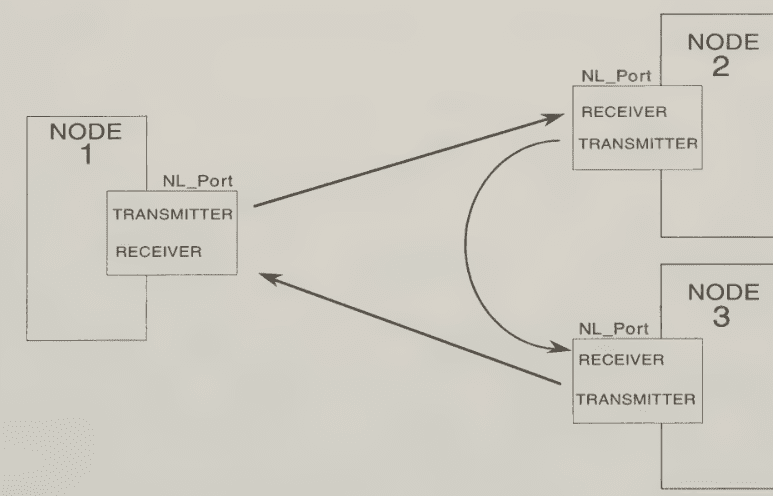

图 1-5 仲裁环拓扑

在仲裁环中，任何时刻只有两个连接的端口可以通信。所有其他端口都充当中继器。当两个连接端口之间的通信结束时，环路将变为可仲裁状态，并可以建立新连接。仲裁提供了公平性，以确保所有端口的平等访问。FC-AL 的特性、操作以及惠普的实现将在第 3 章详细讨论。

## 1.6.3 交换拓扑或矩阵（Fabric）

交换拓扑使用了矩阵（Fabric）的概念。矩阵是连接的网格。当连接到矩阵时，单个 N_Port 可以访问其余所有部分，包括环的成员。

与 FC-AL 拓扑不同，矩阵内部可以建立许多连接。它可以类比为电话系统，其中许多通话可能同时进行。

任何节点都可以通过链路通过 N 或 NL 端口连接到矩阵。矩阵中的端口被称为 F_Port。N_Port 连接到 F_Port。如果 NL_Port 连接到矩阵，则矩阵端口就是 FL_Port。

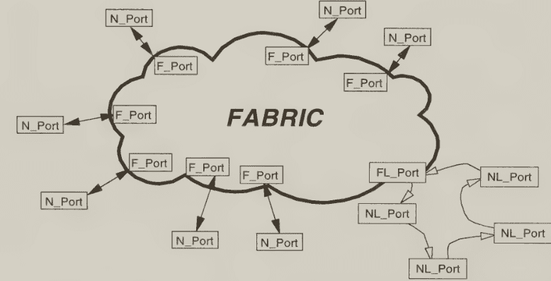

图 1-6 矩阵拓扑

## 1.6.4 典型的校园拓扑

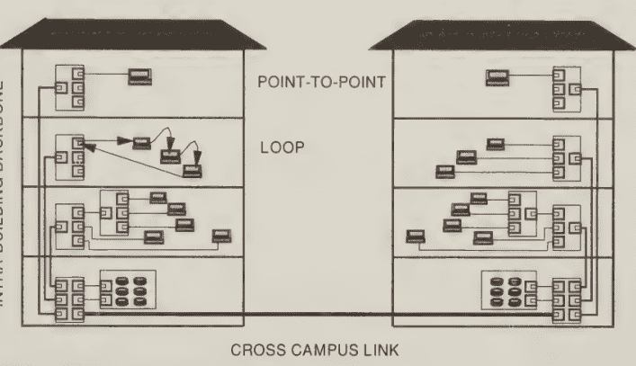

**图 1-7** 典型光纤通道校园拓扑

校园拓扑无非将建筑物连接起来，以便数据可以从一栋建筑的计算机系统传输到另一栋建筑的存储设备（无论是磁盘存储、用于备份的磁带存储或其他设备）。

使用现有技术，这些建筑之间的距离可以达到 10,000 米。这种拓扑结构将包含通过 9 微米（um）电缆连接的两个长波集线器。前提是电缆的测得信号强度损耗小于 9 db。

## 光纤通道功能层和协议

本章讨论了：

- 光纤通道的功能层
- FC-0 层 — 物理层
- FC-1 层 — 编码/解码
- FC-2 层 — 帧协议/流控控制
- FC-3 层 — 通用服务
- FC-4 层 — 协议映射
- 上层协议
- 物理组件
- 服务类

## 上层协议。应用、设备驱动程序、操作系统

协议映射

通用服务

帧协议

编码/解码

物理

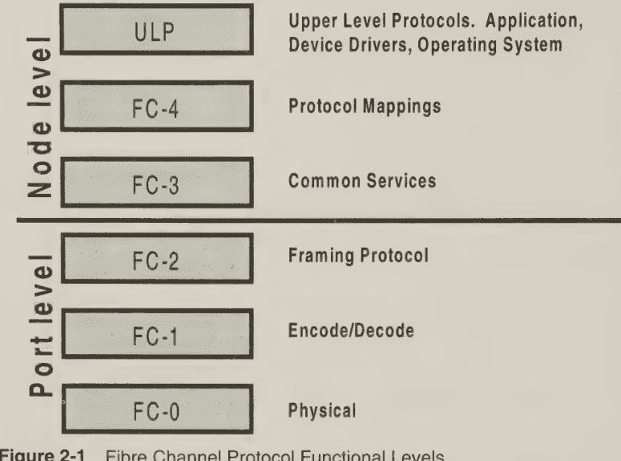

### 2.1 功能层

光纤通道协议（FCP）的功能层为 FC-0 到 FC-4。FC-3 和 FC-4 层位于端口级之外，允许在未来的扩展中共享多个端口的资源。应用程序位于 FC-4 层之上。例如，通常与主机总线适配器（HBA）通信的 SCSI 应用的外围程序将与 FC-4 层进行通信。

## 2.1.1 在拓扑中的位置

如图 2-1 所示，FC-0、FC-1 和 FC-2 在端口级实现。FC-3、FC-4 和上层协议（ULP）在节点级实现。光纤通道认为链路上不可见（FC-0 物理层以上）的部分是取决于系统的，并仅标识要执行的功能。它不要求进行分配或放置。

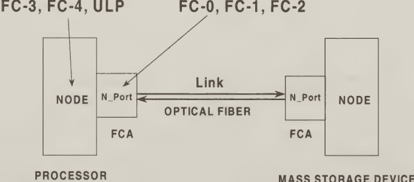

图 2-2 在拓扑中的位置

图 2-2 显示了一个简单的点对点（双节点环）拓扑示例，用于识别各个功能所在的位置。图 2-2 显示 FC-0、FC-1 和 FC-2 在端口级实现。FC-3、FC-4 和上层协议（ULP）在节点级实现。

单模连接器和多模连接器连接到光缆。单模光缆比多模光缆更细，带宽也更小。因此，单模光缆用于远距离传输，10,000 米（10km），而多模光缆用于较短的距离，500 米。

在这种情况下，一个应用示例可能是使用单模光纤连接两个隔着一定距离的建筑。然后，在每栋建筑内部使用多模光缆连接每一层。

需要注意的是，在单模和多模布线的混合环境中工作时，请注意连接器具有键槽设计，以防止单模意外连接到多模或反之亦然。然而，连接器的键槽设计并非完美，也没有完全标准化。此外，多模光纤与单模传输器和接收器不兼容。单模光在 50 或 62.5 微米的大光纤中“乱跳”并迅速耗散，导致数据丢失。

目前，惠尔-惠普（Hewlett-Packard）在其光纤通道的使用中仅支持光缆，因此仅支持图 2-5 所示的 SC 连接器。

光纤通道标准确实提供了到同轴和适当布线的连接。

对于同轴电缆：

- 接收使用 TNC
- 传输使用 BNC

对于铜电缆，使用了屏蔽双线（STP）9 针 D 型连接器（DB9）。为了防止意外连接，光纤通道 DB9 母连接器中的中间五个孔被填充了。

## 2.2.2 光电缆

图 2-6 显示了典型的光电缆及其主要组件。光通过最小的组件——纤芯传输。纤芯被一种称为包层的材料覆盖或包围。它的目的是让光保持在纤芯内，不让其逸出。

| 聚氨酯 |
| 外护套 |
| 强度加强成员 |

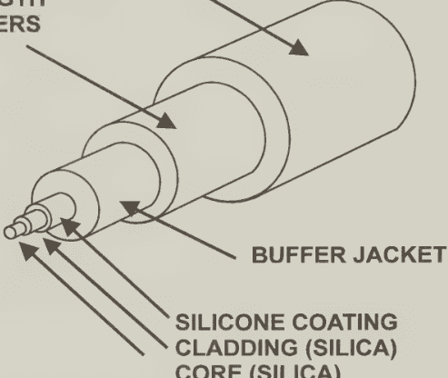

**图 2-6** 光电缆组件

然后，包层外面被涂层包裹，涂层再被缓冲护套包裹。这一切都是为了让光保持在纤芯内。然而，光纤芯本身非常细且易碎。因此，为了给电缆提供强度并为纤芯提供更多保护，缓冲护套包裹了加强材料。最后，所有这些光纤和材料层都用聚氨酯外护套包裹。光电缆不受电磁干扰的影响，由于数据是通过光传输的，因此它是防窃听的。

## FC-0: 物理层

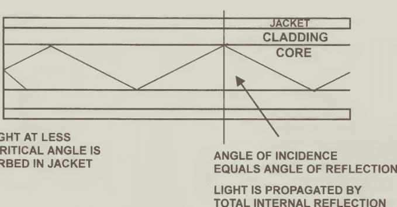

## 图 2-7 光传输

图 2-7 展示了光如何通过纤芯传输。它在侧面之间反射。这还显示了包层如何将光保持在纤芯内。

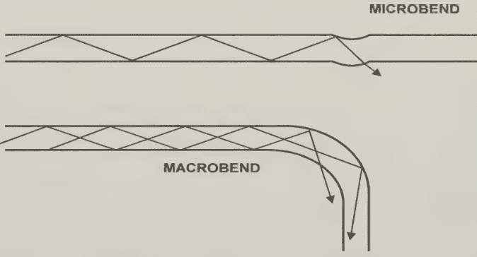

## 图 2-8 弯半径

图 2-8 显示了当超过光电缆的弯半径时会发生什么情况。最大弯半径为 3 厘米。如果布线弯曲超过 3 厘米，可能会发生数据丢失或数据损坏。纤芯也可能会裂裂或断。

### 2.2.2.1 OFC 和非 OFC

开放光纤控制（OFC）是一种安全功能，用于在光电缆断裂或断开时禁止激光光工作。这专门用于高强度激光光。惠尔-惠普使用非 OFC，因为这些激光是低强度的。因此，当发生断开时，激光光不会关闭。但并不意味着你应该直视光电缆或将其直接对准你的眼睛，因为仍可能造成损伤。在检查光电缆是否存在激光光时，将电缆末端对着一张白纸。如果纸上出现红点，则发射激光正在正常工作。

### 2.2.2.2 波长

波长是一个与单模多模连接器相关的话题。长波激光用于长距离光纤通道链路，范围大约从 500 到 10,000 米。它们通常与 9 微米尺寸的单模光纤配合使用。

短波激光用于长约 500 米的 FC-AL 链路。它们通常与多模光纤配合使用。首选的光纤芯尺寸为 50 微米。为了兼容现有的 FDDI 安装，也支持 62.5 微米的纤芯尺寸。然而，这种光纤的带宽较小，在这种情况下，距离限于光纤带宽。62.5 微米光电缆的建议长度为 175 米。

在拉新电缆时，建议客户同时拉 9 微米和 50 微米的电缆以适应未来的扩展。

## 2.3 FC-1: 传输协议层

FC-1 层定义了传输协议，包括 8B/10B 编码/解码方案、字节同步和字符级错误控制。该协议使用 8B/10B 编码方案将 8 位字节编码为 10 位传输字符。8B/10B 编码是由 IBM 开发并由 IBM 确定的。

## 2.4 FC-2: 帧协议 (Framing Protocol)

FC-2 帧协议管理流控，以确保数据传输过程中不发生冲突或丢失。此层定义了信令协议，包括帧结构和字节结构，这是光纤通道（Fibre Channel）使用的数据传输机制。帧协议用于将数据序列拆分为单独的帧进行传输、实现流控、32 位 CRC 生成以及各种类别的服务。

为了辅助数据传输，FC-2 提供了以下元素：

- 帧（Frames）——信息传输的基本单位。帧的最大有效负载为 2112 字节。
- 序列（Sequences）——由一个或多个帧组成。FC-2 为每个序列命名并跟踪其直到完成。
- 交换（Exchanges）——FC-2 理解的最大结构。一组非并发的单向或双向序列。SCSI-3 FCP 使用双向交换，信息每次向一个方向传递。要向相反方向发送数据，会将序列主动权（sequence initiative）从一个端口传给另一个端口并在。每个端口在交换内生成一个或多个序列。
- 数据包（Packets）——由一个或多个交换组成。

### 2.4.1 帧结构

下图展示了帧结构。


| 4 | 24 | 0 to 2112 | 4 | 4 字节 |
| :--- | :--- | :--- | :--- | :--- |
| >= 2 个空闲字符 | 帧起始 (Start of Frame) | 帧头 (Frame Header) | (可选头) | 有效负载 (Payload) | CRC | 帧结束 (End of Frame) | 6 个空闲字符 |

**图 2-11** `FC-2` 帧结构

帧的总长度为 2148 个传输字符或 537 个传输字。`SOF`、`CRC` 和 `EOF` 的长度均为一个个传输字，而帧头的长度为 6 个传输字。帧后面至少紧跟 6 个空闲字符（或 24 个传输字符）。

### 2.4.2 帧头结构

帧头被分为多个字段，用于承载控制信息。下图显示了这些字段。

| | 4 | 24 | | 0 to 2112 | | 4 | 4 字节 |
| :--- | :--- | :--- | :--- | :--- | :--- | :--- | :--- |
| >= 2 个空闲字符 | 帧起始 | 帧头 | (可选头) + 有效负载 | CRC | 帧结束 | 6 个空闲字符 |
| | | 字节 0 | 字节 1 | 字节 2 | 字节 3 | | |
| 字 0 | 位 31 | 23 | 15 | 7 | 0 | | |
| | | `R_CTL` | `DESTINATION_ID` | | | | |
| 1 | rsvd | `SOURCE_ID` | | | | |
| 2 | `TYPE` | `F_CTL` | | | | |
| 3 | `SEQ_ID` | `DF_CTL` | `SEQ_CNT` | | | |
| 4 | `OX_ID` | `RX_ID` | | | | |
| 5 | | `PARAMETER` | | | |

图 2-12 帧头结构

### 表 2-1 帧头结构解释

| | |
| :--- | :--- |
| 路由控制 (`R_CTL`) | 包含 IC（信息类别）和 RB（路由位）子字段。路由位指示帧类型。IC 字段指示有效负载内容（例如 SCSI 状态）。 |
| 目的 ID (`D_ID`) | 目标 `N_Port` 的原生地址、众所地址或别名地址。 |
| 源 ID (`S_ID`) | 源 `N_Port` 的地址标识符。 |
| 类型 (`Type`) | 与有效负载相关的协议（例如 `SCSI-3`）。 |
| 帧控制 (`F_CTL`) | 用于识别序列传输的位；序列的开始、中间或结束；以及连接的结束。 |
| 数据字段控制 (`DF_CTL`) | 表明可选头的存在。 |
| 序列 ID (`SEQ_ID`) | 用于标识序列的数字。 |
| 序列计数 (`SEQ_CNT`) | 帧计数器。 |
| 发起者交换 ID (`OX_ID`) | 用于标识交换的数字。 |
| 响应者交换 ID (`RX_ID`) | 响应者的数字。 |
| 参数 (`PARAMETER`) | 内容随帧变化。 |

## 2.5 `FC-3`: 通用服务 (Common Services)

`FC-3` 通用服务位于光纤通道架构的核心，它处理所有端口的流量。`FC-3` 服务了解哪些端口处于忙状态。为了辅助数据传输，`FC-2` 提供了以下元素：`FC-3` 服务管理流控，以确保数据传输不发生冲突或丢失。目前为 `N_Port` 定义的 `FC-3` 类。`FC-3` 层包含一个交换。这种。它允许连接到多个端口。`FC-3` 层了解哪些端口处于忙状态。目前，`FC-3` 层允许用于多端口操作。

图 2-13 `FC-3` 通用服务

## 2.6 `FC-4`: 映射 (Mapping)

映射是用于将上层协议接口到低层光纤通道的规则。目前，ANSI `SCSI` 委员会和光纤通道委员会正在定义这些规则。

目前在 `FC-3` 层定义了三种映射规则：

- 剥分（Striping）——为了实现更高的带宽。允许多链路并行传输。
- 组组（Hunt Groups）——一组 `N_Port`。
- 组播（Multicast）——类似于广播消息。允许到多个 `N_Port`。

发送数据时，`FC-4` 层从 `ULP` 接收信息单元（这是帧中的有效负载，是正在传输的实际数据，称为信息单元 `IU`），并将其转换为 `FC-3` 和 `FC-2` 层的序列。接收数据时，`FC-4` 层从 `FC-3` 和 `FC-2` 层接收序列，并将其转换为 `ULP` 的 `IU`。

## 2.7 上层协议 (Upper Layer Protocols)

`ULP` 允许两个设备之间进行通信。例如，计算机将数据发送到磁盘中以备后使用，或者在客户端/服务器关系中进行的通信。

目前定义了许多多年使用的标准以实现互操作性，例如 `SCSI` 或 `IP`。光纤通道的目标是提供一种让旧的 `ULP` 继续运行的结构，从而保护过去开发的软件。在这方面，每个可以在光纤通道上传输的 `ULP` 在 `FC-4` 层都有一个映射。

## 2.8 服务类别 (Classes of Service)

光纤通道的服务类别由 `FC-2` 层管理。目前标准定义了以下三类服务：

- 类 1——专用连接服务。面向连接。
- 类 2——复用服务。无连接。确认交付。
- 类 3——数据报服务。这是目前为惠普提供的服务类别。设备驱动程序判断数据是否未接收以及是否需要重传。无连接。不确认交付。

可能会有其他服务类别，但目前尚未定义。

## 光纤通道仲裁环 (`FC-AL`)

本章讨论了：

- `FC-AL` 特性
  - 环类型
- `FC-AL` 操作
  - 原始信号和序列
  - 仲裁环物理地址
  - 环路状态和操作
- 集线器
- 拓扑结构

### 3.1 `FC-AL` 特性

光纤通道（Fibre Channel）支持三种拓扑结构：环、点对点和交换。`FC-AL` 是此处讨论的环形拓扑。`FC-AL` 是一种以串行环路配置连接两个或多个（最多 126 个）设备的方法。该方案被认为是低成本的，因为它在小型到中配置中不需要集线器和交换机。它还提供了连接到使用集线器和交换机的更大环路和架构的能力。

在 `FC-AL` 中，每个端口在连接到环路时都会发现。地址在初始化时自动分配。对环路的访问是随机的，没有冲突，且没有单一的永久环路主。

`FC-AL` 允许在单一仲裁环上进行公平访问。访问公平性意味着每个想要启动流量的端口都有机会拥有环路并启动流量，而在任何其他端口第二次拥有环路之前。

### 3.1.1 环的类型

#### 3.1.1.1 `FC-AL` 私有环

私有环是封闭的，仅对自身可见。图 3-1 展示了用于光纤通道存储常用的 `FC-AL` 配置。在此例中，处理器节点只有一个光纤通道主机总适配器（`HBA`）。

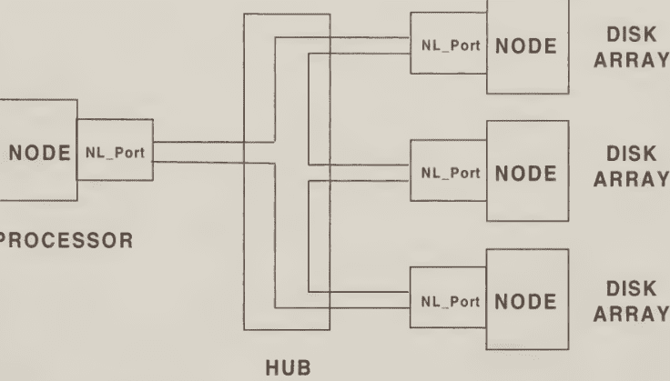

图 3-1 `FC-AL` 私有环

处理器节点连接到集线器。然后，三个设备（在此例中为磁盘阵列）连接到集线器形成环路。如果不使用集线器，则无法与三个磁盘阵列建立连接。只能以点对点的方式与其中一个建立连接。另一种选项是在处理器节点中安装三个 `HBA`，并将它们分别连接到每个磁盘阵列。

此时，集线器提供了节省处理器节点中 `HBA` 槽位的优势，并允许向环路添加多个存储设备。目前，这是惠尔公司（Hewlett-Packard）支持的环配置类型。

#### 3.1.1.2 `FC-AL` 公有环

图 3-2 所示的公共环需要一个架构（fabric），并至少有一个 `FL_Port` 连接到架构。公共环通过将环路连接到架构来扩展环拓扑的范围。公共环是一种利用一个交换连接覆盖环路内多个设备的成本的方法。将环路连接到架构类似于将局域网（LAN）连接到广域网（WAN）。架构通常用云表示，如图 3-3 所示。

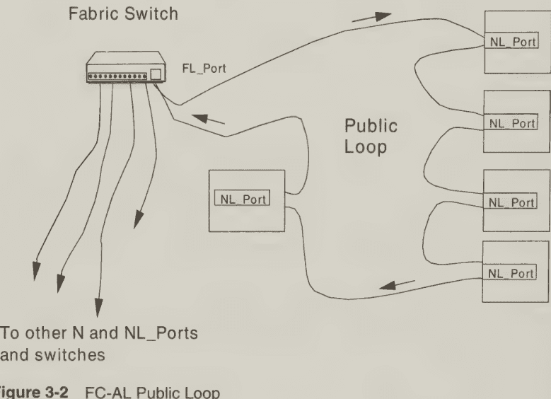

图 3-2 `FC-AL` 公有环

### 图 3-3 `FC-AL` 架构

惠尔公司目前不支持公共环或架构。

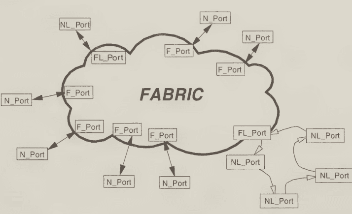

### 3.2 `FC-AL` 的操作

#### 3.2.1 原生信号

| 表 3-1 原生信号 |
| --- | --- |
| `ARB(x)` | 为环路控制仲裁地址 x |
| `OPN(y)` | 打开另一个 `NL_Port`<br>- 全双工<br>- 半双工 |
| `OPN(r)` | 复制<br>- 广播<br>- 选择性复制或多播 |
| `CLS` | 关闭 `NL_Port` 处的电路 |
| `MRK(tx)` | 来自 ‘x’ 的同步信号 ‘t’ |

注意：

‘x’ 是想要拥有环路的端口地址，‘y’ 是要打开的端口地址。

原生信号由发送端口发送，并由接收端口识别和处理。目前，惠尔公司不支持 `MRK` 信号。

#### 3.2.2 原生序列

原生序列在有序集连续出现第三次之前不会被识别或处理。目前仅使用三种原生序列：

- `LIP` 环路初始化（Loop Initialization）
- `LIPB` 环路端口旁过（Loop Port Bypass）
- `LPE` 环路端口启用（Loop Port Enable）

`IP` 序列允许发现环路上的端口。这意味着当一个新节点连接到环路时，`LIP` 序列会发现它并允许新节点在环路上进行初始化。


### 3.2.3 仲裁环路物理地址 (AL-PA)

所有端口都有一个 24 位的原生地址标识符，称为 `N_Port ID`。`AL-PA` 位于该标识符的低（8）位。地址越低，仲裁优先级越高。8 位字段可以取从 0–255 的值，即 256 个值。然而，并非所有这些值都用于物理地址。

`AL-PA` 值必须具有中性失真（请记住，`8B/10B` 编码具有正性、负性或中性失真度）。在 256 个 8 位地址中，只有 134 个中性失真值。134 个值中的 126 个用于端口地址，8 个用于控制功能。惠尔公司使用地址 `00-EF`。更多参考信息请参阅表 3-2。

`AL-PA` 的高 16 位为零。

### 表 3-2 AL-PA 值

| 值 | 描述 |
| --- | --- |
| 00 | 预留控制功能 |
| 01-EF | 用于端口地址 |
| F0 | 预留控制功能 |
| F1-F6 | 用于端口地址（等待，F7 在下方） |
| F7 | 预留 |
| F9-FE | 用于端口地址 |
| FF | 预留控制功能 |

### 3.2.4 环状态

#### 3.2.4.1 操作概述

在仲裁环中，端口通过向目标发送 `OPN` 信号来获取环路。接收 `OPN` 信号后，目标进入打开（Open）状态并在物理上在其端口处打开环路。

#### 3.2.4.2 监控状态

在端口初始化后，所有端口处于监控状态，环路空闲的，没有数据传输。在监控状态下，端口充当继器并监听有序集。

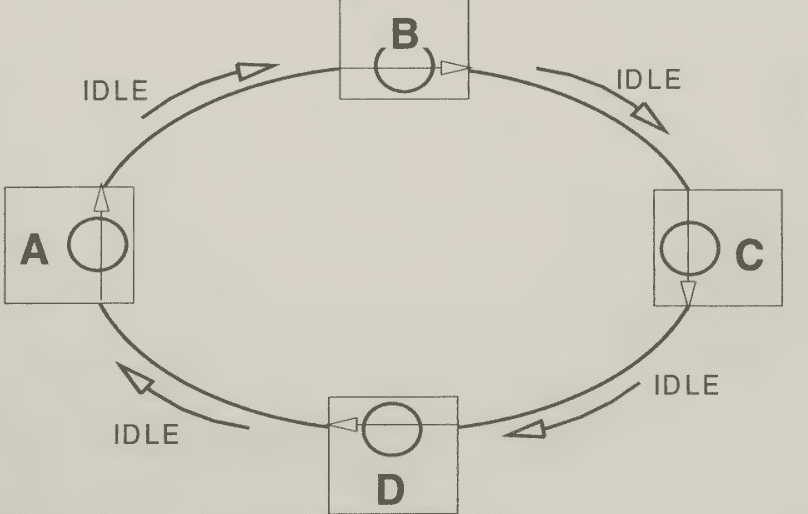

图 3-4 监控或空闲状态

#### 3.2.4.3 仲裁过程

为了开始仲裁过程，端口（在此例中为端口 A）发送原生信号 `ARB(a)` 通知环路其拥有环路的意图。当返回 `ARB(a)` 时，A 赢得胜利。当端口想要获取环路时，环路上可能存在不同的情况：

- 其他端口可能已经控制了环路。
- 多个端口可能同时尝试获取环路。

A 在以下情况下赢得：

- 没有其他端口控制环路，且
- 没有 `AL-PA` 地址较低（优先级更高）的端口正在仲裁。

一旦端口获取了环路，它就会打开环路，防止所有其他端口获取环路。它接收并丢弃所有原生信号 `ARB(x)`。

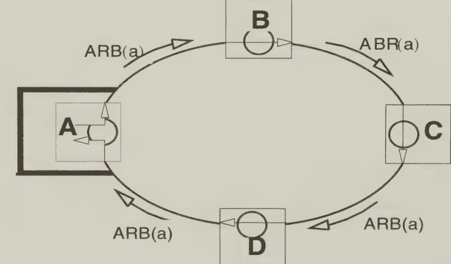

图 3-5 仲裁过程

#### 3.2.4.4 打开状态

在此例中，端口 A 已获取环路。它现在处于打开（Open）状态，环路在端口 A 处物理打开。在端口 A 与预期目标（在此例中为端口 C）完成电路之前，无法进行任何操作。

端口 A 发送命名 C 的 `OPN` 原生信号，全双工使用 `OPN(c,a)`，半双工使用 `OPN(c,c)`。端口 C 监控环路，作为继器并监听有序集。一旦收到来自 A 的 `OPN` 原生信号，它进入打开状态并在端口处物理打开环路。

环路现在在 A 和 C 之间打开，被视为点对点连接。

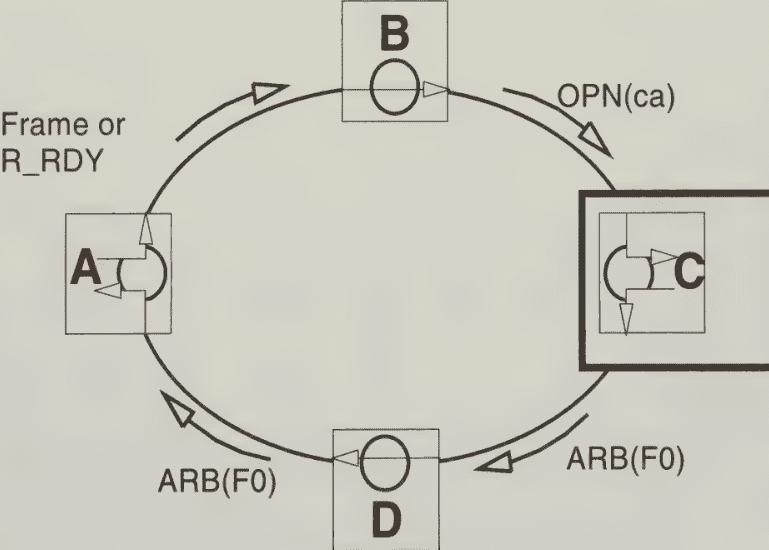

图 3-6 打开状态

#### 3.2.4.5 开环路

端口 A 和端口 C 均已打开环路。现在可以往返发送上层协议帧和链路控制帧。

所形成的电路本质上是 A 和 C 之间的点对链路。这是在事务期间的专用路径。

端口 B 和 D 充当中继器，但像以前一样在监听特定的顺序集（ordered sets）。

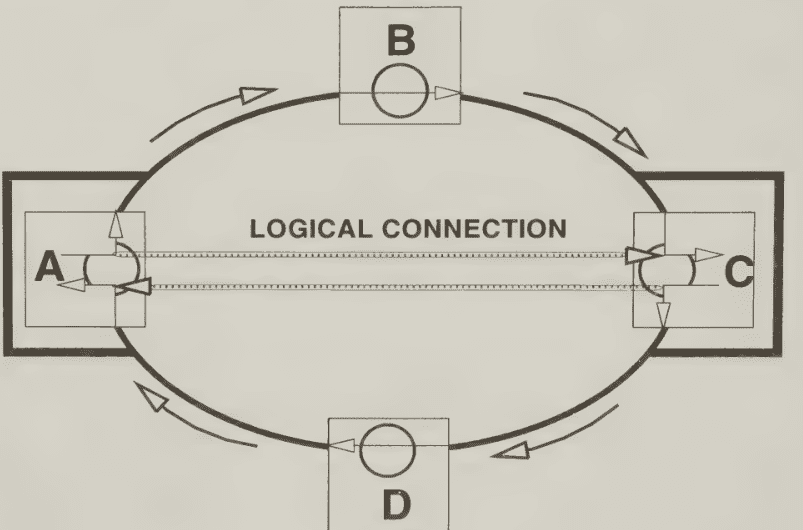

图 3-7 开环

#### 3.2.4.6 关闭环路

打开的端口中的任意一个都可以通过向另一个端口发送 `CLS` 原语信号来启动关闭程序。在本例中，端口 A 通过发送 `CLS` 信号启动了关闭。

一旦端口发送了 `CLS` 原语信号，它就不能再发送帧或 `R_RDYs`。然而，它仍然可以接收帧和 `R_RDYs`。

接收第一个 `CLS` 原语信号的端口（在此处为端口 C）不需要立即关闭其电路。它可以继续发送帧。一旦其操作完成，它会向另一个端口端口 A 发回 `CLS` 原语信号。

端口 C 在向端口 A 发送 `CLS` 时关闭，端口 A 在接收到端口 C 的 `CLS` 时关闭。环路现在已关闭，两个端口都返回监控状态。

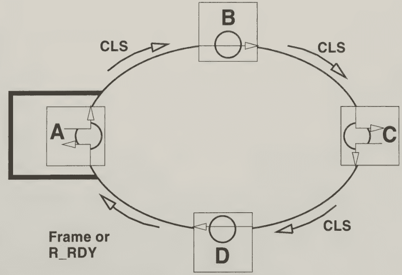

图 3-8 关闭环路

环路一旦关闭，它将回到图 3-4 所示的状态或条件。此时没有活动，所有节点都在重新重发空闲信号。当环路关闭时，其他端口可能会获取环路。

访问公平性（Access fairness）确保环路上的其他端口在刚刚拥有环路的端口再次获取环路之前，都有机会获取环路。访问公平性并不意味着时间公平。换句话说，只要端口在发送帧，它就可以一直持有环路。

### 3.3 集线器

惠普（Hewlett-Packard）用于私有环路的 `FC-AL` 实现集线器。`FC-AL` 集线器将设备连接到环路上。这是连接私有环路参与者的简单方法。集线器有两种类型：

- 被动式（Passive）：仅对端口插入或从环路中移除做出反应。
- 主动式（Active）：能够根据某些控制协议动态地执行配置更改。

某些集线器可以感知或管理环路中的配置更改，包括：

- 知道 `NL_Ports` 何时添加
- 知道 `NL_Ports` 何时移除
- 知道整组 `NL_Ports` 发生地址变化
- 将 `NL_Ports` 切入或退出环路

集线器还提供端口旁路电路，以便在设备移除或故障时“修复”环路。这允许减少操作中的干扰。集线器解决了设备布线和跟踪哪个环路已开启的问题。通过 `FC-AL` 集线器进行中央布线，可以很容易从仲裁环路上添加和删除设备。

使用光纤集线器具有某些明确优势：

- 连接外设和主机（节点）的极快速解决方案
- 每个环路多达 124 个 `NL_Ports`
- 环路拓扑消除了布线混乱
- `FC-AL` 集线器增强了子系统的可用性
- `FC-AL` 集线器提供端口旁路电路以允许“热”维修

### 3.4 拓扑结构

第五章将提供更多关于集线器特别是惠普集线器的详细信息。然而，现在为了演示使用集线器的拓扑结构，请参见图 3-9 和图 3-10。

#### 3.4.1 级联短波集线器

带有 `FC-AL` 短波主机总线适配器（HBA）的服务器可以连接到 500 米外的 `FC-AL` 集线器。集线器上的 10 个端口中的每一个都可以连接到远 500 米的 `FC-AL` 设备。

级联集线器使用每个集线器上的一个端口进行集线器之间的连接，这使得环路中节点之间的潜在距离增加了 500 米。在这种拓扑结构中，总距离为 1500 米。两个集线器都可以在其物理位置支持其他 `FC-AL` 设备。所述距离假设使用 50 微米多模光缆。

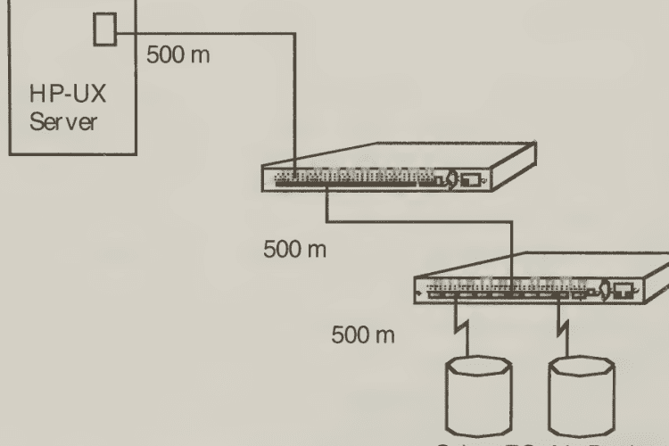

图 3-9 级联短波集线器拓扑

#### 3.4.2 级联长波集线器

级联 `FC-AL`（非 OFC）长波集线器使用长波端口进行集线器之间的连接。每个长波集线器的端口 1 到 9 用于连接到 `FC-AL` 设备。在级联长波集线器时，仅仅使用每个集线器上的长波端口来连接集线器。这种拓扑结构中的总距离为 11,000 米。从服务器到第一个集线器为 500 米，两个长波集线器之间为 10,000 米，从第二个集线器到最后一个设备为 500 米。

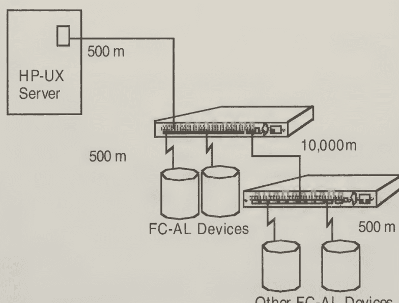

图 3-10 级联长波拓扑

## 路由

本章讨论了：

- `HP-UX` 的局限性
- 变通（Work-arounds）
- 外设设备路由
- 逻辑单元路由
- 卷集（Volume Set）路由

### 4.1 HP-UX 的局限性

如前所述，光纤允许大量的地址。然而，这些大量的地址无法无缝地到 `HP-UX` 系统中。为了处理这些地址，`HP-UX` 使用：

- 外设设备路由
- 逻辑单元路由
- 卷集路由

但在之前，需要解释两个主要的局限性。

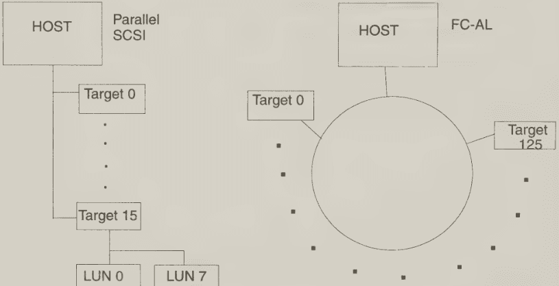

图 4-1 目标空间

#### 4.1.1 目标空间局限性

并行 `SCSI` 每个总线（控制器）支持 16 个目标（设备）。然而，`FC-AL` 有数量庞大的目标。

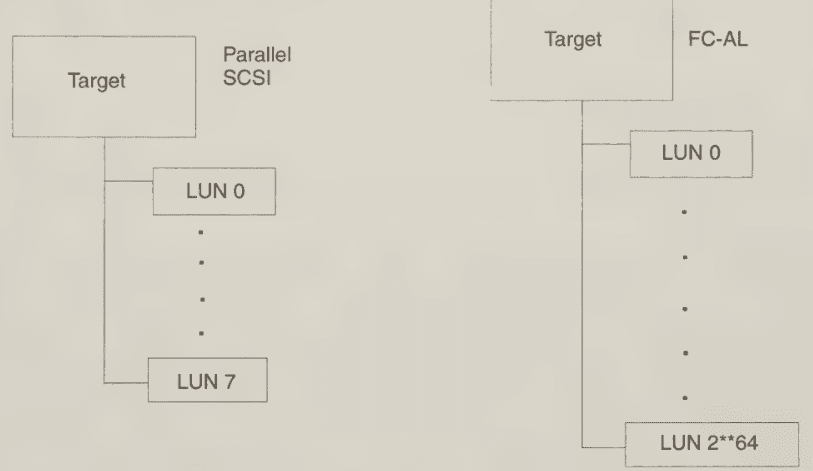

图 4-2 逻辑单元空间

#### 4.1.2 逻辑单元空间局限性

并行 `SCSI` 每个目标支持处理 `LUN`。然而，`FC-AL` 有巨大的潜在 `LUN` 数量¹。

#### 4.1.3 目标空间的变通方法

为了通过 `FC-AL` 处理允许的目标，`HP-UX` 引入了虚拟总线的使用。


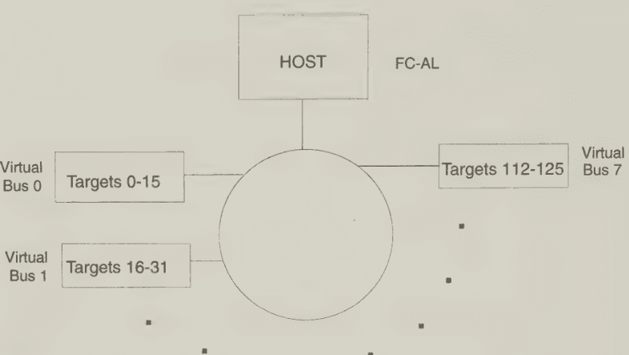

图 4-3 目标空间的变通

### 4.1.4 逻辑单元空间的变通方法

为了处理所有的 LUN，HP-UX 在每个虚拟总线上启用了 LUN。

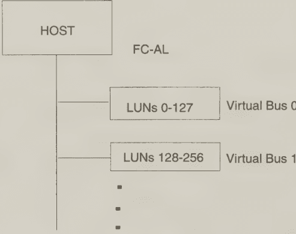

图 4-4 逻辑单元空间的变通

### 4.2 HP-UX 的路由方法

如前文所述，HP-UX 使用三种方法进行光纤路由，以绕过 HP-UX 的局限性：

- 外设设备路由
- 逻辑单元路由
- 卷集路由

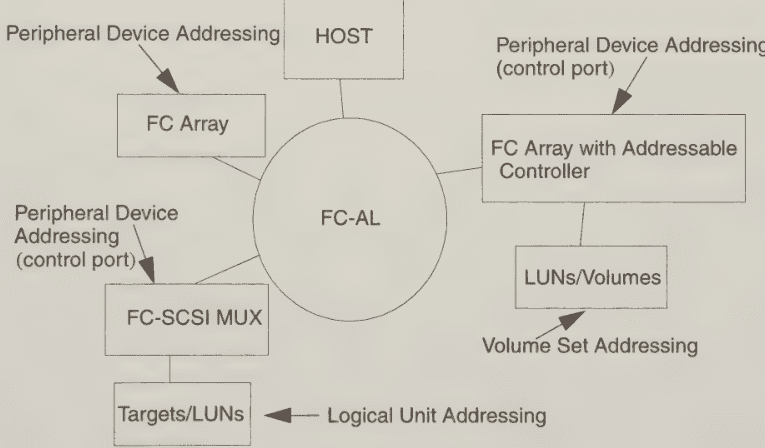

图 4-5 路由方法

### 4.2.1 光纤路由的硬件路径

路由始与在任何惠普计算机系统中一样开始。总线转换器和 HBA 地址的格式和含义与之前所有的惠普产品相同。然而，增加了协议类型、区域和端口供光纤使用。协议类型“8”代表海量存储，“5”代表网络。对于光纤通道存储设备，协议类型始终为“8”。

对于私有环路，区域始终为“0”。端口并不总是“0”，将在随后的页面中介绍。

## HP-UX 定址方法

HBA 采用环路上的最高软地址（soft address）。该地址不会在硬件路径中显示。当环路上出现重复的硬地址（hard addresses）时，将使用软地址。不允许环路上的设备获取软地址，因为如果环路上的设备发生掉电并在随后恢复，它可能会获取不同的软地址。更多信息，请参阅本章末尾的“硬地址与软地址”。

惠普 FC-AL 集线器没有光纤通道地址，因此不会出现在 `ioscan` 输出中。集线器是一个直通设备，通过电气跳过环路上引起问题的节点来提高可靠性，自身没有环路地址。

### 4.2.2 外围设备寻址

此寻址方法用于 FC-SCSI MUX（在第5章中讨论）、控制器以及某些其他光纤阵列控制器的寻址。HP 高可用光纤磁盘阵列（HA FC Disk Array）对其控制器也使用此类寻址。这种寻址方法也用于具有8 个或更少 LUN 的目标。

外围设备寻址用于未指定 LUN0 设备类型为阵列控制器且未使用逻辑单元寻址（Logical Unit addressing）或卷集寻址（Volume Set addressing）的设备。此寻址方法由私有环路设备附加（Private Loop Device Attach）规范指定。虽然该规范是一个 8 位 LUN 字段，但 HP-UX 将地址限制为 0 到 7。

### 4.2.2.1 ioscan 中的环路寻址

HA FC 磁盘阵列专用外围设备寻址。该设备的环路地址必须物理设置。控制器上有实现此目的的开关。这些开关以十六进制值设置。硬件路径将此地址显示为十进制的两个独立字段（称为半字节，每个占半字节）。

例如，环路地址是通过位于控制器前面板上的设备开关设置的。这些开关具有十六进制值。在此示例中，开关设置为 3C。然后通过分离两个字符、从十六进制转换，然后用点分隔它们来推导出十进制值。见图 4-7。

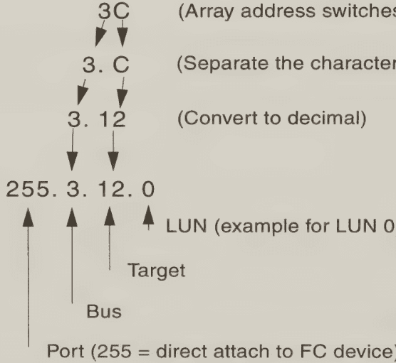

图 4-7 30 槽阵列上环路地址的半字节转换

设备的硬件路径显示每个半字节为用点分隔的十进制值。

## HP-UX 定址方法

- `8/12.8.0.255.3.12`
- LUN（阵列环路地址的低 4 位）
- Bus（阵列环路地址的高 4 位）
- Port（255 = 直接连接到 FC 设备）
- Area（0 = 私有环路）
- Protocol Type（8 = 海量存储）
- 主线适配器地址
- 总线转换器

**图 4-8** 使用外围设备寻址的 LUN 示例

此示例显示了环路地址为十进制 60 的 LUN 0。环路地址在 Bus 和 Target 字段中表示。十六进制 3C 被转换为十进制 60。

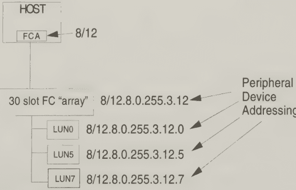

**图 4-9** 惠普 HA FC 磁盘阵列

在此示例中，LUN 0 是可寻址设备，而不是控制端口。

HP HA FC 磁盘阵列专用外围设备寻址。

图 4-10 磁盘阵列的 ioscan 示例。

| Class | H/W Path | Driver | S/W State | H/W Type | Description |
|---|---|---|---|---|---|
| fcp | 0 8/12.8 | fcp | CLAIMED | INTERFACE | FCP 协议适配器 |
| ext_bus | 10 8/12.8.0.255.3 | fcpdev | CLAIMED | INTERFACE | FPC 设备接口 |
| target | 8 8/12.8.0.255.3.12 | tgt | CLAIMED | DEVICE | |
| disk | 76 8/12.8.0.255.3.12.1 sdisk | CLAIMED | DEVICE | DGC C3400WDR5 |
| disk | 77 8/12.8.0.255.3.12.2 sdisk | CLAIMED | DEVICE | DGC C3400WDR5 |

**图 4-10** ioscan 示例

### 4.2.2.2 Grid Manager 中的环路寻址

使用惠普 HA FC 磁盘阵列时，请记住 Loop ID 必须使用位于控制器背后的开关设置。在我们的示例中，使用了 3C 的 Loop ID。在 Grid Manager 中显示此内容时，它显示为十进制数字 60。此转换使用了标准的十六进制到十进制转换。

如果开关设置为 3C 以外的值，请记住从十六进制到十进制的转换。例如，如果开关设置为 2C，则十六进制转换将为十进制 44。

### 4.2.3 逻辑单元寻址

此寻址方法用于连接到 FC-SCSI MUX 的 SCSI 设备。请记住，MUX 本身使用外围设备寻址。然而，它有一个可寻址的控制端口，连接到 MUX 的设备将使用逻辑单元寻址。

## HP-UX 定址方法

HP-UX 根据 REPORT LUN 命令返回的查询数据选择逻辑单元方法。HP-UX 将目标地址限制为 0 到 15，并将 LUN 地址限制为 0 到 7。目标地址指定了总线数（3位）、目标数（6位）和 LUN（5位）。

MUX 上的每个 SCSI 总线由 HP-UX 独立虚拟总线表示。MUX 控制端口与其附加设备位于不同的虚拟总线上。见图 4-11。

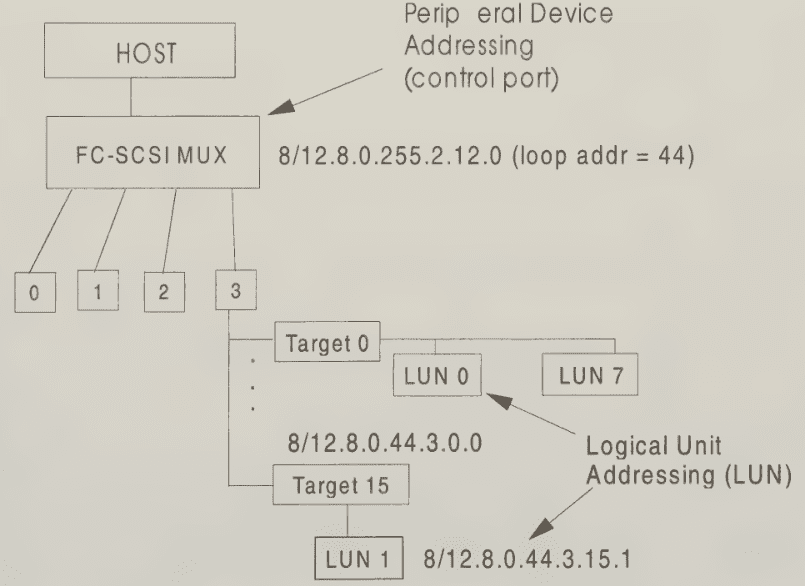

图 4-11 逻辑单元寻址示例

此图显示 MUX 有自己的地址（8/12.8.0.255.12），环路地址为十六 2C 或十进制 44。在虚拟总线 3 上，目标 0 的 LUN 0 有自己的地址（8/12.8.0.44.0），而目标 15 的 LUN 1 有自己的地址（8/12.8.0.44.3.15），使用逻辑单元寻址。

### 4.2.3 导出 MUX 环路地址

连接到 MUX 的设备的路径 Port 字段首先转换为十六进制。然后将十六进制数字分离为 Bus 和 Target 字段，最后将数字转换回十进制。见图 4-12。

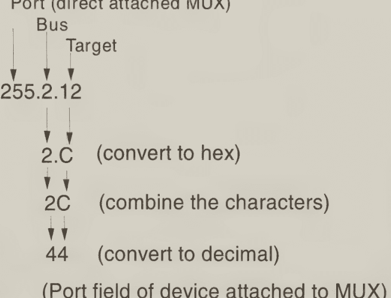

图 4-12 转换 MUX 环路地址示例

此转换主要用于故障排除 MUX 硬地址。

## HP-UX 定址方法

下一个示例显示 FC-SCSI MUX 控制端口的硬件路径。Bus 字段中的 255 表示 MUX 控制端口使用外围设备方法直接连接到 FC 设备。对比图 4-11。

```
8/12.8.0.255.2.12.0
LUN (MUX 控制)
Target (MUX 地址的低 4 位)
Bus (MUX 地址的高 4 位)
Port (255 = 直接连接到 FC 设备)
Area (0 = 私有环路)
Protocol Type (8 = 海量存储)
Adapter Address
Bus Converter
```

图 4-13 MUX 控制端口的硬件路径

下一个示例显示连接到 MUX 总线 3 的设备的生成的硬件路径。再次对比图 4-11。

```
8/12.8.0.44.3.0.0
LUN
Target (SCSI 设备)
Bus
Port (环路地址)
Area (0 = 私有环路)
Protocol Type (8 = 海量存储)
Adapter Address
Bus Converter
```

图 4-14 MUX 总线 3 设备硬件路径示例

LUN 硬件路径中的 Bus 字段是 MUX 上的 SCSI 总线。LUN 硬件路径中的 Port 字段是十进制环路地址。MUX 控制端口的硬件路径包含 Bus 和 Target 字段中的环路地址。

```
# ioscan -fn
```

| Class | H/W Path | Driver | S/W State | H/W Type | Description |
|---|---|---|---|---|---|


| fcp | 0 8/8.8.8 | fcp | CLAIMED | INTERFACE | FCP 协议适配器 |

| ext_bus | 12 8/8.8.0.44.0 | fcmux | CLAIMED | INTERFACE | HP A3308 FC-SCSI MUX 接口 |

| target | 17 8/8.8.0.44.0.4 | tgt | CLAIMED | DEVI CE | |

| tape | 1 8/8.8.0.44.0.4 | | | CLAI MED | DEVI CE | Quantum DLT4000 |

| | | `/dev/rmt/1m` | | | `/dev/rmt/c12t4d0BEST` |

| | | `/dev/rmt/1rb` | | | `/dev/rmt/c12t4d0BESTn` |

| | | `/dev/rmt/1m` | | | `/dev/rmt/c12t4d0BESTn` |

| | | `/dev/rmt/1mmb` | | | `/dev/rmt/c12t4d0BESTnb` |

| Class | H/W Path | Driver | S/W State | H/W Type | Description |

|---|---|---|---|---|--|

| ext_bus | 16 8/8.8.0.255.2 | fcpdev | CLAIMED | INTERFACE | FCP 设备接口 |

| target | 28 8/8.8.0.255.12 | tgt | CLAIMED | DEVI CE | |

| ctrl | 12 8/8.8.0.255.12 | sctl | CLAIMED | DEVI CE | HP HPA3308 |

图 4-15 带有设备的 `ioscan` 示例

### 4.2.4 卷集寻址

此寻址方法主要用于虚拟总线、目标和 LUN 的寻址。14 位卷号支持为单个 FCP 目标提供高达 16,384 个 LUN：

- 位 13–7 成为硬件路径中的总线
- 位 6–3 成为硬件路径中的目标
- 位 2–0 成为硬件路径中的 LUN。


**图 4-16** 卷集地址示例

图 4-16 显示，FC 磁盘阵列的外围设备地址为 `8/12.8.0.255.2.8.0`，而 LUN 号 179 的卷集地址为 `8/12.8.0.40.1.6.3`。LUN 号地址包含了环路地址号 40。接下来的章节描述了如何中断此寻址方案。

#### 4.2.4.1 推导卷集地址

使用图 4-16 中的示例，对于 LUN 号 179，可以执行以下转换。

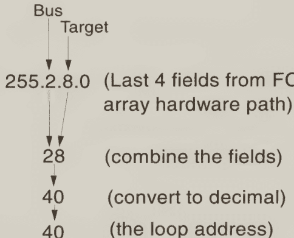

图 4-17 使用卷集地址推导环路地址的示例

光通道阵列控制器的硬件路径中使用总线和目标字段来表示环路地址。同时请记住，所有 Port=255 的硬件路径都使用外围设备寻址方法。此外，在本示例中，字符串末尾的零代表 LUN 号。

## HP-UX 寻址方法

```
179 EXAMPLE: LUN 179 FROM 14-bit VOLUME FIELD
B3 TRANSLATE TO HEX
000000 1011 0011 TRANSLATE TO BINARY
01 SEPARATE INTO FIELDS
40.1.6.3 CONVERT BACK TO DECIMAL
LUN Target Bus Port (= Loop Path)
```

**图 4-18** 推导 LUN 硬件路径

再次使用图 4-16 中的示例，发生了以下转换。

如果没有可用计算器来执行十六进制或二进制转换，请将十进制值除以 16，并将结果转换为十六进制。然后将余数转换为十六进制。对于我们的示例，参考图 4-16，LUN 179 的 `ioscan` 显示如下。

## `8/12.8.0.40.1.6.3`

| 字段 | 描述 |

| :--- | :--- |

| LUN | 14 位卷号的低 3 位 |

| Target | 14 位卷号的第 3-6 位 |

| Bus | 14 位卷号的高 7 位 |

| Port | 环路地址 |

| Area | 0 = 私有环路 |

| Protocol Type | 8 = 海量存储 |

| Adapter Address | |

| Bus Converter | |

图 4-19 LUN 179 的最终硬件路径

### 4.2.5 硬地址与软地址

如果在环路上发现发现重复的硬地址，FC-AL 协议允许为设备分配软地址。然而，最好的做法是避免设备获取软地址。允许设备获取软地址的唯一方法是，确保所有设备在连接到环路之前都已具有硬地址。

创建环路映射，并验证任何添加的设备的硬地址是否与环路上的现有设备不同。非常值得重复一遍：确保所有连接到环路的设备都具有唯一的硬地址。在连接设备后始终运行 `ioscan` 以确认该设备已获取其硬地址。

例如，一个地址为 3C 的阵列连接到一个 FCA 没有问题，两个地址各为 3C 的阵列分别连接到两个 FCA 也没有问题。然而，两个地址均为 3C 的阵列连接到一个集线器上将产生问题。其中一个将拥有硬地址，而另一个将被分配软地址。第一个获取环路的阵列将接收其硬地址，而第二个阵列将被分配软地址，因为环路会看到重复地址。

在断开连接或掉电状态后，环路可能会带有“翻转”地址初始化。这可能会导致数据损坏。上电后，具有软地址的阵列可能会先获取环路并接收其硬地址，而在掉电前具有硬地址的阵列现在将被分配软地址。由于地址的“翻转”，该设备在具有硬地址时存储的数据将无法再访问，系统甚至无法知晓。

为了防止这种情况，请为每个设备分配唯一的硬地址。

## 惠尔-亥帕克光通道产品

本章讨论了：

- 惠尔-亥帕克光通道产品 1
- 两种惠尔-亥帕克的光通道芯片
- 光通道适配器
- FC-AL 集线器
- 高可用光通道磁盘阵列
- SCSI 多路用器
- 惠尔-亥帕克光通道交换机
- 支持光通道 2 的 HP 系统
- 使用光通道的拓扑/解决方案

1. 惠尔-亥帕克将随着时间的生产新的/更多的产品。
2. 惠尔-亥帕克将在更多系统可用时将它们添加到支持列表中。

### 5.1 控制器 IC

#### 5.1.1 概述

惠尔-亥帕克于 1995 年初开始出 TACHYON IC，如今，TACHY 是行业领先的光通道控制器。HP 通过 Tachyon TL IC 继续了这一领先地位，这是一种 64 位 PCI 转光通道控制器，专注于仲裁功能。

#### 5.1.2 TACHYON

**图 5-1** 惠尔-亥帕克的光通道芯片

- 基于 TACHON 架构的第二代控制器 IC
- 针对光通道仲裁环路 `FC-AL` 设计
- 支持 Class 2 和 Class 3
- 1 Gb/s 光通道速率

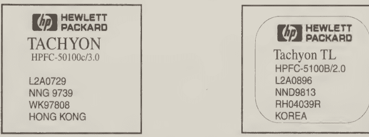

#### 5.1.3.4 物理层

物理层接口是一种通用的 10 位宽规范，允许与低成本的串用器/解用器 `SerDes` IC 接口。这种物理层接口目前广泛应用于光纤硬盘驱动器，因其具有高质量的千兆比特信号、小外形尺寸以及低成本的特点。

#### 5.1.3.5 应用

- 主板集成
- 主机总线适配器 `HBA`
- 存储子系统
- I2O 设计

#### 5.1.4 TACHYON 框图

TACHYON 是一个基础构建模块，兼容惠普的光纤通道解决方案，该方案包括接口控制器、物理链路模块、适配器、交换机和磁盘驱动器。

TACHYON 架构支持网络和大规模存储连接，提供了一种低成本、高性能且低主机开销的解决方案。

# 第 5 章 • 惠普光纤产品

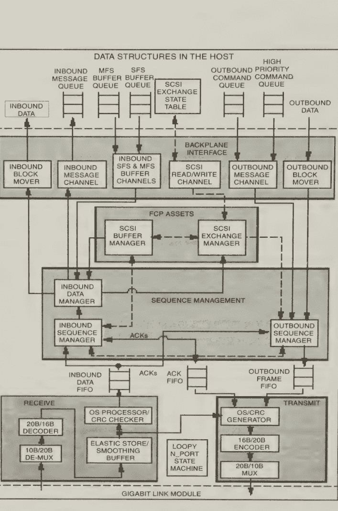

图 5-2 TACHYON 内部框图

#### 5.1.4.1 特性

- 单芯片光纤通道接口（不需要 I/O 处理器）
- 支持 1062.5、531 和 266 MBaud 链路
- 支持三种拓扑结构：直接连接、交换网络 `fabric` 和光纤通道仲裁环路 `FC-AL`
- 支持光纤通道 Class 1、2 和 3 服务
- 所有服务类别均支持高达 2-KB 的帧有效负载
- 硬件中的序列分段/重组
- 自动 ACK 帧的生成与处理
- 芯片级支持 SCSI 启动器和目标的 FCP
- 支持多达 16,384 个并发 SCSI I/O 事务
- 符合 MIB-II 网络管理
- 直接接口行业标准的 10 位和 20 位千兆链路模块 `GLM`
- 辅助 TCP/UDP/IP 网络的硬件加速
- 内部数据路径的校验位保护
- 八个内部 DMA 通道
- 全双工内部架构，允许 TACHYON 同时处理输入和输出数据

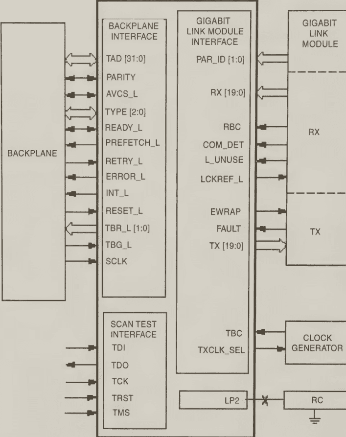

图 5-3 TACHYON 引脚框图

#### 5.1.4.2 规格


- 系统时钟频率：
  - 24–40 MHz 背板运行
- 工作温度：
  - 0–50 ° C @ 0 m/s 气流
  - 0–70 ° C @ 1.5 m/s 气流
- 可测试性：
  - 全内部扫描路径
  - IEEE 标准 1149.1 边界扫描
- 封装：
  - 208 脚金属四方扁封装 (QFP)
- 标准：
  - 旨在符合 ANSI 标准和 FCSI/FCA 配置定义

### 5.1.4.3 产品免责声明

HP 保留随时更改产品规格、特性、能力、功能甚至通用可用性的权利。Tachyon TL IC 的销售适用特殊条件；欲需更多信息，请将您的地址和电话号码发送邮件至 hsio@hp.com。

### 5.2 用于 K 类系统的光纤通道适配器

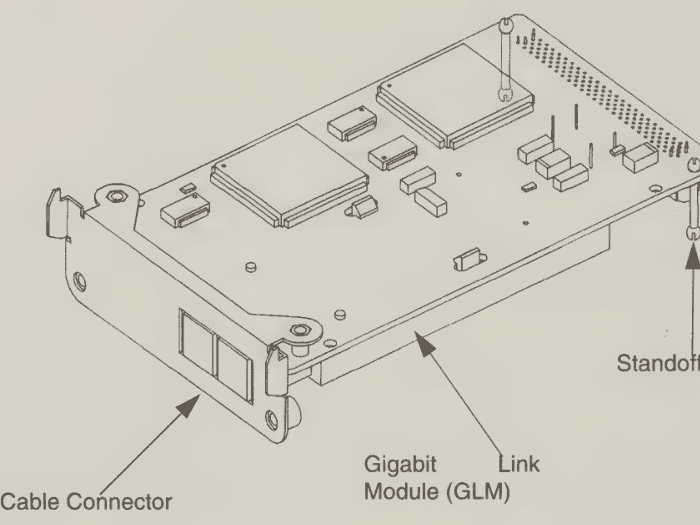

图 5-4 A3404A 光纤通道适配器（用于 K 类系统）

此光纤通道适配器 (FCA) 设计用于 K 类系统，型号 K2xx、K3xx、K4xx 和 K5xx。它是一个全速 (1063 Mbps)、短波、非 OFC 设备。

尽管它与用于 T 类系统的产品相似，但该适配器在后连接器附近具有不同的隔板和支撑柱，用于防震和防冲击。它不能与 T 类适配器互换。

### 5.3 用于 T 类系统的光纤通道适配器

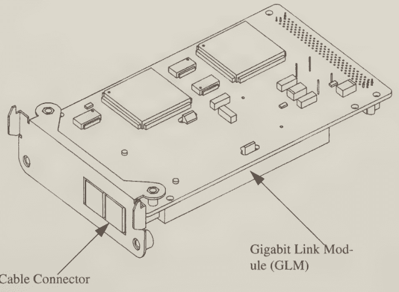

图 5-5 A3636A 光纤通道适配器（用于 T 类系统）

此 FCA 设计用于 T 类系统，型号 T600。它是一个全速 (1063 Mbps)、短波、非 OFC 设备。

尽管它与用于 K 类系统的产品相似，但该适配器在后连接器具有不同的隔板且没有支撑柱。它不能与 K 类适配器互换。

### 5.4 用于 D 类系统的光纤通道适配器

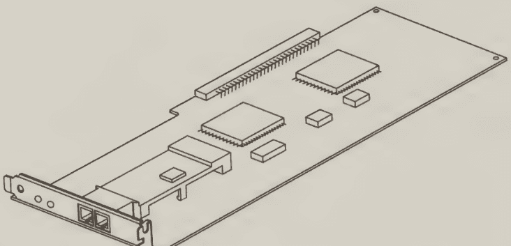

**图 5-6** A3591A 光纤通道适配器（用于 D 类系统）

此光纤通道适配器 (FCA) 设计用于 D 类系统。它是一个全速 (1063 Mbps)、短波、非 OFC 设备。

### 5.5 用于 V 类系统的光纤通道适配器

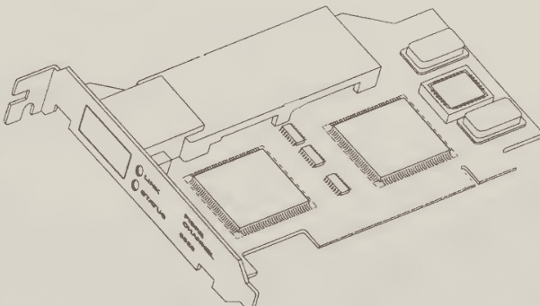

**图 5-7** A3740A 光纤通道适配器（用于 V 类系统）

此光纤通道适配器 (FCA) 设计用于 V 类系统。它是一个全速 (1063 Mbps)、短波、非 OFC 设备。

## 5.6 光纤通道仲裁环路

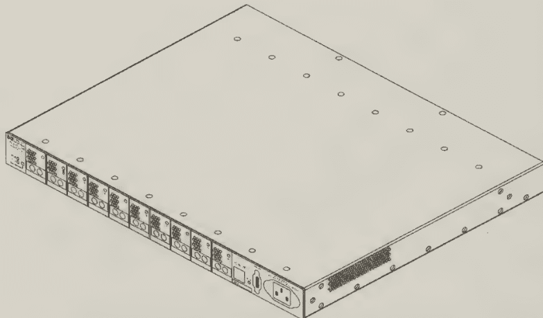

光纤通道仲裁环路提供短波和长波型号。两种型号均支持独立或机架式配置。

### 5.6.1 特性

- 短波环路具有十个光收发器
- 长波环路具有九个光收发器
- 针对故障节点的可靠信号生成
- 针对添加节点的自动信号生成
- 添加或移除节点的即插即用能力

### 5.6.2 短波集线器 (HP A3724)

短波集线器支持千兆比特连接。短波集线器支持千兆比特连接。短波集线器支持千兆比特连接。

对于短波集线器，惠普建议新安装使用 50 微米光纤，但现有安装支持 62.5 微米光纤。级联短波集线器之间的最大距离为 500 米。

### 5.6.3 长波集线器 (HP A4839A)

长波集线器支持千兆比特连接。长波集线器支持千兆比特连接。长波集线器支持千兆比特连接。

对于长波集线器，惠普建议新安装使用 50 微米光纤，但现有安装支持 62.5 微米光纤。级联长波集线器之间的最大距离为 10 公里。

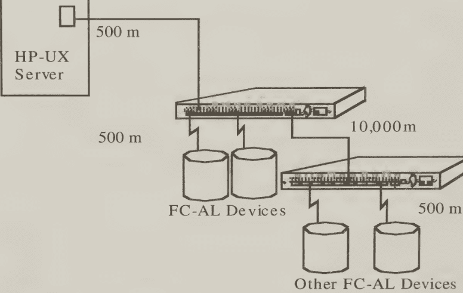

图 5-9 级联长波集线器

### 5.6.4 规划光纤通道连接

集线器不需要驱动程序或特定的 HP-UX 操作系统版本，但连接到集线器的 FC-AL 设备需要。

1. 通过对比 5.6.4.1 中的示例验证环路布线配置正确。根据需要修改网络布线图。
2. 检查连接到集线器的每个 FC-AL 设备的用户分配 ID（硬件地址），确保每个 ID 都是唯一的。环路上的重复 ID 会引起问题。此外，每个设备都有工厂分配全球名称。
3. 验证集线器端口与 FC-AL 存储设备或 FC-AL 适配器之间的连接具有相同的波长和速度。例如，计划将集线器端口连接到短波 FC-AL 设备。
4. 如果尚未完成，将规划的连接记录在连接图中。

### 5.6.4.1 正确布线示例

在级联配置中，将第一个集线器的任意端口连接到第二个集线器的任意端口。以下示例包含了由 FC-AL 设备 1、Hub A、Hub B 和 FC-AL 设备 2 组成的 18 个节点。FC-AL 设备 1 连接到 Hub A 的端口 1；Hub A 的端口 10 连接到 Hub B 的端口 1；Hub B 的端口 10 连接到 FC-AL 设备 2。

# 图 5-10 级联短波 FC-AL 集线器配置

## 5.6.4.2 错误布线示例

以下插图是错误布线的示例。例如：**不要**将同一集线器的两个端口连接在一起。两个连接之间的端口将从环路消除。

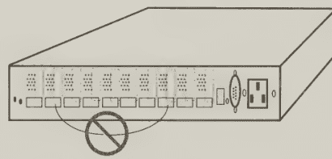

# 图 5-11 错误布线示例：同一集线器上的端口

**不要**在任何两个集线器之间连接多根电缆。

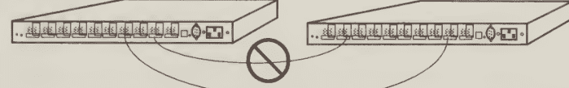

**图 5-12** 错误布线示例：集线器之间的多个电缆连接

**不要**尝试将一个集线器连接到多个其他集线器。

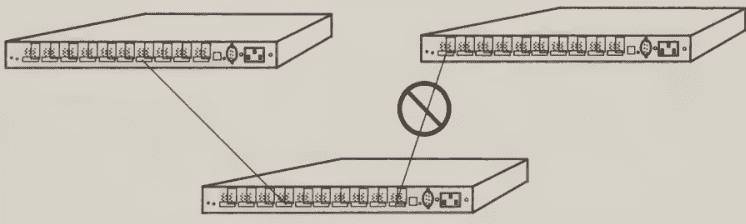

**图 5-13** 错误布线示例：连接了两个以上的集线器

## 5.7 高可用光纤通道磁盘列

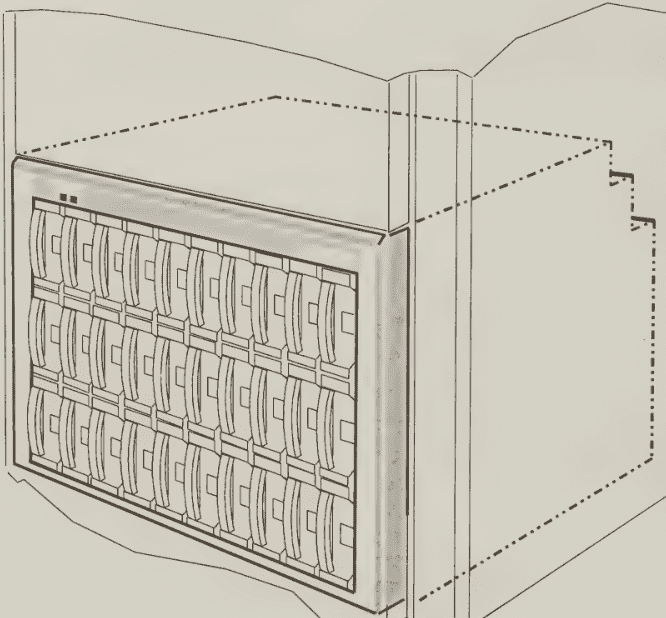

图 5-14 A3661A HA FC 磁盘列

此光纤通道外设具有巨大的存储容量。它可以容纳多达 30 个磁盘模块。惠普的最高容量为每个磁盘模块 18 兆字节。这将随着未来版本的发布而增加。该磁盘列专为用于光纤通道拓扑结构而设计。

它是高可用性 (HA)，因为它采用了冗余组件，例如：
- 磁盘模块
- 电源
- 控制器单元

它支持运行 HP-UX 10.20 TFC 或更高版本的 K 类、D 类、T 类（仅限 600）和 V 类惠普企业服务器。它具有 1.063 Gbps 的光纤通道链路速度，并支持光纤通道仲裁环路（FC-AL）拓扑结构。

### 5.7.1 基本拓扑结构

磁盘列通过 RAID（独立磁盘冗余阵列）技术、全局热备以及冗余、热插拔、客户可更换的磁盘列组件来防止单点故障。许多组件可以在磁盘列通电的情况下由客户移除并更换，而无需将其从机箱中取出也不会丢失数据。支持的 RAID 级为 5、3、1/0 和 1。不支持 RAID 0 级和单个磁盘单元，因为它们不提供数据冗余。

磁盘列和主机可以通过多种硬件拓扑结构直接或间接地地连接到惠普 FC-AL 集线器。

图 5-15 显示了在主机系统上实现的基本拓扑的高可用版本，该系统具有两个主机 FC I/O 适配器连接到双处理器（SP）磁盘列。

# 基本拓扑结构

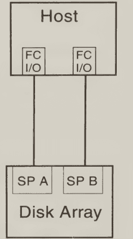

**图 5-15** 基本拓扑结构，高可用版本：带有两个 FC I/O 适配器的主机

基本拓扑结构的高可用版本可以在 D 类服务器中实现。

# 基本拓扑结构

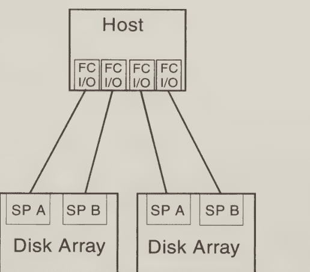

**图 5-16** 基本拓扑结构，高可用版本：带有四个 FC I/O 适配器的主机

图 5-16 显示了在具有四个主机 FC I/O 适配器的主机上实现的基本拓扑的高可用版本。其中两个 FC 适配器连接到一个双 SP 磁盘列，而另外两个 FC 适配器连接到第二个双 SP 磁盘列。主机适配器和 SP 的每次连接都会创建一个独立的 FC-AL。在 T 类服务器中可以安装额外的磁盘列和 FC 适配器。

非高可用版本将主机或服务器连接到一个或多个单 SP 磁盘列。此版本不提供硬件冗余，且无法防止单 SP、FC 电缆、主机 FC I/O 适配器或内部 SCSI-2 总线故障。如果这些组件中的任何一个故障，磁盘列将不可用，应用程序无法继续运行。在更换故障的硬件组件之前，磁盘列将保持不可用。逻辑磁盘单元（LUN）内的单个磁盘模块故障后，应用程序可以继续运行。

图 5-17 显示了在 K 类或 T 类上实现的非高可用基本拓扑结构，四个 FC I/O 适配器连接到四个磁盘列中的单 SP。适配器和 SP 之间的每次连接创建一个独立的 FC-AL。在 T 类服务器中可以安装额外的磁盘列和 FC 适配器。

# 基本拓扑结构：无高可用


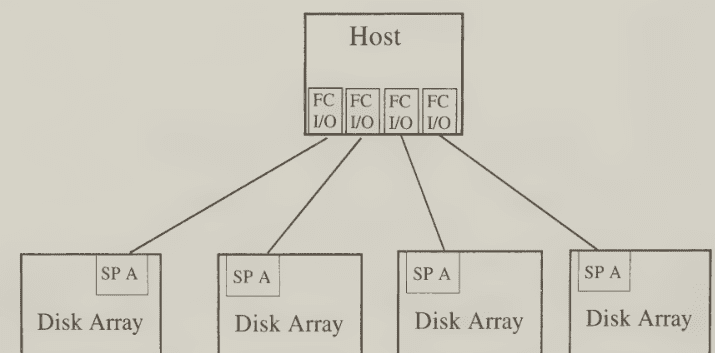

**图 5-17** 基本拓扑结构，非高可用版本：带有四个 FC I/O 适配器的主机

到为止涵盖的所有拓扑结构都被认为是基本拓扑结构，且距离限制在 500 米内，因为它们没有包含集线器的使用。在拓扑结构中使用集线器可以增加光纤通道外设距离主机的距离，但请记住它也会增加拓扑结构的复杂性。

以下图将演示在连接磁盘列时对集线器的使用。集线器的使用不仅增加了距离，还增加了主机的高可用性和可用存储容量。

# 高可用光纤通道磁盘列

单系统拓扑结构的每个实例通常使用以下硬件组件：

- 一个主机系统或服务器
- 两个 FC I/O 适配器
- 一个 10 端口 HP FC-AL 集线器 (`A3724`)
- 一到四个双 SP 磁盘列（高可用）或一到八个单 SP 磁盘列（非高可用）
- 主机与 FC-AL 集线器以及 FC-AL 集线器与每个磁盘列之间的每次光纤电缆距离最大为 500 米，FC-AL 总长度不超过 5000 米

一个或两个单系统拓扑结构可以在 D 类或 K 类服务器中实现。

## 5.7.2 距离拓扑结构

图 5-18 显示了单系统拓扑结构。该拓扑结构使用单个 FC-AL 集线器来连接主机和磁盘列。主机通过两个 FC I/O 适配器连接到集线器，每个磁盘列通过一个 FC 适配器连接到集线器。

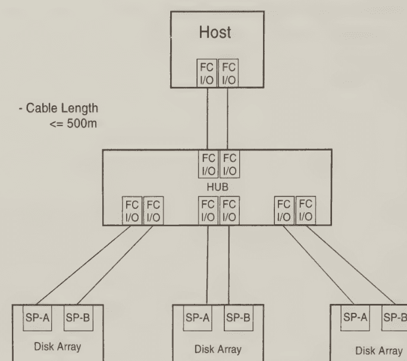

**图 5-18** 单系统拓扑

单系统拓扑结构使用单个 FC-AL 集线器连接主机和磁盘列。主机通过两个 FC I/O 适配器连接到集线器，每个磁盘列通过一个 FC 适配器连接到集线器。该拓扑结构没有为集线器本身提供冗余。如果集线器故障，主机与磁盘列之间的所有通信将丢失。

## 5.7.3 高可用拓扑结构

高可用拓扑结构通过使用冗余的 HP FC-AL 集线器防止 HP FC-AL 集线器单点故障，提高了单系统拓扑结构的可用性。增加第二个 HP FC-AL 集线器还可以增加连接到单个 FC-AL 的主机和磁盘列的数量。

高可用性拓扑的每个实例使用以下硬件组件：

- 两个到四个主机系统或服务器
- 每个 K 类或 T 类主机配有两个 FC I/O 适配器

  请咨询您的惠尔-帕克支持代表以获取 D 类服务器每个型号所支持的适配器数量
- 两个 10 端口 HP FC-AL 集线器 (`A3724A`)
- 每个磁盘阵列两个 SP（存储处理器）
- 四主机 FC-AL 结构中最多有六个磁盘阵列，双主机 FC-AL 结构中最多有八个磁盘阵列
- 每个主机与 HP FC-AL 集线器之间、每个 HP FC-AL 集线器与阵列之间的每个连接光纤电距离最大为 500 m，FC-AL 电缆总长度不超过 5000 m

正如名称所示，高可用性拓扑仅支持双 SP 磁盘阵列。由于该拓扑的目标是使用冗余硬件组件提供高可用性，因此不支持单 SP 磁盘阵列。所有硬件组件和路径都是冗余的。如果发生任何硬件故障，主机与磁盘阵列之间的 I/O 通可以通过另一条路径完成。

### 高可用光通道磁盘阵列

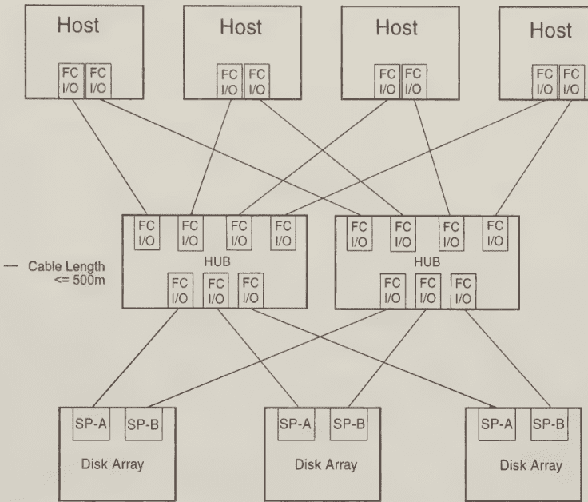

图 5-19 高可用（冗余环）拓扑

在此拓扑中，每个主机使用两个 FC I/O 适配器，每个磁盘阵列使用双 SP。每个主机中的一个适配器和每个磁盘阵列中的一个 SP 连接到一个 HP FC-AL 集线器，形成 FC-AL。每个主机中的第二个适配器和每个磁盘阵列中的第二个 SP 连接到第二个 HP FC-AL 集线器，并布到一个独立的 FC-AL 中。这创建了两个冗余的 FC-AL。

由于每个 HP FC-AL 集线器有十个端口，每个 HP FC-AL 集线器可以连接两个主机和八个磁盘阵列，或者四个主机和六个磁盘阵列。如果一个 FC-AL 中的任何硬件组件（SP、主机 FC I/O 适配器、HP FC-AL 集线器或光纤电缆）故障，主机与磁盘阵列之间的 I/O 通信可以通过另一个 FC-AL 继续。

FC-AL 每个线段支持的电缆长度包括 2 m、16 m、50 m、100 m 和 500 m。所有线段的最大组合电缆长度（即 FC-AL 的总长度）不应超过 5000 m，因为性能可能会因传播延迟而下降。因此，建议 FC-AL 的电缆长度尽可能短。可以从惠尔-帕克订购长度为 2 m、16 m、50 m 和 100 m 的光电缆。超过 100 m 的光电缆必须为每个实现进行定制制造。

## 5.7.4 高可用性、距离和容量拓扑

高可用性、距离和容量拓扑通过使用级联的 HP FC-AL 集线器扩展了高可用拓扑，以增加每个 FC-AL 的距离以及 FC-AL 上可以互连的设备数量。级联的 HP FC-AL 集线器是连接在一起的 HP FC-AL 集线器。

此拓扑的每个实例使用以下硬件组件：

- 最多四个主机系统或服务器
- 每个主机两个 FC I/O 适配器
- 两对级联的 10 端口 HP FC-AL 集线器
- 每个磁盘阵列两个 SP
- 最多九个双 SP 磁盘阵列
- 每个主机与 FC-AL 集线器之间、每个 HP FC-AL 集线器与磁盘阵列之间的每个连接光纤电距离最大为 500 m，FC-AL 电缆总长度不超过 5000 m

高可用拓扑，此拓扑通过冗余的 FC-AL 支持高可用性。如果一个 FC-AL 中的硬件组件（FC 适配器、HP FC-AL 集线器、SP 或电缆）发生故障，主机与磁盘阵列之间的 I/O 通信可以通过另一个 FC-AL 继续。

通过使用 10 k 光电缆连接每对级联的 HP FC-AL 集线器来支持增加距离。如果距离是需求，则在两个 HP FC-AL 集线器之间进行管理。主机到 HP FC-AL 集线器以及磁盘阵列到 HP FC-AL 集线器的距离应尽短。

FC-AL 每个线段支持的电缆长度包括 2 m、16 m、50 m、100 m、500 m 和 10 k。所有线段的最大组合电缆长度（即 FC-AL 的总长度）不应超过 11 k，因为性能可能会因传播延迟而下降。

因此，建议 FC-AL 的电缆长度尽可能短。可以从惠尔-帕克订购长度为 2 m、16 m、50 m 和 100 m 的光电缆。超过 100 m 的光电缆必须为每个实现进行定制制造。

在此配置中，最多可以有九个 SP 被连接到 HP FC-AL 集线器的第十个端口，该端口用于连接到级联对中的另一个 HP FC-AL 集线器，而不是像高可用拓扑中那样连接到主机适配器。

### 第 5 章 • 惠尔-帕克光通道产品

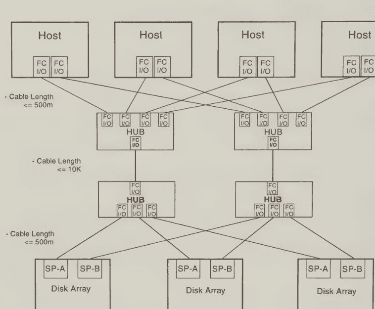

图 5-20 高可用性、距离和容量拓扑

## 5.7.5 园区拓扑

园区拓扑使用了与高可用、距离和容量拓扑相同的硬件。此拓扑的每个实例使用：

- 最多四个主机系统或服务器
- 每个 K 类或 T 类主机两个 FC I/O 适配器

  请咨询您的惠尔-帕克支持代表以获取 D 类服务器每个型号所支持的适配器数量
- 两对级联的 10 端口 HP FC-AL 集线器 (`A3724A`)
- 每个磁盘阵列两个 SP
- 最多九个双 SP 磁盘阵列
- 每个主机与 FC-AL 集线器之间、每个 HP FC-AL 集线器与磁盘阵列之间的每个连接光纤电距离最大为 500 m

高可用性拓扑高可用光通道磁盘阵列

- 最多五个磁盘阵列
- 每个主机与 HP FC-AL 集线器之间、每个 HP FC-AL 集线器与阵列之间的每个连接光纤电距离最大为 500 m，FC-AL 电缆总长度不超过 5000 m

园区拓扑与高可用、距离和容量拓扑几乎相同。区别在于园区拓扑中，半数系统、FC-AL 集线器和磁盘阵列位于一个建筑，而另一半位于另一个站点。

| 主机 | 磁盘阵列 | 位置 |
| :--- | :--- | :--- |
| 主机 1 | 磁盘 1 | 建筑 1 |
| 主机 2 | 磁盘 2 | 建筑 1 |
| 主机 3 | 磁盘 3 | 建筑 1 |
| 主机 4 | 磁盘 4 | 建筑 1 |
| 主机 5 | 磁盘 5 | 建筑 1 |
| 主机 1 | 磁盘 6 | 建筑 2 |
| 主机 2 | 磁盘 7 | 建筑 2 |
| 主机 3 | 磁盘 8 | 建筑 2 |
| 主机 4 | 磁盘 9 | 建筑 2 |

图 5-21 园区拓扑

## 5.8 SCSI 多用器


图 5-22 `A3308` SCSI 多用器

大多数数据中心今天使用 SCSI 技术。外设通过连接到 SCSI 总线适配器的 SCSI 线缆连接到主机系统。然而，要使用 FC 技术，每个系统必须能够“说光通道”。满足这一需求通常意味着昂贵的购买、耗时的数据迁移以及安装兼容 FC 的硬件系统和外设。


惠尔-帕克对此问题的解决方案是光通道 SCSI 多用器 (FC-SCSI mux)。FC-SCSI mux 允许 FC 主使用 FC 技术向 SCSI 设备类型传输数据。使用 FC-SCSI mux，客户可以扩展主机与外设之间的距离，并增加连接到主机的 SCSI 设备数量。

多用器将单个 FC 连接 HBA 的输入和输出复用到多四个 SCSI 总线上。由于每个总线最多支持 15 个设备，理论上一个多用器可以支持 60 个设备（性能各异）。

FC-SCSI mux 允许多个 SCSI 质存储设备参与光通道架构。目前，最多有八个 SCSI ID 可以通过 SCSI 多用器连接并通过单条光通道链路与主机通信。

该设备提供的优势是能够将现有的 SCSI 设备连接到光通道质存储网络。目前支持数字线性带 (DLT) 库，然而在未来的版本中将支持磁盘和其他 SCSI 设备。

### 5.8.1 FC-SCSI mux 拓扑


图 5-23 带有两个 DLT 库的 FC-SCSI mux 拓扑

### 5.9 FC 交换机


图 5-24 惠尔-惠普（Hewlett-Packard）FC 交换机正面。


图 5-25 光纤交换机背面

该交换机允许光纤通道连接到私有环（仲裁环）或光纤通道矩阵（Fabric）。EPL（模拟私有环），也称为 QL（快速环）将在首个版本中提供，并支持安装了适当补丁的 HP-UX 11.0 和 HP-UX 10.20。此模式用于支持此前在现有 HP-UX 11.0 操作系统上支持的旧系统和外围设备。矩阵支持直到发布 HP-UX 11.01 或更高版本后才会可用。

首个版本将支持运行上述 HP-UX 10.20 或 11.0 操作系统的旧系统，例如 K 类、D 类、T 类和 V 类。主机系统将使用现有的 A3404A、A3636A、A3591B 和 A3740A 光纤通道适配器。一旦 HP-UX 11.01 可用，将使用 A5157A 双 Tachyon TL 光纤通道适配器和 A518A 单 Tachyon TL 光纤通道适配器支持 FC 交换机。

这两个新适配器是基于 PCI 的，现在已用于 HP-UX 11.01 上的 V2500 和 4000 SPU 平台。

千兆交换纤交换机提供端口配置（未安装 GBIC 的单元）。可以使用一到四个 GBIC 选项，但必须订购一个。每个 GBIC 选项提供四个 GBIC（千兆接口转换器），可安装在交换机中任何所需的空位置。可以使用短波或长波 GBIC 光学器件。此时最多只能使用一个长波选项。

长波 GBIC 的应用目前非常有限，任何想要使用长波 GBIC 的客户应要求配置协助，以避免不受支持/无法实现的配置，这将损害其作为 SAN（存储区域网络）解决方案的使用能力。千兆光纤通道交换机是非级联产品，这意味着每个主机连接只能使用一台交换机。多个主机可以连接到单个交换机。

连接到单个交换机的主机数量有限制。请参考惠尔-惠普公共网站 www.hp.com 上的《服务器配置指南》。

千兆光纤通道交换机可用于连接 16 台光纤通道设备（咨询《服务器配置指南》了解支持的配置）。设备可以直接连接到交换机（如主机系统或光纤通道外围设备）；也可以通过 FC-AL 集线器（在该特定连接处提供本地环）；或者通过 FC-SCSI 复用器用于磁带或磁盘配置（见《服务器配置指南》）。

每个集线器只能使用一个环连接。每个矩阵端口限制为一个环主。如果使用多个环主（FL 端口），其中一个将保持空闲状态（被浪费），直到原始 FL 端口失效。在首个版本中，光纤通道交换机将仅支持 EMC 磁盘阵列。其他型号的磁盘阵列和其他质存储将在以后支持。下方显示了一个示例。

#### EMC 阵列与 HP FC 交换机允许的最大配置

| S P U | S P U | S P U | S P U | S P U | S P U | S P U | S P U |

|---|---|---|---|---|---|---|---|

| 1 | 2 | 3 | 4 | 5 | 6 | 7 | 8 |


| FC Director #1 | FC Director #2 | FC Director #3 | FC Director #4 | FC Director #1 | FC Director #2 | FC Director #3 | FC Director #4 |

|---|---|---|---|---|---|---|---|

| EMC ARRAY #1 | EMC ARRAY #2 | | | |

图 5-26 FC 交换机配置示例

千兆光纤通道交换机作为多个通道工作，能够提供最多八个并发连接。每个连接都能以全 1 Gigabit 的速度运行。这是一个重大的改进，因为目前的解决方案是单环，其总速度为 1 Gigabit，并在所有连接的设备之间共享。

千兆光纤通道交换机将允许更高的传输率，同时在客户已购买当前的光纤通道解决方案之间提供桥接，并提供到未来提供的能力的链路。千兆光纤通道交换机最初将支持许多配置，但由于支持原因，集群/配置将限制为不超过两台交换机（非级联）。

### FC 交换机

每对交换机也限制最多允许八台主机。这是一种高可用（HA）路径配置，旨在最大化主机和质存储的可用性。详见图 5-26。初始版本将针对旧光纤通道设备和磁盘阵列。其他质存储将在稍后宣布支持。交换机的复杂性变得很快，因此强烈建议不要实施 HP-UX 指南中未指定的配置。惠尔-惠普实验室及其所有合作伙伴将尽快认证 HP-UX 配置。

千兆光纤通道交换机还将利用惠尔-惠普的光纤管理器来提供光纤通道管理。光纤管理器是一个独立产品。

### 5.10 典型的惠尔-惠普光纤通道拓扑


图 5-27 惠尔-惠普质存储拓扑

此拓扑演示了如何连接一个主机，使用一个 I/O 适配器、四个存储设备（例如两个光纤通道磁盘阵列和磁带设备，可能是 DLT 磁带库），通过集线器。

### 典型的惠尔-惠普光纤通道拓扑


图 5-28 惠尔-惠普质存储拓扑

此拓扑演示了使用两个集线器的配置。查看图表，记住长波集线器有一个集线器间端口，剩余九个端口用于设备。此外，尽管有多个磁盘阵列和其他 SCSI 设备以及许多设备连接到集线器，但这并不是高可用配置。在这种特定的拓扑中存在一些单点故障。例如，只有一个光纤适配器。如果它故障，主机将无法与整个存储区域网络（SAN）中的任何设备通信。从适配器到第一个集线器的电也是单点故障。

#### 5.10.1 2000 年问题

所有惠尔-惠普企业存储设备在按照惠尔-惠普标准配置时均符合 2000 年标准。2000 年标准适用于磁盘驱动器、磁盘阵列、磁带驱动器、磁带库、光设备以及光纤通道基础设施产品。除了 Model 12 和 Model 12H 外，惠尔-惠普交付的所有原始版本均符合标准。Model 12 和 12H 具有需要补丁才能符合 2000 年标准的日志程序。最小补丁版本所示。

Model 12 和 Model 12H 符合 2000 年标准的最小操作系统补丁版本：

- HP-UX 10.01, 10.10, 10.20 PHCO_14584
- HP-UX 11.0 PHCO_14585
- NT 4.0 SP3 AutoRAID for NT 版本 1.02

有关特定产品的更多信息，请参阅惠尔-惠普 2000 年网站：`http://hpweb.y2k.nafohq.com`

# 光通道的未来

本章讨论了：

- * 光通道的未来发展与改进
- * 从何获取有关光通道的更多信息

## 6.1 未来增强

光通道正在快速演进，新元素不断被定义。这些新元素将产生更强大的架构，以支持大规模存储。

到目前为止，定义光通道物理标准（FC-PH）的大部分工作已经完成。尽管该领域会有更多工作，但定义标准的大量工作将在 FC-3 和 FC-4 层级完成。

### 6.1.1 前景

#### 6.1.1.1 更快的光纤速率

2+ Gbps 和 4+ Gbps 等更快的光通道速率仍处于理论阶段。然而，一旦实施，它们将极大提高吞吐量。由于惠普将光通道作为其未来技术的一部分，公司正继续生产芯片和其他组件以支持更快速的数据传输。

#### 6.1.1.2 寻道组 (Hunt Groups)

对寻道组及其如何或应该运行提供更多、更好的定义。寻道组可以通过将帧发送到节点上的备用端口来增加吞吐量，消除忙的 N_Port 阻塞通信的可能性。

#### 6.1.1.3 多播组


正如第二章 FC-3 通用服务部分所述，FC-3 层允许将单个信息单元传输到节点上的多个 N_Port。多播组随后可以通过高效地复制要发送到多个 N_Port 的帧来增加吞吐量。这大致等于一个人使用广播语音邮件或电子邮件分发列表。

### 6.1.1.4 服务类别 (Classes of Service)

将添加新的服务类别。它们可能处理语音或视频，在提供新的通信可能性的同时，对架构提出新的需求。

### 6.1.1.5 其他可能的增强

其他增强可能会解决 FC-AL 标准中的问题，或者出现在网络管理改进领域。以下列表包含了一些其他可能的改进：

- 改进的流控制
- 低级错误恢复
- 空间复用 —— 环路上的同时进行多项对话
- 全帧缓冲
- 网络管理
  - 拓扑识别
  - 环路配置更改时拓扑的发现
- 更快的 ULP 错误恢复
- 低成本交换集线器

尽管这些增强可能会到来，但惠普仅致力于目前定义的标准。

## 6.2 关于光通道的更多信息来源

### 6.2.1 出版物

目前有两种介绍光通道的主要出版物。

- 1. FIBRE CHANNEL: Connection to the Future

Fibre Channel Association 

12407 MoPac Expressway North 100-257

P.O. Box 9700

Austin, Texas 78766-8422

- 2. What is FIBRE CHANNEL

Ancot Corporation

115 Constitution Drive

Menlo Park, CA 94025

### 6.2.2 世界维网

- 可以在以下网站找到更多信息。
- `http://www.x3.org`
- `http://www.amdahl.com/ext/CARP/FCA`
- `http://www.skipestone.com`
- `http://www.ssaia.org`

（这些网站每个都有指向更多关联网站的链接。）

## 术语表

`适配器 (Adapter)` 一种印刷电路组件，用于在主机系统的内部总线与外部光通道链路之间反之传输用户数据（I/O）。也称为 I/O 适配器、主机适配器或 FC 适配器。

`地址 (Address)` 外围设备、节点或网络位置中其他单元组件的逻辑位置。指定特定网络位置的格式化数字。参见 `SCSI 寻址`。

`仲裁环路 (Arbitrated Loop)` 参见光通道仲裁环路。

`区域 (Area)` N_Port 标识符的第二个字节。

`衰减 (Attenuation)` 发射功率与接收功率之间的差异（损失），这是由于通过设备线路或其他通信设备的传输损耗造成的。

`带宽 (Bandwidth)` 可通过给定电路的频率范围。通常情况下，带宽越大，在给定时间内通过电路发送的信息就越多。

`波特率 (Baud)` 每秒编码比特率。衡量传输速度的单位。

`总线 (Bus)` 一种在模块与适配器之间或适配器与 SCSI 设备之间传输数据的方法。对于 SCSI 总线定义，请参见 `SCSI 总线`。

`级联 FC-AL 集线器 (Cascaded FC-AL Hubs)` 将一个 FC-AL 集线器连接到另一个 FC-AL 集线器以增加仲裁环路距离。级联集线器允许集线器之间的距离达 10 公里，或集线器与设备之间的距离可达 500 米。

`服务类别 (Class of Service)` 光通道拓扑提供并供通信端口使用的的服务类型。

`域 (Domain)` FC 设备 N_Port 标识符中的最高位字节。它不用于 FC-SCSI 硬件路径 ID。对于逻辑上连接到 FC 适配器的所有 SCSI 目标，该值必须是相同的。

`织 (Fabric)` 光通道术语，用于描述交叉交换网络，它是三种现有的光通道拓扑之一。织由一个或多个织元素组成，其中交换机负责帧的路由。织的结构对于连接到它的设备是透明的，并减轻了它们负责站管理的责任。

`FC-AL` 参见光通道仲裁环路 (FC-AL)。

`FC-AL 设备 (FC-AL device)` 使用光通道仲裁环路的设备，由一个或多个 NL_Port 组成。

`FC-AL 端口 (FC-AL Port)` FC-AL 集线器上的端口，提供 FC-AL 适配器与 FC-AL 链路之间的连接。

`FC-SCSI 硬件路径 ID (FC-SCSI Hardware Path ID)` 显示从主机到目标设备的物理硬件路径的数值列表。

```
格式:
Bus_Converter/Adapter_Address.Protocol_Type.Area.
Port.Bus.Target.LUN
示例: 8/4.8.0.0.2.4
```

`光纤 (Fiber)` 参见光纤电缆。

# 光纤 (Fiber Optics) 一种使用光作为信息载体的技术。光纤电缆是传统同轴电缆和线对的直接替代品。基于玻璃的传输设施在同传输容量下占据更小的体积，且光纤对电干扰免疫。

# 光 (Fibre) 通用光通道术语，用于涵盖光通道物理层标准（FC-PH）指定的所有介质，包括光纤、铜双绞和铜同轴电缆。

# 光纤电缆 (Fibre Optic Cable) 由细绝缘材料（如玻璃）丝制成的光纤电缆，数据以脉冲形式在其中传输。

# 光通道 (Fibre Channel) 逻辑上，光通道是一种用于高性能的双向、全双工、点对点串行通道。物理上，光通道通过交换机（端口连接设备（如主机系统和磁盘阵），采用三种拓扑之一：点对点、仲裁环路或交叉交换网络（织）。FC 可以传输任何现有协议（如 SCSI），速度为 100 MB/s（全速）、50 MB/s（半速）、25 MB/s（四分之一速）或 12.5 MB/s（八分之一速），铜缆距离为 100 米，光链路为 10 公里。

# 光通道仲裁环路 (Fibre Channel Arbitrated Loop, FC-AL) 三种现有光通道拓扑之一，二到 126 个端口串行连接在单个环路上。FC-AL 的访问由仲裁方案控制。FC-AL 拓扑支持所有服务类别，并在源点和响应者位于同一 FC-AL 时保证帧有序。磁盘阵的默认拓扑是仲裁环路。

# 光通道仲裁环路集线器 (Fibre Channel Arbitrated Loop Hub) 一种全双工、1.063 Gb 的智能集线器，用于 FC-AL 拓扑以增加环路可靠性、连接数量以及主机系统与磁盘阵之间的距离。每个 FC-AL 集线器最多可连接十个设备。

# 用于 SCSI 光通道协议 (Fibre Channel Protocol for SCSI, FCP) FCP 定义了一种高层光通道映射层（FC-4），它利用低级光通道（FC-PH）服务通过 FC 链路在 SCSI 起器和 SCSI 目标之间传输 SCSI 命令、数据和状态信息，使用 FC 帧和序列格式。

# 帧 (Frame) 光通道应用数据传输的最小、不可分单元。帧的大小取决于硬件实现，与应用程序无关。帧以 4 字节的帧起始（SOF）开始，以 4 字节的帧尾（EOF）结束，包含 24 字节帧头和一个 4 字节循环冗余校验（CRC），并携带从 0 到 2112 字节的可变数据负载，其中前 64 字节可用于可选头。

## 术语表

`千兆链路模块 (GLM)` 一种管理 FC-0 层功能的物理组件，这些功能包括介质和接口的物理特性，如驱动器、收发器、连接器和电缆。也称为物理链路模块 (PLM)。

`主机` 在外围设备的范围内，是指使用磁盘阵列进行数据存储和检索并运行操作系统的处理器。

`集线器 (Hub)` 用于连接网络中多个节点的中继器。集线器是数据集中点，并将数据从一个节点中到所有其他连接节点。

`LED` 发光二极管。

`发光二极管` 设备上的小灯，通常用于提供状态信息。

`链路 (Link)` 在光纤通道中，是指两条相反方向传输的双向光纤以及相关的发射器和接收器，作为拓扑结构中节点之间的通信介质。类似于 SCSI 协议中的总线。

`长波激光器或波长约为 1300 nm 的 LED。` 长波激光器用于长度从约 700 米到 10,000 米不等的远距离光纤通道链路。它们通常与 9 微米芯径的单模光纤配合使用。

`环地址 (Loop Address)` 光纤通道环形拓扑中节点的唯一 ID，有时称为 Loop ID。

`环端口 (L_Port)` 支持与仲裁环相关的仲裁环功能的 N_Port 或 F_Port。

`N_Port` “节点”端口。一种由光纤通道定义的硬件实体，在光纤通道链路上执行数据通信。它可以通过唯一的全球名称 (Worldwide Name) 进行识别。它可以作为起始者 (Originator) 或响应者 (Responder)。

# 端口标识符 (Port Identifier)

用于唯一标识 N_Port 的唯一地址标识符。它由域（Domain，最高位字节）、区域（Area）和端口（Port）组成，每个长度 1 字节。N_Port 标识符用于光纤帧中的源标识符 (S_ID) 和目的标识符 (D_ID) 字段。

# 节点 (Node)

允许在网络内传输数据的物理设备。

# 起始者 (Originator)


负责启动和交换的光纤通道 `N_Port`。光纤通道中 `SCSI` 初始化器 (`initiator`) 的术语。

# 点对点 (Point-to-point)

现有光纤通道拓扑结构之一，其中两个设备通过链路直接连接，不存在矩阵（fabric）、环（loop）或交换元件。

# 端口 (Port)

将设备连接到光纤通道拓扑的硬件实体。设备可以包含一个或多个端口。

# 协议 (Protocol)

管理数据网络上交换消息的格式、定时、排序和错误控制的正式规则集；也可能包括管理通信链路和/或冲突解决的机制。协议可以面向跨接口的数据传输、跨两个直接连接的逻辑单元的数据传输，或者跨大型复杂网络中两个用户之间的端到端数据传输。硬件协议和软件协议均可定义。

# RAID

独立磁盘冗余阵列。将多个磁盘模块配置为逻辑磁盘单元的方法，该单元在主机系统中表现为单个、连续的磁盘模块。

# RAID-0

三个或多个磁盘模块绑定为条带化磁盘（磁盘阵列一次通过多个磁盘读取和写写文件信息）。`RAID-0` 通过对不同模块进行同步 I/O 来提高性能，但其本身不提供高可用性。对于高可用性，可以使用软件镜像对条带化磁盘进行镜像。`RAID-0` 不受支持，只能在 `FE` 模式下访问。

## 术语表

# RAID-1 偶数个镜像磁盘模块。

`RAID-1/0` 一种 `RAID` 配置，其中四、六、八、十、十二、十四或十六个磁盘模块绑定为镜像 `RAID-0` 组。磁盘模块进行镜像处理，使得一半磁盘模块包含用户数据，另一半包含用户数据的逐磁盘拷贝。`RAID-1/0` 组结合了 `RAID-0` 的速度优势和镜像的冗余优势。

`RAID-3` 惠普高可用光纤通道磁盘阵列中的 `RAID-3` 组必须恰由五个磁盘模块组成，每个模块位于独立的内部 `SCSI-2` 总线上。`RAID-3` 使用磁盘条带和专用校验盘，但不使用硬件镜像。

`RAID-5` 一种 `RAID` 配置，其中三个到十六个磁盘模块使用磁盘条带化，通过分布在每个磁盘模块上的校验信息提供高可用性。`RAID-5` 的理想磁盘模块数量是五个。

响应者 (`Responder`) `N_Port` 中负责支持由另一个 `N_Port` 中的起始者发起的交换的逻辑功能。光纤通道中 `SCSI` 目标 (`target`) 的术语。

`SCSI` 小型计算机系统接口。一种用于将外围设备及其控制器连接到处理器的行业标准。

`SCSI` 寻址 快速/宽 `SCSI` 适配器支持最多 16 个设备（包括自身）。每个设备都有自己唯一的 `SCSI` 地址。设备的 `SCSI` 地址决定了设备在仲裁 `SCSI` 总线时的优先级。`SCSI` 地址“7”优先级最高。次高优先级地址是“6”，其后是 5, 4, 3, 2, 1, 0, 15, 14, 13, 12, 11, 10, 9, 8，其中“8”是最低优先级地址。快速/宽 `SCSI` 适配器的出厂设置地址为“7”。

窄 `SCSI` 适配器支持最多八个设备（包括自身）。`SCSI` 地址“7”优先级最高，其后是 6, 5, 4, 3, 2, 1 和 0。

# SCSI 端口

`SCSI` `MUX` 背部的一个开口，用于提供 `SCSI` 适配器和 `SCSI` 总线之间的连接。

# 短波

波长约为 1300 nm 的激光器或 `LED`。长波激光器用于从约 700 米到 10,000 米不等的距离光纤通道链路。它们通常与 9 微米芯径的单模光纤配合使用。

# 存储控制处理器 (SP)

带有内存的电路板，用于控制阵列、绑定和解绑逻辑单元、观察状态和事件日志。

# 拓扑结构 (Topology)

网络中设备的物理布局。光纤通道拓扑结构包括矩阵（fabric）、环（loop）和点对点。

`CLS` 43, 47

同轴电缆 19

通用服务 30

通用服务 13

配置 89

连接性或扩展性 60

连接器 18

控制器 `IC` 74

铜质电缆 19

`CRC` 23, 27, 28

当前质存储架构 2

循环冗余校验 33

# D

数据报服务 33

`DB9` 19

专用连接服务 32 设备

寻址 89

安装准备工作 88

磁盘阵列 92

磁盘阵列拓扑

基础 93

校园拓扑 102, 104

距离拓扑 97

双存储器 95

四个阵列 96

适用于距离和容量的高可用性 102

高可用性 99

差异 24, 41

距离 5

距离 19, 51

`DLT` 库 107

`D` 型 19

# E

电磁干扰

编码/解码 13

编码/解码 22

`EOF` 26, 28

交换 27

# F

`F_Port` 10

交换 10

交换 38

交换拓扑 10

`FC` 光纤机 108

`FC-0` 14, 15, 17, 18

`FC-0` 层 13

`FC-1` 15, 22

`FC-1` 层 13

`FC-2` 15

`FC-2` 层 13

`FC-3` 15, 30

`FC-3` 层 13

`FC-4` 15, 31, 32

`FC-4` 层 13

`FCA` 82, 84

`FC-AL` 9, 10, 22, 35, 45, 49, 86

索引 131

- `FC-AL` 特性 36

光纤通道协议 13

- `FC-AL` 集线器 97

- `FL_Port` 10, 38

- `FC-Al` 集线器 73

- 流控 13

- `FC-AL` 私有环路 36

帧锚定 4

- `FCP` 14, 54, 57

- `FCP` `LUN` 标识 58

- 帧分隔符 26

- `FC-SCSI` 复用器 62, 65, 106

- 帧头结构 78

- `FDDI` 22

- 帧长度 28

光电缆组件 20

- 光纤电缆 19

- 帧结构 27

- 帧 27

光纤通道 3, 5, 6, 15

- 帧封装协议 27

- 帧封装协议 13

- `D` 类系统 84

- `K` 类系统 82

- 功能级 14

- `T` 类系统 83

- 未来发展 115

- `V` 系统 85

- 未来增强 116

光纤通道适配器 73

`G`

光纤通道寻址 58

千兆链路模块 79

千兆速度 4

`GLM` 79

光纤通道仲裁环

- 环集线器 86

`H`

光纤通道控制器 74

硬地址 70

光纤通道磁盘阵列 92

硬件路径 58

硬件路径 53

用于存储的光纤通道 5

用于网络的光纤通道 4

`HBA` 14, 36, 59

光纤通道封装 17

惠普的光纤通道芯片 73

光纤通道功能级 13

光纤通道未来 115

5

光纤通道产品 73

`HEX` 24, 60, 62

光纤通道协议 14, 57

高可用性 92

高可用光纤通道磁盘阵列 73, 92

光纤通道如何解决这些局限性 1

`HPFC-5100` 75, 76

`HP-UX` 54, 57, 63, 66

集线器 86

集线器功能 86

集线器拓扑 88

集线器 35, 49

寻呼组 30

# I

`I/O` 协议 5

空闲状态 43

`IEEE 802.2` 5, 16

信息单元 32

设备准备安装 88

`ioscan` 62

`IP` 5

`IPI` 5, 16, 32

`IU` 32

# K

`K28.5` 特殊字符 24

# L

`LAN` 38

`LCF` 18

光传输 21

当前质存储架构的局限性 1

距离限制 2

数量限制 2

速度限制 2

链路 7

链路控制设施 18

`LIP` 41

局域网 38

逻辑单元寻址 62

逻辑单元寻址 53, 57

长波 22

长波 86

长波集线器 87

环路 9, 36

重复地址 89

环路地址 68

环路寻址 59, 62

环路配置 37, 89

环路 `ID` 62

环路 `ID` 89

环路初始化 41

环路主设备 36

环路端口旁路 41

环路端口启用 41

环路状态 42

环路状态与操作 35

`LPB` 41

`LPE` 41

`LUN` 空间 55

`LUN` 开放状态 63

# M

映射 31

质存储 55

寻址方法 53

更多信息 115

多播 30

连接器 19

复用器 66

复用器拓扑 107

# N

`N_Port` 33

字节转换

网络协议

`NL_Port` 7, 10, 49

`NL_Ports` 30

# O

开放光纤通道 22

开放环路 46

质 5

开放状态 26

源端 61

光纤通道概述 1

数据包 32

封装集 27

被动集线器 49

23

屏蔽双绞线 19

单模连接器 19

`SOF` 26, 28

解决方案 73

速度 89

存储网络 7

# Q

四分之一速度 4

快速环路 108

# R

接收器 8, 9

冗余环路 101

报告 `LUN` 命令 63

响应者 6

`RX` 7

条带同步 26

# S

`SAN` 114

`SCSI` 3, 5, 16, 31, 32

`SCSI` 地址

`SCSI` 局限性

`SCSI` 复用器 73, 106

`SCSI-3` 5

`ID`

目标地址空间 94

仲裁过程 44

监控状态 43

开放状态 45

物理层 17

传输层 22

拓扑 7, 35, 50

传输字 25

传输器 8

双节点环路 9

环路类型 35

# U

`ULP` 15, 30

`ULPs` 32

高级别 31

高级别协议 13, 15, 32

卷集地址 68


卷集寻址 53, 57

# W

波长 22

波长 89

广域网 38

## Prentice Hall: 专业参考

| 返回 | 首页 | 图片 | 开放 | 查找 | 停止 |
| 网络搜索 | 人员 | 软件 | 今日的解决方案。 |
| 日期 | 截止 |
|------|-----

# 网络光纤通道：下一代标准

# 用于存储的光纤通道

Ralph H. Thornburgh

通过光纤通道，您可以轻松将存储系统从 GB 扩展到 TB，并同时提高性能，而不会影响系统、网络或应用程序。《用于存储的光纤通道》逐步介绍了光纤通道的基础，并演示了如何部署惠普的光纤通道产品来解决您的企业挑战。内容包括：

- 为什么光纤通道成为企业存储技术的选择
- 光纤通道架构及其六功能级
- 光纤通道仲裁环 `FC-AL` —— 极其有效的存储系统拓扑
- 外围设备、逻辑单元和卷集寻址
- 将光纤通道集成到 `HP-UX` 的技术

《用于存储的光纤通道》介绍了惠普先进的光纤通道产品家族，其中包括首个完全集成在单芯片上的光纤控制器 `Fusion®`。介绍了适用于 K 类、T 类、D 类和 V 类企业服务器及并行集群的光纤通道适配器；集线器、磁盘阵列、SCSI 复用器等。最后，展望了光纤通道的未来：更快的速率、寻呼、多播组、服务类别等等。

无论您是在实施光纤、规划还是需要了解它，本书都能提供您所需的答案。

## 关于作者

RALPH H. THORNBOUGH 是惠普公司的学习产品工程师。最近，他领导了编写质存储光纤通道培训课程的团队。
