# Flash ActionScript：创建 Flash 增强网站的视觉化蓝图


作者：Denise Etheridge


`marginGraphics` 是一家位于加拿大多伦多附近的家族企业。


在 `marginGraphics`，我们相信制作出色的计算机书籍——一次一本。`marginGraphics` 生产高科技产品已超过 25 年，我们认为这使我们能够为计算机社区提供独特的沟通流程。我们的计算机书籍采用集成流程，这与其他书籍非常不同。每一页截图都融入了文字和实用的提示，增强了学习体验。此外，我们对书籍的手工制作感到非常自豪。我们精心挑选的作者是领域专家，花费了大量时间研究和组织每个主题的内容。我们的艺术家重建了每一个截图以提供最佳清晰度，使我们的截图成为行业中最易读的。

感谢购买本书。希望您喜欢！

诚意地，

Robert Maran

总裁

`marginGraphics`

`Rob@maran.com`

`maran.com`

# 鸣谢

| 采购、编辑与媒体开发 | 制作 |
| :--- | :--- |
| 项目编辑 | 图书设计 |
| Jade L. Williams | `marginGraphics®` |
| 采购编辑 | 制作协调员 |
| 产品开发主管 | Maranee Harris |
| Lindsay Sandman | 排版与图形 |
| 开发编辑 | Leandra Johnson |
| Kathleen McFadden | Kristin McMillan |
| 技术编辑 | J Piccetti / 屏幕艺术家 |
| Kyle D. Bowen | 封面插图 |
| 许可编辑 | David E. Gregory |
| Laura Carpenter | 校对员 |
| Laura Moss | Laura L. Bowman, Susan Moritz, Carl Pierre, Marianne Santy |
| 媒体开发专家 | 索引 |
| Megan Decreane | Sherry Massey / 特别帮助 / Macromedia, Inc., Malinda McCain |

Hungry Minds 技术出版集团：Bob Ipsen，总裁兼总出版监；Richard Swadle，总裁兼执行集团出版监；Barry Bednare，总裁兼出版监（网络类）；Joseph Wikert，副总裁兼出版监（网页开发组）；Mary C. Corder，Dummies 技术编辑总监；Andy Cummings，Dummies 技术编辑总监；Barry Pruett，副兼出版监（视觉/图形设计）

Hungry Minds 制造部：Ivor Parker，副总裁，制造部

Hungry Minds 营销部：John Helmus，助理副总裁，营销总监

Hungry Minds 品牌出版制作：Debbie Stacey，制作总监

Hungry Minds 销售部：Michael Violano，国际销售与分销权副总裁

# 关于作者

Denise Etheridge：Denise Etheridge 是 BayCon Group Incorporated 的总裁，这是一家专门软件安装、实施和培训的咨询公司。BayCon Group 网站提供在线软件教程。您可以访问 `http://www.baycongroup.com/flash/00_flash.htm` 查看 Flash 教程。

# 作者致谢

我要感谢所有在本书开发期间向我提供帮助或支持的人。感谢 Neil Salkind 和 Jennifer Dorsey 为我提供机会并在一路上一直鼓励我。感谢 Jade Williams 的编辑和项目管理。此外，感谢 John Wiley 公司所有协助 Jade 的编辑和工作人员。

我要特别感谢 David Gregory 协助美术工作，并感谢 Malinda McCain 在此项目以及许多其他项目中提供的帮助。

此书献给 Frederick、Catherine、Freddie 和 Erskine Etheridge。

- 使用电影剪辑对象 ........................................................ 146
- 获取边界 (`Bounds`) ................................................................................. 152
- 使用鼠标对象和属性 .......................................... 180
- 创建旋转效果 ............................................................ 254

## 附录

# 如何使用本书

《Flash ActionScript：创建 Flash 增强型网站的视觉蓝图》通过简单直观的示例教你如何创建强大且动态的网站。书中的编码风格和示例仅用于教学目的。一旦你熟悉了操作 Flash ActionScript，就可以使用适合你需求的编码方法。

为了充分利用本书，你应该从头到尾顺序阅读每一章。每一章都引入了新概念，并在之前章节学的知识基础上进行构建。一旦你熟悉了 Flash ActionScript，这本书就可以作为交互式桌面参考书。

## **粗体**

表示你可能输入的内容。

## *斜体*

表示正在引入的新术语。

## 尝试一下 (`Apply It`)

“尝试一下”部分通常包含一段代码，使你刚刚学到的课程更进一步。“尝试一下”部分还提供了内部信息和提示，可用于增强你代码的功能。

## 额外 (`Extra`)

“额外”部分提供了关于你刚刚完成的任务的补充信息。“额外”部分通常包含有趣的技巧和窍门，让操作 Flash ActionScript 变得更容易更高效。

## 本书对象

如果你正在寻找一种能够帮助你学习 ActionScript 的资源，那么《Flash ActionScript：创建 Flash 增强型网站的视觉蓝图》正是你需要的。本书将引导你完成启动并熟悉操作 ActionScript 基础知识的任务。

不需要 ActionScript 经验，但熟悉 Flash 是至重要的。

具有编程语言经验也是一种优势，即使你没有编程经验，也可以通过此书学习操作 Flash 所需的基础知识。

## 使用本书所需的条件

书中的任务是针对 `Windows 98` 和 `NT` 的 `Flash 5` 开发的。要完成书中的任务，你的电脑需要安装 `Flash 5` 和 `Flash Player`。你还应该拥有带有 `Internet Explorer` 或 `Netscape` 的 浏览器。

## 本书中的规范

在《Flash ActionScript：创建 Flash 增强型网站的视觉蓝图》中使用了多种排版和布局样式，以区分不同类型的信息。

## `Courier` 字体

表示使用 ActionScript。

## `Flash!Script:` 

你创建 Flash 增强型网站的蓝图。

从用户处收集信息、记录用户的操作、将值更改为电影剪（`movie clips`），或评估条件是真为假。字符串是包含任何字母、数字或标点符号组合的字符序列。`ActionString` 具有多种允许你操作字符串的方法。本章将解释变量和字符串，并带你逐步了解变量和字符串。

Flash 电影中的电影剪（`movie clip`）。事实上，多个电影剪符号的实例可以嵌套在一起。本章将带你逐步了解与时间轴（`Timelines`）配合的示例剪。

第 11 章“创建智能剪”将教你如何创建智能剪。智能剪是一种可以在不使用编辑器的情况下重新编程的电影剪。本章将教没有动画能力的人如何编写 ActionScript。

第 5 章“使用运算符”解释了运算符，并带你逐步了解使用运算符的示例脚本。运算符用于指定如何在表达式中比较、乘法或除法一个值。例如，`+` 运算符可以用于相加两个数字；减号 `-` 运算符可以用于减去两个数字。

第 12 章“使用创意技巧”通过结合对象并演示你在创建 Flash 电影时可以使用的技巧，整合了 ActionScript 的所有基础知识。

第 6 章“控制流”带你逐步了解允许你控制脚本流的动作。在 ActionScript 中，除非你控制脚本流，否则语句可以从上到下移动执行。

第 13 章“调试 ActionScript”是关于调试 ActionScript 的。包含 ActionScript 的 Flash 电影可能会变得复杂。Flash 提供了可以帮助你排除电影故障的工具。


最后一章“Flash ActionScript 参考”包含了有用的参考资料表格和命令总结。

第 7 章“使用电影剪和数组”引入了电影剪辑（`Movie Clip`）对象，它是 ActionScript 中最重要的对象。每个电影剪都有自己的时间轴，剪辑使变量结合，并且在你需要存储和检索数据列表时非常有用。Action 数组（`Action Array`）具有多种允许你操作它们的方法。

## 随光盘中包含的内容

书后附的 CD 光盘包含了两个双页课程的示例代码，以及 If 部分的代码。它向你展示如何使用这些代码，并帮助刚开始 Flash ActionScript 程序的你。该 CD 光盘还包含程序的展示和评估，可以帮助你处理 ActionScript。本书也可以在此获取：

第 8 章“使用对象”带你逐步了解使用对象的 ActionScript 示例，你可以使用它们操作符号和数据。例如，`Math` 对象用于处理数字。你可以使用 `Math` 对象对数字进行四舍五入。`Color` 对象用于处理颜色。你使用 `Color` 对象的方法来更改电影剪的颜色。

第 1 章概述了如何创建文本、文本框、动态文本框和电影剪。由于本章还涵盖了认识 Flash（Know Flash），因此示例中使用的所有文本、文本框和电影剪都已为你创建完成。

第 9 章“揭秘函数”将教你如何创建自定义函数。函数是 ActionScript 的代码块。你可以向函数传递值并获取值。例如，你可以使用函数来获取 Flash Player 的版本。本章解释了函数，并带你逐步了解使用函数的示例脚本。

示例文件均具有 `FLA` 扩展名。将文件复制到你选择的目录，点击 Flash 菜单上的“`Files: Open`”来打开。

第 10 章“使用多个时间轴”解释了如何在单部电影中使用多个时间轴。你可以布局 Flash 电影的序列。电影剪有自己的时间轴和自己的所有权。你可以嵌入一个

## FLASH 和 ACTIONSCRIPT 导论

Flash 是一种图形和动画软件，允许 Web 开发人员设计和交付低带宽的动画和演示文稿。通过 Flash，你可以创建既有动作又有声音的交互式网页。本书是关于

ActionScript 的，这是一种允许你为 Flash 电影添加交互性的脚本语言。通过 ActionScript，你可以让你的 Flash 电影响应鼠标点击和键盘，请求用户信息，并让你的 Flash 电影对提供的信息做出响应。

## FLASH 界面

当你打开 Flash 时，会出现此处所示屏幕：

### 层 (LAYER)

层是透明的片，你可以透过层看到下方的层，直到为它上色。你在这些层上创建要在电影中使用的图形和动画。

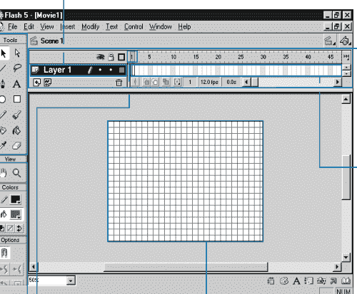

### 工具箱 (TOOLBOX)

工具箱为你提供了允许你在执行舞台（Stage）上选择对象、绘制图形以及创建文本框的工具。使用工具箱创建和修改图形及文本。

### 时间轴 (TIMELINE)

时间轴允许你布局电影的序列。时间轴包括帧、层和播放。

### 修饰器 (MODIFIERS)

一旦你选择了一个工具，修饰器允许你更改描边颜色、填充颜色和工具效果。使用修饰器设置工具效果。

你将组成电影的单个图像存储在帧中。播放通过移动连续的帧来显示每一帧的内容。

### 帧 (FRAMES)

### 播放头 (PLAYHEAD)

### 舞台 (STAGE)

当播放头横跨时间轴移动时，Flash 在舞台上显示每帧中的图像。你通过更改连续帧中的图像来创建动效。

你可以创建或导入图形。使用舞台来创建你的电影。

## 熟悉 FLASH

### 创建场景 (CREATE A SCENE)

使用场景（`scenes`）允许你将电影拆分为不同的部分。例如，你可以拥有一个显示电影标题的场景、一个播放电影的场景，以及一个列出角色的最终场景。每个场景都有自己的时间轴，并可以包含自己的动画。

要创建一个场景，从菜单中点击“`场景（Scene）`”。会出现新的舞台和时间轴，你可以在其中创建场景。默认情况下，Flash 通过分配顺序数字来命名场景，例如 `Scene 1` 和 `Scene 2`。你可以使用场景面板（`Scene panel`）添加、删除、复制、重命名和更改场景的顺序。要打开场景面板，从菜单中点击“`面板（Panels）`”。

### 场景面板 (SCENE PANEL)

要创建一个场景，从菜单中点击“`视图（View Goto）`”，然后选择你想去的场景。

### 更改场景顺序 (CHANGE THE ORDER OF A SCENE)

要更改场景的顺序，点击场景名称将其拖动到新位置。

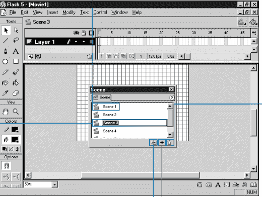

### 重命名场景 (RENAME SCENE)

要重命名场景，双击场景名称并输入新名称。

### 删除场景 (DELETE A SCENE)

要移除场景，点击场景名称选择它，然后点击“`删除场景（Delete Scene）`”。

### 复制场景 (DUPLICATE A SCENE)

要复制场景，点击“`复制场景（Duplicate Scene）`”。

### 添加场景 (ADD A SCENE)

要添加场景，点击“`添加场景（Add Scene）`”。

## 创建层 (CREATE LAYERS)

在创建 Flash 电影时，将单个图像和动画放在单独的层上以防止它们相互连接、擦除或分割。也为声音、帧和标签使用单独层。层是透明片，你在其上创建图形和动画，在为它上色之前可以隐藏每一层。

+   1 一个新层出现在活动层上方。
+   2 双击并输入更改层。
+   3 点击“显示/隐藏所有层”列来切换层的显示或隐藏状态。
+   4 点击“锁定/解锁所有层”列来切换锁定或解锁状态。
+   5 点击“显示层”列来在“显示正常（ )）”和“显示轮廓（□）”之间切换。
-   铅笔图标表示此为活动图层。

## FLASH ACTIONSCRIPT

## 创建图形

Flash 为你提供了几种可以创建或修改图形的工具。使用线条工具创建直线，使用椭圆工具创建圆和椭圆，使用矩形工具创建正方形和矩形。使用油漆桶和画笔工具为图像添加颜色。

钢笔工具让你具有绘制直线和光滑曲线的能力。使用选择工具选择不带线条的对象。描边（Strokes）是图形的轮廓。使用墨水瓶工具更改描边颜色、宽度或样式。Flash 填充图形颜色。使用吸管工具从一个对象复制并填充到另一个对象。橡皮擦赋予你擦除的能力。

你可以使用箭头工具和套索工具选择 Flash 舞台（Stage）上的对象。你可以对对象进行分组、移动、复制或选择。分组允许你将多个对象作为一个单个对象进行操作。当你想要为按钮或电影剪辑关联 ActionScript 时，使用箭头工具选择按钮或电影剪辑。

Flash 有一些修饰符来设置工具选项。颜色框允许你设置与所选区域相关的描边和填充颜色。你可以更改描边和填充的颜色，或将颜色设置为默认颜色。箭头工具为你提供了平滑、拉直和旋转对象的选项。矩形工具提供了圆角选项。你可以更改画笔的大小和形状。橡皮擦提供了几种方法和一个快捷键，让你能够擦除所选区域。使用铅笔时，你可以选择绘制直线、光滑线条或自由形式线条。

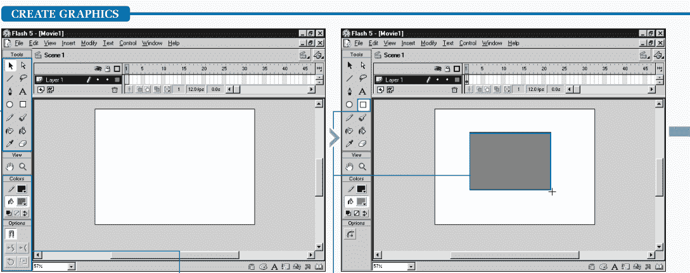

-   1 点击选择一种工具。
-   2 点击选择修饰符。
-   3 移动到舞台并拖动创建形状。
-   你可以在拖动时按住 Shift 键创建正方形或圆形。
-   你可以使用矩形工具创建矩形，使用椭圆工具创建椭圆，使用线条创建直线，使用画笔工具绘制，使用铅笔工具绘制自由形式线条，或者使用橡皮擦工具擦除。

## 熟悉 FLASH

## 额外

要隐藏工具箱（Toolbox），请从菜单点击 `Windows ⌥ Tools`。要重新显示工具箱，再次点击 `Window ⌥ Tools`。

使用手工具（Hand tool）移动舞台。使用缩放工具（Zoom tool）放大舞台。你也可以点击 `View ⌥ Zoom In` 放大舞台，或点击 `View ⌥ Zoom Out` 缩小舞台。要更改放大率，点击 `View ⌥ Magnification` 并选择一个放大级别。

你可以点击 `Windows ▤ Panels ⌥ Fill` 打开填充面板。填充面板允许你选择颜色、渐变或位图填充。你可以创建自己的渐变。你可以点击库中的任何位图将其作为位图填充。你可以点击 `Windows ▤ Panels ⌥ Stroke` 选择描边颜色、样式或线宽。点击 `Windows ▤ Panels ⌥ Mixer` 允许你创建颜色。

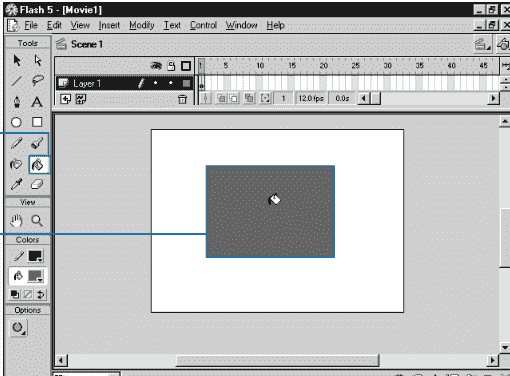

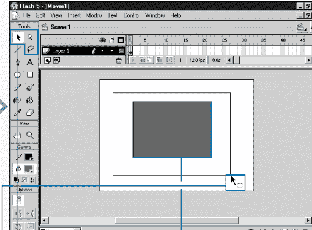

-   如果你选择了墨水瓶 (⌥)、油漆桶 (⌥) 或吸管工具 (⌥)，移动到舞台并点击鼠标。
-   你可以点击描边线并通过 ⌥ 更改描边颜色，通过 ⌥ 更改填充，或通过 ⌥ 设置描边或填充颜色。
-   点击选择套索工具或箭头工具。
-   指针将变为代表你所选工具的图标。
-   移动到舞台并拖动鼠标选择一个对象。
-   使用 ⌥ 在所选区域周围画一个矩形。


- 使用 ⌥ 绘制你想要的箭头。

## 创建符号

创建和使用符号允许你在电影之间共享图形、电影剪辑、按钮和声音。符号是可重用的图形、按钮、剪辑或声音。每个 Flash 都有一个库（Library），用于存储符号。当你创建一个符号时，它会自动成为库的一部分。

图形是静态图像。你可以将图形放在电影的时间轴（Timeline）上，但不能向它们上附加 ActionScript。

按钮是响应用户操作的交互式图形。你使用 ActionScript 提供当用户点击、指针悬停在按钮上或在按钮上执行某些其他操作时如何响应的指令。

电影剪辑（Movie clips）是具有自己时间轴的可重用动画。你可以将电影剪辑放在时间轴上以创建动画按钮。你使用 ActionScript 给 Flash 提供指令，当用户点击、指针悬停在电影剪辑上或在电影剪辑上执行某些其他操作时如何响应。

符号可以加快电影的播放，因为符号允许你在电影之间共享图形、电影剪辑、按钮和声音，而无需多次下载它们。你可以设置永久库并使用它们。你可以建立永久库并使用它们。符号允许你在电影之间共享图形、电影剪辑、按钮和声音，而无需多次下载它们。当你创建一个符号时，它会自动成为库的一部分。符号是可重用的图形、按钮、剪辑或声音。

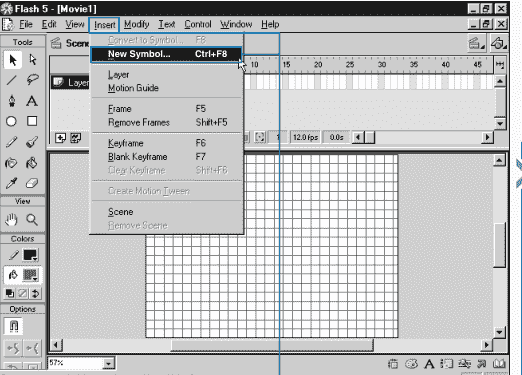

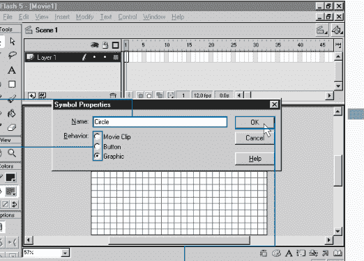

- 如果你选择了墨水瓶（⌥）、油漆桶（⌥）或吸管工具（⌥），移动到舞台并点击鼠标。
- 你可以点击描边线并通过 ⌥ 更改描边颜色，通过 ⌥ 更改填充，或通过 ⌥ 设置描边或填充颜色。
- 点击选择套索工具或箭头工具。
- 指针将变为代表你所选工具的图标。
- 移动到舞台并拖动鼠标选择一个对象。
- 使用 ⌥ 在所选区域周围画一个矩形。
- 使用 ⌥ 绘制你想要的箭头。

### 创建一个符号

图形是静态图像。你可以将图形放在电影的时间轴上，但不能向它们上附加 ActionScript。

按钮是响应用户操作的交互式图形。你使用 ActionScript 提供当用户点击、指针悬停在按钮上或在按钮上执行某些其他操作时如何响应的指令。

电影剪辑（Movie clips）是具有自己时间轴的可重用动画。你可以将电影剪辑放在时间轴上以创建动画按钮。你使用 ActionScript 给 Flash 提供指令，当用户点击、指针悬停在电影剪辑上或在电影剪辑上执行某些其他操作时如何响应。

符号可以加快电影的播放，因为符号允许你在电影之间共享图形、电影剪辑、按钮和声音，而无需多次下载它们。你可以设置永久库并使用它们。你可以建立永久库并使用它们。符号允许你在电影之间共享图形、电影剪辑、按钮和声音，而无需多次下载它们。当你创建一个符号时，它会自动成为库的一部分。符号是可重用的图形、按钮、剪辑或声音。

img/72fce958343eeb5d6d0322213ea85399_23_0.png

img/72fce958343eeb5d6d0322213ea85399)

img/72fce958343eeb5d6d0322213ea85399_23_1.png

### 创建一个符号

图形是静态图像。你可以将图形放在电影的时间轴上，但不能向它们上附加 ActionScript。

按钮是响应用户操作的交互式图形。你使用 ActionScript 提供当用户点击、指针悬停在按钮上或在按钮上执行某些其他操作时如何响应的指令。

电影剪辑（Movie clips）是具有自己时间轴的可重用动画。你可以将电影剪辑放在时间轴上以创建动画按钮。你使用 ActionScript 给 Flash 提供指令，当用户点击、指针悬停在电影剪辑上或在电影剪辑上执行某些其他操作时如何响应。

符号可以加快电影的播放，因为符号允许你在电影之间共享图形、电影剪辑、按钮和声音，而无需多次下载它们。你可以设置永久库并使用它们。你可以建立永久库并使用它们。符号允许你在电影之间共享图形、电影剪辑、按钮和声音，而无需多次下载它们。当你创建一个符号时，它会自动成为库的一部分。符号是可重用的图形、按钮、剪辑或声音。

img/72fce958343eeb5d6d0322213ea85399_23_0.png

img/72fce958343eeb5d6d0322213ea85399)

## 额外

你可以使用效果（Effect）面板更改实例的亮度、色调或透明度（alpha）属性。要打开该面板，点击窗口（Window）、面板（Panels）、效果。选择亮度，并使用亮度滑块将亮度设置为 -100 到 100 之间的值。选择色调（tint），使用色块或设置红、绿、蓝值来更改颜色。选择透明度（Alpha）并使用滑块将亮度设置为 0 到 100 百比之间的值。选择高级（Advanced）可以同时调整颜色和透明度值。

你可以使用实例（Instance）面板更改实例的行为类型。要打开实例面板，点击窗口（Window）、面板（Panels）、实例或在菜单上点击修改实例（Modify Instance）。使用箭头工具（Arrow Tool）选择你想更改行为的实例。使用行为（Behavior）字段更改实例的行为。

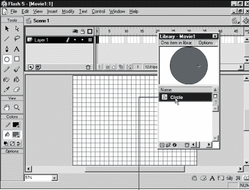

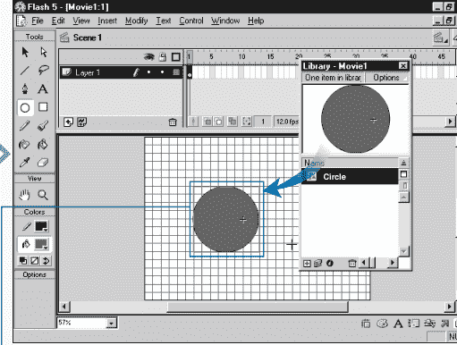

- 库窗口出现。
- 3 点击符号名称。
- 4 将符号从库拖动到舞台（Stage）。
- 符号的实例出现在舞台上。

## 创建按钮

按钮允许你为你的 Flash 电影添加交互性。用户点击按钮会触发某个动作。例如，用户可以点击按钮打开一个网页。

当你创建一个按钮时，Flash 会向你展示一个包含四帧的时间轴，每一帧代表按钮的一种状态。要定义按钮状态的外观，你可以为这四个状态中的每一个创建或导入图形。在定义按钮状态的外观时，可以使用任何图形或电影剪（movie clip）。你可以使用电影剪创建动画按钮。你不能使用另一个按钮来定义按钮状态。你可以通过以下方式启用它

按钮有四种状态：正常（Up）、悬停（Over）、按下（Down）和命中（Hit）。正常（Up）是指针不在按钮上时按钮显示给用户的样子。悬停（Over）状态是指针在按钮上时按钮显示给用户的样子。按下（Down）状态是用户在按钮上点击时按钮显示给用户的样子。命中（Hit）状态定义了足够容纳其他三个状态中所用图形的区域。确保你的命中状态足够大以响应用户。你可以让命中状态比其他状态大。命中状态对用户是不可见的

你使用 ActionScript 来定义用户点击按钮时将发生的动作。你可以使用按钮来分析用户输入、响应用户输入、加载或卸载电影，或执行许多其他任务。


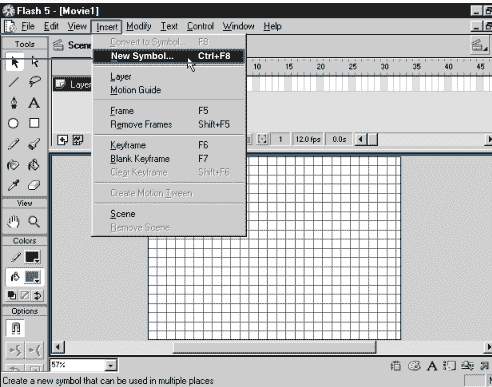

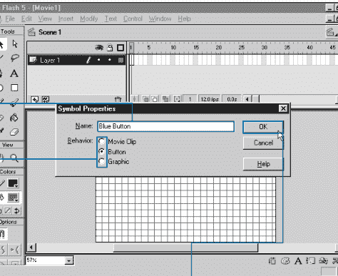

- 1 点击插入 -> 新符号
为了打开符号属性对话框。
- 3 符号属性对话框出现。
- 2 输入名称。
- 4 确定。
- 3 点击选择按钮作为行为，(O) 变为 (O)。
- Flash 移动到符号编辑模式。

## 熟悉 Flash

### 额外

启用按钮允许你测试按钮。Flash 默认禁用按钮，这让你在创建电影时更容易操作它们。要启用按钮以进行测试，点击控制（Control）、启用简单按钮（Enable Simple Buttons）。菜单上的选项旁边会出现一个复选标记。当你将指针移动到按钮上时，会出现悬停（Over）状态。当你点击指针在按钮上时，会出现按下（Down）状态。要选择已启用的按钮，使用箭头工具在按钮周围画一个矩形。要移动已启用按钮，使用箭头工具和键在舞台上移动按钮。在启用后禁用按钮，点击控制（Control）、启用按钮（Enable Button）。在创建电影时，最好让按钮保持禁用，并在测试时启用它们。

你可以导入用于定义按钮状态的图像。要导入图像，点击文件（File）、导入（Import），导入想要导入的图像并点击打开。

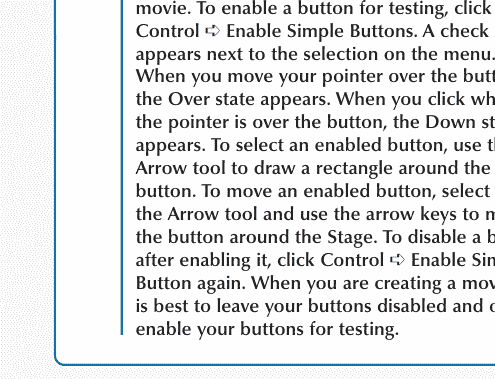

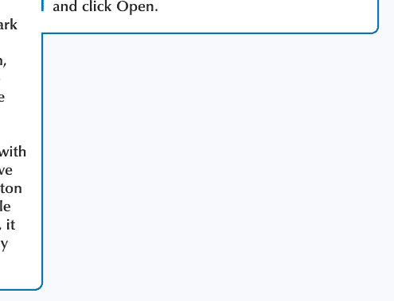

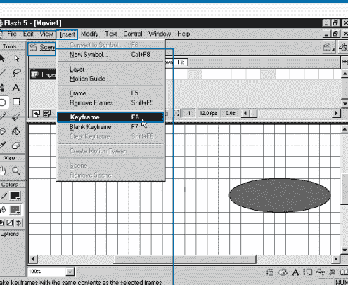

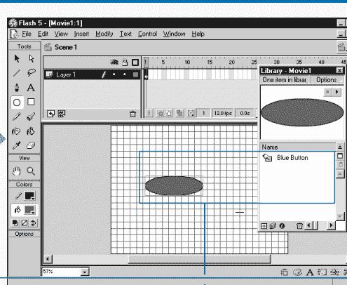


- 5 通过在舞台上画图或放置实例来定义正常（Up）状态的外观。
- 6 点击插入关键帧。
- Flash 插入关键帧并将正常状态复制到悬停（Over）状态。
- 重复步骤 5 和 6，处理按下（Down）和命中（Hit）状态。


- 7 点击 `Scene` 按钮退出符号编辑模式。
- 8 时间轴返回。
- 9 将按钮实例从库拖动到舞台。
- 按钮的实例出现在舞台上。

# 创建动画

你使用 Flash 制作动画。你可以旋转或移动对象、使其淡入淡出或更改其大小或形状。你可以独立地动画对象，也可以通过更改连续帧让它们同步移动。

Flash 使用两种动画：逐帧（frame-by-frame）和补间（tweening）。逐帧动画中，你在动画的每一帧都放置一个图像。补间动画中，你在两帧之间放置图像，Flash 通过改变大小、位置等进行插值。补间动画比逐帧动画占空间小得多，因为 Flash 只存储动画变化的数值。逐帧动画中 Flash 存储每一帧的值。补间动画有两种类型：运动（motion）和形状（shape）。在运动补间中，你在起始帧设置位置、旋转、倾斜或大小，然后在结束帧更改对象的属性。在形状补间中，你在起始帧和结束帧画一个形状；Flash 在帧之间插值改变形状。

补间的起始帧和结束帧是关键帧。如果你更改起始帧和结束帧之间的帧数，Flash 会自动进行补间。你可以补间实例和文本。

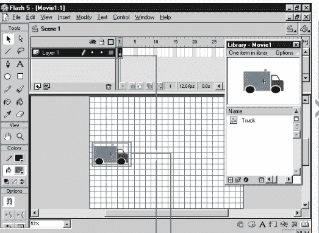

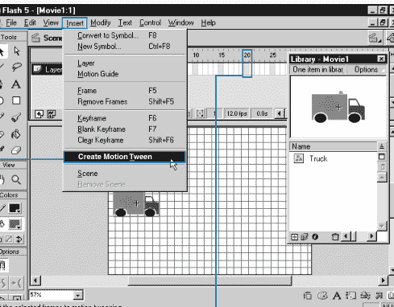

- 1 点击选择关键帧。
- 2 在舞台上画一个对象或从库画一个实例。
- 3 点击你放置对象的关键帧。
- 4 `插入 > 创建补间（Create Tween）`。如果你在舞台上画一个对象，Flash 会将对象转换为符号并命名为 `Tween 1`。
- 5 点击你想让动画结束的帧。

## 熟悉 Flash

### 额外

你可以使用帧（Frame）面板来调整补间。要打开帧面板，点击菜单上的 `修改（Modify）`、`帧`。

| 字段（FIELD） | 功能（FUNCTION） |
|---|---|
| 标签（Label） | 给帧命名。 |
| 补间（Tweening） | 选择补间类型：无（None）、运动（Motion）或形状（Shape）。 |
| 缩放（Scale） | 如果补间对象的大小。 |
| 缓动（Easing） | 输入 -100 到 0 让补间缓慢开始并在结尾加速。输入 0 到 100 让补间快速并在结尾加速。 |
| 旋转（Rotate） | 选择 `CW` 顺时针旋转对象。选择 `CCW` 逆时针旋转对象。选择 `Auto` 以所需运动最小的方向旋转。 |

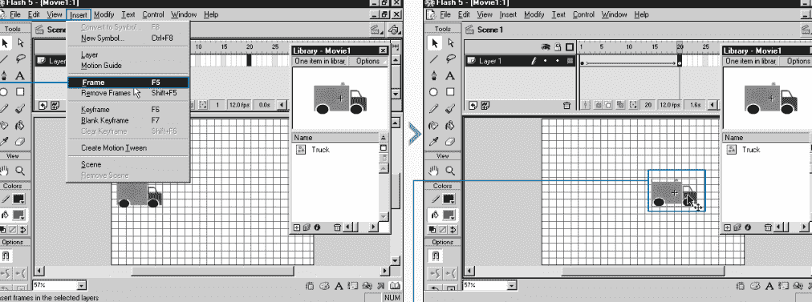

6 `插入`

时间轴上出现一条虚线。该线表示你已开始补间。

- 移动、调整大小、更改属性或旋转你想要补间的对象。

出现一条箭头线表示你的补间完成。

# FLASH ACTIONSCRIPT

## 添加声音

你可以通过添加声音为你的 Flash 电影添加声音。Flash 允许你对声音文件进行循环、编辑、压缩并创建音效。

在声音面板中，你可以选择音效、同步类型以及声音循环的次数。四种同步类型为：事件（Event）、开始（Start）、停止（Stop）和循环（Loop）。玩家进入你的声音帧时，声音开始并完整播放。电影停止时，事件不会完成。声音继续播放。同步方式与事件相同，但如果玩家进入帧时声音正在播放，则会开始一个新的声音实例。停止会停止声音播放。Flash 与事件同步：流（Stream）播放时间不能超过它包含的帧。电影停止时流停止。

你可以导入声音。导入的声音存储在库中。声音可以是事件或流声音。事件声音是连续播放的，无论电影发生什么它们都会继续。事件声音在开始之前必须完全下载。与事件同步声音。流可以在下载完成之前开始播放。

你可以控制导入选项的大小和质量来修改你的电影。通过双击库对话框中的声音图标为单个声音设置各种导入选项。在 `发布设置（Publish Settings）` 对话框中定义所有声音的设置。

## 添加声音

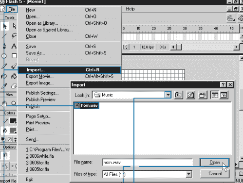

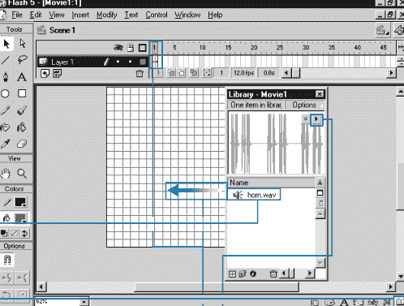

- 1 点击 `导入（Import）`。
2 导入对话框出现。
3 点击选择你的声音文件。
- 如果声音没有出现在导入窗口中，你可能需要找到你的声音文件。
3 点击打开文件。
- Flash 将声音文件发送到库中。
4 点击打开库。
5 点击声音名称选择声音。
- 6 点击 `( )` 听声音。
7 将声音拖动到舞台。
8 声音出现在时间轴上。
16

# 熟悉 FLASH

## 额外内容

声音面板的“效果”（Effect）字段提供了以下音效选项：

| 效果 | 说明 |
| --- | --- |
| 无 (None) | 无音效。 |
| 左声道 (Left Channel) | 仅在左声道播放。 |
| 右声道 (Right Channel) | 仅在右声道播放。 |
| 从左到右淡出 (Fade Left to Right) | 逐渐从左声道移动到右声道。 |
| 从右到左淡出 (Fade Right to Left) | 逐渐从右声道移动到左声道。 |
| 淡入 (Fade In) | 音量逐渐增大。 |
| 自 (Custom) | 允许你创建变化和淡出效果。 |

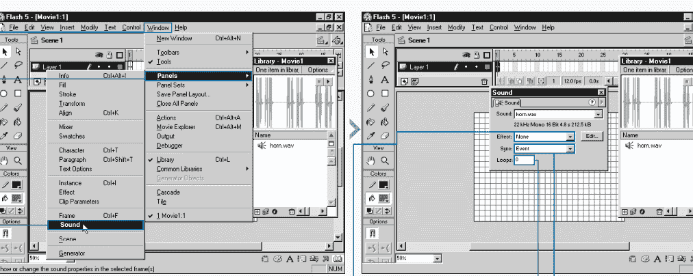

- 8 点击 `窗口 > 面板` 打开声音面板。
- 9 点击选择一种效果。
- 10 点击选择一个同步选项。
- 11 输入声音循环的次数。
- 声音现在已成为电影的一部分。

# FLASH ACTIONCRIPT

## 创建电影剪辑 (MOVIE CLIP)

电影辑（Movie clips）允许你通过利用相同片段的多个实例来缩小电影尺寸。电影辑是具有独立时间轴和属性的微 Flash。你可以将任何 Flash 动画转换为电影辑符号，然后区分该片段的多个实例，为每个实例命名：

为了保持文件大小，请将电影辑用于重复性动作，例如飞机螺旋桨的旋转。你可以使用 ActionScript 操作电影辑来创建非线性动画。关于处理电影剪辑对象的更多信息，请参阅第 7 章。你可以更改电影辑的位置、外观和其他属性。关于使用 ActionScript 定义按钮符号外观的更多信息，请参阅第 3 章以创建动画。

你可以在 Flash 电影中嵌入电影辑。此外，你可以在其他符号中嵌入电影辑符号的多个实例。你可以将电影剪辑放在主电影的时间轴或另一个电影辑的时间轴上。创建电影剪辑非常简单：首先创建你的动画，然后复制动画将其转换为符号。

你还可以将电影剪辑转换为智能剪辑（smart clip）。智能剪辑是带有 ActionScript 的电影，设计人员可以在不使用 ActionScript 的情况下对其重新编程。自己看看非 ActionScript 如何轻松地利用它的力量。

### 创建电影剪辑

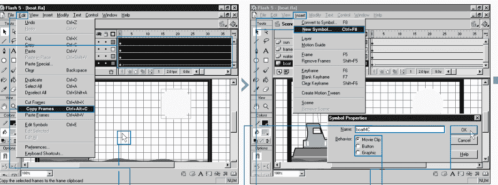

- 1. 创建动画。

注意：关于创建动画的信息请参见第 14 页。

2. 在时间轴上，选择你想包含在电影辑中的每一帧。
- 3. 点击 `编辑 -> 复制帧` 来复制你选择的帧。
- 4. 点击舞台任意位置以取消选择。
- 5. 点击 `插入 -> 新符号` 打开属性对话框。
6. 输入符号名称。
- 7. 点击选择 `电影辑` 更改行为（Q 变为）。
- 8. 点击 `确定`。

Flash 切换到符号编辑模式。

18

# 熟悉 FLASH

## 额外内容

创建一个动画按钮非常简单。从创建动画开始。将你的动画转换为电影辑。创建一个按钮。使用动画定义向上（Up）、悬停（Over）、向下（Down）或击（Hit）状态。

要选择每层上的所有内容，点击菜单上的 `编辑 -> 全选`。要取消每层上的选择，点击 `编辑 -> 取消全选`。要选择某层，点击该层。要选择某帧，点击起始帧，按住 `Shift` 键，然后点击结束帧。要向选择中添加内容，请在进行选择时按住 `Shift` 键。

为了区分电影辑的实例，你必须为每个实例命名。要在 ActionScript 中引用电影辑，大多数情况下电影辑必须有一个名称。要为电影辑实例命名，请使用箭头工具选择该实例，点击 `窗口 -> 实例` 打开实例面板，并在 `名称` 字段中输入名称。

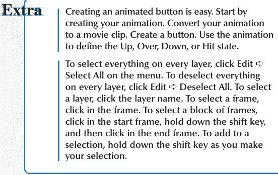

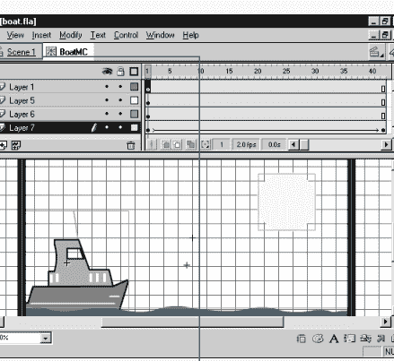

- 9 点击时间轴上第 1 层第 1 帧（Frame 1）。
- 10 点击 `编辑 -> 粘贴帧`。
- 11 在电影辑的时间轴上点击你复制的帧。
- 点击按钮退出符号编辑模式。

你的电影辑出现在库中。

## 静态文本框


文本框允许你在电影中包含文本、接受用户输入并显示文本。你使用静态框来显示不会更改的文本，使用动态文本进行更改，使用输入框向用户请求信息。你的文本框可以是单行固定宽度的，也可以是可编辑的。单行文本随输入自动换行。文本框右上角的圆形句柄表示该框是单行的。固定宽度文本框随输入自动换行。文本框右上角的正方形句柄表示该文本是固定宽度文本框。可编辑文本框允许你接受输入或动态显示文本。文本框右下角的正方形或圆形句柄表示该框是可编辑文本框。

Flash 允许你通过“文本”选项设置文本的字体、大小和对齐方式。你可以使用修饰设置字体颜色。你的文本框可以是单行固定宽度的或可编辑的。单行文本随输入自动换行。文本框右上角的圆形句柄表示该框是单行的。固定宽度文本框随输入自动换行。文本框右上角的正方形句柄表示该文本是固定宽度文本框。可编辑文本框允许你接受输入或动态显示文本。文本框右下角的正方形或圆形句柄表示该框是可编辑文本框。

## 文本框 (CREATE TEXT BOXES)

文本框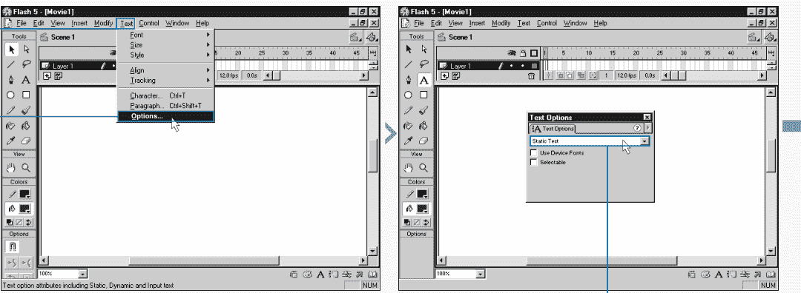

- 1 点击`编辑 -> 复制帧`来复制你选择的帧。
- 2 点击`文本`选项。从静态框、动态文本、输入框中。
- 你的文本框可以是单行固定宽度的或可编辑的。单行文本随输入自动换行。文本框右上角的圆形句柄表示该框是单行的。固定宽度文本框随输入自动换行。文本框右上角的正方形句柄表示该文本是固定宽度文本框。可编辑文本框允许你接受输入或动态显示文本。文本框右下角的正方形或圆形句柄表示该框是可编辑文本框。
- Flash 允许你通过`文本`选项设置文本的字体、大小和对齐方式。你可以使用修饰设置字体颜色。你的文本框可以是单行固定宽度的或可编辑的。单行文本随输入自动换行。文本框右上角的圆形句柄表示该框是单行的。固定宽度文本框随输入自动换行。文本框右上角的正方形句柄表示该文本是固定宽度文本框。可编辑文本框允许你接受输入或动态显示文本。文本框右下角的正方形或圆形句柄表示该框是可编辑文本框。

## 文本框 (CREATE TEXT BOXES)

文本框

- 1 点击`编辑 -> 复制帧`来复制你选择的帧。
- 2 点击`文本`选项。从静态框、动态文本、输入框中。
- 你的文本框可以是单行固定宽度的或可编辑的。单行文本随输入自动换行。文本框右上角的圆形句柄表示该框是单行的。固定宽度文本框随输入自动换行。文本框右上角的正方形句柄表示该文本是固定宽度文本框。可编辑文本框允许你接受输入或动态显示文本。文本框右下角的正方形或圆形句柄表示该框是可编辑文本框。

## 文本框 (CREATE TEXT BOXES)

文本框

- 1 点击`编辑 -> 复制帧`来复制你选择的帧。
- 2 点击`文本`选项。从静态框、动态文本、输入框中。
- 你的文本框可以是单行固定宽度的或可编辑的。单行文本随输入自动换行。文本框右上角的圆形句柄表示该框是单行的。固定宽度文本框随输入自动换行。文本框右上角的正方形句柄表示该文本是固定宽度文本框。可编辑文本框允许你接受输入或动态显示文本。文本框右下角的正方形或圆形句柄表示该框是可编辑文本框。

## 文本框 (CREATE TEXT BOXES)

文本框

- 1 点击`编辑 -> 复制帧`来复制你选择的帧。
- 2 点击`文本`选项。从静态框、动态文本、输入框中。
- 你的文本框可以是单行固定宽度的或可编辑的。单行文本随输入自动换行。文本框右上角的圆形句柄表示该框是单行的。固定宽度文本框随输入自动换行。文本框右上角的正方形句柄表示该文本是固定宽度文本框。可编辑文本框允许你接受输入或动态显示文本。文本框右下角的正方形或圆形句柄表示该框是可编辑文本框。

## 文本框 (CREATE TEXT BOXES)

文本框

- 1 点击`编辑 -> 复制帧`来复制你选择的帧。
- 2 点击`文本`选项。从静态框、动态文本、输入框中。
- 你的文本框可以是单行固定宽度的或可编辑的。单行文本随输入自动换行。文本框右上角的圆形句柄表示该框是单行的。固定宽度文本框随输入自动换行。文本框右上角的正方形句柄表示该文本是固定宽度文本框。可编辑文本框允许你接受输入或动态显示文本。文本框右下角的正方形或圆形句柄表示该框是可编辑文本框。

## 文本框 (CREATE TEXT BOXES)

文本框

- 1 点击`编辑 -> 复制帧`来复制你选择的帧。
- 2 点击`文本`选项。从静态框、动态文本、输入框中。
- 你的文本框可以是单行固定宽度的或可编辑的。单行文本随输入自动换行。文本框右上角的圆形句柄表示该框是单行的。固定宽度文本框随输入自动换行。文本框右上角的正方形句柄表示该文本是固定宽度文本框。可编辑文本框允许你接受输入或动态显示文本。文本框右下角的正方形或圆形句柄表示该框是可编辑文本框。

## 文本框 (CREATE TEXT BOXES)

文本框

- 1 点击`编辑 -> 复制帧`来复制你选择的帧。
- 2 点击`文本`选项。从静态框、动态文本、输入框中。
- 你的文本框可以是单行固定宽度的或可编辑的。单行文本随输入自动换行。文本框右上角的圆形句柄表示该框是单行的。固定宽度文本框随输入自动换行。文本框右上角的正方形句柄表示该文本是固定宽度文本框。可编辑文本框允许你接受输入或动态显示文本。文本框右下角的正方形或圆形句柄表示该框是可编辑文本框。

## 文本框 (CREATE TEXT BOXES)

文本框

- 1 点击`编辑 -> 复制帧`来复制你选择的帧。
- 2 点击`文本`选项。从静态框、动态文本、输入框中。
- 你的文本框可以是单行固定宽度的或可编辑的。单行文本随输入自动换行。文本框右上角的圆形句柄表示该框是单行的。固定宽度文本框随输入自动换行。文本框右上角的正方形句柄表示该文本是固定宽度文本框。可编辑文本框允许你接受输入或动态显示文本。文本框右下角的正方形或圆形句柄表示该框是可编辑文本框。

## 文本框 (CREATE TEXT BOXES)

文本框

- 1 点击`编辑 -> 复制帧`来复制你选择的帧。
- 2 点击`文本`选项。从静态框、动态文本、输入框中。


你的文本框可以是单行固定宽度的或可编辑的。单行文本随输入自动换行。文本框右上角的圆形句柄表示该框是单行的。固定宽度文本框随输入自动换行。文本框右上角的正方形句柄表示该文本是固定宽度文本框。可编辑文本框允许你接受输入或动态显示文本。文本框右下角的正方形或圆形句柄表示该框是可编辑文本框。

## 文本框 (CREATE TEXT BOXES)

文本框

- 1 点击“编辑 -> 复制帧”来复制你选择的帧。
- 2 点击“文本”选项。从静态框、动态文本、输入框中。
- 你的文本框可以是单行固定宽度的或可编辑的。单行文本随输入自动换行。文本框右上角的圆形句柄表示该框是单行的。固定宽度文本框随输入自动换行。文本框右上角的正方形句柄表示该文本是固定宽度文本框。可编辑文本框允许你接受输入或动态显示文本。文本框右下角的正方形或圆形句柄表示该框是可编辑文本框。

## 静态文本框 (STATIC TEXT BOXES)

- 9 点击时间轴上第 1 层第 1 帧。
- 10 点击“编辑 -> 粘贴帧”。
- 11 在电影辑的时间轴上点击你复制的帧。
- 点击按钮退出符号编辑模式。

你的电影辑出现在库中。

文本框允许你在电影中包含文本，接受用户输入并显示文本。你使用静态框来显示不会更改的文本，使用动态文本进行更改，使用输入框向用户请求信息。你的文本框可以是单行固定宽度的，或者是可编辑的。单行文本随输入自动换行。文本框右上角的圆形句柄表示该框是单行的。固定宽度文本框随输入自动换行。文本框右上角的正方形句柄表示该文本是固定宽度文本框。可编辑文本框允许你接受输入或动态显示文本。文本框右下角的正方形或圆形句柄表示该框是可编辑文本框。

Flash 允许你通过“文本”选项设置文本的字体、大小和对齐方式。你可以使用修饰设置字体颜色。你的文本框可以。


## 静态文本框 (STATIC TEXT BOXES)

文本框允许你在电影中包含文本，接受用户输入并显示文本。你使用静态框来显示不会更改的文本，使用动态文本进行更改，使用输入框向用户请求信息。你的文本框可以是单行固定宽度的，或者是可编辑的。单行文本随输入自动换行。文本框右上角的圆形句柄表示该框是单行的。固定宽度文本框随输入自动换行。文本框右上角的正方形句柄表示该文本是固定宽度文本框。可编辑文本框允许你接受输入或动态显示文本。文本框右下角的正方形或圆形句柄表示该框是可编辑文本框。

## 文本框 (CREATE TEXT BOXES)

文本框

- 1 点击`编辑 -> 复制帧`来复制你选择的帧。
- 2 点击`文本`选项。从静态框、动态文本、输入框中。
- 你的文本框可以是单行固定宽度的或可编辑的。单行文本随输入自动换行。文本框右上角的圆形句柄表示该框是单行的。固定宽度文本框随输入自动换行。文本框右上角的正方形句柄表示该文本是固定宽度文本框。可编辑文本框允许你接受输入或动态显示文本。文本框右下角的正方形或圆形句柄表示该框是可编辑文本框。


文本框

- 1 点击`编辑 -> 复制帧`来复制你选择的帧。
- 2 点击`文本`选项。从静态框、动态文本、输入框中。
- 你的文本框可以是单行固定宽度的或可编辑的。单行文本随输入自动换行。文本框右上角的圆形句柄表示该框是单行的。固定宽度文本框随输入自动换行。文本框右上角的正方形句柄表示该文本是固定宽度文本框。可编辑文本框允许你接受输入或动态显示文本。文本框右下角的正方形或圆形句柄表示该框是可编辑文本框。

## 文本框 (CREATE TEXT BOXES)

文本框

- 1 点击`编辑 -> 复制帧`来复制你选择的帧。
- 2 点击`文本`选项。从静态框、动态文本、输入框中。
- 你的文本框可以是单行固定宽度的或可编辑的。单行文本随输入自动换行。文本框右上角的圆形句柄表示该框是单行的。固定宽度文本框随输入自动换行。文本框右上角的正方形句柄表示该文本是固定宽度文本框。可编辑文本框允许你接受输入或动态显示文本。文本框右下角的正方形或圆形句柄表示该框是可编辑文本框。


## 文本框 (CREATE TEXT BOXES)

文本框

- 1 点击`编辑 -> 复制帧`来复制你选择的帧。
- 2 点击`文本`选项。从`静态框`、`动态文本`、`输入框`中。
- 你的文本框可以是单行固定宽度的或可编辑的。单行文本随输入自动换行。文本框右上角的圆形句柄表示该框是单行的。固定宽度文本框随输入自动换行。文本框右上角的正方形句柄表示该文本是固定宽度文本框。可编辑文本框允许你接受输入或动态显示文本。文本框右下角的正方形或圆形句柄表示该框是可编辑文本框。

## 文本框 (CREATE TEXT BOXES)

文本框

- 1 点击`编辑 -> 复制帧`来复制你选择的帧。
- 2 点击`文本`选项。从`静态框`、`动态文本`、`输入框`中。
- 你的文本框可以是单行固定宽度的或可编辑的。单行文本随输入自动换行。文本框右上角的圆形句柄表示该框是单行的。固定宽度文本框随输入自动换行。文本框右上角的正方形句柄表示该文本是固定宽度文本框。可编辑文本框允许你接受输入或动态显示文本。文本框右下角的正方形或圆形句柄表示该框是可编辑文本框。

## 文本框 (CREATE TEXT BOXES)

文本框

- 1 点击`编辑 -> 复制帧`来复制你选择的帧。
- 2 点击`文本`选项。从`静态框`、`动态文本`、`输入框`中。
- 你的文本框可以是单行固定宽度的或可编辑的。单行文本随输入自动换行。文本框右上角的圆形句柄表示该框是单行的。固定宽度文本框随输入自动换行。文本框右上角的正方形句柄表示该文本是固定宽度文本框。可编辑文本框允许你接受输入或动态显示文本。文本框右下角的正方形或圆形句柄表示该框是可编辑文本框。

## 文本框 (CREATE TEXT BOXES)

文本框

- 1 点击`编辑 -> 复制帧`来复制你选择的帧。
- 2 点击`文本`选项。从`静态框`、`动态文本`、`输入框`中。
- 你的文本框可以是单行固定宽度的或可编辑的。单行文本随输入自动换行。文本框右上角的圆形句柄表示该框是单行的。固定宽度文本框随输入自动换行。文本框右上角的正方形句柄表示该文本是固定宽度文本框。可编辑文本框允许你接受输入或动态显示文本。文本框右下角的正方形或圆形句柄表示该框是可编辑文本框。

## 文本框 (CREATE TEXT BOXES)

文本框

- 1 点击`编辑 -> 复制帧`来复制你选择的帧。
- 2 点击`文本`选项。从`静态框`、`动态文本`、`输入框`中。
- 你的文本框可以是单行固定宽度的或可编辑的。单行文本随输入自动换行。文本框右上角的圆形句柄表示该框是单行的。固定宽度文本框随输入自动换行。文本框右上角的正方形句柄表示该文本是固定宽度文本框。可编辑文本框允许你接受输入或动态显示文本。文本框右下角的正方形或圆形句柄表示该框是可编辑文本框。

## 文本框 (CREATE TEXT BOXES)

文本框

- 1 点击`编辑 -> 复制帧`来复制你选择的帧。
- 2 点击`文本`选项。从`静态框`、`动态文本`、`输入框`中。
- 你的文本框可以是单行固定宽度的或可编辑的。单行文本随输入自动换行。文本框右上角的圆形句柄表示该框是单行的。固定宽度文本框随输入自动换行。文本框右上角的正方形句柄表示该文本是固定宽度文本框。可编辑文本框允许你接受输入或动态显示文本。文本框右下角的正方形或圆形句柄表示该框是可编辑文本框。

## 文本框 (CREATE TEXT BOXES)

文本框

- 1 点击`编辑 -> 复制帧`来复制你选择的帧。
- 2 点击`文本`选项。从`静态框`、`动态文本`、`输入框`中。
- 你的文本框可以是单行固定宽度的或可编辑的。单行文本随输入自动换行。文本框右上角的圆形句柄表示该框是单行的。固定宽度文本框随输入自动换行。文本框右上角的正方形句柄表示该文本是固定宽度文本框。可编辑文本框允许你接受输入或动态显示文本。文本框右下角的正方形或圆形句柄表示该框是可编辑文本框。

## 文本框 (CREATE TEXT BOXES)

文本框

- 1 点击`编辑 -> 复制帧`来复制你选择的帧。
- 2 点击`文本`选项。从`静态框`、`动态文本`、`输入框`中。
- 你的文本框可以是单行固定宽度的或可编辑的。单行文本随输入自动换行。文本框右上角的圆形句柄表示该框是单行的。固定宽度文本框随输入自动换行。文本框右上角的正方形句柄表示该文本是固定宽度文本框。可编辑文本框允许你接受输入或动态显示文本。文本框右下角的正方形或圆形句柄表示该框是可编辑文本框。

## 静态文本框 (STATIC TEXT BOXES)

文本框

- 1 点击`编辑 -> 复制帧`来复制你选择的帧。
- 2 点击`文本`选项。从`静态框`、`动态文本`、`输入框`中。
- 你的文本框可以是单行固定宽度的或可编辑的。单行文本随输入自动换行。文本框右上角的圆形句柄表示该框是单行的。固定宽度文本框随输入自动换行。文本框右上角的正方形句柄表示该文本是固定宽度文本框。可编辑文本框允许你接受输入或动态显示文本。文本框右下角的正方形或圆形句柄表示该框是可编辑文本框。

## 熟悉 FLASH

### 创建动态文本框

您可以使用动态文本框来显示更新的文本，或根据用户输入来显示文本。通过`Options`面板，您可以将每个动态文本框与变量关联。变量信息功能会将框中的信息分配给指定的变量。要了解更多关于变量的信息，请参阅第 4 章。

选择`HTML`以使用 HTML 标签保存格式。选择`Border/Bg`在文本周围显示背景和边框。输入您想要赋予变量字段的名称。点击`Selectable`允许用户选择文本。点击一个或多个`Embed`按钮指定 Flash 应该嵌入哪些字符。

在使用`Options`面板创建动态文本框时，在下拉列表中从`Single Line`或`Multiline`中选择。您可以选择`Single Line`以单行输出；选择`Multiline`并勾选`Word Wrap`框以多行显示文本，文本会在框末尾自动换行。

当您在 Text 选项面板的`Dynamic Text`或`Input Text`选择`HTML`时，Flash 将创建简单的 HTML 格式标签。这允许您保存与文本相关的字体名称、颜色和大小。支持的 HTML 标签包括：`<A><B><FONT COLOR><FONT FACE><FONT SIZE><i><u></u>`

### 创建动态文本框

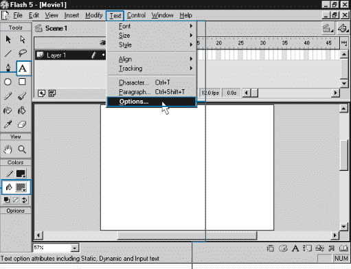

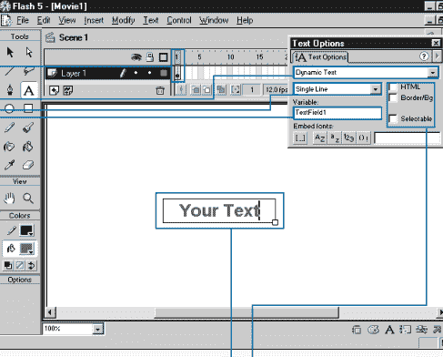

- 1 点击`A`。
- 2 点击`Click`选择字体颜色。
- 3 点击`Text Options`打开文本选项面板。
- 文本选项面板出现。
- 4 点击从下拉列表中选择`Dynamic Text`。
- 5 点击选择`Single Line`或`Multiline`。
- 6 点击变量名。
- 7 点击选择`HTML`、`Border/Bg`或`Selectable`。
- 8 点击舞台`Stage`创建单行文本框，或点击舞台并拖动以创建固定宽文本框。

文本框将出现在舞台上。

### 使用 Actions 面板

`ActionScript`是一种脚本语言，允许您为电影添加交互性并控制对象。您可以使用`ActionScript`语句来指示如何响应用户的鼠标点击和按键按下，或者可以使用`ActionScript`让您的电影对点击按钮的操作做出响应。

您可以在`Actions`面板中创建`ActionScript`。`ActionScript`始终与帧、按钮或电影关联。使用箭头工具，您可以选择要关联`ActionScript`的帧或按钮；然后打开`Actions`面板。`Actions`面板有两种模式：`Normal`模式和`Expert`模式。在`Normal`模式下，`Parameters`面板中的字段会提示您输入正确的语句参数。在`Expert`模式下，您可以在文本框中编写和编辑语句。在`Expert`模式下工作类似于文本编辑器。


在普通模式下，您可以从 Action 面板右侧的 Toolbox（工具箱）列表中选择语句。Toolbox 列表将语句分为以下类别：Basic Actions（基础动作）、Actions（动作）、Operators（操作符）、Functions（函数）、Properties（属性）和 Objects（对象）。您可以双击语句来选择它们。您也可以点击 Add（添加）按钮并以 Toolbox 列表相同的方式按类别选择语句。您使用 Delete（删除）按钮删除语句。Parameters 面板显示已选语句。

在选择语句后，该语句将出现在 Actions 面板右侧的 Actions 列表中。您可以通过 Order（排序）按钮更改语句的顺序。向上箭头将语句向下。您还可以通过点击并拖动来移动语句。

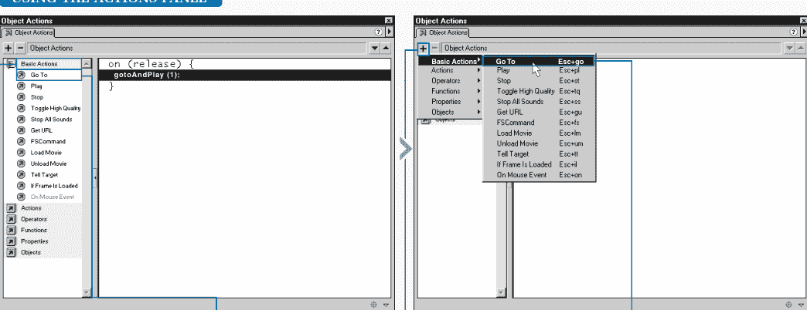

- 1 在 Toolbox 列表中，点击类别名称显示该类别中的语句。
- 2 双击语句进行选择。
- 3 点击 Add a Statement（添加语句）按钮 (+ ) 显示语句类别。
- 4 从下拉菜单中选择语句。

## 熟悉 FLASH

## 额外

您可以使用文本编辑器编写 ActionScript，并使用 `#include` 动作来调用包含您的 ActionScript 的文本文件。`#include` 动作的语法为：

`#include filename.as`

您可以为文件命名任何名称。使用 `.as` 作为文件扩展名。`filename.as` 参数代表文件的相对路径。如果电影文件和 ActionScript 文本文件在同一个文件夹中，路径为 `filename.as`。如果 ActionScript 文本文件在子文件夹中，路径为 `foldername/filename.as`。当您测试、发布或导出电影时，ActionScript 会用文件内容替换 `#include` 语句。

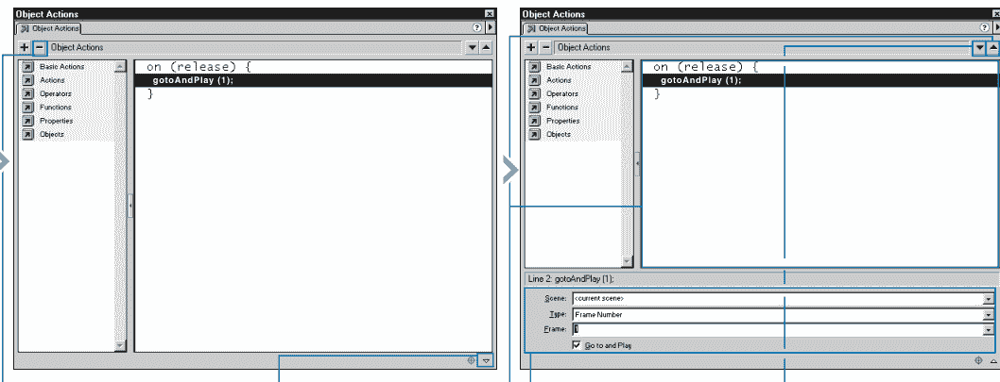

- 5 点击 Delete a Statement（删除语句）按钮 ( ) 删除语句。
- 6 点击 [ ] 打开 Parameters 面板。
- 7 Parameters 面板出现在面板底部。
- Actions 列表显示脚本。
- 7 点击此 Change Statement Order（更改语句顺序）按钮 ( ) 将语句向上移动。
- 8 点击此 Change Statement Order（更改语句顺序）按钮 ( ) 将语句向下移动。

持续

25

## 使用 Actions 面板（续）

您可以通过拖动 Toolbox 列表之间的垂直分割条来更改 Toolbox 列表的大小。

在专家模式下，您在 Actions 列表中输入语句，就像使用文本编辑器一样。点击分割条可以展开或折叠 Toolbox 列表。

您可以在普通模式和专家模式之间切换。切换模式可能会更改脚本格式，因此最好固定使用一种模式。

在普通模式下，Parameters 面板中的字段会提示您输入正确的语句参数。在专家模式下，您可以在文本框中编写和编辑语句。在专家模式下工作类似于文本编辑器。

当切换到专家模式时，Flash 会保留您添加的缩进。

## 使用 Actions 面板（续）

| Object Actions |

|---|

| + Object Actions |

| - Object Actions |

| + Basic Actions |

| Actions |

| Operators |

| Properties |

| Objects |

| Object Actions |

|---|---|

| + Object Actions |

| - Object Actions |

| + Basic Actions |

| Actions |

| Operators |

| Properties |

| Objects |

```actionscript
on (release) {
  stopAndPlay(1);
}
```

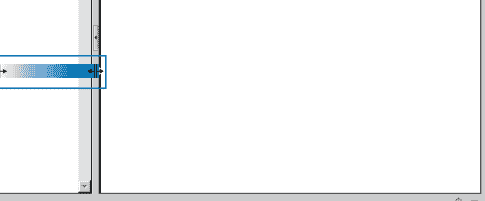

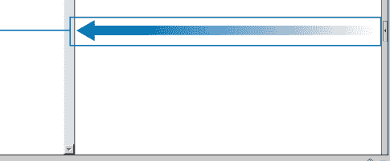

- 拖动分割条更改 Toolbox 列表的大小。
- 点击折叠 Actions 列表。

## 熟悉 FLASH

## 额外

除了普通模式和专家模式外，Actions 面板中的 Options 还提供了其他功能。使用 GoTo Line（跳转行）移动到脚本中的指定行。使用 Find（查找）查找字符串。使用 Find Again（再次查找）继续搜索。使用 Replace（替换）查找并替换字符串。使用 Print（打印）打印脚本。选择 Font Size（字体大小）选择小、中、大字体。

点击 Syntax 检查脚本语法错误。选择 Colored 让语句的各种元素以不同的颜色显示。这有助于您调试代码。开启 Colored Syntax 时，关键字和预定义标识符显示为蓝色，属性显示为绿色，注释显示为洋红色，引号字符串显示为灰色。旁边的勾选表示开启；无勾选表示关闭。

使用 Deprecated Syntax（弃用语法）让所有弃用语法在 Toolbox 列表中以绿色高亮显示。这仅当您在发布设置对话框中将导出版本设置为 Flash 5 时有效。如果您将导出版本设置为 Flash 4 或更低，ActionScript 将用黄色突出显示该版本不可用的语法。

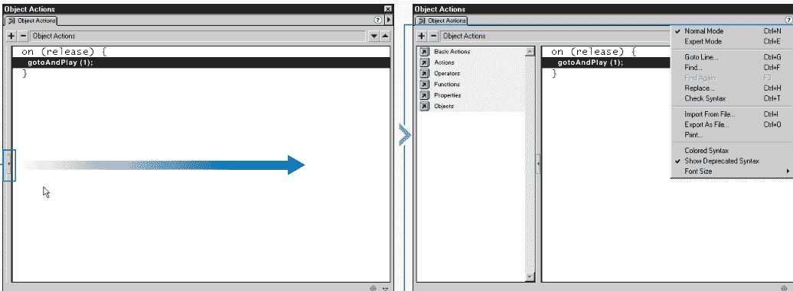

- 11 点击展开 Actions 列表。
- 12 点击切换模式或选择选项。

使用 Actions 面板添加 ActionScript。

## 将 FLASH ACTIONSCRIPT 分配给按钮

## 为按钮分配 ACTIONSCRIPT

通过为按钮分配动作，你可以创建出可以拖动、响应用户输入或在响应鼠标点击或移动时执行众多任务的对象。你应该将动作分配给按钮——而不是时间轴上的 Up（按下）、Over（悬停）或 Hit（击中）帧。如果你为某个按钮实例分配了动作，该符号的其他实例将不会受到影响。

在给按钮分配动作时，你必须使用处理程序（handler）来确定触发动作的鼠标事件。所有按钮都以 `on` 单词开头，并以括号括起的处理程序响应的事件结尾。在在线模式（Online Mode）下，Flash 默认执行 `(release)` 处理程序上的 动作。

当指针悬停在按钮上且用户松开鼠标时，`(release)` 处理程序会执行指定的动作。`(onRelease)` 处理程序在指针悬停在按钮上且用户按下鼠标时执行动作。

你可以使用 `(rollOver)` 处理程序在用户将指针滑过按钮时执行某些动作。你可以使用 `(rollOut)` 处理程序在用户将指针滑过按钮区域并移出时执行指定的动作。

使用 `(dragOver)` 处理程序在用户点击按钮、拖动指针离开按钮，然后将指针拖回按钮上时执行指定的动作。使用 `(dragOut)` 处理程序在指针悬停在按钮上并拖到按钮区域外时执行指定的动作。

使用 `(releaseOutside)` 处理程序在用户将指针拖到区域外然后松开鼠标时执行指定的动作。

`(keyPressed, "key")` 处理程序在用户按下指定按键时执行指定的动作。

## 为按钮分配 ACTIONSCRIPT

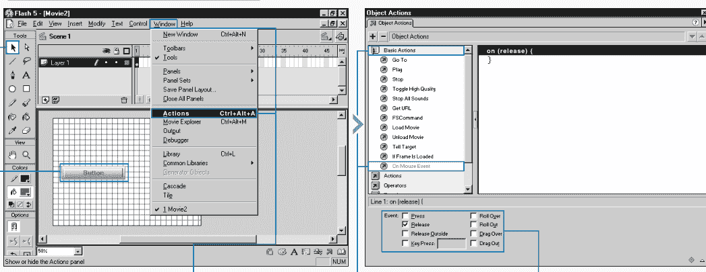

- 1. 使用箭头工具 (↖) 选择按钮。
- 2. 点击 Window（窗口） ⮕ 打开“Object Actions”（对象动作）面板。
- 3. 点击“Basic Actions”（基本动作）。
- 4. 双击“On Mouse Event”（鼠标事件）以选择一个处理程序。
- 5. 点击复选框以选择一个处理程序。

使用处理程序来指定 Flash 何时应该执行 ActionScript。

## 熟悉 FLASH

## 为电影剪辑（MOVIE CLIP）分配 ACTIONSCRIPT

为电影剪辑分配 ActionScript 可以让你的电影在点击或将指针滑过电影剪辑时执行各种任务。如果你为某个电影剪辑实例分配了动作，该符号的其他实例将不会受到影响。

在给电影剪辑分配动作时，你必须使用处理程序来处理触发动作的事件。所有电影剪辑都以 `onClipEvent` 开头，并以括号括起的处理程序响应的事件结尾。在普通模式（Normal Mode）下，如果你从列表中选择而未指定处理程序，Flash 默认会分配 `onClipEvent(load)` 处理程序。


使用 `onClipEvent(enterFrame)` 处理程序在每次播放头进入帧（frame）时执行指定的动作。使用 `onClipEvent(mouseMove)` 处理程序在每次鼠标移动时执行指定的动作。使用 `onClipEvent(mouseDown)` 处理程序在用户按下鼠标时执行动作。使用 `onClipEvent(mouseUp)` 处理程序在用户松开鼠标时执行动作。

`onClipEvent(keyDown)` 处理程序在用户按下任何键时执行指定的动作。`onClipEvent(keyUp)` 处理程序在按键释放后执行动作。`onClipEvent(data)` 处理程序在 ActionScript 接收数据时执行指定的动作。

`onClipEvent(load)` 处理程序在电影剪辑首次出现在时间轴上时执行。`onClipEvent(unload)` 处理程序在你第一次从时间轴上移除电影剪辑后执行指定的动作。你通过选择剪辑并打开“Object Actions”（对象动作）面板来为电影剪辑分配 ActionScript。

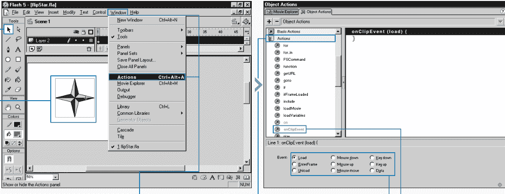

- 1. 使用工具选择电影剪辑。
- 2. 点击 Window（窗口）打开“Object Actions”（对象动作）面板。
- 3. 点击 Basic Actions（基本动作）。
- 4. 双击 onClipEvent 选择动作。
- 5. 选择处理程序进行更改。

使用处理程序指定 Flash 何时应该执行 ActionScript。

## 为帧（FRAME）分配 ACTIONSCRIPT

你可以将 ActionScript 与帧相关联。当播放头进入该帧时，动作会执行。这在你想要使用 ActionScript 初始化变量、在电影中创建循环或在进入帧时执行任务时非常有用。

Flash 会自动将 ActionScript 分配给关键帧（keyframe）。你应该将帧动作放在它们自己的图层上。带有动作的帧会显示一个小图标。你必须为关键帧分配 ActionScript。默认情况下，时间轴上的第一帧是关键帧。你可以通过选择一个帧并点击菜单中的“Insert Keyframe”（插入关键帧）来创建额外的关键帧。如果你尝试为非关键帧的帧分配动作，Flash 也可以通过点击该帧然后打开“Action”（动作）面板为帧分配动作。如果你选择了多个关键帧，Flash 会使 Action 面板变灰，你将无法输入 ActionScript。

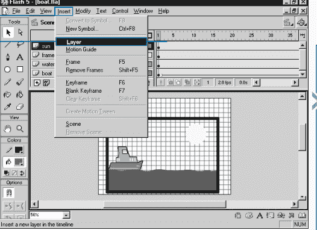

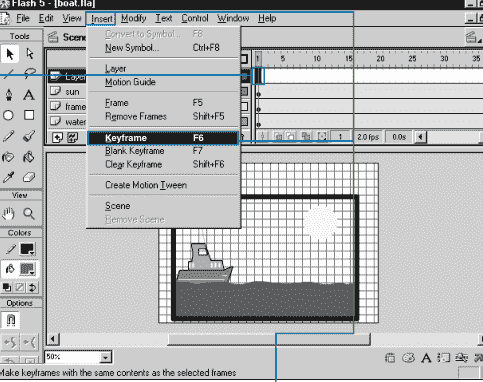

- 1. 点击 Insert Layer（插入图层）创建一个新图层。
- 2. 一个新图层出现在活动图层上方。
- 3. 点击 Insert Keyframe（插入关键帧）创建一个关键帧。
- 4. 点击选择帧。

## 熟悉 FLASH

### 额外（Extra）

Flash 为时间轴上的帧赋予连续编号。在 ActionScript 中引用帧时，使用标签比使用帧编号更好。当你从电影中添加或删除帧时，帧编号会变化，但标签保持不变。参见第 4 页。

要创建帧标签，选择要分配标签的帧，点击 Window > Frame 打开 Frame 面板，并在 Label 字段中输入。

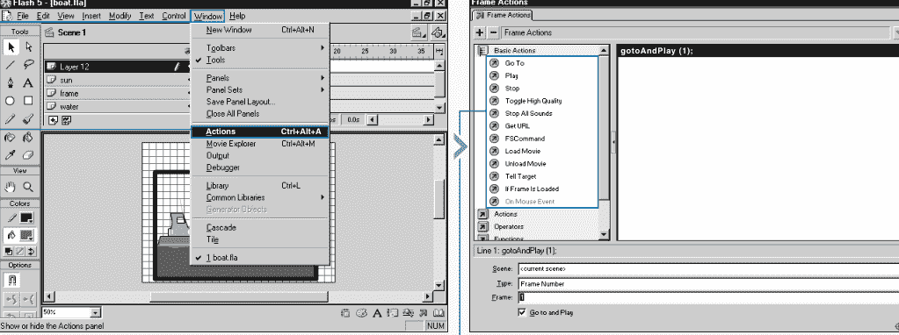

- 4. 点击 Window（窗口）打开 Frame 面板。
- 5. 选择你的动作。

使用 Frame 面板输入 ActionScript。

## 发布电影（PUBLISH MOVIES）

发布电影可以让你向观众展示。你可以以多种格式发布电影：用于 Web 的 Flash 电影；GIF、JPEG 或 QuickTime 动画；HTML 文档；或 Windows 或 Macintosh 的独立可执行文件。

选择 Generate Size（生成尺寸）会创建一个包含电影中每个帧、场景和对象详细信息的 TXT 文件。Omit Trace Actions（忽略跟踪动作）会导致 Flash 忽略电影中的跟踪动作。参见第 13 章。当你保存电影时，Flash 分配 FLA 扩展名。当你将电影发布为用于 Web 的 Flash 电影时，Flash 分配 SWF 扩展名。

你使用 Publish Settings 对话框发布电影。你选择格式。Flash 分配默认名称。你可以使用默认名称或分配名称。

当你为 Web 发布电影时，可以选择多个选项，包括图层的加载顺序。你还可以选择以下选项：Generate Size（生成尺寸）、Report Trace Actions（报告跟踪动作）、Importing（导入）和 Debugging Permitted（允许调试）。

还有一个 JPEG 质量滑块，允许你调整 JPEG 图形的质量——质量越高，尺寸越大。

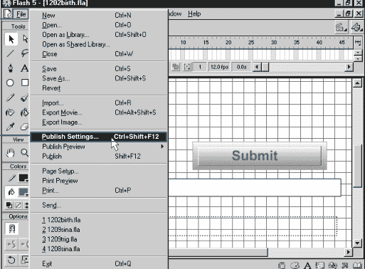

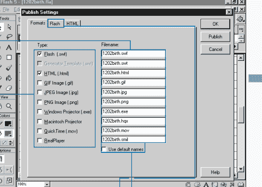

- 1. 点击 File（文件） > Publish Settings（发布设置）打开 Publish Settings 对话框。
- 2. 点击 Type 框选择文件类型 [ ] 更改为 [ ]。
- 3. 在 Filename（文件名）字段中输入更改文件名。
- 4. 点击 Use Default Names 使用默认文件名。
- 5. 点击 Flash 选项卡查看 SWF 文件的选项。

## 熟悉 FLASH

### 额外内容（Extra）

为了让你的 Flash 电影加载更快，你需要尽可能保持文件较小。声音会显著增加文件大小。你可以调整声音的采样率和压缩率来减小文件大小。采样率和压缩率设置越低，音质越差，文件大小就越小。你可能需要进行实验，在音质和文件大小之间找到合适的平衡点。

如果你更改了电影的宽度和高度，可以使用缩放（Scale）选项将将电影放置在 Web 浏览器中。选择“默认（default）”将在你指定的边界内显示电影，并保持原始比例。“无边框（No Border）”将在你指定的边界内显示电影；然而，选择“适应（Fit）”将电影放置在你指定的边界内，但不会保持原始比例。选择此选项可能会导致变形。

在创建显示 Flash 电影的 HTML 文档时，你使用 `object` 和 `embed` 标签。Internet Explorer 在 Windows 上使用 `object` 标签，Netscape Navigator 和 Macintosh 版 Internet Explorer 使用 `embed` 标签；Windows 版 Internet Explorer 使用 ActiveX 播放内容，而所有其他浏览器都使用 Flash 插件。

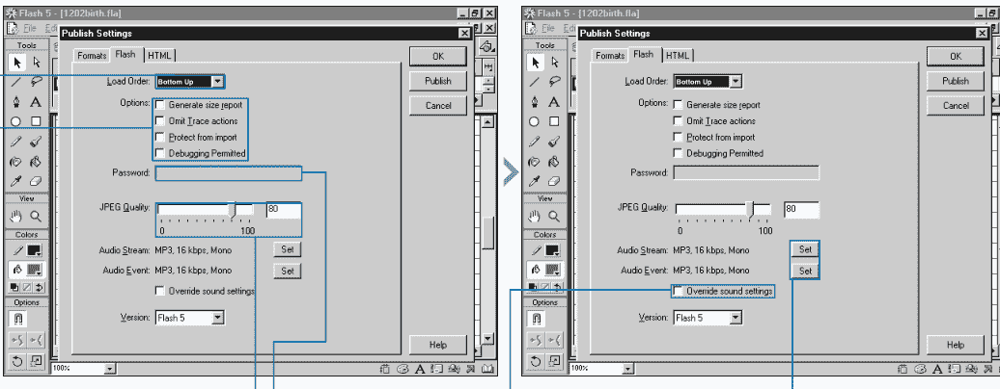

- 5 显示 Flash 屏幕选项。
- 6 点击设置加载顺序（Load Order）。
- 7 点击选择生成尺寸报告、省略跟踪操作、导入或允许调试的选项。
- 8 如果你选择了“允许调试”，如果需要可以输入密码。
- 9 使用 JPEG 滑块设置 JPEG 质量。
- 10 点击打开当前声音设置。
- 11 点击打开用于流式（Stream）或事件型（Event）事件的声音设置对话框。

## FLASH 对话脚本（dialogscript）

### 发布电影（续）

如果你没有使用“声音属性（Sound Properties）”对话框为声音文件指定采样率和压缩率，你可以在“发布（Publish）”对话框中设置它们或覆盖之前的设置。使用“音频流（Audio Stream）”设置流声音的采样率和压缩率。使用“音频事件（Audio Event）”设置事件声音的采样率和压缩率。

“发布设置（Publish Settings）”对话框为你提供了每个模板的描述。

在你的 HTML 文档中，你可以让电影的大小与你创建的电影大小匹配，也可以以像素或原始电影的百分比来指定大小。

你选择想要发布电影的 Flash 版本。Flash 5 中可用的操作在较早版本中可能不可用。

“发布设置（Publish Settings）”对话框包含播放选项。你可以暂停电影，直到用户按下或从快捷菜单中选择。当电影到达最后一帧时恢复播放。你可以在 Windows 中显示右键点击，或在 Macintosh 上显示控制键点击（control-clicks），在 Windows 中，如果选定的字体在用户的系统中不可用，你可以使用设备字体。

为了在 Web 浏览器中移动，电影必须是 HTML 文档的一部分。在“发布设置”对话框中选择“HTML”将创建一个包含你的 Flash 电影的 HTML 文档。

“发布设置”对话框还有其他选项，允许你设置质量、模式、对齐和缩放。

Flash 提供了几个你可以使用的模板来创建你的 HTML 文档。通过将信息（Info）放入按钮中，


## 发布电影（续）

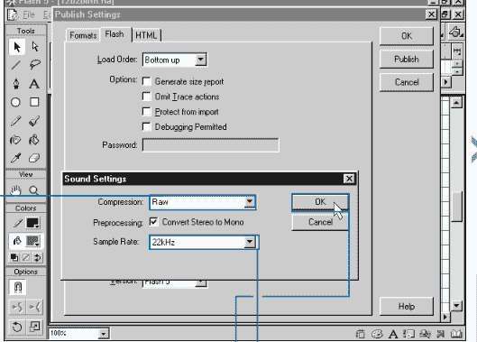

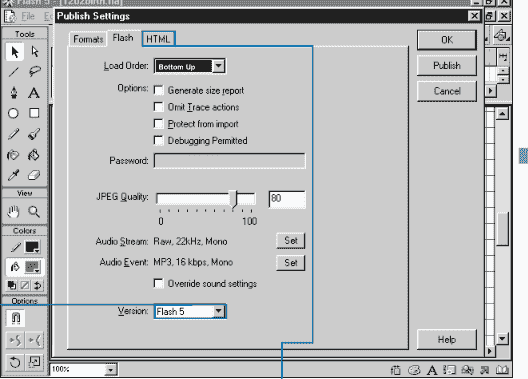

- 出现声音设置对话框。
- 13 点击选择采样率（Sample Rate）。
- 15 点击选择你正在编写的 Flash 版本。
- 16 点击 HTML 选项卡显示 HTML 选项。
- 12 点击选择压缩类型（Compression type）。
- 14 点击 OK 关闭对话框。
- 5

## 熟悉 FLASH

### 应用它（Apply it）

你可以使用此处显示的代码手动向 HTML 文档中添加 Flash 电影。

```
<OBJECT CLASSID="clsid:D27DCDB6-AE6D-11cf-96B8-444553450000" WIDTH="100" CODEBASE="http://active.macromedia.com/flash5/cabs/swflash.swf?version=5,0,0,0">
<PARAM NAME="MOVIE" VALUE="yourmovie.mov">
<PARAM NAME="LOOP" VALUE="false">
<PARAM NAME="QUALITY" VALUE="high">
<PARAM NAME="PLAY" VALUE="true">
<EMBED SRC="yourmovie.swf" WIDTH="100" HEIGHT="100"
LOOP="false" QUALITY="high"
PLUGINSPAGE="http://www.macromedia.com/shockwave/download/index.cgi?P1_Prod_Version=ShockwaveFlash-*">
</EMBED>
</OBJECT>
```

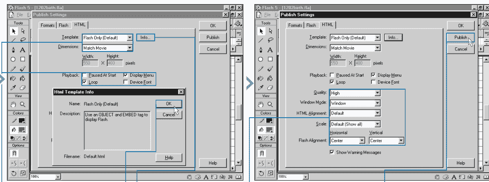

- 出现 HTML 选项。
- 17 点击设置模板（Template）和指定（Designations）选项。
- 10 点击选择播放选项（ ) 变为。
- 19 模板的描述信息（Info）。
- 20 点击 OK 关闭模板信息对话框。
- 对话框关闭。
- 21 点击选择质量、窗口模式、对齐和缩放。
- 22 点击发布（Publish）你的电影。
- HTML 选项出现。

## 脚本（ACTIONSCRIPT）

### 脚本语法介绍（INTRODUCTION TO SYNTAX）

ActionScript 是用于与 Flash 通信的语言。它可以由单条语句或一系列语句组成。ActionScript 接收参数——也称为参数。例如，使用 `gotoAndPlay` 告诉 Flash 执行。`gotoAndPlay` 有两个参数：场景（`scene`）和帧（`frame`）。使用 `scene` 告诉 Flash 哪个场景。使用 `gotoAndPlay` 开始播放。参数位于括号内，并用逗号分隔。字面值（literal values）用引号。。像其他语言一样，ActionScript 有标点规则。为了让脚本执行，ActionScript 语句以分号结束。代码块用大括号包围。在 ActionScript 中，关键字对大小写敏感。有关关键字的完整列表，请参见第十章。

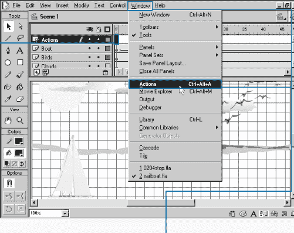

- 选择你想添加 ActionScript 的帧、按钮或电影。
- 点击 `Window -> Actions` 打开动作面板。
- 基础动作。双击 Go To 选择 `gotoAndPlay` 操作。此示例使用了帧。

注意：如果你将动作关联到按钮或电影，将打开对象面板。如果你将动作关联到帧，将打开帧面板。

### 额外内容（Extra）

表达式是任何 Flash 计算并返回值的语句。例如，在 Flash 中你可以向变量存储信息。你可以赋值 `x=2`。`x` 是变量，`2` 是值。每当 Flash 看到变量 `x`，它就会计算并返回 `2`。`x` 是一个表达式。数学方程也是表达式。方程 `2+3` 是表达式。你可以使用变量和属性形成表达式。例如，`x+2` 是由变量 `x` 和值 `2` 组成的表达式。`_currentframe` 返回当前加载的帧。`_currentframe` 和 `_currentframe+1` 都是有效的表达式。你可以将表达式作为 Flash 参数。在正常模式下使用动作面板，如果你输入的是表达式，请勾选表达式框。如果你输入的是字面值，则不要勾选表达式框。

- 5 点击选择场景 1。

引号包围字面值。
- 分号结束语句。
括号包围参数，逗号分隔参数。
- 6 双击 Tell Target。

在 Target 字段中输入 `sampleMC`。
- 8 如果你的输入是表达式，请选择 Expression。
- 当你选择 Expression 时，Flash 会移除引号。
- 9 双击 Stop。

大括号包围代码块。

## FLASH 脚本

### 测试电影

由于你可能需要测试电影，请确保其动画和脚本正常工作。你可以在创作环境、测试环境或 Web 浏览器中测试你的电影。

要在创作环境中测试电影，请使用菜单（Menu）控制栏上的控件。播放（Play）选项将电影返回到第一帧。向后移动（Step Back）选项将电影返回到上一帧。向前移动（Step Forward）让你的电影向前移动一帧。循环播放（Loop Playback）允许你连续播放。播放所有场景（Play All Scenes）使所有场景停止。静音声音（Mute sounds）允许你在无声音的情况下播放。默认情况下，Flash 会禁用按钮和动作，以便你在评分时操作按钮、电影剪辑和帧。选择简单（Simple）并启用简单帧动作（Enable Simple Frame Actions）以在创作环境中测试按钮和动作。

当你点击 `文件 > 保存` 时，Flash 将以 `FLA` 格式保存你正在创作的电影，并添加 `FLA` 扩展名。要在 Web 上查看你的动画，文件必须是 `SWF` 格式——请使用 `SWF` 格式。

并不是所有的动画和脚本在创作环境中都能工作。你必须将电影导出为最终 `SWF` 格式，动画和脚本才能正常工作。点击 `控制 > 测试` 将电影导出到测试，根据你在发布设置（Publish Settings）对话框中选择的设置创建一个 `SWF` 文件，并将你带到测试环境。点击 `控制 > 测试` 也会创建一个 `SWF` 文件。`控制, Test Scene` 测试当前场景。

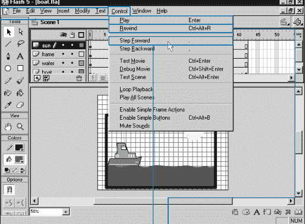

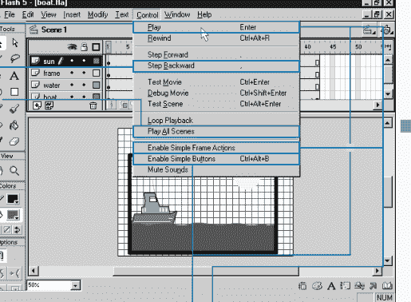

- 1 点击播放工具显示控制菜单。
- 2 点击播放播放你的电影。
- 3 点击倒回返回到第一帧。
- 4 点击向前移动让电影向前移动一帧。
- 5 点击向后移动让电影向后移动一帧。
- 6 点击播放所有场景并点击播放播放所有场景。
- 7 点击启用简单帧动作并点击播放测试动作。
- 8 启用简单按钮测试按钮。
- 38

## 使用 ActionScript 编程

### 额外

你可以使用控制器工具栏播放电影。在 Windows 中点击 `窗口 -> 工具栏`，或在 Macintosh 上点击 `窗口 -> 控制器` 来打开控制栏。步进按钮将停止你的电影。倒回按钮将你的电影返回一帧。向后移动让电影向后移动一帧。播放按钮播放你的电影。向前移动带你向前移动一帧。结束（End）将你带到最后一帧。

要在 Web 浏览器中测试电影，从菜单中点击 `文件 -> 发布预览 -> 默认`。Flash 在你的默认 Web 浏览器中打开你的电影。

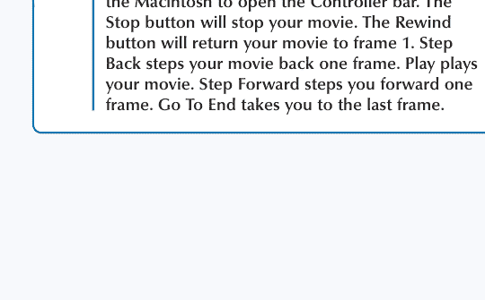

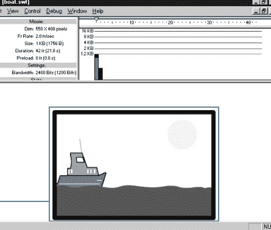

- 9 点击静音声音或播放让你的电影没有声音。
- 10 点击测试电影或场景移动到测试环境。
- 这是测试环境。在测试环境中，你可以以最终形式测试你的电影。

### 进入环境

当你的电影到达某一帧时，如果数据未下载，将导致电影暂停直到数据下载完成。在环境中，你可以以各种调制调器速度查看电影的图形表示。这让你能够看到哪些帧可能会导致你的电影暂停。

带宽分析器（Bandwidth Profiler）的左侧显示电影剪辑尺寸、帧率、帧和秒的大小，以及预加载帧的秒数。带宽分析器的右侧显示图表。如果条形在红线以下，线条将实时流传输。如果条形在红线以上，帧必须等待流传输。

选择你想要使用的速度。通常，说明的模式高于你经验过的典型速度。带宽分析器根据该速度估计间隔。例如，带宽分析器对 28.8 调制电影使用 2.3KB/s。带宽分析器还有一个选项，允许你指定想要测试的速度和性能。


你可以使用流传输来模拟加载的帧数和当前播放的帧。你可以点击任何条形显示有关该帧的信息。你还可以查看每帧的图形表示。

测试环境还有选项，允许你播放、倒回、向前移动、向后移动或循环播放你的电影。

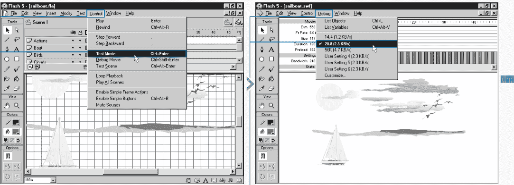

- 1 控制测试电影移动到测试环境。
- 2 控制调试并选择你想要测试电影的调制调器速度。
- 你的电影将自动播放。

## 使用 ActionScript 编程

## 额外

在测试环境中，你可以通过点击菜单中的 `窗口 -> 动作` 快速移动到动作面板。

你可以通过点击菜单中的 `窗口 -> 工具栏` 来选择显示状态栏、控制器或主工具栏。你可以使用控制器来播放、倒回、向前移动、向后移动或循环播放你的电影。你可以使用主工具栏来。

你可以通过点击 `视图 -> 缩放` 来放大你的电影。你可以点击 `视图` 缩小。


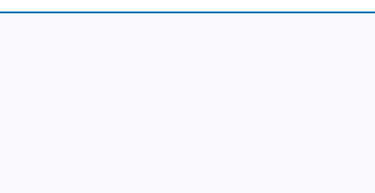


- 点击 `视图 -> 流传输` 模拟电影的流传输。
- 测试你的电影。
- 带宽分析器提供关于。

## 添加注释

当你进行协作或脚本很复杂且你想记录每个步骤的目的时，为脚本注释至关重要。添加注释也是良好的习惯。添加注释的语法是：

```
// 注释 或 /* 注释 */
```

你可以在任何地方使用 `//` 添加单行注释。对于多行注释，以 `/*` 开始并以 `/` 结束。

你也可以使用以下语法添加注释：

```
/* 注释
 * 注释
 * 注释
 * /
```

这种语法允许你将注释跨越几行。

当你执行脚本时，Flash 会忽略注释。当你进行调试时，有时注释掉部分代码以便执行剩余代码。这可以帮你定位问题。

注释的一个频繁用途是记录脚本作者、编写日期和任何修订。

在 Flash 中，你还可以为时间轴上的帧添加注释。在这里，当你在环境中工作时注释也非常用。Flash 不会导出注释，它们不会影响电影的大小。你应该将注释放在单独的层上。


- 选择你想添加 ActionScript 的帧、按钮或电影剪辑。
- 此示例使用了帧。
- 点击 `窗口` `动作` 打开动作面板。
- 点击 `动作`。
- 双击注释。
- 输入你的注释。

42

## 使用 ActionScript 编程

## 额外

你可以为时间轴上的帧添加注释。要创建帧注释，创建一个注释层，选择你想添加注释的帧，点击 `窗口` 面板 `帧面板`，并在标签字段中输入 `//` 后跟你的注释。


- 点击选择你想执行的语句。
- 点击 `X` 关闭动作面板。
- 控制 `Ctrl+` 测试电影移动到测试环境。

注意：请参第 38 页有关测试电影的信息。

- 当你执行脚本时，Flash 会忽略注释。

9 测试你的电影。

## 停止电影

一旦加载 Flash 电影，它就会开始播放，除非你停止它，否则它会持续播放。你可以使用 `stop` 操作来停止电影。`stop` 操作的语法为：

```javascript
stop();
```

`stop` 操作不接受任何参数，因此没有参数。你可以使用 `stop` 操作停止主时间轴（Timeline）或停止电影。如果你想停止时间轴，直接使用 `stop` 操作即可。如果你想停止电影，该电影剪辑（movie clip）必须位于舞台（Stage）上，必须有一个实例名称，并且你必须定位该剪辑。在实例面板中命名电影剪辑。关于更多命名电影剪辑，请参阅第 1 章。定位剪辑意味着指定你想让 ActionScript 执行动作的剪辑。关于定位剪辑的更多信息，请参阅第 10 章。

你可以在任何点停止电影或电影剪辑。电影在加载后立即开始播放。你可以在第一帧停止电影，并在准备好开始让用户按下按钮。或者你可以在帧的结束处停止电影，并创建按钮来决定播放的下一个场景。你可以将 `stop` 操作应用于任何按钮、帧或电影剪辑，但当你想要用按钮控制动作时，你会频繁使用 `stop` 操作。


- 1 点击想要添加 ActionScript 的帧或电影剪辑。
- 2 此示例使用了一个帧。Flash 电影在加载时即刻播放。
- 3 点击“基本动作”（Basic Actions）。
- 4 双击“停止”（Stop）。
- 7 `stop` 操作出现在动作列表（Action list）中。
- 5 `X` 关闭动作面板。

注意：此示例使用了文件 `stop.fla`，你可以在随书附的光盘中找到它。

- 2 点击窗口（Window）-> 动作（Actions）以打开动作面板。

# 使用 ActionScript 编程

## 进阶

你可以使用类似于此处所示的脚本来停止电影剪辑。在此示例中，脚本与一个按钮关联。`on(release)` 操作告诉 Flash 在用户点击按钮后释放鼠标时开始动作。电影的名称为 `smallMC`。`tellTarget("smallMC")` 语句告诉 Flash 你想对 `smallMC` 剪辑执行动作。`stop()` 操作告诉 Flash 停止 `tellTarget` 操作中标识的电影剪辑。在此示例中，Flash 停止了 `smallMC`。

示例：

```javascript
on (release) {
  tellTarget("smallMC") {
    stop();
  }
}
```


- 6 点击“测试电影”（Control Test Movie）进入测试环境。
- 7 测试你的电影。

注意：关于测试电影的信息，请参阅第 38 页。

- 你的电影显示在屏幕上。由于你添加了 `stop` 操作，电影不会播放。

## FLASH ACTIONCRIPT

## 播放电影

当你停止电影或电影剪辑时，它会保持停止状态，直到你显式发出语句启动它。你使用 `play` 操作来启动电影剪辑。`play` 操作的语法为：

配合 `tellTarget` 使用的动作。关于 `tellTarget`，请参阅第 10 章。你也可以使用 MovieClip 对象的 `play` 方法启动电影剪辑。`play` 方法的语法为：

```javascript
play();
```

`play` 操作不接受任何参数，因为它没有参数。你使用 `play` 操作启动主时间轴或启动电影剪辑。如果你想启动电影剪辑，该剪辑必须位于舞台上，如果你有实例，则必须定位该剪辑。使用电影剪辑的名称，请参阅第 1 章。定位剪辑意味着指定你想让 ActionScript 执行动作的剪辑。你使用 `instanceName` 参数指定想要播放的电影剪辑。以下示例显示了 `sampleMC`：

```javascript
sampleMC.play();
```

你可以在任何点启动电影或电影剪辑。你可以在用户点击按钮、电影到达指定帧或用户按下按键时启动电影或电影剪辑。你可以将 `play` 操作应用于任何按钮、帧或电影剪辑。


- 选择想要添加 ActionScript 的帧、按钮或电影剪辑。

> 注意：此示例使用了 `file.fla`，你可以在随书附的光盘中找到它。

- 此示例使用了一个按钮。
- 点击窗口（Window）-> 动作（Actions）以打开动作面板。

# 使用 ActionScript 编程

## 进阶

你可以使用类似于此示例所示的脚本来重启电影剪辑。在此示例中，脚本与一个按钮关联。`on(release)` 操作告诉 Flash 在用户点击按钮后释放鼠标时开始动作。电影剪辑的名称为 `smallMC`。`tellTarget("smallMC")` 语句告诉 Flash 你想对 `smallMC` 剪辑执行动作。`stop()` 操作告诉 Flash 停止 `tellTarget` 操作中标识的电影剪辑。在此示例中，Flash 停止了 `smallMC`。

示例：

```javascript
on (release) {
  tellTarget("smallMC") {
    stop();
  }
}
```


- `stop` 操作出现在动作列表中。
- `X` 关闭动作面板。


- 点击“测试电影”（Control Test Movie）进入测试环境。
- 测试你的电影。
注意：关于测试电影的信息，请参阅第 38 页。
- 你的电影显示在屏幕上。由于你添加了 `stop` 操作，电影不会播放。

## 跳转到帧或场景

当你停止电影或电影剪辑时，它会保持停止状态，直到你显式发出语句启动它。你使用 `play` 操作来启动电影剪辑。`play` 操作的语法为：

```javascript
gotoPlay(frame);
gotoStop(frame);
```

配合 `tellTarget` 使用的动作。关于 `tellTarget`，请参阅第 10 章。你也可以使用 MovieClip 对象的 `play` 方法启动电影剪辑。`play` 方法的语法为：

```javascript
play();
```

`play` 操作不接受任何参数，因为它没有参数。你使用 `play` 操作启动主时间轴或启动电影剪辑。如果你想启动电影剪辑，该剪辑必须位于舞台上，如果你有实例，则必须定位该剪辑。使用电影剪辑的名称，请参阅第 1 章。定位剪辑意味着指定你想让 ActionScript 执行动作的剪辑。你使用 `instanceName` 参数指定想要播放的电影剪辑。以下示例显示了 `sampleMC`：

```javascript
sampleMC.play();
```

你可以在任何点启动电影或电影剪辑。你可以在用户点击按钮、电影到达指定帧或用户按下按键时启动电影或电影剪辑。你可以将 `play` 操作应用于任何按钮、帧或电影剪辑。

## 跳转到场景


- 1 点击想要添加 ActionScript 的帧或电影剪辑。
- 2 此示例使用了一个帧。Flash 电影在加载时即刻播放。
- 3 点击“基本动作”（Basic Actions）。
- 4 双击“停止”（Stop）。
- 7 `stop` 操作出现在动作列表中。
- 5 X 关闭动作面板。

注意：此示例使用了文件 `stop.fla`，你可以在随书附的光盘中找到它。
- 2 点击窗口（Window）-> 动作（Actions）以打开动作面板。

# FLASH ACTIONCRIPT

## 设置电影质量

Flash 使用抗锯齿技术来平滑图像边缘。通过抗锯齿，Flash 能够显示出清晰的图像。然而，由于抗锯齿需要更快的处理器，它可能会降低电影的播放速度。你可以分配 `toggleHighQuality` 动作来启用抗锯齿并加速电影的播放。`toggleHighQuality()` 的语法为：

`toggleHighQuality()` 动作不执行任何操作，因此它没有任何参数。关闭抗锯齿会影响播放器中的所有电影。你无法调整单个电影或剪辑的质量。通过将 `toggleHighQuality` 赋值给按钮，你可以通过点击它来切换抗锯齿的开启。如果抗锯齿已关闭，点击按钮将将其开启。

当在独立播放器中查看 Flash 电影时，点击菜单中的“查看高质量”（View High Quality）可以切换抗锯齿的开启。

你可以创建一个 HTML 文件以便在 Web 上查看你的电影。你可以通过点击文件 -> 发布（File -> Publish）并使用发布设置（Publishing Settings）框来使用 Flash 创建 HTML 文件。如果你点击发布设置框中的 HTML，你就会设置 HTML 文档的参数。在参数中，你可以指定电影在 Web 上播放时时使用的抗锯齿级别。你可以选择你需要的级别。你也可以使用 `sqf` 变量手动创建你的电影。如果你在创建 HTML 文件时没有指定质量，Flash 将使用默认设置。

## 设置电影质量


- 1 点击你想添加 ActionScript 的帧、按钮或电影剪辑。
- 此示例使用按钮。
- 2 点击窗口动作（Window Actions）以打开动作（Actions）面板。

注意：此示例使用 `quality.fla`，你可以在随书附赠的 光盘中找到它。
- 3 在基本动作（Basic Actions）中点击切换高质量（Toggle High Quality）选择 `toggleHighQuality` 动作。

50

# 使用 ACTIONSCRIPT 编程

## 额外

在发布设置对话框中设置质量参数时，你可以从以下选项中选择：

| 选项 | 描述 |
| --- | --- |
| 低 (Low) | 优先考虑播放速度而非外观。从不使用抗锯齿 |
| 自动低 (Auto Low) | 从关闭抗锯齿开始。如果 Flash Player 确定处理器可以处理抗锯齿，Flash Player 将开启抗锯齿 |
| 自动高 (Auto High) | 从开启抗锯齿开始。如果 Flash Player 确定处理器无法处理抗锯齿，Flash Player 将关闭抗锯齿 |
| 中等 (Medium) | 使用抗锯齿。从不平滑位图 |
| 高 (High) | 在每个实例都使用抗锯齿。此设置优先考虑外观而非播放速度。如果电影不包含任何动画，它会平滑位图。如果电影不包含动画，则不平滑位图 |
| 最佳 (Best) | 所有输出都经过抗锯齿处理。此选项不考虑播放速度。 |


`on (release)` 处理程序默认。
- 4 点击 X 关闭动作面板。
- 5 点击 Control+ Movie 移动到测试环境。

有关测试你的电影的信息，请参见第 38 页。
- `toggleHighQuality` 动作出现在动作列表中。
- 6 点击质量（Quality）按钮测试你的电影。
- 点击质量按钮可以切换抗锯齿的开启。

## 打开 Web 页面

你可以使用 `getURL` 动作在浏览器窗口中打开 Web 页面并将变量传递给其他应用程序。当你想要将电影移动到另一个 Web 页面时，`getURL` 动作非常有用。`getURL` 动作的语法为 `getURL(url, variables)`。

你使用 `url` 参数指定要打开的页面的 Web 地址。使用 `window` 参数指定页面打开的帧。选择 `_self` 在当前帧打开页面，`_blank` 在新窗口中打开页面，`_parent` 在当前帧打开页面，`_top` 在当前帧的顶层帧打开页面。

你还可以使用 `getURL` 动作将变量发送到指定的 URL。你可以在脚本中包含要发送的变量，或者使用动态文本框来创建变量。有关动态文本，请参见第 4 章。使用 `method` 参数指定你想使用的模式。在 Normal 模式下，你有三个选择：Get、Post 和 Send。使用 Get 在 URL 的末尾附加少量变量。使用 Post 跨 URL 变量。使用 Send 允许你发送大量变量。如果你不想


- 点击你想添加 ActionScript 的按钮或电影剪辑。
- 此示例使用 `getURL` 动作。
- 点击窗口动作（Window Actions）打开动作面板。
- 基本动作（Basic Actions）出现在动作列表中。
- `on (release)` 处理程序默认。

（注：此处逻辑对应）

注意：此示例使用 `url.fla`，你可以在随书附赠的 光盘中找到它。

# 使用 ACTIONSCRIPT 编程

## 额外

你也可以通过在文本字段中创建指向 Web 页面的链接来打开 Web 页面。要创建链接，使用工具选择文本字段。从菜单点击 Character 打开字符面板。在 URL 字段中输入你想链接的 URL。

你可以使用 `getURL` 创建菜单。只需使用一系列按钮配合 `getURL` 动作即可轻松创建许多类型的菜单。对于悬停（rollover）处理程序，你可以使用按钮处理程序。使用 `visible` 属性使菜单在悬停时可见。当用户悬停在菜单选项上，你可以在屏幕上显示图像。


| 对象动作 | | |
|---|---|---|
| 对象动作 | | |
| 基本动作 | `on (release)` | |
| | `getURL("http://www.baygroup.com", "")` | |
|| 操作符 (Operators) | | |
| 面板 (Panels) | | |
| 属性 (Properties) | | |
| 对象 (Objects) | | |
| Flash 5 [042_fla] | | |
|---|---|---|
| 工具 (Tool) | 编辑 (Edit) | 查看 (View) | 帮助 (Help) |
| 场景 1 (Scene 1) | | | |
| | `getGroup` | | |
| 新 Web 页面 (New Web Page) | | | |


| | | | |

| | | | |

| 调试电影 (Debug Movie) | | | |

| 测试场景 (Test Scene) | | | |

| 最后一帧 (Last Frame) | | | |

| 播放所有场景 (Play All Scenes) | | | |

| 启用帧 (Enable Frame Actions) | | | |

| 启用按钮 (Enable Buttons) | | | |

| 电影缩放 (Movie Swoop) | | | |

| 行 2:`getURL("http://www.baygroup.com", "")` | | | |

|---|---|---|

| | URL:`getURL("http://www.baygroup.com", "")` | | |

| 窗口 (Window) | 空 (blank) | | |

| [enabled] | 下一个 (next) | | |


- 输入你想访问的 URL。
- 选择页面打开的窗口或帧。
- 选择你想使用的发送变量的方法。
- 关闭动作面板。
- 点击 Control < Move 移动到电影测试环境。
- 点击新 Web 页面按钮测试你的电影。

有关测试你的电影的信息，请参见第 38 页。

你可以点击新 Web 页面按钮来打开 Web 页面。

## FLASCRIPT

# 与 FLASH PLAYER 通信

Flash Player 是一个独立播放器，你可以用它查看 Flash 电影。Flash Player 允许你在没有 Flash 或 浏览器的情况下查看 Flash 电影。Flash Player 是一个类似于电影胶映机的独立播放器。你可以查看你的电影。如果你有 Flash Player，你不需要任何工具就可以为 Flash 制作电影。只需在发布设置对话框中选择项目（Project）。

`quit`, `exec`, `fullScreen`, `allScale`, `showMenu`。你可以使用参数参数来指定与要执行的命令相关的参数。`quit` 选项关闭窗口。`exec` 命令从播放器启动动画。你可以使用动画的路径作为参数。`fullScreen` 选项控制播放器。你可以使用 `true` 作为全屏的参数；使用 `false` 用于普通视图。`allScale` 选项控制缩放。如果你希望动画缩放到屏幕大小，你可以使用 `true` 作为参数。如果你不希望它随屏幕大小缩放，`showMenu` 命令控制右键菜单。你可以使用 `true` 作为参数显示菜单；使用 `false` 隐藏菜单。

Flash Player 在 Windows 中的文件名为 `Flash.exe`，在 Macintosh 上名为 `FlashPlayer`。你可以使用 `fscommand` 与 Flash Player 通信。`fscommand` 的语法为

`fscommand(command, argument)`。

你可以使用命令告诉 ActionScript 你想执行什么。

# Flash (B2FWPlayer.exe)

与 FLASH PLAYER 通信


- 1 点击你想添加 ActionScript 的按钮、帧或电影剪辑。
- 2 此示例使用按钮。
- 3 点击窗口（Window）打开动作（Actions）面板。
- 4 点击 FSCommand 选择 fscommand 参数。
- 5 参数面板打开。
- 6 on (release) 处理程序默认。

注意：此示例使用 `fsc.fla`，你可以在随书附赠的 光盘中找到它。

# 使用 ACTIONSCRIPT 编程

## 额外

你可以使用 `fscommand` 向如 JavaScript 等脚本语言发送消息。你可以向 `fscommand` 动作传递任何两个参数，给任何处理 `fscommand` 动作的 JavaScript 函数。命令和参数参数会将参数发送到被调用的 JavaScript 函数。

`fscommand` 动作会调用 JavaScript 函数 `moviename_doCommand`。如果你在“HTML 发布设置”框中使用带有 `fscommand` 模板的 Flash 发布你的电影，那么电影的 Name（名称）和 ID 属性将是文件名。

| 对象动作 | |

|---|---|

| + 对象动作 | |

| + 基础动作 | |

| > 动作 | |

| > 运算符 | |

| > 参数 | |

| > 属性 | |

| > 对象 | |

```javascript
on (release) {
fscommand("fullscreen", "true");
}
```

| 第 2 行: `fscommand("fullscreen", "true")` | |

|---|---|

| 命令: `fullscreen` | 表达式 |

| 参数: `true` | 表达式 |

| `fullscreen` (布尔值) | |


- `fscommand` 动作出现在动作列表中。
- 点击选择一个用于独立版播放器的命令。
- 在命令字段中输入命令。
- 在参数字段中输入参数。
- 发布你的电影。
- 打开你的 Flash Player 并测试你的电影。
- 你的电影开始播放。
- 你可以点击全屏按钮将你的电影切换到全屏模式。

## FLASH ACTIONSCRIPT

## 创建用户可以拖拽的对象

你可以使用 `startDrag` 动作创建用户可以拖拽的对象。任何电影剪辑或按钮都是可拖拽的。`startDrag` 动作的步骤如下：

`startDrag(target, lock, left, top, right, bottom)`

使用 `target` 参数指定要变为拖拽的电影剪辑或按钮的路径。你可以使用 `this` 关键字来标记 ActionScript 拖拽的对象。

使用 `lock` 参数，如果你希望在拖拽时 Flash 将指针锁定在对象中心，则使用布尔值 `true`。如果你希望 Flash 将指针锁定在你按下鼠标按钮的位置，则使用布尔值 `false`。`lock` 参数是可选的。

使用 `left`、`right`、`top` 和 `bottom` 参数来指定用户可以拖拽对象的矩形区域。你通过距离电影顶部和左边界的像素数来指定该区域。电影的左上角值为 0，随着向上移动而增加。电影的右下值为 0，随着向下移动而增加。这些参数是可选的。

一次只能有一个对象是可拖拽的。在执行 `stopDrag` 或另一个 `stopDrag` 动作之前，对象将保持可拖拽状态。使用 `stopDrag` 动作停止当前的拖拽操作。

`stopDrag` 动作的语法不接受任何参数，因此它没有参数。

| 对象动作 | 评估 | 示例 |

|---|---|---|

| + 对象动作 | | |

| + 基础动作 | | |

| - ActionFrame | for | |

| - Functions | getRTF | |

| - 运算符 | | |

| - 属性 | | |

| - frameloaded | | |

| - include | | |

| - loadables | | |

| - on | | |

| - point | | |

| - releaseMouseUp | | |

| - return | | |

| - setVisible | | |

| - setProperty | | |

| - startDrag | | |

| - stopHandlers | | |

| - target | | |

| - touchingLocally | | |

| 未选择动作 | | |

| 对象动作 | 26 个对象动作 |

|---|---|

| + 基础动作 | | |

| - on (release) | `startDrag(event);` |

| - Action | | |

| 运算符 | | |

| - 属性 | | |

| 对象 | | |

| 第 2 行: `startDrag(this)` | |

| 类型 | 表达式 |

|---|---|

| 限制在矩形内 | B |

| lock，鼠标居中心 | B |

1. 点击按钮。
2. 点击。`startDrag` 动作出现在动作列表中。
3. 参数面板打开。
4. 在 Target（目标）字段中输入 `this`。
5. 点击 (release)。


6. 点击 `Expression`（表达式）。处理器面板打开。

# 使用 ACTIONSCRIPT 编程

## 额外

可拖拽对象有很多用途。你可以创建一个可拖拽的对象并将其用作滚动条。用户可以使用滚动条滚动一段文本。

你还可以使用可拖拽对象来增加或减少声音的音量和声相（panning）。例如，当用户向右拖动条时，你的声音可以平移到左扬声器。当用户向左拖动条时，随着用户拖动滚动条，你的声音音量会增加或减少。


- 6 点击选择。[ ] 变为 [ ]。
- 7 点击取消选择。[ ] 变为 [ ]。
- 8 点击动作 `stopDrag`。`stopDrag` 动作出现在列表中。
- 9 点击 `(release)`。处理器面板打开。

# 创建用户可以拖拽的对象（续）

在在创建可拖拽对象时，你通常希望创建一个对象，当用户点击它时它是可拖拽的，并在用户释放鼠标之前保持可拖拽状态。你可能先创建一个按钮。然而，由于你无法针对按钮，你会将按钮转换为电影剪辑。使用带有 `on (press)` 的 `startDrag` 动作来处理拖拽动作。使用带有 `on (release)` 和 `on (rollout)` 处理器的 `target` 动作来停止动作。

`startDrag` 和 `stopDrag` 动作用于创建滑块、滚动条和许多其他可拖拽对象。你使用 `target` 属性来获取上一个对象释放位置的实例名称。`target` 属性返回实例的绝对路径。有关路径和表示法的更多信息，请参阅第 10 章。`target` 属性的语法为：

```javascript
instanceName=target;
```

使用 `instanceName` 指定作为 `start` 动作目标的实例名称。在舞台上选择该对象。使用 `Properties`（属性）框将其转换为电影剪辑。如果你定位的是一个电影剪辑，请在 `start` 动作中制作你所定位的名称。


- 点击选择。勾选 `Roll Out`（输出）。
- `Release` 已选中。
- 点击 `Actions`（动作）。
- 点击 `Insert`（插入）符号。

# 使用 ACTIONSCRIPT 编程

## 额外

在创建可拖拽对象时，你通常希望创建一个对象，当用户点击它时它是可拖拽的，并在用户释放鼠标之前保持可拖拽状态。在这个示例中，脚本所在的区域是可拖拽的区域，从左边界向下 50 像素处。带有 `on (press)` 的 `startDrag` 动作告诉 Flash 在用户按下鼠标时开始拖拽。使用 `this` 关键字告诉 Flash 拖拽对象。带有 `on (release)` 的 `stopDrag` 动作在用户释放鼠标时停止动作。

```javascript
on(press) {
  startDrag(this, false, 0, 0, 50, 50);
}
on(release) {
  stopDrag();
}
```


- 点击 `Control Movie` 进入测试环境。注意：请查看第 38 页关于测试电影的信息。
- 点击实例并拖拽以测试你的电影。你的电影剪辑。

## FLASH ACTIONSCRIPT

## 打印电影

你可以使用 `print` 和 `printAsBitmap` 动作打印电影或电影剪辑。使用 `print` 动作将电影作为图形打印。使用 `printAsBitmap` 动作作为位图打印。如果你以矢量图形打印电影，它可以在任何尺寸下缩放。如果你以位图打印电影，它将无法清晰缩放。如果你在电影中使用透明度或其他颜色效果，则无法使用 `print` 和 `printAsBitmap` 动作。

```javascript
print (target, "bounding")
```

你可以使用 `target` 参数指定要打印的电影或电影剪辑的层或路径。有关层和目标的解释，请参阅第 10 章。使用 `bounding` 参数告诉 Flash 如何打印。使用 `bmovie` 告诉 Flash 将帧中的对象区域作为打印区域。选择用于定义打印区域的对象和帧 #b。使用 `bmax` 处理每帧内容的大小，定义每帧的打印大小。使用 `bframe` 让每个帧填充。默认，如果你只指定了某些帧，会在你想打印的每个帧上打印标签 #b。

ActionScript 需要将 `print` 和 `printAsBitmap` 分别替换为 `printNum` 和 `printAsBitmapNum`。如果你在普通模式下输入，ActionScript 会进行替换。相关解释请参阅附录。

## 打印电影


1. 点击你想添加 ActionScript 的帧、按钮或电影剪辑。此示例使用了
2. 点击 `Window`（窗口）动作打开动作面板。
3. 点击 `Actions` 添加 `print` 动作。`on (release)` 处理器是默认的。
4. `print` 动作出现在列表中。

# 使用 Action 编程

## 额外

用户可以使用 Flash Player 右键菜单上的“打印”（Print）命令，或点击独立播放器菜单中的“文件-打印”来打印 Flash 电影。用户可以通过在 Windows 上右键点击或在 Macintosh 上按 Ctrl+点击来激活 Flash Player 右键菜单。默认情况下，Flash Player 会打印主时间线上的所有帧。如果你使用帧标签 #b，Flash Player 只打印标记为 #b 的帧。如果你没有标记 #b，Flash Player 将使用舞台（Stage）作为打印区域。如果你不想在 Flash Player 菜单上打印你的电影命令，你的用户必须拥有 Windows 版 Flash Player 4.0.25 或 Macintosh 版 4.0.20 版本才能使用你添加到电影中的任何打印功能。

电影剪辑必须位于舞台上并具有实例菜单才能打印。电影必须在完全加载后才能打印。你可以使用 `totalframes` 和 `_framesloaded` 属性来确定所有帧是否已加载。


- 4 点击选择一种打印方法。
- 5 点击选择打印位置。
- 6 点击选择边界方法。
- 7 点击关闭动作面板。
- 8 点击控制测试电影（Control Test Movie）进入测试环境。
- 9 打印你的电影。

注意：请参阅第 38 页获取有关测试电影的信息。

你可以通过在 Windows 上右键点击或在 Macintosh 上按 Control 点击来调出上下文菜单，从而从测试环境中打印电影。从菜单中选择“打印”。

61

## 检查帧加载

你使用 `iframeLoaded` 动作在触发 ActionScript 语句或系列语句之前，确保电影内容到本地计算机的下载已完成。开发者经常使用 `iframeLoaded` 动作，在浏览器下载电影内容之前保持电影运行。`iframeLoaded` 动作的语法为：

```
iframeLoaded(scene, frame) =
```

`scene` 参数是的。你可以指定你想要检查的场景。使用 `frame` 参数指定 Flash 在执行语句之前必须加载的帧数或帧标签。`statement` 参数指定要执行的语句或系列语句。

你可以使用 `iframeLoaded` 动作创建一个预加载器（preloader）。预加载器是在其他动画加载时播放的简短动画。例如，你可以创建一个显示“等待……电影加载中”的预加载器。预加载器一直留在屏幕上，直到指定的帧完全下载。指定的帧下载后，动画开始。通过使用预加载器，将预加载器放置在时间线的第一帧上，并创建一个循环执行直到必要的帧加载。更多关于 `gotoAndPlay` 的信息，请参阅第 48 页。

你也可以配合 `if` 使用 `_frames` 属性，确保在触发 ActionScript 语句或系列语句之前，电影内容到本地计算机的下载已完成。

## 检查帧加载


- 1 点击想要添加 ActionScript 的帧、按钮或电影剪辑。
- 2 点击“窗口”（Window）打开动作面板。
- 3 点击“基本动作”（Basic Actions）打开基本动作分类。
- 5 点击“动作”（Actions）选择一个帧。
- 6 点击选择一个帧类型。
- 7 点击选择一个帧。
- 4 双击“如果帧已加载”（If Frame is Loaded）选择 `iframeLoaded` 动作。

此示例使用一个帧。


# 使用 ActionScript 编程

## 额外

你可以使用此处显示的脚本创建一个预加载器。

```
Frame 1
ifFrameLoaded(60)
gotoAndPlay(3);
```

```
Frame 2
gotoAndPlay(1);
```

将你的预加载器放在帧 1 中。每当播放头进入帧 1 时，它都会检查帧 6 是否已加载。如果帧 60 已加载，Flash 将跳转到帧 3 并开始播放电影；否则，Flash 将跳转到帧 2，指示它循环回到帧 1。


- 8 双击转到（Go To）。
- 9 点击选择一个序列。
- 10 点击选择一个帧类型。
- 11 点击选择一个帧。你的电影在指定数量的帧加载后播放。
- 12 点击 `Control > Test Movie` 进入测试环境。
- 13 测试你的电影。注意：请参阅第 38 页获取有关测试电影的信息。

## Flash ActionScript

在 Flash 中，对象的特性是“属性”（properties）。电影剪辑有许多特性——属性，例如高度、宽度、位置和可见性。使用 ActionScript，你可以获取电影剪辑的当前值，并更改许多属性的值。属性是只读的，这意味着你可以检索值但不能更改它。

属性。检索属性的基本语法是输入实例名，后跟一个点和属性名。设置属性值的基本语法是输入实例名，后跟一个点、一个等号，以及你想要为该属性设置的值。

你出于多种原因检索并更改电影剪辑属性：`_x` 和 `_y` 告诉你电影剪辑的位置。检索高度和宽度可以告诉你电影剪辑的大小。更改这些属性允许你调整大小或移动电影剪辑。

你也可以使用 `setProperty` 动作设置电影剪辑属性。`setProperty` 的语法为：

```
setProperty(target, value).
```

使用参数指定要目标电影剪辑实例名。使用属性参数指定要设置的属性。要检索或设置电影剪辑的属性，你必须提供电影剪辑实例名。使用实例名移动电影剪辑。在 ActionScript 面板中，工具栏列出了电影剪辑属性。你可以使用 `getProperty` 函数检索你想要设置的值。

# 电影剪辑属性简介


- 1 点击想要添加 ActionScript 的帧、按钮或电影剪辑。
- 2 点击“窗口”（Window）打开动作面板。
- 3 点击“基本动作”（Basic Actions）打开基本动作分类。
- 5 点击“动作”（Actions）选择一个帧。
- 6 点击选择一个帧类型。
- 7 点击选择一个帧。
- 4 双击“如果帧已加载”（If Frame is Loaded）选择 `iframeLoaded` 动作。

## 设置电影剪辑属性

### 额外

你可以使用 `setProperty` 动作设置电影剪辑属性。`setProperty` 的语法为：

```
setProperty(target, value).
```

等待，OCR 文本包含一些乱码。根据上下文清理：

```
sampleMC.rotation=15
sampleMC.rotation=105
sampleMC.rotation=90
```


- 1 选择你想命名的电影剪辑实例。
- 2 点击 “窗口”（Window）-> “面板”（Panels）-> “实例”（Instance）打开实例面板。
- 3 输入实例名。
- 4 你已经为电影剪辑实例命名了。
- 5 点击关闭实例面板。

## 设置电影剪属性

### 3

#### 额外说明

为电影剪（movie clip）实例命名可以让你能够定位到该实例。当你想要对特定实例执行操作时，必须定位该电影剪实例。例如，如果你想让电影剪实例 `aMC` 播放，你必须定位电影剪实例 `aMC`。

你可以为电影剪实例命名任何名称。你可以使用下划线、字母和数字来命名电影剪实例。然而，你应该以字母开头实例名称。不要包含空格、句号或其他对 Flash 具有特殊意义的字符。不要使用关键字来命名实例。关键字列表请参阅第 14 章。不要给两个对象赋予相同的名称。例如，不要为变量和实例取相同的名称。

制定一套命名规范并坚持下去是一个好主意。一种流行的约定是将第一个单词之后的所有单词的首字母大写，例如 `birthDate` 或 `firstName`。尽量尝试使用具有意义的名称。具有描述性的名称是很好的选择。

### 重命名实例


- 1 选择你想要添加 ActionScript 的帧、按钮或电影剪。
- 此处使用示例。
- 2 点击 `Windows`（窗口）-> `Actions`（动作）打开 Actions 面板。
- 3 点击 `Properties`（属性）打开 Properties 类别。
- `_name` 属性出现在 Actions 列表中。
- 4 双击 `-name`。
- 电影剪已被重命名。

*新建*

## 调整透明度

你可以使用 `alpha` 属性来设置电影或电影剪的透明度。更改 `alpha` 属性允许你创建可见的电影和电影剪。你可以设置 `alpha` 属性，使电影或电影剪呈现从不透明到不可见的任何状态。将该属性设置为 0 将使电影或电影剪变为透明或不可见。

设置 `_alpha` 属性的参数为 0 到 100 之间的值。

透明的电影剪仍然处于激活状态。如果你将与按钮的按下（up）、按下（down）和悬停（over）状态相关的电影剪透明度设置为 0，用户将看不到该按钮，但用户仍然可以点击该按钮。

在更改电影剪的 `alpha` 属性之前，实例剪必须有一个名称。使用实例名称来命名你的电影剪。该操作的语法如下

获取电影剪的 `alpha` 属性。获取 `alpha` 属性以确定当前值。获取 `_alpha` 属性的语法为：

```
instanceName.alpha = value;
```

`instanceName` 参数用于指定想要设置 `alpha` 属性的实例名称。如果你想设置电影本身的 `alpha` 属性，请省略 `instanceName` 参数。

使用 `instanceName` 参数指定你想要获取 `alpha` 值的实例。你可能想要获取 `alpha` 值并将其赋值给变量，或者获取 `alpha` 值以便在语句中使用。关于此点的更多信息，请参阅第 6 章。

```
instanceName._alpha;
```


- 选择你想要添加 ActionScript 的帧、按钮或电影剪。
- 此示例使用了 `alpha.fla` 文件，你可以在随附书籍的光盘上找到它。
- 点击 `Window`（窗口）打开 Actions 面板。
- 点击 `Properties`（属性）打开 Properties 类别。
- 双击 `alpha` 选择 `alpha` 属性。
- `(release)`（释放）和 `alpha` 属性的默认处理程序出现在 Action 列表中。
- 设置 `alpha` 属性。
- 实例名称位于属性名称之前。
- 值位于属性名称之后。
- 点击 `X` 关闭 Actions 面板。

## 设置电影剪属性

### 额外说明

你可以使用 `Effect`（效果）面板更改符号及其实例的 `_alpha` 属性。要打开 Effect 面板，点击菜单上的 `Window`（窗口）↘ `Effect`（效果）。从下拉菜单中选择 Alpha。你可以通过 0 到 100 的数值调整符号实例的 `_alpha` 属性。更改实例的 `_alpha` 属性不会改变符号或该符号的其他实例。

你可以在补间（tween）中使用 `_alpha` 属性来创建淡入效果。在起始位置设置 `_alpha` 属性。在结束位置重置 `_alpha` 属性。Flash 将插值之间的值，从而产生淡入或淡出的效果。你也可以更改文本的 `_alpha` 属性。然而，你必须先将文本转换为符号。


## Belna Viasal 是南太平洋的一个岛屿吗？是或否

答案：否

- 你可以使用 Flash 菜单。
- 点击 `Control`（控制）↘ `Test Movie`（测试电影）进入测试环境。
- 当你点击按钮测试电影时，电影剪的透明度会发生变化。

注意：请参阅第 38 页测试电影的说明。

## 使电影剪不可见


你可以使用 `_visible` 属性使电影或电影剪对用户可见或不可见。属性是 `_visible`。将与按钮的按下（up）、按下（down）和悬停（over）状态相关的电影剪透明度设置为 0，用户将看不到该按钮，但用户仍然可以点击该按钮。

在更改电影剪的 `alpha` 属性之前，实例剪必须有一个名称。使用实例名称来命名你的电影剪。该操作的语法如下

获取电影剪的 `alpha` 属性。获取 `alpha` 属性以确定当前值。获取 `_alpha` 属性的语法为：

```
instanceName._alpha;
```

`instanceName` 参数用于指定想要设置 `alpha` 属性的实例名称。如果你想设置电影本身的 `alpha` 属性，请省略 `instanceName` 参数。

使用 `instanceName` 参数指定你想要获取 `alpha` 值的实例。你可能想要获取 `alpha` 值并将其赋值给变量，或者获取 `alpha` 值以便在语句中使用。关于此点的更多信息，请参阅第 6 章。

```
instanceName._alpha;
```

## 旋转电影剪

你使用 `_rotation` 属性来旋转电影或电影剪。旋转值是电影片段自其放置在舞台（Stage）上的原始位置起已旋转的度数。

在设置电影片段的 `_rotation` 属性值之前，电影片段必须有一个名称。使用实例名（instance name）来为你的电影片段实例命名。设置 `_rotation` 属性值的语法为：

```
instanceName.rotation = value;
```

`instanceName` 参数用于指定你想要设置 `_rotation` 值的电影片段名称。允许 `instanceName` 为电影设置旋转值。设置 `_rotation` 属性值的 `value` 参数。

请注意，将旋转值设置为 90 是让电影片段从其原点旋转 90 度，而不是从当前位置旋转。如果旋转值为 90 且你再次将旋转值设置为 90，则电影片段将不会旋转。要让电影片段额外旋转 90 度，你必须将旋转值设置为 180。

你可以获取 `_rotation` 值。获取该值的语法为：

```
instanceName.rotation;
```

使用 `instanceName` 参数指定你想要旋转的电影片段名称。使用 `instanceName` 参数获取电影的值。

如果你想从当前位置旋转电影片段若干度数，请获取当前值并加上你想要旋转电影片段的度数。例如，`sampleMC._rotation = sampleMC._rotation + 90;` 将电影片段从其当前位置旋转 90 度。


- 1. 选择你想添加 ActionScript 的帧、按钮或电影片段。
- 此示例使用了 `rotate.fla` 文件，你可以在随附书籍的 CD 中找到它。
- 2. 点击 `Window`（窗口）打开 `Actions`（动作）面板。

注意：此示例使用了 `rotate.fla` 文件，你可以在随附书籍的 CD 中找到它。

- 3. 点击 `Properties`（属性）旋转。

## 设置电影片段属性

## 补充

你可以使用 Flash 菜单来旋转对象。选择一个对象，然后点击 `Modify`（修改）-> `Rotate`（旋转）。对象周围会出现手柄。使用鼠标抓住手柄然后拖动以旋转。选择一个对象并点击 `Modify` -> `Transform`（变换） -> `Rotate 90 CW`（顺时针）将对象顺时针旋转 90 度。选择一个对象并点击 `Modify` -> `Transform` -> `Rotate 90 CCW`（逆时针）将对象逆时针旋转 90 度。你也可以使用箭头工具旋转对象。

每个符号以及符号的实例都有一个注册点（registration point）。默认情况下，注册点是对象的中心。对象围绕注册点旋转。要更改注册点，选择对象，点击菜单中的 `Modify` -> `Edit Center`（编辑中心），并将注册点拖动到新位置。


- 默认的 (release) 处理器出现在 Action（动作）列表中。

注意：关于处理器的更多信息，请参阅第 28 页。

- `_rotation` 属性出现在 Action（动作）列表中。
- 设置 `_rotation` 属性。
- 实例位于属性名之前。
- 值位于属性名之后。
- 移动到测试环境。

注意：关于如何测试电影，请参阅第 38 页。

- 点击按钮测试你的电影。
- 每当你点击按钮时，电影就会旋转 10 度。

## 更改电影片段的宽度

你使用 `width` 属性来设置电影或电影片段左侧到右侧的距离（单位为像素）。你可以在舞台上放置一个输入框，允许用户设置电影片段的大小。当用户在输入框中输入数字时，该数字会被赋予变量。该变量可以决定电影片段的宽度。关于变量的更多信息，请参阅第 95 页。

省略 `instanceName` 属性以以像素设置电影的宽度。使用 `value` 参数设置 `_width` 的像素值。

你可以获取 `width` 属性以获得其当前值。获取 `width` 属性的语法为 `instanceName.width`。使用 `instanceName` 指定你想获取 `width` 属性的电影片段。如果你想获取电影片段的宽度，请省略实例。

在更改电影片段的宽度之前，该片段必须有一个名称。你使用实例面板（instance panel）来重命名电影片段。`_width` 的语法为：

`instanceName` 用于指定你想要更改 `_width` 的电影片段名称。

对于所有属性，你都可以使用 `setProperty` 来设置 `width` 属性值。你可以使用 `getProperty` 函数来获取当前属性值。更多信息请参阅第 64 页，关于 `getProperty` 函数的更多信息请参阅第 210 页。

## 更改电影片段的宽度（此处为重复标题）


- 1. 选择你想添加 ActionScript 的帧、按钮或电影片段。
- 此示例使用了 `rotate.fla`。
- 2. 点击 `Window` 打开 `Actions` 面板。
- 3. 点击 `Properties` `_rotation`。

注意：此示例使用了 `rotate.fla` 文件，你可以在随附书籍的 CD 中找到它。

## 设置电影片段属性（重复标题）

## 补充

你可以使用 Flash 菜单来旋转对象。选择一个对象，然后点击 `Modify` -> `Rotate`。对象周围会出现手柄。使用鼠标抓住手柄然后拖动以旋转。选择一个对象并点击 `Modify` -> `Transform` -> `Rotate 90 CW` 将对象顺时针旋转 90 度。选择一个对象并点击 `Modify` -> `Transform` -> `Rotate 90 CCW` 将对象逆时针旋转 90 度。你也可以使用箭头工具旋转对象。

每个符号以及符号的实例都有一个注册点。默认情况下，注册点是对象的中心。对象围绕注册点旋转。要更改注册点，选择对象，点击 `Modify` -> `Edit Center`，并将注册点拖动到新位置。


| 属性 |  |
| :--- | :--- |
| 默认的 (release) 处理器出现在 Action 列表中。 | 注意：关于处理器的更多信息，请参阅第 28 页。 |
| `_rotation` 属性出现在 Action 列表中。 | 设置 `_rotation` 属性。 |
| 实例名位于属性名之前。 | 值位于属性名之后。 |
| 移动到测试环境。 | 注意：关于如何测试电影，请参阅第 38 页。 |
| 点击按钮测试你的电影。 | 每当你点击按钮时，电影就会旋转 10 度。 |

## 更改电影片段的宽度（重复标题）

你使用 `width` 属性来设置电影或电影片段左侧到右侧的距离（单位为像素）。你可以在舞台上放置一个输入框，允许用户设置电影片段的大小。当用户在输入框中输入数字时，该数字会被赋予变量。该变量可以决定电影片段的宽度。关于变量的更多信息，请参阅第 95 页。

省略 `instanceName` 属性以以像素设置电影的宽度。使用 `value` 参数设置 `_width` 的像素值。

你可以获取 `width` 属性以获得其当前值。获取 `width` 属性的语法为 `instanceName.width`。使用 `instanceName` 指定你想获取 `width` 属性的电影片段。如果你想获取电影片段的宽度，请省略实例。


在更改电影片段的宽度之前，该片段必须有一个名称。你使用实例面板来重命名电影片段。`_width` 的语法为：

对于所有属性，你都可以使用 `setProperty` 来设置 `width` 属性值。你可以使用 `getProperty` 函数来获取当前属性值。更多信息请参阅第 64 页，关于 `getProperty` 函数的更多信息请参阅第 210 页。

## 更改电影片段的宽度


```
on (keypress) {
  widthV = getProperty("width");
  setProperty("width", widthV + 10);
}

on (keypress) {
  widthV = getProperty("width");
  setProperty("width", widthV - 10);
}
```

脚本可以获取当前值并加上你想要旋转电影片段的度数。例如，`sampleMC._rotation = sampleMC._rotation + 90;` 将电影片段从其当前位置旋转 90 度。


| 属性 | 描述 |
| :--- | :--- |
| 默认的 (release) 处理器出现在 Action 列表中。 | 注意：关于处理器的更多信息，请参阅第 28 页。 |
| `_rotation` 属性出现在 Action 列表中。 | 设置 `_rotation` 属性。 |
| 实例名位于属性名之前。 | 值位于属性名之后。 |
| 移动到测试环境。 | 注意：关于如何测试电影，请参阅第 38 页。 |
| 点击按钮测试你的电影。 | 每当你点击按钮时，电影就会旋转 10 度。 |

## 更改电影片段的高度

你使用 `_height` 属性来设置电影或片段底部到顶部的距离。如果你需要在电影播放时重新调整电影或片段的大小，这非常有用。你可以增加或减少电影片段的高度。`_height` 属性的一个可能用途是，当用户增大音量时增加条形的大小。或者，你也可以使用 `_height` 属性来指定舞台上对象的大小。

ActionScript 还提供了获取 `_height` 属性值的能力。通过其他属性，你可以获取 `_height` 属性并使用该值决定下一步执行什么操作。获取 `_height` 的语法为：

在更改电影片段的 `_height` 属性之前，实例名必须有一个名称。使用实例面板创建一个电影片段实例。`_height` 的语法为：

```
instanceName._height = value;
```

```
instanceName._height;
```

使用 `instanceName` 参数指定你想获取 `_height` 属性的电影片段。`instanceName` 参数用于获取电影的高度。


- 1. 选择你想添加 ActionScript 的帧、按钮或电影片段。
- 此示例使用了 list
- 2. 点击 Window 打开 Actions 面板。
- 3. 点击 Properties 打开 Properties 类别。
- 默认的 (release) 处理器出现在 Action 列表中。
- 4. 双击 height 以选择 `_height` 属性。
- 注意：此示例使用了 list（此处此处应为height2），你可以在随附书籍的 CD 中找到它。

## 设置电影剪属性

### 应用

你可以使用此脚本在用户每次点击时增加电影剪的高度。该脚本会获取名为 `block` 的电影剪的高度，并将该值赋值给名为 `height` 的变量。然后，它将 `block` 电影剪的高度设置为 `height` 的值加 10。你可以使用 `setProperty` 动作来设置电影剪的高度。有关 `setProperty` 动作的更多信息，请参阅第 64 页。

### 输入此：

```
on (release) {
  heightV = block._height;
  setProperty("block._height", heightV + 10);
}
```

### 结果：

每当用户点击按钮时，电影剪的高度就会增加 10 像素。

| 对象动作 |
| --- |
| 25 个对象动作 |
| + 对象动作 |
| - 基础动作 |
| - 动作 |
| on (release) {_height=200;} |
| - 运算符 |
| - 函数 |
| 属性 |
| - mc |
| _myinstance |
| _dropzone |
| _framestate |
| _height |
| _highquality |
| _f |
| _quality |
| _visible |
| 行 2: mc._height = 200 |
| 表达式: mc._height = 200 |


- 5 为电影剪实例设置 `_height` 属性。
实例名称位于属性名之前。
值位于属性名之后。
- 6 移动到测试环境。
注意：关于如何测试电影的说明，请参阅第 38 页。
- 7 点击按钮测试你的电影。
电影剪实例的大小将变为你设置的高度。

# 缩放电影剪的宽度

你可以使用 `_xscale` 通过百分比来更改电影或电影剪的宽度。该属性与 `_width` 属性相似。`_width` 属性使用像素更改电影剪从左侧到右侧的距离，而 `_xscale` 使用比例值。

如果你想在任何缩放之前将电影剪的宽度缩小到其尺寸的 50%，则赋值值为 20。如果你想在缩放之前将电影剪的宽度增加到其尺寸的 100%，则赋值值为 200。要让电影剪恢复原始大小，请赋值 100。赋值 0 将导致你的电影或剪辑消失。

在更改电影剪的 `_xscale` 之前，实例必须有一个名称。使用实例面板（Instance panel）为你的电影剪命名。`_xscale` 属性的语法为

你也可以获取电影或电影剪的 `_xscale` 值。获取该值的语法为

```
instanceName._xscale = value
```

参数 `instanceName` 用于指定电影剪的名称。省略 `instanceName` 参数则可以设置电影的 `_xscale` 属性。使用 `value` 参数指定你想要更改电影剪宽度的百分比。

使用 `instanceName` 参数指定你想要获取 `_xscale` 的电影剪名称。如果你正在获取电影的 `_xscale` 属性，请省略 `instanceName` 参数。

```
instanceName._xscale
```


- 选择你想添加 ActionScript 的帧、按钮或电影剪。
- 此示例使用了 `_xscale` 文件。
- 点击窗口（Window）打开动作面板（Actions panel）。
- 属性（Properties） `_xscale` 以选择 `_xscale` 属性。
注意：此示例使用了 `scale.fla` 文件，你可以在随书的 CD 中找到它。

78

# 设置电影剪属性 3

## 额外

你可以使用 Flash 菜单来缩放对象。选择对象并点击“变换缩放”（Transform Scale）。对象周围会出现控制柄。用鼠标抓取控制柄并拖动以缩放。你可以使用 Flash 菜单按百分比缩放对象。点击“修改变换缩放和旋转”（Modify Transform Scale and Rotate），并在缩放字段中输入缩放百分比。你还可以使用箭头工具（Arrow tool）来缩放对象。

你可以在补间（tween）中缩放对象，使对象随时间增大或缩小。对象在起始位置的大小。对象在结束位置的大小。Flash 将对值进行插值，导致对象缩小或增大。


- 默认的 `on (release)` 处理程序出现在动作列表中。
注意：关于处理程序（handlers）的信息，请参阅第 28 页。
- `xscale` 属性出现在动作列表中。
- 4. 为电影剪设置 `xscale` 属性。
- 实例名称位于属性名之前。
- 值位于属性名之后。
- 5. 移动到环境。
注意：关于如何测试电影的说明，请参阅第 38 页。
- 6. 点击按钮测试你的电影。
- 电影剪的宽度将增加到你指定的 `_xscale`。

79

# 缩放电影剪的高度


`_yscale` 属性是 `_scale` 的对应项。使用 `_yscale` 属性更改电影或剪辑的高度。使用 `_yscale` 属性按百分比更改电影的高度。使用 `_scale` 属性更改电影剪的高度。

如果你想在任何缩放之前将电影剪的高度缩小到其尺寸的 50%，则赋值值为 20。如果你想在缩放之前将电影剪的高度增加到其尺寸的 100%，则赋值值为 200。要让电影剪恢复原始大小，请赋值 100。赋值 0 将导致你的电影或剪辑消失。

在更改电影剪的 `_yscale` 之前，实例必须有一个名称。`_yscale` 属性的语法为

你也可以获取电影或电影剪的 `_yscale` 值。获取该值的语法为

`instanceName._yscale`

`instanceName` 参数用于指定电影的名称。省略 `instanceName` 参数则可以设置电影的 `_yscale` 属性。使用 `value` 参数指定你想要更改电影剪高度的百分比。

使用 `instanceName` 参数指定你想要获取 `_yscale` 的电影剪名称。如果你正在获取电影的 `_yscale` 属性，请省略 `instanceName` 参数。

# 缩放电影剪的高度


- 选择你想添加 ActionScript 的帧、按钮或电影剪。
- 此示例使用了 `scale.fla` 文件，你可以在随书的 CD 中找到它。
- 点击窗口（Window）打开动作面板（Actions panel）。
- 属性（Properties） `_yscale` 以选择 `_yscale` 属性。

## 设置电影剪属性

## 额外

你可以使用 Flash 菜单来缩放对象。选择对象并点击“变换缩放”（Transform Scale）。对象周围会出现控制柄。用鼠标抓取控制柄并拖动以缩放。可以使用此脚本在用户每次点击时增加电影剪的高度。该脚本获取名为 `block` 的电影剪的高度，并将该值赋值给名为 `height` 的变量。然后，它将 `block` 电影剪的高度设置为 `height` 的值加 10。你可以使用 `setProperty` 动作来设置电影剪的高度。有关 `setProperty` 动作的更多信息，请参阅第 64 页。

## 输入此：

```
on (release) {
  heightV = block._height;
  setProperty("block._height", heightV + 10);
}
```

## 结果：

每当用户点击按钮时，电影剪的高度就会增加 10 像素。

| 对象动作 |
| --- |
| 25 个对象动作 |
| + 对象动作 |
| - 基础动作 |
| - 动作 |
| on (release) {_height=200;} |
| - 运算符 |
| - 函数 |
| 属性 |
| - mc |
| _myinstance |
| _dropzone |
| _framestate |
| _height |
| _highquality |
| _f |
| _quality |
| _visible |
| 行 2: mc._height = 200 |
| 表达式: mc._height = 200 |


- 5 为电影剪实例设置 `_height` 属性。

实例名称位于属性名之前。

值位于属性名之后。

- 6 移动到测试环境。

注意：关于如何测试电影的说明，请参阅第 38 页。

- 7 点击按钮测试你的电影。

电影剪实例的大小将变为你设置的高度。

# 缩放电影剪的宽度

你可以使用 `_xscale` 通过百分比来更改电影或电影剪的宽度。该属性与 `_width` 属性相似。`_width` 属性使用像素更改电影剪从左侧到右侧的距离，而 `_xscale` 使用比例值。

如果你想在任何缩放之前将电影剪的宽度缩小到其尺寸的 50%，则赋值值为 20。如果你想在缩放之前将电影剪的宽度增加到其尺寸的 100%，则赋值值为 200。要让电影剪恢复原始大小，请赋值 100。赋值 0 将导致你的电影或剪辑消失。

在更改电影剪的 `_xscale` 之前，实例必须有一个名称。使用实例面板（Instance panel）为你的电影剪命名。`_xscale` 属性的语法为

你也可以获取电影或电影剪的 `_xscale` 值。获取该值的语法为

```
instanceName._xscale = value
```

参数 `instanceName` 用于指定电影剪的名称。省略 `instanceName` 参数则可以设置电影的 `_xscale` 属性。使用 `value` 参数指定你想要更改电影剪宽度的百分比。

使用 `instanceName` 参数指定你想要获取 `_xscale` 的电影剪名称。如果你正在获取电影的 `_xscale` 属性，请省略 `instanceName` 参数。

```
instanceName._xscale
```


- 选择你想添加 ActionScript 的帧、按钮或电影剪。
- 此示例使用了 `_xscale` 文件。
- 点击窗口（Window）打开动作面板（Actions panel）。
- 属性（Properties） `_xscale` 以选择 `_xscale` 属性。

注意：此示例使用了 `scale.fla` 文件，你可以在随书的 CD 中找到它。

78

# 设置电影剪属性 3

## 额外

你可以使用 Flash 菜单来缩放对象。选择对象并点击“变换缩放”（Transform Scale）。对象周围会出现控制柄。用鼠标抓取控制柄并拖动以缩放。你可以使用 Flash 菜单按百分比缩放对象。点击“修改变换缩放和旋转”（Modify Transform Scale and Rotate），并在缩放字段中输入缩放百分比。你还可以使用箭头工具（Arrow tool）来缩放对象。

你可以在补间（tween）中缩放对象，使对象随时间增大或缩小。对象在起始位置的大小。对象在结束位置的大小。Flash 将对值进行插值，导致对象缩小或增大。


- 默认的 `on (release)` 处理程序出现在动作列表中。

注意：关于处理程序（handlers）的信息，请参阅第 28 页。

- `xscale` 属性出现在动作列表中。
- 4. 为电影剪设置 `xscale` 属性。
- 实例名称位于属性名之前。
- 值位于属性名之后。
- 5. 移动到环境。

注意：关于如何测试电影的说明，请参阅第 38 页。

- 6. 点击按钮测试你的电影。
- 电影剪的宽度将增加到你指定的 `_xscale`。

79

# 缩放电影剪的高度

`_yscale` 属性是 `_scale` 的对应项。使用 `_yscale` 属性更改电影或剪辑的高度。使用 `_yscale` 属性按百分比更改电影的高度。使用 `_scale` 属性更改电影剪的高度。

如果你想在任何缩放之前将电影剪的高度缩小到其尺寸的 50%，则赋值值为 20。如果你想在缩放之前将电影剪的高度增加到其尺寸的 100%，则赋值值为 200。要让电影剪恢复原始大小，请赋值 100。赋值 0 将导致你的电影或剪辑消失。

在更改电影剪的 `_yscale` 之前，实例必须有一个名称。`_yscale` 属性的语法为

你也可以获取电影或电影剪的 `_yscale` 值。获取该值的语法为

`instanceName._yscale`

`instanceName` 参数用于指定电影的名称。省略 `instanceName` 参数则可以设置电影的 `_yscale` 属性。使用 `value` 参数指定你想要更改电影剪高度的百分比。

使用 `instanceName` 参数指定你想要获取 `_yscale` 的电影剪名称。如果你正在获取电影的 `_yscale` 属性，请省略 `instanceName` 参数。

# 缩放电影剪的高度


- 选择你想添加 ActionScript 的帧、按钮或电影剪。
- 此示例使用了 `scale.fla` 文件，你可以在随书的 CD 中找到它。
- 点击窗口（Window）打开动作面板（Actions panel）。
- 属性（Properties） `_yscale` 以选择 `_yscale` 属性。

## 设置电影剪属性

## 额外


# 设置电影剪属性

## 应用

你可以使用此脚本在用户每次点击时增加电影剪的高度。该脚本获取名为 `block` 的电影剪的高度，并将该值赋值给名为 `height` 的变量。然后，它将 `block` 电影剪的高度设置为 `height` 的值加 10。你可以使用 `setProperty` 动作来设置电影剪的高度。有关 `setProperty` 动作的更多信息，请参阅第 64 页。

## 输入此：

```
on (release) {
  heightV = block._height;
  setProperty("block._height", heightV + 10);
}
```

## 结果：

每当用户点击按钮时，电影剪的高度就会增加 10 像素。

| 对象动作 |
| --- |
| 25 个对象动作 |
| + 对象动作 |
| - 基础动作 |
| - 动作 |
| on (release) {_height=200;} |
| - 运算符 |
| - 函数 |
| 属性 |
| - mc |
| _myinstance |
| _dropzone |
| _framestate |
| _height |
| _highquality |


| `_f` |
| `_quality` |
| `_visible` |
| 行 2: `mc._height = 200` |
| 表达式: `mc._height = 200` |


- 5 为电影剪实例设置 `_height` 属性。
实例名称位于属性名之前。
值位于属性名之后。

- 6 移动到测试环境。
注意：关于如何测试电影的说明，请参阅第 38 页。

- 7 点击按钮测试你的电影。
电影剪实例的大小将变为你设置的高度。

# 缩放电影剪的宽度

你可以使用 `_xscale` 通过百分比来更改电影或电影剪的宽度。该属性与 `_width` 属性相似。`_width` 属性使用像素更改电影剪从左侧到右侧的距离，而 `_xscale` 使用比例值。

如果你想在任何缩放之前将电影剪的宽度缩小到其尺寸的 50%，则赋值值为 20。如果你想在缩放之前将电影剪的宽度增加到其尺寸的 100%，则赋值值为 200。要让电影剪恢复原始大小，请赋值 100。赋值 0 将导致你的电影或剪辑消失。

在更改电影剪的 `_xscale` 之前，实例必须有一个名称。使用实例面板（Instance panel）为你的电影剪命名。`_xscale` 属性的语法为

你也可以获取电影或电影剪的 `_xscale` 值。获取该值的语法为

```
instanceName._xscale = value
```

参数 `instanceName` 用于指定电影剪的名称。省略 `instanceName` 参数则可以设置电影的 `_xscale` 属性。使用 `value` 参数指定你想要更改电影剪宽度的百分比。

使用 `instanceName` 参数指定你想要获取 `_xscale` 的电影剪名称。如果你正在获取电影的 `_xscale` 属性，请省略 `instanceName` 参数。

```
instanceName._xscale
```


- 选择你想添加 ActionScript 的帧、按钮或电影剪。
- 此示例使用了 `_xscale` 文件。
- 点击窗口（Window）打开动作面板（Actions panel）。
- 属性（Properties） `_xscale` 以选择 `_xscale` 属性。

注意：此示例使用了 `scale.fla` 文件，你可以在随书的 CD 中找到它。

## 设置电影剪属性 3

### 额外

你可以使用 Flash 菜单来缩放对象。选择对象并点击“变换缩放”（Transform Scale）。对象周围会出现控制柄。用鼠标抓取控制柄并拖动以缩放。你可以使用 Flash 菜单按百分比缩放对象。点击“修改变换缩放和旋转”（Modify Transform Scale and Rotate），并在缩放字段中输入缩放百分比。你还可以使用箭头工具（Arrow tool）来缩放对象。

你可以在补间（tween）中缩放对象，使对象随时间增大或缩小。对象在起始位置的大小。对象在结束位置的大小。Flash 将对值进行插值，导致对象缩小或增大。


- 默认的 `on (release)` 处理程序出现在动作列表中。
注意：关于处理程序（handlers）的信息，请参阅第 28 页。
- `xscale` 属性出现在动作列表中。
- 4. 为电影剪设置 `xscale` 属性。
- 实例名称位于属性名之前。
- 值位于属性名之后。
- 5. 移动到环境。
注意：关于如何测试电影的说明，请参阅第 38 页。
- 6. 点击按钮测试你的电影。
- 电影剪的宽度将增加到你指定的 `_xscale`。

# 缩放电影剪的高度

`_yscale` 属性是 `_scale` 的对应项。使用 `_yscale` 属性更改电影或剪辑的高度。使用 `_yscale` 属性按百分比更改电影的高度。使用 `_scale` 属性更改电影剪的高度。

如果你想在任何缩放之前将电影剪的高度缩小到其尺寸的 50%，则赋值值为 20。如果你想在缩放之前将电影剪的高度增加到其尺寸的 100%，则赋值值为 200。要让电影剪恢复原始大小，请赋值 100。赋值 0 将导致你的电影或剪辑消失。

在更改电影剪的 `_yscale` 之前，实例必须有一个名称。`_yscale` 属性的语法为

你也可以获取电影或电影剪的 `_yscale` 值。获取该值的语法为

`instanceName._yscale`

`instanceName` 参数用于指定电影的名称。省略 `instanceName` 参数则可以设置电影的 `_yscale` 属性。使用 `value` 参数指定你想要更改电影剪高度的百分比。

使用 `instanceName` 参数指定你想要获取 `_yscale` 的电影剪名称。如果你正在获取电影的 `_yscale` 属性，请省略 `instanceName` 参数。


- 选择你想添加 ActionScript 的帧、按钮或电影剪。
- 此示例使用了 `scale.fla` 文件，你可以在随书的 CD 中找到它。
- 点击窗口（Window）打开动作面板（Actions panel）。
- 属性（Properties） `_yscale` 以选择 `_yscale` 属性。

## 设置电影剪属性

### 额外

你可以使用此脚本在用户每次点击时增加电影剪的高度。该脚本获取名为 `block` 的电影剪的高度，并将该值赋值给名为 `height` 的变量。然后，它将 `block` 电影剪的高度设置为 `height` 的值加 10。你可以使用 `setProperty` 动作来设置电影剪的高度。有关 `setProperty` 动作的更多信息，请参阅第 64 页。


```
instanceName._xscale = value
```

参数 `instanceName` 用于指定电影剪的名称。省略 `instanceName` 参数则可以设置电影的 `_xscale` 属性。使用 `value` 参数指定你想要更改电影剪宽度的百分比。

使用 `instanceName` 参数指定你想要获取 `_xscale` 的电影剪名称。如果你正在获取电影的 `_xscale` 属性，请省略 `instanceName` 参数。

```
instanceName._xscale
```


- 选择你想添加 ActionScript 的帧、按钮或电影剪。
- 此示例使用了 `_xscale` 文件。
- 点击窗口（Window）打开动作面板（Actions panel）。
- 属性（Properties） `_xscale` 以选择 `_xscale` 属性。

注意：此示例使用了 `scale.fla` 文件，你可以在随书的 CD 中找到它。

78

# 设置电影剪属性 3

## 额外

你可以使用 Flash 菜单来缩放对象。选择对象并点击“变换缩放”（Transform Scale）。对象周围会出现控制柄。用鼠标抓取控制柄并拖动以缩放。你可以使用 Flash 菜单按百分比缩放对象。点击“修改变换缩放和旋转”（Modify Transform Scale and Rotate），并在缩放字段中输入缩放百分比。你还可以使用箭头工具（Arrow tool）来缩放对象。

你可以在补间（tween）中缩放对象，使对象随时间增大或缩小。对象在起始位置的大小。对象在结束位置的大小。Flash 将对值进行插值，导致对象缩小或增大。


- 默认的 `on (release)` 处理程序出现在动作列表中。

注意：关于处理程序（handlers）的信息，请参阅第 28 页。

- `xscale` 属性出现在动作列表中。
- 4. 为电影剪设置 `xscale` 属性。
- 实例名称位于属性名之前。
- 值位于属性名之后。
- 5. 移动到环境。

注意：关于如何测试电影的说明，请参阅第 38 页。

- 6. 点击按钮测试你的电影。
- 电影剪的宽度将增加到你指定的 `_xscale`。

79

# 缩放电影剪的高度

`_yscale` 属性是 `_scale` 的对应项。使用 `_yscale` 属性更改电影或剪辑的高度。使用 `_yscale` 属性按百分比更改电影的高度。使用 `_scale` 属性更改电影剪的高度。

如果你想在任何缩放之前将电影剪的高度缩小到其尺寸的 50%，则赋值值为 20。如果你想在缩放之前将电影剪的高度增加到其尺寸的 100%，则赋值值为 200。要让电影剪恢复原始大小，请赋值 100。赋值 0 将导致你的电影或剪辑消失。

在更改电影剪的 `_yscale` 之前，实例必须有一个名称。`_yscale` 属性的语法为

你也可以获取电影或电影剪的 `_yscale` 值。获取该值的语法为

`instanceName._yscale`

`instanceName` 参数用于指定电影的名称。省略 `instanceName` 参数则可以设置电影的 `_yscale` 属性。使用 `value` 参数指定你想要更改电影剪高度的百分比。

使用 `instanceName` 参数指定你想要获取 `_yscale` 的电影剪名称。如果你正在获取电影的 `_yscale` 属性，请省略 `instanceName` 参数。

## 缩放电影剪的高度


- 选择你想添加 ActionScript 的帧、按钮或电影剪。
- 此示例使用了 `scale.fla` 文件，你可以在随书的 CD 中找到它。
- 点击窗口（Window）打开动作面板（Actions panel）。
- 属性（Properties） `_yscale` 以选择 `_yscale` 属性。

### 设置电影剪属性

### 额外

你可以使用此脚本在用户每次点击时增加电影剪的高度。该脚本获取名为 `block` 的电影剪的高度，并将该值赋值给一个名为 `height` 的变量。然后，它将 `block` 电影剪的高度设置为 `height` 的值加 10。你可以使用 `setProperty` 动作来设置电影剪的高度。有关 `setProperty` 动作的更多信息，请参阅第 64 页。

### 设置电影剪辑属性

### 应用

你可以使用 `getProperty` 函数来获取属性。关于 `getProperty` 函数的更多信息，请参见第210页。你可以使用 `setProperty` 动作来设置属性。关于 `setProperty` 动作的更多信息，请参见第64页。

你可以使用此脚本让电影剪辑在舞台上移动。该脚本与一个按钮关联。每当用户点击按钮时，名为 car 的电影剪辑就会向右移动 5 像素。

输入以下内容：

```
on (release) {
carValue = getProperty("car", _x);
setProperty("car", _x, carValue + 5);
}
```

结果：

每当用户点击按钮时，电影剪辑向右移动 5 像素。


- `on (release)` 上的默认处理程序出现在动作列表中。

注意：关于处理程序的信息，请参阅第28页。

- `_x` 属性出现在动作列表中。
- `_x` 属性。
- 实例名称位于属性名之前。
- 值位于属性名之后。
- 移动到测试环境。

注意：请查看第38页关于如何测试电影的说明。

- 点击按钮测试你的电影。
- 每当你点击按钮时，电影剪辑实例将按照你指定的像素数进行移动。

## FLASH 脚本

### 电影剪辑上下移动

你可以使用 `_y` 属性更改电影或电影剪辑相对于舞台顶部的位置。`_y` 属性允许你在舞台上上下移动电影剪辑。通过将 `_y` 属性配合 `_x` 属性，可以指定你想在舞台上放置电影或电影剪辑的位置。

为电影设置 `_y` 属性的参数。使用值参数指定你想将电影剪辑中心点距离舞台顶部的像素数。舞台顶边界的值为0。

你可以获取 `_y` 属性的当前值。获取 `_y` 属性当前值的语法为

在更改电影剪辑实例的 `_y` 属性之前，你必须赋予电影剪辑实例名称。使用实例名来放置电影剪辑。`_y` 属性的语法为

```
instanceName._y =;
```

`instanceName` 参数用于指定你想要设置 `_y` 的电影剪辑的实例名称。省略 `instanceName` 则：

```
instanceName._y;
```

当你想要相对于当前位置重置 `_y` 属性的值时，获取该值是有用的。

你经常使用 `_x` 和 `_y` 属性让电影剪辑在舞台上移动。你可以通过指定坐标移动到任何地方。你可以使用 `_x` 和 `_y` 坐标来创建动作。

### 电影剪辑上下移动


- 1 选择要添加 ActionScript 的帧、按钮或电影剪辑。
- 2 点击窗口动作 (Window Actions) 打开动作面板。
- 3 点击属性 (Properties) 选择 `_y` 属性。

注意：此示例使用了文件 y.fla，你可以在随书附的 CD 中找到它。

### 设置电影剪辑属性

### 额外

你可以使用此处显示的脚本通过按键移动电影剪辑。当用户按下按钮或向下箭头键时，电影剪辑块向下移动三个像素。当用户按下向上箭头键时，名为 block 的电影剪辑向上移动三个像素。

示例：

```
on (press, keyPress "<Down>") (
  y = getProperty("block", _y);
  setProperty("block", _y, y + 3);
)
on (keypress "<Up>") (
  y = getProperty("block", _y);
  setProperty("block", _y, y - 3);
)
```


- `on (release)` 上的默认处理程序出现在动作列表中。
- `_y` 属性出现在动作列表中。
- 将 `_y` 值赋值给变量。
- 变量名为 yv。


- 表达式 `yellowCarMC._y` 获取了 `_y` 值。
- 将变量与动态文本框关联。这允许你向用户显示该值。
- 移动到测试环境。

注意：请查看第38页关于如何测试电影的说明。

- 拖动电影剪辑。
- 文本框显示与汽车相关的 `_y` 值。

抗锯齿 (Antialiasing) 是平滑图像和文本边缘的过程。抗锯齿让 Flash 具有显示清晰图像的能力。抗锯齿让 Flash 能够显示清晰的图像。抗锯齿会减慢电影的播放。你可以使用属性来设置抗锯齿。

抗锯齿让 Flash 能够显示清晰的图像。抗锯齿会减慢电影的播放。你可以使用属性来设置抗锯齿。

为电影设置 `_y` 属性的参数。使用值参数指定你想将电影剪辑中心点距离舞台顶部的像素数。舞台顶边界的值为0。

你可以获取 `_y` 属性的当前值。获取 `_y` 属性当前值的语法为

在更改电影剪辑实例的 `_y` 属性之前，你必须赋予电影剪辑实例名称。使用实例名来放置电影剪辑。`_y` 属性的语法为

```
instanceName._y =;
```

`instanceName` 参数用于指定你想要设置 `_y` 的电影剪辑的实例名称。省略 `instanceName` 则：

```
instanceName._y;
```

当你你想要相对于当前位置重置 `_y` 属性的值时，获取该值是有用的。

你经常使用 `_x` 和 `_y` 属性让电影剪辑在舞台上移动。你可以通过指定坐标移动到任何地方。你可以使用 `_x` 和 `_y` 坐标来创建动作。

抗锯齿 (Antialiasing) 是平滑图像和文本边缘的过程。抗锯齿让 Flash 具有显示清晰图像的能力。抗锯齿让 Flash 能够显示清晰的图像。抗锯齿会减慢电影的播放。你可以使用属性来设置抗锯齿。

抗锯齿让 Flash 能够显示清晰的图像。抗锯齿会减慢电影的播放。你可以使用属性来设置抗锯齿。

抗锯齿 (Antialiasing) 是平滑图像和文本边缘的过程。抗锯齿让 Flash 具有显示清晰图像的能力。抗锯齿让 Flash 能够显示清晰的图像。抗锯齿会减慢电影的播放。你可以使用属性来设置抗锯齿。

抗锯齿让 Flash 能够显示清晰的图像。抗锯齿会减慢电影的播放。你可以使用属性来设置抗锯齿。

抗锯齿 (Antialiasing) 是平滑图像和文本边缘的过程。抗锯齿让 Flash 具有显示清晰图像的能力。抗锯齿让 Flash 能够显示清晰的图像。抗锯齿会减慢电影的播放。你可以使用属性来设置抗锯齿。

抗锯齿让 Flash 能够显示清晰的图像。抗锯齿会减慢电影的播放。你可以使用属性来设置抗锯齿。

抗锯齿 (Antialiasing) 是平滑图像和文本边缘的过程。抗锯齿让 Flash 具有显示清晰图像的能力。抗锯齿让 Flash 能够显示清晰的图像。抗锯齿会减慢电影的播放。你可以使用属性来设置抗锯齿。

## 电影剪辑上下移动

## 额外

- 1 选择要添加 ActionScript 的帧、按钮或电影剪辑。
- 2 点击窗口动作 (Window Actions) 打开动作面板。
- 3 点击属性 (Properties) 选择 `_y` 属性。

注意：此示例使用了文件 `y.fla`，你可以在随书附的 CD 中找到它。

## 设置电影剪辑属性

## 额外

你可以使用此处显示的脚本通过按键移动电影剪辑。当用户按下按钮或向下箭头键时，电影剪辑块向下移动三像素。当用户按下向上箭头键时，名为 `block` 的电影剪辑向上移动三像素。

示例：

```
on (press, keyPress "<Down>") (
  y = getProperty("block", _y);
  setProperty("block", _y, y + 3);
)
on (keypress "<Up>") (
  y = getProperty("block", _y);
  setProperty("block", _y, y - 3);
)
```


- `on (release)` 上的默认处理程序出现在动作列表中。
- `_y` 属性出现在动作列表中。
- 将 `_y` 值赋值给变量。
- 变量名为 `yv`。


- 表达式 `yellowCarMC._y` 获取了 `_y` 值。
- 将变量与动态文本框关联。这允许你向用户显示该值。
- 移动到测试环境。

注意：请查看第38页关于如何测试电影的说明。

- 拖动电影剪辑。
- 文本框显示与汽车相关的 `_y` 值。

抗锯齿 (Antialiasing) 是平滑图像和文本边缘的过程。抗锯齿让 Flash 具有显示清晰图像的能力。抗锯齿让 Flash 能够显示清晰的图像。抗锯齿会减慢电影的播放。你可以使用属性来设置抗锯齿。

## 变量与字符串的操作

### 命名变量

你可以自由地为变量命名任何名称；然而，在命名变量时，必须遵循以下规则：

- 变量名的第一个字符必须是字母、下划线 (`_`) 或美元符号 (`$`)。
- 变量名的后续每个字符必须是字母、下划线 (`_`) 或美元符号 (`$`)。
- 变量名不能是关键字。
- 你的变量名不能是布尔字面量（Boolean literal）。
- 变量名在它的作用域内是唯一的。全局变量在整个电影范围内是唯一的。局部变量在包裹它们的大括号内是唯一的。
- 变量名不一定非要“第一个单词小写开头，后续单词大写开头”的格式；但这是本书的惯例。如果你能制定一种约定并一致地使用它，调试代码将变得更容易。

### 动态显示文本

你可以使用变量来动态显示文本或创建表单。如果你想动态显示文本，首先使用工具（Tool）创建一个文本框。创建文本框后，点击菜单上的 `Window ⊞ Text Options`（窗口 文本选项）。文本选项面板将打开。选择 `Dynamic Text`（动态文本）作为文本类型，并在 `Variable`（变量）字段中输入你想分配给变量的名称。如果你希望字段周围有一个框，选择 `Border/Bg`（边界/背景）。分配给变量的任何信息都会显示在屏幕上。

### 获取用户输入

如果你想创建一个表单来获取用户输入，首先使用 `Text Tool`（文本工具）创建一个文本框。该框将捕获用户的输入。创建文本框后，点击菜单上的 `Window ⊞ Text Options`。文本选项面板将打开。选择 `Input Text`（输入文本）作为文本类型，并在 `Variable`（变量）字段中输入你的变量名称。用户在字段中输入的任何信息都存储在分配的变量中。你引用 `Input Text` 变量和动态变量的方法引用任何其他变量相同。

### 给变量赋值

你可以给变量赋值一个字符串。字符串是任何由字母、数字或标点符号组成的字符序列。你使用字符串来存储字符串值（如文本或 URL），以便以后使用。即使字符串是数字，你也无法对其进行数学运算。在赋值字符串时，必须将其包含在单引号或双引号中。例如 `userName="John Smith"` 将字符串存储在变量 `userName` 中。

你可以给变量赋值数字：`a = 5; x = a + 25; and x = 5 + 7;` 任何返回数字的表达式都会赋值给变量，为变量分配一个数字。ActionScript 将数字存储为浮点数。浮点数的小小数点前后没有固定位数。

当你想要分配 `true`（真）或 `false`（假）、判断条件真假或比较值时，你会使用布尔值（Boolean）。布尔值通常与逻辑运算符配合。在赋值布尔值时，值始终是 `true` 单词、`false` 单词或评估为 `true` 或 `false` 的表达式。例如，`x = false;` 为变量分配一个布尔值。

你可以给变量赋值，并将按钮作为计数器在数学计算中使用，或用于设置属性。分配给变量的数字可以是数学计算的结果。这些示例都执行赋值：

## 给变量赋值


1 选择按钮，或移动到你想添加 ActionScript 的剪辑（clip）。
2. 点击 `Window -> Actions` 打开 Actions 面板。
3. 给变量赋值。

注意：此示例使用了变量文件，你可以在随书附的 CD-ROM 中找到。

## 变量与字符串的操作

### 额外

某些字符不能包含在字符串中，除非它们前面有一个反斜杠（`\`）。下表列出了这些字符。

| 转义序列 (ESCAPE SEQUENCE) | 字符 |
|---|---|
| `\\"` | 双引号 |
| `\\'` | 单引号 |
| `\\` | 反斜杠 |
| `\b` | 退格符 (ASCII 8) |
| `\f` | 换页符 (ASCII 12) |
| `\n` | 换行符 (ASCII 10) |
| `\r` | 回车符 (ASCII 13) |


| `\t` | 制表符 (ASCII 9) |
| 0000 - `\377` | 十八进制表示的字节 |
| 000 - `\FF` | 十六进制表示的字节 |
| `\u0000-\FFFF` | 十六进制表示的 16 位 Unicode 字符 |


- 在表达式中使用变量。
- 如果你将变量与动态文本框关联，就可以向用户显示变量返回的值。
- 移动到测试环境。

注意：关于如何测试你的电影，请参见第 38 页。

- 点击按钮测试你的电影。
- 脚本将执行脚本所需的值分配给变量。你的电影执行动作的方式将与使用字面量值（`literal values`）相同。

## 给变量赋值一个对象或电影剪辑

ActionScript 将数据类型分为两类：原始类型（primitive）和引用类型（reference）。字符串、数字和布尔值是原始数据类型。包含原始类型的变量存储分配给它的值。当发生更改时，原始类型不会更新。例如 `a = 10; b = 30;` 在此示例中，b 等于 10。尽管 a 的值已经改变，b 的值仍保持 10。分配了对象或电影剪辑的变量不存储对象或电影剪辑，而是存储引用。每次调用变量时，都会检索该对象。你可以将对象和电影剪辑赋值以使用这些变量。数组是一个值列表，例如 `flowers = {"lily", "daisy"}; flowers[0] = "daisy";` 现在对 `flowers` 值的更改将返回 "lily, daisy"。这种对引用的更改会自动更新。对象和电影剪辑是引用数据类型。当你从变量中检索对象或电影剪辑时，

### 操作步骤

1. 选择你想添加 ActionScript 的帧、按钮或电影剪辑。
2. 点击 `Window -> Actions` 打开 Actions 面板。
3. 给变量赋值。

注意：此示例使用了变量文件，你可以在随书附的 CD-ROM 中找到。此示例使用了文件。

## 变量与字符串的操作

### 额外

某些字符除非前面有反斜杠，否则不能包含在字符串中。下表通过比较原始数据类型和引用类型说明区别。

| 数据类型 (DATA TYPE) | 数组 (ARRAY) |
|---|---|
| `v1 = "a"; v2 = "b"; v3 = c` | `y = ["a","b"]` |
| `y = ["a","b"]` | `y = ["a","b"]` |
| output: a,b,c | output: a,b,c |
| `v1 = "z"` | output: a,b,c |
| output = z | output: b, c |
| output: a, b, c | output: b, c |


4. 更改数组。此示例更改了数组中的元素。
如果你将变量与动态文本框关联，就可以向用户显示变量返回的值。
5. 给变量赋值。
6. 移动到测试环境。

注意：关于如何测试你的电影，请参见第 38 页。

- 点击按钮测试你的电影。

由于数组是引用类型，你对数组的更改将反映在输出中。

## 加载变量

`loadVariables` 动作从外部文件读取数据。当你需要从文件读取数据或处理来自 CGI、活动服务器页面 (ASP) 或个人主页 (PHP) 脚本的数据时，这非常有用。除非你从浏览器访问数据，否则文件和数据位于相同的子域。

使用 `variableName` 指定变量名称。使用 `value` 指定分配给变量的值。用 `&` 分隔每个键值对。文件中的变量名称必须与电影中的名称匹配。

`loadVariables` 的语法为 `loadVariables(url, location, variables)` `url` 参数用于指定包含变量的文件绝对或相对 URL。`location` 参数用于指定接收变量的层或目标路径。有关层级和目标的更多信息，请参见第 224 页。`variables` 参数用于指定你想使用的方法。选择 `get` 或 `post`。

某些字符不能直接从文件中读取。你必须对这些字符进行 URL 编码。例如，如果你的文件包含 `temperature=+15`，ActionScript 将其读取为 `temperature=15`，丢了加号。此外，对于 `&` 和 `%`，请使用 URL 编码分别为 `%26` 和 `%25`。为了确保 ActionScript 正确读取数据输入，请参见第 14 章的 URL 编码详情。

ActionScript 需要订阅 `loadVariableNum`。如果你使用 Normal 模式输入脚本，这会自动完成。有关 `loadVariable` 和 `loadVariableNum` 的更多信息，请参见附录。

通过以下格式输入设置你想加载的数据：`variableName=variableName&variableName=value...`


- 选择你想添加 ActionScript 的帧、按钮或电影剪辑。
- 此示例使用了按钮。
- 点击 `Window -> Actions` 打开 Actions 面板。
- 加载变量。
- 如果你将变量与动态文本框关联，就可以向用户显示变量返回的值。
- 点击关闭 Actions 面板。

## 变量与字符串操作 4

## 应用

你可以使用 `escape` 函数将表达式转换为 URL 编码格式。`escape` 函数的语法为 `escape(expression)`。使用 `expression` 参数来指定你想要转换为 URL 编码格式的表达式。

你可以使用 `unescape` 函数将表达式从 URL 编码格式转换为 ASCII 字符。`unescape` 函数的语法为 `unescape(expression)`。使用 `expression` 参数来指定你想要从 URL 编码转换为 ASCII 的表达式。

```
输入以下内容：
escape(*temperature+=15);
```

```
输入以下内容：
unescape(*temperature%3D%2B15)
```

```
结果：
temperature%3D%2B15
```

```
结果：
temperature=+15
```


区域销售数据：

| 区域 | 数值 | 百比 |
| :--- | :--- | :--- |
| 区域 A | 40,000 | 20% |
| 区域 B | 60,000 | 30% |
| 区域 C | 100,000 | 50% |

- 点击 `Control Test Movie` 进入文本环境。

注意：请查看第 38 页关于如何测试电影的说明。

- 点击按钮测试你的电影。
- 这些框中的每一个都是一个动态文本框。
- 当你点击按钮时，变量将加载。

95

## FLASH ACTIONCRIPT

## 从字符串中提取字符

`string.charAt` 方法允许你提取指定位置的字符。使用此方法可以验证输入内容。例如，假设输入项中的字符应该是数字。使用 `string.charAt` 方法提取该字符进行评估。如果它不是索引值 1，则会将错误发送给用户。

当使用 `string.charAt` 方法时，通过点号 `.` 跟着一个想要从中检索字符的字符串来执行 `charAt`。将你想要提取的字符索引放在括号中，后面跟一个点号。如何确定索引位置？从左侧开始，字符串中的第一个字符的索引值为 0，第二个字符的索引值为 1，以此此类推。在示例中：

```
x = "abcdef".charAt(2)
```

字母 a 的索引为 0，字母 b 的索引为 1，字母 c 的索引为 2。

当使用 `string.charAt` 时，如果你输入的索引位置不是 0 到字符串最后一个索引之间的数字，ActionScript 将返回空字符串。

你使用 `string.charCodeAt` 来检索字符串中指定位置字符的编码。返回的值是 0 到 65535 之间的整数。`string.charAt` 和 `string.charCodeAt` 方法是相同的，但 `string.charCodeAt` 返回的是字符的编码。`string.charCodeAt(index)` 的语法中，`index` 代表你想要检索编码的字符串。`Index` 代表你想要检索的字符的索引位置。

## 从字符串中提取字符


- 选择你想使用 ActionScript 的帧、按钮或电影剪辑。
- 此示例将赋值给变量。
- 点击 `Window Actions` 打开 `Actions` 面板。

注意：此示例使用了可以在随书光盘找到的 `fla`。

96

## 变量与字符串操作

### 此脚本演示了 `charCodeAt`。它检索变量 `phrase` 中字符的 ASCII 编码。变量 `sampleText` 是动态文本框。

你使用 `string.fromCharCode` 方法来获取 ASCII 编码。`string.fromCharCode` 方法如下：

示例：

```
(release) {
  phrase = 'JUMP OVER THE MOON';
  sampleText = phrase.charAt(6);
}
```

`string.fromCharCode(code1..., codeN)`; 代表字符编码。在此脚本中，用户输入字符并检索到编码。变量 `userEntry` 是输入框。变量 `character` 是动态文本。
示例：

```
(release) {
  character = string.fromCharCode(userEntry);
}
```


从六开始提取索引位置：
跳过月亮。


- 提取字符。
- 进入测试环境。
- ActionScript 提取索引位置 6 的字符。
- 此示例提取索引位置 6 的字符。

注意：查看第 38 页关于如何测试你的移动的说明。

- 如果将变量与动态文本框关联，可以将返回的值显示给用户。

## 从字符串中提取子字符串

你可以使用 `string.substring` 方法来提取嵌入另一个字符串中的字符串。这在你只需要字符串的一部分或验证用户输入时非常有用。例如，如果用户输入的第五到第九个字符应该是数字，你可以使用 `string.substring` 方法提取这些字符。假设我们有以下数据：`userEntry = "ABC12345"`；索引位置加上你想要的最后一个字符。如果你不指定值，将提取字符串的末尾。关于索引位置的说明，请参见第 96 页。

```
part = userEntry.substring(4,9);
```

使用 `substring` 方法时，如果起始位置大于结束位置，ActionScript 将返回空字符串。如果起始位置等于结束位置，ActionScript 将交换参数。ActionScript 提供了多种可以使用的方法来获取子字符串。

### 提取子字符串示例脚本


- 1 选择你想执行 ActionScript 的帧、按钮或电影剪辑。
- 此示例使用了名为 `address` 的变量。
- 2 点击 `Window Actions` 打开 `Actions` 面板。
- 3 将字符串赋值给变量。

注意：此示例使用了可以在随书光盘找到的文件。

## 变量与字符串操作

### 应用

你也可以使用 `slice` 方法来获取子字符串。`slice` 方法使用此语法：
`stringVariable.slice(start, end);`

`start` 参数表示要提取的子字符串第一个字符的索引位置。`start` 为负数时，从字符串末尾计数。`end` 参数表示要提取的最后一个字符的索引位置。如果 `end` 为负数，计数从字符串末开始。

```
输入以下内容：
on (release) {
  nameAddress = "George Allen—153 Kings Way—Brooklyn NY";
  sampleText = nameAddress.slice(-24,11);
}
```

```
结果：
153 Kings Way
```

```
输入以下内容：
on (release) {
  nameAddress = "George Allen—153 Kings Way—Brooklyn NY";
  sampleText = nameAddress.slice(15,28);
}
```

```
结果：
153 Kings Way
```


- 提取子字符串。
- 如果将变量与动态文本框关联，可以将返回的值显示给用户。
- 进入测试环境。
- ActionScript 提取子字符串并显示在屏幕上。

99

## FLASH SCRIPTING

## 拼接字符串

你可以使用 `string.concat` 方法将多个字符串连接成一个字符串。这在你需要包含用户输入的数据时非常有用。该方法会将它们相。在这里，字符串开头或结尾的空格也被视为字符串的一部分。


- 1 选择你想执行 ActionScript 的帧、按钮或电影剪辑。
- 此示例使用了 `concat`。
- 2 点击 `Window Actions` 打开 `Actions` 面板。
- 3 将字符串赋值给变量。

## 变量与字符串的操作

### 运用

你可以使用 `+` 运算符来拼接字符串。后面的脚本提供了一个示例。变量 `sampleText` 是一个动态文本框。变量 `userEntry` 是一个输入文本框。当用户在 `userEntry` 字段中输入颜色并在点击按钮后释放鼠标时，输入的颜色将与变量 `phrase1` 和 `phrase2` 拼接。

```
TYPE THIS:
on(release) {
  phrase1 = "JUMP OVER THE ";
  phrase2 = "MOON";
  sampleText = phrase1 + userEntry + phrase2;
}
```

结果：
如果用户输入 PINK，结果如下。
JUMP OVER THE PINK MOON


- 拼接字符串。
- 如果你将变量与动态文本框关联，你就可以显示返回给用户的值。
- 如果你将变量与输入文本框关联，你就可以从用户处获取输入。
- 进入测试环境。

注意：查看第 38 页有关如何测试你的电影的说明。

- 输入单词或短语。
- 点击按钮。
- ActionScript 会拼接字符串。

## FLASH ACTIONSCRIPT

## 获取字符串的长度

你可以使用 `length` 属性来计算字符串中的字符数。该属性在验证输入时非常有用。例如，如果用户输入的值恰好是 10 个字符，你可以评估长度；如果输入多于或少于 10 个字符，向用户发送错误消息。

示例：

```
"Hello".length
```

在 4 中，`length` 函数用于获取字符串的长度。`length` 函数的语法为 `length(expression)`；使用表达式参数来指定想要获取长度的表达式或变量。

要使用 `length` 属性，只需在想要获取长度的字符串或变量后面跟上 `length` 单词即可。

示例：在下面的示例中，"S2498" 被赋值给变量 `studentID`。然后，使用 `length` 属性获取变量 `studentID` 的值。变量 `enteredLength` 返回 5。

示例：

```
studentID = S249876
enteredLength = length(studentID)
```


变量 `enteredLength` 返回 7。

在计算字符串长度时，空格也会包含在内。在这个示例中，"Hello" 的长度为 6。

`length` 函数在 Flash 5 中已被弃用。如果你正在使用 Flash 5 环境，应该使用 `length` 属性。

## 获取字符串的长度


- 选择帧、按钮或电影剪显示如何添加 ActionScript。

注意：此示例使用了 `file.length`，你可以在随书附的 CD-ROM 上找到它。

- 点击 Actions 打开 Actions 面板。
- 获取字符串的长度。
- 如果你将变量与动态文本框关联，你就可以向用户显示该值。
- 如果你将变量与输入文本框关联，你就可以从用户处获取输入。
- 点击关闭 Actions 面板。
- 将结果赋值给变量。

## 变量与字符串的操作

### 扩展

你可以使用 ActionScript 检查输入的长度。这里显示的脚本演示了这一点。在部电影中，用户输入一个识别号。如果识别号不是五个字符，用户将收到错误消息。脚本附加在按钮上。变量 `studentId` 是输入文本字段。变量 `errorMessage` 是动态文本字段。

Example

``` 
/* 当用户释放按钮时执行脚本 */

(release) {

    // 检查输入框的长度。

    if (studentID.length == 5) {

        // 如果 StudentID 的长度为五个，动态文本框中不显示消息。

        errorMessage = "";

    }

    // 如果 StudentID 的长度不等于五个，在 errorMessage 中显示消息。

    else {

        errorMessage = "Your ID must be 5 characters long.";

    }

}
```


- 点击 Control + Test 进入测试环境。

注意：查看第 38 页有关如何测试你的电影的说明。

- 输入一个单词或短语。
- ActionScript 返回你输入的文本中的字符数。
- 点击按钮测试你的电影。

## FLASH ACTIONSCRIPT

## 搜索字符串

使用 `string.indexOf` 方法你可以在字符串中定位子字符串。如果你需要搜索单词或短语，可以使用此方法。`string.indexOf` 方法返回字符串出现的位置。如果未找到该值，`indexOf` 返回 -1。

如果你不指定 `start`，ActionScript 将从字符串开头开始搜索。关于位置的解释，请参第 96 页。

使用 `string.indexOf` 方法，在你想要搜索的字符串或变量后加上一个点。在 `indexOf` 之后，在括号内放置 `start` 参数。`start` 参数用于指定你想搜索的索引。如果你想对字符串进行多次搜索，需要在电影的第一帧中将一个变量初始化为 0 并将其作为 `start`。在本示例中，调用 `startSearch`。当脚本找到子字符串后，将索引赋值给变量。将 `indexValue+1` 赋值给 `start`。下次搜索将从找到的值右侧索引位置开始。当未找到值时，ActionScript 将返回 -1。


- 1 选择你想添加 ActionScript 的帧、按钮或电影剪辑。
- 此示例使用了 `frame`。
- 2 点击打开 Actions 面板。
- 3 初始化变量。
- 4 选择你想添加 ActionScript 的帧、按钮或电影剪辑。
- 本示例的这部分使用了 `button`。

注意：此示例使用了 `fla`，你可以在随书附的 CD-ROM 上找到它。

## 变量与字符串的操作

### 扩展

`string.lastIndexOf` 方法的工作原理与 `string.indexOf` 方法完全相同，它返回字符串中子字符串最后一次出现的索引。`string.lastIndexOf` 方法使用以下语法：

```
stringValue.lastIndexOf(value, start);
```

这里显示的脚本说明了使用 `string.lastIndexOf`。变量 `start` 从索引位置 36 开始。变量 `indexValue` 是动态文本框。它显示搜索结果。注意，由于 `string.lastIndexOf` 从字符串末尾向开头搜索，每次变量 `start` 被赋值为 `indexValue-1`。

```
Frame 1:

startSearch = 36;

Button:

on (release) {

namesList = "George Paul Tom Peter";

indexValue = namesList.indexOf("Bill", startSearch);

startSearch = indexValue-1;

}
```


- 给变量赋值一个字符串。
- 找到值的索引。
- 将变量与动态文本框关联。这允许你向用户显示变量返回的值。
- 重置帧 1 中的变量。
- 进入测试环境。

注意：查看第 38 页有关如何测试你的电影的说明。
- 每点击一次按钮，ActionScript 都会返回你搜索的字符串的下一个索引值。

## 更改字符串的大小写

你可以使用 `string.toLowerCase` 和 `string.toUpperCase` 方法来更改文本的大小写。当你格式化输出或想在不考虑大小写的情况下比较字符串时，`string.toLowerCase` 将所有不是小写的字符转换为小写。`string.toUpperCase` 将所有不是全大写的字符转换为全大写。

`string.toUpperCase` 方法的语法与 `string.toLowerCase` 方法的语法相似。要使用 `string.toUpperCase` 方法，只需在想要转换为大写的字符串后面加上点和 `toUpperCase` 单词。然后在 `toUpperCase` 后面加上括号。

要使用 `string.toLowerCase` 方法，只需在想要转换为小写的字符串后面加上点和 `toLowerCase` 单词。然后在 `toLowerCase` 后面加上括号。

示例：

```
userEntry = "hello";

sampleText = userEntry.toUpperCase();
```

示例：

```
userEntry = "hello";

sampleText = userEntry.toLowerCase();
```

结果：

hello


- 选择你想添加 ActionScript 的帧、按钮或电影剪辑。
- 此示例使用了 `frame`。

## 变量与字符串的操作

### 4

### 额外

此示例将用户的输入与脚本生成的两个短语拼接在一起。如果用户的输入是小写的，输出将是不一致的。此脚本将用户的输入转换为大写字母。关于字符串拼接的更多信息，请参阅第 100 页。

示例：

```
on (release) {

  phrasel = "JUMP OVER THE";

  phrase2 = "MOON";

  sampleText = phrasel.concat(userEntry.toUpperCase(), phrase2);

}
```


- 5 点击“控制 ← 测试电影”以进入测试环境。
  注意：关于如何测试你的电影，请参阅第 38 页。
- 6 输入一个大写字母的短语。
- 7 点击按钮测试你的电影。
- `ActionScript` 将大写字母转换为小写字母。

## 转换字符串、数字和布尔值

### 转换为字符串

| 条件 | 表达式 | 返回值 |
| --- | --- | --- |
| 如果省略表达式，函数将返回错误信息。 | `string()` | 参数数量错误。 |
| 如果表达式是布尔字面量，函数将返回布尔值的字符串表示。 | `a=false; string(a) b=true; string(b)` | false true |
| 如果表达式是数字，函数将返回数字的十进制表示。 | `string(1/2)` | .5 |
| 如果表达式是字符串，函数将返回表达式本身。 | `a = "hello"; string(a)` | hello |
| 如果表达式是一个对象，函数将返回对象的字符串表示。 | `string(Date)` | [type Function] |
| 如果表达式是一个电影剪（movie clip），函数将返回点符号形式的电影剪。 | `a=(root.sampleMC) string(a)` | _level0.sampleMC |

`String` 函数将布尔值、数字、对象或表达式转换为字符串。当你需要布尔值、对象或表达式的字符串形式时，这非常有用。`String` 函数使用以下语法：
`String(expression)`

`Expression` 代表你想要转换为字符串的数字、变量或对象。
下表说明了 `String` 函数。

#### 转换为布尔值

| 条件 | 表达式 | 返回值 |
| --- | --- | --- |
| 如果省略表达式，函数将返回 false 值。 | `Boolean()` | false |
| 如果表达式是除0以外的任何数字，函数将返回 true 值。 | `Boolean(-234.67) Boolean(10)` | true true |
| 如果表达式是 0，函数将返回 false 值。 | `x = 0; Boolean(x)` | false |
| 如果表达式是布尔值，函数将返回表达式的值。 | `a = false; Boolean(a) b=true; Boolean(b)` | false true |

`Boolean` 函数将字符串、数字、电影剪、对象或表达式转换为布尔值。当你需要评估条件时，此函数非常有用。`Boolean` 函数使用以下语法：
`Boolean(expression)`

`Expression` 代表你想要转换的数字、电影剪、对象或表达式。
下表说明了 `Boolean` 函数。

继续

## 变量与字符串的操作

### 转换为布尔值（续）

| 条件 | 表达式 | 返回值 |
| --- | --- | --- |
| 如果表达式是电影剪或对象，如果该电影剪或对象存在，函数返回 true，否则返回 false。 | `a =(_root.sampleMC); Boolean(a)` | true 如果电影剪存在。false 如果电影不存在。 |
| 如果表达式是除0以外的任何数字的字符串表示，函数将返回 true。 | `Boolean("123") Boolean("12.34") Boolean("-123")` | true true |
| 如果表达式不是除0以外的任何数字的字符串表示，函数将返回 false。 | `Boolean("0") Boolean("abc")` | false |

#### 转换为数字

| 条件 | 表达式 | 返回值 |
| --- | --- | --- |
| `Number` 函数将字符串、布尔值或表达式转换为数字。当你需要字符串、布尔值或表达式的数值等效值时，这非常有用。`Number` 函数使用以下语法：`Number(expression)` `Expression` 代表你想要转换的布尔值或字符串。下表说明了 `Number` 函数。 | |
| 如果省略表达式，函数将返回错误。 | `Number()` | 参数数量错误 |
| 如果表达式是数字，函数将返回表达式的值。 | `x = 10; Number(x)` | 10 |
| 如果表达式是布尔值，函数将返回该值。 | `a = true; Number(a)` | 1 |
| 如果表达式是 0，函数将返回 0。 | `a = false; Number(a)` | 0 |
| 如果表达式是表示为字符串的字符串，函数将返回数字。 | `a = "10"; Number(a)` | 10 |
| 如果表达式是不带引号的字符串变量，函数将返回 0。 | `Number(abc)` | 0 |
| 如果表达式是字符串变量或带引号的字符串，函数将返回 NaN。 | `Number("abc") a=abc Number(a)` | NaN | 优先级与关联性 | `Number` 函数将字符串、布尔值或表达式转换为数字。当你需要字符串、布尔值或表达式的数值等效值时，这非常有用。`Number` 函数使用以下语法：`Number(expression)` `Expression` 代表你想要转换的布尔值或字符串。下表说明了 `Number` 函数。 | |
| 运算符用于组合、比较或修改值。`ActionScript` 根据其优先级执行二进制运算符接收两个操作数。三元运算符（:）是三元运算符，接收三个操作数。`ActionScript` 执行表达式1，如果为真则执行表达式2；如果为假，则执行表达式3。关于条件运算符的更多信息，请参见第6页。一元运算符接收一个操作数。递增（++）和递减（--）是一元运算符。运算符可以是前缀或后缀，取决于其优先级。 | | 运算符的操作 | 运算符的优先级与关联性

| 运算符 | 描述 | 关联性 | 运算符 | 描述 | 关联性 |
| --- | --- | --- | --- | --- | --- |
| 最高优先级 | | | 最高优先级 | | |
| + | 一元值 | 右向左 | < | 小于 | 左向右 |
| - | 一元减法 | 右向左 | <= | 小于等于 | 左向右 |
| ~ | 位反转 | 右向左 | >= | 大于 | 左向右 |
| ! | 逻辑非 | 右向左 | >= | 大于等于 | 左向右 |
| not | 逻辑非 (Flash 4) | 右向左 | lt | 小于（字符串版本） | 左向右 |
| ++ | 后置递增 | 右向左 | le | 小于等于（到字符串） | 左向右 |
| -- | 后置递减 | 右向左 | gt | 大于（字符串版本） | 左向右 |
| 0 | 函数调用 | 右向左 | ge | 大于等于（字符串版本） | 左向右 |
| [] | 数组元素 | 右向左 | == | 等于 | 左向右 |
| ++ | 结构对象 | 右向左 | != | 不等于 | 左向右 |
| -- | 前置递增 | 右向左 | eq | 等于（字符串版本） | 左向右 |
| new | 分配对象 | 右向左 | ne | 不等于（字符串版本） | 左向右 |
| delete | 释放对象 | 右向左 | & | 位与 | 左向右 |
| typeof | 对象的类型 | 右向左 | ^ | 位异或 | 左向右 |
| void | 返回未定义值 | 右向左 | && | 逻辑与 | 左向右 |
| * | 相乘 | 右向左 | and | 逻辑与 (Flash 4) | 左向右 |
| / | 除法 | 右向左 | || | 逻辑或 | 左向右 |
| % | 取模 | 右向左 | or | 逻辑或 (Flash 4) | 左向右 |
| + | 加法 | 右向左 | ? | 条件运算符 | 左向右 |
| add | 字符串拼接（旧） | 右向左 | = | 赋值 | 左向右 |
| +=,-=,&,<<,>>= | | | */=,%=,* | 复合赋值 | 左向右 |
| | | | >==,>== | | |
| >> | 右移（无符号） | 右向左 | 多重评估 | 左向右 |

## 相加数值

你可以使用加号 (`+`) 运算符来相加数值。在执行数学运算时，该运算符是必不可少的。`+` 运算符允许你取一个数值，将其与另一个数值相加，并得到和。要使用加号运算符，可以在两个数值表达式之间放置加号。`ActionScript` 会对其进行相加。表达式是指 `ActionScript` 可以求值并返回数值的语句。加号运算符的语法为 `numericExpression1+numericExpression2`。

对于字符串，加号运算符执行拼接。如果表达式中的所有操作数都是数字，则加号运算符执行加法。有关字符串拼接的内容，请参见第 4 章。

如果一个数字是字符串而你想使用该数字进行加法，请使用 `Number` 函数将字符串转换为数字：

你可以使用加号运算符来相加数值、变量和数字或数值，例如：

```
a="10"

x=20;

y=Number(a)+x;
```

```
z=x+2

z=y;
```


你可以将加号运算符与其他数值运算符结合使用执行复杂的数学计算。你可以在同一个表达式中进行加、减、乘、除运算，但必须注意优先级。优先级控制计算的顺序。例如，ActionScript 在执行加减法之前会执行乘除法。关于优先级的解释，请参见第 110 页。

将两个或多个字符串拼接成单个字符串。你可以使用加号运算符来拼接字符串。如果表达式中的一个操作数是


# 相加数值 [0582add.fla]

1. 在光盘上打开 `file.fla`。
2. 创建输入文本框。
3. 创建一个动态文本框。
4. 创建一个按钮。

6. 打开对象动作（Object Actions）面板。
7. 点击 `+` 运算符 -。

- 参数（Parameters）面板打开。

5. 点击选择按钮。

# 运算符的使用

## 5

# 实际应用

此脚本演示了如何计算小计。用户输入一个值并点击“计算”（Calculate）按钮，将此条目添加到之前的条目中。

**示例：**
* `on (release)` - 告诉 Flash 在用户释放鼠标时启动该动作。

+ * `on (release)` - 一个动态文本框。`subtotal` - 一个动态文本框。`input` - 一个输入文本框。将 `input` 的值转换为数字 *
* 将 `number(input)` 的值与 `subtotal` 的值相加并赋值给 `output`.*

```
output = Number(input) + subtotal;
```

* `subtotal` - 一个动态文本框。`Number(input)` 的当前值与 `subtotal` 相加并赋值给 `subtotal`。 /

```
subtotal = Number(input) + 0;
```

* 将 `input` 的值重置为 0.*


- 输入数学表达式。

- 此示例将 `inputA` 加到。

- 移动到测试环境。

注意：有关如何测试你的电影的说明，请参见第 38 页。

- 点击按钮进行计算。

- ActionScript 将两个输入文本框相加并将结果显示在动态文本框中。

- 输入你的值。

# 减数值

你可以使用减号 (`-`) 运算符来减去数值，或对数字或表达式取反。在执行数学计算时，该运算符是必不可少的。要使用减号进行减法，在两个表达式之间放置减号。表达式是指 ActionScript 可以求值并返回数值的语句。减号运算符的语法为

```
numericExpression1-numericExpression2
```

你可以将减号与其他数值运算符结合使用执行复杂的数学计算。你可以在同一个表达式中进行加、减、乘、除运算，但必须注意优先级。优先级控制计算的顺序。例如，ActionScript 在执行加减法之前会执行乘除法。关于优先级的解释，请参见第 110 页。

你可以使用该运算符减去数字、数值变量和数字或数值变量。如果 `x=4` 且 `y=2`，以下所有示例都是有效的：

```
z=2-1;
x=x-3-y;
```

要使用减号对数字取反，将减号放在数值表达式前面。对表达式符号取反，例如：

```
x=-2-(x+2)
```

如果你使用字符串，ActionScript 会尝试将字符串转换为数字。如果 ActionScript 无法将字符串转换为数字，它将返回 `NaN`。你可以使用 `Number` 函数将字符串转换为数字。使用 `Number` 函数后跟想要转换的表达式（括括号内）。关于 `Number` 函数的更多信息，请参见第 4 章。

示例：

```
a*=10;
x=5;
y=Number(10)-5;
```


1. 在光盘上打开 `file.fla`。
2. 创建输入文本框。
3. 创建一个动态文本框。
4. 创建一个按钮。
5. 点击选择按钮。

6. 打开对象动作面板。
7. 点击 `+` 运算符 -。

## 额外内容

你的数学计算可以根据需要变得尽可能复杂，结合数字和变量。如果你嵌套了括号，ActionScript 会先计算最内层的表达式。

| 输入此内容： | 结果 |
| --- | --- |
| `x=25.356;`<br>`y=4 *+10;`<br>`z=(2+4)-(30*(-5*x));`<br>`output=y*z*z+(2+4);` | 428273.9856 |


- 输入数学表达式。此示例将 `inputA` 乘以 `InputB`。
- 移动到测试环境。请参第 38 页关于如何测试你的电影的说明。
- ActionScript 使用输入文本框中的内容进行乘法运算，并将结果显示在动态文本框中。
- 输入值。

## 数值除法

你可以使用除法 (`/`) 运算符来除以数值。除法运算符在你执行数学计算时至关重要。要使用除法运算符，请在数值表达式之间使用 `/` 运算符。数值表达式是 ActionScript 可以评估并返回数值的任何语句。除法运算符的语法

你可以将除法运算符与其他数值运算符结合，执行复杂的数学计算。你可以在同一个表达式中进行加、减、乘、除，但必须注意优先级。优先级控制计算的顺序。例如，ActionScript 在执行加法之前先执行乘法和除法。

```
numericExpression1/numericExpression2
```

ActionScript 通过一系列计算（从左到右执行）将 `numericExpression1` 除以 `numericExpression2`，例如 `18/3/2`。上面的示例将 18 除以 3 得到 6，再除以 2 得到结果。

如果你使用字符串，ActionScript 会尝试将其转换为数字。如果 ActionScript 无法将字符串转换为数字，它将返回 `NaN`，意思是“不是数字”。你可以使用 `Number` 函数将字符串转换为数字。使用 `Number` 函数时，你输入单词 `Number`，后面跟着括号括起来的表达式。

你可以使用除法运算符除以数字、数值变量和数值变量。如果 `x=4` 且 `y=2`，以下所有情况都是：

示例：

```
a=10;
x=5;
y=Number(10) / 5;
```


如果你除以 0，ActionScript 将返回无限（infinity）。


# 数值除法

- 1 打开光盘上的 `1 file.fla`。
- 2 创建输入框。
- 3 创建一个动态文本框。
- 4 创建一个按钮。
- 5 点击选择按钮。
- 6 打开对象动作（Object Actions）面板。
- 7 运算符 `/`。
- 8 参数（Parameters）面板。

## 使用运算符

# 5 5

## 额外内容

你可以使用 `parseFloat` 函数将以数字开头的字符串转换为浮点数。浮点数是任何带有小数点的数字。当你需要的数字在字符串中时，这个函数非常有用。`parseFloat` 函数的语法为：
`parseFloat(string);`
示例：

你可以使用 `parseInt` 函数将以数字开头的字符串转换为整数。整数是不包含小数点的数字。当你需要的数字在字符串中时，这个函数非常有用。`parseInt` 函数的语法为：
`parseInt(string);`
示例：

| 函数 | 返回值 |
| --- | --- |
| parseFloat("-123") | -123 |
| parseFloat(123.45) | 123.45 |
| parseFloat(123abc) | 123 |
| parseFloat(abc123) | NaN |

| 函数 | 返回值 |
| --- | --- |
| parseInt("-123") | -123 |
| parseInt(123.45) | 123 |
| parseInt(123abc) | 123 |
| parseInt(abc123) | NaN |


- 输入数学表达式。
- 此示例将 `inputA` 除以 `inputB`。
- 移动到测试环境。
注意：请参第 38 页关于如何测试你的电影的说明。
- 点击计算。
脚本除以输入框中的内容并将结果显示在动态文本框中。
- 输入值。

## FLASH ACTIONCRIPT

# 寻找取模运算

一个表达式除以另一个表达式的余数被称为取模（modulo）。在 ActionScript 中，你可以使用取模运算符 (`%`) 来寻找余数。当你处理数字或编写脚本时，这个运算符非常有用。在编写脚本时，你可能希望变量仅当一个数字除以另一个数字时才更新某个动作。要使用取模运算符，在两个数值表达式之间放置 `%`。取模运算符的语法为：

```
numericExpression1%numericExpression2
```

ActionScript 将 `numericExpression1` 除以 `numericExpression2` 并返回余数，例如：ActionScript 将 13 除以 5，返回余数 3。使用取模运算符处理数字、数值变量和数值变量。如果 `x=4` 且 `y=2`，以下所有情况都是：

使用取模运算符除以数字、数值变量和数值变量。如果 `x=4` 且 `y=2`，以下所有情况都是：

示例：

```
a=10;
x=5;
y=Number(10) / 5;
```

如果你除以 0，ActionScript 将返回无限（infinity）。


# 运用 5

## 额外内容

此脚本演示了后递增运算符。你将脚本附加到按钮上。表达式 `x=0` 将 0 赋值给变量 `x`。你将此语句放在电影的第一帧中，以初始化 `x` 的值。`on (release)` 上的语句在用户点击按钮并松开鼠标时开始。变量 `x` 和 `y` 是动态文本框。`x++` 将 `x` 的值加 1，并将 `x` 的原始值赋值给 `y`。

递增运算符是一个一元运算符。与算术运算符不同，它只需要一个操作数。

## 示例

```
++x;
```

该示例代表一个完整的语句。

- 帧 I：
`x = 0;`

- 按钮：
`on (release) =`
`y = x ++;`


- 7 输入数学表达式。
- 7 此示例使 `x` 的值增加 1。
- 8 到测试环境。

注意：请查看第 38 页有关如何测试你的电影的说明。

- 9 点击计算。

ActionScript 使用前递增运算符来设置 `x` 和 `y` 的值。ActionScript 的结果显示在动态文本框中。

## FLASH 脚本

### 使用递减运算符的值

你可以使用前递减运算符（`--`）将表达式的值减少 1。该运算符在循环中被用作计数器。更多循环信息，请参见第 6 章。递减运算符的语法为：

```
--expression
```

表达式参数代表任何数字、数组中的元素或对象。前递减运算符从表达式中减去 1，将结果赋值给表达式，并返回原始值。如果表达式 `x` 等于 4，则 `--x` 等于 3。在表达式 `y--` 中，`y` 等于 3。

示例：
`x=4;`
`y=x--;`

结果：`y` 等于 4，`x` 等于 4
`z=x--;`
结果：`x` 等于 4，`z` 等于 4

你可以使用后递减运算符来减少表达式的值。后递减运算符与前递减运算符类似，同样在循环中用作计数器。后递减运算符从表达式中减去 1，将结果赋值给表达式，并返回表达式的原始值。后递减运算符的语法为：

```
expression--
```


如果表达式 `x` 等于 4，则 `--x` 等于 3。在表达式 `y--` 中，`y` 等于 4。

## 使用递减运算符赋值


- 1. 在光盘上打开 `decrement.fla`。
- 2. 创建动态文本框。
- 3. 创建一个按钮。
- 4. 点击选择按钮。
- 5. 打开对象动作（Object Actions）面板。
- 6. 点击运算符 `--`。
- 7. 参数（Parameters）面板打开。

## 运用运算符

## 实践练习

此脚本演示了后递减运算符。你将脚本附加到按钮上。表达式 `x=100` 将 100 赋值给变量 `x`。你将此语句放在电影的第一帧中，以初始化 `x` 的值。`on (release)` 上的语句在用户鼠标移过按钮时开始动作。变量 `x` 和 `y` 是动态文本框。`x--` 将 `x` 的值减少 1，并将 `x` 的原始值赋值给 `y`。

第 1 帧：

```
x = 100;
```

按钮：

```
on (release) {
  y = x--;
}
```


7 输入数学表达式。

此示例使 `x` 递减。

8 到测试环境。

注意：请查看第 38 页有关如何测试你的电影的说明。

9 点击计算。

ActionScript 使用前递减运算符来设置 `x` 和 `y` 的值。ActionScript 在动态文本框中显示结果。

## FLASH ACTIONSCRIPT

## 使用小于或大于

你可以使用小于运算符（`<`）来比较两个表达式，并判断第一个是否小于第二个。如果表达式 `expression1` 小于 `expression2`，它返回布尔值 `true`。如果 `expression1` 大于或等于 `expression2`，Flash 返回布尔值 `false`。小于表达式的语法为：

```
expression1 < expression2
```

表达式代表任何数字或字符串。

使用时，小于和大于运算符会确定字母顺序。比较数字的字符串值会产生异常结果。在进行比较之前，使用 `Number` 函数将字符串转换为数字。你经常在循环中使用这些运算符来学习更多关于循环的内容，参见第 6 章。

```
expression1 < expression2
```

表达式代表任何数字或字符串。

你可以使用大于运算符（`>`）来比较两个表达式，并判断第一个是否大于第二个表达式。如果 `expression1` 大于 `expression2`，ActionScript 返回布尔值 `true`。如果 `expression1` 小于等于 `expression2`，ActionScript 返回 `false`。大于运算符的语法为：

Flash 4 使用 `lt` 和 `gt`。你应该使用 `<` 和 `>` 来比较。

## 使用小于或大于


- 1. 在光盘上打开 `decrement.fla`。
- 2. 创建动态文本框。
- 3. 创建动态文本框。
- 4. 创建一个按钮。
- 5. 点击选择按钮。
- 6. 打开对象动作面板。
- 7. 点击运算符 `<`。
- 8. 参数面板打开。
- 9 输入数学表达式。

此示例比较 `x` 和 `y`。ActionScript 比较。

## 小于等于或大于

你可以使用小于等于运算符（`<=`）来比较两个表达式，并判断第一个是否小于第二个。如果第一个小于等于第二个，它返回布尔值 `true`。如果第一个大于等于第二个，Flash 返回布尔值 `false`。小于等于运算符的语法为：

```
expression1 <= expression2
```

表达式代表任何数字或字符串。

你可以使用大于等于运算符（`>=`）来比较两个表达式，并判断第一个是否大于第二个表达式。如果第一个大于等于第二个，ActionScript 返回布尔值 `true`。如果第一个小于等于第二个，ActionScript 返回 `false`。大于等于运算符的语法为：

```
expression1 >= expression2
```

表达式代表任何数字或字符串。


- 1. 在光盘上打开 `decrement.fla`。
- 2. 创建动态文本框。
- 3. 创建动态文本框。
- 4. 创建一个按钮。
- 5. 点击选择按钮。
- 6. 打开对象动作面板。
- 7. 点击运算符 `<=`。
- 8. 参数面板打开。
- 9 输入数学表达式。

此示例比较 `x` 和 `y`。ActionScript 比较条目。

## FLASH SCRIPT

### 使用相等和不相等运算符

在编写 ActionScript 时，你有时需要知道两个表达式是否相等。相等运算符（`==`）比较数字、字符串、布尔值或电影剪，如果相等则返回 `true`，如果不相等则返回 `false`。相等运算符使用以下语法：

```
expression1 == expression2
```

要使用相等运算符，将运算符放在要比较的表达式之间。ActionScript 通过值比较数字、字符串和布尔值。ActionScript 通过引用比较电影。字符串相等意味着字符串必须具有完全相同的字符和位置。布尔值评估为相同的值。例如，表达式 `3 + 1` 返回 4，表达式 `2 + 2` 返回 `false`。在此示例中，`x` 和 `y` 等于 `true`。

在处理对象或数组时，ActionScript 通过引用比较。它检查数组、对象或变量，如果比较的表达式引用同一个对象或数组则返回 `true`。即使两个数组包含完全相同的对象，ActionScript 也会认为它们是不相等。

不相等运算符 `!=` 与相等运算符具有相同特性，但在相等时返回 `true`。不相等运算符使用此处所示语法：

```
expression1 != expression2
```


- 1. 在光盘上打开 `equality.fla`。
- 2. 创建输入文本框。
- 3. 创建动态文本框。
- 4. 创建一个按钮。
- 5. 点击选择按钮。
- 6. 打开对象动作面板。
- 7. 点击运算符 `==`。参数面板打开。

## 运算符的使用 5

## 额外

Flash 4 使用 `<>` 作为不等运算符。`<>` 运算符与 `!=` 运算符的特性相同。`<>` 运算符使用以下语法：

你不应该将 `=` 运算符与 `=` 运算符混淆。`=` 运算符将运算符右侧的表达式赋值给运算符左侧的变量。`=` 运算符比较两个值，如果它们相等则返回 `true`，如果不相等则返回 `false`。

```actionscript
expression1<>expression2
```

Flash 5 禁用了 `<>`。如果你为 Flash 5 环境编写代码，应该使用 `!=`。

你经常会在 `if` 动作中使用相等运算符和不等运算符。`if` 动作与相等运算符结合使用，让你能够评估一个条件是真是假，并根据结果执行操作。有关 `if` 动作的更多信息，请参见第 6 章。


- 输入数学表达式。
- 此示例比较两个值。
- 移动测试环境。
- 点击获取响应。ActionScript 将你的输入复制到它拥有的值，并在动态文本框中显示布尔值：如果相等则显示 `true`，如果不相等则显示 `false`。

注意：参见第 38 页有关如何测试你的电影的说明。

输入响应。

## FLASH ASCRIPT

## 使用复合赋值运算符

复合赋值运算符提供了另一种为变量赋值的方法。复合赋值运算符是常用的赋值运算符，它们使用计算左侧的值。复合赋值运算符的语法是

此示例使用了复合加赋值运算符：

```actionscript
x=20
x+=10
y==x
```


加赋值运算符将运算符右侧的表达式加到左侧的表达式上。例如，`x+=5` 为 `x` 加 5。表达式 `x*=5` 也会将 5 赋值给 `x`。

ActionScript 将 `x` 加 10，得到 30。ActionScript 将 30 赋值给 `x`。ActionScript 将 `x` 赋值给 `y`，因此 `y` 等于 30。

减赋值运算符从左侧表达式中减去右侧的表达式，并将结果赋值给左侧。所有其他复合赋值运算符以类似的方式工作。

ActionScript 支持下一页列出的所有复合运算符。使用复合赋值运算符时，过程总是相同的：使用赋值运算符右侧的值，并执行赋值运算符左侧指示的操作。


- 1. 在 CD-ROM 上打开 `compound.fla` 文件。
- 2. 创建一个动态文本框。
- 3. 创建一个按钮。
- 4. 点击选择该按钮。
- 5. 打开对象动作（Object Actions）面板。
- 6. 点击运算符复合赋值 `+=`。打开参数面板。

## 额外

有多个复合运算符。它们的作用都与加赋值运算符类似。它们使用表达式左侧的值和右侧的值来计算赋值值。加法运算符加值，减法运算符减值，对于列出的每个值亦此类推。如下列表所示：

| 运算符 | 功能 |
| --- | --- |
| += | 加法和赋值 |
| -= | 减法和赋值 |
| *= | 乘法和赋值 |
| /= | 除法和赋值 |
| %= | 取模位移和赋值 |
| <= | 位右移和赋值 |
| >= | 右移补零和赋值 |
| ^= | 位异或和赋值 |
| |= | 位或和赋值 |
| &= | 位与和赋值 |


- 输入数学表达式。
- 此示例使用了赋值运算符。
- 移动测试环境。
- 注意：参见第 38 页有关如何测试你的电影的说明。
- 点击计算。
- ActionScript 每次点击都会动态文本框。

## FLASH ASCRIPT

## 使用逻辑运算符

逻辑运算符使用 `&&` 和 `||` 两个布尔值。逻辑运算符允许你评估多个条件。它们经常与 `if` 语句一起使用。`if` 语句与逻辑运算符结合，让你能够评估布尔值。`&&` 运算符用于逻辑与，如果 `expression1` 为 `true` 且 `expression2` 为 `true`，则结果为 `true`。`||` 运算符用于逻辑或，如果 `expression1` 为 `true` 或 `expression2` 为 `true`，则结果为 `true`。`!` 运算符用于逻辑取反，如果 `expression1` 为 `true`，则结果为 `false`。逻辑运算符的语法是

逻辑与

`expression1`

逻辑或

`expression1`

逻辑取反

`!`


- 1. 在 CD-ROM 上打开 `compound.fla` 文件。
- 2. 创建一个动态文本框。
- 3. 创建一个按钮。
- 4. 点击选择该按钮。
- 5. 打开对象动作面板。
- 6. 点击运算符复合赋值 `+=`。打开参数面板。

## 运算符

| 表达式 | 返回 |
|---|---|
| true && true | true |
| true && false | false |
| false && true | false |
| false && false | false |
| true || true | true |
| true || false | true |
| false || true | true |
| false || false | false |
| !true | false |
| !false | true |


- 点击运算符。
- 双击 `&`。
- 输入表达式。

## FLASH ASCRIPT

### 使用 if 测试条件

当你开车时，每次遇到红绿灯都必须做出决策。如果灯是绿色的，小心通过。如果灯是红色的，ActionScript 执行。`if` `else` 动作让你能够做出类似的决策。

真，ActionScript 执行语句。如果条件不成立，ActionScript 执行代码块之外的语句，例如：

```actionscript
on (release) {
  if (guess == "7") {
    message = "You are amazing!";
  }
}
```

假设你需要 ActionScript 要求用户一个数字。如果用户猜中了正确的数字，脚本应该向用户发送一条说“Amazing！”的消息。你可以使用 `if` 创建你的脚本。`if` 的语法是

用户在文本框中输入输入。ActionScript 比较 `guess` 的值与 7。如果 `guess` 等于 7，ActionScript 显示“You are amazing.”

```actionscript
if (condition) {
  statement;
}
```

该动作接受两个参数：条件和语句。它评估真或假。语句是条件为真时执行的指令。如果动作执行了条件。


- 选择要添加 ActionScript 的帧、按钮或电影剪。
- 注意：此示例使用了它，你可以在随书的 CD-ROM 中找到它。
- 此示例使用了按钮。
- 打开对象动作面板。
- 点击动作。
- 双击 `if`。
- 输入 ActionScript 将评估的条件。

# 改变脚本流程

## 补充

当你使用 `if` 语句时，此表所示的运算符非常有帮助。关于运算符的更多信息，请参阅第 5 章。

| 运算符 | 用途 |
| --- | --- |
| > | 小于 |
| < | 大于 |
| = | 等于 |
| >= | 大于或等于 |
| <= | 小于或等于 |
| != | 不等于 |


我正在想一个 1 到 10 之间的数字。
我想的是哪个数字？

| 7 | 猜数字 |
| --- | --- |

你太棒了！

- 6 点击动作。
- 7 双击设置变量。
- 8 给变量赋值。

将变量与动态文本框关联，可以让你能够向用户显示变量返回的值。

- 9 移动到测试环境。

注意：请参阅第 38 页了解如何测试你的电影的说明。

- 11 点击获取响应。
- ActionScript 使用 `if-action` 来评估你的输入，如果你输入了它正在寻找的值，它将回复一条消息。
- 10 输入一个数字。

## FLASH ACTIONSCRIPT

## 使用 IF 配合 ELSE

如果你有一个电影需要用户输入一个五个字符的数字，你可以编写一个使用 `if with else` 动作的脚本来评估输入。如果输入长度为五个字符，电影可以向用户发送一条显示“再试一次”的消息。如果输入长度不是五个字符，电影可以发送一条显示“偏离了”的消息。

`if` 动作接受两个参数：条件和语句。条件是一个评估为真或假的表达式。语句是在当条件为真时要执行的指令。`if` 动作的语法为：

```javascript
if (condition) {
  statement();
}
```


`else`动作接受一个参数：语句`statement`）。该语句指定了当所有其他语句都返回假时要运行的动作或其他条件判断。

你可以在代码中使用`if else`来创建一个切换按钮。有了切换按钮，你按下开启，然后再次按下按钮即可关闭。你可以创建一个声音切换按钮。当按钮开启时，声音开始；当它关闭时，声音停止。

你的代码运行方式类似于这样：你会使用`if`语句判断音乐是否关闭。然后你将使用`if`语句来测试该值。如果值为假，你将关闭声音并将值设为真。你的`else`语句会在该值不等于假时关闭音乐。

## 使用 IF 配合 ELSE


- 选择你想添加 ActionScript 的帧、按钮或电影剪辑。

注意：此示例使用了`ifElse`，你可以在随书附带的光盘中找到它。

- 此示例使用了按钮。
- 打开对象动作（Object Actions）面板。
- 设置`if`条件。

# 改变脚本流程

## 补充

你可以使用条件运算符来执行`if else`评估。条件运算符评估`expression1`。如果`expression1`评估结果为真，条件运算符执行`expression2`。如果`expression1`评估结果为假，条件运算符执行`expression3`。条件运算符的语法为：

```javascript
expression1?expression2:expression3
```

示例：
`id.length == 5?message = "Good job":message = "Try again";`

在示例中，如果`id`的长度等于 5，`message`字段为 "Good job"。如果`id`的长度不等于 5，`message`字段赋值为 "Try again"。


输入你的 5 位 ID：

再试一次

- 设置`else`条件。
- 将变量与动态文本框关联，可以让你向用户显示变量返回的值。
- 移动到测试环境。请参阅第 38 页了解如何测试你的电影的说明。
- 点击获取响应。脚本评估你的输入以判断是否为五个字符，如果是则显示 "Good job"，如果不是则显示 "Try again"。
- 通过输入数字来测试你的电影。

# 使用 ELSE IF

如果你处于有多种可能的情况，并且希望根据条件执行不同的动作，请使用`if`。如果你想在条件为 A 时用一种方式响应，为 B 时用另一种方式，在为 C 时用第三种方式，请使用`else if`。

如果为假，它会评估下一个条件，如果其为真则执行它。它会继续评估语句，直到找到为真的条件或没有更多条件可以评估。`else if`的语法为：

```javascript
if (condition) {
  statement();
} else if (condition) {
  statement();
}
```

例如，你需要一个要求用户猜数字的脚本。如果用户输入大于正确数字，脚本将向用户发送一条显示“小点”的消息。如果输入小于正确数字，脚本将向用户发送一条显示“大点”的消息。如果...

每当你向用户提供多个选项时，都可以使用`else if`。例如，你为用户提供了红、绿、黄、蓝选项。如果用户选择了红色，你可以让舞台（Stage）上的对象变成红色。如果用户选择了绿色，你可以让舞台上的对象变成绿色，以此类推。

你可以使用`else if`来创建你的脚本。`else if`动作评估第一个条件，如果条件为真则执行语句。条件是：

## 使用 ELSE IF


- 选择你想添加 ActionScript 的帧、按钮或电影剪辑。

注意：此示例使用了`itself.fla`，你可以在随书附带的光盘中找到它。

- 打开对象动作面板。
- 使用`if`输入你想评估的语句。

此示例使用了按钮。

# 改变脚本流程

## 补充

你可以嵌套`if`语句。嵌套`if`语句会导致 ActionScript 评估每个嵌套语句以判断其是否为真。如果`guess`等于 7，且`tries`等于 10，则以下内容为真：

```javascript
on (release) {
  if (guess == 7) {
    if (tries == 10) {
      message = "AMAZING!";
    }
  }
}
```


我正在想一个 1 到 100 之间的数字。我想的是哪个数字？

| | 27 | 猜数字 |
| --- | --- |
| 大于 | |

- 4 输入你的`else`语句。
- 5 移动到测试环境。
- 7 点击响应。ActionScript 评估你的输入并回复一条消息。

将变量与动态文本框关联，可以让你向用户显示变量返回的值。

注意：请参阅第 38 页了解如何测试你的电影的说明。

- 6 输入一个数字来测试你的移动。

# 创建条件循环

当你需要多次执行 ActionScript 语句或一系列 ActionScript 语句时，你可以使用`while`动作，它允许重复运行语句。`while`动作的语法为：

```javascript
while(condition) {
  statement;
}
```

`while`循环必须包含一个改变条件的语句，并且该条件最终必须评估为假，否则循环将无限持续。程序员将这种情况称为循环。通常，你可以将递增运算符配合循环，只要值小于指定数量循环就会继续。示例使用了递增运算符在每次执行语句后增加值。关于递增运算符的更多信息，请参阅第 5 章。

条件是一个评估为真或假的表达式。语句是在当条件为真时要执行的指令。当 ActionScript 遇到动作时会评估条件。如果条件为真，所有语句已执行完毕，ActionScript 返回到`while`并再次执行条件。如果条件仍然为真，它将执行动作后的第一个语句。

```javascript
x = 0
while (x < 10) {
  statement;
  ++;
}
```


- 选择你想添加 ActionScript 的帧、按钮或电影剪辑。

注意：此示例使用了`file.fla`，你可以在随书附带的光盘中找到它。

- 此示例使用了按钮。
- 打开对象动作面板。
- 输入你的`while`条件。

# 修改脚本流程

## 额外

你也可以使用 do...while 动作来创建循环。do...while 动作创建循环的方式与 while 动作类似，不同之处是在代码块末尾评估条件，因此循环至少运行一次。do...while 循环的语法为：

```
do {
  statement;
  while (condition);
}
```


- 4 编写你的语句。
- 将变量与动态文本框关联，可以让你向用户显示变量返回值。
- 5 移动到测试环境。

注意：请参阅第 38 页有关如何测试你的电影的说明。

- 6 点击按钮。
ActionScript 拼接了四次单词 "Hi"。

# 使用 for 循环

如果你有一个想要重复执行的故事或代码语句（假设执行十次），你可以连续写十遍那行代码，它将也会连续执行十次。或者，你可以使用 for 动作来重复执行一条或多条语句。在使用 for 动作时，你可以使用计数器来指定循环执行的次数。for 动作的语法为：

```
for (init; condition; next);
```

在每次迭代之后。`statement`参数是当条件为真时执行的指令，例如：

```
for(i=0; i<10; ++i) {
  your statements;
}
```


在示例中，表达式 `i=0` 将计数器的初始值为 0。表达式 `i<10` 在 `i` 小于 10 时继续执行语句。表达式 `++i` 将 `i` 的值加 1。关于前增运算符，请参阅第 5 章。

你使用 `init` 参数来设置计数器的初始值。使用 `condition` 参数设置一个评估为真或假的条件。ActionScript 在循环的每次迭代中评估该条件。如果条件为真，循环继续。如果条件为假，ActionScript 将跳转到下一个代码块。你使用 `next` 参数在每次迭代后重置计数器。

当你制作多个电影剪辑（movie clip）副本时，可以使用 `for` 动作。在你的语句部分使用用于复制电影剪辑的代码。使用条件来指定你想复制电影剪辑的次数。

# 使用 for 循环


- 选择你想要添加 ActionScript 的帧、按钮或移动电影剪辑。

注意：此示例使用了 `for.fla`，你可以在随书附送的 CD 光盘中找到它。

- 打开对象动作（Object Actions）面板。
- 输入 你的 `for` 条件。

此示例使用了一个按钮。

- 6 点击按钮。
ActionScript 拼接了四次单词 "Bye"。

## 对象简介

对象允许你访问信息，或在舞台（Stage）上以图形化形式表示电影剪辑。Flash 预定义了对象，你也可以创建自己的对象。Flash 方法预定义的多数对象允许你获取值或执行动作。对象也可以拥有属性。

ActionScript 定义了以下对象：`Array`、`Boolean`、`Color`、`Date`、`Key`、`Movie`、`MovieClip`、`Object`、`Selection`、`Sound`、`XML` 和 `socket`。每个对象都允许你访问特定类型的信息或执行动作。例如，`Math` 对象拥有帮助你处理数字的方法。`MovieClip` 对象拥有帮助你在电影剪辑上执行动作的方法。

你可以使用 `new` 运算符创建一个新对象。构造函数被用于创建对象。你可以使用 `new` 运算符从预定义类创建对象。在使用 `new` 运算符时，必须配合构造函数一起使用。每个预定义类都有一个构造函数。

`new` 运算符的语法为：

```
constructor()
```

使用构造参数来指定构造函数或要创建的对象类型。示例包括 `Color`、`Sound` 和 `Date`。你通过将参数放在括号之间来传递。语法遵循一个 `Color` 对象：

```
newColor = new Color(sampleMC);
```

`Color` 是构造函数。`newVar Color` 持有该对象。实例 `sampleMC` 是你想要的目标电影剪辑。使用 `new` 运算符创建对象会实例化该对象或创建对象的实例。

实例对象拥有其创建源对象的所有属性和方法。Flash 预定义的某些对象要求你在实例化对象之前才能访问该对象的方法和属性。


### 对象面板示例

| Scene 1 | | | | |
|---|---|---|---|---|
| Layer 1 | | 5 | | 40 45 60 |
| | | | | | | |
| | | | | | | |
| | | Save Panel Layout | | | | |
| | | Panels | | | |
| | Actions | | | | | |
| Movie Explore | | | | | | | |
| Debugger | | | | | | | |
| Common Libraries | | | | | | | |
| Tag | | | | | | |
| Movie! | | | | | | |

- 1 选择帧、按钮或剪辑来添加 ActionScript。

注意：此示例使用了 `for.fla`，你可以在随书附送的 CD 光盘中找到它。

- 2 打开对象动作面板。
- 3 输入 你的 `for` 条件。
- 4 选择你想要添加 ActionScript 的帧、按钮或移动电影剪辑。
- 5 移动到测试环境。

注意：请参阅第 38 页有关如何测试你的电影的说明。

- 6 点击按钮。
ActionScript 拼接了四次单词 "Bye"。

## 额外

你也可以使用 `do...while` 动作来创建循环。`do...while` 动作创建循环的方式与 `while` 动作类似，不同之处是在代码块末尾评估条件，因此循环至少运行一次。`do...while` 循环的语法为：

```
do {
  statement;
  while (condition);
}
```


- 7 为对象赋值属性。
- 8 为变量赋值属性。
- 9 移动到测试。
- 10 测试你的电影。

## 使用 MovieClip 对象

`MovieClip` 对象的方法使你能够对电影剪辑实例执行动作，或检索与电影剪辑关联的值。

下表列出了每种电影片段方法的示例，这些方法提供了与标准动作相同的功能。

| 动作 | 示例 |
|---|---|
| `MovieClip.duplicateMovieClip` | `sampleMC.duplicateMovieClip(newSampleMC,1);` |
| `MovieClip.getURL` | `sampleMC.getURL("http://www.baycongroup.com", "blank", "GET");` |
| `MovieClip.gotoPlay` | `sampleMC.gotoPlay(1);` |
| `MovieClip.gotoStop` | `sampleMC.gotoStop(1);` |
| `MovieClip.loadMovie` | `sampleMC.loadMovieNum("load.swf", 1);` |
| `MovieClip.loadVariable` | `sampleMC.loadVariablesNum("sales.txt", 0);` |
| `MovieClip.nextFrame` | `sampleMC.nextFrame();` |
| `MovieClip.play` | `sampleMC.play();` |
| `MovieClip.prevFrame` | `sampleMC.prevFrame();` |
| `MovieClip.removeMovieClip` | `sampleMC.removeMovieClip();` |
| `MovieClip.startDrag` | `sampleMC.startDrag();` |
| `MovieClip.stopDrag` | `sampleMC.stopDrag();` |
| `MovieClip.unloadMovie` | `sampleMC.unloadMovie();` |

电影片段对象包含几个方法，允许你对电影片段执行非标准动作的动作。你可以通过不指定实例名称将许多对象应用于电影中。下表列出了这些动作：

| 电影片段对象 | 功能 |
|---|---|
| `attachMovie` | 将库中符号的实例添加到舞台上。 |
| `getBounds` | 获取指定电影片段的边界。 |
| `getBytesLoaded` | 获取指定电影片段加载的字节数。 |
| `getBytesTotal` | 获取指定电影片段的总字节数。 |
| `globalToLocal` | 获取指定时间轴的坐标。 |
| `hitTest` | 检测两个对象是否重叠或交叉另一个对象。 |
| `localToGlobal` | 获取主时间轴的坐标。 |
| `swapDepths` | 允许你指定电影片段出现的深度级。 |

## 附加电影片段

你可以使用 `attachMovie` 方法将位于库中的符号的实例添加到位于舞台上的电影片段中。当你想放置一个尚未在舞台上的符号实例时，请使用此方法。当你希望从空白舞台开始你的电影，并在电影播放时添加电影片段时，请使用此方法。

放置在舞台上的库中的符号。你应该使用的名称应与“符号链接属性”对话框中的名称对应。你必须在“符号链接属性”框中将符号设置为“导出”。使用该名称指定你想赋予新实例的实例名称。使用深度 `depth` 指定一个整数，代表你想要放置新实例的长度。如果你想附加电影，请使用 `MovieClip` 参数。

在附加之前，你必须分配一个标识符和链接类型。使用“符号链接”对话框来分配标识符和链接类型。

你可以使用 `attachMovie` 方法创建同一片段的多个实例并将它们放置在舞台上。使用 `_x` 和/或 `_y` 属性设置电影片段的位置。

`MovieClip.attachMovie` 方法的语法为：
`MovieClip.attachMovie("id", "name", depth);`

使用 `MovieClip` 参数指定你想要附加的电影片段。使用 `id` 指定...的名称


- 1 点击窗口 `Window` > 库 `Library` 打开库。
- 2 点击库中你想附加的项。
- 3 点击“选项”菜单上的“链接”。

注意：此示例使用了文件 `attachMC.fla`，你可以在随书附的 CD 中找到它。

点击选择“选项”菜单。

148

# 使用电影片段和数组对象 7

## 应用
附加电影片段允许你在电影播放时，将位于库中的电影片段实例放置在舞台上。

输入以下内容：
`removeMovieClip("addMC");`

输入以下内容：
`sampleMC.attachMovie("addMC","addMC2", 2);`

结果：
实例 `addMC` 从舞台上移除。

结果：
从库中提取 `addMC` 实例并添加到舞台上。要删除电影片段，你输入以下内容：


- 出现“符号链接属性”对话框。
- 选择“导出为链接”作为类型。
- 在“标识符”字段中输入名称。
- 点击确定。
- 点击文件 `File` > 保存到你的文件。
- 在设置链接属性后，你必须保存文件。

## 附加电影片段（续）

如果你在不设置位置的情况下附加多个电影片段，电影片段将堆叠在一起。你无法将新实例与旧实例区分开。每个附加的电影片段实例都必须具有唯一的名称。你可以在电影名称末尾附加唯一数字以使每个实例都是唯一的。如果你正在创建同一片段的多个实例，请使用循环为实例名称创建一个唯一数字，并将实例放置在舞台上你指定的位置。

然而，你不能使用 `attachMovie` 方法来创建从库导入的符号的实例，因为你必须在“链接属性”对话框中将链接设置为“导出”。Flash 会自动将附加的符号在“链接属性”对话框中设置为“导入”。

你还可以通过先将 `_visible` 属性设置为 `false` 将实例放置在舞台上，来控制实例何时出现。当你想让实例出现时，将 `_visible` 属性设置为 `true`。在处理从共享库导入的符号时使用此方法。你使用 `removeMovieClip` 动作来移除使用 `attachMovie` 动作创建的实例。`removeMovieClip(target)` 的语法为：
`removeMovieClip(target);`


- 9 选择你想添加 ActionScript 的帧、按钮或电影片段。
- 10 点击窗口 `Window` > 动作 `Actions` 打开动作面板。
- 12 点击 X 关闭动作面板。

额外

你可以使用 `attachMovie` 将多个电影片段实例放置在舞台上。该脚本在舞台上放置三个电影片段并设置其位置。

示例：
```
location = 250;
ylocation = 150;
max = 4;
attachMovie("star",0, 1);
setProperty("star0",location);
setProperty("star0",ylocation);
for (i=2; i<max; i++) {
  attachMovie("star",i, i);
  nameMC = "star" + i;
  setProperty(nameMC,location + 100);
  setProperty(nameMC,ylocation + 50);
  location = location + 100;
  ylocation = ylocation + 50;
}
```


- 13 点击控制 `Control` > 电影 `Movie` 进入测试环境。
- 注意：请参阅第38页了解如何测试你的电影。
- 14 点击按钮测试你的电影。ActionScript 在点击按钮时附加电影片段。

## Flash 脚本

## 获取边界

如果你已将电影片段放置在舞台上，或者使用 `duplicateMovieClip` 动作为其添加了电影片段。你现在想在其左侧、右侧或上方放置另一个电影片段。你可以使用 `getbounds` 方法获取舞台电影片段的坐标。然后你可以相对于原始片段定位另一个电影片段。`getbounds` 返回坐标并允许你在舞台上定位对象。

使用 `MovieClip` 参数指定你想获取坐标的电影片段。使用 `targetCoordinateSpace` 参数指定你想作为参考点的坐标路径。`getbounds` 返回一个带有 `xmin`、`xmax`、`ymin` 和 `ymax` 属性的对象。`xmin` 属性代表电影片段的左边缘，`xmax` 代表右边缘，`ymin` 代表顶部，`ymax` 代表底部。

你可能知道电影片段的边界，以便当鼠标进入电影片段一定距离时可以触发动作。例如，当鼠标距离南瓜 15 像素时，你可以让南瓜发光。

要获取 `xmin`、`xmax`、`ymin` 和 `ymax` 属性，将 `getbounds` 方法的结果赋值给变量。然后在变量名后加点并属性。

`getbounds` 方法的语法为：
`MovieClip.getbounds(targetCoordinateSpace);`


- 选择你想添加 ActionScript 的帧、按钮或电影片段。

# 使用电影剪和数组对象

## 附加

你可以使用 `getBounds` 来帮助你将附加的电影剪放置在舞台 `Stage` 上。接下来的示例附加了星形电影剪，并在舞台上并排放置了两个星形电影剪的实例。

示例：
(release) {
```
```


```
backMC.attachMovie("star", "star1", 2 );

border=_root.backMC.star1.getBounds(_root.backMC.star1);

xright=border.yMax;

backMC.attachMovie("star", "star2", 3);

setProperty(_root.backMC.star2, _x, xright);

}
```


- 4 将每个属性赋值给变量。
- 如果你将变量与动态文本框关联，你就可以向用户显示变量的返回值。
- 5 移动到测试环境。

注意：请参阅第 38 页关于如何测试你的电影的说明。

- 6 点击按钮测试你的电影。
- 当你点击按钮时，`xMin`、`xMax`、`yMin` 和 `yMax` 属性将显示在屏幕上。

153

# Flash Action Script

## 交换深度 SWAP DEPTHS

当你在舞台上放置对象时，Flash 会给它们一个较低的深度并进行堆叠。深度较高的电影剪看起来位于其他对象的前面。例如，如果你在舞台上使用两张照片并用一个电影剪切换全屏视图，你会发现当增加深度时，较低的层级会出现在深度较高的图像后面。当你有多个可拖拽对象时，可能会发生类似的问题。每个对象都有自己的层级。你可能希望用户能够拖动任何对象到顶部。通过使用 `swapDepths` 方法，你可以更改电影剪的堆叠顺序，使图像出现在你所需的层级。

`MovieClip.swapDepths` 的语法为 `movieClipName.swapDepths(depth/target)`。

使用 `movieClipName` 参数指定你想要交换深度的剪辑名称。使用 `target` 参数指定你想要交换深度的电影剪。换句话说，如果你想交换剪辑 A 与电影剪 B 的深度，请使用以下语法：`A.swapDepths(B);`。或者，使用 `target` 参数指定深度而不是使用目标。

使用 `swapDepths` 方法时，两个电影剪必须具有相同的父级。当你调用 `swapDepths` 方法时，如果电影剪正在补间（tween），补间将停止。


- 1 选择你想添加 ActionScript 的帧、按钮或电影剪。

注意：此示例使用了 `swap.fla`，你可以在随书附带的 CD 中找到它。

注意：脚本与已转换为电影剪的按钮关联。要查看示例文件，请双击电影剪并打开动作面板（Actions panel）。

- 2 点击 `Window`（窗口）-> `Actions` 以打开动作面板。
- 3 将处理器设置为 `on (press )`。
- 4 交换电影剪的深度。
- 5 增大电影剪的大小。

154

# 使用电影剪和数组对象 7

## 练习

你可以使用 `swapDepths` 交换电影剪 A 与电影剪 B 的深度。接下来的脚本与一个按钮关联，并交换 `pictureA` 与 `pictureB` 的深度。

或者，你可以使用深度数字来更改电影剪的深度。接下来的脚本与一个按钮关联。

| 输入内容： |
| :--- |
| `on (release) { pictureA.swapDepths(pictureB); }` |

| 输入内容： |
| :--- |
| `on (release) { pictureA.swapDepths(100); }` |

| 结果： |
| 用户每当点击按钮时，Action 都会交换 `pictureA` 与 `pictureB` 的深度。 |

| 结果： |
| 用户每当释放点击按钮的鼠标时时，`pictureA` 都会移动到深度 100。 |


- 6 将处理器设置为 `(release)`。
- 8 移动到测试环境。
- 9 当你点击图像时，深度层级切换到顶层且图像会放大。
- 7 将电影剪的大小还原为原始大小。
- 如果你想调整符号的深度，请对每个符号重复第 1 到 7 步。

注意：请参阅第 38 页关于如何测试你的移动的说明。

# Flash Action Script

## 检查电影剪加载 CHECK MOVIECLIP LOAD

你创建了电影剪 A 和 B。电影剪 B 是一个大型电影剪。你不希望剪辑 B 加载到电影剪 A 中。你不希望电影剪 B 在完全加载之前开始播放。使用 `getBytesTotal` 来确定电影剪 B 的字节大小。使用 `getBytesLoaded` 获取电影剪已加载的字节数。当 `getBytesTotal` 等于 `getBytesLoaded` 时，启动电影剪 B。

获取已加载的字节数或总字节数。`getBytesTotal` 和 `getBytesLoaded` 结合让你能够监控电影剪的加载进度。注意，并不总是需要等待电影剪加载。你不希望在电影剪完全加载之前开始播放。获取已加载的字节数或总字节数。

`getBytesTotal` 和 `getBytesLoaded` 结合让你能够监控电影剪的加载进度。注意，并不总是需要等待电影剪加载。

你不希望在电影剪完全加载之前开始播放。获取已加载的字节数或总字节数。

`getBytesTotal` 和 `getBytesLoaded` 结合让你能够监控电影剪的加载进度。注意，并不总是需要等待电影剪加载。

你不希望在电影剪完全加载之前开始播放。

检查电影剪


## 附加

你可以使用 `hitTest` 来判断两个对象是否重叠。示例中的脚本当用户拖动蓝色点并使其与红色矩形碰撞时，会向变量 `collision` 返回布尔值 `true`。示例将变量 `collision` 赋值给动态文本框。`blueDot` 是一个可拖动的电影剪（movie clip）。`redBox` 是一个电影剪。你将动作分配给 `redBox`。

示例

```
onClipEvent (enterFrame) {

  root.collision = root.redBox.hitTest(root.blueDot);

}
```

你可以使用 `hitTest` 来判断两个对象是否发生碰撞。示例中的脚本当用户拖动蓝色点并使其与红点的 x 坐标和 y 坐标碰撞时，会向变量 `collision` 返回布尔值 `true`。示例将变量 `collision` 赋值给动态文本框。`blueDot` 是一个可拖动的电影剪。`redDot` 是一个在舞台（Stage）上进行补间动画的电影剪。变量 `a` 和 `b` 被赋值给动态框。它们捕获并显示 `redDot` 的 x 坐标和 y 坐标。你将动作分配给 `blueDot`。

示例

```
onClipEvent (enterFrame) {

  root.a = getProperty(_root.redDot, _x);

  root.b = getProperty(_root.redDot, _y);

  root.collision = _root.blueDot.hitTest(_root.a, _root.b, false);

}
```


- 5 如果电影剪发生碰撞，将 `messageVisible` 属性设置为 `true`。
- 6 如果电影剪没有发生碰撞，将 `messageVisible` 属性设置为 `false`。
- 7 移动到测试环境。
注意：参阅第 38 页查看如何测试你的电影的说明。
- 8 当一辆车碰到另一辆车时，屏幕上会出现一条消息。

## 获取 X 和 Y 坐标

你可以使用 x 坐标和 y 坐标来辅助你在舞台上放置或定位对象。每个时间线都有 x 和 y 坐标。x 坐标标记了距离电影或电影剪左侧的距离。y 坐标标记了从电影或电影剪顶部到电影底部的距离。在主时间线上，x 坐标是电影的左侧，随着向右移动，x 坐标增加。y 坐标位于电影的顶部，随着向下移动，y 坐标增加。

在检索坐标时，使用 `globalToLocal` 方法获取电影剪的局部坐标。使用 `localToGlobal` 方法获取舞台坐标。

`MovieClip.globalToLocal` 和 `MovieClip.localToGlobal` 方法的语法为：

```
movieClipName.globalToLocal(point);

movieClipName.localToGlobal(point);
```


使用新的 `object()` 构造函数创建一个对象。使用 `movieClipName` 指定你想要使用的电影对象。使用 `point` 来标识你用 `new object()` 构造函数创建的对象。`local` 和 `toGlobal` 方法创建一个具有 x 和 y 坐标属性的对象。在你的脚本中使用并检索这些属性。

电影剪的 x 坐标和 y 坐标点都位于电影剪的中心。当你向中心左侧移动时，x 坐标减少为负值。当你向中心右侧移动时，x 坐标增加为正值。当你向上移动时，y 坐标减少。当你向下移动时，y 坐标增加。

## 获取 X 和 Y 坐标


- 选择你想添加 ActionScript 的帧、按钮或电影剪。
- 此示例使用了电影。
- 每当用户移动鼠标时，脚本都会执行。
- 点击 `Window`（窗口）打开动作面板。
注意：此示例使用了 `local.fla`，你可以在随附的 CD 中找到。

160

## 使用电影剪和数组对象

## 附加

你可以检索鼠标的 x 和 y 坐标。在以下脚本中，每当用户移动鼠标时，脚本都会显示鼠标的局部坐标。变量 `_root.a` 和 `_root.b` 被赋值给动态框。脚本创建一个名为 `position` 的新对象，并将 `_mouse` 和 `_ymouse` 属性赋值给 `position` 的 x 和 y 属性。关键字 `this` 指向当前时间线。

示例

```
onClipEvent(mouse) {

  position = new Object();

  position.x = _root._mouse;

  position.y = _root._ymouse;

  this.localGlobal(position);

  _root.a = position.x;

  _root.b = position.y;

}
```


- 4 创建新对象。
- 5 将 `_mouse` 和 `_ymouse` 属性赋值给新对象的 x 和 y 属性。
- 6 使用当前时间线检索。
- 7 将坐标赋值给变量。
- 如果将变量与动态框关联，就可以向用户显示返回。
- 8 移动到测试环境。
注意：参见第 38 页关于如何测试的说明。
- 9 在屏幕上拖动鼠标进行测试。
鼠标的 x 和 y 坐标显示。随着你移动鼠标，坐标改变。

## 创建数组

数组是用逗号分隔的值列表。数组允许你将值组合在一起，需要存储和检索数据列表时非常有用。数组可以包含字符串、数字或布尔值。在使用数组时，将字符串包含在 `""` 中。你使用 `Array` 构造函数创建一个数组。`Array` 的语法为：

```
arrayName = new Array("George", 23, false);
```

以下示例显示了变量 `arrayName`、数字 23 和布尔值 `false`。参数 0 到 N 指定数组中的元素。数组中的每个值都是一个元素。ActionScript 为每个元素分配一个唯一的数字作为索引。数组中的第一项索引为 `[0]`，第二个索引为 `[1]`，以此类推。变量 `[0, 23]` 的索引为 `[1]`；`false` 的索引为 `[2]`。

你也可以使用数组访问运算符 `[]` 创建数组。创建数组的语法是使用访问运算符：

```
arrayName = ["George", 23, false];
```

使用 `arrayName` 指定命名数组的变量。参数 0 到 N 指定数组中的元素。

## 创建数组


- 1 选择你想添加 ActionScript 的帧、按钮或电影剪。
注意：此示例使用了 `createarray.fla`，你可以在随附的 CD 中找到。
- 如果将变量与动态文本框关联，就可以向用户显示返回。
- 2 点击 `Window`（窗口）打开动作面板。

## 使用电影剪和数组对象

你可以使用访问运算符创建一个数组。以下脚本是一个示例。它包含了字符串、数字和平尔值。你可以向数组添加元素。

## 输入：

## 输入：

```
nameAge = ["George", 23, false, "Jane", 45, true];
```

```
nameAge[6] = "Jen";
Name[7] = 13;
nameAge[8] = false;
```

## 结果：

变量 `nameAge` 返回：
George, 23, false, Jane, 45, true。

## 结果：

变量 `nameAge` 返回：
George, 23, false, Jane, 45, true, 13, false


- 点击 `Control + Test` 移动到测试环境。
- 点击按钮测试你的电影。
- 点击按钮检索数组。

继续...

- 使用设置变量为你的数组赋值。

## 使用电影剪和数组对象

## 应用

你可以更改数组中元素的值。`nameAge` 数组包含了 George, 23, false, Jane, 45, true, Jen, 13, false。

你可以创建一个空数组：

```
colors = new Array();
```

你可以为空数组赋值：

```
输入：
nameAge[3] = "Tom";
nameAge[4] = 56;
nameAge[5] = false;
输入：
colors[0] = "pink";
colors[1] = "yellow";
colors[2] = "blue";
```

结果：
数组 `nameAge` 返回：
George, 23, false, Tom, 56, false, Jen, 13, false

结果：
pink, yellow, blue

## 获取数组的长度

知道数组的长度非常有用，特别是当你正在遍历数据时。知道长度可以帮助确定你需要循环的次数。数组的长度等于最高索引加一。如果数组中的最高索引是九，那么该数组的长度就是十。`Array.length` 返回数组的长度。

使用 `arrayName` 参数来指定数组的名称。使用 `length` 来指定一个表示数组长度的整数。例如，在 `trees = new Array(6)` 中，请注意即使你没有为数组分配元素，该数组的长度也为 6。数组长度为 6 是因为 ActionScript 为元素预留了空间。

`Array.length` 属性的语法为 `arrayName.length;`。

当你向数组中添加元素时，长度会自动更新。例如，如果你使用 `new Array` 构造函数创建一个数组，该数组的长度为 0。如果你添加了索引位置 `[1]`，数组的长度为 1。如果你添加了索引位置 `[2]`，数组长度为 2。如果你添加了索引位置 `[10]`，数组长度为 10。位置 `[3]` 到 `[9]` 没有被赋值；但此时，ActionScript 为这些元素预留了空间。

使用 `arrayName` 参数来指定你想获取长度的数组。

你可以通过 `new Array` 构造函数创建一个指定长度的空数组。创建指定长度空数组的语法为：

```
arrayName = new Array(length);
```


- 选择要添加 ActionScript 的帧、按钮或电影剪辑（movie clip）。

注意：此示例使用了 `length.fla` 文件，你可以在随书附赠的 CD 中找到。

- 点击 `Actions`（动作）打开 Actions 面板。

- 创建一个数组。

- 如果你将变量与动态文本框关联，就可以将变量返回值显示给用户。

# 使用电影剪辑和数组对象

## 应用

如果你还没有准备好向数组中添加元素，可以创建一个空数组。

你可以为索引位置 `[1]` 赋值。

输入以下内容：

```
nameAge = new Array();
```

输入以下内容：

```
nameAge[1] = 23;
```

结果：

长度属性将返回：`0`

结果：

数组将返回：`,23,`，且长度属性将返回：`3`

如果你创建一个长度为 3 的数组，ActionScript 会为元素预留空间。

输入以下内容：

```
nameAge = new Array(3);
```


结果：
数组将返回：`,,`，且长度属性将返回：`3`


- 获取数组的长度。

注意：有关如何测试你的电影，请参第 38 页。

- 点击按钮测试你的电影。
- 点击按钮获取数组及其长度。
- 移动到测试环境。

## 向数组添加元素

如果你创建了一个数组，可能需要添加额外的元素。你可以通过向索引位置分配元素来添加它们；但是，`push` 和 `concat` 方法提供了向数组添加大量元素的高效方法。

将元素添加到数组的开头并返回长度。
`push` 方法的语法为：

```
arrayName.push(v1, v2, ...vN)
```

在这里，使用 `arrayName` 参数指定数组的名称。使用参数 `v1` 到 `vN` 指定你想添加的元素。

使用 `push` 方法向数组的末尾添加元素。`push` 方法将一个或多个元素添加到数组末尾，并返回新的长度。

`push` 方法的语法为：

```
arrayName.push(v1, v2, ...vN)
```

你可以使用 `concat` 方法通过合并两个或多个数组来创建一个新数组。`concat` 方法的语法为 `newArray = arrayName`。

使用该数组方法向你想添加元素的数组添加元素。

使用 `v1` 到 `vN` 指定你想添加的元素。

你也可以使用 `shift` 方法向数组添加元素。`shift` 方法将一个或多个元素（添加到开头）

使用 `v1` 到 `vN` 指定向数组的元素


- 选择想要添加 ActionScript 的帧、按钮或电影剪辑。

注意：此示例使用了 `pusharray.fla` 文件，你可以在随书附赠的 CD 中找到。

- 创建一个数组。

如果你将变量与动态文本框关联，就可以将变量返回值显示给用户。

- 点击 Window Actions（窗口动作）打开 Actions 面板。

### 额外

你可以创建一个数组。

```
示例:
trees = ["pine", "maple", "birch"];
```

你可以使用 `unshift` 方法向数组开头添加元素。

```
lengthV = trees.unshift("pear");
```

数组返回：

```
pear,pine,maple,birch
```

`unshift` 方法返回：

```
5
```

你可以合并两个或多个数组。

```
示例:
trees = ["pine", "maple", "birch"];
fruit = ["apple","peach"];
fruitTrees = trees.concat(fruit);
```

`fruitTrees` 数组返回：

```
pine,maple,birch,apple,pear
```


- 4 添加元素。
- 5 移动到测试环境。

注意：有关如何测试你的电影，请参第 38 页。

- 6 点击按钮测试你的电影。

点击按钮获取数组及其长度。

## 从数组移除元素

在处理时，你可能需要获取并移除元素。`pop` 和 `shift` 方法从数组中移除元素。使用 `pop` 方法从数组移除最后一个元素并返回其值。`pop` 方法的语法为：

```
arrayName.pop();
```

使用 `arrayName` 参数指定你想添加、移除或替换元素的数组。你可以使用 `splice` 方法在数组中添加、移除或替换元素。`splice` 方法的语法为：

```
arrayName.splice(start,count,v1,...vN);
```

使用 `shift` 方法从数组中移除第一个元素。`shift` 方法的语法为：

```
arrayName.shift();
```


### 从数组移除元素

- 1 选择要添加 ActionScript 的帧、按钮或电影剪辑。

注意：此示例使用了 `poparray.fla` 文件，你可以在随书附赠的 CD 中找到。

- 2 点击 Window Actions 打开 Actions 面板。

- 如果你将变量与动态文本框关联，就可以将变量返回值显示给用户。

# 使用电影剪辑和数组对象

## 应用

你可以使用 `shift` 方法移除并返回数组中的第一个元素。

你可以使用 `splice` 方法在数组中添加、移除或替换元素。在所示示例中，你删除了添加了元素。删除从索引 1 开始。`splice` 删一个元素，并将 `apple` 和 `pear` 值添加到数组中。

输入以下内容：

```
trees = ["pine","maple","birch"];
deleteV = trees.shift();
```

输入以下内容：

```
trees = ["pine"]
```

变量 `deleteV` 返回 `pine`，变量 `trees` 返回 `maple, birch`。

结果：
变量 `trees` 返回 `pine,apple,pear,birch`。

结果：


注意：有关如何测试你的电影，请参阅第 38 页。

- 移除一个元素。
- 移动到测试环境。
- 点击按钮测试你的电影。
- 点击按钮获取数组的当前元素和被移除的元素。

## FLASH 脚本

## 提取或反转数组

如果你需要从现有数组创建一个新数组，可以使用 `slice` 方法。`slice` 方法提取数组的某个部分并用它创建一个新数组。

数组的末尾。如果你想让 `end` 参数的计数从最后一个元素开始，请使用负数。结果数组不包含 `end` 参数所指定的元素。例如，如果你有如下

`Array.slice` 方法的语法为 `newArray=array.slice(start, end);`

```javascript
colors = ["green","yellow","red","white","pink","orange"]
```

并且你想提取红色、白色和粉色并创建一个名为 `MyColors` 的数组，请使用语法 `myColors = colors.slice(2,5);`

使用 `newArray` 来指定你想要创建的数组名称。使用你想要提取的数组名称。使用 `start` 参数指定你想要开始提取的索引位置。如果你想从最后一个元素开始计数（其值为 -1），请使用负数。`end` 参数指定切片结束的索引点。如果你不包含 `end` 参数，ActionScript 将提取从 `start` 位置到数组末尾的所有元素。

你可以使用 `reverse` 方法反转数组的顺序。`Array.reverse` 方法是：

```javascript
arrayName.reverse();
```

使用 `Array` 参数指定你想要反转的数组。如果数组包含值 1, 2 和 3，`reverse` 方法将返回 3, 2, 1。

### 提取或反转


- 1 选择你想添加 ActionScript 的帧、按钮或电影剪。
- 2 点击“窗口（Window)”->“动作（Actions)”来打开动作面板。
- 3 创建一个数组。如果你将变量与动态文本框关联，就可以显示返回给用户的值。

注意：此示例使用了 `slicearray.fla`，你可以在随书附赠的 CD 中找到它。

172

### 额外

你使用 `slice` 方法提取现有数组的部分并用于创建一个新数组。如果你发现从数组末尾开始计数并向后操作更简单，请使用负数。如果你有如下数组：

```javascript
trees = ["pine","maple","birch","apple","pear","peach","chestnut"];
```

```javascript
numbers = [100, 200, 300, 400, 500];
```

使用以下语法反转数组。

```javascript
numbers.reverse(); // 500, 400, 300, 200, 100.
```


使用此语法提取苹果、梨和桃子并创建一个名为 `fruit` 的数组。

变量 `numbers` 将返回 500, 400, 300, 200, 100。

```javascript
fruit = trees.slice(-4,-1);
```

变量 `fruit` 将返回：apple,pear,peach。


- 提取数组的一部分。

注意：请查看第 38 页有关如何测试你的电影的说明。
- 点击按钮测试你的电影。
- 点击按钮显示原始数组和通过 `slice` 创建的数组。
- 转到测试环境。

## 将数组转换为字符串

数组可以包含字符串、数字或布尔值。有时，你可能需要通过操作或读取数组内容将其转换为字符串。当你将数组转换为字符串时，可以使用字符串方法处理你的数据。你还可以将数组转换为大写或小写、查找子字符串、获取索引，或将字符串赋值给变量。

你还可以使用 `join` 方法连接元素并返回字符串。当你使用 `join` 方法时，可以指定用于分隔数组元素的字符或字符串。

`Array.join` 方法的语法是 `ArrayName.join(separator).`

你使用 `toString` 方法返回数组中的每个元素。`toString` 方法返回用逗号分隔的每个元素。`ArrayName.toString();` 的语法是：

使用 `separator` 参数指定要连接数组元素的字符或字符串。如果你不指定 `separator`，ActionScript 将使用逗号。使用 `arrayName` 参数指定要转换为字符串的数组名称。

### 将数组转换为字符串


- 1 选择你想添加 ActionScript 的帧、按钮或电影剪。
- 2 点击“窗口（Window)”->“动作（Actions)”来打开动作面板。
- 3 创建一个数组。如果你将变量与动态文本框关联，就可以显示返回给用户的值。

注意：此示例使用了 `join.fla`，你可以在随书附赠的 CD 中找到它。

## 使用电影剪和对象

### 额外

你可以使用 `Array.toString` 方法将数组中的每个元素转换为字符串。如果你有如下数组：

```javascript
nameAge = ["George", 23, false, "45", true];
```

你可以使用此语法将数组转换为字符串：

```javascript
nameAge.toString(); // 结果：George,23,false,45,true.
```


- 将数组转换为字符串。
- 转到测试环境。
注意：查看第 38 页有关如何测试你的电影的说明。
- 点击按钮测试你的电影。
- 点击按钮显示原始数组和新字符串。

## FLASH 脚本

### 颜色

你可以使用 `Color` 方法更改舞台上电影剪的颜色。`Color` 对象允许你在电影播放时更改电影剪的颜色。更改电影剪的颜色是一个两步骤的过程。首先你使用 `Color()` 构造函数创建一个 `Color` 实例。然后你使用 `Color.setRGB` 方法指定你想更改的电影剪颜色。

`new()` 构造函数的语法为：

```javascript
objectName = new Color(target);
```

`Color.setRGB` 方法的语法为：

```javascript
objectName.setRGB(RRGGGB);
```

每种颜色都有一个十六进制值。`RRGGGB` 代表你想更改的电影剪颜色。书中附录中有十六进制值列表。Flash 在“描边（Stroke）”和“填充（Fill）”面板的选中颜色旁边显示这些值。

以下示例更改电影剪的颜色：

```javascript
newColor = new Color(sample);
newColor.setRGB(0xFF0000);
```

你使用 `RGB` 方法获取最近一次 `setRGB` 用的数值。语法为：

```javascript
objectName.getRGB();
```

使用 `objectName` 参数指定 `Color` 对象。`setRGB` 方法返回十进制颜色值。


- 1 选择你想添加 ActionScript 的帧、按钮或电影剪。
- 2 点击“窗口（Window）->“动作（Actions)”来打开动作面板。
- 3 使用 `new` 构造函数创建一个 `Color` 实例。
- 4 使用 `setRGB` 设置颜色。

注意：此示例使用了 `color.fla`，你可以在随书附赠的 CD 中找到它。

## 处理对象

### 额外

通常，我们按 10 进制计数。十六进制是 16 进制。理解 16 进制很容易：你从 0 计数到 9，然后增加一位并变成 10。在按十六进制计数时，你从 0 计数到 F 然后进位。

而不是计数：
1 2 3 4 5 6 7 8 9 10 11 12 13 14 15 16 17 18 19 20 21 22 23 24 25 26 27 28 29 30 31 32

你计数：
1 2 3 4 5 6 7 8 9 a b c d e f 10 11 12 13 14 15 16 17 18 19 a b 1c 1d 1e 1f 20 21 22 23 24

`getRGB` 方法返回十进制颜色值。你可以使用 `Number.toString` 方法将十进制数字转换为 16 进制。`Number.toString` 方法的语法为：

`number.toString(radix).`

使用 `number` 参数指定你想转换为字符串的内容。使用 `radix` 参数指定数字基。你可以指定 2 到 36 任何基数。ActionScript 使用 10。此示例将 `getRGB` 调用的结果转换为 16 进制或十六进制：`(newcolor.getRGB()).toString(16);`


- 5 使用 `getRGB` 获取十六进制代码。
- 如果你将变量与动态文本框关联，就可以显示返回给用户的值。
- 6 转到测试环境。
注意：查看第 38 页有关如何测试你的电影的说明。
- 7 点击按钮测试你的电影。
点击按钮更改电影剪的颜色并显示十六进制代码。

* 下页

## 颜色变换值操作

如果你想要更绿的绿色、更深的紫色，或更红艳的红色，你需要使用 `setTransform` 方法。`setTransform` 方法允许你对颜色进行调整并更改 alpha 值。你可以从 -100 到 +100 范围内调整红、绿、蓝或 alpha 值。你也可以按 -255 到 +255 的增量调整红色、绿色和蓝色值。Flash 将完成你所需的调整以生成新颜色。

设置颜色是一个四步过程：
1) 使用构造函数 `Color()` 创建 `Color` 对象的实例。有关创建对象的更多信息，请参阅第 7 章。
2) 创建新颜色。有关创建通用对象的更多信息，请参阅第 7 章。
3) 为 `Color.setTransform` 属性赋值。
4) 设置颜色变换。

用于调整颜色的参数为 `ra`、`rb`、`ga`、`gb`、`bb`、`aa` 和 `ab`。带有 `r` 的参数调整红色值，带有 `g` 的参数调整绿色值，带有 `b` 的参数调整蓝色值，带有 `a` 的参数调整 alpha 百比。带有 `d` 的参数调整偏移量。

你使用 `Color.setTransform` 方法设置颜色变换。`Color.setTransform` 方法的语法为：

```
objectName.setTransform(transformObject);
```

使用 `Name` 参数指定存储了 `Color` 对象的变量。使用 `transformObject` 参数指定你已分配对象的变量。

你使用 `Color.getColor()` 方法通过最近的 `setTransform` 调用检索变换值。`Color.getColor()` 方法的语法为：

```
objectName.getColor();
```


使用 `Name` 参数指定存储了 `Color` 对象的变量。


- 1 选择要添加到 ActionScript 中的帧、按钮或电影剪辑（movie clip）。
- 2 点击窗口动作（Window Actions）打开动作（Actions）面板。
- 3 使用 `new Color` 构造函数创建一个新的 `Color` 对象。
- 4 使用 `new Object` 创建一个通用对象。

注意：此示例使用了 `colortransform.fla`，你可以在随书附赠的光盘ROM 中找到它。

## 对象操作

### 应用

如果你需要找到颜色变换属性的值，可以检索它们。

输入以下内容：

```
// 获取变换属性

colorCode = change.getTransform();

ra = colorCode.ra;

rb = colorCode.rb;

ga = colorCode.ga;

gb = colorCode.gb;

bb = colorCode.bb;

baV = colorCode.ba;

naav = colorCode.aa;

abv = colorCode.ab;
```

### 结果

Flash 获取了颜色变换值。

`ra=50, rb=225, ga=95, ba=-70, gb=125, aa=40, ab=85`

检索到的值可能并不精确。


- 将 `color.setTransform` 赋值给属性。
- 设置颜色变换。
- 到测试环境。

注意：查看第 38 页关于如何测试你的电影的说明。

- 点击按钮测试你的电影。
- 点击按钮将应用颜色变换。

## 使用鼠标对象和属性

鼠标指针是一个小箭头。你可以让它变成狗，或者你可能想要一个魔棒、铅笔或其他任何。你使用 `Mouse` 来显示或隐藏鼠标指针。鼠标指针允许你创建自定义指针。你可以将任何电影剪辑制作成自定义指针。由于电影剪辑非常灵活，你可以使用自定义指针创建特效。

使用 `Mouse.hide` 方法隐藏鼠标指针。`Mouse.hide` 的语法为：

```
Mouse.show();
```

`Mouse.show` 方法不接受任何参数。

如果你需要鼠标的 x 和 y 坐标，使用 `_xmouse` 和 `_ymouse` 属性来检索它们。`_xmouse` 和 `_ymouse` 属性是只读的，这意味着你可以检索属性但不能设置它们。`_xmouse` 返回鼠标位置的 x 坐标。`_ymouse` 返回鼠标位置的 y 坐标。

`_xmouse` 和 `_ymouse` 属性的语法为 `instanceName._property`，用于指定你想检索 `_xmouse` 或 `_ymouse` 属性的电影剪辑名称。使用 `_property` 参数指定你想检索的属性。

隐藏指针后，使用 `Mouse.show` 方法让指针再次出现。`Mouse.show` 的语法为 `Mouse.show()` 不接受任何参数。


- 1 选择想要添加 ActionScript 的帧、按钮或电影剪辑。
- 2 点击窗口动作（Window Actions）打开动作（Actions）面板。
- 3 设置片段事件在每次鼠标移动时执行。
- 4 这将导致脚本在每次鼠标移动时执行。

注意：此示例使用了电影文件（movie file）。

### 对象操作

*(由于原文提供的文本部分存在大量重复和乱码错误，此处已根据逻辑进行了对应显示。)*

## 获取日期和时间值

ActionScript 和时间值使得创建时钟变得简单。获取小时、分钟和秒并将它们显示在屏幕上，你就拥有了一个实时系统时钟。

使用 `getDay()` 方法获取本地时间的星期几。使用 `getUTCDay()` 方法获取协调世界时（UTC）的星期几。`getDay()` 和 `getUTCDay()` 方法返回0 表示星期日，1 表示星期一，依此类推。

使用 `getSeconds()` 方法获取当前本地时间已经过的秒数。使用 `getUTSeconds()` 方法根据协调世界时获取当前分钟内已经过的秒数。`getSeconds()` 和 `getUTSeconds()` 方法返回一个 0 到 59 之间的整数。

使用 `getHours()` 方法获取本地时间的一天中的小时。使用 `getUTHours()` 方法根据协调世界时获取一天的小时。`getHours()` 和 `getUTCHours()` 方法返回一个 0 到 23 之间的整数。值 0 代表午夜，23 代表晚上 11 点。

使用 `getMinutes()` 方法根据本地时间获取当前小时内已经过的分钟数。使用 `getUTMinutes()` 方法根据协调世界时获取当前小时内已经过的分钟数。

使用 `getMilliseconds()` 方法获取当前本地时间已经过的毫秒数。使用 `getUTMilliseconds()` 方法根据协调世界时获取当前秒内已经过的毫秒数。`getMilliseconds()` 和 `getUTMilliseconds()` 返回一个 0 到 999 之间的整数。


- 1 选择想要添加 ActionScript 的帧、按钮或电影剪辑（movie clip）。
- 2 点击 Window（窗口）打开 Actions（动作）面板。
- 3 将事件设置为 enterFrame。这会导致脚本每次光标进入帧时执行。

注意：此示例使用了文件剪辑（file clip），你可以在随书附的 CD 中找到它。

### 对象操作

用户可能处于任何时间。在显示特定时间的信息时，你可以用世界时间显示信息，并为用户提供世界时间与本地时间之间的差异。使用 `getTimeOffset` 方法获取本地时间与协调世界时之间的分钟差。`getTimeOffset` 方法不需要对夏令时进行调整，因为计算机系统时钟会进行调整。

使用 `date.getTime` 获取自世界时间 1970 年 1 月 1 日 00:00:00 以来的毫秒数。当你需要比较一个或多个瞬间时，此方法非常有用。如果你为不同时区的玩家创建一个游戏，你可能需要使用它。使用此方法，你可以使用相同的基准为每个玩家计算经过的时间。


| 对象动作 | | | | | | | | |
|---|---|---|---|---|---|---|---|
| 对象动作 | | | | | | | | |
| 活动 | | | | | | | | |
| 函数 | | | | | | | | |
| 属性 | | | | | | | | |
| 对象 | | | | | | | | |


```javascript
function onClickEvent(event) {
  var current_time = new Date();
  var root_hour = current_time.getHours();
  var root_minute = current_time.getMinutes();
  var root_second = current_time.getSeconds();
  var root_millisecond = current_time.getMilliseconds();
}
```

- 创建 Date 对象的实例。
- 将日期值赋值给变量。
- 拼接这些值。
- 这使得值看起来像时钟一样。

- 移动到测试环境。
- 注意：关于如何测试你的电影，请参第 38 页。
- 测试你的电影。
- 进入环境后，屏幕将自动显示时间。

## 脚本

### 设置日期

当你想要从用户那里获取信息并进行日期运算时，设置日期方法非常有用。设置日期方法允许你设置日期。使用 `new Date` 构造函数创建一个带有特定日期时间的 Date 对象，语法如下：

```javascript
objectName = new Date(year, month, date, hour, second);
```


使用 `objectName` 参数指定年份。你可以使用 00 到 99 表示 1900 年到 1999 年之间。否则，请使用四位数。`month` 参数表示月份。使用 0 代表 1 月，1 代表 2 月，依此类推。使用 `date` 参数指定每月日期。使用 1 到 31 之间的整数。使用 `hour` 参数。一个 0 到 23 之间的整数。0 代表午夜，23 代表晚上 11 点。`hour` 参数是可选的。使用 `minute` 参数指定分钟。0 到 59 之间的整数。`minute` 参数是可选的。使用第二个参数指定秒。同样，使用 0 到 59 之间的整数。第二个参数也是可选的。

某些日期方法使用本地时间设置日期和时间。其他日期方法根据协调世界时设置日期和时间。使用 `Date.toString` 方法将 Date 对象转换为字符串。`Date.toString()` 方法的语法为：

```javascript
objectName.toString();
```


- 选择要添加到 ActionScript 的日期、按钮或电影剪辑。
- 点击 Window 打开 Actions 面板。
- 如果你将变量与动态文本框关联，你就可以向用户显示该值。
注意：此示例使用了 date，你可以在随书附的 CD 中找到它。

## 对象操作

ActionScript 将日期存储为自 1970 年 1 月 1 日 00:00:00 以来的毫秒数。日期对象的范围为相对于 UTC 1970 年 1 月 1 日的 -100,000,000 天到 100,000,000 天。某些日期方法使用本地时间设置日期和时间。其他日期方法根据协调世界时设置日期和时间。此脚本通过输入出生日期来计算年龄。

```javascript
on (release) {
  monthU = monthV;
  birth = new Date(YearV, monthU, DayV);
  today = new Date();
  age = Math.floor(((today-birth)/1000)/60)/24)/365);
  result = "Age is " + age + " years old.";
}
```


- 默认情况下，Date 对象显示毫秒。
- 如果你将变量与动态文本框关联，你就可以向用户显示该值。
- 移动到测试环境。
- 注意：关于如何测试你的电影，请参阅第 38 页。
- 点击按钮测试你的电影。
屏幕显示 Date 对象。

## 设置日期值

在 ActionScript 中，你可以根据本地时间或世界时间设置日期。你可以设置出生日期、项目日期或任何你想设置的日期。

使用 `setMonth` 设置本地时间的月份。使用 `setUTCMon` 设置协调世界时间的月份。`setMonth` 方法的语法为 `objectName.setMonth(month,date)`。

`setUTCMth` 方法的语法为 `objectName.setUTCMth(month,date)`

使用指定月份。使用 0 代表 1 月，1 代表 2 月，依此类推。使用 `date` 参数指定每月日期。使用 1 到 31 之间的整数。

使用 `getDate` 设置本地时间的日期。使用 `setUTCDate` 设置协调世界时间的日期。`setDate` 方法的语法为 `objectName.setDate(date)`。

`setUTCDate` 方法的语法为 `objectName.setUTCDate(date)`

使用 1 到 31 之间的整数指定相应的每月日期。

使用 `setFullYear` 设置本地时间的四位年份。使用 `setFullYear` 设置协调世界时间的四位年份。`setFullYear` 方法的语法为 `objectName.setFullYear(year,month,date)`。

`setUTFullYear` 方法的语法为 `objectName.setUTFullYear(year,month,date)`

使用年份指定四位年份。月份使用 0 到 11 之间的整数代表 1 月，1 代表 2 月，依此类推。使用日期参数使用 1 到 31 之间的整数指定每月日期。


## 对象操作

## 运用

你可以更新日期。例如，如果你将日期设置为 2003 年 1 月 18 日，稍后想将日期设置为 2003 年 1 月 12 日，你可以使用 `setState` 方法更改日期，而不影响月份和年份。

你可以使用 `setYear` 方法在本地时间设置一个四位年份。`setYear(year);` 的语法如下。使用 `year` 参数来指定一个四位年份。

| 输入这些： | 结果： |
|---|---|
| `dateV = new Date(2003, 0, 18)` | 日期被设置为 2003 年 1 月 18 日。 |

| 输入这些： | 结果： |
|---|---|
| `dateV.setMonth(12)` | 日期被重置为 2003 年 1 月 12 日。 |


```javascript
on (release) {
  monthV = new Date(2003, 0, 12);
  monthV.setMonth(11);
  dateV.setMonth(12);
  Fully.setYear(1905, 5, 10)
}
```


- 更改日期值。
- 进入测试环境。
注意：请参阅第 38 页关于如何测试你的移动的说明。

- 点击按钮测试你的移动。
屏幕显示了你对 `Date` 对象所做的更改。

## 设置时间值

你可以使用时间值来记录时间。使用 `ActionScript` 将时间精确到毫秒。使用 `setHours` 设置本地时间的小时。使用 `setUTCHours` 设置世界协调时（UTC）的小时。`setUTCHours` 方法的语法是 `objectName.setUTCHours(hours);`。

使用参数指定一个 0 到 23 之间的整数。值 0 代表午夜；值 23 代表晚上 11 点。

使用 `Minutes` 方法设置经过的分钟数。使用 `setUTCMin` 设置世界协调时间经过的分钟数。`setMinutes` 方法的语法是 `objectName.getMinutes(minutes);`。

`setUTCMin` 方法是 `objectName.setUTCMin(minutes);`。

使用参数指定一个 0 到 59 之间的整数，表示分钟数。

使用 `setSeconds` 设置本地时间内每经过的秒数。使用 `setUTCSeconds` 设置世界协调时间内每经过的秒数。`setSeconds` 方法的语法是 `objectName.setSeconds(seconds);`。

`setUTCSeconds` 方法的语法是 `objectName.setUTCSeconds(seconds);` 使用参数指定一个 0 到 59 之间的整数，表示秒数。

使用 `setMilliseconds` 方法设置本地时间经过的毫秒数。使用 `setUTCMiseconds` 设置世界协调时间经过的毫秒数。`setMilliseconds` 方法的语法是 `objectName.setMilliseconds(milliseconds);`。`setUTCMiseconds` 方法的语法是 `objectName.setUTCMiseconds(milliseconds);` 使用参数指定一个 0 到 999 之间的整数，表示毫秒数。


- 1 选择想要添加 `ActionScript` 的帧、按钮或电影剪辑。
注意：此示例使用了 `setfile.fla`，你可以在随附的 CD 中找到它。

- 2 点击 `Window Actions`（动作）打开 `Actions` 面板。

- 3 创建 `Date` 对象的实例。

- 4 更改时间值。
如果你将变量与动态文本框关联，可以将返回的值显示给用户。

## 额外

使用 `Date.UTC` 方法获取 1970 年 1 月 1 日世界时间与 `Date.UTC` 参数指定的日期和时间之间的毫秒数。`Date.UTC` 方法的语法是 `Date.UTC(year,month,date,hour,minute);` 在文本框中显示日期时，确保文本框足够长以显示整个日期。如果 `Flash` 无法显示日期，它会截断。使用 `year` 参数指定一个四位年份。使用 `month` 参数指示月份。使用 0 代表一月，1 代表二月。`month` 参数是可选的。使用 `date` 参数指定月份中的日期。使用 1 到 31 之间的整数。`date` 参数指定小时。使用 0 代表午夜；使用 23 代表晚上 11 点。`hour` 参数是可选的。使用 `minute` 参数指定分钟。使用 0 到 59 之间的整数。`minute` 参数是可选的。使用 `second` 参数指定秒。同样，`second` 参数也是可选的。


- 5 获取毫秒数。
- 6 进入测试环境。
注意：请参阅第 38 页关于如何测试你的电影的说明。

- 7 点击按钮测试你的电影。
- 8 屏幕显示了你对电影所做的更改。

## FLASH ACTIONSCRIPT

## 数字舍入

你可以使用 `Math.round` 将一个数字舍入为整数。`Math.round` 方法的语法为 `Math.round(x)`：使用参数 `x` 指定你想要的数字。如果小数点后的值为 0.5 或更高，舍入方法将向上取整。如果小数点小于 0.5，舍入方法将向下取整。

`Math.round`、`Math.ceil` 和 `Math.floor` 方法都能将你的数字舍入到最接近的整数。如果你想将数字保留一位、两位或三位小数，可以将数字乘以 10，进行舍入，然后将结果除以 10。如果你想保留两位小数，将数字乘以 100 并除以 100。如果你想保留三位小数，则乘以 1000 并除以 1000。

如果你想忽略小数点后的值直接向上舍入，请使用 `Math.ceil` 方法。`Math.ceil` 方法的语法为 `Math.ceil(x)`：使用参数 `x` 指定你想要的数字。语句 `Math.ceil(123.01)` 返回 124。

如果你想忽略小数点后的值直接向下舍入，请使用 `Math.floor` 方法。`Math.floor` 方法的语法为 `Math.floor(x)`：使用参数 `x` 指定你想要的数字。语句 `Math.floor(123.99)` 返回 123。

## 额外

`Math.round` 返回以下值：

| 类型 | 结果 |
| --- | --- |
| roundNumber = math.round(123.50) | 124 |
| roundNumber = math.round(123.49) | 123 |


## 数字舍入


- 1. 选择你想添加 `ActionScript` 的帧、按钮或电影剪辑。
注意：此示例使用了文件数据，你可以在随书附带的光盘上找到它。
- 2. 点击 `[Enter]` 键打开动作（`Actions`）面板。
- 3. 输入舍入的公式。
- 4. 将公式赋值给变量。
将变量与动态文本框关联，可以让你向用户显示返回的值。
- 5. 移动到测试环境。
注意：请查看第 38 页有关如何测试电影的说明。
- 6. 使用小数点后超过 2 数字。
- 7. 点击按钮测试你的电影。
屏幕显示舍入到两位小数的数字。

## 生成随机数

## 额外

你可以将随机数用于各种用途，例如在舞台（`Stage`）上显示电影剪辑。你可以使用 `Math.random` 方法来生成随机数。`Math.random` 的语法为 `Math.random()`；`Math.random` 返回一个 0 到 1 之间的数字。如果你将 `Math.random` 乘以你想设置的限制值，就可以生成一个随机数。例如，如果你想生成一个 0 到 10 之间的数字，将 `Math.random` 乘以 10。

随机函数为你提供了一种生成随机数的替代方案。该随机函数返回 0 到指定值之间的整数。随机函数的语法为 `random(value)`；

使用参数 `value` 来设置随机函数应该返回的最大值。随机函数将返回从 0 到你指定的值减 1 之间的任何值。

生成的数字可能是一个整数。你可以使用 `Math.round` 方法将数字舍入为整数。此示例返回了 1 到 10 之间的整数：`Math.round(Math.random() * 10)`。

你可能想在两个数字之间生成随机数。此示例生成了 50 到 60 之间的整数：`50 + Math.round(Math.random() * 10)`。

| 输入此内容 | 结果 |
| --- | --- |
| Random(5); | 0, 1, 2, 3 |

- 
- 使用参数 `value` 来设置随机函数应该返回的最大值。随机函数将返回从 0 到你指定的值减 1 之间的任何值。
- 生成的数字可能是一个整数。你可以使用 `Math.round` 方法将数字舍入为整数。此示例返回了 1 到 10 之间的整数：`Math.round(Math.random() * 10)`。
- 你可能想在两个数字之间生成随机数。此示例生成了 50 到 60 之间的整数：`50 + Math.round(Math.random() * 10)`。

## 查找数值

`Math.ceil` 方法允许你判断哪一个更大。`Math.floor` 方法允许你判断哪一个更小。`Math.ceil` 方法的语法为 `Math.ceil(x)`：使用参数 `x` 指定你想要的数字。`Math.floor` 方法的语法为 `Math.floor(x)`：使用参数 `x` 指定你想要的数字。

`Math.ceil(123.01)` 返回 124。`Math.floor(123.99)` 返回 123。

如果你想忽略小数点后的值直接向上舍入，请使用 `Math.ceil` 方法。如果你想忽略小数点后的值直接向下舍入，请使用 `Math.floor` 方法。

随机函数为你提供了一种生成随机数的替代方案。随机函数返回 0 到指定值之间的整数。随机函数的语法为 `random(value)`；

使用参数 `value` 来设置随机函数应该返回的最大值。随机函数将返回从 0 到你指定的值减 1 之间的任何值。

生成的数字可能是一个整数。你可以使用 `Math.round` 方法将数字舍入为整数。此示例返回了 1 到 10 之间的整数：`Math.round(Math.random() * 10)`。

你可能想在两个数字之间生成随机数。此示例生成了 50 到 60 之间的整数：`50 + Math.round(Math.random() * 10)`。

## 对象操作

## 额外

你可以将随机数用于各种用途，例如在舞台上显示电影剪辑。你可以使用 `Math.random` 方法来生成随机数。`Math.random` 的语法为 `Math.random()`；`Math.random` 返回一个 0 到 1 之间的数字。如果你将 `Math.random` 乘以你想设置的限制值，就可以生成一个随机数。例如，如果你想生成一个 0 到 10 之间的数字，将 `Math.random` 乘以 10。

| 输入此内容 | 结果 |
| --- | --- |
| Random(5); | 0, 1, 2, 3 |

# 对象操作 进阶

你可以使用方向键在舞台（`Stage`）上移动剪辑。此脚本使用方向键来移动一个笑脸脸。

示例：

```javascript
```


```javascript
onClipEvent (keyDown) {

  if (Key.isDown(Key.RIGHT)) {

    _x = _x + 10;

  }

  onClipEvent (keyDown) {

  if (Key.isDown(Key.LEFT)) {

    _x = _x - 10;

  }

  onClipEvent (keyDown) {

  if (Key.isDown(Key.UP)) {

    _y = _y - 10;

  }

  onClipEvent (keyDown) {

  if (Key.isDown(Key.DOWN)) {

    _y = _y + 10;

  }

}
```


| 对象动作 | | | | | |
|---|---|---|---|---|---|
| 基础动作 | `onClipEvent (keyDown)` | | | | | |
| | `root_asc = key.getASCII()` | | | | | |
| | `root_code = key.getCode()` | | | | | |
| | `root_key = key.isDown(76)` | | | | | |
| | `root_tog = key.isToggled(144)` | | | | | |
| 动画 | | | | | | |
| 属性 | | | | | | |

| | | |
|---|---|---|
| Flash 8 - key1_test.swf | | |
| 尺寸: 640 x 480 像素 | | 108 |
| 帧率: 24.0帧/秒 | | 108 |
| 持续时间: 00:00:00 | | 108 |
| 路径: `/` (本地) | | 108 |
| 设置: | | |
| 带宽: 1200 Kbps | | |

| | | |
|---|---|---|
| ASCII 码: | 108 |
| 虚拟键: | 76 |
| 是否按下了字母 L? | true |
| 数字锁定是否开启? | true |

| | |
|---|---|---|
| 测试按键 | ActionScript 位于此处。 |
| 按下任意键。 | |

- 4 获取 ASCII 码。
- 5 获取虚拟键代码。
- 6 评估预设值。
值 76 是字母 L 的虚拟键。

将变量与动态文本框关联，可以让你向用户显示返回的值。

- 7 通过评估来检查数字锁定是否开启。

- 8 移动到测试环境。
注意：请参阅第 38 页了解如何测试你的移动操作。

- 9 通过按下键盘上的按键来测试你的移动。
屏幕显示你按下的 L 对应的 ASCII 码、虚拟键以及数字锁的状态。

## 使用 KEY 对象（续）

你可能希望使用 ASCII 值而不是虚拟键，因为大写字母和小写字母具有有不同的 ASCII 值；例如，字母 A 和字母 a 的 ASCII 值并不相同。

向上方向键的虚拟键是 38。如果用户按下向上键，语句 `KeyDown(38)` 返回 true。向上键的 Key 对象是 `Key.UP`。如果用户按下它，语句 `KeyDown(Key.UP)` 返回 true。

```javascript

getKeyAscii();

```

`getAscii` 方法不接受任何参数。

使用 `IsToggle` 方法来判断大写锁定（Caps Lock）是否开启。`IsToggled` 的语法为 `IsToggled(key)`。使用键盘参数指定你想要测试的键。大写锁定键使用 20，锁定键使用 144。

你使用 `IsDown` 方法来确定指定的键是否被按下。如果按键被按下，`KeyDown` 方法返回 true，如果用户没有按键，则返回 false。按键的语法为 `IsDown(keyCode)`。

```javascript

KeyDown(keyCode);

```

如果大写锁定键开启或关闭，`IsKeyDown` 方法均返回 true。

使用 key 参数指定分配给键或 Key 对象属性的虚拟键值。Key 对象的属性代表最常用的控制控件。

`onClick` 事件 (`KeyDown`) 和 `onClick` 事件 (`KeyUp`) 在用户每次按下按键时做出响应。在使用事件时，你可能希望关联你的

## 使用 KEY 对象（续）


- 1 选择你想添加 ActionScript 的帧、按钮或电影剪。
- 2 点击 Window（窗口）打开 Actions 面板。
- 3 使用 if 语句来测试条件。
- 4 将变量与文本框关联，以便将值返回给用户。
注意：此示例使用了 `Key.fla`，你可以在随书附的 CD 中找到它。
- 5 如果按下的键的键码等于指定的键码，则条件为真。
- 6 对你想要测试的每个虚拟键代码重复步骤 3 和 4。
- 7 如果条件为真，则为变量赋值。

# 对象操作 进阶

`Key` 对象的属性代表了最常用于控制游戏的键。你可以将键码的属性作为参数使用 `Key.isDown` 方法。

| 属性 | 代表 | 值 | 属性 | 代表 | 值 |
|---|---|---|---|---|---|
| BACKSPACE | 退格键 | 9 | 插入 (Insert) | 45 |
| CAPLOCK | 大写锁定键 | 20 | 左方向键 | 37 |
| CONTROL | 控制键 | 17 | PGD | 下翻页 | 34 |
| DELETE | 删除键 | 46 | PGUP | 上翻页 | 33 |
| DOWN | 下方向键 | 40 | 右方向键 | 39 |
| END | 结束键 | 35 | SHIFT | 移位键 (Shift) | 16 |
| ENTER | 回车键 | 13 | SPACE | 空格键 | 32 |
| ESCAPE | Esc 键 | 27 | TAB | 制表键 | 9 |
| HOME | Home 键 | 36 | UP | 上方向键 | 38 |

 | Home 键 | 36 | UP | 上方向键 | 38 |

通过按下键盘键来测试你的移动。
 通过按下键来测试移动。

## 使用 SOUND 对象

你可以使用声音让角色说话、旁白或播放背景音乐。`Sound` 方法允许你开启或关闭、增大或减小音量。

使用 `target` 参数来指定应用于声音的剪辑。如果不指定 `target`，声音将应用于所有剪辑。

通过 Library（库）中的 Options 访问 Symbol Linkage（符号链接）。在符号链接对话框中，点击 Export（导出）并命名声音。

使用 `attachSound` 来创建实例。`attachSound` 的语法为 `soundName.attachSound("idName")`。

使用 `new` 来构造 Sound 对象。`new Sound` 构造使用 `soundName` 参数来指定声音名称。在引号中你必须指定在符号链接对话框中赋予的 `idName`。

```javascript

soundName = new Sound(target);

```

 | Home 键 | 36 | UP | 上方向键 | 38 | 


## 设置符号链接属性

- 1 点击 Window 打开 Library。
- 2 选择声音。
- 3 点击 Options。
- 4 点击 Link 打开符号链接属性对话框。
- 7 保存你的 FLA 文件。
- 5 导出此符号并设置链接类型（更改为 :)）。
- 6 在 `identifier` 字段中输入一个名称。
- 设置好符号链接属性后，保存你的文件。

## 进阶

当用户按下按钮时，此脚本会切换音乐。当用户再次按下按钮时，脚本会关闭音乐。变量 `onOff` 是动态文本框，在音乐关闭时显示 Click for Music，在音乐开启时显示 Click to Stop。

```javascript

Frame I

status = false;

Button

on (release) {

    if (status == false) {

        beat = new Sound();

        beat.attachSound("music");

        beat.start(10);

        status = true;
```


```
onOff = "Click to Stop";
} else {
    beat.stop();
    status = false;
    onOff = "Click for Music";
}
```


## 添加声音

- 1 选择你想添加 ActionScript 的帧、按钮或电影剪。
- 2 点击 Window Actions 打开 Actions 面板。
- 3 将变量设置为 `false`。你正在初始化该变量；通常在第 1 帧初始化变量。在这种情况下，`false` 表示没有声音在播放。

## 使用声音对象（续）

你使用 `start` 方法来播放声音。`Sound.start` 方法的语法为：

```
soundName.start(secondoffset, offset);
```

使用 `idName` 参数来指定声音对象的名称。`secondOffset` 参数用于指定你希望从哪里开始播放。如果你有一个 20 秒的声音，并且使用的 `secondOffset` 为 10，那么声音将从声音的中间开始播放。注意，播放并没有删除前 10 秒，而是从第 10 秒处开始播放声音。`secondOffset` 参数是可选的。使用 `loop` 参数来指定声音循环的次数。

使用 `stop` 方法来停止声音。使用 `idName` 参数来指定你停止的的名称。将 `idName` 包含在引号中。`idName` 参数是可选的。如果你不指定 `idName`，所有声音都将停止。

你也可以使用 `stopAllSounds` 动作来停止声音。设置 `streaming` 在播放头移动过时恢复。`stopAllSounds` 动作的语法为：

```
stopAllSounds();
```

`stopAllSounds` 动作不接受任何参数。

在 Flash 中，你可以同时播放多个声音。你可以在旁白解说你的视频时播放背景音乐。你可以在帧中或使用按钮或电影剪辑来启动声音。这意味着你可以通过按钮、当用户悬停或进入某一帧时停止声音。

一旦你启动了声音，你就可以使用 `stop` 参数来停止。`stop` 参数的语法为：

```
soundName.stop("idName");
```


- 选择你想要添加 ActionScript 的帧、按钮或电影剪辑。
- 使用 `if` 语句测试你在第 1 帧中设置的变量。
- 如果变量等于 `false`，则执行该语句。
- 创建一个 `Sound` 对象。
- 使用你在“符号链接属性”（Symbol Linkage Properties）对话框中赋予声音的实例名称。
- 启动声音。

## 额外

你可以使用类似下面这样的脚本来增加声音的音量。在这个脚本中，如果音量小于 95，则每当用户点击按钮后释放鼠标时，脚本会将音量增加 5。如果音量大于或等于 95，脚本会将音量设置为 100。你可以以相同的方法创建一个单独的按钮来减少音量。

### 按钮

```
on (release) {
  vol = beat.getVolume();
  if (vol < 95) {
    beat.setVolume(vol + 5);
  } else {
    beat.setVolume(100);
  }
  vol = beat.getVolume();
}
```


- 9 重置变量的值。
- 声音正在播放，因此你将 `status` 设置为 `true`。
- 10 创建一个 `else` 语句。
- 如果 `status` 不等于 `false`，这些语句将执行。
- 11 移动到测试环境。
- 12 重置变量的值。
- 声音不再执行，因此你将 `status` 设置为 `false`。
- 14 点击按钮测试你的电影。
- 点击按钮切换声音的开启和关闭。

## 设置音量和声平衡

ActionScript 提供了允许你调整音量和声平衡的方法，或者赋予你调整音量和声平衡的能力。你使用 `setVolume` 方法来调整声音音量。`setVolume` 方法的语法为：

```
soundName.setVolume(volume);
```

使用 `soundName` 参数指定声音对象的名称。使用 `pan` 参数指定一个在 -100 到 100 之间的整数。`pan` 为 -100 只使用左扬声器。`pan` 为 0 等于两个扬声器之间的中心。你可以使用 `setPan` 将声音从一个扬声器淡入到另一个。

使用 `soundName` 参数指定声音对象的名称。使用 `volume` 参数指定一个在 0 到 100 之间的整数，代表音量级。值 100 代表全音量。值 0 代表无声音。默认值为 100。

要获取当前音量级，使用 `getVolume` 方法。`getVolume` 方法的语法为：

```
soundName.getVolume();
```

使用 `getPan` 方法获取当前的声平衡值。`getPan` 方法的语法为：

```
soundName.getPan();
```

`getVolume` 方法返回 1 到 100 之间的值，代表当前音量。

ActionScript 包含一个 `soundbuffer` 动作。`soundbuffer` 动作建立缓冲的秒数。默认是 5 秒。`soundbuffer` 动作的语法为：

你使用 `setPan` 方法控制声音在每个扬声器中的播放方式。`setPan` 方法的语法为：

```
soundbuffer = integer;
```

## 设置音量和声平衡


- 1 选择你想要添加 ActionScript 的帧、按钮或电影剪辑。
- 2 点击 Window Actions 打开 Actions 面板。
- 3 创建一个 `Sound` 对象。
- 4 获取音量。
- 5 使用 `setPan` 方法。
- 6 使用 `getPan` 方法。
- 7 使用 `getVolume` 方法。
- 8 `soundbuffer` 动作
- 9 重置变量的值。
- 声音正在播放，因此你将 `status` 设置为 `true`。
- 10 创建一个 `else` 语句。
- 如果 `status` 不等于 `false`，这些语句将执行。
- 11 移动到测试环境。
- 12 重置变量的值。
- 声音不再执行，因此你将 `status` 设置为 `false`。
- 14 点击按钮测试你的电影。
- 点击按钮切换声音的开启和关闭。

## 额外

你可以使用类似于这个的脚本来增加声音的音量。在这个脚本中，如果音量小于 95，则每当用户点击按钮后释放鼠标时，脚本会将音量增加 5。如果音量大于或等于 95，脚本会将音量设置为 100。你可以以相同的方法创建一个单独的按钮来减少音量。

### 按钮

```
on (release) {
  vol = beat.getVolume();
  if (vol < 95) {
    beat.setVolume(vol + 5);
  } else {
    beat.setVolume(100);
  }
  vol = beat.getVolume();
}
```

## 设置音量和声平衡

ActionScript 提供了允许你调整音量和声平衡的方法，或者赋予你调整音量和声平衡的能力。你使用 `setVolume` 方法来调整声音音量。`setVolume` 方法的语法为：

```
soundName.setVolume(volume);
```

使用 `soundName` 参数指定声音对象的名称。使用 `pan` 参数指定一个在 -100 到 100 之间的整数。`pan` 为 -100 只使用左扬声器。`pan` 为 0 等于两个扬声器之间的中心。你可以使用 `setPan` 将声音从一个扬声器淡入到另一个。

使用 `soundName` 参数指定声音对象的名称。使用 `volume` 参数指定一个在 0 到 100 之间的整数，代表音量级。值 100 代表全音量。值 0 代表无声音。默认值为 100。

要获取当前音量级，使用 `getVolume` 方法。`getVolume` 方法的语法为：

```
soundName.getVolume();
```

使用 `getPan` 方法获取当前的声平衡值。`getPan` 方法的语法为：

```
soundName.getPan();
```


`soundName.getPan();`

`getVolume` 方法返回 1 到 100 之间的值，代表当前音量。

ActionScript 包含一个 `soundbuffer` 动作。`soundbuffer` 动作建立缓冲的秒数。默认是 5 秒。`soundbuffer` 动作的语法为：

你使用 `setPan` 方法控制声音在每个扬声器中的播放方式。`setPan` 方法的语法为：

```
soundbuffer = integer;
```

## FLASH 脚本

### 使用选择对象

如果你将动态文本框或输入框设为可选，你就可以点击并拖动来选择。你使用选择方法获取起始和结束点。这用于当你移动鼠标尊重显示信息时。你使用 `getBeginIndex` 和 `getEndIndex` 来检索选择的位置。`getBeginIndex` 的语法为：

在文本框中，`Selection.getBeginIndex` 和 `getEndIndex` 返回 -1。

当带有文本框，如果你需要知道光标的位置，使用 `Selection.getCaretIndex`。`Selection.getCaretIndex` 方法的语法为：

```
Selection.getCaretIndex();
```

`Selection.getCaretIndex` 方法不接受任何参数。如果光标不在文本框内，`Selection.getCaretIndex` 返回 -1。

```
Selection.getBeginIndex();
```

`getEndIndex` 的语法为：

```
Selection.getEndIndex();
```

`Selection.getBeginIndex` 和 `Selection.getEndIndex` 方法不接受参数。`Selection.getBeginIndex` 返回选择位置的索引。`Selection.getEndIndex` 返回索引位置，文本框中的第一个字符索引为 0，第二个字符索引为 1，依此类推。

当你需要光标当前所在字段的变量名称时，使用 `Selection.getFocus` 方法用于 `Selection.getFocus`：

```
Selection.getFocus();
```

`Selection.getFocus` 方法不接受任何参数。它返回光标当前所在变量的名称。如果光标不在文本框内，`Selection.getFocus` 返回 `null`。

## 使用选择对象


- 1 选择你想要添加 ActionScript 的帧、按钮或电影剪辑。
- 2 点击 Window Actions 打开 Actions 面板。
- 这会导致脚本在每次鼠标移动时执行。

注意：此示例使用了文件 `selections.fla`，你可以在随书附带的 CD 中找到它。

## 对象的各种

你可以使用选择方法来确定用户选择了什么。在此脚本中，屏幕上会显示两个单词。Flash 显示其中一个拼写正确的单词，另一个是拼写错误的单词。用户被要求选择拼写错误的单词。如果用户成功，脚本会做出响应。否则，脚本会响应“错误”。

## 额外

```
Frame I

setProperties(codeMC, _visible, false);

MovieClip

onClipEvent(mouseMove) {

  _root.begin = Selection.getBeginIndex();

  _root.end = Selection.getEndIndex();

  if (_root.begin == 0 && _root.end == 9) {

    _root.response = "Correct";

  } else if (_root.begin == 10 && _root.end == 19) {

    _root.response = "Wrong";

  } else {

    _root.response = "";

  }

}
```


- 获取 BeginIndex 值。
- 获取 EndIndex 值。
- 获取 CaretIndex

- 获取 Focus 值。
- 移动到测试环境。

- 通过点击并拖动选择文本来测试你的电影。

- BeginIndex、CaretIndex 和 Focus 值显示在屏幕上。

注意：关于如何测试你的电影，说明请参见第 38 页。

## 获取属性 (GET PROPERTIES)

电影剪（movie clips）有许多属性，包括高度、宽度、位置和可见性。你可以使用 `getProperty` 函数获取电影剪的属性。

获取剪辑属性允许你根据属性值执行操作。例如，你可以创建一个按钮，使用户切换对象的大小（小、中、大）。获取当前的 `_height` 和 `_width` 属性会返回该值。你可以使用电影剪的 `_x` 和 `_y` 属性来确定电影剪的位置。电影剪的 `_x` 坐标和 `_y` 坐标提供了坐标值。你可以给 x 坐标加 5，让电影剪向右移动 5 像素。你可以从 x 坐标减去 5，让电影剪向左移动 5 像素。

你可以使用 `getProperty` 函数来获取任何电影剪。`getProperty` 的语法为：

``` 
evenfunction getProperty(instanceName, property);
```

使用 `instanceName` 参数指定你想要获取属性的实例。使用 `property` 参数指定你想要获取的属性。这会获取电影剪示例 `sampleMC` 的高度属性：`sampleMC:getProperty(sampleMC, _height);`

你也可以通过在实例名称后加一个点来获取剪辑属性。语法为：`instanceName.property;`

使用 `instanceName` 参数指定你想要获取属性的实例名称。使用 `property` 参数指定你想要获取的属性。这会获取电影剪示例 `sampleMC` 的高度属性：`sampleMC:sampleMC._height;`


- 选择你想要添加 ActionScript 的帧、按钮或电影剪。
- 此示例使用了按钮。
- 点击“窗口 (Window)”打开“动作 (Actions)”面板。
- 你可以使用 `getProperty` 函数来获取属性，也可以通过电影剪名称后加点的方式继续操作。

注意：此示例使用了 `properties.fla`，你可以在随书附赠的光盘上找到。

你可以使用以下脚本来切换电影剪的大小。该脚本与按钮关联。

## 输入此代码：

```
if (release) {
    if (getProperty(_root.blockMC,.height) == 50 && getProperty(_root.blockMC,.width) == 50) {
        setProperty(_root.blockMC,.height, 100);
    } else if (getProperty(_root.blockMC,.height) == 100 && getProperty(_root.blockMC,.width) == 100) {
        setProperty(_root.blockMC,.height, 150);
    } else if (getProperty(_root.blockMC,.height) == 150 && getProperty(_root.blockMC,.width) == 150) {
        setProperty(_root.blockMC,.height, 50);
    }
}
```

## 结果：

每次点击按钮都会切换电影剪的大小，从 50 像素 x 50 像素到 100 像素 x 150 像素，再变回 50 像素 x 50 像素。


| alpha | currentframe | droptarget | foccount | frameBound | blueMC | height | totalframes | opacity | name | quality | yscale | xmouse | soundframe |
|---|---|---|---|---|---|---|---|---|---|---|---|---|---|

| 100 | 1 | 1 | 1 | 1 | 138.1 | | | | blueMC | HIGH | | 5 | |


| alpha | currentframe | droptarget | foccount | frameBound | blueMC | height | totalframes | opacity | name | quality | yscale | xmouse | soundframe | xscale |

|---|---|---|---|---|---|---|---|---|---|---|---|---|---|---|

| 100 | 1 | isMC | 1 | 1 | 153.5 | 104.2 | 1 | blueMC | true | HIGH | | 322.85 | 5 | |


- 移动到环境。注意：第 38 页有如何测试你的动作的说明。
- 点击按钮测试你的动作。
- 按钮显示 `blueMC` 属性。
- 将 `blueMC` 拖动到 `redMC` 上。
- 点击按钮获取 `dropTarget` 属性。
- 屏幕显示包括 `dropTarget` 在内的电影剪属性。

# 使用 GET TIMER 和 GET VERSION 获取器版本

你使用 `getTimer` 函数获取自电影开始以来经过的毫秒数。这在编写游戏时非常有用。例如，你可以写一个游戏，给用户 10 秒时间执行某项操作，然后在 10 秒后停止计时器。`getVersion` 的语法为 `getVersion();`。`getVersion` 不接受任何参数。这是 `getVersion` 返回的示例：5.17.0 用户正在使用 Windows。5.17.0 代表 Flash Player 的版本。`getTimer` 的语法为 `getTimer();`。`getTimer` 不接受任何参数。

## 额外

你可以使用 `getTimer` 指定电影剪出现在屏幕的时间。示例使用了 `getTimer` 在经过 5 秒后在舞台 (`Stage`) 上显示电影剪。

```
示例：
onClipEvent(frame) {
  root.timerV = getTimer();
  if (_root.timerV > 5000) {
    setProperty(_root.stopMC, _visible, true);
  }
}
```

你使用 `getVersion` 函数获取运行的版本和平台。`getVersion` 函数返回用户使用 Flash Player 5 或更高版本的信息。当你根据平台为每个用户显示不同的项目集，或者想确保用户的 Flash 版本与你的电影兼容时，`getVersion` 函数非常有用。


- 选择你想要添加 ActionScript 的帧、按钮或电影剪。
- 点击打开动作面板。
- 使用 `getTimer` 函数获取计时器值。
- 移动到测试环境。
- 屏幕显示计时器和版本。
- 使用 `getVersion` 函数获取版本。

注意：此示例使用了 `flastimer.fla`，你可以在随书附赠的光盘上找到。

注意：关于如何测试你的电影，说明请参见第 38 页。

## 使用 EVAL

### 揭秘函数

#9

使用 ActionScript `eval` 从字符串中检索变量、属性、对象或电影剪。该函数在你有连接字符串变量、属性、对象或电影剪时特别有用。

`eval` 的语法为 `eval(expression)`。使用表达式来指定你想要检索的属性。如果表达式代表变量或对象，`eval` 会返回一个值。如果表达式代表对象或电影剪，`eval` 会返回该对象的引用。如果 ActionScript 找不到表达式，则返回 `undefined`。

Flash 4 使用 `eval` 函数模拟数组。如果你为 Flash 5 环境编写，请使用 `Array` 对象创建数组。

## 额外

下表说明了 `eval` 函数。

| 示例 | 返回 |
|---|---|
| `eval("sampleMC")` | `level0.sampleMC` |
| `set("x" + 1, 100)` | 100 |
| `b = eval("x" + 1)` | |
| `eval("sampleMC.visible")` | true |
| `soundObj = new Sound();` | |
| `soundObj.attachSound("music")` | `[object Object]` |
| `d = eval("soundObj")` | |


## 使用 EVAL


变量名: `var1`

赋值值: 4

- 1. 选择你想要添加 ActionScript 的帧、按钮或电影剪。
- 2. 点击打开动作面板。
- 3. 将 `x` 的值加 1。
- 4. 给变量分配一个随机数。
- 5. 获取这些值。
- 6. 移动到测试环境。注意：第 38 页有如何测试你的动作的说明。
- 7. 点击按钮测试你的动作。

点击按钮会获取赋值给变量的值和变量名。

213

## FLASH ACTIONSCRIPT

## 将字符串转换为数字

如果字符串中包含的值是数字，你无法直接使用该字符串进行数学计算。如果你需要使用字符串进行数学计算，必须将字符串转换为数字。

你可以使用 `number` 函数将字符串转换为数字。你也可以使用 `number` 函数将布尔值转换为数字。布尔值 true 返回 1，false 返回 0。`number` 函数的语法为 `number(expression);`

使用使用表达式 `expression` 指定你想要转换的字符串或布尔值。关于 `number` 函数的更多信息，请参阅第 4 章。

你还可以使用 `parseFloat` 函数将字符串转换为数字。`parseFloat` 函数将字符串转换为包含小数部分的浮点数。如果字符串同时包含数字和非数字字符，`parseFloat` 函数将从左开始转换每个字符，直到遇到第一个非数字字符。`parseFloat` 函数会忽略字符串前面的空格。如果字符串的第一个字符不是数字，`parseFloat` 返回 `NaN`，表示“不是数字”。

`parseFloat` 函数的语法为

```
parseFloat(string);
```

使用参数 `string` 指定你想要转换的字符串。

除了 `parseFloat` 和 `number` 函数，你还可以使用 `parseInt` 函数将字符串转换为数字。`parseInt` 函数将字符串转换为整数。整数是不包含小数部分的数字。`parseInt` 函数的语法为

```
parseInt(expression, radix);
```

使用参数 `expression` 指定你想要转换的字符串。使用参数 `radix` 指定你想要转换的基数。有效值为从 2 到 36。`parseFloat` 函数返回 10 进制的值。

## 将字符串转换为数字


## 使用 NUMBER 函数

- 1 选择你想添加 ActionScript 的帧、按钮或电影剪辑。

注意：此示例使用了 `tonfeira`，你可以在随书附赠 CD 中找到它。

- 2 点击打开 Actions（动作）面板。
- 3 使用 `number` 函数将字符串转换为数字。

## 使用 PARSEFLOAT 函数

- 4 选择你想添加 ActionScript 的帧、按钮或电影剪辑。
- 5 使用 `parseFloat` 函数将字符串转换为数字。
- 将变量与动态文本框关联，允许你向用户显示变量返回值。
- 将变量与输入文本框关联，允许你接受用户输入。

### 揭秘函数

## 额外

你通常数的是 0, 1, 2, 3, 4, 5, 6, 7, 8, 9，然后添加新的一列形成数字 10。你使用的是 10 进制计数，处理 10 个数字。你也可以使用其他进制计数。例如，你可以使用 2 进制计数。当你使用 2 进制计数时，你只有两个数字可以使用——0 和 1。在使用完第二个数字后，开始新的一列。此处的表说明了：

| 十进制 | 二进制 | 注释 |
| --- | --- | --- |
| 0 | 0 | |
| 1 | 1 | |
| 2 | 10 | 使用二进制时，数字已用尽。开启新的一列。 |
| 3 | 11 | |
| 4 | 100 | 数字再次用尽。开启新的一列。 |
| 5 | 101 | |
| 6 | 110 | |
| 7 | 111 | |


你可以使用 `parseInt` 函数输入非 10 进制的数字，并返回 10 进制的值。使用参数 `radix` 指定你输入的数字的基数。


## 使用 PARSE 函数

- 6 选择将要添加 Action 的帧、按钮或电影剪辑。
- 7 使用 `parseInt` 函数将字符串转换为数字。
- 将变量与动态框关联，允许你向用户显示变量值。
- 将变量与输入框关联，允许你接受用户输入。
- 8 移动到测试环境。

注意：请查看第 38 页关于如何测试电影的说明。

- 9 在文本框中输入值。
- 10 点击按钮测试你的电影。
- 脚本对你的输入应用了 `number`、`parseInt` 和 `parseInt` 函数。

## 评估数学错误

你无法使用非数字值进行数学计算。如果你尝试使用非数字值进行数学计算，ActionScript 将返回错误消息。当你向用户请求信息时，用户可能会在需要数字时输入非数字值。你可以使用 `isFinite` 来测试一个值是数字还是非数字。如果用户在需要数字时输入了非数字，你可以向用户发送消息要求其输入数字。

`isFinite` 用于测试一个表达式是否返回无穷大。

`isFinite` 函数的语法为 `isFinite(expression);` 使用该参数指定你想要测试的表达式。如果表达式不是无穷大，`isFinite` 返回 `true`，否则返回 `false`。

`isFinite` 用于测试一个表达式是否返回无穷大。

`isFinite` 函数的语法为 `isFinite(expression);` 使用参数指定你想要测试的表达式。如果表达式不是无穷大，`isFinite` 返回 `true`，否则返回 `false`。

`isNaN` 用于测试一个表达式是否为数字。

`isNaN` 函数的语法为 `isNaN(expression);` 使用参数指定你想要测试的表达式。如果表达式不是数字，`isNaN` 返回 `true`，否则返回 `false`。

`isFinite` 用于测试一个表达式是否返回无穷大。

`isFinite` 函数的语法为 `isFinite(expression);` 使用参数指定你想要测试的表达式。如果表达式不是无穷大，`isFinite` 返回 `true`，否则返回 `false`。

`isNaN` 用于测试一个表达式是否为数字。

`isNaN` 函数的语法为 `isNaN(expression);` 使用参数指定你想要测试的表达式。如果表达式不是数字，`isNaN` 返回 `true`，否则返回 `false`。

`isFinite` 用于测试一个表达式是否返回无穷大。

`isFinite` 函数的语法为 `isFinite(expression);` 使用参数指定你想要测试的表达式。如果表达式不是无穷大，`isFinite` 返回 `true`，否则返回 `false`。

`isNaN` 用于测试一个表达式是否为数字。

`isNaN` 函数的语法为 `isNaN(expression);` 使用参数指定你想要测试的表达式。如果表达式不是数字，`isNaN` 返回 `true`，否则返回 `false`。

`isFinite` 用于测试一个表达式是否返回无穷大。

`isFinite` 函数的语法为 `isFinite(expression);` 使用参数指定你想要测试的表达式。如果表达式不是无穷大，`isFinite` 返回 `true`，否则返回 `false`。

`isNaN` 用于测试一个表达式是否为数字。

`isNaN` 函数的语法为 `isNaN(expression);` 使用参数指定你想要测试的表达式。如果表达式不是数字，`isNaN` 返回 `true`，否则返回 `false`。

`isFinite` 用于测试一个表达式是否返回无穷大。

`isFinite` 函数的语法为 `isFinite(expression);` 使用参数指定你想要测试的表达式。如果表达式不是无穷大，`isFinite` 返回 `true`，否则返回 `false`。

`isNaN` 用于测试一个表达式是否为数字。

`isNaN` 函数的语法为 `isNaN(expression);` 使用参数指定你想要测试的表达式。如果表达式不是数字，`isNaN` 返回 `true`，否则返回 `false`。

`isFinite` 用于测试一个表达式是否返回无穷大。

`isFinite` 函数的语法为 `isFinite(expression);` 使用参数指定你想要测试的表达式。如果表达式不是无穷大，`isFinite` 返回 `true`，否则返回 `false`。

`isNaN` 用于测试一个表达式是否为数字。

`isNaN` 函数的语法为 `isNaN(expression);` 使用参数指定你想要测试的表达式。如果表达式不是数字，`isNaN` 返回 `true`，否则返回 `false`。

`isFinite` 用于测试一个表达式是否返回无穷大。

`isFinite` 函数的语法为 `isFinite(expression);` 使用参数指定你想要测试的表达式。如果表达式不是无穷大，`isFinite` 返回 `true`，否则返回 `false`。

`isNaN` 用于测试一个表达式是否为数字。

`isNaN` 函数的语法为 `isNaN(expression);` 使用参数指定你想要测试的表达式。如果表达式不是数字，`isNaN` 返回 `true`，否则返回 `false`。

`isFinite` 用于测试一个表达式是否返回无穷大。

`isFinite` 函数的语法为 `isFinite(expression);` 使用参数指定你想要测试的表达式。如果表达式不是无穷大，`isFinite` 返回 `true`，否则返回 `false`。

`isNaN` 用于测试一个表达式是否为数字。

`isNaN` 函数的语法为 `isNaN(expression);` 使用参数指定你想要测试的表达式。如果表达式不是数字，`isNaN` 返回 `true`，否则返回 `false`。

`isFinite` 用于测试一个表达式是否返回无穷大。

`isFinite` 函数的语法为 `isFinite(expression);` 使用参数指定你想要测试的表达式。如果表达式不是无穷大，`isFinite` 返回 `true`，否则返回 `false`。

`isNaN` 用于测试一个表达式是否为数字。

`isNaN` 函数的语法为 `isNaN(expression);` 使用参数指定你想要测试的表达式。如果表达式不是数字，`isNaN` 返回 `true`，否则返回 `false`。

`isFinite` 用于测试一个表达式是否返回无穷大。

`isFinite` 函数的语法为 `isFinite(expression);` 使用参数指定你想要测试的表达式。如果表达式不是无穷大，`isFinite` 返回 `true`，否则返回 `false`。

你无法使用非数字 83.33eb5d6d0322213_331.png。

`isFinite` 用于测试一个表达式是否返回无穷大。

`isFinite` 函数的语法为 `isFinite(expression);` 使用参数指定你想要测试的表达式。如果表达式不是无穷大，`isFinite` 返回 `true`，否则返回 `false`。

`isNaN` 用于测试一个表达式是否为数字。

`isNaN` 函数的语法为 `isNaN(expression);` 使用参数指定你想要测试的表达式。如果表达式不是数字，`isNaN` 返回 `true`，否则返回 `false`。

`isFinite` 用于测试一个表达式是否返回无穷大。

`isFinite` 函数的语法为 `isFinite(expression);` 使用参数指定你想要测试的表达式。如果表达式不是无穷大，`isFinite` 返回 `true`，否则返回 `false`。

你无法使用非数字值进行数学计算。如果你尝试使用非数字值进行数学计算，ActionScript 将返回错误消息。当你向用户请求信息时，用户可能会在需要数字时输入非数字值。你可以使用 `isFinite` 来测试一个值是数字还是非数字。如果用户在需要数字时输入了非数字，你可以向用户发送消息要求其输入数字。

`isFinite` 用于测试一个表达式是否返回无穷大。

`isFinite` 函数的语法为 `isFinite(expression);` 使用参数指定你想要测试的表达式。如果表达式不是无穷大，`isFinite` 返回 `true`，否则返回 `false`。

`isNaN` 用于测试一个表达式是否为数字。

`isNaN` 函数的语法为 `isNaN(expression);` 使用参数指定你想要测试的表达式。如果表达式不是数字，`isNaN` 返回 `true`，否则返回 `false`。

`isFinite` 用于测试一个表达式是否返回无穷大。


`isFinite` 函数的语法为 `isFinite(expression);` 使用参数指定你想要测试的表达式。如果表达式不是无穷大，`isFinite` 返回 `true`，否则返回 `false`。

你无法使用非数字值进行数学计算。如果你尝试使用非数字值进行数学计算，ActionScript 将返回错误消息。当你向用户请求信息时，用户可能会在需要数字时输入非数字值。你可以使用 `isFinite` 来测试一个值是数字还是非数字。如果用户在需要数字时输入了非数字，你可以向用户发送消息要求其输入数字。

`isFinite` 用于测试一个表达式是否返回无穷大。

`isFinite` 函数的语法为 `isFinite(expression);` 使用参数指定你想要测试的表达式。如果表达式不是无穷大，`isFinite` 返回 `true`，否则返回 `false`。

`isNaN` 用于测试一个表达式是否为数字。

`isNaN` 函数的语法为 `isNaN(expression);` 使用参数指定你想要测试的表达式。如果表达式不是数字，`isNaN` 返回 `true`，否则返回 `false`。

`isFinite` 用于测试一个表达式是否返回无穷大。

`isFinite` 函数的语法为 `isFinite(expression);` 使用参数指定你想要测试的表达式。如果表达式不是无穷大，`isFinite` 返回 `true`，否则返回 `false`。

### 评估数学错误

img/72fce958343eeb5d6d0322213ea85399_231.png

## FLASH 脚本

## 创建可滚动的文本框

在处理动态或输入文本框时，你拥有的文本可能超过了文本框可见区域的容纳范围。你可以使用 ActionScript 创建按钮或滚动条，让你能够将文本框向上或向下滚动到指定的行。

如果你希望用户在按下按钮并松开鼠标后按行移动行内容，请如下所示使用此代码：

ActionScript 对文本序列中的每行进行编号。第一行是1号行。与文本框关联的变量具有 `scroll` 属性。`scroll` 属性返回文本框中最顶部的行号。你可以获取或检索该值。`maxscroll` 属性在到达最后一行文本时返回文本框中最顶部的行号。你可以设置 `maxscroll` 值，但无法

```javascript
(release)
text.scroll = 1;
```

要检索该值，使用语法 `scrollValue = variableName.scroll;`。当用户滚动文本框时，Flash Player 会更新 `scrollValue`。

`maxscroll` 属性的语法为 `variableName.maxscroll;`。使用 `VariableName` 来指定与文本框关联的值。示例显示了用户在按下按钮后松开鼠标时的最后几行文本：

`scroll.scroll=x;` 的语法。使用 `VariableName` 来指定与文本关联的变量名。使用 `x` 来指定你想分配给 `scroll` 属性的行号。例如，

```javascript
(release)
text.scroll = text.maxscroll;
```

# 创建可滚动的文本框


- 1 选择你想添加 ActionScript 的帧、按钮或电影剪辑（movie clip）。
- 2 点击打开动作（Actions）面板。
- 3 为输入文本框或动态文本字段分配文本。
- 在此示例中，`text` 是变量名，该变量与一个输入框关联。
- 4 选择你想添加 ActionScript 的帧、按钮或电影剪辑。
- 5 将 `scroll` 值设置为当前值加一。
- 动作面板将变为激活状态。
- 此示例的这部分使用了按钮。每当用户在点击文本后松开鼠标时，框就会向下滚动一行。

注意：此示例使用了 `file.fla`，你可以在随书附赠 CD 中找到它。

218

## 揭秘函数

## 额外

你可以使用此处显示的脚本创建一个连续滚动的按钮。当你按下按钮时，文本框会一直滚动直到你松开按钮。通过创建一个按钮并挂载此处显示的脚本。

示例：

```javascript
on (press) {
  var press = true;
}
on (release) {
  var press = false;
}
```

将按钮转换为电影剪辑。选择按钮并点击 Insert ▷ Convert to Symbol（插入 ▷转换为符号）打开符号属性对话框。在 `Name` 字段中输入符号名称并选择 `Movie Clip`。将此处显示的脚本挂载到电影剪辑上。在此处，变量 `text` 是文本框的名称。

示例：

```javascript
onClipEvent (enterFrame) {
  if (press == true) {
    root.text.scroll = _root.text.scroll + 1;
  }
}
```


在处理动态或输入框时，你可能有更多的文本需要适应文本框的可见区域。在这种情况下，你可以使用：

- 6 选择你想添加 ActionScript 的按钮、帧或电影剪辑。
- 7 将 `scroll` 值设置为其当前值加一。
- 动作面板将变为激活状态。
- 此示例的这部分使用了按钮。每当用户在点击文本后松开鼠标时，框就会向下滚动一行。

注意：此示例使用了 `file.fla`，你可以在随书附赠 CD 中找到它。

- 9 测试你的函数。
- 当用户在按下按钮后松开鼠标时，框就会向下滚动一行。
- 移动到环境。

注意：查看第 38 页关于如何测试函数的说明。

## 自定义函数

函数是可重用的代码块。你可以使用参数传递值。ActionScript 提供了许多函数，例如 `getProperty`、`getTime` 和 `getRandom`。

你可以使用语法创建函数。

```javascript
function twoDigit(number) {
  return Math.round(number * 100) / 100;
}
```

使用 `functionName` 来命名你的函数。使用 `return` 语句返回结果。

函数不需要返回值。例如，你可以创建一个初始化值的函数。

局部变量的作用域限制在它包含的大括号内。使用局部变量可以防止其他脚本读取它们。

### 自定义函数


- 1 选择你想添加 ActionScript 的帧、按钮或电影剪辑。
- 2 点击打开动作面板。
- 3 创建函数。
- 4 将变量与输入框关联以显示该值。
- 5 将值设置为当前值加一。

注意：此示例使用了 `file.fla`，你可以在随书附赠 CD 中找到它。

220

## 揭秘函数

## 额外

你可以从任何时间轴调用函数，包括加载的电影。从另一个地方调用函数时，请使用点路径。

如果你在函数期间发送参数，ActionScript 会忽略它们。

示例：

```javascript
_root.sampleMC.twoDigit(123.456);
```

用注释记录函数是一个良好的习惯。在注释中包含函数的输入、输出和目的。

函数不一定返回值。例如，你可以创建一个初始化值的函数。

局部变量的作用域限制在它包含的大括号内。使用局部变量可以防止其他脚本读取它们。


输入一个小数点后多位的数字：

```
123.45678
```

保留两位的小数：

```
123.46
```

- 6 点击 Control Movie 移动到环境。
- 7 输入一个小数点后多位数的数字。
- 8 点击按钮测试你的电影。函数会将你输入的数字保留两位。

## 查看多部电影的层次结构

你在时间轴上创建 Flash 电影。ActionScript 将主时间轴称为 `level0`。当你使用 `loadMovie` 命令加载 SWF 文件时，会创建其他层。你为新创建的层分配一个数字。但在同一时间内每个层只能有一个电影。

Flash Player 在你的层次结构中组织电影和电影剪辑。当你将电影或电影剪辑放在另一个电影或电影剪辑的时间轴上，它们就形成了一种关系。放置它们的时间轴是父级。对父级进行的任何更改都会影响子。

- 1 点击 Window Movie Explorer。
- 2 点击+ 查看嵌套的时间轴。Movie Explorer 打开，并显示显示列表。

## 处理多个时间轴

## 额外


Movie Explorer（电影浏览器）中的显示列表显示了电影的分级结构。你可以使用显示列表查看电影及其其中包含的所有对象的图形化表示。当你检查由他人开发的电影时，你会发现 `Movie Explorer` 特别有用。`Movie Explorer` 提供了一种机制，让你能够轻松理解电影是如何组合的。

在使用调试器（`Debugger`）时，你可以查看显示列表。在调试器查看显示列表时，电影和电影片段的添加和删除会立即显示。调试器的显示列表还提供了电影的分级表示。


选中项目的路径显示在状态栏上。

你可以使用过滤按钮来限制 `Movie Explorer` 显示的项目类别。

弹出菜单。

你可以使用该菜单导航 `Movie Explorer`、编辑对象或打印分级结构。

你可以使用查找文本来搜索项目。

点击 `D` 显示弹出菜单。

## 分配目标路径

`Flash` 将目标路径定义为你想要的目标的时间轴地址。目标路径有两种类型：绝对路径和相对路径。绝对路径是一个固定地址；它始终是相同的。相对路径根据调用它的时间轴来标识相对路径。

对于位于电影片段 `redMC` 时间轴上的 `triangleMC`，指向 `triangleMC` 的绝对路径将是 `*_level1.redMC.triangleMC.*`。

使用两种方法来指定目标路径：点语法和斜杠语法。点语法用点分隔路径中的每个项，`*_level0.redMC.triangleMC*`。斜杠语法用斜杠分隔路径中的每个项，`*_level0/redMC/triangleMC*`。

`ActionScript` 的绝对和相对目标路径都基于电影的分级结构。你可以使用资源管理器列表查看电影分级结构。绝对路径以电影片段加载的层级电影名称开头，以及每个实例的名称，直到到达目标。例如，如果你在主时间轴上放置一个名为 `redMC` 的电影片段，那么 `redMC` 的绝对路径将是 `*_level0.redMC*`，如果你添加一个实例（此处）。

`ActionScript` 的路径基于控制器时间轴与目标时间轴之间的关系。仅使用相对路径来目标同一层级的对象。`_parent` 路径指代当前时间轴的父级。使用斜杠时，使用 `..` 向上移动分级。


- 1 选择你想要添加 `ActionScript` 的帧、按钮或电影片段。
- 2 点击 `Windows`（窗口）打开 `Actions`（动作）面板。
- 3 点击 `+ Functions targetPath` 来选择 `targetPath`。

注意：此示例使用了 `path.fla`，你可以在随书附的 CD 中找到它。

## 加载和卸载电影及电影片段

`load` 操作允许在不关闭 `Flash Player` 的情况下顺序播放多个电影或片段。使用 `loadMovie` 操作，你可以轻松在不打开新网页的情况下移动电影。`loadMovie` 操作的语法为 `loadMovie(URL, target/location, variable);`

唯一实例名称。加载的电影将继承目标电影片段的位置、缩放和旋转属性。如果你想替换电影片段，使用 `target` 参数来指定被加载内容所替换的电影片段。`target` 参数是可选的。

使用 `URL` 指定你想要加载的 `SWF` 文件的绝对或相对 `URL`。相对路径必须基于 `SWF` 文件的位置，且 `URL` 必须是当前电影的子域名。当你测试 `Flash` 时，所有 `SWF` 文件必须存储在同一个文件夹中。

`Flash` 电影组织为分级级别。使用 `_level` 属性来指定级别。`_level` 属性的语法为 `*_levelN*`；使用 `N` 指定级别。在 `_level1` 加载的电影设置了所有电影的帧率、背景颜色和帧大小。

你可以使用 `loadMovie` 操作用 `Flash` 替换电影片段。目标电影片段必须


- 1 选择你想要添加 `ActionScript` 的帧、按钮或电影片段。
- 2 点击 `Window`（窗口）打开 `Actions`（动作）面板。
- 3 点击 `+ Basic Actions Load Movie`。

注意：此示例使用了 `load.fla`，你可以在随书附的 CD 中找到它。

## 处理多个时间轴

### 额外

`loadMovie` 操作允许你将大型项目拆分为各个部分，并在需要时加载每个电影。小电影比一个大电影运行更快且更节省内存。你可以使用此脚本加载电影并使用 `post` 方法。

示例：

```javascript
loadMovie("sample.swf", 1, "POST");
```

示例：

```javascript
on (release) {
  loadMovie("sample.swf", "sampleMC");
}
```


- 1 使用 `URL` 指定想要加载的 `SWF` 文件的绝对或相对 `URL`。
- 2 使用 `URL` 指定想要加载的 `SWF` 文件的绝对或相对 `URL`。
- 3 使用 `URL` 指定想要加载的 `SWF` 文件的绝对或相对 `URL`。
- 4 使用 `URL` 指定想要加载的 `SWF` 文件的绝对或相对 `URL`。
- 5 使用 `URL` 指定想要加载的 `SWF` 文件的绝对或相对 `URL`。
- 6 使用 `URL` 指定想要加载的 `SWF` 文件的绝对或相对 `URL`。
- 7 使用 `URL` 指定想要加载的 `SWF` 文件的绝对或相对 `URL`。
- 8 点击按钮加载你的电影。
- 9 点击按钮加载你的电影。

## FLASH SCRIPT

### LOAD AND UNLOAD MOVIES AND MOVIE CLIPS

`load` 操作允许你在不关闭 `Flash Player` 的情况下顺序播放多个电影或片段。使用 `loadMovie` 操作，你可以轻松在不打开新网页的情况下移动电影。`loadMovie` 操作的语法为 `loadMovie(URL, target/location, variable);`

唯一实例名称。加载的电影将继承目标电影片段的位置、缩放和旋转属性。如果你想替换电影片段，使用 `target` 参数来指定被加载内容所替换的电影片段。`target` 参数是可选的。

使用 `URL` 指定想要加载的 `SWF` 文件的绝对或相对 `URL`。相对路径必须基于 `SWF` 文件的位置，且 `URL` 必须是当前电影的子域名。当你测试 `Flash` 时，所有 `SWF` 文件必须存储在同一个文件夹中。

`Flash` 电影组织为分级结构。使用 `_level` 属性来指定级别。`_level` 属性的语法为 `*_levelN*`；使用 `N` 指定级别。在 `_level10` 加载的电影设置了所有电影的帧率、背景颜色和帧大小。

你可以使用 `loadMovie` 操作用 `Flash` 替换电影片段。目标电影片段必须


- 1 选择你想要添加 `ActionScript` 的帧、按钮或电影片段。
- 2 点击 `Window`（窗口）打开 `Actions`（动作）面板。
- 3 点击 `+ Basic Actions Load Movie`。

注意：此示例使用了 `load.fla`，你可以在随书附的 CD 中找到它。

## 使用 TELL TARGET

你可以使用 `tellTarget` 向电影剪（movie clip）发送语句。你也可以使用 `tellTarget` 向使用 `loadMovie` 动作加载的电影发送语句。你可以将想要执行的动作分配给按钮或电影剪，或者将按钮或电影剪分配给分配动作的控制器。该电影剪必须有一个唯一的实例名称，并且位于你想要控制的电影的时间轴（`Timeline`）上。`tellTarget` 的语法如下：

```
tellTarget(target) {
}
```

使用 `target` 参数指定要控制的目标路径。使用 `statement` 参数在目标路径（`Target Path`）对话框中指定你想使用的语句，以指定目标电影剪。要打开插入路径（`Insert Path`）对话框，点击动作面板板右下角的“插入路径”按钮。

使用目标路径对话框时，使用记法（`Notation`）按钮来指定你想要使用的记法类型。你可以从点（dot）和闪（flash）之间选择。默认记法是相对路径（`Relative Path`）。使用“相对路径”按钮指定模式；默认是相对。如果你选择相对模式，树形视图将仅显示位于时间轴上的电影和剪实例及其子级。你可以使用关键字 `this` 来引用当前的时间轴。

如果你选择绝对模式，树形视图将显示所有已加载的电影和电影剪，使用 `_level` 来指定它们的位置。


- 选择你想添加 ActionScript 的帧、按钮或电影剪。
- 点击窗口（Window）打开动作面板。
- 如果你想打开目标路径对话框，点击插入路径对话框。

注意：此示例使用了 `tellfile.fla`，你可以在随书的 CD 上找到它。

230

## 多个时间轴的操作

### 额外

在定位时间轴之前，该时间轴必须在 Flash Player 中。你无法定位未加载的电影或电影剪的时间轴。如果你正在定位一个电影剪，播放头必须位于该电影剪的某一个帧中。如果电影剪在第 1 到 10 帧，而播放头在第 11 帧，则你无法定位该电影剪。

Flash 5 弃用了 `tellTarget` 动作。当你为 Flash 5 环境编写时，应该使用 `with` 动作。


- 4 输入一个级别（Level）数字。
- 6 移动到测试环境。
- 8 点击按钮开始你的电影
- 5 输入你的语句。

注意：查看第 38 页有关如何测试你的电影的说明。

- 7 点击按钮加载你的电影。
- 输入你想执行的动作。
- 你的电影将加载。
- 你的电影将开始。

## FLASH 脚本

### 使用带有动作的动作

你可以使用 `with` 动作代替 `tellTarget` 动作来向电影剪以及使用 `loadMovie` 命令加载的电影发送语句。在使用目标（target） 动作时，你将想要执行的动作分配给帧、按钮或电影剪。分配动作的帧、按钮或电影剪即为目标。接收动作的电影剪是目标。`with` 动作优于 `tellTarget` 动作。此外，`with` 动作相比 `tellTarget` 动作具有几个优势。例如，`with` 动作可以让目标以外的电影剪指定目标路径，而 `tellTarget` 动作无法定位对象。与 `tellTarget` 动作一样，你也可以对同一个目标执行多个动作。`with` 动作的语法如下：

```
with(object) {
  statement();
```

使用 `object` 参数指定你想执行语句的电影、电影剪或对象。使用 `statement` 参数指定你执行的语句。

ActionScript 遵循以下顺序来确定动作的作用域：1) 最内层 `with` 下的对象，2) 最外层 `with` 下的对象，3) 动作（动作对象是在调用函数时自动创建的 ActionScript 对象；4) 存储函数所调用的局部变量），5) 包含你正在执行的脚本的电影剪，以及 6) 全局对象，如 `Math` 和

### 使用 WITH 动作


- 1 选择你想添加 ActionScript 的帧、按钮或电影剪。
- 2 点击动作（Actions）打开动作面板。
- 3 点击+ Actions 选择 `with` 动作。

注意：此示例使用了 `file with.fla`，你可以在随书的 CD 上找到它。

232

## 多个时间轴的操作

额外 使用 `with` 动作，当用户在点击按钮后释放鼠标时，脚本会调整块电影剪的 `xscale`、`yscale` 和 `_alpha` 属性。

使用标准语法，当用户在点击按钮后释放鼠标时，脚本会调整块电影剪的 `_xscale`、`yscale` 和 `_alpha` 属性。

示例：

```javascript
on (release) {
with (block) {
  xscale = 50;
  yscale = 75;
  _alpha = 40;
}
```

示例：

```javascript
on (release) {
with (block) {
  block.xscale = 50;
  block.yscale = 75;
  block._alpha = 40;
}
```

使用 `tellTarget` 动作，当用户在点击按钮后释放鼠标时，脚本会调整块电影剪的 `xscale`、`yscale` 和 `_alpha` 属性。

示例：

```javascript
on (release) {
tellTarget("block") {
  xscale = 50;
  yscale = 75;
  _alpha = 40;
}
```

| 对象 | 动作 |
| --- | --- |
| 基础 | 编辑 |
| 控制 | 视图 |
| 属性 | 帮助 |
| 窗口 |  |
| 电影 |  |
| 电影 | 电影 | 电影 |
| 电影 | 电影 |
| 电影 | 电影 |
| 电影 | 电影 |
| 电影 | 电影 |
| 电影 | 电影 |
| 电影 | 电影 |
| 电影 | 电影 |
| 电影 | 电影 |
| 电影 | 电影 |
| 电影 | 电影 |
| 电影 | 电影 |
| 电影 | 电影 |
| 电影 | 电影 |
| 电影 | 电影 |
| 电影 | 电影 |
| 电影 | 电影 |
| 电影 | 电影 |
| 电影 | 电影 |
| 电影 | 电影 |
| 电影 | 电影 |
| 电影 | 电影 |
| 电影 | 电影 |
| 电影 | 电影 |
| 电影 | 电影 |
| 电影 | 电影 |
| 电影 | 电影 |
| 电影 | 电影 |
| 电影 | 电影 |
| 电影 | 电影 |
| 电影 | 电影 |
| 电影 | 电影 |
| 电影 | 电影 |
| 电影 | 电影 |
| 电影 | 电影 |
| 电影 | 电影 |
| 电影 | 电影 |
| 电影 | 电影 |
| 电影 | 电影 |
| 电影 | 电影 |
| 电影 | 电影 |
| 电影 | 电影 |
| 电影 | 电影 |
| 电影 | 电影 |
| 电影 | 电影 |
| 电影 | 电影 |
| 电影 | 电影 |
| 电影 | 电影 |
| 电影 | 电影 |
| 电影 | 电影 |
| 电影 | 电影 |
| 电影 | 电影 |
| 电影 | 电影 |
| 电影 | 电影 |
| 电影 | 电影 |
| 电影 | 电影 |
| 电影 | 电影 |
| 电影 | 电影 |
| 电影 | 电影 |
| 电影 | 电影 |
| 电影 | 电影 |
| 电影 | 电影 |
| 电影 | 电影 |
| 电影 | 电影 |
| 电影 | 电影 |
| 电影 | 电影 |
| 电影 | 电影 |
| 电影 | 电影 |
| 电影 | 电影 |
| 电影 | 电影 |
| 电影 | 电影 |
| 电影 | 电影 |
| 电影 | 电影 |
| 电影 | 电影 |
| 电影 | 电影 |
| 电影 | 电影 |
| 电影 | 电影 |
| 电影 | 电影 |
| 电影 | 电影 |
| 电影 | 电影 |
| 电影 | 电影 |
| 电影 | 电影 |
| 电影 | 电影 |
| 电影 | 电影 |
| 电影 | 电影 |
| 电影 | 电影 |
| 电影 | 电影 |
| 电影 | 电影 |
| 电影 | 电影 |
| 电影 | 电影 |
| 电影 | 电影 |
| 电影 | 电影 |
| 电影 | 电影 |
| 电影 | 电影 |
| 电影 | 电影 |
| 电影 | 电影 |
| 电影 | 电影 |
| 电影 | 电影 |
| 电影 | 电影 |
| 电影 | 电影 |
| 电影 | 电影 |
| 电影 | 电影 |
| 电影 | 电影 |
| 电影 | 电影 |
| 电影 | 电影 |
| 电影 | 电影 |
| 电影 | 电影 |
| 电影 | 电影 |
| 电影 | 电影 |
| 电影 | 电影 |
| 电影 | 电影 |
| 电影 | 电影 |
| 电影 | 电影 |
| 电影 | 电影 |
| 电影 | 电影 |
| 电影 | 电影 |
| 电影 | 电影 |
| 电影 | 电影 |
| 电影 | 电影 |
| 电影 | 电影 |
| 电影 | 3 |
| 3 | 3 |
| 3 | 3 |
| 3 | 3 |
| 3 | 3 |
| 3 | 3 |
| 3 | 3 |
| 3 | 3 |
| 3 | 3 |
| 3 | 3 |
|   | 3 |
| 3 | 3 |
| 3 | 3 |
| 3 | 3 |
| 3 | 3 |
| 3 | 3 |
| 3 | 3 |
   | 3 |
| 3 | 3 |
| 3 | 3 |
| 3 | 3 |
| 3 | 3 |
| 3 | 3 |
| 3 | 3 |
| 3 | 3 |
| 3 | 3 |
| 3 | 3 |
| 3 | 3 |
| 3 | 3 |
| 3 |


- 点击动作（Actions）打开动作面板。

选择你想添加 ActionScript 的帧、按钮或电影剪。

- 重置新实例的 `_x` 属性，以便新实例不会出现在现有实例之上。

选择你想添加 ActionScript 的帧、按钮或电影剪。

注意：此示例使用了 `duplicate.fla`，你可以在随书的 CD 上找到它。

这个特定的示例使用了按钮。

234

## 附加内容

使用以下脚本，你可以让你想要复制的电影片段变为可拖动。你首先将此处显示的脚本附加到按钮上以使其变为可拖动，然后点击“插入+转换为符号”将按钮转换为电影片段。将该电影片段命名为 `redDotMC`。

将以下代码分配给按钮。语句 `copyMC="newDot" + i;` 将 `i` 的值与 `newDot` 拼接，并将结果赋值给变量 `copyMC`。语句 `i = i + 1` 将 `i` 的值加 1。这确保了每个复制的电影片段实例都有一个名称。你使用 `setProperty` 将副本放置在原始片段旁边。用户拖动副本到新位置，每个新副本将精确地堆叠。

```
Example:
(on press) {
startDrag(redDotMC);

(on release) {
stopDrag();
}
```

```
Example:
(on release) {
copyMC="newDot" + i;
duplicateMovieClip(redDotMC,copyMC,x);
setProperty(copyMC,x,redDotMC.x+100);
i = i+1;
}
```

你可以使用该脚本来复制电影片段。将以下代码分配给第 1 帧以初始化 `i` 为 1。你使用 `setProperty` 来确保每个复制的电影片段实例都有唯一的名称：

`i = 1;`


- 移除电影片段。

注意：请查看第 38 页有关如何测试你的电影的说明。

- 到测试环境。

- 点击按钮复制你的电影片段。

- 将创建一个你的电影片段的副本。

- 电影片段的副本将被移除。

## 创建智能片段

智能片段（smart clip）是设计师可以在不使用 Action 面板的情况下重新编写的 ActionScript。智能片段允许你创建没有编程能力的人也可以使用的 ActionScript。定义一个影响电影片段或行为的选项列表。设计师从其他中选择它们。

移除参数和值。你使用向下和向上按钮更改参数的顺序。

你通过创建一个电影片段开始创建智能片段。将你任何希望智能片段传递给电影片段的值作为变量包含在电影片段中。

“定义片段参数”（Define Clip Parameters）对话框允许你定义设计师可以选择的值。指定数组（Array）、列表（List）或对象（Object）类型。默认（Default）允许你定义设计师可以选择字符串或数字。Array允许你为设计师提供一个值列表供其选择。设计师可以创建一个供其选择的值列表，但从列表中添加或删除值。Object 类型允许你声明几个相关的元素、名称和值。例如，你可以使用 Object 类型来指定数组中的元素。

你在“定义片段参数”对话框中定义参数，通过从库（Library）的选项菜单选择“定义片段参数”可以找到它。在“定义片段参数”对话框中，你使用向上按钮添加新的参数和值。使用该按钮

## 创建智能片段


- 1 创建一个电影片段。

- 2 包含用户可以在脚本中使用的变量。

- 3 点击窗口 -> 库来打开库面板。

注意：此示例使用了 `file.smartclip.fla`，你可以在随书附的 CD 上找到它。

注意：参数是一个变量。

- 4 点击选择库中的电影片段。

## 附加内容

当你将电影片段放入库中时，它只对该电影可用。你可以使用公共库（common library）让电影片段对所有电影可用。因为智能片段是可重用的代码，将它们放在公共库是一个好主意。

你使用智能片段参数来更改电影片段的行为或外观。当片段片段在片段时传递片段片段片段。智能片段在库中显示唯一的图标。

要将文件添加到公共库，请将文件复制到 Flash 文件夹下的 Libraries 文件夹。要使用该文件，点击窗口 -> 通用库并从子菜单选择该文件。将公共库拖到舞台上。


- 5 片段选项 -> 片段参数打开“定义片段参数”对话框。

- 6 点击+ 添加一个参数。

- 7 双击值（Value）打开值面板。

- 8 双击此处并选择一个变量名。

- 9 双击此处并选择一个类型。

## FLASH ACTIONSCRIPT

## 创建智能片段（续）

你在片段参数面板的描述（Description）字段中输入注释。你可以在此字段中输入任何你想要的信息。片段参数面板有一个锁定（Lock）框。实例中的锁定（Lock in instance）防止用户重命名参数。勾选此框是一个好主意。

假设你有一个电影片段。有时设计师希望电影片段以黑色背景播放。在其他时候，设计师希望电影以橙色播放。你使用智能片段参数来更改电影片段的行为或外观。智能片段参数在片段加载时传递。智能片段在库中显示唯一的图标。

你在片段参数面板的描述字段中输入注释。你可以在此字段中输入任何你想要的信息。片段参数面板有一个锁定框。实例中的锁定防止用户重命名参数。勾选此框是一个好主意。

假设你有一个电影片段。有时设计师希望电影片段以黑色背景播放。在其他时候，设计师希望电影以橙色播放。你使用智能片段参数来更改电影片段的行为或外观。智能片段参数在片段加载时传递。智能片段在库中显示唯一的图标。

你在片段参数的描述字段中输入注释。你可以在此字段中输入任何你想要的信息。片段参数面板有一个锁定框。实例中的锁定防止用户重命名参数。勾选此框是一个好主意。

设计师希望电影片段播放。有时设计师希望电影片段以黑色背景播放。在其他时候，设计师希望电影以橙色播放。你使用智能片段参数来更改电影片段的行为或外观。智能片段参数在片段加载时传递。智能片段在库中显示唯一的图标。

## 创建智能片段（续）

| 名称 | 参数 | 类型 |
| :--- | :--- | :--- |
| background | #000000 | |
| beds | | |
| beach | | |
| cloud1 | | |
| cloud2 | | |
| cloud3 | | |
| sailboat | | |
| 名称 | 参数 | 类型 |
| :--- | :--- | :--- |
| background | #000000 | |
| beds | | |
| beach | | |
| cloud1 | | |
| cloud2 | | |
| cloud3 | | |
| sailboat | | |

- 10 点击添加一个参数。

- 11 双击此处并选择一个类型。

- 12 点击 OK。

- 13 点击 OK。

- 14 选择电影片段。

- 15 点击窗口 -> 片段参数。

- 16 点击选择一个值。

- 17 到测试环境。

- 18 你的电影片段将被移除。

## 附加内容

智能片段是设计师可以在不使用 Action 面板的情况下重新编写的 ActionScript。智能片段允许你创建没有编程能力的人也可以使用的 ActionScript。定义一个影响电影片段或行为的选项列表。设计师从其他中选择它们。

设计师希望电影片段播放。有时设计师希望电影片段以黑色背景播放。在其他时候，设计师希望电影以橙色播放。你使用智能片段参数来更改电影片段的行为或外观。智能片段参数在片段加载时传递。智能片段在库中显示唯一的图标。

设计师希望电影片段播放。有时设计师希望电影片段以黑色背景播放。在其他时候，设计师希望电影以橙色播放。你使用智能片段参数来更改电影片段的行为或外观。智能片段参数在片段加载时传递。智能片段在库中显示唯一的图标。

电影片段实例必须加载。你可以通过 xch 电影传递数组和对象，但你不能传递嵌套的数组或对象。

设计师希望电影片段播放。有时设计师希望电影片段以黑色背景播放。在其他时候，设计师希望电影以橙色播放。你使用智能片段参数来更改电影片段的行为或外观。


设计师希望电影片段播放。有时设计师希望电影片段以黑色背景播放。在其他时候，设计师希望电影以橙色播放。你使用智能片段参数来更改电影片段的行为或外观。

## 创建智能剪辑

## 额外

Flash 带有智能剪辑，你可以使用它们创建交互式学习应用程序。要找到这些智能剪辑，点击`Window` > `Common Libraries` > `Learning Interactions`。`Learning Interactions`智能剪辑允许你创建真/假判断、多选择、填空、拖放、热点和热对象学习应用程序。

使用真/假智能剪辑，你可以创建具有二选一选项的应用。多选择智能剪辑允许用户从选项列表中进行选择。填空智能剪辑允许你创建允许用户输入一个或多个响应的应用程序。你可以使用拖放智能剪辑创建需要用户将对象拖到定义区域的应用程序。当你想要用户选择一个或多个定义区域时，使用热点智能剪辑。当你想要用户选择一个或多个预定义对象时，使用热对象。


- 7 点击创建一个新层。
- 8 双击重命名交换剪辑 `Exchange Clip`。
注意：有关图层的信息请参见第 4 页。
- 9 点击`Window`打开`Library`。
- 10 点击选择交换剪辑的第 1 帧。
- 11 将中间剪辑从库中拖到舞台 `Stage`。
- 12 选择你刚刚拖到舞台的实例。

## FLASH AS3CRIPT

## 创建智能剪辑自定义界面（续）

参数是包含在你的自定义界面语句中的变量。你将值传递给`xch`电影剪辑 `movie clip`。在普通模式 `Normal mode`下，你可以使用相同的属性来设置变量。以下是一个示例：

```
_root.xch.colorV = parseInt(0x000000);
```

该示例设置了名为`colorV`的值。注意，路径名中包含了电影剪辑。将你传递参数的语句放在自定义界面电影辑中。当你完成自定义界面电影辑后，将其发布为`SWF`文件。

如果你想要一个可以更改电影剪辑背景色的智能剪辑，你可以创建一个智能剪辑，允许用户从剪辑参数 `Clip Parameters`面板中的列表中选择背景色的十六进制代码。遗憾的是，十六进制代码并不总是能让用户直接点击他们想要的背景颜色。

从创建一个作为界面的电影开始。该电影应该包含选项，允许用户选择一个变量并将该选择传递给`xch`电影剪辑。将交换电影剪辑放在舞台上。在使用智能剪辑的电影中，使用定义剪辑参数 `Define Clip Parameters`对话框的 UI 链接到该智能剪辑。

在使用自定义界面的电影中，使用定义剪辑 `Defining Clip`对话框将智能剪辑链接到移动。将智能剪辑的路径放在“链接到自定义 UI”`Link to Custom UI`中。

## 创建智能剪辑自定义界面（续）


- 13 点击`Window` -> `Panels` -> `Instance`打开实例面板。
- 15 将你的电影发布为`SWF`文件。
- 16 打开你想要与智能剪辑关联的电影。
- 17 点击`Window` -> `Library`打开库。
- 14 输入`x`为实例重命名。
- 18 点击选择你想要与自定义电影剪辑关联的电影。
注意：有关如何发布电影的信息请参见第 32 页。
- 19 点击`Options`。

此示例显示了`smartclip.fla`，你可以在随书附送的光中找到它。

242

## 创建智能剪辑

## 额外

学习交互 `Learning Interactions`包含一个名为“知识跟踪”`Knowledge Track`的功能。知识跟踪允许你将数据发送到学习管理系统。你可以使用`LotusLearningSpace`或另一个跟踪系统。知识跟踪使用`ICC`（航空工业信贷委员会）规范 2.0 版本，这是一种课件与跟踪系统之间通信的行业标准协议。你可以设置以下值：`interactionID`、`ObjectID`和权重 `Weighting`。

要在你的电影中包含学习交互库智能剪辑，请选择一个关键帧。然后点击`Window` > `Common Libraries` > `Learning Interactions`，并将学习交互智能剪辑拖到舞台上。

然后点击`Window` > `Panels` > `Clip Parameters`打开剪辑参数。如果你选择真/假 `TrueFalse`，你可以使用剪辑参数来定义你的问题、选择正确答案并指定你想发送给用户的反馈。导航标签页允许你指定 Flash 如何导航。


- 20 点击定义剪辑参数 `Define Clip Parameters`打开定义参数对话框。
- 21 将智能剪辑与电影关联。
- 22 点击确定。
- 23 选择你关联了自定义智能剪辑的电影剪辑。
- 24 点击`Window` > `Panels` > `Clip Parameters`打开剪辑参数对话框。
- 25 点击颜色以选择一个选项。


当剪辑参数面板打开时，你可以使用自定义智能剪辑选择选项。

243

## 验证字符串

从用户处收集信息的重要部分是验证数据。字符串可能需要特定的长度或包含特定的字符。例如，假设你要求用户输入产品代码。在你的组织中，产品代码以字母 `p` 开头，后面跟着 `10`、`20` 或 `30`，一个连字符和一个数字。以下是一个有效的产品代码：`p2-1`。

前述示例中的产品代码必须恰好为六个字符。你可以使用字符串长度 `String length` 来确定字符串的长度。产品代码的第一个字符必须是 `p`。你可以使用 `substring` 方法获取值来判断用户是否输入了该字母。接四个字符必须是数字和一个连字符，此时你可以使用 `substring` 方法判断输入是否有效。你可以获取条目的字符并使用 `isNaN` 函数来...

在这种情况下，如果你提交了无效的产品代码，你可以控制用户纠正代码。你可以在输入时验证用户输入，以确保你不会收到无效代码。许多字符串函数在验证数据时非常有用，你可以在验证用户输入时配合使用它们。

在评估一个输入是否有效后，如果用户输入了无效内容，你可以让用户重新输入。你可以使用动态文本框告诉用户输入无效并指示用户重新输入。


- 6 点击帧、移动剪辑以添加 ActionScript。
- 2 点击窗口 `Window` 动作 `Actions` 打开动作面板。
- 3 此处检查判断用户是否输入了内容。
- 4 将产品代码的值转换为小写，然后与其进行比较。
- 5 检查输入的长度。

注意：此示例使用了 `valstring.fla`，你可以在随书光盘中找到它。

244

### 使用创意技巧

#### 12

#### 额外

在验证数据时，你可能需要判断用户是否输入了内容。你可以通过检查输入字段的长度来进行这种判断。如果字段长度为 `0`，则用户没有输入。

如果要求用户输入带有连字符的代码，例如代码 `p10-9`，你可以让用户在不带连字符的情况下输入，你可以使用类似下面的代码添加连字符。

示例：

```
if (length() == 0) {
  errorMessage = "请输入产品代码";
}
```

示例：

```
input = input.substring(0,3) + "-" + 
input.substring(3,4);
```

如果你不想在评估用户输入时考虑大小写，请在进行比较之前使用 `toLowerCase` 或 `toUpperCase` 函数转换输入值。此示例显示将输入转换为小写，然后与小写值进行比较。

在验证值列表时，你可能想使用自定义函数。有关自定义函数的信息请参见第 9 章。

示例：

```
if (input.toLowerCase().substring(0, 1) != "*\")
```


- 7 检查确保输入值在有效列表中。
- 8 将错误消息发送给用户。将变量与文本框关联。这允许你显示变量返回的值。
- 9 移动到测试环境。关于如何测试你的...请参见第 38 页。
- 10 通过首先输入产品代码来测试你的电影。
- 6 检查确保该值是数字。
- 11 点击提交按钮。

脚本正在验证输入。

245

## FLASH 脚本

### 验证日期

一年的 12 个月通常从 1 到 12 编号，从一月开始。在 ActionScript 中，如果你输入的月份为 20，它会接受你的输入为有效值。它也会接受月份天数的无效值，且数字不限于四位数。你可以输入一天超过 24 小时、每小时 60 分钟、每分钟 60 秒，以此此类推。因此，当你想要验证日期或时间时，你可能需要验证用户输入的值为有效数据。

11 月不超过 30 天。二月限制为 28 天，并且你需要考虑闰年。其余月份不能超过 31 天。如果用户正在输入一个值，你希望进行类似的验证。

这些验证需要条件检查。如果月份等于 1（一月），日期必须大于 0 且小于 32；但如果月份等于 4（四月），日期必须大于 0 且小于 31。二月的情况更加复杂；除非年份是闰年，否则日期不能大于 28。你可以使用取模运算符来帮助判断年份是否为闰年

### 验证日期


- 1 选择帧、按钮或电影剪辑，点击你想添加 ActionScript 的地方。
- 2 点击“窗口动作” `Window Actions` 以打开动作面板。
- 3 验证月份。
- 5 检查用户是否进行了输入。
- 4 验证日期。

注意：此示例使用了文件出生日期，你可以在随书附的 CD-ROM 中找到它。

---

### 使用创意技巧

#### 补充

在验证日期时，你必须记住以下几点：只要年份被 4 整除，就是闰年，除非该年份也能被 100 整除。但是，如果年份也能被 400 整除，它就是闰年。

取模运算符返回一个数除以另一个数的余数。由于你判断年份是否为闰年是从发现年份是否被 4 整除开始的，你应该使用取模函数。你的表达式看起来像这里所示。

如果你进行大量的日期检查，你将非常想要使用自定义日期检查函数，如下所示。如果月份参数在 1 到 12 之间，函数返回 `true`，否则返回 `false`。关于自定义的更多信息请参见第 9 章。

示例：

```javascript
function validateMonth(month) {
  if (month < 1 || month > 12) {
    return false;
  } else {
    return true;
  }
}
```

示例：

```javascript
year % 4 == 0
```

该运算符将年份除 4 并返回余数。表达式测试余数是否等于 0。


输入你的生日。我们使用数字。

| 月份 | 数值 |
| :--- | :--- |
| 日期 | 29 |
| 年份 | 1961 |


- 发送错误消息。
- 执行计算。
- 移动到测试环境。
- 脚本会在计算你的年龄之前验证你的输入。

注意：请参第 38 页关于如何测试方法的说明。

- 通过输入生日来测试你的方法。

---

## FLASH ACTIONSCRIPT

### 搜索文本框

你可以使用 `Selection.setFocus` 配合 `Selection.setSelection` 方法、`String.indexOf` 和 `length` 属性来添加文本框。搜索功能允许用户在文本框中搜索单词或短语。用户在输入输入短语并点击按钮，ActionScript 会找到并选中该单词或短语，或者向用户发送消息表示找不到输入内容。你可以从上到下搜索文本框。

`Selection.setFocus` 方法将焦点设置为指定的文本框。你必须在使用 `Selection.setSelection` 方法之前设置焦点。`Selection.setFocus` 方法的语法为：

```javascript
Selection.getFocus(string)
```

使用参数指定与你想设置的文本框相关的变量名。

`Selection.setFocus` 方法选择文本框中当前拥有的区域。`Selection.setSelection` 方法的语法为：

```javascript
Selection.setSelection(start, end);
```

使用参数指定你想要开始选择的索引位置。使用 `end` 参数指定你想结束选择的位置。文本框中的第一个位置索引为 0。

`String.indexOf` 方法搜索字符串并返回该值的索引位置。`String.indexOf` 方法的语法为：

```javascript
string.indexOf(value, start)
```

使用参数指定要搜索的值。使用 `value` 参数指定你要搜索的值。`String.indexOf` 方法返回 -1.72fce958343eeb5d6d0322213ea85399_263_0.png

### 搜索文本框

- 选择帧、按钮或电影剪辑，点击你想添加 ActionScript 的地方。
- 注意：此示例使用了文件出生日期，你可以在随书附的 CD-ROM 中找到它。
- 为你想设置的文本框分配变量。
- 初始化变量。
- 赋值结果。

---

### 使用创意技巧

#### 补充

如果你不希望搜索对大小写敏感，请对要搜索的值使用 `String.toLowerCase` 或 `String.toUpperCase` 方法。

示例：


```javascript
if (retain) {
  index = text.indexOf(search, start);
  if (index != -1) {
    Selection.setSelected(text);
    Selection.setSelected(index, index + length(search));
    start = index + 1;
  } else {
  start = 0;
    message = "文本结束。未找到。再次点击以从开头开始";
  }
}
```


## 使用创意技巧 12

## 额外内容

`String.lastIndexOf` 方法在字符串中搜索指定的值，并返回该值最后一次出现的索引位置。你可以使用 `lastIndexOf` 方法从底部开始搜索文本框，如下所示。

```javascript
if (text.lastIndexOf(searchV, startV) != -1) {
Selection.setFocus("text");
```

```javascript
Selection.setSelection(text.lastIndexOf(searchV, startV), text.lastIndexOf(searchV, startV) + length(searchV));
startV = text.lastIndexOf(searchV, startV) - 1;
messageV = "\*";
} else {
startV = 0;
startV = length(text);
messageV = "文本开头。未找到条目。点击按钮重新开始。
}
```


| 搜索 | Bill |

|---|---|

| Peter Bill George |

| Allen Bill Fred |

| Peter George Tom |

| Allen Tom Peter |

- 10 向用户发送消息。
- 17 到测试环境。

注意：查看第 38 页有关如何测试你的电影的说明。

- 18 先输入一个名称来测试你的电影。
- 19 点击搜索按钮。
- ActionScript 搜索你输入的值。

## FLASH ACTIONSCRIPT

### 转换符号

但按钮有几个你可以用来触发动作的处理器。电影剪辑（Movie clips）也有许多你可以用来触发动作的处理器。有时你可能同时使用电影剪辑和按钮处理器。在这种情况下，你必须将按钮转换为电影剪辑，或反之。

创建一个执行连续动作的按钮，是你需要将按钮转换为电影剪辑的一个良好示例。如果你转换一个执行连续动作的按钮（例如当用户点击对象时旋转对象，并在用户按住按钮时旋转对象），你需要使用按钮的 `on(press)` 和 `(release)` 处理器以及电影剪辑的 `onClipEvent(enterFrame)` 处理器。

`on(press)` 处理器在用户点击对象时触发动作。`on(release)` 处理器在用户释放鼠标时触发动作。使用 `on(press)` 启动连续动作，使用 `on(release)` 停止连续动作。

创建连续动作的方便技巧是创建一个带带有 `onClipEvent(enterFrame)` 处理器的单帧电影或电影剪辑。当你对单帧电影使用 `onClipEvent(enterFrame)` 处理器时，帧中的动作会连续执行，从而创建出连续动作。

要让这些动作相互配合，你必须创建一个用于启动和停止该动作的按钮，然后将按钮转换为电影剪辑。使用属性（Properties）对话框将按钮转换为电影剪辑。

创建一个用户可以点击并拖拽的对象是另一个需要将按钮转换为电影剪辑的常见示例。更多关于创建可拖动对象的信息，请参阅第 2 章。


| Flash [1204cha.flc] | Flash [1204cha.flc] | | | | | | | |

|---|---|---|---|---|---|---|---|---|

| 工具 | 场景 | 修改 | 测试 | 控制 | 窗口 | 帮助 | | |

| | | | | | | | | | |

| 动作 | | | | | | | | | |

| on(press, release) | | | | | | | | | |

| on (release, rollout) | | | | | | | | | |

| press = false; | | | | | | | | | |

| | | | | | | | | | |

| 运动引导 | | | | | | | | | |

| | 帧 | | | | | | | | |

| 关键帧 | | | | | | | | | |

| 黑色关键帧 | | | | | | | | | |

| 笼形关键帧 | | | | | | | | | | |

| 创建运动 | | | | | | | | | | |

| 补间 | | | | | | | | | | |

| 得分 | | | | | | | | | | |

- 1 创建一个按钮。
- 2 添加 ActionScript。
- 3 点击“插入：转换为符号”以打开符号属性对话框。

注意：此示例使用了文件点击，你可以在随书的 CD-ROM 上找到它。

注意：查看第 12 页有关创建按钮的信息。

## 额外内容

将按钮转换为电影剪辑后，你必须选择该电影剪辑，点击“编辑 ✎ 符号”，并打开动作（Actions）面板来编辑与按钮关联的脚本。编辑脚本后，点击“编辑 ↩ 符号”返回主时间轴。你也可以通过双击电影剪辑然后打开动作面板来编辑脚本。


|  own | checkMC | |

|---|---|---|

| 行为 | 电影剪辑 | 取消 |

| 返回 | | |

- 输入符号名称。
- 点击电影剪辑。
- 点击确定。
- 按钮现在是电影剪辑。
- 选择电影剪辑。
- 添加 ActionScript。

## FLASH SCRIPTING

### 创建特效

显而易见，你可以使用电影剪辑来创建特效。可能不明显的是如何创建它们。例如，你可以使用 `rotation` 属性设置对象的值。当你将对象放在舞台上时，它的旋转值为 0。要让对象顺时针旋转，增加该值；要让对象逆时针旋转，减小该值。你应该在每个电影剪辑上尝试一下。

如果你添加了一些额外的脚本 `rotation += x`，你就可以创建一个在点击时旋转、释放鼠标时停止的对象。你可以使用表达式 `rotation += x` 制作许多有趣的特效，其中 `x` 的值越大，对象旋转越快。负的 `x` 会让对象逆时针旋转。

如果你使用 `rotation += y` 属性或 `y` 值，可以同时旋转对象。然而，你必须添加一些额外的代码来限制对象移动的区域，否则对象可能会移出舞台。你也可以使用表达式 `rotation = _mouse` 来创建特效。你可以通过点击让对象绕其注册点（registration point）旋转。你可以更改注册点来改变角度。

使用 `rotation += x` 配合 `onClick(enterFrame)` 可以创建一个持续旋转的对象。


- 1 选择想要添加 ActionScript 的帧、按钮或电影剪辑。
- 2 点击窗口打开面板。
- 3 选择事件处理器。

注意：此示例使用了 `rotate.fla`，你可以在随书的 CD-ROM 上找到它。

## 额外内容

要让按钮持续旋转，你可以向它附加这里的脚本。当鼠标悬停在对象上时，它会持续旋转直到鼠标移出。

```javascript
on (rollOver) {
press = true;
}
on (rollout) {
press = false;
}
```

然后将按钮转换为电影剪辑，并将这里的脚本附加到它上。变量是文本框的名称。在这个示例中，`frogMC` 是电影剪辑。

```javascript
onClipEvent(enterFrame) {
if (press == true) {
root.frogMC.rotation = root.frogMC.rotation + 10;
}
}
```


- 4 设置旋转角度。
- 5 对于额外的处理器重复步骤 3 和 4。
- 6 到测试环境。
- 7 通过点击鼠标、移动鼠标以及将光标悬停在按钮上来测试你的电影，以测试鼠标处理器。

注意：查看第 38 页有关测试你电影的说明。

## 创建涂色书

使用 `Color` 对象，你可以创建一个电子涂色书。你有许多可以使用的不同技术。你可以将颜色选择放在舞台上；当用户点击某种颜色时，ActionScript 将该选择赋值给一个变量。当用户点击对象时，ActionScript 应用该颜色。或者，你可以让用户创建颜色然后将其应用对象。你也可以将颜色代码写入对象，并在用户每次点击鼠标时改变对象。

使用 `parseInt` 函数告诉 ActionScript 你赋值给变量的数字是十六进制。例如，在 `newColor = parseInt(0x00ccff)` 中，任何以 `0x` 开头的值都被 `parseInt` 函数视为十六进制。

在点击对象时分配颜色是困难的。新方法要求你针对一个实体。为了能够在点击对象时分配颜色，该对象必须是一个按钮。你不能直接针对按钮。相反，请添加产生颜色的按钮，将实例转换为电影剪辑，并分配你创建按钮的剪辑名称。更多关于转换为电影剪辑的信息，请参阅“转换符号”部分。

如果你使用颜色选择方法，从创建按钮来代表每种可能的颜色选择开始。将按钮颜色设置为它所代表的颜色。在用户释放鼠标后，将十六进制代码赋值给变量。

| Flash 5 [1280x720] | 帧动作 | 对象动作 |
|---|---|---|
| 文件 编辑 插入 帮助窗口 | 帧动作 | 对象动作 |
| 场景 1 | | |
| 动作 | | |

```javascript
newColor = parseInt(0x00ccff);
```


- 1 选择想要添加 ActionScript 的帧、按钮或电影剪辑。
- 2 点击打开动作面板。
- 3 将按钮颜色赋值给变量。
- 5 将颜色赋值给颜色变量。

## 使用创意技巧

## 12

## 应用

你可以让鼠标的每次点击都改变对象的颜色。从创建一个颜色对象并为其分配一种颜色开始。在第 1 帧放置以下脚本。

### 帧 I

```
colorChanger = new Color(_root.circleMC);
colorChanger.setRGB(0xff0000);
```

然后创建一个按钮并分配以下脚本。

## 按钮

```
on (release) {
  if (colorChanger.getRGB() == parseInt(0xff0000)) {
    colorChanger.setRGB(0x00ff00);
  } else if (colorChanger.getRGB() == parseInt(0x00ff0ff)) {
    colorChanger.setRGB(0xffff00ff);
  } else if (colorChanger.getRGB() == parseInt(0xffff00ff)) {
    colorChanger.setRGB(0x009900);
  } else if (colorChanger.getRGB() == parseInt(0x009900)) {
    colorChanger.setRGB(0xff0000);
  }
}
```

将按钮转换为电影剪（movie clip）。赋予你在第 1 帧中目标电影剪一个名称。在本例中，名称为 `colorMC`。


- 选择你想添加 ActionScript 的帧、按钮或电影剪。
- 创建一个 `Color` 对象。
- 目标一个电影剪。
- 使用你创建的变量为 `Color` 对象分配颜色。
- 将按钮转换为电影剪。
- 使用你在步骤 8 中指定的名称重命名电影剪。
- 移动到测试环境。

注意：请参第 38 页有关如何测试你的电影的说明。

- 通过点击调色板移动你的第一个电影。
- 该脚本允许你点击调色板设置颜色，然后让对象变成该颜色。

## FLASH ACTIONSCRIPT

模拟面板

任何程序都使用面板为用户提供选项和工具，使其能够执行任务。面板在用户请求时出现在屏幕外，并且是可拖拽的，用户可以在不需要时将其隐藏。

鼠标释放时，但动作不仅限于光标悬停在对象上。

通过按钮，你可以使用 `On Press` 处理器在用户点击对象时启动动作。你可以使用 `Release` 和 `Roll Out` 处理器在用户释放鼠标或离开对象区域时停止拖拽动作。因此，你通过创建一个充当面板的可拖拽按钮来开始创建你的面板。

使用 ActionScript 进行模拟是很容易的。你可以创建一个可拖拽的、需要时显示、不需要时隐藏且创建一组选项的对象。

`startDrag` 和 `stopDrag` 动作允许你创建可以拖拽的对象。电影剪和按钮可以是可拖拽的。你希望一个对象在鼠标位于对象上并点击时是可以拖拽的，并在释放鼠标时停止拖拽动作。电影剪在点击时可以是可拖拽的，你可以在释放鼠标时停止拖拽动作。

面板为用户提供了用于开发的选项或工具。你可以创建任何想要的东西。它们可以是允许用户执行操作的按钮或电影剪。在面板上创建或放置选项或工具。

## 模拟面板


- 创建充当面板的按钮。
- 点击打开面板。
- 创建选项并将其放置在面板上。
- 本示例在面板上放置了一个颜色条。
- 使面板变为可拖拽。

注意：此示例使用了文件名 `.fla`，你可以在随书的 CD-ROM 中找到它。

注意：请参第 56 页有关如何让对象可拖拽的更多信息。

## 使用创意技巧

## 12

## 额外

面板是你可能在许多电影中想要使用的对象。公共库允许你轻松访问重复使用的对象，你可能想将面板放在公共库中。你可能还想将你的面板转换为智能剪（smart clip），这让你能够在许多电影中使用该面板，并在每次使用面板时调整功能。

在面板上放置工具和选项时，确保你的路径名称正确。如果你没有指定正确的路径，面板将无法正常工作。

有许多标准功能你可能想要添加到面板中。例如，你可能希望面板是可以缩放的，或者在指定的位置重新出现在屏幕上。

Flash 5 附带智能剪，允许你创建菜单、单选按钮和复选框。当你为面板添加功能时，可能会发现这些工具很有用。它们位于公共库中。


- 创建按钮。
- 目标一个电影剪。
- 命名电影剪。
- 使用你创建的变量为 `Color` 对象分配颜色。

注意：查看第 56 页有关如何让对象可拖拽的更多信息。

## 继续

## 259

## 额外

## 275

## 12

## 额外

## 276

## 250

::

```javascript
 ((KeyDown) {
  if (Key.UP) {
    setProperty(_root..scale, 125);
  }
}

on(KeyDown) {
  if (Key.DN) {
        (_root..scale, 75);
  }
}

on(()) {
  if (Key.END) {
    setProperty(_...scale, 100);
  }
}
```


## 277

## 三角函数

## 顺时针移动对象

## 使用创意技巧 12

## 额外内容

你可以添加这里展示的脚本来移动剪辑，创建一个简单但有趣的设计。

```javascript
Example:
redMC
onClipEvent(enterFrame) {
  radianV += y = 200 + Math.sin(radianV* 5) * 50;
  root.redMC.x = 200 + Math.cos(radianV* 1) * 200;
}
```


```javascript
Example:
yellowMC
onClipEvent(enterFrame) {
  radianV += y = 200 + Math.sin(radianV* 5) * 50;
  root.yellowMC.x = 200 + Math.cos(radianV* 2) * 200;
}
```

## 让物体来回移动


- 选取你想要添加 ActionScript 的帧、按钮或移动剪辑。

注意：此示例使用了 `trig_2.fla`，你可以在随书附带的光盘中找到它。

- 为一个电影剪辑实例命名。

- 点击打开动作（Actions）面板。

- 使用 `enterFrame` 处理程序。

- 让物体来回移动。

- 进入测试环境。

注意：关于如何测试你的电影的说明，请参第 38 页。

- 测试你的电影。

电影剪辑在来回移动。

## FLASH 脚本

### 揭秘三角函数（续）

要让物体来回移动，使用 x 坐标的公式但不使用 y 坐标的公式，如下：

要增加速度，将 `s` 乘以你想要增加速度的倍数。要降低速度，将 `s` 除以你想要降低速度的因子：

```javascript
_sample_x = 200 + Math.cos(s) * 100;
```

```javascript
_sampleMC._y = 200 + Math.sin(s*10) * 100;
```

要让物体上下移动，使用 y 坐标的公式但不使用 x 坐标的公式——：

```javascript
_sampleMC._y = 200 + Math.sin(s) * 300;
```

要让物体以波浪运动横跨舞台，增加 x 的区域值和 y 的速度：

要让物体对角线移动，对 x 和 y 坐标使用相同的三角函数，所示：

```javascript
sampleMC._x = 200 + Math.cos(s) * 100;
sampleMC._y = 200 + Math.sin(s*10) * 100;
```

```javascript
_sampleMC._x = 200 + Math.cos(s) * 100;
_sampleMC._y = 200 + Math.sin(s) * 100;
```

要让物体在舞台上以波浪运动上下移动，增加 y 的区域值和 x 的速度，所示：

```javascript
sampleMC._x = 200 + Math.cos(s) * 100;
sampleMC._y = 200 + Math.sin(s) * 300;
```

## 让物体对角线移动


- 1 选取你想要添加 ActionScript 的帧、按钮或电影剪辑。

- 2 为一个电影剪辑实例命名。

- 3 移动动作面板。

- 4 使用 `enterFrame` 处理程序。

- 5 让物体对角线移动。

- 6 进入测试环境。

- 7 测试你的电影。

电影剪辑沿对角线移动。

注意：此示例使用了 `file_trig.fla`，你可以在随书附带的光盘中找到它。

注意：关于如何测试你的电影的说明，请参阅第 38 页。

## 使用创意技巧 12

## 额外内容

这些脚本产生了一个非常简单的的设计。

示例：

`redMC`

```javascript
onClipEvent(enterFrame) {
radianV += Math.PI/180;
root.redMC._x = 200 + Math.cos(radianV)*100;
}
```

示例：

`yellowMC`

```javascript
onClipEvent(enterFrame) {
radianV += Math.PI/180;
root.yellowMC._y = 200 + Math.sin(radianV)*100;
root.yellowMC._x = 200 + Math.cos(radianV)*100;
}
```

## 让物体以波浪状运动


```javascript
onClipEvent(enterFrame) {
speedV += Math.PI/180;
root.fromMC._x = 200 + Math.sin(speedV)*300;
root.fromMC._y = 250 + Math.cos(speedV)*100;
}
```

- 1 选取你想要添加 ActionScript 的帧、按钮或移动剪辑。

- 2 为一个电影剪辑实例命名。

- 4 使用 `enterFrame` 处理程序。

- 5 让物体以波浪状运动。

- 6 进入测试环境。

- 7 测试你的电影。

电影剪辑以波浪状运动。

注意：此示例使用了 `clip_a.fla`，你可以在随书附带的光盘中找到它。

注意：关于如何测试你的电影的说明，请参阅第 38 页。

## FLASH 脚本

### 创建三角特殊效果

你可以结合 `Math.sin` 或 `cos` 方法与 `_xscale`、`_yscale`、`_height`、`_width`、`_rotation` 和 `_alpha` 属性创建特殊效果。`_height` 和 `_width` 属性以像素更改电影剪辑的高度和宽度。`_xscale` 和 `_yscale` 属性以百分比更改电影剪辑的高度和宽度。这两种方法提供了实现相同结果的不同方式：`_xscale` 属性可以产生物体从左到右翻转的幻觉。`_yscale` 属性可以产生物体上下翻转的幻觉。`_height` 和 `_width` 属性会缩小和放大。`_rotation` 产生旋转效果。物体向一个方向旋转并向相反方向旋转。`_alpha` 属性产生淡入或淡出。

```javascript
movieClip._x = Math.sin(s)*
movieClip._y = Math.cos(s)*
```

`s` 代表一个角度。使用 `movieClip` 定义你想要更改的电影剪辑名称。使用 `s` 调整属性更改的速度。`s` 的值越高，电影移动得越快。使用 `s` 改变物体的 `_height`、宽度最大尺寸。记住，`_height` 和 `_width` 使用像素，而 `_xscale` 和 `_yscale` 使用百分比。使用 `rotation` 调整物体在反时针旋转之前顺时针旋转的次数。你可以使用公式 `Math.PI/180 * 2` 作为基础。你可以使用以下公式来使用 `sin` 或 `cos`：

- 1 选取你想要添加 ActionScript 的帧、按钮或电影剪辑。

- 2 命名。注意：更多信息请参阅上一页。

- 3 点击打开动作面板。

- 4 使用 `enterFrame` 处理程序。

- 5 设置速度。

## 使用创意技巧

## 额外内容

你附加以下脚本来创建设计。它使用 `sin` 结合 `height`、`width`、`rotation` 和 `alpha` 属性。

```javascript
Example:
onClipEvent(enterFrame) {
speedV += Math.PI/180 * 2;
root.blockMC._height = Math.sin(speedV) * 100;
root.blockMC._width = Math.cos(speedV) * 100;
root.blockMC._rotation = Math.sin(speedV) * 100;
root.blockMC._alpha = Math.cos(speedV) * 100;
}
```


- 6 使用 `sin` 设置 `_xscale`。
- 7 使用 `sin` 设置 `_rotation`。
- 8 进入测试环境。
- 9 测试你的电影。

注意：关于如何测试你的电影的说明，请参阅第 38 页。
电影剪辑将缩放并旋转。

## 使用调试器

修正错误——通常称为调试——是编写程序的正常部分。Flash 提供了许多工具来帮助调试。使用调试器显示加载的电影、片段、属性和实例。调试器允许你在电影运行时查看并调整属性和变量。然后你可以返回脚本并进行必要的更改。

## 调试操作

## 额外

调试器使用一个特殊版本的 Flash Player —— 调试播放器（Debug Player）——它会在你安装 Flash 5 时自动安装。要激活 Flash 调试器，点击 `Control ⌤ Debug` 模式。

你可以将 Flash 调试播放器作为独立播放器使用。如果你在发布设置对话框的选项卡中选择允许调试（Debugging Permitted），你可以在播放电影时使用调试器。只需点击 Flash 调试播放器菜单中的 `Control ⌤ Debugger` 即可。在使用 Flash 调试播放器配合调试器时，必须打开 Flash。你可能希望为你的电影设置密码，因为任何使用 Flash 调试播放器的人都能查看你的属性和变量设置。发布设置对话框的 Flash 选项卡提供了一个选项，允许你为调试器设置密码。

要向监视列表（Watch list）添加变量，选择该变量，点击调试器面板右上角的 `□` 添加“监视”（Add Watch）。要从监视列表中移除变量，选择该变量，点击 `□` 然后点击“移除监视”（Remove Watch）。

你可以从 Macromedia 网站下载最新版本的 Flash 调试器。随附的 CD-ROM 中包含该网站的链接。


Olive 和翡绿 Pojo

Olive 和 Emerald

- 3 点击一个关卡或实例以选择它。
- 4 点击“属性”（Properties）选项卡以查看属性。
- 5 双击一个值并输入内容来更改属性。
- 6 点击“变量”（Variables）选项卡查看你的变量。
- 7 双击一个值来更改变量。
- 你可以使用调试器对你的电影进行故障排除。

## 使用输出窗口

输出窗口是测试环境的一部分。输出窗口显示帮助你排查电影故障的信息。如果你的电影中有语法错误，当你进入测试环境时，错误消息会自动显示。错误有助于定位脚本中的问题。

你可以使用 `trace` 动作来评估表达式。当你调试电影并需要知道表达式的返回值时，这非常有用。`trace` 动作的结果会显示在输出窗口中。`trace` 动作的语法为：

```
trace(expression);
```

使用参数 `expression` 来指定你想评估的表达式。例如，以下脚本每当用户点击按钮时都会增加 `x` 的值，并将结果发送到输出窗口：

```
(on release)

trace(++x);
```

输出窗口菜单提供了若干选项，允许将输出窗口的内容复制到剪贴板、清空输出窗口、将输出窗口的内容保存为文件或打印输出窗口的内容。选择“保存”（Save）允许你将输出内容保存为 TXT 或 OG 文件。

“选项”（Options）还允许你选择接收到的错误深度：从无（None）、错误（Errors）、警告（Warnings）和详细（Verbose）中选择。选择“无”将关闭错误显示。

你可以使用 `trace` 动作向任何使用测试环境的人显示消息。例如，`trace("hello")` 在输出窗口中显示 "hello"。


## 使用 trace 动作

- 1. 选择要添加 ActionScript 的帧、按钮或电影。
- 2. 使用 `trace` 动作评估表达式。
- 3. 移动到测试环境。

注意：此示例使用了 `trace.fa` 文件，你可以在随书附的 CD-ROM 中找到它。

## 额外

这里显示的脚本使用 `trace` 动作来显示数组的变化。

```
Script:

on (release)

name = ["George", "John", "James"];

trace(name);

name[1] = "Chris";

trace(name);

name.push("Gene", "Charles", "Sue");

trace(name);
```

第一次 Trace 的结果：
George,John,James

第二次 Trace 的结果：
George,Chris,James

第三次 Trace 的结果：
George,Chris,James, Gene,Charles, Sue


- 6 点击按钮测试你的电影。
- 每当你点击一次时，输出窗口都会显示 trace 的结果。

## 选项菜单

- 1 点击“选项”（Options）打开选项菜单。
- 2. 选择一个选项。

- 你可以使用选项将输出窗口的内容复制到剪贴板、清空输出窗口、将输出窗口的内容保存为文件或打印输出窗口的内容。

## FLASH ACTIONCRIPT

## 使用列表对象

在测试环境中，你可以使用菜单选择 `Debug`（调试）-> `List Objects`（列表对象），在输出窗口中显示当前帧的关卡、对象类型和目标路径。对象类型包括电影剪辑（movie clip）、文本（text）和按钮（button）。当你想要查找目标路径或文本字段的赋值时，列表对象菜单非常有用。

当你使用 `Debug -> List Objects` 时，输出窗口不会随调试器自动更新。你每次想要获取信息时必须选择该菜单。

## 额外

以下是选择 `Debug -> List Objects` 菜单的输出示例。

```
Example:

Level #0: Frame=1

Edit Text: Variable=level0.titleV

Text:

Movie Clip: Frame=1

Target=level0.Olive

Shape:

Movie Clip: Frame=1

Target=level0.Emerald

Shape:

Button:

Shape:

Edit Text: Variable=StartMoviex
```


## 使用列表对象

| Flash 5 [101]debug.flx | Flash 5 [101]debug.flx |
|---|---|
| File | Edit | Window | Help | Insert | Debug | List Objects | Crit |
| Text | | | |
| Scene | | | |
| Animation | | | |
| Test | | | |
| Text Box | | | |
| Debug Movie | Enter | | |
| Test Scene | | | |
| Playback | | | |
| Enable Simple Actions | | | |
| Mute Sound | | | |
| Output | | | |
| Level #0: Frame=1 Edit Text: Variable=`level0.titleV='Olive'` and the Pogo Jump | Movie: Frame=1 Target=`'level0.Olive'` |
| Shape: Movie Clip: Frame=1 Target=`'level0.Emerald'` |
| Shape: Button: Shape: Edit Text: Variable=`'Start Moviex'` |

（注：此处表格内容为软件 UI 界面，通常保留原词或根据语境翻译，此处保持格式结构）

 （注：原文未提供此图路径，根据上下文占位）


- 1 创建电影以关闭移动到测试环境。
- 2. 点击 `Control ⌤ Test` 移动到测试环境。
- 3 点击 `List Objects`。
- 结果显示在输出窗口。

## 调试操作

## 使用变量

在测试环境中，你可以使用菜单选择 `Debug -> List Objects` 在输出窗口中显示当前帧的关卡、对象类型和目标路径。

你可以使用 `trace` 动作向任何使用测试环境的人显示消息。例如，`trace("hello")` 在输出窗口中显示 "hello"。


## 使用 trace 动作

- 1. 选择要添加 ActionScript 的帧、按钮或电影。
- 2. 使用 `trace` 动作评估表达式。
- 3. 移动到测试环境。

注意：此示例使用了 `trace.fa` 文件，你可以在随书附的 CD-ROM 中找到它。

## 额外

这里显示的脚本使用 `trace` 动作来显示数组的变化。

```
Script:

on (release)

name = ["George", "John", "James"];

trace(name);

name[1] = "Chris";

trace(name);

name.push("Gene", "Charles", "Sue");

trace(name);
```

第一次 Trace 的结果：
George,John,James

第二次 Trace 的结果：
George,Chris,James

第三次 Trace 的结果：
George,Chris,James, Gene,Charles, Sue


- 6 点击按钮测试你的电影。
- 每当你点击一次时，输出窗口都会显示 `trace` 的结果。

## 选项菜单

- 1 点击“选项”(`Options`)打开选项菜单。
- 2. 选择一个选项。

你可以使用选项将输出窗口的内容复制到剪贴板、清空输出窗口、将输出窗口的内容保存为文件或打印输出窗口的内容。

## FLASH ACTIONCRIPT

## 使用列表对象

在测试环境中，你可以使用菜单选择 `Debug -> List Objects`，在输出窗口中显示当前帧的关卡、对象类型和目标路径。对象类型包括电影剪辑（movie clip）、文本（text）和按钮（button）。当你想要查找目标路径或文本字段的赋值时，列表对象菜单非常有用。

当你使用 `Debug -> List Objects` 时，输出窗口不会随调试器自动更新。你每次想要获取信息时必须选择该菜单。

## 额外

以下是选择 `Debug -> List Objects` 菜单的输出示例。

```
Example:

Level #0: Frame=1

Edit Text: Variable=`level0.titleV`

Text:

Movie Clip: Frame=1

Target=`level0.Olive`

Shape:

Movie Clip: Frame=1

Target=`level0.Emerald`

Shape:

Button:

Shape:

Edit Text: Variable=`StartMoviex`
```


```

## 使用列表对象

| Flash 5 [101]debug.flx | Flash 5 [101]debug.flx |
|---|---|
| File | Edit | Window | Help | Insert | Debug | List Objects | Crit |
| Text | | | |
| Scene | | | |
| Animation | | | |
| Test | | | |
| Text Box | | | |
| Debug Movie | Enter | | |
| Test Scene | | | |
| Playback | | | |
| Enable Simple Actions | | | |
| Mute Sound | | | |
| Output | | | |
| Level #0: Frame=1 Edit Text: Variable=level0.titleV='Olive' and the Pogo Jump | Movie: Frame=1 Target='level0.Olive' |
| Shape: Movie Clip: Frame=1 Target='level0.Emerald' |
| Shape: Button: Shape: Edit Text: Variable='Start Moviex' |

（注：此处表格内容为软件 UI 界面，通常保留原词或根据语境翻译，此处保持格式结构）


[content]
# ACTION SCRIPT 调试

## 额外

在使用操作面板（Action panel）时，请使用彩色语法。

执行语法检查。这在你于专家模式（Expert Mode）下工作时尤为重要。

为每个变量、对象和数组赋予唯一的名称。

## 常见错误

| 错误 | 解决方案 |
| --- | --- |
| 变量或数组名称拼写错误 | 确保你在每次使用变量和数组名称时拼写完全一致。 |
| 未勾选表达式框 | 如果你在普通模式（Normal Mode）下工作，在输入表达式时务必勾选表达式框（Expression）。 |
| 使用 = 进行比较 | 运算符 `=` 是赋值运算符。如果你想进行比较（例如 `if name == "George"`），请使用等价运算符 `==`。 |


- 6. 点击窗口 (Window) -> Movie浏览器 (Movie Explorer) 打开电影浏览器。
- 7. 点击 - 收起层级结构。
- 8. 点击 + 展开层级结构。
- 9. 查看 ActionScript。

- 你可以采用便于调试的方式来编写脚本。

# 核心代码值

这些表格列出了标准键盘上所有的按键以及对应的键码值。

### 字母 A 到 Z 和数字 0 到 9

| 字母或数字 | 键码 | 字母或数字 | 键码 | 字母或数字 | 键码 |
|---|---|---|---|---|---|
| A | 65 | J | 74 | 1 | 49 |
| B | 66 | K | 75 | 2 | 50 |
| C | 67 | L | 76 | 3 | 51 |
| D | 68 | M | 77 | 4 | 52 |
| E | 69 | N | 78 | 5 | 53 |
| F | 70 | O | 79 | 6 | 54 |
| G | 71 | P | 80 | 7 | 55 |
| H | 72 | Q | 81 | 8 | 56 |
| I | 73 | R | 82 | 9 | 57 |

### 数字小键盘上的按键

| 按键 | 键码 | 按键 | 键码 | 按键 | 键码 |
|---|---|---|---|---|---|
| 数字  0 | 96 | 数字 6 | 102 | 加号 (Add) | 107 |
| 数字 1 | 97 | 数字 7 | 103 | 回车 (Enter) | 108 |
| 数字 2 | 98 | 数字 8 | 104 | 减号 (Subtract) | 109 |
| 数字 3 | 99 | 数字 9 | 105 | 小数 (Decimal) | 110 |
| 数字 4 | 100 | 乘号 (Multiply) | 106 | 除号 (Divide) | 111 |
| 数字 5 | 101 | | | | |

# FLASH ACTIONCRIPT 快速参考 14

## 功能键

| 按键 | 键码 | 按键 | 键码 | 按键 | 键码 |
|---|---|---|---|---|---|
| F1 | 112 | F5 | 116 | F9 | 120 |
| F2 | 113 | F6 | 117 | F10 | 121 |
| F3 | 114 | F7 | 118 | F11 | 122 |
| F4 | 115 | F8 | 119 | F12 | 123 |

## 其他按键

| 按键 | 键码 | 按键 | 键码 | 按键 | 键码 |
|---|---|---|---|---|---|
| 退格键 (Backspace) | 8 | 退出 (Esc) | 27 | 右箭头 (Right Arrow) | 39 |
| - | 189 | 制表符 (Tab) | 9 | 空格键 (Spacebar) | 32 | 下箭头 (Down Arrow) | 40 |
| / | 191 | 清除 (Clear) | 12 | 上翻页 (Page Up) | 33 | 插入 (Insert) | 45 |
| ~ | 192 | 回车 (Enter) | 13 | 下翻页 (Page Down) | 34 | 删除 (Delete) | 46 |
| [ | 219 | 移键 (Shift) | 16 | 结束 (End) | 35 | 帮助 (Help) | 47 |
| \ | 220 | 控制键 (Control) | 17 | 起始 (Home) | 36 | 数字锁定 (Num Lock) | 144 |
| } | 221 | 备 (Alt) | 18 | 左箭头 (Left Arrow) | 37 | ; | 186 |
| ' | 222 | 大写锁定 (Cap Lock) | 20 | 上箭头 (Up Arrow) | 38 | =+ | 187 |

277

# URL 编码字符

loadVariables 操作从外部文件读取数据。你无法直接读取某些字符。你必须对字符使用 URL 编码。例如，如果你的文件包含 `temperature+=15`，ActionScript 将其读取为 `temperature=15`，从而丢失了加号。`+` 的 URL 代码是 `%2b`。为了让 ActionScript 正确读取该条目，请输入：`temperature=%2b15`。以下是 URL 代码的完整列表。

| 字符 | 代码 | 字符 | 代码 | 字符 | 代码 | 字符 | 代码 |
|---|---|---|---|---|---|---|---|
| 退格键 (backspace) | %08 | 3 | %33 | J | %4A | a | %61 |
| 制表符 (tab) | %09 | 4 | %34 | K | %4B | b | %62 |
| 换行符 (linefeed) | %0A | 5 | %35 | L | %4C | c | %63 |
| 回车符 (return) | %0D | 6 | 36 | M | %4D | d | %64 |
| 空格 (space) | %20 | 7 | %37 | N | %4E | e | %65 |
| 感叹号 (!) | %21 | 8 | %38 | O | %4F | f | %66 |
| 等号 (=) | %22 | 9 | %39 | P | %50 | g | %67 |
| 井号 (#) | %23 | : | %A | Q | %51 | h | %68 |
| 美元符号 ($) | %24 | | | R | %52 | i | %69 |
| 百号 (%) | %25 | < | %3C | S | %53 | j | %6A |
| 与和符号 (&) | %26 | = | %3D | T | %54 | k | %6B |
| 单引号 (') | %27 | > | %3E | U | %55 | l | %6C |
| 左括号 (() | %28 | @ | %3F | V | %56 | m | %6D |
| 右括号 ()) | %29 | A | %40 | W | %57 | n | %6E |
| 星号 (*) | %2A | B | %41 | X | %58 | o | %6F |
| 加号 (+) | %2B | B | %42 | Y | %59 | p | %70 |
| 逗号 (,) | %2C | C | %43 | Z | %5A | q | %71 |
| 减号 (-) | %2D | D | %44 | [ | %5B | r | %72 |
| 点 (.) | %2E | E | %45 | \ | %5C | s | %73 |
| 斜杠 (/) | %2F | F | %46 | ] | %5D | t | %74 |
| 0 | %30 | G | %47 | ^ | %5E | u | %75 |
| 1 | %31 | H | %48 | _ | %5F | v | %76 |
| 2 | %32 | I | %49 | ` | %60 | w | %77 |

# FLASH ACTIONSCRIPT 快速参考 14

| URL 字符 | 代码 | URL 字符 | 代码 | URL 字符 | 代码 | URL 字符 | 代码 |
|---|---|---|---|---|---|---|---|
| x | %78 | é | %BF | Ö | %D6 | ï | %EE |
| y | %79 | À | %C0 | Ü | %D8 | | %EF |
| z | %7A | Á | %C1 | Ù | %D9 | | %F0 |
| { | %7B | Ã | %C2 | Ý | %DA | ñ | %F1 |
| | %7C | Ä | %C3 | Ü | %DC | ó | %F2 |
| } | %7D | | | %C4 | | DD | é | %F3 |
| ~ | %7E | | | %C5 | | | DE | %F5 |
| € | %A2 | Ç | %C6 | ß | %DF | ö | %F6 |
| £ | %A3 | | | %C8 | | | %E0 | ÷ | %F7 |
| | %A5 | | | %C9 | | | %E1 | | %F8 |
| | %A6 | | | %CA | | | %E2 | ù | %F9 |
| § | %A7 | | | %CB | | | %E3 | | %FA |
| « | %AB | | | %CC | | | %E4 | | %FB |
| | %AC | | | %CD | | | %E5 | | %FC |
| | %AD | | | %CE | | | %E6 | æ | %FD |
| o | %B0 | | | %CF | | | æ | %E7 | | %FE |
| ± | %B1 | | | %D0 | | | %E8 | ý | %FF |
| | %B2 | | | %D1 | | | %E9 | | | %EA |
| | %B4 | | | %D2 | ë | | | %EB |
| μ | %B5 | | | %D3 | ë | | | %EC |
| * | %BB | | | %D4 | | | | %ED |
| 1/4 | %BC | | | %D5 | | | | | |
| 1/2 | %BD | | | | | | |

# 关键字列表

ActionScript 单词是 ActionScript 为该语言内部特定用途而保留的单词；你不能使用关键字来命名变量、函数或标签。以下是 ActionScript 关键字列表。

| break | continue | delete | else |
| --- | --- | --- | --- |
| for | function | if | in |
| new | return | this | typeof |
| var | void | while | with |

# 带有数字后缀

当在普通模式（Normal Mode）下使用 loadMovie,unloadMovie,loadVariables 或 printAs 时，ActionScript 将这些操作替换为 loadMovieNum,unloadMovieNum,loadVariablesNum 和 printAsBitmap。事实上，普通模式并不列出带有数字后缀的操作。在专家模式下，程序员必须决定使用操作名称还是带有数字后缀的操作。Flash Player 需要知道位置是字符串还是数字。ActionScript 为目标提供了两个版本：带有字符串的操作名称。

示例：
loadVariableNum("http://www.enter.com/movie.swf", 3)
loadVariable("http://www.enter.com/movie.swf", "root.targetClip")

注意：如果你使用字符串指定级别（level），使用 loadVariable("http://www.enter.com/movie.swf", "level1")


# FLASH ACTIONSCRIPT 快速参考

| 颜色 | 红 | 绿 | 蓝 | 颜色 | 红 | 绿 | 蓝 |
|---|---|---|---|---|---|---|---|
| 深青 | 00 | 8B | 8B | 靛蓝 | 4B | 00 | 82 |
| 深金色 | 88 | 86 | 0B | 象牙白 | FF | F0 | |
| 深灰色 | A9 | A9 | A9 | 卡其色 | F0 | 8C | |
| 深绿色 | 00 | 64 | 00 | 薰衣紫 | E6 | E6 | |
| 深卡其色 | BD | 7B | 06 | 薰衣红 | FF | F5 | |
| 深洋红 | 8B | 00 | 8B | 嫩绿色 | 7C | FC | 00 |
| 深橄榄绿 | 55 | 6B | 2F | 奶油黄 | FF | FA | CD |
| 深橙色 | FF | 80 | 天蓝色 | AD | D6 | | |
| 深紫罗 | 99 | 32 | CC | 珊瑚色 | F0 | 80 | |
| 深红色 | 88 | 00 | 00 | 青色 | E0 | FF | FF |
| 暗三文红 | E9 | 96 | 7A | 金黄色 | FA | D2 | |
| 深海绿色 | 8F | BC | 8F | 浅灰色 | 90 | EE | 90 |
| 深蓝蓝色 | 48 | 3D | 8B | 浅灰色 | D3 | D3 | D3 |
| 深灰色 | 2F | FF | 4F | 浅粉色 | FF | B6 | C1 |
| 深青色 | 00 | CE | D1 | 橙红色 | FF | A0 | 7A |
| 深紫色 | 94 | 00 | D3 | 深海绿色 | 20 | BE | AA |
| 深粉红 | FF | 14 | 93 | 浅蓝色 | 87 | CE | FA |
| 深天蓝 | 00 | BF | FF | 石灰色 | 77 | 88 | 99 |
| 暗灰色 | 69 | 69 | 69 | 浅蓝色 | B0 | C4 | DE |
| 莱花蓝 | 10 | FF | FF | 浅黄色 | FF | FF | E0 |
| 砖红色 | 22 | 22 | FF | 石柠绿 | 00 | FF | 00 |
| 花白色 | FF | FA | F0 | 青绿色 | FA | CD | 32 |
| 森林绿 | 22 | 8B | 22 | 亚麻色 | FF | F0 | E6 |
| 品红 | FF | 00 | FF | 洋红色 | FF | 00 |
| 幸运花色 | DC | DC | DC | 栗色 | 80 | 00 |
| 幽灵白 | F8 | FF | FF | 中海松石绿 | 66 | CD | AA |
| 黄金 | FF | D7 | 00 | 中蓝色 | 00 | 00 |
| 金橙色 | DA | A5 | 20 | 中紫罗兰 | BA | 55 | D3 |
| 灰色 | 80 | 80 | 80 | 中紫色 | 93 | 70 | DB |
| 绿色 | 00 | 80 | 80 | 中海绿色 | BB | 71 |
| 绿黄色 | AD | FF | 2F | 中蓝蓝色 | 78 | EE |
| 蜜露色 | F0 | FF | F0 | 中春绿 | 00 | FA | 9A |
| 热粉色 | FF | 69 | B4 | 中青色 | 48 | D1 | CC |
| 印度红 | CD | 5C | 5C | 续 | | | |

# 十进制颜色代码（续）

| 颜色 | 红 | 绿 | 蓝 | 颜色 | 红 | 绿 | 蓝 |
|---|---|---|---|---|---|---|---|
| 中紫罗兰 | C7 | 15 | 85 | 皇室蓝 | 41 | 69 | E1 |
| 午夜蓝 | 19 | 19 | 70 | 鞍马棕 | 45 | 13 |
| 奶油色 | F5 | FF | FA | 三文鱼色 | FA | 80 | 72 |
| 雾玫瑰 | FF | E4 | E1 | 沙色棕 | FA | A4 | 60 |
| 莫卡奇 | FF | E4 | B5 | 海绿色 | 2E | 8B | 57 |
| 橙白 | FF | DE | AD | 贝壳色 | FF | FF | EE |
| 海军蓝 | 00 | 00 | 80 | 斜 | A0 | 52 | 2D |
| 老花丝 | FD | F5 | 80 | 银色 | C0 | C0 | C0 |
| 橄榄色 | 80 | 80 | | 天蓝色 | 87 | CE | EB |
| 橄榄红 | 6B | 8E | 23 | 石板蓝 | 6A | 5A | CD |
| 橙色 | FF | A5 | 00 | 石灰色 | 70 | 80 | 90 |
| 橙红 | FF | 45 | 00 | 雪白色 | FF | FA | FA |
| 紫罗兰 | 00 | 0 | D6 | 钢蓝色 | 46 | 82 | B4 |
| 浅金黄色 | EE | EB | AA | 黄褐色 | D2 | B4 | C |
| 浅绿色 | 98 | FF | 98 | 蓟草色 | D8 | | |
| 浅青色 | AF | EE | EE | 青色 | 00 | 80 | |
| 浅紫红 | DB | 70 | 93 | 蓟草色 | BF | D8 | |
| 木瓜瓜色 | FF | EF | D5 | 番茄色 | FF | 63 | 47 |
| 桃子色 | FF | DA | B9 | 青绿色 | 40 | E0 | |
| 秘鲁色 | CD | 85 | 3F | 紫色 | EE | 82 | EE |
| 粉色 | FF | C0 | D0 | 小麦色 | DE | B3 | |
| 李子色 | DD | A0 | DD | 白色 | FF | FF | FF |
| 粉蓝色 | B0 | E0 | E6 | 烟雾白色 | F5 | F5 | F5 |
| 紫色 | 80 | 00 | 80 | 黄色 | FF | FF | 00 |
| 红色 | FF | 00 | 00 | 黄绿色 | 9A | CD | 32 |
| 玫瑰褐色 | BC | 8F | | | | | |

# FLASH ACTIONSCRIPT 快速参考

# 按钮处理器

你使用处理器来指示 Flash 在用户点击、移动鼠标或与按钮交互时如何响应。下表列出了按钮处理器。

| 处理器 | 目的 |
|---|---|
| on(release) | 当指针在按钮上并释放鼠标时执行指定的操作。这是默认处理器。 |
| on(press) | 当指针在按钮上并按下鼠标时执行指定的操作。 |
| on(releaseOutside) | 当指针拖动到区域外并释放鼠标时执行指定的操作。 |
| on(rollOver) | 当指针悬停在按钮上时执行指定的操作。 |
| on(dragOut) | 当指针在区域内从按钮拖出时执行指定的操作。 |
| on(dragOver) | 当指针点击按钮后将指针拖到按钮上时执行指定的操作。 |
| on(keyPressed) | 当用户按下按键时执行指定的操作。 |

# 电影剪处理器

你使用电影剪处理器来指示 Flash 在用户加载或重新加载电影剪、进入帧、移动鼠标或以其他方式收缩时如何响应。下表列出了电影剪处理器。

| 处理器 | 目的 |
|---|---|
| on(load) | 当电影剪加载时执行指定的操作。 |
| on(unload) | 当电影剪卸载时执行指定的操作。这是。 |
| on(enterFrame) | 当电影剪进入帧时执行指定的操作。 |
| on(exitFrame) | 当电影剪离开帧时执行指定的操作。 |
| on(mouseOver) | 当指针进入电影剪区域时执行指定的操作。 |
| on(mouseOut) | 当指针离开电影剪区域时执行指定的操作。 |
| on(keyDown) | 当用户按下按键时执行指定的操作。 |
| on(keyUp) | 当用户松开按键时执行指定的操作。 |

## 运算符

你使用运算符来组合、比较或修改值。下表列出了运算符及其目的。

| 运算符 | 名称 | 目的 |
|---|---|---|
| ! | 逻辑非 | 将真转换为假，将假转换为真。 |
| != | 不等于 | 用于比较两个值。如果两个值不相等则返回真，如果相等则返回假。 |
| == | 等于 | 用于比较表达式。 |
| % | 取模 | 返回表达式除以另一个表达式的余数。 |
| && | 短路与 | 计算两个表达式。如果表达式 1 和表达式 2 返回真则返回真。 |
| () | 括号 | 表达式以控制优先级。 |
| * | 乘法 | 将表达式乘以 2。 |
| + | 加法 | 将表达式 2 加到表达式 1。 |
| ++ | 递增 | 将值加 1 并返回原始值。 |
| - | 减法 | 否定一个数或从表达式 1 中减去表达式 2。 |
| -- | 递减 | 从值中减 1 并返回原始值。 |
| / | 除法 | 将表达式除以 2。 |
| < | 小于 | 比较两个表达式。如果表达式 1 小于表达式 2 则返回真，如果表达式 1 不小于表达式 2 则返回假。 |
| <= | 小于等于 | 比较两个表达式。如果表达式 1 小于或等于表达式 2 则返回真，如果表达式 1 不小于或等于表达式 2 则返回假。 |
| > | 大于 | 比较两个表达式。如果表达式 1 大于表达式 2 则返回真，如果表达式 1 不大于表达式 2 则返回假。 |
| >= | 大于等于 | 比较两个表达式。如果表达式 1 大于或等于表达式 2 则返回真，如果表达式 1 不大于或等于表达式 2 则返回假。 |


# FLASH ACTIONSCRIPT 快速参考

| 操作符 | 名称 | 用途 |
| --- | --- | --- |
| typeof | | 返回表达式是否为电影剪辑（movie clip）、对象或函数。 |
| void | | 为表达式返回空值。 |
| || | 逻辑或 | 比较两个表达式。如果表达式 1 返回真或表达式 2 返回真，则返回真。 |

# 函数

function 是一个可以重复使用的脚本块。下表列出了函数及其用途。

| 函数 | 用途 | 函数 | 用途 |
| --- | --- | --- | --- |
| Boolean | 将变量、名称或字符串转换为布尔值。 | newline | 在 ActionScript 代码中插入一个空行。 |
| escape | 将表达式转换为 URL 编码格式。 | Number | 将字符串或布尔值转换为数字。 |
| eval | 返回变量、属性、值或对对象或电影剪辑引用的值。 | parseFloat | 将字符串转换为浮点数。 |
| false | 布尔值 false。 | | parseInt | 将字符串转换为整数。 |
| getProperty | 获取属性。 | random | 返回一个数字。 |
| getTimer | 返回已过的毫秒数。 | scroll | 返回框中顶部的行号。 |
| getVersion | 获取本地计算机上 Flash Player 的版本。 | String | 将数字、变量或对象转换为字符串。 |
| int | 将数字舍整为整数。 | targetPath | 返回 MovieClip 对象的目标路径。 |
| isFinite | 如果等于无穷大则返回真。否则返回假。 | true | 布尔值 true。 |
| isNaN | 如果表达式不是数字则返回真。 | unescape | 将 URL 编码格式的表达式转换为 ASCII 格式。 |
| maxscroll | 找到滚动属性允许的最大值。 | updateAfterEvent | 在剪辑事件后更新显示。 |

## FLASH ACTIONSCRIPT

# 动作 (ACTIONS)

你使用动作（actions）在 ActionScript 中发送命令。你可以使用动作来启动或停止电影、卸载电影或执行其他任务。下表列出了可以在 ActionScript 中使用的动作。

| 动作 | 用途 |
| --- | --- |
| loadMovie | 一次加载并显示多个电影，或在不丢失 Flash Player 的情况下切换电影。 |
| break | 与 for、...in、do while 和 while 动作配合使用。break 动作使 ActionScript 跳出循环。 | loadVariables | 从外部文件加载变量。 |
| comment | 允许选择电影剪辑处理器。 | comment | 允许在脚本中添加文本。注释对脚本没有影响。使用注释来记录你的脚本。 | play | 播放电影。 |
| continue | 与 while 和 do, ... 循环配合使用。在循环中，使 ActionScript 返回到电影顶部。在循环中，使 ActionScript 转到循环底部。 | print | 打印电影。 |
| removeMovieClip | 从舞台（Stage）上移除电影剪辑。 |
| delete | return | 指定函数返回的值。 |
| duplicateMovieClip | 删除一个对象或变量。 | set variable | 允许为变量赋值。 |
| else | 电影剪辑实例的副本。 | setProperty | 允许设置电影剪辑的属性。 |
| else | 与语句配合使用。如果所有其他条件均不满足，则执行语句。 | startDrag | 使对象变得可拖拽。 |
| evaluate | 创建一个带有分号的空行。 | stop | 停止电影播放。 |
| for | 用于重复执行一个语句或一系列语句。 | stopAllSounds | 停止所有正在播放的声音。 |
| ...in... | 遍历对象的属性或数组中的元素。 | stopDrag | 停止拖拽动作。 |
| FSCommand | 向 Flash Player 发送命令。 | tellTarget toggleHighQuality | 切换注释的开启和关闭。 |
| function | 定义自定义函数。 | trace | 在输出窗口（Output window）显示消息。 |
| getURL | 打开网页。 | unload | 卸载电影。 |
| goto | 停止或播放电影。 | var | 声明本地变量。 |
| if | 如果条件为真，则运行语句或一系列语句，否则评估条件。 |
| ifFrameLoaded | 检查电影下载状态。 | with | 允许在对象或电影剪辑上执行一个语句或一系列语句。 |

# FLASH ACTIONSCRIPT 快速参考

# 属性 (PROPERTIES)

你可以使用属性。下表列出了这些属性。你可以使用它们来设置属性。

| 属性 | 用途 |
| --- | --- |
| _alpha | 返回可见性状态。如果电影剪辑可见则返回真。否则返回假。 |
| _currentframe | 返回帧播放头所在的帧。 |
| _focus | 返回焦点状态。 |
| _frames | 返回帧数。 |
| _height | 返回电影剪辑的高度。 |
| _highquality | 返回质量。 |
| _name | 返回电影剪辑的名称。 |
| _mouse | 返回鼠标位置。 |
| _rotation | 返回旋转值。 |
| _soundbuftime | 返回电影开始前缓冲的声音秒数。 |
| _target | 返回目标电影剪辑。 |
| _totalframes | 返回总帧数。 |
| _url | 返回下载电影的 URL。 |
| _visible | 返回电影剪辑是否可见。 |
| _width | 返回电影剪辑的宽度。 |
| _x | 返回电影剪辑的 x 坐标。 |
| _xscale | 返回电影剪辑的水平缩放。 |
| _y | 返回电影剪辑的 y 坐标。 |
| _yscale | 返回电影剪辑的垂直缩放。 |
| _ymouse | 返回鼠标的 y 坐标。 |

## FLASH ACTIONSCRIPT

# 对象 (OBJECTS)

# 数组对象 (ARRAY OBJECT)

你可以使用数组对数据分组。下表列出了数组对象的方法。

| 方法 | 用途 |
| --- | --- |
| concat | 合并并返回数组。 |
| join | 将数组元素连接成字符串。 |
| pop | 移除最后一个元素。 |
| push | 在数组末尾添加元素。 |
| reverse | 反转数组。 |
| shift | 移除第一个元素。 |
| slice | 从数组中提取元素。 |
| sort | 对数组排序。 |
| splice | 在数组中添加或删除元素。 |
| toString | 将数组转换为字符串。 |
| unshift | 在数组开头添加元素。 |
| length | 返回数组的长度。 |

# 布尔对象 (BOOLEAN OBJECT)

你可以使用布尔对象查找布尔值或返回布尔对象的原始值。下表列出了布尔对象的方法。

| 方法 | 用途 |
| --- | --- |
| toString | 返回布尔对象的字符串值。 |
| valueOf | 返回布尔对象的原始值。 |

# 颜色对象 (COLOR OBJECT)

你可以使用颜色对象的方法获取和设置颜色。下表列出了颜色对象的方法及其用途。

| 方法 | 用途 |
| --- | --- |
| getRGB | 返回上次 setRGB 调用的值。 |
| getTransform | 返回上一次 setTransform 调用的值。 |
| setRGB | 为颜色对象设置十六进制值。 |
| setTransform | 为颜色对象设置颜色变换。 |


# FLASH ACTIONSCRIPT 快速参考

##14

## DATE 对象 (日期对象)

你可以使用 Date 对象来获取和设置日期。下表列出了 Date 对象的方法及其用途。

| 方法 | 用途 | 方法 | 用途 |
| --- | --- | --- | --- |
| getDate | 返回本地时间的月份中的几天。 | getUTCSeconds | 返回世界标准时间的秒。 |
| getDay | 返回本地时间的星期几。 | getYear | 返回本地时间的年份。 |
| getFullYear | 返回本地时间的四位年份。 | setDate | 设置本地时间的月份中的几。 |
| getHours | 返回本地时间的小时。 | setFullYear | 设置本地时间的年份。 |
| getMilliseconds | 返回本地时间的毫秒数。 | setHours | 设置本地时间的小时。 |
| getMinutes | 返回本地时间的分钟。 | setMilliseconds | 设置本地时间的毫秒。 |
| getMonth | 返回本地时间的月份。 | setMinutes | 设置本地时间的分钟。 |
| getSeconds | 返回本地时间的秒。 | setMonth | 设置本地时间的月份。 |
| getTime | 返回自世界标准时间 1970 年 1 月 1 日午夜以来的毫秒数。 | setSeconds | 设置本地时间的秒。 |
| getTimeOffset | 返回本地时间与世界标准时间之间的差。 | setTime | 设置毫秒数。 |
| getUTCDate | 返回世界标准时间的日期。 | setUTCDate | 设置世界标准时间的日期。 |
| getUTCDay | 返回世界标准时间的星期几。 | setUTCHours | 设置标准标准时间的小。 |
| getUTCFullYear | 返回世界标准时间的四位年份。 | setUTCMiseconds | 设置世界标准时间的毫秒。 |
| getUTCHours | 返回世界标准时间的小时。 | setUTCMinutes | 设置世界标准时间的分钟。 |
| getUTCMilliseconds | 返回世界标准时间的毫秒。 | setUTCMonth | 设置世界标准时间的月份。 |
| getUTCMinutes | 返回世界标准时间的分钟。 | setUTCSeconds | 设置世界标准时间的秒。 |
| getUTCMonth | 返回世界标准时间的月份。 | setYear | 设置本地时间的年份。 |
| | toString | 将日期和时间作为字符串返回。 | |
| | Date.UTC | 返回世界标准时间 1970 年 1 月 1 日午夜与指定时间之间的毫秒数。 | |

## FLASH ACTIONSCRIPT

## KEY 对象 (键对象)

你可以使用 Key 对象的方法允许用户通过按键操作对象或响应按键按下。下表列出了 Key 对象的方法及其用途。

| 方法 | 用途 |
| --- | --- |
| getAscii | 返回上一次按下键的 ASCII 码。 |
| getCode | 返回上一次按下键的虚拟代码。 |
| isDown | 如果指定的键被按下则返回 true。 |
| isToggled | 如果开启数字锁定 (Num Lock) 或大写锁定 (Caps Lock) 则返回 true。 |

## MATH 对象 (数学对象)

你可以使用 Math 对象的方法处理数字并进行数学计算。下表列出了 Math 对象的方法及其用途。

| 方法 | 用途 |
| --- | --- |
| abs | 返回值的绝对值。 |
| acos | 返回值的余弦。 |
| asin | 返回值的正弦。 |
| atan | 返回值的正切。 |
| atan2 | 计算从 x 轴到该点的角度。 |
| ceil | 将数字向上舍入。 |
| cos | 返回值的余弦。 |
| exp | 计算指数值。 |
| floor | 将数字向下舍入。 |
| log | 返回值的自然对数。 |

| 方法 | 用途 |
| --- | --- |
| max | 比较两个数字并返回较大的一个。 |
| min | 比较两个数字并返回较小的一个。 |
| pow | 将数字进行幂。 |
| random | 返回一个随机数。 |
| round | 将数字四舍五入。 |
| sin | 返回值的正弦。 |
| sqrt | 返回值的平方根。 |
| tan | 返回值的正切。 |

## FLASH ACTIONSCRIPT 快速参考

##14

## MOUSE 对象 (鼠标对象)

你可以使用 Mouse 对象的方法显示或隐藏。下表列出了 Mouse 对象的方法及其用途。

| 方法 | 用途 |
| --- | --- |
| hide | 隐藏鼠标。 |
| show | 显示鼠标。 |

## MOVIE 对象 (电影对象)

你可以使用 MovieClip 对象的方法来操作剪辑。下表列出了 MovieClip 的方法及其用途。

| 方法 | 用途 |
| --- | --- |
| attachMovie | 挂载电影。 |
| duplicateMovie | 复制电影。 |
| getBounds | 返回边界。 |
| getBytes | 返回加载的字节数。 |
| getSize | 返回尺寸。 |
| globalToLocal | 转换为本地坐标。 |
| gotoAndPlay | 将播放发送到。 |
| gotoAndStop | 将播放停止到。 |
| hitTest | 如果电影与另一个重叠则返回 true。 |
| loadMovie | 加载电影。 |
| nextFrame | 将播放发送到下一帧。 |
| prevFrame | 将播放发送到上一帧。 |
| removeMovie | 移除电影。 |
| startDrag | 使电影可移动。 |
| stop | 停止电影。 |
| stopDrag | 停止拖动。 |
| swapDepths | 交换深度。 |
| unloadMovie | 卸载电影。 |

## FLASH ACTIONSCRIPT

##14

## NUMBER 对象 (数字对象)

你可以使用 Number 对象的方法查找字符串值。下表列出了 Number 对象的方法。

| 方法 | 用途 |
| --- | --- |
| toString | 返回数字。 |
| valueOf | 返回原始值。 |

## SELECTION 对象 (选择对象)

你可以使用 Selection 对象的方法控制拥有焦点的文本框。下表列出了 Selection 对象的方法及其用途。

| 方法 | 用途 |
| --- | --- |
| getBegin | 返回起始的索引。 |
| getCaretIndex | 返回光标索引。 |
| getEndIndex | 返回结束的索引。 |
| getFocus | 返回焦点文本框的名称。 |
| setFocus | 设置焦点。 |
| setSelection | 设置选择。 |

## FLASH ACTIONSCRIPT 快速参考

##14

## SOUND 对象 (声音对象)

你可以使用 Sound 对象的方法来控制声音。下表列出了 Sound 方法及其用途。

| 方法 | 用途 |
| --- | --- |
| attachSound | 挂载声音。 |
| getPan | 返回声位值。 |
| getTransform | 返回变换值。 |
| getVolume | 返回音量值。 |
| setPan | 设置声位值。 |
| setTransform | 设置变换值。 |
| setVolume | 设置音量。 |
| start | 开始声音。 |
| stop | 停止声音。 |

## STRING 对象 (字符串对象)

你可以使用 String 对象来处理字符串。下表列出了 String 对象的方法及其用途。

| 方法 | 用途 |
| --- | --- |
| charAt | 返回指定索引位置的字符。 |
| charCodeAt | 返回指定索引位置字符的数值。 |
| concat | 拼接字符串。 |
| fromCharCode | 返回分配给代码的字符。 |
| indexOf | 返回子字符串索引值的第一次出现。 |
| lastIndexOf | 返回子字符串索引值的最后出现。 |
| slice | 返回字符串的子串。 |
| substr | 返回字符串的子串。你可以指定起始和长度。 |
| substring | 返回字符串的子串。你可以指定起始和结束位置。 |
| toLowerCase | 将字符串转换为小写。 |
| toUpperCase | 将字符串转换为大写。 |


## 附录

## CD-ROM 包含内容

书中附带的 CD-ROM 光盘包含许多在处理 Flash 工作时可以使用的有用文件和程序。您将找到包含书中用到的所有示例代码的文件，以及若干个可以安装在计算机上的流行程序。在安装光盘上的任何程序之前，请确保您的计算机上没有已安装该程序的更新版本。如需安装同一程序的不同版本，请联系软件制造商。

如果您目前安装了 Adobe Reader 5，计算机将提示您安装 Acrobat 文件。光盘中还包含一个 Adobe Reader 的免费版（Freeway）。

## 系统要求

虽然 CD-ROM 上的大多数程序都有最低系统要求，但您的计算机应配备以下硬件和软件，以充分利用 CD-ROM 中的所有内容：

- 运行 Windows 95 或更高 NT 4 或更高版本的 Pentium 处理器
- 至少 32 MB 可用内存
- 至少 40 MB 可用磁盘空间
- Microsoft Explorer 4.0 或更高版本，或推荐使用 Netscape Navigator 4.0
- 800 x 600 彩色显示器
- CD-ROM 驱动器

## 安装与软件

CD-ROM 包含几个实用的程序。在从光盘安装程序之前，您应该退出所有其他程序。为了使用大多数程序，您必须接受随程序提供的许可协议。请确保阅读每个程序附带的 ReadMe 文件。

## 程序版本

共享软件（Shareware）是受版权保护程序的完整功能免费试用版。如果您喜欢某个程序，可以支付少额费用对其进行注册，并获得许可、增强版和技术支持。

免费软件（Freeware）是免费的受版权保护的应用，您可以根据需要将其复制到任意数量的计算机，但没有技术支持。

## 作者源代码

对于 Windows 2000，光盘提供了包含了书中穿用的所有示例代码的文件。您可以直接从光盘浏览这些文件，或将它们复制到硬盘用于您自己的项目。如需编辑 CD-ROM 上的文件，请运行 `D:\RESOURCES\CODE` 文件。如需将文件复制到硬盘，请运行安装程序 `D:\RESOURCES\C:\Program Files\FlashActionScript`。安装后，您可以从开始菜单访问这些文件。您需要在机器上安装 Flash 5 才能运行示例。更多信息请参阅第 12 章“使用创意技巧”。

GNU 软件根据其许可证免费，许可证包含在 GNU 软件的文件夹内。该软件的分发不受任何限制。详情请参阅 GNU 许可证协议。

试用版或评估版通常受功能时间的限制。例如，您可能无法在某些情况下中使用这些项目。

## ACROBEAT 版本

CD-ROM 包含本书的电子版，您可以使用 Adobe Reader 进行查看和搜索。您还可以使用文中提供的超链接访问书中所有的 Web 和互联网引用。您无法打印页面或从 Acrobat 文件中复制文本。如果您为了方便起见而这样做，光盘上的软件文件按字母顺序列出。

## Acrobat Reader

适用于 Mac 和 Windows。免费软件。Acrobat Reader 让您查看本书的在线版本。有关使用 Adobe Acrobat Reader 的更多信息，请见第 296 页。来自 Adobe Systems, Inc., www.adobe.com。

## Stuffit Expander

适用于 Mac。商业版。允许使用户访问所有下载和附件。来自 Aladin Systems, www.aladdins.com.

## Adobe Photoshop

适用于 Mac 和 Windows。试用版。允许您创建、编辑或修饰图像。来自 Adobe Systems, Inc, www.adobe.com.

## Stuffit Lite

适用于 Mac。共享软件。允许您压缩文件并打开压缩文件。来自 Aladin Systems, www.aladdins.com.

## Dreamweaver 4

适用于 Mac 和 Windows。试用版。允许您快速开发基于 HTML 的页面。来自 Macromedia, Inc., www.macromedia.com.

## WinZip

适用于 Windows。共享软件。允许您压缩文件并打开压缩文件。来自 Nico Mak Computing, Inc, www.winzip.com.

## Dreamweaver UltraDev 4

适用于 Mac 和 Windows。允许您开发包含 ASP、JS 或 ColdFusion 的 Web 页面。来自 Macromedia, Inc., www.macromedia.com.

## 故障排除

我们努力让复杂的程序能够在具有最低系统要求的计算机上运行。您的计算机可能有所不同，某些程序可能由于某些原因无法正常工作。

最可能的原因是为想要使用的程序没有足够的内存（RAM），或者有其他程序正在运行影响了程序的安装或运行。如果您收到“内存不足”（Not enough memory）或“继续安装”（Setup continue）的错误信息，请尝试以下方法之一，然后查看软件效果：

- 关闭所有正在运行的程序。
- 重启计算机。
- 关闭任何杀毒软件。
- 使用 CD-ROM 接口并在 Windows 资源管理器运行演示安装。
- 为计算机添加内存。

## Flash 5

适用于 Mac 和 Windows。允许您创建交互式多媒体页面。来自 Macromedia, Inc, www.macromedia.com.

## Flash Player

适用于 Mac 和 Windows。商业版。允许您查看多媒体 Flash 内容。来自 Macromedia, Inc., www.macromedia.com.

## FreeHand 10

适用于 Mac 和 Windows。试用版。允许您创建矢量插图。来自 Macromedia, Inc.

## Paint Shop Pro

适用于 Mac 和 Windows。评估版。允许您创建和修饰图像。来自 JASC, Inc.

## Director

适用于 Mac 和 Windows。商业版。允许您创建多媒体内容。来自 Macromedia, Inc, www.macromedia.com.

## Shockwave

适用于 Mac 和 Windows。试用版。允许您查看多媒体内容。来自 Macromedia, Inc., www.macromedia.com.

## Shockwave Studio

适用于 Mac 和 Windows。共享软件。允许您创建交互式内容。来自 Macromedia, Inc., www.macromedia.com.


## 附录

## HUNGRY MINDS, INC.
## 最终用户许可协议

- 1. 许可授予。HMI 授予您（个人或非个人）一项独占性许可，允许在任何单台计算机（标准计算机或多用户网络的工作站组件）上使用一份随附的软件副本（统称为“软件”）。当软件被加载到临时内存（RAM）或安装到永久内存（CD-ROM）中时，软件即处于使用状态。HMI 保留所有未明确授予的权利。

- 2. 所有权。HMI 是所有权利、物权和利益的所有者，包括复制以及记录在磁盘或 CD-ROM 上的程序（统称为“软件介质”）。记录在软件介质上的软件由每个程序的作者或其他版权持有者所有。软件的所有权以及与 HMI 及其许可方相关的所有法律权利均归 HMI 所有。

- 3. 使用与转让限制。
(a) 您可以出于备份或存档目的制作一份软件副本，或 (ii) 将软件转让到单个硬盘上，前提是您保留原件用于备份或存档目的。您不得出租或租赁软件，或 (iii) 通过局域网（LAN）或其他网络系统、或通过任何计算机订阅系统或公告板系统复制或复制软件，或 (iv) 修改、调整或基于软件创建衍生作品。

- (b) 您不得对软件进行反向工程、编译或反汇编。您可以永久性地转让软件和用户文档，前提是受让人同意本协议的条款和条件且不保留任何副本。如果软件是更新或已更新，则任何转让必须包含最新版本及所有之前的版本。

- 4. 个体程序的使用限制。您必须遵守书籍或 CD-ROM 附录中针对每个程序副本的单独要求和限制。这些限制包含在软件介质中记录的单独许可协议中。这些限制可能包括：在使用程序一段时间后，必须支付注册费的要求。通过打开软件，即表示您同意遵守“CD-ROM 附录”和软件介质中定义的这些单独程序的限制。书中未列出或未提及的任何内容不得出于商业目的以原始或修改后的形式分发。

- 5. 有限保证。

(a) HMI 保证软件和软件介质在自购买本书之日起最长 60 天的正常期限内没有材料和工艺缺陷。如果 HMI 在保修期内收到有关材料或工艺缺陷的通知，HMI 将更换缺陷软件。

(b) HMI 和本书的作者对软件、其中包含的源代码或书中描述的技术不承担任何明示或暗示的保证，包括但不限于对软件的保证限制、适销性或对针对特定用途的适用性的保证。HMI 不保证软件中包含的功能将满足您的需求，也不保证软件的运行无错误。


(c) 本有限保证赋予了您特定的法律权利，您可能还拥有随管辖区而异的其他权利。

## 6. 救济措施。

(a) HMI 对材料和工艺缺陷的全部责任以及您的唯一救济措施限于更换软件介质。您可以在收到以下地址后自费将其退还给 HMI：Software Media Fulfillment Department, Atlas Flash, Hungary Mills, Inc., 10475 Crossport Blvd., Indianapolis, IN 46256，或拨打 1-800-762-2974。请预留最多六周的送。如果故障软件介质是由意外、滥用或误用引起的，则本有限保证有效。软件介质将在原保修期的剩余期限内进行更换。

(b) 在任何情况下，HMI 或作者对因使用或无法使用书籍或软件导致的任何损害（包括利润损失、业务中断或任何金钱损失）不承担责任，即使 HMI 已告知此类损害的可能性。

(c) 由于某些管辖区不允许排除间接或附带损害的责任，上述限制或排除可能不适用于您。

7. 美国政府权利。美国政府及其机构或工具（“美国政府”）对软件的使用、复制或披露受 DFARS 252.227-7013《技术数据和计算机软件》条款第 (c)(iii) 段的限制，以及 FAR 52.227-19《商业软件 - 受限权利》条款第 (1) 和 (2) 段的限制。

8. 一般。本协议构成了双方之间的完整理解，并撤销并取代了之前的所有口头或书面协议，除非经双方书面修改或修订，否则每项规定均保持有效。

## 索引

-   absolute path, 224–225
-   active layer, 35
-   addition, 27
-   additions, 27
-   alpha, 50
-   alpha channel, 50
-   alignment, 20
-   alignments, 20
-   animation, 24
-   animations, 24
-   and, 27
-   any, 27
-   appendix, 313
-   application, 27
-   applied, 27
-   argument, 27
-   area, 27
-   array, 162–163
-   arrays, 162–163
-   as, 27
-   assignment, 27
-   assignments, 27
-   association, 19
-   associations, 19
-   attach, 148–151
-   attached, 148
-   attaching, 148
-   attachment, 19
-   attribute, 22
-   attributes, 22
-   audio, 27
-   author, 31
-   authors, 31
-   automatic, 27
-   automatically, 27
-   backup, 31
-   backups, 31
-   be, 28
-   buttons, 28
-   button, 28
-   by, 27
-   call, 31
-   calls, 31
-   case, 31
-   cases, 31
-   center, 31
-   centers, 31
-   change, 31
-   changes, 31
-   check, 31
-   checking, 31
-   clear, 31
-   code, 31
-   codes, 31
-   color, 27
-   colors, 27
-   column, 31
-   columns, 31
-   command, 31
-   commands, 31
-   computer, 31
-   computers, 31
-   copy, 31
-   copies, 31
-   copy, 31
-   copying, 31
-   copyright, 31
-   copyrights, 31
-   cost, 31
-   costs, 31
-   create, 31
-   creating, 31
-   creation, 31
-   creating, 31
-   custom, 31
-   data, 31
-   database, 31
-   databases, 31
-   date, 31
-   dates, 31
-   defect, 31
-   defects, 31
-   define, 31
-   defined, 31
-   definitions, 31
-   design, 31
-   designs, 31
-   detail, 31
-   details, 31
-   development, 31
-   developing, 31
-   device, 31
-   devices, 31
-   digital, 31
-   digital, 31
-   display, 31
-   displays, 31
-   disk, 31
-   disks, 31
-   distance, 31
-   document, 31
-   documents, 31
-   download, 31
-   downloads, 31
-   each, 31
-   each, 31
-   effect, 31
-   effects, 31
-   either, 31
-   else, 31
-   else, 31
-   enclosed, 31
-   enclosed, 31
-   end, 31
-   ends, 31
-   engine, 31
-   engines, 31
-   error, 31
-   errors, 31
-   event, 31
-   events, 31
-   even, 31
-   every, 31
-   everything, 31
-   exclusive, 31
-   exclusive, 31
-   exclusion, 31
-   exclusions, 31
-   extension, 31
-   extensions, 31
-   external, 31
-   fact, 31
-   failure, 31
-   failures, 31
-   faults, 31
-   feature, 31
-   features, 31
-   field, 31
-   fields, 31
-   file, 31
-   files, 31
-   fill, 31
-   filling, 31
-   filled, 31
-   attachment, 31 (注：此处原文为attachment)
-   find, 31
-   finding, 31
-   first, 31
-   flash, 31
-   flash, 31
-   flash, 31
-   follow, 31
-   following, 31
-   for, 31
-   for, 31
-   for, 31
-   format, 31
-   formats, 31
-   from, 31
-   from, 31
-   frame, 31
-   frames, 31
-   free, 31
-   free, 31
-   from, 31
-   fully, 31
-   function, 31
-   functions, 31
-   further, 31
-   further, 31
-   game, 31
-   games, 31
-   general, 31
-   generally, 31
-   generally, 31
-   get, 31
-   gets, 31
-   give, 31
-   given, 31
-   grant, 31
-   grants, 31
-   graphics, 31
-   group, 31
-   groups, 31
-   hard, 31
-   hard, 31
-   hardware, 31
-   has, 31
-   has, 31
-   have, 31
-   having, 31
-   head, 31
-   heads, 31
-   help, 31
-   helps, 31
-   helping, 31
-   here, 31
-   here, 31
-   high, 31
-   HMI, 31
-   HMI, 31
-   HMI, 31
-   HMI, 31
-   HMI, 31
-   how, 31
-   however, 31
-   if, 31
-   in, 31
-   in, 31
-   in, 31
-   in, 31
-   in, 31
-   include, 31
-   include, 31
-   including, 31
-   including, 31
-   individual, 31
-   individual, 31
-   individual, 31
-   information, 31
-   information, 31
-   information, 31
-   information, 31
-   information, 31
-   instead, 31
-   instead, 31
-   into, 31
-   into, 31
-   into, 31
-   is, 31
-   is, 31
-   is, 31
-   is, 31
-   its, 31
-   its, 31
-   its, 31
-   its, 31
-   just, 31
-   keep, 31
-   key, 31
-   keys, 31
-   kind, 31
-   kinds, 31
-   knowledge, 31
-   knowledge, 31
-   known, 31
-   license, 31
-   license, 31
-   license, 31
-   license, 31
-   license, 31
-   licenses, 31
-   limited, 31
-   limited, 31
-   limitation, 31
-   limitations, 31
-   line, 31
-   lines, 31
-   linked, 31
-   links, 31
-   list, 31
-   list, 31
-   listed, 31
-   listed, 31
-   local, 31
-   made, 31
-   make, 31
-   making, 31
-   makes, 31
-   main, 31
-   maks, 31
-   media, 31
-   media, 31
-   media, 31
-   memory, 31
-   memory, 31
-   memory, 31
-   method, 31
-   methods, 1
-   many, 31
-   may, 31
-   may, 31
-   may, 31
-   may, 31
-   materials, 31
-   materials, 31
-   meet, 31
-   meeting, 31
-   meets, 31
-   memory, 31
-   memory, 31
-   memory, 31
-   message, 31
-   messages, 31
-   memory, 31
-   memory, 31
-   method, 31
-   methods, 31
-   might, 31
-   might, 31
-   min, 31
-   minutes, 31
-   minutes, 31
-   modify, 31
-   modified, 31
-   modification, 31
-   modifications, 31
-   more, 31
-   move, 31
-   moving, 31
-   multi, 31
-   network, 31
-   network, 31
-   network, 31
-   networks, 31
-   no, 31
-   none, 31
-   not, 31
-   not, 31
-   notice, 31
-   notices, 31
-   notification, 31
-   notifications, 31
-   number, 31
-   numbers, 31
-   of, 31
-   of, 31
-   of, 31
-   of, 31
-   of, 31
-   on, 31
-   on, 31
-   on, 31
-   one, 31
-   one, 31
-   or, 31
-   or, 31
-   or, 31
-   other, 31
-   others, 31
-   our, 31
-   our, 31
-   out, 31
-   outside, 31
-   original, 31
-   original, 31
-   original, 31
-   page, 31
-   pages, 31
-   part, 31
-   parts, 31
-   pay, 31
-   pay, 31
-   pay, 31
-   paying, 31
-   payment, 31
-   payments, 31
-   period, 31
-   period, 31
-   period, 31
-   period, 31
-   period, 31
-   piece, 31
-   pieces, 31
-   piece, 31
-   please, 31
-   point, 31
-   points, 31
-   portion, 31
-   portions, 31
-   post, 31
-   post, 31
-   post, 31
-   possible, 31
-   possible, 31
-   possible, 31
-   possibility, 31
-   possibility, 31
-   power, 31
-   power, 31
-   power, 31
-   prior, 31
-   prior, 31
-   prior, 31
-   priority, 31
-   priority, 31
-   program, 31
-   program, 31
-   program, 31
-   program, 31
-   programs, 31
-   programs, 31
-   programs, 31
-   programs, 31
-   programs, 31
-   provide, 31
-   provide, 31
-   provide, 31
-   provide, 31
-   provided, 31
-   provided, 31
-   provided, 31
-   provided, 31
-   provision, 31
-   provision, 31
-   provision, 31
-   provision, 31
-   provide, 31
-   provide, 31
-   provide, 31
-   programs, 31
-   program, 31
-   program, 31
-   proper, 31
-   properly, 31
-   property, 31
-   property, 31
-   property, 31
-   property, 31
-   protect, 31
-   protect, 31
-   protected, 31
-   protecting, 31
-   protection, 31
-   protection, 31
-   protection, 31
-   protection, 31
-   purpose, 31
-   purpose, 31
-   purpose, 31
-   purpose, 31
-   purpose, 31
-   purposes, 31
-   purposes, 31
-   purposes, 31
-   quality, 31
-   quality, 31
-   quality, 31
-   quantity, 31
-   quantity, 31
-   quick, 31
-   quick, 31
-   rate, 31
-   rate, 31
-   rates, 31
-   read, 31
-   read, 31
-   reading, 31
-   reading, 31
-   receive, 31
-   receive, 31
-   received, 31
-   receiver, 31
-   receiver, 31
-   receiving, 31
-   record, 31
-   record, 31
-   record, 31
-   records, 31
-   records, 31
-   reference, 31
-   reference, 31
-   reference, 31
-   reference, 31
-   reference, 31
-   relating, 31
-   regarding, 31
-   regarding, 31
-   regarding, 31
-   regardless, 31
-   regardless, 31
-   registration, 31
-   registration, 31
-   registration, 31
-   release, 31
-   release, 31
-   release, 31
-   release, 31
-   release, 31
-   release, 31
-   release, 31
-   rely, 31
-   rely, 31
-   relies, 31
-   remedy, 31
-   remedies, 31
-   remedies, 31
-   remaining, 31
-   remaining, 31
-   remainder, 31
-   remainder, 31
-   respect, 31
-   respect, 31
-   respect, 31
-   respect, 31
-   requirement, 31
-   requirement, 31
-   requirement, 31
-   requirement, 31
-   requirements, 31
-   requirements, 31
-   requirements, 31
-   requirements, 31
-   reverse, 31
-   reverse, 31
-   reverse, 31
-   reverse, 31
-   result, 31
-   result, 31
-   result, 31
-   results, 31
-   results, 31
-   results, 31
-   restriction, 31
-   restriction, 31
-   restriction, 31
-   restriction, 31
-   restrictions, 31
-   restrictions, 31
-   source, 31
-   source, 31
-   source, 31
-   source, 31
-   space, 31
-   space, 31
-   space, 31
-   space, 31
-   specific, 31
-   specific, 31
-   specific, 31
-   specified, 31
-   specified, 31
-   specified, 31
-   state, 31
-   state, 31
-   state, 31
-   states, 31
-   states, 31
-   states, 31
-   stated, 31
-   standard, 31
-   standards, 31
-   standards, 31
-   subject, 31
-   subject, 31
-   subject, 31
-   subject, 31
-   supplement, 31
-   supplement, 31
-   supplement, 31
-   support, 31
-   support, 31
-   support, 31
-   support, 31
-   system, 31
-   system, 31
-   system, 31
-   system, 31
-   systems, 31
-   systems, 31
-   systems, 31
-   take, 31
-   taken, 31
-   taken, 31
-   technical, 31
-   technical, 31
-   technical, 31
-   technical, 31
-   technique, 31
-   techniques, 31
-   techniques, 31
-   term, 31
-   term, 31
-   terms, 31
-   terms, 31
-   terms, 31
-   terms, 31
-   that, 31
-   that, 31
-   that, 31
-   that, 31
-   the, 31
-   the, 31
-   the, 31
-   the, 31
-   the, 31
-   the, 31
-   the, 31
-   the, 31
-   the, 31
-   the, 31
-   the, 31
-   the, 31
-   the, 31
-   the, 31
-   the, 31
-   the, 31
-   the, 31
-   the, 31
-   the, 31
-   the, 31
-   the, 31
-   the, 31
-   the, 31
-   the, 31
-   the, 31
-   the, 31
-   the, 31
-   the, 31
-   the, 31
-   the, 31
-   the, 31
-   the, 31
-   the, 31
-   the, 31
-   the, 31
-   the, 31
-   the, 31
-   the, 31
-   the, 31
-   the, 31
-   the, 31
-   the, 31
-   the, 31
-   the, 31
-   the, 31
-   the, 31
-   the, 31
-   the, 31
-   the, 31
-   the, 31
-   the, 31
-   the, 31
-   the, 31
-   the, 31
-   the, 31
-   the, 31
-   the, 31
-   the, 31
-   the, 31
-   the, 31
-   the, 31
-   the, 31
-   the, 31
-   the, 31
-   the, 31
-   the, 31
-   the, 31
-   these, 31
-   these, 31
-   these, 31
-   this, 31
-   this, 31
-   this, 31
-   this, 31
-   this, 31
-   this, 31
-   this, 31
-   this, 31
-   this, 31
-   this, 31
-   this, 31
-   this, 31
-   this, 31
-   this, 31
-   this, 31
-   this, 31
-   this, 31
-   this, 31
-   this, 31
-   this, 31
-   this, 31
-   this, 31
-   this, 31
-   this, 31
-   time, 31
-   times, 31
-   time, 31
-   to, 31
-   to, 31
-   to, 31
-   to, 31
-   to, 31
-   to, 31
-   title, 31
-   title, 31
-   title, 31
-   title, 31
-   title, 31
-   title, 31
-   title, 31
-   title, 31
-   title, 31
-   title, 31
-   title, 31
-   title, 31
-   title, 31
-   title, 31
-   title, 31
-   title, 31
-   title, 31
-   total, 31
-   total, 31
-   total, 31
-   total, 31
-   total, 31
-   transfer, 31
-   transfer, 31
-   transfer, 31
-   transfer, 31
-   transfer, 31
-   transfer, 31
-   transfer, 31
-   transfer, 31
-   transfer, 31
-   transfer, 31
-   transfer, 31
-   under, 31
-   under, 31
-   under, 31
-   under, 31
-   under, 31
-   understanding, 31
-   understanding, 31
-   understanding, 31
-   unique, 31
-   unique, 31
-   unique, 31
-   unique, 31
-   up, 31
-   up, 31
-   use, 31
-   use, 31
-   use, 31
-   use, 31
-   use, 31
-   user, 31
-   user, 31
-   users, 31
-   users, 31
-   user, 31
-   user, 31
-   valid, 31
-   valid, 31
-   valid, 31
-   valid, 31
-   valid, 31
-   valid, 31
-   valid, 31
-   valid, 31
-   variation, 31
-   variations, 31
-   vary, 31
-   vary, 31
-   vary, 31
-   version, 31
-   version, 31
-   version, 31
-   version, 31
-   version, 31
-   version, 31
-   version, 31
-   warranty, 31
-   warranty, 31
-   warranty, 31
-   warranty, 31
-   warranty, 31
-   warranty, 31
-   warranty, 31
-   warranty, 31
-   warranty, 31
-   warranty, 31
-   warranties, 31
-   warranties, 31
-   warranties, 31
-   with, 31
-   with, 31
-   with, 31
-   with, 31
-   with, 31
-   with, 31
-   within, 31
-   within, 31
-   within, 31
-   within, 31
-   work, 31
-   workmanship, 31
-   workmanship, 31
-   workmanship, 31
-   workmanship, 31
-   workmanship, 31
-   workmanship, 31
-   workmanship, 31
-   works, 31
-   works, 31
-   works, 31
-   working, 31
-   writing, 31
-   written, 31
-   written, 31
-   written, 31


# 索引

case, strings, 更改, 106–107
CGI脚本, 加载/卸载电影, 228–229
更改语句顺序按钮, 24–25
change, 颜色, 176–177
字符

-   string, 提取, 96–97
URL 编码, 278–279
check, 帧加载, 62–63
勾选标记, 13, 27
子电影剪, 父级位置, 234
圆形, 椭圆工具, 6
Clip Parameters 对话框, 223
Clip Parameters 面板, 智能剪辑, 238–241
时钟, 184–185

列, 5
逗号,(i) 字符
参数分隔符, 36
数组分隔符, 92
命令

-   Control (控制)
调试电影, 268
循环播放, 38
静音, 38–39
播放, 38
播放场景, 38
倒回, 38
向后一步, 38
向前, 38
测试电影, 38–40, 43, 261–272
测试场景, 38–39

块
注释, –42
大括号 (和) 字符, 36–37
带有文档的文档, 274
十六进制, 208–282
面板尺寸更改, 261
碰撞, 检测, 158–159
颜色框, 工具, 描边/填充, 6–7
颜色对象, 电影剪辑, 颜色更改, 176–171
彩色语法, 27, 274
涂色书, 创建, 256–277
颜色

Debug (调试)
列出对象, 272
列出变量, 273

Edit (编辑)
复制帧, 18
取消选择, 19
编辑电影, 9
编辑符号, 9, 253
粘贴帧, 19
全选, 19

-   添加, 256–257
彩色语法, 274
注释, 27
弃用语法, 27
填充, 7
字体, –201
十六进制代码, 280–282
十六进制值, 176–177
实例, 10–11
关键字, 27
洋红色, 注释, 42
鼠标, 更改, 27
电影剪辑, 更改, 176–179
预定义标识符, 27
属性, 27
引号字符串, 27
语句, 27
描边, 7
变换值, 178–179

File (文件)
导入, 13
打印, 61
发布预览, 默认, 39
发布设置, 32, 50
保存, 149

-   Insert (插入)
转换为符号, 9, 12, 219
创建动作补间, 24
帧, 15
关键帧, 13, 30
层, 40
新符号, 8, 12–13, 18, 240

-   Modify (修改)
帧, 15
实例, 11
层, 5
变换, 编辑中心, 73
变换, 旋转, 73
变换, 缩放, 79
选项, 定义 Clip Parameters, 279

302

# FLASH ACTIONSCRIPT:
你创建 Flash 增强网站的视觉蓝图

文本
字符, 53
选项, 20–21
段落, 21

View (视图)
抗锯齿, 21
转到, 3
高质量, 50
倍数, 7
质量, 41
场景, 3
显示演示, 41
放大, 7, 41
缩小, 7, 41

Actions (动作)
28–29, 31, 66, 244, 244
通用库, 237
通用库, 学习交互, 241, 243
控制器 (Mac), 39
调试, 268
库, 11, 237, 241–242
电影资源管理器, 222, 275
面板, Clip Parameters, 239, 243
效果, 11, 69
帧, 43
实例, 11, 19, 66, 252
混器, 7
场景, 3
声音, 16
描边, 7
文本选项, 88
工具栏, 控制器 (PC), 39
工具, 7

concatenate, strings, 100–101
条件运算符, 三元类型, 110
条件, 日期验证, 246–247
条件循环, 140–141
条件所有权, 测试, 134–135
构造函数
new Color, 176
new Date, 182–183, 186
new Sound, 202
new Array, 162, 166
连续动作, 开始/停止, 252
控制菜单, 电影, 测试, 38–39
控制工具, 访问, 39
数组转字符串, 174–175
布尔值, 108–109
数字, 108–109
字符串转数字, 214–215
字符串, 108–109
符号, 252
坐标, 160–161, 180
复制, 选择对象, 6
循环, 122
创建动画按钮, 19
动画, 14–15
数组, 162–165
按钮, 触发, 252–253
时钟, 184–185
涂色书, 256–257
颜色, 7
自定义函数, 220–221
可拖拽对象, 56–59
动态文本框, 23
表, 22
帧标签, 31
渐变, 7
图形, 6
输入文本框, 22
实例, 10–11
关键帧, 30
层, 4–5, 30
菜单, 动作, 53
引导层, 4
动作补间, 4
电影, 18–19
单帧电影, 252
注释
27
文档代码, 274
洋红色, 42
行, 42–43
单行, 42–43
通用库, 智能剪辑, 259
通信, Flash Player, 54–55
复合赋值, 130–131
压缩, 16, 34

# INDEX
对象, 可拖拽, 258
旋转效果, 254–255
场景, 2–3
滚动文本框, 218–219
智能剪辑, 描述, 236
声音, 202–203
静态文本框, 20–21
符号, 8–9
三角特殊效果, 266–267

裁剪, 和, 33
大括号 (和) 字符, 代码块, 36–37
自定义函数, 220–221
自定义接口, 智能剪辑, 239–243

# D
数据类型
数组, 93
布尔值, 88
电影剪辑, 88
数字, 88
对象, 88
原始, 92
引用, 92
字符串, 88

数据验证, 244–245
日期, 获取, 183
节, 186–187
更新, 189
验证, 246–247
值, 188–189
获取, 184–185
天, 验证, 246–247

调试, 274–275
Debugger (调试器)
列表显示, 223, 268
错误修正, 268–269
电影, 激活, 32
密码保护, 269
属性标签, 更改属性值, 268–269
状态栏, 268–269
变量标签, 268–269
监列表, 添加/移除变量, 268–269
小数, 数字, 194

小数点 (.), 浮点数, 119
递减运算符 (--)
数学数据类型, 88
一元类型, 110
设置值, 124–125

Define Clip Parameters 对话框, 236–239, 243
删除
层, 4–5
已选择对象, 66
语句, 24–25

删除状态按钮, 25
删除场景图标, 3
弃用语法, 显示颜色, 27
深度, 交换, 154–155
检测, 碰撞, 158–159
设备字体
电影, 34
静态文本, 20–21
显示列表
Debugger, 级别/实例, 268
Flash Player, 222–223

除以, 数值, 118–119
除法 (/)
数学数据类型, 88
数值, 118–119

点语法, 目标路径, 224–225
双连字符 (--), 字符运算符, 88, 110
124–125
双加号 (+), 增加运算符, 88
双斜杠 (//), 单行, 42
按下状态, 按钮, 12–13
下载, 帧, 编辑, 62–63
可拖拽对象
创建, 55–59
可拖拽, 58–59
滚动条, 57
音量/声相, 57

吸管工具, 填充/描边属性, 6–7
复制电影剪辑, 234–235
复制场景图标, 3
动态文本
无效数据输入, 244
变量, 88
动态文本框, 23, 208–209

304

# FLASH ACTIONSCRIPT: 你创建 Flash 网站的视觉蓝图

E
可编辑文本框, 20–21
效果面板, 实例
_alpha 属性, 69
效果
声音, 16
聚光灯, 罩层, 4
补间, 69
电子涂色书, 创建, 256–257
元素, 数组, 168–69
赋值, 164–165
移除, 170–171
椭圆工具, 6
嵌入字体, 静态文本, 20–21
模拟面板, 258–261
Enable Buttons, 38
Enable Frame, 38
等于 (=), 65, 88
相等运算符, 128–129
数学方程, 37
擦擦工具, 6
错误消息
日期验证, 247
选项菜单, 输出窗口, 270
用户, 245
转义序列, 91
事件声音, 16
事件同步, ActionScript, 28–29
专家模式
大于 (>), 126
等于 (=), 127
不等于 (!), 128–129
小于 (<), 126
小于或 (<), 127
逻辑, 132–133
NOT (I), 132–133
OR (|), 132–133
后递减 (--), 124–125
后递增 (++), 122–123
前递减 (--), 124–125
前递增 (++), 122–123
属性, 37
_rotation = rotation + x, 25
_rotation = _x, 254
变量, 37
赋值, 88
外部文件, loadVariables, 94
提取
数组, 172–173
字符串
字符, 96–97
string_, 97–98

F
淡入, 补间效果, 69
水龙头工具, 6
字段, 用户使用, 245
文件扩展名, 25, 39
文件格式, 支持的电影类型, 32
文件
CD-ROM
key, 198
2Key, 200
add.fla, 112
attachMC.fla, 148
case.fla, 246
color.fla, 176, 256
cororsc.fla, 240
colortransform.fla, 178
compound.fla, 130, 130
concat.fla, 100
createarray.fla, 162

动作面板, 24–27
语法检查, 275
指数函数, 129
表达式参数, 270
表达式
参数, 36
转换, 108–109
定义, 37, 228
跳转, 48
数学方程, 37
运算符
AND (&&), 132–133
复合赋值, 130–131
等于 (=), 128–129

# INDEX
createarray1.fla, 164
date.fla, 182, 186
decrement.fla, 124
divide.fla, 118
duplicate.fla, 234
elseif.fla, 138
equality.fla, 128
eval.fla, 213
extract.fla, 96
for.fla, 142
fsc.fla, 54
function.fla, 220
getbounds.fla, 95
properties.fla, 50
height.fla, 76
hittest.fla, 158
if.fla, 134
ifelse.fla, 136
increment.fla, 122
pinarray.fla, 174
length.fla, 102
load.fla, 226, 272
logical.fla, 132
maxmin.fla, 196
modulo.fla, 120–121
mouse.fla, 180
multiply.fla, 116
object.fla, 92, 144
panel.fla, 258
path.fla, 224
popray.fla, 170
pushray.fla, 168
quality.fla, 50, 86
random.fla, 195
rotate.fla, 72, 254
round.fla, 194
sales.fla, 194
scroll.fla, 218
search.fla, 104
selections.fla, 208
setdate.fla, 188
settime.fla, 190
slicearray.fla, 172

smartclip.fla, 236
smartclip2.fla, 242
sound.fla, 202
ssqr.fla, 193
sub.fla, 114
swap.fla, 154
target.fla, 230
tntonumber.fla, 214, 216
trig.fla, 192
trig_1.fla, 262
trig_2.fla, 263
trig_3.fla, 264
trig_4.fla, 265
turl.fla, 552
valstring.fla, 244
variable.fla, 90
vertimer.fla, 212
visible.fla, 70
volppan.fla, 206


# FLASH ACTIONCRIPT：
创建增强型网站的视觉蓝图

- 电影，打印, 61
- 系统时，日期/时间确定, 182–183
- 版本返回, 212
- 函数引用, 285
- Functions 语句, 24

# G

- 浮点数, 119
- 字体
  - 抗锯齿, 21
  - 颜色选择, 20–21
  - 设备, 20, 34
  - 嵌入, 20
  - 脚本，尺寸调整, 27
  - 样式, 20
- 生成，随机数, 195
- 生成自己的对象，创建, 145
- 全局变量, 88
- 渐变，填充, 7
- 图形, 6, 11–12, 30, 60
- 图表，带宽 Profiler 显示, 40–41
- 大于 (>) 运算符, 126
- 大于等于 (>=) 运算符, 127
- 组，选中对象, 6
- 引导层，创建, 4–5
- 引导层，创建, 4–5
- for 循环, 142–143
- 表单
  - 文本文本框, 22
  - 用户输入，捕获, 89
  - 变量, 88

# H

- 四帧时间轴 (Timeline)，按钮, 12
- Frame Actions 面板，帧标签, 31
- Frame 面板
  - 注释，添加, 43
  - 补间调整, 15
  - 逐帧动画, 14
- 手形工具, 7
- 处理器 (handlers)
  - 按钮, 252
  - 可拖拽对象, 58–59
  - enterframe, 262, 264, 266
  - 事件，选择, 254
  - 鼠标，测试, 255
  - on (press), 28, 58–59
  - on (onroll), 58
  - on (ondragOut), 28
  - on (onOver), 28
  - on (onKeyPress, "key"), 28
  - on (onrelease), 28
  - on (onReleaseOutside, 28
  - on (onRollOver), 28
  - On Press, 258
  - on roller, 53
  - onClipEvent(data), 29
  - onClipEvent(enterFrame), 29
  - onClipEvent(keyDown), 29
  - onClipEvent(keyUp), 29
  - onClipEvent(load), 29
  - onClipEvent(mouseDown), 29
  - onClipEvent(mouseMove), 29
  - onClipEvent(mouseUp), 29
  - onClipEvent(unload), 29
  - onClipEvent, 29
- ActionScript，赋值, 30–31
- 注释，添加, 42
- 下载，检查, 62–63
- Frame Actions 面板, 31
- 接口元素, 2
- 跳跃, 48
- 关键帧, 31, 48
- 标签, 31, 48
- 图层位置, 31
- 向后移动, 38–39
- 向前移动, 38–39
- 电影剪 (movie clips)，选择, 18
- 鼠标起始点, 46
- 头 (playhead)，定位, 48–49
- 预加载器动画, 62
- 回退, 38–39
- 选择, 17
- 停止动作赋值, 44
- 补间 (tweens)，开始/结束, 14
- 自由线条，铅笔工具, 6
- 函数
  - 参数关联, 36
  - 自定义, 220–221
  - 三角函数, 192, 262–265
- 句柄，对象, 73, 79
- 高度，电影剪, 75–76
- 十进制颜色代码, 208–282

# INDEX (索引)

- 六进制数，颜色选择, 256
- 六进制值，颜色, 176–177
- 隐藏
  - 图层, 4–5
  - 鼠标, 180
- 状态栏,
- 工具箱,
- 层级结构，电影, 222–223
- HIGH 质量，电影剪, 86–87
- HTML 文档, 34
- HTML 标签, 33
- HTML Template Info 对话框, 34
- 色相，实例, 10–11
- 连字符 – 字符
- 数值，减法, 114–115
- 减运算符, 88
- 创建, 22
- 表单, 22
- HTML 标签格式, 22
- 多行, 22
- 单行, 22
- 文本选择, 208–209
- 用户输入, 22
- 变量关联, 22
- Word Wrap 框，插入，图层, 5
- Insert Path 对话框, 230
- Instance 面板，电影剪，命名/重命名, 19, 66–67
- 实例，行为, 11
- 电影剪命名, 19
- 目标, 67
- 实例化对象, 144
- 整数, 194
- 交互式图形，ActionScript 支持, 8–9
- 接口, 2, 239–243
- Internet Explorer，标签, 33
- Item 窗口，预览, 9
- 标识符, 27
- 电影剪附加, 148
- 抗锯齿, 50–51
- 背景, 9
- 位图，作为电影, 60
- 逐帧动画, 14
- 补间动画, 14
- 导入文件，声音, 16–17
- 图像, 133
- 增加运算符 (++) 88
- 一元类型, 110
- 值设置, 122–123
- 文本框, 21
- 索引，数组, 162–163
- 字符提取, 96
- 字符串提取, 98
- 不等 (!=) 运算符, 128–129
- 无穷，数学评估, 216–217
- Ink Tool，描边颜色, 6
- 星号密码显示, 22
- 边界, 22
- JavaScript，消息, 55
- JPEG 图形，质量调整, 32
- 跳跃, 48
- 代码值, 276–277

# FLASH TRANSCRIPT (转录):
创建增强型网站的视觉蓝图

- 标签，帧, 31, 48
- Lasso 工具，对象选择, 6–7
- Layer Properties 对话框, 5
- 图层, 2–4, 55, 19–31
- 闰日期, 246–247
- 模运算符 (%) 运算符检测, 120
- 发生次数, 247
- Learning Knowledge Tracks, 243
- 长度，数组, 166–167
- 小于 (<) 运算符, 126
- 小于等于 (<=) 运算符, 127
- 输入值, 244
- 定义, 226
- 深度, 154–155
- 电影剪, 82–87
- 电影，规格, 228
- Library (库)
  - 位图填充, 7
  - 实例，创建, 10–11
  - 电影剪，共享, 8
  - 声音，导入, 16
  - 存储面板, 259
  - 符号存储, 8–9
- 漫画库, 237
- Line Tool (线条工具), 6
- 描边权重, 7
- 线, 6–7
- 电影剪，附加, 148–149
- 链接，网页页面，打开, 53
- List Objects，事件测试, 272
- List Variables，事件测试, 273
- 字面量值，引号 (*) 字符, 36–37
- 加载电影剪, 156–157, 226–229
- 电影, 226–229
- 变量, 94–95
- 局部变量, 88
- 锁，图层, 4–5
- Lock/Unlock All 列, 5
- Lock/Unlock 图标, 5
- 对数，数学函数, 192
- 逻辑运算符, 132–133
- 循环
  - 复合赋值运算符, 130–131
  - 条件, 140–141
  - 计数器, 122
  - for 动作, 142–143
- Go To, 49
- 电影播放, 36
- 声音, 16–17
- LOW 质量，电影剪, 86–87

# Macintosh
- 控制工具栏访问, 39
- FlashPlayer 文件, 54
- 边距，静态文本框, 21
- 遮罩层, 4–5
- 遮罩层，创建, 4–5
- 数学计算
  - 转换为字符串, 214–215
  - 错误评估, 216–217
  - 数值, 196–197
  - 幂, 193
  - 取整数字, 194
  - 平方根, 193
- 数学方程，表达式, 37
- 数学运算符，数据类型, 28
- MEDIUM/质量，电影剪, 86–87
- 菜单, 53
- 消息, 55, 62
- acos, 192
- atan, 192
- attachMovie, 148–151
- attachSound, 202
- 拼接, 168
- cos, 192
- 点语法, 224
- duplicateMovie, 234
- getAscii, 198, 200
- getBeginIndex, 208
- getBounds, 152–153
- getBytes, 156–157
- getCode, 198
- getDay, 184
- getEndIndex, 208
- getFullYear, 182–183
- getUTCMilliseconds, 190
- getUTCMinutes, 190
- getMonth, 188
- getRGB, 170–177
- getSeconds, 190
- getTimeOffset, 185
- getUTCDIndex, 182–183
- getUTCDay, 184
- setVolume, 206
- setYear, 189
- shift, 170–171
- slash 语法, 224–225
- splice, 170–171
- start, 204
- string.charAt, 96
- string.concat, 190
- string.fromCharCode, 97
- string.indexOf, 104, 248, 250
- string.lastIndexOf, 105, 251
- String, 244
- string.substring, 97
- string.toLowerCase, 106, 249–250
- string.toUpperCase, 106, 250
- substring, 244
- swapBytes, 154–155
- tangent, 192
- toString, 174–175
- unshift, 168
- minus (-) 运算符, 数值，减法, 114–115
- modems，速度选择, 40
- modes
  - Actions, 24–27
  - symbol-editing, 9, 19

# modifiers
  - 接口元素, 2
  - tools, 6–7

# 模运算符 (%) 
- Leap Year, 246–247
- 数学数据类型, 88
- 剩余，查找, 120–121
- months，当前，检索, 183
- motion guide layers, motion tween, 4
- motion tween，创建, 4, 14
- mouse
  - coordinates，检索, 161
  - hide/display, 180
  - objects
    - change color, 257
    - roll over actions, 254–255
    - pointers, 180–181
    - x and y, 180
- mouse handlers，检索, 255
- move movie clips
- move across the Stage, 82–83
- up/down, 84–85 objects
  - diagonally, 264
  - trigonometric functions, 262
  - script line, 227
- Stage, 7
- move statements, 24–25
- movie ActionScript, 29
- animation conversion, 19
- antialasing, 86–87
- associations, ActionScript, 6
- attachment, 148–151
- boundary, 152–153
- buttons, 252
- changing, 176–277
- convert
  - Boolean, 108–109
  - buttons, 252–253
- coordinates, 160–161
- create, 18–19
- data type, 88
- Debugger, 268
- dep level, 154–155
- duplicate, 234–235
- exchange, 240
- frames
  - pasting, 19
  - selecting, 18
  - handlers, 252, 283


# 索引

MovieClip 对象，方法，146–147
movies
- 抗锯齿, 50–51
- 边界, 33
- 添加注释，42–43
- 压缩, 34
- 裁剪, 33
调试器 (Debugger)
- 激活, 32
- 故障排除, 269
- 设备字体, 34
- 显示列表, 222–223
- 显示质量, 41
- 显示变量, 273
- 用时间, 212
- FLA 扩展名，32, 39
- Flash Player, 54–55
- 具身的, 200
- 高度调整, 65
- 层级, 222–223
- HTML 文模板, 34
- 忽略 trace 操作, 32
- JPEG 图形调整, 32
- 加载, 226–229
- 加载顺序, 32
- 位置调整, 65
- 循环播放, 34
- 循环，连续播放，38
- 模式，速度选择, 40
- 名称, 32
- 单帧, 252
- 输出窗口，语法错误，270–271
- 暂停, 34
- 播放动作,46–47
- 播放, 34
- 播放头，定位，48–49
- 预加载器动画, 62
- 预加载器, 156
- 打印, 60–61
- 发布,32–35
- 回退, 39
- 场景，测试当前场景，38–39
- 脚本，调试，274–275
- 快捷菜单, 34
- 尺寸报告, 32
- 智能剪辑，自定义界面，240–243
- 声音，33–34, 38–39
- 停止动作,44
- 停止播放,39
- 流线化,41
- 支持的文件格式, 32
- SWF 扩展名，32, 39
- 目标,46
- 测试环境,39–41
- 测试，38–39, 245, 271
- 透明度调整,68–69
- 卸载,226–229
- 宽度调整,35, 66
- 放大/缩小,41
- 多行列,42–43
- 多行动态文本框,22, 73
- 多行输入文本框,22
- 乘法 (\*) 运算符，88, 116–117
- 乘法，数值，116–117

# N
- 名称
- 实例,66–67
- 图层,4–5
- 电影,32
- 电影剪辑 (movie clips)
- 附加，150–151
- 实例,19
- 场景,3
- 符号,9
- 补间,14
- 变量,88–89
- Netscape Navigator, 嵌入标签,33
- 数值 (NaN),196
- 正常图层，创建，4–5
- 正常模式，24–27, 48–49
- NOT (!) 运算符，132–133
- 大写锁定键，状态显示,41
- NUM, 附加动作,280
数字 (numbers)
- 数组元素,162–163
- 十进制,215
- 二进制,215
- 转换,108–109
- 数据类型,88
- 浮点,119
- 整数,119
- 随机，生成,195

# FLASH ACTIONSCRIPT:
你创建增强 Flash 的 Web 网站的视觉蓝图

- 圆形,194
- 字符串，转换，214–215
- 数值
- 选择,6–9
- 选择,208–209
- 设置旋转变量,254
- 声音,202–205
- 符号转换,9
- 补间
- 添加，112–113
- 除以，118–119
- 查找,196–197
- 乘法,116–117
- NaN (非数值),196
- 减法,114–115
- 命名,14
- 缩放,79
- 参数,92–93
- 对象引用,288–293
- 对象语句,24
- 获取，字符串长度，102–103
- 打开，网页，52–53
- 操作数,110

# 对象面板 (Object Actions panel)，处理程序，28–29
对象 (objects)
- 激活图层,4
- 碰撞检测,158–159
- 颜色,176–177, 256–257
- 转换,108–109
- 创建,56–59
- 数据类型,88
- 日期,182–183, 186–187
- 描述,144
- 可拖拽
- 创建，56–59
- 处理程序,58–59
- 滚动条,57
- 音量/平移,57
- 通用,145
- 组,6
- 句
- 旋转,73
- 缩放,79
- 实例化,144
- 键,198–201
- 图层，分离,5
- 数学,192, 262
- 鼠标,180–161, 257
- 移动
- 往复，263–264
- 顺时针,262
- 逆时针,262
- 对角线,264
- 电影剪辑 (MovieClip),46
- 预定义的,144–147
- 属性,145
- 引用类型,92
- 注册点,73, 254
- 旋转，速度,254
- 加法 (+),88, 100
- AND (&&),132–133
- 数组类 [ ],162–163
- 赋值 (=),88
- 二进制,110
- 复合赋值,130–131
- 条件 (?),110
- 递减 (-),82–124
- 除法 (/),88, 118–119
- 等号符号 (=),88
- 等于 (=),128–29
- 大于 (>),126
- 大于等于 (>=),127
- if 语句,135
- 增加 (+),88, 122–123
- 不等号 (!),128–29
- 小于 (<),126
- 小于等于 (<=),127
- 逻辑,132–133
- 数学,88
- 减法 (-)，数值，114–115
- 取模 (%),88, 246–247
- 乘法 (*),88, 116–117
- 新,144
- NOT (!),132–133
- OR (|),132
- 加法 (+)，数值，118–82
- 后置递减 (-),124–125
- 后置递增 (++),122–123
- 优先级，运算符，110–111, 117
- 递减 (-),124–125
- 前置递增 (++),122–123

# INDEX
- 减法 (-),88
- 三元,110
- 一元,110
- 运算符引用,284–285
- 运算符语句,24
- 选项，输出窗口，270–271
- OR (||) 运算符，132–133
- 顺序
- 图层，更改，4–5
- 场景，更改，3
- 轮廓视图，图层，5
- 轮廓，笔画，6–7
- 轮廓图标,5
- 输出窗口，270–273
- 椭圆工具,6
- 状态，按钮,12–13

# P
- 锁图标，锁定图层，3–45
- 面板,24–27
- 更改尺寸,261
- 创建,258–261
- 描述,258
- 模拟,258–261
- 帧动作 (Frame Actions),331
- 隐藏,260
- 键按钮,260
- 参数,24–25
- 场景，打开，3
- 平移，音量,206–207
- 参数值，从智能剪辑中移除，236–239
- 参数面板，语句，24–25
- 参数，51, 178, 228
- 父电影剪辑放置,23
- 括号 ()，参数，36
- 密码,22
- 粘贴到电影，19
- 路径，准确性，259
- 暂停，电影，34
- 钢笔工具,6
- 铅笔图标，活动图层，4
- 铅笔工具,6
- 百比 (%) 字符，取模运算符，88, 120–121
- 点 (.)，浮点小数，119
- 播放，电影，46–47
- 播放,34
- 电影，16, 204–205
- 播放头，2, 48–49
- 加法 (+)，运算符，数值，112–113
- (+) 字符，加法运算符，800
- 数值，加法，112–123
- PNG 图形，电影支持，32
- 指针，鼠标，180–181
- 递减 运算符,124–125
- 递增 (++) 运算符，122–123
- 幂，提升，193
- 优先级，运算符，110–111, 117
- 预定义标识符，颜色，27
- 递增 (++) 运算符，122–123
- 预加载器动画,62
- 预加载电影,156
- 原始数据类型,92
- 打印,26, 64
- 投影仪，Flash Player,54–55
- 属性，颜色变换，179
- 颜色,27
- 连续语句,65
- 调试器，更改，268–269
- 等于 (= 值赋值),65
- 键对象,201
- 电影剪辑,64–65
- 获取，210–211
- 特殊效果，245–255
- 对象,145
- 获取，210
- 符号，–11
- 变量,37
- 属性引用,287
- 属性语句,24
- 属性标签，调试器，电影剪辑，268
- 发布对话框，16, 204–205
- 索引，32–50

# Q
- 问号字符 (?)，条件运算符，110
- 预加载器动画，电影支持，32

# FLASH ACTIONSCRIPT:
你创建增强 Flash 的 Web 网站的视觉蓝图

- 圆形,194
- 字符串，转换，214–215
- 数值
- 选择，6–9
- 选择,208–209
- 设置旋转变量,254
- 声音,202–205
- 符号转换,9
- 补间
- 添加，112–113
- 除以，118–119
- 查找，196–197
- 乘法,116–117
- NaN (非数值),196
- 减法，114–115
- 命名,14
- 缩放,79
- 参数，92–93
- 对象引用,288–293
- 对象语句,24
- 获取，字符串长度，102–103
- 打开，网页，52–53
- 操作数,110


# 索引

strings
- 最后一次子字符串出现搜索, 105
- 小写转大写转换, 106
- 语法错误，检查, 27
- 文本，选择, 209
- 为部分使用有意义名称, 274
- 可见/隐藏电影剪, 71
- 滚动条，可拖对象, 57
- 可滚动文本框，创建, 218–219

search
- 字符串, 27, 104–105
- 文本框, 248–251

select
- 启用按钮, 13
- 帧, 19
- 实例, 11
- 关键帧, 14
- 图层, 19
-  (Stage) 对象, 6–9
- 语句, 24
- 分号 (;) 字符，语句, 33–34
- 日期, 186–187
- 日期值, 188–189
- 电影剪, 66–87
- 电影质量, 50–51
- 音量和内边, 206–207
- 形状，补间动画, 14

Shift 键
- 绘制，图形, 6
- 帧块选择, 19
- 快捷菜单，电影, 34
- 显示已弃语法 (Show Deprecated Syntax), 27
- 显示轮廓层 (Show Layers as Outlines), 5
- 显示库 (Show Library), 9, 13
- 所有图层颜色, 5
- 显示图标 (Show Icon), 5
- 单动态文本框, 23
- 单输入文本框, 22
- 单行文本框, 20–21
- 单行注释, 22–43
- 尺寸报告，电影, 32
- 斜杠 (/) 星号 (*) 字符，注释, 42
- 斜杠 (/) 字符：除法运算符, 88
- 数值，除法, 118–119
- 斜杠语法，目标路径, 224–225
- 智能剪, 236–239
- 自定义界面, 239–243
- 描述, 18
- 交互学习库 (Learning Interactions Library), 243
- 面板, 259
- 参数, 243
- 智能剪图标, 237
- 平滑脸，移动, 199
- 平滑曲线，铅笔工具, 6
- 平滑线条，铅笔工具, 6

音量面板 (Sound Panel)
- 音效, 16
- 音频属性对话框, 33–34
- 添加声音, 16–17
- 压缩, 16, 34
- 创建, 202–203
- 可拖对象, 57
- 事件, 16
- 库 (Library)，导入存储语言, 16
- 循环, 16–17
- 电影，设置, 33–34
- 静音, 38–39
- 声相控制, 206–207
- 播放, 16–205
- 流, 16
- 同步技术, 16
- 音量, 206–207
- 空格，静态文本框, 21
- 特殊效果，用三角函数创建, 226–267
- 分隔条，工具箱列表, 26
- 聚光效果，遮罩层, 4
- 平方, 193
- 正方形，矩形工具, 6

舞台 (Stage)
- 上色书，颜色选择, 256
- 调试器 (Debugger)，显示更改, 28
- 手形工具，移动舞台, 7
- 符号实例, 11
- 界面元素, 2
- 图层，激活, 4

## FLASH ACTIONSCRIPT:
你用于创建支持 Flash 的 网站的视觉蓝图

电影剪 (movie clips)
- 边界, 152–153
- 跨越移动, 82–83
- 放置, 150–151

电影 (movies)
- 播放, 46
- 停止, 44
对象 (objects)
- 移动, 262–263
- 旋转值, 254
- 选择, 6–7
- 符号转换, 99

取模 (%) 运算符, 120
- 引号，颜色, 27
- 搜索, 104–105
- 搜索规范, 244
- 子字符串提取, 97–99
- 验证, 244–245
- 描边，调整, 7
- 描边线条，图形轮廓, 6–7
- 选择工具 (Subselect tool)，线条调整, 6

子字符串 (substring)
- 起始同步，声音, 26

语句 (statements)
- ActionScript, 24–27
- 参数, 24
- 颜色选择, 27
- 条件, 134–135
- 属性连续更新, 65
- 删除, 24–25
- if, 250
- instanceName.property, 65
- 取模 (%) 运算符执行, 120
- 电影剪，发送, 230
- 嵌套, 138–139
- 分号 (;) 字符, 36–37
- 状态，按钮, 12–13
- 检查值, 244
- 提取, 97–98
- 减法，数值, 114–115
- 减法 (-) 运算符, 88, 110
- 交换，深度, 154–155
- SWF 扩展, 32, 39
- SWF 文件，自定义电影, 242
- 符号属性对话框, 148–149, 202
- 符号属性对话框, 8–9, 12–13, 240–241, 252
- 符号编辑模式，电影剪，粘贴，帧, 19
- 符号, 8–11, 73, 253

语法 (syntax)
- 静态图像，ActionScript 不支持, 8
- 静态文本框, 20–21
- 状态栏/显示, 41
- 停止同步，声音, 16
- 停止，电影, 44–45
- 直线, 6
- 流声音, 16
- 流同步, 16
- 流媒体栏，测试环境, 41–42
- 字符串函数，验证数据, 244–245

字符串 (strings)
- ActionScript, 36–37
- 点, 224–225
- 斜杠, 224–255
- 变量, 88–89

语法检查，脚本, 274
- 语法错误, 270–271
- 系统时，日期/时间确定, 182–183
- 目标路径, 224–225
- HTML 文档, 34
- 三元运算符，操作数, 110

测试环境 (test environment)
- 数组，转换, 174–175
- 情况，提取, 106–107
- 字符，提取, 96–97
- 拼接, 100–101
- 转换, 108–109, 174–175, 214–215
- 转为数字, 214–215
- 数据类型, 88
- 转义字符, 91
- 长度, 102–103

访问方法 (access methods), 39
- 带宽分析 (Bandwidth Profil), 40–41
- 颜色变化, 257
- 列表对象 (List Objects), 272
- 模式，速度选择, 40
- 鼠标处理器, 255
- 电影, 272
- 验证条脚本, 294
- 测试, 40–41

脚本, 274–275
- 状态栏，隐藏/显示, 41
- 流媒体栏, 41–42
- 验证，日期, 246–247

工具, 6–7
- 追踪动作，忽略, 32
- 追踪动作，评估表达式, 270
- 变换，颜色值, 178–179
- 透明度，电影/电影剪, 68–69
- 触发动作, 252
- 三角函数, 192, 262–265
- 三角特殊效果，创建, 226–267

文本
- 赋值给变量, 248
- 动态，变量, 88
- 布局, 21
- 可选择, 201
- 选择, 208–209

故障排除 (troubleshoot)
- 调试器 (Debugger), 268–269
- 输出窗口 (Output Window), 270–271
- 补间动画, 14
- 补间帧, 14

文本框 (text boxes)
- 关联变量, 248
- 日期, 191
- 动态, 23
- 输入, 22
- 可滚动, 218–219
- 搜索, 248–251
- 从底部搜索, 251
- 静态, 201
- 文本选择, 208–209

补间 (tweens)
- 淡入效果, 69
- 运动, 4
- 对象缩放, 79
- 开始/结束帧, 14

U
- 文本编辑器，ActionScript，写入, 25
- 文本文件，URL 编码, 94
- 文本格式，文本面板 (Text Option Panel), 20
- 文本选项面板 (Text Options Panel), 20, 22–23
- 文本, 88–89
- 一元运算符，操作数, 110

取消隐藏 (unhide)
- 图层, 4–5
- 工具箱, 7

时区，偏移量, 185
时间轴 (Timeline)
- 按钮, 8–9
- 注释，添加, 42–43
- 四帧按钮, 12
- 帧，预加载动画, 62
- 函数，调用, 220
- 界面元素, 2
- 电影剪，选择, 18
- 播放动作, 44
- 停止动作, 44
- 获取目标路径 (targetget path), 224–225
- 目标要求, 231
- 补间, 15

通用协调时间 (Universal Coordinate Time), 182–191
- 卸载，电影剪, 226–229
- 解锁，图层, 4–5
- 升起，按钮, 12–13
- URL 编码，文本文件, 94
- URL 编码字符, 278–279
- 使用，动作面板 (Actions panel), 24–27
- 用户输入, 22, 89
- 用户, 56–59, 244

V
- 时间：电影，流逝时间, 212
- 时区，偏移量, 185
- 值，设置, 190–191

验证
- 日期, 246–247
- 字符串, 244–245

值
- 数组，逗号 (,) 分隔, 92
- 数组, 164–165
- ASCII, 198–200
- 布尔变量, 90
- 布尔，假, 56
- 颜色，十六进制, 176–178
- 颜色，变换, 178–179
- 实例, 10–11

工具箱 (Toolbox)
- 2, 7
- 工具箱列表, 24

# INDEX


# 使用这些双色视觉指南

# 完整的视觉参考


针对希望通过一合位的参考/教程来获取关于技术主题的更深入信息的视觉型学习者。

> “精通（Master It）”提示提供了额外的主题覆盖。

| 标题 | ISBN | 价格 |
| --- | --- | --- |
| 视觉化精通 Active Directory | 0-7645-3425-4 | $39.99 |
| 视觉化 Microsoft® Access 2000 | 0-7645-6048-4 | $39.99 |
| 视觉化 Microsoft® Office 2000 | 0-7645-6050-6 | $39.99 |
| 视觉化 Microsoft® World 2000 | 0-7645-6048-6 | $39.99 |
| 视觉化精通 Office 97 | 0-7645-6050-6 | $39.99 |
| 视觉化精通 Red Hat® LINUX | 0-7645-3430-X | $39.99 |
| 视觉化 VISUALLY™ Dreamweaver® 4 & Flash® 5 | 0-7645-0885-5 | $39.99 |
| 视觉化 VISUALLY™ HTML 4 & XML! | 0-7645-3580-3 | $39.99 |
| 视觉化 VISUALLY® Microsoft® My Millennium Edition | 0-7645-3496-3 | $39.99 |
| 视觉化 VISUALLY® Office XP | 0-7645-3594-4 | $39.99 |
| 视觉化 VISUALLY® Photoshop® 6 | 0-7645-1049-0 | $39.99 |
| 视觉化 VISUALLY® Windows® 2000 Server | 0-7645-3426-2 | $39.99 |
| 视觉化精通 Windows® 95 | 0-7645-6024-7 | $39.99 |
| 视觉化精通 Windows® 98 | 0-7645-6034-9 | $39.99 |
| 视觉化精通 Windows® 2000 Professional | 0-7645-3421-1 | $39.99 |

Visual™ 系列在书籍销售处有，或请拨打 1-800-762-2974。

美国境外，请拨打 317-572-3993

# 订单单

## 批发与个人订单
电话：(800) 762-2974 或 (317) 572-3993
(CST 时间，周日至上午 8 点至下午 6 点)
传真：(800) 550-2747 或 (317) 572-4002

## 教育订单与折扣
电话：(800) 434-2086
(CST 时间，周日至上午 8:30 至下午 5:00)
传真：(317) 572-4005

## VISUAL* 系列企业订单
电话：(800) 469-6616
(EST 时间，周日至上午 8 点至下午 5 点)
传真：(905) 890-9434

| 数量 | ISBN | 标题 | 价格 |
|---|---|---|---|
| | | | |
| | | | |
| | | | |
| | | | |
| | | | |
| | | | |
| | | | |
| | | | |
| | | | |
| | | | |

| 描述 | 第一本书 | 每额外一本书 | 总计 |
|---|---|---|---|
| 国内 | 正常标准 | $4.50 | $1.50 | $ |
| 两日空运 | $8.50 | $2.50 | $ |
| 隔夜达 | $18.00 | $3.00 | $ |
| 国际 | 陆运 | $8.00 | $8.00 | $ |
| 航空邮件 | $16.00 | $16.00 | $ |
| DHL 空运 | $17.00 | $17.00 | $ |

小计

加州居民加收适用销售税
IN、MA 和 MD 居民加收 5% 销售税
IL 居民加收 6.25% 销售税
RI 居民加收 7% 销售税
TX 居民加收 8.25% 销售税
运费

总计

寄货地址：

姓名________________________________

地址______________________________

公司______________________________

城市/州/邮编_______________________

白天电话_______________________

支付方式：] 支票付给 Hungry Minds（仅限美元）
] Visa ] MasterCard ] American Express

卡号 __________ 有期至 __________ 签名__________


```
