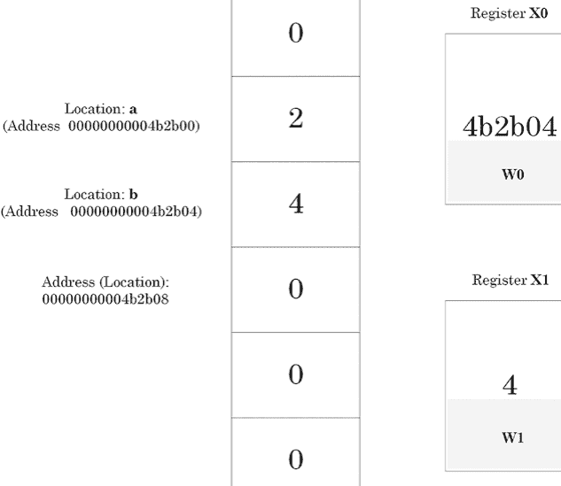
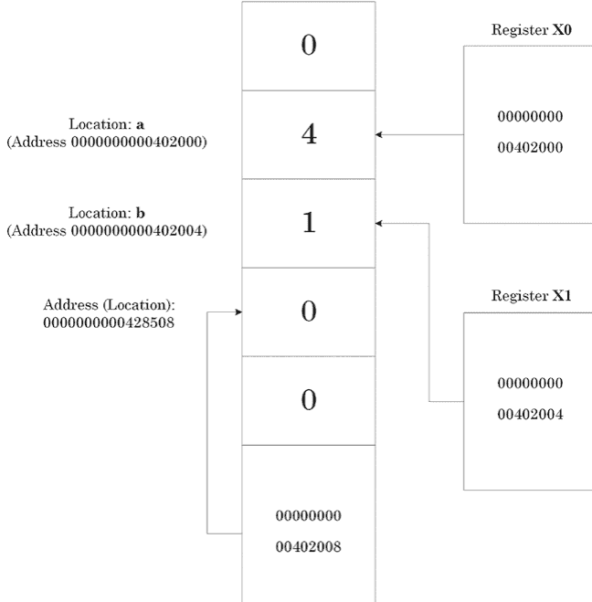
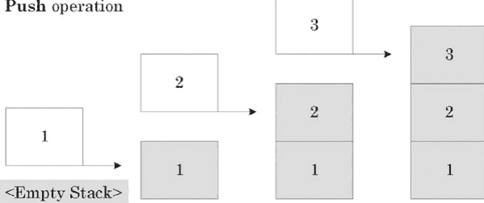
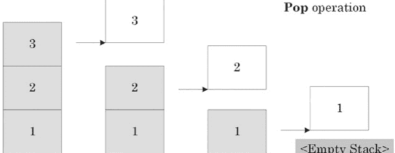
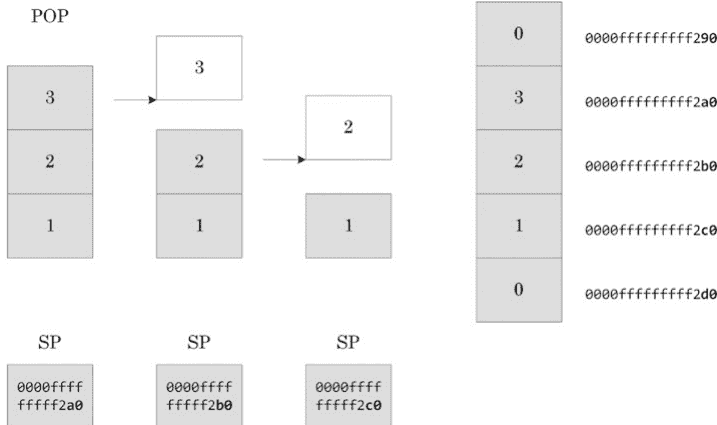
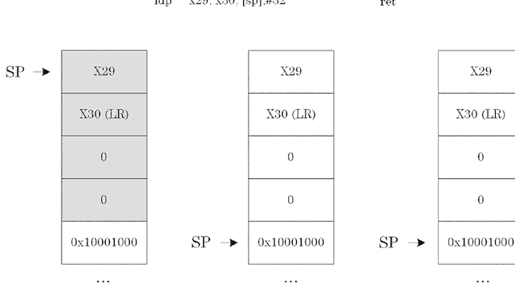
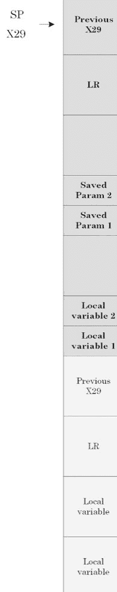
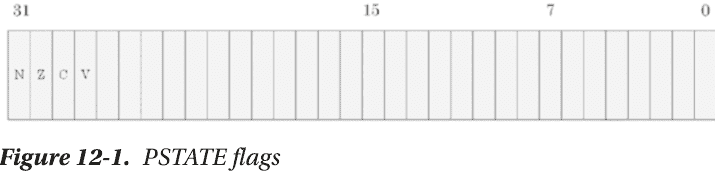

# ARM64 Linux 调试、反汇编与逆向工程基础指南

爱尔兰，都林

作者在书中引用的任何源代码或其他补充材料均可在 GitHub (`https://github.com/Apress`) 获取。欲了解更多信息，请访问 `http://www.apress.com/source-code`。

# 目录

- 第 14 章：代码反汇编模式总结 ...........................163

# 关于作者


Dmitry Vostokov 是国际认可的专家、演讲者、教育工作者、科学家和作者。他是面向模式软件诊断、法证和预测的 Software Diagnostics Institute（DumpAnalysis.org + TraceAnalysis.org）的创始人。Vostokov 编写了 50 多本关于软件诊断、异常检测与分析、内存法证、根因分析与问题解决、内存转储分析、调试、软件跟踪分析、逆向工程和恶意分析的书。他在各行业拥有 25 年经验，涵盖领导、技术和人员管理角色。Dmitry 还创立了 Syndromatix、Analog.io、BiteTrace、DiaThings、Logtext、OpenTask Iterative Publishing、Software Diagnostics Technology and Services（PatternDiagnostics.com）以及 Software Prognostics。在空闲时间，他在 Debugging TV 上演讲各种主题，并探索软件叙事学及其进一步发展（Dot）、软件病学以及量子软件诊断。他目前感兴趣领域包括理论软件诊断及其数学和计算机基础、形式逻辑、人工智能、机器学习和数据挖掘在诊断和异常检测中的应用、诊断工程和诊断驱动开发，以及诊断工作流和交互。最近领域还包括云原生计算、安全、自动化、函数式编程以及范畴论在软件开发和大数据中的应用。

# 关于技术审查员


**Sundar Pandian** 拥有超过三年的嵌入式开发经验，包括 Android 平台上车载信息系统的设备驱动程序、中间件软件和应用程序服务的开发。他还在 Autosar 平台上开发了用于汽车制动系统的 CAN 协议驱动程序。

他使用 C、C++ 和 Java 开发软件，并曾在汽车、半导体和电信行业工作。他拥有电子与通信工程学士学位。目前担任音频 DSP 的固件/中间件工程师。

# 前言

本书涵盖了从 ARM64 汇编语言指令、使用汇编语言编写程序，到指针、实时调试以及编译后的 C 和 C++ 代码的静态二进制分析等多个主题。

核心内存转储（core memory dumps）诊断、Linux 程序的实时和事后调试、系统、恶意软件以及漏洞分析，都需要理解 ARM64 汇编语言以及 C 和 C++ 编译器如何生成代码（包括内存布局和指针）。本书介绍了理解内部 Linux 程序内部结构和行为、开始使用 GDB 调试器以及将其用于反汇编和逆向工程所需的背景知识和实践基础。它由复杂度递增的实操步骤练习组成，并配有解释和大量的图表，包括一些必要的背景主题。

读完本书，你将对 Linux C 和 C++ 编译器如何生成二进制代码有坚实的理解。此外，你将能够自信地分析此类代码，理解栈内存的使用情况，并重建原始的 C/C++ 代码。

本书对以下人员非常有用：

- 软件支持与升级工程师、云安全工程师、SRE 和 DevSecOps
- 拥有 JVM 背景的软件工程师
- 软件测试人员
- 来自非 Linux 环境（例如 Windows 或 Mac OS X）的工程师
- 来自非 ARM 环境（例如 x86/x64）的工程师
- un具备汇编语言背景的 Linux C/C++ 软件工程师
- 不具备汇编语言背景的安全研究人员人员
- 学习 Linux 软件逆向工程技术的初学者

本书也可以作为相关本科课程 ARM64 汇编语言和 Linux 调试的补充教材。

## 源代码

本书中使用的所有源代码都可以从 `github.com/apress/arm64-linux-debugging-disassembling-reversing` 下载。

# 第 1 章

## 内存、寄存器与简单算术

### 理想计算机内部的内存与寄存器

计算机内存由一系列内存单元组成，每个单元都有一个唯一的地址（位置）。每个单元都包含一个“数字”。我们把这些“数字”称为地址（位置）的内容。由于内存访问速度比算术指令慢，因此存在所谓的“寄存器”，用于加速需要内存存储临时结果的复杂操作。我们也可以把它们视为独立的内存单元。寄存器的名称就是它的地址。图 1-1 所示。

| 地址 (Location): 100 | 0 |
| :--- | :--- |
| 地址 (Location): 101 | 0 |
| 地址 (Location): 102 | 1 |
| 地址 (Location): 103 | 1 |
| 地址 (Location): 104 | 2 |
| 地址 (Location): 105 | 0 |
| 寄存器 1 |  |
| --- |  |
| 0 |  |
| 寄存器 2 |  |
| --- |  |
| 10 |  |

图 1-1. 表示为内存单元和位置序列的内存

### 64 位计算机内部的内存与寄存器

在这里，包含整数值的内存位置地址通常相差四或八字节，我们还展示了两个名为 `X0` 和 `X1` 的寄存器。它们的半部分称为 `W0` 和 `W1`，如图 1-2 所示。

| 地址 (Location) | 寄存器 `X0` | 寄存器 `X1` |
| --- | --- | --- |
| 地址 (Location): 100 | 0 |  |
| 地址 (Location): 104 | 0 | `W0` |
| 地址 (Location): 108 | 1 |  |
| 地址 (Location): 112 | 1 | 10 |
| 地址 (Location): 116 | 2 | `W1` |
| 地址 (Location): 120 | 0 |  |

**图 I-2. 典型的 ARM 64 位内存和寄存器布局**

由于内存单元包含“数字”，我们从简单的算术开始，让处理器计算两个数的和，以观察内存和寄存器如何改变其值。

## “算术”项目：内存布局与寄存器

在我们的项目中，我们有两个内存地址（位置），我们称之为“`a`”和“`b`”。我们可以将“`a`”和“`b`”视为各自地址（位置）的名称。现在我们引入一种特殊符号，其中 `(a)` 表示内存地址（位置）“`a`”的内容。如果我们使用 C 或 C++ 语言来编写项目，我们声明并定义内存位置“`a`”和“`b`”如下：

```
static int a, b;
```

默认情况下，当我们加载程序时，静态内存位置会被填充零，我们可以描绘加载程序后的初始内存布局，如图 1-3 所示。

| | 寄存器 `X0` |
| --- | --- |
| 位置: `a` (Address 000000004b2b000) | 0 |
| 位置: `b` (Address 000000004b2b004) | 0 | `W0` |
| 地址 (Location): 000000004b2b008 | 0 | 寄存器 `X1`: 0, `W1` |

**图 1-3.** 加载程序后的初始内存布局

### “算术”项目：计算机程序

我们可以将计算机程序视为一组操作内存单元和寄存器内容的指令序列。例如，加法操作：将内存单元 N#12 的内容加上内存单元 N#14 的内容。在伪代码中，我们可以这样写：

```
[14] <- [14] + [12]
```

我们的第一个伪代码程序在表格左侧：

```
[14] <- [14] + [12]
```

我们可以将计算机程序视为一组操作内存单元和寄存器内容的指令序列。例如加法操作。在伪代码中我们可以写：


```
[14] <- [14] + [12]
```

我们的第一个伪代码程序在表格左侧：

```
[14] <- [14] + [12]
```

（注：此处根据原文逻辑，还原了翻译内容）

在伪代码中，我们可以写：

```
[14] <- [14] + [12]
```

读完本书，你将对 Linux C 和 C++ 编译器如何生成二进制代码有坚实的理解。此外，你将能够自信地分析此类代码，理解栈内存的使用情况，并重建原始的 C/C++ 代码。

本书对以下人员非常有用：

- 软件支持与升级工程师、云安全工程师、SRE 和 DevSecOps
- 拥有 JVM 背景的软件工程师
- 软件测试人员
- 来自非 Linux 环境（例如 Windows 或 Mac OS X）的工程师
- 来自非 ARM 环境（例如 x86/x64）
- 不具备汇编语言背景的 Linux C/C++ 软件工程师
- 不具备汇编语言背景的安全研究人员
- 学习 Linux 软件逆向工程技术的初学者

本书也可以作为相关本科课程 ARM64 汇编语言和 Linux 调试的补充教材。

## 源代码

本书中使用的所有源代码都可以从 `github.com/apress/arm64-linux-debugging-disassembling-reversing` 下载。

# 第 1 章

## 内存、寄存器与简单算术

## 理想计算机内部的内存与寄存器

计算机内存由一系列内存单元组成，每个单元都有一个唯一的地址（位置）。每个单元都包含一个“数字”。我们把这些“数字”称为地址（位置）的内容。由于内存访问速度比算术指令慢，因此存在所谓的“寄存器”，用于加速需要内存存储临时结果的复杂操作。我们也可以把它们视为独立的内存单元。寄存器的名称就是它的地址。图 1-1 所示。

| 地址 (Location): 100 | 0 |
| :--- | :--- |
| 地址 (Location): 101 | 0 |
| 地址 (Location): 102 | 1 |
| 地址 (Location): 103 | 1 |
| 地址 (Location): 104 | 2 |
| 地址 (Location): 105 | 0 |
| 寄存器 1 |
| --- |
| 0 |
| 寄存器 2 |
| --- |
| 10 |

图 1-1. 表示为内存单元和位置序列的内存

### 64 位计算机内部的内存与寄存器

在这里，包含整数值的内存位置地址通常相差四或八字节，我们还展示了两个名为 `X0` 和 `X1` 的寄存器。它们的半部分称为 `W0` 和 `W1`，如图 1-2 所示。

| 地址 (Location) | 寄存器 X0 | 寄存器 X1 |
| --- | --- | --- |
| 地址 (Location): 100 | 0 | |
| 地址 (Location): 104 | 0 | `W0` |
| 地址 (Location): 108 | 1 | |
| 地址 (Location): 112 | 1 | 10 |
| 地址 (Location): 116 | 2 | `W1` |
| 地址 (Location): 120 | 0 | |

**图 I-2. 典型的 ARM 64 位内存和寄存器布局**

由于内存单元包含“数字”，我们从简单的算术开始，让处理器计算两个数的和，以观察内存和寄存器如何改变其值。

## “算术”项目：内存布局与寄存器

在我们的项目中，我们有两个内存地址（位置），我们称之为“`a`”和“`b`”。我们可以将“`a`”和“`b`”视为各自地址（位置）的名称。现在我们引入一种特殊符号，其中 `(a)` 表示内存地址（位置）“`a`”的内容。如果我们使用 C 或 C++ 语言来编写项目，我们声明并定义内存位置“`a`”和“`b`”如下：

```
static int a, b;
```

默认情况下，当我们加载程序时，静态内存位置会被填充零，我们可以描绘加载程序后的初始内存布局，如图 1-3 所示。

| | 寄存器 X0 |
| --- | --- |
| 位置: a (Address 000000004b2b000) | 0 |
| 位置: b (Address 000000004b2b004) | 0 | `W0` |
| 地址 (Location): 000000004b2b008 | 0 | 寄存器 X1: 0, `W1` |

**图 1-3.** 加载程序后的初始内存布局

### “算术”项目：计算机程序

我们可以将计算机程序视为一组操作内存单元和寄存器内容的指令序列。例如，加法操作：将内存单元 N#12 的内容加上内存单元 N#14 的内容。在伪代码中，我们可以这样写：

```
[14] <- [14] + [12]
```

# 第 1 章 内存、寄存器与简单算术

请注意，在引用寄存器内容时，我们不使用括号。

后一条指令意味着将位置（地址）“`a`”处的数字赋值（复制）到寄存器。

在汇编语言中，我们写道：

```
mov w1, #1      // 1 被复制到 X1 的前半部分
                    register
mov x1, #1      // X1 寄存器的完整内容
                    替换为 1
adr x0, a        // 将位置（地址）“a”复制到
                    X0 寄存器
ldr w1, [x0]   // 将存储在 X0 中的位置数字
                    复制到 X1 寄存器的前半部分
ldr x1, [x0]   // 将存储在 X0 中的位置数字
                    复制到 X1
```

在 GDB 反汇编输出中，我们可能会看到输出，其中一个 `adr` 指令被带有地址值部分的 `adrp/add` 指令替换：

```
adrp x0, 0x4b2000  // 0x4b2000 + 0xb000 = 0x4b2b00
                    ("a" 地址)
add x0, x0, #0xb000
ldr w1, [x0]
```

## “算术”项目：向内存单元累加数字

现在让我们详细地查看以下伪代码语句：

`[b] <- [b] + [a]`

回想一下，“`a`”和“`b`”分别表示位置地址 `000000000042b200` 和 `000000000042b204` 的名称（参见图 1-4A 和 1-4B）。`[a]` 和 `[b]` 分别表示“`a`”和“`b`”处的内容，简单来说存储在那里的某些数字。

在 C 或 C++ 语言中，我们编写以下语句：

```
b = b + a;
b += a;
```

在汇编语言中，我们使用 `ADD` 指令。由于 ARM 架构的限制，我们无法在一个步骤（指令）中使用内存地址，例如 `add b, b, a`。我们只能使用 `add` 寄存器指令将寄存器0中的值加到寄存器1，将寄存器1中的值加并将结果移动到寄存器1。因此，首先我们需要加载（`ldr`）“`a`”和“`b`”处的内容到寄存器，并在加后存储（`str`）结果存回内存位置“`b`”。回想一下，寄存器在这里就像一个临时内存单元：

```
Register2 <- [b]
Register1 <- [a]
Register2 <- register2 + register1
[b] <- register2
```

在汇编语言中，我们写道：

```
adr x0, b
ldr w1, [x0]
adr x0, a
ldr w0, [x0]
add w1, w1, w0
adr x0, b
str w1, [x0]
```

在 GDB 反汇编输出中，我们可能会看到以下代码：

```
adrp x0, 0x4b2000
add x0, x0, #0xb00
ldr w1, [x0]
adrp x0, 0x4b2000
add x0, x0, #0xb00
ldr w0, [x0]
add w1, w1, w0
adrp x0, 0x4b2000
add x0, x0, #0xb04
str w1, [x0]
```

现在我们可以将伪代码翻译为汇编语言：


```
[a] <- 1 // x0 = a adr x0, a
 // w1 = 1 mov w1, #1
 // [a] = 1 str w1, [x0]
[b] <- 1 // x0 = b adr x0, b
 // w1 = 1 mov w1, #1
 // [b] = 1 str w1, [x0]
[b] <- [b] + [a] // x0 = b adr x0, b
 // w1 = 1 ldr w1, [x0]
 // x0 = a adr x0, a
 // w0 = 1 ldr w0, [x0]
 // w1 = 2 add w1, w1, w0
 // x0 = b adr x0, b
 // [b] = 2 str w1, [x0]
```

在执行 `ADR`、`LDR`、`ADD` 和 `STR` 指令后，我们得到了图 1-5 所示的内存布局。

位置：`a`

（地址 0000000004b2b00）

| 0 |

|---|---|

| 1 |

| 2 |

| 0 |

| 0 |

| 0 |

寄存器 X0

4b2b04

W0

位置：`b`

（地址 0000000004b2b004）

地址（位置）：

0000000004b2b008

寄存器 X1

1

W1

图 1-5. 执行 ADR、LDR、ADD 和 STR 指令后的内存布局

## 在内存和寄存器中递增/递减数字

在伪代码中，它看起来很简单，意味着递增（递减）存储在位置（地址）“`a`”的数字：

+ `[a] <- [a] + 1`

`[a] < [a] - 1`

在 C 或 C++ 语言中，我们可以三种可能的方式编写它：

```
a = a + 1;
++a;
a++;
b = b - 1;
--b;
b--;
```

在汇编语言中，我们使用指令 `ADD` 和 `SUB`，并写道：

```
add x0, x0, #1
sub x0, x0, #1
adr x0, a
ldr w1, [x0]
add w1, w1, #1
str w1, [x0]
adr x0, b
ldr w1, [x0]
sub w1, w1, #1
str w1, [x0]
```

在 GDB 反汇编输出中，我们可能会看到类似的指令：

```
adrp x0, 0x4b2000
add x0, x0, #0xb000
ldr w0, [x0]
add w1, w0, #0x1
adrp x0, 0x4b2000
add x0, x0, #0xb000
str w1, [x0]
```

现在我们加上递增的汇编语言翻译：

```
[a] <- 1      // x0 = a      adr x0, a
                   // w1 = 1      mov w1, #1
                   // [a] = 1     str w1, [x0]
[b] <- 1      // x0 = b      adr x0, b
                   // w1 = 1      mov w1, #1
                   // [b] = 1     str w1, [x0]
[b] <- [b] + [a] // x0 = b      adr x0, b
                   // w1 = 1      ldr w1, [x0]
                   // w0 = 1      ldr w0, [x0]
                   // x0 = a      adr x0, a
                   // w0 = 2      ldr w0, [x0]
                   // w1 = 2      add w1, w1, w0
                   // x0 = b      adr x0, b
                   // [b] = 2     str w1, [x0]
[a] <- 1      // x0 = a      adr x0, a
                   // w1 = 1      mov w1, #1
                   // [a] = 1     str w1, [x0]
[b] <- 1      // x0 = b      adr x0, b
                   // w1 = 1      mov w1, #1
                   // [b] = 1     str w1, [x0]
[b] <- [b] + [a] // x0 = b      adr x0, b
                   // w1 = 1      ldr w1, [x0]
                   // w0 = 1      ldr w0, [x0]
                   // x0 = a      adr x0, a
                   // w0 = 2      ldr w0, [x0]
                   // w1 = 2      add w1, w1, w0
                   // x0 = b      adr x0, b
                   // [b] = 2     str w1, [x0]
```

在执行 `ADD` 指令后，我们得到了图 1-6 所示的内存布局。

| 寄存器 X0 | 寄存器 X1 |

|---|---|

| 0 | 0 |

| 1 | 1 |

| 2 | 2 |

| 0 | |

| 0 | |

| 0 | |

位置：`a`

（地址 0000000004b2b00）

位置：`b`

（地址 0000000004b2b004）

地址（位置）：

0000000004b2b008

图 1-6. ADD 指令后的内存布局

## 数字乘法

在伪代码中，它看起来很简单，意味着乘以存储在位置（地址）“`b`”的数字：

+ `[b] <- [b] * [a]`

在 C 或 C++ 语言中，我们可以这样写：

```
b = b * a;
```

在汇编语言中，我们使用 `MUL` 指令并写道：

```
adr x0, b
ldr w1, [x0]
adr x0, a
ldr w0, [x0]
mul w1, w1, w0
adr x0, b
str w1, [x0]
```

在 GDB 反汇编输出中，我们可能会看到以下代码：

```
adrp x0, 0x4b2000
add x0, x0, #0xb00
ldr w1, [x0]
adrp x0, 0x4b2000
add x0, x0, #0xb04
ldr w0, [x0]
mul w1, w1, w0
adrp x0, 0x4b2000
add x0, x0, #0xb04
str w1, [x0]
```

现在我们可以将伪代码翻译为汇编语言：

```
[a] <- 1 // x0 = a adr x0, a
 // w1 = 1 mov w1, #1
 // [a] = 1 str w1, [x0]
[b] <- 1 // x0 = b adr x0, b
 // w1 = 1 mov w1, #1
 // [b] = 1 str w1, [x0]
[b] <- [b] * [a] // x0 = b adr x0, b
 // w1 = 1 ldr w1, [x0]
 // x0 = a adr x0, a
 // w0 = 1 ldr w0, [x0]
 // w1 = 2 mul w1, w1, w0
 // x0 = b adr x0, b
 // [b] = 2 str w1, [x0]
```

在执行 `ADR`、`LDR`、`MUL` 和 `STR` 指令后，我们得到了图 1-7 所示的内存布局。



图 1-7. 执行 ADR、LDR、MUL 和 STR 指令后的内存布局

# 第2章

# 代码优化

## “Arithmetic”项目：C/C++ 程序

让我们用 C/C++ 重写我们的“Arithmetic”程序。相应的汇编语言指令已放在注释中：


```cpp
int a, b;

int main(int argc, char* argv[]) {
    a = 1;              // adr x0, a
                         // mov w1, #1
                         // str w1, [x0]

    b = 1;              // adr x0, b
                         // mov w1, #1
                         // str w1, [x0]

    b = b + a;           // adr x0, b
                         // ldr w1, [x0]
                         // adr x0, a
                         // ldr w0, [x0]
                         // add w1, w1, w0
                         // adr x0, b
                         // str w1, [x0]

    ++a;
    // adr x0, a
    // ldr w1, [x0]
    // add w1, w1, #1
    // str w1, [x0]
    b = b * a;
    // adr x0, b
    // ldr w1, [x0]
    // adr x0, a
    // ldr w0, [x0]
    // mul w1, w1, w0
    // adr x0, b
    // str w1, [x0]

    return 0;
    // results: [a] = 2 and [b] = 4
}
```

## 下载 GDB

使用了云提供商提供的免费 ARM64 Linux 计算实例之一。在我们的情况下，GDB 在配置完成后后已经可用了。如果你的情况下 GDB 不可用用，你需要同同基础构建工具一起安装它。例如，在 Debian 中：

```
$ sudo apt install build-essential
```

```
$ sudo apt install gdb
```

你可能还需要下载 git 来克隆源代码：

```
$ sudo apt install git
```

```
$ cd ~
```

```
$ git clone github.com/apress/arm64-linux-debugging-disassembling-reversing .
```

在我们的 RHEL 类型系统中，我们通过以下方式更新了工具（包括 git）和 GDB：

```
$ sudo yum group install "Development Tools"
$ sudo yum install gdb
```

## GDB 反汇编输出 – 无优化

源代码可以从以下位置下载：

`github.com/apress/arm64-linux-debugging-disassembling-reversing/Chapter2/`

如果我们在无优化模式（默认）下编译并链接程序：

```
$ gcc ArithmeticProject.cpp -o ArithmeticProject
```

我们得到了一个二进制可执行代码，可以将其加载到 GDB 中并检查汇编代码。

首先，我们带上程序参数运行 GDB：

```
$ gdb ./ArithmeticProject
GNU gdb (GDB) Red Hat Enterprise Linux 7.6.1-120.0.2.el7
Copyright (C) 2013 Free Software Foundation, Inc.
License GPLv3+: GNU GPL version 3 or later <http://gnu.org/licenses/gnu.html>
```

这是自由软件：你可以自由地更改并分发它。

在法律允许的范围内不提供任何保证。输入“show copying”和“show warranty”查看详细信息。

此 GDB 配置为“aarch64-redhat-linux-gnu”。

有关错误报告指令，请参阅：http://www.gnu.org/software/gdb/bugs/>...

正在从 `/home/coredump/pflddr/A64/Chapter2/\ArithmeticProjectC` 读取符号（未找到调试符号）...完成。

```
(gdb)
```

接下来，我们在主 C/C++ 函数处设置一个断点，允许程序执行在该点停止，并给我们一个检查内存和寄存器的机会。符号名称/函数名（如 `main`）可以代替代码内存位置：

```
(gdb) break main
Breakpoint 1 at 0x405bc
```

然后我们开始执行程序（让它运行）。该程序随后停在之前设置的断点处：

```
Starting program: /home/coredump/pflddr/A64/Chapter2/.ArithmeticProjectC

Breakpoint 1 0x000000000040005bc in main ()
```

缺少独立的调试信息，请使用: debuginfo-install

glibc-2.17-325.0.2.el7_9.aarch64

现在我们反汇编 `main` 函数：


```
(gdb) disass main
Dump of assembler code for function main:
0x00000000004005b8 <+8>    sub      sp, sp, #x10
=> 0x00000000004005bc <+4>   str      w0, [sp,#12]
0x00000000004005c0 <+8>    str      x1, [sp]
0x00000000004005c4 <+12>   adp     x0, 0x420000
0x00000000004005c8 <+16>   add      x0, x0, #x20
0x00000000004005cc <+20>   mov      w1, #x1        // #1
0x00000000004005d0 <+24>   str      w1, [x0]
0x00000000004005d4 <+28>   adp     x0, 0x420000
0x00000000004005d8 <+32>   add      x0, x0, #x24
0x00000000004005dc <+36>: mov     w1, #01       // #1
0x00000000004005e0 <+40>: str     w1, [x0]
0x00000000004005e4 <+44>: adp     x0, 0x420000
0x00000000004005e8 <+48>: add      x0, x0, #x24
0x00000000004005ec <+52>: ldr      w1, [x0]
0x00000000004005f6 <+56>: adp     x0, 0x420000
0x00000000004005f4 <+60>: add      x0, x0, #x20
0x00000000004005f8 <+64>: ldr      w0, [x0]
0x00000000004005fc <+68>: add      w1, w1, w0
0x0000000000400672 <+72>: adp     x0, 0x420000
0x0000000000400674 <+76>: add      x0, x0, #x24
0x0000000000400608 <+80>: str      w1, [x0]
0x000000000040060c <+84>: adp     x0, 0x420000
0x0000000000400610 <+88>: add      x0, x0, #x20
0x0000000000400614 <+92>: ldr      w0, [x0]
0x0000000000400618 <+96>: add      w1, w0, #01
0x000000000040061c <+100>: adp     x0, 0x420000
0x0000000000400620 <+104>: add      x0, x0, #x20
0x0000000000400624 <+108>: str      w1, [x0]
 <return> to continue, <return> to quit
0x0000000000400628 <+112>: adp     x0, 0x420000
0x000000000040062c <+116>: add      x0, x0, #x24
0x0000000000400630 <+120>: ldr      w1, [x0]
0x0000000000400634 <+124>: adp     x0, 0x420000
0x0000000000400638 <+128>: add      x0, x0, #x20
0x000000000040063c <+132>: ldr      w0, [x0]
0x0000000000400640 <+136>: mul      w1, w1, w0
0x0000000000400644 <+140>: adp     x0, 0x420000
0x0000000000400648 <+144>: add      x0, x0, #x24
0x000000000040064c <+148>: str      w1, [x0]
0x0000000000400650 <+152>: mov     w0, #0      // #0
0x0000000000400654 <+156>: add      sp, sp, #x10
0x0000000000400658 <160>: ret
```

汇编结束。

我们重复响应我们 `C/C++` 代码的格式化输出：

```
0x0000000000400654 <+12>: adp     x0, 0x420000
0x0000000000400658 <+16>: add      x0, x0, #x20
0x000000000040065c <+20>: mov      w1, #01
0x00000000004006d0 <+24>: str      w1, [x0]
0x00000000004006d4 <+28>: adp     x0, 0x420000
0x00000000004006d8 <+32>: add      x0, x0, #x24
0x00000000004006dc <+36>: mov      w1, #01
0x00000000004006e0 <+40>: str      w1, [x0]
0x00000000004006e4 <+44>: adp     x0, 0x420000
0x00000000004006e8 <+48>: add      x0, x0, #x24
0x00000000004006ec <+52>: ldr      w1, [x0]
0x00000000004006f0 <+56>: adp     x0, 0x420000
0x00000000004006f4 <+60>: add      x0, x0, #x20
0x00000000004006f8 <+64>: ldr      w0, [x0]
0x00000000004006fc <+68>: add      w1, w1, w0
0x0000000000400672 <+72>: adp     x0, 0x420000
0x0000000000400674 <+76>: add      x0, x0, #x24
0x0000000000400608 <+80>: str      w1, [x0]
0x000000000040060c <+84>: adp     x0, 0x420000
0x0000000000400610 <+88>: add      x0, x0, #x20
0x0000000000400614 <+92>: ldr      w0, [x0]
0x0000000000400618 <+96>: add      w1, w0, #01
0x000000000040061c <+100>: adp     x0, 0x420000
0x0000000000400620 <+104>: add      x0, x0, #x20
0x0000000000400624 <+108>: str      w1, [x0]
0x0000000000400628 <+112>: adp     x0, 0x420000
0x000000000040062c <+116>: add      x0, x0, #x24
0x0000000000400630 <+120>: ldr      w1, [x0]
0x0000000000400634 <+124>: adp     x0, 0x420000
0x0000000000400638 <+128>: add      x0, x0, #x20
0x000000000040063c <+132>: ldr      w0, [x0]
0x0000000000400640 <+136>: mul      w1, w1, w0
0x0000000000400644 <+140>: adp     x0, 0x420000
0x0000000000400648 <+144>: add      x0, x0, #x24
```

我们可以直接翻译在上一章节使用的裸汇编（内存地址可能会不同）：

# 第 2 章 代码优化


```
0x0000000000040005f8 <64>:  ldr     w0, [x0]
0x0000000000040005fc <68>:  add     w1, w1, w0
0x00000000000400600 <72>:  adrp   x0, 0x420000
0x00000000000400604 <76>:  add     x0, x0, #024
0x00000000000400608 <80>:  str     w1, [x0]
0x0000000000040060c <84>:  adrp   x0, 0x420000

// [a] <- [a] + 1
0x00000000000400610 <88>:  add     x0, x0, #024
0x00000000000400614 <92>:  ldr     w0, [x0]
0x00000000000400618 <96>:  add     w1, w0, #01
0x0000000000040061c <100>: adrp   x0, 0x420000
0x00000000000400620 <104>: add     x0, x0, #024
0x00000000000400624 <108>: str     w1, [x0]
0x00000000000400628 <112>: adrp   x0, 0x420000

// [b] <- [b] *
0x0000000000040062c <116>: add     x0, x0, #024
0x00000000000400630 <120>: ldr     w1, [x0]
0x00000000000400634 <124>: adrp   x0, 0x420000
0x00000000000400638 <128>: add     x0, x0, #020
0x0000000000040063c <132>: mov     w0, [x0]
0x00000000000400638 (wait duplicate): ldr     w0, [x0]
0x00000000000400640 <136>: mul     w1, w1, w0
0x00000000000400644 <140>: adrp   x0, 0x420000
0x00000000000400648 <144>: add     x0, x0, #024
0x0000000000040064c <148>: str     w1, [x0]
```

现在我们可以退出 GDB 了：

```
(gdb) q
A debugging session is active.
```

Inferior 1 [process 11103] will be killed.

```
Quit anyway? (y or n) y
$ 
```

26

## GDB 反汇编输出 – 优化

如果我们在优化模式下编译并链接程序：

`$ gcc ArithmeticC.cpp -o1 -o ArithmeticProjectC`

在 GDB 中重复这些步骤后，我们得到了以下输出：

```
(gdb) disass main
Dump of assembler code for main:
0x0000000000040055b <0> adrp   x0, 0x420000
0x000000000004005bc <4> add     x1, x0, #020
0x000000000004005c0 <8> mov     w2, #0x2                // #2
=>0x000000000004005c4 <12> str     w2, [x0]
0x000000000004005c8 <16> mov     w0, #0x4                // #4
0x000000000004005d0 <20> str     w0, [x1]
0x000000000004005d0 <24> mov     w0, #0x0                // #0
0x000000000004005d4 <28> ret
```

这对应的伪代码为：

`[a] <- 2`

`[b] <- 4`

内存地址的计算有点复杂：

```
0x00000000000005b8 <0> adrp   x0, 0x420000
0x000000000004005bc <4> add     x1, x0, #020        // x1 = x0 + 0x20
0x000000000004005c0 <8> mov     w2, #0x2                // w2 = 2
=>0x000000000004005c4 <12> str     w2, [x0]        // #20 = a
0x000000000004005c8 <16> mov     w0, #0x4                // w0 = 4
0x000000000004005d0 <20> str     w0, [x1]        // [b] = a + 4
0x000000000004005d0 <24> mov     w0, #0x0
0x000000000004005d4 <28> ret
```

我们的汇编代码中发生了什么？这段代码似乎直接将结果存放在“a”和“b”内存单元中。为什么会这样？当在优化模式下编译时，编译器可以从简单的 C/C++ 代码计算最终结果并更新内存位置。

## 总结

在本章中，我们通过反汇编查看了调试器产生的汇编语言，将其还原为 C/C++ 代码。我们还比较了未优化的代码和优化后的代码并理解了原因。下一章介绍数字表示法，特别是进制。

# 第 3 章 数字表示法

## 数字及其表示法

想象一个古代的牧羊人正在数羊。他有一定数量的石头（十二）：


然而，他只能数到三，并按三一组排列：


最后一张图是石头数量的一种表示（符号）。我们有一组三加另一组三。如果能数到十，我们会看到相同数量石头的不同表示方法。我们会有一组十和另一组二。

### 十进制表示（十）

让我们看看如果我们能数到十，十二块石头如何在算术表示法中表示。我们有一组十加二：

`$12_{dec} = 1 * 10 + 2$` 或 `$1 * 10^{1} + 2 * 10^{0}$`

另一个 123 块石头的练习。我们有一**一组**十，另一组**2** 组十，最后一组**3** 块石头：

`$123_{dec} = 1 * 10^{3} + 2 * 10^{1} + 3$` 或 `$1 * 10^{2} + 2 * 10^{1} + 3 * 10^{0}$`

我们可以将其形式化为以下求和：

`$N_{dec} = a_{n}*10^{n} + a_{n-1}*10^{n-1} + ... + a_{2}*10^{2} + a_{1}*10^{1} + a_{0}*10^{0}$`

`$0 \le a_{i} \le 9$`

使用求和符号，我们得到了公式：

`$N_{dec} = \sum_{i=0}^{n} a_{i}*10^{i}$`

### 三进制表示（三进制）

现在回到牧羊人十二块石头的例子。我们有**一组**三三，**一组**三，以及一个代替十二的空组。我们可以顺序写下数字：110。因此，110 是石头的三进制表示（符号），它等于十进制的十二：

`$12_{dec} = 1*3^{2} + 1*3^{1} + 0*3^{0}$`

`$N_{dec} = \sum_{i=0}^{n} a_{i}*3^{i}$`

`$0 \le a_{i} \le 2$`

## 表示法

### 二进制表示（二进制）

在数到二的情况下，我们有更多的石头分组：1100。因此，1100 是十进制 12 的二进制表示（符号）：

`$12_{dec} = 1*2^{3} + 0*2^{2} + 1*2^{1} + 0*2^{0}$`

`$N_{dec} = \sum_{i=0}^{n} a_{i}*2^{i}$`

### 十六进制表示（十六进制）

如果我们能数到十六，十二只需要一组十，但我们需要更多符号：A、B、C、D、E 分别代表十、十一、十二、十三、十五：

`$12_{dec} = C$` 在十六进制表示

`$12_{dec} = 7B_{hex}$`

`$12_{dec} = 1*16^{1} + 5*16^{0}$`

### 为什么使用十六进制？

考虑这个二进制数字：1100101011。它的十进制表示是 315：我们将二进制位四位一组，并用十进制和十六进制写出：

```
1100 1010 1011

$12_{dec}$ $5_{dec}$

$C_{hex}$ $A_{hex}$ $3_{hex}$
```

我们看到每四位数字对应一个十六进制数字。

# 第4章 指针



图 4-1. 指针示例与内存布局


## “指针”项目：内存布局与寄存器

在我们的调试项目中，我们有两个内存地址（位置）“`a`”和“`b`”。我们可以将“`a`”和“`b`”视为地址（位置）的名字。我们提醒，符号 (`a`) 表示内存地址（位置）“`a`”处的内容。

我们还有寄存器 `X0` 和 `X1`，作为指向“`a`”和“`b`”的指针。这些寄存器分别包含“`a`”和“`b`”的地址。符号 `[X0]` 表示地址存储在寄存器 `X0` 中的内存单元的内容。

在 `C` 语言和 `C++` 语言中，我们声明并定义指向“`a`”和“`b`”的指针：

```
int *a, *b;
```

我们的项目在程序执行前的内存布局如图 4-2 所示。地址始终占用 64 位的内存单元或完整的 64 位寄存器（如 `X0` 或 `X1`）（它们无法放入 `W0`、`W1` 或 32 位内存单元中）。如有必要，我们使用 `X2`–`X4` 寄存器的低半部分（`W2`-`W4`）来存放临时整数值。

| 位置：a (地址 00000000004100f0) | 寄存器 X0 |
| :--- | :--- |
| | 0 |
| | 0 |
| | 0 |
| | 0 |
| | 0 |
| | 0 |
| 位置：b (地址 00000000004100f4) | 寄存器 W2 |
| | 寄存器 X1 |
| | 寄存器 W3 |
| | 寄存器 W4 |

**图 4-2.** 程序执行前的项目内存布局

## “指针”项目：计算

为了从底层汇编语言的角度更好地理解指针，我们使用内存指针而不是直接内存地址来执行第1章中的旧算术计算：

```
X0 <- address a
[X0] <- 1
X1 <- address b
[X1] <- [X1] + [X0]
[X0] <- [X0] + 1
[X1] <- [X1] * [X0]
```

## 使用指针为内存单元赋值数字

首先，以下伪代码指令序列意味着我们把 `X0` 寄存器的内容解释为内存单元的地址，并为该内存单元赋值：

```
X0 <- address a
[X0] <- 1
```

在 `C` 语言和 `C++` 语言中，这被称为“解引用指针”，我们写道：

```c
int a;
int *pa = &a; // 指针的声明和定义
*pa = 1; // 获取内存单元（解引用指针）
// 并对其赋值
```

在汇编语言中，我们写道：

```assembly
adr x0, a // 将地址 "a" 加载到 x0
mov w3, #1 // 将临时寄存器设置为 1
str w3, [x0] // 使用 x0 作为指针并将 1 存储在 x0 指向的内存地址
```

在 GDB 反汇编输出中，我们看到类似的内容：

```
0x00000000000400b0 <0>:  adr     x0, 0x4100f0
0x00000000000400b4 <4>:  mov     w3, #0x1
0x00000000000400b8 <8>:  str     w3, [x0]
```

本章的源代码可以在 `github.com/arm64-linux-debugging-reversing/Chapter4` 下载。为了说明一些不依赖于编译器翻译 `C/C++` 代码的指令，我们用汇编语言编写了程序。我们需要在将其加载到 `GDB` 之前进行编译和链接：

```bash
$ asm Pointers.asm -o Pointers.o
$ ld Pointers.o -o Pointers
$ gdb ./Pointers
GNU gdb (GDB) Red Hat Enterprise Linux 7.6.1-2.0
Copyright (C) 2013 Free Software Foundation, Inc.
License: GPL v3 or later <http://gnu.org/licenses/gpl.html>
This is free software: you are free to change and redistribute it to the extent permitted by law. For reporting bugs, please see: <http://www.gnu.org/software/gdb>...
Reading symbols from /home/coredump/ld64/Chapter4/Pointers...(no debugging symbols found)...done.
```

我们在 `main` 函数处设置了一个断点，运行程序，然后反汇编 `main` 函数：

```
(gdb) break
Breakpoint 1 at 0x4000b0
(gdb) run
Starting program /home/coredump/ld64/Chapter4/Pointers
Breakpoint 1, 0x000000000001000 in _start
(gdb) disass
Dump of assembler code for function _start:
=> 0x0000000000400b0 <0>: adr     x0, 0x4100f0
0x0000000000400b4 <4>: mov     w3, #0x1       # #1
0x0000000000400b8 <8>: str     w3, [x0]
0x0000000000400bc <12>: adr     x1, 0x4100f4
0x0000000000400c0 <16>: str     w3, [x1]
0x0000000000400c4 <20>: ldr     w2, [x0]
0x0000000000400c8 <24>: str     w3, [x1]
0x0000000000400cc <28>: add     w4, w3, w2
0x0000000000400d0 <32>: str     w4, [x1]
0x0000000000400d4 <36>: add     w2, w2, #0x1
0x0000000000400d8 <40>: str     w2, [x0]
0x0000000000400dc <44>: mul     w3, w4, w2
0x0000000000400e0 <48>: str     w3, [x1]
0x0000000000400e4 <52>: mov     x0, #0x0       # #0
0x0000000000400e8 <56>: mov     w8, #0x5d       # #3
0x0000000000400ec <60>: svc     x0
End of assembler dump.
```

现在我们使用 `info variables` 命令检查“`a`”和“`b`”，以验证之前图 4-2 中所示的内存布局：

```
(gdb) info variables
All defined variables:

Non-debugging symbols:
0x00000000004100f0 a
0x00000000004100f4 b
0x00000000004100f8 .bss_end_
0x00000000004100f8 .bss_start_
0x00000000004100f8 .bss_end_
0x0000000000410f8 .ata
```

我们还验证了 `X0` 和 `X1` 的值符合图 4-2：

```
(gdb) info registers x0 x1
x0      0
x1      0
```

我们指示 `GDB` 自动显示当前指令、`X0`, `X1`, `W2`, `W3` 和 `W4` 的值，以及“`a`”和“`b`”的内容：

```
(gdb) display/i $pc
=> 0x4000b0 adr     x0, 0x4100f0
(gdb) display/x $x0
0
(gdb) display/x $x1
0
(gdb) display/x $w2
0
(gdb) display/x $w3
0
(gdb) display/x $w4
0
(gdb) display/x $a
0
(gdb) display/x $b
0
```

现在使用 `step` 命令（简短版）执行与伪代码对应的前五条指令：

```
X0 <- address a               adr x0, 0x4100f0
[X0] <- 1                   #a = 1       mov w3, #1
X1 <- address b               adr x1, 0x4100f4
[X1] <- 1                   #b = 1       str w3, [x1]
[X1] <- [X1] + [X0]
[X0] <- [X0] + 1
[X1] <- [X1] * [X0]
```


```
gdb
0x0000000000400b4 in main
8: /x (int)b = 0x0
7: /x (int)a = 0x0
6: /x $w4 = 0x0
5: /x $w3 = 0x0
4: /x $w2 = 0x0
3: /x $x1 = 0x0
2: /x $x0 = 0x410f0
1: x/i $pc
=> 0x4000b4 <4>: mov    w3, #0x1 // #1

(gdb) si
0x00000000004008b in main
8: /x (int)b = 0x0
7: /x (int)a = 0x0
6: /x $w4 = 0x0
5: /x $w3 = 0x1
4: /x $w2 = 0x0
3: /x $x1 = 0x0
2: /x $x0 = 0x410f0
1: x/i $pc
=> 0x4000b8 <main+8>: str    w3, [x0]
```

(gdb) si

0x0000000000040bc in main

8: /x (int)b = 0x0

7: /x (int)a = 0x1

6: /x $w4 = 0x0

5: /x $w3 = 0x1

4: /x $w2 = 0x0

3: /x $x1 = 0x0

2: /x $x0 = 0x410f0

1: x/i $pc

=> 0x4000bc <main+12>: adr    x1, 0x410f4

```
(gdb) si
0x0000000004000c0 in main
8: /x (int)b = 0x0
7: /x (int)a = 0x1
6: /x $w4 = 0x0
5: /x $w3 = 0x1
4: /x $w2 = 0x0
3: /x $x1 = 0x41f4
2: /x $x0 = 0x410f0
1: x/i $pc
=> 0x4000c0 <main+16>: str w3, [x1]
```

(gdb) si

0x0000000004000c4 in main

8: /x (int)b = 0x1

7: /x (int)a = 0x1

6: /x $w4 = 0x0

5: /x $w3 = 0x1

4: /x $w2 = 0x0

3: /x $x1 = 0x41f4

2: /x $x0 = 0x410f0

1: x/i $pc

=> 0x4000c4 <main+20>: ldr w2, [x0]

```

# 第4章 指针

位置：a
(地址 00000000004100f0)

寄存器 X0

| 0 |
| 0 |
| 0 |
| 0 |
| 0 |
| 0 |

位置：b
(地址 00000000004100f4)

寄存器 W2

寄存器 X1

寄存器 W3

寄存器 W4

**图 4-3.** 执行前五条指令后的内存布局

## 使用指针进行数字相加

现在我们看下一条伪代码语句：

```
[X1] <- [X1] + [X0]
```

# 第 4 章 指针

回想 `[X0]` 和 `[X1]` 表示地址（位置）存储在 CPU 寄存器 `X0` 和 `X1` 中的内存内容。前面的语句等同于以下 C 或 C++ 语言表达式，其中“*”运算符表示获取 `pa` 或 `pb` 指针指向的内存内容（也称为指针解引用）：

```
*pb = *pb + *pb;
```

在汇编语言中，我们使用 `ADD` 指令来实现“+”运算符，但我们无法在单条指令中使用直接内存地址：

```
add [x1], [x0]      // 无效指令
```

我们可以使用寄存器，因此我们需要使用两个寄存器作为临时变量：

```
RegisterA <- [X0]

RegisterB <- [X1]

RegisterC <- RegisterB + RegisterA

[X1] <- RegisterC
```

我们不能使用 `W0` 和 `W1` 来存放值，因为它们包含在 `X0` 和 `X1` 中；地址会被覆盖，因此我们使用 `W2`、`W3` 和 `W4`。在汇编语言中，我们编写这一系列指令：

```
ldr w2, [x0]

ldr w3, [x1]

add w4, w3, w2

str w4, [x1]
```

在 GDB 反汇编输出中，我们确实看到了这些指令：

```
0x00000000000400c4 <20>:  ldr w2, [x0]

0x00000000000400c8 <24>:  ldr w3, [x1]

0x00000000000400cc <28>:  add w4, w3, w2

0x00000000000400d0 <32>:  str w4, [x1]
```

我们将它们加入到伪代码表中：

```
X0 <- address a          adr x0, 0x4100f0

                             mov w3, #x1

[X0] <- 1              // [a] = 1 str w3, [x0]

X1 <- address b          adr x1, 0x4100f4

[X1] <- 1               // [b] = 1 str w3, [x1]

[X1] <- [X1] + [X0]     // [b] = 2 ldr w2, [x0]

                                     ldr w3, [x1]

                                     add w4, w3, w2

                                     str w4, [x1]
```

```
X0 <- [X0] + 1

[X1] <- [X1] * [X0]
```

现在执行这四条指令（我们提醒，当我们再次使用 `si` 命令时，`si` 命令的输出将显示下一个执行的指令）：

[来自之前的输出

```
8: /x (int)b = 01

7: /x (int)a = 01

6: /x $w4 = 00

5: /x $w3 = 01

4: /x $w2 = 00

3: /x $x1 = 0x4100f4

2: /x $x0 = 0x4100f0

1: x/i $pc

=> 0x4000c4 <main+20>: ldr w2, [x0]
```

```
(gdb)

0x0000000004000c8 in main

8: /x (int)b = 01

7: /x (int)a = 01

6: /x $w4 = 00

5: /x $w3 = 01
```

4: /x $w2 = 0x1
3: /x $x1 = 0x4100f4
2: /x $x0 = 0x4100f0
1: x/i pc

```
=> 0x4000c8 <main+24>: ldr w3, [x1]
```

```
(gdb)

0x00000000004000cc in main ()
```

8: /x (int)b = 0x1
7: /x (int)a = 0x1
6: /x $w4 = 0x0
5: /x $w3 = 0x1
4: /x $w2 = 0x1
3: /x $x1 = 0x4100f4
2: /x $x0 = 0x4100f0
1: x/i pc

```
=> 0x4000cc <main+28>: add w4, w3, w2
```

```
(gdb)

0x0000000004000d0 in main ()
```

8: /x (int)b = 0x1
7: /x (int)a = 0x1
6: /x $w4 = 0x2
5: /x $w3 = 0x1
4: /x $w2 = 0x1
3: /x $x1 = 0x4100f4
2: /x $x0 = 0x4100f0
1: x/i pc

```
=> 0x4000d0 <main+32>: str w4, [x1]
```

```
(gdb)

0x000000000400d4 in main ()
```

8: /x (int)b = 0x2
7: /x (int)a = 0x1
6: /x $w4 = 0x2
5: /x $w3 = 0x1
4: /x $w2 = 0x1
3: /x $x1 = 0x4100f4
2: /x $x0 = 0x4100f0
1: x/i $pc
=> 0x4000d4 <main+36>: add w2, #x1
```

所有内容都对应图 4-4 所示的内存布局

**图 4-4.** 执行下四条指令后的内存布局

## 使用指针进行数值递增

伪代码意味着增加存储在 `X0` 内存位置的数值：

```
[X0] <- [X0] + 1
```

在 C 或 C++ 语言中，我们可以通过三种方式实现：

```
*a = *a + 1;
++a);
(*a)++;
```

在汇编语言中，我们使用 `LDR`、`ADD` 和 `STR`：


```
ldr w2, [x0] // 因为之前已经加载了 w2
add w2, w2, #x1
str w2, [x0]
```

在 GDB 输出中，我们看到相同的指令：

```
0x000000000040d4 <+36>: add w2, w2, #x1
0x000000000040d8 <+40>: str w2, [x0]
```

现在我们添加汇编语言的翻译：

```
X0 <- address a          adr x0, 0x4100f0
mov w3, #0x1
[X0] <- 1              // [a] = 1 str w3, [x0]
X1 <- address b          adr x1, 0x4100f4
[X1] <- 1               // [b] = 1 str w3, [x1]
[X1] <- [X1] + [X0]     // [b] = 2 ldr w2, [x0]
                                     ldr w3, [x1]
                                     add w4, w3, w2
                                     str w4, [x1]
[X0] <- [X0] + 1 // [a] = 2 add w2, w2, #0x1
                                     str w2, [x0]
[X1] <- [X1] * [X0] // [b] = 4 mul w3, w4, w2
                                     str w3, [x1]
```

现在执行这些指令（提醒，再次使用 `si` 命令时，`si` 命令的输出将显示下一个执行的指令）：

来自之前的输出

```
8: /x (int)b = 0x2
7: /x (int)a = 0x1
6: /x $w4 = 0x2
5: /x $w3 = 0x1
4: /x $w2 = 0x1
3: /x $x1 = 0x4100f4
2: /x $x0 = 0x4100f0
1: x/i $pc
=> 0x4000d4 <main+36>: add w2, w2, #0x1
```

`(gdb) si`

```
0x000000000400d8 in main

8: /x (int)b = 0x2

7: /x (int)a = 0x1

6: /x $w4 = 0x2

5: /x $w3 = 0x1

4: /x $w2 = 0x1

3: /x $x1 = 0x4100f4

2: /x $x0 = 0x4100f0

1: x/i pc

=> 0x4000d8 <main+40>: str w2, [x0]
```

执行 `ADD` 和 `STR` 指令后，我们得到了图 4-5 所示的内存布局。

| 位置 | 地址 |
| :--- | :--- |
| a | 0000000000410f0 |
| b | 0000000000410f4 |
| X0 | 0000000000410f0 |
| X1 | 0000000000410f4 |
| W2 | |
| W3 | |
| W4 | |

（等等，让我根据提供的关于图 4-5 的文本重新构建表格）

**图 4-5.** 执行 `ADD` 和 `STR` 后的内存布局

## 使用指针进行数值乘法

我们的下一个伪代码语句执行：

```
[X1] <- [X1] * [X0]
```

该语句意味着我们将存储在 `X1` 地址的内存单元的内容乘以存储在 `X0` 地址的内存单元中的值。在 C 或 C++ 语言中，我们编写的类似表达式类似于我们在之前的章节中看到的加法（注意，“*”运算符有两个不同的含义：指针解引用和乘法）：

```
*pb = *pa;

*pb *= *pa;
```

后者是简写符号。在汇编语言中，我们使用 `MUL` 指令和持有值的寄存器进行乘法。寄存器 `W2` 和 `W4` 已经包含了之前代码中 `[X0]` 和 `[X1]` 的值，因此我们不需要加载指令，但我们使用 `W3` 来存储乘法结果：

```
mul w3, w4, w2

str w3, [x1]
```

在 `GDB` 反汇编输出中，我们看到这个：

```
0x000000000040dc <+44>: mul w3, w4, w2
0x000000000040e0 <+48>: str w3, [x1]
```

我们将指令加入到伪代码表：

```
X0 <- address a          adr x0, 0x4100f0
mov w3, #0x1
[X0] <- 1              // [a] = 1 str w3, [x0]
X1 <- address b          adr x1, 0x4100f4
[X1] <- 1               // [b] = 1 str w3, [x1]
[X1] <- [X1] + [X0]     // [b] = 2 ldr w2, [x0]
                                     ldr w3, [x1]
                                     add w4, w3, w2
                                     str w4, [x1]
[X0] <- [X0] + 1 // [a] = 2 add w2, w2, #0x1
                                     str w2, [x0]
[X1] <- [X1] * [X0] // [b] = 4 mul w3, w4, w2
                                     str w3, [x1]
```

总结

本章引入了指针。我们使用指针重写了第1章的算术程序，使用 `GDB` 调试器逐条执行指令，并观察了内存的变化。我们还学习了显示寄存器和变量内容的 `GDB` 命令。

下一章将介绍位和字节内存粒度、相应的布局以及整型 C 和 C++ 类型。

# 第 5 章

# 字节 (Bytes)、半字 (Halfwords)、字 (Words) 和双字 (Doublewords)

## 使用十六进制数

如果我们要在 C/C++ 语言中使用十六进制数，需要在它们前面加上 `0x` 前缀，例如：

```cpp
a = 12;          // 12_dec
a = 0xC;         // C_hex
```

在 `GDB` 反汇编输出以及输入命令时，数字默认被解释为十进制。如果我们想让一个数字被解释为十六进制，需要在它前面加上 `0x` 前缀，例如：

```assembly
mov X0, #12
mov X0, #0xC
```


## 字节粒度

图 5-1 显示了字节、半字、字和双字在字节粒度上的区别。我们看到每个后续尺寸都是前一个尺寸的两倍。

| | | | | | | | | | | |
|---|---|---|---|---|---|---|---|---|---|
| 字节 | | | | | | | | | | |
| 半字 | 字节 | 字节 | | | | | | | |
| 字 | 字节 | 字节 | 字节 | 字节 | | | | | |
| 双字 | 字节 | 字节 | 字节 | 字节 | 字节 | 字节 | 字节 | 字节 | |

## 位粒度

每个字节由八位（bits）组成。每个位的值为零或一。以下是位字符串形式的字节、半字、字和双字的示例（我们可以清楚地看到 4 位序列与十六进制数之间的对应关系，表 3-1）：

- 字节
  - C/C++: `unsigned char`
  - 8 bits
  - 数值 `$0_{dec}-255_{dec}$` 或 `$0_{hex}-FF_{hex}$`
  - 示例：`$12_{dec}$` `$00001100_{bin}$` `$0C_{hex}$`
- 半字
  - C/C++: `unsigned short`
  - 16 bits
  - 数值 `$0_{dec}-65535_{dec}$` 或 `$0_{hex}-FFFF_{hex}$`
  - 示例：`$0000000000001100_{bin}$` `$000C_{hex}$`
- 字
  - C/C++: `unsigned int`
  - 32 bits
  - 数值 `$0_{dec}-4294967295_{dec}$` 或 `$0_{hex}-FFFFFFFF_{hex}$`
  - 示例：`$00000000000000000000000000001100_{bin}$` `$0000000C_{hex}$`
- 双字
  - C/C++: `long`, `unsigned long long`
  - 64 bits
  - 数值 `$0_{dec}-18446744073709551615_{dec}$` 或 `$0_{hex}-FFFFFFFFFFFFFFFF_{hex}$`
  - 示例：`$1100_{bin}$` `$00000000C_{hex}$`

## 内存布局

内存的最小可寻址元素是字节。最大可寻址元素在 32 位机器上是字，在 64 位机器上是双字。32 位 CPU 所有通用寄存器都是 32 位，可以包含字的值。在 64 位 CPU 上，所有通用寄存器都是 64 位，可以包含双字的值。图 5-2 显示了典型的内存布局，图 5-3 显示了某些通用 CPU 寄存器的字节布局。

| 地址 | 字节 | |
|---|---|---|
| Address 0000000000402000 | 字节 | |
| Address 0000000000402001 | 字节 | |
| | 字节 | |
| | 字节 | |
| Address 0000000000402004 | 字节 | DOUBLEWORD |
| | 字节 | |
| | 字节 | |
| | 字节 | |
| Address 0000000000402008 | 字节 | |

**图 5-2.** 典型的内存布局

| | 字节 | 字节 | 字节 | 字节 | 字节 | 字节 | 字节 | 字节 | 字节 |
|---|---|---|---|---|---|---|---|---|---|
| X0 | 字节 | 字节 | 字节 | 字节 | 字节 | 字节 | 字节 | 字节 | 字节 |
| X1 | 字节 | 字节 | 字节 | 字节 | 字节 | 字节 | 字节 | 字节 | 字节 |
| X2 | 字节 | 字节 | 字节 | 字节 | 字节 | 字节 | 字节 | 字节 | 字节 |
| X3 | 字节 | 字节 | 字节 | 字节 | 字节 | 字节 | 字节 | 字节 | 字节 |

**图 5-3.** 典型的寄存器布局

请记住内存地址始终是 64 位的，指向整数等 32 位内存单元的地址也是 64 位的。

## 总结

本章讨论了位级和字节级的内存粒度、相应的布局以及对应的 C 和 C++ 类型。

下一章将考虑不同的字节内存粒度，更详细地研究指针。我们还会讨论与异常缺陷相关的问题。

# 第 6 章 指针

# 第 6 章 内存指针

我们看到指针也是变量，在程序执行过程中可以改变它们的值，有效地指向不同的内存位置。

## 初始化与未初始化数据

这里有一些关于初始化和未初始化变量的额外信息，对我们有用：在 Linux 中，一个可执行程序被分为不同的部分。其中一个被称为 `.data`，所有的全局和静态变量（包括指针）都存放在这里。

考虑以下 C 或 C++ 数据定义：

```cpp
int array[1000000]; // 大小为 4,000,000 字节或 3.8Mb
```

我们预计可执行文件的大小约为 4Mb。然而，磁盘上的程序大小只有 16Kb。这是因为未初始化的数组只包含了关于其大小的信息。当我们启动程序时，该数组会根据大小信息重建并填充零。程序在内存中的大小将变为约 4Mb。

在初始化数组的情况下，磁盘上的程序大小为 4.01Mb：

```c
int array[1000000] = { 12 };
```

这是因为数组被放在了 `.data` 段中，并包含以下整数序列 `{ 12, 0, 0, 0, 0, ... }`。

## 更多伪代码

我们提醒 `[a]` 表示地址 `a` 处的内存内容，而 `[x0]` 表示存储在 `X0` 寄存器地址的 32 位或 64 位内存单元的内容（这里，`X0` 是一个指针）。

我们还引入了一个在本章及后续章节中使用的额外符号 `*[pa]` 表示存储在地址 `pa` 处的内容，被称为对地址为 `pa` 的指针进行解引用。对应的 C/C++ 代码如下：

```c
int *pa = &a;
int b = *pa;
```

## “内存指针”项目：内存布局

这个项目与第 4 章的“指针”项目非常相似。我们在 C 或 C++ 语言中有以下数据声明和定义：

```cpp
int a, b;
int *pa, *pb = &b;
```

项目代码对应于以下伪代码和汇编语言：

```assembly
[pa] <- address a
adr x0, a
adr x1, pa
str x0, [x1]
*[pa] <- 1 ;[a] = 1
adr x0, pa
ldr x0, [x0]
mov w2, #1
str w2, [x0]
*[pb] <- 1 ;[b] = 1
adr x1, pb
ldr x1, [x1]
str w1, [x1] ; 注意：原始 OCR 使用了 w2，但上下文暗示为 w1 或逻辑流；
              ; 等，查看 OCR："str w2, [x1]" 我将保持原样但修复 OCR 痕迹。
```

本章的源代码可以从 `github.com/apress/arm64-linux-debugging-disassembling-reversing/Chapter6/` 下载。

我们编译并链接它，按照第 4 章所述将可执行文件加载到 GDB 中。我们得到以下输出：

```bash
$ as MemoryPointers.asm -o MemoryPointers
$ ld MemoryPointers.o -o MemoryPointers
$ gdb ./MemoryPointers
GNU (GDB) Red Hat Enterprise Linux 7.6.1-120.0.2.el8
Copyright (C) 2013 Free Software Foundation, Inc.
License GPLv3+: GNU GPL version 3 or later http://gnu.org/licenses/gpl.html
```

这是免费软件：你可以自由地更改和分发它。

在法律允许的范围内不提供任何担保。输入 "show copying" 和 "show warranty" 查看详情。此 GDB 配置为 "aarch64-linux-gnu"。如需报告错误，请访问：http://www.gnu.org/software/gdb/....
从 /home/crashdump/pfld/Chapter6/MemoryPointers... 读取符号...(未找到符号)...完成。
(gdb) 我们在 `main` 函数处设置断点并运行程序，直到 GDB 停止：

```gdb
(gdb) break main
Breakpoint 1 at 0x4000b0
(gdb) run
Starting program: /home/crashdump/pfld/Chapter6./MemoryPointers
Breakpoint 1, 0x0000000000400b0 in main ()
```

反汇编 `main` 函数：

```gdb
(gdb) disass main
Dump of assembler code for function:
```


```
=>0x0000000000400b0 <0>:  adr x0, 0x4100f4

   0x0000000000400b4 <4>:  adr x1, 0x4100fc

   0x0000000000400b8 <8>:  str x0, [x1]

   0x0000000000400bc <12>: adr x0, 0x4100fc

   0x0000000000400c0 <16>: ldr x0, [x0]

   0x0000000000400c4 <20>: mov w2, #1

   0x0000000000400c8 <24>: str w2, [x0]

   0x0000000000400cc <28>: adr x1, 0x410104

   0x0000000000400d0 <32>: ldr x1, [x1]

   0x0000000000400d4 <36>: str w2, [x1]

   0x0000000000400d8 <40>: ldr w2, [x0]

   0x0000000000400dc <44>: ldr w3, [x1]

   0x0000000000400e0 <48>: add w3, w3, w2

   0x0000000000400e4 <52>: str w3, [x1]

   0x0000000000400e8 <56>: mov x0, #0

   0x0000000000400ec <60>: mov w8, #0x5d

   0x0000000000400f0 <64>: svc #0x0
```

汇编 dump结束。

然后我们清除 `X0-X3` 寄存器以建立易于跟踪的内存布局：

```gdb
(gdb) set $x0 = 0
(gdb) set $x1 = 0
(gdb) set $x2 = 0
(gdb) set $x3 = 0
(gdb) info registers x0 x1 x2 x3
x0              0
x1              0
x2              0
x3              0
```

我们指示 `GDB` 自动显示当前执行的指令、寄存器 `X0-X3` 的值以及变量 `"a","b","pa"` 和 `"pb"` 的内容：

```gdb
(gdb) display/i $pc
=> 0x4000b0 <main>: adr     x0, 0x4100f4
(gdb) display /x $x0
x0 = 0
(gdb) display /x $x1
x1 = 0
(gdb) display /x $x2
x2 = 0
(gdb) display /x $x3
x3 = 0
(gdb) display a
a = 0
(gdb) display b
b = 0
(gdb) display pa
pa = 0
(gdb) display pb
pb = 0
```

我们看到变量 `pb` 包含地址 `0x41008`。然后我们检查变量 `"a","b","pa"` 和 `"pb"` 的地址：

```gdb
(gdb) print &a
$1 = 0x4100f4
(gdb) print &b
$2 = 0x41008
(gdb) print &pa
$3 = 0x4100fc
(gdb) print &pb
$4 = 0x410104
```

我们还检查存储在地址 `0x41008` (`pb` 的值) 处值，它是 `b` 的地址：此输出对应执行第一条指令之前的内存布局，如图 6-5 所示。然后我们逐步执行代码（更改部分已加粗）：

```gdb
(gdb) si
=> 0x4000b4 <main+4>: adr     x0, 0x4100f4
(gdb) si
=> 0x4000b8 <main+8>: str     x0, [x1]
(gdb) si
=> 0x4000bc <main+12>: adr     x0, 0x4100fc
(gdb) si
=> 0x4000c0 <main+16>: ldr     x0, [x0]
```

# 第6 章 内存指针

```
5: /x $x3 = 0x0
4: /x $x2 = 0xfc
3: /x $x1 = 0x4100fc
2: /x $x0 = 0x4100f4
1: x/i $pc
=> 0x4000c8 <main+24>: str      w2, [x0]
```

```
(gdb) si
0x00000000004000cc in main (
9: /x (long)pb = 0x4100f8
8: /x (long)pa = 0x4100f4
7: /x (int)b = 0x0
6: /x (int)a = 0x1
5: /x $x3 = 0x0
4: /x $x2 = 0x1
3: /x $x1 = 0x4100fc
2: /x $x0 = 0x4100f4
1: x/i $pc
=> 0x4000cc <main+28>: adr     x1, 0x410104
```

```
(gdb) si
0x00000000004000d0 in main (
9: /x (long)pb = 0x4100f8
8: /x (long)pa = 0x4100f4
7: /x (int)b = 0x0
6: /x (int)a = 0x1
5: /x $x3 = 0x0
4: /x $x2 = 0x1
3: /x $x1 = 0x410104
2: /x $x0 = 0x4100f4
1: x/i $pc
=> 0x4000d0 <main+32>: ldr     x1, [x1]
```

```
(gdb) si
0x0000000004000d4 in main (
9: /x (long)pb = 0x4100f8
8: /x (long)pa = 0x4100f4
7: /x (int)b = 0x0
6: /x (int)a = 0x1
5: /x $x3 = 0x0
4: /x $x2 = 0x1
3: /x $x1 = 0x4100f8
2: /x $x0 = 0x4100f4
1: x/x/i $pc
=> 0x4000d4 <main+36>: str w2, [x1]
```

```gdb
(gdb) si
0x0000000004000d8 in main (
9: /x (long)pb = 0x4100f8
8: /x (long)pa = 0x4100f4
7: /x (int)b = 0x1
6: /x (int)a = 0x1
5: /x $x3 = 0x0
4: /x $x2 = 0x1
3: /x $x1 = 0x4100f8
2: /x $x0 = 0x4100f4
1: x/x/i $pc
=> 0x4000d8 <main+40>: ldr w2, [x0]
```

```
(gdb) si
0x0000000004000dc in main (
9: /x (long)pb = 0x4100f8
8: /x (long)pa = 0x4100f4
7: /x (int)b = 0x1
6: /x (int)a = 0x1
5: /x $x3 = 0x0
4: /x $x2 = 0xf1
3: /x $x1 = 0x4100f8
2: /x $x0 = 0x4100f4
1: x/i $pc
=> 0x4000dc <main+44>: ldr w3, [x1]
```

```
(gdb) si
0x0000000004000e0 in main ()
9: /x (long)pb = 0x4100f8
8: /x (long)pa = 0x4100f4
7: /x (int)b = 0x1
6: /x (int)a = 0x1
5: /x $x3 = 0x0
4: /x $x2 = 0x1
3: /x $x1 = 0x4100f8
2: /x $x0 = 0x4100f4
1: x/i $pc
=> 0x4000e0 <main+48>: add w3, w2
```

```
(gdb) si
0x0000000004000e4 in main ()
9: /x (long)pb = 0x4100f8
8: /x (long)pa = 0x4100f4
7: /x (int)b = 0x1
6: /x (int)a = 0x1
5: /x $x3 = 0x0
4: /x $x2 = 0x1
3: /x $x1 = 0x4100f8
2: /x $x0 = 0x4100f4
1: x/i $pc
=> 0x4000e4 <main+52>: str w3, [x1]
```


```
(gdb) si
0x0000000004000e8 in main ()
9: /x (long)pb = 0x4100f8
8: /x (long)pa = 0x4100f4
7: /x (int)b = 0x1
6: /x (int)a = 0x1
5: /x $x3 = 0x0
4: /x $x2 = 0x1
3: /x $x1 = 0x4100f8
2: /x $x0 = 0x4100f4
1: x/i $pc
=> 0x4000e8 <main+56>: mov x0, #0
```

最终的内存布局和寄存器如图 6-6 所示。

| 寄存器 | 位置 | 地址 |
| :--- | :--- | :--- |
| X0 | a | 0x4100f4 |
| X1 | b | 0x4100f8 |
| X2 | pa | 0x4100fc |
| X3 | pb | 0x4100f8 |

## 总结

本章详细研究了指针，并了不同的字节粒度。我们还讨论了与指针相关的问题，如未初始化指针、无效指针和空指针。最后，我们反汇了一个使用变量作为指针的程序，并学习了如何显示内存地址和内容。下一章将介绍逻辑指令、零寄存器和程序计数器。

# 第 8 章 使用指针重构程序

```
0x00000000004005d4 <+28>: str x1, [x0]
0x00000000004005d8 <+32>: adrp x0, 0x420000
0x00000000004005dc <+36>: add x0, x0, #038
0x00000000004005e0 <+40>: adrp x1, 0x420000
0x00000000004005e4 <+44>: add x1, x1, #02c
0x00000000004005e8 <+48>: str x1, [x0]
0x00000000004005ec <+52>: adrp x0, 0x420000
0x00000000004005f0 <+56>: add x0, x0, #030
0x00000000004005f4 <+60>: ldr x0, [x0]
0x00000000004005f8 <+64>: mov w1, #x1       // #1
0x00000000004005fc <+68>: str w1, [x0]
0x0000000000400600 <+72>: adrp x0, 0x420000
0x0000000000400604 <+76>: add x0, x0, #038
0x0000000000400608 <+80>: ldr x0, [x0]
0x000000000040060c <+84>: mov w1, #x1       // #1
0x0000000000400610 <+88>: str w1, [x0]
0x0000000000400614 <+92>: adrp x0, 0x420000
0x0000000000400618 <+96>: add x0, x0, #038
0x000000000040061c <+100>: ldr x0, [x0]
0x0000000000400620 <+104>: adrp x1, 0x420000
0x0000000000400624 <+108>: add x1, x1, #038
0x0000000000400628 <+112>: ldr x1, [x1]
0x000000000040062c <+116>: ldr w2, [x1]
0x0000000000400630 <+120>: adrp x1, 0x420000
0x0000000000400634 <+124>: add x1, x1, #030
0x0000000000400638 <+128>: ldr x1, [x1]
0x000000000040063c <+132>: ldr w1, [x1]
0x0000000000400640 <+136>: add w1, w2, w1
0x0000000000400644 <+140>: str w1, [x0]
```

---按 <return> 继续，或按 q <return> 退出---

```
0x000000000040648 <144>:  adrp x0, 0x42000
0x00000000004064c <148>:  add x0, x0, #x30
0x000000000040650 <152>:  ldr x0, [x0]
0x000000000040654 <156>:  ldr w1, [x0]
0x000000000040658 <160>:  add w1, w1, #x01
0x00000000004065c <164>:  str w1, [x0]
0x000000000040660 <168>:  adrp x0, 0x42000
0x000000000040664 <172>:  add x0, x0, #x38
0x000000000040668 <176>:  ldr x0, [x0]
0x00000000004066c <180>:  adrp x1, 0x42000
0x000000000040670 <184>:  add x1, x1, #x38
0x000000000040674 <188>:  ldr x1, [x1]
0x000000000040678 <192>:  ldr w2, [x1]
0x00000000004067c <196>:  adrp x1, 0x42000
0x000000000040680 <200>:  add x1, x1, #x30
0x000000000040684 <204>:  ldr x1, [x1]
0x000000000040688 <208>:  ldr w1, [x1]
0x00000000004068c <212>:  mul w1, w2, w1
0x000000000040690 <216>:  str w1, [x0]
0x000000000040694 <220>:  mov w0, #x0
0x000000000040698 <224>:  add sp, sp, #x1
0x00000000004069c <228>:  ret
```

## 重构 C/C 代码：部分 1

现在我们从上一页中加粗的指令开始，尝试将注释中的伪代码重构为汇编语言。


# 第 8 章 使用指针重构程序

```
adrp x0, 0x420000
add x0, x0, #030          // x0 <- address var1 (0x42030)
adrp x1, 0x420000
add x1, x1, #028          // x1 <- address var2 (0x42028)
str w1, [x0]               // [x0] <- w1
adrp x0, 0x420000
add x0, x0, #038          // x0 <- address var3 (0x42038)
adrp x1, 0x420000
add x1, x1, #02c          // x1 <- address var4 (0x420c)
str w1, [x0]               // [x0] <- w1
adrp x0, 0x420000
add x0, x0, #030          // x0 <- address var1 (0x42030)
ldr x0, [x0]               // x0 <- [x0]
ldr w1, [x0]               // w1 <- [x0]
mov w1, #x1               // w1 <- 1
str w1, [x0]               // [x0] <- w1
adrp x0, 0x420000
add x0, x0, #038          // x0 <- address var3 (0x42038)
ldr x0, [x0]               // x0 <- [x0]
mov w1, #x1               // w1 <- 1
str w1, [x0]               // [x0] <- w1
adrp x0, 0x420000
add x0, x0, #038          // x0 <- address var3 (0x42038)
ldr x0, [x0]               // x0 <- [x0]
adrp x1, 0x420000
add x1, x1, #038          // x1 <- address var3 (0x42038)
ldr x1, [x1]               // x3 <- [x1]
ldr w2, [x1]               // w2 <- [x1]
adrp x1, 0x420000
add x1, x1, #030          // x1 <- address var1 (0x42030)
ldr x1, [x1]               // x1 <- [x1]
ldr w1, [x1]               // w1 <- [x1]
```

`add w1, w2, w1          // w1 <- w2 + w1`

`str w1, [x0]               // [x0] <- w1`

`adrp x0, 0x420000`

`add x0, x0, #030          // x0 <- address var1 (0x42030)`

`ldr x0, [x0]               // x0 <- [x0]`

`ldr w1, [x0]               // w1 <- [x0]`

`add w1, w1, #0x1       // w1 <- w1 + 1`

`str                    // [x0] <- w1`

`add x0, x0, #038          // x0 <- address var3 (0x42038)`

`ldr x0, [x0]               // x0 <- [x0]`

`adrp x1, 0x420000`

`add x1, x1, #038          // x1 <- address var3 (0x42038)`

`ldr x1, [x1]               // x1 <- [x1]`

`ldr w2, [x1]               // w2 <- [x1]`

`adadrp x1, 0x420000`

`add x1, x1, #030          // x1 <- address var1 (0x42030)`

`ldr x1, [x1]               // x1 <- [x1]`

`ldr w1, [x1]               // w1 <- [x1]`

`mul w1, w2, w1         // w1 <- w2 *`

`str w1, [x0]           // [x0] <- w1`

## 重构 C/C++ 代码：部分 2

现在我们将伪代码与可能的混合 C/C++ 和汇编语言等价物分类：

```
x0 <- address var1 (0x420030)  // int *var1;

x1 <- address var2 (0x420028)  // int var2;

x0 <- address var3 (0x420038)  // int *var3;

x1 <- address var4 (0x4202c)  // int var4;
```

# 第 8 章：使用指针重构程序

```
0x0000000000000454 <4>:  add     x0, x1, #028

0x0000000000000458 <8>:  add     x3, x0, #08

0x000000000000045c <12>:  str     w1, [x1#40]

0x0000000000000460 <16>:  mov     w1, #02      // #2

0x0000000000000464 <20>:  add     x2, x0, #018

0x0000000000000468 <24>:  str     w1, [x0#8]

0x000000000000046c <28>:  mov     w1, #04      // #4

0x0000000000000470 <32>:  str     x2, [x0#16]

0x0000000000000474 <36>:  str     w1, [x0#24]

0x0000000000000478 <40>:  mov     w0, #00      // #0

0x000000000000047c <44>:  ret
```

汇编转储（`assembl dump`）。

在这段代码中，我们也看到了格式为 `str regSrc, [regDst, #offset]` 的指令。这意味着偏移量被加到 `regDst` 寄存器中的地址上。来自 `regSrc` 寄存器的值被移动到组合地址 `regDst + offset` 所指向的内存单元中：

```
[regDst + offset] <- regSrc
```


我们看到编译器能够计算出结果：`a=2; b=4`。然而，仍然存在一个问题：为什么编译器没有优化掉初始化 `pa` 和 `pb` 变量的指令？答案在于 C 和 C++ 中独立编译模型的本质。我们可以分别且独立地编译多个编译单元（`.c` 或 `.cpp` 文件）。因此，无法保证另一个编译单元不会引用我们全局声明并定义的 `pa` 和 `pb` 变量。

## 总结

在本章中，我们利用汇编语言知识重构了使用指针的 C 和 C++ 代码。我们还比较了优化后代码的反汇编。

下一章将介绍栈内存布局及其操作、分支指令和函数调用。我们还将使用 `GDB` 调试器探索调用栈。

# 第 9 章

## 内存与栈

### 栈：定义

栈是一个简单的计算设备，具有两个操作：推入（`push`）和弹出（`pop`）。它允许我们以后进先出（LIFO，Last In First Out）的方式堆叠数据以便记忆，并快速检索最后一个堆叠的数据，如图 9-1 所示。

## 第 9 章内存与栈

### Push 操作



### Pop 操作



图 9-1. 栈操作图

### 内存中的栈实现

CPU `SP`（栈指针）指向栈的顶部。如图 9-2 所示，每次 `push` 操作栈都会向较低的内存地址增长，这实现为 `SP` 寄存器减 16（ARM64 栈地址必须按 16 字节对齐），然后使用带有预索引（preindexing）的 `STR` 或 `STP` 指令移动一个或一对值。我们可以使用以下指令读取栈顶值：

| 索引 | 地址 |
| :--- | :--- |
| PUSH | 0 0000ffffff290 |
| 3 | 0000ffffff2a0 |
| 2 | 0000ffffff2b0 |
| 1 | 0000ffffff2c0 |
| 0 | 0000ffffff2d0 |

`SP`
0000ffffffff2c0
`SP`
0000ffffffff2b0
`SP`
0000ffffffff2a0

**图 9-2.** `push` 操作期间的内存布局

相反的 `pop` 操作增加 `SP` 寄存器的值，如图 9-3 所示。

### 需要记忆的

图 9-3. `pop` 操作期间的内存布局

以下是我们关于栈的总结，最后三点将在本书后续章节中涵盖：

- 栈操作是 LIFO – 后进先出。
- 栈在内存中向下增长。
- `SP` 寄存器指向栈的顶部。
- `SP` 必须按 16 字节对齐。
- 栈用于存储 `BL` 指令的返回地址。
- 栈用于向函数传递额外的参数。
- 栈用于存储函数值和临时变量。



### 栈实现

`Push` 通过以下指令实现：

```
str x0, [sp, #-16]! // sp -= 16

stp x0, x1, [sp, #-16]! // sp -= 16

// [sp] <- x0, x1
```

### 栈实现（续）

`Pop` 通过以下指令实现：

```
ldr x0, [sp], #16 // x0 <- [sp]

ldp x0, x1, [sp], #16 // x0, x1 <- [sp] // sp += 16
```

### 寄存器回顾

到为止，我们看到了并使用了通用寄存器：

- `X0`/`W0`
- `X1`/`W1`
- `X2`/`W2`
- `X3`/`W3`
- `X4`/`W4`
- ...
- `X30`/`W30`

我们还有特殊寄存器：

- `XZR`/`WZR`（零寄存器）
- `PC`（指令指针）
- `SP`（栈指针）

### 应用内存

当可执行文件加载到内存中时，其头部和段映射到页。某些数据未修改，但某些数据已初始化。在此阶段创建了第一个栈。`PC` 寄存器设置为第一条指令，`SP` 指向栈顶。这个简化过程如图 9-4 所示。


**图 9-4.** 应用布局

### 栈溢出

默认情况下，栈的大小有限的（取决于系统，在我们的系统中是 8192Kb 或 8388608 字节）。如果栈超过了限制，就会发生栈溢出（段错误）。这由无限递归、深度递归或巨大的局部变量引起：

```c
int func() {
    func();
    return 0;
}
```

```c
int func2() {
    int array[1000000] = { 1 };
    printf("%d", array[0]);
}
```

跳转

在我们深入研究 C/C++ 函数之前，我们需要知道并理解的另一个指令是 `B`（分支）。图 9-5 显示了内存中的指令和 `PC` 寄存器的对应值。


**图 9-5.** `B` 执行的内存和寄存器布局

我们看到 `B` 指令将 `PC` 指向另一个内存地址，程序从该位置继续执行。图 9-5 中的代码无限循环：这可以被视为挂起。

还有一个指向寄存器中地址的间接指令 `BR`。如图 9-6 所示。

| | | |
| :--- | :--- | :--- |
| 0000000000400600 | ADR X0, 400800 | 0000000000400604 |
| 0000000000400604 | BR X0 | 0000000000400608 -> 0000000000400800 |
| 0000000000400608 | 某些代码 | |
| ... | | |
| 0000000000400800 | ADR X0, 4008600 | 0000000000400804 |
| 0000000000400804 | BR X0 | 0000000000400808 -> 0000000000400600 |
| 0000000000400808 | 某些代码 | |

**图 9-6.** `BR` 指令执行的内存和寄存器布局

### 调用

我们讨论两个实现 C 和 C++ 函数调的关键指令。它们被称为 `BL`/`BRL` 和 `RET`。返回地址保存在所谓的链接寄存器（`LR`, `X30`）中。图 9-7 显示了内存中的指令以及 `PC` 和 `LR` 寄存器的对应值。

## 第 9 章内存与栈


**图 9-7.** `BL`/`BRL` 和 `RET` 执行的内存和寄存器布局

我们看到 `BRL` 指令将 `PC` 指向另一个内存地址，程序从该位置继续执行。`RET` 指令将保存的 `PC` 从 `LR` 恢复到 `PC`。如果你需要嵌套调用，需要将当前 `LR` 保存在栈上。

### 调用栈

在 C 和 C++ 中，如果一个函数（调用者）调用另一个（被调用者），生成的代码使用 `BL`/`BRL` 指令实现，在执行期间，返回地址保存在 `LR` 中。如果被调用者调用另一个，之前的 `LR` 值将丢失，因此它被保存在栈上，依此类推。因此，我们有了所谓的返回地址调用栈。让我们通过一个简单的精简示例来看。假设我们有三个函数，其代码占用以下地址：

```c
void func() {
    func2();
}

void func2() {
    func3();
}
```


当 `func` 调用 `func2` 时，调用者的返回地址保存在栈上，`SP` 指向 `0000000140001000`–`0000000140001100` 范围内的某个值，例如 `0000000140001020`。当 `func2` 调用 `func3` 时，调用者的返回地址也保存在栈上，`SP` 指向 `0000000140001101`–`0000000140001200` 范围内的某个值，例如 `0000000140001180`。如果我们用调试器中断 `func3` 并插入 `PC` 寄存器，我们将发现其值在 `0000000140001201`–`0000000140001300` 范围内，即 `0000000140001250`。因此，我们有了如图 9-8 所示的理想内存和寄存器布局（通常的函数序言未显示；我们将在下一章学习）。

# 第 9 章 内存与栈

| SP -> 000000140001180 | PC 000000140001250 |
|---|---|
| 000000140001020 | |
| 0 | |
| 0 | |

**图 9-8.** 调用栈的内存内存和寄存器布局示例

调试器检查 `PC` 寄存器的值以及栈顶的值，然后重构此调用栈：

+   - `func3`
- `func2`
- `func`

调试器从所谓的符号信息（symbolic information）中检查 `func`、`func2` 和 `func3` 对应的地址范围，这些信息可能存储在可执行文件中，也存储在某些需要显式引用的外部文件中。

## 在 GDB 中探索栈

为了在实际操作中查看调用栈，我们有一个名为“SimpleStack”的项目，可以从以下地址下载：

`github.com/apress/arm64-linux-debugging-disassembling-reversing/Chapter9/`

我们编译文件并将可执行文件加载到 `GDB`：

```
$ gcc SimpleStack.c func.c func2.c func3.c -o SimpleStack
```

```
$ gdb ./SimpleStack
GNU gdb (GDB) Red Hat Enterprise Linux 7.6.1-120.0.2.el7
Copyright (C) 2013 Free Software Foundation, Inc.
License GPLV3+: GNU version 3 or later <http://gnu.org/licenses/gpl.html>
这是免费软件：你可以自由地更改和
重新发布它。
在法律允许范围内不提供任何保证。输入
"show copying"
和 "show copying" 查看详情。
此 GDB 配置为 "aarch64-redhat-linux-gnu"。
错误报告说明请参阅：
<http://www.gnu.org/software/gdb/bugs/>...
正在从 /home/coredump/pflddr/A64/Chapter9/ 读取符号...
SimpleStack...(未找到调试符号）...完成。
```

然后我们在 `main` 函数上设置一个断点并运行程序，直到 `GDB` 触发中断：

```
(gdb) break main
Breakpoint 1 at 0x4005c0
```

```
(gdb) run
Starting program: /home/coredump/pflddr/A64/Chapter9/.
SimpleStack
```

```
Breakpoint 1, 0x000000000004005c0 in main ()
缺少独立的调试信息，请使用: debuginfo-install
glibc-2.17-325.0.2.el7_9.aarch64
```

函数 `func3` 有一个断点指令，允许调试器中断并停止程序执行以检查其状态。我们从 `main` 函数的断点处继续程序执行，允许 `main` 函数调用 `func`，`func` 调用 `func2`，`func2` 调用 `func3`，并在 `func3` 内部执行显式断点：

```
(gdb) continue
Continuing.
```

程序收到信号 `SIGTRAP`，跟踪/断点陷阱。
`0x0000000000040600` in `func3 ()`

```
(gdb) info registers $pc $sp
pc              0x0400600 4195840
spsp             0xffffffffff290 28147496707216
```

```
(gdb) x/i $sp
=> 0x0400600 <func3>:  brk      0x3
```

现在我们可以检查栈顶：

```
(gdb) x/10a $sp
xffffffffff290: 0x0000000000405e4
xffffffffff2a0: 0x0000000000405cc
xffffffffff2b0: 0x0000ffffffff2d0
xffffffffff2c0: 0x0000ffffffff418
xffffffffff2d0: 0x00000000004049c
```

这些数据对我们没有意义，我们使用另一个命令转储内存：

```
(gdb) x/10a $sp
xffffffffff290: 0x0000000000405e4 <func+12>
xffffffffff2a0: 0x0000000000405cc <main+20>
xffffffffff2b0: 0x0000ffffffff2d0 <libc_start_main+236>
xffffffffff2c0: 0x0000ffffffff418 <1000000000>
xffffffffff2d0: 0x00000000004049c <start+76>
```

`PC` 的当前值指向 *`func3`*，栈上的返回地址以**粗体**显示。`GDB` 能够重构以下调用栈、栈回溯（`bt`）：

```
(gdb) set backtrace past-main
(gdb) bt
#0 0x000000000040600 in func3 ()
#1 0x0000000000405f8 in func2 ()
#2 0x0000000000405e4 in func ()
#3 0x0000000000405cc in main ()
#4 0xffffffffffe2268 in __libc_start_main from libc.so
#5 0x00000000004049c in _start
```

我们没有在栈上看到 *`func2`* 的返回地址，但可以从 `LR` 的当前值获取它：

```
(gdb) x/a $lr
0x4005f8 <func2+12>: 0xd6f03c0c17bfd
```

总结

在本章中，我们查看了内存布局和栈操作、跳转和链接指令以及函数调用布局。我们还使用 `GDB` 命令探索了调用栈。在下一章中，我们将研究更复杂代码的栈布局细节，例如数组、局部变量、函数序（prolog）和尾序（epilog）。最后，我们将汇编并分析使用局部变量的代码。

# 第 10 章 帧指针与局部变量

## 栈的使用

除了存储返回地址外，栈还用于传递参数（如果超过八个）和存储局部变量。栈还用于在计算或跨函数调用期间保存和恢复寄存器中的值。例如，假设我们想要调用某个函数，但此时寄存器 `X0` 和 `X1` 中重要数据。函数代码可能会覆盖 `X0` 和 `X1`，我们临时在栈上保存它们的当前值：

```
mov x0, #...
mov x1, #...
... 现在我们保留 X0 和 X1
stp x0, x1, [sp,-16] // 一次存储一对
bl func
ldp x0, x1, [sp],16 // 一次恢复一对
```


# 第 10 章 帧指针与局部变量

## 寄存器回顾

为止，我们遇到了这些寄存器：

- `X0`/`W0`（其特定用途包括包含返回值）
- `X1`/`W1`-`X29`/`W29`
- `XZR`/`WZR`（`X31`，零寄存器）
- `LR`（`X30`，链接寄存器，存储返回地址）
- `PC`（指令指针，指向下一条执行的指令）
- `SP`（栈指针，指向栈顶）

我们来到 Linux 平台上另一个重要的寄存器，称为基指针，有时称为栈指针寄存器。它是 `X29`，用于栈重构。

## 数组元素的地址

我们也可以将栈视为内存单元的数组，任何通用寄存器都可以如图 10-1 所示的方式访问栈内存元素，它滑入称为栈帧（stack frame）的栈内存帧。第一个图描述了 64 位（双字）内存单元，第二个描述了 32 位（字）内存单元。地址的偏移是十六进制的，但对于访问值，偏移是十进制的，正如我们从 GDB 反汇编中常见的看到。

| | 元素地址 | 元素值 |
|---|---|---|
| 0 | 0010001000 X0-0x20 | [X0, #32] |
| 0 | 0010001008 X0-0x18 | [X0, #18] |
| 0 | 0010001010 X0-0x10 | [X0, #16] |
| 0 | 0010001018 X0-0x08 | [X0, #8] |
| 0 | 0010001020 X0 | [X0] |
| 0 | 0010001028 X0+0x08 | [X0, #8] |
| 0 | 0010001030 X0+0x10 | [X0, #16] |
| 0 | 0010001034 X0+0x1C | [X0, #12] |


图 10-1 访问元素的内存布局示例

## 函数序

### 栈结构（无函数参数）

假设调用以下函数：

```c
void func()
{
    int var1, var2;
    // 体代码
    // ...
}
```

在执行函数体代码之前，设置了以下指针：

+ `[SP, #8]` 包含局部变量 `var1`（字）。
* `[SP, #12]` 包含局部变量 `var2`（字）。

如图 10-2 所示。根据 ARM64 规范，栈空间需要按 16 字节对齐。


图 10-2 无参数栈内存布局

### 原始栈（无局部变量和参数）

现在我们可以理解原始栈上与我们在第 9 章“SimpleStack”项目中看到的函数返回地址一起出现的额外数据：

```
(gdb) info registers $sp $x29 $lr
sp 0xffffffffff280 281479497072200
x29 0xffffffffff280 281479497072200
lr 0x005f8 4195832
```

```
(gdb) /x/10a $sp
0xffffffffff290: 0x4005e4 <func+12>
0xffffffffff290: 0xffffffffff2a0 0x4005cc <main+20>
0xffffffffff2a0: 0xffffffffff2c0 0xffffff7e22668 __lib_start_
main+36>
0xffffffffff2b0: 0xffffffffff408 0x010000000
0xffffffffff2c0: 0x0 0x40049c <start+76>
```

### 汇编示例

```
(gdb) disas func2
```
函数 `func2` 的汇编代码转储：

```
0x0000000004005ec <+0>:  stp     x29, x30, [sp-#16]
0x0000000004005f0 <+4>:  mov     x29, sp
0x0000000004005f4 <+8>:  ldp     0x400600 <func+3>
0x0000000004005f8 <+12>: mov     x29, x30, [sp],#16
0x0000000004005fc <+16>: ret
```

汇编转储结束。

```
(gdb) disas func
```
函数 `func` 的汇编代码转储：

```
0x0000000004005d8 <+0>:  stp     x29, x30, [sp-#16]
0x0000000004005dc <+4>:  mov     x29, sp
0x0000000004005e0 <+8>:  bl     0x4005ec <func+2>
0x0000000004005e4 <+12>: ldp     x29, x30, [sp],#16
0x0000000004005e8 <+16>: ret
```

汇编转储结束。

```
(gdb) disas main
```
函数 `main` 的汇编代码转储：

```
0x00000000000405b8 <+0>:  stp     x29, x30, [sp,-#32]!
0x00000000000405bc <+4>:  mov     x29, sp
0x00000000000405c0 <+8>:  str     w0, [x29,#28]
0x00000000000405c4 <+12>: str     x1, [x29,#16]
0x00000000000405cc <+16>: bl      0x4005d8 <func>
0x00000000000405d0 <+20>: mov     w0, #0x0      // #
0x00000000000405d4 <+24>: ldp     x29, x30, [sp],#32
0x00000000000405d8 <+28>: ret
```

## 函数尾部 (Epilogue)

在函数代码返回给调用者之前，它必须恢复 `X29` 和 `X30` (`LR`) 寄存器的旧值，以便调用者能够从之前保存在 `LR` 中的正确地址继续执行，并继续正确处理其堆栈帧。这组指令序列被称为函数尾部（function epilog），如图 10-4 所示。



**图 10-4.** 函数尾部的内存布局示例

## “局部变量”项目

本章的项目可以从此处下载：

`github.com/apress/arm64-linux-debugging-disassembling-reversing/Chapter10/`

我们编译文件并将可执行文件加载到 GDB：

```
$ gcc LocalVariables.cpp -o LocalVariables
```

```
$ gdb ./LocalVariables
GNU gdb (GDB) Red Hat Enterprise Linux 7.6.1-120.0.2.el7
Copyright (C) 2013 Free Software Foundation, Inc.
License GPLv3 or later <http://gnu.org/licenses/gpl.>
这是自由软件：你可以自由更改和分发它。
在法律允许的范围内不提供任何保证。
此 GDB 配置为 "a64-linux-gnu"。
如需报告，请访问：<http://www.gnu.org/software/gdb/bugs/>...
正在从 /home/coredump/ld64/Chapter10/LocalVariables... 读取符号（无调试符号）...完成。
```

然后我们在 `main` 函数处设置一个断点并运行程序，直到 GDB 触发中断：

```
(gdb) break main
Breakpoint 1 at 0x4005c0
```

```
(gdb) run
Starting program: /home/coredump/ld64/Chapter10/LocalVariables
Breakpoint 1, 0x000000000040050 in main ()
缺少独立的调试信息，请使用：debuginfo-libc-2.17-35.0.2.el7.a64
```

接下来，我们对 `main` 函数进行反汇编：

```
(gdb) disas main
```
`main` 的汇编代码转储：


```
0x0000000000405b8 <+0>:    sub     sp, sp, #0x10
0x0000000000405bc <+4>:     mov     w0, #0x1               // #1
=> 0x0000000000405c0 <+8>:     str     w0, [sp,#12]
0x0000000000405c4 <+12>:    mov     w0, #0x1               // #1
0x0000000000405c8 <+16>:     str     w0, [sp,#8]
0x0000000000405cc <+20>:    ldr     w1, [sp,#8]
0x0000000000405d0 <+24>:    str     w0, [sp,#12]
0x0000000000405d4 <+28>:    str     w0, [sp,#8]
0x0000000000405d8 <+32>:    add     w0, w1, w0
0x0000000000405dc <+36>:    ldr     w0, [sp,#12]
0x0000000000405e0 <+40>:    add     w0, w0, #0x1
0x0000000000405e4 <+44>:    str     w0, [sp,#12]
0x0000000000405e8 <+48>:    ldr     w1, [sp,#8]
0x0000000000405ec <+52>:    ldr     w0, [sp,#12]
0x0000000000405f0 <+56>:    mul     w0, w1, w0
0x0000000000405f4 <+60>:    str     w0, [sp,#8]
0x0000000000405f8 <+64>:    mov     w0, #0x0               // #0
0x0000000000405fc <+68>:    add     sp, sp, #0x10
0x000000000040600 <+72>:    ret
```

汇编转储结束。

# 第 10 章 帧指针与局部变量

其源代码如下：

```cpp
int main()
{
    int a, b;
    a = 1;
    b = 1;
    b = b + a;
    ++a;
    b = b * a;
    return;
}
```

以下是相同的汇编代码，但通过伪代码注释显示了函数的序部（prolog）和尾部（epilog）：

```
0x000000000000405b8 <+0>:    sub     sp, sp, #0x10 // 建立帧
0x000000000000405bc <+4>:  mov    w0, #0x1        // w0 <- 1
=> 0x00000000000405c0 <+8>: str     w0, [sp,#12]
// [a] - w0
0x000000000000405c4 <+12>: mov    w0, #0x1        // w0 <- 1
0x000000000000405c8 <+16>: str     w0, [sp,#8]
// [b] - w0
0x000000000000405cc <+20>: ldr     w1, [sp,#8]
// w1 <- [b]
0x000000000000405d0 <+24>: ldr     w0, [sp,#12]
// w0 <- [a]
0x000000000000405d4 <+28>: add     w0, w1, w0
// w0 <- w1 + w0
0x000000000000405d8 <+32>: str     w0, [sp,#8]
// [b] <- w0
0x000000000000405dc <+36>: ldr     w0, [sp,#12]
// w0 <- [a]
0x000000000000405e0 <+40>: add     w0, w0, #0x1
// w0 <- 1
0x000000000000405e4 <+44>: str     w0, [sp,#12]
// [a] <- w0
0x000000000000405e8 <+48>: ldr     w1, [sp,#8]
// w1 <- [b]
0x000000000000405ec <+52>: ldr     w0, [sp,#12]
// w0 <- [a]
0x000000000000405f0 <+56>: mul     w0, w1, w0
// w0 <- w1 * w0
0x000000000000405f4 <+60>: str     w0, [sp,#8]
// [b] <- w0
0x000000000000405f8 <+64>: mov     w0, #0x0
// w0 <- 0 (返回值)
0x000000000000405fc <+68>: add     sp, sp, #0x10 // 恢复之前的帧
```

## 优化后可执行文件的反汇编

如果我们使用 `-O1` 选项编译 `LocalVariables.cpp`，我们将看到一个只返回零的简单代码：

`(gdb) disas main`

函数 `main` 的汇编代码转储：

```
0x00000000000405b8 <+0>:  mov  w0, #0x0    // #0
0x00000000000405bc <+4>:  ret
```

汇编转储结束。

我们之前看到的代码在哪里？它们被编译器优化掉了，因为计算结果从未被使用。变量 `a` 和 `b` 是 `main` 函数的局部变量，在返回函数时无法访问它们的值。

## 总结

在本章中，我们研究了更复杂的堆栈布局：数组地址、局部变量以及编译器生成的函数序部（prolog）和尾部（epilog）代码。最后，我们反汇编并分析了使用局部变量的代码，并与优化版本进行了比较。

下一章将函数参数及其堆栈布局。最后，我们将反汇编并分析另一个带有函数参数和局部变量的项目。

# 第 11 章

## 函数参数

## “FunctionParameters”项目

本章教授调用者函数如何通过寄存器传递参数，以及调用者（被调用函数）如何访问它们。我们使用从此链接下载的项目：

`github.com/apress/arm64-linux-debugging-disassembling-reversing/Chapter11/`

以下是项目源代码：

```cpp
// FunctionParameters.cpp
int arithmetic(int a, int b);

int main(int argc, char* argv[])
{
    int result = arithmetic(1, 1);
    return 0;
}
```

```cpp
// Arithmetic.cpp
int arithmetic(int a, int b)
{
    b = b + a;
    ++a;
    b = b * a;

    return b;
}
```



图 11-1. 具有两个参数和两个局部变量函数的栈内存布局

## 函数序言（Prolog）与尾言（Epilog）

现在，在我们尝试理解 `FunctionParameters` 项目的反汇编代码之前，我们先看一个只有一个 `long` 类型函数参数和一个 `long` 类型局部变量的简单情况，用以说明标准的函数序言和尾言指令序列以及相应的栈内存变化。

```
func0() { func2(long i) {
```

| mov x0, #1 | | sub, sp, #0x20 | str | x0, [sp#8] |

|---|---|---|---|---|

| | | | | |

| | | SP → | SP → |

| | | | | |

| | | | 1 | |

| | | | | |

| | | | | |

| SP → 0x10001000 | SP → 0x10001000 | 0x10001000 | 0x10001000 |

**图 11-2.** 具有一个函数参数和一个局部变量的序言内存布局

函数序言如图 11-2 所示，函数尾言如图 11-3 所示。

在这里，函数参数通过 `X0` 寄存器传递。它保存在栈上，因为该寄存器可能会在后续计算或将参数传递给其他函数时使用。通常，函数的前八个参数通过 `X0–X7` 寄存器从左到右传递（当参数是指针或 long 值等双字时）；当参数是整数时，通过 `W0–W7` 寄存器传递。额外的参数通过使用 `STR/STP` 指令的栈位置传递。

```
add sp, sp, #0x20 ret
```

| | | | |

|---|---|---|---|

| | 0 | | 0 |

| | 0 | | 0 |

| SP → | 0 | | 0 |


| | 1 | | 1 |

| | 0 | | 0 |

| | 0 | | 0 |

| 0x10001000 | → | 0x10001000 | → | 0x10001000 |

**图 11-3.** 具有一个函数参数和一个局部变量的尾言内存布局

我们还看到，当通过 `SUB` 指令分配存储空间时，局部变量默认不会被初始化，且在尾言执行期间不会被清除。分配之前内存中是什么内容，分配后就会变成局部变量的值，即所谓的“垃圾值”。

## 带注释的项目反汇编代码

这里是 `main` 和 `arithmetic` 的带注释反汇编代码，为了视觉清晰已除了内存地址：

### 第 11 章 函数参数

`main`:

```
stp     x29, x30, [sp,#-48]!    // 建立栈
                                     frame for
mov     x29, sp                     // 参数和局部
                                     variables
str     w0, [x29,#28]               // 保存第一个 main
                                     parameter
str     x1, [x29,#16]               // 保存第二个 main
                                     parameter
mov     w0, #0x1                   // 设置第一个
                                     parameter
mov     w1, #0x1                   // 用于 arithmetic
                                     function
                                     // 设置第二个
                                     parameter
bl     0X405e4 <Z10arithmeticii>  // 用于 arithmetic
                                     function
str     w0, [x29,#44]               // 设置结果
mov     w0, #0x0                   // 局部变量
ld     x29, x30, [sp],#48         // main应该返回 0
                                     // 恢复之前的
                                     stack frame,
                                     // frame and link
                                     registers
sub     sp, sp, #0x10               // 从 main 返回
                                     // 建立栈
                                     frame for
```

```
// parameters and local variables
str     w0, [sp,#12]
// 保存第一个 arithmetic 参数 (a)
str     w1, [sp,#8]
// 保存第二个 arithmetic 参数 (b)
ldr     w1, [sp,#8]
// w1 <- [b]
ldr     w0, [sp,#12]
// w0 <- - [a]
add     w0, w1, w0
// w0 <- w1 + w0
str     w0, [sp,#8]
// [b] - w0
ldr     w0, [sp,#12]
// w0 <- - [a]
add     w0, #0X1
// w0 <- - w0 + 1
str     w0, [sp,#8]
// [a] - w0
ldr     w1, [sp,#8]
// w1 <- - [b]
ldr     w0, [sp,#12]
// w0 <- - [a]
mul     w0, w1, w0
// w0 <- - w1 * w0
str     w0, [sp,#8]
// [b] <- w0
ldr     w0, [sp,#8]
// - w0
```

```
add     sp, sp, #0x10
// 恢复之前的栈帧
ret                               // 从 arithmetic 返回
```

可以在 `arithmetic` 计算地址设置断点并检查 `SP` 寄存器的原始数据：

```
$ gcc FunctionParameters.cpp -o FunctionParameters
```


```
$ gdb /FunctionParameters
GNU gdb (GDB) Red Enterprise Linux 7.6.1-2.0.2
Copyright (C) 2013 Free Software Foundation, Inc.

# CHAPTER PARAMETERS
GPL version 3 or later <http://gnu.org/licenses/gpl.html>
这是免费软件：你可以自由地更改和重新发行它。
法律允许的范围。通过“show copying”和“show warranty”查看详情。
如需报告，请访问：<http://www.gnu.org/software/gdb/>。
从 /home/coredump/ld/A64/Chapter11/FunctionParameters...(未找到符号)...完成。
(gdb) break main
断点 1 在 0x4005c
(gdb) run
启动程序: /home/coredump/ld/A64/Chapter11/FunctionParameters
断点 1, 0x000000000005c0 in main ()
缺少调试符号，使用: debuginfo-glibc-2.17-2.arch64
(gdb) disas
函数 _Z10arithmetic 的汇编代码：
0x00000000004005e <+0>  sub sp, sp, #0x10
0x000000000040058 <+4>  str w0, [sp#12]
0x00000000004005c <+8>  str w1, [sp#8]
0x0000000000400f0 <+12> ldr w1, [sp#8]
0x0000000000400f4 <+16> ldr w0, [sp#12]
0x0000000000400f8 <+20> add w0, w1, w0
0x0000000000400fc <+24> str w0, [sp#8]
0x000000000040600 <+28> ldr w0, [sp#12]
0x000000000040604 <+32> add w0, w0, #0x1
0x000000000040608 <+36> str w0, [sp#12]
0x00000000004060c <+40> ldr w1, [sp#8]
0x000000000040611 <+44> ldr w0, [sp#12]
0x000000000040614 <+48> mul w1, w0
0x000000000040618 <+52> str w0, [sp#8]
0x00000000004061c <+56> ldr w0, [sp#8]
0x000000000040620 <+60> add sp, sp, #0x10
0x000000000040624 <+64> ret
             =>
汇编转储结束。

(gdb) break *0x000000000005f0
断点 2 在 0x4005f0

(gdb) continue
继续执行。

断点 2, 0x000000000005f0 in arithmetic(int, int)

(gdb) info registers
sp 0xffffffffff270 2814796760184

(gdb) x/a $lr
0x4005d4 <main+28>: 0x528000b9002fa0

(gdb) x/10a $sp-0x20
ffffffffff250: f7fcee54        0x0000ffff  0x0040628        0x00000000
ffffffffff260: fffffffff270        0x0000ffff  0x0040680        0x00000000
ffffffffff270: fffffffff2b0        0x0000ffff  0x00000001      0x00000001
ffffffffff280: fffffffff2b0        0x0000ffff  0xff7e2268        0x000ffff
```

## 参数不匹配问题

考虑这个典型的 ABI（应用二进制接口）不匹配问题。`main` 函数带有两个参数调用 `func`：

```
// main.c

int main ()

{

    long locVar;

    func (1, 2);

    return 0;

}
```

调用者通过 `X0` 传递 1，通过 `X1` 传递 2。然而，被调用者期望三个参数而不是两个：

```
// func.c

int func (int a, int b, int c)
```

```
{

  // 使用参数的代码

  return 0;

}
```

我们看到原始栈上的参数来自 `X2` 的某个随机值，而该值从未被调用者设置过。这显然是一个软件缺陷（bug）。

## 总结

本章查看了函数参数及其栈布局。我们反汇编并分析了带有参数和局部变量项目的栈结构。最后，我们查看了参数不匹配问题。

下一章将关于 CPU 状态标志、比较指令、条件分支和函数返回值。

# 第 12 章

## 更多指令

### PSTATE 标志

除了寄存器，CPU 还包含一个 32 位的 `PSTATE`，其中四个独立的位 `N`、`Z`、`C` 和 `V`（图 12-1）会根据算术和其他操作被设置或清零。单独的指令可以操作某些位的值，这些位的值会影响代码的执行。



这些标志有它们专门的寄存器 `NZCV`。

### 零测试

`NZCV` 寄存器中的 `Z` 位在指令结果为零时置为 1，否则清零。该位受以下指令影响：

- 带有 S 后缀的算术指令（例如 `ADDS`, `SUBS`, `MULS`）

### TST – 逻辑比较

此指令计算两个操作数之间的位逻辑与（AND）操作，并根据计算结果设置标志（包括 `Z`），计算结果会被丢弃：

```
TST reg, reg
TST reg, #imm
```

示例：

```
TST X0, #4
```

假设 `X0` 寄存器包含 4 (100bin)：

```
100bin AND 100bin = 100bin != 0 (Z 清零)
```

```
TST W1, #1
```

假设 `W1` 包含 0 (0bin)：

```
0bin AND 1bin = 0bin == 0 (Z 置位)
```

这里是 `TST` 指令的伪代码（省略了与 `Z` 位相关的细节）：

```
TEMP <- OPERAND1 AND OPERAND2
IF TEMP = 0 THEN
Z <- 1
ELSE
Z <- 0
```

### CMP – 比较两个操作数

```
CMP reg, reg
CMP reg, #imm
```

示例：

`CMP X1, #0`

假设 `X1` 包含 0：

`0 - 0 == 0 (Z 置位)`

`CMP W0, #0x16`

假设 `W0` 包含 4hex：

```
4hex - 16hex = FFFFFFEhex != 0 (Z 清零)
4dec - 22dec = -18dec
```

这里是 `CMP` 指令的伪代码（省略了与 `Z` 位相关的细节）：

```
TEMP <- OPERAND1 - OPERAND2
IF TEMP = 0 THEN
    Z <- 1
ELSE
    Z <- 0
```

## 第 12 章更多指令

### TST 还是 CMP？

如果我们想测试零，这两个指令是等价的，但 `CMP` 指令影响的标志比 `TST` 多：

```
TST X0, X0
CMP X0, #0
```

`CMP` 指令用于比较不等性（`TST` 指令无法在此使用）：

```
CMP X0, #0 // > 0 还是 < 0 ？
```

`TST` 指令用于查看单个位是否被设置：

```
TST X0, #2 // 2 == 0010bin 或在 C 语言中: if (var & 0x2)
```

`X0` 值为 2 的示例：

```
TST X0, #4 # 0010bin AND 0100bin = 0000bin (Z 置位)
TST X0, #6 # 0010bin AND 0110bin = 0010bin (Z 清零)
```

### 条件跳转

考虑以下两个 C 或 C++ 代码片段：

```
if (a == 0) if (a != 0)
{
    ++a;
}
else
{
    --a;
}
else
```

CPU 按顺序取取指令，因此我们必须告诉 CPU 如果某些条件（不）满足，我们想要跳过某些指令，例如当 `a != 0` 时。

`B.NE`（非零跳转）和 `B.EQ`（零跳转）测试 `Z` 标志，如果 `Z` 位清零（对于 `B.NE`）或置位（对于 `B.EQ`），则更改 `PC`。下面的汇编代码与之前的 C/C++ 代码等：
```


ADR X0, A               ADR X0, A

LDR X1, [X0]            LDR X1, [X0]

CMP X1, #0              TST X1, X1

B.NE label1             B.EQ label1

ADD X0, X0, #1          ADD X0, X0, #1

B label2                B label2

label1: SUB X0, X0, #1 label1: SUB X0, X0, #1

label2: STR X1, [X0]    label2: STR X1, [X0]

## 函数返回值

许多函数通过 `X0` 寄存器返回值。例如：

```
long func();
```

返回值位于 `X0` 中。

```
bool func();
```

返回值位于 `W0` 中。

布尔值在内存中占用一个字节，因此编译器使用 `W0` 而不是 `X0`。

## 总结

在本章中，我们学习了 CPU 标志、比较指令、条件分支和函数返回值——这些通常出现在二进制代码中，我们需要在调试时反汇编它们来理解程序逻辑。下一章是我们的“函数指针”项目——反汇编分析一个使用函数参数的项目。

# 第 13 章 函数指针

## 函数指针项目

源代码摘要：

```cpp
// FunctionParameters.cpp
int main(int argc, char* argv[])
{
    int a, b;
    printf("Enter a and b: ");
    scanf("%d %d", &a, &b);
    if (arithmetic(a, b))
    {
        printf("Result = %d\n", b);
    }
    return 0;
}
```

```cpp
// Arithmetic.cpp
bool arithmetic (int a, int *b)
{
  if (!b) {
    return false;
  }
  *b = *b + a;
  ++a;
  *b = *b * a;
  return true;
}
```

这是我们在编译并加载到 GDB 后得到的带注释反汇编代码：

```
$ gcc FunctionParameters.cpp -o FunctionParameters
$ gdb ./FunctionParameters
```

等待，OCR 中存在一些重叠文本。让我们查看 GDB 输出：

```
GNU gdb (GDB) Red Enterprise Linux 7.12.2
Copyright (C) 2013 Free Software Foundation, Inc.
License GPLv3 or later - This free software: you are free to change and redistribute it.
For reporting bugs, please see <http://www.gnu.org/software>.
Reading symbols from /home/coredump/Chapter13
(gdb) Breakpoint 1 at 0x400660
(gdb) Starting program: /home/coredump/FunctionParameters
(gdb) 0x000000000400660 in main
(gdb) disas function main:
0x000000000400658: <0> stp     x29, [sp]
0x00000000040065c: <4> mov     x29, sp
0x000000000400660: <8> str     w0, [x29]
0x000000000400664: <12> str     w1, [x29]
0x000000000400668: <16> adrp   x0, #0x40000
0x00000000040066c: <20> add     x0, x0, #0x7c
0x000000000400670: <24> bl      0x400e0 <printf>
0x000000000400674: <28> adrp   x0, #0x40000
0x000000000400678: <32> add     x0, x0, #0x7d
0x00000000040067c: <36> add     x1, x29, #02c
0x000000000400680: <40> add     x2, x29, #028
0x000000000400684: <44> bl      0x404a0 <scanf>
0x000000000400688: <48> ldr     w0, [x29,-44]
0x00000000040068c: <52> add     x1, x29, #028
0x000000000400690: <56> bl      0x406bc <-arithmetic:
0x000000000400694: <60> uxtb   w0, w0
0x000000000400698: <64> cmp     w0, wzr
0x00000000040069c: <68> b.eq    0x4006b0 <main+88>
0x0000000004006a0: <72> ldr     w1, [x29,-40]
0x0000000004006a4: <76> adrp   x0, #0x40000
0x0000000004006a8: <80> add     x0, x0, #0x7d
0x0000000004006ac: <84> bl      0x400e0 <printf>
0x0000000004006b0: <88> ldr     w0, [x29,-44]
0x0000000004006b4: <92> ret
(gdb) next
(gdb) 0x0000000004006b4 in main () at FunctionParameters.cpp:15
15
(gdb) step
(gdb) 0x000000000400700 in arithmetic
(gdb) disas function arithmetic:
0x000000000400700: <0> stp     x29, [sp]
0x000000000400704: <4> mov     x29, sp
0x000000000400708: <8> cmp     x1, xzr
0x00000000040070c: <12> b.ne    0x400714 <arithmetic+20>
0x000000000400710: <16> mov     w0, #0
0x000000000400714: <20> ret
0x000000000400718: <24> ldr     w2, [x1]
0x00000000040071c: <28> add     w2, w2, w0
0x000000000400720: <32> add     w0, w0, #1
0x000000000400724: <36> mul     w2, w2, w0
0x000000000400728: <40> mov     w0, w2
0x00000000040072c: <44> ret
```

# 第 13 章 函数指针参数

`mov x29, sp` // 参数和局部变量

`str w0, [x29,#28]` // 保存第一个主参数

`str x1, [x29,#16]` // 保存第二个主参数

`adrp x0, 0x400000` // `printf` 的地址
`add x0, x0, #0x7c0` // 字符串参数

`bl 0x4004e0 <scanf@plt>` // `printf("Enter a and b: ")`

`adrp x0, 0x400000` // `scanf` 的地址
`add x0, x0, #0x7d0` // 字符串参数

`add x1, x29, #0x2c` // `a` 相对于 `sp = x29` 的地址

`add x2, x29, #0x28` // `scanf` 的第三个参数

`bl 0x4004a0 <scanf@plt>` // `b` 相对于 `sp = x29` 的地址

`ldr w0, [x29,#44]` // `scanf` 的第二个参数

`add x1, x29, #0x2c` // `44=0x2c, w0 <- [a]` 第一个算术参数

`bl 0x4006bc <Z10arithmeticiPi>` // `b` 相对于 `sp = x29` 的地址第二个算术参数

`scanf("%d" %d", &a, &b)` // 算术 `(a, &b)`

`arithmetic:`


uxtb `w0, w0`      // 将字节值零扩展
到 `w0`

`cmp` `w0, wzr`     // 将 `w0` 与 0 比较
// `wzr` 寄存器
始终包含0

```
b.eq 0x4006b0 <main+88> // 如果等于零则跳转到
函数尾 (epilog)
```

```
ldr w1, [x29,#40] // 40=0x28 w1 <- [b]
adrp x0, 0x400000 // printf 的地址
add x0, #0x7d8   // 字符串参数
bl 0x4004e0 <printf@plt> // printf("Result
= %d", b)
```

0x0000000000406b0 <+88>:

```
mov w0, #0x     // main 应该返回 0
ldp x29, x30, [sp],#48 // 恢复
之前的栈帧
ret               // 从 main 返回
```

```
sub sp, sp, #0x10 // 为参数和
局部变量建立
栈帧 (stack frame)
```

```
str w0, [sp,#12] // 保存第一个
算术
参数, p1
```

```
str x1, [sp]     // 保存第二个
算术
参数, p2
```

```
ldr x0, [sp]     // x0 <- [p2]
cmp x0, xzr       // if (x0 != 0)
```

```
b.ne 0x4006dc <Z10arithmeticiPi+32> // 跳转
0x0000000000406dc
```

```
mov w0, #0x0 // else { w0 <- 0,
返回值
```

```
b 0x40071c <Z10arithmeticiPi+96> // 跳转到函数尾 (epilog)
0x0000000000407dc <+32>:
```

```
ldr x0, [sp] // x0 <- [p2]
ldr w1, [x0] // x1 <- [x0], p2 是一个
指针, w1 <- *[p2]
```

```
ldr w0, [sp,#12] // w0 <- [p1]
add w1, w1, w0 // w1 <- w1 + w0
ldr x0, [sp] // x0 <- [p2]
str w1, [x0] // [x0] <- w1,
*[p2] <- w1
```

```
ldr w0, [sp,#12] // w0 <- [p1]
add w0, w0, #0x1 // w0 <- w0 + 1
str w0, [sp,#12] // [p1] <- w0
ldr x0, [sp] // x0 <- [p2]
ldr w1, [x0] // 1 <- [x0], w1
<- *[p2]
```

```
ldr w0, [sp,#12] // w0 <- [a]
mul w1, w1, w0 // w1 <- w1 + w0
ldr x0, [sp] // x0 <- [p2]
str w1, [x0] // [x0] <- w1,
*[p2] <- w1
```

```
mov w0, #0x1 // w0 <- 1,
返回结果
0x0000000004071c <+96>:
add sp, sp, #0x10
// 恢复
之前的栈帧
arithmetic
ret
```

在本章中，我们反汇编了使用指针的项目。下一章总结了各种基础反汇编模式。

## 第 14 章 反汇编总结

## 函数序言 (Prolog)/尾部 (Epilog)

函数序言：

```
stp x29, x30, [sp,-48]
mov x29, sp
```

如果没有嵌套调用，代码可能会省略 `stp`。

函数尾部：

```
ldp x29, x30, [sp],#48
ret
```

了解序言有助于识别函数起始地址是正确的。例如，假设我们有以下回溯：

```
(gdb) x/i foo2
0x00000000045165:  ldr w0, [x1]
adrp x0, 0x400000
add x0, #0x7d0
```

以下指令等同于较小的地址：

## 地址 (ADR)

## 参数传递 (Passing Parameters)

前八个参数通过 `X0-X7` 传递。我们还没有看到超过八个参数的示例，它们通过栈传递。调用者在栈上保存参数。

## 静态/全局地址（或常量）

## 局部变量值

## 局部变量地址

## 局部 (int) 变量值

## 局部 (long) 变量值

## 局部变量地址

## 引用双字值 (Dereferencing a pointer to doubleword value)

## 引用字值 (Dereferencing a pointer to word value)

优化后的代码可能不使用栈：

```
(gdb) disas arithmetic(int, int*)
```

函数 `_Z10arithPi` 的汇编代码：

0x0000000000406b0 <+0>:  `cbz x1, 0x4006d0 <_Z10arithPi+32>`

0x0000000000406b4 <+4>:  `ldr w2, [x1]`

0x0000000000406b8 <+8>:  `add w3, w0, #0x1`

0x0000000000406bc <+12>: `add w0, w0, w2`

0x0000000000406c0 <+16>: `mul w0, w0, w3`

0x0000000000406c4 <+20>: `str w0, [x1]`

0x0000000000406c8 <+24>: `mov w0, #0x1`      // #1

0x0000000000406cc <+28>: `ret`

0x0000000000406d0 <+32>: `mov w0, w1`

0x0000000000406d4 <+36>: `ret`


## 总结
本章可以作为基础反汇编模式的参考。

# 索引
## A
- 访问的参数 (`Accessing Saved Parameters`), 75
- 地址 (`ADR`), 72
- 应用 (`Application`), 71
- 应用 (`ABI`), 75
- 算术 (`Arithmetic`), 175
- 赋值 (`Assignment`), 174
- 汇编 (`Assembly`), 170

## B
- 基指针 (`Base pointer`), 175
- 二进制 (`Binary`), 171
- 二进制表示法 (`Binary notation`), 175
- 断点 (`Breakpoint`), 173
- 字节 (`Byte`), 173

## C
- 调用者 (`Caller`), 173
- 调用 (`Call`), 173
- 注释 (`Comment`), 173
- 条件跳转 (`Conditional jumps`), 171
- 编译器优化 (`Compiler optimization`), 170
- 继续执行 (`Continue`), 173

## D
- 数据声明与定义 (`Data declaration and definition`), 176
- 十进制表示法 (`Decimal notation`), 176
- 十进制表示 (`Decimal representation`), 176
- 递减 (`Decrement`), 176
- 深度递归 (`Deep recursion`), 170
- 直接地址 (`Direct address`), 172
- 引用 (`Dereference`), 176
- 解引用 (`Dereferencing`), 174
- 双字 (`Doubleword`), 176
- 反汇编 (`Disass`), 173
- 反汇编 (`Disassembly`), 170
- 显示命令 (`Display command`), 173

### G
- `GDB`, 172
- 通用寄存器 (`General purpose register`), 176

### H
- 半字 (`Halfword`), 176
- 十进制地址 (`Hexadecimal address`), 172
- 十进制表示法 (`Hexadecimal notation`), 176
- 十进制数 (`Hexadecimal number`), 176

### I
- 不可地址 (`Inaccessible addresses`), 175
- 递增 (`Increment`), 175
- 加 1 (`Increment by one`), 175
- 间接地址 (`Indirect address`), 175
- 信息寄存器 (`Info registers`), 172
- 指令指针 (`Instruction pointer`), 172
- 无效指针 (`Invalid pointer`), 172

### E
- `EOR`, 171
- 尾部 (`Epilog`), 170

### F
- 函数尾部 (`Function epilog`), 168
- 函数参数 (`Function Parameters`), 173
- 函数指针参数 (`FunctionPointerParameters`), 175
- 函数序言 (`Function prolog`), 171
- 函数返回值 (`Function return values`), 169
- 函数项目 (`Functions project`), 174

# 索引

## M
`main`, 19, 22, 40, 41, 75, 95, 119, 130–132, 134, 135, 139, 144, 153

内存布局, 4, 7, 8, 11, 14, 17, 37, 42, 45, 50, 53, 57, 62, 76, 78, 79, 85, 86, 136

`MemoryPointers` 项目, 73
`MOV`, 9, 59, 92, 111, 123, 165
`MUL`, 15
`MULS`, 147
乘法, 54, 55

指针, 35, 39, 47, 55, 65, 71–73, 166
指针初始化, 71
二级指针, 35
指向只读内存的指针, 70
打印命令, 77
`printf`, 114, 153, 159
程序段, 72
伪代码, 5, 8, 9, 12, 16, 25, 27, 39, 43, 46, 48, 51, 54, 55, 73, 98, 100, 132, 148, 149
伪代码重建, 98
`PSTATE`, 147
`PSTATE` 标志位, 147

## N
下一条执行指令, 48, 52, 56, 124
空指针, 20
数字表示法, 29
`NZCV` 寄存器, 147

## R
随机内存, 70, 71
原始栈, 127
寄存器作为临时变量, 47
寄存器内容, 9
寄存器保护, 123
`RET`, 115, 116
返回地址, 110, 116, 117, 123
运行命令, 75

## O
操作码, 89
`OR`, 91

## P, Q
`Panic` (崩溃), 70
参数传递顺序, 164
函数参数, 110, 123
已传参参数, 165, 166
传递参数, 165
`PC`, 93, 112, 114–118, 121, 124, 151

## S
`scanf`, 153, 158
`Set` 命令, 76
`Si` 命令, 48, 52, 56, 79, 92
`SimpleStack` 项目, 118, 127
`SP`, 108–110, 112, 117, 124, 127, 141

栈, 107, 108, 110, 112, 113, 117, 118, 120, 121, 123, 124, 129, 136–138, 141
栈帧, 124, 140, 159
栈帧指针, 124
栈内存布局, 136, 137
栈溢出, 113
栈指针, 108, 112, 124
栈重建, 121
静态内存位置, 4
`pi` 命令, 43
`STP`, 123
`STR`, 7, 10, 12, 17, 39, 51, 63, 65
`STRB`, 65
`STRH`, 65
`STR/STP`, 139
`SUB`, 133
`SUBS`, 147, 149
求和表示法, 330
求和符号, 320
符号化名称, 22

无限递归, 113
无符号, 60, 61
无符号 char, 60
无符号 int, 61
无符号 long, 61
无符号 long long, 61
无符号 short, 60

## W
`W0`, 2, 149, 151
`W1`, 2, 9, 148
`Word` (字), 60, 126, 166

## X, Y
`X0`, 2, 10, 13, 16, 17, 37, 39, 42, 84, 55, 72, 109, 123, 124, 148, 150, 151
`[X0]`, 10, 13, 20, 37, 47, 51, 72
`X1`, 2, 5, 37, 42, 47, 55, 123, 149
`[X1]`, 47
`X29`, 124, 129, 136
`X30`, 124
`x` 命令, 77, 78
`XOR`, 91
`0x` 前缀, 59
`XZR/WZR`, 124

## T
临时内存单元, 10
三元表示法, 31
`text`, 93
`TST`, 148, 150

## U, V
未初始化指针, 70, 71
未初始化变量, 31

## Z
`Z` 位, 147
`Z` 标志位, 148–151
